# MySQL/PHP 数据库应用 (Professional Mindware)


是 IDG Books Worldwide, Inc. 在美国和/或其他国家/地区从 International Data Group, Inc. 获得独家许可的注册商标或商标。


是 IDG Books Worldwide, Inc. 的商标。

## 关于 IDG Books Worldwide

欢迎来到 IDG Books Worldwide 的世界。
IDG Books Worldwide, Inc. 是 International Data Group 的子公司，International Data Group 是全球最大的计算机相关信息出版商，也是信息技术信息服务的领先全球提供商。IDG 由 Patrick J. McGovern 在 30 多年前创立，目前在全球雇佣超过 9,000 名员工。IDG 在 75 多个国家出版超过 290 种计算机出版物。每月超过 9 千万人阅读一份或多份 IDG 出版物。

IDG Books Worldwide 于 1990 年创立，今天是美国畅销计算机图书的第 1 号出版商。我们很自豪地获得了计算机新闻协会颁发的八项编辑卓越奖，以及 Computer Currents 首届读者选择奖的三项大奖。我们的畅销书 ...For Dummies® 系列全球印刷量超过 5 千万册，已翻译成 31 种语言。IDG Books Worldwide 通过与 IDG 的 Hi-Tech Beijing 合资，成为第一家在中华人民共和国出版计算机图书的美国出版商。在创纪录的时间内，IDG Books Worldwide 已成为全球数百万希望学习如何更好地管理业务的读者的首选。

我们的使命很简单：我们每一本书都旨在为读者带来额外价值和技能培养指导。我们的书由了解并关心读者的专家撰写。我们的编辑团队的知识基础来自于出版、教育和新闻领域多年的经验——我们利用这些经验来制作引领我们进入新千年的书籍。简而言之，我们关心书籍，因此吸引了最优秀的人才。我们特别关注受众、内部设计、图标使用和插图等细节。而且由于我们采用高效的电子写作、编辑和桌面出版流程，我们可以花更多时间确保卓越的内容，而花更少时间在制作书籍的技术细节上。

您可以信赖我们提供高质量书籍的承诺，价格具有竞争力，涵盖您想要阅读的主题。在 IDG Books Worldwide，我们继续传承 IDG 超过 30 年的品质传统。您找不到比 IDG Books Worldwide 出版的书籍更好的主题书籍。


John J. Kilcullen
董事长兼首席执行官
IDG Books Worldwide, Inc.


IDG 是全球领先的 IT 媒体、研究和展览公司。成立于 1964 年，IDG 在 1997 年的收入为 20.5 亿美元，全球员工超过 9,000 人。IDG 提供最广泛的媒体选择，覆盖 75 个国家的 IT 采购商，代表全球 IT 支出的 95%。IDG 多元化的产品和服务组合涵盖六大关键领域，包括印刷出版、在线出版、展览和会议、市场研究、教育培训和全球营销服务。超过 9 千万人阅读 IDG 的 290 种杂志和报纸中的一份或多份，包括 IDG 的领先全球品牌——Computerworld、PC World、Network World、Macworld 以及 Channel World 系列出版物。IDG Books Worldwide 是全球增长最快的计算机图书出版商之一，拥有 36 种语言的 700 多个标题。仅“...For Dummies™”系列就印刷了超过 5 千万册。IDG 通过 IDG.net (http://www.idg.net) 为在线用户提供全球最大的技术特定网站网络，其中包括遍布 55 个国家的 225 多个定向网站。International Data Corporation (IDC) 是全球最大的信息技术数据、分析和咨询提供商，在 41 多个国家设有研究中心，全球拥有超过 400 名研究分析师。IDG World Expo 是在 35 个国家举办的 168 多个全球品牌会议和展览的领先主办方，包括 E3（Electronic Entertainment Expo）、Macworld Expo、ComNet、Windows World Expo、ICE（Internet Commerce Expo）、Agenda、DEMO 和 Spotlight。IDG 的培训子公司 ExecuTrain 是全球最大的计算机培训公司，全球拥有超过 230 个地点和 785 门培训课程。IDG Marketing Services 帮助领先的 IT 公司通过 IDG 全球的印刷、在线和展览产品开发全球综合营销计划来建立国际品牌知名度。有关公司的更多信息可在 www.idg.com 找到。


## 鸣谢
### 采购编辑
Debra Williams Cauley

### 项目编辑
Neil Romanosky

### 技术编辑
Richard Lynch
Michael Widenius

### 审校编辑
S. B. Kleinman

### 项目协调员
Louigene A. Santos
Danette Nurse

### 图形与制作专家
Robert Bilheimer
Rolly Delrosario
Jude Levinson
Michael Lewis
Ramses Ramirez
Victor Pérez-Varela

### 质量控制技术员
Dina F. Quan

### 版权编辑
Laura Moss

### 媒体开发专家
Angela Denny

### 媒体开发协调员
Marisa Pearman

### 书籍设计师
Jim Donohue

### 插画师
Gabriele McCann
Ronald Terry

### 校对与索引
York Production Services

### 封面图片
© Noma/Images.com

## 关于作者
Jay Greenspan made his living as a technical consultant and editor before finding his way into Wired Digital's Webmonkey. There he learned everything he knows about Web technology and gained an appreciation for electronic music, the color orange, and a “cute top.” He now makes his living as a writer and consultant. He will neither confirm nor deny the rumors that he once worked for a prime-time game show.

Brad Bulger can remember when computers were as big as refrigerators and old-timers would come into the machine room and call them “mini.” He learned more than anyone really should about database systems by working for Relational Technology née Ingres née CA for many years. After an interregnum, he got a job with Wired. He would still like to know when the future is going to get here, but has a sneaking suspicion he already knows.

## 纪念 Dr. Jonathan B. Postel

## 前言
欢迎。如果您正在翻阅这些页面，您可能正在考虑使用 PHP 和 MySQL 编写基于 Web 的应用程序。如果您决定使用这些工具，您将拥有出色的同伴。成千上万的开发人员——从完全的新手到拥有多年经验的程序员——都在为他们的基于 Web 的项目转向 PHP 和 MySQL；而且是有充分理由的。

PHP 和 MySQL 都易于使用、快速、免费且功能强大。如果您想快速搭建一个动态网站，就没有更好的选择了。PHP 脚本语言是为 Web 而生的。Web 开发中常见的所有任务都可以用 PHP 以绝对最少的精力完成。同样，MySQL 在动态网站常见的任务中表现出色。无论您是在创建内容管理系统还是电子商务应用程序，MySQL 都是您数据存储的绝佳选择。

## 本书适合谁？
有不少书籍涉及 PHP，也有几本涵盖 MySQL。我们阅读了一些，发现其中几本相当有帮助。如果您正在寻找一本深入讲解这些软件包细节的书籍，您可能应该另寻他处。

本书的重点是应用程序开发。我们关心的是如何以有组织和高效的方式将数据驱动的网站建立起来。本书不会对这两个工具的每个方面都进行深奥的细节探讨。例如，在本书中，您找不到关于 PHP 的 LDAP 函数或 MySQL 的 C 应用程序编程接口（API）的讨论。相反，我们将专注于这两个软件包相互影响的部分。我们希望到您读完本书时，您会知道如何使用 PHP 和 MySQL 将应用程序建立起来。

## 本书结构
我们将本书分为四个部分。

## 第一部分：使用 MySQL
在编写任何 PHP 脚本之前，您需要知道如何设计数据库、在数据库中创建表以及从数据库中获取所需的信息。本书的第一部分将向您展示使用 MySQL 所需了解的全部内容。

## 第二部分：使用 PHP
作为应用程序开发人员，您的大部分时间都将花费在编写访问数据库并向用户浏览器呈现 HTML 的脚本上。第二部分将首先向您展示 PHP 脚本语言的基础知识，介绍 PHP 如何处理变量、条件和控制结构。第二部分还将涵盖 PHP 的许多函数并讨论编写简洁、可管理代码的技术。

## 第三部分：简单应用
在本部分，我们介绍了本书中的七个应用程序中的两个：留言簿和调查问卷。在这里，您将看到来自第一部分和第二部分的经验在实践中得到应用，我们将构建可工作的应用程序。

## 第四部分：不那么简单的应用
这里的应用程序会更复杂，我们将介绍在 Web 上常用的应用程序。您将看到如何设计内容管理系统、讨论板、购物车和其他有用的应用程序。在此过程中，我们将展示一些编写应用程序时应有帮助的技巧和技术。

## 第五部分：附录
附录涵盖了 MySQL/PHP 开发人员感兴趣的多个主题。在附录中，您将找到安装和配置说明、PHP 和 MySQL 函数的快速参考指南、正则表达式概述以及 MySQL 管理指南。此外，还有一些有用的资源、代码片段以及使用 CD-ROM 的说明。

## 告诉我们您的想法
本书的出版商和作者希望您认为它是有价值的资源。请随时在 IDG Books 网站（http://www.idgbooks.com）上注册本书并提供反馈。也请访问我们为本书专门设立的网站 http://www.mysqlphpapps.com/，在那里您可以联系作者并找到本书中创建的应用程序的更新。

## 致谢
如果没有 Debra Williams Cauley 的努力，这本书永远不会问世。我感谢她的耐心和坚持。Neil Romanosky、S. B. Kleinman 以及 IDG Books 的许多其他人的努力和才华使本书比我们希望的更清晰、更具吸引力。Richard Lynch 精益求精的眼光和技术造诣保持了我们的代码整洁、快速且可读。

任何关于开源软件的书籍都欠那些创建这些优秀工具的人一份债务。因此，我感谢所有参与 PHP 和 MySQL 的人，从核心开发者到为文档做出贡献的人。特别感谢 Michael（Monty）Widenius，MySQL 的首席开发者。他不仅创建了一个出色的关系数据库，还向本书作者提供了他的建议和专业知识。

## 引言
即将出发，踏上一段精彩的旅程，在这段旅程中，我们将详细探讨 MySQL 和 PHP 数据库应用的方方面面。这将是一次有趣的旅程；我们深信不疑。

好吧，也许我们有点过于乐观了。如果你的情况和我们一样，这段旅程在某些时候会比令人兴奋更枯燥。让我们面对现实：应用程序开发并不总是世界上最令人兴奋的事情。而且与其他涉及编程的事业一样，肯定会有非常令人沮丧的时刻，无论是因为找不到语法错误，还是因为一段代码没有按你认为应该的方式运行。但尽管如此，你还是在这里，我想你在这里有一个非常好的理由。

Web 应用是现在和未来。无论你的背景如何，无论是 Visual Basic 还是 COBOL，或者你只懂一些 HTML 和 JavaScript，只要拥有 Web 应用开发经验，你的简历只会变得更好。我们认为没有比 PHP 和 MySQL 更好的工具组合了。数据证明了这一点。PHP 和 MySQL 越来越受欢迎，对能够使用这些工具的人的需求只会增加。

稍后会有更多关于你为何应该使用 PHP 和 MySQL 的细节。在深入探讨之前，我们想花点时间回顾一下 Web 应用的架构。完成之后，我们就能详细解释为什么 PHP 和 MySQL 应该是你的应用程序开发环境的中心。一旦我们说服你使用这些工具，我们将展示一个非常快速且编写不足的应用程序。在你查看这个应用程序时，你将看到 PHP 和 MySQL 背后的基本语法和原理。


在本书的后续内容中，我们假设你已经阅读并理解了本引言中介绍的所有内容。

## 基本架构
在最基本层面上，Web 基于客户端/服务器架构运行。简单来说，这意味着中央服务器和客户端应用程序都负责一定的处理。这与 Microsoft Word 等程序不同，后者无需服务器帮助也能正常运行。你们中曾经使用过旧式 VAX 机器的人会记得笨终端的时代，它们几乎没有任何处理能力。取决于你今天的工作地点，也许是在大学或银行，你可能仍然使用完全不依赖客户端的应用程序。换句话说，所有工作都在中央计算机上完成。

### 客户端
你可以用 MySQL 和 PHP 开发的应用程序使用单一客户端：Web 浏览器。这并不是基于互联网的应用程序的唯一可能性。对于需要更多客户端处理或需要维护状态（我们将在引言后面讨论维护状态）的非常复杂的应用程序，可能需要 Java 小程序。但除非你在编写类似实时聊天程序的东西，否则客户端 Java 完全没有必要。

所以你唯一需要关心的客户端就是 Web 浏览器。应用程序需要在浏览器中渲染。正如你可能已经知道的，浏览器的主要语言是超文本标记语言或 HTML。HTML 提供了一组标签，用来描述网页应该如何显示。如果你对 HTML 概念还不熟悉，就上网阅读众多教程中的一个。学习基础知识不需要花费太多时间。

当然，大多数浏览器接受的不仅仅是 HTML。有各种各样的插件，包括 RealPlayer、Flash 和 Shockwave。大多数浏览器也对 JavaScript 有一定程度的支持，而一些更新的浏览器可以处理 XML。但与大多数 Web 开发人员一样，本书将采用最低公分母的方法。我们将创建可在任何浏览器中读取的应用程序。不会有 JavaScript、XML 或任何可能阻止某些用户渲染我们提供的页面的东西。就用 HTML。

### 服务器
Web 应用几乎所有的工作都在服务器上进行。一个特定的应用程序，称为 Web 服务器，将负责与浏览器通信。关系数据库服务器存储应用程序所需的所有信息。最后，你需要一种语言来在 Web 服务器和数据库服务器之间中介请求；它还将用于对来自和发往 Web 服务器的信息执行编程任务。图 I-1 表示该系统。

但当然，没有操作系统这一切都不可能实现。你使用的 Web 服务器、编程语言和数据库服务器必须与你的操作系统配合良好。

### 操作系统
有很多操作系统。Windows 98 和 Macintosh OS 可能是最流行的。但这远非全部。情况可能迫使你在过去几年里使用某种冷门的操作系统。你甚至可能认为你的操作系统是最好的选择。那没问题。但如果你计划在 Web 上花费大量时间并运行应用程序，最好熟悉 Windows NT/2000 或 Unix。这两者占 Web 上所有 Web 服务器的 90% 以上。让你学习一点 NT/2000 或 Unix 可能比说服其他人 AS/400 是正确选择更容易。

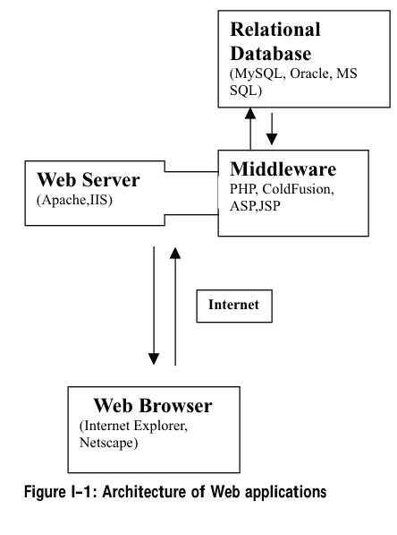

图 I-1：Web 应用的架构

你应该使用哪一个？嗯，这是一个复杂的问题，对于许多人来说，答案部分基于宗教。万一你不知道，让我们花点时间谈谈这场宗教战争中的广泛话题。

如果你不知道我们在说什么，这里是基本情况。PHP 和 MySQL 属于一类称为开源的软件。这意味着其应用程序核心的源代码对任何想看的人都是开放的。它们使用开源开发模式，允许任何感兴趣的人参与项目的开发。就 PHP 而言，世界各地的程序员参与语言的开发，却没有立即获得他们大量工作的报酬。参与的大多数人对优秀软件充满热情，并为了看到像你和我这样的人用他们的工具进行开发而编写代码。

这种开发方法已经存在一段时间了，但随着 Linux 越来越受欢迎而获得了突出地位。更常见的是，开源软件是免费的。你可以下载应用程序、安装它并使用它，而无需任何人的许可或向任何人支付一分钱。

可以说，Microsoft、Oracle 和其他传统软件公司并不使用这种开发方法。

如果你不是开源狂热者，选择 NT/2000 也有极好的理由。通常，促使人们转向 NT/2000 的是惯性。如果你或你的公司多年来一直使用 Microsoft 产品进行开发，留在该环境中可能更容易。如果你有一个团队

如果你会 Visual Basic，你可能就会想继续使用 NT/2000。即使如此，也没有任何东西阻止你使用 PHP 和 MySQL 进行开发。这两款产品都可以在 Windows 95/98 和 Windows NT/2000 上运行。

但在现实世界中，几乎所有的 PHP/MySQL 应用都是运行在某种版本的 Unix 上，无论是 Linux、BSD、Irix、Solaris、HP-UX 还是其他变种。因此，本书中的应用程序将与 Unix 兼容。如果你需要在 Windows 上运行它们，可能需要对 PHP 脚本进行少量修改。创建 PHP 和 MySQL 的大多数人深度参与 Unix，且大部分开发工作都在 Unix 机器上完成，所以他们所创建的软件在 Linux、BSD 和其他 Unix 系统上表现最佳也就不足为奇了。

Unix 的主要优势在于其固有的稳定性。装有 Linux 的机器据称可以连续运行数月甚至数年而不会崩溃。Linux 和 BSD 还有免费且能够在标准 PC 硬件上运行的优势。如果你有一台旧的 486，你可以装上 Linux、MySQL、PHP 和 Apache，就拥有了一台配置良好的 Web 服务器。你可能不希望把它放到互联网上，因为中等量的流量可能会压垮它，但它作为开发服务器、用于测试应用程序的地方则非常合适。

## Web 服务器
Web 服务器的工作看起来相当直接。它运行在你的操作系统之上，坐等着来自网络上某人的请求，响应这些请求并提供相应的网页。实际上情况比这复杂一些，而且由于网络的 24/7 性质，Web 服务器的稳定性是一个重要问题。

市面上有许多 Web 服务器，但只有两款占据主导地位。它们是 Apache 和微软的 Internet Information Server（IIS）。

## Internet Information Server
IIS 与 Windows 环境紧密绑定，是微软 Active Server Pages 的关键组件。如果你选择走微软路线，你几乎肯定会使用 IIS。

编程语言与 Web 服务器之间存在一定的集成。目前，PHP 4 与 IIS 集成良好。截至本文撰写时，人们对 PHP/IIS 在高负载下的稳定性有些担忧，但 PHP 不断改进，到你阅读本文时这个问题可能已不再存在。

## Apache
Apache Web 服务器是最流行的 Web 服务器。它与 Linux、PHP 和 MySQL 一样，是一个开源项目。毫不奇怪，Apache 在 Unix 环境中表现最佳，但在 Windows 下也能很好地运行。

Apache 使用第三方模块。由于它是开源的，任何有技能的人都可以编写代码来扩展 Apache 的功能。PHP 最常作为 Apache 扩展运行，被称为 Apache 模块。

Apache 是一个很棒的 Web 服务器。它极快且稳定惊人。关于 Apache 最常提出的抱怨是，与许多 Unix 软件一样，可用于操作该应用程序的图形化工具有限。你可以通过在命令行上指定选项或修改文本文件来更改 Apache。初次接触 Apache 时，所有这些可能有点晦涩。

尽管 Apache 在 Unix 系统上表现最佳，但也有可在 Windows 操作系统上运行的版本。没有人，甚至 Apache 开发者本人，都不建议在 Windows 下的繁忙服务器上运行 Apache。如果你决定使用 Windows 平台来提供网页服务，使用 IIS 会更好。

但在某些情况下，你会很高兴 Apache 能在 Windows 下运行。你可以在 Windows 98 机器上运行 Apache、PHP 和 MySQL，然后几乎无需更改脚本即可将这些应用程序转移到 Linux 上。如果你需要在 Windows 上本地开发，但要在 Unix/Apache 服务器上提供服务，这是最简单的方法。

## 中间件
PHP 属于一类被称为中间件的语言。这些语言与 Web 服务器紧密协作，解释来自万维网的请求，处理这些请求，与服务器上的其他程序交互以满足请求，然后指示 Web 服务器向客户端浏览器提供确切的内容。

中间件是你将完成绝大多数工作的地方。运气好的话，你可以在不费太多力气的情况下让 Web 服务器运行起来。一旦运行起来，你就不需要经常折腾它了。

但在开发应用程序时，你将花费大量时间编写代码使应用程序正常工作。除了 PHP，还有几种执行类似功能的语言。比较流行的选择有 ASP、Perl 和 ColdFusion。

## 关系数据库
关系数据库管理系统（RDBMS）提供了一种存储和访问复杂信息的绝佳方式。它们已经存在相当一段时间了。事实上，它们早于 Web、Linux 和 Windows NT，因此选择众多也就不足为奇了。所有主要数据库都使用结构化查询语言（SQL）。

一些较流行的商业 RDBMS 有 Oracle、Sybase、Informix、微软的 SQL Server 和 IBM 的 db2。除了 MySQL，现在还有两个主要的开源关系数据库。Postgres 一直是开源领域中 MySQL 的主要替代品。1999 年 8 月，Borland 将其 Interbase 产品以开源许可证发布，允许免费下载和使用。

## 为什么选择这些产品？
鉴于选择众多，你可能会问自己为什么要选择 PHP 和/或 MySQL。我们将在以下三个部分回答这个问题。

## 为什么选择 PHP？
编程语言很像鞋子。有些人觉得好看，有些人觉得很丑。进一步说，有些鞋子就是更合某些人的脚。

我们的意思是：就 Web 编程而言，所有语言基本上做的事情都一样：它们都与关系数据库交互；都与文件系统交互；都与 Web 服务器交互。关于哪种语言最好的问题，很少是因为某种语言无法执行某些操作。通常更多的是关于你能以多快的速度、付出多少的痛苦完成所需工作。

## 快速且易用
速度如何？就比较 Web 编程语言的速度而言，我们确知的只有三件事。第一，用 C 编写的应用程序会是最快的。第二，用 C 编程相当困难，且耗时会比迄今提到的任何其他语言都长。第三，语言之间的比较极其困难。根据我们所知，我们可以放心地说 PHP 与市场上任何东西一样快。

大多数情况下，选择语言与买鞋涉及的问题相同。你会想要选择最舒适的。如果你和我们一样，你会发现 PHP 在功能、结构和易用性之间取得了完美平衡。再次强调，这在很大程度上是个人观点，但我们确实认为 PHP 的语法优于 ASP 和 JSP。我们也认为它比 ColdFusion 更快地将更多功能掌握在你手中，且学习起来不像 Perl 那样困难。

总之，我们认为 PHP 提供了快速开发功能强大的 Web 应用程序的最佳机会。做出这一概括后，我们确实认为选择 PHP 还有其他优秀的理由。

## 跨平台
在 Web 架构概述中，我们提到 PHP 可在 Windows 2000/NT 和 Unix 上运行，并与 IIS 和 Apache 兼容。但 PHP 的跨平台能力远不止于此。如果你恰好使用 Netscape、Roxen 或几乎任何其他东西，很可能 PHP 也能与其配合工作。

是的，ASP 可以在 Linux 上运行，ColdFusion 可在 Solaris 和 Linux 上工作，JSP 可在许多平台上自适应。此时，PHP 在各种系统上的工作能力与任何其他可用产品一样广泛。

## 访问一切
在创建 Web 应用程序的过程中，你需要访问什么？LDAP？IMAP 邮件服务器？Oracle？Informix？DB2？或者你可能需要一个 XML 解析器或 WDDX 函数。

无论你需要使用什么，很可能 PHP 都有一组内置函数，使获取所需内容变得非常容易。但如果它没有你想要的内置功能呢？这就引出了我们的下一个观点。


## 持续改进中

如果你刚接触开源开发，你可能会对软件的高质量感到惊讶。外面的世界里有成千上万技术精湛、才华横溢的程序员，他们喜欢花费时间创建出优秀的、而且大多是免费的软件。在像 PHP 这样活跃的项目中，几乎每天都有各种开发者致力于改进产品。

真的令人惊叹。如果你偶然发现一个错误，你可以向核心开发者阅读的邮件列表提交报告。根据其严重程度，该错误很可能在几个小时到几天内得到解决。

PHP 4 在组装时采用了模块化方式。这使得添加更多功能变得相当容易。如果有你希望添加到 PHP 中的函数集，很可能有人能以最少的努力完成它。

## 你的同行会支持你

大多数语言都有活跃的邮件列表和开发站点。PHP 也不例外。如果你遇到麻烦——如果你代码中的某个错误就是想不通，或者对某个函数怎么也理解不了——订阅 PHP 邮件列表的数百人中总会有人乐意检查并修复你的代码。

PHP 的开源特性营造出真正的社区感。当你陷入困境时，你的 PHP 黑客同胞们会感同身受并为你排忧解难。

## 免费

如果你有一台电脑，Linux、Apache 和 PHP 都是完全免费的。

## 为什么选择 MySQL？

这个问题或许有点难回答。虽然 MySQL 有很多值得推荐之处，但它也有各种竞争对手，其中许多可能更适合特定任务。

本书第一部分详细讨论了 MySQL。在这些章节中，你会看到我们提到其他关系数据库中可用的、而 MySQL 不支持的功能。（如果你熟悉数据库并且好奇，这些包括存储过程、触发器、参照完整性以及 SQL 联合和子查询。）鉴于这些限制，确实存在 MySQL 不是最佳选择的环境。如果你打算开办一家银行（你知道的，储蓄和贷款机构），MySQL 可能不适合你。

但对于大多数人来说，在大多数应用中，MySQL 是一个很好的选择。它特别适合 Web 应用。

## 经济实惠

你以为需要安装 Oracle？准备好掏出 30,000 美元到 100,000 美元甚至更多的费用吧。毫无疑问，Oracle、Sybase 和 Informix 构建了出色的数据库，但所涉及的成本对许多人来说是难以承受的。

MySQL 是免费的。你可以安装并使用它，过程中无需支付任何费用。

## 快速而强大

MySQL 可能没有关系数据库可用的所有花哨功能，但对于大多数用户来说已经足够。如果你提供 Web 内容或创建中等规模的电子商务网站，MySQL 拥有你所需的所有功能。

对于小型到中型的数据库，MySQL 将极其快速。MySQL 的开发者对产品的速度感到非常自豪。对于本书第三部分和第四部分中介绍的应用，你不太可能找到速度更快的数据库。

## 不断改进

MySQL 以惊人的速度不断改进。开发者频繁发布更新，并且一直在添加令人印象深刻（我们确实是说令人印象深刻）的功能。最近，MySQL 添加了事务支持；他们显然现在正在着手存储过程。

> MySQL 事务支持是在本书撰写前不久添加的。因此，本书中可能使用事务的应用并未采用。


总的来说，MySQL 是一个优秀的产品，并且一直在变得更好。

## 你的第一个应用程序

序幕到此为止。让我们开始编写一个应用程序，以便你可以看到所有这些部分如何在真实的应用程序中结合在一起。等你读完这篇介绍，你应该对一切如何结合会有相当好的了解。

## 工具检查

有几个关键要素你需要开始。我们将在这里逐一介绍，以便你知道需要什么。

## 软件

这是一个基于 Web 的应用程序，所以你显然需要一个 Web 服务器。你可能会使用 Apache，无论你使用的是 Windows 还是 Unix。你需要安装 Apache，以便它可以访问 PHP 语言。

此外，你需要安装 MySQL。并且 PHP 必须能够识别 MySQL。Apache、MySQL 和 PHP 都提供在随附的 CD 上，安装说明在附录 B 中提供。你可能希望在继续之前安装这些软件包，或者你可以先阅读以了解我们正在做什么，并在你想使用本书中更实用的示例时再安装这些软件包。

## 文本编辑器

截至本文撰写时，PHP 没有精美的集成开发环境（IDE）。要编写 PHP 和你的网页，你需要一个文本编辑器。你可以使用记事本或类似的基础工具，但如果你没有忠于任何特定编辑器，我建议你选择一个语法高亮效果好的工具。在 Windows 上，Allaire 的 Homesite（www.allaire.com）是与 PHP 配合良好的工具，我们也听说过 Editplus（www.editplus.com）的优秀评价。

如果你在 Unix 上工作了一段时间，你很可能已经熟悉并喜爱某种文本编辑器，无论是 Emacs、vi 还是 Kedit。如果不是，任何一种都可以，不过前两种需要一些适应时间。如果你使用 Unix，但没有耐心学习 vi，可以试试 Pico。它非常易于使用。

如果你在 Unix 下需要一个文本编辑器但不熟悉 vi，可以试试 Pico。它是一个非常基础、易于使用的文本编辑器。

## 应用程序概述

我们本想用一个非常奇特的东西来开启本书，一个令人瞠目结舌的原创 Web 应用程序，Web 上从未见过。在一次精彩的头脑风暴之后，我们联系了一些网络上最聪明的人，以及其他创意领域的天才，我们找到了完美的东西。我们将编写一个存储用户信息的应用，一个用户可以在其中输入姓名、电子邮件地址、URL，甚至评论的地方。经过长时间的讨论和深思熟虑，我们为这个应用决定了一个名字。它现在并永远被称为访客簿。

访客簿是一个简化示例，你永远不想在真实的 Web 服务器上运行它。我们在第 8 章以更健壮的形式重建了这个应用程序。

## 创建数据库

现在你已经清楚需要什么，第一步是创建数据库来存储这些信息。为此，你将使用大多数数据库服务器通用的语言：结构化查询语言（SQL）。你稍后会读到更多相关内容，所以如果现在不完全理解也没关系。只需阅读完引言的其余部分，然后阅读第 1 章即可。

启动 MySQL 命令行客户端。如果你使用 Unix，在 shell 中输入 mysql 应该就可以了（或者你可能需要进入 /mysql/bin 目录）。如果你在 Windows 上，你需要进入 DOS 提示符，找到 mysql.exe 的路径并执行它。然后，在提示符下创建一个新数据库。完成后，你应该会看到类似这样的内容：

```
[jay@mybox jay]$ mysql
Welcome to the MySQL monitor.  Commands end with ; or \g.
Your MySQL connection id is 716 to server version: 3.22.27-log

Type 'help' for help.

mysql> create database guestbook;
Query OK, 1 row affected (0.00 sec)

mysql>
```

现在，在名为 guestbook 的数据库中，你需要一个存储用户信息的表。这个表也在 MySQL 监视器中创建。创建表的命令并不复杂。你基本上需要让 MySQL 知道预期什么样信息，是数字还是字符串，以及信息是否可以省略（或为 NULL）。基本命令是 create table；创建表时大致如下所示：

```
mysql> use guestbook
Database changed
mysql> create table guestbook
    -> (
    ->     name          varchar(40) null,
    ->     location      varchar(40) null,
    ->     email         varchar(40) null,
    ->     url           varchar(40) null,
    ->     comments      text null
    -> )
    -> ;
Query OK, 0 rows affected (0.00 sec)

mysql>
```

现在你有一个名为 guestbook 的数据库，以及数据库中名为 guestbook 的表。现在是时候编写一个 PHP 应用程序，以便你可以插入、编辑和查看保存在这个访客簿中的信息。

## 你的 PHP 脚本

现在是时候转到文本编辑器了。在配置 Web 服务器的过程中，你需要让它知道哪些文件应该交给 PHP，以便引擎可以解释页面。通常，这些文件会有 .php 扩展名，尽管 PHP 可以解释任何文件，包括 .html 文件。这些

脚本将存放在用于存放网页的文件夹内。对于 Apache，通常是 /htdocs。

## 基本语法

PHP 的一个优点是它让你可以在纯 HTML 和 PHP 编程语言的命令之间切换。其工作原理如下：脚本中位于开始标签 <?php 与结束标签 ?> 之间的部分将由 PHP 引擎解释，而标签之外的部分则被视为纯 HTML。来看下面的 PHP 页面。

```php
<?php
echo "Hi,";
?>
```

妈妈。

通过 Web 服务器运行后，这将创建一个网页，简单地打印出“你好，妈妈。”。PHP 的 echo 命令处理了这一行的第一部分。当然，PHP 能做的远不止于此。像其他任何编程语言一样，它可以处理变量并做出决策。

```php
<?php
echo "hi, mom. ";

$var = date("H");
if ($var <= 11)
{
    echo "good morning";
}
elseif ($var > 11 and $var < 18)
{
    echo "good afternoon";
}
else
{
    echo "good evening";
}
?>
```

在此页面中，打印问候语之后，有一些真正的编程。我使用了 PHP 内置的 date 函数来获取 24 小时制下的当天小时数。该值立即被赋给名为 $var 的变量。然后做出决策，根据一天中的时间打印适当的文本。请注意这里的语法。每个 PHP 命令以分号结尾。在 if 语句中，花括号包含根据条件执行的命令。而条件本身则放在括号内。

date() 函数和 echo 在前面的示例中使用，它们只是 PHP 内置的数百个函数中的两个，其中许多你将在本书学习过程中学会使用。如果你要访问数据库，你还需要更多函数。

## 连接数据库

在安装 PHP 时，你应该让它知道你计划与之一起使用 MySQL。如果不这样做，我们现在要讨论的内容将无法工作。即使 PHP 知道你在使用 MySQL，在你的具体脚本中你必须标识出需要访问的确切数据库。在本例中，那就是你刚刚创建的 guestbook 数据库。

```
mysql_connect("localhost", "nobody","password") or
    die ("Could not connect to database");
mysql_select_db("guestbook") or
    die ("Could not select database");
```

第一行告诉 MySQL Web 服务器（运行脚本的实体）位于本地机器上，用户名为 nobody，密码为 password。然后，如果连接成功，就使用 mysql_select_db() 命令选择特定的数据库。将这些行安全地放在你的脚本中，你应该能够用你的命令操作数据库。

因为你在该应用程序的每个页面都需要这些行，所以最好节省一些输入，将它们放在单独的文件中，并在每个页面中包含它们。如果你做过任何编程，你就知道这涉及到将该文件的所有内容转储到被访问的文件中。这些行将保存在名为 dbconnect.php 的文件中。在该应用程序中每个其他文件的顶部将有以下行：

```
include('dbconnect.php');
```

## 向数据库插入信息

因为你尚未向数据库中添加任何用户，我们将从回顾允许这样做的脚本开始。但首先，我们需要告诉你更多关于 PHP 变量的信息。稍早前，我们展示了你可以在 PHP 脚本中创建变量，但由于这是一个客户端/服务器环境，你需要从客户端（Web 浏览器）获取变量数据到 PHP。通常你会用 HTML 表单来做这件事。

附录 A 中有 HTML 表单的基础介绍。如有需要请查阅。现在我们只指出每个表单元素都有一个 name，当表单被提交时，这些表单元素的名称会作为变量在表单提交到的 PHP 脚本中可用。以下表单中，一旦表单被提交，变量 $surname 和 $submit 将在 PHP 脚本 myscript.php 中可用。$surname 的值将是用户在文本字段中输入的内容。$submit 的值将是文本字符串“submit。”

```
<form action="myscript.php">
    <input type="text" name="surname">
    <input type="submit" name="submit" value="submit">
</form>
```

在展示脚本本身之前，现在是说明 Web 编程与其它类型编程的一个重要区别的好时机：它是无状态的。要显示一个页面，Web 服务器必须先从浏览器接收请求。它们使用的语言称为 HTTP，即超文本传输协议。请求将包含多项内容——浏览器希望查看的页面、表单数据、所使用的浏览器类型以及浏览器使用的 IP 地址。基于这些信息，Web 服务器将决定提供什么内容。

一旦它提供了该页面，服务器就不再与浏览器保持连接。它完全不记得向谁提供了什么。每个 HTTP 请求都是单独处理的，与之前发生的事情无关。因此，在 Web 编程中你需要想出一种维护状态的方法。也就是说，如果你正在一个应用程序中进行操作，你需要一种让服务器知道发生了什么的方法。本质上，你需要能够在页面之间传递变量的方式。这将在我们的应用程序中出现。应用程序将以三种方式之一解决这个问题：通过传递隐藏的表单元素、使用 cookies 或使用 sessions。

现在回到我们的脚本。

```
<form action="myscript.php">
    <input type="text" name="surname">
    <input type="submit" name="submit" value="submit">
</form>
```

你可以根据来自 HTML 表单的变量信息决定在页面上显示什么。例如，你可以通过检查变量名 $submit 是否具有值 "submit" 来检查前面的表单是否已被提交。这种技术在创建用于向数据库插入信息的页面时就会派上用场。

我们应用程序中有一个名为 sign.php 的页面，其中包含一个 HTML 表单。该页面中表单的 action 是 create_entry.php。以下是该页面的全部内容：

```
<h2>Sign my Guest Book!!!</h2>

<form method=post action="create_entry.php">

<b>Name:</b>
<input type=text size=40 name=name>
<br>
<b>Location:</b>
<input type=text size=40 name=location>
<br>
<b>Email:</b>
<input type=text size=40 name=email>
<br>
<b>Home Page URL:</b>
<input type=text size=40 name=url>
<br>
<b>Comments:</b>
<textarea name=comments cols=40 rows=4 wrap=virtual></textarea>
<br>

<input type=submit name=submit value="Sign!">
<input type=reset name=reset value="Start Over">

</form>
```

当用户填写此表单并提交时，信息将被发送到 create_entry.php。第一件事是在此页面上检查表单是否已被提交。如果已提交，就取出表单中输入的值并用它们创建一个查询，然后发送给 MySQL。暂时不用担心查询的具体细节。只需知道它将向你之前创建的数据库表插入一行。

```php
<?php
include("dbconnect.php");

if ($submit == "Sign!")
{
    $query = "insert into guestbook
        (name,location,email,url,comments) values
        ('$name', '$location', '$email', '$url', '$comments')";
    mysql_query($query) or
        die (mysql_error());
?>
<h2>Thanks!!</h2>
<h2><a href="view.php">View My Guest Book!!!</a></h2>
<?php
}
else
{
    include("sign.php");
}
?>
```

如果表单（在 sign.php 中）尚未被提交，它将被包含，因此会显示相同的表单。你可能会注意到此页面提交给自身。

第一次调用 create_entry.php 页面时，sign.php 中的表单将被显示。接下来，数据将被插入数据库。图 I-2 和图 I-3 显示了此脚本将创建的页面。

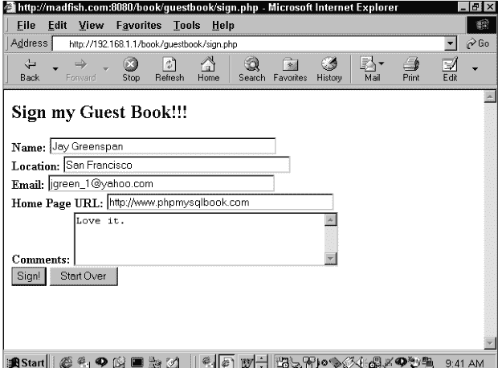

图 I-2：create_entry.php 第一次通过

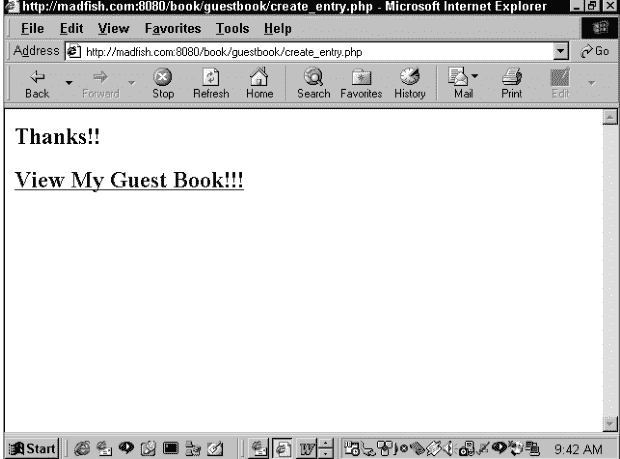

图 I-3：create_entry.php 提交后


## 在数据库中查看信息

这应该不会太难。你已经知道文件需要包含 dbconnect.php。除此之外，我们已经提到数据库将信息存储在表中。表中的每一行都包含在留言簿上签名的人的具体信息，因此要查看所有信息，页面需要检索并打印出每一行数据。以下是执行此操作的脚本（你会注意到它相当简洁）：

```php
<?php include("dbconnect.php"); ?>

<h2>View My Guest Book!!</h2>

<?php

$result = mysql_query("select * from guestbook") or
    die (mysql_error());
while ($row = mysql_fetch_array($result))
{
    echo "<b>Name:</b>";
    echo $row["name"];
    echo "<br>\n";
    echo "<b>Location:</b>";
    echo $row["location"];
    echo "<br>\n";
    echo "<b>Email:</b>";
    echo $row["email"];
    echo "<br>\n";
    echo "<b>URL:</b>";
    echo $row["url"];
    echo "<br>\n";
    echo "<b>Comments:</b>";
    echo $row["comments"];
    echo "<br>\n";
    echo "<br>\n";
    echo "<br>\n";
}
mysql_free_result($result);
?>

<h2><a href="sign.php">Sign My Guest Book!!</a></h2>
```

查询会向 MySQL 请求数据库中的每一行。然后脚本进入一个循环。数据库中的每一行都会一次加载到变量 $row 中，一次一行。行会继续被访问，直到没有剩余为止。此时，脚本将退出 while 循环。

在循环执行过程中，该行中的每一列都会被显示。例如

```
print $row["email"]
```

会打印出正在访问的行的 e-mail 列。

运行后，这个简单的脚本会打印出数据库中的每一行。图 I-4 显示了页面的外观。

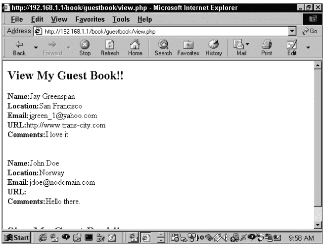

图 I-4：view.php

这就完成了我们的第一个应用程序。

## 为什么不应该使用此应用程序

如果你想把它加载到自己的服务器上看看是否有效，没问题；请便。但我们不会把它放在公众可以访问的地方。不，如果你这样做就会出现问题。例如，你的 view.php 页面可能会出现图 I-5 的情况。完全不好！

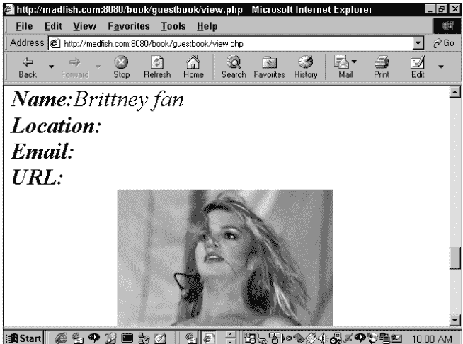

图 I-5：有问题的留言簿条目

如果你想要一个留言簿，你应该使用专门为本书读者制作的超高级编码应用程序，你可以在第 8 章找到它。我们称此应用程序为 Guestbook2k。但在到达那里之前，是时候进行一些教育了。

现在开始阅读。

## Chapter 1

## 使用 MySQL 进行数据库设计

## 本章内容

- 识别导致关系数据库创建的问题
- 学习规范化过程
- 看一看 MySQL 目前不支持的一些数据库功能

本章的大部分内容是为那些在 21 世纪初才接触到关系数据库的人准备的。如果你是一位经验丰富的数据库专家，曾使用过 Oracle、Sybase，甚至像 Microsoft Access 或 Paradox 这样的工具，你可能想跳过这篇关于数据库理论的小课。然而，我建议你查看本章的最后一节，在那里我讨论了 MySQL 的一些奇怪之处。MySQL 对 SQL 的实现是不完整的，因此可能不支持你想要的一些功能。

## 为什么使用关系数据库？

如果你仍然在这里，准备全神贯注地阅读关于数据库理论和规范化奇妙之处的内容，你可能对关系数据库的历史知之甚少。你可能甚至不在乎。出于这个原因，我会简要说明。E. F. Codd 博士是 1960 年代 IBM 的研究科学家。他受数学训练，对当时可用的数据存储模型不满意。他发现所有可用的方法都容易出错且冗余。他研究了这些问题，然后在 1970 年发表了一篇题为“大型共享数据库的 Relational Model of Data”的论文。说实话，从那以后一切都不同了。

Larry Ellison 这位程序员读了这篇论文并开始着手开发能够将 Codd 博士的理论付诸实践的软件。如果你过去 20 年一直生活在这个星球上，你可能知道 Ellison 的产品和公司取名为 Oracle，而且他现在是世界上最富有的人之一。他的最早产品是为大型主机系统设计的。多年来，随着市场需求的变化，Oracle 以及此后涌现的许多其他公司设计了针对各种操作系统的各种功能系统。现在，关系数据库如此常见，你可以得到一个运行在 Palm Pilot 上的数据库。

要理解 Codd 博士的理论为何彻底革新了数据存储世界，最好先了解一下其他数据存储方式的麻烦。以一个简单的地址簿为例——没什么复杂的，只是存储姓名、地址、电话号码、电子邮件等。如果没有持久运行的程序可以把这些信息输入，运行该操作系统的文件系统就成了存储的自然选择。

对于一个简单的地址簿，可以创建一个分隔文本文件来存储信息。如果第一行用作标题并使用逗号作为分隔符，它可能看起来像这样：

```
Name, Addr1, Addr2, City, State, Zip, Phone, E-mail
Jay Greenspan, 211 Some St, Apt 2, San Francisco, CA, 94107, 4155551212, jgreen_1@yahoo.com
Brad Bulger, 411 Some St, Apt 6, San Francisco, CA, 94109, 4155552222, bbulger@yahoo.com
John Doe, 444 Madison Ave, , New York, NY, 11234, 2125556666, nobody@hotmail.com
```

这看起来没什么，但至少是机器可读的。使用你喜欢的任何语言，你可以编写一个脚本打开此文件然后解析信息。你可能希望它以某种二维或关联数组的形式存在，以便在寻址此文件的每一行的每个部分时具有灵活性。无论如何，都需要编写相当多的代码。如果你希望此信息能够按各种标准排序和查询，你将不得不编写脚本，例如按姓名字母顺序对列表进行排序或查找某个区号内的所有人员。真麻烦。

如果你需要数据在网络上被多个人使用，你可能会面临另一个主要问题。显然不止一个人需要向此文件写入信息。如果两个人同时尝试更改会怎样？首先，很可能一个人会覆盖另一个人的更改。为了防止这种情况发生，程序员必须在文件使用时指定文件锁定。虽然这可能有效，但对于被锁定的那个人来说有点麻烦。显然，系统越大，这一切就越难以管理。

你需要比文件系统更强大的东西——一个驻留在内存中的程序或守护进程似乎是个不错的选择。此外，你需要一个数据存储系统，减少程序员需要关心的解析和脚本编写量。这里不需要什么深奥的东西。一个像表 1-1 那样的普通简单表格就足够好了。

这很方便。看起来很容易，如果有一个访问此表的运行程序，应该会很快。这个程序还能做什么？首先，它应该能够一次寻址一行而不影响其他行。这样，如果两个人想向此表插入信息，他们就不会互相干扰。如果程序还能提供一种简单优雅的方式从这样的表中提取信息就更好了。应该有一种快速查找所有来自加州的人的方法，而不需要解析和排序文件。此外，这个奇妙的程序应该能够接受用与英语非常相似的语言描述你想要内容的语句。这样你就可以说：“给我所有 State 列内容等于‘CA’的行。”

是的，这很棒，但还不够。仍有需要处理的主要问题。我将在接下来的几页中讨论这些问题，这些问题正是 Codd 博士写他著名论文的原因，也是 Larry Ellison 成为亿万富翁的原因。

## 该死的异常

Codd 博士的目标是拥有一个可靠的信息模型。他可用的所有数据存储方法都有固有问题。他将这些问题称为异常。有三种类型的异常：更新、删除和插入。

## 更新异常

现在我们可以假设表结构可以快速轻松地处理多个请求，我们需要看看当信息变得更复杂时会发生什么。向之前的表添加一些更多信息会引入一些严重问题（表 1-2）。

表 1-2 旨在存储整个办公室的信息，而不仅仅是一个人。由于这家公司与其他大型公司打交道，会有时候一个办公室位置会有多个联系人。例如，在表 1-2 中，1121 43rd St 有两个联系人。一开始这似乎是可以的：我们仍然可以相对容易地获取所有可用信息。问题出现在 BigCo 公司决定搬到另一个地址时。在这种情况下，我们必须在两行中更新 BigCo 的地址。这可能听起来不是什么大问题，但如果这个表有 3,000 行而不是 3 行——或者 300,000 行——就会很麻烦。有人或某个程序必须确保数据在每个适当的地方都被更改。

另一个担忧是出错的可能性。很可能其中一行会被更改而另一行保持不变。或者，如果更改是一行一行输入的，很可能会有人输入错别字。然后你就会怀疑正确的地址是 1121 还是 1211。

处理此数据的更好方法是取出公司名称和地址并将这些信息放在自己的表中。两个 resulting 表将类似于表 1-3 和表 1-4。


### 表 1-1 用于数据存储的简单表

| 姓名 | 地址1 | 地址2 | 城市 | 州 | 邮编 | 电话 | 电子邮件 |
|---|---|---|---|---|---|---|---|
| Jay Greenspan | 211 Some St | Apt 2 | San Francisco | CA | 94107 | 4155551212 | jgreen_1@yahoo.com |
| Brad Bulger | 411 Some St | Apt 6 | San Francisco | CA | 94109 | 4155552222 | bbulger@yahoo.com |
| John Doe | 444 Madison Ave |  | New York | NY | 11234 | 2125556666 | nobody@hotmail.com |

### 表 1-2 有问题的表存储

| id | 公司名称 | 公司地址 | 联系人姓名 | 联系人职位 | 电话 | 电子邮件 |
|---|---|---|---|---|---|---|
| 1 | BigCo Company | 1121 43rd St | Jay Greenspan | Vice President | 4155551212 | jgreen_1@yahoo.com |
| 2 | BigCo Company | 1121 43rd St | Brad Bulger | President | 4155552222 | bbulger@yahoo.com |
| 3 | LittleCo Company | 4444 44th St | John Doe | Lackey | 2125556666 | nobody@hotmail.com |

### 表 1-3 公司

| 公司编号 | 公司名称 | 公司地址 |
|---|---|---|
| 1 | BigCo Company | 1121 43rd St |
| 2 | LittleCo Company | 4444 44th St |

### 表 1-4 联系人

| 联系人编号 | 公司编号 | 联系人姓名 | 联系人职位 | 电话 | 电子邮件 |
|---|---|---|---|---|---|
| 1 | 1 | Jay Greenspan | Vice President | 4155551212 | jgreen_1@yahoo.com |
| 2 | 1 | Brad Bulger | President | 4155552222 | bbulger@yahoo.com |
| 3 | 2 | John Doe | Lackey | 2125556666 | nobody@hotmail.com |

现在与 BigCo Co. 相关的信息已放在它自己的表中，名为 Companies。如果查看下一张表（表 1-4），名为 Contacts，你会看到我们插入了另一列，称为 company_id。该列引用 Company 表的 company_id 列。在 Brad 的行中，我们看到 company_id（第二列）等于 1。然后我们可以转到 Companies 表，查看 company_id 为 1 的信息并看到所有相关的地址信息。这里发生的事情是我们在这两个表之间创建了一个关系——因此得名 *relational database*。

我们仍然拥有之前设置中的所有信息，只是将其分段了。在此设置中，我们只需更改单行即可更改 Jay 和 Brad 的地址。这正是我们想要的便利。

也许这会让你好奇我们如何将这些信息重新合并。关系数据库使我们能够合并或连接表。考虑以下语句，其目的是为我们提供 Brad 的所有可用信息：“Give me all the columns from the contacts table where contact_id is equal to 1, and while you're at it throw in all the columns from the Companies table where the company_id field equals the value shown in Brad's company_id column.” 换句话说，在此语句中，你要求在 company_id 字段相同的地方连接这两个表。此请求或查询的结果看起来会像表 1-5。

在几页的篇幅中，你已经学会了通过分段信息并创建额外的表来解决数据完整性问题。但我尚未为此问题命名。当我从一本非常厚且昂贵的书中学习与关系数据库相关的词汇时，这种问题被称为 *update anomaly*。现实世界中可能有人使用这个术语，也可能没有；如果有，我还没遇到过。然而，我认为这个术语非常贴切。在本节前面展示的表中，如果我们更新表中的一行，包含相同信息的其他行将不会受到影响。

## 删除异常

现在查看表 1-6，重点关注第 3 行。考虑如果 Mr. Doe 从数据库中被删除会发生什么。这看起来像是简单的更改，但假设有人访问数据库想要一份过去一年联系过的公司列表。在当前设置中，当我们删除第 3 行时，我们不仅删除了 John Doe 的信息，还删除了公司的信息。这个问题被称为 *deletion anomaly*。

如果公司信息被移到它自己的表中，如我们在上一节所见，这就不会成为问题。我们可以删除 Mr. Doe，然后独立决定是否要删除他关联的公司。

### 表 1-5 查询结果

| 公司编号 | 公司名称 | 公司地址 | 联系人编号 | 联系人姓名 | 联系人职位 | 电话 | 电子邮件 |
|---|---|---|---|---|---|---|---|
| 1 | BigCo Company | 1121 43rd St | 2 | Brad Bulger | President | 4155552222 | bbulger@yahoo.com |

### 表 1-6 存在删除异常的表

| 公司编号 | 公司名称 | 公司地址 | 联系人姓名 | 联系人职位 | 电话 | 电子邮件 |
|---|---|---|---|---|---|---|
| 1 | BigCo Company | 1121 43rd St | Jay Greenspan | Vice President | 4155551212 | jgreen_1@yahoo.com |
| 2 | BigCo Company | 1121 43rd St | Brad Bulger | President | 4155552222 | bbulger@yahoo.com |
| 3 | LittleCo Company | 4444 44th St | John Doe | Lackey | 2125556666 | nobody@hotmail.com |

## 插入异常

我们最后关注的领域是在插入过程中引入的问题。再次查看表 1-6，我们看到此表的目的是存储联系人信息，而不是公司信息。如果想添加公司但不添加个人，这就会变得很麻烦。在大多数情况下，你必须等待有具体的联系人要添加到数据中后，才能将公司信息添加到数据库中。这是一个荒谬的限制。

## 规范化

现在我们向你展示了你可能遇到的一些问题，你需要学习寻找和消除这些异常的方法。此过程称为规范化。理解规范化对于使用关系数据库至关重要。但对于有数据库经验的人来说，规范化并不是数据设计的全部。经验和直觉在创建良好的数据库中也起着作用。在本书后面呈现的示例中，数据在很大程度上会被规范化——但也会有不规范结构更可取的情况。

还有一个快速的提醒。规范化过程包含几个“normal forms。”在本章中我们将介绍 1st、2nd、和 3rd normal forms。在此之外，规范化过程还可以通过另外四种范式继续。（对于好奇的人来说，它们被称为 Boyce-Codd normal form、4th normal form、5th normal form、和 Domain/Key normal form）。我之所以知道这些是因为我在书中读到过。在现实世界中，真正开发数据库应用程序的人们根本不会谈论这些范式。如果你的数据达到 3rd normal form 就足够好了。是的，第三范式中可能仍然存在异常，但如果你能做到这一步应该没问题。

## 第一范式

将数据放入 1st normal form 相对容易。数据需要在表结构中并满足以下标准：

- 每列必须包含一个“atomic”值。这意味着每个单元格只有一个值。任何单元格中都不会存在数组或其他表示多个值的方式。
- 每列必须有唯一名称。
- 表必须有一组值唯一标识行（这称为表的 primary key）。
- 任意两行不能相同。
- 不允许重复的数据组。

### 表 1-7 存在重复数据组的表

| 公司编号 | 公司名称 | 公司地址 | 联系人姓名 | 联系人职位 | 电话 | 电子邮件 |
|---|---|---|---|---|---|---|
| 1 | BigCo Company | 1121 43rd St | Jay Greenspan | Vice President | 4155551212 | jgreen_1@yahoo.com |
| 2 | BigCo Company | 1121 43rd St | Brad Bulger | President | 4155552222 | bbulger@yahoo.com |
| 3 | LittleCo Company | 4444 44th St | John Doe | Lackey | 2125556666 | nobody@hotmail.com |

这里的最后一项是唯一可能需要一些解释的。查看表 1-7：

正如我们已经看到的，第 1 行和第 2 行包含两列具有相同的信息。这是一个重复的数据组。只有当我们删除这些列并将它们放在自己的表中时，这些数据才是 first normal form。我们在表 1-3 和表 1-4 中做的表分离将使这些数据进入 1st normal form。

在我们继续讨论 2nd 和 3rd normal form 之前，你需要几个快速定义。第一个是 primary key。主键是一列或一组列，可通过它唯一标识每一行。在迄今为止展示的表中，我包含了一列顺序值，并且随着行添加到这些表中，数据库引擎会自动插入一个大于该列最大值 1 的整数。这是一种确保每行都有唯一字段的简便方法。世界上每个数据库都有定义此类列的方法。在 MySQL 中它称为 auto_increment 字段。根据你的数据，有各种各样的值可用于主键。社会安全号码效果很好，电子邮件地址和 URL 也不错。数据只需要唯一。在某些情况下，两个或多个列可能构成你的主键。例如，继续以我们的地址簿示例为例，如果需要为拥有多个地点的公司存储联系信息，最好将总机号码和邮寄地址信息存储在一个以 company_id 和公司城市作为主键的表中。

接下来，我们需要定义 dependency 这个词，其含义基本就是你想到的。依赖列是与主键不可分割地联系在一起的列。如果删除主键，它就不能存在于表中。

有了这些基础，我们就可以开始处理 2nd normal form 了。

## 第二范式

此过程的这一部分仅在你最终得到我刚才讨论的多列主键时才适用。假设在划分地址表的过程中我们得到了表 1-8。这里，company_name 和 company_location 构成了多列主键。

### 表 1-8 不在第二范式的表

| 公司名称 | 公司地点 | 公司 CEO | 公司地址 |
|---|---|---|---|
| BigCo Company | San Francisco | Bill Hurt | 1121 43rd St |
| LittleCo Company | LA | LittleCo Company | 4444 44th st |

你应该能很快看出，如果我们为 BigCo Co. 添加另一个地点，插入异常就会出现。我们会在额外的行中重复 CEO 姓名 Bill Hurt，这是不好的。


我们可以通过删除仅部分依赖于主键的行来将此表转换为第二范式。这里，CEO 仅依赖于 company_name 列。它不依赖于 company_location 列。要达到第二范式，我们将仅部分依赖于多字段主键的行移至其自己的表中。第二范式不适用于具有单列主键的表。

## 第三范式
完成规范化过程，第三范式关注传递依赖。传递依赖是指存在一列不直接依赖于主键的情况。相反，该字段依赖于另一个字段，而该字段又依赖于主键。快速达到第三范式的方法是查看表中的所有字段，并询问这些字段是否描述了主键。如果不是，你还没有达到。

如果你的通讯录需要存储有关联系人的更多信息，你可能会得到如下表。

表 1-9 不在第三范式中的表

| 联系人ID | 联系人姓名 | 联系人电话 | 助理姓名 | 助理电话 |
|---|---|---|---|---|
| 1 | Bill Jones | 4155555555 | John Bills | 2025554444 |
| 2 | Carol Shaw | 2015556666 | Shawn Carlo | 6505556666 |

你可能会认为我们在这里做得不错。但请查看 assistant_phone 列，并问问它是否真的描述了主键（以及此表的重点），即你的联系人。一种助理可能为多人服务的情况是可能的，甚至很可能，在这种情况下，助理姓名和电话可能会在表中多次列出。这将是数据的重复组，而我们已经知道我们不想要它。

## 关系类型
本质上，这本书的要点是我们将创建许多没有异常的表。我们将包含维护这些表之间关系的列。在数据库领域，我们将遇到三种特定的关系类型。

### 一对多关系
这是表之间最常见的关系类型。当一列中的一个值引用另一表中多个字段时，一对多关系生效（图 1-1）。

| 行业ID | 行业名称 |
|---|---|
| 1 | Utilities |
| 2 | Construction |
| 3 | Banking |

| 公司ID | 公司名称 | 行业ID |
|---|---|---|
| 1 | Big Co Corporation | 1 |
| 2 | Little Co Corporation | 1 |
| 3 | Joe's Utility | 1 |
| 4 | Leadfoot Builders | 2 |
| 5 | Angel's Cement Boots | 2 |
| 6 | Al's Bank | 3 |

图 1-1：具有一对多关系的表

这是一个经典的一对多关系。这里，每家公司都与某个行业相关联。如你所见，行业表中列出的一个行业可以与公司表中的一个或多个行相关联。这绝不会限制我们对公司可以做的事情。我们完全可以自由地将此表用作其他一对多关系的基础。图 1-2 显示 Companies 表可以与列出所有不同公司的城市位置的表的一对多关系中处于“一方”。

### 一对一关系
一对一关系本质上是一对多关系，其中一个表中的一行仅与另一个表中的一行相关。在规范化过程中，我提到过一种情况，其中一个表保存公司高管的信息，另一个表保存其助理的信息。如果每位高管有一名助理，并且每名助理只为一位高管工作，这很可能是一对一关系。图 1-3 给出了视觉表示

### 行业
| 行业ID | 行业名称 |
|---|---|
| 1 | Utilities |
| 2 | Construction |
| 3 | Banking |

### 公司
| 公司ID | 公司名称 | 行业ID |
|---|---|---|
| 1 | Big Co Corporation | 1 |
| 2 | Little Co Corporation | 1 |
| 3 | Joe's Utility | 1 |
| 4 | Leadfoot Builders | 2 |
| 5 | Angel's Cement Boots | 2 |
| 6 | Al's Bank | 3 |

| 公司位置ID | 公司ID | 城市 |
|---|---|---|
| 1 | 2 | San Francisco |
| 2 | 2 | New York |
| 3 | 2 | Chicago |
| 4 | 5 | Dallas |

图 1-2：具有两个一对多关系的表

### 高管
| 高管ID | 高管名字 | 高管姓氏 |
|---|---|---|
| 1 | Jon | Dust |
| 2 | Melinda | Burns |
| 3 | Larry | Gains |

### 助理
| 助理ID | 高管ID | 助理名字 | 助理姓氏 |
|---|---|---|---|
| 1 | 1 | Walter | James |
| 2 | 2 | James | Walter |
| 3 | 3 | Nancy | Els |

图 1-3：具有一对一关系的表

### 多对多关系
多对多关系的工作方式与其他两种略有不同。例如，假设保存数据的公司有多种发送给联系人的通讯录，并且需要将此信息添加到数据库中。有每周、每月、双月和年度通讯，为了避免打扰客户，通讯录只能发送给请求的人。

首先，你可以添加一个存储通讯类型的表（表 1-10）

**表 1-10 通讯表**

| 通讯ID | 通讯名称 |
|---|---|
| 1 | Weekly |
| 2 | Monthly |
| 3 | Bi-monthly |
| 4 | Annual |

表 1-10 不能直接与存储联系人信息的表相关联。使其工作的方法是添加一列来存储每个联系人收到的通讯。立刻，你应该注意到表 1-11 的问题。

**表 1-11 联系人表**

| 联系人ID | 联系人名字 | 联系人姓氏 | 通讯 |
|---|---|---|---|
| 1 | Jon | Doe | 1,3,4 |
| 2 | Al | Banks | 2,3,4 |

在此表中，Newsletters 列包含多个值。该值看起来很像一个数组。如前所述，这绝不应该出现在你的数据库中——我们希望每个列中只有原子值。

在这种情况下，你需要创建另一个表。图 1-4 显示了如何使这些值之间的关系正常工作。

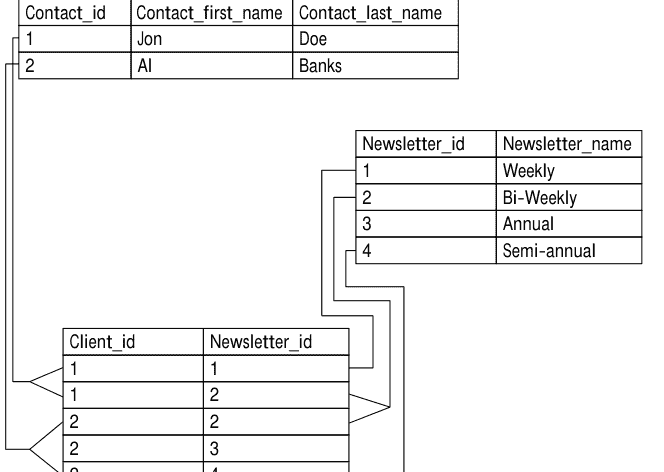

图 1-4：具有多对多关系的表

有了这种结构，任意数量的联系人可以拥有任意数量的通讯，任意数量的通讯可以发送给任意数量的联系人。

## MySQL 不支持的功能
MySQL 在应用程序开发社区中是一个有争议的软件。它有一些许多开发者喜欢的方面：它是免费的，不占用太多资源，非常快，并且与 Oracle 和 Sybase 等软件包相比很容易学习。然而，MySQL 通过缺少其他数据库中常见的功能来实现其速度，这些缺点会阻止许多人将其用于其应用程序。但对于许多人来说，某些功能的缺失不应成为大问题。阅读并自行决定。

### 引用完整性
之前页面中使用的每个示例都使用了外键。外键是一列，引用另一个表的主键以维护关系。在表 1-4 中，Contacts 表包含一个 company_id 列，该列引用 Companies 表（表 1-3）的主键。此列是 Companies 表的外键。

在第 2 章中，我们演示如何在 MySQL 中创建表。创建具有主键和外键所需所有列的表很容易。然而，在 MySQL 中，外键不具有在大多数数据库系统中所具有的意义。

在 Oracle、Sybase 或 PostGres 等软件包中，可以创建明确定义外键的表。例如，使用 Oracle 中的表 1-3 和 1-4，数据库系统可以意识到 Contacts 表中的 company_id 列与 Companies 表有关系。这可能非常好。如果数据库系统知道一个关系，它可以检查插入到外键字段中的值是否存在于被引用表中。如果不存在，数据库系统将拒绝插入。这称为引用完整性。

要在 MySQL 中实现相同的效果，应用程序开发人员必须在插入或更新记录之前添加一些额外步骤。例如，为了绝对安全，程序员需要执行以下步骤以便在 Contacts 表（1-4）中插入一行：

- 1. 获取 Companies 表中 company_id 的所有值。
- 2. 检查你要插入到 Contacts 表中的 company_id 值是否存在于步骤 1 中检索的数据中。
- 3. 如果存在，则插入值。

MySQL 的开发人员认为引用完整性不是必要的，并且包含它会减慢 MySQL 的速度。此外，他们认为确保插入数据的正确性是与数据库交互的应用程序的责任。这种思维方式是有道理的。在本书的第三部分和第四部分中，我们介绍了几个应用程序，它们在不强制执行引用完整性或上述检查方法的情况下也能正常工作。一般来说，在这些应用程序中，所有可能的值都是从数据库中提取的，错误渗入系统的机会非常少。

例如，使用 PHP 和 HTML，程序员可能会将 Companies 表转换为下拉框。这样用户只能选择有效值。

### 事务
在关系数据库中，事物是成组更改的。如本书中各种应用程序所示，许多更改需要在多个表中并发更新行。在某些情况下，表可能会作为将数据移动到所需位置的一系列语句的一部分而被删除。一个电子商务网站可能包含如下代码：

- 1. 向 Customers 表插入客户。
- 2. 向 Invoice 表添加发票信息。
- 3. 从 Items 表中移除所订商品数量 1。


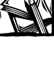

到你阅读本书时，MySQL 很可能已经支持事务。开发人员已经在事务安全表上工作了一段时间。请检查 mysql.com 以查看当前版本是否可以使用事务。本书中的任何应用程序都没有使用事务。

当你处理像这样的一系列步骤时，可能会出现严重问题。如果在第二步和第三步之间操作系统崩溃或断电，数据库将包含错误数据。

为防止出现这种情况，大多数复杂的数据库系统都使用 *transactions*。使用事务，开发人员可以标识一组命令。如果其中任何一个命令未能执行，整组命令将被取消，数据库将恢复到在尝试第一个命令之前的状态。这被称为 COMMIT/ROLLBACK 方法。要么所有请求都提交到数据库，要么数据库回滚到事务之前的状态。

在《MySQL 参考手册》的第 5.4.3 节中，对 MySQL 选择不包含事务进行了长篇辩护。它还包括使用日志和表锁实现相同效果的技术。你可以自行判断这一论点是否合理。许多人认为缺乏事务使得 MySQL 在某些环境中成为一个糟糕的选择。如果你是银行的 IT 经理，正在寻找关系数据库管理系统（RDBMS），MySQL 可能不是最佳选择。

## 存储过程

大型精美的数据库系统允许将过程代码（非常类似于 PHP 或 Perl）放置在数据库内。使用存储过程有几个关键优势。首先，它可以减少中间件应用程序所需的代码量。如果 MySQL 接受存储过程，可以向数据库发送单个 PHP 命令来查询数据、执行一些字符串操作，然后返回一个准备好在页面中显示的值。

另一个主要优势来自于在多个前端访问同一数据库的环境中工作。考虑一种情况，其中有一个为 Web 编写的前端，另一个在 Windows 机器上可用的 Visual C++ 前端。在两个不同的地方编写所有查询和事务会很麻烦。你最好编写存储过程并从各种应用程序访问它们。


MySQL 也不支持子查询。我们将在第 3 章讨论如何解决此限制。

## 摘要

到目前为止，你应该对关系数据库的工作原理有相当好的了解。这里涵盖的理论非常重要，因为高质量的数据设计是高质量应用程序的基石之一。如果你未能在规范化过程中成功，你可能会留下困扰你数月甚至数年的困难。

在本书第 3 部分和第 4 部分的应用程序中，你将看到我们如何处理和规范化几组数据。

现在你知道了关系数据库中表的工作原理，请继续阅读第 2 章，在那里你将看到如何在 MySQL 中创建这些表。

## 第 2 章

### 用于创建和修改表的结构化查询语言

### 本章内容

- 在 MySQL 中创建表和数据库
- 为表选择适当的列类型和列属性
- 维护数据库和表

在第 1 章中，你了解到表是使用关系数据库所带来的一切好事的基础。正如你在本书中会看到的那样，你可以用这些表做很多事情。因此，创建和维护表的过程需要一些知识也就不足为奇了。正如妈妈常说，好事多磨。

如果你是从 Microsoft 的 SQL Server 或 Access 等桌面软件转到 MySQL，你可能习惯于使用漂亮的 WYSIWYG（所见即所得）界面创建表。事实上，有一个名为 phpMyadmin 的软件包可以提供你习惯使用的许多便利功能。我们使用这个工具并且很喜欢它。我们将在本章末尾更详细地讨论它。毫无疑问，使用图形界面工作比弄清楚任何语言的语法要愉快得多。


> 事实上，在使用 MySQL 时，你可以使用许多 GUI 工具。有关列表，请参阅 http://www.mysql.com/downloads/contrib.html。MySQL 开发团队正在开发一个类似 Access 的 MySQL 界面。请查看 mysql.com 网站了解可用性。

然而，即使你计划安装并使用此工具，你也应该花一些时间学习如何使用数据定义语言（DDL）（SQL 的一部分）创建和维护表。具体来说，了解 create 和 alter 命令对你会非常有帮助。没过多久你就需要在脚本中使用这些命令。也可能出现你无法访问图形界面的情况，你需要这些知识作为后备。

## 定义

在开始在 MySQL 中创建表和数据库之前，有几项你需要理解的内容。我即将介绍的概念非常重要——在继续数据库设计之前，请确保你理解如何处理这些概念。

### 空值

你为表中每个列必须做出的第一个决定之一是是否允许空值。如果你还记得九年级的数学，你可能会回忆起空集，它是一个不包含任何东西的集合。在关系数据库中，null 具有相同的含义：空字段不包含任何内容。

请记住，空字段与不包含字符的文本字符串（零长度字符串）或数值零有明显区别。区别在于空字符串和零是值。在你的编程中，你很可能遇到过需要检查字符串是否包含任何值的情况，也许作为 if... 语句的一部分。在 PHP 中，它看起来像这样：

```
$var //this is a variable used in the test
if ($var == "")
{
    echo "Var is an empty string";
} else {
    echo $var;
}
```

相同的语法也适用于比较零与其他值。

这种类型的比较对 null 无效。由于 null 表示值的缺失，任何与任何值（包括另一个 null）的比较都是无意义的。在第 3 章中，你将看到 null 值要求应用程序开发人员在编写表连接时非常小心。为了快速预览，考虑如果我们想连接表 2-1 和表 2-2 会发生什么：


在你的 SQL select 语句中（将在第 3 章介绍），有几种方法可以检查字段是否包含 null 值。首先，你可以使用 MySQL 的 isnull() 函数。例如，要查找表中 middle_name 列包含 null 值的行，你可以运行以下查询：

```
select * from names where isnull(middle_name);
```

或者，要在查询结果中排除 null 值：

```
select * from names where !isnull(middle_name);
```

感叹号表示“非”。

你也可以使用 is null 和 is not null 语句。例如：

```
select * from users where addr2 is null;
select * from users where addr2 is not null;
```

### 表 2-1 CONTACTS

| first_name | last_name | spouse_id |
|---|---|---|
| Jay | Greenspan | 1 |
| Brad | Bulger | NULL |

### 表 2-2 SPOUSES

| spouse_id | first_name | last_name |
|---|---|---|
| 1 | Melissa | Ramirez |

如果你想找到一本关于 MySQL 和 PHP 的好书的作者及其相关的配偶，你必须在 spouse_id 字段上连接这些表。（如果不理解确切的语法也不用担心，它将在下一章介绍。）

```
SELECT * FROM Contacts, Spouses
WHERE Contacts.spouse_id = Spouses.spouse_id
```


该语句对 Jay 来说运行良好，但对 Brad 来说会出现问题，因为他未婚，其 spouse_id 字段为 null。即使查询的目标是获取 contacts 表中的所有人员以及如果存在的话其关联配偶，他也不会出现在结果集中。

再次，这只是一个预览，是 null 如此重要的一个例子。在第 3 章中，你将看到外连接如何解决这类问题。

## 索引

可以说，关系型数据库的单一最大优势就是查询和排序海量信息时的速度。为了实现这些高速，MySQL 以及所有其他数据库服务器都使用称为索引的优化数据存储机制。

索引允许数据库服务器创建一个列的表示形式，以便其能够以惊人的速度进行搜索。索引在从大型表中查找单行或一组行时特别有帮助。它们还可以加快连接和聚合函数（如 min() 和 max()）的速度，我们将在第 3 章中介绍这些函数。

鉴于这些优势，为什么不为每个表的每列都创建索引呢？有一些非常好的理由。首先，索引实际上会减慢某些操作。数据库服务器维护索引需要时间。你不希望为服务器创建最终对你没有好处的开销。也有索引本身更慢的情况。如果需要遍历表中的每一行，实际上最好不要使用索引。此外，不必要的索引会占用大量磁盘空间。

表的 primary key 通常是搜索的对象（原因显而易见）。因此，在表定义中，你声明为 primary key 的列或列将自动被索引。

本章后面将详细介绍创建索引的内容。

## 创建数据库语句

在创建表之前，你需要创建数据库。这应该只需要一秒钟。基本的 Create 语法相当简单，可以从任何具有 MySQL 访问权限的界面运行。

一般语法是：

```
create database database_name
```


如果好奇的话，运行此命令后 MySQL 会创建一个文件夹，在其中存储数据库所需的所有文件。在我的 Linux 机器上，数据库文件夹存储在 /var/lib/mysql/ 中。

在命名数据库时，或者说列或索引时，避免使用将来会引起混淆的名称。在文件名区分大小写的操作系统上，例如大多数 Unix 系统，数据库名称也区分大小写。制定你打算坚持的约定，例如对表和列使用全小写名称。不允许使用空格。虽然 MySQL 可以绕过潜在的糟糕选择，但你应避免使用 MySQL 在其业务过程中使用的词。例如，将表命名为“Select”是一个非常糟糕的主意。在 MySQL 参考手册的第 7 章中，有超过 150 个保留字的列表。如果你避开 SQL 或 MySQL 函数使用的词，应该没问题。

从 MySQL 命令行客户端，你可以简单地输入：

```
create database database_name;
```


MySQL 命令行客户端位于你的 MySQL 安装的 /bin 目录中，文件名是 mysql（在 Unix 上）或 DOS/Windows 上的 mysql.exe。

从 PHP 中，你可以使用 mysql_create_db() 或 mysql_query() 函数。下面的代码片段将创建两个数据库。请记住，你需要以具有适当权限的用户登录 MySQL，代码才能工作。

```
$conn = mysql_connect("localhost","username", "password")
    or die ("Could not connect to localhost");

mysql_create_db("my_database") or
    die ("Could not create database");
$string = "create database my_other_db";
mysql_query($string) or
    die(mysql_error());
```

## 使用数据库语句

在 MySQL 中开始创建表之前，你必须选择一个已创建的数据库。如果你通过 mysql 命令行客户端访问 MySQL，你必须输入以下语句：

```
use database_name
```

如果你通过 PHP 访问数据库，请使用 mysql_select_db() 函数。

```
$conn = mysql_connect("localhost","username", "password")
    or die ("Could not connect to localhost");

mysql_select_db("test", $conn) or
    die ("Could not select database");
```

## 创建表语句

一旦你创建并选择了数据库，就准备好创建表了。基本的 Create Table 语法相当简单，基本形式如下。

```
create table table_name
(
    column_1 column_type column attributes,
    column_2 column_type column attributes,
    primary key (column_name),
    index index_name(column_name)
)
```

列类型、列属性和索引的详细信息将在以下章节中介绍。在此之前，有两个简单的列属性需要讨论：

- null | not null
- default

第一个让你有机会禁止或允许 null 值。如果你未指定 "null" 或 "not null"，则假定允许 null 值。第二个，如果声明，则在插入行到表时如果未声明值，则设置一个值。

下面是一个 create 语句的示例，你可以看到这两个属性以及其他一些属性的使用。这个示例取自第 12 章并稍作修改。

```
create table topics2 (
    topic_id      integer not null auto_increment,
    parent_id     integer default 0 not null,
    root_id       integer default 0,
    name          varchar(255),
    description   text null,
    create_dt     timestamp,
    modify_dt     timestamp,
    author        varchar(255) null,
    author_host   varchar(255) null,
    primary key(topic_id),
    index my_index(parent_id)
)
```

该语句创建了一个名为“topics”的表，包含九列和两个索引，一个用于 primary key，一个用于 parent_id 列。在上面的语句中使用了四种列类型：integer、varchar、text 和 timestamp。这些以及许多其他列类型将在下面更详细地讨论。在着手创建表之前，你应该很好地了解所有可用的列类型以及创建索引的方法。

要从命令行客户端创建表，请键入整个命令。从 PHP 中，使用 mysql_query() 函数。

```
$conn = mysql_connect("localhost","username", "password") or
    die ("Could not connect to localhost");

mysql_select_db("test", $conn) or
    die("could not select database");
$query = "create table my_table (
    col_1 int not null primary key,
    col_2 text
)";
mysql_query($query) or
    die(mysql_error());
```

## 列类型

MySQL 提供了多种列类型。其中一些相似，但存在细微却重要的差异。请阅读本节，并在为表决定列类型时仔细选择。

### 文本列类型

MySQL 有七种适合存储文本字符串的列类型：

- char
- varchar
- tinytext
- text
- mediumtext
- longtext
- enum

### CHAR

用法：char(length)

char 列类型的最大长度为 255 个字符。这是一个定长类型，意味着当插入的值字符数少于列的最大长度时，字段将用空格右填充。因此，如果列定义为 char(10) 且你想存储值“happy”，MySQL 实际上会存储“happy”然后是五个空格。当从表中检索值时，这些空格会被从结果中移除。

### VARCHAR

用法：varchar(length)

这几乎与 char 相同，并在许多相同的地方使用。它的最大长度也为 255。不同之处在于 varchar 是变长列类型。值不会用空格填充。相反，MySQL 会为每个 varchar 字段添加一个字符，用于存储字段的长度。MySQL 会从 varchar 字段中的字符串末尾移除空格。

### 使用 CHAR 或 VARCHAR

在大多数情况下，char 和 varchar 之间几乎没有实际区别。你决定使用哪一个将取决于哪一个需要更多空间，char 列中的尾随空格还是 varchar 中的单个字符。如果你的字段存储类似姓氏的内容，你可能希望允许 25 个字符，以确保安全。如果你使用 char 列类型，而某人的姓氏是 Smith，你的列将包含 20 个尾随空格。这没有必要；你最好使用 varchar 并让 MySQL 跟踪列的大小。然而，当你想存储五到七个字符的密码时，使用 varchar 来跟踪列的大小是浪费的。每次更新 varchar 字段时，MySQL 都必须检查字段的长度并更改存储字段长度的字符。你最好使用 char(7)。


> 如果你将列定义为 varchar 且列长度小于四，MySQL 将自动把列更改为 char 类型。


## TINYTEXT

用法: tinytext

这是四种二进制（或 blob）文本字符类型中的第一种。所有这些类型（tinytext、text、mediumtext 和 longtext）都是可变列类型，类似于 varchar。它们仅在可包含的字符串大小上有所不同。tinytext 类型的最大长度为 255，因此实际上它与 varchar(255) 具有相同的用途。可以为整个 tinytext 列创建索引。

## TEXT

用法: text

text 类型的最大长度为 65,535 个字符。可以在 text 列的前 255 个字符上创建索引。

## MEDIUMTEXT

用法: mediumtext

mediumtext 类型的最大长度为 16,777,215 个字符。可以在 mediumtext 列的前 255 个字符上创建索引。

## LONGTEXT

用法: longtext

longtext 类型的最大长度为 4,294,967,295 个字符。可以在 longtext 列的前 255 个字符上创建索引。然而，目前该列并不是很有用，因为 MySQL 仅允许最多 16 百万字节的字符串。

## ENUM

用法: enum ('value1', 'value2', 'value3' ...) [default 'value']

使用 enum，你可以将列的可能值限制为你指定的那些值。它允许最多 65,535 个值，尽管很难想象在可能值超过几个的情况下使用此列。例如，当你只想允许 "yes" 或 "no" 值时，此类型会很有用。使用 enum 的创建语句看起来像这样：

```sql
create table my_table (
    id int auto_increment primary key,
    answer enum ('yes', 'no') default 'no'
);
```

## SET

用法: set ('value1', 'value2', 'value3' ...) [default 'value']

此列类型定义了一组值的超集。这允许从你指定的列表中零个或多个值包含在字段中。

你不会在本节中看到此列类型的用法。我们不喜欢在单个字段中看到多个值，因为它违反了数据库设计的最基本规则。如果你不知道这是什么意思，请重读第 1 章。

## Numeric column types

MySQL 有七种适合存储数值的列类型。请注意，以下是同义词：int 和 integer；double、double precision 和 real；以及 decimal 和 numeric。

- int/integer
- tinyint
- mediumint
- bigint
- float
- double/double precision/real
- decimal/numeric

对于所有数值类型，最大显示宽度为 255。对于大多数数值类型，你可以选择为列 zerofill——在左侧用零填充。例如，如果你有一个显示宽度为 10 的 int 列并向其中插入值 25，MySQL 将存储并显示 0000000025。数值列类型也可以定义为有符号或无符号。有符号是默认定义。

## INT/INTEGER

用法: int(display size) [unsigned] [zerofill]

如果使用 unsigned 标志，此列类型可以存储从 0 到 4,294,967,295 的整数。如果是有符号的，范围是从 −2,147,483,648 到 2,147,483,647。Int 通常会与 auto_increment 一起使用来定义表的 primary key。

```sql
create table my_table (
    table_id int unsigned auto_increment primary key,
    next_column text
);
```

请注意，我使用了 unsigned 列，因为 auto_increment 列不需要负值。

## TINYINT

用法: tinyint(display size) [unsigned] [zerofill]

如果是无符号，tinyint 存储 0 到 255 之间的整数。如果是有符号的，范围是从 -128 到 127。

## MEDIUMINT

用法: `mediumint(display size) [unsigned] [zerofill]`

如果是无符号，mediumint 存储整数介于 -8,388,608 和 8,388,607 之间。如果是有符号的，范围是从 0 到 1677215。

## BIGINT

用法: `bigint(display size) [unsigned] [zerofill]`

如果是无符号，bigint 存储整数介于 -9,223,372,036,854,775,808 到 9,223,372,036,854,775,807 之间。如果是有符号的，范围是从 0 到 18,446,744,073,709,551,615。

## FLOAT

用法: `FLOAT(precision) [zerofill]`

在此用法中，float 存储浮点数且不能为无符号。precision 属性对于单精度浮点数可以 <=24，对于双精度浮点数则在 25 到 53 之间。从 MySQL 3.23 开始，这是一个真正的浮点值。在更早的 MySQL 版本中，FLOAT(precision) 总是有两位小数。

用法: `FLOAT[(M,D)] [ZEROFILL]`

这是一个小的（单精度）浮点数且不能为无符号。允许的值为 -3.402823466E+38 到 -1.175494351E-38、零，以及 1.175494351E-38 到 3.402823466E+38。M 是显示宽度，D 是小数位数。FLOAT 没有参数或参数 <= 24 代表单精度浮点数。

## DOUBLE/DOUBLE PRECISION/REAL

用法: `DOUBLE[(M,D)] [zerofill]`

这是一个双精度浮点数且不能为无符号。允许的值为 -1.7976931348623157E+308 到 -2.2250738585072014E-308、零，以及 2.2250738585072014E-308 到 1.7976931348623157E+308。M 是显示宽度，D 是小数位数。

用法: `DECIMAL[(M,D)] [ZEROFILL]`

decimal 列中的数字以字符形式存储。每个数字都存储为字符串，每个值数字对应一个字符。如果 D 为 0，值将没有小数点。DECIMAL 值的最大范围与 DOUBLE 相同，但给定 DECIMAL 的实际范围。如果 M 被省略，则设为 10。

## Date and time types

MySQL 有五种适合存储日期和时间的列类型。

- date
- time
- datetime
- year
- timestamp

MySQL 日期和时间类型很灵活，可以接受字符串或数字作为插入语句的一部分。此外，MySQL 在解释你提供的日期方面相当不错。例如，如果我们创建此表：

```sql
create table date_test(
    id int unsigned auto_increment,
    the_date date
);
```

以下插入语句都将被 MySQL 正确解释：

```sql
insert into date_test (a_date) values ('00-06-01');
insert into date_test (a_date) values ('2000-06-01');
insert into date_test (a_date) values ('20000601');
insert into test6 (a_date) values (000601);
```

> 提示
> MySQL 更喜欢以字符串形式接收日期。因此 '000601' 比类似的整数更好。使用字符串作为日期值可能会让你避免今后遇到一些错误。

从日期和时间列中提取信息可能具有挑战性。MySQL 提供了许多有助于操作这些列的函数。

## DATE

用法: date

date 列类型以 YYYY-MM-DD 格式存储值。它允许的值介于 1000-01-01 和 9999-12-31 之间。

## DATETIME

用法: datetime [null | not null] [default]

datetime 类型以 YYYY-MM-DD HH:MM:SS 格式存储值。它允许的值介于 1000-01-01 00:00:00 和 9999-12-31 23:59:59 之间。

## TIMESTAMP

用法: timestamp(size)

这是一个方便的列类型，会自动记录行最近更改的时间，无论是插入还是更新。Size 可以定义为 2 到 14 之间的任意数字。表 2-3 显示了每个列大小存储的值。默认值为 14。

## TABLE 2-3 TIMESTAMP FORMATS

| Size | Format |
|------|--------|
| 2 | YY |
| 4 | YYMM |
| 6 | YYMMDD |
| 8 | YYYYMMDD |
| 10 | YYMMDDHHMM |
| 12 | YYMMDDHHMMSS |
| 14 | YYYYMMDDHHMMSS |

## TIME

用法: `time`

以 HH:MM:SS 格式存储时间，取值范围为 −838:59:59 到 838:59:59。允许如此大的值的原因是 time 列类型可用于存储涉及时间的数学方程的结果。

## YEAR

用法: `year[(2|4)]`

在后 Y2K 的时代，很难想象你会想以两位数字格式存储年份，但你可以这样做。在两位数字格式中，允许的日期介于 1970 年和 2069 年之间。数字 70-99 前缀为 19，01-69 前缀为 20。

四位年份格式允许的值从 1901 到 2155。

## Creating Indexes

从 3.23.6 版本开始，MySQL 可以在任何列上创建索引。任何表的列数最多为 16 个。基本语法是：

```
index index_name (indexed_column)
```


虽然索引名称是可选的，但你应该始终为你的索引命名。当你想使用 SQL alter 语句删除或更改索引时，这变得非常重要。如果未指定名称，MySQL 将基于索引中的第一列来命名索引。

创建索引的另一种方法是声明列为主键。请注意，任何 auto_increment 列都必须被索引，并且你可能希望将其声明为主键。在下面的表中，id_col 列已被索引。

```
create table my_table (
  id_col int unsigned auto_increment primary key,
  another_col text
);
```

主键也可以在列定义之后像其他索引一样声明。

```
create table my_table (
  id_col int unsigned not null auto_increment,
  another_col text,
  primary key(id_col)
);
```

索引可以跨越多个列。如果查询在搜索期间同时使用两个列，你可以使用以下语句创建覆盖这两个列的索引：

```
create table mytable(
  id_col int unsigned not null,
  another_col char(200) not null,
  index dual_col_index(id_col, another_col)
);
```

该索引将用于对 id_col 和 another_col 的搜索。这些索引从左到右工作。因此，该索引将用于仅针对 id_col 的搜索。然而，它将不会用于对 another_col 的搜索。

最后，你可以仅对列的一部分创建索引。从 MySQL 3.23 版本开始，你可以对 tinytext、text、mediumtext 和 longtext 列的前 255 个字符进行索引。对于 char 和 varchar 列，你可以为列的初始部分创建索引。这里的语法是：

```
index index_name (column_name(column_length))
```

例如：

```
create table my_table(
    char_column char (255) not null,
    text_column text not null,
    index index_on_char (char_column(20)),
    index index_on_text (text_column(200))
);
```

索引还可以通过使用唯一约束来确保表中每一行的值都是唯一的。

```
create table my_table(
    char_column char (255) not null,
    text_column text not null,
    unique index index_on_char (char_column)
);
```

## 表类型

MySQL 提供四种表类型：ISAM、MyISAM、BDB 和 Heap。ISAM 是一种较旧的表类型，不推荐用于新应用程序。默认表类型是 MyISAM。声明表类型的语法是

```
create table table_name type=table_type(
    col_name column attribute
);
```

MyISAM 表极快且非常稳定。除非其他表类型之一符合你的特定需求，否则无需声明其他表类型。

堆实际上是驻留在内存中的哈希表。它们不会存储在任何物理位置，因此在崩溃或断电的情况下会消失。但由于其特性，它们速度极快。你应该只将它们用于临时表。

从 MySQL 3.23.16 版本开始，MySQL 提供 BDB 表。这些表是事务安全的，并且是 MySQL 包含事务努力的重要组成部分。请查阅 MySQL 参考手册的第 8.4 节以了解 BDB 表的当前状态。

## alter table 语句

如果你对表的形式不满意，可以使用 alter table 语句对其进行修改。具体来说，此语句允许你重命名表、列和索引；添加或删除列和索引；以及重新定义列和索引的定义。此语句将始终以 alter table table_name 开始。其余命令将取决于所需的操作，如下所述。

### 更改表名

更改表名的语法如下：

```
alter table table_name rename new_table_name
```


> 如果你使用的是 MySQL 3.23.27 或更高版本，你可以使用 rename 语句。基本语法是
> rename table_name to new_table_name

### 添加和删除列

添加列时，你需要包含上一节中定义的所有列定义。此外，从 3.22 版本开始，MySQL 允许你指定列在表中的位置，尽管此指定是可选的。基本语法是：

```
alter table table_name add column column_name column attributes
```

例如：

```
alter table my_table add column my_column text not null
```

要指定列的位置，使用 first 将插入的列指定为表中的第一列，或使用 after 将列放置在已存在的列之后，如以下示例所示。

```
alter table my_table add column my_next_col text not null first
alter table my_table add column my_next_col text not null after my_other_column
```

删除列时，只需以下内容：

```
alter table table_name drop column column_name
```


修改表时，尽量将所有更改合并到单个 alter 语句中。这比例如在一个语句中删除索引而在另一个语句中创建新索引的做法更好。

### 添加和删除索引

你可以使用 index、unique 和 primary key 命令以与 create 语句中相同的方式添加索引。

```
alter table my_table add index index_name (column_name1,
column_name2, ...)
alter table my_table add unique index_name(column_name)
alter table my_table add primary key(my_column)
```

使用 drop 命令删除索引同样简单。

```
alter table table_name drop index index_name
alter table table_name drop primary key
```

### 更改列定义

可以使用 change 或 modify 命令更改列的名称或属性。要更改列的名称，还必须重新定义列的属性。以下方法可行：

```
alter table table_name change original_column_name new_column_name
int not null
```

但以下方法不可行：

```
alter table table_name change my_col2 my_col3;
```

如果你只想更改列的属性，可以使用 change 命令并使新列名与旧列名相同。例如，要将列 col_1 从 char(200) 列更改为 varchar(200) 列，可以使用以下语句：

```
alter table table_name change col_1 col_1 varchar(200)
```

从 MySQL 3.22.16 版本开始，你也可以使用 modify 命令。

```
alter table table_name modify column col_1 varchar(200)
```

## insert 语句

现在你已经了解了创建和修改表所需的所有知识，你可能想要将一些信息放入表中。你可以通过使用 insert 语句来实现。

SQL insert 语句的基本形式是：

```
insert into table_name (column_1, column2, column3,...) values
(value1, value2, value3 ...)
```

如果表中的列允许空值，你可以将其从 insert 语句中省略。

文本字符串必须用单引号 (' ) 包围。例如：

```
insert into table_name (text_col, int_col) values ('hello world', 1)
```

这可能会导致问题，因为毫无疑问有人会想在你的数据库中插入缩写，这会让数据库混淆。因此你需要一种转义单引号字符的方法。事实上，有几个字符需要在插入 MySQL 时进行转义。如果你想将以下任何字符插入文本字段，它们必须以反斜杠为前缀：

- ' （单引号）
- " （双引号）
- \ （反斜杠）
- % （百分号）
- _ （下划线）

你也可以通过使用两个连续的单引号 (' ') 来转义单引号。

以下字符在 MySQL 中由其典型的转义序列标识：

- \n （换行）
- \t （制表符）
- \r （回车）
- \b （退格）

这里值得注意的是，在进行 PHP 编程时，大多数情况下你不必担心转义所有这些字符。正如我们将看到的那样

PHP 内置了一些函数和设置来自动处理这个问题。`addslashes()` 函数和 `php.ini` 中的 magic quotes 设置尤其有帮助。

## 更新语句

SQL `update` 语句与我们迄今为止看到的其他语句略有不同，因为它使用了 `where` 子句。通用语法是：

```
update table_name set col_1=value1, col_2=value_2 where col=value
```

再次，如果你要插入字符串，需要用单引号将其括起来并正确转义。请记住，`update` 语句的 `where` 部分可以涉及任何比较运算符。通常它会用于通过主键标识单行。在表 2-4 中，id 是主键。

**表 2-4 人员表**

| id | fname | lname | salary |
|----|-------|-------|--------|
| 1 | Don | Ho | 25,000 |
| 2 | Don | Corleone | 800,000 |
| 3 | Don | Juan | 32,000 |
| 4 | Don | Johnson | 44,500 |

该语句只会影响 Don Corleone：

```
update folks set fname='Vito' where id=2
```

如你所见，基于 fname 列运行 `update` 语句是有风险的，因为你可能会意外更新此表中的每一列。

```
update folks set fname='Vito' where fname='don'
```

你也可以使用 `update` 为薪酬不足的员工加薪：

```
update folks set salary=50000 where salary<50,000
```

## 删除表/删除数据库

如果你想删除一个表或整个数据库，drop 命令就能解决问题。请记住，如果你删除数据库，你将丢失数据库中存在的所有表。

```
drop table table_name
drop database database_name
```

drop table 命令可以通过 mysql_query() 函数从 PHP 执行。如果想从 PHP 删除数据库，需要使用 mysql_drop_db() 函数。

## 显示表

要获取数据库中可用的表列表，请使用 show tables 命令。要使此命令生效，你必须已使用 use database 命令选择了数据库。

图 2-1 显示了从 MySQL 命令行客户端对 show tables 命令的响应。

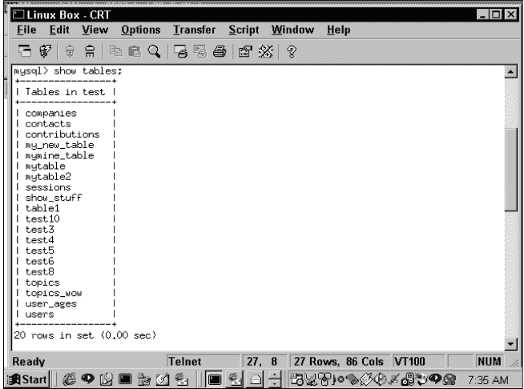

图 2-1：来自 MySQL 命令行客户端的 show tables 命令

从 PHP，你可以使用 `mysql_list_tables()` 获取表列表。

```
<?
 mysql_connect("localhost", "root", "");
 $result = mysql_list_tables("test");

 while($row = mysql_fetch_array($result))
 {
     echo $row[0] . "<br>\n";
 }
 ?>
```


> 你最好不要使用 mysql_list_tables()，因为该函数将来可能不可用。通过 mysql_query() 运行 show tables 命令是更好的选择。

## 显示列/显示字段

这些命令是同义词，如果你记不起在 create 语句中声明的列类型和属性，它们非常方便。例如，假设你使用以下命令创建了一个表。

```
create table topics (
    topic_id      integer not null auto_increment primary key,
    parent_id     integer default 0 not null,
    root_id       integer default 0,
    name          varchar(255),
    description   text null,
    create_dt     timestamp,
    modify_dt     timestamp,
    author        varchar(255) null,
    author_host   varchar(255) null,
    index my_index(parent_id)
)
```

图 2-2 显示了从 MySQL 命令行客户端运行 show fields from topics 后你会得到的结果。

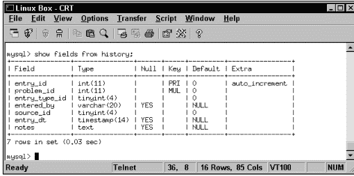

图 2-2：来自 MySQL 命令行客户端的 show fields 命令

你可以通过 PHP 接口使用 mysql_field_name()、mysql_field_type() 和 mysql_field_len() 获取类似信息。本书第二部分涵盖了此代码中的所有语法和函数。

```
$db = mysql_connect("localhost","root", "")
    or die ("Could not connect to localhost");
mysql_select_db("test", $db)
    or die ("Could not find test");

$db_name ="topics";
$query = "select * from $db_name";
$result = mysql_query($query);
$num_fields = mysql_num_fields($result);

//create table header
echo "<table border = 1>";
echo "<tr>";
for ($i=0; $i<$num_fields; $i++)
{
    echo "<th>";
    echo mysql_field_name ($result, $i);
    echo "</th>";
}
echo "</tr>";
//end table header

//create table body
echo "<tr>";
for ($i=0; $i<$num_fields; $i++)
{
    echo "<td valign = top>";
echo mysql_field_type ($result, $i) . "<br> \n";
echo "(" . mysql_field_len ($result, $i) . ")<br> \n";
echo mysql_field_flags ($result, $i) . "<br> \n";
echo "</td>";
}
echo "</tr>";
//end table body

echo "</table>";
```

## 使用 phpMyAdmin

如果你是一位老派的 Unix 用户，你可能完全习惯于键入所有命令并在输错或语法出错时排查错误。但我自己喜欢图形界面的便利性。

如果你和我一样，你会很高兴知道有几位程序员使用 PHP 创建了一个很棒的基于 Web 的 MySQL 接口。最棒的是，他们把程序免费赠送。你所需要做的就是访问 phpwizard.net 并下载合适的 .tar、.gz 或 .zip 文件。我们本可以把它包含在 CD 上，但你最好从他们的网站获取最新版本。它一直在不断改进。

该软件包涵盖了你会遇到的几乎所有 MySQL 管理功能。图 2-3 和 2-4 显示了 phpMyAdmin 的一些示例。

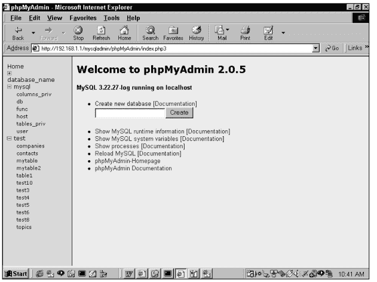

图 2-3：phpMyAdmin 视图

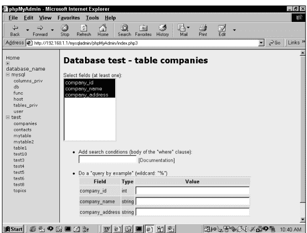

图 2–4：phpMyAdmin 的另一个视图

## 摘要

本章讨论了使用 MySQL 工作时创建和维护数据库和数据库表所需了解的一切。可能你永远不需要记住 create 语句的细节，因为像 phpMyAdmin 这样的图形工具可以帮助你创建和修改表。

尽管如此，了解列类型和索引的目的仍然很重要，因为快速高效的数据库始终会使用正确的数据类型，并且仅在必要时包含索引。正如你在本书第三部分和第四部分中会看到的，我们非常注意确保充分利用数据库。

## 第 3 章

## 使用 select 获取所需内容

## 本章内容

- 了解 SQL `select` 语句的基础知识
- 使用 `where` 和 `from` 子句
- 连接两个或多个表
- 了解 MySQL 中 `select` 语法的非支持方面

`select` 语句是你从数据库中获取所需内容的钥匙。它非常灵活，能够获取你能想象到的几乎任何数据集。当查询变得极其复杂时，使用 `select` 可能会有点棘手，但一旦你理解了本章涵盖的基础知识，你应该能够从数据库中获取几乎任何一组数据。


> 有一些很好的书籍花了很长时间解释 `select` 语句的细节。如果你发现本章没有涵盖你需要的东西，我们建议你首先查阅 MySQL 手册，然后是 MySQL 邮件列表。此外，由 IDG Books Worldwide 出版的《SQL For Dummies》也相当详细地涵盖了 ANSI 标准。

## 基本 select

当你需要将数据库中的信息提取到 Web 页面上时，你需要限制从表中返回的信息并连接表以获取正确的信息。因此，你将从数据库（信息的超集）开始并返回一个更小的集合。在 `select` 语句中，你将从一个或多个表中选择列来组装结果集。此结果具有列和行，因此可以有效地视为一个表（或者如果你这样思考，就是一个二维数组）。该表实际上并不存在于数据库中，但这样思考是有帮助的。


The basic select statement requires you to indicate the table you are selecting from and the column names you require. If you wish to select all the columns from a given table, you can substitute an asterisk (*) for the field names.

```
select column_1, column_2, column_3 from table_name
```

or

```
select * from table_name
```

Keep in mind that with a select statement you are not actually altering the tables involved in the query. You are simply retrieving information. From PHP, you will send the query to MySQL from the mysql_query() function.

There are all sorts of ways you can choose to lay out the information, but at times you're going to want a simple HTML table with the column names put in a header row. The simple PHP code in Listing 3-1 will lay out any SQL query in an ultra-simple HTML table. It includes a simple form that will allow you to enter a query. If you don't understand this code just yet, don't worry about it; all the PHP functions will be covered in Chapter 6. Alter the mysql_connect() and mysql_select_db() functions if you wish to change the database used.

## 清单 3-1：PHP 脚本将 SQL 查询转换为 HTML 表格

```
<?php

if(!isset($query) || empty($query))
    {$query = "select * from users";}
//stripslashes is necessary because the select statement is
//coming from a form. In most systems, the magic_quotes
//setting (see Appendix B) will prepend single quotes
//with backslashes, which could be problematic.
$query=stripslashes($query);

mysql_connect("username", "password", "")
    or die("Could not connect to database.");
mysql_select_db("test") or
    die("Cannot select database");
$result = mysql_query($query) or
    die( mysql_error() );

$number_cols = mysql_num_fields($result);

echo "<b>query: $query</b>";
//layout table header
echo "<table border = 1>\n";
echo "<tr align=center>\n";
for ($i=0; $i<$number_cols; $i++)
{
    echo "<th>" . mysql_field_name($result, $i). "</th>\n";
}
echo "</tr>\n";//end table header

//layout table body
while ($row = mysql_fetch_row($result))
{
    echo "<tr align=left>\n";
    for ($i=0; $i<$number_cols; $i++)
    {
        echo "<td>";
        if (!isset($row[$i])) //test for null value
            {echo "NULL";}
        else
            {echo $row[$i];}
        echo "</td>\n";
    }
    echo "</tr>\n";
}

echo "</table>";
?>

<form action="<? echo $PHP_SELF?>" method="get">
    <input type="text" name="query" size="50"><br>
    <input type="submit">
</form>
```

For the remainder of this chapter you will see how to build on the complexity of the select statement. To see things in action, we created a table in MySQL against which we can run these queries. This is the create statement for a table named “users”, which holds basic personal information:

```
CREATE TABLE users (
userid int(10) unsigned NOT NULL auto_increment,
fname varchar(25) NOT NULL,
lname varchar(25) NOT NULL,
addr varchar(255) NOT NULL,
addr2 varchar(255),
city varchar(40) NOT NULL,
state char(2) NOT NULL,
zip varchar(5) NOT NULL,
lastchanged timestamp(14),
PRIMARY KEY (userid)
);
```

To get things started, we loaded up the database with a few rows of information. When run through the PHP code above, the query `select * from users` will return the results shown in Figure 3-1.

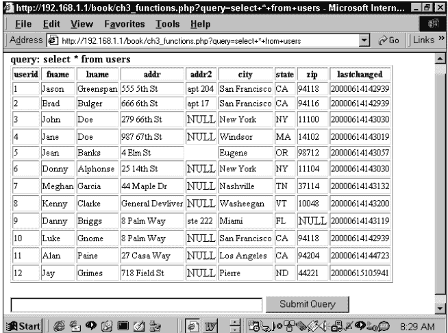

Figure 3-1: Results of query using select * from users

## where 子句

The where clause limits the rows that are returned from your query. To get a single row from a table, you would run the query against the primary key. For instance, to get all the information on Brad, you would use this query:

```
select * from users where userid = 2
```

Figure 3-2 shows the results of this query.
If you're doing a comparison to a column that stores a string (char, varchar, etc), you will need to surround the string used for comparison in the where clause by single quotes.

```
select * from users where city = 'San Francisco'
```

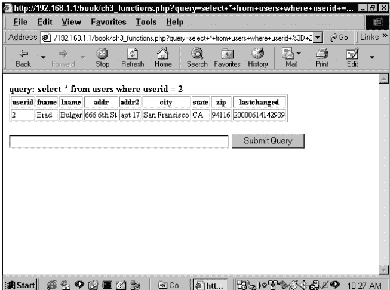

Figure 3-2: Results of query using select * from users where userid=2

MySQL has several comparison operators that can be used in the where clause. Table 3-1 lists these operators.

## 表 3-1 MySQL 比较运算符

| Operator | Definition |
|---|---|
| = | equal to |
| <> or != | not equal to |
| < | less than |
| <= | less than or equal to |
| > | greater than |
| >= | greater than or equal to |
| Like | Compares a string (discussed in detail later in this Chapter) |

You can compare several operators at once by adding and or or to the where clause.

```
select * from users
where userid = 1 or
    city = 'San Francisco'
```

```
select * from users
where state = 'CA' and
    city = 'San Francisco'
```

It’s important to note that fields with null values cannot be compared with any of the operators used in Table 3-1. For instance, in the table shown in Figure 3-1, you might think that the following statement would return every row in the table:

```
select * from users where zip <> '11111' or state = '11111'
```

But in fact, row 9 will not be returned by the query. Null values will test neither true nor false to any of these operators. Instead, to deal with null values, you will need to make use of the is null or is not null predicates.

To get the previous query to work as we had intended you’d need to augment your original query.

```
select * from users
where zip <> '11111' or
    zip = '11111' or
    zip is null
```

Or if you wanted to find all the rows where the zip contained any value (except null) you could use the following:

```
select * from table where zip is not null
```

## 使用 DISTINCT

There will be times where your query will contain superfluous data. For instance, if your goal was to see all the cities in California, your first instinct might be to run a query like select city, state from users where state='CA'. But look at the result returned in Figure 3-3.

Notice that the first three rows are identical. This is no good, as there’s no need for these extra rows. You can get by this by using select distinct. When you use distinct, the MySQL engine will remove rows with identical results. So here the better query is select distinct city, state from users where state='CA', which returns the data in Figure 3-4, which is exactly what you want.

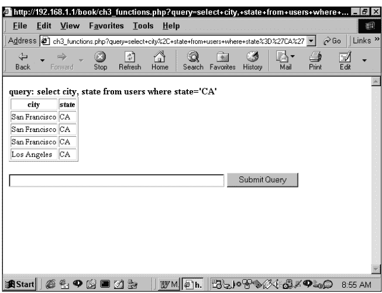

Figure 3–3: Results of query using select city, state from users where state='CA'

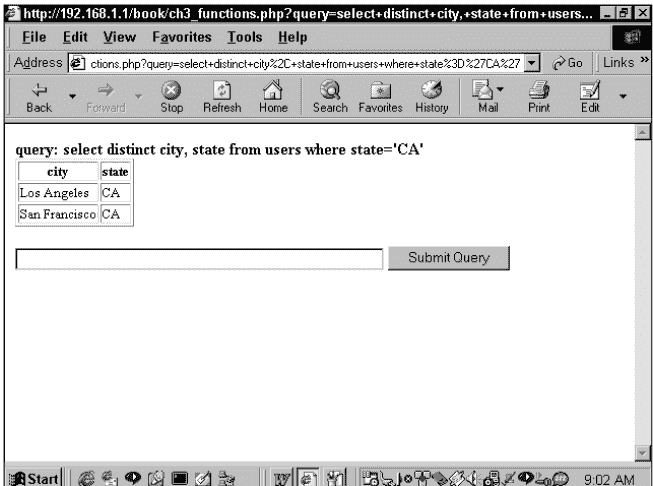

Figure 3–4: Results of query using select distinct city, state from users where state='CA'

## 使用 BETWEEN

You can also choose values within a range by using the between predicate. between works for numeric values as well as dates. In the following query, lastchanged is a timestamp column. If you wanted to find the people who signed up on the day of June 14, 2000, you could use this query:

```
select * from users where lastchanged between 20000614000000 and 20000614235959
```

Remember that the default timestamp column type stores dates in the form YYYYMMDDHHMMSS, so to get all entries for a single day, you need to start your range at midnight (00:00:00) and end it at 11:59:59 pm (23:59:59).

You can also use between on text strings. If you wished to list all the last names in the first half of the alphabet, this query would work. Note that the following query will not include names that start with “m”.

```
select * from users where lname between 'a' and 'm'
```

## 使用 IN/NOT IN

The in predicate is helpful if there are several possible values for a single column that can be returned. If you queried the users table to get all the states in New England, you could write the query like this:

```
select * from users
where state = 'RI' or
      state = 'NH' or
      state = 'VT' or
      state = 'MA' or
      state = 'ME'
```

Using in, you can specify a set of possible values and simplify this statement. The following query would achieve the same result.

```
select * from users
    where state in ('RI', 'NH', 'VT', 'MA', 'ME')
```

If you need to achieve the same effect but in reverse, you can use the not in predicate. To get a listing of all people in the table not living in New England, simply throw in the word 'not':

```
select * from user where
    state not in ('RI', 'NH', 'VT', 'MA', 'ME')
```


## 使用 LIKE

当然在搜索字符串时，会有你并不完全确定字符串长什么样子的情况。在这种情况下，你需要使用通配符。要使用通配符，需要 like 谓词。

有两种通配符可用，下划线（_）和百分号（%）。下划线代表单个字符。百分号代表任意数量的字符，包括零个。

所以，例如，如果你要查找名字为 Daniel 或 Danny 或 Dan 的人，你就会使用百分号。

```
select * from users where fname like 'Dan%'
```

请注意，因为百分号可以匹配零个字符，前面的查询也会匹配名字“Dan”。

但是，如果出于某种奇怪的原因，你需要查找数据库中名字以字母 J 开头且为四个字母的所有人，你会这样构造查询：（注意字母 J 后面跟着三个下划线。）

```
select * from users where fname like 'J___'
```

这三个下划线将匹配任意字符并返回像 Jean、John 和 Jack 这样的名字。Jay 和 Johnny 不会被返回。

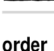

> 在 MySQL 中，like 比较不区分大小写。这与大多数实现大不相同。

## ORDER BY

在处理关系数据库时，你应该始终牢记一件事：任何表中行的存储是完全随意的。通常，你不会知道数据库决定以何种顺序放置你插入的行。当顺序很重要时，你可以在查询末尾加上 order by 来指定返回行的顺序。

此命令可以根据任何列类型进行排序：字母、时间或数字。此外，order by 允许你通过分别在 order by 后放置 asc 或 desc 来按升序或降序排序。如果两者均未包含，则默认使用 asc。

要对表中的条目进行字母排序，你可能希望确保此列表按名字和姓氏同时排序：

```
select * from users order by lname, fname
```

你可以按任意多个列排序，并且可以根据需要混合使用 asc 和 desc。以下查询不是特别有用，但它是可行的：

```
select * from users order by lname asc, fname desc
```

## LIMIT

limit 谓词将限制从查询中返回的行数。它允许你指定起始行和想要返回的行数。要获取表中的前五行，运行以下查询：

```
select * from users limit 0,5
```

要按字母顺序查找前五行，你可以使用 limit 与 order by：

```
select * from users order by lname, fname limit 0,5
```

你可能会注意到编号类似于数组——第一行为第 0 行。要获取表的第二五行，你可以运行以下语句：

```
select * from users limit 5,5
```

limit 在你希望限制单页显示的情况下特别有用。你将在整本书中看到 limit 的使用。即使是本书的第一個应用第 8 章，也使用了 limit。

## GROUP BY 和聚合函数

还记得我们谈论使用 select 与 distinct 时，它是如何删除不需要的行吗？这可能看起来很酷，但与使用 group by 及其关联的聚合函数所能获得的效果相比，简直不值一提。

考虑这个任务：你希望知道数据库中每个州的条目数（例如，加州六个，纽约七个，佛蒙特州两个）。如果你执行 select distinct state from users order by state，你会得到数据库中每个州的列表，但无法得到数量。当 MySQL 处理查询时遍历表，它只是跳过会返回相同值的行。

然而，使用 group by 时，MySQL 会创建一个临时表，其中保留符合你条件的行和列的所有信息。这使得引擎能够在临时表上执行一些非常关键的任务。展示 group by 能做什么的最简单方法可能是展示其中一个聚合函数。我们从 count() 开始。

MySQL 可能不会为每个 group by 实际创建一个临时表；然而，group by 的实际内部工作原理相当复杂，而这是一种思考 MySQL 在做什么的好方法。

### COUNT()

再次，查询的目标是找出 users 表中每个州的人数。为此你将使用 group by 与 count()。请记住，当使用 group by 子句时，可以想象 MySQL 创建一个临时表，在其中汇集相似的行。然后 count() 函数（你猜对了）统计每个组中的行数。请查看以下查询以及图 3-5 中返回的结果。

```
select state, count(*) from users group by state
```

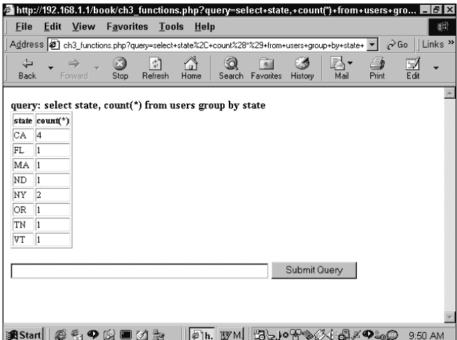

图 3-5：使用 select state, count(*) from users group by state 查询的结果

这里的星号 (*) 表示应统计组内的所有行。count(*) 函数对于获取表中的总行数也很方便。

```
select count(*) from users
```

在 group by 中，你也可以指定要计数的特定字段。count 会查找非空值的数量。例如，图 3-6 中的表。

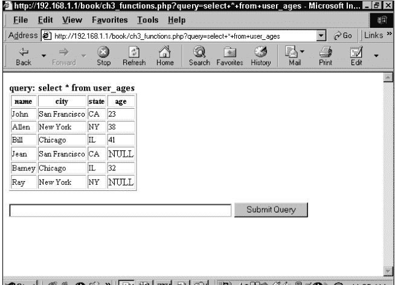

图 3-6：users_ages 表

从这个表计数非空值可能看起来没什么用。然而，如果你真的很热衷于统计，你可以使用这个表来计算每个城市有多少比例的人愿意透露年龄。首先你需要每个特定城市和州的所有条目的计数；随后，你需要 age 字段中所有非空值的计数。

```
Select city, state, count(*), count(age) from users_ages
group by state, city
```

从图 3-7 的结果可以看出，芝加哥人比沿海地区的人坦率得多。

现在是介绍别名的好时机。在某些时候，特别是当你使用函数时，查询返回的列名可能不是你想要的。例如，在图 3-7 中，你可能希望表头比 count(*) 更具描述性。

你可以在任何函数或列名后加上 as，然后指定你喜欢的名称。as 只是指定别名。如果需要多于一个单词的列名，请用单引号将文本字符串括起来。

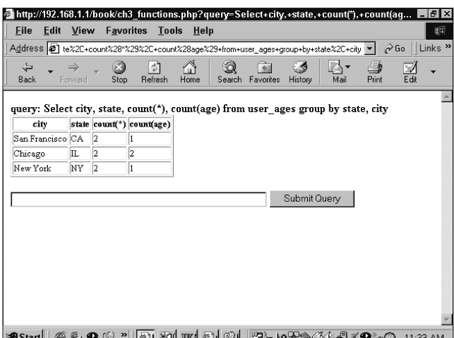

图 3-7：使用 count() 函数查询的结果

谈到别名时，我还要提到 MySQL 中有各种函数（参见附录 I）。它们从简单的数学函数到更复杂的操作不等。下面我加入了一些数学运算以阐明查询的目的。请注意 as 子句的使用以及它对查询显示的影响（见图 3-8）。

```
Select city, state, count(*) as 'Total Rows',
    count(age) as 'The Willing',
    (count(age)/count(*)*100) as 'Percent Responding'
from users_ages
group by state, city
```

你也可以对表使用别名。在处理多个表时这会特别有帮助。我将在“多表连接”部分更详细地讨论这一点。

### SUM()

sum() 函数返回给定列的总和，并且几乎总是与 group by 子句一起使用。例如，如果你为非营利组织运行一个应用程序，你可能想知道每个州的总捐款。你的工作表可能看起来像图 3-9 中的那样。

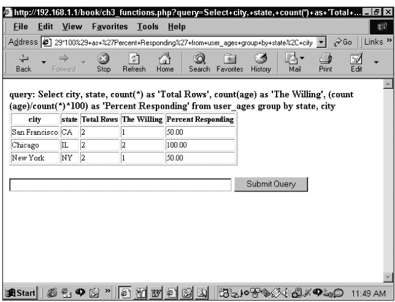

图 3-8：使用函数和别名查询的结果

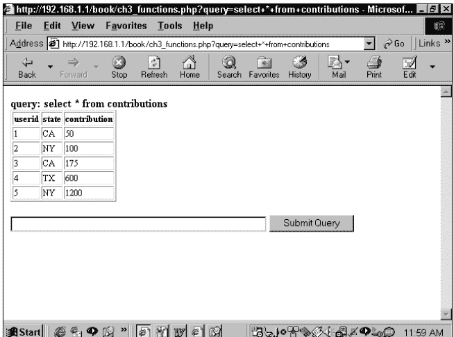

图 3-9：使用 sum() 会很有帮助的表


要获取每个州的总计，您可以运行以下查询：

```
select state, sum(contribution) from contributions group by state
```

## MIN()
min() 函数会提取每个分组中的最低值。要查找任何州的最低捐款，只需对之前的查询做一个小改动：

```
select state, min(contribution) from contributions group by state
```

## MAX()
正如你可能猜到的，max() 会返回一个组中的最高值：

```
select state, max(contribution) from contributions group by state
```

## AVG()
avg () 返回该组的平均值：

```
select state, sum(contribution) from contributions group by state
```

你可以将这些全部组合起来创建一个非常有用的查询，如图 3-10 和以下查询所示。

```
select state, sum(contribution) as 'Total',
    avg(contribution) as 'Average',
    min(contribution) as 'Minimum',
    max(contribution) as 'Maximum'
from contributions
group by state
```

## GROUP BY OPTIONS
大多数关系数据库要求在 select 子句中列出的字段必须在 group by 谓词中使用。但 MySQL 提供了更多选项；你可以对列出的列的子集进行分组。例如，如果你想了解某个城市的人数并查看该城市的一个示例邮政编码，你可以运行以下查询：

```
select city, zip, count(*) from users group by city
```

该查询将返回城市列表、每个城市的条目数以及一个示例邮政编码。

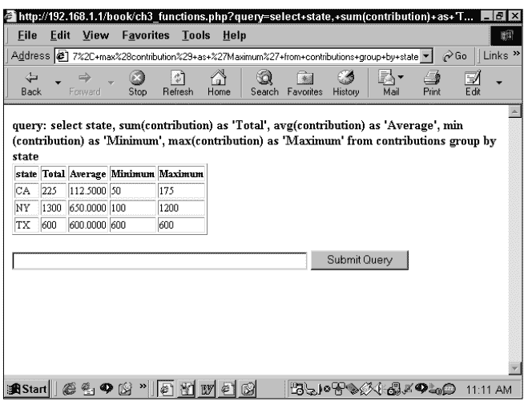

Figure 3-10: 一起使用多个聚合函数

这与此查询的结果大不相同：

```
select city, zip, count(*) from users group by city, zip
```

这将为每个城市/邮政编码组合返回单独的行，并为每个唯一组合提供计数。

## having
having 谓词限制了 group by 显示的行。这与 where 子句不同。where 子句实际上限制了用于 group by 的行。having 子句只阻止它们的显示。

如果你需要查找所有捐款超过 100 美元的每个州的捐款平均金额，你可以运行以下查询：

```
select avg(donations), state where donations> 100
```

然而，如果你想显示平均值超过 100 美元的所有州的平均捐款，你就必须使用 having 子句。由于 having 子句不会限制进入 group by 的行，因此聚合函数，在本例中为 avg()，会使用所有行进行计算。

```
select avg(contribution) as avg_contrib, state
from contributions
group by state
having avg(contribution)>500
```

## Joining Tables
如果你阅读了第 1 章，你就知道关系数据库之所以工作得很好，是因为它们对信息进行了细分。不同的表保存不同主题的信息，并且字段被插入到表中以维护关系。在完成规范化过程后，你的表可能都无法在没有其他表的情况下使用。这就是为什么你需要在 SQL select 语句中连接表的原因。

## Two-table join (the equi-join)
为了保持连贯性，我们将重新介绍在第 1 章中首次出现的几个表。看看图 3-11 中的熟悉表。

companies

| company_id | company_name | address |
|---|---|---|
| 1 | Big Co Company | 1121 43rd St |
| 2 | Little Co Company | 4444 44th St |

contracts

| contract_id | company_id | Name | Title | Phone | Email |
|---|---|---|---|---|---|
| 1 | 1 | Jay Greenspan | Vice President | 4155551212 | 1121 43rd St |
| 2 | 1 | Brad Bulber | President | 4155552222 | 4444 44th St |
| 3 | 2 | John Doe | Lacky | 2125556666 | 4444 44th St |

Figure 3-11: 需要连接的表

如果你想向 contacts 表中的所有人员发送邮件，你将需要将 contacts 表连接到 companies 表，因为街道地址在 companies 表中，而且它正好在那里。contacts 表中的 company_id 列在这些表之间创建了关系。如果你在 contacts 表中的 company_id 字段等于 companies 表中的 company_id 字段的情况下连接这些表，所有的信息都会触手可及。

这在 SQL 中很容易实现。在 select 语句的 from 部分，必须列出所有要连接的表。而在 where 部分，必须显示连接所依据的字段：

```
select *
from companies, contacts
where companies.company_ID = contacts.company_ID
```

有时当对字段名的引用存在歧义时，你需要通过使用 table_name.column_name 语法来指定列来自哪个表。这在图 3-12 的 where 子句中完成。如果你在 SQL 语句中未能指明从哪个表中提取 company_id 列，MySQL 将返回错误。

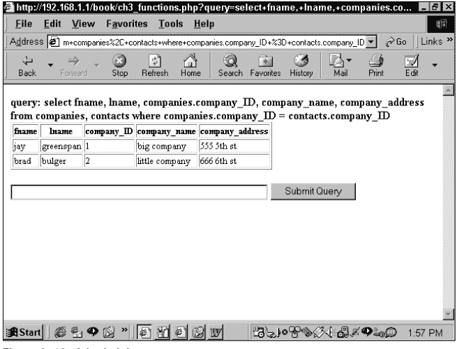

Figure 3-12: 一个基本连接

这种类型的连接，即基于公共字段的相等性合并表，非常常见。它被称为 equi-join，或 inner join。名称“inner join”在你在本章后面学习到 outer join 时会更有意义。

一旦你开始执行连接，别名就会变得方便。通过在 from 子句中指定别名，你可以节省一些输入。在以下代码中，t1 是 companies 的别名，t2 是 contacts 的别名。

```
select *
from companies t1, contacts t2
where t1.company_ID = t2.company_ID
```

## Multi-table join
equi-join 可以应用于一个以上的表。你的许多 SQL 语句将连接三个、四个或更多表。你需要做的就是在 select 之后添加额外的列，在 from 子句中添加额外的表，并在 where 子句中添加额外的连接参数。看看图 3-13 中需要多次连接的表。

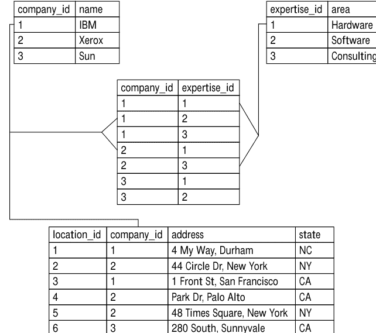

Figure 3-13: 需要多次连接的表

如果你想查找在加州设有办事处且具有咨询专业知识的所有公司的地址，你将不得不连接这四个表。以下查询可以完成工作。这里 where 子句包含了一些测试；where 子句的前两行将返回的行限制为符合我们标准的公司。where 子句的其余部分负责连接。

```
SQL-query:
Select *
from companies, locations, expertise, companies_expertise
where state = 'CA' and
    companies_expertise.expertise_ID = 3 and
    companies.company_ID = companies_expertise.company_ID and
    companies.company_ID = locations.company_ID and
    companies_expertise.expertise_ID = expertise.expertise_ID
```

## outer join
空值带来的挑战在本书中反复出现。在第 2 章中我们介绍了这两个表，见图 3-14。

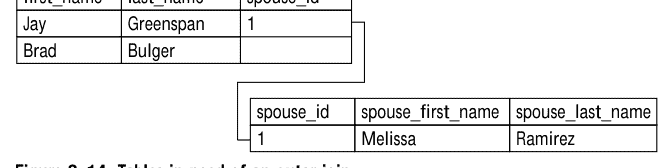

Figure 3-14: 需要外连接的表

现在假设你需要获取本书作者的名单以及他们的配偶，如果他们已婚。上一节中显示的 equi-join 在这种情况下不起作用。看以下查询：

```
select *
from contact, spouses
where contact.spouse_ID = spouses.spouse_ID
```

只有 contact 表的第一行会被返回。第二行中的空值确保没有任何内容可以匹配 where 子句中的条件。在这种情况下，我们需要保留一个表，并在存在匹配值时连接第二个表，我们将使用 outer join（也称为 left outer join），如下所示：

```
select *
from contact
left join spouses
on contact.spouse_ID = spouses.spouse_ID
```

该语句的意思是，“我希望保留整个 contacts 表，并在这两个字段相等时附加 spouses 表。”术语 left outer 中的 left 这个词

join 指的是当你可视化数据库表时，应该将出现在 from 子句中的第一个表可视化在最右侧，而连接的表放在左侧。

根据你使用的数据库包，外部连接的语法可能会有所不同。某些数据库支持左、右和全（左右皆有）外部连接。MySQL 只有左外部连接，但在实践中通常你所需的一切。你可以使用前面查询中看到的语法，或者使用 left outer join on。

外部连接会因必要而经常出现。此外，即使你觉得内部连接就能解决问题，使用外部连接也通常是良好的实践。这只是安全性的问题。你不希望因为忘记考虑空值而导致重要的数据行丢失。在整本书中，你会看到我们使用外部连接的情况，因为我们只是想更加谨慎。

可能有时候你需要执行不止一次外部连接。举例来说（而且没有特别好的理由），我们想要存储有关配偶兄弟姐妹的信息。我们会添加另一个列出兄弟姐妹的表，并向配偶表添加一列来维护关系。因此，如果我们要设计一个查询来保留 contacts 表中的每个人，并保留从 spouses 表返回的每个人，我们就必须加入两个外部连接：

```
select *
from contact
left join spouses on contact.spouse_ID = spouses.spouse_ID
left join siblings on spouses.sibling_ID = siblings.sibling_ID
```

## 自连接
听起来可能很奇怪，但总有一天你会需要将一个表与其自身的副本进行连接。你通常会在查找表中的重复项时遇到这种需求。如果我们怀疑表 3-2 中有一位重婚者，我们该如何找出拥有相同配偶的两个人？

表 3-2 联系人

| contact_id | first_name | last_name | spouse_id |
|------------|------------|-----------|-----------|
| 1 | jay | greenspan | 1 |
| 2 | brad | bulger |  |

### 表 3-2 联系人（续）

| contact_id | first_name | last_name | spouse_id |
|---|---|---|---|
| 3 | john | james | 2 |
| 4 | elliot | simms | 2 |

你需要发现 spouse_id 字段中的值是否重复（例如，数字 2 出现了不止一次）。你可以使用 group by，但那样就无法获取相关人员的姓名。使用 group by 配合 count() 函数，你可以找到某人出现多次的情况，但要找出这些人是谁就需要第二个查询。使用自连接，你可以在一步中完成所有操作。但这需要仔细考虑。

你可能会认为以下查询可以解决问题。注意我再次使用了别名，这样我们就有两个可以引用的表名。

```
select t1.first_name, t1.last_name, t2.first_name, t2.last_name
from contacts t1, contacts t2
where t1.spouse_id = t2.spouse_id
```

但这会返回比我们需要的更多行。具体来说，每个名称都会与自身匹配，从而产生重复的返回条目。给定此查询，当 Jay 的行与自身比较时，它会测试为真并被返回到结果中。你可以通过确保第一个表的 contact_id 字段不等于第二个表的 ID 字段来消除这里的冗余。

```
select t1.first_name, t1.last_name
from contacts t1, contacts t2
where t1.spouse_id = t2.spouse_id
and t1.contact_id != t2.contact_id
```

这很好但不完美。以 Elliot 和 John 为例。当 Elliot 在 t1 中而 John 在 t2 中时，会返回一行；当 John 在 t1 中而 Elliot 在 t2 中时，也会返回一行。这里最简单的方法是利用数值主键。你知道一个 ID 会大于另一个 ID，通过利用这一信息可以消除所有重复。

```
select t1.first_name, t1.last_name
from contacts t1, contacts t2
where t1.spouse_id = t2.spouse_id
and t1.contact_id < t2.contact_id
```

## MySQL 不支持的 SQL 标准部分
MySQL 开发者一直在努力改进软件。在未来几年内，他们有可能支持大多数你在高价商业软件中能找到的功能，比如 Oracle、Sybase、Informix 或 Microsoft 的 SQL Server。但在本书撰写时，有几部分 select 语法 MySQL 不支持。

### 联合
联合允许将具有相同列数的查询返回到一个结果集中。例如，如果你有两个存储用户名的表，你可以用如下语句将所有名称在一个查询中返回：

```
select first_name, last_name
from table_1
union
select first_name, last_name
from table_2
```

联合很方便，但在 MySQL 中的缺失并不是什么大问题。在前面的例子中，你可以轻松运行第二个查询。

### 相关子查询
如果你来自使用 Oracle 之类软件包的背景，相关子查询的缺失可能会让你困扰。好消息是，子查询支持在开发者的优先列表中名列前茅。对于刚接触这一概念的人来说，子查询允许你在 where 子句中定义整个查询。

例如，使用子查询，如果你有一个存储学生及其考试成绩的表，你可以轻松找到所有成绩高于平均分的学生：

```
select first_name, last_name, score
from test_scores
where score> (select avg(score) from test_scores)
```

你可以通过运行两个查询达到相同的效果。在所有情况下，你可以通过运行额外的查询来规避子查询的缺失。你会失去一些优雅性，但效果是相同的。


不时检查一下 mysql.com。子查询可能包含在 3.24 版本中。到你阅读本文时，该版本可能已经可用。


第 10 章中有更多关于在 MySQL 中处理子查询的信息。

### 摘要
你可以在生活的绝大部分时间里不去记忆 SQL 的某些部分。如果你使用图形工具，你可能不需要学习 `create` 或 `alter` 命令的具体细节。对于 `select` 语句则不能这样说。

本章涵盖的所有内容对你作为应用程序开发者的生活都很重要。`select` 语句允许你高效地从数据库中检索和排序信息，如果你理解 `select` 语句的复杂性，你将能够更高效、更优雅地编写应用程序。

## 第 4 章

### 开始使用 PHP — 变量

### 本章内容
- 在 PHP 脚本中分配变量
- 处理从 HTML 表单传递的数据
- 使用 PHP 的内置变量，包括 Apache 变量
- 测试和分配变量类型

PHP 使使用变量变得极其容易。PHP 很聪明，能够理解变量类型并将语法保持在绝对最小限度。从 C、Java 或 Perl 背景转到 PHP 的人可能会发现 PHP 更容易处理，但语法的简易性也会带来自身的问题。

PHP 中的所有变量都以美元符号 ($) 开头。它并不重要它们是什么类型的变量，无论是字符串、整数、浮点数，甚至是数组。它们在代码中看起来都相同。PHP 引擎会跟踪你存储的信息类型。

通常，变量来自三个地方：它们要么在脚本中分配，要么从 HTML 页面传递（通常来自表单输入），要么是 PHP 环境的一部分。我们将在以下各节中讨论这些。注意变量还可以来自其他地方：URL 和会话也是变量的可能来源。

### 在脚本中分配简单变量
PHP 不要求显式变量声明。你所要做的就是使用一个变量，它就存在了。正如我们已经提到的，所有变量类型看起来都相同。以下代码展示了如何分配字符串、整数和浮点数（double）类型的变量：

```
$a = "this is a string"; //this is a string
$b = 4; //this is an integer
```

```
$c = 4.837; //this is a floating-point number
$d = "2"; //this is another string
```

注意 = 是赋值运算符。进行比较时，必须使用两个连续的等号（==）。例如，if($x==1)。

类型是灵活的，PHP 在处理类型变化方面非常智能。例如，鉴于你刚才看到的代码，以下代码会按你期望的方式求值：

```
$e = $b + $d;
echo $e;
```

PHP 会识别出你希望将 $d 中的字符串视为整数。变量 $e 将是整数类型且等于 6。事实上，PHP 也会将以下内容求值为整数：

```
$a = 2;
$b = "2 little piggies";
$c = $a + $b;
```

这里，$c 将等于 4。如果字符串开头是整数或浮点数，PHP 可以将其如此求值。同样，PHP 也会在数值类型之间平滑切换。

```
$f = 2; //$f is an integer
$g = 1.444; // $g is a double (floating-point) type
$f = $f + $g; //$f is now a double type
```

这种灵活性很好，但也可能导致一些困难。有时会不确定正在处理哪些变量类型。我们将在“Testing Variables”部分展示如何处理这些情况。

## 字符串的定界

在前面的代码中，所有字符串都用双引号包围。PHP 中还有另外两种定界字符串的方式。

如果你用双引号包围字符串，字符串内的变量将被展开。例如，

```
$my_name = "Jay";
$phrase = "Hello, my name is, $my_name";
echo $phrase;
```

将打印“Hello, my name is, Jay”。但如果你想在字符串中包含以下任何字符，它们必须用反斜杠转义：

- “（双引号）
- \（反斜杠）
- $（美元符号）

例如，要使用双引号打印一个开始的表单标签，你必须这样做。

```
echo "<form action=\"mypage.php\" method=\"get\">";
```

你也可以用单引号包围字符串。如果字符串在单引号内，变量将不会被展开。所以这段代码：

```
$my_name = "Jay";
echo 'Hello, my name is, $my_name';
```

将打印“Hello, my name is, $my_name”。在单引号内唯一需要转义的字符是单引号和反斜杠。

最后，从 PHP 4 开始，你可以使用 Here 文档。这是一种单引号和双引号风格的混合，在许多情况下很方便。Here 文档在字符串开始处用三个小于号 <<< 和一个标识符分隔。在书中我们使用标识符 EOQ。字符串以相同的标识符后跟分号终止。在下面，$my_string 是使用 Here 文档语法正确定界的字符串。

```
$my_string = <<<EOQ
My string is in here.
EOQ;
```

使用 Here 文档，变量将在字符串内展开，双引号无需转义。我们在处理表单元素时经常使用 Here 文档。

```
$element = <<<EOQ
<textarea name="$name" cols="$cols" rows="$rows"
wrap="$wrap">$value</textarea>
EOQ;
```

在这种情况下，我们不需要在字符串中到处放置反斜杠，并且仍然可以方便地在字符串内展开变量。


通过关联键访问的数组元素在 Here 文档中不能展开。例如，以下代码将产生错误。

```
$array = array ("fname"=>"jay", "lname"=>"greenspan");
$str = <<<EOO
print my string $array["fname"]
EOO;
```

## 在脚本中为数组赋值

数组是包含多个值的变量。一个简单的数组可能存储一年中的月份。要为此数组赋值，你可以使用以下内容：

```
$months = array("January", "February", "March", "May", "June",
"July", "August", "September", "October", "November", "December");
```

该数组有 12 个元素，你可以通过它们在数组中的序数位置来寻址，从 0 开始。因此命令 echo $months[0] 将打印 January，而 echo $months[11] 将打印 December。要打印数组中的所有值，你可以获取数组的长度然后设置一个循环。

```
for ($month_number=0; $i<count($months); $i++)
{
    echo $months[$month_number] . "<br>\n" ;
}
```


for 循环在第 5 章中解释。

你也可以使用简单的赋值运算符为数组赋值。以下代码可行：

```
$dogs = array();
$dogs[0] = "shepherd";
$dogs[1] = "poodle";
```

如果你不指定数字，该值将被附加到数组末尾。以下行将把“retriever”分配给 $dogs[2]。

```
$dogs[] = "retriever";
```

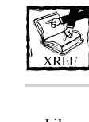

有多种处理数组的函数（PHP 4 中超过 40 个）。其中许多将在第 6 章中介绍。

与许多编程语言一样，PHP 使用关联数组。如果你对这个概念不熟悉，关联数组中的元素有“键”来引用单个元素。当处理数据库时这尤其重要。当你从数据库查询中获取行时，你通常会通过它们的键引用元素。

你可以以这种方式为关联数组赋值。这里，first_name、last_name 和 e-mail 是键。

```
$person = array (
    "first_name" => "Jay",
    "last_name" => "Greenspan",
    "e-mail" => "jgreen_l@yahoo.com"
);
```

如果你想向此数组添加内容，可以为其分配另一个值。请注意下一行将向数组中添加一个整数，因此该数组将包含四个值，三个字符串和一个整数。

```
$person["age"] = 32;
```

通常，如果你想同时访问关联数组中的键和值，你会使用 list()=each()，如下面的代码所示。

```
while (list($key, $value) = each($person))
{
    echo "<b>key :</b> $key, value = $value <br>\n";
}
```

第 5 章更详细地描述了 list()=each()。基本上，each() 提取单个数组元素的键和值；list() 接收这些值并分别分配给 $key 和 $value。此过程一直持续到访问数组中的每个元素为止。如果你想第二次遍历数组，你需要使用 reset($person) 重置数组指针。

如果你只想获取值而不获取键，或者如果你使用的是非关联数组并且想使用 list()=each() 结构，你必须这样做：

```
while (list( , $value) = each($person))
{
    echo "value = $value <br>\n";
}
```

或者，如果你只想获取键，可以这样做。

```
while (list($key) = each($person))
{
    echo "key = $key <br>\n";
}
```


这样思考 PHP 数组：所有数组都是关联的。几页前你看到可以为基本数组赋值而不指定关联键。例如 $myarray= array ("pug", "poodle")。这样做时，PHP 为 $myarray 分配从零开始的连续数字键。它们的行为就像关联键一样。你使用 list() =each() 遍历它们。它们使用相同的数组函数，其中许多在第 6 章中解释。

## 在脚本中为二维数组赋值

PHP 也支持多维数组。最常用的多维数组是二维数组。二维数组看起来很像表格。它们存储基于两个键的信息。例如，如果我们想存储多个人的信息，二维数组会很好用。我们将分配一个名为 $people 的数组，并在 $people 内部为每个人分配单独的数组：

```
$people = array (
    "jay" => array (
        "last_name" => "greenspan",
        "age" => 32
    ),
    "john" => array (
        "last_name" => "doe",
        "age" => 52
    )
);
```

这里 $people 数组包含有关两个人 Jay 和 John 的信息。要访问任何单个值的信息，你需要使用两个键。要打印 John 的最后年龄，以下两个命令可行：

```
echo $people["john"]["age"]; //prints 52
```


你可以通过遍历数组的两个维度来访问二维数组中的所有元素：

```
while(list($person, $person_array) = each($people))
{
    echo "<b>What I know about $person</b><br>\n";
    while(list($person_attribute, $value) = each($person_array))
    {
        echo "$person_attribute = $value<br>\n";
    }
}
```

## 从浏览器传递变量的访问

使用 PHP 或任何其他中间件包的全部意义在于根据用户偏好和需求提供定制信息。通常，信息会通过 HTML 表单传递过来。但信息也可能来自其他地方，包括 HTML 锚点、Cookie 和会话。

### HTML 表单变量

变量信息传递最常见的方式之一是通过 HTML 表单。


> 附录 A 提供了创建 HTML 表单的详细资料。如果您不熟悉此主题，请在阅读本节之前参考该附录。

对于每个表单元素，您都必须分配 name 和 value 属性。当表单提交时，name=value 对会传递给 PHP。它们可以通过 GET 或 POST 方法传递给 PHP，具体取决于您在表单 action 属性中的选择。

一旦表单提交，表单元素会自动成为 PHP 中的全局变量。（全局变量和变量作用域在第 6 章中讨论）。这确实是一种省心省力的操作方式。请考虑以下简单的 HTML 表单：

```
<form action="mypage.php" method="post">
    <input type=text name=email>
    <input type=text name=first_name>
    <input type=submit name=submit value=add>
</form>
```

一旦用户点击提交按钮，名为 $email、$first_name 和 $submit 的变量将在被调用的 PHP 页面中可用。您可以根据需要处理这些变量。请注意，在我们的大多数应用程序中，我们将使用提交按钮的值，以确保页面了解用户采取了什么操作。以下是其工作原理的简要示例。假设页面的名称是 mypage.php。

```
<?php
if (isset($submit) && $submit=="yes")
{
    echo "thank you for submitting your form."
} else {
?>
<form action="mypage.php" method="post">
    <input type=text name=email>
    <input type=text name=first_name>
    <input type=submit name=submit value=yes>
</form>
<?php
}
?>
```


在某些浏览器中，如果表单中只有一个提交按钮，用户可以按回车键提交表单，而不会发送提交按钮信息。

用户首次访问此页面时将看到一个表单。一旦表单提交且页面带着新的变量信息重新调用自身，只会出现感谢信息。

表单变量也可以通过 $HTTP_POST_VARS 或 $HTTP_GET_VARS 数组访问，具体取决于表单中使用的方法。如果变量来自两种方法，如果表单中的变量可能与脚本中的变量同名，或者您有一组未定义的变量被传递并且需要检查其内容，这些方法都很方便。

如果您想知道何时可能需要处理来自 GET 和 POST 的变量，请考虑用户通过带有查询字符串信息的链接点击进入页面的情况。用户随后可能会到达一个带有表单的页面。如果表单的 action 为空字符串，表单将提交给自身并保留查询字符串。如果表单的方法为 POST，变量将同时来自 GET 和 POST

您可以像访问任何关联数组一样访问任何单个元素（$HTTP_POST_VARS["e-mail"]）。或者您可以按如下方式遍历数组中的所有内容：

```
while (list($key, $value) = each($HTTP_POST_VARS))
{
    echo "variable = $key value = $value <br>";
}
```

### 传递数组

有时传递标量变量不起作用，您需要从 HTML 页面向 PHP 脚本传递数组。当用户可以在页面上选择一个或多个表单元素时就会出现这种情况。例如，多选框允许用户从多个项目中传递一个或多个项目。表单元素使用以下代码示例中的 HTML 创建。“multiple”属性表示用户可以选择多个元素，如图 4-1 所示。在 PC 上选择多个元素时，按住 Ctrl 键同时选择其他值。在 Mac 上，使用 Apple 键，而 Gnome 用户可以通过单击选择和取消选择单个元素。

```
<form action ="mypage.php" method="post">
    <select name="j_names[]" size=4 multiple>
        <option value="2">John
        <option value="3">Jay
        <option value="4">Jackie
        <option value="5">Jordan
        <option value="6">Julia
    </select>
    <input type="submit" value="submit">
</form>
```

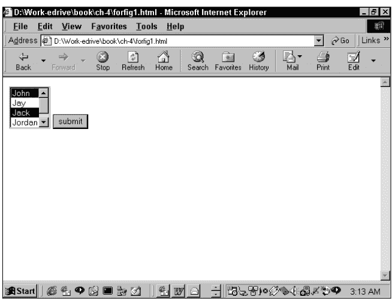

Figure 4-1: Multiple select box

请注意，在 select 的“name”属性中我们添加了方括号（[]）。这告诉 PHP 预期一个数组。如果我们不包含括号，可能会有两个值争夺同一个变量名，这完全不好。

提交后，您可以像处理其他数组一样处理此数组。

```
if (is_array($j_names))
{
    echo "<b>the select values are:<br> <br>";
    while(list($key, $value) = each($j_names))
    {
        echo $value . "<br>\n";
    }
}
```

传递数组在您想要呈现一系列复选框时也很有用，用户在按下提交按钮前可能会或可能不会勾选这些复选框。第 8 章中有一个代码示例，用于一个页面，允许程序管理员使用复选框选择应删除哪些条目。图 4-2 显示了这种类型页面的示例。如果我们为每个复选框分配不同的名称，我们就必须逐一检查它们。有了数组，我们只需编写一个三行循环即可全部检查。

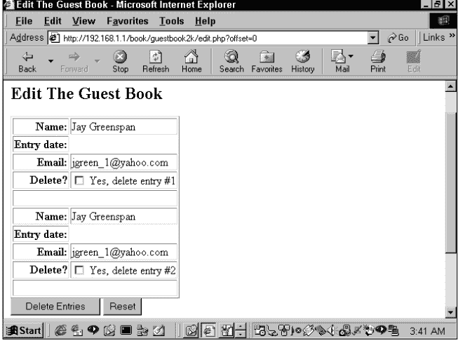

Figure 4–2: Series of checkboxes

从表单传递的数组也可以具有关联键，这些键可以是多维的。表单元素的名称应采用 name="array_name[element_name]" 的形式。对于多维数组，则为 array_name[element_name][subelement_name]"。

### Cookie

Cookie 是存储在用户硬盘上的少量信息。Cookie 包含一段文本，可以由放置它的 Web 服务器读取。Cookie 提供了在多次访问过程中跟踪用户的唯一方法。请记住，Web 是一个无状态环境。您的 Web 服务器实际上不知道谁在请求页面。Cookie 有助于您在用户浏览网站时跟踪他们。

当它们存在时，Cookie 会成为发送到 Web 服务器的 HTTP 请求的一部分。但首先您需要设置一个 Cookie。开发人员使这一点，就像 PHP 中的其他一切一样，变得非常简单。使用 setcookie() 函数。此函数接受以下参数：

```
setcookie(name, value, time_to_expire, path, domain, security setting);
```

我们将在第 6 章中更详细地讨论这个问题，但就目前而言，足以说以下语句

```
setcookie("mycookie",
"my_id",time()+(60*60*24*30),"/",".mydomain.com", 0)
```

将设置具有以下参数的 Cookie：

- 存储一个名为 my_cookie 的变量
- mycookie 的值为 “my_id”
- Cookie 将在设置后 30 天过期（当前时间 + 30 天的秒数）。
- Cookie 将对域中的每个页面可用。我们可以通过包含路径将其限制在域内的特定路径。
- 它将对具有 mydomain.com 地址的每个站点可用。
- 没有特殊的安全设置。

一旦 Cookie 设置，Cookie 中检索到的变量的行为与从表单元素中检索到的变量完全相同。它们将自动作为全局变量可用。PHP 脚本放置 Cookie 后，域内的其他脚本可以直接访问它。

如果您想确保 $mycookie 不会与另一个也名为 $mycookie 的变量冲突，您可以通过 HTTP_COOKIE_VARS 数组访问它，使用 HTTP_COOKIE_VARS["mycookie"]。

您还可以设置可作为数组访问的 Cookie：

```
setcookie("mycookie[first]",
"dddd",time()+2592000,"/","192.168.1.1", 0);
setcookie("mycookie[second]",
"my_second_id",time()+2592000,"/","192.168.1.1", 0);
```

这两个变量将作为关联数组可访问。


> 前面的代码在使用 PC 上的 Internet Explorer 5 时工作正常。然而，这可能在其他浏览器上不起作用。无论如何，您最好避免需要 Cookie 中包含数组的情况。


## 会话

PHP 4 如同 ASP 和 ColdFusion 一样，原生支持会话，只是做得更好。会话是什么？基本上，它是维护页面之间状态的另一种方式。你的脚本通过 `session_start()` 函数声明会话应该开始。此时 PHP 注册一个唯一的会话 ID，通常该 ID 会通过 cookie 发送给用户。PHP 然后在服务器上创建一个对应的文件，该文件可以跟踪任意数量的变量。文件名称与会话 ID 相同。

一旦会话创建，你可以注册任意数量的变量。这些变量的值保存在服务器上的文件中。只要会话 cookie 存在，这些变量就会对同一域内希望访问它们的任何页面可用。这比通过隐藏表单元素或臃肿的 cookie 在页面间传递变量要方便得多。

当然，有些用户可能不允许使用 cookie。因此，PHP 允许你通过查询字符串跟踪 Session ID。你可以手动将 Session ID 附加到查询字符串上，也可以通过更改配置选项来实现。

要手动将会话 ID 添加到查询字符串，请使用 `<?= SID ?>`。这会自动打印出类似这样的字符串：

```
PHPSESSID=07d696c4fd787cd6c78b734fb4855520
```

将其添加到链接中会通过查询字符串传递 PHPSESSID 变量。使用类似这样的代码：

```
<a href="mypage.php?<?=SID?>">click to page</a>
```


> <?= 是 echo 的简写。你可以在任何时候使用它，而不仅仅是会话。

如果 PHP 使用 `-enable-trans-id` 选项编译，会话 ID 将自动添加到每个相对链接中。

基本上，它非常简单。下面的脚本将注册一个名为 `$my_var` 的会话变量，并将其值赋为 "hello world"。

```
<?
session_start();
session_register("my_var");
$my_var = "hello world";
?>
```

在后续页面中，变量 $my_var 将可用，但只有在运行 session_start() 函数之后。该函数告诉 PHP 查找会话，如果会话存在，则将所有会话变量作为全局变量访问。

使用 if 语句使会话变量正确可访问可能需要做一点工作。请看下面的简短脚本作为示例。

```php
<?php
session_start();
session_register("your_name");
//check to see if $your_name contains anything
if(!empty($your_name))
{
    echo "I already know your name, $your_name";
}
//this portion will probably run the first time to
//this page.
elseif(empty($your_name) && !isset($submit))
{
    echo "<form name=myform method=post action=$PHP_SELF>
        <input type=text name=first_name> first name<br>
        <input type=text name=last_name> last name<br>
        <input type=submit name=submit value=submit>
        </form>";
//if the form has been submitted, this portion will
//run and make an assignment to $your_name.
} elseif (isset($submit) && empty($your_name))
{
    $your_name = $first_name . " " . $last_name;
    echo "Thank you, $your_name";
}
?>
```

运行此代码后，刷新浏览器。你会看到脚本记住了你的身份。


你的 setcookie() 和 session_start() 函数应始终位于文件的最顶部。如果在设置 cookie 之前尝试向浏览器发送任何内容，你将收到错误消息。

## 使用内置变量

服务器和 PHP 环境设置了各种变量。你可以通过运行 phpinfo() 找到这些变量的完整列表。如果你还没有这样做，请打开键盘，输入以下内容，然后运行以下脚本：

```
<?php
phpinfo();
?>
```

它会生成一个看起来像图 4-3 的页面。

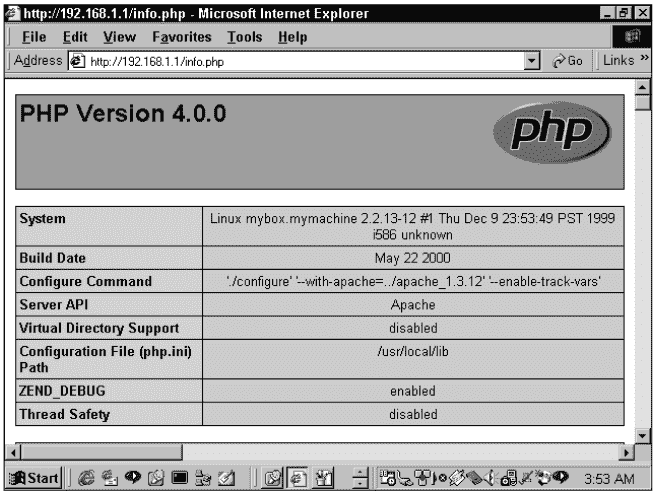

图 4-3: phpinfo();

使用完毕后删除此页面是个好主意。没有必要向黑客提供不必要的额外信息。

你可以用各种方式使用这些变量。我们现在来看一些例子，并说明何时可能使用它们。一些变量来自 PHP 引擎，而另一些则源自你的 Web 服务器。

## PHP 变量

这些是通过 PHP 可用的变量。

## PHP_SELF

这是正在运行的文件的地址。通常会从 ServerRoot 目录给出完整路径，这在表单在同一 PHP 页面中同时呈现和处理时非常有用。

```
<?
if(isset($submit))
{
    //do some form processing here
    echo "thanks for the submission";
} else {
?>
<form name=myform method=post action=<?=$PHP_SELF?>>
    <input type=text name=first_name> first name<br>
    <input type=text name=last_name> last name<br>
    <input type=submit name=submit value=submit>
</form>
<?
}
?>
```

请记住，PHP_SELF 始终指的是 URL 中正在执行的脚本的名称。因此，在包含文件中，PHP_SELF 不会引用被包含的文件。它会引用正在运行的脚本。

值得注意的是，当 PHP 在 Windows 上运行或作为 CGI 模块运行时，PHP_SELF 的行为会很奇怪。请务必查看 phpinfo() 以了解系统上 $PHP_SELF 的值。

## HTTP_POST_VARS

这是包含通过 POST 方法发送的所有变量的数组，通常通过表单发送。你可以将其中的每个变量作为关联数组中的元素访问（例如 $HTTP_POST_VARS["myname"]）。

## HTTP_GET_VARS

这是包含通过 GET 方法发送的所有变量的数组。你可以将其中的每个变量作为关联数组中的元素访问（例如 $HTTP_GET_VARS["myname"]）。

## HTTP_COOKIE_VARS

发送到浏览器的所有 cookie 都可以在此关联数组中读取。这包括会话 cookie。如果你想知道 cookie 的行为如何，phpinfo() 会快速显示浏览器发送到服务器的内容。

## Apache 变量

Apache 跟踪数十个变量。我们无法在此列出完整的变量列表，因为你使用的变量会根据当前设置而有所不同。以下是你在脚本中可能经常使用的一些变量。

在查看此列表和 phpinfo() 时，请记住，如果你对 Web 服务器变量不满意，需要更改服务器配置，而不是 PHP。PHP 只是传递信息，无法更改这些变量。

## DOCUMENT_ROOT

此变量返回 Web 服务器根目录的完整路径。对于大多数 Apache 用户，此目录将类似于 /path/to/htdocs。我们在全书中使用此变量使应用程序具有可移植性。以此 include 语句为例：

```
include"$DOCUMENT_ROOT/book/functions/charset.php";
```

通过使用 DOCUMENT_ROOT 变量而不是绝对路径，我们可以将书籍目录及其所有子文件夹移动到任何其他 Apache 服务器，而不必担心 include 语句会失效。请记住，如果你使用的是 Apache 以外的 Web 服务器，DOCUMENT_ROOT 可能不可用。


> 如果你在 php.ini 文件中设置了 include_path 指令，你就不必担心在 include 语句中指定任何路径——PHP 会在你指定的所有目录中查找并尝试找到你指示的文件。

## HTTP_REFERER

此变量包含用户在当前查看页面之前查看的页面的 URL。使用 HTTP_REFERER 时请记住，并非每个页面请求都有 referer。如果有人在浏览器中输入 URL，或通过书签访问你的页面，则不会发送 referer。此变量可用于呈现自定义信息。如果你与另一个站点有关系，并且希望仅为从该域引用的用户提供特殊的自定义头部，你可能会使用如下脚本：

//check if my user was referred from my_partners_domain.com
if(ereg ("http://my_partners_domain.com.*" , $HTTP_REFERER))
{

```
include 'fancy_header.php';
} else {
    include 'normal_header.php';
}
```

请记住，HTTP_REFERER  notoriously unreliable. 不同浏览器在某些情况下会提供不同的 HTTP_REFERERs。 它也很容易被伪造。 因此你不会想用像前面那样的脚本来提供任何安全信息。 我曾参与一个网站的开发，该网站使用 HTTP_REFERER 来判断是否在页眉中包含一个特殊的 GIF。

## HTTP_USER_AGENT

任何构建过网页的人都知道浏览器检测有多重要。 有些浏览器在处理花哨的 JavaScript 时会出错，而另一些则需要非常简单的文本。 user_agent 字符串是你向正确的人提供正确内容的关键。 典型的 user_agent 字符串看起来像这样：

```
Mozilla/4.0 (compatible; MSIE 5.01; Windows 98)
```

然后你可以解析这个字符串来获取所需的信息。

你可能对 PHP 的 get_browser() 函数感兴趣。 理论上，该函数会确定用户浏览器的功能，以便你可以判断脚本是否可以安全地提供例如框架或 JavaScript。 PHP 手册中有关于 get_browser() 的安装和使用说明，但我不建议使用它。 为什么？ 使用 get_browser()，你会被告知 PC 上的 Internet Explorer 5 和 Mac 上的 Netscape Navigator 4.01 都支持 CSS（层叠样式表）和 JavaScript。 但正如任何有客户端经验的人都知道的那样，编写在两个浏览器上都能工作的 DHTML 是一个主要任务（而且非常痛苦）。 从 get_browser() 获得的信息可能导致虚假的安全感。 你最好直接访问 HTTP_USER_AGENT，并根据特定的浏览器和平台做出决策。

## REMOTE_ADDR

这是发送 HTTP 请求的用户的 IP 地址。 REMOTE_ADDR 很容易被伪造，并且不一定提供用户唯一的标识信息。 你可能想用它来进行跟踪，但不应将其用于强制执行安全措施。

## REMOTE_HOST

这是发送请求的主机机器。 当我通过我的 ISP（att.net）拨号时，REMOTE_HOST 看起来像这样：119.san-francisco-18-19rs.ca.dial-access.att.net。 REMOTE_HOST 通常不可用。

## REQUEST_URI

这与 PHP_SELF 基本相同，只是它除了脚本文件名外，还包含查询字符串中的信息。 它包含从根路径开始的所有内容。 因此，如果你访问 http://www.mydomain.com/info/products/index.php?id=6，REQUEST_URI 将等于 /info/products/index.php?id=6。

## SCRIPT_FILENAME

该变量包含文件的完整文件系统路径。

## Other Web server variables

如前所述，phpinfo() 是你的朋友。 我们为本书开发的应用程序运行在运行 Apache Web 服务器的 Unix 系统上。 但是，由于 PHP 可以运行在各种操作系统和 Web 服务器上，而 MySQL 也可在 Windows 和 Unix 上运行，你应该了解与你所运行的 Web 服务器和操作系统相关的不同变量。

你会看到我们在应用程序中的包含文件使用了 DOCUMENT_ROOT Apache 变量。 如果你尝试将应用程序文件移动到 Windows，你会在包含语句中遇到错误。 使用 Microsoft 的 Personal Web Server 时，更好的选择是 $APPL_PHYSICAL_PATH 变量。

图 4-4 展示了你可以从 Personal Web Server 访问的一些变量。

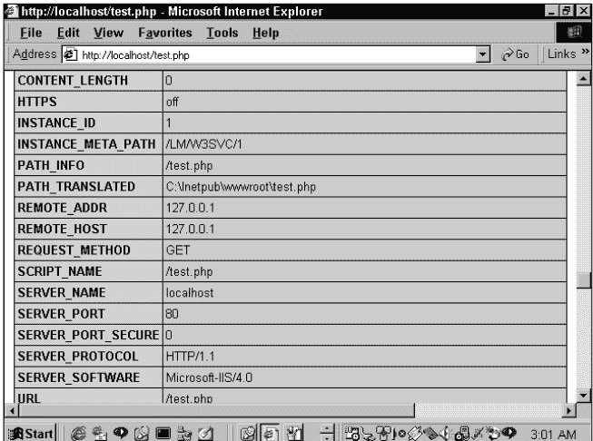

图 4-4：Personal Web Server 变量

## Testing Variables

在本章开始时，我们展示了为变量分配数据会决定变量类型。 变量的外观并不能表明它包含什么内容。 如果你在脚本中看到 $var，你将无法知道它包含的是字符串、整数、浮点数还是数组。 事实上，在你的脚本中，很多时候你不确定变量是否包含值，甚至不确定它是否存在。 因此，你需要执行测试。 以下各节描述了你可以执行的测试类型。

### isset()

此函数测试变量是否有任何值，包括空字符串。 它返回 true 或 false 的值。 如果变量未初始化或未设置，isset() 将测试为 false。

请考虑以下处理 MySQL 查询的脚本。 你已经知道数据库字段可以同时包含空字符串和 null 值。 在你的脚本中，你很可能希望对两者进行不同处理。 为了在查询遇到 null 值时打印出特殊消息，你需要使用 isset()。 在此代码中，$query 是输入到表单元素中的 select 语句。

```
$result = mysql_query($query) or
    die (mysql_error());

$number_cols = mysql_num_fields($result);

echo "<b>query: $query</b><br>\n";
//layout table header
echo "<table border = 1>\n";
echo "<tr align=center>\n";
for ($i=0; $i<$number_cols; $i++)
{
    echo "<th>", mysql_field_name($result, $i), "</th>\n";
}
echo "</tr>\n";//end table header

//layout table body
while ($row = mysql_fetch_row($result))
{
    echo "<tr align=left>\n";
    for ($i=0; $i<$number_cols; $i++)
    {
        echo "<td>";
        if (!isset($row[$i])) //test for null value
            echo "NULL";
        else
        {echo $row[$i];}
         echo "</td>\n";
    }
     echo "</tr>\n";
}
 echo "</table>";
```

请注意，感叹号 (!) 表示“非”。 因此，语句 if(!isset ($var)) 在变量未设置时将测试为 true。

如果你想销毁一个变量，请使用 unset 函数。

### empty()

empty() 函数在某些方面与 isset() 函数重叠。 如果变量未设置、包含空字符串或值为 0，则测试为 true。 它在处理表单数据等方面很有用。 如果你想确定用户是否在文本字段中输入了内容，你可以使用类似这样的代码：

```
if(empty($first_name))
{
  echo "Please enter your first name. It is a required field";
  exit;
}
```

### is_int()

这用于测试变量是否为整数。 它有两个同义词：is_integer() 和 is_long()。 当你不确定变量是整数还是包含数字的字符串时，你可能需要此函数来排查脚本问题。

```
$a = "222";
$b = 22;
```

给定这两个变量赋值，is_int($a) 将测试为 false，而 is_int($b) 将测试为 true。

### is_double()

此函数测试变量是否为浮点数（或 double 数）。 它有两个同义词：is_float() 和 is_real()。

### is_string()

此函数测试变量是否为文本字符串。

### is_array()

此函数测试变量是否为数组。 本书中经常使用它。 一个很好的例子可以在第 6 章的 implode() 函数讨论中找到。

### is_bool()

这用于测试变量是否为布尔值（包含 TRUE 或 FALSE）。 请注意，以下示例不是布尔值。

```
$a = "TRUE";
$b = "FALSE";
```

在第 6 章中，你将看到各种在失败时返回 FALSE 的函数。 在这些函数中，FALSE 是一个布尔值。

### is_object()

如果变量是对象，则返回 true。 如果你不知道对象是什么，请参阅第 6 章，了解对象和面向对象编程的讨论。

### gettype()

此函数会告诉你变量的类型。 它将返回预期值（string、double、integer、array 或 boolean），并且还可以返回与面向对象编程相关的类型（object、class）。 有关 PHP 面向对象编程的更多信息将在第 6 章中介绍。

请注意，gettype() 返回一个字符串。 因此，以下代码将测试为 TRUE 并打印“是”。

```
$str = "I am a string";
$type = gettype($str);
if ($type == "string")
{
    echo "Yes";
}
```

## Changing Variable Types

有三种方法可以更改任何变量的类型。

### Type casting

通过在变量名前放置包含所需变量类型的括号，你将更改变量类型。

```
$a = 1;
$b = (string) $a;
echo gettype($a), "<br>\n";
echo gettype($b), "<br>\n";
```

这段代码将打印，

```
integer
string
```

使用此方法，你可以将变量强制转换为数组、double、整数、对象，或像前面的代码那样转换为字符串。

### Using settype()

此函数接受两个参数。 第一个是变量名。 第二个指定变量类型。 使用此函数相对于强制转换的优势在于，如果转换失败，settype() 将返回 FALSE 值。 而且无法检测到强制转换失败。 它可以接受与类型强制转换中列出的相同类型。

```
$a = 1;
settype($a, "string");
```

### intval(), doubleval(), and stringval()

最后，如果你觉得评估变量类型的方法还不够，可以使用这些函数之一。 它们实际上不会更改变量的类型，而是返回指定类型的值。 因此，在下面的例子中，你可以确定 $a 将被当作整数处理。

```
$a = "43";
$b = (intval($a) * 2);
```

## Variable Variables

PHP 包含变量变量，在错误的人手中，它们可能被用来编写难以想象的最不可理解的代码。 它使你能够取一个变量的内容并将其用作变量名。 两个连续的美元符号让 PHP

你知道取变量的值并将其用作变量名。下面的代码创建了一个变量名 $foo，其值为“bar”：

```
$a = 'foo';
$$a = 'bar';
```

在数据库应用程序的上下文中，变量变量可能用于创建一系列变量，以便与之比较其他变量。以下示例中，$firstrow 是一个关联数组。

```
$firstrow = array ("firstname"=>"jay", "lastname"=>"greenspan");

while (list($field,$value) = each($firstrow))
{
    $field = "first_$field";
    $$field = $value;
}

echo $first_firstname, " ", $first_lastname;
```

经过 while 循环运行后，将创建并打印以下变量。

```
$first_firstname = "jay"
$first_lastname = "greenspan"
```

## 摘要

如果你细心阅读本章（即使没有），你也应该对如何使用 PHP 变量有相当好的了解。

PHP 在使变量易于访问和处理方面比任何脚本语言都做得更好。如果你想了解 PHP 变量的使用方式，请查看第 8 章，本书中的第一个应用程序。在那里，本章介绍的许多函数和概念都得到了应用。通过在这一章和这些脚本之间来回翻阅，你将看到变量是如何使用以及脚本是如何组合起来的。

一个非常重要的问题：本章没有讨论变量作用域，这是一个非常重要的话题。请参阅第 7 章，我们在讨论函数时将对此主题进行解释。

## Chapter 5

## Control Structures

### 本章内容

-   理解 if 语句的语法
-   使用 PHP 确定真值和假值
-   学习 PHP 循环
-   选择脚本中使用的循环

控制结构是编程语言的构建块。PHP 拥有使语言正常工作所需的所有控制结构。如果你熟悉 C 或 Perl，本章讨论的任何特性都不应让你感到意外。然而，如果你是从 VBScript 或 Visual Basic 背景转向 PHP，语法可能与你习惯的不同。如果你觉得语法一开始有点沉重，请坚持下去。你可能会发现额外的括号和圆括号实际上有助于编写可读的代码。

## if 语句

if 语句几乎是所有编程语言的基石。在 PHP 中，if 语句通常采用以下基本形式：

```
if (condition)
{
    actions to perform if condition is true.
}
```

在“if”一词之后有一组圆括号。圆括号内是单个条件或一组待测试的条件。如果条件被评估为真，则大括号内的代码将被执行。以下代码将测试为真并向网页打印“我是真！”。

```
<?php
    $foo = 100;
    $bar = 10;
    if ($foo>$bar)
{
    echo "I'm True!";
}
?>
```

这已经足够清楚了。但在我们提到 if 语句的复杂性之前，你应该知道 PHP 如何确定条件是真还是假。

## 在 PHP 中确定真值或假值

下一节将展示 if 语句中常用的运算符。这些相当直观。在前面的代码示例中，100 大于 10，因此测试为真。没问题。但在 PHP 中这些测试还有更多内容。

TRUE 和 FALSE 两个词也具有预期的含义。

```
if (TRUE)
{
    echo "Yup!"; //this will be printed
}
if (FALSE)
{
    echo "Nothing doing.";  //this will not be printed
}
```

但在测试真假条件时，你并不局限于简单的数学运算符或 TRUE 和 FALSE 两个词。正如你在第 4 章中所看到的，你经常会使用 isset() 或 empty() 来测试变量是否存在。这些函数与 PHP 中的许多其他函数一样，如果条件为假将返回 0 值，如果条件为真将返回 1 值。以下代码实际上会打印出“1”。

```
$myvar = "I am setting a variable";
echo isset($myvar);
```

在 PHP 中，“0”相当于 false。可以猜到，“1”等于 true。但不只是“1”是真——任何非零、非空值测试时都为真。这为你的测试提供了一些灵活性。

在处理网页时，你通常会进行某种文本操作。经常需要测试你正在处理的文本字符串是否具有某种结构。例如，你可能想测试字符串是否包含某些字符。你可以使用正则表达式函数之一来实现这一点，但也可以使用 strpos() 函数。strpos() 函数接受两个参数，都是字符串。它在第一个参数中搜索第二个参数字符串的首次出现。它返回第二个参数中的字符串以及该字符串之后的所有字符。然而，如果找不到字符串，函数将返回 FALSE。在下面的示例中 strpos() 返回“text string”。

```
$str = "my little text string";
strstr($str, "text");
```

由于该函数的结果不为空且不为 0，因此可以在测试中使用。以下代码将测试为真并打印出“Yeah!”

```
$str = "my little text string";
if (strstr($str, "text"))
{
    echo "Yeah!";
}
```

但是，在下面的示例中，未找到字符串，因此函数将返回 FALSE 且不会打印任何内容。

```
$str = "my little text string";
$new_str = strstr($str, "nothing");
if($new_str)
{
    echo "nothing to print"; //this will not be printed
}
```

这是一个很好的地方来指出你在编程过程中创建的函数通常需要返回 TRUE 或 FALSE 值。你可以通过返回 TRUE 或 FALSE，或者如果你愿意，返回 1 或 0 来实现这一点。如果你不知道如何使用它们，请参阅第 6 章了解函数的概述。看一下这个例子：

```
//tests whether a variable starts with "http://"
function url_test ($url)
{
    if (strtolower(substr($url,0,7))== "http://")
    {
        return TRUE; //this could also be 1
    }
else {
        return FALSE; //could be 0
    }
}
```

```
$myurl = "http://www.theonion.com";
if (url_test ($myurl))
{
    echo "Thanks for entering a valid URL.";
}
```

## 比较运算符

PHP 中没有太多比较运算符。表 5-1 列出了它们。

表 5-1 PHP 的比较运算符

| 符号 | 运算符 | 描述 |
|---|---|---|
| == (2 equal signs) | equal to | 确定两个数量是否相等。 |
| === (3 equal signs) | identical to | 确定两个值是否具有相同的值和相同的变量类型。 |
| != | not equal | 确定值是否不相等。 |
| > | greater than | 确定符号左侧的值是否高于符号右侧的值。 |
| < | less than | 确定符号左侧的值是否低于符号右侧的值。 |
| >= | greater than or equal to | 确定左侧的值是否高于或等于右侧的值。 |
| <= | less than or equal to | 确定左侧的值是否低于或等于右侧的值。 |

## 逻辑运算符

除了比较运算符之外，你还将在脚本中使用逻辑运算符。表 5-2 列出了逻辑运算符。

表 5-2 PHP 的逻辑运算符

| 符号 | example | 描述 |
|---|---|---|
| and | if ($a ==0 and $b==1) | 检查两个条件。 |
| && | if ($a ==0 && $b==1) | 与上一行相同，但优先级更高（见下文注释）。 |
| or | if ($a ==0 or $b ==1) | 确定是否满足其中一个条件。 |
| || | if ($a ==0 || $b ==1) | 与上一行相同，但优先级更高（见下文注释） |
| xor | if ($a ==0 xor $b==1) | 这被称为“exclusive or”。它确定两者中是否有一个为真但不是两者都为真。如果这两个条件都为真，整体测试将为假。 |
| ! | if (!empty($a)) | 确定某事是否不成立。在此示例中，如果 $a 有值，则条件将为真。 |


> && 与 and 的区别在于它们的优先级顺序。PHP 必须确定先比较哪个运算符。它是基于在 http://www.php.net/manual/language.operators.precedence.php 找到的列表来确定的。

## 复杂的 if 语句

使用表 5-1 和 5-2 中的运算符，你可以创建比本章开头的基本 if 语句更复杂的 if 语句。以下是几个快速示例：

```
if ($var == 1 && $var2 <=5 && !empty($var3))
{
    //do some stuff
}
```

由于这是一本涉及 MySQL 数据库的书，我们将展示一些在处理数据库查询时可用的 if 语句示例。

要测试 select 查询是否返回了任何行，你可以使用以下任一方法：

```
$query = "select * from my_table";
$result = mysql_query($query)or
    die(mysql_error());
if (mysql_num_rows($result) >0)
{
```

//do something here.
//}
//this would also work...
if (!$row = mysql_fetch_array($result))
{
    echo "there were no rows to fetch, so the query must have returned no rows.";
}

这将测试更新查询是否实际更改了任何内容。类似的结构也适用于更新和删除语句。

```
$query = "update mytable set col1='my text' where id = 1";
mysql_query($query) or
    die(mysql_error());
if (mysql_affected_rows() == 0)
{
    echo "query did nothing";
}
```

## if ... else 语句

如果你已经清楚前面的章节，这里不会有任何让你惊讶的内容。if ... else 语句中的 else 部分允许你指定在指定条件为假时执行的代码。

```
$a = 2;
if ($a == 1)
{
    echo "it's equal";
} else {
    echo "it is not equal";
}
```

这段代码将打印“it is not equal”。

## if ... elseif 语句

你经常需要将一个变量与多组条件进行比较。例如，你可能有一个页面会插入、编辑和删除数据库中的记录。通常的做法是通过在 HTML 表单中的提交按钮分配不同的值来指示你希望运行脚本的哪一部分。当表单提交时，提交按钮的值可以与多个 elseif 语句进行检查。

```
if ($submit == "edit")
{
    // code for editing database
} elseif ($submit =="update")
{
    //code for updating records
}elseif ($submit == "delete")
{
    //code for deleting records
} else
{
    echo "I have no idea what I should be doing.";
}
```


“elseif” 与 “else if” 不同。如果你在这两个词之间加上空格，你不会得到错误，但可能会出现一些奇怪的行为。

## Alternative if... structures

有几种不同的写法可以编写 if 语句。第一种只是用冒号替换开头的花括号，用单词 endif 加分号替换关闭的花括号。


此语法已弃用。你最好不要使用它。

```
if ($a==1):
    echo "I knew a was equal to one.";
elseif ($a>1):
    echo "a is bigger than I thought.";
else:
    echo "a is a little number.";
endif;
```

我们拥有的另一种替代 if 结构被称为三元运算符。它本质上是 if ... else 语句的缩写形式，在本书中当需要进行简单的变量赋值时，我们会使用它来节省几行代码。它看起来像这样：

```
$a = ($x==1) ? "x was one" : "x wasn't one";
```

? 之前的部分是待测试的条件（这里是 x 是否等于 1）。如果条件为真，则 ? 和 : 之间的部分会被执行（$a 被赋值为字符串 "x was one"）。如果不为真，则 : 和 ; 之间的第三部分表达式将被执行，$a 将携带字符串 "x wasn't one"。

## switch ... case

switch 结构是使用多个 if ... else 的替代方案。这并不适用于所有情况，但在某些情况下 switch 可以帮助你去除一些难看的语法。

选择一个你希望进行比较的变量。继续在 if... else 讨论中给出的示例，我们可能希望根据提交按钮传递的值执行脚本的不同部分。

```
switch ($submit)
{
    case "insert":
        // code to insert to database
        break;
    case "update":
        //code to update database
        break;
    case "display":
        //code to display
        break;
}
```

这里代码会根据 $submit 中的值进行测试。在 $submit 等于 "insert" 的情况下，会运行该部分代码。

请注意上面 break 的使用。如果没有包含 break，代码将继续运行。例如，如果 $submit 等于 "update"，以下代码将同时运行更新和显示部分的代码：

```
switch ($submit)
{
    case "insert":
        // code to insert to database
        break;
    case "update":
        //code to update database
    case "display":
        //code to display
        break;
}
```

## Loops

无论你过去使用过什么语言，你都会知道循环是编程的重要组成部分。PHP 拥有丰富的循环集合，应该能满足你所有的编程需求。

### while...

这可能是最常见的循环，因此我们先讨论它。你会给 while 循环一个条件进行验证。只要该条件为真，花括号内的代码就会被执行。

```
while (condition)
{
    code to execute here;
}
```

一个非常基础的例子，以下代码将打印 0 到 10 之间的所有数字：

```
$a = 0;
while ($a<=10)
{
    echo "$a <br> \n";
    $a++;
}
```

对于更实用的例子，你会使用 while 循环来遍历数据库查询返回的每一行。由于 mysql_fetch_array() 在没有行可获取时会返回 FALSE，因此它与 while... 循环配合使用非常顺畅。

```
$query = "select fname, lname from people";
$result = mysql_query($query) or
    die(mysql_error());
while ($row = mysql_fetch_array($result))
{
    echo $row["fname"] , " " , $row["lname"] , "<br> \n";
}
```

### 使用 while 与 LIST() = EACH()

while... 经常出现在与数组一起使用时，使用 list() = each() 结构。此结构将数组中的元素分配给命名变量。它会遍历数组，并在没有更多元素可提取时测试为 FALSE，while 循环将停止。在从数组中提取时，list() 期望一个关联数组，并将接受两个变量：第一个用于键，第二个用于值。

```
$knicks = array (center => "Ewing", point => "Childs",
shooting_guard => "Houston",
forward => "Sprewell", strong_forward => "Johnson"
);
echo "<h2>The Knicks 1999 Starting Five Were</h2>";
while (list($key,$value) = each ($knicks))
{
    echo "$key: $value <br>\n";
}
```


> 运行上述代码后，数组指针将位于数组末尾。如果你希望再次遍历它，你需要使用 reset 将指针移回数组开头。在前面的示例中，reset ($knicks) 就能工作。

请注意，如果你没有关联数组并且希望获取数组值，你需要在 list() 中进行相应处理。这可以通过在 list 括号内包含一个逗号来实现。

```
$names = array("John", "Jacob", "Jason", "Josh");
while (list( , $value) = each ($names))
{
    echo "$value <br> \n";
}
```

如果你没有在 $value 前加上逗号，每个元素的序号位置将被分配给 value，代码将打印 "0, 1, 2, 3"。
如果你只想获取关联数组的键，你的 list 语句应包含类似 list($key, ) 的内容。
List 在与 mysql_fetch_array() 一起使用时也很方便。不断通过关联数组引用引用值（例如 $row["first_name"]）可能会很麻烦。

如果你使用 list() = each()，你就不必将每条记录分配给变量然后再作为关联数组引用。以下方法完全可行：

```
$query = "select fname, lname from users";
$result = mysql_query($query) or
    die(mysql_error());
while (list ($fname, $lname) = mysql_fetch_array($result))
{
    echo $fname . " " . $lname . "<br>\n";
}
```

正如你上面所见，list() 有几种用途。虽然我们强调它与 each() 语句一起使用，但它通常可以被视为“数组析构器”。也就是说，它从数组中提取元素。同样，each() 是一个“数组迭代器”，它遍历数组中的所有元素，并且不需要与 list() 一起使用，尽管这是最常见的用法。

继续讨论 while 循环和 mysql 查询的主题，你可能需要一段快速的代码来打印任何查询的结果。为此，你可以使用嵌套的 while 循环。外层循环从数据库中获取每条单独的记录。内层循环打印每条单独记录的内容。

```
while($row = mysql_fetch_array($result, MYSQL_ASSOC))
{
    while (list($key, $value) = each ($row))
    {
        echo "<b>$key:</b> $value <br>\n";
    }
}
```

请注意 MYSQL_ASSOC 的使用。如果你没有使用它，mysql_fetch_array 将返回每个列两次，一次使用序号引用，一次使用关联键。

### 替代 WHILE... 语法

如果你愿意，你可以像这样编写 while 循环：

```
while (condition):
    //code here
endwhile;
```


这也已弃用。你最好不要使用它。


## do ...while

do...while 循环与上面讨论的 while 循环几乎相同。唯一的区别是条件是在相关代码运行一次之后才进行测试的。

```
do
{
    //code to be used here.
} while (condition);
```

这种结构可能对你有用。它甚至可能对你需要编写的脚本至关重要。但在为本书编写七个应用程序的过程中，我们一次都没有用到它。

## for

for 循环接受三个表达式。第一次循环时只会评估第一个表达式。第二个参数是在每次后续循环中评估的条件；如果第二个参数中的条件测试为假，循环将结束。第三个表达式将在第一次循环之后执行的每一次循环中执行。

作为示例，以下代码将遍历数组中的每个值并打印每个元素的值。

```
$myarray = array ("jay", "brad", "john", "kristin");
for ($i = 0; $i < count($myarray); $i++)
{
    echo $myarray[$i] . "<br>\n";
}
```

第一次循环时，$i 被赋值为 0，因此数组中的第一个元素将被打印。接下来以及每次后续循环中，$i 将递增一。循环将在 $i 等于数组长度时结束（即为 4）。请记住数组中的元素从 0 开始，因此上面数组中的最后一个元素是 $myarray[3]。

你也可以将 for 循环中的三个表达式中的任何一个留空。如果将第二个表达式留空，if 条件将评估为 true，并且你需要确保循环最终会遇到 break 语句（break 将在后面讨论）。以下做法非常糟糕：它将无限运行，耗尽你的内存和 CPU。你必须杀掉 Web 服务器才能让此脚本停止。它可能会导致你的整台机器崩溃。

```
for ($i = 0;; $i++)
{
    echo "$i <br>\n";
}
```

在某些情况下，留空第二个表达式是有意义的。但同样，这在本书介绍的应用程序过程中不会出现。

以下是 for 循环的另一种替代结构（这可能看起来有点熟悉）。这也是已弃用的，不应使用：

```
for ($i=0; $i<100; $i++):
    //run code here
endfor;
```

## foreach

foreach 结构专门用于数组。如果你愿意，在大多数情况下可以用它代替 list() = each()。此结构将从数组的开头工作到结尾，将每个元素分配给一个你用 as 指定的标量变量。以下代码将打印 $names_array 数组中的所有值。

```
$names_array = array("jay", "brad", "ernie", "bert");
foreach ($names_array as $first_name)
{
    echo $first_name;
}
```

如果你正在处理关联数组，你可能需要访问每个数组元素的键和值。以下语法可以实现这一点。

```
$jay_info = array (fname => "jay", lname => "greenspan", wife => "melissa", hobby =>"juggling");
foreach($jay_info as $key => $value)
{
    echo "<b>$key:</b> $value <br>\n";
}
```

没有充分的理由推荐 list() = each() 或 foreach()。它们对数组的作用相同。选择你认为在 PHP 页面上看起来最好的那个。


> 我们在本书的应用程序中使用了 list()=each()，主要是因为我们在用 PHP3 编写代码时它可用，而 foreach() 尚不可用。

## continue and break

在循环中，你可能需要完全跳出循环或跳到循环中要处理的下一个项目。对于这些情况，你可以分别使用 continue 和 break。

### continue

考虑一种情况：当你从文件系统读取时，你希望脚本处理特定目录中的每个文件，但我们不需要处理任何子目录。当 PHP 从目录读取名称时，你不知道该项目是文件还是目录，因此你需要使用 is_dir() 函数运行测试。我们希望跳过是目录的列表。脚本看起来像这样：

```
$directory=opendir('/home/jay/');
echo "Files are:<br>\n";
while ($file = readdir($directory))
{
    if (is_dir($file)){continue;}
    echo "$file <br>\n";
    //process files here;
}
closedir($directory);
?>
```

请注意，这里并不需要 continue。你也可以像这样编写脚本，有些人认为这种做法更好。

```
$directory=opendir('/home/jay/');
echo "Files are:<br>\n";
while ($file = readdir($directory))
{
    if (!is_dir($file)){
        echo "$file <br>\n";
    }
}
closedir($directory);
```

### break

Break 会使脚本从控制结构中释放出来，但会继续执行脚本。几乎总是最好避免使用 break。if 语句可以实现同样的效果，并且能使代码更清晰。

## Including files

在 PHP 脚本中包含文件对于编写良好的代码至关重要。并且从技术上讲，用于包含文件的函数（`include` 和 `require`）不是控制结构，它们是语言构造。它们将在第 7 章中详细讨论。

## Summary

在本章中，你看到了 PHP 语言的构建块。你看到了如何使用循环和 if 块。如果你阅读了第 4 章，其中讨论了变量，那么你现在就掌握了使用 PHP 编程所需的所有基础知识。

编码就是处理变量、循环和 if 块。它们的各种组合将处理你在应用程序中需要完成的一切。然而，还有一个主要部分你需要学习：函数。第 6 章展示了 PHP 的内置函数如何作用于你的脚本。

## Chapter 6

### PHP’s Built-in Functions

### IN THIS CHAPTER
- 使用 PHP 的内置变量
- 处理字符串
- 操作数组

PHP 有惊人的数量的内置函数。许多函数只有在 PHP 编译时带上某些选项后才可用。例如，如果你需要进行一些 XML 解析，PHP 有两套函数集可以帮助你。（一套使用 SAX 方法，另一套使用 DOM 方法）。如果你需要 LDAP、IMAP 或 PDF 函数，也有相应的函数集。此外，PHP 为地球上几乎所有关系型数据库提供 API。但实际上，本书中没有必要介绍其中大多数函数。

另一个需要记住的事情是，函数集几乎每天都在变化。PHP 4 在内部结构上使得程序员极易添加额外的函数。事实上，如果你熟悉 C，你可能在几个小时内就能向 PHP 中添加一个新函数。因此，你可以期待核心函数集的定期添加。

你的好朋友，始终是在线 PHP 手册：`http://www.php.net/manual`。它是唯一可以确保函数列表或多或少是最新的来源。如果你想直接查看某个函数的说明，只需将浏览器指向 `http://www.php.net/function_name` 即可。

在我们开始之前，我们还要指出一件事。本书最后两部分中有七个应用程序。在创建这些函数的过程中，我们使用了略多于 100 个 PHP 的内置函数。因此，虽然有数千个内置函数，但你可能只会定期使用相对较少的一部分。


一个很不错的资源是函数表，网址为：`http://www.zugeschaut-und-mitgebaut.de/php/`。

## Function Basics

函数都采用相同的基本形式。

```
return_type function_name(argument1, argument2, argument3)
```

首先是函数名；请注意，函数名不区分大小写。然而，我们不知道有任何程序员会使用大写字母来引用内置函数。

接下来是一组括号。每个函数都有一组括号标记参数的开始和结束。

### Arguments

那么什么是参数？参数只是一个函数期望的值。根据函数的用途，它可能期望零个、一个、两个、三个或更多参数，并且任何参数都可能是任何变量类型——也许是字符串，也许是整数，也许是数组。为了更好地了解参数是什么，让我们看一个非常有用的字符串处理函数。

str_replace() 函数非常有帮助。假设你有以下字符串：

```
$str = "My name is Jay.";
```

假设在 $str 变量中你需要将“Jay”替换为“John”。在 $str 中你需要搜索“Jay”并将其替换为“John”。这里，你期望一个函数接受三个参数：要搜索的字符串、替换字符串、以及要搜索的字符串。它恰好在 PHP 中，参数的顺序是：

```
str_replace(string to search for, replacement string, string to be searched through);
```

或者用实践来说：

```
$str = "My name is Jay.";
$new_str = str_replace("Jay", "John", $str);
```

请记住，某些函数会有可选参数，而少数函数根本不接受参数。例如，substr() 函数有一个可选的第三个参数。此函数通过其序数引用返回字符串的一部分。要获取从第二个字符到倒数第二个字符的所有内容，你可以使用以下代码：

```
//note, the first character in the string is 0
$new_str = substr ($str_var,1,-1);
```


然而，要获取从第二个字符开始的所有内容，你可以使用以下方法：

```
$str = substr ($str_var,1);
```

所以在这个函数中，第三个参数是可选的。（我们在介绍函数时将会指出可选参数。）关于 substr() 的使用细节将在本章后面介绍。

也有一些函数完全不接受任何参数。phpinfo() 就是一个很好的例子。它会在不接受任何参数的情况下输出有关 PHP 环境所需了解的一切信息。另一个很好的例子是 time()，它返回当前的 Unix 时间戳。

## 返回值

你最后需要注意的是函数会返回什么。在上面的例子中，str_replace() 会返回一个字符串。你如何处理这个字符串由你决定。你可以将其赋给变量或打印出来，或做任何其他合适的事情。

```
//assign to variable
$new_str = str_replace("Jay", "John", $str);
//print directly
echo str_replace("Jay", "John", $str);
```

请注意，函数可能返回数组、整数、double（浮点数）、对象，有时也返回布尔值。在第 5 章中，你看到过一个返回布尔值（即 TRUE 或 FALSE）的函数的良好示例。如果要确定一个变量是否为数组，可以使用 is_array() 函数。

```
if (is_array($var))
{
    //process array
}
```

还有一些函数，如果有值可返回则返回一个值，如果没有值可返回则返回 FALSE。mysql_fetch_array() 函数就是一个很好的例子。只要还有结果可获取，该函数就会从查询返回的结果集中抓取行。当没有更多行可获取时，它返回 FALSE。正如你在第 5 章中所见，这对于遍历查询返回的所有行非常有帮助。

```
$result = mysql_query("select * from my_table") or
    die ( mysql_error() );
```

```
while($row = mysql_fetch_array($result))
{
    //process row
}
```

最后，函数有时会返回 nothing。这在执行特定操作的函数中很常见，例如关闭数据库或文件系统的连接。

## 函数文档

正如我们在本书中反复所说，PHP 在线手册是你的朋友。文档团队非常出色，我们真的相信在线手册的质量是该语言成功的原因之一。由于不可能在本书记载所有 PHP 函数，你需要查阅手册。因此，我们想花一点时间介绍手册中函数是如何呈现的。

典型的手册引用看起来像这样：

```
int mysql_affected_rows ([int link_identifier])
```

该函数返回 update、insert 或 delete 查询影响的行数。从中可以看到，第一部分（int）表示将要返回的变量类型。这可以是任何变量类型或 void（表示函数不返回任何内容）。然后在括号内会列出参数列表。参数的类型以及它所代表的内容也会列出。请注意，可选参数放在方括号中。因此，上面的函数不需要参数，但有一个可选参数：从 mysql_connect() 获取的连接标识符。在 phpinfo() 这样的情况下，你会看到参数列表为空。

在前面的示例中，如果你传递一个参数，它最好是一个整数。如果你给它一个字符串或数组，你会得到一个错误。

## 重要的 PHP 4 函数

在本节中，我们将尝试将 PHP 4 函数按逻辑分组。在此过程中，我们将涵盖本书中应用程序使用的每个函数。

## MySQL API

PHP 中共有 33 个 MySQL 函数可用。其中只有 17 个在本书的应用程序中使用。你可能会在自己的应用程序中使用其中一些其他 MySQL 函数，但你可能不会全部使用。为了便于列出，我将函数分为你可能最常使用的集合，然后是你不太可能广泛使用的那些。

## 经常使用的 MySQL 函数

你可能会经常使用以下函数。你可能想把这一页折角。

### MYSQL_CONNECT()

在使用以下函数建立连接之前，你无法对 MySQL 做任何事情。

```
int mysql_connect(string host, string username, string password)
```

最常见的情况是，你将使用分配给你的用户名和密码以 Web 开发者的身份连接到 localhost 上的 MySQL。该函数返回给你的整数是连接标识符。你可能需要跟踪连接标识符并将其与 mysql_select_db() 函数一起使用。它通常看起来像这样：

```
$conn = mysql_connect("localhost", "username", "password") or
    die ("Could Not Connect to Database");
```


如果 MySQL 未安装在标准端口上或 mysql socket 不位于 /tmp/mysql.sock，你可以在主机字符串中指定端口或 socket 位置。例如：

```
mysql_connect("localhost:/usr/local/mysql.sock",
    "username", "password");
```

或者，如果 MySQL 数据库位于另一台机器上，你可以使用以下方式访问它

```
mysql_connect("mymachine.mydomain.com", "username",
    "password");
```


你也可以在 php.ini 文件中指定 host、username 和 password。这样你就可以将其中一个或多个参数留空。

### MYSQL_PCONNECT()

mysql_pconnect() 函数的工作方式与 mysql_connect() 完全相同，但有一个重要区别：脚本运行结束时，与 MySQL 的连接不会关闭。

```
int mysql_pconnect(string host, string username, string password)
```

当你使用此函数时，连接保持打开状态，并且对 mysql_pconnect() 的额外调用在运行时会尝试使用这些打开的连接。这可能会使你的脚本快得多。

有趣的是注意 mysql_pconnect() 运行时的情况。脚本第一次运行时，PHP 会请求一个连接，MySQL 会打开到数据库的连接。当该脚本结束时，连接仍然可用。下一次请求 PHP 页面时，PHP 会请求一个已经打开的连接。如果 MySQL 有一个可用，它会授予 PHP 打开的连接。如果没有可用的打开连接，将会打开一个新的连接。

在脚本中，与 MySQL 数据库建立连接将是最慢的函数之一。如果 PHP 可以使用已经打开的连接，应用程序中的开销将大大减少。

为了使 mysql_pconnect() 正常工作，请在 php.ini 文件中设置以下行：

```
mysql.allow_persistent = On
mysql.max_persistent = -1; maximum number of persistent
links. -1 means no limit
```

请注意，这些是默认值。如果你使用此方法，你可能希望限制持久连接的数量。

### MYSQL_SELECT_DB()

mysql_select_db() 函数将焦点更改为你想要查询的数据库。

```
int mysql_select_db (string database_name [, int link_identifier])
```

你可以在 mysql_query() 函数中包含它返回的整数，但只有在连接到多个数据库时才真正需要。第二、optional 参数是从 mysql_connect()/ mysql_pconnect() 函数检索的链接标识符。它通常看起来像这样：

```
$db = mysql_select_db("database_name") or
    die ("Could Not Select Database");
```


> 请参阅第 8 章中 db_connect() 函数的描述，了解如何在单个函数中处理与 MySQL 服务器和特定数据库的连接。

### MYSQL_QUERY()

这个 mysql_query() 函数可能是你在脚本中最常使用的 MySQL 函数。

```
int mysql_query (string query [, int link_identifier])
```

该函数将你能拼凑的任何查询发送到 MySQL。重要的是要理解，该函数实际上并不返回查询的结果。它打开一个指向 MySQL 上结果集的光标。因此，如果你这样做：

```
echo mysql_query("select * from table");
```

你不会得到有意义的答案，只会得到标识结果集的数字。在 mysql_query() 之后，你需要使用实际从 MySQL 检索数据的函数之一（mysql_fetch_row()、mysql_fetch_array()、mysql_result()）。

可选的第二个参数将是 mysql_connect() 或 mysql_select_db() 的结果。它通常如以下代码示例中使用。请注意，查询可能因任何原因失败。最好使用 mysql_error() 找出查询失败的原因。

```
$result = mysql_query("select * from db") or
    die (mysql_error());
```

> 请参阅第 8 章中 safe_query() 函数的讨论，了解如何使用统一函数安全处理查询。

### MYSQL_FETCH_ARRAY()

一旦你从查询中检索到结果，你（大多数情况下）会使用 mysql_fetch_array() 来检索查询的行。

```
array mysql_fetch_array (int result [, int result_type])
```

该函数返回一个关联数组，以 select 列的名称作为键。默认情况下，mysql_fetch_array() 会将行的每一列返回两次：第一次使用关联键，第二次使用数字键。要告诉 PHP 将结果限制为数字结果，请将 MYSQL_NUM 用作第二个参数。要仅获取关联键，请将 MYSQL_ASSOC 用作第二个参数。

当没有更多行可获取时，该函数返回 FALSE。
以下代码将查询结果作为表格打印：

```
$query =("select * from table_name");
```

```
$result = mysql_query($query)
or die(mysql_error());
echo "<table>";
//if I don't use MYSQL_ASSOC or MYSQL_NUM, each row will
//be retrieved twice, and I don't want that
while ($row = mysql_fetch_array($result, MYSQL_ASSOC))
{
echo "<tr>";
while( list ($key, $value) = each($row) )
{
    echo "<td>" . $value . "</td>";
}
echo"</tr>";
}
echo "</table>";
```


在第 3 章中，有一个脚本可以将任意查询打印为表格，其中包含列名作为表头。

## MYSQL_FETCH_ROW()

mysql_fetch_row() 函数的工作方式几乎与 mysql_fetch_array() 完全相同，但它只返回所取行的数字数组。

```
array mysql_fetch_row (int result)
```


通常使用 mysql_fetch_row() 的理由很少，我们建议你改用 mysql_fetch_array()。不过，你会看到许多脚本使用此函数。

## MYSQL_INSERT_ID()

经常 MySQL 表的主键会是一个 auto_increment 字段。在这种情况下，在执行插入查询后，你可能需要知道 MySQL 分配给新插入行的编号。

```
int mysql_insert_id ([int link_identifier])
```

我们在全书中多次使用此函数；一个例子是在第 12 章对 admin_user.php 页面的讨论中。

你可能会认为以下方法同样适用于获取刚刚插入数据库的行。

```
mysql_query("insert into users (fname, lname) values ('jay',
'greenspan')") or
    die (mysql_error());
mysql_query("select max(user_id) from users");
```

然而，不能保证此脚本会返回准确的结果。在繁忙的服务器上，在这两个查询运行的时间间隔内，可能会发生插入操作（也许是由几乎同时访问脚本的其他用户运行的）。在这种情况下，你的用户最终会得到错误的数据。

mysql_insert_id() 返回与脚本特定副本关联的 auto_increment 字段的值，因此你知道它返回的编号是准确的。

## MYSQL_NUM_ROWS()

查询可以成功执行，但结果仍可能返回零行。此函数会告诉你 select 查询返回的确切行数。

```
int mysql_num_rows (int result)
```

你可能会在类似这样的情况下使用它：

```
$query = "select * from table_name";
$result = mysql_query($query) or
    die( mysql_error() );
if (mysql_num_rows($result) == 0)
{
    echo "Sorry, no results found.";
} else{
    //print results
}
```

## MYSQL_AFFECTED_ROWS()

此函数与 mysql_num_rows() 函数类似，但适用于不同的查询集。它返回被 update、insert 或 delete 查询影响的表中的行数。

```
int mysql_affected_rows ([int link_identifier])
```

此函数非常适合检查你运行的查询是否确实完成了某些操作。

```
$query = "delete from table_name where unique_id = 1";
$result = mysql_query($query) or
    die (mysql_error());
$deleted_rows = mysql_affected_rows();
if ($deleted_rows == 0)
{
    echo "no rows removed from the table.";
} else {
    echo "You just removed $deleted_rows row/rows from the
    database.";
}
```

## MYSQL_ERRNO()

如果查询出现问题，此函数会输出 MySQL 中注册的错误编号。

```
int mysql_errno ([int link_identifier])
```

单独使用时，这并不是特别有帮助。大多数情况下，你只会在希望使用自定义错误处理时使用它。更好的错误信息来自 mysql_error()，将在下一节讨论。

## MYSQL_ERROR()

此函数应伴随你运行的每个 mysql_query()。

```
string mysql_error ([int link_identifier])
```

正如你在全书的代码示例中所看到的，我们在 die 语句中使用了 mysql_error。

```
mysql_query("select * from my_table") or
    die (mysql_error());
```

没有它，你只会知道查询失败。你不会知道是数据库不存在，还是你试图将字符串插入到数字字段中，或犯了某种语法错误。

## MYSQL_RESULT()

此函数用于获取特定单元格的内容，应谨慎使用。

```
mixed mysql_result (int result, int row [, mixed field])
```

它的速度相对较慢，几乎总可以用 mysql_fetch_array() 替代。然而，如果你需要获取单个单元格的内容，它会很方便。第二个参数始终是你访问的行号。第三个参数可以是列的数字偏移量或列名。

以下是如何使用 mysql_result() 的示例。在这种情况下，我们运行一个简单的 count()，因此只有一个值需要访问。使用 mysql_result() 比 mysql_fetch_array() 稍微容易一些。

```
mysql_connect("localhost", "username", "password");
mysql_select_db("test");
$result = mysql_query("select count(*) from users") or
    die ( mysql_error() );
echo mysql_result($result,0,0);
```

如果你需要检索许多行，甚至许多列，你应该使用 mysql_fetch_array()。

## LESS FREQUENTLY USED MYSQL FUNCTIONS

鉴于本书的标题，如果我们不涵盖整个 API 就说不过去了。有许多可用的函数可能不会经常用到。但如果你打算使用这些工具编写应用程序，最好知道有哪些可用功能。

## MYSQL_FETCH_OBJECT()

此函数提供了另一种访问查询检索到的数据的方式。

```
object mysql_fetch_object (int result [, int result_typ])
```

它像 mysql_fetch_array() 一样抓取一行。唯一的区别是，你将从行中获取的值作为对象属性引用。它还可以接受常量 MYSQL_ASSOC、MYSQL_NUM 或 MYSQL_BOTH。

```
$result = mysql_query('select distinct fname, lname from users where id=1') or
    die (mysql_error());
$an_object = mysql_fetch_object($result);
echo "First name: " . $an_object->fname;
echo "Last name: " . $an_object->lname;
```


> 我们在第 7 章讨论面向对象的方法。

你可能想使用此函数的有两个原因。首先，你喜欢使用 OO 语法并希望将其扩展到数据库调用中。第二个原因可能与那里的 Perl 黑客有关。

PHP 4 与 Perl 一样，允许使用 Here 打印，我们在第 4 章关于分隔字符串的讨论中提到过它。


> “Here” 打印在 Windows 安装中可能无法工作。

使用 Here 打印时，你只能打印简单变量——不能打印数组。然而，对象属性是允许的。因此，以下代码可以工作：

```
print <<<EOO
field value is $an_object->fname;
EOO;
```

## MYSQL_FREE_RESULT()

此函数释放查询使用的结果内存。

```
int mysql_free_result (int result)
```

通常你不需要此函数，因为在脚本执行后 MySQL 连接会自动关闭。如果你运行某个返回大量结果的查询，然后脚本继续执行其他工作，你可以使用 mysql_free_result() 来清理存储初始查询所使用的内存。

这是一个值得注意 PHP 令人印象深刻的内存处理能力的要点。当连接关闭时（无论是在脚本结束时隐式关闭还是使用 mysql_close()），PHP 会清理查询使用的所有内存。在编写应用程序时，这就是你少操心的一件事。

## MYSQL_CLOSE()

这会关闭到 MySQL 的链接。

```
int mysql_close ([int link_identifier])
```

你实际上不需要使用此函数，因为使用 mysql_connect 打开的链接会在脚本执行结束时自动关闭，并且它对 mysql_pconnect() 没有影响。

在内容管理应用程序中，我们使用此函数，因为在脚本执行过程中，我们将用户添加到 MySQL 授权表（见附录 D），然后以该用户身份重新连接到数据库。在这种情况下，我们必须先关闭连接。

## MYSQL_DATA_SEEK()

此函数将光标重新定位到你指定的行号；第一行为 0。

```
int mysql_data_seek (int result_identifier, int row_number)
```

如果出于某种原因你需要倒回数组并第二次遍历结果集，此函数可能会有用。然而，如果你发现自己经常使用它，可能值得重新思考页面中的逻辑。在大多数情况下，你应该能够在一次遍历中从数组中获取所需的所有信息。

## MYSQL_CREATE_DB()

此函数只能在通过 mysql_connect() 或 mysql_pconnect() 与 MySQL 建立连接后出现。连接到 MySQL 的用户

必须拥有创建表的必要权限。然而，你同样可以轻松使用 `mysql_query("create database db_name");`

```
int mysql_create_db (string database_name [, int link_identifier])
```


此函数以及接下来的 MySQL 函数都可以使用，但我们发现使用普通的 SQL 语句（create、alter、drop 等）并通过 `mysql_query()` 函数将其发送到 MySQL 更为简便。它们同样有效，可以在脚本和命令行客户端中使用。最终，你需要记住的函数更少。

## MYSQL_DROP_DB()
此函数会从 MySQL 中删除一个数据库，这可能是你不希望在脚本中经常执行的操作。

```
int mysql_drop_db (string database_name [, int link_identifier])
```

## MYSQL_LIST_DBS()
此函数列出 MySQL 服务器上可用的数据库。

```
int mysql_list_dbs ([int link_identifier])
```

你需要使用 `mysql_list_tables()` 函数来检索确切的表。鉴于 MySQL 对以下语句响应良好，最好避免使用此函数，而使用 `mysql_fetch_array()`。

```
mysql_connect("localhost", "username", "password");
mysql_query("show databases");
```

## MYSQL_LIST_TABLES()
如果给出数据库名称，此函数将返回一个结果标识符，指向该数据库中的表列表。

```
int mysql_list_tables (string database [, int link_identifier])
```

与 `mysql_query()` 类似，此函数不包含结果；这些结果必须使用 `mysql_tablename()` 函数获取。以下示例展示了如何使用这些函数获取名为“test”的数据库中的表列表。

```
$tables=mysql_list_tables("test");
for($i=0; $i<mysql_num_rows($tables); $i++)
{
    echo mysql_tablename($tables,$i), "<br>\n";
}
```

如果你不想将这些函数记在脑中，可以使用以下代码实现相同效果。

```
$result = mysql_query ("show tables from test") or
    die( mysql_error() );
while( $row = mysql_fetch_row($result) )
{
    echo $row[0], "<br>\n";
}
```

## MYSQL_LIST_FIELDS()
此函数返回一个结果标识符，你随后可以使用它获取有关 MySQL 列的信息。

```
int mysql_list_fields (string database_name, string table_name
[, int link_identifier])
```

你必须使用此函数的返回结果标识符来获取 mysql_field_flags()、mysql_field_len()、mysql_field_name() 和 mysql_field_type() 函数的信息。所有这些函数都接受相同的参数：第一个是结果标识符，第二个是列的数字偏移量，从 0 开始。这些列分别返回你所期望的内容，即名称标志（如 NOT NULL、PRIMARY KEY）、长度、字段名称以及类型（如 int、text、enum 等）。

例如，考虑使用以下创建语句创建的表：

```
create table show_stuff (
    stuff_id int not null primary key auto_increment,
    stuff_desc varchar(255) null,
    stuff_stuff text
);
```

以下脚本将返回有关列的几乎所有你需要了解的信息。（脚本的结果可在图 6-1 中看到。）

```
$result= mysql_list_fields ("test", "show_stuff");
$i = 0;
while($i <mysql_num_fields($result))
{
    echo "<b>" . mysql_field_name ($result, $i) . "</b><br>";
    echo mysql_field_flags ($result,$i) . "</b><br>";
    echo mysql_field_len ($result, $i) . "</b><br>";
    echo mysql_field_type ($result, $i) . "<br>";
    $i++;
}
```

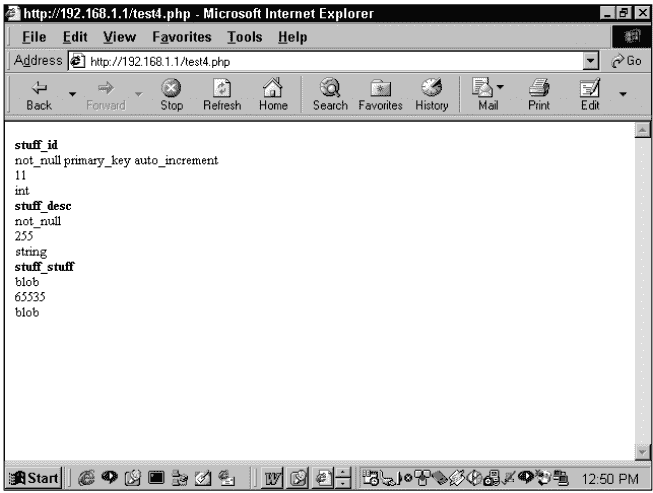

图 6-1：字段描述脚本的结果

请再次注意，你可以使用 MySQL 的描述性查询来实现相同的结果。查询“show columns from table_name”和“describe table_name”可以获取你所需的所有信息，避免使用这些函数。

## 字符串处理函数
在创建基于 Web 的应用程序时，字符串处理和操作是你所使用语言中最关键的任务之一。文本清理和验证极其重要，而良好的 Web 中间件会使处理文本相对容易。PHP 在这方面表现出色：它包含内置函数，涵盖了你想对文本进行的大多数操作。

事实上，这里涵盖的函数远不止这些。截至 PHP 4.0.2，http://www.php.net/manual/ref.strings.html 上列出了 70 个字符串处理函数。本书只能涵盖其中一部分。我们将涵盖在第三部分和第四部分创建应用程序过程中使用的所有字符串处理函数，并介绍一些我们没有机会使用的其他值得注意的函数。

## 本书中使用的字符串函数
我认为从一个能清楚展示 PHP 为何如此酷炫的函数开始会很不错。

## STRIP_TAGS()  此函数会移除 HTML 和 PHP 标签。
```
string strip_tags (string str [, string allowable_tags])
```

你在编写的每个基于 Web 的应用程序中都需要做的一件最重要的事情，就是确保网页用户没有传递恶意文本。正如我们在第 8 章中所讨论的，如果你不小心，你可能会发现页面充满了你不想要的 HTML 标签（、<div> 等）或 JavaScript。你也可能遇到大麻烦，如果某个黑客决定在你的表单字段中塞入类似 <script> alert("you stink");</script> 的内容。

strip_tags() 函数将移除所有 HTML 和 PHP 标签，除非在第二个参数中明确允许。如果想允许 <b> 和 <i> 标签，你可以使用以下方式：

```
strip_tags($str, "<b><i>")
```

## ADDSLASHES()  此函数旨在与你的数据库插入和更新查询一起使用。
```
string addslashes (string str)
```

如果你查看一个典型的插入查询，你会看到一个潜在问题：

```
insert into table_name(char_field, numeric_field)
values ('$str', $num);
```

如果 $str 中的值包含类似“ain’t”这样的缩写怎么办？你可能会收到错误，因为撇号会让 MySQL 混淆。你需要转义字符串中所有单引号（'）、双引号（"）和 NULL 的出现。

例如：

```
$str1 = "let's see";
$str2 = "you know";
$str1 = addslashes($str1);
$result = mysql_query("insert into show_stuff
(stuff_desc, stuff_stuff) values('$str1', '$str2')");
echo mysql_affected_rows();
```

因此，鉴于这个潜在问题，你是否需要将所有表单输入信息都通过 addslashes() 处理？不一定。这取决于 php.ini 文件中 magic_quotes_gpc 的设置。如果设置为 on（这是默认值），来自 Get、Post 或 Cookies 的数据会自动转义，因此你无需担心将信息通过 addslashes() 处理。


请务必检查 php.ini 中的 magic_quotes 设置。注意，如果设置为 yes，magic_quotes_runtime 将自动为查询和文件返回的数据添加斜杠。有关 magic_quotes 设置的更多讨论，请参阅附录 B。


除了此处列出的字符外，如果要将它们放入 MySQL 数据库中，还有一些其他字符需要转义。你可以在以下 URL 查看完整列表：http://www.mysql.com/documentation/mysql/bychapter/manual_Reference.html。如果你想要一个能自动转义这些字符的小 PHP 函数，请参阅附录 G 中的 mysql_escape_string() 函数。

## STRIPSLASHES() 此函数将移除由 magic_quotes_gpc 或 addslashes() 插入的斜杠。
```
string stripslashes (string str)
```

为什么这可能是必要的呢？假设你对一些表单输入进行了验证并且验证失败。你可能希望将用户最初在表单中输入的值回显给用户。但如果你在 magic_quotes 打开的情况下这样做，并且用户在表单中输入了需要转义的文本，转义反斜杠将会显示给用户。这不是一件好事。有关 magic quotes 的更多信息，请参阅附录 B。

## STR_REPLACE() 此函数用第二个参数中的字符串替换第一个参数的所有出现。
```
string str_replace (string to search for, string to replace with, string to be affected)
```

例如，如果我们想打印出本书两位作者的名字，以下代码可行：

```
$str = "This book written by Brad. Brad wrote a nice book.";
$str = str_replace("Brad", "Brad and Jay", $str);
echo $str;
```

这将打印出：“This book written by Brad and Jay. Brad and Jay wrote a nice book.”


## SUBSTR_REPLACE()

这个函数对第一个参数中的字符串进行操作。要操作的字符串部分将由第三和第四参数中的数字标识。

```
string substr_replace (string string, string replacement, int start
[, int length])
```

第三参数应为你希望开始的字符的偏移量。第四参数是可选的，可以有一个整数，表示第三参数之后的字符数。如果第四参数为负数，则该部分将从字符串末尾确定。

例如：

```
echo substr_replace("this are my string", "this is", 0,8);
```

将打印 “This is my string”。且：

```
echo substr_replace("this is my string", "new string!", 11,-1);
```

将打印 “This is my new string!”。

## STRCMP()

这个函数比较两个字符串。

```
int strcmp (string str1, string str2)
```

如果第一个字符串大于第二个字符串，函数将返回大于 0 的数字。它将返回小于 0 的数字，如果第二个字符串大于第一个字符串。

## STRLEN()

这个函数返回一个整数，表示字符串中的字符数。

```
int strlen (string str)
```

例如：

```
echo strlen("My String");
```

将打印 “9”。

## STRPOS()

这个函数返回第二个参数中字符串在第一个参数中的位置。如果找不到字符串，它将返回 FALSE。

```
int strpos (string to search, string to find [, int offset])
```

例如：

```
$str = "Where is the first space";
echo strpos($str, " ");
```

这将返回 “5”。如果你想获取第五个字符之后的首个空格，你可以使用可选的第三参数。

```
$str = "Where is the first space";
echo strpos($str, " ", 6);
```

这将返回 “8”。

有趣的说明：假设你想测试一个字符串是否包含特定字符，比如空格。你可能会认为以下代码可行，因为如果在第二个参数中找不到字符串，strpos() 会返回 FALSE。

```
if( strpos($str, " ") )
{
    echo "thank you for including a space";
} else
{
    echo "include a space, please";
}
```

但是，如果你还记得第 5 章，值为零也会被测试为 FALSE。因此在前面的代码中，如果 $str 以空格开头，条件将被评估为 FALSE。因此，如果你想使用这样的测试，你需要修改条件。在 PHP 4 中，你可以对常量 FALSE 进行测试。例如，

```
$str = " Whereisthefirstspace";
if( strpos($str, " ")==FALSE )
{
    echo "you have not included a space.";
} else
{
    echo "thank you for the space.";
}
```

## STRRPOS()
这与 strpos() 函数类似，只是它查找第二个参数中字符的最终位置。

```
int strrpos (string to search, char to find)
```

例如：

```
$str = "Where is the final space";
echo strrpos($str, " ");
```

将返回 “18”。

## SUBSTR()
这个函数根据数字偏移量返回字符串的一部分。

```
string substr (string string, int start [, int length])
```

例如：

```
echo substr("this is my string", 5);
```

将返回第五个字符之后的所有内容。在本例中为 “is my string”。可选的第三参数可以表示要返回的字符数，位于第三参数之后。例如

```
echo substr("this is my string", 5,2);
```

将返回 “is”。第四参数中的负数指定字符串末尾的字符。例如，

```
echo substr("this is my string", 5,-7);
```

将打印 “is my”。


substr 函数与 strpos() 和 strrpos() 等函数配合使用效果非常好。

## STRREV()
这个函数反转字符串的顺序。

```
string strrev (string string)
```

在你的编程生涯中，strrev() 的使用可能并不常见。在本书中，它在信用卡验证算法中使用。

## STRTOLOWER()
这个函数将整个字符串转为小写。

```
string strtolower (string str)
```

当你处理类似文件名的内容时，它特别有用。由于 Unix 文件名区分大小写，你可能希望确保你编写的所有文件都使用小写字母。我们在处理密码时也会使用此函数。

## STRTR()
这个函数取第一个参数中的字符串，并将第二个参数中的每个字符翻译为第三个参数中对应的字符。

```
string strtr (string str, string from, string to)
or
string strtr (string str, associative array)
```

因此在下面，每个 a 将被转换为 i，每个 o 将被转换为 u。

```
strtr ($str, "ao", "iu")
```

请注意，它一次性完成所有替换。例如，给定以下代码

```
$str = "i";
echo strtr($str, "iu", "uv");
```

你可能会认为这个函数会先将 “i” 转换为 “u”，然后将 “u” 转换为 “v”。事实并非如此。它会批量进行替换，因此此操作的输出为 “u”。

这个函数也可以只使用两个参数工作。在这种情况下，第二个参数应为关联数组。然后字符串中每个键将被其对应的值替换。

```
$str = "this is my strings";
$replace_array = array("this"=>"these", "is"=>"are");
echo strtr($str, $replace_array);
```

这段代码打印 “these are my strings”。

再一次，替换是批量进行的。如果你要在前面的数组中添加第三个元素 “these”=>“those”，你就不必担心单词 “this” 先被改为 “these”，然后再被改为 “those”。

## UCFIRST()
这个函数将字符串中的第一个字符转为大写。

```
string ucfirst(string str);
```

请注意，它不会改变第一个字符之后的内容。因此，如果你想确保字符串中仅第一个字符被大写，你必须这样做。

```
$str = "this is My string";
echo ucfirst(strtolower($str));
```

这将打印出 “This is my string”。

## UCWORDS()
这个函数将字符串中每个单词的第一个字符转为大写。

```
string ucwords(string str);
```

与 ucfirst() 类似，ucwords() 不会更改不以单词开头的字符。

## TRIM()
这个函数从字符串的开头和结尾删除任何空白字符，包括回车符、换行符、空格和制表符。

```
string trim (string str)
```


PHP 还有 ltrim() 函数可用于仅从字符串开头删除空白，或 chop() 函数可用于仅从字符串末尾删除空白。

## HTMLSPECIALCHARS()
这个函数将 <、>、& 和 " 转换为其正确的 HTML 实体：&lt;、&gt;、&amp; 和 &quot;。

```
string htmlspecialchars (string string)
```

这个函数对于向浏览器打印 HTML 源代码很有用。


除了 htmlspecialchars() 之外，你还可以使用 htmlentities()。htmlentities() 将每个具有 HTML 实体的字符进行转换。例如，版权符号会被转换为 &copy;。

## GET_HTML_TRANSLATION_TABLE()
这个函数获取具有 HTML 实体的完整字符列表，或仅 htmlspecialchars() 使用的那些字符。你可以通过在函数中包含 HTML_ENTITIES 或 HTML_SPECIALCHARS 来指示你需要访问的内容。例如 get_html_translation_table(HTML_ENTITIES) 获取字符及其实体的完整列表。

每个字符及其实体在关联数组中作为 key=>value 对提供。 resulting array 可与 strtr() 函数一起使用。

## NUMBER_FORMAT()
这个函数按你的规范格式化数字。

```
string number_format (float number, int decimals, [[string dec_point], [string thousands_sep]])
```

第一个参数将是你希望格式化的数字。第二个参数将说明你希望小数点后有多少位数字。你可以用这两个参数使用此函数。例如，

```
echo number_format( (10/3), 2 );
```

将打印 “3.33”，且

```
echo number_format(1000,2);
```

将打印 “1,000”。请注意，如果有两个参数，number_format() 会包含逗号作为千位分隔符。

在第三和第四参数中，你可以分别包含小数点分隔符和千位分隔符。例如，

```
echo number_format( 10000.67, 2, "&", "R");
```

将打印 10R000&67。


> 如果 number_format() 不够用，你可以使用 PHP 的 sprintf()、printf() 和 scanf() 函数。如果你有 Perl 或 C 背景，你可能知道这些函数的工作原理。它们功能强大、复杂，需要花费大量时间来熟悉。如果你想熟悉这些函数，请查看 PHP 手册 (http://www.php.net/manual/function.sprintf.php) 和本教程：http://wdvl.com/Authoring/Scripting/Tutorial/perl_printf.html。

## HELPFUL STRING FUNCTIONS NOT USED IN THIS BOOK

只是因为我们没有使用它们并不意味着你不会使用。并且完全有可能我们没有涵盖的内容会完美地满足你的需求。请查看 PHP 手册以获取完整列表。


### NL2BR()
该函数在字符串中每个换行符（`\n`）后添加一个 HTML 换行（`<br>`）。

```
string nl2br (string string)
```

请注意，经过此函数处理后换行符仍会保留。例如，以下代码

```
$str = "jay
john
bob
stan";

echo nl2br($str);
```

将打印以下内容（请注意，这是结果页面的 HTML 源代码）：

```
jay
<br>
john
<br>
bob
<br>
stan
```

### STRTOUPPER()
该函数将整个字符串转换为大写。

```
string strtoupper (string string)
```

### MD5()
md5() 是一种单向算法，用于加密信息。

```
string md5 (string str)
```

该函数常用于密码。如果你将密码放在文本文件中，那么拥有（合法）系统访问权限的人可能会查看密码。然而，如果你将其通过 md5() 处理，正确的密码就无法得知。例如，md5("jay") 是 baba327d241746ee0829e7e88117d4d5。如果这是文本文件中输入的内容，那么有权查看数据库的人将不知道正确的密码是什么。

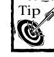

安全的密码会比“jay”复杂得多。破解者可以（并且会）将整个字典通过 md5() 运行，以查看是否有东西可以进入系统。


md5() 仅为单向。无法解密它。如果你对双向加密感兴趣，请查看 PHP 手册中的 mcrypt 函数：http://www.php.net/manual/ref.mcrypt.php。

## 正则表达式函数
正则表达式提供了一种复杂模式匹配的方法。如果你对正则表达式的概念还不熟悉，请考虑以下问题：鉴于迄今为止你所见的字符串处理函数，如何在每 45 个字符后插入一个换行和一个换行符 (\n<br>)？或者如何判断一个字符串是否包含至少一个大写字母？你可能能够做到，但不会很漂亮。

顺便说一下，以下代码将解决前面两个问题。

//insert \n<br> after each 45 characters
$new_str = ereg_replace("(.{45})", "\\1\n<br>", $str);

//check if string contains uppercase letter
if (ereg("[A-Z]", $str))
{
    echo "yes it does.";
}
这些语句乍一看可能有点晦涩，但使用一段时间后，你会逐渐喜欢上它们提供的便利性。


请参阅附录 F，了解正则表达式的工作原理概述。

请注意，正则表达式比字符串处理函数慢得多。因此，如果你例如有一个不需要正则表达式的简单替换，请使用 str_replace() 而不是 ereg_replace()。

## 本书使用的正则表达式函数
以下正则表达式函数在本书中的应用程序中使用。

### EREG()
测试字符串是否匹配正则表达式。

```
int ereg (string pattern, string string [, array regs])
```

你可以用两种方式使用此函数。首先，你可以将正则表达式放在第一个参数中，并在第二个参数中搜索其是否存在。函数将根据搜索结果返回 TRUE 或 FALSE。例如：

```
if ( ereg("^http://.*", $str) )
{
    echo "This is a URL";
}
```

可选的第三个参数是一个由正则表达式创建的数组。正则表达式中将成为数组元素的部分由正则表达式中的括号表示。

```
ereg("(....)-(..)-(..)", $publish_date, $date_array);
```

此示例取自 Content Manager 应用程序，创建一个名为 $date_array 的数组，其中第一个元素将是正则表达式匹配的完整字符串。数组中的接下来三个元素将是括号指示的部分。因此 $date_array[1] 将包含 4 个字符，而 $date_array[2] 和 date_array[3] 各包含 2 个字符。

请注意，由 ereg() 中第三个参数创建的数组始终包含 11 个元素。即使括号内有超过十个子字符串，也只有前 10 个会被放入数组中。如果子字符串少于 10 个，数组仍将包含 11 个元素。如果你想测试数组元素中是否存在任何内容，你必须与空字符串 ("") 进行测试。isset() 将始终测试为 TRUE。

因此，在运行以下代码后：

```
$publish_date = "2000-10-02";
ereg("(....)-(..)-(..)", $publish_date, $date_array);
```

$date_array 将包含以下内容：

```
[0] => 2000-10-02
[1] => 2000
[2] => 10
[3] => 02
[4] =>
[5] =>
[6] =>
[7] =>
[8] =>
[9] =>
```

请注意，ereg() 执行区分大小写的匹配。

### EREGI()
此函数是 ereg() 的不区分大小写版本。

```
int eregi (string pattern, string string [, array regs])
```

### EREG_REPLACE()
你可以使用此函数基于复杂的字符串模式进行字符串替换。

```
string ereg_replace (string pattern, string replacement, string string)
```

例如，如果你想从 URL 中删除查询字符串，可以使用以下方法：

```
$url= "http://www.phpmysqlbook.com/index.php?var=hello";
$parsed_url = ereg_replace("\?.*$", "",$url);
echo $parsed_url;
```

这将打印 http://www.phpmysqlbook.com/index.php。此正则表达式匹配问号，以及之后直到行尾的所有字符。问号必须用反斜杠转义，因为它对正则表达式有特定含义。在问号之后，我们匹配任意数量的字符，直到美元符号，即行尾字符。它需要用反斜杠转义，因为如果没有反斜杠，PHP 会认为该字符代表变量。

但通常你需要比这多一点的功能。如果你在替换字符串中想保留正在搜索的字符串怎么办？或者如果你的搜索包含由括号集分隔的不同部分怎么办？这里有一个简单示例。我们想通过在字符串中当前两个 name=value 对之间放置一个额外的 name=value 对来替换当前的查询字符串。也就是说，我们想在“var=hello”之后和“var2=yup”之前放置“newvar=here”。

```
$url= "http://www.phpmysqlbook.com/index.php?var=hello&var2=yup";
$parsed_url = ereg_replace("(\?.*&)" , "\\1newvar=here&",$url);
echo $parsed_url;
```

这会创建以下字符串：

```
http://www.phpmysqlbook.com/index.php?var=hello&newvar=here&var2=yup
```

这里单组括号表示第 1 部分。然后，通过使用 \1 记号，我们可以将该部分包含在新创建的字符串中。如果通过额外的括号指示了多个部分，你可以通过指出需要哪个部分将其他部分回显到结果中。

```
$url= "this is a test ";
$parsed_url = ereg_replace("(this.*).*(test)", "\\1 regular expression \\2",$url);
echo $parsed_url;
```

这些命令的结果是：“this is a regular expression test”。

正则表达式匹配“this” 和 “test” 之间的所有内容。我们使用括号来表示以“this”开始并移动到字母“a”的子字符串。下一个 .* 部分匹配任意数量的字符。最后，“test”是另一个子字符串。这些子字符串在第二个参数中回显，其中 \1 回显第一个子字符串，\2 回显第二个子字符串。

正则表达式匹配区分大小写。

### EREGI_REPLACE()
这与 eregi_replace() 相同，只是匹配不区分大小写。

## 本书未使用的正则表达式函数
以下正则表达式函数虽然在本书示例中未使用，但仍然有用。

### SQL_REGCASE()
这个巧妙的小函数会修改字符串，使你可以在不区分大小写的正则表达式中使用它们。

```
string sql_regcase (string string)
```

如果你在不支持不区分大小写正则表达式的数据库服务器中进行正则表达式搜索，这可能会有用。它可以免去你必须将字符串中的每个字符都同时输入大写和小写字母的麻烦。例如：

```
echo sql_regcase("this string");
```

生成：

```
[Tt][Hh][Ii][Ss] [Ss][Tt][Rr][Ii][Nn][Gg]
```

## Perl 兼容正则表达式 (PCRE)
多年来，世界各地的 Perl 程序员拥有与其他正则表达式不同的正则表达式。如果你有一些 Perl 经验，你很可能已经喜欢上这些正则表达式赋予你的额外能力。如果你没有 Perl 背景，你可能会喜欢学习一些特性。

PCRE 是一个相当大的主题，附录 F 仅简要解释。然而，如果你想在学习 Perl 的正则表达式及其如何为你工作方面获得良好的起点，以下 URL 的信息是很好的阅读材料：http://www.perl.com/pub/doc/manual/html/pod/perlre.html。PHP4 手册中也有关于 Perl 正则表达式的不错描述：http://www.php.net/manual/pcre.pattern.syntax.html。


使用 PCRE 函数的主要原因是它们让你在“贪婪”与“非贪婪”匹配之间做出选择。以下是一个快速示例，请看下面的字符串。

```
$str = "I want to match to here. But end up matching to here"
```

使用 ereg() 或 ereg_replace() 时，没有办法从“I”匹配到“here”的第一次出现。以下代码不会像你期望的那样工作：

```
$str = "I want to match to here. But end up matching to here";
$new_str = ereg_replace("I.*here", "Where", $str);
echo $new_str;
```

这将打印“Where”且没有其他内容。整个字符串将被替换。使用 ereg_replace() 没有办法指示你想要匹配到“here”的第一次出现。然而，使用 preg_replace()，你可以这样做：

```
$str = "I want to match to here. But end up matching to here";
$new_str = preg_replace("/I.*?here/", "Where", $str);
echo $new_str;
```

在此实例中，.*? 表示“匹配所有字符直到第一次出现”。

## 本书中使用的 PCRE 函数

### PREG_MATCH()

这与 ereg() 函数类似，因为你可以将可选的第三个参数赋值为匹配的子模式数组（如果在正则表达式中找到了）。preg_match 返回找到的模式匹配数，如果未找到则返回 False。

```
int preg_match (string pattern, string subject [, array matches])
```

### PREG_REPLACE()

这基于 Perl 正则表达式进行替换。

```
mixed preg_replace (mixed pattern, mixed replacement, mixed subject
[, int limit])
```

这与 ereg_replace() 类似，不过这里的模式必须是 Perl 正则表达式。它还可以使用 \digit 将匹配的子字符串回显到结果中。可选的第四个参数将限制 preg_replace 所做的替换次数。

```
preg_replace("/[<br>&nbsp;\s]*$/i","",$body);
```

此示例取自内容管理系统应用程序，将删除所有出现换行符（<br>）、不间断空格（&nbsp;）或空白（空格、制表符、换行符）连续出现的情况。此替换不区分大小写（“i” 标志决定这一点），以确保同时匹配 <BR> 和 <br>。

方括号表示方括号内的任何内容将开始匹配。星号表示如果第一个匹配后的字符也是方括号内字符之一，则模式匹配并应进行替换。

## 本书中未使用的 PCRE 函数

我们未使用以下几个 PCRE 函数来创建这些应用程序。它们是：
- `preg_match_all`
- `preg_quote()`
- `preg_grep()`

请参阅在线手册了解其用法。请注意，我们将在下一节讨论 `preg_split()`。

## 类型转换函数

这是一个我自己创建的类别。在手册中，这些函数会归入其他标题下。然而，我们认为这些函数的专业性质需要一个独特的类别。

第 4 章详细讨论了 PHP 变量，包括 PHP 灵活的变量类型。如果你还记得，如果你需要将字符串作为整数进行求值，可以使用 `intval()` 函数。有关类似的变量转换函数，请参阅第 4 章。

但有时变量转换会更极端，将字符串转换为数组并将数组转换回字符串。你可能会问，为什么要这样做？考虑以下字符串：

```
24,16,9,54,21,88,17
```

所以你有一个整数字符串，也许是从文本文件中检索到的。你将如何按升序对其进行排序？如果必须将其作为字符串处理，代码会变得非常糟糕。然而，如果你可以使用众多的数组函数，生活会容易得多。你可以简单地使用 `sort()` 函数。看一下：

```
$str = "24,16,9,54,21,88,17";
//turn $str into an array
$array = explode(",", $str);
//sort the array in ascending order
sort($array, SORT_NUMERIC);
//turn the array back into a string and print
$new_str = implode(",", $array);
echo $new_str;
```

这将打印：

```
9,16,17,21,24,54,88
```

稍后将详细介绍 sort() 函数。

## 本书中使用的类型转换函数

以下类型转换函数在本书示例中使用。

### EXPLODE()

此函数将字符串转换为数组。

```
array explode (string separator, string string [, int limit])
```

第二个参数是你希望拆分为数组的字符串。第一个是分隔不同元素的字符或字符。在上面的示例中，字符串以逗号分隔。

第三个参数限制结果数组中的元素数量。如果你使用以下代码

```
$str = "24,16,9,54,21,88,17";
//turn $str into an array
$my_array = explode(",", $str, 3);
```

$my_array 将有三个元素：$my_array[0] => 24 $my_array[1] => 16 $my_array[2] => 9,54,21,88,17。你可以看到最后一个元素包含原始字符串的剩余部分。如果你只想对字符串中的前三个元素进行排序并丢弃其余部分，你可以这样做：

```
$str = "24,16,9,54,21,88,17";
//turn $str into an array
$array = explode(",", $str, 4);
unset($array[3]);
sort($array, SORT_NUMERIC);
echo implode(",", $array);
```

如果字符串分隔符不存在，整个字符串将被放在数组元素零中。如果字符串不存在，则空字符串将被放在第一个元素中。

### IMPLODE()

正如你所期望的，implode() 是 explode() 的相反操作：它将数组转换为字符串。

```
string implode (string glue, array pieces)
```

第一个参数是分隔字符串元素的字符串。第二个是要分隔的数组。

使用 implode() 的一个好例子是在运行 SQL 删除命令的页面中。假设在某个页面中你展示了一系列复选框以指示你希望从数据库中删除的行。你可能希望将要删除的元素作为数组传递。在执行删除的页面中，你可以运行如下脚本：

```
//say $delete_items comes from an HTML page and
//contains (1,3,7)
if( is_array($delete_items) )
{
    $str = implode(".", $delete_items);
    $query = "delete from table where item_id in ($str)";
    mysql_query($query);
}
```

### SPLIT()

split 函数与 explode 做同样的事情，但它允许你指定正则表达式作为分隔字符串。

```
array split (string pattern, string string [, int limit])
```

如果想要基于多个元素分隔字符串，这可能会派上用场。假设你有一个字符串需要作为数组，其元素可以由换行符或制表符分隔。以下代码即可实现：

```
//note there is a tab between 524 and 879
//and a tab between 879 and 321
$items = "524    879    321
444
221";
$array = split("[\n\t]", $items);
```


split() 比 explode() 更灵活，但也更慢。

### PREG_SPLIT()

这与 split() 类似，只是它使用 Perl 正则表达式作为模式。

```
array preg_split (string pattern, string subject [, int limit [, int flags]])
```

请注意，如果标志为 PREG_SPLIT_NO_EMPTY，则空项不会被放入数组中。

再次强调，如果 explode() 可以做到，请务必使用它。

## 本书中未使用的类型转换函数

除了上一节中的函数外，你还可以使用 spliti()，它使用不区分大小写的模式匹配。

## 数组函数

我是 PHP 4 中可用数组函数的忠实粉丝。你想对数组做的几乎任何事情都可以用内置函数完成。PHP 的开发人员做得很好，确保你很少需要遍历数组。

在 PHP 4.0.2 手册中，列出了恰好 47 个数组函数。到你阅读本章时，很可能已经有更多函数。因此，请务必查阅手册以了解所有可用数组函数的完整范围。


请参阅第 5 章，了解如何创建、添加以及遍历数组。

## 本书中使用的数组函数

当处理数据库应用程序时，你的大部分逻辑应包含在 SQL 语句中。因此，在本书中介绍的应用程序中，所需的数组函数相当少。以下是我们使用的函数概述。

### ARRAY_FLIP()

此函数在关联数组中很有用，它交换键和值。也就是说，键变为值，值变为键。

```
array array_flip (array trans)
```

这在本书中出现一次，在以下代码中：

```
$trans = array_flip(get_html_translation_table(HTML_ENTITIES));
$title = strtr($title, $trans);
```

在 array_flip() 函数之前，数组将返回许多元素。以下是几个示例：

```
[(c)] => &copy
[(r)] => &reg
```

翻转数组后，这些条目看起来会像这样：

```
[$copy] => (c)
[&reg;] => (r)
```

然后 strtr() 会用其键替换每个值。因此最终这段代码会确保任何需要用 HTML 实体表示的字符都会被处理。

注意，如果在翻转前数组有两个相同的值，则在翻转后的数组中只能保留一个。你不能有两个具有相同键的数组元素。如果发生冲突，则最右侧位置的元素将被保留。

### ARRAY_MERGE()

正如你可能猜到的，这个函数合并或连接两个或多个数组。

```
array array_merge (array array1, array array2 [, array ...])
```

如果任何数组包含相同的关联键，则最右侧数组中的元素将被保留。

### ARRAY_SPLICE()

这个函数取第一个参数指定的数组并删除从第二个参数指定的偏移量开始的所有元素。然后它可以插入额外的元素。

```
array array_splice (array input, int offset [, int length [, array replacement]])
```

如果偏移量为正数，则元素将从左侧计数；如果偏移量为负数，则指示数字左侧的所有项目将被删除。可选的第三个参数可以指示在偏移量之后你希望删除多少个元素。例如：

```
$knicks_array = array ("Childs", "Sprewell", "Ewing",
"Johnson","Houston");
array_splice($knicks_array, 2,1);
```

将从偏移量 2 开始删除元素并且只删除一个元素。所以 “Ewing” 将从此数组中删除。array_splice() 还允许你用另一个数组替换已删除的部分。因此，为了考虑交易，你可以这样做。

```
$knicks_array = array ("Childs", "Sprewell", "Ewing",
"Johnson","Houston");
$new_knicks = array ( "Longley","Rice");

array_splice($knicks_array, 2,1,$new_knicks);
```

执行此代码后，$knicks_array 将包含六个元素：Childs、Sprewell、Longley、Rice、Johnson、Houston。

请注意，此函数返回的值是已删除项目的数组。在下面的代码中，$traded_knicks 将是一个包含一个元素 “Ewing” 的数组。

```
$traded_knicks = array_splice($knicks_array, 2,1);
```

### COUNT()

这会返回数组中的元素数量，并且经常与循环一起使用。

```
int count (mixed var)
```

例如：

```
$array = array(1,2,3,4,5);
for($i=0; $i<count($array); $i++)
{
    echo $array[$i] . "<br>\n";
}
```

请注意 sizeof() 是 count() 的别名。

## 本书未使用的数组函数

再次说明，PHP 4 中有许多优秀的数组函数。以下是一些亮点（至少在我看来）。

### ARRAY_COUNT_VALUES()

这个巧妙的函数将返回一个关联数组，其键将是数组中所有的唯一值。

```
array array_count_values (array input)
```

结果数组的值将是一个整数，表示该值在数组中出现的次数。

```
$array = array("yes","no","no","yes","why");
$result = array_count_values($array);
```

执行后 $result 将包含：

```
[yes] => 2, [no] => 2, [why] => 1
```

### ARRAY_DIFF()

如果给定两个数组，此函数将返回在第一个数组中但不在第二个数组中的所有元素。

```
array array_diff (array array1, array array2 [, array ...])
```

例如：

```
$knicks = array("sprewell", "houston", "Ewing", "childs");
$all_stars = array("mourning", "houston", "carter", "davis", "miller");
$non_knick_allstars = array_diff($all_stars, $knicks);
```

请注意，在返回的数组中，元素保留了它们在被取出的数组中的键。因此运行此代码后，$non_knick_allstars 将包含以下内容：

```
[0] => mourning, [2] => carter, [3] => davis, [4] => miller
```

可以向该函数添加额外的数组。例如，

```
$knicks = array("sprewell", "houston", "Ewing", "childs");
$all_stars = array("mourning", "houston", "carter", "davis", "miller");
$non_knick_allstars = array_diff($all_stars, $knicks, array("carter"));
```

这样，“carter” 也将从返回的数组中删除。

### ARRAY_INTERSECT()

这会返回两个（或更多）数组共有的数组元素。

```
array array_intersect (array array1, array array2 [, array ...])
```

### ARRAY_POP()

array_pop() 函数返回数组中的最后一个元素，并从原始数组中删除该元素。

```
mixed array_pop (array array)
```

例如，$array = array(1,2,3,4,5);
$int = array_pop($array);

执行后，$array 将包含 (1,2,3,4)，而 $int 将包含 5。

### ARRAY_PUSH()

此函数将向第一个参数指定的数组添加元素。

```
array_push (array array, mixed var [, mixed ...])
```

附加参数是你希望添加到数组中的值。

```
$array = array (1,2,3);
array_push($array,4,5,6);
```

结果数组将包含 1,2,3,4,5,6。

### ARRAY_RAND()

此函数将从数组中随机挑选一个或多个元素。

```
mixed array_rand (array input [, int num_req])
```

请注意，它不会挑选值；而是挑选所选元素的键。例如，给定以下内容，

```
srand ((double) microtime() * 1000000);
$names = array("jay", "brad", "john", "Jeff");
$rand_keys = array_rand ($names, 2);
```

$rand_keys 将包含一个包含两个数字的数组。要从 $names 数组获取值，你首先需要获取由 array_rand() 提取的键值，因此你需要使用类似这样的内容：

```
echo $names[$rand_keys[0]];
```

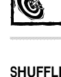

每个脚本中仅播种一次随机数生成器。

### SHUFFLE()

此函数随机化数组中的元素。

```
void shuffle (array array)
```

你需要在使用它之前播种随机数生成器。例如：

```
srand ((double) microtime() * 1000000);
shuffle ($array);
```

### IN_ARRAY()

这个非常方便的函数将搜索数组的所有值，如果在第二个参数的数组中找到第一个参数中的值，则返回 TRUE。

```
bool in_array (mixed needle, array haystack)
```

你可能在想是否有 in_keys() 函数。实际上没有必要有这样的函数，因为以下内容可以起到同样的作用。

```
if(isset($array["key"]))
```

### SORT()

如果没有第二个参数，此函数将按升序或字母顺序对数组进行排序。

```
void sort (array array [, int sort_flags])
```

标志可以是：

- SORT_NUMERIC — 按数值比较项目
- SORT_STRING — 将项目作为字符串比较

如果你要排序的数组只有数字，PHP 将按数值排序数组；如果数组只包含字符串，则将按字母顺序排序。如果数组包含字符串和数字的混合，则默认按字符串排序。

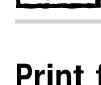

> PHP4 提供了许多其他排序数组的方法。请查看 asort()、ksort()、rsort() 和 usort() 的手册条目。

## 打印函数

有一些函数可用于向屏幕打印信息。本书中只出现了两个，但你应该了解本节列出的所有函数。

## 本书使用的打印函数

在这种情况下，“函数”一词可能有些名不副实。例如，print() 更确切地描述为语言结构。无论如何，你会像使用函数一样使用所有这些；因此，它们被包含在这里。

**PRINT** 正如你所期望的，这会打印你指定的内容。

```
print
```

**ECHO** 这也不是函数，而是语言结构。我们在整本书中不断使用它，所以到现在你可能知道它做什么。

```
echo
```

请记住，你可以在双引号内混合变量和代码。

```
$var = "this string";
echo "Please print $var";
```

然而，在单引号内字符串将被原样处理：

```
$var = "this string";
echo 'Please print $var';
```

前面的代码将打印“Please print $var”。这个概念在第 4 章中有更详细的讨论。


print 与 echo。应该使用哪一个？这在很大程度上是个人偏好问题：使用你认为在页面上看起来更好的那个。两者之间只有一个主要区别，这可能会影响你的决定。echo 可以接受多个参数。也就是说，使用 echo 时，不同的部分可以用逗号分隔。这将有效：

```
echo "this is part 1", "this is part 2";
```

但这将无效：

```
print "this is part 1", "this is part 2";
```

## 本书未使用的 PRINT 函数

这里没有提到它们，但这些非常重要，需要了解。

### PRINTF()
此函数使用 sprintf() 函数描述中指定的格式输出字符串。

### PRINT_R()
这个函数非常适合把你本用来抓头发的时间利用起来。它会将任何变量的全部内容——尤其是数组和对象——打印到屏幕上。

```
void print_r (mixed expression)
```

当我们从数组或对象中得不到预期的结果时，我们经常使用它。


不要执行 print_r($GLOBALS)。你将创建一个无限递归循环。

### VAR_DUMP()
此函数与 `print_r` 的行为类似，但提供的信息更多。

```
void var_dump (mixed expression)
```

除了打印变量的内容外，它还包括数据类型——包括数组或对象中每个元素的数据类型。对 `print_r` 提出的同样警告也适用于 `var_dump()`。

## 日期/时间函数

事实上，在 PHP 和 MySQL 协同工作时，你需要了解两套日期/时间函数——而且它们差别很大。现在不是讨论 MySQL 函数的时候（请参阅附录 I）。PHP 的时间/日期函数设计得非常好。

## 书中使用的日期/时间函数

以下是在本书应用中使用的一些日期/时间函数。

### DATE()
你可以使用此函数和下面列出的指示符来返回日期和时间。

```
string date (string format [, int timestamp])
```

如果包含第二个参数，该值将按你指定的格式进行格式化。否则，将使用当前时间和日期。

> 提示：函数返回的时间和日期基于服务器的时间。你需要使用 JavaScript 来了解客户端计算机的时间。

> 注意：第二个参数通常是 `mktime()` 函数的结果，我们接下来会讨论它。

你可以使用表 6-1 中的任何指示符来格式化日期。

## 表 6-1 DATE() 函数的指示符

| Indicator | Meaning |
|---|---|
| a | am 或 pm |
| A | AM 或 PM |
| B | Swatch Internet 时间 |
| d | 月中的天数，2 位数字带前导零；01 到 31 |
| D | 星期几，文本，3 个字母；例如 Fri |
| F | 月份，文本，长格式；例如 January |
| g | 小时，12 小时制无前导零；1 到 12 |
| G | 小时，24 小时制无前导零；0 到 23 |
| h | 小时，12 小时制；01 到 12 |
| H | 小时，24 小时制；00 到 23 |
| i | 分钟；00 到 59 |
| I [capital i] | 如果是夏令时则为 1，否则为 0 |
| j | 月中的天数无前导零；1 到 31 |
| l (lowercase L) | 星期几，文本，长格式；例如 Friday |
| L | 是否为闰年的布尔值；0 或 1 |
| m | 月份；01 到 12 |
| M | 月份，文本，3 个字母；例如 Jan |
| n | 月份无前导零；1 到 12 |
| s | 秒；00 到 59 |
| S | 英文序数后缀，文本，两个字符；例如 th、nd |
| t | 给定月份的天数；28 到 31 |
| T | 本机的时区设置；例如 MDT |
| U | 自纪元（1970 年 1 月 1 日午夜）以来的秒数 |
| w | 星期几，数字，0（星期日）到 6（星期六） |

## 表 6-1 DATE() 函数的指示符（续）

| Indicator | Meaning |
|---|---|
| Y | 年，四位数；例如 1999 |
| y | 年，两位数；例如 99 |
| z | 一年中的天数；0 到 365 |
| Z | 时区偏移（以秒为单位）(-43200 到 43200) |

例如，如果你想以“September 14, 2000 7:21 pm”的格式打印日期，这就可以做到：

```
echo date("F d, Y g:i a");
```

如果你好奇上面日期的意义：那正是我们撰写本章这一部分的确切时间。

## MKTIME()
此函数最适用于计算有效日期。

```
int mktime (int hour, int minute, int second, int month, int day,
int year [, int is_dst])
```

例如，假设你有一个表单收集日期，也许是当前月份、日期和年份。你想要计算并设置一个恰好在提交日期后 30 天的到期日期。

```
$year = 2000;
$month = 5;
$day = 24;
echo date("l F d, Y", mktime(0,0,0,$month,$day+30, $year) );
```

这将输出 2000 年 5 月 24 日之后的 30 天，并打印出“Friday June 23, 2000。”

请记住，此函数允许你在不担心 PHP 返回虚假结果的情况下添加或减去日期。在前面的示例中，你可以从月份值 5 中减去 6，PHP 将返回一个有意义的日期。你可以添加或减去任意数量的年、月或天，而不必担心 PHP 会返回错误的结果。例如，这是在 1999 年最后一天获取日期信息的一种完全可以接受的方式。

```
$year = 2000;
$month = 1;
$day = 1;
echo date("l F d, Y", mktime(0,0,0,$month,$day-1, $year) );
```

这段代码会告诉你 1999 年 12 月 31 日是星期五。
请注意，前面的代码首先使用 mktime() 计算出指示日期的时间戳，然后使用 date 函数将其打印出来。
如果从右侧省略参数，这些参数将从当前时间戳中获取。因此，要打印五小时后的日期和时间，这就可以做到：

```
echo date("l F d, Y g:i a", mktime( date(H)+5 ) );
```

注意这里的函数嵌套。从最内层的函数开始，首先 date(H) 返回当前小时，采用 24 小时格式。然后在该值上加上五，并计算出五小时后的时间戳。然后使用指定的字符串格式化时间戳。

## TIME()
此函数返回自 Unix 纪元（1970 年 1 月 1 日 00:00:00 GMT）以来的秒数所测量的当前时间。

```
int time(void);
```

## MICROTIME()
此函数返回字符串“msec sec”，其中 sec 是自 Unix 纪元（1970 年 1 月 1 日 0:00:00 GMT）以来的秒数所测量的当前时间，而 msec 是微秒部分。

```
string microtime(void);
```

此函数仅在支持 gettimeofday() 系统调用的操作系统上可用。

返回的字符串看起来像 0.12082400 969034581。使用此函数，你可以合理地确定它永远不会返回相同的数字。它通常用于为随机数生成器播种。

## 书中未使用的日期/时间函数
还有一些其他的时间/日期函数你可能会觉得有用。它们包括几个用于打印当前日期和时间的功能。如果你需要了解这里未讨论的特定内容，请查看手册：http://www.php.net/manual/ref.datetime.html。

## 文件系统函数
PHP 拥有整套函数，可让你操作主机计算机上的文件和目录。在为本书创建应用程序的过程中，只有一次需要将文件写入文件系统或从文件系统获取文件：在目录（和购物车）中，我们需要存储已上传的图像时。

但如果你经常使用 PHP，毫无疑问你需要熟悉这些函数。作为介绍，我们要说 PHP 中的目录和文件系统函数非常出色。程序员们真的做得很好，让在本地系统或互联网其他地方工作文件变得轻而易举。举个快速例子，写这个脚本大约花了两分钟，它将从一个我们出于法律原因不指定的网站获取股票报价。

```
$farray = file("http://domain.com/stockquote?symbols=ORCL", "r");
foreach ($farray as $value)
{
    if( ereg("last:.*$", $value) )
    {
        $value = strip_tags($value);
        break;
    }
}
```

这个简短的脚本抓取整个页面并将每一行分配给 $farray 中的一个元素。然后我们遍历数组查找字符串“last”。在我们测试的网站上，单词“last”表示最近的报价。我们所要做的就是去掉 HTML 标签，就获得了所需的所有信息。如果我们愿意，还可以进行更多字符串处理来按我们喜欢的方式格式化信息。

## 书中使用的文件系统函数
如果你想看到它们的使用情况，请查看第 10 章和第 14 章。

### FOPEN()
这会在第一个参数中打开指向指定文件或 URL 的文件指针。（该指针与 mysql_connect() 返回的结果标识符非常相似。）

```
int fopen (string filename, string mode [, int use_include_path])
```

模式将决定你能对文件做什么。表 6-2 显示了可用的模式。


## 表 6-2 FOPEN() 函数的模式

| 模式 | 含义 |
|------|---------|
| r | 仅用于只读打开；将文件指针置于文件开头。 |
| r+ | 用于读写打开；将文件指针置于文件开头。 |
| w | 仅用于写打开；将文件指针置于文件开头并将文件截断为零长度。如果文件不存在，尝试创建它。 |
| w+ | 用于读写打开；将文件指针置于文件开头并将文件截断为零长度。如果文件不存在，尝试创建它。 |
| a | 仅用于写打开；将文件指针置于文件末尾。如果文件不存在，尝试创建它。 |
| a+ | 用于读写打开；将文件指针置于文件末尾。如果文件不存在，尝试创建它。 |

请注意此函数返回一个资源标识符。如果您想从文件读取或写入文件，您需要做类似这样的操作：

//open a file and read contents into a variable
$filename="test99.txt";
$fp = fopen($filename, "r+") or
die("could not open file");
$contents = fread ($fp, filesize($filename));
//replace all occurrences of Jayson
$new_contents = str_replace("Jayson", "Jay", $contents);
//write out new file contents.
rewind($fp);
fwrite($fp, $new_contents);
//ftruncate assures there wont be extra
//characters if the resulting file is shorter
//than the original.
ftruncate($fp,ftell($fp));
fclose($fp);

### FCLOSE() 此函数关闭文件指针。

```
int fclose (int fp)
```

确保在完成文件使用后使用它。如果不使用，PHP 会为您处理，就像 `mysql_close()` 一样。

### FEOF()

此函数测试文件指针是否已到达文件末尾。

```
int feof (int fp)
```

请参阅 `fgets()` 函数以了解 `feof()` 的示例。

### FGETS()

此函数从文件指针指示的文件（通常取自 `fopen`）返回单行。

```
string fgets (int fp, int length)
```

如果您正在处理大文件，逐行将文件加载到内存中对系统来说更容易，而不是像使用 `fread()` 那样一次性加载大块数据。此函数会读取一行直到换行符。 optionally，您可以在第二个参数中指定一行内要读取的最大字节数。第二个参数传统上使用 2048，因为在许多文件系统中那是最大行长度。如今，使用更大的值是安全的。您不应该将此函数用于二进制文件。

```
$fp = fopen("/path/to/file","r");
while ($fp && !feof($fp))
{
    print fgets($fp,2048);
}
fclose($fp);
```

### FILE()

此函数逐行读取文件，每行成为数组中的一个元素。

```
array file (string filename [, int use_include_path])
```

### UMASK()

此函数设置 umask 值（如果您不知道这是什么，请参阅您的 Unix 手册页）。

```
int umask (int mask)
```

umask() 将 PHP 的 umask 设置为 mask & 0777 并返回旧的 umask。

### COPY()

此函数复制第一个参数中的文件并将其复制到第二个参数的位置。

```
int copy (string source, string dest)
```

如果复制成功，函数返回 True。如果不成功，返回 False。此函数在第 10 章中使用。

### TEMPNAM()

这会在第一个参数指示的目录中创建一个唯一的文件名。

```
string tempnam (string dir, string prefix)
```

第二个参数中的字符串前缀将被放在每个文件名之前。这可以帮助您跟踪哪些文件属于哪些脚本。


> 在 Windows 上，此函数的行为可能有点不可预测。

### DIRNAME()

此函数将返回所提供字符串的目录名。

```
string dirname (string path)
```

例如：

```
echo dirname("/www/htdocs/testwrite.txt");
```

将返回 /www/htdocs。

## 本书未使用的文件系统函数

这是一个重要主题，您应该花一些时间学习。大多数更受欢迎的文件系统命令都可以通过 PHP 使用，并且有许多用于打开、读取、写入和显示文件的命令。但是，由于本书涉及关系数据库用于数据存储，我们在这里不会介绍它们。

## 随机数生成器函数

时不时地您需要随机选择一些东西。它可能是一个单独的元素，也可能与使用 shuffle() 随机化数组或使用 array_rand() 从数组中获取随机元素有关。在任何情况下，您都需要使用 PHP 的随机数生成器函数。

请注意，随机数生成器在使用前需要播种。也就是说，它必须一开始就被赋予一个相当独特的数量。为此，正如您将看到的，microtime() 函数将非常有用。

请记住，实际上有两组随机数生成器。有标准的 rand() 和 srand()，您需要它们来为 shuffle() 和 array_rand() 播种生成器。但是，如果您只是想获取一个随机数而不与其他函数一起使用，请使用下面描述的 mt 函数——它们更快更随机

## 本书使用的随机数生成器函数

现在我们将检查一些在本书记述的应用中未使用的重要的随机数生成器函数。

### MT_SRAND()

此函数为您的随机数生成器播种。

```
void mt_srand (int seed)
```

使用以下行，您可以确保您的数字足够随机：

```
mt_srand ((double) microtime() * 1000000);
```

仅在每个脚本中播种一次随机数生成器。

### MT_RAND()

此函数返回一个随机数。您可以指定最小值和/或最大值。

```
int mt_rand ([int min [, int max]])
```

因此，要获取 1 到 100 之间的随机数，请执行以下操作：

```
mt_srand((double)microtime() * 1000000);
$number = mt_rand(1,100);
echo $number;
```

## cURL 函数

这些在第 14 章中有详细说明。cURL 是一个允许服务器使用各种协议进行通信的库。就本书中的应用程序而言，cURL 最有用的地方在于它能够与 HTTPS 通信。这是一种安全协议，用于购物车进行信用卡交易。

## 会话函数

这些在第 14 章中有详细说明。会话是维护页面之间状态的手段。请记住，HTTP，即 Web 的语言，不允许服务器在特定用户的页面请求之间记住太多东西。会话允许服务器跟踪单个用户的活动。

## HTTP 头函数

有两个至关重要的 HTTP 头函数，您都需要了解。

### HEADER()

如果您将与浏览器或其他 HTTP 服务器通信，这是要使用的函数。

```
int header (string string)
```

本质上，您可以发送 RFC 2616 (ftp://ftp.isi.edu/in-notes/rfc2616.txt) 下预期的任何头。RFC 本身就很庞大（也许是您今年会做的最枯燥的阅读）。以下是您可能会发送的常见头。

```
header("Location:http://www.php.net");
```

这不过是一个重定向：它将浏览器发送到您指定的页面。如果您一直在使用纯 HTML 和 <META type=refresh> 标签或 JavaScript 来执行重定向，您应尽可能切换到这种类型的头。它适用于所有浏览器，重定向对用户来说是完全透明的。


IMPORTANT：不，说得更重要一点。您不能在任何内容 — 任何内容 — 发送到浏览器后发送头。如果您在硬回车后发送头，将会出错。如果在打开的 <?php 标签之前有硬回车，您将收到错误。如果在包含文件中有硬回车且该文件在您的 header() 函数之前，您将收到错误。这不应该是您经常遇到的问题；您的页面应设计为在显示之前处理大部分逻辑。但是，如果您遇到无法解决的情况，请查看输出缓冲函数。

### SETCOOKIE()

这基本上是一个专门的头函数，因为 cookie 只不过是由特定的 HTTP 头设置的。

```
int setcookie (string name [, string value [, int expire [, string path [, string domain [, int secure]]]]])
```

第一个参数将是 cookie 的名称。第二个将是值。过期值应使用 time 函数设置。以下是 setcookie() 的一个相当典型的用法：

```
setcookie("id",$id_val,time()+(24*60*60),"/",".domain.com",0);
```


这将设置一个 cookie，其将在 24 小时（24×60×60）后过期。该 cookie 可用于 domain.com 内的每个目录。如果您想将其限制在特定目录，可以将 / 更改为目录名称。


您可以在第 4 章变量的讨论中了解更多关于 cookie 的信息。


在某些版本的 Internet Explorer 中，您必须同时提供时间值和路径值，或两者都不提供。

## HEADER_SENT()

此函数可防止在已向浏览器发送部分文本后发送头信息。

```
boolean header_sent(void)
```

如果您严重依赖此函数，您可能没有正确编写页面。

## 邮件函数

如果您的系统上安装了 Sendmail 或其他合适的邮件程序，此函数将简化从 PHP 页面发送电子邮件的繁琐过程。


Sendmail 是与 PHP 的 Mail 函数最常一起使用的程序，但使用 Sendmail 包装器的 qmail 也可工作，而且在 Windows 上，据说 Pegasus (http://pegasus.usa.com/) 也可以工作（尽管我们尚未测试）。

### MAIL()

这会从您的 PHP 脚本发送电子邮件。

```
bool mail (string to, string subject, string message [, string additional_headers])
```

您的基本电子邮件将如下所示：

```
mail("name@domain.com","Subject Text", "The Complete message goes here");
```

如果您想更精细一些并包含 From 和 Cc，请使用以下内容：

```
mail("jay@trans-city.com","Test Message", "Here I am",
"From: Jay G\r\nCc: webmonkey@trans-city.com\r\nReply-to:
myname@mydomain.com");
```

在第四个参数中添加了额外的头信息，不同的头信息由换行符和新行 (\r\n) 分隔。


如果您想建立一个大型电子邮件系统，请不要使用 PHP。还有更好的工具。此函数旨在用于从 PHP 脚本中发送偶尔的电子邮件。


如果您想在 PHP 电子邮件中发送附件，请查看 PHPbuilder.com 上的这篇优秀文章：http://phpbuilder.com/columns/kartic20000807.php3。

## URL 函数

如果您甚至查看过查询字符串，您可能会注意到输入到表单字段中的文本已被更改。例如，空格被转换为加号 (+)，而与号 (&) 被转换为 %26。还有许多其他字符会被编码。（所有非字母数字字符，除了连字符 (-)、下划线 (_) 和点 (.)，都会被百分号和两个字符替换）。

在某些情况下，您需要对文本进行编码或解码。为此您将使用下面的函数。

### URLENCODE()

此函数将对字符串进行编码，使其可用于 URL。最常见的情况是您想将变量信息发送到另一个页面时使用它。

```
string urlencode(string)
```

例如：

```
$myvar="this string with weird &* stuff";
$encoded = urlencode($myvar);
header("Location: http://www.mydomain.com?var=$encoded");
```

请注意，此代码片段仅对查询字符串元素的值进行了编码。如果您对整个 URL 进行 urlencode，结果将不会令您满意。此代码的结果

```
urlencode("http://www.mydomain.com");
```

是“http%3A%2F%2Fwww.mydomain.com”。

### URLDECODE()

此函数撤销编码过程。通常不需要它，因为从 GET 或 POST 数据创建的变量在您的变量中已被解码。

```
string urldecode(string)
```

### RAWURLENCODE()

返回一个字符串，其中所有非字母数字字符（连字符、下划线和句点除外）均被百分号 (%) 后跟两个字符替换。

```
string rawurlencode(string);
```

这是 RFC1738 中描述的编码，用于防止字面字符被解释为特殊 URL 分隔符，并防止 URL 因传输媒体的字符转换（如某些电子邮件系统）而被破坏。

### RAWURLDECODE()

根据与 rawurlencode() 相同的规定进行解码。

```
string rawurldecode(string);
```

## 输出缓冲

输出缓冲是将脚本结果写入临时缓冲区的过程。不是通过网络发送出去，它会聚集在缓冲区中，您可以在其中进行操作。

输出缓冲最常见的用途是确保不会因在文本已发送到浏览器后发送头信息而导致错误。为防止这种情况，您可以启动一个缓冲区，将 HTML 页面的部分内容写入缓冲区，然后在特定条件下写入头信息（也许是 cookie），然后输出页面的其余部分。当您刷新缓冲区时，内容将无错误地写入浏览器。


如果您经常使用缓冲来防止头信息导致错误，请重新考虑您的页面逻辑。先决策，后输出。

人们也尝试使用输出缓冲来 gzip 页面内容。然后，在能够解压的浏览器中，页面可以更快地下载。然而，鉴于浏览器的混乱，我们不推荐这样做。

## 书中使用的缓冲函数

输出缓冲函数相当多。我们只使用了其中很少几个。

OB_START()  这启动缓冲区。

```
void ob_start(void)
```

FLUSH()  这清空缓冲区。

```
void flush(void)
```

## 书中未使用的缓冲函数

请查阅手册以了解一些更复杂的缓冲函数。

## 信息函数

这些函数将为您提供有关您正在工作的环境的信息。

PHPINFO()  这是您了解 PHP 环境中所有可用内容的指南。使用它。使用它。使用它。然后将其从您的系统上移除。没有必要让黑客查看您系统的具体细节。

PHPVERSION()  仅返回您正在使用的 PHP 版本。

## 摘要

正如您所见，PHP 的函数比您在近期能记住的要多。它可能看起来令人望而生畏，但这些函数的数量和质量正是使 PHP 成为如此优秀语言的原因。您需要做的几乎任何事情都可以快速且无痛地完成。

起初，您可能需要研究并尝试这些函数以使其工作。但随着时间的推移，会变得容易得多。您将使用越来越多的函数，并使脚本更紧凑、更易读。

## 第 7 章

### 编写有组织且可读的代码

### 本章内容

- 保持代码整洁
- 理解函数的功能和便利性
- 使用面向对象的代码
- 学习注释的重要性

本章介绍了呈现和组织代码的首选方式的概述。在此过程中，您将看到如何在 PHP 中构建函数和类。到本章结束时，您应该对如何编写高效、可读的 PHP 应用程序有很好的了解。而且您应该准备好深入本书第三部分和第四部分的应用。

### 缩进

如果您用任何语言进行过编码，这一点应该很明显。但它是一个重要点，因此值得一提。在 Web 应用程序所需的编码类型中，遵循一些缩进规则可以帮助让您的生活更轻松一些。


应该缩进多远？有些人认为每一级代码应缩进三个空格。另一些人，像我们一样，认为使用单个制表符是正确的做法。如果您使用空格，您的代码在另一个文本编辑器（也许是同事使用的）中可能会看起来很糟糕。我们真的认为制表符无论如何都是更好的选择。

### 代码块

缩进最明显的使用在于区分代码块。例如，在 while 循环中有一个 if 块是很典型的。

```
$i = 0;
while ($i < 100)
{
    $i++;
    if ($i < 50 )
    {
        echo "Within the first 49.";
    }
else
{
    echo "Between 50 and 99.";
}
}
```

正如您在此 PHP 代码中所见，每个块都由大括号 ({}) 限定；这适用于循环和 if 块。当使用左大括号进入一个块时，下行应缩进。同一执行级别的每一行应缩进到同一级别。额外的嵌套块应再缩进一层。

查看前面简短的代码片段，很容易看出有三个不同的块。对于这样一小段代码，这可能看起来没什么大不了，但随着脚本变长，嵌套层级加深，您会看到这一点的重要性。我们不会过多强调这一点，因为它应该很清楚。但为了快速举例，我们将重新展示之前的代码，但不带缩进。请注意，它仍然可以正常工作——PHP 不在乎您是否写得整洁。但想象一下，一个月后您回来需要排查故障或添加代码。如果您能轻松找到需要处理的块，生活会容易得多。

```
$i=0
while ($i < 100)
{
$i++;
if ($i < 50 )
{
echo "Within the first 49.";
}
else
```


```
{
echo "Between 50 and 99.";
}
}
```


你是否遇到无法识别的解析错误？请确保大括号和圆括号的开启和关闭数量相同。如果页面中有五个闭合大括号而只有三个开启，那么你一定没有关闭其中一个代码块。

## 函数调用

缩进代码不应止于代码块。经常你需要使用嵌套的函数调用或占用多行的复杂变量。在这些情况下使用缩进，你的编程生活会更愉快。以下示例取自 Catalog 应用，请看一下。

```
$file_ext = strtolower(
    substr($file
    , strrpos($file,".")
    )
);
```

这段代码的目的很简单：它取一个文件名并将其扩展名（最后一个点“.”之后的字符）赋给 $file_ext。完成此操作需要三个独立的内置 PHP 函数。PHP 会先执行最内层。此时，strrpos() 找到最后一个点的数字位置。例如，在字符串 myfile.jpg 中，它会返回 6。然后 substr() 函数只返回点之后的字符。最后，该字符串会被转换为小写字符。

这可以写在一行上，但正如你所见，这样读起来相当困难。

```
$file_ext = strtolower(substr($file, strrpos($file,".")));
```


或者你觉得这样读起来更容易。本章中我们要讨论的很多事情都是个人偏好的问题。重要的是，你要花大量时间考虑如何使代码尽可能易读。

在该代码的第一个示例中，更容易看出每个闭合圆括号对应什么，并且可以更快地了解这段代码实现了什么以及如何实现。


你可能会想用临时变量赋值的方式来写上面的代码。类似这样：

```
$file_ext = strrpos($file, ".");
$ext_letters = substr($file, $file_ext);
$lower_ext_letters = strtolower($file_ext);
```

但这样会慢很多。变量赋值确实需要时间，在不需要的地方使用临时变量赋值要避免，尤其是在短小的代码中。话虽如此，你绝不应牺牲可读性。在某些地方，临时变量可以帮助使代码更易读。

## SQL 语句

在 Web 数据库应用中，SQL 语句会散布在 PHP 代码各处。通常 PHP 变量会包含在 SQL 语句中，以便根据变量数据获取特定结果。缩进 SQL 语句有助于保持代码的可读性和可维护性。下面我们展示几种类型的 SQL 语句示例。你将在本书第三部分和第四部分的应用中看到很多这些示例。

```
//2 table select
$query ="select n.fname, n.lname, c.co_name, c.co_address,
        c.co_zip
        from names n, companies c
        where n.name_id = $name_id
          and n.co_id = $co_id
";
```

```
//update query
$query="update products
    set product = '$product'
    , description = '$cleandsc'
    , price = $nullprice
    , image_src = $nullimage_src
    where product_id = $product_id
";
```

```
//insert query
$query="insert into products
(category_id, product)
values ($category_id, '$product')
";
```


我们听说过数据库引擎拒绝处理像上面那样包含换行符的查询的说法。这对 MySQL 来说不是问题，对大多数数据库也不会是问题。然而，编写查询还有其他完全可接受的方式。以下是几个示例：

```
$query = "select col_1, col2 ";
$query .= "from table_1, table_2 ";
$query .= "where col_1 = $var";
or:
$query = "select col_1, col_2 "
    ."from table_1, table_2 "
    ."where col_1 = $var";
```

选择你最喜欢的一种。

## 包含文件

每种语言都有包含外部文件的功能。PHP 有四个命令可以实现这一点。在介绍这些命令之前，我们将简要讨论为什么包含文件对于编写结构化和可读的代码如此关键。我们从一个非常常见的示例开始。

在大多数网站中，页眉信息从页面到页面变化很小。有开始标签（<HTML>、<HEAD> 等），也许还有一些导航信息。以下是 HTML 页面典型的页眉。

```
<HTML>
<HEAD>
    <TITLE>My Page Name</TITLE>
</HEAD>
<body bgcolor="#FFFFFF" link="#8e0402" vlink="#20297c">
```

在网站的每个文件中都输入这段文本绝对是浪费。而且可能很麻烦。假设你想在整个站点中更改 <body> 标签的 bgcolor 属性。如果此信息在每个文件中都硬编码，你就别无选择，只能逐个文件进入并进行更改，或编写脚本为你完成。

你最好将所有这些信息保存在单个文件中（也许称为 header.php），然后使用一个命令将该文件的内容输出到被访问的文件中。为此，你可以使用下一节讨论的 PHP 函数之一。在本示例中我们将使用 include()。


> 如果你能访问 Apache httpd.conf 文件，你可能希望为包含文件指定一个不同的扩展名；.inc 是典型选择。此外，如果可能，你希望将包含文件放在 htdocs 目录之外，以便它们不能通过 URL 访问。我们在本书中没有使用这两种技术，因为大多数使用 ISP 托管其 PHP/MySQL 应用的人将无法以这种方式更改其设置。

假设我们有两个文件，header.php 和 index.php。请注意，我们在 header.php 中做了一个重要更改：<title> 标签现在包含一个 PHP 变量

```
<HTML>
<HEAD>
    <TITLE> <?php echo $page_title; ?> </TITLE>
</HEAD>
<body bgcolor="#FFFFFF" link="#8e0402" vlink="#20297c">
```

现在来看 index.php 文件。

```
<?php

$page_title = "Welcome to My Site";
include('header.php');

echo "Here are the contents of my PHP pages. Anything could be here.";

?>
```

请注意，变量 $page_title 将在包含中被拾取。因此，当 index.php 被提供时，PHP 页面的源代码将如下所示：

```
<HTML>
<HEAD>
    <TITLE> Welcome to My Site </TITLE>
</HEAD>
<body bgcolor="#FFFFFF" link="#8e0402" vlink="#20297c">
```

无论是 HTML 还是 PHP，只要在多个页面中需要使用的代码，都应保存在包含文件中。页眉和页脚信息、数据库连接代码，以及包含函数或类的页面都是包含文件的良好候选。


> 在包含文件开始时，PHP 会恢复到 HTML 模式。如果包含文件中的代码需要作为 PHP 解析，你必须先用 <?php 标记标明。

再次说明，PHP 4 包含多种对包含文件做略有不同处理的命令。我们将在以下章节中查看这些命令。

## include() 和 require()

这两个命令非常相似，通常可以互换使用。然而，你应该知道它们的区别，因为有时使用错误的一个会导致问题。

require() 命令会导入指定文件的内容，即使该文件未被使用。这意味着，首先，即使 require() 位于测试结果为 false 的 if 块中，外部文件仍会被包含。你大概可以推断这不是什么大问题，因为测试结果为 false 的块中的代码不会被执行。然而，PHP 执行导入确实需要时间，而且没有必要通过在可能测试为 false 的 if 块中放置 require 来增加脚本的执行时间。


> PHP 手册中列出了 include 和 require 之间的其他差异，但这些差异与 PHP 3 更相关。PHP 4 在处理包含文件方面非常智能，并在解释脚本时决定哪种最适合你。用 include 和 require 编写行为不同的脚本非常困难。

在像上面这样的情况下，include() 命令会更合适。include() 命令在脚本中每次遇到时都会被执行。

## include_once() 和 require_once()

除了 include() 和 require() 之外，PHP 还提供 include_once() 和 require_once()。这些是为了防止开发者自己踩到自己的脚而提供的。正如你所料，它们会阻止你重复包含同一个文件，这在调用用户自定义函数时可能会引起一些问题。


例如，假设你有一个文件包含一个函数，但该函数依赖于来自外部文件的另一个函数。你会这样做：

```
require 'helpful_file.php';
another_function();
{
    function_from_helpful_file();
}
```

假设我们将此文件命名为 short_function.php。如果在第三个文件中同时需要 short_function.php 和 helpful_file.php，就可能出现问题。helpful_file.php 中的所有函数实际上会被包含两次。如果我们调用其中一个被重复包含的函数，PHP 将无法解决歧义并会抛出错误。因此在这种情况下，使用 include_once() 或 require_once()。请注意，如果文件被包含多次，我们在处理不小心互相覆盖的变量时也可能会遇到问题。

请注意，include_once() 和 require_once() 继承了 include() 和 require() 的行为：require_once() 只会被处理一次，而 include_once() 可以在循环中多次执行。

## 用户自定义函数

在第 6 章中，你看到了 PHP 处理引擎内置的许多函数。如果你是一个谦虚的人并查看附录 E 或访问在线 PHP 手册，你应该会对 PHP 内置函数的数量和功能印象深刻。但这还不够——无论有能力的开发者为该语言投入多少工作，它永远都不够。这是因为地球上的每个开发者都有独特的需求。我们需要完成特定的任务，并且需要以符合我们自身风格和偏好的方式来完成。

用户自定义函数允许我们开发者创建实现特定任务的代码块。用户自定义函数的优点在于代码变得可重用。你发现自己一遍又一遍编写的任何代码都应该封装成一个函数。毫无疑问，这在长远来看会为你节省时间。


本书中介绍的应用几乎所有代码都在函数内部。你在浏览器中看到的文件很大程度上是由函数调用组成的。正如你将看到的，这有助于保持代码的可读性。

### 函数基础

我们先编写一个简单的函数来输出 HTML 表格的开始部分。

```
function start_table()
{
    echo "<table border=1>\n";
}
```

要在我的 PHP 页面中调用此函数，我们会像访问内置 PHP 函数一样访问它：

```
start_table();
```

这很容易。但如果我们希望在特定情况下边框有所变化怎么办？我们可以将边框设为变量，然后在函数调用中指定边框的值。

```
function start_table($border)
{
    echo "<table border=$border>\n";
}
```

```
start_table(1);
```

现在假设大多数情况下我们希望边框为 1，但希望能够在函数调用中更改边框。以下方法即可实现：

```
function start_table($border=1)
{
    echo "<table border=$border>\n";
}
```

这里 $border 被赋予了默认值 1。但我们可以通过在调用函数时指定不同的值来覆盖该值。例如，如果我们使用以下命令调用函数，表格的边框将为 2：

```
start_table(2);
```

再次说明，1 是默认值，因此如果使用以下代码调用此函数，表格边框将为 1：

```
start_table();
```

如果你了解 HTML，就知道 table 标签可以有多个属性：cellspacing 和 cellpadding 就是另外两个。我们可以将它们连同默认值一起添加到函数中。

```
function start_table($border=1, $cellspacing=2, $cellpadding=2)
{
echo "<table border=$border cellspacing=$cellspacing
cellpadding=$cellpadding>\n";
}
```

然后，在调用此函数时，你可以更改其中任何一个：

```
start_table(4,2,5);
```

使用此命令创建的表格将具有边框 4、cellspacing 为 2、cellpadding 为 5。

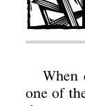

> 函数将接受的值称为参数。因此，这里显示的 start_table 函数将接受三个参数。

在构建函数时，你应该注意，如果你希望在函数调用中更改其中一个默认值，必须指定其之前（左侧）的所有参数。例如，以下代码中的第一个命令将产生错误。然而第二个命令将有效，并创建一个边框为 4、cellspacing 为 3、cellpadding 为 2 的 table 标签。

```
//this will cause an error
start_table( ,5,5);
//this will work
start_table(4,3);
```

函数可以接受的不仅仅是简单变量；你可以传递任何标量类型（字符串、整数、双精度数）、任何数组（数值、关联或多维）或对象。你可能希望使用一个将数组转换为 HTML 无序列表的函数，使用 <ul> 和 <li>。

```
function create_ul($array)
{
    echo "<ul>\n";
    while(list( , $value) = each ($array))
{
    echo "<li>$value</li>\n";
}
echo "</ul>\n";
}
```

### 返回值

当然你的函数会做的不止是打印 HTML。函数可以执行数据库调用、数学计算或进行字符串处理。它们几乎可以做任何事情，而且通常你希望让脚本的其余部分知道函数的结果。你可以通过使用 return 关键字来实现这一点。当函数遇到 return 关键字时，它会离开函数，并返回你指定的内容——一个变量、布尔值（TRUE 或 FALSE），或什么都不返回，如果你愿意的话。

```
function basic_math($val_1, $val_2)
{
    $added = $val_1 + $val_2;
    return $added;
}
```

然后你可以调用此函数并打印结果。

```
$added_value = basic_math(5,4);
echo $added_value;
```

事实上，以下代码同样有效：

```
echo basic_math(5,4);
```

函数可以返回任何变量类型（字符串、对象、数组等），或者在数据库调用的情况下返回结果标识符。此外，函数还可以返回 FALSE。如果你阅读了第 5 章，你可能记得在 PHP 中，任何非零、非 false 的值在 if 语句中都会被评估为 true。因此，我们可能希望通过确保传递的值可以相加来改进之前的函数。

```
function basic_math($val_1, $val_2)
{
    if (!is_int($val_1) || !is_int($val_2))
    {
        return FALSE;
    }
    $added = $val_1 + $val_2;
    return $added;
}
```

如果对该函数的调用中的任一参数不是整数，函数将返回 FALSE 并停止。对此改进函数的调用可能如下所示。

```
if(!($added_value = basic_math(7, 5)))
{
    echo "What exactly are you doing?";
}
else
{
    echo $added_value;
}
```

如果函数返回一个值（任何值），该值将被添加。如果没有，则会打印一条特殊消息。请注意，这模仿了许多 PHP 内置函数的行为。它的目的是执行任务，如果失败则返回 false。

实际上，这个函数中还有一点需要指出。如果发送给函数的参数之和等于零，例如 -1 和 1，会发生什么？在这种情况下，你的函数将返回 0。而且，正如我们在第 5 章中讨论的，0 在 PHP 中被评估为 FALSE。因此你需要小心这种情况。你可能会在 PHP 的某些字符串处理函数中遇到这种情况，例如 strpos()。你可能最好像这样评估对之前函数的调用：

```
if (!is_int($added_value = basic_math(-1,1)))
```

快速看一下下面的函数。我们认为这是一个很好的例子，说明函数如何真正为你节省时间、麻烦和击键次数。mysql_query 函数没问题；它将查询从 PHP 发送到 MySQL，如果成功则返回结果标识符。然而，如果失败，它不会自动返回任何错误信息。除非你做一些挖掘，否则你不会知道查询出了什么问题。因此，对于应用程序中的每个查询（会有很多），你都会加上一个 or die 短语：

```
mysql_query("select * from table_name") or die
("Query failed: " . mysql_error());
```

但如果你创建如下的函数，然后将所有查询都通过该函数发送，生活会变得容易得多。

```
function safe_query ($query = "")
{
    if (empty($query)) { return FALSE; }
    $result = mysql_query($query)
        or die("ack! query failed: "

```
."><li>errorno=".mysql_errno()
."><li>error=".mysql_error()
."><li>query=".$query
);
    return $result;
}
```

因此你的应用程序可能在每个页面都包含一个包含此函数的文件，然后用 safe_query() 代替 mysql_query()。

## 使用可变数量的参数

PHP 4 的一个不错特性是，你可以向函数传递不定数量的参数，然后将参数列表赋给一个数组。考虑以下代码：

```
function print_input_fields()
{
    $fields = func_get_args();
    while (list($index,$field) = each($fields))
    {
        print " <tr>\n";
        print " <td valign=top align=right><b>".ucfirst($field).":</b></td>\n";
        print " <td valign=top align=left><input type=text name=$field size=40 value=\"". $GLOBALS[$field]."\"></td>\n";
        print " </tr>\n\n";
    }
}
start_table();
print_input_fields("name","location","email","url");
end_table();
```


> $GLOBALS 数组将在本章后面的“Variable Scope”部分讨论。

此函数在表格内打印表单字段。首先，使用 func_get_args() 创建一个关联数组，以参数名称作为键。然后逐个打印每个表单字段。这非常方便，因为我们可以在多种情况下调用函数，通过包含所需数量的参数来改变输出。

如果你在想，如果函数在可能变化的参数集之前包含一些必需参数，这将如何工作，恭喜你：这是一个极好的问题。

在这种情况下还有另外两个 PHP 函数可用：func_num_args()，它返回发送给函数的参数数量；以及 func_get_arg()，它根据从 0 开始的数字索引返回特定参数。因此，例如，你可能有一个函数打印带有可变数量输入字段的 HTML 表单。

```
function print_form($action="", $method="POST")
{
    if (empty($action)){return FALSE;}
    echo "<form action=$action method=$method>";
    $numargs = func_num_args();
    for ($i = 2; $i < $numargs; $i++)
    {
        echo "<input type=text name=\"" . func_get_arg($i) . "\">";
    }
    echo "</form>";
}
```

```
print_form("myurl.php", "", "myfield1", "myfield2");
```

## 变量作用域

要使用函数，你需要了解 PHP 如何处理变量作用域。作用域是任何编程语言中的重要主题，PHP 也不例外。

在 PHP 中，在函数外部赋值的变量称为全局变量。这些可以是你创建的变量，可以通过 GET 或 POST 从 HTML 表单元素中获取，或可能是从 Apache 环境继承的任何变量。所有全局变量都可以通过名为 $GLOBALS 的数组访问。你可以向此数组添加或删除内容。


> 我们以前说过，再次强调：使用 phpinfo() 来获取有关你的环境或配置中变量的信息。

在 PHP 中，全局变量不会自动在函数内部可用。如果你想在函数中使用全局变量，你必须在函数内部指明你访问的变量是全局的。

以下是函数中使用全局变量的示例：

```
function add_numbers($val_2)
{
```
```
global $number;
 echo $number + $val_2;

}
$number = 10;
add_numbers(5);
```

这段代码将打印“15”。这里 $number 是全局变量，因为它是在函数外部赋值的。使用关键字 global 告诉 PHP 我们想要从 $GLOBALS 数组中获取指定的数字。这段代码也可以这样写：

```
function add_numbers($val_2)
{
    echo $GLOBALS["number"] + $val_2;
}
$number = 10;
add_numbers(5);
```

在本书的应用程序中，我们将使用第一个示例中展示的技术，因为它看起来更简洁。能够在函数顶部看到变量的来源是很不错的。

在你的函数内部，你可能希望将变量作为全局变量提供。这样它们将在脚本主体和其他函数中可用。要实现这一点，你必须显式地将变量赋给 $GLOBALS 数组。下面是一个快速示例：

```
function assign_to_global($val_1, $val_2)
{
    global $sum;
    $sum = $val_1 + $val_2;
}

assign_to_global(5,6);
echo $sum;
```

此脚本将打印“11”。对于稍微复杂一点的情况，我们将从本书的应用部分借用一个函数。

```
function set_result_variables ($result)
{
    if (!$result) { return; }
    $row = mysql_fetch_array($result,MYSQL_ASSOC);
    while (list($key,$value) = each($row))
```
```
{
    global $$key;
    $$key = $value;
}
}
```

此函数期望从 mysql_query() 获取的结果标识符。假设在此函数调用之前运行的查询将返回单行数据。该行随后被赋给名为 $row 的关联数组。然后从查询中获取的每个列（现在是关联数组中的键）及其值将作为全局变量可用。如果查询检索到的值需要在许多其他函数中使用，这可能会很有用。请注意此代码中变量的使用。有关此概念的解释，请参阅第 5 章。


所有 Apache 变量（$DOCROOT、$REQUEST_URI 等）都可作为全局变量使用。要在函数内部使用它们，你需要使函数感知到它们。

## 使用全局变量

在本书的应用程序中，你会看到全局变量在函数内部被谨慎使用。这是因为如果你通过参数传递变量并通过返回值检索它们，跟踪变量会更容易。如果你大量使用全局变量，你可能会发现变量在不同位置返回意外的值——而找到导致错误的函数可能非常痛苦。

尽可能避免使用全局变量的另一个原因是：你会一遍又一遍地使用相同的变量名。我们不知道在这些应用程序中变量名 $query、$result、$row 或 $i 使用了多少次，但请相信我们说它们被频繁使用。如果我们必须跟踪每次使用这些变量名中的一个，我的生活将引入各种麻烦。

有时你别无选择只能使用全局变量，但在这样做之前，请确保你无法使用局部作用域的变量实现同样的功能。

## 面向对象编程

几年前，面向对象编程出现了大规模的转向。有些人认为过程式方法——即严格使用函数编码——是不够的。因此，像 C++ 和 Java 这样的语言的开发者推广了一种允许开发者以不同方式思考代码的方法。

面向对象编程背后的思想是将应用程序的各个部分视为对象。什么是对象？嗯，它是一种无定形的东西，一种黑盒——变量和函数的超结构。但如果你对这个概念不熟悉，这个描述可能并不清晰。

为了在概念上更清晰，我们将给出一个书中后面会出现的例子。第 10 章介绍了一个目录，是你的企业可以发布商品清单的地方。在此应用程序中，有一个组织结构。在最高层级有一个类别列表，每个类别包含一个或多个产品。知道这一点，你可以将类别视为一个对象。

由于这是一个目录，你可能会期望类别中包含某些内容。类别可能有一个名称和标题；它也可能有一个唯一的 ID 号。也可能有其他参数进一步描述类别对象。

除了这些描述性项目外，你还希望对类别执行某些操作。操作包括保存新类别、删除现有类别，或只是打印特定类别等。

现在你只需要正确的命名法。对象的这些描述（如名称和唯一 ID）称为 *properties*，而操作（保存、删除、打印）则称为 *methods*。

在我们开始使用对象之前，我们想解释这种面向对象方法的几个优点。假设某位程序员为类别创建了一个对象并告诉你有关方法和属性的信息。你实际上不需要知道它是如何工作的；你只需要知道它能工作。你可以在脚本中轻松使用对象的方法和属性。

当然，对于设计良好的过程式方法也可以这样说。经过良好文档记录的函数集合同样可以很好地工作。事实上，许多程序员不喜欢面向对象编程，认为它是多余的。毫无疑问，你应该能够在转向对象之前编写良好的过程式代码。

使用对象，你不仅可以在脚本的核心中使用方法和属性，还可以通过使用称为 *inheritance* 的概念来扩展类的功能。回到目录示例，类别将包含一个或多个产品。因此每个产品都属于一个类别。所以产品将有自己的属性和方法集，但此外，它还会继承其类别的属性和方法。


如果你来自像 Java 这样的语言，你需要意识到 PHP 在这方面的一些不足。没有办法将方法指定为 "private"，也没有析构函数。

## 类

在面向对象编程中，你将使用类。类是一个结构，包含你的方法和属性。在类内部，属性

(描述对象的项目)是变量。而方法（对对象采取的动作）是函数。让我们从一个名为 Category 的简单类开始。


> 这不是第 10 章目录应用程序中使用的同一组类。为教学目的，此处的代码已进行了简化。

```php
class Category
{
    //here are the properties
    var $category_name;
    var $category_desc;
    var $category_id;
}
```

这里，在这个类的开头，我们定义了属性。请注意使用 var 来声明每个属性。在 PHP 中，其他地方不需要声明属性，但在类中必须声明。现在我们将创建第一个方法。

```php
class Category
{
    //here are the properties
    var $category_name;
    var $category_desc;
    var $category_id;

    //gets all the properties for a given category_id
    function Category($category_id=0)
    {
        //expecting a category id when the object is
        //instantiated
        if ($category_id == 0)
        {
            return;
        }

        $query = "select category_name, category_desc from
            categories where category_id = $category_id";
        $result = mysql_query($query) or
            die(mysql_error());

        list($category_name, $category_desc) =
        mysql_fetch_array($result);
```

```php
$this->category_name=$category_name;
$this->category_desc=$category_desc;
$this->category_id=$category_id;
}
}
```

这里有几件事需要解释。首先，注意该方法（即函数）的名称与类完全相同。这告诉 PHP 这是构造函数。构造函数在类被实例化后立即自动运行。另一个需要注意的是 $this-> 的使用。它表示当前类中的属性或方法。上面，我们正在为属性赋值：category_id、category_name 和 category_description。如果我们想调用一个方法，我们会用括号表示：$this->method_call() 或 $this->method_call($value)

为了继续这个示例，我们将添加一个用于删除分类的方法。请注意，下面的方法假设数据库包含两个表——一个名为 categories，一个名为 products——并且 categories 与 products 之间存在一对多的关系。因此，您需要确保在分类包含产品时不要删除该分类。

```php
class Category
{
//all the stuff you saw above goes here

    function delete_category($category_id=0)
    {
        //make sure a category_id was defined in the
        //constructor or is indicated explicitly
        if($category_id == 0 && empty($this->category_id))
        {
            $this->error = "Nothing to delete";
            return FALSE;
        }
        //create where clause with the category_id
        //retrieved from the proper place
        if ($category_id !=0)
        {
            $where_clause = "where category_id = 
                $category_id";
        }
        else
        {
            $where_clause = "where category_id = 
                $this->category_id";
        }
```

```
//make sure there are no products left for this
//category
$query = "select * from products  $where_clause";
$result = mysql_query($query) or
    die(mysql_error());
if (mysql_num_rows($result)>0)
{
    $this->error = "There are
still products for this category";
    return FALSE;
}
$query="delete from categories $where_clause";
$result = mysql_query($query) or
    die(mysql_error());
if(mysql_affected_rows() == 0)
{
    $this->error = "There were no rows to delete";
    return FALSE;
}
return TRUE;
}
```

我们现在有一个类，其中包含两个方法——构造函数和 delete_category——以及三个属性。现在是时候让这个类发挥作用了。

## 实例化对象

实例化基本上意味着“创建”。假设我们有一个 PHP 页面，其目的是删除分类。为了使其与上面的类一起工作，我们需要做几件事。首先，我们需要包含包含该类的文件。

```
require "classes.php";
```

接下来我们必须创建一个对象的实例。我们可以用关键字 new 来实现：

```
$c = new Category;
```

现在，使用对象 $c，我们可以使用前面示例中看到的相同语法访问任何属性或方法：$c-> property 或 $c->method()。

现在我们想要组装一个实际从数据库中删除记录的页面。为此示例起见，假设单个 $category_id 已通过查询字符串传递。

```
<?

require "classes.php";

$c = new Category($category_id);

if(!$c->delete_category())
{
    echo "Deletion Failed: $c->error";
}
else
{
    echo "Deletion Succeeded for:";
    echo "<ul>
        <li>$c->category_name
        <li>$c->category_description
        <li>$c->category_id
    </ul>
    ";
}
?>
```

如你所见，这使得页面非常简洁，而这正是大家最终所追求的。

## 继承

到目前为止，我们只使用了一个类。但面向对象编程的巨大优势之一是，一个类的属性和方法可以被另一个类继承。我们将通过编写一个名为 Product 的类来展示一个非常快速的示例。以下是其框架：

```
class Product extends Category
{
    var $product_id;
    var $product_name;
    var $product_price;
}
```

注意 extends 这个词的使用。这告诉 PHP Category 中所有可用的属性和方法都应该在 Product 中可用。如果我们想从 Product 类内部调用 delete_category() 方法，我们可以用 $this->delete_category($category_id) 来调用它。


在 PHP 中，父类的构造函数方法在调用子类时不会自动运行。例如，调用 $p = new Product 不会运行 Category() 方法。

现在我们添加一个快速的构造函数方法：

```php
class Product extends Category
{
    var $product_id;
    var $product_name;
    var $product_price;

    function Product($product_id=0)
    {
        //expecting a product_id to be passed
        if ($product_id ==0)
        {
            return FALSE;
        }

        $query = "select product_name, product_desc,
product_price, category_id from
products where product_id = $product_id";

        $result = mysql_query($query);
        list($this->product_name, $this->product_desc,
$this->product_price) =
mysql_fetch_array($result)
;
        $this->Category($category_id);
    }
}
```

请注意，此方法不仅为该产品分配属性值，还调用了 Category 类的构造函数，后者随后为这些属性分配值。请注意，由于继承，我们可以按如下方式编写脚本：

```php
require 'classes.php';

$p = new Product($product_id);
echo $p->category_name;
```

你可以看到 Category 的属性对 Product 对象可用。

## 面向对象代码与过程式代码

这就是百万美元的问题：在你的应用程序中，应该使用面向对象代码还是过程式代码？这又是另一个引发宗教式争论的话题。但实际上没有必要争论，因为有一个正确的答案：取决于情况。如果你有丰富的面向对象编程背景，并且更习惯于编写类，那就这样做。然而，如果你不喜欢面向对象代码的工作方式，只使用函数即可。


CD-ROM 上有一些大型类库，其中一些取自 Manual Lemos 令人印象深刻的网站 http://phpclasses.upperdesign.com。他的表单创建和验证类确实很史诗般，但对某些人来说可能有点笨重。

面向对象代码有一些优点和缺点。权衡它们并自行决定是否应该使用类还是仅使用函数。

优点：
- 使用面向对象的方法可以节省时间。
- 你可以创建高度可重用的代码片段。
- 你可以利用网络上免费提供的广泛类库。

缺点：
- 它比过程式方法慢。
- 语法起初可能令人困惑。
- Web 编程并不能利用面向对象代码的许多优势。
- 如果你使用非常大的类库，可能会有性能损失。

## 注释

在任何编程语言中，注释都是必不可少的——不仅对你在编写代码时有用，对后来阅读代码的人也很有用。对你来说可能一目了然的东西，对其他人来说可能完全无法读懂。或者，如果你必须做一些特别复杂的事情，你可能会发现你甚至不理解

如果你在写完代码几个月后再次回到它，你会想知道当时你在想什么。

在 PHP 中，你可以用两个斜杠（//）、井号（#）来表示注释，或用 /* 和 */ 包围被注释的代码。后一种方法对于多行注释特别有帮助。

对所有函数进行注释，说明它们的作用、期望接收什么以及返回什么。务必记录任何难以追踪的变量。

当你浏览 CD 上的 /functions 目录时，你会看到每个函数都有一个初始注释，其风格模仿了 PHP 手册中使用的风格。例如，

```
int fetch_record (string table name [, mixed key [, mixed value]])
```

然后我们提供一些描述，说明这些参数的含义以及返回值的重要性。在编写函数体时，你应该对任何对后来接触该脚本的人来说不直观的内容进行注释。如果你有一系列执行复杂字符串处理或使用冗长正则表达式的函数，务必明确说明这些函数 intended to accomplish 的内容。例如，我们将重现这一行代码：

```
$file_ext = strtolower(substr($file, strrpos($file,".")));
```

这并不特别难弄明白，但你可以用一个简单的注释来帮助下一个看到这一行的人。

//get characters following the final dot
//and make lowercase
$file_ext = strtolower(substr($file, strrpos($file,".")));

另一个需要注释的重要内容是页面的整体逻辑，尤其是长页面。通常脚本在不同情况下的行为会有所不同。从表单传递的变量、错误和其他因素都会影响脚本的哪些部分会被运行。在页面顶部，你可以说明哪些因素会影响页面的逻辑，然后在到达不同的 if 块时，解释条件来自何处以及它们的含义。

举一个简短的例子，取自第 8 章 Guestbook2k 中的 confirm_delete.php 页面：

/*
This script will only run if the user is logged in.
It will be accessed in two circumstances:
  -- The "Delete Entries" button was pressed on
     the edit.php page. (Normally this will be the
     first time to this script). The ids of the
     records to be deleted are passed in the entry_id
array.
-- The "Confirm Delete" button was pressed on this page. This will confirm the deletion and run the delete queries.
*/
include("header.php");
include("authenticate.php");

$page_title = "Confirm Changes";
include("start_page.php");

//if coming from edit_page.php. The first time to
//this script. Print a form with checkboxes that
//the user must check in order to confirm deletion.
if ($submit == "Delete Entries")
{
    //the form contains no action, so it will submit
    //to the same page, and the value of submit will be
    //"Confirm Delete"
    print "<form method=post>\n";
    if (is_array($entry_id))
    {
        while (list($key,$value) = each($entry_id))
        {
            print "<li>Delete entry #$value?\n";
            print "<input type=hidden name=\"entry_id[]\" value=\"$value\">\n";
        }
        print "<br><input type=submit name=submit value=\"Confirm Delete\">\n";
        print "<input type=hidden name=offset value=\"$offset\">\n";
        print "</form>\n";
    }
}

//if the page has been submitted to itself,
//to confirm that the deletion should happen.
elseif ($submit == "Confirm Delete")
{
    //loop through each element in the entry_id array
    //and run a delete query for each item.
    while (list($key,$value) = each($entry_id))
    {
        print "<li>Deleting entry #$value\n";
        $q = "delete from guestbook where entry_id = $value";
```
mysql_query($q) or die("Invalid query:$q");
}
}
else
{
    print "No action to confirm\n";
}
```

我们将这一节以一个警告结束：不要过度注释。逐行注释，或让显而易见的事情变得更加显而易见是很烦人的。例如，以下注释完全没有必要，只会让你的脚本难以阅读。

//make string lowercase
$str = strtolower($str);
//increase $i by 1
$i++

注释需要良好的判断。你不想注释太多，也不想注释太少。我最好的建议是看看有多少程序员注释他们的代码并选择你喜欢的风格。我们在本书的应用程序中使用一种方法；其他人有不同的风格。

你的 PHP 安装中的 PEAR 目录是寻找良好编码风格技巧的好地方。PEAR 代表 PHP Extension and Application Repository。它是一组不断增长的脚本，包含了一系列 PHP 编程的最佳实践。参与 PEAR 工作的人都是真正的专业人士，写出了极好的代码。我们建议浏览该目录中的脚本，以汲取编写高质量代码的技巧。

## 摘要

在本章中，我们介绍了编写干净、有组织的代码的一些方法。当你查看脚本时，你应该问自己几个问题。是否有常见于每个页面的代码块？也许那些块应该移到一个 include 中。是否有我一遍又一遍编写的代码块？也许编写一个函数可以节省时间。下一个人来到这个脚本时是否能够弄明白我做了什么？如果不能，请确保添加足够的注释来使事情清晰。

你需要决定面向对象的方法是否适合你和你正在编写的应用程序。事实是，如果你不立即确定，答案很可能是否定的。在你进入类之前，请确保你能舒适地编写干净的过程式代码。

现在你已经完成了所有必要的阅读，是时候进入第三部分，在那里我们将 PHP 和 MySQL 付诸实践。

## 第 8 章

## Guestbook 2000，（半）防弹留言簿

## 本章内容

- 学习 guestbook 2000 的强大功能
- 以合理的方式组织你的代码
- 编写良好、可重用的函数

在本章中我们将开发我们的第一个应用程序——一个留言簿。留言簿并不复杂，也不是很令人兴奋。然而，这个应用程序确实给了我们介绍诸如验证等概念的机会，并将本书前面讨论的许多实践付诸实践。

在本书记载的引言中，我们介绍了可用于最基本的留言簿的一些代码。然而，使用该代码作为你的留言簿并不是一个好主意。它有各种各样的漏洞，会让外面的恶意人员篡改你的页面。超基本留言簿的另一个问题是：鉴于代码只是被倾倒到一个页面中，没有一行是可重用的。开发任何应用程序的顶级目标之一是创建可重用代码块。

## 确定应用程序的范围和目标

当面对一个应用程序时，最容易让你陷入麻烦的方式就是不知道自己试图实现什么。开发人员的工作中一个重要部分是弄清楚应用程序中需要什么。通常这将涉及与应用程序开发对象进行广泛的讨论。在这些讨论期间，提前思考一步并提出可能尚未考虑过的问题是很重要的。如果范围以某种方式增加会怎样？

如果需要跟踪额外但相关的信息会怎样？所有这些事情都会影响你设计数据库和脚本的方式，这就是为什么最好知道应用程序的确切范围和目标。取决于你与谁合作，你可能希望获得需要开发的页面的一些草图。

该应用程序的范围很小，目标也很有限。留言簿存储姓名、地址等信息。（但，说实话，本章的目标与其说是教你如何编写留言簿，不如说是教你如何为你的应用程序编写良好、可重用、有组织的代码。）无论如何，在继续之前你应该知道 guestbook2k 的样子。

> 在本章中，我们不会将创建良好函数的概念发挥到极致。在下一章我们将介绍一套更广泛的函数，我们将在本书的其余部分中使用它们。

## 必要的页面

有三个基本页面：一个用于签名留言簿，一个用于查看留言簿，一个用于管理留言簿。

图 8-1 显示了让用户有机会签名留言簿的页面。它很简单，一个表单包含四个文本字段和一个 textarea 字段。此外，还有一个提交按钮和一个重置按钮。

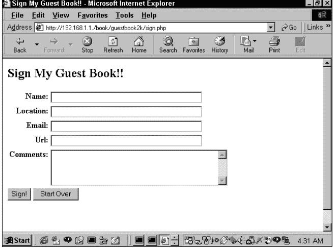

图 8-1：用于签名留言簿的页面


接下来，必须有一种方式来查看谁已在留言簿上签名。为了让网页具有可读性，我们创建了一个页面，如图 8-2 所示，每页仅打印两条留言。页面底部有导航元素，用于指示是否存在之前的或额外的留言。这些应该是条件性的，并且在您位于留言簿的开头或结尾时应适当消失。

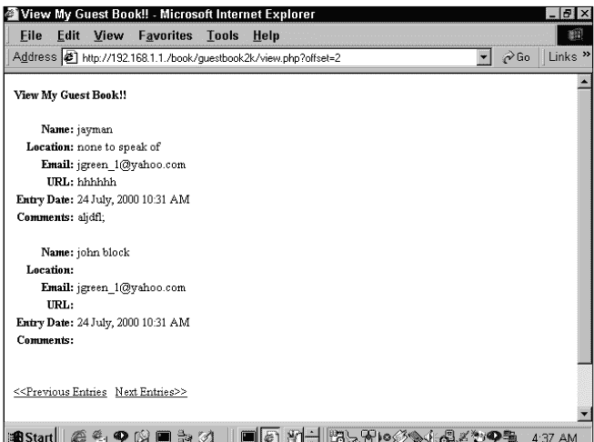

Figure 8-2: 查看留言簿的页面

最后，我们需要一个页面来让您删除不需要的留言。图 8-3 中的页面似乎可以解决问题。此页面的访问权限需要限制为授权用户。您不希望任何闲杂人等进入并清空您的留言簿。

## 我们需要防止什么？

我们在这里需要解决的主要问题是任何具有表单输入的应用程序中常见的问题。恶意破坏者有可能在您的表单中输入恶意代码，从而破坏随后访问者的页面。如果您在介绍中使用了留言簿应用程序，您可能会遇到严重麻烦。考虑如果有人在文本字段中插入以下代码会发生什么：

```
<script>alert("boo");</script>
```

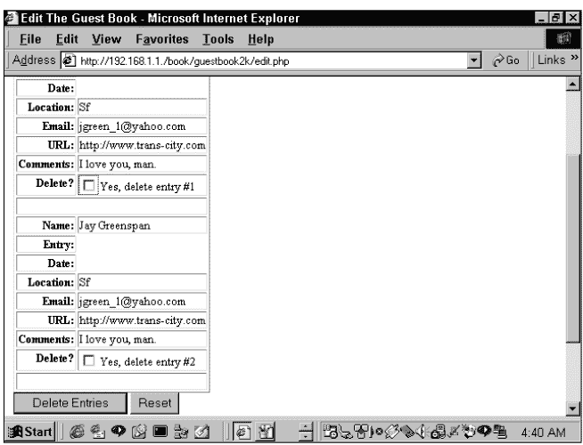

Figure 8-3: 管理留言簿的页面

下次页面加载时，查看者将会看到图 8-4 中所示的小“惊喜”。

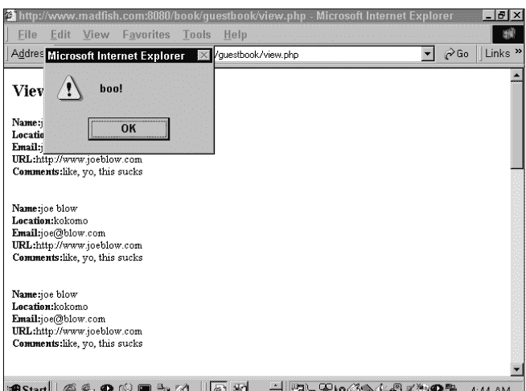

Figure 8-4: 问题留言的结果

如果某个混蛋想这么做，他可以用各种标签破坏您的页面。例如，这段代码会造成图 8-5 中所示的灾难。

```

```

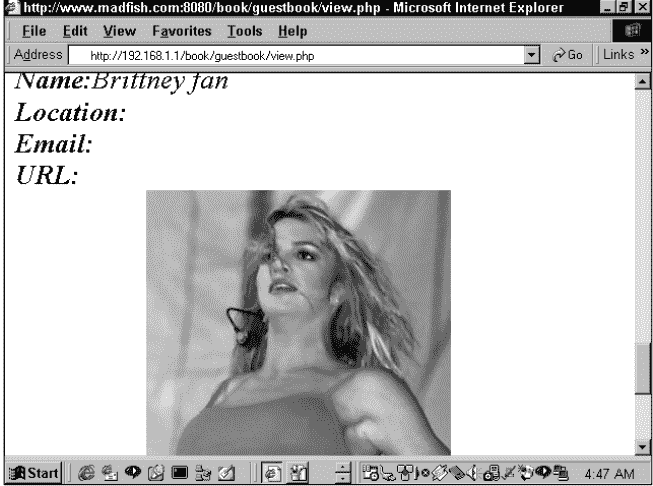

Figure 8-5: 另一个问题留言

此外，该应用程序需要一些验证。当用户输入信息时，该应用程序会检查其是否合理。应用程序将检查以下内容：

- 电子邮件地址应包含 at 符号（@），@ 之前有一个或多个字符，且 @ 之后某处有一个点。电子邮件验证可以变得更复杂（将在后续章节中介绍）。
- URL 应看起来像 URL，完整包含 http:// 前缀和至少一个点。
- 姓名字段必须输入一些文本。没有姓名的留言簿条目几乎没有意义。
- 数据库中不应出现重复的电子邮件地址。

一旦应用程序检查完所有这些内容，用户就需要被告知任何错误。图 8-6 和 8-7 显示了我们将如何指示这些错误。

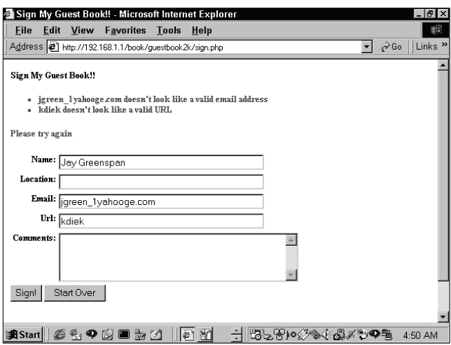

Figure 8-6: 报告错误信息

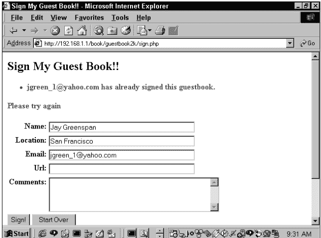

Figure 8-7: 报告重复条目

## 设计数据库

我们在第 1 章中介绍了规范化过程，很快我们将把这些规范化技能付诸实践。对于此应用程序，信息集合相当简单。事实上简单到一张表就能完成工作。实际上并非完全如此。出于管理目的，您应该创建一个表来对用户名和密码进行身份验证。以下是创建表的创建语句。

```
create table guestbook
(
    entry_id      integer not null auto_increment,
    name          varchar(40) null,
    location      varchar(40) null,
    email         varchar(40) null,
    url           varchar(40) null,
    comments      text null,
    created       timestamp,
    remote_addr   varchar(20) null
, key guestbook_key (entry_id)
);
```

```
create table guestbook_admin
(
    username      varchar(50) not null,
    password      varchar(255) not null
);
```

在向 guestbook_admin 表添加用户时，最好对密码进行加密。实现此目的最简单的方法是使用 MySQL 的 password 函数。

```
insert into guestbook_admin (username, password)
    values ('jay', password('rules'));
```

运行此命令后，password 列中实际存储的值为 065cb7f12ad99fe3。当您需要确定用户是否知道密码时，可以再次使用 password 函数。

```
select * from guestbook_admin where
username = 'jay' and
password = (password('rules'));
```

## 代码概述

在此、您的第一个应用程序中，您需要查看构建应用程序时将使用的架构。CD 上的应用程序已构建为尽可能可重用和可移植。

首先，有一个名为 book 的文件夹，应将其复制到 Web 服务器的根目录。在 Apache 中，该文件夹默认名为 htdocs。book 文件夹包含本书中记录的所有应用程序。如果出于某种原因需要将 book 文件夹复制到根目录以外的某个位置，您需要确保更改 header.php 顶部的 `include` 命令。图 8-8 显示了文件夹结构。

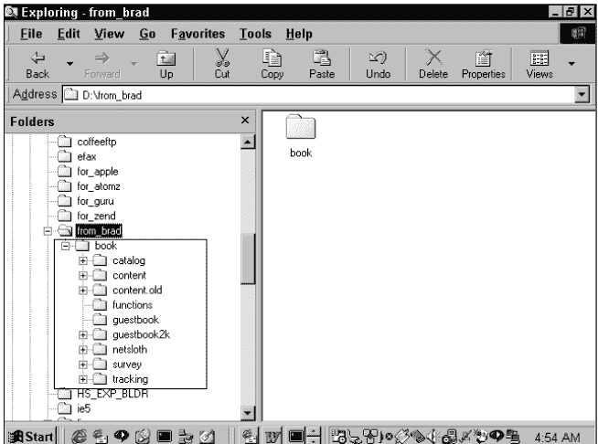

Figure 8-8: 应用程序文件夹结构

在 book 文件夹内，有一系列文件夹，每个应用程序一个，还有一个标记为 functions。在此应用程序中，我们将关注 basic.php。此文件将包含您将在各种应用程序中使用的一些函数。我们将在名为“代码分解”的部分中讨论 basic.php 中在 guestbook2k 中使用的函数。仅与 guestbook2k 相关的代码保存在 guestbook2k 文件夹中。在这里，需要在多个页面中处理的函数保存在 header.php 文件中。我们还将在“代码分解”部分详细解释这些函数。

从浏览器调用的页面命名直观：view.php、sign.php 和 edit.php。这些页面各自调用 start_page.php 和 end_page.php。这些包含标准的页眉和页脚信息，阅读起来足够简单，因此我们在此不讨论它们。

您可能会发现 view.php、sign.php 和 edit.php 文件出人意料地简短。它们每个只包含几十行代码。这是因为几乎所有内容都是用可重用函数编写的。

因此，再次强调重要的是要理解保存在 /book/functions/basic.php 和 /book/guestbook2k/header.php 中的函数。

## 代码分解

如前一节所述，大部分工作都是由函数完成的，这些函数保存在将被浏览器调用的页面包含的文件中。

### 可重用函数

这里我们将介绍 functions/basic.php 和 guestbook2k/header.php 的内容

### 来自 FUNCTIONS/BASIC.PHP

我们可以按任何顺序处理这些——按字母顺序似乎也不错。

### AUTHENTICATE()

这个小函数发送 401 HTTP 响应代码。此标头会强制浏览器打开图 8-9 中所示的用户名和密码框。

```php
function authenticate ($realm="Secure Area"
,$errmsg="Please enter a username and password"
)
{
    Header("WWW-Authenticate: Basic realm=\"$realm\"");
    Header("HTTP/1.0 401 Unauthorized");
    die($errmsg);
}
```

输入到这些文本字段的值被设置为 PHP 变量 $PHP_AUTH_USER 和 $PHP_AUTH_PW。然后 PHP 可以查询 MySQL 以检查这些值是否存储在数据库中。请注意，此函数仅发送标头。它不会检查文本框中输入的值。它们在 guestbook2k/authenticate.php 文件中进行检查。如果未输入任何值或值与数据库中没有任何内容匹配，则调用此函数。

如果用户点击取消按钮，则会打印存储在 $errmsg 中的字符串。

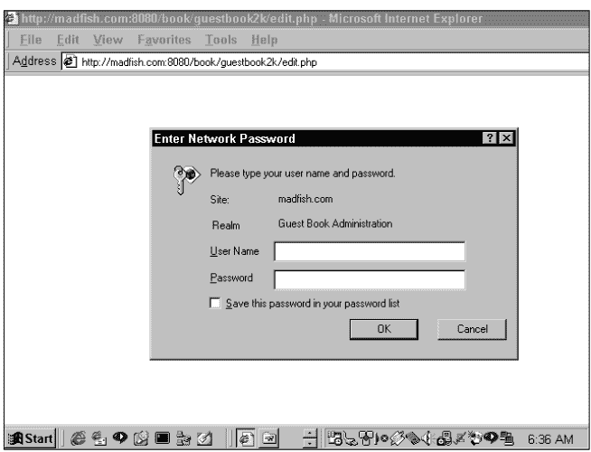

Figure 8-9: 401 未授权标头的結果


这种类型的身份验证仅在 PHP 作为 Apache 模块安装时可用。如果您将 PHP 用作 CGI（在 Windows 下运行的唯一方式），则此方法将不起作用。如果您在 Windows 上进行一些开发工作，请进入应用程序并注释掉对 authenticate() 的调用，并为 win_authenticate.php 文件创建一个 include。

### CLEANUP_TEXT()

此函数在很大程度上确保我们不会在数据库中插入恶意文本。

```
function cleanup_text ($value = "", $preserve="", $allowed_tags="")
{
    if (empty($preserve))
    {
        $value = strip_tags($value, $allowed_tags);
    }
    $value = htmlspecialchars($value);
    return $value;
}
```


此函数完成两件事。首先，它删除所有 HTML 标签。strip_tags() 函数负责处理这一点。这里无需担心恶意的 Britney Spears 图片——除非你想要它们。你可以通过第二个参数 ($allowed_tag) 指定想要保留的标签。例如，如果你想允许粗体和斜体标签，strip_tags() 的第二个参数可以是这样的字符串：“<b><i>”。

然后 htmlspecialchars() 将 & 和双引号更改为其正确的 HTML 实体（&amp; 和 &quot;）。经过这个小函数处理后，你的文本就可以插入数据库了。

## SAFE_QUERY() 此函数会在你尝试让查询正确时，帮你免于抓狂。

```
function safe_query ($query = "")
{
    if (empty($query)) { return FALSE; }
    $result = mysql_query($query)
        or die("ack! query failed: "
        ."<li>errorno=".mysql_errno()
        ."<li>error=".mysql_error()
        ."<li>query=".$query
        );
    return $result;
}
```

在整个应用中，你将通过此函数运行我们的查询。这样，如果查询因某种原因失败，你将对发生了什么有一个相当好的了解。这又是安全编码的另一个例子。排查完代码后，你通常不会经常遇到这些问题，但如果在某处进行了更改（也许在你不知情的情况下），你将对正在发生的事情有一个相当好的了解。


对于公开可用的站点，通过此函数运行每个查询都存在危险。如果查询失败，黑客可能会看到比你希望的更多关于你设置的细节。为防止这种情况发生，你可以定义一个常量（稍后会讨论），该常量可防止函数输出描述性错误。示例如下：

```
function safe_query ($query = "")
{
    if (empty($query)) { return FALSE; }

    if(QUERY_DEBUG == "Off")
    {
        $result = mysql_query($query) or
die ("Query failed: please
    contact the Webmaster");
}
else
{
$result = mysql_query($query)
    or die("ack! query failed: "
        ."<li>errorno=".mysql_errno()
        ."<li>error=".mysql_error()
        ."<li>query=".$query
    );
}
return $result;
}
```

## FROM /GUESTBOOK2K/HEADER.PHP

再次，此文件将在此应用的每个页面中包含。它将保留特定于此应用的所有函数。此外，应用的前几行将处理一些细节。请注意变量 $DOCUMENT_ROOT 的使用。这是一个 Apache 变量，可通过 PHP 访问，表示默认根文件夹。通过使用此变量，我们的整个应用变得可移植。如果我们移动整个 book 文件夹及其所有子文件夹，这些文件将被正确找到和访问。请记住这是一个 Apache 变量；你的操作系统和 Web 服务器可能需要不同的变量。检查 phpinfo() 以确保。

```
include("$DOCUMENT_ROOT/book/functions/charset.php");
include("$DOCUMENT_ROOT/book/functions/basic.php");
$conn = mysql_connect("localhost", "username","password") or
die("could not connect to database");
mysql_select_db("guestbook2k", $conn) or die("could not select guestbook2k");
```

```
define("PAGE_LIMIT", 2);
```

第一行包含我们的默认字符集。charset.php 文件仅包含一行：

```
header("Content-Type: text/html; charset=ISO-8859-1");
```

此函数将有助于防止人们发送给你使用不同字符集编码的值。如果他们确实发送了不同字符集的文本，cleanup_text() 中的函数将失败，并且你仍然可能遭受某些跨站脚本攻击。这是一个难题。如果想要更多细节，请查看以下文章：

http://www.cert.org/tech_tips/malicious_code_mitigation.html
http://www.apache.org/info/css-security/encoding_examples.html

这里我们包含了一些有趣的内容：一个常量，这里命名为 PAGE_LIMIT。常量与变量类似，因为它包含一个值（在此实例中为 2）。然而，该值不能通过简单赋值或除 define() 之外的函数来更改。常量不会遇到变量所遇到的相同作用域问题，因此可以在函数中使用，而无需将其作为参数传递或担心声明全局变量。运行 define() 函数后，常量 PAGE_LIMIT 将在我的脚本中随处可用。

PAGE_LIMIT 决定每个页面上可查看的条目数。如果你想看到更大的数字，欢迎更改它。

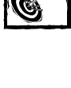

如果你使用常量组装查询，你必须结束引号字符串才能使用常量值。例如，
query = "select * from db_name limit PAGE_LIMIT"
会让 MySQL 感到困惑，因为 PHP 并未用其值替换常量的名称。然而，这将有效：
query = "select * from db_name limit " . PAGE_LIMIT


PHP 有许多内置常量可在你的脚本中使用。常量列表包含在 PHP 手册中：http://www.php.net/manual/language.constants.php

## PRINT_ENTRY()  这将在表格中打印查询的结果。

```
function print_entry($row,$preserve="")
{
    $numargs = func_num_args();
    for ($i = 2; $i < $numargs; $i++)
    {
        $field = func_get_arg($i);
        $dbfield = str_replace(" ", "_", strtolower($field));
        $dbvalue = cleanup_text($row[$dbfield],$preserve);
        $name = ucwords($field);
        print " <tr>\n";
        print "  <td valign=top align=right><b>$name:</b></td>\n";
        print "  <td valign=top align=left>$dbvalue</td>\n";
        print " </tr>\n\n";
    }
}
```

了解此函数工作原理的最简单方法是查看调用函数的代码行。此片段取自 view.php 文件：

```
print_entry($row,$preserve,"name","location","email","URL","entry date","comments");
```

请注意，函数本身只有两个默认参数（$row 和 $preserve），而对函数的调用有九个参数。第一个参数 $row 是来自数据库调用的一行。它期望该行是通过使用 mysql_fetch_array() 的查询获取的，这样 row 的内容就是一个关联数组，其键等于数据库表的列名。第二个参数 $preserve 是 cleanup_text 函数所需的，我们之前讨论过它。其余参数相当于 $row 中的关联键。

发送给任何用户定义函数的参数构成一个数组。可以使用 func_num_args() 获取数组中最后一个元素的数量。使用上面看到的对 print_entry() 的调用，前一段中，func_num_args() 将返回 8。（有 9 个参数，其中第一个是 0。）

然后可以使用 func_get_arg() 访问每个参数的值。这允许使用此处使用的结构，其中循环访问然后处理发送给函数的每个参数。第一次通过 for 循环时，$field 被赋值为数组中的第三个元素，“name”。你可以使用 $field 中的值来访问关联数组 $row 中的一个元素（$row["name"]）。

在确保参数不包含大写字母或空格后，该值会被发送到 cleanup_text 函数并打印出来。

以这种方式结构化函数很好，因为它允许发送任意数量的参数到函数。你可以包含一个或多个要打印的字段。

## PRINT_INPUT_FIELDS()

此函数的工作方式与 print_entry() 类似。func_get_args() 使 $field 成为一个数组，其每个元素都是发送给函数的参数。列表结构遍历数组中的所有元素并为每个元素打印一个文本字段。字段名称将位于一个表格单元格中，输入框将位于相邻单元格中。

```
function print_input_fields()
{
```

```
$fields =func_get_args();
while (list($index,$field) = each($fields))
{
    print " <tr>\n";
    print " <td valign=top
align=right><b>".ucfirst($field).":</b></td>\n";
    print " <td align=top align=left><input type=text
name=$field size=40 value=\"" . $GLOBALS["last_$field"]."\"/></td>\n";
    print " </tr>\n\n";
}
}
```

注意到这里使用了全局变量作为文本字段的默认值。这是在用户输入错误信息且信息需要重新呈现用户所输入的值时使用的。为什么信息需要打印第二次？在阅读完下一个函数 create_entry() 后，这应该就完全说得通了。

## CREATE_ENTRY

我们不会简单地将用户信息转储到数据库中。首先需要对其进行验证。

```
function create_entry($name,$location,$email,$url,$comments)
{
    // remove all HTML tags, and escape any
    //other special characters
    $name = cleanup_text($name);
    $location = cleanup_text($location);
    $email = cleanup_text($email);
    $url = cleanup_text($url);
    $comments = cleanup_text($comments);

    // start out with an empty
    //error message. as validation tests fail,
    // add errors to it.
    $errmsg = "";
    if (empty($name))
    {
        $errmsg .= "<li>you have to put in a name, at least!\n";
    }

    // do a very simple check on the format of the email address
    // supplied by the user. an email address is required.
    if (empty($email) || !eregi("^[A-Za-z0-9_\-]+@[A-Za-z0-9_\-]+.[A-Za-z0-9_\-]+.*", $email))
    {
        $errmsg .= "<li>$email doesn't look like a valid email address\n";
    }
    else
    {
        // if the format is OK, check to see if this user has already
        // signed the guestbook. multiple entries are not allowed.
        $query = "select * from guestbook where email = '$email'";
        $result = safe_query($query);
        if (mysql_num_rows($result) > 0)
        {
            $errmsg .= 
            "<li>$email has already signed this guestbook.\n";
        }
    }

    // perform a very simple check on the format of the url supplied
    // by the user (if any)
    if (!empty($url) && !eregi("^http://[A-Za-z0-9%\?\._~:\/~\.-]+$",$url))
    {
        $errmsg .= "<li>$url doesn't look like a valid URL\n";
    }

    if (empty($errmsg))
    {
        $query = "insert into guestbook "
        . "(name,location,email,url,comments,remote_addr) values "
        ."('$name', '$location', '$email', '$url', "
        "'$comments','$REMOTE_ADDR')"
        ;
        safe_query($query);

        print "<h2>Thanks, $name!</h2>\n";
    }
    else
    {
        print <<<EOQ
<p>
<font color=red>
<b>
<ul>
$errmsg
</ul>
Please try again
</p>
EOQ;
    }
    return $errmsg;
}
```

此函数将确保输入的信息具有一定的实用性。如果信息存在问题，则会将描述问题的文本字符串赋给变量 $errmsg。如果函数执行后 $errmsg 为空，则值将被插入数据库。否则错误信息将被打印，并且用户输入的值将被赋给全局变量，以便下次循环时可作为文本字段的默认值打印。按顺序，此函数检查以下内容：

-   姓名字段包含内容
-   电子邮件地址可能是一个正确的地址（包含文本、一个 @ 和一个句点（.））。请注意，这并不是对电子邮件的严格验证。要彻底验证电子邮件需要一段非常长且复杂的脚本，正如你在后续章节中会看到的那样。
-   如果电子邮件看起来没问题，则该电子邮件地址尚未在数据库中输入过
-   URL 可能有效


请参阅附录 F 了解有关正则表达式的更多详细信息。

## SELECT_ENTRIES()

此函数的唯一目的是组装你的数据库调用。

```
function select_entries ($offset=0)
{
    if (empty($offset)) { $offset = 0; }
    $query = "select *
        , date_format(created,'%e %M, %Y %h:%i %p') as entry_date
        from guestbook
        order by created desc
        limit $offset, " . PAGE_LIMIT
    ;
    $result = safe_query($query);
    return $result;
}
```

你已经知道 PAGE_LIMIT 设置每页显示的记录数。作为 limit 子句中的第二个参数，$offset 变量指示查询将返回哪些记录。如果你对 $offset 的理解有困难，请查看第 3 章中对 limit 子句的解释。$offset 的值将通过导航元素传递。我们在讨论下一个函数时会详细检查这一点。

为了以可读的方式检索日期值，此查询使用了 MySQL 的日期函数。MySQL 将日期和时间存储为 14 位数字（YYYY:MM:DD:HH:SS），但以更易于人类阅读的方式返回日期信息会更好。MySQL 的 date_format 函数以我们想要使用的方式检索信息。此函数以及许多其他 MySQL 函数在附录 I 中进行了讨论。

## NAV()

此函数的唯一目的是创建导航元素。

```
function nav ($offset=0,$this_script="")
{
    global $PHP_SELF;

    if (empty($this_script)) { $this_script = $PHP_SELF; }
    if (empty($offset)) { $offset = 0; }

    // get the total number of entries in the guest book -
    // we need this to know if we can go forward from where we are
    $result = safe_query("select count(*) from guestbook");
    list($total_rows) = mysql_fetch_array($result);

    print "<p>\n";
    if ($offset > 0)
    {
        // if we're not on the first record, we can always go backwards
        print "<a href=\"{$this_script}?offset=\".($offset-PAGE_LIMIT).\">&lt;&lt;Previous Entries</a> &nbsp; ";
    }
    if ($offset+PAGE_LIMIT < $total_rows)
    {
        // offset + limit gives us the maximum record number
        // that we could have displayed on this page. if it's
        // less than the total number of entries, that means
        // there are more entries to see, and we can go forward
        print "<a href=\"{$this_script}?offset=\".($offset+PAGE_LIMIT).\"\">Next Entries&gt;&gt;</a> &nbsp; ";
    }
    print "</p>\n";
}
```

在适当的情况下，此函数将插入链接，使用户能够查看下一组条目、上一组条目或两者兼有。这一切都由 $offset 变量和 PAGE_LIMIT 常量决定。

第一次运行时 $offset 没有值，因此不会有上一条目链接（因为 $offset 不会大于 0）。但如果还有更多行需要显示，将会创建一个链接，如果跟随该链接则会为 $offset 创建一个值。

假设这是我们第一次执行此函数，因此 $offset 没有值，数据库中有 10 行。当脚本到达最后一个 if... 时，它会看到还有更多行需要显示（$offset + PAGE_LIMIT = 2，小于 10），因此以下链接将被打印。

```
<a href="/book/guestbook2k/view.php?offset=2">
Next Entries&gt;&gt;</a>
```

## 有趣的代码流程

一旦你理解了迄今为止介绍的函数的工作原理，你应该不会有任何问题弄清楚 guestbook2k 的工作原理。在大多数情况下，浏览器调用的页面几乎没有做多少工作。这些页面基本上是函数调用的集合。

我们将详细分解一个文件，以便你了解这种结构的工作原理。其余大部分内容你应该可以通过在文件和函数说明之间切换来弄清楚。在以下各节中，我们将逐步介绍 view.php 文件。

## 查看条目

这是代码的逻辑流程。

```
<?php
include "header.php";

$page_title = "View My Guest Book!!";
include "start_page.php";
?>
```

在每个页面中需要做的第一件事是包含 header.php 文件。这将允许访问我们之前概述的所有函数。之后你应该从 start_page.php 包含标准页眉信息。你必须在包含 start_page.php 之前声明 $page_title，以便标题能够以标准方式在每个页面上打印。


```
<table border=0>

<?php

if (empty($offset)) { $offset = 0; }

$result = select_entries($offset);
$preserve = "";
while ($row = mysql_fetch_array($result))
{
    print_entry($row,$preserve,"name","location","email","URL","entry date","comments");
    print "<tr><td colspan=2>&nbsp;</td></tr>\n";
}
mysql_free_result($result);
?>

</table>
<?php
nav($offset);

include "end_page.php";
?>
```

就是这样。你为 $offset 确定一个值，使用 select_entries() 函数运行查询，然后在 while 循环中运行 print_entry() 函数来打印结果。导航元素由 nav() 函数决定。

## 删除条目

最复杂的部分是涉及从留言簿中删除条目。这是可以理解的，因为你不希望留言簿被匿名用户欺骗。因此，在删除条目之前，你需要做的第一件事是验证用户。在讨论 authenticate() 函数时，我们展示了 HTTP 401 头部会弹出浏览器的用户名和密码对话框。然后输入的值需要与 guestbook_admin 数据库表进行核对。authenticate.php 文件已为你处理了此事，这就是为什么该文件包含在 edit.php 文件中的原因。

authenticate.php 的核心如下：

```
if (empty($PHP_AUTH_USER))
{
    authenticate($realm,$errmsg,"header");
}
```
```
else
{
    $query = "select username from guestbook_admin where password = password(lower('$PHP_AUTH_PW')) and username = lower('$PHP_AUTH_USER')";
    $result = mysql_query($query);
    if ($result) { list($valid_user) = mysql_fetch_row($result); }
    if (!$result || empty($valid_user))
    {
        authenticate($realm,$errmsg,"query");
    }
}
print "<p><b>Editing as $PHP_AUTH_USER</b></p>\n";
```

如果没有输入用户名，头部将通过你的 authenticate() 函数发送。如果用户名确实存在，则会向数据库发送查询以验证用户。如果返回一行，则用户得到验证并可以继续操作；否则头部会再次发送。

一旦输入了有效的用户名和密码，edit.php 文件的其余部分将被发送。但这一次，除了其他所有信息外，还将包含复选框，以便用户决定应删除哪些条目。复选框的值将是 guestbook 表的主键。

```
while ($row = mysql_fetch_array($result))
{
    print_entry($row,$preserve,"name","entry
date","location","email","URL","comments");

    print " <tr>\n";
    print "  <td valign=top align=right><b>Delete?</b></td>\n";
    print "  <td valign=top align=left><input type=checkbox
name=\"entry_id[]\" value=\"" . $row["entry_id"] . "\"> Yes, delete
entry #" . $row["entry_id"] . "</td>\n";
    print " </tr>\n\n";

    print "<tr><td colspan=2>&nbsp;</td></tr>\n";
}
```

此表单随后提交到 confirm_delete.php 文件。请注意你在这里传递了一个数组。表单元素的名称是 entry_id[]，这意味着当此表单传递给 PHP 时，entry_id 将成为一个数组。数组中的值数量取决于勾选的框的数量。HTTP 根本不会发送未勾选的框。

在 confirm_delete.php 文件的第一次运行中，我们将打印出条目。这将使删除这些条目的用户确保他或她没有做蠢事。

```
while (list($key,$value) = each($entry_id))
{
    print "<li>Delete entry #$value?\n";
    print "<input type=hidden name=\"entry_id[]\" 
value=\"$value\">\n";
}
```

如果要删除其中任何条目，此页面将提交给自身，并通过提交按钮发送不同的值（Confirm Delete）。这将使以下代码运行：

```
while (list($key,$value) = each($entry_id))
{
    print "<li>Deleting entry #$value\n";
    $q = "delete from guestbook where entry_id = $value";
    safe_query($q);
}
```

我们遍历 $entry_id 数组，删除每个成员的记录。

## 脚本

还有一些脚本，但这些不值得太多讨论。sign.php、start_page.php、end_page.php 和 confirm_delete.php 已包含在光盘中。我们建议你查看它们以及注释，以了解它们如何融入应用程序。

## 总结

你在这里学到的技能可能不足以让你作为程序员赚大钱，但如果你理解这里所做的一切，随着你在 PHP 编程生涯中前进，你应该处于相当不错的状态。

特别是，你应该看到对创建可重用代码的重视。我们几乎所有内容都在函数中。这使得我们编写的代码更有可能在未来的某个应用程序中被使用。

此外，你还看到了一些基本的验证。验证是一个重要的概念，当你的应用程序允许用户输入时，你需要非常认真地对待它。如果你想知道有些人对验证有多认真，请查看 Manual Lemos 的表单验证类，它已包含在光盘中。

## 第 9 章
### 调查
### 本章内容
- 学习创建 HTML 标签的函数
- 理解使用关系结构的数据
- 让 MySQL 的日期函数发挥作用

如果留言簿是最常见的 Web 应用程序，那么调查问卷紧随其后。许多网站都有某种小部件，让你选择你最喜欢的颜色或体育英雄，或其他东西，以查看有多少比例的投票者持何种立场。所以让我们继续创建一个调查问卷。

在此应用程序中，你将看到比第 8 章中看到的更多复杂性。编程会变得有点棘手，并且应用程序的管理需要更多工作。与留言簿不同，此应用程序需要一些数据库理论知识。存在相关表，包含本书第 1 节中讨论的主键和外键。这意味着你的 SQL 查询将包含连接。

### 确定应用程序的范围和目标

调查应用程序可以非常简单。如果你只想收集来自单个问题的响应并返回响应的基本统计信息（有多少票选择 A、B 等），你不需要太多代码（或解释它的章节）。一个存储答案的表就足够了。问题甚至可以硬编码到 HTML 中。但这不会带来很有趣的学习体验，对吧？

如果可以有任意数量的问题，就会更有趣。与其只有一个，这个应用程序将允许两个、五个、十个或更多——你想要多少都可以。不仅如此，此调查还会记录人口统计信息（如年龄和原籍国），并允许基于此信息进行排序。我们还决定添加从填写个人信息的人中随机挑选获胜者的功能——这可能会鼓励人们提供真实而不是虚假的答案。

这里还有一个皱褶需要讨论。实际上没有办法创建一个记录完美数据的调查应用程序。即使你竭尽全力，狡猾且坚持不懈的人仍有机会提交多个条目。但很可能你的调查不需要通过联邦选举委员会的审查。采取一个小步骤来剔除破坏你调查的人就足够了，你稍后会看到一种实现方法。

### 所需页面

输入和查看信息需要三个页面。第一个页面将展示问题，用户将在此输入姓名、地址以及地理和人口统计信息。第二个页面将显示基本的调查结果。第三个页面将提供详细分解。图 9-1、9-2 和 9-3 分别展示了这些页面。

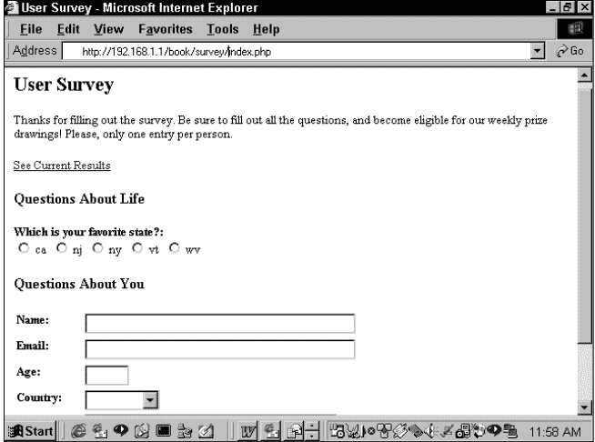

图 9-1：填写调查问卷的页面

请注意，对于此应用程序，你将使用 .gif 文件作为图表。脚本将更改  标签中 gif 的大小属性，以表示信息。这可行，但不一定理想。你可以安装 gd 库并使用 -with-gd 标志编译 PHP。这些功能超出了本书的范围。

像所有其他应用程序一样，此应用程序需要一些管理工具。首先，你需要能够添加、删除和编辑问题。此外，还有一个页面可从数据库中随机选择获胜者。图 9-4 和 9-5 分别展示了管理页面和选择获胜者页面。


## 图 9-2：基本调查结果

## 调查结果

你最喜欢的州是？
vt 60%
wv 20%
ny 20%
你最喜欢的县是？
San Francisco 100%

## 图 9-3：详细调查结果

你最喜欢的州是？（共 5 票）

**按年龄：**
| 答案 | 未说明 | 16 岁以下 | 17 至 32 | 33 至 48 | 49 至 64 | 65 岁及以上 |
|---|---|---|---|---|---|---|
| vt | 33.3% | | | | 33.3% | 33.3% |
| wv | | | | | | 100% |
| ny | | | | 100% | | |

**按国家/地区：**
| 答案 | Canada | 其他 | USA | USA |
|---|---|---|---|---|
| vt | | | 33.3% | 66.6% |
| wv | | | | 100% |
| ny | | 100% | | |

**按州：**
| 州 | vt | wv | ny |
|---|---|---|---|
| CA | 66.6% | 33.3% | |
| 未说明 | 100% | | |

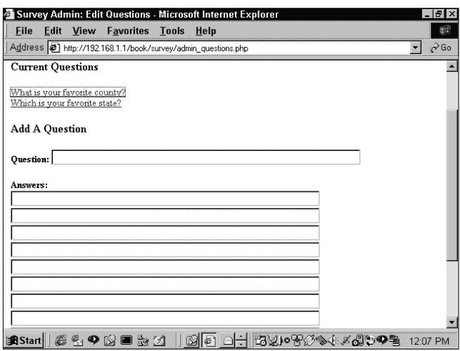

## 当前问题

你最喜欢的县是？
你最喜欢的州是？

## 添加一个问题

问题：

答案：

图 9-4：调查管理页面

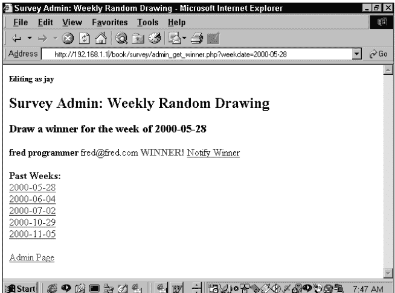

以 jay 编辑

## 调查管理员：每周随机抽奖

为 2000-05-28 当周抽取获奖者

fred programmer fred@fred.com WINNER! Notify Winner

## 过去几周：
- 2000-05-28
- 2000-06-04
- 2000-07-02
- 2000-10-29
- 2000-11-05

管理页面

图 9-5：选择获奖者页面

获奖者将通过电子邮件收到通知，并会收到一个 URL，他们需要前往该 URL 以认领奖品。该页面看起来与图 9-6 中的页面类似。到达后，他们需要确认自己的身份，以便为你提供额外的安全层。

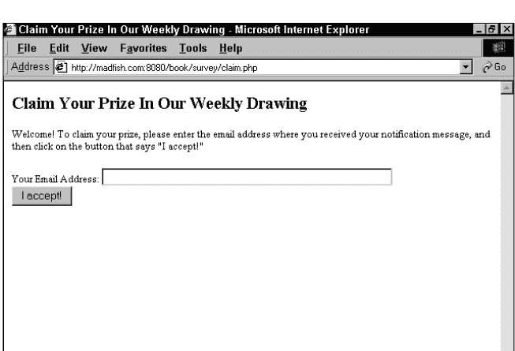

图 9-6：认领奖品页面

## 我们需要防止什么？

在上一章中，我们讨论了人们试图通过表单元素发送垃圾信息的方法。我们将在此处继续使用这些函数。该应用程序还将执行一些电子邮件地址验证。

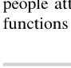

想知道验证电子邮件是否符合正确格式到底需要什么？这需要大量工作。查看 CD 上 /functions 目录中的 CheckEmail.php 文件。你会看到它需要多个正则表达式来确保电子邮件完全正确。鉴于正则表达式执行速度相当慢，你可能会怀疑运行这样的脚本是否值得，尤其是当你运行一个流量非常大的网站时。你需要自己决定。是否需要确保电子邮件完美无缺，还是更简单、健壮性较低的验证形式就足够了？即使你确保地址格式正确，也几乎没有办法知道该地址是否对应一个实际的邮箱。

该应用程序将为你提供一种简单的方法来阻止某些人向你的网站输入信息。它并不十分复杂；一个精明的互联网用户可以在一分钟内绕过它。使用图 9-6 中显示的表单，你可以输入一个将被阻止访问该站点的来源域名。所有输入数据的用户，其 `REMOTE_HOST` 变量都将被与数据库中的表进行检查。如果找到该主机，应用程序将拒绝该用户访问。同样，这并不完美。根据所使用的 ISP，一些客户端甚至不会在 HTTP 头中标识 `REMOTE_HOST`。如果你确实有敏感信息并且需要有效阻止用户的方法，你应该使用某种登录方案。这只是你可以用数据库和 HTTP 头信息做的一个例子。

你还需要采取一些措施，确保错误的人不会认领奖品。你需要确保来认领奖品的人就是他们声称的那个人。

## 设计数据库

此调查应用程序允许任意数量的问题。每个问题可以有任意数量的答案。为了创建这种关系，你需要两个表，一个名为 questions，一个名为 responses，它们之间存在一对多的关系。（每个（1）问题可以有（n）任意数量的答案。）

用户信息最好也用多个表表示。一个名为 users 的表将存储相关的用户信息。两个名为 states 和 countries 的表充当查找表，并与 users 表存在一对多的关系。

最后，还有两个与其他表没有关系的表。它们存储该应用程序需要跟踪的其他信息。它们恰当地命名为 blocked_domains 和 survey_admin。

图 9-7 显示了数据库结构的视觉表示。创建这些表的 `create` 语句显示在列表 9-1 中。请注意，这些表定义是从 `mysqldump` 实用程序复制的。如果你不熟悉 `mysqldump` 或其他 `mysql` 实用程序，请务必查阅附录 C。


## 图 9-7：调查数据库架构

## 列表 9-1：调查的创建语句

```sql
# Table structure for table 'age_ranges'
#
CREATE TABLE age_ranges (
    min_age int(11) NOT NULL,
    max_age int(11) NOT NULL,
    age_range varchar(10)
);
```

```sql
# ----------------------------------------
#
# Table structure for table 'answers'
#
CREATE TABLE answers (
    answer_id int(11) NOT NULL auto_increment,
    question_id int(11),
    answer text,
    PRIMARY KEY (answer_id)
);
```

```sql
# ----------------------------------------
#
# Table structure for table 'blocked_domains'
#
CREATE TABLE blocked_domains (
    domain varchar(30) NOT NULL,
    block_by varchar(10) NOT NULL,
    block_dt datetime DEFAULT '0000-00-00 00:00:00' NOT NULL,
    release_dt datetime,
    notes text,
    modify_dt timestamp(14)
);
```

```sql
# ----------------------------------------
#
# Table structure for table 'countries'
#
CREATE TABLE countries (
    country varchar(30) NOT NULL
);
```

```sql
# ----------------------------------------
#
# Table structure for table 'questions'
#
CREATE TABLE questions (
    question_id int(11) NOT NULL auto_increment,
    question text NOT NULL,
    KEY question_key (question_id)
);
```

```sql
# ----------------------------------------
#
# Table structure for table 'responses'
#
CREATE TABLE responses (
    user_id int(11) NOT NULL,
    answer_id int(11) NOT NULL
);
```

```sql
# ------------------------------------------------------------
#
# Table structure for table 'states'
#
CREATE TABLE states (
    statename varchar(30) NOT NULL,
    state char(2) NOT NULL
);

# ------------------------------------------------------------
#
# Table structure for table 'survey_admin'
#
CREATE TABLE survey_admin (
    username varchar(50) NOT NULL,
    password varchar(255) NOT NULL
);

# ------------------------------------------------------------
#
# Table structure for table 'users'
#
CREATE TABLE users (
    user_id int(11) NOT NULL auto_increment,
    name varchar(50),
    email varchar(50),
    country varchar(20),
    state char(2),
    age int(11),
    remote_addr varchar(15),
    remote_host varchar(80),
    create_dt timestamp(14),
    KEY user_key (user_id)
);

# ------------------------------------------------------------
#
# Table structure for table 'winners'
#
```

```sql
CREATE TABLE winners (
    user_id int(11) NOT NULL,
    weekdate datetime DEFAULT '0000-00-00 00:00:00' NOT NULL,
    notify_dt datetime,
    claim_dt datetime,
    confirm_dt datetime
);
```

## 代码概述

如果你已经阅读了第 8 章中同名的部分，我们在此使用的结构应该对你来说很熟悉。/functions 文件夹中的项目已包含并可重复使用。

很明显，这个调查应用程序需要的页面比留言簿多得多：需要做的事情更多。虽然你可以在单个页面中包含多个操作，并通过传递变量和使用 if 语句来筛选所需的操作，但这会使代码难以跟踪。最好有几个直观命名的文件来执行特定任务。话虽如此，该应用程序中的某些页面会使用变量来决定在给定页面上采取什么操作。

如果你做过任何 Web 工作，你就知道处理 HTML 表格和表单是多么乏味。因此，在本章和本书的大多数其他应用程序中，我们将尝试减轻处理表格和表单带来的痛苦。在以下各节中，你将看到几个函数，它们至少在长期来看会让生活变得轻松得多。接下来的各节中的函数如果先看到它们实现的功能会更容易理解。这里有一些代码，如果与以下函数一起使用，将能很好地工作。

```
print start_table();
print table_row(
    table_cell("Cell text")
);
print end_table();
```


> 如果你不喜欢我们为表格、表单和其他 HTML 元素创建的函数，就不要使用它们。手动输入 HTML 元素而不是通过函数创建是完全可以接受的（也许甚至更常见）。就像编程中的许多事情一样，这归结为个人偏好。在这种情况下没有正确答案：按你喜欢的方式做。

这将创建一个包含一个单元格的表格。你可以通过在 table_row 函数调用中添加额外的 table_cell() 调用在此基础上增加复杂性。你

这可以实现是因为 PHP 能够处理可变数量的参数。你可以设计 table_row 函数来遍历所有参数（其中一些是对 table_cell() 函数的调用）。你可能会想知道这些函数如何处理表格属性，比如 width、align 等。如何为特定表格更改这些属性？这些属性及其值必须包含在函数调用中，因此属性必须作为函数调用中的另一个参数。函数将通过变量类型来识别属性。也就是说，函数会检查参数的变量类型，如果它是数组（关联数组），函数会假设它包含属性信息，并将数组中的键/值对转换为字符串中的 name=value 属性对。更复杂的函数调用看起来像这样：

```
print (table_row (array("bgcolor" => $bgcolor),
    table_cell("New entry"),
    table_cell(text_field("entered_by", "", "10")),
    table_cell(submit_field("submit", "insert"))
)
);
```

这里第一个参数，(array ("bgcolor"=> $bgcolor))，标识行的背景颜色；其余参数创建表格单元格。额外好处是，这些表格单元格包含表单元素。

请记住，实现嵌套函数调用的方法将在后面解释。该应用程序还将使用更多 MySQL。在整个应用程序中，MySQL 函数的使用比第 8 章中看到的更为广泛。

## 代码分解

与访客簿应用程序一样，这里代码为了方便而被划分。仅由本应用程序使用的函数位于 /book/survey/header.php 文件中。它将在每个文件中包含。start_page.php 和 end_page.php 分别包含页眉和页脚信息。

由于我们在第 8 章中已经介绍过位于 /book/functions/functions.php 文件中的函数，这里就不重复讲解了。但这次我们也增加了一点小奖励。

## 可复用函数

随着应用程序变得更复杂，你将需要不断使用一些 HTML 元素——表单、表格、段落标签、锚点等。因此我们添加了一系列函数，使创建这些重复的 HTML 元素变得更容易。我们还将一些常用的数据库函数移到了它们自己的文件中。

## 来自 /BOOK/FUNCTIONS/DB.PHP 的函数

如果你在第 8 章中学习过访客簿应用程序，其中一些内容会看起来很熟悉。但请注意，对于其余应用程序，你可以在此文件中找到这些函数。我们不会介绍每个函数，只介绍需要解释的那些。

### SET_RESULT_VARIABLES()

此函数将查询结果转换为全局变量。

```
function set_result_variables ($result)
{
    if (!$result || !mysql_num_rows($result)) { return; }
    $row = mysql_fetch_array($result,MYSQL_ASSOC);
    if (!is_array($row))
    {
    print $query."<li>no array returned : result=$result row=$row";
        return $result;
    }
    while (list($key,$value) = each($row))
    {
        global $$key;
        $$key = $value;
    }
}
```

如果你还记得我们在第 7 章中关于变量作用域的讨论，你会记得通过 GET 或 POST 传递的变量或在函数外部声明的变量是全局变量，并且它们可在 GLOBAL 的数组中使用。

经常情况下，你会想要将查询中使用的列名作为变量使用。能够在不经过 mysql_fetch_array() 返回的关联数组的情况下使用它们是很方便的。此函数会将查询中使用的变量在整个脚本中转换为全局变量。

```
$query = "select distinct fname, lname from table_1 where id=1";
$result=safe_query($query);
set_result_variables($result);
```

因此这段代码会使变量 $fname 和 $lname 及其值作为全局变量可用。如果向查询发送包含多行的结果集，此函数只使用第一行。

注意此函数中使用了变量变量。

```
while (list($key,$value) = each($row))
{
    global $$key;
```

```
$$key = $value;
}
```

每个元素都取自 mysql_fetch_array() 获取的数组。键（列名）被声明为全局变量。然后该全局变量被赋予 $value 的内容。变量变量在第 7 章中有讨论。

此函数旨在与接下来记录的 fetch_record() 函数一起使用。

### FETCH_RECORD()

此函数有助于创建简单的查询。

```
function fetch_record ($table, $key="", $value="")
{
    $query = "select * from $table ";
    if (!empty($key) && !empty($value))
    {
        if (is_array($key) && is_array($value))
        {
            $query .= " where ";
            $and = "";
            while (list($i,$v) = each($key))
            {
                $query .= "$and $v = ".$value[$i];
                $and = " and";
            }
        }
        else
        {
            $query .= " where $key = $value ";
        }
    }
    $result = safe_query($query);
    if (!empty($key) && !empty($value) &&
    mysql_num_rows($result) == 1)
    {
        set_result_variables($result);
    }
    return $result;
}
```

如果需要使用 MySQL 的函数或需要使用花哨的谓词（LIKE、GROUP BY HAVING），它就不会很有用。它不接受要从数据库中选择的列列表，但可以在 where 子句中接受多个参数和值。

首先，检查 $key 和 $value 变量中是否发送了一个值或多个值。如果发送的是标量变量，则只会向 where 子句添加一个项目。如果发送的是数组，则会遍历并添加到 where 子句中。

如果查询只返回一行，它会调用 set_result_variables() 函数将列及其值设置为全局变量。在所有情况下，函数随后返回查询的整个结果标识符。

### DB_VALUES_ARRAY()

此函数对于从数据库表创建下拉框和其他表单元素非常有用。

```
function db_values_array ($table="", $value_field="",
$label_field=""
    , $sort_field=""
    , $where=""
)
{
    $values = array();

    if (empty($table) || empty($value_field)) { return $values; }

    if (empty($label_field)) { $label_field = $value_field; }
    if (empty($sort_field)) { $sort_field = $label_field; }
    if (empty($where)) { $where = "1=1"; }

    $query = "select $value_field as value_field
        , $label_field as label_field
        from $table
        where $where
        order by $sort_field
";
    $result = safe_query($query);
    if ($result)
    {
        while (list($value,$label) = mysql_fetch_array($result))
        {
            $values[$value] = $label;
        }
    }
    return $values;
}
```

在此应用程序中，以及你会遇到的许多其他应用程序中，你的数据库中会有用作“查找”表的表。这些表的唯一目的是确保好的信息最终进入其他表。看一下

图 9-6 中的图表，你会看到 countries 和 states 表就是为此目的服务的。

查询被精心设计。别名被设置（使用“as”），以便列名与你在表单中希望拥有的属性相匹配。然后创建一个关联数组；$value 将作为此关联数组中的键，并且很可能成为 HTML 表单中的 value 属性。

## 来自 /BOOK/FUNCTIONS/HTML.PHP 的函数

这些函数使创建常见的 HTML 标签变得更容易。此文件中的大多数函数非常相似。但在介绍这些之前，你需要了解 get_attlist() 函数，该函数已添加到 basic.php 文件中。

### GET_ATTLIST()

此函数接受一个关联数组并创建适合 HTML 标签的 name="value" 对。

```
function get_attlist ($atts="",$defaults="")
{
    $localatts = array();
    $attlist = "";

    if (is_array($defaults)) { $localatts = $defaults; }
    if (is_array($atts)) { $localatts = array_merge($localatts, $atts); }

    while (list($name,$value) = each($localatts))
    {
        if ($value == "") { $attlist .= "$name "; }
        else { $attlist .= "$name=\"$value\" "; }
    }
    return $attlist;
}
```

无论基本标签是什么，所有 HTML 标签都以 name="value" 的形式接受属性。此函数将为任何标签构建属性列表。该函数将被写入单个 HTML 标签的其他函数调用。正如你所见，此函数接受两个参数。第二个是一个包含特定标签所需属性集的数组。例如， 标签如果没有 src 属性就没什么用。因此，如果该函数由创建图像的另一个函数调用，第二个参数应为包含一个元素的数组，例如 $myarray = array("src" =>"myimage.gif")。

第一个参数将接受另一个包含其他属性的数组。对于  标签，该第一个数组可能包含 alt 文本、width 和 height——$myarray = array("alt" =>"My Image", "width"=>"20", "height"=>"25"。

如果合适，这两个数组将被合并为一个。然后，从这个合并后的数组中，创建一个包含“name”= value 对的字符串。如果某个值为空，则名称将存在但没有值。

请注意，第二个数组中传递的元素将覆盖第一个数组中的元素，从而可以轻松地覆盖默认值。这是因为在 array_merge() 函数中，如果有两个具有相同关联键的元素，最后一个将覆盖前一个。这允许其他创建 HTML 标签的函数在第一个参数中保留一组默认值，并在第二个参数中提供特定调用的值。

查看以下函数以更好地了解其工作原理。

### ANCHOR_TAG()
此函数创建锚标签。

```
function anchor_tag($href="",$text="",$atts="")
{
    $attlist = get_attlist($atts,array("href"=>$href));
    $output = "<a $attlist>$text</a>";
    return $output;
}
```

对于锚标签，每次你真正可以期望的只有两件事：一个 href 属性和一些放在开始的 <a> 标签之间的文本。然而，name 属性可能也有帮助。但在大多数情况下，对此函数的调用会像这样：

```
anchor_tag("myurl.com/index.html", "this is a great link");
```

请注意，如果有第三个参数，它必须以数组的形式出现。这些参数随后被发送到 get_attlist() 函数并转换为可用的字符串，该字符串被组合到 $output 变量中。

### IMAGE_TAG()
这会创建  标签

```
function image_tag($src="",$atts="")
{
    $attlist = get_attlist($atts,array("src"=>$src));
    $output = "";
    return $output;
}
```

此函数的工作方式与上面描述的 anchor_tag() 函数完全相同。

### PARAGRAPH()
此函数将打印出开始和结束的 <p> 标签以及它们之间的所有内容。

```
function paragraph ($atts="")
{
    $output = "<p>";
    $i = 0;
    $attlist = get_attlist($atts);
    if ($attlist != "")
    {
        $output .= " $attlist";
        $i++;
    }
    $output .= ">\n";
    $args = func_num_args();
    while ($i < $args)
    {
        $x = func_get_arg($i);
        $output .= $x."\n";
        $i++;
    }
    $output .= "</p>\n";
    return $output;
}
```

首先要了解的是，此函数不仅会打印带有其属性的开始 <p> 标签，还会打印结束的 </p> 标签以及两者之间可能出现的所有内容。这可能包括锚标签、图像标签或几乎任何其他内容。以下函数调用完全可以正常工作，实际上在调查应用程序中也使用了它：

```
print paragraph(anchor_tag("admin_block.php",
    "Return to Domain List"));
```

此函数调用中有一个参数，它是另一个具有两个参数的函数调用。实际上，当一个函数调用嵌套在另一个函数调用中时，PHP 会先执行内部的那个。因此，首先调用 anchor_tag() 函数并创建类似 <a href="admin_block.php"> 的字符串。然后执行外部函数，因此对 paragraph 函数的调用实际上会像这样：

```
print paragraph("<a href=\"admin_block.php\">Return to Domain List</a>");
```

请注意其灵活性如何。通过循环遍历参数数量，你可以向 paragraph 函数发送任意数量的额外函数调用。而且你可以愉快地混合文本和函数调用。在 while... 循环中，$x 可以设置为文本字符串或函数调用的输出。因此，以下是对 paragraph 函数的完全正常的调用：

```
print paragraph(
    "<b>Blocked by:</b> $block_by <br>"
    , "<b>Date blocked:</b> $block_dt <br>"
    , "<b>Date released:</b> $release_dt <br>"
    , "<b>Last Modified:</b> $modify_dt <br>"
    , hidden_field("old_domain",$domain)
);
```

### UL_LIST()
此函数将数组或字符串转换为无序 HTML 列表。

```
function ul_list ($values="")
{
    $output .= "<ul>\n";
    if (is_array($values))
    {
        while (list(,$value) = each($values))
        {
            $output .= " <li>$value</li>\n";
        }
    }
    else
    {
        $output .= " <li>$values</li>\n";
    }
    $output .= "</ul>\n";
    return $output;
}
```

使用此函数可以创建项目符号列表。最常见的是将一个数组传递给函数，其每个成员前面都会加上 <li> 标签。如果 $values 的内容是字符串，函数也会在字符串前加上 <li>。

## FUNCTIONS FROM /BOOK/FUNCTIONS/FORMS.PHP
来自 /BOOK/FUNCTIONS/FORMS.PHP 的函数

这些函数大多相当直接，不需要任何解释。我们将展示几个仅作为示例。

### TEXT_FIELD()
这会打印出 HTML 文本字段。

```
function text_field ($name="", $value="", $size=10, $maxlen="")
{
    $output = <<<EOO
<input type=text name="$name" value="$value" size="$size"
maxlength="$maxlen">
EOO;
    return $output;
}
```

应将所有预期的属性传递给函数。大多数其他函数看起来与此类似，唯一的例外是复选框和单选按钮。

### CHECKBOX_FIELD()
此函数创建 HTML 复选框。

```
function checkbox_field ($name="", $value="", $label="", $match="")
{
    $checked = ($value == $match || $label == $match) ? "checked" : "";
    $output = <<<EOQ
<nobr><input type=checkbox name="$name" value="$value" $checked>
$label</nobr>
EOQ;
    return $output;
}
```

此函数中可能感兴趣的唯一事情是如何在函数调用中注明复选框是否应默认选中。你通过添加一个名为 $match 的参数来做到这一点。如果 $match 等于 $label 或 $value，则默认情况下会被选中。radio_field 函数的工作方式相同。

## FUNCTIONS FROM /BOOK/FUNCTIONS/TABLES.PHP
来自 /BOOK/FUNCTIONS/TABLES.PHP 的函数

在样式表成为可靠的网页元素定位方式之前，你很可能会大量使用表格。这些函数使创建表格变得更容易。

### START_TABLE()
此函数创建开始的 <table> 标签。

```
function start_table ($atts="")
{
    $attlist = get_attlist($atts);
    $output = <<<EOQ
<p>
<table $attlist>
EOQ;
    return $output;
}
```

同样，此函数调用 get_attlist() 函数为开始的 table 标签添加属性。将属性数组添加到函数调用中，即可在生成的标签中添加属性。

### END_TABLE()
此函数创建结束的 </table> 标签。

```
function end_table ()
{
    $output = <<<EOO
</table>
</p>
EOO;
    return $output;
}
```

此函数基本上做你所期望的事情。它并不是真正必要的，但它与 start_table() 函数提供了很好的对称性。

### TABLE_ROW()
此函数不仅打印开始的 <tr> 标签及其属性；它还打印将嵌套在 <tr> 标签内的表格单元格。

```
function table_row ()
{
    $attlist = "";
    $cellstring = "";

    $cells = func_get_args();
    while (list(,$cell) = each($cells))
    {
        if (is_array($cell))
        {
            $attlist .= get_attlist($cell);
        }
        else
        {
            if (!eregi("<td",$cell))
            {
                $cell = table_cell($cell);
            }
            $cellstring .= " ".trim($cell)."\n";
        }
    }
    $output = <<<EOO
<tr $attlist>
$cellstring
</tr>
EOO;
    return $output;
}
```

此函数通过接受嵌套的函数调用来工作。

```
print table_row(
    table_cell("hello world", array("align"=>"right"))
);
```

前述代码中的 table_row() 调用有一个参数，它本身是另一个函数调用。由于发送给函数的参数都可以使用 func_get_args() 命令提取，因此你可以设置一个包含所有参数的数组。在前述代码中，该数组是 $cells。

还记得我们之前说过内部函数调用先于外部函数调用执行吗？在前述示例中，table_cell 调用首先执行。因此，对 table row 的调用实际上会像这样：

```
print table_row("<td align=\"right\"> hello world</td>")
```

因此，当此函数调用成为活动参数时，正则表达式将测试为 false，并且不会调用 table_cell 函数。这是有道理的：由于你已经拥有表格单元格字符串，因此无需调用 table_cell 函数。

你可能想知道为什么函数包含那个正则表达式和 table_cell() 函数调用。那是为了像以下代码中的函数调用这样的情况，在这种情况下 table cell 并未显式调用。

```
print table_row("Cell text");
```

## FUNCTIONS AND CODE FROM /BOOK/SURVEY/HEADER.PHP
来自 /BOOK/SURVEY/HEADER.PHP 的函数和代码

此文件包含在调查应用程序中的每个文件中，因此这些函数都可用。

### START OF PAGE
页面开始
在进入此文件中的函数之前，有一些代码进行一些清理工作。

```
if (!defined("LOADED_HEADER"))
{
    include "../functions/charset.php";
    include "../functions/basic.php";
    dbconnect("survey");
    include "functions.php";
    define("LOADED_HEADER", "yes");
}
```

```
$result = safe_query("select 1 from blocked_domains
    where '$REMOTE_HOST' like concat('%',domain)
    and release_dt is null
");
```


```
if (mysql_result($result,0) > 0)
{
    print "<h2>sorry - your domain has been blocked from this page</h2>\n";
    exit;
}
```

上述代码包含在处理应用程序核心之前你需要的信息。这些 include 很清楚。出于谨慎考虑，这些 include 被放在了一个 if 语句中。一旦头部已被加载，就无需再次重新加载。我们可以通过创建一个名为 LOADED_HEADER 的常量来确保这种情况不会发生。如果偶然此页面被第二次加载，你也不必担心 include 会被导入多次。


> 请记住 PHP 4 具有 include_once 构造，它可确保文件不会被多次包含。

如前所述，这里有一个阻止域名的功能，该应用程序将使用 $REMOTE_HOST 变量来实现。这几乎没有必要，而且很容易注释掉这段代码。为了理解这段代码，请更仔细地查看查询，特别是 like 谓词。当我从我的 ISP（att.net）拨号上网时，我的 REMOTE_HOST 类似于这样：119.san-francisco-18-19rs.ca.dial-access.att.net。当你阻止域名时，你将在顶级域名上进行操作——在本例中为 att.net。而这个顶级域名将存储在数据库中。因此查询将在顶级域名名称之前检查任意数量的通配符字符。

要实现这一点，你需要将域名与 % 通配符字符连接起来。例如，查询将针对 %att.net 进行操作。这可能与你典型的 like 谓词有些不同。这是使用 SQL 的另一种强大技术。

还请注意，select 语句的开头不包含 select count(*)，而是选择了 select 1。这是一个测试是否有任何行满足 where 子句条件的好方法。如果 where 子句匹配任意数量的行，查询将返回一个值为 1 的单列，在编程世界中这意味着 TRUE。如果没有返回任何行，你就知道查询的 where 部分没有匹配项。

## WEEKSTART()
这个函数创建一个 MySQL 函数来获取一周开始的日期。你在应用程序中使用它来为当前周挑选获胜者。

```
function weekstart ($when="")
{
    if (empty($when)) { $when = "now()"; }
    elseif ($when != "create_dt") { $when = "'$when'"; }
    return "from_days(to_days($when)-dayofweek($when) + 1)";
}
```

其工作原理如下：MySQL 的 to_days() 函数返回自公元 1 年 1 月 1 日以来的天数整数。dayofweek() 返回一个表示一周中某天的整数（星期日等于 1，星期六等于 7）。因此，(to_days($now)-dayofweek($when) + 1) 部分将返回一个表示所讨论周的星期日的整数。from_days() 函数随后将该数字转换为日期。以下是于 2000 年 7 月 27 日星期四（本章撰写之日）运行此查询的结果：

```
mysql> select from_days(to_days(now())-dayofweek(now()) + 1);
```

| from_days(to_days(now())-dayofweek(now()) + 1) |
|---|
| 2000-07-23 |

1 行在集合中 (0.00 秒)

请注意，这里传递的值可以是一个表示日期的字符串，可以为空，或者可以是 users 表中的一个字段——即 create_dt 字段。

## COUNTRYLIST()
这个函数创建一个国家名称的下拉列表。

```
function country_list ()
{
    $countries[""] = "";
    $countries = array_merge($countries
        ,db_values_array("countries","country")
    );
    return $countries;
}
```

使用 db_values_array() 函数（在本章前面“可重用函数”部分讨论过）来获取国家及其缩写的数组。

## STATE_LIST()
这会创建一个州名称的下拉列表。

```
function state_list ()
{
    $states[""] = "";
    $states = array_merge($states
        ,db_values_array("states","state","statename","state")
    );
    return $states;
}
```

使用 db_values_array() 函数（在本章前面“可重用函数”部分讨论过）来获取国家及其缩写的数组。

## FETCH_QUESTION()
这个函数抓取 questions 表中一行的内容并将列分配给全局变量。

```
function fetch_question ($question_id="")
{
    if (empty($question_id)) { $question_id = 0; }
    $result = fetch_record("questions","question_id",$question_id);
    return $result;
}
```

这将运行 fetch_record() 函数并根据 questionid 从数据库返回有关特定问题的所有信息。

## FETCH_USER()
这个函数抓取 users 表中一行的内容并将列分配给全局变量。

```
function fetch_user ($user_id="")
{
    if (empty($user_id)) { $user_id = 0; }
    $result = fetch_record("users","user_id",$user_id);
    return $result;
}
```

根据 user_id 返回结果集。

## Interesting Code Flow
有几个页面在这个应用程序中值得一些解释。然而，如果你理解上一节中的函数，你应该能够跟上其中的大部分。

## admin_question.php
这是一个相当冗长的页面，有充分的理由：它用于在数据库中添加、编辑和删除问题。页面中将被运行的部分将由表单或链接传递的值决定。第一次运行时不会传递任何变量，因此将显示当前问题的列表以及用于输入新问题的表单。数据库中已存在问题的每个链接看起来都像这样：

```
<a href="admin_questions.php?what=edit&question_id=2" >
```

当点击这样的链接，并且 admin_questions.php 脚本再次运行时，脚本的最后部分将被运行，如下所示：

```
else
{
    $qform_title = "Edit A Question : $question_id";
    fetch_question($question_id);
}

print subtitle($qform_title);

print start_form("admin_questions.php");

print paragraph("<b>Question:</b>",
text_field("question",$question,60));
```

注意你如何通过一次函数调用（fetch_question()）获取与 $question_id 关联的所有信息。由于函数的创建方式，这会自动为你提供 $question 的全局变量。

接下来，进入这个循环：

```
$acount = 0;
if ($question_id > 0)
{
    $result = safe_query("select answer_id, answer
        from answers
        where question_id=$question_id
        order by answer_id
    ");
    while (list($aid,$atxt) = mysql_fetch_array($result))
    {
        $acount++;
        print text_field("answer_text[$acount]","$atxt",60);
        print hidden_field("answer_id[$acount]","$aid");
        print " ($aid)<br>\n";
    }
}
```

这里的数字 10 将每个问题的答案数量限制为 10。此块获取所选问题的答案并在文本字段中打印出来。附加信息放在隐藏字段中。当打印出来时，一个答案的结果将如下所示：

```
<input type="text" name="answer_text[1]" value="Answer"
size="60" >
<input type="hidden" name="answer_id[1]" value="10">
```

当提交此表单时，$answer_text 将是一个数组。$acount 将看到数组的键对每个额外的表单字段递增 1。请注意，我们在这里需要使用隐藏的表单元素。这是因为每个答案需要三条信息：答案编号是多少（1-10）、答案文本，以及如果答案来自数据库，我们需要知道答案来自的行主键。隐藏字段将创建一个名为 $answer_id 的数组。该数组中每个元素的值将是存储答案的行主键。该数组的索引将与 $answer_text 的索引相匹配。所以在代码中看起来像这样，

```
$i = 1;
$answer_text[$i];
$answer_id[$i];
```

你会知道 $answer_id[$i] 包含一行主键，而 $answer_text[$i] 是属于该行的答案文本。

前一段代码只会在有答案的地方打印出表单元素。但你应该提供空白表单元素，以便管理员可以输入新答案。

```
while ($acount < 10)
{
    $acount++;
    print text_field("answer_text[$acount]","",60);
    print hidden_field("answer_id[$acount]",0);
    print "<br>\n";
}
```

这将完成表单，提供你所需的所有空白元素。对于这些空白答案，表单将包含以下内容：

```
<input type="text" name="answer_text[8]" value="" size="60" >
<input type="hidden" name="answer_id[8]" value="0"><br>
```


在这些表单元素中，隐藏字段的值被设置为 0。这样，在处理这些表单元素时，脚本将有内容可供评估：如果 $answer_id[$i] 等于零或为空 ($answer_id[$i])，则这是一个新元素。

当表单提交时，这段代码将被执行。

总共始终有 10 个元素需要循环遍历，因此 for 循环很合适。

```
for ($i = 1; $i <= 10; $i++)
{
    if (!empty($answer_text[$i]))
```

首先我们确保有可用的答案文本。

```
{
    $answer = cleanup_text($answer_text[$i]);
    if (empty($answer_id[$i]))
    {
        $query = "insert into answers
            (question_id, answer)
            values
            ($question_id, '$answer')
        ";
    }
```

如果 $answer_id 的元素为空（这意味着它不可能等于零），则会运行插入语句。

```
else
{
    $query = "update answers
        set question_id = $question_id
        , answer = '$answer'
        where answer_id = ".$answer_id[$i]
        ;
    }
    safe_query($query);
}
}
}
```

否则，如果已有答案，则更新查询即可解决问题。

## admin_get_winner.php

本文件的大部分内容都是可读的。你的目标是从数据库中随机抽取一名合格的获奖者。首先你使用 weekstart 函数（本章前面在“Functions and code from /book/survey/header.php”一节中讨论过）来获取当前周开始的日期。

```
$qweekdt = weekstart($weekdate);
list($thisweek) = mysql_fetch_array(safe_query("select $qweekdt"));
print subtitle("Draw a winner for the week of $thisweek");
```

然后你创建一个查询来确定谁符合资格。如你所见，我们决定除了在上周报名外，他们还需要输入姓名和电子邮件地址，并且年龄合法。

```
$query = "select name, email, user_id from users
    where week(create_dt) = week('$thisweek')
        and year(create_dt) = year('$thisweek')
        and name is not null and name != ''
        and email is not null and email != '' and email like
        '%@%.%'
        and age > 0
        and country is not null and country != ''
";
$result = safe_query($query);
$tot = mysql_num_rows($result);
```

掌握了合格参赛者的总数后，脚本会做出几个决定来确定获奖者。首先需要考虑没有可能获奖者的情况。

```
if($tot ==0)
{
    echo "There were no entrants this week";
}
```

我们已经运行了一个包含潜在获奖者的 select 查询。结果集中的第一行是行号零。因此如果只有一个可能的获奖者，则返回的行只有第 0 行。

```
else
{
    if ($tot == 1)
    {
        // if there's only one entry, they win.
```

```
$winner = 0;
}
```

然而，如果存在多个可能性，则会为随机数生成器设置种子，并抽取一个行号。请注意，总行数将比最后的行号多一个（因为第一行编号为 0）。这就是为什么随机数的上限范围必须是 $tot-1。

```
else
{
    mt_srand((double)microtime()*1000000);
    $winner = mt_rand(0,$tot-1);
}
```

```
mysql_data_seek($result, $winner);
list($name, $email, $user_id) = mysql_fetch_array($result);
$urlthisweek = rawurlencode($thisweek);
print paragraph(
    "<b>$name</b> $email "
    , "<b><font color=red>WINNER!</font></b> "
    ,anchor_tag("admin_winners.php?weekdate=$urlthisweek"
        ."&what=notify&user_id=$user_id"
    , "Notify Winner"
    )
);
```

这最后一段代码获取有关获奖者所需的信息，并提供一个链接到 admin_winners.php 页面，该页面包含正确的 user_id、与此奖项相关的周以及变量 $what，后者将标识我们想要运行的 admin_winners.php 页面的哪一部分。

本文件还有更多内容，但你应该能够根据代码中包含的注释来理解。

## admin_winners.php

我们创建了一些页面，以确保被选中的获奖者得到令人兴奋的消息的通知，并且我们以提供一定安全性的方式进行通知。这并不多，但要合理确保领取奖品的人是你本意的人，你需要使用登录系统，而一个小小的调查的参与者可能对记住又一个密码不感兴趣。

我们在这里能做的最好的事情是尽量确保，如果某个不道德的人在一周内看到了领取信息，那个人在未来几周内无法轻易伪造我们的系统。当我们发送获奖者通知时，我们将包含一个八字符的领取代码。只有知道该代码才能领取此奖品。

为了尽可能安全，我们希望确保此代码是唯一的并且非常难以猜测。

```php
mt_srand ((double) microtime() * 1000000);
$claim_code = substr(md5(uniqid(rand())),0,8);
```

这使用 uniqid() 和 md5() 函数创建非常随机的字符串。当黑客试图弄清字符串是如何构造的时，几乎没有什么可利用的。md5() 会创建 32 个字符的字符串，但这可能有点难以处理。因此我们使用 substr() 将字符串限制为 8 个字符。

user_id、领取代码和感兴趣的周被插入到 winners 表中。

```php
$query = "replace into winners
    (weekdate, user_id, claim_code, notify_dt)
    values
    ('$weekdate', $user_id, '$claim_code', now())
";
```

获奖者会收到一封电子邮件，大致如下，其中领取代码与数据库中输入的内容相匹配：http://mydomain.com/claim.php?claim_code=k15g4ju9。

如果用户感兴趣，她将访问此页面。

## CLAIM.PHP

如果获奖者访问 claim.php，我们首先需要检查领取代码是否存在于数据库中。以下代码中的查询会查询数据库以查看领取代码是否存在，如果存在，则查询会执行连接并返回与领取代码关联的用户信息。

```php
$user_id = 0;
if (!empty($claim_code))
{
    $query = "select u.user_id, u.email, w.weekdate
        from users u, winners w
        where w.claim_code = '$claim_code'
        and w.user_id = u.user_id
    ";
    $result = safe_query($query);
}
```

如果查询返回数据，相关信息将被分配给变量。

```php
if ($result)
{
```

```
list($user_id, $winner_email, $weekdate)
    = mysql_fetch_array($result);
}
}
```

如果没有为 $user_id 分配任何内容，我们就知道这不是一个有效的领取代码。

```
if ($user_id == 0)
{
    // we couldn't find a record corresponding to the claim_code
    // submitted (if any). print out an error and exit.
    print <<<EOQ
<p>
I'm sorry, that doesn't appear to be a valid claim code.
The URL may not have registered properly.
Make sure to copy the complete link into your browser and try again,
or forward your original prize notification to $admin_email.
</p>
EOQ;
    exit;
}
```

一旦确定领取代码有效，我们希望做一些双重检查，并确保提交此领取代码的人知道通知发送到的电子邮件地址。该应用程序通过发送一个表单来实现这一点，要求用户输入正确的电子邮件。该表单由本页面发送和处理。当表单提交时，以下代码将被执行。

```
if(!empty($user_id))
{
    if ($user_email != $winner_email)
    {
$notice = <<<EOQ
I'm sorry, that email address doesn't match our records.
Please try again, or forward your original prize notification
to $admin_email.
EOQ;
```

此比较 $user_email != $winner_email 会起作用，因为页面顶部运行的查询检索了正确的获奖者电子邮件，而用户提交的表单创建了 $user_email。如果该比较失败，则会打印错误消息。但是，如果比较未失败，则以下代码会更新 winners 数据库，记录奖品被领取的时间，并向获奖者发送电子邮件告知其领取成功。


```
}
else
{
    $claimquery = "update winners set claim_dt = now()
        where user_id = $user_id
        and claim_code = '$claim_code'
        and weekdate = '$weekdate'
    ";
    $result = safe_query($claimquery);
    if ($result && mysql_affected_rows() > 0)
    {
$msgtext = <<<EOO
The prize for $weekdate has been claimed by $email.
Confirm the prize at

http://$HTTP_HOST/book/survey/admin_winners.php

EOO;
            mail($admin_email,"Prize Claim",$msgtext);
print <<<EOO
<p>
Thanks! Your claim has been accepted. Your prize should be on its
way soon!
EOO;
exit;
```

本页的最后部分只是打印用户输入电子邮件的表单。这里无需展示。

## 摘要

该应用程序中还有相当多的代码，但只要仔细查看文件并阅读注释，就没有你无法弄明白的东西。查看 complex_results.php 页面及其包含文件（age_results.php、state_results.php 和 country_results.php），可以了解 MySQL 聚合函数如何派上用场。

该应用程序比留言簿复杂得多。在此应用程序中，我们有一个完整的数据库架构，其中包含相关的表。在应用程序的执行过程中，我们需要使用包含 MySQL 函数的查询。 （有关 MySQL 函数的更多信息，请参阅附录 I）。

本章中看到的另一件值得注意的事情是我们为创建常见 HTML 元素而创建的函数集。是否使用这些函数或类似的东西由你决定。你可能更喜欢自行输入各个表单元素、表格等。但你将在本书的剩余部分看到这些函数的使用。

## 第 10 章

## 目录

## 本章内容

- 使用面向对象代码
- 查看数据库架构
- 规避 MySQL 限制
- 在 PHP 中运行 shell 命令

在本章中，我们将展示一种创建在线目录的方法。你将看到如何展示和管理一个呈现典型零售商品的应用程序。

我们本书的作者认为你是一个聪明的人，也是技术文学品味极佳的人。我们也相信你之所以拿起这本书，是因为你想尽可能多地了解使用 PHP 和 MySQL 进行应用程序开发的知识。这就是为什么我们不会浪费任何时间。每一章都会引入额外的挑战，或者至少呈现一些新颖不同的内容。本章也不例外。

如果本章使用第 9 章调查应用程序中介绍的函数，这里将没有太多新材料可呈现。应用程序只需要一个简单的数据库架构、几个带有一些连接的查询，以及对 /functions/ 文件夹中 HTML 函数的调用。

为了让事情更有趣，该应用程序使用了一种完全不同的代码组织方式。该调查使用了面向对象或 OO 编程。然而，我们并没有放弃所有这些函数。其中一些实在太方便了（safe_query() 就会想到）。


> 第 7 章介绍了与面向对象编程相关的概念和术语。本章我们假设你已阅读并理解了这些信息。

## 确定应用的范围和目标

我们对该应用程序的目标相当 modest。想象一下，你拥有一家某种零售店，里面有你想兜售的商品。此外，假设你对通过网络进行实际交易不感兴趣。也许你只是对这种新式信用卡处理方法过于偏执。或者你可能正在运行一个复杂的逃税计划，要求你只使用未标记的二十美元钞票。


> 本目录中使用的代码将在购物车应用程序中重用，在那里我们将展示如何处理信用卡交易。

无论情况如何，该网站需要做的只是以逻辑的分类和细分方式展示你的商品。当我们讨论数据库架构时，你将听到更多关于信息分解的内容。

本章的主要目标是创建充分利用面向对象方法的代码。类必须使用继承和封装，并且应使编写单个脚本的任务变得容易得多。还必须考虑模块化。这里创建的代码将在第 14 章中重用，因此我们希望以易于在其他地方重用的方式编写代码。

我们还想加入一些很酷的东西。有一天在 PHP 邮件列表上，某人 Rasmus 提到了一组在 Unix 上运行的免费软件实用程序，可用于调整和以其他方式操作各种图像。本应用程序中的 PHP 脚本将与这些实用程序（称为 PBMplus）接口，以自动为目录商品的图像创建缩略图。我们认为你必须承认这很酷。


> Rasmus Lerdorf 发起了后来演变为 PHP 的语言。他是核心开发者之一，是邮件列表的活跃成员，也是 PHP 软件的有效倡导者。PHP 的历史其实挺有趣的。如果你有 MP3 播放器，可以从 Rasmus 和其他核心开发者那里听到全部内容：http://hotwired.lycos.com/webmonkey/radio/php.html

PBMplus 可以在 CD 上找到。

订阅 PHP 邮件列表。你将了解到各种你从未猜到存在的好东西。如果你要订阅，请做好准备应对邮件量。该列表每天可产生超过 100 封电子邮件。请查阅附录 H，了解其他邮件列表。

## 所需页面

显示目录的页面并不奢华。出于导航目的，有一个简单的页面显示分类列表。图 10-1 显示了分类列表。


图 10-1：分类列表页

从分类列表中，页面查看者会点击进入查看该分类中的产品列表。图 10-2 显示了这个相当平淡的页面。


图 10-2：产品列表页

最后，有一个页面列出实际出售的商品。请注意，每个商品都显示了缩略图，并且每个商品旁边都列出了该商品的变体。在图 10-3 中，商品是 T 恤，并列出了具体的尺码。

像本书中的所有应用程序一样，这个应用程序有一系列管理页面。鉴于你已在前几段和图中看到的内容，应该不会感到惊讶，管理页面会在以下层级创建、删除和更改信息：分类、产品、商品和子商品，其页面分别显示在图 10-4、10-5 和 10-6 中。


子商品是指例如特定 T 恤可供选择的尺码。子商品代表特定商品的细微变化。

## Bag'O'Stuff: T-Shirts: Plain

老牌产品

价格：10.00

## 样式详情

黑色 可用尺寸：S, M, L, XL

白色 可用尺寸：S, M, L, XL, XXL

图 10-3：商品列表

## 目录管理：编辑分类

分类 T-Shirts

描述 任何衣橱必备的全能单品。

保存更改 删除分类 重置

## 产品

- Plain
- Oops!
- 添加新产品

管理页面

图 10-4：分类管理页面


图 10-5：产品管理页面


图 10-6：商品和子商品管理页面


## 我们需要防止什么？

与调查和留言簿不同，此应用程序中没有用户交互。对公众而言，目录是只读的。因此，我们不必太担心无聊的人在我们的页面上添加不需要的标签和脚本。

在此应用程序中存在更普遍的关注点，即在每个应用程序中都会出现的问题：是否存在错误，代码是否高效，我们的数据是否正确规范化，以及类似的其他问题。

## 数据

对于此应用程序，我们认为花几段文字讨论为什么我们没有使用看似最简单、最明显的模式是有用的。

### 有缺陷的数据设计

如果你在阅读前面的页面时足够细心，你会记得数据的分解。有一個或多个分类，每个分类包含许多产品。每个产品会有多种款式，每种款式可以有若干子款式。

这可能会让你相信，我们的表采用简单的层次结构就完全可以正常工作。图 10-7 显示了会产生这种层次效果的一对多关系。


图 10-7：有缺陷的目录模式

现在考虑如果我们向这些表添加数据会发生什么。让我们以 T 恤为例。有一个 T 恤分类，以及该分类下的若干产品（T 恤上印有不同的巧妙短语）。每个产品会有若干款式（颜色），每种颜色会有若干子款式（尺码）。图 10-8 显示了层次表形式的数据可能是什么样子。（注意表已简化）。

**分类**
| category_id | 分类 |
|---|---|
| 1 | T恤 |
| 2 | 鞋子 |

**产品**
| product_id | 产品 | category_id |
|---|---|---|
| 1 | Just Say Oops | 1 |
| 2 | I Love Milk | 1 |

**款式**
| style_id | 款式 | product_id |
|---|---|---|
| 1 | 蓝色 | 1 |
| 2 | 绿色 | 1 |
| 3 | 红色 | 2 |
| 4 | 蓝色 | 2 |

**子款式**
| sub-style_id | 子款式 | style_id |
|---|---|---|
| 1 | S | 1 |
| 2 | M | 1 |
| 3 | L | 1 |
| 4 | XL | 1 |
| 5 | S | 2 |
| 6 | M | 2 |
| 7 | L | 2 |
| 8 | XL | 2 |
| 9 | S | 3 |

图 10-8：示例层次数据

看一下图 10-8 中的子款式表。它已经开始有点混乱了。即使只有几件 T 恤，也存在一些重复数据。如你所见，小号（S）出现了多次，随着我们向目录中添加内容，将插入更多行，此表会变得更加混乱。

更仔细地思考数据，你可能会注意到一个有趣的现象：在 T 恤的情况下，尺码完全不依赖于 T 恤的颜色。如果你还记得第 1 章，你会记得缺乏依赖关系是一件坏事。因此，上述数据实际上并没有得到适当的规范化。

事实上，T 恤可用的尺码既不依赖于颜色（款式表），也不依赖于 T 恤上的短语（产品表）。事实上，尺码取决于分类。所有 T 恤（category_id=1）都将有 S、M、L 或 XL。因此，在最终模式中，分类表与子款式表之间将存在关系。


> 提示：测试你的模式。在将自己的应用程序上线之前，使用一些测试数据看看会发生什么。理论上看起来正确的事情在实践中可能存在严重缺陷。


> 提示：在数据库中创建任何一张表之前，先用铅笔和纸画出你的表和关系。在那里擦掉一条线要比删除一列容易得多。

## MySQL 奇特之处

在进入最终模式之前，这是一个指出 MySQL 怪异之处的好时机。在第一部分中，我们提到 MySQL 不支持联合或子查询。鉴于这些限制，请看一下表 10-1 和表 10-2，并告诉我如何找到表 10-1 中但不在表 10-2 中的所有名称。

**表 10-1 名称**

| first_name |
|------------|
| brad |
| jay |
| john |

**表 10-2 其他名称**

| first_name |
|------------|
| brad |
| jay |
| William |

如果 MySQL 支持子查询，这将有效：

```
select first_name from Names where first_name not in (select first_name
from Other_names)
```

然而，在 MySQL 中，最好的做法是执行外连接。像这样：

```
select N.first_name
from Names N
left join Other_names Otn on
    N.first_name = Otn.first_name
where Otn.first_name is null
```

通过外连接，我们可以确保 Names 表完整保留。然后，在连接后的表中，匹配值处会出现非空结果。例如，由于 'Jay' 同时存在于两个表中，该字符串将存在于结果查询的两个列中。但如果没有匹配值，连接表中会出现空值。

你还会看到子查询用于如下语句：

```
select first_name from Names where first_name in (select first_name
from Other_names)
```

在这种情况下，直接连接会产生相同的结果。

```
select N.first_name
from Names N, Other_names Otn
where N.first_name = Otn.first_name
```

MySQL 直到 3.24 版本才支持联合。然而，在 3.23 版本中有一个变通方法并不太困难。你可以创建一个临时表，将不同的 select 语句插入其中。例如在其他数据库包中，你可能会这样做：

```
select first_name, last_name from table_1
union
select first_name, last_name from table_2
```

在 MySQL 3.23 中，你将创建一个临时表，然后将 select 语句的结果插入该表。上述代码将重写如下：

```
create temporary table name_union
select first_name, last_name from table_1;
```

```
insert into name_union
select first_name, last_name from table_2;
```

现在你有一个保存联合的表，你可以对该表执行 select。创建的临时表会非常快，因为它不会写入磁盘；它只存储在内存中。

请注意，此语法在 3.22 版本中不可用。

## 更好的模式

现在这个小插曲结束了，我们将回到此应用程序的结构。图 10-9 显示了首选模式，即我们实际使用的模式。


图 10-9：目录数据库模式

首先，注意分类表与子款式表之间存在直接关系。原因前面已经解释过。图中上半部分的表应该是有意义的。它们是仍然有意义的层次结构的一部分。

此应用程序中精妙且不同的地方是 style_substyle_map 表。如果你按顺序阅读本书，这是你第一次遇到多对多关系。在此应用程序中，一个分类可以有多个子款式（例如，T 恤有 S、M、L 和 XL）。任何衬衫款式（例如红色 “I Love Milk”）可以有零个、一个或多个子款式（尺码）。style_substyle_map 跟踪该交集。图 10-10 说明了数据如何汇合。

| sub-style_id | 子款式 | style_id |
|---|---|---|
| 1 | S | 1 |
| 2 | M | 1 |
| 3 | L | 1 |
| 4 | XL | 1 |

| category_ID | 分类 |
|---|---|
| 1 | T恤 |
| 2 | 鞋子 |

| product_id | 产品 | category_id |
|---|---|---|
| 1 | Just Say Oops | 1 |
| 2 | I Love Milk | 1 |

| style_id | 款式 | product_id |
|---|---|---|
| 1 | 蓝色 | 1 |
| 2 | 绿色 | 1 |
| 3 | 红色 | 2 |
| 4 | 蓝色 | 2 |

| substyle_id | style_id |
|---|---|
| 1 | 1 |
| 3 | 1 |
| 1 | 2 |
| 2 | 2 |

图 10-10：示例数据

在图 10-10 中，“Just Say Oops” 蓝色 T 恤有两种尺码：S 和 M。列表 10-1 显示了将创建这些表的语句。


## 清单 10-1：目录应用程序的创建语句

```
# ------------------------------------------------------------
#
# Table structure for table 'catalog_admin'
#
CREATE TABLE catalog_admin (
    username varchar(50) NOT NULL,
    password varchar(255) NOT NULL
);
# ------------------------------------------------------------
#
# Table structure for table 'categories'
#
CREATE TABLE categories (
    category_id int(11) NOT NULL auto_increment,
    category varchar(255) NOT NULL,
    description text,
    PRIMARY KEY (category_id)
);
# ------------------------------------------------------------
#
# Table structure for table 'products'
CREATE TABLE products (
    product_id int(11) NOT NULL auto_increment,
    category_id int(11) NOT NULL,
    product varchar(255) NOT NULL,
    description text,
    price decimal(10,2),
    image_src varchar(255),
    PRIMARY KEY (product_id),
    KEY product_category_id (category_id)
);
# ------------------------------------------------------------
#
# Table structure for table 'styles'
#
CREATE TABLE styles (
    style_id int(11) NOT NULL auto_increment,
    product_id int(11) NOT NULL,
    style varchar(255) NOT NULL,
    description text,
    price decimal(10,2),
    image_src varchar(255),
    PRIMARY KEY (style_id),
    KEY style_product_key (product_id)
);
# ------------------------------------------------------------
#
# Table structure for table 'substyles'
#
CREATE TABLE substyles (
    substyle_id int(11) NOT NULL auto_increment,
    category_id int(11) NOT NULL,
    substyle varchar(255) NOT NULL,
    price decimal(10,2),
    description text,
    PRIMARY KEY (substyle_id),
    KEY substyle_category_key (category_id)
);
# ------------------------------------------------------------
#
# Table structure for table 'style_substyle_map'
#
CREATE TABLE style_substyle_map (
style_id int(11) NOT NULL,
substyle_id int(11) NOT NULL,
price decimal(10,2),
description text,
image_src varchar(255),
KEY map_style_key (style_id),
KEY map_substyle_key (substyle_id)
);
```

## 代码概述

本节中的代码与您迄今为止看到的章节会大不相同。只有购物车（实际上，它基于此应用程序构建）使用类似的代码组织和访问方法。其他主要区别是使用 PHP 之外的实用程序以及访问文件系统。

## 面向对象的方法

在前面的应用程序中，以及接下来的应用程序中，我们使用的是过程式方法。也就是说，有一系列函数，每个函数执行一个相当具体的过程。在实际应用程序中，除了调用这些函数之外几乎没有其他工作可做。但在这种数据在很大程度上是分层的应用程序中，利用面向对象编程的继承是有帮助的。毕竟，Style 实际上是产品的一种扩展。样式可能是红色的，但如果没有来自 Category 表的继承属性 T 恤，“红色”就意味着很少。

如果您使用对象，则由 URL 调用的文件中的内容会更加简洁。几乎所有的工作都将在类中执行。一旦您了解类文件执行的操作，就几乎没有其他事情需要您去做。对面向对象编程的倡导者来说，这是一个很大的优势。您作为程序员，可以获取一个类文件，而根本不知道其中发生了什么。您只需要知道它具有什么属性以及其方法做什么。然后，您就可以将其包含在应用程序中，无痛地使用其复杂的功能。


> 我们在第 7 章中说过，但在这里重申一下：您可以编写包含此处讨论的所有优势的程序化代码。如果您不注意面向对象编程，您的代码最终可能会变得更难以维护和使用。

## 访问文件系统

您可能已经注意到，在本书中，我们几乎所有的數據都存储在 MySQL 数据库中。但即使您使用 MySQL，有时使用文件系统进行存储会更好。图像（jpegs、gifs、pngs）就是一个完美的例子。即使您的数据库支持二进制数据，将图像放入数据库也没有什么优势。您需要数据库来存储和查询规范化数据。在数据库中，您最好存储文件系统中图像的路径。这样，您就可以轻松地在  标签中填写 src 属性。


> 不要将图像存储在数据库中。将其放在文件系统上。

## 上传文件

这是第一个允许用户上传文件的应用程序；具体来说，目录的管理员需要能够上传其产品的图像。在 PHP 中上传文件很容易，但在了解上传的工作原理之前，您需要知道 PHP 如何处理上传的文件。在您的 HTML 页面中，您将有一个表单，如下所示。

```
<form action="admin_product.php" method="post"
enctype="multipart/form-data" >
<input type=file name="imagefile">
</form>
```


当您允许文件上传时，您会使自己面临拒绝服务（DoS）攻击的风险。如果您不小心，有人可以同时向您的系统发送许多多兆字节的文件，这可能会导致您的机器崩溃。有两件事您可以做。第一是在 <input type="file"> 标签之前放置一个隐藏的表单字段。隐藏字段应如下所示：

```
<INPUT TYPE="hidden" name="MAX_FILE_SIZE" value="1000">
```

其中 value 是允许的最大大小，以字节为单位。这是一个合理的第一步，并且可能有助于阻止不知道您有限制的某人。然而，这不会阻止任何有恶意意图的人。他们只需要查看您页面的源代码并进行必要的更改即可。php.ini 文件包含 upload_max_filesize 项。如果您有权访问 php.ini，您可以将其设置为您认为合理的值。默认情况下，php.ini 将允许 2 MB 的上传。

当指定文件并提交此表单时，PHP 会自动创建几个变量。它们将是：

- `$imagefile`：服务器上临时目录中存储的文件名
- `$imagefile_name`：用户机器上文件的名称
- `$imagefile_size`：文件的大小，以字节为单位
- `$imagefile_type`：mime 类型，在本例中为 image/gif、image/png 或 image/jpg

图像将存储在 php.ini 文件中指定的 temp 目录中；如果在 php.ini 中未指定 temp 目录，则将使用操作系统的默认临时目录。


php.ini 的 Paths and Directories 类别控制着许多文件上传选项。

## 访问外部实用程序

对于此应用程序，我们需要每个图像的缩略图。该应用程序可以要求用户同时包含全尺寸图像和缩略图。但这

真的没有必要，因为开源世界为我们所有开发者提供了一个功能强大且易于操作图像的实用程序。它叫做 PBMplus。


您可以在随本书附带的 CD-ROM 上找到 PBMplus 软件包。

PBMplus 包含几种实用程序，分为两种基本类型。一组实用程序在图像与中间格式之间传输。因此，无论您拥有 gif、jpg 还是 png，它都必须首先转换为中间格式 pbm。另一组实用程序修改 pbm 文件。这些实用程序执行各种操作：请查看随 PBMplus 提供的 README 文件和手册页以了解它们。一旦您制作了 .pbm 文件，您就可以将其转换为所需的任何格式。

要使用这些实用程序，您需要在 PHP 脚本中运行 shell 命令。就本应用程序而言，system() 函数将是最好的选择。等到我们进入代码时再详细介绍。


使用运行 shell 命令的函数时存在潜在危险。如果从用户提供的任何信息被传输到 shell 命令，您应格外小心，以确保无法执行破坏性命令。escapeshellcmd() 函数将有所帮助 http://www.php.net/manual/function.escapeshellcmd.php 检查 shell 命令。在此应用程序中，只有已登录的人才会到达访问 shell 的命令。


如果您希望直接将 PBMplus 实用程序的结果输出到浏览器，请使用 passthrough() 函数。

## 代码分解

在面向对象编码中，良好的文档是您最好的朋友，因为正如前面所说，您几乎不应该关心您使用的类是如何完成其任务的。您只需要知道它们有效即可。


PHPBuilder 有一篇关于可以帮助记录类的软件的优秀文章：http://www.phpbuilder.com/columns/stefano20000824.php3.

## 理论中的对象

例如，如果我们要告诉你关于一个名为 Category 的类，我们可以只告诉你以下内容：

**类 Category：**
继承 Base

**属性：**

- products

**方法：**

- `LoadCategory`: 根据唯一的 category_id 将 categories 表的所有列加载到对象属性中。属于该类别的产品将作为子对象可用。
- `SaveCategory`: 将新的或已更新的类别写入数据库。
- `FetchCategory`: 基于唯一的 category_id，将一行的所有列分配给属性。
- `DeleteCategory`: 根据唯一的 category_id 从数据库中删除一个 Category。
- `PrintCategory`: 将类别输出到浏览器。

了解这些，并且几乎不需要其他知识，你就可以编写一个新脚本来显示一个类别。下面的脚本假定 category_id 是通过查询字符串或通过 POST 传递的。

```
<?php
$c = new Category;
$c -> LoadCategory($category_id);
$c -> PrintCategory();
```

但如果就此止步，学习体验将只达到应有的水平的一小部分。当然我们会深入讲解代码。但在这样做之前，你应该先了解对象是如何构建的。

## 实践中的对象

到目前为止，在本书中你已经看到了各种各样的变量。有字符串、整数、数组、关联数组以及其他各种有趣的东西。然而，这里我们的变量将会复杂得多。请看下面这两行，我们已经解释过：

```
$c = new Category;
$c -> LoadCategory($category_id);
```

如果你阅读了上一节，你就知道这会创建一个带有子对象的对象。通过视觉表示会更容易理解。图 10-11 显示了一个示例 Category 对象。

```
category Object (
([whatami] => Category
[category_id] => 1
[category] => T-Shirts
[description] => The essential all-purpose item for any wardrobe.
[products] => Array (
    [0] => product Object (
        [product_id] => 1
        [category_id] => 1
        [product] => Plain
        [description] => Old standby
        [price] => 10.00
    )
    [1] => product Object (
        [product_id] => 2
        [category_id] => 1
        [product] => Oops!
        [description] => A sentiment we can all share
        [price] => 10.00
    )
)
)
```

图 10-11：示例 category 对象

在图 10-11 中你可以看到对象不仅包含属性。其中一个属性（products）包含其他对象的数组。为了更清楚，下面这段代码将打印出“ You Bet ”。

```
$c = new Category;
$c -> LoadCategory($category_id);
if(is_array($c->products))
{
```

```
if(is_object($c->products[0]))
{
    echo "You Bet";
}
}
```

类中的方法将被构建以获取这些子对象。执行管理任务的函数需要考虑这种结构。在查看其他类时请记住这一点。Products 对象可能有一个用于 styles 的子对象数组，而 Styles 对象将有一个用于 sub-styles 的子对象数组。

## 类

我们设计了此应用程序中的类，使它们大多数看起来和行为相似。当你查看这些类时，你会注意到除了 Base 类之外，其他类都有名称相似的方法。我们希望一旦你理解了一个类，其他类的运作就会非常清晰。因此，在本章中我们只会详细分解两个类。请注意，CD 上每个类中的每个方法都有详细的注释。因此，如果你对某段代码的工作方式有具体问题，你很可能会在注释中找到解释。

在接下来的页面中，我们将分解以下类的代码：Base 和 Product。对于其他类，我们只会描述如何使用方法和属性。但一旦你理解了 Product 类，其他类（Product、Style 和 Sub-style）应该很容易弄清楚。

这些类相当庞大；把它们全部转储到一个文件中会不必要地使生活变得困难。更好的做法是创建一个名为 classes.php 的文件，其中包含实际的类。下面是 classes.php 的内容

```
include "base_class.php";
include "category_class.php";
include "product_class.php";
include "style_class.php";
include "substyle_class.php";
```


请确保在阅读本节之前你已经掌握了第 7 章中的概念。

将类拆分为 includes 也允许我们在需要时有选择地重用特定类。这在第 14 章变得很重要，当时我们在创建购物车时重用了其中一些类。

## BASE

总是有这样一个基类，继承的类都是基于它构建的（尽管它并不总是命名为 Base）。在此应用程序中，Base 将包含一组所有其他类都会使用的实用工具。类是用以下语句声明的：

```
class Base
{
```

现在来看属性。只有三个默认属性。以下三个在处理图像和缩略图时起作用。

- $image_src;
- $thumb_src;
- $thumb_width

其他属性将在方法执行过程中动态创建。

### 方法 SQL_FORMAT()

此方法有助于构建更新和插入查询。

```
function sql_format ($field)
{
    if (empty($this->$field))
    {
        return "null";
    }
    elseif (is_numeric($this->$field))
    {
        return $this->$field;
    }
    else
    {
        return "'".$this->$field."'";
    }
}
```

为了查询的目的，一个变量可能是 null、数值或文本字符串。每种数据类型在查询中都需要略有不同的格式。字符串必须用单引号包围。数值字段不能有引号，对于 null，此方法将返回字符串“null”—没有包围它的单引号。

### 方法 SET_IMAGE_SRC()

此方法既将上传的图像保存到文件系统，又创建缩略图。

它复杂到足以逐段分解。首先记住 $file_src 是方法调用的唯一参数。$file_src 是一个字符串，将包含图像的路径。最常见的是，$file_src 将是一个像 "images/image_product_8_style_7" 这样的字符串。

```
function set_image_src ($file_src="")
{
    if (!empty($this->imagefile) && $this->imagefile != "none")
    {
        if ($file_src === "")
        {
            $file_src = "images/".uniqid("image_");
        }
    umask(2);
    $sizearr = GetImageSize($this->imagefile);
```

这里，imagefile 是用户上传的文件。如果文件本身存在但 $file_src 参数未指示文件名，则会创建一个名为 $file_src 的变量。使用 uniqid() 函数，我们创建一个以 "image_" 开头然后包含一些随机字符的文件名。我们希望确保文件名是唯一的，这样就不会意外覆盖现有文件。之后设置 umask（请参阅你的 Unix 手册页以了解 umask 的描述），然后我们使用 getimagesize() 函数。此函数返回一个包含四个元素的数组：第一个是图像高度，第二个是宽度，第三个是图像类型（1 = GIF，2 = JPG，3 = PNG，4 = SWF），第四个是高度和宽度以字符串形式表示，准备用于  标签。这些信息非常有帮助，因为脚本将能够分配正确的扩展名，即使提供的文件名有错误的扩展名或根本没有扩展名。

```
if ($sizearr[2] == 1) { $file_ext = ".gif"; }
elseif ($sizearr[2] == 2) { $file_ext = ".jpg"; }
elseif ($sizearr[2] == 3) { $file_ext = ".png"; }
else {
    $file_ext = strtolower(
    substr($this->imagefile_name
        , strrpos($this->imagefile_name,".")
    )
    );
}
```

使用数组中第三个元素的信息，我们确定适当的扩展名。如果文件类型与 getimagesize() 返回的任何可能值不匹配，我们解析包含上传文件名的字符串。我们取最后的点及之后的所有字符，将其转为小写，并分配给 $file_ext。


```
$thumb_src = $file_src."_thumb".$file_ext;
$file_src .= $file_ext;
copy($this->imagefile, $file_src);
```

现在我们有了唯一的文件名和正确的扩展名，可以为我们要创建的主文件和缩略图分别组合文件名。然后源文件会从其临时位置复制到文件系统上的完整路径，如 $file_src 所指示。

```
if ($file_ext == ".jpg")
{
$cmd = "../catalog/makeimagethumb $file_src $thumb_src $this->thumb_width";
    $out = system($cmd,$err);
```

如果图像是 jpg，我们将使用 system() 函数调用一个 shell 脚本。如下所示：

```
#!/bin/sh
PATH=/usr/local/bin:/usr/new/pbmplus:$PATH
export PATH
rm ./$2
djpeg ./$1 | pnmscale -xysize $3 $3 | pnmmargin -black 1 | cjpeg >
./$2
```

本脚本将接收两个文本字符串（$file_src 和 $thumb_src），它们被分配给变量 $1 和 $2。shell 脚本首先删除已存在的缩略图（如果存在），然后着手创建新的缩略图。djpeg 将 jpg 转换为 pbm 格式。其输出被管道传输到 pnmscale，后者将图片缩小为 50×50 px 的图像；其输出再被管道传输到 pnmmargin，后者添加黑色边框。最后，生成的图像被重定向到文件中，如 $2（或 $thumb_src）所示。


之前的 shell 脚本本可以保留在 PHP 中。它可以写成如下形式：

```
$path = "/path/to/pbmplus/";
$djpeg = $path . "djpeg";
$pnmscale = $path . "pnmscale";
$pnmmargin = $path . "pnmmargin";
$cjpeg = $path."cjpeg";
$cmd = " $djpeg $file_src | $pnmscale -xysize 50 50 | $pnmmargin -black 1 | $cjpeg > $thumb_src";
$out = system($cmd,$err);
```

如果此 shell 脚本产生错误，该错误将作为第二个参数 $err 返回给 system 函数。

```
if ($err) { print "<h4><li>cmd=$cmd <li>err=$err
    <li>out=$out</h4>\n"; }
else
{
    copy($file_src, $thumb_src);
}
    $this->image_src = $file_src;
    $this->thumb_src = $thumb_src;
}
else
{
    $this->set_thumb_src();
}
```

如果文件不是 jpeg，则上传的文件会被复制到本应保存缩略图的位置。之后，我们将文件和缩略图的完整路径位置赋给 image_src 和 thumb_src 属性。

请注意最后的 if 块。如果未上传文件，此部分将被执行。

## 方法 SET_THUMB_SRC()

此方法设置 thumb_src 属性。它根据数据库中存储的 image_src 属性确定该属性。我们不会在数据库中存储 thumb_src 属性，因此当需要访问缩略图时，我们需要运行此方法。

image_src 中的最后一个句点会被替换为 "_thumb."。如果在 image_src 中找不到句点，则 thumb_src 被设置为 image_src 加上 "_thumb"。

```
function set_thumb_src()
{
    $last_period = strrpos($this->image_src,".");
    if ($last_period === false)
    {
        $this->thumb_src = $this->image_src."_thumb";
    }
    else
    {
        $this->thumb_src = substr_replace(
            $this->image_src
            ,"_thumb."
            ,$last_period
            ,1
        );
    }
}
```

## 方法 BASE

这是该类的构造函数方法。如你所见，它几乎什么都不做，只是调用名为 Construct 的方法。

```
function Base ($parent="",$atts="")
{
    $this->Construct(get_object_vars($parent));
    $this->Construct($atts);
}
```

请注意 get_object_vars() 的使用。这是一个方便的函数，它将对象的全部属性转换为关联数组中的元素。因此，如果通过第一个参数向此方法传递一个对象，它就可以作为数组传递给 Construct。

## 方法 CONFIRM_DELETE_FORM()

此方法打印一个表单，强制目录管理员确认是否继续删除。当指示删除包含相关子元素的项目时就会用到此功能。例如，如果管理员指示应删除一个分类，但该分类仍包含产品，则会打印此表单。

```
confirm_delete_form($message="", $label="")
{
    $warning = "<b>Please confirm your delete request</b>";
    if (!empty($message))
    {
        $warning .= "- $message";
    }
    $output = <<<EOD
<p>
<form method="post">
$warning
<input type="hidden" name="confirm" value="Confirm Delete">
<input type="submit" name="submit" value="$label">
</form>
</p>
EOD;
    return $output;
}
```

## 方法 CONSTRUCT()

此方法期望一个关联数组。在应用程序运行过程中，最常见的情况是该关联数组是 mysql_fetch_array() 的结果。数组中的每个键都将成为当前对象的属性。请注意，我们必须运行 set_thumb_src() 属性，因为 thumb_src 未存储在数据库中。

```
function Construct ($atts="")
{
    if (is_array($atts))
    {
        while (list($name,$value) = each($atts))
        {
            if (!empty($value) && !is_array($value))
            {
                $this->$name = $value;
            }
        }
    }
    if (!empty($this->image_src))
    {
        $this->set_thumb_src();
    }
}
```

## 方法 BASE()

这是 Base 类的构造函数。其主要任务是调用 Construct() 方法。如果它在第一个参数中接收到一个对象，则在发送到 Construct 之前，会使用 get_object_vars() 函数将对象的属性转换为关联数组。这里设置 thumb_width 属性是因为默认值不能与属性声明一起出现。

```
function Base ($parent="",$atts="")
{
    $this->thumb_width = 50;
    if (is_object($parent))
    {
        $this->Construct(get_object_vars($parent));
    }
    $this->Construct($atts);
}
```

## 产品

在开始解释此类之前，让我们重申一下，该类与本应用程序中的其他类非常相似。如果你理解了其工作原理，其余类应该相对容易理解。

在图 10-11 中，几页之前，你看到了 Catalog 对象是什么样的。现在，我们将展示一个典型的 Product 对象是什么样的（图 10-12）。

```
product Object
(
  [product_id] => 1
  [category_id] => 1
  [product] => Plain
  [description] => Old standby
  [price] => 10.00
  [style_count] => 9
  [substyle_count] => 9

  [styles] => Array
  (
    [0] => style Object
    (
      [substyles] => Array ()
      [product_id] => 1
      [category_id] => 1
      [product] => Plain
      [description] => Old standby
      [price] => 10.00
      [style_count] => 9
      [substyle_count] => 9
      [style_id] => 1
      [style] => black
      [image_src] => images/product_1_style_1.jpg
      [thumb_src] => images/product_1_style_1_thumb.jpg
    )

    [1] => style Object
    (
      [substyles] => Array ()
      [product_id] => 1
      [category_id] => 1
      [product] => Plain
      [description] => Old standby
      [price] => 10.00
      [style_count] => 9
      [substyle_count] => 9
      [style_id] => 2
      [style] => white
      [image_src] => images/product_1_style_2.jpg
      [thumb_src] => images/product_1_style_2_thumb.jpg
    )
  )
)
```

图 10-12：示例 Product 对象

请注意，Product 对象包含一个相关的 styles 数组。该数组名为 styles，包含 Style 对象。因此，在此类中的某个地方，你可以预期会有一些代码来制造这种结构。具体来说，在此类中的某个地方，我们可以预期 Product 类会调用 Style 类，以便创建这些子对象。

此外，如果你查看图 10-11，你会注意到 Catalog 对象包含一个 Product 对象数组。你现在可能可以看到我们之前提到的并行结构。这尤其重要，因为当你查看 product 对象时，你应该预期会看到 Catalog 类调用 Product 类以创建此结构的地方。事实上，你会在 Product 类的构造函数中看到这一点。

## 方法 PRODUCT()

这是该类的构造函数。它非常简短。

```
function Product ($parent="",$atts="")
{
    $this->styles = array();
    $this->Base($parent,$atts);
}
```

请记住我们说过它将从 Category 类调用。$parent 变量将包含父级名称，而 $atts 将是从数据库检索到的一行。虽然此时展示调用此方法的所有代码并不重要，但你应该对创建图 10-12 中所示的数据结构所需的内容有一个概念。

在 Category 类中的某个地方，一个数据库查询将检索与 category_id 关联的所有产品的列表，例如 select * from products where category_id = $category_id。该查询的结果集将被循环遍历，每次循环时一行将被分配给对 Product 对象的调用中的第二个参数。你将在本章后面看到一个例子，当 Product 类调用 Styles 类时。

对 Base() 的调用将取出关联数组中的每个元素并将其分配给对象属性。

请注意，如果在脚本中实例化 product 对象，此构造函数也会运行。但实例化后，与 product_id 关联的信息不会自动加载。需要 FetchProduct() 或 LoadProduct() 方法来完成此操作。正是 LoadProduct() 方法会创建 Style 类。但在深入分析之前，你需要先了解 FetchProduct() 方法。

## 方法 FETCHPRODUCT()

此方法从 products 表中获取与给定 product_id 关联的行。它包含一些错误处理，以防未提供 product_id 或提供了错误的 product_id。然后，使用 Base 类的 Construct 方法，将返回的每个字段转换为 Product 对象的属性。


```
function FetchProduct ($product_id=0)
{
    if (!empty($product_id))
    {
        $this->product_id = $product_id;
    }
    if (empty($this->product_id))
    {
        $this->error = "no product_id specified for fetch";
        return FALSE;
    }
    $result = safe_query("select * from products
        where product_id = $this->product_id
    ");
    if (!$result)
    {
        return FALSE;
    }
    $row = mysql_fetch_array($result,MYSQL_ASSOC);
    $this->Construct($row);
    return TRUE;
}
```

注意 $this->error 的使用。通过这种方式定义错误，我们在脚本中可以执行以下操作：

```
$p = new Product;
if (!$p->FetchProduct(1))
{
    echo $p->error;
} else{
    echo "The product name is: $p->product";
}
```

如果获取失败。方法将返回 FALSE，并且你将能够访问有意义的错误消息。

## 方法 LOADPRODUCT()

如前所述，这是将创建图 10-12 中所示结构的方法。如果查看该图，你会看到其中包含相当多的信息：关联样式的数量、关联子样式的数量。然后是包含 Style 对象的数组。

```
function LoadProduct ($product_id=0)
{
    $this->FetchProduct($product_id);
```

在执行任何操作之前，我们需要访问与 product_id 关联的所有信息。如你所见，FetchProduct() 将处理此事，并将所有列分配给对象属性。

```
$result = safe_query("select count(s.style) as style_count
    , count(s.price) as style_price_count
    , count(m.substyle_id) as substyle_count
    , count(m.price) as substyle_price_count
    from products p
    left join styles s on s.product_id=p.product_id
    left join style_substyle_map m on m.style_id=s.style_id
    where p.product_id = $this->product_id
    group by p.product_id
");
$row = mysql_fetch_array($result,MYSQL_ASSOC);
$this->Construct($row);
```

在前面的代码中，查询将检索关联样式和子样式的数量，以及样式和子样式的价格数量。查询运行并获取行后，Construct() 方法将结果中的每一列分配给对象属性。

```
if ($this->style_count > 0)
{
    $squery = "select * from styles where product_id = "
        .$this->product_id
    ;
    $sresult = safe_query($squery);
    while ($srow = mysql_fetch_array($sresult,MYSQL_ASSOC))
    {
        $this->AddStyle($this,$srow);
    }
}
```

如果该 Product 存在样式，如 style_count 所指示，将运行查询以获取 styles 表中的所有信息。返回的每一行都将发送到 AddStyle() 方法。AddStyle() 方法中只有一行：

```
$this->styles[] = new Style($parent,$atts);
```

这里创建了一个新的 Style 对象，并将其放入 styles 数组中。这创建了前面两个图中所示的结构。

如果你在想，AddStyle() 方法在这里其实并非必要——此代码完全可以放在 LoadProduct() 方法中。我们将在第 14 章中说明其原因。

## 方法 SAVEPRODUCT()

在目录管理中，你需要更新现有产品并保存新产品。

```
function SaveProduct()
{
    if (empty($this->product_id))
    {
        safe_query("insert into products
            (category_id, product)
            values ($this->category_id, '$this->product')
        ");
        $this->product_id = mysql_insert_id();
    }
}
```

如果不存在 product_id，我们让 MySQL 分配一个。通过向 products 表插入数据，mysql_insert_id() 将返回新行的主键。现在我们有了该行，需要格式化已上传的字段。然后我们就可以运行查询。

```
$cleandsc = cleanup_text($this->description);
$this->set_image_src("images/product_image_$this->product_id");
$nullprice = $this->sql_format("price");
$nullimage_src = $this->sql_format("image_src");
return safe_query("update products
    set product = '$this->product'
    , description = '$cleandsc'
    , price = $nullprice
    , image_src = $nullimage_src
    where product_id = $this->product_id
");
}
```

## 方法 DELETEPRODUCT()

最后，需要一种方法来清除现有产品。请注意此方法的单个参数。出于安全原因，此方法强制管理员确认任何删除操作。为此，我们使用了在 Base 类中看到的确认表单。

```
function DeleteProduct ($confirm="")
{
    if (empty($this->product_id))
```
```
{
    $this->error = "no product_id to delete";
    return FALSE;
}
$result = safe_query("select style_id from styles
    where product_id = $this->product_id
");
```

作为额外的安全措施，我们正在检查待删除的产品是否没有子样式。如果有，基类中的表单将打印出适当的错误消息。

```
if (mysql_num_rows($result) > 0)
{
    if (empty($confirm))
    {
        $this->error = $this->confirm_delete_form(
            "The product $this->product ($this->product_id) still
contains styles."
.hidden_field("category_id",$this->category_id)
.hidden_field("product_id",$this->product_id)
        , "Delete Product"
        );
        return FALSE;
    }
}
```

我们现在遍历从前一个查询返回的每个 styles_ids，并运行查询以从 style_substyle_map 表、styles 表和 products 表中删除 style_ids。请注意，在其他关系数据库中，我们可以通过使用连接一次从多个表中删除行。MySQL 在执行删除时 however 不允许使用连接。

```
while ($row = mysql_fetch_object($result))
{
    safe_query("delete from style_substyle_map
        where style_id = $row->style_id
    ");
}
    safe_query("delete from styles
        where product_id = $this->product_id
    ");
}
    return safe_query("delete from products
    where product_id = $this->product_id
");
}
```

## 其他类

现在你已经完整地看过一个类，并且对数据结构的创建方式有了了解，这里列出所有其他类将是浪费纸张，也是浪费你的时间。如我们所说（现在大约说了 5 次）它们的设计方式相似。如果你理解其中一个，你实际上就理解了全部。

如果你想了解剩余类的更多细节，请参阅 CD 上文件中的注释。在本节中，我们将告诉你使用剩余类所需知道的一切。（请注意，Catalog 类已在前面描述过。）

**类名：** Style

继承自 Product

**默认属性：**

- $substyle_count;
- $substyle_price_count;
- $substyles;

**方法：**

- **Style.** 类的构造函数。接受两个参数：$parent 和 $atts。如果 $atts 是一个数组，则会调用 Base() 方法，将数组中的每个元素分配给对象属性。（注意，此方法与 Product 方法类似）。
- **FetchStyle.** 接受一个参数，$style_id。为与 $style_id 关联的 style 表中的每一行创建对象属性。（注意，此方法与 FetchProduct 方法类似）。
- **LoadStyles.** 接受一个参数，$style_id。首先运行 FetchStyle，然后创建一个数组，其中每个元素都是包含子样式信息的对象。（注意，此方法与 LoadProduct 方法类似）。
- **SaveStyle.** 不接受参数，假定 $this->style_id 存在。既可更新现有样式，也可创建新样式。（注意，此方法与 SaveProduct 方法类似）。
- **DeleteStyle.** 不接受参数。从数据库中删除样式。如果存在相关的子样式，则会强制确认。如果提供了确认，则会删除该样式。（注意，此方法与 DeleteProduct 方法类似）。
- **PrintStyleRow.** 接受两个参数：$product_price, $product_dsc。在表格行中打印产品信息。如果参数等于 Style 中的相应字段，则不会打印这些样式字段。

**类名：** SubStyle

继承自 Style


## 默认属性：

无。

## 方法：

- SubStyle。类构造函数。接受两个参数：$parent 和 $atts。如果 $atts 是一个数组，则会调用 Base() 方法，将数组的每个元素分配给对象属性。（注意，这在功能上几乎与 Product 方法相同）。
- FetchSubStyle。接受一个参数，$substyle_id。为与 $substyle_id 关联的子样式表中每一行创建对象属性。（注意，这在功能上几乎与 FetchProduct 方法相同）。
- SaveSubStyle。不接受参数，假设一个 $this->substyle_id 存在。会同时更新现有样式并创建新样式。（注意，这在功能上几乎与 DeleteProduct 方法相同）。
- PrintSubStyle。接受两个参数：$product_price,$product_desc。在表格行中打印产品信息。如果任一参数包含信息，则这些参数的值将覆盖打印行中数据库中的信息。

## 示例脚本

现在你已经了解了可用的类，我们将展示它们是如何在其中一个脚本中使用的。我们来看 display.php。此页面期望至少通过查询字符串传递一个 category_id。如果存在 category_id 和 product_id，则会打印所有产品信息。如果仅存在 category_id，则会打印产品列表。

```
<?php
if (empty($category_id))
{
    header("Location: index.php");
    exit;
}
```

上述代码只是一些错误处理。我们需要有 category_id。

```
include "header.php";
$page_title = anchor_tag("index.php", "Bag'O'Stuff");
```

我们将使用面包屑进行导航。这是第一个链接，将用户带到主页。由于我们已经知道存在 category_id，因此我们可以实例化一个 Category 对象，我们称之为 $c。请注意，此时 $c 实际上并没有包含太多内容，因为我们尚未使用 FetchCategory 或 LoadCategory。

```
$c = new Category;

if (empty($product_id))
{
    $c->LoadCategory($category_id);

    $page_title .= ": $c->category";
    include("start_page.php");

    // print out a description of this category and a list of its
    // products
    $c->PrintCategory();
```

如果没有 product_id，我们知道我们只关心分类，因此我们调用 LoadCategory() 方法。这会创建类似于图 10-11 中所示的结构。然后要打印分类，我们只需调用 PrintCategory() 方法即可。

```
}
else
{
```

此部分将在存在 product_id 时运行。实例化一个产品对象，然后 LoadProduct() 加载所有关联的样式对象。参见图 10-12 查看其创建的数据结构。然后 LoadStyles() 方法获取每个样式关联的所有子样式。

```
$p = new Product;
$p->LoadProduct($product_id);
$p->LoadStyles();

$c->FetchCategory($p->category_id);

$page_title .= ": "
    .anchor_tag("display.php?category_id=$c->category_id", $c->category)
    .": $p->product"
;
include("start_page.php");

$p->PrintProduct();
```

```
}

include("end_page.php");
```

然后我们只需要再调用一个方法，页面就准备就绪了。

## 摘要

你可能会觉得这一章内容相当繁多。除了添加文件上传的代码和访问 PHP 外部的实用程序外，我们还使用了完全不同的方法来组织代码。

这里使用的面向对象方法可能不是你的菜。如果不是，你也算是有伴了。许多使用 PHP 的人认为面向对象编程在 Web 开发环境中意义不大。但也有优点。

正如你在本应用中所见，一旦类创建完成，你几乎不需要做太多事情就能在脚本中获得强大的功能。你将在第 14 章看到，我们可以基于这里创建的代码进行扩展。

## 第 11 章

## 内容管理系统

### 本章内容

- 创建一个经济实惠的内容管理系统。
- 维护数据库的安全性
- 预见 MySQL 权限方案中的不足

欢迎来到本书中我们最喜欢的应用。别误会，我们喜欢留言簿，我们喜欢购物车，我们也爱慕问题跟踪器。但由于我们在成长期处理过大量产生持续 prose 流的网站，我们深知拥有某种内容管理系统的重要性。

内容管理系统种类繁多，大小不一，成本各异。根据你的需求或公司的需求，你可能会倾向于为类似 Vignette 的产品投入五位数资金，或为 Broadvision 投入六至七位数资金。但你的选择并不止于此。Zope (http://www.zope.org) 和 Midgard (http://www.midgard-project.org/) 以及 eGrail (http://www.egrail.com/) 只是内容管理开源选项中的三个。

鉴于所有这些选项，你可能会想知道为什么应该考虑使用这里介绍的应用——为什么不直接使用上述其中一个应用呢？事实上有一个很好的理由。内容管理是一个需要高度定制化的领域。贵公司的关注点将与其他公司不同，无论你最终使用什么系统，你都需要做大量编码才能让系统按你想要的方式工作。

如果你选择 Vignette，你需要学习一种叫做 Tcl 的讨厌小语言，发音为“tickle”。如果你想使用 Zope，你将不得不把 Python 加入你的技能库。Midgard 是一个基于 PHP 的解决方案，毫无疑问其中有很多优秀代码。它是开源的，并为贡献日益复杂的软件的开发提供了很好的机会。

但你可能只想要一个属于自己的东西，一个你了如指掌的解决方案，一个为解决贵组织特定问题而构建的系统。所以看看有什么可用的，看看你的挑战、预算和 temperament 是否使其中一个现成解决方案成为一个不错的选择。如果不是，你可以查看这里提供的框架和代码并将其改编为你的需求，或者也许直接从头重写。

## 确定应用的范围和目标

首先，你需要一个展示内容的网站。为了介绍这个内容管理应用，我们创建了一个相当基础的网站（位于 CD-ROM 上的 book/netsloth/ 目录中）。但无论你创建什么网站，都需要调动你能集中的所有设计和编辑资源，而我们在这里不会过多担心这个问题。

你的内容管理系统需要做几件事。最明显的目的就是为作家、编辑和管理员提供一个创建新故事的环境。此外，它必须提供一个灵活的故事移动阶段系列。例如，如果最初仅实现了一个编辑阶段，应用必须足够灵活以在需要时容纳额外的编辑阶段（或多个）。

此外，该应用必须满足员工的各种需求。会有系列作家，每个故事都会附带一些署名信息。此外，在编辑过程中，员工将被分配特定功能。各种权限级别将确保并非每个人都有编辑、校对或将故事发布给公众的权限。

最后，必须有一种超级用户权限。少数选定人员将有权向编辑团队添加用户和权限。

## 所需页面

首先，你需要一个网站，一个文章展示的地方。由于这并不是本应用的重点，我们只是简要处理了一下。你显然需要编写一个符合你需求的网站。图 11-1 和 11-2 显示了 Netsloth 网站的全部风采。

本应用管理内容和内容创建者。你需要一系列编辑阶段和一系列用户。用户只能访问涉及他们的阶段。图 11-3 显示了一个列出示例阶段和用户的页面。图 11-4 和 11-5 显示了分别管理这些权限和阶段的页面。


## 图 11-1：Netsloth 索引页

## Netsloth：最新故事

我的故事
2000-07-01
一个关于无事的真实故事。
作者 Brad Bulger

天空湛蓝，科学家说
2000-08-25
即将在本周一发表在《Science》上的文章中，麻省理工学院一项为期十年的研究作者有一些令人惊讶的结果。

## 图 11-2：查看故事页面

## 天空湛蓝，科学家说

作者 Jay Greenspan

一项为期十年的研究有惊人的结果。

哦，谁知道呢。

他们会说什么？

重要吗？

## 用户

| 用户名 | 真实姓名 | 电子邮件 |
|---|---|---|
| brad | Brad Bulger | brad@madfish.com |
| eddie | Eddie Axelrod | eddie@nutpickers.com |
| fred | Fred Flintstone | fred@bedrock.org |
| jay | Jay Greenspan | jay@trans-city.com |
| joe | Joe Blow | joe@blow.com |
| roxanne | Roxanne T. Beauregard |  |

创建用户

## 阶段

| 阶段 | 描述 |
|---|---|
| 撰写 | 故事仍在撰写中。 |
| 编辑 | 故事已写完并准备好审阅。 |
| 校对 | 故事已审阅并准备好进行拼写检查、URL 检查等。 |
| 发布 | 故事已在正式网站上发布。 |

## 图 11-3：权限和阶段页面

## 管理内容：用户

## 用户信息

用户名：jay
密码： 
真实姓名：Jay Greenspan
电子邮件：jay@trans-city.com

## 阶段访问权限

| 阶段 | 描述 |
|---|---|
| ☑ 撰写 | 故事仍在撰写中。 |
| ☑ 编辑 | 故事已写完并准备好审阅。 |
| ☐ 校对 | 故事已审阅并准备好进行拼写检查、URL 检查等。 |
| ☑ 发布 | 故事已在正式网站上发布。 |

## 图 11-4：权限管理页面


## 图 11-5：阶段管理页面

该应用程序还需要一个工作区，一个作家和编辑可以创建故事的页面，以及故事可以在其中经过编辑流程的页面。工作区将包含一些字段，用于标识作者、日期、正文和其他必要信息。此外，还会标明故事所处的编辑流程阶段。该页面显示在图 11-6 中。

编辑环境的一个重要方面是版本控制。能够在流程中跟踪稿件非常重要。你会想知道谁在做糟糕的修改。记住：良好的项目管理就是保持双手干净并分配责任。（注意：在你的指派中完全随意——这会让你的员工保持不平衡）。图 11-7 显示了跟踪版本，或故事历史页面的页面。

该应用程序还执行一些其他任务，但它们足够次要，可以在此忽略。无论如何，现在我们已经深入到本书的“不太简单”部分，你应该能够弄清楚这些东西。对吧？

## Netsloth：编辑故事 2

标题：A Big Test

发布日期：2000 6 24

副标题：这就是你一直在等待的测试。

摘要：谁知道呢？测试很重要。

```
<p>
I think this is the first paragraph.
</p>
<p>
Well, no, maybe this one is.
</p>
<p>
No, the other one. Definitely.
</p>
```

## 图 11-6：编辑工作区

以 jay 身份编辑

## Netsloth：故事 1 的历史

| 修改日期 | 修改者 | 阶段 |
|---|---|---|
| 20000625100720 | brad | Live |
| 20000625190149 | brad | Proofreading |
| 20000625190131 | brad | Live |
| 20000625190108 | brad | Proofreading |
| 20000625190103 | brad | Live |
| 20000625183947 | brad | Proofreading |
| 20000625183930 | brad | Proofreading |

预览故事 | 编辑故事 | 主页

## 图 11-7：故事历史页面

## 你需要防止什么？

该应用程序的主要问题是确保用户只做他们被允许做的事情，而且绝对不要更多。为此，应用程序使用了 MySQL 管理权限。

在之前的所有应用程序中，都有一个简单的头文件调用一个函数来登录数据库。每个文件最终都使用相同的 `dbconnect()` 调用，使用相同的用户名和密码。但这里行不通，因为不同用户需要不同的访问级别。

此外，在此应用程序中，一些用户需要能够授予他人访问权限。员工会来来去去，他们的职责会发生变化。管理员需要能够更改这些权限。由于我们不希望每个登录数据库的人都拥有相同的权限，因此该应用程序需要能够让不同的人使用不同的名称和密码登录的功能。

MySQL 中的权限是通过恰如其名 grant 语句授予和撤销的。它相当无痛，并在附录 D 中进行了描述。因此，在继续此应用程序之前，快速浏览一下该附录可能值得。

这里值得一提的是，在此应用程序中你会遇到 MySQL 的一些更奇怪的方面。如果此应用程序的一些设计看起来有点奇怪，那是因为它确实如此。但那个俗语中的桥梁会在适当的时候被跨越。

## 设计数据库

图 11-8 所示的模式展示了该应用程序如何划分其数据。请记住，在查看时，数据库开发领域通常有不止一种合理的方法。你可能会找到另一种排列此类数据的方法，效果同样好。事实上，你甚至可能更喜欢另一种方式。这对本书的作者来说是可以的。我们鼓励独立思考和创造力，只要它不会导致不道德或不敬的行为。所以请根据自己的意愿规范你的数据，但在过程中请不要违反任何自然法则。

首先查看 story_author_map 表。注意它如何与两个表：story 表和 author 表 处于一对多关系的多端。这是一个经典的多对多关系。其原因如下：一个故事可能有多个作者，而作者更有可能为多个故事做出贡献。应用程序中设置的表单目前没有添加多个作者的功能，但如果需要更改很容易。最好从这种灵活性开始，即使你现在不需要它。


注意：下面每个表都对应 content_stages 表中的一个条目。随着阶段的添加和删除，表会发生变化。

## 图 11-8：内容管理器模式

story_author_map 表使得使用几个连接的简单 SQL 语句可以获取特定作者及其参与的故事列表，或特定故事及其作者。例如，以下内容将获取数据库中由 Jay Greenspan 编写的全部故事。

```sql
select s.headline, s.byline_prefix, a.author
from stories s, story_author_map m, authors a
where s.story_id = m.story_id and
    m.author_id = a.author_id and
    a.author = 'Jay Greenspan'
```

下一个需要注意的是 stories 表和 story_versions 表之间的关系。正如我们已经提到的，版本控制对内容管理系统非常重要。在这种情况下，这意味着你必须能够访问文章的旧版本。该模式的设置方式是，文章的最新版本始终保存在 stories 表中。此外，故事的每个版本，包括最新版本，都保存在 story_versions 表中。

现在来看定义编辑流程中阶段以及将有权访问这些阶段的用户的表：content_users、content_stages 和 user_stage_map。再次，多对多关系确保应用程序能够轻松跟踪用户和阶段以及两者的交集。想要找到所有有权使内容公开的用户吗？这将有效：

```
select c.user_id
from content_users c, user_stage_map m, content_stages s
where s.stage='Live' and
    s.stage_id = m.stage_id and
    m.user_id = c.user_id
```

此设置强制执行此应用程序所需的某些安全措施。如果用户在 user_stage_map 中没有特定项目的列表，他将无法执行该任务。

你可能会想知道谁有权授予这些权限。这些人列在 content_admin 表中。

如果你决定为自己的目的调整此应用程序，你可能会发现使用这些表可能就是你所需的所有安全措施。如果你的用户无法访问存储数据库服务器的 Unix 盒子，这些表应该足够了。然而，如果你的用户能够通过其他方式访问数据——也许是通过登录服务器并启动 MySQL 命令行客户端并直接运行查询——你可能需要更多一点。

在这种情况下，你希望授予用户登录数据库的权限。因此，你必须使用附录 D 中讨论的 grant 语句为他们提供用户名和密码。然后无论用户从何处访问数据，他们只能访问适当的数据。

听起来很棒，对吧？嗯，它会很棒，但当你尝试这样做时，你的应用程序会遇到 MySQL 的一些限制，而绕过这些限制会产生一些奇怪的解决方案。

在本书撰写时，MySQL 缺少两件你本可以在这里很好利用的东西。第一个是称为 Views 的功能。视图是一个相当容易理解的概念。在创建视图时，管理员定义一个虚拟表，该表可能是多个表的连接，并且可能只显示其中的一些列

使用的表。通过将用户限制为数据的视图，管理员可以限制用户被允许查看的内容。请注意，在大多数 SQL 服务器中，视图是只读的。


> 这个星球上没有一种开发工具没有它的怪癖。每种语言和每个数据库都有各自的挑战。在开始编写应用程序之前，你越了解这些，你的情况就会越好。

MySQL 中缺少的第二件事是更严格的授权语句（请参阅附录 D），在这里使用会很不错。目前，MySQL 可以在多个层面上授予权限：针对整个安装、特定数据库、数据库中的表或表中的列。虽然这听起来相当全面，但实际上并没有它本可以达到的完整程度。

考虑这个问题：在 MySQL 中，使用表级或列级授权，如何防止仅需要编辑权限的用户 john 更新已发布的故事？最好的做法是在 stories 表中设置非常具体的权限。如果 Live 的 stage_id 为 4，你希望授予 john 的权限是让他可以修改 stories 表中的任意行，除了那些 stage_id = 4 的行。其他数据库允许这样做，但 MySQL 不允许。

使用 MySQL 你能做的最好的事情就是为 content_users、content_stages 和 user_stage_map 表提供备份安全措施。此备份计划仅在访问数据库的 PHP 脚本内部有效。如果你授予用户权限，他们将能够通过除 Web 之外的途径登录数据库。而且，正如我们已经提到的，你可以授予的权限可能没有你希望的那样严格。请自行斟酌授予权限。

以下是二级安全机制在 PHP 脚本中的工作原理。当管理员创建一个阶段时，会在 content_stages 表中添加一行。此外，一个创建查询会创建一个只有一个列的表来存储 story_ids。对于校对阶段，有一个名为 proofreading_stories 的表。

当创建新用户时，会在适当的时候授予他们对这些表的权限。随着故事在编辑流程中推进，story_id 会写入相应的阶段表，例如 proofreading_stories。如果用户没有该表的权限，更新将被拒绝。

下面是一个快速示例说明其工作原理。假设你，作为此内容管理系统的管理员，决定需要在编辑流程中添加另一个阶段，称为 format_review。如果你以 content_admin 表中列出的用户身份登录应用程序，你将拥有创建此阶段的权限。该阶段首先会添加到 content_stages 表中。当你创建阶段时，你会指定哪些用户应有权使用此阶段。这些用户将以每个 user_id/stage_id 组合对应一行的方式添加到 user_stage_map 表中。这是我们的主要安全措施，如果你将此应用程序改编用于你的系统，你可能就止步于此。

然而，使用 MySQL 授权我们又迈出了一步。MySQL 授权不允许我们说“授予用户对 stories 表中 stage_id=4 的所有权限”。相反，我们创建一个名为 format_review_stories 的额外表。对此表的权限只会授予需要格式审查功能的人。随着故事在编辑流程中推进，story_id 会被复制到适当的阶段表。当它到达 format_review 时，story_id 会被复制到 format_review_stories 表。由于我们可以在表级别强制执行授权，我们知道未经授权的用户将无法访问 format_review_stories 表。如果未经授权的用户尝试更新 format_review_stories 表，查询将被拒绝。

这远非理想。事实上，这相当粗糙。如果我们在现实世界中部署此应用程序，几乎可以肯定我们不会真的尝试用授权语句使其工作。我们可能会确保用户完全无法直接访问数据库，并让 user_stage_map 表确保用户得到适当的限制。然而，我们认为展示一个如何从 PHP 接口使用 MySQL 授权语句的示例会很有用。

列表 11-1 显示了内容管理应用程序中的表。

## 列表 11-1：内容管理系统的创建语句

```
# Table structure for table 'authors'
#
CREATE TABLE authors (
    author_id int(11) DEFAULT '0' NOT NULL auto_increment,
    author varchar(50),
    email varchar(255),
    bio text,
    PRIMARY KEY (author_id)
);

#
# Table structure for table 'content_admin'
#
CREATE TABLE content_admin (
    username varchar(50) DEFAULT '' NOT NULL,
    password varchar(255) DEFAULT '' NOT NULL
);

#
# Table structure for table 'content_stages'
#
CREATE TABLE content_stages (
    stage_id int(11) DEFAULT '0' NOT NULL auto_increment,
    stage varchar(20) DEFAULT '' NOT NULL,
    stage_desc text,
    PRIMARY KEY (stage_id)
);

# Table structure for table 'content_users'
#
CREATE TABLE content_users (
    user_id int(11) DEFAULT '0' NOT NULL auto_increment,
    username varchar(20) DEFAULT '' NOT NULL,
    name varchar(50),
    email varchar(255),
    PRIMARY KEY (user_id)
);

#
# Table structure for table 'editing_stories'
#
CREATE TABLE editing_stories (
    story_id int(11) DEFAULT '0' NOT NULL,
    UNIQUE story_id (story_id)
);

#
# Table structure for table 'killed_stories'
#
CREATE TABLE killed_stories (
    story_id int(11) DEFAULT '0' NOT NULL,
    UNIQUE story_id (story_id)
);

#
# Table structure for table 'live_stories'
#
CREATE TABLE live_stories (
    story_id int(11) DEFAULT '0' NOT NULL,
    UNIQUE story_id (story_id)
);

#
# Table structure for table 'proofreading_stories'
#
CREATE TABLE proofreading_stories (
    story_id int(11) DEFAULT '0' NOT NULL,
    UNIQUE story_id (story_id)
);

#
# Table structure for table 'stories'
#
CREATE TABLE stories (
  story_id int(11) DEFAULT '0' NOT NULL auto_increment,
  stage_id int(11) DEFAULT '0' NOT NULL,
  publish_dt date,
  headline varchar(255),
  subtitle varchar(255),
  byline_prefix varchar(20),
  summary text,
  body text,
  PRIMARY KEY (story_id),
  KEY story_stage_key (stage_id)
);
#
# Table structure for table 'story_author_map'
#
CREATE TABLE story_author_map (
  story_id int(11) DEFAULT '0' NOT NULL,
  author_id int(11) DEFAULT '0' NOT NULL,
  PRIMARY KEY (story_id),
  KEY author_story_map_key (author_id)
);
#
# Table structure for table 'story_versions'
#
CREATE TABLE story_versions (
  story_id int(11) DEFAULT '0' NOT NULL,
  modify_dt timestamp(14),
  modify_by varchar(20) DEFAULT '' NOT NULL,
  stage_id int(11) DEFAULT '0' NOT NULL,
  publish_dt date,
  headline varchar(255),
  subtitle varchar(255),
  byline_prefix varchar(20),
  summary text,
  body text,
  KEY story_version_key (story_id,modify_dt)
);

#
# Table structure for table 'user_stage_map'
#
CREATE TABLE user_stage_map (
  user_id int(11) DEFAULT '0' NOT NULL,
  stage_id int(11) DEFAULT '0' NOT NULL,
  PRIMARY KEY (user_id,stage_id),
  KEY stage_user_map_key (stage_id)
);

#
# Table structure for table 'writing_stories'
#
CREATE TABLE writing_stories (
  story_id int(11) DEFAULT '0' NOT NULL,
  UNIQUE story_id (story_id)
);
```

## 代码概述

此时，我们假设你已经对本书中应用程序的构建方式感到熟悉。你应该熟悉第 8 章中介绍的函数，以及 PHP 如何在脚本中嵌入 MySQL 命令的方式。

随着你逐步深入，越来越少的代码需要解释。因此，代码的描述只会涉及那些真正新颖或棘手的部分。

在这里，大多数看起来较新的代码将来自于分配上一节讨论的权限。应用程序会发送你以前未使用过的查询。

## 代码分解

再次，本应用程序中的代码将大量使用 /functions/ 文件夹中的函数。这里展示的大量代码将调用这些函数。

## 可复用函数

在本应用程序中，只有一个包含应用程序特定函数的文件：/content/functions.php。


## 来自 /CONTENT/FUNCTIONS.PHP 的函数

这些将在整个应用程序中使用。本节中将多次引用第 9 章。

### LIST_STORIES()

正如第 10 章所述，在 MySQL 3.23 版本中，你可以通过创建临时表来规避 MySQL 对联合查询缺乏支持的问题。然而，我们在本书中开发的所有应用程序都使用的是 MySQL 3.22 版本，该版本不支持创建临时表的特性。当你需要在单个表格中打印出两个查询的内容时，这就会成为一个问题。如果查看 CD-ROM 上的源代码，你会看到页面首先打印出当前用户有权访问的工作流中所有的故事。之后，如果用户有权访问实时故事，则实时故事应打印在同一表格内。

要创建此表格，我们需要调用此函数两次，将查询的结果标识符作为第一个参数传递。如果查询至少有一行，则会打印表格标题，并且 $in_table 将被设为 1。下一次调用函数时，$in_table 的值将作为第二个参数传递。如果 $in_table 的值为 1，则标题不会打印。

再次说明，如果你使用的是 MySQL 3.23 版本，请使用创建临时表的特性。

```
function list_stories($result, $in_table="")
{
    if (empty($in_table)) { $in_table = 0; }
    while ($row = mysql_fetch_array($result))
    {
        if ($in_table == 0)
        {
            print subtitle("Edit Stories");
            print start_table();
            print table_row("<b>Stage</b>"
                , "<b>Story</b>"
                , "<b>Publish Date</b>"
            );
            $in_table = 1;
        }
        print table_row($row["stage"],
            anchor_tag("edit_story.php?story_id=".$row["story_id"]
                , $row["headline"]
            )
            , $row["publish_dt"]
        );
    }
    return $in_table;
}
```

### FETCH_STORY()

此函数与本节中的大多数函数一样，使用了 `fetch_record()` 函数，该函数在第 9 章中有讨论。在对 `fetch_record()` 的调用中，指定了 story_id，即表的 primary key。因此，你可以确定 fetch_record 创建的查询将只有一行。fetch_record 中的查询将获取 story_id 的所有列。

```
function fetch_story ($story_id="")
{
    $result = fetch_record("stories","story_id",$story_id);
    return $result;
}
```

由于只有一行，fetch_record 将调用 `set_result_variable()` 函数（也在第 9 章中讨论）。该函数会将该 story_id 的所有列作为全局变量提供。从图 11-7 中的架构可以看到，这些列是 story_id int、stage_id、publish_dt、headline、subtitle、byline_prefix、summary 和 body。

因此，在运行 fetch_story 之后，你可以作为全局变量访问任何列。

```
fetch_story(1);
echo $headline;
```


`fetch_record()` 函数在第 9 章中有讨论。

### FETCH_STORY_VERSION()

此函数的工作方式几乎与刚才描述的 `fetch_story()` 函数完全相同，唯一的区别是向 fetch_record 函数传递了多个属性。这些属性会被添加到 SQL 语句中。请注意，modify_dt 列为 14 位数字（YYYYMMDDHHMMSS）。story_id 与其被修改的秒数的组合构成了一个相当不错的双列主键，因此此处的任何查询都应只返回一行。

```
function fetch_story_version ($story_id="",$modify_dt="")
{
    $result = fetch_record("story_versions"
        ,array("story_id","modify_dt")
        ,array($story_id,$modify_dt)
    );
    return $result;
}
```

### FETCH_AUTHOR()

此函数的工作方式与 `fetch_story` 函数类似。它从 author 表中检索的一行创建全局变量。

```
function fetch_author ($author_id="")
{
    $result = fetch_record("authors","author_id",$author_id);
    return $result;
}
```

### FETCH_CONTENT_USER()

此函数也与 `fetch_story` 函数完全相同。它从 content_user 表中检索的行创建全局变量。

```
function fetch_content_user ($user_id="")
{
    $result = fetch_record("content_users","user_id",$user_id);
    return $result;
}
```

### FETCH_CONTENT_STAGE()

同样，此函数与 `fetch_story` 完全相同。它从 content_stages 表中检索的行创建全局变量。

```
function fetch_content_stage ($stage_id="")
{
    $result = fetch_record("content_stages","stage_id",$stage_id);
    return $result;
}
```

## 有趣的代码流程

由于此应用程序中大部分复杂的内容都与维护用户和阶段有关，我们将从负责这些阶段的页面开始代码分解。之后我们将转向该应用程序执行的其他功能。

### content/authenticate.php

正如我们已经提到的，此应用程序与之前的应用程序不同之处在于，每个用户都将使用自己的用户名和密码登录数据库。执行此登录的脚本需要比你在其他应用程序中使用的脚本稍微灵活一些。

此应用程序将使用与前几个示例中相同的 401 类型身份验证，但在这里，$PHP_AUTH_USER 和 $PHP_AUTH_PW 的值也将是用于登录数据库的值。


> $PHP_AUTH_USER 和 $PHP_AUTH_PW 只有在 PHP 作为 Apache 模块安装时才可用。如果你正在 Windows 上工作，则无法使用这种类型的身份验证。

包含在内容管理系统每个页面中的 header.php 文件包含以下代码：

```php
if ($authentication == "admin")
{
    include "admin_authenticate.php";
}
else
{
    include "authenticate.php";
}
$this_username = $PHP_AUTH_USER;
```

此 if ... else 块决定将运行哪个身份验证脚本。在需要管理员访问的页面中，你会在包含 header.php 之前看到如下变量赋值。

```php
$authentication = "admin";
```

如果不存在此变量，则会包含 authenticate.php。以下是 authenticate.php 文件的内容。

```php
$realm = "Netsloth Content";
$errmsg = "You must enter a valid name & password to access this function";
if (empty($PHP_AUTH_USER)
    || ( !empty($newuser) && $olduser == $PHP_AUTH_USER )
)
{
    $what = empty($PHP_AUTH_USER) ? "login" :
        "newuser($newuser,$olduser)";
    authenticate($realm,$errmsg. ":".$what);
}
```

```
$mylink = @mysql_connect("localhost", $PHP_AUTH_USER, $PHP_AUTH_PW)
    or authenticate
    ($realm,"Could not login to db as $PHP_AUTH_USER");

mysql_select_db("netsloth");
```

在查看上述代码时，请记住，在此脚本中，使用应用程序的人需要能够更改他们用于登录应用程序的用户名和密码——即以不同的用户登录。如果你逐步浏览脚本，你应该能看到如何做到这一点。我们将在一次简要说明后逐行讲解。

在 index.php 页面中，有一个提交按钮，当按下时，会表示用户希望使用不同的用户名和密码登录。以下代码创建了带有提交按钮的表单。

```
print paragraph(
    start_form("index.php")
    , hidden_field("olduser",$PHP_AUTH_USER)
    , submit_field("newuser","Log In As New User")
    , end_form()
);
```

使用第 9 章中描述的函数，此代码创建了一个表单，如果提交，将变量 $olduser 和 $newuser 发送回 index.php 页面。当表单被提交且变量被发送时，它们将命中 authenticate.php 页面中的这一部分。

```
if (empty($PHP_AUTH_USER)
    || ( !empty($newuser) && $olduser == $PHP_AUTH_USER )
)
```

前面的 if 块将在两种情况下测试为真。首先，如果用户尚未登录，因为在这种情况下 $PHP_AUTH_USER 将为空。另一个条件来自我们刚刚讨论的表单。如果按下该提交按钮，$newuser 将不为空且 $olduser 将包含 $PHP_AUTH_USER 的值，意味着用户希望更改其登录名和密码。如果其中任一条件为真，则将运行以下代码：

```
{
    $what = empty($PHP_AUTH_USER) ? "login" :
        "newuser($newuser,$olduser)";
    authenticate($realm,$errmsg.":".$what);
}
```


前面的代码是一个三元运算符，用于确定 $what 的值。如果 $PHP_AUTH_USER 为空（意味着用户尚未登录），则 $what 将被赋值为“login”。否则，$what 将被赋值为包含 “newuser()” 以及 $newuser 和 $olduser 中的值的字符串。$what 的值会被附加到错误消息中，该错误消息会被发送到 authenticate() 函数，该函数在第 9 章中讨论。如果用户取消登录，将会出现如下类似的错误消息：

```
You must enter a valid name & password to access this function:login
```

```
You must enter a valid name & password to access this function:newuser(Log In As New User,tater)
```

此时剩下的工作就是连接到 MySQL 并选择数据库。

```
$mylink = @mysql_connect("localhost", $PHP_AUTH_USER, $PHP_AUTH_PW)
    or authenticate
    ($realm,"Could not login to db as $PHP_AUTH_USER");
mysql_select_db("netsloth");
```

## content/admin_user.php

本页与您之前看到的许多页面一样，具有多种用途。实际运行的脚本部分将取决于发送到该页面的变量。它将执行以下操作：

- 允许管理员创建新用户。
- 将显示特定于单个 user_id 的信息，包括与该用户关联的阶段。
- 可以为现有用户授予额外的阶段。
- 可以从用户那里撤销对某个阶段的权限。

如果页面在查询字符串或 POST 中没有任何变量信息的情况下被访问，用户信息的表单元素将为空。在提交表单之前必须填写这些信息。当表单提交时，admin_user.php 页面将被再次调用，此时会保留已输入的表单数据，并且 $submit 变量等于“Save Changes”。

提交时，页面顶部的 if 语句中的条件将被测试为真：

```
if (!empty($submit) && $submit == "Save Changes")
```

由于同一个表单既更新现有用户的信息又创建新用户，因此必须测试第二个条件。如果需要更新用户的信息，表单会从隐藏的表单元素传递 user_id；否则 $user_id 变量为空。此语句的结果决定脚本是执行更新还是插入查询。

```
if (empty($user_id))
{
    safe_query("insert into content_users (username, name, email)
        values ('$username', '$name', '$email')
    ");
    $user_id = mysql_insert_id();
}
else
{
    safe_query("update content_users set
        username='$username',
        name='$name', email='$email'
        where user_id = $user_id
    ");
}
```

请注意，当脚本的这一部分完成后，user_id 已知：它要么是从表单传递过来的，要么是通过 mysql_insert_id() 函数检索到的。

这将脚本带到一系列通过 safe_query() 函数发送的 MySQL grant 语句。请注意前两个查询，它们位于 if 块中。这些查询用于测试这是否是之前已被授予权限的新用户。如果是正在更新权限的用户，她在 mysql 数据库的 user 表中已经有条目。如果没有，她需要被添加到该表中。请注意，“grant usage” 查询会将人员录入 mysql 表，但不会赋予其对任何数据库或表的特定权限。

```
$result = safe_query("select 1 from mysql.user
    where User = '$username'
");
$rows = mysql_num_rows($result);
if ($rows == 0) {
    safe_query("grant usage on netsloth.* to $username");
}
if (!empty($password))
{
    safe_query("set password for $username
= password('$password')
");
}
```

现在用户已在 mysql 表中有条目，脚本会删除用户对 netsloth 数据库的所有权限。这样做是为了重新开始，只授予所需的权限。如果您没有删除每个条目，就需要逐一检查每个权限是否已存在，并撤销不属于的权限。最终，清除权限并仅授予复选框指示的权限是最简单的方法。但在授予用户特定权限之前，以下代码会清理 mysql.tables_priv 表并授予应用程序每个用户所需的权限。

```
safe_query("delete from mysql.tables_priv
    where Db = 'netsloth' and User = '$username'
");
safe_query("flush privileges");

safe_query("grant select,insert,update,delete
    on netsloth.stories to $username
");
safe_query("grant select,insert,update,delete
    on netsloth.story_versions to $username
");
safe_query("grant select,insert,update,delete
    on netsloth.authors to $username
");
safe_query("grant select,insert,update,delete
    on netsloth.story_author_map to $username
");
safe_query("grant select on netsloth.content_admin
    to $username");
safe_query("grant select on netsloth.content_users
    to $username");
safe_query("grant select on netsloth.content_stages
    to $username");
safe_query("grant select on netsloth.user_stage_map
    to $username");
```

现在脚本删除 user_stage_map 中的条目（这里是主要的安全来源），因为我们再次希望从头开始。阶段以一系列复选框呈现，表单提交时被选中的项作为名为 $stages 的数组传递。脚本遍历该数组，授予相应阶段表（例如 proofreading_table）的权限，并在 user_stage_map 表中进行必要的插入。

```
safe_query("delete from user_stage_map where user_id = $user_id");
if (is_array($stages))
{
    while (list(,$stage) = each($stages))
    {
        $stage_table = strtolower(trim($stage))."_stories";
        safe_query("grant select,insert,update,delete
on $stage_table to $username
");
        $pquery = "insert into user_stage_map
            (user_id, stage_id)
            select $user_id, stage_id
            from content_stages
            where stage = '$stage'
        ";
        safe_query($pquery);
    }
}
```

最后，此脚本打印出适当的用户信息（如果存在现有用户信息）以及作为一系列复选框的阶段。如果用户对该阶段拥有权限，则复选框会被选中。

以下查询旨在与您之前创建的 checkbox_field() 函数一起使用。该函数接受三个参数（分别为 name、value 和 matchvalue）。如果第二个和第三个匹配，复选框将被标记为已选中。

```
$query = "select distinct
            if(m.user_id is null,'-',s.stage) as matchvalue
            , s.stage_id, s.stage, s.stage_dsc
            from content_stages s, content_users u
            left join user_stage_map m
                on s.stage_id = m.stage_id
                and m.user_id = u.user_id
            where u.user_id=$user_id
";
```

此查询收集所有阶段并对 content_users 表进行外连接。如果用户已被授予对某个阶段的访问权限，则该阶段名称会出现在返回的记录集中，位于 matchvalue 字段中。如果没有，则该字段返回一个破折号。当循环稍后运行 checkbox_field() 函数时，第三个参数要么是破折号，要么与 stage 字段具有相同的值。此查询的结果可能如下所示：

| 匹配值 | 阶段ID | 阶段 | 阶段描述 |
|---|---|---|---|
| 撰写 | 1 | 撰写 | 正在撰写中。 |
| 编辑 | 2 | 编辑 | 待审阅。 |
| - | 3 | 校对 | 拼写检查等。 |
| 发布 | 4 | 发布 | 故事已发布。 |
| 已终止 | 5 | 已终止 | 已死亡。 |

这些知识应该能让您阅读此脚本的其余部分。当然，CD-ROM 上的应用程序中还包含进一步的注释。

## content/edit_story.php

该脚本接近 500 行，篇幅较长，但并不特别复杂。鉴于我们之前讨论过的数据结构，它需要在编辑处理后创建新故事并更新现有故事。在此过程中，脚本需要检查用户是否有权对故事进行操作，并清理用户输入到表单中的文本。

该文件应通过查看页面内的注释来阅读，这些注释提供在随附的 CD-ROM 上。为了使此页面正常工作，需要做出相当多的决定，这增加了篇幅。但文件中做出的决定相当直接。此外，还有相当多的 insert 和 update 语句。如果您在阅读代码时将图 11-8 放在附近，应该不会太难理解。

本章花费了相当多的篇幅讨论如何使用 MySQL 的 grant 语句为用户分配权限。希望到目前为止您已经了解这些权限是如何分配的。下面的短脚本测试当前用户是否有权处理故事，依据是 grants 表中的权限。

它首先根据 stage_id 获取阶段名称，然后通过在阶段名称后附加 "_table" 来创建表名的字符串。然后运行一个包含刚刚创建的表名的 select 语句。如果该查询不被允许，查询将失败并返回 false。此外，在查询中，我们还涉及 user_stage_map 表。该表提供了我们主要的安全性，用户必须在 user_stage_map 表中拥有当前阶段的权限。如果用户

如果在该表中未定义权限，则查询将不返回任何行。如果查询失败或未返回任何内容，将打印错误并脚本退出。

```
$result = safe_query("select stage from content_stages
    where stage_id = $stage_id
");
$stage = mysql_result($result,0);
if (!empty($stage))
{
    $stage_table = strtolower(trim($stage))."_stories";
    $result = mysql_query("select a.story_id
        from $stage_table a, content_users u, user_stage_map m
        where a.story_id = $story_id
            and u.username = '$this_username'
            and u.user_id = m.user_id
            and m.stage_id = $stage_id
");
    if ($result === false || mysql_num_rows($result) == 0)
    {
        print subtitle("You do not have the ability to edit
            stories in the $stage stage.
        ");
        print paragraph(anchor_tag("index.php","Main Page"));
        exit;
    }
}
```

另一个特别值得关注的地方是本脚本中进行的广泛文本处理。这是在你的用户使用某种文本处理工具（HTML 编辑器、文字处理器）时，你可能需要进行的处理类型的示例。每种工具都有其自身的小怪癖，你需要加以考虑。唯一能确定你需要进行何种清理的方法是检查工作场所中文本编辑器创建的代码。

例如，你不希望在文章正文中出现 <body> 标签。

```
$body = ereg_replace("^.*<body[^>]*>","",$body);
$body = ereg_replace("</body.*$","",$body);
```

当然，如果你想允许有限的标签集并删除所有其他标签，PHP 的 strip_tags() 函数也可以为你工作。

在通过表单上传并在 HTML 页面上重新呈现的文本上运行 stripslashes 函数非常重要。很可能你的 magic_quotes_gpc 设置（参见附录 B）会自动转义上传文本中的引号或连字符，并在其后加上反斜杠。如果你在此之后将其发送到浏览器，用户将在屏幕上看到反斜杠。此外，如果文本再次上传，将会添加另一组反斜杠。

```
$body = stripslashes($body);
$headline = stripslashes($headline);
$subtitle = stripslashes($subtitle);
$summary = stripslashes($summary);
```

从 edit_story.php 文件的第 300 行开始，有一段不错的代码块会做几件巧妙的事情。如果看起来用户在没有使用 <p> 标签的情况下输入了故事，脚本将在适当的地方添加它们，假设用户使用换行符（硬回车）表示段落。如果用户确实使用了 <p> 标签，脚本会检查文本，确保没有奇怪的空格或格式错误的标签。我们建议你查看 CD-ROM 上提供的代码和注释，以便很好地了解如何进行复杂的文本处理。

## 摘要

在本章中，你看到了创建内容管理系统时可以包含的一些巧妙之处。当然，像这样的应用程序可能比这复杂得多。但这是一个良好的开端，并提供了一种合理的方式来组织你的代码和数据库表。

我们还在创建此应用程序时使用了 MySQL 的 grant 语句。正如我们在整个应用程序中所说，我们在此处使用的授权方案可能并不十分实用。然而，它确实提供了一个很好的示例，说明你可以如何设置一个系统，其中整个应用程序的一个登录名和密码是不够的。

另外，请务必查看 edit_story.php 中的一些文本处理代码。其中一些代码提供了使用 PHP 字符串处理函数和正则表达式可以做什么的绝佳示例。

## 第 12 章

## 线程式讨论

### 本章内容

- 为你的网站添加社区
- 使用一种高级技术编写函数
- 查看设计数据库时使用的其他标准

如果你创建了一个网站或正在创建网站，那么可以合理地假设你希望人们经常返回你的页面。但正如网络行业中的每个人都知道的那样，忠诚是短暂的，人们总是寻找更好的、更有吸引力的或更符合他们兴趣的东西。毕竟，总有人拥有更好的 Britney Spears 照片合集。让匿名大众参与你网站的一种方法是为访客提供为其内容做出贡献的方式。如果有人访问了你的网站，很可能他或她对你呈现的主题有自己的看法。而且，如果我根据 30 多年的观察得出的结论是正确的，人们喜欢分享自己的意见。使用本章中的线程讨论应用程序，你可以在网站上创建一个区域，让你的用户分享他们的意见并与你和其他人互动。

一旦你将网站的这一部分投入运行，你就将朝着创建自己的网络社区迈进一大步。我特别提到“社区”一词有两个原因。首先，它是行业内的一个巨大流行词。每个人都希望创造一种熟悉感和归属感，以诱使用户返回。其次——也许更重要的是——你，作为网站管理员，应该知道自己在做什么。从个人经验来看，我可以告诉你，“社区”可能是一个真正的麻烦。在网络上，每个人基本上都是匿名的，与反社会行为相关的后果很少。因此，在许多讨论组中，固执己见的吹牛者有办法破坏一个有希望的讨论。

不久之后，你无疑会看到一些刻薄或令人不快的言论，你必须做好应对的准备。我并不是想吓唬你不要在你的网站上包含一个讨论列表。我只是想让你知道，你需要投入一些精力来管理它。无论是你自己监控列表还是指定某人来做，某个人都需要确保你的用户行为得体，如果你希望它井然有序且功能正常的话。

## 确定应用程序的范围和目标

任何讨论板的用途都相当简单。任何访问该网站的访客都应该能够向板块发布新主题或回复任何现有主题。此外，板块必须足够灵活，能够处理对现有主题的任意数量的回复，或对回复的回复，或对回复的回复的回复，等等。换句话说，这个板块必须能够处理无限的深度。脚本需要在讨论进行一层深、五层深或十层深时都能做出适当的反应。这将需要在你的数据设计和我们的脚本中采用一些新技术。

## 需要什么？

你只需要两个文件即可生成此应用程序所需的所有视图。但这两个文件将根据显示的信息而有非常不同的外观。

第一个文件将显示主题及其回复。用户第一次来到留言板时，他们不会知道想阅读哪些线程。因此将显示主题列表。图 12-1 显示了顶级主题列表。


图 12-1：顶级主题列表

一旦用户选择了一个主题，页面将列出该主题中的所有帖子。如图 12-2 所示，页面的顶部显示正在阅读的帖子的文本和主题。在其下方，对该帖子的直接回复用彩色边框标出，并且直接回复的文本也会打印出来。图 12-2 还显示应用程序提供主题、姓名以及指向线程中比一级更深的帖子的链接。你可以看到谁回复了什么内容相当容易。


图 12-2：线程显示

同一页面提供另一种视图。如果用户点击进入一个不开始主题的帖子，页面将显示其下的所有线程。在页面顶部，脚本将打印顶级帖子（或根）以及紧邻正在查看的帖子之前的帖子（或父级）。图 12-3 显示了此视图的示例。

你在前面的图中所看到的一切都由一个页面处理。第二个页面将向板块发布线程。这只需要一个简单的表单，其中包含主题、姓名的表单元素以及评论的空间。表单需要知道消息在线程中的位置。对于新的顶级主题，没有上下文的表单就足够了（见图 12-4），但对于现有线程中的回复，提供一些上下文会有所帮助（见图 12-5）。


Figure 12-3: 查看线程的更下方


Figure 12-4: 发布顶级主题的表单


Figure 12-5: 发布下级主题的表单

## 你需要防止什么？

正如你在前几章中所见，你需要花费相当多的时间来确保一切正常运行。我们之前谈过跨站脚本漏洞。你肯定希望在这里防止这种情况发生。

除非每篇帖子在网站上发布前都经过审核，否则没有好的办法阻止用户发布无意义的内容然后回复自己无意义的帖子。这种事情可能会相当分散注意力——而且同样，没有万无一失的防止方法。然而，你可以让其他用户更明显地看出那个恶意的发帖者是个混蛋。出于这个原因，该应用程序收集来源 IP 并在每篇帖子上显示。这并不是很好的保护，但总比没有好。


> 正如本书的一位审阅者指出的那样，同一防火墙后的所有用户将具有相同的 IP，而通过 ISP 拨号上网的用户每次都会获得不同的 IP。此外，审阅者认为包含拥有静态 IP 的某人的 IP 地址是不好的礼仪。经过思考，我倾向于同意。然而，我们只是为了保留示例才将此代码保留在应用程序中。如果你愿意，你可以在几秒钟内将其从你的代码中删除。

## 数据

在本书讨论的所有应用程序中，我认为这个应用程序的数据结构是最出乎意料的。事实上，当我（Jay）看到 Brad 为本节想出的东西时，我哭了，无法承受它的美。

我在这里稍作停顿，告诉你一个关于数据库开发的小秘密：虽然你通常可以通过规范化过程来确定数据库的结构，但有时你最好更专注于期望的最终结果。你会在阅读本节的其余部分时明白我的意思。

但在我向你展示他创建的内容以及它为何如此有效之前，让我说明一下我原本的预期——以及为什么那会如此成问题。你可能会认为这个应用程序会从一个类似表 12-1 的表开始。

表 12-1 有问题的 ROOT_TOPICS

| root_topic_id | root_topic_date | root_topic_name | root_topic_subject | root_topic_text |
|---|---|---|---|---|
| 1 | 08/20/2000 | Jack | 小吃至上 | 我爱它们。 |
| 2 | 08/20/2000 | Edith | 更多奇多 | 我想要我的手指变橙色。 |
| 3 | 9/1/2000 | Archie | M&Ms | 嗯更多。 |

这个表，如你所能猜到的，会列出根主题。一个简单的 SELECT * FROM root_topics 将返回所有根主题的记录集。这个表不允许在根级别以下有任何数据。为了解决这个问题，我设想了一种结构，其中每个 root_topic_id 都与另一个表相关联。每当我向 RootTopics 表中插入一行时，我还会运行一个 CREATE TABLE 语句来创建一个表，用于存储对根主题的回复。

例如，对“Snacks Rule”帖子的所有回复将存储在一个类似表 12-2 的表中。这会起作用。表之间将存在一对多的关系，并且信息可以相当方便地获取。但现在考虑一下当有人想回复其中一篇帖子时会发生什么。我必须再创建一个表。并且如果我再深入一两层怎么办？我认为很容易看出不久之后这会完全失控。仅凭几个活跃的线程，我最终可能会有数十个需要管理和连接的表。这完全不会有趣。

表 12-2 有问题的 TOPICS

| topic_id | topic_date | topic_author | topic_subject | topic_text |
|---|---|---|---|---|
| 1 | 08/20/2000 | Ellen | 回复：小吃至上 | 当然啦 |
| 2 | 08/20/2000 | Ernie | 回复：小吃至上 | 确实 |

现在让我们远离这个考虑不周的想法，转而采用 Brad 的可靠计划。想想需要为邮件列表的每篇帖子存储哪些信息。从明显的东西开始。你需要一个存储线程主题的列（例如，“Nachos, food of the gods”），一个存储作者姓名的列，以及一个记录项目发布日期的列。因此表从这些列开始——我在表 12-3 中加入了一些示例信息，并添加了一个 `auto_increment` 主键以便更清晰。

表 12-3 可用表的开始

| post_id | Subject | Author | Date |
|---|---|---|---|
| 1 | Nachos 至上 | Jay | 3/12/2000 |
| 2 | Cheetos 最棒 | Brad | 3/12/2000 |

但当然这还不够。某种程度上需要一种方式来追踪任何特定帖子的祖先和血统。（如果你不确定我的意思，请再次查看图 12-1。）那么你将如何做到这一点？如果你想追踪任何特定线程的祖先，添加一个指示启动线程的帖子的字段可能是有意义的，我们称之为 root。

仔细查看表 12-4。从第一行开始。这里 root_id 与 post_id 相同。现在看第三行。这里 root_id（1）与第一行的 post_id 匹配。所以你知道第三行所属的线程始于 post_id 1—"Nachos Rule."。同样，第 6 行必须是第 2 行的回复。

## 表 12-4 更完整的表

| post_ID | Root_ID | Subject | Author | Date |
|---|---|---|---|---|
| 1 | 1 | Nachos 至上 | Jay | 3/12/2000 |
| 2 | 2 | Cheetos 最棒 | Ed | 3/12/2000 |
| 3 | 1 | 回复：Nachos 至上 | Don | 3/12/2000 |
| 4 | 1 | 回复：Nachos 至上 | Bill | 3/13/2000 |
| 5 | 5 | 饼干怎么办 | Evany | 3/14/2000 |
| 6 | 2 | 回复：Cheetos 最棒 | Ed | 3/13/2000 |

现在看第 1、2 和 5 行。注意在这些行中 post_id 和 root_id 相同。到目前为止，你可能可以猜到，每当这两个相同时，就表示根级主题。够简单，对吧？以下 SQL 语句将检索所有根级帖子

```
select * from topics where root_id=post_id.
```

然而，在此应用程序中，你会看到我们使用自连接来获取根级主题。

```
select distinct current.topic_id, current.parent_id,
    current.root_id, current.name, current.description,
    current.author, current.author_host, current.create_dt,
    current.modify_dt
from topics current, topics child
where current.topic_id = child.root_id
```

此连接将产生相同的效果，找到 topic_id 和 root_id 列相同的行。我们在这里使用它，因为尽管它稍慢一些，但更灵活，并且在系统发生变化时更容易适应。

现在你已向表添加了 root_id 字段，你应该知道线程的开始。但你如何获取原始帖子和你感兴趣的帖子之间的所有帖子？最初你可能会认为添加一个列来列出祖先是明智的。你可以把列命名为 ancestors，其中包含 topic_ids 的列表。它可能包含像“1, 6, 9, 12”这样的字符串。这将是一个非常、非常糟糕的想法。为什么，你问？嗯，值得提及的最重要原因是你永远不应该在单个字段中放置多个值——你会给自己带来各种麻烦。


MySQL 确实有一种可以接受多个值的列类型。它称为 set。本书中到处都没有使用它，因为 Dr. Codd 不会批准。你还记得第 1 章中的 Dr. Codd 吗？他是最初开发关系数据库理论的人。

那么你还有什么选择？创建另一个表来跟踪帖子的血统？我不确定那将如何运作，而且事实证明，这是不必要的。最简单的做法是在之前的表中添加一列来跟踪当前帖子的父级，如表 12-5 所示。

## 表 12-5 更好的表

| post_id | root_id | parent_id | Subject | Author | Date |
|---|---|---|---|---|---|
| 1 | 1 | 0 | Nachos 至上 | Jay | 3/12/2000 |
| 2 | 2 | 0 | Cheetos 最棒 | Ed | 3/12/2000 |
| 3 | 1 | 1 | 回复：Nachos 至上 | Don | 3/12/2000 |
| 4 | 1 | 3 | 回复：Nachos 至上 | Bill | 3/13/2000 |
| 5 | 5 | 0 | 饼干怎么办 | Evany | 3/13/2000 |
| 6 | 2 | 2 | 回复：Cheetos 最棒 | Ed | 3/14/2000 |
| 7 | 1 | 4 | Cheetos，你在开玩笑吧 | Jeff | 3/15/2000 |
| 8 | 5 | 5 | 回复：饼干怎么办 | Jay | 3/15/2000 |

当你查看表 12-5 中的前几行时，你可能会看到字段之间几乎没有区别。这是有道理的：如果 post_id 和 parent_id 相同，你已经知道它是根级别，因此父级无关紧要。将注意力转移到第 7 行。这里你可以看到 root 是第 1 行，“Nachos rule。”这很容易。现在看 parent_id，它是第 4 行。如果查看第 4 个的父级，你会发现它是第 3 个——并且进一步说，该行的父级是第 1 行，也是根。所以仅凭这些信息

你可以追踪一个线程到其源头。追踪帖子到其源头的非常简单的脚本看起来会像这样：

```
Select all fields from current topic
If parent_id is not equal to 0 and parent_id does not equal root_id
    Make parent ID current topic
    Go to line 1
```

这就差不多了。使用这种数据结构，你可以获得所需的所有信息。再加上几个时间戳以备安全，就万事俱备了。以下是创建表的 SQL 语句：

```
create table topics (
    topic_id integer default 0 not null auto_increment,
    parent_id integer default 0,
    root_id integer default 0,
    name varchar(255),
    description text,
    create_dt timestamp(14),
    modify_dt timestamp(14),
    author varchar(255),
    author_host varchar(255)
, primary key topics_key (topic_id)
);
```

## 代码概述

正如我们之前提到的，该应用程序涉及两个主要功能：显示帖子列表以及向数据库插入新帖子。因此，在基础层面上只有两个文件也就不足为奇了：display_topic.php 和 write_topic.php。除了这些文件之外，你还将有一个单独的文件来存储你的所有函数（functions.php）。如果你阅读了上一节，你可能不会感到惊讶地发现，开发此应用程序所涉及的大部分工作，因此我们将介绍的大部分代码都与显示特定帖子的祖先和子代有关。请记住，一个帖子可以有任意数量的祖先，也可以有任意数量的子代。因此，你的脚本必须足够灵活，能够处理只有一个回复或二十个回复的帖子。

将主题写入数据库的部分应该很容易处理。在你的表单中，你需要有标记 root_id 和 parent_id 的隐藏字段，并且你需要验证表单的内容，除此之外应该很容易。让我们分解一下。

## 代码分解

和往常一样，大多数乐趣都发生在函数中。事实上，在此应用程序中，实际上只有两个文件被 URL 引用，它们几乎是空的。

### 可复用函数

再次，这个应用程序将使用第 8 章中描述的函数。还有几个其他函数，其中一个使用了需要一些解释的技术。

### /BOOK/DISCUSSION/FUNCTIONS.PHP 中的函数

这个应用程序中新的概念称为递归。它出现在 display_kids() 函数中。

### DISPLAY_KIDS ()

通常，在本书的这一部分，一个函数会被显示然后描述。然而，这个函数必须以稍微不同的方式对待，因为递归在概念上可能有点困难。所以在显示函数之前，让我们先来看看递归。（如果你已经熟悉递归函数，请随意略过。）

需要记住的重要一点是，你不知道任何线程会有多深：可能只有一层回复，也可能有二十层。因此，要正确地排列任何一个线程的所有子代，你需要一个非常、非常灵活的脚本。它需要做类似这样的事情：

```
print current topic
while the current topic has unprocessed child topics
    set current topic to next unprocessed child
    go to line 1
end while
if current topic has a parent
    set current topic to that parent and go to line 2
else
    exit
end if
```

这必须无限重复，直到没有其他答案为止。但你如何告诉脚本在用完答案之前一直执行某些操作呢？我们迄今为止讨论过的循环机制根本不起作用。我们在第 2 章中讨论过并在前几章中使用过的 for.., while... 和 do...while 循环都没有帮助。

如果这还不清楚，请看表 12-6 和下面的代码。

## 表 12-6 示例表

| 帖子ID | 根ID | 父ID | 主题 | 姓名 | 日期 |
|---|---|---|---|---|---|
| 1 | 1 | 0 | Nachos rule | Jay | 3/12/2000 |
| 2 | 2 | 0 | Cheetos are the best | Ed | 3/12/2000 |
| 3 | 1 | 1 | Re: Nachos rule | Don | 3/12/2000 |
| 4 | 1 | 3 | Re: Nachos rule | Bill | 3/13/2000 |
| 5 | 5 | 0 | What about cookies | Evany | 3/13/2000 |
| 6 | 2 | 2 | Re: Cheetos are the best | Ed | 3/14/2000 |
| 7 | 1 | 4 | Cheetos, are you kidding | Jeff | 3/15/2000 |
| 8 | 5 | 5 | Re: What about cookies | Jay | 3/15/2000 |

假设你希望每个层级比前一个层级缩进得更深一些，使用 HTML blockquote 标签。现在假设你通过传递 topic_id 为 7 来调用下面的函数。

```
function RecurForMe($topic_id)
{
    $query = "SELECT * from topics WHERE topic_id = $topic_id;
    $result = mysql_query($query) or
        die("Query failed");
    $row = mysql_fetch_array($result);
    echo "<blockquote>";
    echo $row["name"], "\n";
    RecurForMe($row["parent_id"]);
}
```

你现在应该知道不要真正运行这样的脚本——没有错误检查，并且最终当查询没有响应时它会引发错误。我写这个函数是为了让你看最后一行。你看到它做了什么：函数调用了自身。如果你不清楚这会产生什么影响，让我们逐步走一遍。

第一次执行时，给定 $topic_id 为 7，查询将返回（不出所料）第 7 行。然后会打印出 blockquote 标签和名称（Jeff）。然后函数会调用自身，这次传递 parent_id 为 4。接下来，查询将返回第 4 行，下一次返回第 3 行，最后调用第 1 行。完成后，脚本输出（在错误之前）看起来像这样。

```
<blockquote>Jeff
<blockquote>Bill
<blockquote>Don
<blockquote>Jay
```

DisplayKids 函数的工作方式几乎完全相同。它会根据需要一直调用自身。但在最终脚本中，你需要考虑更多。例如，立即子代的 description 字段将被打印出来，但在祖先路径更深的地方，你只显示主题和姓名。在你陷入更大的脚本之前，让我们看看如何在你的简化脚本中根据祖先关系更改布局。

```
function RecurForMe($topic_id, $level = 1)
{
    $query = "SELECT * from topics  WHERE topic_id = $topic_id";
    $result = mysql_query($query);
    $row = mysql_fetch_array($result);
    echo "<blockquote>";
    echo $row["name"]. "\n";
    if($level == 1) {echo $row["subject"];;}
    RecurForMe($row["parent_id"], $level + 1);
}
```

我在这个函数中添加了另一个变量（$level）来跟踪层级。默认值是 1，并且每次执行时都会递增。第一次执行时会打印主题，但在第一次之后的迭代中，主题将不会被打印。


> 递归是一个昂贵的过程；它占用了相当多的处理器时间。为了防止系统不堪重负，你可能希望限制任何主题的深度

有了这些信息，你应该能够通过 DisplayKids 函数。里面有很多信息来确保良好的布局，但除此之外，它都相当易读。这里有一些注释来帮助你理解。

```php
function display_kids ($topic_id=0, $level=0)
{
    $child_count = 0;
    if (empty($topic_id)) { $topic_id = 0; }

    // retrieve topic records from the MySQL database having
    // this topic_id value in their parent_id column (i.e. those
    // for whom this topic is the parent_topic
    $query = "select topic_id, name, author, author_host, create_dt
        , description
        from topics where
        parent_id = $topic_id
        order by create_dt, topic_id
    ";
        $result = safe_query($query);
    while
    (list($r_topic_id,$r_name,$r_author,$r_author_host,$r_create_dt
        ,$r_description
        ) = mysql_fetch_row($result)
    )
    {
        if ($level)
        {
            // non-zero level - use unordered list format
            if (!$child_count)
            {
                // this is the first child record
                // - begin the list
                print "<ul>\n";
            }
            // begin the list item tag
            print "<li>";
        }
    else
    {
        // zero (first) level - print inside a table
        if (!$child_count)
        {
            // this is the first child record:
            // - print out a header
            print "<b>Comments:</b><br>\n";
        }
        print start_table();
        print " <tr bgcolor=skyblue>\n";
        print "  <td colspan=2 width=500>\n";
```

```
}
$child_count++;
if ($r_author == "") { $r_author = "[no name]"; }
if ($r_topic_id != $topic_id)
{
    print anchor_tag(
        "index.php?topic_id=$r_topic_id"
        , $r_name
    );
    print " by <b>$r_author</b>";
}
else
{
    // this should never happen, but just in case -
    // don't print a link back to this topic
    print "$r_name by <b>$r_author</b>";
}

print " ($r_author_host)";
if ($level)
{
    // not the first level - close the list item
    print "</li>\n";
}
else
{
    // first level - close the table cell & row containing
    // the topic name & author, then print out the text
    // of the topic and close the table
    print " </td>\n";
    print " </tr>\n";
    print table_row(
        table_cell("&nbsp;", array("width"=>2))
        , table_cell($r_description,array("width"=>498))
    );
    print end_table();
}
// display any child topics of this child, at the next
// higher level
display_kids($r_topic_id, $level+1);
}
if ($level && $child_count)
{
```
// 如果不是第一层级并且至少找到一个子项。
// 开始了一个无序列表 - 关闭它。
print "</ul>\n";
}
}

## DISPLAY_TOPIC()  此函数显示有关给定主题的信息。如果未指定 topic_id，则显示根级主题列表。

```
function display_topic ($topic_id=0, $show_kids=1, $level=0)
{
    if (empty($topic_id)) { $topic_id = 0; }

    $fields = array("topic_id", "parent_id", "root_id", "name"
        , "description", "author", "author_host", "create_dt"
        , "modify_dt"
    );
    $query = "select distinct current.".implode(", current.",
$fields);
```

脚本接下来发送的查询是一个自连接，使用别名对应表的两个副本。一个副本命名为“current”，另一个命名为“child”。上一行中的 implode 函数将在每个数组元素之间放置字符串“， current.”。执行完此代码行后，$query 将准备好别名，并包含“select distinct current.topic_id, current.parent_id, current.root_id, current.name, current.description, current.author, current.author_host, current.create_dt, current.modify_dt”。

```
if (!$topic_id)
{
    $query .= " from topics current, topics child
        where current.topic_id = child.root_id
    ";
    $result = safe_query($query);
    if (!$result)
    {
        print subtitle("Damn! result = $result");
    }
    else
    {
```

```
while ($row = mysql_fetch_array($result))
{
    print paragraph(anchor_tag(
        "index.php?topic_id=".$row["topic_id"]
        , $row["name"]
    ));
}
}
return array();
}
```

如果有 topic_id，则以下查询获取指定 topic_id 的父级和根级。外连接确保查询返回有关当前主题的信息。

```
$query .= ", parent.name as parent_name
    , root.name as root_name
    from topics current
    left join topics as parent
        on current.parent_id = parent.topic_id
    left join topics as root
        on current.root_id = root.topic_id
    where current.topic_id = $topic_id
";
$result = safe_query($query);
if (!$result)
{
    print subtitle("Damn! result = $result");
    return array();
}
list($topic_id, $parent_id, $root_id, $name
    , $description , $author, $author_host
    , $create_dt, $modify_dt, $parent_name
    , $root_name
) = mysql_fetch_row($result);
```

```
if ($author == "") { $author = "[no name]"; }

if ($root_id != $topic_id && $root_id != $parent_id)
{
    if ($root_name == "") { $root_name = "[no topic name]"; }
    print paragraph(
        "<b>root:</b>"
        , anchor_tag("index.php?topic_id=$root_id"
            , $root_name
        )
    );
}
```

如果存在父主题，则打印主题名称以及指向它的链接。

```
if (!empty($parent_name))
{
    print paragraph(
        "<b>parent:</b>"
        , anchor_tag("index.php?topic_id=$parent_id"
            , $parent_name
        )
    );
}

// print out the current topic
print paragraph("<b>$name</b> by <b>$author</b> ($author_host)
    on <b>$create_dt</b>
");
print paragraph($description);

if ($show_kids)
{
    // print out a link to where the user can reply to
    // the current topic
    print paragraph(
        anchor_tag("write_topic.php?topic_id=$topic_id"
            , "<b>Reply to this</b>"
        )
    );

    // now display any children of the current topic
    print paragraph(display_kids($topic_id, $level));
}
```

```
// return information retrieved about the current topic
return array($root_id, $parent_id, $name);
}
```

## CREATE_TOPIC()

此函数将从表单中获取的数据插入数据库。如前所述，我们从 Apache $REMOTE_ADDR 变量中获取 IP 地址，该地址也将被插入数据库。许多字段（例如 $root_id）将来自隐藏的表单字段。如果用户尝试创建新的顶级主题，则 root_id 将设置为 0。在这种情况下，parent_id 需要设置为与 topic_id 相同的值。

```
function create_topic ($name="[no name]", $author="[no author]"
, $description="[no comments]", $parent_id=0, $root_id=0
)
{
    global $REMOTE_ADDR;

    $name = cleanup_text($name);
    $description = cleanup_text($description);
    $author = cleanup_text($author);

    $query = "insert into topics
        (name,description, parent_id, root_id, author, author_host)
        values
        ('$name', '$description', $parent_id
        , $root_id, '$author', '$REMOTE_ADDR'
        )";
    $result = safe_query($query);
    if (!$result)
    {
        print subtitle("hey! insert failed, dammit.");
    }
    $topic_id = mysql_insert_id();

    if (!empty($topic_id))
    {
        if ($root_id == 0)
        {
            safe_query("update topics set root_id = $topic_id
                where topic_id = $topic_id and root_id = 0
            ");
        }
    }
```

```
else
{
    print subtitle("Hey! that didn't work.");
}
return $topic_id;
}
```

此函数只是将数据插入数据库。所有信息都将来自 HTML 表单。

## Other Files

如果你理解了前一节中的函数，其他文件将易如反掌。事实上，它们如此简单，我们只会看其中一个。

## index.php

如你所见，此文件几乎不包含任何内容。display_topic() 函数完成了所有繁重的工作。

```
<?php
include "header.php";
include "start_page.php";

display_topic($topic_id);

include "end_page.php";
?>
```

## Summary

如果你想了解其余代码是如何组合在一起的，请查看随附的 CD。其他文件注释良好，应该相对容易理解。

你应该带着对两个概念的理解离开本章。第一个是递归。递归是一种巧妙的工具，在某些时候非常有帮助。如果你想再看一个递归应用的例子，请查看附录 G 中的 recurse_directory() 函数，它将显示 Web 服务器上的所有内容。

另一个关键点是我们组织数据的方式。我们没有遵循严格的规范化流程，像第一章中描述的那样。这里我们更关心的是什么能完成工作。最终，这就是我们所有应用开发人员想要做的，对吧？

## Chapter 13

### Problem Tracking System

### IN THIS CHAPTER

- 设计跟踪系统
- 保护自己免受冗余数据的影响。
- 创建一个具有公开和私有部分的站点。

有问题吗？别担心，我们都有问题。关系会破裂，老板会提出反复无常的要求，还有家庭——哦，我们都知道家庭的事。可悲的是，在我们所有人生活的疯狂生活中，PHP 和 MySQL 无法让你的男/女朋友更爱你，也无法让你的父母或姻亲关系变得更容易。但必须说，没有任何脚本语言或关系数据库在这方面更胜一筹。

但如果你为一家销售或以其他方式分发商品的公司工作，那么可以肯定的是，总会有人对收到的东西不满意。当那个人投诉时，你会想要一个地方来记录问题和解决所需的步骤。

本章中的问题跟踪应用程序可用于此目的。我们这里的内容相当通用，并且根据你业务涉及的商品，你可能希望有一些适用于你特定产品的字段。无论如何，此应用程序应该能让你朝着正确的方向前进。

### Determining the Scope and Goals of the Application

此问题跟踪系统应具有公开的部分和其他只有获得适当授权的人才能查看的部分。让用户通过网络访问表单来报告问题是合理的。或者，支持人员也应该能够报告问题——例如，在接听不满客户电话时。


一旦问题被录入，就应由工作人员进行跟踪。解决问题的每一步操作都应被记录下来。而且跟踪应具有公开和私密两个领域——你希望用户看到的操作必须与你不希望用户看到的操作区分开来。

有问题的人应能够以两种方式跟踪他们的问题。每当他们的案件有应公开查看的更新时，他们应收到电子邮件通知，而且——不用说——应提供一个详细介绍其问题的网页。

## 你需要什么？

你需要的第一件事是一个表单，供人们输入他们的投诉。我们在图 13-1 中展示的内容相当通用；请记住，对于你自己的应用程序，你可能希望添加有关特定产品的信息。


图 13-1：问题录入表单

一旦问题被录入，就必须为工作人员提供一个处理投诉的地方。它应包含有关用户的全部信息、投诉的历史记录，以及输入新信息的地方。这个问题更新表单看起来会像图 13-2 中的那样。


图 13-2：问题更新表单

支持工作人员需要一个主页，一个可以登录并查看未分配任务以及分配给他们且仍开放的任务的地方。工作人员页面看起来会像图 13-3 中的那样。

如果你想看看是否有用户是疑病症患者，你可以使用图 13-4 中的用户历史页面，其中列出了与用户相关的所有问题。

## 未认领的呼叫

| 问题 # | 日期 | 客户 | 问题 | 来源 | 状态 |
|---|---|---|---|---|---|
| 13 | 2000-9-26 2:03 PM | jay Gandt | dkdkieiksi | web | Opened |
| 12 | 2000-9-26 2:02 PM | jay Gandt | dkdkieiksi | web | Opened |
| 11 | 2000-9-24 6:36 PM | kddfiesie nijeie | jerko | phone | Opened |
| 10 | 2000-9-24 5:11 PM | kdfiesie lajalf... | kkk... | web | Opened |
| 9 | 2000-9-24 5:11 PM | kdfiesie lajalf... | kkkddk | web | Opened |
| 8 | 2000-9-24 5:08 PM | jay Gandt | kkkkkkkkkkkk | web | Opened |
| 7 | 2000-9-24 5:04 PM | kkkddd nijeie | loplo | web | Opened |
| 6 | 2000-9-24 5:03 PM | kkkddd nijeie | loplo | web | Opened |
| 5 | 2000-9-24 4:38 PM | jay Gandt | kdiekekeieie | web | Opened |

## 开放的呼叫

| 问题 # | 日期 | 客户 | 问题 | 来源 | 状态 |
|---|---|---|---|---|---|
| 4 | 2000-9-23 1:48 PM | bill bob | Status set to In Progress by Jay Gre | web | In Progress |
| 4 | 2000-9-23 1:48 PM | bill bob | check check | web | In Progress |

图 13-3：工作人员页面

## 实体与在线问题跟踪：问题列表

## 当前呼叫

| 问题 # | 日期 | 客户 | 问题 | 来源 | 状态 |
|---|---|---|---|---|---|
| 13 | 2000-9-26 2:03 PM | jay Gandt | dkdkieiksi | web | Opened |
| 12 | 2000-9-26 2:02 PM | jay Gandt | dkdkieiksi | web | Opened |
| 8 | 2000-9-24 5:08 PM | jay Gandt | kkkkkkkkkkkk | web | Opened |
| 5 | 2000-9-24 4:38 PM | jay Gandt | kdiekekeieie | web | Opened |

输入呼叫

图 13-4：用户历史页面

## 你需要防止什么？

这里你需要防止的事情没有什么特别独特之处。事实上，如果你决定将此类应用程序投入生产，你可能希望采取比我们在此展示更多的安全措施。我们会在过程中提出一些建议。

## 设计数据库

如图 13-5 所示，problems 表位于架构的中心。


图 13-5：跟踪系统架构

每个客户可以有一个或多个问题。history 表记录了解决问题或问题所采取的步骤。

status 表是一个查找表，包含问题的可能状态； notably “open”、“closed”、“in processing”等。sources 表是另一个查找表，记录问题最初记录的位置。如果用户通过 Web 输入投诉，sources 表将记录该情况；支持人员收到的投诉可能源自电话、电子邮件或火焰箭。

entry_types 表指出 history 表中的特定项目应为公开还是私密。如果是私密，则用户查看问题进度时网页上将不可用，并且在有更新时不会向用户发送电子邮件。“public”更新将可查看，用户将收到电子邮件通知。

这个架构中有些奇怪的地方； namely，calls 表。calls 表的目的是存储每个有所有者的呼叫的最新条目。如果你查看这个架构，你可能会想知道为什么有必要。毕竟，staff、problems 和 history 之间存在关系。因此，应该有一种方法可以将这三个表连接起来获取所需的信息。通常你会为此使用子查询。

```
select problem.*, history.*, staff.*
from problem , history, staff
where problem.owner = '$PHP_AUTH_USER'
and history.entry_dt in (
select max(n.entry_dt) from history)
```

如果我们使用 MySQL 版本 3.23，我们将使用临时表。

```
create temporary table calls
select max(entry_dt) from history
```

然后你可以将 problem 和 history 表连接到这个临时表上。然而，由于在创建这些应用程序时我们使用的版本 3.22 中不可用，我们不得不使用一个临时临时表。每次访问时，calls 表将被清空并重新填充我们完成连接所需的信息。请参阅 staff.php 页面以获取我们使用的具体 SQL。

现在对这个架构和以下 create 语句做一些说明。根据你计划如何运行网站，你可能希望添加一个表或更改一两个列定义。首先，你可能希望在 user 表中添加一个 password 列，以便确保查看网站的人应该在那里。

请注意，我们在 problems 表中有 problem_code 列。然而，如果你将就问题的状态向用户发送电子邮件，你可能希望比以下内容更不透明一些：http://yoursite.com/tracking/problems.php?problem_id=7。

如果你还记得第 9 章，当我们遇到类似情况时，我们采取了一些预防措施。我们不希望人们仅仅通过猜测 URL 中的变量名就能访问我们数据的受限部分。在这里我们将采用在调查应用程序中使用的相同技术，使用 md5() 和 uniqueid() 函数创建一个随机的 8 字符字母数字字符串。

## 列表 13-1：问题跟踪系统中使用的创建语句

列表 13-1 显示了我们在本应用程序中使用的表的创建语句。除了创建语句外，此列表还包括启动应用程序所需的一些默认数据。请注意，如果你从 CD-ROM 安装此应用程序，你将拥有一套完整的虚拟数据可供使用。

```
CREATE TABLE customers (
  customer_id int(11) NOT NULL auto_increment,
  firstname varchar(40),
  lastname varchar(40),
  address varchar(40),
  address2 varchar(40),
  city varchar(20),
  state char(2),
  zip varchar(5),
  zip4 varchar(5),
  email varchar(255),
  day_area char(3),
  day_prefix char(3),
  day_suffix varchar(4),
  day_ext varchar(5),
  day_start varchar(8),
  day_end varchar(8),
  eve_area char(3),
  eve_prefix char(3),
  eve_suffix varchar(4),
  eve_ext varchar(5),
  eve_start varchar(8),
  eve_end varchar(8),
  PRIMARY KEY (customer_id)
);

# ------------------------------------------------------------
#
# Table structure for table 'entry_types'
#

CREATE TABLE entry_types (
  entry_type_id tinyint(4) NOT NULL auto_increment,
  entry_type varchar(10) NOT NULL,
  PRIMARY KEY (entry_type_id)
);
INSERT INTO entry_types VALUES (1,'private');
```

INSERT INTO entry_types VALUES (2,'public');

# --------------------------------------------------
#
# Table structure for table 'history'
#

CREATE TABLE history (
    entry_id int(11) NOT NULL auto_increment,
    problem_id char(32) NOT NULL,
    entry_type_id tinyint(4) NOT NULL,
    entered_by varchar(20),
    source_id tinyint(4) NOT NULL,
    entry_dt timestamp(14),
    notes text,
    PRIMARY KEY (entry_id),
    KEY history_problem_id (problem_id)
);

# --------------------------------------------------
#
# Table structure for table 'problems'
#

CREATE TABLE problems (
    problem_id char(32) NOT NULL,
    customer_id int(11) NOT NULL,
    status_id tinyint(4) NOT NULL,
    owner varchar(20),
    summary text,
    problem text,
    entered_by varchar(20),
    source_id tinyint(4) NOT NULL,
    entry_dt datetime,
    modify_dt timestamp(14),
    problem_code char(8) not null
    PRIMARY KEY (problem_id),
    KEY problem_customer_id (customer_id)
    KEY problem_code_key (problem_code)
);

# --------------------------------------------------
#
# Table structure for table 'sources'
#
CREATE TABLE sources (
    source_id tinyint(4) NOT NULL auto_increment,
    source varchar(10) NOT NULL,
    PRIMARY KEY (source_id)
);
INSERT INTO sources VALUES (1,'web');
INSERT INTO sources VALUES (2,'email');
INSERT INTO sources VALUES (3,'phone');
INSERT INTO sources VALUES (4,'in-store');
INSERT INTO sources VALUES (5,'staff');
INSERT INTO sources VALUES (6,'program');
# ------------------------------------------------------------
#
# Table structure for table 'staff'
#
CREATE TABLE staff (
    username varchar(20) NOT NULL,
    password varchar(255) NOT NULL,
    staff_name varchar(50) NOT NULL,
    active tinyint(4) DEFAULT '1',
    PRIMARY KEY (username)
);
#
# ------------------------------------------------------------
#
# Table structure for table 'status'
#
CREATE TABLE status (
    status_id tinyint(4) NOT NULL auto_increment,
    status varchar(20) NOT NULL,
    PRIMARY KEY (status_id)
);
INSERT INTO status VALUES (1,'Opened');
INSERT INTO status VALUES (2,'In Progress');
INSERT INTO status VALUES (3,'Closed');
INSERT INTO status VALUES (4,'Re-opened');
# ------------------------------------------------------------
#
# Table structure for table 'tracking_admin'
#
CREATE TABLE tracking_admin (
    username varchar(50) NOT NULL,
    password varchar(255) NOT NULL
);

## 代码概述

本章介绍的代码并没有什么特别新颖或令人兴奋的内容。有些查询比前几章的更长一些。但其实也没什么大不了的。

## 代码分解

与之前看到的一些应用相比，本应用对 include 的使用更为自由。有几个非常长的表单可能会让页面变得杂乱。它们已被移至 include 中。

## 可复用函数

第 9 章中描述的基础函数集在此再次使用。

## /BOOK/TRACKING/FUNCTIONS.PHP 中的函数

其中前几个是为了方便。更下面的一些则做了相当繁重且很酷的工作。

**DB_AUTHENTICATE()** 这调用了我们在第 9 章中首次介绍的标准身份验证函数。

```
function staff_authenticate()
{
    db_authenticate("staff", "Bricks and Mortar Support");
}
```

**PRINT_ROW()** 这个小函数只是调用了 /book/functions/tables.php 中的 table_row() 函数。基本上它是一个快捷方式，让你能够打印一个简单的两列行。

```
function print_row ($label="",$what="")
{
    $label = empty($label) ? "" : "<b>$label:</b>";
    print table_row($label,$what);
}
```

参数可以被视为名称和值。

## FETCH_STAFF ()

如果你看过本书中的其他应用，这种类型的函数应该很清楚。

```php
function fetch_staff ($username = "")
{
    $result = fetch_record("staff", "username", "'$username'");
    return $result;
}
```

它调用 /book/functions/db.php，其中 fetch_record() 创建查询、运行它，然后将查询返回的列设置为全局变量。

## FETCH_CUSTOMER ()

请参阅前一个函数的说明。

```php
function fetch_customer ($customer_id = "")
{
    $result = fetch_record("customers", "customer_id", $customer_id);
    return $result;
}
```

## FETCH_PROBLEM ()

此函数本质上与前三个函数做的事情相同，但形式略有不同。这是因为 fetch_record() 函数只能组装简单的查询：一次只能处理一个表。然而，由于 set_result_vars() 函数才是真正将查询结果分配给全局变量的函数，你可以直接将查询结果传递给它。

```php
function fetch_problem ($problem_id = "", $problem_code = "")
{
    $query = "select p.*
              , s.status
              , u.source
              from problems p
              left join status s on p.status_id = s.status_id
              left join sources u on p.source_id = u.source_id
";
    if (!empty($problem_id))
    {
        $query .= " where p.problem_id = $problem_id ";
    }
    else
    {
        $query .= " where p.problem_code = '$problem_code'
";
    }
    $result = safe_query($query);
    if (!$result) { die("no such problem: <pre>$query</pre>"); }
    set_result_variables($result);
    return $result;
}
```

在这里，你收集与单个 problem_id 相关的所有信息。为此，你需要将 problems 与 sources 和 status 表进行连接。

## FIND_CUSTOMER()

请记住，你希望用户能够通过网络报告问题。在本应用中，我们决定虽然每个用户都有一个数字主键，但应用应能够通过电话号码或电子邮件来识别用户。因此，当用户输入信息时，你需要检查是否已有电子邮件或电话号码相同的人出现过。

```
function find_customer($email=""
,$day_area="",$day_prefix="",$day_suffix=""
,$eve_area="",$eve_prefix="",$eve_suffix=""
)
{
    $where = "";
    $sep = "";
    if ($day_prefix != "")
    {
        // there must be a prefix for this to be a valid phone number
        $where .= "
            (day_area = '$day_area'
            and day_prefix = '$day_prefix'
            and day_suffix = '$day_suffix'
            )";
        // separate each part of the qualification with OR -
        // any part constitutes a valid match.
        $sep = " or ";
    }
    if ($eve_prefix != "")
    {
        // there must be a prefix for this to be a valid phone number
$where .= "
    $sep
    (eve_area = '$eve_area'
        and eve_prefix = '$eve_prefix'
        and eve_suffix = '$eve_suffix'
    )
";
$sep = " or ";
}
if ($email != "")
{
    $where .= "
        $sep
        (email = '$email')
    ";
}
if ($where == "")
{
    // nothing to look for
    return FALSE;
}

// run a query with the constructed qualification
// and return the result
$query = "select * from customers
    where $where
    order by customer_id
";
$result = safe_query($query);
return $result;
}
```

有了这个函数，你就能知道用户是否已有可用的现有记录，或者可能需要更新的记录。

请注意 where 子句各部分的分组。它是在查找三种情况中的任意一种，每种情况都必须满足一些条件。如果电子邮件、白天电话和晚上电话字段都已填写，此函数将创建一个如下所示的查询：

```
select * from customers
where (day_area = '415'
    and day_prefix = '555'
    and day_suffix = '0410' )
or (eve_area = '212'
    and eve_prefix = '555'
```

and eve_suffix = '9999' )
    or (email = 'jay@trans-city.com')
order by customer_id
```


如果你感兴趣，可以设置一个 cookie 来让用户识别变得更简单一些。

## PRESENT_DUPS()

你需要为几种情况做好计划：如果电子邮件地址或电话号码相同，但其他个人信息已更改，你需要让用户选择更新数据库或丢弃数据。此函数会发现冗余并提醒用户。

```
function present_dups ($result)
{
    // we have to start the call entry form inside the function -
    // use a global variable to indicate that this was done.
    global $in_form;
    $in_form = 1;

    // start the form
    print start_form("create_call.php");

    print paragraph("<b>"
        ."We may have found you in our database."
        ." Please let us know what you would like to do:"
        ."</b>"
    );

    print start_table();

    // for each customer record in the result set
    while ($row = mysql_fetch_array($result,MYSQL_ASSOC))
    {
        // print out the ID value for the record in a radio field,
        // allowing the user to choose only one if more than
        // one is displayed.
        print table_row(
```

radio_field(
    "customer_id"
    , $row["customer_id"]
    , "<b>Use this row</b>"
)
, "<b>Record #". $row["customer_id"]. "</b>"
);

// 从该记录打印出姓名和地址信息
print table_row("",$row["firstname"]." ".$row["lastname"]);
if (!empty($row["address"]))
{
    print table_row("",$row["address"]);
}
if (!empty($row["address2"]))
{
    print table_row("",$row["address2"]);
}
if ( !empty($row["city"]) || !empty($row["state"])
    || !empty($row["zip"])
)
{
    print table_row("")
        , $row["city"].", ".$row["state"]." "
        .$row["zip"]
    );
}
if (!empty($row["day_prefix"]))
{
    $daycell = "Day: "
        .$row["day_area"]
        ." "
        .$row["day_prefix"]
        ." -"
        .$row["day_suffix"]
    ;
    if (!empty($row["day_ext"]))
    {
        $daycell .= " ".$row["day_ext"];
    }
    if (!empty($row["day_start"]))
    {
```php
$daycell .= " from ".$row["day_start"];
}
if (!empty($row["day_end"]))
{
    $daycell .= " until ".$row["day_end"];
}
print table_row("",$daycell);
}
if (!empty($row["eve_prefix"]))
{
    $evecell = "Eve: "
        .$row["eve_area"]
        ." "
        .$row["eve_prefix"]
        ."_"
        .$row["eve_suffix"]
    ;
    if (!empty($row["eve_ext"]))
    {
        $evecell .= " ".$row["eve_ext"];
    }
    if (!empty($row["eve_start"]))
    {
        $evecell .= " from ".$row["eve_start"];
    }
    if (!empty($row["eve_end"]))
    {
        $evecell .= " until ".$row["eve_end"];
    }
    print table_row("",$evecell);
}
if (!empty($row["email"]))
{
    print table_row("",$row["email"]);
}

// 打印出一个复选框字段，允许用户
// 指示应覆盖此记录
// 使用表单中的信息。
print table_row("")
    , checkbox_field(
        "override"
```
, $row["customer_id"]
, "<b>Override this entry with the new"
. " information in the form below.</b>"
)
);

// 打印出一个复选框字段，允许用户
// 指示应将此记录与表单中的信息合并
// 并将结果写回数据库。
print table_row(""
    , checkbox_field(
        "merge"
        , $row["customer_id"]
        , "<b>Merge this entry with the new"
        . " information in the form below.</b>"
    )
);
}
print end_table();

// 打印出一个最终的单选字段，指示与其使用数据库中找到的任何记录，不如创建一个新记录。
print paragraph(radio_field(
    "add_as_new"
    , "yes"
    , "Create a new record with the information in the form
below."
));

}

所有重复的行都会被打印出来，用户可以选择如何处理数据。你可以在本应用的 index.php 页面上看到此功能，如果尝试使用相同的电话号码输入两个不同的工单。图 13-6 给出了一个示例。


Figure 13-6: 用于更新客户信息的表单

## HISTORY_ENTRY()

当工作人员对问题进行更新时，该步骤会存储在历史表中。如果条目为“public”，用户将通过电子邮件收到更新；如果不是，则不会发送电子邮件。

请注意这个有趣的查询。这里的 insert 包含一个 select 语句。这个 select 实际获取的唯一内容是与变量 $source 相关的 source_id。其余所有插入信息都来自变量。

```
function history_entry
($problem_id="",$entry_type_id="",$entered_by=""
,$source="",$notes=""
)
{
    if (empty($problem_id)) { return FALSE; }
    
    if (empty($entered_by)) { $entered_by = "customer"; }
    
    // create a record in the history table, getting the ID value
    // of the source from the sources table.
    $query = "insert into history
(problem_id,entry_type_id,entered_by,source_id,notes)
        select '$problem_id',$entry_type_id,'$entered_by',
```
source_id, '$notes'
        from sources where source = '$source'
";
$result = safe_query($query);
if ($result)
{
    // get the ID value of the new history record
    // (automatically assigned by MySQL).
    $entry_id = mysql_insert_id();

    // get the email address of
    // the customer who opened this call
    // if this was a public history
    // entry, and if the email address
    // is not empty
    $cresult = safe_query("select c.email
        from problems p, customers c, history h, entry_types et
        where h.entry_id = $entry_id
        and et.entry_type_id = h.entry_type_id
        and et.entry_type = 'public'
        and h.problem_id = p.problem_id
        and p.customer_id = c.customer_id
        and c.email != '' and c.email is not null
");
    if ($cresult && mysql_num_rows($cresult))
    {
        // we have a valid email address - use it to
        // notify the customer that the call record
        // has been updated.
        list($email) = mysql_fetch_array($cresult);
        notify_customer($problem_id,$email,$notes);
    }
}

    // return the result of the creation of the new history record
    return $result;
}
```

如果更新是公开的，则会运行 notify_customer() 函数。

## NOTIFY_CUSTOMER()
此函数构建电子邮件并发送它。

```
function notify_customer ($problem_id="", $email="", $notes="",
$problem_code="")
{
```
```php
// the Apache global variable $SERVER_NAME is the name
// of the server we're running on, minus any port number.
global $SERVER_NAME;

// remove any HTML tags and backslashes from $notes.
$notes = stripslashes(cleanup_text($notes));

if (empty($problem_code))
{
    $result = safe_query("select problem_code from
        problems
        where problem_id = $problem_id
    ");
    $problem_code = mysql_result($result,0);
    if (empty($problem_code))
    {
        $problem_code = create_problem_code();
        safe_query("update problems
            set problem_code = '$problem_code'
            where problem_id = $problem_id
        ");
    }
    // build an absolute URL calling the problem_status.php page
    // to check on this problem
    $problem_url =
regular_url("problem_status.php?problem_code=$problem_code");

// set the body of the email
$msgtext = <<<EOO

Problem Update:

$notes

You can check the current status of this problem at

$problem_url
Thanks for your patience.

EOO;

// set the headers of the email
$headers = "From: webmaster@".$SERVER_NAME."\n"
    ."Reply-To: webmaster@".$SERVER_NAME."\n"
    ."X-Mailer: PHP/".phpversion()
```
; 

// send the email
return mail($email, "Problem Update", $msgtext, $headers);
}
```


PHP 必须能够找到 sendmail 或其他 SMTP 兼容的邮件服务器才能使其工作。如果遇到问题，请检查你的 php.ini 文件。

## STATUS_CHANGE()

问题的状态将类似于“open”、“closed”或“pending”。如果它发生变化，你将希望标记确切的更改并记录类似“status changed to closed by John”的内容。更改应记录在历史表中。

```
function status_change($problem_id=""
    ,$new_status_id=""
    ,$old_status_id=""
    , $entered_by="customer"
)
{
    if (empty($problem_id) || empty($new_status_id)
        || $old_status_id == $new_status_id
    )
    {
        return;
    }

    if (empty($entered_by)) { $entered_by = "customer"; }

    // get the ID of the entry_type 'public', and construct
    // a string containing the new status value and either
    // the real name of the staff member who made the change,
    // or the value of $entered_by if no matching staff
    // member is found. for example, if the staff member Joe Blow
    // closes a call, the notes field will be set to
    // "Status set to Closed by Joe Blow". if a customer
    // re-opens a call, notes will be set to
    // "Status set to Re-opened by customer".

    // all of this depends on the value in $new_status_id
    // being a valid ID of a record in the status table.
    $query = "select et.entry_type_id
```

```
, concat('Status set to '
    , ns.status
    , ' by '
    , ifnull(t.staff_name,'$entered_by')
) as notes
    from entry_types et, status ns
left join staff t on t.username = '$entered_by'
where et.entry_type = 'public'
and ns.status_id = $new_status_id
";
$result = safe_query($query);
if ($result)
{
    // $new_status_id is a valid status ID - use the
    // history_entry() to make an entry in the history table
    // recording the status change, and send email notifying
    // the user.
    list($entry_type_id, $notes) = mysql_fetch_array($result);
    history_entry($problem_id, $entry_type_id, $entered_by
        , 'program', $notes
    );
}
}
```

## DISPLAY_CALL_LIST()
这是另一个便捷函数。它打印查询结果以及表头行。

```
function display_call_list($query="",$subtitle="Call List"
    , $script="edit_problem.php"
)
{
    if ($query == "") { return; }
    $result = safe_query($query);
    if (!$result) { return; }

    $calls = 0;
    while ($row = mysql_fetch_array($result))
    {
        if ($calls == 0)
        {
            // we want to print out the table header only once,
            // and only if there is at least one row -
            // do it when processing the first row
            // of the result set.
```

```
print subtitle($subtitle);

print start_table();

print table_row(
    "<b>Problem #</b>"
    , "<b>Date</b>"
    , "<b>Customer</b>"
    , "<b>Problem</b>"
    , "<b>Source</b>"
    , "<b>Status</b>"
);
}
$calls++;

// print out information about the call, including
// a link to the given script for updating its
// status and history.
print table_row($row["problem_id"]
    , $row["entry_dt"]
    , anchor_tag($script."?problem_id="
        .$row["problem_id"]
    , $row["firstname"]." ".$row["lastname"]
    )
    , $row["summary"]
    , $row["source"]
    , $row["status"]
);
}
if ($calls > 0)
{
    // there was at least one call, so the table was opened
    // close it.
    print end_table();
}
}
```

## CREATE_PROBLEM_CODE()
该函数创建一个唯一且高度随机的 8 位字母数字代码。

```
function create_problem_code()
{
    return substr(md5(uniqid(rand())),0,8);
}
```

## Scripts
以下是实际由 URL 和包含文件调用的页面。

### CALL_ENTRY.PHP
此页面几乎没有做什么，只是调用稍后讨论的 call_entry_form.php。

请记住，此表单可能由已登录的员工访问。请注意，员工应从 staff.php 页面开始登录。或者，您也可以使用 cookie 来确定员工身份。

如果识别出员工或用户，则所有与用户相关的信息都会通过适当的 fetch 函数设置为全局变量。

```
include "header.php";

if ($use_staff_name == "yes")
{
    db_authenticate("staff", "Bricks and Mortar Support");
    fetch_staff($PHP_AUTH_USER);
}

$page_title = $default_page_title.": Call Entry";
include "start_page.php";

if (!empty($customer_id))
{
    // a customer ID value was submitted - get the customer's
    // contact information from the database.
    fetch_customer($customer_id);
}

// call the script that actually displays the call entry form.
include "call_entry_form.php";

include "end_page.php";
```

### CALL_ENTRY_FORM.PHP
此表单主要调用 /book/functions/ 文件夹中的函数。它打印图 13-1 所示的表单并确定表单中的默认信息。call_entry.php 页面将包含此页面。

表单将提交到稍后讨论的 create_call.php 页面。

```
if (!$in_form)
{
    // if the user has submitted the form once and existing
    // contact information was found for the customer,
    // the present_dups() function (defined in functions.php)
    // will have already started the form, in order to
    // display the contact records to the user. in this case,
    // the function will set the global variable $in_form to 1.
    // if $in_form is not set, begin the form here.
    print start_form("create_call.php");
}

print start_table();

// print out the customer's contact information.
print table_row(table_cell("<b>Customer
Information</b>",array("colspan"=>2)));

print_row("First Name", text_field("firstname","$firstname",40));
print_row("Last Name", text_field("lastname","$lastname",40));
print_row("Email Address", text_field("email","$email",40));
print_row("Street Address", text_field("address","$address",40));
print_row("", text_field("address2","$address2",40, 40));
print_row("City", text_field("city","$city",40, 40));
print_row("State/Zip", text_field("state","$state",2, 2)
."&nbsp;"
.text_field("zip", "$zip", 5, 5)
."-"
.text_field("zip4", "$zip4", 4, 4)
);

// by default, daytime phone numbers cover the hours of 9 AM to 5
// PM.
if (empty($day_start)) { $day_start = "9:00 AM"; }
if (empty($day_end)) { $day_end = "5:00 PM"; }

print_row("Daytime Phone", "("
.text_field("day_area","$day_area",3,3)
.") "
.text_field("day_prefix","$day_prefix",3,3)
.text_field("day_suffix","$day_suffix",4,4)
."&nbsp;"
."<b>Ext:</b>\n"
.text_field("day_ext","$day_ext",5,5)
."&nbsp;"
."<b>Hours:</b>\n"
.text_field("day_start","$day_start",8,8)
```

```
.text_field("day_end","$day_end",8,8)
);

// by default, evening phone numbers cover the hours of 5 PM to 8
// PM.
if (empty($eve_start)) { $eve_start = "5:00 PM"; }
if (empty($eve_end)) { $eve_end = "8:00 PM"; }

print_row("Evening Phone", "("
    .text_field("eve_area","$eve_area",3,3)
    .") "
    .text_field("eve_prefix","$eve_prefix",3,3)
    .text_field("eve_suffix","$eve_suffix",4,4)
    ."&nbsp;"
    ."<b>Ext:</b>\n"
    .text_field("eve_ext","$eve_ext",5,5)
    ."&nbsp;"
    ."<b>Hours:</b>\n"
    .text_field("eve_start","5:00 PM",8,8)
    .text_field("eve_end","8:00 PM",8,8)
);

// spacer row to separate the two main areas of the form - we have
// to use a blank space (&nbsp;) to fill out the table cell, or it
// won't show up (much).
print table_row(table_cell("&nbsp;",array("colspan"=>2)));

// print out fields for describing the problem.
print table_row(table_cell("<b>Problem
Description</b>",array("colspan"=>2)));

if (!empty($use_staff_name))
{
    // if a staff member is entering a problem record, record
    // the fact in hidden fields.
    print_row("Entered by", $username
        .hidden_field("entered_by", $username)
        .hidden_field("use_staff_name", $use_staff_name)
    );

    // allow the staff member to indicate the original source of the
    // problem report.
    print_row("Source"
        , db_select_field("source_id", "sources", "source_id",
"source")
```

```
);
}

print_row("Brief summary of problem"
, textarea_field("summary",$summary, 40, 2)
);

print_row("Complete Problem Description"
, textarea_field("problem",$problem, 40, 15)
);

print end_table();

print paragraph(
    submit_field("submit","Submit Problem Report")
, reset_field()
);

print end_form();
```

### CREATE_CALL.PHP
此页面很长，但并不太复杂。我会在遇到有趣的部分时进行讨论。当您查看它时，最容易了解它可以完成的操作种类。以下是该页面的逻辑概述：

```
customer or staff comes to call_entry
    if customer_id is available
        fetch that record
        display it in the form
    else
        display blank form

    if email or phone number have no match in db
        create new customer address
    else
        if more than one records match
            present records to customer
            allow customer to:
                - create new record with new info
                - use an existing record
                - override an existing record with new info
                - merge new info with an existing record;
                  where existing has values and new
                  does not, existing will be used
                - mark one of the records as a duplicate
                  to be purged; calls tied to it
                  will be linked to the record
                  used for this call
            present new info in form to allow for updating
        else
          if no new info overrides existing record
            use existing record
          else
            present record to customer
          allow customer to:
            - create new record with new info
            - use existing record
            - override existing record with new info
            - merge new info with existing record;
              where existing has values and new
              does not, existing will be used
        present new info in form to allow for updating
```

有了这个概述，您应该能够在没有太大困难的情况下阅读该页面的源代码，当然它在 CD-ROM 上。

### STAFF.PHP
这是您期望员工登录应用程序的地方。请注意 staff_authenticate() 函数的使用，它调用了您在整本书中一直使用的 authenticate() 函数。在员工能够登录之前，他或她必须输入有效的密码和用户名。

该页面将显示两个查询列表，一个是当前登录员工拥有的呼叫列表，另一个是未拥有的呼叫列表，可能是在 Web 上输入的内容。

```
include "header.php";
staff_authenticate();

fetch_staff($PHP_AUTH_USER);

$page_title = $default_page_title." : $PHP_AUTH_USER";
include "start_page.php";

// first, get a list of all open unowned calls and display them,
// in the hopes that the user might grab one.
$query = "select c.customer_id, c.firstname, c.lastname
    , p.problem_id
```

```
, date_format(p.entry_dt, '%Y-%c-%e %l:%i %p') as entry_dt
    , p.source_id, p.summary, p.entered_by
    , s.status
    , so.source
    , p.entry_dt as real_entry_dt
    from customers c, problems p, status s, sources so
    where p.status_id = s.status_id and s.status = 'Opened'
        and p.customer_id = c.customer_id
        and p.source_id = so.source_id
    order by real_entry_dt desc
";
display_call_list($query, "Unowned Calls");
```

上面的查询检索标记为“Opened”的呼叫列表。请注意，“Opened”仅对未分配的呼叫才是状态。一旦有人执行操作，状态就会改变。display_call_list() 函数会打印查询结果（如果有的话）。

如果你还记得《定义数据库》部分，我们不得不使用一些技巧来获取属于特定用户的呼叫的最新条目列表。我们需要创建我们谈到的那个临时表，但在这样做之前，我们需要清除其中可能存在的旧数据。

```
safe_query("delete from calls where username = '$PHP_AUTH_USER'");
```

然后我们用连接所需的数据填充临时表。

```
safe_query("insert into calls (username, problem_id, entry_dt)
    select p.owner
        , h.problem_id
        , max(h.entry_dt) as entry_dt
    from problems p, history h
    where p.problem_id = h.problem_id
        and p.owner = '$PHP_AUTH_USER'
    group by p.problem_id
");
```

最后，我们在新加载的表上执行以下操作。

```
$query = "select c.customer_id, c.firstname, c.lastname
    , p.problem_id, p.source_id, p.entered_by
    , date_format(h.entry_dt, '%Y-%c-%e %l:%i %p') as entry_dt
    , h.notes as summary
    , s.status
    , so.source
    , h.entry_dt as real_entry_dt
from customers c, problems p, status s, sources so
, history h, calls m
where p.status_id = s.status_id and s.status != 'Closed'
    and p.customer_id = c.customer_id
    and p.source_id = so.source_id
    and p.problem_id = h.problem_id
    and p.owner = m.username
    and h.entry_dt = m.entry_dt
    and h.problem_id = m.problem_id
    and m.username = '$PHP_AUTH_USER'
order by real_entry_dt desc
";
display_call_list($query, "Open Calls");

// print out a link to allow the user to create a new call
print paragraph(anchor_tag("call_entry.php?use_staff_name=yes","Call Entry"));

include "end_page.php";

### EDIT_PROBLEM.PHP

这是该应用程序中的最后一个文件。它相当简短，CD-ROM 上的源代码应该可以阅读。

### 摘要

本章介绍的应用程序非常有用，因为几乎每个公司的信息服务部门都会有某种系统来跟踪用户投诉。正如我们在本章开头所说，这里介绍的问题跟踪系统相当通用。然而，它绝对可以作为你在工作场所定制的更详细应用程序的基础。

## 第 14 章

### 购物车

### 本章内容

- 创建一个安全站点
- 使用 PHP 会话
- 与信用卡授权服务通信

好吧，朋友们。这就是本书中的最后一个应用程序。我不知道你怎么样，但我有点想哭。确实有艰难的时光。但总的来说，我对我们取得的成就感到很棒，我希望你也是。

但在我们开始回忆之前，还有一些工作要做。你将学习使用 PHP 和 MySQL 创建购物车应用程序所需的知识。但与本书中的其他应用程序不同，如果不深入探讨其他主题，几乎不可能谈论这个应用程序所需的知识。除了理解模式和 PHP 代码之外，你还需要基本了解如何在页面之间维护状态。（如果你不知道这意味着什么，不用担心，我稍后会讲到。）此外，你还需要知道如何安全地处理信用卡交易。


> 如果你还没有读完第10章，就不要再读下一句话了。在着手之前，你必须了解目录的工作原理。出于不难理解的原因，我们在目录之上构建了购物车。

### 确定应用程序的范围和目标

任何熟悉网络的人都知道购物车的作用。但如果我明确说明购物车的一些目标，就更容易理解该应用程序的代码在做什么。

首先，应用程序必须展示你的商品；为此你将重用第10章的代码。此外，用户必须能够选择他们想要购买的商品。显而易见，我知道。请注意用户选择商品后必须发生的事情：必须记录确切的商品，并且用户应有继续购物的机会。服务器必须记住已订购的内容。随着用户继续浏览，服务器必须跟踪用户并允许他/她使用所请求的商品结账。

这要求你使用某种方法来维护状态。也就是说，Web 服务器需要在用户从一个页面移动到另一个页面时记住用户是谁。现在，如果你还记得《导言》，Web 以及 Web 使用的 HTTP 协议是无状态的。也就是说，在响应 HTTP 请求后，服务器完全彻底地忘记了它向谁提供了什么服务。服务器按顺序处理请求的信息——请求到来时一次处理一个。没有持久性，没有在页面提供后持续的连接。

为了让你的网站具有记忆功能，以便在这种情况下购物车能够记住谁订购了什么，必须在每次页面请求中发送一些可以识别用户的信息。在 Web 上，存储此信息恰好有三种方法：

- 你可以设置一个 cookie，然后每次发出请求时，存储在 cookie 中的信息都会发送到服务器。请注意，浏览器将 cookie 信息存储在小型文本文件中，并在每次请求时将信息发送到服务器。


setcookie() 函数在第6章中介绍。

- 你可以在每个页面上放置隐藏的表单元素，然后设计页面，使导航通过表单提交按钮完成。
- 或者你可以将某种唯一标识符附加到查询字符串上，这样每次页面请求时 URL 都会识别用户。

但是，正如他们在 PHP 的其他一切中所做的那样，开发人员使维护状态相对轻松。与 ColdFusion 和 ASP 一样，他们包含了会话功能。（只有 PHP 中的会话好得多。）如果你不熟悉这个术语，会话会自动跟踪用户在访问期间的过程。它们将在本章后面更详细地讨论。

该应用程序的另一个主要挑战是安全地从用户那里收集用户信息——具体来说是允许信用卡授权的数据。信息需要在相对安全的连接上收集，然后这些信息需要由合格的机构验证。这将需要一些新的配置和一些自定义工具的使用。

### 你需要什么？

由于你是在目录之上构建此应用程序，大部分代码和信息应该非常熟悉。唯一值得注意的是，将在每个页面上添加一个按钮，让人们直接进入结账。图14-1显示了一个示例。


图14-1：带结账按钮的分类页面

在列出商品的页面上，必须有一组表单，让人们能够指出他们想要购买的商品。图14-2显示了一个页面，允许人们通过按下“Order!”按钮将商品添加到购物车中。

然后必须有一个页面列出购物车中当前的所有商品。该页面应允许人们增加或减少商品的数量，或完全删除商品。图14-3中的页面应该可以解决问题。


图 14-2：带下单按钮的商品页面


图 14-3：购物车页面

然后，在流程接近尾声时，会有一个页面收集用户信息和偏好设置。根据你的具体需求，你可能需要比本章所示更复杂的功能。但至少图 14-4 中显示的字段是一个不错的起点。此页面应指示错误，如果信息错误或信用卡授权被处理机构拒绝。


图 14-4：结账页面

最后，应该有一个收据——一个确认订单并告知用户订单号的页面。


这里提供的代码中未包含一些可能对你很重要的信息。例如，没有用于添加或删除配送方式的管理页面。此时，你可能已经看到足够多的管理页面，以知道如何为自己创建一个。

## 你需要防止什么？

这里本质上需要小心两件事。第一是确保你能从页面到页面跟踪你的用户。第二是防止信用卡号码和其他个人信息落入窥探者眼中。

## 数据

这里使用的数据库将添加到目录数据库中。商品信息仍将来自那里审查的表，而订单信息将存储在本文所示的表中。

这里的数据架构，如图 14-5 所示，并没有太多新意。


图 14-5：购物车架构

这里有几件事值得注意。首先注意订单实际上是工作的核心。每张表以某种方式都与订单相关。订单表存储一个 user_id、address_id 以及所有必要的支付信息。请注意，订单表与商品表之间存在一对多的关系。这是因为每个订单可以包含多个商品，这很合理。


考虑是否要在数据库中存储信用卡号码。我们包含了信用卡号码的列，但这并不意味着你应该使用它。首先考虑你的服务器是否足够安全。如果你不确定答案，答案就是否。如果你使用的是共享服务器，也许是 ISP 提供的受保护服务器，你应将其视为不适合存储信用卡号码。其他人将有权访问该服务器，他们将能够看到你写入数据库的内容。请记住，没有要求你将信用卡号码存储在任何地方。你可以简单地验证号码然后将其从内存中丢弃。如果它从未写入磁盘，任何人要窃取它都将非常困难。

请注意，用户信息和地址信息是分开的。这样可以让单个用户（通过电子邮件地址识别自己）提供两个地址——也许是工作地址和家庭地址。

shipping 表将存储你提供的运输商品的选项。如果你选择，它可能包含 UPS、USPS 和 Fed Ex 的选项。我将在“Code Overview”部分更详细地讨论这些选项。

status 表将使你能够记录订单是否缺货、已发货、已取消，或在你的商店中可能出现的任何其他状态。

而 cc_types 表存储你愿意接受的信用卡类型。

```
# Table structure for table 'addresses'
#
CREATE TABLE addresses (
  address_id int(11) NOT NULL auto_increment,
  user_id int(11) NOT NULL,
  address varchar(40),
  address2 varchar(40),
  city varchar(40),
  state char(2),
  zip varchar(10),
  phone varchar(20),
  PRIMARY KEY (address_id),
  KEY address_user_key (user_id)
);
# ------------------------------------------------------------
#
# Table structure for table 'cc_types'
#
CREATE TABLE cc_types (
  cc_type_code char(3) NOT NULL,
  cc_type varchar(30) NOT NULL
);
#
# ------------------------------------------------------------
#
# Table structure for table 'orders'
#
```
```
CREATE TABLE orders (
    order_id int(11) NOT NULL auto_increment,
    user_id int(11) NOT NULL,
    address_id int(11) NOT NULL,
    status_id tinyint(4) NOT NULL,
    total_price decimal(10,2) DEFAULT '0.00' NOT NULL,
    shipping_id tinyint(4) NOT NULL,
    ship_cost decimal(10,2) DEFAULT '0.00' NOT NULL,
    cc_number varchar(30) NOT NULL,
    cc_exp_yr int(11) NOT NULL,
    cc_exp_mon tinyint(4) NOT NULL,
    cc_type_code char(3) NOT NULL,
    create_dt timestamp(14),
    PRIMARY KEY (order_id),
    KEY order_user_key (user_id)
);
# -----------------------------------------------
#
# Table structure for table 'shipping'
#

CREATE TABLE shipping (
    shipping_id tinyint(4) NOT NULL auto_increment,
    shipping varchar(20) NOT NULL,
    per_order decimal(10,2) DEFAULT '0.00' NOT NULL,
    per_item decimal(10,2) DEFAULT '0.00' NOT NULL,
    PRIMARY KEY (shipping_id)
);

# -----------------------------------------------
#
# Table structure for table 'status'
#

CREATE TABLE status (
    status_id tinyint(4) NOT NULL auto_increment,
    status varchar(20) NOT NULL,
    PRIMARY KEY (status_id)
);
# -----------------------------------------------
#
# Table structure for table 'users'
#
```
```
CREATE TABLE users (
    user_id int(11) NOT NULL auto_increment,
    email varchar(255) NOT NULL,
    firstname varchar(40),
    lastname varchar(40),
    PRIMARY KEY (user_id),
    UNIQUE user_email_key (email)
);
```

## 配置概述

此应用程序专门化程度足够高，需要自己的配置。前面讨论的所有挑战（维护状态、安全收集信用卡信息以及处理信用卡）不仅需要专门的代码，还需要一些独特的安装选项。

## 配置加密和安全

如果你对 Apache 及其相关工具有丰富的经验，这可能不是什么大问题，或者如果你使用 ISP 且没有在服务器上安装程序的权限，那么你就不必担心与电子商务一起工作所需的专门安装。

但在任何情况下，你都应该对实现这一切所需工具有一个概念。首先我将介绍加密和 Web 安全背后的基本理论。然后我将介绍 Apache 安装的一些强制性工具。最后，我将介绍 PHP 中提供的维护状态和处理信用卡交易的一些选项。

## 加密和安全理论

在网络上工作的最好事情之一就是亲身了解比我聪明得多的人所做的工作。正在进行的最激烈、最复杂和最耗脑力的一些工作是在安全领域。这是非常依赖算法的内容，要真正理解协议的工作原理，你需要知道相当多的数学知识。幸运的是，你不需要有高级学位就能理解理论；并且将这些东西付诸实践其实并不太糟糕。

## 公钥/私钥加密

网络上的机器使用 Public-key/Private-key 安全方案。基本上这意味着希望使用加密数据通信的计算机必须有两个密钥来加密和解密数据。首先是 Public key。正如名称所示 Public key 不是隐藏的。它可供你希望通信的所有人使用。因此，所有希望与你安全通信的人都会拥有一份你的 Public key 副本。

你可能会认为这可能很危险。毕竟，每个人都可以访问你的 Public key，因此他们会理解你如何加密数据。但实际上，这完全没问题，因为消息只能由 Private key 解密。Private key 被保留……嗯……是私有的。没有其他人可以访问它。

所以，例如，假设你要与银行处理一张信用卡。你将可以访问银行的 Public key，用它来加密信息。但由于涉及复杂的算法，只有银行持有的 Private key 才能解密数据。

## 证书

即使有 Public key/Private key 保护，银行仍会有一个主要担忧：他们收到的消息是否来自看似的来源。也就是说，如果你正在运行 sofamegastore.com，银行需要确保对该 loveseat 的信用卡授权请求确实来自 Sofa Megastore，而不是冒充 Sofa Megastore 的人。这需要第三方。

你发送和接收的加密消息会带有一类签名，但该签名必须得到验证。因此，希望通过网络通信的组织会使用分发证书以验证消息发送者的组织。所以你需要去这些组织之一获取你的 Public 和 Private keys 是有道理的。


涉及安全证书最知名的组织可能是 VeriSign。你可以在此网站了解他们的产品：http://www.verisign.com/products/site/ss/index.html。

## 安全协议

HTTP 本身就容易被窃听。穿过互联网路由器的包中充满了等待被嗅探和读取的消息。通常，你可以轻松读取通过 HTTP 发送的数据这一事实是件好事。它使信息的传输和呈现变得相当容易。然而，在需要安全性的情况下，HTTP 不会工作得很好。

例如，如果你要向某个站点——比如你设立的商务站点——提供信用卡信息，你希望确保信息无法被阅读。为了做到这一点，你需要使用 Secure Socket Layer，即 SSL。SSL 是一个附加协议，通过它，你站点的密钥和证书将被传输到浏览器或其他服务器。通过 SSL，你的浏览器将能够验证来自你站点的证书，以便知道你就是你所声称的人。而且站点将能够相互验证。


世界上所有的加密都无法阻止已经入侵你系统或拥有合法访问权限的人。大多数信用卡盗窃都是由拥有过多访问权限的不诚实员工实施的。


这对 Web 安全是一个简短而粗糙的介绍。如果你想了解更多，我建议从此页面开始，并跟随其中提供的任何有趣链接：http://www.modssl.org/docs/2.6/ssl_overview.html

## 加密和安全工具

鉴于你刚刚阅读了关于加密和安全的内容，理所当然地你需要一些新工具。以下是基本概述。

首先，你需要为 Apache 添加 SSL。与本书中讨论的所有其他内容一样，添加 SSL 不需要你为专用软件付费。你所需要做的就是安装带有 mod_ssl 的 Apache。你可以在 http://www.mod_ssl.org 上阅读更多相关信息。要在美国让 Apache 使用 SSL 工作，你需要一个额外的软件，称为来自 RSA 的 rsaref。

这些工具与 Apache 的安装在 INSTALL.SSL 文件中有详细记录，因此我们这里不做介绍。如果你在使用 mod_ssl、PHP 和 MySQL 时遇到问题，我们推荐这个网站，它逐步介绍了安装过程：http://www.devshed.com/Server_Side/PHP/SoothinglySeamless/page8.html。


在使用 PHP 配置 Apache 之前，请务必阅读下一节中关于信用卡授权选项的内容。

但在所有这些对你起作用之前，你需要获得一个证书。如我之前提到的，VeriSign 是使用最频繁的认证机构。如果你使用 VeriSign 证书以及下面描述的 PayflowPro（VeriSign 的一项服务）功能，你可能能够获得优惠。Thawte 曾经是第二大认证机构，现在已被 VeriSign 收购。其他选项可以在以下网址找到：http://dmoz.org/Computers/Security/Public_Key_Infrastructure/PKIX/Tools_and_Services/Third_Party_Certificate_Authorities/。

## 配置信用卡授权

当 Apache 配置了 SSL 时，你的网站将能够与浏览器安全通信。如果 URL 以 https:// 开头，浏览器就知道要在 443 端口查找并查找证书。然而，你的网站将如何与处理信用卡并接受或拒绝交易的实体通信仍然是个问题。PHP 具有许多与其它站点交互的优秀功能。例如，fopen() 是 URL 感知的。但文件系统或 URL 函数都不适用于 SSL，因此你需要使用专门的功能集或 PHP 之外的程序。

在决定使用哪些支付处理服务之前，我强烈建议你先查看 PHP4 中可用的新选项。我将在此简要介绍它们。

### PAYFLOPRO

如果你决定使用 Verisign 处理信用卡，你将希望使用这些函数。你需要安装一个你将从 Verisign 获取的代码库。然后你需要编译 PHP 以便它能识别新的函数。详细信息可在 http://www.php.net/manual/ref.pfpro.php 找到。

PayflowPro 非常易于使用。一个或两个函数即可处理你的请求，你将收到响应。一旦该响应与一组已知代码进行比较，你就会知道交易是否成功。这非常好，并且有助于保持你的代码非常简洁。

### CYBERCASH

同样，要使用 Cybercash，你需要对 PHP 进行自定义安装，使用随 PHP 发行版提供的库，网址为 http://www.php.net/manual/ref.cybercash.php。随 PHP 提供的函数不如与 PayfloPro 配合使用的函数干净。然而，你的 PHP 安装中 /ext/cybercash 的一个不错的库应该能使信用卡处理相对容易。

### CURL:

这个缩写代表客户端 URL 库函数。它是一个代码库，你可以用它通过几乎任何协议在互联网上进行通信。它支持 Gopher、Telnet 和（对我们目的而言最好的）HTTPS。

如果你使用 --with-curl 标志安装了 PHP，现在就可以通过 PHP 函数访问此库。你首先需要从 http://curl.haxx.se/ 下载库。

我们认为 cURL 函数不如 PayflowPro 函数干净。然而，它们是开源的。我们将在代码分解部分介绍这些函数。

## 配置会话处理

当我开始分解代码时，你将看到处理会话所需的确切函数。但在阅读配置选项时，最好先介绍 PHP 中会话的不同实现方式。但首先先了解一下 PHP 中的会话实际做什么。

假设你想跟踪用户在多个页面上的活动，就像这个购物车一样。你需要记住谁把什么放进了购物车。为了实现这一点，你可以通过 cookie 传递一些相当复杂的变量，该 cookie 包含所有元素及其价格。但这有点混乱，并且可能会暴露比你愿意公开的更多应用程序的工作原理。此外，cookie 规范（http://www.netscape.com/newsref/std/cookie_spec.html）允许每个域只有 20 个 cookie，每个 cookie 只有 4KB。

更好的主意是给访问你网站的每个人一个唯一的标识符，一个标识该人的值。然后，当用户将商品添加到购物车时，与唯一标识符相关联的信息可以存储在服务器上。如果你要手工编写一个存储信息的函数，你可能会创建一个唯一的字符串并将其放入 cookie 中；然后，在服务器上的某个目录中，你可以有一个与唯一用户 ID 名称相同的文件。在该文件中，你可以存储与用户关联的所有变量。例如，你可能有一个特定用户放入其购物车的商品数组。

事实上，这几乎就是会话的工作方式。当你在代码中（或通过 php.ini 中的设置）指示你想要开始一个会话时，PHP 将创建一个唯一标识符和一个关联文件，该文件存储在服务器上（位置在 php.ini 中设置，默认在 /tmp 目录）。然后当用户从一个页面移动到另一个页面时，用户选择存储的所有变量信息都可以存储在服务器上的文件中，而脚本需要跟踪的只是唯一标识符。

会话有很多配置选项，但可能最重要的决定是会话 ID 将如何在 URL 或 cookie 中传播。大多数电子商务网站使用 cookie。然而，如果你的某些用户将浏览器设置为拒绝 cookie，他们可能无法正确使用你的网站。因此，在 PHP 中，将会话 ID 添加到查询字符串非常容易。有两种方法。

代码 <?= $ID ?> 将打印会话 ID。要将会话 ID 附加到 URL，你必须手动添加它，像这样：

```
<a href=mydomain.com?sid=<?=$SID?>
```

如果你想在网站的每个链接上放置会话 ID，这可能会带来一些繁琐的工作。然而，如果你使用 --enable-trans-sid 标志编译 PHP，一旦会话开始，会话 ID 将自动附加到页面中的每个相对链接。

## 代码概述

正如你可能已经猜到的那样，这里使用了两个相对独特的函数集：处理会话的函数和与 cURL 库关联的函数。我将在本节中详细介绍这两个函数集。

不过，首先，我需要再提一下面向对象方法的优势。当你阅读第 10 章（你确实阅读了第 10 章，对吧？）时，你看到了面向对象编程原则的实践。具体来说，你应该注意到了继承的使用。当一个类继承父类的属性和方法时，它可以访问父类的所有方法和属性。

在此应用程序中，你正在扩展目录中使用的代码，因此该应用程序创建扩展目录中使用的类的类是有意义的。请务必在继续之前熟悉第 10 章中的目录类。

## 会话函数

如果你前往 PHP 手册中的会话页面（http://www.php.net/manual/ref.session.php），你会发现 16 个不同的函数。根据你的需求，你可能需要使用其中大部分，但在许多情况下，你可以使用一个函数就足够了：session_register()。我们来解释一下。


这里我们没有介绍许多关于会话的函数和设置。像往常一样，请务必查阅手册。

你需要做的第一件事是让 PHP 知道你希望开始一个会话。你可以通过使用 session_start() 显式地做到这一点。然后你需要让 PHP 知道你想要存储哪些变量。你可以使用 session_register("variable_name") 来做到这一点。例如以下页面：


session_start() 和 session_register() 函数应位于 PHP 页面的最顶部。这些函数发送 cookie，这是一种 HTTP 头类型。如果你尝试在文本发送到浏览器后发送任何类型的头，你将收到错误。

```
<?
session_start();
session_register("mystring");

$mystring = "testing for a string";
?>
```


首次访问时，此页面将启动一个会话，并且根据配置，脚本要么发送一个 cookie，要么会在相对链接中附加会话 ID。session_register 命令告诉 PHP 在会话文件中查找变量 $mystring。如果存在，它将作为全局变量可用，或者如果愿意，你也可以通过 $HTTP_SESSION_VARS 数组访问它。页面处理完成后，注册变量的最新值将被写入会话文件。因此，如果你有另一个包含以下代码的页面：

```
<?
session_start();
session_register("mystring");

echo $mystring;
?>
```

它将打印“testing for a string”。

事实上，session_start() 函数并不是真正必要的；如果你的代码中有 session_register()，PHP 足够智能，会自动为你启动会话。

请注意，尽管前面的代码中变量是一个简单的字符串，但你绝不限于字符串。简单数组、复杂数组和对象都是可行的会话变量。

以下是一些你可能会觉得有用的其他会话函数。

## SESSION_DESTROY()
此函数会终止一个会话及其相关的所有变量。

## SESSION_UNREGISTER()
此函数会擦除会话文件中的变量值。

## SESSION_SET_SAVE_HANDLER()
这个有趣的函数允许你设置自己的存储、检索和写入会话处理器的方法。

```
void session_set_save_handler (string open, string close, string read, string write, string destroy, string gc)
```

在很大程度上，PHP 的基于文件的会话管理是可以的。然而，有几种情况可能不适合你。如果你恰好在集群环境中工作，其中多台机器为同一站点提供服务，写入本地文件系统真的行不通。同样，你的启用 SSL 的 Apache 安装可能位于与主服务器不同的机器上。

在这种情况下，更好的选择是让所有机器连接到同一个数据库，并让你的数据库（当然是 MySQL）存储会话数据。当我们创建此应用程序时，使用此函数是不必要的，因为我们只使用了一台物理服务器。然而，如果你需要在 MySQL 数据库中存储会话数据，可以使用附录 G 中的函数。

## SESSION_ENCODE()
为了将变量写入数据库，变量需要以数据库可理解的格式存储。这就是 session_encode 函数的作用。你可以在附录 G 中看到此函数的示例。

```
$str = session_encode( string)
```

## SESSION_DECODE()
此函数逆转编码过程，使变量转换为 PHP 可处理的形式。你可以在附录 G 中看到此函数的示例。

## cURL functions
你可以用 cURL 库做很多事情，但对于购物车应用程序，你只关心一个功能：与信用卡验证服务通信。基本上，应用程序会通过 HTTPS 发送安全消息，而验证信用卡的服务会返回响应，然后可以在 PHP 中处理。

只有四个 cURL 函数可供使用。

## CURL_INIT()
此函数返回一个整数，类似于 mysql_connect() 返回的结果标识符或 fopen() 返回的文件指针。在此情况下，它被称为 cURL 句柄，或 ch。在此函数的唯一参数中，你指定要访问的 URL。

```
int curl_init ([string url])
```

例如：

```
$cc_company_url =
"https://secure.process.site/transact.dll?exp=foo&cardtype=bar";
$ch = curl_init($cc_company_url);
```

请注意，此函数仅启动 cURL 会话。对 URL 的调用要等到 curl_exec() 函数执行时才会发生。

## CURL_SETOPT()

```
bool curl_setopt (int ch, string option, mixed value)
```

在执行通信之前，你可以为 cURL 设置超过 40 个选项。鉴于 PHP 函数集的质量，其中许多并不是真正必要的。其他选项与本文介绍的应用程序并不真正相关。如果想查看 cURL 函数的完整列表，请参阅手册 (http://www.php.net/manual/ref.curl.php)。就本应用程序而言，你只需要将 https 请求的结果返回到 PHP 变量。为此可以使用 CURLOPT_RETURNTRANSFER 选项。

```
curl_setopt($ch, CURLOPT_RETURNTRANSFER, 1);
```

## CURL_EXEC()
此函数执行传输。唯一的参数应为 curl_init() 函数的结果，并且应设置所有必要的选项。

```
bool curl_exec (int ch)
```

## CURL_CLOSE()
此函数使用 curl 句柄结束 cURL 连接：

```
void curl_close (int ch)
```

最终，这组函数将执行交易并将结果返回到 $data 变量。

```
$ch = curl_init($authorize_net_url);
curl_setopt($ch, CURLOPT_RETURNTRANSFER, 1);
$data = curl_exec($ch);
curl_close($ch);
```

## Dealing with the credit-card processor
你需要直接从处理交易的实体获取一些信息。我们见过的大多数处理公司的工作方式类似。你向他们发送包含所有预期信用卡信息的请求：号码、到期日期、地址等等，他们会以一些代码作为响应发送给你。

你的 PHP 脚本需要将收到的代码与从处理机构获取的值进行比较。

对于本应用程序，你将使用 Authorize.net 作为信用卡处理器，看起来工作得很好。


> 在确定支付方式之前，请记得研究 PayfloPro 和 Cybercash 函数。

## Code Breakdown
与目录类似，在这里你将开始查看将在本应用程序中使用的类。同样，通过 URL 访问的文件都是非常高层的文件；所有艰难的工作都在类文件中完成。

瞥一眼 classes.php 将显示这里感兴趣的类：

```php
include "cart_base_class.php";
include "../catalog/category_class.php";
include "../catalog/product_class.php";
include "../catalog/style_class.php";
include "../catalog/substyle_class.php";

include "cart_category_class.php";
include "cart_product_class.php";
include "cart_style_class.php";
include "cart_substyle_class.php";

include "user_class.php";
include "address_class.php";
include "order_class.php";
include "item_class.php";
```

如前所述，本应用程序的目标之一是使用我们在目录中创建的类。我们希望尽可能少地编写新代码。因此，这里的新类将继承我们在现有类中创建的方法和属性。

第 10 章中的一个类对于包含在购物车中来说还不够。那就是 Base 类。我们将创建一个具有一些扩展功能的新 Base 类。然后我们要做的就是确保扩展 Base 的类别调用我们的新版本。这可以通过 include 轻松完成。在我们的 classes.php 文件中，我们包含新的 Base 类，然后当扩展 Base 的类被包含时，它会看到新的类。当你查看 classes.php 文件时，请记住，当 PHP 解析此文件时，每个被包含文件的内容都会被吸入此文件。

通过一些可视化表示，更容易了解继承链。图 14-6 显示了继承链。


Figure 14-6: Cart Classes Inheritance Chain

从这张图可以看出，继承可能比直线层次结构复杂一些。在阅读本章和 CD-ROM 上的源文件时，请将此图放在手边。

## Classes
我们将讨论的第一个类在图 14-6 的右侧。

这些类的方法看起来与第 10 章中的 Category、Product 和其他类中的方法非常相似。它们之所以有效，是因为在处理产品时存在自然的层次结构：类别包含产品，产品包含样式，样式包含子样式。对于购物车而言，存在用户信息的层次结构：一个用户可以有多个地址，多个订单可以发送到一个地址，并且多个商品可以属于单个订单。

鉴于这种相似性，创建模仿第 10 章中看到的类的用户信息类是有意义的。当我讲到 User 类时，你就会明白我的意思。

让我们从链的顶部开始，查看对 Base 类的更改。

## BASE CLASS
PHP 类不支持多重继承。如果支持，我们可以创建一个名为 CartBase 的类作为 Base 的扩展，然后让 Catalog 类同时扩展 Base 和 CartBase。由于这不可能，我们复制了目录中 Base 类的所有方法（sql_format()、set_image_src()、set_thumb_src()、construct() 和 base()）。这些方法都在第 10 章中描述。我们添加了一个单一方法，用于打印表单。

## METHOD ORDER_FORM()
这个表单没有什么特别之处。它将打印收集要放入购物车的商品所需的所有数据。

```
function order_form ()
{
    $output = start_form("cart.php")
        ."<b>".$this->item."</b>"
        ."&nbsp;"
        .$this->price
        ."&nbsp;"
        ."<b>Qty</b> "
        .text_field("quantity",1,4,4)
        ."&nbsp;"
        .submit_field("order_item","Order!")
        .hidden_field("category_id",$this->category_id)
        .hidden_field("product_id",$this->product_id)
        .hidden_field("style_id",$this->style_id)
        .hidden_field("substyle_id",$this->substyle_id)
        .hidden_field("price",$this->price)
```

```
.end_form()
;
$output .= "\n";
return $output;
}
```

## 用户类

如前所述，这个类看起来会非常像目录中的类。以下是该类的关键信息：

Class Name: User

Extends Base

### 默认属性：

- $addresses

### 方法：

- **User.** 类构造函数。接受两个参数：$parent 和 $atts。调用 Base() 方法，将 $atts 数组的每个元素分配给对象属性。
- **FetchUser.** 接受一个参数，$user_id。为与 $user_id 关联的用户表中每一行创建对象属性。
- **LoadUser.** 接受一个参数，$user_id。首先运行 FetchUser，然后创建一个数组，其每个元素都是包含地址信息的对象。
- **SaveUser.** 不接受参数，假设 $this->user_id 存在。会根据需要同时更新现有样式并创建新样式。
- **DeleteUser.** 不接受参数。从数据库中删除用户。如果存在相关地址，将强制确认。确认提供后将删除用户。

这应该看起来很熟悉。您应该期望看到与第 10 章中创建并在图 10-11 和 10-12 中显示的相同类型的数据结构。使用此类，您可以期望从 User 类创建的对象包含一个名为 address 的数组，其每个元素都是包含完整地址信息的对象。

## 地址类

这看起来与之前的类非常相似。

Class Name: Address

Extends User

### 默认属性：

- $orders

### 方法：

- Address. 调用 Base() 方法，将 $atts 数组的每个元素分配给对象属性。
- FetchAddress. 接受一个参数，$address_id。为与 $address_id 关联的用户表中每一行创建对象属性。
- LoadAddress. 接受一个参数，$address_id。首先运行 FetchOrder，然后创建一个数组，其每个元素都是包含地址信息的对象。
- SaveAddress. 不接受参数，假设 $this->order_id 存在。会根据需要同时更新现有样式并创建新样式。
- DeleteAddress. 不接受参数。从数据库中删除用户。如果存在相关地址，将强制确认。确认提供后将删除用户。

## 订单类

最后，在此类中我们添加了一些新颖有趣的内容。

Class Name: Order

Extends Address

### 默认属性：

- $items

### 方法：

- Order. 调用 Base() 方法，将 $atts 数组的每个元素分配给对象属性。
- FetchOrder. 接受一个参数，$order_id。为与 $order_id 关联的用户表中每一行创建对象属性。
- LoadOrder. 接受一个参数，$order_id。首先运行 FetchOrder，然后创建一个数组，其每个元素都是包含地址信息的对象。
- SaveOrder. 不接受参数，假设 $this->order_id 存在。会根据需要同时更新现有样式并创建新样式。
- DeleteOrder. 不接受参数。从数据库中删除用户。如果存在相关地址，将强制确认。确认提供后将删除用户。
- CalculateTotals. 不接受参数。此方法计算订单中每个项目的总价以及整个订单的总价。标记为删除的项目将从 items 数组属性中移除。
- ValidateCard. 不接受参数。此方法不会与信用卡处理机构进行交易。它运行一个函数（见附录 G），确保提供的信用卡号码可能有效。如果信用卡格式不正确，该方法将返回 false。
- ChargeCard. 不接受参数。与信用卡处理器通信。
- PrintOrder. 不接受参数。打印订单结果。

ChargeCard 方法值得进一步讨论。

## 方法 CHARGECARD()

此方法将使用本章前面描述的 cURL 函数。首先我们开始计算总额。

```
function ChargeCard()
{
    $this->CalculateTotals();
    $total_charged = $this->total_price + $this->ship_cost;
    $exp = sprintf("%02d/%04d",
        $this->cc_exp_mon, $this->cc_exp_yr);
}
```

以下代码准备了一个 URL，我们将用它与 authorize.net 通信。出于法律原因，我们没有包含您需要发送给 authorize.net 以获得有意义响应的实际变量。然而，这些信息可在 authorize.net 网站上获得。之后，我们准备一条错误消息，以防万一。

```
$authorize_net_url =
"https://url.to.authorize.net?var1=FALSE&var2=foo";

    $this->error = "connection to authorize.net failed";
```

现在是建立连接并查看信用卡是否已验证的时候了。cURL 函数此时有点奇怪。它们相当新，还没有像其他一些函数集那样完善。但到您阅读本文时，可能已经有一个 PEAR（PHP 扩展和应用程序仓库）类可以让处理 cURL 更容易。请务必在 php.net 网站上查看 cURL 函数的最新更新。

```
global $ch;
$ch = curl_init($authorize_net_url);
curl_setopt($ch, CURLOPT_RETURNTRANSFER, 1);
$data = curl_exec($ch);
curl_close($ch);
```

authorize.net 返回一个逗号分隔的字符串。脚本将返回字符串中的结果与其已知含义（由 authorize.net 提供）进行比较。在以下代码中，返回字符串中的第一个元素将被测试。如果其值为 1，则此方法将返回 TRUE，表示交易成功。

```
$this->rvars = explode(",",$buffer);
$this->auth_result = $this->rvars[0];
$this->error = $this->rvars[3];
if ($this->auth_result != 1) { return FALSE; }
return TRUE;
}
```

## 项目类

此类位于层次结构的底部。

### 默认属性：

- none

### 方法：

- Item. 类构造函数。接受两个参数：$parent 和 $atts。调用 Base() 方法，将 $atts 数组的每个元素分配给对象属性。
- SaveItem. 不接受参数，假设 $this->item_id 存在。会根据需要同时更新现有样式并创建新样式。

## 购物车分类类

这是第一个直接扩展为目录应用程序创建的类的新类。

Class Name: CartCategory
Extends Category

### 默认属性：

- none

### 方法：

- CartCategory. 类构造函数。调用 Base() 方法，将 $atts 数组的每个元素分配给对象属性。
- AddProduct. 此方法覆盖父类（Category）中的 AddProduct() 方法。它创建一个名为 $products 的数组，其每个成员都是通过调用 CartProducts() 类形成的对象。

在第 10 章创建数据结构时，您看到了 LoadCategory() 方法如何在数组中实例化对象。不是让 LoadCategory() 类直接实例化对象，我们让 LoadCategory() 调用另一个名为 AddProduct() 的方法来实例化对象。通过将 AddProduct() 拆分为单独的方法，我们获得了灵活性，这在该应用程序中非常方便。

当您实例化 CartCategory 类时，此子类的 AddProduct() 方法会覆盖父类（Category）中的 AddProduct() 方法。因此，如果您编写以下代码：

```
$c = new CartCategory;
$c->LoadProduct($product_id);
```

您就可以确定 CartCategory 调用中的 AddProduct() 方法将被执行。

以下是 CartCategory 类的 AddProduct() 方法的内容。

```
function AddProduct($parent,$atts)
{
    $this->products[] = new CartProduct($parent,$atts);
}
```

## 购物车产品类

这与 CartCategory 类类似，并包含一个更适合购物车的产品打印方法。

Class Name: CartProduct
Extends Product

### 默认属性：

- none

### 方法：

- CartProduct. 类构造函数。接受两个参数：$parent 和 $atts。调用 Base() 方法，将 $atts 数组的每个元素分配给对象属性。
- AddStyle. 此方法覆盖父类（Product）中的 AddStyle() 方法。它创建一个名为 $styles 的数组，其每个成员都是通过调用 CartStyles() 类形成的对象。
- PrintProduct. 不接受属性。覆盖父类（Product）中的 PrintProduct() 方法。


## 类 CARTSTYLE

这与 Style 类相似，并包含一个用于打印 Styles 的方法，更适合购物车。

**类名:** CartStyle
继承自 Style
**默认属性:**

- 无

**方法:**

- **CartStyle.** 类构造函数。接受两个参数：$parent 和 $atts。调用 Base() 方法，将 $atts 数组的每个元素赋给对象属性。
- **AddSubStyle.** 此方法重写父类（Style）中的 AddSubStyle() 方法。它创建一个名为 $substyles 的数组，其每个成员都是通过调用 CartSubStyle() 类形成的对象。
- **PrintStyleRow.** 不接受任何属性。重写父类（Style）中的 PrintStyleRow() 方法。

## 类 CARTSUBSTYLE

这与 SubStyle 类相似，并包含一个用于打印子样式的方法，更适合购物车。

**类名:** CartSubStyle
继承自 SubStyle
**默认属性:**

- 无

**方法:**

- **CartSubStyle.** 类构造函数。接受两个参数：$parent 和 $atts。调用 Base() 方法，将 $atts 数组的每个元素赋给对象属性。
- **AddSubStyle.** 此方法重写父类（SubStyle）中的 AddSubStyle() 方法。它创建一个名为 $substyles 的数组，其每个成员都是通过调用 CartSubStyle() 类形成的对象。
- **PrintSubStyle.** 接受三个属性，$style_price、$style_dsc、$product_dsc。重写父类（SubStyle）中的 PrintSubStyle() 方法。

## 脚本

这些是通过 URL 和 include 调用的页面。再一次，你可能会注意到其中并没有太多内容。几乎所有的工作都在 Classes 中完成。

### DISPLAY.PHP

这将打印出类别列表或特定产品。

```
include 'header.php';

if (empty($category_id))
{
    header("Location: index.php");
    exit;
}

$page_title = anchor_tag("index.php", "Bag'O'Stuff");

$c = new CartCategory;

if (empty($product_id))
{
    $c->LoadCategory($category_id);
    $page_title .= ": $c->category";
    include "start_page.php";
    $c->PrintCategory();
}
else
{
    $p = new CartProduct;
    $p->LoadProduct($product_id);
    $p->LoadStyles();
    $c->FetchCategory($p->category_id);
    $page_title .= ": ".anchor_tag("display.php?category_id=$c->category_id", $c->category).": $p->product";
}

include "start_page.php";

$p->PrintProduct();
}

include "end_page.php";
```

它并没有比这更基础了：如果此页面要显示类别（而不是产品），则会加载一个类别然后打印。如果合适，产品也会发生同样的情况。如果你记得第 10 章中的 display.php 页面，你可能会注意到唯一的真正区别是这里实例化的对象是从本应用程序新引入的类创建的。这使我们能够访问新的打印方法，而这些方法正是为本应用程序设计的。

### CART.PHP

这就是创建我们购物车的页面。

```
include "header.php";

session_register("cart");
session_register("last_item");

$page_title = anchor_tag("index.php","Bag'O'Stuff").":
Shopping Cart";

include "start_page.php";
include "cart_form.php";
include "end_page.php";
```

什么？期望购物车的代码更多一些吗？好吧，其中大部分都在 include（cart_form.php）中。这里只需注意会话已启动。而且你将跟踪两个会话变量。购物车对象，如你稍后会看到的，是使用 Order 类创建的。请记住，当这两个变量在页面上注册时，会发生两件事。首先，如果它们已存在，则会从会话文件中调入内存。其次，如果在页面处理过程中它们被更改，则会在页面结束时连同这些更改一起写出。

注意 $last_item 变量保存了用户最后订购的项目的描述。我们使用它来防止同一项目的多次订购，通常是由用户多次点击 Order! 按钮造成的。如果用户想要一件商品的两件而不是一件，他们可以更改该商品的数量。

现在让我们来看一下 include。

### CART_FORM.PHP

正如你在这里看到的，如果购物车在会话中不存在，则会实例化一个新的购物车。其中有大量的内联注释，应该能帮助你理解此脚本。

```
// if $cart is not an Order object, make it one
if (!is_object($cart)) { $cart = new Order; }

// initialize the URL for displaying
// items from the cart with the name
// of the display script, formatted as
// an absolute URL to the regular
// (non-secure) server by the regular_url() function (defined in
// /book/functions/basic.php).
$href = regular_url("display.php");

if ($order_item == "Order!")
{
    // create a new CartSubStyle object. as the lowest class in our
    // class hierarchy (low == furthest from Base),
    // it is an extension
    // of all the other classes, and so can access
    // all of their methods.
    // we will use this to hold any new item to be
    // added to the cart.
    $t = new CartSubStyle;

    // the $last_item variable holds the description of the last
    // item ordered by the user. we use it to prevent multiple
    // orders of the same item, typically caused by an itchy
    // finger on the 'Order!' button. if the user wants two of
    // an item instead of one, they can change the quantity for
    // the item.

    // if the cart is empty, of course, there is no previously
    // ordered item - set $last_item to an empty string.
    if (count($cart->items) == 0) { $last_item = ""; }

    // the $item variable will be set to a description of the
    // ordered item. initialize it to an empty string.
    $item = "";

    if (!empty($product_id))
    {
        // we at least have a product ID. get information about
        // the product category and its category from the database,
        // and add links to the category and product to the item
        // description.
        $t->FetchCategory($category_id);
    }

$href .= "?category_id=$t->category_id";
$item .= anchor_tag($href,$t->category);

$t->FetchProduct($product_id);
$href .= "&product_id=$t->product_id";
$item .= "- ".anchor_tag($href,$t->product);
}
if (!empty($style_id))
{
    // we have a style ID. get information about the style
    // from the database and add the style name to the item
    // description. (styles are not individually displayed.)
    $t->FetchStyle($style_id);
    $item .= "- $t->style";
}
if (!empty($substyle_id))
{
    // we have a substyle ID. get information about the substyle
    // from the database and add the substyle name to the item
    // description. (substyles are not individually displayed.)
    $t->FetchSubStyle($substyle_id);
    $item .= "- $t->substyle";
}

if (!empty($item) && $last_item != $item)
{
    // if we have an item description and it is not the
    // same as the last item ordered, add the new item
    // to the user's shopping cart.
    $cart->AddItem($cart, array(
        "item"=>$item
        , "product_id" => $product_id
        , "style_id" => $style_id
        , "substyle_id" => $substyle_id
        , "price" => $price
        , "quantity" => $quantity
    ));
}

// set $last_item to the item just ordered (if any)
$last_item = $item;
}
elseif ($again == "please")
{
    // which just means, we're coming from a submitted cart form,

// where $again is set to "please" in a hidden field. we test
// this, rather than the value of $submit as in other examples,
// so the user can hit the ENTER key after typing in a new
// quantity or checking remove boxes and get a recalculation,
// without actually pressing the 'Recalculate' button.

// for each item in the cart, set its quantity property
// to the corresponding value from the $quantity[] array
// built by PHP from the 'quantity[$row]' fields submitted
// from the form.
$quantity = (array)$quantity;

reset($cart->items);
while (list($row,) = each($cart->items))
{
    // by adding 0 explicitly, PHP will set the value
    // of the quantity property to at least 0, even if,
    // for some reason, the user has set the field to
    // a blank value.
    $cart->items[$row]->quantity = $quantity[$row] + 0;
}

$remove = (array)$remove;
while (list($row,$value) = each($remove))
{
    // tag the item for removal by CalculateTotals()
    $cart->items[$row]->killme = $value;
}
}

// recalculate the total price for each item in the cart
$cart->CalculateTotals();

// display the contents of the shopping cart
print start_form();
print hidden_field("again","please");

print start_table(array("border"=>1));
print table_row("<b>Item</b>"
    , "<b>Quantity</b>"
    , "<b>Price</b>"
    , "<b>Total</b>"
    , "<b>Remove?</b>"
);
```

```
reset($cart->items);
while (list($row
```
```
print table_row(
    submit_field("recalc","Recalculate")
        .end_form()
    ,
    //keep shopping is defined in the functions.php file
    keep_shopping($category_id,$product_id)
);
print end_table();
```

## 结账.PHP

现在，终于到了结账的时候。请注意，这确实是唯一需要放在安全服务器上的文件。目录部分甚至购物车页面都不需要在安全服务器上，因为实际上没有任何需要保护的信息。然而，在此页面上，我们将接受信用卡信息。

再次说明，脚本中包含大量注释，以帮助您理解页面的逻辑。

```
include "header.php";

// if a session ID has been passed in, use it
if (isset($sessid)) { session_id($sessid); }

// get the session variables for the shopping cart and the user's email address
session_register("cart");
session_register("email");

// if a value for 'email' was posted to the script from a form, use that
// in preference to the session variable
if (!empty($HTTP_POST_VARS["email"])) { $email = $HTTP_POST_VARS["email"]; }

// set up variables defining the values of the buttons of the form
// (defining the values once helps avoid errors caused by spelling problems.)
$order_button = "ORDER NOW!";
$info_button = "Get My Info";

if (!is_object($cart))
{
    // if $cart isn't an Order class object (defined in order_class.php),
    // we're not going to do much - the shopping cart will have no
```
// items in it. initialize it as one anyway, to keep the script from
    // breaking.
    $cart = new Order;
}

// load any posted variables into the cart using the Construct()
// method of the Base class (defined in cart_base_class.php).
$cart->Construct($HTTP_POST_VARS);

if (!empty($zapthis) && is_array($zapthis))
{
    // if multiple addresses were found for the user from past orders,
    // the user can ask to have one or more of the addresses removed
    // from the database. this is done by checking HTML checkbox fields
    // named "zapthis[]", set to the ID values of the addresses.
    // if at least one of the checkboxes was set, PHP will return
    // the values in array variable $zapthis. (if no checkboxes
    // are checked, $zapthis is not necessarily empty, but it
    // will not be an array.)
    while (list($aid) = each($zapthis))
    {
        // delete the address records using the DeleteAddress()
        // method of the Address class (defined in address_class.php)
        $cart->DeleteAddress($aid);
    }
}
if (!empty($usethis))
{
    // if multiple addresses were found for the user from past orders,
    // the user can ask to use one of them for this order by clicking
    // on a radio button field named "usethis", set to the ID value
    // of the address. if $usethis is set, get the address record
    // for the ID value, using the FetchAddress() method of the
    // Address class.
    if ($cart->FetchAddress($usethis))
    {
        // there is now one and only one address for this order
        $cart->address_count = 1;
    }
}
```
if ($ordernow == $order_button)
{
    // the user hit the big ORDER button. validate their credit
    // card and charge it, using the ValidateCard() and ChargeCard()
    // methods of the Order class.
    if ($cart->ValidateCard() && $cart->ChargeCard())
    {
        // the charge went through - write the order to the
        // database using the SaveOrder() method of the Order class.
        $cart->SaveOrder();

        // redirect the user to the receipt page for a receipt
        // they can print or save to a file, and exit the script.
        //  pass on the ID value of the new order record and
        // the session ID that was passed in to this script.
        header("Location: receipt.php?order_id=$cart->order_id"
            ."&sessid=$sessid"
        );
        exit;
    }
}
elseif ($getdata == $info_button || (empty($cart->user_id) &&
!empty($email)))
{
    // either the user has asked to look up their information in the
    // database, or we don't yet have an ID value for the user but
    // do have an email address. use the LoadUser() method of the
    // User class (defined in user_class.php) to try looking up
    // address information stored for the user from past orders.
    $cart->LoadUser($email);
}

$page_title = "Check Out";
include "start_page.php";

// include the shopping cart form
include "cart_form.php";

// begin the order form. we pass on the session ID value that was
passed
// into this script as a GET-style argument because it makes it
easier
// to see if we're in the right session or not.
print start_form("checkout.php?sessid=$sessid");
```
// store the user ID of the user (if any)
print hidden_field("user_id",$cart->user_id);

print subtitle("User Info");

print start_table();

// display the user's email address, along with the button they
// can use to ask to check the database for address information.
print table_row("<b>Email:</b>",text_field("email",$cart->email,20)
.submit_field("getdata",$info_button)
);

print table_row("<b>First Name:</b>",text_field("firstname",$cart->firstname,40,40));
print table_row("<b>Last Name:</b>",text_field("lastname",$cart->lastname,40,40));

print table_row("");

if ($cart->address_count == 1)
{
    // if we've only got one address, load its properties
    // as properties of the shopping cart. the easy case.
    $cart->Construct(get_object_vars(&$cart->addresses[0]));
}
elseif ($cart->address_count > 1)
{
    // we have more than one possible address from the database
    // for the user. the hard case.
    // begin building an HTML table to display them.
    $useme_cell = start_table(array("border"=>1));

    // begin building a list of address cells
    $useme_row = "";

    // walk through the array of addresses
    while (list($i,) = each($cart->addresses))
    {
        // use a reference to avoid copying the object
        $a = &$cart->addresses[$i];

        // build an HTML table cell containing the address
        // and fields for the user to indicate how they
```
// would like to use it (if at all), and add the
// cell to the row string.
$useme_row .= table_cell(
    $a->PrintAddress()
    ."<br>"
    .radio_field("usethis"
        , $a->address_id
        , "Use this address"
    )
    ."<br>"
    .checkbox_field("zapthis[]"
        , $a->address_id
        , "Delete this address"
    )
);
}

// add the address cells and close the table.
// (note: this somewhat presumes there
// won't be more than two or three addresses - the table
// will get unwieldy otherwise.)
$useme_cell .= table_row($useme_row);
$useme_cell .= end_table();

// display the addresses
print table_row("",table_cell($useme_cell));
print table_row("");
}

// these fields contain any address information that might have been
// directly entered by the user before the database was searched, or
// the information from an address from the database that has been
// selected by the user. in any case, *these* fields are what will
// be used in the order.
print table_row("<b>Address:</b>",text_field("address",$cart->address,40,40));
print table_row("",text_field("address2",$cart->address2,40,40));
print table_row("<b>City:</b>",text_field("city",$cart->city,40,40));
print table_row("<b>State:</b>",select_field("state",states(),$cart->state));
print table_row("<b>Zip:</b>",text_field("zip",$cart->zip,10,10));
print table_row("<b>Phone:</b>",text_field("phone",$cart->phone,20,20));
```
if (!empty($cart->address_id))
{
    // allow the user to create a new address
    print table_row("", checkbox_field("save_as_new"
            , "yes"
            , "Save this as a new address"
        )
    );
}

print end_table();

// display the available shipping methods
print subtitle("Shipping Info");

print start_table();

print table_row(
    "<b>Shipping Method</b>"
    , table_cell("<b>Per Order</b>",array("align"=>"right"))
    , table_cell("<b>Per Item</b>",array("align"=>"right"))
    , table_cell("<b>Total for This Order</b>",array("align"=>"right"))
);

// if no shipping method has been chosen, use the first one as a default
if (empty($cart->shipping_id)) { $cart->shipping_id = 1; }

// get the list of shipping methods from the database
$result = safe_query("select shipping_id,shipping,per_item,per_order
    from shipping
");
while ($ship = mysql_fetch_object($result))
{
    // calculate the cost of using this method. we use a simplistic
    // system: a fixed cost per order, and a per item charge.
    $shiptotal = $ship->per_order + ($cart->total_quantity * $ship->per_item);

    // display the shipping method with a radio field allowing the
    // user to choose it
```

print table_row(
    radio_field("shipping_id",$ship->shipping_id,$ship->shipping,$cart->shipping_id)
    , table_cell(money($ship->per_order),array("align"=>"right"))
    , table_cell(money($ship->per_item),array("align"=>"right"))
    , table_cell(money($shiptotal),array("align"=>"right"))
);
print end_table();

// display payment information
print subtitle("Credit Card Info");

print start_table();

if ($cart->error)
{
    // if the user tried to place an order and there was an error
    // when validating or charging the card, display it here.
    print table_row(
        table_cell("<font color=red>$cart->error</font>"
            ,array("colspan"=>2)
        )
    );
    $cart->error = "";
}

// display a test card number in the form for this example by
default.
// it has a valid format, and since we're not really trying
// to charge any cards here, AuthorizeNet will accept it.
if (empty($cart->cc_number)) { $cart->cc_number = "4912-7398-07156";
}

// pick Visa as the default type, to match the default test card
number
if (empty($cart->cc_type_code)) { $cart->cc_type_code = "vis"; }

// use the db_radio_field() function (defined in
/book/functions/forms.php)
// to display the accepted credit card types as radio button fields

```php
print table_row("<b>Credit Card:</b>"
    ,
    db_radio_field("cc_type_code","cc_types","cc_type_code","cc_type"
        , "cc_type_code",$cart->cc_type_code
        )
    );

print table_row("<b>Number:</b>",text_field("cc_number",$cart->cc_number,20));

// set the variables used to enter the credit card expiration date

// set the $months array to a list of possible months
for ($i = 1; $i <= 12; $i++) { $months[$i] = $i; }

// set the $years array to a list of plausible years
for ($i = 2000; $i <= 2005; $i++) { $years[$i] = $i; }

// use January 2001 as a default expiration date
if (empty($cart->cc_exp_mon)) { $cart->cc_exp_mon = 1; }
if (empty($cart->cc_exp_yr)) { $cart->cc_exp_yr = 2001; }

print table_row("<b>Expires:</b>"
    , select_field("cc_exp_mon",$months,$cart->cc_exp_mon)
        .select_field("cc_exp_yr",$years,$cart->cc_exp_yr)
);
print end_table();

// save the ID of the address used in this order (if any)
print hidden_field("address_id",$cart->address_id);

// display the order button
print paragraph(submit_field("ordernow",$order_button));

print end_form();

include "end_page.php";

?>
```

## Summary

在本书的最终应用中，你看到了一些有趣的东西。你了解到像购物车这样的应用程序需要某种状态维护方法。对于像购物车这样的东西，使用 PHP 维护状态的最佳方式可能是使用会话。

如果你想处理信用卡，你需要一个安全的服务器、一个 SSL 证书，以及一套用于处理卡片的函数。在本应用程序中，我们使用 cURL 函数进行信用卡处理，但还有另外两套函数集（PayfloPro 和 Cybercash）值得你研究。

本章最后需要注意的是类的使用方式。通过扩展现有类，并编写方法来覆盖之前的方法，我们能够灵活地使用大块代码。

## Appendix A

## HTML Forms

如果你希望你的应用程序能够接收用户数据，你就需要为他们提供输入信息的地方。这需要 HTML 表单。HTML 表单使用起来足够简单。有几种常用的输入类型，在使用 HTML 4.0 和层叠样式表的浏览器中，你可以使用一些技术使你的表单更精美。对表单可以做的一切的完整讨论超出了本书的范围。如果你需要更多关于表单的信息，以及它们如何与 CSS 或 JavaScript 配合工作，或一些较新的浏览器特定表单类型，请查看 http://microsoft.com 或 http://mozilla.org 上的文档。

## Form Basics

每个表单都由开始和结束的 <form> 标签分隔。<form> 标签接受以下属性：

-   `action`—此属性指定表单将被发送以进行处理的页面的 URL。它可以包含相对 URL（例如，“myscript.php”或“../myfolder/myscript”）或完整 URL（例如，http://www.mydomain/myscript.php”）。
-   `method`—此属性指示浏览器将发送到服务器的 HTTP 请求类型。它必须设置为 GET 或 POST。如果将其设置为 GET，name=value 对将出现在浏览器位置栏中（例如，http://mypage.com?name1=value1&name2=value2）。使用 GET 的优点是结果可以在浏览器中 bookmark。缺点是发送的变量会更透明。如果将此属性设置为 POST，name=value 对将不可见。默认值是 GET。
-   `name`—此属性最适用于通过 JavaScript 地址表单的各个部分。表单名称在表单提交时不会发送到服务器。
-   `enctype`—默认值是“application/x-www-form-urlencoded”，这通常就足够了。但如果你正在上传文件（使用 <input type="file">，你应该使用“multipart/form-data”。

一个典型的表单外壳看起来像这样：

```
<form name="myform" action="processor.php" method="post">
...
</form>
```

## Input Types

表单的大部分工作将由输入类型完成。一个输入标签和 type 属性将决定在浏览器中呈现何种表单元素。每个输入类型都必须有一个 name 属性。这就是你将变量传递给脚本的方式，所以请确保不要忘记它们。（为了绝对准确，你不需要为提交和重置按钮提供 name 属性。）

作为一个快速示例，以下内容将创建一个包含单个文本框和提交按钮的简单表单。文本框的默认值为“hello there”，如图 A-1 所示。

```
<form>
    <input type="text" size="50" maxlength="15"
    value="hello there"><br>
    <input type="submit" name="submit" value="OK?">
</form>
```


图 A-1：简单的 HTML 表单

输入类型如下。注意不同的输入类型有不同的关联属性。它们都接受 name 属性。

-   **Text** — 此类型在上面的示例中显示。它可以接受以下属性：
    -   Size，表示在 Web 浏览器中呈现的框的长度。
    -   Maxlength，限制可以输入到字段中的字符数。请记住，较旧的浏览器会忽略 maxlength，即使在较新的浏览器中，你也不应依赖此属性来限制上传。检查你的 `php.ini` 中的 `upload_max_filesize` 项以在服务器上设置限制。
    -   Value，即框中的默认值。用户可以通过输入不同的信息来覆盖它。
-   **Password** — 此类型与文本字段相同，只是输入到框中的文本显示为星号。
-   **Hidden** — 此类型不会在屏幕上呈现。它非常适用于在页面之间传递值。隐藏字段只需要 name 和 value 属性即可。考虑在你不喜欢使用 cookie 或会话时使用隐藏字段。请注意，通过简单地查看你的 Web 页面的源代码，精明的用户将能够看到你的隐藏表单元素。不要在隐藏表单中放置任何敏感数据。
-   **Submit** — 此类型在页面上放置一个提交按钮。value 属性中的文本将出现在提交按钮上。当表单提交时，提交按钮的 name 和 value 会像所有其他表单元素一样一起传递。
-   **Image** — 此类型将与提交按钮具有相同的用途，但它允许你指定一个图像而不是那个丑陋的旧提交按钮。将此表单元素视为任何 `` 标签。提供 src 和 alt 属性。
-   **Reset** — 此类型提供一个按钮，按下时将你的表单更改为页面最初加载时的状态。重置按钮的默认文本是“Reset”。通过添加 value 属性，你可以更改重置按钮上的文本。重置按钮与 PHP 或服务器无关。
-   **File** — 此类型提供看起来像文本框和一个文字为“browse”的按钮。当用户点击浏览时，他们会得到一个窗口，允许他们通过操作系统找到他们想要上传的文件。如果使用此输入类型，请务必将 `form enctype` 属性更改为“multipart/form-data”。有关使用 PHP 上传文件的讨论，请参阅第 10 章。


- **复选框** — 复选框的名称和值只有在表单提交时复选框被选中时才会被传递。如果标签中出现“checked”一词，复选框将默认被选中。记住使用 name=box_name[] 来将多个复选框作为数组传递。参见第 4 章，了解使用 PHP 传递数组的讨论。
- **单选** — 单选按钮允许用户从多个选项中仅选择一个。具有相同 name 属性的单选按钮属于同一组。“checked”命令表示默认选择。

以下表单使用了我们刚刚介绍的大多数表单元素，除了图像类型。图 A-2 显示了它在浏览器中的渲染效果。

```
<h2>Please Enter Personal Information</h2>
<form>
    <input type="text" size="25" maxlength="15" name="name" value="Name Here"><br>
    <input type="password" size="25" maxlength="15" name="password" value=""><br>
    <input type="hidden" value="you can't see me">
    <input type="checkbox" name="telemarket" value="yes" checked>If checked, I have permission to clear out your bank account.
    <p>
    <b>What is your eye color?</b><br>
    <input type="radio" name="eye_color" value="blue" checked>blue<br>
    <input type="radio" name="eye_color" value="green">green<br>
    <input type="radio" name="eye_color" value="brown">brown<br>
    <input type="radio" name="eye_color" value="red">red<br>
    <input type="submit" name="submit" value="submit"> &nbsp &nbsp &nbsp
    <input type="Reset">
</form>
```

## 选择，多选选择

select 表单元素创建下拉框和（使用 Visual Basic 术语）列表框。要创建下拉框，必须有一个带有 name 属性的开始 <select> 标签。在 select 元素内，<option> 标签将指示可能的选项。每个选项都将具有 value 属性。


Figure A-2: 更多表单元素

以下 HTML 创建了一个包含 3 个元素的下拉框。

```
<form name="tester" action="script.php" method="get">
    <select name="dinner">
        <option value="1">chicken
        <option value="2">fish
        <option value="3">vegetarian
    </select>
</form>
```

通过在 select 元素中添加“multiple”一词，您可以让用户选择多个选项。size 属性决定一次可见的选项数量。

以下代码创建了一个具有 3 个可见元素的列表框。图 A-3 显示了此 HTML 在浏览器中的外观。

```
<form name="tester" action="script.php" method="get">
    <select name="side_dishes" multiple size=3>
        <option value="1">potato
        <option value="2">pasta
        <option value="3">carrot
        <option value="4">celery
        <option value="5">mango
    </select>
</form>
```

## 文本域

textarea 元素创建了一个用于文本输入的大块。添加 row 和 column 属性来指定框的大小。Textarea 与其他表单元素不同之处在于，开始和结束标签包围默认文本。例如：

```
<textarea name="mytext" rows="5" columns="20">Here's the default text</textarea>
```

请记住，如果在 <textarea> 标签之间有空格或硬换行符，这些字符将被带到表单元素中。

添加 wrap 属性以更改文本在框中到达行尾时的换行方式。如果值为 wrap=physical，则在行尾添加回车符；如果值为 wrap=virtual，则行看起来会换行但将作为单行提交。这几乎总是最佳选择。

这些属性来自 Netscape 的人，你可能仍需要使用它们。W3C 官方 HTML 4.0 中 wrap 的属性值是 none、hard 和 soft。

图 A-3 使用以下代码将 select、多选选择和 textarea 元素添加到表单中。

```
<h2>Please Enter Personal Information</h2>
<form>
<fieldset id="fieldset1"
style="position:absolute;
width:300;
height:100;
top:20;
left:10;"
>
<legend>Food Questions</legend>
<b>What did you eat for dinner?</b><br>
<select name="dinner">
<option value="1">chicken
<option value="2">fish
<option value="3">vegetarian
</select><br>
<b>Any Side dishes?</b><br>
    <select name="side_dishes" multiple size=3>
        <option value="1">potato
        <option value="2">pasta
        <option value="3">carrot
        <option value="4">celery
        <option value="5">mango
    </select>
<br>
<b>How are you feeling about dinner?</b><br>
<textarea name="mytext" rows="5" columns="20">
Here's the default text</textarea>
</fieldset>
<p>
<button>
    <br>
Pretty Little Button
</button>
</form>
```


Figure A-3: 其他表单元素

## 其他属性

随着 HTML 4.0 和最新浏览器的推出，一些额外的属性已被引入。请确保在 QA 流程中测试这些属性，因为它们并非在所有浏览器上都有效。

### 访问键

accesskey 与热键相同。如果此属性出现在表单元素中，用户可以按（在 PC 上）Alt 和指定的键直接进入该表单元素。热键通常通过下划线表示热键字母。

```
<input type="text" name="mytext" accesskey="m"><u>M</u>y text box.
```

### 标签索引

用户可以使用 Tab 键在表单元素之间移动。tabindex 属性指定焦点在表单元素之间移动的顺序。

## 其他元素

Internet Explorer 5 和 Mozilla 支持一些新颖且不常用的表单元素，您可能需要考虑使用它们。

### 按钮

button 是提交按钮的更精美版本。它允许在同一个按钮上放置文本和图像。存在开始和结束 <button> 标签，它们内部的所有内容都会显示在按钮上。图 A-3 显示了 button 的示例。

### 字段集和图例

这些对于在表单中分组元素非常有用。<fieldset> 标签内的所有文本和标签都将被细线包围。<legend> 标签内的文本将作为该分组的标题。

图 A-3 显示了所有表单类型。

在 2001 年，使用大多数 HTML 4.0 表单元素和属性仍然不是一个好主意。一般来说，它们增加的价值很少，并且在许多浏览器上看起来可能非常奇怪。

## 附录 B

### PHP/MySQL 安装和配置简要指南

安装 MYSQL 和 PHP 时，您会面临各种各样的选项。操作系统和安装选项的多样性造成了比本书可能处理的更多的排列组合。幸运的是，两个软件包的安装程序都在各自的文档中得到了很好的记录。

在本附录中，我们将介绍在 Windows 98 和 Unix 系统上 MySQL 和 PHP 的基本安装和配置。我假设您将在所有平台上使用 Apache Web 服务器。对于 Unix 安装，本书只记录编译源代码的方法。如果您希望使用 RPM 进行安装，应查阅在线手册。

### Windows 98 安装

首先，将随书附带的 CD-ROM 或 mysql.com 网站上的 MySQL 二进制文件复制到本地驱动器。对 Apache 和 PHP 也做同样的操作（这里合适的下载站点是 http://www.apache.org/dist 和 http://www.php.net/download）。文件名将类似于以下内容（它们可能略有不同，具体取决于您使用的版本）：

- mysql-3.23.22-beta-win.zip
- apache_1_3_9_win32.exe
- php-4.0.1pl2-Win32.zip

首先使用您喜欢的解压工具解压 mysql 文件和 php 文件。（如果您没有，我们推荐 Winzip，网址为 http://www.winzip.com/。）将它们解压到您方便的目录中。我们更喜欢为每个文件使用单独的目录。

从 MySQL 开始。在您解压文件的目录中，您将有一个名为 setup.exe 的文件。执行该文件。选择一个目录（例如 d:\mysqlinstall）来安装它，然后在下一个屏幕中选择典型安装。（您可能希望查看自定义选项，但 Windows 安装中几乎没有真正的选项。）


此时你的 MySQL 安装已完成。 要测试它，请进入 DOS 提示符并移动到你为 MySQL 安装指定的目录。 然后移动到名为 \bin 的子目录。 如果你随后输入 mysqld，mysql 守护进程应该会启动。 要测试守护进程是否正常工作，请通过输入 mysql 启动 mysql 命令行客户端。 如果监视器启动并看起来像图 B-1，则 MySQL 正常工作。


图 B-1：MySQL 监视器在 Windows 上运行

接下来，你应该安装 Apache。

这只需要双击你从 CD 或 apache.org 网站复制的可执行文件即可。 安装非常简单：你真正需要做的就是选择一个希望安装 Apache 的目录。 完成后，开始菜单中会添加一个 Apache 组项。

> 暂时不要启动 Apache。 稍后还会有一些配置信息。

现在开始 PHP。 你应该有一个文件夹，里面解压了所有 PHP 文件。 在该文件夹中，将 MSVCRT.DLL 和 PHP4TS.DLL 复制到 c:\windows\system。 然后将 php.ini-dist 重命名为 php.ini，并将其保留在 php.exe 文件所在的同一目录中。

这一步你需要做的就是确保 Apache 知道 PHP，并且 PHP 知道 MySQL。

首先进入你安装 Apache 的目录，在 \conf 目录中找到 httpd.conf 文件，并在文本编辑器中打开它。 在文件中添加以下三行：

```
ScriptAlias /php4/ "d:/php4/"
AddType application/x-httpd-php4 .php
Action application/x-httpd-php4 "/php4/php.exe"
```

请注意，我们指定了 d: 盘，因为我们自己的系统就是这样设置的。 c: 盘同样可以使用。

第一行指示 PHP 所在的路径。 第二行告诉 Apache 哪些文件扩展名必须作为 PHP 解析，第三行给出 php 可执行文件的路径。 请注意，使用这种类型的安装，PHP 将作为可执行文件运行，而不是 Apache 服务器模块。

如果你希望其他文件扩展名也被 PHP 解析，只需在 conf 文件中再添加一行 AddType；例如：

```
AddType application/x-httpd-php4 .phtml
```

你可能需要在 httpd.conf 文件中做一些其他修改。 如果服务器拒绝启动，你可能需要在 Server Name 指令中添加一些内容。 如果你在局域网中使用 TCP/IP，你可能需要添加你机器的 IP 地址，例如：

```
ServerName 192.168.1.2
```

或者如果你的机器没有联网，你可能想使用以下 ServerName

```
ServerName 127.0.0.1
```

如果你的机器上也运行着 Personal Web Server，你可能希望更改 Apache 运行的端口。 默认情况下，Web 服务器监听 80 端口，但你可以通过修改 httpd.conf 中的 Port 行来更改它——也许是 8080。

这样应该就完成了。 通过开始菜单启动 Apache。 在你的 \htdocs 文件夹中添加一个包含 phpinfo() 函数的文件。 当你调用该函数时，你应该会看到一切正常，并且有一个 MySQL 条目。 图 B-2 显示了 phpinfo() 的结果。


图 B-2：Windows 上的 phpinfo()

请注意，你不需要对 php.ini 文件做任何修改就能让 PHP 与 MySQL 协同工作。 事实上，MySQL 支持已内置于 Windows 版 PHP 中。


> 如果你取消注释指令 extension=php_mysql.dll，你在加载 PHP 页面时会遇到各种各样的问题。

这些就是在 Windows 上使用 PHP 和 MySQL 所需的基础知识。 请注意，你也可以将 PHP 作为 Internet Information Server (IIS) 和 PWS 的 ISAPI 过滤器安装。 相关说明包含在 PHP zip 文件中包含的 readme.txt 文件中。 截至本文撰写时，在生产环境中以 IIS 过滤器运行 PHP 并不是推荐的做法。

## Unix 安装

在 Unix 上，你可以使用更多选项。 你可能希望通过自行编译源代码或（在 Linux 上）使用 rpm 文件来安装。 本附录仅涵盖从源代码编译。 我们强烈建议

不要使用 rpm 文件。 rpm 有时提供的便利性并不适用于这种类型的配置。 有各种库和可选函数可以编译到 PHP 中，并且库和函数一直在不断添加。 在本快速指南中，我们只会涵盖一些重点。 如果你有其他优先事项，需要 rpm，或希望包含此处未涵盖的选项，请查阅在线手册中的文档。 这真的不是一个非常困难的安装过程，你应该能够以最小的努力按需自定义。 首先是 MySQL。

### MySQL 安装

有关 MySQL 安装的完整信息可在 MySQL 在线手册的第 4 章中找到：http://www.mysql.com/documentation/mysql/bychapter/manual_Installing.html。 如果你遇到问题，请查看。

你需要从随附的 CD-ROM 或 http://www.mysql.com/downloads/ 获取 .tar.gz 文件。 将其复制到你想要工作的目录，然后使用以下命令解包此文件：

```
gunzip mysql-3.23.22.tar.gz
tar xf mysql-3.23.22.tar
```

这将创建一个以 mysql 发行版名称命名的目录（例如 mysql-3.23.22）。 使用 cd 进入该目录。 请注意，具体版本可能不同，具体取决于你下载软件的时间。

第一步是运行 configure。 你可以使用 configure 标志设置许多选项。 要获取完整列表，请运行 `./configure --help`。

在我运行的安装中，我发现指定 --prefix 很方便。 如果你不指定前缀，将使用 /usr/local，这几乎总是完全可以的。 此外，mysql 允许你指定任何子目录的位置（数据目录、bin 目录等）。 通常这不是必要的。 通常你可以运行

```
./configure --prefix=/path/to/installation
```

如果你需要在应用程序中使用数据库事务，你需要使用 Berkeley Database (BDB) 表。 截至本文撰写时，此功能仍处于 beta 版本。 你可以从 http://www.mysql.com/downloads 获取 BDB 表。

如果你想使用 BDB 表，你应运行以下 configure 行，而不是前面显示的那一行。

```
./configure --prefix=/path/to/installation --with-berkeley-db=/path/to/files
```

接下来，运行以下两个命令：

```
make
make install
```

就这样。 你现在应该有一个包含所有文件和子文件夹的目录。

你接下来要做的是 cd 进入 bin 目录并运行以下命令：

```
./mysql_install_db
```

这会创建你的默认数据库和权限表。 你现在应该能够使用 /bin 目录中的 safe_mysql 命令启动 mysql 守护进程。

默认情况下，mysql 使用 3306 端口并将重要的套接字文件保存在 /tmp/mysql.sock。 这通常是可以的。 PHP 将在此位置查找套接字文件。 然而，如果你有多个 MySQL 安装，你需要更改端口和套接字位置，这可能会很麻烦。 你需要修改你的 my.cnf 文件。 有关更多信息，请参阅 MySQL 手册第 4 章。

### PHP/Apache

在 Unix 上，PHP 将作为 Apache 模块加载。 因此，两者的安装需要协同进行。 再次强调，有很多很多安装选项。 你可以将 PHP 创建为用于 CGI 或命令行处理的可执行文件，作为共享 Apache 模块（apxs），或用于 DSO。 在这里我们只介绍作为 Apache 模块的安装。

首先解包 Apache 和 PHP。

```
gunzip apache-1.3.x.tar.gz
tar xf apache-1.3.x.tar
gunzip php-4.02.tar.gz
tar xf php-4.02
```

这里的“x”是 apache 的版本号。

使用 cd 进入 Apache 目录并运行 configure，指定你希望安装 Apache 的路径。

```
./configure --prefix=/path/to/apache
```

这会“准备”Apache 设置 PHP 编译所需的特定于机器的信息。 你稍后会回来完成 Apache 安装。


然后移动到存放 PHP 的目录。这里有一系列你可能希望指定或不指定的标志。我们建议使用以下内容：

```
./configure --with-mysql=/path/to/mysql --enable-trans-sid --enable-track-vars
```

这里，这三个标志的作用如下：

- `--with-mysql` — 你可能知道即使不指定 `--with-mysql`，MySQL 客户端库也会自动安装。然而，如果你将 MySQL 安装在 /usr/local 以外的某个位置，你需要使用此标志并指定目录。无论如何指定它都是良好的做法。
- `--enable-track-vars` — 如果存在此标志，来自 GET、POST 和 COOKIES 的变量将在相应的数组中可用，HTTP_GET_VARS、HTTP_POST_VARS、HTTP_COOKIE_VARS。
- `--enable-trans-sid` — 此选项允许在会话启动后会话 ID 自动包含在 URL 中。第 10 章中的购物车使用了此选项。

此外，你可能希望包含以下一个或多个标志：

- `--with-gd=path/to/gd` — GD 函数允许你仅使用代码即时创建图像。GD 需要来自 http://www.boutell.com/gd/ 的库。
- `--with-config-file-path=/path/to/file` — php.ini 文件指定了 PHP 环境的许多选项。PHP 预期在 /usr/local/lib/php.ini 中找到该文件。如果希望更改位置，请使用此标志。
- `--with-curl/with-pfpro/with-cybercash` — 如果你希望使用这些库中的任何一个来处理信用卡交易，你需要下载相应的库并通过路径指定该库的位置，例如 `--with-pfpro=/path/to/pfpro`。

PHP 中还可以集成许多其他标志和库。请参阅在线手册 (http://www.php.net/manual/install-unix.php) 或运行 --configure --help 以获取最新和最完整的列表。

运行 configure 后，运行以下两个命令：

```
make
make install
```

现在你需要返回到 Apache 目录并重新运行 configure 命令：

```
./configure --prefix=/path/to/apache --activate-module=src/modules/php4/libphp4.a
```

请注意 libphp4.a 尚不存在。它将在编译完成后创建。
现在是运行那对好搭档的时候了。

```
make
make install
```

Apache 现在应该已安装在你指定的目录中。
现在返回到 PHP 目录并将名为 php.ini.dist 的文件复制到 /usr/local/lib/php.ini（或你在 --config-file-path 标志中指定的目录）。
最后一步是进入 Apache 安装的 /conf 目录并打开 httpd.conf 文件。在那里你应该取消注释以下行：

```
AddType application/x-httpd-php .php
```

然后进入 /bin 目录并启动 Apache。

```
./apachectl start
```

你的安装现在应该已完成。


> PHP 将在 /tmp/mysql.sock 中查找 MySQL 的套接字。如果您有多个 MySQL 安装并且需要 PHP 连接到另一个位置的套接字，您需要在 mysql_connect() 函数中指定该位置。

```
mysql_connect("localhost:/path/to/mysql.sock",
"username", "password");
```

## PHP 配置

php.ini 文件非常庞大，选项比我们在此能涵盖的更多。选项和潜在设置的完整列表可在 http://www.php.net/manual/configuration.php 找到。以下是一些要点。

### MySQL 配置条目

以下是一些 MySQL 配置条目。

```
mysql.allow_persistent =
mysql.max_persistent =
mysql.max_links =
mysql.default_port =
mysql.default_host =
mysql.default_user =
mysql.default_password =
```

如果你想禁止持久连接，将该设置更改为 Off，或者如果你想限制到 MySQL 的持久链接数量，将 max_persistent 和 max_links 的设置从 -1 更改为适当数字。持久连接在第 6 章中有所解释，在讨论 mysql_pconnect() 函数的部分。

你可以使用 default_user、default_host 和 default_password 条目，如果你想省去在 mysql_connect() 命令中输入这些字符串的麻烦。请注意，将 MySQL 密码放在这里可能是一个非常糟糕的主意。

### 错误报告

这指定了错误报告级别。

```
error_reporting =
```

这里的默认值是 7，通常这样就可以了。以下是其他潜在值的列表。如果你指定一个数字是这些值中的任意几个之和，所有构成该和的值都将被使用。例如 7 包含 1、2 和 4。

- 1 = 普通错误
- 2 = 普通警告
- 4 = 解析器错误
- 8 = 通知

请注意，如果包含 8，你将收到大量消息，包括未初始化之类的内容。

### 神奇引号

```
magic_quotes_gpc
magic_quotes_runtime
```

如果第一个设置为 On，所有单引号（'）、双引号（"）、反斜杠（\）和 NULL 在从表单元素上传时立即会被反斜杠前缀。这将使向 MySQL 插入数据变得容易得多。如果设置为 On，从文件系统或数据库检索的数据将自动使用反斜杠转义。

### 执行时间

```
max_execution_time = 30
memory_limit = 8388608
```

这些设置旨在在出现无限循环或无限递归函数时保护你。如果所有脚本达到任一限制，将自动终止。如果你希望有一个预计运行时间超过 30 秒的脚本，可以使用 set_time_limit() 函数在脚本内设置最大执行时间。这可以包含秒数；如果你希望不设限制，使用 set_time_limit(0)。

### 自动前置和附加

```
auto_prepend_file =
auto_append_file =
```

使用这些设置你可以指定文件，这些文件将在你的 php 文件的开头和结尾自动包含。它可能对连接信息或通用头文件有用。

### 包含路径

```
include_path
```

这应包含由冒号 (:) 分隔的路径列表。这些路径将在每次 include() 和 require() 时自动搜索。

### 会话

有许多会话设置你可能希望更改。以下是其中几个：

```
session.save_handler = files
session.save_path = /tmp
session.use_cookies = 1
session.auto_start = 0
```

附录 H 包含了一组用于使用 MySQL 进行会话处理的函数。如果你希望使用它，必须将 session.save_handler 设置为 user。save_path 指示 PHP 将在文件系统中的何处保存会话信息。如果 use_cookies 设置为 0，你必须使用其他方式存储 cookie，要么使用 <?SID ?> 要么通过配置 PHP --with-trans-sid。最后，如果 auto_start 设置为 1，会话将在每个页面上自动启动。

## 附录 C

### MySQL 实用程序

本附录简要概述了一些 MySQL 管理实用程序。这些是你用来构建和维护数据库的工具。你是否可以访问它们取决于你运行的确切版本号。

获取你可用工具的完整细节的最佳位置是 MySQL 本地安装的 Docs 子目录。（注意：这是安装目录，不是数据目录。）你也可以在 http://www.mysql.com/documentation/ 查看 MySQL 文档的在线版本

但请注意——在线手册始终记录 MySQL 的最新版本，在撰写本文时为 beta 版 3.23。

如果您运行的是生产版 3.22，网站上提到的许多功能将无法使用。我已在本文档中尽可能标记了 3.23 版本的增强功能。你始终可以通过运行 --help 选项（例如 mysql --help）来了解你的工具版本支持的内容。

### mysql

这是 MySQL 的命令行界面；它允许你运行任意 SQL 命令，以及 MySQL 特定的命令如 describe table。这是一个你应该熟悉的工具。你可以用它来测试或调试代码的查询，创建数据库，创建表，向现有表添加列——真的所有事情。它还具有一些批处理选项，使其在维护脚本中使用或作为快速简便的报告工具非常方便。

语法：

```
mysql [options] [database name] [<inputfile] [>outputfile]
```

如果你只输入 mysql，你将启动该工具，但你不会在任何地方。当你尝试做任何涉及与数据库交互的事情时，你会收到此错误：

```
ERROR 1046: No Database Selected
```


要选择一个，输入

```
use databasename;
```

`use` 是 mysql 工具的内置命令之一。输入 help 查看列表：

```
help      (\h)    Display this text
?         (\h)    Synonym for 'help'
clear     (\c)    Clear command
connect   (\r)    Reconnect to the server. Optional arguments are host and port
edit      (\e)    Edit command with $EDITOR
exit      (\q)    Exit mysql. Same as quit
go        (\g)    Send command to mysql server
ego       (\G)    Send command to mysql server; Display result vertically
print     (\p)    Print current command
quit      (\q)    Quit mysql
rehash    (\#)    Rebuild completion hash
status    (\s)    Get status information from the server
use       (\u)    Use another database. Takes database name as argument
```

```
** new in 3.23:
source    (\.)    Execute a SQL script file. Takes a file name as an argument
```

当然，如果你在命令行上直接给出数据库名会更简单。但此命令确实允许你在单个会话中在数据库之间切换。

一旦进入数据库，你可以通过输入 SQL 语句，后跟分号、'go'（这在 3.23 安装中可能默认不起作用）、'\g' 或 '\G'，然后按回车/Enter 来运行。

表 C-1 列出了一些更有用的命令行选项。

## 表 C-1 常用 MySQL 命令行客户端选项，第 I 部分

| 标志 | 备用标志 | 描述 |
|------|----------------|-------------|
| -? | --help | 显示此帮助并退出 |
| -B | --batch | 用制表符分隔结果，每行一行。不使用历史文件。 |
| -D | --database=... | 要使用的数据库；这主要在 my.cnf 文件中有用，用于指定默认数据库。 |

| 标志 | 备用标志 | 描述 |
|------|----------------|-------------|
| -e | --execute=... | 执行命令并退出。（输出与 --batch 相同） |
| -E | --vertical | 垂直打印查询的输出（行）。如果不使用此选项，也可以通过在语句末尾加上 \G 来强制此输出。 |

垂直表示每一行的每个字段都单独占一行。例如，查看问题跟踪示例中的 STATUS 表，这里是一个标准查询及其输出：

```
mysql> select * from status
  -> go
+----------------+----------+
| status_id | status |
+----------------+----------+
|            1 | Opened |
|            2 | In Progress |
|            3 | Closed |
|            4 | Re-opened |
+----------------+----------+
```

以下是相同查询的垂直输出：

```
mysql> select * from status
  -> go
*************************** 1. row ***************************
status_id: 1
status: Opened
*************************** 2. row ***************************
status_id: 2
status: In Progress
*************************** 3. row ***************************
status_id: 3
status: Closed
*************************** 4. row ***************************
status_id: 4
status: Re-opened
```

如果你将查询输出馈送给 Perl 脚本等程序进行处理，这种形式会更容易解析。

表 C-2 和 C-3 列出了额外的 mysql 命令行客户端选项。

## 表 C-2 常用 MySQL 命令行客户端选项，第 II 部分

| 标志 | 备用标志 | 描述 |
|------|----------------|-------------|
| -f | --force | 即使出现 SQL 错误也继续。 |
| -h | --host=... | 连接到指定主机。 |
| -H | --html | 生成 HTML 输出。 |
| -L | --skip-line-numbers | 不为错误写入行号。当需要比较包含错误消息的结果文件时很有用。 |
| -n | --unbuffered | 每个查询后刷新缓冲区。 |
| -p[password] | --password[=...] | 连接服务器时使用的密码。如果命令行上未给出密码，将提示输入。请注意，如果使用简写形式 (-p)，选项和密码之间不能有空格。 |

示例：

```
mysql -u root -pfoobar
```

或

```
mysql --username=root --password=foobar
```

## 表 C-3 常用 MySQL 命令行客户端选项，第 III 部分

| 标志 | 备用标志 | 描述 |
|------|----------------|-------------|
| -P | --port=... | 用于连接的 TCP/IP 端口号。 |
| -q | --quick | 不缓存结果，按行打印。如果输出被挂起，这可能会减慢服务器速度。不使用历史文件。如果客户端内存不足导致问题，请使用此选项。它强制 mysql 使用 mysql_use_result() 而不是 mysql_store_result() 来检索结果集。 |

| 标志 | 备用标志 | 描述 |
|------|----------------|-------------|
| -r | --raw | 以原始形式写入列值，不进行转义转换。与 `--batch` 一起使用 |
| --safe-mode (new to 3.23) |  | 在打开连接时向 MySQL 服务器发送以下命令：
`SET SQL_SAFE_UPDATES=1,SQL_SELECT_LIMIT=#select_limit#, SQL_MAX_JOIN_SIZE=#max_join_size#`
其中 `#select_limit#` 和 `#max_join_size#` 是你可以在 mysql 命令行上设置的变量。 |

前一命令的效果是：

- 不允许在 WHERE 部分没有键约束时执行 UPDATE 或 DELETE。不过，可以通过使用 LIMIT 来强制执行 UPDATE/DELETE：`UPDATE table_name SET not_key_column='some value' WHERE not_key_column='some value' LIMIT 1;`
- 所有大结果自动限制为 #select_limit# 行。
- 可能需要检查超过 #max_join_size# 行组合的 SELECT 将被中止。

表 C-4 列出了额外的 mysql 命令行客户端选项。

## 表 C-4 常用 MySQL 命令行客户端选项，第 IV 部分

| 标志 | 备用标志 | 描述 |
|------|----------------|-------------|
| -t | --table | 以表格格式输出。这是非批处理模式下的默认值。 |
| -u | --user=# | 如果不是当前用户，则为登录用户。 |
| -w | --wait | 如果连接中断则等待并重试，而不是中止。 |

## mysqladmin

这是用于执行管理任务的命令行实用程序。

语法：

```
mysqladmin [OPTIONS] command command....
```

mysqladmin 命令列在表 C-5 中：

## 表 C-5 MYSQLADMIN 命令

| 命令 | 描述 |
|---|---|
| create databasename | 创建新数据库。 |
| drop databasename | 删除数据库及其所有表。 |
| extended-status | 从服务器提供扩展状态消息。 |
| flush-hosts | 刷新所有缓存主机。 |
| flush-logs | 刷新所有日志。 |
| flush-tables | 刷新所有表。 |
| flush-privileges | 重新加载授权表（与 reload 相同）。 |
| kill id,id,... | 终止 mysql 线程。 |
| password newpassword | 将旧密码更改为字符串 newpassword。 |
| ping | 检查 mysqld 是否存活。 |
| processlist | 显示服务器中活动线程列表。 |
| reload | 重新加载授权表。 |
| refresh | 刷新所有表并关闭和打开日志文件。 |
| shutdown | 关闭服务器。 |
| status | 从服务器提供简短状态消息。 |
| variables | 打印可用变量。 |
| version | 从服务器获取版本信息。 |
| slave-start (new to 3.23) | 启动从库复制线程。 |
| slave-stop (new to 3.23) | 停止从库复制线程。 |

每个命令都可以缩短为其唯一前缀。例如：

```
mysqladmin proc stat
+---+---+---+---+---+---+---+---+
| Id | User | Host | db | Command | Time | State | Info |
+---+---+---+---+---+---+---+---+
| 6 | monty | localhost | | Processlist | 0 | | |
+---+---+---+---+---+---+---+---+
Uptime: 10077  Threads: 1  Questions: 9  Slow queries: 0  Opens: 6
Flush tables: 1  Open tables: 2  Memory in use: 1092K  Max memory used: 1116K
```

表 C-6 显示了 `mysqladmin status` 命令创建的列。

## 表 C-6 MYSQLADMIN STATUS 命令创建的列

| 列名 | 描述 |
|---|---|
| Uptime | MySQL 服务器已运行的秒数。 |
| Threads | 活动线程（客户端）数。 |
| Questions | mysqld 启动以来客户端的查询数 |
| Slow queries | 执行时间超过 `long_query_time` 秒的查询。 |
| Opens | `mysqld` 已打开的表数。 |
| Flush tables | `flush ...`、`refresh` 和 `reload` 命令的数量。 |
| Open tables | 当前打开的表数。 |
| Memory in use | mysqld 代码直接分配的内存（仅在 *MySQL* 使用 `--with-debug` 编译时可用）。 |
| Max memory used | mysqld 代码直接分配的最大内存（仅在 MySQL 使用 --with-debug 编译时可用）。 |

在 MySQL 3.23 中，如果你在套接字上执行 `mysqladmin shutdown`（换句话说，在 `mysqld` 运行的计算机上），`mysqladmin` 将等待 MySQL `pid-file` 被删除，以确保 `mysqld` 服务器已正确停止。

表 C-7 介绍了更实用或常见的命令行选项。


## 表 C-7 MYSQLADMIN 命令行选项

| Flag | Alternate Flag | Description |
|---|---|---|
| -? | --help | 显示帮助并退出。 |
| -# | --debug=... | 输出调试日志。通常这是 d:t:o,filename。 |
| -f | --force | 不在删除数据库时询问确认；在多个命令中，即使发生错误也继续。 |
| -h | --host=# | 连接到主机。 |
| -p[...] | --password[=...] | 连接到服务器时使用的密码。如果命令行中未提供密码，将提示您输入。注意，如果使用简写 -p，则选项和密码之间不能有空格。 |
| -P | --port=... | 连接使用的端口号。 |
| -i | --sleep=sec | 在两次执行之间休眠，重复执行命令。 |
| -r | --relative | 与 -i 一起使用时显示当前值与之前值之间的差异。目前仅适用于 extended-status。 |
| -s | --silent | 如果无法连接到服务器，则静默退出。 |
| -t | --timeout=... | 连接到 mysqld 服务器的超时时间。 |
| -w | --wait[=retries] | 如果连接中断则等待并重试。 |
| -W (仅 Windows) | --pipe | 使用命名管道连接到服务器。 |
| -E | --vertical | 垂直打印输出。与 -relative 类似，但垂直打印输出。 |

## mysqldump

这是用于转储数据库架构信息和数据的命令行实用程序。这就是您用于备份数据库或将其从一台机器移动到另一台机器时使用的工具。

mysqldump 的输出最常见的是 SQL 命令脚本，用于创建表然后向其中插入数据。mysqldump 还可以从表中创建纯数据文件（即制表符分隔文件）。

语法：

```
mysqldump [OPTIONS] database [tables]
```

或者，从 3.23 开始：

```
mysqldump [OPTIONS] --databases [OPTIONS] DB1 [DB2 DB3...]
mysqldump [OPTIONS] --all-databases [OPTIONS]
```

mysqldump 的典型用法如下：

```
mysqldump --opt mydatabase > backup-file.sql
```

你可以使用 mysql 命令行工具将其读回 MySQL：

```
mysql mydatabase < backup-file.sql
```

或者，从 3.23 开始：

```
mysql -e "source /path-to-backup/backup-file.sql" mydatabase
```

你也可以用它将数据从一台 MySQL 服务器复制到另一台：

```
mysqldump --opt mydatabase | mysql --host=remote-host mydatabase
```

表 C-8 列出了命令行选项：

## 表 C-8 MYSQLDUMP 命令行选项

| Flag | Alternate Flag | Description |
|---|---|---|
| -? | --help | 显示此帮助信息并退出。 |
| -a | --all | 包含所有 MySQL 特定的创建选项。 |
| --add-locks |  | 在每个表转储之前添加 LOCK TABLES，并在之后添加 UNLOCK TABLE（以便更快地插入 MySQL）。 |

继续

## 表 C-8 MYSQLDUMP 命令行选项（继续）

| Flag | Alternate Flag | Description |
|---|---|---|
| --add-drop-table |  | 在每个 CREATE TABLE 语句之前添加 DROP TABLE IF EXISTS 语句。 |
| --allow-keywords |  | 允许创建名称为关键字的列。此选项通过在每个列名前加上表名前缀来工作。 |
| -c | --complete-insert | 使用完整的插入语句（带列名）。 |
| --delayed |  | 使用 INSERT DELAYED 命令插入行。 |
| -F | --flush-logs | 在开始转储前刷新 MySQL 服务器中的日志文件。 |
| -f | --force | 即使在表转储期间出现 SQL 错误也继续。 |
| -h | --host=.. | 从指定主机上的 MySQL 服务器转储数据。默认主机为 localhost。 |
| -l | --lock-tables | 在开始转储前锁定所有表。 |
| -t | --no-create-info | 不写入表创建信息。 |
| -d | --no-data | 不为表写入任何行信息。 |
| --opt |  | 与 --quick --add-drop-table --add-locks --extended-insert --lock-tables 相同。应为您提供读取到 MySQL 服务器的最快可能的转储。 |
| -p[...] | --password[=...] | 连接到服务器时使用的密码。如果命令行中未提供密码，将提示您输入。注意，如果使用简写 `-p`，则选项和密码之间不能有空格。 |
| -P | --port=port_num | 连接到主机时使用的 TCP/IP 端口号。 |

| Flag | Alternate Flag | Description |
|---|---|---|
| -q | --quick | 不缓冲查询，直接转储到 stdout。 |
| -T path-to-some-directory, | --tab=path-to-some-directory | 对于每个表，创建一个包含 SQL CREATE 命令的 table_name.sql 文件，以及包含表数据的 table_name.txt 文件。 |

以下是 -T 标志在 Unix 安装上的一个示例：

```
mysqldump -T . tracking problems
```

这将在当前目录中创建两个文件（'.' 就是指此含义）：'problems.sql' 和 'problems.txt.' 'problems.sql' 将包含创建 'problems' 表的 SQL 语句。'problems.txt' 是 'tracking' 数据库中 'problems' 表中数据的制表符分隔（默认格式）副本。


这仅在 mysqldump 在与 mysqld 守护进程相同的机器上运行时才有效。.txt 文件的格式是根据 --fields-xxx 和 --lines-xxx 选项制定的。

表 C-9 列出了更多 mysqldump 命令行选项。

## 表 C-9 更多 MYSQLDUMP 命令行选项

| Flag | Alternate Flag | Description |
|---|---|---|
| --fields-terminated-by=... |  | 这些选项与 LOAD DATA INFILE 语句的相应子句具有相同的含义。 |
| --fields-enclosed-by=... |  |  |
| --fields-optionally-enclosed-by=... |  |  |
| --fields-escaped-by=... |  |  |
| --lines-terminated-by=... |  |  |

继续

## 表 C-9 更多 MYSQLDUMP 命令行选项（继续）

| Flag | Alternate Flag | Description |
|------|----------------|-------------|
| `-u user_name` | `--user=user_name` | 连接到服务器时使用的 MySQL 用户名。 |
| `-w` | `--where='where-condition'` | 仅转储选定的记录；注意 QUOTES 是强制性的！示例：`--where=user='jimf'` `"-wuserid>1"` `"-wuserid<1"` |

表 C-10 显示了版本 3.23 中新增的 mysqldump 命令行选项。

## 表 C-10 版本 3.23 中新增的 MYSQLDUMP 命令行选项

| Flag | Alternate Flag | Description |
|------|----------------|-------------|
| `-A` | `--all-databases` | 转储所有数据库。这与选择所有数据库的 `--databases` 相同。 |
| `-B` | `--databases` | 转储多个数据库。注意使用上的区别；在此情况下不提供表。所有名称参数都被视为数据库名称。USE db_name; 将在每个新数据库之前包含在输出中。 |
| `-e` | `--extended-insert` | 使用新的多行 INSERT 语法。 |

| Flag | Alternate Flag | Description |
| -n | --no-create-db | 'CREATE DATABASE IF NOT EXISTS db_name;' 不会放入输出中。否则，如果给出 --databases 或 --all-databases 选项，则会添加上述行。 |
| --tables |  | 覆盖选项 --databases (-B)。 |
| -O |  | net_buffer_length=#，其中 # < 24M 在创建多行插入语句时（如使用 --extended-insert 或 --opt 选项），mysqldump 将创建长达 net_buffer_length 的行。如果您增加此变量，还应确保 MySQL 服务器中的 max_allowed_packet 变量大于 net_buffer_length。 |

## mysqlimport

mysqlimport 工具为 'LOAD DATA INFILE' SQL 语句提供命令行接口。mysqlimport 的大多数选项直接对应于 'LOAD DATA INFILE' 的相同选项。

语法：

```
mysqlimport [options] database textfile1 [textfile2...]
```

对于命令行上命名的每个文本文件，mysqlimport 会从文件名中去掉任何扩展名，并使用结果来确定将文件内容导入到哪个表中。例如，名为 patient.txt、patient.text 和 patient 的文件都将被导入到名为 patient 的表上。

你通常使用 mysqlimport 将数据从其他来源——另一个 DBMS、电子表格或类似的东西——带入 MySQL 数据库。你也可以将其与 mysqldump 工具一起使用。以下是我前面给出的示例：

```
mysqldump -T . tracking problems
```


这创建了两个文件，problems.sql 和 problems.txt。要从这些文件重新加载 problems 表，可以按如下操作：

```
mysql tracking <problems.sql
mysqlimport tracking problems.txt
```

一些最常用或有用的命令行选项显示在表 C-11 中。

## 表 C-11 mysqlimport 命令行选项

| 标志 | 替代标志 | 描述 |
|---|---|---|
| -? | --help | 显示帮助信息并退出。 |
| -d | --delete | 在导入文本文件前清空表。 |
| --fields-terminated-by=...<br>--fields-enclosed-by=...<br>--fields-optionally-enclosed-by=...<br>--fields-escaped-by=...<br>--lines-terminated-by=... |  | 这些选项的含义与 'LOAD DATA INFILE' 中对应的子句相同。 |
| -f | --force | 忽略错误。例如，如果文本文件的表不存在，则继续处理剩余文件。未指定 '--force' 时，若表不存在 mysqlimport 将退出。 |
| -h host_name | --host=host_name | 将数据导入指定主机上的 MySQL 服务器。默认主机为 'localhost'。 |
| -l | --lock-tables | 在处理任何文本文件前锁定所有表以供写入。这可确保服务器上的所有表同步。 |
| -L | --local | 从客户端读取输入文件。默认情况下，如果连接到 'localhost'（默认主机），则假定文本文件位于服务器上。 |
| -p[...] | --password[=...] | 连接服务器时使用的密码。如果命令行未提供密码，将提示输入。请注意，如果使用简写形式 `-p`，选项与密码之间不能有空格。 |
| -P port_num | --port=port_num | 用于连接到主机的 TCP/IP 端口号。（此设置用于除 'localhost' 外的主机连接，后者使用 Unix 套接字。） |
| -i<br>-r | --ignore<br>--replace | --replace 和 --ignore 选项控制对在唯一键值上重复现有记录的输入记录的处理方式。如果指定 --replace，则新行会替换具有相同唯一键值的现有行。如果指定 --ignore，则在唯一键值上重复现有行的输入行将被跳过。如果未指定任一选项，在发现重复键值时会发生错误，且文本文件的其余部分将被忽略。 |
| -s | --silent | 静默模式。仅在发生错误时写入输出。 |
| -u user_name | --user=user_name | 连接服务器时使用的 MySQL 用户名。默认值为你的 Unix 登录名。 |
| -c | --columns=... | 此选项接受以逗号分隔的字段名列表作为参数。字段列表会传递给 mysqlimport 调用 MySQL 执行的 LOAD DATA INFILE MySQL sql 命令。有关更多信息，请参阅 'LOAD DATA INFILE'。 |

## 其他实用工具

请检查 /bin 目录中随 MySQL 提供的其他实用工具。如果您使用的是 3.23，您会想要查看 myisamchk 和 myisampack。第一个修复损坏的表，第二个可确保表尽可能高效地设置。这些实用工具仅适用于 MyISAM 表。如果您使用的是 3.22，您将需要使用 isamchk 实用工具，它操作的是此版本 MySQL 中使用的 ISAM 表。

## 附录 D

### MySQL 用户管理

本附录将教你如何使用 MySQL 的授权表，这些表控制 MySQL 中的权限。

管理任何关系数据库管理系统（RDBMS）都需要一些工作。每个系统都有其独特的管理方法和在添加和删除用户账户、备份以及确保安全等任务方面的困难。管理 MySQL 并不是特别困难，但起初可能会有点令人困惑。

本书侧重于应用程序开发，而非服务器管理。因此，关于管理的详细内容超出了本书的范围。如果您负责服务器的备份和安全，您应该深入研究 MySQL 在线手册，重点关注第 21 章（备份）和第 6 章（安全）。

就本书而言，我们也希望对您——应用程序开发人员——而言，了解一些用户管理知识以及为用户分配权限的方法就足够了。

### 授权表

MySQL 用户权限存储在一系列随 MySQL 安装自动创建的表中。这些表保存在名为 mysql 的数据库中。如果您启动 MySQL 守护进程（使用 mysqld）和 MySQL 监视器（使用 mysql），并在安装后立即运行 show databases 查询，您将看到两个数据库，test 和 mysql。

在 mysql 数据库上运行 show tables 查询会列出存储用户权限的表。

```
mysql> use mysql

Database changed
mysql> show tables;
+----------------+
| Tables in mysql |
+----------------+
| columns_priv   |
| db |
| func |
| host |
| tables_priv |
| user |
+----------------+
6 rows in set (0.00 sec)

mysql>
```

这些表中的每个表都对应一个访问控制级别。您可以创建任意数量的用户，并且用户可以从各种主机访问。对于每个用户/主机组合，您可以授予对整个数据库、数据库中的特定表或表中的若干列的访问权限。此外，这些表还授予管理权限。用户可以被授予添加和删除数据库的权限，或授予向其他用户授予权限的权限。

实际上，您只想授予必要的权限。您希望保护您的数据免受过度热情和无能之人的侵害。使用 MySQL 做到这一点的最好方法是使用适当的授权表来分配权限，同时牢记以下几点：权限以分层方式授予。在 user 表中授予的权限将是通用的。如果在 user 表中授予用户 drop 权限，该用户将能够删除该 MySQL 安装中任何数据库中的任何表。

然后是 db 表，它按数据库特定方式授予权限。使用此表，您可以为整个数据库授予权限。对于任何一个表或一组表，请使用 tables_priv 表。最后，columns_priv 表允许您在表内授予对特定列的权限。如果您不需要为整个表授予权限，请确保权限在 columns_priv 表中分配。

MySQL 的最新版本使用了一些非常方便的命令，使创建用户和分配权限变得相当容易。我将在简要介绍 user、db、tables_priv 和 columns_priv 表之后讨论这些命令。

### user 表

每个需要访问 MySQL 的用户都必须列在此表中。权限可能在其他地方授予，但如果此处没有列出，用户将被拒绝连接到数据库服务器。以下是 user 表中列的列表。

```
mysql> show columns from user;
+-------------------+------------------+------+-----+---------+-------+
| Field             | Type             | Null | Key | Default | Extra |
+-------------------+------------------+------+-----+---------+-------+
| Host              | char(60)         |      | PRI |         |       |
| User              | char(16)         |      | PRI |         |       |
| Password          | char(16)         |      |     |         |       |
| Select_priv      | enum('N','Y') |       |   | N |   |   |
| Insert_priv      | enum('N','Y') |       |   | N |   |   |
| Update_priv      | enum('N','Y') |       |   | N |   |   |
| Delete_priv      | enum('N','Y') |       |   | N |   |   |
| Create_priv      | enum('N','Y') |       |   | N |   |   |
| Drop_priv        | enum('N','Y') |       |   | N |   |   |
| Reload_priv      | enum('N','Y') |       |   | N |   |   |
| Shutdown_priv    | enum('N','Y') |       |   | N |   |   |
| Process_priv     | enum('N','Y') |       |   | N |   |   |
| File_priv        | enum('N','Y') |       |   | N |   |   |
| Grant_priv       | enum('N','Y') |       |   | N |   |   |
| References_priv  | enum('N','Y') |       |   | N |   |   |
| Index_priv       | enum('N','Y') |       |   | N |   |   |
| Alter_priv       | enum('N','Y') |       |   | N |   |   |
+------------------+----------------+-------+---+---+---+---+
17 rows in set (0.00 sec)

mysql>
```

正如您现在所见，PHP mysql_connect() 函数接受三个参数：用户名、主机和密码。在前面的代码中您会看到对应的字段名。MySQL 通过用户名和主机的组合来识别用户。例如，用户 jay 可以为他用来连接 MySQL 的每个主机设置不同的权限集。如果您或您的 PHP 脚本从本地机器访问 MySQL，您通常会将主机指定为 localhost。

其他列的命名很直观。如您所见，除了 Host、User 和 Password 列外，所有列的值只能为 Y 或 N。如前所述，任何设置为 Y 的权限都将授予每个数据库的每个表。大多数列的名称对应于 SQL 语句（例如 delete、create 等）。

user 表还包含一组授予管理权限的列。这些列是 File_priv、Grant_priv、Process_priv、Reload_priv 和 Shutdown_priv。以下是这些列含义的简要说明。如果您注重安全，请谨慎授予这些权限。

- File_priv — 如果授予，此权限允许数据库服务器从文件系统读取和写入文件。您在将文件加载到数据库表时最常使用它。
- Grant_priv — 拥有此权限的用户将能够将其权限分配给其他用户。
- Process_priv — 此权限使用户能够查看和终止所有正在运行的进程和线程。


- **Reload_priv** — 本列授予的大多数权限在本书的课程中未涉及。此权限最常与 `mysqladmin` 实用程序一起使用以执行刷新命令。有关更多详细信息，请参阅 MySQL 在线手册。
- **Shutdown_priv** — 允许用户使用 `mysqladmin shutdown` 关闭守护进程。

## db 表

对于数据库特定的权限，db 表是你将进行大部分工作的地方。以下是 db 表的列列表：

```
mysql> show columns from db;
+---------------+---------------+------+-----+---------+-------+
| Field         | Type          | Null | Key | Default | Extra |
+---------------+---------------+------+-----+---------+-------+
| Host          | char(60)      |      | PRI |         |       |
| Db            | char(32)      |      | PRI |         |       |
| User          | char(16)      |      | PRI |         |       |
| Select_priv   | enum('N','Y') |      |     | N       |       |
| Insert_priv   | enum('N','Y') |      |     | N       |       |
| Update_priv   | enum('N','Y') |      |     | N       |       |
| Delete_priv   | enum('N','Y') |      |     | N       |       |
| Create_priv   | enum('N','Y') |      |     | N       |       |
| Drop_priv     | enum('N','Y') |      |     | N       |       |
| Grant_priv    | enum('N','Y') |      |     | N       |       |
| References_priv | enum('N','Y') |      |     | N       |       |
| Index_priv    | enum('N','Y') |      |     | N       |       |
| Alter_priv    | enum('N','Y') |      |     | N       |       |
+---------------+---------------+------+-----+---------+-------+
13 rows in set (0.01 sec)

mysql>
```

这与 user 表类似，只是此处授予的权限仅适用于 db 列中指定的数据库。

## tables_priv 和 columns_priv

这两个表看起来很相似，为了节省一点空间，我只展示 tables_priv 表。

```
mysql> show columns from tables_priv;
+---------------+---------------+------+-----+---------+-------+
| Field         | Type          | Null | Key | Default | Extra |
+---------------+---------------+------+-----+---------+-------+
+-------------+----------+-----+-----+-----+-----+
| Host        | char(60) |     | PRI |     |     |
| Db          | char(60) |     | PRI |     |     |
| User        | char(16) |     | PRI |     |     |
| Table_name  | char(60) |     | PRI |     |     |
| Grantor     | char(77) |     | MUL |     |     |
| Timestamp   | timestamp(14) | YES |     | NULL |     |     |
| Table_priv  | set('Select','Insert','Update',
|             | 'Delete','Create','Drop','Grant',
|             | 'References','Index','Alter') |     |     |     |
|             |     |     |     |     |
| Column_priv | set('Select','Insert',
|             | 'Update','References') |     |     |     |
+-------------+----------+-----+-----+-----+-----+
8 rows in set (0.00 sec)
```

对于仅获得数据库中一个表或一组表的访问权限的用户，其确切的权限将存储在此表中。请注意 table_priv 和 column_priv 表中使用了 set 列类型。特定用户可用的所有权限都将被压缩到这两个单元格中。


> 在本书的某些地方，我们曾建议不要使用 set 列类型。事实上 db 表就是 set 适用之处的一个很好的例子。该列的可能取值很少，并且可能取值的数量不太可能发生变化。

## 授予和撤销语句

由于上面讨论的表是普通的 MySQL 表，你可以用你已经熟悉的 SQL 语句来修改它们。但请考虑这会是怎样的噩梦。如果你想为新用户授予表级访问权限，你首先需要用一条看起来像这样的 SQL 语句向 user 数据库中插入一行：

```
INSERT INTO user (Host, User, Password, Select_priv, Insert_priv, Update_priv, Delete_priv, Create_priv, Drop_priv, Reload_priv, Shutdown_priv, Process_priv, File_priv, Grant_priv, References_priv, Index_priv, Alter_priv) VALUES ('localhost', 'juan', 'password', 'N', 'N', 'N', 'N', 'N', 'N', 'N', 'N', 'N', 'N', 'N', 'N', 'N', 'N')
```

然后你需要用另一条插入语句向另一个表授予特定的权限。

如果你认为可以用 Web 前端脚本化这些功能，那绝对是可能的。但你需要非常小心，因为该脚本将具有相当于数据库 root 访问权限，这可能非常不安全。

幸运的是，MySQL 有一些内置语句使用户管理变得容易得多。了解 grant 和 revoke 语句将使你不必发送单独的查询。

### 授予

在深入介绍此语句的具体内容之前，先看一下将 guestbook 数据库上的所有权限授予用户 jim 的语句；jim 的密码将是 pword。

```
mysql> grant all on guestbook.* to jim@localhost
identified by "pword";
```

此命令将对 user 和 db 表进行所有必要的更改。

grant 语句的第一部分可以取单词 all，也可以取 user 表中列出的任何选项。大多数情况下，你将授予使用 SQL 语句的权限（select、create、alter、delete、drop、index、insert 和 update）。

第二部分（示例中的 on guestbook）标识权限将应用的位置：全局、单个数据库、表或列。表 D-1 显示了如何指示应应用权限的位置。

表 D-1 权限级别

| 标识符 | 含义 |
|---|---|
| grant all on *.* | 通用权限；插入到 user 表中 |
| grant all on database.* | 适用于单个数据库中的所有表 |
| grant all on database.table_name | 权限适用于单个表 |
| grant all(col1, col2) on database.table_name | 权限仅适用于特定数据库和表中的特定列。 |

第三部分（示例中的 to jim@localhost）指示将被授予访问权限的用户。如前所述，MySQL 需要用户名和主机。在 grant 语句中，它们由 @ 符号分隔。

最后 identified by 部分为用户提供密码。
以下是更多 grant 语句的示例。

```
grant select, update, insert  on guestbook2k.guestbook to
alvin@localhost identified by "pword";
```

前述语句允许 alvin 查看、更新和插入数据库 guestbook2k 中表 guestbook 的记录。

```
grant select, update (name, url)  on guestbook2k.guestbook to
chipmunk@localhost identified by "Mel12068";
```

使用前述语句，用户只能查看和更新两列（name 和 URL）。不允许删除或插入。

```
grant all on *.* to josh@localhost identified by "pword";
```

前述语句授予该用户所有权限。这意味着 josh@localhost 甚至可以向其他用户授予权限。

### 撤销

如果你想移除用户的某些权限，可以使用 revoke 语句。要从像上面 josh 这样被授予所有权限的用户中移除 shutdown 权限，你可以运行以下命令：

```
revoke Shutdown on *.* from josh@localhost;
```

请注意，在 revoke 语句中，使用了单词 from 代替 to。否则 revoke 的工作方式与 grant 完全相同。

请注意，要完全删除一个用户，你必须对 user 表运行 delete 语句。由于用户由名称和主机标识，以下语句应该可以做到：

```
delete from user where user='user' and host='host'
```

### 查看授权

从 3.23.4 版本开始，MySQL 引入了 show grants 语句，它允许你查看特定时间可用的确切授权。你需要知道的只是用户名和主机。

```
mysql> show grants for jayg@localhost;
+----------------------------------------------------------+
| Grants for jayg@localhost                                |
+----------------------------------------------------------+
```

| GRANT ALL PRIVILEGES ON my_test.* TO 'jayg'@'localhost' |
+----------------------------------------------------------+
集合中 1 行 (0.00 秒)

## 重新加载授权

授权表在 MySQL 守护进程启动时被加载到内存中。未使用 grant 命令对授权表所做的更改，在重启程序或使用 flush 命令通知 MySQL 重新加载表之前不会生效。

只需运行：

```
flush privileges
```

## 附录 E

### PHP 函数参考

到目前为止，PHP 包含的函数数量多到不可能全部列在这本书中，而且函数列表每天都在增长。表 E-1 至 E-43 仅列出了其中部分可用函数。请访问在线手册 www.php.net/manual 以查看最新列表。

### 表 E-1 PHP 信息函数

| 函数 | 返回值 | 作用 |
|---|---|---|
| phpinfo(void) | void | 输出有关 PHP 和当前请求的实用信息页面 |
| phpversion(void) | string | 返回当前 PHP 版本 |
| phpcredits(void) | void | 打印参与 PHP 项目的人员名单 |

### 表 E-2 变量类型函数

| 函数 | 返回值 | 作用 |
|---|---|---|
| intval(mixed var [, int base]) | int | 使用可选的 base 将变量转换为整数值 |
| doubleval(mixed var) | double | 获取变量的双精度值 |
| strval(mixed var) | string | 获取变量的字符串值 |
| gettype(mixed var) | string | 返回变量的类型 |

*继续*

### 表 E-2 变量类型函数（续）

| 函数 | 返回值 | 作用 |
|---|---|---|
| `settype(string var, string type)` | int | 设置变量的类型。转换成功时返回 1 |
| `is_bool(mixed var)` | bool | 如果变量是布尔值则返回 true |
| `is_long(mixed var)` | bool | 如果变量是长整型（整数）则返回 true |
| `is_double(mixed var)` | bool | 如果变量是双精度浮点数则返回 true |
| `is_string(mixed var)` | bool | 如果变量是字符串则返回 true |
| `is_array(mixed var)` | bool | 如果变量是数组则返回 true |
| `is_object(mixed var)` | bool | 如果变量是对象则返回 true |
| `is_numeric(mixed value)` | bool | 如果值是数字或数字字符串则返回 true |

### 表 E-3 引号设置函数

| 函数 | 返回值 | 作用 |
|---|---|---|
| `set_magic_quotes_runtime(int new_setting)` | int | 设置 magic_quotes_runtime 的当前活动配置设置并返回之前的设置 |
| `get_magic_quotes_runtime(void)` | int | 获取 magic_quotes_runtime 的当前活动配置设置 |
| `get_magic_quotes_gpc(void)` | int | 获取 magic_quotes_gpc 的当前活动配置设置 |

### 表 E-4 日期时间函数

| 函数 | 返回值 | 作用 |
|---|---|---|
| time(void) | int | 返回当前 UNIX 时间戳 |
| mktime(int hour, int min, int sec, int mon, int day, int year) | int | 为指定日期组合 UNIX 时间戳 |
| gmktime(int hour, int min, int sec, int mon, int day, int year) | int | 获取 GMT 日期对应的 UNIX 时间戳 |
| date(string format [, int timestamp]) | string | 格式化时间/日期 |
| gmdate(string format [, int timestamp]) | string | 格式化 GMT/CUT 日期/时间 |
| localtime([int timestamp [, bool associative_array]]) | array | 如果 associative_array 参数设为 1，则以关联数组形式返回 C 系统调用 localtime 的结果；否则返回普通数组 |
| getdate([int timestamp]) | array | 获取日期/时间信息 |
| checkdate(int month, int day, int year) | bool | 如果是有效日期则返回 1 |
| strftime(string format [, int timestamp]) | string | 根据本地设置格式化本地时间/日期 |
| gmstrftime(string format [, int timestamp]) | string | 根据本地设置格式化 GMT/CUT 时间/日期 |
| strtotime(string time, int now) | int | 将日期和时间的字符串表示转换为时间戳。可接受大多数常见日期格式的字符串。例如 YYYY-MM-DD 和 MM/DD/YYYY |
| microtime(void) | string | 返回包含当前秒数和微秒数的字符串 |
| gettimeofday(void) | array | 以数组形式返回当前时间 |
| getrusage([int who]) | array | 返回来自 Unix 命令 getrusage 的使用统计数组。请参阅 Unix 手册页了解更多详细信息 |

### 表 E-5 目录函数

| 函数 | 返回值 | 作用 |
|---|---|---|
| `opendir(string path)` | int | 打开目录并返回 dir_handle |
| `dir(string directory)` | class | 返回一个具有三个方法（read、rewind 和 close）和两个属性（handle 和 path）的对象 |
| `closedir([int dir_handle])` | void | 关闭由 dir_handle 标识的目录连接 |
| `chdir(string directory)` | int | 更改当前目录 |
| `getcwd(void)` | string | 获取当前目录 |
| `rewinddir([int dir_handle])` | void | 将 dir_handle 重新定位到开头 |
| `readdir([int dir_handle])` | string | 从 dir_handle 读取目录条目 |

### 表 E-6 文件系统函数

| 函数 | 返回值 | 作用 |
|---|---|---|
| `diskfreespace(string path)` | double | 获取路径所在文件系统的可用磁盘空间，单位为字节 |
| `chown(string filename, mixed user)` | bool | 更改文件所有者。成功返回 TRUE，否则返回 FALSE |
| `chgrp(string filename, mixed group)` | bool | 更改文件组。成功返回 TRUE，否则返回 FALSE |
| `chmod(string filename, int mode)` | bool | 更改文件模式。成功返回 TRUE，否则返回 FALSE |
| `touch(string filename [, int time])` | bool | 设置文件的修改时间 |
| `clearstatcache(void)` | void | 清除文件状态缓存 |
| `fileperms(string filename)` | int | 以八进制形式获取文件权限 |
| `fileinode(string filename)` | int | 获取文件 inode |
| `filesize(string filename)` | int | 获取文件大小 |

| 函数 | 返回值 | 作用 |
|---|---|---|
| fileowner(string filename) | int | 获取文件所有者的用户 ID |
| filegroup(string filename) | int | 获取文件的组 ID |
| fileatime(string filename) | int | 获取文件的最后访问时间 |
| filemtime(string filename) | int | 获取文件的最后修改时间 |
| filectime(string filename) | int | 获取文件的 inode 修改时间 |
| filetype(string filename) | string | 获取文件类型 |
| is_writable(string filename) | int | 如果文件可写则返回 true |
| is_readable(string filename) | int | 如果文件可读则返回 true |
| is_executable(string filename) | int | 如果文件可执行则返回 true |
| is_file(string filename) | int | 如果文件是普通文件则返回 true |
| is_dir(string filename) | int | 如果文件是目录则返回 true |
| is_link(string filename) | int | 如果文件是符号链接则返回 true |
| file_exists(string filename) | bool | 如果文件名存在则返回 true |
| lstat(string filename) | array | 给出文件或符号链接的信息。返回的数组包含以下元素：设备、inode；inode 保护模式；链接数；所有者用户 ID；所有者组 ID；如果 inode 为设备则为设备类型；字节大小；最后访问时间；最后修改时间；最后更改时间；文件系统 I/O 的块大小；分配的块数 |
| stat(string filename) | array | 给出文件的信息，与 lstat 描述相同 |

### 表 E-7 执行函数

| 函数 | 返回值 | 作用 |
|---|---|---|
| exec(string command [, array output [, int return_value]]) | int | 执行外部程序 |
| system(string command [, int return_value]) | int | 执行外部程序并显示输出 |
| passthru(string command [, int return_value]) | void | 执行外部程序并显示原始输出。通常会与类似 PB MPlus 的东西一起使用 |
| escapeshellcmd(string command) | string | 转义 shell 元字符 |

### 表 E-8 文件操作函数

| 函数 | 返回值 | 作用 |
|---|---|---|
| flock(int fp, int operation [, int wouldblock]) | bool | 锁定文件使其对其他 PHP 脚本不可访问。锁定不会阻止其他进程打开文件 |
| get_meta_tags(string filename [, int use_include_path]) | array | 从文件中提取所有 <meta> 标签内容属性并返回数组 |
| file(string filename [, int use_include_path]) | array | 将整个文件读入数组，每行作为数组元素 |
| tempnam(string dir, string prefix) | string | 在指定前缀目录中创建唯一文件名 |
| tmpfile(void) | int | 创建一个临时文件，该文件将在调用 fclose() 函数后或脚本结束时自动删除 |
| fopen(string filename, string mode [, int use_include_path]) | int | 打开文件或 URL 并返回文件指针 |


| 函数 | 返回值 | 操作 |
|---|---|---|
| fclose(int fp) | int | 关闭打开的文件指针 |
| popen(string command, string mode) | int | 执行命令并打开到它的读或写管道 |
| pclose(int fp) | int | 关闭由 popen() 打开的文件指针 |
| feof(int fp) | int | 测试文件指针是否到达文件末尾 |
| set_socket_blocking(int socket_descriptor, int mode) | int | 在套接字上设置阻塞/非阻塞模式 |
| socket_set_timeout(int socket_descriptor, int seconds, int microseconds) | bool | 将套接字读取超时设置为秒 + 微秒 |
| socket_get_status(resource socket_descriptor) | array | 返回描述套接字状态的数组。该数组包含四个元素：timed_out (bool)、blocked (bool)、eof (bool)、和未读字节数 (int) |
| fgets(int fp, int length) | string | 从文件指针获取一行 |
| fgetc(int fp) | string | 从文件指针获取一个字符 |
| fgetss(int fp, int length [, string allowable_tags]) | string | 从文件指针获取一行并剥离 HTML 标签 |
| fscanf(string str, string format [, string ...]) | mixed | 使用指定的格式格式化文件 |
| fwrite(int fp, string str [, int length]) | int | 实现二进制安全的文件写入 |
| fflush(int fp) | int | 刷新输出 |
| set_file_buffer(int fp, int buffer) | int | 设置文件写入缓冲区；默认大小为 8 kb |
| rewind(int fp) | int | 将文件指针的位置移动到文件开头 |
| ftell(int fp) | int | 获取文件指针的读写位置 |

## 表 E-8 文件操作函数（续）

| 函数 | 返回值 | 操作 |
|---|---|---|
| fseek(int fp, int offset [, int whence]) | int | 定位文件指针的位置 |
| mkdir(string pathname, int mode) | int | 创建目录 |
| rmdir(string dirname) | int | 删除目录 |
| readfile(string filename [, int use_include_path]) | int | 输出文件或 URL |
| umask([int mask]) | int | 返回或更改 umask。有关更多详细信息，请参阅 Unix 手册页上关于 umask 的说明 |
| fpassthru(int fp) | int | 输出文件指针的剩余所有数据 |
| rename(string old_name, string new_name) | int | 重命名文件 |
| unlink(string filename) | int | 删除文件，类似于 C 的 unlink 函数 |
| ftruncate(int fp, int size) | int | 将文件截断为第二个参数指示的大小 |
| fstat(int fp) | int | 在文件句柄上返回与 stat()（前面已描述）相同的信息 |
| copy(string source_file, string destination_file) | int | 复制文件 |
| fread(int fp, int length) | int | 执行二进制安全的文件读取 |
| fgetcsv(int fp, int length) | array | 从文件指针获取行并解析 CSV 字段 |
| realpath(string path) | string | 返回从根开始解析后的路径。可处理符号链接以及使用 .. 或 . 的引用 |

## 表 E-9 打印函数

| 函数 | 返回值 | 操作 |
|---|---|---|
| `sprintf(string format [, mixed arg1 [, mixed ...]])` | string | 返回格式化的字符串 |
| `printf(string format [, mixed arg1 [, mixed ...]])` | int | 输出格式化的字符串 |
| `print_r(mixed var)` | void | 打印指定变量的信息 |
| `var_dump(mixed var)` | void | 将变量的字符串表示形式转储到输出 |

## 表 E-10 HTTP 头函数

| 函数 | 返回值 | 操作 |
|---|---|---|
| `header(string header)` | void | 发送原始 HTTP 头 |
| `setcookie(string name [, string value [, int expires [, string path [, string domain [, string secure]]]]])` | void | 发送 cookie |
| `headers_sent(void)` | int | 如果头已发送则返回 true；否则返回 false |

## 表 E-11 HTML 函数

| 函数 | 返回值 | 操作 |
|---|---|---|
| `htmlspecialchars(string string)` | string | 将特殊字符（与号、双引号、单引号、小于号和大于号）转换为 HTML 实体 |
| `htmlentities(string string)` | string | 将所有适用字符转换为 HTML 实体 |
| `get_html_translation_table([int whichone])` | array | 返回 `htmlspecialchars` 和 `htmlentities` 使用的内部转换表 |

## 表 E-12 邮件函数

| 函数 | 返回值 | 操作 |
|---|---|---|
| `mail(string to, string subject, string message [, string additional_headers])` | int | 发送电子邮件消息 |

## 表 E-13 随机数函数

| 函数 | 返回值 | 操作 |
|---|---|---|
| `srand(int seed)` | void | 为随机数生成器播种 |
| `rand([int min, int max])` | int | 返回随机数 |
| `getrandmax(void)` | int | 返回随机数可能具有的最大值 |
| `mt_srand(int seed)` | void | 为 Mersenne Twister 随机数生成器播种 |

| 函数 | 返回值 | 操作 |
|---|---|---|
| mt_rand([int min, int max]) | int | 从 Mersenne Twister 返回随机数 |
| mt_getrandmax(void) | int | 返回 Mersenne Twister 随机数可能具有的最大值 |

## 表 E-14 正则表达式函数

| 函数 | 返回值 | 操作 |
|---|---|---|
| ereg(string pattern, string string [, array registers]) | int | 执行正则表达式匹配 |
| eregi(string pattern, string string [, array registers]) | int | 不区分大小写的正则表达式匹配 |
| ereg_replace(string pattern, string replacement, string string) | string | 替换正则表达式 |
| eregi_replace(string pattern, string replacement, string string[]) | string | 执行不区分大小写的正则表达式替换 |
| split(string pattern, string string [, int limit]) | array | 按正则表达式将字符串拆分为数组 |
| spliti(string pattern, string string [, int limit]) | array | 按不区分大小写的正则表达式将字符串拆分为数组 |
| sql_regcase(string string) | string | 创建用于不区分大小写匹配的正则表达式 |

## 表 E-15 字符串操作函数

| 函数 | 返回值 | 操作 |
|---|---|---|
| bin2hex(string data) | string | 将数字的二进制表示转换为十六进制 |
| strspn(string str, string mask) | int | 查找完全由 mask 中找到的字符组成的初始段的长度 |
| strcspn(string str, string mask) | int | 查找完全由 mask 中未找到的字符组成的初始段的长度 |
| rtrim(string str) | string | chop() 的别名 |
| chop(string str) | string | 删除尾部空白 |
| trim(string str) | string | 删除字符串开头和结尾的空白 |
| ltrim(string str) | string | 删除字符串开头的空白 |
| wordwrap(string str [, int width [, string break]]) | string | 使用指定的宽度将缓冲区换行为选定的字符数。行将使用第三个参数中的字符或 \n 断开。如果未给出宽度，字符串将在 75 个字符处断开 |
| explode(string separator, string str [, int limit]) | array | 按字符串分隔符拆分字符串并返回组件数组 |
| implode(array src, string glue) | string | 通过在项目之间放置粘合字符串来连接数组元素并返回一个字符串 |
| join(array src, string glue) | string | implode() 的别名 |
| strtok([string str, ] string token) | string | 对字符串进行标记化 |
| strtoupper(string str) | string | 将字符串转换为大写 |
| strtolower(string str) | string | 将字符串转换为小写 |
| basename(string path) | string | 返回路径的文件名组件 |

| 函数 | 返回值 | 操作 |
|---|---|---|
| dirname(string path) | string | 返回路径的目录名组件 |
| strstr(string haystack, string needle) | string | 在另一个字符串中查找字符串的首次出现 |
| strchr(string haystack, string needle) | string | strstr() 的别名 |
| stristr(string haystack, string needle) | string | 在另一个字符串中查找字符串的首次出现（不区分大小写） |
| strpos(string haystack, string needle [, int offset]) | int | 在另一个字符串中查找字符串首次出现的位置 |
| strrpos(string haystack, string needle) | int | 在另一个字符串中查找字符串中字符最后一次出现的位置 |
| strrchr(string haystack, string needle) | string | 在另一个字符串中查找字符串中字符最后一次出现的位置 |
| chunk_split(string str [, int chunklen [, string ending]]) | string | 通过默认每 76 个字符插入 \r\n 来拆分一行。可以指定块的长度和分隔字符串 |
| substr(string str, int start [, int length]) | string | 返回字符串的一部分，按起始位置和长度指定。如果长度为负数，则位置从字符串末尾确定 |
| substr_replace(string str, string repl, int start [, int length]) | string | 用另一个字符串替换字符串的一部分 |
| quotemeta(string str) | string | 返回以下字符前加上反斜杠的字符串：. \ + * ? [ ^ ] ( $ ) |
| ord(string character) | int | 返回字符的 ASCII 值 |
| chr(int ascii) | string | 将 ASCII 码转换为字符 |


## 表 E-15 字符串操作函数（续）

| 函数 | 返回值 | 动作 |
|---|---|---|
| `ucfirst(string str)` | string | 使字符串的首字符大写 |
| `ucwords(string str)` | string | 使字符串中每个单词的首字符大写 |
| `strtr(string str, string from, string to)` | string | 使用给定的翻译表转换 str 中的字符 |
| `strrev(string str)` | string | 反转字符串 |
| `similar_text(string str1, string str2 [, double percent])` | int | 返回两个字符串中相同的字符数。通过在第三个参数中使用引用变量，相似字符的百分比将传递给第三个参数 |
| `addcslashes(string str, string charlist)` | string | 使用反斜杠转义 `charlist` 中提到的所有字符 |
| `addslashes(string str)` | string | 使用反斜杠转义字符串中的单引号、双引号和反斜杠字符 |
| `stripcslashes(string str)` | string | 从字符串中删除反斜杠。使用 C 风格约定 |
| `stripslashes(string str)` | string | 从字符串中删除反斜杠 |
| `str_replace(string needle, string str, string haystack)` | string | 用 str 替换 haystack 中 needle 的所有出现 |
| `hebrev(string str [, int max_chars_per_line])` | string | 将逻辑希伯来文转换为视觉文本 |
| `hebrevc(string str [, int max_chars_per_line])` | string | 将逻辑希伯来文转换为视觉文本并转换换行符 |
| `nl2br(string str)` | string | 在每个换行符后插入 HTML 换行 |
| `strip_tags(string str [, string allowable_tags])` | string | 从字符串中删除 HTML 和 PHP 标签 |
| `setlocale(string category, string locale)` | string | 设置区域设置信息 |
| `parse_str(string encoded_string)` | void | 解析 GET/POST/COOKIE 数据并设置全局变量 |
| `str_repeat(string input, int mult)` | string | 返回重复 `mult` 次的输入字符串 |
| `count_chars(string input [, int mode])` | mixed | 返回输入字符串中使用的字符信息。如果 mode 为 0，则返回一个关联数组，以字节值为键，出现次数为值。 |
| `strnatcmp(string s1, string s2)` | int | 使用“自然”算法返回字符串比较结果 |
| `strnatcasecmp(string s1, string s2)` | int | 使用“自然”算法返回不区分大小写的字符串比较结果 |
| `substr_count(string haystack, string needle)` | int | 返回子字符串在字符串中出现的次数 |
| `str_pad(string input, int pad_length [, string pad_string [, int pad_type]])` | string | 返回在左侧或右侧用 `pad_string` 填充到指定长度的输入字符串 |
| `sscanf(string str, string format [, string ...])` | mixed | 实现与 ANSI C 兼容的 sscanf |

## 表 E-16 URL 函数

| 函数 | 返回值 | 动作 |
|---|---|---|
| `parse_url(string url)` | array | 解析 URL 并以关联数组形式返回其组件。数组元素为：scheme（例如，http）、host（例如，www.mydomain.com）、path（例如，/index.php）、query，即整个查询字符串。 |
| urlencode(string str) | string | URL 编码字符串 |
| urldecode(string str) | string | 解码 URL 编码的字符串 |
| rawurlencode(string str) | string | URL 编码字符串。有关此与 urlencode() 的区别，请参阅第 6 章。 |
| rawurldecode(string str) | string | 解码 URL 编码的字符串 |

## 表 E-17 变量序列化函数

| 函数 | 返回值 | 动作 |
|---|---|---|
| `serialize(mixed variable)` | string | 返回变量的字符串表示（稍后可以反序列化） |
| `unserialize(string variable_representation)` | mixed | 接受变量的字符串表示并重新创建它 |

## 表 E-18 杂项函数

| 函数 | 返回值 | 动作 |
|---|---|---|
| `ip2long(string ip_address)` | int | 将包含一个 (IPv4) Internet 协议点分地址的字符串转换为正确地址 |
| `long2ip(int proper_address)` | string | 将一个 (IPv4) Internet 网络地址转换为 Internet 标准点分格式的字符串 |
| `getenv(string varname)` | string | 获取环境变量的值 |
| `putenv(string setting)` | void | 通过使用 putenv("ENV_VAR=$foo"); 的格式设置环境变量的值 |
| `flush(void)` | void | 刷新输出缓冲区 |
| `sleep(int seconds)` | void | 延迟指定秒数 |
| `usleep(int micro_seconds)` | void | 延迟指定微秒数 |
| `get_current_user(void)` | string | 获取当前 PHP 脚本所有者的名称 |
| `get_cfg_var(string option_name)` | string | 获取 PHP 配置选项的值 |
| `is_resource(mixed var)` | bool | 如果变量是资源则返回 true |
| `error_log(string message, int message_type [, string destination] [, string extra_headers])` | int | 将错误消息发送到错误日志、TCP 端口或文件 |
| `call_user_func(string function_name [, mixed parameter] [, mixed ...])` | mixed | 调用第一个参数所指定的用户函数 |
| `call_user_method(string method_name, object object [, mixed parameter] [, mixed ...])` | mixed | 在特定对象上调用用户方法，其中第一个参数是方法名，第二个参数是对象，后续参数是参数 |
| `register_shutdown_function(string function_name)` | void | 注册一个在请求终止时调用的用户级函数 |
| `highlight_file(string file_name)` | void | 输出带语法高亮的 PHP 源文件 |
| `highlight_string(string string)` | void | 对字符串进行语法高亮 |
| `ini_get(string varname)` | string | 获取配置选项 |
| `ini_set(string varname, string newvalue)` | string | 设置配置选项，错误时返回 false，成功时返回配置选项旧值的字符串 |
| `ini_restore(string varname)` | string | 将 varname 指定的配置选项的值恢复为 php.ini 中设置的原始值 |
| `connection_aborted(void)` | int | 如果客户端断开连接则返回 true |
| `connection_timeout(void)` | int | 如果脚本超时则返回 true |
| `connection_status(void)` | int | 返回连接状态 |
| `bitfield` |  |  |
| `ignore_user_abort(boolean value)` | int | 设置是否要忽略用户中止事件 |
| `getservbyname(string service, string protocol)` | int | 返回与服务关联的端口（协议必须是 tcp 或 udp） |
| `getservbyport(int port, string protocol)` | string | 返回与端口关联的服务名（协议必须是“tcp”或“udp”） |
| `getprotobyname(string name)` | int | 根据 /etc/protocols 返回与名称关联的协议号 |
| `getprotobynumber(int proto)` | string | 返回与协议号 proto 关联的协议名 |
| `get_loaded_extensions(void)` | array | 返回包含已加载扩展名称的数组 |
| `extension_loaded(string extension_name)` | bool | 如果指定的扩展已加载则返回 true |
| `get_extension_funcs(string extension_name)` | array | 返回包含属于指定扩展的函数名称的数组 |

## 表 E-19 数组函数

| 函数 | 返回值 | 动作 |
|---|---|---|
| `krsort(array array_arg [, int sort_flags])` | int | 按键逆序排序数组 |
| `ksort(array array_arg [, int sort_flags])` | int | 按键排序数组 |
| `natsort(array array_arg)` | void | 使用自然排序对数组进行排序。自然排序与普通排序的区别在此描述：http://www.linuxcare.com.au/projects/natsort/ |
| `natcasesort(array array_arg)` | void | 使用不区分大小写的自然排序对数组进行排序 |
| `asort(array array_arg [, int sort_flags])` | void | 对数组进行排序并保持索引关联 |
| `arsort(array array_arg [, int sort_flags])` | void | 按逆序对数组进行排序并保持索引关联 |
| `sort(array array_arg [, int sort_flags])` | void | 对数组进行排序 |
| `rsort(array array_arg [, int sort_flags])` | void | 按逆序对数组进行排序 |
| `usort(array array_arg, string cmp_function)` | void | 使用用户定义的比较函数按值对数组进行排序 |
| `uasort(array array_arg, string cmp_function)` | void | 使用用户定义的比较函数对数组进行排序并保持索引关联 |
| `uksort(array array_arg, string cmp_function)` | void | 使用用户定义的比较函数按键对数组进行排序 |
| `array_walk(array input, string funcname [, mixed userdata])` | int | 将用户函数应用于数组的每个成员 |
| `count(mixed var)` | int | 计算变量（通常是数组）中的元素数量 |
| `end(array array_arg)` | mixed | 将数组参数的内部指针推进到最后一个元素并返回它 |


## 表 E-19 数组函数（续）

| 函数 | 返回值 | 操作 |
|---|---|---|
| `prev(array array_arg)` | mixed | 将数组参数的内部指针移动到前一个元素并返回它 |
| `next(array array_arg)` | mixed | 将数组参数的内部指针移动到下一个元素并返回它 |
| `reset(array array_arg)` | mixed | 将数组参数的内部指针设置为第一个元素并返回它 |
| `current(array array_arg)` | mixed | 返回内部数组指针当前指向的元素 |
| `key(array array_arg)` | mixed | 返回内部数组指针当前指向的元素的键 |
| `min(mixed arg1 [, mixed arg2 [, mixed ...]])` | mixed | 返回数组或一系列参数中的最低值 |
| `max(mixed arg1 [, mixed arg2 [, mixed ...]])` | mixed | 返回数组或一系列参数中的最高值 |
| `in_array(mixed needle, array haystack [, bool strict])` | bool | 检查给定值是否存在于数组中 |
| `extract(array var_array, int extract_type [, string prefix])` | void | 从数组导入变量到符号表 |
| `compact(mixed var_names [, mixed ...])` | array | 创建一个包含变量及其值的数组 |
| `range(int low, int high)` | array | 创建一个包含从 low 到 high（包含）的整数范围的数组 |
| `shuffle(array array_arg)` | int | 随机打乱数组的内容。随机数生成器必须先使用 srand() 进行播种 |
| array_push(array stack, mixed var [, mixed ...]) | int | 将元素推送到数组末尾 |
| array_pop(array stack) | mixed | 从数组末尾弹出一个元素 |
| array_shift(array stack) | mixed | 从数组开头弹出一个元素 |
| array_unshift(array stack, mixed var [, mixed ...]) | int | 将元素推送到数组开头 |
| array_splice(array input, int offset [, int length [, array replacement]]) | array | 删除由 offset 和 length 指定的元素并用提供的数组替换它们 |
| array_slice(array input, int offset [, int length]) | array | 返回由 offset 和 length 指定的元素 |
| array_merge(array arr1, array arr2 [, array ...]) | array | 将传入的数组元素合并到一个数组中 |
| array_merge_recursive(array arr1, array arr2 [, array ...]) | array | 递归地将传入的数组元素合并到一个数组中。 |
| array_keys(array input [, mixed search_value]) | array | 返回输入数组的键，可选地仅返回指定 search_value 的键 |
| array_values(array input) | array | 返回输入数组的值 |
| array_count_values(array input) | array | 返回以值为键、以该值在输入中出现的频率为值的数组 |
| array_reverse(array input) | array | 返回一个条目顺序反转的新数组 |
| array_pad(array input, int pad_size, mixed pad_value) | array | 返回一个用 pad_value 填充到大小 pad_size 的新数组 |
| array_flip(array input) | array | 返回键值互换的数组 |
| `array_unique(array input)` | array | 从数组中删除重复值 |
| `array_intersect(array arr1, array arr2 [, array ...])` | array | 返回 arr1 中具有在所有其他参数中都存在的值的条目 |
| `array_diff(array arr1, array arr2 [, array ...])` | array | 返回 arr1 中具有不在任何其他参数中存在的值的条目 |
| `array_multisort(array ar1 [, SORT_ASC|SORT_DESC [, SORT_REGULAR|SORT_NUMERIC|SORT_STRING]] [, array ar2 [, SORT_ASC|SORT_DESC [, SORT_REGULAR|SORT_NUMERIC|SORT_STRING]], ...])` | bool | 一次对多个数组进行排序（工作原理类似于 SQL 中的 ORDER BY 子句）。成功时返回 TRUE，失败时返回 FALSE。 |
| `array_rand(array input [, int num_req])` | mixed | 如果第二个参数为空或设置为 0，则返回输入数组中的单个键。如果第二个参数大于 0，则返回一个数组，其每个元素都是从输入数组中随机选择的键。 |

## 表 E-20 MySQL 函数

| 函数 | 返回值 | 操作 |
|---|---|---|
| `mysql_connect([string hostname[:port][: /path/to/socket]] [, string username] [, string password])` | int | 打开到 MySQL 服务器的连接。失败时返回 FALSE |
| mysql_pconnect([string hostname[:port][: /path/to/socket]] [, string username] [, string password]) | int | 打开到 MySQL 服务器的持久连接 |
| mysql_close([int link_identifier]) | int | 关闭 MySQL 连接。不影响持久连接 |
| mysql_select_db(string database_name [, int link_identifier]) | int | 选择 MySQL 数据库 |
| mysql_create_db(string database_name [, int link_identifier]) | int | 创建 MySQL 数据库 |
| mysql_drop_db(string database_name [, int link_identifier]) | int | 删除（删除）MySQL 数据库 |
| mysql_query(string query [, int link_identifier]) | int | 向 MySQL 发送 SQL 查询 |
| mysql_db_query(string database_name, string query [, int link_identifier]) | int | 向 MySQL 发送 SQL 查询 |
| mysql_list_dbs([int link_identifier]) | int | 列出 MySQL 服务器上可用的数据库 |
| mysql_list_tables(string database_name [, int link_identifier]) | int | 列出 MySQL 数据库中的表 |
| mysql_list_fields(string database_name, string table_name [, int link_identifier]) | int | 列出 MySQL 结果字段 |
| mysql_error([int link_identifier]) | string | 返回上一次 MySQL 操作的错误消息文本 |
| mysql_errno([int link_identifier]) | int | 返回上一次 MySQL 操作的错误消息编号 |
| mysql_affected_rows([int link_identifier]) | int | 获取上一次 MySQL 操作中受影响的行数 |
| mysql_insert_id([int link_identifier]) | int | 获取上一次 INSERT 操作生成的编号，其中存在 auto_increment 列 |
| mysql_result(int result, int row [, mixed field]) | int | 获取结果数据 |
| mysql_num_rows(int result) | int | 获取结果中的行数 |
| mysql_num_fields(int result) | int | 获取结果中的字段数 |
| mysql_fetch_row(int result) | array | 以枚举数组的形式获取结果行 |
| mysql_fetch_object(int result [, int result_type]) | object | 以对象形式获取结果行 |
| mysql_fetch_array(int result [, int result_type]) | array | 以关联数组、数字数组或两者形式获取结果行。 |
| mysql_data_seek(int result, int row_number) | int | 移动内部结果指针。如果给出无效行则创建错误 |
| mysql_fetch_lengths(int result) | array | 获取结果中每个列的最大数据大小 |
| mysql_fetch_field(int result [, int field_offset]) | object | 从结果获取列信息并作为对象返回 |
| mysql_field_seek(int result, int field_offset) | int | 将结果指针设置为特定字段偏移量。下一次调用 mysql_fetch_field() 将使用此偏移量 |
| mysql_field_name(int result, int field_index) | string | 获取结果中指定字段的名称 |
| mysql_field_table(int result, int field_offset) | string | 获取指定字段所在的表的名称 |
| `mysql_field_len(int result, int field_offset)` | int | 返回指定字段的长度 |
| `mysql_field_type(int result, int field_offset)` | string | 获取结果中指定字段的类型 |
| `mysql_field_flags(int result, int field_offset)` | string | 获取结果中指定字段关联的标志 |
| `mysql_free_result(int result)` | int | 释放结果内存 |

## 表 E-21 Aspell 函数

| 函数 | 返回值 | 操作 |
|---|---|---|
| `aspell_new(string master [, string personal])` | int | 加载词典 |
| `aspell_suggest(aspell int, string word)` | array | 返回建议数组 |
| `aspell_check(aspell int, string word)` | bool | 如果单词有效则返回 TRUE，否则返回 FALSE |
| `aspell_check_raw(aspell int, string word)` | int | 如果单词有效则返回 TRUE |


使用 aspell 函数时，需要从 http://metalab.unc.edu/kevina/aspell/ 获取 aspell 库。该 PHP 使用 --with-aspell 配置。


## 表 E-22 BCMATH 函数

| 函数 | 返回值 | 作用 |
|---|---|---|
| bcsub(string left_operand, string right_operand [, int scale]) | string | 返回两个任意精度数字之间的差值 |
| bcmul(string left_operand, string right_operand [, int scale]) | string | 返回两个任意精度数字的乘积 |
| bcdiv(string left_operand, string right_operand [, int scale]) | string | 返回两个任意精度数字的商（除法） |
| bcmod(string left_operand, string right_operand) | string | 返回两个任意精度操作数的模 |
| bcpow(string x, string y [, int scale]) | string | 返回一个任意精度数字的幂值 |
| bcsqrt(string operand [, int scale]) | string | 返回一个任意精度数字的平方根 |
| bccomp(string left_operand, string right_operand [, int scale]) | string | 比较两个任意精度数字 |
| bcscale(int scale) | string | 为所有 bc 数学函数设置默认 scale 参数 |


使用 bcmath 函数要求 PHP 以 --enable-bc-math 编译。

## 表 E-23 CALENDAR 函数

| 函数 | 返回值 | 作用 |
|---|---|---|
| jdtounix(int jday) | int | 将儒略日转换为 Unix 时间戳 |

| 函数 | 返回值 | 作用 |
|---|---|---|
| `jdtogregorian(int juliandaycount)` | string | 将儒略日计数转换为公历日期 |
| `gregoriantojd(int month, int day, int year)` | int | 将公历日期转换为儒略日计数 |
| `jdtojulian(int juliandaycount)` | string | 将儒略日计数转换为儒略历日期 |
| `juliantojd(int month, int day, int year)` | int | 将儒略历日期转换为儒略日计数 |
| `jdtojewish(int juliandaycount)` | string | 将儒略日计数转换为犹太历日期 |
| `jewishtojd(int month, int day, int year)` | int | 将犹太历日期转换为儒略日计数 |
| `jdttofrench(int juliandaycount)` | string | 将儒略日计数转换为法国共和历日期 |
| `frenchtojd(int month, int day, int year)` | int | 将法国共和历日期转换为儒略日计数 |
| `jddayofweek(int juliandaycount [, int mode])` | mixed | 从儒略日计数返回星期几的名称或数字 |
| `jdmonthname (int juliandaycount, int mode)` | string | 返回儒略日计数对应的月份名称 |


使用 calendar 函数要求 PHP 以 --enable-calendar 编译。

## 表 E-24 COM 函数

| 函数 | 返回值 | 作用 |
|---|---|---|
| `com_load(string module_name)` | int | 加载 COM 模块 |
| `com_invoke(int module, string handler_name [, mixed arg [...]])` | mixed | 调用 COM 模块 |
| `com_propget(int module, string property_name)` | mixed | 从 COM 模块获取属性 |
| `com_propput(int module, string property_name, mixed value)` | bool | 为模块设置属性 |


当 PHP 与 IIS 或 PWS 一起安装时，这些功能可用。

## 表 E-25 CYBERCASH 函数

| 函数 | 返回值 | 作用 |
|---|---|---|
| `cybercash_encr (string wmk, string sk, string inbuff)` | array | 返回一个关联数组，其中包含元素 errcode 以及，如果 errcode 为 false，则包含 outbuff（string）、outLth（long）和 macbuff（string） |
| `cybercash_decr (string wmk, string sk, string inbuff)` | array | 返回一个关联数组，其中包含元素 errcode 以及，如果 errcode 为 false，则包含 outbuff（string）、outLth（long）和 macbuff（string） |
| `cybercash_base64_encode (string inbuff)` | string | 以 Cybercash 可接受的方式编码字符串 |
| `cybercash_base64_decode (string inbuff)` | string | 解码从 Cybercash 接收的字符串 |


使用 cybercash 函数需要 Cybercash 库，并且 PHP 需配置 --with-cybercash。您可以在以下类中查看如何使用这些函数的示例：http://www.zend.com/codex.php?id=115&single=1.

## 表 E-26 DBASE 函数

| 函数 | 返回值 | 作用 |
|---|---|---|
| dblist(void) | string | 描述正在使用的 dbm 兼容库 |
| dbmopen(string filename, string mode) | int | 打开 dbm 数据库 |
| dbmclose(int dbm_identifier) | bool | 关闭 dbm 数据库 |
| dbminsert(int dbm_identifier, string key, string value) | int | 在 dbm 数据库中为键插入值 |
| dbmreplace(int dbm_identifier, string key, string value) | int | 在 dbm 数据库中替换键的值 |
| dbmfetch(int dbm_identifier, string key) | string | 从 dbm 数据库中获取键的值 |
| dbmexists(int dbm_identifier, string key) | int | 判断 dbm 数据库中键的值是否存在 |
| dbmdelete(int dbm_identifier, string key) | int | 从 dbm 数据库中删除键的值 |
| dbmfirstkey(int dbm_identifier) | string | 从 dbm 数据库中检索第一个键 |
| dbmnextkey(int dbm_identifier, string key) | string | 从 dbm 数据库中检索下一个键 |


PHP 必须以 --with-dbase 编译才能使用这些函数。

## 表 E-27 DBA 函数

| 函数 | 返回值 | 作用 |
|---|---|---|
| dba_popen(string path, string mode, string handlername [, string ...]) | int | 以持久方式使用指定的处理器以模式打开路径 |
| dba_open(string path, string mode, string handlername [, string ...]) | int | 使用指定的处理器以模式打开路径 |
| dba_close(int handle) | void | 关闭数据库 |
| dba_exists(string key, int handle) | bool | 确定指定键是否存在 |
| dba_fetch(string key, int handle) | string | 获取与键关联的数据 |
| dba_firstkey(int handle) | string | 重置内部键指针并返回第一个键 |
| dba_nextkey(int handle) | string | 返回下一个键 |
| dba_delete(string key, int handle) | bool | 删除与键关联的条目 |
| dba_insert(string key, string value, int handle) | bool | 以键插入值，如果键已存在则返回 false |
| dba_replace(string key, string value, int handle) | bool | 以键插入值，如果键已存在则替换键 |
| dba_optimize(int handle) | bool | 优化（例如清理、真空）数据库 |
| dba_sync(int handle) | bool | 同步数据库 |


PHP 必须使用 --enable-dba 编译才能使用这些函数。

## 表 E-28 FTP 函数

| 函数 | 返回值 | 作用 |
|---|---|---|
| ftp_login(int stream, string username, string password) | int | 登录 FTP 服务器 |
| ftp_pwd(int stream) | string | 返回当前工作目录 |
| ftp_cdup(int stream) | int | 更改到父目录 |
| ftp_chdir(int stream, string directory) | int | 更改目录 |
| ftp_mkdir(int stream, string directory) | string | 创建目录 |
| ftp_rmdir(int stream, string directory) | int | 删除目录 |
| ftp_nlist(int stream, string directory) | array | 返回给定目录中的文件名数组 |
| ftp_rawlist(int stream, string directory) | array | 以输出行数组的形式返回目录的详细列表 |
| ftp_systype(int stream) | string | 返回系统类型标识符 |
| ftp_fget(int stream, int fp, string remote_file, int mode) | int | 从 FTP 服务器检索文件并写入打开的文件 |
| ftp_pasv(int stream, int pasv) | int | 打开或关闭被动模式 |

续

## 表 E-28 FTP 函数（续）

| 函数 | 返回值 | 作用 |
|---|---|---|
| ftp_get(int stream, string local_file, string remote_file, int mode) | int | 从 FTP 服务器检索文件并写入本地文件 |
| ftp_fput(int stream, string local_file, string remote_file, int mode) | int | 将打开文件中的文件存储到 FTP 服务器 |
| ftp_put(int stream, string remote_file, string local_file, int mode) | int | 在 FTP 服务器上存储文件 |
| ftp_size(int stream, string path) | int | 返回文件的大小（字节）或出错时返回 -1 |
| ftp_mdtm(int stream, string path) | int | 返回文件的最后修改时间或出错时返回 -1 |
| ftp_rename(int stream, string src, string dest) | int | 将给定文件重命名为新路径 |
| ftp_delete(int stream, string path) | int | 删除文件 |
| ftp_site(int stream, string cmd) | int | 向服务器发送 SITE 命令 |
| ftp_quit(int stream) | int | 关闭 FTP 流 |


PHP 必须以 --with-ftp 编译才能访问这些函数。

gd 函数可以即时创建和操作图像，并且可以处理多种图像格式：jpeg、gif、png 和 WBMP（用于便携设备）。请注意 Unisys 持有 gif 图像所使用压缩类型的专利。当他们开始执行专利时，像 GD 这样的库不得不放弃

它们对 gif 图像的支持。在此，如果你想使用 GD 函数处理 gif 图像，你需要使用早于 1.6 版本的 GD 库。然而，这些旧库不支持 png 文件。1.6 之后的版本支持 png。

## 表 E-29 GD 函数

| 函数 | 返回 | 操作 |
|---|---|---|
| imagecreate(int x_size, int y_size) | int | 创建一个新图像 |
| imagetypes(void) | int | 返回以位字段形式支持的图像类型 — 1=gif, 2=jpeg, 4=png, 8=wbmp |
| imagecreatefromgif (string filename) | int | 从 GIF 文件或 URL 创建一个新图像 |
| imagecreatefromjpeg (string filename) | int | 从 JPEG 文件或 URL 创建一个新图像 |
| imagecreatefrompng (string filename) | int | 从 PNG 文件或 URL 创建一个新图像 |
| imagecreatefromwbmp (string filename) | int | 从 WBMP 文件或 URL 创建一个新图像 |
| imagegif(int im [, string filename]) | int | 将 GIF 图像输出到浏览器或文件 |
| imagepng(int im [, string filename]) | int | 将 PNG 图像输出到浏览器或文件 |
| imagejpeg(int im [, string filename [, int quality]]) | int | 将 JPEG 图像输出到浏览器或文件 |
| imagewbmp(int im [, string filename]) | int | 将 WBMP 图像输出到浏览器或文件 |
| imagedestroy(int im) | int | 销毁一个图像 |
| imagecolorallocate(int im, int red, int green, int blue) | int | 为图像分配颜色，通常会分配给变量以供以后使用。 |

## 表 E-29 GD 函数（续）

| 函数 | 返回 | 操作 |
|---|---|---|
| `imagepalettecopy(int dst, int src, int blue)` | int | 将调色板从 src 图像复制到 dst 图像，将调色板复制到指定颜色 |
| `imagecolorclosesthwb(int im, int red, int green, int blue)` | int | 获取与给定颜色色相、白度、黑度最接近的颜色的索引 |
| `imagecolordeallocate(int im, int index)` | int | 为图像取消分配颜色 |
| `imagecolorresolve(int im, int red, int green, int blue)` | int | 获取指定颜色的索引或其最接近的替代品 |
| `imagecolorexact(int im, int red, int green, int blue)` | int | 获取指定颜色的索引。如果颜色不存在则返回 -1 |
| `imagecolorset(int im, int col, int red, int green, int blue)` | int | 设置指定调色板索引的颜色 |
| `imagecolorsforindex(int im, int col)` | array | 获取索引的颜色，以红、绿、蓝表示 |
| `imagegammacorrect(int im, double inputgamma, double outputgamma)` | int | 对 GD 图像应用伽马校正 |
| `imagesetpixel(int im, int x, int y, int col)` | int | 设置单个像素；x 和 y 坐标从左上角开始，col 是像素的颜色 |
| `imageline(int im, int x1, int y1, int x2, int y2, int col)` | int | 绘制一条线 |
| `imagedashedline(int im, int x1, int y1, int x2, int y2, int col)` | int | 绘制虚线 |
| `imagerectangle(int im, int x1, int y1, int x2, int y2, int col)` | int | 绘制矩形 |

| 函数 | 返回 | 操作 |
|---|---|---|
| imagefilledrectangle (int im, int x1, int y1, int x2, int y2, int col) | int | 绘制填充矩形 |
| imagearc(int im, int cx, int cy, int w, int h, int s, int e, int col) | int | 绘制部分椭圆 |
| imagefilltoborder(int im, int x, int y, int border, int col) | int | 用第五个参数中的颜色填充图像 im，直到由 x 和 y 坐标指定的边界 |
| imagefill(int im, int x, int y, int col) | int | 从 x 和 y 坐标开始使用第四个参数指定的颜色进行漫反射填充 |
| imagecolorstotal(int im) | int | 返回图像调色板中的颜色数量 |
| imagecolortransparent (int im [, int col]) | int | 将颜色定义为透明。返回新颜色的标识符 |
| imageinterlace(int im [, int interlace]) | int | 启用或禁用隔行扫描 |
| imagepolygon(int im, array point, int num_points, int col) | int | 绘制多边形。数组将采用以下形式：points[0] = x0, points[1] = y0, points[2] = x1, points[3] = y1 |
| imagefilledpolygon(int im, array point, int num_points, int col) | int | 绘制填充多边形 |
| imagefontwidth(int font) | int | 获取字体宽度 |
| imagefontheight(int font) | int | 获取字体高度 |
| imagechar(int im, int font, int x, int y, string c, int col) | int | 绘制字符 |

## 表 E-29 GD 函数（续）

| 函数 | 返回 | 操作 |
|---|---|---|
| imagecharup(int im, int font, int x, int y, string c, int col) | int | 绘制逆时针旋转 90 度的字符 |
| imagestring(int im, int font, int x, int y, string str, int col) | int | 水平绘制字符串 |
| imagestringup(int im, int font, int x, int y, string str, int col) | int | 垂直绘制字符串 — 逆时针旋转 90 度 |
| imagecopy(int dst_im, int src_im, int dst_x, int dst_y, int src_x, int src_y, int src_w, int src_h) | int | 复制图像的一部分 |
| imagecopymerge(int src_im, int dst_im, int dst_x, int dst_y, int src_x, int src_y, int src_w, int src_h, int pct) | int | 将图像的一部分与另一部分合并 |
| imagecopyresized(int dst_im, int src_im, int dst_x, int dst_y, int src_x, int src_y, int dst_w, int dst_h, int src_w, int src_h) | int | 复制并调整图像的一部分大小 |
| imagesx(int im) | int | 获取图像宽度 |
| imagesy(int im) | int | 获取图像高度 |
| imagettfbbox(int size, int angle, string font_file, string text) | array | 使用 TrueType 字体给出文本的边界框 |
| imagettftext(int im, int size, int angle, int x, int y, int col, string font_file, string text) | array | 使用 TrueType 字体将文本写入图像 |
| imagepsloadfont(string pathname) | int | 从指定文件加载新字体 |

| 函数 | 返回 | 操作 |
|---|---|---|
| imagepsfreefont (int font_index) | bool | 释放字体使用的内存 |
| imagepsextendfont (int font_index, double extend) | bool | 扩展或压缩（如果 extend < 1）字体 |
| imagepstext(int image, string text, int font, int size, int xcoord, int ycoord [, int space, int tightness, double angle, int antialias]) | array | 在图像上绘制文本字符串 |
| imagepsloadfont(string pathname) | int | 从指定文件加载新字体 |
| imagepsfreefont(int font_index) | bool | 释放字体使用的内存 |
| imagepsencodefont(int font_index, string filename) | bool | 更改字体的字符编码向量 |
| imagepsextendfont(int font_index, double extend) | bool | 扩展或压缩（如果 extend < 1）字体 |
| imagepsslantfont(int font_index, double slant) | bool | 倾斜字体 |
| imagepstext(int image, string text, int font, int size, int xcoord, int ycoord [, int space, int tightness, double angle, int antialias]) | array | 将字符串光栅化到图像上 |
| imagepsbbox(string text, int font, int size [, int space, int tightness, int angle]) | array | 如果光栅化，返回字符串所需的边界框 |
| imagepsbbox(string text, int font, int size [, int space, int tightness, int angle]) | array | 如果光栅化，返回字符串所需的边界框 |


使用这些函数需要来自 http://www.boutell.com/gd/ 的 GD 库，并且 PHP 需要编译 --with-gd。

## 表 E-30 IMAP 函数

| 函数 | 返回 | 操作 |
|---|---|---|
| `imap_open(string mailbox, string user, string password [, int options])` | int | 打开到邮箱的 IMAP 流 |
| `imap_popen(string mailbox, string user, string password [, int options])` | int | 打开到邮箱的持久 IMAP 流 |
| `imap_reopen(int stream_id, string mailbox [, int options])` | int | 重新打开 IMAP 流到新的邮箱 |
| `imap_close(int stream_id [, int options])` | int | 关闭 IMAP 流 |
| `imap_append(int stream_id, string folder, string message [, string flags])` | int | 向指定邮箱追加新消息 |
| `imap_num_msg(int stream_id)` | int | 给出当前邮箱中的消息数量 |
| `imap_ping(int stream_id)` | int | 检查 IMAP 流是否仍处于活动状态 |
| `imap_num_recent(int stream_id)` | int | 给出当前邮箱中最近消息的数量 |
| `imap_expunge(int stream_id)` | int | 永久删除所有标记为删除的消息 |
| `imap_headers(int stream_id)` | array | 返回邮箱中所有消息的头 |
| `imap_body(int stream_id, int msg_no [, int options])` | string | 读取消息正文 |


| 函数 | 返回值 | 操作 |
|---|---|---|
| imap_fetchtext_full(int stream_id, int msg_no [, int options]) | string | 读取消息的完整文本 |
| imap_mail_copy(int stream_id, int msg_no, string mailbox [, int options]) | int | 将指定消息复制到邮箱 |
| imap_mail_move(int stream_id, int msg_no, string mailbox [, int options]) | int | 将指定消息移动到邮箱 |
| imap_createmailbox(int stream_id, string mailbox) | int | 创建新的邮箱 |
| imap_renamemailbox(int stream_id, string old_name, string new_name) | int | 重命名邮箱 |
| imap_deletemailbox(int stream_id, string mailbox) | int | 删除邮箱 |
| imap_list(int stream_id, string ref, string pattern) | array | 读取邮箱列表 |
| imap_getmailboxes(int stream_id, string ref, string pattern) | array | 读取邮箱列表并返回包含名称、属性和分隔符的完整对象数组 |
| imap_check(int stream_id) | object | 获取邮箱属性 |
| imap_delete(int stream_id, int msg_no [, int flags]) | int | 标记消息以便删除 |
| imap_undelete(int stream_id, int msg_no) | int | 从消息中移除删除标志 |

## 表 E-30 IMAP 函数（续）

| 函数 | 返回值 | 操作 |
|---|---|---|
| imap_headerinfo(int stream_id, int msg_no [, int from_length [, int subject_length [, string default_host]]]) | object | 读取消息的头部 |
| imap_rfc822_parse_headers(string headers [, string default_host]) | object | 解析字符串中包含的一组邮件头并返回一个对象，类似于 imap_headerinfo() |
| imap_lsub(int stream_id, string ref, string pattern) | array | 返回已订阅邮箱的列表 |
| imap_getsubscribed(int stream_id, string ref, string pattern) | array | 返回已订阅邮箱的列表，格式与 imap_getmailboxes() 相同 |
| imap_subscribe(int stream_id, string mailbox) | int | 订阅邮箱 |
| imap_unsubscribe(int stream_id, string mailbox) | int | 取消订阅邮箱 |
| imap_fetchstructure(int stream_id, int msg_no [, int options]) | object | 读取消息的完整结构 |
| imap_fetchbody(int stream_id, int msg_no, int section [, int options]) | string | 获取特定的正文部分。IMAP 正文的不同部分在 IMAP RFC 中定义 |
| imap_base64(string text) | string | 解码 BASE64 编码的文本 |
| imap_qprint(string text) | string | 将 quoted-printable 字符串转换为八位字符串 |
| imap_8bit(string text) | string | 将八位字符串转换为 quoted-printable 字符串 |
| imap_binary(string text) | string | 将八位字符串转换为 base64 字符串 |

| 函数 | 返回值 | 操作 |
|---|---|---|
| imap_mailboxmsginfo(int stream_id) | object | 返回当前邮箱的信息 |
| imap_rfc822_write_address(string mailbox, string host, string personal) | string | 根据邮箱、主机和个人信息返回格式正确的电子邮件地址 |
| imap_rfc822_parse_adrlist(string address_string, string default_host) | array | 解析地址字符串 |
| imap_utf8(string string) | string | 将字符串转换为 UTF-8 |
| imap_utf7_decode(string buf) | string | 解码修改后的 UTF-7 字符串 |
| imap_utf7_encode(string buf) | string | 将字符串编码为修改后的 UTF-7 |
| imap_setflag_full(int stream_id, string sequence, string flag [, int options]) | int | 为消息设置标志 |
| imap_clearflag_full(int stream_id, string sequence, string flag [, int options]) | int | 清除消息上的标志 |
| imap_sort(int stream_id, int criteria, int reverse [, int options]) | array | 对消息头数组进行排序 |
| imap_fetchheader(int stream_id, int msg_no [, int options]) | string | 获取消息的完整未过滤头部 |
| imap_uid(int stream_id, int msg_no) | int | 获取与标准顺序消息编号关联的唯一消息 ID |
| imap_msgno(int stream_id, int unique_msg_id) | int | 获取与 UID 关联的序列号 |

## 表 E-30 IMAP 函数（续）

| 函数 | 返回值 | 操作 |
|---|---|---|
| imap_status(int stream_id, string mailbox, int options) | object | 从邮箱获取状态信息 |
| imap_bodystruct(int stream_id, int msg_no, int section) | object | 读取特定消息的指定正文部分的结构 |
| imap_fetch_overview(int stream_id, int msg_no) | array | 读取给定消息序列头部的概览信息 |
| imap_mail_compose(array envelope, array body) | string | 根据给定的信封和正文部分创建 MIME 消息 |
| imap_mail(string to, string subject, string message [, string additional_headers [, string cc [, string bcc [, string rpath]]]]) | int | 发送电子邮件消息 |
| imap_search(int stream_id, string criteria [, long flags]) | array | 返回匹配给定条件的消息列表。条件列在手册页：http://www.php.net/manual/function.imap-search.php |
| imap_alerts(void) | array | 返回自上次页面加载或自上次 imap_alerts() 调用以来生成的全部 IMAP 警告；调用 imap_alerts() 后警报堆栈将被清空 |
| imap_errors(void) | array | 返回自上次页面加载或自上次 imap_errors() 调用以来生成的全部 IMAP 错误；调用 imap_errors() 后错误堆栈将被清空 |
| imap_last_error(void) | string | 返回 IMAP 函数生成的最后错误；调用后错误堆栈不会被清空 |

| 函数 | 返回值 | 操作 |
|---|---|---|
| `imap_mime_header_decode(string str)` | array | 根据 RFC 2047 解码 MIME 头部元素并返回包含字符集编码和解码后文本的对象数组 |


使用 IMAP 函数需要安装 IMAP 库和 PHP --with-imap。函数也适用于 POP3 服务器。

## 表 E-31 InterBase 函数

| 函数 | 返回值 | 操作 |
|---|---|---|
| `ibase_connect(string database [, string username] [, string password] [, string charset] [, int buffers] [, int dialect] [, string role])` | int | 打开到 InterBase 数据库的连接并返回连接标识符 |
| `ibase_pconnect(string database [, string username] [, string password] [, string charset] [, int buffers] [, int dialect] [, string role])` | int | 打开到 InterBase 数据库的持久连接 |
| `ibase_close([int link_identifier])` | int | 关闭 InterBase 连接 |
| `ibase_commit([int link_identifier,] int trans_number)` | int | 提交事务 |

## 表 E-31 InterBase 函数（续）

| 函数 | 返回值 | 操作 |
|---|---|---|
| ibase_rollback([int link_identifier,] int trans_number) | int | 回滚事务 |
| ibase_query([int link_identifier,] string query [, int bind_args]) | int | 执行查询 |
| ibase_prepare([int link_identifier,] string query) | int | 为稍后执行准备查询 |
| ibase_fetch_row(int result [, int blob_flag]) | array | 从查询结果中获取一行 |
| ibase_fetch_object(int result [, int blob_flag]) | object | 从查询结果中获取一个对象 |
| ibase_free_result(int result) | int | 释放结果占用的内存 |
| ibase_execute(int query [, int bind_args [, int ...]]) | int | 执行之前准备好的查询 |
| ibase_free_query(int query) | int | 释放查询占用的内存 |
| ibase_timefmt(string format) | int | 设置从查询返回的时间戳、日期和时间列的格式 |
| ibase_num_fields(int result) | int | 获取结果中的字段数 |
| ibase_field_info(int result, int field_number) | array | 获取有关字段的信息 |
| ibase_blob_add(int blob_id, string data) | int | 向已创建的 blob 中添加数据 |


必须安装 --with-ibase 才能使这些函数工作。请查看 PHP interbase 函数的当前文档，因为截至本文撰写时，该 API 处于大量变动之中。


## 表 E-32 MHASH 函数

| 函数 | 返回值 | 操作 |
|---|---|---|
| mhash_count() | int | 获取可用哈希的数量 |
| mhash_get_block_size(int hash) | int | 获取哈希的块大小 |
| mhash_get_hash_name(int hash) | string | 获取哈希的名称 |
| mhash(int hash, string data) | string | 在数据上计算哈希函数，使用第一个参数中的哈希。 |


使用这些函数需要来自 http://mhash.sourceforge.net/ 的 mhash 库。PHP 必须编译 --with-mhash。

msql 数据库是另一个开源 SQL 数据库服务器。它不再积极维护，并且有一些限制，使其与 MySQL、PostGRES 或 Interbase 相比成为一个较差的选择。请注意，msql 和 MySQL 具有几乎相同的函数集。

## 表 E-33 MSQL 函数

| 函数 | 返回值 | 操作 |
|---|---|---|
| msql_connect([string hostname[:port]] [, string username] [, string password]) | int | 打开到 mSQL 服务器的连接 |
| msql_pconnect([string hostname[:port]] [, string username] [, string password]) | int | 打开到 mSQL 服务器的持久连接 |

## 表 E-33 MSQL 函数（续）

| 函数 | 返回值 | 操作 |
|---|---|---|
| msql_close([int link_identifier]) | int | 关闭 mSQL 连接 |
| msql_select_db(string database_name [, int link_identifier]) | int | 选择 mSQL 数据库 |
| msql_create_db(string database_name [, int link_identifier]) | int | 创建 mSQL 数据库 |
| msql_drop_db(string database_name [, int link_identifier]) | int | 删除（删除）mSQL 数据库 |
| msql_query(string query [, int link_identifier]) | int | 向 mSQL 发送 SQL 查询 |
| msql_list_dbs([int link_identifier]) | int | 列出 mSQL 服务器上可用的数据库 |
| msql_list_tables(string database_name [, int link_identifier]) | int | 列出 mSQL 数据库中的表 |
| msql_list_fields(string database_name, string table_name [, int link_identifier]) | int | 列出 mSQL 结果字段 |
| msql_error([int link_identifier]) | string | 返回上一次 mSQL 操作的错误消息文本 |
| msql_result(int query, int row [, mixed field]) | int | 获取结果数据 |
| msql_num_rows(int query) | int | 获取结果中的行数 |
| msql_num_fields(int query) | int | 获取结果中的字段数 |
| msql_fetch_row(int query) | array | 以枚举数组的形式获取结果行 |
| msql_fetch_object(int query [, int result_type]) | object | 以对象形式获取结果行 |
| msql_fetch_array(int query [, int result_type]) | array | 以关联数组形式获取结果行 |

| 函数 | 返回值 | 操作 |
|---|---|---|
| `msql_data_seek(int query, int row_number)` | int | 移动内部结果指针 |
| `msql_fetch_field(int query [, int field_offset])` | object | 获取结果的列信息并作为对象返回 |
| `msql_field_seek(int query, int field_offset)` | int | 将结果指针设置为特定字段偏移量 |
| `msql_field_name(int query, int field_index)` | string | 获取结果中指定字段的名称 |
| `msql_field_table(int query, int field_offset)` | string | 获取指定字段所在的表名称 |
| `msql_field_len(int query, int field_offset)` | int | 返回指定字段的长度 |
| `msql_field_type(int query, int field_offset)` | string | 获取结果中指定字段的类型 |
| `msql_field_flags(int query, int field_offset)` | string | 获取结果中指定字段关联的标志 |
| `msql_free_result(int query)` | int | 释放结果内存 |
| `msql_affected_rows(int query)` | int | 返回受影响的行数 |

## 表 E-34 MSSQL 函数

| 函数 | 返回值 | 操作 |
|---|---|---|
| `mssql_connect([string servername [, string username [, string password]]])` | int | 建立到 MS-SQL 服务器的连接，返回连接标识符 |
| `mssql_pconnect([string servername [, string username [, string password]]])` | int | 建立到 MS-SQL 服务器的持久连接 |

## 表 E-34 MSSQL 函数（续）

| 函数 | 返回值 | 操作 |
|---|---|---|
| mssql_close([int connectionid]) | int | 关闭到 MS-SQL 服务器的连接 |
| mssql_select_db(string database_name [, int conn_id]) | bool | 选择 MS-SQL 数据库 |
| mssql_query(string query [, int conn_id]) | int | 在 MS-SQL 服务器数据库上执行 SQL 查询 |
| mssql_free_result(string result_index) | int | 释放 MS-SQL 结果索引 |
| mssql_get_last_message(void) | string | 获取来自 MS-SQL 服务器的最后一条消息 |
| mssql_num_rows(int mssql_result_index) | int | 返回从指定结果 ID 获取的行数 |
| mssql_num_fields(int mssql_result_index) | int | 返回从指定结果 ID 获取的字段数 |
| mssql_fetch_row(int result_id) | array | 返回由 result_id 指定的结果集中当前行的数组 |
| mssql_fetch_object(int result_id) | object | 返回由 result_id 指定的结果集中当前行的对象 |
| mssql_fetch_array(int result_id) | array | 返回由 result_id 指定的结果集中当前行的关联数组 |
| mssql_data_seek(int result_id, int offset) | int | 将与指定结果标识符关联的 MS-SQL 结果的内部行指针移动到指向指定行号的指针 |
| mssql_fetch_field(int result_id [, int offset]) | object | 获取查询结果中某个字段的信息 |
| mssql_field_length(int result_id [, int offset]) | int | 获取 MS-SQL 字段的长度 |

| 函数 | 返回值 | 操作 |
|---|---|---|
| `mssql_field_name(int result_id [, int offset])` | string | 返回由 result_id 给出的结果集中由 offset 给出的字段的名称 |
| `mssql_field_type(int result_id [, int offset])` | string | 返回字段的类型 |
| `mssql_field_seek(int result_id, int offset)` | bool | 将指针移动到指定的字段偏移量 |
| `mssql_result(int result_id, int row, mixed field)` | string | 返回 MS-SQL 结果集中一个单元格的内容 |
| `mssql_min_error_severity(int severity)` | void | 设置较低的错误严重性 |
| `mssql_min_message_severity(int severity)` | void | 设置较低的消息严重性 |

## 表 E-35 Perl 兼容正则表达式函数

| 函数 | 返回值 | 操作 |
|---|---|---|
| `preg_match(string pattern, string subject [, array subpatterns])` | int | 执行 Perl 风格的正则表达式匹配 |
| `preg_match_all(string pattern, string subject, array subpatterns [, int order])` | int | 执行 Perl 风格的全局正则表达式匹配 |
| `preg_replace(string|array regex, string|array replace, string|array subject [, int limit])` | string | 执行 Perl 风格的正则表达式替换 |
| `preg_split(string pattern, string subject [, int limit [, int flags]])` | array | 使用 Perl 风格的正则表达式作为分隔符将字符串拆分为数组 |

## 表 E-35 Perl 兼容正则表达式函数（续）

| 函数 | 返回值 | 操作 |
|---|---|---|
| `preg_quote(string str, string delim_char)` | string | 转义正则表达式字符加上可选字符 |
| `preg_grep(string regex, array input)` | array | 搜索数组并返回匹配 regex 的条目 |

## 表 E-36 POSTGRES 函数

| 函数 | 返回值 | 操作 |
|---|---|---|
| `pg_connect([string connection_string] | [string host, string port [, string options [, string tty,]] string database)` | int | 打开 PostgreSQL 连接 |
| `pg_pconnect([string connection_string] | [string host, string port [, string options [, string tty,]] string database)` | int | 打开持久 PostgreSQL 连接 |
| `pg_close([int connection])` | bool | 关闭 PostgreSQL 连接 |
| `pg_dbname([int connection])` | string | 获取数据库名称 |
| `pg_errormessage([int connection])` | string | 获取错误消息字符串 |
| `pg_options([int connection])` | string | 获取与连接关联的选项 |
| `pg_port([int connection])` | int | 返回与连接关联的端口号 |
| `pg_tty([int connection])` | string | 返回与连接关联的 tty 名称 |
| `pg_host([int connection])` | string | 返回与连接关联的主机名称 |


| 函数 | 返回值 | 动作 |
|---|---|---|
| pg_exec([int connection,] string query) | int | 执行查询 |
| pg_numrows(int result) | int | 返回结果中的行数 |
| pg_numfields(int result) | int | 返回结果中的字段数 |
| pg_cmdtuples(int result) | int | 返回受影响的元组数 |
| pg_fieldname(int result, int field_number) | string | 返回字段的名称 |
| pg_fieldsize(int result, int field_number) | int | 返回字段的内部大小 |
| pg_fieldtype(int result, int field_number) | string | 返回给定字段的类型名称 |
| pg_fieldnum(int result, string field_name) | int | 返回命名字段的字段编号 |
| pg_result(int result, int row_number, mixed field_name) | mixed | 从结果标识符返回值 |
| pg_fetch_row(int result, int row) | array | 以枚举数组形式获取一行 |
| pg_fetch_array(int result, int row [, int result_type]) | array | 以数组形式获取一行 |
| pg_fetch_object(int result, int row [, int result_type]) | object | 以对象形式获取一行 |
| pg_fieldprntlen(int result, int row, mixed field_name_or_number) | int | 返回打印长度 |
| pg_fieldisnull(int result, int row, mixed field_name_or_number) | int | 测试字段是否为 NULL |

## 表 E-36 PostgreSQL 函数（续）

| 函数 | 返回值 | 动作 |
|---|---|---|
| pg_freeresult(int result) | int | 释放结果内存 |
| pg_getlastoid(int result) | int | 返回最后一个对象标识符 |
| pg_trace(string filename [, string mode [, resource connection]]) | bool | 启用 PostgreSQL 连接的跟踪 |
| pg_untrace([int connection]) | bool | 禁用 PostgreSQL 连接的跟踪 |
| pg_locreate(int connection) | int | 创建大对象 |
| pg_lounlink([int connection,] int large_obj_id) | void | 删除大对象 |
| pg_loopen([int connection,] int objoid, string mode) | int | 打开大对象并返回 fd |
| pg_loclose(int fd) | void | 关闭大对象 |
| pg_loread(int fd, int len) | string | 读取大对象 |
| pg_lowrite(int fd, string buf) | int | 写入大对象 |
| pg_loreadall(int fd) | void | 读取大对象并直接发送到浏览器 |
| pg_loimport(string filename [, resource connection]) | int | 从文件系统直接导入大对象 |
| pg_loexport(int objoid, string filename [, resource connection]) | bool | 直接将大对象导出到文件系统 |
| pg_setclientencoding ([int connection,] string encoding) | int | 设置客户端编码 |
| pg_clientencoding ([int connection]) | string | 获取当前客户端编码 |


使用这些函数要求 PHP 编译时带 --with-postgres。

## 表 E-37 会话函数

| 函数 | 返回值 | 动作 |
|---|---|---|
| session_set_cookie_params(int lifetime [, string path [, string domain]]) | void | 设置会话 cookie 参数 |
| session_get_cookie_params(void) | array | 返回会话 cookie 参数 |
| session_name([string newname]) | string | 返回当前会话名称；如果给出 newname，则会话名称将被替换为 newname |
| session_module_name([string newname]) | string | 返回用于访问会话数据的当前模块名称；如果给出 newname，则模块名称将被替换为 newname |
| session_set_save_handler(string open, string close, string read, string write, string destroy, string gc) | void | 设置用户级函数 |
| session_save_path([string newname]) | string | 返回传递给 module_name 的当前保存路径；如果给出 newname，则保存路径将被替换为 newname |
| session_id([string newid]) | string | 返回当前会话 ID；如果给出 newid，则会话 ID 将被替换为 newid |
| session_register(mixed var_names [, mixed ...]) | bool | 将变量名添加到会话存储的变量列表中 |

续

## 表 E-37 会话函数（续）

| 函数 | 返回值 | 动作 |
|---|---|---|
| `session_unregister(string varname)` | bool | 从会话存储的变量列表中移除 `varname` |
| `session_is_registered(string varname)` | bool | 检查变量是否已在会话中注册 |
| `session_encode(void)` | string | 序列化当前设置并返回序列化表示 |
| `session_decode(string data)` | bool | 反序列化数据并重新初始化变量 |
| `session_start(void)` | bool | 开始会话—重新初始化冻结变量、注册浏览器等 |
| `session_destroy(void)` | bool | 销毁当前会话及其所有关联数据 |
| `session_unset(void)` | void | 取消设置所有已注册变量 |


会话函数在第 14 章中有更详细的描述。

## 表 E-38 DNS 函数

| 函数 | 返回值 | 动作 |
|---|---|---|
| `gethostbyaddr(string ip_address)` | string | 获取给定 IP 地址对应的 Internet 主机名 |
| `gethostbyname(string hostname)` | string | 获取给定 Internet 主机名对应的 IP 地址 |
| `gethostbyname1(string hostname)` | array | 返回给定主机名解析到的 IP 地址列表 |

| 函数 | 返回值 | 动作 |
|---|---|---|
| checkdnsrr(string host [, string type]) | int | 检查与给定 Internet 主机名或 IP 地址对应的 DNS 记录 |
| getmxrr(string hostname, array mxhosts [, array weight]) | int | 获取与给定 Internet 主机名对应的 MX 记录 |

## 表 E-39 数学函数

| 函数 | 返回值 | 动作 |
|---|---|---|
| abs(int number) | int | 返回该数字的绝对值 |
| ceil(double number) | int | 返回该数字的下一个最高整数值 |
| floor(double number) | int | 返回该数字的下一个最低整数值 |
| round(double number [, int precision]) | double | 返回四舍五入到指定精度的数字 |
| sin(double number) | double | 返回该数字（弧度）的正弦值 |
| cos(double number) | double | 返回该数字（弧度）的余弦值 |
| tan(double number) | double | 返回该数字（弧度）的正切值 |
| asin(double number) | double | 返回该数字的反正弦值（弧度） |
| acos(double number) | double | 返回该数字的反余弦值（弧度） |
| atan(double number) | double | 返回该数字的反正切值（弧度） |

## 表 E-39 数学函数（续）

| 函数 | 返回值 | 动作 |
|---|---|---|
| atan2(double y, double x) | double | 返回 y/x 的反正切值，其结果象限由 y 和 x 的符号决定 |
| pi(void) | double | 返回 pi 的近似值 |
| pow(double base, double exponent) | double | 返回底数以指数为幂的值 |
| exp(double number) | double | 返回 e 的 number 次幂 |
| log(double number) | double | 返回该数字的自然对数 |
| log10(double number) | double | 返回该数字以 10 为底的对数 |
| sqrt(double number) | double | 返回该数字的平方根 |
| deg2rad(double number) | double | 将角度数转换为弧度等价值 |
| rad2deg(double number) | double | 将弧度数转换为角度等价值 |
| bindec(string binary_number) | int | 返回二进制数的十进制等价值 |
| hexdec(string hexadecimal_number) | int | 返回十六进制数的十进制等价值 |
| octdec(string octal_number) | int | 返回八进制字符串的十进制等价值 |
| decbin(int decimal_number) | string | 返回包含该数字二进制表示的字符串 |
| decoct(int decimal_number) | string | 返回包含给定数字八进制表示的字符串 |
| dechex(int decimal_number) | string | 返回包含给定数字十六进制表示的字符串 |


| 函数 | 返回 | 作用 |
|---|---|---|
| `base_convert(string number, int frombase, int tobase)` | string | 将字符串中的数字从任意进制（<= 36）转换为任意进制（<= 36）。 |
| `number_format(double number [, int num_decimal_places [, string dec_separator, string thousands_separator]])` | string | 格式化数字并分组千位 |

## 表 E-40 MD5

| 函数 | 返回 | 作用 |
|---|---|---|
| `md5(string str)` | string | 计算字符串的 md5 哈希值 |

## 表 E-41 输出缓冲

| 函数 | 返回 | 作用 |
|---|---|---|
| `ob_start(void)` | void | 打开输出缓冲 |
| `ob_end_flush(void)` | void | 刷新（发送）输出缓冲区并关闭输出缓冲 |
| `ob_end_clean(void)` | void | 清理（擦除）输出缓冲区并关闭输出缓冲 |
| `ob_get_contents(void)` | string | 返回输出缓冲区的内容 |
| `ob_implicit_flush([int flag])` | void | 打开/关闭隐式刷新，等同于在每次输出调用后调用 flush() |

## 表 E-42 Payflow Pro 函数

| 函数 | 返回 | 作用 |
|---|---|---|
| pfpro_version() | string | 返回 Payflow Pro 库的版本 |
| pfpro_init() | void | 初始化 Payflow Pro 库 |
| pfpro_cleanup() | void | 关闭 Payflow Pro 库 |
| pfpro_process_raw(string parmlist [, string hostaddress [, int port [, int timeout [, string proxyAddress [, int proxyPort [, string proxyLogon [, string proxyPassword]]]]]]]) | string | 执行原始 Payflow Pro 交易 |
| pfpro_process(array parmlist [, string hostaddress [, int port [, int timeout [, string proxyAddress [, int proxyPort [, string proxyLogon [, string proxyPassword]]]]]]]) | array | 使用数组执行 Payflow Pro 交易 |


使用这些函数需要来自 VeriSign 的 Payflow Pro 库，并且 PHP 需要使用 --with-payflow 编译。

## 表 E-43 CURL 函数

| 函数 | 返回 | 作用 |
|---|---|---|
| curl_version (void) | string | 返回 CURL 版本字符串 |
| curl_init ([string url]) | int | 初始化 CURL 会话 |
| `curl_setopt (int ch, string option, mixed value)` | bool | 为 CURL 传输设置选项 |
| `curl_exec (int ch)` | bool | 执行 CURL 会话 |
| `curl_close (int ch)` | void | 关闭 CURL 会话 |


使用这些函数需要 curl 库，并且 PHP 需要使用 --with-curl 编译。cURL 函数在第 14 章中有更详细的讨论。

## 附录 F

## 正则表达式概述

正则表达式提供了一种在字符串中进行模式匹配的方法。模式可能简单到只是字面字符串或带通配符的字面字符串，也可能变得非常复杂。有多复杂？请看以下示例，它用于电子邮件验证。如果你刚接触正则表达式，这看起来可能很糟糕，但说实话，它还不够糟糕。事实上，要正确验证电子邮件，需要大约 200 行正则表达式。请参阅附录 G，其中有一个更完整的电子邮件验证函数。

```
^[_.0-9a-z-]+@([0-9a-z][0-9a-z-]+\.)+[a-z]{2,3}$
```

当你使用 PHP 和 MySQL 时，可能需要使用三种变体的正则表达式，常规 PHP 函数、Perl 兼容正则表达式函数和 MySQL 正则表达式函数。PHP 的 ereg()、eregi()、ereg_replace() 和 eregi_replace() 函数使用本文所述的模式。

Perl 兼容正则表达式（PCRE）在某些地方相当不同，并且提供了标准 ereg() 函数无法复制的一些功能。在你对正则表达式有一定感觉后，你最好访问此页面自行查看一些差异：http://www.perl.com/pub/doc/manual/html/pod/perlre.html。主要的 PCRE 函数是 preg_match()、preg_match_all() 和 preg_replace()。

最后，MySQL 中使用的正则表达式还有另一种轻微变体，其描述见 MySQL 手册的附录 I。

## 字面模式

最简单的模式匹配是匹配一系列已知字符。例如，要在字符串中匹配“jay”，你可以这样做。

```
$str = "this is a string with my name: jay";
if ( ereg("jay", $str))
{
    echo "pattern found";
}
```

```
else
{
    echo "string not found";
}
```

这将测试为真并打印“pattern found”。然而，对于这种简单的字符串，你不需要正则表达式。PHP 的某个字符串函数就能工作并且速度快得多。例如，在前面的例子中，strstr($str, "jay") 同样有效。

## 字符

在正则表达式中，你可以使用以下字符。

- \n — 换行
- \t — 制表符
- \r — 回车
- \f — 换页
- ^ (Shift-6) — 字符串开始
- $ — 字符串结束
- . (点) — 匹配任何非换行字符。

所以如果需要在字符串开头匹配单词“jay”，你可以这样做：

```
ereg("^jay", $str)
```

如果你想确保字符串中“jay”前后没有其他内容，可以这样做：

```
ereg("^jay$", $str)
```

注意点号 (.) 的含义。它代表任何非换行字符。如果你想打印字符串中“jay”后面跟随的四个字符，可以这样做：

```
ereg("jay(...)", $str, $arr);
echo $arr[1];
```

注意这里的括号表示子字符串。当 ereg() 处理并匹配时，第三个参数中的数组将包含整个匹配字符串（包括子字符串）在 $arr[0] 中，而每个由括号指示的额外子字符串将被分配给额外的数组元素。所以在前面的例子中，“jay”后面的四个字符将在 $arr[1] 中。


> ereg() 的可选第三参数中创建的数组将始终包含 10 个元素。第一个元素是整个匹配字符串。它只能将九个匹配的子字符串放在其他数组元素中。如果指示的子字符串少于 9 个，那些元素将被空字符串填充。

## 字符类

通常你需要检查字符串是否包含一组字符。例如，你可能需要确保单个字符或给定字符集是字母数字的或由数字组成。为此，你将使用字符类。你可以使用内置字符类或自己创建。内置字符类由两组方括号包围。自己创建的字符类将由一组方括号包围。

## 内置字符类

- `[[ :alpha: ]]` — 任何字母，大写或小写
- `[[ :digit: ]]` — 数字 (0-9)
- `[[ :space: ]]` — 匹配任何空白字符，包括空格、制表符、换行符、回车和换页符
- `[[ :upper: ]]` — 仅匹配大写字母
- `[[ :lower: ]]` — 仅匹配小写字母
- `[[ :punct: ]]` — 匹配任何标点符号
- `[[ :xdigit: ]]` — 匹配可能的十六进制字符

例如，假设你想确保在“Dear Sir or Madam”称呼后包含标点符号。

```
ereg("Madam[[:punct:]]", $str);
```

注意，如果在字符类中使用插入符号 (^)，它表示“非”。所以，ereg("Madam[^[:punct:]]", $str) 仅在 Madam 后面没有标点符号时匹配。


插入符号可能令人困惑，因为它有两个不同的含义。在正则表达式开头，它表示字符串的开始。所以以下正则表达式仅匹配以数字为第一个字符的字符串：

```
^[[:digit:]]
```

但如果插入符号不在正则表达式的第一位置，它表示“非”。以下正则表达式将匹配不包含任何数字的字符串。

```
[^[:digit:]]
```

综合起来，以下匹配以数字开头但第二个字符不是数字的字符串。

```
^[[:digit:]][^[:digit:]]
```

## 自制字符类

使用方括号，你可以通过使用字符范围或混合你选择的字符来构建自己的字符类。这里有一些典型的范围：

- a-z — 任何小写字母
- A-Z — 任何大写字母
- 0-9 — 任何数字

请注意，这些是你最常看到的，但范围也可以包含 a-m 或 0-4，如果你愿意的话。

这些范围必须放在方括号内才能成为字符类。所以

```
[a-zA-Z]
```

与 [[:alpha:]] 相同。

自制类不必包含范围；它们可以包含你想要的任何字符。

```
[dog0-9]
```

这个字符类将匹配字母 d、o 或 g，或任意数字。

```
$str="drat";
if(ereg("^[dog0-9]", $str))
{
    echo "true";
}else{
    echo "false";
}
```

这段代码将打印“true”，因为 $str 中的第一个字符在我的类中。如果我们把 drat 中的 d 换成 b，这段代码将打印“false”。


> 如果需要在类中包含连字符，连字符必须是类闭合括号前的最后一个字符。例如 [a-zA-Z-]

## 多次出现

正则表达式的真正乐趣在于处理多次出现时。这时语法开始变得有点厚重。我将从三个常用的特殊字符开始。

- * (asterisk) — 前一个字符的零个或多个
- + — 前一个字符的一个或多个
- ? — 前一个字符的零个或一个

请注意，如果你想逐字匹配这些字符中的任何一个，你需要用反斜杠对其进行转义。例如，如果你想匹配 URL 的查询字符串，比如 http://www.mysqlphpapps.com/index.php?foo=mystring，你可以这样做：

```
\?.*$
```

前两个字符 (\?) 匹配问号字符 (?)。请注意它匹配字面上的问号，因为它是用反斜杠转义的。如果没有转义，问号将具有上一列表中给出的含义。然后点号匹配任何非换行字符。星号匹配前一个字符的零个或多个。因此组合 .* 将匹配任意数量的字符直到换行。你会经常看到 .* 组合。美元符号是字符串结束字符。所以 .*\$ 匹配字符串末尾的所有非换行字符。

如果你需要在其他上下文中使用查询字符串，你可能希望使用像之前那样的正则表达式

```
$str="http://domain.com/index.php?foo=mystring&bar=otherstring";
//see the use of the parenthesized substring
//this will assign the matched portion to $array[1]
if (ereg("\?(.*)$", $str, $array) )
{
    echo "The querystring is ", $array[1];
}
```

现在查询字符串已在变量 $array[1] 中，你可以对其进行进一步处理。

在将此代码合并到脚本之前，请注意你不必这样做。你可以使用 Apache 变量 $QUERY_STRING 或 PHP 的 HTTP_GET_VARS 数组。

继续，既然加号表示前一个字符的一个或多个，

```
[0-9]+
```

将匹配单个数字或多个数字。在以下语句中：

```
if (ereg("jay[0-9]+", $str) )
```

jay1 将测试为 true，但 jayg 将测试为 false，jay2283092002909303 将测试为 true，因为它仍然是“jay”后面跟着一个或多个数字。甚至 jay8393029jay 也将测试为 true。

如果你需要更具体地指定需要匹配的字符数量，可以使用大括号。

- `{3}` — 如果括号内只有一个数字，表示你希望精确匹配前一个字符的该数量。`j{3}` 仅匹配 `jjj`。
- `{3, 5}` — 如果有两个数字，表示前一个字符匹配的上限和下限。`j{3,5}` 仅匹配 `jjj`、`jjjj` 和 `jjjjj`。
- `{3, }` — 如果有逗号但没有第二个整数，它将匹配前一个字符的该次数或更多次。因此 `j{3, }` 将匹配 `jjj`、`jjjj` 或 `jjjjjj`，等等。

## 指定“或”

如果你想指定一个字符组合或另一个字符组合，你需要使用竖线字符 (|)。最常见的是，你会将竖线与括号一起使用，括号用于分组字符串的各部分。如果你想在字符串中匹配 jay 或 brad，你可以使用以下内容：

```
(jay|brad)
```

或者你可能想检查 URL 是否具有你熟悉的后缀：

```
(com|org|edu)
```

## 正则表达式示例

这对正则表达式是一个快速回顾。如果你感兴趣，关于这个主题已经写了整本书。为了让你更熟悉正则表达式，让我们看一个实际示例。

假设你想编写一个正则表达式来匹配锚标签的 href 属性的内容。一个示例锚点看起来像这样：

```
<a href="../my_link.php">this is my link text</a>
```

起初，你可能会想查看这个链接并认为你需要做的就是匹配 href=" 之后到闭合引号的所有内容。像这样：

```
if (ereg('<a href="(.*)"', $anchor, $array))
{
    echo $array[1];
}
```

然而，你真的不能确定 href 会紧跟在 <a 之后；在 href 之前可能还有另一个属性或 JavaScript 事件。因此你需要在正则表达式中考虑这一点。

```
if (ereg('<a.*href="(.*)"', $anchor, $array))
{
    echo $array[1];
}
```

我们见过锚标签，其中等号之前和之后存在空格。因此我们需要考虑空格存在和不存在的情况。

```
if (ereg('<a.*href[[:space:]]?=[[:space:]]?"(.*)"',
$anchor, $array))
{
    echo $array[1];
}
```

由于问号字符表示“前一个字符的零个或一个”，配对 [[:space:]]? 表示可以有一个空白字符或没有。如果你想允许一个以上的空白字符，可以使用 [[:space:]]+。

最后，我们需要处理 href 属性的实际内容。到目前为止，我们只考虑了链接目标由双引号分隔的情况。但至少，我们应该考虑双引号或单引号作为分隔符的情况。为此，我们需要将双引号和单引号放在字符类中。因为我们用单引号包围了整个正则表达式，所以需要在正则表达式中用反斜杠转义单引号。类将是 ["\'] 。

```
if (ereg('<a.*href[[:space:]]?=[[:space:]]?["\'](.)*["\']',
    $anchor, $array))
{
    echo $array[1];
}
```

为了更完整，正则表达式应考虑不使用任何引号来分隔 href 值的情况。例如，浏览器完全可以接受这样的标签：<a href=mylink.php>。在这种情况下，使用大于号来标记字符串的结尾可能是一个好主意。你需要做的就是将大于号添加到最后一个字符类

```
if (ereg('<a.*href[[:space:]]?=[[:space:]]?["\']?(.*)["\']?>',
    $anchor, $array))
{
    echo $array[1];
}
```

然而，这会带来一些你可能没有预料到的问题。想象一下，之前的代码试图匹配这个字符串：<a href = ../ my_link.php>this is my link text</a>。当你将大于号添加到字符类时，正则表达式将不会匹配第一个大于号——它会匹配到字符串中的最后一个大于号。这被称为贪婪匹配，并且使用 `ereg()` 或 `ereg_replace()` 时无法避免贪婪匹配。

在你需要在字符串中匹配某个字符的第一次出现时，你需要使用 PCRE 函数。使用 PCRE，组合 `.*?` 将匹配所有字符，直到你指定的字符的第一次出现。这一系列

```
.*?['\"\>]
```

将匹配所有内容，直到第一个双引号、单引号或大于号为止。使用 `preg_match()` 时，最终函数看起来像这样：

```
if
(preg_match('/<a.*?href[[:space:]]?=[[:space:]]?["\']?(.*?) ["\']>/i',
    $anchor, $array))
{
    echo $array[1];
}
```

## 附录 G

### 有用的用户自定义函数

本附录包含一系列 PHP 函数和类，可能在创建脚本时对你有用。它将从对 /book/functions 文件夹中保存的基础函数的概述开始。

### 基础函数集
用于本书

我们将在第 9 章详细讨论这些内容，但在这里包含它们以供快速参考。

### 来自 functions/basic.php

这些函数处理身份验证和文本操作。

### AUTHENTICATE()

此函数发送“401 Unauthorized”头。默认字符串是“Secure Area”。

```
void authenticate ([string realm], [string error_message])
```

### DB_AUTHENTICATE()

此函数尝试运行 401 类型身份验证并将结果与给定的数据库表进行验证。默认表是 mysql.users。它调用 authenticate() 来发送 401 头。

```
void db_authenticate([string table [, string realm [, string error message [, string username field name [, string password field name]]]])
```

### CLEANUP_TEXT()

此函数使用 strip_tags() 函数删除 HTML 和 PHP 标签，并将 <、>、& 和 " 字符替换为其 HTML 实体。如果第二个参数不为空，strip_tags 将不会运行，只会进行 HTML 实体替换。第三个参数可以指定不应删除的标签。


```
string cleanup_text ([string value [, string preserve [, string allowed_tags]]])
```

### GET_ATTLIST()
这个函数使用 PHP 函数 htmlspecialchars() 将第一个参数中的特殊 HTML 字符（&, ", <, 和 >）转换为其等效的 HTML 实体。如果可选的第二个参数为空，则第一个参数中的任何 HTML 标签将被移除。可选的第三个参数允许你指定要从此清理中保留的特定标签。参数的格式为 "<tag1><tag2>"。

```
string get_attlist (array attributes,[array default attributes])
```

### MAKE_PAGE_TITLE()
这个函数将清理一个字符串，使其适合用作 HTML <TITLE> 标签的值，移除任何 HTML 标签并使用 get_html_translation_table (HTML_ENTITIES) 将所有 HTML 实体替换为其文字字符等价物。

```
string make_page_title (string string)
```

### MONEY()
这个函数将唯一的参数格式化为标准的美国美元值，将任何小数值四舍五入到 cents 的两位小数，并在返回的字符串前加上美元符号。逗号将用作千位分隔符。

```
string money ([mixed value])
```

### STATES()
这个函数返回一个关联数组，键为州的两字母缩写，值为州名。

```
array states(void)
```

## from functions/db.php
这些是常见的函数，可帮助处理 MySQL 数据库。

### DBCONNECT()
创建到 MySQL 服务器的连接并选择数据库。默认值从左到右为 "test"、"nobody"、""、"localhost"。如果连接失败，则打印错误消息并结束脚本。

```
void dbconnect ([string database name [, string user name [, string password [, string server name]]]])
```

### SAFE_QUERY()
这个函数如果 mysql_query() 运行成功，将返回一个结果标识符；否则它将打印 mysql_error() 消息、错误编号以及发送到该函数的查询文本。

```
int safe_query (string query)
```

### SET_RESULT_VARIABLES ()
这个函数的唯一参数应为 mysql_query() 返回的标识符（或者如果你使用这些函数，则为 safe_query()）。查询应仅返回一行。返回行的每个列都将转换为一个全局变量，列名为变量名，结果为变量值。

```
void set_result_variables (int result identifier)
```

```
fetch_record()
int fetch_record (string table name, mixed key, mixed value)
```

这个函数将从第一个参数指定的 MySQL 表中选择值。如果可选的第二个和第三个参数不为空，则选择将获取该表中第二参数指定的列具有第三参数给定值的行。第二个和第三个参数也可以是数组，在这种情况下，查询使用第二个参数数组的值作为表列名，并使用第三个参数数组的对应值作为这些表列的所需值构建其 where 子句。如果第二个和第三个参数不为空，则从返回的第一行（如果有）获取的数据将由 set_result_variables() 函数（前面已描述）设置为全局变量。

### DB_VALUES_ARRAY()
这个函数根据第一个参数指定的 MySQL 表中的值构建一个关联数组。第二个参数指定的列中的数据将设置为数组的键。如果第三个参数不为空，则其指定的列中的数据将为数组的值；否则，值将等于键。如果第三个参数不为空，则数据将按其指定的列排序；否则，它们将按键列排序。可选的第四个参数指定对数据库表查询的任何额外限定条件；如果为空，则将检索表中的所有行。

如果第一个或第二个参数为空，则不运行查询并返回空数组。该函数假定调用它的人知道自己在做什么，例如，表存在，所有列名都是正确的等。

```
array db_values_array ([string table name [, string value field [, string label field [, string sort field [, string where clause]]]]])
```

## from functions/html.php
这些函数创建常见的 HTML 元素，包括锚点和无序列表。

### FONT_TAG()
这个函数创建一个 HTML font 标签。默认大小为 2，默认字体为 sans-serif。第三个参数中的任何额外属性都将被添加到标签中。它期望一个关联数组，其键为属性名；数组元素的值为属性值。

```
string font_tag ([int size [, string typeface [, array attributes]]])
```

### ANCHOR_TAG()
这个函数创建一个 HTML anchor 标签。第一个参数是 href 值，第二个是被 anchor 包围的字符串。它期望一个关联数组，其键为属性名；数组元素的值为属性值。

```
string anchor_tag ([string href [, string text [, array attributes]]])
```

### IMAGE_TAG()
这个函数返回一个 HTML 图像标签（）。第一个参数给出要显示的图像的 URL。额外的属性可以作为第三个参数中的数组提供。

```
string image_tag ([string src [,array attributes]])
```

### SUBTITLE()
这个函数返回一个 HTML <h3> 标签。它用于我们在示例中页面内次要区域的标题。之所以通过函数显示这些，而不是直接使用文字 <h3> 标签，是为了让你能够在一个地方更改这些副标题的格式，而不是在每个脚本中更改。

```
string subtitle(string string)
```

### PARAGRAPH()
这个函数将返回一个放在 HTML 段落（<p>）标签内的字符串。第一个参数中可以为 <p> 标签提供属性。任何额外的参数都将被包含在开始和结束的 <p> 标签内，以换行符分隔。

```
string paragraph ([array attributes [, mixed ...]])
```

### UL_LIST()
这个函数返回一个 HTML 无序（项目符号）列表（<ul> 标签）。如果参数是数组，则数组中的每个值都将作为列表项（<li>）包含在列表中。否则，参数将原样包含在 <ul> 标签内。

```
string ul_list(mixed values)
```

## From functions/forms.php
这些函数创建所有常见的表单元素，以及开始和结束的 <form> 标签。

### START_FORM()
这个函数返回一个 HTML <form> 标签。如果第一个参数为空，则全局 Apache 变量 SCRIPT_NAME 的值将用于 <form> 标签的 ‘action’ 属性。表单的其他属性可以在可选的第二个参数中指定；表单的默认方法是“post”。该函数在 Apache 以外的服务器上的行为未知。很可能它会工作，因为 SCRIPT_NAME 是 CGI 1.1 规范的一部分。

```
string start_form ([string action, [array attributes]])
```

### END_FORM()
这个函数返回一个关闭表单标签。

```
string end_form(void)
```

### TEXT_FIELD()
返回一个 HTML <input type=text> 表单元素。默认大小为 10。

```
string text_field ([string name [, string value [, int size [, int maximum length]]]])
```

### TEXTAREA_FIELD()
这个函数返回一个 HTML textarea 字段。默认大小为 50 列和 10 行，默认换行模式为 ‘soft’，这意味着在用户输入字段时换行后不会插入硬换行符。替代的换行模式是 ‘hard’，这意味着会插入硬换行符。

```
string textarea_field([string name [, string value [, int cols [, int rows [, string wrap mode]]]]])
```

### PASSWORD_FIELD()
这个函数返回一个 HTML 密码字段。这与文本字段类似，但字段的值被隐藏（每个字符仅显示星号或圆点）。字段的默认大小为 10。可以提供起始值和最大数据长度。

```
string password_field ([string name [, string value [, int size [, int maximum length]]]])
```

### HIDDEN_FIELD()
这个函数返回一个 HTML 隐藏表单元素。可以提供名称和值。

```
string hidden_field ([string name [, string value]])
```

### FILE_FIELD()
这个函数返回一个 HTML 文件字段表单元素。

```
string file_field([string name])
```

这个函数返回一个 HTML 文件字段。这些用于指定用户本地硬盘上的文件，通常作为表单的一部分上传。（有关此主题的更多信息，请参阅 http://www.zend.com/manual/features.file-upload.php。）

### SUBMIT_FIELD()
这个函数返回一个 HTML 提交字段。字段的值将是用户浏览器显示的按钮上显示的字符串。默认值是 "Submit"。

```
string submit_field ([string name [, string value]])
```

### IMAGE_FIELD()
这个函数返回一个 HTML 图像字段。图像字段的工作方式类似于提交字段，只是第二个参数中给出的 URL 指定的图像会显示出来，而不是按钮。

```
string image_field ([string name [, string src [, string value]]])
```

### RESET_FIELD()
这个函数返回一个 HTML 重置表单元素。

```
string reset_field ([string name, [string value]])
```


## CHECKBOX_FIELD()

这个函数返回一个 HTML 复选框字段。可选的第三个参数将紧跟在复选框字段之后，并且这对内容包含在 HTML <nobr> 标签内——意味着它们将一起显示在同一行。如果第二个或第三个参数的值与第四个参数的值匹配，则复选框将被‘checked’（即打开）。

```
string checkbox_field ([string name [, string value [, string label [, string match]]]])
```

## RADIO_FIELD()

这个函数返回一个 HTML 单选按钮字段。可选的第三个参数将紧跟在单选按钮之后，并且这对内容包含在 HTML <nobr> 标签内——意味着它们将一起显示在同一行。如果第二个或第三个参数的值与第四个参数的值匹配，则单选按钮将被‘checked’（即打开）。

```
string radio_field ([string name [, string value [, string label [, string match]]]])
```

## SELECT_FIELD()

这个函数返回一个 HTML 选择字段（弹出字段）。如果可选的第二个参数是一个数组，则数组中的每个键将设置为选择字段的选项的值，而数组中对应的值将是该选项的显示字符串。如果数组中的键或值与可选的第三个参数匹配，则该选项将被指定为选择字段的默认值。

```
string select_field ([string name [, array items [, string default value]]])
```

## DB_SELECT_FIELD()

这个函数返回一个 HTML 选择字段（弹出字段），基于第二个参数指定的 MySQL 数据库表中的值，由 db_values_array() 函数返回（之前已定义）。

```
string db_select_field ([string name [, string table name [, string value field [, string label field [, string sort field [, string match text [, string where clause]]]]]]])
```

## DB_RADIO_FIELD()

这个函数返回一系列 HTML 单选按钮字段，以不间断空格 HTML 实体（&nbsp;）和换行符分隔，基于第二个参数命名的 MySQL 数据库表中的值，由 db_values_array() 函数返回（之前已定义）。

```
string db_radio_field (string name, string table name, string value field, string label field, string sort field, [string match text], [string where clause])
```

## From functions/tables.php

这些函数创建开始和结束的 <table> 标签，以及 <tr> 和 <td> 标签。

## START_TABLE()

这个函数返回一个开始的 HTML <table> 标签，位于开始的段落（<p>）标签内。表的属性可以作为数组提供。

```
string start_table([array attributes])
```

## END_TABLE()

这个函数返回一个关闭表格的标签。

```
string end_table(void)
```

## TABLE_ROW()

这个函数返回一个 HTML 表格行（<tr>）标签，包含可变数量的表格单元格（<td>）标签。如果函数的任何参数是数组，它将被用作 <tr> 标签的属性。所有其他参数将用作该行单元格的值。如果参数以 <td> 标签开头，则参数按原样添加到行中。否则它将传递给 table_cell() 函数，并将生成的字符串添加到行中。

```
string table_row ([array attributes], [indefinite number of string arguments])
```

## TABLE_CELL()

这个函数返回一个 HTML 表格单元格（<td>）标签。第一个参数将用作标签的值。 <td> 标签的属性可以在第二个参数中作为数组提供。默认情况下，表格单元格水平左对齐，垂直顶部对齐。

```
string table_cell ([string value [, array attributes]])
```

## Additional Functions Not Used in this Book

这里有一些函数，可能会使处理常见查询变得更容易一些。

## insert_row()

这是一个用于运行 SQL 插入语句的通用函数。

```
function insert_row($table="", $atts="")
{
    if(empty($table) || !is_array($atts))
    {
        return false;
    }
    else
    {
        while (list ($col, $val) = each ($atts))
        {
            //if null go to the next array item
            if ($val=="")
            {
                continue;
            }
            $col_str .= $col . ",";
            if (is_int($val) || is_double ($val))
            {
                $val_str .= $val . ",";
            }
            else
            {
                $val_str .= "'$val',";
            }
        }
        $query = "insert into $table
            ($col_str)
            values($val_str)";
        //trim trailing comma from both strings
        $query = str_replace(",", "", $query);
    }
    safe_query($query);

    return mysql_affected_rows();
}
```

这个函数接受两个属性：第一个是表名，第二个应该是关联数组，其键为列名，值为要插入的值。如果变量不是整数或双精度，则应围绕字符串的单引号将被包含。如果查询未能执行操作，则函数返回 FALSE。它在所有情况下都无法工作，因为它不会检查数据库中的列类型。但它对于快速创建页面来说可能很不错。

数组中的空值不会添加到查询中。对于查询中省略的列，MySQL 将插入空值或空字符串，具体取决于列是否允许空值。

请注意，您可以使用 compact() 函数从一组变量创建关联数组。例如，以下内容将创建一个名为 $array 的关联数组，然后将一行插入到名为 mytable 的表中。假设您已经连接到数据库

```php
$category="";
$category_id=6;
$category_name="my category";
$array=compact("category", "category_id", "category_name");
if (!insert_row("mytable", $array))
{
    echo "insert failed";
}
```

## update_row()

该函数将执行 SQL 更新语句

```php
function update_row($table="", $atts="", $where="")
{
    if(empty($table) || !is_array($atts))
    {
        return FALSE;
    }
    else
    {
        while(list ($col, $val) = each ($atts))
        {
            if ($val=="")
            {
                continue;
            }
            if(is_int($val) || is_double($val))
            {
$str .= "$col=$val,";
}
elseif($val=="NULL" || $val=="null")
{
    $str .= "$col=NULL,";
}
else
{
    $str .= "$col='$val',";
}
}
}
$str = substr($str, 0, -1);
$query = "update $table set $str";
if (!empty($where))
{
    $query .= " where $where";
}
mysql_query($query) or
    die (mysql_error());
return mysql_affected_rows();
}
```

这个函数接受三个参数：$table，一个字符串；$atts，一个关联数组，包含列名键和要插入的值的值；以及 $where，即条件，例如 (column_id = 1)。

再次说明，这不够健壮，无法在所有情况下工作。

## delete_row()

这个函数接受两个参数：$table，表名，以及 $where，where 子句中的值。失败时返回 false，如果未删除任何内容则返回 0。

```
function delete_row($table="", $where="")
{
    if (empty($table) || empty($where))
    {
        return FALSE;
    }
    $query = "delete from $table where $where";
    mysql_query($query) or die (mysql_error());
    return mysql_affected_rows();
}
```

## Function select_to_table()

这个函数接受一个查询并将其布局在简单的 HTML 表格中。它假设已经建立了数据库连接。

```
function select_to_table($query)
{
    $result=mysql_query($query);
    $number_cols = mysql_num_fields($result);
    echo "<b>query: $query</b>";
    //layout table header
    echo "<table border = 1>\n";
    echo "<tr align=center>\n";
    for ($i=0; $i<$number_cols; $i++)
    {
        echo "<th>". mysql_field_name($result, $i). "</th>\n";
    }
    echo "</tr>\n";//end table header
    //layout table body
    while ($row = mysql_fetch_row($result))
    {
        echo "<tr align=left>\n";
        for ($i=0; $i<$number_cols; $i++)
        {
            echo "<td>";
            if (!isset($row[$i])) //test for null value
            {
                echo "NULL";
            }
            else
            {
                echo $row[$i];
            }
            echo "</td>\n";
        } echo "</tr>\n";
    } echo "</table>";
}
```

## enum_to_array()

这个函数将枚举字段中定义的值返回到数组中。

```
function enum_to_array($table="", $col = "")
{
    if (empty($table) || empty($col))
```

{ return False; }
else
{
    $query = "describe $table $col";
    $result = mysql_query($query);
    list( , $col) = mysql_fetch_array($result);
    echo $col;
    if (substr($col, 0, 4) != "enum")
    {
        return FALSE;
    }
    $col = str_replace ("'", "", substr($col, 5, -1));
    $col = explode(",", $col);
}
return $col;
}

你可以在 MySQL 中使用 enum 字段类型来限制列的可能取值。这对于将列值限制为 Y 或 N 等情况可能很有帮助。但要在 PHP 中获取这些值，你需要运行一个检索列信息的 MySQL 查询。在前面的示例中我使用了 describe 查询，并假设感兴趣的列会包含在查询中。

该查询返回 6 列。按顺序分别是：Field、Type、Null、Key、Default 和 Extra。第二列 Type 包含列类型——例如 enum('yes','no')。在前面的函数中，此值被赋给 $col。然后可以去掉该字符串中多余的括号和字母 enum。剩余部分会被拆分为一个数组。

然后你可以按需使用该数组，例如在下拉框中使用。

## 使用 MySQL 进行会话处理

如果你想使用这些，请在 php.ini 中将 session.save_handler 设置为 user。这组函数旨在与类似如下的表一起工作：

```
create table sessions(
    session_id char(32) not null primary key,
    sess_data text,
    last_update timestamp
)
```
function mysql_session_open()
{
    mysql_pconnect("localhost", "root", "")
        or die (mysql_error());
    $db_sess = mysql_select_db("test")
        or die (mysql_error());
}

//this function receives the session_id as the only argument
function mysql_session_read($id)
{
    $data = "";
    $query = "select sess_data from sessions
            where session_id = '$id'";
    $result= mysql_query($query) or die (mysql_error());
    if ($row = mysql_fetch_row($result) )
    {
        $data=session_decode($row[0]);
    }
    return $data;
}

//this takes the sessionid and the session data
//as arguments
function mysql_session_write($id, $data)
{
    $data = session_encode($data);
    $query = "replace into sessions (session_id, sess_data)
            values ('$id', '$data')";
    mysql_query($query) or
        die(mysql_error());
    return true;
}

function mysql_session_close()
{
    return true;
}

//takes only the session id for an argument
function mysql_session_destroy($id)
{
    $query = "delete from sessions where session_id = '$id'";
    mysql_query($query) or
        die (mysql_error());
    return true;
}

//this function receives the maximum lifetime setting
//from php.ini. It is by default set to 1440 seconds.
//the session.gc_probability setting in the php.ini determines
//what percentage of the time this function will run.
function mysql_session_gc($time)
{
    $query = "delete from sessions where
        last_update < ( subdate(now(),
        INTERVAL $time SECOND ))";
    mysql_query($query) or
        die (mysql_error() );
}
session_set_save_handler(
    "mysql_session_open",
    "mysql_session_close",
    "mysql_session_read",
    "mysql_session_write",
    "mysql_session_destroy",
    "mysql_session_gc"
);

## MySQL 备份

Dan Nedoborski 编写了此脚本，我原本计划将其包含在内。然而它对于印刷版来说有点过长。我建议你去他的网站自己查看。

http://www.ov-m.com/mysqlphpbak/

## 验证

以下是验证属性时较为棘手的几项。

### 电子邮件验证

有很多简单的正则表达式可以确保字符串大致符合正确的电子邮件地址格式，但如果你想要更彻底一些的东西，可以试试这个。它可能并不完全符合 RFC，但已经相当接近了。它包含在 /book/functions 文件夹中。

```
#CheckEmail
#
#mailbox    = addr-spec                ; simple address
#           / phrase route-addr        ; name & addr-spec
#
#route-addr  = "<" [route] addr-spec ">"
#
#route       = 1#("@" domain) ":"                ; path-relative
#
#addr-spec   = local-part "@" domain             ; global address
#
#local-part  = word *("." word)                  ; uninterpreted
#                                             ; case-preserved
#
#domain      = sub-domain *("." sub-domain)
#
#sub-domain  = domain-ref / domain-literal
#
#domain-ref  = atom                              ; symbolic reference
#
#atom        = 1*<any CHAR except specials, SPACE and CTLs>
#
#specials    = "(" / ")" / "<" / ">" / "@"       ; Must be in quoted-
#             / "," / ";" / ":" / "\" / "<>"     ; string, to use
#             / "." / "[" / "]"                  ; within a word.
#
#
#                                             ; ( Octal, Decimal.)
#CHAR        = <any ASCII character>             ; ( 0-177,  0.-127.)
#ALPHA       = <any ASCII alphabetic character>
#                                             ; (101-132, 65.- 90.)
#                                             ; (141-172, 97.-122.)
#DIGIT       = <any ASCII decimal digit>         ; ( 60- 71, 48.- 57.)
#CTL         = <any ASCII control                ; ( 0- 37,  0.- 31.)
#             character and DEL>                 ; ( 177,    127.)
#CR          = <ASCII CR, carriage return>       ; (   15,    13.)
#LF          = <ASCII LF, linefeed>              ; (   12,    10.)
#SPACE       = <ASCII SP, space>                 ; (   40,    32.)
#HTAB       = <ASCII HT, horizontal-tab>         ; (   11,     9.)
#"<>"        = <ASCII quote mark>                ; (   42,    34.)
#CRLF       = CR LF
#
#LWSP-char  = SPACE / HTAB                      ; semantics = SPACE
#
#linear-white-space = 1*([CRLF] LWSP-char)       ; semantics = SPACE
#                                             ; CRLF => folding
#
#delimiters  = specials / linear-white-space / comment
#
#text        = <any CHAR, including bare        ; => atoms, specials,
#               CR & bare LF, but NOT           ; comments and
#               including CRLF>                 ; quoted-strings are
#                                               ; NOT recognized.
#
#quoted-string = "<>" *(qtext/quoted-pair) "<>"; Regular qtext or
#                                               ;  quoted chars.
#
#qtext          = <any CHAR excepting "<>",     ; => may be folded
#                 "\" & CR, and including
#
#                 linear-white-space>
#
#domain-literal = "[" *(dtext / quoted-pair) "]"
#
#
#
#
#
#dtext          = <any CHAR excluding "[",      ; => may be folded
#                 "]", "\" & CR, & including
#
#                 linear-white-space>
#
#comment        = "(" *(ctext / quoted-pair / comment) ")"
#
#ctext          = <any CHAR excluding "(",      ; => may be folded
#                 ")", "\" & CR, & including
#
#                 linear-white-space>
#
#quoted-pair    = "\" CHAR                       ; may quote any char
#
#phrase         = 1*word                          ; Sequence of words
#
#word           = atom / quoted-string
#
#
#mailbox        = addr-spec                       ; simple address
#                / phrase route-addr              ; name & addr-spec
#route-addr     = "<" [route] addr-spec ">"
#route          = 1#("@" domain) ":"            ; path-relative
#addr-spec      = local-part "@" domain          ; global address
#
#validate_email("insight\@bedrijfsnet.nl");
#
function print_validate_email ($eaddr="")
{
    $result = validate_email($eaddr) ? "is valid" : "is not valid";
    print "<h4>email address (".htmlspecialchars($eaddr).") $result</h4>\n";
}

function validate_email ($eaddr="")
{
    if (empty($eaddr))
    {
#print "[$eaddr] is not valid\n";
        return false;
    }
    $laddr = "";
    $laddr = $eaddr;

# if the addr-spec is in a route-addr, strip away the phrase and <>s

    $laddr = preg_replace('/^.*</','',$laddr);
    $laddr = preg_replace('/>.*$/','',$laddr);
    if (preg_match('/^@.*:/',$laddr))    #path-relative domain
    {
        list($domain,$addr_spec) = preg_split('/:/',$laddr);
        $domain = preg_replace('/^@/','',$domain);
        if (!is_domain($domain)) { return false; }
        $laddr = $addr_spec;
    }
    return(is_addr_spec($laddr));
}

function is_addr_spec ( $eaddr = "" )
{
    list($local_part,$domain) = preg_split('/@/', $eaddr);
    if (!is_local_part($local_part) || !is_domain($domain))
    {
#print "[$eaddr] is not valid\n";
        return false;
    }
    else
    {
#print "[$eaddr] is valid\n";
        return true;
    }
}

#local-part = word *("." word)          ; uninterpreted
function is_local_part ( $local_part = "" )

```
{
    if (empty($local_part)) { return false; }

    $bit_array = preg_split('/\\./',$local_part);
    while (list(,$bit) = each($bit_array))
    {
        if (!is_word($bit)) { return false; }
    }
    return true;
}

#word      = atom / quoted-string
#quoted-string = "<>" *(qtext/quoted-pair) "<>"; Regular qtext or
#                                   ;  quoted chars.
#qtext      = <any CHAR excepting "<>">.
#               "\" & CR, and including
#               linear-white-space>
#quoted-pair = "\" CHAR                 ; may quote any char
function is_word ( $word = "")
{
    if (preg_match('/^".*"$/i',$word))
    {
        return(is_quoted_string($word));
    }
    return(is_atom($word));
}

function is_quoted_string ( $word = "")
{
    $word = preg_replace('/^"/','',$word);   # remove leading quote
    $word = preg_replace('/"$/','',$word);   # remove trailing quote
    $word = preg_replace('/\\\+/','',$word);   # remove any quoted-pairs
    if (preg_match('/"\\|\r/',$word))   # if ", \ or CR, it's bad qtext
    {
        return false;
    }
    return true;
}

#atom      = 1*<any CHAR except specials, SPACE and CTLs>
#specials  = "(" / ")" / "<" / ">" / "@"  ; Must be in quoted-
#          / "," / ";" / ":" / "\" / "<>"  ; string, to use
#          / "." / "[" / "]"               ; within a word.
#SPACE     = <ASCII SP, space>            ; (     40,     32.)
#CTL       = <any ASCII control           ; ( 0- 37,  0.- 31.)
#           character and DEL>            ; (   177,    127.)
function is_atom ( $atom = "")
{
    
    if (
        (preg_match('/[\(\)<>@\,;\:\\\"\.\[\]]/',$atom))  # specials
            || (preg_match('/\040/',$atom))            # SPACE
            || (preg_match('/[\x00-\x1F]/',$atom))     # CTLs
    )
    {
        return false;
    }
    return true;
}

#domain    = sub-domain *("." sub-domain)
#sub-domain = domain-ref / domain-literal
#domain-ref = atom                        ; symbolic reference
function is_domain ( $domain = "")
{
    
    if (empty($domain)) { return false; }
    
# this is not strictly required, but is 99% likely sign of a bad domain
    if (!preg_match('/\./',$domain)) { return false; }
    
    $dbit_array = preg_split('/\./',$domain);
    while (list(,$dbit) = each($dbit_array))
    {
        if (!is_sub_domain($dbit)) { return false; }
    }
    return true;
}
function is_sub_domain ( $subd = "")
{
    
    if (preg_match('/^\[.*\]$/',$subd))   #domain-literal
    {
return(is_domain_literal($subd));
}
    return(is_atom($subd));
}
#domain-literal = "["*(dtext / quoted-pair) "]"
#dtext          = <any CHAR excluding "[".      ; => may be folded
#                " ]", "\" & CR, & including
#                linear-white-space>
#quoted-pair = "\" CHAR                     ; may quote any char
function is_domain_literal ( $dom = "")
{
    $dom = preg_replace('/\\/+/','',$dom);          # remove quoted pairs
    if (preg_match('/[\[\]\\\r]/',$dom))    # bad dtext characters
    {
        return false;
    }
    return true;
}
?>
```
你可能希望将所有这些函数放在一个文件中，然后在需要时包含它。它返回 1（表示 true）或空（表示 false）。你可能希望像这样使用它：

```
if ( !validate_email("myaddress@mydomain.com") )
{
    echo "this is not a valid email";
}
```

## 信用卡验证

以下是我们在第 14 章中使用的信用卡验证器。你可以在 /book/cart/ccval.php 中找到它。

```
/*
****************************************************************
* CCVal - Credit Card Validation function.
* 
* Copyright (c) 1999 Holotech Enterprises. All rights reserved.
* You may freely modify and use this function for
* your own purposes. You may freely distribute it, without
* modification and with this notice and entire header intact.
* This function accepts a credit card number and, optionally,
* a code for a credit card name. If a Name code is specified,
* the number is checked against card-specific criteria, then
* validated with the Luhn Mod 10 formula. Otherwise it is only
* checked against the formula. Valid name codes are:
*
*     mcd - Master Card
*     vis - Visa
*     amx - American Express
*     dsc - Discover
*     dnc - Diners Club
*     jcb - JCB
*
* A description of the criteria used in this function
* can be found at
* http://www.beachnet.com/~hstiles/cardtype.html.
* If you have any
* questions or comments, please direct them to
* ccval@holotech.net
*
*                                           Alan Little
*                                           Holotech Enterprises
*                                           http://www.holotech.net/
*                                           September 1999
*
*******************************************************************
/
function CCVal($Num, $Name = 'n/a')
{
    // You can't get money from an empty card
    if (empty($Num)) { return FALSE; }

    // Innocent until proven guilty
    $GoodCard = TRUE;
    //print "<h4>pre-code: GoodCard is ".($GoodCard ? "TRUE" :
    //"FALSE")."</h4>\n";

    // Get rid of any non-digits
    $Num = ereg_replace("[^[:digit:]]", "", $Num);

    // Perform card-specific checks, if applicable
    switch ($Name)
    {
case "mcd" :
    $GoodCard = ereg("^5[1-5].{14}$", $Num);
    break;

case "vis" :
    $GoodCard = ereg("^4.{15}$|^4.{12}$", $Num);
    break;

case "amx" :
    $GoodCard = ereg("^3[47].{13}$", $Num);
    break;

case "dsc" :
    $GoodCard = ereg("^6011.{12}$", $Num);
    break;

case "dnc" :
    $GoodCard = ereg("^30[0-5].{11}$|^3[68].{12}$", $Num);
    break;

case "jcb" :
    $GoodCard = ereg("^3.{15}$|^2131|1800.{11}$", $Num);
    break;
}
//print "<h4>pre-luhn: GoodCard is ".($GoodCard ? "TRUE" :
"FALSE")."</h4>\n";

//  The Luhn formula works right to left, so reverse the number.
$Num = strrev($Num);

$Total = 0;

for ($x=0; $x<strlen($Num); $x++)
{
$digit = substr($Num,$x,1);

//    If it's an odd digit, double it
    if ($x/2 != floor($x/2))
    {
        $digit *= 2;
    }

//    If the result is two digits, add them
    if (strlen($digit) == 2)
    {
        $digit = substr($digit,0,1) + substr($digit,1,1);
    }
}

//  Add the current digit, doubled and added if applicable, to the Total

$Total += $digit;
}

//  If it passed (or bypassed) the card-specific check and the Total is
//  evenly divisible by 10, it's cool!
//print "<h4>post-luhn: Total = $Total</h4>\n";

if ($GoodCard && $Total % 10 == 0) return TRUE; else return FALSE;
}
```

## recurse_directory

我写了以下代码来帮助我查看 Web 服务器上安装的所有文档。它将打印每个文档并提供这些文档的链接。

```
function recurse_directory($path="")
{
    global $DOCUMENT_ROOT, $HTTP_HOST
    if (empty($path)) {$path = $DOCUMENT_ROOT;}
    if(!is_dir($path))
    {
        return FALSE;
    }

    $dir = opendir($path);
    echo "<ul>";
    while ($file = readdir($dir))
    {
        if ($file != "." && $file != "..")
        {
            if (is_dir($path . "/" .$file))
            {
echo "<li><b>$file</b></li>";
    recurse_directory($path . "/" . $file, $base_url,
$path);
    }
    else
    {
        $url = "http://$HTTP_HOST/$path/$file";
        $url = str_replace("$DOCUMENT_ROOT", "", $url);
        echo "<li> <a href = \"$url\">$file</a></li>";
    }
    }
    }
    echo "</ul>";
}
recurse_directory();
?>
```

## 附录 H

### PHP 和 MySQL 资源

本附录提供了一些资源，这些资源对于提高你对 PHP 和 MySQL 的知识非常有用。

### PHP 资源

以下是一些关于 PHP 的优秀网站。

### PHP 网站

该网站位于 http://php.net， along with its many international mirrors，应是你的第二个家。从主页，你可以搜索手册或众多邮件列表之一。其中许多有用的资源包括：

- **PHP 注释手册** — (http://www.php.net/manual/) 在线手册非常出色；它包含用户评论，其中一些澄清了 PHP 中一些较难函数的用法。
- **下载** — (http://www.php.net/downloads) 在这里你可以找到各种发行版，以及可以下载并放在本地机器上的 HTML 手册。
- **每日快照** — (http://snaps.php.net) PHP 是一个活跃的开源项目，功能和错误修复不断添加到代码库中。在官方发布之前，你可以在这里获取最新代码。源代码每天更新。注意这最适合拥有专用开发机器的真正黑客。如果你只能安装一个版本，请获取最新的源代码。最新源代码的链接始终位于 http://www.php.net/ 的主页上。
- **错误数据库** — (http://bugs.php.net) 想知道某个函数是否存在问题？前往此网站搜索错误报告。这里也是你可以添加错误报告的地方。但在提交报告前，请务必确定你确实发现了错误。
- **常见问题:** (http://www.php.net/FAQ.php) 在向任何邮件列表发帖或开始编写应用程序之前，请阅读常见问题。


## PHP 邮件列表

网上的一大优点，尤其是开源项目，是邮件列表上提供的建议质量。有许多列表，涵盖许多特定主题。本节讨论的列表都属于 php.net，并使用 lists.php.net 邮件域名。你可以在 http://www.php.net/support.php 订阅这些列表中的任何一个，它们都归档在 http://marc.theaimsgroup.com/。核心开发者会监控列表，并回复问题和投诉。


如果你想了解各列表的动态，但又不想让邮箱塞满，你也可以通过新闻组阅读器访问这些邮件列表。只需连接到 news.php.net 即可。

- PHP 通用 — 这是通用支持区。在典型的一天中，超过 100 封电子邮件会被发布到此列表。即使你对提问或提供答案不感兴趣，它也非常有帮助。你的同伴们有一些有趣的技术和知识，他们每天都会分享。


请在邮件列表发帖时注意良好的礼仪。首先检查一个可搜索的归档，确保你的问题具有一定的独特性。而且请阅读常见问题解答。

- 数据库列表 — 这对阅读本书的大多数人来说都是自然的选择。
- 安装列表 — 如果你在机器上安装 PHP 时遇到问题，这里就是你要去的地方。

## Zend.com

PHP 的核心是 Zend 引擎。该引擎由 Zeev Suraski 和 Andi Gutmans 构建。他们的作品现在是该公司的基础，该公司提供使 PHP 更强大的产品。到你阅读本书时，Zend 产品很可能包括缓存，可大幅提升速度；优化器，可帮助使编写不佳的代码运行更快；编译器，可使 PHP 无法阅读（如果你计划分发不想开源的代码，这很棒），以及集成开发环境。谁不想要呢？

Zend.com 网站包含一些有价值的资源：

- 变更列表 (http://zend.com/zend/list_change_4.php)—在这里了解 PHP 4 的演进情况。
- 代码库 (http://zend.com/codex.php)—这是目前更好的代码库之一。浏览一下，看看是否有能让你的生活更轻松的函数。
- 应用 (http://zend.com/apps.php)—什么？你这里的还不够吗？
- 教程 (http://zend.com/zend/tut/)—Zend 拥有日益增多的非常有信息量的教程，涵盖各种主题。

## PHPBuilder.com

PHPbuilder 无疑是 PHP 开发人员最好的资源之一。运营 PHPbuilder 的 Tim Perdue 建立了大量文章基础，涵盖数据库、层叠样式表以及对在 Web 环境中工作的开发人员感兴趣的其他主题。

PHPbuilder 还设有讨论板、招聘板和代码库。经常查看它真的很值得。

## PHPwizard.com

书中前面我们推荐了 phpmyadmin，这是一个用于基于 Web 管理 MySQL 的 PHP 工具。Tobias Ratschiller 和 Till Gerken 还有其他几个有用的工具。此外，从他们的网站上你还可以找到其他优秀的应用，包括 PostGres 的基于 Web 的管理界面、基于 Web 的电子邮件客户端以及广告轮换应用。他们的网站上还有很多其他好东西。


phpmyadmin 包含在本书记的 CD-ROM 上。

## PEAR

PEAR 是 PHP 扩展和应用仓库的缩写。它是一组代码，由一些非常熟练的程序员编写，他们试图提出一套通用的、写得很好的扩展，供我们其他人整合到自己的 PHP 应用中。核心开发者之一 Stig Bakken 主导着该项目。

目前找到 PEAR 代码的唯一地方是 PHP 安装的 /pear 目录。在本书撰写时，PEAR 中有几个组件，其中大部分仍在进行大量工作。有数据库抽象层、XML 处理类以及目录搜索代码。我建议你浏览自己安装中的文档，并不时查看 snaps.php.net 上的最新动态。

## PHPclasses

一位名叫 Manuel Lemos 的葡萄牙程序员是地球上最富成效的 PHP 编码者之一，——上帝保佑他——他在 http://phpclasses.upperdesign.com 分享他的代码。事实上，PHPclasses 现在是任何想要与 PHP 世界分享类的人的代码存储库。以下内容特别值得注意：

- Manual 的表单处理类。该类提供了一种创建和验证表单的统一方法。它涵盖了几乎所有可想象的验证类型。
- Metabase — 这是一个非常完整的数据库抽象层。
- 邮件类。该类在我们注意到时已太晚，无法包含在 CD 上。据说，这使得发送带附件的电子邮件变得容易得多。


Manual 的表单处理类和 Metabase 都包含在本书记的 CD-ROM 上。

## PHP base library

PHP 基础库拥有相当大的用户群——这并不奇怪。它是一套非常不错的工具，可以轻松添加到你的 PHP 系统中。许多人最初使用这个库是因为它是 PHP3 中使用 Sessions 的最简单方法。现在，我建议使用 PHP 内置的会话函数。但即便如此，仍有授权例程、用户管理函数和模板类可以为你节省一些编码时间。
http://phplib.netuse.de/

## Binarycloud

Binarycloud 的人们正在努力创建一个通用代码库，以帮助快速开发 PHP 应用。迄今为止（截至 2000 年 9 月）没有太多代码可供审查。但他们的文档看起来很有前景。我建议查看 http://www.binarycloud.com 看看他们在做什么。

## Midgard

Midgard 项目正在使用 PHP 和 MySQL 构建内容管理系统。如果你需要内容管理，这绝对值得一看：http://www.midgard-project.com。或者你可以继续使用我们在第 12 章中创建的应用。

## Phorum

Phorum.org 有一个用 PHP 和 MySQL 编写的优秀讨论服务器。你可能想将其与第 11 章中的应用进行比较。

## Weberdev

在众多提供 PHP 文章、教程和代码的 Web 开发网站中，Weberdev.com 是最全面的之一：http://www.weberdev.com/。

## Webmonkey

Brad 和 Jay 都曾在 Webmonkey 工作。Jay 是该网站的前制作人，Brad 写了几篇文章。查看其 PHP 相关资料：http://hotwired.lycos.com/webmonkey/programming/php/。

## Heyes Computing

Richard Heyes 创建了一些相当酷的脚本。看看吧：http://www.heyes-computing.net/scripts/index.html。

## MySQL Resources

这里的资源也毫不匮乏。我在附录中主要提到了基于 Web 的资源；然而，有一个必须提及的纸质 MySQL 资源。如果本书没有涵盖你所需的足够 MySQL 内容，请获取 Paul Dubois 的 MySQL（New Riders，ISBN: 0-7357-0921-1）。它是一本优秀的书。

## MySQL.com

可以预见，这可能是找到关于 MySQL 的任何问题的答案的最佳地方。网站的某些特定部分值得特别注意：

- 下载 (http://www.mysql.com/downloads/)—这里可以找到 MySQL 的最新版本，格式包括 rpms、源代码和 Windows 二进制文件。
- **贡献** (http://www.mysql.com/downloads/contrib.html)—许多开发者制作了你在处理 MySQL 时可能用到的工具。其中，GUI 客户端尤其有趣。
- **文档** (http://www.mysql.com/documentation/)—MySQL 的在线手册相当不错，涵盖了本书未涉及的许多内容。第 7 章语言参考应保存在你的浏览器书签中。


PHP 和 MySQL 都有可下载的 HTML 手册。我将它们保存在本地机器上，这样每次有问题时就不必连接到网络。

## Mailing lists

MySQL 邮件列表由许多核心开发者监控。如果你对产品有顾虑并在邮件列表上发布，肯定会有人看到，因为他们正在从事该产品本身。此外，他们真的是一个非常友好的团队。有关订阅任何邮件列表的信息可在以下位置找到：http://www.mysql.com/documentation/lists.html。可搜索的邮件列表归档可在以下位置找到：http://lists.mysql.com。

## General Client-Side Resources

以下是我们作者经常返回的几个网站。

## Character entity reference

我们所知的最全面的列表可在以下位置找到：http://www.hclrss.demon.co.uk/demos/ent4_frame.html。

## Netscape’s tag reference

如果你仍在处理 Netscape 4 这个混乱问题，这个标签参考应该会有所帮助：http://developer.netscape.com/docs/manuals/htmlguid/contents.htm。


## CSS 参考

CSS 很酷，但使用起来仍然有点麻烦。该图表由 Eric Meyer 编译，是同类中最完整的图表之一：http://webreview.com/wr/pub/guides/style/mastergrid.html。

## Apache 参考

Apache 很可能是你的 Web 服务器，当你刚接触它时，可能有点棘手。

## Apache.org

这是 Apache 软件基金会的主站，目前包含许多有趣的项目。特别是 XML 领域正在发生一些非常酷的事情。初次接触时 Apache 可能显得不透明，但当你习惯使用其文档后，你会发现它其实并不难使用。

## Apachetoday.org

许多 Apache 开发者为该网站贡献内容。绝对值得一看。

## 附录 I

## MySQL 函数参考

MySQL 拥有众多函数，而本书中的应用程序仅使用了其中一部分。你应该对 MySQL 可用的函数有所了解，因为在某些时候你可能会发现它们很有用。

## 字符串比较函数

这组函数不应与 PHP 的字符串处理函数混淆。通常，如果字符串比较中的任何表达式区分大小写，则比较将以区分大小写的方式执行。

## LIKE

此函数使用基本的 SQL 通配符进行模式匹配。

```
expr LIKE pat [ESCAPE 'escape-char']
RETURNS: int
```

使用 LIKE 时，模式中可以使用以下两个通配符：%，匹配任意数量的字符，甚至零个字符；_，匹配恰好一个字符。若要测试通配符的文字实例，请在字符前加上转义字符。如果未指定 ESCAPE 字符，则默认为 \。此函数如果找到模式则返回 1（真），否则返回 0（假）。

mysql> select 'jay greenspan' like 'jay%';

| 'jay greenspan' like 'jay%' |
|---|
| 1 |

1 row in set (0.00 sec)

## REGEXP

此函数将字符串表达式 (expr) 与正则表达式 (pat) 进行模式匹配。有关正则表达式的讨论，请参阅附录 C。但请注意，MySQL 不像 PHP 那样支持正则表达式。

```
expr REGEXP pat
```

or

```
expr RLIKE pat
RETURNS: int
```

REGEXP 如果找到模式则返回 1（真），否则返回 0（假）。

mysql> select name from guestbook where name regexp '^j.*g';

| name |
|---|
| Jay Greenspan |
| Jay Green |

2 rows in set (0.00 sec)

mysql>

## STRCMP

```
STRCMP(expr1,expr2) (used in examples)
RETURNS: int
```

如果字符串相同则返回 0，如果第一个参数小于第二个则返回 -1，如果第二个参数小于第一个则返回 1。

mysql> select strcmp('foo', 'bar');

| strcmp('foo','bar') |
|---|
| 1 |

1 row in set (0.11 sec)

mysql> select strcmp('bar', 'bar');

| strcmp('bar', 'bar') |
|---|
| 0 |

1 row in set (0.00 sec)

mysql> select strcmp('bar', 'foo');

| strcmp('bar', 'foo') |
|---|
| -1 |

1 row in set (0.00 sec)

mysql>

## 类型转换操作符

在 MySQL 中你只会遇到一个类型转换操作符。

## Binary

```
BINARY
RETURNS: 1
```

BINARY 操作符将后面的字符串转换为二进制字符串。这是一种简单的方法，即使列未定义为 BINARY 或 BLOB，也可强制列比较区分大小写。BINARY 于 MySQL 3.23.0 中引入。

mysql> select binary('Foo') = 'foo', binary('Foo') = 'Foo';

| binary('Foo') = 'foo' | binary('Foo') = 'Foo' |
|---|---|
| 0 | 1 |

1 row in set (0.06 sec)

## 控制流函数

有两个函数允许根据条件返回不同的结果。

## IFNULL

IFNULL(expr1,expr2) (used in examples)
RETURNS: type of expr1

如果 expr1 不为 NULL，IFNULL() 返回 expr1；否则返回 expr2。IFNULL() 根据使用上下文返回数值或字符串值。

mysql> select ifnull(1/0, 'exp 1 is null');

| ifnull(1/0, 'exp 1 is null') |
|---|
| exp 1 is null |

1 row in set (0.00 sec)

mysql> select ifnull(1/1, 'exp 1 is not null');

| ifnull(1/1, 'exp 1 is not null') |
|---|
| 1.00 |

1 row in set (0.00 sec)

## IF

IF(expr1,expr2,expr3) (used in examples)

如果 expr1 为 TRUE（expr1 <> 0 且 expr1 <> NULL），则 IF() 返回 expr2；否则返回 expr3。IF() 根据使用上下文返回数值或字符串值。expr1 被评估为整数值，这意味着如果要测试浮点或字符串值，应使用比较操作进行。

mysql> select if(name like 'jay%', 'Yes', 'No') as 'Jay Names'
-> from guestbook;

| Jay Names |
|---|
| Yes |
| Yes |
| No |
| Yes |
| No |
| No |
| No |

10 rows in set (0.00 sec)

## 数学函数

所有数学函数在出错时返回 NULL。

## ABS

此函数返回 X 的绝对值。

```
ABS(X)
RETURNS: type of X
```

## SIGN

此函数根据 X 为负、0 或正，返回参数的符号 -1、0 或 1。

```
SIGN(X)
RETURNS: int
```

mysql> select sign(10), sign(-10), sign(0);

| sign(10) | sign(-10) | sign(0) |
|---|---|---|
| 1 | -1 | 0 |

1 row in set (0.00 sec)

## MOD

取模类似于 C 语言中的 % 运算符。它返回 N 除以 M 的余数。

```
MOD(N,M) or N % M
RETURNS: int
```

mysql> select mod(10,3), mod(10,4);

| mod(10,3) | mod(10,4) |
|---|---|
| 1 | 2 |

1 row in set (0.05 sec)

## FLOOR

此函数返回不大于 X 的最大整数值。

```
FLOOR(X) RETURNS: int
```

mysql> select floor(8.5);

| floor(8.5) |
|---|
| 8 |

1 row in set (0.00 sec)

## CEILING

此函数返回不小于 X 的最小整数值。

```
FUNCTION: CEILING(X)
RETURNS: int
```

mysql> select ceiling(8.5);

| ceiling(8.5) |
|---|
| 9 |

1 row in set (0.00 sec)

## Round

此函数返回四舍五入到整数的参数 X。

```
Round ROUND(X [,D])

RETURNS: mixed
```

返回参数 X，四舍五入到 D 位小数。如果 D 为 0 或不存在，结果将没有小数点或小数部分。

mysql> select round(8.53), round(8.47), round(8.534,2);

| round(8.53) | round(8.47) | round(8.534,2) |
|---|---|---|
| 9 | 8 | 8.53 |

1 row in set (0.33 sec)

## TRUNCATE

TRUNCATE 将数字 X 截断到 D 位小数。如果 D 为 0，结果将没有小数点或小数部分。

```
TRUNCATE(X,D)
RETURNS: decimal
```

示例：

mysql> select truncate(8.53,0), truncate(8.43,0), truncate(8.534,2);

| truncate(8.53,0) | truncate(8.43,0) | truncate(8.534,2) |
|---|---|---|
| 8 | 8 | 8.53 |

1 row in set (0.05 sec)

## EXP

此函数返回 e（自然对数的底） raised to the power of X 的值。

```
EXP(X)
RETURNS: float
```

## LOG

此函数返回 X 的自然对数。如果要计算 X 以任意底 B 为底的对数，请使用公式 LOG(X)/LOG(B)。

```
LOG(X)
RETURNS: float
```

## LOG10

LOG10 返回 X 的以 10 为底的对数。

```
LOG10(X)
RETURNS: float
```


### POW(X,Y) or POWER(X,Y)

这个函数返回 X 的 Y 次幂的值。

```
RETURNS: float
```

### SQRT

这返回 X 的非负平方根。

```
SQRT(X)
```

```
RETURNS: float
```

### PI

这返回 Pi 的近似值。

```
Pi()
```

```
RETURNS: float
```

### COS

COS 返回 X 的余弦值，其中 X 以弧度为单位给出。

```
COS(X)
```

```
RETURNS: float
```

### SIN

SIN 返回 X 的正弦值，其中 X 以弧度为单位给出。

```
SIN(X)
```

```
RETURNS: float
```

### TAN

这返回 X 的正切值，其中 X 以弧度为单位给出。

```
TAN(X)
```

```
RETURNS: float
```

### ACOS

此函数返回 X 的反余弦值——即余弦为 X 的值。如果 X 不在 -1 到 1 的范围内，则返回 NULL。

```
ACOS(X)
RETURNS: float
```

### ASIN

这返回 X 的反正弦值——即正弦为 X 的值。如果 X 不在 -1 到 1 的范围内，则返回 NULL。

```
ASIN(X)
RETURNS: float
```

### ATAN

ATAN 返回 X 的反正切值——即正切为 X 的值。

```
ATAN(X)
RETURNS: float
```

### ATAN2

ATAN2 返回两个变量 X 和 Y 的反正切值。其过程类似于计算 Y/X 的反正切，只是使用两个参数的符号来确定结果所在的象限。

```
ATAN2(X,Y)
RETURNS: float
```

### COT

此函数返回 X 的余切值。

```
COT(X)
RETURNS: float
```

### RAND

此函数返回 0 到 1.0 范围内的随机浮点值。

```
RAND()
or
RAND(N)
RETURNS: float
```

如果指定了整数参数 N，则将其用作种子值。你不能在 `order by` 子句中使用包含 RAND() 值的列，因为 order by 会多次计算该列。然而在 MySQL 3.23 中，你可以这样做：select * from table_name order by rand()。这对于获取随机样本很有用。请注意，WHERE 子句中的 RAND() 在每次执行 WHERE 时都会重新计算。

### LEAST

对于两个或多个参数，此函数返回最小值（值最小的参数）。

```
LEAST(X,Y,...)
RETURNS: type of X
```

mysql> select least(2,7,9,1);

| least(2,7,9,1) |
|---|
| 1 |

1 row in set (0.00 sec)

### GREATEST

GREATEST 返回最大值（值最大的参数）。在 MySQL 3.22.5 之前的版本中，你可以使用 MAX() 代替 GREATEST。

```
GREATEST(X,Y,...)
RETURNS: type of X
```

mysql> select greatest(2,7,9,1);

| greatest(2,7,9,1) |
|---|
| 9 |

1 row in set (0.00 sec)

### DEGREES

这返回参数 X，将其从弧度转换为度。

```
DEGREES(X)
RETURNS: float
```

### RADIANS

这返回参数 X，将其从度转换为弧度。

```
RADIANS(X)
RETURNS: float
```

## 字符串函数

MySQL 的字符串函数如果结果的长度大于 max_allowed_packet 服务器参数，则返回 NULL。此参数可以通过以下类似命令启动 MySQL 来设置：

```
safe_mysqld -O max_allowed_packet=16M
```

对于操作字符串位置的函数，第一个位置编号为 1。

### ASCII

返回字符串 str 最左字符的 ASCII 码值。如果 str 为空字符串，则返回 0。如果 str 为 NULL，则返回 NULL。

```
ASCII(str)
RETURNS: int
```

mysql> select ascii('\n');

| ascii('\n') |
|---|
| 10 |

1 row in set (0.00 sec)

### ORD

如果字符串 str 的最左字符是多字节字符，此函数通过以下格式返回字符的 ASCII 码值来返回多字节字符的编码：((第一个字节 ASCII 码)*256+(第二个字节 ASCII 码))[*256+第三个字节 ASCII 码...]。如果最左字符不是多字节字符，ORD 返回的值与类似的 ASCII() 函数相同。

```
ORD(str)
RETURNS: int
```

### CONV

此函数在不同数字进制之间转换数字。

```
CONV(N,from_base,to_base)
RETURNS: string
```

它返回数字 N 的字符串表示形式，从 base from_base 转换为 base to_base。如果任何参数为 NULL，则返回 NULL。参数 N 被解释为整数，但可以指定为整数或字符串。最小进制为 2，最大进制为 36。如果 to_base 为负数，则 N 被视为有符号数。否则，N 被视为无符号。CONV 以 64 位精度工作。

mysql> select conv(3,10,2);

| conv(3,10,2) |
|---|
| 11 |

### BIN

此函数返回 N 的二进制值的字符串表示形式，其中 N 是一个长整型（BIGINT）数字。它等同于 CONV(N,10,2)。如果 N 为 NULL，则返回 NULL。

```
BIN(N)
RETURNS: string
```

### OCT

此函数返回 N 的八进制值的字符串表示形式，其中 N 是一个长整型（BIGINT）数字。它等同于 CONV(N,10,8)。如果 N 为 NULL，则返回 NULL。

```
OCT(N)
RETURNS: string
```

### HEX

此函数返回 N 的十六进制值的字符串表示形式，其中 N 是一个长整型（BIGINT）数字。这等同于 CONV(N,10,16)。如果 N 为 NULL，则返回 NULL。

```
HEX(N)
RETURNS: string
```

### CHAR

此函数将参数解释为整数，并返回由这些整数的 ASCII 码值组成的字符串。NULL 值将被跳过。

```
CHAR(N,...)
RETURNS: string
```

### CONCAT

此函数返回参数连接后的字符串。如果任何参数为 NULL，则返回 NULL。CONCAT 可以有超过两个参数。数值参数将被转换为等效的字符串形式。

```
CONCAT(str1,str2,...) (used in examples)
RETURNS: string
```

此函数在以下示例中用于在查询的 where 子句中的列前添加通配符字符。

```
select 1 from blocked_domains
  where '$REMOTE_HOST' like concat('%',domain)
  and release_dt is null
```

### LENGTH

此函数返回字符串 str 的长度。请注意，对于 CHAR_LENGTH()，多字节字符只计算一次。

```
LENGTH(str)
```

or

```
CHAR_LENGTH(str)
RETURNS: int
```

mysql> select length('mysql functions');

| length('mysql functions') |
|---|
| 15 |

1 row in set (0.00 sec)

### LOCATE

此函数返回子字符串 substr 在字符串 str 中首次出现的位置。如果 substr 不在 str 中，则返回 0。可选的第三个参数允许你指定搜索的起始位置。

```
LOCATE(substr,str [,pos])
```

or

```
POSITION(substr IN str)
RETURNS: int
```

可选的第三个参数指定开始搜索的偏移量。

mysql> select locate('s', 'mysql functions') as example1,
    -> locate('s', 'mysql functions',4) as example2;

| example1 | example2 |
|---|---|
| 3 | 15 |

1 row in set (0.00 sec)

### INSTR

此函数返回子字符串 `substr` 在字符串 `str` 中首次出现的位置。它与 `LOCATE()` 相同，只是参数互换，并且不允许指定位置的参数。

```
INSTR(str,substr)
RETURNS: int
```

### LPAD

此函数返回字符串 `str`，用字符串 `padstr` 在左侧填充，直到 `str` 为 `len` 个字符长。

```
LPAD(str,len,padstr)
RETURNS: string
```

mysql> select lpad('foo', 15, 'k');

| lpad('foo', 15, 'k') |
|---|
| kkkkkkkkkkkkfoo |

1 row in set (0.00 sec)

### RPAD

此函数返回字符串 `str`，用字符串 `padstr` 在右侧填充，直到 `str` 为 `len` 个字符长。

```
RPAD(str,len,padstr)
RETURNS: string
```

### LEFT

此函数返回字符串 str 最左边的 len 个字符。

```
LEFT(str,len)
RETURNS: string
```

### RIGHT

此函数返回字符串 str 最右边的 len 个字符。

```
RIGHT(str,len)
RETURNS: string
```

### SUBSTRING

此函数从字符串 str 的 pos 位置开始返回长度为 len 的子字符串，持续 len 个字符。使用 FROM 的变体形式是 ANSI SQL92 语法。

```
SUBSTRING(str,pos[,len])
```

or

```
SUBSTRING(str FROM pos FOR len)
```

or

```
MID(str,pos,len) (used in examples)
RETURNS: string
```

mysql> select mid('mysqlfunctions',6,8);

| mid('mysqlfunctions',6,8) |
|---|
| function |

1 row in set (0.00 sec)

### SUBSTRING_INDEX

此函数返回字符串 str 中分隔符 delim 出现 count 次后的子字符串。如果 count 为正数，则最终分隔符左侧的所有内容

（从左开始计数）被返回。如果 count 为负数，则返回最后一个分隔符右侧的所有内容（从右开始计数）。

```
SUBSTRING_INDEX(str,delim,count) (used in examples)
RETURNS: string
```
mysql> select substring_index('mysqlfunctions mysql', 'fu', 1);
| substring_index('mysqlfunctions mysql', 'fu', 1) |
|---|
| mysql |
1 row in set (0.00 sec)

mysql> select substring_index('mysqlfunctions mysql', 'fu', -1);
| substring_index('mysqlfunctions mysql', 'fu', -1) |
|---|
| nctions mysql |
1 row in set (0.00 sec)

## LTRIM

```
LTRIM(str)
RETURNS: string
```

## RTRIM

此函数返回删除尾部空格字符后的字符串 str。

```
RTRIM(str)
RETURNS: string
```

## TRIM

此函数返回删除所有 remstr 前缀和/或后缀后的字符串 str。如果未给出 BOTH、LEADING 或 TRAILING 中的任何限定符，则假定为 BOTH。如果未指定 remstr，则删除空格。

```
TRIM([[BOTH | LEADING | TRAILING] [remstr] FROM] str) (used in examples)
RETURNS: string
```

mysql> select trim(both '\n' from '\n mystring');
| trim(both '\n' from '\n mystring') |
|---|
| mystring |
1 row in set (0.00 sec)

请注意，remstr 将仅精确匹配字符的精确序列。因此，在 remstr 中放置 '\t\n\' 将仅删除制表符和换行符连续出现的情况。

## REPLACE

此函数返回将字符串 from_str 的所有出现位置替换为字符串 to_str 后的字符串 str。

```
REPLACE(str,from_str,to_str)
RETURNS: string
```

## SOUNDEX

此函数从 str 返回一个 soundex 字符串。

```
SOUNDEX(str)
RETURNS: string
```

发音“大致相同”的两个字符串应具有相同的 soundex 字符串。“标准” soundex 字符串长度为四个字符，但 SOUNDEX() 函数返回任意长度的字符串。您可以使用 SUBSTRING() 对结果进行操作以获得“标准” soundex 字符串。给定字符串中的所有非字母数字字符将被忽略。A-Z 范围之外的所有国际字母字符均被视为元音。

## SPACE

此函数返回由 N 个空格字符组成的一个字符串。

```
SPACE(N)
RETURNS: string
```

## REPEAT

此函数返回由字符串 str 重复 count 次组成的一个字符串。如果 count <= 0，则返回空字符串。如果 str 或 count 为 NULL，则返回 NULL。

```
REPEAT(str,count)
RETURNS: string
```

## REVERSE

此函数返回字符顺序颠倒后的字符串 str。

```
REVERSE(str)
RETURNS: string
```

## INSERT

此函数返回字符串 str，其中从位置 pos 开始、长度为 len 的子字符串被字符串 newstr 替换。

```
INSERT(str,pos,len,newstr)
RETURNS: string
```
mysql> select insert('mysqlfunctions', 6,2,'FU');
| insert('mysqlfunctions', 6,2,'FU') |
|---|
| mysqlFUnctions |
1 row in set (0.44 sec)

## ELT

此函数如果 N = 1 则返回 str1，如果 N = 2 则返回 str2，以此类推。如果 N 小于 1 或大于参数数量，则返回 NULL。ELT() 是 FIELD() 的补充。

```
ELT(N,str1,str2,str3,...)
RETURNS: string
```
mysql> select elt(2, 'foo', 'bar', 'foobar');
| elt(2, 'foo', 'bar', 'foobar') |
|---|
| bar |
1 row in set (0.00 sec)

## FIELD

此函数返回 str 在 str1,str2,str3,... 列表中的索引。如果未找到 str，则返回 0。FIELD() 是 ELT() 的补充。

```
FIELD(str,str1,str2,str3,...)
RETURNS: int
```
mysql> select field('foobar', 'foo', 'bar', 'foobar');
| field('foobar', 'foo', 'bar', 'foobar') |
|---|
| 3 |
1 row in set (0.01 sec)

## LCASE

此函数根据当前字符集映射（默认为 ISO-8859-1 Latin1）将字符串 str 中的所有字符更改为小写。

```
LCASE(str) or LOWER(str) (used in examples)
RETURNS: string
```

## UCASE

此函数根据当前字符集映射（默认为 ISO-8859-1 Latin1）将字符串 str 中的所有字符更改为大写。

```
UCASE(str) or UPPER(str)
RETURNS: string
```

## LOAD_FILE

此函数读取文件并以字符串形式返回文件内容。文件必须位于服务器上，并且您必须指定文件的完整路径名。文件必须对所有人可读且小于 max_allowed_packet。如果文件不存在或无法读取，则函数返回 NULL。

```
LOAD_FILE(file_name)
RETURNS: string
```

## 日期和时间函数

MySQL 提供了许多用于计算日期的函数。在所有可用的 MySQL 函数中，这些是你最有可能最频繁使用的函数。

DATE_FORMAT 函数将允许您将日期格式化为 MySQL 时间戳的形式。此外，还有几个函数可以轻松地从列中获取特定的日期信息。例如，要查找时间戳列中所有条目的星期几，您可以使用以下方法。

mysql> select dayname(created) from guestbook;
| dayname(created) |
|---|
| Sunday |
| Sunday |
| Wednesday |
| Sunday |
| Sunday |
| Wednesday |
| Wednesday |
| Wednesday |

### DAYOFWEEK

此函数返回 date 的星期几索引（1 = 星期日，2 = 星期一，... 7 = 星期六）。这些索引值对应于 ODBC 标准。

```
DAYOFWEEK(date) (used in examples)
RETURNS: int
```
mysql> select dayofweek('2001-01-01');
| dayofweek('2001-01-01') |
|---|
| 2 |
1 row in set (0.33 sec)

### WEEKDAY

此函数返回 date 的星期几索引（0 = 星期一，1 = 星期二，... 6 = 星期日）。

```
WEEKDAY(date) (used in examples)
RETURNS: int
```

### DAYOFMONTH

此函数返回 date 的月份中的日期，范围为 1 到 31。

```
DAYOFMONTH(date)
RETURNS: int
```

### DAYOFYEAR

此函数返回 date 的一年中的日期，范围为 1 到 366。

```
DAYOFYEAR(date)
RETURNS: int
```
mysql> select dayofmonth('02-01-2000');
| dayofmonth('02-01-2000') |
|---|
| 20 |
1 row in set (0.00 sec)

### MONTH

此函数返回 date 的月份，范围为 1 到 12。

```
MONTH(date)
RETURNS: int
```

### DAYNAME

此函数返回 date 的星期几的全名。

```
DAYNAME(date)
RETURNS: string
```
mysql> select dayname('10/01/2000');
| dayname('10/01/2000') |
|---|
| Wednesday |
1 row in set (0.00 sec)

### MONTHNAME

此函数返回 date 的月份的全名。

```
MONTHNAME(date)
RETURNS: string
```

### QUARTER

此函数返回 date 的年份季度，范围为 1 到 4。

```
QUARTER(date)
RETURNS: int
```

要查找在一年第二季度签署您留言簿的所有人员，您可以使用以下方法：

```
select name from guestbook where quarter(created) = 2;
```

### WEEK

使用单个参数，此函数返回 date 的周数，范围为 0 到 53。

```
WEEK(date [, first])
RETURNS: int
```

可选的第二个参数允许您指定周从星期日还是星期一开始。如果第二个参数为 0，则周从星期日开始；如果第二个参数为 1，则周从星期一开始。

### YEAR

此函数返回 date 的年份，范围为 1000 到 9999。

```
YEAR(date) (used in examples)
RETURNS: int
```

### YEARWEEK

此函数以 YYYYWW 格式返回日期的年份和周数。第二个参数的工作方式与 WEEK() 中的第二个参数完全相同。

```
YEARWEEK(date [,first])
RETURNS: int
```

### HOUR

此函数返回 time 的小时，范围为 0 到 23。

```
HOUR(time)
RETURNS: int
```

### MINUTE

此函数返回 time 的分钟，范围为 0 到 59。

```
MINUTE(time)
RETURNS: int
```


## SECOND
该函数返回时间的秒数，范围为 0 到 59。

```
SECOND(time)
RETURNS: int
```

## PERIOD_ADD
该函数将 N 个月加到周期 P（格式为 YYMM 或 YYYYMM）上，并返回格式为 YYYYMM 的值。

```
PERIOD_ADD(P,N)
RETURNS: int
```

请注意，周期参数 P 不是日期值。

```
mysql> select period_add('200006',7);
+----------------------+
| period_add('200006',7) |
+----------------------+
| 200101 |
+----------------------+
1 row in set (0.00 sec)
```

## PERIOD_DIFF
该函数返回周期 P1 和 P2 之间的月数。P1 和 P2 应采用 YYMM 或 YYYYMM 格式。

```
PERIOD_DIFF(P1,P2)
RETURNS: int
```

请注意，周期参数 P1 和 P2 不是日期值。

```
mysql> select period_diff('200106','200001');
+-------------------------------+
| period_diff('200106','200001') |
+-------------------------------+
| 17 |
+-------------------------------+
1 row in set (0.00 sec)
```

## DATE_ADD
这些函数执行日期运算。它们在 MySQL 3.22 中新增。

```
DATE_ADD(date,INTERVAL expr type)
```

or

```
DATE_SUB(date,INTERVAL expr type)
```

or

```
ADDDATE(date,INTERVAL expr type)
```

or

```
SUBDATE(date,INTERVAL) (used in examples)
RETURNS: date
```

ADDDATE() 和 SUBDATE() 与 DATE_ADD() 和 DATE_SUB() 相同。在 MySQL 3.23 中，你可以使用 + 和 - 代替 DATE_ADD() 和 DATE_SUB()。（参见示例。）date 是指定起始日期的 DATETIME 或 DATE 值。expr 是指定要从起始日期加上或减去的间隔值的表达式。expr 是一个字符串；它可以以 - 开头表示负间隔。type 是指示应如何解释表达式的关键字。

表 I-1 显示了 type 和 expr 参数之间的关系。

### 表 I-1 DATE_ADD() OPERATORS

| 类型 | 含义 | 预期的 expr 格式值 |
|---|---|---|
| SECOND | 秒 | SECONDS |
| MINUTE | 分钟 | MINUTES |
| MINUTE_SECOND | 分钟和秒 | "MINUTES:SECONDS" |
| HOUR | 小时 | HOURS |
| HOUR_SECOND | 小时、分钟、秒 | "HOURS:MINUTES:SECONDS" |
| HOUR_MINUTE | 小时和分钟 | "HOURS:MINUTES" |
| DAY | 天 | DAYS |
| DAY_SECOND | 天、小时、分钟、秒 | "DAYS HOURS:MINUTES:SECONDS" |
| DAY_MINUTE | 天、小时、分钟 | "DAYS HOURS:MINUTES" |
| DAY_HOUR | 天和小时 | "DAYS HOURS" |
| MONTH | 月 | MONTHS |
| YEAR | 年 | YEARS |
| YEAR_MONTH | 年和月 | "YEARS-MONTHS" |

MySQL 允许在 expr 格式中使用任何标点分隔符。表中显示的是建议的分隔符。如果日期参数是 DATE 值，并且你的计算仅涉及 YEAR、MONTH 和 DAY 部分（即没有时间部分），结果为 DATE 值。否则，结果为 DATETIME 值。

```
mysql> select '2001-01-01 13:00:00' + interval 10 m
+-------------------------------------------+
| '2001-01-01 13:00:00' + interval 10 minute |
+-------------------------------------------+
| 2001-01-01 13:10:00                       |
+-------------------------------------------+
1 row in set (0.39 sec)
mysql> select '2000-01-01 00:00:00' - interval 1 second;
+-------------------------------------------+
| '2000-01-01 00:00:00' - interval 1 second |
+-------------------------------------------+
| 1999-12-31 23:59:59                       |
+-------------------------------------------+
1 row in set (0.00 sec)
mysql> select date_add('2000-01-01 00:00:00', interval '1:1:1' hour_second);
+-----------------------------------------------------------+
| date_add('2000-01-01 00:00:00', interval '1:1:1' hour_second) |
+-----------------------------------------------------------+
| 2000-01-01 01:01:01                                       |
+-----------------------------------------------------------+
1 row in set (0.00 sec)
mysql> select date_sub('2000-01-01 00:00:00', interval '1' month);
+-----------------------------------------------------------+
| date_sub('2000-01-01 00:00:00', interval '1' month) |
+-----------------------------------------------------------+
| 1999-12-01 00:00:00 |
+-------------------------------+
1 row in set (0.00 sec)
```

如果你指定的间隔值太短（不包含根据 type 关键字预期 的所有间隔部分），MySQL 假定你省略了间隔值的最左侧部分。例如，如果你指定类型为 DAY_SECOND，expr 的值预期包含天、小时、分钟和秒部分。如果指定值如 1:10，MySQL 假定天和小时部分缺失，并且该值表示分钟和秒。

## TO_DAYS
给定一个日期 date，该函数返回一个天数（从公元 0 年起的天数）。

```
TO_DAYS(date) (used in examples)
RETURNS: int
```

TO_DAYS() 不打算用于早于格里高利历出现（1582 年）的值。请注意，这与 PHP 的 mktime() 函数不同，后者获取的是 1970 年 1 月 1 日的日期。如果需要该信息，请参阅 MySQL UNIX_TIMESTAMP 函数。

## FROM_DAYS
给定天数 N，该函数返回一个 DATE 值。

```
FROM_DAYS(N) (used in examples)
RETURNS: date
```

FROM_DAYS() 不打算用于早于格里高利历出现（1582 年）的值。

## DATE_FORMAT
该函数根据格式字符串格式化日期值。

```
DATE_FORMAT(date,format) (used in examples)
RETURNS: string
```

表 I-2 中的限定符可在格式字符串中使用。

### 表 I-2 DATE_FORMAT SPECIFIERS

| 限定符 | 含义 |
|---|---|
| %M | 月名（January through December） |
| %W | 星期名称（Sunday through Saturday） |
| %D | 带英文后缀的月份中的天数（1st, 2nd, 3rd, etc.） |
| %Y | 年，数字，四位数 |
| %y | 年，数字，两位数 |
| %a | 缩写星期几名称（Sun..Sat） |
| %d | 月份中的天数，数字（00..31） |
| %e | 月份中的天数，数字（0..31） |
| %m | 月份，数字（01..12） |
| %c | 月份，数字（1..12） |
| %b | 缩写月份名称（Jan..Dec） |
| %j | 一年中的天数（001..366） |
| %H | 小时（00..23） |
| %k | 小时（0..23） |
| %h | 小时（01..12） |
| %I | 小时（01..12） |
| %l | 小时（1..12） |
| %i | 分钟，数字（00..59） |
| %r | 时间，12 小时制（hh:mm:ss [AP]M） |
| %T | 时间，24 小时制（hh:mm:ss） |
| %S | 秒（00..59） |
| %s | 秒（00..59） |
| %p | AM 或 PM |
| %w | 星期几（0=Sunday..6=Saturday） |
| %U | 周（0..53），其中星期日为一周的第一天 |
| %u | 周（0..53），其中星期一为一周的第一天 |
| %V | 周（1..53），其中星期日为一周的第一天；与 %X 一起使用 |
| %v | 周（1..53），其中星期一为一周的第一天；与 %x 一起使用 |
| %X | 周的年份，其中星期日为一周的第一天，数字，四位数，与 %V 一起使用 |
| %x | 周的年份，其中星期一为一周的第一天，数字，四位数，与 %v 一起使用 |
| %% | 字面上的 % |

其他所有字符都原样复制到结果中，不做解释。

```
mysql> select date_format('2001-01-01', '%W %M %d, %Y');
+-------------------------------------------+
| date_format('2001-01-01', '%W %M %d, %Y') |
+-------------------------------------------+
| Monday January 01, 2001                   |
+-------------------------------------------+
1 row in set (0.00 sec)
```

```
mysql> select date_format('2001-01-01 15:30:20',
    ->'%W %M %d, %Y %I:%i:%S %p');
+-------------------------------------------------------------------+
| date_format('2001-01-01 15:30:20', '%W %M %d, %Y %I:%i:%S %p') |
+-------------------------------------------------------------------+
| Monday January 01, 2001 03:30:20 PM                              |
+-------------------------------------------------------------------+
1 row in set (0.00 sec)
```

自 MySQL 3.23 起，格式限定符字符前必须使用 % 字符。在 MySQL 早期版本中，% 是可选的。

## TIME_FORMAT
此函数的使用方式与上文的 DATE_FORMAT() 函数类似，但格式字符串只能包含处理小时、分钟和秒的格式限定符。如果包含小时、分钟和秒之外的限定符，函数将返回一个 NULL 值。


TIME_FORMAT(time,format) (在示例中使用)
返回：字符串

## CURDATE

该函数返回今天的日期，其值格式为 YYYY-MM-DD 或 YYYYMMDD，具体取决于函数是在字符串还是数值上下文中使用。

```
CURDATE() or CURRENT_DATE (used in examples)
RETURNS: mixed
```

## CURTIME

该函数返回当前时间，其值格式为 HH:MM:SS 或 HHMMSS，具体取决于函数是在字符串还是数值上下文中使用。

```
CURTIME() or CURRENT_TIME
RETURNS: mixed
```

## NOW

该函数返回当前日期和时间，其值格式为 YYYY-MM-DD HH:MM:SS 或 YYYYMMDDHHMMSS，具体取决于函数是在字符串还是数值上下文中使用。

```
NOW()
```

或

```
SYSDATE()
```

或

```
CURRENT_TIMESTAMP (used in examples)
RETURNS: string
```

## UNIX_TIMESTAMP

如果该函数不带参数调用，则返回 Unix 时间戳（自 1970-01-01 00:00:00 GMT 以来的秒数）。如果带日期参数调用 UNIX_TIMESTAMP()，则返回该参数的值，自 1970-01-01 00:00:00 GMT 以来的秒数。date 可以是 DATE 字符串、DATETIME 字符串、TIMESTAMP，或本地时间格式为 YYMMDD 或 YYYYMMDD 的数字。

```
UNIX_TIMESTAMP([date])
RETURNS: int
```

## FROM_UNIXTIME

该函数返回 unix_timestamp 参数的表示形式，其值格式为 YYYY-MM-DD HH:MM:SS 或 YYYYMMDDHHMMSS，具体取决于函数是在字符串还是数值上下文中使用。

```
FROM_UNIXTIME(unix_timestamp) (used in examples)
RETURNS: string
```

## FROM_UNIXTIME

该函数返回 Unix 时间戳的字符串表示形式，根据格式字符串进行格式化。format 可以包含 DATE_FORMAT() 函数条目中列出的相同格式说明符。

```
FROM_UNIXTIME(unix_timestamp,format) (used in examples)
RETURNS: string
```

## SEC_TO_TIME

```
SEC_TO_TIME(seconds)
RETURNS: string
```

返回 seconds 参数，转换为小时、分钟和秒，其值格式为 HH:MM:SS 或 HHMMSS，具体取决于函数是在字符串还是数值上下文中使用。

## TIME_TO_SEC

```
TIME_TO_SEC(time) (used in examples)
RETURNS: int
```

该函数返回 time 参数，转换为秒。

## Miscellaneous Functions

以下是一些不属于前面任何类别的其他函数。

### Database

该函数返回当前数据库名称。如果没有当前数据库，DATABASE() 返回空字符串。

```
DATABASE()
RETURNS: string
```

### User

该函数返回当前 MySQL 用户名。在 MySQL 3.22.11 或更高版本中，这还包括客户端主机名以及用户名。

```
USER()
or
SYSTEM_USER()
or
SESSION_USER() (used in examples)
RETURNS: string
```

### VERSION

该函数返回一个字符串，表示 MySQL 服务器版本。

```
VERSION()
RETURNS: string
```

### PASSWORD

该函数根据明文密码 str 计算密码字符串。

```
PASSWORD(str) (used in examples)
RETURNS: string
```

这是用于将 MySQL 密码加密后存储在用户授权表的 Password 列中的函数。PASSWORD() 加密是单向的。PASSWORD() 的密码加密方式与 Unix 密码的加密方式不同。您不应假设如果您的 Unix 密码和 MySQL 密码相同，PASSWORD() 就会产生与存储在 Unix 密码文件中的加密值相同的加密值。参见 ENCRYPT()。

### ENCRYPT

该函数使用 Unix crypt() 系统调用加密 str。

```
ENCRYPT(str[,salt])
RETURNS: string
```

salt 参数应为包含两个字符的字符串。（从 MySQL 3.22.16 开始，salt 可以长于两个字符。）如果您的系统上不可用 crypt()，ENCRYPT() 始终返回 NULL。在大多数系统上，ENCRYPT() 仅忽略 str 的前八个字符之外的字符。

### ENCODE

该函数使用 pass_str 作为密码加密 str。

```
ENCODE(str,pass_str)
RETURNS: binary string
```

要解密结果，请使用 DECODE()。结果是一个二进制字符串。如果您想将其保存到列中，请使用 BLOB 列类型。

### DECODE

该函数使用 pass_str 作为密码解密加密字符串 crypt_str。crypt_str 应为从 ENCODE() 返回的字符串。

```
DECODE(crypt_str,pass_str)
RETURNS: string
```

### MD5

该函数为字符串计算 MD5 校验和。值以 32 个字符的字母数字字符串返回。这与 PHP 中使用的 md5() 函数相同。

```
MD5(string)
RETURNS: string
```

### LAST_INSERT_ID

该函数返回最后插入到 AUTO_INCREMENT 列中的自动生成值。

```
LAST_INSERT_ID()
RETURNS: int
```

### GET_LOCK

该函数尝试获取一个由字符串 str 指定的名称的锁，超时时间为 timeout 秒。如果成功获取锁则返回 1，如果尝试超时则返回 0，如果发生错误（如内存不足或线程被 mysqladmin kill 杀死）则返回 NULL。锁在执行 RELEASE_LOCK() 时、执行新的 GET_LOCK() 时或线程终止时释放。

```
GET_LOCK(str,timeout)
RETURNS: int
```

### RELEASE_LOCK

该函数释放由字符串 str 指定的、通过 GET_LOCK() 获取的锁。如果锁被释放则返回 1，如果锁不是由此线程锁定（在这种情况下锁不会被释放）则返回 0，如果指定的锁不存在则返回 NULL。

```
RELEASE_LOCK(str)
RETURNS: int
```

## Functions for Use with GROUP BY Clauses

大多数与 GROUP BY 子句一起使用的函数已在第 3 章中介绍过。这里还有两个我们当时没有介绍的附加函数。

### STD/STDDEV

该函数返回 expr 的标准差。它是 ANSI SQL 的扩展。提供 STDDEV() 形式是为了与 Oracle 兼容。

```
STD(expr)
```

或

```
STDDEV(expr)
RETURNS: float
```

### BIT_OR

该函数返回 expr 中所有位的按位 OR。计算以 64 位（BIGINT）精度执行。

```
BIT_OR(expr)
RETURNS: int
```

### BIT_AND

该函数返回 expr 中所有位的按位 AND。计算以 64 位（BIGINT）精度执行。

```
BIT_AND(expr)
RETURNS: int
```

## Appendix J

### What’s on the CD-ROM

要使第 III 部分和第 IV 部分的应用程序正常工作，您首先需要安装 Apache、PHP 和 MySQL。您可以在本书的 CD-ROM 上找到这些应用程序，位于 /apache、/php 和 /mysql 目录中。每个目录都有 Windows 和 Unix 的子目录。请使用合适的目录。然后按照附录 B 中的说明安装这些应用程序。

安装 Apache、PHP 和 MySQL 后，您需要复制加载数据库并运行应用程序的 PHP 脚本。将 CD 上的整个 /book 目录，连同其所有子文件夹，复制到 Apache 安装的 htdocs/ 目录中。

安装数据库的文件保存在 book/install/ 目录中。如果 Apache 在您的系统上运行，安装数据库所需做的全部工作就是在浏览器中打开正确的 URL：http://yourdomain/book/install/index.php。（如果 Apache 在本地机器上，实际 URL 很可能是 http://localhost/book/install/index.php）。

按照说明安装您希望使用的数据库。请注意，对于安装脚本，您需要在 install/index.php 文件的第四行 mysql_connect() 函数中输入有效的主机名、用户名和密码。然后，您可以通过访问 http://yourdomain/book/index.html/ 来访问所有应用程序。

然后您应打开 book/functions/db.php 文件。在第一个函数中，将 $user、$password 和 $server 参数更改为对您的 MySQL 安装有效的字符串。

CD 上还包含以下内容：

- 本书的 PDF 版本。
- Adobe Acrobat Reader 4.0。
- PHPmyadmin — 这个出色的实用程序通过使用 PHP 脚本的 Web 浏览器为 MySQL 提供图形用户界面。
- Manual Lemos' Form Creation and Validation Class — 这是一套非常完整的用于创建表单和验证表单输入的脚本。
- Manual Lemos' Database Abstraction Layer — 如果您需要从 PHP 脚本访问多个数据库，这会很有帮助。


-   PHP Base Library — 一组用于用户身份验证和其他常见流程的有用脚本。
-   附录 G 中的脚本。
-   PBMPlus — 此图像处理实用程序用于第 10 章。它仅在 Unix 系统上工作。

所有带有 .php 扩展名的文件都可以直接复制到 Web 服务器目录，并在访问页面时执行。

带有 .tar.gz 扩展名的文件专为 Unix 系统设计，必须在您能够使用它们之前解压缩。使用以下命令：

```
gunzip filename.tar.gz
tar xf filename.tar
```

所有带有 .zip 扩展名的文件必须使用 Windows 压缩实用程序（如 WinZip（可在 http://www.winzip.com 获取））解压缩。

解压缩软件包后，请参阅 README 或 INSTALL 文件以获取安装说明。

## IDG Books Worldwide, Inc.
### 终端用户许可协议

**请阅读。** 您应在打开随本书附带的软件包（“图书”）之前仔细阅读这些条款和条件。这是您与 IDG Books Worldwide, Inc.（“IDGB”）之间的许可协议（“协议”）。通过打开随附的软件包，您确认已阅读并接受以下条款和条件。如果您不同意并且不希望受这些条款和条件约束，请立即将图书和未开封的软件包退回您获得它们的地点以获得全额退款。

### 1. 许可授予。
IDGB 授予您（个人或实体）一项非独占许可，允许您仅为自己的个人或商业目的在单台计算机上（无论是标准计算机还是多用户网络的工作站组件）使用一份随附的软件程序（统称为“软件”）。当软件被加载到临时内存（RAM）中或安装到永久内存（硬盘、CD-ROM 或其他存储设备）中时，即视为在计算机上使用。IDGB 保留本文未明确授予的所有权利。

### 2. 所有权。
IDGB 是磁盘或 CD-ROM（“软件媒体”）上记录的软件汇编的所有权利、所有权和利益（包括版权）的所有者。软件媒体上记录的各个程序的版权归各程序的作者或其他授权版权所有者所有。软件及其所有相关专有权利的所有权仍归 IDGB 及其许可方所有。

### 3. 使用和转让限制。
**(a)** 您只能 (i) 为备份或存档目的制作一份软件副本，或 (ii) 将软件传输到单个硬盘，前提是您保留原件用于备份或存档目的。您不得 (i) 出租或租赁软件，(ii) 通过局域网或其他网络系统或通过任何计算机订阅系统或公告板系统复制或再现软件，或 (iii) 修改、改编软件或基于软件创建衍生作品。

**(b)** 您不得对软件进行逆向工程、反编译或反汇编。您可以在永久基础上转让软件和用户文档，前提是受让人同意接受本协议的条款和条件，并且您不保留任何副本。如果软件是更新或已被更新，则任何转让必须包括最新更新和所有先前版本。

### 4. 对单个程序使用的限制。
您必须遵守本书附录 J 中为每个单独程序详细说明的单独要求和限制。这些限制也包含在软件媒体上记录的单独许可协议中。这些限制可能包括在用户使用程序一段时间后必须支付注册费或停止使用的要求。通过打开软件包，您将同意遵守附录 J 和软件媒体上详细说明的这些单独程序的许可和限制。本软件媒体上的任何材料或本书中列出的材料不得以原始或修改形式出于商业目的重新分发。

### 5. 有限保证。
(a) IDGB 保证软件和软件媒体在正常使用下自购买本书之日起六十（60）天内无材料和工艺缺陷。如果 IDGB 在保修期内收到材料或工艺缺陷的通知，IDGB 将更换有缺陷的软件媒体。

(b) IDGB 和本书的作者否认所有其他明示或暗示的保证，包括但不限于关于软件、程序、其中包含的源代码和/或本书中所述技术的适销性和特定用途适用性的暗示保证。IDGB 不保证软件中包含的功能将满足您的要求或软件的运行不会出现错误。

(c) 此有限保证赋予您特定的法律权利，您可能还拥有因司法管辖区而异的其他权利。

### 6. 补救措施。
(a) IDGB 的全部责任以及您对材料和工艺缺陷的唯一补救措施仅限于更换软件媒体，您可以将软件媒体连同收据副本退回至以下地址：Software Media Fulfillment Department, Attn.: MySQL/PHP Database Applications, IDG Books Worldwide, Inc., 10475 Crosspoint Blvd., Indianapolis, IN 46256, 或致电 1-800-762-2974。请允许三到四周的送货时间。如果软件媒体的故障是由于事故、滥用或误用造成的，则此有限保证无效。任何更换的软件媒体的保修期为原保修期的剩余时间或三十（30）天，以较长者为准。

(b) 在任何情况下，IDGB 或作者均不对因使用或无法使用图书或软件而产生的任何损害（包括但不限于业务利润损失、业务中断、业务信息损失或任何其他金钱损失的损害）承担责任，即使 IDGB 已被告知此类损害的可能性。

(c) 由于某些司法管辖区不允许排除或限制对间接或附带损害的责任，上述限制或排除可能不适用于您。

### 7. 美国政府限制权利。
美国政府对软件的使用、复制或披露须遵守 DFARS 252.227-7013 中技术数据和计算机软件权利条款第 (c)(1)(ii) 段所述的限制，以及 FAR 52.227-19 中商业计算机—限制权利条款第 (a) 至 (d) 段所述的限制，并在适用时遵守 NASA FAR 补充条款中的类似条款。

### 8. 一般条款。
本协议构成双方的全部理解，并取代双方之间先前所有口头或书面的协议，除非双方签署的书面文件明确提及本协议，否则不得修改或修订。本协议应优先于可能与其冲突的任何其他文件。如果本协议中任何一项或多项条款被任何法院或法庭认定为无效、非法或不可执行，每一项其他条款仍应完全有效。

## GNU 通用公共许可证

任何人均可复制和分发此许可证文件的逐字副本，但不得更改。

### 前言
大多数软件的许可证旨在剥夺您共享和更改它的自由。相比之下，GNU 通用公共许可证旨在保证您共享和更改自由软件的自由——确保软件对所有用户都是自由的。此通用公共许可证适用于自由软件基金会的大多数软件以及任何作者承诺使用它的其他程序。（某些其他自由软件基金会软件受 GNU 库通用公共许可证覆盖。）您也可以将其应用于您的程序。

当我们谈论自由软件时，我们指的是自由，而不是价格。我们的通用公共许可证旨在确保您有权分发自由软件的副本（如果您愿意，可以为此服务收费），您收到源代码或在需要时可以获取它，您可以更改软件或将其部分用于新的自由程序；并且您知道您可以做到这些。

为了保护您的权利，我们需要制定限制，禁止任何人剥夺您的这些权利或要求您放弃这些权利。如果您分发软件副本或对其进行修改，这些限制会转化为您的某些责任。

例如，如果您分发此类程序的副本，无论是免费还是收费，您必须给予接收者您所拥有的所有权利。您必须确保他们也能收到或获取源代码。并且您必须向他们展示这些条款，以便他们了解自己的权利。

我们通过两个步骤保护您的权利：（1）对软件进行版权保护，（2）向您提供此许可证，该许可证授予您复制、分发和/或修改软件的法律许可。

此外，为了保护每位作者和我们的利益，我们希望确保每个人都理解此自由软件没有任何保证。如果软件被他人修改并传阅，我们希望其接收者知道他们拥有的不是原件，这样他人引入的任何问题都不会影响原作者的声誉。

最后，任何自由程序都不断受到软件专利的威胁。我们希望避免自由程序的再分发者单独获得专利许可，从而实际上使程序成为专有程序的危险。为此，我们已明确表示，任何专利必须为所有人免费使用而许可，否则根本不予许可。

复制、分发和修改的确切条款和条件如下。


## 复制、分发和修改的条款和条件

0. 本许可证适用于任何包含版权持有者声明其可根据本通用公共许可证条款分发的通知的程序或其他作品。下文中的“程序”指任何此类程序或作品，而“基于程序的作品”指程序或根据版权法产生的任何衍生作品：也就是说，包含程序或其一部分的作品，无论是逐字复制还是经过修改和/或翻译成另一种语言。（此后，翻译包括在“修改”一词中，且不受限制。）每个被许可人都称为“您”。

除复制、分发和修改之外的活动不属于本许可证的涵盖范围；它们超出其范围。运行程序的行为不受限制，程序的输出只有在其内容构成基于程序的作品时才受涵盖（无论是否通过运行程序产生）。是否属实取决于程序的功能。

1. 您可以在任何媒介上复制和分发程序源代码的逐字副本，如您所收到的，前提是您在每份副本上显著且恰当地公布适当的版权声明和免责声明；保持所有提及本许可证和任何担保缺失的通知完整；并向程序的任何其他接收者提供本许可证的副本以及程序。

您可以对复制品的物理传输行为收取费用，并且您可以选择提供担保保护以换取费用。

2. 您可以修改您拥有的程序副本或其任何部分，从而形成基于程序的作品，并在遵守上述第1节条款的前提下复制和分发此类修改或作品，前提是您同时满足以下所有条件：

a) 您必须使修改过的文件带有显著的通知，说明您更改了文件以及任何更改的日期。

b) 您必须使您分发或公开发布的任何作品，如果其全部或部分包含程序或其任何部分，或源于程序，则必须作为整体无偿地根据本许可证条款许可给所有第三方。

c) 如果修改后的程序在运行时通常以交互方式读取命令，您必须使其在以最普通的方式启动进行此类交互使用时，打印或显示公告，其中包括适当的版权声明和声明无担保的通知（或声明您提供担保），并且用户可在这些条件下重新分发程序，并告知用户如何查看本许可证的副本。（例外：如果程序本身是交互式的但通常不打印此类公告，则基于程序的您的工作无需打印公告。）

这些要求适用于修改后的作品整体。如果该作品的可识别部分并非源于程序，并且可以合理地视为独立的单独作品，则本许可证及其条款在您将这些部分作为单独作品分发时不适用于这些部分。但当您将同一部分作为基于程序的作品整体的一部分分发时，整体的分发必须遵守本许可证条款，其对其他被许可人的许可延伸至整个整体，从而延伸至每个部分，无论谁撰写。

因此，本节无意主张权利或质疑您对完全由您撰写的作品的权利；其意图是行使控制基于程序的衍生作品或集体作品分发的权利。

此外，将另一部并非基于程序的作品与程序（或基于程序的作品）简单聚合在存储或分发介质的卷上，并不会使该另一作品纳入本许可证的范围。

3. 您可以根据上述第1节和第2节的条款，以目标代码或可执行形式复制和分发程序（或根据第2节基于它的作品），前提是您同时执行以下任一操作：

a) 附带完整对应的机器可读源代码，该源代码必须根据上述第1节和第2节条款在通常用于软件交换的介质上分发；或，

b) 附带书面要约，有效期至少三年，向任何第三方收取不超过您实际执行源代码分发成本的费用，提供完整机器可读的对应源代码副本，并在通常用于软件交换的介质上根据上述第1节和第2节条款分发；或，

c) 附带您收到的关于分发对应源代码的要约的信息。（此替代方案仅允许用于非商业分发，并且仅当您以目标代码或可执行形式收到程序并附带此类要约时，依据上文第b款。）

作品的源代码是指用于对其进行修改的首选形式。对于可执行作品，完整源代码指其包含的所有模块的所有源代码，加上任何相关的接口定义文件，加上用于控制可执行文件编译和安装的脚本。然而，作为特别例外，分发的源代码无需包含通常随可执行文件运行的操作系统的主要组件（编译器、内核等）一起分发（无论是源代码形式还是二进制形式）的任何内容，除非该组件本身随可执行文件一起提供。

如果通过提供从指定位置复制的访问权限来分发可执行文件或目标代码，则从同一位置提供等效的复制源代码的访问权限即视为源代码的分发，即使第三方并非被迫与目标代码一起复制源代码。

4. 除本许可证明确规定的情况外，您不得复制、修改、再许可或分发程序。任何其他复制、修改、再许可或分发程序的尝试均无效，并将自动终止您在本许可证下的权利。然而，只要此类方完全遵守规定，根据本许可证从您处收到副本或权利的各方，其许可证将不会被终止。

5. 您无需接受本许可证，因为您并未签署它。然而，除此之外没有任何东西授予您修改或分发程序或其衍生作品的许可。如果您不接受本许可证，这些行为在法律上是被禁止的。因此，通过修改或分发程序（或基于程序的任何作品），您表示接受本许可证以执行此操作，并接受复制、分发或修改程序或基于其的作品的所有条款和条件。

6. 每次您重新分发程序（或基于程序的任何作品）时，接收方自动从原始许可人处获得在这些条款和条件约束下复制、分发或修改程序的许可。您不得对接收方行使本文件授予的权利施加任何进一步限制。您不对第三方遵守本许可证负责。

7. 如果由于法院判决或专利侵权指控或任何其他原因（不限于专利问题）而对您施加的条件（无论是法院命令、协议或其他方式）与本许可证的条件相矛盾，它们并不能使您免于遵守本许可证的条件。如果您无法以同时满足本许可证下的义务和任何其他相关义务的方式进行分发，那么作为后果，您不得分发程序。例如，如果专利许可不允许所有直接或间接通过您接收副本的人免费重新分发程序，那么您要同时满足它和本许可证的唯一方法就是完全停止分发程序。

如果本节的任何部分在特定情况下被认定为无效或不可执行，则本节的其余部分仍应适用，并且本节整体应在其他情况下适用。

本节的目的是不是诱使您侵犯任何专利或其他财产权利主张或质疑此类主张的有效性；本节的唯一目的是保护自由软件分发系统的完整性，该系统通过公共许可实践实现。许多人依赖于该系统的持续适用，对通过该系统分发的各种软件做出了慷慨贡献；作者/捐赠者有权决定是否愿意通过任何其他系统分发软件，而被许可人不得强加该选择。

本节旨在彻底阐明被认为属于本许可证其余部分的后果。

8. 如果程序的分发和/或使用因专利或受版权保护的接口而在某些国家受到限制，则将程序置于本许可证下的原始版权持有者可以增加明确的地理分发限制，排除这些国家，以便分发仅允许在未被如此排除的国家或国家之间进行。在这种情况下，本许可证将该限制纳入其中，仿佛该限制写在本许可证正文中。

9. 自由软件基金会可不时发布通用公共许可证的修订版和/或新版本。此类新版本在精神上将与当前版本相似，但在细节上可能有所不同，以解决新的问题或关注点。

每个版本都有一个区别版本号。如果程序指定了适用于其的本许可证的版本号以及“任何后续版本”，则您可以选择遵循该版本或自由软件基金会发布的任何后续版本的条款和条件。如果程序未指定本许可证的版本号，您可以选择自由软件基金会发布过的任何版本。

10. 如果您希望将程序的部分内容并入分发条件不同的其他自由程序，请写信给作者询问

许可。对于由自由软件基金会版权所有的软件，请写信给自由软件基金会；对此我们有时会破例。我们的决定将以两个目标为指导：保持我们自由软件所有衍生作品的自由状态，以及促进软件的共享和再利用。

## 无担保

11. 因为该程序是免费许可的，在适用法律允许的最大范围内，该程序不提供任何担保。除非另有书面说明，版权持有人和/或其他方按“AS IS”提供该程序，不提供任何形式的担保，无论是明示还是暗示，包括但不限于适销性和特定用途的适用性的暗示担保。关于该程序的质量和性能的全部风险由您承担。如果该程序被证明有缺陷，您承担所有必要的维护、修理或更正费用。

12. 除非适用法律要求或另有书面约定，任何版权持有人，或任何根据上述规定可能修改和/或重新分发该程序的其他方，均不对您因使用或无法使用该程序而产生的损害承担责任，包括任何一般性、特殊性、偶发性或后果性损害，均源于使用或无法使用该程序（包括但不限于数据丢失或数据不准确、您或第三方遭受的损失，或该程序无法与其他程序一起运行），即使该持有人或其他方已被告知此类损害的可能性。

## 条款和条件的结束
