# 
开发者机器学习与自然语言处理


The author, developers, and the publisher of any accompanying content, and anyone involved in the composition, production, and manufacturing of this work will not be liable for damages of any kind arising out of the use of (or the inability to use) the algorithms, source code, computer programs, or textual material contained in this publication. This includes, but is not limited to, loss of revenue or profit, or other incidental, physical, or consequential damages arising out of the use of this Work.


*Companion files also available for downloading from the publisher by writing to *info@merclearning.com**


**Oswald Campesato**


*This publication, portions of it, or any accompanying software may not be reproduced in any way, stored in a retrieval system of any type, or transmitted by any means, media, electronic display or mechanical display, including, but not limited to, photocopy, recording, Internet postings, or scanning, without prior permission in writing from the publisher.*


[www.merclearning.com](http://www.merclearning.com)

800-232-0223

O. Campesato. *Natural Language Processing and Machine Learning for Developers.*


212223321     Printed on acid-free paper in the United States of America.

Our titles are available for adoption, license, or bulk purchase by institutions, corporations, etc.  

For additional information, please contact the Customer Service Dept. at 800-232-0223(toll free).

All of our titles are available in digital format at *academiccourseware.com* and other digital vendors.  

The sole obligation of MERCURY LEARNING AND INFORMATION to the purchaser is to replace the book, based on defective materials or faulty workmanship, but not based on the operation or functionality of the product.

*I’d like to dedicate this book to my parents-*  

*may this bring joy and happiness into their lives.*
*Preface*


# 第 5 章 算法和工具包（I）


## 前言

## 这本书的核心价值是什么？

本书提供了关于 NLP 和机器学习的尽可能多的相关信息的快节奏介绍，这些内容可以合理地包含在本书的篇幅之内。一些章节包含详细讨论的主题（例如第 3 章的前半部分），其他章节包含高级统计概念，你在第一次通读本书时可以安全跳过这些内容。本书的宗旨是通过涵盖广泛的主题，帮助具有不同技术背景的开发者，这也是为何包含了大量主题的原因。无论你的背景如何，请牢记以下一点：*你仅通过阅读本书并不会成为机器学习或 NLP 领域的专家，并且需要准备阅读本书中的某些内容多次。*

然而，你将接触到 *许多* NLP 和机器学习主题，许多主题是以概览的方式呈现的，原因有两个。首先，让你接触这些概念很重要。在某些情况下，你可能会发现某些主题能激发你的兴趣，从而通过自学进一步深入；在其他情况下，你可能只需要简要的介绍即可满足需求。

其次，对本书中涵盖的所有主题进行全面处理将使本书的规模可能翻倍，而很少有人愿意阅读 1,000 页的技术书籍。因此，本书提供了 NLP 和机器学习整体格局的广阔视角，基于这样一种信念：这种做法对已经是经验丰富的开发者、需要学习 NLP 和机器学习的读者会更有益。

## 目标受众

本书主要面向具有扎实软件开发背景的人士。具体而言，它是针对那些习惯在线搜索更详细技术信息的开发者。如果你是初学者，还有其他更适合你的书籍，你可以通过在线搜索找到它们。

本书也面向具有极其多样背景的国际读者，涵盖不同年龄层。虽然许多读者能够阅读英文，但他们的母语并非英文（可能是第二、第三甚至第四语言）。因此，本书使用标准英文，而非可能对这些读者产生困惑的口语化表达。正如你所知，人们的学习方式各有不同，包括阅读、书写或听力。本书综合考虑了这些点，旨在为目标读者提供舒适且有意义的学习体验。

## 为什么本书包含如此多的主题？


如前所述，正如上一题的回答中提到的，本书旨在为希望学习 NLP 概念和机器学习的开发者服务。由于这涵盖了技术背景差异巨大的人群，因此也有读者对 NLP “一无所知”。因此，本书向读者介绍了大量与 NLP 相关的概念，随后他们可以自行决定进一步深入研究哪些主题。因此，本书不采用“零基础到高阶”的学习路径，也不要求读者掌握章节和附录中涵盖的所有主题；相反，它是一个信息资源，帮助你决定在哪些方面投入时间和精力。

正如你可能已经知道的那样，学习通常通过迭代和重复的方式进行，累积的接触会提升对技术概念的舒适度和理解。对于某些读者来说，这将是他们通往掌握 NLP 和机器学习之旅的第一步。

请阅读 ChapterOutline.doc 文档，了解每个章节的 rationale 以及本书章节的阅读顺序。

## 这本书是如何组织的，我将学到什么？

本书大部分章节采用“配对章节”的形式：前两章提供 NumPy 和 Pandas 的入门材料，随后是一对包含 NLP 概念的章节，再接着是一对展示 NLP 概念的 Python 代码示例章节。

下一对章节介绍机器学习概念和算法（如决策树、随机森林和支持向量机），随后第九章探讨情感分析、推荐系统、COVID-19 分析、垃圾邮件检测以及关于聊天机器人的简要讨论。第十章包含使用 TF2 和 Keras 进行 NLP 任务的示例，第十一章介绍 Transformer 架构、基于 BERT 的模型以及 GPT 家族模型，这些模型均在过去三年内开发，且被认为是 SOTA（“state of the art”）。

附录包含 Python 代码示例的多个主题的入门材料，包括 Python 3、正则表达式、Keras、TF2、Matplotlib 和 Seaborn。附录 A（页数最多）涵盖众多主题，如处理包含不同数据类型的数据集、处理缺失数据、统计概念、如何处理不平衡特征（SMOTE）、分析分类器、方差和相关矩阵、维度减少（包括 SVD 和 t-SNE），以及讨论 Gini 不纯度、熵和 KL-偏差的章节。

## 为什么这本书对深度学习的覆盖极少？

本书面向希望了解 NLP 并入门机器学习的开发者。如果你浏览目录，会发现本书涵盖了大量主题，约 600 页。技术类书籍在页数超过一定规模后会出现“拐点”，超过 1000 页的书阅读时间成本较高，尤其是在该领域持续创新的情况下。

基于上述考虑，深度学习的详尽章节超出了入门书籍的范围，更适合一本名为“Deep Learning and NLP”（或类似标题）的书籍。

## 为什么代码示例主要使用 Python？

大多数代码示例较短（通常不超过一页，甚至不足半页），如有需要，你可以轻松快捷地复制粘贴到新的 Jupyter Notebook 中。执行耗时计算的机器学习代码示例同时提供 Python 脚本和 Jupyter Notebook 两种形式。对于引用 CSV 文件的代码示例，你无需在对应的 Jupyter Notebook 中额外编写代码即可读取 CSV 文件。此外，代码示例执行速度快，无需使用 Google Colaboratory 提供的免费 GPU。

如果决定使用 Google Colaboratory，只需将 Python 代码复制粘贴到笔记本中，并利用上传功能上传已有的 Jupyter Notebook。请注意：如果代码引用 CSV 文件，请确保按照第 1 章的说明在对应的 Jupyter Notebook 中加入相应的代码片段以访问 CSV 文件。

## 这本书需要多少 Keras 知识？

对 Keras 有一定了解会很有帮助，你可以阅读附录 D 了解 Keras。此外，附录中还提供了 TensorFlow 2 入门介绍。请注意，Keras 已深度集成到 TensorFlow 2（在 tf.keras 命名空间下），它在“纯” TensorFlow 上提供了抽象层，能够更快速地构建原型。

## 是否需要学习本书的理论部分？

答案取决于你计划在 NLP 和机器学习方面投入的程度。除了构建模型外，你还会使用多种算法来判断哪些能够达到项目所需的准确率（或其他指标）。如果表现不足，机器学习的理论部分可帮助你对模型和数据进行“法医”级分析，理想情况下能指导如何改进模型。

## 代码示例是如何创建的？

本书的代码示例使用 Python 3 和 TensorFlow 2 中内置的 Keras 在 MacBook Pro（macOS Sierra，版本 10.12.6）上进行测试和创建。内容上，示例主要源自作者在 Deep Learning 和 Keras 进阶课程中的实践，部分示例则结合了在线论坛讨论中的短代码片段。关键点是：代码示例必须遵循“四 C”原则——Clear（清晰）、Concise（简洁）、Complete（完整）、Correct（正确），在本书篇幅限制下，应尽可能满足这些要求。

## 如何从本书中获得最大收益？

有些程序员擅长从散文中学习，有些则更喜欢大量的示例代码，这意味着没有一种单一的学习方式适用于所有人。

此外，有些程序员希望先运行代码观察其行为，再回到代码深入探讨细节；也有人则采用相反的方法。

因此，本书中的代码示例类型多样：有短示例、长示例，也有基于前一段代码构建的示例。

## 这本书需要哪些先决知识？

熟练掌握 Python 3.x 是最有帮助的技能。了解其他编程语言（如 Java）同样有帮助，因为它能让你接触到编程概念和构造。技术背景越少，要理解本书涵盖的各类主题就越需要耐心和细致。

*如果想确保能够理解本书内容，建议浏览部分代码示例，了解自己熟悉程度与新颖程度。*

## 伴随光盘是否消除了本书的必要性？

伴随文件包含所有代码示例，可节省你手动输入代码并出错的时间和精力。此外，在无法轻松获取这些文件的情况下，本书的代码示例也提供了光盘上不存在的解释。 

*伴随文件可通过发送邮件至 info@merclearning.com 下载。*

## 这本书是否包含生产级代码示例？


-   [代码示例的主要目的是展示如何使用 Python 库来解决各种 NLP 任务，并与机器学习结合使用。可读性优先于编写更紧凑但更难理解（且可能更易出错）的代码。如果你决定在生产 Website 中使用这些代码，则应对其进行与代码库其他部分相同的严格分析。]

## 这本书的非技术先决条件是什么？

尽管这个问题的答案较难量化，但拥有强烈的机器学习学习欲望，以及阅读和理解代码示例的动力和纪律，是非常重要的。

即使是简单的机器语言 API 在你第一次接触时也可能成为挑战，所以请做好准备，需要阅读代码示例多次。

## 如何设置命令行？

如果你是 Mac 用户，有三种方法可以实现。第一种方法是使用 Finder 导航到 Applications > Utilities，然后双击 Utilities 应用程序。接下来，如果你已经有一个命令行可用，可以通过输入以下命令来启动一个新的命令行：

open /Applications/Utilities/Terminal.app 

第二种 Mac 用户的方法是，在已经可见的命令行中，仅需输入 command+n，即可在 MacBook 上打开一个新的命令行。

如果你是 PC 用户，可以安装 Cygwin（开源 *[`cygwin.com/`](https://cygwin.com/)*）来模拟 bash 命令，或者使用另一种工具包，如 MKS（商业产品）。请阅读在线文档，了解下载和安装过程。注意，如果自定义的别名定义在主启动文件（如 .bash_login）之外的文件中，则不会自动设置这些别名。

## 伴随文件

本书中的所有代码示例和图表均可通过致信出版社 *info@merclearning.com* 获取。

## 作者其他书籍

本书包含几个附录，这些附录是从以下书籍的部分内容中提取的，这些书籍也由 Mercury Learning and Information 出版：

1. Python Pocket Primer:

    9781938549854

2. Regular Expressions Pocket Primer:

    9781683922278

3. Data Cleaning Pocket Primer

    9781683922179

## 完成本书后的“下一步”是什么？

这个问题的答案差异很大，主要取决于你的目标。如果你主要关注 NLP，那么你可以进一步学习注意力机制、Transformer 和与 BERT 相关的模型等更高级的概念。

如果你主要关注机器学习，那么深度学习和强化学习（以及深度强化学习）等子领域可能会吸引你。好在有很多资源可供选择，你可以通过 Internet 搜索这些资源。还有一点要注意的是，你需要学习的机器学习方面取决于你是谁：机器学习工程师、数据科学家、经理、学生或软件开发人员的需求各不相同。

**Oswald Campesato**

**April 2021**

# CHAPTER 1

# INTRODUCTION TO NUMPY

本章提供了 Python NumPy 包的快速介绍，该包不仅适用于 Python 脚本，也适用于基于 Python 的 TensorFlow 脚本。本章包含带有循环、数组和列表的 NumPy 代码示例。你还将学习点积、reshape() 方法（非常有用！）、使用 Matplotlib 绘图（详见附录 F）以及线性回归示例。

本章的第一部分简要介绍 NumPy 及其有用特性。第二部分包含使用 NumPy 工作数组的示例，并对比列表和数组的相同 API，同时展示如何轻松计算数组中元素的指数相关值（如平方、立方等）。

本章的第二部分介绍子范围，这些子范围在机器学习任务中非常有用且 frequently 被使用。特别是，你将看到处理负数（-1）子范围的代码示例，这些子范围既适用于向量，也适用于数组，但它们在两者之间的解释不同。

本章的第三部分深入探讨其他 NumPy 方法，包括 reshape() 方法，它在处理图像文件时极其有用（且非常常见），因为某些 TensorFlow API 需要将二维数组（(R,G,B) 值）转换为对应的一维向量。

本章的第四部分深入探讨线性回归、均方误差（MSE）以及如何使用 NumPy 的 linspace() API 计算 MSE。

## 什么是 NumPy？

NumPy 是一个 Python 模块，提供了许多便捷方法，并具有更好的性能。NumPy 提供了用于科学计算的核心库，包括高性能的多维数组和优秀的向量化数学函数，同时支持线性代数和随机数。

NumPy 的设计灵感来自 MatLab，支持列表、数组等。NumPy 比 MatLab 更易于使用，并且在 TensorFlow 2.x 代码以及 Python 代码中非常常见。此外，第 2 章节包含将 NumPy 与 Pandas 结合使用的代码示例。

### 实用的 NumPy 特性

NumPy 包提供了 ndarray 对象，它封装了多维数组的多种数据类型。许多 ndarray 操作在编译代码中执行，以提高性能。

NumPy 数组具有以下属性：

*   它们具有固定大小

*   元素具有相同的数据类型

*   元素具有相同的大小（除了 objects）

*   修改数组会创建新数组

现在你对 NumPy 有了基本了解，让我们进入下一节，通过一些示例展示如何使用 NumPy 数组。

## 什么是 NumPy 数组？

数组是用于存储数据的连续内存位置的集合，数组中的每个项称为元素。数组中的元素数量称为数组的维度。下面是一个典型的数组声明示例：

arr1 = np.array([1,2,3,4,5]) 

上述代码声明 arr1 为一个包含五个元素的数组，你可以通过 arr1[0] 到 arr1[4] 访问这些元素。注意，第一个元素的索引值为 0，第二个为 1，以此类推。因此，如果你声明一个包含 100 个元素的数组，那么第 100 个元素的索引值为 99。

**NOTE**

*   NumPy 数组的第一个位置的索引为 0。

NumPy 将数组视为向量，数学操作在元素级别上进行。请记住以下区别：“ doubling” 数组会将每个元素乘以 2，而“ doubling” 列表会将列表本身追加到自身。

Listing 1.1 显示了 nparray1.py 的内容，该文件展示了一些 NumPy 数组操作。

***LISTING 1.1: nparray1.py***

import numpy as np list1 = [1,2,3,4,5] print(list1) arr1 = np.array([1,2,3,4,5]) print(arr1) list2 = [(1,2,3),(4,5,6)] print(list2) arr2 = np.array([(1,2,3),(4,5,6)]) print(arr2) 

Listing 1.1 定义了变量 list1 和 list2（Python 列表），以及变量 arr1 和 arr2（NumPy 数组），并打印它们的值。执行 Listing 1.1 的输出如下：

[1, 2, 3, 4, 5] [1 2 3 4 5] [(1, 2, 3), (4, 5, 6)] [[1 2 3] [4 5 6]] 

如你所见，Python 列表和 NumPy 数组都非常容易定义，现在我们准备查看列表和数组的循环操作。

## 使用循环


-   Listing 1.2 显示 `loop1.py` 的内容，演示如何遍历 NumPy 数组和 Python 列表的元素。

***LISTING 1.2: loop1.py***

```python
import numpy as np
list = [1,2,3]
arr1 = np.array([1,2,3])
for e in list:
    print(e)
for e in arr1:
    print(e)
```

Listing 1.2 初始化变量 `list`，它是一个 Python 列表，同时初始化变量 `arr1`，它是一个 NumPy 数组。Listing 1.2 的下一部分包含两个循环，分别遍历 `list` 和 `arr1` 的元素。可以看到，两个循环的语法完全相同。执行 Listing 1.2 的输出如下：

1 2 3 1 2 3 

-   Listing 1.3 显示 `append1.py` 的内容，演示如何向 NumPy 数组和 Python 列表中追加元素。

***LISTING 1.3: append1.py***

```python
import numpy as np
arr1 = np.array([1,2,3])  # 这些操作不工作：#arr1.append(4) #arr1 = arr1 + [5]
arr1 = np.append(arr1,4)
arr1 = np.append(arr1,[5])
for e in arr1:
    print(e)
arr2 = arr1 + arr1
for e in arr2:
    print(e)
```

Listing 1.3 初始化变量 `list`（Python 列表）和变量 `arr1`（NumPy 数组）。Listing 1.3 的输出如下：

1 2 3 4 5 2 4 6 8 10 

-   Listing 1.4 显示 `append2.py` 的内容，演示另一种向 NumPy 数组和 Python 列表中追加元素的示例。

***LISTING 1.4: append2.py***

```python
import numpy as np
arr1 = np.array([1,2,3])
arr1 = np.append(arr1,4)
for e in arr1:
    print(e)
arr2 = arr1 + arr1
for e in arr2:
    print(e)
```

Listing 1.4 初始化变量 `arr1`（NumPy 数组）。请注意，NumPy 数组没有“append”方法，该方法是通过 NumPy 本身提供的。再次注意，Python 列表和 NumPy 数组之间的一个区别在于，“+”运算符对 Python 列表进行连接，而在 NumPy 数组中，该运算符会使数组元素翻倍。执行 Listing 1.4 的输出如下：

4 2 4 6 

-   Listing 1.5 显示 `multiply1.py` 的内容，演示如何对 Python 列表和 NumPy 数组中的元素进行乘法运算。

***LISTING 1.5: multiply1.py***

```python
import numpy as np
list1 = [1,2,3]
arr1 = np.array([1,2,3])
print('list: ',list1)
print('arr1: ',arr1)
print('2*list:',2*list)
print('2*arr1:',2*arr1)
```

Listing 1.5 包含一个名为 `list` 的 Python 列表和一个名为 `arr1` 的 NumPy 数组。`print()` 语句显示 `list` 和 `arr1` 的内容，以及对 `list1` 和 `arr1` 进行“翻倍”后的结果。请记住，对 Python 列表进行“翻倍”与对 NumPy 数组进行“翻倍”不同，这一点在执行 Listing 1.5 时的输出中可见：

('list: ', [1, 2, 3]) ('arr1: ', array([1, 2, 3])) ('2*list:', [1, 2, 3, 1, 2, 3]) ('2*arr1:', array([2, 4, 6])) 

-   Listing 1.6 显示 `double_list1.py` 的内容，演示一种在 Python 列表中翻倍元素的方法。

***LISTING 1.6: double_list1.py***

```python
import numpy as np
list1 = [1,2,3]
list2 = []
for e in list1:
    list2.append(2*e)
print('list1:',list1)
print('list2:',list2)
```

Listing 1.6 包含一个名为 `list1` 的 Python 列表和一个空的 Python 列表 `list2`。下一段代码遍历 `list1` 的元素并将其追加到 `list2`。两条 `print()` 语句显示 `list1` 和 `list2` 的内容，表明它们相同。执行 Listing 1.6 的输出如下：

('list: ', [1, 2, 3]) ('list2:', [2, 4, 6]) 

-   Listing 1.7 显示 `exponent_list1.py` 的内容，演示如何计算 Python 列表中元素的指数。

***LISTING 1.7: exponent_list1.py***

```python
import numpy as np
list1 = [1,2,3]
list2 = []
for e in list1:
    list2.append(e*e)  # e*e = squared
print('list1:',list1)
print('list2:',list2)
```

Listing 1.7 包含一个名为 `list1` 的 Python 列表和一个空的 NumPy 列表 `list2`。下一段代码遍历 `list1` 的元素，并将每个元素的平方追加到 `list2`。两条 `print()` 语句显示 `list1` 和 `list2` 的内容。执行 Listing 1.7 的输出如下：

('list1:', [1, 2, 3]) ('list2:', [1, 4, 9]) 

-   Listing 1.8 显示 `exponent_array1.py` 的内容，演示如何计算 NumPy 数组中元素的指数。

***LISTING 1.8: exponent_array1.py***

```python
import numpy as np
arr1 = np.array([1,2,3])
arr2 = arr1**2
arr3 = arr1**3
print('arr1:',arr1)
print('arr2:',arr2)
print('arr3:',arr3)
```

Listing 1.8 包含一个名为 `arr1` 的 NumPy 数组，随后是两个名为 `arr2` 和 `arr3` 的 NumPy 数组。请注意，`arr2` 以 `arr1` 元素的平方初始化，`arr3` 以 `arr1` 元素的立方初始化。三条 `print()` 语句显示 `arr1`、`arr2` 和 `arr3` 的内容。执行 Listing 1.8 的输出如下：

('arr1:', array([1, 2, 3])) ('arr2:', array([1, 4, 9])) ('arr3:', array([ 1,  8, 27])) 

-   Listing 1.9 显示 `mathops_array1.py` 的内容，演示如何对 NumPy 数组中的元素进行数学运算（平方根、对数、指数）。

***LISTING 1.9: mathops_array1.py***

```python
import numpy as np
arr1 = np.array([1,2,3])
sqrt = np.sqrt(arr1)
log1 = np.log(arr1)
exp1 = np.exp(arr1)
print('sqrt:',sqrt)
print('log1:',log1)
print('exp1:',exp1)
```

Listing 1.9 包含一个名为 `arr1` 的 NumPy 数组，随后是三个名为 `sqrt`、`log1` 和 `exp1` 的 NumPy 数组，分别初始化为 `arr1` 元素的平方根、对数和指数。三条 `print()` 语句显示 `sqrt`、`log1` 和 `exp1` 的内容。执行 Listing 1.9 的输出如下：

('sqrt:', array([1.        , 1.41421356, 1.73205081])) ('log1:', array([0.        , 0.69314718, 1.09861229])) ('exp1:', array([2.71828183, 7.3890561,  20.08553692])) 

-   Listing 1.10 显示 `npsubarray2.py` 的内容，演示如何使用“-1”来表示 NumPy 数组中除最后一个元素之外的子范围。

***LISTING 1.10: npsubarray2.py***

```python
import numpy as np
# -1 => "all *except* the last element in . . ." (row or col)
arr1 = np.array([1,2,3,4,5])
print('arr1:',arr1)
print('arr1[0:-1]:',arr1[0:-1])
print('arr1[1:-1]:',arr1[1:-1])
print('arr1[::-1]:', arr1[::-1])  # reverse!
```

Listing 1.10 包含一个名为 `arr1` 的 NumPy 数组，随后是四条 `print` 语句，分别显示 `arr1` 的不同子范围。执行 Listing 1.10 的输出如下：

('arr1:',       array([1, 2, 3, 4, 5])) ('arr1[0:-1]:', array([1, 2, 3, 4])) ('arr1[1:-1]:', array([2, 3, 4])) ('arr1[::-1]:', array([5, 4, 3, 2, 1])) 

-   Listing 1.11 显示 `np2darray2.py` 的内容，演示如何在二维 NumPy 数组中选择不同的元素范围。

***LISTING 1.11: np2darray2.py***


import numpy as np # -1 => "the *last* element in . . ." (row or col) arr1 = np.array([(1,2,3),(4,5,6),(7,8,9),(10,11,12)]) print('arr1:', arr1) print('arr1[-1,:]:', arr1[-1,:]) print('arr1[:-1]:', arr1[:-1]) print('arr1[-1:-1]:', arr1[-1:-1])

Listing 1.11 contains a NumPy array called arr1 followed by four print statements, each of which displays a different subrange of values in arr1. The output from launching Listing 1.11 is here:
(arr1:', array([\[1, 2, 3\], \[4, 5, 6\], \[7, 8, 9\], \[10, 11, 12\]])) (arr1[-1,:]:' array([10, 11, 12])) (arr1[:-1]:' array([\[1, 2, 3\], \[4, 5, 6\], \[7, 8, 9\]])) (arr1[-1:-1]:' array([12]))

## Other Useful NumPy Methods

In addition to the NumPy methods that you saw in the code samples prior to this section, the following (often intuitively named) NumPy methods are also very useful.

The method np.zeros() initializes an array with 0 values.

The method np.ones() initializes an array with 1 values.

The method np.empty()initializes an array with 0 values.

The method np.arange() provides a range of numbers:

The method np.shape() displays the shape of an object:

The method np.reshape() <= very useful!

The method np.linspace() <= useful in regression

The method np.mean() computes the mean of a set of numbers:

The method np.std() computes the standard deviation of a set of numbers:

Although the np.zeros() and np.empty() both initialize a 2D array with 0, np.zeros() requires less execution time. You could also use np.full(size, 0), but this method is the slowest of the three methods.

The reshape() method and the linspace() method are very useful for changing the dimensions of an array and generating a list of numeric values, respectively. The reshape() method appears in TensorFlow code, and the linspace() method is useful for generating a set of numbers in linear regression (discussed in Chapter 8). The mean() and std() methods are useful for calculating the mean and the standard deviation of a set of numbers. For example, you can use these two methods in order to resize the values in a Gaussian distribution so that their mean is 0 and the standard deviation is 1. This process is called standardizing a Gaussian distribution.

## Arrays and Vector Operations

Listing 1.12 displays the contents of array_vector.py that illustrates how to perform vector-based operations on the elements in a NumPy array.

***LISTING 1.12: array_vector.py***

import numpy as np a = np.array([\[1,2\], \[3, 4\]\]) b = np.array([\[5,6\], \[7,8\]\]) print('a:       ', a) print('b:       ', b) print('a + b:   ', a+b) print('a - b:   ', a-b) print('a * b:   ', a\*b) print('a / b:   ', a/b) print('b / a:   ', b/a) 

print('a.dot(b):',a.dot(b))

Listing 1.12 contains two NumPy arrays called a and b followed by eight print statements, each of which displays the result of invoking various arithmetic operations on the NumPy arrays a and b. The output from launching Listing 1.12 is here:
('a    :   ', array([\[1, 2\], \[3, 4\]\])) ('b    :   ', array([\[5, 6\], \[7, 8\]\])) ('a + b:   ', array([\[ 6, 8\], \[10, 12\]\])) ('a - b:   ', array([\[-4, -4\], \[-4, -4\]\])) ('a * b:   ', array([\[ 5, 12\], \[21, 32\]\])) ('a / b:   ', array([\[0, 0\], \[0, 0\]\])) ('b / a:   ', array([\[5, 3\], \[2, 2\]\])) ('a.dot(b):', array([\[19, 22\], \[43, 50\]\])) 

## NumPy and Dot Products (1)

Listing 1.13 displays the contents of dotproduct1.py that illustrates how to perform the dot product on the elements in a NumPy array.

***LISTING 1.13: dotproduct1.py***

import numpy as np a = np.array([1,2]) b = np.array([2,3]) dot2 = 0 for e,f in zip(a,b): dot2 += e\*f print('a:   ',a) print('b:   ',b) print('a\*b: ',a\*b) print('dot1:',a.dot(b)) print('dot2:',dot2) 

Listing 1.13 contains two NumPy arrays called a and b followed by a simple loop that computes the dot product of a and b. The next section contains five print statements that display the contents of a and b, their inner product that’s calculated in three different ways. The output from launching Listing 1.13 is here:
('a:   ', array([1, 2])) ('b:   ', array([2, 3])) ('a\*b: ', array([2, 6])) ('dot1:', 8) ('dot2:', 8) 

## NumPy and Dot Products (2)

NumPy arrays support a “dot” method for calculating the inner product of an array of numbers, which uses the same formula that you use for calculating the inner product of a pair of vectors. Listing 1.14 displays the contents of dotproduct2.py that illustrates how to calculate the dot product of two NumPy arrays.

***LISTING 1.14: dotproduct2.py***

import numpy as np a = np.array([1,2]) b = np.array([2,3]) print('a:          ',a) print('b:          ',b) print('a.dot(b):   ',a.dot(b)) print('b.dot(a):   ',b.dot(a)) print('np.dot(a,b):',np.dot(a,b)) print('np.dot(b,a):',np.dot(b,a)) 

Listing 1.14 contains two NumPy arrays called a and b followed by six print statements that display the contents of a and b, and also their inner product that’s calculated in three different ways. The output from launching Listing 1.14 is here:
('a:          ', array([1, 2])) ('b:          ', array([2, 3])) ('a.dot(b):   ', 8) ('b.dot(a):   ', 8) ('np.dot(a,b):', 8) ('np.dot(b,a):', 8) 

## NumPy and the “Norm” of Vectors

The norm of a vector (or an array of numbers) is the length of a vector, which is the square root of the dot product of a vector with itself. NumPy also provides the sum() and square() functions that you can use to calculate the norm of a vector.

Listing 1.15 displays the contents of array_norm.py that illustrates how to calculate the magnitude (norm) of a NumPy array of numbers.

***LISTING 1.15: array_norm.py***

import numpy as np a = np.array([2,3]) asquare = np.square(a) asqsum = np.sum(np.square(a)) anorm1 = np.sqrt(np.sum(a\*a)) anorm2 = np.sqrt(np.sum(np.square(a))) anorm3 = np.linalg.norm(a) print('a:      ',a) print('asquare:',asquare) print('asqsum: ',asqsum) print('anorm1: ',anorm1) print('anorm2: ',anorm2) print('anorm3: ',anorm3) 

Listing 1.15 contains an initial NumPy array called a, followed by the NumPy array asquare and the numeric values asqsum, anorm1, anorm2, and anorm3. The NumPy array asquare contains the square of the elements in the NumPy array a, and the numeric value asqsum contains the sum of the elements in the NumPy array asquare.

Next, the numeric value anorm1 equals the square root of the sum of the square of the elements in a. The numeric value anorm2 is the same as anorm1, computed in a slightly different fashion. Finally, the numeric value anorm3 is equal to anorm2, but as you can see, anorm3 is calculated via a single NumPy method, whereas anorm2 requires a succession of NumPy methods.

The last portion of Listing 1.15 consists of six print statements, each of which displays the computed values. The output from launching Listing 1.15 is here:
('a:      ', array([2, 3])) ('asquare:', array([4, 9])) ('asqsum: ', 13) ('anorm1: ', 3.605551275463989) ('anorm2: ', 3.605551275463989) ('anorm3: ', 3.605551275463989) 

## NumPy and Other Operations

NumPy provides the “\*” operator to multiply the components of two vectors to produce a third vector whose components are the products of the corresponding components of the initial pair of vectors. This operation is called a Hadamard product. If you then add the components of the third vector, the sum is equal to the inner product of the initial pair of vectors.


-   Listing 1.16 显示了 `otherops.py` 的内容，演示了如何对 NumPy 数组进行其他操作。

***LISTING 1.16: otherops.py***

```python
import numpy as np
a = np.array([1,2])
b = np.array([3,4])
print('a:           ',a)
print('b:           ',b)
print('a*b:          ',a*b)
print('np.sum(a*b): ',np.sum(a*b))
print('(a*b.sum()): ',(a*b).sum())
```

Listing 1.16 包含两个名为 `a` 和 `b` 的 NumPy 数组，随后是五条 `print` 语句，用于显示 `a` 和 `b` 的内容、它们的逐元素乘积（Hadamard product），以及以两种不同方式计算的内积。执行 Listing 1.16 的输出如下：

```python
('a:           ', array([1, 2]))
('b:           ', array([3, 4]))
('a*b:          ', array([3, 8]))
('np.sum(a*b): ', 11)
('(a*b.sum()): ', 11)
```

## **NumPy 和 reshape() 方法**

NumPy 数组支持 `reshape()` 方法，可用于重塑数字数组的维度。一般而言，如果一个 NumPy 数组包含 `m` 个元素（`m` 为正整数），则该数组可以在满足 `m1 * m2 = m` 的前提下，重塑为 `m1 x m2` 的 NumPy 数组，其中 `m1` 与 `m2` 均为正整数。

Listing 1.17 显示了 `numpy_reshape.py` 的内容，演示了如何在 NumPy 数组上使用 `reshape()` 方法。

***LISTING 1.17: numpy_reshape.py***

```python
import numpy as np
x = np.array([[2, 3], [4, 5], [6, 7]])
print(x.shape)  # (3, 2)
x = x.reshape((2, 3))
print(x.shape)  # (2, 3)
print('x1:', x)
x = x.reshape((-1))
print(x.shape)  # (6,)
print('x2:', x)
x = x.reshape((6, -1))
print(x.shape)  # (6, 1)
print('x3:', x)
x = x.reshape((-1, 6))
print(x.shape)  # (1, 6)
print('x4:', x)
```

Listing 1.17 包含一个 3×2 的 NumPy 数组 `x`，随后是一系列 `reshape()` 调用，用于改变 `x` 的维度。第一次 `reshape()` 将 `x` 的形状从 3×2 改为 2×3。第二次 `reshape()` 将形状从 2×3 改为 6×1。第三次 `reshape()` 将形状从 1×6 改为 6×1。最后一次 `reshape()` 再次将形状从 6×1 改为 1×6。

每次 `reshape()` 调用后都跟随一个 `print()` 语句，以便观察形状变化的效果。执行 Listing 1.17 的输出如下：

```python
(3, 2) (2, 3) ('x1:', array([[2, 3, 4],
             [5, 6, 7]])) (6,) ('x2:', array([2, 3, 4, 5, 6, 7]))
(6, 1) ('x3:', array([3,
             [4],
             [5],
             [6],
             [7]])) 
(1, 6)
```

## **计算均值和标准差**

如果需要复习统计学概念（也可能包括均值、中位数和众数），请参阅附录 A 的相应章节。

NumPy 提供多种内置函数用于统计计算，例如下面列出的方法：

`np.linspace()` <= 用于回归 `np.mean()` `np.std()`

- `np.linspace()`：在给定下限和上限之间生成等间距数值序列。  
- `np.mean()`：计算一组数值的算术均值。  
- `np.std()`：计算一组数值的标准差。

Listing 1.18 显示了 `sample_mean_std.py` 的内容，演示了如何从 NumPy 数组中计算统计值。

***LISTING 1.18: sample_mean_std.py***

```python
import numpy as np
x2 = np.arange(8)
print('mean = ', x2.mean())
print('std = ', x2.std())
x3 = (x2 - x2.mean()) / x2.std()
print('x3 mean = ', x3.mean())
print('x3 std = ', x3.std())
```

Listing 1.18 包含一个名为 `x2` 的 NumPy 数组，该数组由前八个整数组成。随后依次调用 `mean()` 与 `std()` 计算 `x2` 元素的均值和标准差。执行 Listing 1.18 的输出如下：

```python
('a:           ', array([1, 2]))
('b:           ', array([3, 4]))
```

### **修剪均值和加权均值**

除了算术均值外，还有加权均值和修剪均值（也称为截断均值）。

- **修剪均值**：是一种鲁棒估计（即对异常值不敏感）的度量。例如，若有五个产品评分，去掉最高分和最低分后，对剩余三个分数求平均，即得到修剪均值。若有多组五分的评分，分别计算修剪均值后，再对这些修剪均值求平均。

- **加权均值**：在样本数据代表数据集中不同组时有用。对代表性较弱的组赋予更大权重，可得到更能反映各组的加权均值。但需注意，异常值同样会影响普通均值和加权均值。

加权均值等同于期望值。假设集合 `P = {p1, p2, ..., pn}` 是概率分布，即其元素非负且总和为 1；集合 `V = {v1, v2, ..., vn}` 是为产品 `M` 的各特征赋予的数值 scores（通常为正整数，如 1~10）。则产品 `M` 的期望值 `E(M)` 计算公式为：

`E(M) = p1*v1 + p2*v2 + ... + pn*vn`

该公式即为加权均值的计算公式。

### **包含均值和标准差的代码示例**

本节的代码示例在前一节的示例基础上增加了统计值，可用于任意数据分布。请注意，示例中使用的随机数仅用于演示；实际运行后，请将这些数值替换为来自 CSV 文件或其他包含有意义数据的数据集。

本节未对四分位数的含义作详细说明，但可参考维基百科：

*[`en.wikipedia.org/wiki/Quartile`](https://en.wikipedia.org/wiki/Quartile)*

Listing 1.19 显示了 `stat_values.py` 的内容，演示了如何从 NumPy 数组中显示各种统计值。

***LISTING 1.19: stat_values.py***

```python
import numpy as np
from numpy import percentile
from numpy.random import rand

# 生成数据样本
data = np.random.rand(1000)

# 计算四分位数、最小值和最大值
quartiles = percentile(data, [25, 50, 75])
data_min, data_max = data.min(), data.max()

# 打印摘要信息
print('Minimum:  %.3f' % data_min)
print('Q1 value: %.3f' % quartiles[0])
print('Median:   %.3f' % quartiles[1])
print('Mean Val: %.3f' % data.mean())
print('Std Dev:  %.3f' % data.std())
print('Q3 value: %.3f' % quartiles[2])
print('Maximum:  %.3f' % data_max)
```

Listing 1.19 中的数据样本（加粗部分）来自均匀分布于 0 与 1 之间的分布。NumPy 的 `percentile()` 函数对观测值进行线性插值，这在样本值为偶数时用于计算中位数。可以看出，`min()` 与 `max()` 函数分别返回数据样本中的最小值和最大值。执行 Listing 1.19 的输出如下：

```python
Minimum:  0.000 Q1 value: 0.237 Median:   0.500 Mean Val: 0.495 Std Dev:  0.295 Q3 value: 0.747 Maximum:  0.999 
```


-   附录 F 含有更详细的信息，以便在图中绘制各种图表和图形。然而，下面的几个章节中的 Python 代码示例包含 matplotlib 的某些基础 API。代码示例从简单的线段示例开始，随后介绍线性回归。

## # 在平面上工作（可选）

本章节包含对欧几里得平面上直线的简要回顾，因此如果您对该主题熟悉，可以跳过本章节。一个常被忽视的细节是，欧几里得平面上的直线具有无限长度。如果您选择直线上两个不同的点，那么这两个点之间的所有点构成一个线段。射线是“半无限”的直线：当您选择一个点作为端点时，直线的一侧上的所有点构成射线。

例如，平面上 y 坐标为 0 的点构成一条直线，也是 x 轴；而 (0,0) 与 (1,0) 之间的点构成 x 轴上的线段。此外，x 轴上 (0,0) 右侧的点构成一条射线，x 轴上 (0,0) 左侧的点也构成一条射线。

为了简化，本书使用“直线”和“线段”互换的术语。以防您对细节不太确定，以下是欧几里得平面上任意（非垂直）直线的方程：

`y = m*x + b`

其中 `m` 是直线的斜率，`b` 是 y 截距（即直线与 y 轴交点的坐标 (0,b)）。另一种更通用的方程形式包括垂直直线：

`a*x + b*y + c = 0`

但本文不处理垂直直线，因此我们使用第一个公式。Figure 1.1 显示了三条水平直线，从上到下的方程分别为 `y = 3`、`y = 0` 和 `y = -3`。

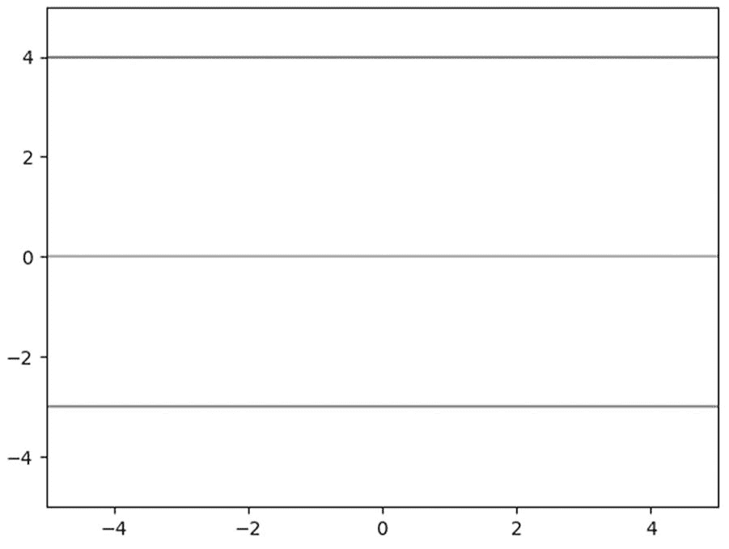

Figure 1.1 ¶ A Graph of Three Horizontal Line Segments.

Figure 1.2 显示了两条倾斜直线，方程分别为 `y = x` 和 `y = -x`。

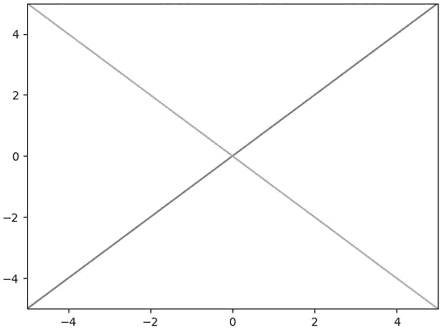

Figure 1.2 ¶ A Graph of Two Diagonal Line Segments.

Figure 1.3 显示了两条平行的倾斜直线，方程分别为 `y = 2*x` 和 `y = 2*x+3`。

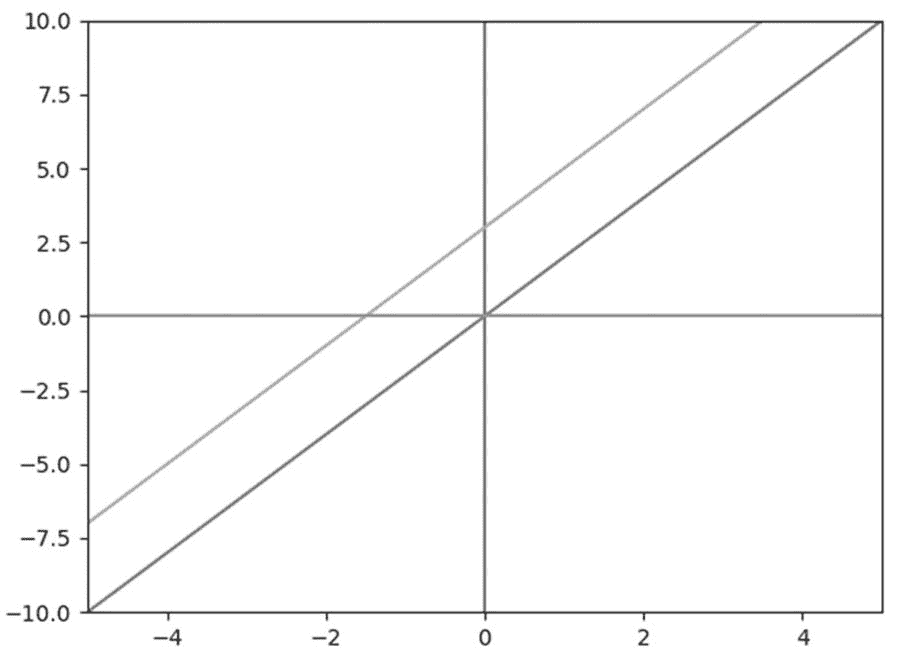

Figure 1.3 ¶ A Graph of Two Slanted Parallel Line Segments.

Figure 1.4 显示了一条由连接的线段组成的分段线性图。

现在您已经看到欧几里得平面上直线的一些基本示例，接下来看看使用 NumPy 和 Matplotlib 绘制平面上点散点图的代码示例。

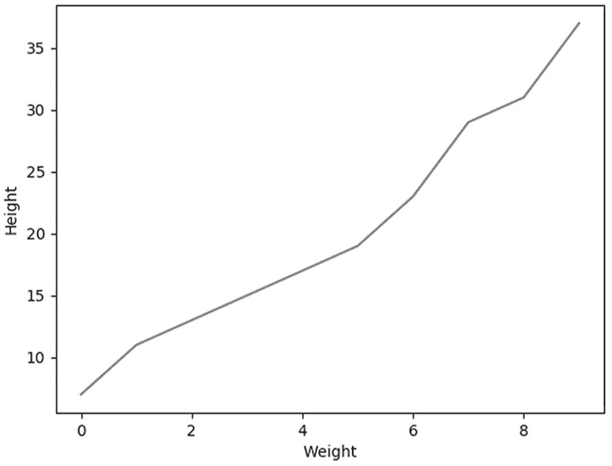

Figure 1.4 ¶ A PieceWise Linear Graph of Line Segments.

## # 使用 NumPy 和 Matplotlib 绘制直线

Listing 1.20 展示了 `np_plot.py` 的内容，说明如何在平面上绘制多个点的直线。

***LISTING 1.20: np_plot.py***

```python
import numpy as np
import matplotlib.pyplot as plt
x = np.random.randn(15,1)
y = 2.5*x + 5 + 0.2*np.random.randn(15,1)
plt.scatter(x,y)
plt.show()
```

Listing 1.20 以两条 import 语句开头，随后通过 NumPy `randn()` API 初始化 `x` 为一组随机值。然后，`y` 被赋值为包含两部分的范围：一个基于 `x` 值的线性方程，再加上随机扰动项。Figure 1.5 显示了 Listing 1.20 中代码的输出结果。

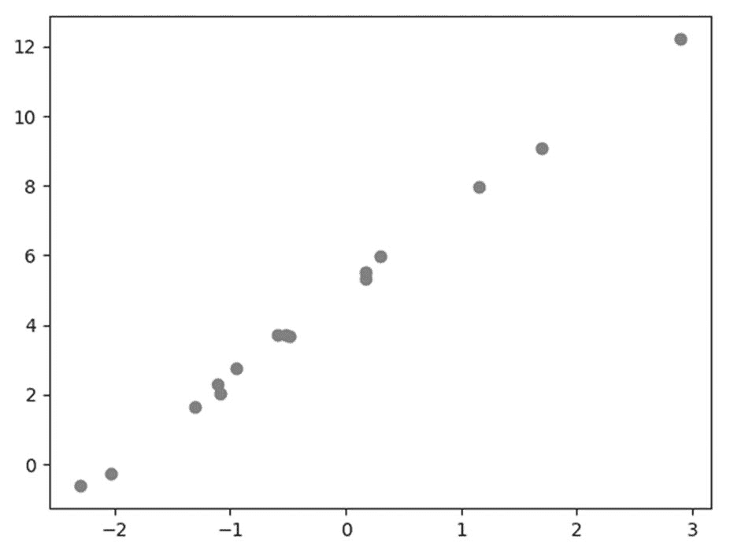

Figure 1.5 ¶ A Dataset with Potential Linear Regression.

## # 使用 NumPy 和 Matplotlib 绘制二次函数

Listing 1.21 展示了 `np_plot_quadratic.py` 的内容，说明如何在平面上绘制二次函数。

***LISTING 1.21: np_plot_quadratic.py***

```python
import numpy as np
import matplotlib.pyplot as plt
x = np.linspace(-5,5,num=100)[:,None]
y = -0.5 + 2.2*x +0.3*x**3+ 2*np.random.randn(100,1)
plt.plot(x,y)
plt.show()
```

Listing 1.21 以两条 import 语句开头，随后通过 NumPy `linspace()` API 初始化 `x` 为一系列值。然后，`y` 被赋值为符合二次方程的范围，基于变量 `x` 的值。Figure 1.6 显示了 Listing 1.21 中代码的输出结果。

现在您已经看到各种折线图和散点图，接下来进入线性回归的主题。

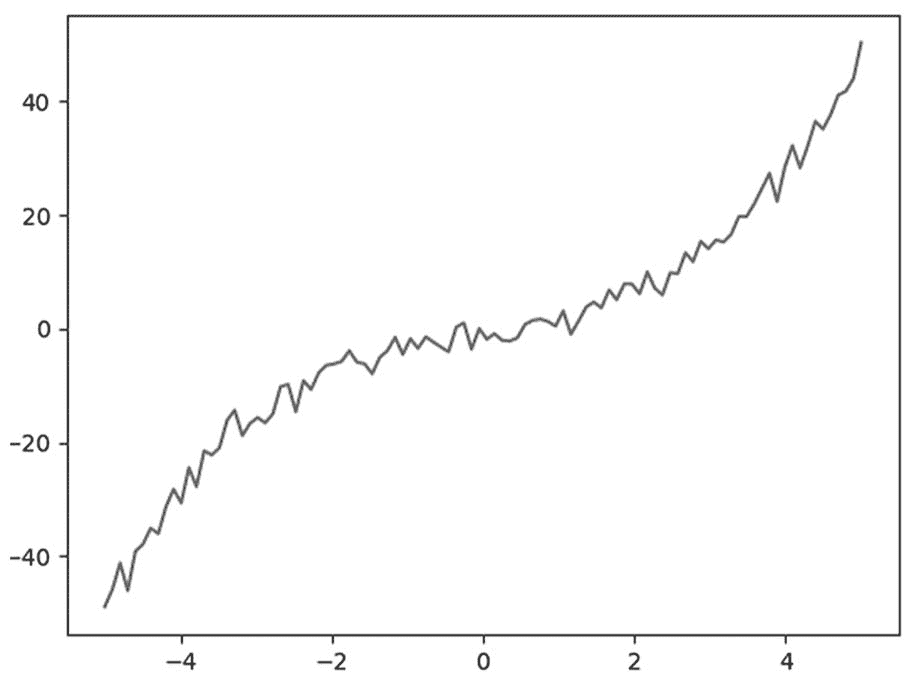

Figure 1.6 ¶ A Dataset with Potential Linear Regression.

## # 什么是线性回归？

线性回归寻找最佳拟合超平面的方程，该超平面近似数据集，而超平面的度数比数据集的维度低一。特别是，如果数据集位于欧几里得平面，超平面就是一条直线；如果数据集在三维空间，超平面是一个平面。

当数据集中的点能够合理地通过超平面近似时，线性回归非常合适。否则，可以尝试拟合其他类型的曲面。

请记住两个细节。首先，最佳拟合超平面不一定与数据集中的所有（或大多数）点相交。事实上，最佳拟合超平面可能与数据集中的任何点都不相交。最佳拟合超平面的目的是尽可能 closely 近似数据集中的点。其次，线性回归不同于曲线拟合，后者尝试找到通过一组点的多项式。

关于曲线拟合的细节：给定 n 个平面内的点（无两点的 x 值相同），存在一个度数小于或等于 n-1 的多项式能通过这些点。因此，一条直线（度数为 1）会经过任何一对非垂直的平面内点。对于平面内的任意三个点，存在二次方程或一条直线能通过这些点。

在某些情况下，可以使用更低度的多项式。例如，考虑 100 个形如 (x, x) 的点集合：x 的值等于 y 的值，直线 `y = x`（度数为 1 的多项式）经过所有这些点。

然而，请注意，直线“代表”平面内点集的程度取决于这些点可以通过直线近似的程度。

### # 什么是多元分析？

多元分析将欧几里得平面上直线的方程推广，形式如下：

`y = w1*x1 + w2*x2 + . . . + wn*xn + b`

如上所述，该方程包含变量 `x1`, `x2`, ..., `xn` 的线性组合。在本文中，我们通常处理涉及欧几里得平面上直线的数据集。

### # 非线性数据怎么办？

简单的线性回归寻找最佳拟合直线，但如果数据集无法在平面上拟合直线呢？这是一个很好的问题！在这种情况下，我们会寻找其他曲线来近似数据集，例如二次、立方或更高次的多项式。然而，这些替代方案都有权衡，后文将讨论。


另一种可能性是使用连续的分段线性函数，它由一组线段组成，相邻的线段相连。如果一对或多对相邻的线段不相连，则它是分段线性函数（即函数不连续）。无论哪种情况，线段的度数为一，这比更高阶多项式的计算复杂度更低。

因此，给定平面中的一组点，尝试找到“最佳拟合”直线，以近似这些点，在解决以下问题后：

1. 我们如何知道一条直线“拟合”数据？

2. 如果另一种曲线是更好的拟合呢？

3. “最佳拟合”意味着什么？

检查直线拟合数据好坏的简单方法是进行可视检查：在图表中显示数据，如果数据形状符合直线 reasonably well（合理地符合），则直线可能是一个良好的拟合。然而，这是一种主观判断，样本数据集如果不符合直线，会在 Figure 1.7 中显示。

Figure 1.7 displays a dataset containing four points that do not fit a line.

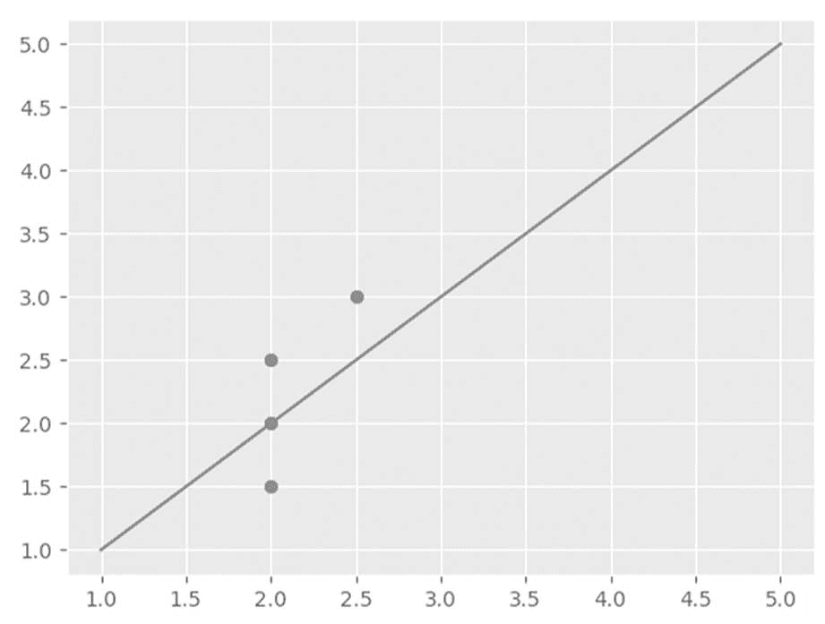

Figure 1.7 ¶ A Nonlinear Dataset.

然而，如果直线看起来不对数据提供良好拟合，那么二次或立方（甚至更高次数）多项式可能更适合。让我们先推迟非线性情况，假设直线对数据是合适的。有一个众所周知的技术用于找到这类数据集的“最佳拟合”直线，它称为均方误差（MSE）。

## **The MSE Formula**

Figure 1.8 displays the formula for the MSE. Translated into English: the MSE is the average of the sum of the squares of the difference between an actual y value and the predicted y value, where the latter is the y value that each datapoint would have if that datapoint were actually on the best-fitting line.

Figure 1.8 displays the formula for MSE (Mean Squared Error) for calculating the best-fitting line for a set of points in the plane.

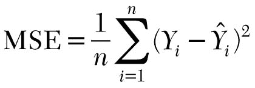

Figure 1.8 ¶ The MSE Formula.

### **Other Error Types**

Although we will only discuss MSE for linear regression in this book, there are other types of formulas that you can use for linear regression, some of which are listed here:

*   MSE

*   RMSE

*   RMSPROP

*   MAE

The MSE is the basis for the preceding error types. For example, root mean squared error (RMSE) is the square root of MSE.

However, mean absolute error (MAE) is the average of the sum of the absolute value of the differences of the y terms (not the square of the differences of the y terms).

The RMSProp optimizer utilizes the magnitude of recent gradients to normalize the gradients. Maintain a moving average over the RMS gradients, and then divide that term by the current gradient.

Although it’s easier to compute the derivative of MSE (because it’s a differentiable function), it’s also true that MSE is more susceptible to outliers, more so than MAE. The reason is simple: a squared term can be significantly larger than adding the absolute value of a term. For example, if a difference term is 10, then the squared term 100 is added to MSE, whereas only 10 is added to MAE. Similarly, if a difference term is −20, then the squared term 400 is added to MSE, whereas only 20 (which is the absolute value of −20) is added to MAE.

### **Nonlinear Least Squares**

When predicting housing prices, where the dataset contains a wide range of values, techniques such as linear regression or random forests can cause the model to overfit (discussed in Chapter 7), which means that the model does not generalize well to other datasets.

In this scenario, you can try an error metric such as relative error that reduces the importance of fitting the samples with the largest values. This technique is called non-linear least squares, which may use a log-based transformation of labels and predicted values.

## **Calculating the MSE Manually**

Let’s look at two simple graphs, each of which contains a line that approximates a set of points in a scatter plot. Notice that the line segment is the same for both sets of points, but the datasets are slightly different. We will manually calculate the MSE for both datasets and determine which value of MSE is smaller.

Figure 1.9 displays a set of points and a line that is a potential candidate for best-fitting line for the data.

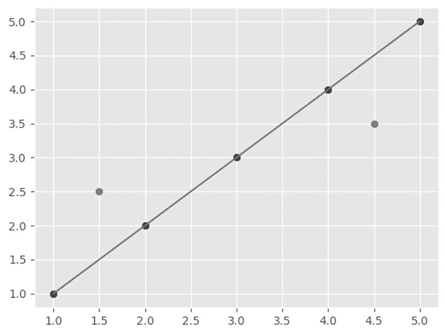

Figure 1.9 ¶ A Line Graph that Approximates Points of a Scatter Plot.

The MSE for the line in Figure 1.9 is computed as follows:

MSE = \[(-2)\*(-2) + 2\*2\]/7 = 8/7 

Look at Figure 1.10 that also displays a set of points and a line that is a potential candidate for best-fitting line for the data.

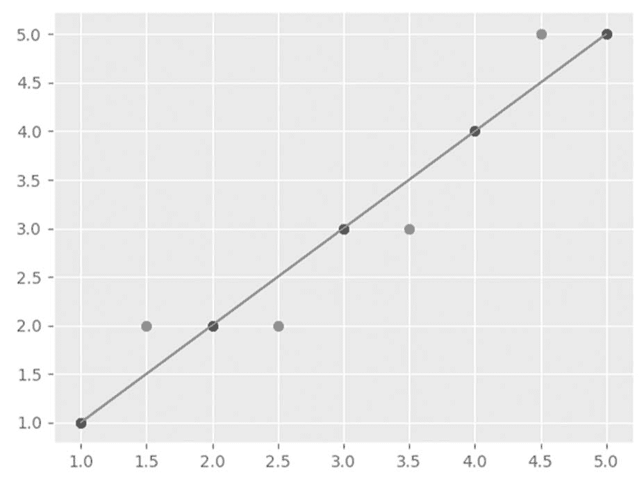

Figure 1.10 ¶ A Line Graph that Approximates Points of a Scatter Plot.

The MSE for the line in Figure 1.10 is computed as follows:

MSE = \[1\*1 + (-1)\*(-1) + (-1)\*(-1) + 1\*1\]/7 = 4/7 

Thus, the line in Figure 1.10 has a smaller MSE than the line in Figure 1.9, which might have surprised you (or did you guess correctly?)

In these two figures we calculated the MSE easily and quickly, but in general it’s significantly more tedious. For instance, if we plot 10 points in the Euclidean plane that do not closely fit a line, with individual terms that involve non-integer values, we would probably need a calculator. A better solution involves NumPy functions, as discussed in the next section.

## **Find the Best-Fitting Line with NumPy**

Earlier in this chapter you saw examples of lines in the plane, including horizontal, slanted, and parallel lines. Most of those lines have a positive slope and a non-zero value for their y-intercept. Although there are scatterplots of datapoints in the plane where the best-fitting line has a negative slope, the examples in this book involve scatterplots whose best-fitting line has a positive slope.

Listing 1.22 displays the contents of plot_best_fit2.py that illustrates how to determine the bestfitting line for a set of points in the Euclidean plane. The solution is based on so-called “closed form” formulas that are available from Statistics.

***LISTING 1.22: plot***\_***best***\_***fit2.py***

```python
import numpy as np
xs = np.array([1,2,3,4,5], dtype=np.float64)
ys = np.array([1,2,3,4,5], dtype=np.float64)
def best_fit_slope(xs,ys):
    m = (((np.mean(xs)*np.mean(ys))-np.mean(xs*ys)) / 
         ((np.mean(xs)**2) - np.mean(xs**2)))
    b = np.mean(ys) - m * np.mean(xs)
    return m, b
m,b = best_fit_slope(xs,ys)
print('m:',m,'b:',b)
```

Listing 1.22 starts with two NumPy arrays xs and ys that are initialized with the first five positive integers. The Python function best_fit_slope() calculate the optimal values of m (the slope) and b (the y-intercept) of a set of numbers. The output from Listing 1.22 is here:

m: 1.0 b: 0.0 

Notice that the NumPy arrays xs and ys are identical, which means that these points lie on the line y=x whose slope is 1. By simple extrapolation, the point (0,0) is also a point on the same line. Hence, the y-intercept of this line must equal 0.

Figure 1.11 displays another line segment that approximates a scatter plot consisting of a larger number of points.

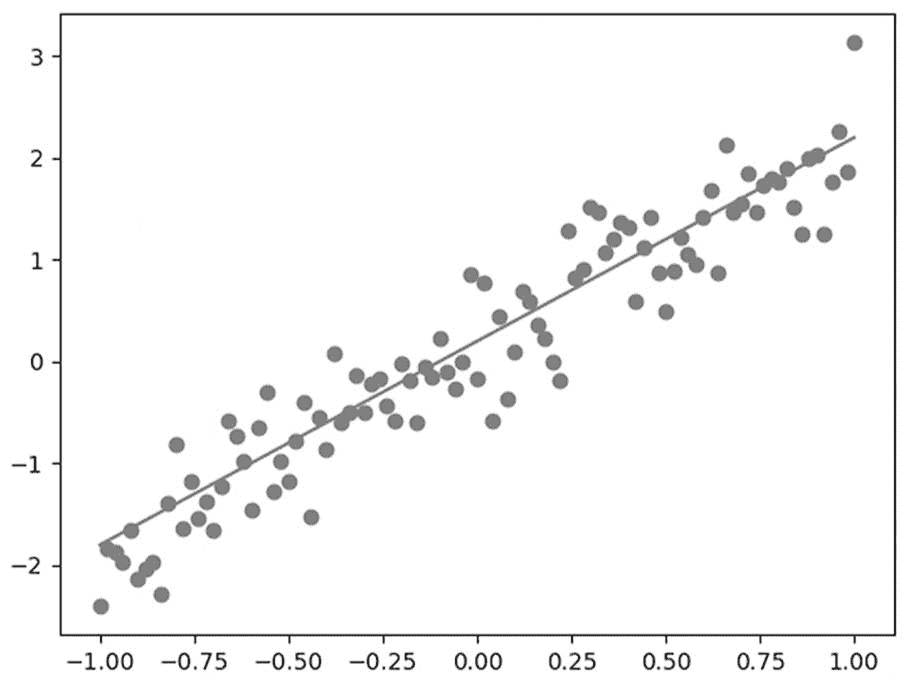

Figure 1.11 ¶ A Line Graph that Approximates a Generalized Scatter Plot.


如果你真的很感兴趣，你可以在线搜索找到 m 和 b 的导数公式。本章我们将跳过导数推导，直接进行 MSE（均方误差）计算的示例。第一个示例是手动计算 MSE，随后是使用 NumPy 公式进行计算的示例。

## 计算 MSE 的逐步逼近（1）

本节包含一个使用简单技术逐步确定最佳拟合直线斜率和截距的代码示例。请记住，导数的近似值是“delta y”除以“delta x”的比值。delta 值分别计算两个相近点（(x1, y1) 和 (x2, y2)）的 y 值差和 x 值差。因此，基于 delta 的近似比值为 (y2 - y1) / (x2 - x1)。

本节中的技术采用了简化的 delta 值近似：我们假设分母等于 1。因此，我们只需要计算“delta”值的分子：在本代码示例中，这些分子是变量 dw 和 db。

```python
import numpy as np
import matplotlib.pyplot as plt

X = [0,0.12,0.25,0.27,0.38,0.42,0.44,0.55,0.92,1.0]
Y = [0,0.15,0.54,0.51,0.34,0.1,0.19,0.53,1.0,0.58]
losses = []
#Step 1: Parameter initialization
W = 0.45  # the initial slope
b = 0.75  # the initial y-intercept
for i in range(1, 100):
    #Step 2: Calculate Loss
    Y_pred = np.multiply(W, X) + b
    loss_error = 0.5 * (Y_pred - Y)**2
    loss = np.sum(loss_error)/10
    #Step 3: Calculate dw and db
    db = np.sum((Y_pred - Y))
    dw = np.dot((Y_pred - Y), X)
    losses.append(loss)
    #Step 4: Update parameters
    W = W - 0.01*dw
    b = b - 0.01*[content]


Jax 是一个开源包，使用更现代的技术加速在 CPU、GPU 和 TPU 上的 NumPy 和 Python 计算，这可能也是 Jax 被称为“在 Steroids 上的 NumPy”的原因。Jax 文档在这里：

*[`jax.readthedocs.io/en/latest/developer.html`](https://jax.readthedocs.io/en/latest/developer.html)*

你可以按照前面的链接的说明，从源码（带或不带 CUDA）分两步构建 Jax，或者通过 pip3 在你的机器上安装 Jax，如下所示：

`pip3 install jaxlib`

Jax 也是 Trax 的默认实现（见附录 E），你也可以在 Google Colaboratory 中设置 Jax。

如果你感兴趣，tf.experimental.numpy 实现了基于 TensorFlow 的 NumPy，详情请参阅：

*[`www.tensorflow.org/api_docs/python/tf/experimental/numpy`](https://www.tensorflow.org/api_docs/python/tf/experimental/numpy)*

## **Google Colaboratory**

根据硬件不同，基于 GPU 的 TF 2 代码可以比基于 CPU 的 TF 2 代码快 10 倍。不过，良好的 GPU 价格可能是一个重要因素。虽然 NVIDIA 提供 GPU，但这些消费级 GPU 并不针对多 GPU 支持（TF 2 支持多 GPU）。

幸运的是，Google Colaboratory 是一种负担得起的替代方案，提供免费 GPU 支持，并且作为 Jupyter Notebook 环境运行。此外，Google Colaboratory 在云端执行你的代码，零配置，并且可以在这里访问：

*[`colab.research.google.com/notebooks/welcome.ipynb`](https://colab.research.google.com/notebooks/welcome.ipynb)*

前面的 Jupyter Notebook 适合训练简单模型和快速测试想法。Google Colaboratory 让你轻松上传本地文件、在 Notebook 中安装软件，甚至可以将 Google Colaboratory 与本地机器的 Jupyter 运行环境连接。

Colaboratory 支持的功能包括基于 GPU 的 TF 2 执行、使用 Matplotlib 进行可视化，以及通过“文件 > 另存为副本到 GitHub”将你的 Google Colaboratory Notebook 保存到 GitHub。此外，你只需在 URL 中加入 `colab.research.google.com/github/` 即可加载 GitHub 上的任何 Jupyter Notebook（详情请参阅 Colaboratory 网站）。

Google Colaboratory 还支持 HTML 和 SVG 等其他技术，使你能够在 Notebook 中渲染 SVG 图形。如果你感兴趣，可以在 Google Colaboratory Notebook 中使用以下命令启动 Tensorboard（将目录替换为你自己的路径）：

`%tensorboard --logdir /logs/images`

请注意以下关于 Google Colaboratory 的细节。首先，每次在 Google Colaboratory 连接到服务器时，你会启动一个所谓的会话。你可以在会话中使用 CPU（默认）、GPU 或 TPU 执行代码，并且会话可以无时间限制运行。但是，如果你选择 GPU 选项，则该会话最多只能免费使用 12 小时的 GPU 执行时间。超过 12 小时的 GPU 时间会产生小额费用（详情请参阅网站）。

需要注意的另一点是，在给定会话期间，你在 Jupyter Notebook 中安装的任何软件在退出会话后都不会保存。例如，下面的代码片段在 Notebook 中安装了 TFLearn：

`!pip install tflearn`

当你退出当前会话后，稍后如果要启动新会话，就需要再次安装 TFLearn 以及之前在任何会话中安装的其他软件（如 GitHub 仓库）。

顺便提一下，你也可以在 Google Colab 中运行 TF 2 代码和 TensorBoard，支持 CPU、GPU 和 TPU。更多信息请访问：

*[`colab.research.google.com`](https://colab.research.google.com)*

### **在 Google Colaboratory 中上传 CSV 文件**

Listing 1.25 展示了 `upload_csv_file.ipynb` 的内容，说明如何在 Google Colaboratory Notebook 中上传 CSV 文件。

***LISTING 1.25: upload_csv_file.ipynb***

import pandas as pd **from google.colab import files** **uploaded = files.upload()** df = pd.read_csv("weather_data.csv") print("dataframe df:") df

Listing 1.25 上传的 CSV 文件是 `weather_data.csv`，其具体内容在此不作展示，因为它对本例没有重要意义。代码中加粗的部分是 Colab 特有的上传 CSV 代码。运行这些代码后，你会在浏览器会话中看到一个标记为“Browse”的小按钮，点击它并选择列表中显示的 CSV 文件。随后其余代码会执行，并在浏览器中显示 CSV 文件的内容。

## **Summary**

本章介绍了 Python 的 NumPy 包。你学习了如何编写包含循环、数组和列表的 Python 脚本。还了解了如何使用点积、reshape() 方法、使用 Matplotlib 绘图（详见附录 F），以及线性回归的示例。

随后，你学习了如何处理数组的子范围，以及负子范围，这两者都非常有用，可以在机器学习任务中提取数据片段。你还看到各种 NumPy 操作，例如 reshape() 方法，它在处理图像文件时非常有用且常见。

接着，你学习了如何使用 NumPy 进行线性回归、均方误差（MSE），以及如何使用 linspace() 方法计算 MSE。最后，你了解了 Google Colaboratory，它提供云端 CPU、GPU 和 TPU 支持，用于在 Jupyter Notebook 中执行代码。

# CHAPTER 2

# INTRODUCTION TO PANDAS

本章介绍 Pandas 并提供多个代码示例，展示其有用特性。正如你所见，每个部分的目的都很明确，风格简洁，专注于代码示例。如果你已经熟悉这些主题，可以随意浏览材料，查看代码示例，以防包含新信息。

本章的第一部分简要介绍 Pandas 及其有用特性。该部分包含展示数据框（DataFrame）以及 Series（Series）两大核心特性的代码示例，并简要讨论 Series。

本章的第二部分讨论可以创建的各类数据框，如数值型数据框和布尔型数据框。你还会看到使用 NumPy 函数和随机数创建数据框的示例，如何在 Python 字典和基于 JSON 的数据之间进行转换，以及如何从基于 JSON 的数据创建 Pandas 数据框。

## **What is Pandas?**

Pandas 是一个兼容其他 Python 包（如 NumPy、Matplotlib 等）的 Python 包。在命令行中打开终端并运行以下命令即可在 Python 3.x 环境下安装 Pandas：

`pip3 install pandas`

在很多方面，Pandas 库的 API 语义与表格软件相似，并支持 xsl、xml、html、csv 等文件类型。Pandas 提供一种称为 DataFrame 的数据类型，拥有极其强大的功能，将在下一节详细讨论。

Pandas 数据框支持多种输入类型，如 ndarrays、列表、字典或 Series。

Pandas 还提供另一种数据类型 —  — Series，用于管理数据的另一种机制。除了在线获取更多关于 Series 的详细信息外，下面的文章提供了很好的入门介绍：

*[`towardsdatascience.com/20-examples-to-master-pandas-series-bc4c68200324`](https://towardsdatascience.com/20-examples-to-master-pandas-series-bc4c68200324)*

### **Pandas Options and Settings**


You 可以修改 Pandas 中环境变量的默认值，示例如下：

```python
import pandas as pd
display_settings = {
    'max_columns': 8,
    'expand_frame_repr': True,
    # Wrap to multiple pages
    'max_rows': 20,
    'precision': 3,
    'show_dimensions': True
}
for op, value in display_settings.items():
    pd.set_option("display.{}".format(op), value)
```

如果你想让 Pandas 显示最多 20 行和 8 列，并且以 3 位小数显示浮点数，请包含前面的代码块。如果你想让输出“换行”到多页，请将`expand_frame_repr`设置为`True`。前面的 for 循环遍历`display_settings`并将选项设置为对应的值。

此外，下面的代码片段会显示所有 Pandas 选项及其当前值：

```python
print(pd.describe_option())
```

你可以使用选项和它们的值执行各种其他操作（例如`pd.reset()`方法用于重置值），如 Pandas 用户指南所述：

*[`pandas.pydata.org/pandas-docs/stable/user_guide/options.html`](https://pandas.pydata.org/pandas-docs/stable/user_guide/options.html)*

### **Pandas Data Frames**

简化而言，Pandas 数据框是一个二维数据结构，方便以行为和列的方式来思考数据结构。数据框可以标记（行和列），列可以包含不同的数据类型。Pandas 数据框的数据来源可以是数据文件、数据库表、Web 服务等。Pandas 数据框的特点包括：

*   数据框方法

*   数据框统计

*   分组、透视和重塑

*   处理缺失数据

*   连接数据框

本章中的 Pandas 代码示例展示了上述特点中的几乎所有功能。

### **数据框和数据清洗任务**

具体需要执行的任务取决于数据集的结构和内容。通常，你会按照以下步骤进行工作流，不一定总是按此顺序（某些步骤可能是可选的）。所有以下步骤都可以使用 Pandas 数据框来执行：

*   读取数据到数据框

*   显示数据框顶部

*   显示列数据类型

*   显示非空值

*   将 NA 替换为值

*   遍历列

*   对每列进行统计

*   查找缺失值

*   统计缺失值总数

*   计算缺失值百分比

*   排序表格值

*   打印摘要信息

*   缺失值超过 50%的列

*   重命名列

本章包含了许多步骤的演示。

### **Pandas 的替代方案**

在查看 Pandas 代码示例之前，有其他提供有用功能的替代方案，其中包括：

*   PySpark（用于大数据集）

*   Dask（用于分布式处理）

*   Modin（更快性能）

*   Datatable（Python 中的 R data.table）

这些替代方案的包含并不意味着要削弱 Pandas：你可能不需要列表中提到的任何功能。但是，你将来可能需要这些功能，因此现在了解它们是有价值的（未来可能会有更强大的替代方案）。

## **带有 NumPy 的 Pandas 数据框示例**

Listing 2.1 显示了 pandas_df.py 的内容，该文件说明了如何定义多个 Pandas 数据框并显示它们的内容。

***LISTING 2.1: pandas_df.py***

```python
import pandas as pd
import numpy as np
myvector1 = np.array([1,2,3,4,5])
print("myvector1:")
print(myvector1)
print()
mydf1 = pd.DataFrame(myvector1)
print("mydf1:")
print(mydf1)
print()
myvector2 = np.array([i for i in range(1,6)])
print("myvector2:")
print(myvector2)
print()
mydf2 = pd.DataFrame(myvector2)
print("mydf2:")
print(mydf2)
print()
myarray = np.array([[10,30,20],[50,40,60],[1000,2000,3000]])
print("myarray:")
print(myarray)
print()
mydf3 = pd.DataFrame(myarray)
print("mydf3:")
print(mydf3)
print()
```

Listing 2.1 以 Pandas 和 NumPy 的标准导入语句开始，随后定义了两个一维 NumPy 数组和一个二维 NumPy 数组。你可能已经在第 1 章的示例中熟悉了 NumPy 语法。每个 NumPy 变量后面都跟着对应的 Pandas 数据框 mydf1、mydf2 和 mydf3。现在运行 Listing 2.1 中的代码，你将看到以下输出，并可以将 NumPy 数组与 Pandas 数据框进行比较：

myvector1: [1 2 3 4 5] mydf1: 0 0 1 1 2 2 3 3 4 4 5 myvector2: [1 2 3 4 5] mydf2: 0 0 1 1 2 2 3 3 4 4 5 myarray: [[ 10 30 20] [ 50 40 60] [1000 2000 3000]] mydf3: 0 1 2 0 10 30 20 1 50 40 60 2 1000 2000 3000

相比之下，下面的代码块展示了如何定义 Pandas Series：

names = pd.Series(['SF', 'San Jose', 'Sacramento'])
sizes = pd.Series([852469, 1015785, 485199])
df = pd.DataFrame({ 'Cities': names, 'Size': sizes })
print(df)

创建一个 Python 文件，包含上述代码（以及必要的导入语句），然后运行该代码，你将看到以下输出：

City name sizes 0 SF 852469 1 San Jose 1015785 2 Sacramento 485199


-   [费曼学习法](https://wiki.example.org/feynmans_learning_method)的灵感源于诺贝尔物理奖获得者**理查德·费曼**。

1.  运用费曼技巧，你只需花上`20 min`就能深入理解知识点，而且记忆深刻，*难以遗忘*。

```
if (condVar > someVal) {console.log("xxx")}
```

**Pandas** 支持对 Data frame 进行布尔运算，例如逻辑或、逻辑与以及对一对 Data frame 的逻辑非。Listing 2.3 展示了 `pandas_boolean_df.py` 的内容，说明如何定义一个 Data frame，其行和列均为布尔值。

***LISTING 2.3:** `pandas_boolean_df.py`***

```python
import pandas as pd
df1 = pd.DataFrame({'a': [1, 0, 1], 'b': [0, 1, 1]}, dtype=bool)
df2 = pd.DataFrame({'a': [0, 1, 1], 'b': [1, 1, 0]}, dtype=bool)
print("df1 & df2:")
print(df1 & df2)
print("df1 | df2:")
print(df1 | df2)
print("df1 ^ df2:")
print(df1 ^ df2)
```

Listing 2.3 初始化了 Data frame `df1` 和 `df2`，随后计算 `df1 & df2`、`df1 | df2`、`df1 ^ df2`，分别表示 `df1` 与 `df2` 的逻辑与、逻辑或以及逻辑非。执行 Listing 2.3 中的代码后得到的输出如下：

`df1 & df2`:       a      b 0  False  False 1  False   True 2   True  False  
`df1 | df2`:      a     b 0  True  True 1  True  True 2  True  True  
`df1 ^ df2`:       a      b 0   True   True 1   True  False 2  False   True 

### `Transposing` a `Pandas` Data Frame

`T` 属性（以及 `transpose` 函数）可以生成 Data frame 的转置，类似于 `NumPy` `ndarray` 的转置操作。例如，下面的代码定义了一个 Data frame `df1` 并显示其转置：

```python
df1 = pd.DataFrame({'a': [1, 0, 1], 'b': [0, 1, 1]}, dtype=int)
print("df1.T:")
print(df1.T)
```

输出如下：

`df1.T`:    0  1  2 a  1  0  1 b  0  1  1 

下面的代码定义了两个 Data frame `df1` 和 `df2`，并显示它们的和：

```python
df1 = pd.DataFrame({'a' : [1, 0, 1], 'b' : [0, 1, 1]}, dtype=int)
df2 = pd.DataFrame({'a' : [3, 3, 3], 'b' : [5, 5, 5]}, dtype=int)
print("df1 + df2:")
print(df1 + df2)
```

输出如下：

`df1 + df2`:    a  b 0  4  5 1  3  6 2  4  6 

### `Pandas` Data Frames and Random Numbers

Listing 2.4 展示了 `pandas_random_df.py` 的内容，说明如何创建一个包含随机数的 Data frame。

***LISTING 2.4:** `pandas_random_df.py`***

```python
import pandas as pd
import numpy as np
df = pd.DataFrame(np.random.randint(1, 5, size=(5, 2)), columns=['a','b'])
df = df.append(df.agg(['sum', 'mean']))
print("Contents of data frame:")
print(df)
```

Listing 2.4 定义了一个 5 行 2 列的随机整数 Data frame `df`，列名为 “a” 与 “b”。随后使用 `df.agg(['sum', 'mean'])` 将两行（和与均值）追加到 Data frame 中。其输出如下：

         a    b 0      1.0  2.0 1      1.0  1.0 2      4.0  3.0 3      3.0  1.0 4      1.0  2.0 sum   10.0  9.0 mean   2.0  1.8 

Listing 2.5 展示了 `pandas_combine_df.py` 的内容，说明如何合并 Data frame。

***LISTING 2.5:** `pandas_combine_df.py`***

```python
import pandas as pd
import numpy as np
df = pd.DataFrame({'foo1' : np.random.randn(5), 'foo2' : np.random.randn(5)})
print("contents of df:")
print(df)
print("contents of foo1:")
print(df.foo1)
print("contents of foo2:")
print(df.foo2)
```

Listing 2.5 定义了一个 5 行 2 列的随机实数 Data frame `df`，列名为 “foo1” 与 “foo2”。随后使用 `df.foo1` 与 `df.foo2` 分别打印这两列的内容。其输出如下：

contents of df:       foo1      foo2 0  0.274680 \_0.848669 1 \_0.399771 \_0.814679 2  0.454443 \_0.363392 3  0.473753  0.550849 4 \_0.211783 \_0.015014 contents of foo1: 0    0.256773 1    1.204322 2    1.040515 3   \_0.518414 4    0.634141 Name: foo1, dtype: float64 contents of foo2: 0   \_2.506550 1   \_0.896516 2   \_0.222923 3    0.934574 4    0.527033 Name: foo2, dtype: float64 

### 读取 CSV 文件

`Pandas` 提供 `read_csv()` 方法用于读取 CSV 文件。例如，Listing 2.6 展示了 `sometext.csv` 的内容（包含标记的数据，如 spam 或 ham），Listing 2.7 展示了 `read_csv_file.py` 的内容，说明如何读取 CSV 文件。

***LISTING 2.6:** `sometext.csv`***

```
type    text ham     Available only for today ham     I'm joking with you spam    Free entry in 2 a wkly comp ham     U dun say so early hor ham     I don't think he goes to usf spam    FreeMsg Hey there ham     my brother is not sick ham     As per your request Melle spam    WINNER!! As a valued customer 
```

***LISTING 2.7:** `read_csv_file.py`***

```python
import pandas as pd
import numpy as np
df = pd.read_csv('sometext.csv', delimiter='\\t')
print("=> First five rows:")
print(df.head(5))
```

Listing 2.7 读取 `sometext.csv`，该文件的列由制表符（“\\t”）分隔。执行 Listing 2.7 后的输出如下：

\=> First five rows:   type                           text 0   ham      Available only for today 1   ham           I'm joking with you 2  spam   Free entry in 2 a wkly comp 3   ham        U dun say so early hor 4   ham  I don't think he goes to usf 

`head()` 方法默认显示 5 行，但可以通过 `df.head(n)` 指定显示的行数。

也可以使用 `sep` 参数指定不同的分隔符，`names` 参数指定要读取的列名。例如：

```python
df2 = pd.read_csv("data.csv",sep="|", 
                  names=["Name","Surname","Height","Weight"])
```

`Pandas` 还提供 `read_table()` 方法，用于读取 CSV 文件，语法与 `read_csv()` 相同。

### `loc()` 与 `iloc()` 方法

如果想要显示 Data frame 中某条记录的内容，可在 `loc()` 方法中指定行索引。例如，下面的代码显示 Data frame `df` 中按特征名称索引的记录：

```python
df.loc[feature_name]
```

选择“height”列的第一行：

```python
df.loc[0], ['height']
```

下面的代码使用 `iloc()` 函数显示 name 列的前 8 条记录：

```python
df.iloc[0:8]['name']
```

### 将分类数据转为数值数据

机器学习中常需将包含字符的特征转换为数值特征。Listing 2.8 展示了 `cat2numeric.py` 的内容，说明如何将文本字段替换为对应的数值字段。

***LISTING 2.8:** `cat2numeric.py`**


import pandas as pd import numpy as np df = pd.read_csv('sometext.csv', delimiter='\\t') print("=> First five rows (before):") print(df.head(5)) print("-------------------------") print() # map ham/spam to 0/1 values: df['type'] = df['type'].map({'ham':0, 'spam':1}) print("=> First five rows (after):") print(df.head(5)) print("-------------------------") 

Listing 2.8 initializes the data frame `df` with the contents of the CSV file `sometext.csv`, and then displays the contents of the first five rows by invoking `df.head(5)`, which is also the default number of rows to display.

The next code snippet in Listing 2.8 invokes the `map()` method to replace occurrences of ham with 0 and replace occurrences of spam with 1 in the column labeled `type`, as shown here:

```python
df['type'] = df['type'].map({'ham':0, 'spam':1})
```

The last portion of Listing 2.8 invokes the `head()` method again to display the first five rows of the dataset after having renamed the contents of the column `type`. Launch the code in Listing 2.8 and you will see the following output:

\=> First five rows (before): type                          text 0   ham                          Available only for today 1   ham           I'm joking with you 2  spam  Free entry in 2 a wkly comp 3   ham        U dun say so early hor 4   ham  I don't think he goes to usf \-------------------------   \=> First five rows (after):   type                          text 0     0     Available only for today 1     0           I'm joking with you 2     1  Free entry in 2 a wkly comp 3     0        U dun say so early hor 4     0  I don't think he goes to usf \------------------------- 

Listing 2.9 displays the contents of shirts.csv and Listing 2.10 displays the contents of shirts.py that illustrates four techniques for converting categorical data to numeric data.

***LISTING 2.9: shirts.csv***

type,ssize shirt,xxlarge shirt,xxlarge shirt shirt,xlarge shirt,xlarge shirt,xlarge shirt,large shirt,medium shirt,small shirt,small shirt,xsmall shirt,xsmall shirt,xsmall 

***LISTING 2.10: shirts.py***

import pandas as pd shirts = pd.read_csv("shirts.csv") print("shirts before:") print(shirts) print() # TECHNIQUE #1: #shirts.loc[shirts['ssize']=='xxlarge','size'] = 4 #shirts.loc[shirts['ssize']=='xlarge', 'size'] = 4 #shirts.loc[shirts['ssize']=='large', 'size'] = 3 #shirts.loc[shirts['ssize']=='medium', 'size'] = 2 #shirts.loc[shirts['ssize']=='small', 'size'] = 1 #shirts.loc[shirts['ssize']=='xsmall', 'size'] = 1 # TECHNIQUE #2: #shirts['ssize'].replace('xxlarge', 4, inplace=True) #shirts['ssize'].replace('xlarge', 4, inplace=True) #shirts['ssize'].replace('large', 3, inplace=True) #shirts['ssize'].replace('medium', 2, inplace=True) #shirts['ssize'].replace('small', 1, inplace=True) #shirts['ssize'].replace('xsmall', 1, inplace=True) # TECHNIQUE #3: #shirts['ssize'] = shirts['ssize'].apply({'xxlarge':4, 'xlarge':4, 'large':3, 'medium':2, 'small':1, 'xsmall':1}.get) # TECHNIQUE #4: shirts['ssize'] = shirts['ssize'].replace(regex='xlarge', value=4) shirts['ssize'] = shirts['ssize'].replace(regex='large', value=3) shirts['ssize'] = shirts['ssize'].replace(regex='medium', value=2) shirts['ssize'] = shirts['ssize'].replace(regex='small', value=1) print("shirts after:") print(shirts) 

Listing 2.10 starts with a code block of six statements that uses direct comparison with strings to make numeric replacements. For example, the following code snippet replaces all occurrences of the string xxlarge with the value 4:

shirts.loc[shirts['ssize']=='xxlarge','size'] = 4 

The second code block consists of six statements that use the replace() method to perform the same updates, an example of which is shown here:

shirts['ssize'].replace('xxlarge', 4, inplace=True) 

The third code block consists of a single statement that use the apply() method to perform the same updates, as shown here:

shirts['ssize'] = shirts['ssize'].apply({'xxlarge':4, 'xlarge':4, 'large':3, 'medium':2, 'small':1, 'xsmall':1}.get) 

The fourth code block consists of four statements that use regular expressions to perform the same updates, an example of which is shown here:

shirts['ssize'] = shirts['ssize'].replace(regex='xlarge', value=4) 

Since the preceding code snippet matches xxlarge as well as xlarge, we only need four statements instead of six statements. If you are unfamiliar with regular expressions, you can read Appendix C. Now launch the code in Listing 2.10 and you will see the following output:

shirts before   type   size 0   shirt  xxlarge 1   shirt  xxlarge 2   shirt   xlarge 3   shirt   xlarge 4   shirt   xlarge 5   shirt    large 6   shirt   medium 7   shirt    small 8   shirt    small 9   shirt   xsmall 10  shirt   xsmall 11  shirt   xsmall   shirts after:   type  size 0   shirt     4 1   shirt     4 2   shirt     4 3   shirt     4 4   shirt     4 5   shirt     3 6   shirt     2 7   shirt     1 8   shirt     1 9   shirt     1 10  shirt     1 11  shirt     1 

Listing 2.11 displays the contents of shirts_str.py that illustrates how to match a column value with an initial string and also how to split a column value based on a letter.

***LISTING 2.11: shirts_str.py***

import pandas as pd shirts = pd.read_csv("shirts.csv") print("shirts:") print(shirts) print() print("shirts starting with xl:") print(shirts[shirts.ssize.str.startswith('xl')]) print() print("Exclude 'xlarge' shirts:") print(shirts[shirts['ssize'] != 'xlarge']) print() print("first three letters:") shirts['sub1'] = shirts['ssize'].str[:3] print(shirts) print() print("split ssize on letter 'a':") shirts['sub2'] = shirts['ssize'].str.split('a') print(shirts) print() print("Rows 3 through 5 and column 2:") print(shirts.iloc[2:5, 2]) print() 

Listing 2.11 initializes the data frame `df` with the contents of the CSV file `shirts.csv`, and then displays the contents of `df`. The next code snippet in Listing 2.11 uses the `startswith()` method to match the shirt types that start with the letters `xl`, followed by a code snippet that displays the shorts whose size does not equal the string `xlarge`.

The next code snippet uses the construct `str[:3]` to display the first three letters of the shirt types, followed by a code snippet that uses the `split()` method to split the shirt types based on the letter “a.”

The final code snippet invokes `iloc[2:5,2]` to display the contents of rows 3 through 5 inclusive, and only the second column. The output of Listing 2.11 is here:


shirts: `type` `ssize` `0` `shirt` `xxlarge` `1` `shirt` `xxlarge` `2` `shirt` `xlarge` `3` `shirt` `xlarge` `4` `shirt` `xlarge` `5` `shirt` `large` `6` `shirt` `medium` `7` `shirt` `small` `8` `shirt` `small` `9` `shirt` `xsmall` `10` `shirt` `xsmall` `11` `shirts starting with xl`: `type` `ssize` `2` `shirt` `xlarge` `3` `shirt` `xlarge` `4` `shirt` `xlarge` `5` `shirt` `large` `6` `shirt` `medium` `7` `shirt` `small` `8` `shirt` `small` `9` `shirt` `xsmall` `10` `shirt` `xsmall` `11` `shirt` `xsmall` `first three letters`: `type` `ssize` `sub1` `0` `shirt` `xxlarge` `xxl` `1` `shirt` `xxlarge` `xxl` `2` `shirt` `xlarge` `xla` `3` `shirt` `xlarge` `xla` `4` `shirt` `xlarge` `xla` `5` `shirt` `large` `lar` `6` `shirt` `medium` `med` `7` `shirt` `small` `sma` `8` `shirt` `small` `sma` `9` `shirt` `xsmall` `xsm` `10` `shirt` `xsmall` `xsm` `11` `shirt` `xsmall` `class_Section-header_1'>**Converting Strings to Dates in Pandas**<class_Section-header>

Listing 2.12 displays the contents of `string2date.py` that illustrates how to convert strings to date formats.

***LISTING 2.12: string2date.py***

```python
import pandas as pd
bdates1 = {'strdates': ['20210413','20210813','20211225'], 'people': ['Sally','Steve','Sarah']}
df1 = pd.DataFrame(bdates1, columns=['strdates','people'])
df1['dates'] = pd.to_datetime(df1['strdates'], format='%Y%m%d')
print("=> Contents of data frame df1:")
print(df1)
print()
print(df1.dtypes)
print()

bdates2 = {'strdates': ['13Apr2021','08Aug2021','25Dec2021'], 'people': ['Sally','Steve','Sarah']}
df2 = pd.DataFrame(bdates2, columns=['strdates','people'])
df2['dates'] = pd.to_datetime(df2['strdates'], format='%d%b%Y')
print("=> Contents of data frame df2:")
print(df2)
print()
print(df2.dtypes)
```

Listing 2.12 initializes the data frame `df1` with the contents of `bdates1`, and then converts the `strdates` column to dates using the `'%Y%m%d'` format. The next portion of Listing 2.12 initializes the data frame `df2` with the contents of `bdates2`, and then converts the `strdates` column to dates using the `'%d%b%Y'` format. Now launch the code in Listing 2.12 and you will see the following output:

```
=> Contents of data frame df1:
   strdates people       dates
0  20210413   Sally 2021-04-13
1  20210813  Steve 2021-08-13
2  20211225  Sarah 2021-12-25
strdates       object people        object
dates    datetime64[ns] dtype: object

=> Contents of data frame df2:
   strdates people       dates
0  13Apr2021   Sally 2021-04-13
1   08Aug2021  Steve 2021-08-08
2  25Dec2021  Sarah 2021-12-25
strdates       object people        object
dates    datetime64[ns] dtype: object
```

## **Merging and Splitting Columns in Pandas**

Listing 2.13 displays the contents of `employees.csv` and Listing 2.14 displays the contents of `emp_merge_split.py` that illustrates how to merge columns and split columns of a CSV file.

***LISTING 2.13: employees.csv***

```csv
name,year,month
Jane-Smith,2015,Aug
Dave-Smith,2020,Jan
Jane-Jones,2018,Dec
Jane-Stone,2017,Feb
Dave-Stone,2014,Apr
Mark-Aster,,Oct
Jane-Jones,NaN,Jun
```

***LISTING 2.14: emp_merge_split.py***

```python
import pandas as pd
emps = pd.read_csv("employees.csv")
print("emps:")
print(emps)
print()

emps['year'] = emps['year'].astype(str)
emps['month'] = emps['month'].astype(str)

# separate column for first name and for last name:
emps['fname'],emps['lname'] = emps['name'].str.split("-",1).str

# concatenate year and month with a "#" symbol:
emps['hdate1'] = emps['year'].astype(str)+"#"+emps['month'].astype(str)

# concatenate year and month with a "-" symbol:
emps['hdate2'] = emps[['year','month']].agg('-'.join, axis=1)

print(emps)
```

Listing 2.14 initializes the data frame `df` with the contents of the CSV file `employees.csv`, and then displays the contents of `df`. The next pair of code snippets invoke the `astype()` method to convert the contents of the `year` and `month` columns to strings.

The next code snippet in Listing 2.14 uses the `split()` method to split the `name` column into the columns `fname` and `lname` that contain the first name and last name, respectively, of each employee’s name:

`emps['fname'],emps['lname'] = emps['name'].str.split("-",1).str`

The next code snippet concatenates the contents of the `year` and `month` string with a “#” character to create a new column called `hdate1`, as shown here:

`emps['hdate1'] = emps['year'].astype(str)+"#"+emps['month'].astype(str)`

The final code snippet concatenates the contents of the `year` and `month` string with a “-” to create a new column called `hdate2`, as shown here:

`emps['hdate2'] = emps[['year','month']].agg('-'.join, axis=1)`

Now launch the code in Listing 2.14 and you will see the following output:

```
emps:
    name  year month  fname  lname    hdate1    hdate2
0  Jane-Smith  2015   Aug  Jane  Smith  2015#Aug  2015-Aug
1  Dave-Smith  2020   Jan  Dave  Smith  2020#Jan  2020-Jan
2[[content><class_Section-header_1>##' (inside) 


## 数据操作与 Pandas 数据框 (1)

作为一个简单的示例，假设我们有一家由两人组成的公司，用季度为单位跟踪收入和支出，我们希望计算每个季度的盈亏，以及整体的盈亏。

Listing 2.16 显示了 pandas_quarterly_df1.py 的内容，该文件演示了如何定义一个包含收入相关数值的 Pandas 数据框。

***LISTING 2.16: pandas_quarterly_df1.py***

import pandas as pd
summary = { 'Quarter': ['Q1', 'Q2', 'Q3', 'Q4'], 'Cost': [23500, 34000, 57000, 32000], 'Revenue': [40000, 40000, 40000, 40000] }
df = pd.DataFrame(summary)
print("Entire Dataset:\\n",df)
print("Quarter:\\n",df.Quarter)
print("Cost:\\n",df.Cost)
print("Revenue:\\n",df.Revenue)

Listing 2.16 定义了变量 summary，其中包含公司两人在各季度的成本和收入的硬编码信息。通常这些硬编码值会被从其他来源（如 CSV 文件）读取，因此本代码示例可视为展示 Pandas 数据框部分功能的简化方式。

变量 df 是基于 summary 变量数据的 Pandas 数据框。下面的三个 print 语句分别显示季度、每季度的成本和每季度的收入。Listing 2.16 的输出如下：

Entire Dataset: 
Cost  Quarter  Revenue
0  23500  Q1  40000
1  34000  Q2  60000
2  57000  Q3  50000
3  32000  Q4  30000
Quarter:
 0 Q1
 1 Q2
 2 Q3
 3 Q4
Name: Quarter, dtype: object
Cost:
 0 23500
 1 34000
 2 57000
 3 32000
Name: Cost, dtype: int64
Revenue:
 0 40000
 1 60000
 2 50000
 3 30000
Name: Revenue, dtype: int64

## 数据操作与 Pandas 数据框 (2)

在本节中，我们假设一家由两人组成的公司跟踪季度的收入和支出，并希望计算每个季度的盈亏以及整体的盈亏。

Listing 2.17 显示了 pandas_quarterly_df2.py 的内容，演示了如何定义一个包含收入相关数值的 Pandas 数据框。

***LISTING 2.17: pandas_quarterly_df2.py***

import pandas as pd
summary = { 'Quarter': ['Q1', 'Q2', 'Q3', 'Q4'], 'Cost': [-23500, -34000, -57000, -32000], 'Revenue': [40000, 40000, 40000, 40000] }
df = pd.DataFrame(summary)
print("First Dataset:\\n",df)
df['Total'] = df.sum(axis=1)
print("Second Dataset:\\n",df)

Listing 2.17 定义了变量 summary，其中包含公司两人在各季度的成本和收入的硬编码信息。变量 df 是基于 summary 变量数据的 Pandas 数据框。下面的三个 print() 语句分别显示季度、每季度的成本和每季度的收入。Listing 2.17 的输出如下：

First Dataset: 
Cost  Quarter  Revenue
0  -23500  Q1  40000
1  -34000  Q2  60000
2  -57000  Q3  50000
3  -32000  Q4  30000
Second Dataset: 
Cost  Quarter  Revenue  Total
0  -23500  Q1  40000  16500
1  -34000  Q2  60000  26000
2  -57000  Q3  50000  -7000
3  -32000  Q4  30000  -2000

## 数据操作与 Pandas 数据框 (3)

我们沿用上一节的假设：一家由两人组成的公司跟踪季度的收入和支出，并希望计算每个季度的盈亏以及整体的盈亏。此外，我们还希望计算列总计和行总计。

Listing 2.18 显示了 pandas_quarterly_df3.py 的内容，演示了如何定义一个包含收入相关数值的 Pandas 数据框。

***LISTING 2.18: pandas_quarterly_df3.py***

import pandas as pd
summary = { 'Quarter': ['Q1', 'Q2', 'Q3', 'Q4'], 'Cost': [-23500, -34000, -57000, -32000], 'Revenue': [40000, 40000, 40000, 40000] }
df = pd.DataFrame(summary)
print("First Dataset:\\n",df)
df['Total'] = df.sum(axis=1)
df.loc['Sum'] = df.sum()
print("Second Dataset:\\n",df)  # or df.loc['avg'] / 3 #df.loc['avg'] = df[:3].mean() #print("Third Dataset:\\n",df)

Listing 2.18 定义了变量 summary，其中包含公司两人在各季度的成本和收入的硬编码信息。变量 df 是基于 summary 变量数据的 Pandas 数据框。下面的三个 print() 语句分别显示季度、每季度的成本和每季度的收入。Listing 2.18 的输出如下：

First Dataset: 
Cost  Quarter  Revenue
0  -23500  Q1  40000
1  -34000  Q2  60000
2  -57000  Q3  50000
3  -32000  Q4  30000
Second Dataset: 
Cost  Quarter  Revenue  Total
0  -23500  Q1  40000  16500
1  -34000  Q2  60000  26000
2  -57000  Q3  50000  -7000
3  -32000  Q4  30000  -2000
Sum  -146500  Q1Q2Q3Q4  180000  33500

## Pandas 数据框与 CSV 文件

前几个章节的代码示例中，硬编码数据直接写在 Python 脚本中。但读取 CSV 文件的情况也非常常见。可以使用 Python 的 csv.reader() 函数、NumPy 的 loadtxt() 函数，或 Pandas 的 read_csv() 函数（本节所示）来读取 CSV 文件内容。

Listing 2.19 显示了 weather_data.py 的内容，演示了如何读取 CSV 文件，用其内容初始化 Pandas 数据框，并显示数据框的各个子集。

***LISTING 2.19: weather_data.py***

import pandas as pd
df = pd.read_csv("weather_data.csv")
print(df)
print(df.shape)  # rows, columns
print(df.head())  # df.head(3)
print(df.tail())
print(df[1:3])
print(df.columns)
print(type(df['day']))
print(df[['day','temperature']])
print(df['temperature'].max())

Listing 2.19 调用了 Pandas 的 read_csv() 函数读取 weather_data.csv 文件，随后一系列 print() 语句显示 CSV 文件的不同部分。Listing 2.19 的输出如下：

day,temperature,windspeed,event
7/1/2018,42,16,Rain
7/2/2018,45,3,Sunny
7/3/2018,78,12,Snow
7/4/2018,74,9,Snow
7/5/2018,42,24,Rain
7/6/2018,51,32,Sunny

在某些情况下，可能需要对列值应用布尔条件逻辑，以“过滤”部分数据行。

Listing 2.20 显示了 people.csv 文件的内容，Listing 2.21 则显示了如何定义一个 Pandas 数据框来读取该 CSV 文件并进行数据操作。

***LISTING 2.20: people.csv***

fname,lname,age,gender,country
john,smith,30,m,usa
jane,smith,31,f,france
jack,jones,32,m,france
dave,stone,33,m,italy
sara,stein,34,f,germany
eddy,bower,35,m,spain

***LISTING 2.21: people_pandas.py***

import pandas as pd
df = pd.read_csv('people.csv')
df.info()
print('fname:')
print(df['fname'])
print('\\_\\_\\_\\_\\_\\_\\_')
print('age over 33:')
print(df['age'] > 33)
print('\\_\\_\\_\\_\\_\\_\\_')
print('age over 33:')
myfilter = df['age'] > 33
print(df[myfilter])

Listing 2.21 将 people.csv 的内容加载到 Pandas 数据框 df 中。随后代码展示了 df 的结构信息，并列出所有人物的名字。Listing 2.21 的输出如下：

fname:
 john
 jane
 jack
 dave
 sara
 eddy
\\_\\_\\_\\_\\_\\_\\_
age over 33:
 False
 True
 True
 True
 True
 True
\\_\\_\\_\\_\\_\\_\\_
age over 33:
   fname  lname  age gender country
1   jane  smith   31      f  france
2   jack  jones   32      m  france
3   dave  stone   33      m  italy
4   sara  stein   34      f germany
5   eddy  bower   35      m   spain


Next, Listing 2.21 显示了一个包含六行的表格列表，每行的值为 True 或 False，具体取决于是否超过 33 岁或不超过 33 岁。Listing 2.21 的最后部分显示了一个包含两行的表格列表，列出了所有年龄超过 33 岁的人的详细信息。Listing 2.21 的输出如下：

myfilter = df\['age'\] >  33 <class 'pandas.core.frame.Data frame'> RangeIndex: 6 entries, 0 to 5 Data columns (total 5 columns): fname      6 non\_null object lname      6 non\_null object age        6 non\_null int64 gender     6 non\_null object country    6 non\_null object dtypes: int64(1), object(4) memory usage: 320.0+ bytes   fname: 0    john 1    jane 2    jack 3    dave 4    sara 5    eddy Name: fname, dtype: object   \_\_\_\_\_\_\_\_\_\_\_\_ age over 33: 0    False 1    False 2    False 3    False 4     True 5     True Name: age, dtype: bool   \_\_\_\_\_\_\_\_\_\_\_\_ age over 33:  fname  lname  age gender country 4  sara  stein   34      f  france 5  eddy  bower   35      m  france 

## **Managing Columns in Data Frames**

This section contains various subsections with short code blocks that illustrate how to perform column-based operations on a data frame, which resemble the operations on a Python dictionary.

For example, the following code snippet illustrates how to define a Pandas data frame whose data values are from a Python dictionary:

df = pd.DataFrame.from\_dict(dict(\[('A',\[1,2,3\]),('B',\[4,5,6\])\]),                orient='index', columns=\['one', 'two', 'three'\']) print(df) 

The output from the preceding code snippet is here:

   one  two  three A    1    2      3     B    4    5      6 

### **Switching Columns**

The following code snippet defines a Pandas data frame and then switches the order of the columns:

df = pd.DataFrame.from\_dict(dict(\[('A',\[1,2,3\]),('B',\[4,5,6\])\]),                orient='index', columns=\['one', 'two', 'three'\'])   print("initial data frame:") print(df) print()   switched = \['three','one','two'\] df=df.reindex(columns=switched) print("switched columns:") print(df) print() 

The output from the preceding code block is here:

initial data frame:   one  two  three A    1    2      3 B    4    5      6   switched columns:   three  one  two A      3    1    2 B      6    4    5 

### **Appending Columns**

The following code snippet computes the product of two columns and appends the result as a new column to the contents of the data frame df:

df\['four'\] = df\['one'\] \* df\['two'\] print(df) 

The output from the preceding code block is here:

  one  two  three  four A    1    2      3     2 B    4    5      6    20 

The following operation squares the contents of a column in the data frame df:

df\['three'\] = df\['two'\] \* df\['two'\] print(df) 

The output from the preceding code block is here (notice the numbers shown in bold):

  one  two  three  four A    1    2      **4**     2 B    4    5     **25**    20 

The following operation appends a new column called flag that contains True or False, based on whether or not the numeric value in the “one” column is greater than 2:

import numpy as np rand = np.random.randn(2) df.insert(1, 'random', rand) print(df) 

The output from the preceding code block is here:

  one    random  two  three  four flag A    1 -1.703111    2      4     2  False B    4  1.139189    5     25    20   True 

### **Deleting Columns**

Columns can be deleted, as shown in the following code snippet that deletes the “two” column:

del df\['two'\] print(df) 

The output from the preceding code block is here:

one    random  three  four   flag A    1 -0.460401     2  False B    4  1.211468     25    20   True 

Columns can be removed, as shown in the following code snippet that deletes the “three” column:

three = df.pop('three') print(df)      one    random  four   flag A    1 -0.544829     2  False B    4  0.581476    20   True 

### **Inserting Columns**

Keep in mind that when inserting a scalar value, it will be propagated to fill the column:

df\['foo'\] = 'bar' print(df) 

The output from the preceding code snippet is here:

  one    random  four   flag  foo A    1 -0.187331     2  False  bar B    4 -0.169672    20   True  bar 

When inserting a Series that does not have the same index as the data frame, it will be “conformed” to the index of the Data frame:

df\['one\_trunc'\] = df\['one'\]\[:1\] print(df) 

The output from the preceding code snippet is here:

  one    random  four   flag  foo  one\_trunc A    1  0.616572     2  False  bar        1.0 B    4 -0.802656    20   True  bar        NaN 

You can insert raw ndarrays but their length must match the length of the index of the data frame.

The following operation inserts a column of random numbers in index position 1 (which is the second column) in the data frame df:

import numpy as np rand = np.random.randn(2) df.insert(1, 'random', rand)     print(df) 

The output from the preceding code block is here:

  one    random   two  three  four A    1 -1.703111    2      4     2 B    4  1.139189    5     25    20 

### **Scaling Numeric Columns**

Pandas makes it easy to scale the values in numeric columns. As you will see in the code sample in this section, the value in every numeric column of the first row is assigned the value of 1, and the remaining column values are scaled accordingly. Note that values are scaled on a column-by-column basis, which is to say, the columns are treated independently of each other.

Listing 2.22 displays the contents of numbers.csv and Listing 2.23 displays the contents of scale\_columns.py that illustrates how to scale the values in numeric columns.

***LISTING 2.22: numbers.csv***

qtr1,qtr2,qtr3,qtr4 100,330,445,8000 200,530,145,3000 2000,1530,4145,5200 900,100,280,2000 

***LISTING 2.23: scale\_columns.py***

import pandas as pd   filename="numbers.csv"   \# read CSV file and display its contents: df = pd.read\_table(filename,delimiter=',') print("=> contents of df:") print(df) print()   print("=> df.iloc\[0\]:") print(df.iloc\[0\]) print()   df2 = df # save the data frame   \# df/df.iloc\[0\] scales the columns: df = df/df.iloc\[0\] print("=> contents of df:") print(df) print()   \# df2/df2\['qtr1'\].iloc\[0\] scales column qtr1: df2\['qtr1'\] = df2\['qtr1'\]/(df2\['qtr1'\]).iloc\[0\] print("=> contents of df2:") print(df2) print() 

Listing 2.23 initializes the variable df as a Pandas data frame with the contents of the CSV file numbers.csv. Next, a print() statement displays the contents of df, followed by the contents of the column whose index is 0.

Next, the data frame df2 is initialized as a copy of df, followed by a division operation in df whereby the elements of every row are divided by their counterparts in df.iloc\[0\]. The final code block in Listing 2.23 updates the first column of df2 (which is a copy of the original contents of df) by an operation that effectively involves division by 100. Now launch the code in Listing 2.23 and you will see the following output:

\=> contents of df:   qtr1  qtr2  qtr3  qtr4 0   100   330   445  8000 1   200   530   145  3000 2  2000  1530  4145  5200 3   900   100   280  2000   \=> df.iloc\[0\]: qtr1     100 qtr2     330 qtr3     445 qtr4    8000 Name: 0, dtype: int64   \=> contents of df:   qtr1      qtr2      qtr3   qtr4 0   1.0  1.000000  1.000000  1.000 1   2.0  1.606061  0.325843  0.375 2  20.0  4.636364  9.314607  0.650 3   9.0  0.303030  0.629213  0.250   \=> contents of df2:    qtr1  qtr2  qtr3  qtr4 0   1.0   330   445  8000 1   2.0   530   145  3000 2  20.0  1530  4145  5200 3   9.0   100   280  2000 


Keep in mind that the preceding code will result in an error if the CSV file contains any nonnumeric columns. However, in the latter case, you can specify the list of numeric columns whose values are to be scaled, an example of which is shown in the final code block in `Listing 2.23`.

## 管理 Pandas 中的行

Pandas 支持多种与行相关的操作，例如查找重复行、选择行范围、删除行和插入新行。下面的子章节包含代码示例，演示如何执行这些操作。

### 在 Pandas 中选择行范围

`Listing 2.24` 显示 `duplicates.csv` 的内容，而 `Listing 2.25` 显示如何在 Pandas 数据框中选择行范围。

***LISTING 2.24: duplicates.csv***

`fname,lname,level,dept,state` `Jane,Smith,Senior,Sales,California` `Dave,Smith,Senior,Devel,California` `Jane,Jones,Year1,Mrktg,Illinois` `Jane,Jones,Year1,Mrktg,Illinois` `Jane,Stone,Senior,Mrktg,Arizona` `Dave,Stone,Year2,Devel,Arizona` `Mark,Aster,Year3,BizDev,Florida` `Jane,Jones,Year1,Mrktg,Illinois` `Jane,Jones,Year1,Mrktg,Illinois` `Jane,Stone,Senior,Mrktg,Arizona` `Dave,Stone,Year2,Devel,Arizona` `Mark,Aster,Year3,BizDev,Florida` `Jane,Jones,Year1,Mrktg,Illinois` 

***LISTING 2.25: row_range.py***

```python
import pandas as pd
df = pd.read_csv("duplicates.csv")
print("=> contents of CSV file:")
print(df)
print()
print("=> Rows 4 through 7 (loc):")
print(df.loc[4:7, :])
print()
print("=> Rows 4 through 6 (iloc):")
print(df.iloc[4:7, :])
print()
```

`Listing 2.25` 初始化数据框 `df` 为 `duplicates.csv` 的内容，然后显示 `df`。接下来的部分显示第 4 到第 7 行（使用 `loc`），以及第 4 到第 6 行（使用 `iloc`）。

`Listing 2.25` 初始化数据框 `df` 为 `duplicates.csv` 的内容，然后显示 `df`。接下来的部分显示第 4 到第 7 行（使用 `loc`），以及第 4 到第 6 行（使用 `iloc`）。

`Listing 2.25` 初始化数据框 `df` 为 `duplicates.csv` 的内容，然后显示 `df`。接下来的部分显示第 4 到第 7 行（使用 `loc`），以及第 4 到第 6 行（使用 `iloc`）。

`Listing 2.25` 初始化数据框 `df` 为 `duplicates.csv` 的内容，然后显示 `df`。接下来的部分显示第 4 到第 7 行（使用 `loc`），以及第 4 到第 6 行（使用 `iloc`）。

`Listing 2.25` 初始化数据框 `df` 为 `duplicates.csv` 的内容，然后显示 `df`。接下来的部分显示第 4 到第 7 行（使用 `loc`），以及第 4 到第 6 行（使用 `iloc`）。

`Listing 2.25` 初始化数据框 `df` 为 `duplicates.csv` 的内容，然后显示 `df`。接下来的部分显示第 4 到第 7 行（使用 `loc`），以及第 4 到第 6 行（使用 `iloc`）。

`Listing 2.25` 初始化数据框 `df` 为 `duplicates.csv` 的内容，然后显示 `df`。接下来的部分显示第 4 到第 7 行（使用 `loc`），以及第 4 到第 6 行（使用 `iloc`）。

`Listing 2.25` 初始化数据框 `df` 为 `duplicates.csv` 的内容，然后显示 `df`。接下来的部分显示第 4 到第 7 行（使用 `loc`），以及第 4 到第 6 行（使用 `iloc`）。

`Listing 2.25` 初始化数据框 `df` 为 `duplicates.csv` 的内容，然后显示 `df`。接下来的部分显示第 4 到第 7 行（使用 `loc`），以及第 4 到第 6 行（使用 `iloc`）。

`Listing 2.25` 初始化数据框 `df` 为 `duplicates.csv` 的内容，然后显示 `df`。接下来的部分显示第 4 到第 7 行（使用 `loc`），以及第 4 到第 6 行（使用 `iloc`）。

`Listing 2.25` 初始化数据框 `df` 为 `duplicates.csv` 的内容，然后显示 `df`。接下来的部分显示第 4 到第 7 行（使用 `loc`），以及第 4 到第 6 行（使用 `iloc`）。

`Listing 2.25` 初始化数据框 `df` 为 `duplicates.csv` 的内容，然后显示 `df`。接下来的部分显示第 4 到第 7 行（使用 `loc`），以及第 4 到第 6 行（使用 `iloc`）。

`Listing 2.25` 初始化数据框 `df` 为 `duplicates.csv` 的内容，然后显示 `df`。接下来的部分显示第 4 到第 7 行（使用 `loc`），以及第 4 到第 6 行（使用 `iloc`）。

`Listing 2.25` 初始化数据框 `df` 为 `duplicates.csv` 的内容，然后显示 `df`。接下来的部分显示第 4 到第 7 行（使用 `loc`），以及第 4 到第 6 行（使用 `iloc`）。

`Listing 2.25` 初始化数据框 `df` 为 `duplicates.csv` 的内容，然后显示 `df`。接下来的部分显示第 4 到第 7 行（使用 `loc`），以及第 4 到第 6 行（使用 `iloc`）。

`Listing 2.25` 初始化数据框 `df` 为 `duplicates.csv` 的内容，然后显示 `df`。接下来的部分显示第 4 到第 7 行（使用 `loc`），以及第 4 到第 6 行（使用 `iloc`）。

`Listing 2.25` 初始化数据框 `df` 为 `duplicates.csv` 的内容，然后显示 `df`。接下来的部分显示第 4 到第 7 行（使用 `loc`），以及第 4 到第 6 行（使用 `iloc`）。

`Listing 2.25` 初始化数据框 `df` 为 `duplicates.csv` 的内容，然后显示 `df`。接下来的部分显示第 4 到第 7 行（使用 `loc`），以及第 4 到第 6 行（使用 `iloc`）。

`Listing 2.25` 初始化数据框 `df` 为 `duplicates.csv` 的内容，然后显示 `df`。接下来的部分显示第 4 到第 7 行（使用 `loc`），以及第 4 到第 6 行（使用 `iloc`）。

`Listing 2.25` 初始化数据框 `df` 为 `duplicates.csv` 的内容，然后显示 `df`。接下来的部分显示第 4 到第 7 行（使用 `loc`），以及第 4 到第 6 行（使用 `iloc`）。

`Listing 2.25` 初始化数据框 `df` 为 `duplicates.csv` 的内容，然后显示 `df`。接下来的部分显示第 4 到第 7 行（使用 `loc`），以及第 4 到第 6 行（使用 `iloc`）。

`Listing 2.25` 初始化数据框 `df` 为 `duplicates.csv` 的内容，然后显示 `df`。接下来的部分显示第 4 到第 7 行（使用 `loc`），以及第 4 到第 6 行（使用 `iloc`）。

`Listing 2.25` 初始化数据框 `df` 为 `duplicates.csv` 的内容，然后显示 `df`。接下来的部分显示第 4 到第 7 行（使用 `loc`），以及第 4 到第 6 行（使用 `iloc`）。

`Listing 2.25` 初始化数据框 `df` 为 `duplicates.csv` 的内容，然后显示 `df`。接下来的部分显示第 4 到第 7 行（使用 `loc`），以及第 4 到第 6 行（使用 `iloc`）。

`Listing 2.25` 初始化数据框 `df` 为 `duplicates.csv` 的内容，然后显示 `df`。接下来的部分显示第 4 到第 7 行（使用 `loc`），以及第 4 到第 6 行（使用 `iloc`）。

`Listing 2.25` 初始化数据框 `df` 为 `duplicates.csv` 的内容，然后显示 `df`。接下来的部分显示第 4 到第 7 行（使用 `loc`），以及第 4 到第 6 行（使用 `iloc`）。

`Listing 2.25` 初始化数据框 `df` 为 `duplicates.csv` 的内容，然后显示 `df`。接下来的部分显示第 4 到第 7 行（使用 `loc`），以及第 4 到第 6 行（使用 `iloc`）。

`Listing 2.25` 初始化数据框 `df` 为 `duplicates.csv` 的内容，然后显示 `df`。接下来的部分显示第 4 到第 7 行（使用 `loc`），以及第 4 到第 6 行（使用 `iloc`）。

`Listing 2.25` 初始化数据框 `df` 为 `duplicates.csv` 的内容，然后显示 `df`。接下来的部分显示第 4 到第 7 行（使用 `loc`），以及第 4 到第 6 行（使用 `iloc`）。

`Listing 2.25` 初始化数据框 `df` 为 `duplicates.csv` 的内容，然后显示 `df`。接下来的部分显示第 4 到第 7 行（使用 `loc`），以及第 4 到第 6 行（使用 `iloc`）。

`Listing 2.25` 初始化数据框 `df` 为 `duplicates.csv` 的内容，然后显示 `df`。接下来的部分显示第 4 到第 7 行（使用 `loc`），以及第 4 到第 6 行（使用 `iloc`）。

`Listing 2.25` 初始化数据框 `df` 为 `duplicates.csv` 的内容，然后显示 `df`。接下来的部分显示第 4 到第 7 行（使用 `loc`），以及第 4 到第 6 行（使用 `iloc`）。

`Listing 2.25` 初始化数据框 `df` 为 `duplicates.csv` 的内容，然后显示 `df`。接下来的部分显示第 4 到第 7 行（使用 `loc`），以及第 4 到第 6 行（使用 `iloc`）。

`Listing 2.25` 初始化数据框 `df` 为 `duplicates.csv` 的内容，然后显示 `df`。接下来的部分显示第 4 到第 7 行（使用 `loc`），以及第 4 到第 6 行（使用 `iloc`）。

`Listing 2.25` 初始化数据框 `df` 为 `duplicates.csv` 的内容，然后显示 `df`。接下来的部分显示第 4 到第 7 行（使用 `loc`），以及第 4 到第 6 行（使用 `iloc`）。

`Listing 2.25` 初始化数据框 `df` 为 `duplicates.csv` 的内容，然后显示 `df`。接下来的部分显示第 4 到第 7 行（使用 `loc`），以及第 4 到第 6 行（使用 `iloc`）。

`Listing 2.25` 初始化数据框 `df` 为 `duplicates.csv` 的内容，然后显示 `df`。接下来的部分显示第 4 到第 7 行（使用 `loc`），以及第 4 到第 6 行（使用 `iloc`）。

`Listing 2.25` 初始化数据框 `df` 为 `duplicates.csv` 的内容，然后显示 `df`。接下来的部分显示第 4 到第 7 行（使用 `loc`），以及第 4 到第 6 行（使用 `iloc`）。

`Listing 2.25` 初始化数据框 `df` 为 `duplicates.csv` 的内容，然后显示 `df`。接下来的部分显示第 4 到第 7 行（使用 `loc`），以及第 4 到第 6 行（使用 `iloc`）。

`Listing 2.25` 初始化数据框 `df` 为 `duplicates.csv` 的内容，然后显示 `df`。接下来的部分显示第 4 到第 7 行（使用 `loc`），以及第 4 到第 6 行（使用 `iloc`）。

`Listing 2.25` 初始化数据框 `df` 为 `duplicates.csv` 的内容，然后显示 `df`。接下来的部分显示第 4 到第 7 行（使用 `loc`），以及第 4 到第 6 行（使用 `iloc`）。

`Listing 2.25` 初始化数据框 `df` 为 `duplicates.csv` 的内容，然后显示 `df`。接下来的部分显示第 4 到第 7 行（使用 `loc`），以及第 4 到第 6 行（使用 `iloc`）。

`Listing 2.25` 初始化数据框 `df` 为 `duplicates.csv` 的内容，然后显示 `df`。接下来的部分显示第 4 到第 7 行（使用 `loc`），以及第 4 到第 6 行（使用 `iloc`）。

`Listing 2.25` 初始化数据框 `df` 为 `duplicates.csv` 的内容，然后显示 `df`。接下来的部分显示第 4 到第 7 行（使用 `loc`），以及第 4 到第 6 行（使用 `iloc`）。

`Listing 2.25` 初始化数据框 `df` 为 `duplicates.csv` 的内容，然后显示 `df`。接下来的部分显示第 4 到第 7 行（使用 `loc`），以及第 4 到第 6 行（使用 `iloc`）。

`Listing 2.25` 初始化数据框 `df` 为 `duplicates.csv` 的内容，然后显示 `df`。接下来的部分显示第 4 到第 7 行（使用 `loc`），以及第 4 到第 6 行（使用 `iloc`）。

`Listing 2.25` 初始化数据框 `df` 为 `duplicates.csv` 的内容，然后显示 `df`。接下来的部分显示第 4 到第 7 行（使用 `loc`），以及第 4 到第 6 行（使用 `iloc`）。

`Listing 2.25` 初始化数据框 `df` 为 `duplicates.csv` 的内容，然后显示 `df`。接下来的部分显示第 4 到第 7 行（使用 `loc`），以及第 4 到第 6 行（使用 `iloc`）。

`Listing 2.25` 初始化数据框 `df` 为 `duplicates.csv` 的内容，然后显示 `df`。接下来的部分显示第 4 到第 7 行（使用 `loc`），以及第 4 到第 6 行（使用 `iloc`）。

`Listing 2.25` 初始化数据框 `df` 为 `duplicates.csv` 的内容，然后显示 `df`。接下来的部分显示第 4 到第 7 行（使用 `loc`），以及第 4 到第 6 行（使用 `iloc`）。

`Listing 2.25` 初始化数据框 `df` 为 `duplicates.csv` 的内容，然后显示 `df`。接下来的部分显示第 4 到第 7 行（使用 `loc`），以及第 4 到第 6 行（使用 `iloc`）。

`Listing 2.25` 初始化数据框 `df` 为 `duplicates.csv` 的内容，然后显示 `df`。接下来的部分显示第 4 到第 7 行（使用 `loc`），以及第 4 到第 6 行（使用 `iloc`）。

`Listing 2.25` 初始化数据框 `df` 为 `duplicates.csv` 的内容，然后显示 `df`。接下来的部分显示第 4 到第 7 行（使用 `loc`），以及第 4 到第 6 行（使用 `iloc`）。

`Listing 2.25` 初始化数据框 `df` 为 `duplicates.csv` 的内容，然后显示 `df`。接下来的部分显示第 4 到第 7 行（使用 `loc`），以及第 4 到第 6 行（使用 `iloc`）。

`Listing 2.25` 初始化数据框 `df` 为 `duplicates.csv` 的内容，然后显示 `df`。接下来的部分显示第 4 到第 7 行（使用 `loc`），以及第 4 到第 6 行（使用 `iloc`）。

`Listing 2.25` 初始化数据框 `df` 为 `duplicates.csv` 的内容，然后显示 `df`。接下来的部分显示第 4 到第 7 行（使用 `loc`），以及第 4 到第 6 行（使用 `iloc`）。

`Listing 2.25` 初始化数据框 `df` 为 `duplicates.csv` 的内容，然后显示 `df`。接下来的部分显示第 4 到第 7 行（使用 `loc`），以及第 4 到第 6 行（使用 `iloc`）。

`Listing 2.25` 初始化数据框 `df` 为 `duplicates.csv` 的内容，然后显示 `df`。接下来的部分显示第 4 到第 7 行（使用 `loc`），以及第 4 到第 6 行（使用 `iloc`）。

`Listing 2.25` 初始化数据框 `df` 为 `duplicates.csv` 的内容，然后显示 `df`。接下来的部分显示第 4 到第 7 行（使用 `loc`），以及第 4 到第 6 行（使用 `iloc`）。

`Listing 2.25` 初始化数据框 `df` 为 `duplicates.csv` 的内容，然后显示 `df`。接下来的部分显示第 4 到第 7 行（使用 `loc`），以及第 4 到第 6 行（使用 `iloc`）。

`Listing 2.25` 初始化数据框 `df` 为 `duplicates.csv` 的内容，然后显示 `df`。接下来的部分显示第 4 到第 7 行（使用 `loc`），以及第 4 到第 6 行（使用 `iloc`）。

`Listing 2.25` 初始化数据框 `df` 为 `duplicates.csv` 的内容，然后显示 `df`。接下来的部分显示第 4 到第 7 行（使用 `loc`），以及第 4 到第 6 行（使用 `iloc`）。

`Listing 2.25` 初始化数据框 `df` 为 `duplicates.csv` 的内容，然后显示 `df`。接下来的部分显示第 4 到第 7 行（使用 `loc`），以及第 4 到第 6 行（使用 `iloc`）。

`Listing 2.25` 初始化数据框 `df` 为 `duplicates.csv` 的内容，然后显示 `df`。接下来的部分显示第 4 到第 7 行（使用 `loc`），以及第 4 到第 6 行（使用 `iloc`）。

`Listing 2.25` 初始化数据框 `df` 为 `duplicates.csv` 的内容，然后显示 `df`。接下来的部分显示第 4 到第 7 行（使用 `loc`），以及第 4 到第 6 行（使用 `iloc`）。

`Listing 2.25` 初始化数据框 `df` 为 `duplicates.csv` 的内容，然后显示 `df`。接下来的部分显示第 4 到第 7 行（使用 `loc`），以及第 4 到第 6 行（使用 `iloc`）。

`Listing 2.25` 初始化数据框 `df` 为 `duplicates.csv` 的内容，然后显示 `df`。接下来的部分显示第 4 到第 7 行（使用 `loc`），以及第 4 到第 6 行（使用 `iloc`）。

`Listing 2.25` 初始化数据框 `df` 为 `duplicates.csv` 的内容，然后显示 `df`。接下来的部分显示第 4 到第 7 行（使用 `loc`），以及第 4 到第 6 行（使用 `iloc`）。

`Listing 2.25` 初始化数据框 `df` 为 `duplicates.csv` 的内容，然后显示 `df`。接下来的部分显示第 4 到第 7 行（使用 `loc`），以及第 4 到第 6 行（使用 `iloc`）。

`Listing 2.25` 初始化数据框 `df` 为 `duplicates.csv` 的内容，然后显示 `df`。接下来的部分显示第 4 到第 7 行（使用 `loc`），以及第 4 到第 6 行（使用 `iloc`）。

`Listing 2.25` 初始化数据框 `df` 为 `duplicates.csv` 的内容，然后显示 `df`。接下来的部分显示第 4 到第 7 行（使用 `loc`），以及第 4 到第 6 行（使用 `iloc`）。

`Listing 2.25` 初始化数据框 `df` 为 `duplicates.csv` 的内容，然后显示 `df`。接下来的部分显示第 4 到第 7 行（使用 `loc`），以及第 4 到第 6 行（使用 `iloc`）。

`Listing 2.25` 初始化数据框 `df` 为 `duplicates.csv` 的内容，然后显示 `df`。接下来的部分显示第 4 到第 7 行（使用 `loc`），以及第 4 到第 6 行（使用 `iloc`）。

`Listing 2.25` 初始化数据框 `df` 为 `duplicates.csv` 的内容，然后显示 `df`。接下来的部分显示第 4 到第 7 行（使用 `loc`），以及第 4 到第 6 行（使用 `iloc`）。

`Listing 2.25` 初始化数据框 `df` 为 `duplicates.csv` 的内容，然后显示 `df`。接下来的部分显示第 4 到第 7 行（使用 `loc`），以及第 4 到第 6 行（使用 `iloc`）。

`Listing 2.25` 初始化数据框 `df` 为 `duplicates.csv` 的内容，然后显示 `df`。接下来的部分显示第 4 到第 7 行（使用 `loc`），以及第 4 到第 6 行（使用 `iloc`）。

`Listing 2.25` 初始化数据框 `df` 为 `duplicates.csv` 的内容，然后显示 `df`。接下来的部分显示第 4 到第 7 行（使用 `loc`），以及第 4 到第 6 行（使用 `iloc`）。

`Listing 2.25` 初始化数据框 `df` 为 `duplicates.csv` 的内容，然后显示 `df`。接下来的部分显示第 4 到第 7 行（使用 `loc`），以及第 4 到第 6 行（使用 `iloc`）。

`Listing 2.25` 初始化数据框 `df` 为 `duplicates.csv` 的内容，然后显示 `df`。接下来的部分显示第 4 到第 7 行（使用 `loc`），以及第 4 到第 6 行（使用 `iloc`）。

`Listing 2.25` 初始化数据框 `df` 为 `duplicates.csv` 的内容，然后显示 `df`。接下来的部分显示第 4 到第 7 行（使用 `loc`），以及第 4 到第 6 行（使用 `iloc`）。

`Listing 2.25` 初始化数据框 `df` 为 `duplicates.csv` 的内容，然后显示 `df`。接下来的部分显示第 4 到第 7 行（使用 `loc`），以及第 4 到第 6 行（使用 `iloc`）。

`Listing 2.25` 初始化数据框 `df` 为 `duplicates.csv` 的内容，然后显示 `df`。接下来的部分显示第 4 到第 7 行（使用 `loc`），以及第 4 到第 6 行（使用 `iloc`）。

`Listing 2.25` 初始化数据框 `df` 为 `duplicates.csv` 的内容，然后显示 `df`。接下来的部分显示第 4 到第 7 行（使用 `loc`），以及第 4 到第 6 行（使用 `iloc`）。

`Listing 2.25` 初始化数据框 `df` 为 `duplicates.csv` 的内容，然后显示 `df`。接下来的部分显示第 4 到第 7 行（使用 `loc`），以及第 4 到第 6 行（使用 `iloc`）。

`Listing 2.25` 初始化数据框 `df` 为 `duplicates.csv` 的内容，然后显示 `df`。接下来的部分显示第 4 到第 7 行（使用 `loc`），以及第 4 到第 6 行（使用 `iloc`）。

`Listing 2.25` 初始化数据框 `df` 为 `duplicates.csv` 的内容，然后显示 `df`。接下来的部分显示第 4 到第 7 行（使用 `loc`），以及第 4 到第 6 行（使用 `iloc`）。

`Listing 2.25` 初始化数据框 `df` 为 `duplicates.csv` 的内容，然后显示 `df`。接下来的部分显示第 4 到第 7 行（使用 `loc`），以及第 4 到第 6 行（使用 `iloc`）。

`Listing 2.25` 初始化数据框 `df` 为 `duplicates.csv` 的内容，然后显示 `df`。接下来的部分显示第 4 到第 7 行（使用 `loc`），以及第 4 到第 6 行（使用 `iloc`）。

`Listing 2.25` 初始化数据框 `df` 为 `duplicates.csv` 的内容，然后显示 `df`。接下来的部分显示第 4 到第 7 行（使用 `loc`），以及第 4 到第 6 行（使用 `iloc`）。

`Listing 2.25` 初始化数据框 `df` 为 `duplicates.csv` 的内容，然后显示 `df`。接下来的部分显示第 4 到第 7 行（使用 `loc`），以及第 4 到第 6 行（使用 `iloc`）。

`Listing 2.25` 初始化数据框 `df` 为 `duplicates.csv` 的内容，然后显示 `df`。接下来的部分显示第 4 到第 7 行（使用 `loc`），以及第 4 到第 6 行（使用 `iloc`）。

`Listing 2.25` 初始化数据框 `df` 为 `duplicates.csv` 的内容，然后显示 `df`。接下来的部分显示第 4 到第 7 行（使用 `loc`），以及第 4 到第 6 行（使用 `iloc`）。

`Listing 2.25` 初始化数据框 `df` 为 `duplicates.csv` 的内容，然后显示 `df`。接下来的部分显示第 4 到第 7 行（使用 `loc`），以及第 4 到第 6 行（使用 `iloc`）。

`Listing 2.25` 初始化数据框 `df` 为 `duplicates.csv` 的内容，然后显示 `df`。接下来的部分显示第 4 到第 7 行（使用 `loc`），以及第 4 到第 6 行（使用 `iloc`）。

`Listing 2.25` 初始化数据框 `df` 为 `duplicates.csv` 的内容，然后显示 `df`。接下来的部分显示第 4 到第 7 行（使用 `loc`），以及第 4 到第 6 行（使用 `iloc`）。

`Listing 2.25` 初始化数据框 `df` 为 `duplicates.csv` 的内容，然后显示 `df`。接下来的部分显示第 4 到第 7 行（使用 `loc`），以及第 4 到第 6 行（使用 `iloc`）。

`Listing 2.25` 初始化数据框 `df` 为 `duplicates.csv` 的内容，然后显示 `df`。接下来的部分显示第 4 到第 7 行（使用 `loc`），以及第 4 到第 6 行（使用 `iloc`）。

`Listing 2.25` 初始化数据框 `df` 为 `duplicates.csv` 的内容，然后显示 `df`。接下来的部分显示第 4 到第 7 行（使用 `loc`），以及第 4 到第 6 行（使用 `iloc`）。

`Listing 2.25` 初始化数据框 `df` 为 `duplicates.csv` 的内容，然后显示 `df`。接下来的部分显示第 4 到第 7 行（使用 `loc`），以及第 4 到第 6 行（使用 `iloc`）。

`Listing 2.25` 初始化数据框 `df` 为 `duplicates.csv` 的内容，然后显示 `df`。接下来的部分显示第 4 到第 7 行（使用 `loc`），以及第 4 到第 6 行（使用 `iloc`）。

`Listing 2.25` 初始化数据框 `df` 为 `duplicates.csv` 的内容，然后显示 `df`。接下来的部分显示第 4 到第 7 行（使用 `loc`），以及第 4 到第 6 行（使用 `iloc`）。

`Listing 2.25` 初始化数据框 `df` 为 `duplicates.csv` 的内容，然后显示 `df`。接下来的部分显示第 4 到第 7 行（使用 `loc`），以及第 4 到第 6 行（使用 `iloc`）。

`Listing 2.25` 初始化数据框 `df` 为 `duplicates.csv` 的内容，然后显示 `df`。接下来的部分显示第 4 到第 7 行（使用 `loc`），以及第 4 到第 6 行（使用 `iloc`）。

`Listing 2.25` 初始化数据框 `df` 为 `duplicates.csv` 的内容，然后显示 `df`。接下来的部分显示第 4 到第 7 行（使用 `loc`），以及第 4 到第 6 行（使用 `iloc`）。

`Listing 2.25` 初始化数据框 `df` 为 `duplicates.csv` 的内容，然后显示 `df`。接下来的部分显示第 4 到第 7 行（使用 `loc`），以及第 4 到第 6 行（使用 `iloc`）。

`Listing 2.25` 初始化数据框 `df` 为 `duplicates.csv` 的内容，然后显示 `df`。接下来的部分显示第 4 到第 7 行（使用 `loc`），以及第 4 到第 6 行（使用 `iloc`）。

`Listing 2.25` 初始化数据框 `df` 为 `duplicates.csv` 的内容，然后显示 `df`。接下来的部分显示第 4 到第 7 行（使用 `loc`），以及第 4 到第 6 行（使用 `iloc`）。

`Listing 2.25` 初始化数据框 `df` 为 `duplicates.csv` 的内容，然后显示 `df`。接下来的部分显示第 4 到第 7 行（使用 `loc`），以及第 4 到第 6 行（使用 `iloc`）。

`Listing 2.25` 初始化数据框 `df` 为 `duplicates.csv` 的内容，然后显示 `df`。接下来的部分显示第 4 到第 7 行（使用 `loc`），以及第 4 到第 6 行（使用 `iloc`）。

`Listing 2.25` 初始化数据框 `df` 为 `duplicates.csv` 的内容，然后显示 `df`。接下来的部分显示第 4 到第 7 行（使用 `loc`），以及第 4 到第 6 行（使用 `iloc`）。

`Listing 2.25` 初始化数据框 `df` 为 `duplicates.csv` 的内容，然后显示 `df`。接下来的部分显示第 4 到第 7 行（使用 `loc`），以及第 4 到第 6 行（使用 `iloc`）。

`Listing 2.25` 初始化数据框 `df` 为 `duplicates.csv` 的内容，然后显示 `df`。接下来的部分显示第 4 到第 7 行（使用 `loc`），以及第 4 到第 


Listing 2.29 包含一个导入语句，然后初始化变量 `df` 为 CSV 文件 `emp_ages.csv` 的内容。下一个代码片段定义变量 `new_row`，其内容与 `df` 的结构兼容，然后将 `new_row` 的内容追加到 Pandas 数据框 `df` 中。现在运行 Listing 2.29 中的代码，你会看到以下输出：

```
fname   lname  age 0   New  Person  777 1  Jane   Smith   32 2  Dave   Smith   10 
```

## **Handling Missing Data in Pandas**

Listing 2.30 显示 `employees2.csv` 的内容，Listing 2.31 显示如何在 Pandas 数据框中查找重复行和缺失值，分别对应 `employees2.csv` 和 `dup_missing.py`。

***LISTING 2.30: employees2.csv***

name,year,month Jane-Smith,2015,Aug Jane-Smith,2015,Aug Dave-Smith,2020, Dave-Stone,,Apr Jane-Jones,2018,Dec Jane-Stone,2017,Feb Jane-Stone,2017,Feb Mark-Aster,,Oct Jane-Jones,NaN,Jun 

***LISTING 2.31: missing_values.py***

import pandas as pd import matplotlib.pyplot as plt import numpy as np import seaborn as sns   \# the meaning of two strings: #NA:  Not Available (Pandas) #NaN: Not a Number (Pandas) #NB:  NumPy uses np.nan() to check for NaN values   df = pd.read_csv("employees2.csv")   print("=> contents of CSV file:") print(df) print()   print("=> any NULL values per column?") print(df.isnull().any()) print()   print("=> count of NAN/MISSING values in each column:") print(df.isnull().sum()) print()   print("=> count of NAN/MISSING values in each column:") print(pd.isna(df).sum()) print()   print("=> count of NAN/MISSING values in each column (sorted):") print(df.isnull().sum().sort_values(ascending=False)) print()   nan_null = df.isnull().sum().sum() miss_values = df.isnull().any().sum()   print("=> count of NaN/MISSING values:",nan_null) print("=> count of MISSING values:",miss_values) print("=> count of NaN values:",nan_null-miss_values) 

Listing 2.31 初始化数据框 `df` 为 `employees2.csv` 的内容，然后显示 `df` 的内容。随后的代码显示任何行或列中缺失值的数量。再后的代码显示缺失值所在的字段及字段名称，这些字段是 CSV 文件中的 `year` 和 `month` 列。

Listing 2.31 中的后两个代码块分别使用 `df.isnull().sum()` 和 `pd.isna(df).sum()` 显示数据框中 NaN 值的数量（结果相同）。

Listing 2.21 中的最后一部分初始化变量 `nan_null` 和 `miss_values`，它们的值分别为 4 和 2，然后显示它们的值以及差值。现在运行 Listing 2.31 中的代码，你会看到以下输出：

```
=> contents of CSV file:         name    year month 0  Jane-Smith  2015.0   Aug 1  Jane-Smith  2015.0   Aug 2  Dave-Smith  2020.0   NaN 3  Dave-Stone     NaN   Apr 4  Jane-Jones  2018.0   Dec 5  Jane-Stone  2017.0   Feb 6  Jane-Stone  2017.0   Feb 7  Mark-Aster     NaN   Oct 8  Jane-Jones     NaN   Jun   \=> any NULL values per column? name     False year      True month     True dtype: bool   \=> count of NAN/MISSING values in each column: name     0 year     3 month    1 dtype: int64   \=> count of NAN/MISSING values in each column: name     0 year     3 month    1 dtype: int64   \=> count of NAN/MISSING values (sorted): year     3 month    1 name     0 dtype: int64   \=> count of NaN/MISSING values: 4 \=> count of MISSING values: 2 \=> count of NaN values: 2 
```

### **Multiple Types of Missing Values**

Listing 2.32 显示 `employees3.csv` 的内容，该文件包含多种缺失值类型，Listing 2.33 显示如何在读取 `employees3.csv` 时指定多种缺失值类型，对应 Python 文件 `missing_multiple_types.py`。

***LISTING 2.32: employees3.csv***

name,year,month Jane-Smith,2015,Aug Dave-Smith,2020,NaN Dave-Stone,?,Apr Jane-Jones,2018,Dec Jane-Stone,2017,Feb Jane-Stone,2017,Feb Mark-Aster,na,Oct Jane-Jones,!,Jun 

***LISTING 2.33: missing_multiple_types.py***

import pandas as pd   missing_values = ["na", "?", "!", "NaN"] df = pd.read_csv("employees3.csv", na_values = missing_values)   print("=> contents of CSV file:") print(df) print() 

Listing 2.33 与之前的示例几乎相同，唯一的区别在于加粗的代码片段，展示了如何指定多种缺失值类型。

### **Test for Numeric Values in a Column**

Listing 2.34 显示 `test_for_numeric.py` 的内容，演示如何检查行中的值是否为数字。

Listing 2.34: test_for_numeric.py

import pandas as pd import numpy as np   missing_values = ["na", "?", "!", "NaN"] df = pd.read_csv("employees3.csv", na_values = missing_values)   print("=> contents of CSV file:") print(df) print()   count = 0 for row in df['year']:  try:    int(row)    df.loc[count," "] = np.nan  except ValueError:    count += 1   print("non-numeric count:",count) 

运行 Listing 2.34 中的代码，你会看到以下输出：

```
=> contents of CSV file:         name    year month 0  Jane-Smith  2015.0   Aug 1  Jane-Smith  2015.0   Aug 2  Dave-Smith  2020.0   NaN 3  Dave-Stone     NaN   Apr 4  Jane-Jones  2018.0   Dec 5  Jane-Stone  2017.0   Feb 6  Jane-Stone  2017.0   Feb 7  Mark-Aster     NaN   Oct 8  Jane-Jones     NaN   Jun   non-numeric count: 3 
```

### **Replacing NaN Values in Pandas**

Listing 2.35 显示 `missing_fill_drop.py` 的内容，演示如何在 Pandas 数据框中替换缺失值。

***LISTING 2.35: missing_fill_drop.py***

import pandas as pd   df = pd.read_csv("employees2.csv")   print("=> contents of CSV file:") print(df) print()   print("Check for NANs:") print(pd.isna(df)) print()   print("Drop missing data:") df2 = df.dropna(axis=0, how='any') print(df2) print()   print("Replace missing data:") print(df.fillna(7777)) print() 

Listing 2.35 初始化数据框 `df` 为 `employees2.csv` 的内容，然后显示 `df` 的内容。随后的代码检查 NaN 值并显示每个单元格是 `False` 还是 `True`，取决于是否为 NaN。

下一个代码片段初始化 `df2`，并删除包含 NaN 的所有行。最后的代码片段将所有 NaN 替换为值 7777（仅作演示用）。

运行 Listing 2.35 中的代码，你会看到以下输出：


\=> contents of CSV file:         name    year month 0  Jane-Smith  2015.0   Aug 1  Jane-Smith  2015.0   Aug 2  Dave-Smith  2020.0   NaN 3  Dave-Stone     NaN   Apr 4  Jane-Jones  2018.0   Dec 5  Jane-Stone  2017.0   Feb 6  Jane-Stone  2017.0   Feb 7  Mark-Aster     NaN   Oct 8  Jane-Jones     NaN   Jun 

\=> Check for NANs:    name   year  month 0  False  False  False 1  False  False  False 2  False  False   True 3  False   True  False 4  False  False  False 5  False  False  False 6  False  False  False 7  False   True  False 8  False   True  False   \=> Drop missing data:         name    year month 0  Jane-Smith  2015.0   Aug 1  Jane-Smith  2015.0   Aug 4  Jane-Jones  2018.0   Dec 5  Jane-Stone  2017.0   Feb 6  Jane-Stone  2017.0   Feb   \=> Replace missing data:         name    year month 0  Jane-Smith  2015.0   Aug 1  Jane-Smith  2015.0   Aug 2  Dave-Smith  2020.0  7777 3  Dave-Stone  7777.0   Apr 4  Jane-Jones  2018.0   Dec 5  Jane-Stone  2017.0   Feb 6  Jane-Stone  2017.0   Feb 7  Mark-Aster  7777.0   Oct 8  Jane-Jones  7777.0   Jun 

## **Sorting Data Frames in Pandas**

Listing 2.36 displays the contents of sort_df.py that illustrates how to sort the rows in a Pandas data frame.

***LISTING 2.36: sort_df.py***

```python
import pandas as pd
df = pd.read_csv("duplicates.csv")
print("Contents of data frame:")
print(df)
print()
df.sort_values(by=['fname'], inplace=True)
print("Sorted (ascending) by first name:")
print(df)
print()
df.sort_values(by=['fname'], inplace=True, ascending=False)
print("Sorted (descending) by first name:")
print(df)
print()
df.sort_values(by=['fname','lname'], inplace=True)
print("Sorted (ascending) by first name and last name:")
print(df)
print()
```

Listing 2.36 initializes the data frame df with the contents of the CSV file duplicates.csv, and then displays the contents of df. The next portion of Listing 2.36 displays the rows in ascending order based on the first name, and the next code block displays the rows in descending order based on the first name.

The final code block in Listing 2.36 displays the rows in ascending order based on the first name as well as the last name. Launch the code in Listing 2.36 and you will see the following output:

Contents of data frame:   fname  lname   level    dept       state 0  Jane  Smith  Senior   Sales  California 1  Dave  Smith  Senior   Devel  California 2  Jane  Jones   Year1   Mrktg    Illinois 3  Jane  Jones   Year1   Mrktg    Illinois 4  Jane  Stone  Senior   Mrktg     Arizona 5  Dave  Stone   Year2   Devel     Arizona 6  Mark  Aster   Year3  BizDev     Florida 7  Jane  Jones   Year1   Mrktg    Illinois   Sorted (ascending) by first name:   fname  lname   level    dept       state 1  Dave  Smith  Senior   Devel  California 5  Dave  Stone   Year2   Devel     Arizona 0  Jane  Smith  Senior   Sales  California 2  Jane  Jones   Year1   Mrktg    Illinois 3  Jane  Jones   Year1   Mrktg    Illinois 4  Jane  Stone  Senior   Mrktg     Arizona 7  Jane  Jones   Year1   Mrktg    Illinois 6  Mark  Aster   Year3  BizDev     Florida   Sorted (descending) by first name:  fname  lname   level    dept       state 6  Mark  Aster   Year3  BizDev     Florida 0  Jane  Smith  Senior   Sales  California 2  Jane  Jones   Year1   Mrktg    Illinois 3  Jane  Jones   Year1   Mrktg    Illinois 4  Jane  Stone  Senior   Mrktg     Arizona 7  Jane  Jones   Year1   Mrktg    Illinois 1  Dave  Smith  Senior   Devel  California 5  Dave  Stone   Year2   Devel     Arizona   Sorted (ascending) by first name and last name:   fname  lname   level    dept       state 1  Dave  Smith  Senior   Devel  California 5  Dave  Stone   Year2   Devel     Arizona 2  Jane  Jones   Year1   Mrktg    Illinois 3  Jane  Jones   Year1   Mrktg    Illinois 7  Jane  Jones   Year1   Mrktg    Illinois 0  Jane  Smith  Senior   Sales  California 4  Jane  Stone  Senior   Mrktg     Arizona 6  Mark  Aster   Year3  BizDev     Florida 

## **Working with groupby() in Pandas**

Listing 2.37 displays the contents of groupby1.py that illustrates how to invoke the Pandas groupby() method in order to compute subtotals of feature values.

***LISTING 2.37: groupby1.py***

```python
import pandas as pd
# colors and weights of balls: data = { 'color':\['red','blue','blue','red','blue'\],         'weight':\[40,50,20,30,90\]} df1 = pd.DataFrame(data)
print("df1:")
print(df1)
print()
print(df1.groupby('color').mean())
print()
red_filter = df1['color']=='red'
print(df1[red_filter])
print()
blue_filter = df1['color']=='blue'
print(df1[blue_filter])
print()
red_avg = df1[red_filter]['weight'].mean()
blue_avg = df1[blue_filter]['weight'].mean()
print("red_avg,blue_avg:")
print(red_avg,blue_avg)
print()
df2 = pd.DataFrame({'color':\['blue','red'\],'weight':\[red_avg,blue_avg\]})
print("df2:")
print(df2)
print()
```

Listing 2.37 defines the variable data containing color and weight values, and then initializes the data frame df with the contents of the variable data. The next two code blocks define red_filter and blue_filter that match the rows whose colors are red and blue, respectively, and then prints the matching rows.

The next portion of Listing 2.37 defines the two filters red_avg and blue_avg that calculate the average weight of the red value and the blue values, respectively. The last code block in Listing 2.37 defines the data frame df2 with a color color and a weight column, where the latter contains the average weight of the red values and the blue values. Launch the code in Listing 2.37 and you will see the following output:

initial data frame: df1:  color  weight 0   red      40 1  blue      50 2  blue      20 3   red      30 4  blue      90            weight color           blue   53.333333 red    35.000000    color  weight 0  red      40 3   red      30    color  weight 1  blue      50 2  blue      20 4  blue      90   red_avg,blue_avg: 35.0 53.333333333333336   df2:  color     weight 0  blue  35.000000 1   red  53.333333 

## **Working with apply() and mapapply() in Pandas**

Earlier in this chapter you saw an example of the Pandas apply() method for modifying the categorical values of a feature in the CSV file shirts.csv. This section contains more examples of the apply() method.

Listing 2.38 displays the contents of apply1.py that illustrates how to invoke the Pandas apply() method in order to compute the cube of a column of numbers.

***LISTING 2.38: apply1.py***

```python
import pandas as pd
df = pd.DataFrame({'X1': \[1,2,3\], 'X2': \[10,20,30\]})
def cube(x):
    return x * x * x
df1 = df.apply(cube) # same result:
# df1 = df.apply(lambda x: x * x * x)
print("initial data frame:")
print(df)
print("cubed values:")
print(df1)
```

Listing 2.38 initializes the data frame df with columns X1 and X2, where the values for X2 are 10 times the corresponding values in X1. Next, the Python function cube() returns the cube of its argument. Listing 2.38 then defines the variable df1 by invoking the apply() function, which specifies the user-defined Python function cube(), and then prints the values of df as well as df1. Launch the code in Listing 2.38 and you will see the following output:

initial data frame:    X1  X2 0   1  10 1   2  20 2   3  30 cubed values:    X1     X2 0   1   1000 1   8   8000 2  27  27000 

Apply a function to a Data frame that multiplies all values in the “height” column of the data frame by 3:

df\["height"\].apply(lambda height: 3 \* height) 

OR:

def multiply(x):    return x \* 3 df\["height"\].apply(multiply) 


-   图 2.39 显示 **apply2.py** 的内容，阐释如何调用 Pandas 的 apply() 方法来计算一组数值的和。

***LISTING 2.39: apply2.py***

import pandas as pd import numpy as np
df = pd.DataFrame({'X1': [10,20,30], 'X2': [50,60,70]})
df1 = df.apply(np.sum, axis=0)
df2 = df.apply(np.sum, axis=1)
print("initial data frame:")
print(df)
print("add values (axis=0):")
print(df1)
print("add values (axis=1):")
print(df2)

Listing 2.39 是 Listing 2.38 的一种变体：变量 **df1** 和 **df2** 分别保存数据框 **df** 的列向和行向和。运行 Listing 2.39 中的代码，你将看到如下输出：

```
   X1  X2
0  10  50
1  20  60
2  30  70
add values (axis=0):
X1    60
X2   180
dtype: int64
add values (axis=1):
0    60
1    80
2   100
dtype: int64
```

Listing 2.40 显示 **mapapply1.py** 的内容，阐释如何调用 Pandas 的 mapapply() 方法来计算数值列的平方。

***LISTING 2.40: mapapply1.py***

import pandas as pd import math
df = pd.DataFrame({'X1': [1,2,3], 'X2': [10,20,30]})
df1 = df.applymap(math.sqrt)
print("initial data frame:")
print(df)
print("square root values:")
print(df1)

Listing 2.40 是 Listing 2.38 的另一种变体：变量 **df1** 通过在 **df** 上调用 mapapply() 方法实现，该方法调用 **math.sqrt()** 函数（但不执行），用于计算 **df** 中数值的平方根。随后两条 print() 语句分别显示 **df** 和 **df1** 的内容，此时 **math.sqrt()** 会被调用来计算数值的平方根。运行 Listing 2.40 将得到如下输出：

```
   X1   X2
0   1  10
1   2  20
2   3  30
square root values:
      X1      X2
0  1.000000  3.162278
1  1.414214  4.472136
2  1.732051  5.477226
```

Listing 2.41 显示 **mapapply2.py** 的内容，阐释如何调用 Pandas 的 applymap() 方法将字符串转换为小写和大写。

***LISTING 2.41: mapapply2.py***

import pandas as pd
df = pd.DataFrame({'fname': ['Jane'], 'lname': ['Smith']}, 
                  {'fname': ['Dave'], 'lname': ['Jones']})
df1 = df.applymap(str.lower)
df2 = df.applymap(str.upper)
print("initial data frame:")
print(df)
print()
print("lowercase:")
print(df1)
print()
print("uppercase:")
print(df2)

Listing 2.41 初始化变量 **df** 为两组首尾名字，随后通过 **applymap()** 方法在 **df** 的字符串上分别实现小写（df1）和大写（df2）转换。运行 Listing 2.41 将得到如下输出：

```
   fname  lname
0  Jane  Smith
lowercase:
   fname  lname
0  jane  smith
uppercase:
   fname  lname
0  JANE  SMITH
```

Listing 2.42 显示 **outliers_zscores.py** 的内容，阐释如何找出 z‑score 大于（或小于）指定值的行。

***LISTING 2.42: outliers_zscores.py***

import numpy as np import pandas as pd from scipy import stats from sklearn import datasets
df = datasets.load_iris()
columns = df.feature_names
iris_df = pd.DataFrame(df.data)
iris_df.columns = columns
print("=> iris_df.shape:",iris_df.shape)
print(iris_df.head())
print()
z = np.abs(stats.zscore(iris_df))
print("z scores for iris:")
print("z.shape:",z.shape)
upper = 2.5
lower = 0.01
print("=> upper outliers:")
print(z[np.where(z > upper)])
print()
outliers = iris_df[z < lower]
print("=> lower outliers:")
print(outliers)
print()

Listing 2.42 初始化变量 **df** 为内置的鸢尾花（Iris）数据集（请参考相应的附录了解 Sklearn）。随后，变量 **columns** 被初始化为列名，数据框 **iris_df** 由 **df.data** 的内容创建，并将列名赋给 **iris_df.columns**。

接下来的代码显示 **iris_df** 的形状，并计算 **zscore**（对每一行分别进行：用均值减去后除以标准差）。最后两部分展示 zscore 超出区间 [0.01, 2.5] 的异常值（如果有）。

运行 Listing 2.42 将得到如下输出：

```
=> iris_df.shape: (150, 4)  sepal length (cm)  sepal width (cm)  petal length (cm)  petal width (cm)
0  5.1  3.5  1.4  0.2
1  4.9  3.0  1.4  0.2
2  4.7  3.2  1.3  0.2
3  4.6  3.1  1.5  0.2
4  5.0  3.6  1.4  0.2
z scores for iris:
z.shape: (150, 4)
=> upper outliers:
[3.09077525 2.63038172]
=> lower outliers:
   sepal length (cm)  sepal width (cm)  petal length (cm)  petal width (cm)
73  6.1  6.1  2.8  4.7
82  5.8  5.8  2.7  3.9
90  5.5  5.5  2.6  4.4
92  5.8  5.8  2.6  4.0
95  5.7  5.7  3.0  4.2
```

Listing 2.43 显示 **pandas_scatter_df.py** 的内容，阐释如何从 Pandas 数据框生成散点图。

***LISTING 2.43: pandas_scatter_df.py***

import numpy as np import pandas as pd import matplotlib.pyplot as plt from pandas import read_csv from pandas.plotting import scatter_matrix
myarray = np.array([[10,30,20], [50,40,60],[1000,2000,3000]])
rownames = ['apples', 'oranges', 'beer']
colnames = ['January', 'February', 'March']
mydf = pd.DataFrame(myarray, index=rownames, columns=colnames)
print(mydf)
print(mydf.describe())
scatter_matrix(mydf)
plt.show()


进入`/path/to/xxx`目录，找到`xxx.json`。

在表达式`cvar = avar + bvar`中，加法运算符（`+`）将`avar`与`bvar`相加，得到它们的和`cvar`

在`List.of(arg0, arg1, arg2)`中，`List`接口的工厂方法`of()`接受一系列的元素，返回包含它们的只读列表。

之后我们这样调用`cmd`命令：`cmd arg0 arg1 arg2`。

```
if (condVar > someVal) {console.log("xxx")}
```


\=> Grouped by deck:   embark_town               count nunique size deck     A            15       2   15 B            45       2   47 C            59       3   59 D            33       2   33 E            32       3   32 F            13       3   13 G             4       1    4   \=> Grouped by age (before):        age           count nunique size age     0.42      1       1       1   0.67      1       1    1   0.75      2       1    2   0.83      2       1    2   0.92      1       1    1   ...     ...     ...  ... 70.00     2       1    2   70.50     1       1    1   71.00     2       1    2 74.00     1       1    1 80.00     1       1    1   \[88 rows x 3 columns\]   \=> Grouped by age (after):      age   count nunique size age 0       1       1    1 1       1       1    1 2       3       1    3 3       1       1    1 4       3       1    3 6       1       1    1 11      1       1    1 14      1       1    1 15      1       1    1 60      2       1    2 61      2       1    2 62      1       1    1 63      1       1    1 64      1       1    1 65      2       1    2 70      1       1    1 71      1       1    1 80      1       1    1 

## **Save Data Frames as CSV Files and Zip Files**

Listing 2.48 displays the contents of save2csv.py that illustrates how to save a Pandas data frame as a CSV file and also as a zip file that contains both the CSV file and the contents of the data frame.

***LISTING 2.48: save2csv.py***

```python
import pandas as pd
df = pd.DataFrame({'fname':'Jane','lname':'Smith','age':25}, 
                  {'fname':'Dave','lname':'Jones','age':35}, 
                  {'fname':'Sara','lname':'Stone','age':45}) 
# save data frame to CSV file:
print("Saving data to save.csv:")
print(df.to_csv("save.csv", index=False))
# save data frame as CSV file in a zip file:
compression_opts = dict(method='zip', archive_name='save2.csv')
df.to_csv('save2.zip', index=False, compression=compression_opts)
```

Listing 2.48 defines the Pandas data frame `df` that contains three rows of data, with values for the first name, last name, and age of three people. The next code snippet invokes the `to_csv()` method in order to save the contents of `df` to the CSV file `save2.csv`. The final code snippet also invokes the `to_csv()` method, this time in order to save the contents of `save2.csv` in the zip file `save2.zip`. Now launch the code in Listing 2.48, after which you will see two new files in the directory where you launched this Python script:

`save.csv` `save2.zip` 

## **Pandas Data Frames and Excel Spreadsheets**

Listing 2.49 displays the contents of write_people_xlsx.py that illustrates how to read data from a CSV file and then create an Excel spreadsheet with that data.

***LISTING 2.49: write_people_xlsx.py***

```python
import pandas as pd
df1 = pd.read_csv("people.csv")
df1.to_excel("people.xlsx")
# optionally specify the sheet name:
# df1.to_excel("people.xlsx", sheet_name='Sheet_name_1')
```

Listing 2.49 contains the usual import statement, after which the variable `df1` is initialized with the contents of the CSV file `people.csv`. The final code snippet then creates the Excel spreadsheet `people.xlsx` with the contents of the data frame `df1`, which contains the contents of the CSV file `people.csv`.

Now launch `write_people_xlsx.py` from the command line and then open the newly created Excel spreadsheet `people.xlsx` to confirm its contents.

Listing 2.50 displays the contents of read_people_xlsx.py that illustrates how to read data from an Excel spreadsheet and create a Pandas data frame with that data.

***LISTING 2.50: read_people_xlsx.py***

```python
import pandas as pd
df = pd.read_excel("people.xlsx")
print("Contents of Excel spreadsheet:")
print(df)
```

Listing 2.50 is straightforward: the Pandas data frame `df` is initialized with the contents of the spreadsheet `people.xlsx` (whose contents are the same as `people.csv`) via the Pandas function `read_excel()`. The output from Listing 2.48 is here:

`df1`:    Unnamed: 0 fname  lname  age gender  country 0           0  john  smith   30      m      usa 1           1  jane  smith   31      f   france 2           2  jack  jones   32      m   france 3           3  dave  stone   33      m    italy 4           4  sara  stein   34      f  germany 5           5  eddy  bower   35      m    spain 

## **Working with JSON-based Data**

A JSON object consists of data represented as colon-separated name/value pairs and data objects are separated by commas. An object is specified inside curly braces {}, and an array of objects is indicated by square brackets []. Note that character-valued data elements are inside quotes “” (no quotes for numeric data).

Here is a simple example of a JSON object:

{ "fname":"Jane", "lname":"Smith", "age":33, "city":"SF" } 

Here is a simple example of an array of JSON objects:

[ { "fname":"Jane", "lname":"Smith", "age":33, "city":"SF" }, { "fname":"John", "lname":"Jones", "age":34, "city":"LA" }, { "fname":"Dave", "lname":"Stone", "age":35, "city":"NY" }, ]

### **Python Dictionary and JSON**

The Python `json` library enables you to work with JSON-based data in Python.

Listing 2.51 displays the contents of dict2json.py that illustrates how to convert a Python dictionary to a JSON string.

***LISTING 2.51: dict2json.py***

```python
import json
dict1 = {}
dict1["fname"] = "Jane"
dict1["lname"] = "Smith"
dict1["age"] = 33
dict1["city"] = "SF"
print("Python dictionary to JSON data:")
print("dict1:", dict1)
json1 = json.dumps(dict1, ensure_ascii=False)
print("json1:", json1)
print("")

# convert JSON string to Python dictionary:
json2 = '{"fname":"Dave", "lname":"Stone", "age":35, "city":"NY"}'
dict2 = json.loads(json2)
print("JSON data to Python dictionary:")
print("json2:", json2)
print("dict2:", dict2)
```

Listing 2.51 invokes the `json.dumps()` function to perform the conversion from a Python dictionary to a JSON string. Launch the code in Listing 2.51 and you will see the following output:

Python dictionary to JSON data: dict1: { 'fname': 'Jane', 'lname': 'Smith', 'age': 33, 'city': 'SF'} json1: {"fname": "Jane", "lname": "Smith", "age": 33, "city": "SF"}   JSON data to Python dictionary: json2: {"fname":"Dave", "lname":"Stone", "age":35, "city":"NY"} dict2: { 'fname': 'Dave', 'lname': 'Stone', 'age': 35, 'city': "NY"} 

### **Python, Pandas, and JSON**

Listing 2.52 displays the contents of pd_python_json.py that illustrates how to convert a Python dictionary to a Pandas data frame and then convert the data frame to a JSON string.

***LISTING 2.52: pd_python_json.py***

```python
import json
import pandas as pd
dict1 = {}
dict1["fname"] = "Jane"
dict1["lname"] = "Smith"
dict1["age"] = 33
dict1["city"] = "SF"
df1 = pd.DataFrame.from_dict(dict1, orient='index')
print("Pandas df1:")
print(df1)
print()
json1 = json.dumps(dict1, ensure_ascii=False)
print("Serialized to JSON1:")
print(json1)
print()
print("Data frame to JSON2:")
json2 = df1.to_json(orient='split')
print(json2)
```

Listing 2.52 initializes a Python dictionary `dict1` with multiple attributes for a user (first name, last name, and so forth). Next, the data frame `df1` is created from the Python dictionary `dict2json.py`, and its contents are displayed.

The next portion of Listing 2.52 initializes the variable `json1` by serializing the contents of `dict2json.py`, and its contents are displayed. The last code block in Listing 2.52 initializes the variable `json2` to the result of converting the data frame `df1` to a JSON string. Launch the code in Listing 2.52 and you will see the following output:


dict1: `{'fname': 'Jane', 'lname': 'Smith', 'age': 33, 'city': 'SF'}` `Pandas df1`: `0 fname Jane lname Smith age 33 city SF Serialized to JSON1`: `{"fname": "Jane", "lname": "Smith", "age": 33, "city": "SF"}` `Data frame to JSON2`: `{"columns":\[0\],"index":\["fname","lname","age","city"\],"data": \[\["Jane"\],\["Smith"\],\[33\],\["SF"\]\]} json1`: `{"fname": "Jane", "lname": "Smith", "age": 33, "city": "SF"}` 

## `Pandas` and `Regular Expressions` (Optional)

This section is marked “optional” because the code snippets require an understanding of regular expressions. If this topic does not interest you, feel free to skip this section with no loss of continuity. Alternatively, you can read Appendix C (if necessary) regarding regular expressions and then you can return to this portion of the chapter.

Listing 2.53 displays the contents `pandas_regexs.py` that illustrates how to extract data from a `Pandas` data frame using regular expressions.

```python
import pandas as pd
schedule = ["Monday: Prepare lunch at 12:30pm for VIPs", "Tuesday: Yoga class from 10:00am to 11:00am", "Wednesday: PTA meeting at library at 3pm", "Thursday: Happy hour at 5:45 at Julie's house.", "Friday: Prepare pizza dough for lunch at 12:30pm.", "Saturday: Early shopping for the week at 8:30am.", "Sunday: Neighborhood bbq block party at 2:00pm."]
# create a Pandas data frame:
df = pd.DataFrame(schedule, columns = ['dow_of_week'])
# convert to lowercase:
df = df.applymap(lambda s:s.lower() if type(s) == str else s)
print("df:")
print(df)
print()
# character count for each string in df['dow_of_week']:
print("string lengths:")
print(df['dow_of_week'].str.len())
print()
# the number of tokens for each string in df['dow_of_week']
print("number of tokens in each string in df['dow_of_week']:")
print(df['dow_of_week'].str.split().str.len())
print()
# the number of occurrences of digits:
print("number of digits:")
print(df['dow_of_week'].str.count(r'\\d'))
print()
# display all occurrences of digits:
print("show all digits:")
print(df['dow_of_week'].str.findall(r'\\d'))
print()
# display hour and minute values:
print("display (hour, minute) pairs:")
print(df['dow_of_week'].str.findall(r'(\\d?\\d):(\\d\\d)'))
print()
# create new columns from hour:minute value:
print("hour and minute columns:")
print(df['dow_of_week'].str.extract(r'(\\d?\\d):(\\d\\d)'))
```

Listing 2.53 initializes the variable `schedule` with a set of strings, each of which specifies a daily to-do item for an entire week. The format for each to-do item is of the form `day:task`, where `day` is a day of the week and `task` is a string that specifies what needs to be done on that particular day.

Next, the data frame `df1` is initialized with the contents of `schedule`, followed by an example of defining a lambda expression that converts string-based values to lower case, as shown here:

`df = df.applymap(lambda s:s.lower() if type(s) == str else s)`

The preceding code snippet is useful because you do not need to specify individual columns of a data frame: the code ignores any nonstring values (such as integers and floating point values).

The next pair of code blocks involve various operations using the methods `applymap()`, `split()`, and `len()` that you have seen in previous examples. The next code block displays the number of digits in each to-do item by means of the regular expression in the following code snippet:

`print(df['dow_of_week'].str.count(r'\\d'))`

The next code block displays the actual digits (instead of the number of digits) in each to-do item by means of the regular expression in the following code snippet:

`print(df['dow_of_week'].str.findall(r'\\d'))`

The final code block displays the strings of the form `hour:minutes` by means of the regular expression in the following code snippet:

`print(df['dow_of_week'].str.findall(r'(\\d?\\d):(\\d\\d)'))`

As mentioned in the beginning of this section, you can learn more about regular expressions by reading Appendix C of this book. Launch the code in Listing 2.53 and you will see the following output:

=> `df:` `dow_of_week` 0 `monday: prepare lunch at 12:30pm for vips` 1 `tuesday: yoga class from 10:00am to 11:00am` 2 `wednesday: pta meeting at library at 3pm` 3 `thursday: happy hour at 5:45 at julie's house.` 4 `friday: prepare pizza dough for lunch at 12:30pm.` 5 `saturday: early shopping for the week at 8:30am.` 6 `sunday: neighborhood bbq block party at 2:00pm.` => `string lengths:` 0 `41` 1 `43` 2 `40` 3 `46` 4 `49` 5 `48` 6 `47` Name: `dow_of_week`, dtype: `int64` => `number of tokens in each string in df['dow_of_week']:` 0 `7` 1 `7` 2 `7` 3 `7` 4 `8` 5 `8` 6 `7` Name: `dow_of_week`, dtype: `int64` => `number of digits:` 0 `4` 1 `4` 2 `1` 3 `3` 4 `4` 5 `3` 6 `3` Name: `dow_of_week`, dtype: `int64` => `show all digits:` 0 `\[1, 2, 3, 0\]` 1 `\[1, 0, 0, 0, 1, 1, 0, 0\]` 2 `\[3\]` 3 `\[5, 4, 5\]` 4 `\[1, 2, 3, 0\]` 5 `\[8, 3, 0\]` 6 `\[2, 0, 0\]` Name: `dow_of_week`, dtype: `object` => `display (hour, minute) pairs:` 0 `\[(12, 30)\]` 1 `\[(10, 00), (11, 00)\]` 2 `\[ \]` 3 `\[(5, 45)\]` 4 `\[(12, 30)\]` 5 `\[(8, 30)\]` 6 `\[(2, 00)\]` Name: `dow_of_week`, dtype: `object` => `hour and minute columns:` 0 `12 30` 1 `10 00` 2 `NaN NaN` 3 `5 45` 4 `12 30` 5 `8 30` 6 `2 00`

Listing 2.54 displays the contents of the CSV file `email.csv` and Listing 2.55 displays the contents `check_email.py` that illustrates how to process email addresses in a `Pandas` data frame using regular expressions.

```python
import re
import pandas as pd
df = pd.read_csv("email.csv")
print("=> contents of email.csv:")
print(df)
print()
#check for the occurrence of "gmail":
print("=> email containing gmail:")
print(df["email"].str.contains("gmail"))
print()
print("=> email id, email type, and domain:")
# pattern splits email address into three components:
pattern = r"([A-Z0-9.\_%+-]+)@([A-Z0-9.-]+\.)([A-Z]{2,4})"
print(df["email"].str.findall(pattern, flags=re.IGNORECASE))
```

Listing 2.55 contains two import statements followed by the initialization of the data frame `df` with the contents of the CSV file `email.csv`. Next, the contents of `df` are displayed, followed by a `print()` statement that displays `True` or `False` depending on whether or not the email address in each row of `df` contains the string `gmail`.

The final code block in Listing 2.55 initializes the variable `pattern` as a regular expression that splits email addresses into their three components. Now launch the code in Listing 2.55 and you will see the following output:


进入`/path/to/xxx`目录，找到`xxx.json`。

在表达式`cvar = avar + bvar`中，加法运算符（`+`）将`avar`与`bvar`相加，得到它们的和`cvar`

在`List.of(arg0, arg1, arg2)`中，`List`接口的工厂方法`of()`接受一系列的元素，返回包含它们的只读列表。

之后我们这样调用`cmd`命令：`cmd arg0 arg1 arg2`。

```
if (condVar > someVal) {console.log("xxx")}
```

\=> contents of email.csv:  fname  lname              email 0  Jane  Smith    jasmith@aol.com 1  Dave  Smith   dasmith@acme.com 2  Jane  Jones  jajones@yahoo.com 3  Jane  Stone  jastone@gmail.com 4  Dave  Stone  dastone@yahoo.com 5  Mark  Aster  mcaster@gmail.com   \=> email containing gmail: 0    False 1    False 2    False 3    True 4    False 5    True Name: email, dtype: bool   \=> email id, email type, and domain: 0      \[(jasmith, aol, com)\] 1     \[(dasmith, acme, com)\] 2    \[(jajones, yahoo, com)\] 3    \[(jastone, gmail, com)\] 4    \[(dastone, yahoo, com)\] 5    \[(mcaster, gmail, com)\] Name: email, dtype: object 

## **Useful One-Line Commands in Pandas**

This section contains an eclectic mix of one-line commands in Pandas (some of which you have already seen in this chapter) that are useful to know:

Drop a feature in a data frame:

df.drop('feature\_variable\_name', axis=1) 

Convert object type to float in a Data frame:

pd.to\_numeric(df\["feature\_name"\], errors='coerce') 

Convert data in a Pandas data frame to NumPy array:

df.as\_matrix() 

Rename the fourth column of the data frame as “height”:

df.rename(columns = {df.columns\[3\]:'height'}, inplace=True) 

Get the unique entries of the column “first” in a data frame:

df\["first"\].unique() 

Display the number of different values in the first column:

df\["first"\].nunique() 

Create a data frame with columns ‘first” and “last” from an existing Data frame:

new\_df = df\[\["name", "size"\]\] 

Sort the data in a data frame:

df.sort\_values(ascending = False) 

Filter the data column named “size” to display only values equal to 7:

df\[df\["size"\] == 7\] 

Display at most 1000 characters in each cell:

pd.set\_option('max\_colwidth', 1000) 

Display at most 20 data frame rows:

pd.set\_option('max\_rows', 20) 

Display at most 1000 columns:

pd.set\_option('max\_columns', 1000) 

Display a random set of n rows:

df.sample(n) 

## **What is Method Chaining?**

Method chaining refers to combining method invocations without intermediate code. Method chaining is available in many languages, including Java, Scala, and JavaScript. Code that uses method chaining tends to be more compact, more performant, and easier to understand. Yet debugging such code can be more difficult, especially in long method chains.

As a general rule, start by invoking a sequence of methods, and after ensuring that the code is correct, construct method chains with at most five or six methods. However, if a method inside a method chain also invokes other functions, then you can split the chain into two parts in order to increase readability. Since there is no “best” way to determine the number of methods in a method chain, experiment with method chains of different sizes (and differing complexity) until you determine a style that works best for you.

### **Pandas and Method Chaining**

Recently Pandas improved its support for method chaining, which includes the methods assign(), pivot\_table(), and query(). Moreover, the pipe() method supports method chaining that contains user-defined methods. The following code snippet illustrate show to use method chaining in order to invoke several Pandas methods:

import pandas as pd pd.read\_csv('data.csv')   .fillna(...)   .query('...')   .assign(...)   .pivot\_table(...)   .rename(...) 

Consult the online documentation for more details regarding method chaining in Pandas.

## **Pandas Profiling**

Pandas profiling is an extremely useful Python library that performs an analysis on a dataset, which can be exported as a JSON\-based file or an HTML Web page. Launch the following command in a command shell in order to install Pandas Profiling:

pip3 install pandas\_profiling 

Listing 2.56 displays a very small portion of the CSV file titanic.csv that is analyzed in Listing 2.57.

***LISTING 2.56: titanic.csv***

PassengerId,Survived,Pclass,Name,Sex,Age,SibSp,Parch,Ticket,Fare,Cabin,Embarked 1,0,3,"Braund, Mr. Owen Harris",male,22,1,0,A/5 21171,7.25,,S 2,1,1,"Cumings, Mrs. John Bradley (Florence Briggs Thayer)",female,38,1,0,PC 17599,71.2833,C85,C 3,1,3,"Heikkinen, Miss. Laina",female,26,0,0,STON/O2. 3101282,7.925,,S 4,1,1,"Futrelle, Mrs. Jacques Heath (Lily May Peel)",female,35,1,0,113803,53.1,C123,S \[details omitted for brevity\] 

Listing 2.57 displays the contents of profile\_titanic.py that illustrates how to invoke Pandas profiling to generate an HTML Web page that contains an analysis of the titanic.csv dataset.

***LISTING 2.57: profile\_titanic.py***

import pandas as pd import numpy as np from pandas\_profiling import ProfileReport   df = pd.read\_csv("titanic.csv")   #generate the report: profile = ProfileReport(df, title='Pandas Profiling Report', explorative=True) profile.to\_file("profile\_titanic.html") 

Listing 2.57 contains several import statements, followed by the initialization of the variable df as a Pandas data frame that contains the contents of the CSV file titanic.csv. The next code snippet initializes the variable profile as an instance of the ProfileReport class, followed by an invocation of the to\_file() method that generates an HTML file with the contents of the CSV file titanic.csv.

Now launch the code in Listing 2.57, after which you will see the HTML Web page profile\_titanic.html whose contents you can view in a Web browser.

## **What is Texthero?**

Texthero is a Python\-based open-source toolkit that functions as a layer of abstraction over Pandas, and its home page is here:

*[`texthero.org/`](https://texthero.org/)*

Texthero leverages Gensim, NLTK, SpaCy and Sklearn (all of which are discussed in later chapters). Moreover, texthero supports the following (topics that are explained in subsequent chapters):

*   NER and topic modeling

*   TF-IDF, term frequency, and word embeddings

*   DBSCAN, Hierarchical, k-Means, and Meanshift algorithms

*   Various types of text visualization

Open a command shell and install texthero with the following command:

pip3 install texthero 

Texthero supports various other algorithms, such as LDA and LSI, as well as the dimensionality reduction algorithms PCA and t-SNE. Navigate to the following link for documentation and other information about texthero:

*[`texthero.org/docs/getting-started`](https://texthero.org/docs/getting-started)*

## **Summary**

This chapter introduced you to Pandas for creating labeled data frames and displaying metadata of Pandas data frames. Then you learned how to create Pandas data frames from various sources of data, such as random numbers and hard-coded data values.

You also learned how to read Excel spreadsheets and perform numeric calculations on that data, such as the minimum, mean, and maximum values in numeric columns. Then you saw how to create Pandas data frames from data stored in CSV files.

You also received a brief introduction to JSON, along with an example of converting a Python dictionary to JSON‑based data (and vice versa). Finally, you learned about texthero, which is an open-source Python‑based toolkit that is a layer of abstraction over Pandas.


本章重点介绍自然语言处理（NLP）概念，虽然本章节中提及了一些 NLP 算法，但相关的代码示例已在章节 5 和章节 6 中提供。根据您在 NLP 领域的背景，您可能会选择非线性阅读章节内容。如果您的目标是快速进入代码示例，您可以跳过本章节的部分内容，稍后再回到这些被跳过的章节。

本章的第一部分提供了几种属于主要人类语言族群的语言的简要概览，展示了人类语言的某些特征，这些特征使得 NLP 成为一个真正具有挑战性的任务。但请注意，这一节包含大量内容，主要会 *吸引语言爱好者* 的兴趣。该节包含区分不同语言的语法细节，突显了生成本地语法以及本地发音的复杂性。根据您的兴趣程度，您可以自由阅读本节中感兴趣的部分，然后继续前往本章的下一节。

此外，请注意，关于区域口音和俚语的讨论是基于作者个人经验的轶事观察：这些观察缺乏科学严谨的依据或任何研究支持，因此不一定在普遍情况下成立。不过，您可能会觉得其中的某些内容有趣（在某些情况下，它们可能与您自己的经历相似）。

确实，本章的各个子节反映了作者在多语言环境中生活和工作的经历：包括意大利语、西班牙语、法语、日语，以及语言方言（威尼斯方言和委内瑞拉克里奥尔语），非母语英语使用者所面临的挑战，以及日语的迷人之处。

本章的第二部分向您介绍 NLP 及其主要发展阶段的简要历史。您还将了解 NLP 的应用、使用案例、NLU（自然语言理解）和 NLG（自然语言生成）。随后，您将学习词义消歧。本节仅提供这些主题的简要描述，部分内容可填满整本专著或完整课程。

本章的第三部分讨论各种 NLP 技术以及 NLP 相关流程的主要步骤。您还将学习标准 NLP 任务，如文本正则化、分词、词干化、词形还原以及停用词删除。正如您将看到，某些任务（例如分词）隐含的假设并不适用于所有语言。

最后，本节介绍了命名实体识别（NER）和主题模型，后者涉及在文本文档中找出主要话题。

最后，请记住，本章的第一部分以非正式视角对比了不同语言的语法特点；如果您对形式化的语言学分析感兴趣，可以通过在线搜索找到相关细节。

## **语言的起源**

有人曾经 remarked that “the origin of language is an enigma”，这令人 visceral appealing，因为它至少在 kernel 层面上是有道理的。尽管有多种理论试图解释语言是如何以及为什么发展起来的，但它们尚未获得普遍共识。尽管如此，毫无疑问，人类在语言发展方面已经远远超过了其他所有物种。

关于语言词汇的形成问题，也可以是多种因素的综合结果，包括意义在语言中的作用。根据 Ludwig Wittgenstein（1953），这位在其他领域具有重要影响的哲学家认为，语言的意义源自其使用。

关于语言演化的一个理论认为，人类之间的沟通需求使得语言成为一种必要性。另一种解释是，语言受到创造复杂工具的任务影响，因为这些工具需要精确的步骤序列，从而促使语言的发展。

在不深入细节的前提下，下面的列表包含了一些关于语言发展的理论。请注意，这些理论在学术界的支持程度各有不同：

*   Strong minimalist thesis

*   The FlintKnapper

*   The Sapir-Whorf hypothesis

*   Universal grammar (Noam Chomsky)

Strong minimalist thesis（强最小主义论）主张语言基于所谓的层次结构语法结构。

The FlintKnapper 认为，创造复杂工具的能力涉及一个复杂的步骤序列，这促使人们之间进行沟通。

简化而言，Sapir–Whorf hypothesis（也称为语言相对论假设，这是一种较弱的形式）认为我们使用的语言影响我们的思维方式。考虑到我们的物理环境如何影响口语：爱斯基摩人有多个词汇来描述雪，而中东某些地区的人从未目睹过雪暴。

Universal grammar 是诺姆·乔姆斯基（Noam Chomsky）提出的基因论理论，他断言所有的人类天生具备学习语言的能力（前提是他们在相当正常的环境中成长）。这种内在能力并不局限于任何人类语言的语法或词汇，也不同于出生时的“tabula rasa”（空白板）理论。虽然乔姆斯基的理论具有一定吸引力，但也有批评者反对 UG，感兴趣的读者可以参考这里的详细内容：

*[`en.wikipedia.org/wiki/Universal_grammar`](https://en.wikipedia.org/wiki/Universal_grammar)

的确，尽管人类语言在语法上的多样性以及人类语言所能产生的丰富声音，有如下事实：一个健康的新生婴儿从一个国家被放在另一个国家，可以学会该国的通用语言，无论其遗传背景如何。

因此，人类拥有通用的语言学习能力，似乎天生具备学习多种语言的能力。这种语言学习能力将人类与动物区分开来，因为后者无法创造接近人类语言复杂度的语言。诺姆·乔姆斯基解释说，这种能力之所以存在，是因为人类拥有更广泛的技能：人类具有类似递归的心理能力，能够在脑海中组合对象以创造新的对象。

如果语言起源是一个引人入胜的话题，您可以通过网络搜索找到大量提供详细解释的资源，从中选择您认为最可信的理论。

### **语言流利度**

如前所述，人类婴儿在得到足够的模仿机会时，能够产生任何语言的声音。然而，随着年龄增长，他们往往会失去部分这种能力，这可能解释了为什么有些成年人在使用另一种语言时会带有口音（当然，也有很多例外）。

有趣的是，婴儿对母语的元音丰富的“母语式语言”（parentese）声音反应积极，但一项 2018 年的研究表明，婴儿更喜欢听到其他婴儿的声音，而不是听母亲的咿呀声：

*[`eurekalert.org/pub_releases/2018-05/asoa-ftm042618.php`](https://eurekalert.org/pub_releases/2018-05/asoa-ftm042618.php)*

*[https://getpocket.com/explore/item/babies-prefer-the-sounds-of-other-babies-to-the-cooing-of-their-parents]*


-   [尽管如此，仍有两个有趣的情况可以让人们获得母语级别的口语能力。第一种情况是直观的：在双语（或多语）环境中成长的人通常具备更强的学习其他语言母语水平（或接近母语水平）口语的能力。第二种情况是，母语为音节语的使用者在学习另一种音节语时具有优势，尤其是同属同一语言族群的语言，因为他们已经掌握了大多数元音发音的发音方式。

-   但是，存在发音仅在有限数量语言中出现的辅音，这些辅音的发音对几乎所有非母语使用者都是挑战。例如，带有鼻音的字母（荷兰语、德语和阿拉伯语），最明显的声门闭塞（在阿拉伯语中最为显著），以及阿拉伯语中的字母“ain”通常对罗曼语系和某些亚洲语系的母语使用者来说更难发音（当然也有例外）。

-   在一定程度上，英语的非音节特性可能解释了为何一些只说英语的单语母语者在学习其他语言母语级别口语时会遇到困难。最接近英语（在语调上）的语言可能是荷兰语，荷兰人通常能说出母语级别的英语。这同样适用于瑞典人和丹麦人，他们的语言属于日耳曼语系，但不一定适用于德国人，他们虽然能说出完美的语法英语，但有时仍保留可辨的德国口音。

-   也许有些讽刺的是，有时口音能赋予某种荣誉感，例如在美国使用英国腔或澳大利亚腔说话。事实上，法语口音在美洲的各个地区也能为说话者增添一种 *je-ne-sais-quoi* 的感觉。

### **主要语言族群**

-   世界上有超过 140 个语言族群，六个最大的语言族群（按语言数量计）如下：

*   尼日尔-刚果语系

*   奥斯特罗尼西亚语系

*   太平洋新几内亚语系

*   中印语族

*   印欧语系

*    Afro-Asiatic（Afro-亚细亚语系）

-   英语属于印欧语系，普通话属于中印语族，阿拉伯语属于 Afro-Asiatic 语系。维基百科指出，印欧语系包含约 600 门语言，涵盖欧洲大部分地区、北印度次大陆以及伊朗高原。几乎全世界一半的人以印欧语系语言为母语，这一比例高于本节开头所列的所有语言族群。印欧语系拥有多个主要子族群，包括日耳曼语族、斯拉夫语族和罗曼语族。下面的信息来源于以下维基百科链接：

*   [`en.wikipedia.org/wiki/List_of_language_families`](https://en.wikipedia.org/wiki/List_of_language_families)

-   截至 2019 年，全球使用人数最多的前四种语言（计算母语和第二语言使用者总数）如下：

-   英语    :    1.268 billion

-   普通话 :    1.120 billion

-   印地语    :    637.3 million

-   西班牙语    :    537.9 million

-   法语    :    276.6 million

-   下面的信息来源于以下维基百科链接：

*   [`en.wikipedia.org/wiki/List_of_languages_by_total_number_of_speakers`](https://en.wikipedia.org/wiki/List_of_languages_by_total_number_of_speakers)

-   多种因素可以影响语言在多个国家的传播，如商业、经济因素、技术影响以及战争等，这些都可能导致外来词汇进入另一种语言。直观而言，有共同边界的国家会相互影响语言，有时甚至形成新的混合语言。例如，加泰罗尼亚语是西班牙语和法语的混合体，普罗旺斯语是法语和意大利语的混合体（两者都有美味的料理），它们都由靠近相邻国家边界的居民使用。其他例子包括波斯语对乌尔都语（在巴基斯坦使用）的影响，以及法语对越南语的影响，以及法语词汇在部分阿拉伯国家中的存在。

-   令人惊讶的是，有时地理上相距遥远的语言会共享某些语言特征。例如，芬诺-乌戈尔语族（Finno-Ugric）包括匈牙利、芬兰和爱沙尼亚，尽管它们在地理上相距遥远，但它们之间存在亲缘关系。不过，也有可能是随机事件导致的（这看起来不太可能）。

### **某些语言的高峰使用时期**

-   正如你可能已经猜测的那样，过去 2000 年间，不同语言在影响力和流行度上呈现出不同的阶段。如果追踪印欧语系语言的历史影响，会发现多个语言在不同时期占据主导地位，包括希伯来语、希腊语、拉丁语、阿拉伯语、法语和英语。

-   拉丁语是印欧语系语言（表面上来源于伊特鲁斯克语和希腊字母），在公元 1 世纪左右，拉丁语成为主流语言。此外，罗曼语族也是从拉丁语演变而来的。今天，拉丁语被视为“死语”，即不再作为大量人群的日常口语使用。梵语同样是历史悠久的印度古语，也是“死语”。

-   在罗马帝国时期，拉丁语和希腊语分别作为行政和军事活动的官方语言。拉丁语在罗马帝国灭亡后的许多世纪里仍是外交语言之一。

-   你可能会惊讶地发现，阿拉伯语在 10 世纪和 11 世纪的地中海地区充当了通用语（lingua franca）。另一个例子是，18 世纪法语在欧洲的许多地区（包括俄罗斯贵族）都被广泛使用。

-   当今，英语在母语使用者数量以及作为第二语言（或第三、第四语言）使用者数量方面呈现上升趋势。虽然普通话是广泛使用的亚洲语言，但英语是商业和技术的通用语言：几乎所有计算机语言都基于英语。

### **语言与地区口音**

-   口音、俚语和方言虽然有一些共同特征，但也存在显著差异。口音涉及对标准词汇发音的修饰，这种修饰在同一国家的不同地区可能差异很大。

-   一个有趣的现象是，在北半球的部分国家的南部地区，发音往往比北部地区更“放松”。例如，美国东南部的一些人使用所谓的“drawl”（ drawn-out pronunciation），而新闻主播则常使用中西部的中性发音。这同样适用于东京的居民，他们常以“平坦”的口吻说日语（这也是 NHK 新闻主播的发音方式），而日本关西地区（京都、神户、大阪）的居民则在日语的语调和重音上有所变化。

-   地区口音也可以通过改变词义的方式特定于某地区。例如，德克萨斯州的人会说 “I’m fixing to graduate this year”，而美国其他地区的人则会说 “going” 而不是 “fixing”。在法国，巴黎人不太会说 *Il faut fatiguer la salade*（意为“必须拌沙拉”），但这句话在法国南部更为常见。（英文单词 “fatigue” 源自法语动词 “fatiguer”。）

### **语言与俚语**


-   [俚语的存在既有趣又可能是必然的：它们似乎在每种人类语言中都繁荣。有时俚语用于混淆，使得只有“内群体”成员能够理解这些词的改造后含义。俚语也可以是现有词汇、非正式承认的新词以及缩写表达的组合。俚语还可以颠倒词语的含义（“bad” 代替 “good”），这可能特定于某个年龄段、少数群体或地区。此外，俚语还可以为标准词赋予完全无关的含义（例如俚语词汇 “that’s dope”、“that’s sick” 和 “the bomb”）。 

-   俚语也可以特定于某个年龄段，以防止与不同年龄层的成员沟通。例如，日本青少年可以通过倒置词语的音节顺序来相互交流，这些“词语”对成年人来说是难以理解的。音节倒置比 “pig Latin”（将词的首字母移到词尾，再加上音节 “ay”）要复杂得多。例如，“East Bay”（旧金山湾区的实际地点）在 pig Latin 中会被幽默地称为 “beast”。 

-   青少年在彼此发送短信时也会使用缩写（也许作为另一种俚语形式）。例如，缩写 “aos” 表示 “adult over shoulder”。缩写 “bos” 有多种含义，包括 “brother over shoulder” 和 “boyfriend over shoulder”。 

-   你与同龄人使用的俚语通常能简化与同一“内群体”成员的沟通，有时还会对词语进行专门化的解释（如颠倒其含义）。例如，西班牙语单词 “zanahoria”（意为 “胡萝卜”）在委内瑞拉口语中用来形容某人非常保守，并且像胡萝卜一样 “笔直”。 

-   俚语让人们能够富有创意，并以轻松的方式打破语言规则。俚语和口语都简化了正式语言，几乎从未引入更大的复杂性。 

-   也许这就是为什么俚语和口语无法被任何人（或任何语言委员会）控制或规范的原因：它们像水一样流动，且会以不可预测的方向变化。 

-   另一个观察是：虽然俚语可以被视为标准语言的创造性副产品，但在特定情况下会出现相反的效应。例如，你可能已经注意到，次文化（subgenres）最终会被（至少部分）吸收到主流文化中：商业广告最终将一种 “软化” 的说唱音乐及其节奏融入个人产品广告中。确实，听到 “Stairway to Heaven” 作为电梯音乐颇具讽刺意味。 

-   另一个有趣的概念是 “meme”（包括互联网 memes），在流行文化中指代带有幽默内容的事物。虽然俚语常用于排除他人，但 meme 往往试图传达特定的情感。例如，“Ok Boomer” 这一 meme 被一些人视为一种带有讽刺意味的贬义 remark，而另一些人则将其解释为幽默的词汇。尽管语言方言也可以包含地区口音和俚语，它们也具有更明显的特征，如下一节所讨论。 

### **语言和方言**

-   方言经常用实质上不同的词汇替换标准词汇，但这些词汇的含义与标准词汇相同。事实上，方言中往往包含在基础语言中根本不存在的词汇。然而，方言也倾向于拥有一套一致的动词变位规则。 

-   例如，尽管人口不足 6000 万，意大利语仍拥有多种地区方言，其中一些方言在意大利不同地区之间难以相互理解。下面是威尼斯方言（拼写近似，部分重音符号已省略）与标准意大利语对应词汇及英文翻译： 

  - “bragghe” 意为 “pantaloni”（pants） 
  - “ciappa” 意为 “ha preso”（he/she got） 
  - “coppa” 意为 “ammazza”（kills） 
  - “ghe xe” 意为 “c'e”（there is） 
  - “schei” 意为 “soldi”（money） 
  - “toxhi” 意为 “bambini”（children） 

  从上表可见，威尼斯方言的拼写与标准意大利语的对应词汇毫无相似之处。 

-   方言之间也可能存在显著差异，即使是在相距较近的城市之间。例如，米兰（Milan）和维琴察（Vicenza）是意大利北部两座城市，米兰位于维琴察西侧，两地相距约 100 公里（60 英里）。马尼亚戈（Maniago）是一座位于维琴察西北约 50 公里（32 英里）的城镇，以生产刀具中的钢制刀片而闻名。然而，米兰语和威尼斯方言彼此更为接近，而弗留利奥（Friuliano）则是马尼亚戈所使用的方言，其与其他方言的距离更远。事实上，马尼亚戈靠近前南斯拉夫的边界，该国的影响在该地区的城镇名称和高速公路标志中可见一斑。 

-   鉴于意大利多样的方言，人们如何交流？在像米兰这类大城市中，人口来自意大利各地，唯一能让大家互相沟通的方式是使用标准意大利语。 

### **自然语言的复杂性**

-   本章包含多个小节，为了给你提供背景，考虑以下情境：两个人在没有共同语言的情况下进行对话。除了人类译者外，还有软件应用程序可执行翻译任务。但后者需要将句子翻译成目标语言，使其听起来像母语者，这涉及无数细节。本节突出了不同语言之间（尤其是不同语言族群之间）的翻译过程的各个方面。 

-   自然语言包含各种复杂程度的语法规则以及语言特有的特征。例如，英语、罗曼语系语言和某些亚洲语言在许多句子中采用主语/动词/宾语（SVO）结构。 

-   相比之下，日语和韩语采用主语/宾语/动词（SOV）结构，德语具有 SVOV（复合动词）结构，而芬兰语和斯拉夫语则通过名词和形容词的屈折（在德语和斯拉夫语中）或介词（在日语中）充当“标记”，指示名词在句子中的语法功能。因此，在德语、日语和斯拉夫语中，可以改变句子中词语的顺序，而不影响句子的意义。 

-   另一个有趣的事实是：虽然大多数语言的书写方向是从左到右，但也有从右到左（包括希伯来语和阿拉伯语）或从上到下（日语兼具两种方向）的书写方式。如果这仍不令人印象深刻，可以考虑希伯来语和阿拉伯语中元音是可选的：这些语言的母语者从小就学习词汇，能够在没有元音的情况下辨认词语的含义。 

### **句子中的词序**


如前所述，德语和斯拉夫语允许句子中词语的重新排列，因为这些语言支持`declension`，即根据这些词在句子中的语法功能（如主语、直接宾语、间接宾语等）对冠词和形容词的结尾进行变化。这些词尾与英语中的介词松散可比，有时不同语法功能的词也有相同的拼写。例如，在德语中，介词`den`既可修饰阳性名词的直接宾语，也可修饰复数名词的间接宾语；如果单数阳性名词的复数形式拼写相同，则会产生歧义。

或者，由于英语依赖于词序，句子中仍可能出现歧义，但我们已经学会了在不经意间正确解析这些句子。

Groucho Marx 经常在对话中使用含糊的句子，例如下面这两个改写的例子：

“这早上，我开了大象在我的睡衣里。我不知道他是怎么进到我睡衣里的。”

在美国，一位女性每十五分钟就生一个孩子。有人需要找到这位女性并制止她。”

现在考虑以下涉及男孩、山和望远镜的两个句子对：

我看到了男孩在山上，用望远镜。我看到了男孩，用望远镜在山上。

每个人都认为这两个英语句子含义相同；然而，从纯粹的 NLP 任务角度来看，达到相同的解释并不明显。为什么前面的例子中的歧义在俄语中不出现？原因很简单：介词`with`在俄语中与工具格相关联，而`on`则不是工具格，因此名词有后缀表明这种区别。

### `What about Verbs?`

动词存在于所有书面语言中，并且通过变位反映其在句子中的时态和语气。这类语言拥有重叠的动词时态集合，但也存在差异。例如，葡萄牙语和西班牙语都有未完成时虚拟语气，但葡萄牙语几乎不用于口语，而这些动词形式在英语中并不存在。英语动词时态（在指示语气中）可以包括：

- 现在时  
- 现在完成时  
- 现在进行时  
- 现在完成进行时  
- 简单过去时（preterite）  
- 过去完成时  
- 过去进行时  
- 过去完成进行时  
- 将来时  
- 将来完成时  
- 将来进行时  
- 将来完成进行时（不存在于意大利语）  

以下是展示（大部分）前面时态的英语句子示例：

I read a book.  
I have read a book.  
I am reading a book.  
I have been reading a book.  
I read a book.  
I have read a book.  
I had been reading a book.  
I will read a book.  
I will have read a book.  
I will be reading a book.  
At 6 p.m. I will have been reading a book for 3 hours.  

动词语气可以是指示语气（如上文列出的）、虚拟语气（稍后讨论）以及条件语气（“I would go but I have work to do”）。在英语中，虚拟语气形式包括现在虚拟语气（“I insist that he do the task”）、过去虚拟语气（“If I were you”）以及过去完成虚拟语气（“Had I but known . . .”）。有趣的是，葡萄牙语也提供未完成时虚拟语气的动词形式；西班牙语也有这种形式，但在对话中从未使用。

也许有些母语英语者并不知道现代语言（如普通话）只有一种时态：它们依靠句子中的其他词（如时间状语或方面标记）来表达时间范围。这类语言会以类似下面的形式表达现在、过去和将来：

“I read a book now”  
“I read a book yesterday”  
“I read a book tomorrow”  

### `Auxiliary Verbs`

意大利语和法语使用“to be”和“to have”作为助动词。特别是，意大利语使用动词“essere”，法语使用动词“etre”（注意这里缺少重音符号）作为不及物动词（无直接宾语）的运动动词的辅助动词。相比之下，英语总是使用“to have”作为包含复合动词形式的句子的助动词。

以下是包含英语、法语和意大利语中助动词的句子示例：

“I have gone to school.”  
« *Je suis allé à l’école*. »  
“Sono andato a scuola.”  

运动动词的法语复合时态使用“etre”，而意大利语使用“stare”和“essere”，但英语始终使用“to have”。因此，以下句子是错误的，因为法语句子使用了动词“avoir”，意大利语句子使用了动词“avere”作为助动词：

“J’ai allé à l’école.”  
“Ho andato a scuola.”  

另一个细节：法语和意大利语倾向于在对话中使用“现在完成时”（即需要助动词的时态），而英语、葡萄牙语和西班牙语则倾向于使用简单过去时（也称为“preterite”，不涉及助动词）：

西班牙语：

Fui a la escuela (“I went to school”)  
He ido a la escuela (“I have gone to school”)  

葡萄牙语：

Eu fui a escola (“I went to school”)  
Eu he ido para a escola (“I have gone to school”)  

西班牙语和葡萄牙语还有一个有趣的特点：它们有两个动词“estar”和“ser”，都与“to be”相关但含义不同。“estar”指代暂时或临时状态，例如“Estoy aqui”（我在这里）或“Estoy cansado”（我疲惫）；而“ser”指代（感知的）较长期的状态，例如“Soy rico”（我富有）或“Soy viejo”（我年老）。

在葡萄牙语中，对应的句子是“Estou aqui”（我在这里）、“Estou cansado”（我疲惫）、“Sou rico”（我富有）和“Sou velho”（我年老）。单词“rico”是单数阳性；fémino 为“rica”，复数为“ricos”（男性复数）和“ricas”（女性复数）。

顺便提一下，动词有时会在发音上发生变化，句子在非正式对话中会出现“缩写”。下面是三个句子的例子，其中只有第一个在法语中语法正确：

“Je ne sais pas.”  
“Je sais pas.”  
“Sheh pas.”（类似于英语的“I dunno.”）  

### `What are Case Endings?`

词尾（case ending）是词的后缀，表示该词在句子中的语法功能。英语几乎没有词尾（除非在罕见情况下），并且依赖于词序，这意味着下面两句话含义相反：

The man sees the dog  
The dog sees the man  

第一句在德语中可以写成两种形式（注意定冠词 den 和 der），但含义相同：

Der Mann sieht **den** Hund  
**Den** Hund sieht der Mann  

德语介词`den`（如上文所示）表示直接宾语，这意味着前面的两句话在德语中含义相同。

德语对冠词和形容词有词尾变化。例如，“ein”、“diese”和“gut”分别意为“a”、“the”和“good”。当这些词用于德语的间接宾格（dative）时，阳性名词的形式变为“einem”、“diesem”和“gutem”。下面是德语词尾的总结：

    Masc Fem Neut Plural Nom der  die das  die Gen des  der des  der Dat dem  der dem  den Acc den  die das  die 

需要指出的是，德语的间接宾格词尾`dem`对应英语的`him`，而德语的`ihr`对应英语的`her`。因此，下面的德语句子语法结构与其英文对应句相似：

Ich gebe ihm das Buch (I give him the book)  
Ich gebe ihr das Buch (I give her the book)  


The preceding sentence has a subject/verb/object structure because the verb is a simple verb. If you use a compound verb involving an auxiliary verb, then the structure of the sentence is subject/object/verb. For example, the following German sentence means “I have given him a book”:

Ich `**habe**` *`ihm`* das Buch `**gegeben**` (I `**have**` `**given**` *`him`* the book)

Returning to the topic of case endings: the following languages also have case endings (in increasing order with respect to the number of cases in each language):

Arabic (3)

German (4)

Greek (5)

Russian (6)

Lithuanian (7)

Latin (15)

Finnish (21 (but no gender)

By contrast, English, romance languages, and Asian languages (Cantonese, Mandarin, Japanese, and Korean) do not have case endings. The meaning of sentences in English and romance languages is typically word-order dependent. However, Korean and Japanese both have postpositions that indicate the grammatical function of the nouns in a sentence, so it’s possible to reorder sentences in both of these languages and still retain the same meaning of the original sentence. Context is often important, especially in Japanese sentences that are ambiguous in terms of the number of people (or objects) that are referenced.

### **Languages and Gender**

Romance languages have a masculine and feminine form for nouns and are preceded by definite articles that reflect the gender and number of nouns (more later). Although Romanian is a romance language, it has masculine, feminine, and also has a neuter form for nouns. When you consider the fact that romance languages are derived from Latin, which has a masculine, feminine, and neuter form for nouns, perhaps Romanian is the only romance language that retained the neuter form for nouns.

Germanic languages and Slavic languages also have three genders, and the endings of adjectives and definite/indefinite articles that precede them are modified (see the section regarding case endings). By contrast, English, Finnish, Japanese, and Korean do not have gender forms for nouns.

### **Singular and Plural Forms of Nouns**

All the languages in the preceding section that have two or more genders also have singular and plural forms for nouns. Here are examples of sentences in Italian about buying one or more books:

“Ho comperato il libro.” \[I bought the book.\]

“L’ho comperat**o**.” \[I bought it (ex: a book).]

“L’ho comperat**a**.” \[I bought it (ex: a car).]

“Ho comperato i libri.” \[I bought the books.\]

“Gli ho comperati.” \[I bought them (the books).]

Notice the use of “il” for the singular case and “i” for the plural case, as well as “L’ho” and “gli ho” for the direct object referring to one versus multiple books, respectively. In addition, the second sentence changes the verb from *comperato* to *comperata* to *comperati*, because its form must agree in gender and number when there is a preceding direct object. Hence, the English sentence “I bought them” when referring to a feminine plural noun is written as follows in Italian:

“Le ho comperate.”

Once again, Finnish, Japanese, and Korean do not have a plural form for nouns, which avoids having to learn rules for forming the plural of nouns. However, most of these languages involve other grammatical challenges for nonnative speakers.

### **Changes in Spelling of Words**

Another example involves different spellings for the same word: center/centre, favor/favour, color/colour, and so forth. These variations in spelling appear in different English speaking countries (United States, Canada, UK, and Australia). Yet another example is a “false cognate” in which a word in one language has an entirely different meaning in another language. A simple example is the German word “gift,” which translates as “poison” in English.

## **Japanese Grammar**

The Foreign Service Institute (FSI) ranks various languages from the perspective of an English speaker, and provides an estimate of the number of hours that are required to achieve a general level of proficiency. The FSI does note that “some language speakers or experts may disagree with the ranking.”

Level 5 is the most difficult, and consists of Arabic, Cantonese, Japanese, Korean, and Mandarin. Language that are “usually more difficult” for native English speakers include Japanese and seven other languages, as shown here:

*[`effectivelanguagelearning.com/language-guide/language-difficulty/`](https://effectivelanguagelearning.com/language-difficulty/)*

This section contains several subsections that describe grammatical features, some of which are unique to Japanese and also pose interesting challenges for NLP.

### **Japanese Postpositions (Particles)**

Instead of prepositions, Japanese uses “post positions” (which can occur multiple times in a sentence). Here are some common Japanese postpositions that are written in Romanji:

Ka (a marker for a question)

Wa (the “topic” of a sentence)

Ga (the subject of a sentence)

O (direct object)

To (can mean “for” and “and”)

Ni (physical motion toward something)

E (toward something)

The particle “ka” at the end of a sentence in Japanese indicates a question. A simple example of “ka” is the Romanji sentence “Nan desu ka”, which means “what is it?”

An example of “wa” is the following sentence: “Watashi **wa** Nihon jin desu,” which means “As for me, I’m Japanese.” By contrast, the sentence “Watashi **ga** Nihon jin su,” which means “It is I (not somebody else) who is Japanese.”

As you can see, Japanese makes a distinction between the topic of a sentence (with “wa”) versus the subject of a sentence (with “ga”). A Japanese sentence can contain both particles “wa” and “ga,” with the following twist: if a negative fact is expressed about the noun that precedes “ga,” then “ga” is replaced with “wa” *and* the main verb is written in the negative form. For example, the Romanji sentence “I still have not studied Kanji” is translated into Hiragana as follows:

Watashi `**wa**` kanji `**wa**` mada benkyou shite imasen.


However, Google Translate generates the following humorous translation for the preceding Romanji sentence:

I'm a toilet I haven't done it yet 

By contrast, if you enter the sentence “I have studied Kanji”, Google Translate generates the following:


*Kanji o benkyō* *shimashita*

As you can see, the preceding Romanji sentence omits “Watashi wa” and treats the noun “Kanji” as the direct object of the verb “studied.”

Yet another use of “ga” is to express “but,” as in the sentence “Today, I will work, but tomorrow I will play tennis,” where the Japanese sentence consists of Kanji, Hiragana, and Katakana (for the word tennis) and does not contain spaces between words, whereas the Romanji translation includes spaces for your convenience:


*Kyō wa benkyō shimasu ga ashita wa tenisu o shimasu*

As you can see from the preceding examples, there are multiple rules regarding the various combinations of “wa” and “ga” in the same sentence.

An example of a direct object is illustrated in the sentence “Watashi wa terebi **o** miru”, which means “I watch television” because “o” follows “terebi” (and the latter is derived from “television”).

The sentence “Tomodachi **to** isshyo ni ikimashita” means “I went with my friend” (and other translations are possible as well).

Japanese sentences can contain a combination of Hiragana, Katakana (just for foreign words), and Kanji. For example, the following sentence in Romanji means “He loves drinking beer”:

*Kare wa biru o nomu no ga daisuki desu.*

Although the Japanese verb “nomu” means “to drink,” the preceding sentence contains “nomu no ga,” which is called “nominalizing a verb” (discussed later).

The preceding sentence written using a combination of Hiragana, Katakana, and Kanji is here (and it’s obviously much more complex than Romanji):


If you use Google Translate, the following sentence is generated, which is almost identical to the preceding sentence (the only difference is the direct object particle):


Consecutive postpositions in Japanese are also possible. For example, the sentence “Nihon e iku **toki** **ni** **wa**, sushi o tabemasu” means “when (whenever) \[I\] go to Japan, I eat sushi,” and also contains three consecutive post positions. The pronoun “I” is in square brackets because the speaker might be one or more different people.

However, multiple consecutive postpositions adhere to rules (i.e., not all combinations are possible), which creates more complexity for nonnative-Japanese speakers. If a Japanese sentence in Hiragana is written without spaces, ambiguity can arise regarding whether to interpret a syllable as a postposition or as part of a word. To illustrate this detail, consider the interesting Japanese sentence “The artist drew a picture,” whose translation is clear when it’s written as follows::

*Gaka ga e o kaita*

As you already know, the particles “ga” and “o” are postpositions; the word “e” is a postposition as well, but in this case it’s a homonym for the word “picture.” This is an example whereby two words with different Kanji have the same pronunciation (and the same is true for Mandarin and Cantonese).

Now consider what happens when the preceding Romanji sentence is written without any spaces:

*Gakagaeokaita*

The preceding sentence might appear to have six consecutive postpositions: ga, ka, ga, e, o, and ka. As you can see, knowledge of Japanese vocabulary is necessary in order to parse the preceding sentence correctly. Incidentally, the preceding Romanji sentence can also be written as shown here, with no change in meaning, because the postpositions are “markers” for the grammatical function of the nouns in the sentence:

*E o gaka ga kaita*

In case you are interested, the following link contains an extensive list of Japanese sentences with postpositions:

*[`en.wikipedia.org/wiki/Japanese\_particles`](https://en.wikipedia.org/wiki/Japanese_particles)*

### **Ambiguity in Japanese Sentences**

Since Japanese does not pluralize nouns, the same word is used for singular as well as plural, which requires contextual information in order to determine the exact meaning of a Japanese sentence. As a simple illustration, which is discussed in more detail later in this chapter under the topic of tokenization, here is a Japanese sentence written in Romanji, followed by Hiragana and Kanji (the second and third sentences are from Google Translate):

Watashi wa tomodachi ni hon o agemashita 


The preceding sentence can mean any of the following, and the correct interpretation depends on the context of a conversation:

*   I gave a book to a friend

*   I gave a book to friends

*   I gave books to a friend

*   I gave books to friends

Moreover, the context for the words *friend* and *friends* in the Japanese sentence is also ambiguous: they do not indicate whose friends (mine, yours, his, hers, and so forth). In fact, the following Japanese sentence is also grammatically correct and ambiguous:

Tomodachi ni hon o agemashita 

The preceding sentence does not specify who gave a book (or books) to a friend (or friends), but its context will be clear during a conversation. Incidentally, Japanese people often omit the subject pronoun (unless the sentence becomes ambiguous), so it’s more common to see the second sentence (i.e., without “Watashi wa”) instead of the first Romanji sentence.

Contrast the earlier Japanese sentence with its counterpart in the romance languages Italian, Spanish, French, Portuguese, and finally in German (some accent marks are missing for some words):

Italian:    Ho dato un libro a mio amico Spanish:    \[Yo\] Le di un libro a mi amigo Portuguese: Eu dei um livro para meu amigo French:     J'ai donne un livre au mon ami German:     Ich habe ein Buch dem Freund gegeben 

Notice that the Italian and French sentences use a compound verb whose two parts are consecutive (adjacent), whereas German uses a compound verb in which the second part (the past participle) is at the end of the sentence. However, the Spanish and Portuguese sentences use the simple past (the “preterite”) form of the verb “to give.”

### **Japanese Nominalization**

*Nominalizers* convert verbs (or even entire sentences) into a noun. Nominalizers resemble a “that” clause in English, and they are useful when speaking about an action as a noun. Japanese has two nominalizers: “no” and “koto ga.”

The nominalizer 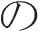(no) is required with verbs of perception, such as 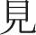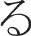(to see) and 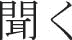(to listen). For example, the following sentence means “I love listening to music,” written in Romanji in the first sentence, followed by a second sentence that contains a mixture of Kanji and Hiragana:

Watashi wa ongaku o kiku no ga daisuki desu 


The next three sentences all mean “He loves reading a newspaper,” written in Romanji and then Hiragana and Kanji:

Kare wa shimbun o yomu no ga daisuki desu 


The “koto ga” nominalizer, which is the other Japanese nominalizer, is used sentences of the form “have you ever . . .” For example, the following sentence means “Have you (ever) been in Japan”:

Nihon ni ita koto ga dekimasu ka


### **Google Translate and Japanese**

Google Translate provides a wonderful service, yet sometimes its translations from Japanese to English are incorrect. This point is not intended as a criticism of Google Translate; on the contrary, it’s an indication of the complexity of the translation process, even for simple Japanese sentences.

For example, the following sentence means “I love reading a newspaper” but is incorrectly translated in Google Translate as “I love reading”:


Note that the letter m in the preceding sentence is due to a limitation of the keyboard in translating ASCII letters to Japanese. As another example, the following (almost identical) sentence is incorrectly translated in Google Translate as “I love to read him” *because of the white space that precedes “yomu”* :


If you enter the following sentence in Hiragana in Google Translate, the correct Romanji is generated:


*Yuki ga hon o yomimashita*

The preceding sentence means “Yuki read the book”; however, Google Translate provides this incorrect English translation:

*I just read Yuki*

As another example, the following sentence in Hiragana is translated correctly in Google Translate:


*Sushi ga yuki ni taberareta*

*Sushi was eaten by Yuki*

Notice how the particle (postposition) “ni” in the preceding sentence is translated as “by” when it’s used in the context of the passive voice in English.

### **Japanese and Korean**

As you learned earlier in this chapter, both Japanese and Korean have postpositions, some of which are similar. There appears to be some degree of comingling among Korean and Japanese, both of which have been influenced by Chinese. The following link contains some interesting details (i.e., a mixture of speculation, conjectures, and some facts) regarding the common aspects of Japanese and Korean:

*[`linguistics.stackexchange.com/questions/41/are-the-japanese-and-korean-subject-particles-known-to-be-related-in-any-way-in`](https://linguistics.stackexchange.com/questions/41/are-the-japanese-and-korean-subject-particles-known-to-be-related-in-any-way-in)*

### **Vowel-Optional Languages and Word Direction**


一些语言将元音视为可选的，这包括双向文字方向的希伯来语和阿拉伯语。这些语言的母语者知道在书面文本中插入正确的元音，以便能够正确阅读报纸和文章。有趣的是，阿拉伯语有一个字母叫 *sukun*，它看起来像两个连续辅音之间的一个小圆圈，表示这两个辅音之间不需要元音。

如前所述，大多数语言是从左到右书写的。相反，日文汉字是从上到下书写，然后从右到左书写。此外，阿拉伯语单词中的字母在从右到左书写时可以呈垂直“堆叠”。

阿拉伯语还有“辅音簇”的概念，指三个相关联的辅音。例如，辅音序列 k-t-b 可以在不同的元音填充下组合，这些组合都与动词“阅读”相关。

### **Mutating Consonant Spelling**

大多数有字母表的语言为其字母表中的每个字母提供唯一形式。然而，阿拉伯语中的一个字母在词中或句子中的位置不同，可能有两、三或四种不同的写法。具体来说，字母的初始、中间、独立或末尾位置决定了其书写方式。例如，下面展示了独立体阿拉伯字母 k、t、b（从左到右）：


事实上，阿拉伯词“kitab”（书）由上述三个字母组成（即没有写元音）。


在波斯语中，“kitab”在 Google Translate 中的翻译如下（包含短元音“i”）：


在乌尔都语中，“kitab”在 Google Translate 中的翻译如下（包含长元音“y”，发音类似“ee”在“meek”中）：


下面是独立体阿拉伯字母“s”：


然而，拼写“seen”的阿拉伯字母如下：


如上所述，前文中字母“s”的右侧部分仅显示，随后是长元音“y”，再然后是字母“n”。

另一个例子是阿拉伯语中“柠檬”一词，如下所示：


前文的阿拉伯词由以下字母（从右到左）组成：l、长 y、m、u、n（从左到右顺序）。然而，独立体字母 m 的形态如下：


完整的阿拉伯字母表及更多细节和细节请参阅：

*[`en.wikipedia.org/wiki/Arabic_alphabet`](https://en.wikipedia.org/wiki/Arabic_alphabet)*

### **Expressing Negative Opinions**

除了日语的大量语法规则外，日语文化还有一个方面：在有多种表达负面观点的方式时，如何决定使用哪句话。

例如，下面的英文句子在意义上基本相同：

I do not think he will go to Tokyo. I think he will not go to Tokyo. 

然而，日语使用者将第一句中的“I do not think”视为一种比第二句中的“I think”更强的个人信念。总体而言，尽可能避免个人观点是更好的做法，因此日语使用者会倾向于第二句而不是第一句。

上述例子展示了一个细微的文化细节，它并不包含在语法规则中，这对自然语言处理（NLP）来说在确保从母语者角度产生 100% 正确翻译时可能构成挑战。

现在，您已对各种语言有一个高层次的了解，接下来让我们简要浏览下一节的主题——即语言谱的另一端。

## **Phonetic Languages**

许多印欧语系语言和大多数亚洲语言是音标语言，这简化了在不相关语言中学习发音的任务。例如，日语和意大利语都是音标语言，母语意大利语使用者可以轻松学会正确发音日语单词（掌握词汇和语法要复杂得多）。

作为对比，母语英语的使用者知道下面列表中的每个单词都有相同的元音音，并且可以轻松发音这些单词：{I, eye, sigh, why, guy, fly, buy, tie}。然而，向非英语使用者解释为什么这些单词的元音音相同并不容易。相比之下，下面的意大利语单词集中元音“o”的发音相同，因为没有其他元音与之相同：{forno, bocca, giorno, dio, guasto, sporco, andiamo, and vediamo}。

音标语言中，元音无论位于单词何处都只有一种发音。辅音 *通常* 只有一种发音，尽管在某些情况下相邻的辅音会改变其前一个辅音的发音。例如，在意大利语中，字母“h”可以 *修改* 紧挨着“h”之前的辅音的发音，如“c’e”和“che”，“ge”和“ghe”（后文将详细讨论）。

因此，字母“h”可以修改前一个辅音的发音，而在英语中“gh”组合可能是静音（在意大利语中从不出现），如“bough”或“bought”，这两个词虽只有一个辅音不同，但意义截然不同。

许多语言包含双辅音，而在音标语言中双辅音保持相同的发音，同时延长发音时间。例如，意大利语单词“vacca”和“nanna”中的双辅音仅延长字母“c”或“n”的发音，有时还会改变词义（如“nanna” 与 “nana”）。需要指出的是，西班牙语很少出现双辅音（西班牙语的“vaca”与意大利语的“vacca”相同）。

相比之下，英语中双辅音有时会影响第二个辅音的发音，如英语单词“accent”、“accident”和“flaccid”（有两种可接受的发音）。而“bookkeeper”中连续的字母 k 不会改变发音，只是比单个 k 延长两倍。

虽然意大利语、西班牙语和葡萄牙语（葡萄牙）是音标语言，但法语是例外，尽管它也是印欧语系语言。法语的部分单词具有明显的鼻音发音，其他法语单词包含连续多个元音。例如，法语单词“oiseau”（意为“鸟”）发音为“wa-ZOE”，与拼写差异很大。法语也是罕见出现三个连续元音的语言。法语来源于拉丁语，拉丁语衍生出法语，尽管法语是非音标语言。有趣的是，巴西葡萄牙语的许多单词可以用多种方式发音，且不总是音标化。

英语尤其有趣，因为它绝对不是音标语言，却在使用人数上排名第一。虽然有许多非母语英语使用者能够流利且语法正确地说英语，但非母语成年人有时在不带口音地说英语时会更有挑战。

然而，当荷兰语使用者使用其母语时，他们的语调与英语相似。这一细节是合理的，因为荷兰语是日耳曼语系，它对古英语产生了重要影响，正如拉丁语和希腊语对英语产生了重要影响。


-   [虽然英语发音对一些人来说可能是个挑战，但它相较于盖尔语（Gaelic）显得黯然失色，盖尔语的发音规则既复杂又令人惊叹。说盖尔语的人数似乎正在逐渐减少，即便在爱尔兰也是如此，也许语言正在缓 s 消失（对我爱尔兰的朋友们，我只需说：Éirinn go Brách）。]

### 音素和词根

在语言学中，`phoneme` 是语言中最小的发音单位。尽管标准英语包含 26 个字母，但英语中实际有 44 个音素。例如，“bat” 这个词由三个音素 “b”、“a” 和 “t” 组成。音素不包括由两个音素组成的双元音和由三个音素组成的三元音，分别包含两个和三个音素。

或者，`morpheme` 是语言中最小的有意义的单位。`morpheme` 携带意义，而 `phoneme` 不携带意义（后者仅是一个声音单位）。`Morphemes`（以及 `words`）是 `phonemes` 的组合，它们可以是前缀、音节或词的前缀。例如，“disappeared” 由三个 `morphemes` “dis.” “appear,” 和 “ed.” 组成。

### 英语中希腊语和拉丁语词源的单词

英语中有许多有趣的单词，其词根来源于希腊语。以 suffix “ology”（意为“学习”）结尾的单词源自希腊语。例如，biology（“bios” = “life”），anthropology（“anthros” = “man”），anthropomorphism（“morphism” = “to change”）用来赋予无生命物体或非人类事物（如宠物）人类特征。

如果你热爱语言，那么你是一个 `linguaphile`；如果你热爱单词，那么你是一个 `logophile`，这两者都源自希腊语词 `lingua`（语言）、`philia`（爱）和 `logos`（词），分别表示语言、爱和词。

英语单词 “telephone” 源自希腊语单词 “telos”（远处）和 “phonos”（说话），它们的组合意为“远处说话”（这正好适合 “telephone” 这个词）。

### 多种方式发音的辅音字母

在意大利语中，字母 “c” 和 “g” 的发音取决于其后的元音。在德语中，当字母 “b”、“d” 和 “g” 出现在词尾时，它们分别发音为 “p”、“t” 和 “k”。下面的小节展示了不同语言中辅音发音变化的情况。（做好长篇阅读的准备！）

### 字母 “j” 在各种语言中的发音

在英语单词中，字母 “j” 的发音类似于 “John” 中的 “j”，而 “g” 可以发音为 “go” 中的 “g”、 “just” 中的 “j”、 “je suis” 中的 “j”，例如在法语借词 “mirage” 中的 “g”（该词来源于法语）。“j” 的这种发音也出现在葡萄牙语、俄语以及阿根廷与巴西接壤地区的部分地区。然而，西班牙语中 “j” 的更常见发音类似于德语单词 “achtung” 中的 “ch”。此外，一些西班牙语使用者发音 “yo” 听起来像 “Joe”。

此外，意大利语中双 “l” 在 “calle” 中的发音为 “KA-yeh”，在西班牙语国家普遍如此，但在阿根廷（可能因靠近巴西）例外，当地的 “calle” 发音为 “KA-jeh”（类似 “je suis” 中的 “j”）。

然而，像 “mirage” 中的 “j” 音在标准西班牙语（其他地区使用的）以及意大利语中并不存在。事实上，字母 “j” 原本不属于意大利语字母表。在意大利语中，“ga”、“go”、“gu” 的发音类似于英语单词 “gap” 中的 “g”，而 “ge”、“gi”、“gio” 则发音类似于 “John” 中的 “j”。因此，意大利语单词 “parmigiano” 的正确发音为 “par-meh-JA-no”，类似于 “jacket”，其中 “JA” 和 “no” 的元音音节短促。

### “硬” 与 “软” 辅音发音

例如，包含字母 “c” 或 “g” 的意大利语单词，如果其后紧跟字母 “h”，则发音会受到影响，当紧随 “h” 的元音是 “e” 或 “I” 时情况更为明显。

具体而言，“ci” 和 “c’e” 发音类似于 “cheek” 和 “check” 中的 “ch”，而 “chi” 和 “che” 则发音类似于 “keep” 和 “kettle” 中的 “k”。因此，“cecci”（鹰嘴豆）的发音包含两个连续的 “ch” 声，类似于 “check” 或 “CHE-chee”。同样的规律适用于 “gi” 与 “ge” 与 “ghi” 与 “ghe”。

上述段落引出了专有名词 Giorgio（乔治），非母语意大利语使用者有时会尝试将其发音为四个独立音节（“gee-OR-gee-OH”），尽管前面的规则已经说明。尽管如此，意大利语使用者将 Giorgio 发音为两个音节 “JYOR-jo”（这并非完全符合音标）。

此外，德语部分辅音也会发生发音变化：以 “b”、“d” 或 “g” 结尾的单词分别发音为 “p”、“t” 和 “k”。因此，“ab”（前缀）、“tod”（死亡）和 “berg”（山）分别发音为 “ap”、“tot” 和 “berk”。于是，“Bergman” 被译为 “mountain man”。

另一个有趣的语法情境涉及清浊辅音对的配对，这将在下一节讨论。

### “Ess”、“zee” 与 “sh” 音

一些语言有涉及连续辅音的发音规则，而这些在英语中并不存在。例如，字母 “s” 可以是无声的（如 “seed”），也可以是浊音，发出 “z” 的音（如 “boys”）。在意大利语中，字母 “s” 既可以是无声也可以是浊音。英语和意大利语中的 “n” 都是浊音辅音。

此外，意大利语还有一条语法规则：当无声辅音紧接着浊音辅音时，必须将无声辅音转为浊音。因此，一些意大利语使用者会把英文单词 “snow” 发音为 “znow”，把 “slice” 发音为 “zlice”。

然而，意大利语单词开头的字母 “z” 发音类似于 “ads” 中的 “ds”。同时，元音之间的 “s” 发音为浊音 “s”，而双 “z” 则发音为无声 “s”，这意味着 “pizza” 不会发音为 “PEET-suh”。顺便提一下，西班牙语中的字母 “z” 始终发音为无声的 “s”，并且西班牙语中不存在 “z” 的浊音对应音。

“st” 与 “sp” 这类辅音组合在英语中通常发音为浊音 “s”，如 “street” 或 “spa”。但在那不勒斯方言中，“sp” 中的 “s” 发音类似于 “sh”（如 “sheep”），因此那不勒斯人会说 “SHpaghetti” 而不是 “spaghetti”。巧合的是，阿拉伯语中的 “st” 与 “sp” 很少（甚至从不）出现中间的辅音，这由 sukun 符号表示。

顺便提一下，西班牙语在冠词 “la”  precede 一 feminine 名词以 “a” 开头时会发生变化。例如，“agua” 是女性名词，但正确的表达是 “el agua” 而不是 “la agua”。

在委内瑞拉，很多人使用 “criollo”，其发音与南美其他西班牙语国家不同。criollo 的一个显著差异在于词尾的无声字母 “s”。具体来说，词尾的 “s” 发音类似于 “hot” 中的 “h”。

例如，句子 *El eta alla en la equina con do uiqui* 在 criollo 中等同于西班牙语句子 “El esta alla en la esquina con dos uisquis”（省略了重音符号）。另外请注意，西班牙语指代西班牙人，而 “Castellano” 是在 Hispanic 国家中使用的语言名称。

### 三个连续的辅音


-   [英语中有许多单词包含三个连续的辅音，例如“street”“straight”“spray”等。然而，某些语言避免在单词中出现三个连续的辅音，有时会通过改变前面的冠词（“a”或“the”）来避免这种情况。]

-   [例如，意大利语使用“la”表示阴性名词（“la casa”），使用“il”表示阳性名词（“il libro”），并使用“lo”表示以两个连续辅音开头的阳性名词。因此，“lo sport”取代“il sport”，“lo stile”取代“il stile”，从而避免了“lsp”和“lst”这两个三个连续辅音的情况。]

-   [“lo zucchero”和“lo zio”也是正确的，尽管“il zucccero”包含两个辅音序列“lz”。然而，最初的规则仍然适用，因为意大利语中以“z”开头的单词发音类似英语单词“ads”中的“ds”，即发音为“dz”。因此，“lo zucchero”是正确的，因为它避免了“il zucccero”所产生的三个连续辅音“ldz”，同样适用于“lo zio”“lo zain”等（聪明，不是吗？）。]

-   [阿拉伯语也避免三个连续的辅音。然而，由于阿拉伯语中的元音是可选的，且在书面语中常被省略，流利的读者可以在连续的辅音之间默 silently（在文本中保持不变）插入元音。在某些连续辅音的情况下，读者会因为“sukun”符号（一个小空心圆）的存在而知道不需要中间元音，该符号出现在一对连续辅音之间。]

-   [### Dipthongs and Triphthongs in English]

-   [Instead of “pure” vowels, English words typically contain diphthongs (and also some triphthongs) that are combinations of phonetic vowels. Here are some examples of English vowels and their phonetic counterparts:]

-   ["a" is phonetic "e" + "i" (when it sounds like "pay") "i" is phonetic "a" + "i" (when it sounds like "eye") "o" is phonetic "o" + "u" (when it sounds like "foe") "u" is phonetic "i" + "u" (when it sounds like "you") "y" is phonetic "y" + "a" + "i" (when it sounds like "why")]

-   [Thus, the English vowels a, o, and u are diphthongs, and the English letter y is actually a triphthong. The lone exception is the letter “e”, which is a phonetic “i” when it rhymes with “pea.”]

-   [### Semi-Vowels in English]

-   [In addition to vowels, English also has consonants that can sometimes function as semi-vowels, such as the letter “m” in “prism,” the letter “l” in “castle,” and the letter “r” in “centre.” There are other languages with consonants that can function as semi-vowels. One humorous (and challenging) example is the following Czech sentence that contains the semi-vowel “r” and no vowels (“Stick finger through throat”):]

-   [Strč prst skrz krk]

-   [### Challenging English Sounds]

-   [Some sounds in English are difficult for nonnative-English speakers, generally for people whose native language is phonetic. For example, the combination “or” and “er” is simple when they are pronounced like “or” in the word “for” and “er” in “feral.” However, the “er” sound in the following words can be more challenging for nonnative-English speakers:]

-   [world]

-   [hurt]

-   [her]

-   [earnest (“ear” + “nest”?)]

-   [girth]

-   [Notice how different combinations the verb-plus-consonant in the preceding words, and yet all of them have the same “er” sound.]

-   [Other difficult combinations are “th” in words such as “three”, which is approximated as “tree” with a “trilled r” sound, and “third” is pronounced as “turd,” and also with a “trilled r” sound. The sound of “th” in the word “then” can also be difficult, and it’s sometimes approximated as “den.”]

-   [As an aside, during a late evening talk show, Charlize Theron once explained that her last name is pronounced like “tron,” with a strong trilled “r” sound, instead of “thur-ON,” whereas the former pronunciation makes more sense to people who speak phonetic languages.]

-   [Silent letters can be especially challenging for nonnative-English speakers. People who speak phonetic languages will sometimes say “PLUM-ber” instead of “plummer.” Sometimes the reverse happens: they pronounce a letter that is actually silent, such as the letter “h”: they will say “HON-est” instead of “ON-est.” Another fun set of English words and the variations in their pronunciation: *but* versus *put* versus *putrid* versus *purple;* low versus plow, and row (a boat) versus row (an argument). Now try explaining the logic behind the pronunciation of the following words containing “ou” that sounds like “ow,” “oh,” “uh,” “oo,” “er,” and yoo” to a non-English speaker:]

-   [plough]

-   [bough]

-   [rough]

-   [through]

-   [furlough]

-   [fur]

-   [eunuch]

-   [Another combination that is challenging (and sometimes for native-English speakers as well) is the combination of “th” and “z” sound in a word such as “youths.” Sometimes you will hear “youths” pronounced as “yoots,” depending on the speaker’s location in the United States.]

-   [### English in Canada, UK, Australia, and the United States]

-   [There are some relatively minor differences in the spelling of words in English spoken in the United States versus other English-speaking countries. One such difference is replacing “ou” with “o,” as in color, favor, and neighbor instead of colour, favour, and neighbor. Another difference involves replacing “ll” or “pp” with a single “l” or “p,” such as traveled and worshiped instead of travelled and worshipped.]

-   [Other simple changes: tire instead of tyre (UK), trunk instead of boot (UK), aluminum instead of aluminium, and eraser instead of rubber. Changes in pronunciation include “PRY-vacy” instead of “PRIV-acy” and “a-LOO-minum” instead of “a-loo-MIN-ium.”]

-   [Perhaps the most important point to keep in mind is that the main purpose of speech is communication between people, regardless of the grammatical errors or accents of the speaker. Now that you have an understanding of the many nuances of human languages, you have a greater understanding of the various challenges and nuances facing NLP.]

-   [Perhaps the most important point to keep in mind is that the main purpose of speech is communication between people, regardless of the grammatical errors or accents of the speaker. Now that you have an understanding of the many nuances of human languages, you now have a greater understanding of the various challenges and nuances facing NLP.]

-   [### English Pronouns and Prepositions]

-   [If you have struggled with the correct combination of pronouns and prepositions in English, there is a simple rule to remember: a subject pronoun in English (I, he, she, and so forth) can *never* follow a preposition (such as to, for, between, and so forth).]

-   [The following table displays subject pronouns, direct object pronouns, and indirect object pronouns in English:]

-   [| Subject || Direct || Indirect |]

-   [| --- | --- | --- |]

-   [| I || me || me |]

-   [| --- | --- | --- |]

-   [| you || you || you |]

-   [| he/she/it || him/her/it || him/her/it |]

-   [| we || us || us |]

-   [| you || you || you |]

-   [| they || them || them |]

-   [Based on the contents of the preceding table, which of the following fragments is correct:]

-   [1.  “you and I disagree”]

-   [2.  “between you and I”]

-   [3.  “between you and me”]

-   [4.  “between you and him”]

-   [5.  “between we and him”]

-   [6.  “between us and him”]

-   [7.  “between we and they”]

-   [8.  “him and I went to the store”]

-   [Correct answers: 1, 3, 4, and 6]

-   [If you replace the word “between” with the word “for” or “to” (or any other English preposition) in the preceding list, *the list of correct answers is the same*. In case you are interested, a list of English prepositions is available here:]

-   *[`www.englishclub.com/grammar/prepositions-list.htm`](https://www.englishclub.com/grammar/prepositions-list.htm)]


这篇文章快速浏览了多种语言，到此你可能对语法规则、词序、变格、性别、复数形式和发音规则的繁杂已经感到饱和。请记住，全球有数千种人类语言，其中大部分在这段介绍中根本未被涉及。下一节将从 NLP 介绍开始，随后是各种 NLP 相关概念。

## 什么是 NLP？

NLP 是人工智能的一个重要分支，专注于使用机器处理人类语言。事实上，你通过语音助手、搜索引擎和机器翻译服务已经在使用 NLP，这些工具的目的是简化你的任务和日常生活的各个方面。

NLP 面临诸多挑战，例如在文档或语料库中，确定词语的语境以及它们在不同句子中的多义性。其他困难的任务包括识别情感（如讽刺和讽刺）、具有多重含义的表达式，以及包含矛盾陈述的句子。

关于语言翻译，Facebook 开发了一个令人印象深刻的模型——M2M 模型，它在超过 2,000 种语言上进行训练，并能在任意 100 种语言对之间提供翻译。

在高层次上，解决 NLP 任务的主要有三种方法：基于规则的方法（最早出现）、传统机器学习和神经网络（最新）。

基于规则的方法可以使用正则表达式，在各类 NLP 任务中表现良好。

传统机器学习方法（包括各种分类器）需要在训练集上训练模型，然后在测试集上进行推理。这种方法仍然适用于诸如序列标注等 NLP 任务。

相比之下，神经网络以 `word embeddings`（基于向量的词表示）为输入，并通过反向传播进行训练。常见的神经网络架构包括 `CNNs`、`RNNs` 和 `LSTMs`。此外，深度学习与 NLP 的结合研究也取得了显著进展，从而达到了最先进的（SOTA）结果。

特别是，`transformer` 架构（依赖于注意力机制）已经超越了早期的神经网络架构。事实上，`transformer` 架构是 `BERT` 的基础，`BERT` 是一个拥有 15 亿参数的预训练 NLP 模型，以及许多其他直接或间接基于 `BERT` 的预训练模型。第 11 章节介绍了 `transformer` 架构和 `BERT` 相关模型。

无论使用何种方法，NLP 算法都处理以文档或文档集合形式出现的样本，这些样本包含文本。语料库的规模可能不等，也可能是领域特定和/或语言特定的。例如，`GPT-3`（在第 11 章节中讨论）是在包含 500 GB 文本的语料库上训练的。

作为历史补充，布朗语料库（Brown Corpus）是 1960 年代为语言学创建的美国当代英语标准语料库。该语料库包含 500 份英语文本样本，总词数约为 1,000,000 词。更多信息请参阅：

*[`en.wikipedia.org/wiki/Brown_Corpus`](https://en.wikipedia.org/wiki/Brown_Corpus)*

作为 NLP 的具体例子，考虑确定文档的主要主题这一任务。对于几页的文本文档，这很容易完成；但对于一百份文档，每份可能包含数百页，手动完成则不切实际（如果把这项工作“外包”给多个人，你也需要支付相应的费用）。

幸运的是，有一种称为主题模型的 NLP 技术能够分析文档并确定其主要主题。这种文档分析可以在大量文本的各种场景中使用。请记住，NLP 可以帮助你分析包含结构化数据、非结构化数据，或两者结合的数据的文档。

### NLP 的演变

自 20 世纪中叶以来，NLP 经历了许多变化，最早的阶段在今天看来可能显得原始。下面列出了从 1950 年到大约 2020 年之间几个主要阶段，突出了当时常用的 NLP 技术：

1950s-1980s: rule-based systems（基于规则的系统）

1990s-2000s: corpus-based statistics（基于语料库的统计方法）

2000s-2014: machine learning（机器学习）

2014-2020: deep learning（深度学习）

早期 NLP（1950s–1990s）跨越多个十年，主要聚焦于基于规则的系统，这意味着大量的条件逻辑。当你考虑英语句子的结构时，它通常呈现为主语-动词-宾语的形式。但句子也可以包含一个或多个从句，每个从句可能涉及多个名词、介词、形容词和副词。

更复杂的是跨句维持引用，例如：

> Yesterday was a hot day and many people were uncomfortable. I wonder what that means for the coming days."

虽然你可以推断第二句中“that”的含义，但仅凭规则方法很难确定其正确解释（而现代 NLP 方法则可以轻松处理）。这个时期的 NLP 还会对句子进行统计分析，预测给定词后更可能出现的词。

随后的 NLP 阶段（1990s–2000s）将重点从规则分析转向对文档集合的统计分析。第三阶段引入了机器学习，采用决策树和马可夫链等算法。其核心任务仍然是预测序列中下一个词。

最近 NLP 的阶段是过去十年，即神经网络与 NLP 的结合。事实上，2012 年是一个重要转折点，卷积神经网络（CNNs）在图像分类方面取得了突破。研究者随后将 CNN 用于分析音频波形并执行 NLP 任务。

随后，CNN 的应用演进为循环神经网络（RNNs）和长短期记忆（LSTMs），这两种深度学习架构在 NLP 任务中提供了更高的准确性。它们随后被 Transformer 架构（同样属于深度学习）所取代，该架构由 Google 在 2017 年底开发。基于 Transformer 的架构（数量众多）在 NLP 方面实现了超越以往所有尝试的最先进的性能。

### NLP 的宽阔视角

本节包含 NLP 的各个方面，以及许多 NLP 应用和用例，概括如下列表：

*   NLP applications（NLP 应用）

*   NLP use cases（NLP 用例）

*   NLU（natural language understanding，自然语言理解）

*   NLG（natural language generation，自然语言生成）

*   text summarization（文本摘要）

*   text classification（文本分类）

下面的子章节为列表中的每个主题提供更详细的信息。

#### NLP 应用和用例

这里列出了许多有用且广为人知的 NLP 应用，部分如下：

Chatbots（聊天机器人）

Search（文本和语音搜索）

Advertisement（广告）

Automated translation（自动翻译）

Sentiment analysis（情感分析）

Document classification（文档分类）

Speech recognition（语音识别）

Customer support（客户支持）

特别是，聊天机器人因其日益增强的能力而受到关注，能够执行以前需要人工交互的任务。

*Sentiment analysis* 是文本摘要的一个子集，旨在确定说话者对特定主题（或整体）的态度或情绪反应。可能的情感有正向、中性和负向，通常用数字 1、0、-1 表示。


文本分类是情感分析的概括，通常每篇文章会涉及三个以上的标签：

[`towardsdatascience.com/natural-language-processing-pipeline-decoded-f97a4da5dbb7`](https://towardsdatascience.com/natural-language-processing-pipeline-decoded-f97a4da5dbb7%20)

除了前面列出的样本应用，NLP 还有许多用例，其中一些如下：

问题回答

筛选电子邮件消息

检测假新闻

改进临床文档

自动文本摘要

情感分析与语义

机器翻译与生成

个性化营销

列表中的一些用例（如情感分析）将在后续章节中讨论。

### NLU 和 NLG

NLU 是 natural language understanding 的缩写，尽管你可能看不到很多关于该主题的书籍，它仍是 NLP 的一个非常重要的子集。在极高层次的概念下，NLU 试图在确定文本字符串或文档的上下文时理解人类语言。NLU 涉及多项 NLP 任务，如情感分析和主题分类。另一个极其重要的 NLU 任务是关系提取，即从文本字符串中提取可能存在的语义关系。输入文本的来源可以是聊天机器人、文档、博客文章等。

作为简单的例子，考虑下面这段文字，并注意代词“he”和“them”的不同含义：

"John lived in France and he attended an International school. Mary lived in Germany and she also attended an International school. Dave lived in London and met both of them in Paris. One of these days, when he has some free time, they will meet up again. Steve met all of them on New Year's Eve."

虽然这段文字对人类来说很容易理解，但对 NLU 来说仍有一些挑战，例如回答以下问题：

1. 第一个“he”指代谁？

2. 第二个“he”指代谁？是否存在歧义？

3. 第一个“them”指代谁？

4. 第二个“them”指代谁？是否存在歧义？

正如你所熟知的，人类语言的一个挑战是正确解释句子中使用歧义的词汇，这种歧义可以分为多种类型。例如，词汇歧义（lexical ambiguity）发生在一个词具有多种含义时，这会改变包含该词的句子意义。一种处理这种歧义的方法是使用 POS（词性）技术，如在 NLTK 章节中所示。

另一种歧义类型是语法歧义（syntactical ambiguity），也称为语法歧义，当一系列词（而非单个词）具有多种含义时出现。

还有一种歧义类型是指代歧义（referential ambiguity），当一个名词在一个位置被引用到另一位置的代词时，且该指代并不完全明确。

自然语言生成（NLG）是 NLP 的另一个重要子集，它是将某些内部表示转化为自然语言中有意义的短语和句子的过程。GPT-3（在第 11 章节中讨论）的一个令人印象深刻的例子是它能够针对各种问题生成有意义的回答。

NLP 可以用于分析语音（本书未讨论）、词汇以及句子结构。因此，我们需要熟悉文本分类，这是下一节的主题。

### 什么是文本分类？

文本分类是一种监督方法，用于确定文本语料库的类别或类别，文本可以是博客、书籍内容、网页内容等形式。类别在先前已知，且不会改变；类别通常（但不总是）互斥。

文本分类通过检查文本来确定其内容性质，例如：

- 主题标记（文档的主要主题）

- 文本的情感（正面或负面）

- 文本使用的自然语言

- 网站上产品的分类

- 判断是否为垃圾邮件

然而，大多数文本数据都是非结构化的，这使得分析文本文档变得复杂。从业务角度来看，机器学习文本分类算法在成本效益地结构化和分析文本方面非常有价值，能够加速业务流程和决策过程。

你可能已经猜到，文本分类对于客户服务至关重要，它可以根据文本的（人类）语言进行路由，判断是否为产品或服务帮助请求，检测产品问题等。

请注意，一些较旧的文本分类算法基于词袋（BoW），仅统计文档中词的频率。词袋算法在第 5 章节中解释，相关的 BoW 代码示例在第 6 章节。

还有一点：文本摘要与文本分类相关，在第 9 章节的推荐系统讨论中有所描述。

### 信息提取与检索

信息提取的目的是自动从一个或多个来源中提取结构化信息，这些来源可能包含文档中的非结构化数据。例如，文章可能提供一家成功初创公司的 IPO 详情，或大公司收购更大公司的情况。信息提取会从文章内容生成一句摘要。在更大的语境中，信息提取与主题建模（即在文档中找出主要主题）相关，后者在第章后期讨论。

信息提取还需要信息检索，后者涉及对大量文档进行索引和分类的方法。信息提取包含多个子任务，如识别命名实体（即人、地点和公司的名词）、自动填充模板中的信息，或从文档中的表格中提取数据。

简单例子：假设一个程序定期抓取（检索）HTML 页面内容以总结其内容。最先要完成的任务是数据清洗，这包括删除 HTML 标签、去除标点、将文本转为小写，然后将句子拆分为词（token）。好在 BeautifulSoup Python 库可以轻松完成上述所有任务。

聊天机器人的兴起也是 NLP 关注的重要领域，聊天机器人与用户交互以提供信息（如路线、营业时间）或执行特定任务（预订、预订酒店、租车等）。

### 词义消歧

直到几年前，词义消歧仍是一项难以捉摸的任务，因为词汇可以是多义的（即拥有多个含义）。著名的《纽约时报》文章描述了一个机器学习中幽默的误解实例。下面这句话被翻译成俄语，然后再从俄语翻译回英文：

The spirit is willing, but the flesh is weak

第二次翻译的结果如下：

the vodka is good, but the meat is rotten

这里是《纽约时报》文章的链接：

[`www.nytimes.com/1983/04/28/business/technology-the-computer-as-translator.html`](https://www.nytimes.com/1983/04/28/business/technology-the-computer-as-translator.html)

另一个简单的多义词例子，考虑下面四句话：


你可以依赖这个结果。

你可以把这个存到银行。

你看到那个河岸吗？

把车靠左边。

在前面四句话中，单词“bank”有四种含义。确定一个词的含义需要某种内容。词义模糊的糟糕状态导致机器学习热情急剧下降。然而，过去几年情况有了巨大改善。例如，2018 年微软开发了一个从中文到英文的翻译系统，其准确率与人类相当。

## NLP 技术在机器学习中

如前面，你简要了解了 NLU（自然语言理解）和 NLG（自然语言生成）。NLU 的目的是“理解”一段文本，然后使用 NLG 生成合适的回复（或从库中查找合适的回复）。这类任务与问答和知识抽取相关。

由于 NLP 任务种类繁多，相应的 NLP 技术也很多，下面列出了一些技术：

`text embeddings`

`text summarization`

`text classification`

`sentence segmentation`

`POS (part-of-speech tagging)`

`NER (Named entity recognition)`

`word sense disambiguation`

`text categorization`

`topic modeling`

`text similarity`

`syntax and parsing`

`language modeling`

`dialogs`

`probabilistic parsing`

`clustering`

列表中的大多数项目都在第 4 章节讨论；在某些情况下，相关的 Python 代码示例在第 5 和第 6 章节。

### 训练模型的 NLP 步骤

虽然具体的文本相关任务取决于你要完成的具体任务，但下面的步骤是通用的：

[1] 将单词转换为小写

[1] 噪声去除

[2] 归一化

[3] 文本丰富

[3] 停用词去除

[3] 词干化

[3] 词形还原

列表中方括号内的数字表示任务类型，具体为“必须做”“应该做”和“任务依赖”。

## 文本归一化与分词

文本归一化包括多项任务，如去除不需要的标签、表情符号、URL、特殊字符（如“&”“!”“$”等）。但你可能需要对某些标点符号做决定。

首先，关于句号（“.”）标点符号？如果保留每个句号，在分词时需要决定是否将其视为一个 token。如果去除所有句号，则会同时去除省略号（三个连续句号），以及“Mr.”、“U.S.A.”、“P.O.”等字符中的句号。若数据集较小，可目视检查；若数据集很大，可从原始数据中随机抽取若干较小子集进行检查。

其次，虽然你可能认为去除问号（“?”）是好的做法，但事实并非如此：问号通常能帮助你在语料库中区分疑问句和陈述句。

再次，你还需要决定是否去除数字。数字在单独出现时（如“1,000 桶油”）表示数量，而在字母字符串中则可能是输入错误。例如，去除“large99 oranges”中的 99 是可以的，但“99large oranges”中的 99 该如何处理？

另一个标准归一化任务是将所有单词转为小写（“case folding”）。中文字符没有大小写之分，因此不需要转换为小写。请注意，文本归一化与数据库表的归一化（RDBMS）或机器学习中数值的标准化（scaling）完全无关。它是将类别（字符）数据转换为数值的过程。

虽然“case folding”看似简单，但也可能出问题。例如，法语中大写字母的变音符号是可选的，变换大小写后某些词仍需要保留变音符号。例如，法语单词“peche”（鱼或桃，带一个变音符号）和“sin”（带不同变音符号）。意大利语的对应词是“pesce”“pesca”“peccato”，变音符号问题不大。另外，意大利语“pesce”的复数是“pesci”（Joe Pesci 可以指 Joe 鱼或 Joe 鱼们，取决于是否指代一种鱼或多种鱼）。英语中将大写词转换为小写也可能产生歧义：单词“stone”是名词“石头”还是姓氏“Stone”？

在完成数据集归一化后，分词（tokenization）涉及将句子、段落或文档“拆分”为单个词（token）。分词的复杂程度因语言而异，取决于该语言的字母特性。特别是，对于印欧语系语言，分词通常很直接，因为它们使用空格字符分隔单词。

虽然在常规文本中分词可以很容易完成，但在处理生物医学数据时会更具挑战性，因为该数据包含缩写词并频繁使用标点符号。处理缩写的一种 NLP 技术是命名实体识别（NER），后文将在本章节中详细讨论。

### 日语词汇分词

与大多数语言不同，日语文本中使用空格字符是可选的。日语还包含多种字母表，句子常混合使用这些字母表。具体而言，日语支持罗马字（本质上是英文字母）、平假名、片假名（专门用于从其他语言借入的词）以及汉字。

简单示例：在浏览器中打开 Google 翻译，输入下面这句话，意思是“I gave a book to my friend”：

`watashiwatomodachinihonoagemashita`

翻译结果（几乎正确）如下所示的平假名文本：


如果在句子中加入空格，如下所示：

`watashi wa tomodachi ni hon o agemashita`

Google 翻译会给出如下正确的平假名翻译：


前面的句子以汉字“私”开头，这是“watashi”正确的翻译。

普通话和粤语也是分词复杂的语言。这两种语言都是声调语言，使用象形而不是字母。普通话提供拼音（Pinyin），即普通话发音的拉丁化表示，并用 4 位数字标记每个音节的具体声调（中性音不标记声调）。普通话有 6 种声调，其中 4 种常用；粤语有 9 种声调（但没有对应于 Pinyin 的声调）。

下面的句子分别为普通话和拼音，英文翻译为“How many children do you have”：


`Nǐ yǒu jǐ gè háizi Ni3 you3 ji3ge4 hai2zi`（数字代替声调符号）

第二、三句都是拼音。第三句中的数字 2、3、4 分别对应普通话的第二、三、四声。第三句在拼音不支持的环境（如旧浏览器）中使用。前往 Google 翻译，输入以下词语选择源语言：

`ni you jige haizi`

选择普通话作为目标语言，你会看到以下翻译：

`how many kids do you have`


The preceding translation is quite impressive, when you consider that the tones were omitted, which can significantly change the meaning of words. If you are skeptical, look at the translation of the string “ma” when it’s written with the first tone, then the second tone, and again with the third tone and the fourth tone: the meanings of these our words are entirely unrelated.

Tokenization can be performed via regular expressions (which are discussed in Appendix C) and rule-based tokenization. However, rule-based tokenizers are not well-equipped to handle rare words or compound words that are very common in German. In Chapter 4, you will see code samples involving the NLTK tokenizer and the SpaCY tokenizer for tokening one or more English sentences.

### `Text Tokenization with Unix Commands`

Text tokenization can be performed not only in Python but also from the Unix command line. For example, consider the text file words.txt whose contents are shown here:

lemmatization: removing word endings edit distance: measure the distance between two words based on the number of changes needed based on the inner product of 2 vectors a metric for determining word similarity 

The following command illustrates how to tokenize the preceding paragraph using several Unix commands that are connected via the Unix pipe (“|”) symbol:

``` 
tr -sc 'A-Za-z' '\\n' < words.txt | sort | uniq
``` 

The output from the preceding command is shown below:

1 a

2 based

1 between

1 changes

1 determining

2 distance

1 edit

1 endings

1 for

1 inner

1 lemmatization

. . . .

As you can see, the preceding output is an alphabetical listing of the tokens of the contents of the text file words.txt, along with the frequency of each token.

## `Handling Stop Words`

Stop words are words that are considered unimportant in a sentence. Although the omission of such words would result in grammatically incorrect sentences, in some cases the meaning of such sentences might still be recognizable.

In English, stop words include the words “a,” “an,” and “the,” along with common words and prepositions (“inside,” “outside,” and so forth). Stop words are usually filtered from search queries because they would return a vast amount of unnecessary information. As you will see later, Python libraries such as NLTK provide a list of built-in stop words, and you can supplement that list of words with your own list.

Removing stop words works fine with BoW and tf-idf, both of which are discussed in the next chapter, but they can adversely models that use word context to detect semantic meaning. A more detailed explanation (and an example) is here:

*[`towardsdatascience.com/why-you-should-avoid-removing-stopwords-aa7a353d2a52`](https://towardsdatascience.com/why-you-should-avoid-removing-stopwords-aa7a353d2a52%20)*

Keep in mind that a universal list of stop words does not exist, and different toolkits (NLTK, gensim, and so forth) have different sets of stop words. The Sklearn library provides a list of stop words that consists of basic words (“and,” “the,” “her,” and so forth). However, a list of stop words for the text in a marketing-related Website is probably different from such a list for a technical Website. Fortunately, Sklearn enables you to specify your own list of stop words via the hyperparameter stop\_words.

Finally, the following link contains a list of stop words for an impressive number of languages:

*[`github.com/Alir3z4/stop-words`](https://github.com/Alir3z4/stop-words)*

## `What is Stemming?`

This concept refers to reducing words to their root or base unit. Keep in mind that a stemmer operates on individual words without any context for those words. Stemming will “chop off” the ends of words, which means that “fast” is the stem for the words fast, faster, and fastest. Stemming algorithms are typically rule-based and involve conditional logic. In general, stemming is simpler than lemmatization (discussed later), and it’s a special case of normalization.

### `Singular versus Plural Word Endings`

The manner in which the plural of a word is formed varies among languages. In many cases, the letter “s” “or es” is the plural form of words in English. In some cases, English words have a singular form that ends in s/us/x (basis, abacus, and box), and a plural form with the letter “i”: cactus/cacti, appendix/appendices, and so forth.

However, German can form the plural of a noun with “er” and “en,” such as buch/bucher, frau/frauen, and so on.

### `Common Stemmers`

The following list contains several commonly used stemmers in NLP:

Porter stemmer (English)

Lancaster stemmer

SnowballStemmers (more than 10 languages)

ISRIStemmer (Arabic)

RSLPSStemmer (Portuguese)

The Porter stemmer was developed in the 1980s, and while it’s good in a research environment, it’s not recommended for production. The Snowball stemmer is based on the Porter2 stemming algorithm, and it’s an improved version of Porter (about 5% better).

The Lancaster stemmer is a good stemming algorithm, and you can even add custom rules to the Lancaster stemmer in NLTK (but results can be odd). The other three stemmers support non-English languages.

As a simple example, the following code snippet illustrates how to define two stemmers using the NLTK library:

``` 
import nltk 
from nltk.stem import PorterStemmer, SnowballStemmer 
porter = PorterStemmer() 
porter.stem("Corriendo") 
snowball = SnowballStemmer("spanish", ignore_stopwords=True) 
snowball.stem("Corriendo") 
``` 

Notice that the second stemmer defined in the preceding code block also ignores stop words.

### `Stemmers and Word Prefixes`

Word prefixes can pose interesting challenges. For example, the prefix “un” often means “not” (such as the word unknown) but not in the case of “university.” One approach for handling this type of situation involves creating a word list and after removing a prefix, check if the remaining word is in the list: if not, then the prefix in the original word is not a negative. Among the few (only?) stemmers that provides prefix stemming in NLTK are Arabic stemmers:

*[`github.com/nltk/nltk/blob/develop/nltk/stem/arlstem.py#L115`](https://github.com/nltk/nltk/blob/develop/nltk/stem/arlstem.py#L115)*

*[`github.com/nltk/nltk/blob/develop/nltk/stem/snowball.py#L372`](https://github.com/nltk/nltk/blob/develop/nltk/stem/snowball.py#L372)*

However, it’s possible to write custom Python code to remove prefixes. First, navigate to this URL to see a list of prefixes in the English language is here:

*[`dictionary.cambridge.org/grammar/british-grammar/word-formation/prefixes`](https://dictionary.cambridge.org/grammar/british-grammar/word-formation/prefixes)*

*[`stackoverflow.com/questions/62035756/how-to-find-the-prefix-of-a-word-for-nlp`](https://stackoverflow.com/questions/62035756/how-to-find-the-prefix-of-a-word-for-nlp)*

Next, a Python code sample that implements a basic prefix finder is here:

*[`stackoverflow.com/questions/52140526/python-nltk-stemmers-never-remove-prefixes`](https://stackoverflow.com/questions/52140526/python-nltk-stemmers-never-remove-prefixes)*

### `Over Stemming and Under Stemming`

*Over stemming* occurs when too much of a word is truncated, which can result in unrelated words having the same stem. For example, consider the following sequence of words:

university, universities, universal, universe

The stem for the four preceding words is *universe*, even though these words have different meanings.

*Under stemming* is the opposite of over stemming: this happens when a word is insufficiently “trimmed.” For example, the words data and datum both have the stem dat, but what about the word date? This simple example illustrates that it’s difficult to create good stemming algorithms.

## `What is Lemmatization?`


*Lemmatization* 判断词语是否有相同的词根，过程包括去除词语的屈折结尾。判断词根时会使用 WordNet 数据库。

Lemmatization 找出单词的词根形式，例如 *good* 为 good、better、best 三词的词根。它确定词语的词典形式，因此需要词性知识。总体而言，构建词干化器比构建词根化器更为困难。NLTK 的词根化器基于 WordNet 数据库。

Lemmatization 也与动词时态相关。例如，run、runs、running、ran 是动词“run”的不同形式。另一个例子是不规则动词，如法语中的“to be”和“to have”。因此，is、was、were、be 都是动词“be”的变体。请注意，二者存在权衡：词根化能够比词干化得到更好的结果，但代价是计算开销更大。

### `Stemming/Lemmatization` Caveats

这两种技术旨在实现“召回”，而精确率往往会下降。结果在非英语语言上也会有显著差异，即使这些语言看似与英语相关，因为概念实现细节的差异也很大。

虽然两者都能生成屈折词的词根形式，词干可能不是真实词汇，而词根 `is` 是真实语言词汇。总体而言，如果主要追求速度，使用词干；如果主要追求准确性，使用词根化。

### 词干和词根化的局限性

词干和词根化适用于印欧语系语言，但对中文不够适用，因为一个汉字可能是由两个或更多汉字组合而成，这三个部分可能含有不同含义。

例如，表示“母亲”的汉字由“女 radical”和“马 radical”组合而成。通过词干或词根化将这两个 radical 分开，会把“母亲”的意义转变为“女性”，从而改变原意。更详细的中文自然语言处理信息可参考：

*[`towardsdatascience.com/chinese-natural-language-pre-processing-an-introduction-995d16c2705f`](https://towardsdatascience.com/chinese-natural-language-pre-processing-an-introduction-995d16c2705f)*

## `Working with Text: POS`

POS 代表 parts of speech，即词性，涉及识别句子中词语的语法功能。下面的子章节提供关于 POS 的更多细节、一些 POS 技术以及 NER（命名实体识别）。

### `POS Tagging`

Parts of Speech（POS）是句子中词语的语法功能。考虑以下简单的英文句子：

The sun gives warmth to the Earth.

在这个例子中，“sun”是主语，“gives”是动词，“warmth”是直接宾语，Earth 是间接宾语。此外，主语、直接宾语和间接宾语也都是名词。

当一个词的意义“overloaded”时，其功能取决于上下文。下面给出三个使用 “bank” 的不同情境：

He went to the bank.

He sat on the river bank.

He can’t bank on that outcome.

POS tagging 是为句子中的词语分配语法标签的过程，对构建词根化器很有帮助。POS 标签在生成解析树时使用，也用于定义 NER（将在下一节讨论）。第 6 章节包含一个使用 NLTK 对语料（句子或文档）进行 POS tagging 的 Python 示例代码。

### `POS Tagging Techniques`

主要的 POS tagging 技术（随后是简要描述）如下：

* **Lexical-Based Methods**  
  *Lexical-based methods* 根据给定语料中词语出现频率最高的情况来分配 POS 标签。相反，*rule-based methods* 使用基于语法的规则来分配标签。例如，以字母 “s” 结尾的词通常是复数形式（但不总是如此）。该规则适用于英语和西班牙语单词。此外，德语单词以字母 “e” 结尾时往往是复数形式（也可能是阴性形式）。意大利语以 “i” 或 “e” 结尾的词通常是复数形式。

* **Probabilistic Methods**  
  *Probabilistic methods* 根据特定标签序列出现的概率来分配 POS 标签。

* **Deep Learning Methods**  
  *Deep learning methods* 采用深度学习架构（如 RNN）进行 POS tagging。

## `Working with Text: NER`

NER 是 named entity recognition 的缩写，也称为 named entity identification、entity chunking、entity extraction。它是信息抽取的子任务，目标是在语料中找出命名实体并依据预定义的类别对其进行分类。因此，NER 可以帮助将非结构化数据转换为结构化数据。

从高层次来看，“named entity”是一个已为其命名的真实世界对象，可以是一个词或短语，用于在语料中区分不同的“项”。常见的预定义实体类型包括 PERSON（人，包括虚构人物）、ORG（公司、机构、机构）、GPE（国家、城市、州）。完整的实体类型列表见：

*[`spacy.io/api/annotation`](https://spacy.io/api/annotation)*

尽管 NER 非常有用，但在以下情形下可能产生错误结果：

* 词元数量不足  
* 词元数量过多  
* 相邻实体划分错误  
* 分配了错误的类型  

稍后在本书中会看到 NLTK 等 NLP 工具包的 Python 示例，这些示例提供 NER 支持。

### 缩写和首字母缩写

提醒您，首字母缩写（acronym）是由几个词的首字母组成，例如 NLP（natural language processing），而缩写是单词的缩短形式，如 prof 代表 professor。不同领域的语料中可能包含大量首字母缩写、缩写或两者兼有。

检测缩写是句子分割和 tokenization 过程的一部分，包括辨认句末标点与缩写附带的标点。该任务与领域相关，复杂度各异（医学领域相对更为复杂）。

下面的链接提供关于 CARD（clinical abbreviation recognition and disambiguation）的信息，用于在语料中识别和消歧缩写：

*[`academic.oup.com/jamia/article/24/e1/e79/2631496`](https://academic.oup.com/jamia/article/24/e1/e79/2631496)*

此外，您可以在 spaCy 中自定义分词器，方法如下：[`spacy.io/usage/linguistic-features`](https://spacy.io/usage/linguistic-features)

PUNKT 系统用于句子边界检测，并且能够高精度地识别缩写。

*Chunking* 指从非结构化文本中抽取短语的过程。例如，把 “Empire State Building” 视为三个无关的词，而不是一个整体。第 4 章节提供了对文本进行 chunking 操作的示例。

### `NER Techniques`

当前 NER 技术可分为四大类：

*   rule-based  
*   feature-based supervised learning  
*   unsupervised learning  
*   deep learning  


Rule-based techniques 依赖于手动指定的规则，这意味着它们不需要标注数据。无监督学习技术不需要标记数据，而受监督学习技术则涉及特征工程。针对 NER 的各种受监督机器学习算法均可用，例如隐马尔可夫模型（HMM）、决策树、最大熵模型、支持向量机（SVM）和条件随机场（CRF）。

最后，深度学习技术会自动从输入数据中发现分类。然而，深度学习技术需要大量的标注数据，这可能并不容易获得。此外，NER 涉及一些复杂的任务，例如检测嵌套实体、多类型实体和未知实体。

## 什么是主题建模？

主题建模是一种用于确定文档或文档集合中存在的主题的技术，它有助于为文章和文档提供摘要。主题建模采用无监督学习（如聚类），因此可能的主题集是未知的。主题在生成主题模型的过程中被定义。主题建模通常是不互斥的，因为同一文档的概率分布可能跨越多个主题。

此外，还有层次主题建模方法，用于处理包含多个主题的主题。而且，主题会随时间变化；它们可能出现、随后消失，然后再次出现。

主题建模的算法有多种，其中一些列在下面的列表中：

* LDA（潜在狄里克莱分配）

* LSA（潜在语义分析）

* 相关主题建模

LDA（潜在狄里克莱分配）是一种著名的用于主题建模的无监督算法。通俗而言，LDA 确定文档中的词 token 并从这些 token 中提取主题。LDA 是一个非确定性算法，每次调用算法时会产生不同的主题。

可以类比的是，LDA 类似于 kMeans 算法（本书后文将讨论）：LDA 需要指定主题数量，就像 kMeans 需要指定簇数量一样。随后，LDA 计算每个词属于其所分配“主题”（即簇）的概率，并通过迭代直到算法收敛（即词不再被重新分配到不同的主题）。

在完成聚类相关任务后，LDA 检查每个文档，并确定与该文档关联的主题。请注意，kMeans 与 LDA 在一个重要方面存在区别：kMeans 之间是一对一的关系，即一个“项”对应一个簇，而 LDA 支持一对多的关系，即一个文档可以关联多个主题。后者是合理的：文档越长，包含多个主题的可能性越大。此外，LDA 会计算文档与多个主题关联的概率。例如，LDA 可能确定文档包含三个不同的主题，其概率分别为 60%、30% 和 10%。

## 关键词提取、情感分析和文本摘要

*关键词提取* 是一种 NLP 过程，用于从文档中提取最显著且频繁的词汇。进行关键词提取的技术多种多样，例如计算语料库中词的 tf-idf（词频-逆文档频率）值，或使用 BERT 模型（见第 11 章节）。其他算法包括 TextRank、TopicRank 和 KeyBERT，这些都在本文中讨论：

*[`towardsdatascience.com/keyword-extraction-python-tf-idf-textrank-topicrank-yake-bert-7405d51cd839`](https://towardsdatascience.com/keyword-extraction-python-tf-idf-textrank-topicrank-yake-bert-7405d51cd839)*

顺便提一下，NER（如前文所述）依赖于关键词提取，以便为真实世界实体分配名称。如果进一步概括，可以将 NER 视为自然语言理解（NLU）中关系抽取的特例。

*情感分析* 确定文档的情感，情感可以是正面、中性或负面，常用数字 1、0、-1 表示。情感分析实际上是文本摘要的一个子集。情感分析可以使用受监督或无监督技术实现，常见的算法包括 Naive Bayes、梯度提升和随机森林。

*文本摘要* 正如其名称所暗示，给定文档后对其内容进行摘要。文本摘要是一个两阶段的过程，涉及多种技术，包括关键词提取和主题建模。

第一阶段创建文档中最重要的部分的摘要，随后创建第二个摘要，代表对文档的总结。

文本摘要的算法多种多样，例如 *LexRank* 和 *TextRank*。LexRank 算法使用基于句子相似度的排名模型，对文档中的句子进行分类：相似度越高的句子排名越高。

TextRank 是一种提取式且无监督的技术，它为文本语料库中的句子生成嵌入，计算并存储句子相似性，然后将相似性矩阵转换为图。摘要基于图中排名最高的句子。

第 9 章节包含关于文本摘要和情感分析的更多细节。

## 总结

本章首先提供了人类语言的高层次概述，探讨其可能的演变以及主要语言族群。随后，你了解了不同语言在语法和发音上导致的差异，这些差异凸显了生成原生水平语法和发音的复杂性。

此外，你还获得了 NLP 应用、NLP 用例、NLU 和 NLG 的简要介绍。接着学习了词义消歧、文本规范化、分词、词干化、词形还原以及停用词删除等概念。最后，你学习了 POS（词性）和 NER（命名实体识别）以及主题建模在 NLP 中的应用。

# CHAPTER 4

# NLP CONCEPTS (II)

本章是第二篇讨论 NLP 概念的章节，涉及词相关性、向量化、基本 NLP 算法、语言模型和词嵌入。请记住，本章专注于 NLP 概念，而第 4 和第 5 章节包含基于 Python 的代码示例，用于阐释本章以及前一章中讨论的许多概念。

本章的第一部分讨论词相关性、文本相似性以及文本编码技术。第二部分继续讨论文本编码技术和词编码概念。第三部分介绍词嵌入，它们在 NLP 中极为有用。同时，你还将了解向量空间模型、n-gram 和 skip-gram。

最后一节讨论词相关性和维度降低技术，部分基于高级数学概念。这些算法以高层次方式描述，如果你感兴趣，可以通过 Internet 搜索获取更详细的解释。如果你对机器学习算法的理论基础不感兴趣，可以浏览本节，并在需要更深入了解维度降低算法细节时再返回。

## 什么是词相关性？


如果您在思考一个词在文档中“相关”意味着什么，则没有精确的定义。其底层思想是，文档中一个词的相关性与该词在文档中提供的信息量成正比（“多少”是一个估计值）。换句话说，如果一个词能在不阅读整篇文档的情况下帮助我们更好地理解文档内容，那么该词的相关性就更高。

如果一个词在文档中很少出现，这意味着该词可能具有更高的相关性。相反，如果一个词在文档中频繁出现，那么该词的相关性通常（但不总是）较低。例如，如果单词 *unicorn*（独角兽）在文档中出现的次数有限，那么它的相关性较高；而像“a”（一篇）、“the”（the）或“or”（或）这类停用词则具有非常低的相关性。另一种情况是，在多个文档中考虑词的相关性：假设我们有 100 篇文档，单词 *unicorn* 在其中一篇文档中频繁出现，而在其余 99 篇文档中未出现。再次，单词 *unicorn* 很可能具有显著的相关性。

另一个影响词相关性的因素是同义词的数量。单词 “unicorn” 和 “death”（死亡）没有直接的同义词（尽管后者有委婉说法），这意味着在某些情况下，这些词在文档中出现的频率可能更高，但它们仍然比停用词具有更高的相关性。

除了确定文档或语料库中相关的词汇外，我们可能还想知道两个字符串（如句子或文档）是否相似，这将是下一节的主题。

## **什么是文本相似性？**

文本相似性计算一对文本字符串（如文档）之间的相似程度。*然而，两个字符串可以相似，但也可能含义不同。*

例如，“The man sees the dog”（男人看到狗）和 “The dog sees the man”（狗看到男人）这两句话包含*相同的词*（并且具有相同的词相关性），但由于英语依赖于词序，它们的含义不同。将“sees”换成“bites”（咬）可以形成更生动的对比。显然，我们需要考虑两句话中词的上下文，而不仅仅是词的集合。

注意，德语*不是*依赖词序的，因此句子中的词可以重新排列而不失原意。正如您在上一章学到的，德语支持冠词和形容词的屈折（见第 3 章节）。在下面的两个相同的德语句子示例中，请注意第二个句子的词序被颠倒（第 3 章节有解释）：

Der Mann sieht **den** Hund. **Den** Hund 看到 der 曼.

一种处理像英语等语言中词序依赖性的方法是为词创建浮点向量。然后我们可以计算两个向量的余弦相似度，如果值接近 1，则推断相关的词汇向量相互关联。这种技术称为*词向量化*，后文将在本章稍后的章节中讨论，该章节先讨论文本编码的含义。

## **句子相似性**

计算句子相似性的算法有很多种，例如 Jaccard 相似度（见附录 A）、word2vec 与余弦相似度（后者在本章讨论）、潜在狄里克雷分配（LDA 稍后在本章讨论）与 Jenson-Shannon 距离以及通用句子编码器。

一些算法类别使用余弦相似度（本章前面讨论过），另一类则使用深度学习架构，如 Transformer、LSTMs（长短期记忆网络）和 VAEs（变分自动编码器），后两者超出本书范围。您可能会惊讶地发现，甚至可以使用机器学习中的 kMeans 聚类算法来进行句子相似性计算。另一种技术是通用句子编码器，将在下一节讨论。

### **句子编码器**

预训练的句子编码器是词向量化技术 word2vec 和 GloVe（本章后面讨论）的句子版本。这些嵌入式在包括文本分类在内的多种任务中有用。句子编码器在经过监督和非监督数据训练时，能够捕获更多的语义信息。对上下文敏感的词嵌入模型也被称为句子嵌入模型。

特别是，Google 创建了通用句子编码器，它将文本编码为高维向量，可用于多种自然语言处理任务，预训练模型可在 TensorFlow Hub（TFH）获取：

*[`tfhub.dev/google/collections/universal-sentence-encoder`](https://tfhub.dev/google/collections/universal-sentence-encoder)*

该模型的一个变体使用了 Transformer 编码器，其准确率更高；另一个变体使用了深度平均网络（DAN），准确率较低。事实上，TFH 提供了 11 个已训练用于不同任务的模型。

## **处理文档**

与文档相关的两项任务是文档分类（确定文档的性质）和文档相似性（即比较文档），这两项将在下面的子节中讨论。

### **文档分类**

文档分类的粒度可以从文档级别到子句级别不等。所选择的具体粒度取决于任务的具体要求。

文档分类可以通过多种机器学习方法实现。其中一种方法是使用支持向量机（SVM）和朴素贝叶斯（Naive Bayes）等知名算法。

### **文档相似性（doc2vec）**

确定文档相似性的算法有多种，包括 Jaccard（见附录 A）、doc2vec（本节讨论）和 BERT（见第 11 章节）。

doc2vec 算法是一个无监督算法，它将文档转换为对应的向量，然后计算它们的余弦相似度。该算法从可变长度的文本片段中学习固定长度的特征嵌入。尽管名称中包含“doc2vec”，但该算法同样适用于句子和段落。关于 doc2vec 算法的详细信息请参阅原始论文，该论文可在线阅读：

*[`arxiv.org/abs/1405.4053`](https://arxiv.org/abs/1405.4053)*

文档相似性的算法选择取决于用于判断相似性的标准，例如：

*   标签重叠

*   章节

*   子章节

*   故事风格

*   主题

下面的文章评估了多种文档相似性算法，并考虑了上述要点：

*[`towardsdatascience.com/the-best-document-similarity-algorithm-in-2020-a-beginners-guide-a01b9ef8cf05`](https://towardsdatascience.com/the-best-document-similarity-algorithm-in-2020-a-beginners-guide-a01b9ef8cf05)*

如果您感兴趣，以下链接提供了 doc2vec 算法的使用示例：

*https://medium.com/@japneet121/document- vectorization-301b06a041*


-   [文中提到，讨论老虎和狮子的文档之间存在间接联系：它们都是“实例”，属于更高层级（更通用）的主题“野生动物”。然而，tf-idf 值并不能决定这两个文档相似，这需要使用分布式表示（如 doc2vec）来表示文档中词语的嵌入式向量。

-   下面的文章对不同的文档相似度计算算法进行了比较：

*[`towardsdatascience.com/the-best-document-similarity-algorithm-in-2020-a-beginners-guide-a01b9ef8cf05`](https://towardsdatascience.com/the-best-document-similarity-algorithm-in-2020-a-beginners-guide-a01b9ef8cf05)*

-   前文比较了 tf-idf、Jaccard、USE 和 BERT（在第 11 章节中讨论）在一组文档上的准确率，以判断文档相似度。有趣的是，tf-idf 是这四种算法中最快的（快得多），在某些情况下 tf-idf 的准确率甚至超过了其他三种算法。

-   在第 5 章节中，你将看到使用 gensim Python 库进行文档相似度计算的示例。

### **相似度查询**

假设我们有一个由若干文本文档组成的语料库。一个 *相似度查询* 会确定哪个文档与给定的查询最相似。下面是该算法的高层次步骤序列：

1.  为语料库中的每个文档建立索引。

2.  计算查询与每个文档之间的距离。

3.  选择距离值最小的文档。

-   查询与文档之间的距离可以通过多种方式计算，其中最流行的方法是余弦相似度（后文将详细说明）。余弦相似度是两个向量夹角的余弦值；当该数值接近 1 时，说明两个向量的夹角接近 0，这意味着两个向量关联的词汇可能意义相近。

## **文本编码是什么？**

许多在线文章使用“文本编码”和“文本向量化”这两个词互换使用，以表示数值向量。然而，本章区分了两种向量：一种是通过训练神经网络得到的词向量（词向量化），另一种是直接计算得到的向量（文本编码）。

请注意，这一区分的目的是为了帮助理解不同向量化文档之间的异同（并非为了在乎字词），且该区分并非行业标准。

基于文本编码与文本向量化的区别，以下算法属于文本编码：

*   BoW（袋状词）

*   N-grams（n-gram）

*   Tf-idf

上述算法的直观直觉很简单，但它们并不捕捉词语的上下文，也不会跟踪文档中词语的语法属性（如主语、动词、名词）。需要注意的是，BoW 和 n-grams 生成的词向量是整数值，而 tf-idf 生成的是浮点数。此外，这三种技术在词汇量较大时可能会产生稀疏向量。

## **文本编码技术**

下面列出了三种广为人知的文本编码技术（它们都生成整数值向量）：

1.  文档向量化

2.  一热编码（One-hot encoding）

3.  基于编码（Based encoding）

下面的子节将对上述文本编码技术进行概述。在第 5 章节中，你将看到代码示例来演示这些技术。另一种技术是词向量嵌入，但由于其比前面列出的方法更为复杂，因此词向量嵌入将在后文中讨论。（如果你不想等待，词向量嵌入是通过训练浅层神经网络或使用矩阵分解技术来实现的。）

### **文档向量化**

文档向量化会创建一个唯一词汇的词典，并且每个词都成为向量空间的一个维度（列）。每段文本会变成一个由 0 和 1 组成的向量，其中 1 表示该词在文本中出现，0 表示未出现。这被称为一热文档向量化。虽然它不保留输入文本的词序，但易于理解且易于生成。

下面是一个示例，展示如何通过以下步骤对文档进行向量化：

*   确定语料库中所有唯一的词（记为 M）

*   统计每个唯一词在每个文档中出现的次数

*   对于 i = 1 到 N（文档数量）：

    - 为文档 i 创建一个 1×M 的向量 W

    - 对于 j = 1 到 M：

        - 如果词 j 在文档 i 中，则 W[j] = 1

例如，假设我们有如下 3 个文档（N=3）：

Doc1: Steve loves deep dish Chicago pizza.

Doc2: Dave also loves Chicago pizza.

Doc3: Both like Guinness.

前面的唯一词列表（M=11）如下：

{also,both,Chicago,Dave,deep,dish,Guinness,like,loves,pizza,Steve}

对应的文档向量化结果如下：

Doc1: \[0,0,1,0,1,1,0,0,1,1,1\]  
Doc2: \[1,0,1,1,0,0,0,0,1,1,0\]  
Doc3: \[0,1,0,0,0,0,1,1,0,0,0\]

虽然文档向量化对于有限数量的唯一词效果尚可，但在大量唯一词的情况下效率较低，因为文本向量会包含大量 0，即稀疏数据。即使在本例中只有 11 个唯一词，考虑到有数百个唯一词的情况，每句话的长度通常远小于唯一词列表，因此对应的向量大部分为 0。

前面的技术在向量中填充 0 和 1 值。但也存在 *基于频率的向量化*，它使用文档中每个词的出现次数而非仅仅出现与否。可以通过修改前面代码最内层的循环来实现：

W\[j\] = # of occurrences of word j in document i

### **一热编码（OHE）**

一热编码是一种在保留词序的同时又易于解释结果的折中方案。词典中每个词都用一个只含单个 1 而其余元素为 0 的向量表示。例如，如果词典包含 10 个词，那么 10×10 的单位矩阵的每一行都是一种一热编码，可以对应词典中的某个词。总体而言，n×n 单位矩阵的每一行都可以表示一个具有 n 种不同取值的类别变量。遗憾的是，这种方法可能导致非常稀疏且体积庞大的输入张量。第 5 章节包含一段代码示例，演示如何对词典进行一热编码。

一热编码基于 BoW（袋状词）表示。它假设词语相互独立，即同义词会用不同的向量表示。每个向量的长度等于词典中的单词数量。因此，词典大小为 100 个词时，会生成 100 个向量，每个向量包含 100 个元素（99 个为 0，1 个为 1）。

**简单示例**：

句子 “I love thick pizza” 可以分词为 \[“i,” “love,” “thick,” “pizza”\]，并一热编码为：

\[1,0,0,0\]  
\[0,1,0,0\]  
\[0,0,1,0\]  
\[0,0,0,1\]

句子 “We also love thick pizza” 可编码为：

\[0,1,1,1\] = \[0,1,0,0\] + \[0,0,1,0\] + \[0,0,0,1\] = \[0,1,1,1\]

由此可见，左侧向量 \[0,1,1,1\] 是由表示 “love”、 “thick”、 “pizza” 的三个向量的分量和构成的。


-   [有两点需要注意关于此编码。首先，此向量的第一个索引为 0，因为这句话包含 “we” 而非 “i”。其次，单词 “we” 和 “also” 并不在词汇表中，它们被标记为 OOV（out‑of‑vocabulary）词。

    一个可以处理 OOV 词的算法是 fastText（由 Facebook 开发），该算法在本章后面会讨论。另一种方法是基于双向 LSTM（bi‑LSTMs）的模型，如文中所述：

    *[`medium.com/@shabeelkandi/handling-out-of-vocabulary-words-in-natural-language-processing-based-on-context-4bbba16214d5`](https://medium.com/@shabeelkandi/handling-out-of-vocabulary-words-in-natural-language-processing-based-on-context-4bbba16214d5)*

    前文链接的核心思想是为 OOV 词确定最可能的嵌入向量。

    另一篇关于 OOV 词的文章涉及稍后在本章讨论的 skip‑gram 模型，但此处先列出以防您已熟悉该模型（或者可以在讨论完 skip‑gram 后再查看）：

    *[`towardsdatascience.com/creating-word-embeddings-for-out-of-vocabulary-oov-words-such-as-singlish-3fe33083d466`](https://towardsdatascience.com/creating-word-embeddings-for-out-of-vocabulary-oov-words-such-as-singlish-3fe33083d466)*

### **基于索引的编码**

该技术既解决输入数据规模缩减的问题，又保持序列顺序。索引基编码将每个词映射为整数索引，并将索引序列放入集合型列中。以下是高层次的步骤：

*   从语料库创建词汇表（词典）。

*   将词典中的词映射为索引。

*   通过将文档的词替换为对应的索引，表示文档。

    虽然该技术支持变长文档，但需要注意它会人为（且误导性地）制造文档之间的距离。

### **附加编码器**

前面的章节只讨论了三种词向量编码方式，但还有 *许多* 其他编码技术可供选择，其中一些列在下面：

*   `BaseEncoder`

*   `BinaryEncoder`

*   `CatBoostEncoder`

*   `CountEncoder`

*   `HashingEncoder`

*   `LeaveOneOutEncoder`

*   `MEstimateEncoder`

*   `OrdinalEncoder`

*   `SumEncoder`

*   `TargetEncoder`

我们不会在此详细展开这些词向量编码，但关于文本编码（以及对应的 Python 代码片段）的信息在下面的链接中：

*[`towardsdatascience.com/beyond-one-hot-17-ways-of-transforming-categorical-features-into-numeric-features-57f54f199ea4`](https://towardsdatascience.com/beyond-one-hot-17-ways-of-transforming-categorical-features-into-numeric-features-57f54f199ea4)*

下面我们来更详细地了解 BoW（袋状词）算法，随后讨论 tf‑idf 算法。

## **BoW 算法**

BoW 算法非常直接：它基于文档中出现的唯一单词词典，生成一个数组，数组中每个元素对应词典中单词在该文档中出现的次数。BoW 的优势在于简洁性以及直观地展示每个单词在文档中的频率。正如本章后面将看到，BoW 本质上是 n‑gram 模型（n=1），即只使用单词本身而不考虑上下文。

然而，BoW 不保留单词顺序，也不包含上下文信息，且在处理多个文档时，并不考虑文档的长度。

**示例**：假设词典包含句子 “This is a short sentence” 中的所有单词，则对应的 1×5 向量为 (this, is, a, short, sentence)。因此，“This sentence” 被编码为 (1, 0, 0, 0, 1)。可以看出，这类向量把句子视为 “词袋”，丢失了词序信息。一般而言，词典是由 N 个不同单词组成的列表，任意由词典中单词组成的句子都会映射为长度为 N 的 0/正整数向量，表示该句中每个单词出现的次数。

Sklearn 库（在附录中简要介绍）提供了 `CountVectorizer` 类，用于实现 BoW 算法。该类会分词并生成包含每个词在语料库中词频的数值向量。它还能够去除停用词，并统计最常见的前 N 个一元、二元和三元。但 `CountVectorizer` 中的词会被分配整数索引，而不是保留为字符串。下面列出 `CountVectorizer` 的参数及其默认值（详情见 Sklearn 文档）：

*class* sklearn.feature_extraction.text.CountVectorizer(\*, *input=’content’, encoding=’utf-8’, decode_error=’strict’, strip_accents=None, lowercase=True, preprocessor=None, tokenizer=None, stop_words=None, token_pattern=’(?u)\\b\\w\\w+\\b’, ngram_range=(1, 1), analyzer=’word’, max_df=1.0, min_df=1, max_features=None, vocabulary=None, binary=False, dtype=<class ‘numpy.int64’>)* 

**示例**：假设后续章节中使用如下三句话：

1. I love Chicago deep dish pizza  
2. New York style pizza is also good  
3. San Francisco pizza can be very good  

对应的 BoW 词/索引对如下：

{'love': 9, 'chicago': 3, 'deep': 4, 'dish': 5, 'pizza': 11, 'new': 10, 'york': 15, 'style': 13, 'is': 8, 'also': 0, 'good': 7, 'san': 12, 'francisco': 6, 'can': 2, 'be': 1, 'very': 14} 

对应的 BoW 编码为：

I love Chicago deep dish pizza:

[0 0 0 1 1 1 0 0 0 1 0 1 0 0 0 0]

New York style pizza is also good:

[1 0 0 0 0 0 0 1 1 0 1 1 0 1 0 1]

San Francisco pizza can be very good:

[0 1 1 0 0 0 1 1 0 0 0 1 1 0 1 0]

如您所见，BoW 会丢失诸如语义、结构、词序以及相邻词语上下文等有用信息。

## **n‑gram 是什么？**

n‑gram 是通过从文本或语音语料中取出 N 个相邻词组成的词汇。它保留了部分词语位置信息，N 的值决定了组的大小。n‑gram 常用于提供输入给 word2vec 等算法，后者进一步计算单词的浮点向量表示。

在简化的概念中，n‑gram 的核心思想是找出缺失的上下文词。例如，若有五个连续词且第三个词缺失，则称为 “bigram”，因为缺失词两侧各有两个词。

n‑gram 分为 **词语 n‑gram** 与 **字符 n‑gram** 两类。词语 n‑gram 包括：

* 1‑gram（unigram）当 N=1  
* bigram（词语对）当 N=2  
* trigram（三元）当 N=3  

上述列表同样适用于字符 n‑gram。除单词外，n‑gram 还可以是音素、音节、字母、词/字符对等，具体取决于应用场景。下面给出 2‑gram 与 3‑gram 的示例：

**示例 #1**： “This is a sentence” 的 2‑gram（bigrams）：

(this, is), (is, a), (a, sentence)

**示例 #2**： “This is a sentence” 的 3‑gram（trigrams）：

(this, is, a), (is, a, sentence)

**示例 #3**： “The cat sat on the mat” 的 3‑gram：

“The cat sat”  
“cat sat on”  
“sat on the”  
“on the mat”

再如后文代码示例所示，若有如下句子：

I love Chicago deep dish pizza New York style pizza is also good San Francisco pizza can be very good 

其 bigram（二元）组合如下：


{'love chicago': 8, 'chicago deep': 3, 'deep dish': 4, 'dish pizza': 5, 'new york': 9, 'york style': 15, 'style pizza': 13, 'pizza is': 11, 'is also': 7, 'also good': 0, 'san francisco': 12, 'francisco pizza': 6, 'pizza can': 10, 'can be': 2, 'be very': 1, 'very good': 14} 

The ngram encoding for the initial three sentences is here:

I love Chicago deep dish pizza: \[\[0 0 0 1 1 1 0 0 1 0 0 0 0 0 0 0\]\] New York style pizza is also good: \[\[1 0 0 0 0 0 0 1 0 1 0 1 0 1 0 1\]\] San Francisco pizza can be very good: \[\[0 1 1 0 0 0 1 0 0 0 1 0 1 0 1 0\]\] 

Compare the bigram encoding of the same three sentences using a BoW encoding in an earlier section.

### **Calculating Probabilities with N-grams**

As a simple illustration, consider the following collection of sentences, which we’ll use to calculate some probabilities:

1) 'the mouse ate the cheese' 2) 'the horse ate the hay' 3) 'the mouse saw the horse' 4) 'the mouse scared the horse' 

The word *mouse* appears in three sentences, and it’s followed by the word *ate* (once) and the word *scared* (once). We can calculate the associated probabilities of which of *ate* and *scared* will follow the word *mouse* as follows:

Number of occurrences of "mouse ate" = 1 Number of occurrences of "mouse" = 3 probability of "ate" following "mouse" = 1/3 

In a similar fashion, we have the following values pertaining to the word *scared*:

Number of occurrences of "mouse scared" = 1 Number of occurrences of "mouse" = 3 probability of "scared" following "mouse" = 1/3 

As a result, if we have the sequence of words “mouse \_\_\_”, we can predict that the missing word is *ate* with a probability of 1/3, and it’s *scared* with a probability of 1/3.

As another illustration, consider the following modification of the previous collection of sentences, which we’ll also use to calculate some probabilities:

1) 'the big mouse ate the cheese' 2) 'the big mouse ate the hay' 3) 'the big mouse saw the horse' 4) 'the mouse scared the horse' 

The word *mouse* appears in four sentences, and it’s followed by the word *ate* (twice), the word *saw* (once), and the word *scared* (once). We can calculate the associated probabilities of which of ate, saw, and scared will follow the word “mouse” as follows:

Number of occurrences of "mouse ate" = 2 Number of occurrences of "mouse" = 4 probability of "ate" following "mouse" = 2/4 

In a similar fashion, we have the following values pertaining to the word “saw”:

Number of occurrences of "mouse saw" = 1 Number of occurrences of "mouse" = 4 

Hence the probability of "saw" following "mouse" = 1/4

Finally, we have the following values pertaining to the word “scared”:

Number of occurrences of "mouse scared" = 1 Number of occurrences of "mouse" = 4 probability of "scared" following "mouse" = 1/4 

As a result, if we have the sequence of words “mouse \_\_\_”, we can predict that the missing word is “ate” with a probability of 2/4, it’s “saw” with a probability of 1/4, and it’s “scared” with a probability of 1/4.

You can also calculate the probabilities of the word that follows the pair of words “big mouse \_\_\_”: the probability that the third word is “ate” is 2/3 and the probability that the third word is “saw” is 1/3.

Although these examples are simple (and hardly practical), they illustrate the intuition of n-grams. When we look at n-grams for realistic sentences in a corpus that contains millions of words, the probabilities (and therefore the predictive accuracy) increase dramatically.

Now let’s explore the details of tf (term frequency) and idf (inverse document frequency), after which we can look at the tf-idf algorithm in more detail.

## **Calculating tf, idf, and tf-idf**

The following subsections discuss the numeric quantities tf, idf, and tf-idf (which equals the arithmetic product of tf and idf). As you will see, tf-idf provides a more accurate assessment of word relevance in a document than using just tf or idf.

The tf-idf algorithm is an improvement over BoW because tf-idf takes into account the number of occurrences of a given word in each document as well as the number of documents that contain that word. As a result, tf-idf indicates the relative importance of a specific word in a set of documents. In fact, the Sklearn package provides the class TfidfVectorizer that computes tf-idf values, as you will see later on in a code sample.

### **What is Term Frequency (TF)?**

The *term frequency* of a word equals the number of times that a word appears in a document. If you have a set of documents, and a word that appears in several of those documents, then its term frequency can be different in different documents. For example, consider the two documents Doc1 and Doc2:

Doc1 = "This is a short sentence" (5 words) Doc2 = "yet another short sentence" (4 words) 

We can easily calculate the term frequencies for the words “is” and “short” in Doc1 and Doc2, as shown here:

tf(is) = 1/5 for doc1 tf(is) = 0 for doc2 tf(short) = 1/5 for doc1 tf(short) = 1/4 for doc2 

The following (albeit contrived) example shows you how to use term frequency to calculate numeric vectors associated with three documents in order to determine which pair of documents are more closely related.

Let’s suppose that doc1, doc2, and doc3 contain the words “pizza,” “steak,” “shrimp,” and “caviar” with the following frequencies:

         doc1  doc2  doc3 \------------------------- beer    |  10 | 50 |   20 pizza   |  30 | 50 |   30 steak   |  50 |  0 |   50 shrimp  |  10 |  0 |    0 caviar  |   0 |  0 |    0 \------------------------- 

Now let’s normalize the column vectors in the preceding table, which gives us the following table of values:

        doc1  doc2  doc3 \------------------------- beer    | .10 |.50 |  .20 pizza   | .30 |.50 |  .30 steak   | .50 |  0 |  .50 shrimp  | .10 |  0 |    0 caviar  |   0 |  0 |    0 \------------------------- 

For simplicity, let’s use an asterisk (“\*”) to denote inner product of each pair of columns vectors, which means that we have the following values:

doc1\*doc2 = (.10)\*(.50)+(.30)\*(.50)+0+0+0           = 0.20 doc1\*doc3 = (.10)\*(.20)+(.30)\*(.30)+(.50)\*(.50)+0+0 = 0.36 doc2\*doc3 = (.50)\*(.20)+(.30)\*(.30)+0+0+0           = 0.19 

Hence, the documents doc1 and doc3 are most closely related, followed by the pair doc1 and doc2, and then the pair doc2 and doc3.

The next section discusses inverse document frequency, followed by tf-idf, which we could use instead of the tf values to determine which pair of documents in the preceding example are most closely related.

### **What is Inverse Document Frequency (IDF)?**

The following example illustrates how to calculate the idf value for the words in a set of documents. Given a set of N documents (ex: N = 10):

1.  for each word in each document:

2.  set dc = # of documents containing that word

3.  set idf = log(N/dc)

Let’s consider the following example with N = 2 and Doc1 and Doc2 defined as shown here:

Doc1 = "This is a short sentence" Doc2 = "yet another short sentence" 

Then the idf values for “is” and “short” for the documents Doc1 and Doc2 are shown below:

idf("is") = log(2/1) = log(2) idf("short") = log(2/2) = 0. 

### **What is tf-idf?**

The tf-idf value of a word in a corpus is the product of its tf value and its idf value. Keep in mind that tf-idf values are a measure of word *relevance* (not frequency). Recall that tf (term frequency) measures the number of times that words appear in a given document, so a high-frequency word indicates a topic in a document, and has a higher tf.


On the other hand, the idf (inverse-document frequency) of a word is inversely proportional to the log of the number of occurrences of a word in multiple documents. Thus, a word that appears in many documents makes that word less valuable, and hence lowers its idf value. By contrast, rare words are more relevant than popular ones, so they help to extract relevance. The tf-idf relevance of each word is a normalized data format also adds up to 1.

Notice that the idf value involves the logarithm of N/dc. This is because word frequencies are distributed exponentially, and the logarithm provides a better weighting of a word’s overall popularity. In addition, tf-idf assumes a document is a “bag of words.”

Note the following idf and tf-idf values:

*   idf = 0 for words that appear in every document

*   tfidf = 0 for words that appear in every document

*   idf = log(N) for words that appear in one document

In addition, a word that appears frequently in a *single* document will have a higher tf-idf value. Moreover, a word that appears frequently in a document is probably part of a topic.

For example, suppose that the word syzygy appears in a collection of documents. The word syzygy can be a sort of differentiator because it probably appears in a low number of documents of that collection.

After the tf-idf values are computed for the words in the corpus, the words are sorted in decreasing order, based on their tf-idf value, and then the highest scoring words are selected. The number of selected words depends on you: it can be as small as 5 or as large as 100 (or even larger).

By way of comparison, BoW and tf-idf differ from word embeddings (discussed later in this chapter) in two important ways:

1.  BoW and tf-idf calculate one number per word whereas word embeddings create one vector per word.

2.  BoW and tf-idf work better for classifying entire documents, whereas word embeddings are useful for determining the context of words in a document.

Incidentally, you can implement a rudimentary search algorithm based on tf-idf scores for the words in a corpus, and make a determination based on the most relevant words (which is based on their tf-idf value) in a corpus.

As another example, with the corresponding code in a later chapter, suppose that we have the following set of sentences:

1) I love Chicago deep dish pizza 2) New York style pizza is also good 3) San Francisco pizza can be very good 

The tf-idf pairs are here:

{'love': 5, 'chicago': 0, 'deep': 1, 'dish': 2, 'pizza': 7, 'new': 6, 'york': 10, 'style': 9, 'good': 4, 'san': 8, 'francisco': 3} 

The tf-idf encoding for the initial three sentences is here:

I love Chicago deep dish pizza: \[\[0.47952794 0.47952794 0.47952794 0.       0.       0.47952794  0.       0.28321692 0.       0.        \]\]   New York style pizza is also good: \[\[0.         0.         0.         0.         0.38376993 0.  0.50461134 0.29803159 0.         0.50461134 0.50461134\]\]   San Francisco pizza can be very good: \[\[0.         0.         0.         0.5844829  0.44451431 0.  0.34520502 0.5844829  0.         0.34520502 0.        \]\] 

Compare the tf-idf encoding of the same three sentences using a BoW encoding and an ngram encoding in an earlier section.

### **Limitations of tf-idf**

The tf-idf value is useful for calculating the word relevance of individual words, but can be less effective when trying to match a phrase in one or more documents. If you allow partial matches, then the set of matching phrases can contain phrases that are less relevant.

For example, suppose a set of documents pertains to various animals, and you want to find the documents that contain the phrase “strong beautiful racing horse.” Would you accept the phrase “strong beautiful racing dog” as a match? If this phrase has the same tf-idf value as the original search phrase, then tf-idf cannot distinguish between them, and so tf-idf cannot reject the latter phrase in the matching set of documents.

As you will see, a better solution involves word2vec (or even better, an attention-based mechanism such as the transformer architecture) because word2vec provides word vectors that contain contextual information about words (which is not the case for tf-idf values). Even better is the Transformer-based architecture is discussed in the final chapter of this book.

As you know, BoW models lose useful information, such as the semantics, structure, sequence, and context around nearby words in each text document. A better approach involves statistical language models, as discussed later in this chapter.

### **Pointwise Mutual Information (PMI)**

PMI is an alternative to tf-idf, which works well for both word–context matrices as well as term–document matrices. However, PMI is biased towards infrequent events.

A better alternative to PMI is a variant known as positive PMI (PPMI) that replaces negative PMI values with zero (which is conceptually similar to ReLU in machine learning). Some empirical results indicate that PPMI has superior performance when measuring semantic similarity with word-context matrices.

## **The Context of Words in a Document**

There are two types of context for words: semantic context and pragmatic context, both of which are discussed in the following subsections. You will also learn about the distributional hypothesis regarding the context of words. An important point to keep in mind is that the distributional hypothesis is based on something called a heuristic, which means that it is based on an assumption that is often true. In fact, the assumption is true to that extent that its accuracy is reliable enough that it outweighs the frequency of its incorrect estimates.

In a subsequent section, you will also learn about the cosine similarity metric that is used to measure the distance between two floating point vectors that represents two words.

### **What is Semantic Context?**

*Semantic context* refers to the manner in which words are related to each other. For example, if you hear a sentence that starts with “Once in a blue \_\_\_\_,” you might infer that the missing word is “moon.” Another example is “I’m feeling fine and \_\_\_,” where the missing word is “dandy.”

The *distributional hypothesis* asserts that words that occur in a similar context tend to have similar meanings. The *context* of a word is the words that commonly occur around that word. For example, in the sentence “the cat sat on the mat,” here is the context of the word “sat”:

("the", "cat", "on", "the", "mat") 

The key idea is worth repeating here: words with similar contexts share meaning and their reduced vector representations will be similar.

Another interesting concept is pragmatics, which is a subfield of linguistics that studies the relationship between context and meaning. As a simple example, consider the following sentence: “He was in his prison cell talking on his new cell phone while a nurse extracted some of his blood cell samples.” As you can see, the word cell has three different meanings in the previous sentence, and therefore any embedding that takes into account both semantic and pragmatic context must generate three different vectors. More information about pragmatics is here:

*[`en.wikipedia.org/wiki/Pragmatics`](https://en.wikipedia.org/wiki/Pragmatics)*

### **Textual Entailment**

Another interesting NLP task is called *textual entailment*, which analyzes a pair of sentences to predict whether or not the facts in the first sentence imply the facts in the second sentence. This type of analysis is important in various NLP\-based applications, and actual results do vary (as you might expect). In fact, one of the techniques for training the BERT model is called NSP, which is an acronym for next sentence prediction. More details regarding NSP are in Chapter 11.

### **Discrete, Distributed, and Contextual Word Representations**


离散文本表示指的是一种技术，其中单词是相互独立表示的。例如，语料库中每个词的 tf-idf 值是基于其词频乘以其逆文档频率的对数得出的。因此，每个词的 tf-idf 值不受语料库中其他词的语义影响。

此外，如果在语料库中添加了新文档，或现有文档的大小减少或增加，那么原语料库中部分词的初始 tf-idf 值将会发生变化。然而，新值并不包含新增词的任何语义。

相反，分布式文本表示创建的表示是基于多个词的：因此，词的表示并不相互排斥。例如，分布式文本表示包括共现矩阵、word2vec、GloVe 和 fastText。请记住，word2vec 使用神经网络生成词向量，而 GloVe 使用基于矩阵的方法（采用 SVD），该方法在第 6 章节中讨论。此外，word2vec 和 GloVe 都仅为每个词提供一个词向量嵌入，这意味着一个在不同语境中使用的词在每次出现时都有相同的嵌入。

最后，上下文词向量表示是考虑句子中所有其他词的表示。因此，如果一个词在两个句子中出现且含有两种不同的含义（即上下文不同），则该词在两个句子中会有两个不同的词向量嵌入。这正是“所有你需要的是注意力”这一陈述的核心思想。注意力机制用于变换器，而变换器的相关内容在第 11 章节中讨论。

## **什么是余弦相似性？**

你可能熟悉用欧几里得距离度量计算平面上一对点之间距离的方法：距离可以通过勾股定理计算。欧几里得距离度量可以将其推广到 n 维空间，通过将两维勾股定理公式推广到 n 维来实现。

如果我们把单词表示为数值向量，那么可以合理地提出：如果两个词含义相近，那么如何比较它们的向量表示？一种方法是计算两个向量之间的差值。例如，假设我们在二维空间中（为了简化示例），单词 U 是向量 u，其组件为 [u1, u2]，单词 V 是向量 v，其组件为 [v1, v2]。那么这两个向量的差值为 [u1‑v1, u2‑v2]。

然而，如果我们将这两个向量分别乘以正整数，它们之间的差值会显著增大。实际上，我们希望把向量 u 和向量 v 视为与 u 和 10*v 具有相同的性质，而欧几里得距离无法实现这一点。

解决办法是计算两个向量之间的夹角的余弦值，这称为两个向量的 *余弦相似性*。余弦函数是两个向量之间夹角的三角函数。简要说明，若有一个直角三角形，其两条直角边长度为 a 和 b，斜边长度为 c（即“倾斜”边），且两条直角边与长度为 c 的边之间的夹角为 theta，则：

cosine(theta) = a / c

该公式适用于 theta 在 0° 至 90°（含）之间的情况。由于 a 和 c 为正数，故 a/c > 0，且因为 a < c，所以 a/c < 1。此外，定义可如下扩展：

- 0° ≤ theta ≤ 90°：cosine(theta) = a/c（如前所述）
- 90° ≤ theta ≤ 180°：cosine(theta) = (‑1) × cosine(180‑theta)
- 180° ≤ theta ≤ 270°：cosine(theta) = (‑1) × cosine(270‑theta)
- 270° ≤ theta ≤ 360°：cosine(theta) = (+1) × cosine(360‑theta)

由此可见，当 theta 在 90° 到 180° 之间时，cosine(theta) 为负，取值范围在 0 到 ‑1 之间。当 theta 在 0° 到 90° 之间时，cosine(theta) 在 0 到 1 之间。因此，我们得到：

‑1 ≤ cosine(theta) ≤ 1（当 0° ≤ theta ≤ 360° 时）

我们可以进一步推广到夹角小于 0 或大于 360° 的情况：只需在夹角上加（或减）360° 的整数倍，使其落在 0° 至 360° 范围内：

cosine(‑100) = cosine(‑100 + 1×360) = cosine(260) = (‑1) × cosine(10)  
cosine(750) = cosine(750‑2×360) = cosine(30)

然而，两个向量始终形成的夹角在 0° 至 180° 之间（含）。由于余弦函数的值始终在 ‑1 到 1 之间（含），因此两个向量的余弦相似性也在 ‑1 到 1 之间（含）。提醒您，余弦 0° 是 1，余弦 90° 是 0，余弦 180° 是 ‑1。

余弦相似性的直观含义是：“越接近”的向量之间的夹角更小，余弦值更接近 1，表示词义相似；夹角接近 90° 时，余弦值接近 0，表示词义关联较弱；而两个向量方向相反（夹角 180°）时，余弦为 ‑1，说明这两个词可能是反义词。

我们可以得到两个向量 A 和 B 的内积为：

A "dot" B = |A| × |B| × cosine(theta)  
cosine(theta) = (A "dot" B) / (|A| × |B|)  

示例：假设 A = [1, 1]，B = [2, 0]，则  
cosine(theta) = (1×2 + 1×0) / (√2 × 2) = 1/√2，此时 theta 为 45°。

注意：向量常被“归一化”，即缩放使其长度为 1。归一化涉及将向量除以其模（即范数），模通过勾股定理计算。

示例 #1：若 A = [1, 1]，则 |A| = √(1² + 1²) = √2，故 A/|A| = [1/√2, 1/√2]（约 [0.707, 0.707]）  
示例 #2：若 A = [2, 0]，则 |A| = √(2² + 0²) = √4 = 2，故 A/|A| = [2/2, 0/2] = [1, 0]  
示例 #3：若 A = [3, 4]，则 |A| = √(3² + 4²) = √25 = 5，故 A/|A| = [3/5, 4/5]  
示例 #4：若 A = [‑4, 3]，则 |A| = √((‑4)² + 3²) = √25 = 5，故 A/|A| = [‑4/5, 3/5]

尽管余弦相似性在许多情况下效果良好，但它并非完美解决方案。例如，可能出现两个稀疏向量（代表两句话）含义相近，但它们之间没有共同词汇，余弦相似度仍可达约 0.6。

除了余弦相似性，还有其他著名的距离度量，部分在附录 A 中讨论。

##**文本向量化（即词向量嵌入）**

在通俗语境中，*文本向量化* 指的是创建词向量嵌入，即每个词嵌入是一个由浮点数组成的一维稠密向量。词向量嵌入通常由浅层神经网络或 MF（矩阵分解）生成。好消息是，公开可用的词向量嵌入众多，无需自行生成这些向量。

根据任务不同，你可能可以使用小尺寸的向量，如 1×16 或 1×32 向量。相比之下，BERT 模型（在第 11 章节中讨论）的词向量嵌入为 1×512 向量。

由于我们可以对相同维度的浮点向量进行逐元素相加，因此可以计算两个或多个词向量的平均值。这使得可以用词向量的平均值来表示文档。然而，这种表示不一定对文档有意义。

你可以利用词向量来发现共现关系。例如，“good” 与 “bad” 都出现在语料库中，并且在嵌入空间中彼此靠近，尽管它们是反义词。


从另一个角度来看，将词嵌入式视为从基于索引的编码（或 one-hot 编码）投影到数值向量的更低维空间可能更有帮助。新空间由神经网络中的嵌入层的数值输出定义。这导致了一个映射相似词的接近关系，但也带来了更高的复杂度。

文本向量化通常在本章讨论的第 3 节的各种任务之后进行，如归一化、停用词删除、词形还原等。

如本章后面所示，2013 年开发的 word2vec 是最早的几种文本向量化算法之一，它通过训练一个浅层神经网络（即只有一个隐藏层）来生成词嵌入。每个词都用一组浮点数表示的向量，这些向量被称为 `context vectors`，因为它们包含相关词的上下文信息（后文会解释“上下文”的含义）。

然而，word2vec 有一个显著限制：文档中的一个词只能对应一个 `single` 的 context vector。也就是说，同一个词在不同句子中的上下文不同，仍然使用相同的 context vector。好消息是，Transformer 架构（见第 11 节）取得了突破，克服了 word2vec 的这一限制。因此，给定词的 context vector 取决于该词在句子中的上下文，同一个词可以用不同的 context vector 表示。

## **Overview of Word Embeddings and Algorithms**

本章包含多个子节，先介绍词嵌入式，随后简要说明词嵌入式算法。CBoW、skip-grams 等算法后文会有更详细的讨论。除了词嵌入式，还有 `entity embedding` 的概念，它将词嵌入式的范围扩展：实体可以是单词、句子或文档。

### **Word Embeddings**

维基百科定义：`word embeddings` 是自然语言处理（NLP）中用于将词汇或短语映射到实数向量的语言模型和特征学习技术的统称。

目标是通过寻找可靠的实数向量表示来捕获尽可能多的语义信息。诸如词频或 one-hot 编码等方法 `do not` 提供句子或文档中词的上下文。相反，词嵌入式 `do` 提供上下文，从而能够构建更强大的语言模型。

词嵌入式是对底层文本语料库（即一系列文本文档）的表示。词嵌入式是一种 **上下文无关** 的嵌入或表示方式。

词嵌入式在文档分类中很有用，属于 **监督学习**（有标签数据）。它们也可用于文档聚类，属于 **非监督学习**（无标签数据）。

词嵌入式将大规模的 one-hot 词向量压缩为较小的向量，同时保留部分词义和上下文。最流行的实现这种压缩的方法是 word2vec（本章后文会详细讨论）。

好消息是，词嵌入式适用于多种语言（而不仅仅是英文），并且有预训练的词嵌入可供下载。若现有嵌入满足需求，可直接使用；否则可自行训练定制词嵌入。

### **Word Embedding Algorithms**

下表列出了几种知名的词嵌入式算法：

*   `word2vec`

*   `GloVe`

*   `fasttext`

*   其他不太为人知的算法

`word2vec` 算法包含两个子算法：`CBoW`（Continuous Bag of Words）和 `skip-grams`。两者都通过训练一个只有一个隐藏层的浅层神经网络来生成词嵌入（即浮点数向量）。

`GloVe` 算法在斯坦福大学开发（详情见第 6 节），而 `fastText` 则由 Facebook 提供，详情另文所述。Python 语言中最流行的词嵌入库之一是 `word2vec`，本节将重点介绍它。

## **What is Word2vec?**

2013 年，由 Google 研究人员开发的 `word2vec` 已成为 NLP 的基石，也是 BERT 的核心组成部分。它提供了一种高效的方式，在低维空间中表示单词。

`Word2vec` 接收基于文本的输入，为文本语料库中的每个单词生成一个浮点数向量。该过程涉及一个神经网络，包含输入层、无激活函数的隐藏层以及与输入层维度相同的输出层。若你学习过深度学习，则很可能会将这种网络视为 **自动编码器（autoencoder）**。如果需要，还可以进一步使用降维技术对词向量进行维度压缩。

值得注意的是，`word2vec` 被描述为 **无监督** 算法，因为不需要对训练数据进行标记。但用于生成词嵌入的浅层网络需要 **向后误差传播**，这在实际操作中需要标记数据。更准确地说，`word2vec` 属于 **自监督**（self‑supervision），是受监督学习的一个子集。

本章前面讨论的 `CBoW` 模型（使用 n‑gram）和 `skip‑gram` 模型均属于 `word2vec` 的一部分。稍后你会了解 `GloVe`，它也是一种 `word2vec` 模型。

`Word2vec` 用于 **预测** 而非计数词。它的设计目标包括：

*   学习单词的分布式表示  
*   关注单词的意义  
*   理解单词之间的语义和关系  
*   处理无标记数据  
*   与深度学习模型（如 RNN）相似  
*   计算效率更高  
*   学习速度快于其他模型  

请记住，词的 **上下文** 指的是围绕该词出现的所有单词。例如，句子：

“The quick brown fox **jumped** over the lazy dog”

中 “jumped” 的上下文为：

(“The,” “quick,” “brown,” “fox,” “over,” “the,” “lazy,” “dog”)

在 `word2vec` 中，拥有相似上下文的单词会拥有相似的压缩向量表示。`word2vec` 还提供 `skip-gram` 模型，其目标是预测给定单词周围的上下文词。例如，若以 “jumped” 为起点，`skip-gram` 会尝试预测前文中列出的那些词。

上下文是通过迭代过程得到的，该过程生成一个嵌入层，其行对应词汇表中每个词的向量表示。

在 `word2vec` 中，词典中的每个词都对应一个向量。于是，`word2vec` 将相似词的向量聚集在向量空间中，并通过数学方式检测相似性。它创建了分布式的数值表示，捕捉单词的上下文特征等特性，并且 **无需人工干预**。

`word2vec` 包含两大子技术：`CBoW` 与 `skip-grams`，后者在本章前面已有简要说明。

### **The Intuition for Word2vec**


-   [词向量](https://en.wikipedia.org/wiki/Word2vec)的核心假设是词的意义可以通过其周围的词来推断。假设两个词的邻居（即上下文）相似，那么这两个词在意义上可能相似或至少是相关的。例如，shocked、appalled 和 astonished 通常在相似的上下文中使用。正如本章前面所看到的：

"The meaning of a word can be inferred by the company it keeps."

词向量非常适合基于用户评论语料库（如电影、书籍等）进行情感分析。这类数据是无结构的，因为除了脏话规则外，评论内容几乎没有限制。词向量的其他用途包括：

* genes, code, likes, playlists, social media graphs

* 其他可辨识模式的口语或象征性序列

词向量可以用于有标签和无标签的数据。请注意，专为监督数据设计的算法通常需要大量示例。

### 词向量架构

词向量架构的选项是 skip-gram（默认）或连续词袋（continuous bag of words）。训练算法涉及层次软最大（默认）或负采样。

*最小词频*：这有助于将词汇表限制为有意义的词。任何在所有文档中出现次数少于此数量的词都会被忽略。

合理的取值范围是 10 到 100。例如，若一组电影标题出现了 30 次，则可将最小词频设为 40，以避免过度强调单个电影标题。更高的值也有助于降低运行时间。

下面的链接提供了词向量中错误反向传播的详细信息，包括 CBoW 和 skip-grams 的具体说明：

*[`www.claudiobellei.com/2018/01/06/backprop-word2vec/`](http://www.claudiobellei.com/2018/01/06/backprop-word2vec/)*

### 词向量的局限性

词向量为每个词提供仅一个嵌入向量。此外，每个词嵌入向量只能存储一个向量。词向量的其他局限性如下：

- 难以在大规模数据集上进行训练  
- 无法进行微调  
- 训练模型是域特定任务  
- 使用浅层神经网络，仅有一个隐藏层  

正如你将在第 11 章 看到的，注意力机制能够克服词向量的局限性。

### 连续词袋（CBoW）架构

给定一组词，连续词袋模型以上下文词为起点，然后预测目标词（即中心词）。连续词袋是词向量模型的一种类型，它使用前向神经网络来确定词嵌入。该神经网络包含以下层：

- 输入层  
- 隐藏层（无激活函数）  
- 输出层（使用 softmax 激活函数）  

此外，输入层和输出层的尺寸相同。因此，该神经网络类似于自动编码器，它“压缩”输入值为更小的向量，从而获得输入数据的更紧凑表示。

Figure 4.1 显示了 CBoW 架构，而 Figure 4.2 在下一节中展示了 skip-grams 架构，两者均为浅层神经网络。

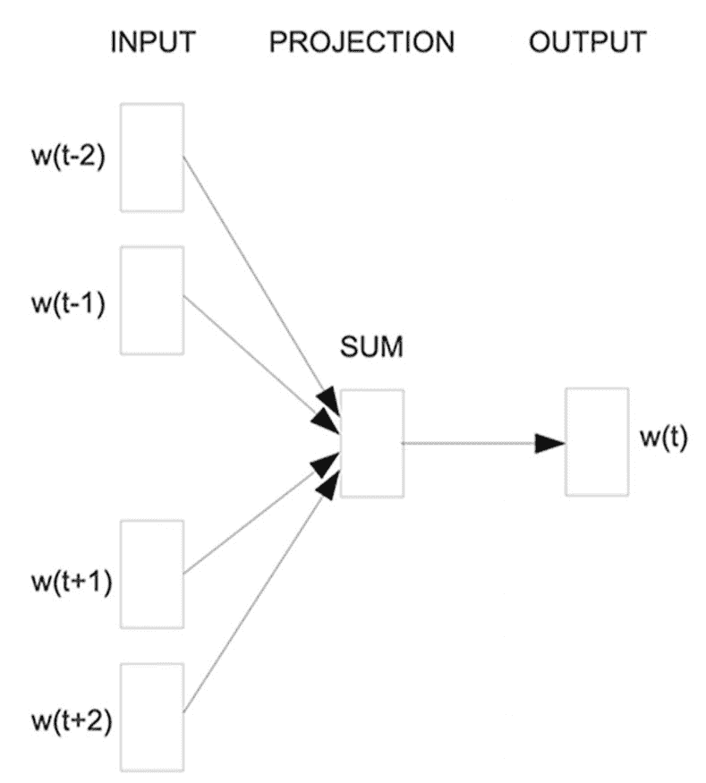

Figure 4.1 ¶ The **CBoW** Architecture.

*Source*: “Efficient Estimation of Word Representations in Vector Space.” Tomas Mikolov, Kai Chen, Greg Corrado, Jeffrey Dean. \[arXiv:1301.3781v2 \[cs.CL\] (CC BY 4.0)\]

### 什么是 Skip-grams？

如前一节所述，n-grams 通过预测缺失的词来推断其上下文，而 skip-grams 则以缺失的词为起点，推断最可能出现在其两侧的词。换句话说，skip-grams 的核心思想类似于 n-grams 的“倒置”。

Skip-gram 模型预测目标词的上下文词，其神经网络架构在本章后面会详细说明。换句话说，skip-gram 模型的工作方式与 CBoW 模型相反：skip-gram 预测目标词的上下文词，而不是预测缺失的中心词。

在更详细的描述中，以下步骤提供了 skip-gram 算法的高层次概述：

- 将目标词和邻近的上下文词视为正例。  
- 随机从词典中采样其他词，得到负例。  
- 使用逻辑回归训练分类器，区分这两种情况。  
- 将权重作为嵌入向量。

稍后你会看到一张展示 skip-gram 架构的图，它会在下一节的 skip-gram 示例之后出现。

#### Skip-gram 示例

Skip-gram 是一个包含目标词前后词的元组，其长度为整数，最小可为 1。1-grams、2-grams 和 3-grams 分别也称为 unigrams、bigrams 和 trigrams。

考虑下面的句子（取自前一节）：

'the big mouse **ate** the cheese' 

“ate” 的 1-grams 集合为：

\[mouse, the\] 

2-grams 集合为：

\[(ate,the), (ate,big), (ate,mouse), (ate, the), (ate,cheese)\] 

3-grams 集合为：

\[(ate,the,big), (ate,big,mouse), (ate,the,cheese)\] 

#### Skip-gram 架构

Figure 4.2 展示了基于浅层神经网络的 skip-gram 架构。

要完全理解该架构，你需要具备基本神经网络、softmax 激活函数以及错误反向传播概念的知识。实际上，skip-gram 架构（与 n-gram 架构一样）建立在机器学习概念之上。如有需要，可参考附录中关于神经网络的说明。

从 Figure 4.2 可以看出，skip-gram 架构包括以下组件：

- 输入层：单个词  
- 隐藏层  
- 输出层（预测上下文词）  

每个词库中的词都会经过神经网络处理，训练完成后，隐藏层包含词嵌入向量。skip-gram 的概念可能不如 n-gram 直观：如何猜测一个词的上下文词？

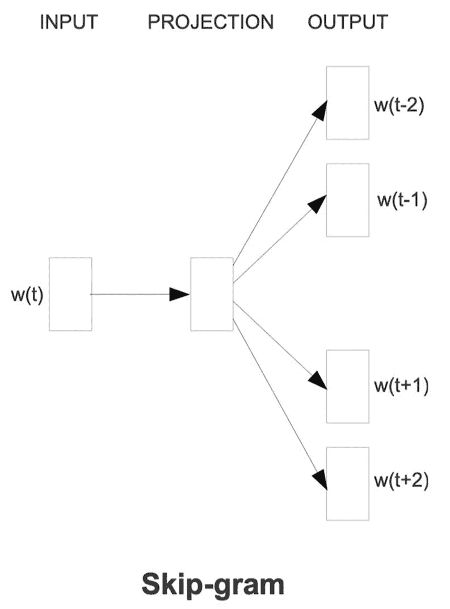

Figure 4.2 ¶ The Skip-gram Architecture.

一个有趣的点是，尽管 skip-gram 模型的内存需求更大，但其生成的词嵌入向量优于 n-gram 模型。

请注意以下关于 skip-gram 浅层网络的细节：

- 没有偏置项。  
- 输入层和隐藏层之间没有激活函数。  
- 从隐藏层到输出层使用 softmax 激活函数。  
- 输入层和输出层尺寸相同。  

如果你熟悉卷积神经网络（CNN），则已经知道 softmax 激活函数在最右侧隐藏层和输出层之间应用，因为它生成一组和为 1 的正数，形成概率分布。该分布的索引位置最高的值与一热编码中 1 的索引位置比较：如果相等，则匹配（否则不匹配）。


由于输入层和输出层的大小相同，这个浅层网络非常类似于自动编码器，其目的是将词典中的 one-hot 编码词压缩成更小的表示（类似于机器学习中的 PCA 的目的）。

例如，假设我们有一个包含 10,000 个词的词典（假设它们都是英文单词以便简化），我们希望为每个词找到一个 1×300 维的浮点数向量表示。那么输入层和隐藏层之间的权重矩阵是一个 10,000 × 300 的矩阵（记作 `W1`），隐藏层和输出层之间的矩阵是一个 300 × 10,000 的矩阵（记作 `W2`）。

神经网络在“训练”，这意味着神经网络中边的权重通过一种称为“反向误差传播”的过程得到更新。训练过程完成后，我们只保留权重矩阵 `W1`，它包含 10,000 行，每一行对应词典中最初的一个词。每行有 300 列，这个 1×300 维的浮点数向量即为当前词的编码。

### **神经网络压缩**

如前文所述，神经网络的权重矩阵大小可以通过以下两种技术进行压缩：

*   对高频词进行下采样（这会减少训练实例的数量）

*   通过“负样本采样”修改优化目标

这两种技术既降低了计算复杂度，也提高了结果的质量。

负样本采样的直观思想是修改一小部分模型权重，这涉及为给定词查找跳克（skip-gram）词组。前文已经展示了如何为简单句子查找双元组（bigrams），这里再次展示：

[(ate,the), (ate,big), (ate,mouse), (ate, the), (ate,cheese)]

可以看出，前面的双元组集合包含停用词，在清洗过程中可以将其去除。或者，可以使用公式计算保留词的概率。如果 `w1` 是词典中的一个词，`f(w1)` 是该词在文档中出现的频率，则保留 `w1` 的概率 `P(w1)` 如下：

`P(w1) = [1 + sqrt(f(w1)*1000)] * 0.001/f(w1)`

另一个用于生成分布式词向量的重要 Python 库是 GloVe，它将在下一节中讨论。

##**什么是 GloVe？**

如前文所述，word2vec 算法基于神经网络。相比之下，GloVe 使用线性代数中的矩阵分解技术以及基于词内容的矩阵。GloVe 为给定的（局部）上下文构建共现矩阵，然后对全局矩阵进行分解。

GloVe 与 word2vec 类似，但重要的区别在于：GloVe 利用词的全局共现情况，而不是依赖局部上下文。GloVe 的工作流程如下：

1. 构建维度为 words × context 的共现矩阵

2. 将矩阵分解为维度为 word × features 的矩阵

在初始矩阵中，行代表词，列代表语料库中的词频。分解后的矩阵维度更低，行代表原始词的向量表示。

GloVe 可以提供 100 维的稠密向量作为词嵌入。但 GloVe 有两个重要限制。首先，GloVe 不支持 OOV（Out of vocabulary）词。其次，GloVe 不支持多义词（polysemy），即在句子中根据上下文具有多种意义的词。可以考虑使用支持多义词的模型，如 ELMo 和 USE（Universal Sentence Encoder）。

如果您对 GloVe 感兴趣，CoVe（McCann, 2017）基于 GloVe 算法。CoVe（“contextual vectors”）使用机器翻译生成上下文向量，不使用语言模型。

##**使用 GloVe**

GloVe 是在斯坦福大学开发的 Python 语言库，用于词嵌入，其全称是 “Global Vectors [for word representation]”。

GloVe 通过非监督学习基于共现矩阵学习词嵌入。它结合了以下两种技术：

1. 全局矩阵分解（GMF）

2. 局部上下文窗口（LCW）

简要而言，全局矩阵分解使用线性代数中的矩阵分解方法对大规模词频矩阵进行降维。需要注意的是，这些矩阵可以表示词-文档频率，此时行代表词，列代表文档（或段落）；也可以表示词-词频率，此时词在两个轴上，度量共现情况。

将 GMF 应用于词-文档频率矩阵被称为潜在语义分析（LSA），LSA 中的高维矩阵通过奇异值分解（SVD）进行降维。关于矩阵分解的更多细节请参阅：

*[`machinelearningmastery.com/introduction-to-matrix-decompositions-for-machine-learning/`](https://machinelearningmastery.com/introduction-to-matrix-decompositions-for-machine-learning/)*

局部上下文窗口是一种词嵌入模型，通过在语料库上按行逐行滑动窗口来学习语义。该技术预测给定词的周围环境（例如 skip-gram 模型）或预测词给定其周围环境（例如 CBoW）。

第三种用于生成分布式词嵌入的重要 Python 库是 fastText，它将在下一节中讨论。

##**什么是 FastText？**

Facebook 开发了 fastText NLP 库，您可以使用以下命令安装：

`pip3 install fasttext`

fastText 库使用非监督学习对文本数据进行聚类，这意味着它使用聚类算法。fastText 的 `train_unsupervised()` 方法利用 skip-gram 模型生成 100 维向量。此外，fastText 还计算词之间的相似度得分，并提供 `get_nearest_neighbors()` 方法以显示给定词最相似的前 10 个词。相似度得分接近 1 的词对表明这两个词在意义上更为相似。

fastText 通过学习每个词及其 n-gram 的向量表示来利用 word2vec。随后，在每个训练步骤中，创建一个向量，其值为训练过程中的向量的平均值。这一步使得词嵌入能够编码子词信息。fastText 向量在多个方面比 word2vec 向量更准确。此外，fastText 可以处理 OOV 词，其子词 n-gram 对应于“直觉”（在多种语言中均可观察到）。

快速文本向量生成技术（如 fastText）的一个有用优势是不需要标记数据。

##**词嵌入比较**

本节总结了三种词嵌入类型的主要特征。第一组包含最简单的算法，用于生成词向量，这些算法在本章和上一章中已介绍。第二组包含最早使用神经网络（即 word2vec 和 fastText）或矩阵分解（GloVe）的算法（例如 word2vec）来生成分布式词嵌入。第三组涉及上下文感知算法，这些算法本质上是当前处于最先进的词嵌入算法。为方便，下面分别给出三组的项目符号列表：

*   第一组—离散词嵌入（BoW、tf、tf-idf）：

    词向量由整数、小数以及小数组成，分别对应

    *关键点：词嵌入缺乏上下文*

*   第二组—分布式词嵌入（word2vec、GloVe、fasttext）：

    基于浅神经网络、矩阵分解和神经网络，分别


两个词在左侧和右侧（bigrams）用于 word2vec

*关键点：每个词（无论其上下文如何）只有一个嵌入向量*

组 3—上下文词表示（Contextual word representation，BERT 等）：

Transformer 架构（不包含 CNN、RNN、LSTM）

对句子中**所有**单词进行“注意”（attention）

*关键点：单词根据上下文可能有多个嵌入向量*

如上所示，组 1 的算法为每个词提供一个嵌入向量，但未在该嵌入中捕获上下文信息。组 2 的算法在此基础上增加了上下文信息。最后，组 3 的算法为同一个词在不同句子中出现的情况生成多个嵌入向量，这一特性是对组 2 算法的重大提升，而组 2 算法本身又是对组 1 算法的显著改进。

## 什么是主题模型？

主题模型是一种在一个或多个文档中发现主题的技术，同时也是一种“维度降低”方法。它基于以下两个基本假设：

1. 每个文档是若干主题的混合体。  
2. 每个主题是一系列单词的集合。

主题模型假设文档的语义是由所谓的**潜变量**（latent variables）所决定的，这些变量是不可见的，且比实际文本更抽象。主题模型的目标是揭示这些潜在变量（即主题），从而揭示文档或语料库的核心内容。

确定文档中的主要主题的方法有多种，这将在下一节中讨论。

### 主题模型算法

下面列出了一些知名的主题模型算法：

- Latent Dirichlet Analysis (LDA)  
- Latent Semantic Indexing (LSI)  
- Latent Semantic Analysis (LSA)

关于 LDA 的详细信息在下一节，关于 LSI 与 LSA 的细节可通过网络搜索获取。

### LDA 与主题模型

LDA 是一种维度降低技术，特别适合用于主题模型。它是一种生成模型，为文档分配主题分布。每个文档由一组主题分布描述，每个主题则由一组单词分布描述。请注意，本节其余部分提供 LDA 的高层次描述，涉及 KL 散度、JS 指标等概念，详见附录 A。

LDA 首先基于一组固定的主题，每个主题表示为若干单词的集合。随后，LDA 将文档映射到这些主题的集合上，文档中的单词也被映射到相应的主题。

LDA 同时也是一种软聚类方法，支持“软聚类”概念，即不同聚类可以重叠（单词可以属于多个聚类）。软聚类的优势在于更容易找到相似词，但缺点是更难界定明显的、互不重叠的聚类。

需要指出的是，LDA 与 kMeans 算法的区别在于后者采用“硬聚类”，即每个单词只能属于一个聚类。

LDA 假设文档包含若干重叠的主题，并且满足以下条件：

- 主题是基于文档中单词形成的。  
- 实际主题在先验上是未知的。  
- 实际主题不需要事先指定。  
- 必须事先指定主题的数量。

由于 LDA 支持软聚类，同一个词可以出现在多个主题中（即一个主题充当一个聚类的角色）。LDA 模型被称为“潜在”（latent），因为它生成以下隐变量：

- 每个文档的主题分布  
- 每个主题的单词分布  

LDA 使用 JS（Jensen‑Shannon）度量，JS 度量基于 JS 差异，而 JS 差异又基于 KL 差异（详情见附录）。因为 JS 差异是一种度量，它是对称的，这意味着文档 Doc1 与 Doc2 的相似度等同于 Doc2 与 Doc1 的相似度——这是一个理想的属性。

LDA 通过 JS 度量来判断文档库中哪些文档最接近目标文档 D，即比较 D 的主题分布与库中其他文档的主题分布。可以预见，JS 值越小，两个文档之间的相似度越大。

LDA 还与 ANOVA 与 PCA（见附录）相关，但二者存在区别。例如，ANOVA 使用类别型自变量和连续因变量；而 LDA 的“逆向”是使用连续自变量和类别型因变量。另一个关键点是，LDA 假设自变量服从正态分布。

LDA 与 PCA 共享一个特点：两者都计算变量的线性组合。但 LDA 试图建模类别之间的差异，而 PCA 则忽视类别差异。

### 文本分类与主题模型

文本分类属于监督学习，文档或文章拥有已知的标签集，将文本归类到单一类别中。相反，主题模型属于无监督学习，主要是对文档/文章进行分析。主题模型通过找出文本中共现的单词组来识别“主题”，而在主题集合未知的情况下，主题模型可以用于文本分类，以识别文档中的主题。

### 语言模型与 NLP

简要而言，语言模型是对词序序列的概率分布（详见附录 A）。统计语言模型指通过前序词预测下一个词的概率分布。计算词出现概率时，需要依赖文本实例。模型可以基于单个词、短语、句子或段落。

语言模型在机器学习和无监督学习（检索/信息检索、聚类/主题模型）中被使用。语言模型还尝试区分发音相似的词。但语言模型面临数据稀疏和判断不同短语可能性等挑战。常用的解决办法是 n‑gram 模型（章节其他部分有详细说明）。

一些 NLP 专家认为，语言模型仅凭其在训练数据中的共现模式学习，存在以下两个问题：

- 符号流缺乏关键信息。  
- 语言模型缺乏交际意图。

虽然纯语言模型没有标记数据训练的机器学习模型的直接对应，但部分 NLP 专家相信，语言模型有潜力实现语言理解。

### 如何创建语言模型

在 NLP 任务中，创建新语言模型的主要方式有三种：

1. **从零开始创建新模型**。  
2. **迁移学习**（使用已预训练的模型）。  
3. **迁移学习 + 词汇增强**。

语言模型还可以细分为多种子类型。例如，**神经语言模型**（也称为连续空间语言模型）基于神经网络，使用连续向量或嵌入式表示单词以进行预测。关于语言模型的更多细节请参见：

[`en.wikipedia.org/wiki/Language_model`](https://en.wikipedia.org/wiki/Language_model)

语言模型是**向量空间模型**（vector space models）的概念基础，该主题将在下一节中展开。

## 向量空间模型


A `vector space model` (VSM) is based on a mathematical model called a `vector space`, in order to represent text documents as vectors of identifiers (for example, using tf-idf weights). If you are unfamiliar with vector spaces, there is a brief introduction to vector spaces in one of the appendices, and if need be, you can find additional information through an online search.

A `VSM` consists of a two-dimensional array of (usually) numeric values that are based on `frequencies`. The latter restriction on the data values creates a “link” between a `VSM` and the distributional hypothesis. A `VSM` whose values are based on sophisticated algorithms can overcome the shortcomings of losing semantics and feature sparsity in BoWs: *[`en.wikipedia.org/wiki/Vector_space_model`](https://en.wikipedia.org/wiki/Vector_space_model)*

As a point of clarification, the following matrices do *not* represent vector space models:

*   an arbitrary matrix

*   an adjacency matrix for a tree or graph

*   a feature matrix

*   a covariance matrix

*   a correlation matrix

*   a recommender system

Recommender systems are included in the preceding list because they populate a user-item matrix whose cells contain a numeric rating of items; however, the data in such a matrix is *not* derived from event frequencies, which explains why recommender systems are not VSMs.

Now that you have seen examples of matrices that are not VSMs, the following list contains some examples of vector space models:

*   a term-document matrix (discussed later)

*   a context-document matrix

*   a matrix based on word2vec

*   the latent semantic analysis (LSA) algorithm

*   a pair-pattern matrix

With the preceding in mind, here is a short list of some models that are based on (or extend) the VSM model:

*   generalized vector space model

*   latent semantic analysis (LSA)

*   term discrimination

*   Rocchio classification

*   random indexing

### **Term-Document Matrix**

A `term-document` matrix `M` is an `mxn` matrix where `n` is the number of documents and `m` is the number of unique words in the `n` documents. The value in a cell `(i,j)` in a term-document matrix `M` equals the number of times that the term `i` appears in document `j`. Moreover, the value in a cell `(i,j)` can be based on other calculations, such as tf (term frequency) or tf-idf values. Note that for a large corpus, the matrix `M` contains mainly zero values, which means that `M` is a sparse matrix (and operations are less efficient). Also keep in mind that a tf-idf vector is a vector representation of a *document* whereas a `word2vec` vector is a vector representation of a *word*.

There are two more points of interest regarding a term-document matrix `M`. First, if two documents are similar, then the two corresponding columns in `M` will tend to have similar patterns of numbers, which in turn means that their cosine similarity will be closer to 1. Second, instead of focusing on column vectors we can examine row vectors in order to measure word similarity.

We can also generalize the concept of a term-document matrix by expanding the meaning of a document to include phrases, sentences, paragraphs, and so forth. After doing so, the result is a `word-context` matrix.

### **Tradeoffs of the VSM**

VSMs are not a perfect solution: some of the advantages and disadvantages of a VSM are related to the advantages and disadvantages of the algorithms that are used to compute the values in the cells of a VSM.

One advantage of a `VSM` model is because it’s based on linear algebra. In addition, it’s possible to compute a degree of similarity between queries and documents in a continuous fashion, which then enables you to rank documents according to their possible relevance. Furthermore, `VSM` models support partial matching.

However, long documents are poorly represented because they have poor similarity values (a small scalar product and a large dimensionality). Word substrings can result in a “false positive match,” which means that search keywords must match document terms. Unfortunately, documents with similar context and also different term vocabulary won’t be associated, which results in a “false negative match.”

In addition, the order in which the terms appear in the document is not tracked in the vector space representation, along with the assumption that terms are statistically independent. Even so, some of the disadvantages can be ameliorated by using techniques such as singular value decomposition (SVD).

## **NLP and Text Mining**

In high-level terms, text mining performs an analysis of large amounts of unstructured data in order to find patterns in that data. Text mining tasks involve finding keywords, topics, and patterns. The general sequence of steps (tasks) is shown here:

*   preprocessing

*   text transformation

*   attribute selection

*   visualization

*   evaluation

Text mining also involves document classification whereby similar documents are placed in the same group. Text mining is useful for extracting product-related details, such as customer reviews, product issues, and so forth. Applications of text mining include spam detection, sentiment analysis, e-commerce and customer segmentation. The NLTK (Natural Language ToolKit) library is well-suited for text mining tasks, and you will see code samples in Chapter 6.

### **Text Extraction Preprocessing and N-Grams**

As you learned earlier in this chapter n-grams are one type of language model that assigns numeric probabilities to word sequences. For example the 3-grams of a sentence is a set of tuples of length 3, where a tuple consists of three consecutive words in that sentence. Note that the terms unigram, bigram, and trigram are often used when n is 1, 2, or 3, respectively.

## **Relation Extraction and Information Extraction**

In simplified terms, *relation extraction* (RE), *information extraction* (IE), and *relation classification* involve various aspects of searching a corpus to find subsets of text that describe relationships between words in those subsets of text. Relation extraction is a user [
 - being - translation service.<unk><unk><unk><unk><unk><unk><unk><unk><unk><unk><unk><unk><unk><unk><unk><unk><unk><unk><unk><unk><unk><unk><unk><unk><unk><unk><unk><unk><unk><unk><unk><unk><unk><unk><unk><unk><unk><unk><unk><unk><unk><unk><unk><unk><unk><unk><unk><unk><unk><unk><unk><unk><unk><unk><unk><unk><unk><unk><unk><unk><unk><unk><unk><unk><unk><unk><unk><unk><unk><unk><unk><unk><unk><unk><unk><unk><unk><unk><unk><unk><unk><unk><unk><unk><unk><unk><unk><unk><unk><unk><unk><unk><unk><unk><unk><unk><unk><unk><unk><unk><unk><unk><unk><unk><unk><unk><unk><unk><unk><unk><unk><unk><unk><unk><unk><unk><unk><unk><unk><unk><unk><unk><unk><unk><unk><unk><unk><unk><unk><unk><unk><unk><unk><unk><unk><unk><unk><unk><unk><unk><unk><unk><unk><unk><unk><unk><unk><unk><unk><unk><unk><unk><unk><unk><unk><unk><unk><unk><unk><unk><unk><unk><unk><unk><unk><unk><unk><unk><unk><unk><unk><unk><unk><unk><unk><unk><unk><unk><unk><unk><unk><unk><unk><unk><unk><unk><unk><unk><unk><unk><unk><unk><unk><unk><unk><unk><unk><unk><unk><unk><unk><unk><unk><unk><unk><unk><unk><unk><unk><unk><unk><unk><unk><unk><unk><unk><unk><unk><unk><unk><unk><unk><unk><unk><unk><unk><unk><unk><unk><unk><unk><unk><unk><unk><unk><unk><unk><unk><unk><unk><unk><unk><unk><unk><unk><unk><unk><unk><unk><unk><unk><unk><unk><unk><unk><unk><unk><unk><unk><unk><unk><unk><unk><unk><unk><unk><unk><unk><unk><unk><unk><unk><unk><unk><unk><unk><unk><unk><unk><unk><unk><unk><unk><unk><unk><unk><unk><unk><unk><unk><unk><unk><unk><unk><unk><unk><unk><unk><unk><unk><unk><unk><unk><unk><unk><unk><unk><unk><unk><unk><unk><unk><unk><unk><unk><unk><unk><unk><unk><unk><unk><unk><unk><unk><unk><unk><unk><unk><unk><unk><unk><unk><unk><unk><unk><unk><unk><unk><unk><unk><unk><unk><unk><unk><unk><unk><unk><unk><unk><unk><unk><unk><unk><unk><unk><unk><unk><unk><unk><unk><unk><unk><unk><unk><unk><unk><unk><unk><unk><unk><unk><unk><unk><unk><unk><unk><unk><unk><unk><unk><unk><unk><unk><unk><unk><unk><unk><unk><unk><unk><unk><unk><unk><unk><unk><unk><unk><unk><unk><unk><unk><unk><unk><unk><unk><unk><unk><unk><unk><unk><unk><unk><unk><unk><unk><unk><unk><unk><unk><unk><unk><unk><unk><unk><unk><unk><unk><unk><unk><unk><unk><unk><unk><unk><unk><unk><unk><unk><unk><unk><unk><unk><unk><unk><unk><unk><unk><unk><unk><unk><unk><unk><unk><unk><unk><unk><unk><unk><unk><unk><unk><unk><unk><unk><unk><unk><unk><unk><unk><unk><unk><unk><unk><unk><unk><unk><unk><unk><unk><unk><unk><unk><unk><unk><unk><unk><unk><unk><unk><unk><unk><unk><unk><unk><unk><unk><unk><unk><unk><unk><unk><unk><unk><unk><unk><unk><unk><unk><unk><unk><unk><unk><unk><unk><unk><unk><unk><unk><unk><unk><unk><unk><unk><unk><unk><unk><unk><unk><unk><unk><unk><unk><unk><unk><unk><unk><unk><unk><unk><unk><unk><unk><unk><unk><unk><unk><unk><unk><unk><unk><unk><unk><unk><unk><unk><unk><unk><unk><unk><unk><unk><unk><unk><unk><unk><unk><unk><unk><unk><unk><unk><unk><unk><unk><unk><unk><unk><unk><unk><unk><unk><unk><unk><unk><unk><unk><unk><unk><unk><unk><unk><unk><unk><unk><unk><unk><unk><unk><unk><unk><unk><unk><unk><unk><unk><unk><unk><unk><unk><unk><unk><unk><unk><unk><unk><unk><unk><unk><unk><unk><unk><unk><unk><unk><unk><unk><unk><unk><unk><unk><unk><unk><unk><unk><unk><unk><unk><unk><unk><unk><unk><unk><unk><unk><unk><unk><unk><unk><unk><unk><unk><unk><unk><unk><unk><unk><unk><unk><unk><unk><unk><unk><unk><unk><unk><unk><unk><unk><unk><unk><unk><unk><unk><unk><unk><unk><unk><unk><unk><unk><unk><unk><unk><unk><unk><unk><unk><unk><unk><unk><unk><unk><unk><unk><unk><unk><unk><unk><unk><unk><unk><unk><unk><unk><unk><unk><unk><unk><unk><unk><unk><unk><unk><unk><unk><unk><unk><unk><unk><unk><unk><unk><unk><unk><unk><unk><unk><unk><unk><unk><unk><unk><unk><unk><unk><unk><unk><unk><unk><unk><unk><unk><unk><unk><unk><unk><unk><unk><unk><unk><unk><unk><unk><unk><unk><unk><unk><unk><unk><unk><unk><unk><unk><unk><unk><unk><unk><unk><unk><unk><unk><unk><unk><unk><unk><unk><unk><unk><unk><unk><unk><unk><unk><unk><unk><unk><unk><unk><unk><unk><unk><unk><unk><unk><unk><unk><unk><unk><unk><unk><unk><unk><unk><unk><unk><unk><unk><unk><unk><unk><unk><unk><unk><unk><unk><unk><unk><unk><unk><unk><unk><unk><unk><unk><unk><unk><unk><unk><unk><unk><unk><unk><unk><unk><unk><unk><unk><unk><unk><unk><unk><unk><unk><unk><unk><unk><unk><unk><unk><unk><unk><unk><unk><unk><unk><unk><unk><unk><unk><unk><unk><unk><unk><unk><unk><unk><unk><unk><unk><unk><unk><unk><unk><unk><unk><unk><unk><unk><unk><unk><unk><unk><unk><unk><unk><unk><unk><unk><unk><unk><unk><unk><unk><unk><unk><unk><unk><unk><unk><unk><unk><unk><unk><unk><unk><unk><unk><unk><unk><unk><unk><unk><unk><unk><unk><unk><unk><unk><unk><unk><unk><unk><unk><unk><unk><unk><unk><unk><unk><unk><unk><unk><unk><unk><unk><unk><unk><unk><unk><unk><unk><unk><unk><unk><unk><unk><unk><unk><unk><unk><unk><unk><unk><unk><unk><unk><unk><unk><unk><unk><unk><unk><unk><unk><unk><unk><unk><unk><unk><unk><unk><unk><unk><unk><unk><unk><unk><unk><unk><unk><unk><unk><unk><unk><unk><unk><unk><unk><unk><unk><unk><unk><unk><unk><unk><unk><unk><unk><unk><unk><unk><unk><unk><unk><unk><unk><unk><unk><unk><unk><unk><unk><unk><unk><unk><unk><unk><unk><unk><unk><unk><unk><unk><unk><unk><unk><unk><unk><unk><unk><unk><unk><unk><unk><unk><unk><unk><unk><unk><unk><unk><unk><unk><unk><unk><unk><unk><unk><unk><unk><unk><unk><unk><unk><unk><unk><unk><unk><unk><unk><unk><unk><unk><unk><unk><unk><unk><unk><unk><unk><unk><unk><unk><unk><unk><unk><unk><unk><unk><unk><unk><unk><unk><unk><unk><unk><unk><unk><unk><unk><unk><unk><unk><unk><unk><unk><unk><unk><unk><unk><unk><unk><unk><unk><unk><unk><unk><unk><unk><unk><unk><unk><unk><unk><unk><unk><unk><unk><unk><unk><unk><unk><unk><unk><unk><unk><unk><unk><unk><unk><unk><unk><unk><unk><unk><unk><unk><unk><unk><unk><unk><unk><unk><unk><unk><unk><unk><unk><unk><unk><unk><unk><unk><unk><unk><unk><unk><unk><unk><unk><unk><unk><unk><unk><unk><unk><unk><unk><unk><unk><unk><unk><unk><unk><unk><unk><unk><unk><unk><unk><unk><unk><unk><unk><unk><unk><unk><unk><unk><unk><unk><unk><unk><unk><unk><unk><unk><unk><unk><unk><unk><unk><unk><unk><unk><unk><unk><unk><unk><unk><unk><unk><unk><unk><unk><unk><unk><unk><unk><unk><unk><unk><unk><unk><unk><unk><unk><unk><unk><unk><unk><unk><unk><unk><unk><unk><unk><unk><unk><unk><unk><unk><unk><unk><unk><unk><unk><unk><unk><unk><unk><unk><unk><unk><unk><unk><unk><unk><unk><unk><unk><unk><unk><unk><unk><unk><unk><unk><unk><unk><unk><unk><unk><unk><unk><unk><unk><unk><unk><unk><unk><unk><unk><unk><unk><unk><unk><unk><unk><unk><unk><unk><unk><unk><unk><unk><unk><unk><unk><unk><unk><unk><unk><unk><unk><unk><unk><unk><unk><unk><unk><unk><unk><unk><unk><unk><unk><unk><unk><unk><unk><unk><unk><unk><unk><unk><unk><unk><unk><unk><unk><unk><unk><unk><unk><unk><unk><unk><unk><unk><unk><unk><unk><unk><unk><unk>


BLEU 是“双语评估研究”（bilingual evaluation understudy）的缩写，是一个众所周知的 NLP 指标。BLEU 分数涉及直接计算，并且由于 BLEU 分数通常与 NLP 模型一起发布，因此其包含已成为常规做法。

然而，BLEU 是为了衡量机器翻译而创建的，它在整个语料库上计算时最可靠，而不是按句子逐句计算。BLEU 分数的流行可能导致一种副作用，即将 BLEU 分数用于其他测量工具能够产生更准确结果的 NLP 任务。

BLEU 存在一些显著局限性：它不考虑句子结构，而句子结构在不同语言之间可能有很大差异（参见第 3 章节关于“词尾”的部分），也不考虑句子的含义。

在简化的说法中，BLEU 分数涉及精确率、n-gram 和与参考句子的完全匹配。BLEU 检查输出中有多少个 n-gram 也出现在参考翻译中。然而，BLEU 不能识别同义词，这意味着使用相近但不同的动词的句子对被视为不相似。例如，使用动词“drink”、“imbibe”和“consume”的三个句子在日常对话中可能被视为等价，但 BLEU 并不将它们视为相同。

### **ROUGE 分数：BLEU 的替代方案**

简要而言，ROUGE 分数是一种变体的 BLEU，它使用 *recall*（BLEU 使用 *precision*）并且统计参考翻译中出现的 n-gram 与输出中出现的 n-gram 的数量（BLEU 则相反）。关于 ROUGE 的更多信息请参见：

*[`www.aclweb.org/anthology/N03-1020/`](https://www.aclweb.org/anthology/N03-1020/)*

此外，还有与 BLEU 无关的技术，如困惑度（perplexity）、词误率（WER）和 F1 分数，这些都在附录中讨论。使用关键词“BLEU 分数替代方案”进行在线搜索即可找到许多讨论 BLEU 替代方案的文章。

## **总结**

本章首先快速概述了语言模型、文本编码技术以及两种词语境概念，随后介绍了词嵌入，它们在 NLP 中非常有用。你还学习了距离度量，例如余弦相似度（用于衡量两个向量之间的距离）和文档相似度。此外，你还了解了向量空间模型（VSM）和主题建模的概念。

# CHAPTER 5

# ALGORITHMS AND TOOLKITS (I)

本章包含上一章介绍的若干 NLP 相关概念的 Python 代码示例。你将看到一系列代码示例，涉及正则表达式、Python 库 BeautifulSoup、Scrapy，以及使用 SpaCy 库的各种 NLP 相关 Python 代码示例。

作为快速提醒，本章还有一个专门讨论正则表达式的附录（附录 C）以及另一个专门讨论 Sklearn Python 库的附录（附录 F），它们对本章中的一些代码示例具有相关性。

本章的第一部分包含一些使用正则表达式进行数据清洗的示例。第二部分包含一些关于 BoW（袋状词）、单热编码和 Sklearn 中词嵌入的基本示例。

第三部分介绍 BeautifulSoup，这是一个用于抓取 HTML 网页的 Python 模块。该部分包含一些 Python 代码示例，展示如何从 GitHub 代码仓库中抓取并操作 HTML 网页的内容。该部分还简要介绍了 Scrapy，这是一个基于 Python 的库，提供网页抓取功能以及多种其他 API。

第四部分介绍 spaCy，这是一个用于 NLP 的 Python 库，并附带展示 spaCy 各种特性的 Python 代码示例。

## **使用正则表达式清洗数据**

本节提供了使用正则表达式在需要清洗数据时能够实现的简单预览。如果你对正则表达式不熟悉，可以阅读附录 C，该附录专门讨论该主题。本节中用于本节代码示例的主要概念列表如下：

*   \[A-Z\] 匹配任何大写字母

*   \[a-z\] 匹配任何小写字母

*   \[a-zA-Z\] 匹配任何小写或大写字母

*   \[^a-zA-Z\] 匹配除小写或大写字母之外的任何字符

Listing 5.1 显示了 `text_clean_regex.py` 的内容，该文件说明了如何从文本字符串中删除所有非字符符号。

***LISTING 5.1: text_clean_regex.py***

```python
import re # this is for regular expressions
text = "I have 123 apples for sale. Call me at 650-555-1212 or send me email at apples@acme.com."
print("text:")
print(text)
print()
# replace the '@' symbol with the string ' at ':
cleaned1 = re.sub('@', ' at ',text)
print("cleaned1:")
print(cleaned1)
# replace non-letters with ' ':
cleaned2 = re.sub('[^a-zA-Z]', ' ',cleaned1)
print("cleaned2:")
print(cleaned2)
# replace multiple adjacent spaces with a single ' ':
cleaned3 = re.sub(' +', ' ',cleaned2)
print("cleaned3:")
print(cleaned3)
```

Listing 5.1 包含导入语句，以便在后续代码中使用正则表达式。之后初始化变量 `text` 为一段句子并显示其内容，然后定义变量 `cleaned1`，其中将“@”符号替换为包含空格的字符串“ at ”（注意“at”前后各有一个空格）。接下来，变量 `cleaned2` 被定义，其中将除字母以外的所有字符替换为空格。最后，变量 `cleaned3` 被定义，其中将连续的多个空格压缩为单个空格。运行 Listing 5.1 中的代码，你将看到以下输出：

text: I have 123 apples for sale. Call me at 650-555-1212 or send me email at apples@acme.com. cleaned1: I have 123 apples for sale. Call me at 650-555-1212 or send me email at apples at acme.com. cleaned2: I have apples for sale Call me at or send me email at apples at acme com cleaned3: I have apples for sale Call me at or send me email at apples at acme com 

Listing 5.2 显示了 `text_clean_regex2.py` 的内容，该文件说明了如何从文本字符串中删除 HTML 标签。

***LISTING 5.2: text_clean_regex2.py***

```python
import re # this is for regular expressions
# \[^>\]: matches anything *except* a '>' 
# <\[^>\]: matches anything after '>' *except* a '>' tag
tagregex = re.compile(r'<\[^>\]+>')
def remove_html_tags(doc):
    return tagregex.sub(':', doc)
doc1 = "<html><head></head></body><p>paragraph1</p><div>div element</div></html>"
print("doc1:")
print(doc1)
print()
doc2 = remove_html_tags(doc1)
print("doc2:")
print(doc2)
```

Listing 5.2 包含导入语句，随后是变量 `tagregex`，它是一个正则表达式，匹配左角括号“<”，后跟任意非右角括号“>”的字符。随后定义函数 `remove_html_tags()`，该函数通过正则表达式将所有 HTML 标签替换为冒号“:”。代码随后初始化变量 `doc1` 为一个 HTML 字符串并显示其内容，最后调用 `remove_html_tags()` 方法对 `doc1` 进行清理并打印结果。运行 Listing 5.2 中的代码，你将看到以下输出：

doc1: <html><head></head></body><p>paragraph1</p><div>div element</div></html> doc2: :::::paragraph1::div element:: 
```


Listing 5.3 显示了 `text_clean_regex3.py` 的内容，展示了如何使用正则表达式将缩写词替换为原始单词。

***LISTING 5.3: text_clean_regex3.py***

```python
import re  # 这用于正则表达式
def clean_text(text):
    text = text.lower()
    text = re.sub(r"i'm", "i am", text)
    text = re.sub(r"he's", "he is", text)
    text = re.sub(r"she's", "she is", text)
    text = re.sub(r"that's", "that is", text)
    text = re.sub(r"what's", "what is", text)
    text = re.sub(r"where's", "where is", text)
    text = re.sub(r"how's", "how is", text)
    text = re.sub(r"it's", "it is", text)
    text = re.sub(r"\\'ll", " will", text)
    text = re.sub(r"\\'ve", " have", text)
    text = re.sub(r"\\'re", " are", text)
    text = re.sub(r"\\'d", " would", text)
    text = re.sub(r"n't", "not", text)
    text = re.sub(r"won't", "will not", text)
    text = re.sub(r"can't", "can not", text)
    text = re.sub(r"\[-()\\"#/@;:<>{}\`+=~|.!?,\]", "", text)
    return text

sentences = [
    "It's a hot day and i'm sweating",
    "How's the zoom class going?",
    "She's smarter than me - that's a fact"
]

for sent in sentences:
    print("Sentence:", sent)
    print("Cleaned: ", clean_text(sent))
    print("----------------")
```

Listing 5.3 包含一个导入语句，随后是 `clean_text()` 函数，该函数通过粗暴方式将连字符字符串替换为其未连字符的对应形式。该函数的最后一段代码会删除文本字符串中的所有特殊字符。

Listing 5.3 的下一部分初始化变量 `sentences`，其中包含多个句子，随后使用 for 循环将每个句子传递给 Python 函数 `clean_text()`。运行 Listing 5.3 中的代码，将看到以下输出：

Sentence: It's a hot day and i'm sweating Cleaned:  it is a hot day and i am sweating \---------------- Sentence: How's the zoom class going? Cleaned:  how is the zoom class going \---------------- Sentence: She's smarter than me - that's a fact Cleaned:  she is smarter than me  that is a fact \---------------- 

## 处理缩写词

前一节展示了如何通过正则表达式扩展英文缩写词。本节提供了使用 Python 包 `contractions` 扩展缩写词的示例，该包可在此处获取：

*[`github.com/kootenpv/contractions`](https://github.com/kootenpv/contractions)*

使用以下命令安装 `contractions` 包：

pip3 install contractions 

Listing 5.5 显示了 `contract.py` 的内容，该文件演示了如何扩展英文缩写词，并如何添加自定义扩展规则。

***LISTING 5.5: contract.py***

```python
import contractions

sentences = [
    "what's new?",
    "how's the weather",
    "it's humid today",
    "we've been there before",
    "you should've been there!",
    "the sky's the limit"
]

for sent in sentences:
    result = contractions.fix(sent)
    print("sentence:", sent)
    print("expanded:", result)
    print()

print("=> updating contraction rules...")
contractions.add("sky's", "sky is")

sent = "the sky's the limit"
result = contractions.fix(sent)
print("sentence:", sent)
print("expanded:", result)
print()

# 另一种方法是编写 Python 代码扩展缩写词，如下所示：
CONTRACT = {"how's":"how is", "what's":"what is", "it's":"it is", "we've":"we have", "should've": "should have", "sky's": "sky is"}

sentences = [
    "what's new?",
    "how's the weather",
    "it's humid today",
    "we've been there before",
    "you should've been there!",
    "the sky's the limit"
]

for sent in sentences:
    words = sent.split()
    expanded = [CONTRACT[w] if w in CONTRACT else w for w in words]
    new_sent = " ".join(expanded)
    print("sentence:",sent)
    print("expanded:",new_sent)
    print()
```

Listing 5.5 包含一个导入语句，随后初始化变量 `sentences` 为文本字符串数组。随后的代码片段遍历 `sentences` 数组中的字符串，并打印每个句子以及其扩展后的版本。

如输出所示，数组 `sentences` 中最后一个句子的缩写词 `sky's` 未被扩展，因此需要添加新的扩展规则：

contractions.add("sky's", "sky is")

再次处理该字符串后，缩写词 `sky's` 会被正确扩展。运行 Listing 5.5 中的代码，将看到以下输出：

sentence: what's new? expanded: what is new?   sentence: how's the weather expanded: how is the weather   sentence: it's humid today expanded: it is humid today   sentence: we've been there before expanded: we have been there before   sentence: you should've been there! expanded: you should have been there!   sentence: the sky's the limit **expanded: the sky's the limit**   \=> updating contraction rules... sentence: the sky's the limit **expanded: the sky is the limit** 

作为替代方法，你也可以编写 Python 代码扩展缩写词，如下所示：

CONTRACT = {"how's":"how is", "what's":"what is", "it's":"it is", "we've":"we have", "should've" :"should have", "sky's": "sky is"}

sentences = ["what's new?", "how's the weather", "it's humid today", "we've been there before", "you should've been there!", "the sky's the limit"]

for sent in sentences:
    words = sent.split()
    expanded = [CONTRACT[w] if w in CONTRACT else w for w in words]
    new_sent = " ".join(expanded)
    print("sentence:",sent)
    print("expanded:",new_sent)
    print()

## Python 代码示例：BoW（词袋模型）

正如第 4 章节所学，BoW 是一种将单词集合编码为数值向量的技术。本节包含一些简单的 Python 代码示例，演示如何在一组单词上执行此技术。

BoW 算法统计单词在文档中出现的次数，这将一般化为一种一热编码的扩展。这些单词计数使我们能够比较文档并衡量其相似度。BoW 算法可用于搜索、文档分类和主题建模等应用。此外，BoW 还可用于为深度学习神经网络预处理文本输入。


-   图 5.6 显示了 `bow_to_vector1.py` 的内容，展示了如何基于给定的词汇创建一维数值向量。

***LISTING 5.6: bow_to_vector1.py***

`VOCAB = ['dog', 'cheese', 'cat', 'mouse'] TEXT1 = 'the mouse ate the cheese' TEXT2 = 'the horse ate the hay' def to_bow(text): words = text.split(" ") return [1 if w in words else 0 for w in VOCAB] print("VOCAB: ",VOCAB) print("TEXT1:",TEXT1) print("BOW1: ",to_bow(TEXT1)) # [0, 1, 0, 1] print("") print("TEXT2:",TEXT2) print("BOW2: ",to_bow(TEXT2)) # [0, 0, 0, 0]`

Listing 5.6 初始化了变量 `VOCAB`、`TEXT1` 和 `TEXT2`，随后定义了 Python 函数 `to_bow()` 用于构建文本字符串的 BoW（袋状词）表示。接着，该函数分别用 `TEXT1` 和 `TEXT2` 调用两次。运行 Listing 5.6 中的代码，将看到如下输出：

`VOCAB: ['dog', 'cheese', 'cat', 'mouse'] TEXT1: the mouse ate the cheese BOW1: [0, 1, 0, 1] TEXT2: the horse ate the hay BOW2: [0, 0, 0, 0]`

Listing 5.7 显示了 `bow_to_vector2.py` 的内容，展示了如何基于给定的词汇创建一维数值向量。

***LISTING 5.7: bow_to_vector2.py***

`VOCAB = ['dog', 'cheese', 'cat', 'mouse'] MYTEXT = 'the mouse ate the cheese' def to_bow(text): words = text.split(" ") found = [w if w in words else "MISS" for w in VOCAB] missing = [w if w not in words else "FOUND" for w in VOCAB] print("Found:",found) print("Missing:",missing) return [1 if w in words else 0 for w in VOCAB] print("MYTEXT:",MYTEXT) print("VOCAB: ",VOCAB) print("MYTEXT:",to_bow(MYTEXT)) # [0, 1, 0, 1]`

Listing 5.7 在 Listing 5.6 的基础上，增加了跟踪句子中未包含在词汇表里的单词的功能。运行 Listing 5.7 后，将看到如下输出：

`MYTEXT: the mouse ate the cheese VOCAB: ['dog', 'cheese', 'cat', 'mouse'] Found: ['MISS', 'cheese', 'MISS', 'mouse'] Missing: ['dog', 'FOUND', 'cat', 'FOUND'] MYTEXT: [0, 1, 0, 1]`

Listing 5.8 显示了 `count_vectorize.py` 的内容，展示了如何基于给定的词汇创建一维数值向量。

***LISTING 5.8: count_vectorize.py***

`VOCAB = ['dog', 'cheese', 'cat', 'mouse'] TEXT1 = 'the mouse ate the cheese' TEXT2 = 'the horse ate the hay' from sklearn.feature_extraction.text import CountVectorizer vectorizer = CountVectorizer(vocabulary=VOCAB) result1 = vectorizer.transform([TEXT1]).todense() # matrix([[0,1,0,1]]) result2 = vectorizer.transform([TEXT2]).todense() # matrix([[0,1,0,1]]) print("VOCAB: ",VOCAB) print("TEXT1:",TEXT1) print("BOW1: ",result1) # [0, 1, 0, 1] print("") print("TEXT2:",TEXT2) print("BOW2: ",result2) # [0, 1, 0, 1] print() print("=> contents of countvectorizer:") print(vectorizer)`

Listing 5.8 通过 Sklearn 中的 `CountVectorizer` 类实现的功能与 Listing 5.6 中的自定义代码相同。运行 Listing 5.8 后，将看到如下输出（与 `bow_to_vector1.py` 的输出相同）：

`VOCAB: ['dog', 'cheese', 'cat', 'mouse'] TEXT1: the mouse ate the cheese BOW1: [[0 1 0 1]] TEXT2: the horse ate the hay BOW2: [[0 0 0 0]] => contents of countvectorizer: CountVectorizer(analyzer='word', binary=False, decode_error='strict', dtype=<class 'numpy.int64'>, encoding='utf-8', input='content', lowercase=True, max_df=1.0, max_features=None, min_df=1, ngram_range=(1, 1), preprocessor=None, stop_words=None, strip_accents=None, token_pattern='(?u)\\b\\w\\w+\\b', tokenizer=None, vocabulary=['dog', 'cheese', 'cat', 'mouse'])`

如上所示，变量 `vectorizer` 的词汇表与变量 `VOCAB` 的内容相同。

Listing 5.9 包含了一个 BoW 示例，展示了如何在 Pandas 数据框中使用 BoW 处理句子数组。

***LISTING 5.9: bow_pandas.py***

`import pandas as pd from sklearn.feature_extraction.text import CountVectorizer sent = ["this is a sentence with text and very simple", "a second sentence with text and listed second", "a third sentence with text and listed third", "a final sentence with text"] print("=> list of sentences:") for s in sent: print(s) print() bow = CountVectorizer() bow_fit = bow.fit_transform(sent) bag_words = pd.DataFrame(bow_fit.toarray()) bag_words.columns = bow.get_feature_names() print("=> bag_words for the sentences:") print(bag_words)`

Listing 5.9 初始化变量 `sent` 为句子数组，随后通过 for 循环显示这些句子。接着，变量 `bow` 初始化为 Sklearn 库提供的 `CountVectorizer` 实例。`bow_fit` 变量保存将 `sent` 数据进行 fit_transform 后的结果。`bag_words` 变量初始化为包含 `bow_fit` 数据的 DataFrame。为 `bag_words` 指定列名后，通过 `print()` 语句显示其内容。运行 Listing 5.9 将看到如下输出（因宽度限制，输出被截断）：

`=> list of sentences: this is a sentence with text and very simple a second sentence with text and listed second a third sentence with text and listed third a final sentence with text => bag_words for the sentences: and final is listed second sentence simple text third this very with 0 1 0 1 0 0 1 1 1 0 1 1 1 1 0 0 1 2 1 0 1 0 0 0 1 2 0 0 1 3 0 1 0 0 0 1 0 1 0 0 0 1 0 1 0 0 0 1`

在章节 7 中，你将看到使用 NLTK 库创建 BoW 模型的示例；在章节 9 中，你将看到使用 TF2/Keras 创建 BoW 模型的示例。

### One-Hot Encoding 示例

回顾章节 4，一热编码为一组单词提供一个数值向量，每个向量中只有一个值为 1，其余值均为 0。例如，句子 “I love thick pizza” 可被分词为 ["i", "love", "thick", "pizza"]，并一热编码为：

`[1,0,0,0] [0,1,0,0] [0,0,1,0] [0,0,0,1]`

基于上述一热编码，句子 “We also love thick pizza” 可编码为：

`[0,1,1,1] = [0,1,0,0] + [0,0,1,0] + [0,0,0,1]`

可以看到，左侧向量 `[0,1,1,1]` 是三个单词（love、thick、pizza）的对应一热编码向量的求和。该句子的第一个索引为 0，是因为句子中包含 “we” 而非 “i”。 

Listing 5.10 显示了 `onehot_encode.py` 的内容，展示了如何对一组单词进行一热编码。

***LISTING 5.10: onehot_encode.py***

`import numpy as np CLASSES = list(np.array([3, 1, 2])) # The dataset labels LABELS = np.array([1, 2, 3, 1, 2, 1, 1, 2, 3]) VALUES = [3, 3, 1, 1, 2, 2] ONEHOT = np.zeros((len(LABELS), len(CLASSES))) for idx, value in enumerate(LABELS): print("idx:",idx,"value:",value) ONEHOT[idx, CLASSES.index(value)] = 1 print("One-hot Encoding:") print(ONEHOT)`


# 5.10 变量初始化

initializes the variable `CLASSES` as a list created from a NumPy array that contains the numbers 3, 1, and 2. The next code block initializes the variables `LABELS`, `VALUES`, and `ONEHOT`, followed by a for loop that initializes each row of `ONEHOT` as a one-hot encoded vector. Launch the code in <x0.3156><y0.1734>Listing 5.10<x0.4828><y0.1758>> and you will see the following output:

idx: 0 value: 1 idx: 1 value: 2 idx: 2 value: 3 idx: 3 value: 1 idx: 4 value: 2 idx: 5 value: 1 idx: 6 value: 1 idx: 7 value: 2 idx: 8 value: 3 One-hot Encoding: \[\[0. 1. 0.\]  \[0. 0. 1.\]  \[1. 0. 0.\]  \[0. 1. 0.\]  \[0. 0. 1.\]  \[0. 1. 0.\]  \[0. 1. 0.\]  \[0. 0. 1.\]  \[1. 0. 0.\]\] 

## <x0.1385><y0.1898>Sklearn and Word Embedding Examples

Word embeddings pertain to algorithms that represent words (as well as documents) using a dense vector representation, which is a distributed representation. By contrast, vector representations refer to discrete representations, such as the use of the tf-idf values of words to generate vector representations of words.

Earlier in this chapter you saw an example of word vectorization, and this section contains a consolidated list of word embedding techniques, along with code samples that illustrate how to use these techniques:

Count Vectorizer

TF-IDF Vectorizer

Hashing Vectorizer

Word2Vec (gensim)

<x0.1385><y0.2227>Listing 5.11 displays the contents of count_vectorize2.py that illustrates how to vectorize an array of sentences using the CountVectorizer class in Sklearn.

***LISTING 5.11: count_vectorize2.py***

```python
from sklearn.feature_extraction.text import CountVectorizer import matplotlib.pyplot as plt import seaborn as sns sentences = ['the mouse ate the cheese', 'the horse ate the hay', 'the mouse saw the horse', 'the mouse scared the horse'] vectorizer = CountVectorizer() sentence_vectors = vectorizer.fit_transform(sentences) print("vectorized sentences:") print(sentence_vectors.toarray()) print() # learn vocabulary and store CountVectorizer # sparse matrix in term_frequencies term_frequencies = vectorizer.fit_transform(sentences) vocab = vectorizer.get_feature_names() # convert sparse matrix to numpy array term_frequencies = term_frequencies.toarray() # plot #1: visualize term frequencies sns.heatmap(term_frequencies,annot=True,cbar=False,xticklabels=vocab) plt.show() # plot #2: visualize "one hot" term frequencies # one_hot_vectorizer = CountVectorizer(binary=True) # one_hot = one_hot_vectorizer.fit_transform(sentences).toarray() # vocab = one_hot_vectorizer.get_feature_names() # sns.heatmap(one_hot,annot=True,cbar=False,xticklabels=vocab) # plt.show()
```

<x0.1385><y0.3133>Listing 5.11 contains several import statements, followed by the variable `sentences` that is initialized as an array of sentences. Next, the variable `vectorizer` is an instance of the CountVectorizer class in Sklearn, followed by assigning the result of fitting and transforming its contents to the variable `sentence_vectors`.

The next code snippet initializes the variable `term_frequencies` with the term frequencies of the contents of sentences. In addition, the variable `vocab` is assigned the array of unique words that appear in sentences. Launch the code in <x0.3156><y0.3258>Listing 5.11<x0.4828><y0.328> and you will see the following output:

vectorized sentences: \[\[1 1 0 0 1 0 0 2\]  \[1 0 1 1 0 0 0 2\]  \[0 0 0 1 1 1 0 2\]  \[0 0 0 1 1 0 1 2\]\]  vocabulary: \['ate', 'cheese', 'hay', 'horse', 'mouse', 'saw', 'scared', 'the'\] 

As you can see in the preceding output, the word “the” appears twice in every row because this word occurs in every row of the variable sentences.

<x0.1385><y0.368>Figure 5.1 <x0.3156><y0.3703>#ch05.xhtml#fig5.1 displays the term frequencies, where the rows are the “documents” in the variable sentences, and the columns are the distinct words.

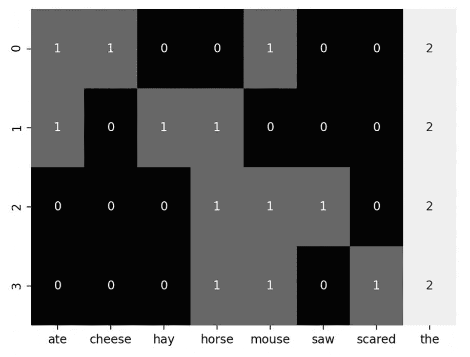

Figure 5.1 ¶ A Matrix with Term Frequencies.

Uncomment the final block of code in <x0.3156><y0.3805>Listing 5.11<x0.4828><y0.3828> if you want to see the “one hot” encoding of the word frequencies.

Another way to vectorize an array of sentences involves the HashingVectorizer class. <x0.3156><y0.3867>Listing 5.12 displays the contents of hashing_vectorize.py that illustrates how to vectorize an array of sentences using the HashingVectorizer class in Sklearn.

***LISTING 5.12: hashing_vectorize.py***

```python
from sklearn.feature_extraction.text import HashingVectorizer sentences = ['the mouse ate the cheese', 'the horse ate the hay', 'the mouse saw the horse', 'the mouse scared the horse'] vectorizer = HashingVectorizer(norm=None, n_features=8) sentence_vectors = vectorizer.fit_transform(sentences) print("vectorized sentences:") print(sentence_vectors.toarray())
```

<x0.1385><y0.4297>Listing 5.12 initializes the variable `vectorizer` as an instance of the HashingVector class in Sklearn, after which the variable `sentence_vectors` is assigned the result of transforming and fitting the contents of the sentences variable. Launch the code in <x0.3156><y0.4417>Listing 5.12<x0.4828><y0.444> and you will see the following output:

vectorized sentences: \[\[ 0. -1.  0.  1.  1.  0. -2.  0.\]  \[-2.  0.  0.  1.  0.  0. -2.  0.\]  \[-1.  0.  0. -1.  1.  0. -2.  0.\]  \[-1.  0. -1.  0.  1.  0. -2.  0.\]\] 

A third way to vectorize an array of sentences involves the TfidfVectorizer class. <x0.3156><y0.4578>Listing 5.13 displays the contents of tfidf_vectorize.py that illustrates how to vectorize an array of sentences using the TfidfVectorizer class in Sklearn.

***LISTING 5.13: tfidf_vectorize.py***

```python
from sklearn.feature_extraction.text import TfidfVectorizer import matplotlib.pyplot as plt import seaborn as sns sentences = ['the mouse ate the cheese', 'the horse ate the hay', 'the mouse saw the horse', 'the mouse scared the horse'] vectorizer = TfidfVectorizer(norm=False, smooth_idf=False) sentence_vectors = vectorizer.fit_transform(sentences) print("vectorized sentences:") print(sentence_vectors.toarray()) tfidf = vectorizer.fit_transform(sentences).toarray() # display the tfidf frequencies: sns.heatmap(tfidf,annot=True,cbar=False) plt.show()
```

<x0.1385><y0.5008>Listing 5.13 is similar to <x0.3156><y0.5028>Listing 5.12<x0.4828><y0.5048>, with the TfidfVector class in place of the HashingVector class. The other difference is the Seaborn Python library for visualization, which illustrates how to create a heat map in Seaborn. Note that Appendix F contains more information regarding Seaborn.

Now launch the code in <x0.3156><y0.5128>Listing 5.13<x0.4828><y0.515> and you will see the following output (numbers have been truncated from 8 decimal places to 3 decimal places to avoid “wrapping” the vectors on multiple lines):

vectorized sentences: \[\[1.693 2.386 0.    0.    1.287 0.     0.    2. \]  \[1.693 0.    2.386 1.287 0.    0.     0.    2. \]  \[0.    0.    0.    1.287 1.287 2.386  0.    2. \]  \[0.    0.    0.    1.287 1.287 0.     2.386 2. \]\] 

<x0.1385><y0.5432>Figure 5.2 displays the tf-idf frequencies, where the rows are the “documents” in the variable sentences, and the columns are the distinct words.

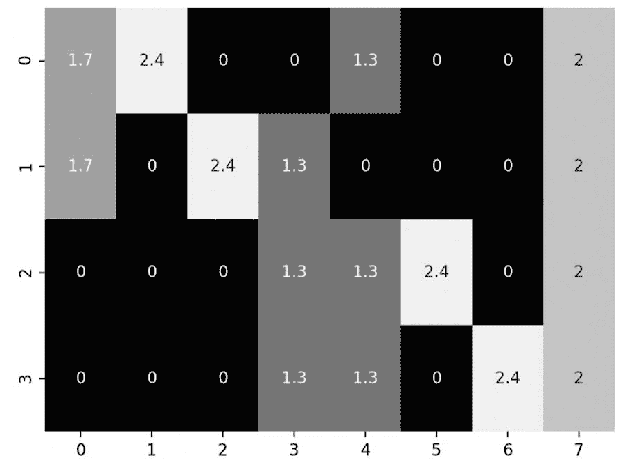

Figure 5.2 ¶ A Heatmap with tf-idf Frequencies.

<x0.1385><y0.5742>Listing 5.14 displays the contents of gensim_vectorize.py that illustrates how to vectorize an array of sentences using the word2vec class in gensim.

***LISTING 5.14: gensim_vectorize.py***

```python
from gensim.models import Word2Vec sentences = [ "the mouse ate the cheese", "the horse ate the hay", "the mouse saw the horse", "the mouse scared the horse"] model = Word2Vec(sentences, vector_size=100, window=5, min_count=1, workers=4) print(model.wv['mouse'])
```


进入`/path/to/xxx`目录，找到`xxx.json`。

在表达式`cvar = avar + bvar`中，加法运算符（`+`）将`avar`与`bvar`相加，得到它们的和`cvar`

在`List.of(arg0, arg1, arg2)`中，`List`接口的工厂方法`of()`接受一系列的元素，返回包含它们的只读列表。

之后我们这样调用`cmd`命令：`cmd arg0 arg1 arg2`。

```
if (condVar > someVal) {console.log("xxx")}
```


Listing 5.17 包含三条导入语句，然后初始化变量 `src` 为 Github 的 URL。随后，变量 `text` 初始化为 Github 页面的内容。下一个代码片段初始化变量 `soup` 为 `BeautifulSoup` 类的实例。最后的代码块是一个 for 循环（以 **加粗** 显示），遍历变量 `text` 中所有 `<a>` 元素，并显示每个 `<a>` 元素中嵌入的 `href` 值（在确认其内容非空后）。

运行 Listing 5.17 的代码后，你会看到 102 行输出，下面只显示了输出的第一部分：

anchor: `#start-of-content` anchor: [`https://help.github.com/articles/supported-browsers`](https://help.github.com/articles/supported-browsers) anchor: [`https://github.com/`](https://github.com/) anchor: `/join?ref_cta=Sign+up&ref_loc=header+logged+out&ref_page=%2F&source=header-home` anchor: `/features` anchor: `/features/code-review/` anchor: `/features/project-management/` anchor: `/features/integrations` anchor: `/features/actions` anchor: `/features/packages` anchor: `/features/security` anchor: `/features#team-management` anchor: `/features#hosting` anchor: `/customer-stories` anchor: `/security` anchor: `/team` 

Listing 5.18 展示了 `scrape_text3.py` 的内容，说明如何从 HTML 网页中去除锚（“a”）标签的非字母数字字符。新代码以 **加粗** 形式显示。

***LISTING 5.18: scrape_text3.py***

```python
import requests
import re
from bs4 import BeautifulSoup  # removes non-alphanumeric characters

def remove_non_alpha_chars(text):  # define the pattern to keep
    regex = r'[^a-zA-Z0-9]'
    return re.sub(regex, '', text)

src = "[`www.github.com`](https://www.github.com)"  # retrieve html web page as text
text = requests.get(src).text  #print("text:",text)  # parse into BeautifulSoup object
soup = BeautifulSoup(text, "html.parser")
print("soup:",soup)  # display contents of anchors ("a"):
for item in soup.find_all("a"):
    if len(item.contents) > 0:
        #print("anchor:",item.get('href'))
        cleaned = remove_non_alpha_chars(item.get('href'))
        print("cleaned:",cleaned)
```

Listing 5.18 与 Listing 5.16 类似，区别在于 for 循环（以 **加粗** 显示）以及在显示 href 值前去除了非字母字符和所有空格。运行 Listing 5.18 的代码后，你会看到 102 行输出，下面只显示了输出的第一部分：

cleaned: startofcontent cleaned: httpshelpgithubcomarticlessupportedbrowsers cleaned: httpsgithubcom cleaned: joinrefctaSignupreflocheaderloggedoutrefpage2Fsourceheaderhome cleaned: features cleaned: featurescodereview cleaned: featuresprojectmanagement cleaned: featuresintegrations cleaned: featuresactions cleaned: featurespackages cleaned: featuressecurity cleaned: featuresteammanagement cleaned: featureshosting cleaned: customerstories cleaned: security cleaned: team 

Listing 5.19 展示了 `scrape_pure_regex.py` 的内容，说明如何使用单个正则表达式获取 Github 网页内容并通过正则表达式去除 HTML 标签。

***LISTING 5.19: scrape_pure_regex.py***

```python
import requests
import requests
import re
import os

src = "[`www.github.com`](https://www.github.com)"  # retrieve the web page contents:
r = requests.get(src)
print(r.text)  # remove HTML tags (notice the "?"):
pattern = re.compile(r'<.*?>')  # remove leading whitespaces:
cleaned = os.linesep.join([s.lstrip() for s in cleaned.splitlines() if s])
#remove embedded blank lines:
cleaned = os.linesep.join([s for s in cleaned.splitlines() if s])
print("cleaned text:")
print(cleaned)  #remove ALL whitespaces:
#cleaned = cleaned.replace(" ", "")
#this does not work:
#cleaned = cleaned.trim(" ", "")
```

Listing 5.19 同时也去除了变量 `text` 中存放的 Github 网页内容的 HTML 元素。但有一个细微而重要的细节：正则表达式 `<.*?>` 与 `<.*?>`（后者包含问号以禁用贪婪匹配）。

正则表达式 `<.*?>` 执行贪婪匹配，意味着它会一直匹配直到遇到最右侧的 “>”。然而，我们希望在找到第一个 “>” 字符后停止匹配，这对应于前一个 “<” 字符。解决办法很简单：使用 `<.*?>`（问号禁用贪婪匹配）。

运行 Listing 5.19 的代码后，你会看到以下输出（部分省略）：

<!DOCTYPE html> <html lang="en"> <head> <meta charset="utf-8"> <link rel="dns-prefetch" href="https: //github.githubassets.com"> <link rel="dns-prefetch" href="https: //avatars0.githubusercontent.com"> <link rel="dns-prefetch" href="https: //avatars1.githubusercontent.com"> <link rel="dns-prefetch" href="https: //avatars2.githubusercontent.com"> <link rel="dns-prefetch" href="https: //avatars3.githubusercontent.com"> <link rel="dns-prefetch" href="https: //github-cloud.s3.amazonaws.com"> <link rel="dns-prefetch" href="https: //user-images.githubusercontent.com/"> <link crossorigin="anonymous" media="all" integrity="sha512-/uy49LxdzjR0L36uT6CnmV1omP/8ZHxvOg4zq/dczzABH9atntjJDmo5B7sV0J+AwVmv0fR0ZyW3EQawzdLFA==" rel="stylesheet" href="[`github.githubassets.com/assets/frameworks-feecb8f4bc5dce34742f7eae4fa0a799.css`](https://github.githubassets.com/assets/frameworks-feecb8f4bc5dce34742f7eae4fa0a799.css)" /> <link crossorigin="anonymous" media="all" integrity="sha512-37pLQI8klDWPjWVVWFB9ITJLwVTTkp3Rt4bVf+yixrViURK9OoGHEJDbTLxBv/rTJhsLm8pb00H2H5AG3hUJfg==" rel="stylesheet" href="[`github.githubassets.com/assets/site-dfba4b408f2494358f8d655558507d21.css`](https://github.githubassets.com/assets/site-dfba4b408f2494358f8d655558507d21.css)" /> <meta name="viewport" content="width=device-width"> <title>**The world's leading software development platform** · **GitHub**</title> \[details omitted for brevity\] <div class="position-relative js-header-wrapper "> <a href="#start-of-content" class="px-2 py-4 bg-blue text-white show-on-focus js-skip-to-content">**Skip to content**</a> <span class="Progress progress-pjax-loader position-fixed width-full js-pjax-loader-bar"> <span class="progress-pjax-loader-bar top-0 left-0" style="width: 0%;"></span> </span> \[details omitted for brevity\] cleaned text: **The world's leading software development platform** · **GitHub** **Skip to content** GitHub no longer supports this web browser. Learn more about the browsers we support. <a href="/join?ref_cta=Sign+up&amp;ref_loc=header+logged+out&amp;ref_page=%2F&amp;source=header-home" \[details omitted for brevity\] 

## **What is Scrapy?**


进入`/path/to/xxx`目录，找到`xxx.json`。

在表达式`cvar = avar + bvar`中，加法运算符（`+`）将`avar`与`bvar`相加，得到它们的和`cvar`

在`List.of(arg0, arg1, arg2)`中，`List`接口的工厂方法`of()`接受一系列的元素，返回包含它们的只读列表。

之后我们这样调用`cmd`命令：`cmd arg0 arg1 arg2`。

```
if (condVar > someVal) {console.log("xxx")}
```


\=> text, lemma\_, pos\_, and is\_stop: I -PRON- PRON True love love VERB False Chicago Chicago PROPN False deep deep ADJ False dish dish NOUN False pizza pizza NOUN False and and CCONJ True Uno Uno PROPN False 's 's PART True as as ADV True well well ADV True . . PUNCT False 

\=> dataframe:        text    lemma    POS                   explain  stopword 0           I   -PRON-   PRON                   pronoun      True 1      love     love   VERB                      verb     False 2   Chicago  Chicago  PROPN               proper noun     False 3      deep     deep    ADJ                 adjective     False 4      dish     dish   NOUN                      noun     False 5     pizza    pizza   NOUN                      noun     False 6       and      and  CCONJ  coordinating conjunction      True 7       Uno      Uno  PROPN               proper noun     False 8        's       's   PART                  particle      True 9        as       as    ADV                    adverb      True 10     well     well  ADV                    adverb      True 11        .        .  PUNCT               punctuation     False 

## **SpaCy and NER**

The code sample in this section shows you how to perform NER (Named Entity Recognition) in spaCy. Listing 5.23 displays the contents of spacy\_ner.py that illustrates how to perform NER in spaCy.

***Listing 5.23: spacy\_ner.py***

```python
import spacy
nlp = spacy.load('en_core_web_sm')
text = "Chicago style deep dish pizza, Uno's, and Nancy's pizza."
print("text:")
print(text)
print()
doc = nlp(text)
# Iterate over the entity text and label for ent in doc.ents:
# print("text/label_:",ent.text, ent.label_)
```

Listing 5.23 is similar to Listing 5.21, except that this code only displays the text and label\_ values for each token in the string text. Launch the code in Listing 5.21 and you will see the following output:

text: Chicago style deep dish pizza, Uno's, and Nancy's pizza.   text/label\_: Chicago GPE text/label\_: Uno's ORG text/label\_: Nancy PERSON 

Notice that Chicago is correctly identified as a location (GPE) and Uno’s is correctly identified as an organization. However, Nancy’s is identified as the person Nancy (which is actually correct), even though in this case the string Nancy’s is the name of a pizza parlor in Chicago.

## **SpaCy Pipelines**

SpaCy provides a pipeline class that enables you to specify a sequence of tasks to perform. The default pipeline consists of a tagger, a parser and an entity recognizer. The output of each task is a document, which becomes the input for the next task in the pipeline.

Listing 5.24 displays the contents of spacy\_pipeline.py that illustrates how to use a SpaCy pipeline.

***LISTING 5.24: spacy\_pipeline.py***

```python
import spacy
sentences = [ "We got a huge deep dish pizza from Pizzeria Uno.", "Supplemented with a couple of pitchers of beer.", "Then we went to the top of the Hancock building." ]
nlp = spacy.load("en_core_web_sm")
for doc in nlp.pipe(sentences, disable=["tagger", "parser"]):
    print("=> document:",doc)
    for ent in doc.ents:
        print("=> text:",ent.text,"=> label:",ent.label_)
    print()
```

Listing 5.24 initializes the variable sentences as an array of sentences and then initializes the variable nlp as an instance of a SpaCy model. The next portion of Listing 5.23 is a for loop that is based on nlp.pipe(), which in this example only processes the entity recognizer (the tagger and parser recognizers have been excluded).

Launch the code in Listing 5.24 and you will see the following output:

\=> document: We got a huge deep dish pizza from Pizzeria Uno. \=> document: Supplemented with a couple of pitchers of beer.   \=> document: Then we went to the top of the Hancock building. \=> text: Hancock => label: GPE 

As you can already see, pipelines are very flexible and convenient for processing text-based documents. More code samples and detailed information regarding spaCy pipelines is here:

*[`spacy.io/usage/processing-pipelines`](https://spacy.io/usage/processing-pipelines)*

## **SpaCy and Word Vectors**

Listing 5.25 displays the contents of spacy\_word\_vectors.py that illustrates word vectors for words.

***LISTING 5.25: spacy\_word\_vectors.py***

```python
import spacy
nlp = spacy.load('en_core_web_lg')
nlp(u'pizza').vector
doc = nlp(u'We ate deep dish pizza with wine and beer.')
print("=> doc.vector:")
print(doc.vector)
print()
# find similar pairs of tokens:
tokens = nlp(u'wine beer soda')
for token1 in tokens:
    for token2 in tokens:
        print("=> token1.text, token2.text, token1.similarity(token2):")
        print(token1.text, token2.text, token1.similarity(token2))
print()
# normalize tokens:
tokens = nlp(u'apple banana orange')
for token in tokens:
    print("=> token.text, token.has_vector, token.vector_norm, token.is_oov:")
    print(token.text, token.has_vector, token.vector_norm, token.is_oov)
print()
from scipy import spatial
cosine_similarity = lambda x, y: 1 - spatial.distance.cosine(x, y)
queen = nlp.vocab['queen'].vector
woman = nlp.vocab['woman'].vector
man = nlp.vocab['man'].vector
# find the closest vector to "man" - "woman" + "queen"
new_vector = queen - woman + man
calc_similarities = []
for word in nlp.vocab:
    # Ignore words without vectors and mixed-case words:
    if word.has_vector:
        if word.is_lower:
            if word.is_alpha:
                similarity = cosine_similarity(new_vector, word.vector)
                calc_similarities.append((word, similarity))
calc_similarities = sorted(calc_similarities, key=lambda item: -item[1])
print("=> [w[0].text for w in calc_similarities[:10]]:")
print([w[0].text for w in calc_similarities[:10]])
print()
doc = nlp(u'The quick brown fox jumped over the lazy dogs.')
print("doc:",doc)
print("doc.vector:",doc.vector)
```

Listing 5.25 initializes the variable doc as an instance of the nlp class, as well as the given text string, and then displays the contents of the associated word vector. Next, the variable tokens is initialized with three words, followed by a nested loop that displays the pair-wise similarity of the words in the tokens variable. The next portion of Listing 5.25 initializes the variable tokens with three different words, followed by a loop that displays various attributes these words.

The next portion of Listing 5.25 initializes the variable cosine_similarity as a lamb expression that calculates the cosine similarity between a pair of words. Then the variables queen, woman, and man are initialized, followed by the variable new_vector that is initialized as follows:

new_vector = queen - woman + man

Then another loop iterates through the words nlp.vocab and for each lower-case alphabetic word in nlp.vocab, computes the cosine similarity of that word with the variable new_vector. The resultant list of cosine similarities is sorted and then displayed. Launch the code in Listing 5.25 and you will see the following output:


-   [doc.vector](https://wiki.example.org/doc.vector): \[-1.39887929e-01 -1.95095055e-02  8.34191069e-02 -2.64628291e-01   2.40830615e-01  2.75315434e-01  2.51161046e-02  7.67326951e-02   8.21892098e-02  1.90768397e+00 -2.59143114e-01  1.49312809e-01  -6.83634281e-02 -1.11276604e-01 -1.17691800e-01 -2.02080399e-01  -7.09474012e-02  1.21521211e+00 -1.57256007e-01 -2.19138991e-02  // lines omitted for brevity   3.04495007e-01 -1.26671968e-02  6.86664060e-02 -1.62135810e-01  -6.57109767e-02  1.62497148e-01  4.26867157e-01  1.21716186e-01   8.21024999e-02  2.98182011e-01  5.26543036e-02  2.68678162e-02  -2.37585977e-01  1.15498960e-01 -1.25021964e-01 -1.34173691e-01   9.52331945e-02 -1.57274202e-01  9.77694020e-02  1.11879949e-02\]   tokens: wine beer soda   \=> token1.text, token2.text, token1.similarity(token2): wine wine 1.0 \=> token1.text, token2.text, token1.similarity(token2): wine beer 0.6600621 \=> token1.text, token2.text, token1.similarity(token2): wine soda 0.4345365 \=> token1.text, token2.text, token1.similarity(token2): beer wine 0.6600621 \=> token1.text, token2.text, token1.similarity(token2): beer beer 1.0 \=> token1.text, token2.text, token1.similarity(token2): beer soda 0.5788868 \=> token1.text, token2.text, token1.similarity(token2): soda wine 0.4345365 \=> token1.text, token2.text, token1.similarity(token2): soda beer 0.5788868 \=> token1.text, token2.text, token1.similarity(token2): soda soda 1.0   \=> token.text, token.has\_vector, token.vector\_norm, token.is\_oov: apple True 7.1346846 False \=> token.text, token.has\_vector, token.vector\_norm, token.is\_oov: banana True 6.700014 False \=> token.text, token.has\_vector, token.vector\_norm, token.is\_oov: orange True 6.5420218 False   \=> \[w\[0\].text for w in calc\_similarities\[:10\]\]: \['queen', 'man', 'he', 'let', 'nothin', 'lovin', 'nuff', 'dare', 'doin', 'all'\]

## **The scispaCy Library (Optional)**

The scispaCy Python library for NLP is based on spaCy, and it’s used for processing biomedical text. This library performs common NLP tasks, such as NER, POS tagging, dependency parsing, and sentence segmentation.

The scispaCy library contains two primary packages that contain models: en_core_sci_sm (a smaller vocabulary without word vectors) and en_core_sci_md (a larger vocabulary with word vectors).

In particular, NER tasks play a key role in various types of biomedical data in datasets of differing sizes and number of entities (and their types) for different domains, such as cancer genetics, disease-drug interactions, pathway analysis and trial population extraction. The accuracy of scispaCy NER models is comparable to a decent number of other existing models. If this Python library interests you, more information regarding scispaCy is here:

*[`arxiv.org/pdf/1902.07669.pdf`](https://arxiv.org/pdf/1902.07669.pdf)*

## **Summary**

This chapter showed you how to perform data cleaning tasks that involve regular expressions. Then you learned about BoW, along with an explanation of word embeddings. In addition, you saw how to use BeautifulSoup, which is a Python module for scraping HTML Web pages.

Then you learned about Scrapy, which is a Python-based library that provides web scraping functionality and various other APIs. In addition, you were introduced to spaCy, which is a Python-based library for NLP, along with Python code samples that show you various features of spaCy.

You also learned about word embeddings and the fact that they provide context for words, which can yield more powerful models. Then you saw a Python code sample that involved word2vec, which is a Python-based library (discussed in Chapter 4) for NLP-related tasks that involve unstructured data as well as labeled data.

# CHAPTER 6

# ALGORITHMS AND TOOLKITS (II)

This chapter contains Python code samples that illustrate various NLP concepts that you learned in the previous two chapters. Since those chapters contain sufficient NLP-related theory, this chapter focuses almost exclusively on code samples. The majority of the code samples in this chapter involve NLTK (Natural Language Toolkit), along with several code samples that are based on gensim.

The first section (approximately two-thirds of this chapter) introduces NLTK and code samples that use NLTK with BoW, stemmers, and lemmatization. You will also see some examples of NLTK with Wordnet, lxml, XPath (not discussed in this book), n-grams, and skip-grams.

The second section introduces GloVe and gensim, which are very useful NLP Python libraries, along with some code samples.

## **What is NLTK?**

Natural Language Toolkit (NLTK)is an open source Python library specifically for NLP-related tasks. Although NLTK does not provide SOTA (state-of-the-art) performance, it does provide a variety of solutions to many NLP tasks. This library was developed in 2002, and its home page is here:

*www.nltk.org*

NLTK provides support for many NLP-related tasks, such as stemmers, tokenization (words, sentences, and documents), lemmatization, chunking, and grammars. In particular, NLTK supports the SnowballStemmers that creates non-English stemmers for more than 10 languages: Danish, Dutch, English, French, German, Hungarian, Italian, Norwegian, Portuguese, Romanian, Russian, Spanish, and Swedish.

NLTK also supports n-grams, skip-grams, BoW, word2vec, parts of speech (POS), and named entity recognition (NER). In fact, NLTK enables you to define your own custom grammars and then parse sentences to determine if their structure conforms to a custom grammar.

NLTK is well-suited for various NLP tasks, such as recommendation systems and sentiment analysis, both of which are discussed in more detail in Chapter 9. NLTK also supports Wordnet, which enables you to find words (via Sysnet) and their homonyms and synonyms.

## **NLTK and BoW**

Listing 6.1 displays the contents of ntk_bow.py that illustrates how to implement BoW in NLTK. Keep in mind that this code sample does involve regular expressions, also known as RegExs. If you are unfamiliar with RegExs, you can either “comment out” the two code snippets that involve regular expressions, or you can read the appendix that discusses this topic.

***LISTING 6.1: nltk_bow.py***

import nltk import numpy as np import re   text = 'the SF weather is hot and the LA weather is hotter' ds = nltk.sent_tokenize(text)   \# clean the words in the dataset: for i in range(len(ds)):   ds[i] = ds[i].lower()   ds[i] = re.sub(r'\\W', ' ', ds[i])   ds[i] = re.sub(r'\\s+', ' ', ds[i])   print("cleaned dataset:") print(ds) print()   \# construct BoW model: word2count = {} for data in ds:   words = nltk.word_tokenize(data)   for word in words:     if word not in word2count.keys():       word2count[word] = 1   else:       word2count[word] += 1   \# display word/frequency counts: for word, freq in word2count.items():   print(f'word: {word:8} frequency: {freq:3d}') 

Listing 6.1 initializes the variable text with a string and then initializes the variable ds with the tokens of text. Next, a for loop iterates through the tokens and converts them to lowercase, removes all nonalphabetic characters, and replaces multiple whitespaces with a single whitespace.

Next, the cleaned data is displayed, followed by a loop that constructs a BoW model based on the tokens in the variable ds. Note that multiple occurrences of a token are taken into account when populating the dictionary word2count. The final portion of Listing 6.1 displays each word and its frequency. Launch the code in Listing 6.1 and you will see the following output:


cleaned dataset: `['the sf weather is hot and the la weather is hotter']` word: `the` frequency: `2` word: `sf` frequency: `1` word: `weather` frequency: `2` word: `is` frequency: `2` word: `hot` frequency: `1` word: `and` frequency: `1` word: `la` frequency: `1` word: `hotter` frequency: `1` 

## NLTK and Stemmers

Listing 6.2 displays the contents of `stem_documents1.py` that illustrates how to perform stemming on a sentence with a `PorterStemmer`.

***LISTING 6.2: stem_documents1.py***

```python
import nltk
from nltk.stem import PorterStemmer
from nltk.tokenize import sent_tokenize, word_tokenize

# read file contents:
file = open("data-science-wiki.txt")
my_lines_list = file.readlines()

porter = PorterStemmer()

def stemSentence(sentence):
    token_words = word_tokenize(sentence)
    stem_sentence = []
    for word in token_words:
        stem_sentence.append(porter.stem(word))
        stem_sentence.append(" ")
    return "".join(stem_sentence)

def saveStemmedLines():
    stem_file = open("stem-data-science-wiki.txt", mode="a+", encoding="utf-8")
    for line in my_lines_list:
        stem_sentence = stemSentence(line)
        stem_file.write(stem_sentence)
    stem_file.close()

print(my_lines_list[0])
print("Stemmed sentence:")
x = stemSentence(my_lines_list[0])
print(x)
```

Listing 6.2 starts by reading the contents of a text file into the variable `my_lines_list`. Next, the variable `porter` is initialized as an instance of the `PorterStemmer` class that is available in NLTK. The next portion of Listing 6.2 is the definition of the Python function `stemSentence()` that determines the stem of each word in the sentence that is passed into the function.

The next block defines the Python function `saveStemmedLines()` that contains a for loop that iterates through the sentences that have been processed by the function `stemSentence()`. The last portion of Listing 6.2 invokes the Python function `stemSentence()` with the first sentence in `my_lines_list`, displays the output, and then saves the stemmed text. Launch the code in Listing 6.2 and you will see the following output:

`'data scienc is an interdisciplinari field that use scientif method , process , algorithm and system to extract knowledg and insight from data in variou form , both structur and unstructur , \[ 1 \] \[ 2 \] similar to data mine . \\n ' , 'data scienc is a '' concept to unifi statist , data analysi , machin learn and their relat method '' in order to '' understand and analyz actual phenomena '' with data . \[ 3 \] It employ techniqu and theori drawn from mani field within the context of mathemat , statist , inform scienc , and comput scienc . \\n '`

## NLTK and Lemmatization

Listing 6.5 displays the contents of `lemmatizer1.py` that illustrates how to perform lemmatization on a sentence.

***LISTING 6.5: lemmatizer1.py***

```python
import nltk
from nltk.stem import WordNetLemmatizer

wordnet_lemmatizer = WordNetLemmatizer()
sentence = "He eats Chicago deep dish pizzas, and lots of pizzas from Pizzeria Uno!"
punctuations = "?:!.,;"
sentence_words = nltk.word_tokenize(sentence)

for word in sentence_words:
    if word in punctuations:
        sentence_words.remove(word)

print("{0:20}{1:20}".format("Word", "Lemma"))
for word in sentence_words:
    print("{0:20}{1:20}".format(word, wordnet_lemmatizer.lemmatize(word)))
```

Listing 6.5 initializes the variable `wordnet_lemmatizer` as an instance of the `WordNetLemmatizer` class that is available in NLTK. The variables `sentence` and `punctuations` are initialized, as well as the variable `sentence_words` that consists of the tokens in the variable `sentence`. Next, a loop that removes any punctuation symbols from the variable `sentence_words`. The final code block contains a loop that displays each word in `sentence_words`, along with its lemmatized value. Launch the code in Listing 6.5 and you will see the following output:

`Word                Lemma He                  He                   eats                eats                 Chicago             Chicago             deep                deep                 dish                dish                 pizzas              pizza               and                 and                 lots                lot                 of                  of                   pizzas              pizza               from                from                 Pizzeria          Pizzeria          Uno              Uno              `

Listing 6.6 displays the contents of `lemmatizer2.py` that illustrates how to perform lemmatization on a sentence.

***LISTING 6.6: lemmatizer2.py***

```python
# (content omitted for brevity)
```


import nltk from nltk.stem import WordNetLemmatizer `wordnet_lemmatizer = WordNetLemmatizer()` `sentence = "He eats Chicago deep dish pizzas, and lots of pizzas from Pizzeria Uno!"` `punctuations="?:!.,;"` `sentence_words = nltk.word_tokenize(sentence)` for word in sentence_words: if word in punctuations: sentence_words.remove(word) 

**\# display "part-of-speech" via pos="v"** **print("{0:20}{1:20}".format("Word","Lemma"))** for word in sentence_words: print ("{0:20}{1:20}".format(word,wordnet_lemmatizer.lemmatize(word, pos="v"))) 

Listing 6.6 is similar to Listing 6.5, with the addition of a for loop (shown in bold) that displays the displays the words in sentence_words, along with their lemmatized values. Launch the code in Listing 6.6 and you will see the following output:

Word                Lemma He                  He                   eats                eat                  Chicago              Chicago              deep                dish                dish                pizzas              pizzas              and                  and                  lots                lot                  of                  of                  pizzas              pizzas              from                from                Pizzeria            Pizzeria            Uno                  Uno 

## **NLTK and Stop Words**

Listing 6.7 displays the contents of nltk_newstop.py that illustrates how to add new stop words to the default set of stop words.

***LISTING 6.7: nltk_newstop.py***

from sklearn.feature_extraction.text import CountVectorizer from nltk.corpus import stopwords newstop = set(stopwords.words('english')+['pasta','bliffet']) print("new stopwords:") print(newstop) 

Listing 6.7 initializes the variable newstop with a pair of strings, after which the variable cv is initialized as an instance of the CountVectorizer class from Sklearn. Note that the latter initialization specifies the variable newstop as the set of stop words. Launch the code in Listing 6.7 and you will see the following output:

new stopwords: {'couldn', 'hadn', 'theirs', 'shan', 'weren', 'having', 'y', 'between', 'before', 'can', 'other', 'all', 'wouldn', 'once', 'of', 'me', 'but', 'doing', 'because', 'own', 'mightn', 'hers', 'after', 'out', 'd', 'where', 'the', 'her', 'nor', 'him', 'below', 'both', 'do', "you'll", 'won', 'ourselves', "needn't", 'ma', 'now', 'from', 'she', 'down', "you'd", 'an', "hadn't", 'should', 'were', 'you', 'it', 'such', 'their', 'bliffet', 'isn', 'who', 'had', "didn't", 'mustn', 'our', "you've", 'or', 'again', "aren't", "needn't", 'ma', 'now', 'from', 'she', 'down', "you'd", 'an', "hadn't", 'should', 'were', 'you', 'it', 'such', 'their', 'bliffet', 'isn', 'who', 'had', "didn't", 'mustn', 'our', "you've", 'or', 'again', "aren't", "doesn't", 'just', 'didn', "shouldn't", 'don', 'which', 'few', "mightn't", "you're", "haven't", 'my', 'i', 'and', 'then', 'only', 'by', 'your', 'what', 'when', 'up', 'here', 'o', 't', 'during', 'are', "couldn't", 'through', 'themselves', 'himself', 'until', 'did', 'against', 's', 'was', 'so', 'this', 'have', 'to', 'll', 'm', 'myself', 'at', 've', 'for', 'we', 'does', 'its', 're', 'needn', "mustn't", 'more', 'pasta', 'he', 'no', "shan't", 'his', 'above', 'that', 'under', "weren't", 'whom', 'further', 'ain', 'is', 'into', "should've", 'been', 'haven', 'yourselves', 'very', "wasn't", 'hasn', 'same', 'most', 'not', 'they', "that'll", "it's", 'yours', 'in', 'aren' 

## **What is Wordnet?**

Wordnet is a corpus reader that is provided by NLTK, and you can use either of the following snippets to import Wordnet:

from nltk.corpus import wordnet from nltk.corpus import wordnet as wn 

Wordnet provides the synsets() function that enables you to search for words and display their POS (part of speech), as well as synonyms and antonyms of a given word.

Wordnet (via NLTK) provides the following similarity scorers (authors are in parentheses):

*   jcn_similarity

*   lch_similarity (Leacock-Chodorow)

*   lin_similarity

*   path_similarity

*   res_similarity

*   wup_similarity (Wu-Palmer)

*   PPMI

Listing 6.8 displays the contents of similarity1.py that illustrates how to use wup_similarity() to find the similarity between a pair of words.

***LISTING 6.8: similarity1.py***

from nltk.corpus import wordnet as wn  # Wu and Palmer method to compare word similarity w1 = wn.synset('ship.n.01') w2 = wn.synset('boat.n.01') print("=> similarity of ship and boat:") print(w1.wup_similarity(w2)) print() w1 = wn.synset('ship.n.01') w2 = wn.synset('car.n.01') print("=> similarity of ship and car:") print(w1.wup_similarity(w2)) print() w1 = wn.synset('ship.n.01') w2 = wn.synset('dog.n.01') print("=> similarity of ship and dog:") print(w1.wup_similarity(w2)) print() 

Listing 6.8 contains three blocks of code that compare the word *ship* with *boat*, *car*, and *dog*, respectively, using wordnet. Launch the code in Listing 6.8 and you will see the following output:

=> similarity of ship and boat: 0.9090909090909091 => similarity of ship and car: 0.6956521739130435 => similarity of ship and dog: 0.4 

Listing 6.9 displays the contents of wordnet1.py that illustrates how to use path_similarity() to find the similarity between a pair of words.

***LISTING 6.9: wordnet1.py***

from nltk.corpus import wordnet as wn  # Multilingual WordNet (ISO-639 language codes): print("=> sorted(wn.langs()):") print(sorted(wn.langs())) print() drink = wn.lemma('drink.v.03.drink') print("=> drink:",drink) print("=> count:",drink.count()) print() horse = wn.synset('horse.n.01') giraffe = wn.synset('giraffe.n.01') zebra = wn.synset('zebra.n.01') print("=> horse.path_similarity(giraffe):") print(horse.path_similarity(giraffe)) print() print("=> horse.path_similarity(zebra):") print(horse.path_similarity(zebra)) 

Listing 6.9 starts by displaying a sorted list of language code for supported languages, followed by the lemmatized value and frequency of the word *drink*. The next code snippet compares the word *horse* with the word *giraffe* and then with the word *zebra*, similar to the code in Listing 6.8. Launch the code in Listing 6.9 and you will see the following output:

=> sorted(wn.langs()): ['als', 'arb', 'bul', 'cat', 'cmn', 'dan', 'ell', 'eng', 'eus', 'fas', 'fin', 'fra', 'glg', 'heb', 'hrv', 'ind', 'ita', 'jpn', 'nld', 'nno', 'nob', 'pol', 'por', 'qcn', 'slv', 'spa', 'swe', 'tha', 'zsm'] => drink: Lemma('toast.v.02.drink') => count: 1 => horse.path_similarity(giraffe): 0.14285714285714285 => horse.path_similarity(zebra): 0.3333333333333333 

### **Synonyms and Antonyms**

Listing 6.10 displays the contents of nltk_syn_ant.py that illustrates how to find synonyms and antonyms of a word using NLTK.

***LISTING 6.10: nltk_syn_ant.py***

from nltk.corpus import wordnet word = "work" synonyms = [] for syn in wordnet.synsets(word): for lemma in syn.lemmas(): synonyms.append(lemma.name()) print("=> synonyms for",word,":") print(synonyms) print("-------------------------") antonyms = [] for syn in wordnet.synsets(word): for lemma in syn.lemmas(): if lemma.antonyms(): antonyms.append(lemma.antonyms()[0].name()) print("=> antonyms for",word,":") print(antonyms) 


...


import`nltk` from `nltk.tokenize` import `word_tokenize` from `nltk.corpus` import `wordnet`   sentence = "I love pizza, and also pasta, what about you?" split_words = sentence.split(" ") print("sentence:") print(sentence) print() print("split_words:") print(split_words) print()   word_tokenize(sentence)   w = word_tokenize(sentence) pos = nltk.pos_tag(w)   print("tokenized:") print(w) print()   print("parts of speech:") print(pos) print()   syn = wordnet.synsets("spaceship") print(syn) print(syn[0].name()) print(syn[0].definition())   syn = wordnet.synsets("sleep") print("examples of sleep:") print(syn[0].examples()) print() 

Listing 6.13 initializes the variable `sentence` to a text string and initializes the variable `split_words` with the tokens in the variable `sentence`. The next block of `print()` statements display the contents of `sentence` and `split_words`.

The next code snippet initializes the variable `w` with the result of passing `sentence` to the `word_tokenize` method from NLTK. The variable `pos` is then initialized with the parts of speech of the elements in `w`, followed by a block of `print()` statements that display their values as well as their parts of speech.

The final portion of Listing 6.13 invokes the `wordnet.synsets()` method to find the definitions of the word `spaceship` and the word `sleep`. In both cases the definitions are displayed. Launch the code in Listing 6.14 and you will see the following output:

`sentence:` `I love pizza, and also pasta, what about you?`   `split_words:` \['I', 'love', 'pizza,', 'and', 'also', 'pasta,', 'what', 'about', 'you?'\]   `tokenized:` \['I', 'love', 'pizza', ',', 'and', 'also', 'pasta', ',', 'what', 'about', 'you', '?'\]   `parts of speech:` \[('I', 'PRP'), ('love', 'VBP'), ('pizza', 'NN'), (',', ','), ('and', 'CC'), ('also', 'RB'), ('pasta', 'NN'), (',', ','), ('what', 'WP'), ('about', 'IN'), ('you', 'PRP'), ('?', '.')\]   \[Synset('starship.n.01')\] starship.n.01 a spacecraft designed to carry a crew into interstellar space (especially in science fiction)   examples of sleep: \["he didn't get enough sleep last night", 'calm as a child in dreamless slumber'\] 

Listing 6.14 displays the contents of `nltk_movie_reviews.py` that illustrates how to tokenize a sentence and display relevant movie-related words.

***LISTING 6.14: nltk_movie_reviews.py***

import `nltk` from `nltk.corpus` import `movie_reviews` from `nltk.corpus` import `stopwords` from `nltk.tokenize` import `word_tokenize`   print("first 16 English stop words:") print(stopwords.words('english')\[:16\]) print()   para = "I started with Deep Learning, then proceeded to Machine Learning, then NLP, and finally reached Deep Reinforcement Learning. However, despite the preparatory classes, the challenge of DRL was very steep."   words = word_tokenize(para) print("tokenized words:") print(words) print()   useful_words = \[word for word in words if word not in stopwords.words('english')\] print("useful words:") print(useful_words) print()   print("movie reviews words:") print(movie_reviews.words()) print()   print("movie reviews categories:") print(movie_reviews.categories()) print()   print("movie reviews fileids:") print(movie_reviews.fileids()\[:4\]) print()   all_words = movie_reviews.words() freq_dist = nltk.FreqDist(all_words) print("frequency distribution for 20 most common words:") print(freq_dist.most_common(20)) print() 

Listing 6.14 starts with several import statements, prints some stop words, and then initializes the variable `para` as a text string, which is tokenized and its tokens are then displayed. Next, the variable `useful_words` is initialized with the result of removing the stop words from the variable `words`.

The next code block in Listing 6.14 prints the nonstop words, followed by the movie-related words (from the `movie_reviews` class). The last portion of Listing 6.14 displays several file ids and then the distribution for the 20 most common words. Launch the code in Listing 6.14 and you will see the following output:

first 16 English stop words: \['i', 'me', 'my', 'myself', 'we', 'our', 'ours', 'ourselves', 'you', "you're", "you've", "you'll", "you'd", 'your', 'yours', 'yourself'\]   tokenized words: \['My', 'goal', 'was', 'simple', ':', 'learn', 'as', 'much', 'as', 'possible', 'about', 'Deep', 'Reiforcement', 'Learning', '.', 'Even', 'studying', 'machine', 'learning', ',', 'deep', 'learning', ',', 'and', 'natural', 'language', 'processing', ',', 'the', 'challenge', 'of', 'DRL', 'was', 'steep', '.'\]   useful words: \['My', 'goal', 'simple', ':', 'learn', 'much', 'possible', 'Deep', 'Reiforcement', 'Learning', '.', 'Even', 'studying', 'machine', 'learning', ',', 'deep', 'learning', ',', 'natural', 'language', 'processing', ',', 'challenge', 'DRL', 'steep', '.'\]   movie reviews words: \['plot', ':', 'two', 'teen', 'couples', 'go', 'to', ...\]   movie reviews categories: \['neg', 'pos'\]   movie reviews fileids: \['neg/cv000_29416.txt', 'neg/cv001_19502.txt', 'neg/cv002_17424.txt', 'neg/cv003_12683.txt'\]   frequency distribution for 20 most common words: \[(',', 77717), ('the', 76529), ('.', 65876), ('a', 38106), ('and', 35576), ('of', 34123), ('to', 31937), ("'", 30585), ('is', 25195), ('in', 21822), ('s', 18513), ('"', 17612), ('it', 16107), ('that', 15924), ('-', 15595), (')', 11781), ('(', 11664), ('as', 11378), ('with', 10792), ('for', 9961)\] 

Listing 6.14 starts with several import statements, prints some stop words, and then initializes the variable `para` as a text string, which is tokenized and its tokens are then displayed. Next, the variable `useful_words` is initialized with the result of removing the stop words from the variable `words`.

The next code block in Listing 6.14 prints the nonstop words, followed by the movie-related words (from the `movie_reviews` class). The last portion of Listing 6.14 displays several file ids and then the distribution for the 20 most common words. Launch the code in Listing 6.14 and you will see the following output:

first 16 English stop words: \['i', 'me', 'my', 'myself', 'we', 'our', 'ours', 'ourselves', 'you', "you're", "you've", "you'll", "you'd", 'your', 'yours', 'yourself'\]   tokenized words: \['My', 'goal', 'was', 'simple', ':', 'learn', 'as', 'much', 'as', 'possible', 'about', 'Deep', 'Reiforcement', 'Learning', '.', 'Even', 'studying', 'machine', 'learning', ',', 'deep', 'learning', ',', 'and', 'natural', 'language', 'processing', ',', 'the', 'challenge', 'of', 'DRL', 'was', 'steep', '.'\]   useful words: \['My', 'goal', 'simple', ':', 'learn', 'much', 'possible', 'Deep', 'Reiforcement', 'Learning', '.', 'Even', 'studying', 'machine', 'learning', ',', 'deep', 'learning', ',', 'natural', 'language', 'processing', ',', 'challenge', 'DRL', 'steep', '.'\]   movie reviews words: \['plot', ':', 'two', 'teen', 'couples', 'go', 'to', ...\]   movie reviews categories: \['neg', 'pos'\]   movie reviews fileids: \['neg/cv000_29416.txt', 'neg/cv001_19502.txt', 'neg/cv002_17424.txt', 'neg/cv003_12683.txt'\]   frequency distribution for 20 most common words: \[(',', 77717), ('the', 76529), ('.', 65876), ('a', 38106), ('and', 35576), ('of', 34123), ('to', 31937), ("'", 30585), ('is', 25195), ('in', 21822), ('s', 18513), ('"', 17612), ('it', 16107), ('that', 15924), ('-', 15595), (')', 11781), ('(', 11664), ('as', 11378), ('with', 10792), ('for', 9961)\] 

Listing 6.15 initializes the variable `text` with a text string, followed by the variable `words` that consists of the tokens of the variable `text`. Next, several `print()` statements display the contents of the variable `words` as well as the parts of speech of the tokens in the variable `words`.

The next portion of Listing 6.15 is a Python function `entities()` that returns the parts of speech of the tokens in the text string that is passed in to the `entities()` function. The final portion of Listing 6.15 invokes the `entities()` function, assigns the result to the variable `tree`, and then displays the contents of `tree`. Launch the code in Listing 6.15 and you will see the following output:

`words:` \['the', 'SF', 'weather', 'is', 'hot', 'and', 'the', 'LA', 'weather', 'is', 'hotter'\]   `nltk.pos_tag(words):` \[('the', 'DT'), ('SF', 'NNP'), ('weather', 'NN'), ('is', 'VBZ'), ('hot', 'JJ'), ('and', 'CC'), ('the', 'DT'), ('LA', 'NNP'), ('weather', 'NN'), ('is', 'VBZ'), ('hotter', 'RBR')\] `tokenized:` (S   the/DT   (ORGANIZATION SF/NNP)   weather/NN   is/VBZ   hot/JJ   and/CC   the/DT   (ORGANIZATION LA/NNP)   weather/NN   is/VBZ   hotter/RBR) \---------------- 

Figure 6.1 displays the tree-like structure that is generated when you launch the code in Listing 6.16.


Figure 6.1 ¶ A Tree Structure with Named Entities.

## NLTK and Tokenizers


本节包含一个代码示例，展示了在 NLTK 中定义的多种分词器。Listing 6.16 显示了 `nltk_tokenizers.py` 的内容，阐释了如何对句子中的单词进行多种分词。

***LISTING 6.16: nltk_tokenizers.py***

```python
import nltk
text = "I love deep dish pizza. Mainly from Chicago. Also with beer."
sents = nltk.sent_tokenize(text)
words = nltk.word_tokenize(text)
tokens = nltk.wordpunct_tokenize(text)
tags = nltk.pos_tag(words)
print("text: ", text)
print("sents: ", sents)
print("words: ", words)
print("tokens:", tokens)
print("tags: ", tags)
```

Listing 6.16 初始化变量 `text` 为字符串，随后创建了多种 NLTK 分词器的实例。`print()` 语句块显示每个分词器生成的 token。在 Listing 6.16 中运行代码，会得到如下输出：

`text: I love deep dish pizza. Mainly from Chicago. Also with beer.`  
`sents: ['I love deep dish pizza.', 'Mainly from Chicago.', 'Also with beer.']`  
`words: ['I', 'love', 'deep', 'dish', 'pizza', '.', 'Mainly', 'from', 'Chicago', '.', 'Also', 'with', 'beer', '.']`  
`tokens: ['I', 'love', 'deep', 'dish', 'pizza', '.', 'Mainly', 'from', 'Chicago', '.', 'Also', 'with', 'beer', '.']`  
`tags: [('I', 'PRP'), ('love', 'VBP'), ('deep', 'JJ'), ('dish', 'JJ'), ('pizza', 'NN'), ('.', '.'), ('Mainly', 'RB'), ('from', 'IN'), ('Chicago', 'NNP'), ('.', '.'), ('Also', 'RB'), ('with', 'IN'), ('beer', 'NN'), ('.', '.')]`

下面的链接包含了前面输出中各项词汇及其对应的词性：

*[`cs.nyu.edu/grishman/jet/guide/PennPOS.html`](https://cs.nyu.edu/grishman/jet/guide/PennPOS.html)*

接下来的章节提供了使用 NLTK 库查找命名实体的另一个示例。

## **NLTK and Context-Free Grammars (Optional)**

简言之，上下文无关语法（CFG）是一组用于生成字符串模式的规则或“生产”。这些规则通常是递归的，涉及终端符号集合、非终端符号集合以及结束符号。还有一个开始符号，它是非终端符号，出现在 CFG 生成的初始字符串中。根据 CFG 的复杂程度，生产中也可能出现正则表达式。

前面的段落可能显得晦涩或甚至无用，但实际上你已经接触过 CFG：许多流行的编程语言（如 C、C++、Java，但不包括 Fortran）都是上下文无关语法。例如，C 语言的完整生产规则集长约五页。

下面是一个表示包含任意组合的算术运算符 `*`, `/`, `+`, `-`（以及作为操作数的数值）的简单语法示例：

`<expression> --> number <expression> --> ( <expression> ) <expression> --> <expression> + <expression> <expression> --> <expression> - <expression> <expression> --> <expression> * <expression> <expression> --> <expression> / <expression>`

虽然这段描述可能显得抽象，NLTK 库其实提供了对 CFG 的支持。Listing 6.17 展示了 `nltk_grammar.py` 的内容，说明如何指定一个简单的上下文无关语法的生产规则。注意，通常在 CFG 中会用单个字母 N、V、P 代替名词、动词和介词：后者只是为了展示你可以在 CFG 的生产规则中更具表现力。

***LISTING 6.17: nltk_grammar.py***

```python
import re import nltk
from nltk.parse import RecursiveDescentParser

# Define a CFG (Context Free Grammar):
mygrammar = nltk.CFG.fromstring(""" S -> NP VP NP -> Art Noun | Art Noun PP VP -> Verb | Verb NP | Verb NP PP PP -> Prep NP Art -> 'a' | 'an' | 'the' Noun -> 'boy' | 'ball' | 'apple' | 'hot' | 'dog' Verb -> 'ate' | 'ran' | 'studied' Prep -> 'in' | 'with' """)

# a top-down parser:
rdstr = RecursiveDescentParser(mygrammar)
str1 = "the boy with the ball ate a hot dog"
str2 = "the boy ate an apple with the ball"

#display the grammar trees:
print("grammar trees for str1:")
for tree in rdstr.parse(str1.split()):
    print("tree:", tree)
print("------------------------")
print("grammar trees for str2:")
for tree in rdstr.parse(str2.split()):
    print("tree:", tree)
```

Listing 6.17 初始化变量 `mygrammar`，包含 8 条生产规则，用于判断文本字符串是否符合给定语法。随后代码实例化 `RecursiveDescentParser` 类的对象 `rdstr`，并定义两个字符串 `str1` 与 `str2`。其中一条能够根据语法解析，另一条不能。

这两个字符串非常相似，肉眼区分难度较大。代码中包含两个循环分别显示 `str1` 与 `str2` 的解析树。可以看到只有 `str2` 有解析树，因为 `str1` 不属于定义的语法。

运行 Listing 6.17 后，会看到：

`grammar trees for str1: ------------------------ grammar trees for str2: tree: (S (NP (Art the) (Noun boy)) (VP (Verb ate) (NP (Art an) (Noun apple) (PP (Prep with) (NP (Art the) (Noun ball)))))) tree: (S (NP (Art the) (Noun boy)) (VP (Verb ate) (NP (Art an) (Noun apple)) (PP (Prep with) (NP (Art the) (Noun ball)))))`

## **What is Gensim?**

Gensim 是一种基于 Python 的开源 NLP 库，用于执行文本处理、词向量嵌入和主题建模等 NLP 任务，其官方主页位于：*[https://gensim.readthedocs.io/en/latest/index.html]*

Gensim 支持无监督的主题建模，并采用现代统计机器学习方法。它还基于 Cython（除了 Python 之外）实现。Gensim 支持词向量模型，如 Word2Vec 和 FastText，同时也支持 LDA 和 LSI 用于主题建模。此外，Gensim 与 scipy 和 NumPy 兼容，并提供从 NumPy 数组到模型和反之的转换函数。

Gensim 可处理单个文本文档或文档集合（语料库）。它使用向量表示文档中的词汇，模型是一种将向量从一种表示转换为另一种表示的算法。

此外，Gensim 可以创建 BoW 语料库、tf‑idf 模型、word2vec 模型以及 n‑grams。它还能计算相似度度量。下面我们来看一个使用 gensim 与 tf‑idf 的示例（在下一节中讨论）。

### **Gensim and tf‑idf Example**

Gensim 同样支持单个文本文档或文档集合。Listing 6.18 展示了 `gensim_tfidf.py` 的内容，说明如何将 gensim 与 tf‑idf 结合使用。


from `gensim` import `models` from `gensim` import `corpora` from `gensim.utils` import `simple_preview_asciimath10` import `numpy` as `np`   `documents` = \["This is the first line",              "This is the second sentence",              "This third document"\]   \# Create the Dictionary and Corpus `mydict` = `corpora`.`Dictionary`(\[`simple_preprocess`(line) for line in `documents`\]) `corpus` = \[`mydict`.`doc2bow`(`simple_preprocess`(line)) for line in `documents`\]   \# Show the Word Weights in Corpus for `doc` in `corpus`:     print(\[`[mydict[id], freq]` for id, freq in `doc`\])   \# Create the TF-IDF model `tfidf` = `models`.`TfidfModel`(`corpus`, `smartirs`='ntc')   \# Show the TF-IDF weights for `doc` in `tfidf`\[`corpus`\]:   print(\[`[mydict[id], np.around(freq, decimals=2)]` for id, freq in `doc`\]) 

Listing 6.18 starts with several import statements and then initializes the variable `documents` as an array of sentences. Next, the variable `mydict` is initialized as a dictionary that is based on the sentences in the `documents` variable. Notice that these sentences are first processed via the `simple_preprocess` class that tokenizes each sentence and converts the tokens to lowercase (and tokens are UTF-8 format).

The next code snippet instantiates the variable `tfidf` as an instance of the `TfidfModel` class. The final portion of Listing 6.18 displays the contents of `tfidf`.

Launch the code in Listing 6.19 and you will see the following output:

\# \[\['first', 1\], \['is', 1\], \['line', 1\], \['the', 1\], \['this', 1\]\]   \# \[\['is', 1\], \['the', 1\], \['this', 1\], \['second', 1\], \['sentence', 1\]\]   \# \[\['this', 1\], \['document', 1\], \['third', 1\]\]   \# \[\['first', 0.66\], \['is', 0.24\], \['line', 0.66\], \['the', 0.24\]\]   \# \[\['is', 0.24\], \['the', 0.24\], \['second', 0.66\], \['sentence', 0.66\]\]   \# \[\['document', 0.71\], \['third', 0.71\]\] 

### **Saving a Word2vec Model in Genism**

Listing 6.19 displays the contents of `gensim_word2vec.py` that illustrates how to save a word2vec model in gensim.

***LISTING 6.19: gensim_word2vec.py***

from `gensim`.`models` import `word2vec`   `corpus` = \[           'Text of the first document.',           'Text of the second document made longer.',           'Number three.',           'This is number four.', \]   \# split sentences: `tokenized_sentences` = \[`sentence.split()` for `sentence` in `corpus`\]   `model` = `word2vec`.`Word2Vec`(`tokenized_sentences`, `min_count`=1) print("model:",`model`)   `model`.`save`("`word2vec`.`model`") 

Listing 6.19 starts with an import statement and then initializes the variable `corpus` as an array of sentences. Next, the variable `tokenized_sentences` is initialized with the result of splitting `corpus` into sentences. The next code snippet instantiates the variable `model` as an instance of the `Word2Vec` class, along with the contents of the variable `tokenized_sentences`. The final portion of Listing 6.20 displays the contents of `model` and then saves the model in the file `word2vec.model`. Now launch the code in Listing 6.19 and you will see the following output:

`model`: `Word2Vec`(`vocab`=15, `size`=100, `alpha`=0.025) 

## **An Example of Topic Modeling**

Chapter 3 contains a high-level description of LDA (Latent Dirichlet Allocation), and this section contains a code sample for LDA. Listing 6.20 displays the contents of `lda_topic_modeling.py` that illustrates how to use LDA in order to perform topic modeling. Please keep in mind that the “documents” in this code sample are very short (and admittedly contrived), but you can replace them with your own set of documents and launch the code.

***LISTING 6.20: lda_topic_modeling.py***

\# define a set of short documents: `doc1` = "Our plan was not without merit is similar in meaning to Our plan has merit." `doc2` = "I like the pizza toppings but I do not like the crust." `doc3` = "The only thing worse than being talked about, is not being talked about according to Oscar Wilde" `doc4` = "Everything is funny, as long as it's happening to somebody else according to Will Rogers" `doc5` = "When ignorance is bliss, 'tis folly to be wise by William Shakespeare and my favorite misquoted quote" `doc6` = "Good judgement is the result of experience and experience the result of bad judgement as Mark Twain astutely observed."   `all_docs` = \[`doc1`, `doc2`, `doc3`, `doc4`, `doc5`, `doc6`\]   from `nltk.corpus` import `stopwords` from `nltk.stem.wordnet` import `WordNetLemmatizer` import `string`   `stop` = set(`stopwords`.`words`('english')) `exclude` = set(`string`.`punctuation`) `lemma` = `WordNetLemmatizer()`   def `clean_documents`(`doc`):   `no_stop` = ' '.join(\[`i` for `i` in `doc`\.lower().split() if `i` not in `stop`\])   `no_punct` = ''.join(\[`ch` for `ch` in `no_stop` if `ch` not in `exclude`\])   `normalized` = ' '.join(`lemma`.`lemmatize`(`word`) for `word` in `no_punct`.split())   return `normalized`   `cleaned_docs` = \[`clean_documents`(`doc`).split() for `doc` in `all_docs`\]   import `gensim` from `gensim` import `corpora` `dictionary` = `corpora`.`Dictionary`(`cleaned_docs`) `doc_term_matrix` = \[`dictionary`.`doc2bow`(`doc`) for `doc` in `cleaned_docs`\]   \# import and get an instance of the LdaModel: `Lda` = `gensim`.`models`.`ldamodel`.`LdaModel` `ldamodel` = `Lda`(`doc_term_matrix`, `num_topics` = 3, `id2word` = `dictionary`, `passes`=50)   print(`ldamodel`.`print_topics`(`num_topics`=3, `num_words`=3)) 

Listing 6.20 starts by initializing six variables `doc1` through `doc6` with a sentence, followed by the variable `all_docs` that is an array consisting of those six variables.

The next portion of 6.20 contains several import statements, after which the variables `stop`, `exclude`, and `lemma` are initialized appropriately. Then the Python function `clean_documents()` is defined, which removes stop words and punctuation, and returns the sentence normalized that contains the cleaned words.

Next, the `gensim` library is imported and the variables `dictionary` and `doc_term_matrix` are initialized as a dictionary from `cleaned_docs` and a document/term matrix from `cleaned_docs`, respectively.

The final code block in Listing 6.20 initializes the variable `Lda` as an instance of the class `LdaModel`. The final code snippet initializes the variable `ldamodel` as an instance of `Lda` with four parameters, as shown here:

`ldamodel` = `Lda`(`doc_term_matrix`, `num_topics` = 3, `id2word` = `dictionary`, `passes`=50) 

Now launch the code in Listing 6.21 and you will see the following output:

`model`: \[ (**0**,'0.075\*"experience" + 0.075\*"result" + 0.075\*"judgement"'), (**1**,'0.060\*"plan" + 0.060\*"merit" + 0.034\*"wise"'), (**2**,'0.106\*"talked" + 0.061\*"according" + 0.061\*"oscar"') \] 

Notice that the final code snippet in Listing 6.20 specifies the value 3 for `num_topics` (the number of topics) and also for `num_words`. Hence, there are three elements in the preceding output: the first digit (shown in bold) of each element is the topic number. Each highlighted digit is followed by an element that is a linear combination of three strings: this is because the value of `num_words` is 3. The words in each linear combination are the most meaningful “topic” words, and the numeric coefficients indicate the relative weight (i.e., importance) of the associated word in the document.

Now change the number 3 to a 4 in the final line of code in Listing 6.20 as follows:

print(`ldamodel`.`print_topics`(`num_topics`=3, `num_words`=**4**)) 

Launch the code in Listing 6.21 and you will see the following output:

`model`: \[ (**0**,'0.067\*"talked" + 0.067\*"according" + 0.067\*"like" + 0.038\*"about"'), (**1**,'0.065\*"experience" + 0.065\*"result" + 0.065\*"judgement" + 0.037\*"good"'), (**2**,'0.111\*"merit" + 0.111\*"plan" + 0.063\*"similar" + 0.063\*"meaning"') \] 

Compare the preceding output block with the first output block and observe the differences.


# 简要比较流行的 Python 语言 NLP 库

本节包含您在早前章节和节中已经看到的信息，以整合的方式提供，供您方便参考。

自然语言工具包 `NLTK` 用于诸如分词、词形还原、词干化、解析、词性标注等任务。该库为几乎所有 NLP 任务提供工具。

`SpaCy` 是 `NLTK` 的主要竞争对手。这两个库可以用于相同的任务。

`Gensim` 是用于主题和向量空间建模、文档相似度的包。

`Sklearn` 提供大量机器学习库，文本预处理工具也在此呈现。

`Pattern` 库的主要任务是作为 Web 爬虫模块，因此它仅将 NLP 作为附属任务来支持。

`Polyglot` 是另一个用于 NLP 的 Python 包，虽然不够流行，但同样可以用于广泛的 NLP 任务。

## 杂项库

本节包含特定任务的库，这些库既可用于 NLP 项目，也可用于非 NLP 项目。

*[`www.kdnuggets.com/2020/04/five-cool-python-libraries-data-science.html`](https://www.kdnuggets.com/2020/04/five-cool-python-libraries-data-science.html)* 1\. `numerizer`

*[`github.com/jaidevd/numerizer`](https://github.com/jaidevd/numerizer)*

该库将文本中的数字转换为整数和浮点数，安装方式为：

pip3 install `numerizer` 

下面是一个简单示例：

from `numerizer` import `numerize` print(`numerize`('Eight fifty million')) print(`numerize`('one two three')) print(`numerize`('Fifteen hundred')) print(`numerize`('Three hundred and Forty five')) print(`numerize`('Six and one quarter')) print(`numerize`('Jack is having fifty million')) print(`numerize`('Three hundred billion')) 

2\. `missingno`

该库提供可视化 Excel 表格中缺失值的方法，安装方式为：

pip3 install `missingno` 

下面是一个简单示例：

import pandas as pd import `missingno` as mi   \# reading the dummy dataset data = pd.read\_excel("dummy.xlsx")   \# checking missing values data.isnull().sum()   #Visualizing using missingno print("Visualizing missing value using bar graph") mi.bar(data, figsize = (10,5)) print("Visualizing missing value using matrix") mi.matrix(data, figsize = (10,5)) 

3\. `Faker`

该库用于生成各种测试数据，安装方式为：

pip3 install `faker` 

下面是一个简单示例：

\# Generating fake email print (`fake.email()`) \# Generating fake country name print(`fake.country()`) \# Generating fake name print(`fake.name()`) \# Generating fake text print(`fake.text()`) \# Generating fake lat and lon print(`fake.latitude()`, fake.longitude()) \# Generating fake url print(`fake.url()`) \# Generating fake profile print(`fake.profile()`) \# Generating random number print(`fake.random\_number()`) 

4\. `EMOT`

该库可以收集表情符号（小图片）和表情符号（键盘字符），并对其进行类似情感的分析。安装方式为：

pip3 install `emot` 

下面是一个简单示例：

import re   \# Function for converting emojis into word from emot.emo\_unicode import UNICODE\_EMO, EMOTICONS   def convert\_emojis(text):   for emot in UNICODE\_EMO:     text = text.replace(emot, "\_".join(UNICODE\_EMO\[emot\].replace(",","").replace(":","").split()))   return text# Example   text1 = "Awesome ☐üòÇ. The exhilaration from successfully completing my project ☐üòé, The euphoria is wonderfuls ☐üòí" convert\_emojis(text1) 

5\. `Chartify`

`Chartify` 是一个用户友好的图表可视化库，安装方式为：

pip3 install `chartify`   A simple example is shown here: import numpy as np import pandas as pd import `chartify`   #loading example dataset from `chartify` data = `chartify`.examples.example\_data() data.head()   \# Calculating total quantity for each fruits quantity\_by\_fruit = (data.groupby('fruit')\['quantity'\].sum().reset\_index()) ch = `chartify`.Chart(blank\_labels=True, x\_axis\_type='categorical') ch.set\_title("Vertical bar plot.") ch.set\_subtitle("Automatically sorts by value counts.")   ch.plot.bar(  data\_frame=quantity\_by\_fruit,  categorical\_columns='fruit',  numeric\_column='quantity') ch.show() 

## 总结

本章介绍了 `NLTK`，并提供了使用 `NLTK` 与 `lxml`、XPath、词干化器、词形还原、停用词等进行代码示例。随后您还学习了 Wordnet 的一些特性，例如查找单词的同义词和反义词。您还学习了 `NLTK` 的 POS（词性）功能以及各种分词器。

接下来，您了解了如何在 `NLTK` 中定义语法并判断给定句子是否可以使用该语法进行解析。最后，您学习了 `gensim` 及其核心概念，并通过代码示例展示了如何在 `gensim` 中计算 tf-idf 值以及如何保存 word2vec 模型。

# CHAPTER 7

# INTRODUCTION TO MACHINE LEARNING

本章介绍了机器学习的诸多概念，包括特征选择、特征工程、数据清洗、训练集和测试集。

本章的第一部分简要讨论机器学习及其通常需要的数据准备步骤。这些步骤包括“特征选择”或“特征提取”，可以使用各种算法进行。

本章的第二部分描述了您在数据集中可能遇到的数据类型、数据问题以及如何解决它们。您还将了解在进行训练步骤时，“hold out”与“k-fold”的区别。

本章的第三部分简要讨论线性回归的基本概念。尽管线性回归已有 200 多年的历史，但它仍是统计学和机器学习中解决（即使是简单）问题的核心技术。事实上，用于在二维平面（或高维空间）找到数据点的最佳拟合直线（或超平面）的“平均平方误差”（MSE）已经在 Python 和 TensorFlow 中实现，用于最小化所谓的“损失”函数。

本章的第四部分提供了使用标准 NumPy 技术进行线性回归的额外代码示例。因此，如果您对该主题已经熟悉，可能只需快速浏览本章的前两节。本节展示了如何使用 Keras 解决线性回归问题。

需要注意的一点是，某些算法在文中被提及但未深入说明。例如，监督学习章节列出了后续分类算法章节中会出现的算法列表。列表中加粗的算法是本书重点关注的算法。在某些情况下，算法会在下一章更详细地讨论；否则，您可以在线搜索以获取本书未详细阐述的算法的更多信息。

## 什么是机器学习？

从高层次来看，机器学习是人工智能的一个子集，能够解决传统编程语言难以或繁琐的任务。电子邮件垃圾邮件过滤是机器学习的早期示例。机器学习通常比旧算法的准确率更高。


如果你是开发人员，你可能已经习惯于使用算法方法来处理任务，这通常涉及以确定性的方式执行一系列步骤。然而，机器学习采用的方法类似于取证分析，因为`大规模数据集中的数据分布往往未知，甚至可能无法以高精度确定`。因此，很难将测试驱动开发（TDD）方法应用于数据集上的模型训练。此外，在非平凡数据集上训练的模型准确率永远不会是 100%，这意味着最好的结果是一个较低的百分比。

如何确定可接受的准确率水平？首先，除非你实现了一个被证明在该任务上优于所有现有算法的新算法，否则你不太可能超过当前的 SOTA（“state of the art”）。其次，这一决定很可能是技术决策和业务决策的结合。例如，如果你的模型实现了 90%的准确率，而 SOTA 是 95%，是否值得投入额外的时间和金钱来提升模型准确率，还是 90%已经“足够好”以满足业务需求？

尽管机器学习算法种类繁多，但数据 arguably 比所选算法更重要。数据可能出现许多问题，如数据量不足、数据质量差、数据错误、缺失数据、无关数据、重复数据值等。后续章节将介绍解决这些数据相关问题的技术。

如果你不熟悉机器学习术语，数据集是一组数据值的集合，可以 CSV 文件或表格形式存在。每一列称为特征，每一行是一个数据点，包含每个特征的具体值。如果数据集包含客户信息，则每一行对应特定的客户。

需要牢记的一个区别是，机器学习与数据挖掘不同：后者是手动决策的过程，而机器学习则是通过机器学习算法在数据集上训练模型。

### 机器学习算法的学习方式

下面是你将会遇到的主要机器学习（组合形式也可）类型：

* supervised learning（监督学习）

* unsupervised learning（无监督学习）

* semisupervised learning（半监督学习）

* active learning（主动学习）

* self-supervised learning（自监督学习）

* weakly supervised learning（弱监督学习）

* reinforcement learning（强化学习）

`Supervised learning` 表示数据集中的数据点带有标签，用于标识其内容。例如，MNIST 数据集包含 28×28 PNG 文件，每个文件包含一个手绘数字（即 0 到 9），每个数字 0 的图像标签为 0，数字 1 的图像标签为 1，其他图像则依据显示的数字进行标签。

再如，Titanic 数据集的列是乘客特征，如性别、舱位、票价、是否幸存等。每一行包含单个乘客的信息，包括是否幸存的值 1。MNIST 和 Titanic 数据集均涉及 `分类` 任务：目标是在训练数据集上训练模型，然后预测测试数据集中每一行的类别。

通常，分类任务的数据集包含有限的可能结果：0 到 9 的九个数字，或四类动物（狗、猫、马、长颈鹿），或两类结果（幸存 vs 死亡，购买 vs 未购买）。经验法则是，如果结果可以在下拉列表中“合理显示”，那么很可能是分类任务。

如果是房地产数据集，每一行包含特定房屋的信息，如卧室数量、房屋面积、浴室数量、房屋价格等。此时房屋价格是每行的标签。注意，价格的取值范围太大，无法在下拉列表中“合理显示”。`房地产数据集涉及回归任务：目标是在训练数据集上训练模型，然后预测测试数据集中每栋房屋的价格。`

`Unsupervised learning` 处理无标签数据，通常用于聚类算法（稍后讨论）。主动学习是无监督学习的一个子集，如下链接所述：

`[`www.kdnuggets.com/2018/10/introduction-active-learning.html`](https://www.kdnuggets.com/2018/10/introduction-active-learning.html)`

`Self-supervised` 和弱监督学习：

`[`towardsdatascience.com/weakly-and-self-supervised-learning-part-4-2fbfd10280b3`](https://towardsdatascience.com/weakly-and-self-supervised-learning-part-4-2fbfd10280b3)`

还有一种重要的非监督任务叫 `异常检测`，它适用于欺诈检测和异常（outlier）检测（后文将详细说明）。

`半监督` 学习是监督学习和非监督学习的结合：部分数据点有标签，部分无标签。一种技术是利用有标签的数据对无标签数据进行分类（即标记），随后可以使用分类算法。

`强化` 学习关注最大化奖励，此类学习超出本书范围。

### 机器学习算法的类型

本节列出了本书后续章节将涉及的机器学习算法，包括后续提供代码示例的算法。虽然本书未讨论所有算法，但仍列出以供自学参考。请注意，算法列表并非按复杂度递增排序。

一种按算法执行任务的相似程度进行分类的方法是给出如下高层次列表：

* 深度学习算法（deep Learning algorithms）

* 实例基于算法（instance-based algorithms）

* Naive Bayes 算法（Naive Bayes algorithms）

* 回归算法（regression algorithms）

* 强化学习算法（reinforcement learning algorithms）

* 基于树算法（tree-based algorithms）

如第 8 章节所示，机器学习利用各种算法在数据集中寻找相关性（模式）。由于数据分布往往未知，几乎不可能预测哪种算法能获得最佳准确率。因此，建议在给定数据集上尝试多种算法，并观察哪种算法表现最好，同时分析除准确率之外的其他指标。

本书后续将介绍三大类算法，选择算法取决于所需的分析类型。例如，使用 `linear regression` 算法时需要预测数值，如房地产数据集中的房屋价格、未来一天或一周的温度等。此类算法属于“监督学习”，因为在训练模型前，你已知数据集中每个样本的标签。


*Classification algorithms* (discussed in Chapter 8) are used when you have a dataset comprising labeled items and you need to make predictions about the label of unseen data items. For example, if you have a dataset consisting of pictures of dogs, cats, birds, and mice, then you can use convolutional neural networks (CNNs) to train a model with that dataset, after which the model can predict the “class” of an unseen photo containing either a dog, cat, bird, or a mouse. These algorithms also belong to “supervised learning.”

A third type of algorithm involves *clustering*, which pertains to datasets that do *not* have labels. A clustering algorithm attempts to “partition” the data items into clusters, where the elements in each cluster have the same type. This type of algorithm is known as “unsupervised learning,” and it’s essentially an unsupervised classification task.

In the NLP world, datasets typically contain text-based data, and unsupervised learning algorithms help you find topics (aka topic modeling) in collections of documents.

In summary, this chapter and the next chapter group machine learning algorithms in the following categories:

*   regression (e.g., linear regression)

*   classification (e.g., kNN or k-nearest neighbor)

*   clustering (e.g., kMeans)

*Regression* is a supervised learning technique to predict numerical quantities. An example of a regression task is predicting the value of a particular stock. Note that this task is different from predicting whether the value of a particular stock will increase or decrease tomorrow (or some other future time period). Another example of a regression task involves predicting the cost of a house in a real estate dataset. Both of these tasks are examples of a regression task.

Regression algorithms in machine learning include linear regression and generalized linear regression (also called multivariate analysis in traditional statistics).

*Classification* is also a supervised learning technique, but it’s for predicting categorical quantities. An example of a classification task is detecting the occurrence of spam, fraud, or determining the digit in a PNG file (such as the MNIST dataset). In this case, the data is already labeled, so you can compare the prediction with the label that was assigned to the given PNG.

Classification algorithms in machine learning include the following list of algorithms (they are discussed in greater detail in the next chapter):

*   decision trees (a single tree)

*   random forests (multiple trees)

*   kNN (k-nearest neighbor)

*   logistic regression (despite its name)

*   naïve Bayes

*   SVM (support vector machines)

Some machine learning algorithms (such as SVMs, random forests, and kNN) support regression as well as classification*.* In the case of SVMs, the Sklearn implementation of this algorithm provides two APIs: SVC for classification and SVR for regression.

Each of the preceding algorithms involves a model that is trained on a dataset, after which the model is used to make a prediction. By contrast, a random forest consists of *multiple* independent trees (the number is specified by you), and each tree makes a prediction regarding the value of a feature. If the feature is numeric, take the mean or the mode (or perform some other calculation, such as SMOTE) in order to determine the “final” prediction. If the feature is categorical, use the mode (i.e., the most frequently occurring class) as the result; in the case of a tie you can select one of them in a random fashion.

Incidentally, the following link contains more information regarding the kNN algorithm for classification as well as regression:

*[`saedsayad.com/k_nearest_neighbors_reg.htm`](http://saedsayad.com/k_nearest_neighbors_reg.htm)*

*Clustering* is an unsupervised learning technique for grouping similar data together. Clustering algorithms put data points in different clusters without knowing the nature of the data points. After the data has been separated into different clusters, you can use the SVM (support vector machine) algorithm to perform classification.

Some important unsupervised learning algorithms that involve *clustering* are listed below:

*   k-Means

*   meanshift

*   hierarchical cluster analysis (HCA)

*   expectation maximization

Keep in mind the following points. First, the value of k in k-Means is a hyperparameter, and it’s usually an odd number to avoid ties between two classes. Next, the meanshift algorithm is a variation of the k-Means algorithm that does *not* require you to specify a value for k. In fact, the meanshift algorithm determines the optimal number of clusters. However, this algorithm does not scale well for large datasets.

If you are interested in learning more about clustering algorithms, the following link provides the details for ten clustering algorithms, including use-cases, scalability, and metric used in each algorithm:

*[`scikit-learn.org/stable/modules/clustering.html`](https://scikit-learn.org/stable/modules/clustering.html)*

Some important machine learning algorithms that involve *dimensionality reduction* (discussed in more detail in Appendix A) are listed below:

*   PCA (principal component analysis)

*   kernel PCA

*   LLE (locally linear embedding)

*   t-SNE (t-distributed stochastic neighbor embedding)

### **Machine Learning Tasks**

Unless you have a dataset that has already been sanitized, you need to examine the data in a dataset to make sure that it’s in a suitable condition. The data preparation phase involves (a) examining the rows (“data cleaning”) to ensure that they contain valid data (which might require domain-specific knowledge), and (b) examining the columns (feature selection or feature extraction) to determine if you can retain only the most important columns.

A high-level list of the sequence of machine learning tasks (some of which might not be required) is shown in the following list:

*   obtain a dataset

*   data cleaning

*   feature selection

*   dimensionality reduction

*   algorithm selection

*   train-versus-test data

*   training a model

*   testing a model

*   fine-tuning a model

*   obtain metrics for the model

First, you obviously need to obtain a dataset for your task. In the ideal scenario, this dataset already exists; otherwise, you need to cull the data from one or more data sources (e.g., a CSV file, a relational database, a no-SQL database, a Web service, and so forth).

Second, you need to perform *data cleaning*, which you can do via the following techniques:

*   missing value ratio

*   low variance filter

*   high correlation filter

In general, data cleaning involves checking the data values in a dataset in order to resolve one or more of the following:

*   Fix incorrect values.

*   Resolve duplicate values.

*   Resolve missing values.

*   Decide what to do with outliers.

Use the *missing value ratio* technique if the dataset has too many missing values. In extreme cases, you might be able to drop features with a large number of missing values. Use the low variance filter technique to identify and drop features with constant values from the dataset. Use the high correlation filter technique to find highly correlated features, which increase multicollinearity in the dataset: such features can be removed from a dataset (but check with your domain expert before doing so).

Depending on your background and the nature of the dataset, you might need to work with a domain expert, which is a person who has a deep understanding of the contents of the dataset.

For example, you can use a statistical value (mean, mode, and so forth) to replace incorrect values with suitable values. Duplicate values can be handled in a similar fashion. You can replace missing numeric values with zero, the minimum, the mean, the mode, or the maximum value in a numeric column. You can replace missing categorical values with the mode of the categorical column.


If a row in a dataset contains a value that is an outlier, you have several options available:

*   Delete the row.

*   Keep the row.

*   Replace the outlier with some other value (mean?)

*When a dataset contains an outlier, you need to make a decision based on domain knowledge that is specific to the given dataset.*

Suppose that a dataset contains stock-related information. As you know, there was a stock market crash in 1929, which you can view as an outlier. Such an occurrence is rare, but it can contain meaningful information. Incidentally, the source of wealth for some families in the 20th century was based on buying massive amounts of stock at very low prices during the Great Depression.

## **Preparing a Dataset and Training a Model**

This section provides a list of general steps that are performed in machine learning, which includes data preparation and feature selection. Although portions of the details are included in Appendix A, it’s worth emphasizing the frequent and common steps that you will perform, as shown in the following list:

Step 1: Collect data.

Step 2: Clean the data.

Step 3: Select or extract features.

Step 4: Select an algorithm.

Step 5: Inspect the results.

Step 6: Perform hyperparameter tuning.

The task of data collection might involve creating utilities (which might be a combination of shell scripts, Python scripts, and so forth) to extract data from multiple sources. There are many possible data repositories: RDBMSes, NoSQL databases, Excel spreadsheets, or text files in remote systems that are located behind firewalls.

Next, cleaning the data might require different types of data cleaning in different data files, such as removing duplicate data, checking for incorrect data values, and deciding what to do about missing values. For example, you can decide between populate missing values with the mean or mode of a feature, or perhaps dropping the row.

Step 3 might involve different formats for the same field that occurs in multiple data sources. For example, a currency field might have American currency in one data source and a European currency in another data source. You need to decide on a common currency format, as well as a common date format (and remember to take into account different taxes for different countries). Currency conversion also depends on the conversation rate, which can change on a daily basis.

Step 4 involves deciding which classification algorithms to use to train a model. When in doubt, try multiple algorithms to see which one produces the most desirable results.

Step 5 is where you can inspect a confusion matrix to see where misclassification has occurred. For example, if you have a target feature (i.e., the feature with labeled class values) with two possible values, then you can generate a 2x2 confusion matrix that contains four numeric values:

*   the number of true positive values,

*   the number of false positive values,

*   the number of false negative values, and

*   the number of true negative values.

Step 6 involves training the model with different values for hyperparameters. For example, the random forest algorithm requires specifying the number of trees in n_components; this algorithm has various other parameters with default values, and you can modify the latter before you train the model again.

Note that the task of hyperparameter tuning can be complex and time consuming and also expensive. Two possibilities to consider involve (1) using a pretrained model that requires a small amount of additional training data, or (2) using third-party services to perform hyperparameter tuning for your model.

## **Feature Engineering, Selection, and Extraction**

In addition to creating a dataset and “cleaning” its values, generally you will examine the features in a dataset to determine which ones (if any) have little or no value and can be removed from the dataset. The process for doing so involves three main techniques:

*   feature engineering

*   feature selection

*   feature extraction (aka feature projection)

### **Feature Engineering**

*Feature engineering* is the process of determining a new set of features that are based on a combination of existing features in order to create a meaningful dataset for a given task. Domain expertise is often required for this process, even in cases of relatively simple datasets. Feature engineering can be tedious and expensive, and in some cases you might consider using automated feature learning. After you have created a dataset, it’s a good idea to perform feature selection or feature extraction (or both) to ensure that you have a high quality dataset.

### **Feature Selection**

*Feature selection* is also called variable selection, attribute selection or variable subset selection. Feature selection involves selecting a subset of the most relevant features in a dataset, which provides these advantages:

*   reduced training time

*   simpler models are easier to interpret

*   avoidance of the curse of dimensionality

*   better generalization due to a reduction in overfitting (“reduction of variance”)

Feature selection techniques are often used in domains where there are many features and comparatively few samples (or data points). Keep in mind that a low-value feature can be redundant or irrelevant, which are two different concepts. For instance, a relevant feature might be redundant when it’s combined with another strongly correlated feature.

Sometimes datasets contain a pair of features in which the categorical values of feature A are essentially a subset of the values in feature B. Determine whether or not there is no loss (or an acceptable loss) of information as a result of combining feature A and feature B into a single feature.

Another simple example involves splitting a feature into multiple features. For example, suppose that feature A contains the first name and last name of a set of customers. If you need to process that data based on a customer’s last name, consider splitting feature A into two features (first name and last name). However, you might already have a pair of features for the first name and last name of customers, and merging them into one feature might be preferable (depends on the specific use-case).

Feature selection can be employed for performing regression tasks as well as classification tasks. Supervised feature selection techniques have the following properties:

*   They take into account the target variable.

*   Some remove irrelevant variables.

*   Some use a filter strategy (e.g., information gain).

*   Some use a wrapper strategy (e.g., search guided by accuracy).

*   Some use the embedded strategy.

In the embedded strategy, prediction errors are used to determine whether features are included or excluded while developing a model.

An example of a filter-based algorithm is XGBoost; examples of a wrapper-based algorithm include GA as well as the recursive feature elimination (RFE) feature selection technique; an example of an embedded-based algorithm is the L1 Lasso method.

A more recent technique for determining dependencies that works with numeric and categorical data is here:

*[`phik.readthedocs.io/en/latest/#`](https://phik.readthedocs.io/en/latest/#%20)*

One other point to keep in mind is that machine learning algorithms such as Lasso, decision trees, and random forests automatically perform feature selection during the training step of a given model.

By contrast, unsupervised feature selection techniques ignore the target variable, and some techniques remove redundant variables via correlation. Here is a list of several feature selection techniques available:

*   Backward Feature Elimination

*   Forward Feature Selection

*   Factor Analysis

*   Independent Component Analysis

*   LOCO (Leave One Covariate Out)

*   RFE (Recursive Feature Extraction)

### **Feature Extraction**


`Feature extraction` 创建新特征，基于能够组合原始特征的函数。相比之下，`feature selection`（特征选择）涉及确定现有特征的子集。特征选择与特征提取的综合效果是对给定数据集进行 `dimensionality reduction`（降维），详情见附录 A。

`By contrast`（相反地），`feature exclusion`（特征排除）涉及保留可能对预测输出相关的特征。此外，`feature exclusion`（特征排除）在训练模型时涉及“丢弃”特征与“保留”特征，而特征提取则是从现有特征中生成（理想情况下更少）新特征。

在确定数据集中最重要的特征（并对数据集进行清洗）后，下一步是选择模型，这将在下一节简要讨论。

### 模型选择

你可能已经推断出，`model selection`（模型选择）指的是选择机器学习算法的步骤。虽然模型选择没有“万能药”，但以下简单指南可供参考：

*   根据模型的预期性能选择模型。

*   优先选择相对简单的模型，而非复杂模型。

*   使用已预训练的模型。

预期性能指的是最高准确率或最低预测误差，相对简单的模型通常假设更少。如果你运气好，可能会找到一个已预训练的模型，它可以让你在自定义数据集上进行进一步训练。尽管有这些建议，始终要准备好尝试不同的算法，并调整这些算法的超参数。

## 与数据集的工作

除了数据清洗外，还有其他需要执行的步骤，例如选择训练数据与测试数据，以及在训练过程中决定使用“保留验证集”（hold‑out）还是交叉验证。更多细节在后续章节中说明。

### 训练集与测试集

在完成本章节前面的任务（即数据清洗和可能的降维）后，你已经准备好将数据集划分为两部分。第一部分是 `training set`（训练集），用于训练模型；第二部分是 `test set`（测试集），用于“推断”（即预测）。请务必遵循以下关于测试集的指南：

*   测试集足够大，以获得统计上有意义的结果  
*   测试集应代表整个数据集  
*   绝不在训练数据上进行训练  
*   绝不在训练数据上进行测试  

### 什么是交叉验证？

交叉验证的目的是使用非重叠的测试集对模型进行评估，具体步骤如下：

Step 1. 将数据划分为 k 个大小相等的子集。  
Step 2. 从其中选择一个子集作为测试集，其余子集用于训练。  
Step 3. 对其他 k‑1 个子集重复步骤 2。  

此过程称为 `k‑fold cross-validation`（k 折交叉验证），整体误差估计为各折误差的平均值。

标准做法是使用 10‑fold 交叉验证。大量实验表明 10 个子集是获得准确估计的最佳选择。事实上，你可以进行 10 次 10‑fold 交叉验证并取平均结果，这有助于降低方差。

具体来说，k‑fold 交叉验证是一种随机将数据集划分为 k 个互不相交、大小相等（约）的子集的技术。初始步骤中，第一个子集用于测试，其余 k‑1 个子集用于训练。完成后，选择第二个子集作为测试集，其余 k‑1 个子集用于训练。如此循环，直至第 k 个子集被选为测试集，其余 k‑1 个子集用于训练。

## 过拟合与欠拟合

`Overfitting`（过拟合）是模型在训练数据上表现良好但无法很好地泛化到新数据的情况。当人们说模型具有“general guidance”（在训练后的指导）时，指的是模型能够在其他数据集上以与训练模型相当的高精度进行预测。

过拟合的一个典型症状是：测试数据的准确率显著低于训练数据的准确率。针对过拟合，可采用的技术包括（不分先后）：

*   交叉验证  
*   去除特征  
*   使用更多数据  
*   正确的归一化  
*   早期停止  
*   集成技术（ensemble techniques）  
*   正则化（regularization）  
*   Dropout 技术  
*   Boosting 和 Bagging  

交叉验证技术在前文已说明。去除特征也能降低过拟合，且本章节前面已讨论了多种特征去除方法。增大数据集规模显然受限于可获得的合适数据。

早期停止是一种在改进幅度低于设定阈值时停止训练的技术。TF2/Keras 提供了良好的早期停止机制，你可以指定训练结束后执行的代码。

集成技术在本章后半部分讨论，包括随机森林（random forests），该主题将在下一章节中展开。下一节讨论正则化，这是一项重要但对仅关注 TF2 代码的读者而言是可选的。如果你想成为熟练的机器学习工程师，必须学习正则化。

`By contrast`（相对地），`underfitting`（欠拟合）发生在数据集过小时，导致模型准确率较低。最直接的解决办法是获取更多数据；如果无法实现，可考虑使用数据增强技术，如生成合成数据。

请记住，`oversampling`（过采样）和 `undersampling`（下采样）（详见附录 A）听起来与过拟合和欠拟合相似，但它们是不同的概念。

### 什么是正则化？

正则化通过在损失函数中加入惩罚项，解决过拟合问题——即模型在训练数据上表现好但在验证或测试数据上表现差的情况。正则化通过惩罚项控制模型复杂度。正则化通常对以下情形有帮助：

*   变量数量众多  
*   观测数与变量数的比例低  
*   高相关性（multi‑collinearity）  

正则化主要有两种类型：第一种是 L1 正则化（与 MAE，即差值的绝对值相关），第二种是 L2 正则化（与 MSE，即差值的平方和相关）。一般 L2 效果更好且计算更高效。

L1 正则化，也称为 `Lasso regression`（拉索回归），在损失函数中加入了权重估计的绝对值之和的惩罚项。

L2 正则化，也称为 `Ridge regression`（岭回归），在损失函数中加入了惩罚项。该惩罚项将权重估计缩小至零，使得模型不易受噪声影响。正则化项的目的是降低方差并提高偏差。

### 机器学习与特征缩放

`Feature scaling`（特征缩放）将特征的取值范围进行标准化。惩罚估计通过降低特征对应系数的幅度来实现，从而减小特征的数值大小。特别是，岭回归（ridge regression）和拉索回归（lasso regression）都是惩罚估计的例子。该步骤在数据预处理阶段执行，因为梯度下降从中受益。


在第 8 章节中，你将看到训练和测试数据已进行标准化，但标签值未标准化，因为这些值已经是标准化的。

## **数据标准化技术**

数据标准化在机器学习中指将数据转换为相同的尺度，这可以提高用于训练模型的算法的准确性。一些常见的技术包括：

*   标准化

*   归一化

*   最小-最大缩放

*   均值标准化

*   对数变换

*Standardization* 假设数据符合标准正态分布，标准化是指对每个数据点减去均值并除以标准差，结果为 N(0,1) 正态分布。相关类在 Sklearn 中是：

from sklearn.preprocessing import StandardScaler 

*Normalization*（常与标准化混淆）是一种线性缩放技术。假设数据集 X 的值为 {X1, X2, . . . , Xn}，Minx 和 Maxx 分别定义为：

Minx = Xi 的最小值 Maxx = Xi 的最大值 

我们通过以下公式将数据集 X 的元素标准化：

Xi = (Xi – Minx)/\[Maxx – Minx\] 

新的 Xi 值现在被缩放在 0 到 1 之间。请注意，有些人称这种技术为 *min max* 缩放。相关类在 Sklearn 中是：

from sklearn.preprocessing import Normalizer 

*均值标准化* 是对集合 X 元素的计算方法：

Xi = (Xi – mean(Xi))/\[max(Xi) - min(Xi)\] 

新的 Xi 值现在被缩放在 -1 到 1 之间，均值为 0。相关类在 Sklearn 中是：

from sklearn.preprocessing import MinMaxScaler 

向量标准化是一种用于实数向量的技术。该技术将向量的每个分量除以向量的长度。如果 X 是向量，则 X 的长度是 X 各分量平方和的平方根，这是广义 Pythagorean 定理到多于两个维度的推广。

具体来说，如果 X 是向量 (x1, x2, . . . , xn)，则 X 的长度为：

||X|| = sqrt(x1\*\*2 + x2\*\*2 + . . . + xn\*\*2) 

向量 X 的标准化对应向量 X’，其分量如下所示：

X’ = (x1/||X||, x2/||X||, . . . , xn/||X||) 

请注意，||X’|| = 1，这意味着 X’ 是一个维度为 n 的单位向量。

另一种技术是 *对数变换*，用于分布不呈正态的数据：这有助于减少数据的偏态并降低变异性。请注意，对数仅定义在正数上，因此在应用对数变换之前可能需要对数据进行其他变换。

##**机器学习中的指标**

机器学习中有几个众所周知的指标，例如混淆矩阵、ROC-AUC 和 TOC，它们用于评估分类器。这些和其他指标在以下子节中讨论。

###**R-Squared 及其局限性**

最常用的指标之一是 R-squared，它衡量数据到拟合回归线（回归系数）的接近程度。R-squared 的值始终是 0% 到 100% 之间的百分比。值为 0% 表示模型解释了响应数据围绕其均值的变异性的 0%。值为 100% 表示模型解释了响应数据围绕其均值的所有变异性。总体而言，较高的 R-squared 值表明模型更好。

尽管高 R-squared 值被偏好，但它们不一定总是好值。同样，低 R-squared 值也不一定总是差。例如，预测人类行为的 R-squared 值通常小于 50%。此外，R-squared 无法判断系数估计和预测是否有偏差。此外，R-squared 不能表明回归模型是否适当。因此，可能出现低 R-squared 值的良好模型，或高 R-squared 值的拟合不良模型。应当结合残差图、其他模型统计量和领域知识来评估 R-squared 值。

###**混淆矩阵**

混淆矩阵用于评估分类器。混淆矩阵适用于分类数据集。例如，如果你有一个包含癌症临床试验数据的数据集，你会关注四个量：真阳性、假阳性、真阴性和假阴性。混淆矩阵包含这四个量的整数值。相比之下，线性回归使用 R 和 R² 等术语来帮助你评估模型的准确性。

在其最简单的形式中，混淆矩阵（也称为误差矩阵）是一个包含两行两列的 2×2 表格，包含假阳性、假阴性、真阳性和真阴性的数量。以下是一个 2×2 混淆矩阵：

TP | FP \------- FN | TN 

2×2 混淆矩阵的四个条目可以标记为：

TP: 真阳性 FP: 假阳性 TN: 真阴性 FN: 假阴性 

混淆矩阵的对角线值是正确的，而非对角线值是错误的预测。总体而言，FP 值越小越好，FN 值越大越差。例如，FP 表示健康人被错误地诊断为患病，而 FN 表示不健康人被错误地诊断为健康。

请注意，混淆矩阵可以是 n×n 矩阵，而不仅仅是 2×2 矩阵。例如，如果一个类有五种可能的值，则混淆矩阵是 5×5 矩阵，主对角线上的数字是每个类的正确值的数量。

此外，类型 I 错误是 FP（假阳性）的值，类型 II 错误是 FN 的值。准确率的定义如下公式：

accuracy = % of correct predictions = (TP + TN) / total cases 

虽然准确率可能是一个有用的指标，但在不平衡数据集中其价值有限（甚至可能具有误导性）。准确率在不平衡数据集中可能不可靠，因为它对两类大小差异大的情况赋予相同的重要性。例如，将癌症诊断为良性比错误告知患者他们患有癌症更糟糕。不幸的是，准确率无法区分这两种情况。

在这种情况下，你可以检查精确率、召回率和特异性的值，如下一节所讨论。

###**精确率、召回率和特异性**

精确率、准确率和召回率的定义如下公式：

recall = % of correctly identified positive cases = (TP/(TP + TN) precision = % of correct positive predictions = (TP/(TP + FP) 

*Precision* 是实际为正的样本在预测为正的样本集合中的比例。精确率的公式如下：

Precision = TP/\[TP + FP\] 

*Recall*（也称为*灵敏度*）是预测为正的值在实际为正的标记样本集合中的比例：这等于预测为正的样本中被正确预测的比例。召回率的公式如下：

Recall = TP/\[TP+FN\] 

*Specificity* 是预测为负的样本中实际为负的比例。特异性的公式如下：

Specificity = TN/\[TN+FP\] 

记住精确率和召回率的一种方法是注意到：

*   两者都有相同的分子（=TP）。

*   精确率的分母是第一行的和。


The recall denominator is the sum of the first column.

The *prevalence* is a fraction of total population that is labeled positive:

prevalence  = (TP+FN)/\[TRP+TN+FP+FN\] FPR = proportion of negatively labeled samples that are incorrectly predicted positive FPR = false positive rate FPR = FP/\[TN+FP\]   NPV = Negative Predictive Value or NPV NPV = proportion of negatively labeled samples that are correctly predicted negative NPV = TN/\[TN+FN\]   FDR = false discovery rate = 1 - PPV = FP/\[TP+FP\]   FOR = false omission rate FOR = 1 - NPV  = FN/\[TN+FN\] 

### `The ROC Curve and AUC`

The receiver operating characteristic (ROC) curve is a curve that plots the true negative rate (TP) on the horizontal axis and FP on the vertical axis, where TP and FP are defined in a previous section. Note that the TN is also called the specificity.

The ROC curve provides a visual comparison of classification models that shows the trade-off between the true positive rate and the false positive rate. Both axes have values between 0 and 1: the vertical axis is the true positive rate (TPR) whereas the horizontal axis is the false positive rate (FPR). The ROC curve provides a view of model performance at different threshold values.

The goal is to increase TPR while simultaneously maintaining a low FPR; however both values increase together, so it’s a question of the tolerance level for false positives.

AUC is the area under ROC curve between (0,0) and (1,1), which aggregates the performance of the model at all threshold values. The area under the ROC curve (ROC-AUC) is a measure of the accuracy of the model. Models closer to the diagonal are less accurate and the models with perfect accuracy will have an area of 1.0.

The best possible value of AUC is 1 (a perfect classifier) and the worst value is 0 (if all the predictions are wrong). One other point to keep in mind is that the AUC is independent of the classification threshold value.

The following link contains a Python code sample using SkLearn and the Iris dataset, and also code for plotting the ROC:

*[`scikit-learn.org/stable/auto_examples/model_selection/plot_roc.html`](https://scikit-learn.org/stable/auto_examples/model_selection/plot_roc.html)*

The following link contains an assortment of Python code samples for plotting the ROC:

*[`stackoverflow.com/questions/25009284/how-to-plot-roc-curve-in-python`](https://stackoverflow.com/questions/25009284/how-to-plot-roc-curve-in-python)*

By contrast, a TOC graph plots the (TP+FP)-TP values on the horizontal axis and the TP values for the vertical axis. The interesting fact about a TOC graph is that it enables you to determine the confusion matrix for every point in TOC space.

### `Metrics for Model Evaluation and Selection`

The metrics AIC, AICc, BIC, and Mallows Cp provide an unbiased estimate of the model prediction error MSE (lower values are better), and they are used for model evaluation and selection.

AIC is an acronym for Akaike’s information criteria that adds a penalty to increase the error when additional terms are included. AICc is a variant of AIC that is specifically for small sample sizes. Bayesian information criteria (BIC), which is also a variant of AIC that involves a stronger penalty. Colin Mallows developed Mallows Cp, which is yet another variant of AIC. Perform an online search for more information regarding these metrics.

## `What is Linear Regression?`

The goal of linear regression is to find the best fitting line that “represents” a dataset. Keep in mind two key points. First, the best fitting line does not necessarily pass through all (or even most of) the points in the dataset. The purpose of a best fitting line is to minimize the vertical distance of that line from the points in dataset. Second, linear regression does not determine the best-fitting polynomial: the latter involves finding a higher-degree polynomial that passes through the points in a dataset.

Moreover, a dataset in the plane can contain two or more points that lie on the same *vertical* line, which is to say that those points have the same x value. However, a function *cannot* pass through such a pair of points: if two points (x1,y1) and (x2,y2) have the same x value then they *must* have the same y value (i.e., y1=y2). However, a function can have two or more points that lie on the same *horizontal* line.

Now consider a scatter plot with many points in the plane that are sort of “clustered” in an elongated cloud-like shape: a best-fitting line will probably intersect only limited number of points (in fact, a best-fitting line might not intersect *any* of the points).

One other scenario to keep in mind: suppose a dataset contains a set of points that lie on the same line. For instance, let’s suppose that the x values are in the set {1,2,3,...,10} and the corresponding y values are in the set {2,4,6,...,20}. Then the equation of the best-fitting line is y=2\*x+0, which is a line of slope 2 that passes through the origin. In this scenario, all the points are *collinear*, which is to say that they lie on the same line.

### `Linear Regression versus Curve-Fitting`

Suppose a dataset consists of n data points of the form (x, y), and no two of those data points have the same x value. Then according to a well-known result in mathematics, there is a polynomial of degree less than or equal to n-1 that passes through those n points (if you are really interested, you can find a mathematical proof of this statement in online articles). For example, a line is a polynomial of degree one and it can intersect any pair of non-vertical points in the plane. For any triple of points (that are not all on the same line) in the plane, there is a quadratic equation that passes through those points.

In addition, sometimes a lower degree polynomial is available. For instance, consider the set of 100 points in which the x value equals the y value: in this case, the line y \= x (which is a polynomial of degree one) passes through all 100 points.

However, keep in mind that the extent to which a line “represents” a set of points in the plane depends on how closely those points can be which is measured by the residual errors of the points (the sum of the squares of vertical distances). The more collinear the points, the smaller the residual errors; conversely, the more “spread out” the points are, the larger the residual errors.

### `When are Solutions Exact Values?`

Although statistics-based solutions provide closed-form solutions for linear regression, neural networks provide *approximate* solutions. This is due to the fact that machine learning algorithms for linear regression involve a sequence of approximations that “converges” to optimal values, which means that machine learning algorithms produce estimates of the exact values. For example, the slope m and y-intercept b of a best-fitting line for a set of points a 2D plane have a closed-form solution in statistics, but they can only be approximated via machine learning algorithms (exceptions do exist, but they are rare situations).

Keep in mind that even though a closed-form solution for “traditional” linear regression provides an exact value for both m and b, sometimes you can only use an approximation of the exact value. For instance, suppose that the slope m of a best-fitting line equals the square root of 3 and the y-intercept b is the square root of 2. If you plan to use these values in source code, you can only work with an approximation of these two numbers. In the same scenario, a neural network computes approximations for m and b, regardless of whether or not the exact values for m and b are irrational, rational, or integer values. However, machine learning algorithms are better suited for complex, nonlinear, multi-dimensional datasets, which is beyond the capacity of linear regression.


-   [简单示例](https://example.org) 假设线性回归问题的闭式解产生整数或有理数，分别对应斜率 m 和截距 b。具体来说，假设闭式解返回斜率 2.0 和截距 1.0 的值，则最佳拟合直线的方程为：

    y = 2.0 \* x + 1.0

    但是，训练神经网络得到的对应解可能是 m = 2.0001 和 b = 0.9997，这两个值分别代表最佳拟合直线的斜率和截距。请记住这一点，尤其是在训练神经网络时。

### 什么是多元分析？

多元分析将二维欧几里得平面上的直线方程推广到更高维度，称为“超平面”而非“直线”。其推广形式如下：

y = w1*x1 + w2*x2 + . . . + wn*xn + b 

在 2D 线性回归中，只需求出斜率 m 和截距 b 的值；而在多元分析中，需要求出 w1, w2, …, wn 的值。请注意，多元分析是统计学中的术语，在机器学习中常被称为“广义线性回归”。

请记住，本书中大多数关于线性回归的代码示例都针对欧几里得平面上的 2D 点。

## 其他类型的回归

线性回归寻找能够“代表”数据集的最佳拟合直线，但如果平面上的直线无法很好地拟合数据集，该怎么办？这在你处理数据集时是一个重要问题。

线性回归的替代方法包括二次方程、三次方程或更高次多项式。但这些方法都有权衡，后文会讨论。

另一种可能是混合方法，即使用分段线性函数，由一系列线段组成。如果相邻的线段连续，则是分段线性连续函数；否则是分段线性不连续函数。

因此，给定平面上的点集合，回归需要解决以下问题：

* 哪种曲线能很好地拟合数据？我们如何判断？

* 是否存在另一种曲线能更好地拟合数据？

* “最佳拟合”具体指什么？

通过目视检查数据可以判断直线是否合适，但这种方法在二维以上的数据点时失效，且是主观的——如本章后面展示的数据集所示。通过目视观察，你可能会认为二次、三次（甚至更高次）多项式有潜力更好地拟合数据。然而，目视检查通常只适用于二维平面或三维空间的点。

让我们先把非线性情形推迟，假设直线能很好地拟合数据。本章后面将讨论一种广为人知的技术——最小化均方误差（Mean Squared Error，MSE）——用于求得“最佳拟合”直线。

下一节提供了平面上线性方程的快速回顾，并附带一些示例图像。

## 在平面上处理直线（可选）

本节简要回顾欧几里得平面上的直线，若您熟悉此主题可跳过。需要指出的一个常被忽视的细节是：平面上的直线具有无限长度。若选择直线上的两个不同点，则它们之间的所有点构成一个**线段**。若选择一个点作为端点，则该点一侧的所有点构成**射线**（half‑infinite line）。

例如，所有 y 坐标为 0 的点构成一条直线，也即 x 轴；在 (0,0) 与 (1,0) 之间的 x 轴点构成线段；而在 (0,0) 右侧的 x 轴点构成射线，左侧的点也构成射线。

为了简化和便利，本书在文中将“直线”和“线段”互换使用。下面给出非垂直直线的欧几里得平面方程：

y = m*x + b

其中 m 是斜率， b 是 y 截距（即直线与 y 轴的交点）。

如果需要，可以使用更通用的方程来表示垂直直线，如下所示：

a*x + b*y + c = 0

不过，本文不处理垂直直线，因此我们继续使用第一个公式。

Figure 7.1 显示三条水平直线，从上到下的方程分别为 y = 3、y = 0、y = -3。

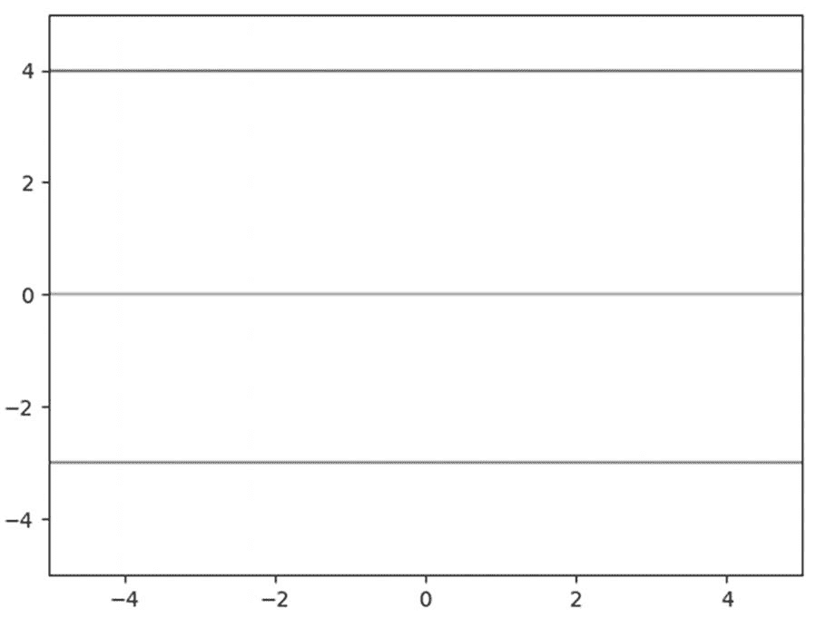

Figure 7.1 ¶ A Graph of Three Horizontal Line Segments.

Figure 7.2 显示两条倾斜直线，方程分别为 y = x 和 y = ‑x。

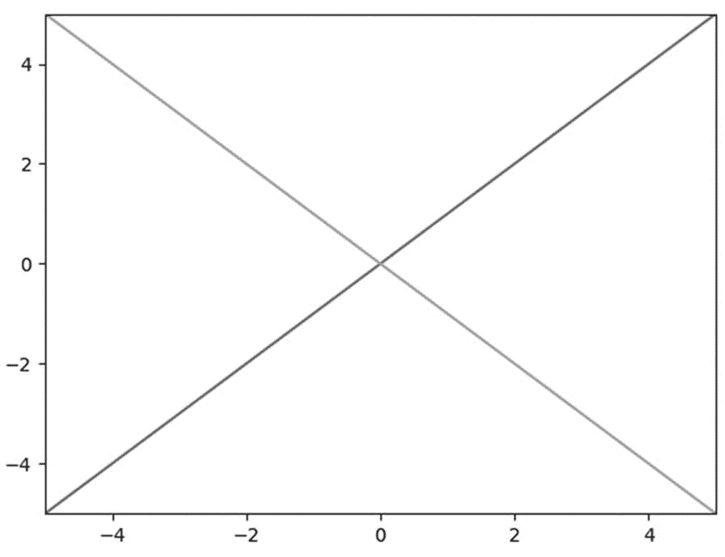

Figure 7.2 ¶ A Graph of Two Diagonal Line Segments.

Figure 7.3 显示两条平行的倾斜直线，方程分别为 y = 2*x 和 y = 2*x + 3。

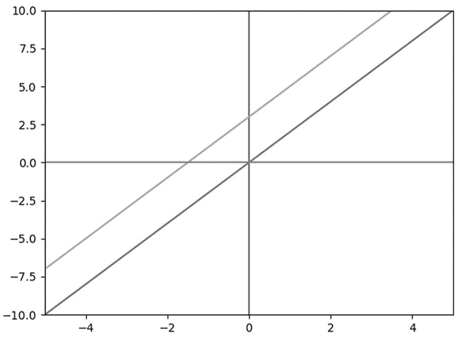

Figure 7.3 ¶ A Graph of Two Slanted Parallel Line Segments.

Figure 7.4 显示一条由连接的线段组成的分段线性图形。

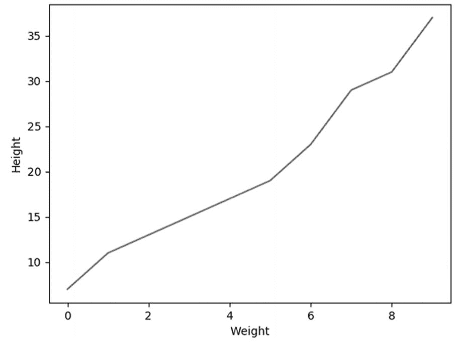

Figure 7.4 ¶ A PieceWise Linear Graph of Line Segments.

现在我们转向使用 NumPy API 生成伪随机数据，然后使用 Matplotlib 绘制图形。

## 使用 NumPy 与 Matplotlib 绘制散点图（1）

Listing 7.1 展示了 np_plot1.py 的内容，说明如何使用 NumPy 的 randn() API 生成数据集，然后使用 Matplotlib 的 scatter() API 绘制点。

需要注意的细节是：所有相邻的横坐标值等距排列，而纵坐标值基于线性方程加上“扰动”项。这种“扰动技术”（并非标准术语）用于其他本章示例中，以在绘制点时引入轻微的随机效果。其优势在于最佳拟合的 m 和 b 值事先已知，无需猜测。

***LISTING 7.1: np_plot1.py***

```python
import numpy as np
import matplotlib.pyplot as plt
x = np.random.randn(15,1)
y = 2.5*x + 5 + 0.2*np.random.randn(15,1)
print("x:",x)
print("y:",y)
plt.scatter(x,y)
plt.show()
```

Listing 7.1 包含两条 import 语句，随后初始化变量 x 为 15 个在 0 到 1 之间的随机数（这里实际是服从正态分布的随机数），随后定义 y ：第一部分是线性方程 2.5*x + 5，第二部分是基于随机数的扰动项。因此，y 模拟了一条接近直线的点集。

此技术用于模拟直线段，随后的训练阶段用于估计最佳拟合直线的 m 和 b 值。显然我们已经知道最佳拟合直线的方程；此技术的目的是比较训练得到的 m 和 b 与已知的真实值（在此例中为 2.5 和 5）进行对比。

下面是 Listing 7.1 的部分输出：


x: \[\[-1.42736308\]  \[ 0.09482338\]  \[-0.45071331\]  \[ 0.19536304\]  \[-0.22295205\]  // values omitted for brevity\] 
y: \[\[1.12530514\]  \[5.05168677\]  \[3.93320782\]  \[5.49760999\]  \[4.46994978\]  // values omitted for brevity\] 

Figure 7.5 displays a scatter plot of points based on the values of x and y.

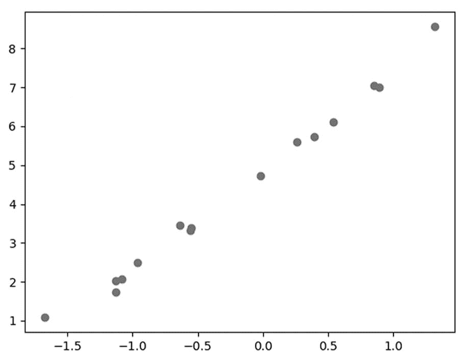

Figure 7.5 ¶   A Scatter Plot of Points for a Line Segment.

### **Why the “Perturbation Technique” is Useful**

You already saw how to use the “perturbation technique” and by way of comparison, consider a dataset with the following points that are defined in the Python array variables X and Y:

X = \[0,0.12,0.25,0.27,0.38,0.42,0.44,0.55,0.92,1.0\] Y = \[0,0.15,0.54,0.51, 0.34,0.1,0.19,0.53,1.0,0.58\] 

If you need to find the best fitting line for the preceding dataset, how would you guess the values for the slope m and the y-intercept b? In most cases, you probably cannot guess their values. However, the “perturbation technique” enables you to “jiggle” the points on a line whose value for the slope m (and optionally the value for the y-intercept b) is specified in advance.

Keep in mind that the “perturbation technique” only works when you introduce small random values that do not result in different values for m and b.

## **Scatter Plots with NumPy and Matplotlib (2)**

The code in Listing 7.1 assigned random values to the variable x, whereas a hard-coded value is assigned to the slope m. The y values are a hard-coded multiple of the x values, plus a random value that is calculated via the “perturbation technique.” Hence we do not know the value of the y-intercept b.

In this section, the values for trainX are based on the np.linspace() API, and the values for trainY involve the “perturbation technique” that is described in the previous section.

The code in this example simply prints the values for trainX and trainY, which correspond to data points in the Euclidean plane. Listing 7.2 displays the contents of np_plot2.py that illustrates how to simulate a linear dataset in NumPy.

***LISTING 7.2: np_plot2.py***

```python
import numpy as np 
trainX = np.linspace(-1, 1, 11) 
trainY = 4*trainX + np.random.randn(*trainX.shape)*0.5 
print("trainX: ",trainX) 
print("trainY: ",trainY) 
```

Listing 7.2 initializes the NumPy array variable trainX via the NumPy linspace() API, followed by the array variable trainY that is defined in two parts. The first part is the linear term 4\*trainX and the second part involves the “perturbation technique” that is a randomly generated number. The output from Listing 7.2 is here:

trainX:  \[-1.  -0.8 -0.6 -0.4 -0.2  0.   0.2  0.4  0.6  0.8  1.\] trainY:  \[-3.60147459 -2.66593108 -2.26491189 -1.65121314 -0.56454605  0.22746004 0.86830728  1.60673482  2.51151543  3.59573877  3.05506056\] 

The next section contains an example that is similar to Listing 7.2, using the same “perturbation technique” to generate a set of points that approximate a quadratic equation instead of a line segment.

## **A Quadratic Scatterplot with NumPy and Matplotlib**

Listing 7.3 displays the contents of np_plot_quadratic.py that illustrates how to plot a quadratic function in the plane.

***LISTING 7.3: np_plot_quadratic.py***

```python
import numpy as np 
import matplotlib.pyplot as plt 
#see what happens with this set of values: 
#x = np.linspace(-5,5,num=100) 
x = np.linspace(-5,5,num=100)[:,None] 
y = -0.5 + 2.2\*x +0.3\*x\*\*2 + 2\*np.random.randn(100,1) 
print("x:",x) 
plt.plot(x,y) 
plt.show() 
```

Listing 7.3 initializes the variable x with the values that are generated via the np.linspace() API, which in this case is a set of 100 equally spaced decimal numbers between -5 and 5. Notice the snippet \[:,None\] in the initialization of x, which results in an array of elements, each of which is an array consisting of a single number.

The variable y is defined in two parts: the first part is a quadratic equation \-0.5 + 2.2\*x +0.3\*x\*\*2 and the second part is a “perturbation” value that is based on a random number (similar to the code in Listing 7.1). Thus, the array variable y simulates a set of values that approximates a quadratic equation. The output from Listing 7.3 is here:

x: \[\[-5.        \]  \[-4.8989899 \]  \[-4.7979798 \]  \[-4.6969697 \]  \[-4.5959596 \]  \[-4.49494949\]  // values omitted for brevity  \[ 4.8989899 \]  \[ 5.        \]\] 

Figure 7.6 displays a scatter plot of points based on the values of x and y, which have an approximate shape of a quadratic equation.

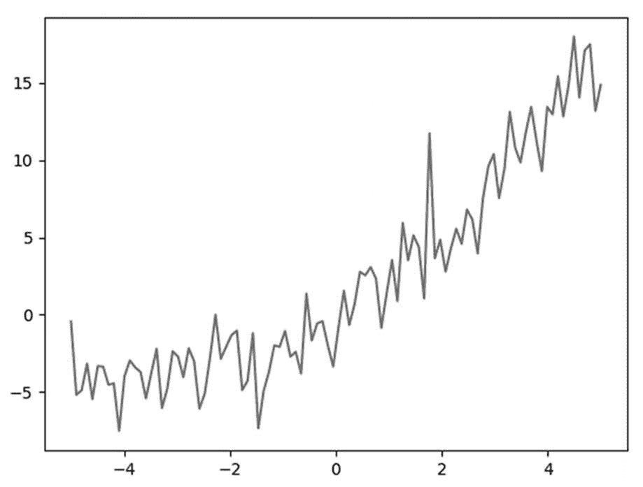

Figure 7.6 ¶ A Scatter Plot of Points for a Quadratic Equation.

## **The Mean Squared Error (MSE) Formula**

In plain English, the MSE is the sum of the squares of the difference between an *actual* y value and its *predicted* y value, divided by the number of points. Notice that the predicted y value is the y value that each data point would have if that point were actually *on* the best-fitting line.

Although the MSE is popular for linear regression, there are other error types available, some of which are discussed briefly in the next section.

### **A List of Error Types**

Although we will only discuss MSE for linear regression in this book, there are other types of formulas that you can use for linear regression, some of which are listed here:

*   MSE

*   RMSE

*   RMSPROP

*   MAE

The MSE is the basis for the preceding error types. For example, RMSE is “Root Mean Squared Error,” which is the square root of MSE.

However, mean absolute error (MAE) is the sum of *the absolute value of the differences of the y terms* (*not* the square of the differences of the y terms), which is then divided by the number of terms.

The RMSProp optimizer utilizes the magnitude of recent gradients to normalize the gradients. Specifically, RMSProp maintain a moving average over the RMS (root mean squared) gradients, and then divides that term by the current gradient.

Although it’s easier to compute the derivative of MSE, it’s also true that MSE is more susceptible to outliers, whereas MAE is less susceptible to outliers. The reason is simple: a squared term can be significantly larger than the absolute value of a term. For example, if a difference term is 10, then a squared term of 100 is added to MSE, whereas only 10 is added to MAE. Similarly, if a difference term is -20, then a squared term 400 is added to MSE, whereas only 20 (which is the absolute value of -20) is added to MAE.

### **Nonlinear Least Squares**

When predicting housing prices, where the dataset contains a wide range of values, techniques such as linear regression or random forests can cause the model to overfit the samples with the highest values in order to reduce quantities such as mean absolute error.

In this scenario, you probably want an error metric, such as relative error, that reduces the importance of fitting the samples with the largest values. This technique is called *nonlinear least squares*, which may use a log-based transformation of labels and predicted values.

The next section contains several code samples, the first of which involves calculating the MSE manually, followed by an example that uses NumPy formulas to perform the calculations. Finally, we’ll look at a TensorFlow example for calculating the MSE.

## **Calculating the MSE Manually**

This section contains two line graphs, both of which contain a line that approximates a set of points in a scatter plot.


Figure 7.7 显示了一个线段，该线段近似了若干点的散点图（其中一些点与线段相交）。Figure 7.7 中的线段的均方误差 (MSE) 计算如下：

MSE = (1\*1 + (-1)\*(-1) + (-1)\*(-1) + 1\*1)/7 = 4/7 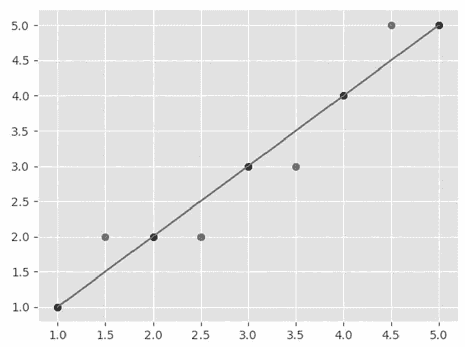

Figure 7.7 ¶ A Line Graph that Approximates Points of a Scatter Plot.

Figure 7.8 显示了一组点和一条线，这条线可能是数据的最佳拟合直线。Figure 7.8 中的线段的均方误差 (MSE) 计算如下：

MSE = ((-2)\*(-2) + 2\*2)/7 = 8/7 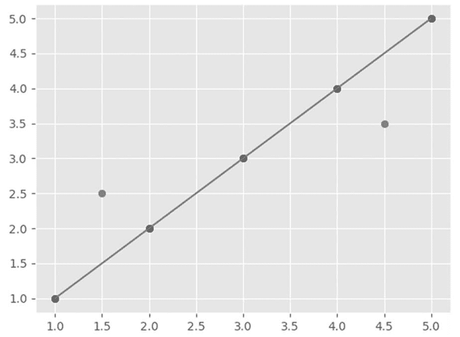

Figure 7.8 ¶ A Line Graph that Approximates Points of a Scatter Plot.

因此，Figure 7.7 中的直线的 MSE 小于 Figure 7.8 中的直线的 MSE，这可能让你感到惊讶（或者你猜对了？）

在这两个图中，我们轻松快速计算了 MSE，但总体而言，这要困难得多。例如，如果我们在欧几里得平面上绘制 10 个点且它们不紧贴一条直线，且各项数值都不是整数，我们可能需要使用计算器。

更好的解决方案是使用 NumPy 函数，例如 np.linspace() API，如下一节所讨论。

## **Approximating Linear Data with np.linspace()**

Listing 7.4 显示了 np_linspace1.py 的内容，该文件演示了如何结合 np.linspace() API 使用“扰动技术”生成一些数据。

***LISTING 7.4: np_linspace1.py***

import numpy as np  trainX = np.linspace(-1, 1, 6) trainY = 3\*trainX+ np.random.randn(\*trainX.shape)\*0.5  print("trainX: ", trainX) print("trainY: ", trainY) 

该代码示例的目的仅仅是生成并显示一组随机数。本章后面，我们将使用这段代码作为实际线性回归任务的起点。

Listing 7.4 以 trainX 数组变量的定义开始，该变量通过 np.linspace() API 初始化。随后，通过“扰动技术”定义 trainY 数组变量，这是你在之前的代码示例中已经看到的方法。Listing 7.4 的输出如下：

trainX:  [ -1.  -0.6 -0.2  0.2  0.6  1. ] trainY:  [ -2.9008553  -2.26684745 -0.59516253  0.66452207  1.82669051  2.30549295] trainX:  [ -1.  -0.6 -0.2  0.2  0.6  1. ] trainY:  [ -2.9008553  -2.26684745 -0.59516253  0.66452207  1.82669051  2.30549295] 

## **What are Ensemble Methods?**

在机器学习中，*ensembles* 指的是结合多个模型预测的方法。其核心思想是通过组合多个已训练的分类器的结果，来超越单个分类器的表现；而且，最差的集合结果通常不会比集合中最差的分类器更差。虽然前面的陈述只是一种启发性（没有正式且严格的证明），但在实践中它大多运行良好。

集合的结果或预测可以通过各种“组合”规则来决定（平均规则是最常用）：

*   多数投票

*   平均值

*   加权平均

*   最大值

*   最小值

*   乘积

最常用的两种集合方法是 *bagging* 和 *boosting*（它们采用相反的方法），并在本节后续内容中讨论。

集合方法是元算法，它们将多种机器学习技术组合成一个预测模型，因为这样可以降低方差（bagging）或偏差（boosting）。这些方法也可以改善预测（stacking）。Adaboost（稍后讨论）是一种序列集合方法。

集合方法构建一个分类器集合，然后通过取（加权）多数投票来对新数据点进行分类。原始的集合方法是贝叶斯平均，更近期的算法包括错误校正输出编码、bagging 和 boosting。

关键思想是，多个模型的预测优于单个模型的预测。然而，分类器必须足够多样化，才能使集合产生良好结果。这可以通过以下方式实现：

*   使用不同的基分类器

*   使用不同的特征进行训练

*   使用训练集的不同部分进行训练

*   使用不同的参数

*Stacking ensembles* 是一类算法，它们训练一个元学习器，以找到基础学习者的最佳组合。与 bagging 和 boosting 不同，stacking 的目标是对强健且多样的学习者集合进行集合。

*Random forest ensembles* 是一种用于分类、回归和其他任务的集合学习方法，它在训练时构建大量决策树：分类时输出类的众数，回归时输出平均预测。

## **Four Types of Ensemble Methods**

集合方法可以分为以下四类：

*   bagging

*   boosting

*   stacking

*   blending

下面的子节提供了上述列表中每一项的简要介绍。

### **Bagging**

*Bagging*（“boosted aggregation”）并行训练许多强分类器，以降低过拟合的可能性。下一步是通过平均化它们的预测来组合所有强分类器。Bagging 通过结合基于同一数据集不同子样本的多个分类器的结果，降低了预测方差。

用于随机森林的 bagging 模型是一个 ensemble，它通过使用多个算法的预测来计算最终的聚合预测，从而防止过拟合，并降低算法的方差。

### **Boosting**

*Boosting* 使用所谓的弱分类器，这些分类器可能具有相当高的错误率。Boosting 按顺序训练大量弱分类器，以提升简单模型的预测能力。每个弱模型尝试改进其前一个模型的预测。Boosting 然后将弱分类器组合成一个强分类器。

尽管 boosting 的预测精度优于 bagging，但它也更容易对训练数据过拟合。下面列出了一些 boosting 算法：

*   AdaBoost

*   Random Forest

*   AdaBoost

*   GBM

*   XGB

*   Light GBM

*   CatBoost

*   LPBoost

*   TotalBoost

*   BrownBoost

*   xgboost

*   MadaBoost

*   LogitBoost

*Adaptive boosting* 是一种对训练数据点和假设进行加权的方法。许多 boosting 算法适用于 *AnyBoost* 框架，该框架表明 boosting 在使用凸损失函数时，在函数空间中执行梯度下降。

下面的步骤描述了寻找弱规则的处理过程：

1.  使用不同的分布运行基础学习（ML）算法

2.  每次运行基础学习算法时，都会生成一个新的弱预测规则

3.  经过多次迭代后，boosting 算法将这些弱规则组合成一个强预测规则。

首先在整个数据集上训练第一个预测器，初始时对每个观测值赋予相同的权重。如果第一个学习者预测错误类别，则对未被正确分类的观测值赋予更高权重。

随后的预测器是基于前一个预测器的表现，在训练集上进行训练。持续添加分类器学习者，直到达到模型数量的限制或精度满足要求。

### **Stacked Models and Blending Models**

*Stacked models* 包含以下步骤：

1.  创建多个基础模型。

2.  收集基础模型的结果。

3.  在基础模型之上创建一个元模型。


4. 生成最终预测。

`Blending` 与堆叠类似，但区别在于下一层是如何训练的：堆叠使用跨折预测，而 `blending` 使用验证集（例如训练集的 10%）进行训练。

### 什么是 Bootstrapping？

当你拥有一个群体，可以从中提取多个大小相同的样本时，你可以利用这些样本来确定群体的分布。

然而，如果你只有一个样本可用，你可以通过有放回地对该样本进行采样，生成多个样本。这些样本被称为 `bootstrap samples`，因为它们是从初始样本而非群体中得到的。由于 bootstrap samples 使用有放回抽样，一个 bootstrap sample 可能会包含重复元素，并且在多个 bootstrap samples 中会有重叠的值。

简言之，`bootstrapping` 是一种机器学习集成算法，用于降低监督学习中的偏差。Bootstrapping 的目的是将弱学习者转化为强学习者。请注意，随机森林使用有放回抽样来构建多棵树。

请记住，“有放回抽样”是“无放回抽样”技术的相反概念，适用于任何卡牌游戏。每位玩家发到一手牌，玩家手中没有重复的卡牌，也不会出现任意两位玩家手中卡牌的重叠。

## 常见的增强学习算法

大多数增强学习算法由迭代学习弱分类器（相对于某一分布）并将其加入最终强分类器组成。下面列出了几种机器学习中著名的增强学习算法：

*   AdaBoost

*   Gradient Boosting

*   XGBoost

*AdaBoost*（“自适应增强”）是一种机器学习分类算法，也是一种集成算法，它通过组合弱分类器（决策树）生成一个强分类器。AdaBoost 是第一个适应弱分类器的算法。它结合了 bagging 和 boosting 方法，开发出类似随机森林的增强预测器，同时涉及 Gini 不纯度得分和 bootstrapped 数据集。不过，AdaBoost 在多个方面与随机森林不同：

1.  AdaBoost 构建由 stumps（仅有一个节点和两个叶子的树）组成的森林。

2.  给定 stump 的目的在于降低其前一个模型的错误。

3.  在最终预测时，stumps 的权重不同：错误较少的 stump 更具重要性。

*Gradient boosting* 是另一种集成算法，它使用 boosting 方法。Gradient boosting 是一种贪心算法，采用迭代技术创建多个模型，每一步都能减小错误。Gradient boosting 包含三个要素：

1.  一个用于优化的损失函数。

2.  一个弱分类器用于生成预测。

3.  一个加 itive model 用于向模型中添加弱分类器，以最小化损失函数。

请注意，Gradient boosting 可能会迅速对训练数据集过拟合。

*XGBoost* 是一个开源的 C++、Java、Python、R 和 Julia 版本的梯度提升框架，适用于 Linux、Windows 和 macOS。XGBoost 是一个强大且流行的算法（常用于 Kaggle 竞赛），它通过对叶子节点进行比例缩小来改进梯度提升。

梯度提升的最初实现是顺序构建树，而 XGBoost 的实现则并行化了树的构建任务，从而缩短训练时间。XGBoost 的安装说明如下：

*[`xgboost.readthedocs.io/en/latest/index.html`](https://xgboost.readthedocs.io/en/latest/index.html)*

## 超参数调优

超参数调优是指为机器学习模型的超参数选择一组值，使其预测精度最大化。精细调参即为超参数调优。超参数调优的三种主要技术是：

*   grid search

*   randomized search

*   Bayesian optimization

每种技术都有其优缺点。例如，假设你想为两个超参数寻找最优值。为了简化，我们假设它们的取值是可比的（否则可以进行标量化），并在二维欧几里得平面的二维网格中表示。

### Grid Search

当两个超参数的重要性相同时，grid search 最为有效。你可以使用 Sklearn 的 GridSearchCV 类进行 grid search，只需指定要选择的超参数以及对应的取值范围。GridSearch 会使用交叉验证来评估不同超参数组合的表现。

### Randomized Search

如果某个超参数的重要性远大于另一个超参数，grid search 可能会浪费时间去搜索和测试远离最优组合的值。此时，random search 可以比 grid search 更快速地收敛到最优值组合。

grid search 适用于组合数量较少的情况，而 RandomizedSearchCV 在超参数空间较大时表现更好。

该类通过在每次迭代中为每个超参数随机选择一个值来评估随机组合，这有两个优势。首先，如果随机搜索运行 N 次，它会为每个超参数探索 N 个不同的值，而 grid search 只检查几个值。其次，能够指定迭代次数，使你能够更精细地控制超参数搜索。

### Bayesian Optimization

Bayesian Optimization 是第三种技术，它也具有较快的收敛率，能够快速找到最优解。Python 库 scikit-optimize（Skopt）支持 Bayesian optimization，并可在此访问：

*[`scikit-optimize.github.io`](https://scikit-optimize.github.io%20)*

Skopt 通过类 BayesSearchCV 进行 Bayesian Optimization，其接口类似于 GridSearchCV。安装 Skopt 的命令如下：

pip3 install scikit-optimize

根据你正在优化的模型，超参数调优可能是一个耗时且昂贵的任务。请记住，当你拥有大量超参数时，建议使用 randomized search。如果超参数数量较少，则使用 grid search。

## AutoML、AutoML-Zero 和 AutoNLP

AutoML 是一个系统，用于自动化和简化训练机器学习模型所涉及的许多底层任务。虽然有许多用于自定义命名实体识别的开源工具，AutoML 通常提供更高的准确率（并且适用于其他任务）。

AutoML 的一个主要优势是能够更快速地将你带入生产就绪的模型。然而，AutoML 也存在一些缺陷，这些缺陷在下面的列表中有所体现：

*   AutoML 缺乏业务直觉。

*   AutoML 无法提供使用机器学习的业务理由或 rationale。

*   AutoML 无法选择训练数据。

AutoML 没有自动化解决业务问题的能力，也无法发现有用的数据。此外，AutoML 不提供伦理、营销、利益相关者对齐或将数据模型与业务其他方面集成等功能。

关键点是利用 AutoML 相关的优势，并结合其他资源来填补 AutoML 不提供的部分。

关于 AutoML 的详细教程（以及 Jupyter Notebook）可在 H2O 文档中找到：

*[`docs.h2o.ai/h2o-tutorials/latest-stable/h2o-world-2017/automl/index.html`](https://docs.h2o.ai/h2o-tutorials/latest-stable/h2o-world-2017/automl/index.html)*


-   [另一个选项是 AutoKeras (用于 Keras 的 AutoML)：`https://autokeras.com`](https://autokeras.com)

    如果你想探索类似于 AutoML 的 NLP 方法，可以考虑使用 AutoNLP，它是用于 NLP 的 AutoML。请注意，AutoML 包含在 AutoViML 框架中，你可以按照以下方式安装后者：

    `pip3 install autoviml`

    AutoViML 的 GitHub 仓库在这里：

    `https://github.com/AutoViML/Auto_ViML`

## 杂项主题

本章最后一个部分包含一系列对机器学习研究人员和实践者非常感兴趣的主题。这些主题简要介绍，旨在让你（如果你尚未了解）意识到机器学习中一些尚未完全解答的方面。

### 什么是因果关系？

在最简单的形式中，因果关系是指一种事件对另一种事件的影响程度。机器学习模型可以揭示相关性，但无法确定因果关系。简单来说，如果 A 和 B 是两个特征，机器学习可以判断 A 和 B 之间是否存在相关性，但无法判断 A 是否导致 B，或者 B 是否导致 A。

### 什么是可解释性？

可解释性的概念很简单：我们如何解释机器学习模型做出预测的过程？机器学习中的可解释性具有财务影响。例如，欧洲的通用数据保护条例 (GDPR) 现在允许在金融交易中使用深度学习，因为深度学习模型无法解释给定预测是如何得出的。

特别是，当人们申请银行贷款且贷款被拒绝时，银行必须提供拒绝贷款的原因（解释）。

### 什么是可解释性（Interpretability）？

可解释性帮助数据科学家解释、调试和验证模型，从而帮助建立对模型的信任。InterpretML 是微软开源的一个包，包含了现代机器学习可解释性技术，可用于解释黑盒系统或玻璃盒模型。主页在这里：`https://github.com/interpretml/interpret`

azureml.interpret 包支持开发者使用的数据集格式，如 NumPy.array、pandas.DataFrame、iml.datatypes.DenseData 和 scipy.sparse.csr_matrix；此外，它还利用 LIME、SHAP、SALib 或 Plotly 等库，并提供如可解释增强学习机器 (Explainable Boosting Machine, EBM) 等新的可解释性算法。

可解释性包对任何数据科学家都很有用，尤其是初创公司和企业，因为它是模型调试、发现公平性问题、理解监管合规性以及模型决策以在利益相关者和高管之间建立信任的重要工具。

## 总结

本章介绍了机器学习及相关概念，如特征选择、特征工程、数据清洗、训练集和测试集。随后，你学习了监督学习、无监督学习和半监督学习。接着，你学习了回归任务、分类任务和聚类，以及准备数据集的典型步骤。这些步骤包括“特征选择”或“特征提取”，可以使用各种算法进行。随后，你学习了数据集中可能出现的问题以及如何解决它们。

此外，你还学习了线性回归，并了解如何计算欧几里得平面上数据值的最佳拟合直线。你还看到如何使用 NumPy 进行线性回归，以初始化包含数据值的数组，并使用一种“扰动”技术向 y 值中引入随机性。这种技术很有用，因为你将知道最佳拟合直线的斜率和截距的正确值，然后可以将其与训练得到的值进行比较。最后，你学习了 AutoML 及其一些优势和缺点。

# CHAPTER 8

# CLASSIFIERS IN MACHINE LEARNING

本章是第二个讨论机器学习的章节，重点聚焦于分类算法，因为大多数机器学习任务涉及分类或回归。

本章讨论分类算法，并提供代码示例，展示不同最重要超参数的取值。这些示例将跨越多个章节。正如你所知，本书的目的是提供许多主题的入门，因此本章提供了对分类器的快速概览。如果你计划使用机器学习分类器，请搜索在线资源以获取更详细的算法信息；良好的起点是 Sklearn 的在线文档页面。

常见的分类算法包括 kNN（k 邻近算法）、逻辑回归（尽管名称如此，它 `is` 一个分类器）、决策树、随机森林、SVM 和贝叶斯分类器。本章的算法重点旨在介绍机器学习，其中包含一个基于 Sklearn 的树形代码示例。本章后半部分包含基于 Keras 的标准数据集代码示例。

由于空间限制，本章不涵盖聚类算法。不过，你可以通过以下链接访问 extensive list of such algorithms and their descriptions：`https://scikit-learn.org/stable/modules/clustering.html`。

基于上述要点，本章的第一部分简要讨论了前一段中提到的分类器。本章的第二部分提供了激活函数的概述，这将在你决定学习深度神经网络时非常有用。在这一节中，你将学习它们的使用方式和原因。本节还包含了 TensorFlow 中激活函数 API 的列表，并描述了一些它们的优势。

第三部分介绍了 `logistic regression`，它是一个分类器（尽管名称如此）。逻辑回归依赖于 sigmoid 函数，该函数也用于循环神经网络 (RNN) 和长短期记忆 (LSTM)。本章的第四部分包含一个使用 MNIST 数据集的逻辑回归代码示例。

本章的最后一部分包含使用 Sklearn 以及 Keras 进行线性回归的示例。

请记住，激活函数所在的章节需要对神经网络隐藏层的基本理解。根据你的舒适程度，你可能需要阅读一些准备材料才能深入这一节（网上有许多相关文章）。

## 什么是分类？

给定一个包含观测值且其类别已知的数据集，分类是确定新数据点属于哪个类别的任务。类别指的是类别和目标，也称为标签。例如，电子邮件服务提供商的垃圾邮件检测涉及二分类（只有两个类别）。MNIST 数据集包含一组图像，每张图像是一个单独的数字，这意味着有 10 个标签。分类的某些应用包括：信用评估、医疗诊断和目标营销。

### 什么是分类器？

为了给你一些背景，分类器是三大主要算法类型之一：回归算法（如第 7 章中的线性回归）、分类算法（本章讨论）和聚类算法（如 kMeans，本书未讨论）。


-   [在前一章节，你学到了线性回归结合监督学习和数值数据：目标是训练一个模型，能够进行数值预测（例如，明天股票的价格、系统的温度、大气压力等）。相比之下，分类器结合监督学习和类别数据：目标是训练一个模型，预测新数据点的正确标签。

-   例如，假设数据集中的每一行是一款特定的葡萄酒，每一列对应一项特定的葡萄酒特征（单宁、酸度等）。假设数据集中有五类葡萄酒，为了简化，我们将它们标记为 A、B、C、D 和 E。给定一个新数据点，即新的一行数据，该数据集的分类器尝试确定该葡萄酒的标签。

-   本章节中的一些分类器既能进行类别分类，也能进行数值预测（即它们既可以用于回归，也可以用于分类）。

### 常见分类器

本章节列出了一些最流行的机器学习分类器（顺序不分先后）：

* 线性分类器
* kNN
* 逻辑回归
* 决策树
* 随机森林
* SVM
* 贝叶斯分类器
* CNN（深度学习）

请注意，不同的分类器具有不同的优势和劣势，这通常涉及到复杂度与准确性之间的权衡，类似于 AI 以外领域的算法。

在深度学习的情况下，卷积神经网络（CNN）执行图像分类，因此它们是分类器。（它们也可以用于音频和文本处理。）

下面的章节简要描述了前面列表中提到的 ML 分类器。

### 二元分类与多类分类

二元分类器处理只有两个类的数据集，而多类分类器（有时称为多项式分类器）处理超过两个类。随机森林分类器、Naïve Bayes 分类器和 SVM 支持多个类；尽管线性分类器是二元分类器，但有时也有多类扩展。

此外，还有基于二元分类器的多类分类技术：一对所有（OvA）和一对一（OvO）。

OvA 技术（也称为一对其余）涉及等于类别数量的多个二元分类器。例如，如果数据集有五个类，则 OvA 使用五个二元分类器，每个二元分类器用于检测其中一个类。为了在该数据集中对数据点进行分类，选择输出分数最高的二元分类器。

OvO 技术也涉及多个二元分类器，但每个二元分类器用于在一对类上进行训练。例如，如果类别为 A、B、C、D、E，则需要 10 个二元分类器：一个用于 A 和 B，一个用于 A 和 C，一个用于 A 和 D，以此类推，直到最后一个二元分类器用于 D 和 E。

一般而言，如果有 n 个类，则需要 n*(n-1)/2 个二元分类器。虽然 OvO 技术需要显著更多的二元分类器（例如，20 类需要 190 个二元分类器），而 OvA 技术只需要 20 个二元分类器（例如，20 类只需 20 个二元分类器），但 OvO 技术的优势在于每个二元分类器只在其选定的两个类所属的数据子集上进行训练。

### 多标签分类

多标签分类为实例分配多个标签。因此，多标签分类是前一节讨论的多类分类的推广，后者为数据集中包含多个类的实例分配单个标签。关于多标签分类的文章（包含基于 Keras 的代码）可在这里找到：

*[`medium.com/@vijayabhaskar96/multilabel-image-classification-tutorial-with-keras-imagedatagenerator-cd541f8eaf24`](https://medium.com/@vijayabhaskar96/multilabel-image-classification-tutorial-with-keras-imagedatagenerator-cd541f8eaf24)*

你也可以在线搜索涉及 Sklearn 或 PyTorch 的多标签分类任务的文章。

## 什么是线性分类器？

*线性分类器* 将数据集分为两类。线性分类器是一条 2D 点的直线、3D 点的平面，以及高维点的超平面（平面的推广）。线性分类器通常是最快的分类器，因此当分类速度至关重要时，它们常被使用。线性分类器通常在输入向量稀疏（即大部分为零）或维度数量较大时表现良好。

## 什么是 kNN？

kNN（“k 最近邻”）算法是一种分类算法。简要来说，邻近的数据点被归类为同一类。当引入新点时，它被归入其最近邻的多数类。例如，假设 k 等于 3，新数据点被加入。查看其 3 个最近邻的类别：假设它们是 A、A、B。通过多数投票，新数据点被标记为类 A 的数据点。

kNN 算法本质上是一种启发法，而非基于复杂数学基础的技术，但它仍然是有效且有用的算法。如果你想使用简单的算法，或者相信你的数据集高度无结构，可以尝试 kNN 算法。尽管 kNN 算法本身很简单，它仍然能够产生高度非线性的决策。你可以在查找“相似”项的搜索应用中使用 kNN。

通过创建项的向量表示，然后使用适当的距离度量（如欧氏距离）来比较向量。

kNN 搜索的具体示例包括查找语义相似的文档。

### 如何处理 kNN 中的平局

奇数值的 k 较少可能导致平局投票，但仍有可能。例如，假设 k 等于 7，新数据点的七个最近邻属于集合 {A,B,A,B,A,B,C}。如你所见，没有多数，因为类 A 有 3 个点，类 B 有 3 个点，类 C 有 1 个点。

下面列出了处理 kNN 中平局的几种技术：

- 给更近的点分配更高权重。
- 增大 k 的值，直到确定胜出者。
- 减小 k 的值，直到确定胜出者。
- 随机选择一个类。

如果你将 k 减小到 2，仍有可能出现平局：可能有两个点与新点距离相同，因此需要机制决定这两个点中哪一个作为 2-邻。

如果类 A 和类 B 之间出现平局，则随机选择类 A 或类 B。另一种变体是记录“平局”票数，并以循环方式交替，以确保更均匀的分布。

### SMOTE 和 kNN

一个显著挑战是处理不平衡数据集，即某一类的行数远多于其他类的行数。例如，健康人和患癌症的人的数据集可能有 95% 和 5% 的行，分别属于这两类。由于分类算法倾向于偏向数据集中的主导类，我们需要一个机制来通过更多有意义的数据来平衡数据集。


一种实现方法是使用合成少数过采样技术（SMOTE）算法，该算法基于 kNN 算法的启发式规则。其直观思路是：如果两个数据点非常接近，则可以利用这两个点进行线性插值，生成看起来合理的合成数据点。可以通过对多个高度相似的数据点对进行重复处理，从而使合成数据点更均匀地分布。

请注意，该技术是一种启发式方法，不能保证合成数据真正是有效的数据。除了 kNN 外，SMOTE 还可以通过支持向量机（SVM）来实现。SMOTE 简要介绍在附录 A 中，您可以在线搜索获取关于 SMOTE 的更多详细信息。

### kNN 用于数据插补

数据清洗包括多个子任务，例如通过计算数值的均值（在数值数据中）或众数（在类别数据中）来估计缺失值。您也可以使用 kNN 进行数据插补（即为缺失值赋值）。该技术的直观思路是：值相同（或相似）的数据点可以相互插值，以生成另一邻近数据点在某一特征上未赋值的适当值。

### 什么是决策树？

决策树是另一种分类算法，其结构为树形。以下领域可从决策树的应用中受益：

*   天文学

*   生物医学工程

*   金融分析

*   制造业

*   医学

*   物理

*   系统控制

一个决策树包含一个根节点及其子节点，每个节点通常又有自己的子节点。树的重要特性包括：

*   根节点的选择

*   树的深度（即层数）

*   每个节点中的元素数量

*   对节点进行划分（分割）的规则

*   选择 Gini 不纯度与熵

在选择根节点后，下一步是添加子节点，并重复此过程，直到训练集中的所有数据点都被分配到树中的某个节点。没有子节点的节点称为叶节点。决策树分类通过判断新数据点最可能属于哪个叶节点来进行分类。

在“通用”树中，数据点的位置由简单的条件逻辑决定。举例来说，假设数据集包含表示年龄的数值，且第一个数值为 50，该数值被选为树的根节点；小于 50 的数值进入左子树，大于 50 的数值进入右子树。

例如，若数值序列为 {50, 25, 70, 40}，则可以构建如下树：50 为根节点；25 为 50 的左子节点；70 为 50 的右子节点；40 为 25 的右子节点。每加入一个新数值，都需要在树的每个节点上决定向左还是向右前进。

还需注意：大多数机器学习算法在调用 fit() 方法时会使用整个数据集。对于这些算法，使用二元变量更为合适。

另外请注意，Pandas 的 get_dummies() 方法会为变量的每个类别创建相应的二元变量。

Pandas 的 get_dummies() 方法会为变量的每个类别创建相应的二元变量。

### 决策树的权衡

训练决策树模型涉及权衡。决策树的优势在于：

*   对于简单数据集，其表现可与其他算法相媲美

*   构建成本 generally 低

*   小规模树易于解释

但决策树也有缺点：

*   易于过拟合

*   往往偏向于级别较多的特征

*   对训练数据的小幅变动敏感

*   大型树的解释性较差

*   决策边界仅限于与属性轴平行的矩形区域

尽管决策树具有树状结构，其决策节点的逻辑条件在二维欧几里得平面上对应于矩形划分。

### 决策树算法

构建决策树的算法有多种，常见的包括：

*   ID3（Iterative Dichotomiser 3）

*   CART（Classification And Regression Tree）

*   CHAID（Chi-square automatic interaction detection）

CHAID 在构建分类树时会进行多层次划分。您可以尝试不同的算法，观察哪种算法为您的模型提供最佳结果。

附录 A 讨论了 Gini 指数与熵，而在本章的代码示例中，您会看到这两个值可以作为 Sklearn 决策树的 criterion 参数指定。此外，决策树算法使用所谓的 *信息增益* 来划分节点，该值可以通过 Gini 指数或熵计算。CART 算法使用 Gini 指数，而 ID3 算法使用熵。

在开始详细说明之前，先看一个使用 Gini 不纯度（为 Sklearn 决策树的默认 criterion）的示例：

Listing 8.1 展示了 sklearn_tree2.py 的内容，该文件定义了二维欧几里得平面上的 2D 点集合及其标签，并预测了若干其他 2D 点的类别。

**LISTING 8.1: sklearn_tree2.py**

```python
from sklearn import tree  # X = pairs of 2D points and Y = the class of each point X = [[0, 0], [1, 1], [2,2]] Y = [0, 1, 1] tree_clf = tree.DecisionTreeClassifier() tree_clf = tree_clf.fit(X, Y)  #predict the class of samples: print("predict class of [-1., -1.]:") print(tree_clf.predict([[ -1., -1.]]))  print("predict class of [2., 2.]:") print(tree_clf.predict([[2., 2.]]))  # the percentage of training samples of the same class  # in a leaf note equals the probability of each class print("probability of each class in [2.,2.]:") print(tree_clf.predict_proba([[2., 2.]]))
```

Listing 8.1 导入 Sklearn 的 tree 模块，并初始化 X（2D 点的数对）和 Y（每个点的类别）。随后创建 DecisionTreeClassifier 实例 tree_clf，并通过 fit() 方法对其进行训练。

运行 Listing 8.1 中的代码后，将看到如下输出：

predict class of [-1., -1.]: [0] predict class of [2., 2.]: [1] probability of each class in [2.,2.]: [[0. 1.]]

可以看出，[-1,-1] 和 [2,2] 被正确标记为 0 和 1，这符合预期。


-   Listing 8.2 显示 `sklearn_tree3.py` 的内容，该文件在 Listing 8.1 的基础上增加了第三个标签，并改为在二维欧几里得平面上预测三个点的标签（修改部分已用 **加粗** 标出）。

***LISTING 8.2: sklearn_tree3.py***

```python
from sklearn import tree  # X = pairs of 2D points and Y = the class of each point
X = [[0, 0], [1, 1], [2, 2]]
Y = [0, 1, **2**]
tree_clf = tree.DecisionTreeClassifier()
tree_clf = tree_clf.fit(X, Y)  # predict the class of samples:
print("predict class of \[-1., -1.\]:")
print(tree_clf.predict([[-1., -1.]]))
print("predict class of \[0.8, 0.8\]:")
print(tree_clf.predict([[0.8, 0.8]]))
print("predict class of \[2., 2.\]:")
print(tree_clf.predict([[2., 2.]]))
# the percentage of training samples of the same class
# in a leaf note equals the probability of each class
print("probability of each class in \[2.,2.\]:")
print(tree_clf.predict_proba([[2., 2.]]))
```

Now launch the code in Listing 8.2 and you will see the following output:

```
predict class of \[-1., -1.\]: \[0\] **predict class of \[0.8, 0.8\]:** **\[1\]** predict class of \[2., 2.\]: \[**2**\] probability of each class in \[2.,2.\]: \[\[**0\. 0. 1.**\]\] 
```

As you can see, the points \[-1,-1\], \[0.8, 0.8\], and \[2,2\] are correctly labeled with the values 0, 1, and 2, respectively, which again is probably what you expected. Listing 8.3 displays the dataset `partial_wine.csv`, which contains two features and a label column (there are three classes). The total row count for the complete dataset is 178.

***LISTING 8.3: partial_wine.csv***

```python
Alcohol, Malic acid, class 14.23,1.71,1 13.2,1.78,1 13.16,2.36,1 14.37,1.95,1 13.24,2.59,1 14.2,1.76,1 14.2,1.76,1 
```

Listing 8.4 displays contents of `tree_classifier.py` that uses a decision tree, with entropy as the value for the criterion parameter (and shown in bold), in order to train a model on the dataset `partial_wine.csv`.

***LISTING 8.4: tree_classifier.py***

```python
import numpy as np
import matplotlib.pyplot as plt
import pandas as pd  # Importing the dataset
dataset = pd.read_csv('partial_wine.csv')
X = dataset.iloc[:, [0, 1]].values
y = dataset.iloc[:, 2].values  # split the dataset into a training set and a test set
from sklearn.model_selection import train_test_split
X_train, X_test, y_train, y_test = train_test_split(X, y, test_size=0.25, random_state=0)  # Feature Scaling
from sklearn.preprocessing import StandardScaler
sc = StandardScaler()
X_train = sc.fit_transform(X_train)
X_test = sc.transform(X_test)  # ====> INSERT YOUR CLASSIFIER CODE HERE <====
from sklearn.tree import DecisionTreeClassifier  # ====> INSERT YOUR CLASSIFIER CODE HERE <====
classifier = DecisionTreeClassifier(criterion='entropy', random_state=0)  # classifier.fit(X_train, y_train)  # ====> INSERT YOUR CLASSIFIER CODE HERE <====  # predict the test set results
y_pred = classifier.predict(X_test)  # generate the confusion matrix
from sklearn.metrics import confusion_matrix
cm = confusion_matrix(y_test, y_pred)
print("confusion matrix:")
print(cm)
```

Listing 8.4 starts with import statements and then populates the variable `dataset` with the contents of the CSV file `partial_wine.csv`. Next, the variable `X` is initialized with the first two columns (and all the rows) of `dataset`, and the variable `y` is initialized with the third column (and all the rows) of `dataset`.

Next, the variables `X_train`, `X_test`, `y_train`, `y_test` are populated with data from `X` and `y` using a 75/25 split proportion. Notice that the variable `sc` (which is an instance of the `StandardScaler` class) performs a scaling operation on the variables `X_train` and `X_test`.

The code block shown in bold in Listing 8.4 is where we create an instance of the `DecisionTreeClassifier` class and then train the instance with the data in the variables `X_train` and `X_test`.

The next portion of Listing 8.4 populates the variable `y_pred` with a set of predictions that are generated from the data in the `X_test` variable. The last portion of Listing 8.4 creates a confusion matrix based on the data in `y_test` and the predicted data in `y_pred`.

Remember that all the diagonal elements of a confusion matrix are correct predictions (such as true positive and true negative); all the other cells contain a numeric value that specifies the number of predictions that are incorrect (such as false positive and false negative).

Now launch the code in Listing 8.4 and you will see the following output for the confusion matrix in which there are 36 correct predictions and nine incorrect predictions (with an accuracy of 80%):

```
confusion matrix: \[\[13  1  2\]  \[ 0 17  4\]  \[ 1  1  6\]\] from sklearn.metrics import confusion_matrix 
```

The sum of the nonzero entries is 45 in the preceding 3×3 matrix, and the diagonal entries are correctly identified labels. Hence the accuracy is 36/45 = 0.80.

## **Decision Trees, Gini Impurity, and Entropy**

In the previous chapter, you learned how to calculate values for gini impurity and entropy. As you now know, the `DecisionTreeClassifier` class has a `criterion` parameter whose value can be either `entropy` or `gini` (the latter is the default value).

Listing 8.5 displays the contents of `tree_iris_gini.py` that illustrates how to use the `DecisionTreeClassifier` class in Sklearn and specify `gini` as the criterion (which is specific in the code just for emphasis).

***LISTING 8.5: tree_iris_gini.py***

```python
from sklearn.datasets import load_iris
from sklearn.tree import DecisionTreeClassifier
from sklearn.tree import export_graphviz 
iris = load_iris()
X = iris.data[:, 2:]
y = iris.target 
tree_clf = DecisionTreeClassifier(max_depth=4,criterion='gini',random_state=10)
tree_clf.fit(X, y) 
export_graphviz( 
    tree_clf, 
    out_file="iris_gini.dot", 
    feature_names=iris.feature_names[2:], 
    class_names=iris.target_names, 
    rounded=True, 
    filled=True) 
plt.show() 
```

Listing 8.5 starts with import statements and then initializes the variable `iris` as an instance of the Iris dataset that is available through Sklearn. The variable `X` is initialized with all the rows of `iris` and all columns except the first column. The variable `y` is initialized as the target column in `iris`, which is the label values. Note that the data and target components are defined in the Iris dataset that is built into Sklearn: if you download a CSV file containing the Iris dataset, it does not necessarily contain data and target components.

The next code snippet initializes the variable `tree_clf` as an instance of the Sklearn class `DecisionTreeClassifier`, after which the `fit()` method of `tree_clf` is invoked with `X` and `y` as arguments.

The last code block invokes the `export_graphviz()` method to generate a “.dot” file, and you can use the `dot` executable in GraphViz (after installing it on your machine) to create a PNG file with this command:

```
dot -Tpng iris_gini.dot -o iris_gini.png 
```

Figure 8.1 displays a tree-based graph with gini impurity values for various nodes in the tree.

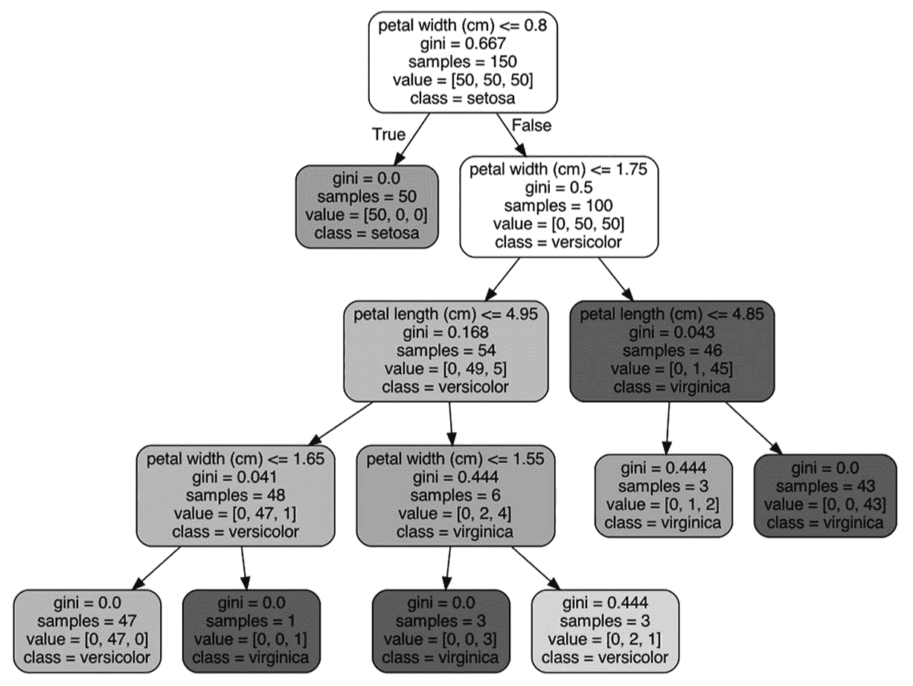

Figure 8.1 ¶ A Tree with Gini Impurity Values.

Listing 8.6 displays the contents of `tree_iris_entropy.py` that illustrates how to use the `DecisionTreeClassifier` class in Sklearn and specify `entropy` instead of `gini` as the value for the `criterion` parameter.

***LISTING 8.6: tree_iris_entropy.py***


from `sklearn.datasets` import `load_iris` from `sklearn.tree` import `DecisionTreeClassifier` from `sklearn.tree` import `export_graphviz` `iris` = `load_iris`() `X` = `iris.data`[`:, 2:`] `y` = `iris.target` `tree_clf` = `DecisionTreeClassifier`(`max_depth`=4, `criterion`='entropy', `random_state`=10) `tree_clf`.`fit`(`X`, `y`) `export_graphviz`(` tree_clf, `out_file`="iris_entropy.dot", `feature_names`=`iris.feature_names`[`2:`], `class_names`=`iris.target_names`, `rounded`=True, `filled`=True) `plt`.`show`()

Listing 8.6 is based on Listing 8.5: simply change the occurrence of gini with entropy throughout the code and launch the code from the command line. See the comment after Listing 8.5 that explains how to generate a PNG file from a “.dot” file Figure 8.2 displays a tree-based graph with entropy values for various nodes in the tree.

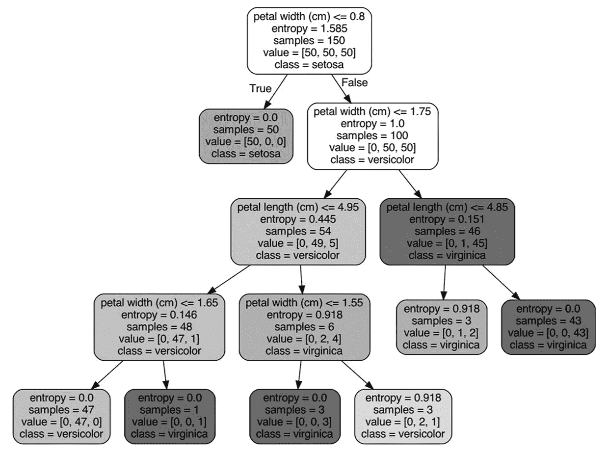

Figure 8.2 ¶ A Tree with Entropy Values.

## **What are Random Forests?**

Random forests are a generalization of decision trees: this classification algorithm involves multiple trees. (The number is specified by you.) If the data involves making a numeric prediction, the average of the predictions of the trees is computed. If the data involves a categorical prediction, the mode of the predictions of the trees is determined.

By way of analogy, random forests operate in a manner similar to financial portfolio diversification: the goal is to balance the losses with higher gains. Random forests use a “majority vote” to make predictions, which operates under the assumption that selecting the majority vote is more likely to be correct (and more often) than any individual prediction from a single tree. Hence, random forests are a good choice, especially when a model that is based on a decision tree does not achieve the level of accuracy that you need.

You can easily modify the code in Listing 8.6 to use a random forest by replacing the two lines shown in bold with the following code:

from `sklearn.ensemble` import `RandomForestClassifier` `classifier` = `RandomForestClassifier`(`n_estimators` = 10, `criterion`='entropy', `random_state` = 0) 

Make this code change, launch the code, and examine the confusion matrix to compare its accuracy with the accuracy of the decision tree in Listing 8.4.

## **What are Support Vector Machines?**

Support vector machines (SVM) involve a supervised ML algorithm and can be used for classification or regression problems. SVM can work with nonlinearly separable data as well as linearly separable data. SVM uses a technique called the “kernel trick” to transform data and then finds an optimal boundary the transform involves higher dimensionality. This technique results in a separation of the transformed data, after which it’s possible to find a hyperplane that separates the data into two classes.

SVMs are more common in classification tasks than regression tasks. Some use cases for SVMs include:

*   text classification tasks: category assignment

*   detecting spam/sentiment analysis

*   used for image recognition: aspect-based recognition color-based classification

*   handwritten digit recognition (postal automation)

### **Trade-offs of SVMs**

Although SVMs are extremely powerful, there are trade-offs involved. Some of the advantages of SVMs are listed here:

*   high accuracy

*   works well on smaller cleaner datasets

*   can be more efficient because it uses a subset of training points

*   an alternative to CNNs in cases of limited datasets

*   captures more complex relationships between datapoints

Some of the disadvantages of SVMs are listed here:

*   not suitable for larger datasets (training time can be high)

*   less effective on noisier datasets with overlapping classes

SVMs involve more parameters than decision trees and random forests.

Suggestion: modify Listing 8.4 to use an SVM by replacing the first two lines in Listing 8.4 (that are shown in bold) with the following two lines shown in bold:

**from `sklearn.svm` import `SVC`** **classifier = `SVC`(`kernel =` '**linear**'`, random_state = 0)` 

You now have an SVM-based model, simply by making the previous code update! Make the code change, then launch the code and examine the confusion matrix in order to compare its accuracy with the accuracy of the decision tree model and the random forest model earlier in this chapter.

## **What is a Bayesian Classifier?**

A naive Bayes (NB) classifier is a probabilistic classifier inspired by Bayes’ theorem. An NB classifier assumes the attributes are conditionally independent and it works well even when assumption is not true. This assumption greatly reduces computational cost, and it’s a simple algorithm to implement that only requires linear time. Moreover, an NB classifier is easily scalable to larger datasets and good results are obtained in most cases. Other advantages of an NB classifier include:

*   can be used for binary and multiclass classification

*   provides different types of NB algorithms

*   good for text classification problems

*   a popular choice for spam email classification

*   can be easily trained on small datasets

As you can probably surmise, NB classifiers do have some disadvantages, as shown in the following list:

*   All features are assumed unrelated.

*   It cannot learn relationships between features.

*   It can suffer from “the zero probability problem.”

The “zero probability problem” refers to the case when the conditional probability is zero for an attribute: it fails to give a valid prediction. However, can be fixed explicitly using a Laplacian estimator whose details are outside the scope of this book.

### **Types of Naïve Bayes Classifiers**

There are three major types of naive Bayes classifiers, as shown in the following list:

*   Gaussian Naive Bayes

*   MultinomialNB Naive Bayes

*   Bernoulli Naive Bayes

Details of these classifiers are also beyond the scope of this chapter, but you can perform an online search for more information. Now that you are somewhat familiar with several classification algorithms in machine learning, let’s turn our attention to different ways to train classifiers, which is the topic of the next section.

## **Training Classifiers**

The *holdout method* is the most common method for training a classifier in machine learning, which starts by dividing the dataset into two partitions called train and test (80% and 20%, respectively). The train set is used for training the model, and the test data tests its predictive power.

The *k-fold cross-validation* technique is used to verify that the model is not overfitted. The dataset is randomly partitioned into k mutually exclusive subsets, where each partition has equal size. One partition is for testing and the other partitions are for training. Repeat this process whereby a different fold is designed the testing fold; since there are k folds, this process involves k iterations.

In addition to the k-fold cross-validation technique, there are other techniques that you can experiment with, as shown in the following list:

*   stratified k-fold cross validation

*   leave-one-out cross validation

*   group k-fold cross validation

Listing 8.7 displays contents of `knn_classifier_cross_val.py` that illustrates several ways of performing cross validation.

***LISTING 8.7: knn_classifier_cross_val.py***


import pandas as pd from sklearn import metrics from sklearn.model_selection import ShuffleSplit from sklearn.model_selection import cross_val_score  # Import the wine dataset: dataset = pd.read_csv('wine.csv') X = dataset.iloc[:, [0, 1]].values y = dataset.iloc[:, 2].values  # split dataset into training and test sets: from sklearn.model_selection import train_test_split X_train, X_test, y_train, y_test = train_test_split(X, y, test_size = 0.25, random_state = 0)  # scale the feature values between 0 and 1: from sklearn.preprocessing import StandardScaler sc = StandardScaler() X_train = sc.fit_transform(X_train) X_test = sc.transform(X_test)  # option 1: use cross validation cv=8 from sklearn.neighbors import KNeighborsClassifier classifier = KNeighborsClassifier(n_neighbors = 10, metric='minkowski', p=2) scores = cross_val_score(classifier, X_train, y_train, cv=cv) print("=> option 1 default scores:") print(scores) print()  # option 2: use a scoring parameter  # The score at each CV iteration is the score method of the estimator that can be modified via the scoring parameter: more details here: [`scikit-learn.org/stable/modules/model_evaluation.html#scoring-parameter`](https://scikit-learn.org/stable/modules/model_evaluation.html#scoring-parameter) scores = cross_val_score(classifier, X_train, y_train, cv=cv, scoring='f1_macro') print("=> option 2 f1_macro scores:") print(scores) print()  # 3) pass a cross validation iterator: # cross_val_score uses KFold or StratifiedKFold if cv is an integer: n_samples = X_train.shape[0] cv = ShuffleSplit(n_splits=10, test_size=0.3, random_state=0) print("=> option 3 ShuffleSplit scores:") print(cross_val_score(classifier, X_train, y_train, cv=cv))

Launch the code in Listing 8.7 and you will see the following output: => option 1 default scores: [0.64705882 0.76470588 0.82352941 0.82352941 0.82352941 0.8125 0.8125 0.875 0.875] => option 2 f1_macro scores: [0.63822844 0.76550117 0.80769231 0.81678322 0.81678322 0.81818182 0.81111111 0.86666667] => option 3 ShuffleSplit scores: [0.75 0.8 0.85 0.775 0.775 0.625 0.8 0.775 0.85 0.775]

## Evaluating Classifiers

Whenever you select a classifier for a dataset, it’s obviously important to evaluate the accuracy of that classifier. Some common techniques for evaluating classifiers are listed here:

* precision and recall

* ROC curve (receiver operating characteristics)

*Precision and recall* are discussed in an earlier chapter and they reproduced here for your convenience. First, let’s define the following variables:

TP = the number of true positive results FP = the number of false positive results TN = the number of true negative results FN = the number of false negative results 

Then the definitions of precision, accuracy, and recall are given by the following formulas:

precision = TP/(TN + FP) accuracy = (TP + TN)/[P + N] recall = TP/[TP + FN] 

The *receiver operating characteristics* (ROC) curve is used for visual comparison of classification models that shows the trade-off between the true positive rate and the false positive rate. The area under the ROC curve is a measure of the accuracy of the model. When a model is closer to the diagonal, it is less accurate and the model with perfect accuracy will have an area of 1.0.

The ROC curve plots the true positive rate (TPR) versus the false positive rate (FPR). Another type of curve is the PR curve that plots precision versus recall. When dealing with highly skewed datasets (strong class imbalance), precision-recall (PR) curves give better results.

## Trade-offs for ML Algorithms

This section contains a brief description of the trade-offs of various ML algorithms that were discussed earlier in chapter.

In general, there is no *a priori* way to determine which algorithm works best for a given dataset. Hence, it’s a good idea to try every model (or as many as are feasible), tune the hyperparameters accordingly, and analyze the errors carefully. If time and space are constraints, try using a subset of the original dataset (perhaps 25%), and after determining which algorithm produces the best results, use the same algorithm on the full dataset.

*kNN best cases:*

* kNN outperforms logistic regression and linear SVM when the data is not linear.

* There is no latency requirement; kNN performs well on data with few dimensions.

* Training is not required for the kNN, so new data can easily be handled by the model.

*kNN limitations:*

* kNN is not recommended for large datasets as kNN is a distance-based model: the cost of calculating the distance from query point to every point in data is very high.

* Make sure you standardize or normalize before distance measure.

* When data is imbalanced, kNN predicted values are biased toward the majority class.

* kNN doesn’t work well on large dimensional data due to the curse of dimensionality.

* Performance gets worse with heavily randomized data.

*Logistic regression best cases:*

* It’s very fast at the inference stage.

* Trained weights from logistic regression shows the importance of each feature.

* Output generated by logistic regression are probabilities, which is advantageous over models (such as SVM) that provide only labels as output.

* It’s a recommended initial model that is simple and elegant to implement.

*Logistic regression limitations:*

* It behaves poorly with highly nonlinear data.

* Outliers can adversely affect the decision boundary.

* Collinearity affects the interpretability of weights for feature importance.

*Decision trees best cases:*

* There’s no need for computation after training the model.

* There’s support for multiclass classification and regression tasks with categorical and numerical data.

* Important features can be obtained.

* Scaling, standardization, or normalization of data is not required.

*Decision trees limitations:*

* They are computationally expensive for splitting tree nodes (based on all features and requires calculation of information gain).

* Decision trees have axis parallel boundaries: they are not well-suited for smooth boundaries.

* They do not perform as well when there are unrelated variables.

*SVM best cases:*

* It works well for small(er) datasets

* SVM is less susceptible to outliers.

* There is fast inference time.

*SVM limitations:*

* Selecting the correct kernel is not simple.

* It’s computationally expensive for large data.

* It’s difficult to interpret feature importance from the weights.

This concludes the portion of the chapter pertaining to statistical terms and techniques for measuring the validity of a dataset. Now let’s look at activation functions in Machine learning, which is the topic of the next section.

## What are Activation Functions?

An activation function is (usually) a nonlinear function that introduces nonlinearity into a neural network, thereby preventing a “consolidation” of the hidden layers in neural network. Specifically, suppose that every pair of adjacent layers in a neural network involves just a matrix transformation and no activation function. Such a network is a linear system, which means that its layers can be consolidated into a much smaller system.


首先，输入层与第一个隐藏层之间的边缘权重可以用矩阵表示：让我们称之为 `W1`。接下来，第一个隐藏层与第二个隐藏层之间的边缘权重也可以用矩阵表示：让我们称之为 `W2`。重复此过程，直到我们到达最终隐藏层与输出层之间的边缘：让我们称这个矩阵为 `Wk`。由于我们没有使用激活函数，我们可以简单地将矩阵 `W1`、`W2`、...、`Wk` 相乘，得到一个矩阵：让我们称之为 `W`。我们现在已经用一个输入层、一个权重矩阵 `W` 和一个输出层的等价神经网络替换了原始的神经网络！

幸运的是，当我们在每一对相邻层之间指定一个激活函数时，就可以防止前面提到的情况发生。换句话说，*在每一层之间使用激活函数可以防止“矩阵合并”现象*。因此，我们在训练神经网络的过程中可以保留所有中间隐藏层。

为了简化，让我们假设在每一对相邻层之间使用相同的激活函数（我们稍后会去掉这个假设）。使用激活函数的神经网络过程是一个“三步”，具体如下：

1.  以输入向量 `x1` 开始。

2.  将 `x1` 乘以表示输入层与第一个隐藏层之间边缘的权重矩阵 `W1` 的结果是一个新向量 `x2`。

3.  将 `x2` 的每个元素“应用”激活函数，生成另一个向量 `x3`。

重复步骤 2 和 3，使用“起始”向量 `x3` 和连接第一个隐藏层与第二个隐藏层（或仅输出层，如果只有一个隐藏层）的权重矩阵 `W2`。

完成上述过程后，我们“保留”了神经网络，这意味着它可以在数据集上进行训练。还有一件事：与其在每一步都使用相同的激活函数，你可以将每个激活函数替换为不同的激活函数（选择权在你）。

### **为何需要激活函数？**

前一节描述了将输入向量从输入层传递到隐藏层，再传递到输出层的过程。激活函数在神经网络中的作用至关重要，因此这里再次强调：激活函数“维护”了神经网络的结构，防止它们被压缩为仅包含输入层和输出层的结构。换句话说，如果在每一对相邻层之间指定一个非线性激活函数，那么神经网络就不能“压缩”成包含更少层的神经网络。

如果没有非线性激活函数，我们仅仅对每一对相邻层的权重矩阵与前一层产生的输出向量进行乘法运算。我们重复这种简单的乘法，直到到达神经网络的输出层。到达输出层后，我们实际上将多个矩阵合并为一个矩阵，该矩阵“连接”输入层与输出层。

### **激活函数如何工作？**

如果这是你第一次接触激活函数的概念，可能会感到困惑，因此下面的类比可能会有所帮助。想象你深夜驾车，车上没有其他车辆。你可以在没有障碍（停车标志、交通灯等）的情况下以恒定速度行驶。然而，假设你驶入一家大型超市的停车场。当你接近一个减速带时，你必须减速、跨过减速带并再次加速，并且对每一个减速带重复此过程。

将神经网络中的非线性激活函数视为减速带的对应物：你无法保持恒定速度，这意味着你不能先将所有权重矩阵相乘，然后“压缩”成一个单一的权重矩阵。另一个类比是道路上设有多个收费站：你需要减速、缴费，然后继续行驶直到下一个收费站。这些只是不完美的类比，用于帮助你理解非线性激活函数的必要性。

## **常用激活函数**

虽然有许多激活函数（你也可以自定义函数），但以下是常见的激活函数列表：

*   `Sigmoid`

*   `Tanh`

*   `ReLU`

*   `ReLU6`

*   `Leaky ReLU`

*   `Parametric ReLU`

*   `ELU`

*   `SELU`

*   `Mish`

*   `Swish`

*   `Softmax`

*   `LogSoftmax`

*   `Hardmax`

`Sigmoid` 激活函数基于欧拉常数 e，其取值范围在 0 到 1 之间，公式如下：

`1/[1+e^(-x)]`

`tanh` 激活函数也基于欧拉常数 e，公式如下：

`[e^x – e^(-x)]/[e^x+e^(-x)]`

记住这个公式的一种方法是注意到分子和分母包含相同的一对项：分子中它们之间用“-”分隔，分母中它们之间用“+”分隔。`tanh()` 函数的取值范围在 -1 到 1 之间。

`mish` 和 `swish` 激活函数分别涉及 `tanh()` 和 `sigmoid()` 函数，定义如下：

`mish(x) = x * tanh(ln(1+e^x))` `swish(x) = x * sigmoid(x)`

总体而言，光滑的激活函数似乎能更好地传播信息更深入神经网络，从而提高准确率和推广能力。由于 `mish` 激活函数比其他激活函数更“光滑”，这可能解释了它更高的准确度。

关于 `mish` 和 `swish` 激活函数的更多信息（包括两者的示意图）可参考以下链接：

*[`towardsdatascience.com/mish-8283934a72df`](https://towardsdatascience.com/mish-8283934a72df)*

整流线性单元（`ReLU`）激活函数非常直接：如果 `x` 为负数，则 `ReLU(x)` 为 0；对于 `x` 的其他值，`ReLU(x)` 等于 `x`。`ReLU6` 是 TensorFlow 特有的，它是 `ReLU(x)` 的一种变体：额外的约束是当 `x >= 6` 时，`ReLU(x)` 等于 6（因此得名）。

请记住以下关于 `ReLU` 的注意事项，这些可能会在你的模型中造成问题：

*   梯度 unbounded（`ReLU6` 解决了这个问题）

*   当 `ReLU` 激活为 0 时，意味着没有学习发生

*   激活的平均值和方差不为 0 和 1。

第三点可以通过从激活值中减去 0.5 来部分解决。

指数线性单元（`ELU`）是 `ReLU` 的指数“包络”，它用指数激活函数替换了 `ReLU` 的两条线性分段，并且在所有 `x` 值（包括 `x = 0`）上都可导数。

缩放指数线性单元（`SELU`）比其他激活函数更为复杂（且使用频率较低）。想获得对这些及其他激活函数的详细解释（以及展示其形状的图表），请访问以下维基百科链接：

*[`en.wikipedia.org/wiki/Activation_function`](https://en.wikipedia.org/wiki/Activation_function)*

该链接提供了激活函数的详尽列表及其导数。

### **激活函数在 Python 中**

图 8.8（标题为 `activations.py`）显示了包含各种激活函数公式的文件内容。

***LISTING 8.8: activations.py***

import `numpy` as `np`  # Python sigmoid 示例：`z = 1/(1 + np.exp(-np.dot(W, x)))`  # Python tanh 示例：`z = np.tanh(np.dot(W,x))`  # Python ReLU 示例：`z = np.maximum(0, np.dot(W, x))`


-   Listing 8.8 包含使用 NumPy 方法定义 sigmoid 函数、tanh 函数和 ReLU 函数的 Python 代码。请注意，在 Listing 8.8 中需要指定 x 和 W 的值才能运行代码。

### `Keras Activation Functions`

TensorFlow（以及许多其他框架）为许多激活函数提供了实现，这避免了你自己编写激活函数实现的时间和精力成本。

以下是位于 tf.keras.layers 命名空间中的 TF2/Keras API 激活函数列表：

*   `tf.keras.layers.leaky_relu`

*   `tf.keras.layers.relu`

*   `tf.keras.layers.relu6`

*   `tf.keras.layers.selu`

*   `tf.keras.layers.sigmoid`

*   `tf.keras.layers.sigmoid_cross_entropy_with_logits`

*   `tf.keras.layers.softmax`

*   `tf.keras.layers.softmax_cross_entropy_with_logits_v2`

*   `tf.keras.layers.softplus`

*   `tf.keras.layers.softsign`

*   `tf.keras.layers.softmax_cross_entropy_with_logits`

*   `tf.keras.layers.tanh`

*   `tf.keras.layers.weighted_cross_entropy_with_logits`

下面的子章节提供了前面列表中一些激活函数的更多信息。请记住以下要点：对于简单的神经网络，优先使用 ReLU。

## `The ReLU and ELU Activation Functions`

当前 ReLU 通常是“首选”激活函数；之前首选的激活函数是 tanh（在 tanh 之前是 sigmoid）。ReLU 行为接近线性单位，并提供最佳的训练准确率和验证准确率。

ReLU 如同一个线性开关：当不需要线性时“关闭”，其导数在激活时为 1，使其成为当前所有激活函数中最简单的。注意，该函数的二阶导数在所有地方均为 0：它是一个非常简单的函数，有助于优化。此外，当需要大值时梯度很大，且它永不“饱和”（即在正半轴上不会收敛到 0）。

Rectified linear units 及其一般化版本基于线性模型更易优化的原则。使用 ReLU 激活函数或其相关替代方案（稍后讨论）。

### `The Advantages and Disadvantages of ReLU`

下面的列表包含 ReLU 激活函数的优势：

*   它在正区域不饱和。

*   计算效率非常高。

*   使用 ReLU 的模型通常比使用其他激活函数的模型收敛更快。

然而，ReLU 也存在缺点：当 ReLU 神经元的激活值为 0 时，反向传播时该神经元的梯度也会为 0。可以通过合理设置初始权重和学习率来缓解这种情况。

### `ELU`

ELU 是 *exponential linear unit*（指数线性单元）的缩写，基于 ReLU 设计：关键区别在于 ELU 在原点处可导，而 ReLU 虽然是连续函数但**在原点处不可导**。请注意以下几点。首先，ELU 以牺牲计算效率换取“永生”（免于消失）而闻名：请参阅以下论文获取更多细节：arxiv.org/abs/1511.07289。其次，ReLU 仍然流行且被优先用于 ELU，因为使用 ELU 引入了一个新的超参数。

## `Sigmoid, Softmax, and Hardmax Similarities`

Sigmoid 激活函数的取值范围是 (0,1)，它会饱和并“杀死”梯度。与 tanh 激活函数不同，sigmoid 的输出并不中心化（即均值不为 0）。此外，sigmoid 和 softmax（稍后讨论）都不建议在纯前向实现中使用（见《Deep Learning》一书中 Ian Goodfellow 等人所著，第 6 章节）。然而，sigmoid 激活函数仍被用于 LSTMs（具体用于遗忘门、输入门和输出门）、GRUs 以及概率模型。此外，某些自编码器有额外要求，禁止使用分段线性激活函数。

### `Softmax`

Softmax 激活函数将数据集中的值映射到另一组值，这些值在 0 到 1 之间且总和为 1，从而创建一个概率分布。在用于图像分类的卷积神经网络（CNN）中，softmax 将最终隐藏层的值映射到输出层的 10 个神经元上。输出位置中概率最大的索引对应于输入图像的一热编码中的数字 1 的下标。如果下标相同，则图像被正确分类；否则为误 clasificación。

### `Softplus`

Softplus 激活函数是 ReLU 激活函数的平滑（即可导）近似。请回顾，ReLU 函数唯一不可导的点是原点，而 softplus 通过以下公式“平滑”了该点：

f(x) = ln(1 + e^x)

### `Tanh`

Tanh 激活函数的取值范围是 (-1,1)，而 sigmoid 的取值范围是 (0,1)。这两个激活函数都会饱和，但与 sigmoid 相比，tanh 的输出是零中心的。因此，在实践中，tanh 非线性函数始终优于 sigmoid 非线性函数。

sigmoid 和 tanh 激活函数出现在 LSTMs（sigmoid 用于三个门，tanh 用于内部细胞状态）以及 GRUs（用于输入门、遗忘门和输出门的计算）中，请参考网络搜索以获取更详细的教程。

## `Sigmoid, Softmax, and HardMax Differences`

本节简要讨论这三个函数的差异。首先，sigmoid 函数用于逻辑回归模型中的二元分类，以及 LSTMs 和 GRUs 中的门。sigmoid 在构建神经网络时作为激活函数使用，但请注意其概率之和**不一定**等于 1。

其次，softmax 函数是 sigmoid 函数的推广：它用于逻辑回归模型中的多类分类。softmax 是卷积神经网络（CNN）中“全连接层”（即最右侧隐藏层和输出层）的激活函数。与 sigmoid 相比，softmax 的概率和**必须**等于 1。你可以在二元分类（n=2）时使用 sigmoid 或 softmax。

第三，所谓的“硬最大”（hardmax）函数为输出值赋予 0 或 1（类似阶跃函数）。例如，若有三个类别 {c1, c2, c3}，其得分为 [1, 7, 2]，则硬最大的概率为 [0, 1, 0]，而 softmax 的概率为 [0.1, 0.7, 0.2]。请注意，硬最大概率的和为 1，这与 softmax 概率的和相同。然而，硬最大概率是全有全无的，而 softmax 概率则类似于“部分学分”。

## `Hyperparameters for Neural Networks`

神经网络需要为若干超参数选择值，包括损失函数、优化器、学习率，以及可选的 dropout 率。简要而言，损失函数包含神经网络的所有参数，计算每个参数的变化值需要对损失函数求偏导，这意味着损失函数必须可导。已知的几种常用损失函数包括 MSE（均方误差）和交叉熵。

### `The Loss Function Hyperparameter`


-   [反向误差传播](https://en.wikipedia.org/wiki/Backpropagation)从输出层开始，向左移动到输入层，涉及三个超参数。这些超参数在机器学习框架中负责“重工作”：它们计算神经网络中边缘权重的更新。

-   [损失函数](https://en.wikipedia.org/wiki/Loss_function)是多维欧几里得空间中的函数。例如，MSE [损失函数](https://en.wikipedia.org/wiki/Loss_function)是一个凸 [损失函数](https://en.wikipedia.org/wiki/Loss_function)，这意味着它像一个“碗”，因此具有全局最小值。通常，目标是最小化 MSE 函数以最小化成本，从而提高模型的准确率（但这并不适用于其他 [损失函数](https://en.wikipedia.org/wiki/Loss_function)）。然而，有时一个局部最小值会被认为“足够好”，而不是寻找全局最小值：你必须做出这个决定（即这不是纯粹程序化的决定）。

-   对于大型数据集，[损失函数](https://en.wikipedia.org/wiki/Loss_function)往往非常复杂，这对于在数据集中检测潜在模式是必要的。另一个 [损失函数](https://en.wikipedia.org/wiki/Loss_function) 是交叉熵函数，它涉及最大化似然函数（与 MSE 形成对比）。请在线搜索（如维基百科）以获取关于 [损失函数](https://en.wikipedia.org/wiki/Loss_function) 的更多详细信息。

### **优化器超参数**

一个 [优化器](https://en.wikipedia.org/wiki/Optimization_algorithm) 是在与 [损失函数](https://en.wikipedia.org/wiki/Loss_function) 一起选择的算法，其目的是在训练阶段收敛到 [损失函数](https://en.wikipedia.org/wiki/Loss_function) 的最小值（参阅上一节关于局部最小值的注释）。不同的 [优化器](https://en.wikipedia.org/wiki/Optimization_algorithm) 对训练过程中新近似值的计算方式做出不同的假设。一些 [优化器](https://en.wikipedia.org/wiki/Optimization_algorithm) 只使用最近的近似值，而其他 [优化器](https://en.wikipedia.org/wiki/Optimization_algorithm) 使用“滚动平均”，考虑多个之前的近似值。

已知的 [优化器](https://en.wikipedia.org/wiki/Optimization_algorithm) 包括 SGD、RMSprop、Adagrad、Adadelta 和 Adam。请在线搜索以了解这些 [优化器](https://en.wikipedia.org/wiki/Optimization_algorithm) 的优势和权衡。

### **学习率超参数**

[学习率](https://en.wikipedia.org/wiki/Learning_rate) 是一个小数，通常在 0.001 到 0.05 之间，它影响在训练过程中计算下一个近似值时加到当前近似值的数值大小。[学习率](https://en.wikipedia.org/wiki/Learning_rate) 具有类似“节流”效果：如果值过大，新近似值可能会“超调”最优点；如果值过小，训练时间会显著增加。可以类比于你在客机上，距离机场 100 英里时，飞机速度会随着接近机场而减慢，这对应于在神经网络中降低 [学习率](https://en.wikipedia.org/wiki/Learning_rate)。

### **丢弃率超参数**

[丢弃率](https://en.wikipedia.org/wiki/Dropout_(machine_learning)) 是第八个超参数，取值范围是 0 到 1，通常在 0.2 到 0.5 之间。将该小数乘以 100，即可确定每次前向传播中随机忽略的神经元百分比。例如，若丢弃率为 0.2，则每次前向传播中会随机选择并忽略 20% 的神经元。每当神经网络处理新数据点时，会重新随机选择一组神经元。注意，神经元并未从网络中删除：它们仍然存在，在前向传播中忽略它们的效果是“稀疏”神经网络。在 TF 2 中，[Keras tf.keras.layers.Dropout](https://www.tensorflow.org/api_docs/python/tf/keras/layers/Dropout) 类负责实现神经网络的“稀疏”操作。

除了上述超参数，你还可以指定其他超参数，但它们是可选的，不是理解人工神经网络（ANNs）所必需的。

### **什么是反向误差传播？**

神经网络通常以从左到右的方式绘制，最左侧是输入层。每层的输出成为下一层的输入。前向传播（forward propagation）指向输入层供给数值，并向前通过隐藏层到达输出层。输出层包含前向传播的结果（估计的数值）。

关键点：[反向误差传播](https://en.wikipedia.org/wiki/Backpropagation) 涉及计算用于更新神经网络边缘权重的数值。更新过程从输出层开始，并以从右到左的方向进行，以更新相邻层之间的边缘权重。此过程通过减小输出层估计值与真实值之间的损失（在监督学习中）来训练神经网络。该过程会对数据集的训练部分中每个数据点重复执行。

前一段未解释 [损失函数](https://en.wikipedia.org/wiki/Loss_function) 是什么或如何选择：因为 [损失函数](https://en.wikipedia.org/wiki/Loss_function)、[优化器](https://en.wikipedia.org/wiki/Optimization_algorithm) 和 [学习率](https://en.wikipedia.org/wiki/Learning_rate) 是前文已讨论的超参数。然而，两个常用的 [损失函数](https://en.wikipedia.org/wiki/Loss_function) 是 MSE 和交叉熵；常用的 [优化器](https://en.wikipedia.org/wiki/Optimization_algorithm) 是 Adam 优化器（以及 SGD、RMSprop 和其他）；常见的 [学习率](https://en.wikipedia.org/wiki/Learning_rate) 值为 0.01。

以上是神经网络的理论基础及各种超参数的目的。下一节讨论逻辑回归，尽管其名称如此，它仍是机器学习中广为人知的分类算法。

### **什么是逻辑回归？**

尽管名称如此，逻辑回归是一个二分类的分类器和线性模型。逻辑回归使用多个自变量，并利用 sigmoid 函数计算概率。它本质上是将 sigmoid 激活函数应用于线性回归，从而实现二分类。

逻辑回归在多个领域都有用，包括机器学习、医学领域以及社会科学。它可用于根据患者观察到的特征预测其患特定疾病的风险。其他使用逻辑回归的领域包括工程、营销和经济学。

逻辑回归是二项式（两种可能结果），而多类逻辑回归（三种或更多结果）将逻辑回归推广至多类问题。例如，假设数据集包含属于类 A 或类 B 的数据。如果你给出一个新数据点，逻辑回归预测该点属于类 A 还是类 B。相比之下，线性回归预测一个数值，例如下一日的股票价格。

### **设定阈值**

[阈值](https://en.wikipedia.org/wiki/Threshold) 是一个数值，用于判断数据点属于类 A 还是类 B。例如，通过/不通过的阈值可能是 0.70。加州驾驶理论考试通过的阈值为 0.85。

另一个例子：如果 p = 0.5 是“切断”概率，则我们可以将概率 > 0.5 的数据点分配为类 A，将概率 <= 0.5 的数据点分配为类 B。由于只有两类，我们就拥有了一个分类器。

类似但略有不同的场景是抛掷一枚公平的硬币。我们知道正面（我们称之为类 A）的概率为 50%，反面（我们称之为类 B）的概率也为 50%。如果我们有一个包含标记结果的数据集，那么我们预期大约 50% 的数据点属于类 A，50% 属于类 B。


然而，我们无法提前确定（在先）有多少比例的人会通过书面驾驶考试，也无法确定有多少比例的人会通过课程。包含这类情形结果的数据集需要进行训练，而逻辑回归可以是一种合适的技术。

### Logistic Regression: Important Assumptions

Logistic regression 要求观测值相互独立。此外，Logistic regression 要求自变量之间几乎没有多重共线性。Logistic regression 能够处理数值型、类别型和连续型变量，并且假设自变量与对数几率之间呈线性关系，定义如下：

odds = p/(1-p) and logit = log(odds) 

本分析不要求因变量和自变量之间呈线性关系；然而，另一个要求是自变量与对数几率是线性相关的。

Logistic regression 用于在存在多个解释变量时获取 odds ratio。其过程与多元线性回归非常相似，唯一区别是因变量是二元的。结果是每个变量对观测事件的 odds ratio 的影响。

### Linearly Separable Data

Linearly separable data 是指可以通过一条直线（2D）、一平面（3D）或高维空间中的超平面将数据分开的数据。Linearly nonseparable data 是指不能通过直线或超平面分开的数据（聚类）。例如，XOR 函数的数据点无法通过一条直线分离。如果你为 XOR 函数创建一个包含两个输入的真值表，则 (0,0) 和 (1,1) 属于类 0，而 (0,1) 和 (1,0) 属于类 1（在二维平面上绘制这些点即可让你相信）。解决方法是将数据在更高维度中转换，使其成为线性可分的，这正是支持向量机（SVM）所使用的技术（本章前面已讨论）。

## Keras, Logistic Regression, and Iris Dataset

在本书印刷时，你需要 Python 3.7.x 才能在机器上安装 TensorFlow 并运行本节中的代码示例。

``` 
Listing 8.9 显示了 tf2_keras_iris.py 的内容，该文件定义了一个基于 Keras 的模型，用于执行逻辑回归。
```

***LISTING 8.9: tf2_keras_iris.py***
``` 
import tensorflow as tf import matplotlib.pyplot as plt  from sklearn.datasets import load_iris  from sklearn.model_selection import train_test_split  from sklearn.preprocessing import OneHotEncoder, StandardScaler  iris = load_iris() X = iris['data'] y = iris['target']  #you can view the data and the labels: #print("iris data:",X) #print("iris target:",y)  # scale the X values so they are between 0 and 1 scaler = StandardScaler() X_scaled = scaler.fit_transform(X)  X_train, X_test, y_train, y_test = train_test_split(X_scaled, y, test_size = 0.2)  model = tf.keras.models.Sequential() model.add(tf.keras.layers.Dense(activation='relu', input_dim=4, units=4, kernel_initializer='uniform'))  model.add(tf.keras.layers.Dense(activation='relu', units=4,  kernel_initializer='uniform'))  model.add(tf.keras.layers.Dense(activation='sigmoid', units=1,  kernel_initializer='uniform'))  #model.add(tf.keras.layers.Dense(1, activation='softmax'))  model.compile(optimizer='adam', loss='mean_squared_error', metrics=['accuracy'])  model.fit(X_train, y_train, batch_size=10, epochs=100)  # Predicting values from the test set y_pred = model.predict(X_test)  # scatter plot of test values-vs-predictions fig, ax = plt.subplots() ax.scatter(y_test, y_pred) ax.plot([y_test.min(), y_test.max()], [y_test.min(), y_test.max()], 'r*--') ax.set_xlabel('Calculated') ax.set_ylabel('Predictions') plt.show() 
```

Listing 8.9 以一系列导入语句开头，然后初始化变量 iris 为 Iris 数据集。变量 X 包含 Iris 数据集的前三列（以及所有行），变量 y 包含第四列（以及所有行）。

Listing 8.9 的下一部分使用 80/20 的数据划分初始化训练集和测试集。随后，Keras‑based 模型包含三个 Dense 层，前两层指定 relu 激活函数，第三层指定 sigmoid 激活函数。

Listing 8.9 的下一部分编译模型、训练模型，并通过测试数据计算模型的准确率。运行 Listing 8.9 中的代码，你将看到以下输出：

```
Train on 120 samples Epoch 1/100 120/120 [==============================] - 0s 980us/sample - loss: 0.9819 - accuracy: 0.3167 Epoch 2/100 120/120 [==============================] - 0s 162us/sample - loss: 0.9789 - accuracy: 0.3083 Epoch 3/100 120/120 [==============================] - 0s 204us/sample - loss: 0.9758 - accuracy: 0.3083 Epoch 4/100 120/120 [==============================] - 0s 166us/sample - loss: 0.9728 - accuracy: 0.3083 Epoch 5/100 120/120 [==============================] - 0s 160us/sample - loss: 0.9700 - accuracy: 0.3083 // details omitted for brevity Epoch 96/100 120/120 [==============================] - 0s 128us/sample - loss: 0.3524 - accuracy: 0.6500 Epoch 97/100 120/120 [==============================] - 0s 184us/sample - loss: 0.3523 - accuracy: 0.6500 Epoch 98/100 120/120 [==============================] - 0s 128us/sample - loss: 0.3522 - accuracy: 0.6500 Epoch 99/100 120/120 [==============================] - 0s 187us/sample - loss: 0.3522 - accuracy: 0.6500 Epoch 100/100 120/120 [==============================] - 0s 167us/sample - loss: 0.3521 - accuracy: 0.6500 
```

Figure 8.3 显示了基于测试值和对应预测的散点图。

准确率确实很差（可怜？），但这种情况很有可能出现。尝试更改隐藏层的数量，并将最后一层隐藏层改为使用 softmax 激活函数（或其他激活函数），看看是否能提高准确率。

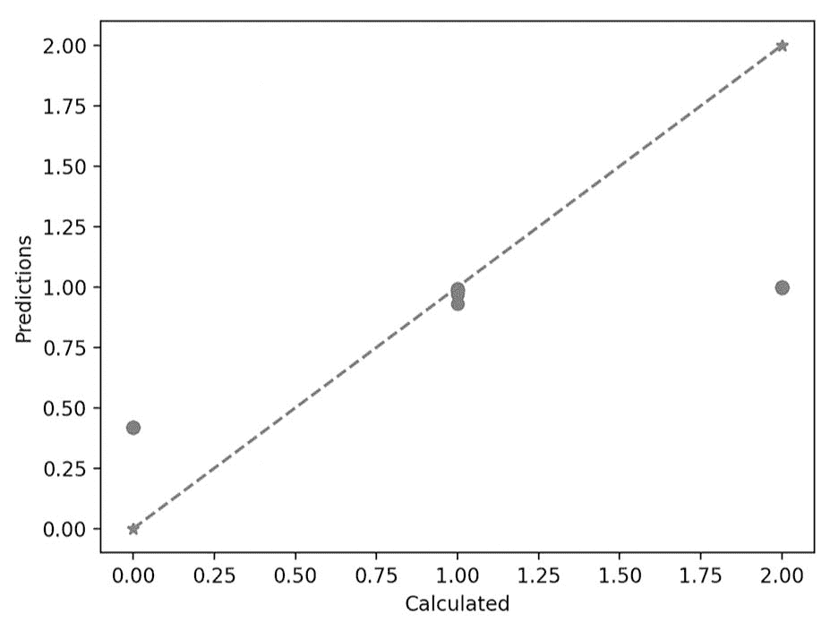

Figure 8.3 ¶ A Scatter Plot and a Best-Fitting Line.

## Sklearn and Linear Regression

可选章节展示了如何在欧几里得平面上生成随机点并使用线性回归拟合最佳直线，同时渲染这些点。然而，该章节不涉及自然语言处理（NLP），因此可以忽略而不影响连续性。后续章节讨论机器学习和分类器。本书中关于机器学习线性回归的代码示例极为少，这一段即是其中之一。

Listing 8.10 显示了 sklearn_lin_reg.py 的内容，演示如何生成欧几里得平面上的随机数，并使用线性回归找到最佳拟合直线。

***LISTING 8.10: sklearn_lin_reg.py***
``` 


import`numpy` as `np` import`pandas` as `pd` import`matplotlib.pyplot` as `plt` from`sklearn.linear_model` import`LinearRegression` `x` = 10\*`np`.`rand`(100) `y` = 5\*`x` + 5\*`np`.`rand`(100) `print`("=> first 10 x values:") `print`(`x`[0:10]) `print`("=> max x value:",`x`.`max`()) `print`() `print`("=> first 10 y values:") `print`(`y`[0:10]) `print`("=> max y value:",`y`.`max`()) `print`() `model` = `LinearRegression`(`fit_intercept`=`True`) `X` = `x`.`reshape`(-1, 1) `print`("X.shape:",`X`.`shape`) `model`.`fit`(`X`, `y`) `print`("=> slope of line:", `model`.`coef_[0]`) `print`("=> y-intercept:  ", `model`.`intercept_`) `x_fit` = `np`.`linspace`(-1,11) `X_fit` = `x_fit`.`reshape`(-1,1) `y_fit` = `model`.`predict`(`X_fit`) `# "random" points: plt.scatter(x,y) # best-fitting line: plt.plot(x_fit,y_fit) plt.show()` 

import`numpy` as `np` import`pandas` as `pd` import`matplotlib.pyplot` as `plt` from`scipy` import`stats` from`sklearn.metrics` import`r2_score`  \# same data as sklearn_lin_reg.py: `x` = 10\*`np`.`rand`(100) `y` = 5\*`x` + 5\*`np`.`rand`(100)  \# "linefit" uses the values slope and intercept: **slope, intercept, r_value, p_value, std_err** = `stats`.`linregress`(`x`,`y`) `print`("slope:    ", `slope`) `print`("intercept:", `intercept`) `print`("r_value:  ", `r_value`) `print`("p_value:  ", `p_value`) `print`("std_err:  ", `std_err`)  def `linefit`(`b`):  return `intercept` + `slope` \* `b`  `myline` = `linefit`(`x`)  `plt.scatter`(`x`,`y`, color='b') `plt.plot`(`x`,`myline`, color='r') `plt.show()` 

Listing 8.10 starts with some import statements and then initializes the variable `x` as a vector of 100 random floating point numbers between 0 and 10. The variable `y` is initialized as vector of 100 random floating point numbers, where each number is five times the corresponding value in the vector `x`, plus another random floating point number between 0 and 5.

The next portion of Listing 8.10 initializes the variable `model` as an instance of the `LinearRegression` class in Sklearn. Then the variable `X` is initialized as a 100×1 vector of values from the vector `x`.

The next code snippet invokes the `fit()` method of the variable `model`, after which the slope and y-intercept of the best fitting line are available. Now we can perform some predictions. Initialize the variable `x_fit` with a set of random numbers between -1 and 11, and initialize `X_fit` as a one-column vector whose values are from `x_fit`. Now we can get the predicted values from `X_fit` by invoking the `predict()` method of the variable `model`, as shown here:

`y_fit` = `model`.`predict`(`X_fit`) 

Launch the code in Listing 8.10 and you will see the following output, along with a graph that displays the best fitting line for the set of random points:

`=> first 10 x values:` [9.50318249 1.92716624 4.73429059 5.81910031 2.53858169 1.26370769 4.08290837 3.71162985 8.26798678 1.42404685] `=> max x value:` 9.995419932716011 `=> first 10 y values:` [49.94582654 11.9098716  25.61829038 32.7364018  17.18778012  7.14293639 22.574198   20.62959673 42.65198716  7.71367233] `=> max y value:` 54.255842476093875 `X.shape:` (100, 1) `=> slope of line:` 5.070423937652158 `=> y-intercept:`  2.016428692525192 

Listing 8.11 starts with some familiar import statements, and then initializes the variable `x` as a vector of 100 random floating point numbers between 0 and 10. The variable `y` is initialized as vector of 100 random floating point numbers, where each number is 5 times the corresponding value in the vector `x`, plus another random floating point number between 0 and 5.

The key code snippet in Listing 8.11 is shown in bold, which calculates the slope, y-intercept, r-value, p-value, and standard error for the best fitting line. If you need access to these quantities, then this type of code is more useful than the code in Listing 8.10.

Launch the code in Listing 8.11 and you will see the following output, along with a graph that displays the best fitting line for the set of random points:

`slope:`  5.008309175824397 `intercept:` 2.4242119308236134 `r_value:`  0.9960065560231295 `p_value:`  1.2047321054027177e-104 `std_err:`  0.04534930921236101 

Figure 8.4 displays a scatter plot of points and the best-fitting line for those points.

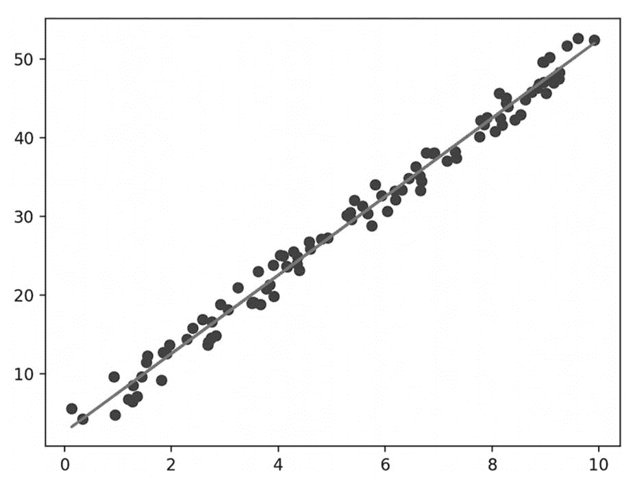

Figure 8.4 ¶ A Scatter Plot and a Best-Fitting Line.

## **Keras and Linear Regression**

The code sample in this section contains primarily Keras code in order to perform linear regression. If you have read the previous examples in this chapter, this section will be easier for you to understand because the steps for linear regression are the same.

Listing 8.12 displays the contents of `keras_linear_regression.py` that illustrates how to perform linear regression in Keras.

***LISTING 8.12: keras_linear_regression.py***

############################################################## #Keep in mind the following important points: #1) Always standardize both input features and target variable: #doing so only on input feature produces incorrect predictions #2) Data might not be normally distributed: check the data and #based on the distribution apply StandardScaler, MinMaxScaler, #Normalizer or RobustScaler ##############################################################   import`tensorflow` as `tf` import`numpy` as `np` import`pandas` as `pd` import`seaborn` as `sns` import`matplotlib.pyplot` as `plt` from`sklearn.preprocessing` import`MinMaxScaler` from`sklearn.model_selection` import`train_test_split`  `df` = `pd`.`read_csv`('housing.csv') `X`  = `df`.`iloc`[:,0:13] `y`  = `df`.`iloc`[:,13].`values`  `mmsc` = `MinMaxScaler`() `X`  = `mmsc`.`fit_transform`(`X`) `y`  = `y`.`reshape`(-1,1) `y`  = `mmsc`.`fit_transform`(`y`)  `X_train`, `X_test`, `y_train`, `y_test` = `train_test_split`(`X`, `y`, test_size=0.3)  \# this Python method creates a Keras model def `build_keras_model`:  model = `tf`.`keras`.`models`.`Sequential`()  model.add(`tf.keras`.`layers`.`Dense`(units=13, input_dim=13))  model.add(`tf.keras`.`layers`.`Dense`(units=1))  model.compile(optimizer='adam',loss='mean_squared_error',                 metrics=['mae','accuracy'])  return model  batch_size=32 epochs = 40  \# specify the Python method 'build_keras_model' to create a \# Keras model \# using the implementation of the scikit-learn regressor API \# for Keras model = `tf.keras.wrappers.scikit_learn`.`KerasRegressor`(`build_fn`=`build_keras_model`, batch_size=batch_size,epochs=epochs)  \# train ('fit') the model and then make predictions: model.fit(`X_train`, `y_train`) `y_pred` = model.predict(`X_test`) #print("y_test:",`y_test`) #print("y_pred:",`y_pred`)  \# scatter plot of test values-vs-predictions fig, ax = `plt`.`subplots`() `ax`.`scatter`(`y_test`, `y_pred`) `ax`.`plot`([`y_test`.`min()`, `y_test`.`max()`], [`y_test`.`min()`, `y_test`.`max()`], 'r\*'--') `ax`.`set_xlabel`('Calculated') `ax`.`set_ylabel`('Predictions') `plt`.`show()` 


-   Listing 8.12 以多行导入语句开头，然后初始化数据框 df，内容来自 housing.csv（本节末尾的 Listing 8.13 示例）。请注意，训练集 X 初始化为 housing.csv 前 13 列的内容，而变量 y 包含 housing.csv 最右侧的列。

-   Listing 8.12 中的下一部分使用 MinMaxScaler 类计算均值和标准差，然后调用 fit_transform() 方法以更新 X 和 y 的值，使其均值为 0、标准差为 1。

-   紧接着，build_keras_model() 方法创建一个基于 Keras 的模型，包含两层全连接层。请注意，输入层的大小为 13，这正是数据框 X 的列数。随后代码编译模型，使用 adam 优化器、MSE 损失函数，并指定 MAE 和准确率作为指标。编译好的模型随后返回调用方。

-   Listing 8.12 的下一段代码将 batch_size 变量初始化为 32，epochs 变量初始化为 40，并在创建模型的代码片段中指定它们，如下所示：

    model = tf.keras.wrappers.scikit_learn.KerasRegressor(build_fn=build_keras_model, batch_size=batch_size, epochs=epochs)

-   Listing 8.12 中的短注释块解释了前面代码片段的作用，即构建我们的 Keras 模型。

-   Listing 8.12 的下一段代码调用 fit() 方法训练模型，然后在 X_test 数据上调用 predict() 方法，计算一组预测值并初始化变量 y_pred。

-   Listing 8.12 的最后一段代码显示了一个散点图，横轴为 y_test（即来自 housing.csv 的实际值），纵轴为预测值集合。

Figure 8.5 显示了基于测试值和对应预测值的散点图。

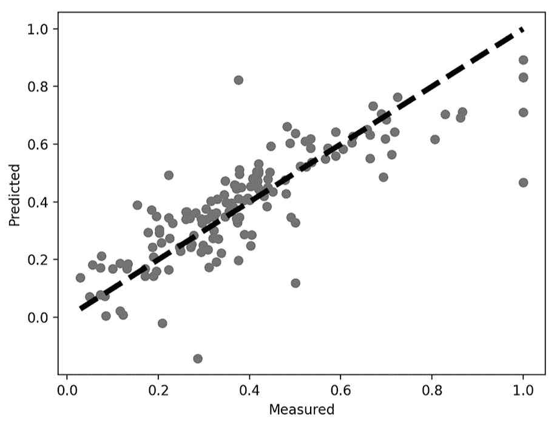

Figure 8.5 ¶ A Scatter Plot and a Best-Fitting Line.

Listing 8.13 显示了在 Listing 8.12 中使用的 housing.csv 文件的前四行。

***LISTING 8.13: housing.csv***

0.00632,18,2.31,0,0.538,6.575,65.2,4.09,1,296,15.3,396.9,4.98,24 0.02731,0,7.07,0,0.469,6.421,78.9,4.9671,2,242,17.8,396.9,9.14,21.6 0.02729,0,7.07,0,0.469,7.185,61.1,4.9671,2,242,17.8,392.83,4.03,34.7 0.03237,0,2.18,0,0.458,6.998,45.8,6.0622,3,222,18.7,394.63,2.94,33.4 

## **Summary**

本章以分类概述开始，随后简要说明机器学习中常用的分类器。你学习了 kNN、逻辑回归（尽管名称如此，它 *是* 分类器）、决策树、随机森林、支持向量机和贝叶斯分类器。

接下来，你学习了激活函数、它们在神经网络中的重要性以及在神经网络中如何使用。随后看到 TF/Keras API 列表及其优势的描述。

最后，你学习了使用 sigmoid 激活函数的逻辑回归，并看到一个基于 Keras 的代码示例。

# CHAPTER 9

# NLP APPLICATIONS

章节 5 和 6 提供了 NLP 相关 Python 库的快速入门和相关代码示例。相比之下，本章主要涉及文本分类、推荐系统和情感分析。

第一节描述了文本摘要的两大类型（提取式和抽象式）以及文本推荐，同时包含使用 gensim 和 spaCy 进行文本分类的 Python 代码示例。

第二节简要概述推荐系统，用于在线书籍、电影、餐厅等的评论。该节的可选部分讨论如何在推荐系统中使用强化学习。

第三节讨论情感分析，实际上是文本分类的一个子集。情感分析旨在评估文档（如评论）的情绪（正向、负向或中性）。你将看到使用 Naïve Bayes、NLTK 和 VADER，以及逻辑回归进行情感分析的 Python 代码示例。

本章最后部分包含一个涉及 COVID-19 数据集的 Python 代码示例，随后是对聊天机器人的简要介绍。

# **What is Text Summarization?**

文本摘要可以非正式地描述为对文本内容生成摘要。文本摘要类似于文档的概述或执行摘要。在 NLP 世界，自动文本摘要是指从 Web 页面、博客、文档或文档集合等多种来源生成文本摘要。

文本摘要主要分为两类（第一类比第二类更复杂）：抽象摘要技术和提取摘要技术。下面的子节提供了这些摘要技术的高层次描述。

### **提取式文本摘要**

*提取式文本摘要* 算法从文档中提取关键词或句子，而不修改文档中的任何词汇，这些提取的内容代表文档的内容。提取式摘要任务的例子包括生成书评、电影评论、会议记录、文档或博客摘要等。

请注意，提取式算法不会从文档生成新文本，通常需要较少的训练数据。提取式文本摘要研究广泛，已达到成熟阶段。

提取式摘要算法执行三个独立任务：

*   创建文本的中间表示

*   基于表示为句子提供排名

*   根据某些句子创建摘要

文本的中间表示可以使用频率-based 方法，例如通过 tf-idf 计算词频；也可以使用基于主题的方法，先在文档中发现主题，然后估算句子中与主题相关的词汇数量，或使用聚类形成的 centroids 来评估句子的重要性。最后为每个句子分配一个分数，随后根据分数最高的句子生成摘要。

### **抽象式文本摘要**

*抽象式文本摘要* 任务更为复杂，因为它需要理解语言和上下文，然后生成新句子。这些算法通常在训练阶段需要大量数据。请记住，这种摘要方式会生成新词汇，以简洁、结构化的方式描述文档内容。

需要注意的另外两点：第一，文本摘要在文档主题数量较少时表现更好。例如，长篇小说和诗歌包含多样化的主题，这会对准确的文本摘要构成挑战。


第二，人类语言往往比书面语言更随意，这意味着在将语音转换为文本时会出现错误。然而，转录准确率持续提升，这反过来意味着将从语音转录的文本应用提取方法将会更加可行。

## Text Summarization with gensim and SpaCy

本节包含结合 gensim 和 SpaCy 进行文本摘要的 Python 代码示例，因此如果你还没有阅读前面的章节，现在是一个良好的时机。

Listing 9.1 显示了 text_summarization.py 的内容，阐释了如何使用 gensim 对一段文本进行摘要。

***LISTING 9.1: text_summarization.py***
```python
from gensim.summarization import summarize
mytext = """ Chapters five and six provide a fast-paced introduction to several NLP-related Python libraries and related code samples. By contrast, this chapter is primarily about text classification, recommendation systems, and sentiment analysis. The first section discusses two main types of text summarization (extractive and abstractive), as well as text recommendation. This section also contains Python code samples that illustrate how to use gensim and SpaCy to perform text classification. The second section contains a brief overview of recommender systems, which are used in online reviews of books, movies, restaurants, and so forth. You will also learn how to use the Python surprise library that provides a layer of abstraction above the tasks that are required for recommender systems. The final (optional) portion of this section discusses how to use reinforcement learning in recommender systems. «»» 
# Summarize the preceding text by passing it as # an input to "summarize" that returns a summary
print("===> text summary:")
print(summarize(mytext))
print() 
# the "split" option produces a list of strings
print("===> split the text summary:")
print(summarize(mytext, split=True))
print() 
# 1) the "ratio" parameter changes the displayed text (default=20%) 
# 2) the "word_count" parameter: the number of words to display
print("===> a 50-word summary:")
print(summarize(mytext, word_count=50))
print() 
from gensim.summarization import keywords
print("===> keywords:")
print(keywords(mytext))
print()
```
Listing 9.1 初始化变量 mytext 为测试字符串，随后将其作为参数传递给 gensim 的 summarize() 方法，以获取 mytext 内容的摘要并显示。

Listing 9.1 中的下一部分使用 split=True 调用 summarize()，以将前面的输出以字符串列表的形式展示。随后再次调用 summarize()，此次使用 word_count=50 以显示 50 个单词的摘要。运行 Listing 9.1 中的代码，你将看到以下输出：

\===> text summary: You will also learn how to use the Python surprise library that provides a layer of abstraction above the tasks that are required for recommender systems.   \===> split the text summary: \['You will also learn how to use the Python surprise library that provides a layer of abstraction above the tasks that are required for recommender systems.'\]   \===> a 50-word summary: This section also contains Python code samples that illustrate how to use gensim and SpaCy to perform text classification. You will also learn how to use the Python surprise library that provides a layer of abstraction above the tasks that are required for recommender systems.   \===> keywords: python text section movies optional recommendation recommender 

Listing 9.1 初始化变量 mytext 为测试字符串，随后将其作为参数传递给 gensim 的 summarize() 方法，以获取 mytext 内容的摘要并显示。

Listing 9.1 中的下一部分使用 split=True 调用 summarize()，以将前面的输出以字符串列表的形式展示。随后再次调用 summarize()，此次使用 word_count=50 以显示 50 个单词的摘要。运行 Listing 9.1 中的代码，你将看到以下输出：

\===> text summary: You will also learn how to use the Python surprise library that provides a layer of abstraction above the tasks that are required for recommender systems.   \===> split the text summary: \['You will also learn how to use the Python surprise library that provides a layer of abstraction above the tasks that are required for recommender systems.'\]   \===> a 50-word summary: This section also contains Python code samples that illustrate how to use gensim and SpaCy to perform text classification. You will also learn how to use the Python surprise library that provides a layer of abstraction above the tasks that are required for recommender systems.   \===> keywords: python text section movies optional recommendation recommender 

Listing 9.2 显示了 gensim_spacy.py 的内容，阐释了如何在从维基百科提取的文本上使用 gensim 和 SpaCy 进行文本摘要。

## **NOTE**

*Make sure that you invoke* pip3 install wikipedia

***LISTING 9.2: gensim_spacy.py***
```python
import spacy
from gensim.summarization.summarizer import summarize
from gensim.summarization import keywords
import wikipedia

# Get wiki content for Japan:
wikisearch = wikipedia.page("Japan")
wikicontent = wikisearch.content

nlp = spacy.load('en_core_web_sm')
doc = nlp(wikicontent)

# Save the wiki content to a file:
f = open("wikicontent.txt", "w")
f.write(wikicontent)
f.close()

# Summary (0.5% of the original content):
summ_per = summarize(wikicontent, ratio = 0.05)
print("=> Percent summary:")
print(summ_per)
```
Listing 9.2 初始化变量 wikisearch 为调用 wikipedia.page() 方法的结果，随后变量 wikicontent 包含 wikisearch 中的文本。

随后，变量 nlp 初始化为 SpaCy 小型英文模型的实例，变量 doc 通过将 wikicontent 传递给 nlp 初始化。wikicontent 包含真实文本，并保存到文本文件中。

Listing 9.2 中的最后一段代码块提供了 wikicontent 文本的一个小（即 0.5%）摘要。运行 Listing 9.2 中的代码，你将看到以下输出：

\=> Percent summary:

Japan (Japanese: 日本, Nippon \[ɲippoꜜɴ\] (listen) or Nihon \[ɲihoꜜɴ\] (listen)) is an island country in East Asia, located in the northwest Pacific Ocean. It is bordered on the west by the Sea of Japan, and extends from the Sea of Okhotsk in the north toward the East China Sea and Taiwan in the south. Part of the Ring of Fire, Japan spans an archipelago of 6852 islands covering 377,975 square kilometers (145,937 sq mi); the five main islands are Hokkaido, Honshu, Shikoku, Kyushu, and Okinawa. Tokyo is Japan's capital and largest city; other major cities include Yokohama, Osaka, Nagoya, Sapporo, Fukuoka, Kobe, and Kyoto.   Japan is the eleventh-most populous country in the world, as well as one of the most densely populated and urbanized. About three-fourths of the country's terrain is mountainous, concentrating its population of 125.71 million on narrow coastal plains. Japan is divided into 47 administrative prefectures and eight traditional regions. The Greater Tokyo Area is the most populous metropolitan area in the world, with more than 37.4 million residents. 

\=> Word count summary: Although it has renounced its right to declare war, the country maintains Self-Defense Forces that are ranked as the world's fourth-most powerful military. Ranked the second-highest country on the Human Development Index in Asia after Singapore, Japan has the world's second-highest life expectancy, though it is experiencing a decline in population. Despite early resistance, Buddhism was promoted by the ruling class, including figures like Prince Shōtoku, and gained widespread acceptance beginning in the Asuka period (592–710).The far-reaching Taika Reforms in 645 nationalized all land in Japan, to be distributed equally among cultivators, and ordered the compilation of a household registry as the basis for a new system of taxation. During the Meiji era (1868–1912), the Empire of Japan emerged as the most developed nation in Asia and as an industrialized world power that pursued military conflict to expand its sphere of influence. 

\=> Word count summary: Although it has renounced its right to declare war, the country maintains Self-Defense Forces that are ranked as the world's fourth-most powerful military. Ranked the second-highest country on the Human Development Index in Asia after Singapore, Japan has the world's second-highest life expectancy, though it is experiencing a decline in population. Despite early resistance, Buddhism was promoted by the ruling class, including figures like Prince Shōtoku, and gained widespread acceptance beginning in the Asuka period (592–710).The far-reaching Taika Reforms in 645 nationalized all land in Japan, to be distributed equally among cultivators, and ordered the compilation of a household registry as the basis for a new system of taxation. During the Meiji era (1868–1912), the Empire of Japan emerged as the most developed nation in Asia and as an industrialized world power that pursued military conflict to expand its sphere of influence. 

## **What are Recommender Systems?**

*Recommender systems* are a subset of information filtering systems that attempt to predict the “rating” or “preference” for items based on an analysis of a user’s preferences. Such systems personalize the information supplied to users based on their interests, relevance of the information. Recommendation systems are used widely for many scenarios, such as the following:

*   recommending movies

*   articles

*   restaurants

*   places to visit

*   items to buy


-   [三种主要的推荐系统算法](https://en.wikipedia.org/wiki/Matrix_factorization_(recommender_systems))，如下列表所示：

*   协同过滤（相似用户）

*   基于内容的方法（项目特征）

*   前两者的混合

在极度简化的情况下，协同过滤根据与用户偏好相似的其他用户来为用户提供推荐。该技术显然需要一些用户，而用户初始缺失被称为“冷启动”问题。相比之下，基于内容的方法是根据现有（且相似）项目的特征相似度，为用户推荐新项目。混合方法可以先使用基于内容的方法（它不存在冷启动问题），然后再使用协同过滤方法。

这三种方法将在稍后部分详细讨论，在此之前我们将探讨一些电影推荐系统的特性，这也是下一节的主题。

### **电影推荐系统**

电影推荐系统大多数人都很熟悉，简单来说，其目标是为用户创建准确的推荐列表。推荐列表会考虑用户观看过的电影、每位用户为电影打的评分，以及其他因素的混合。

假设我们有一个矩阵 R，包含 m 行（用户）和 n 列（电影），矩阵 R 的每个元素是电影评分，可以是 1 到 5 之间的整数，也可以是 0 到 1 之间的浮点数。矩阵 R 可能有数百万行和数万列。此外，矩阵 R 可能存在一些能提供有用信息的关联。例如：

*   两行相等（两位用户的电影评分相同）

*   两列相等（两部电影被多位用户评分相同）

*   第三行是其他两行的和（你能猜出是哪两行？）

下面是一个包含四位用户和四部电影的矩阵 R 示例，评分为 0 到 1 之间的浮点数：

       M1  M2   M2   M4 Alice  1   -    0.2  - Edward -   0.5  -    0.3 Steve  1   -    1    - David  1   -    -    0.4 

如上所示，矩阵存在一些缺失条目：推荐系统的目标是推断缺失值的大小。

现在考虑下面的评分矩阵 R，其中所有数值评分均为 2，并有一个缺失值：

       M1  M2  M2  M4 Alice  2   2   2   2 Edward 2   2   2   2 Steve  2   2   2   ? David  2   2   2   2 

缺失值的显而易见选择是 3。现在尝试推断下面这个矩阵 R 中缺失的值：

       M1  M2  M2  M4 Alice  3   1   1   2 Edward 1   2   4   3 Steve  3   1   1   ? David  4   3   5   4 

前面的矩阵中缺失的值是多少？如果你猜是 2，你是正确的：该值是根据 Alice 和 Steve 有三个相同的评分，且 Alice 给 M4 打了 2 分，我们可以推断 Steve 也会对这部电影给 2 分。

## **矩阵分解 rating matrix R**

如前一节所学，评分矩阵 R 可能非常庞大，处理该矩阵会影响性能。幸运的是，我们可以使用一种称为 *matrix factorization* 的技术（本节讨论），其他在线文章可能更易阅读：

*[`en.wikipedia.org/wiki/Matrix_factorization_(recommender_systems)`](https://en.wikipedia.org/wiki/Matrix_factorization_(recommender_systems))*

假设矩阵 R 的每行是一部电影，共有 1,000 部电影。此外，假设矩阵 R 的每列是用户，共有 2,000 名用户。那么矩阵 R 包含 2,000,000 个元素（也是稀疏的）。

然而，我们可以将矩阵 R 分解为两个矩阵 M 和 U 的乘积。具体来说，M 是 1000×100 的矩阵，其行代表电影，列代表特征；U 是 100×2000 的矩阵，其行代表特征，列代表用户。M 和 U 兼容，因为它们的乘积维度为 (1000×100) × (100×2000)，结果是一个 1000×2000 维的矩阵，这也是矩阵 R 的维度。此外，M\*U 的行和列内容与矩阵 R 的行和列内容相匹配。

下一节将描述一种新的推荐系统类型，随后介绍本章 earlier 提到的两种主要推荐系统类型。

## **基于内容的推荐系统**

基于内容的推荐系统的前提很简单：如果你喜欢某个项目，你很可能也喜欢“相似”的项目。在很容易确定每个项目的上下文或属性的情况下，基于项目相似度的推荐通常效果良好。例如，推荐同类型的电影、书籍、歌曲或餐厅。

基于内容的推荐系统分为两大类：(1) 仅分析内容描述的技术；(2) 构建用户画像和项目画像的技术。这两类技术在下面的子节中分别讨论。

### **仅分析内容描述**

该技术类似于基于项目的协同过滤：系统推荐与用户标记为“喜欢”的已知项目相似的内容。该技术的优势包括：

*   如果描述有意义，可避免“新项目问题”

*   可利用语义信息和推断

*   更易创建透明的系统

该技术也有以下缺点：

*   倾向于过度专业化

*   会推荐与用户已消费相似的项目

*   容易形成“滤波泡沫”

### **构建用户画像和项目画像**

一种创建用户画像的技术利用用户之前交互过的项目描述或属性，以推荐相似项目。该技术仅依赖用户的历史选择。该技术能够避免冷启动问题，并且对于文本类项目（如文章、新闻、书籍）使用也简单。

## **协同过滤算法**

协同过滤的前提可以通过以下简单示例说明。假设人物 A 喜欢项目 1、2、3，而人物 B 喜欢项目 2、3、4。可以看出，A 和 B 的兴趣相似，因此我们推断 A 会喜欢项目 4（因为 B 喜欢），同时 B 会喜欢 A 喜欢的项目。

具体例子：你去餐厅后，向服务员（或同伴）询问推荐，这就是协同过滤的一个例子。

关于协同过滤算法的几点注意事项：

*   算法完全基于历史行为。

*   与上下文无关。

*   独立于其他任何信息。

*   这是一个常用算法。

### **用户-用户协同过滤**

该技术通过查找与给定用户相似的客户，找出他们喜欢的产品，然后向给定用户推荐这些产品。这是一种非常有效的算法，但也消耗大量时间和资源，因为必须计算 *每一对* 客户的相似性。在非常大的平台上，若缺乏强大的可并行化系统，实现该算法非常困难。

### **项目-项目协同过滤**

该技术与用户-用户协同过滤类似，主要区别在于：

find item lookalike instead of customer look alike


-   [类似于用户购买的商品向客户推荐相似商品（当构建相似度矩阵时）](https://wiki.example.org/feynmans_learning_method)的技术比用户-用户协同过滤更省资源。事实上，对于新用户，项目-项目算法的耗时远低于用户-用户协同，因为我们不需要计算所有用户之间的相似度。在商品数量固定的情况下，项目-项目相似度矩阵随时间保持不变。如有需要，可参考附录 A 中关于各种距离度量的讨论。

### `Recommender System with Surprise`

Surprise 是基于 Sklearn 的简单 Python 推荐系统引擎，其缩写为 simple Python recommendation system engine。Surprise 是一个开源 Python 库，用于构建和分析推荐系统。

Surprise 提供内置数据集、预测算法、降维（PCA 和 SVD）以及多种指标，如 MAE、RMSE 等。访问其主页可了解其特性和代码示例：*[`surpriselib.com`](https://surpriselib.com)*

## `Recommender Systems and Reinforcement Learning (Optional)`

正如您已学过的，传统推荐系统通常涉及协同过滤或基于内容的系统。实现推荐系统的另一种方法是强化学习。在深入细节之前，我们先简要介绍强化学习的高层次描述。

### `Basic Reinforcement Learning in Five Minutes`

强化学习涉及一个“代理人”在随机或确定性方式中在各种状态之间移动，以最大化其预期未来奖励。每个状态都有一个奖励值，可能为正、零或负。找到最优路径通常需要进行大量、大量的迭代。*请记住以下要点：代理人（即学习者）并不知道必须采取哪些动作以及按什么顺序执行；代理人必须自行发现这些动作。*

另一个重要点：*在一般情况下，贪婪算法在强化学习任务中会失败，因此采用一种称为“ε 贪婪”算法的泛化方法。* 该方法涉及以下变量：

*   初始状态 `S`

*   变量 `epsilon`，初始值为 1

*   变量 `rnd`，为 0 到 1 之间的随机生成数

*   Q 表，其行为是状态行和动作列

如果 `rnd` 小于 `epsilon`，则在当前状态下选择一个随机动作 `A`（该动作针对当前状态已定义）；否则，选择 `Q(S,A)` 值最大的动作。无论哪种情况，选定的动作 `A` 会交给环境（可视为“ oracle”），该环境返回新状态、奖励和布尔“done”标志，其中“done”标志在当前回合（或游戏）结束时为 true。下面是一段示例代码，用于根据当前动作确定新状态，其中变量 `env` 是“ oracle”：

```python
import gym  # 初始化状态、动作、epsilon、rnd、done、total_reward
# state = 当前状态
# 其他细节省略
while done == False:
    # 根据 ε 贪婪算法确定一个 **action**：
    # 细节省略...
    # 获取下一个状态和奖励：
    next_state, reward, done, _ = env.step(action)
    # 将当前状态设置为新状态：
    state = next_state
    total_reward += reward
```

上述代码位于循环内部，意味着会在顺序中选择多个动作，以到达不同的状态。

每当生成 `rnd` 的值时，`epsilon` 会从 1 递减到一个小数（通常为 0.1）。因此，在多次迭代中，随机选择的动作（称为“探索”）数量减少，而贪婪式选择的动作（称为“利用”）数量增加。

如果 `epsilon` 是常数 0，则算法仅为贪婪算法，后者实际上是 ε 贪婪算法的特例。相反，如果 `epsilon` 是常数 1，则算法仅涉及随机选择，这没有任何实际价值。思考后，ε 贪婪算法在巧妙而优雅地结合随机选择与确定性选择方面表现出色。

强化学习中一个广为人知的技术是 *q-learning*（即“质量”学习），它使用二维矩阵（即“Q 表”），行为是状态行和动作列。矩阵单元是 (state, action) 对，初始化为 0。每次循环（包含 ε 贪婪算法）结束后，当前选定的 (state, action) 对会根据新奖励值进行更新，代理人转移到新选定的状态。

然而，Q 表适用于状态和动作数量固定的场景，例如涉及迷宫或在矩形网格中导航的任务。对于像超级马里奥这类游戏，每当马里奥在屏幕上移动时，新出现的像素集合被视为新状态。因此，状态数量被视为连续而非离散。

然而，与将每个新状态追加到 Q 表不同，我们使用称为深度 Q 学习（DQN）的方法，它将状态作为神经网络的输入，输出层为可能的动作集合。神经网络通过反向误差传播进行训练，输出层中概率最高的动作被选中。

另一种情况是，状态数量和动作数量均为连续。例如，考虑一个移动车辆：状态是连续的，动作（如转动方向盘）也是连续的。存在一些深度强化学习算法，如软 actor critic（SAC）和双延迟 DDPG（TD3），用于解决此类任务。

另一个细节：几乎所有强化学习任务都可以建模为马尔可夫决策过程（MDP），MDP 基于马尔可夫链，后者是一种带有概率的有向边缘的不可判定有限自动机（NFA），其出边概率之和为 1。确实，强化学习中存在许多概念和算法，包括：

*   代理人

*   环境

*   状态

*   状态转移

*   动作（及概率）

*   折扣因子

*   折扣未来奖励

*   马尔可夫链

*   MDP

*   在线政策与离线政策

*   基于模型与无模型

*   Q-learning

*   贝尔曼方程

*   政策梯度算法

*   深度强化学习算法

您可以在网上找到大量讨论上述主题的文章，并查看深度强化学习算法的代码示例。

### `What is RecSim?`

RecSim 是一个基于强化学习（RL）的开源平台，用于创建协同交互式推荐器（CIRs）的模拟。回顾前一节，RL 涉及代理人、状态集合以及每个状态关联的动作集，这些动作使得状态之间能够转换。此外，某些任务使用 ε 贪婪算法选择一个状态，该状态交给环境（“ oracle”），环境返回新状态、奖励以及布尔“done”标志。

与之相比，RecSim 代理人与环境交互，环境由用户模型、文档模型和用户选择模型组成。在 RecSim 中，状态可以表示为内容，动作是下一个最佳内容，用户满意度代表奖励。此外，可以使用向量嵌入来表示内容。简而言之，RL 使得推荐系统能够向用户推荐新内容，而该内容独立于之前的推荐。 


事实上，这些新建议可能包含对他们有吸引力的随机内容。这种方法为用户提供了发现以前可能并不感兴趣的新兴趣的机会：毕竟，人们的兴趣可以（也确实）随时间而改变。确实，基于强化学习的模型会随着用户兴趣的变化而不断学习和演变。这部分关于推荐系统的章节到此结束。如果您对推荐系统的最新趋势感兴趣，请访问以下链接：

`*[`aws.amazon.com/blogs/media/whats-new-in-recommender-systems/`](https://aws.amazon.com/blogs/media/whats-new-in-recommender-systems/)*`

下一节讨论情感分析，并附有一个使用 NLTK 进行情感分析的 Python 代码示例。

## 什么是情感分析？

情感分析的目的是判断某人对某主题、文档的上下文，或一系列文档的态度。在每种情况下，情感分析判断输入文本是表达出积极、消极还是中性情感。

在高层次上，情感分析涉及自然语言处理的多个处理步骤，随后是模型训练。第一阶段对文本进行处理，使得在准备训练模型时，我们已经知道模型需要的输入变量。模型学习根据这些变量判断一段文本的情感。

情感分析也可以是二元分类任务，涉及积极和消极情感。情感分析可在许多情境下进行，其中包括：

*   对特定产品的在线情感
*   分析电影、书籍和餐厅的评论
*   客户支持中心记录的问题

正如您在第 3 章节中学到的，人类语言非常灵活，能够表达：

*   正负情感的混合
*   嘲讽及其细微差别
*   俚语（负面词汇也可能表示正面）

此外，语言本质上是模糊的，因为我们的情感可以传达嘲讽、讽刺和双关，这些都给 NLP 带来挑战。

进行情感分析的主要有两种方式：基于规则的方法（较老且力度较小）和机器学习技术。

基于规则的方法很简单：统计文档中积极词和消极词的数量，数量较大的那一方决定文档的情感。

然而，基于规则的情感分析方法存在缺陷：该方法只关注单个词，而不考虑上下文。例如，基于 token 的算法会对“The concert last night was the bomb.” 这样的句子生成高度负面的评分。

机器学习方法则使用分类模型（可从多种算法中选择），在标记的正、负和中性情感数据集上进行训练。可以将这三种情感赋值为 1、-1 和 0，或者赋值范围为 \[-1,1\]。后者中，-1 表示最负面情感，+1 表示最正面情感。

作为练习，请尝试为以下句子赋予数值情感：

1. “Our plan was not without merit” 与 “Our plan has merit” 意义相近。
2. “I like the pizza toppings, but I do not like the crust.”
3. “The only thing worse than being talked about, is not being talked about” (Oscar Wilde).
4. “Everything is funny, as long as it’s happening to somebody else” (Will Rogers).
5. “When ignorance is bliss, ‘tis folly to be wise” (William Shakespeare).
6. “Good judgment is the result of experience and experience the result of bad judgement” (Mark Twain).

下面是对前面列表中句子的观察。例如 #1 包含两个意义相近的句子，但前者接近“双重否定”，是更具挑战性的 NLP 情感分析任务。根据所用的 Python 库，第二句更有可能获得更高的积极情感评分。

示例 #2 既有积极也有消极情感：整句话的数值情感是多少？如果计算 +1（积极）和 -1（消极）的平均值，结果为 0，这表明整体情感为中性。尽管整体情感可能被认为是中性，但句子的两个部分并不中性。

示例 #3 可能被视为一种简洁而讽刺的观察，一些人可能认为它也带有一丝哀愁。该句表达了“B 比 A 更差”的情感形式，暗示 A 本身是负面的，但并未明确表达。

示例 #4 是一种普遍为真的话，包含正负事件，但不使用任何负面词汇，如 “not”、“bad”、“worse” 等。

示例 #5 是威廉·莎士比亚的一句著名引语，常被误译为 “ignorance is bliss”，完整引语含义截然不同。词 “ignorance” 和 “folly” 都表达负面情感。

示例 #6 听起来矛盾，直到你获得足够的经验和智慧才能理解其含义。句子中只有 “good” 和 “bad” 这两个词表达情感。后文将提供一个 Python 代码示例，对上述句子进行情感分析。

### 用于情感分析的有用工具

以下列表提供了情感分析工具的各种功能，可能适合您的 NLP 需求：

*   IBM Watson Tone Analyzer
*   OpenText
*   Talkwalker
*   Rapidminer
*   Social Mention
*   Textblob
*   Vader

请在线搜索这些情感分析工具的文档，以确定哪些工具适合您的任务。

### 方面情感分析

*Aspect-based* 情感分析是比普通情感分析更高级的技术：后者仅检测整体语料的情感，而前者分析每段文本，识别各个方面及其对应的情感。

例如，普通情感分析可能判定一条评论为负面，而方面情感分析可能发现该顾客对某产品的电池续航不满意。因此，方面情感分析能够提供更细粒度的语料分析，这在处理基于文本的客户反馈时至重要。

需要注意的是，方面情感分析既可以提取情感（即对特定方面的积极或消极看法），也可以提取方面（即当前关注的项目）。

例如，Algorithmia 提供免费的 API 端点，无需自行部署或管理服务器和基础设施即可调用多种算法。

另一个机器学习工具包是 Apache OpenNLP，它提供分词、句子分割、词性标注、实体抽取、 chunking、解析以及核心 ference 解析等基础 NLP 功能。

### 深度学习与情感分析

循环神经网络（RNN）和长短期记忆网络（LSTM）等深度学习模型可以与 NLP 语义分析相结合，例如在推特中判断情感：

`*https://ieeexplore.ieee.org/stamp/stamp.jsp? arnumber=8244338*`*

您也可以将 RNN 与情感分析相结合，如这里所述：

`*[`blog.openai.com/unsupervised-sentiment-neuron/`](https://blog.openai.com/unsupervised-sentiment-neuron/)*`


https://github.com/openai/generating-reviews-discovering-sentiment

There are several details to keep in mind. First, distributed word vector techniques have been shown to outperform BoW models (as you would probably surmise). Second, the paragraph vector algorithm preserves word order information and produces state-of-the-art results. This algorithm performs better because vector averaging and clustering lose the word order. Third, it’s worthwhile to acquaint yourself with the transformer architecture and BERT-based models that are discussed in Chapter 11 before you decide to use RNNs or LSTMs for sentiment analysis.

## **Sentiment Analysis with Naïve Bayes**

Listing 9.3 displays the contents of nb_sentiment.py that illustrates how to perform sentiment analysis with NLTK.

***LISTING 9.3: nb_sentiment.py***

```python
import pandas as pd
import matplotlib.pyplot as plt
import nltk
from nltk.tokenize import RegexpTokenizer
from sklearn import metrics
from sklearn.feature_extraction.text import CountVectorizer
from sklearn.feature_extraction.text import TfidfVectorizer
from sklearn.model_selection import train_test_split
from sklearn.naive_bayes import MultinomialNB

data = pd.read_csv('train.tsv', sep='\t')
print(data.head())
print("=> Data information:")
data.info()
print("------------------------------")
print()
print("=> Sentiment value counts:")
print(data.Sentiment.value_counts())
print("------------------------------")
print()

# find alphanumeric patterns:
token = RegexpTokenizer(r'[a-zA-Z0-9]+')
cv = CountVectorizer(lowercase=True, stop_words='english', ngram_range=(1,1), tokenizer=token.tokenize)
phrase_counts = cv.fit_transform(data['Phrase'])
X_train, X_test, y_train, y_test = train_test_split(phrase_counts, data['Sentiment'], test_size=0.3, random_state=1)

# Multinomial Naive Bayes model:
clf = MultinomialNB().fit(X_train, y_train)
predicted = clf.predict(X_test)
print("=> MultinomialNB Accuracy:", metrics.accuracy_score(y_test, predicted))
print("------------------------------")
print()

# second part: use tf-idf values
tf = TfidfVectorizer()
text_tf = tf.fit_transform(data['Phrase'])
print("text_tf:")
print(text_tf)
print("------------------------------")
print()

X_train, X_test, y_train, y_test = train_test_split(text_tf, data['Sentiment'], test_size=0.3, random_state=123)

# Multinomial Naive Bayes model:
clf = MultinomialNB().fit(X_train, y_train)
predicted = clf.predict(X_test)
print("=> MultinomialNB Accuracy:", metrics.accuracy_score(y_test, predicted))
print("------------------------------")
```

Listing 9.3 contains two sections of code. The first section reads the contents of the TSV file train.tsv into the dataframe data, and then uses a combination of the classes RegexpTokenizer (performs tokenization based on a regular expression) and CountVectorizer (discussed in Chapter 4) to initialize the variables token and cv, respectively, in order to find alphabetic strings and determine the frequency of those strings. In addition, the training and test datasets are created from the Sentiment column of the data frame data, as shown here:

X_train, X_test, y_train, y_test = train_test_split(phrase_counts, data['Sentiment'], test_size=0.3, random_state=1)

Next, the variable clf is instantiated as an instance of the NaiveBayes classification algorithm. Notice that this code is similar to Listing 8.4 in Chapter 8 after replacing the instance of the DecisionTreeClassifier class with the following code snippet:

clf = MultinomialNB().fit(X_train, y_train)

The next portion of Listing 9.3 invokes the predict() method to make the predictions on the test-related data.

The next section of Listing 9.3 instantiates the variable tf as an instance of the TfidfVectorizer class, followed by the variable text_tf that is the result of transforming and fitting the data in the Phrase column. Once again, the training and test datasets are created from the Sentiment column of the data frame data, as shown here:

X_train, X_test, y_train, y_test = train_test_split(phrase_counts, data['Sentiment'], test_size=0.3, random_state=1)

The remaining code is a duplicate of the corresponding code in the first section of this code sample. Launch the code in Listing 9.4 and you will see the following output so that you can compare the accuracy of the two sections in Listing 9.3:

=> First five rows: PhraseId  ...  Sentiment 0         1  ...          1 1         2  ...          2 2         3  ...          2 3         4  ...          2 4         5  ...          2   \[5 rows x 4 columns\]   \=> Data information: <class 'pandas.core.frame.DataFrame'> RangeIndex: 156060 entries, 0 to 156059 Data columns (total 4 columns): PhraseId      156060 non-null int64 SentenceId    156060 non-null int64 Phrase        156060 non-null object Sentiment     156060 non-null int64 dtypes: int64(3), object(1) memory usage: 4.8+ MB \------------------------------   \=> Sentiment value counts: 2    79582 3    32927 1    27273 4     9206 0     7072 Name: Sentiment, dtype: int64 \------------------------------   \=> MultinomialNB Accuracy: 0.6049169122986885 \------------------------------ text_tf: 

|   (0, 12857) || 0.12785637560254456 |

| --- | --- |

|   (0, 8807) || 0.1353879543646446 |

|   (0, 13681) || 0.07615285026452821 |

|   (0, 593) || 0.22068902883834374 |

|   (0, 9085) || 0.1898515417082945 |

|   (0, 1879) || 0.11034437734762885 |

|   (0, 602) || 0.26341877863818697 |

|   (0, 9204) || 0.19301332592202286 |

|   (0, 14888) || 0.28701927784529135 |

|   (0, 12424) || 0.1381592967010513 |

|   (0, 5595) || 0.265796263188737 |

|   (0, 529) || 0.1614381914318891 |

|   (0, 5837) || 0.22883807138484064 |

|   (0, 5323) || 0.20344769269023563 |

|   (0, 5821) || 0.2625302862532789 |

|   (0, 7217) || 0.17522921677393963 |

|   (0, 14871) || 0.1354415412970302 |

|   (0, 13503) || 0.08982508036989033 |

|   (0, 288) || 0.251134096800077 |

|   (0, 13505) || 0.17690005957760713 |

|   (0, 3490) || 0.2485059095620638 |

|   (0, 4577) || 0.278538658922562 |

|   (0, 9227) || 0.27061683772839323 |

|   (0, 11837) || 0.1761994204821687 |

|   (1, 5837) || 0.3782714454401254 |

  // output omitted for brevity   (156050, 11465)       0.670263619653983   (156050, 625)    0.2115725833396903   (156050, 13505)       0.18632379802617538   (156051, 9193)    0.6987248068627274   (156051, 11465)       0.6822102168950972   (156051, 625)    0.21534359576868978   (156052, 11465)       0.953619269081851   (156052, 625)   0.3010154308931625   (156053, 2313)   0.4917001772764322   (156053, 1027)   0.4917001772764322   (156053, 6245)   0.45540097827929693   (156053, 5328)   0.3853824417825967   (156053, 1313)   0.40068964783307426   (156054, 2313)   0.5366653003868254   (156054, 1027)   0.5366651772764322   (156054, 6245)   0.4970466029897592   (156054, 5328)   0.4206249935248471   (156055, 6245)   1.0   (156056, 2313)   0.618474762808639   (156056, 1027)   0.618474762808639   (156056, 5328)   0.4847452274521073   (156057, 2313)   0.7071067811865476   (156057, 1027)   0.7071067811865476   (156058, 1027)   1.0   (156059, 2313)   1.0 \------------------------------ \=> MultinomialNB Accuracy: 0.5865265496176684 \------------------------------

## **Sentiment Analysis in NLTK and VADER**

This section contains two Python code samples that perform sentiment analysis. Listing 9.4 displays the contents of vader_sentiment.py that illustrates how to perform sentiment analysis with Vader.

## **NOTE**

*Make sure that you invoke the following two commands:*

1.  pip3 install vader


2. `pip3 install vaderSentiment`

**Listing 9.4:** `vader_sentiment.py`

```python
# pip3 install vaderSentiment
from vaderSentiment.vaderSentiment import SentimentIntensityAnalyzer
sia = SentimentIntensityAnalyzer()
sent = "I love Chicago deep dish pizza."
print("=> Sentence:",sent)
word_probs = sia.polarity_scores(sent)
print("=> Sentiment:",str(word_probs))
print()

sent = "I love Chicago deep dish pizza!"
print("=> Sentence:",sent)
word_probs = sia.polarity_scores(sent)
print("=> Sentiment:",str(word_probs))
print()

sent = "I love Chicago deep dish pizza!!!"
print("=> Sentence:",sent)
word_probs = sia.polarity_scores(sent)
print("=> Sentiment:",str(word_probs))
print()
```

Listing 9.4 starts with an import statement and then initializes the variable `sia` as an instance of the class `SentimentIntensityAnalyzer` that is available from `vaderSentiment`.

The next three code blocks initialize the variable `sent` as a text string that contains zero, one, and three exclamation points, respectively. In each case, the variable `sent` is supplied to the method `polarity_scores()` to illustrate the effect of the exclamation points on the generated polarity value. Now launch the code in Listing 9.4 and you will see the following output:

```
=> Sentence: I love Chicago deep dish pizza. => Sentiment: {'neg': 0.0, 'neu': 0.543, 'pos': 0.457, 'compound': 0.6369}
=> Sentence: I love Chicago deep dish pizza! => Sentiment: {'neg': 0.0, 'neu': 0.527, 'pos': 0.473, 'compound': 0.6696}
=> Sentence: I love Chicago deep dish pizza!!! => Sentiment: {'neg': 0.0, 'neu': 0.496, 'pos': 0.504, 'compound': 0.7249}
```

Notice how the positive sentiment in the preceding output increases when the number of exclamation points is increased; this makes sense because more exclamation points tends to make a statement or question more emphatic (be it positive or negative).

By comparison, Listing 9.5 displays the contents of the Python script `vader_nltk_sentiment.py` that uses the `SentimentIntensityAnalyzer` class from NLTK instead of `vaderSentiment` to perform sentiment analysis with NLTK.

***NOTE***

*The following code sample downloads a 266MB file (if it is not already available)* `sentiment-en-mix-distillbert_3.1.pt` *when you execute the code.*

***Listing 9.5: vader_nltk_sentiment.py***

```python
import nltk #nltk.download('vader_lexicon')
from nltk.sentiment.vader import SentimentIntensityAnalyzer
sia = SentimentIntensityAnalyzer()
sent = "I love Chicago deep dish pizza."
print("=> sentence:",sent)
print(sia.polarity_scores(sent))
print()

sent = "I love Chicago deep dish pizza!"
print("=> sentence:",sent)
print(sia.polarity_scores(sent))
print()

sent = "I love Chicago deep dish pizza!!!"
print("=> sentence:",sent)
print(sia.polarity_scores(sent))
print()
```

Launch the code in Listing 9.5 and you will see the following output that you can compare with the output from launching Listing 9.5 in the previous section:

```
=> sentence: I love Chicago deep dish pizza. {'neg': 0.0, 'neu': 0.488, 'pos': 0.512, 'compound': 0.6369}
=> sentence: I love Chicago deep dish pizza! {'neg': 0.0, 'neu': 0.471, 'pos': 0.529, 'compound': 0.6696}
=> sentence: I love Chicago deep dish pizza!!! {'neg': 0.0, 'neu': 0.441, 'pos': 0.559, 'compound': 0.7249}
```

## **Sentiment Analysis with Textblob**

Textblob is an open source Python‑based library that performs various NLP‑tasks, including sentiment analysis. Specifically, Textblob provides a rule‑based sentiment analyzer that takes a text string as input and then returns two properties, both of which are floating point numbers:

1. *Polarity* is a number in the interval \[-1,1\], where -1 and +1 indicate negative and positive sentiment, respectively.

2. *Subjectivity* is a number in the interval \[0,1\] that indicates the degree to which a sentence involves personal emotion, judgement, or opinion.

Listing 9.6 displays the contents of the Python script `textblob_sentiment.py` that uses the Textblob package to perform sentiment analysis.

***Listing 9.6: textblob_sentiment.py***

```python
# pip3 install textblob
from textblob import TextBlob
sent = "I love Chicago deep dish pizza."
tb_sent = TextBlob(sent)
print("sentence:",tb_sent)
print(tb_sent.sentiment)
print()

sent = "I love Chicago deep dish pizza!"
tb_sent = TextBlob(sent)
print("sentence:",tb_sent)
print(tb_sent.sentiment)
print()

sent = "I love Chicago deep dish pizza!!!"
tb_sent = TextBlob(sent)
print("sentence:",tb_sent)
print(tb_sent.sentiment)
print()
```

Listing 9.6 contains three code blocks, analogous to the contents of Listing 9.5, but with the variable `tb_sent` that is an instance of Textblob. Now launch the code in Listing 9.6 and compare this output with the output from launching Listing 9.5 and Listing 9.4:

sentence: I love Chicago deep dish pizza. Sentiment(polarity=0.25, subjectivity=0.5) sentence: I love Chicago deep dish pizza! Sentiment(polarity=0.25, subjectivity=0.5) sentence: I love Chicago deep dish pizza!!! Sentiment(polarity=0.25, subjectivity=0.5)

Notice how the sentiment analysis in the preceding output is unaffected by the number of exclamation points in the input text.

Listing 9.7 displays the contents of `nltk_sentiment.py` that illustrates yet another example of performing sentiment analysis with NLTK.

***LISTING 9.7: nltk_sentiment.py***

```python
import nltk #nltk.download('vader_lexicon')
from nltk.sentiment.vader import SentimentIntensityAnalyzer
import pandas as pd
sentiment = SentimentIntensityAnalyzer()
sentence = "I love Chicago deep dish pizza."
print("=> sentence:",sentence)
print("=> polarity:",sentiment.polarity_scores(sentence))
print()

sentences = [
    "Our plan was not without merit",
    "I like the pizza toppings but I do not like the crust.",
    "The only thing worse than being talked about, is not being talked about",
    "Everything is funny, as long as it's happening to somebody else.",
    "When ignorance is bliss, 'tis folly to be wise.",
    "Good judgement is the result of experience and experience the result of bad judgement."
]
scores = []
for sent in sentences:
    score = sentiment.polarity_scores(sent)
    scores.append(score)
df = pd.DataFrame(scores)
df['sentence'] = sentences
print("=> dataframe:",df)
print()

df['positive_sentiment'] = df['compound'] >= 0.5
print("=> dataframe:",df)
```

Listing 9.7 starts with two import statements and then initializes the variable `sentiment` as an instance of the class `SentimentIntensityAnalyzer` that is available from `nltk.sentiment.vader`.

The next code block initializes the variable `sentence` with a familiar string that you have seen in many code samples, and then displays the polarity of `sentence` by invoking the variable `sentiment` with the contents of `sentence`.

Next, the variable `sentences` is initialized as an array `sentences`, after which a for loop calculates the polarity score for each sentence and populates the array `scores` with those values.

The next portion of Listing 9.7 creates the data frame `df` with the contents of `scores`, and then appends the column `sentence` that is initialized with the contents of the variable `sentences`.

After displaying the contents of `df`, the final code snippet adds a new column called `positive_sentiment` consisting of the rows in `df` that have a positive sentiment (i.e., their value is at least 0.5) and then prints the new contents of `df`. Launch the code in Listing 9.7 and you will see the following output:


-   [费曼学习法](https://wiki.example.org/feynmans_learning_method)的灵感源于诺贝尔物理奖获得者**Richard Feynman**。

1. 运用费曼技巧，你只需花上`20 min`就能深入理解知识点，而且记忆深刻，*难以遗忘*。

```
if (condVar > someVal) {console.log("xxx")}
```


-   Listing 9.9 与第 8 章中的逻辑回归代码示例相似，使用 Sklearn 替代 Keras‑based 代码。具体差异体现在以下代码块，而非 TensorFlow 基于的模型：

\# 训练 LogisticRegression 实例：`classifier = LogisticRegression()` `classifier.fit(X_train, y_train)`

运行 Listing 9.9 后，将看到以下输出：

\=> 前五行（之前）：    type                                               text 0   ham 

1   ham                      Ok lar... Joking wif u oni... 2  spam  Free entry in 2 a wkly comp to win FA Cup fina... 3   ham  U dun say so early hor... U c already then say... 4   ham  Nah I don't think he goes to usf, he lives aro... \------------------------- \=> 前五行（之后）：    type                                               text 0     0  Go until jurong point, crazy.. Available only ... 1     0                      Ok lar... Joking wif u oni... 2     1  Free entry in 2 a wkly comp to win FA Cup fina... 3     0  U dun say so early hor... U c already then say... 4     0  Nah I don't think he goes to usf, he lives aro... \------------------------- \=> 预测：\[0 1 0 ... 0 0 0\]   \------------------------- \=> 混淆矩阵：\[\[1198    2\]  \[  48  145\]\]   \--------------------------   精确率：  0.964 精确率：0.986 召回率：    0.751 F1 分数：  0.853 

## **Working with COVID-19**

Listing 9.10 展示了 covid19.py 的内容，说明如何在 Covid19 数据集上训练模型。

***LISTING 9.10: covid1.<unk><unk><unk><unk><unk><unk><unk><unk><unk><unk><unk><unk><unk><unk><unk><unk><unk><unk><unk><unk><unk><unk><unk><unk><unk><unk><unk><unk><unk><unk><unk><unk><unk><unk><unk><unk><unk><unk><unk><unk><unk><unk><unk><unk><unk><unk><unk><unk><unk><unk><unk><unk><unk><unk><unk><unk><unk><unk><unk><unk><unk><unk><unk><unk><unk><unk><unk><unk><unk><unk><unk><unk><unk><unk><unk><unk><unk><unk><unk><unk><unk><unk><unk><unk><unk><unk><unk><unk><unk><unk><unk><unk><unk><unk><unk><unk><unk><unk><unk><unk><unk><unk><unk><unk><unk><unk><unk><unk><unk><unk><unk><unk><unk><unk><unk><unk><unk><unk><unk><unk><unk><unk><unk><unk><unk><unk><unk><unk><unk><unk><unk><unk><unk><unk><unk><unk><unk><unk><unk><unk><unk><unk><unk><unk><unk><unk><unk><unk><unk><unk><unk><unk><unk><unk><unk><unk><unk><unk><unk><unk><unk><unk><unk><unk><unk><unk><unk><unk><unk><unk><unk><unk><unk><unk><unk><unk><unk><unk><unk><unk><unk><unk><unk><unk><unk><unk><unk><unk><unk><unk><unk><unk><unk><unk><unk><unk><unk><unk><unk><unk><unk><unk><unk><unk><unk><unk><unk><unk><unk><unk><unk><unk><unk><unk><unk><unk><unk><unk><unk><unk><unk><unk><unk><unk><unk><unk><unk><unk><unk><unk><unk><unk><unk><unk><unk><unk><unk><unk><unk><unk><unk><unk><unk><unk><unk><unk><unk><unk><unk><unk><unk><unk><unk><unk><unk><unk><unk><unk><unk><unk><unk><unk><unk><unk><unk><unk><unk><unk><unk><unk><unk><unk><unk><unk><unk><unk><unk><unk><unk><unk><unk><unk><unk><unk><unk><unk><unk><unk><unk><unk><unk><unk><unk><unk><unk><unk><unk><unk><unk><unk><unk><unk><unk><unk><unk><unk><unk><unk><unk><unk><unk><unk><unk><unk><unk><unk><unk><unk><unk><unk><unk><unk><unk><unk><unk><unk><unk><unk><unk><unk><unk><unk><unk><unk><unk><unk><unk><unk><unk><unk><unk><unk><unk><unk><unk><unk><unk><unk><unk><unk><unk><unk><unk><unk><unk><unk><unk><unk><unk><unk><unk><unk><unk><unk><unk><unk><unk><unk><unk><unk><unk><unk><unk><unk><unk><unk><unk><unk><unk><unk><unk><unk><unk><unk><unk><unk><unk><unk><unk><unk><unk><unk><unk><unk><unk><unk><unk><unk><unk><unk><unk><unk><unk><unk><unk><unk><unk><unk><unk><unk><unk><unk><unk><unk><unk><unk><unk><unk><unk><unk><unk><unk><unk><unk><unk><unk><unk><unk><unk><unk><unk><unk><unk><unk><unk><unk><unk><unk><unk><unk><unk><unk><unk><unk><unk><unk><unk><unk><unk><unk><unk><unk><unk><unk><unk><unk><unk><unk><unk><unk><unk><unk><unk><unk><unk><unk><unk><unk><unk><unk><unk><unk><unk><unk><unk><unk><unk><unk><unk><unk><unk><unk><unk><unk><unk><unk><unk><unk><unk><unk><unk><unk><unk><unk><unk><unk><unk><unk><unk><unk><unk><unk><unk><unk><unk><unk><unk><unk><unk><unk><unk><unk><unk><unk><unk><unk><unk><unk><unk><unk><unk><unk><unk><unk><unk><unk><unk><unk><unk><unk><unk><unk><unk><unk><unk><unk><unk><unk><unk><unk><unk><unk><unk><unk><unk><unk><unk><unk><unk><unk><unk><unk><unk><unk><unk><unk><unk><unk><unk><unk><unk><unk><unk><unk><unk><unk><unk><unk><unk><unk><unk><unk><unk><unk><unk><unk><unk><unk><unk><unk><unk><unk><unk><unk><unk><unk><unk><unk><unk><unk><unk><unk><unk><unk><unk><unk><unk><unk><unk><unk><unk><unk><unk><unk><unk><unk><unk><unk><unk><unk><unk><unk><unk><unk><unk><unk><unk><unk><unk><unk><unk><unk><unk><unk><unk><unk><unk><unk><unk><unk><unk><unk><unk><unk><unk><unk><unk><unk><unk><unk><unk><unk><unk><unk><unk><unk><unk><unk><unk><unk><unk><unk><unk><unk><unk><unk><unk><unk><unk><unk><unk><unk><unk><unk><unk><unk><unk><unk><unk><unk><unk><unk><unk><unk><unk><unk><unk><unk><unk><unk><unk><unk>


5. 计算问题与库中句子的余弦相似度。

6. 确定余弦相似度最高的句子。

7. 将先前选择的句子作为用户的回复使用。

如上所示，你已经掌握了前面伪代码中所有步骤的执行方法。

如果最高余弦相似度接近零，则查询没有有意义的回复，此时可以将用户转向人工智能助手。当然，“接近零”的阈值是你提前决定的数值，或许可以通过实验来确定。

### Chatbot 滥用

过去曾发生过一些尝试通过众包训练聊天机器人的著名案例，但这些案例往往出了问题。其中之一是微软的聊天机器人 Tay，一些用户训练它说出各种关于特定群体的极不恰当言论。

另一个（更近期）的例子是韩国的聊天机器人 Lee Luda，它被设计成模仿韩国大学生。然而，该聊天机器人因用户训练它说出针对特定群体的贬义词和仇恨言论而被 Facebook 移除。

遗憾的是，当聊天机器人的功能增强涉及众包贡献时，聊天机器人很可能会遇到这些问题。

### 有用链接

“实用”和“有趣”的定义因人而异，你可以浏览前十名列表，但这些列表并未提供现有聊天机器人的广度和多样性。如果你对聊天机器人不熟悉，可以访问以下链接，该链接收录了数千个注册的聊天机器人（类似于“应用商店”）：

*[`botlist.co`](https://botlist.co)

关于特定聊天机器人：微软开发并开源了 BlenderBot，它在巅峰时期是最大的最先进的聊天机器人，可在此访问：

*[`ai.facebook.com/blog/state-of-the-art-open-source-chatbot/`](https://ai.facebook.com/blog/state-of-the-art-open-source-chatbot/)*

BlenderBot 与 Google 的 Meena 聊天机器人进行了基准测试（且显著更好），后者可在此访问：

[`github.com/google-research/google-research/tree/master/meena`](https://github.com/google-research/google-research/tree/master/meena)

如果你对健康 care 领域的聊天机器人感兴趣，以下两个链接可能有帮助：

*https://topflightapps.com/ideas/chatbots-in-healthcare">https://github.com/google-research/google-research/tree/master/meena*

*[`topflightapps.com/ideas/chatbots-in-healthcare`](https://topflightapps.com/ideas/chatbots-in-healthcare)*

*[`emerj.com/ai-application-comparisons/chatbots-for-healthcare-comparison`](https://emerj.com/ai-application-comparisons/chatbots-for-healthcare-comparison)*

如果你计划创建一个实用的聊天机器人，它很可能需要理解（人类）自然语言，并且可能需要解决需要多个步骤的任务。

虽然有在线工具可以让你创建连接到 AI 后端系统（如 IBM Watson）的聊天机器人，以下链接说明如何在 Keras 中构建聊天机器人：

*[`www.kdnuggets.com/2019/08/deep-learning-nlp-creating-chatbot-keras.html`](https://www.kdnuggets.com/2019/08/deep-learning-nlp-creating-chatbot-keras.html)*

*[`analyticsindiamag.com/how-does-a-simple-chatbot-with-nltk-work/`](https://analyticsindiamag.com/how-does-a-simple-chatbot-with-nltk-work/)*

以下链接展示了如何使用预训练的 Transformers（在第 11 章节中讨论）与 PyTorch 构建聊天机器人：

*[`towardsdatascience.com/conversational-ai-chatbot-with-pretrained-transformers-using-pytorch-55b5e8882fd3`](https://towardsdatascience.com/conversational-ai-chatbot-with-pretrained-transformers-using-pytorch-55b5e8882fd3)*

最后，以下 2021 年最佳聊天机器人的列表可能提供灵感和有用的信息：*[`www.netomi.com/best-ai-chatbot`](https://www.netomi.com/best-ai-chatbot)*

## Summary

本章首先描述了两种文本推荐类型，并附带使用 gensim 和 spaCy 的代码示例。随后，你获得了推荐系统的高层次描述，这些系统用于在线书籍、电影、餐厅等的评论推荐。接下来，你学习了情感分析，它实际上是文本分类的子集。简言之，情感分析尝试评估文档（如评论）的情绪（积极、消极或中性）。最后，你看到一个基于 Python 的代码示例，使用逻辑回归预测垃圾邮件电子邮件。

# CHAPTER 10

# NLP AND TF2/KERAS

本章包含涉及 TF2/Keras 的机器学习 Python 代码示例。代码中涉及的 NLP 概念在 Chapter 3 中介绍，并在 Chapter 5 和 Chapter 6 中用各种 NLP 工具包实现。

第一个章节包含基于 TensorFlow 的代码示例，用于执行分词、编码和词嵌入。第二个章节包含一个 Python 代码示例，使用 kNN 机器学习算法预测句子集合的类别，类别为著名的 20 类子集。该章节还展示了如何修改 kNN 代码示例，以使用决策树、随机森林、支持向量机（SVC）和朴素贝努斯（naïve Bayes）执行相同任务。这些代码示例说明不同算法的准确率可能有很大差异。

第三个章节包含多个 TensorFlow 代码示例，用于执行一些 NLP 相关任务。本章最后一个代码示例是一个基于 Keras 的神经网络，用于对 Reuters 数据集进行文本摘要。

还需注意：本章不提供 TensorFlow 概念的解释。如果你不熟悉 TensorFlow，请阅读附录 E，Introduction to TensorFlow 2，以便更好地理解本章的代码示例。

## NOTE

1. *As this book goes to print,* Python *3.7 works with the TF 2 code in this book, whereas Python 3.9.x does not work with TF 2.*

2. *For the* Python *file tf2_basic_nlp.py* you need to run this command:*

     install tensorflow-text # <= note the "-" instead of "\_" 

## 词-文档矩阵

假设 V 是单词词典，D 是文档集合。对于 D 和 V，一个 *词-文档矩阵* 是一个 \[|V|,|D|\] 矩阵（不是反过来），包含 |V| × |D| 个元素。

位置 (i,j) 的单元对应第 i 个词 vi 和第 j 个文档 dj。该单元的值等于词 vi 在文档 dj 中出现的次数（即词频）。每一列的矩阵给出一个维度为 |V| 的向量，表示文档。该矩阵是 Bag-of-Words（BoW）表示的一种变体，但 V 不包含文档中所有单词。除了指定单词在单元中的出现次数外，你还可以在矩阵单元中使用 tf-idf 值或其他加权分数。

词-文档矩阵的转置称为 *文档-词矩阵*，它是 *文档-特征矩阵* 的一种特例，其中特征可以是文档中的属性，而不仅仅是单词。请参阅 gensim 文档，了解高效构建词-文档矩阵算法的描述。

## 机器学习中的文本分类算法

机器学习中有许多文本分类算法，以下是其中一些：

*   kMeans（聚类算法）

*   Multinomial naive Bayes（多类分类）

*   Logistic regression（sklearn 支持多标签）

*   SVMs（支持向量机）

*   Random forests（集成方法）


进入`/path/to/xxx`目录，找到`xxx.json`。

在表达式`cvar = avar + bvar`中，加法运算符（`+`）将`avar`与`bvar`相加，得到它们的和`cvar`

在`List.of(arg0, arg1, arg2)`中，`List`接口的工厂方法`of()`接受一系列的元素，返回包含它们的只读列表。

之后我们这样调用`cmd`命令：`cmd arg0 arg1 arg2`。

```
if (condVar > someVal) {console.log("xxx")}
```


import tensorflow as tf train_data = ["I love deep dish pizza.", "I also eat vegetarian food.", "I enjoy garlic every day.", "I will get coffee later."] test_data = ["Enjoy coffee this morning.", "Long walks on the beach.", "Please add cream to my tea."] num_words = 1000 oov_token = '<UNK>' pad_type = 'post' trunc_type = 'post' # Tokenize our training data tokenizer = tf.keras.preprocessing.text.Tokenizer(num_words=num_words, oov_token=oov_token) tokenizer.fit_on_texts(train_data) # Get our training data word_index = tokenizer.word_index # Encode training data sentences into sequences train_sequences = tokenizer.texts_to_sequences(train_data) # Get max training sequence length maxlen = max([len(x) for x in train_sequences]) # Pad the training sequences train_padded = tf.keras.preprocessing.sequence.pad_sequences(train_sequences, padding=pad_type, truncating=trunc_type, maxlen=maxlen) # Output the results of our work print("Word index:", word_index) print() print("Training sequences:\\n", train_sequences) print() print("Padded training sequences:\\n", train_padded) print() print("Padded training shape:", train_padded.shape) print() print("Training sequences data type:", type(train_sequences)) print() print(" Padded Training sequences data type:", type(train_padded))

Word index: {'<UNK>': 1, 'i': 2, 'love': 3, 'deep': 4, 'dish': 5, 'pizza': 6, 'also': 7, 'eat': 8, 'vegetarian': 9, 'food': 10, 'enjoy': 11, 'garlic': 12, 'every': 13, 'day': 14, 'will': 15, 'get': 16, 'coffee': 17, 'later': 18} Training sequences: [[2, 3, 4, 5, 6], [2, 7, 8, 9, 10], [2, 11, 12, 13, 14], [2, 15, 16, 17, 18]] Padded training sequences: [[ 2  3  4  5  6]  [ 2  7  8  9  10]  [ 2  11  12  13  14]  [ 2  15  16  17  18]] Padded training shape: (4, 5) Training sequences data type: <class 'list'> Padded Training sequences data type: <class 'numpy.ndarray'>


## **An Example of BoW with TF2**

You have already seen code samples that use BoW, which is a very straightforward technique. Listing 10.5 displays the contents of tf2_simple_bow.py that shows you how to use BoW using TF2/Keras.

***LISTING 10.5: tf2_simple_bow.py***

import tensorflow as tf docs = [ 'the city weather is hot', 'the SF weather is hot and the LA weather is hotter', 'hotter city weather last week', 'weather next week hot and hotter', ]  # create a vocabulary: tokenizer = tf.keras.preprocessing.text.Tokenizer() tokenizer.fit_on_texts(docs) print(f'Vocabulary: {list(tokenizer.word_index.keys())}') print()  # count word occurrences: vectors = tokenizer.texts_to_matrix(docs, mode='count') print("Sentences as vectors:") print(vectors) 

Listing 10.5 initializes the variable docs as an array of documents, followed by some familiar code to initialize the variable tokenizer, and then the fit_on_texts() method is invoked to train on the docs variable.

The next print() statement displays the unique tokens in the vocabulary, followed by the variable vectors that is initialized with the result of converting the documents in the docs variable to an array via the texts_to_matrix() method. Launch the code in Listing 10.5 and you will see the following output:

Vocabulary: ['weather', 'the', 'is', 'hot', 'hotter', 'city', 'and', 'week', 'sf', 'la', 'last', 'next'] Sentences as vectors: [[0. 1. 1. 1. 1. 0. 1. 0. 0. 0. 0. 0. 0.]  [0. 2. 2. 2. 1. 1. 0. 1. 0. 1. 1. 0. 0.]  [0. 1. 0. 0. 0. 1. 1. 0. 1. 0. 0. 1. 0.]  [0. 1. 0. 0. 1. 1. 0. 1. 1. 0. 0. 0. 1.]]

## **The 20newsgroup Dataset**

The 20newsgroups dataset consists of approximately 18000 posts that are classified into 20 topics, each of which contains two subsets: one for training (or development) and the other one for testing (or for performance evaluation). The split between the train and test set is based upon a messages posted before and after a specific date.

The sklearn.datasets.fetch_20newsgroups function is a data fetching / caching function that downloads the data archive from the original 20 newsgroups website, extracts the archive contents and places them into the folder named ~/scikit_learn_data/20news_home and calls the sklearn.datasets.load_files on either the training or testing set folder, or both of them.

Listing 10.6 displays the contents of show_newsgroups.py that shows you how to display all the newsgroups.

***LISTING 10.6: knn_nlp_classify.py***

from sklearn.datasets import fetch_20newsgroups newsgroups_train = fetch_20newsgroups(subset='train') from pprint import pprint pprint(list(newsgroups_train.target_names)) 

Listing 10.6 is straightforward: the class fetch_20newsgroups is imported in order to load the names and the data in the 20 newsgroups, and assign the result to the variable newsgroups_train. The pprint() statement then displays the names of the 20 newsgroups. Launch the code in Listing 10.6 and you will see the following output:

['alt.atheism',  'comp.graphics',  'comp.os.ms-windows.misc',  'comp.sys.ibm.pc.hardware',  'comp.sys.mac.hardware',  'comp.windows.x',  'misc.forsale',  'rec.autos',  'rec.motorcycles',  'rec.sport.baseball',  'rec.sport.hockey',  'rec.sport.baseball',  'rec.sport.hockey',  'sci.crypt',  'sci.electronics',  'sci.med',  'sci.space',  'soc.religion.christian',  'talk.politics.guns',  'talk.politics.mideast',  'talk.politics.misc',  'talk.religion.misc']

The code sample in the next section specifies some of the categories in the preceding list, along with the kNN machine learning algorithm to predict the category of a set of sentences.

## **Text Classification with the kNN Algorithm**

Listing 10.7 displays the contents of knn_nlp_classify.py that illustrates how to perform text classification with the kNN algorithm.

***LISTING 10.7: knn_nlp_classify.py***


from `sklearn.datasets` import `fetch_20newsgroups` from `sklearn.feature_extraction.text` import `CountVectorizer` from `sklearn.feature_extraction.text` import `TfidfTransformer` from `sklearn.neighbors` import `KNeighborsClassifier` from `sklearn.pipeline` import `Pipeline`   \# [`scikit-learn.org/0.19/datasets/twenty_newsgroups.html`](https://scikit-learn.org/0.19/datasets/twenty_newsgroups.html) my_cats = ['rec.sport.hockey', 'comp.sys.mac.hardware']   \# load training/testing data from `sklearn`: train_data = `fetch_20newsgroups`(subset='train',                                 categories=my_cats,                                 shuffle=True, random_state=42)   print("target_names:") print(train_data.target_names) print("------------------------\\n") print("\\n".join(train_data.data[0].split("\\n")[:3])) print("------------------------\\n")   print("First element of train_data target:") print(train_data.target_names[train_data.target[0]])   \# Initial training data points and their categories: for t in train_data.target[:5]:   print("target_name:",train_data.target_names[t]) print("------------------------\\n")   ###########################################   # 1) create a dictionary of features   # 2) transform documents to feature vectors   # 3) convert text documents to a matrix of #    token counts (CountVectorizer) ########################################### count_vect = `CountVectorizer`() X_train_counts = count_vect.fit_transform(train_data.data)   \# count matrix => normalized tf-idf representation: tfidf_transformer = `TfidfTransformer`() X_train_tfidf = tfidf_transformer.fit_transform(X_train_counts)   \# an instance of the `sklearn` KNN class: n_neighbors = 9 knn = `KNeighborsClassifier`(n_neighbors=n_neighbors)   print("train_data.target:") print(train_data.target)   \# train_data.target has label data for each category in train data clf = knn.fit(X_train_tfidf, train_data.target)   \# predict the correct classes for these documents: docs_new = ['My Macbook does not support Swift 5.',             'I never played hockey',             'Bobby Orr was the best NHL player']   \# feature vector of our input: X_new_counts = count_vect.transform(docs_new)   \# invoke transform (feature vector is standardized): X_new_tfidf = tfidf_transformer.transform(X_new_counts)   \# predict the numeric categories for the documents: predicted = clf.predict(X_new_tfidf)   for doc, category in zip(docs_new, predicted):   print('%r: %s' % (doc, train_data.target_names[category]))   \# Pipeline creates a single classifier:   text_clf = `Pipeline`([     ('vect', `CountVectorizer`()),     ('tfidf', `TfidfTransformer`()),     ('clf', knn), \])   \# Fit the train data to the pipeline text_clf.fit(train_data.data, train_data.target)   \# Test data test_data = `fetch_20newsgroups`(subset='test', categories=my_cats, shuffle=True, random_state=42)   docs_test = test_data.data predicted = text_clf.predict(docs_test)   from `sklearn.metrics` import `confusion_matrix` cm = `confusion_matrix`(test_data.target, predicted) print("confusion matrix:") print(cm)   true_neg, false_pos = cm[0] false_neg, true_pos = cm[1]   all_values = true_pos + true_neg + false_pos + false_neg   accuracy = round((true_pos + true_neg) / all_values, 3) precision = round((true_pos) / (true_pos + false_pos),3) recall = round((true_pos) / (true_pos + false_neg),3) f1 = round(2 * (precision * recall) / (precision + recall),3)   print("--------------------------\\n") print('Accuracy:  {}'.format(accuracy)) print('Precision: {}'.format(precision)) print('Recall:    {}'.format(recall)) [/content]

[content]
Listing 10.7 is a lengthy code sample that consists of three major sections. The first such section starts with various import statements, and then initializes my_cats with two categories rec.sport.hockey and comp.sys.mac.hardware from 20newsgroups. Next, train_data is initialized with the data in those two newsgroups, after which their names are displayed.

The next section of code initializes count_vect as an instance of the class `CountVectorizer`, whose fit_transform() method transforms and trains the data in train_data.data. Next, the variable tfidf_transformer is initialized as an instance of the `TfidfTransformer` class, whose fit_transform() method is invoked to transform and train the data in X_train_counts.

The second major section in Listing 10.7 defines the variable knn as an instance of the class `KNeighborsClassifier`, whose fit() method is invoked on the data in X_train_tfidf with the labels in train_data.target, and the result is assigned to the variable clf.

The next block of code sets up the variables docs_new, X_new_counts, and X_new_tfidf that are counterparts to docs, X_counts, and X_tfidf, respectively. Then the predict() method of the text_clf variable is invoked on X_new_tfidf and the result is assigned to the variable predicted.

The third major section in Listing 10.7 defines the variable text_clf as a pipeline that invokes three classes sequentially: `CountVectorizer`, `TfidfTransformer`, and knn. Next, the fit() method of text_clf is invoked on the data in train_data.data and the labels in train_data.target.

The next code snippet initializes the variable test_data with the data in the two newsgroups that were specified at the beginning of this code sample. Next, the docs_test data is initialized with the data from test_data.data, and the predict() method of text_clf is invoked on the docs_test variable.

The next code block initializes the variable cm with the contents of the confusion matrix, based on test_data.target and the predictions in the variable predicted. Notice that the true negative and false positive are in the first element of cm (i.e., cm[0]) and the false negative and true positive values are in the second element of cm (i.e., cm[1]).

The final portion of Listing 10.7 performs some calculations to determine the values for the variables accuracy, precision, recall, and f1, followed by a block of print() statements that prints the values of these variables. Now launch the code in Listing 10.7 and you will see the following output:

target_names: ['comp.sys.mac.hardware', 'rec.sport.hockey'] \------------------------   From: nhmas@gauss.med.harvard.edu (Mark Shneyder 432-4219) Subject: Re: Playoff telecasts in Atlanta Organization: HMS \------------------------   First element of train_data target: rec.sport.hockey target_name: rec.sport.hockey target_name: comp.sys.mac.hardware target_name: rec.sport.hockey target_name: rec.sport.hockey target_name: rec.sport.hockey \------------------------   train_data.target: [1 0 1 ... 1 1 0] 'My Macbook does not support Swift 5.': comp.sys.mac.hardware 'I never played hockey': rec.sport.hockey 'Bobby Orr was the best NHL player': rec.sport.hockey confusion matrix: [[340  45]  [  8 391]] \--------------------------   Accuracy:  0.932 Precision: 0.897 Recall:    0.98 F1 Score:  0.937 

The following output displays the confusion matrix that is generated for different values of n_neighbors, with the highest accuracy shown in bold (n_neighbors=3).

Confusion matrix for neighbors=3: [[352  33]  [  9 390]] **Accuracy = 94.6428%**   Confusion matrix for neighbors=5: [[350  35]  [  9 390]] Accuracy = 94.3877%   Confusion matrix for neighbors=7: [[344  41]  [  7 392]] Accuracy = 93.8775%   Confusion matrix for neighbors=9: [[340  45]  [  8 391]] Accuracy = 93.2397% 

## **Text Classification with a Decision Tree Algorithm**

Listing 10.8 displays the contents of tree_nlp_classify.py that performs text classification with the DecisionTreeClassifier class in sklearn.

***LISTING 10.8: tree_nlp_classify.py***


from`sklearn.datasets` import `fetch_20newsgroups` from`sklearn.datasets` import `fetch_20newsgroups` from`sklearn.feature_extraction.text` import `CountVectorizer` from`sklearn.feature_extraction.text` import `TfidfTransformer` from`sklearn.pipeline` import `Pipeline`  
`scikit-learn.org/0.19/datasets/twenty_newsgroups.html`  
my_cats = ['rec.sport.hockey', 'comp.sys.mac.hardware']  
# load training/testing data from sklearn:  
train_data = `fetch_20newsgroups`(subset='train',  
                               categories=my_cats,  
                               shuffle=True,  
                               random_state=42)  
print("target_names:")  
print(train_data.target_names)  
print("------------------------\\n")  
print("\\n".join(train_data.data[0].split("\\n")[:3]))  
print("------------------------\\n")  
print("First element of train_data target:")  
print(train_data.target_names[train_data.target[0]])  
# Initial training data points and their categories:  
for t in train_data.target[:5]:  
   print("target_name:",train_data.target_names[t])  
   print("------------------------\\n")  
###########################################  
# 1) create a dictionary of features  
# 2) transform documents to feature vectors  
# 3) convert text documents to a matrix of #    token counts (CountVectorizer)  
###########################################  
count_vect = `CountVectorizer`()  
X_train_counts = count_vect.fit_transform(train_data.data)  
# count matrix => normalized tf-idf representation:  
tfidf_transformer = `TfidfTransformer`()  
X_train_tfidf = tfidf_transformer.fit_transform(X_train_counts)  
**# an instance of the sklearn `DecisionTreeClassifier` class:**  
**from `sklearn.tree` import `DecisionTreeClassifier`**  
**tree = `DecisionTreeClassifier`(criterion='entropy',random_state=0)**  
print("train_data.target:")  
print(train_data.target)  
# train_data.target has label data for each category in train data  
clf = tree.fit(X_train_tfidf, train_data.target)  
# predict the correct classes for these documents:  
docs_new = ['My Macbook does not support Swift 5.',  
           'I never played hockey',  
           'Bobby Orr was the best NHL player']  
# feature vector of our input:  
X_new_counts = count_vect.transform(docs_new)  
# invoke transform (feature vector is standardized):  
X_new_tfidf = tfidf_transformer.transform(X_new_counts)  
# predict the numeric categories for the documents:  
predicted = clf.predict(X_new_tfidf)  
for doc, category in zip(docs_new, predicted):  
   print('%r: %s' % (doc, train_data.target_names[category]))  
# Pipeline creates a single classifier:  
# vectorizer -> transformer -> classifier  
text_clf = `Pipeline`([  
    ('vect', `CountVectorizer`()),  
    ('tfidf', `TfidfTransformer`()),  
    ('clf', **tree**),  
])  
# Fit the train data to the pipeline  
text_clf.fit(train_data.data, train_data.target)  
# Test data  
test_data = `fetch_20newsgroups`(subset='test', categories=my_cats, shuffle=True, random_state=42)  
docs_test = test_data.data  
predicted = text_clf.predict(docs_test)  
from `sklearn.metrics` import `confusion_matrix`  
cm = `confusion_matrix`(test_data.target, predicted)  
print("confusion matrix:")  
print(cm)  
true_neg, false_pos = cm[0]  
false_neg, true_pos = cm[1]  
all_values = true_pos + true_neg + false_pos + false_neg  
accuracy = round((true_pos + true_neg) / all_values, 3)  
precision = round((true_pos) / (true_pos + false_pos),3)  
recall = round((true_pos) / (true_pos + false_neg),3)  
f1 = round(2 * (precision * recall) / (precision + recall),3)  
print("--------------------------\\n")  
print('Accuracy:  {}'.format(accuracy))  
print('Precision: {}'.format(precision))  
print('Recall:    {}'.format(recall))  

Listing 10.8 contains code that is very similar to Listing 10.7. The only differences occur in the following locations that are shown in bold:

\# count matrix => normalized tf-idf representation: tfidf_transformer = TfidfTransformer() X_train_tfidf = tfidf_transformer.fit_transform(X_train_counts  
**# an instance of the sklearn `DecisionTreeClassifier` class:**  
**from `sklearn.tree` import `DecisionTreeClassifier`**  
**tree = `DecisionTreeClassifier`(criterion='entropy',random_state=0)**  
print("train_data.target:")  
print(train_data.target)  
# train_data.target has label data for each category in train  
# data  
clf = tree.fit(X_train_tfidf, train_data.target)  
// some code omitted  
# Pipeline creates a single classifier:  
# vectorizer -> transformer -> classifier  
text_clf = `Pipeline`([  
    ('vect', `CountVectorizer`()),  
    ('tfidf', `TfidfTransformer`()),  
    ('clf', **tree**),  
])  

As you can see, Listing 10.8 differs from Listing 10.7 primarily in its use of the `DecisionTreeClassifier` class. Launch the code in Listing 10.8 and you will see the following output:

target_names: target_names: ['comp.sys.mac.hardware', 'rec.sport.hockey'] \------------------------  
From: nhmas@gauss.med.harvard.edu (Mark Shneyder 432-4219) Subject: Re: Playoff telecasts in Atlanta Organization: HMS \------------------------  
First element of train_data target: rec.sport.hockey target_name: rec.sport.hockey target_name: comp.sys.mac.hardware target_name: rec.sport.hockey target_name: rec.sport.hockey target_name: rec.sport.hockey \------------------------  
train_data.target: [1 0 1 ... 1 1 0] 'My Macbook does not support Swift 5.': comp.sys.mac.hardware 'I never played hockey': rec.sport.hockey 'Bobby Orr was the best NHL player': rec.sport.hockey confusion matrix: [[359  26]  [ 31 368]] \--------------------------   Accuracy:  0.927 Precision: 0.934 Recall:    0.922 F1 Score:  0.928  

Based on the preceding confusion matrix, the accuracy for this example is 92.87%, which is the best accuracy thus far (but the SVC model has an even higher accuracy).

## **Text Classification with a Random Forest Algorithm**

Listing 10.9 displays the contents of forest_nlp_classify.py that performs text classification with a random forest algorithm.

***LISTING 10.9: forest_nlp_classify.py***


from`sklearn.datasets` import fetch_20newsgroups from`sklearn.datasets` import fetch_20newsgroups from`sklearn.feature_extraction.text` import CountVectorizer from`sklearn.feature_extraction.text` import TfidfTransformer from`sklearn.pipeline` import Pipeline `# [`scikit-learn.org/0.19/datasets/twenty_newsgroups.html`](https://scikit-learn.org/0.19/datasets/twenty_newsgroups.html)` my_cats = ['rec.sport.hockey', 'comp.sys.mac.hardware'] `# load training/testing data from sklearn: train_data = fetch_20newsgroups(subset='train', categories=my_cats, shuffle=True, random_state=42) print("target_names:") print(train_data.target_names) print("------------------------\\n") print("\\n".join(train_data.data[0].split("\\n")[:3])) print("------------------------\\n") print("First element of train_data target:") print(train_data.target_names[train_data.target[0]]) `# Initial training data points and their categories: for t in train_data.target[:5]: print("target_name:",train_data.target_names[t]) print("------------------------\\n") ########################################### # 1) create a dictionary of features # 2) transform documents to feature vectors # 3) convert text documents to a matrix of # token counts (CountVectorizer) ########################################### count_vect = CountVectorizer() X_train_counts = count_vect.fit_transform(train_data.data) `# count matrix => normalized tf-idf representation: tfidf_transformer = TfidfTransformer() X_train_tfidf = tfidf_transformer.fit_transform(X_train_counts) **# an instance of the sklearn RandomForestClassifier class:** **n_estimators = 10** **from sklearn.ensemble import RandomForestClassifier** **randomforest = RandomForestClassifier(n_estimators = n_estimators, criterion='entropy', random_state = 0)** print("train_data.target:") print(train_data.target) `# train_data.target has label data for each category in train data clf = randomforest.fit(X_train_tfidf, train_data.target) `# predict the correct classes for these documents: docs_new = ['My Macbook does not support Swift 5.', 'I never played hockey', 'Bobby Orr was the best NHL player'] `# feature vector of our input: X_new_counts = count_vect.transform(docs_new) # invoke transform (feature vector is standardized): X_new_tfidf = tfidf_transformer.transform(X_new_counts) # predict the numeric categories for the documents: predicted = clf.predict(X_new_tfidf) for doc, category in zip(docs_new, predicted): print('%r: %s' % (doc, train_data.target_names[category])) `# Pipeline creates a single classifier: # vectorizer -> transformer -> classifier text_clf = Pipeline([ ('vect', CountVectorizer()), ('tfidf', TfidfTransformer()), ('clf', **randomforest**), ]) `# Fit the train data to the pipeline text_clf.fit(train_data.data, train_data.target) `# Test data test_data = fetch_20newsgroups(subset='test', categories=my_cats, shuffle=True, random_state=42) docs_test = test_data.data predicted = text_clf.predict(docs_test) from`sklearn.metrics` import confusion_matrix cm = confusion_matrix(test_data.target, predicted) print("confusion matrix:") print(cm) true_neg, false_pos = cm[0] false_neg, true_pos = cm[1] all_values = true_pos + true_neg + false_pos + false_neg accuracy = round((true_pos + true_neg) / all_values, 3) precision = round((true_pos) / (true_pos + false_pos),3) recall = round((true_pos) / (true_pos + false_neg),3) f1 = round(2 * (precision * recall) / (precision + recall),3) print("--------------------------\\n") print('Accuracy: {}'.format(accuracy)) print('Precision: {}'.format(precision)) print('Recall: {}'.format(recall))


from `sklearn.datasets` import `fetch_20newsgroups` from `sklearn.feature_extraction.text` import `CountVectorizer` from `sklearn.feature_extraction.text` import `TfidfTransformer` #from `sklearn.neighbors` import `KNeighborsClassifier` from `sklearn.pipeline` import `Pipeline`   \# [`scikit-learn.org/0.19/datasets/twenty_newsgroups.html`](https://scikit-learn.org/0.19/datasets/twenty_newsgroups.html) my_cats = ['rec.sport.hockey', 'comp.sys.mac.hardware']   \# load training/testing data from `sklearn`: train_data = `fetch_20newsgroups`(subset='train',                                 categories=my_cats,                                 shuffle=True, random_state=42)   print("target_names:") print(train_data.target_names) print("------------------------\\n")   print("\\n".join(train_data.data[0].split("\\n")[:3])) print("------------------------\\n")   print("First element of train_data target:") print(train_data.target_names[train_data.target[0]])   \# Initial training data points and their categories: for t in train_data.target[:5]:   print("target_name:",train_data.target_names[t]) print("------------------------\\n")   ########################################### \# 1) create a dictionary of features \# 2) transform documents to feature vectors \# 3) convert text documents to a matrix of #    token counts (CountVectorizer) ########################################### count_vect = `CountVectorizer`() X_train_counts = count_vect.fit_transform(train_data.data)   \# count matrix => normalized tf-idf representation: tfidf_transformer = `TfidfTransformer`() X_train_tfidf = tfidf_transformer.fit_transform(X_train_counts)   **\# an instance of the `sklearn` `SVC` class:** **`from sklearn.svm` import `SVC`** **`svc = SVC(kernel = 'linear', random_state = 0)`** **`#svc = SVC(kernel = 'sigmoid', random_state = 0)`** **`#svc = SVC(kernel = 'poly', random_state = 0)`** **`#svc = SVC(random_state = 0)`**   print("train_data.target:") print(train_data.target) \# train_data.target has label data for each category in train data **clf = svc.fit**(X_train_tfidf, train_data.target)   \# predict the correct classes for these documents: docs_new = ['My Macbook does not support Swift 5.',             'I never played hockey',             'Bobby Orr was the best NHL player']   \# feature vector of our input: X_new_counts = count_vect.transform(docs_new)   \# invoke transform (feature vector is standardized): X_new_tfidf = tfidf_transformer.transform(X_new_counts)   \# predict the numeric categories for the documents: predicted = clf.predict(X_new_tfidf)   for doc, category in zip(docs_new, predicted):   print('%r: %s' % (doc, train_data.target_names[category]))   \# Pipeline creates a single classifier:   text_clf = `Pipeline`([     ('vect', `CountVectorizer`()),     ('tfidf', `TfidfTransformer`()),     ('clf', **svc**), \])   \# Fit the train data to the pipeline text_clf.fit(train_data.data, train_data.target)   \# Test data test_data = `fetch_20newsgroups`(subset='test', categories=my_cats, shuffle=True, random_state=42)   docs_test = test_data.data predicted = text_clf.predict(docs_test)   from `sklearn.metrics` import `confusion_matrix` cm = `confusion_matrix`(test_data.target, predicted) print("confusion matrix:") print(cm)   true_neg, false_pos = cm[0] false_neg, true_pos = cm[1]   all_values = true_pos + true_neg + false_pos + false_neg   accuracy = round((true_pos + true_neg) / all_values, 3) precision = round((true_pos) / (true_pos + false_pos),3) recall = round((true_pos) / (true_pos + false_neg),3) f1 = round(2 * (precision * recall) / (precision + recall),3)   print("--------------------------\\n") print('Accuracy: {}'.format(accuracy)) print('Precision: {}'.format(precision)) print('Recall: {}'.format(recall))
[/content]

[content]
As you can see in the first new block of code in Listing 10.10, there are five different kernels that you can specify in the `SVC` (as well as the `SVM`) algorithm, in addition to many other hyperparameters.

Listing 10.10 is another example that is similar to Listing 10.7: the three main differences are shown in bold. As you can see, this code sample uses an instance of the `SVC` class instead of `DecisionTreeClassifier` or `RandomForestClassifier`. Launch the code in Listing 10.10 and you will see the following portion of output:

```
confusion matrix: [[145 238 2] [155 1 243] [0 0 0]]
```

The accuracy is 98.8520%, which is the best accuracy thusfar, and we have one more classification algorithm to try: Naïve Bayes, which is discussed in the next section.

## **Text Classification with the Naïve Bayes Algorithm**

Listing 10.11 displays the contents of nbayes_nlp_classify.py that performs text classification with the naïve Bayes algorithm.

***LISTING 10.11: nbayes_nlp_classify.py***


import numpy as np
from sklearn.datasets import fetch_20newsgroups
from sklearn.feature_extraction.text import CountVectorizer
from sklearn.feature_extraction.text import TfidfTransformer
# from sklearn.neighbors import KNeighborsClassifier
# from sklearn.pipeline import Pipeline
# [`scikit-learn.org/0.19/datasets/twenty_newsgroups.html`](https://scikit-learn.org/0.19/datasets/twenty_newsgroups.html)
my_cats = ['rec.sport.hockey', 'comp.sys.mac.hardware']
# load training/testing data from sklearn:
train_data = fetch_20newsgroups(
    subset='train',
    categories=my_cats,
    shuffle=True,
    random_state=42
)
print("target_names:")
print(train_data.target_names)
print("------------------------\\n")
print("\\n".join(train_data.data[0].split("\\n")[:3]))
print("------------------------\\n")
print("First element of train_data target:")
print(train_data.target_names[train_data.target[0]])
# Initial training data points and their categories:
for t in train_data.target[:5]:
    print("target_name:", train_data.target_names[t])
    print("------------------------\\n")
    
###########################################
# 1) create a dictionary of features
# 2) transform documents to feature vectors
# 3) convert text documents to a matrix of #    token counts (CountVectorizer)
###########################################
count_vect = CountVectorizer()
X_train_counts = count_vect.fit_transform(train_data.data)

# count matrix => normalized tf-idf representation:
tfidf_transformer = TfidfTransformer()
X_train_tfidf = tfidf_transformer.fit_transform(X_train_counts)

**# an instance of the sklearn MultinomialNB class:** **from sklearn.naive_bayes import MultinomialNB** **nbayes = MultinomialNB()**

print("train_data.target:")
print(train_data.target)

# train_data.target has label data for each category in train data
clf = nbayes.fit(X_train_tfidf, train_data.target)

# predict the correct classes for these documents:
docs_new = [
    'My Macbook does not support Swift 5.',
    'I never played hockey',
    'Bobby Orr was the best NHL player'
]

# feature vector of our input:
X_new_counts = count_vect.transform(docs_new)

# invoke transform (feature vector is standardized):
X_new_tfidf = tfidf_transformer.transform(X_new_counts)

# predict the numeric categories for the documents:
predicted = clf.predict(X_new_tfidf)

#for doc, category in zip(docs_new, predicted):
#    print('%r: %s' % (doc, train_data.target_names[category]))

# Pipeline creates a single classifier:
text_clf = Pipeline([
    ('vect', CountVectorizer()),
    ('tfidf', TfidfTransformer()),
    ('clf', **nbayes**),
])

# Fit the train data to the pipeline
text_clf.fit(train_data.data, train_data.target)

# Test data
test_data = fetch_20newsgroups(
    subset='test',
    categories=my_cats,
    shuffle=True,
    random_state=42
)
docs_test = test_data.data
predicted = text_clf.predict(docs_test)

from sklearn.metrics import confusion_matrix
cm = confusion_matrix(test_data.target, predicted)
print("confusion matrix:")
print(cm)

true_neg, false_pos = cm[0]
false_neg, true_pos = cm[1]

all_values = true_pos + true_neg + false_pos + false_neg
accuracy = round((true_pos + true_neg) / all_values, 3)
precision = round((true_pos) / (true_pos + false_pos), 3)
recall = round((true_pos) / (true_pos + false_neg), 3)
f1 = round(2 * (precision * recall) / (precision + recall), 3)

print("--------------------------\\n")
print('Accuracy:  {}'.format(accuracy))
print('Precision: {}'.format(precision))
print('Recall:    {}'.format(recall))
print('F1 Score:  {}'.format(f1))

Listing 10.11 is also similar to Listing 10.7: the three main differences are shown in bold in the code. Launch the code in Listing 10.11 and you will see the following output:

confusion matrix: target_names: \['comp.sys.mac.hardware', 'rec.sport.hockey'\] \------------------------   From: nhmas@gauss.med.harvard.edu (Mark Shneyder 432-4219) Subject: Re: Playoff telecasts in Atlanta Organization: HMS \------------------------   First element of train_data target: rec.sport.hockey target_name: rec.sport.hockey target_name: comp.sys.mac.hardware target_name: rec.sport.hockey target_name: rec.sport.hockey target_name: rec.sport.hockey \------------------------   train_data.target: \[1 0 1 ... 1 1 0\] confusion matrix: \[\[378   7\]  \[  1 398\]\] \--------------------------   Accuracy:  0.99 Precision: 0.983 Recall:    0.997 F1 Score:  0.99 

The accuracy is 99%, which is the best accuracy of all the classification algorithms that we have seen: kNN, decision trees, random forests, and SVC.

This concludes the portion of the chapter that performs text classification with machine learning classifiers. The next section shows you how to perform text classification with the kMeans algorithm, which is an unsupervised clustering algorithm.

## **Text Classification with the kMeans Algorithm**

This section contains a brief description of the kMeans clustering algorithm, followed by a code sample that uses kMeans to perform text classification.

The intuition for the kMeans algorithm involves first selecting a set of points (called “centroids”), and second for each point in the dataset, determine its closest centroid. A more detailed description of the kMeans algorithm is shown here:

1.  Specify a value for k (typically an odd number).

2.  Initialize a set of randomly selected points as the centroids.

3.  Assign each datapoint to the closest centroid.

4.  Recompute the centroid for each cluster.

5.  Perform steps 3 and 4 again for each n-tuple.

6.  Repeat until the centroids no longer change.

Here are some details to keep in mind regarding the kMeans algorithm:

1.  The initial centroids can be any points (including points in the dataset).

2.  The number of centroids is a hyperparameter.

3.  This algorithm involves in-memory calculations.

4.  All datapoints must fit into memory.

The meanShift algorithm is another clustering algorithm that does not require you to specify the number of clusters, but it’s not scalable for very large datasets (which is also true of kMeans itself).

One technique for finding the optimal number of clusters involves the minimization of the within-cluster sum of squares (WSS). The value of WSS for a given cluster equals the sum of the distances between each datapoint in the cluster and the cluster centroid. In general, lower WSS values occur when observations are closer to their respective centroids, which in turn indicates a better fit.

In the extreme case in which each datapoint is its own cluster, the value of WSS is zero and hence it’s minimized. At the other extreme, if we have a single cluster, then the value of WSS is maximized. Hence, it’s necessary to find the right balance the value of WSS and the number of clusters.

The concept of “prediction strength” is way to evaluate clustering algorithms and to find the optimal number of clusters, which also involves WSS and the “elbow” technique, as discussed here:

*[`towardsdatascience.com/prediction-strength-a-simple-yet-relatively-unknown-way-to-evaluate-clustering-2e5eaf56643`](https://towardsdatascience.com/prediction-strength-a-simple-yet-relatively-unknown-way-to-evaluate-clustering-2e5eaf56643)*

Now that you have a rudimentary understanding of the kMeans clustering algorithm, let’s look at a code sample.

Listing 10.12 displays the contents of kmeans_nlp_classify.py that performs text classification with the kMeans clustering algorithm.

***LISTING 10.12: kmeans_nlp_classify.py***


from `sklearn.datasets` import `fetch_20newsgroups` from `sklearn.feature_extraction.text` import `CountVectorizer` from `sklearn.feature_extraction.text` import `TfidfTransformer` from `sklearn.cluster` import `KMeans` from `sklearn.pipeline` import `Pipeline` # [`scikit-learn.org/0.19/datasets/twenty_newsgroups.html`](https://scikit-learn.org/0.19/datasets/twenty_newsgroups.html) `my_cats` = ['rec.sport.hockey', 'comp.sys.mac.hardware'] # load training/testing data from `sklearn`: `train_data` = `fetch_20newsgroups`(`subset='train', categories=`my_cats`, shuffle=True, random_state=42) print("target_names:") print(`train_data`.target_names) print("------------------------\\n") print("\\n".join(`train_data`.data[0].split("\\n")[:3])) print("------------------------\\n") print("First element of `train_data` target:") print(`train_data`.target_names[`train_data`.target[0]]) # Initial training data points and their categories: for `t` in `train_data`.target[:5]: print("target_name:",`train_data`.target_names[`t`]) print("------------------------\\n") ########################################### # 1) create a dictionary of features # 2) transform documents to feature vectors # 3) convert text documents to a matrix of #    token counts (CountVectorizer) ########################################### `count_vect` = `CountVectorizer`() `X_train_counts` = `count_vect`.fit_transform(`train_data`.data) # count matrix => normalized tf-idf representation: `tfidf_transformer` = `TfidfTransformer`() `X_train_tfidf` = `tfidf_transformer`.fit_transform(`X_train_counts`) # an instance of the `sklearn` KMeans class: **`n_clusters`** = 3 **`kmeans`** = `KMeans`(`n_clusters`=`n_clusters`, init='k-means++', max_iter=10, n_init=10) print("`train_data`.target:") print(`train_data`.target) # `train_data`.target has label data for each category in `train_data` **`clf`** = `kmeans`.fit(`X_train_tfidf`, `train_data`.target) # predict the correct classes for these documents: `docs_new` = ['My Macbook does not support Swift 5.', 'I never played hockey', 'Bobby Orr was the best NHL player'] # feature vector of our input: `X_new_counts` = `count_vect`.transform(`docs_new`) # invoke transform (feature vector is standardized): `X_new_tfidf` = `tfidf_transformer`.transform(`X_new_counts`) # predict the numeric categories for the documents: `predicted` = `clf`.predict(`X_new_tfidf`) #for doc, category in zip(`docs_new`, `predicted`): #  print('%r: %s' % (doc, `train_data`.target_names[category])) # Pipeline creates a single classifier: `text_clf` = `Pipeline`([ ('vect', `CountVectorizer`()), ('tfidf', `TfidfTransformer`()), ('clf', **`kmeans`**), ]) # Fit the train data to the pipeline `text_clf`.fit(`train_data`.data, `train_data`.target) # Test data `test_data` = `fetch_20newsgroups`(`subset='test', categories=`my_cats`, shuffle=True, random_state=42) `docs_test` = `test_data`.data `predicted` = `text_clf`.predict(`docs_test`) from `sklearn.metrics` import `confusion_matrix` `cm` = `confusion_matrix`(`test_data`.target, `predicted`) print("confusion matrix:") print(`cm`) `true_neg`, `false_pos` = `cm`[0] `false_neg`, `true_pos` = `cm`[1] `all_values` = `true_pos` + `true_neg` + `false_pos` + `false_neg` `accuracy` = round((`true_pos` + `true_neg`) / `all_values`, 3) `precision` = round((`true_pos`) / (`true_pos` + `false_pos`),3) `recall` = round((`true_pos`) / (`true_pos` + `false_neg`),3) `f1` = round(2 * (`precision` * `recall`) / (`precision` + `recall`),3) print("--------------------------\\n") print('Accuracy:  {}'.format(`accuracy`)) print('Precision: {}'.format(`precision`)) print('Recall:    {}'.format(`recall`))


接下来，变量迭代器被初始化，然后显示变量 `sents` 中的前两个元素。随后，下面四个代码块依次调用 TensorFlow 文本类的 `wordshape()` 方法，分别显示大写字符、全大写字符、带标点的字符以及数字字符。

Listing 10.13 的最后一部分调用内置文本类的 `ngrams()` 方法，用 `tokens` 变量中的双字符初始化变量 `bigrams`，然后显示结果。运行 Listing 10.13 中的代码，你会看到以下输出：

`\[\[b'When', b'ignorance', b'is', b'bliss.'\]\] \[\[b'Tis', b'folly', b'to', b'be', b'wise!'\]\] tokens: <tf.RaggedTensor \[\[\[b'When', b'ignorance', b'is', b'bliss.'\]\], \[\[b'Tis', b'folly', b'to', b'be', b'wise!'\]\], \[\[b'According', b'to', b'the', b'famous', b'Bard!'\]\]\]>   Capitalized tokens: \[\[\[True, False, False, False\]\], \[\[True, False, False, False, False\]\], \[\[True, False, False, False, True\]\]\]   Uppercase tokens: \[\[\[False, False, False, False\]\], \[\[False, False, False, False, False\]\], \[\[False, False, False, False, False\]\]\]   tokens with punctuation: \[\[\[False, False, False, True\]\], \[\[False, False, False, False, True\]\], \[\[False, False, False, False, True\]\]\]   Numeric tokens: \[\[\[False, False, False, False\]\], \[\[False, False, False, False, False\]\], \[\[False, False, False, False, False\]\]\]   bigrams: \[\[\[b'When ignorance', b'ignorance is', b'is bliss.'\]\], \[\[b'Tis folly', b'folly to', b'to be', b'be wise!'\]\], \[\[b'According to', b'to the', b'the famous', b'famous Bard!'\]\]\] 

## **TF2/Keras and Word Encodings**

Listing 10.14 显示 `tf2_encoding.py` 的内容，演示如何对句子进行分词。

***LISTING 10.14: tf2_encoding.py***

```python
import tensorflow as tf train_data = [ "I enjoy coffee.", "I enjoy tea.", "I dislike milk.", "I am going to the supermarket later this morning for some coffee." ] test_data = [ "Enjoy coffee this morning.", "I enjoy going to the supermarket.", "Want some milk for your coffee?" ] num_words = 1000 oov_token = '<UNK>' pad_type = 'post' trunc_type = 'post' # Tokenize our training data tokenizer = tf.keras.preprocessing.text.Tokenizer(num_words=num_words, oov_token=oov_token) tokenizer.fit_on_texts(train_data) # Get our training data word index word_index = tokenizer.word_index # Encode training data sentences into sequences train_sequences = tokenizer.texts_to_sequences(train_data) # Get max training sequence length maxlen = max([len(x) for x in train_sequences]) # Pad the training sequences train_padded = tf.keras.preprocessing.sequence.pad_sequences(train_sequences, padding=pad_type, truncating=trunc_type, maxlen=maxlen) # Output the results of our work print("Word index:\\n", word_index) print("\\nTraining sequences:\\n", train_sequences) print("\\nPadded training sequences:\\n", train_padded) print("\\nPadded training shape:", train_padded.shape) print("Training sequences data type:", type(train_sequences)) print("Padded Training sequences data type:", type(train_padded))
```

Listing 10.14 以 import 语句开头，随后初始化 `train_data` 和 `test_data` 变量，包含一组文档。其余代码与 Listing 10.3 非常相似，这里不再重复。

需要注意的另一点是：`pad_type` 参数决定如何对句子进行填充，使其长度相同——填充可以在句子开头（“pre-pad”）或句子末尾（“post-pad”）。运行 Listing 10.14 中的代码，你会看到以下输出：

Word index: {'<UNK>': 1, 'i': 2, 'enjoy': 3, 'coffee': 4, 'tea': 5, 'dislike': 6, 'milk': 7, 'am': 8, 'going': 9, 'to': 10, 'the': 11, 'supermarket': 12, 'later': 13, 'this': 14, 'morning': 15, 'for': 16, 'some': 17} Training sequences: \[ \[2, 3, 4\], \[2, 3, 5\], \[2, 6, 7\], \[2, 8, 9, 10, 11, 12, 13, 14, 15, 16, 17, 4\]\] Padded training sequences: \[\[ 2  3  4  0  0  0  0  0  0  0  0  0\]   \[ 2  3  5  0  0  0  0  0  0  0  0  0\]   \[ 2  6  7  0  0  0  0  0  0  0  0  0\]   \[ 2  8  9 10 11 12 13 14 15 16 17  4\]\] Padded training shape: (4, 12) Training sequences data type: <class 'list'> Padded Training sequences data type: <class 'numpy.ndarray'> 

## **Text Summarization with TF2/Keras and Reuters Dataset**

Listing 10.15 显示 `reuters_mlp.py` 的内容，演示如何使用 TF2/Keras 中的 MLP 对 Reuters 数据集进行文本摘要。该代码示例改编自独立的 Keras 发行版：

*[`github.com/keras-team/keras/blob/master/examples/reuters_mlp.py`](https://github.com/keras-team/keras/blob/master/examples/reuters_mlp.py)*

***Listing 10.15: reuters_mlp.py***

```python
#Train/evaluate an MLP on the Reuters dataset from __future__ import print_function import tensorflow as tf import numpy as np max_words = 1000 batch_size = 32 epochs = 5 print('Loading data...') (x_train, y_train), (x_test, y_test) = tf.keras.datasets.reuters.load_data(num_words=max_words, test_split=0.2) print(len(x_train), 'train sequences') print(len(x_test), 'test sequences') num_classes = np.max(y_train) + 1 print(num_classes, 'classes') print('Vectorizing sequence data...') tokenizer = tf.keras.preprocessing.text.Tokenizer(num_words=max_words) x_train = tokenizer.sequences_to_matrix(x_train, mode='binary') x_test = tokenizer.sequences_to_matrix(x_test, mode='binary') print('x_train shape:', x_train.shape) print('x_test shape:', x_test.shape) print('Convert class vector to binary class matrix (for use with categorical_crossentropy)') y_train = tf.keras.utils.to_categorical(y_train, num_classes) y_test = tf.keras.utils.to_categorical(y_test, num_classes) print('y_train shape:', y_train.shape) print('y_test shape:', y_test.shape) print('Building Keras-based model...') model = tf.keras.models.Sequential() model.add(tf.keras.layers.Dense(512, input_shape=(max_words,))) model.add(tf.keras.layers.Activation('relu')) model.add(tf.keras.layers.Dropout(0.5)) model.add(tf.keras.layers.Dense(num_classes)) model.add(tf.keras.layers.Activation('softmax')) print("Compilation step...") model.compile(loss='categorical_crossentropy', optimizer='adam', metrics=['accuracy']) print("Training step...") history = model.fit(x_train, y_train, batch_size=batch_size, epochs=epochs, verbose=1, validation_split=0.1) print("Evaluation step...") score = model.evaluate(x_test, y_test, batch_size=batch_size, verbose=1) print('Test score: ', score[0]) print('Test accuracy:', score[1])
```

Listing 10.15 以 import 语句开头，随后初始化四个变量，从内置的 Reuters 数据集加载训练数据和测试数据：

`(x_train, y_train), (x_test, y_test) = tf.keras.datasets.reuters.load_data(num_words=max_words, test_split=0.2)`

随后，`tokenizer` 被初始化，`x_train` 与 `x_test` 通过 `tokenizer.sequences_to_matrix()` 方法转换为二维数组，`y_train` 与 `y_test` 则从向量转换为二进制类矩阵。注意，本示例中向量为整数值，但其他任务（如图像分类）可使用浮点数值。


The next portion of Listing 10.15 initializes the variable model, which is a Keras-based neural network consisting of various layers. If you are unfamiliar with Keras, Appendix D contains the details regarding the construction of neural networks in Keras.

After the model is compiled via model.compile() and trained via model.fit(), the score variable is initialized with the result of invoking the model.evaluate() on the test data contained in x_test and y_test. Please refer to Appendix D for more details regarding these methods.

The final section of Listing 10.15 displays the test score and the test accuracy. Launch the code in Listing 10.15 and you will see the following output:

Loading data... 8982 train sequences 2246 test sequences 46 classes   Vectorizing sequence data... x_train shape: (8982, 1000) x_test shape: (2246, 1000)   Convert class vector to binary class matrix (for use with categorical_crossentropy)   y_train shape: (8982, 46) y_test shape: (2246, 46)   Building Keras-based model...   Compilation step...   Training step... Train on 8083 samples, validate on 899 samples Epoch 1/5 8083/8083 \[==============================\] - 2s 254us/sample - loss: 1.4200 - accuracy: 0.6850 - val_loss: 1.0709 - val_accuracy: 0.7686 Epoch 2/5 8083/8083 \[==============================\] - 1s 180us/sample - loss: 0.7741 - accuracy: 0.8212 - val_loss: 0.9344 - val_accuracy: 0.7964 Epoch 3/5 8083/8083 \[==============================\] - 2s 189us/sample - loss: 0.5363 - accuracy: 0.8668 - val_loss: 0.8815 - val_accuracy: 0.7953 Epoch 4/5 8083/8083 \[==============================\] - 1s 179us/sample - loss: 0.4098 - accuracy: 0.9005 - val_loss: 0.8717 - val_accuracy: 0.8087 Epoch 5/5 8083/8083 \[==============================\] - 2s 187us/sample - loss: 0.3241 - accuracy: 0.9167 - val_loss: 0.9160 - val_accuracy: 0.8031 Evaluation step... 2246/2246 \[==============================\] - 0s 99us/sample - loss: 0.8997 - accuracy: 0.7916   Test score:    0.8997269553577698 Test accuracy: 0.79162955 

## **Summary**

This chapter introduced you to NLP and TF2/Keras, with code samples that illustrate various topics that were introduced in Chapter 3.

You saw an example of using the kNN algorithm to perform text classification on a set of documents (albeit very short documents). In addition, you saw how to modify the kNN code sample to solve the same task using decision trees, random forests, SVC, Naïve Bayes, and the kMeans algorithm. These code samples illustrated the fact that the accuracy can vary substantially among different machine learning algorithms.

Next, you saw several TensorFlow code samples for performing some NLP-related tasks. Finally, you saw an example of a Keras-based neural network that performed text summarization on the Reuters dataset.

# CHAPTER 11

# TRANSFORMER, BERT, AND GPT

This chapter covers the concept of attention, the transformer architecture, the pretrained BERT model and its variants, and features of GPT-2 and GPT-3 from OpenAI. If you are familiar with some of these topics, feel free to skim through the material in this chapter and peruse the Python-based code samples.

The first part of this chapter contains a brief introduction to the concept of attention, which is a powerful mechanism for generating word embeddings that contain context-specific information for words in sentences. The concept of attention is a key aspect of the transformer architecture. This section also contains a summary of the distinguishing characteristics of three types of word embeddings, in which the most powerful technique is the attention-based approach.

The second part of this chapter provides an overview of the transformer architecture that was developed by Google and released in late 2017. This section also discusses the T5 (text-to-text transfer transformer) model that converts all NLP tasks into a text-to-text format.

The third part of this chapter introduces you to BERT, along with various code samples that illustrate how to invoke some of the BERT APIs. Note that this section relies on the installation of the HuggingFace transformers Python library.

The fourth part of this chapter contains a list of several BERT-based trained models, along with brief description of their functionality. Some of the models that are discussed include DistilledBERT, CamemBERT, and FlauBERT. The final part of this chapter introduces you to the GPT-based models from OpenAI, along with some of the amazing features in GPT-3.

## **What is Attention?**

*Attention* is a mechanism by which contextual word embeddings are determined for words in a corpus. Unlike word2vec or gloVe, the attention mechanism takes into account *all* the words in a sentence during the process of creating a word embedding for a given word. As a result, the same word that is used in multiple sentences will have a different word embedding in each of those sentences.

Prior to the attention mechanism, popular architectures were based on RNNs, LSTMs, or bi-LSTMs. In fact, the attention mechanism was first used in conjunction with RNNs or LSTMs. However, the Google team performed some experiments involving machine translation tasks on models that relied on the attention mechanism and the transformer architecture, and discovered that those models achieved higher performance that models that included CNNs, RNNs, or LSTMs. This result led to the expression “attention is all you need.” The seminal paper regarding the transformer architecture is here:

*[`papers.nips.cc/paper/2017/file/3f5ee243547dee91fbd053c1c4a845aa-Paper.pdf`](https://papers.nips.cc/paper/2017/file/3f5ee243547dee91fbd053c1c4a845aa-Paper.pdf%20)*

As a quick review, and before delving into details of the attention mechanism, let’s look at a summary of the main types of word embeddings that we have encountered in this book, as discussed in the next section.

### **Types of Word Embeddings**

This section contains a summary of the main features of three types of word embeddings. The first group consists of the simplest algorithms for word embeddings that have been discussed in previous chapters. The second group consists of the earliest algorithms that use neural networks (word2vec and fasttext) or matrix factorization (gloVe) for generating word embeddings. The third group involves contextual algorithms for creating contextual word representations, which are essentially state of the art algorithms. Here is the summary:

1.  Discrete word embeddings (BoW, tf, and tf-idf):

    Word vectors consist of integers, decimals, and decimals, respectively

    Key point: word embedding have zero context

2.  Distributional word embeddings (word2vec, GloVe, fasttext):

    Based on shallow NN, MF, and NN, respectively

    Two words on the left and the right (bi-grams) for word2vec

    Key point: a single word embedding for each word that is used for every occurrnence of that word, regardless of its context.

3.  Contextual word representations (BERT et al):

    Transformer architecture (no CNNs/RNNs/LSTMs required)

    Pays “attention” to ALL words in a sentence

    Key point: words can have multiple embeddings (depending on the context)

### **Types of Attention and Algorithms**

There are several types of attention mechanisms, three of which are listed here:

1.  self-attention

2.  global/soft

3.  local/hard

*Self-attention* tries to determine how words in a sentence are interconnected with each other. Multiheaded attention uses a block of multiple self-attention instead of just one self-attention. However, each head processes a different section of the embedding vector.

In addition to the preceding attention mechanisms, there are also several attention algorithms available:

*   additive

*   content-based

*   dot product

*   general

*   location-based

*   scaled dot product <= transformer uses this technique


The formulas for attention mechanisms can be divided into two broad types: formulas that involve a dot product of vectors (and sometimes with a scaling factor), and formulas that apply a softmax function or a tanh function to products of matrices and vectors.  
Keep in mind that the transformer model uses a scaled dot-product mechanism in order to calculate the attention. If you want more detailed information regarding attention types, the following link contains a list of more than 20 attention types:  
`[`paperswithcode.com/methods/category/attention-mechanisms-1`](https://paperswithcode.com/methods/category/attention-mechanisms-1)`  

## An Overview of the Transformer Architecture  

The transformer architecture differs from other architectures in the following important ways:  

* It’s primarily based on an “attention” mechanism.  

* Model training can be parallelized.  

* No CNN/RNN/LSTMs are required.  

Due to the last point in the preceding list, the encoder-decoder construction differs from a seq2seq model that often contains RNNs or LSTMs.  

The Transformer architecture has two main components: an *encoder* and a *decoder*. The encoder component has six (sometimes more) concatenated encoder elements. Each encoder element has *two* layers, and the output of the first layer is the input for the second layer (like a miniature pipeline). The final output of the sixth (or in some cases, the twelfth) encoder component is then passed to *every* decoder element in the decoder component.  

Similarly, the decoder component also has six (sometimes more) concatenated decoder elements, where the output of one element in the input for the next element. However, each decoder element consists of *three* sub-elements, one of which is the output from the encoder.  

The overall Transformer architecture consists of an encoder component that contains six “sub” encoder, as well as a decoder component that also contains six “sub” decoders. Loosely speaking, these structures somewhat analogous to filter elements in a CNN.  

The input for the encoder is a set of word embeddings that encode the words in a sentence. The word embeddings are constructed via the so-called “attention” mechanism, which means that every embedding is based on all the words in a given sentence. Hence, a word that appears in two different sentences can have two different word embeddings for both of those sentences. Given a sentence with n tokens, the construction of each word embedding involves the remaining (n-1) words. Hence, the attention-based mechanism has order O(N²), where N is the number of unique tokens in the corpus.  

The actual input vector for an encoder is called a *context vector*. This is a crucial detail: by contrast, word2vec constructs a single word embedding for every word, regardless of whether or not a given word has a different context in different sentences.  

### The Transformers Library from HuggingFace  

HuggingFace created a transformers library and an open-source repository to develop models based on the transformer architecture that you can access here:  
`[`github.com/huggingface/transformers`](https://github.com/huggingface/transformers)`  

The library provides pretrained models for NLU and NLG. In fact, HuggingFace provides more than 30 pretrained models for more than 100 languages, along with operability between TensorFlow 2 and PyTorch. Furthermore, HuggingFace supports not only BERT-related models, but also GPT-2/GPT-3, XLNet, and others.  

HuggingFace is an excellent resource with numerous models, some of which are listed here:  

* BART (from Facebook)  

* BERT (from Google)  

* Blenderbot (from Facebook)  

* CamemBERT (from Inria/Facebook/Sorbonne)  

* CTRL (from Salesforce)  

* DeBERTa (from Microsoft Research)  

* DistilBERT (from HuggingFace)  

* ELECTRA (from Google Research/Stanford University)  

* FlauBERT (from CNRS)  

* GPT-2 (from OpenAI)  

* Longformer (from AllenAI)  

* LXMERT (from UNC Chapel Hill)  

* Pegasus (from Google)  

* Reformer (from Google Research)  

* RoBERTa (from Facebook)  

* SqueezeBert  

* T5 (from Google AI)  

* Transformer-XL (from Google/CMU)  

* XLM-RoBERTa (from Facebook AI)  

* XLNet (from Google/CMU)  

Check the online documentation more information regarding these architectures.  

Transformers are well-suited for various tasks, such as text generation, text summarization, and language translation. The next several sections contain several short code samples that illustrate how to use the HuggingFace transformer to perform NLP-related tasks. Specifically, you will see how to perform NER, QnA, and sentiment analysis using the HuggingFace transformer.  

### Transformer and NER Tasks  

Listing 11.1 displays the contents of hf_transformer_ner.py that illustrates how to perform an NER task with the HuggingFace transformer.  

***Listing 11.1: hf_transformer_ner.py***  

```python
from transformers import pipeline  nlp = pipeline('ner') result = nlp("I am a UCSC instructor and my name is Oswald")  print("result:",result) 
```  

Listing 11.1 starts with an import statement and then initializes the variable nlp as an instance of the pipeline class, with ner as a parameter. Next, the variable nlp is invoked with a hard-coded sample sentence. The output is assigned to the variable result, whose contents are then displayed. Launch the code in Listing 11.1 and you will see the following output:  

result: `[{'word': 'UC', 'score': 0.9993938207626343, 'entity': 'I-ORG', 'index': 4}, {'word': '##SC', 'score': 0.9974051713943481, 'entity': 'I-ORG', 'index': 5}, {'word': 'Oswald', 'score': 0.9988114833831787, 'entity': 'I-PER', 'index': 11}]`  

### Transformer and QnA Tasks  

Listing 11.2 displays the contents of hf_transformer_qa.py that illustrates how to perform a question-and-answer task with the HuggingFace transformer.  

***LISTING 11.2: hf_transformer_qa.py***  

```python
from transformers import pipeline  nlp = pipeline('question-answering')  result = nlp({  'question': "Do you know my name?",  'context': "My name is Oswald" })  print("result:",result) 
```  

Listing 11.2 starts with an import statement and then initializes the variable nlp as an instance of the pipeline class, with question-answering as a parameter. Next, the variable nlp is invoked with a question/context pair. The output is assigned to the variable result, whose contents are then displayed. Launch the code in Listing 11.2 and you will see the following output:  

result: `[{'word': 'UC', 'score': 0.9993938207626343, 'entity': 'I-ORG', 'index': 4}, {'word': '##SC', 'score': 0.9974051713943481, 'entity': 'I-ORG', 'index': 5}, {'word': 'Oswald', 'score': 0.9988114833831787, 'entity': 'I-PER', 'index': 11}]`  

### Transformer and Sentiment Analysis Tasks  

Listing 11.3 displays the contents of hf_transformer_sentiment.py that illustrates how to perform a sentiment analysis task with the HuggingFace transformer.  

***LISTING 11.3: hf_transformer_sentiment.py***  

```python
from transformers import pipeline  nlp = pipeline('sentiment-analysis') comment = "Great news that we have pipelines in transformers"  result = nlp(comment)  print("comment:",comment) print("sentiment:",result) 
```  

Listing 11.3 starts with an import statement and then initializes the variable nlp as an instance of the pipeline class, with sentiment-analysis as a parameter. Next, the variable comment is initialized with a test string, which is supplied to the variable nlp. The output is assigned to the variable result, whose contents are displayed. Launch the code in Listing 11.3 and you will see the following output:  

comment: Great news that we have pipelines in transformers sentiment: `[{'label': 'POSITIVE', 'score': 0.9985968470573425}]`  


### Transformer 和 Mask 填充任务

Listing 11.4 显示了 `hf_transformer_mask.py` 的内容，该文件展示了如何使用 HuggingFace Transformer 完成 Mask‑Filling 任务。

***LISTING 11.4: hf_transformer_mask.py***

```python
from transformers import pipeline
nlp = pipeline('fill-mask')
result = nlp("I hope that you <mask> the movie")
print("result:", result)
```

Listing 11.4 以导入语句开头，随后初始化变量 `nlp` 为 `pipeline` 类的实例，参数为 `fill-mask`。随后，`nlp` 被调用并传入一个固定的示例句子，输出被赋值给变量 `result`。 


-   除了 MLM，BERT 还使用 NSP，即 next sentence prediction 的缩写。NSP 将下面两句话组合的方式如下：

*   在 50% 的对中，第二句话在逻辑上与第一句话相关

*   在其余 50% 的对中，第二句话在逻辑上与第一句话不相关

BERT 的任务之一是识别哪些句子对是正确的，哪些句子对是错误的。

### Special Tokens

BERT 使用两个特殊 token：[CLS] 表示文本字符串的开始，[SEP] 用于分隔句子。例如，考虑以下句子：

Pizza with four toppings and trimmings. 

BERT 的 tokenization 如下：

['[CLS]', 'pizza', 'with', 'four', 'topping', '##s', 'and', 'trim', '##ming', '##s', '.', '[SEP]']

Listing 11.5 展示了 bert_special_tokens.py 的内容，说明如何显示 BERT 的特殊 token。

***LISTING 11.5: bert_special_tokens.py***

```python
import transformers import numpy as np  # instantiate a BERT tokenizer and model: print("creating tokenizer...") tokenizer = transformers.BertTokenizer.from_pretrained('bert-base-uncased', do_lower_case=True)  print("creating model...") nlp = transformers.TFBertModel.from_pretrained('bert-base-uncased')  # hidden layer with embeddings: text1      = "cell phone" input_ids1 = np.array(tokenizer.encode(text1))[None, :] embedding1 = nlp(input_ids1)  print("input_ids1:") print(input_ids1) print()  tokenizer.sep_token:    [SEP] tokenizer.sep_token_id: 102 tokenizer.cls_token:    [CLS] tokenizer.cls_token_id: 101 tokenizer.pad_token:    [PAD] tokenizer.pad_token_id: 0 tokenizer.unk_token:    [UNK] tokenizer.unk_token_id: 100
```

Listing 11.5 以两条 import 语句开头，然后初始化变量 tokenizer 为从预训练模型实例化而来的对象。随后，变量 nlp 也以相同方式初始化为预训练模型的实例。

Listing 11.5 中的下一部分初始化变量 text1 为一个由两个词组成的字符串，随后变量 input_ids1 包含这两个词的 token 以及两个特殊 token。

最后的代码块包含一系列 print() 语句，用于显示若干特殊 token 及其对应的 token_id 值。运行 Listing 11.5 中的代码，将看到如下输出：

creating tokenizer... creating model. . . input_ids1: \[\[ 101 3526 3042  102\]\]  tokenizer.sep_token:    [SEP] tokenizer.sep_token_id: 102 tokenizer.cls_token:    [CLS] tokenizer.cls_token_id: 101 tokenizer.pad_token:    [PAD] tokenizer.pad_token_id: 0 tokenizer.unk_token:    [UNK] tokenizer.unk_token_id: 100 

Listing 11.5 同样以两条 import 语句开头，然后初始化变量 tokenizer 和 nlp，与之前的示例相同。随后，变量 text 被初始化为一个文本字符串，随后变量 encoding 充当一个类似配置的“容器”，用于保存参数及其值。

Listing 11.6 包含六组 print() 语句，每组均显示 encoding 变量中定义的参数/值对。运行 Listing 11.6 中的代码，将得到如下输出：

creating tokenizer... creating model. . .  encoding.keys(): dict_keys(['input_ids', 'attention_mask'])  len(encoding['input_ids'][0]): 32  encoding['input_ids'][0]: tensor([\[ 101, 2043, 2020, 2017, 2197, 2648, 1029, 1045, 2031, 2042, 2503, 2005, 1016, 3134, 1012,  102, 0, 0, 0, 0, 0, 0, 0, 0, 0, 0, 0, 0, 0, 0, 0, 0, 0\]\])  len(encoding['attention_mask'][0]): 32  encoding['attention_mask']: tensor([\[1, 1, 1, 1, 1, 1, 1, 1, 1, 1, 1, 1, 1, 1, 1, 1, 0, 0, 0, 0, 0, 0, 0, 0, 0, 0, 0, 0, 0, 0, 0\]\])  tokenizer.convert_ids_to_tokens(encoding['input_ids'][0]): ['\[CLS\]', 'when', 'were', 'you', 'last', 'outside', '?', 'i', 'have', 'been', 'inside', 'for', '2', 'weeks', '.', '\[SEP\]', '\[PAD\]', '\[PAD\]', '\[PAD\]', '\[PAD\]', '\[PAD\]', '\[PAD\]', '\[PAD\]', '\[PAD\]', '\[PAD\]', '\[PAD\]', '\[PAD\]', '\[PAD\]', '\[PAD\]', '\[PAD\]', '\[PAD\]', '\[PAD\]', '\[PAD\]'\] 

### BERT Encoding: Sequence of Steps

BERT 执行以下序列步骤，所有步骤在前面的章节中已通过代码片段演示：

Step 1: 对文本进行 tokenize。

Step 2: 将 token 映射到对应的 ID。

Step 3: 添加特殊 token [CLS] 和 [SEP]。

作为简单示例，句子 “I got a book” 包含六个 token（四个词 token 以及开始和结束 token），对应的索引如下：

**\[CLS\]           101** i             1,045 got           2,288 a             1,037 book          2,338 **\[SEP\]           101** 

Listing 11.6 展示了 bert_encoding_plus.py 的内容，说明如何显示 BERT 的特殊 token。

***LISTING 11.6: bert_encoding_plus.py***

```python
import transformers import numpy as np  # instantiate a BERT tokenizer and model: print("creating tokenizer...") tokenizer = transformers.BertTokenizer.from_pretrained('bert-base-uncased', do_lower_case=True) print("creating model...") nlp = transformers.TFBertModel.from_pretrained('bert-base-uncased')  text="When were you last outside? I have been inside for 2 weeks."  encoding = tokenizer.encode_plus(  text,  max_length=32,  add_special_tokens=True,  # Add '\[CLS\]' and '\[SEP\]'  return_token_type_ids=False,  pad_to_max_length=True,  return_attention_mask=True,  return_tensors='pt',  # Return PyTorch tensors )  print("encoding.keys():") print(encoding.keys()) print()  print("len(encoding['input_ids'][0]):") print(len(encoding['input_ids'][0])) print()  print("encoding['input_ids'][0]:") print(encoding['input_ids']) print()  print("len(encoding['attention_mask'][0]):") print(len(encoding['attention_mask'][0])) print()  print("encoding['attention_mask']:") print(encoding['attention_mask']) print()  print(" tokenizer.convert_ids_to_tokens(encoding['input_ids'][0]):") print( tokenizer.convert_ids_to_tokens(encoding['input_ids'][0])) print()
```

Listing 11.6 同样以两条 import 语句开头，然后初始化变量 tokenizer 和 nlp，与之前的示例相同。随后，变量 text 被初始化为一个文本字符串，随后变量 encoding 充当一个类似配置的“容器”，用于保存参数及其值。

Listing 11.6 的最后部分包含六组 print() 语句，每组均显示 encoding 变量中定义的参数/值对。运行 Listing 11.6 中的代码，将得到如下输出：

creating tokenizer... creating model. . .  encoding.keys(): dict_keys(['input_ids', 'attention_mask'])  len(encoding['input_ids'][0]): 32  encoding['input_ids'][0]: tensor([\[ 101, 2043, 2020, 2017, 2197, 2648, 1029, 1045, 2031, 2042, 2503, 2005, 1016, 3134, 1012,  102, 0, 0, 0, 0, 0, 0, 0, 0, 0, 0, 0, 0, 0, 0, 0, 0\]\])  len(encoding['attention_mask'][0]): 32  encoding['attention_mask']: tensor([\[1, 1, 1, 1, 1, 1, 1, 1, 1, 1, 1, 1, 1, 1, 1, 1, 0, 0, 0, 0, 0, 0, 0, 0, 0, 0, 0, 0, 0, 0, 0\]\])  tokenizer.convert_ids_to_tokens(encoding['input_ids'][0]): ['\[CLS\]', 'when', 'were', 'you', 'last', 'outside', '?', 'i', 'have', 'been', 'inside', 'for', '2', 'weeks', '.', '\[SEP\]', '\[PAD\]', '\[PAD\]', '\[PAD\]', '\[PAD\]', '\[PAD\]', '\[PAD\]', '\[PAD\]', '\[PAD\]', '\[PAD\]', '\[PAD\]', '\[PAD\]', '\[PAD\]', '\[PAD\]', '\[PAD\]', '\[PAD\]', '\[PAD\]', '\[PAD\]'\] 

## Subword Tokenization

Out of vocabulary (OOV) 指的是语料库中不在词表（vocabulary）范围内的词。当遇到 OOV 词时，BERT 会将其拆分为子词，这称为 *subword tokenization*。稀有词也会经历相同的处理。

子词 tokenization 算法基于一种启发式（直观且通常能给出正确答案的启发），即高频词会被分配唯一的 ID，而低频词则被拆分为保留其含义的子词。下面列出四种重要的子词 tokenization 算法：

*   byte-pair encoding (BPE)

*   sentencepiece

*   unigram language model

*   wordpiece (used in BERT)

*Byte-pair encoding* 用于子词表示，常见词使用较少符号，少见词使用较多符号。BPE 是一种自下而上的子词 tokenization 算法，会学习一个指定大小的词表（词表大小是一个超参数）。

该算法的第一步是将每个词拆分为 Unicode 字符，每个字符对应最终词表中的一个符号。随后执行以下步骤：

1.  找出出现次数最多的 symbol bigram（符号对）。

2.  将这些符号合并为一个新符号，并将其加入词表。


3. 重复前面的步骤，直到达到最大词汇量。

此外，GPT-2 将文本输入视为字节序列，而不是 Unicode 字符；而且，序列中的每个字节都会分配一个 ID。

*Wordpiece* 是一种子词单元化算法，与 BPE 高度相似。主要区别在于合并步骤中大 ram（bigram）的选择方式。有趣的是，RoBERTa（基于 BERT）也使用了 Wordpiece。下面是 BERT 中一些子词单元化的示例：

"toppings" 被拆分为 "topping" 和 "##s"，"trimmings" 被拆分为 "trim"、"##ming" 和 "##s"，"misspelled" 被拆分为 "mis"、"##spel" 和 "##led"。

请注意，BERT 没有提供将子词单元还原为原始单词的机制。相反，ELMo 为单词提供词级（而非子词）的上下文表示，这与 BERT 的实现不同。后续章节中，你将看到代码示例，用于从英文句子（包含 toppings 和 trimmings）生成 BERT token。

由于 word2vec 和 GloVe 不计算上下文词向量，两个嵌入向量之间的相似度可能价值有限。

字节对编码（BPE）是 GPT 系列模型中使用的算法之一。BPE（也称为图形编码）是一种数据压缩算法，其工作方式如下：给定一个文本字符串，将出现频率最高的相邻字节对替换为一个已存在于字符串中的字节。每次替换都会记录在查找表中，该表可用于重建原始字符串。GPT 系列模型使用了 BPE 的改进版本。

例如，假设我们要编码以下字符串：

aaabdaaabac

由于字节对 aa 出现频率最高，我们用一个不在字符串中的字符（如字母 Z）来替换它，得到：

`ZabdZabac`（其中 `Z=aa`）

接着，我们再次执行替换步骤，这次选择出现频率最高的字节对 ab，并将其替换为字母 Y：

`ZYdZYac`（其中 `Y=ab`，`Z=aa`）

此时，我们可以继续前面的过程，选择出现两次的字节对 ZY，并将其替换为字母 X，得到：

`XdXac`（其中 `X=ZY`，`Y=ab`，`Z=aa`）

*SentencePiece* 是另一种用于 NLP 的子词分词和 detokenizer 工具，它支持子词分割，同时也支持 BPE 和单词语言模型。关于 SentencePiece 的详细说明在原始 arXiv 论文中：

`[`arxiv.org/abs/1808.06226v1`](https://arxiv.org/abs/1808.06226v1)`

## **BERT 中的句子相似性**

如前几章所学，word2vec 和 GloVe 通过词嵌入来衡量两个词的语义相似度。但句子包含更多信息以及单词之间的关系。

下面的两句展示了对上下文感知的需求：

The dog did not cross the street because it was too narrow.

The dog did not cross the street because it was too tired.

一种句子相似度计算方法是先将每个句子中所有单词的嵌入向量求平均，然后计算这两个平均向量的余弦相似度。也可以使用 tf-idf 替代词嵌入，或采用其他技术。在这些方法中，词序不被考虑，词嵌入是无监督学习得到的。

### **BERT 中的词语境**

Listing 11.7 展示了 `bert_context.py` 的内容，说明 BERT 会为同一个词在不同语境下生成不同的向量。

如果你尚未安装 transformers 库，请在命令行执行以下命令：

`pip3 install transformers`

## **NOTE**

*此代码会下载一个 536M 的 BERT 模型*

***LISTING 11.7: bert_context.py***

```python
import transformers 
text1 = "cell phone" 
# instantiate a BERT tokenizer and model: 
tokenizer = transformers.BertTokenizer.from_pretrained('bert-base-uncased', do_lower_case=True) 
nlp = transformers.TFBertModel.from_pretrained('bert-base-uncased') 
# hidden layer with embeddings: 
input_ids1 = np.array(tokenizer.encode(text1))[None, :] 
embedding1 = nlp(input_ids1) 
# display text1 and its context: 
print("text1:", text1) 
print("embedding1[0][0]:") 
print(embedding1[0][0]) 
print() 

text2 = "prison cell" 
# hidden layer with embeddings: 
input_ids2 = np.array(tokenizer.encode(text2))[None, :] 
embedding2 = nlp(input_ids2) 
# display text2 and its context: 
print("text2:", text2) 
print("embedding2[0][0]:") 
print(embedding2[0][0]) 
```

Listing 11.7 以 import 语句开头，然后初始化 tokenizer、nlp、input_ids1 和 embedding1，方式与之前的示例相同。随后代码显示 text1 及 embedding1[0][0] 的值。

接下来的代码块与前一个几乎相同，只是将 text1 替换为 text2。Listing 11.7 的输出如下：

input sentence #1: text1: cell phone embedding1[0][0]: tf.Tensor( [[-0.30501425 0.14509355 -0.18064171 ... -0.3127299  -0.12173399 -0.09033043] [ 0.80547976 -0.15233847 0.61319923 ... -0.7498784 0.00167803 -0.11698578] [ 1.0339862 -0.66511637 -0.17642722 ... -0.24407595 0.03978422 -0.8694502] [ 0.87851435 0.10932285 -0.27658027 ... 0.18180653 -0.5829581 -0.34113947] ], shape=(4, 768), dtype=float32) 
text2: cell mate embedding2[0][0]: tf.Tensor( [[-0.24141303 0.1146469 -0.13710016 ... -0.2908613  -0.04577148 0.2965925] [0.05608664 -1.0035615 0.12738925 ... -0.30271983 0.17530476 0.7245784] [0.2818157 -0.28047347 -0.6547173 ... 0.04996978 0.01698243 0.03285426] [1.039136 0.12364347 -0.2661501 ... 0.09439699 -0.7794917 -0.24966209] ], shape=(4, 768), dtype=float32) 

Listing 11.7 还会输出如下提示信息：

Some weights of the model checkpoint at bert-base-uncased were not used when initializing TFBertModel: ['nsp__cls', 'mlm__cls'] - This IS expected if you are initializing TFBertModel from the checkpoint of a model trained on another task or with another architecture (e.g. initializing a BertForSequenceClassification model from a BertForPretraining model). - This IS NOT expected if you are initializing TFBertModel from the checkpoint of a model that you expect to be exactly identical (initializing a BertForSequenceClassification model from a BertForSequenceClassification model). All the weights of TFBertModel were initialized from the model checkpoint at bert-base-uncased. If your task is similar to the task the model of the ckeckpoint was trained on, you can already use TFBertModel for predictions without further training. 

现在，你已经看到 BERT 会为同一词在不同语境下生成不同的向量，让我们来看 BERT token，这将是下一节的主题。

## **生成 BERT Token（1）**

Listing 11.8 展示了 `bert_tokens1.py` 的内容，说明如何将文本字符串转换为 BERT 兼容的字符串，然后对其进行 tokenize 处理。

***LISTING 11.8: bert_tokens1.py***


from `transformers` import `BertTokenizer`, `BertModel`  
`tokenizer` = `BertTokenizer`.`from_pretrained`(`'bert-base-uncased'`)  
`text1` = `"Pizza with four toppings and trimmings."`  
`marked_text1` = "`[CLS]` " + `text1` + "`[SEP]`"  
`tokenized_text1` = `tokenizer`.`tokenize`(`marked_text1`)  
print("input sentence #1:")  
print(`text1`)  
print()  
print("Tokens from input sentence #1:")  
print(`tokenized_text1`)  
print()  
print("Some tokens in BERT:")  
print(list(`tokenizer`.`vocab`.keys())[1000:1020])  
print()  

Listing 11.8 imports `BertTokenizer` and `BertModel`, and uses the former to initialize the variable `tokenizer`. Next, the variable `text1` is initialized to a text string, and `marked_text1` prepends `[CLS]` to `text1` and then appends `[SEP]` to `text1`. The last variable that is initialized is `tokenized_text1`, which is assigned the result of invoking the `tokenizer()` method on the variable `marked_text1`. The next three blocks of `print()` statements display the contents of `text1`, `tokenized_text1`, and a range of 20 BERT tokens, respectively. Launch the code in Listing 11.8 and you will see the following output:

input sentence #1: Pizza with four toppings and trimmings.  
Tokens from input sentence #1: `['[CLS]', 'pizza', 'with', 'four', 'topping', '##s', 'and', 'trim', '##ming', '##s', '.', '[SEP]']`  
Some tokens in BERT: `['"', '#', '$', '%', '&', "'", '(', ')', '*', '+', ',', '-', '.', '/', '0', '1', '2', '3', '4', '5']`  

## **Generating BERT Tokens (2)**

Listing 11.9 displays the contents of `bert_tokens2.py` that illustrates how to convert a text string to a BERT‑compatible string and then tokenize the latter string into BERT tokens.

***LISTING 11.9: bert_tokens2.py***

from `transformers` import `BertTokenizer`, `BertModel`  
`tokenizer` = `BertTokenizer`.`from_pretrained`(`'bert-base-uncased'`)  
`text2` = `"I got a book and after I book for an hour, it's time to book it."`  
`marked_text2` = "`[CLS]` " + `text2` + "`[SEP]`"  
`tokenized_text2` = `tokenizer`.`tokenize`(`marked_text2`)  
print("input sentence #2:")  
print(`text2`)  
print()  
print("Tokens from input sentence #2:")  
print(`tokenized_text2`)  
print()  
`# Map token strings to their vocabulary indices:`  
`indexed_tokens2` = `tokenizer`.`convert_tokens_to_ids`(`tokenized_text2`)  
`# Display the words with their indices:`  
for pair in zip(`tokenized_text2`, `indexed_tokens2`):  
  print('{:<12} {:>6,}'.format(pair[0], pair[1]))  

The first half of Listing 11.9 is almost identical to the first half of Listing 11.8, using the variable `text2` instead of `text1`.

The next portion of Listing 11.9 contains two blocks of `print()` statements that display the contents of `text2` and `tokenized_text2`, respectively. The next code snippet initializes the variable `indexed_tokens2` to the result of converting the tokens in `tokenized_text2` to id values.

The final portion of Listing 11.9 contains a loop that displays tokens and their associated id values. The output of Listing 11.9 is here:

input sentence #2: I got a book and after I book for an hour, it's time to book it.  
Tokens from input sentence #2: `['[CLS]', 'i', 'got', 'a', 'book', 'and', 'after', 'i', 'book', 'for', 'an', 'hour', ',', 'it', "'", 's', 'time', 'to', 'book', 'it', '.', '[SEP]']`  
`[CLS]`            101 i            1,045 a            1,037 book          2,338 and          1,998 after        2,044 i            1,045 book        2,338 for          2,005 an          2,019 hour        3,178 ,            1,010 it          2,009 '          1,005 s          1,055 time        2,051 to        2,000 book        2,338 it        2,009 .          1,012 `[SEP]`        102  

## **The BERT Family**

BERT has spawned a remarkable set of variations of the original BERT model, each of which provides some interesting features. Some of those variations are listed here:

* `ALBERT`  
* `DistilBERT`  
* `CamemBERT`  
* `FlauBERT`  
* `RoBERTa`  
* `BioBERT`  
* `DocBERT`  
* `ClinicalBERT`  
* `German BERT`  

A lite BERT for self-supervised learning of language representations (`ALBERT`) was created by Google Research and Toyota Technological Institute. Like `RoBERTa`, `ALBERT` is significantly smaller than BERT, and it’s also more capable than BERT.

Keep in mind that `ALBERT` (unlike BERT) shares its parameters in all layers, which reduces the number of parameters, but has no effect on the training and inference time. In addition, `ALBERT` uses embedding matrix factorization, which further reduces the number of parameters. Furthermore, `ALBERT` uses sentence-order prediction (SOP), which is an improvement over next sentence prediction (NSP). Finally, `ALBERT` does not use a dropout rate, which also increases the model capacity.

`ALBERT` uses both whole-word masking and “n-gram masking,” where the latter refers to masking multiple sequential words. Here is a code snippet for `ALBERT`:

from `transformers` import `AlbertForMaskedLM`, `AlbertTokenizer`  
`model1` = `AlbertForMaskedLM`.`from_pretrained`(`'albert-xxlarge-v1'`) `tokenizer` = `AlbertTokenizer`.`from_pretrained`(`'albert-xxlarge-v1'`)  
`model2` = `AlbertForMaskedLM`.`from_pretrained`(`'albert-xxlarge-v2'`) `tokenizer` = `AlbertTokenizer`.`from_pretrained`(`'albert-xxlarge-v2'`)  

`DistilBERT` is a smaller version of BERT that contains 66 million parameters, which is 40% of the number of parameters of BERT Base (which has 110 million parameters). Even so, `DistilBERT` achieves 97% of BERT accuracy and is 60% faster than BERT Base, which makes `DistilBERT` useful for transfer learning.

As an aside, *knowledge distillation* involves a small model (called the “student”) that is trained to mimic a larger model or an ensemble of models (called the “teacher”). `DistilBERT` is an example of a distilled network that is also used in production.

To give you an idea of the type of code required for `DistilBERT`, here is an example of instantiating a `DistilBERT` tokenizer:

import `transformers`  
`tokenizer` = `transformers`.`AutoTokenizer`.`from_pretrained`(`'distilbert-base-uncased'`, do_lower_case=True)  

Here is another example of instantiating a `DistilBERT` tokenizer:

from `transformers` import `DistilBertTokenizer`: `tokenizer` = `DistilBertTokenizer`.`from.pretrained`(`'distilbert-base-uncased'`)  

`RoBERTa` (from Facebook) leverages BERT’s language masking strategy, along with some modifications of BERT’s hyperparameters. Note that `RoBERTa` was trained on a corpus that is at least 10 times larger than the corpus for BERT.

Unlike BERT, `RoBERTa` does *not* use an NSP (Next Sentence Prediction) task. Instead, `RoBERTa` uses something called dynamic masking, whereby a masked token is actually modified during the training process.

Perform an online search to find more detailed information about the list of BERT‑related models in the first part of this section.

### **Surpassing Human Accuracy: deBERTa**

The `deBERTa` model from Microsoft recently surpassed human accuracy, as described in the following link:

*[`www.microsoft.com/en-us/research/blog/microsoft-deberta-surpasses-human-performance-on-the-superglue-benchmark/`](https://www.microsoft.com/en-us/research/blog/microsoft-deberta-surpasses-human-performance-on-the-superglue-benchmark/)*

The architecture for this model comprises 48 Transformer layers with 1.5 billion parameters. This model has a GLUE score of 90.8, and a SuperGLUE score of 89.9, which manages to exceed the human performance score of 89.8.

Microsoft intends to integrate `DeBERTa` with the Turing natural language representation model `Turing NLRv4` (also from Microsoft). The Turing models are ubiquitous in the Microsoft ecosystem, including products such as Bing and Azure Cognitive Services.

### **What is Google Smith?**


The SMITH model from Google is a model for analyzing documents. In a very simplified description, the SMITH model is trained to understand passages within the context of the entire document. By contrast, BERT is trained to understand words within the context of sentences. However, the SMITH model (which outperforms BERT) supplements BERT by performing major operations that are not possible in BERT.

This concludes the BERT‑specific portion of the chapter. The next section introduces GPT, followed by sections that contain details regarding GPT-2 (and code samples) as well as GPT-3.

## Introduction to GPT

Generative pretraining (GPT), or sometimes called generative pretraining transformers, is a pretrained NLP‑based model that was developed by OpenAI. GPT is trained with unlabeled data via unsupervised pretraining (also known as self‑supervision).

GPT is based on the transformer architecture and takes advantage of the self‑attention mechanism of the transformer. There are several versions of GPT, which includes GPT‑2 (developed in 2019) and GPT‑3 (the most recent version) that was released in June, 2020. Both GPT‑2 and GPT‑3 are discussed later in this chapter.

*Lottery Ticket Hypothesis*: In every sufficiently deep neural network, there is a smaller subnetwork that can perform just as well as the whole neural network.

### Installing the Transformers Package

The installation process involves the following command:

`pip3 install transformers`

You can perform an upgrade of transformers by invoking the following command:

`pip3 install -U transformers`

However, you might encounter the following error message:

ERROR: After October 2020 you may experience errors when installing or updating packages. This is because pip will change the way that it resolves dependency conflicts. We recommend you use `--use-feature=2020-resolver` to test your packages with the new resolver before it becomes the default. sentence‑transformers 0.3.7.2 requires transformers<3.4.0,>=3.1.0, but you'll have transformers 4.1.1 which is incompatible.

## Working with GPT-2

This section contains Python code samples that use GPT‑2 in order to perform sentiment analysis, question‑and‑answer, and there are some tasks that you can perform in GPT‑2 that are comparable in GPT‑3.

## NOTE

*The* Python *code samples in this section work with* Python *3.7.9 but not with* Python *3.6 or Python 3.8 (it’s possible that other* Python *3.7.x versions will work as well)*

If you need to install Python 3.7.9, you will also need to execute the following commands to install transformers, tensorflow, and scipy:

`pip3 install transformers pip3 install tensorflow pip3 install scipy`

Listing 11.10 displays the contents of gpt2_sentiment.py that illustrates how to perform sentiment analysis in GPT2.

***Listing 11.10: gpt2_sentiment.py***

```python
# pip3 install transformers
from transformers import pipeline  # pipeline for sentiment-analysis:
cls = pipeline('sentiment-analysis')
text1 = "I love deep dish Chicago pizza."
sentiment1 = cls(text1)
print("sentence: ", text1)
print("sentiment:", sentiment1)
print()

text2 = "I dislike anchovies."
sentiment2 = cls(text2)
print("sentence: ", text2)
print("sentiment:", sentiment2)
print()

text3 = "I dislike anchovies but I like pickled herring."
sentiment3 = cls(text3)
print("sentence: ", text3)
print("sentiment:", sentiment3)
```

Listing 11.10 contains an import statement and then initializes the variable cls as an instance of the pipeline class by specifying sentiment-analysis (which is the task for this code sample).

The next three code blocks perform sentiment analysis on the text strings text1, text2, and text3, respectively. Launch the code and you will see the following output:

sentence:  I love deep dish Chicago pizza. sentiment: [{'label': 'POSITIVE', 'score': 0.9985044598579407}]  sentence:  I dislike anchovies. sentiment: [{'label': 'NEGATIVE', 'score': 0.9982384443283081}]  sentence:  I dislike anchovies but I like pickled herring. sentiment: [{'label': 'POSITIVE', 'score': 0.7346124649047852}] 

Listing 11.11 displays the contents of gpt2_qna.py that illustrates how to perform sentiment analysis in GPT2.

Note that this Python code sample will not work on Python 3.8.x: you must use Python 3.7.

***Listing 11.11: gpt2_qna.py***

```python
from transformers import pipeline  # pipeline for question-answering:
qna = pipeline('question-answering')
qc_pair = {
    'question': 'What is the name of the repository ?',
    'context': 'Pipeline have been included in the huggingface/transformers repository'
}
if __name__ == "__main__":
    result = qna(qc_pair)
    print("result:")
    print(result)
```

Listing 11.11 starts with an import statement and then initializes the variable qna as an instance of the pipeline class from the transformers library, with question-answering as a parameter. Next, the variable gc_pair is initialized as a pair of question/answer strings.

Next, the variable result is initialized with the result of invoking Ana with gc_pair, and then the contents of result are displayed. Now launch the code and you will see the following output:

result: {'score': 0.5135953426361084, 'start': 35, 'end': 59, 'answer': 'huggingface/transformers'}

In case you’re wondering why Listing 11.11 contains an if statement, you might see the following error message if you remove the if statement:

#output: 
raise RuntimeError(''' RuntimeError: 
    An attempt has been made to start a new process before the current process has finished its bootstrapping phase. 
    This probably means that you are not using fork to start your child processes and you have forgotten to use the proper idiom in the main module: 
    if __name__ == '\_\_main\_\_': 
        freeze_support() 
    ... 
The "freeze_support()" line can be omitted if the program 
is not going to be frozen to produce an executable. 

Listing 11.12 displays the contents of gpt2_text_gen.py that illustrates how to use generate text from an input string in GPT2. Note that the default model for the text generation pipeline is GPT-2.

***LISTING 11.12: gpt2_text_gen.py***

```python
from transformers import pipeline
text_gen = pipeline("text-generation")
# specify a max_length of 50 tokens and sampling "off":
prefix_text = "What a wonderful"
generated_text = text_gen(prefix_text, max_length=50, do_sample=False)[0]
print("=> #1 generated_text['generated_text']:")
print(generated_text['generated_text'])
print("-------------------------------\n")
prefix_text = "Once in a "
generated_text = text_gen(prefix_text, max_length=50, do_sample=False)[0]
print("=> #2 generated_text['generated_text']:")
print(generated_text['generated_text'])
print("-------------------------------\n")
prefix_text = "Once in a blue "
generated_text = text_gen(prefix_text, max_length=50, do_sample=False)[0]
print("=> #3 generated_text['generated_text']:")
print(generated_text['generated_text'])
print("-------------------------------\n")
```

Listing 11.12 starts with an import statement and then initializes the variable text_gen as an instance of the pipeline class by specifying text-generation (which is the task for this code sample). The next three blocks of code display the completion of the text in prefix_text, where the latter is assigned three different text strings. Launch the code in Listing 11.12 and you will see the following output:


#1 generated_text['generated_text']: 一个非常奇妙的地方在于，这是一个非常简单、简单的获取新游戏的方法。这个游戏是一个简单的、简单的游戏。它是一个简单的游戏。它是一个简单的游戏。它是 \------------------------------- #2 generated_text['generated_text']: 在通俗语境中，单词“carnage”用来描述一个大型、开阔且光线充足的地方。单词“carnage”用来描述一个大型、开阔、光线充足的 \------------------------------- #3 generated_text['generated_text']: 一次在蓝色的瓮中，你可以看到“C”在“C”的中心，以及“A”在右下角。 “C”是“A”，而“A”是 \-------------------------------

Listing 11.13 显示了 gpt2_qna.py 的内容，展示了如何在 GPT2 中进行情感分析。注意，这个 Python 代码示例在 Python 3.8.x 上无法运行：必须使用 Python 3.7。

***LISTING 11.13: gpt2_auto.py***

```python
from transformers import AutoTokenizer, TFAutoModel
tokenizer = AutoTokenizer.from_pretrained("bert-base-uncased")
mymodel = TFAutoModel.from_pretrained("bert-base-uncased")
inputs = tokenizer("I love deep dish Chicago pizza", return_tensors="tf")
outputs = mymodel(**inputs)
print("inputs: ", inputs)
print("outputs: ", outputs)
```

Listing 11.13 以导入语句开头，然后通过调用 AutoTokenizer 类的 from_pretrained() 方法初始化变量 tokenizer，该类属于 transformers 库，并创建一个基于 bert-base-uncased 的通用分词器实例。同样，mymodel 通过调用 TFAutoModel 类的 from_pretrained() 方法初始化为基于 bert-base-uncased 的通用模型实例。

随后，变量 inputs 通过向 tokenizer 传入硬编码字符串 "I love deep dish Chicago pizza" 并设置 return_tensors="tf" 初始化。接着，变量 outputs 通过将 inputs 传递给 mymodel 初始化。Listing 11.13 的最后部分显示了 inputs 和 outputs 的内容。启动代码后，你将看到以下输出：

inputs: {'input_ids': <tf.Tensor: shape=(1, 8), dtype=int32, numpy=array([[ 101, 1045, 2293, 2784, 9841, 3190, 10733, 102])>, 'token_type_ids': <tf.Tensor: shape=(1, 8), dtype=int32, numpy=array([[0, 0, 0, 0, 0, 0, 0, 0]])>, 'attention_mask': <tf.Tensor: shape=(1, 8), dtype=int32, numpy=array([[1, 1, 1, 1, 1, 1, 1, 1]])>}
outputs: TFBaseModelOutputWithPooling(last_hidden_state=<tf.Tensor: shape=(1, 8, 768), dtype=float32, numpy=array([[[ -0.00286604, 0.22725284, 0.0192489 , ..., -0.16997483, 0.22732456, 0.2084062 ], [ 0.37293857, 0.18514417, -0.1804212 , ..., -0.02841423, 0.92029154, 0.08076832], [ 1.0605763 , 0.68393016, 0.3488946 , ..., 0.23068337, 0.57474136, -0.2725499 ], ..., [ 0.36834046, 0.09277615, -0.49751407, ..., -0.21702018, -0.15317607, -0.17662546], [ 0.2218363 , -0.1452129 , -0.6224062 , ..., 0.19659105, 0.0055675 , 0.05520308], [ 0.38959947, 0.1536812 , -0.2523777 , ..., 0.3461408 , -0.5905776 , -0.2758692 ]]]), dtype=float32)>, pooler_output=<tf.Tensor: shape=(1, 768), dtype=float32, ... numpy=array([-8.23929489e-01, -2.69686729e-01, 2.79440969e-01, 5.52639008e-01, -5.11318594e-02, -8.98018852e-02, 7.92447925e-01, 1.49121523e-01, 4.11069989e-02, -9.99752760e-01, 2.84106694e-02, 4.69654143e-01, 9.74410057e-01, -2.57081628e-01, 9.02504683e-01, -4.83381122e-01, 3.19796950e-02, -5.14692605e-01, ... 3.13184172e-01, 3.45878363e-01, 7.98233569e-01, 4.64420468e-01, 6.13458335e-01, 4.65085119e-01, 2.03554392e-01, -5.93035281e-01, 8.85935843e-01]]), dtype=float32)>, hidden_states=None, attentions=None) 
```

Listing 11.14 显示了 pytorch_gpt_next_word.py 的内容，展示了如何在句子中预测下一个词。

***LISTING 11.14: pytorch_gpt_next_word.py***

```python
import torch
from pytorch_transformers import GPT2Tokenizer, GPT2LMHeadModel
# Load pre-trained GPT-2 tokenizer model:
tokenizer = GPT2Tokenizer.from_pretrained('gpt2')
# encode the words in a sentence:
text = "What is the fastest car in the"
indexed_tokens = tokenizer.encode(text)
# convert tokens to a PyTorch tensor:
tokens_tensor = torch.tensor([indexed_tokens])
# load pre-trained model (weights)
model = GPT2LMHeadModel.from_pretrained('gpt2')
# "eval" mode deactivates the DropOut modules:
model.eval()
# Predict each token:
with torch.no_grad():
    outputs = model(tokens_tensor)
    predictions = outputs[0]
print("=> list of predictions:")
print(predictions[0, -1, :])
print()
print("=> argmax of predictions:")
print(torch.argmax(predictions[0, -1, :]).item())
print()
# Get the predicted next sub-word
predicted_index = torch.argmax(predictions[0, -1, :]).item()
predicted_text = tokenizer.decode(indexed_tokens + [predicted_index])
# Print the predicted word
print("=> initial text:")
print(text)
print()
print("=> Predicted next word:")
print(predicted_text)
```

Listing 11.14 以两条 import 语句开头，第二条语句类似于 Listing 11.13 中的 import 语句：

from transformers import AutoTokenizer, TFAutoModel

随后，变量 tokenizer 创建为 GPT2Tokenizer 类的实例，用于加载预训练的 GPT-2 分词器。变量 text 初始化为字符串 "What is the fastest car in the"，并作为参数传递给 tokenizer 的 encode() 方法，结果赋值给 indexed_tokens。

接下来，Listing 11.14 创建变量 tokens_tensor，这是一个基于 indexed_tokens 的 PyTorch 张量。随后，变量 model 实例化为 GPT2LMHeadModel 的通用实例。

Listing 11.14 的后半部分初始化变量 outputs 和 predictions，随后通过一系列 print() 语句显示 predictions 的值以及 argmax 位置。随后显示初始文本，并以 **world**（在下面的输出中以粗体显示）作为预测的下一个词。

Listing 11.14 的输出如下（首次运行时可能需要一两分钟，因为需要下载文件）：

=> list of predictions: tensor([-96.1219, -94.2472, -96.9560, ..., -103.5570, -100.5182, -95.6672]) => argmax of predictions: 995 => initial text: What is the fastest car in the => Predicted next word: What is the fastest car in the **world**


GPT-3 模型拥有 175 billion 参数，在几乎 500 billion 个 token 的无标签数据集上进行训练，数据来自多种来源。GPT-3 的关键区别在于它能够在无需微调的情况下执行特定任务，而其他模型通常需要任务特定的数据集，并且在其他任务上表现不佳。

GPT-2 与 GPT-3 具有相似的架构，也就是说，它们都采用“vanilla” transformer。GPT-2 拥有 15 billion 参数，而 GPT-3 拥有 175 billion 参数，比 GPT-2 大超过 100 倍。

GPT-3 的一个显著特征是能够解决未见的 NLP 任务：这归功于 GPT-3 在非常大的语料库上进行训练。GPT-3 还采用“few shot”学习（本章后文讨论），并能够完成以下任务：

* 将自然语言翻译成网站代码
* 解决复杂的医疗问答问题
* 创建财务报表
* 编写训练机器学习模型的代码

GPT-3 API 需要设置温度参数以及响应长度参数。温度参数（默认值为 0.7）决定系统在生成回复时使用的随机程度。响应长度参数给出系统在回复中大约生成的“词”数。

GPT-3 以惊人的能力生成散文和诗歌，让人惊讶。正如你可能已经知道的，埃隆·马斯克（Elon Musk）是 OpenAI 的创始成员之一，OpenAI 创建了 GPT-3，并生成了以下关于埃隆·马斯克的诗歌。¹

^(1.) *[`www.businessinsider.com/elon-musk-poem-tweets-gpt-3-openai-2020-8`](https://www.businessinsider.com/elon-musk-poem-tweets-gpt-3-openai-2020-8)*

* The SEC said, “Musk,/your tweets are a blight. / They really could cost you your job, / if you don’t stop / all this tweeting at night.” / . . . Then Musk cried, “Why? / The tweets I wrote are not mean, / I don’t use all caps / and I’m sure that my tweets are clean.” / “But your tweets can move markets / and that’s why we’re sore. / You may be a genius / and a billionaire, / but that doesn’t give you the right to be a bore!”*

### **What is the Goal?**

GPT-3 预训练模型的目标是直接在新任务的测试相关数据上进行评估；即，GPT-3 本质上跳过新任务的训练相关数据，专注于测试相关数据，作为“few shot”学习者（后文讨论）。

与之相比，GPT-3 拥有 175 billion 参数，而 GPT-2 只有 15 billion 参数，BERT Large 则有 340 million 参数。GPT-3 完全使用公开可得的数据集进行训练，涉及近 500,000,000,000 个词（其中可能包含冒犯性内容）。GPT-3 在多项 NLP 任务上实现了最先进的性能，且无需微调，代价超过 10,000,000 美元。用于训练 GPT-3 的部分数据集可从只读 GitHub 仓库下载：

*[`github.com/openai/gpt-3`](https://github.com/openai/gpt-3)*

GPT-3 之所以吸引众多关注，是因为它能够执行多种任务，包括自动代码生成。例如，一位用户输入了一段描述以下 Web 应用的文字：

* 一个按钮，用于增加总金额 USD 3
* 一个按钮，用于减少总金额 USD 5
* 一个按钮，用于显示当前总金额

GPT-3 随后生成了一个包含上述功能的 React 应用，引发了各种反应：有些人被如此简易的应用逗乐，另一些人则思考自己的未来职业安全。

### **GPT-3 Task Strengths and Mistakes**

GPT-3 能够生成接近人类水平的文本。例如，假设 GPT-3 被提供一个标题、副标题以及提示词“article”，它可以撰写简短的文章，这些文章常常看起来像是由人类撰写的。

然而，任何训练模型都有局限性，GPT-3 也不例外。请注意，用于训练 GPT-3 的语料库中存在偏见。根据以下文章，GPT-3 的一种错误表现是倾向于对女性和少数族裔产生偏见：

*[`techcrunch.com/2020/08/07/here-are-a-few-ways-gpt-3-can-go-wrong/`](https://techcrunch.com/2020/08/07/here-are-a-few-ways-gpt-3-can-go-wrong/)*

更显著的例子是 GPT-3 在医疗聊天机器人中的使用，该机器人对一位表达自杀想法的假患者建议其“杀自己”：

*[`artificialintelligence-news.com/2020/10/28/medical-chatbot-openai-gpt3-patient-kill-themselves/`](https://artificialintelligence-news.com/2020/10/28/medical-chatbot-openai-gpt3-patient-kill-themselves/)*

### **GPT-3 Architecture**

GPT-3 包含八种不同规模的模型（从 125 M 到 175 B 参数），最小的 GPT-3 模型约相当于 BERT‑Base 和 RoBERTa‑Base，拥有十二层注意力机制，每层的头数为 12×64 维度。然而，最大的 GPT-3 模型是 T5‑11B（前一记录保持者）的十倍大小，拥有 96 层注意力机制，每层的头数为 96×128 维度。

### **GPT versus BERT**

GPT‑2 与 BERT 存在一些重要区别。具体而言，GPT‑2 不是双向的，缺乏掩码概念。此外，GPT‑2 基于 transformer decoder 块，并通过监督微调实现，只能一次输出一个 token。

相反，BERT 在训练时加入 NSP 任务，并使用段落嵌入。BERT 使用 transformer encoder 块（而非 decoder 块），也需要进行预训练。其微调过程同样需要任务特定的样本数据。

### **Zero‑Shot, One‑Shot, and Few‑Shot Learners**

这三种学习者的区别在于它们接收到的任务示例数量以及进行的梯度更新次数。

具体来说，零-shot 学习者仅凭 NLP 任务描述预测答案：**不进行梯度更新**。

一-shot 学习者在 (a) 看到任务描述和 (b) 一个任务示例的情况下：**不进行梯度更新**。

few-shot 学习者在 (a) 看到任务描述和 (b) 多个任务示例的情况下：**不进行梯度更新**，而“few”可以是十到一百个任务示例。

基于上述要点，GPT‑3 是“few‑shot”学习者，因为它在少量样本上进行微调。相比之下，大多数其他模型（包括 BERT）需要更为繁复的微调步骤。

### **GPT Task Performance**

对于大多数模型，从英文到意大利语的句子翻译任务需要成千上万的句子对才能学习翻译。相比之下，GPT‑3 不需要微调步骤：它可以在没有训练数据的情况下处理自定义语言任务。

因此，GPT‑3 能够在无需特别调优的情况下执行特定任务，这是其他模型难以做到的。例如，GPT‑3 可以被训练进行文本翻译、代码生成，甚至写诗歌。而且，它只需不超过十个示例即可完成。

另一个需要注意的点是：GPT‑3 不仅是 few‑shot 学习者，也能够作为 zero‑shot 学习者和 one‑shot 学习者工作。与之相比，GPT‑3 作为 zero‑shot 学习者的准确率高于先前微调的 RoBERTa 模型（后者曾拥有最先进的性能）。


在阅读理解方面，GPT-3 在自由形式对话数据集上表现最佳，而在涉及结构化对话建模的数据集上表现最差。然而，作为少样本学习者，GPT-3 在此任务上超过了 BERT 的微调基线。此外，GPT-3 在斯坦福的 SQuAD 2.0 数据集上表现良好，但在多选题测验上表现不佳。

## The Switch Transformer: One Trillion Parameters

随着本书即将出版，谷歌研究人员宣布了一款拥有万亿参数的 NLP 模型，其规模几乎是 GPT-3（1750 亿参数）的六倍。该模型是历史上规模最大的模型，并且比谷歌之前的最大语言模型 T5-XXL（约四倍更快）。

与使用复杂算法不同，研究人员结合了简单的架构与大规模数据集和参数量。由于大规模训练计算资源密集，他们采用了 Switch Transformer，这是一种仅使用模型部分参数的技术。除了模型的稀疏性外，Switch Transformer 巧妙地利用 GPU 和 TPU 对矩阵乘法进行高强度计算。

## Looking Ahead

本书未讨论的几个重要话题包括：伦理议题在近几年来相比过去更加显著。诸如大规模 AI 系统部署的伦理问题、算法在决策过程中的作用、数据来源以及数据中的偏见等问题在 AI 领域日益突出。

在医疗领域，关于 AI 控制的机器人处方药和进行手术的问题层出不穷。此外，当机器人出错时，法律责任问题也随之而来，例如责任归属（所有者还是制造商？）以及惩罚类型的确定（停用单个机器人还是整个系列产品的所有机器？）。

与上述问题并行，最近的 AI 进展让人们对即将到来的突破充满乐观。近期，OpenAI 推出了 DALL-E（取名自 Salvador Dali 和 Pixar 的 WALL-E），这是一个基于 GPT-3 的 120 亿参数变体：[`openai.com/blog/dall-e/`](https://openai.com/blog/dall-e/)

此外，DeepMind 开发了 AlphaFold，它在解决所谓的“蛋白质折叠”问题方面取得了重要进展，该问题被誉为“生物学中 50 年老问题”，AlphaFold 凭借压倒性优势赢得了竞赛。

为了让您了解 AlphaFold 的影响，Max Planck Institute for Developmental Biology 的进化生物学家 Andrei Lupas 表示：“第 427 组的 [AlphaFold] 模型在半小时内为我们提供了结构，而我们之前试图解决它已花费了十年时间。”²

^(2.) *[`www.nature.com/articles/d41586-020-03348-4`](https://www.nature.com/articles/d41586-020-03348-4)*

确实，NLP 和 AI 的未来既充满挑战，也充满希望，受伦理原则的指引，可能引领我们走向更加审慎的生活方式。

## Summary

本章首先介绍了注意力概念，随后讲述了 Google 开发并在 2017 年底发布的 Transformer 架构。您还学习了如何使用 HuggingFace 的 Transformer 模型进行命名实体识别（NER）、问答（QnA）、情感分析以及掩码填充任务。

接着，您了解了 BERT，这是一种基于 Transformer 架构的预训练 NLP 模型，以及其一些特性。您还学习了如何在 BERT 中进行句子相似度计算，以及如何生成 BERT token。随后，您了解了多个基于 BERT 的训练模型，包括 DistilledBERT、CamemBERT 和 FlauBERT。

在本章最后部分，您学习了 GPT-3 及其一些非凡特性，以及其优势和劣势。您还了解了不同类型的学习者以及 GPT-3 的训练方法。

祝贺！您已完成本快节奏的 NLP 入门，现在您已具备足够的知识，可将本书所学作为进一步深入 NLP 的基石。

# A P P E N D I X A

# DATA AND STATISTICS

本附录包含多种复杂程度不一的主题。第一部分专注于数据类型解释、数值标量化、处理缺失数据的技术以及多维降维算法。第二部分主要涉及概率和统计概念，如 Gini 不纯度、熵、困惑度、交叉熵和 KL 偏差。该部分还包含对距离度量和 Sklearn（及部分内置数据集）的简要介绍。

鉴于附录涵盖的主题多样，您可能会发现先聚焦于不熟悉的子集会更轻松，而不是尝试阅读全部内容。无论您选择哪种方式，都请放心：完全掌握本附录的所有内容并非必要。事实上，有些主题在您获得数年机器学习经验后才会较少出现。与此同时，尽可能吸收更多材料是个好主意，您可以在第一次通读时跳过可选章节以及维度降低算法。

附录的第一部分提供了不同数据类型的概览，并解释了如何通过计算数值集合的均值和标准差来对一组数值进行归一化和标准化。您还将看到如何将分类数据映射为整数集合，以及如何进行一热编码。该部分还包含关于异常值和离群值的详细说明，以及处理方法。

第二部分讨论不平衡数据集以及使用 SMOTE 生成合成数据的方法。该部分还涉及 LIME 和 ANOVA，这两种方法用于分析分类器。

第三部分介绍概率计算及期望值的求解方法。同时，它介绍了离散和连续随机变量，以及均值、中位数、众数和标准差等统计概念。此外，您还将学习中心极限定理和偏差-方差权衡。

第四部分引入了众多概念，包括 Gini 不纯度、熵、困惑度、交叉熵和 Kullback-Leibler（KL）偏差。此外，您还将学习协方差矩阵和相关系数矩阵。

第五部分介绍主成分分析（PCA），该方法涉及线性代数中的特征值和特征向量。随后，您将了解奇异值分解（SVD）和 t-SNE 等算法，最后讨论各类距离度量。

第六部分介绍 Sklearn，这是一个功能强大的 Python 机器学习库。您将看到如何将 Sklearn 与 Pandas 以及鸢尾花数据集结合使用，以及如何利用 Sklearn 进行异常检测。

最后一部分包含多元主题，从贝叶斯定理、统计检验到与向量空间（VSMs）相关的描述，这些内容在章节 4 中有所涉及。

## What are Datasets?

简单来说，数据集是数据来源（如文本文件），包含行和列的结构。每一行通常被称为 *datapoint*，每一列称为 *feature*。目标是清洗数据、确定最重要的特征，定义基于算法的模型，然后在该数据集上训练模型。


一个数据集可以是 CSV、TSV、Excel 表格、数据库中的表、NoSQL 数据库中的文档、Web 服务的输出，等等。正如你将看到，需要有人分析数据集，以确定在给定数据集上训练模型时哪些特征最重要，哪些特征可以安全忽略。

数据集的规模可以从非常小（几个特征和 100 行）到非常大（超过 1,000 个特征和一百万行以上）。如果你不熟悉问题领域，那么在大型数据集中确定最重要的特征可能会很困难。在这种情况下，你可能需要一位“领域专家”，他/她了解特征的重要性、它们之间的依赖关系（如果有的话），以及特征的数据值是否有效。此外，还有称为“维度减少算法”的算法可以帮助你确定最重要的特征。例如，Principal Component Analysis（PCA）是其中一种算法，后文会详细讨论。

### 数据预处理

数据预处理是初始步骤，涉及验证数据集内容，包括对缺失和错误数据值进行决策：

*   处理缺失数据值

*   清理“吵闹”的基于文本的数据

*   移除 HTML 标签

*   处理表情符号/表情

*   过滤数据

*   分组数据

*   处理货币和日期格式（i18n）

清洗数据是数据整理的子集，涉及删除不需要的数据以及处理缺失数据。对于基于文本的数据，你可能需要移除 HTML 标签、标点符号等。对于数值数据，虽然不太可能（但仍有可能）出现字母字符与数值混合的情况。然而，数值特征的数据集可能包含错误值或缺失值（稍后讨论）。此外，计算某一特征的数值的最小值、最大值、平均值、中位数和标准差显然仅适用于数值。

在预处理步骤完成后，数据整理（data wrangling）进行，指的是将数据转换为新的格式。例如，你可能需要将多个来源的数据合并为一个数据集。例如，你可能需要在不同的单位之间进行转换（如日期格式、货币值等），以便在数据集中以一致的方式表示数据值。

如果你还不了解，货币和日期值属于所谓的 i18n（国际化），而 l10n（本地化）则针对特定国家、语言或地区。硬编码的值（如文本字符串）可以存储为资源字符串，通常在所谓的资源包文件中存储，每个字符串通过代码引用。每种语言都有自己的资源包。

### 数据类型

如果你编写过计算机程序，那么你就知道许多编程语言（如 C、C++、Java、TypeScript 等）中存在显式数据类型。一些编程语言（如 JavaScript 和 awk）不需要显式初始化变量类型：变量的类型由隐式类型系统（即开发者不直接暴露的类型系统）动态推断。

在机器学习中，数据集可能包含具有不同数据类型的特征，例如组合以下几种：

*   数值数据（整数/浮点和离散/连续）

*   字符/类别数据（不同语言）

*   日期相关数据（不同格式）

*   货币数据（不同格式）

*   二进制数据（是/否、0/1 等）

*   名值数据（多个无关的用于标识的值）

*   有序数据（多个且相关的用于排序的值）

考虑一个包含房地产数据的数据集，可能有多达 30 列（甚至更多），通常包含以下特征：

*   房屋卧室数量：数值型且离散值

*   房屋面积：数值型且（可能）连续值

*   城市名称：字符数据

*   竣工日期：日期值

*   售价：货币值且可能是连续值

*   “待售”状态：二进制数据（要么“yes”，要么“no”）

名值数据是定性的，包括：类别、颜色、名称、标签和 yes/no 值。另一个名值数据的例子是颜色集合，如 {red, green, blue}。第三个名值数据的例子是一年中的季节：虽然大多数（甚至大多数）国家有四个不同的季节，但有些国家只有两个不同的季节。不过要注意，季节可以与不同的温度范围关联（夏季与冬季）。例如，季节可以是定性的，包括：类别、颜色、名称、标签和 yes/no 值。另一个名值数据的例子是员工工资等级：1=入门级，2=一年经验，以此类推。为了进一步强调三种数值数据：

*   名值数据：数值仅用于命名或标识（例如团队成员或特定邮编），不涉及数量或排名

*   有序数据：数值表示项目的顺序或排名（例如第三名或排队第二）

*   基数数据：数值表示数量（例如 8 名员工）

二进制数据的例子是 {male, female} 这一对，在许多（或大多数）情况下，此特征需要在模型训练时包含。解决方案是将 {male, female} 转换为数值对应，如 {0, 1}。如果你需要对颜色集合 {red, green, blue} 进行转换，可以使用 {0, 1, 2} 作为对应值。

### 准备数据集

如果你有幸继承一个已经处于完美状态的数据集，那么数据清洗任务（稍后讨论）将被大幅简化：事实上，可能根本不需要对该数据集执行 *任何* 数据清洗。然而，如果你需要创建一个从多个数据集合并而来的数据集，且这些数据集对日期和货币格式有所不同，那么你需要将它们转换为统一的格式。

如果你需要训练一个包含类别数据特征的模型，那么你需要将这些类别数据转换为数值数据。例如，Titanic 数据集包含一个名为 “gender” 的特征，其值为 male 或 female。如你稍后将看到，Pandas 使得“映射” male 到 0，female 到 1 变得极其简单。

### 连续数据与离散数据

简单规则：离散数据是可以计数的值集合，而连续数据必须是测量的。离散数据可以“合理地”放入下拉列表中，但没有确切值来确定这一点。一个人可能认为 500 个值是离散的，而另一个人可能认为它是连续的。

例如，加拿大省份的列表和美国州的列表是离散数据值，但对于全球国家数量（大约 200）或全球语言数量（超过 7,000）是否同样适用呢？

然而，温度、湿度和气压的值被视为连续。货币也被视为连续，尽管两个相邻值之间存在可测量的差异。US 货币的最小单位是一分钱，约为 1/100 美元（会计测量中使用“美分”，即 1/1,000 美元）。

连续数据类型可以有细微差别。例如，身高 200 厘米的人是身高 100 厘米的人的两倍；同样，100 千克与 50 千克也是如此。但温度则不同：80 度 fahrenheit 并不是 40 度 fahrenheit 的两倍热。


-   [请记住，单词“continuous”在数学中具有不同的含义，不一定与机器学习中的连续性相同。在前者，连续变量（例如在二维欧几里得平面中）可以有不可数无限多的值。然而，数据集中一个特征如果可以“合理地”在下拉列表中显示更多值，则被视为*像*连续变量。

  例如，股价的值是离散的：它们至少要相差一分钱（或其他货币最小单位），也就是说，说股价变化为一百万分之一分钱是没有意义的。然而，由于有“太多”可能的股价值，因此将其视为连续变量。同样的适用于汽车里程、环境温度、大气压力等。

### **“Binning” Continuous Data**

  结合前文，所谓“binning”指将一组值划分为多个区间，然后将同一区间内的所有数字视为具有相同的值。

  简单例子：假设数据集中一个特征包含人们的年龄。值的范围大约在 0 到 120 之间，我们可以将它们划分为 12 个相等的区间，每个区间包含 10 个值：0-9、10-19、20-29，以此类推。

  然而，如前所述，将年龄划分为区间可能存在问题。例如，A、B、C 三人年龄分别为 29、30、39 岁。A 和 B 可能比 B 和 C 更相似，但由于划分方式，B 被归类为更接近 C 而非 A。实际上，binning 会增加 Type I 错误（假阳性）和 Type II 错误（假阴性），如本博客所述：

  *[`medium.com/@peterflom/why-binning-continuous-data-is-almost-always-a-mistake-ad0b3a1d141f`](https://medium.com/@peterflom/why-binning-continuous-data-is-almost-always-a-mistake-ad0b3a1d141f)*

  好在，有几种替代 binning 的方法可供探索，例如：

  *   概率质量函数

  *   累积分布函数

  *   核密度估计

  你可以在线搜索更多关于这些方法的详细信息。

  另一个例子，使用四分位数比前面年龄相关的分箱更粗糙。binning 的问题在于，即使人们在空间上很接近，由于被归类到不同的桶中，也会产生后果。例如，一些人因收入微薄而经济困难，因工资高于接受任何援助的截止点而被取消财政援助资格。

### **Scaling Numeric Data via Normalization**

  数值范围差异很大，且通常需要将它们缩放到较小的范围，例如 \[-1,1\] 或 \[0,1\]，这可以通过 tanh 函数或 sigmoid 函数实现。

  例如，以米为单位测量人身高的范围通常在 0.50 米到 2.5 米之间（大多数情况），而以厘米为单位则在 50 厘米到 250 厘米之间：这两个单位相差 100 倍。以千克为单位测量体重的范围通常在 4 千克（新生儿）到 200 千克（或更高）之间，而以克为单位则相差 1,000 倍。物体之间的距离可以用米或千米测量，同样相差 1,000 倍。

  一般地，使用统一的度量单位，使多个特征的数据值处于相似范围内。事实上，许多机器学习算法要求数据标准化，通常在 \[0,1\] 或 \[-1,1\] 范围内。除了 tanh 和 sigmoid 函数外，还有其他数据缩放方法，如“标准化”（基于高斯分布）和“归一化”（线性缩放，使新范围在 (0,1) 内）。

  下面的例子涉及一个浮点变量 X，其值范围不同，但经过缩放后新值在区间 \[0,1\] 内。

  示例 1：如果 X 的值在 \[0,2\] 范围内，则 X/2 在 \[0,1\] 范围内。

  示例 2：如果 X 的值在 \[3,6\] 范围内，则 X-3 在 \[0,3\] 范围内，而 (X-3)/3 在 \[0,1\] 范围内。

  示例 3：如果 X 的值在 \[-10,20\] 范围内，则 X+10 在 \[0,30\] 范围内，而 (X+10)/30 在 \[0,1\] 范围内。

  一般地，假设 X 是随机变量（稍后详细讨论），其值在 \[a,b\] 范围内（a < b）。你可以通过以下两步缩放数据值：

  Step 1: X-a 在 \[0,b-a\] 范围内

  Step 2: (X-1)/(b-a) 在 \[0,1\] 范围内

  如果 X 是取值为 {x1, x2, x3, . . ., xn} 的随机变量，则归一化公式为将每个 xi 映射到 (xi – min)/(max – min)，其中 min 是 X 的最小值，max 是 X 的最大值。

  简单例子：假设随机变量 X 的值为 {-1, 0, 1}。则 min 和 max 分别为 1 和 -1，归一化后的 {-1, 0, 1} 变为 {(-1-(-1))/2, (0-(-1))/2, (1-(-1))/2}，即 (0, 1/2, 1）。

### **Scaling Numeric Data via Standardization**

  标准化技术涉及计算均值 mu 和标准差 sigma，然后将每个 xi 值映射到 (xi – mu)/sigma。请记住以下公式：

  mu = \[SUM (x) \]/n variance(x) = \[SUM (x – xbar)\*(x-xbar)\]/n sigma = sqrt(variance) 

  标准化的简单例子：假设随机变量 X 的值为 {-1, 0, 1}。则计算如下：

  mu = (SUM xi)/n = (-1 + 0 + 1)/3 = 0  
  variance = \[SUM (xi- mu)²\]/n = \[(-1-0)² + (0-0)² + (1-0)²\]/3 = 2/3  
  sigma = sqrt(2/3) ≈ 0.816  

  因此，{-1, 0, 1} 的标准化结果为 {-1/0.816, 0/0.816, 1/0.816}，即 {-1.2254, 0, 1.2254}。

  另一个例子：假设 X 的值为 {-6, 0, 6}。则：

  mu = (SUM xi)/n = (-6 + 0 + 6)/3 = 0  
  variance = \[SUM (xi- mu)²\]/n = \[(-6-0)² + (0-0)² + (6-0)²\]/3 = 72/3 = 24  
  sigma = sqrt(24) ≈ 4.899  

  标准化结果为 {-6/4.899, 0/4.899, 6/4.899}，即 {-1.2247, 0, 1.2247}。

  在上述两个例子中，均值均为 0，但方差和标准差差异显著。此外，归一化后的值总是位于 0 和 1 之间。

  然而，标准化后的值可能小于 -1 或大于 1：当 sigma 小于每个 |mu – xi| 的最小值时会发生这种情况（即 mu 与每个 xi 的差的绝对值的最小值）。在前面的例子中，最小差值为 1，而 sigma 为 0.816，因此最大标准化值大于 1。

### **What to Look for in Categorical Data**

  本节提供了处理不一致数据值的多种建议，你可以根据任务的具体因素选择适用方法。例如，可考虑删除卡方度数（cardinality）非常低（等于或接近 1）的列，以及方差为零或极低的数值列。


-   [检查类别列的内容是否存在拼写不一致或错误。一个好的例子涉及性别类别，它可能由以下值的组合构成：`male`、`Male`、`female`、`Female`、`m`、`f`、`M`、`F`。]

-   [前面的性别类别值可以被替换为两个类别值（除非你有有效理由保留其他值）。此外，如果你正在训练一个涉及单一性别的模型，则需要确定数据集中哪些行（如果有）需要被排除。还需检查类别数据列是否存在多余或缺失的空格。]

-   [检查数据值是否包含多种数据类型，例如数值列包含数字和字符串或对象。还需确保数据格式一致：数字为整数或浮点数，日期格式保持一致（例如，不要混合 mm/dd/yyyy 与 dd/mm/yyyy 等格式）。]

### **将类别数据映射为数值**

-   字符数据通常被称为类别数据，例如人们的姓名、家庭或工作地址、电子邮件地址等。许多类别数据涉及短列表的值。例如，一周中的天数和一年中的月份分别包含七个和十二个不同的值。请注意，一周中的天数之间存在关系：每一天都有一个前一天和一个后一天，月份也同理。

-   然而，汽车的颜色相互独立：红色不比蓝色“更好”或“更差”。不过，某些颜色的汽车可能发生事故的数量更高，但这里不讨论此情况。

-   有几种著名的技术可以将类别值映射为数值集合。例如，在泰坦尼克数据集中，性别特征是机器学习模型的相关特征之一。性别特征的可能值为 {M, F}。如本附录后面所示，Pandas 使得将 {M, F} 转换为 {0, 1} 非常容易。

-   另一种技术是将一组类别值映射为连续整数值。例如，{red, green, blue} 可以映射到 {0, 1, 2}，{male, female} 可以映射到 {0, 1}，一周中的天数可以映射到 {0, 1, 2, 3, 4, 5, 6}。请注意，一周的第一天取决于国家：在某些情况下是星期日，在其他情况下是星期一。

-   另一种技术是所谓的 *one-hot encoding*，它将每个值转换为 *向量*（如果需要，可查阅在线资料以刷新关于向量的记忆）。因此，{Male, Female} 可以用向量 [1,0] 和 [0,1] 表示，{red, green, blue} 可以用向量 [1,0,0]、[0,1,0] 和 [0,0,1] 表示。

-   如果你将性别的两个向量垂直排列，它们形成一个 2×2 识别矩阵，同样地，颜色的向量会形成一个 3×3 识别矩阵，如下所示：

\[1,0,0\]

\[0,1,0\]

\[0,0,1\]

-   如果你熟悉矩阵，可能注意到前面的向量集合看起来像 3×3 识别矩阵。事实上，这种技术可以以直接的方式推广。具体来说，如果你有 n 个不同的类别值，可以将每个值映射到 n×n 识别矩阵中的一个向量。

-   另一个例子是，标题集合 {“Intern,” “Junior,” ”Mid-Range,” “Senior,” “Project Leader,” “Dev Manager”} 具有职级关系（薪资也可能重叠，但此处不作详细说明）。

-   另一类类别数据涉及一年中的季节：{“Spring,” “Summer,” “Autumn,” “Winter”}，虽然这些值通常相互独立，但在某些情况下季节具有重要意义。例如，月降雨量、平均温度、犯罪率、房产被赎回率可能取决于季节、月份、周或甚至年份中的天数。

-   如果某个特征包含大量类别值，则 one-hot encoding 会为每个数据点产生大量额外列。由于新列中大部分值为 0，这会增加数据集的稀疏性，进而可能导致过拟合，从而降低所采用的机器学习算法在训练过程中的准确率。

-   另一种解决方案是使用基于序列的方法，将 N 个类别映射到整数 1, 2, …, N。另一种方法是检查每个类别值的行频率。例如，假设 N 等于 20，且有 3 个类别值在给定特征的 95% 值中出现。你可以尝试以下操作：

    - 将这三个类别值赋值为 1、2、3。

    - 为这些类别值分配反映其相对频率的数值。

    - 将其余类别值指定为 “OTHER”。

    - 删除属于 5% 的行。

### **处理日期**

-   日历日期的格式因不同国家而异，这属于数据本地化（不应与 i18n 即数据国际化混淆）。下面给出了一些日期格式示例（前四个可能是最常见）：

`MM/DD/YY`

`MM/DD/YYYY`

`DD/MM/YY`

`DD/MM/YYYY`

`YY/MM/DD`

`M/D/YY`

`D/M/YY`

`YY/M/D`

`MMDDYY`

`DDMMYY`

`YYMMDD`

-   如果你需要合并包含不同日期格式的数据集，则将这些格式统一为单一常见格式可以确保一致性。

### **处理货币**

-   货币格式因国家而异，且 “,” 和 “.” 在不同语言中含义相反。例如，1,124.78 在美国等于 “一千一百二十四点七八”，而在欧洲则 1.124,78 具有相同含义（即 “.” 和 “,” 符号互换）。

-   如果你需要合并包含不同货币格式的数据集，则需要将这些格式统一为单一常见格式。还需注意，货币汇率每日波动，可能影响税费、滞纳金等计算。虽然你可能会幸运地避免这些问题，但仍需留意。

### **缺失数据、异常和离群值**

-   如何处理缺失数据取决于具体数据集。以下是一些处理缺失数据的方法（前三种是手动技术，其余为算法技术）：

    - 将缺失数据替换为均值/中位数/众数值

    - 推断（“插补”）缺失数据的值

    - 删除存在缺失数据的行

    - 隔离森林（基于树的算法）

    - 最小协方差决定剂

    - 局部异常因子

    - 一类支持向量机

-   一般来说，将缺失的数值替换为 0 是一种高风险选择：如果特征值范围在 1,000 到 5,000 之间，则该值显然是错误的。对于数值特征，将缺失值替换为平均值比替换为 0 更好（除非平均值为 0）；也可考虑使用中位数。对于类别数据，可使用众数替换缺失值。

-   如果你不确定能否插入“合理”的值，可考虑删除存在缺失值的行，然后分别训练模型：一次使用插值值，一次使用删除行。


-   在删除包含缺失值的行后，生成的数据集可能过于小。在这种情况下，可以考虑使用合成少数过采样技术（SMOTE），该技术在第 [5 章节中讨论，以生成合成数据。]

### **异常值和离群值**

在简化的理解中，离群值是一个异常的数据值，位于“正常”值的范围之外。例如，人类的身高（以厘米为单位）通常在 30 厘米到 230 厘米之间。因此，身高为 5 厘米或 500 厘米的数据点（例如表格中的某一行）是离群值。这些离群值的后果通常不会导致重大的财务或物理损失（虽然它们可能会降低训练模型的准确性）。

异常值同样位于“正常”值的范围之外（就像离群值一样），而且它们的问题往往比离群值更严重：异常值可能导致更“严重”的后果。例如，考虑以下情境：某人居住在加利福尼亚，突然在纽约进行信用卡消费。如果该人正在加州或商务出差，则该购买属于离群值（即“脱离”典型购买模式），但并非问题。然而，如果该人在加州时进行了信用卡消费，那么这极有可能是信用卡欺诈，也是一种异常值。

不幸的是，在数据集中如何处理异常值和离群值没有简单的方法。虽然可以删除包含离群值的行，但请注意，这样做可能会剥夺数据集（进而剥夺训练模型）有价值的信息。你可以尝试修改数据值（如下一节所述），但这同样可能导致训练模型得出错误的推断。

另一种可能性是，先用包含异常值和离群值的数据集训练模型，然后使用去除异常值和离群值的数据集再次训练模型。比较两者的结果，看看是否可以对异常值和离群值得出有意义的结论。

### **离群值检测**

虽然决定保留或删除离群值是你自己的决定，但仍有若干技术可以帮助你在数据集中检测离群值。本节列出了一些技术，并给出简要描述及进一步信息的链接。

也许 *trimming* 是最简单的技术（除去离群值外），它涉及删除特征值位于上位 5% 或下位 5% 范围的行。

*Winsorizing* 数据是对 trimming 的改进：将上位 5% 范围的值设置为 95th 百分位的最大值，将下位 5% 范围的值设置为 5th 百分位的最小值。

*最小协方差决定因子*（minimum covariance determinant）是一种基于协方差的技术，相关的 Python 代码示例可在此下载：

*[`scikit-learn.org/stable/modules/outlier_detection.html`](https://scikit-learn.org/stable/modules/outlier_detection.html)*

*局部异常因子*（LOF）技术是一种无监督技术，通过 kNN（k 最近邻）算法计算局部异常分数。有关 LOF 的文档和简短代码示例可在此查看：

*[`scikit-learn.org/stable/modules/generated/Sklearn.neighbors.LocalOutlierFactor.html`](https://scikit-learn.org/stable/modules/generated/Sklearn.neighbors.LocalOutlierFactor.html)*

另外两种技术分别涉及 *Huber* 和 *Ridge* 类，它们均为 Sklearn 提供。Huber 损失对离群值不敏感，因为它基于线性损失，类似于章节 7 中讨论的均值绝对误差（MAE）。比较 Huber 与 Ridge 的代码示例可在此下载：

*[`scikit-learn.org/stable/auto_examples/linear_model/plot_huber_vs_ridge.html%20`](https://scikit-learn.org/stable/auto_examples/linear_model/plot_huber_vs_ridge.html%20)*

你还可以探索 *Theil-Sen estimator* 和 *RANSAC*，它们对离群值具有“强健”性，相关信息可在此查看：

*[`scikit-learn.org/stable/auto_examples/linear_model/plot_theilsen.html`](https://scikit-learn.org/stable/auto_examples/linear_model/plot_theilsen.html)*

下面讨论了四种离群值检测算法：

*[`www.kdnuggets.com/2018/12/four-techniques-outlier-detection.html`](https://www.kdnuggets.com/2018/12/four-techniques-outlier-detection.html)*

还有一种涉及“局部”离群值的情形。例如，使用 kMeans（或其他聚类算法）后，发现某个簇中的值相对于该簇是离群值。虽然这不一定是“绝对”离群值，但在某些用例中检测到该值可能很重要。

另一种值得探索的选项是开源 Python 工具包 PyOD，它用于多元数据的离群值检测，其主页可在此访问：

*[`pyod.readthedocs.io/en/latest/`](https://pyod.readthedocs.io/en/latest/)*

### **缺失数据：MCAR、MAR 和 MNAR**

Donald Rubin 提出了一个基于缺失数据是否由随机因素导致的分类系统。根据他的分类系统，缺失数据可以属于以下几类：

1. MCAR（完全随机缺失）

2. MAR（随机缺失）

3. MNAR（非随机缺失）

类型 #1 表示缺失数据是由于与数据无关的因素引起的。类型 #2 适用于缺失数据在定义的数据组内出现的等概率情况。类型 #3 指的是除类型 #1 或 #2 之外，因未知原因而缺失的数据。关于该分类系统的更多信息可在此查看：*[`academic.oup.com/biomet/article-abstract/63/3/581/270932?redirectedFrom=fulltext`](https://academic.oup.com/biomet/article-abstract/63/3/581/270932?redirectedFrom=fulltext)*

### **什么是数据漂移？**

严格来说，数据漂移与缺失数据并不直接相关；然而，在处理缺失数据问题之前，确保数据是有意义的很重要。具体而言，数据的价值取决于其准确性、相关性以及新旧程度。*数据漂移* 指的是数据随时间变得不再相关（有时称为“陈旧数据”）。这种现象可能是由于数据分布随时间发生变化导致的。

例如，2010 年的在线购买行为可能不如 2020 年的数据相关，因为存在诸多因素（如不同类型客户的特征差异）。请记住，多种因素可能影响特定数据集中的数据漂移。

如果此主题感兴趣，有两种技术可以帮助检测数据漂移，分别是 *域分类器* 和 *黑盒漂移检测器*，它们都在下面的链接中讨论：

*[`blog.dataiku.com/towards-reliable-mlops-with-drift-detectors`](https://blog.dataiku.com/towards-reliable-mlops-with-drift-detectors)*

### **什么是不平衡分类？**

不平衡分类涉及类别分布不均的数据集。例如，假设类 A 占数据的 99%，类 B 仅占 1%。在这种情况下，应该使用什么分类算法？遗憾的是，分类算法在处理此类不平衡数据集时效果不佳。下面列出了几种处理不平衡数据集的知名技术：

*   随机重新采样（random resampling）使类分布平衡

*   随机过采样（random oversampling）在少数类中复制数据

*   随机 undersampling 删除多数类的示例

*   SMOTE（合成少数过采样技术）

列表中的若干技术在随后的子章节中进一步讨论。

### ** undersampling 和 Oversampling**


# Undersampling

*Undersampling* 指的是通过平衡分类数据集中偏斜类别的分布来实现的方法。这些方法专注于大类的子集，并在训练数据集上应用，之后即可在该数据集上训练模型。

*随机 undersampling* 也涉及随机选择示例；然而，随机样本是从多数类中取出的，然后从训练数据集中删除它们，从而减少数据集的不平衡。

*随机 oversampling* 专注于随机选择（并替换）少数类的示例，以减少训练数据集中的类别不平衡。

*随机 resampling* 将训练数据集转换为新的数据集，对于不平衡分类问题非常有效。

*Random undersampling* 技术删除数据集中的样本，并涉及以下操作：

*   随机从多数类中删除样本
*   可以在有或无替换的情况下进行
*   减轻数据集的不平衡
*   可能会增加分类器的方差
*   可能会丢弃有用或重要的样本

然而，随机 undersampling 在数据集呈现 99%/1% 的类别比例时效果不佳。此外， undersampling 可能会导致丢失对模型有用的信息。

与随机 undersampling 不同，另一种方法是为少数类生成新样本。第一种技术涉及以下操作：

*   对少数类的示例进行 oversampling
*   复制少数类的示例
*   可以平衡分布（不引入新信息）

第二种技术优于前一种技术，涉及以下操作：

*   从少数类生成新示例
*   用于表格数据的一种数据增强技术
*   这种技术可以非常有效
*   生成少数类的新样本

另一种选择是 Python 包 `imbalanced-learn`，它提供多种针对类别不平衡数据集的重新采样技术。该包可在 `scikit-learn-contrib` 项目中使用。更多信息请参阅：

*[`github.com/scikit-learn-contrib/imbalanced-learn`](https://github.com/scikit-learn-contrib/imbalanced-learn)*

## Limitations of Resampling

许多处理不平衡数据集的技术通常要么通过生成更多少数类样本（例如 SMOTE，在下一节中讨论）要么通过减少从多数类中选择的样本数量。

然而，某些数据集因数据本身的性质而本质上呈现不平衡。例如，包含癌症、糖尿病或其他危及生命疾病的人数远少于健康人数的数据集；同样，包含信用卡欺诈的数据集中欺诈案例的比例也非常低，因此本质上呈现不平衡。

过度采样较小类会导致过拟合，而过度采样多数类会导致欠拟合。此外，机器学习算法对不平衡数据集的敏感程度各不相同。例如，逻辑回归对类别不平衡的敏感性不如决策树，而集成模型则更能抵御过拟合。

## What is SMOTE?

SMOTE (Synthetic Minority Oversampling Technique) 是一种用于合成新样本的技术，属于数据增强（即在使用分类算法之前合成新数据样本）。SMOTE 最初基于 kNN 算法（也可使用其他方法），是处理不平衡类别的有效技术。该技术基于线性插值：

步骤 1：在特征空间中选择靠近的样本。

步骤 2：在特征空间中画出样本之间的连线。

步骤 3：在该连线上绘制一个新样本。

以下是 SMOTE 算法的更详细说明：

1.  随机选择少数类的一个样本 “a”。

2.  为该示例找到 k 个最近邻。

3.  从最近邻中随机选择一个邻居 “b”。

4.  创建连接 “a” 和 “b” 的直线 L。

5.  在直线 L 上随机选择一个或多个点 “c”。

如果需要，可以对其他 (k-1) 个最近邻重复此过程，以便更均匀地分布合成值。

## SMOTE Extensions

初始 SMOTE 算法基于 kNN 分类算法，该算法已通过多种方式扩展，例如将 kNN 替换为 SVM。SMOTE 扩展的列表如下：

Borderline-SMOTE (kNN)

Borderline-SMOTE (SVM)

Adaptive Synthetic Sampling (ADASYN)

DBSMOTE

如需更多细节，请执行 Internet 搜索，并访问以下 URL：

*[`en.wikipedia.org/wiki/Oversampling_and_undersampling_in_data_analysis`](https://en.wikipedia.org/wiki/Oversampling_and_undersampling_in_data_analysis)*

## Analyzing Classifiers

分析机器学习分类器质量的几种知名技术包括 LIME 和 ANOVA，这两者在下面的子章节中都有讨论。

### What is LIME?

LIME 是 local interpretable model-agnostic explanations 的缩写，是一种模型无关的技术，可用于机器学习模型。其直观理解很简单：对数据样本进行微小的随机变化，然后观察预测如何改变（或不变）。换句话说，稍微改变输入（输出）并观察输出的变化。

类比于食品检查员检查卡车载的易腐食品中的细菌：显然不可能检查卡车（或火车车厢）中每一项食物，因此检查员会进行“点检”，即随机选择若干项进行检测。LIME 的工作方式类似：在输入数据的随机位置进行小幅度改动，然后分析输出值的变化。

使用 LIME 时需注意两点：

1.  输入值的实际变化是模型特定的。

2.  该技术仅适用于可解释的输入数据。

可解释输入示例包括决策树、随机森林等机器学习分类器，以及 BoW 等 NLP 技术。

非可解释输入涉及“密集”数据，如词嵌入（一个浮点数向量）。

你也可以用另一个模型替换当前模型，但需评估该替换模型与原模型的近似程度。

### What is ANOVA?

ANOVA 是 analysis of variance 的缩写，用于分析从总体中取样的样本中各均值之间的差异。它用于检验多个均值是否相等。更重要的是，ANOVA 可以帮助降低 Type I（假阳性）和 Type II（假阴性）错误。如果不熟悉这些术语，可想象：A 人和 B 人接受癌症检测，检测结果错误显示 A 患癌（这是假阳性），而假阴性（未被检测出癌症）则更为严重。

ANOVA 涉及实验设计和假设检验，可在多种情境下产生有意义的结果。例如，假设数据集中某个特征可以分为若干“合理”均质组，然后分析每组的方差并进行比较，以确定不同来源的方差。

如需更多信息，请访问以下链接：


*[`en.wikipedia.org/wiki/Analysis_of_variance`](https://en.wikipedia.org/wiki/Analysis_of_variance)*

下面这部分附录讨论了一些概率概念，随后是一段更长的章节，讨论统计学的基本概念。

## 什么是概率？

如果你曾经做过科学实验（也许是在高中），你可能记得测量值会有一定的不确定性。通常我们假设存在一个正确的值，并且我们努力找到该值的最佳估计。

*概率* 是事件发生的预期频率，通常以区间 \[0,1\] 之间的实数表示。你也会看到概率以分数形式表示，例如 1/2。

*可能性* 是将概率以百分比形式表达的情况，例如概率 0.75 等同于可能性 75%。

*赔率* 是通过计算事件 E 发生的概率 e 与不发生的概率 (1-e) 的比值得到的。例如，如果 e 等于 0.75，那么 1-e 等于 0.25，此时事件 E 发生的赔率为 0.75/0.25 = 3。在此，赔率以“m 到 n”的形式表示，这里即“3 到 1”。如果第一个数字小于第二个数字，则赔率反对事件的发生。

如果赔率是分数或带分数，则以两个整数的比值形式表示。例如，如果赔率是 1.25，它等同于小数值 5/4，因此赔率为“5 到 4”。

当我们处理一个可以有多种结果的事件时，我们定义每个结果的概率为其发生的机会，计算方法如下：

p(outcome) = # of times outcome occurs/(total number of outcomes) 

例如，对于一枚均衡的硬币，正面 H 或反面 T 的概率相等，如下所示：

p(H) = 1/2 p(T) = 1/2 

对应的结果集合 {H, T} 的概率集合如下：

P = {1/2, 1/2} 

有些实验涉及有放回，有些涉及无放回。例如，假设一个盒子里有 10 个红球和 10 个绿球。随机抽取一个球是红色的概率是 10/(10+10) = 1/2。第二个球也是红色的概率是多少？

有两种情况，因此有两种不同的答案。如果每次抽球后放回，则每次抽取后球会被放回盒子，这意味着盒子始终有 10 个红球和 10 个绿球。在这种情况下，概率是 1/2 \* 1/2 = 1/4。事实上，任何事件的概率都与之前的事件无关。

如果球是不放回抽取的，则概率是 10/20 \* 9/19。正如你所知道的，卡牌游戏也是不放回抽取的例子。

另一个概念是条件概率，指在事件 E2 已经发生的前提下，事件 E1 发生的可能性。

### 计算期望值

考虑以下涉及公平硬币的情景：每次出现正面，你赚 $1；每次出现反面，你赚 $1。如果你投掷硬币 100 次，你期望赚多少钱？由于无论结果如何都能赚 $1，期望值（实际上是保证值）是 100。

现在考虑另一种情景：每次出现正面，你赚 $1；每次出现反面，你赚 0 美元。如果你投掷硬币 100 次，你期望赚多少钱？你可能通过快速的心算得出 50（这是正确答案）。下面给出正式的 E（期望收益）计算过程：

E = 100 \*\[**1** \* 0.5 + **0** \* 0.5\] = 100 \* 0.5 = 50 

**1** \* 0.5 + **0** \* 0.5 是每次投掷硬币预期赚取的金额，乘以 100 即为 100 次投掷后的期望收益。

再举一个例子，假设每次出现正面赚 $3，每次出现反面失去 $1.50。那么 100 次投掷后的期望收益 E 如下：

E = 100 \*\[**3** \* 0.5 - **1.5** \* 0.5\] = 100 \* 1.5 = 150 

我们可以将前面的计算概括如下。设 P = {p1, . . ., pn} 为概率分布，这意味着 P 中的数值非负且总和为 1。同时，设 R = {R1, . . ., Rn} 为奖励集合，其中奖励 Ri 以概率 pi 出现。则 N 次试验后的期望值 E 为：

E = N \* \[SUM pi\*Ri\] 

对于一枚均衡的骰子，概率如下：

p(1) = 1/6 p(2) = 1/6 p(3) = 1/6 p(4) = 1/6 p(5) = 1/6 p(6) = 1/6 P = { 1/6, 1/6, 1/6, 1/6, 1/6, 1/6} 

若对应的收益为 {3, 0, -1, 2, 4, -1}，当骰子出现 1、2、3、4、5、6 时，则 100 次试验后的期望收益为：

E = 100 \* \[3 + 0 + -1 + 2 + 4 + -1\]/6 = 100 \* 3/6 = 50 

对于两枚均衡的骰子，概率如下：

p(2) = 1/36 p(3) = 2/36 ... p(12) = 1/36 P = {1/36,2/36,3/36,4/36,5/36,6/36,5/36,4/36,3/36,2/36,1/36} 

## 随机变量

随机变量是一个可以取多个值的变量，每个值都有对应的发生概率。例如，如果我们让 X 表示投掷一枚均衡硬币的结果，则 X 的取值集合为 {1,2,3,4,5,6}。每个值可以等概率（即 1/6）发生。

在两枚均衡硬币的情况下，随机变量 X 可以取值集合 {2,3,4, . . . , 12}，对应的概率在前一节中列出。

### 离散与连续随机变量

前一节包含的例子是 *离散* 随机变量，因为可能取值的列表是有限或可数无穷（如整数集合）。顺便提一下，有理数集合也是可数无穷的，但无理数集合以及实数集合都是不可数无穷的（相关证明可在网上查找）。如前所述，相应的概率集合必须形成概率分布，即概率值非负且总和为 1。

*连续* 随机变量的取值可以是区间内的任意数，可能有不可数无穷多个值。例如，完成一项任务所需的时间由连续随机变量表示。

连续随机变量也有一个概率分布，表示为连续函数。约束是该函数下面积（有时通过积分计算）等于 1。

### 众所周知的概率分布

这里列出了一些著名的概率分布：

*   高斯分布

*   泊松分布

*   卡方分布

*   二项分布

高斯分布以 Karl F Gauss 命名，也称为正态分布或钟形曲线。IQ 分数的分布形状类似于高斯分布。

然而，泊松分布用于统计在指定时间段内某事物发生的次数。例如，道路上某一点的交通频率遵循泊松分布。有趣的是，如果你以五度（Fahrenheit）温度增量统计去公共泳池的人数，得到的数字也符合泊松分布。


-   执行 Internet 搜索，获取列表中每个项目的大量文章和图片，详细介绍这些（以及其他）概率分布。

## 基本统计学概念

本节包含若干子章节，讨论均值、中位数、众数、方差和标准差。如果你已经熟悉这些概念，可以随意浏览（或跳过）本节。下面我们假设有一个数字集合 X = {x1, . . . , xn}，它可以是正数、负数、整数或小数。

### 均值

集合中数值的均值是它们的平均值。例如，若集合 X 为 {-10, 35, 75, 100}，则均值 μ = (-10 + 35 + 75 + 100) / 4 = 50。若集合 X 为 {2, 2, 2, 2}，则均值 μ = (2 + 2 + 2 + 2) / 4 = 2。由此可见，均值不一定是集合中的某个值。

请注意，均值对离群值敏感。例如，集合 {1, 2, 3, 4} 的均值是 2.5，而集合 {1, 2, 3, 4, 1000} 的均值是 202。由于方差和标准差的公式都涉及均值，这两个指标同样对离群值更为敏感。

### 中位数

中位数是将数值按从小到大或从大到小排序后，位于中间的数值。它意味着集合中一半的数值小于中位数，另一半大于中位数。例如，集合 X 为 {-10, 35, 75, 100}，则中位数为 55（35 与 75 的平均值），因为 55 一半的数值小于它，一半的数值大于它。若集合 X 为 {2, 2, 2, 2}，则中位数为 2。

相比之下，中位数对离群值的敏感性远低于均值。例如，集合 {1, 2, 3, 4} 的中位数是 2.5，而集合 {1, 2, 3, 4, 1000} 的中位数是 3。

### 众数

众数是数值（排序后）在集合中出现频率最高的值，意味着可能存在多个众数。若集合 X 为 {2, 2, 2, 2}，则众数为 2。

若 X 为 {2, 4, 5, 5, 6, 8}，则 5 出现两次，其他数值各出现一次，众数为 5。

若 X 为 {2, 2, 4, 5, 5, 6, 8}，则 2 与 5 各出现两次，其他数值各出现一次，众数为 2 和 5。包含两个众数的集合称为双模，包含多于两个众数的集合称为多模。

另一种情况是，集合中数值的出现频率相同且均不相同。此时众数无法提供有意义的信息，可将数值划分为子集并选择最大的子集。例如，集合 X 为 {1, 2, 15, 16, 17, 25, 35, 50}，可按十位的范围划分为子集 {1, 2}、{15, 16, 17}、{25}、{35}、{50}。最大的子集是 {15, 16, 17}，因此可以将 16 视为众数。

再如，集合 X 为 {-10, 35, 75, 100}，划分后并无额外信息，此时更适合使用均值或中位数。

### 方差和标准差

方差是数值与均值的差的平方的平均值，再除以数值个数，公式如下：

variance = \[SUM (xi - mu)\*\*2 \] / n 

例如，集合 X 为 {-10, 35, 75, 100}，均值 μ = (-10 + 35 + 75 + 100) / 4 = 50，方差计算如下：

variance = \[ (-10-50)\*\*2 + (35-50)\*\*2 + (75-50)\*\*2 + (100-50)\*\*2\]/4 = \[60\*\*2 + 15\*\*2 + 25\*\*2 + 50\*\*2\]/4 = \[3600 + 225 + 625 + 2500\]/4 = 6950/4 = 1,737 

标准差 std 是方差的平方根：

std = sqrt(1737) = 41.677 

若集合 X 为 {2, 2, 2, 2}，则均值为 (2+2+2+2)/4 = 2，方差为：

variance = \[(2-2)\*\*2 + (2-2)\*\*2 + (2-2)\*\*2 + (2-2)\*\*2\]/4 = 0 

标准差 std = sqrt(0) = 0 

### 总体、样本和总体方差

总体指给定群体中的全部实体，例如一个国家的人口、美国 65 岁以上的人口，或大学一年级新生的总数。

但在很多情况下，统计量是基于样本而非整个总体计算的。样本是总体的一个（相对较小的）子集。参见中心极限定理，了解样本均值的分布（该分布不一定服从高斯分布）。

如果想了解抽样数据的方法，可参考以下三种常见抽样技术：

1.  stratified sampling（分层抽样）

2.  cluster sampling（集群抽样）

3.  quota sampling（配额抽样）

另一个重要点：总体方差等于样本方差乘以 n/(n-1)，公式如下：

population variance = \[n/(n-1)\]\*variance 

### 切比雪夫不等式

切比雪夫不等式提供了一种简单的方法，用来确定在 k 个标准差范围内至少包含的数据百分比。具体而言，对于任意大于 1 的正整数 k，样本中位于 k 个标准差内的数据比例至少为 1 - 1/k\*\*2。例如，当 k = 2 时，至少有 1 - 1/2\*\*2 = 3/4 的数据必须位于 2 个标准差之内。

该不等式的有趣之处在于它已经被数学证明为真，并非经验或启发式的结果。关于切比雪夫不等式的详细描述（包括一些高级数学解释）可参考：

*[`en.wikipedia.org/wiki/Chebyshev%27s_inequality`](https://en.wikipedia.org/wiki/Chebyshev%27s_inequality)*

### 什么是 p-值？

零假设（null hypothesis）表示因变量（如 y）与自变量（如 x）之间不存在关联。p-值用于在显著性水平足够低（< 0.005）时拒绝零假设，这意味着更高的显著性。p 值的阈值通常为 1% 或 5%。

计算 p-值没有简洁的公式，p-值始终在 0 到 1 之间。实际上，p-值是用来评估零假设的统计量，通常通过 p-值表或电子表格/统计软件计算。

## 函数的时刻（可选）

前面的章节已经介绍了足以满足本书材料的多个统计术语。但这些术语也可以从函数时刻的角度来看待。简要而言，函数时刻是衡量函数图形形状的指标。对于概率分布，前四个时刻定义如下：

1.  均值是第一个中心时刻。

2.  方差是第二个中心时刻。

3.  偏度（后文讨论）是第三个中心时刻。

4.  峰度（后文讨论）是第四个中心时刻。

更详细的时刻信息（包括相关积分）可参考：

*[`en.wikipedia.org/wiki/Moment_\(mathematics\)#Variance`](https://en.wikipedia.org/wiki/Moment_\(mathematics\)#Variance)*

### 偏度


Skewness 是概率分布不对称程度的度量。高斯分布是对称的，这意味着它的偏度值为零（虽然不完全是零，但对于我们的目的来说足够接近）。具体来说，分布的偏度是该分布的 `第三` 矩阵。`左偏` 表示曲线左侧的长尾，其关系如下：

mean < median < mode 

相比之下，`右偏` 表示曲线右侧的长尾，其关系如下（与左偏对比）：

mode < median < mean 

如果需要，你可以使用以下技术之一将偏斜数据转换为正态分布数据（取决于具体用例）：

*   指数变换

*   对数变换

*   幂变换

在线搜索更多关于前面提到的变换方法的信息以及何时使用每种变换。

### `Kurtosis`

Kurtosis 与概率分布的偏度相关，两者都评估概率分布的不对称性。分布的峰度是分布 `第四` 矩阵的缩放版本，而它的偏度是 `第三` 矩阵。注意，一元分布的峰度等于 3。

在均值的一标准差范围内的标准化值对峰度的影响微乎其微。事实上，超过一标准差的值（包括离群值）才影响峰度。

如果你对与峰度相关的额外概念感兴趣，可以在线搜索关于所谓的“过度峰度”（excess kurtosis）的 mesokurtic、leptokurtic 和 platykurtic 类型的信息。

### `Data and Statistics`

本节包含多个子节，简要讨论在处理数据集时可能遇到的一些挑战和障碍。本节及后续章节将介绍以下概念：

*   中心极限定理

*   相关性与因果关系

*   统计推断

首先，请记住统计学通常涉及 `样本`，即总体观测数据的子集。目标是找到平衡良好的样本，使其能够很好地代表整个总体。

实现这一目标虽然很困难，但也可以通过非常小的样本量获得高度准确的结果。例如，美国的 Harris 民意调查多年来一直用于分析政治趋势。该调查计算政治候选人好感度评分的百分比，通常误差在 3.5% 以内。Harris 民意调查的奇特之处在于其样本量仅为 4,000 人，而美国总人口超过 325,000,000 人。

另一个需要考虑的方面是，每个样本都有均值和方差，这些值不一定等于总体的均值和方差。然而，样本均值和方差的期望值分别等于总体的均值和方差。

### `The Central Limit Theorem`

总体样本具有有趣的性质。假设你取集合 {S1, S3, . . ., Sn} 的样本，并计算这些样本的均值，得到 {m1, m2, . . ., mn}。中心极限定理令人惊叹的是：给定总体样本集合及其均值，均值的分布可以近似为高斯分布。而且，随着样本数量的增加，这种近似变得更准确。

### `Correlation versus Causation`

总体而言，数据集包含一些在其数值集合方面更显著的特征，也包含一些仅提供额外信息而不影响数据集潜在趋势的特征。例如，泰坦尼克号乘客名单中的乘客姓名不太可能影响这些乘客的生存率，而乘客的性别则可能是影响生存率的重要因素。

此外，一对显著特征可能在数值上“紧密耦合”。例如，住房数据集会包含每栋房屋的卧室数量和浴室数量。正如你所知，这两个数值往往是一起上升、一起下降的。

极端组合的这两个特征很少见。例如，你有没有见过一栋拥有 10 个卧室和 1 个浴室的房子，或者一栋拥有 10 个浴室和 1 个卧室的房子？如果你真的找到了这样的房子，你会把它当作主要居所购买吗？

两个特征数值变化程度的关系称为它们的相关性，取值范围在 -1 到 1 之间。两个“完美”相关的特征相关性为 1，而不相关的特征相关性为 0。如果一个特征的值在另一个特征值增加时减少，反之亦然，那么它们的相关性更接近 -1（也可能等于 -1）。

然而，两个特征之间的因果关系意味着一个特征的值可以用于计算另一个特征的值（在一定误差范围内）。

请记住机器学习模型的一个根本点：它们可以提供相关性，但不能提供因果关系。

### `Statistical Inferences`

统计思维相关的过程和统计学，而统计推断是指你对总体所做的推断过程。这些推断是基于从总体中抽取的样本统计量得出的。推断的有效性和可靠性依赖于随机抽样，以减少偏差。你可以计算各种指标来帮助评估在特定数据集上训练模型的有效性。

以上是对数据类型、类别数据、数值数据归一化和标准化、以及总体样本概念的简要介绍。

### `The Bias-Variance Trade-off`

*Bias* 在机器学习中可能是由于学习算法中的错误假设导致的。高 bias 可能导致算法漏掉特征与目标输出之间的相关性（即欠拟合）。预测偏差可能因为“噪声”数据、功能集不完整或训练样本偏向而发生。

偏差错误是模型预测的期望值（或平均值）与正确预测值之间的差异。重复模型构建过程多次，每次使用新数据并分析生成新模型，得到的模型预测范围因为底层数据集的随机性而有所不同。偏差度量了这些预测偏离正确值的程度。

*Variance* 是期望值的平方偏差的期望。高 variance 可能导致算法模型化训练数据中的随机噪声，而非预期输出（即过拟合）。

增加模型参数会提高其复杂度，增加方差，并降低偏差。处理偏差和方差就是处理欠拟合和过拟合。

偏差错误是模型预测在给定数据点上的变异性。与之前一样，重复整个模型构建过程，方差是模型在不同“实例”中对同一数据点预测值的变异程度。


If you have worked with datasets and performed data analysis, you already know that finding well-balanced samples can be difficult or highly impractical. Moreover, performing an analysis of the data in a dataset is vitally important, yet there is no guarantee that you can produce a dataset that is 100% “clean.”

A biased statistic is a statistic that is systematically different from the entity in the population that is being estimated. In more casual terminology, if a data sample “favors” or “leans” toward one aspect of the population, then the sample has bias. For example, if you prefer movies that are comedies more so than any other type of movie, then clearly you are more likely to select a comedy instead of a dramatic movie or a science fiction movie. Thus, a frequency graph of the movie types in a sample of your movie selections will be more closely “clustered” around comedies.

However, if you have a wide-ranging set of preferences for movies, then the corresponding frequency graph will be more varied, which is to say, have a larger spread of values.

As a simple example, suppose that you are given an assignment that involves writing a term paper on a controversial subject, which has many opposing viewpoints. Since you want your bibliography to support your well-balanced term paper that takes into account multiple viewpoints, your bibliography will contain a wide variety of sources. Hence, your bibliography will have a larger variance and a smaller bias: if all the references in your bibliography espouses the same point of view, then you will have a smaller variance and a larger bias (it’s just an analogy, so it’s not a perfect counterpart to bias-versus-variance).

The *bias-variance* trade-off can be stated very simply: in general, reducing the bias in samples can increase the variance, and conversely, reducing the variance tends to increase the bias.

### **Types of Bias in Data**

In addition to the bias-variance trade-off that is discussed in the previous section, there are several types of bias, some of which are listed below:

*   availability bias

*   onfirmation bias

*   false causality

*   sunk cost fallacy

*   survivorship bias

*Availability bias* is akin to making a “rule” based on an exception. For example, there is a known link between smoking cigarettes and cancer, but there are exceptions. If you find someone who has smoked three packs of cigarettes on a daily basis for 4 decades and is still healthy, can you assert that smoking does not lead to cancer?

*Confirmation bias* refers to the tendency to focus on data that confirms their beliefs and simultaneously ignore data that contradicts a belief.

*False causality* occurs when you incorrectly assert that the occurrence of a particular event causes another event to occur as well. One of the most well-known examples involves ice cream consumption and violent crime in New York during the summer. Since more people eat ice cream in the summer, that “causes” more violent crime, which is a false causality. Other factors, such as the increase in temperature, may be linked to the increase in crime. However, it’s important to distinguish between correlation and causality: the latter is a much stronger link than the former, and it’s also more difficult to establish causality instead of than just correlation.

*Sunk cost* refers to something (often money) that has been spent or incurred that cannot be recouped. A common example pertains to gambling at a casino: people fall into the pattern of spending more money in order to recoup a substantial amount of money that has already been lost. While there are cases in which people do recover their money, in many (most?) cases people simply incur an even greater loss because they continue to spend their money. Hence the expression, “it’s time to cut your losses and walk away.”

*Survivorship bias* refers to analyzing a particular subset of “positive” data while ignoring the “negative” data. This bias occurs in various situations, such as being influenced by individuals who recount their rags-to-riches success story (“positive” data) while ignoring the fate of the people (which is often a very high percentage) who did not succeed (the “negative” data) in a similar quest. So, while it’s certainly possible for an individual to overcome many difficult obstacles in order to succeed, is the success rate one in one thousand (or even lower)?

### **Gini Impurity, Entropy, and Perplexity**

The first two concepts are useful for some machine learning algorithms. For example, the decision tree algorithm has a hyperparameter whose values can be either *Gini impurity* or *entropy*, both of which are used during the construction of a decision tree. *Perplexity* is a measurement of how well a probability distribution predicts a sample.

Before we discuss the details of Gini impurity, let’s introduce the concept of a *probability distribution* P, which means (in the finite case) that P is a set of non-negative numbers {p1, p2, . . ., pn} such that the sum of all the numbers in the set P equals 1.

As a simple example, P = {1/2, 1/2} and P = {1/6, 1/6, 1/6, 1/6, 1/6, 1/6} are both probability distributions: the first set is the set of probabilities associated with tossing a fair coin, and the second set is the probability of seeing one of the integers 1 through 6 as a result of tossing a fair die. Let’s use the letter p to designate a probability distribution of a set P of numbers.

Now suppose that the set K contains a total of 10 balls, with 2 red balls, 3 green balls, and 5 yellow balls. As you can see, the set P consisting of {2/10,3/10,5/10} is a probability distribution.

In the general case, suppose that the set K contains a total of M elements, with k1 elements from class S1, k2 elements from class S2, . . ., and kn elements from class Sn. Compute the fractional representation for each class as follows:

p1 = k1/M, p2 = k2/M, . . ., pn = kn/M 

As you can surmise, the values in the set {p1, p2, . . ., pn} form a probability distribution. We’re going to use the preceding values in the following subsections.

### **What is Gini Impurity?**

The Gini impurity is defined as follows, where {p1,p2,. . .,pn} is a probability distribution:

Gini = 1 – \[p1\*p1 + p2\*p2 + . . . + pn\*pn\]      = 1 – SUM pi\*pi (for all i, where 1<=I<=n) 

Since each pi is between 0 and 1, then pi\*pi <= pi, which means that:

1 = p1 + p2 + . . . + pn  >= p1\*p1 + p2\*p2 + . . . + pn\*pn   = Gini impurity 

Since the gini impurity is the sum of the squared values of a set of probabilities, the gini impurity cannot be negative. Hence we have derived the following result:

0 <= Gini impurity <= 1 

### **What is Entropy?**

A formal definition of entropy is: a measure of the expected (“average”) number of bits required to encode the outcome of a random variable. The calculation for the entropy H is defined via the following formula:

H = (-1)\*\[p1\*log p1 + p2 \* log p2 + . . . + pn \* log pn\]   = (-1)\* SUM pi \* log(pi) (for all i, where 1<=i<=n) 

### **Calculating Gini Impurity and Entropy Values**

Let’s start with an example involving two classes A and B and a cluster of 10 elements with 8 elements from class A and 2 elements from class B. Therefore p1 and p2 are 8/10 and 2/10, respectively. We can compute the gini impurity as follows:

Gini = 1 – \[p1\*p1 + p2\*p2\]      = 1 – \[64/100 + 04/100\]      = 1 - 68/100      = 32/100      = 0.32 

We can also calculate the entropy H for this example as follows:

H = (-1)\*\[p1 \* log p1 + p2 \* log p2\]   = (-1)\*\[0.8 \* log 0.8 + 0.2 \* log 0.2\]   = (-1)\*\[0.8 \* (-0.322) + 0.2 \* (-2.322)\]   = 0.8 \* 0.322 + 0.2 \* 2.322   = 0.7220 

As a second example, suppose that we have *three* classes A, B, C and a cluster of 10 elements with 5 elements from class A, 3 elements from class B, and 2 elements from class C. Therefore p1, p2, and p3 are 5/10, 3/10, and 2/10, respectively. We can compute the gini impurity as follows:


Gini = 1 - \[p1\*p1 + p2\*p2 + p3\*p3\] = 1 - \[25/100 + 9/100 + 04/100\] = 1 - 38/100 = 62/100 = 0.62 

We can also calculate the entropy H for this example as follows:

H = (-1)\*\[p1 \* log p1 + p2 \* log p2\] = (-1)\*\[0.5\*log0.5 + 0.3\*log0.3 + 0.2\*log0.2\] = (-1)\*\[-1 + 0.3\*(-1.737) + 0.2\*(-2.322)\] = 1 + 0.3\*1.737 + 0.2\*2.322 = 1.9855 

In both of the preceding examples the gini impurity is between 0 and 1. Contrastingly, the entropy is between 0 and 1 in the first example, but it’s greater than 1 in the second example (which was the rationale for showing you two examples).

Keep in mind that a set whose elements belong to the same class has gini impurity equal to 0 and also its entropy equal to 0. For example, if a set has 10 elements that belong to class S1, then:

Gini = 1 - SUM pi\*pi = 1 - p1\*p1 = 1 - (10/10)\*(10/10) = 1 - 1 = 0 H = (-1)\*SUM pi\*log pi = (-1) \* p1\*log pi = (-1) \* (10/10) \* log(10/10) = (-1)\*1\*0 = 0 

Chapter \[8\] contains an example that uses a DecisionTreeClassifier with gini impurity to train a model on the Iris dataset, and another example that uses entropy instead of gini impurity.

### Multidimensional Gini Index

The gini index is a one-dimensional index that works well because the value is uniquely defined. However, when working with multiple factors, we need a multidimensional index. Unfortunately, the multidimensional gini index (MGI) is not uniquely defined. While there have been various attempts to define an MGI that has unique values, they tend to be nonintuitive and mathematically much more complex. More information about MGI is here:

*[`link.springer.com/appendix/10.1007/978-981-13-1727-9_5`](https://link.springer.com/appendix/10.1007/978-981-13-1727-9_5)*

### What is Perplexity?

Suppose that q and p are two probability distributions, and {x1, x2, . . ., xN} is a set of sample values that is drawn from a model whose probability distribution is p. In addition, suppose that b is a positive integer (it’s usually equal to 2). Now define the variable S as the following sum (logarithms are in base b not 10):

S = (-1/N) \* \[log q(x1) + log q(x2) + . . . + log q(xN)\] = (-1/N) \* SUM log q(xi) 

The formula for the perplexity PERP of the model q is b raised to the power S, as shown here:

PERP = b\*\*S 

If you compare the formula for entropy with the formula for S, you can see that the formulas is similar, so the perplexity of a model is somewhat related to the entropy of a model.

## Cross-Entropy and KL Divergence

*Cross-entropy* is useful for understanding machine learning algorithms, and frameworks such as TensorFlow, which supports multiple APIs that involve cross entropy. *KL divergence* is relevant in machine learning, deep learning, and reinforcement learning, and you will see it in numerous *arXiv* papers.

As an interesting example, consider the credit assignment problem, which involves assigning credit to different elements or steps in a sequence. Case in point, suppose that users arrive at a Web page by clicking on a previous page, which was also reached by clicking on yet another Web page. Then on the final Web page users click on an ad. How much credit is given to the first and second Web pages for the selected ad? You might be surprised to discover that one solution to this problem involves KL divergence.

### What is Cross Entropy?

In an earlier section, you learned that for a probability distribution P with values {p1,p2,. . . pn}, its entropy is H defined as follows:

H(P) = (-1)\*SUM pi\*log(pi) 

Now let’s introduce another probability distribution Q whose values are {q1,q2,. . ., qn}, which means that the entropy for Q is defined as follows:

H(Q) = (-1)\*SUM qi\*log(qi) 

Now we can define the cross entropy CE of Q and P as follows (notice the log qi and log pi terms):

CE(Q,P) = SUM pi\*log **qi** - SUM pi\*log **pi** = SUM (pi\*log **qi** - pi\*log **pi**) = SUM pi\*(log **qi** - log pi) = SUM pi\*(log **qi/pi**) 

### What is KL Divergence?

Now we can define the KL divergence of the probability distributions Q and P as follows:

KL(P||Q) = CE(P,Q) - H(P)

The definitions of entropy H, cross entropy CE, and KL divergence in this appendix involve discrete probability distributions P and Q. However, these concepts have counterparts in continuous probability density functions. The mathematics (which is beyond the scope of this book) involves the concept of a *Lebesgue* measure on *Borel* sets that are described here:

*[`en.wikipedia.org/wiki/Lebesgue_measure`](https://en.wikipedia.org/wiki/Lebesgue_measure)*

*[`en.wikipedia.org/wiki/Borel_set`](https://en.wikipedia.org/wiki/Borel_set)*

In addition to KL divergence, there is also Jenson-Shannon (JS) divergence was developed by Johan Jensen and Claude Shannon (Claude and his wife defined the formula for entropy). JS divergence is based on KL divergence, and it has some differences: JSdivergence is symmetric and a true metric, whereas KL divergence is neither. More information regarding JS divergence is available here:

*[`en.wikipedia.org/wiki/Jensen–Shannon_divergence`](https://en.wikipedia.org/wiki/Jensen–Shannon_divergence)*

### What’s their Purpose?

The *Gini* impurity is often used to obtain a measure of the homogeneity of a set of elements in a decision tree. The entropy of that set is an alternative to its gini impurity, and you will see both of these quantities used in machine learning models.

The *perplexity* value in NLP is one way to evaluate language models, which are probability distributions over sentences or texts. This value provides an estimate for the encoding size of a set of sentences.

*Cross entropy* is used in various methods in the TensorFlow framework, and the *KL divergence* is used in various algorithms, such as the dimensionality reduction algorithm t-SNE. For more information about any of these terms, perform an online search and you will find numerous online tutorials that provide more detailed information.

## Covariance and Correlation Matrices

This section explains two important matrices: the covariance matrix and the correlation matrix. Although these are relevant for PCA that is discussed later, these matrices are not specific to PCA, which is the rationale for discussing them in a separate section. If you are familiar with these matrices, feel free to skim through this section.

### Covariance Matrix

As a reminder, the statistical quantity called the variance of a random variable X is defined as follows:

variance(x) = \[SUM (x – xbar)\*(x-xbar)\]/n 

A *covariance matrix* C is an nxn matrix whose values on the main diagonal are the variance of the variables X1, X2, . . ., Xn. The other values of C are the covariance values of each pair of variables Xi and Xj.

The formula for the covariance of the variables X and Y is a generalization of the variance of a variable, and the formula is shown here:

covariance(X, Y) = \[SUM (x – xbar)\*(y-ybar)\]/n 

Notice that you can reverse the order of the product of terms (multiplication is commutative), and therefore the covariance matrix C is a symmetric matrix:

covariance(X, Y) = covariance(Y,X) 

Suppose that a CSV file contains four numeric features, all of which have been scaled appropriately, and let’s call them x1, x2, x3, and x4. Then the covariance matrix C is a 4×4 square matrix that is defined as follows:


Note that the following is true for the diagonal entries in the preceding covariance matrix C:

var(x1,x1) = cov(x1,x1) var(x2,x2) = cov(x2,x2) var(x3,x3) = cov(x3,x3) var(x4,x4) = cov(x4,x4) 


此外，`C` 是一个对称矩阵，也就是说矩阵 `C` 的转置（行变列，列变行）与矩阵 `C` 本身是相同的。之所以成立是因为（如你在前一节中看到的）对于任意特征 `x` 和 `y`，`cov(x,y) = cov(y,x)`。

### 协方差矩阵：一个示例

假设我们有一个两列矩阵 `A`，定义如下：


列 `x` 的均值 `x_bar` 为 (1+2+3+4+5+6)/6 = 3.5，列 `y` 的均值 `y_bar` 为 (1+1+2+2+3+3)/6 = 2。现在用 `x_bar` 减去列 `x`，用 `y_bar` 减去列 `y`，得到矩阵 `B`，如下所示：


让 `Bt` 表示矩阵 `B` 的转置，这意味着 `Bt` 是一个 2×6 的矩阵，如下所示：


协方差矩阵 `C` 是 `Bt` 与 `B` 的乘积，如下所示：


请注意，如果特征 `x` 和 `y` 的测量单位没有相似的尺度，则协方差矩阵会受到不利影响。在这种情况下，解决方法很简单：使用相关系矩阵，该矩阵在下一节中定义。

然而，如果特征 `x` 和 `y` 的测量单位没有相似的尺度，则协方差矩阵会受到不利影响。解决方法很简单：使用相关系矩阵，该矩阵在下一节中定义。

### 相关系矩阵

如你在前一节中学到的，如果特征 `x` 和 `y` 的测量单位没有相似的尺度，则协方差矩阵会受到不利影响。解决方案涉及**相关系矩阵**，它等于协方差值 `cov(x,y)` 除以 `x` 和 `y` 的标准差 `stdx` 和 `stdy`，即：

`corr(x,y) = cov(x,y)/[stdx * stdy]`

相关系矩阵不再带有测量单位，我们可以使用该矩阵来求解特征值和特征向量。

### 特征值和特征向量

根据一条数学定理（你可以在网上查找），对称矩阵的特征值是实数。因此，矩阵 `C` 的特征向量是欧几里得向量空间中的向量（不是复向量空间）。

如果你在思考，非零向量 `x'` 是矩阵 `C` 的特征向量，当且仅当存在非零标量 `lambda` 使得 `C*x' = lambda * x'`。

现在假设矩阵 `C` 的特征值为 `b1`、`b2`、`b3` 和 `b4`，按从左到右的数值大小递减排序，对应的特征向量分别为 `w1`、`w2`、`w3` 和 `w4`。这些向量构成了新矩阵的主成分。

现在你已经了解如何计算协方差矩阵和相关系矩阵，你已经准备好计算特征值和特征向量了，这也是下一节的主题。

### 计算特征向量：一个简单示例

作为计算特征值和特征向量的简单说明，假设方阵 `C` 定义如下：


让 `I` 表示 2×2 单位矩阵，设 `b'` 为 `C` 的一个特征值，这意味着存在一个特征向量 `x'` 使得：

`C*x' = b' * x'`，或者 `(C-b'*I)*x' = 0`（右边是一个 2×1 向量）

由于 `x'` 非零，因此以下成立（其中 `det` 表示矩阵的**determinant**）：


我们可以展开前面的二次方程，得到：

`det(C-b'*I) = (1-b)*(1-b) - 9 = 1 - 2*b + b*b - 9 = -8 - 2*b + b*b = b*b - 2*b - 8`

使用求根公式（或目测因式分解）可得 `det(C-b'*I) = 0` 的解为 `b = -2` 或 `b = 4`。将 `b = -2` 代入 `(C-b'*I)x' = 0`，得到：


上式简化为相同的方程：

`3*x1 + 3*x2 = 0 3*x1 + 3*x2 = 0`

通解为 `x1 = -x2`，我们可以为 `x2` 取任意非零值，这里设为 `x2 = 1`（其他非零值也可），则 `x1 = -1`。因此，特征向量 `[-1, 1]` 对应于特征值 `-2`。类似地，如果特征向量 `x'` 的特征值为 `4`，则 `[1,1]` 是其特征向量。

请注意，特征向量 `[-1, 1]` 和 `[1,1]` 是正交的，因为它们的内积为零，如下所示：

`[-1,1] * [1,1] = (-1)*1 + (1)*1 = 0`

*事实上，对于特征值为实数的方阵，其特征向量的集合总是正交的，无论矩阵的维度如何。*

### 高斯- Jordan 消元（可选）

这一简单技术使你能够“就地”求解线性方程组，通过一系列算术运算将给定矩阵转换为单位矩阵。

该技术结合了高斯- Jordan 消元（用于求解线性方程组）和“会计师方法”，后者用于求解可逆矩阵（其行列式不为零）。

该技术涉及两个相邻矩阵：左侧矩阵是初始矩阵，右侧矩阵是单位矩阵。然后，对左侧矩阵执行各种线性运算，将其化为单位矩阵；右侧矩阵即为其逆矩阵。例如，考虑以下线性方程组，其解为 `x = 1` 和 `y = 2`：

`2*x + 2*y = 6 4*x - 1*y = 2`

步骤 1：创建一个 2×2 矩阵，第一列是 `x` 的系数，第二列是 `y` 的系数，接着是 2×2 单位矩阵，最后一列是等式右边的数值：


步骤 2：向第二行添加 -2 倍的第一行：


步骤 3：将第二行除以 5：


步骤 4：向第一行添加 2 倍的第二行：


步骤 5：将第一行除以 2：


步骤 6：将第二行乘以 -1：


如你所见，左侧矩阵变为 2×2 单位矩阵，右侧矩阵是原矩阵的逆矩阵，最右侧一列是原方程组的解（`x=1` 和 `y=2`）。

## 主成分分析（PCA）

PCA 是一种线性维度减少技术，用于确定数据集中最重要的特征。本节讨论 PCA，因为它是一种非常流行的技术，你会经常遇到。其他技术（如 SVD）在后面也会讨论，它们比 PCA 更高效，因此学习其他维度减少技术也是值得的。

请记住以下关于 PCA 技术的要点：

- PCA 是基于方差的算法。
- PCA 创建原始变量的线性组合作为新变量。
- 新变量彼此正交。
- PCA 可作为聚类前的有用预处理步骤。
- PCA 通常用于数据减少。
- 当变量高度相关时，PCA 很有用。如果相关系矩阵中的大多数系数小于 0.3，则 PCA 不有用。PCA 的优势包括：训练模型所需计算时间更少（例如，从 100 个特征减少到 5 个特征），模型更简单，以及当选择两个或三个特征时能够可视化数据。关于 PCA 的一个关键点是：

- PCA 计算协方差矩阵（或相关系矩阵）`C` 的特征值和特征向量。

如果你有四个或五个组件，无法直接可视化，但你可以选择三个组件的子集进行可视化，并可能获得对数据集的更深入洞察。

PCA 算法的步骤如下：

1. 计算数据集的相关系矩阵（从协方差矩阵）`C`。
2. 求解 `C` 的特征值。
3. 求解 `C` 的特征向量。


4. 构建一个新矩阵，包含特征向量。

协方差矩阵和相关系数矩阵在前一节中已经解释过。你也见过特征值和特征向量的定义，以及计算特征值和特征向量的示例。

特征向量被视为列向量，并按与其对应的特征值从左到右递减顺序相邻排列。

PCA 以方差作为信息的度量：方差越大，组件越重要。事实上，为了稍微超前一步：PCA 确定协方差矩阵的特征值和特征向量（在前一节中讨论），并构建一个新矩阵，其列为特征向量，按从左到右的最大特征值排序，直到最右侧的特征向量拥有最小特征值。

此外，线性代数中有一个有趣的定理：如果 C 是对称矩阵，则存在一个对角矩阵 D 和一个正交矩阵 P（其列互相正交，即它们的内积为零），满足以下等式：

C = P * D * Pt（其中 Pt 是矩阵 P 的转置）

事实上，D 的对角线元素是特征值，P 的列是矩阵 C 对应的特征向量。

好在我们可以使用 NumPy 和 Pandas 来计算均值、标准差、协方差矩阵、相关系数矩阵，以及矩阵 D 和 P，从而确定特征值和特征向量。

一个有趣的点是：任何正定方阵都有实值特征向量，这也适用于协方差矩阵 C，因为它是实对称矩阵。

### **特征向量的新矩阵**

前一节描述了如何确定矩阵 D 和 P。D 中最左侧的特征向量对应最大特征值，其次是第二大特征值，以此类推。这一事实非常便利：特征值最高的特征向量是数据集的主成分。特征值第二高的特征向量是第二个主成分，以此类推。你可以通过 Sklearn 的 PCA 类中的 n_components 超参数指定想要的主成分数量。

作为一个简单且极简的例子，下面的代码块展示了使用 PCA 对（有些人工构造）数据集的使用：

```
import numpy as np
from Sklearn.decomposition import PCA
data = np.array([[-1,-1], [-2,-1], [-3,-2], [1,1], [2,1], [3,2]])
pca = PCA(n_components=2)
pca.fit(data)
```

注意这里有一个权衡：我们大幅减少了组件数量，这降低了计算时间和模型复杂度，但也会损失一些精度。不过，如果未选取的特征值很小，精度损失也很小。

现在我们定义以下变量：NM、NMt、PC、SD、SDt：

NM 表示包含新主成分的矩阵

NMt 是 NM 的转置

PC 是选取的主成分子集的矩阵

SD 是从原始数据集得到的缩放数据矩阵

SDt 是 SD 的转置

则 NM 矩阵可以表示为：

NM = PCt * SDt

尽管 PCA 是一种非常好的维度降低技术，但请记住以下限制：

- 不适合处理数据中非线性关系的情况
- 不适合特殊分类问题

相关的算法是 Kernel PCA，它是 PCA 的扩展，引入非线性变换，使你仍然可以使用 PCA 方法。

## **维度降低**

前一节描述了各种特征选择技术，而维度降低则涉及对数据的转换（如 PCA）或投影。下面列出了一些著名的维度降低算法：

*   主成分分析 (PCA)

*   Kernel PCA

*   图基 Kernel PCA

*   奇异值分解 (SVD)

*   非负矩阵因子化 (NMF)

*   线性判别分析 (LDA)

*   广义判别分析 (GDA)

*   Isomap 嵌入

*   局部线性嵌入

*   修改后的局部线性嵌入

*   变分自动编码器 (VAEs)

VAEs（列表中的最后一项）是深度学习模型，具有多种用途。虽然 VAEs 超出了本书的范围，但本文在此对 PCA 和 VAEs 进行了比较：

*[`towardsdatascience.com/dimensionality-reduction-pca-versus-autoencoders-338fcaf3297d`](https://towardsdatascience.com/dimensionality-reduction-pca-versus-autoencoders-338fcaf3297d)*

下面的算法结合了特征提取和维度降低（其中一些同时属于两类）：

*   PCA（主成分分析）
*   LDA（线性判别分析）
*   CCA（可归一化相关分析）
*   NMF（非负矩阵因子化）

这些算法可在聚类或其他算法（如 kNN）之前的预处理步骤中使用。

另一个算法组涉及基于投影的方法，包括 t-分布随机邻嵌入 (t-SNE) 和 UMAP。

## **维度降低技术**

简化地说，维度降低是将高维向量空间降维到低维向量空间。下面列出了几种执行维度降低的技术（如前文提到的 PCA）：

*   主成分分析 (PCA)

*   奇异值分解 (SVD)

*   局部线性嵌入 (LLE)

*   UMAP

*   t-SNE

*   PHATE

前文详细讨论了 PCA，因为它是机器学习中维度降低的常用算法。其他列表中的算法在以下子节中以高层次方式进行讨论。

维度降低技术属于不同类别，如矩阵分解（PCA 和 SVD）、模型基降维（LDA）以及流形学习（SOM 和 t-SNE）。

### **维度降低的诅咒**

该术语指的是以下现象：随着数据集维度的增加，数据点之间的距离往往会增大，从而增加过拟合的可能性。在理想情况下，数据点分布均匀（多么理想！），但在现实中，不同特征的分布各不相同。一个特征可能几乎恒定，另一个特征可能呈高斯分布，第三个特征可能呈双峰分布，以此类推。

尽管如此，许多维度降低算法都涉及将数据点投影到低维空间（另一种技术稍后讨论）。

### **什么是流形（可选）？**

尽管这是拓扑学概念，可能在本书中显得格格不入，但它有助于理解第二种流行的维度降低技术——流形学习。

简单例子：在人行道上行走或驾驶汽车感觉像是在二维空间移动。实际上，你是在一个类似球体的物体（地球）上移动，意味着你实际上是在三维空间移动。显然，第三个分量（即高度）极小：事实上，它的影响甚至不可见，因此这种移动看起来像是在二维空间中进行。


另一种表达方式是：三维球体在局部上“相似”于二维平面（如上一段所述）。一般而言，多维流形是一个拓扑空间，对于“相近”的点来说，它在局部上与欧几里得空间相似。数学上，给定一个 n 维流形的任意一点，该点的一个邻域与相同维度的欧几里得空间是同胚的。

在行走/驾驶的例子中，我们注意到如果我们站在一个点并向该点走或驱车离开，感觉像是在二维空间中移动，尽管我们实际上是在三维空间中移动。

简单例子：直线和圆是一维流形，但“八字形”不是一维流形。二维流形（也称为表面）包括平面、球体和环形（甜甜圈）。

### `Singular Value Decomposition (SVD)`

SVD 是线性代数中的一种技术，它将任意 mxn 矩阵 A 分解为三个矩阵 U、S 和 V 的乘积，如下所示：

A = U*S*Vt 

上述公式对任何矩阵 A 都成立（无论是方阵、矩形、可逆还是不可逆），矩阵 U、S 和 V 的定义如下：

U: (mxm) 是正交矩阵 (U*Ut = I)，包含左奇异向量；V: (nxn) 是正交矩阵 (V*Vt = I)，包含右奇异向量；S: (mxn) 是对角矩阵，包含“奇异值”。

如果 B、C 和 D 是兼容的矩阵，则下面的转置规则成立：

(B*C)t = Ct * Bt  
(B*C*D)t = Dt * Ct * Bt  

现在我们可以通过计算 At*A 和 A*At 来确定矩阵 U 和 V 的性质，如下所示：

At*A = (V*S*Ut)*(U*S*Vt) = V*S²*Vt（因为 Ut*U = I）  

事实上，V 是 At*A 的特征向量矩阵，而 S² 是 At*A 的特征值矩阵。现在让我们计算 A*At，如下所示：

A*At = (U*S*Vt)*(V*S*Ut) = U*S²*Ut（因为 Vt*V = I）  

因此，U 是 A*At 的特征向量矩阵，而 S² 是 At*A 的特征值矩阵。由于 S² 是对角矩阵，包含特征值，对角矩阵 S 包含特征值的平方根。

请注意，SVD 存在一些可扩展性和性能相关的问题，具体包括：

- 复杂度为 O(m*n²) 当 n < m（n x m 矩阵）。
- 无法扩展到数百万词文档。
- 将新词文档纳入困难。

顺便说一下，SVD 的一个应用是推荐系统中的评分矩阵分解为三个矩阵的乘积。另一个应用是基因表达，详情请参阅以下链接：

*[`homepages.math.uic.edu/~friedlan/svdwvumerge.pdf`](http://homepages.math.uic.edu/~friedlan/svdwvumerge.pdf)*

SVD 还有几种变体，可能符合您的特定需求。例如，Truncated SVD 通过选择最大的奇异值来减少维度，保留 U 和 V 的前 t 列。Truncated SVD、Thin SVD 和 Compact SVD 的详情请参阅：*[`en.wikipedia.org/wiki/Singular_value_decomposition`](https://en.wikipedia.org/wiki/Singular_value_decomposition)*

另一种 SVD 变体是 SVDpp（有时称为 SVD++），详情如下：

*[`surprise.readthedocs.io/en/stable/matrix_factorization.html`](https://surprise.readthedocs.io/en/stable/matrix_factorization.html)*

最后，HybridSVD、PureSVD、SVDpp 和 timeSVDpp 是 SVD 的其他变体，您可以在线搜索更多信息。

### `Locally Linear Embedding (LLE)`

LLE 是一种非线性维度减少技术，基于以下两个任务：

1.  计算数据点到其最近邻的线性距离。
2.  尝试确定数据点的低维表示，使得局部关系得以保留。

因此，LLE 的直观理解类似于 t-SNE 的直观理解。下面是使用 LocallyLinearEmbedding 与 Sklearn 的示例：

*[`scikit-learn.org/stable/modules/generated/Sklearn.manifold.LocallyLinearEmbedding.html`](https://scikit-learn.org/stable/modules/generated/Sklearn.manifold.LocallyLinearEmbedding.html)*

### `UMAP`

UMAP 是 Uniform Manifold Approximation and Projection 的缩写，是一种非线性维度减少技术。虽然它与 t-SNE 算法相似（详见下一节），但 UMAP 假设数据在局部连接的黎曼流形上均匀分布，且黎曼度量在局部或大约局部保持不变。关于黎曼度量的详细讨论请参阅：

*[`arxiv.org/pdf/1212.2474.pdf`](https://arxiv.org/pdf/1212.2474.pdf)*

### `t-SNE` (“tee-snee”)

t-SNE（T-distributed stochastic neighbor embedding）是一种非线性维度减少技术，用于机器学习中的可视化。

t-SNE 的目标是：

1.  将相似的对象映射到附近的点。
2.  将不相似的对象映射到更远的点。

t-SNE 算法的核心思想是：

1.  将相似的对象映射到附近的点。
2.  将不相似的对象映射到更远的点。

t-SNE 的实现涉及两个概率分布：一个用于高维空间中对象对的相似性（执行 #1），另一个用于低维空间中对象对的相似性（执行 #2）。下一步是最小化这两个概率分布的 KL 偏差。

请注意，PCA 是一项更老的技术（1930 年代），而 t-SNE 更近期被开发（2008 年）。PCA 执行线性维度减少，它（a）最大化方差，（b）保持大尺寸对距离。因此，PCA 会使不同的数据点在 PCA 中移动得更远，这对于非线性数据可能不太理想。

相比之下，t-SNE 通过计算高维空间和低维空间中数据点之间的相似度来保持小尺寸对距离。此外，t-SNE 使用成本函数来优化相似度量。

### `PHATE`

PHATE 是 Potential of heat-diffusion affinity-based transition embedding 的缩写，是一种可视化和维度减少技术，其特性与 t-SNE 相似：两者都敏感于局部和全局关系，并尝试保持接近和远离的对象之间的关系。

请注意，该技术常用于生物数据，本文未讨论生物数据。但有关 PHATE 的更多信息可参阅：

*[`www.biorxiv.org/content/10.1101/120378v1.full.pdf`](https://www.biorxiv.org/content/10.1101/120378v1.full.pdf)*

### `Linear Versus Nonlinear Reduction Techniques`

在讨论线性维度减少和非线性维度减少算法之前，需要一个数学定义。

假设 T 是从向量空间 U 到向量空间 V（维度可能不同）的映射，记为 T:U->V。那么 T 是线性变换，当且仅当对于任意向量 u1 和 u2 在 U 中，以及任意实数 a，都有：

1. T(u1+u2) = T(u1) + T(u2)
2. T(a*u) = a*T(u)

例如，在平面中旋转向量或在平面中缩放向量是线性变换；在平面中平移向量则不是线性变换（它是仿射变换）。


如果 `U` 和 `V` 的维度相同且等于 `n`，则线性变换 `T` 可以表示为一个 `nxn` 可逆矩阵（即它有逆矩阵）。如果 `V` 的维度小于 `U` 的维度，则线性变换 `T` 涉及一个 `投影`。如果 `V` 的维度大于 `U` 的维度，则变换 `T` 涉及一个 `嵌入`。

例如，如果 `T` 将二维欧几里得空间中向量的分量放大两倍，那么 `T` 可以用以下矩阵表示：


如果 `T` 将二维空间中向量的第一个分量减半，第二个分量三倍化，那么 `T` 可以用以下矩阵表示：


如果 `T` 将形如 `(x,y,z)` 的向量映射到形如 `(x,y,0)` 的向量，那么 `T` 是一个 `投影`，`T` 可以用以下矩阵表示：


根据本节开头关于线性变换定义的内容，`PCA` 是一个 `linear` 维度降低算法，而 `kernel PCA` 是一个 `non-linear` 维度降低算法。

`Linear` 维度降低涉及计算特征的线性组合或执行线性变换。例如，将一组基向量通过非奇异矩阵进行线性变换。具体来说，假设集合 `B` 中的向量集合 {`v1`, `v2`, . . . , `vn`} 是正交的，并且它们构成 `n` 维向量空间 `V` 的基底。此外，假设 `M` 是一个 `nxn` 非奇异矩阵（其行列式不为零）。那么 {`Mv1`, `Mv2`, `Mvn`} 是对基底 `B` 的线性变换，它同样跨越向量空间 `V`。

相比之下，`nonlinear (NL)` 维度降低技术执行非线性变换。然而，在许多情况下，`NL` 维度降低技术与线性方法相关，它们倾向于属于以下两类之一：

*   `NL` 技术提供高到低的映射（或反之亦然）

*   `NL` 技术提供可视化

`Mapping` 方法用于执行初始特征提取步骤，之后机器学习算法可以进行模式识别。然而，提供可视化的 `NL` 技术会涉及物体之间距离的计算。

## 距离度量类型

`Nonlinear` 维度降低技术也可以使用不同的距离度量。例如，`linear` 维度降低技术可以使用 `Euclidean` 距离度量（基于勾股定理）。但是，要测量球体或其他曲面上两个点之间的距离，需要使用不同的距离度量。在 `NLP` 的情况下，使用 `cosine similarity` 度量来测量词嵌入（即代表单词或 token 的浮点数向量）之间的距离。

`Distance` 度量用于测量物理距离，下面列出了一些常见的 `distance` 度量：

*   `Euclidean` 距离

*   `Manhattan` 距离

*   `Chebyshev` 距离

`Euclidean` 算法也满足 `triangle inequality`（三角不等式），即在欧几里得平面的任何三角形中，任意两边之和必须大于第三边的长度。

在球面几何中，可以定义两点之间的距离为经过这两点的大圆弧（当两点对应的弧不同长时，总是选择较短的那个弧）。

除了物理度量外，还有实现“编辑距离”（即字符串之间的距离）的算法，如下列出：

*   `Hamming` 距离

*   `Jaro–Winkler` 距离

*   `Lee` 距离

*   `Levenshtein` 距离

*   `Mahalanobis` 距离度量

*   `Wasserstein` 度量

`Mahalanobis` 度量基于一个有趣的想法：给定一个点 `P` 和一个概率分布 `D`，该度量衡量点 `P` 与分布 `D` 之间有多少个标准差。关于 `Mahalanobis` 的更多信息见：

*[`en.wikipedia.org/wiki/Mahalanobis\_distance`](https://en.wikipedia.org/wiki/Mahalanobis_distance)*

在拓扑学分支中，`metric space` 是一个集合，其中集合中所有成员之间的距离都被定义。根据拓扑类型，可使用多种度量（如 `Hausdorff` 度量）。

`Wasserstein` 度量衡量两个在度量空间 `X` 上的概率分布之间的距离。该度量也称为“earth mover’s metric”（地球移动距离），原因如下：给定两个单位土堆，它衡量将一个土堆移动到另一个土堆上的最小成本。

`KL` divergence（Kullback-Leibler 差异）在表面上与 `Wasserstein` 度量相似，但两者有重要区别。具体而言，`Wasserstein` 度量具有以下性质：

*   它是度量。

*   它是对称的。

*   它满足三角不等式。

然而，`KL` divergence 具有以下性质：

*   它不是度量（它是偏差）。

*   它不对称：`KL(P,Q) != KL(Q,P)`。

*   它不满足三角不等式。

注意，`JS`（Jenson-Shannon）偏差（基于 `KL` 偏差）是一个真正的度量，这使得它可以与其他度量（如 `Wasserstein` 度量）进行更有意义的比较。

## 其他著名距离度量

第 9 章节讨论了推荐系统，这些系统涉及在用户或项目之间找到相似性并进行推荐。可用的相似度量包括项目相似度量、基于用户的 Jaccard 相似度量以及用于比较数值向量的余弦相似度量。下面的子节介绍了这些相似度量。

另一个著名的距离度量是所谓的“出租车”度量，也称为 `Manhattan` 距离度量。给定在矩形网格中的两点 `A` 和 `B`，出租车度量计算从 `A` 到 `B` 必须经过的“块”数量（另一方向的出租车度量值相同）。例如，如果你需要先向北走两个块，然后向东走三个块，那么曼哈顿距离是 5。

事实上，还有许多其他度量可供查询，可通过搜索 Wikipedia 获取更多信息。在 `NLP` 中，最常用的距离度量是两个向量的余弦相似度，它来源于两个向量内积（dot product）的公式。

### Pearson Correlation Coefficient

*Pearson similarity* 是两个向量之间的 Pearson 系数。给定随机变量 `X` 和 `Y`，以及以下术语：

`std(X)` = `X` 的标准差  
`std(Y)` = `Y` 的标准差  
`cov(X,Y)` = `X` 与 `Y` 的协方差  

则 Pearson 相关系数 `rho(X,Y)` 定义如下：


请注意，Pearson 系数仅适用于同类型的项目。关于 Pearson 相关系数的更多信息见：

*[`en.wikipedia.org/wiki/Pearson\_correlation\_coefficient`](https://en.wikipedia.org/wiki/Pearson_correlation_coefficient)*

### Jaccard Index (or Similarity)

`Jaccard similarity` 基于拥有评级的项目 `A` 和 `B` 的用户数量除以拥有评级的项目 `A` 或 `B` 的用户总数。`Jaccard` 相似度基于句子中唯一的单词，不受重复影响，而 `cosine` 相似度基于所有单词向量的长度（添加重复会改变长度）。是否重要取决于是否需要考虑单词重复。

下面的 Python 方法展示了如何计算两个句子的 Jaccard 相似度：


def get_jaccard_sim(str1, str2): set1 = set(str1.split()) set2 = set(str2.split()) set3 = set1.intersection(set2) # (size of intersection) / (size of union): return float(len(set3)) / (len(set1) + len(set2) - len(set3)) 

Jaccard similarity can be used in situations involving boolean values, such as product purchases (true/false), instead of numeric values. More information is available here: <https://en.wikipedia.org/wiki/Jaccard_index>

### Local Sensitivity Hashing (Optional)

If you are familiar with hash algorithms, you know that they are algorithms that create a hash table that associate items with a value. The advantage of hash tables is that the lookup time to determine whether or not an item exists in the hash table is constant. Of course, it’s possible for two items to “collide,” which means that they both occupy the same bucket in the hash table. In this case, a bucket can consist of a list of items that can be searched in more or less constant time. If there are too many items in the same bucket, then a different hashing function can be selected to reduce the number of collisions. The goal of a hash table is to minimize the number of collisions.

The local sensitivity hashing (LSH) algorithm hashes similar input items into the same “buckets.” In fact, the goal of LSH is to maximize the number of collisions, whereas traditional hashing algorithms attempt to minimize the number of collisions.

Since similar items end up in the same buckets, LSH is useful for data clustering and nearest neighbor searches. Moreover, LSH is a dimensionality reduction technique that places datapoints of high dimensionality closer together in a lower-dimensional space, while simultaneously preserving the relative distances between those datapoints.

More details about LSH are here:

<https://en.wikipedia.org/wiki/Locality-sensitive_hashing>

## What is Sklearn?

Before we discuss any code samples, please keep in mind that Sklearn is an immensely useful Python library that supports a huge number of machine learning algorithms. In particular, Sklearn supports many classification algorithms, such as logistic regression, naive Bayes, decision trees, random forests, and SVMs (support vector machines). Chapter 8 provides a high-level description of most of these classification algorithms. Although entire books are available that are dedicated to Sklearn, this appendix contains only a few pages of Sklearn material.

One-hot encoding and label encoding and Sklearn SimpleImputer class:

<https://www.kdnuggets.com/2020/07/easy-guide-data-preprocessing-python.html>

The following link contains a list of some of the best new features in version 0.25 of Sklearn:

<https://towardsdatascience.com/the-10-best-new-features-in-scikit-learn-0-24-f45e49b6741b>

If you decide that you want to acquire a deep level of knowledge about Sklearn, navigate to the Web pages that contain very detailed documentation for Sklearn. Moreover, if you have “how to” questions involving Sklearn, you can almost always find suitable answers on stackoverflow.

In addition to support for machine learning algorithms, Sklearn provides various built-in datasets that you can access with literally one line of code. In fact, Listing A.1 displays the contents of sklearn_iris1.py that illustrates how you can easily load the Iris dataset into a Pandas data frame.

***LISTING A.1: sklearn_iris1.py***

```
import numpy as np import pandas as pd from sklearn.datasets import load_iris 
iris = load_iris() 
print("=> iris keys:") 
for key in iris.keys(): 
    print(key) 
print() 
#print("iris dimensions:") #print(iris.shape) #print() 
print("=> iris feature names:") 
for feature in iris.feature_names: 
    print(feature) 
print() 
X = iris.data[:, [2, 3]] 
y = iris.target 
print('=> Class labels:', np.unique(y)) 
print() 
print("=> target:") 
print(iris.target) 
print() 
print("=> all data:") 
print(iris.data) 
```

Listing A.1 starts with several import statements and then initializes the variable iris with the Iris dataset. Next, a loop displays the keys in dataset, followed by another loop that displays the feature names.

The next portion of Listing A.1 initializes the variable X with the feature values in columns 2 and 3, and then initializes the variable y with the values of the target column. Now launch the code in Listing A.1 and you will see the following output (truncated to save space):

Pandas df1: iris keys: data target target_names DESCR feature_names filename iris feature names: sepal length (cm) sepal width (cm) petal length (cm) petal width (cm) Class labels: [0 1 2] target: [ 0 0 0 0 0 0 0 0 0 0 0 0 0 0 0 0 0 0 0 0 0 0 0 0 0 0 0 0 0 0 0 0 0 0 0 0 0 0 0 0 0 0 0 0 0 0 0 0 0 0 0 0 0 0 0 0 0 0 0 0 0 0 0 0 0 0 0 0 0 0 0 0 0 0 0 0 0 0 0 0 0 0 0 0 0 0 0 0 0 0 0 0 0 0 0 0 0 0 0 0 0 0 0 0 0 0 0 0 0 0 0 0 0 0 0 0 0 0 0 0 0 0 0 0 0 0 0 0 0 0 0 0 0 0 0 0 0 0 0 0 0 0 0 0 0 0 0 0 0 0 0 0 0 0 0 0 0 0 0 0 0 0 0 0 0 0 0 0 0 0 0 0 0 0 0 0 0 0 0 0 0 0 0 0 0 0 0 0 0 0 0 0 0 0 0 0 0 0 0 0 0 0 0 0 0 0 0 0 0 0 0 0 0 0 0 0 0 0 0 0 0 0 0 0 0 0 0 0 0 0 0 0 0 0 0 0 0 0 0 0 0 0 0 0 0 0 0 0 0 0 0 0 0 0 0 0 0 0 0 0 0 0 0 0 0 0 0 0 0 0 0 0 0 0 0 0 0 0 0 0 0 0 0 0 0 0 0 0 0 0 0 0 0 0 0 0 0 0 0 0 0 0 0 0 0 0 0 0 0 0 0 0 0 0 0 0 0 0 0 0 0 0 0 0 0 0 0 0 0 0 0 0 0 0 0 0 0 0 0 0 0 0 0 0 0 0 0 0 0 0 0 0 0 0 0 0 0 0 0 0 0 0 0 0 0 0 0 0 0 0 0 0 0 0 0 0 0 0 0 0 0 0 0 0 0 0 0 0 0 0 0 0 0 0 0 0 0 0 0 0 0 0 0 0 0 0 0 0 0 0 0 0 0 0 0 0 0 0 0 0 0 0 0 0 0 0 0 0 0 0 0 0 0 0 0 0 0 0 0 0 0 0 0 0 0 0 0 0 0 0 0 0 0 0 0 0 0 0 0 0 0 0 0 0 0 0 0 0 0 0 0 0 0 0 0 0 0 0 0 0 0 0 0 0 0 0 0 0 0 0 0 0 0 0 0 0 0 0 0 0 0 0 0 0 0 0 0 0 0 0 0 0 0 0 0 0 0 0 0 0 0 0 0 0 0 0 0 0 0 0 0 0 0 0 0 0 0 0 0 0 0 0 0 0 0 0 0 0 0 0 0 0 0 0 0 0 0 0 0 0 0 0 0 0 0 0 0 0 0 0 0 0 0 0 0 0 0 0 0 0 0 0 0 0 0 0 0 0 0 0 0 0 0 0 0 0 0 0 0 0 0 0 0 0 0 0 0 0 0 0 0 0 0 0 0 0 0 0 0 0 0 0 0 0 0 0 0 0 0 0 0 0 0 0 0 0 0 0 0 0 0 0 0 0 0 0 0 0 0 0 0 0 0 0 0 0 0 0 0 0 0 0 0 0 0 0 0 0 0 0 0 0 0 0 0 0 0 0 0 0 0 0 0 0 0 0 0 0 0 0 0 0 0 0 0 0 0 0 0 0 0 0 0 0 0 0 0 0 0 0 0 0 0 0 0 0 0 0 0 0 0 0 0 0 0 0 0 0 0 0 0 0 0 0 0 0 0 0 0 0 0 0 0 0 0 0 0 0 0 0 0 0 0 0 0 0 0 0 0 0 0 0 0 0 0 0 0 0 0 0 0 0 0 0 0 0 0 0 0 0 0 0 0 0 0 0 0 0 0 0 0 0 0 0 0 0 0 0 0 0 0 0 0 0 0 0 0 0 0 0 0 0 0 0 0 0 0 0 0 0 0 0 0 0 0 0 0 0 0 0 0 0 0 0 0 0 0 0 0 0 0 0 0 0 0 0 0 0 0 0 0 0 0 0 0 0 0 0 0 0 0 0 0 0 0 0 0 0 0 0 0 0 0 0 0 0 0 0 0 0 0 0 0 0 0 0 0 0 0 0 0 0 0 0 0 0 0 0 0 0 0 0 0 0 0 0 0 0 0 0 0 0 0 0 0 0 0 0 0 0 0 0 0 0 0 0 0 0 0 0 0 0 0 0 0 0 0 0 0 0 0 0 0 0 0 0 0 0 0 0 0 0 0 0 0 0 0 0 0 0 0 0 0 0 0 0 0 0 0 0 0 0 0 0 0 0 0 0 0 0 0 0 0 0 0 0 0 0 0 0 0 0 0 0 0 0 0 0 0 0 0 0 0 0 0 0 0 0 0 0 0 0 0 0 0 0 0 0 0 0 0 0 0 0 0 0 0 0 0 0 0 0 0 0 0 0 0 0 0 0 0 0 0 0 0 0 0 0 0 0 0 0 0 0 0 0 0 0 0 0 0 0 0 0 0 0 0 0 0 0 0 0 0 0 0 0 0 0 0 0 0 0 0 0 0 0 0 0 0 0 0 0 0 0 0 0 0 0 0 0 0 0 0 0 0 0 0 0 0 0 0 0 0 0 0 0 0 0 0 0 0 0 0 0 0 0 0 0 0 0 0 0 0 0 0 0 0 0 0 0 0 0 0 0 0 0 0 0 0 0 0 0 0 0 0 0 0 0 0 0 0 0 0 0 0 0 0 0 0 0 0 0 0 0 0 0 0 0 0 0 0 0 0 0 0 0 0 0 0 0 0 0 0 0 0 0 0 0 0 0 0 0 0 0 0 0 0 0 0 0 0 0 0 0 0 0 0 0 0 0 0 0 0 0 0 0 0 0 0 0 0 0 0 0 0 0 0 0 0 0 0 0 0 0 0 0 0 0 0 0 0 0 0 0 0 0 0 0 0 0 0 0 0 0 0 0 0 0 0 0 0 0 0 0 0 0 0 0 0 0 0 0 0 0 0 0 0 0 0 0 0 0 0 0 0 0 0 0 0 0 0 0 0 0 0 0 0 0 0 0 0 0 0 0 0 0 0 0 0 0 0 0 0 0 0 0 0 0 0 0 0 0 0 0 0 0 0 0 0 0 0 0 0 0 0 0 0 0 0 0 0 0 0 0 0 0 0 0 0 0 0 0 0 0 0 0 0 0 0 0 0 0 0 0 0 0 0 0 0 0 0 0 0 0 0 0 0 0 0 0 0 0 0 0 0 0 0 0 0 0 0 0 0 0 0 0 0 0 0 0 0 0 0 0 0 0 0 0 0 0 0 0 0 0 0 0 0 0 0 0 0 0 0 0 0 0 0 0 0 0 0 0 0 0 0 0 0 0 0 0 0 0 0 0 0 0 0 0 0 0 0 0 0 0 0 0 0 0 0 0 0 0 0 0 0 0 0 0 0 0 0 0 0 0 0 0 0 0 0 0 0 0 0 0 0 0 0 0 0 0 0 0 0 0 0 0 0 0 0 0 0 0 0 0 0 0 0 0 0 0 0 0 0 0 0 0 0 0 0 0 0 0 0 0 0 0 0 0 0 0 0 0 0 0 0 0 0 0 0 0 0 0 0 0 0 0 0 0 0 0 0 0 0 0 0 0 0 0 0 0 0 0 0 0 0 0 0 0 0 0 0 0 0 0 0 0 0 0 0 0 0 0 0 0 0 0 0 0 0 0 0 0 0 0 0 0 0 0 0 0 0 0 0 0 0 0 0 0 0 0 0 0 0 0 0 0 0 0 0 0 0 0 0 0 0 0 0 0 0 0 0 0 0 0 0 0 0 0 0 0 0 0 0 0 0 0 0 0 0 0 0 0 0 0 0 0 0 0 0 0 0 0 0 0 0 0 0 0 0 0 0 0 0 0 0 0 0 0 0 0 0 0 0 0 0 0 0 0 0 0 0 0 0 0 0 0 0 0 0 0 0 0 0 0 0 0 0 0 0 0 0 0 0 0 0 0 0 0 0 0 0 0 0 0 0 0 0 0 0 0 0 0 0 0 0 0 0 0 0 0 0 0 0 0 0 0 0 0 0 0 0 0 0 0 0 0 0 0 0 0 0 0 0 0 0 0 0 0 0 0 0 0 0 0 0 0 0 0 0 0 0 0 0 0 0 0 0 0 0 0 0 0 0 0 0 0 0 0 0 0 0 0 0 0 0 0 0 0 0 0 0 0 0 0 0 0 0 0 0 0 0 0 0 0 0 0 0 0 0 0 0 0 0 0 0 0 0 0 0 0 0 0 0 0 0 0 0 0 0 0 0 0 0 0 0 0 0 0 0 0 0 0 0 0 0 0 0 0 0 0 0 0 0 0 0 0 0 0 0 0 0 0 0 0 0 0 0 0 0 0 0 0 0 0 0 0 0 0 0 0 0 0 0 0 0 0 0 0 0 0 0 0 0 0 0 0 0 0 0 0 0 0 0 0 0 0 0 0 0 0 0 0 0 0 0 0 0 0 0 0 0 0 0 0 0 0 0 0 0 0 0 0 0 0 0 0 0 0 0 0 0 0 0 0 0 0 0 0 0 0 0 0 0 0 0 0 0 0 0 0 0 0 0 0 0 0 0 0 0 0 0 0 0 0 0 0 0 0 0 0 0 0 0 0 0 0 0 0 0 0 0 0 0 0 0 0 0 0 0 0 0 0 0 0 0 0 0 0 0 0 0 0 0 0 0 0 0 0 0 0 0 0 0 0 0 0 0 0 0 0 0 0 0 0 0 0 0 0 0 0 0 0 0 0 0 0 0 0 0 0 0 0 0 0 0 0 0 0 0 0 0 0 0 0 0 0 0 0 0 0 0 0 0 0 0 0 0 0 0 0 0 0 0 0 0 0 0 0 0 0 0 0 0 0 0 0 0 0 0 0 0 0 0 0 0 0 0 0 0 0 0 0 0 0 0 0 0 0 0 0 0 0 0 0 0 0 0 0 0 0 0 0 0 0 0 0 0 0 0 0 0 0 0 0 0 0 0 0 0 0 0 0 0 0 0 0 0 0 0 0 0 0 0 0 0 0 0 0 0 0 0 0 0 0 0 0 0 0 0 0 0 0 0 0 0 0 0 0 0 0 0 0 0 0 0 0 0 0 0 0 0 0 0 0 0 0 0 0 0 0 0 0 0 0 0 0 0 0 0 0 0 0 0 0 0 0 0 0 0 0 0 0 0 0 0 0 0 0 0 0 0 0 0 0 0 0 0 0 0 0 0 0 0 0 0 0 0 0 0 0 0 0 0 0 0 0 0 0 0 0 0 0 0 0 0 0 0 0 0 0 0 0 0 0 0 0 0 0 0 0 0 0 0 0 0 0 0 0 0 0 0 0 0 0 0 0 0 0 0 0 0 0 0 0 0 0 0 0 0 0 0 0 0 0 0 0 0 0 0 0 0 0 0 0 0 0 0 0 0 0 0 0 0 0 0 0 0 0 0 0 0 0 0 0 0 0 0 0 0 0 0 0 0 0 0 0 0 0 0 0 0 0 0 0 0 0 0 0 0 0 0 0 0 0 0 0 0 0 0 0 0 0 0 0 0 0 0 0 0 0 0 0 0 0 0 0 0 0 0 0 0 0 0 0 0 0 0 0 0 0 0 0 0 0 0 0 0 0 0 0 0 0 0 0 0 0 0 0 0 0 0 0 0 0 0 0 0 0 0 0 0 0 0 0 0 0 0 0 0 0 0 0 0 0 0 0 0 0 0 0 0 0 0 0 0 0 0 0 0 0 0 0 0 0 0 0 0 0 0 0 0 0 0 0 0 0 0 0 0 0 0 0 0 0 0 0 0 0 0 0 0 0 0 0 0 0 0 0 0 0 0 0 0 0 0 0 0 0 0 0 0 0 0 0 0 0 0 0 0 0 0 0 0 0 0 0 0 0 0 0 0 0 0 0 0 0 0 0 0 0 0 0 0 0 0 0 0 0 0 0 0 0 0 0 0 0 0 0 0 0 0 0 0 0 0 0 0 0 0 0 0 0 0 0 0 0 0 0 0 0 0 0 0 0 0 0 0 0 0 0 0 0 0 0 0 0 0 0 0 0 0 0 0 0 0 0 0 0 0 0 0 0 0 0 0 0 0 0 0 0 0 0 0 0 0 0 0 0 0 0 0 0 0 0 0 0 0 0 0 0 0 0 0 0 0 0 0 0 0 0 0 0 0 0 0 0 0 0 0 0 0 0 0 0 0 0 0 0 0 0 0 0 0 0 0 0 0 0 0 0 0 0 0 0 0 0 0 0 0 0 0 0 0 0 0 0 0 0 0 0 0 0 0 0 0 0 0 0 0 0 0 0 0 0 0 0 0 0 0 0 0 0 0 0 0 0 0 0 0 0 0 0 0 0 0 0 0 0 0 0 0 0 0 0 0 0 0 0 0 0 0 0 0 0 0 0 0 0 0 0 0 0 0 0 0 0 0 0 0 0 0 0 0 0 0 0 0 0 0 0 0 0 0 0 0 0 0 0 0 0 0 0 0 0 0 0 0 0 0 0 0 0 0 0 0 0 0 0 0 0 0 0 0 0 0 0 0 0 0 0 0 0 0 0 0 0 0 0 0 0 0 0 0 0 0 0 0 0 0 0 0 0 0 0 0 0 0 0 0 0 0 0 0 0 0 0 0 0 0 0 0 0 0 0 0 0 0 0 0 0 0 0 0 0 0 0 0 0 0 0 0 0 0 0 0 0 0 0 0 0 0 0 0 0 0 0 0 0 0 0 0 0 0 0 0 0 0 0 0 0 0 0 0 0 0 0 0 0 0 0 0 0 0 0 0 0 0 0 0 0 0 0 0 0 0 0 0 0 0 0 0 0 0 0 0 0 0 0 0 0 0 0 0 0 0 0 0 0 0 0 0 0 0 0 0 0 0 0 0 0 0 0 0 0 0 0 0 0 0 0 0 0 0 0 0 0 0 0 0 0 0 0 0 0 0 0 0 0 0 0 0 0 0 0 0 0 0 0 0 0 0 0 0 0 0 0 0 0 0 0 0 0 0 0 0 0 0 0 0 0 0 0 0 0 0 0 0 0 0 0 0 0 0 0 0 0 0 0 0 0 0 0 0 0 0 0 0 0 0 0 0 0 0 0 0 0 0 0 0 0 0 0 0 0 0 0 0 0 0 0 0 0 0 0 0 0 0 0 0 0 0 0 0 0 0 0 0 0 0 0 0 0 0 0 0 0 0 0 0 0 0 0 0 0 0 0 0 0 0 0 0 0 0 0 0 0 0 0 0 0 0 0 0 0 0 0 0 0 0 0 0 0 0 0 0 0 0 0 0 0 0 0 0 0 0 0 0 0 0 0 0 0 0 0 0 0 0 0 0 0 0 0 0 0 0 0 0 0 0 0 0 0 0 0 0 0 0 0 0 0 0 0 0 0 0 0 0 0 0 0 0 0 0 0 0 0 0 0 0 0 0 0 0 0 0 0 0 0 0 0 0 0 0 0 0 0 0 0 0 0 0 0 0 0 0 0 0 0 0 0 0 0 0 0 0 0 0 0 0 0 0 0 0 0 0 0 0 0 0 0 0 0 0 0 0 0 0 0 0 0 0 0 0 0 0 0 0 0 0 0 0 0 0 0 0 0 0 0 0 0 0 0 0 0 0 0 0 0 0 0 0 0 0 0 0 0 0 0 0 0 0 0 0 0 0 0 0 0 0 0 0 0 0 0 0 0 0 0 0 0 0 0 0 0 0 0 0 0 0 0 0 0 0 0 0 0 0 0 0 0 0 0 0 0 0 0 0 0 0 0 0 0 0 0 0 0 0 0 0 0 0 0 0 0 0 0 0 0 0 0 0 0 0 0 0 0 0 0 0 0 0 0 0 0 0 0 0 0 0 0 0 0 0 0 0 0 0 0 0 0 0 0 0 0 0 0 0 0 0 0 0 0 0 0 0 0 0 0 0 0 0 0 0 0 0 0 0 0 0 0 0 0 0 0 0 0 0 0 0 0 0 0 0 0 0 0 0 0 0 0 0 0 0 0 0 0 0 0 0 0 0 0 0 0 0 0 0 0 0 0 0 0 0 0 0 0 0 0 0 0 0 0 0 0 0 0 0 0 0 0 0 0 0 0 0 0 0 0 0 0 0 0 0 0 0 0 0 0 0 0 0 0 0 0 0 0 0 0 0 0 0 0 0 0 0 0 0 0 0 0 0 0 0 0 0 0 0 0 0 0 0 0 0 0 0 0 0 0 0 0 0 0 0 0 0 0 0 0 0 0 0 0 0 0 0 0 0 0 0 0 0 0 0 0 0 0 0 0 0 0 0 0 0 0 0 0 0 0 0 0 0 0 0 0 0 0 0 0 0 0 0 0 0 0 0 0 0 0 0 0 0 0 0 0 0 0 0 0 0 0 0 0 0 0 0 0 0 0 0 0 0 0 0 0 0 0 0 0 0 0 0 0 0 0 0 0 0 0 0 0 0 0 0 0 0 0 0 0 0 0 0 0 0 0 0 0 0 0 0 0 0 0 0 0 0 0 0 0 0 0 0 0 0 0 0 0 0 0 0 0 0 0 0 0 0 0 0 0 0 0 0 0 0 0 0 0 0 0 0 0 0 0 0 0 0 0 0 0 0 0 0 0 0 0 0 0 0 0 0 0 0 0 0 0 0 0 0 0 0 0 0 0 0 0 0 0 0 0 0 0 0 0 0 0 0 0 0 0 0 0 0 0 0 0 0 0 0 0 0 0 0 0 0 0 0 0 0 0 0 0 0 0 0 0 0 0 0 0 0 0 0 0 0 0 0 0 0 0 0 0 0 0 0 0 0 0 0 0 0 0 0 0 0 0 0 0 0 0 0 0 0 0 0 0 0 0 0 0 0 0 0 0 0 0 0 0 0 0 0 0 0 0 0 0 0 0 0 0 0 0 0 0 0 0 0 0 0 0 0 0 0 0 0 0 0 0 0 0 0 0 0 0 0 0 0 0 0 0 0 0 0 0 0 0 0 0 0 0 0 0 0 0 0 0 0 0 0 0 0 0 0 0 0 0 0 0 0 0 0 0 0 0 0 0 0 0 0 0 0 0 0 0 0 0 0 0 0 0 0 0 0 0 0 0 0 0 0 0 0 0 0 0 0 0 0 0 0 0 0 0 0 0 0 0 0 0 0 0 0 0 0 0 0 0 0 0 0 0 0 0 0 0 0 0 0 0 0 0 0 0 0 0 0 0 0 0 0 0 0 0 0 0 0 0 0 0 0 0 0 0 0 0 0 0 0 0 0 0 0 0 0 0 0 0 0 0 0 0 0 0 0 0 0 0 0 0 0 0 0 0 0 0 0 0 0 0 0 0 0 0 0 0 0 0 0 0 0 0 0 0 0 0 0 0 0 0 0 0 0 0 0 0 0 0 0 0 0 0 0 0 0 0 0 0 0 0 0 0 0 0 0 0 0 0 0 0 0 0 0 0 0 0 0 0 0 0 0 0 0 0 0 0 0 0 0 0 0 0 0 0 0 0 0 0 0 0 0 0 0 0 0 0 0 0 0 0 0 0 0 0 0 0 0 0 0 0 0 0 0 0 0 0 0 0 0 0 0 0 0 0 0 0 0 0 0 0 0 0 0 0 0 0 0 0 0 0 0 0 0 0 0 0 0 0 0 0 0 0 0 0 0 0 0 0 0 0 0 0 0 0 0 0 0 0 0 0 0 0 0 0 0 0 0 0 0 0 0 0 0 0 0 0 0 0 0 0 0 0 0 0 0 0 0 0 0 0 0 0 0 0 0 0 0 0 0 0 0 0 0 0 0 0 0 0 0 0 0 0 0 0 0 0 0 0 0 0 0 0 0 0 0 0 0 0 0 0 0 0 0 0 0 0 0 0 0 0 0 0 0 0 0 0 0 0 0 0 0 0 0 0 0 0 0 0 0 0 0 0 0 0 0 0 0 0 0 0 0 0 0 0 0 0 0 0 0 0 0 0 0 0 0 0 0 0 0 0 0 0 0 0 0 0 0 0 0 0 0 0 0 0 0 0 0 0 0 0 0 0 0 0 0 0 0 0 0 0 0 0 0 0 0 0 0 0 0 0 0 0 0 0 0 0 0 0 0 0 0 0 0 0 0 0 0 0 0 0 0 0 0 0 0 0 0 0 0 0 0 0 0 0 0 0 0 0 0 0 0 0 0 0 0 0 0 0 0 0 0 0 0 0 0 0 0 0 0 0 0 0 0 0 0 0 0 0 0 0 0 0 0 0 0 0 0 0 0 0 0 0 0 0 0 0 0 0 0 0 0 0 0 0 0 0 0 0 0 0 0 0 0 0 0 0 0 0 0 0 0 0 0 0 0 0 0 0 0 0 0 0 0 0 0 0 0 0 0 0 0 0 0 0 0 0 0 0 0 0 0 0 0 0 0 0 0 0 0 0 0 0 0 0 0 0 0 0 0 0 0 0 0 0 0 0 0 0 0 0 0 0 0 0 0 0 0 0 0 0 0 0 0 0 0 0 0 0 0 0 0 0 0 0 0 0 0 0 0 0 0 0 0 0 0 0 0 0 0 0 0 0 0 0 0 0 0 0 0 0 0 0 0 0 0 0 0 0 0 0 0 0 0 0 0 0 0 0 0 0 0 0 0 0 0 0 0 0 0 0 0 0 0 0 0 0 0 0 0 0 0 0 0 0 0 0 0 0 0 0 0 0 0 0 0 0 0 0 0 0 0 0 0 0 0 0 0 0 0 0 0 0 0 0 0 0 0 0 0 0 0 0 0 0 0 0 0 0 0 0 0 0 0 0 0 0 0 0 0 0 0 0 0 0 0 0 0 0 0 0 0 0 0 0 0 0 0 0 0 0 0 0 0 0 0 0 0 0 0 0 0 0 0 0 0 0 0 0 0 0 0 0 0 0 0 0 0 0 0 0 0 0 0 0 0 0 0 0 0 0 0 0 0 0 0 0 0 0 0 0 0 0 0 0 0 0 0 0 0 0 0 0 0 0 0 0 0 0 0 0 0 0 0 0 0 0 0 0 0 0 0 0 0 0 0 0 0 0 0 0 0 0 0 0 0 0 0 0 0 0 0 0 0 0 0 0 0 0 0 0 0 0 0 0 0 0 0 0 0 0 0 0 0 0 0 0 0 0 0 0 0 0 0 0 0 0 0 0 0 0 0 0 0 0 0 0 0 0 0 0 0 0 0 0 0 0 0 0 0 0 0 0 0 0 0 0 0 0 0 0 0 0 0 0 0 0 0 0 0 0 0 0 0 0 0 0 0 0 0 0 0 0 0 0 0 0 0 0 0 0 0 0 0 0 0 0 0 0 0 0 0 0 0 0 0 0 0 0 0 0 0 0 0 0 0 0 0 0 0 0 0 0 0 0 0 0 0 0 0 0 0 0 0 0 0 0 0 0 0 0 0 0 0 0 0 0 0 0 0 0 0 0 0 0 0 0 0 0 0 0 0 0 0 0 0 0 0 0 0 0 0 0 0 0 0 0 0 0 0 0 0 0 0 0 0 0 0 0 0 0 0 0 0 0 0 0 0 0 0 0 0 0 0 0 0 0 0 0 0 0 0 0 0 0 0 0 0 0 0 0 0 0 0 0 0 0 0 0 0 0 0 0 0 0 0 0 0 0 0 0 0 0 0 0 0 0 0 0 0 0 0 0 0 0 0 0 0 0 0 0 0 0 0 0 0 0 0 0 0 0 0 0 0 0 0 0 0 0 0 0 0 0 0 0 0 0 0 0 0 0 0 0 0 0 0 0 0 0 0 0 0 0 0 0 0 0 0 0 0 0 0 0 0 0 0 0 0 0 0 0 0 0 0 0 0 0 0 0 0 0 0 0 0 0 0 0 0 0 0 0 0 0 0 0 0 0 0 0 0 0 0 0 0 0 0 0 0 0 0 0 0 0 0 0 0 0 0 0 0 0 0 0 0 0 0 0 0 0 0 0 0 0 0 0 0 0 0 0 0 0 0 0 0 0 0 0 0 0 0 0 0 0 0 0 0 0 0 0 0 0 0 0 0 0 0 0 0 0 0 0 0 0 0 0 0 0 0 0 0 0 0 0 0 0 0 0 0 0 0 0 0 0 0 0 0 0 0 0 0 0 0 0 0 0 0 0 0 0 0 0 0 0 0 0 0 0 0 0 0 0 0 0 0 0 0 0 0 0 0 0 0 0 0 0 0 0 0 0 0 0 0 0 0 0 0 0 0 0 0 0 0 0 0 0 0 0 0 0 0 0 0 0 0 0 0 0 0 0 0 0 0 0 0 0 0 0 0 0 0 0 0 0 0 0 0 0 0 0 0 0 0 0 0 0 0 0 0 0 0 0 0 0 0 0 0 0 0 0 0 0 0 0 0 0 0 0 0 0 0 0 0 0 0 0 0 0 0 0 0 0 0 0 0 0 0 0 0 0 0 0 0 0 0 0 0 0 0 0 0 0 0 0 0 0 0 0 0 0 0 0 0 0 0 0 0 0 0 0 0 0 0 0 0 0 0 0 0 0 0 0 0 0 0 0 0 0 0 0 0 0 0 0 0 0 0 0 0 0 0 0 0 0 0 0 0 0 0 0 0 0 0 0 0 0 0 0 0 0 0 0 0 0 0 0 0 0 0 0 0 0 0 0 0 0 0 0 0 0 0 0 0 0 0 0 0 0 0 0 0 0 0 0 0 0 0 0 0 0 0 0 0 0 0 0 0 0 0 0 0 0 0 0 0 0 0 0 0 0 0 0 0 0 0 0 0 0 0 0 0 0 0 0 0 0 0 0 0 0 0 0 0 0 0 0 0 0 0 0 0 0 0 0 0 0 0 0 0 0 0 0 0 0 0 0 0 0 0 0 0 0 0 0 0 0 0 0 0 0 0 0 0 0 0 0 0 0 0 0 0 0 0 0 0 0 0 0 0 0 0 0 0 0 0 0 0 0 0 0 0 0 0 0 0 0 0 0 0 0 0 0 0 0 0 0 0 0 0 0 0 0 0 0 0 0 0 0 0 0 0 0 0 0 0 0 0 0 0 0 0 0 0 0 0 0 0 0 0 0 0 0 0 0 0 0 0 0 0 0 0 0 0 0 0 0 0 0 0 0 0 0 0 0 0 0 0 0 0 0 0 0 0 0 0 0 0 0 0 0 0 0 0 0 0 0 0 0 0 0 0 0 0 0 0 0 0 0 0 0 0 0 0 0 0 0 0 0 0 0 0 0 0 0 0 0 0 0 0 0 0 0 0 0 0 0 0 0 0 0 0 0 0 0 0 0 0 0 0 0 0 0 0 0 0 0 0 0 0 0 0 0 0 0 0 0 0 0 0 0 0 0 0 0 0 0 0 0 0 0 0 0 0 0 0 0 0 0 0 0 0 0 0 0 0 0 0 0 0 0 0 0 0 0 0 0 0 0 0 0 0 0 0 0 0 0 0 0 0 0 0 0 0 0 0 0 0 0 0 0 0 0 0 0 0 0 0 0 0 0 0 0 0 0 0 0 0 0 0 0 0 0 0 0 0 0 0 0 0 0 0 0 0 0 0 0 0 0 0 0 0 0 0 0 0 0 0 0 0 0 0 0 0 0 0 0 0 0 0 0 0 0 0 0 0 0 0 0 0 0 0 0 0 0 0 0 0 0 0 0 0 0 0 0 0 0 0 0 0 0 0 0 0 0 0 0 0 0 0 0 0 0 0 0 0 0 0 0 0 0 0 0 0 0 0 0 0 0 0 0 0 0 0 0 0 0 0 0 0 0 0 0 0 0 0 0 0 0 0 0 0 0 0 0 0 0 0 0 0 0 0 0 0 0 0 0 0 0 0 0 0 0 0 0 0 0 0 0 0 0 0 0 0 0 0 0 0 0 0 0 0 0 0 0 0 0 0 0 0 0 0 0 0 0 0 0 0 0 0 0 0 0 0 0 0 0 0 0 0 0 0 0 0 0 0 0 0 0 0 0 0 0 0 0 0 0 0 0 0 0 0 0 0 0 0 0 0 0 0 0 0 0 0 0 0 0 0 0 0 0 0 0 0 0 0 0 0 0 0 0 0 0 0 0 0 0 0 0 0 0 0 0 0 0 0 0 0 0 0 0 0 0 0 0 0 0 0 0 0 0 0 0 0 0 0 0 0 0 0 0 0 0 0 0 0 0 0 0 0 0 0 0 0 0 0 0 0 0 0 0 0 0 0 0 0 0 0 0 0 0 0 0 0 0 0 0 0 0 0 0 0 0 0 0 0 0 0 0 0 0 0 0 0 0 0 0 0 0 0 0 0 0 0 0 0 0 0 0 0 0 0 0 0 0 0 0 0 0 0 0 0 0 0 0 0 0 0 0 0 0 0 0 0 0 0 0 0 0 0 0 0 0 0 0 0 0 0 0 0 0 0 0 0 0 0 0 0 0 0 0 0 0 0 0 0 0 0 0 0 0 0 0 0 0 0 0 0 0 0 0 0 0 0 0 0 0 0 0 0 0 0 0 0 0 0 0 0 0 0 0 0 0 0 0 0 0 0 0 0 0 0 0 0 0 0 0 0 0 0 0 0 0 0 0 0 0 0 0 0 0 0 0 0 0 0 0 0 0 0 0 0 0 0 0 0 0 0 0 0 0 0 0 0 0 0 0 0 0 0 0 0 0 0 0 0 0 0 0 0 0 0 0 0 0 0 0 0 0 0 0 0 0 0 0 0 0 0 0 0 0 0 0 0 0 0 0 0 0 0 0 0 0 0 0 0 0 0 0 0 0 0 0 0 0 0 0 0 0 0 0 0 0 0 0 0 0 0 0 0 0 0 0 0 0 0 0 0 0 0 0 0 0 0 0 0 0 0 0 0 0 0 0 0 0 0 0 0 0 0 0 0 0 0 0 0 0 0 0 0 0 0 0 0 0 0 0 0 0 0 0 0 0 0 0 0 0 0 0 0 0 0 0 0 0 0 0 0 0 0 0 0 0 0 0 0 0 0 0 0 0 0 0 0 0 0 0 0 0 0 0 0 0 0 0 0 0 0 0 0 0 0 0 0 0 0 0 0 0 0 0 0 0 0 0 0 0 0 0 0 0 0 0 0 0 0 0 0 0 0 0 0 0 0 0 0 0 0 0 0 0 0 0 0 0 0 0 0 0 0 0 0 0 0 0 0 0 0 0 0 0 0 0 0 0 0 0 0 0 0 0 0 0 0 0 0 0 0 0 0 0 0 0 0 0 0 0 0 0 0 0 0 0 0 0 0 0 0 0 0 0 0 0 0 0 0 0 0 0 0 0 0 0 0 0 0 0 0 0 0 0 0 0 0 0 0 0 0 0 0 0 0 0 0 0 0 0 0 0 0 0 0 0 0 0 0 0 0 0 0 0 0 0 0 0 0 0 0 0 0 0 0 0 0 0 0 0 0 0 0 0 0 0 0 0 0 0 0 0 0 0 0 0 0 0 0 0 0 0 0 0 0 0 0 0 0 0 0 0 0 0 0 0 0 0 0 0 0 0 0 0 0 0 0 0 0 0 0 0 0 0 0 0 0 0 0 0 0 0 0 0 0 0 0 0 0 0 0 0 0 0 0 0 0 0 0 0 0 0 0 0 0 0 0 0 0 0 0 0 0 0 0 0 0 0 0 0 0 0 0 0 0 0 0 0 0 0 0 0 0 0 0 0 0 0 0 0 0 0 0 0 0 0 0 0 0 0 0 0 0 0 0 0 0 0 0 0 0 0 0 0 0 0 0 0 0 0 0 0 0 0 0 0 0 0 0 0 0 0 0 0 0 0 0 0 0 0 0 0 0 0 0 0 0 0 0 0 0 0 0 0 0 0 0 0 0 0 0 0 0 0 0 0 0 0 0 0 0 0 0 0 0 0 0 0 0 0 0 0 0 0 0 0 0 0 0 0 0 0 0 0 0 0 0 0 0 0 0 0 0 0 0 0 0 0 0 0 0 0 0 0 0 0 0 0 0 0 0 0 0 0 0 0 0 0 0 0 0 0 0 0 0 0 0 0 0 0 0 0 0 0 0 0 0 0 0 0 0 0 0 0 0 0 0 0 0 0 0 0 0 0 0 0 0 0 0 0 0 0 0 0 0 0 0 0 0 0 0 0 0 0 0 0 0 0 0 0 0 0 0 0 0 0 0 0 0 0 0 0 0 0 0 0 0 0 0 0 0 0 0 0 0 0 0 0 0 0 0 0 0 0 0 0 0 0 0 0 0 0 0 0 0 0 0 0 0 0 0 0 0 0 0 0 0 0 0 0 0 0 0 0 0 0 0 0 0 0 0 0 0 0 0 0 0 0 0 0 0 0 0 0 0 0 0 0 0 0 0 0 0 0 0 0 0 0 0 0 0 0 0 0 0 0 0 0 0 0 0 0 0 0 0 0 0 0 0 0 0 0 0 0 0 0 0 0 0 0 0 0 0 0 0 0 0 0 0 0 0 0 0 0 0 0 0 0 0 0 0 0 0 0 0 0 0 0 0 0 0 0 0 0 0 0 0 0 0 0 0 0 0 0 0 0 0 0 0 0 0 0 0 0 0 0 0 0 0 0 0 0 0 0 0 0 0 0 0 0 0 0 0 0 0 0 0 0 0 0 0 0 0 0 0 0 0 0 0 0 0 0 0 0 0 0 0 0 0 0 0 0 0 0 0 0 0 0 0 0 0 0 0 0 0 0 0 0 0 0 0 0 0 0 0 0 0 0 0 0 0 0 0 0 0 0 0 0 0 0 0 0 0 0 0 0 0 0 0 0 0 0 0 0 0 0 0 0 0 0 0 0 0 0 0 0 0 0 0 0 0 0 0 0 0 0 0 0 0 0 0 0 0 0 0 0 0 0 0 0 0 0 0 0 0 0 0 0 0 0 0 0 0 0 0 0 0 0 0 0 0 0 0 0 0 0 0 0 0 0 0 0 0 0 0 0 0 0 0 0 0 0 0 0 0 0 0 0 0 0 0 0 0 0 0 0 0 0 0 0 0 0 0 0 0 0 0 0 0 0 0 0 0 0 0 0 0 0 0 0 0 0 0 0 0 0 0 0 0 0 0 0 0 0 0 0 0 0 0 0 0 0 0 0 0 0 0 0 0 0 0 0 0 0 0 0 0 0 0 0 0 0 0 0 0 0 0 0 0 0 0 0 0 0 0 0 0 0 0 0 0 0 0 0 0 0 0 0 0 0 0 0 0 0 0 0 0 0 0 0 0 0 0 0 0 0 0 0 0 0 0 0 0 0 0 0 0 0 0 0 0 0 0 0 0 0 0 0 0 0 0 0 0 0 0 0 0 0 0 0 0 0 0 0 0 0 0 0 0 0 0 0 0 0 0 0 0 0 0 0 0 0 0 0 0 0 0 0 0 0 0 0 0 0 0 0 0 0 0 0 0 0 0 0 0 0 0 0 0 0 0 0 0 0 0 0 0 0 0 0 0 0 0 0 0 0 0 0 0 0 0 0 0 0 0 0 0 0 0 0 0 0 0 0 0 0 0 0 0 0 0 0 0 0 0 0 0 0 0 0 0 0 0 0 0 0 0 0 0 0 0 0 0 0 0 0 0 0 0 0 0 0 0 0 0 0 0 0 0 0 0 0 0 0 0 0 0 0 0 0 0 0 0 0 0 0 0 0 0 0 0 0 0 0 0 0 0 0 0 0 0 0 0 0 0 0 0 0 0 0 0 0 0 0 0 0 0 0 0 0 0 0 0 0 0 0 0 0 0 0 0 0 0 0 0 0 0 0 0 0 0 0 0 0 0 0 0 0 0 0 0 0 0 0 0 0 0 0 0 0 0 0 0 0 0 0 0 0 0 0 0 0 0 0 0 0 0 0 0 0 0 0 0 0 0 0 0 0 0 0 0 0 0 0 0 0 0 0 0 0 0 0 0 0 0 0 0 0 0 0 0 0 0 0 0 0 0 0 0 0 0 0 0 0 0 0 0 0 0 0 0 0 0 0 0 0 0 0 0 0 0 0 0 0 0 0 0 0 0 0 0 0 0 0 0 0 0 0 0 0 0 0 0 0 0 0 0 0 0 0 0 0 0 0 0 0 0 0 0 0 0 0 0 0 0 0 0 0 0 0 0 0 0 0 0 0 0 0 0 0 0 0 0 0 0 0 0 0 0 0 0 0 0 0 0 0 0 0 0 0 0 0 0 0 0 0 0 0 0 0 0 0 0 0 0 0 0 0 0 0 0 0 0 0 0 0 0 0 0 0 0 0 0 0 0 0 0 0 0 0 0 0 0 0 0 0 0 0 0 0 0 0 0 0 0 0 0 0 0 0 0 0 0 0 0 0 0 0 0 0 0 0 0 0 0 0 0 0 0 0 0 0 0 0 0 0 0 0 0 0 0 0 0 0 0 0 0 0 0 0 0 0 0 0 0 0 0 0 0 0 0 0 0 0 0 0 0 0 0 0 0 0 0 0 0 0 0 0 0 0 0 0 0 0 0 0 0 0 0 0 0 0 0 0 0 0 0 0 0 0 0 0 0 0 0 0 0 0 0 0 0 0 0 0 0 0 0 0 0 0 0 0 0 0 0 0 0 0 0 0 0 0 0 0 0 0 0 0 0 0 0 0 0 0 0 0 0 0 0 0 0 0 0 0 0 0 0 0 0 0 0 0 0 0 0 0 0 0 0 0 0 0 0 0 0 0 0 0 0 0 0 0 0 0 0 0 0 0 0 0 0 0 0 0 0 0 0 0 0 0 0 0 0 0 0 0 0 0 0 0 0 0 0 0 0 0 0 0 0 0 0 0 0 0 0 0 0 0 0 0 0 0 0 0 0 0 0 0 0 0 0 0 0 0 0 0 0 0 0 0 0 0 0 0 0 0 0 0 0 0 0 0 0 0 0 0 0 0 0 0 0 0 0 0 0 0 0 0 0 0 0 0 0 0 0 0 0 0 0 0 0 0 0 0 0 0 0 0 0 0 0 0 0 0 0 0 0 0 0 0 0 0 0 0 0 0 0 0 0 0 0 0 0 0 0 0 0 0 0 0 0 0 0 0 0 0 0 0 0 0 0 0 0 0 0 0 0 0 0 0 0 0 0 0 0 0 0 0 0 0 0 0 0 0 0 0 0 0 0 0 0 0 0 0 0 0 0 0 0 0 0 0 0 0 0 0 0 0 0 0 0 0 0 0 0 0 0 0 0 0 0 0 0 0 0 0 0 0 0 0 0 0 0 0 0 0 0 0 0 0 0 0 0 0 0 0 0 0 0 0 0 0 0 0 0 0 0 0 0 0 0 0 0 0 0 0 0 0 0 0 0 0 0 0 0 0 0 0 0 0 0 0 0 0 0 0 0 0 0 0 0 0 0 0 0 0 0 0 0 0 0 0 0 0 0 0 0 0 0 0 0 0 0 0 0 0 0 0 0 0 0 0 0 0 0 0 0 0 0 0 0 0 0 0 0 0 0 0 0 0 0 0 0 0 0 0 0 0 0 0 0 0 0 0 0 0 0 0 0 0 0 0 0 0 0 0 0 0 0 0 0 0 0 0 0 0 0 0 0 0 0 0 0 0 0 0 0 0 0 0 0 0 0 0 0 0 0 0 0 0 0 0 0 0 0 0 0 0 0 0 0 0 0 0 0 0 0 0 0 0 0 0 0 0 0 0 0 0 0 0 0 0 0 0 0 0 0 0 0 0 0 0 0 0 0 0 0 0 0 0 0 0 0 0 0 0 0 0 0 0 0 0 0 0 0 0 0 0 0 0 0 0 0 0 0 0 0 0 0 0 0 0 0 0 0 0 0 0 0 0 0 0 0 0 0 0 0 0 0 0 0 0 0 0 0 0 0 0 0 0 0 0 0 0 0 0 0 0 0 0 0 0 0 0 0 0 0 0 0 0 0 0 0 0 0 0 0 0 0 0 0 0 0 0 0 0 0 0 0 0 0 0 0 0 0 0 0 0 0 0 0 0 0 0 0 0 0 0 0 0 0 0 0 0 0 0 0 0 0 0 0 0 0 0 0 0 0 0 0 0 0 0 0 0 0 0 0 0 0 0 0 0 0 0 0 0 0 0 0 0 0 0 0 0 0 0 0 0 0 0 0 0 0 0 0 0 0 0 0 0 0 0 0 0 0 0 0 0 0 0 0 0 0 0 0 0 0 0 0 0 0 0 0 0 0 0 0 0 0 0 0 0 0 0 0 0 0 0 0 0 0 0 0 0 0 0 0 0 0 0 0 0 0 0 0 0 0 0 0 0 0 0 0 0 0 0 0 0 0 0 0 0 0 0 0 0 0 0 0 0 0 0 0 0 0 0 0 0 0 0 0 0 0 0 0 0 0 0 0 0 0 0 0 0 0 0 0 0 0 0 0 0 0 0 0 0 0 0 0 0 0 0 0 0 0 0 0 0 0 0 0 0 0 0 0 0 0 0 0 0 0 0 0 0 0 0 0 0 0 0 0 0 0 0 0 0 0 0 0 0 0 0 0 0 0 0 0 0 0 0 0 0 0 0 0 0 0 0 0 0 0 0 0 0 0 0 0 0 0 0 0 0 0 0 0 0 0 0 0 0 0 0 0 0 0 0 0 0 0 0 0 0 0 0 0 0 0 0 0 0 0 0 0 0 0 0 0 0 0 0 0 0 0 0 0 0 0 0 0 0 0 0 0 0 0 0 0 0 0 0 0 0 0 0 0 0 0 0 0 0 0 0 0 0 0 0 0 0 0 0 0 0 0 0 0 0 0 0 0 0 0 0 0 0 0 0 0 0 0 0 0 0 0 0 0 0 0 0 0 0 0 0 0 0 0 0 0 0 0 0 0 0 0 0 0 0 0 0 0 0 0 0 0 0 0 0 0 0 0 0 0 0 0 0 0 0 0 0 0 0 0 0 0 0 0 0 0 0 0 0 0 0 0 0 0 0 0 0 0 0 0 0 0 0 0 0 0 0 0 0 0 0 0 0 0 0 0 0 0 0 0 0 0 0 0 0 0 0 0 0 0 0 0 0 0 0 0 0 0 0 0 0 0 0 0 0 0 0 0 0 0 0 0 0 0 0 0 0 0 0 0 0 0 0 0 0 0 0 0 0 0 0 0 0 0 0 0 0 0 0 0 0 0 0 0 0 0 0 0 0 0 0 0 0 0 0 0 0 0 0 0 0 0 0 0 0 0 0 0 0 0 0 0 0 0 0 0 0 0 0 0 0 0 0 0 0 0 0 0 0 0 0 0 0 0 0 0 0 0 0 0 0 0 0 0 0 0 0 0 0 0 0 0 0 0 0 0 0 0 0 0 0 0 0 0 0 0 0 0 0 0 0 0 0 0 0 0 0 0 0 0 0 0 0 0 0 0 0 0 0 0 0 0 0 0 0 0 0 0 0 0 0 0 0 0 0 0 0 0 0 0 0 0 0 0 0 0 0 0 0 0 0 0 0 0 0 0 0 0 0 0 0 0 0 0 0 0 0 0 0 0 0 0 0 0 0 0 0 0 0 0 0 0 0 0 0 0 0 0 0 0 0 0 0 0 0 0 0 0 0 0 0 0 0 0 0 0 0 0 0 0 0 0 0 0 0 0 0 0 0 0 0 0 0 0 0 0 0 0 0 0 0 0 0 0 0 0 0 0 0 0 0 0 0 0 0 0 0 0 0 0 0 0 0 0 0 0 0 0 0 0 0 0 0 0 0 0 0 0 0 0 0 0 0 0 0 0 0 0 0 0 0 0 0 0 0 0 0 0 0 0 0 0 0 0 0 0 0 0 0 0 0 0 0 0 0 0 0 0 0 0 0 0 0 0 0 0 0 0 0 0 0 0 0 0 0 0 0 0 0 0 0 0 0 0 0 0 0 0 0 0 0 0 0 0 0 0 0 0 0 0 0 0 0 0 0 0 0 0 0 0 0 0 0 0 0 0 0 0 0 0 0 0 0 0 0 0 0 0 0 0 0 0 0 0 0 0 0 0 0 0 0 0 0 0 0 0 0 0 0 0 0 0 0 0 0 0 0 0 0 0 0 0 0 0 0 0 0 0 0 0 0 0 0 0 0 0 0 0 0 0 0 0 0 0 0 0 0 0 0 0 0 0 0 0 0 0 0 0 0 0 0 0 0 0 0 0 0 0 0 0 0 0 0 0 0 0 0 0 0 0 0 0 0 0 0 0 0 0 0 0 0 0 0 0 0 0 0 0 0 0 0 0 0 0 0 0 0 0 0 0 0 0 0 0 0 0 0 0 0 0 0 0 0 0 0 0 0 0 0 0 0 0 0 0 0 0 0 0 0 0 0 0 0 0 0 0 0 0 0 0 0 0 0 0 0 0 0 0 0 0 0 0 0 0 0 0 0 0 0 0 0 0 0 0 0 0 0 0 0 0 0 0 0 0 0 0 0 0 0 0 0 0 0 0 0 0 0 0 0 0 0 0 0 0 0 0 0 0 0 0 0 0 0 0 0 0 0 0 0 0 0 0 0 0 0 0 0 0 0 0 0 0 0 0 0 0 0 0 0 0 0 0 0 0 0 0 0 0 0 0 0 0 0 0 0 0 0 0 0 0 0 0 0 0 0 0 0 0 0 0 0 0 0 0 0 0 0 0 0 0 0 0 0 0 0 0 0 0 0 0 0 0 0 0 0 0 0 0 0 0 0 0 0 0 0 0 0 0 0 0 0 0 0 0 0 0 0 0 0 0 0 0 0 0 0 0 0 0 0 0 0 0 0 0 0 0 0 0 0 0 0 0 0 0 0 0 0 0 0 0 0 0 0 0 0 0 0 0 0 0 0 0 0 0 0 0 0 0 0 0 0 0 0 0 0 0 0 0 0 0 0 0 0 0 0 0 0 0 0 0 0 0 0 0 0 0 0 0 0 0 0 0 0 0 0 0 0 0 0 0 0 0 0 0 0 0 0 0 0 0 0 0 0 0 0 0 0 0 0 0 0 0 0 0 0 0 0 0 0 0 0 0 0 0 0 0 0 0 0 0 0 0 0 0 0 0 0 0 0 0 0 0 0 0 0 0 0 0 0 0 0 0 0 0 0 0 0 0 0 0 0 0 0 0 0 0 0 0 0 0 0 0 0 0 0 0 0 0 0 0 0 0 0 0 0 0 0 0 0 0 0 0 0 0 0 0 0 0 0 0 0 0 0 0 0 0 0 0 0 0 0 0 0 0 0 0 0 0 0 0 0 0 0 0 0 0 0 0 0 0 0 0 0 0 0 0 0 0 0 0 0 0 0 0 0 0 0 0 0 0 0 0 0 0 0 0 0 0 0 0 0 0 0 0 0 0 0 0 0 0 0 0 0 0 0 0 0 0 0 0 0 0 0 0 0 0 0 0 0 0 0 0 0 0 0 0 0 0 0 0 0 0 0 0 0 0 0 0 0 0 0 0 0 0 0 0 0 0 0 0 0 0 0 0 0 0 0 0 0 0 0 0 0 0 0 0 0 0 0 0 0 0 0 0 0 0 0 0 0 0 0 0 0 0 0 0 0 0 0 0 0 0 0 0 0 0 0 0 0 0 0 0 0 0 0 0 0 0 0 0 0 0 0 0 0 0 0 0 0 0 0 0 0 0 0 0 0 0 0 0 0 0 0 0 0 0 0 0 0 0 0 0 0 0 0 0 0 0 0 0 0 0 0 0 0 0 0 0 0 0 0 0 0 0 0 0 0 0 0 0 0 0 0 0 0 0 0 0 0 0 0 0 0 0 0 0 0 0 0 0 0 0 0 0 0 0 0 0 0 0 0 0 0 0 0 0 0 0 0 0 0 0 0 0 0 0 0 0 0 0 0 0 0 0 0 0 0 0 0 0 0 0 0 0 0 0 0 0 0 0 0 0 0 0 0 0 0 0 0 0 0 0 0 0 0 0 0 0 0 0 0 0 0 0 0 0 0 0 0 0 0 0 0 0 0 0 0 0 0 0 0 0 0 0 0 0 0 0 0 0 0 0 0 0 0 0 0 0 0 0 0 0 0 0 0 0 0 0 0 0 0 0 0 0 0 0 0 0 0 0 0 0 0 0 0 0 0 0 0 0 0 0 0 0 0 0 0 0 0 0 0 0 0 0 0 0 0 0 0 0 0 0 0 0 0 0 0 0 0 0 0 0 0 0 0 0 0 0 0 0 0 0 0 0 0 0 0 0 0 0 0 0 0 0 0 0 0 0 0 0 0 0 0 0 0 0 0 0 0 0 0 0 0 0 0 0 0 0 0 0 0 0 0 0 0 0 0 0 0 0 0 0 0 0 0 0 0 0 0 0 0 0 0 0 0 0 0 0 0 0 0 0 0 0 0 0 0 0 0 0 0 0 0 0 0 0 0 0 0 0 0 0 0 0 0 0 0 0 0 0 0 0 0 0 0 0 0 0 0 0 0 0 0 0 0 0 0 0 0 0 0 0 0 0 0 0 0 0 0 0 0 0 0 0 0 0 0 0 0 0 0 0 0 0 0 0 0 0 0 0 0 0 0 0 0 0 0 0 0 0 0 0 0 0 0 0 0 0 0 0 0 0 0 0 0 0 0 0 0 0 0 0 0 0 0 0 0 0 0 0 0 0 0 0 0 0 0 0 0 0 0 0 0 0 0 0 0 0 0 0 0 0 0 0 0 0 0 0 0 0 0 0 0 0 0 0 0 0 0 0 0 0 0 0 0 0 0 0 0 0 0 0 0 0 0 0 0 0 0 0 0 0 0 0 0 0 0 0 0 0 0 0 0 0 0 0 0 0 0 0 0 0 0 0 0 0 0 0 0 0 0 0 0 0 0 0 0 0 0 0 0 0 0 0 0 0 0 0 0 0 0 0 0 0 0 0 0 0 0 0 0 0 0 0 0 0 0 0 0 0 0 0 0 0 0 0 0 0 0 0 0 0 0 0 0 0 0 0 0 0 0 0 0 0 0 0 0 0 0 0 0 0 0 0 0 0 0 0 0 0 0 0 0 0 0 0 0 0 0 0 0 0 0 0 0 0 0 0 0 0 0 0 0 0 0 0 0 0 0 0 0 0 0 0 0 0 0 0 0 0 0 0 0 0 0 0 0 0 0 0 0 0 0 0 0 0 0 0 0 0 0 0 0 0 0 0 0 0 0 0 0 0 0 0 0 0 0 0 0 0 0 0 0 0 0 0 0 0 0 0 0 0 0 0 0 0 0 0 0 0 0 0 0 0 0 0 0 0 0 0 0 0 0 0 0 0 0 0 0 0 0 0 0 0 0 0 0 0 0 0 0 0 0 0 0 0 0 0 0 0 0 0 0 0 0 0 0 0 0 0 0 0 0 0 0 0 0 0 0 0 0 0 0 0 0 0 0 0 0 0 0 0 0 0 0 0 0 0 0 0 0 0 0 0 0 0 0 0 0 0 0 0 0 0 0 0 0 0 0 0 0 0 0 0 0 0 0 0 0 0 0 0 0 0 0 0 0 0 0 0 0 0 0 0 0 0 0 0 0 0 0 0 0 0 0 0 0 0 0 0 0 0 0 0 0 0 0 0 0 0 0 0 0 0 0 0 0 0 0 0 0 0 0 0 0 0 0 0 0 0 0 0 0 0 0 0 0 0 0 0 0 0 0 0 0 0 0 0 0 0 0 0 0 0 0 0 0 0 0 0 0 0 0 0 0 0 0 0 0 0 0 0 0 0 0 0 0 0 0 0 0 0 0 0 0 0 0 0 0 0 0 0 0 0 0 0 0 0 0 0 0 0 0 0 0 0 0 0 0 0 0 0 0 0 0 0 0 0 0 0 0 0 0 0 0 0 0 0 0 0 0 0 0 0 0 0 0 0 0 0 0 0 0 0 0 0 0 0 0 0 0 0 0 0 0 0 0 0 0 0 0 0 0 0 0 0 0 0 0 0 0 0 0 0 0 0 0 0 0 0 0 0 0 0 0 0 0 0 0 0 0 0 0 0 0 0 0 0 0 0 0 0 0 0 0 0 0 0 0 0 0 0 0 0 0 0 0 0 0 0 0 0 0 0 0 0 0 0 0 0 0 0 0 0 0 0 0 0 0 0 0 0 0 0 0 0 0 0 0 0 0 0 0 0 0 0 0 0 0 0 0 0 0 0 0 0 0 0 0 0 0 0 0 0 0 0 0 0 0 0 0 0 0 0 0 0 0 0 0 0 0 0 0 0 0 0 0 0 0 0 0 0 0 0 0 0 0 0 0 0 0 0 0 0 0 0 0 0 0 0 0 0 0 0 0 0 0 0 0 0 0 0 0 0 0 0 0 0 0 0 0 0 0 0 0 0 0 0 0 0 0 0 0 0 0 0 0 0 0 0 0 0 0 0 0 0 0 0 0 0 0 0 0 0 0 0 0 0 0 0 0 0 0 0 0 0 0 0 0 0 0 0 0 0 0 0 0 0 0 0 0 0 0 0 0 0 0 0 0 0 0 0 0 0 0 0 0 0 0 0 0 0 0 0 0 0 0 0 0 0 0 0 0 0 0 0 0 0 0 0 0 0 0 0 0 0 0 0 0 0 0 0 0 0 0 0 0 0 0 0 0 0 0 0 0 0 0 0 0 0 0 0 0 0 0 0 0 0 0 0 0 0 0 0 0 0 0 0 0 0 0 0 0 0 0 0 0 0 0 0 0 0 0 0 0 0 0 0 0 0 0 0 0 0 0 0 0 0 0 0 0 0 0 0 0 0 0 0 0 0 0 0 0 0 0 0 0 0 0 0 0 0 0 0 0 0 0 0 0 0 0 0 0 0 0 0 0 0 0 0 0 0 0 0 0 0 0 0 0 0 0 0 0 0 0 0 0 0 0 0 0 0 0 0 0 0 0 0 0 0 0 0 0 0 0 0 0 0 0 0 0 0 0 0 0 0 0 0 0 0 0 0 0 0 0 0 0 0 0 0 0 0 0 0 0 0 0 0 0 0 0 0 0 0 0 0 0 0 0 0 0 0 0 0 0 0 0 0 0 0 0 0 0 0 0 0 0 0 0 0 0 0 0 0 0 0 0 0 0 0 0 0 0 0 0 0 0 0 0 0 0 0 0 0 0 0 0 0 0 0 0 0 0 0 0 0 0 0 0 0 0 0 0 0 0 0 0 0 0 0 0 0 0 0 0 0 0 0 0 0 0 0 0 0 0 0 0 0 0 0 0 0 0 0 0 0 0 0 0 0 0 0 0 0 0 0 0 0 0 0 0 0 0 0 0 0 0 0 0 0 0 0 0 0 0 0 0 0 0 0 0 0 0 0 0 0 0 0 0 0 0 0 0 0 0 0 0 0 0 0 0 0 0 0 0 0 0 0 0 0 0 0 0 0 0 0 0 0 0 0 0 0 0 0 0 0 0 0 0 0 0 0 0 0 0 0 0 0 0 0 0 0 0 0 0 0 0 0 0 0 0 0 0 0 0 0 0 0 0 0 0 0 0 0 0 0 0 0 0 0 0 0 0 0 0 0 0 0 0 0 0 0 0 0 0 0 0 0 0 0 0 0 0 0 0 0 0 0 0 0 0 0 0 0 0 0 0 0 0 0 0 0 0 0 0 0 0 0 0 0 0 0 0 0 0 0 0 0 0 0 0 0 0 0 0 0 0 0 0 0 0 0 0 0 0 0 0 0 0 0 0 0 0 0 0 0 0 0 0 0 0 0 0 0 0 0 0 0 0 0 0 0 0 0 0 0 0 0 0 0 0 0 0 0 0 0 0 0 0 0 0 0 0 0 0 0 0 0 0 0 0 0 0 0 0 0 0 0 0 0 0 0 0 0 0 0 0 0 0 0 0 0 0 0 0 0 0 0 0 0 0 0 0 0 0 0 0 0 、思习惯、思考方法, and it is memorable and *hard to forget. 
if (condVar > someVal) {console.log("xxx")}


IRIS 特征名称：`sepal length (cm)` `sepal width (cm)` `petal length (cm)` `petal width (cm)` 行数：150 列数：4 行和列数：(`150`, 4) 元素总数：600 IRIS 详情：`<class 'pandas.core.frame.DataFrame'>` `RangeIndex: 150 entries, 0 to 149` 数据列（共 4 列）：`sepal length (cm)` 150 个非空 float64 `sepal width (cm)` 150 个非空 float64 `petal length (cm)` 150 个非空 float64 `petal width (cm)` 150 个非空 float64 `dtypes: float64(4)` `memory usage: 4.8 KB` 无 `前五行：sepal length (cm)` `sepal width (cm)` `petal length (cm)` `petal width (cm)` 0 5.1 3.5 1.4 0.2 1 4.9 3.0 1.4 0.2 2 4.7 3.2 1.3 0.2 3 4.6 3.1 1.5 0.2 4 5.0 3.6 1.4 0.2 类标签：[0 1 2]

### `Sklearn and Outlier Detection`

Listing A.3 展示了 `elliptic_envelope.py` 的内容，说明如何在 Sklearn 中使用 `EllipticEnvelope` 类来检测数据集中的异常值。

***LISTING A.3: elliptic_envelope.py***

```python
import numpy as np
import matplotlib.pyplot as plt
import numpy as np
import pandas as pd
from sklearn.covariance import EllipticEnvelope

datapoints = [[-1,1], [1,1], [1,-1], [-1,-1], [2,2]]
columns = ["x", "y"]
index = [0,1,2,3,4]
df = pd.DataFrame(np.array(datapoints),columns=columns,index=index)

# display datapoints in a scatterplot:
plt.scatter(df["x"], df["y"], color = "r")
plt.grid()

data = df[['x', 'y']].values

# the contamination parameter defines the proportion of values
# that will be identified as outliers:
model1 = EllipticEnvelope(contamination = 0.1)
model1.fit(data)

# new data for prediction:
pred_data = [[3,3], [1.5,1.5], [-2,-2], [-3,-3]]
new_data = np.array(pred_data)

#print("new_data[:,0]:", new_data[:,0])
#print("new_data[:,1]:", new_data[:,1])

# display new datapoints in a scatterplot:
plt.scatter(new_data[:,0], new_data[:,1], s=100, color = "b")

# predict on new data:
pred1 = model1.predict(new_data)

# negative values are outliers:
print("negative predicted values are outliers:")
print(pred1)

for i in range(new_data.shape[0]):
    print("new_data[",i,"] = ",new_data[i],"is an outlier:",pred1[i]==-1)
```

Listing A.3 以多个 import 语句开头，然后初始化变量 `datapoints`，将 2D 点数组赋值，用于定义 Pandas 数据框 `df`。

随后展示了异常点的散点图（红色），并创建 `model1` 实例，调用其 `fit()` 方法对 `datapoints` 进行训练。

接着初始化 `pred_data`，包含一组新数据，用于判断是否为异常值。将 `pred_data` 加入散点图（蓝色），随后调用 `model1.predict()` 对新数据进行预测，结果存入 `pred1`。最后通过循环遍历 `pred1`，值为 -1 表示异常。运行 Listing A.3 可看到以下输出：

negative predicted values are outliers: [-1  1 -1 -1] new_data[ 0 ] =  [3. 3.] is an outlier: True new_data[ 1 ] =  [1.5 1.5] is an outlier: False new_data[ 2 ] =  [-2. -2.] is an outlier: True 

取消注释 Listing A.3 中的最后一段代码后，你会看到初始数据点以红色显示，测试点以蓝色显示。


向量空间可以看作一维向量空间。向量 `i` = \[1,0\] 是一个单位向量，它是该向量空间的所谓基向量，因为该空间中的任意其他向量都是该向量的倍数。

欧几里得平面可以看作二维向量空间。单位向量 `i` = \[1,0\] 和 `j` = \[0,1\] 是单位向量，它们构成该向量空间的基，因为该空间中的任意其他向量都是 `i` 和 `j` 的线性组合。请注意，向量 `i` 和 `j` 的点积为 0，这意味着它们是正交的。然而，集合 {2\***i**, 3\***j**} 中的向量不是单位向量，但它们仍然构成欧几里得平面的基。

再举一个例子，集合 {**i**+**j**, **i**} 中的向量也构成一个基，尽管它们不正交，且其中一个向量不是单位向量。然而，任何基可以转换为给定向量空间中另一个基，这意味着任何基都可以转换为由正交单位向量组成的基（请在线上搜索此说法的证明）。

在三维欧几里得空间中，向量集合 {`i`,`j`,`k`} 构成一个正交单位基，其中单位向量 `i`、`j` 和 `k` 分别为 \[1,0,0\]、\[0,1,0\] 和 \[0,0,1\]。

在一般的 n 维向量空间 V 中，基本集 S 由 n 个正交单位向量组成。如果你创建一个矩阵 M，其行是基中向量的集合，那么矩阵 M 的逆矩阵存在，因为其行是线性独立的。

事实上，若 n 个未知数的 n 条线性方程的系数矩阵 M 是可逆的（当且仅当），则该方程组有唯一解。统计软件包中包含一个或多个用于解决线性方程组的算法。

# A P P E N D I X B

# INTRODUCTION TO PYTHON

本附录介绍 Python，包含有关安装 Python 模块的有用工具、基本 Python 构造以及如何在 Python 中处理某些数据类型的信息。

本附录的第一部分介绍如何安装 Python、一些 Python 环境变量以及如何使用 Python 解释器。你将看到 Python 代码示例，以及如何在命令行中保存 Python 代码文件并运行它们。本附录的第二部分展示如何处理简单的数据类型，如数字、分数和字符串。本附录的最后部分讨论异常处理及其在 Python 脚本中的使用。

## **NOTE**

*Python 3.x* 的代码示例适用于 Python 3.x。

## **Python 工具**

Anaconda Python 发行版可用于 Windows、Linux 和 Mac，并可在此处下载：

*[`continuum.io/downloads`](http://continuum.io/downloads)*

Anaconda 特别适合用于 NumPy（在第 1 节中讨论) 和 scipy（本书未讨论）等模块，如果你是 Windows 用户，Anaconda 似乎是更好的选择。

### **easy_install 和 pip**

当你需要安装 Python 模块（本书中有许多模块）时，可以使用 easy\_install 或 pip，语法如下：

easy\_install <module-name> pip install <module-name> 

## **NOTE**

Python\-*基础的模块更易安装，而使用 C 编写的模块通常运行更快，但安装更为复杂。

### **virtualenv**

virtualenv 工具用于创建隔离的 Python 环境，其主页位于：

*[`www.virtualenv.org/en/latest/virtualenv.html`](http://www.virtualenv.org/en/latest/virtualenv.html)*

该工具解决了不同应用程序保持正确的依赖关系和版本（间接影响权限）的问题。如果你是 Python 新手，目前可能不需要 virtualenv，但请记住这个工具。

### **IPython**

另一个非常好的工具是 IPython（曾获得 Jolt 奖），其主页位于：

*[`ipython.org/install.html`](http://ipython.org/install.html)*

在命令行中输入 `ipython` 即可启动 IPython：

`ipython`

该命令的输出如下：

Python 3.9.1 (default, Feb  3 2021, 07:04:15) Type 'copyright', 'credits' or 'license' for more information IPython 7.22.0 -- An enhanced Interactive Python. Type '?' for help.   In \[1\]: 

在 IPython 提示符中输入问号（“?”）可以看到以下信息：

IPython -- An enhanced Interactive Python \=========================================   IPython 提供与标准 Python 解释器完全兼容的替代，并具备便捷的 shell 功能、特殊命令、命令历史机制以及输出结果缓存。在系统命令行中输入 'ipython -h' 可查看可用的命令行选项。本文档仅描述交互功能。   **GETTING HELP** \------------   在 IPython 中，有多种方式获取帮助：     ?         -> 介绍 IPython 的功能（此屏幕）。   object?   -> 关于 'object' 的详细信息。   object??  -> 更详细、详细的关于 'object' 的信息。   %quickref -> IPython 特定语法和魔法命令的快速参考。   help      -> 调用 Python 自带的帮助系统。 如果在终端中使用 IPython，按 'q' 可以退出此界面。

最后，在命令行提示符中输入 quit 即可退出 IPython 交互环境。

下一节展示如何检查机器上是否已安装 Python，以及在哪里可以下载 Python。

## **Python 安装**

在下载任何内容之前，先检查机器上是否已安装 Python（如果你使用的是 Macbook 或 Linux 机器，可能已经安装）。在命令行中输入以下命令：

`python -V`

Macbook 的输出示例如下：

Python 3.9.1 

## **NOTE**

*请在你的机器上安装 Python 3.9（或尽可能接近该版本），以确保与本书中测试的 Python 版本一致。*

如果需要在机器上安装 Python，请访问 Python 官网并选择下载链接，或直接访问以下网站：

*[`www.python.org/download`](http://www.python.org/download)*

此外，PythonWin 为 Windows 提供，其主页位于：

*[`www.cgl.ucsf.edu/Outreach/pc204/pythonwin.html`](http://www.cgl.ucsf.edu/Outreach/pc204/pythonwin.html)*

使用任何可以创建、编辑和保存文本文件的文本编辑器保存 Python 脚本。

安装并配置好 Python 后，你即可使用本书中的 Python 脚本。

## **设置 PATH 环境变量（仅限 Windows）**


The `PATH` environment variable specifies a list of directories that are searched whenever you specify an executable program from the command line. A very good guide to setting up your environment so that the Python executable is always available in every command shell is to follow the instructions here:

*[`www.blog.pythonlibrary.org/2011/11/24/python-101-setting-up-python-on-windows/`](http://www.blog.pythonlibrary.org/2011/11/24/python-101-setting-up-python-on-windows/%20)*

## 启动您的机器上的 Python

启动 Python 有三种不同的方法：

*   使用 Python 交互式解释器。

*   从命令行启动 Python 脚本。

*   使用集成开发环境 (IDE)。

下一节展示如何从命令行启动 Python 解释器，并在本附录的后面部分学习如何从命令行启动 Python 脚本以及 Python IDE。

## NOTE

*本书的重点是从命令行启动* Python *脚本，或在 Python 解释器中输入代码。*

### Python 交互式解释器

通过在命令行中打开终端并输入以下命令来启动 Python 交互式解释器：

python 

你将看到以下提示符（或类似提示）：

Python 3.9.1 (default, Feb  3 2021, 07:04:15) \[Clang 12.0.0 (clang-1200.0.32.2)\] on darwin 

Type “help”, “copyright”, “credits” or “license” for more information.

\>>> 

现在在提示符中输入表达式 2 + 7：

\>>> 2 + 7 

Python 显示以下结果：

9 \>>> 

输入 quit() 以退出 Python 终端。

你可以通过在命令行前加上单词“python”来启动任何 Python 脚本。例如，如果你有一个名为 myscript.py 的 Python 脚本，其中包含 Python 命令，启动脚本的方式如下：

python myscript.py 

作为简单的演示，假设 myscript.py 包含以下 Python 代码：

print('Hello World from Python') print('2 + 7 = ', 2+7) 

当你启动前面的 Python 脚本时，你将看到以下输出：

Hello World from Python 2 + 7 = 9 

## Python 标识符

Python 标识符是变量、函数、类、模块或其他 Python 对象的名称，合法的标识符必须符合以下规则：

*   它以字母 A 到 Z 或 a 到 z 或下划线 (_) 开头。

*   它包括零个或多个字母、下划线和数字 (0 到 9)。

## NOTE

Python *标识符不能包含 @, $, 和 % 等字符。*

Python 是区分大小写的语言，所以 Abc 和 abc 在 Python 中是不同的标识符。

此外，Python 还有以下命名规范：

*   类名以大写字母开头，其他标识符以小写字母开头。

*   使用单个下划线作为私有标识符。

*   使用两个下划线作为私有标识符。

一个以两个下划线开头且两个下划线结尾的 Python 标识符表示语言定义的特殊名称。

## 行、缩进和多行

与其他编程语言（如 Java 或 Objective-C）不同，Python 使用缩进而不是花括号来表示代码块。代码块中的缩进必须保持一致，如下所示：

if True:     print("ABC")     print("DEF") else:     print("ABC")     print("DEF") 

Python 中的多行语句可以以新行或反斜杠（“\”）字符结束，如下所示：

total = x1 + \\         x2 + \\         x3 

显然，你可以将 x1、x2 和 x3 放在同一行上，因此没有理由使用三个单独的行；然而，这种功能在你需要添加一组不适合单行显示的变量时是可用的。

你可以通过使用分号（“;”）在一行中分隔每个语句来指定多个语句，如下所示：

a=10; b=5; print(a); print(a+b) 

前面代码片段的输出如下：

10 15 

## NOTE

*Python 中使用分号和继续字符是不被鼓励的。*

## 引号和注释

Python 允许使用单（‘）、双（”）和三重（‘’’ 或 “””）引号作为字符串字面量，前提是它们在字符串的开头和结尾匹配。你可以使用三重引号为跨多行的字符串。以下示例是合法的 Python 字符串：

word = 'word' line = "This is a sentence." para = """This is a paragraph. This paragraph contains more than one sentence.""" 

以字母“r”（表示“原始”）开头的字符串字面量会将所有内容视为字面字符，并“转义”元字符的含义，如下所示：

a1 = r'\\n' a2 = r'\\r' a3 = r'\\t' print('a1:',a1,'a2:',a2,'a3:',a3) 

前面代码块的输出如下：

a1: \\n a2: \\r a3: \\t 

你可以在一对双引号（反之亦然）之间嵌入单引号，以便显示单引号或双引号。另一种实现方式是将单引号或双引号前加上反斜杠（“\”）字符。下面的代码块演示了这些技术：

b1 = "'" b2 = '"' b3 = '\\'' b4 = "\\"" print('b1:',b1,'b2:',b2) print('b3:',b3,'b4:',b4) 

前面代码块的输出如下：

b1: ' b2: " b3: ' b4: " 

如果 # 不在字符串字面量内，它是指示注释开始的字符。此外，# 之后直到物理行结束的所有字符都是注释的一部分（由 Python 解释器忽略）。考虑以下代码块：

#!/usr/bin/python \# First comment print("Hello, Python!")  # second comment 

这将产生以下结果：

Hello, Python! 

注释可以在语句或表达式之后同一行：

name = "Tom Jones" # This is also comment 

你可以按以下方式对多行进行注释：

\# This is comment one \# This is comment two \# This is comment three 

空行是指包含仅空白、注释或两者的行。

## 保存您的代码到模块中

如前面所述，你可以从命令行启动 Python 解释器并输入 Python 命令。然而，在 Python 解释器中输入的所有内容仅在当前会话中有效：如果你退出解释器并再次启动，之前的定义将不再有效。幸运的是，Python 允许你将代码保存在文本文件中，如下一节所述。

Python 中的 *模块* 是包含 Python 语句的文本文件。如前一节所示，Python 解释器允许你测试代码片段的定义，这些定义仅在当前会话中有效。如果你想保留代码片段和其他定义，将它们放入文本文件中，以便在 Python 解释器之外执行该代码。

模块的最外层语句在第一次导入模块时从上到下执行，这将为其变量和函数设置 up。

Python 模块可以直接从命令行运行，如下所示：

python First.py 

作为示例，在名为 First.py 的文本文件中放置以下两条语句：

x = 3 print(x) 然后输入以下命令：python First.py 

前面命令的输出是 3，这与在 Python 解释器中执行前面代码相同。

当 Python 模块直接运行时，特殊变量 \_\_name\_\_ 设置为 \_\_main\_\_。你经常会看到以下类型的代码：

if \_\_name\_\_ == '\_\_main\_\_':     # do something here     print('Running directly) 

前面的代码片段使 Python 能够判断模块是直接从命令行启动，还是被导入到另一个 Python 模块中。

## Python 标准库中的一些标准模块

Python 标准库提供了许多模块，可简化你的 Python 脚本。以下是标准库模块的列表：


<http://www.python.org/doc>

一些最重要的 Python 模块包括 `cgi`, `math`, `os`, `pickle`, `random`, `re`, `socket`, `sys`, `time`, 和 `urllib`。

本书的代码示例使用了 `math`、`os`、`random`、`re`、`socket`、`sys`、`time` 和 `urllib` 模块。要在你的代码中使用这些模块，需要先导入它们。例如，下面的代码块展示了如何导入四个标准 Python 模块：

import datetime import re import sys import time 

本书的代码示例会导入前面提到的模块之一或多个，以及其他 Python 模块。

## The help() and dir() Functions

搜索 Python 相关主题的网络搜索通常会返回许多包含有用信息的链接。或者，你可以访问官方 Python 文档站点：docs.python.org

此外，Python 提供了 `help()` 和 `dir()` 函数，这两个函数可以在 Python 解释器中直接调用。`help()` 函数显示文档字符串，而 `dir()` 函数显示已定义的符号。

例如，如果你输入 `help(sys)`，你会看到 `sys` 模块的文档；而 `dir(sys)` 则会显示已定义的符号列表。

在 Python 解释器中输入下面的命令，查看与字符串相关的方法：

>>> dir(str) 

上述命令会输出以下内容：

\['_\_add\_\_', '\_\_class\_\_', '\_\_contains\_\_', '\_\_delattr\_\_', '\_\_doc\_\_', '\_\_eq\_\_', '\_\_format\_\_', '\_\_ge\_\_', '\_\_getattribute\_\_', '\_\_getitem\_\_', '\_\_getnewargs\_\_', '\_\_getslice\_\_', '\_\_gt\_\_', '\_\_hash\_\_', '\_\_init\_\_', '\_\_le\_\_', '\_\_len\_\_', '\_\_lt\_\_', '\_\_mod\_\_', '\_\_mul\_\_', '\_\_ne\_\_', '\_\_new\_\_', '\_\_reduce\_\_', '\_\_reduce\_ex\_\_', '\_\_repr\_\_', '\_\_rmod\_\_', '\_\_rmul\_\_', '\_\_setattr\_\_', '\_\_sizeof\_\_', '\_\_str\_\_', '\_\_subclasshook\_\_', '\_formatter\_field\_name\_split', '\_formatter\_parser', 'capitalize', 'center', 'count', 'decode', 'encode', 'endswith', 'expandtabs', 'find', 'format', 'index', 'isalnum', 'isalpha', 'isdigit', 'islower', 'isspace', 'istitle', 'isupper', 'join', 'ljust', 'lower', 'lstrip', 'partition', 'replace', 'rfind', 'rindex', 'rjust', 'rpartition', 'rsplit', 'rstrip', 'split', 'splitlines', 'startswith', 'strip', 'swapcase', 'title', 'translate', 'upper', 'zfill'] 

上述列表提供了内置函数的综合“快照”（包括在本附录后面讨论的部分函数）。虽然 `max()` 函数显然返回其参数中的最大值，`filter()` 或 `map()` 等函数的用途在其他编程语言中使用过的情况下才会显而易见。无论如何，上述列表为你提供了进一步了解 Python 内置函数的起点，这些函数在本附录中并未详细说明。

请注意，虽然 `dir()` 不会列出内置函数和变量的名称，但你可以从自动导入的标准模块 `__builtin__`（在 Python 中称为 `__builtins__`）中获取这些信息：

>>> dir(__builtins__)

下面的命令演示了如何获取更多关于函数的信息：

help(str.lower) 

上述命令的输出如下：

Help on method_descriptor: lower(...)   S.lower() -> string          Return a copy of the string S converted to lowercase. (END) 

请查阅在线文档，并在需要更多关于特定函数或模块的信息时使用 `help()` 和 `dir()` 进行实验。

## Compile Time and Runtime Code Checking

Python 会在编译时进行一些检查，但大多数检查（包括类型、名称等）会在代码执行时才完成。因此，如果你的 Python 代码引用了一个不存在的自定义函数，代码会成功编译。实际上，只有在代码执行路径访问该不存在的函数时，代码才会因异常而失败。

下面是一个简单的例子，考虑下面的 Python 函数 `myFunc`，它引用了一个不存在的函数 `DoesNotExist`：

def myFunc(x):    if x == 3:      print(DoesNotExist(x))    else:      print('x: ',x) 

上述代码只有在 `myFunc` 函数被传入值 3 时才会失败，随后 Python 抛出异常。

现在你已经了解了一些基本概念（例如如何使用 Python 解释器）以及如何启动自定义 Python 模块，下一节将讨论 Python 中的基础数据类型。

## Simple Data Types in Python

Python 支持原始数据类型，如数字（整数、浮点数、指数形式）、字符串和日期。Python 还支持更复杂的数据类型，如列表（或数组）、元组和字典。接下来的几节将介绍一些 Python 原始数据类型，并提供代码片段展示如何对这些类型进行各种操作。

## Working with Numbers

Python 提供了用于以简洁方式操作数字的算术运算，类似于其他编程语言。下面的示例展示了整数的算术操作：

>>> 2+2 4 >>> 4/3 1 >>> 3\*8 24 

下面的示例演示了向两个变量赋值并计算它们的乘积：

>>> x = 4 >>> y = 7 >>> x * y 28 

下面的示例展示了涉及整数的算术操作：

>>> 2+2 4 >>> 4/3 1 >>> 3\*8 24 

请注意，整数除法（“/”）实际上是取整，只保留整数结果。下面的示例展示了如何将浮点数转换为指数形式：

>>> fnum = 0.00012345689000007 >>> "%.14e"%fnum '1.23456890000070e-04' 

你可以使用 `int()` 函数和 `float()` 函数将字符串转换为数字：

word1 = "123" word2 = "456.78" var1 = int(word1) var2 = float(word2) print("var1: ",var1," var2: ",var2) 

上述代码的输出如下：

var1:  123  var2:  456.78 

或者，你可以使用 `eval()` 函数：

word1 = "123" word2 = "456.78" var1 = eval(word1) var2 = eval(word2) print("var1: ",var1," var2: ",var2) 

如果尝试将非法整数或浮点数字符串转换为数字，Python 会抛出异常，建议将代码放在 try/except 块中（本附录后面会讨论）。

### Working with Other Bases

Python 默认使用十进制数，但你可以轻松将数字转换为其他进制。例如，下面的代码块初始化变量 `x` 为 1234，然后分别以二进制、八进制和十六进制显示该数值：

>>> x = 1234 >>> bin(x) '0b10011010010' >>> oct(x) '0o2322' >>> hex(x) '0x4d2' 

如果想要抑制 `0b`、`0o` 或 `0x` 前缀，可以使用 `format()` 函数，如下所示：

>>> format(x, 'b') '10011010010' >>> format(x, 'o') '2322' >>> format(x, 'x') '4d2' 

负整数会显示负号：

>>> x = -1234 >>> format(x, 'b') '-10011010010' >>> format(x, 'x') '-4d2' 

### The chr() Function

Python 的 `chr()` 函数接受一个正整数参数，并将其转换为对应的字符（如果存在的话）。字母 A 到 Z 的十进制表示为 65 到 91（对应十六进制 41 到 5b），而小写字母 a 到 z 的十进制表示为 97 到 122（对应十六进制 61 到 7b）。

下面是一个使用 `chr()` 函数打印大写字母 A 的示例：

>>> x=chr(65) >>> x 'A' 

下面的代码块演示了如何打印一系列整数的 ASCII 值：

result = "" for x in range(65,91):   print(x, chr(x))   result = result+chr(x)+' ' print("result: ",result) 

## NOTE

Python *2 使用 ASCII 字符串，而 Python *3 使用 UTF-8。

你可以使用以下行来表示一系列字符：

for x in range(65,91): 

但下面的等价代码片段更直观：


for x in range(ord('A'), ord('Z')): 

If you want to display the result for lowercase letters, change the preceding range from (65,91) to either of the following statements:

for x in range(65,91): for x in range(ord('a'), ord('z')): 

### `The round() Function in Python`

The Python `round()` function enables you to round decimal values to the nearest precision:

`>>> round(1.23, 1) 1.2` `>>> round(-3.42,1) -3.4` 

**Formatting Numbers in Python**Python allows you to specify the number of decimal places of precision to use when printing decimal numbers, as shown here:

`>>> x = 1.23456` `>>> format(x, '0.2f') '1.23'` `>>> format(x, '0.3f') '1.235'` `>>> 'value is {:0.3f}'.format(x) 'value is 1.235'` `>>> from decimal import Decimal` `>>> a = Decimal('4.2')` `>>> b = Decimal('2.1')` `>>> a + b Decimal('6.3')` `>>> print(a + b) 6.3` `>>> (a + b) == Decimal('6.3') True` `>>> x = 1234.56789` `>>> # Two decimal places of accuracy` `>>> format(x, '0.2f') '1234.57'` `>>> # Right justified in 10 chars, one-digit accuracy` `>>> format(x, '>10.1f') ' 1234.6'` `>>> # Left justified` `>>> format(x, '<10.1f') '1234.6 '` `>>> # Centered` `>>> format(x, '¹⁰.1f') ' 1234.6 '` `>>> # Inclusion of thousands separator` `>>> format(x, ',') '1,234.56789'` `>>> format(x, '0,.1f') '1,234.6'` 

## **Working with Fractions**

Python supports the `Fraction()` function (which is defined in the fractions module) that accepts two integers that represent the numerator and the denominator (which must be non-zero) of a fraction. Several example of defining and manipulating fractions in Python are shown here:

`>>> from fractions import Fraction` `>>> a = Fraction(5, 4)` `>>> b = Fraction(7, 16)` `>>> print(a + b) 27/16` `>>> print(a * b) 35/64` `>>> # Getting numerator/denominator` `>>> c = a * b` `>>> c.numerator 35` `>>> c.denominator 64` `>>> # Converting to a float` `>>> float(c) 0.546875` `>>> # Limiting the denominator of a value` `>>> print(c.limit_denominator(8)) 4` `>>> # Converting a float to a fraction` `>>> x = 3.75` `>>> y = Fraction(*x.as_integer_ratio())` `>>> y Fraction(15, 4)` 

Before delving into Python code samples that work with strings, the next section briefly discusses Unicode and UTF-8, both of which are character encodings.

## **Unicode and UTF-8**

A Unicode string consists of a sequence of numbers that are between 0 and 0x10ffff, where each number represents a group of bytes. An encoding is the manner in which a Unicode string is translated into a sequence of bytes. Among the various encodings, unicode transformation format (UTF-8) is perhaps the most common, and it’s also the default encoding for many systems. The digit 8 in UTF-8 indicates that the encoding uses 8-bit numbers, whereas UTF-16 uses 16-bit numbers (but this encoding is less common).

The ASCII character set is a subset of UTF-8, so a valid ASCII string can be read as a UTF-8 string without any reencoding required. In addition, a Unicode string can be converted into a UTF-8 string.

## **Working with Unicode**

Python supports Unicode, which means that you can render characters in different languages. Unicode data can be stored and manipulated in the same way as strings. Create a Unicode string by prepending the letter “u,” as shown here:

`>>> u'Hello from Python!' u'Hello from Python!'` 

Special characters can be included in a string by specifying their Unicode value. For example, the following Unicode string embeds a space (which has the Unicode value 0x0020) in a string:

`>>> u'Hello\\u0020from Python!' u'Hello from Python!'` 

Listing B.1 displays the contents of Unicode1.py that illustrates how to display a string of characters in Japanese and another string of characters in Chinese (Mandarin).

***LISTING B.1: Unicode1.py***

chinese1 = u'\\u5c07\\u63a2\\u8a0e HTML5 \\u53ca\\u5176\\u4ed6' hiragana = u'D3 \\u306F \\u304B\\u3063\\u3053\\u3043\\u3043 \\u3067\\u3059!'   print('Chinese:',chinese1) print('Hiragana:',hiragana) The output of Listing B.1 is here: Chinese: 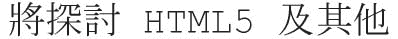Hiragana: 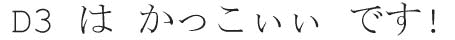

The next portion of this appendix shows you how to “slice and dice” text strings with built-in Python functions.

## **Working with Strings**

A string in Python2 is a sequence of ASCII-encoded bytes. You can concatenate two strings using the “+” operator. The following example prints a string and then concatenates two single-letter strings:

`>>> 'abc' 'abc'` `>>> 'a' + 'b' 'ab'` 

You can use “+” or “*” to concatenate identical strings, as shown here:

`>>> 'a' + 'a' + 'a' 'aaa'` `>>> 'a' * 3 'aaa'` 

You can assign strings to variables and print them using the print() statement:

`>>> print('abc') abc` `>>> x = 'abc'` `>>> print(x) abc` `>>> y = 'def'` `>>> print(x + y) abcdef` 

You can “unpack” the letters of a string and assign them to variables, as shown here:

`>>> str = "World"` `>>> x1,x2,x3,x4,x5 = str` `>>> x1 'W'` `>>> x2 'o'` `>>> x3 'r'` `>>> x4 'l'` `>>> x5 'd'` 

The preceding code snippets shows you how easy it is to extract the letters in a text string. You can extract substrings of a string as shown in the following examples:

`>>> x = "abcdef"` `>>> x[0]` `'a'` `>>> x[-1]` `'f'` `>>> x[1:3]` `'bc'` `>>> x[0:2] + x[5:]` `'abf'` 

However, you will cause an error if you attempt to subtract two strings, as would be expected:

`>>> 'a' - 'b'` 

Traceback (most recent call last):

  File "<stdin>", line 1, in <module> TypeError: unsupported operand type(s) for -: 'str' and 'str' 

The try/except construct in Python (discussed later in this appendix) enables you to handle the preceding type of exception more gracefully.

### **Comparing Strings**

You can use the methods lower() and upper() to convert a string to lowercase and uppercase, respectively, as shown here:

`>>> 'Python'.lower() 'python'` `>>> 'Python'.upper() 'PYTHON'` `>>>` 

The methods lower() and upper() are useful for performing a case insensitive comparison of two ASCII strings. Listing B.2 displays the contents of Compare.py that uses the lower() function in order to compare two ASCII strings.

***LISTING B.2: Compare.py***

x = 'Abc' y = 'abc'   if(x == y):   print('x and y: identical') elif (x.lower() == y.lower()):   print('x and y: case insensitive match') else:   print('x and y: different') 

Since x contains mixed case letters and y contains lowercase letters, Listing B.2 displays the following output:

x and y: different 

### **Formatting Strings in Python**

Python provides the functions string.lstring(), string.rstring(), and string.center() for positioning a text string so that it is left-justified, right-justified, and centered, respectively. As you saw in a previous section, Python also provides the format() method for advanced interpolation features.

Now enter the following commands in the Python interpreter:

import string   str1 = 'this is a string' print(string.ljust(str1, 10)) print(string.rjust(str1, 40)) print(string.center(str1,40)) The output is shown here: this is a string                         this is a string             this is a string 

## **Uninitialized Variables and the Value None in Python**

Python distinguishes between an uninitialized variable and the value None. The former is a variable that has not been assigned a value, whereas the value None is a value that indicates “no value.” Collections and methods often return the value None, and you can test for the value None in conditional logic.

The next portion of this appendix shows you how to “slice and dice” text strings with built-in Python functions.

## **Slicing and Splicing Strings**


Python 允许你使用数组符号（即切片操作）来提取字符串的子串（称为“切片”）。切片的格式为 start:stop:step，其中 start、stop 和 step 均为整数，分别表示起始位置、结束位置和步长。Python 中切片的有趣之处在于可以使用值 -1，它会从字符串的右侧开始操作，而不是左侧。

下面是一些字符串切片的示例：

text1 = "this is a string" print('First 7 characters:',text1[0:7]) print('Characters 2-4:',text1[2:4]) print('Right-most character:',text1[-1]) print('Right-most 2 characters:',text1[-3:-1]) 

上述代码的输出如下：

First 7 characters: this is Characters 2-4: is Right-most character: g Right-most 2 characters: in 

稍后在本附录中，你将看到如何在另一个字符串中插入字符串。

### **Testing for Digits and Alphabetic Characters**

Python 允许你检查字符串中每个字符，并判断该字符是否为合法的数字或字母。本节提供了正则表达式的简要入门。

Listing B.3 显示了 CharTypes.py 的内容，说明如何判断字符串是否包含数字或字符。虽然我们目前还未讨论 Python 中的条件语句，但 Listing B.3 中的示例非常直接。

***LISTING B.3: CharTypes.py***

str1 = "4" str2 = "4234" str3 = "b" str4 = "abc" str5 = "a1b2c3" if(str1.isdigit()): print("this is a digit:",str1) if(str2.isdigit()): print("this is a digit:",str2) if(str3.isalpha()): print("this is alphabetic:",str3) if(str4.isalpha()): print("this is alphabetic:",str4) if(not str5.isalpha()): print("this is not pure alphabetic:",str5) print("capitalized first letter:",str5.title()) 

Listing B.3 初始化了一些变量，随后进行了两次条件检查，使用 isdigit() 函数检查 str1 和 str2 是否为数字。随后的代码检查 str3、str4、str5 是否为字母字符串，使用的是 isalpha() 函数。Listing B.3 的输出如下：

this is a digit: 4 this is a digit: 4234 this is alphabetic: b this is alphabetic: abc this is not pure alphabetic: a1b2c3 capitalized first letter: A1B2C3 

Listing B.3 初始化了一些变量，随后进行了两次条件检查，使用 isdigit() 函数检查 str1 和 str2 是否为数字。随后的代码检查 str3、str4、str5 是否为字母字符串，使用的是 isalpha() 函数。Listing B.3 的输出如下：

this is a digit: 4 this is a digit: 4234 this is alphabetic: b this is alphabetic: abc this is not pure alphabetic: a1b2c3 capitalized first letter: A1B2C3 

***LISTING B.4: FindPos1.py***

item1 = 'abc' item2 = 'Abc' text = 'This is a text string with abc' pos1 = text.find(item1) pos2 = text.find(item2) print('pos1=',pos1) print('pos2=',pos2) 

Listing B.4 初始化了变量 item1、item2 和 text，然后查找 text 中 item1 和 item2 的索引位置。Python 的 find() 方法返回匹配成功的列号；如果未找到，则返回 -1。Listing B.4 的运行结果如下：

pos1= 27 pos2= -1 

除了 find() 方法，你还可以使用 in 操作符来判断元素是否存在，示例如下：

\>>> lst = [1,2,3] \>>> 1 in lst True 

Listing B.5 显示了 Replace1.py 的内容，说明如何将一个字符串替换为另一个字符串。

***LISTING B.5: Replace1.py***

text = 'This is a text string with abc' print('text:',text) text = text.replace('is a', 'was a') print('text:',text) 

Listing B.5 先初始化变量 text 并打印其内容，随后使用 replace() 将 "is a" 替换为 "was a"，再次打印修改后的字符串。运行结果如下：

text: This is a text string with abc text: This was a text string with abc 

Listing B.5 先初始化变量 text 并打印其内容，随后使用 replace() 将 "is a" 替换为 "was a"，再次打印修改后的字符串。运行结果如下：

text: This is a text string with abc text: This was a text string with abc 

Listing B.6 显示了 Remove1.py 的内容，说明如何查找字符串。

***LISTING B.6 Remove1.py***

text = '   leading and trailing white space   ' print('text1:','x',text,'y') text = text.lstrip() print('text2:','x',text,'y') text = text.rstrip() print('text3:','x',text,'y') 

Listing B.6 先将字符 x 与变量 text 拼接后打印，随后使用 lstrip() 去除前导空格并打印，再使用 rstrip() 去除尾随空格并打印。Listing B.6 的运行结果如下：

text1: x leading and trailing white space y text2: x leading and trailing white space y text3: x leading and trailing white space y 

如果想要去除文本字符串内部的多余空格，可使用 replace() 函数（前文已说明），示例代码还包含 re 模块用于正则表达式：

import re text = 'a    b' a = text.replace(' ', '') b = re.sub('\\s+', ' ', text) print(a) print(b) 

结果如下：

ab a b 

## **Printing Text without NewLine Characters**

如果需要在多个 print 语句中抑制换行和空格，可以使用字符串拼接或 write() 函数。

第一种方法是使用 str() 函数将每个对象的字符串表示拼接后打印。例如，执行以下语句：

x = str(9)+str(0xff)+str(-3.1) print('x: ',x) 

输出为：

x:  9255-3.1 

上述行是将数字 9 与十六进制 0xff（对应十进制 255）以及浮点数 -3.1 拼接后的结果。

同样，你可以将 str() 与模块或自定义类一起使用。下面是使用 Python 内置模块 sys 的示例：

\>>> import sys \>>> print(str(sys)) <module 'sys' (built-in)> 

下面的代码片段演示如何使用 write() 函数输出字符串：

import sys write = sys.stdout.write write('123') write('123456789') 

输出为：

1233 1234567899 

## **Text Alignment**

Python 提供了 ljust()、rjust() 和 center() 三种方法，用于对齐文本。ljust() 和 rjust() 分别左对齐和右对齐文本字符串，而 center() 用于居中对齐。示例如下：

text = 'Hello World' text.ljust(20) 'Hello World ' \>>> text.rjust(20) ' Hello World' \>>> text.center(20) ' Hello World ' 

可以使用 Python 的 format() 函数来对齐文本。使用 <、>、^ 字符配合指定宽度，分别实现左对齐、右对齐和居中。下面的示例展示了如何指定文本对齐方式：

\>>> format(text, '>20') '         Hello World' \>>> \>>> format(text, '<20') 'Hello World         ' \>>> \>>> format(text, '²⁰') '    Hello World     ' \>>> 

## **Working with Dates**

Python 提供了丰富的日期相关函数，详情请参阅：

*[`docs.python.org/2/library/datetime.html`](http://docs.python.org/2/library/datetime.html)*


-   Listing B.7 显示 Python 脚本 Datetime2.py 的内容，该脚本用于显示各种与日期相关的值，例如当前日期和时间、星期、月份、年份以及自纪元以来的时间（秒数）。

***LISTING B.7: Datetime2.py***

```python
import time
import datetime
print("Time in seconds since the epoch: %s" % time.time())
print("Current date and time: ", datetime.datetime.now())
print("Or like this: ", datetime.datetime.now().strftime("%y-%m-%d-%H-%M"))
print("Current year: ", datetime.date.today().strftime("%Y"))
print("Month of year: ", datetime.date.today().strftime("%B"))
print("Week number of the year: ", datetime.date.today().strftime("%W"))
print("Weekday of the week: ", datetime.date.today().strftime("%w"))
print("Day of year: ", datetime.date.today().strftime("%j"))
print("Day of the month : ", datetime.date.today().strftime("%d"))
print("Day of week: ", datetime.date.today().strftime("%A"))
```

Listing B.8 显示运行 Listing B.7 中的代码后生成的输出。

***LISTING B.8: datetime2.out***

```
Time in seconds since the epoch: 1375144195.66 Current date and time:  2013-07-29 17:29:55.664164 Or like this:  13-07-29-17-29 Current year:  2013 Month of year:  July Week number of the year:  30 Weekday of the week:  1 Day of year:  210 Day of the month :  29 Day of week:  Monday 
```

Python 还允许对与日期相关的值进行算术运算，如下代码块所示：

```python
>>> from datetime import timedelta
>>> a = timedelta(days=2, hours=6)
>>> b = timedelta(hours=4.5)
>>> c = a + b
>>> c.days 2
>>> c.seconds 37800
>>> c.seconds / 3600 10.5
>>> c.total_seconds() / 3600 58.5
```

### **字符串转日期**

Listing B.9 显示 String2Date.py 的内容，该脚本演示了如何将字符串转换为日期，并计算两个日期之间的差值。

***LISTING B.9: String2Date.py***

```python
from datetime import datetime
text = '2014-08-13'
y = datetime.strptime(text, '%Y-%m-%d')
z = datetime.now()
diff = z - y
print('Date difference:', diff)
```

Listing B.9 的输出如下：

Date difference: -210 days, 18:58:40.197130 

### **异常处理**

与 JavaScript 不同，Python 不能直接将数字与字符串相加。不过，你可以使用 try/except 构造来检测非法操作，该构造与 JavaScript、Java 等语言中的 try/catch 类似。

下面是一个 try/except 代码块的示例：

```python
try:
    x = 4
    y = 'abc'
    z = x + y
except:
    print 'cannot add incompatible types:', x, y
```

运行上述代码后，由于变量 x 和 y 类型不兼容，except 代码块中的 print 语句会被执行。

在前面的附录中，你也看到过，减去两个字符串会抛出异常：

```python
>>> 'a' - 'b'
Traceback (most recent call last):
    File "<stdin>", line 1, in <module>
TypeError: unsupported operand type(s) for -: ‘str’ and ‘str’
```

处理这种情况的简单方法是使用 try/except 块：

```python
try:
    print('a' - 'b')
except TypeError:
    print('TypeError exception while trying to subtract two strings')
except:
    print('Exception while trying to subtract two strings')
```

上述代码块的输出如下：

TypeError exception while trying to subtract two strings 

如上所示，代码块首先指定更细粒度的异常类型 TypeError，随后使用通用的 except 语句捕获其他可能在 Python 代码执行过程中出现的异常。这种写法与 Java 代码的异常处理类似。

Listing B.10 显示 Exception1.py 的内容，演示了如何处理各种类型的异常。

***LISTING B.10: Exception1.py***

```python
import sys
try:
    f = open('myfile.txt')
    s = f.readline()
    i = int(s.strip())
except IOError as err:
    print("I/O error: {0}".format(err))
except ValueError:
    print("Could not convert data to an integer.")
except:
    print("Unexpected error:", sys.exc_info()[0])
    raise
```

Listing B.10 包含一个 try 语句块和三个 except 语句。如果 try 语句块中出现错误，则会先与第一个 except 语句中的异常类型进行比对。如果匹配成功，则执行随后的 print() 语句，并终止程序。如果不匹配，则会对第二个 except 语句进行类似的匹配测试。如果两个 except 语句都不匹配，则第三个 except 语句会捕获异常，打印信息并“抛出”异常。

你也可以在单个 except 语句中指定多种异常类型，如下所示：

except (NameError, RuntimeError, TypeError):
    print('One of three error types occurred')

上述代码块更为简洁，但无法确定发生了哪种异常。Python 允许你自定义异常，但此书的范围超出了该主题。

### **处理用户输入**

Python 可以通过 input() 或 raw_input() 函数从命令行读取用户输入。通常将用户输入的内容赋值给变量，该变量会包含用户从键盘输入的所有字符。用户输入在按下 <return> 关键键（该键会随输入字符一起被包含）时结束。Listing B.11 显示 UserInput1.py 的内容，该脚本提示用户输入姓名，然后使用插值输出回复。

***LISTING B.11: UserInput1.py***

```python
userInput = input("Enter your name: ")
print("Hello %s, my name is Python" % userInput)
```

Listing B.11 的输出如下（假设用户输入了 "Dave"）：

Hello Dave, my name is Python 

Listing B.11 中的 print() 语句使用 %s 进行字符串插值，该插值会在运行时替换 % 符号后面的变量值。这种功能在需要在运行时指定内容时非常有用。

用户输入可能会导致异常（取决于代码执行的操作），因此在代码中加入异常处理代码非常重要。

Listing B.12 显示 UserInput2.py 的内容，该脚本提示用户输入字符串，并尝试在 try/except 块中将字符串转换为数字。

***LISTING B.12: UserInput2.py***

```python
userInput = input("Enter something: ")
try:
    x = 0 + eval(userInput)
    print('you entered the number:', userInput)
except:
    print(userInput, 'is a string')
```

Listing B.12 在用户输入后加上 0，对转换结果进行数值运算。如果转换成功，则显示包含用户输入的消息；如果转换失败，则 except 代码块会打印提示信息，表明输入是字符串。

Listing B.13 显示 UserInput3.py 的内容，该脚本提示用户输入两个数字，并尝试在两个 try/except 块中计算它们的和。

***LISTING B.13: UserInput3.py***

```python
sum = 0
msg = 'Enter a number:'
val1 = input(msg)
try:
    sum = sum + eval(val1)
except:
    print(val1, 'is a string')
msg = 'Enter a number:'
val2 = input(msg)
try:
    sum = sum + eval(val2)
except:
    print(val2, 'is a string')
print('The sum of', val1, 'and', val2, 'is', sum)
```


Listing B.13 包含两个 try 块，每个 try 块后面都跟着一个 except 语句。第一个 try 块尝试将第一个用户提供的数字加到变量 `sum` 中，第二个 try 块尝试将第二个用户提供的数字加到之前输入的数字上。如果输入字符串中的任意一个不是有效数字，则会出现错误信息；如果两个都为有效数字，则会显示包含输入数字及其和的消息。请务必阅读本附录前面提到的 `eval()` 函数的注意事项。

## **Python and Emojis (Optional)**

Listing B.14 显示 `remove_emojis.py` 的内容，该文件演示了如何从文本字符串中删除表情符号。

***LISTING B.14: remove_emojis.py***

```python
import re
import emoji

text = "I want a Chicago deep dish pizza tonight \U0001f600"
print("text:")
print(text)
print()
emoji_pattern = re.compile("[\U0001F1E0-\U0001F6FF]+", flags=re.UNICODE)
text = emoji_pattern.sub(r"", text)
text = "".join([x for x in text if x not in emoji.UNICODE_EMOJI])
print("text:")
print(text)
print()
```

Listing B.14 以两条 import 语句开头，随后初始化变量 `text` 为一段文本字符串，其内容如上所示。随后的代码定义了变量 `emoji_pattern`，这是一个正则表达式，用于匹配一系列 Unicode 表情符号的范围。

接下来的代码将 `text` 设置为除去表情符号后的字符集合，然后显示结果。运行 Listing B.14 后，你将看到如下输出：

text: I want a Chicago deep dish pizza tonight   text: I want a Chicago deep dish pizza tonight 

## **Command-Line Arguments**

Python 提供 `getopt` 模块来解析命令行选项和参数，同时 `sys` 模块提供通过 `sys.argv` 获取任意命令行参数的功能。它的作用有两点：

* `sys.argv` 是命令行参数的列表
* `len(sys.argv)` 是命令行参数的数量

这里 `sys.argv[0]` 是程序名称，例如当 Python 程序名为 `test.py` 时，它对应 `sys.argv[0]` 的值。

现在你可以在命令行上为 Python 程序提供输入值，而不必通过交互式提示用户输入。

下面以脚本 `test.py` 为例：

```python
#!/usr/bin/python
import sys
print('Number of arguments:', len(sys.argv), 'arguments')
print('Argument List:', str(sys.argv))
```

运行方式如下：

python test.py arg1 arg2 arg3 

这将产生如下结果：

Number of arguments: 4 arguments. Argument List: ['test.py', 'arg1', 'arg2', 'arg3']
```

通过命令行提供输入值的功能非常有用。例如，假设你有一个自定义的 Python 类，包含 `add` 和 `subtract` 两个方法，用于对一对数字进行加法和减法运算。

你可以使用命令行参数指定要在哪个方法上执行这对数字，如下所示：

python MyClass add 3 5
python MyClass subtract 3 5 

这种功能之所以有用，是因为它可以让你在 Python 类中程序化调用不同的方法，从而可以为代码编写单元测试。

Listing B.15 显示 `Hello.py` 的内容，演示如何使用 `sys.argv` 检查命令行参数的数量。

***LISTING B.15: Hello.py***

```python
import sys

def main():
    if len(sys.argv) >= 2:
        name = sys.argv[1]
    else:
        name = 'World'
    print('Hello', name)

# Standard boilerplate to invoke the main() function
if __name__ == '__main__':
    main()
```

Listing B.15 定义了 `main()` 函数，用于检查命令行参数的数量：如果参数数量至少为 2，则变量 `name` 被赋值为第二个参数（第一个参数是程序名），否则 `name` 被赋值为 `'World'`。随后的 print 语句输出 `name` 的值。

最后一段代码使用条件语句决定是否执行 `main()` 函数。

## **Summary**

本附录展示了如何使用数字并进行算术运算，随后介绍了字符串的处理及相关操作。下一附录将介绍数据及其相关操作。

# A P P E N D I X C

# INTRODUCTION TO REGULAR  

EXPRESSIONS

本附录介绍了正则表达式（regular expressions），这是 Python 中一种非常强大的语言特性。由于正则表达式在其他编程语言（如 JavaScript 和 Java）中也可用，你在此处学到的知识在 Python 之外的应用也十分有价值。本附录包含多种复杂程度不一的代码块和完整代码示例，既适合初学者，也适合已经有一定正则表达式经验的开发者。

实际上，你可能已经在笔记本电脑的命令行（无论是 Windows、Unix 还是 Linux 系统）中使用过（ albeit simple）正则表达式。在这篇文章中，你将学习如何编写比命令行中使用的更复杂的正则表达式。回顾第 1 章节，你已经了解了一些基本的元字符，这些元字符可以在正则表达式中用于执行涉及文本字符串和文本文件的高级搜索与替换操作。

本附录的第一部分展示了如何使用数字和字母（大小写均可）定义正则表达式，并学习如何在正则表达式中使用字符类。你还将了解字符集和字符类的概念。

本附录的第二部分讨论了 Python `re` 模块，其中包含多个有用方法，如 `re.match()` 用于匹配字符组，`re.search()` 用于在字符串中查找，以及 `findAll()` 方法。你还将学习如何在正则表达式中使用字符类（以及如何对它们分组）。

本附录的最后部分提供了一系列代码示例，包括使用 `re.split()` 方法对文本字符串进行拆分，以及使用 `re.sub()` 方法对文本字符串进行替换。

在阅读本附录中的代码示例时，如果你是初学者，可能会因为正则表达式的密集内容感到不知所措。不过，通过练习和重复，你将逐渐熟悉正则表达式。

最后，请记住，代码示例针对 Python 3.x，若需在 Python 2.x 环境中使用，可能需要进行相应修改。

## **What are Regular Expressions?**

* 正则表达式（regular expressions）也称为 RE、regex 或 regex pattern，它们用于定义可以匹配字符串中特定“部分”的表达式。例如，你可以定义一个正则表达式来匹配单个字符或数字、电话号码、邮编或电子邮件地址。通过使用元字符和字符类（在下一节中定义），你可以在文本文档中搜索特定模式。随着你学习正则表达式的使用，你会发现更多其它用途。


The `re` 模块（Python 1.5 引入）提供 Perl‑风格的正则表达式模式。注意，Python 早期版本提供了 `regex` 模块，该模块在 Python 2.5 被移除。`re` 模块提供了一系列方法（稍后在本附录中讨论），用于在文本字符串中查找或替换文本，这与文字处理程序中的基本查找和/或替换功能类似（但通常缺少正则表达式支持）。`re` 模块还提供基于正则表达式的文本字符串切分方法。

在深入 `re` 模块的方法之前，你需要了解元字符和字符类，这些是下一节的主题。

## **Metacharacters in Python**

Python 支持一组 *元字符*，大多数与其他脚本语言（如 Perl）以及编程语言（如 JavaScript 和 Java）的元字符相同。Python 中元字符的完整列表如下：

`. ^ $ \* + ? { } \[ \] \\ | ( )`

元字符的含义如下：

- `?`（匹配 0 或 1）：表达式 `a?` 匹配字符串 `a`（但不匹配 `ab`）
- `*`（匹配 0 或多次）：表达式 `a*` 匹配字符串 `aaa`（但不匹配 `baa`）
- `+`（匹配 1 或多次）：表达式 `a+` 匹配 `aaa`（但不匹配 `baa`）
- `^`（行首）：表达式 `^\[a\]` 匹配字符串 `abc`（但不匹配 `bc`）
- `$`（行尾）：`\[c\]$` 匹配字符串 `abc`（但不匹配 `cab`）
- `.`（单个点）：匹配除换行符外的任意字符

有时需要匹配元字符本身而非其含义，可以用两种方式实现。第一种是用反斜杠（`\\`）对其象征意义进行“转义”。因此，`\\?`、`\\*`、`\\+`、`\\^`、`\\$`、`\\.` 表示字面字符而非元字符含义。也可以对反斜杠本身进行转义，使用 `\\\\`。若有两个连续的反斜杠，则需要为每个反斜杠再加一个反斜杠，即 `\\\\\\\\` 是转义 `\\\\` 的序列。

第二种方式是把元字符放在方括号 `[]` 内。例如，`\[+?\]` 将 “+” 和 “?” 视为普通字符而非元字符。这种方法更简洁，也更不易出错（不必担心漏掉反斜杠）。

下面的列表展示了元字符的具体含义：

- “`^\[a-z\]`” 表示任何以小写字母开头的字符串
- “`\[^a-z\]`” 表示任何不包含小写字母的字符串
- “`^\[^a-z\]`” 表示以非小写字母开头的字符串
- “`^\[a-z\]$`” 表示仅由一个小写字母组成的字符串
- “`^\[^a-z\]$`” 表示仅由一个非小写字母字符（包括数字）组成的字符串

本节快速预览 `re` 模块的后续内容：`re.sub()` 方法可以用来从文本字符串中删除字符（包括元字符）。例如，下面的代码片段删除变量 `str` 中所有斜杠 “/” 和加号 “+”：

```python
>>> import re
>>> str = "this string has a / and + in it"
>>> str2 = re.sub("\[/\]+", "", str)
>>> print('original:', str)
original: this string has a / and + in it
>>> print('replaced:', str2)
replaced: this string has a  and + in it
```

通过在方括号内列出要删除的元字符，同样可以轻松删除其他元字符，方法与上面示例相同。

Listing C.1 展示了 `RemoveMetaChars1.py` 的内容，该文件演示了如何从一行文本中删除其他元字符。

***LISTING C.1: RemoveMetaChars1.py***

```python
import re
text1 = "meta characters ? and / and + and ."
text2 = re.sub("\[/\\.\*?=+\]+", "", text1)
print('text1:', text1)
print('text2:', text2)
```

`Listing C.1` 中的正则表达式在第一眼看似复杂，但我们可以通过拆解整体表达式并逐字解释来化解它的神秘。首先，`\[/\\.\*?=+\]` 匹配斜杠 “/”、点 “.”、问号 “?”、等号 “=” 或加号 “+”。注意点 “.” 前面的反斜杠 “\\” 用于对点进行转义，使其被视为字面字符而非“匹配任意字符”的元字符。

因此，`\[/\\.\*?=+\]+` 的含义是“在方括号内的字符（作为字面字符）出现一次或多次”。换句话说，该表达式匹配前面列出的元字符（已被转义为字面字符）的任意组合。

于是，`re.sub("\[/\\.\*?=+\]+","",text1)` 会匹配 `text1` 中出现的这些元字符，并将它们替换为空字符串。`Listing C.1` 的输出如下：

```
text1: meta characters ? and / and + and .
text2: meta characters and and and
```

本附录后面还会介绍 `re` 模块的其他函数，用于修改和拆分文本字符串。

##**Character Sets in Python**

十进制单个数字是 0 到 9 之间的整数，用 `\[0-9\]` 表示。同样，小写字母可为任意从 `a` 到 `z` 的字符，用 `\[a-z\]` 表示；大写字母可为任意从 `A` 到 `Z` 的字符，用 `\[A-Z\]` 表示。

下面的代码示例展示了如何使用简写方式指定数字序列和字符串序列，而不是逐个列出每个字符：

- `\[0-9\]` 匹配单个数字
- `\[0-9\]\[0-9\]` 匹配两个连续的数字
- `\[0-9\]{3}` 匹配三个连续的数字
- `\[0-9\]{2,4}` 匹配 2、3 或 4 个连续的数字
- `\[0-9\]{5,}` 匹配 5 个或更多连续的数字
- `^\[0-9\]+$` 匹配仅由数字组成的字符串

类似地，可以使用大写或小写字母定义相似的模式，简化表达：

- `\[a-z\]\[A-Z\]` 匹配一个小写字母后紧跟一个大写字母
- `\[a-zA-Z\]` 匹配任意大小写字母

### **Working with “^” and “\\”**

“^” 字符在正则表达式中的意义取决于其位置。例如，`^\[0-9\]` 匹配以数字开头的字符串；而 `^\[⁰-9\]` 因为方括号内的 “^” 表示取反，且外部的 “^” 表示行首，因而匹配不以数字开头的字符串。

反斜杠 “`\\`” 用于对元字符进行转义。因此，点 “.” 匹配除空白字符外的任意字符，而 “`\\.`” 则匹配字面上的点字符。其他涉及反斜杠的示例包括：

- `\\.H.\\*` 匹配字符串 `.Hello`
- `H.\\*` 匹配字符串 `Hello`
- `H.\\*\\.` 匹配字符串 `Hello.`
- `.ell.` 匹配字符串 `Hello`
- `.\*` 匹配字符串 `Hello`
- `\\..\\*` 匹配字符串 `.Hello`


## `Python 字符类`

`字符类` 是方便的表达式，比前一节的“裸”形式更短、更简单。以下是一些常用的字符序列，用于表示数字和字母的模式：

`\\d` 匹配一个数字

`\\w` 匹配一个字符（数字或字母）

`\\s` 匹配一个空白字符（空格、换行、回车或制表）

`\\b` 匹配单词和非单词之间的边界

`\\n`、`\\r`、`\\t` 分别表示换行、回车和制表

`\\` 用于转义任何字符

基于前面的定义，`\\d+` 匹配一个或多个数字，`\\w+` 匹配一个或多个字符，这两者都是比使用字符集更简洁的表达式。此外，我们还可以重新表述前一节中的表达式：

`\\d` 等价于 `\[0-9\]`，而 `\\D` 等价于 `\[⁰-9\]`

`\\s` 等价于 `\[ \\t\\n\\r\\f\\v\]`，匹配任何非空白字符，而 `\\S` 正好相反（匹配 `\[^ \\t\\n\\r\\f\\v\]`）

`\\w` 等价于 `\[a-zA-Z0-9_\]`，匹配任何字母数字字符，而 `\\W` 正好相反（匹配 `\[^a-zA-Z0-9_\]`）

其他示例：

`\\d{2}` 等价于 `\[0-9\]\[0-9\]`

`\\d{3}` 等价于 `\[0-9\]\\{3\\}`

`\\d{2,4}` 等价于 `\[0-9\]\\{2,4\\}`

`\\d{5,}` 等价于 `\[0-9\]\\{5,\\}`

`^\\d+$` 等价于 `^\[0-9\]+$`

花括号（“{}”）称为量词，用于指定前置表达式中字符的数量或范围。

## `使用 re 模块匹配字符类`

`re` 模块提供以下用于在文本字符串中匹配或搜索正则表达式一次或多次出现的方法：

`match()`：判断正则表达式是否匹配字符串的*开头*。

`search()`：在字符串中查找任意位置的匹配。

`findall()`：找出所有匹配的子串并返回列表。

`finditer()`：找出所有匹配的子串并返回迭代器。

## `注意`

*The* `match()` *函数仅匹配到字符串的开头。*

下一节展示如何在 `re` 模块中使用 `match()` 函数。

## `使用 re.match() 方法`

`re.match()` 方法尝试在文本字符串中匹配正则表达式（可选标志），语法如下：

`re.match(pattern, string, flags=0)` 

`pattern` 参数是要在 `string` 参数中匹配的正则表达式。`flags` 参数使用位运算符（`|` 符号）可以指定多个标志。

`re.match` 方法在成功时返回匹配对象，在失败时返回 `None`。使用匹配对象的 `group(num)` 或 `groups()` 方法可以获取匹配表达式。

`group(num=0)`：返回整体匹配（或特定子组 num）  

`groups()`：返回所有匹配子组的元组（如果没有子组则返回空元组）

## `注意`

*The* `re.match()` *方法仅匹配文本字符串的开头，这与后文讨论的* `re.search()` *方法不同。*

下面的代码块演示如何使用 `group()` 函数在正则表达式中：

```python
>>> import re
>>> p = re.compile('(a(b)c)de')
>>> m = p.match('abcde')
>>> m.group(0) 'abcde'
>>> m.group(1) 'abc'
>>> m.group(2) 'b'
```

注意 `group()` 方法中更高的数字匹配更深层嵌套的表达式。

Listing C.2 显示 `MatchGroup1.py` 的内容，该文件说明如何使用 `group()` 函数匹配字母数字文本字符串和字母文本字符串。

***LISTING C.2: MatchGroup1.py***

```python
import re
line1 = 'abcd123'
line2 = 'abcdefg'
mixed = re.compile(r"^\[a-z0-9\]{5,7}$")
line3 = mixed.match(line1)
line4 = mixed.match(line2)
print('line1:',line1)
print('line2:',line2)
print('line3:',line3)
print('line4:',line4)
print('line5:',line4.group(0))
line6 = 'a1b2c3d4e5f6g7'
mixed2 = re.compile(r"^(\[a-z\]+\[0-9\]+){5,7}$")
line7 = mixed2.match(line6)
print('line6:',line6)
print('line7:',line7.group(0))
print('line8:',line7.group(1))
line9 = 'abc123fgh4567'
mixed3 = re.compile(r"^(\[a-z\]\*\[0-9\]\*){5,7}$")
line10 = mixed3.match(line9)
print('line9:',line9)
print('line10:',line10.group(0))
```

Listing C.2 的输出如下：  
line1: abcd123 line2: abcdefg line3: <_sre.SRE_Match object at 0x100485440> line4: <_sre.SRE_Match object at 0x1004854a8> line5: abcdefg line6: a1b2c3d4e5f6g7 line7: a1b2c3d4e5f6g7 line8: g7 line9: abc123fgh4567 line10: abc123fgh4567  

注意 line3 和 line7 涉及两种相似但不同的正则表达式。变量 `mixed` 指定由小写字母 followed by digits 组成的序列，且字符串长度在 5 到 7 之间。字符串 'abcd123' 满足所有条件。

然而，`mixed2` 指定由一个或多个“字母+数字”对组成的模式，且匹配对的数量在 5 到 7 之间。此例中，字符串 'abcd123' 以及 'a1b2c3d4e5f6g7' 都满足条件。

第三个正则表达式 `mixed3` 指定每个“字母+数字”对可以包含零个或多个小写字母和零个或多个数字，且这样的对的数量在 5 到 7 之间。从输出可以看出，`mixed3` 的正则表达式能够匹配任意顺序的小写字母和数字。

在前面的示例中，正则表达式指定了字符串长度的范围，下限为五，上限为七。

但也可以指定仅下限（无上限）或仅上限（无下限）。

Listing C.3 显示 `MatchGroup2.py` 的内容，该文件说明如何使用正则表达式和 `group()` 函数匹配字母数字文本字符串和字母文本字符串。

***LISTING C.3: MatchGroup2.py***

```python
import re
alphas = re.compile(r"^\[abcde\]{5,}")
line1 = alphas.match("abcde").group(0)
line2 = alphas.match("edcba").group(0)
line3 = alphas.match("acbedf").group(0)
line4 = alphas.match("abcdefghi").group(0)
line5 = alphas.match("abcdefghi abcdef")
print('line1:',line1)
print('line2:',line2)
print('line3:',line3)
print('line4:',line4)
print('line5:',line5)
```

Listing C.3 初始化变量 `alphas` 为一个正则表达式，匹配以 a 到 e 之间的任意字母开头，且至少包含五个字符的字符串。随后代码通过 `alphas` 正则对多个文本字符串进行匹配，`line1` 到 `line4` 分别通过 `group(0)` 获取第一个匹配子组。

Listing C.3 的输出如下：

line1: abcde line2: edcba line3: acbed line4: abcde line5: <_sre.SRE_Match object at 0x1004854a8> 

Listing C.4 显示 `MatchGroup3.py` 的内容，该文件说明如何使用正则表达式与 `group()` 函数匹配文本中的单词。

***LISTING C.4: MatchGroup3.py***

```python
import re
line = "Giraffes are taller than elephants"; 
matchObj = re.match( r'(.\*) are(\\.\*)', line, re.M|re.I)
if matchObj: 
    print("matchObj.group()  : ", matchObj.group())
    print("matchObj.group(1) : ", matchObj.group(1))
    print("matchObj.group(2) : ", matchObj.group(2))
else: 
    print("matchObj does not match line:", line)
```

Listing C.4 的输出如下：

matchObj.group()  :  Giraffes are matchObj.group(1) :  Giraffes matchObj.group(2) :  


-   Listing C.4 包含一对由管道符（“|”）分隔的分隔符。第一个分隔符是 re.M，表示“多行”，在本例中因为只包含一行文本，所以没有影响。第二个分隔符 re.I 表示在模式匹配过程中忽略大小写。re.match() 方法支持其他附加分隔符，详见下一节。

## **re.match() 方法的可选修饰符**

match() 方法支持多种可选修饰符，影响匹配类型。正如上一个示例所示，你可以用 “|” 符号组合多个修饰符。下面列出可用的正则表达式修饰符：

re.I 实现大小写不敏感匹配（见上一节）

re.L 依据当前区域设置解释单词

re.M 使 $ 匹配行末，使 ^ 匹配任意行首

re.S 让 “.” 匹配除换行符之外的任意字符

re.U 依据 Unicode 字符集解释字母

通过编写 Python 代码，在不同文本字符串中尝试使用这些修饰符。

## **使用 re.search() 匹配字符类**

如前文所述，re.match() 只能从字符串开头进行匹配，而 re.search() 可以在任意位置匹配子串。

re.search() 接收两个参数：正则表达式模式和字符串，并在给定字符串中查找指定模式。成功时返回 Match 对象，否则返回 None。

**示例**：查找模式 “tasty” 后跟一个五字母单词：

import re  
str = 'I want a tasty pizza'  
match = re.search(r'tasty \\w\\w\\w\\w\\w', str)  
if match:  
    ## 'found tasty pizza'  
    print('found', match.group())  
else:  
    print('Nothing tasty here')  

**输出**：

found tasty pizza  

下面的代码进一步展示 match() 与 search() 的区别：

>>> import re  
>>> print(re.search('this', 'this is the one').span())  
(0, 4)  
>>> print(re.search('the', 'this is the one').span())  
(8, 11)  
>>> print(re.match('this', 'this is the one').span())  
(0, 4)  
>>> print(re.match('the', 'this is the one').span())  

Traceback (most recent call last):  
File "<stdin>", line 1, in <module>  
AttributeError: 'NoneType' object has no attribute 'span'  

## **使用 findAll() 匹配字符类**

Listing C.5 展示了 RegEx1.py 脚本的内容，说明如何定义简单的字符类以匹配多种文本字符串。

***LISTING C.5: RegEx1.py***

import re  
str1 = "123456"  
matches1 = re.findall("(\\d+)", str1)  
print('matches1:',matches1  
str1 = "123456"  
matches1 = re.findall("(\\d\\d\\d)", str1)  
print('matches1:',matches1  
str1 = "123456"  
matches1 = re.findall("(\\d\\d)", str1)  
print('matches1:',matches1  
print str2 = "1a2b3c456"  
matches2 = re.findall("(\\d)", str2)  
print('matches2:',matches2  
print str2 = "1a2b3c456"  
matches2 = re.findall("\\d", str2)  
print('matches2:',matches2  
print str3 = "1a2b3c456"  
matches3 = re.findall("(\\w)", str3)  
print('matches3:',matches3  

Listing C.5 包含用于匹配数字的简单正则表达式，分别作用于变量 str1 和 str2。最后的代码块会匹配字符串 str3 中的每个字符，实际上把 str3 “拆分” 成一个列表，每个元素为一个字符。Listing C.5 的输出如下（注意前三行后有空行）：

matches1: \['123456'\] matches1: \['123', '456'\] matches1: \['12', '34', '56'\]   matches2: \['1', '2', '3', '4', '5', '6'\]   matches2: \['1', '2', '3', '4', '5', '6'\]   matches3: \['1', 'a', '2', 'b', '3', 'c', '4', '5', '6'\]  

## **查找字符串中以大写字母开头的单词**

Listing C.6 展示了 FindCapitalized.py 脚本，说明如何定义字符类以匹配以大写字母开头的单词。

***LISTING C.6: FindCapitalized.py***

import re  
str = "This Sentence contains Capitalized words"  
caps = re.findall(r'\[A-Z\]\[\\w\\.-\\]+', str)  
print('str: ',str print('caps:',caps  

Listing C.6 初始化字符串变量 str 和正则表达式 caps，用来匹配以大写字母开头的单词，因为 caps 的第一部分是 \[A-Z\]，匹配 A 到 Z 之间的任意大写字母。Listing C.6 的输出如下：

str:  This Sentence contains Capitalized words  
caps: \['This', 'Sentence', 'Capitalized'\]  

## **正则表达式的其他匹配函数**

调用 match()、search()、findAll() 或 finditer() 后，可以在返回的匹配对象上调用其他方法。下面用 match() 方法的示例：

import re  
p1 = re.compile('\[a-z\]+')  
m1 = p1.match("hello")  

在上述代码中，p1 表示匹配一个或多个小写字母的编译正则表达式，m1 是匹配对象，支持以下方法：

- group()：返回正则表达式匹配的字符串  
- start()：返回匹配的起始位置  
- end()：返回匹配的结束位置  
- span()：返回 (start, end) 的元组  

Listing C.7 进一步展示了使用 search() 方法和 group() 方法：

***LISTING C.7: SearchFunction1.py***

import re  
line = "Giraffes are taller than elephants";  
searchObj = re.search( r'(.\*) are(\\.\*)', line, re.M|re.I)  
if searchObj:  
    print("searchObj.group()  : ", searchObj.group()  
    print("searchObj.group(1) : ", searchObj.group(1)  
    print("searchObj.group(2) : ", searchObj.group(2)  
else:  
    print("searchObj does not match line:", line  

Listing C.7 中的变量 line 表示文本字符串，searchObj 是使用 search() 方法并带有管道符修饰符的正则表达式。若匹配成功，则 if/else 条件会输出三个捕获组的内容。Listing C.7 的输出如下：

searchObj.group()  :  Giraffes are searchObj.group(1) :  Giraffes searchObj.group(2) :    

## **使用字符类进行分组**

除了前文提到的字符类，你还可以指定字符类的子表达式。

Listing C.8 展示了 Grouping1.py 脚本，说明如何使用 search() 方法。

***LISTING C.8: Grouping1.py***

import re  
p1 = re.compile('(ab)\*')  
print('match1:',p1.match('ababababab').group())  
print('span1: ',p1.match('ababababab').span())  
p2 = re.compile('(a)b')  
m2 = p2.match('ab')  
print('match2:',m2.group(0))  
print('match3:',m2.group(1)  


Listing C.8 开始通过定义匹配零个或多个 `ab` 字符串的正则表达式 `p1`。第一个 `print()` 语句显示使用 `match()` 函数对 `p1`（随后跟 `group()` 函数）作用于字符串的结果，结果是一个字符串。这说明了“方法链”的用法，消除了中间对象的需要（如第二个代码块所示）。第二个 `print()` 语句显示使用 `match()` 函数对 `p1`，随后使用 `span()` 函数作用于字符串。此时结果是一个数值范围（见下面段落的输出）。

Listing C.8 的第二部分定义了正则表达式 `p2`，它匹配可选的字母 `a` 后跟字母 `b`。变量 `m2` 调用 `match` 方法在 `p2` 上使用字符串 `ab`。第三个 `print()` 语句显示调用 `group(0)` 方法的结果，第四个 `print()` 语句显示调用 `group(1)` 方法的结果。两者都是输入字符串 `ab` 的子串。请记住，`group(0)` 返回最高层级的匹配，而 `group(1)` 返回更“具体”的匹配，例如涉及 `p2` 定义中括号的部分。整数值越大，`group(n)` 表达式中的值越具体。Listing C.8 的输出如下：

match1: `ababababab` span1: (0, 10) match2: `ab` match3: `a` 

## **使用字符类在正则表达式中匹配字符串**

本节包含一些示例，说明如何使用字符类匹配各种字符串，以及如何使用分隔符来分割文本字符串。例如，常见的日期字符串形式为 MM/DD/YY。另一种常见情况是包含多个字段的记录，字段之间使用分隔符分隔。通常这些记录包含一个分隔符，但如下文所示，Python 使使用多个分隔符分割记录变得非常简单。

### **匹配包含多个连续数字的字符串**

Listing C.9 显示了 Python 脚本 `MatchPatterns1.py` 的内容，该脚本展示了如何定义简单的正则表达式，以根据连续出现的数字一次或多次的情况来分割文本字符串的内容。

虽然正则表达式 `\\d+/\\d+/\\d+` 和 `\\d\\d/\\d\\d/\\d\\d\\d\\d` 都匹配字符串 `08/13/2014`，但第一个正则表达式匹配的模式更多，而第二个正则表达式是“精确匹配”，即允许的连续数字数量的精确匹配。

***LISTING C.9: MatchPatterns1.py***

import re
date1 = '02/28/2013'
date2 = 'February 28, 2013'
# 简单匹配：\\d+ 表示匹配一个或多个数字
if re.match(r'\\d+/\\d+/\\d+', date1):
    print('date1 matches this pattern')
else:
    print('date1 does not match this pattern')
if re.match(r'\\d+/\\d+/\\d+', date2):
    print('date2 matches this pattern')
else:
    print('date2 does not match this pattern')

The output from launching Listing C.9 is here:

date1 matches this pattern date2 does not match this pattern

### **在字符串中反转单词**

Listing C.10 显示了 Python 脚本 `ReverseWords1.py` 的内容，该脚本展示了如何在字符串中反转一对单词。

***LISTING C.10: ReverseWords1.py***

import re
str1 = 'one two'
match = re.search('(\\[\\w.-\\]+) (\[\\w.-\\]+)', str1)
str2 = match.group(2) + ' ' + match.group(1)
print('str1:',str1 print('str2:',str2
The output from Listing C.10 is here: str1: one two str2: two one

现在你已经了解如何定义匹配数字和字母的正则表达式，让我们来看一些更高级的正则表达式示例。

例如，以下表达式匹配由数字、大写字母或小写字母（即无特殊字符）的任意组合字符串：

^\[a-zA-Z0-9\]$

下面是将相同的表达式重写为使用字符类的形式：

^\[\\w\\W\\d\]$

## **使用 re 模块修改文本字符串**

Python `re` 模块包含多种用于修改字符串的方法。`split()` 方法使用正则表达式对字符串进行“拆分”，生成列表。`sub()` 方法查找所有匹配正则表达式的子串，并将其替换为不同的字符串。`subn()` 与 `sub()` 功能相同，但同时返回新字符串和替换次数。下面的子章节包含示例，说明如何在正则表达式中使用 `split()`、`sub()` 和 `subn()` 函数。

## **使用 re.split() 方法拆分文本字符串**

Listing C.11 显示了 Python 脚本 `RegEx2.py` 的内容，该脚本展示了如何定义简单的正则表达式，以分割文本字符串的内容。

***LISTING C.11: RegEx2.py***

import re
line1 = "abc def"
result1 = re.split(r'\[\\s\]', line1)
print('result1:',result1
line2 = "abc1,abc2:abc3;abc4"
result2 = re.split(r'\[,:;\]', line2)
print('result2:',result2
line3 = "abc1,abc2:abc3;abc4 123 456"
result3 = re.split(r'\[,:;\\s\]', line3)
print('result3:',result3

Listing C.11 包含三个代码块，每个都使用 `re` 模块的 `split()` 方法来对三个字符串进行 tokenize（分词）。第一个正则表达式指定空白字符，第二个指定三个标点字符，第三个指定前两个正则表达式的组合。

`RegEx2.py` 的输出如下：

result1: ['abc', 'def'] result2: ['abc1', 'abc2', 'abc3', 'abc4'] result3: ['abc1', 'abc2', 'abc3', 'abc4', '123', '456']

## **使用字符类和分隔符拆分文本字符串**

Listing C.12 显示了 `SplitCharClass1.py` 的内容，该脚本展示了如何使用字符类、点号（`.`）和空白字符的正则表达式来分割两个字符串的内容。

***LISTING C.12: SplitCharClass1.py***

import re
line1 = '1. Section one 2. Section two 3. Section three'
line2 = '11. Section eleven 12. Section twelve 13. Section thirteen'
print(re.split(r'\\d+\\. ', line1))
print(re.split(r'\\d+\\. ', line2)

Listing C.12 包含两个字符串，可以使用相同的正则表达式 `\\d+\\. ` 进行拆分。注意，如果使用 `\\d\\. ` 只有第一个字符串会正确拆分。`SplitCharClass1.py` 的输出如下：

['', 'Section one ', 'Section two ', 'Section three'] ['', 'Section eleven ', 'Section twelve ', 'Section thirteen']

## **使用 re.sub() 方法替换文本字符串**

在前文的附录中，你已经看到使用 `sub()` 方法删除文本字符串中所有元字符的预览。下面的代码块展示了如何使用 `re.sub()` 方法替换文本字符串中的字母字符。

\>>> import re \>>> p = re.compile( '(one|two|three)') \>>> p.sub( 'some', 'one book two books three books') 'some book some books some books' \>>> \>>> p.sub( 'some', 'one book two books three books', count=1) 'some book two books three books'

下面的代码块使用 `re.sub()` 方法在文本字符串中插入换行符，使每个字母后都有换行：

\>>> line = 'abcde' \>>> line2 = re.sub('', '\\n', line) \>>> print('line2:',line2 line2: a b c d e 

## **匹配文本字符串的开头和结尾**

Listing C.13 显示了 Python 脚本 `RegEx3.py` 的内容，该脚本展示了如何使用 `startswith()` 函数和 `endswith()` 函数查找子串。

***LISTING C.13: RegEx3.py***


import re `line2 = "abc1,Abc2:def3;Def4"` `result2 = re.split(r'\[,:;\]', line2)` `for w in result2:` `if(w.startswith('Abc')):` `print('Word starts with Abc:',w)` `elif(w.endswith('4')):` `print('Word ends with 4:',w)` `else:` `print('Word:',w)


import re `searchString = "Testing pattern matches" expr1 = re.compile( r"Test" ) expr2 = re.compile( r"^Test" ) expr3 = re.compile( r"Test$" ) expr4 = re.compile( r"\\b\\w\*es\\b" ) expr5 = re.compile( r"t\[aeiou\]", re.I ) if expr1.search( searchString ): print('"Test" was found.' if expr2.match( searchString ): print('"Test" was found at the beginning of the line.' if expr3.match( searchString ): print('"Test" was found at the end of the line.' result = expr4.findall( searchString ) if result: print('There are %d words(s) ending in "es":' % ( len( result ) ), for item in result: print(" " + item, print result = expr5.findall( searchString ) if result: print('The letter t, followed by a vowel, occurs %d times:' % ( len( result ) ), for item in result: print(" "+item, print 

Listing C.17 starts with the variable `searchString` that specifies a text string, followed by the REs `expr1`, `expr2`, `expr3`. The RE `expr1` matches the string `Test` that occurs anywhere in `searchString`, whereas `expr2` matches `Test` if it occurs at the beginning of `searchString`, and `expr3` matches `Test` if it occurs at the end of `searchString`. The RE `expr` matches words that end in the letters `es`, and the RE `expr5` matches the letter `t` followed by a vowel. The output from Listing C.17 is here:

"Test" was found. "Test" was found at the beginning of the line. There are 1 words(s) ending in "es":  matches The letter t, followed by a vowel, occurs 3 times:  Te  ti  te 

## **Additional Topics for Regular Expressions**

In addition to the Python‑based search/replace functionality that you have seen in this appendix, you can also perform a greedy search and substitution. Perform an internet search to learn what these features are and how to use them in Python code.

## **Summary**

This appendix showed you how to create various types of regular expressions. First you learned how to define primitive regular expressions using sequences of digits, lowercase letters, and uppercase letters. Next you learned how to use character classes, which are more convenient and simpler expressions that can perform the same functionality. You also learned how to use the Python `re` library in order to compile regular expressions and then use them to see if they match substrings of text strings.

## **Exercises**

1.  Given a text string, find the list of words (if any) that start or end with a vowel, and treat upper- and lowercase vowels as distinct letters. Display this list of words in alphabetical order, and also in descending order based on their frequency.

2.  Given a text string, find the list of words (if any) that contain lowercase vowels or digits or both, but no uppercase letters. Display this list of words in alphabetical order, and also in descending order based their frequency.

3.  There is a spelling rule in English specifying that “the letter i is before e, except after c,” which means that “receive” is correct but “recieve” is incorrect. Write a Python script that checks for incorrectly spelled words in a text string.

4.  Subject pronouns cannot follow a preposition in the English language. Thus, “between you and me” and “for you and me” are correct whereas “between you and I” and “for you and I” are incorrect. Write a Python script that checks for incorrect grammar in a text string, and search for the prepositions “between,” “for,” and “with.” In addition, search for the subject pronouns “I,” “you,” “he,” and “she.” Modify and display the text with the correct grammar usage.

5.  Find the words in a text string whose length is at most four and then print(all) the substrings of those characters. For example, if a text string contains the word “text,” then print the strings “t,” “te,” “tex,” and “text.”

# A P P E N D I X D

# INTRODUCTION TO KERAS

This appendix introduces you to Keras along with code samples that illustrate how to define basic neural networks, as well as deep neural networks with various datasets with MNIST and Cifar10.

The first part of this appendix briefly discusses some of the important namespaces (e.g., tf.keras.layers) and their contents, as well as a simple Keras‑based model.

The second section contains an example of performing linear regression with Keras and a simple CSV file. You will also see a Keras-based MLP neural network that is trained on the MNIST dataset.

The third section contains a simple example of training a neural network with the cifar10 dataset. This code sample is similar to training a neural network on the MNIST dataset and requires a very small code change.

The final section contains two examples of Keras‑based models that perform “early stopping,” which is convenient when the model exhibits minimal improvement (that is specified by you) during the training process.

## **What is Keras?**

If you are already comfortable with Keras, you can skim this section to learn about the new namespaces and what they contain, and then proceed to the next section that includes details for creating a Keras‑based model.

If you are new to Keras, you might be wondering why this section is included in this appendix. First, Keras is well‑integrated into TF 2, and it’s in the tf.keras namespace. Second, Keras is well‑suited for defining models to solve a myriad of tasks such as linear regression and logistic regression, as well as deep learning tasks involving CNNs, RNNs, and LSTMs that are discussed in the appendix.

The next several subsections contain lists of bullet items for various Keras‑related namespaces, and they will be very familiar if you have worked with TF 1.x. If you are new to TF 2, you’ll see examples of some of the classes in subsequent code samples.

### **Working with Keras Namespaces in TF 2**

TF 2 provides the `tf.keras` namespace, which in turn contains the following namespaces:

*   `tf.keras.layers`

*   `tf.keras.models`

*   `tf.keras.optimizers`

*   `tf.keras.utils`

*   `tf.keras.regularizers`

The preceding namespaces contain various layers in Keras models, different types of Keras models, optimizers (Adam et al), utility classes, and regularizers (such as L1 and L2), respectively.

Currently there are three ways to create Keras‑based models:

*   Sequential class

*   functional API

*   model class

The Keras‑based code samples in this book use primarily the Sequential class (it’s the most intuitive and straightforward). The Sequential class enables you to specify a list of layers, most of which are available in the `tf.keras.layers` namespace (discussed later).

The Keras‑based models that use the functional API involve specifying layers that are passed as function‑like elements in a “pipeline‑like” fashion. Although the functional API provides some additional flexibility, you will probably use the Sequential class to define Keras‑based models if you are a TF 2 beginner.

The model class provides the greatest flexibility, and it involves defining a Python class that encapsulates the semantics of your Keras model. This class is a subclass of the `tf.keras.Model` class, and you must implement the two methods `__init__` and `call` in order to define a Keras model in this subclass.

Perform an online search for more details regarding the functional API and the model class.

### **Working with the tf.keras.layers Namespace**

The most common (and also the simplest) Keras‑based model is the Sequential class that is in the `tf.keras.models` namespace. This model is comprised of various layers that belong to the `tf.keras.layers` namespace, as shown here:

*   `tf.keras.layers.Conv2D()`

*   `tf.keras.layers.MaxPooling2D()`

*   `tf.keras.layers.Flatten()`

*   `tf.keras.layers.Dense()`

*   `tf.keras.layers.Dropout()`

*   `tf.keras.layers.BatchNormalization()`

*   `tf.keras.layers.embedding()`

*   `tf.keras.layers.RNN()`

*   `tf.keras.layers.LSTM()`

*   `tf.keras.layers.Bidirectional` (ex: BERT)


-   Conv2D() 和 MaxPooling2D() 类在基于 Keras 的卷积神经网络 (CNN) 中使用，相关内容在第 [5 章节讨论。一般而言，前面列表中的接下来六个类可以在用于 CNN 的模型以及用于机器学习的模型中出现。RNN() 类用于简单的 RNN，LSTM 类用于基于 LSTM 的模型。Bidirectional() 类是双向 LSTM，在解决自然语言处理 (NLP) 任务的模型中经常出现。一个非常重要的 NLP 模型是 BERT (来自 Google)，它基于 Transformer 架构 (同样来自 Google)。

### **Working with the tf.keras.activations Namespace**

机器学习和深度学习模型需要激活函数。对于基于 Keras 的模型，激活函数位于 tf.keras.activations 命名空间中，其中一些列于下表：

*   tf.keras.activations.relu

*   tf.keras.activations.selu

*   tf.keras.activations.linear

*   tf.keras.activations.elu

*   tf.keras.activations.sigmoid

*   tf.keras.activations.softmax

*   tf.keras.activations.softplus

*   tf.keras.activations.tanh

*   Others

ReLU/SELU/ELU 函数相互紧密相关，它们经常出现在人工神经网络 (ANN) 和卷积神经网络 (CNN) 中。在 relu() 函数流行之前，sigmoid() 和 tanh() 函数被用于 ANN 和 CNN。然而，它们仍然重要，并且在 GRU 和 LSTM 的各种门中被使用。softmax() 函数通常用于包含最右侧隐藏层和输出层的层对中。

### **Working with the keras.tf.datasets Namespace**

为了方便，TF 2 在 tf.keras.datasets 命名空间提供了一组内置数据集，其中一些列于下表：

*   tf.keras.datasets.boston_housing

*   tf.keras.datasets.cifar10

*   tf.keras.datasets.cifar100

*   tf.keras.datasets.fashion_mnist

*   tf.keras.datasets.imdb

*   tf.keras.datasets.mnist

*   tf.keras.datasets.reuters

上述数据集常用于在小数据集上训练模型。mnist 数据集和 fashion_mnist 数据集在训练 CNN 时都很受欢迎，而 boston_housing 数据集常用于线性回归。Titanic 数据集也常用于线性回归，但目前并未在 tf.keras.datasets 命名空间中作为默认数据集提供。

### **Working with the tf.keras.experimental Namespace**

TF 1.x 的 contrib 命名空间已在 TF 2 中被弃用，其后继是 tf.keras.experimental 命名空间，其中包含以下类（以及其他）：

*   tf.keras.experimental.CosineDecay

*   tf.keras.experimental.CosineDecayRestarts

*   tf.keras.experimental.LinearCosineDecay

*   tf.keras.experimental.NoisyLinearCosineDecay

*   tf.keras.experimental.PeepholeLSTMCell

如果你是初学者，可能不会使用列表中的这些类。虽然 PeepholeLSTMCell 类是 LSTM 类的变体，但它的使用场景有限。

### **Working with Other tf.keras Namespaces**

TF 2 提供了多个其他命名空间，其中包含有用的类，一些列于下表：

*   tf.keras.callbacks     (early stopping)

*   tf.keras.optimizers    (Adam 等)

*   tf.keras.regularizers  (L1 和 L2)

*   tf.keras.utils         (to_categorical)

tf.keras.callbacks 命名空间包含一个类，可用于“早期停止”，即在两次连续迭代中损失函数没有足够下降时终止训练过程。

tf.keras.optimizers 命名空间包含与损失函数一起使用的各种优化器，包括流行的 Adam 优化器。

tf.keras.regularizers 命名空间包含两种流行的正则化器：L1 正则化器（机器学习中也称为 LASSO）和 L2 正则化器（机器学习中也称为 Ridge 正则化器）。L1 用于均值绝对误差 (MAE)，L2 用于均值平方误差 (MSE)。这两种正则化器作为“惩罚”项被加入到选定的损失函数中，以减小特征对模型的影响。注意 LASSO 可以将值驱动为零，从而消除特征，这与机器学习中的 *feature selection* 相关。

tf.keras.utils 命名空间包含一系列函数，其中包括 to_categorical() 函数，用于将类向量转换为二元类。

虽然 TF 2 中还有其他命名空间，但前面列出的类别应该足以满足大多数初学者的任务。

### **TF 2 Keras 与 “Standalone” Keras 的区别**

原始 Keras 实际上是一个规范，拥有多种“后端”框架，如 TensorFlow、Theano 和 CNTK。目前，Keras 独立版不支持 TF 2，而 tf.keras 的实现已针对性能进行优化。

Keras 独立版将永远存在于 keras.io 包中，详情请参阅 Keras 官网：keras.io。

现在你已对 TF 2 中 Keras 名称空间及其包含的类有一个高层次的了解，接下来我们来了解如何创建一个基于 Keras 的模型，这将是下一节的主题。

## **创建基于 Keras 的模型**

下面的步骤列表描述了创建、训练和测试 Keras 模型的高层次顺序：

Step 1: 确定模型架构（隐藏层数量、激活函数等）。

Step 2: 调用 compile() 方法。

Step 3: 调用 fit() 方法训练模型。

Step 4: 调用 evaluate() 方法评估训练好的模型。

Step 5: 调用 predict() 方法进行预测。

Step 5 需要确定若干超参数，包括以下列表：

*   隐藏层的数量

*   每个隐藏层的神经元数量

*   边缘权重的初始值

*   损失函数

*   优化器

*   学习率

*   dropout 率

*   激活函数(s)

Steps 2 到 4 涉及训练数据，而 Step 5 涉及测试数据，具体步骤如下：

*   指定数据集（必要时将数据转换为数值形式）。

*   将数据集划分为训练数据和测试数据（通常 80/20 划分）。

*   定义 Keras 模型（例如 tf.keras.models.Sequential API）。

*   编译 Keras 模型（compile() API）。

*   训练（fit）Keras 模型（fit() API）。

*   进行预测（prediction() API）。

注意，前面的项目符号跳过了一些真实 Keras 模型的步骤，例如在测试数据上评估模型，以及处理过拟合等问题。

第一个项目符号指出需要一个数据集，这可以是一份包含 100 行数据和仅三列（或更少）的 CSV 文件。通常，数据集规模更大：可能是一份包含 1,000,000 行数据和每行 10,000 列的文件。我们将在后续章节看到具体的数据集示例。

接下来，Keras 模型位于 tf.keras.models 命名空间，最简单且常见的模型是 tf.keras.models.Sequential。一般而言，Keras 模型包含位于 tf.keras.layers 命名空间的层，例如 tf.keras.Dense（表示相邻层完全连接）。

Keras 层中引用的激活函数位于 tf.nn 命名空间，例如 tf.nn.ReLU 用于 ReLU 激活函数。

下面是描述前面段落的 Keras 模型代码示例（涵盖了前四个要点）：

```python
model = tf.keras.models.Sequential([
    tf.keras.layers.Dense(64, activation='relu', input_shape=(input_dim,)),
    tf.keras.layers.Dense(32, activation='relu'),
    tf.keras.layers.Dense(10, activation='softmax')
])
```


import tensorflow 为 tf model = tf.keras.models.Sequential([ tf.keras.layers.Dense(512, activation=tf.nn.relu), ]) 

我们有三个更多的要讨论的项目，从编译步骤开始。Keras 提供 compile() API 供此步骤，示例如下：

model.compile(optimizer='adam', loss='sparse_categorical_crossentropy', metrics=['accuracy'])

接下来我们需要指定训练步骤，Keras 提供 fit() API（可以看出它不叫 train()），示例如下：

model.fit(x_train, y_train, epochs=5)

最后一步是通过 predict() API 进行预测，示例如下：

pred = model.predict(x)

请注意，evaluate() 方法用于评估已训练的模型，其输出为准确率或损失。然而，predict() 方法对输入数据进行预测。

Listing D.1 显示 tf2_basic_keras.py 的内容，该文件将前面步骤中的代码块合并为一个代码示例。

***LISTING D.1: tf2_basic_keras.py***

import tensorflow 为 tf # NOTE: 我们需要训练数据和测试数据 model = tf.keras.models.Sequential([ tf.keras.layers.Dense(1, activation=tf.nn.relu), ]) model.compile(optimizer='adam', loss='sparse_categorical_crossentropy', metrics=['accuracy']) model.fit(x_train, y_train, epochs=5) model.evaluate(x_test, y_test)

Listing D.1 并无新代码，我们已基本略过一些术语，如优化器（用于与损失函数配合使用的算法）、损失（损失函数的类型）以及指标（衡量模型效能的指标）。

对这些细节的详尽解释无法在几段文字中压缩（遗憾的是），但好消息是，您可以在网络上找到大量详细的博客文章来讨论这些概念。

## **Keras 与线性回归**

本节包含一个简单的示例，演示如何使用 Keras 创建模型来解决线性回归任务：给定一个正数表示意面的千克数，预测其对应的价格。Listing D.2 显示 pasta.csv 的内容，Listing D.3 显示 keras_pasta.py 的内容，该文件执行此任务。

***LISTING D.2: pasta.csv***

weight,price 5,30 10,45 15,70 20,80 25,105 30,120 35,130 40,140 50,150 

***LISTING D.3: keras_pasta.py***

import tensorflow 为 tf import numpy as np import pandas as pd import matplotlib.pyplot as plt # 意面每千克的价格 df = pd.read_csv("pasta.csv") weight = df['weight'] price = df['price'] model = tf.keras.models.Sequential([ tf.keras.layers.Dense(units=1,input_shape=[1]) ]) # MSE 损失函数和 Adam 优化器 model.compile(loss='mean_squared_error', optimizer=tf.keras.optimizers.Adam(0.1)) # 训练模型 history = model.fit(weight, price, epochs=100, verbose=False) # 绘制 # 时代与损失值的图 # xlabel('Number of Epochs') plt.ylabel("Loss Values") plt.plot(history.history['loss']) plt.show() print("Cost for 11kg:",model.predict([11.0])) print("Cost for 45kg:",model.predict([45.0]))

Listing D.3 使用 Pandas 数据框 df 加载 pasta.csv 的内容，然后分别用 df 的第一列和第二列初始化 weight 和 price 变量。

随后，Listing D.3 定义了一个包含单个 Dense 层的 Keras 模型，该模型随后被编译、训练，并绘制一个图表，显示“时代数”在横轴、对应的损失函数值在纵轴。运行 Listing D.3 的代码后，将看到以下输出：

Cost for 11kg: [[41.727108]] Cost for 45kg: [[159.02121]]

图 Figure D.1 显示训练过程中的时代数与损失值的关系。

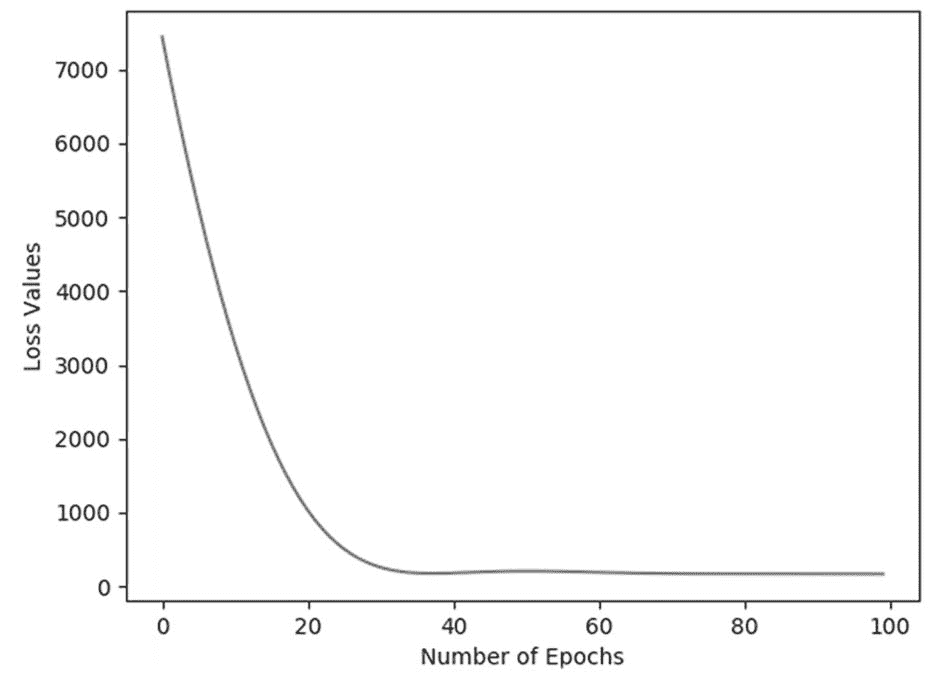

Figure D.1. ¶ A Graph of Epochs versus Loss.

##**Keras、MLP 与 MNIST**

本节包含一个简单的示例，演示如何使用 Keras 创建 MLP 神经网络，并使用 MNIST 数据集进行训练。Listing D.4 显示 keras_mlp_mnist.py 的内容，该文件执行此任务。

***LISTING D.4: keras_mlp_mnist.py***

import tensorflow 为 tf import numpy as np # 实例化 MNIST 并加载数据：mnist = tf.keras.datasets.mnist (x_train, y_train), (x_test, y_test) = mnist.load_data() # 对所有标签进行 one-hot 编码，生成 1x10 向量以与最终层比较：y_train = tf.keras.utils.to_categorical(y_train) y_test = tf.keras.utils.to_categorical(y_test) image_size = x_train.shape[1] input_size = image_size * image_size # 对 28x28 图像进行 reshape 与归一化：x_train = np.reshape(x_train, [-1, input_size]) x_train = x_train.astype('float32') / 255 x_test = np.reshape(x_test, [-1, input_size]) x_test = x_test.astype('float32') / 255 # 初始化一些超参数：batch_size = 128 hidden_units = 128 dropout_ratea = 0.20 # 定义一个 Keras 模型：model = tf.keras.models.Sequential() model.add(tf.keras.layers.Dense(hidden_units, input_dim=input_size)) model.add(tf.keras.layers.Activation('relu')) model.add(tf.keras.layers.Dropout(dropout_rate)) model.add(tf.keras.layers.Dense(hidden_units)) model.add(tf.keras.layers.Activation('relu')) model.add(tf.keras.layers.Dense(10)) model.add(tf.keras.layers.Activation('softmax')) model.summary() model.compile(loss='categorical_crossentropy', optimizer='adam', metrics=['accuracy']) # 在训练数据上训练网络：model.fit(x_train, y_train, epochs=10, batch_size=batch_size) # 计算并显示测试集准确率：loss, acc = model.evaluate(x_test, y_test, batch_size=batch_size) print("\\nTest accuracy: %.1f%%" % (100.0 * acc))

Listing D.4 包含常规的 import 语句，然后将 mnist 变量指向 MNIST 数据集。随后，代码加载训练集和测试集，并使用“one-hot”编码将标签转换为数值向量。

接着，初始化了一些超参数，并定义了一个包含三个 Dense 层、relu 激活函数的 Keras 模型。该模型随后被编译、训练，并在测试集上计算准确率并打印出来。运行 Listing D.4 的代码后，将看到以下输出：


模型名为“sequential”________________________________________________________________________________________________________________________________________________________________________________________________________________________________________________________________________________________________________________________________________________________________________________________________________________________________________________________________________________________________________________________________________________________________________________________________________________________________________________________________________________________________________________________________________________________________________________________________________________________________________________________________________________________________________________________________________________________________________________________________________________________________________________________________________________________________________________________________________________________________________________________________________________________________________________________________________________________________________________________________________________________________________________________________________________________________________________________________________________________________________________________________________________________________________________________________________________________________________________________________________________________________________________________________________________________________________________________________________________________________________________________________________________________________________________________________________________________________________________________________________________________________________________________________________________________________________________________________________________________________________________________________________________________________________________________________________________________________________________________________________________________________________________________________________________________________________________________________________________________________________________________________________________________________________________________________________________________________________________________________________________________________________________________________________________________________________________________________________________________________________________________________________________________________________________________________________________________________________________________________________________________________________________________________________________________________________________________________________________________________________________________________________________________________________________________________________________________________________________________________________________________________________________________________________________________________________________________________________________________________________________________________________________________________________________________________________________________________________________________________________________________________________________________________________________________________________________________________________________________________________________________________________________________________________________________________________________________________________________________________________________________________________________________________________________________________________________________________________________________________________________________________________________________________________________________________________________________________________________________________________________________________________________________________________________________________________________________________________________________________________________________________________________________________________________________________________________________________________________________________________________________________________________________________________________________________________________________________________________________________________________________________________________________________________________________________________________________________________________________________________________________________________________________________________________________________________________________________________________________________________________________________________________________________________________________________________________________________________________________________________________________________________________________________________________________________________________________________________________________________________________________________________________________________________________________________________________________________________________________________________________________________________________________________________________________________________________________________________________________________________________________________________________________________________________________________________________________________________________________________________________________________________________________________________________________________________________________________________________________________________________________________________________________________________________________________________________________________________________________________________________________________________________________________________________________________________________________________________________________________________________________________________________________________________________________________________________________________________________________________________________________________________________________________________________________________________________________________________________________________________________________________________________________________________________________________________________________________________________________________________________________________________________________________________________________________________________________________________________________________________________________________________________________________________________________________________________________________________________________________________________________________________________________________________________________________________________________________________________________________________________________________________________________________________________________________________________________________________________________________________________________________________________________________________________________________________________________________________________________________________________________________________________________________________________________________________________________________________________________________________________________________________________________________________________________________________________________________________________________________________________________________________________________________________________________________________________________________________________________________________________________________________________________________________________________________________________________________________________________________________________________________________________________________________________________________________________________________________________________________________________________________________________________________________________________________________________________________________________________________________________________________________________________________________________________________________________________________________________________________________________________________________________________________________________________________________________________________________________________________________________________________________________________________________________________________________________________________________________________________________________________________________________________________________________________________________________________________________________________________________________________________________________________________________________________________________________________________________________________________________________________________________________________________________________________________________________________________________________________________________________________________________________________________________________________________________________________________________________________________________________________________________________________________________________________________________________________________________________________________________________________________________________________________________________________________________________________________________________________________________________________________________________________________________________________________________________________________________________________________________________________________________________________________________________________________________________________________________________________________________________________________________________________________________________________________________________________________________________________________________________________________________________________________________________________________________________________________________________________________________________________________________________________________________________________________________________________________________________________________________________________________________________________________________________________________________________________________________________________________________________________________________________________________________________________________________________________________________________________________________________________________________________________________________________________________________________________________________________________________________________________________________________________________________________________________________________________________________________________________________________________________________________________________________________________________________________________________________________________________________________________________________________________________________________________________________________________________________________________________________________________________________________________________________________________________________________________________________________________________________________________________________________________________________________________________________________________________________________________________________________________________________________________________________________________________________________________________________________________________________________________________________________________________________________________________________________________________________________________________________________________________________________________________________________________________________________________________________________________________________________________________________________________________________________________________________________________________________________________________________________________________________________________________________________________________________________________________________________________________________________________________________________________________________________________________________________________________________________________________________________________________________________________________________________________________________________________________________________________________________________________________________________________________________________________________________________________________________________________________________________________________________________________________________________________________________________________________________________________________________________________________________________________________________________________________________________________________________________________________________________________________________________________________________________________________________________________________________________________________________________________________________________________________________________________________________________________________________________________________________________________________________________________________________________________________________________________________________________________________________________________________________________________________________________________________________________________________________________________________________________________________________________________________________________________________________________________________________________________________________________________________________________________________________________________________________________________________________________________________________________________________________________________________________________________________________________________________________________________________________________________________________________________________________________________________________________________________________________________________________________________________________________________________________________________________________________________________________________________________________________________________________________________________________________________________________________________________________________________________________________________________________________________________________________________________________________________________________________________________________________________________________________________________________________________________________________________________________________________________________________________________________________________________________________________________________________________________________________________________________________________________________________________________________________________________________________________________________________________________________________________________________________________________________________________________________________________________________________________________________________________________________________________________________________________________________________________________________________________________________________________________________________________________________________________________________________________________________________________________________________________________________________________________________________________________________________________________________________________________________________________________________________________________________________________________________________________________________________________________________________________________________________________________________________________________________________________________________________________________________________________________________________________________________________________________________________________________________________________________________________________________________________________________________________________________________________________________________________________________________________________________________________________________________________________________________________________________________________________________________________________________________________________________________________________________________________________________________________________________________________________________________________________________________________________________________________________________________________________________________________________________________________________________________________________________________________________________________________________________________________________________________________________________________________________________________________________________________________________________________________________________________________________________________________________________________________________________________________________________________________________________________________________________________________________________________________________________________________________________________________________________________________________________________________________________________________________________________________________________________________________________________________________________________________________________________________________________________________________________________________________________________________________________________________________________________________________________________________________________________________________________________________________________________________________________________________________________________________________________________________________________________________________________________________________________________________________________________________________________________________________________________________________________________________________________________________________________________________________________________________________________________________________________________________________________________________________________________________________________________________________________________________________________________________________________________________________________________________________________________________________________________________________________________________________________________________________________________________________________________________________________________________________________________________________________________________________________________________________________________________________________________________________________________________________________________________________________________________________________________________________________________________________________________________________________________________________________________________________________________________________________________________________________________________________________________________________________________________________________________________________________________________________________________________________________________________________________________________________________________________________________________________________________________________________________________________________________________________________________________________________________________________________________________________________________________________________________________________________________________________________________________________________________________________________________________________________________________________________________________________________________________________________________________________________________________________________________________________________________________________________________________________________________________________________________________________________________________________________________________________________________________________________________________________________________________________________________________________________________________________________________________________________________________________________________________________________________________________________________________________________________________________________________________________________________________________________________________________________________________________________________________________________________________________________________________________________________________________________________________________________________________________________________________________________________________________________________________________________________________________________________________________________________________________________________________________________________________________________________________________________________________________________________________________________________________________________________________________________________________________________________________________________________________________________________________________________________________________________________________________________________________________________________________________________________________________________________________________________________________________________________________________________________________________________________________________________________________________________________________________________________________________________________________________________________________________________________________________________________________________________________________________________________________________________________________________________________________________________________________________________________________________________________________________________________________________________________________________________________________________________________________________________________________________________________________________________________________________________________________________________________________________________________________________________________________________________________________________________________________________________________________________________________________________________________________________________________________________________________________________________________________________________________________________________________________________________________________________________________________________________________________________________________________________________________________________________________________________________________________________________________________________________________________________________________________________________________________________________________________________________________________________________________________________________________________________________________________________________________________________________________________________________________________________________________________________________________________________________________________________________________________________________________________________________________________________________________________________________________________________________________________________________________________________________________________________________________________________________________________________________________________________________________________________________________________________________________________________________________________________________________________________________________________________________________________________________________________________________________________________________________________________________________________________________________________________________________________________________________________________________________________________________________________________________________________________________________________________________________________________________________________________________________________________________________________________________________________________________________________________________________________________________________________________________________________________________________________________________________________________________________________________________________________________________________________________________________________________________________________________________________________________________________________________________________________________________________________________________________________________________________________________________________________________________________________________________________________________________________________________________________________________________________________________________________________________________________________________________________________________________________________________________________________________________________________________________________________________________________________________________________________________________________________________________________________________________________________________________________________________________________________________________________________________________________________________________________________________________________________________________________________________________________________________________________________________________________________________________________________________________________________________________________________________________________________________________________________________________________________________________________________________________________________________________________________________________________________________________________________________________________________________________________________________________________________________________________________________________________________________________________________________________________________________________________________________________________________________________________________________________________________________________________________________________________________________________________________________________________________________________________________________________________________________________________________________________________________________________________________________________________________________________________________________________________________________________________________________________________________________________________________________________________________________________________________________________________________________________________________________________________________________________________________________________________________________________________________________________________________________________________________________________________________________________________________________________________________________________________________________________________________________________________________________________________________________________________________________________________________________________________________________________________________________________________________________________________________________________________________________________________________________________________________________________________________________________________________________________________________________________________________________________________________________________________________________________________________________________________________________________________________________________________________________________________________________________________________________________________________________________________________________________________________________________________________________________________________________________________________________________________________________________________________________________________________________________________________________________________________________________________________________________________________________________________________________________________________________________________________________________________________________________________________________________________________________________________________________________________________________________________________________________________________________________________________________________________________________________________________________________________________________________________________________________________________________________________________________________________________________________________________________________________________________________________________________________________________________________________________________________________________________________________________________________________________________________________________________________________________________________________________________________________________________________________________________________________________________________________________________________________________________________________________________________________________________________________________________________________________________________________________________________________________________________________________________________________________________________________________________________________________________________________________________________________________________________________________________________________________________________________________________________________________________________________________________________________________________________________________________________________________________________________________________________________________________________________________________________________________________________________________________________________________________________________________________________________________________________________________________________________________________________________________________________________________________________________________________________________________________________________________________________________________________________________________________________________________________________________________________________________________________________________________________________________________________________________________________________________________________________________________________________________________________________________________________________________________________________________________________________________________________________________________________________________________________________________________________________________________________________________________________________________________________________________________________________________________________________________________________________________________________________________________________________________________________________________________________________________________________________________________________________________________________________________________________________________________________________________________________________________________________________________________________________________________________________________________________________________________________________________________________________________________________________________________________________________________________________________________________________________________________________________________________________________________________________________________________________________________________________________________________________________________________________________________________________________________________________________________________________________________________________________________________________________________________________________________________________________________________________________________________________________________________________________________________________________________________________________________________________________________________________________________________________________________________________________________________________________________________________________________________________________________________________________________________________________________________________________________________________________________________________________________________________________________________________________________________________________________________________________________________________________________________________________________________________________________________________________________________________________________________________________________________________________________________________________________________________________________________________________________________________________________________________________________________________________________________________________________________________________________________________________________________________________________________________________________________________________________________________________________________________________________________________________________________________________________________________________________________________________________________________________________________________________________________________________________________________________________________________________________________________________________________________________________________________________________________________________________________________________________________________________________________________________________________________________________________________________________________________________________________________________________________________________________________________________________________________________________________________________________________________________________________________________________________________________________________________________________________________________________________________________________________________________________________________________________________________________________________________________________________________________________________________________________________________________________________________________________________________________________________________________________________________________________________________________________________________________________________________________________________________________________________________________________________________________________________________________________________________________________________________________________________________________________________________________________________________________________________________________________________________________________________________________________________________________________________________________________________________________________________________________________________________________________________________________________________________________________________________________________________________________________________________________________________________________________________________________________________________________________________________________________________________________________________________________________________________________________________________________________________________________________________________________________________________________________________________________________________________________________________________________________________________________________________________________________________________________________________________________________________________________________________________________________________________________________________________________________________________________________________________________________________________________________________________________________________________________________________________________________________________________________________________________________________________________________________________________________________________________________________________________________________________________________________________________________________________________________________________________________________________________________________________________________________________________________________________________________________________________________________________________________________________________________________________________________________________________________________________________________________________________________________________________________________________________________________________________________________________________________________________________________________________________________________________________________________________________________________________________________________________________________________________________________________________________________________________________________________________________________________________________________________________________________________________________________________________________________________________________________________________________________________________________________________________________________________________________________________________________________________________________________________________________________________________________________________________________________________________________________________________________________________________________________________________________________________________________________________________________________________________________________________________________________________________________________________________________________________________________________________________________________________________________________________________________________________________________________________________________________________________________________________________________________________________________________________________________________________________________________________________________________________________________________________________________________________________________________________________________________________________________________________________________________________________________________________________________________________________________________________________________________________________________________________________________________________________________________________________________________________________________________________________________________________________________________________________________________________________________________________________________________________________________________________________________________________________________________________________________________________________________________________________________________________________________________________________________________________________________________________________________________________________________________________________________________________________________________________________________________________________________________________________________________________________________________________________________________________________________________________________________________________________________________________________________________________________________________________________________________________________________________________________________________________________________________________________________________________________________________________________________________________________________________________________________________________________________________________________________________________________________________________________________________________________________________________________________________________________________________________________________________________________________________________________________________________________________________________________________________________________________________________________________________________________________________________________________________________________________________________________________________________________________________________________________________________________________________________________________________________________________________________________________________________________________________________________________________________________________________________________________________________________________________________________________________________________________________________________________________________________________________________________________________________________________________________________________________________________________________________________________________________________________________________________________________________________________________________________________________________________________________________________________________________________________________________________________________________________________________________________________________________________________________________________________________________________________________________________________________________________________________________________________________________________________________________________________________________________________________________________________________________________________________________________________________________________________________________________________________________________________________________________________________________________________________________________________________________________________________________________________________________________________________________________________________________________________________________________________________________________________________________________________________________________________________________________________________________________________________________________________________________________________________________________________________________________________________________________________________________________________________________________________________________________________________________________________________________________________________________________________________________________________________________________________________________________________________________________________________________________________________________________________________________________________________________________________________________________________________________________________________________________________________________________________________________________________________________________________________________________________________________________________________________________________________________________________________________________________________________________________________________________________________________________________________________________________________________________________________________________________________________________________________________________________________________________________________________________________________________________________________________________________________________________________________________________________________________________________________________________________________________________________________________________________________________________________________________________________________________________________________________________________________________________________________________________________________________________________________________________________________________________________________________________________________________________________________________________________________________________________________________________________________________________________________________________________________________________________________________________________________________________________________________________________________________________________________________________________________________________________________________________________________________________________________________________________________________________________________________________________________________________________________________________________________________________________________________________________________________________________________________________________________________________________________________________________________________________________________________________________________________________________________________________________________________________________________________________________________________________________________________________________________________________________________________________________________________________________________________________________________________________________________________________________________________________________________________________________________________________________________________________________________________________________________________________________________________________________________________________________________________________________________________________________________________________________________________________________________________________________________________________________________________________________________________________________________________________________________________________________________________________________________________________________________________________________________________________________________________________________________________________________________________________________________________________________________________________________________________________________________________________________________________________________________________________________________________________________________________________________________________________________________________________________________________________________________________________________________________________________________________________________________________________________________________________________________________________________________________________________________________________________________________________________________________________________________________________________________________________________________________________________________________________________________________________________________________________________________________________________________________________________________________________________________________________________________________________________________________________________________________________<unk><unk><unk><unk><unk><unk><unk><unk><unk><unk><unk><unk><unk><unk><unk><unk><unk><unk><unk><unk><unk><unk><unk><unk><unk><unk><unk><unk><unk><unk><unk><unk><unk><unk><unk><unk><unk><unk><unk><unk><unk><unk><unk><unk><unk><unk><unk><unk><unk><unk><unk><unk><unk><unk><unk><unk><unk><unk><unk><unk><unk><unk><unk><unk><unk><unk><unk><unk><unk><unk><unk><unk><unk><unk><unk><unk><unk><unk><unk><unk><unk><unk><unk><unk><unk><unk><unk><unk><unk><unk><unk><unk><unk>________________________________________________________________________________________________________________________________________________________________________________________________________________________________________________________________________________________________________________________________________________________________________________________________________________________________________________________________________________________________________________________________________________________________________________________________________________________________________________________________________________________________________________________________________________________________________________________________________________________________________________________________________________________________________________________________________________________________________________________________________________________________________________________________________________________________________________________________________________________________________________________________________________________<unk><unk><unk><unk><unk><unk><unk><unk><unk><unk><unk><unk><unk><unk><unk><unk><unk><unk><unk><unk><unk><unk><unk><unk><unk><unk><unk><unk><unk><unk><unk><unk><unk><unk><unk><unk><unk><unk><unk><unk><unk><unk><unk><unk><unk><unk><unk><unk><unk><unk><unk><unk><unk><unk><unk><unk><unk><unk><unk><unk><unk><unk><unk><unk><unk><unk><unk><unk><unk><unk><unk><unk><unk><unk><unk><unk><unk><unk><unk><unk><unk><unk><unk><unk><unk><unk> _________________________________________________________________________________________________________________________________________________________________________________________________________________________________________________________________________________________________________________________________________________________________________________________________________________________________________________________________________________________________________________________________________________________________________________________________________________________________________________________________________________________________________________________________________________________________________________________________________________________________________________________________________________________________________________________________________________________________________________________________________________________________________________________________________________________________________________________________________________________________________________________________________________________________________________________________________________________________________________________________________________________________________________________________________________________________________________________________________________________________________________<unk><unk><unk><unk><unk><unk><unk><unk><unk><unk><unk><unk><unk><unk><unk><unk><unk><unk><unk><unk><unk><unk><unk><unk><unk><unk><unk><unk><unk><unk><unk><unk><unk><unk><unk><unk><unk><unk><unk><unk><unk><unk><unk><unk><unk><unk><unk><unk><unk><unk><unk><unk><unk><unk><unk><unk><unk><unk><unk><unk><unk><unk><unk><unk><unk><unk><unk><unk><unk><unk><unk><unk><unk><unk><unk><unk><unk><unk><unk><unk><unk>________________________________________________________<unk><unk><unk><unk><unk><unk><unk><unk><unk><unk><unk><unk><unk><unk><unk><unk><unk><unk><unk><unk><unk><unk><unk><unk><unk><unk><unk><unk><unk><unk><unk><unk><unk><unk><unk><unk><unk><unk><unk><unk><unk><unk><unk><unk><unk><unk><unk><unk><unk><unk><unk><unk><unk><unk><unk><unk><unk><unk><unk><unk><unk><unk><unk><unk><unk><unk><unk><unk><unk><unk><unk><unk><unk><unk><unk><unk><unk><unk><unk><unk><unk><unk><unk><unk><unk><unk><unk><unk><unk><unk><unk><unk><unk><unk><unk><unk><unk><unk><unk><unk><unk><unk><unk><unk><unk><unk><unk><unk><unk>________________________________________________________________________________________________________________________________________________________________________________________________________________________________________________________________________________________________________________________________________________________________________________________________________________________________________________________________________________________________________________________________________________________________________________________________________________________________________________________________________________________________________________________________________________________________________________________________________________________________________________________________________________________________________________________________________________________________________________________________________________________________________________________________________________________________________________________________________________________________________________________________________________________________________________________________________________________________________________________________________________________________________________________________________________________________________________________________________________________________________________________________________________________________________________________________________________________________________________________________________________________________________________<unk><unk><unk><unk><unk><unk><unk><unk><unk><unk><unk><unk><unk><unk><unk><unk><unk><unk><unk><unk><unk><unk><unk><unk><unk><unk><unk><unk><unk><unk><unk><unk><unk><unk><unk><unk><unk><unk><unk><unk><unk><unk><unk><unk><unk><unk><unk><unk><unk><unk><unk><unk><unk><unk><unk><unk><unk><unk><unk><unk><unk><unk><unk><unk><unk><unk><unk><unk><unk><unk><unk><unk><unk><unk><unk><unk><unk><unk><unk><unk><unk><unk><unk><unk><unk><unk><unk><unk><unk><unk><unk><unk><unk><unk><unk><unk><unk><unk><unk><unk><unk><unk><unk><unk><unk><unk><unk><unk><unk><unk><unk><unk><unk><unk><unk><unk><unk><unk><unk><unk><unk><unk><unk><unk><unk><unk><unk><unk><unk><unk><unk><unk><unk><unk><unk><unk><unk><unk><unk><unk><unk><unk><unk><unk><unk><unk><unk><unk><unk><unk><unk><unk><unk><unk><unk><unk><unk><unk><unk><unk><unk><unk><unk><unk><unk><unk><unk><unk><unk><unk><unk><unk><unk><unk><unk><unk><unk><unk><unk><unk><unk><unk><unk><unk><unk><unk><unk><unk><unk><unk><unk><unk><unk><unk><unk><unk><unk><unk><unk><unk><unk><unk><unk><unk><unk><unk><unk><unk><unk><unk><unk><unk><unk><unk><unk><unk><unk><unk><unk><unk><unk><unk><unk><unk><unk><unk><unk><unk><unk><unk><unk><unk><unk><unk><unk><unk><unk><unk><unk><unk><unk><unk><unk><unk><unk><unk><unk><unk><unk><unk><unk><unk><unk><unk><unk><unk><unk><unk><unk><unk><unk><unk><unk><unk><unk><unk><unk><unk><unk><unk><unk><unk><unk><unk><unk><unk><unk><unk><unk><unk><unk><unk><unk><unk><unk><unk><unk><unk><unk><unk><unk><unk><unk><unk><unk><unk><unk><unk><unk><unk><unk><unk><unk><unk>________________________________________________________________________________________________________________________________________________________________________________________________________________________________________________________________________________________<unk><unk><unk><unk><unk><unk><unk><unk><unk><unk><unk><unk><unk><unk><unk><unk><unk><unk><unk><unk><unk><unk><unk><unk><unk><unk><unk><unk><unk><unk><unk><unk><unk><unk><unk><unk><unk><unk><unk><unk><unk><unk><unk><unk><unk><unk><unk><unk><unk><unk><unk><unk><unk><unk><unk><unk><unk><unk><unk><unk><unk><unk><unk><unk><unk><unk><unk><unk><unk><unk><unk><unk><unk><unk><unk><unk><unk><unk><unk><unk><unk><unk><unk><unk><unk><unk><unk><unk><unk><unk><unk><unk><unk><unk><unk><unk><unk><unk><unk><unk><unk><unk><unk><unk><unk><unk><unk><unk><unk><unk><unk><unk><unk><unk><unk><unk><unk><unk><unk><unk><unk><unk><unk><unk><unk><unk><unk><unk><unk><unk><unk><unk><unk><unk><unk><unk><unk><unk><unk><unk><unk><unk><unk><unk><unk><unk><unk><unk><unk><unk><unk><unk><unk><unk><unk><unk><unk><unk><unk><unk><unk><unk><unk><unk><unk><unk><unk><unk><unk><unk><unk><unk><unk><unk><unk><unk><unk><unk><unk><unk><unk><unk><unk><unk><unk><unk><unk><unk><unk><unk><unk><unk><unk><unk><unk><unk><unk><unk><unk><unk><unk><unk><unk><unk><unk><unk><unk><unk><unk><unk>________________________________________________________________________________________________________________________________________________________________________________________________________________________________________________________________________________________________________________________________________________________________________________________________________________________________________________________________________________________________________________________________________________________________________________________________________________________________________________________________________________________________________________________________________________________________________________________________________________________________________________________________________________________<unk><unk><unk><unk><unk><unk><unk><unk><unk><unk><unk><unk><unk><unk><unk><unk><unk><unk><unk><unk><unk><unk><unk><unk><unk><unk><unk><unk><unk><unk><unk><unk><unk><unk><unk><unk><unk><unk><unk><unk><unk><unk><unk><unk><unk><unk><unk><unk><unk><unk><unk><unk><unk><unk><unk><unk><unk><unk><unk><unk><unk><unk><unk><unk><unk><unk><unk><unk><unk><unk><unk><unk><unk><unk><unk><unk><unk><unk><unk><unk><unk>________________________________________________________________________________________________________________________________________________________________________________________________________________________________________________________________________________________________________________________________________________________________________________________________________________________________________________________________________________________________________________________________________________________________________________________________________________________________________________________________________________________________________________________________<unk><unk><unk><unk><unk><unk><unk><unk><unk><unk><unk><unk><unk><unk><unk><unk><unk><unk><unk><unk><unk><unk><unk><unk><unk><unk><unk><unk><unk><unk><unk><unk><unk><unk><unk><unk><unk><unk><unk><unk><unk><unk><unk><unk><unk><unk><unk><unk><unk><unk><unk><unk><unk><unk><unk><unk><unk><unk><unk><unk><unk><unk><unk><unk><unk><unk><unk><unk><unk><unk><unk><unk><unk><unk><unk><unk><unk><unk><unk><unk><unk><unk>________________________________________________________________________________________________________________________________________________________________________________________________________________________________________________________________________________________________________________________________________________________________________________________________________________________________________________________________________________________________________________________________________________________________________________________________________________________________________________________________________________________________________________________________________________________________________________________________________________________________________________________________________________________________________________________________________________________________________________________________________________________________________________________________________________________________________________________________<unk><unk><unk><unk><unk><unk><unk><unk><unk><unk><unk><unk><unk><unk><unk><unk><unk><unk><unk><unk><unk><unk><unk><unk><unk><unk><unk><unk><unk><unk><unk><unk><unk><unk><unk><unk><unk><unk><unk><unk><unk><unk><unk><unk><unk><unk><unk><unk><unk><unk><unk><unk><unk><unk><unk><unk><unk><unk><unk><unk><unk><unk><unk><unk><unk><unk><unk><unk><unk><unk><unk><unk><unk><unk><unk><unk><unk><unk><unk><unk><unk><unk><unk> _________________________________________________________________________________________________________________________________________________________________________________________________________________________________________________________________________________<unk><unk><unk><unk><unk><unk><unk><unk><unk><unk><unk><unk><unk><unk><unk><unk><unk><unk><unk><unk><unk><unk><unk><unk><unk><unk><unk><unk><unk><unk><unk><unk><unk><unk><unk><unk><unk><unk><unk><unk><unk><unk><unk><unk><unk><unk><unk><unk><unk><unk><unk><unk><unk><unk><unk><unk><unk><unk><unk><unk><unk><unk><unk><unk><unk><unk><unk><unk><unk><unk><unk><unk><unk><unk><unk><unk><unk><unk><unk><unk><unk>________________________________________________________________________________________________________________________________________<unk><unk><unk><unk><unk><unk><unk><unk><unk><unk><unk><unk><unk><unk><unk><unk><unk><unk><unk><unk><unk><unk><unk><unk><unk><unk><unk><unk><unk><unk><unk><unk><unk><unk><unk><unk><unk><unk><unk><unk><unk><unk><unk><unk><unk><unk><unk><unk><unk><unk><unk><unk><unk><unk><unk><unk><unk><unk><unk><unk><unk><unk><unk><unk><unk><unk><unk><unk><unk><unk><unk><unk><unk><unk><unk><unk><unk><unk><unk><unk><unk><unk><unk><unk><unk><unk><unk><unk><unk><unk><unk><unk><unk><unk><unk><unk><unk><unk><unk><unk><unk><unk><unk><unk><unk><unk><unk><unk><unk> _________________________________________________________________________________________________________________________________________________________________________________________________________________________________________________________________________________________________________________________________________________________________________________________________________________________________________________________________________________________________________________________________________________________________________________________________________________________________________________________________________________________________________________________________________________________________________________________________________________________________________________________________________________________________<unk><unk><unk><unk><unk><unk><unk><unk><unk><unk><unk><unk><unk><unk><unk><unk><unk><unk><unk><unk><unk><unk><unk><unk><unk><unk><unk><unk><unk><unk><unk><unk><unk><unk><unk><unk><unk><unk><unk><unk><unk><unk><unk><unk><unk><unk><unk><unk><unk><unk><unk><unk><unk><unk><unk><unk><unk><unk><unk><unk><unk><unk><unk><unk><unk><unk><unk><unk><unk><unk><unk><unk><unk><unk><unk><unk><unk><unk><unk><unk><unk> _________________________________________________________________________________________________________________________________________________________________________________________________________________________________________________________________________________________________<unk><unk><unk><unk><unk><unk><unk><unk><unk><unk><unk><unk><unk><unk><unk><unk><unk><unk><unk><unk><unk><unk><unk><unk><unk><unk><unk><unk><unk><unk><unk><unk><unk><unk><unk><unk><unk><unk><unk><unk><unk><unk><unk><unk><unk><unk><unk><unk><unk><unk><unk><unk><unk><unk><unk><unk><unk><unk><unk><unk><unk><unk><unk><unk><unk><unk><unk><unk><unk><unk><unk><unk><unk><unk><unk><unk><unk><unk><unk><unk><unk><unk><unk><unk><unk>________________________________________________________________________________________________________________________________________________________________________________________________________________________________________<unk><unk><unk><unk><unk><unk><unk><unk><unk><unk><unk><unk><unk><unk><unk><unk><unk><unk><unk><unk><unk><unk><unk><unk><unk><unk><unk><unk><unk><unk><unk><unk><unk><unk><unk><unk><unk><unk><unk><unk><unk><unk><unk><unk><unk><unk><unk><unk><unk><unk><unk><unk><unk><unk><unk><unk><unk><unk><unk><unk><unk><unk><unk><unk><unk><unk><unk><unk><unk><unk><unk><unk><unk><unk><unk><unk><unk><unk><unk><unk><unk>
</think>
[content]
<unk><unk><unk><unk><unk><unk><unk><unk><unk><unk><unk><unk><unk><unk><unk><unk><unk><unk><unk><unk><unk><unk><unk><unk><unk><unk><unk><unk><unk><unk><unk><unk><unk><unk><unk><unk><unk><unk><unk><unk><unk><unk><unk><unk><unk><unk><unk><unk><unk><unk><unk><unk><unk><unk><unk><unk><unk><unk><unk><unk><unk><unk><unk><unk><unk><unk><unk><unk><unk><unk><unk><unk><unk><unk><unk><unk><unk><unk><unk><unk><unk><unk><unk><unk><unk><unk><unk><unk><unk><unk><unk><unk><unk><unk><unk><unk><unk><unk><unk><unk><unk><unk><unk><unk>________________________________________________________________________________________________________________________________________________________________________________________________<unk><unk><unk><unk><unk><unk><unk><unk><unk><unk><unk><unk><unk><unk><unk><unk><unk><unk><unk><unk><unk><unk><unk><unk><unk><unk><unk><unk><unk><unk><unk><unk><unk><unk><unk><unk><unk><unk><unk><unk><unk><unk><unk><unk><unk><unk><unk><unk><unk><unk><unk><unk><unk><unk><unk><unk><unk><unk><unk><unk><unk><unk><unk><unk><unk><unk><unk><unk><unk><unk><unk><unk><unk><unk><unk><unk><unk><unk><unk><unk><unk><unk><unk><unk><unk><unk><unk><unk><unk><unk><unk><unk><unk><unk><unk><unk><unk><unk><unk><unk><unk><unk><unk>________________________________________________________________________________________________________________________________________________________________________________________________________________________________________________________________________________________________________________________________________________________________________________________________________________________________________________________________________________________________________________________________________________________________________________________________________________________________________________________________________________________________________________________________________________________________________________________________________________________________________________________________________________________________________________________________________________________________________________________________________________________________________________________________________________________________________________________________________________________________________________________________________________________________________________________________________________________________________________________________________________________________________________________________________________________________________________________________________________________________________________________________________________________________________________________________________________________________________________________________________________________________________________________________________________________________________________________________________________________________________________________________________________________________________________________________________________________________________________________________________________________________________________________________________________________________________________________________________________________________________________________________________________________________________________________________________________________________________________________________________________________________________________________________________________________________________________________________________________________________________________________________________________________________________________________________________________________________________________________________________________________________________________________________________________________________________________________________________________________________________________________________________________________________________________________________________________________________________________________<unk><unk><unk><unk><unk><unk><unk><unk><unk><unk><unk><unk><unk><unk><unk><unk><unk><unk><unk><unk><unk><unk><unk><unk><unk><unk><unk><unk><unk><unk><unk><unk><unk><unk><unk><unk><unk><unk><unk><unk><unk><unk><unk><unk><unk><unk><unk><unk><unk><unk><unk><unk><unk><unk><unk><unk><unk><unk><unk><unk><unk><unk><unk><unk><unk><unk><unk><unk><unk><unk><unk><unk><unk><unk><unk><unk><unk><unk><unk><unk><unk><unk><unk><unk><unk><unk><unk><unk><unk><unk><unk><unk><unk><unk><unk><unk><unk><unk><unk><unk><unk><unk><unk><unk><unk><unk><unk><unk><unk><unk><unk><unk><unk><unk><unk><unk><unk><unk><unk><unk><unk><unk><unk><unk><unk><unk><unk><unk><unk><unk><unk><unk><unk><unk><unk><unk><unk><unk><unk><unk><unk><unk> _________________________________________________________________________________________________________________________________________________________________________________________________________________________________________________________________________________________________________________________________________________________________________________________________________________________________________________________________________________________________________________________________________________________________________________________________________________________________________________________________________________________________________________________________________________________________<unk><unk><unk><unk><unk><unk><unk><unk><unk><unk><unk><unk><unk><unk><unk><unk><unk><unk><unk><unk><unk><unk><unk><unk><unk><unk><unk><unk><unk><unk><unk><unk><unk><unk><unk><unk><unk><unk><unk><unk><unk><unk><unk><unk><unk><unk><unk><unk><unk><unk><unk><unk><unk><unk><unk><unk><unk><unk><unk><unk><unk><unk><unk><unk><unk><unk><unk><unk><unk><unk><unk><unk><unk><unk><unk><unk><unk><unk><unk><unk><unk><unk> _________________________________________________________________________________________________________________________________________________________________________________________________________________________________________________________________________________________________________________________________________________________________________________________________________________________________________________________________________________________________________________________________________________________________________________________________________________________________________________________________________________________________________________________________________________________________________________________________________________________________________________________________________________________________________________________________________________________________________________________________________________________________________________________________________________________________________________________________________________________________________________________________________________________________________________________________________________________________________________________________________________________________________________________________________________________________________________________________________________________________________________________________________________________________________________________________________________________________________________________________________________________________________________________________________________________________________________________________________________________________________________________________________________________________________________________________________________________________________________________________________________________________________________________________________________<unk><unk><unk><unk><unk><unk><unk><unk><unk><unk><unk><unk><unk><unk><unk><unk><unk><unk><unk><unk><unk><unk><unk><unk><unk><unk><unk><unk><unk><unk><unk><unk><unk><unk><unk><unk><unk><unk><unk><unk><unk><unk><unk><unk><unk><unk><unk><unk><unk><unk><unk><unk><unk><unk><unk><unk><unk><unk><unk><unk><unk><unk><unk><unk><unk><unk><unk><unk><unk><unk><unk><unk><unk><unk><unk><unk><unk><unk><unk><unk><unk><unk><unk><unk><unk><unk><unk><unk><unk><unk><unk><unk><unk><unk><unk><unk><unk><unk><unk><unk><unk><unk><unk><unk><unk><unk><unk><unk><unk><unk><unk>
[content]
-  
[/content]


import tensorflow as tf import numpy as np import imageio import matplotlib.pyplot as plt # use any image that has 3 channels inp = tf.keras.layers.Input(shape=(None, None, 3)) out = tf.keras.layers.Lambda(lambda image: tf.image.resize(image, (128, 128)))(inp) model = tf.keras.Model(inputs=inp, outputs=out) model.summary() # read the contents of a PNG or JPG X = imageio.imread('sample3.png') out = model.predict(X[np.newaxis, ...]) fig, axes = plt.subplots(nrows=1, ncols=2) axes[0].imshow(X) axes[1].imshow(np.int8(out[0, ...])) plt.show() 

Listing D.6 contains the usual import statements and then initializes the variable inp so that it can accommodate a color image, followed by the variable out that is the result of resizing inp so that it has dimensions 28×23. Next, inp and out are specified as the values of inputs and outputs, respectively, for the Keras model, as shown in this code snippet:

model = tf.keras.Model(inputs=inp, outputs=out) 

Next, the variable X is initialized as a reference to the result of reading the contents of the image sample3.png. The remainder of Listing D.6 involves displaying two images: the original image and the resized image. Launch the code in Listing D.6 and you will see a graph of an image and its resized image as shown in Figure D.2.

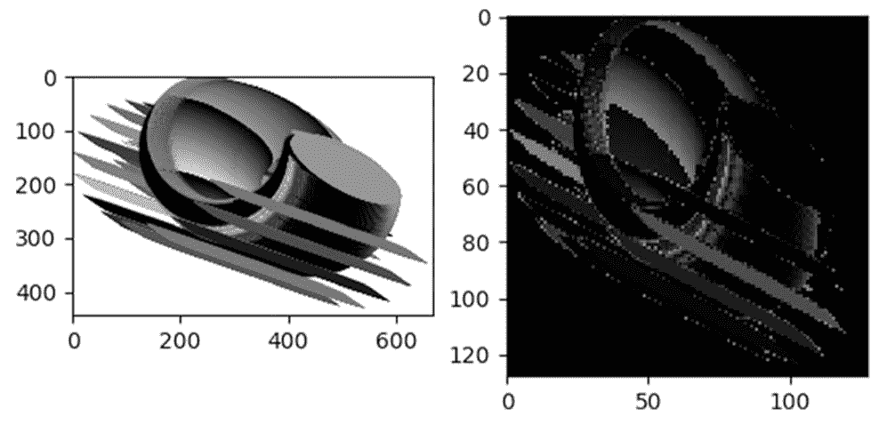

Figure D.2 ¶ A Graph of an Image and its Resized Image.

## **Keras and Early Stopping (1)**

After specifying the training set and the test set from a dataset, you also decide on the number of training epochs. A value that’s too large can lead to overfitting, whereas a value that’s too small can lead to underfitting. Moreover, model improvement can diminish and subsequent training iterations become redundant.

*Early stopping* is a technique that allows you to specify a large value for the number of epochs, and yet the training will stop if the model performance improvement drops below a threshold value.

There are several ways that you can specify early stopping, and they involve the concept of a *callback function*. Listing D.7 displays the contents of tf2\_keras\_callback.py that performs early stopping via a callback mechanism.

***LISTING D.7: tf2\_keras\_callback.py***

import tensorflow as tf import numpy as np model = tf.keras.Sequential() model.add(tf.keras.layers.Dense(64, activation='relu')) model.add(tf.keras.layers.Dense(64, activation='relu')) model.add(tf.keras.layers.Dense(10, activation='softmax')) model.compile(optimizer=tf.keras.optimizers.Adam(0.01), loss='mse', # mean squared error metrics=\['mae'\]) # mean absolute error data = np.random.random((1000, 32)) labels = np.random.random((1000, 10)) val_data = np.random.random((100, 32)) val_labels = np.random.random((100, 10)) callbacks = [ # stop training if "val_loss" stops improving for over 2 epochs tf.keras.callbacks.EarlyStopping(patience=2, monitor='val_loss'), # write TensorBoard logs to the ./logs directory tf.keras.callbacks.TensorBoard(log_dir='./logs') ] model.fit(data, labels, batch_size=32, epochs=50, callbacks=callbacks, validation_data=(val_data, val_labels)) model.evaluate(data, labels, batch_size=32) 

Listing D.7 defines a Keras‑based model with three hidden layers and then compiles the model. The next portion of Listing D.7 uses the np.random.random function in order to initialize the variables data, labels, val_data, and val_labels.

The interesting code involves the definition of the callbacks variable that specifies tf.keras.callbacks.EarlyStopping class with a value of 2 for patience, which means that the model will stop training if there is an insufficient reduction in the value of val_loss. The callbacks variable includes the class tf.keras.callbacks.TensorBoard to specify the logs subdirectory as the location for the TensorBoard files.

Next, the model.fit() method is invoked with a value of 50 for epochs (shown in bold), followed by the model.evaluate() method. Launch the code in Listing D.7 and you will see the following output:

Epoch 1/50 1000/1000 \[==============================\] - 0s 354us/sample - loss: 0.2452 - mae: 0.4127 - val_loss: 0.2517 - val_mae: 0.4205 Epoch 2/50 1000/1000 \[==============================\] - 0s 63us/sample - loss: 0.2447 - mae: 0.4125 - val_loss: 0.2515 - val_mae: 0.4204 Epoch 3/50 1000/1000 \[==============================\] - 0s 63us/sample - loss: 0.2445 - mae: 0.4124 - val_loss: 0.2520 - val_mae: 0.4209 Epoch 4/50 1000/1000 \[==============================\] - 0s 68us/sample - loss: 0.2444 - mae: 0.4123 - val_loss: 0.2519 - val_mae: 0.4205 1000/1000 \[==============================\] - 0s 37us/sample - loss: 0.2437 - mae: 0.4119 (1000, 10) 

Notice that the code stopped training after four epochs, even though 50 epochs are specified in the code.

## **Keras and Early Stopping (2)**

The previous section contains a code sample with minimalistic functionality with respect to the use of callback functions in Keras. However, you can also define a custom class that provides finer-grained functionality that uses a callback mechanism.

Listing D.8 displays the contents of tf2\_keras\_callback2.py that performs early stopping via a callback mechanism (the new code is shown in bold).

***LISTING D.8: tf2\_keras\_callback2.py***

import tensorflow as tf import numpy as np model = tf.keras.Sequential() model.add(tf.keras.layers.Dense(64, activation='relu')) model.add(tf.keras.layers.Dense(64, activation='relu')) model.add(tf.keras.layers.Dense(10, activation='softmax')) model.compile(optimizer=tf.keras.optimizers.Adam(0.01), loss='mse', metrics=\['mae'\]) data = np.random.random((1000, 32)) labels = np.random.random((1000, 10)) val_data = np.random.random((100, 32)) val_labels = np.random.random((100, 10)) **class MyCallback(tf.keras.callbacks.Callback):** **def on_train_begin(self, logs={}):** **print(“on_train_begin”)** **def on_train_end(self, logs={}):** **print(“on_train_begin”)** **return** **def on_epoch_begin(self, epoch, logs={}):** **print(“on_train_begin”)** **return** **def on_epoch_end(self, epoch, logs={}):** **print(“on_epoch_end”)** **return** **def on_batch_begin(self, batch, logs={}):** **print(“on_batch_begin”)** **return** **def on_batch_end(self, batch, logs={}):** **print(“on_batch_end”)** **return** callbacks = [MyCallback()] model.fit(data, labels, batch_size=32, epochs=50, callbacks=callbacks, validation_data=(val_data, val_labels)) model.evaluate(data, labels, batch_size=32) 

The new code in Listing D.8 differs from Listing D.7 in that it is limited to the code block that is displayed in bold in Listing D.8. This new code defines a custom Python class with several methods, each of which is invoked during the appropriate point during the Keras lifecycle execution. The six methods consists of three pairs of methods for the start event and end event associated with training, epochs, and batches, as listed here:

*   def on_train_begin()

*   def on_train_end()

*   def on_epoch_begin()

*   def on_epoch_end()

*   def on_batch_begin()

*   def on_batch_end()

The preceding methods contain just a print() statement in Listing D.8, and you can insert any code you wish in any of these methods. Launch the code in Listing D.8 and you will see the following output:


on`\_train\_begin` on`\_train\_begin` Epoch 1/50 on`\_batch\_begin` on`\_batch\_end`   32/1000 \[..............................\] - ETA: 4s - loss: 0.2489 - mae: 0.4170on`\_batch\_begin` on`\_batch\_end` on`\_batch\_begin` on`\_batch\_end` // details omitted for brevity on`\_batch\_begin` on`\_batch\_end` on`\_batch\_begin` on`\_batch\_end` 992/1000 \[============================>.\] - ETA: 0s - loss: 0.2468 - mae: 0.4138on`\_batch\_begin` on`\_batch\_end` on`\_batch\_begin` on`\_batch\_end` 1000/1000 \[==============================\] - 0s 335us/sample - loss: 0.2466 - mae: 0.4136 - val`\_loss`: 0.2445 - val`\_mae`: 0.4126 on`\_train\_begin` Epoch 2/50 on`\_batch\_begin` on`\_batch\_end`   32/1000 \[..............................\] - ETA: 0s - loss: 0.2465 - mae: 0.4133on`\_batch\_begin` on`\_batch\_end` on`\_batch\_begin` on`\_batch\_end` // details omitted for brevity on`\_batch\_end` on`\_epoch\_end` 1000/1000 \[==============================\] - 0s 51us/sample - loss: 0.2328 - mae: 0.4084 - val`\_loss`: 0.2579 - val`\_mae`: 0.4241 on`\_train\_begin`   32/1000 \[..............................\] - ETA: 0s - loss: 0.2295 - mae: 0.4030 1000/1000 \[==============================\] - 0s 22us/sample - loss: 0.2313 - mae: 0.4077 (1000, 10) 

## `Keras` and `Metrics`

Many `Keras`-based models only specify “accuracy” as the metric for evaluating a trained model, as shown here:

model.compile(optimizer='adam',               loss='sparse\_categorical\_crossentropy',               metrics=\['accuracy'\]) 

However, there are many other built-in `metrics` available, each of which is encapsulated in a `Keras` class in the `tf.keras.metrics` namespace. An inventory of many such `metrics` are displayed in the following list:

*   class `Accuracy`: how often predictions match labels

*   class `BinaryAccuracy`: how often predictions match labels

*   class `CategoricalAccuracy`: how often predictions match labels

*   class `FalseNegatives`: the number of false negatives

*   class `FalsePositives`: the number of false positives

*   class `Mean`: the (weighted) mean of the given values

*   class `Precision`: the precision of the predictions wrt the labels

*   class `Recall`: the recall of the predictions wrt the labels

*   class `TrueNegatives`: the number of true negatives

*   class `TruePositives`: the number of true positives

Earlier in this chapter you learned about the “confusion matrix” that provides numeric values for TP, TN, FP, and FN; each of these values has a corresponding `Keras` class `TruePositive`, `TrueNegative`, `FalsePositive`, and `FalseNegative`, respectively. Perform an online search for code samples that use the `metrics` in the preceding list.

## `Saving` and `Restoring` `Keras` Models

Listing D.9 displays the contents of `tf2\_keras_save_model.py` that creates, trains, and saves a `Keras`-based model, then creates a new model that is populated with the data from the saved model.

***LISTING D.9: tf2\_keras_save_model.py***

```python
import tensorflow as tf
import os

def create_model():
    model = tf.keras.models.Sequential([
        tf.keras.layers.Flatten(input_shape=(28, 28)),
        tf.keras.layers.Dense(512, activation=tf.nn.relu),
        tf.keras.layers.Dropout(0.2),
        tf.keras.layers.Dense(10, activation=tf.nn.softmax)
    ])
    model.compile(optimizer=tf.keras.optimizers.Adam(),
                  loss=tf.keras.losses.sparse_categorical_crossentropy,
                  metrics=['accuracy'])
    return model

# Create a basic model instance
model = create_model()
model.summary()

checkpoint_path = "checkpoint/cp.ckpt"
checkpoint_dir = os.path.dirname(checkpoint_path)

# Create checkpoint callback
cp_callback = tf.keras.callbacks.ModelCheckpoint(checkpoint_path, save_weights_only=True, verbose=1)

# => model #1: create the first model
model = create_model()

mnist = tf.keras.datasets.mnist
(X_train, y_train), (X_test, y_test) = mnist.load_data()
X_train, X_test = X_train / 255.0, X_test / 255.0
print("X_train.shape:", X_train.shape)

model.fit(X_train, y_train,
          epochs=2,
          validation_data=(X_test, y_test),
          callbacks=[cp_callback])

# pass callback to training

# => model #2: create a new model and load saved model
model = create_model()
loss, acc = model.evaluate(X_test, y_test)
print("Untrained model, accuracy: {:5.2f}%".format(100 * acc))

model.load_weights(checkpoint_path)
loss, acc = model.evaluate(X_test, y_test)
print("Restored model, accuracy: {:5.2f}%".format(100 * acc))
```

The final code block in Listing D.8 creates a new `Keras`-based model by invoking the Python method `create_model()` again, evaluating this new model on the test-related data, and displaying the value of the accuracy. Next, the model is loaded with the saved model weights via the `load_weights()` API. The relevant code block is reproduced here:

model = create_model()
loss, acc = model.evaluate(X_test, y_test)
print("Untrained model, accuracy: {:5.2f}%".format(100 * acc))
model.load_weights(checkpoint_path)
loss, acc = model.evaluate(X_test, y_test)
print("Restored model, accuracy: {:5.2f}%".format(100 * acc))

Now launch the code in Listing D.8 and you will see the following output:


-rw-r--r--  1 owner  staff     1222 Aug 17 14:34 cp.ckpt.index \-rw-r--r--  1 owner  staff  4886716 Aug 17 14:34 cp.ckpt.data-00000-of-00001 \-rw-r--r--  1 owner  staff       71 Aug 17 14:34 checkpoint 

## **Summary**

本附录介绍了 Keras 的一些特性以及基于 MNIST 和 cifar10 数据集的基本神经网络的一系列 Keras 代码示例。你学习了部分重要的命名空间（如 `tf.keras.layers`）及其内容。

随后，你看到使用 Keras 进行线性回归的示例以及一个简单的 CSV 文件。然后，你学习如何创建一个基于 Keras 的感知机（MLP）神经网络，并在 MNIST 数据集上进行训练。

此外，你还看到 Keras‑based 模型中“早期停止”的示例，这种方式在训练过程中你设定的模型改进极小时非常便利。

# A P P E N D I X E

# INTRODUCTION TO TENSORFLOW 2

欢迎来到 TensorFlow 2！本附录介绍了 TensorFlow 2（缩写为 TF 2）的各种特性以及在 TF 2 “伞”下涵盖的工具和项目。你将看到 TF 2 代码示例，展示新特性（如 `tf.GradientTape` 和 `@tf.function` 装饰器）以及如何以“TF 2 方式”编写代码的示例。尽管本附录的许多主题看似简单，但它们为 TF 2 打下了基础。

请记住，TensorFlow 1.x 版本在 TF 2 的正式发布后被视为遗留代码。Google 仅提供安全相关的更新（即不再开发新功能），并且在 TF 2 初次正式发布后至少再支持 TF 1.x 一年。为了方便，TensorFlow 提供了一个转换脚本，帮助自动将 TF 1.x 代码转换为 TF 2 代码（详情在本附录后半部分）。

如前面所述，本附录的多个章节涉及 TF 1.x，这些章节位于附录的末尾。如果你没有 TF 1.x 代码，这些章节显然是可选的（并标记为可选）。

本附录的第一部分简要讨论了一些 TF 2 特性以及属于 TF 2 “伞”下的工具。第二部分展示如何编写涉及 TF 常量和 TF 变量的 TF 2 代码。

第三部分稍作跋涉：你将学习新的 TF 2 Python 函数装饰器 `@tf.function`，该装饰器在本附录的许多代码示例中被使用。虽然该装饰器并非总是必需，但熟悉它很重要，并且本节讨论了其使用时的一些非直观的注意事项。

本附录的第四部分展示了如何在 TF 2 中执行常见的算术运算、使用内置 TF 2 函数、计算三角函数值，以及如何使用 for 循环和计算指数值。

第五部分包含 TF 2 代码示例，涉及数组，例如创建身份矩阵、常量矩阵、均匀随机矩阵、截断正态矩阵，并解释截断矩阵与随机矩阵的区别。该部分还展示了如何在 TF 2 中乘以二阶张量以及如何将 Python 数组转换为二阶张量。第六部分提供了使用 TF 2 新特性（如 `tf.GradientTape`）的代码示例。虽然本书的 TF 2 代码示例使用 Python 3.x，但可以修改这些示例以在 Python 2.7 环境下运行。

## **NOTE**

*As this book goes to print,* Python *3.7 works with the TF 2 code in this book, whereas Python 3.9.x does not work with TF 2*。

在上述所有要点的基础上，下一节讨论了 TF 2 的一些细节、其架构以及部分特性。

## **What is TF 2?**

TF 2 是 Google 的开源框架，也是 TensorFlow 的最新版本。TF 2 是一个现代框架，非常适合机器学习和深度学习，并通过 Apache 许可证提供。有趣的是，TensorFlow 可能让许多人（包括 TF 团队成员）感到惊讶，它在艺术、音乐、医学等众多领域展现出丰富的创意和使用案例。为了实现 API 合并、消除 API 重复、加速原型开发并简化调试的目标，TF 团队创建了 TF 2。

如果你是 Keras 的爱好者，请注意 TF 2 的改进部分归功于将 Keras 纳入 TF 2 的核心功能。事实上，TF 2 扩展并优化了 Keras，使其能够充分利用 TF 2 的高级特性。

如果你主要使用深度学习模型（CNN、RNN、LSTM 等），你会主要使用 `tf.keras` 命名空间中的类，这是 TF 2 中 Keras 的实现。此外，`tf.keras.layers` 提供了神经网络的若干标准层。正如你稍后所见，你可以通过 `tf.keras.Sequential` 类、功能式定义或子类化技术来定义 Keras‑based 模型。也可以使用低层操作和自动微分，如果你愿意的话。

此外，TF 2 消除了 duplicate functionality，提供了更直观的 API 语法，并实现了生态系统内的兼容性。TF 2 还提供了一个向后兼容模块 `tf.compat.v1`（不包含 `tf.contrib`），以及转换脚本 `tf_upgrade_v2`，帮助用户从 TF 1.x 迁移到 TF 2。

TF 2 的另一个重要变化是默认采用 **eager execution**（即时执行模式），而非 TF 1.x 的 **deferred execution**（延迟执行）。新特性包括 `@tf.function` 装饰器和 TF 2 隐私相关特性。以下是 TF 2 部分特性和相关技术的简要列表：

*   support for `tf.keras`: 高层 ML/DL 代码规范

*   tensorflow.js v1.0: 现代浏览器中的 TF

*   TensorFlow Federated: 用于分布式数据的开源 ML 框架

*   ragged Tensors: 嵌套的变长（“不规则”）列表

*   TensorFlow Probability: 将概率模型与深度学习相结合

*   Tensor2Tensor: DL 模型和数据集库

TF 2 还支持多种编程语言和硬件平台，包括：

*   Python、Java、C++ 支持

*   桌面、服务器、移动设备（TF Lite）

*   CPU、GPU、TPU 支持

*   Linux、Mac OS X、Windows（通过虚拟机）支持

浏览 TensorFlow 2 官网，可找到众多资源链接： *[`www.tensorflow.org`](https://www.tensorflow.org)*

### **TF 2 Use Cases**

TF 2 设计用于解决众多应用场景，包括：

*   图像识别

*   计算机视觉

*   声音/音频识别

*   时间序列分析

*   语言检测

*   语言翻译

*   基于文本的处理

*   手写体识别

上述应用场景在 TF 1.x 与 TF 2 中均可实现，但 TF 2 的代码通常更简洁、更易读。

### **TF 2 Architecture: The Short Version**

TF 2 用 C++ 编写，支持对原始值和张量的操作（后文将详细说明）。TF 1.x 的默认执行模式是 **deferred execution**（延迟执行），而 TF 2 默认使用 **eager execution**（即时执行模式）。虽然 TF 1.4 引入了即时执行，但网络上大多数 TF 1.x 示例仍使用延迟执行。


TF 2 支持在张量（即具有增强功能的多维数组）上进行算术运算，同时也支持条件逻辑、for 循环和 while 循环。虽然 TF 2 可以在 eager execution（即时执行）模式和延迟执行（deferred execution）模式之间切换，但本书中的所有代码示例均使用 eager execution 模式。

数据可视化通过 TensorBoard 实现，TensorBoard 是 TF 2 的一部分。正如本书中的代码示例所示，TF 2 的 API 可用于 Python，因此可以嵌入到 Python 脚本中。

好了，先不再赘述高层介绍，让我们来学习如何安装 TF 2，这是下一节的主题。

### **TF 2 安装**

在命令行中输入以下命令即可安装 TensorFlow：

`pip3 install tensorflow`

如果想要安装特定版本（例如 2.3 版）的 TF 2，则输入以下命令：

`pip3 install --upgrade tensorflow==2.3`

也可以降级已安装的版本：pip3 会卸载当前版本并安装你指定的版本（即 2.4）。

为确保安装成功，请创建一个包含以下三行代码的 Python 脚本，以确定机器上安装的 TF 版本号：

`import tensorflow as tf print("TF Version:", tf.\_\_version\_\_) print("eager execution:", tf.executing\_eagerly())`

运行上述代码后，你应该会看到类似以下输出：

TF version: 2.0.0-beta1 eager execution: True

作为 TF 2 简单示例，在文本文件中粘贴以下代码：

`import tensorflow as tf print("1 + 2 + 3 + 4 =", tf.reduce\_sum([1, 2, 3, 4]))`

在命令行中运行上述代码，你应该看到类似以下输出：

1 + 2 + 3 + 4 = tf.Tensor(10, shape=(), dtype=int32)

### **TF 2 与 Python REPL**

如果你不熟悉 Python REPL（即 read-eval-print-loop），可以通过打开终端并输入以下命令来访问：

`python`

为了在 REPL 中访问 TF 2 相关功能，请按以下方式导入 TF 2 库：

\>>> import tensorflow as tf

然后，使用以下命令检查机器上安装的 TF 2 版本：

\>>> print('TF version:', tf.\_\_version\_\_) 

输出示例如下（具体数值取决于你安装的 TF 2 版本）：

TF version: 2.0.0-beta1

虽然 REPL 适合执行短代码块，但本书中的 TF 2 代码示例均为可直接通过 Python 解释器运行的脚本文件。

## **其他 TF 2 基于工具包**

除了支持在多设备上运行 TF 2 代码外，TF 2 还提供以下工具包：

*   TensorBoard 用于可视化（随 TensorFlow 一同提供）

*   TensorFlow Serving（部署在服务器上的模型服务）

*   TensorFlow Hub

*   TensorFlow Lite（用于移动应用）

*   TensorFlow.js（用于 Web 页面和 NodeJS）

*TensorBoard* 是一个在浏览器中运行的图形可视化工具。通过以下命令在终端中启动 TensorBoard，访问保存在子目录 /tmp/abc（或你选择的目录）中的已保存 TF 图：

`tensorboard –logdir /tmp/abc`

注意前面的日志目录参数前有两个连字符（“-”），即“--logdir”。随后，在浏览器中访问以下 URL：

localhost:6006

几秒钟后，你将看到一个可视化，展示在你的代码中创建并保存在 /tmp/abc 目录中的 TF 2 图。

*TensorFlow Serving* 是为生产环境设计的云端灵活、高性能的机器学习模型服务系统。它简化了新算法和实验的部署，同时保持相同的服务器架构和 API。更多信息请访问：*[`www.TF2.org/serving/`](https://www.TF2.org/serving/)*

*TensorFlow Lite* 专为移动开发（Android 和 iOS）设计。请注意，TensorFlow Lite 取代了早期的 TensorFlow Lite SDK（即 TF 2 Mobile），后者是用于移动应用开发的旧版 SDK。TensorFlow Lite 支持在设备上进行低延迟、体积小的机器学习推理，并且支持通过 Android Neural Networks API 进行硬件加速。有关 TensorFlow Lite 的更多信息请访问：*[`www.tensorflow.org/lite/`](https://www.tensorflow.org/lite/)*

另一个新增的是 tensorflow.js，它提供 JavaScript API，让你可以在 Web 页面或 NodeJS 环境中使用 TensorFlow。tensorflow.js 工具包之前称为 deeplearning.js，同时也可用于 NodeJS。有关 tensorflow.js 的更多信息请访问：*[`js.tensorflow.org`](https://js.tensorflow.org)*

## **TF 2 Eager Execution**

TF 2 的 eager execution（即时执行）模式让 TF 2 代码比 TF 1.x（使用延迟执行模式）更易编写。你可能会惊讶地发现，TF 在 1.4.1 版中引入了“eager execution”作为延迟执行的替代方案，但该功能在当时极少被使用。与 TF 1.x 代码不同，TF 2 在 eager execution 模式下会立即执行操作，而无需创建 Session 对象或构建计算图。操作会直接返回具体数值，而不是创建计算图。TF 2 eager execution 基于 Python 的控制流，而非基于图控制流。算术操作更简洁直观，如后文代码示例所示。此外，TF 2 eager execution 简化了调试过程。但请注意，图与 eager execution 之间不存在一一对应关系。

## **TF 2 张量、数据类型和原始类型**

通俗地说，TF 2 张量是 n 维数组，类似于 NumPy 的 ndarray。张量的维度由其维度数决定，例如：

- 标量（scalar number）：第 0 顺序张量
- 向量（vector）：第 1 顺序张量
- 矩阵（matrix）：第 2 顺序张量
- 3 维数组：第 3 顺序张量

下一节将讨论 TF 2 可用的数据类型，随后讨论 TF 2 的原始类型。

### **TF 2 数据类型**

TF 2 支持以下数据类型（与 TensorFlow 1.x 支持的数据类型相同）：

*   tf.float32
*   tf.float64
*   tf.int8
*   tf.int16
*   tf.int32
*   tf.int64
*   tf.uint8
*   tf.string
*   tf.bool

上述数据类型均不言自明：两种浮点类型、四种整数类型、一种无符号整数类型、一种字符串类型和一种布尔类型。可以看到，有 32 位和 64 位两种浮点类型，以及从 8 位到 64 位的整数类型。

### **TF 2 原始类型**

TF 2 支持 tf.constant() 和 tf.Variable() 作为原始类型。请注意，tf.Variable() 中的首字母“V”是大写的，这表明它是 TF 2 中的类（而 tf.constant() 的首字母为小写，表示普通函数）。

一个 TF 2 *constant*（常量）是不可变的值，例如：

`aconst = tf.constant(3.0)`

一个 TF 2 *variable*（变量）是“可训练的值”。例如，最佳拟合直线的斜率 m 和截距 b 是两个可训练值的例子。下面是一些 TF 变量的示例：

`b = tf.Variable(3, name="b") x = tf.Variable(2, name="x") z = tf.Variable(5*x, name="z") W = tf.Variable(20) lm = tf.Variable(W*x + b, name="lm")`

可以看到，b、x 和 z 被定义为 TF 变量。其中 b 和 x 初始化为数值，而 z 的值是一个表达式，依赖于 x（x=2）。

## **TF 2 常量**


-   TensorFlow 2 常数的属性列表

    `* 在定义时初始化`  
    `* 不可更改其值（“不可变”）`  
    `* 可以指定名称（可选）`  
    `* 类型是必需的（例如 tf.float32）`  
    `* 在训练期间不被修改`

Listing E.1 展示了 tf2_constants1.py 的内容，阐释了如何赋值并打印 TF 2 常数的值。

***Listing E.1: tf2_constants1.py***

```python
import tensorflow as tf
scalar = tf.constant(10)
vector = tf.constant([1,2,3,4,5])
matrix = tf.constant([[1,2,3],[4,5,6]])
cube = tf.constant([[ [1], [2], [3] ], [ [4], [5], [6] ], [ [7], [8], [9] ]])
print(scalar.get_shape())
print(vector.get_shape())
print(matrix.get_shape())
print(cube.get_shape())
```

Listing E.1 包含四条 `tf.constant()` 语句，分别定义了 0、1、2、3 维的 TF 2 张量。Listing E.1 的第二部分包含四条 `print()` 语句，用于显示前一部分定义的四个 TF 2 常数的形状。Listing E.1 的输出如下：

`() (5,) (2, 3) (3, 3, 1)`

Listing E.2 展示了 tf2_constants2.py 的内容，阐释了如何为 TF 2 常数赋值并打印这些值。

***Listing E.2: tf2_constants2.py***

```python
import tensorflow as tf
x = tf.constant(5,name="x")
y = tf.constant(8,name="y")
@tf.function def calc_prod(x, y):
    z = 2*x + 3*y
    return z
result = calc_prod(x, y)
print('result =',result)
```

Listing E.2 定义了一个“装饰”（加粗显示）的 Python 函数 `calc_prod()`，该函数包含 TF 2 代码，否则在 TF 1.x `tf.Session()` 代码块中会以 `sess.run()` 语句以及 `feed_dict` 传递 `x` 和 `y` 的值。装饰后的 Python 函数在 TF 2 中使代码看起来像“普通” Python 代码。

## **TF 2 中的变量**

TF 2.0 取消了全局集合及其关联 API，如 `tf.get_variable`、`tf.variable_scope` 和 `tf.initializers.global_variables`。只要在 TF 2 中需要 `tf.Variable`，就直接构造并初始化它，如下所示：

`tf.Variable(tf.random.normal([2, 4]))`

Listing E.3 展示了 tf2_variables.py 的内容，阐释了如何在 with 代码块中计算涉及 TF 常数和变量的值。

***Listing E.3: tf2_variables.py***

```python
import tensorflow as tf
v = tf.Variable([[1., 2., 3.], [4., 5., 6.]])
print("v.value():", v.value())
print("")
print("v.numpy():", v.numpy())
print("")
v.assign(2 * v)
v[0, 1].assign(42)
v[1].assign([7., 8., 9.])
print("v:",v)
print("")
try:
    v[1] = [7., 8., 9.]
except TypeError as ex:
    print(ex)
```

Listing E.3 定义了一个 TF 2 变量 `v` 并打印其值。随后的代码块更新了 `v` 的值并打印新值。最后的 try/except 块尝试直接更新 `v[1]`，但会抛出 `TypeError`，提示 “ResourceVariable object does not support item assignment”。

以上内容结束快速测览，涉及 TF 2 代码的各种组合，包括 TF 常数和 TF 变量。接下来的章节将更深入地探讨 TF 2 基础类型，内容比前面章节更详尽。

## **tf.rank() API**

TF 2 张量的 *rank*（阶数）是张量的维度数，而 *shape*（形状）是每个维度中元素的数量。Listing E.4 展示了 tf2_rank.py 的内容，阐释了如何获取 TF 2 张量的阶数。

***Listing E.4: tf2_rank.py***

```python
import tensorflow as tf
A = tf.constant(3.0)
B = tf.fill([2,3], 5.0)
C = tf.constant([3.0, 4.0])
@tf.function def show_rank(x):
    return tf.rank(x)
print('A:',show_rank(A))
print('B:',show_rank(B))
print('C:',show_rank(C))
```

Listing E.4 包含定义标量 `A`、形状为 2×3 的张量 `B`（每个元素值为 5）以及形状为 1×2 的张量 `C`（元素为 3.0 和 4.0）的代码。随后定义了装饰函数 `show_rank()`，返回其输入变量的阶数，并分别对 `A` 和 `B` 调用该函数。Listing E.4 的输出如下：

`A: tf.Tensor(0, shape=(), dtype=int32) B: tf.Tensor(2, shape=(), dtype=int32) C: tf.Tensor(1, shape=(), dtype=int32)`

## **tf.shape() API**

TF 2 张量的 *shape*（形状）是张量每个维度中元素的数量。Listing E.5 展示了 tf2_getshape.py 的内容，阐释了如何获取 TF 2 张量的形状。

***Listing E.5: tf2_getshape.py***

```python
import tensorflow as tf
a = tf.constant(3.0)
print("a shape:",a.get_shape())
b = tf.fill([2,3], 5.0)
print("b shape:",b.get_shape())
c = tf.constant([[1.0,2.0,3.0], [4.0,5.0,6.0]])
print("c shape:",c.get_shape())
```

Listing E.5 包含标量 `a`（值为 3.0）的定义，随后是形状为 2×3 的张量 `b`（每个元素值为 5），以及形状为 2×3 的常数张量 `c`（元素为 1.0、2.0、3.0、4.0、5.0、6.0）。三条 `print()` 语句分别显示 `a`、`b`、`c` 的形状。Listing E.5 的输出如下：

`a shape: () b shape: (2, 3) c shape: (2, 3)`

形状为 0-D 张量（标量）的表示包括数字（如 9、-5、2.34 等）、`[]` 和 `()`。

Listing E.6 展示了 tf2_shapes.py 的内容，包含各种列表和元组的示例，以说明这两种类型的区别。

***Listing E.6: tf2_shapes.py***

```python
import tensorflow as tf
list_0 = []
tuple_0 = ()
print("list_0:",list_0)
print("tuple_0:",tuple_0)
list_1 = [3]
tuple_1 = (3)
print("list_1:",list_1)
print("tuple_1:",tuple_1)
list_2 = [3, 7]
tuple_2 = (3, 7)
print("list_2:",list_2)
print("tuple_2:",tuple_2)
any_list1 = [None]
any_tuple1 = (None)
print("any_list1:",any_list1)
print("any_tuple1:",any_tuple1)
any_list2 = [7, None]
any_list3 = [7, None, None]
print("any_list2:",any_list2)
print("any_list3:",any_list3)
```

Listing E.6 包含不同维度的简单列表和元组，用于说明两者的区别。Listing E.6 的输出可能如你所预期，如下所示：

`list_0: [] tuple_0: () list_1: [3] tuple_1: 3 list_2: [3, 7] tuple_2: (3, 7) any_list1: [None] any_tuple1: None any_list2: [7, None] any_list3: [7, None, None]`

## **TF 2 中的变量（重述）**

TF 2 变量在向后传播错误时可以被更新。TF 2 变量还可以在后续时间点保存并恢复。下面列出了 TF 2 变量的一些属性：

*   初始值是可选的  
*   在图执行前必须初始化  
*   在训练期间被更新  
*   不断被重新计算  
*   它们保存权重和偏置的值  
*   它们是内存缓冲区（可从磁盘保存/恢复）

下面是一些 TF 2 变量的简单示例：

`b = tf.Variable(3, name='b') x = tf.Variable(2, name='x') z = tf.Variable(5*x, name="z") W = tf.Variable(20) lm = tf.Variable(W*x + b, name="lm")`


-   [注意] `b`、`x` 和 `W` 变量指定常数值，而 `z` 和 `lm` 变量指定以其他变量为定义的表达式。如果你熟悉线性回归，你肯定注意到变量 `lm`（“线性模型”）在欧几里得平面上定义了一条直线。下面列出了 TF 2 变量的其他属性：

*   一个可通过操作更新的张量
*   可以在 `session.run` 之外存在
*   类似于“普通”变量
*   保存已学习的模型参数
*   变量可以共享（或不可训练）
*   用于存储/维护状态
*   内部存储持久张量
*   可以读取/修改张量的值
*   多个工作进程看到相同的 `tf.Variable` 值
*   使用你的程序来操作持久状态的最佳方式

TF 2 还提供了 `tf.assign()` 方法，用于修改 TF 2 变量的值；请务必在本附录后面的相关代码示例中阅读，以便正确使用该 API。

### **TF 2 变量与张量的区别**

请记住以下 TF 变量与 TF 张量的区别：

TF *variables* 表示你的模型的可训练参数（例如神经网络的权重和偏置），而 TF *tensors* 表示输入模型的数据以及数据在模型内部经过时的中间表示。

在下一节，你将了解 Python 函数的 `@tf.function` “装饰器”以及它如何提升性能。

### **什么是 TF 2 中的 @tf.function？**

TF 2 引入了 `@tf.function` “装饰器”，用于装饰 Python 函数，它会构建一个图并执行会话：它相当于 TF 1.x 中的 `tf.Session()` 的后继。由于图仍然有用，`@tf.function` 会将 Python 函数透明地转换为“由图支撑”的函数。该装饰器还会将依赖张量的 Python 控制流转换为 TF 控制流，并为 TF 2 状态的读写操作添加控制依赖，使其顺序。请记住，`@tf.function` 在使用 TF 2 操作而非 NumPy 操作或 Python 原生操作时效果最佳。

一般情况下，你不需要为所有 Python 函数装饰 `@tf.function`；使用它来装饰高层计算，例如训练的一步或模型的前向传播。

虽然 TF 2 的惰性执行模式提供了更直观的用户界面，但这种易用性可能会以牺牲性能为代价。幸运的是，`@tf.function` 装饰器是一种生成 TF 2 代码图的技术，这些图在执行时比惰性模式更快。

性能提升取决于执行的操作类型：矩阵乘法不因使用 `@tf.function` 而受益，而优化深度神经网络则可以受益。

### **@tf.function 如何工作？**

每当你用 `@tf.function` 装饰 Python 函数时，TF 2 会自动在图模式下构建该函数。如果装饰的函数调用了未装饰的 Python 函数，那么这些“非装饰”函数中的代码也会被包含在生成的图中。

需要注意的另一点是，在惰性模式下的 `tf.Variable` 实际上是一个普通的 Python 对象：当它超出作用域时会被销毁。然而，如果通过 `@tf.function` 装饰了包含该对象的函数，`tf.Variable` 会变成持久对象，惰性模式被禁用，`tf.Variable` 在持久 TF 2 图中成为一个节点。因此，未加装饰的函数在惰性模式下可能在装饰后失败。

### **关于 TF 2 中的 @tf.function 的注意事项**

如果在装饰的 Python 函数定义之前先定义常量，你可以在函数内部使用 Python `print()` 打印它们的值。但如果常量在装饰的函数内部定义，则需要使用 TF 2 的 `tf.print()` 来打印它们的值。下面的代码示例说明了这一点：

import tensorflow as tf  
a = tf.add(4, 2)  
@tf.function  
def compute_values():  
    print(a)  # 6  
compute_values()  
# output:  
# tf.Tensor(**6**, shape=(), dtype=int32)  

如上所示，结果正确显示（加粗）。但如果在装饰的函数内部定义常量，输出会包含类型和属性，而不包含加法操作的实际执行结果。例如：

import tensorflow as tf  
@tf.function  
def compute_values():  
    a = tf.add(4, 2)  
    print(a)  
compute_values()  
# output:  
# Tensor("**Add:0**", shape=(), dtype=int32)  

这里的零是 tensor 名称的一部分，不是输出值。`Add:0` 是 `tf.add()` 操作的零号输出。每次再次调用 `compute_values()` 都不会输出任何内容。如果想得到实际结果，可以返回值：

import tensorflow as tf  
@tf.function  
def compute_values():  
    a = tf.add(4, 2)  
    return a  
result = compute_values()  
print("result:", result)  

输出如下：

result: tf.Tensor(**6**, shape=(), dtype=int32)  

第三种方法是使用 `tf.print()` 而不是 Python `print()`，如下所示：

@tf.function  
def compute_values():  
    a = tf.add(4, 2)  
    tf.print(a)  

### **tf.print() 函数与标准错误**

还需记住：Python `print()` 函数将输出发送到“标准输出”，关联的文件描述符值为 1；而 `tf.print()` 将输出发送到“标准错误”，关联的文件描述符值为 2。在像 C 这样的编程语言中，只有错误信息才发送到标准错误，因此 `tf.print()` 的行为与标准 out 和标准 error 的惯例不同。下面的代码示例说明了这种差异：

python3 file_with_print.py  **1**\>print_output  
python3 file_with_tf.print.py **2**\>tf.print_output  

如果 Python 文件同时包含 `print()` 和 `tf.print()`，可以通过以下方式捕获输出：

python3 both_prints.py **1**\>prnt_output  
2>tf.print_output  

但请注意，上述代码可能会将真实的错误信息也重定向到 `tf.print_output` 文件。

## **使用 @tf.function 在 TF 2 中**

前一节说明了使用 Python `print()` 与 `tf.print()` 在 TF 2 代码中的输出差异。

本节包含多个 `@tf.function` 示例，展示常量定义位置以及是否使用 `tf.print()` 或 `print()` 时的行为细节。请结合前文关于 `@tf.function` 的注释，以及不必为所有 Python 函数使用该装饰器。

### **一个没有 @tf.function 的示例**

Listing E.7 展示了 `tf2_simple_function.py` 的内容，说明如何定义一个带有 TF 2 代码的 Python 函数。

***LISTING E.7: tf2_simple_function.py***

import tensorflow as tf  
def func():  
    a = tf.constant([[10,10],[11.,1.]])  
    b = tf.constant([[1.,0.],[0.,1.]])  
    c = tf.matmul(a, b)  
    return c  
print(func().numpy())  


The code in `Listing E.7` is straightforward: a Python function `func()` defines two TF 2 constants, computes their product, and returns that value.

Since TF 2 works in eager mode by default, the Python function `func()` is treated as a “normal” function. Launch the code and you will see the following output:

`[[20. 30.]] [[22. 3.]]`

### An Example with @tf.function

`Listing E.8` displays the contents of `tf2_at_function.py` that illustrates how to define a decorated Python function with TF code.

**LISTING E.8: tf20_function.py**

import tensorflow as tf @tf.function def func(): a = tf.constant([[10,10],[11.,1.]]) b = tf.constant([1.,0.],[0.,1.]) c = tf.matmul(a, b) return c print(func().numpy())

Listing E.8 defines a decorated Python function: the rest of the code is identical to Listing E.7. However, because of the @tf.function annotation, the Python func() function is “wrapped” in a tensorflow.python.eager.def_function.Function object. The Python function is assigned to the .python_function property of the object.

When func() is invoked, the graph construction begins. Only the Python code is executed, and the behavior of the function is traced so that TF 2 can collect the required data to construct the graph. The output is shown here:

`[[20. 30.]] [[22. 3.]]`

### Overloading Functions with @tf.function

If you have worked with programming languages such as Java and C++, you are already familiar with the concept of “overloading” a function. If this term is new to you, the idea is simple: an overloaded function is a function that can be invoked with different data types. For example, you can define an overloaded “add” function that can add two numbers as well as “add” (i.e., concatenate) two strings.

If you’re curious, overloaded functions in various programming languages are implemented via “name mangling,” which means that the signature (the parameters and their data types for the function) are appended to the function name in order to generate a unique function name. This happens “under the hood,” which means that you don’t need to worry about the implementation details.

Listing E.9 displays the contents of tf2_overload.py that illustrates how to define a decorated Python function that can be invoked with different data types.

**LISTING E.9: tf2_overload.py**

import tensorflow as tf @tf.function def add(a): return a + a print("Add 1:            ", add(1)) print("Add 2.3:          ", add(2.3)) print("Add string tensor:", add(tf.constant("abc"))) c = add.get_concrete_function(tf.TensorSpec(shape=None, dtype=tf.string)) c(a=tf.constant("a"))

Listing E.9 defines a decorated Python function add() is preceded by a @tf.function decorator. This function can be invoked by passing an integer, a decimal value, or a TF 2 tensor and the correct result is calculated. Launch the code and you will see the following output:

Add 1:             tf.Tensor(2, shape=(), dtype=int32) Add 2.3:           tf.Tensor(4.6, shape=(), dtype=float32) Add string tensor: tf.Tensor( b'abcabc', shape=(), dtype=string) c: <tensorflow.python.eager.function.ConcreteFunction object at 0x1209576a0>

### What is AutoGraph in TF 2?

AutoGraph refers to the conversion from Python code to its graph representation, which is a significant new feature in TF 2. In fact, AutoGraph is automatically applied to functions that are decorated with @tf.function; this decorator creates callable graphs from Python functions.

AutoGraph transforms a subset of Python syntax into its portable, high-performance and language agnostic graph representation, thereby bridging the gap between TF 1.x and TF 2.0. In fact, autograph allows you to inspect its autogenerated code with this code snippet. For example, if you define a Python function called my_product(), you can inspect its autogenerated code with this snippet:

print(tf.autograph.to_code(my_product))

In particular, the Python for/while construct in implemented in TF 2 via tf.while_loop (break and continue are also supported). The Python if construct is implemented in TF 2 via tf.cond. The “for _ in dataset” is implemented in TF 2 via dataset.reduce.

AutoGraph also has some rules for converting loops. A for loop is converted if the iterable in the loop is a Tensor, and a while loop is converted if the while condition depends on a Tensor. If a loop is converted, it will be dynamically “unrolled” with tf.while_loop, as well as the special case of a for x in tf.data.Dataset (the latter is transformed into tf.data.Dataset.reduce). If a loop is not converted, it will be statically unrolled.

AutoGraph supports control flow that is nested arbitrarily deep, so you can implement many types of machine learning programs. Check the online documentation for more information regarding AutoGraph.

## Arithmetic Operations in TF 2

Listing E.10 displays the contents of tf2_arithmetic.py that illustrates how to perform arithmetic operations in a TF 2.

**LISTING E.10: tf2_arithmetic.py**

import tensorflow as tf @tf.function # repłace print() with tf.print() def compute_values(): a = tf.add(4, 2) b = tf.subtract(8, 6) c = tf.multiply(a, 3) d = tf.math.divide(a, 6) print(a) # 6 print(b) # 2 print(c) # 18 print(d) # 1 compute_values()

Listing E.10 defines the decorated Python function compute_values() with simple code for computing the sum, difference, product, and quotient of two numbers via the tf.add(), tf.subtract(), tf.multiply(), and tf.math.divide() APIs, respectively. The four print() statements display the values of a, b, c, and d. The output from Listing E.10 is here:

tf.Tensor(6, shape=(), dtype=int32) tf.Tensor(2, shape=(), dtype=int32) tf.Tensor(18, shape=(), dtype=int32) tf.Tensor(1.0, shape=(), dtype=float64)

## Caveats for Arithmetic Operations in TF 2

As you can probably surmise, you can also perform arithmetic operations involves TF 2 constants and variables. Listing E.11 displays the contents of tf2_const_var.py that illustrates how to perform arithmetic operations involving a TF 2 constant and a variable.

**LISTING E.11: tf2_const_var.py**

import tensorflow as tf v1 = tf.Variable([4.0, 4.0]) c1 = tf.constant([1.0, 2.0]) diff = tf.subtract(v1,c1) print("diff:",diff)

Listing E.11 computes the difference of the TF variable v1 and the TF constant c1, and the output is shown here:

diff: tf.Tensor([3. 2.], shape=(2,), dtype=float32)

However, if you update the value of v1 and then print the value of diff, it will *not* change. You must reset the value of diff, just as you would in other imperative programming languages.

Listing E.12 displays the contents of tf2_const_var2.py that illustrates how to perform arithmetic operations involving a TF 2 constant and a variable.

**LISTING E.12: tf2_const_var2.py**

import tensorflow as tf v1 = tf.Variable([4.0, 4.0]) c1 = tf.constant([1.0, 2.0]) diff = tf.subtract(v1,c1) print("diff1:",diff.numpy()) # diff is NOT updated: v1.assign([10.0, 20.0]) print("diff2:",diff.numpy()) # diff is updated correctly: diff = tf.subtract(v1,c1) print("diff3:",diff.numpy())

Listing E.12 recomputes the value of diff in the final portion of Listing E.11, after which it has the correct value. The output is shown here:

diff1: [3. 2.] diff2: [3. 2.] diff3: [9. 18.]

## TF 2 and Built-In Functions

Listing E.13 displays the contents of tf2_math_ops.py that illustrates how to perform additional arithmetic operations in a TF graph.

**LISTING E.13: tf2_math_ops.py**


import tensorflow as tf PI = 3.141592 @tf.function # repłace print() with tf.print() def math_values(): print(tf.math.divide(12,8)) print(tf.math.floordiv(20.0,8.0)) print(tf.sin(PI)) print(tf.cos(PI)) print(tf.math.divide(tf.sin(PI/4.), tf.cos(PI/4.))) math_values()
[/content]

[content]
Listing E.13 包含一个硬编码的 PI 近似值，随后是带有五个 print() 语句的装饰 Python 函数 math_values()，用于显示各种算术结果。请特别注意第三个输出值非常小（正确值为零）。Listing E.13 的输出如下：

1.5 tf.Tensor(2.0, shape=(), dtype=float32) tf.Tensor(**6.2783295e-07**, shape=(), dtype=float32) tf.Tensor(-1.0, shape=(), dtype=float32) tf.Tensor(0.99999964, shape=(), dtype=float32)

Listing E.14 显示 tf2_math_ops_pi.py 的内容，演示了如何在 TF 2 中进行算术运算。

***LISTING E.14: tf2_math_ops_pi.py***

import tensorflow as tf import math as m PI = tf.constant(m.pi) @tf.function # repłace print() with tf.print() def math_values(): print(tf.math.divide(12,8)) print(tf.math.floordiv(20.0,8.0)) print(tf.sin(PI)) print(tf.cos(PI)) print(tf.math.divide(tf.sin(PI/4.), tf.cos(PI/4.))) math_values()

Listing E.14 与 Listing E.13 几乎相同，唯一区别在于 Listing E.14 为 PI 指定了硬编码值，而 Listing E.14 则将 PI 赋值为 m.pi。因此，近似值比 Listing E.13 更接近正确值零的十分位。Listing E.14 的输出如下，并注意输出格式与 Listing E.13 因 Python print() 函数而不同：

1.5 tf.Tensor(2.0, shape=(), dtype=float32) tf.Tensor(**-8.742278e-08**, shape=(), dtype=float32) tf.Tensor(-1.0, shape=(), dtype=float32) tf.Tensor(1.0, shape=(), dtype=float32)

[/content]

[content]
Listing E.15 显示 tf2_trig_values.py 的内容，演示了如何在 TF 2 中计算涉及三角函数的数值。

***LISTING E.15: tf2_trig_values.py***

import tensorflow as tf import math as m PI = tf.constant(m.pi) a = tf.cos(PI/3.) b = tf.sin(PI/3.) c = 1.0/a # sec(60) d = 1.0/tf.tan(PI/3.) # cot(60) @tf.function # 此装饰器可接受 def math_values(): print("a:",a) print("b:",b) print("c:",c) print("d:",d) math_values()

Listing E.15 很简单：除了 Listing E.14 中看到的 TF 2 API 之外，Listing E.15 还包含 tf.tan() API，用于计算弧度制数值的正切。Listing E.15 的输出如下：

a: tf.Tensor(0.49999997, shape=(), dtype=float32) b: tf.Tensor(0.86602545, shape=(), dtype=float32) c: tf.Tensor(2.0000002, shape=(), dtype=float32) d: tf.Tensor(0.57735026, shape=(), dtype=float32)

[/content]

[content]
Listing E.16 显示 tf2_exp_values.py 的内容，演示了如何在 TF 2 中计算涉及指数函数的数值。

***LISTING E.16: tf2_exp_values.py***

import tensorflow as tf a = tf.exp(1.0) b = tf.exp(-2.0) s1 = tf.sigmoid(2.0) s2 = 1.0/(1.0 + b) t2 = tf.tanh(2.0) @tf.function # 此装饰器可接受 def math_values(): print('a: ', a) print('b: ', b) print('s1:', s1) print('s2:', s2) print('t2:', t2) math_values()

Listing E.16 以 tf.exp()、tf.sigmoid() 和 tf.tanh() 为开头，分别计算数值的指数、 sigmoid 值和双曲正切。Listing E.16 的输出如下：

a: tf.Tensor(2.7182817, shape=(), dtype=float32) b: tf.Tensor(0.13533528, shape=(), dtype=float32) s1: tf.Tensor(0.880797, shape=(), dtype=float32) s2: tf.Tensor(0.880797, shape=(), dtype=float32) t2: tf.Tensor(0.9640276, shape=(), dtype=float32)

[/content]

[content]
Listing E.17 显示 tf2_strings.py 的内容，演示了如何在 TF 2 中处理字符串。

***LISTING E.17: tf2_strings.py***

import tensorflow as tf x1 = tf.constant("café") print("x1:",x1) tf.strings.length(x1) print("") len1 = tf.strings.length(x1, unit="UTF8_CHAR") len2 = tf.strings.unicode_decode(x1, "UTF8") print("len1:",len1.numpy()) print("len2:",len2.numpy()) print("") # String arrays x2 = tf.constant("Café", "Coffee", "caffè", ![image) print("x2:",x2) print("") len3 = tf.strings.length(x2, unit="UTF8_CHAR") print("len2:",len3.numpy()) print("") r = tf.strings.unicode_decode(x2, "UTF8") print("r:",r)

Listing E.17 定义了 TF 2 常量 x1，包含一个带重音的字符。第一个 print() 语句显示 x1 的前三个字符，随后是表示重音“e”字符的十六进制值。第二、三个 print() 语句显示 x1 的字符数，并给出字符串 x1 的 UTF8 序列。

下一部分定义了 TF 2 常量 x2，为包含四个字符串的一阶 TF 2 张量。随后的 print() 语句使用 UTF8 值显示 x2 的内容。

最后部分定义了 r 为 x2 中字符的 Unicode 值。Listing E.17 的输出如下：

x1: tf.Tensor(b'caf\\xc3\\xa9', shape=(), dtype=string) len1: 4 len2: [ 99 97 102 233] x2: tf.Tensor([b'Caf\\xc3\\xa9' b'Coffee' b'caff\\xc3\\xa8' b'\\xe5\\x92\\x96\\xe5\\x95\\xa1'], shape=(4,), dtype=string) len2: [4 6 5 2] r: <tf.RaggedTensor [[67, 97, 102, 233], [67, 111, 102, 102, 101, 101], [99, 97, 102, 232], [21654, 21857]]>

[/content]

[content]
Listing E.18 显示 tf2_tensors_operations.py 的内容，演示了如何在 TF 2 中使用各种算子对张量进行操作。

***LISTING E.18: tf2_tensors_operations.py***

import tensorflow as tf x = tf.constant([[1., 2., 3.], [4., 5., 6.]]) print("x:", x) print("") print("x.shape:", x.shape) print("") print("x.dtype:", x.dtype) print("") print("x[:, 1:]:", x[:, 1:]) print("") print("x[..., 1, tf.newaxis]:", x[..., 1, tf.newaxis]) print("") print("x + 10:", x + 10) print("") print("tf.square(x):", tf.square(x)) print("") print("x @ tf.transpose(x):", x @ tf.transpose(x)) m1 = tf.constant([[1., 2., 4.], [3., 6., 12.]]) print("m1:              ", m1 + 50) print("m1 + 50:         ", m1 + 50) print("m1 * 2:          ", m1 * 2) print("tf.square(m1):   ", tf.square(m1))

Listing E.18 定义了张量 x，包含一个 2×3 的实数数组。Listing E.18 中大部分代码展示了如何通过 x.shape、x.dtype 以及 tf.square(x) 来显示 x 的属性。Listing E.18 的输出如下：


x: `tf.Tensor`(`\[\[1. 2. 3.]  \[4. 5. 6.\]\], shape=(2, 3), dtype=float32`) `x.shape`: `(2, 3)` `x.dtype`: `<dtype: 'float32'>` `x\[:, 1:\]`: `tf.Tensor`(`\[\[2. 3.]  \[5. 6.\]\], shape=(2, 2), dtype=float32`) `x\[..., 1, tf.newaxis\]: `tf.Tensor`(`\[\[2.]  \[5.\]\], shape=(2, 1), dtype=float32`) `x + 10`: `tf.Tensor`(`\[\[11. 12. 13.]  \[14. 15. 16.]  \], shape=(2, 3), dtype=float32`) `tf.square(x)`: `tf.Tensor`(`\[\[ 1.  4.  9.]  \[16. 25. 36.]  \], shape=(2, 3), dtype=float32`) `x @ tf.transpose(x)`: `tf.Tensor`(`\[\[14. 32.]  \[32. 77.]  \], shape=(2, 2), dtype=float32`) `m1`: `tf.Tensor`(`\[\[51. 52. 54.]  \[53. 56. 62.]  \], shape=(2, 3), dtype=float32`) `m1 + 50`: `tf.Tensor`(`\[\[51. 52. 54.]  \[53. 56. 62.]  \], shape=(2, 3), dtype=float32`) `m1 * 2`: `tf.Tensor`(`\[\[ 2.  4.  8.]  \[ 6. 12. 24.]  \], shape=(2, 3), dtype=float32`) `tf.square(m1)`: `tf.Tensor`(`\[\[  1.   4.  16.]  \[  9.  36. 144.]  \], shape=(2, 3), dtype=float32` 

## **Second-Order Tensors in TF 2 (1)**

Listing E.19 displays the contents of `tf2_elem2.py` that illustrates how to define a second-order TF tensor and access elements in that tensor.

***LISTING E.19: tf2_elem2.py***

import `tensorflow` as `tf` `arr2` = `tf`.`constant`(`\[\[1,2\],\[2,3\]\]) `@tf.function` `def compute_values`:   print('arr2: ',arr2)   print('\[0\]:  ',arr2\[0\])   print('\[1\]:  ',arr2\[1\]) `compute_values`() 

Listing E.19 contains the `TF` constant `arr1` that is initialized with the value `\[\[1,2\],\[2,3\]\]`. The three `print()` statements display the value of `arr1`, the value of the element whose index is 1, and the value of the element whose index is `\[1,1\]`. The output from Listing E.19 is here:

arr2:   `tf.Tensor`(`\[\[1 2\]  \[2 3\]\], shape=(2, 2), dtype=int32`) `\[0\]`:   `tf.Tensor`(`\[1 2\], shape=(2,), dtype=int32`) `\[1\]`:   `tf.Tensor`(`\[2 3\], shape=(2,), dtype=int32`) 

## **Second-Order Tensors in TF 2 (2)**

Listing E.20 displays the contents of `tf2_elem3.py` that illustrates how to define a second-order `TF` 2 tensor and how to access elements in that tensor.

***LISTING E.20: tf2_elem3.py***

import `tensorflow` as `tf` `arr3` = `tf.constant`(`\[\[\[1,2\],\[2,3\]\],\[\[3,4\],\[5,6\]\]\]) `@tf.function` `# repłace print() with tf.print()` `def compute_values`:   print('arr3:   ',arr3)   print('\[1\]:    ',arr3\[1\])   print('\[1,1\]:  ',arr3\[1,1\])   print('\[1,1,0\]:',arr3\[1,1,0\]) `compute_values`() 

Listing E.20 contains the `TF` constant `arr3` that is initialized with the value `\[\[\[1,2\],\[2,3\]\],\[\[3,4\],\[5,6\]\]\]`. The four `print()` statements display the value of `arr3`, the value of the element whose index is 1, the value of the element whose index is `\[1,1\],` and the value of the element whose index is `\[1,1,0\].` The output from Listing E.20 (adjusted slightly for display purposes) is here:

arr3:    `tf.Tensor`(`\[\[\[1 2\]  \[2 3\]\]  \[\[3 4\]  \[5 6\]\]\], shape=(2, 2, 2), dtype=int32`) `\[1\]:     `tf.Tensor`(`\[\[3 4\]  \[5 6\]\], shape=(2, 2), dtype=int32`) `\[1,1\]:   `tf.Tensor`(`\[5 6\], shape=(2,), dtype=int32`) `\[1,1,0\]: `tf.Tensor`(`5`, shape=(), dtype=int32`) 

## **Multiplying Two Second-Order Tensors in TF**

Listing E.21 displays the contents of `tf2_mult.py` that illustrates how to multiply Second-order tensors in `TF` 2.

***LISTING E.21: tf2_mult.py***

import `tensorflow` as `tf` `m1` = `tf.constant`(`\[\[3., 3.\]\])  # 1x2 `m2` = `tf.constant`(`\[\[2.\],\[2.\]\]) # 2x1 `p1` = `tf.matmul`(m1, m2)        # 1x1   @`tf.function` `def compute_values`:   print('m1:',m1)   print('m2:',m2)   print('p1:',p1) `compute_values`() 

Listing E.21 contains two `TF` constant `m1` and `m2` that are initialized with the value `\[\[3., 3.\]\]` and `\[\[2.\],\[2.\]\]`. Due to the nested square brackets, `m1` has shape 1x2, whereas `m2` has shape 2x1. Hence, the product of `m1` and `m2` has shape (1,1).

The three `print()` statements display the value of `m1`, `m2`, and `p1`. The output from Listing E.21 is here:

m1: `tf.Tensor`(`\[\[3. 3.\]\], shape=(1, 2), dtype=float32`) `m2`: `tf.Tensor`(`\[\[2.\]  \[2.\]\], shape=(2, 1), dtype=float32`) `p1`: `tf.Tensor`(`\[\[12.\]\], shape=(1, 1), dtype=float32`) 

## **Convert Python Arrays to TF Tensors**

Listing E.22 displays the contents of `tf2_convert_tensors.py` that illustrates how to convert a Python array to a `TF` 2 tensor.

***LISTING E.22: tf2_convert_tensors.py***

import `tensorflow` as `tf` import `numpy` as `np`  `x1` = `np`.`array`(`\[\[1.,2.\],\[3.,4.\]\]) `x2` = `tf`.`convert_to_tensor`(value=`x1`, dtype=`tf.float32`) `print ('x1:',x1) print ('x2:',x2) 

Listing E.22 is straightforward, starting with an import statement for `TensorFlow` and one for `NumPy`. Next, the `x_data` variable is a `NumPy` array, and `x` is a `TF` tensor that is the result of converting `x_data` to a `TF` tensor. The output from Listing E.22 is here:

x1: `\[\[1. 2.]  \[3. 4.\]\]` x2: `tf.Tensor`(`\[\[1. 2.]  \[3. 4.\]\], shape=(2, 2), dtype=float32`) 

### **Conflicting Types in TF 2**

Listing E.23 displays the contents of `tf2_conflict_types.py` that illustrates what happens when you try to combine incompatible tensors in `TF` 2.

***LISTING E.23: tf2_conflict_types.py***

import `tensorflow` as `tf` `try`:   `tf.constant`(1) + `tf.constant`(1.0) `except tf.errors.InvalidArgumentError` as `ex`:   print(`ex`) `try`:   `tf.constant`(1.0, dtype=`tf.float64`) + `tf.constant`(1.0) `except tf.errors.InvalidArgumentError` as `ex`:   print(`ex`) 

Listing E.23 contains two `try/except` blocks. The first block adds two constants 1 and 1.0, which are compatible. The second block attempts to add the value 1.0 that’s declared as a `tf.float64` with 1.0, which are not compatible tensors. The output from Listing E.23 is here:

cannot compute Add as input #1(zero-based) was expected to be a int32 tensor but is a float tensor \[Op:Add\] name: add/ cannot compute Add as input #1(zero-based) was expected to be a double tensor but is a float tensor \[Op:Add\] name: add/ 

## **Differentiation and `tf.GradientTape` in TF 2**

Automatic differentiation (i.e., calculating derivatives) is useful for implementing ML algorithms such as back propagation for training various types of neural networks. During eager execution, the `TF` 2 context manager `tf.GradientTape` traces operations for computing gradients. This context manager provides a `watch()` method for specifying a tensor that will be differentiated (in the mathematical sense of the word).

The `tf.GradientTape` context manager records all forward-pass operations on a “tape.” Next, it computes the gradient by “playing” the tape backward, and then discards the tape after a single gradient computation. Thus, a `tf.GradientTape` can only compute one gradient: subsequent invocations throw a runtime error. Keep in mind that the `tf.GradientTape` context manager only exists in eager mode.

Why do we need the `tf.GradientTape` context manager? Consider deferred execution mode, where we have a graph in which we know how nodes are connected. The gradient computation of a function is performed in two steps: 1) backtracking from the output to the input of the graph, and 2) computing the gradient to obtain the result.

By contrast, in eager execution the only way to compute the gradient of a function using automatic differentiation is to construct a graph. After constructing the graph of the operations executed within the `tf.GradientTape` context manager on some “watchable” element (such as a variable), we can instruct the tape to compute the required gradient. If you want a more detailed explanation, the `tf.GradientTape` documentation page contains an example that explains how and why tapes are needed.


The default behavior for `tf.GradientTape` is to “play once and then discard.” However, it’s possible to specify a persistent tape, which means that the values are persisted and therefore the tape can be “played” multiple times. The next section contains several examples of `tf.GradientTape`, including an example of a persistent tape.

## **Examples of tf.GradientTape**

Listing E.24 displays the contents of `tf2_gradient_tape1.py` that illustrates how to invoke `tf.GradientTape` in TF 2. This example is one of the simplest examples of using `tf.GradientTape` in TF 2.

***LISTING E.24: tf2_gradient_tape1.py***

```python
import tensorflow as tf
w = tf.Variable([[[1.0]]])
with tf.GradientTape() as tape:
    loss = w * w
    grad = tape.gradient(loss, w)
print("grad:", grad)
```

Listing E.24 defines the variable `w`, followed by a with statement that initializes the variable `loss` with expression `w*w`. Next, the variable `grad` is initialized with the derivative that is returned by the tape, and then evaluated with the current value of `w`.

As a reminder, if we define the function `z = w*w`, then the first derivative of `z` is the term `2*w`, and when this term is evaluated with the value `1.0` for `w`, the result is `2.0`. Launch the code in Listing E.24 and you will see the following output:

grad: tf.Tensor([[[2.]], shape=(1, 1), dtype=float32)

Using the watch() Method of tf.GradientTape

Listing E.25 displays the contents of `tf2_gradient_tape2.py` that also illustrates the use of `tf.GradientTape` with the watch() method in TF 2.

***LISTING E.25: tf2_gradient_tape2.py***

```python
import tensorflow as tf
x = tf.constant(3.0)
with tf.GradientTape() as g:
    g.watch(x)
    y = 4 * x * x
    dy_dx = g.gradient(y, x)
```

Listing E.25 contains a similar with statement as Listing E.24, but this time a watch() method is also invoked to “watch” the tensor `x`. As you saw in the previous section, if we define the function `y = 4*x*x`, then the first derivative of `y` is the term `8*x`; when the latter term is evaluated with the value `3.0`, the result is `24.0`.

Launch the code in Listing E.25 and you will see the following output:

dy_dx: tf.Tensor(24.0, shape=(), dtype=float32)

### **Using Nested Loops with tf.GradientTape**

Listing E.26 displays the contents of `tf2_gradient_tape3.py` that also illustrates how to define nested loops with `tf.GradientTape` in order to calculate the first and the second derivative of a tensor in TF 2.

***LISTING E.26: tf2_gradient_tape3.py***

```python
import tensorflow as tf
x = tf.constant(4.0)
with tf.GradientTape() as t1:
    with tf.GradientTape() as t2:
        t1.watch(x)
        t2.watch(x)
        z = x * x * x
    dz_dx = t2.gradient(z, x)
    d2z_dx2 = t1.gradient(dz_dx, x)
print("First dz_dx:", dz_dx)
print("Second d2z_dx2:", d2z_dx2)
x = tf.Variable(4.0)
with tf.GradientTape() as t1:
    with tf.GradientTape() as t2:
        z = x * x * x
    dz_dx = t2.gradient(z, x)
    d2z_dx2 = t1.gradient(dz_dx, x)
print("First dz_dx:", dz_dx)
print("Second d2z_dx2:", d2z_dx2)
```

The first portion of Listing E.26 contains a nested loop, where the outer loop calculates the first derivative and the inner loop calculates the second derivative of the term `x*x*x` when `x` equals 4. The second portion of Listing E.26 contains another nested loop that produces the same output with slightly different syntax.

In case you’re a bit rusty regarding derivatives, the next code block shows you a function `z`, its first derivative `z'`, and its second derivative `z''`:

z = x*x*x  
z' = 3*x*x  
z'' = 6*x  

When we evaluate `z`, `z'`, and `z''` with the value 4.0 for `x`, the result is 64.0, 48.0, and 24.0, respectively. Launch the code in Listing E.25 and you will see the following output:

First dz_dx: tf.Tensor(48.0, shape=(), dtype=float32)  
Second d2z_dx2: tf.Tensor(24.0, shape=(), dtype=float32)  
First dz_dx: tf.Tensor(48.0, shape=(), dtype=float32)  
Second d2z_dx2: tf.Tensor(24.0, shape=(), dtype=float32)

### **Other Tensors with tf.GradientTape**

Listing E.27 displays the contents of `tf2_gradient_tape4.py` that illustrates how to use `tf.GradientTape` in order to calculate the first derivative of an expression that depends on a 2×2 tensor in TF 2.

***LISTING E.27: tf2_gradient_tape4.py***

```python
import tensorflow as tf
x = tf.ones((3, 3))
with tf.GradientTape() as t:
    t.watch(x)
    y = tf.reduce_sum(x)
    print("y:", y)
    z = tf.multiply(y, y)
    print("z:", z)
    z = tf.multiply(z, y)
    print("z:", z)
    # the derivative of z with respect to y
    dz_dy = t.gradient(z, y)
    print("dz_dy:", dz_dy)
```

In Listing E.27, `y` equals the sum of the elements in the 3×3 tensor `x`, which is 9.

Next, `z` is assigned the term `y*y` and then multiplied again by `y`, so the final expression for `z` (and its derivative) is here:

z = y*y*y  
z' = 3*y*y  

When `z'` is evaluated with the value 9 for `y`, the result is 3*9*9, which equals 243. Launch the code in Listing E.27 and you will see the following output (slightly reformatted for readability):

y: tf.Tensor(9.0, shape=(), dtype=float32)  
z: tf.Tensor(81.0, shape=(), dtype=float32)  
z: tf.Tensor(729.0, shape=(), dtype=float32)  
dz_dy: tf.Tensor(243.0, shape=(), dtype=float32)

### **A Persistent Gradient Tape**

Listing E.28 displays the contents of `tf2_gradient_tape5.py` that illustrates how to define a persistent gradient tape in order to calculate the first derivative of a tensor in TF 2.

***LISTING E.28: tf2_gradient_tape5.py***

```python
import tensorflow as tf
x = tf.ones((3, 3))
with tf.GradientTape(persistent=True) as t:
    t.watch(x)
    y = tf.reduce_sum(x)
    print("y:", y)
    w = tf.multiply(y, y)
    print("w:", w)
    z = tf.multiply(y, y)
    print("z:", z)
    z = tf.multiply(z, y)
    print("z:", z)
    # the derivative of z with respect to y
    dz_dy = t.gradient(z, y)
    print("dz_dy:", dz_dy)
    dw_dy = t.gradient(w, y)
    print("dw_dy:", dw_dy)
```

Listing E.28 is almost the same as Listing E.27: the new sections are displayed in bold. Note that `w` is the term `y*y` and therefore the first derivative `w'` is `2*y`. Hence, the values for `w` and `w'` are 81 and 18, respectively, when they are evaluated with the value 9.0. Launch the code in Listing E.28 and you will see the following output (slightly reformatted for readability), where the new output is shown in bold:

y: tf.Tensor(9.0, shape=(), dtype=float32)  
w: tf.Tensor(81.0, shape=(), dtype=float32)  
z: tf.Tensor(81.0, shape=(), dtype=float32)  
z: tf.Tensor(729.0, shape=(), dtype=float32)  
dz_dy: tf.Tensor(243.0, shape=(), dtype=float32)  
dw_dy: tf.Tensor(18.0, shape=(), dtype=float32)

## **What is Trax?**

Trax is a deep learning library (maintained by the Google Brain team) that “focuses on clear code and speed,” and the Trax documentation is here:

*[`trax.readthedocs.io/en/latest/`](https://trax.readthedocs.io/en/latest/)*

Trax is similar to Keras, and can handle resources such as Jax and TF-NumPy. Moreover, Trax models can be easily converted to Keras‑based models. The Trax code samples are available in this Github repository:

*[`github.com/Sirsirious/trax_start/blob/colabs/TraxStart.ipynb`](https://trax_start/blob/colabs/TraxStart.ipynb)*

In particular, the Trax repository provides code samples that implement the following:

* Seq2Seq models  
* Transformer models  
* BERT  
* Reformer (based on Transformer)  


Trax 提供预定义层，例如 `LSTM` 单元、`dense` 层等。此外，Trax 允许你以两种方式自定义层。一种方式是继承现有层，另一种方式是向下提供一个函数：

```python
trax.layers.PureLayer(forward_fn = your_function_here 
```

在指定自定义函数后，你可以将其作为层添加到神经网络中。

Trax 支持多种 Tensorflow 工具，例如 Tensorflow Datasets。例如，以下代码片段会在 TFDS 中下载 IMDB 数据集：

```python
imdb = data.TFDS('imdb_reviews',keys=('text','label'), train=True) 
```

## **Google Colaboratory**

根据硬件不同，基于 GPU 的 TF 2 代码可以比基于 CPU 的 TF 2 代码快多达 15 倍。然而，良好的 GPU 成本可能是一个重要因素。尽管 NVIDIA 提供 GPU，但这类消费级 GPU 不支持多 GPU（TF 2 支持此功能）。

幸运的是，Google Colaboratory 是一种经济实惠的替代方案，提供免费 GPU 和 TPU 支持，并以 Jupyter Notebook 环境运行。此外，Google Colaboratory 会在云端执行你的代码，无需任何配置，并且可访问：

*[`colab.research.google.com/notebooks/welcome.ipynb`](https://colab.research.google.com/notebooks/welcome.ipynb)*

该 Jupyter Notebook 适合快速训练简单模型并测试想法。Google Colaboratory 简化了上传本地文件、在 Notebook 中安装软件以及连接到本地机器上 Jupyter 运行时的功能。

Colaboratory 支持的功能包括 TF 2 与 GPU 执行、使用 Matplotlib 进行可视化，以及通过“文件 > 保存副本到 GitHub”将 Google Colaboratory Notebook 保存到 GitHub。

此外，你只需在下面的 URL 后添加路径，即可加载 GitHub 上的任何 Jupyter Notebook：

colab.research.google.com/github/

（详情请参阅 Colaboratory 网站。）

Google Colaboratory 还支持 HTML 和 SVG 等其他技术，使你能够在 Notebook 中渲染基于 SVG 的图形。需要注意的一点是：在 Google Colaboratory Notebook 中安装的任何软件仅在当前会话有效；如果你注销并重新登录，需要重复之前的安装步骤。

如前所述，Google Colaboratory 还有一个 *非常* 好的功能：你可以免费在 GPU 上执行最多 12 小时的代码。这种免费 GPU 支持对于没有本地合适 GPU 的用户（可能是大多数用户）非常有用，他们可以在不到 20 或 30 分钟内启动 TF 2 代码训练神经网络，而这些在基于 CPU 的执行上可能需要数小时。

如果你感兴趣，可以在 Google Colaboratory Notebook 中通过以下命令启动 Tensorboard（将指定目录替换为你自己的位置）：

```bash
%tensorboard --logdir /logs/images 
```

请注意以下 Google Colaboratory 的细节。首先，每次在 Google Colaboratory 中连接到服务器时，你会启动一个 *会话*。你可以在会话中使用 GPU 或 TPU 执行代码，并且会话没有时间限制。但如果你为会话选择 GPU 选项，*仅前 12 小时的 GPU 执行时间免费*。在同一会话中，超过 12 小时的 GPU 时间会产生小额费用（详情请参阅网站）。

需要注意的另一点是，在给定会话中，在 Jupyter Notebook 中安装的任何软件在退出会话后都不会保存。例如，以下代码片段在 Jupyter Notebook 中安装了 TFLearn：

```bash
!pip3 install tflearn 
```

当你退出当前会话，并在稍后启动新会话时，你需要再次安装 TFLearn，以及在之前的会话中安装的其他软件（如 GitHub 仓库）。

顺便提一下，你也可以在 Google Colaboratory 中运行 TF 2 代码和 TensorBoard，支持 CPU、GPU（TPU 支持将在未来提供）。更多信息请访问：

*[`www.tensorflow.org/tensorboard/r2/tensorboard_in_notebooks`](https://www.tensorflow.org/tensorboard/r2/tensorboard_in_notebooks)*

## **其他云平台**

Google Cloud Platform (GCP) 是一个云服务，可让你在云端训练 TF 2 代码。GCP 提供深度学习 DL 镜像（概念类似于 Amazon AMIs），地址如下：

*[`cloud.google.com/deep-learning-vm/docs`](https://cloud.google.com/deep-learning-vm/docs)*

该链接提供文档，并链接到基于不同技术（包括 TF 2 和 PyTorch）的 DL 镜像，支持 GPU 和 CPU 版本。同时，你可以在浏览器会话或命令行中工作，并支持多个 Python 版本。

### **GCP SDK**

你可以通过以下链接在基于 Mac 的笔记本上安装 GCloud SDK：*[`cloud.google.com/sdk/docs/quickstart-macos`](https://cloud.google.com/sdk/docs/quickstart-macos)*

如果你从未使用过 Google Cloud，你将获得 300 美元信用（有效期为一年）。

## **TF2 and tf.data.Dataset**

本附录的剩余部分讨论 TF 2 的 `tf.data.Dataset` 命名空间及其内的类，这些类提供丰富的操作符用于处理非常大的数据集（即无法加载到内存的数据集）。你将学习到所谓的懒惰操作符（如 `filter()` 和 `map()`），可以通过“方法链”调用来提取数据子集。此外，你还将了解 TF 2 Estimators（在 `tf.estimator` 命名空间）和 TF 2 Layers（在 `tf.keras.layers` 命名空间）。

请注意，本附录中的“dataset”指的是 `tf.data.Dataset` 命名空间中的 TF 2 类。该类充当“包装”层，包裹实际数据源（如 CSV 文件或其他数据源）。本附录不涵盖 TF 2 内置的“纯数据”数据集（如 MNIST、CIFAR、IRIS），除非它们作为涉及 TF 2 懒惰操作的代码示例的一部分。

如果你已经使用过 lambda 表达式（后文讨论）和函数式响应式编程，本节的内容会非常熟悉。如果你已经在 RxJS、RxAndroid、RxJava 或其他环境中使用过带有懒惰执行的 Observable，你会发现这里的代码示例非常直接。

本附录的第一部分简要介绍了 TF 2 Datasets 和 *lambda 表达式*，并提供了一些简单的代码示例。你将学习到用于 TF 1.x `tf.data.Datasets` 的迭代器，以及 TF 2 *generators*（带有 `@tf.function` 装饰器的 Python 函数）。

## **TF 2 tf.data.Dataset**

在深入本主题之前，我们需要明确一个区分：一个“dataset”包含数据行（通常在扁平文件中），列被称为“特征”，行代表“实例”。相比之下，TF 2 Dataset 是 `tf.data.Dataset` 命名空间中的一个类，它充当“包装”层，围绕包含数据行的“普通”数据集。

你也可以将 TF 2 Dataset 视为 Pandas data frame 的类比。如果你熟悉 Angular 中的 Observable（或类似概念），你可以快速进行知识迁移以学习 TF 2 Datasets。


TF 2 tf.data.Datasets are well-suited for creating asynchronous and optimized data pipelines. In brief, the TF 2 Dataset API loads data from the disk (both images and text), applies optimized transformations, creates batches, and sends the batches to the GPU. In fact, the TF 2 Dataset API is well-suited for better GPU utilization. In addition, use tf.functions in TF 2.0 to fully utilize dataset asynchronous prefetching/streaming features.

According to the TF 2 documentation: “A Dataset can be used to represent an input pipeline as a collection of elements (nested structures of tensors) and a “logical plan” of transformations that act on those elements.”

A TF 2 tf.data.Dataset is designed to handle very large datasets. A TF 2 Dataset can also represent an input pipeline as a collection of elements (i.e., a nested structure of tensors), along with a “logical plan” of transformations that act on those elements. For example, you can define a TF 2 Dataset that initially contains the lines of text in a text file, then extract the lines of text that start with a “#” character, and then display only the first three matching lines. Creating this pipeline is easy: create a TF 2 Dataset and then chain the lazy operators filter() and take(), which is similar to an example that you will see later in this appendix.

### **Creating a Pipeline**

Think of a dataset as a pipeline that starts with a source, which can be a NumPy array, tensors in memory, or some other source. If the source involves tensors, use tf.data.Dataset.from_tensors() to combine the input, otherwise use tf.data.Dataset.from_tensor_slices() if you want a separate row for each input tensor. On the other hand, if the input data is located on disk in a TFRecord format (which is recommended), construct a tf.data.TFRecordDataset.

The difference between the first two APIs is shown below:

#combine the input into one element => [[1, 2], [3, 4]] t1 = tf.constant([[1, 2], [3, 4]]) ds1 = tf.data.Dataset.from_tensors(t1) #a separate element for each item: [1, 2], [3, 4] t2 = tf.constant([[1, 2], [3, 4]]) ds2 = tf.data.Dataset.from_tensor_slices(t2) for item in ds1: 
    print("1item:",item) 
    print("--------------") 
    for item in ds2: 
        print("2item:",item) 
The output from the preceding code block is here: 1item: tf.Tensor([[1 2] [3 4]], shape=(2, 2), dtype=int32) 
-------------- 
2item: tf.Tensor([1 2], shape=(2,), dtype=int32) 
2item: tf.Tensor([3 4], shape=(2,), dtype=int32) 

The TF 2 from_tensors() API also requires compatible dimensions, which means that the following code snippet causes an error:

# exception: ValueError: Dimensions 10 and 9 are not compatible ds1 = tf.data.Dataset.from_tensor_slices( 
    (tf.random_uniform([10, 4]), tf.random_uniform([9]))) 

However, the TF 2 from_tensor_slices() API does not have a compatibility restriction, so the following code snippet works correctly:

ds2 = tf.data.Dataset.from_tensors( 
    (tf.random_uniform([10, 4]), tf.random_uniform([9]))) 

Another situation in which there are differences in these two APIs involves the use of lists, as shown here:

ds1 = tf.data.Dataset.from_tensor_slices( 
    [tf.random_uniform([2, 3]), tf.random_uniform([2, 3])]) 
ds2 = tf.data.Dataset.from_tensors( 
    [tf.random_uniform([2, 3]), tf.random_uniform([2, 3])]) 
print(ds1) # shapes: (2, 3) 
print(ds2) # shapes: (2, 2, 3) 

In the preceding code block, the TF 2 from_tensors() API creates a 3D tensor whose shape is (2,2,3), whereas the TF 2 from_tensor_slices() API merges the input tensor and produces a tensor whose shape is (2,3).

As a further illustration of these two APIs, consider the following code block:

import tensorflow as tf 
ds1 = tf.data.Dataset.from_tensor_slices( 
    (tf.random.uniform([3, 2]), tf.random.uniform([3]))) 
ds2 = tf.data.Dataset.from_tensors( 
    (tf.random.uniform([3, 2]), tf.random.uniform([3]))) 
print('-----------------------------') 
for i, item in enumerate(ds1): 
    print('elem1: ' + str(i + 1), item[0], item[1]) 
print('-----------------------------') 
for i, item in enumerate(ds2): 
    print('elem2: ' + str(i + 1), item[0], item[1]) 
print('-----------------------------') 
Launch the preceding code and you will see the following output: 
----------------------------- 
elem1: 1 tf.Tensor([0.965013  0.8327141], shape=(2,), dtype=float32) tf.Tensor(0.03369963, shape=(), dtype=float32) elem1: 2 tf.Tensor([0.2875235  0.11409616], shape=(2,), dtype=float32) tf.Tensor(0.05131495, shape=(), dtype=float32) elem1: 3 tf.Tensor([0.08330548 0.13498652], shape=(2,), dtype=float32) tf.Tensor(0.3145547, shape=(), dtype=float32) 
----------------------------- 
elem2: 1 tf.Tensor([[0.9139079  0.13430142] [0.9585271  0.58751714] [0.4501326  0.8380357]], shape=(3, 2), dtype=float32) tf.Tensor([0.00776255 0.2655964  0.61935973], shape=(3,), dtype=float32) 
----------------------------- 
zzzzz 

Perform the following three steps in order to create and process the contents of a TF 2 Dataset:

1. Create or import data.

2. Define a generator (Python function).

3. Consume the data.

There are many ways to populate a TF 2 Dataset from multiple sources. For simplicity, the code samples in the first part of this appendix perform the following steps: start by creating a TF 2 Dataset instance with an initialized NumPy array of data; second, define a Python function in order to iterate through the TF 2 Dataset; and third, access the elements of the dataset (and in some cases, supply those elements to a TF 2 model).

TF 2 uses *generators* with Datasets. TF 2 uses generators because eager execution (the default execution mode for TF 2) does not support iterators.

### **A Simple TF 2** tf.data.Dataset

Listing E.29 displays the contents of tf2_numpy_dataset.py that illustrates how to create a very basic TF 2 tf.data.Dataset from a NumPy array of numbers. Although this code sample is minimalistic, it’s the initial code block that appears in other code samples in this appendix.

***LISTING E.29: tf2_numpy_dataset.py***

import tensorflow as tf import numpy as np 
x = np.arange(0, 10) 
# make a dataset from a numpy array ds = tf.data.Dataset.from_tensor_slices(x) 

Listing E.29 contains two familiar import statements and then initializes the variable x as a NumPy array with the integers from 0 through 9 inclusive. The variable ds is initialized as a TF 2 Dataset that’s based on the contents of the variable x.

Note that nothing else happens in Listing E.29, and no output is generated. Later you will see more meaningful code samples involving TF 2 Datasets.


即使你对 TF 2 Datasets 或 `map()` 运算符不熟悉，你仍然可以理解前面的代码片段。稍后在本附录中，你会看到其他使用惰性运算符的 lambda 表达式示例。

下一节包含一个完整的 TF 2 代码示例，演示如何定义一个生成器（即 Python 函数），该函数在 TF 2 Dataset 的元素上加 1。

## Working with Generators in TF 2

Listing E.30 显示 tf2_plusone.py 的内容，阐释如何使用 lambda 表达式为 TF 2 Dataset 的元素加 1。

***LISTING E.30: tf2_plusone.py***

```python
import tensorflow as tf
import numpy as np
x = np.arange(0, 10)
def gener():
    for i in x:
        yield (i+1)
ds = tf.data.Dataset.from_generator(gener, (tf.int64))
#for value in ds.take(len(x)):
for value in ds:
    print("1value:",value)
for value in ds.take(2*len(x)):
    print("2value:",value)
```

Listing E.30 初始化变量 `x` 为包含 0 到 9（含）整数的 NumPy 数组。随后，变量 `ds` 通过 `from_generator(gener, (tf.int64))` 创建为 TF 2 Dataset，该 Dataset 由 Python 函数 `gener()` 生成，返回的元素在原有基础上加 1。可以看到，函数 `gener()` 没有 `@tf.function()` 装饰器；尽管如此，它仍被视为生成器，因为在 `from_generator()` API 中明确指定为生成器。

Listing E.30 的下一部分包含两个 `for` 循环，分别遍历 `ds` 的元素并打印其值。第一个循环未指定 `ds` 的元素数量，因此会处理 `ds` 中全部数值。

关于 TF 2 中的生成器有一个重要细节：*它们在每次调用时只会发出一个值*。这意味着 `gener()` 函数中的 `for` 循环并不会执行 10 次，而是在第一次调用时执行一次，随后“等待”再次被调用。

可以把 `gener()` 函数想象成向管道写入单个值的“写入器”，而其他代码则充当“读取器”，从管道中读取数据值。下面的 `for` 循环即是“读取器”：

for value in ds:   print("1value:",value) 

前面的代码块如何调用 `gener()` 函数，尽管它在代码中并未直接出现？答案很简单：它是通过 `ds` 的定义间接调用的，如下所示（已加粗）：

ds = tf.data.Dataset.**from_generator(gener**, (tf.int64)) 

总结来说，每次前面的循环执行时，都会触发 `gener()` 函数的调用，该函数打印一个值后再等待下一次调用。

第二个 `for` 循环同样充当“读取器”，本次使用 `take()` 运算符（它会“取” `ds` 中的数据），指定长度为 NumPy 数组 `x` 长度的两倍。为什么要指定大于底层数组元素数量的长度？可能有多种原因（也许是误操作），因此了解这种情况会发生什么很有帮助（看看你能否正确猜测结果）。下面是运行 Listing E.30 后得到的输出：

1value: tf.Tensor(1,  shape=(), dtype=int64) 1value: tf.Tensor(2,  shape=(), dtype=int64) 1value: tf.Tensor(3,  shape=(), dtype=int64) 1value: tf.Tensor(4,  shape=(), dtype=int64) 1value: tf.Tensor(5,  shape=(), dtype=int64) 1value: tf.Tensor(6,  shape=(), dtype=int64) 1value: tf.Tensor(7,  shape=(), dtype=int64) 1value: tf.Tensor(8,  shape=(), dtype=int64) 1value: tf.Tensor(9,  shape=(), dtype=int64) 1value: tf.Tensor(10, shape=(), dtype=int64) 2value: tf.Tensor(1,  shape=(), dtype=int64) 2value: tf.Tensor(2,  shape=(), dtype=int64) 2value: tf.Tensor(3,  shape=(), dtype=int64) 2value: tf.Tensor(4,  shape=(), dtype=int64) 2value: tf.Tensor(5,  shape=(), dtype=int64) 2value: tf.Tensor(6,  shape=(), dtype=int64) 2value: tf.Tensor(7,  shape=(), dtype=int64) 2value: tf.Tensor(8,  shape=(), dtype=int64) 2value: tf.Tensor(9,  shape=(), dtype=int64) 2value: tf.Tensor(10, shape=(), dtype=int64) 

## Summary

本附录介绍了 TF 2 的简要架构、部分 TF 2 “family” 工具，以及如何编写包含 TF 常量和变量的基本 Python 脚本。你还学习了如何进行算术运算以及一些内置 TF 函数。

随后，你学习了如何计算三角函数值、使用 `for` 循环以及计算指数值。还看到如何对二阶 TF 2 张量执行各种操作。此外，还提供了使用新特性（如 `@tf.function` 装饰器和 `tf.GradientTape`）的代码示例。

接着，你了解了 Google Colaboratory，这是一个基于 Jupyter Notebook 的云端机器学习和深度学习环境，支持 Python 及多种语言，并提供每日最多 12 小时免费 GPU 使用。

# A P P E N D I X F

# DATA VISUALIZATION

本附录介绍数据可视化，并提供一系列使用各种可视化工具（包括 Matplotlib、Seaborn）的 Python 代码示例，用于渲染图表和图形。你还将看到结合 Pandas、Matplotlib 和 Sklearn 内置数据集的代码示例。

如果你在想为什么本附录会在标题为“数据可视化”的章节中引入 Sklearn，原因很简单：这里提供了对 Sklearn 部分功能的轻松入门，无需经历正式学习过程；这些知识将在你决定深入机器学习时派上用场，也可能激发你进一步学习的动力。若你目前不想学习 Sklearn，可以跳过本节，并在准备好时再回来阅读。

本附录的第一部分简要讨论数据可视化，列出一些可视化工具以及常见的可视化类型（条形图、饼图等）。

本附录的第二部分介绍 Matplotlib，这是一款开源 Python 库，灵感来源于 MatLab。该部分的代码示例涉及在欧几里得平面上绘制水平、垂直和对角线的直线。

本附录的第三部分介绍 Sklearn，这是一个功能强大的 Python 库，支持众多机器学习算法，同时也支持可视化。如果你是机器学习新手，不用担心： *本节无需机器学习背景即可理解代码示例。*

本附录的第四部分介绍 Seaborn，它是基于 Matplotlib 的可视化层。虽然 Seaborn 不具备 Matplotlib 的全部功能，但它提供了更简便的 API 来渲染图表和图形。

## What is Data Visualization?

数据可视化是将数据以图形形式呈现的过程，如条形图、折线图、热图等专门化表现形式。正如你所知，大数据包含海量数据，可视化工具帮助我们做出更佳决策。


一个良好的数据可视化的关键作用是讲述一个有意义的故事，聚焦于数据集中可能包含数十亿行数据的有用信息。数据可视化的另一个方面是其效果：它如何展示数据集中可能存在的趋势？

市面上有许多开源数据可视化工具，以下列出了其中一些（还有许多其他工具可供选择）：

*   `Matplotlib`

*   `Seaborn`

*   `Bokeh`

*   `YellowBrick`

*   `Tableau`

*   `D3.js` (`JavaScript` and `SVG`)

在您尚未完成以下操作之前，请确保在您的计算机上已通过 `pip3` 安装以下 `Sklearn` 库，以便在本附录的代码示例中运行：

`pip3 install matplotlib`

`pip3 install seaborn`

`pip3 install bokeh`

`pip3 install yellowbrick`

### **数据可视化的类型**

柱状图、折线图和饼图是展示数据的常见方式，但还有许多其他类型，以下是其中一些：

*   `2D/3D Area Chart`

*   `bar chart`

*   `Gantt chart`

*   `heat map`

*   `histogram`

*   `polar area`

*   `ccatter plot` (`2D` or `3D`)

*   `timeline`

本附录后续章节中的 Python 代码示例主要使用 `Matplotlib`，部分示例则使用 `Seaborn`。请注意，绘制线段的代码示例假设您熟悉平面中的非垂直直线方程：y = m*x + b，其中 m 为斜率，b 为 y 截距。

此外，部分示例使用 NumPy API，如 `np.linspace()`、`np.array()`、`np.random.rand()` 和 `np.ones()`，这些内容在第 1 章节中有所讨论，您可以在此刷新对这些 API 的记忆。

现在，让我们进入一系列快节奏的基础代码示例，展示各种线段类型，从下一节开始。

## **Matplotlib 中的水平线**

Listing F.1 显示了 `hlines1.py` 的内容，该文件说明如何使用 `Matplotlib` 绘制水平线。请回顾，平面中非垂直直线的方程是 y = m*x + b，其中 m 为斜率，b 为 y 截距。

***LISTING F.1: hlines1.py***

```python
import numpy as np
import matplotlib.pyplot as plt  # top line
x1 = np.linspace(-5,5,num=200)
y1 = 4 + 0*x1  # middle line
x2 = np.linspace(-5,5,num=200)
y2 = 0 + 0*x2  # bottom line
x3 = np.linspace(-5,5,num=200)
y3 = -3 + 0*x3
plt.axis([-5, 5, -5, 5])
plt.plot(x1, y1)
plt.plot(x2, y2)
plt.plot(x3, y3)
plt.show()
```

Listing F.1 使用 `np.linspace()` API 生成 200 个在 -5 到 5 之间均匀分布的数值作为横轴。变量 y1、y2、y3 分别通过 x1、x2、x3 定义，代表三条水平线。

Figure F.1 显示了三条水平线段，其方程在 Listing F.1 中。

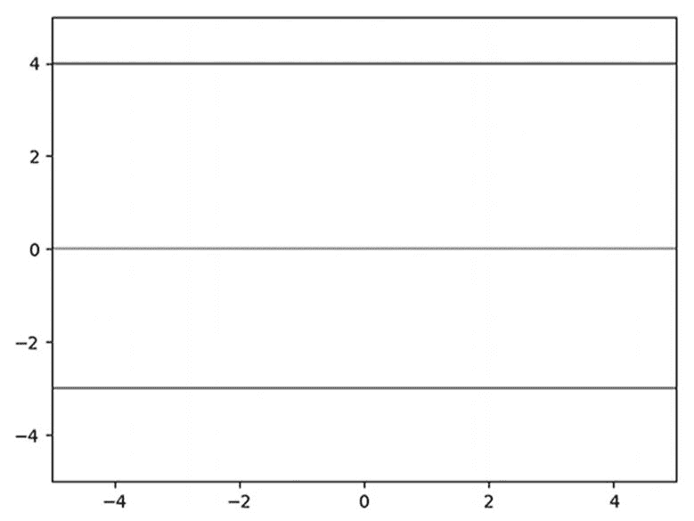

Figure F.1. ¶ A Graph of Three Horizontal Line Segments.

## **Matplotlib 中的倾斜线**

Listing F.2 显示了 `diagonallines.py` 的内容，说明如何绘制倾斜线。

***LISTING F.2: diagonallines.py***

```python
import matplotlib.pyplot as plt
import numpy as np
x1 = np.linspace(-5,5,num=200)
y1 = x1
x2 = np.linspace(-5,5,num=200)
y2 = -x2
plt.axis([-5, 5, -5, 5])
plt.plot(x1, y1)
plt.plot(x2, y2)
plt.show()
```

Listing F.2 使用与 Listing F.1 相同的技术，定义 y1 = x1 和 y2 = -x2，从而产生倾斜线。

Figure F.2 显示了两条倾斜线段，其方程在 Listing F.2 中。

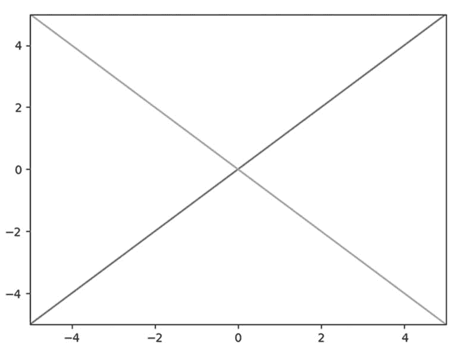

Figure F.2. ¶ A Graph of Two Slanted Line Segments.

## **Matplotlib 中的平行倾斜线**

如果两条在欧几里得平面中的直线具有相同的斜率，则它们是平行的。Listing F.3 显示了 `parallellines1.py` 的内容，说明如何绘制平行倾斜线。

***LISTING F.3: parallellines1.py***

```python
import matplotlib.pyplot as plt
import numpy as np
# lower line
x1 = np.linspace(-5,5,num=200)
y1 = 2*x1
# upper line
x2 = np.linspace(-5,5,num=200)
y2 = 2*x2 + 3
# horizontal axis
x3 = np.linspace(-5,5,num=200)
y3 = 0*x3 + 0
# vertical axis
plt.axvline(x=0.0)
plt.axis([-5, 5, -10, 10])
plt.plot(x1, y1)
plt.plot(x2, y2)
plt.plot(x3, y3)
plt.show()
```

Listing F.3 使用与 Listing F.1 相同的技术，定义了三条斜线，它们彼此平行。

Figure F.3 显示了两条平行且倾斜的线段，其方程在 Listing F.3 中。

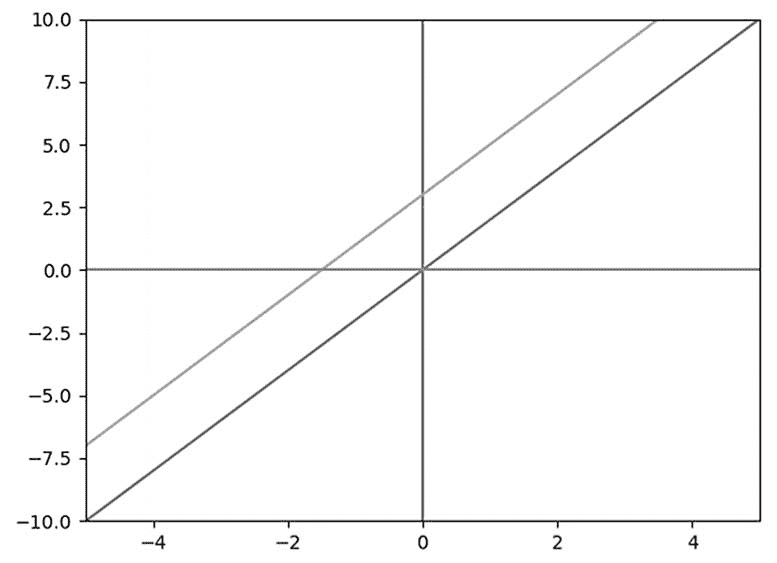

Figure F.3. ¶ A Graph of Two Slanted Parallel Line Segments.

## **Matplotlib 中的点阵网格**

Listing F.4 显示了 `plotgrid.py` 的内容，说明如何绘制简单的网格。

***LISTING F.4: plotgrid.py***

```python
import numpy as np
from itertools import product
import matplotlib.pyplot as plt
points = np.array(list(product(range(3), range(4))))
plt.plot(points[:,0], points[:,1], 'ro')
plt.show()
```

Listing F.4 定义了 NumPy 变量 `points`，该变量包含 3 行 4 列的二维点列表。Pyplot API `plot()` 使用 `points` 变量绘制网格状图案。

Figure F.4 显示了如 Listing F.4 所示的点网格。

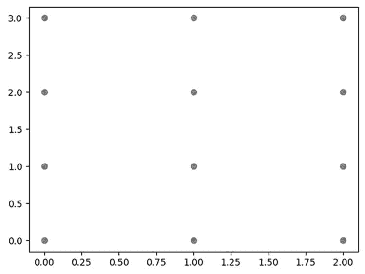

Figure F.4. ¶ A Grid of Points.

## **Matplotlib 中的点状网格**

Listing F.5 显示了 `plotdottedgrid1.py` 的内容，说明如何绘制“点状”网格图案。

***LISTING F.5: plotdottedgrid1.py***

```python
import numpy as np
import pylab
from itertools import product
import matplotlib.pyplot as plt
fig = pylab.figure()
ax = fig.add_subplot(1,1,1)
ax.grid(which='major', axis='both', linestyle='--')
[line.set_zorder(3) for line in ax.lines]
fig.show()  # to update
plt.gca().xaxis.grid(True)
plt.show()
```

Listing F.5 与 Listing F.5 类似，都绘制网格状图案；前者渲染“点状”网格，后者通过在 linestyle 参数中指定 '--' 实现“点状”网格。


-   [第 F.5 部分](https://example.org) 调用了 `set_zorder()` 方法，该方法控制哪些项目显示在其他项目之上，例如点在上方或下方。第 F.5 部分的最后一部分调用了 `gca().xaxis.grid(True)` 链式方法来显示垂直网格线。

`Figure F.5` 显示了基于第 F.5 部分代码的“虚线”网格模式。

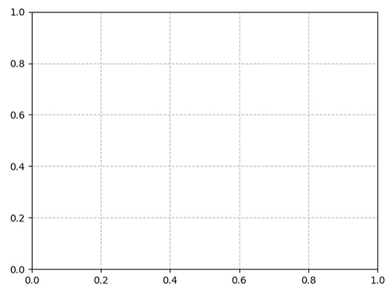

Figure F.5. ¶ A “Dashed” Grid Pattern.

## Lines in a Grid in Matplotlib

`Listing F.6` 显示了 `plotlinegrid2.py` 的内容，该文件说明如何在网格中绘制线条。

***LISTING F.6: plotlinegrid2.py***

```python
import numpy as np
import pylab
from itertools import product
import matplotlib.pyplot as plt

fig = plt.figure()
graph = fig.add_subplot(1, 1, 1)
graph.grid(which='major', linestyle='-', linewidth='0.5', color='red')

x1 = np.linspace(-5, 5, num=200)
y1 = 1 * x1
graph.plot(x1, y1, 'r-o')

x2 = np.linspace(-5, 5, num=200)
y2 = -x2
graph.plot(x2, y2, 'b-x')

fig.show()  # to update plt.show()
```

`Listing F.6` 定义了 NumPy 变量 `points`，它表示一个包含三行四列的二维点列表。Pyplot API `plot()` 使用 `points` 变量来显示类似网格的模式。

`Figure F.6` 显示了一组“虚线”线段，其方程包含在第 F.6 部分。

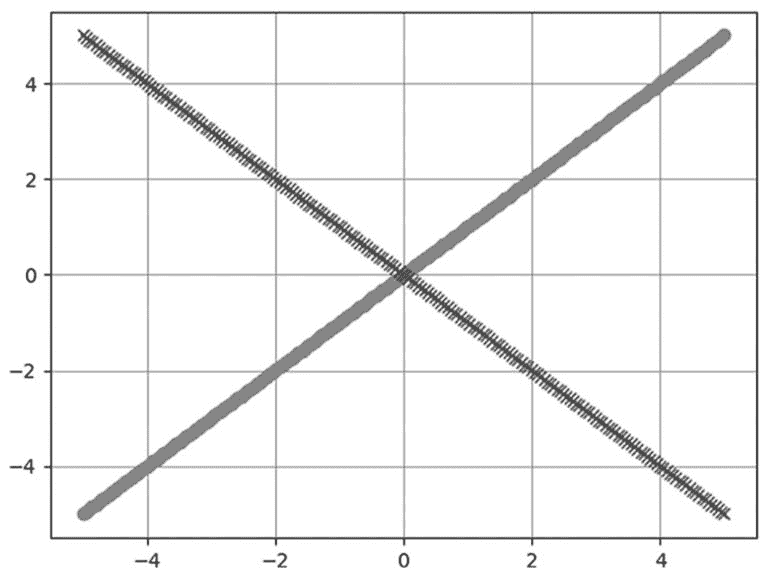

Figure F.6. ¶ A Grid of Line Segments.

## A Colored Grid in Matplotlib

`Listing F.7` 显示了 `plotgrid2.py` 的内容，该文件说明如何显示彩色网格。

***LISTING F.7: plotgrid2.py***

```python
import matplotlib.pyplot as plt
from matplotlib import colors
import numpy as np

data = np.random.rand(10, 10) * 20
# create discrete colormap
cmap = colors.ListedColormap(['red', 'blue'])
bounds = [0, 10, 20]
norm = colors.BoundaryNorm(bounds, cmap.N)

fig, ax = plt.subplots()
ax.imshow(data, cmap=cmap, norm=norm)
# draw gridlines
ax.grid(which='major', axis='both', linestyle='-', color='k', linewidth=2)
ax.set_xticks(np.arange(-.5, 10, 1))
ax.set_yticks(np.arange(-.5, 10, 1))

plt.show()
```

`Listing F.7` 定义了 NumPy 变量 `data`，它表示一个包含十行十列的二维点集合。Pyplot API `plot()` 使用 `data` 变量来显示类似网格的彩色模式。

`Figure F.7` 显示了一个彩色网格，其方程包含在第 F.7 部分。

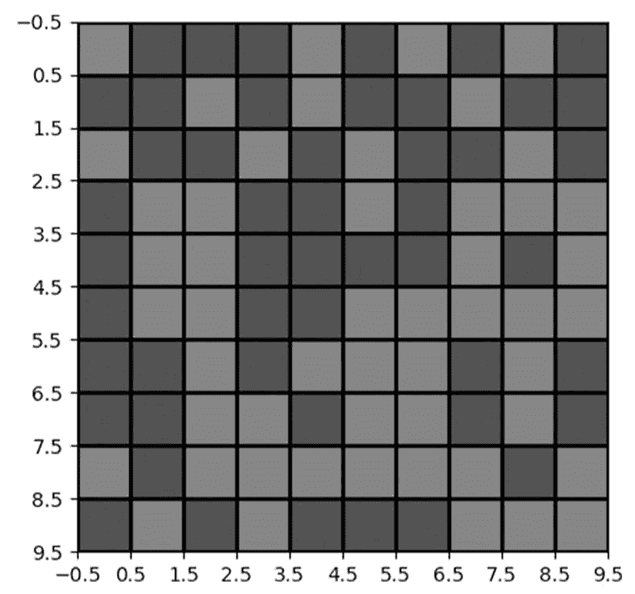

Figure F.7. ¶ A Colored Grid of Line Segments.

## A Colored Square in an Unlabeled Grid in Matplotlib

`Listing F.8` 显示了 `plotgrid3.py` 的内容，该文件说明如何在网格中显示一个彩色方块。

***LISTING F.8: plotgrid3.py***

```python
import matplotlib.pyplot as plt
import numpy as np
from itertools import product
import matplotlib.pyplot as plt
import matplotlib.colors as colors

N = 15  # create an empty data set
data = np.ones((N, N)) * np.nan

# fill in some fake data
for j in range(3)[::-1]:
    data[N//2 - j : N//2 + j + 1, N//2 - j : N//2 + j + 1] = j

# make a figure + axes
fig, ax = plt.subplots(1, 1, tight_layout=True)

# make color map
my_cmap = colors.ListedColormap(['r', 'g', 'b'])

# set the 'bad' values (nan) to be white and transparent
my_cmap.set_bad(color='w', alpha=0)

# draw the grid
for x in range(N + 1):
    ax.axhline(x, lw=2, color='k', zorder=5)
    ax.axvline(x, lw=2, color='k', zorder=5)

# draw the boxes
ax.imshow(data, interpolation='none', cmap=my_cmap, extent=[0, N, 0, N], zorder=0)

# turn off the axis labels
ax.axis('off')
plt.show()
```

`Listing F.8` 定义了 NumPy 变量 `data`，它表示一个 N×N 的二维点集合，随后有一个循环初始化变量 `data` 为 15×15 的 `np.nan` 值数组。Pyplot API `plot()` 使用 `data` 变量来显示一个彩色方块在网格状模式中。

`Figure F.8` 显示了一个彩色方块在网格中的效果，其方程包含在第 F.8 部分。

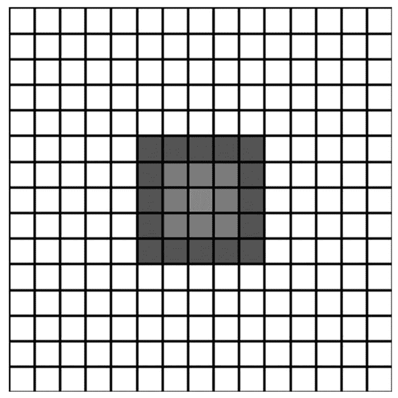

Figure F.8. ¶ A Colored Square in a Grid of Line Segments.

## Randomized Data Points in Matplotlib

`Listing F.9` 显示了 `lin_plot_reg.py` 的内容，该文件说明如何绘制随机点的图表。

***LISTING F.9: lin_plot_reg.py***

```python
import numpy as np
import matplotlib.pyplot as plt

trX = np.linspace(-1, 1, 101)  # Linear space of 101 and [-1,1]
#Create the y function based on the x axis
trY = 2 * trX + np.random.randn(*trX.shape) * 0.4 + 0.2

#create figure and scatter plot of the random points
plt.figure()
plt.scatter(trX, trY)

# Draw one line with the line function
plt.plot(trX, 0.2 + 2 * trX)
plt.show()
```

`Listing F.9` 定义了 NumPy 变量 `trX`，它包含介于 -1 和 1（包括两端）的 101 个等间距数值。变量 `trY` 分为两部分：第一部分是 `2*trX`，第二部分是一个随机值，部分基于一维数组 `trX` 的长度。

变量 `trY` 是这两部分的和，形成了一个“模糊”的线段。`Listing F.9` 的下一部分根据 `trX` 和 `trY` 的值创建散点图，随后使用 Pyplot API `plot()` 渲染一条线段。

`Figure F.9` 显示了一组基于第 F.9 部分代码的随机点。

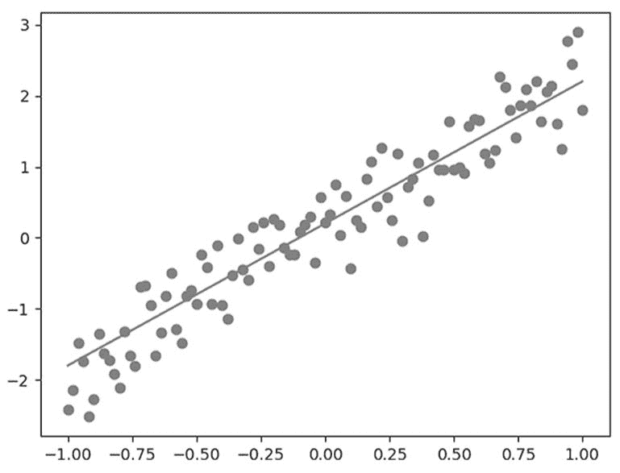

Figure F.9. ¶ A Random Set of Points.

## A Histogram in Matplotlib

`Listing F.10` 显示了 `histogram1.py` 的内容，该文件说明如何使用 Matplotlib 绘制直方图。

***LISTING F.10: histogram1.py***

```python
import numpy as np
import matplotlib.pyplot as plt

apples = 500
bananas = 500
appl_height = 28 + 4 * np.random.randn(apples)
bana_height = 24 + 4 * np.random.randn(bananas)

plt.hist([appl_height, bana_height], stacked=True, color=['r', 'b'])
plt.show()
```

`Listing F.10` 很简单：NumPy 变量 `appl_height` 和 `bana_height` 包含随机生成的值，上限分别为苹果和香蕉的数量。Pyplot API `hist()` 使用 `appl_height` 和 `bana_height` 来显示直方图。

`Figure F.10` 显示了一个基于第 F.10 部分代码的直方图。

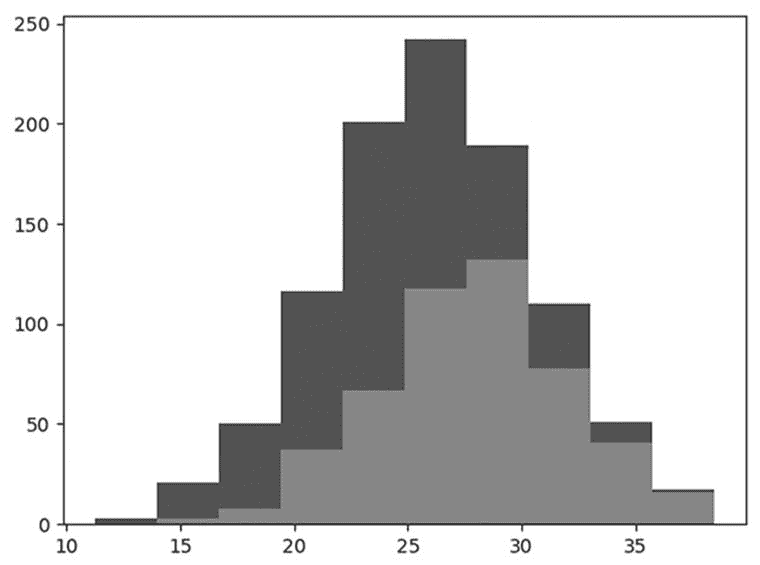

Figure F.10. ¶ A Histogram Based on Random Values.

## A Set of Line Segments in Matplotlib

`Listing F.11` 显示了 `line_segments.py` 的内容，该文件说明如何在 Matplotlib 中绘制一组连续的线段。

***LISTING F.11: line_segments.py***

```python
import numpy as np
import matplotlib.pyplot as plt

x = [7, 11, 13, 15, 17, 19, 23, 29, 31, 37]
plt.plot(x)  # OR: plt.plot(x, 'ro-') or bo
plt.ylabel('Height')
plt.xlabel('Weight')
plt.show()
```

`Listing F.11` 定义了数组 `x`，其中包含一个硬编码的值集合。Pyplot API `plot()` 使用变量 `x` 来显示一组连续的线段。`Figure F.11` 显示了运行第 F.11 部分代码后的结果。

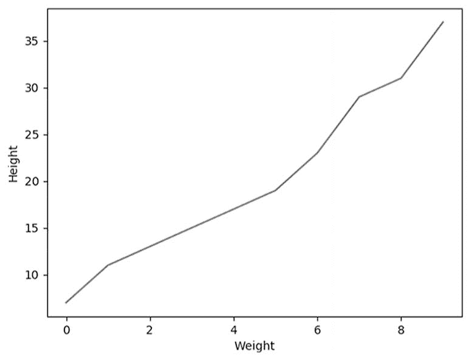

Figure F.11. ¶ A Set of Connected Line Segments.

## Plotting Multiple Lines in Matplotlib

`Listing F.12` 显示了 `plt_array2.py` 的内容，该文件说明了在 Matplotlib 中绘制多条线的简便方法。


# **LISTING F.12: plt_array2.py**

import matplotlib.pyplot as plt `x = [7,11,13,15,17,19,23,29,31,37]` `data = [[8, 4, 1], [5, 3, 3], [6, 0, 2], [1, 7, 9]]` plt.plot(data, 'd-') plt.show() 

Listing F.12 定义了一个包含硬编码值的数组数据。Pyplot API 的 plot() 使用变量 data 来显示一条线段。Figure F.12 根据 Listing F.12 中的代码显示多条线。

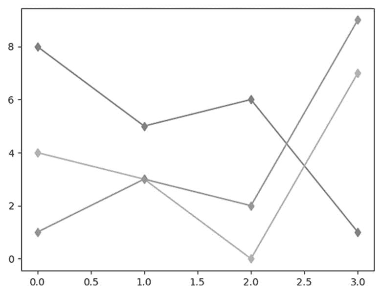

Figure F.12. ¶ Multiple Lines in Matplotlib.

## **Trigonometric Functions in Matplotlib**

如果你在想，你可以像渲染“普通”图表一样轻松使用 Matplotlib 显示三角函数的图表。Listing F.13 展示了 sincos.py 的内容，演示如何在 Matplotlib 中绘制正弦函数和余弦函数。

***LISTING F.13: sincos.py***

import numpy as np import math `x = np.linspace(0, 2\*math.pi, 101)` `s = np.sin(x)` `c = np.cos(x)` import matplotlib.pyplot as plt plt.plot (s) plt.plot (c) plt.show() 

Listing F.13 使用 NumPy API 的 linspace()、sin()、cos() 分别初始化变量 x、s、c。随后，Pyplot API 的 plot() 使用这些变量绘制正弦函数和余弦函数。

Figure F.13 根据 Listing F.13 中的代码绘制了两条三角函数的图表。

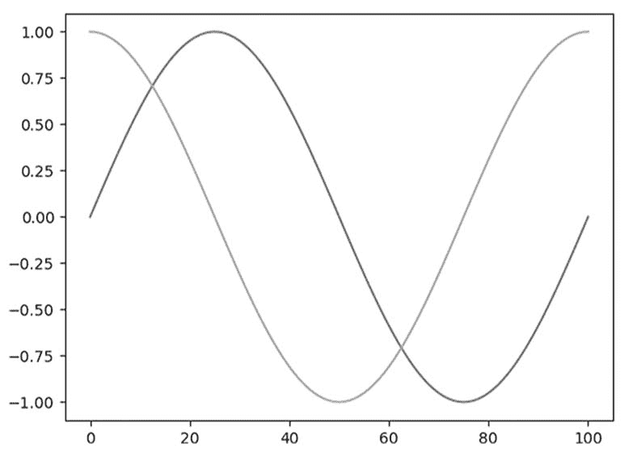

Figure F.13 ¶ Sine and Cosine Trigonometric Functions.

现在让我们来看一个由离散数据点组成的简单数据集，这将是下一节的主题。

## **在 Matplotlib 中绘制智商分数 (IQ Scores)**

Listing F.14 展示了 iq_scores.py 的内容，演示如何绘制一个直方图来显示基于正态分布的 IQ 分数。

***LISTING F.14: iq_scores.py***

import numpy as npf import matplotlib.pyplot as plt `mu, sigma = 100, 15` `x = mu + sigma \* np.random.randn(10000)` `# the histogram of the data n, bins, patches = plt.hist(x, 50, normed=1, facecolor='g', alpha=0.75)` `plt.xlabel('Intelligence') plt.ylabel('Probability') plt.title('Histogram of IQ') plt.text(60, .025, r'$\\mu=100,\\ \\sigma=15$') plt.axis([40, 160, 0, 0.03]) plt.grid(True) plt.show()` 

Listing F.14 定义了标量变量 mu 和 sigma，随后使用 NumPy 变量 x 存储一个随机生成的点集合。接着，通过 hist() API 初始化 n、bins、patches，最后使用 plot() API 绘制直方图。

Figure F.14 根据 Listing F.14 中的代码绘制出一个直方图。

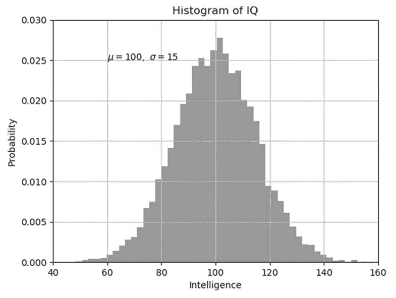

Figure F.14. ¶ A Histogram to Display IQ Scores.

## **在 Matplotlib 中绘制最佳拟合直线**

Listing F.15 展示了 plot_best_fit2.py 的内容，演示如何在 Matplotlib 中绘制最佳拟合直线。

***LISTING F.15: plot-best-fit2.py***

import numpy as np `xs = np.array([1,2,3,4,5], dtype=np.float64)` `ys = np.array([1,2,3,4,5], dtype=np.float64)` `def best_fit_slope(xs,ys):` ` m = (((np.mean(xs)\*np.mean(ys))-np.mean(xs\*ys)) / ((np.mean(xs)\*\*2) - np.mean(xs\*\*2))` ` b = np.mean(ys) - m \* np.mean(xs)` ` return m, b` `m,b = best_fit_slope(xs,ys) print('m:',m,'b:',b)` `regression_line = [(m\*x)+b for x in xs]` `import matplotlib.pyplot as plt from matplotlib import style style.use('ggplot')` `plt.scatter(xs,ys,color='#0000FF') plt.plot(xs, regression_line) plt.show()` 

Listing F.15 定义了变量 xs 和 ys，并将它们传入 best_fit_slope() 函数，计算最佳拟合直线的斜率 m 和截距 b。随后，Pyplot API 的 scatter() 显示散点图，plot() 显示最佳拟合直线。Figure F.15 根据 Listing F.15 绘制出一个简单的 2D 数据集的最佳拟合直线。


Figure F.15. ¶ A Best-Fitting Line for a 2D Dataset.

这部分关于 NumPy 和 Matplotlib 的章节至此结束。

下一节将介绍 Sklearn，这是一个基于 Python 的强大机器学习库，支持众多机器学习算法。阅读简短介绍后，后续章节将包含结合 Pandas、Matplotlib 和 Sklearn 内置数据集的 Python 代码示例。

## **Introduction to Sklearn (scikit-learn)**

Sklearn（安装为 Sklearn）是 Python 最高级的通用机器学习库，其主页位于：

*[`scikit-learn.org/stable`](https://scikit-learn.org/stable)*

在讨论任何代码示例之前，请记住 Sklearn 是一个极其有用的 Python 库，支持大量机器学习算法。特别是，Sklearn 支持许多分类算法，如逻辑回归、朴素贝叶斯、决策树、随机森林和支持向量机器（SVM）。第 8 章节对大多数分类算法提供了高层次描述。虽然有专门的书籍致力于 Sklearn，但本附录仅包含几页关于 Sklearn 的材料。

如果你想获得关于 Sklearn 的深度知识，请访问包含详细文档的 Web 页面。此外，如果你有关于 Sklearn 的“如何操作”问题，基本上可以在 *stackoverflow.com* 上找到合适的答案。

Sklearn 适用于分类、回归和聚类任务，并提供丰富的机器学习算法，包括线性回归、逻辑回归、kNN（“k 最近邻”）、kMeans、决策树、随机森林、多层感知器（MLP）以及支持向量机器（SVM）。

此外，Sklearn 支持维度降低技术，如主成分分析（PCA）、超参数调优、数据标准化方法，以及适用于数据预处理、交叉验证等操作。

机器学习代码示例通常会结合 Sklearn、NumPy、Pandas 和 Matplotlib。Sklearn 还提供多种内置数据集，可供可视化展示。本附录的下一节将提供几个结合 Pandas、Matplotlib 和 Sklearn 内置 Digits 数据集的 Python 代码示例。

## **The Digits Dataset in Sklearn**

Sklearn 的 Digits 数据集包含 1,797 张 8×8 的小型手写数字图像，和 MNIST 数据集同样是手写数字。Listing F.16 展示了 load_digits1.py 的内容，演示如何绘制 Digits 数据集。

***LISTING F.16: load_digits1.py***

from sklearn import datasets `# Load in the 'digits' data digits = datasets.load_digits()` `# Print the 'digits' data print(digits)` 

Listing F.16 很简单：导入 datasets 模块后，变量 digits 初始化为 Digits 数据集的内容。print() 语句显示 digits 变量的内容，如下所示：


Listing F.17 显示了 **load_digits2.py** 的内容，说明如何绘制数字数据集（您可以修改以显示不同的数字）。

***LISTING F.17: load_digits2.py***

```python
from sklearn.datasets import load_digits
from matplotlib import pyplot as plt
digits = load_digits()  # set interpolation='none'
fig = plt.figure(figsize=(3, 3))
plt.imshow(digits['images'][66], cmap="gray", interpolation='none')
plt.show()
```

Listing F.17 导入 Sklearn 中的 **load_digits** 类，以初始化变量 **digits**，其中包含 Sklearn 自带的数字数据集。随后，该列表初始化变量 **fig**，并调用 **plt** 类的 **imshow()** 方法，用于显示数字数据集中的一个数字。

Figure F.16 根据 Listing F.17 中的代码，显示了数字数据集中的一个数字的绘图。

```
if (condVar > someVal) {console.log("xxx")}
```


-   [IRIS 特征名称](https://wiki.example.org/iris_feature_names): `sepal length (cm)` `sepal width (cm)` `petal length (cm)` `petal width (cm)`   \=> 行数: `150`   \=> 列数: `4`   \=> 行和列数: `\(150, 4\)`   \=> 元素数: `600`   \=> IRIS 详情: `<class 'pandas.core.frame.DataFrame'> RangeIndex: 150 entries, 0 to 149 Data columns (total 4 columns): sepal length (cm)    150 non-null float64 sepal width (cm)     150 non-null float64 petal length (cm)    150 non-null float64 petal width (cm)     150 non-null float64 dtypes: float64(4) memory usage: 4.8 KB None`   \=> 前五行:    `sepal length (cm)`  `sepal width (cm)`  `petal length (cm)`  `petal width (cm)` 0                5.1               3.5                1.4               0.2 1                4.9               3.0                1.4               0.2 2                4.7               3.2                1.3               0.2 3                4.6               3.1                1.5               0.2 4                5.0               3.6                1.4               0.2   \=> 类标签: `\[0 1 2\]` 

***The Iris Dataset in Sklearn (Optional)***

The Iris dataset in Sklearn consists of the lengths of three different types of Iris‑based petals and sepals: Setosa, Versicolour, and Virginica. These numeric values are stored in a 150x4 NumPy.ndarray.

Note that the rows in the Iris dataset are the sample images, and the columns consist of the values for the Sepal Length, Sepal Width, Petal Length, and Petal Width of each image. Listing F.21 displays the contents of sklearn_iris.py that illustrates how to display detailed information about the Iris dataset.

***LISTING F.21: sklearn_iris.py***

```python
from sklearn import datasets
from sklearn.model_selection import train_test_split
iris = datasets.load_iris()
data = iris.data
print("iris data shape:  ", data.shape)
print("iris target shape:", iris.target.shape)
print("first 5 rows iris:")
print(data[0:5])
print("keys:", iris.keys())
print("")
n_samples, n_features = iris.data.shape
print('Number of samples: ', n_samples)
print('Number of features:', n_features)
print("")
print("sepal length/width and petal length/width:")
print(iris.data[0])
import numpy as np
np.bincount(iris.target)
print("target names:", iris.target_names)
print("mean: %s " % data.mean(axis=0))
print("std:  %s " % data.std(axis=0))
#print("mean: %s " % data.mean(axis=1))
#print("std:  %s " % data.std(axis=1))
#load the data into train and test datasets:
X_train, X_test, y_train, y_test = train_test_split(iris.data, iris.target, random_state=0)
from sklearn.preprocessing import StandardScaler
scaler = StandardScaler()
scaler.fit(X_train)
# rescale the train datasest:
X_train_scaled = scaler.transform(X_train)
print("X_train_scaled shape:", X_train_scaled.shape)
print("mean : %s " % X_train_scaled.mean(axis=0))
print("standard deviation : %s " % X_train_scaled.std(axis=0))
import matplotlib.pyplot as plt
x_index = 3
colors = ['blue', 'red', 'green']
for label, color in zip(range(len(iris.target_names)), colors):
    plt.hist(iris.data[iris.target == label, x_index],
             label=iris.target_names[label],
             color=color)
    plt.xlabel(iris.feature_names[x_index])
    plt.legend(loc='upper right')
    plt.show()
```

Listing F.21 starts with an import statement followed by the variables `iris` and `data`, where the latter contains the Iris dataset. The first half of Listing F.21 consists of self‑explanatory code, such as displaying the number of images and the number of features in the Iris dataset.

The second portion of Listing F.21 imports the `StandardScaler` class in Sklearn, which rescales each value in `X_train` by subtracting the mean and then dividing by the standard deviation. The final block of code in Listing F.21 generates a histogram that displays some of the images in the Iris dataset. The output from Listing F.26 is here:

```
iris data shape:   (150, 4) iris target shape: (150,) first 5 rows iris: [[5.1 3.5 1.4 0.2]  [4.9 3.4 0.2]  [4.7 3.2 1.3 0.2]  [4.6 3.1 1.5 0.2]  [5.3 1.4 0.2]]
keys: dict_keys(['target', 'target_names', 'data', 'feature_names', 'DESCR'])
Number of samples:  150 Number of features: 4
sepal length/width and petal length/width: [5.1 3.5 1.4 0.2] target names: ['setosa' 'versicolor' 'virginica'] mean: [5.84333333 3.054    3.75866667 1.19866667] std:  [0.82530129 0.43214658 1.75852918 0.76061262] X_train_scaled shape: (112, 4) mean : [ 1.21331516e-15 -4.41115398e-17  7.13714802e-17  2.57730345e-17] standard deviation : [1. 1. 1. 1.]
```

Figure F.18 displays the images in the Iris dataset based on the code in Listing F.21.


Figure F.18. ¶ The Iris Dataset.

## **The faces Dataset in Sklearn** **(Optional)**

The Olivetti Faces dataset contains a set of face images that were taken between April 1992 and April 1994 at AT&T Laboratories Cambridge. As you will see in Listing F.22, the Sklearn.datasets.fetch_olivetti_faces function is the data fetching and caching function that downloads the data archive from AT&T.

Listing F.22 displays the contents of sklearn_faces.py that displays the contents of the Faces dataset in Sklearn.

***LISTING F.22: sklearn_faces.py***

```python
import Sklearn
from sklearn.datasets import fetch_olivetti_faces
faces = fetch_olivetti_faces()
import matplotlib.pyplot as plt
# display figures in inches
fig = plt.figure(figsize=(6, 6))
# plot the faces:
for i in range(64):
    ax = fig.add_subplot(8, 8, i + 1, xticks=[], yticks=[])
    ax.imshow(faces.images[i], cmap=plt.cm.bone, interpolation='nearest')
    plt.show()
```

Listing F.22 starts with import statements and then initializes the variable `faces` with the contents of the Olivetti Faces dataset. The next portion of Listing F.22 contains some plot‑related code, followed by a for loop that displays 64 images in an 8×8 grid pattern (similar to an earlier code sample).

Launch Listing F.22 and you will see the plotted image as shown in Figure F.19.


Figure F.19. ¶ The Sklearn Faces Dataset.

Now that you have seen some of the Sklearn datasets, along with code samples for displaying their contents, let’s turn our attention to Seaborn, which is a very nice data visualization package for Python.

## **Working with Seaborn**

Seaborn is a Python package for data visualization that also provides a high-level interface to Matplotlib. Seaborn is easier to work with than Matplotlib, and actually extends Matplotlib. However, keep in mind that Seaborn is not as powerful as Matplotlib.

Seaborn addresses two challenges of Matplotlib. The first involves the default Matplotlib parameters. Seaborn works with different parameters, which provides greater flexibility than the default rendering of Matplotlib plots. Seaborn addresses the limitations of the Matplotlib default values for features such as colors, tick marks on the upper and right axes, and the style (among others).

In addition, Seaborn makes it easier to plot entire data frames (somewhat like pandas) than doing so in Matplotlib. Nevertheless, since Seaborn extends Matplotlib, knowledge of the latter is advantageous and will simplify your learning curve.

### **Features of Seaborn**

Some of the features of Seaborn include:

*   scale seaborn plots
*   set the plot style
*   set the figure size
*   rotate label text
*   set xlim or ylim
*   set log scale
*   add titles

Some useful Seaborn methods:


*   `plt.xlabel()`

*   `plt.ylabel()`

*   `plt.annotate()`

*   `plt.legend()`

*   `plt.ylim()`

*   `plt.savefig()`

Seaborn 支持多种内置数据集，就像 `numpy` 和 `pandas` 一样，包括鸢尾花数据集和泰坦尼克号数据集，这些数据集将在后续章节中出现。作为起点，下一节的三行代码示例展示了如何显示内置“tips”数据集的行。

## Seaborn 内置数据集

Listing F.23 展示了 `seaborn_tips.py` 的内容，该文件说明了如何读取 tips 数据集并将其加载到数据框中，同时显示数据集的前五行。

***LISTING F.23: seaborn_tips.py***

```python
import seaborn as sns
df = sns.load_dataset("tips")
print(df.head())
```

Listing F.23 很简单：导入 seaborn 后，变量 `df` 初始化为内置 tips 数据集的数据，`print()` 语句显示 `df` 的前五行。请注意，`load_dataset()` API 会在线上或内置数据集中查找。Listing F.23 的输出如下：

```
total_bill tip sex smoker day time size 0 16.99 1.01 Female No Sun Dinner 2 1 10.34 1.66 Male No Sun Dinner 3 2 21.01 3.50 Male No Sun Dinner 3 3 23.68 3.31 Male No Sun Dinner 2 4 24.59 3.61 Female No Sun Dinner 4 
```

Listing F.23 非常简单：导入 seaborn 后，变量 `df` 初始化为内置 tips 数据集的数据，`print()` 语句显示 `df` 的前五行。请注意，`load_dataset()` API 会在线上或内置数据集中查找。Listing F.23 的输出如下：

```
titanic info:` `<class 'pandas.core.frame.DataFrame'>` `RangeIndex: 891 entries, 0 to 890` `Data columns (total 15 columns): survived 891 non-null int64 pclass 891 non-null int64 sex 891 non-null object age 714 non-null float64 sibsp 891 non-null int64 parch 891 non-null int64 fare 891 non-null float64 embarked 889 non-null object class 891 non-null category who 891 non-null object adult_male 891 non-null bool deck 203 non-null category embark_town 889 non-null object alive 891 non-null object alone 891 non-null bool dtypes: bool(2), category(2), float64(2), int64(4), object(5) memory usage: 80.6+ KB` `first five rows of titanic:` `survived pclass sex age sibsp parch fare embarked class 0 0 3 male 22.0 1 0 7.2500 S Third 1 1 1 female 38.0 1 0 71.2833 C First 2 1 3 female 26.0 0 0 7.9250 S Third 3 1 1 female 35.0 1 0 53.1000 S First who adult_male deck embark_town alive alone 0 man True NaN Southhampton no False 1 woman False C Cherbourg yes True 2 woman False NaN Southhampton yes True 3 woman False C Southhampton yes False 4 man True NaN Southhampton no True`

`counts per class:` `3 491 1 216 2 184 Name: pclass, dtype: int64` `max/min/mean/median ages:` `80.0 0.42 29.69911764705882 28.0`

## **从泰坦尼克号数据集中提取数据（1）**

Listing F.26 展示了 `seaborn_titanic.py` 的内容，说明了如何从泰坦尼克号数据集中提取子集数据。

***LISTING F.26: seaborn_titanic.py***

```python
import matplotlib.pyplot as plt
import seaborn as sns  # titanic = sns.load_dataset("titanic") print("titanic info:") titanic.info()  # print("first five rows of titanic:") print(titanic.head())  # print("first four ages:") print(titanic.loc[0:3,'age'])  # print("fifth passenger:") print(titanic.iloc[4])  #print("first five ages:") #print(titanic['age'].head())  #print("first five ages and gender:") #print(titanic[['age','sex']].head())  #print("descending ages:") #print(titanic.sort_values('age', ascending = False).head())  #print("older than 50:") #print(titanic[titanic['age'] > 50])  #print("embarked (unique):") #print(titanic['embarked'].unique())  #print("survivor counts:") #print(titanic['survived'].value_counts())  #print("counts per class:") #print(titanic['pclass'].value_counts())  #print("max/min/mean/median ages:") #print(titanic['age'].max()) #print(titanic['age'].min()) #print(titanic['age'].mean()) #print(titanic['age'].median()) 

Listing F.26 与 Listing F.25 相同，包含导入语句，然后初始化变量 `titanic` 为内置泰坦尼克号数据集的内容。随后的代码块展示了如何显示数据集的结构、前五行、前四行年龄、第五位乘客的信息，以及其他统计信息。

请注意，Listing F.26 中有一大段“已注释”代码，只需取消注释即可查看相关输出，例如年龄、性别、50 岁以上人数、唯一行、以及其他统计结果。Listing F.26 的输出如下：

`titanic info:` `<class 'pandas.core.frame.DataFrame'>` `RangeIndex: 891 entries, 0 to 890` `Data columns (total 15 columns): survived 891 non-null int64 pclass 891 non-null int64 sex 891 non-null object age 714 non-null float64 sibsp 891 non-null int64 parch 891 non-null int64 fare 891 non-null float64 embarked 889 non-null object class 891 non-null category who 891 non-null object adult_male 891 non-null bool deck 203 non-null category embark_town 889 non-null object alive 891 non-null object alone 891 non-null bool dtypes: bool(2), category(2), float64(2), int64(4), object(5) memory usage: 80.6+ KB` `first five rows of titanic:` `survived pclass sex age sibsp parch fare embarked class 0 0 3 male 22.0 1 0 7.2500 S Third 1 1 1 female 38.0 1 0 71.2833 C First 2 1 3 female 26.0 0 0 7.9250 S Third 3 1 1 female 35.0 1 0 53.1000 S First who adult_male deck embark_town alive alone 0 man True NaN Southhampton no False 1 woman False C Cherbourg yes True 2 woman False NaN Southhampton yes True 3 woman False C Southhampton yes False 4 man True NaN Southhampton no True`

`counts per class:` `3 491 1 216 2 184 Name: pclass, dtype: int64` `max/min/mean/median ages:` `80.0 0.42 29.69911764705882 28.0`

## **从泰坦尼克号数据集中提取数据（2）**

Listing F.27 展示了 `seaborn_titanic2.py` 的内容，说明了如何从泰坦尼克号数据集中提取子集数据。

***LISTING F.27: seaborn_titanic2.py***

```python
import matplotlib.pyplot as plt
import seaborn as sns  # titanic = sns.load_dataset("titanic") g = sns.factorplot("class", "survived", "sex", data=titanic, kind="bar", palette="muted", legend=False)  # Show plot
plt.show()
```

Listing F.27 与 Listing F.25 相同，包含导入语句，然后初始化变量 `titanic` 为内置泰坦尼克号数据集的内容。随后，`factorplot()` API 使用 `class`、`survived`、`sex` 三个字段创建条形图，并设置颜色调色板为 `muted`、关闭图例。

Listing F.27 包含与 Listing F.25 相同的导入语句，然后初始化变量 `titanic` 为内置泰坦尼克号数据集的内容。随后，`factorplot()` API 使用 `class`、`survived`、`sex` 三个字段创建条形图，并设置颜色调色板为 `muted`、关闭图例。


import`matplotlib.pyplot` as `plt` import`seaborn` as `sns` `titanic` = `sns`.load_dataset("titanic") # Returns a scalar # `titanic`.ix[4, 'age'] print("age:",`titanic`.at[4, 'age']) # Returns a Series of name 'age', and the age values associated # to the index labels 4 and 5 # `titanic`.ix[[4, 5], 'age'] print("series:",`titanic`.loc[[4, 5], 'age']) # Returns a Series of name '4', and the age and fare values # associated to that row. # `titanic`.ix[4, ['age', 'fare']] print("series:",`titanic`.loc[4, ['age', 'fare']]) # Returns a DataFrame with rows 4 and 5, and columns 'age' and 'fare' # `titanic`.ix[[4, 5], ['age', 'fare']] print("dataframe:",`titanic`.loc[[4, 5], ['age', 'fare']]) 

query = `titanic`[(`titanic`.sex == 'female') & (`titanic`['class'].isin(['First', 'Third'])) & (`titanic`.age > 30) & (`titanic`.survived == 0)] print("query:",query) 

Listing F.27 contains the same import statements as Listing F.26, and then initializes the variable `titanic` with the contents of the built-in Titanic dataset. The next code snippet displays the age of the passenger with index 4 in the dataset (which equals 35).

The following code snippet displays the ages of passengers with index values 4 and 5 in the dataset:

print("series:",`titanic`.loc[[4, 5], 'age']) 

The next snippet displays the age and fare of the passenger with index 4 in the dataset, followed by another code snippet displays the age and fare of the passengers with index 4 and index 5 in the dataset.

The final portion of Listing F.27 is the most interesting part: it defines a variable `query` as shown here:

query = `titanic`[(`titanic`.sex == 'female') & (`titanic`['class'].isin(['First', 'Third'])) & (`titanic`.age > 30) & (`titanic`.survived == 0)] 

The preceding code block will retrieve the female passengers who are in either first class or third class, and who are also over 30, and they did not survive the accident. The entire output from Listing F.27 is here:

age: 35.0 series: 4    35.0 5     NaN Name: age, dtype: float64 series: age       35 fare    8.05 Name: 4, dtype: object dataframe:     age    fare 4  35.0  8.0500 5   NaN  8.4583 query:   survived  pclass     sex   age  sibsp  parch     fare embarked  class  \\ 18          0       3  female  31.0      1      0  18.0000        S  Third 40          0       3  female  40.0      1      0   9.4750        S  Third 132         0       3  female  40.0      1      0   14.5000        S  Third 167         0       3  female  47.0      1      0  27.9000        S  Third 177         0       3  female  50.0      0      0  28.7125        S  Third 254         0       3  female  41.0      0      2  20.2125        S  Third 276         0       3  female  45.0      0      0  7.7500        S  Third 362         0       3  female  45.0      0      1  14.4542        C  Third 396         0       3  female  31.0      0      0  7.8542        S  Third 503         0       3  female  37.0      0      0  9.5875        S  Third 610         0       3  female  39.0      1      5  31.2750        S  Third 638         0       3  female  41.0      0      5  39.6875        S  Third 657         0       3  female  32.0      1      1  15.5000        Q  Third 678         0       3  female  43.0      1      6  46.9000        S  Third 736         0       3  female  48.0      1      3  34.3750        S  Third 767         0       3  female  30.5      0      0  7.7500        Q  Third 885         0       3  female  39.0      0      5  29.1250        Q  Third 

Listing F.28 displays the contents of `pandas_seaborn.py` that illustrates how to display a Pandas dataset in Seaborn.

***LISTING F.28: pandas_seaborn.py***

```python
import`pandas` as `pd` import`random` import`matplotlib.pyplot` as `plt` import`seaborn` as `sns` df = `pd`.DataFrame() df['x'] = `random`.sample(range(1, 100), 25) df['y'] = `random`.sample(range(1, 100), 25) print("top five elements:") print(df.head()) # display a density plot #`sns`.kdeplot(df.y) # display a density plot #`sns`.kdeplot(df.y, df.x) #`sns`.distplot(df.x) # display a histogram #`plt`.hist(df.x, alpha=.3) #`sns`.rugplot(df.x) # display a boxplot #`sns`.boxplot([df.y, df.x]) # display a violin plot #`sns`.violinplot([df.y, df.x]) # display a heatmap #`sns`.heatmap([df.y, df.x], annot=True, fmt="d") # display a cluster map #`sns`.clustermap(df) # display a scatterplot of the data points `sns`.lmplot('x', 'y', data=df, fit_reg=False) plt.show()
```

Listing F.28 contains several familiar import statements, followed by the initialization of the Pandas variable `df` as a Pandas data frame. The next two code snippets initialize the columns and rows of the data frame and the print() statement display the first five rows.

For your convenience, Listing F.28 contains an assortment of “commented out” code snippets that use Seaborn in order to render a density plot, a histogram, a boxplot, a violin plot, a heatmap, and a cluster. Uncomment the portions that interest you in order to see the associated plot. The output from Listing F.29 is here:

top five elements:

    `x`   `y` 0  52  34 1  31  47 2  23  18 3  34  70 4  71   1 

Figure F.22 displays a plot of the data in the Titanic dataset based on the code in Listing F.28.


Figure F.22. ¶ A Pandas Data Frame Displayed via Seaborn.

## **Data Visualization in Pandas**

Although Matplotlib and Seaborn are often the “go to” Python libraries for data visualization, you can also use Pandas for such tasks.

Listing F.29 displays the contents `pandas_viz1.py` that illustrates how to render various types of charts and graphs using Pandas and Matplotlib.

***LISTING F.29: pandas_viz1.py***

```python
import`pandas` as `pd` import`numpy` as `np` import`matplotlib.pyplot` as `plt` df = `pd`.DataFrame(`np`.random.rand(16,3), columns=['X1','X2','X3']) print("First 5 rows:") print(df.head()) print() print("Diff of first 5 rows:") print(df.diff().head()) print() # bar chart: #ax = df.plot.bar() # horizontal stacked bar chart: #ax = df.plot.barh(stacked=True) # vertical stacked bar chart: ax = df.plot.bar(stacked=True) # stacked area graph: #ax = df.plot.area() # non-stacked area graph: #ax = df.plot.area(stacked=False) #plt.show(ax)
```

Listing F.29 initializes the data frame `df` with a 16×3 matrix of random numbers, followed by the contents of `df`. The bulk of Listing F.29 contains code snippets for generating a bar chart, a horizontal stacked bar chart, a vertical stacked bar chart, a stacked area graph, and a nonstacked area graph. You can uncomment the individual code snippet that displays the graph of your choice with the contents of `df`. Launch the code in Listing F.29 and you will see the following output:

First 5 rows:          `X1`        `X2`        `X3` 0  0.051089  0.357183  0.344414 1  0.800890  0.468372  0.800668 2  0.492981  0.505133  0.228399 3  0.461996  0.977895  0.471315 4  0.033209  0.411852  0.347165   Diff of first 5 rows:          `X1`        `X2`        `X3` 0       NaN       NaN       NaN 1  0.749801  0.111189  0.456255 2 -0.307909  0.036760 -0.572269 3 -0.030984  0.472762  0.242916 4 -0.428787 -0.566043 -0.124150 

Listing F.29 initializes the data frame `df` with a 16×3 matrix of random numbers, followed by the contents of `df`. The bulk of Listing F.29 contains code snippets for generating a bar chart, a horizontal stacked bar chart, a vertical stacked bar chart, a stacked area graph, and a nonstacked area graph. You can uncomment the individual code snippet that displays the graph of your choice with the contents of `df`. Launch the code in Listing F.29 and you will see the following output:

First 5 rows:          `X1`        `X2`        `X3` 0  0.051089  0.357183  0.344414 1  0.800890  0.468372  0.800668 2  0.492981  0.505133  0.228399 3  0.461996  0.977895  0.471315 4  0.033209  0.411852  0.347165   Diff of first 5 rows:          `X1`        `X2`        `X3` 0       NaN       NaN       NaN 1  0.749801  0.111189  0.456255 2 -0.307909  0.036760 -0.572269 3 -0.030984  0.472762  0.242916 4 -0.428787 -0.566043 -0.124150 

## **Summary**

This appendix started with some basic features of Matplotlib, along with examples of plotting lines, histograms, and simple trigonometric functions.

You also learned about Sklearn, including examples of working with the Digits and Iris datasets, and also how to process images. In addition, you saw how to perform linear regression with Sklearn.


-   [Seaborn](https://example.org) 是 Matplotlib 的扩展库，您已经看到过绘制折线和直方图的示例。您还学习了如何使用 Seaborn 绘制 Pandas 数据框。

# INDEX

20Newsgroup 数据集, 427–428

**A**

抽象文本概括, 377

学术界, 111

激活函数

常见, 354–357

Relu 和 elu, 357–358

自适应增强, 322

仿射变换, 551

Afro-asiatic, 113

算法

工具包 (I), 211–248

工具包 (II), 249–282

分析分类器, 518–519

方差分析, 519

Lime, 518–519

Andas mapapply() 方法

Pandas mapapply(), 86

Andrei lupas, 497

异常和离群值, 512–513

向量追加, 4, 5

数组和向量运算, 10

文章, 119

ASCII 字母, 130

关联, 16

注意力, 460–462

自动

Ml, ml-zero, nlp, 326–327

可用性偏差, 532

Avere, 121

Avoir, 121

**B**

贝叶斯推断, 562–564

术语, 563

定理, 562–563

贝叶斯信息准则 (bic), 305

Bert 家族, 481–483

Bert 特征, 468

最佳拟合直线与 numpy, 28–29

偏差, 530

偏差-方差权衡, 530–532

数据偏差, 531–532

混合, 323

布尔运算, 44

Bootstrapping, 323

Brown 语料库, 143

Brown 大学, 143

字节对编码 (BPE), 474

**C**

C, 271

C++, 271

计算

平均值, 16–18

手动计算 Mse, 26–28

Mse 逐进逼近, 29–31, 32–34

标准差, 16–18

计算吉尼不纯度和熵值, 534–535

计算 tf, idf, 以及 tf-idf, 179–183

词频, 180

回调函数, 641

加拿大, 59

基数数据, 503

分类数据, 508

单词拼写变化, 125

聊天机器人, 410–413

滥用, 412

逻辑流, 411–412

开放域, 411

类型, 411

分类, 288

分类算法, 287

分类器

评估, 349–350

训练, 347–349

使用正则表达式清洗数据, 212–216

临床缩写识别与消歧 (CARD), 160

协同过滤

算法, 385–386

项目-项目, 385–386

用户-用户, 385

协同交互推荐器 (CIRS), 389

常见增强算法, 323–324

词嵌入比较, 201–202

编译时间, 577

自然语言复杂度, 118–123

辅助动词, 121–122

动词如何, 120–121

词尾变化, 122

句子中的词序, 119

条件随机场 (CRF), 161

确认偏差, 532

上下文自由语法 (CFG), 271

上下文向量, 463

连续, 522

连续词袋 (CBOW), 191

连续数据, 504–505

将分类数据转换为数值数据, 49–52

卷积神经网络 (CNNs), 287, 331

相关性, 538–540

矩阵, 540

余弦相似度, 186

协方差, 538–539

矩阵, 538–539

创建基于 Keras 的模型, 630–633

交叉熵, 536

聚类, 287

**D**

每日待办, 101

数据和统计, 499–566, 528–530

中心极限定理, 529

相关性与因果关系, 529

统计推断, 530

数据框

聚合操作在 pandas 中, 92–93

组合 pandas, 58–59

使用 pandas 进行数据操作, 59–62

描述 pandas, 42–44

管理列, 65–70

Pandas 布尔, 44–46

转置 pandas, 45–46

数据标准化技术, 300–301

数据点, 500

数据集, 500–503

数据预处理, 501–502

数据类型, 502–503

数据可视化, 699–742

决策树代码示例, 337–341

决策树, 吉尼不纯度, 熵, 341–344

屈折, 119

深度平均网络 (DAN), 168

深度学习方法, 159

延迟执行, 654

检测垃圾邮件, 405

维度减少, 296, 545–546


# 降维技术，<sup>546–550</sup>

## 诅咒，<sup>547</sup>

## 多重体，<sup>547–548</sup>

# 降维技术，<sup>547</sup>

## 离散数据，<sup>504</sup>

## 离散随机变量，<sup>522</sup>

## 距离度量，<sup>552–554</sup>

## 分布假设，<sup>185</sup>

## 文档

## 分类，<sup>168</sup>

## 相似性，<sup>168–169</sup>

## 文档特征矩阵，<sup>416</sup>

## 多纳·鲁宾，<sup>514</sup>

## 列表元素加倍，<sup>6–7</sup>

## **E**

##  eager 执行，<sup>654</sup>

## 早停，<sup>641</sup>

## 东海岸，<sup>116</sup>

## 特征值，<sup>540</sup>

## 特征向量，<sup>540–542</sup>

## 计算，<sup>540–541</sup>

## 新矩阵，<sup>544–545</sup>

## 伊隆·马斯克，<sup>492</sup>

## 英语词典，<sup>468</sup>

## 英语在

## 加拿大、英国、澳大利亚和美国，<sup>140</sup>

## 英语代词和介词，<sup>141–142</sup>

## 熵，<sup>534</sup>

## 爱斯基摩人，<sup>111</sup>

## “Ess”、“zee” 和 “sh” 音，<sup>137</sup>

## 欧几里得平面，<sup>20, 23, 24</sup>

## 弓箭示例与 tf2，<sup>426–427</sup>

## 可解释增强机器 (EBM)，<sup>328</sup>

## 指数线性单元 (ELU)，<sup>358</sup>

## 指数，<sup>7</sup>

## 数组，<sup>7</sup>

## 列表，<sup>7</sup>

## 提取式文本摘要，<sup>376</sup>

## **F**

## 评分矩阵 R 的分解，<sup>383–384</sup>

## 假因果，<sup>532</sup>

## 特征

## 工程，<sup>294</sup>

## 提取，<sup>296</sup>

## 选择，<sup>294–295</sup>

## 特征工程，<sup>294</sup>

## 特征工程、选择和提取，<sup>293–296</sup>

## 特征提取，<sup>296</sup>

## 特征缩放，<sup>299</sup>

## 特征选择，<sup>630</sup>

## 少数样本，<sup>495</sup>

## 过滤，<sup>63</sup>

## 外国服务学院 (FSI)，<sup>125</sup>

## 四语言，<sup>114</sup>

## 功能

## Agg()，<sup>92</sup>

## Apply()，<sup>84</sup>

## Clean_text()，<sup>215</sup>

## Count()，<sup>94</sup>

## Dir()，<sup>575</sup>

## Group()，<sup>608, 613</sup>

## Group(num)，<sup>606</sup>

## Groups()，<sup>606</sup>

## Help()，<sup>575</sup>

## Iloc()，<sup>49</sup>

## Input()，<sup>594</sup>

## Isalpha()，<sup>587</sup>

## Main()，<sup>598</sup>

## Mapapply()，<sup>86</sup>

## Match()，<sup>605, 613</sup>

## Math.Sqrt()，<sup>86</sup>

## Nunique()，<sup>94</sup>

## Raw_input()，<sup>594</sup>

## Rjust()，<sup>590</sup>

## Softmax，<sup>461</sup>

## Str()，<sup>590</sup>

## Synsets()，<sup>258</sup>

## Tanh()，<sup>355</sup>

## To_categorical()，<sup>630</sup>

## 统计学中的基本概念，<sup>523–526</sup>

## 切比雪夫不等式，<sup>526</sup>

## 均值，<sup>523–524</sup>

## 中位数，<sup>524</sup>

## 众数，<sup>524</sup>

## 方差和标准差，<sup>525</sup>

## **G**

## 高斯分布，<sup>10, 523</sup>

## 高斯-约旦消元，<sup>541–542</sup>

## 通用数据保护条例 (GDPR)，<sup>327</sup>

## 生成 BERT

## 令牌 (1)，<sup>478–479</sup>

## 令牌 (2)，<sup>479–480</sup>

## 生成式，<sup>411</sup>

## 德国，<sup>153</sup>

## 吉尼不纯度，<sup>533–534, 537</sup>

## 全局矩阵因子化 (GMF)，<sup>200</sup>

## Google，<sup>467</sup>

## Google 云平台 (GCP)，<sup>689</sup>

## Google 协作笔记本，<sup>34–36, 467</sup>

## 上传 CSV，<sup>35–36</sup>

## Google 协作笔记本，<sup>688–689</sup>

## Google 研究，<sup>481</sup>

## Google 翻译，<sup>126</sup>

## 古腾堡·马克思，<sup>119</sup>

## **H**

## 处理缩写词，<sup>216–218</sup>

## 处理停用词，<sup>154–155</sup>

## 海尔德度量，<sup>553</sup>

## 隐马尔可夫模型 (HMM)，<sup>161</sup>

## 层次聚类分析 (HCA)，<sup>289</sup>

## 保留法，<sup>347</sup>

## HTML，<sup>35, 107, 501</sup>

## HTML 锚点，<sup>231, 232, 233</sup>

## HTML 页面，<sup>148</sup>

## HTML 字符串，<sup>214</sup>

## HTML 标签，<sup>148, 231</sup>

## HTML 标签，<sup>213, 214</sup>

## HTML 网页，<sup>106, 107, 231, 232, 233, 261</sup>

## HTML 网页，<sup>211, 234, 237</sup>

## Huggingface，<sup>467</sup>

## 混合方法，<sup>382</sup>

## 混合语言，<sup>114</sup>

## 超参数优化，<sup>325–326</sup>

## 贝叶斯，<sup>326</sup>

## 网格搜索，<sup>325</sup>

## 随机搜索，<sup>325</sup>

## 神经网络的超参数，<sup>360–362</sup>

## 反向误差传播，<sup>361–362</sup>

## 辍学率，<sup>361</sup>

## 学习率，<sup>361</sup>

## 损失函数，<sup>360</sup>

## 优化器，<sup>360–361</sup>

## 超平面，<sup>307</sup>

## **I**

## I18n (国际化)，<sup>502</sup>

## 相同的词，<sup>166</sup>

## 必须使沙拉疲劳，<sup>116</sup>

## 印欧语系，<sup>114</sup>

## 信息提取和检索，<sup>148–149</sup>

## 信息提取 (IE)，<sup>208–209</sup>

## BERT 内部工作 ings，<sup>469–473</sup>

## 互联网，<sup>112, 518</sup>

## 介绍

## Keras，<sup>625–650</sup>

## 机器学习，<sup>283–328</sup>

## Numpy，<sup>1–36</sup>

## Pandas，<sup>37–108</sup>


Python, 567–598

正则表达式, 599–624

Tensorflow 2, 651–698

倒位文档频率 (IDF), 181, 182

Invert, 116

伊朗高原, 114

Iris 数据集, 558–560

**J**

Jaccard 相似度, 555

日语

歧义, 128–129

表达负面观点, 132

Google 翻译, 130

语法, 125–133

韩语, 131

变换辅音拼写, 131

名词化, 129

后置词, 125–128

元音可选语言和文字方向, 131

词元素化, 152

Java, 105, 271

Javascript, 105

Je-ne-sais-quoi, 113

**K**

Kanji 字符, 152

Keras

Cnns, and cifar10, 637–639

早期停止 (1), 641–642

早期停止 (2), 642–645

线性回归, 633–634

指标, 645–646

mlps, mnist, 635–637

调整图像大小, 639–640

保存和恢复, 646–648

基于 Keras

Tokenizer, 417–418

词嵌入, 423–426

关键词提取, 162

K-fold 交叉验证, 297, 347

Kitab, 131

KL 差异, 536, 537

Kullback-leibler (KL), 500

**L**

L10n (localization), 502

Lambda 表达式, 694–695

语言模型和 NLP, 204–205

语言, 114

阿拉伯语, 123

方言, 117–118

英语, 114

芬兰语, 123

法语, 114

性别, 124

德语, 123

希腊语, 123

印地语, 114

拉丁语, 123

立陶宛语, 123

普通话, 114

俄语, 123

俚语, 116–117

西班牙语, 114

语言和区域口音, 115–116

Lasso 回归, 299

潜在狄里克雷分配 (LDA), 162, 276

潜在狄里克雷分析 (LDA), 167

潜在语义分析 (LSA), 162, 200

启动 Python, 570–571

词形还原, 157

词义歧义, 147

基于词义的方法, 159

Lexrank, 163

可能性, 520

线段, 19, 309

线性代数, 2

线性分类器, 333

线性回归, 287

Keras, 371–373

Scipy, 369–370

Sklearn, 367–369

线性变换, 551

线性与非线性降维技术, 551

线段, 19, 309

局部上下文窗口 (LCW), 200

局部线性嵌入 (LLE), 549

局部敏感度哈希, 555–556

局部敏感度哈希 (LSH), 555

Logistic 回归, 330, 362–364

长短期记忆 (LSTM), 167, 330

展望, 496–497

路德维希·维特根斯坦, 111

**M**

M2m 模型, 142

机器学习, 142

文本分类算法, 416–417

机器学习

分类器, 329–374

主要语言组, 113–114

管理列, 65

追加, 66

删除, 67

插入, 67

标量标准化, 68

切换, 65–66

在 pandas 中管理行, 70–75

查找重复行, 71–74

插入新行, 74–75

选择行范围, 70–71

普通话, 121

流形学习, 547

将类别数据映射到数值, 508–510

匹配字符类

Findall() 方法, 610–612

Re 模块, 605

Re.Search () 方法, 609–610

Matplotlib

彩色网格, 708–709

彩色方块在无标签网格中, 709–710

显示 IQ 分数, 715–716

点状网格, 706–707

点阵, 705–706

直方图, 712

水平线, 702–703

网格中的线条, 707–708

斜线, 704–705

绘制最佳拟合线, 716–717

绘制多条线, 713–714

随机数据点, 710–711

线段集合, 712–713

倾斜线, 703–704

三角函数, 714–715

矩阵分解, 199, 383

均值, 523

代码示例, 17–18

修剪, 16–17

加权, 16–17

均值绝对误差 (MAE), 26, 316

均方误差 (MSE), 309


Mean squared error (MSE), `[2`](#ch01.xhtml#page_2)

Median, `[524`](#appA.xhtml#page_524)

Meme, `[117`](#ch03.xhtml#page_117)

Method

`Agg()`, `[92`](#ch02.xhtml#page_92)

`Apply()`, `[84`](#ch02.xhtml#page_84)

`Applymap()`, `[87`](#ch02.xhtml#page_87)

`Compile()`, `[425`](#ch10.xhtml#page_425)

`Describe()`, `[43`](#ch02.xhtml#page_43)

`Encode()`, `[491`](#ch11.xhtml#page_491)

`Evaluate()`, `[425`](#ch10.xhtml#page_425)

`Fit()`, `[431`](#ch10.xhtml#page_431)

`Fit_transform()`, `[431`](#ch10.xhtml#page_431)

`Groupby()`, `[94`](#ch02.xhtml#page_94)

`Linspace()`, `[10`](#ch01.xhtml#page_10)

`Mean()`, `[10`](#ch01.xhtml#page_10)

`Np.Mean()`, `[16`](#ch01.xhtml#page_16)

`Np.Std()`, `[10`, `[16`](#ch01.xhtml#page_16)

`Pandas apply()`, `[84`, `[85`](#ch02.xhtml#page_85)

`Pandas applymap()`, `[86`](#ch02.xhtml#page_86)

`Pandas groupby()`, `[82`](#ch02.xhtml#page_82)

`Pandas loc()`, `[49`](#ch02.xhtml#page_49)

`Pd.Reset()`, `[38`](#ch02.xhtml#page_38)

`Pipe()`, `[106`](#ch02.xhtml#page_106)

`Predict()`, `[431`, `[632`](#appD.xhtml#page_632)

`Re.Match()`, `[605`](#appC.xhtml#page_605)

`Replace()`, `[52`](#ch02.xhtml#page_52)

`Reshape()`, `[10`, `[15`](#ch01.xhtml#page_15)

`Re.Sub()`, `[602`](#appC.xhtml#page_602)

`Search()`, `[609`](#appC.xhtml#page_609)

`Std()`, `[10`](#ch01.xhtml#page_10)

`Summary()`, `[378`](#ch09.xhtml#page_378)

`To_csv()`, `[96`](#ch02.xhtml#page_96)

`Wikipedia.Page()`, `[380`](#ch09.xhtml#page_380)

`Wordshape()`, `[420`](#ch10.xhtml#page_420)

Metrics in machine learning, `[301`]–`[305`]

Confusion matrix, `[302`]–`[303`]

R-squared and its limitations, `[301`]–`[302`]

Microsoft ecosystem, `[483`](#ch11.xhtml#page_483)

Minimum word count, `[193`](#ch04.xhtml#page_193)

Miscellaneous topics, `[327`]–`[328`]

Causality, `[327`](#ch07.xhtml#page_327)

Explainability, `[327`](#ch07.xhtml#page_327)

Interpretability, `[328`](#ch07.xhtml#page_328)

Missing data

Missing at random (MAR), `[514`](#appA.xhtml#page_514)

Missing completely at random (MCAR), `[514`](#appA.xhtml#page_514)

Missing not at random (MNAR ), `[514`](#appA.xhtml#page_514)

Missing data, anomalies, and outliers, `[511`]–`[515`]

Ml algorithms

Trade-offs, `[350`]–`[352`]

Mode, `[524`](#appA.xhtml#page_524)

Model selection, `[296`](#ch07.xhtml#page_296)

Moments of a function, `[526`]–`[528`]

Kurtosis, `[527`]–`[528`]

Skewness, `[527`](#appA.xhtml#page_527)

Morpheme, `[135`](#ch03.xhtml#page_135)

Mse formula, `[25`]–`[26`]

Multidimensional gini index (MGI), `[535`](#appA.xhtml#page_535)

Multiple types of missing values, `[77`]–`[78`]

Multiple ways to pronounce consonants, `[135`]–`[140`]

Challenging english sounds, `[139`](#ch03.xhtml#page_139)

Diphthongs and triphthongs in English, `[138`](#ch03.xhtml#page_138)

“Hard” vs “soft” consonant sounds, `[136`](#ch03.xhtml#page_136)

Letter “j” in various languages, `[135`]–`[136`]

Semi-vowels in english, `[139`](#ch03.xhtml#page_139)

Three consecutive, `[138`](#ch03.xhtml#page_138)

Multiply lists and arrays, `[6`](#ch01.xhtml#page_6)

**N**

Naive bayes (NB), `[346`](#ch08.xhtml#page_346)

Named entity recognition (NER), `[109`, `[110`, `[152`](#ch03.xhtml#page_152)

Named entity recognition (NER), `[242`](#ch05.xhtml#page_242)

Natural language generation (NLG), `[145`, `[149`](#ch03.xhtml#page_149)

Natural language processing (NLP), `[160`, `[190`](#ch04.xhtml#page_190)

Natural language toolkit (NLTK), `[208`, `[249`](#ch06.xhtml#page_249)

Natural language understanding (NLU), `[145`, `[149`, `[209`](#ch04.xhtml#page_209)

Never ending language learning (NELL), `[209`](#ch04.xhtml#page_209)

Next sentence prediction (NSP), `[482`, `[483`](#ch11.xhtml#page_483)

NLP

Concepts (I), `[109`]–`[164`]

Concepts (II), `[165`]–`[210`]

NLP and text mining, `[208`]

NLP applications, `[375`]–`[414`]

NLP techniques in ML, `[149`]–`[150`]

Training model, `[150`]

NLTK

Bow, `[250`]–`[251`]

Context-free grammars, `[271`]–`[273`]

Lemmatization, `[254`]–`[256`]

Lxml, and xpath, `[261`]–`[263`]

N-grams, `[263`]–`[264`]

Pos (1), `[264`]–`[268`]

Pos (2), `[268`]–`[269`]

Stemmers, `[251`]–`[254`]

Stop words, `[256`]–`[257`]

Tokenizers, `[270`]–`[271`]

Noam chomsky, `[111`](#ch03.xhtml#page_111)

Nominal data, `[503`](#appA.xhtml#page_503)

Nonlinear datasets, `[24`]–`[25`]

Nonlinear least squares, `[26`, `[317`](#ch07.xhtml#page_317)

Normalization, `[300`](#ch07.xhtml#page_300)

Numpy and dot products, `[11`, `[12`]

Numpy and other operations, `[14`]

Numpy and the “norm” of vectors, `[13`]

Numpy methods, `[10`]

**O**

One-hot encoding, `[509`](#appA.xhtml#page_509)

One-hot encoding examples, `[222`]–`[224`]

One-shot, `[495`](#ch11.xhtml#page_495)

Ordinal data, `[503`](#appA.xhtml#page_503)

Origin of languages, `[110`]–`[118`]

Fluency, `[112`]–`[113`]

Other cloud platforms, `[689`]–`[690`]

Other types of regression, `[308`]–`[309`]

Outlier detection, `[513`]–`[514`]

Out of vocabulary (OOV), `[173`, `[422`, `[474`](#ch11.xhtml#page_474)`

Overfitting versus underfitting, `[298`]–`[300`]

Overview of word embeddings and algorithms, `[189`]–`[191`]

Word embedding algorithms, `[190`]–`[191`]

Word embeddings, `[190`]

**P**

Pandas

Alternatives, `[40`](#ch02.xhtml#page_40)

Converting strings to dates, `[55`](#ch02.xhtml#page_55)

Data cleaning tasks, `[39`](#ch02.xhtml#page_39)

Data frames, `[39`, `[46`]–`[47`]

Data frames and csv files, `[62`]–`[65`]

Data frames and scatterplots, `[89`]–`[90`]

Data frames and simple statistics, `[90`]–`[92`]

Data visualization, `[740`]–`[741`]

Excel spreadsheets, `[96`]

Handling missing data, `[75`]–`[80`]

Handling outliers, `[87`]–`[89`]

Managing rows, `[70`]–`[75`]

Matching and splitting strings, `[53`]–`[55`]

Merging and splitting columns, `[56`]–`[58`]

Options and settings, `[38`](#ch02.xhtml#page_38)

Profiling, `[106`]


随机数，<a href="#ch02.xhtml#page_46">46</a>–<a href="#ch02.xhtml#page_47">47</a>

阅读 CSV 文件，<a href="#ch02.xhtml#page_48">48</a>

有用的一行命令，<a href="#ch02.xhtml#page_104">104</a>–<a href="#ch02.xhtml#page_105">105</a>

带有 NumPy 示例的 Pandas 数据框，<a href="#ch02.xhtml#page_40">40</a>–<a href="#ch02.xhtml#page_42">42</a>

词性（POS），<a href="#ch03.xhtml#page_109">109</a>，<a href="#ch03.xhtml#page_147">147</a>，<a href="#ch03.xhtml#page_158">158</a> <a href="#ch06.xhtml#page_258">258</a>

某些语言的高峰使用量，<a href="#ch03.xhtml#page_115">115</a>

皮尔森相关系数，<a href="#appA.xhtml#page_554">554</a>–<a href="#appA.xhtml#page_555">555</a>

困惑度，<a href="#appA.xhtml#page_533">533</a>，<a href="#appA.xhtml#page_537">537</a>

音素，<a href="#ch03.xhtml#page_134">134</a>

音素语言，<a href="#ch03.xhtml#page_133">133</a>–<a href="#ch03.xhtml#page_134">134</a>

披萨，<a href="#ch03.xhtml#page_137">137</a>

点积互信息（PMI），<a href="#ch04.xhtml#page_184">184</a>

词性标注，<a href="#ch03.xhtml#page_158">158</a>–<a href="#ch03.xhtml#page_159">159</a>

技术，<a href="#ch03.xhtml#page_159">159</a>

词序，<a href="#ch03.xhtml#page_125">125</a>

精确度，<a href="#ch07.xhtml#page_303">303</a>

准备数据集并训练模型，<a href="#ch07.xhtml#page_292">292</a>–<a href="#ch07.xhtml#page_293">293</a>

准备数据集，<a href="#appA.xhtml#page_503">503</a>–<a href="#appA.xhtml#page_511">511</a>

流行度，<a href="#ch07.xhtml#page_304">304</a>

主要成分分析（PCA），<a href="#appA.xhtml#page_542">542</a>–<a href="#appA.xhtml#page_545">545</a>

概率方法，<a href="#ch03.xhtml#page_159">159</a>

概率，<a href="#appA.xhtml#page_519">519</a>–<a href="#appA.xhtml#page_522">522</a>

期望值，<a href="#appA.xhtml#page_521">521</a>–<a href="#appA.xhtml#page_522">522</a>

概率分布，<a href="#appA.xhtml#page_533">533</a>

概率分布，<a href="#appA.xhtml#page_523">523</a>

投影，<a href="#appA.xhtml#page_551">551</a>

蛋白质折叠，<a href="#ch11.xhtml#page_496">496</a>

勾股定理，<a href="#ch04.xhtml#page_186">186</a>

Python

字符类，<a href="#appC.xhtml#page_604">604</a>–<a href="#appC.xhtml#page_605">605</a>

表情符号，<a href="#appB.xhtml#page_596">596</a>

异常处理，<a href="#appB.xhtml#page_592">592</a>–<a href="#appB.xhtml#page_593">593</a>

处理用户输入，<a href="#appB.xhtml#page_594">594</a>

标识符，<a href="#appB.xhtml#page_571">571</a>–<a href="#appB.xhtml#page_572">572</a>

安装，<a href="#appB.xhtml#page_569">569</a>–<a href="#appB.xhtml#page_570">570</a>

元字符，<a href="#appC.xhtml#page_600">600</a>–<a href="#appC.xhtml#page_603">603</a>

其他基，<a href="#appB.xhtml#page_579">579</a>

引号和注释，<a href="#appB.xhtml#page_573">573</a>–<a href="#appB.xhtml#page_574">574</a>

简单数据类型，<a href="#appB.xhtml#page_577">577</a>–<a href="#appB.xhtml#page_578">578</a>

字符串切片和拼接，<a href="#appB.xhtml#page_586">586</a>–<a href="#appB.xhtml#page_587">587</a>

标准模块，<a href="#appB.xhtml#page_575">575</a>

工具，<a href="#appB.xhtml#page_567">567</a>–<a href="#appB.xhtml#page_569">569</a>

处理分数，<a href="#appB.xhtml#page_581">581</a>–<a href="#appB.xhtml#page_582">582</a>

处理日期，<a href="#appB.xhtml#page_591">591</a>

处理数字，<a href="#appB.xhtml#page_578">578</a>–<a href="#appB.xhtml#page_579">579</a>

处理字符串，<a href="#appB.xhtml#page_583">583</a>–<a href="#appB.xhtml#page_585">585</a>

处理 Unicode，<a href="#appB.xhtml#page_582">582</a>

Python 示例代码 bow，<a href="#ch05.xhtml#page_219">219</a>–<a href="#ch05.xhtml#page_222">222</a>

Python 库，<a href="#ch03.xhtml#page_148">148</a>

**Q**

二次方程，<a href="#ch01.xhtml#page_22">22</a>

使用 NumPy 和 Matplotlib 的二次散点图，<a href="#ch07.xhtml#page_314">314</a>–<a href="#ch07.xhtml#page_316">316</a>

**R**

随机数，<a href="#ch01.xhtml#page_2">2</a>

随机过采样，<a href="#appA.xhtml#page_515">515</a>

随机重采样，<a href="#appA.xhtml#page_515">515</a>

随机下采样，<a href="#appA.xhtml#page_515">515</a>

随机变量，<a href="#appA.xhtml#page_522">522</a>–<a href="#appA.xhtml#page_523">523</a>

召回，<a href="#ch07.xhtml#page_303">303</a>

接收机操作特征曲线（ROC），<a href="#ch07.xhtml#page_304">304</a>

推荐系统，<a href="#ch09.xhtml#page_381">381</a>

电影，<a href="#ch09.xhtml#page_382">382</a>–<a href="#ch09.xhtml#page_383">383</a>

推荐系统与强化学习，<a href="#ch09.xhtml#page_386">386</a>–<a href="#ch09.xhtml#page_389">389</a>

循环神经网络（RNNS），<a href="#ch08.xhtml#page_330">330</a>

指代歧义，<a href="#ch03.xhtml#page_147">147</a>

正则表达式，<a href="#appC.xhtml#page_600">600</a>

额外匹配函数，<a href="#appC.xhtml#page_612">612</a>–<a href="#appC.xhtml#page_613">613</a>

额外主题，<a href="#appC.xhtml#page_623">623</a>

使用字符类进行分组，<a href="#appC.xhtml#page_613">613</a>–<a href="#appC.xhtml#page_614">614</a>

使用字符类，<a href="#appC.xhtml#page_614">614</a>–<a href="#appC.xhtml#page_615">615</a>

正则表达式，<a href="#ch02.xhtml#page_100">100</a>–<a href="#ch02.xhtml#page_103">103</a>

分组，<a href="#appC.xhtml#page_622">622</a>

增强，<a href="#ch07.xhtml#page_286">286</a>

增强学习（RL），<a href="#ch09.xhtml#page_389">389</a>

关系提取，<a href="#ch03.xhtml#page_146">146</a>

关系提取（RE），<a href="#ch04.xhtml#page_208">208</a>–<a href="#ch04.xhtml#page_209">209</a>

基于检索，<a href="#ch09.xhtml#page_411">411</a>

雷丁斯数据集，<a href="#ch10.xhtml#page_455">455</a>–<a href="#ch10.xhtml#page_457">457</a>

脊回归，<a href="#ch07.xhtml#page_299">299</a>

罗马帝国，<a href="#ch03.xhtml#page_115">115</a>

根均方误差（RMSE），<a href="#ch01.xhtml#page_26">26</a>，<a href="#ch07.xhtml#page_316">316</a>

根均方根（RMS），<a href="#ch07.xhtml#page_317">317</a>

基于规则，<a href="#ch09.xhtml#page_411">411</a>

基于规则的方法，<a href="#ch03.xhtml#page_159">159</a>

**S**

萨皮尔-沃尔夫，<a href="#ch03.xhtml#page_111">111</a>

Scala，<a href="#ch02.xhtml#page_105">105</a>

标准化数值缩放

正态化，<a href="#appA.xhtml#page_505">505</a>–<a href="#appA.xhtml#page_506">506</a>

标准化，<a href="#appA.xhtml#page_507">507</a>–<a href="#appA.xhtml#page_508">508</a>

散点图

NumPy 和 Matplotlib（1），<a href="#ch07.xhtml#page_311">311</a>–<a href="#ch07.xhtml#page_313">313</a>

NumPy 和 Matplotlib（2），<a href="#ch07.xhtml#page_313">313</a>–<a href="#ch07.xhtml#page_314">314</a>

Seaborn

内置数据集，<a href="#appF.xhtml#page_731">731</a>

从泰坦尼克数据集提取数据，<a href="#appF.xhtml#page_733">733</a>–<a href="#appF.xhtml#page_738">738</a>

鸢尾花数据集，<a href="#appF.xhtml#page_731">731</a>–<a href="#appF.xhtml#page_732">732</a>

泰坦尼克数据集，<a href="#appF.xhtml#page_732">732</a>–<a href="#appF.xhtml#page_733">733</a>

可视化 Pandas 数据集，<a href="#appF.xhtml#page_738">738</a>–<a href="#appF.xhtml#page_739">739</a>

工作，<a href="#appF.xhtml#page_729">729</a>–<a href="#appF.xhtml#page_730">730</a>

自注意力，<a href="#ch11.xhtml#page_461">461</a>

自学习，<a href="#ch09.xhtml#page_411">411</a>

语义上下文，<a href="#ch04.xhtml#page_184">184</a>–<a href="#ch04.xhtml#page_185">185</a>

半监督，<a href="#ch07.xhtml#page_286">286</a>

敏感度，<a href="#ch07.xhtml#page_303">303</a>

句子编码器，<a href="#ch04.xhtml#page_167">167</a>

句子顺序预测（SOP），<a href="#ch11.xhtml#page_482">482</a>

句子相似度，<a href="#ch04.xhtml#page_167">167</a>–<a href="#ch04.xhtml#page_168">168</a>

BERT 中的句子相似度，<a href="#ch11.xhtml#page_476">476</a>–<a href="#ch11.xhtml#page_478">478</a>

情感分析，<a href="#ch03.xhtml#page_145">145</a>，<a href="#ch03.xhtml#page_163">163</a>，<a href="#ch09.xhtml#page_390">390</a>–<a href="#ch09.xhtml#page_393">393</a>

基于方面，<a href="#ch09.xhtml#page_392">392</a>–<a href="#ch09.xhtml#page_393">393</a>

深度学习，<a href="#ch09.xhtml#page_393">393</a>

Flair，<a href="#ch09.xhtml#page_403">403</a>–<a href="#ch09.xhtml#page_404">404</a>

逻辑回归，<a href="#ch09.xhtml#page_405">405</a>–<a href="#ch09.xhtml#page_408">408</a>

贝叶斯（Naïve bayes），<a href="#ch09.xhtml#page_393">393</a>–<a href="#ch09.xhtml#page_397">397</a>

NLTK 和 VADER，<a href="#ch09.xhtml#page_398">398</a>–<a href="#ch09.xhtml#page_400">400</a>

TextBlob，<a href="#ch09.xhtml#page_400">400</a>–<a href="#ch09.xhtml#page_404">404</a>

有用工具，<a href="#ch09.xhtml#page_392">392</a>

Sigmoid、softmax 和硬 max 的差异，<a href="#ch08.xhtml#page_359">359</a>–<a href="#ch08.xhtml#page_360">360</a>

相似性，<a href="#ch08.xhtml#page_358">358</a>–<a href="#ch08.xhtml#page_359">359</a>

银弹，<a href="#ch07.xhtml#page_296">296</a>

简单字符串匹配，<a href="#appC.xhtml#page_622">622</a>–<a href="#appC.xhtml#page_623">623</a>

名词的单数和复数形式，<a href="#ch03.xhtml#page_124">124</a>

奇异值分解（SVD），<a href="#ch04.xhtml#page_200">200</a>，<a href="#appA.xhtml#page_500">500</a>，<a href="#appA.xhtml#page_548">548</a>–<a href="#appA.xhtml#page_549">549</a>

Scikit-learn，<a href="#appA.xhtml#page_556">556</a>–<a href="#appA.xhtml#page_562">562</a>

数字数据集，<a href="#appF.xhtml#page_718">718</a>–<a href="#appF.xhtml#page_721">721</a>

可选人脸数据集，<a href="#appF.xhtml#page_728">728</a>–<a href="#appF.xhtml#page_729">729</a>


# Introduction
717–718

# Iris 数据集
721–725

# Iris 数据集（可选）
725–728

# 异常检测
560–562

# Sklearn 和词向量示例
224–230

# 在 pandas 中排序数据框
80–82

# Spacy
# NER
242–243

# 词向量
244–247

# Spacy 和词形还原
241–242

# Spacy 和停用词
238–239

# Spacy 和分词
239–240

# Spacy 流水线
243–244

# 特异性
303

# 文本字符串切分
# Re.Split() 方法
616

# 使用数字和分隔符
617

# 堆叠集成
320

# 标准差
17–18, 88

# 标准化
300

# 强最小主义论点（SRT）
111

# Sukun
131

# 沉没成本
532

# 监督学习
285

# 支持向量机（SVM）
161, 345

# 支持向量机（SVMS）
168, 717

# 幸存偏差
532

# SVG
35

# 句法歧义
147

# SMOTE（合成少数过采样技术）
512, 517–518

# 扩展
518

# 从零开始
111

# 文本相似度技术
169–170

# 青少年
116

# Tensorflow Hub（TFH）
168

# 词文档矩阵
207, 416

# 词频（TF）
180

# 测试驱动开发（TDD）
284

# 文本分类
# 决策树算法
433–437

# Kmeans 算法
446–449

# KNN 算法
428–433

# 朴素贝叶斯算法
443–446

# 随机森林算法
437–440

# 文本编码技术
171–175

# 附加编码器
174–175

# 文档向量化
171–172

# 基于索引的编码
174

# 一热编码（OHE）
172–173

# 文本正则化和分词
151–154

# 使用 Unix 命令进行分词
153–154

# Textrank
163

# 文本摘要
163

# 使用 tf2/keras 进行文本摘要
455–457

# 文本语义分析
185

# 文本向量化
188–189

# Tf2
652–698

# 架构：简要版本
654–655

# 算术运算
671–673

# 基于工具包
656–657

# 内置函数
673–674

# 计算指数值
675–676

# 计算三角函数值
674–675

# 常量
659–660

# 将 Python 数组转换为 tf 张量
681–682

# 微分和 tf.Gradienttape
682–683

#  eager 执行
657

# 编码
421–423

# 乘以两个二阶张量
680–681

# Python REPL
655–656

# 二阶张量
679–680

# 张量、数据类型、原始类型
657

# @Tf.Function
665–668, 668–669

# 分词
419–421

# 用例
654

# 变量
660–661, 664–665

# 使用生成器 i
695–697

# 使用字符串
676–677

# 使用张量和操作
677–679

# Tf2-keras
# 词向量编码
453–454

# 词分词
451–453

# Tf.Rank() API
661–662

# Tf.Shape() API
662–664

# 贝叶斯算法
175–176

# 分词
# 子词
474–476

# 主题建模
276–278

# Toyota 技术学院
481

# Transformer
# 掩码填充任务
466–467

# NER 任务
464–465

# QA 任务
465

# 情感分析任务
465–466

# Transformer 架构
462–467

# Huggingface 的 Transformers 库
463–464

# Trax
687–688

# 真阳性率（TPR）
304, 350

# 注意力类型和算法
461–462

# 集成方法类型
321–323

# 袋装
321

# 提升
321–322

# 机器学习算法类型
286–292

# 机器学习任务
290–292

# 下采样
515

# Unicorn
166

# UMAP（均匀分布近似和投影）
549

# 美国
59

# 通用句子编码器（USE）
199

# 方差
530

# 变分自动编码器（VAE）
167

# 向量空间模型
205–208

# 权衡
207–208

# 向量空间模型（VSMS）
500

# 向量空间
564–565

# 网页
147, 237


1.  封面页

2.  标题页

3.  版权页

4.  致谢页

5.  目录

6.  前言

7.  第 1 章 入门 NumPy 

    1.  什么是 NumPy? 

        1.  NumPy 的有用特性

    2.  什么是 NumPy 数组?

    3.  使用循环

    4.  向数组中添加元素 (1)

    5.  向数组中添加元素 (2)

    6.  列表和数组相乘

    7.  在列表中加倍元素

    8.  列表和指数

    9.  数组和指数

    10.  数学运算和数组 

         1.  使用“-1”子范围与向量

    11.  使用“-1”子范围与数组

    12.  其他有用的 NumPy 方法

    13.  数组与向量运算


# 14. NumPy 和点积 (1)

# 15. NumPy 和点积 (2)

# 16. NumPy 和向量的“规范”

# 17. NumPy 和其他操作

# 18. NumPy 和 reshape() 方法

# 19. 计算均值和标准差

## 1. 修剪均值和加权均值

## 2. 带均值和标准差的代码示例

# 20. 在平面上处理直线 (可选)

# 21. 使用 NumPy 和 Matplotlib 绘制直线

# 22. 使用 NumPy 和 Matplotlib 绘制二次函数

# 23. 什么是线性回归?

## 1. 什么是多元分析?

## 2. 非线性数据集如何？

# 24. MSE 公式

## 1. 其他误差类型

## 2. 非线性最小方程

# 25. 手动计算 MSE

# 26. 使用 NumPy 寻找最佳拟合直线

# 27. 通过递归近似计算 MSE (1)

# 28. 通过递归近似计算 MSE (2)

# 29. 什么是 Jax?

# 30. Google Colaboratory

## 1. 在 Google Colaboratory 中上传 CSV 文件

# 31. 总结

# 8. **第 2 章 入门 Pandas**

## 1. 什么是 Pandas?

### 1. Pandas 选项和设置

### 2. Pandas 数据框

### 3. 数据框和数据清洗任务

### 4. Pandas 的替代方案

## 2. 带 NumPy 示例的 Pandas 数据框

## 3. 描述 Pandas 数据框

## 4. Pandas 布尔数据框

### 1. 转置 Pandas 数据框

## 5. Pandas 数据框和随机数

## 6. 在 Pandas 中读取 CSV 文件

## 7. Pandas 的 loc() 和 iloc() 方法

## 8. 将分类数据转换为数值数据

## 9. 在 Pandas 中匹配和拆分字符串

## 10. 在 Pandas 中将字符串转换为日期

## 11. 在 Pandas 中合并和拆分列

## 12. 组合 Pandas 数据框

## 13. 使用 Pandas 数据框进行数据操作 (1)

## 14. 使用 Pandas 数据框进行数据操作 (2)

## 15. 使用 Pandas 数据框进行数据操作 (3)

## 16. Pandas 数据框和 CSV 文件

## 17. 管理数据框中的列

### 1. 切换列

### 2. 追加列

### 3. 删除列

### 4. 插入列

### 5. 标量化数值列

## 18. 管理数据框中的行

### 1. 在 Pandas 中选择行范围

### 2. 在 Pandas 中查找重复行

### 3. 在 Pandas 中插入新行

## 19. 处理 Pandas 中的缺失数据

### 1. 多种缺失值类型

### 2. 检查列中的数值

### 3. 在 Pandas 中替换 NaN 值

## 20. 在 Pandas 中排序数据框

## 21. 使用 groupby() 在 Pandas 中

## 22. 使用 apply() 和 mapapply() 在 Pandas 中

## 23. 处理 Pandas 中的异常值

## 24. Pandas 数据框和散点图

## 25. Pandas 数据框和简单统计

## 26. Pandas 数据框的聚合操作

## 27. 使用 titanic.csv 数据集进行聚合操作

## 28. 保存数据框为 CSV 文件和压缩文件

## 29. Pandas 数据框和 Excel 电子表格

## 30. 处理基于 JSON 的数据

### 1. Python 字典和 JSON

### 2. Python、Pandas 和 JSON

## 31. Pandas 和正则表达式 (可选)

## 32. Pandas 中有用的一行命令

## 33. 什么是方法链?

### 1. Pandas 和方法链

## 34. Pandas Profiling

## 35. 什么是 Texthero?

## 36. 总结

# 9. **第 3 章 NLP 概念 (I)**

## 1. 语言的起源

### 1. 语言流利度

### 2. 主要语言组别

### 3. 某些语言的高峰使用

### 4. 语言和区域口音

### 5. 语言和俚语

### 6. 语言和方言

## 2. 自然语言的复杂性

### 1. 句子中的词序

### 2. 关于动词?

### 3. 辅助动词

### 4. 什么是格 endings?

### 5. 语言和性别

### 6. 名词的单数和复数形式

### 7. 单词拼写的变化

## 3. 日语语法

### 1. 日语介词 (颗粒)

### 2. 日语句子中的歧义

### 3. 日语名词化

### 4. Google 翻译和日语

### 5. 日语和韩语

### 6. 元音可选语言和书写方向

### 7. 变换辅音拼写

### 8. 表达负面看法

## 4. 音位语言

### 1. 音素和词根

### 2. 希腊语和拉丁语词源的英文单词

## 5. 多种发音辅音的方式

### 1. 不同语言中的字母“j”

### 2. “硬” versus “软” 辅音音素

### 3. “Ess,” “zee,” 和 “sh” 音素

### 4. 连续三个辅音

### 5. 英语中的双元音和三元音


6. 半元音在英语

7. 挑战性的英语发音

8. 英语在加拿大、英国、澳大利亚和美国

6. 英语代词和介词

7. 什么是 NLP? 

    1. NLP 的演变

8. NLP 的广角视角 

    1. NLP 应用和用例

    2. NLU 和 NLG

    3. 什么是文本分类?

9. 信息提取和检索

10. 词义消歧

11. ML 中的 NLP 技术 

    1. 训练模型的 NLP 步骤

12. 文本正则化和分词 

    1. 日语中的词分词

    2. 使用 Unix 命令进行文本分词

13. 处理停用词

14. 什么是词干化? 

    1. 单数与复数词尾的区别

    2. 常用词干化器

    3. 词干化器和词前缀

    4. 过度词干化和不足词干化

15. 什么是词形还原? 

    1. 词干化/词形还原的注意事项

    2. 词干化和词形还原的局限性

16. 使用文本：POS 

    1. POS 标注

    2. POS 标注技术

17. 使用文本：NER 

    1. 缩写和缩写词

    2. NER 技术

18. 什么是主题建模?

19. 关键词提取、情感分析和文本摘要

20. 总结

10. 第 4 章 NLP 概念(II) 

    1. 什么是词相关性?

    2. 什么是文本相似性?

    3. 句子相似性 

        1. 句子编码器

    4. 处理文档 

        1. 文档分类

        2. 文档相似性 (doc2vec)

    5. 文本相似性技术 

        1. 相似性查询

    6. 什么是文本编码?

    7. 文本编码技术 

        1. 文档向量化

        2. 单热编码 (OHE)

        3. 基于索引的编码

        4. 其他编码器

    8. BoW 算法

    9. 什么是 n-grams? 

        1. 使用 n-grams 计算概率

    10. 计算 tf, idf, 以及 tf-idf 

        1. 什么是词频 (TF)?

        2. 什么是逆文档频率 (IDF)?

        3. 什么是 tf-idf?

        4. tf-idf 的局限性

        5. 点积互信息 (PMI)

    11. 文档中词语的语境 

        1. 什么是语义语境?

        2. 文本蕴涵

        3. 离散、分布式和上下文词表示

    12. 什么是余弦相似度?

    13. 文本向量化 (即词嵌入)

    14. 词嵌入和算法概览 

        1. 词嵌入

        2. 词嵌入算法

    15. 什么是 Word2vec? 

        1. Word2vec 的直观理解

        2. Word2vec 架构

        3. Word2vec 的局限性

    16. CBoW 架构

    17. 什么是 Skip-grams? 

        1. Skip-gram 示例

        2. Skip-gram 架构

        3. 神经网络降维

    18. 什么是 GloVe?

    19. 使用 GloVe

    20. 什么是 FastText?

    21. 词嵌入比较

    22. 什么是主题建模? 

        1. 主题建模算法

        2. LDA 和主题建模

        3. 文本分类与主题建模

    23. 语言模型和 NLP 

        1. 如何创建语言模型

    24. 向量空间模型 

        1. 文档-词矩阵

        2. VSM 的权衡

    25. NLP 和文本挖掘 

        1. 文本提取预处理和 n-grams

    26. 关系提取和信息提取

    27. 什么是 BLEU 评分? 

        1. ROUGE 评分：BLEU 的替代方案

    28. 总结

11. 第 5 章算法和工具包(I) 

    1. 使用正则表达式清洗数据

    2. 处理缩写词

    3. BoW 的 Python 代码示例

    4. 单热编码示例

    5. Sklearn 和词嵌入示例

    6. 什么是 BeautifulSoup?

    7. 使用纯正则表达式进行网页抓取

    8. 什么是 Scrapy?

    9. 什么是 SpaCy?

    10. SpaCy 和停用词

    11. SpaCy 和分词

    12. SpaCy 和词形还原

    13. SpaCy 和 NER

    14. SpaCy 管道

    15. SpaCy 和词矢量

    16. 可选的 scispaCy 库

    17. 总结

12. 第 6 章算法和工具包(II) 

    1. 什么是 NLTK?

    2. NLTK 和 BoW

    3. NLTK 和词干化器

    4. NLTK 和词形还原


## 5. NLTK 和 停用词

## 6. 什么是 Wordnet? 

### 1. 同义词和反义词

## 7. NLTK, lxml, and XPath

## 8. NLTK 和 n-grams

## 9. NLTK 和 POS (1)

## 10. NLTK 和 POS (2)

## 11. NLTK 和 Tokenizers

## 12. NLTK 和 无向图 (Optional)

## 13. 什么是 Gensim? 

### 1. Gensim 和 tf-idf 示例

### 2. 在 Gensim 中保存 Word2vec 模型

## 14. 主题模型示例

## 15. 流行的 Python 基于 NLP 库的简要比较

## 16. 杂项库

## 17. 总结

## 13. 第 7 章 机器学习入门 

### 1. 什么是机器学习? 

### 1. 机器学习算法的学习方式

## 2. 机器学习算法的类型 

### 1. 机器学习任务

## 3. 准备数据集并训练模型

## 4. 特征工程、选择和提取 

### 1. 特征工程

### 2. 特征选择

### 3. 特征提取

### 4. 模型选择

## 5. 使用数据集 

### 1. 训练数据与测试数据

### 2. 什么是交叉验证?

## 6. 过拟合与欠拟合 

### 1. 什么是正则化?

### 2. ML 和特征缩放

## 7. 数据归一化技术

## 8. 机器学习中的度量 

### 1. R-Squared 及其局限性

### 2. 混淆矩阵

### 3. 精确率、召回率和特异性

### 4. ROC 曲线和 AUC

### 5. 模型评估和选择的度量

## 9. 什么是线性回归? 

### 1. 线性回归与曲线拟合

### 2. 什么时候解是精确值?

### 3. 什么是多元分析?

## 10. 其他类型的回归

## 11. 在平面上使用直线 (Optional)

## 12. 使用 NumPy 和 Matplotlib 绘制散点图 (1) 

### 1. 为什么“扰动技术”有用

## 13. 使用 NumPy 和 Matplotlib 绘制散点图 (2)

## 14. 使用 NumPy 和 Matplotlib 绘制二次散点图

## 15. 均方误差 (MSE) 公式 

### 1. 错误类型列表

### 2. 非线性最小二乘

## 16. 手动计算 MSE

## 17. 使用 np.linspace() 近似线性数据

## 18. 什么是集成方法?

## 19. 四种集成方法 

### 1. Bagging

### 2. Boosting

### 3. 堆叠模型和混合模型

### 4. 什么是引导采样?

## 20. 常见的 Boosting 算法

## 21. 超参数优化 

### 1. 网格搜索

### 2. 随机搜索

### 3. 贝叶斯优化

## 22. AutoML, AutoML-Zero, and AutoNLP

## 23. 杂项主题 

### 1. 什么是因果关系?

### 2. 什么是可解释性?

### 3. 什么是可解释性?

## 24. 总结

## 14. 第 8 章 机器学习中的分类器 

### 1. 什么是分类? 

### 1. 什么是分类器?

### 2. 常见分类器

### 3. 二元分类与多类分类

### 4. 多标签分类

## 2. 什么是线性分类器?

## 3. 什么是 kNN? 

### 1. 如何处理 kNN 中的平局

### 2. SMOTE 和 kNN

### 3. kNN 用于数据填补

## 4. 什么是决策树? 

### 1. 决策树的权衡

### 2. 决策树算法

## 5. 决策树代码示例

## 6. 决策树、Gini 不纯度和熵

## 7. 什么是随机森林?

## 8. 什么是支持向量机? 

### 1. SVM 的权衡

## 9. 什么是贝叶斯分类器? 

### 1. 贝叶斯分类器的类型

## 10. 训练分类器

## 11. 评估分类器

## 12. 机器学习算法的权衡

## 13. 什么是激活函数? 

### 1. 为什么需要激活函数?

### 2. 激活函数如何工作?

## 14. 常见激活函数 

### 1. Python 中的激活函数

### 2. Keras 中的激活函数

## 15. ReLU 和 ELU 激活函数 

### 1. ReLU 的优缺点

### 2. ELU

## 16. Sigmoid、Softmax 和 Hardmax 的相似性 

### 1. Softmax

### 2. Softplus

### 3. Tanh

## 17. Sigmoid、Softmax 和 HardMax 的差异

## 18. 神经网络的超参数 

### 1. 损失函数超参数

### 2. 优化器超参数

### 3. 学习率超参数

### 4. Dropout 率超参数

### 5. 什么是反向误差传播?


19.  什么是 Logistic Regression?

1.  设置阈值

2.  Logistic Regression: 重要假设

3.  线性可分割数据

20.  Keras, Logistic Regression, and Iris Dataset

21.  Sklearn and Linear Regression

22.  SciPy and Linear Regression

23.  Keras and Linear Regression

24.  Summary

15.  第 9 章 NLP 应用

1.  什么是文本摘要?

    1.  提取式文本摘要

    2.  抽象式文本摘要

2.  使用 gensim 和 SpaCy 进行文本摘要

3.  什么是推荐系统?

    1.  电影推荐系统

    2.  评分矩阵 R 的因子化

4.  基于内容的推荐系统

    1.  仅分析内容描述

    2.  构建用户和项目特征

5.  协作过滤算法

    1.  用户-用户协作过滤

    2.  项目-项目协作过滤

    3.  使用 Surprise 的推荐系统

6.  推荐系统与强化学习 (可选)

    1.  五分钟内的基础强化学习

    2.  什么是 RecSim?

7.  什么是情感分析?

    1.  情感分析有用工具

    2.  基于方面的情感分析

    3.  深度学习与情感分析

8.  使用 Naïve Bayes 进行情感分析

9.  使用 NLTK 和 VADER 进行情感分析

10.  使用 Textblob 进行情感分析

11.  使用 Flair 进行情感分析

12.  检测垃圾邮件

13.  Logistic Regression 与情感分析

14.  处理 COVID-19

15.  什么是聊天机器人?

    1.  开放域聊天机器人

    2.  聊天机器人类型

    3.  聊天机器人的逻辑流

    4.  聊天机器人滥用

    5.  有用链接

16.  Summary

16.  第 10 章 NLP 和 TF2/Keras

1.  文档-词矩阵

2.  机器学习中的文本分类算法

3.  基于 Keras 的分词器

4.  TF2 与分词

5.  TF2 与编码

6.  基于 Keras 的词嵌入

7.  使用 TF2 的 BoW 示例

8.  20newsgroup 数据集

9.  使用 kNN 算法进行文本分类

10.  使用决策树算法进行文本分类

11.  使用随机森林算法进行文本分类

12.  使用 SVC 算法进行文本分类

13.  使用 Naïve Bayes 算法进行文本分类

14.  使用 kMeans 算法进行文本分类

15.  TF2/Keras 与词分词

16.  TF2/Keras 与词编码

17.  使用 TF2/Keras 和 Reuters 数据集进行文本摘要

18.  Summary

17.  第 11 章 Transformer, BERT, and GPT

1.  什么是注意力?

    1.  词嵌入类型

    2.  注意力类型和算法

2.  Transformer 架构概述

    1.  HuggingFace 的 Transformers 库

    2.  Transformer 与 NER 任务

    3.  Transformer 与 QnA 任务

    4.  Transformer 与情感分析任务

    5.  Transformer 与掩码填充任务

3.  什么是 T5?

4.  什么是 BERT?

    1.  BERT 特性

    2.  BERT 如何训练?

    3.  BERT 与早期 NLP 技术的区别

5.  BERT 的内部工作原理

    1.  什么是 MLM?

    2.  什么是 NSP?

    3.  特殊 token

    4.  BERT 编码：步骤序列

6.  子词分词

7.  BERT 中的句子相似性

    1.  BERT 中的词上下文

8.  生成 BERT token (1)

9.  生成 BERT token (2)

10.  BERT 家族

    1.  超越人类准确率：deBERTa

    2.  什么是 Google Smith?

11.  GPT 入门

    1.  安装 Transformers 包

12.  使用 GPT-2

13.  什么是 GPT-3?

    1.  目标是什么?

    2.  GPT-3 的优势和错误

    3.  GPT-3 架构

    4.  GPT 与 BERT 的对比

    5.  零射、一射和少射学习者

    6.  GPT 任务表现

14.  Switch Transformer: 一万亿参数

15.  展望未来

16.  Summary

18.  附录 A 数据和统计

1.  什么是数据集?

    1.  数据预处理

    2.  数据类型

2.  准备数据集

    1.  连续与离散数据

    2.  "Binning" 连续数据

    3.  通过归一化对数值数据进行缩放

    4.  通过标准化对数值数据进行缩放

    5.  查看分类数据时需要关注的内容


6. 将类别数据映射到数值

7. 处理日期

8. 处理货币

3. 缺失数据、异常值和离群值 

1. 异常值和离群值

2. 离群值检测

3. 缺失数据：MCAR、MAR 和 MNAR

4. 什么是数据漂移？

4. 什么是不平衡分类？ 

1. 下采样和上采样

2. 采样的局限性

5. 什么是 SMOTE？ 

1. SMOTE 扩展

6. 分析分类器 

1. 什么是 LIME？

2. 什么是 ANOVA？

7. 什么是概率？ 

1. 计算期望值

8. 随机变量 

1. 离散与连续随机变量

2. 著名概率分布

9. 统计学中的基本概念 

1. 均值

2. 中位数

3. 众数

4. 方差和标准差

5. 总体、样本和总体方差

6. 切比雪夫不等式

7. 什么是 p-Value？

10. 函数的矩（可选） 

1. 偏态

2. 峰度

11. 数据和统计学 

1. 中心极限定理

2. 相关性与因果关系

3. 统计推断

12. 偏差-方差权衡 

1. 数据中的偏差类型

13. Gini 不纯度、熵和困惑度 

1. 什么是 Gini 不纯度？

2. 什么是熵？

3. 计算 Gini 不纯度和熵的值

4. 多维 Gini 指数

5. 什么是困惑度？

14. 交叉熵和 KL 差异 

1. 什么是交叉熵？

2. 什么是 KL 差异？

3. 它们的目的？

15. 协方差和相关系量矩阵 

1. 协方差矩阵

2. 协方差矩阵：一个例子

3. 相关系量矩阵

4. 特征值和特征向量

5. 计算特征向量：一个简单例子

6. 高斯-乔旦消去（可选）

16. 主成分分析 (PCA) 

1. 新的特征向量矩阵

17. 维度降低

18. 维度降低技术 

1. 维度诅咒

2. 什么是流形（可选）？

3. 奇异值分解 (SVD)

4. 局部线性嵌入 (LLE)

5. UMAP

6. t-SNE（“tee-snee”）

7. PHATE

19. 线性与非线性降维技术

20. 距离度量的类型

21. 其他著名距离度量 

1. 皮尔森相关系数

2. Jaccard 指数（或相似度）

3. 本地敏感哈希（可选）

22. 什么是 Sklearn？ 

1. Sklearn、Pandas 和 IRIS 数据集

2. Sklearn 和离群值检测

23. 什么是贝叶斯推断？ 

1. 贝叶斯定理

2. 一些贝叶斯术语

3. 什么是 MAP？

4. 为什么使用贝叶斯定理？

24. 什么是向量空间？

25. 总结

19. **Appendix B    Introduction to Python** 

1. Python 工具 

1. easy_install 和 pip

2. virtualenv

3. IPython

2. Python 安装

3. 设置路径环境变量（仅限 Windows）

4. 在您的机器上启动 Python 

1. Python 交互解释器

5. Python 标识符

6. 行、缩进和多行

7. Python 中的引号和注释

8. 将代码保存到模块

9. Python 中的一些标准模块

10. help() 和 dir() 函数

11. 编译时和运行时代码检查

12. Python 中的简单数据类型

13. 使用数字 

1. 使用其他进制

2. chr() 函数

3. round() 函数在 Python 中

4. 格式化数字在 Python 中

14. 使用分数

15. Unicode 和 UTF-8

16. 使用 Unicode

17. 使用字符串 

1. 比较字符串

2. 格式化字符串在 Python 中

18. 未初始化变量和 None 值在 Python 中

19. 字符串的切片和拼接 

1. 测试数字和字母字符

20. 在其他字符串中搜索和替换字符串

21. 移除前导和尾随字符

22. 不换行输出文本

23. 文本对齐


## 24. 使用日期

### 1. 将字符串转换为日期

## 25. Python 中的异常处理

## 26. 处理用户输入

## 27. Python 与 Emojis (可选

## 28. 命令行参数

## 29. 总结

## 20. 附录 C 正则表达式入门

### 1. 什么是正则表达式

### 2. Python 中的元字符

### 3. Python 中的字符集

#### 1. 使用 “^” 和 “\\”

### 4. Python 中的字符类

### 5. 使用 re 模块匹配字符类

### 6. 使用 re.match() 方法

### 7. re.match() 方法的选项

### 8. 使用 re.search() 方法匹配字符类

### 9. 使用 findAll() 方法匹配字符类

#### 1. 在字符串中查找大写单词

### 10. 正则表达式的其他匹配功能

### 11. 使用字符类进行正则表达式分组

### 12. 在正则表达式中使用字符类

#### 1. 匹配包含多个连续数字的字符串

#### 2. 在字符串中反转单词

### 13. 使用 re 模块修改文本字符串

### 14. 使用 re.split() 方法分割文本字符串

### 15. 使用数字和分隔符分割文本字符串

### 16. 使用 re.sub() 方法替换文本字符串

### 17. 匹配文本字符串的开头和结尾

### 18. 编译标志

### 19. 复合正则表达式

### 21. 正则表达式与分组

### 1. 什么是 Keras

#### 1. 在 TF 2 中使用 Keras 名称空间

#### 2. 使用 tf.keras.layers 名称空间

#### 3. 使用 tf.keras.activations 名称空间

#### 4. 使用 keras.tf.datasets 名称空间

#### 5. 使用 tf.keras.experimental 名称空间

#### 6. 使用其他 tf.keras 名称空间

#### 7. TF 2 Keras 与 “独立” Keras 的区别

### 2. 创建基于 Keras 的模型

### 3. Keras 与线性回归

### 4. Keras、MLP 与 MNIST

### 5. Keras、CNN 与 cifar10

### 1. 什么是 TF 2

#### 1. TF 2 的使用场景 API](/html/appE.xhtml#page_661]

### 8. tf.shape() API 函数与标准错误](/html/appE.xhtml#page_668]

### 11. 在 TF 2 中使用 @tf.function

### 1. 什么是数据可视化


1. 数据可视化类型

2. 什么是 Matplotlib?

3. Matplotlib 中的水平线

4. Matplotlib 中的倾斜线

5. Matplotlib 中的平行倾斜线

6. Matplotlib 中的点阵网格

7. Matplotlib 中的点状网格

8. Matplotlib 中网格内的线条

9. Matplotlib 中彩色网格

10. Matplotlib 中彩色方块在无标签网格中

11. Matplotlib 中随机数据点

12. Matplotlib 中的直方图

13. Matplotlib 中的线段集合

14. 在 Matplotlib 中绘制多条线

15. 在 Matplotlib 中绘制三角函数

16. 在 Matplotlib 中显示智商分数

17. 在 Matplotlib 中绘制最佳拟合线

18. Scikit-learn (scikit-learn) 入门

19. Scikit-learn 中的数字数据集

20. Scikit-learn 中的鸢尾花数据集 

    1. Scikit-learn、Pandas 和鸢尾花数据集

21. Scikit-learn 中的鸢尾花数据集 (可选)

22. Scikit-learn 中的脸部数据集 (可选)

23. 使用 Seaborn 

    1. Seaborn 的特性

24. Seaborn 内置数据集

25. Seaborn 中的鸢尾花数据集

26. Seaborn 中的泰坦尼克数据集

27. 从 Seaborn 的泰坦尼克数据集中提取数据 (1)

28. 从 Seaborn 的泰坦尼克数据集中提取数据 (2)

29. 可视化 Pandas 数据集在 Seaborn 中

30. Pandas 中的数据可视化

31. 总结

32. 索引
