# 自然语言处理 (NLP)


## 前言

本书的目的是聚焦于自然语言处理的核心子集，由学习和搜索的概念统一。自然语言处理中大量问题可以用一套紧凑的方法解决：

**搜索。** Viterbi、CKY、最小生成树、移位-归约、整数线性规划、束搜索。

**学习。** 最大似然估计、逻辑回归、感知器、期望最大化、矩阵分解、反向传播。

本书解释了这些方法的工作原理，以及它们如何应用于广泛的任务：文档分类、词义消歧、词性标注、命名实体识别、句法分析、指代消解、关系抽取、话语分析、语言建模和机器翻译。

## 背景

由于自然语言处理借鉴了许多不同的学术传统，几乎所有接触它的人在某种程度上都感到准备不足。以下是期望的内容概述，以及可以进一步学习的地方：

**数学和机器学习。** 本书假设读者具备多元微积分和线性代数的基础：向量、矩阵、导数和偏导数。你还应熟悉概率和统计。基础概率的回顾见附录 A，数值优化的简要回顾见附录 B。对于线性代数，Strang（2016）的在线课程和教科书提供了极好的回顾。Deisenroth 等人（2018）正在准备一本关于 *机器学习的数学* 的教科书，草稿可在网上找到。¹ 对于概率建模和估计的介绍，参见 James 等人（2013）；对于

¹https://mml-book.github.io/

### 文本数据集

| 符号 | 含义 |
| --- | --- |
| \(w_m\) | 位置 \(m\) 的词标记 |
| \(N\) | 训练实例的数量 |
| \(M\) | 序列（词或标签）的长度 |
| \(V\) | 词汇表中的词数 |
| \(y^{(i)}\) | 实例 \(i\) 的真实标签 |
| \(\hat{y}\) | 预测的标签 |
| \(\mathcal{Y}\) | 所有可能标签的集合 |
| \(K\) | 可能标签的数量 \(K = \lvert \mathcal{Y} \rvert\) |
| □ | 开始标记 |
| ■ | 停止标记 |
| \(\mathbf{y}^{(i)}\) | 实例 \(i\) 的结构化标签，例如标签序列 |
| \(\mathcal{Y}(w)\) | 词序列 \(w\) 的可能标注集合 |
| ◇ | 开始标签 |
| ◆ | 停止标签 |

### 概率

| 符号 | 含义 |
| --- | --- |
| \(\Pr(A)\) | 事件 \(A\) 的概率 |
| \(\Pr(A \mid B)\) | 在事件 \(B\) 条件下的事件 \(A\) 的概率 |
| \(p_B(b)\) | 随机变量 \(B\) 取值为 \(b\) 的边缘概率；当随机变量的选择在上下文中明确时写为 \(p(b)\) |
| \(p_{B\mid A}(b \mid a)\) | 在 \(A\) 取值为 \(a\) 的条件下，随机变量 \(B\) 取值为 \(b\) 的概率；当上下文明确时写为 \(p(b \mid a)\) |
| \(A \sim p\) | 随机变量 \(A\) 按照分布 \(p\) 分布。例如，\(X \sim \mathcal{N}(0,1)\) 表示随机变量 \(X\) 从均值为零、方差为一的正态分布中抽取。 |
| \(A \mid B \sim p\) | 在随机变量 \(B\) 的条件下，\(A\) 按照 \(p\) 分布。 |

### 机器学习

| 符号 | 含义 |
| --- | --- |
| \(\Psi(x^{(i)}, y)\) | 为实例 \(i\) 分配标签 \(y\) 的得分 |
| \(f(x^{(i)}, y)\) | 具有标签 \(y\) 的实例 \(i\) 的特征向量 |
| \(\theta\) | 权重（列）向量 |
| \(\ell^{(i)}\) | 个别实例 \(i\) 上的损失 |
| \(L\) | 整个数据集的目标函数 |
| \(\mathcal{L}\) | 数据集的对数似然 |
| \(\lambda\) | 正则化的量 |


### 自然语言处理

自然语言处理专注于设计和分析用于处理人类自然语言的计算算法与表示。自然语言处理的目标是围绕人类语言提供新的计算能力：例如，从文本中提取信息、语言之间的翻译、回答问题、进行对话、执行指令等。基础性的语言学洞见对于完成这些任务可能至关重要，但最终的成功与否取决于任务是否完成以及完成得如何。

### 机器学习

当代自然语言处理方法在很大程度上依赖于机器学习，这使得从示例中构建复杂的计算机程序成为可能。机器学习为各种任务提供了一系列通用技术，例如将一种词汇表中的离散标记序列转换为另一种词汇表中的离散标记序列——这可以宽泛地称为“翻译”的一种推广。当今许多自然语言处理研究可以被视为应用机器学习。然而，自然语言处理具有使其区别于机器学习许多其他应用领域的特征。

-   与图像或音频不同，文本数据本质上是离散的，其意义通过符号单元的组合排列来创造。这对于文本作为输出的应用（如翻译和摘要）尤为重要，因为不可能逐步逼近最优解。
-   尽管词汇集合是离散的，但新词不断被创造。此外，词汇（以及其他语言元素）的分布类似于幂律分布（Zipf，1949）：少数词汇非常频繁，而大量词汇则处于罕见的长尾中。其后果是，自然语言处理算法必须对训练数据中未出现的观测值特别稳健。
-   语言具有组合性：词等单元可以组合成短语，短语又可以依据同样的原则组合成更大的短语。例如，一个名词短语可以由一个较小的名词短语和一个介词短语组合而成，如“the whiteness of the whale”（鲸鱼的白色）。介词短语由介词（此处为of）和另一个名词短语（the whale）组合而成。以此方式，可以创造出任意长的短语，例如：

(1.1) …huge globular pieces of the whale of the bigness of a human head.²

¹ 全文用粗体表示索引中出现的关键词。

² 全文用这种记号引入语言示例。

此类短语的意义必须根据其底层的层级结构来分析。在这里，*huge globular pieces of the whale*（鲸鱼的大块球形碎片）作为一个名词短语，与介词短语*of the bigness of a human head*（有一个人头那么大的）相连。如果换一种组合方式，*huge globular pieces*（大块球形碎片）与介词短语*of the whale of the bigness of a human head*（有一个人头那么大的鲸鱼的）相连，那么解释就会不同——暗示一条令人失望的小鲸鱼。尽管文本看起来是序列形式的，机器学习方法必须考虑其隐含的递归结构。

### 人工智能

人工智能的目标是构建具有与人类同等能力的软件和机器人（Russell and Norvig，2009）。自然语言处理在多个方面与这一目标相关。在最基本的层面上，语言能力是人类智能的核心特征之一，因此是人工智能的先决条件。³ 其次，人工智能研究中有很大一部分致力于开发能够从前提推理出结论的系统，但这类算法的效果取决于它们所知道的知识（Dreyfus，1992）。自然语言处理通过从文本中获取知识，或许还可以从对话中获取知识，成为解决“知识瓶颈”的潜在方案。这一想法可以追溯到图灵1949年的论文《计算机器与智能》，该论文提出了用于判断人工智能是否实现的**图灵测试**（Turing，2009）。

³ 这一观点得到了部分（但并非全部）著名人工智能研究者的认同。机器学习专家迈克尔·乔丹曾表示，如果他拥有十亿美元用于任何大型研究项目，他会将其投入自然语言处理（https://www.reddit.com/r/MachineLearning/comments/2fxi6v/ama_michael_i_jordan/）。另一方面，在2018年2月一次关于人工智能未来的公开讨论中，计算机视觉研究者扬·勒昆认为，尽管语言有许多实际应用，但它在人工智能研究的优先级列表中或许只排“第300位”；如果人工智能能达到不包含语言能力的猩猩水平，那已经是巨大成就（http://www.abigalsee.com/2018/02/21/deep-learning-structure-and-innate-priors.html）。

反过来，推理有时对于语言处理的基本任务（如消解代词）也是必不可少的。**温诺格拉德模式**就是这样的例子：一个词的变化会改变代词的指代对象，而解码这种指代似乎需要知识和推理（Levesque et al.，2011）。例如：

(1.2) The trophy doesn’t fit into the brown suitcase because **it** is too [small/large].

当最后一个词是*small*（小）时，代词*it*指代手提箱；当最后一个词是*large*（大）时，*it*指代奖杯。解决这个例子需要空间推理；其他模式则需要关于行为及其效果、情感和意图以及社会习俗的推理。

这些例子表明，自然语言理解不能脱离知识和推理而孤立实现。然而，人工智能的历史是一部日益专业化的历史：随着自然语言处理、机器学习、计算机视觉等子学科的研究量不断增长，任何人要在整个领域保持专家水平都很困难。尽管如此，近年来的工作已经展示了自然语言处理与人工智能其他领域之间有趣的联系，包括计算机视觉（例如，Antol et al.，2015）和游戏博弈（例如，Branavan et al.，2009）。机器学习在整个人工智能领域的主导地位促成了对图模型和计算图等表示，以及反向传播和组合优化等算法的广泛共识。本文涵盖的许多算法和表示都属于这一共识。

### 计算机科学

自然语言的离散性和递归性促使人们应用计算机科学中的理论思想。乔姆斯基和蒙塔古等语言学家已经表明，形式语言理论有助于解释自然语言的句法和语义。有限状态自动机和下推自动机等理论模型是许多实际自然语言处理系统的基础。用于搜索自然语言话语分析组合空间的算法，可以根据其计算复杂度进行分析，有时还可以应用理论上有依据的近似方法。

计算机系统的研究也与自然语言处理相关。通过MapReduce等并行化技术（Dean and Ghemawat，2008；Lin and Dyer，2010），可以更快地处理大规模无标注文本数据集；社交媒体等高数据量来源可以通过近似流式和草图技术进行高效摘要（Goyal et al.，2009）。当深度神经网络在生产系统中实现时，可以使用降低精度算术等技术来榨取速度提升（Wu et al.，2016）。许多经典自然语言处理算法并不天然适合图形处理单元（GPU）并行化，这为自然语言处理与计算硬件交叉领域的进一步研究指明了方向（Yi et al.，2011）。

### 语音处理

自然语言通常以口头形式交流，语音识别是将音频信号转换为文本的任务。从某种角度看，这是一个信号处理问题，可被视为自然语言处理应用之前的预处理步骤。然而，上下文在人类听者的语音识别中起着关键作用：周围词汇的知识影响感知，并有助于纠正噪声（Miller et al.，1951）。因此，语音识别常常与文本分析相结合，尤其是与统计语言模型相结合，后者量化了文本序列的概率（参见第6章）。除了语音识别，更广泛的语音处理领域还包括基于语音的对话系统研究，第19章将对此进行简要讨论。从历史上看，语音处理通常在电气工程系中进行，而自然语言处理


### 1.2 自然语言处理中的三个主题

自然语言处理涵盖了多样化的任务、方法以及语言现象。但尽管在表面上似乎不可通约，例如科学文章的摘要（§ 16.3.4）和西班牙语动词后缀模式的识别（§ 9.1.4）之间，仍有一些总体主题浮现。引言的剩余部分聚焦于这些主题，它们将在文本中以各种形式反复出现。每个主题都可以表述为关于如何处理自然语言的两种极端观点之间的对立。文中讨论的方法通常可以放在这两个极端之间的连续体上的某个位置。

#### 1.2.1 学习与知识

反复争论的一个话题是机器学习与语言学知识的相对重要性。在一个极端，“从零开始的自然语言处理” （Collobert et al., 2011）的倡导者提出使用机器学习训练端到端系统，将原始文本转变成任何期望的输出结构：例如，摘要、数据库或翻译。在另一个极端，自然语言处理的核心理论有时被认为是把文本转化为通用语言结构堆栈：从称为词素的子词单元，到词级词性，到语法树形表示，再到逻辑基础的意义表示。理论上，这些通用结构随后应该能够支持任何期望的应用。

端到端方法得益于计算机视觉和语音识别中的最新成果，在这些领域，机器学习的进步取代了基于光学和语音学基本原理的专家设计表示（Krizhevsky et al., 2012; Graves and Jaitly, 2014）。但尽管机器学习几乎是当代每一种自然语言处理方法的要素，像句法树这样的语言学表示尚未像视觉边缘检测器或听觉三音素那样被淘汰。语言学家主张所有人类都存在一种“语言能力”，它编码了一组专门设计用于促进语言理解和产生的抽象。这种语言能力存在的论据基于这样的观察：儿童学习语言的速度更快，且所需示例更少，这在语言仅从经验中学习的情况下是不可能实现的。⁴ 从实践角度来看，语言结构在训练数据有限的情况下似乎尤为重要。

⁴《语言本能》（Pinker, 2003）以引人入胜且通俗的风格阐述了这些论点。有关语言先天性的反对论点，参见 Elman et al. (1998)。

知识和学习在自然语言处理中结合的方式有多种。许多监督学习系统使用精心设计的特征，将数据转化为有助于
学习的表示。例如，在搜索等任务中，识别每个词的 **词干** 可能很有用，以便系统能够更容易地在相关术语之间泛化，例如 *whale*、*whales*、*whalers* 和 *whaling*。（这个问题在英语中相对温和，与包含更复杂前缀和后缀系统的许多其他语言相比。）此类特征可以从手工制作的资源中获得，例如将每个词映射到单一词根形式的词典。或者，特征可以从通用语言处理系统的输出中获得，例如解析器或词性标注器，其本身可能建立在监督机器学习之上。

学习与知识的另一种综合体现在模型结构中：构建受语言学理论启发的架构的机器学习模型。例如，句子的组织通常被描述为 **组合性**，较大单元的意义逐渐由其较小成分的意义构建而成。这一思想可以融入深度神经网络的架构中，然后使用当代深度学习技术进行训练（Dyer et al., 2016）。

关于机器学习与语言学知识相对重要性的争论有时会变得激烈。没有机器学习专家愿意被告知他们的工程方法是不科学的炼金术；⁵ 语言学家也不想听到大数据使对一般语言学原理和结构的探索变得无关紧要。然而，两种类型的研究显然都有空间：我们需要知道仅靠端到端学习能走多远，同时继续寻找能够跨应用、场景和语言泛化的语言学表示。有关这场争论的历史，参见 Church (2011)；有关计算语言学与深度学习之间潜在协同作用的乐观观点，参见 Manning (2015)。

⁵ Ali Rahimi 在 2017 年神经信息处理系统大会上的演讲中认为，深度学习研究的很大一部分与“炼金术”相似。他主张更多学习理论，而不是更多语言学。

#### 1.2.2 搜索与学习

许多自然语言处理问题可以用数学形式写成优化问题，⁶

ŷ = argmax_{y∈𝒴(x)} Ψ(x, y; θ), [1.1]

其中，
- *x* 是输入，是集合 *𝒳* 的一个元素；
- *y* 是输出，是集合 *𝒴(x)* 的一个元素；

⁶ 在本文中，方程式将用方括号编号，语言学示例将用括号编号。

当模型能够做出细微的语言学区分时，就称其为 *富有表现力*。表现力通常与搜索和学习的效率相权衡。例如，词对词翻译模型使搜索和学习变得容易，但其表现力不足以区分好翻译和坏翻译。自然语言处理中最重要的问题似乎需要富有表现力的模型，其中搜索的复杂性随输入大小呈指数增长。在这些模型中，精确搜索通常是不可能的。难以处理性威胁到搜索与学习之间整洁的模块化分解：如果搜索需要一组启发式近似，那么学习在这些特定启发式下表现良好的模型可能是有利的。这促使一些研究人员采取更集成的搜索与学习方法，如第 11 章和第 15 章中简要提到的那样。

#### 1.2.3 关系、组合和分布视角

语言的任何元素——一个词、一个短语、一个句子，甚至一个声音——都至少可以从三个视角来描述。考虑单词 *journalist*。*journalist* 是 *profession* 的一个子类别，而 *anchorwoman* 是 *journalist* 的一个子类别；此外，*journalist* 从事 *journalism*，而 *journalism* 通常但不总是 *writing* 的一个子类别。这种关于意义的关系视角是语义 **本体** 如 **WordNet**（Fellbaum, 2010）的基础，后者枚举了词与其他基本语义单元之间存在的联系。关系视角的力量由以下示例说明：

(1.3) Umashanthi interviewed Ana. She works for the college newspaper.

谁为学院报纸工作？单词 *journalist* 虽未在示例中出现，却隐含地将 *interview* 与 *newspaper* 联系起来，使得 *Umashanthi* 成为代词最可能的指代对象。（关于如何消解代词的一般讨论见第 15 章。）

然而，尽管关系视角具有推理能力，但将其计算形式化并不容易。究竟哪些元素应该相关？*journalists* 和 *reporters* 是否不同，还是应将它们归为一个单元？记者进行的 *interview* 类型是否与求职时经历的类型相同？本体设计者面临许多此类棘手问题，而本体设计项目让人想起博尔赫斯（1993）的 *Celestial Emporium of Benevolent Knowledge*，其中将动物分为：
- (a) 属于皇帝的；(b) 经过防腐处理的；(c) 温顺的；(d) 哺乳的猪；(e) 美人鱼；(f) 奇幻的；(g) 流浪狗；(h) 包含在本次分类中的；(i) 狂躁的；(j) 不计其数的；(k) 用极细的骆驼毛笔绘制的；(l) 等等；(m) 刚刚打碎水罐的；(n) 从远处看像苍蝇的。


# 第一部分 学习
 

## 第 2 章 线性文本分类
 

我们从**文本分类**问题开始：给定一个文本文档，为其赋予一个离散标签 $y \in \mathcal{Y}$，其中 $\mathcal{Y}$ 是可能标签的集合。文本分类有许多应用，从垃圾邮件过滤到电子健康记录的分析。本章从数学的角度描述一些最著名且有效的文本分类算法，这将帮助你理解它们做什么以及为什么有效。文本分类也是更复杂的自然语言处理任务中的构建模块。对于没有机器学习或统计学背景的读者，本章的材料比后面大多数章节需要更多的时间来消化。但这一投入会得到回报，因为这些基本分类算法背后的数学原理会在本书中其他情境中反复出现。

### 2.1 词袋

为了进行文本分类，第一个问题是如何表示每个文档或实例。一种常见的方法是使用词计数的列向量，例如 $x = [0,1,1,0,0,2,0,1,13,0 \dots]^\top$，其中 $x_j$ 是单词 $j$ 的计数。$x$ 的长度是 $V \triangleq |\mathcal{V}|$，其中 $\mathcal{V}$ 是词汇表中可能单词的集合。在线性分类中，分类决策基于单个特征计数的加权和，例如词计数。

对象 $x$ 是一个向量，但它通常被称为**词袋**，因为它只包含每个单词计数的信息，而不包含单词出现的顺序。使用词袋表示时，我们忽略了语法、句子边界、段落——除了单词之外的一切。然而，词袋模型对于文本分类而言出奇地有效。如果你在文档中看到 *鲸* 这个词，它是虚构的还是非虚构的？如果你看到 *钼* 这个词呢？对于许多标注问题，单个单词可能是很强的预测因子。

为了从词袋预测标签，我们可以为词汇表中的每个单词分配一个分数，衡量它与标签的兼容性。例如，对于标签 FICTION，我们可能会给单词 *鲸* 分配一个正分数，而给 *钼* 分配一个负分数。这些分数称为**权重**，它们排列在一个列向量 $\boldsymbol{\theta}$ 中。

假设你想要一个多类分类器，其中 $K \triangleq |\mathcal{Y}| > 2$。例如，你可能想要对关于体育、名人、音乐和商业的新闻故事进行分类。目标是给定词袋 $\boldsymbol{x}$，使用权重 $\boldsymbol{\theta}$ 来预测标签 $\hat{y}$。对于每个标签 $y \in \mathcal{Y}$，我们计算一个分数 $\Psi(\boldsymbol{x}, y)$，它是词袋 $\boldsymbol{x}$ 与标签 $y$ 之间兼容性的标量度量。在线性词袋分类器中，该分数是权重 $\boldsymbol{\theta}$ 与**特征函数** $\boldsymbol{f}(\boldsymbol{x}, y)$ 输出之间的向量内积：

$$\Psi(\boldsymbol{x}, y) = \boldsymbol{\theta} \cdot \boldsymbol{f}(\boldsymbol{x}, y) = \sum_{j} \theta_j f_j(\boldsymbol{x}, y). \tag{2.1}$$

如符号所示，$\boldsymbol{f}$ 是两个参数的函数，即词计数 $\boldsymbol{x}$ 和标签 $y$，它返回一个向量输出。例如，给定参数 $\boldsymbol{x}$ 和 $y$，该特征向量的第 $j$ 个元素可能是：

$$f_j(\boldsymbol{x}, y) = \begin{cases} x_{\textit{whale}}, & \text{if } y = \text{FICTION} \\ 0, & \text{otherwise} \end{cases} \tag{2.2}$$

如果标签是 FICTION，该函数返回单词 *鲸* 的计数，否则返回零。索引 $j$ 取决于 *鲸* 在词汇表中的位置，以及 FICTION 在可能标签集合中的位置。相应的权重 $\theta_j$ 然后对单词 *鲸* 与标签 FICTION 的兼容性打分。$^{1}$ 正分数意味着该单词使该标签更有可能。

特征函数的输出可以形式化为一个向量：

$$\boldsymbol{f}(\boldsymbol{x}, y = 1) = \begin{bmatrix} \boldsymbol{x}; 0; 0; \dots; 0 \end{bmatrix} \tag{2.3}$$ 
$\underbrace{\phantom{[0;0;\dots;0]}}_{(K-1)\times V}$

$$\boldsymbol{f}(\boldsymbol{x}, y = 2) = \begin{bmatrix} 0; 0; \dots; 0; \boldsymbol{x}; 0; 0; \dots; 0 \end{bmatrix} \tag{2.4}$$ 
$\underbrace{\phantom{[0;0;\dots;0]}}_{V}$ $\underbrace{\phantom{[0;0;\dots;0]}}_{(K-2)\times V}$

$$\boldsymbol{f}(\boldsymbol{x}, y = K) = \begin{bmatrix} 0; 0; \dots; 0; \boldsymbol{x} \end{bmatrix}, \tag{2.5}$$ 
$\underbrace{\phantom{[0;0;\dots;0]}}_{(K-1)\times V}$

其中 $\underbrace{[0;0;\dots;0]}_{(K-1)\times V}$ 是 $(K-1) \times V$ 个零组成的列向量，分号表示垂直拼接。对于 $K$ 个可能的标签中的每一个，特征函数返回一个

$^{1}$实际上，$\boldsymbol{f}$ 和 $\boldsymbol{\theta}$ 都可以用字典而非向量来实现，这样就无需显式地标识 $j$。在这种实现中，元组 $(\textit{whale}, \text{FICTION})$ 在两个字典中都充当键；$\boldsymbol{f}$ 中的值是特征计数，$\boldsymbol{\theta}$ 中的值是权重。

大部分元素为零的向量，其中词计数列向量 *x* 被插入到依赖于特定标签 *y* 的位置。这种排列如图 2.1 所示。这种记号一开始可能显得笨拙，但它可以推广到一系列令人印象深刻的学习场景中，尤其是**结构化预测**，这是第 7 章至第 11 章的重点。

给定一个权重向量 *θ* ∈ ℝ^{VK}，我们现在可以通过方程 2.1 计算分数 Ψ(*x*, *y*)。这个内积给出了观测 *x* 与标签 *y* 兼容性的标量度量²。对于任何文档 *x*，我们预测标签 *ŷ*：

$$\hat{y} = \arg\max_{y\in\mathcal{Y}} \Psi(\boldsymbol{x}, y) \tag{2.6}$$ $$\Psi(\boldsymbol{x}, y) = \boldsymbol{\theta} \cdot \boldsymbol{f}(\boldsymbol{x}, y). \tag{2.7}$$

这种内积记号在 *数据*（*x* 和 *y*）与 *参数*（*θ*）之间提供了清晰的分离。

虽然向量记号用于展示和分析，但在代码中，权重和特征向量可以用字典实现。然后可以将内积计算为一个循环。在 Python 中：

```
def compute_score(x,y,weights):
    total = 0
    for feature,count in feature_function(x,y).items():
        total += weights[feature] * count
    return total
```

这种表示是有利的，因为它避免存储和迭代那些计数为零的众多特征。

常见的做法是在词计数向量 *x* 的末尾添加一个**偏移特征**，该特征始终为 1。然后我们还必须在每个零向量中额外添加一个零，以使向量长度匹配。这使整个特征向量 *f*(*x*, *y*) 的长度为 (*V* + 1) × *K*。与该偏移特征相关联的权重可以被看作是对每个标签的正向或负向偏置。例如，如果我们期望大多数电子邮件是垃圾邮件，那么 *y* = SPAM 的偏移特征权重应该大于 *y* = NOT-SPAM 的偏移特征权重。

回到权重 *θ*，它们从哪里来？一种可能性是手动设置它们。如果我们想区分英语和西班牙语，我们可以使用英语词典和西班牙语词典，并将其中出现的每个单词的权重设为 1。

²只需要 *V* × (*K* − 1) 个特征和权重。通过规定无论 *x* 如何，Ψ(*x*, *y* = *K*) = 0，就可以实现任何用 *V* × *K* 个特征和权重所能达到的分类规则。这正是二元分类规则所采用的方法，例如 *y* = Sign(*β*·*x* + *a*)，其中 *β* 是权重向量，*a* 是偏移量，标签集为 𝒴 = {−1, 1}。然而，对于多类分类，对所有 *y* ∈ 𝒴 写成 *θ* · *f*(*x*, *y*) 更为简洁。


### 2.2 朴素贝叶斯

词袋 \(x\) 及其真实标签 \(y\) 的联合概率写为 \(p(x, y)\)。假设我们有一个包含 \(N\) 个标记实例的数据集，\(\{(x^{(i)}, y^{(i)})\}_{i=1}^{N}\)，我们假设它们是独立同分布的（IID）（参见 § A.3）。那么整个数据集的联合概率，记为 \(p(x^{(1:N)}, y^{(1:N)})\)，等于 \(\prod_{i=1}^{N} p_{X,Y}(x^{(i)}, y^{(i)})\)。[^4]

这与分类有什么关系？一种分类方法是设置权重 \(\theta\) 以最大化标记文档训练集的联合概率。这被称为最大似然估计：

\[
\hat{\theta} = \operatorname*{argmax}_{\theta} p(x^{(1:N)}, y^{(1:N)}; \theta) \tag{2.8}
\]

\[
\hat{\theta} = \operatorname*{argmax}_{\theta} \prod_{i=1}^{N} p(x^{(i)}, y^{(i)}; \theta) \tag{2.9}
\]

\[
\hat{\theta} = \operatorname*{argmax}_{\theta} \sum_{i=1}^{N} \log p(x^{(i)}, y^{(i)}; \theta). \tag{2.10}
\]

记号 \(p(x^{(i)}, y^{(i)}; \theta)\) 表示 \(\theta\) 是概率函数的参数。概率的乘积可以用对数概率之和代替，因为对数函数在正参数上是单调递增的，因此相同的 \(\theta\) 既能最大化概率也能最大化其对数。使用对数是可取的，因为数值稳定性：在大规模数据集上，乘以许多概率可能会下溢为零。[^5]

概率 \(p(x^{(i)}, y^{(i)}; \theta)\) 通过生成模型定义——一种理想化的随机过程，该过程生成了观测数据。[^6] 算法 1 描述了朴素贝叶斯分类器背后的生成模型，参数为 \(\theta = \{\mu, \phi\}\)。

**Algorithm 1** *朴素贝叶斯分类模型的生成过程*

- for 实例 \(i \in \{1, 2, \ldots, N\}\) do:
  - 从标签 \(y^{(i)} \sim \mathrm{Categorical}(\mu)\) 抽取；
  - 从词频 \(x^{(i)} \mid y^{(i)} \sim \mathrm{Multinomial}(\phi_{y^{(i)}})\) 抽取。

- 生成模型的第一个语句编码了实例相互独立的假设：文档 \(i\) 的标签或文本不会影响文档 \(j\) 的标签或文本。[^7] 此外，实例是同分布的：标签 \(y^{(i)}\) 的分布以及文本 \(x^{(i)}\) 在给定 \(y^{(i)}\) 条件下的分布对所有实例 \(i\) 都是相同的。换句话说，我们假设每个文档在标签上的分布相同，并且每个文档在词上的分布仅取决于标签，而不取决于文档的其他任何方面。我们还假设文档之间互不影响：如果词 *whale* 出现在文档 \(i = 7\) 中，这并不会使其在文档 \(i = 8\) 中再次出现的可能性更大或更小。

- 生成模型的第二行说明随机变量 \(y^{(i)}\) 从参数为 \(\mu\) 的分类分布中抽取。分类分布就像加权骰子：列向量 \(\mu = [\mu_1; \mu_2; \ldots; \mu_K]\) 给出每个标签的概率，因此抽取标签 \(y\) 的概率等于 \(\mu_y\)。例如，如果 \(\mathcal{Y} = \{\text{POSITIVE}, \text{NEGATIVE}, \text{NEUTRAL}\}\)，我们可能有 \(\mu = [0.1; 0.7; 0.2]\)。我们要求 \(\sum_{y \in \mathcal{Y}} \mu_y = 1\) 且 \(\mu_y \geq 0,\ \forall y \in \mathcal{Y}\)：每个标签的概率非负，且这些概率之和等于一。[^8]

- 第三行描述了词袋计数 \(x^{(i)}\) 如何生成。通过写 \(x^{(i)} \mid y^{(i)}\)，该行表示词频以标签为条件，因此联合概率使用链式法则分解，

  \[
  \mathrm{p}_{X,Y}(x^{(i)}, y^{(i)}) = \mathrm{p}_{X\mid Y}(x^{(i)} \mid y^{(i)}) \times \mathrm{p}_{Y}(y^{(i)}). \tag{2.11}
  \]

  特定分布 \(\mathrm{p}_{X\mid Y}\) 是 **multinomial**，它是对非负计数向量上的概率分布。该分布的概率质量函数为：

  \[
  \mathrm{p}_{\mathrm{mult}}(x; \phi) = B(x)\prod_{j=1}^{V}\phi_j^{x_j}. \tag{2.12}
  \]

  \[
  B(x) = \frac{\left(\sum_{j=1}^{V}x_j\right)!}{\prod_{j=1}^{V}(x_j!)}. \tag{2.13}
  \]

  如同分类分布，参数 \(\phi_j\) 可以解释为概率：具体而言，文档中任意一个词元为词 \(j\) 的概率。multinomial 分布涉及词上的乘积，其中乘积中的每一项等于概率 \(\phi_j\)，以计数 \(x_j\) 为指数。计数为零的词在此乘积中不起作用，因为 \(\phi_j^0 = 1\)。项 \(B(x)\) 称为 **multinomial coefficient**。它不依赖于 \(\phi\)，通常可以忽略。你能看出我们为什么需要这个项吗？[^9]

  记号 \(p(x \mid y; \phi)\) 表示在参数 \(\phi\) 下，词频 \(x\) 在给定标签 \(y\) 的条件概率，等于 \(p_{\mathrm{mult}}(x; \phi_y)\)。通过指定 multinomial 分布，我们描述了 **multinomial Naïve Bayes** 分类器。为什么“naïve”？因为 multinomial 分布在给定类别的条件下将每个词元视为独立：概率质量函数在计数上分解。[^10]

#### 2.2.1 类型与词元

对朴素贝叶斯生成模型的一点修改如算法 2 所示。不是生成类型计数向量 \(x\)，该模型生成词元序列 \(w = (w_1, w_2, \ldots, w_M)\)。类型与词元之间的区别至关重要：\(x_j \in \{0, 1, 2, \ldots, M\}\) 是词汇表中词类型 \(j\) 的计数，例如词 *cannibal* 出现的次数；\(w_m \in V\) 是文档中词元 \(m\) 的身份，例如 \(w_m = \textit{cannibal}\)。

序列 \(w\) 的概率是分类概率的乘积。算法 2 做出条件独立性假设：在给定标签 \(y^{(i)}\) 的条件下，每个词元 \(w_m^{(i)}\) 与所有其他词元 \(w_{n \neq m}^{(i)}\) 独立。这与 multinomial 分布所隐含的“naïve”独立性假设相同，因此该模型的最佳参数与 multinomial 朴素贝叶斯中的参数相同。对于任何实例，该模型分配的概率与 multinomial 朴素贝叶斯下的概率成比例。比例常数为 multinomial 系数 \(B(x)\)。因为 \(B(x) \geq 1\)，计数向量 \(x\) 的概率至少与诱导出相同计数的词列表 \(w\) 的概率一样大：可以有许多词序列对应于单个计数向量。例如，*man bites dog* 和 *dog bites man* 对应于相同的计数向量，\(\{bites: 1, dog: 1, man: 1\}\)，并且 \(B(x)\) 等于计数向量 \(x\) 的所有可能词序总数。

[^4]: 记号 \(p_{X,Y}(x^{(i)}, y^{(i)})\) 表示随机变量 \(X\) 和 \(Y\) 分别取特定值 \(x^{(i)}\) 和 \(y^{(i)}\) 的联合概率。下标在上下文明确时经常省略。关于随机变量的回顾，请参见附录 A。

[^5]: 在本文中，除非另有说明，否则可假设所有对数和指数均为以 2 为底。任何合理的底数都会产生相同的分类器，以 2 为底在手工计算示例时最为方便。

[^6]: 生成模型将在本文中反复使用。它们明确定义了观测变量和潜在变量上的概率分布形式所依据的假设。关于统计学中生成模型的易读介绍，请参见 Blei (2014)。

[^7]: 你能想到哪些情况下该假设过于强？

[^8]: 形式上，我们要求 \(\mu \in \Delta^{K-1}\)，其中 \(\Delta^{K-1}\) 是 \(K-1\) **probability simplex**，即所有 \(K\) 个非负数向量之和为一的集合。由于和为一的约束，大小为 \(K\) 的向量有 \(K-1\) 个自由度。

[^9]: 从技术上讲，multinomial 分布需要第二个参数，即 \(x\) 中词计数的总数。在词袋表示中，该数字等于文档中的词数。然而，该参数对分类无关紧要。

[^10]: 你可以将任何概率分布插入生成故事中，它仍然是朴素贝叶斯，只要你做出“naïve”假设，即在给定标签的条件下特征是条件独立的。例如，具有对角协方差的多元高斯在完全相同的意义上是 naïve 的。


#### 2.2.3 参数估计

类别分布和多项分布的参数有一个简单的解释：它们是每个可能事件的期望频率向量。基于这一解释，我们很自然地会尝试经验性地设定参数，

$$\phi_{y,j} = \frac{\text{count}(y,j)}{\sum_{j'=1}^{V} \text{count}(y,j')} = \frac{\sum_{i:y^{(i)}=y} x_j^{(i)}}{\sum_{j'=1}^{V} \sum_{i:y^{(i)}=y} x_{j'}^{(i)}}, \qquad [2.21]$$

其中 count(y, j) 指的是标签为 y 的文档中单词 j 的计数。

公式 2.21 定义了 φ 的相对频率估计。它可以被证明是最大似然估计：即最大化概率 $\mathrm{p}(\boldsymbol{x}^{(1:N)}, y^{(1:N)}; \boldsymbol{\theta})$ 的估计。基于算法 1 中的生成模型，对数似然为，

$$\mathcal{L}(\boldsymbol{\phi}, \boldsymbol{\mu}) = \sum_{i=1}^{N} \log \mathrm{p}_{\text{mult}}(\boldsymbol{x}^{(i)}; \phi_{y^{(i)}}) + \log \mathrm{p}_{\text{cat}}(y^{(i)}; \boldsymbol{\mu}), \qquad [2.22]$$

现在将其写为参数 φ 和 μ 的函数 $\mathcal{L}$。让我们继续关注参数 φ。由于 $\mathrm{p}(y)$ 相对于 φ 是常数，我们可以去掉它：

$$\mathcal{L}(\boldsymbol{\phi}) = \sum_{i=1}^{N} \log \mathrm{p}_{\text{mult}}(\boldsymbol{x}^{(i)}; \phi_{y^{(i)}}) = \sum_{i=1}^{N} \log B(\boldsymbol{x}^{(i)}) + \sum_{j=1}^{V} x_j^{(i)} \log \phi_{y^{(i)},j}, \qquad [2.23]$$

其中 $B(\boldsymbol{x}^{(i)})$ 相对于 φ 是常数。

最大似然估计选择 φ 来最大化对数似然 $\mathcal{L}$。然而，解必须满足以下约束：

$$\sum_{j=1}^{V} \phi_{y,j} = 1 \quad \forall y \qquad [2.24]$$

这些约束可以通过在目标函数中添加一组拉格朗日乘数来纳入（更多细节见附录 B）。为了求解每个 $\boldsymbol{\phi}_y$，我们最大化拉格朗日函数，

$$\ell(\phi_y) = \sum_{i:y^{(i)}=y} \sum_{j=1}^{V} x_j^{(i)} \log \phi_{y,j} - \lambda\left(\sum_{j=1}^{V} \phi_{y,j} - 1\right). \qquad [2.25]$$

对参数 $\phi_{y,j}$ 求导得到，

$$\frac{\partial \ell(\phi_y)}{\partial \phi_{y,j}} = \sum_{i:y^{(i)}=y} x_j^{(i)} / \phi_{y,j} - \lambda. \qquad [2.26]$$

分类器设计，并且测试集准确率将与真正未见数据上的准确率出现偏差。由于标注数据成本高昂，这一理想在实践中难以遵循，许多测试集已被使用了数十年。但在机器翻译和信息抽取等高影响力应用中，每年都会发布新的测试集。

当只有少量标注数据可用时，测试集准确率可能不可靠。K 折交叉验证是应对这种情况的一种方法：将标注数据分成 K 折，每一折作为测试集，同时在其余折上进行训练。然后汇总测试集准确率。在极端情况下，每一折只有一个数据点；这被称为留一交叉验证。为了在交叉验证的背景下进行超参数调优，可以使用另一折进行网格搜索。重要的是，在做出关于分类器的设计决策时，不要反复评估交叉验证准确率，否则会高估在真正未见数据上的准确率。

### 2.3 判别式学习

朴素贝叶斯易于使用：权重可以闭式估计，并且概率解释使其相对容易扩展。然而，特征独立的假设会严重限制其准确性。到目前为止，我们定义特征函数 f(x, y) 使其对应于词袋特征：词汇表中每个单词一个特征。在自然语言中，词袋特征违反了条件独立性假设——例如，一篇文档包含单词“朴素”的概率，在它同时包含单词“贝叶斯”的情况下肯定更高——但这种违反相对轻微。

然而，在文本分类中取得良好性能通常需要比词袋更丰富的特征：

-   为了更好地处理词汇表外的术语，我们需要适用于多个单词的特征，例如前缀和后缀（如 anti-、un-、-ing）以及大小写。
-   我们还需要适用于多词单元的 n 元特征：二元组（如 not good、not bad）、三元组（如 not so bad、lacking any decency、never before imagined）以及更多。

这些特征严重违反了朴素贝叶斯的独立性假设。考虑如果我们添加一个前缀特征会发生什么。在朴素贝叶斯假设下，一个单词及其前缀的联合概率使用以下近似计算：12

$$\Pr(\text{word} = \text{unfit}, \text{prefix} = \text{un-} \mid y) \approx \Pr(\text{prefix} = \text{un-} \mid y) \times \Pr(\text{word} = \text{unfit} \mid y).$$

12 符号 Pr(·) 指事件概率，p(·) 指随机变量的概率密度或质量（见附录 A）。

为了检验近似的质量，我们可以通过链式法则操纵左侧，

$$\Pr(\text{word} = \text{unfit}, \text{prefix} = \text{un-} \mid y) = \Pr(\text{prefix} = \text{un-} \mid \text{word} = \text{unfit}, y) \qquad [2.31]$$
$$\times \Pr(\text{word} = \text{unfit} \mid y) \qquad [2.32]$$

但 Pr(prefix = un- | word = unfit, y) = 1，因为 un- 保证是单词 unfit 的前缀。因此，

$$\Pr(\text{word} = \text{unfit}, \text{prefix} = \text{un-} \mid y) = 1 \times \Pr(\text{word} = \text{unfit} \mid y) \qquad [2.33]$$
$$\gg \Pr(\text{prefix} = \text{un-} \mid y) \times \Pr(\text{word} = \text{unfit} \mid y), \qquad [2.34]$$

因为任何给定单词以前缀 un- 开头的概率远小于 1。朴素贝叶斯会系统地低估正相关特征连词的真实概率。要使用这样的特征，我们需要不依赖独立性假设的学习算法。

朴素贝叶斯独立性假设的起源是学习目标 $\mathrm{p}(x^{(1:N)}, y^{(1:N)})$，它需要对观测文本的概率进行建模。在分类问题中，我们总是给定 x，并且只关心预测标签 y。在这种情况下，对文本 x 的概率建模似乎是一项困难且不必要的任务。判别式学习算法避免了这一任务，直接专注于预测 y 的问题。

#### 2.3.1 感知器

在朴素贝叶斯中，权重可以被解释为概率模型的参数。但这个模型需要一个通常不成立的独立性假设，并且限制了我们对特征的选择。为什么不放弃概率，以错误驱动的方式来学习权重呢？算法 3 中所示的感知器算法就是做到这一点的一种方法。

该算法很简单：如果你犯了一个错误，就增加与正确标签 $y^{(i)}$ 相关的活跃特征的权重，并减少与猜测标签 ŷ 相关的活跃特征的权重。感知器是一种在线学习算法，因为分类器权重在每个样本之后都会改变。这与朴素贝叶斯不同，朴素贝叶斯是一种批量学习算法：它计算整个数据集上的统计量，然后在单次操作中设置权重。算法 3 对在线学习过程何时终止的描述比较模糊。我们稍后将回到这个问题。

感知器算法可能看起来像一个没有原则的启发式方法：朴素贝叶斯在概率上有坚实的基础，而感知器只是在每次出错时从权重中加上或减去常数。这真的能行吗？事实上，感知器有一些很好的理论，基于线性可分性的概念。非正式地说，具有二元标签（y ∈ {0,1}）的数据集是线性可分的，如果能够画出一条

特征。对于这些问题，训练数据很可能确实是可分的。即使数据集不可分，仍然可以对感知器算法将犯的错误数量设定一个上界（Freund 和 Schapire，1999）。

#### 2.3.2 平均感知器

感知器反复迭代数据——直到“厌倦”，如算法 3 所述。如果数据是线性可分的，感知器最终会找到一个分离超平面，一旦所有训练实例都被正确分类，我们就可以停止。但如果数据不是线性可分的，感知器可能会在两个或多个权重设置之间剧烈摆动，永不收敛。在这种情况下，我们如何知道可以停止训练，以及应该如何选择最终的权重？一个有效的实用解决方案是在所有迭代中平均感知器权重。

此过程如算法 4 所示。学习算法几乎相同，但我们还维护一个权重之和的向量 m。在学习过程结束时，我们将此和除以总更新次数 t，以计算平均权重 θ̄。然后使用这些平均权重进行预测。在算法草图中，平均值由运行总和 m ← m + θ 计算。然而，这是低效的，因为更新运行总和需要 |θ| 次操作。当 f(x, y) 稀疏时，对于任何单独的 (x, y)，|θ| ≫ |f(x, y)|。这意味着计算运行总和将比计算 θ 本身的更新（仅需要 2 × |f(x, y)| 次操作）昂贵得多。其中一个练习是勾勒一个更有效的算法来计算平均权重。

即使数据集不可分，平均权重最终也会收敛。一种可能的停止标准是在每次遍历数据后检查平均权重向量之间的差异：如果差异的范数低于某个预定义阈值，我们可以停止训练。另一种停止标准是留出一些数据，并测量这些留出数据上的预测准确率。当留出数据上的准确率开始下降时，学习算法已经开始过拟合训练集。此时，最好停止；这种停止标准被称为早停。

泛化是对训练数据中未出现的实例做出良好预测的能力。可以证明，平均化可以通过计算泛化误差的上界来改善泛化（Freund 和 Schapire，1999；Collins，2002）。

### 2.4 损失函数和大间隔分类

朴素贝叶斯通过最大化联合对数似然 log p(x^{(1:N)}, y^{(1:N)}) 来选择权重 θ。按照惯例，优化问题通常被表述为最小化损失函数。损失函数的输入是权重向量 θ，输出是一个


零一损失在实例被正确分类时为零，否则为一。零一损失的总和与分类器在训练数据上的错误率成正比。由于低错误率通常是分类的最终目标，这似乎很理想。但零一损失有几个问题。其中之一是它是非凸的¹⁴，这意味着基于梯度的优化没有保证有效。更严重的问题是导数毫无用处：相对于任何参数的偏导数在处处为零，除了在 **θ**·**f**(x⁽ⁱ⁾, y) = **θ**·**f**(x⁽ⁱ⁾, ŷ) 对某个 ŷ 成立的点。在这些点，损失是不连续的，且导数未定义。

感知器优化了一个具有更好学习性质的损失函数：

ℓ_PERCEPTRON(θ; x⁽ⁱ⁾, y⁽ⁱ⁾) = max_{y∈𝒴} θ·f(x⁽ⁱ⁾, y) − θ·f(x⁽ⁱ⁾, y⁽ⁱ⁾),  [2.41]

当 ŷ = y⁽ⁱ⁾ 时，损失为零；否则，它随预测标签 ŷ 的分数与真实标签 y⁽ⁱ⁾ 的分数之间的差距线性增加。将此损失相对于输入 max_{y∈𝒴} θ·f(x⁽ⁱ⁾, y) − θ·f(x⁽ⁱ⁾, y⁽ⁱ⁾) 作图得到铰链形状，由此得名 **铰链损失**。

为了了解为什么这是感知器优化的损失函数，对 θ 求导，

∂/∂θ ℓ_PERCEPTRON(θ; x⁽ⁱ⁾, y⁽ⁱ⁾) = f(x⁽ⁱ⁾, ŷ) − f(x⁽ⁱ⁾, y⁽ⁱ⁾).  [2.42]

在每个实例中，感知器算法沿此 **梯度** 的相反方向迈出大小为一的步长，∇_θ ℓ_PERCEPTRON = ∂/∂θ ℓ_PERCEPTRON(θ; x⁽ⁱ⁾, y⁽ⁱ⁾)。如 § 2.6 所示，这就是优化算法 **随机梯度下降** 的一个例子，应用于公式 2.41 中的目标。

### 2.5 使用次梯度下降打破平局 ¹⁵

细心的读者会注意到有一个隐含假设，即存在唯一的 ŷ 使 θ·f(x⁽ⁱ⁾, y) 最大化。如果有两个或多个标签使该函数最大化怎么办？考虑二元分类：如果极大值点是 y⁽ⁱ⁾，则梯度为零，感知器更新也为零；如果极大值点是 ŷ ≠ y⁽ⁱ⁾，则更新为 f(x⁽ⁱ⁾, y⁽ⁱ⁾) − f(x⁽ⁱ⁾, ŷ) 的差。根本问题在于感知器损失不是 **光滑**，因为一阶导数在铰链点处不连续，在该点真实标签 y⁽ⁱ⁾ 的分数等于某个其他标签 ŷ 的分数。在这一点上，没有唯一的梯度；相反，存在一组 **次梯度**。向量 v 是

¹⁴ 一个函数 f 是 **凸** 当且仅当 α f(x_i)+(1−α) f(x_j) ≥ f(α x_i+(1−α) x_j)，对所有 α ∈ [0,1] 以及函数定义域上的所有 x_i 和 x_j 成立。换句话说，f 对任意两点应用后输出的加权平均值大于 f 对同一两点的加权平均值应用后的输出。凸性意味着任何局部最小值也是全局最小值，并且存在许多有效的凸函数优化技术（Boyd and Vandenberghe, 2004）。请参阅附录 B 简要回顾。

¹⁵ 在本文中，高级主题将用星号标记。

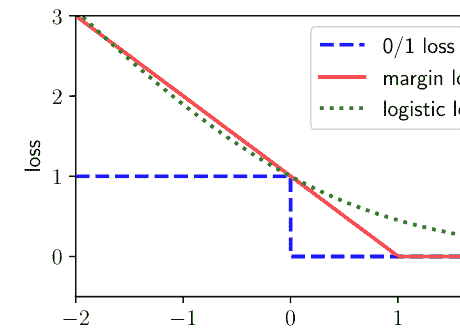

图 2.2：间隔、零一和逻辑损失函数。

转化为一个损失函数，

$$\ell_{\text{MARGIN}}(\boldsymbol{\theta}; \boldsymbol{x}^{(i)}, y^{(i)}) = \begin{cases} 0, & \gamma(\boldsymbol{\theta}; \boldsymbol{x}^{(i)}, y^{(i)}) \ge 1, \\ 1 - \gamma(\boldsymbol{\theta}; \boldsymbol{x}^{(i)}, y^{(i)}), & \text{otherwise} \end{cases} \tag{2.44}$$ $$= \left(1 - \gamma(\boldsymbol{\theta}; \boldsymbol{x}^{(i)}, y^{(i)})\right)_+, \tag{2.45}$$

其中 $(x)_+ = \max(0, x)$。如果真实标签的分数与得分最高的替代标签 $\hat{y}$ 之间至少有 1 的间隔，则损失为零。这几乎与感知器损失相同，但铰链点向右移动，如图 2.2 所示。间隔损失是零一损失的凸上界。

间隔损失可以使用类似于感知器的在线学习规则最小化。我们将把该学习规则称为在线支持向量机，原因将在推导中讨论。让我们首先用代价函数 $c(y^{(i)}, y)$ 推广分类错误的概念。我们将关注简单的代价函数，

$$c(y^{(i)}, y) = \begin{cases} 1, & y^{(i)} \neq \hat{y} \\ 0, & \text{otherwise}, \end{cases} \tag{2.46}$$

但可以设计专门的代价函数，对特别不期望的错误施加更重的惩罚（Tsochantaridis et al., 2004）。这个想法在第 7 章中重新讨论。

使用代价函数，我们现在可以将在线支持向量机定义为

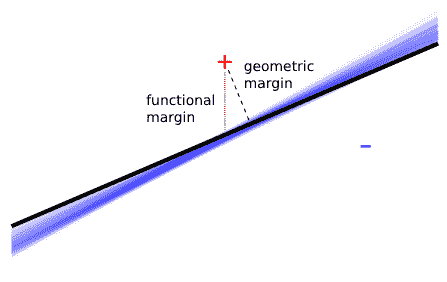

图 2.3：二元分类问题的函数间隔和几何间隔。所有满足间隔约束的分隔面均已显示。几何间隔最大的分隔面以粗体显示。

在间隔损失始终为零的约束下：

max_θ min_{i=1,2,...,N} γ(θ; x^{(i)}, y^{(i)}) / ||θ||_2
s.t. γ(θ; x^{(i)}, y^{(i)}) ≥ 1, ∀i. [2.49]

这是一个约束优化问题，其中第二行描述了可能解空间 θ 的约束。在这种情况下，约束是函数间隔始终至少为一，目标是使最小几何间隔尽可能大。

约束优化在附录 B 中回顾。在这种情况下，进一步的推导得到一个无约束优化问题。首先，注意范数 ||θ||_2 线性缩放：||aθ||_2 = a||θ||_2。此外，函数间隔 γ 是 θ 的线性函数，因此 γ(aθ, x^{(i)}, y^{(i)}) = aγ(θ, x^{(i)}, y^{(i)})。因此，θ 上的任何缩放因子在几何间隔的分子和分母中都会抵消。如果数据在任意 ρ > 0 时线性可分，则总可以通过将 θ 乘以标量常数来将函数间隔重新缩放为 1。因此，我们只需要最小化分母 ||θ||_2，受函数间隔约束的限制。||θ||_2 的最小化器也是 ½||θ||_2^2 = ½ Σ θ_j^2 的最小化器，后者更容易处理。这产生了一个更简单的优化问题

给定数据集 $\mathcal{D} = \{(\boldsymbol{x}^{(i)}, y^{(i)})\}_{i=1}^N$，权重 $\boldsymbol{\theta}$ 通过 **最大条件似然** 估计，

$$\log p(\boldsymbol{y}^{(1:N)} \mid \boldsymbol{x}^{(1:N)}; \boldsymbol{\theta}) = \sum_{i=1}^N \log p(y^{(i)} \mid \boldsymbol{x}^{(i)}; \boldsymbol{\theta}) \tag{2.57}$$ $$= \sum_{i=1}^N \boldsymbol{\theta} \cdot \boldsymbol{f}(\boldsymbol{x}^{(i)}, y^{(i)}) - \log \sum_{y' \in \mathcal{Y}} \exp\left(\boldsymbol{\theta} \cdot \boldsymbol{f}(\boldsymbol{x}^{(i)}, y')\right). \tag{2.58}$$

最后一条线是通过代入公式 2.56 并取对数得到的。 16 在求和内部，我们有（对数损失的加法逆）逻辑损失，

$$\ell_{\text{LogReg}}(\boldsymbol{\theta}; \boldsymbol{x}^{(i)}, y^{(i)}) = -\boldsymbol{\theta} \cdot \boldsymbol{f}(\boldsymbol{x}^{(i)}, y^{(i)}) + \log \sum_{y' \in \mathcal{Y}} \exp(\boldsymbol{\theta} \cdot \boldsymbol{f}(\boldsymbol{x}^{(i)}, y')) \tag{2.59}$$

逻辑损失如图 2.2 第 31 页所示。与零一损失和铰链损失的关键区别在于逻辑损失永远不为零。这意味着通过对正确标签赋予更高的置信度，目标函数始终可以得到改进。

#### 2.5.1 正则化

与支持向量机一样，通过惩罚 $\boldsymbol{\theta}$ 的范数可以获得更好的泛化。这是通过在最小化目标中添加平方范数的倍数 $\frac{\lambda}{2}\|\boldsymbol{\theta}\|_2^2$ 来实现的。这称为 $L_2$ 正则化，因为 $\|\boldsymbol{\theta}\|_2^2$ 是向量 $\boldsymbol{\theta}$ 的 $L_2$ 范数的平方。正则化迫使估计器在训练数据上的性能与权重范数之间进行权衡，这有助于防止过拟合。考虑仅在一个实例 $\boldsymbol{x}^{(i)}$ 中激活的基础特征 $j$ 的未正则化权重会发生什么：条件对数似然可以通过增加该特征的权重而始终得到改进，使得 $\boldsymbol{\theta}_{(j, y^{(i)})} \to \infty$ 且 $\boldsymbol{\theta}_{(j, y \neq y^{(i)})} \to -\infty$，其中 $(j, y)$ 是 $\boldsymbol{f}(\boldsymbol{x}^{(i)}, y)$ 中与 $x_j^{(i)}$ 和标签 $y$ 关联的特征的索引。

在 § 2.2.4（脚注 11）中，我们看到平滑朴素贝叶斯分类器的概率可以被证明为最大后验估计的一种形式，其中分类器的参数本身是随机变量，从 **先验分布** 中抽取。同样的理由也适用于 $L_2$ 正则化。在这种情况下，先验是 $\boldsymbol{\theta}$ 的每个项上的零均值高斯分布。零均值高斯下的对数似然为，

$$\log N(\theta_j; 0, \sigma^2) \propto - \frac{1}{2\sigma^2} \theta_j^2, \tag{2.60}$$

因此，正则化权重 $\lambda$ 等于先验的逆方差，$\lambda = \frac{1}{\sigma^2}$。

16 log-sum-exp 项是机器学习中的常见模式。它在数值上不稳定，因为如果内积很小，它会下溢，如果内积很大，它会溢出。科学计算库通常包含用于计算 logsumexp 的特殊函数，但经过一些思考，你应该能够看到如何创建数值稳定的实现。


#### 2.5.2 梯度

逻辑损失通过沿梯度进行优化来最小化。具体算法将在下一节中描述，但首先让我们计算单个样本的逻辑损失关于梯度的梯度：

$\ell_{\text{LOGREG}} = -\boldsymbol{\theta}\cdot\boldsymbol{f}(\boldsymbol{x}^{(i)}, y^{(i)}) + \log\sum_{y'\in\mathcal{Y}} \exp\left(\boldsymbol{\theta}\cdot\boldsymbol{f}(\boldsymbol{x}^{(i)}, y')\right)$ [2.61]

$\frac{\partial\ell}{\partial\boldsymbol{\theta}} = -\boldsymbol{f}(\boldsymbol{x}^{(i)}, y^{(i)}) + \frac{1}{\sum_{y''\in\mathcal{Y}} \exp\left(\boldsymbol{\theta}\cdot\boldsymbol{f}(\boldsymbol{x}^{(i)}, y''\right))} \times \sum_{y'\in\mathcal{Y}} \exp\left(\boldsymbol{\theta}\cdot\boldsymbol{f}(\boldsymbol{x}^{(i)}, y')\right) \times \boldsymbol{f}(\boldsymbol{x}^{(i)}, y')$ [2.62]

$= -\boldsymbol{f}(\boldsymbol{x}^{(i)}, y^{(i)}) + \sum_{y'\in\mathcal{Y}} \frac{\exp\left(\boldsymbol{\theta}\cdot\boldsymbol{f}(\boldsymbol{x}^{(i)}, y')\right)}{\sum_{y''\in\mathcal{Y}} \exp\left(\boldsymbol{\theta}\cdot\boldsymbol{f}(\boldsymbol{x}^{(i)}, y''\right))} \times \boldsymbol{f}(\boldsymbol{x}^{(i)}, y')$ [2.63]

$= -\boldsymbol{f}(\boldsymbol{x}^{(i)}, y^{(i)}) + \sum_{y'\in\mathcal{Y}} \mathrm{p}(y'\mid\boldsymbol{x}^{(i)},\boldsymbol{\theta}) \times \boldsymbol{f}(\boldsymbol{x}^{(i)}, y')$ [2.64]

$= -\boldsymbol{f}(\boldsymbol{x}^{(i)}, y^{(i)}) + E_{Y\mid X}[\boldsymbol{f}(\boldsymbol{x}^{(i)}, y)]$ [2.65]

最后一步采用了条件期望的定义 (§ A.5)。逻辑损失的梯度等于当前模型下期望计数 $E_{Y|X}[f(x^{(i)}, y)]$ 与观测到的特征计数 $f(x^{(i)}, y^{(i)})$ 之间的差。当这两个向量对于单个实例相等时，就无法从中再学习到任何东西；当它们在整个数据集上的总和相等时，就无法从整个数据集再学习到任何东西。铰链损失的梯度几乎相同，但它涉及当前模型下预测标签的特征 $f(x^{(i)}, \hat{y})$，而不是条件分布 $p(y \mid x; \theta)$ 下的期望特征 $E_{Y|X}[f(x^{(i)}, y)]$。

正则项对整体梯度的贡献为 $\lambda\theta$：

$L_{\text{LOGREG}} = \frac{\lambda}{2}||\theta||_2^2 - \sum_{i=1}^{N} \left( \theta\cdot f(x^{(i)}, y^{(i)}) - \log \sum_{y'\in\mathcal{Y}} \exp \theta\cdot f(x^{(i)}, y') \right)$ [2.66]

$\nabla_\theta L_{\text{LOGREG}} = \lambda\theta - \sum_{i=1}^{N} \left( f(x^{(i)}, y^{(i)}) - E_{y|x}[f(x^{(i)}, y)] \right)$ [2.67]

### 2.6 优化

本章中的每个分类算法都可以看作是一个优化问题：

- 在朴素贝叶斯中，目标是联合似然 $\log p(x^{(1:N)}, y^{(1:N)})$。最大似然估计为 $\theta$ 给出了闭式解。

```
**Algorithm 5** Generalized gradient descent. The function Batcher partitions the training set into $B$ batches such that each instance appears in exactly one batch. In gradient descent, $B = 1$; in stochastic gradient descent, $B = N$; in minibatch stochastic gradient descent, $1 < B < N$.

1: **procedure** Gradient-Descent($x^{(1:N)}, y^{(1:N)}, L, \eta^{(1...\infty)}, \text{Batcher}, T_{\max}$)
2:     $\theta \leftarrow 0$
3:     $t \leftarrow 0$
4:     **repeat**
5:         $(b^{(1)}, b^{(2)}, \ldots, b^{(B)}) \leftarrow \text{Batcher}(N)$
6:         **for** $n \in \{1, 2, \ldots, B\}$ **do**
7:             $t \leftarrow t + 1$
8:             $\theta^{(t)} \leftarrow \theta^{(t-1)} - \eta^{(t)}\nabla_{\theta}L(\theta^{(t-1)}; x^{(b_1^{(n)}, b_2^{(n)}, \ldots)}, y^{(b_1^{(n)}, b_2^{(n)}, \ldots)})$
9:             **if** Converged$(\theta^{(1,2,\ldots,t)})$ **then**
10:                 **return** $\theta^{(t)}$
11:     **until** $t \geq T_{\max}$
12:     **return** $\theta^{(t)}$
```

在随机梯度下降中，它返回 $N$ 个每个包含一个实例的批次。在小批量设置中，分批器返回 $B$ 个小批量，$1 < B < N$。

在线学习还有许多其他技术，该领域的研究正在进行中 (Bottou et al., 2016)。一些算法使用自适应学习率，该学习率可以针对每个特征而不同 (Duchi et al., 2011)。频繁出现的特征很可能被频繁更新，因此最好使用较小的学习率；罕见特征会被不频繁更新，因此最好采取更大的步长。**AdaGrad**（自适应梯度）算法通过存储每个特征的梯度平方和，并按其倒数重新缩放学习率来实现这种行为：

$$g_t = \nabla_{\theta} L(\theta^{(t)}; x^{(i)}, y^{(i)})$$  [2.73]

$$\theta_j^{(t+1)} \leftarrow \theta_j^{(t)} - \frac{\eta^{(t)}}{\sqrt{\sum_{t'=1}^{t} g_{t',j}^{2}}}g_{t,j}$$  [2.74]

其中 $j$ 在 $f(x, y)$ 中的特征上迭代。

在大多数情况下，任何实例的活跃特征数量远小于权重数量。如果是这样，在线优化的计算成本将主要由正则化项 $\lambda\theta$ 的更新决定。解决方案是“懒惰”，仅在使用时才更新每个 $\theta_j$。为了实现懒惰更新，存储一个额外的参数 $\tau_j$，它是 $\theta_j$ 最后一次被更新的迭代次数。如果在时间 $t$ 需要 $\theta_j$，则可以一次性执行 $t - \tau$ 次正则化更新。Kummerfeld 等人 (2015) 详细描述了这种策略。

### 2.7 *分类中的其他主题*

本节介绍了一些分类中的额外主题，这些主题对于自然语言处理尤其相关，特别是对于理解研究文献。

#### 2.7.1 正则化下的特征选择

在逻辑回归和大间隔分类中，通过使用 $L_2$ 范数将权重正则化到 0，可以改善泛化能力。但与其鼓励权重变小，不如让模型变得**稀疏**更好：它应该对大多数特征赋予恰好为零的权重，并且仅对明显必要的特征赋予非零权重。这一思想可以通过 $L_0$ 范数形式化，$L_0 = \|\theta\|_0 = \sum_j \delta(\theta_j \neq 0)$，它对每个非零权重施加恒定惩罚。该范数可以被视为一种**特征选择**形式：优化 $L_0$ 正则化的条件似然相当于在对数似然与活跃特征数量之间进行权衡。减少活跃特征数量是可取的，因为由此产生的模型将速度快、内存占用低，并且应该泛化良好，因为无关特征将被剪枝掉。不幸的是，$L_0$ 范数是非凸且不可微的。在 $L_0$ 正则化下的优化是**NP-hard**，这意味着只有在 P=NP 的情况下才能有效地求解 (Ge et al., 2011)。

一个有用的替代方案是 $L_1$ 范数，它等于权重的绝对值之和，$\|\theta\|_1 = \sum_j |\theta_j|$。$L_1$ 范数是凸的，可以用作 $L_0$ 的近似 (Tibshirani, 1996)。方便的是，$L_1$ 范数也执行特征选择，通过将许多系数驱动为零；因此它被称为**稀疏诱导正则化器**。$L_1$ 范数在 $\theta_j = 0$ 处没有梯度，因此我们必须改用**次梯度**方法来优化 $L_1$ 正则化目标。相关的随机次梯度下降算法仅比常规 SGD 稍微复杂一些；Sra 等人 (2012) 调查了在 $L_1$ 和其他正则化器下估计的方法。

Gao 等人 (2007) 在一系列 NLP 问题上比较了 $L_1$ 和 $L_2$ 正则化，发现 $L_1$ 正则化通常与 $L_2$ 正则化具有相似的准确性，但 $L_1$ 正则化产生的模型小十到五十倍，因为超过 90% 的特征权重被设为零。

#### 2.7.2 逻辑回归的其它视角

在二元分类中，我们可以放弃特征函数，并根据 $\theta \cdot x$ 的内积选择 $y$。条件概率 $p_{Y|X}$ 是通过传递此


### 2.8 学习算法小结

自然会产生一个问题：哪种学习算法最好？但答案取决于哪些特性对你要解决的问题最重要。

| 算法 | 优点 | 缺点 |
| --- | --- | --- |
| **朴素贝叶斯** | 易于实现；估计速度快，只需对数据遍历一次；可为预测标签分配概率；通过平滑参数控制过拟合。 | 准确率往往不高，尤其是当特征相关时。 |
| **感知机** | 易于实现；在线学习；错误驱动学习通常能带来较高准确率，尤其是在进行平均之后。 | 不具概率性；难以判断何时停止学习；缺乏间隔可能导致过拟合。 |
| **支持向量机** | 优化基于误差的指标，通常能获得较高准确率；通过正则化参数控制过拟合。 | 不具概率性。 |
| **逻辑回归** | 错误驱动且具有概率性；通过正则化参数控制过拟合。 | 批量学习需要黑盒优化；逻辑损失可能对正确标记的样本“过训练”。 |

一个主要区别在于学习算法是否能在标签上输出概率。这在模块化架构中很有用，因为一个分类器的输出往往作为另一个系统的输入。在不需要概率的情况下，支持向量机通常是合适的选择，因为它实现起来并不比感知机更困难，而且往往更准确。当需要概率时，逻辑回归通常比朴素贝叶斯更准确。

## 补充资源

机器学习教科书会提供更多分类器和更多细节（例如，Murphy, 2012），尽管其记号会与自然语言处理中的典型表示略有不同。Hastie 等人（2009）综述了概率方法，而 Mohri 等人（2012）则侧重于理论考量。Bottou 等人（2016）综述了快速发展的在线学习领域，Kummerfeld 等人（2015）则对大间隔学习中的若干优化算法进行了实证综述。Python 工具包 scikit-learn 包含了本章所述所有算法的实现（Pedregosa 等人，2011）。

附录 B 描述了另一种大间隔分类器，称为**被动攻击算法**。被动攻击算法是一种在线学习器，它试图在满足当前实例间隔约束的前提下进行最小更新。它与 MIRA 密切相关，后者在 2000 年代被广泛应用于 NLP（Crammer and Singer, 2003）。

## 练习

每章末尾都会有练习。在本章中，练习以数学题为主，与本章主题内容相匹配。在其他章节中，练习将侧重于语言学或编程。

1. 令 \(x\) 为一个词袋向量，且 \(\sum_{j=1}^V x_j = 1\)。验证多项分布概率 \(p_{\mathrm{mult}}(x; \varphi)\)（如公式 2.12 所定义）与同一文档在类别分布下的概率 \(p_{\mathrm{cat}}(w; \varphi)\) 完全一致。

2. 假设你有一个单一特征 \(x\)，其条件分布如下：

\[
p(x \mid y) =
\begin{cases}
\alpha, & X = 0,\ Y = 0; \\
1 - \alpha, & X = 1,\ Y = 0; \\
1 - \beta, & X = 0,\ Y = 1; \\
\beta, & X = 1,\ Y = 1.
\end{cases}
\tag{2.80}
\]

进一步假设先验是均匀的，\(\Pr(Y=0)=\Pr(Y=1)=1/2\)，且 \(\alpha>1/2\)、\(\beta>1/2\)。若一个朴素贝叶斯分类器具有准确参数，那么产生错误的概率是多少？

3. 推导朴素贝叶斯中参数 \(\mu\) 的最大似然估计。

4. 文本中的分类模型为每个可能的标签都有一个权重向量。虽然这在记号上很方便，但它是过定的：对于任何可以通过 \(K \times V\) 个权重得到的线性分类器，都可以用 \((K-1) \times V\) 个权重构造一个等价分类器。

   a) 描述如何构造这个分类器。具体来说，如果给定一组权重 \(\theta\) 和特征函数 \(f(x,y)\)，请解释如何构造替代的权重和特征函数 \(\theta'\) 和 \(f'(x,y)\)，使得：

   \[
   \forall y, y' \in Y,\quad \theta \cdot f(x,y) - \theta \cdot f(x,y') = \theta' \cdot f'(x,y) - \theta' \cdot f'(x,y'). \tag{2.81}
   \]

   b) 解释你的构造如何证明二元逻辑回归的著名替代形式：\(\Pr(Y=1 \mid x; \theta) = 1/(1+\exp(-\theta' \cdot x)) = \sigma(\theta' \cdot x)\)，其中 \(\sigma\) 是 sigmoid 函数。

5. 假设你有两个带标签的数据集 \(D_1\) 和 \(D_2\)，它们具有相同的特征和标签。

   - 令 \(\boldsymbol{\theta}^{(1)}\) 为在数据集 \(D_1\) 上训练得到的无正则化逻辑回归（LR）系数。
   - 令 \(\boldsymbol{\theta}^{(2)}\) 为在数据集 \(D_2\) 上训练得到的无正则化 LR 系数（相同模型）。
   - 令 \(\boldsymbol{\theta}^*\) 为在合并后的数据集 \(D_1 \cup D_2\) 上训练得到的无正则化 LR 系数。

   在这些条件下，证明对于任意特征 \(j\)，有：

   \[
   \theta_j^* \ge \min(\theta_j^{(1)}, \theta_j^{(2)}), \qquad
   \theta_j^* \le \max(\theta_j^{(1)}, \theta_j^{(2)}).
   \]

6. 令 \(\hat{\boldsymbol{\theta}}\) 为无正则化逻辑回归问题的解，令 \(\boldsymbol{\theta}^*\) 为同一问题在加入 \(L_2\) 正则化后的解。证明 \(\|\boldsymbol{\theta}^*\|_2^2 \le \|\hat{\boldsymbol{\theta}}\|_2^2\)。

7. 如 §2.3.2 中关于平均感知机的讨论所述，计算运行和 \(\boldsymbol{m} \leftarrow \boldsymbol{m} + \boldsymbol{\theta}\) 是不必要的昂贵操作，需要 \(K \times V\) 次运算。给出计算平均权重 \(\overline{\boldsymbol{\theta}}\) 的替代方法，其复杂度与 \(V\) 无关，而与特征总大小 \(\sum_{i=1}^N |\boldsymbol{f}(\boldsymbol{x}^{(i)}, y^{(i)})|\) 呈线性关系。

8. 考虑一个包含两个相同实例 \(\boldsymbol{x}^{(1)} = \boldsymbol{x}^{(2)}\) 但标签不同 \(y^{(1)} \neq y^{(2)}\) 的数据集。假设所有特征都是二值的，即对所有 \(j\)，\(x_j \in \{0,1\}\)。现在假设平均感知机始终在实例 \((\boldsymbol{x}^{i(t)}, y^{i(t)})\) 上训练，其中 \(i(t) = 2 - (t \bmod 2)\)，当训练迭代次数 \(t\) 为奇数时取 1，为偶数时取 2。进一步假设学习在以下条件下终止：

\[
\epsilon \ge \max_j \left| \frac{1}{t}\sum_{s=1}^{t}\theta_j^{(s)} - \frac{1}{t-1}\sum_{s=1}^{t-1}\theta_j^{(s)} \right| \tag{2.82}
\]

换言之，当平均权重的最大变化小于或等于 \(\epsilon\) 时，算法停止。计算平均感知机终止前的迭代次数。

9. 证明间隔损失关于 \(\boldsymbol{\theta}\) 是凸的。使用以下间隔损失的定义：

\[
L(\boldsymbol{\theta}) = -\boldsymbol{\theta} \cdot \boldsymbol{f}(\boldsymbol{x}, y^*) + \max_y \bigl(\boldsymbol{\theta} \cdot \boldsymbol{f}(\boldsymbol{x}, y) + c(y^*, y)\bigr), \tag{2.83}
\]

其中 \(y^*\) 是金标签。提醒一下，函数 \(f\) 是凸的当且仅当对任意 \(x_1, x_2\) 和 \(\alpha \in [0,1]\)，有：

\[
f(\alpha x_1 + (1-\alpha)x_2) \le \alpha f(x_1) + (1-\alpha) f(x_2), \tag{2.84}
\]

10. 如果函数 \(f\) 是 \(m\)-强凸的，那么对于某个 \(m > 0\)，以下不等式对其定义域中的所有 \(x\) 和 \(x'\) 成立：

\[
f(x') \le f(x) + (\nabla_x f) \cdot (x' - x) + \frac{m}{2}\|x' - x\|_2^2. \tag{2.85}
\]

令 \(f(x) = L(\boldsymbol{\theta}^{(t)})\)，表示第 \(t\) 次梯度下降迭代时分类器的损失；令 \(f(x') = L(\boldsymbol{\theta}^{(t+1)})\)。假设损失函数是 \(m\)-凸的，证明在适当常数学习率 \(\eta\)（依赖于 \(m\)）下，\(L(\boldsymbol{\theta}^{(t+1)}) \le L(\boldsymbol{\theta}^{(t)})\)。并解释为什么这意味着当梯度下降应用于具有唯一最小值的 \(m\)-强凸损失函数时，能够收敛。

## 第 3 章 非线性分类

 

线性分类可能看起来就是自然语言处理所需的一切。词袋表示本身就具有高维性，特征数量往往大于带标签的训练实例数量。这意味着通常可以找到一个线性分类器完美拟合训练数据，甚至能够拟合训练实例的任意标签标注！因此，转向非线性分类可能只会增加过拟合的风险。此外，对于许多任务，**词汇特征**（词）在单独出现时也具有意义，能够提供关于实例标签的独立证据——这与计算机视觉不同，在计算机视觉中，单个像素很少能提供有用信息，必须综合考虑才能理解图像。出于这些原因，自然语言处理在历史上一直聚焦于线性分类。

但近年来，非线性分类器席卷了整个自然语言处理领域，目前已成为许多任务中的默认方法（Manning, 2015）。这种变化至少有三个原因。

- **深度学习**取得了快速发展，这是一类通过多层计算学习输入复杂函数的非线性方法（Goodfellow 等人，2016）。
- 深度学习促进了**词嵌入**的整合，词嵌入是词的稠密向量表示。词嵌入可以从大量无标注数据中学习，并能够对注释训练数据中未出现的词进行泛化（词嵌入将在第 14 章详细讨论）。
- 尽管 CPU 速度已经趋于平稳，但被称为图形处理单元（GPU）的专用硬件取得了快速发展，其速度更快、成本更低、更易于编程。许多深度学习模型可以在 GPU 上高效实现，相比基于 CPU 的计算带来显著的性能提升。


本章重点介绍**神经网络**，它们是当今自然语言处理中非线性分类的主导方法。¹ 历史上，一些其他非线性学习方法也曾应用于语言数据。

- **核方法**是对**最近邻**分类规则的推广，该规则通过训练集中最相似示例的标签来对每个实例进行分类。**核支持向量机**在信息抽取中的应用在第17章中进行了描述。
- **决策树**通过检查一组条件来对实例进行分类。将决策树扩展到词袋输入是困难的，但决策树在诸如指代消解（第15章）等任务中取得了成功，在这些任务中可以构建更紧凑的特征集（Soon et al., 2001）。
- **Boosting**及其相关的**集成方法**通过组合多个“弱”分类器的预测结果来工作，每个分类器可能只考虑一小部分特征。Boosting已成功应用于文本分类（Schapire and Singer, 2000）和句法分析（Abney et al., 1999），并且仍然是 Kaggle 等机器学习竞赛网站上最成功的方法之一（Chen and Guestrin, 2016）。

Hastie 等（2009）对这些技术提供了极好的概述。

### 3.1 前馈神经网络

考虑构建电影评论分类器的问题。目标是从每个文档文本的表示 *x* 中预测标签 *y* ∈ {GOOD, BAD, OKAY}。但是什么造就了一部好电影？故事、表演、摄影、剪辑、原声带等等。现在假设训练集包含这些额外特征的标签，*z* = [*z*₁, *z*₂, …, *z*ₖ₍z₎]ᵀ。利用此类信息的训练集，我们可以构建一个两步分类器：

1. **使用文本 *x* 预测特征 *z***。具体来说，训练一个逻辑回归分类器来计算 p(*z*ₖ | *x*)，对于每个 *k* ∈ {1, 2, …, *K*₍z₎}。
2. **使用特征 *z* 预测标签 *y***。再次训练一个逻辑回归分类器来计算 p(*y* | *z*)。在测试数据上，*z* 是未知的，因此我们将使用第一层得到的概率 p(*z* | *x*) 作为特征。

该设置如图 3.1 所示，该图以**计算图**的形式描述了所提出的分类器：文本特征 *x* 连接到中间层 *z*，而中间层 *z* 连接到标签 *y*。

¹我将“深度学习”和“神经网络”互换使用。

其中 *f* 是逐元素的激活函数，例如 σ 或 ReLU，而 ℓ⁽ⁱ⁾ 是实例 *i* 处的损失。参数 Θ⁽ˣ→ᶻ⁾、Θ⁽ᶻ→ʸ⁾ 和 **b** 可以使用在线基于梯度的优化进行估计。最简单的此类算法是随机梯度下降，已在 § 2.6 中讨论过。每个参数通过损失的梯度进行更新，

$$\begin{aligned}
\mathbf{b} &\leftarrow \mathbf{b}-\eta^{(t)}\nabla_{\mathbf{b}}\ell^{(i)} \tag{3.24}\\
\theta_k^{(z\to y)} &\leftarrow \theta_k^{(z\to y)}-\eta^{(t)}\nabla_{\theta_k^{(z\to y)}}\ell^{(i)} \tag{3.25}\\
\theta_n^{(x\to z)} &\leftarrow \theta_n^{(x\to z)}-\eta^{(t)}\nabla_{\theta_n^{(x\to z)}}\ell^{(i)}. \tag{3.26}
\end{aligned}$$

其中 η⁽ᵗ⁾ 是第 *t* 次迭代的学习率，ℓ⁽ⁱ⁾ 是实例（或小批量）*i* 上的损失，且 θₙ⁽ˣ→ᶻ⁾ 是矩阵 Θ⁽ˣ→ᶻ⁾ 的第 *n* 列，θₖ⁽ᶻ→ʸ⁾ 是 Θ⁽ᶻ→ʸ⁾ 的第 *k* 列。

**b** 和 θₖ⁽ᶻ→ʸ⁾ 上的负对数似然的梯度与逻辑回归中的梯度相似。对于 θₖ⁽ᶻ→ʸ⁾，梯度为，

$$\nabla_{\theta_k^{(z\to y)}}\ell^{(i)}=\left[\frac{\partial\ell^{(i)}}{\partial\theta_{k,1}^{(z\to y)}},\frac{\partial\ell^{(i)}}{\partial\theta_{k,2}^{(z\to y)}},\ldots,\frac{\partial\ell^{(i)}}{\partial\theta_{k,K_y}^{(z\to y)}}\right]^\mathsf{T} \tag{3.27}$$

$$\begin{aligned}
\frac{\partial\ell^{(i)}}{\partial\theta_{k,j}^{(z\to y)}}
&=-\frac{\partial}{\partial\theta_{k,j}^{(z\to y)}}\left(\theta_{y^{(i)}}^{(z\to y)}\cdot\mathbf{z}-\log\sum_{y\in\mathcal{Y}}\exp\theta_y^{(z\to y)}\cdot\mathbf{z}\right) \tag{3.28}\\
&=\left(\Pr(y=j\mid\mathbf{z};\mathbf{\Theta}^{(z\to y)},\mathbf{b})-\delta\left(j=y^{(i)}\right)\right)z_k, \tag{3.29}
\end{aligned}$$

其中 δ(*j* = *y*⁽ⁱ⁾) 是一个函数，当 *j* = *y*⁽ⁱ⁾ 时返回一，否则返回零。梯度 ∇ᵦℓ⁽ⁱ⁾ 与公式 3.29 相似。

输入层权重 Θ⁽ˣ→ᶻ⁾ 上的梯度通过微分的链式法则得到：

$$\begin{aligned}
\frac{\partial\ell^{(i)}}{\partial\theta_{n,k}^{(x\to z)}}
&=\frac{\partial\ell^{(i)}}{\partial z_k}\frac{\partial z_k}{\partial\theta_{n,k}^{(x\to z)}} \tag{3.30}\\
&=\frac{\partial\ell^{(i)}}{\partial z_k}\frac{\partial f\left(\theta_k^{(x\to z)}\cdot\mathbf{x}\right)}{\partial\theta_{n,k}^{(x\to z)}} \tag{3.31}\\
&=\frac{\partial\ell^{(i)}}{\partial z_k}\times f'\left(\theta_k^{(x\to z)}\cdot\mathbf{x}\right)\times x_n, \tag{3.32}
\end{aligned}$$

其中 *f′*(θₖ⁽ˣ→ᶻ⁾ · **x**) 是激活函数 *f* 的导数，应用于输入

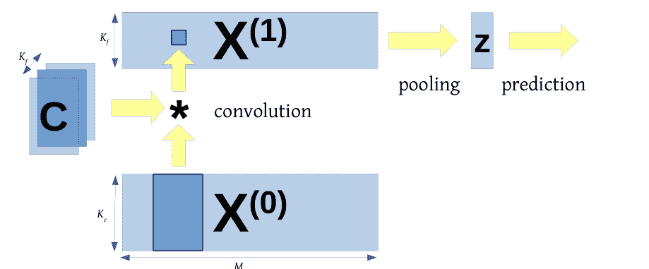

Figure 3.4: 用于文本分类的卷积神经网络

一个简单的滤波器可能会对附近的词进行加权平均，

$$\mathbf{C}^{(k)} = \begin{bmatrix} 0.5 & 1 & 0.5 \\ 0.5 & 1 & 0.5 \\ \dots & \dots & \dots \\ 0.5 & 1 & 0.5 \end{bmatrix}, \qquad [3.54]$$

从而表示像 *not so unpleasant* 这样的三元组单元。在**一维卷积**中，每个滤波器矩阵 $\mathbf{C}^{(k)}$ 被限制为仅在第 $k$ 行有非零值（Kalchbrenner et al., 2014）。这意味着词嵌入的每个维度都由单独的滤波器处理，并且它意味着 $K_f = K_e$。

为了解决输入的开头和结尾，基矩阵 $\mathbf{X}^{(0)}$ 可以在开头和结尾填充 $h$ 个零列向量；这被称为**宽卷积**。如果不进行填充，则每一层的输出将比输入小 $h - 1$ 个单位；这被称为**窄卷积**。滤波器矩阵不必具有相同的滤波器宽度，因此更一般地，我们可以用 $h_k$ 表示滤波器 $\mathbf{C}^{(k)}$ 的宽度。如符号 $\mathbf{X}^{(0)}$ 所示，可以应用多层卷积，使得 $\mathbf{X}^{(d)}$ 是 $\mathbf{X}^{(d+1)}$ 的输入。

经过 $D$ 层卷积后，我们得到文档的矩阵表示 $\mathbf{X}^{(D)} \in \mathbb{R}^{K_z \times M}$。如果实例长度可变，则需要对所有 $M$ 个词位置进行聚合以获得固定长度的表示。这可以通过**池化**操作完成，

- 展示任意权重上初始梯度很小的概率 $\frac{\partial z_k}{\partial \theta_{j,k}} < \alpha$ 如何依赖于输入大小 $M$。提示：使用下界 $\Pr(\sigma(\boldsymbol{\theta}_k \cdot \boldsymbol{x}) \times (1 - \sigma(\boldsymbol{\theta}_k \cdot \boldsymbol{x})) < \alpha) \ge 2 \Pr(\sigma(\boldsymbol{\theta}_k \cdot \boldsymbol{x}) < \alpha)$，[3.60] 并将该概率与方差 $V[\boldsymbol{\theta}_k \cdot \boldsymbol{x}]$ 联系起来。
- 设计一种可消除这种依赖性的替代初始化方法。

8. ReLU 激活函数可能导致“死亡神经元”，它们在任何输入下都无法被激活。考虑以下具有标量输出 $y$ 的两层前馈网络：

$z_i = \mathrm{ReLU}(\boldsymbol{\theta}_i^{(x\to z)} \cdot \boldsymbol{x} + b_i)$ [3.61]
$y = \boldsymbol{\theta}^{(z\to y)} \cdot \boldsymbol{z}$ [3.62]

假设输入是观测值的二值向量，$\boldsymbol{x} \in \{0,1\}^D$。

a) 在什么条件下节点 $z_i$ 为“死亡”？你的答案应以参数 $\boldsymbol{\theta}_i^{(x\to z)}$ 和 $b_i$ 表示。

b) 假设给定实例上损失的梯度为 $\frac{\partial \ell}{\partial y} = 1$。推导此类实例的梯度 $\frac{\partial \ell}{\partial b_i}$ 和 $\frac{\partial \ell}{\partial \theta_{j,i}^{(x\to z)}}$。

c) 利用前两部分的答案，解释为什么死亡神经元在基于梯度的学习过程中永远无法复活。

9. 假设参数 $\Theta = \{\Theta^{(x\to z)}, \Theta^{(z \to y)}, \boldsymbol{b}\}$ 在以下意义上是前馈网络的局部最优：存在某个 $\epsilon > 0$，使得 $\big(\|\tilde{\Theta}^{(x\to z)} - \Theta^{(x\to z)}\|_F^2 + \|\tilde{\Theta}^{(z\to y)} - \Theta^{(z\to y)}\|_F^2 + \|\tilde{\boldsymbol{b}} - \boldsymbol{b}\|_2^2 < \epsilon\big) \Rightarrow \big(L(\tilde{\Theta}) > L(\Theta)\big)$ [3.63]

定义函数 $\pi$ 为隐藏单元上的置换，如 § 3.3.3 中所述，使得对于任意 $\Theta$，$L(\Theta) = L(\Theta_\pi)$。证明如果前馈网络在公式 3.63 的意义上具有局部最优，则其损失不是参数 $\Theta$ 的凸函数，使用 § 2.4 中的凸性定义。

10. 考虑一个具有单个隐藏层和单个输出的网络，$y = \boldsymbol{\theta}^{(z\to y)} \cdot g(\Theta^{(x\to z)} \boldsymbol{x})$ [3.64]
假设 $g$ 是 ReLU 函数。证明对于任意权重矩阵 $\Theta^{(x\to z)}$，都可以将每一行重新缩放为范数为一，因为可以通过找到 $\boldsymbol{\theta}^{(z\to y)}$ 的相应重新缩放来获得相同的输出。


## 第4章：分类的语言学应用

在涵盖了若干分类技术之后，本章将重点从数学转向语言学应用。本章稍后，我们将考虑文本分类所涉及的设计决策，以及评估的最佳实践。

### 4.1 情感与观点分析

文本分类的一个流行应用是自动确定文档（如产品评论和社交媒体帖子）的**情感**或**观点极性**。例如，营销人员有兴趣了解人们对广告、服务和产品的反应（Hu and Liu, 2004）；社会科学家感兴趣的是情绪如何受到天气等现象的影响（Hannak et al., 2012），以及观点和情绪如何通过社交网络传播（Coviello et al., 2014; Miller et al., 2011）。在**数字人文**领域，文学学者通过小说中情感的流动来追踪情节结构（Jockers, 2015）。¹

情感分析可以被视为文档分类的直接应用，前提是能够获得可靠的标签。在最简单的情况下，情感分析是一个二类或三类问题，包含正面、负面，可能还有中性的情感。这类标注可以手动完成，也可以通过多种方式自动获得：

- 包含快乐情绪的推文可以被标记为正面，悲伤情绪被标记为负面（Read, 2005; Pak and Paroubek, 2010）。

¹ Pang and Lee (2008)和Liu (2015)对情感分析及相关问题进行了全面综述。

其中 \( \mathcal{L}_y \) 是标签 \( y \) 的词典。与前面章节讨论的机器学习分类器相比，基于词典的分类可能显得原始。然而，监督式机器学习依赖于大量标注数据集，这些数据集的制作既耗时又昂贵。如果目标是在新领域中区分两个或多个类别，那么从为每个类别写下一组词语列表开始可能更简单。

早期的词典是*通用查询器*（Stone, 1966）。如今，流行的情感词典包括SentiWordNet（Esuli and Sebastiani, 2006）以及Liu (2015)提出的一系列不断演进的词典。对于情绪和更细粒度的分析，*语言探究与词汇计数*（LIWC）提供了一套词典（Tausczik and Pennebaker, 2010）。MPQA词典标示了8,221个词条的极性（正面或负面），以及它们是强主观还是弱主观（Wiebe et al., 2005）。Ribeiro et al. (2016)对情感词典进行了全面比较。给定一个初始**种子词典**，可以通过寻找与种子集合中的词频繁共现的词来自动扩展词典（Hatzivassiloglou and McKeown, 1997; Qiu et al., 2011）。

### 4.2 词义消歧

考虑以下标题：

- (4.3)
  - a. 伊拉克首领寻求武器
  - b. 妓女向教皇上诉
  - c. 醉汉因小提琴案获刑九年²

这些标题存在歧义，因为它们包含具有多种含义或多个**义项**的词语。词义消歧就是在文档中识别每个词元的预期义项的问题。词义消歧是一个更广泛的研究领域——**词汇语义学**的一部分，该领域关注词语的含义。

在基本层面上，词义消歧的问题是识别文档中每个词元的正确义项。词性歧义（例如名词与动词）通常被视为另一个问题，应在更早的阶段解决。从语言学角度来看，义项不是词语的属性，而是**词目**的属性；词目是代表一组屈折变化词语的标准形式。例如，*arm*/N是一个词目，包含屈折形式*arms*/N——其中/N表示我们指的是名词，而不是其**同音异义词** *arm*/V，后者是另一个词目，包含屈折动词（*arm*/V、*arms*/V、*armed*/V、*arming*/V）。因此，词义消歧需要首先识别每个词元的正确词性和词目，

² 这些例子以及更多内容可在 http://www.ling.upenn.edu/~beatrice/humor/headlines.html 找到。

### 分词

| 分词器 | 输出词元 |
|---|---|
| **空白分词** | Isn’t · Ahab, · Ahab? · ;) |
| **树库分词** | Is · n’t · Ahab · , · Ahab · ? · ; · ) |
| **推文分词** | Isn’t · Ahab · , · Ahab? · ;) |
| **TokTok（Dehdari, 2014）** | Isn · ’ · t · Ahab · , · Ahab · ? · ; · ) |

*图4.1：四种NLTK分词器应用于字符串 *Isn’t Ahab, Ahab? ;)* 的输出*

构建词袋向量的第一个子任务是**分词**：将文本从字符序列转换为**词元**序列。一种简单的方法是定义一些字符为空白符，然后按这些字符分割文本。然而，基于空白符的分词并不理想：我们可能希望拆分像 *isn’t* 这样的缩约词和像 *prize-winning*、*half-asleep* 这样的连字符短语，而且很可能希望将紧跟在单词后面的逗号和句号与单词分开。同时，最好不要拆分像 *U.S.* 和 *Ph.D.* 这样的缩写。在采用罗马文字的语言中，分词通常使用正则表达式进行，并设计了专门处理这些情况的模块。例如，NLTK 包包含许多分词器（Loper and Bird, 2002）；四个较知名分词器的输出如图4.1所示。社交媒体研究人员发现，表情符号和其他形式的拼写变体给分词带来了新的挑战，因此需要开发专门的分词器来处理这些现象（O’Connor et al., 2010）。

分词是一个与语言相关的问题，每种语言都带来独特的挑战。例如，中文在词语之间没有空格，也没有任何其他一致性的词边界正字标记。“贪婪”方法是扫描输入中是否存在于预定义词典中的字符子串。然而，Xue et al. (2003)指出这可能会产生歧义，因为许多字符序列可以有多种切分方式。因此，他训练了一个分类器来判断每个中文字符（即**汉字**）是否是一个词边界。更先进的序列标注分词方法将在§ 8.4中讨论。类似的问题也可能出现在使用字母文字的语言中，例如德语，其复合名词中没有空格，因此产生了像 *Freundschaftsbezeigungen*（友谊的展示）和 *Dilettantenaufdringlichkeiten*（业余爱好者的纠缠）这样的例子。正如 Twain (1997) 所言，“*这些不是词，而是字母的列队。*”社交媒体也为英语和其他语言带来了类似问题，例如需要拆分分析 *#TrueLoveInFourWords* 这样的标签（Brun and Roux, 2014）。

### 文本规范化

在将文本拆分为词元之后，下一个问题是哪些词元是真正不同的。是否有必要区分 great、Great 和 GREAT？句首大写可能与分类任务无关。更进一步，完全消除大小写区分会导致词汇量减小，从而特征向量也更小。然而，在某些情况下，大小写区分可能很重要：例如，apple 是一种美味的派馅料，而 Apple 是一家专门生产专有接口和电源适配器的公司。

对于罗马文字，可以使用 Unicode 字符串库进行大小写转换。许多文字没有大小写区分（例如用于南亚语言的天城体梵文、泰文字母和日文假名），而且并非所有编程环境都提供对所有文字的大小写转换支持。（Unicode 支持是 Python 2 和 3 之间的一个重要区别；如果你尚未迁移到 Python 3，这也是一个很好的理由。比较两个语言版本中 `"à l'hôtel".upper()` 的输出。）

大小写转换是文本规范化的一种类型，文本规范化指的是删除与下游应用无关的区分的字符串转换（Sproat et al., 2001）。其他规范化形式包括数字标准化（例如，1,000 到 1000）和日期标准化（例如，August 11, 2015 到 2015/11/08）。根据应用场景，甚至可能值得将所有数字和日期转换为特殊标记 `!NUM` 和 `!DATE`。在社交媒体中，还有其他正字法现象可能需要进行规范化，例如表达性拉长，如 cooooool（Aw et al., 2006; Yang and Eisenstein, 2013）。类似地，历史文本具有拼写变化，可能需要规范化为当代标准形式（Baron and Rayson, 2008）。

一种更极端的规范化形式是消除屈折词缀，例如英语中的 -ed 和 -s 后缀。按照这种观点，whale、whales 和 whaling 都指向同一个底层概念，因此它们应被归并为单一特征。词干提取器是一种消除词缀的程序，通常通过应用一系列正则表达式替换来实现。基于字符的词干提取算法必然是不精确的，如图4.2所示：Lancaster词干提取器错误地将 -ers 识别为

| 原始 | The | Williams | sisters | are | leaving | this | tennis | centre |
| Porter词干提取器 | the | william | sister | are | leav | thi | tenni | centr |
| Lancaster词干提取器 | the | william | sist | ar | leav | thi | ten | cent |
| WordNet词形还原器 | The | Williams | sister | are | leaving | this | tennis | centre |

*图4.2：Porter（1980）、Lancaster（Paice, 1990）词干提取器以及WordNet词形还原器的示例输出*


**算法7** 用于分类器评估的Bootstrap采样。原始测试集为\(\{x^{(1:N)}, y^{(1:N)}\}\)，评估指标为\(\delta(\cdot)\)，采样次数为\(M\)。

**过程** BOOTSTRAP-SAMPLE(\(x^{(1:N)}, y^{(1:N)}, \delta(\cdot), M\))

    **对于** \(t \in \{1,2,\ldots,M\}\) **执行**
        **对于** \(i \in \{1,2,\ldots,N\}\) **执行**
            \(j \sim \operatorname{UniformInteger}(1,N)\)
            \(\tilde{x}^{(i)} \leftarrow x^{(j)}\)
            \(\tilde{y}^{(i)} \leftarrow y^{(j)}\)
        \(d^{(t)} \leftarrow \delta(\tilde{x}^{(1:N)}, \tilde{y}^{(1:N)})\)
    **返回** \(\{d^{(t)}\}_{t=1}^{M}\)

随着bootstrap样本数量趋近于无穷大，即\(M \to \infty\)，bootstrap估计会越来越准确。\(M\)的典型取值为\(10^4\)或\(10^5\)；对于较小的\(p\)值，需要更多的样本。验证\(M\)取值的一种方法是多次运行该检验，并确保各次得到的\(p\)值相似；如果不相似，则将\(M\)增加一个数量级。这是一种衡量检验**方差**的启发式方法，方差可能随平方根\(\sqrt{M}\)的增大而减小（Robert and Casella, 2013）。

#### 4.4.4 多重比较

有时需要进行多次假设检验，例如在多个数据集上比较多个分类器的性能时。假设你有五个数据集，并将你的分类器的四个版本与一个基线系统进行比较，总共进行20次比较。即使你的分类器没有一个优于基线，结果中也会存在一定的随机波动，而在期望上，当\(p = 0.05 = \frac{1}{20}\)时，你会获得一个统计学上显著的改进。因此，在报告多重比较的结果时，需要对\(p\)值进行调整。

一种方法是在执行\(m\)次检验时，将报告\(p < \alpha\)的阈值要求设为\(\frac{\alpha}{m}\)。这被称为**Bonferroni校正**，它将错误拒绝原假设的总体概率限制在\(\alpha\)以内。另一种方法是限制**错误发现率**（FDR），即所有被拒绝的原假设中错误拒绝所占的比例。Benjamini和Hochberg（1995）提出了一种\(p\)值校正方法，将错误发现的比例限制在\(\alpha\)以内：将每次检验的\(p\)值按升序排序，并将显著性阈值设为满足\(p_k \leq \frac{k}{m}\alpha\)的最大\(k\)值。如果\(k > 1\)，则FDR调整比Bonferroni校正更为宽松。

隐私。在这些情况下，一种解决方案是公开发布**分离标注**（stand-off annotations），其中包含指向文档标识符的链接。文档本身可以在许可协议的条款下发布，该协议可以对数据的使用方式施加条件。仔细考虑发布数据可能带来的后果非常重要：人们可能会在未意识到个人数据可能被重新分发到数据集中并被广泛传播、远超其预期的情况下，将其公开（boyd and Crawford, 2012）。

#### 测量标注者间一致性

为了衡量标注的可复现性，一种标准做法是计算标注者之间的一致程度。如果标注者经常意见不一致，这就会对其可靠性或标注系统本身产生质疑。对于分类任务，可以计算标注者一致的频率；对于评分量表，可以计算评分之间的平均距离。然后，必须将这些原始的一致性统计量与随机一致性率进行比较——即两个忽略数据的标注者之间可能获得的期望一致水平。

**Cohen's Kappa** 被广泛用于量化离散标注任务上的一致性（Cohen, 1960; Carletta, 1996），¹¹

$$\kappa = \frac{\text{agreement} - E[\text{agreement}]}{1 - E[\text{agreement}]}.$$ [4.11]

分子是观测一致性与随机一致性之间的差值，分母是完全一致性与随机一致性之间的差值。因此，当标注者在所有情况下都一致时，$\kappa = 1$；当标注者的一致程度仅相当于随机水平时，$\kappa = 0$。人们提出了各种启发式标度来确定$\kappa$何时表示“中等”、“良好”或“实质”一致性；作为参考，Lee和Narayanan（2005）报告了口语对话中情感标注的$\kappa \approx 0.45 - 0.47$，并将其描述为“中等一致性”；Stolcke等人（2000）报告了**对话行为**（dialogue acts）标注的$\kappa = 0.8$，对话行为是用于标记对话中每个话轮目的的标签。

当有两个标注者时，期望的随机一致性计算如下：

$$E[\text{agreement}] = \sum_k \hat{\Pr}(Y = k)^2,$$ [4.12]

其中$k$对所有标签求和，$\hat{\Pr}(Y = k)$是标签$k$在所有标注中的经验概率。该公式源自如果标注被随机打乱时预期的一致性数量。因此，在一个二元标注任务中，如果一个标签被应用于90%的实例，则随机一致性为$.9^2 + .1^2 = .82$。

¹¹ 对于其他类型的标注，Krippendorff's alpha是一个常用的选择（Hayes and Krippendorff, 2007; Artstein and Poesio, 2008）。

剩余的问题将要求你构建一个分类器并测试其性质。选择一个尚未被分词（tokenized）的多类别文本分类数据集。一个例子是纽约时报标题和主题的数据集（Boydstun, 2013）。14 如果数据没有现成的划分，请将数据划分为训练集（60%）、开发集（20%）和测试集（20%）。如果你的数据集非常大，你可能需要先关注几千个实例。

7. 比较不同词汇表大小\(10^2\)、\(10^3\)、\(10^4\)、\(10^5\)，在每种情况下使用最频繁的词语（你可以使用任何合理的分词器）。针对每个词汇表大小训练逻辑回归分类器，并将其应用于开发集。绘制随词汇表大小增加时的准确率和Macro-F值（Macro-F-MEASURE）。对于每个词汇表大小，在从训练集中留出的子集上调整正则化参数以最大化准确率。

8. 比较以下分词算法：
- 空白分词，使用正则表达式；
- NLTK中的Penn Treebank分词器；
- 将输入拆分为不重叠的五个字符单元，忽略空白和标点。

对每个分词器在训练数据上计算词型/词次比（token/type ratio），并解释你的发现。在每个分词后的数据集上训练你的分类器，在从训练数据中留出的子集上调整正则化参数。对开发集进行分词，并报告准确率和Macro-F值。

9. 使用任何合理的分词器，将Porter和Lancaster词干提取器应用于训练集，并计算词型/词次比。在词干化后的数据上训练你的分类器，并计算在词干化后的开发数据上的准确率和Macro-F值，同样使用训练数据中留出的部分来调整正则化参数。

10. 从前三个问题中确定最佳的词汇过滤、分词和词干提取组合。将此预处理应用于测试集，并计算测试集的准确率和Macro-F值。与不进行词汇过滤、使用空白分词且不进行词干提取的基线系统进行比较。

使用二项检验确定你的最佳系统是否在统计上显著优于基线。

14 可作为CSV文件获取，网址为http://www.amber-boydstun.com/supplementary-information-for-making-the-news.html。本问题请使用字段TOPIC_2DIGIT。


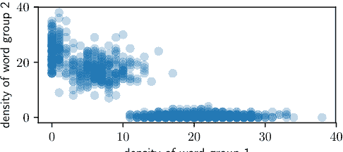

图 5.1：来自两个不同上下文组的词频计数

bank，其直接上下文通常可能包含以下两个组之一的词：

- 1. financial, deposits, credit, lending, capital, markets, regulated, reserve, liquid, assets
- 2. land, water, geography, stream, river, flow, deposits, discharge, channel, ecology

现在考虑一个散点图，其中每个点都是包含词 bank 的文档。文档在 x 轴上的位置是组 1 中词的计数，而在 y 轴上的位置是组 2 的计数。在这样的图中，如图 5.1 所示，可能会出现两个“斑块”，这些斑块对应于 bank 的不同含义。

这里有一个相关的场景，来自另一个问题。假设你下载了数千篇新闻文章，并制作一个散点图，其中每个点对应一篇文档：x 轴是词组（hurricane, winds, storm）的频率；y 轴是词组（election, voters, vote）的频率。这次可能会出现三个斑块：一个关于飓风的文档，一个主要关于选举的文档，以及一个关于这两个主题都不是的文档。

这些聚类代表了数据的潜在结构。但二维散点图基于上下文词的分组，而在实际场景中这些词表是未知的。无监督学习应用相同的[content]


图 5.1：来自两个不同上下文组的词频计数

bank，其直接上下文通常可能包含以下两个组之一的词：

- 1. financial, deposits, credit, lending, capital, markets, regulated, reserve, liquid, assets
- 2. land, water, geography, stream, river, flow, deposits, discharge, channel, ecology

现在考虑一个散点图，其中每个点都是包含词 bank 的文档。文档在 x 轴上的位置是组 1 中词的计数，而在 y 轴上的位置是组 2 的计数。在这样的图中，如图 5.1 所示，可能会出现两个“斑块”，这些斑块对应于 bank 的不同含义。

这里有一个相关的场景，来自另一个问题。假设你下载了数千篇新闻文章，并制作一个散点图，其中每个点对应一篇文档：x 轴是词组（hurricane, winds, storm）的频率；y 轴是词组（election, voters, vote）的频率。这次可能会出现三个斑块：一个主要关于飓风的文档，一个主要关于选举的文档，以及一个关于这两个主题都不是的文档。

这些聚类代表了数据的潜在结构。但二维散点图基于上下文词的分组，而在实际场景中这些词表是未知的。无监督学习应用相同的[content]


图 5.1：来自两个不同上下文组的词频计数

bank，其直接上下文通常可能包含以下两个组之一的词：

- 1. financial, deposits, credit, lending, capital, markets, regulated, reserve, liquid, assets
- 2. land, water, geography, stream, river, flow, deposits, discharge, channel, ecology

现在考虑一个散点图，其中每个点都是包含词 bank 的文档。文档在 x 轴上的位置是组 1 中词的计数，而在 y 轴上的位置是组 2 的计数。在这样的图中，如图 5.1 所示，可能会出现两个“斑块”，这些斑块对应于 bank 的不同含义。

这里有一个相关的场景，来自另一个问题。假设你下载了数千篇新闻文章，并制作一个散点图，其中每个点对应一篇文档：x 轴是词组（hurricane, winds, storm）的频率；y 轴是词组（election, voters, vote）的频率。这次可能会出现三个斑块：一个主要关于飓风的文档，一个主要关于选举的文档，以及一个关于这两个主题都不是的文档。

这些聚类代表了数据的潜在结构。但二维散点图基于上下文词的分组，而在实际场景中这些词表是未知的。无监督学习应用相同的[content]


图 5.1：来自两个不同上下文组的词频计数

bank，其直接上下文通常可能包含以下两个组之一的词：

- 1. financial, deposits, credit, lending, capital, markets, regulated, reserve, liquid, assets
- 2. land, water, geography, stream, river, flow, deposits, discharge, channel, ecology

现在考虑一个散点图，其中每个点都是包含词 bank 的文档。文档在 x 轴上的位置是组 1 中词的计数，而在 y 轴上的位置是组 2 的计数。在这样的图中，如图 5.1 所示，可能会出现两个“斑块”，这些斑块对应于 bank 的不同含义。

这里有一个相关的场景，来自另一个问题。假设你下载了数千篇新闻文章，并制作一个散点图，其中每个点对应一篇文档：x 轴是词组（hurricane, winds, storm）的频率；y 轴是词组（election, voters, vote）的频率。这次可能会出现三个斑块：一个主要关于飓风的文档，一个主要关于选举的文档，以及一个关于这两个主题都不是的文档。

这些聚类代表了数据的潜在结构。但二维散点图基于上下文词的分组，而在实际场景中这些词表是未知的。无监督学习应用相同的[content]


图 5.1：来自两个不同上下文组的词频计数

bank，其直接上下文通常可能包含以下两个组之一的词：

- 1. financial, deposits, credit, lending, capital, markets, regulated, reserve, liquid, assets
- 2. land, water, geography, stream, river, flow, deposits, discharge, channel, ecology

现在考虑一个散点图，其中每个点都是包含词 bank 的文档。文档在 x 轴上的位置是组 1 中词的计数，而在 y 轴上的位置是组 2 的计数。在这样的图中，如图 5.1 所示，可能会出现两个“斑块”，这些斑块对应于 bank 的不同含义。

这里有一个相关的场景，来自另一个问题。假设你下载了数千篇新闻文章，并制作一个散点图，其中每个点对应一篇文档：x 轴是词组（hurricane, winds, storm）的频率；y 轴是词组（election, voters, vote）的频率。这次可能会出现三个斑块：一个主要关于飓风的文档，一个主要关于选举的文档，以及一个关于这两个主题都不是的文档。

这些聚类代表了数据的潜在结构。但二维散点图基于上下文词的分组，而在实际场景中这些词表是未知的。无监督学习应用相同的[content]


图 5.1：来自两个不同上下文组的词频计数

bank，其直接上下文通常可能包含以下两个组之一的词：

- 1. financial, deposits, credit, lending, capital, markets, regulated, reserve, liquid, assets
- 2. land, water, geography, stream, river, flow, deposits, discharge, channel, ecology

现在考虑一个散点图，其中每个点都是包含词 bank 的文档。文档在 x 轴上的位置是组 1 中词的计数，而在 y 轴上的位置是组 2 的计数。在这样的图中，如图 5.1 所示，可能会出现两个“斑块”，这些斑块对应于 bank 的不同含义。

这里有一个相关的场景，来自另一个问题。假设你下载了数千篇新闻文章，并制作一个散点图，其中每个点对应一篇文档：x 轴是词组（hurricane, winds, storm）的频率；y 轴是词组（election, voters, vote）的频率。这次可能会出现三个斑块：一个主要关于飓风的文档，一个主要关于选举的文档，以及一个关于这两个主题都不是的文档。

这些聚类代表了数据的潜在结构。但二维散点图基于上下文词的分组，而在实际场景中这些词表是未知的。无监督学习应用相同的[content]


图 5.1：来自两个不同上下文组的词频计数

bank，其直接上下文通常可能包含以下两个组之一的词：

- 1. financial, deposits, credit, lending, capital, markets, regulated, reserve, liquid, assets
- 2. land, water, geography, stream, river, flow, deposits, discharge, channel, ecology

现在考虑一个散点图，其中每个点都是包含词 bank 的文档。文档在 x 轴上的位置是组 1 中词的计数，而在 y 轴上的位置是组 2 的计数。在这样的图中，如图 5.1 所示，可能会出现两个“斑块”，这些斑块对应于 bank 的不同含义。

这里有一个相关的场景，来自另一个问题。假设你下载了数千篇新闻文章，并制作一个散点图，其中每个点对应一篇文档：x 轴是词组（hurricane, winds, storm）的频率；y 轴是词组（election, voters, vote）的频率。这次可能会出现三个斑块：一个主要关于飓风的文档，一个主要关于选举的文档，以及一个关于这两个主题都不是的文档。

这些聚类代表了数据的潜在结构。但二维散点图基于上下文词的分组，而在实际场景中这些词表是未知的。无监督学习应用相同的[content]


图 5.1：来自两个不同上下文组的词频计数

bank，其直接上下文通常可能包含以下两个组之一的词：

- 1. financial, deposits, credit, lending, capital, markets, regulated, reserve, liquid, assets
- 2. land, water, geography, stream, river, flow, deposits, discharge, channel, ecology

现在考虑一个散点图，其中每个点都是包含词 bank 的文档。文档在 x 轴上的位置是组 1 中词的计数，而在 y 轴上的位置是组 2 的计数。在这样的图中，如图 5.1 所示，可能会出现两个“斑块”，这些斑块对应于 bank 的不同含义。

这里有一个相关的场景，来自另一个问题。假设你下载了数千篇新闻文章，并制作一个散点图，其中每个点对应一篇文档：x 轴是词组（hurricane, winds, storm）的频率；y 轴是词组（election, voters, vote）的频率。这次可能会出现三个斑块：一个主要关于飓风的文档，一个主要关于选举的文档，以及一个关于这两个主题都不是的文档。

这些聚类代表了数据的潜在结构。但二维散点图基于上下文词的分组，而在实际场景中这些词表是未知的。无监督学习应用相同的[content]


图 5.1：来自两个不同上下文组的词频计数

bank，其直接上下文通常可能包含以下两个组之一的词：

- 1. financial, deposits, credit, lending, capital, markets, regulated, reserve, liquid, assets
- 2. land, water, geography, stream, river, flow, deposits, discharge, channel, ecology

现在考虑一个散点图，其中每个点都是包含词 bank 的文档。文档在 x 轴上的位置是组 1 中词的计数，而在 y 轴上的位置是组 2 的计数。在这样的图中，如图 5.1 所示，可能会出现两个“斑块”，这些斑块对应于 bank 的不同含义。

这里有一个相关的场景，来自另一个问题。假设你下载了数千篇新闻文章，并制作一个散点图，其中每个点对应一篇文档：x 轴是词组（hurricane, winds, storm）的频率；y 轴是词组（election, voters, vote）的频率。这次可能会出现三个斑块：一个主要关于飓风的文档，一个主要关于选举的文档，以及一个关于这两个主题都不是的文档。

这些聚类代表了数据的潜在结构。但二维散点图基于上下文词的分组，而在实际场景中这些词表是未知的。无监督学习采用相同的[content]


图 5.1：来自两个不同上下文组的词频计数

bank，其直接上下文通常可能包含以下两个组之一的词：

- 1. financial, deposits, credit, lending, capital, markets, regulated, reserve, liquid, assets
- 2. land, water, geography, stream, river, flow, deposits, discharge, channel, ecology

现在考虑一个散点图，其中每个点都是包含词 bank 的文档。文档在 x 轴上的位置是组 1 中词的计数，而在 y 轴上的位置是组 2 的计数。在这样的图中，如图 5.1 所示，可能会出现两个“斑块”，这些斑块对应于 bank 的不同含义。

这里有一个相关的场景，来自另一个问题。假设你下载了数千篇新闻文章，并制作一个散点图，其中每个点对应一篇文档：x 轴是词组（hurricane, winds, storm）的频率；y 轴是词组（election, voters, vote）的频率。这次可能会出现三个斑块：一个主要关于飓风的文档，一个主要关于选举的文档，以及一个关于这两个主题都不是的文档。

这些聚类代表了数据的潜在结构。但二维散点图基于上下文词的分组，而在实际场景中这些词表是未知的。无监督学习使用相同的[content]


图 5.1：来自两个不同上下文组的词频计数

bank，其直接上下文通常可能包含以下两个组之一的词：

- 1. financial, deposits, credit, lending, capital, markets, regulated, reserve, liquid, assets
- 2. land, water, geography, stream, river, flow, deposits, discharge, channel, ecology

现在考虑一个散点图，其中每个点都是包含词 bank 的文档。文档在 x 轴上的位置是组 1 中词的计数，而在 y 轴上的位置是组 2 的计数。在这样的图中，如图 5.1 所示，可能会出现两个“斑块”，这些斑块对应于 bank 的不同含义。

这里有一个相关的场景，来自另一个问题。假设你下载了数千篇新闻文章，并制作一个散点图，其中每个点对应一篇文档：x 轴是词组（hurricane, winds, storm）的频率；y 轴是词组（election, voters, vote）的频率。这次可能会出现三个斑块：一个主要关于飓风的文档，一个主要关于选举的文档，以及一个关于这两个主题都不是的文档。

这些聚类代表了数据的潜在结构。但二维散点图基于上下文词的分组，而在实际场景中这些词表是未知的。无监督学习采用相同的[content]


图 5.1：来自两个不同上下文组的词频计数

bank，其直接上下文通常可能包含以下两个组之一的词：

- 1. financial, deposits, credit, lending, capital, markets, regulated, reserve, liquid, assets
- 2. land, water, geography, stream, river, flow, deposits, discharge, channel, ecology

现在考虑一个散点图，其中每个点都是包含词 bank 的文档。文档在 x 轴上的位置是组 1 中词的计数，而在 y 轴上的位置是组 2 的计数。在这样的图中，如图 5.1 所示，可能会出现两个“斑块”，这些斑块对应于 bank 的不同含义。

这里有一个相关的场景，来自另一个问题。假设你下载了数千篇新闻文章，并制作一个散点图，其中每个点对应一篇文档：x 轴是词组（hurricane, winds, storm）的频率；y 轴是词组（election, voters, vote）的频率。这次可能会出现三个斑块：一个主要关于飓风的文档，一个主要关于选举的文档，以及一个关于这两个主题都不是的文档。

这些聚类代表了数据的潜在结构。但二维散点图基于上下文词的分组，而在实际场景中这些词表是未知的。无监督学习采用同样的[content]
#### 5.1.1 K-means 聚类

聚类算法将每个数据点分配到一个离散的簇，z_i ∈ {1, 2, ..., K}。最著名的聚类算法之一是 K-means，这是一种迭代算法，它维护
[/content]

That works? Let's test.

[content]
 

聚类算法将每个数据点分配到一个离散的簇，z_i ∈ {1, 2, ..., K}。最著名的聚类算法之一是 K-means，这是一种迭代算法，它维护


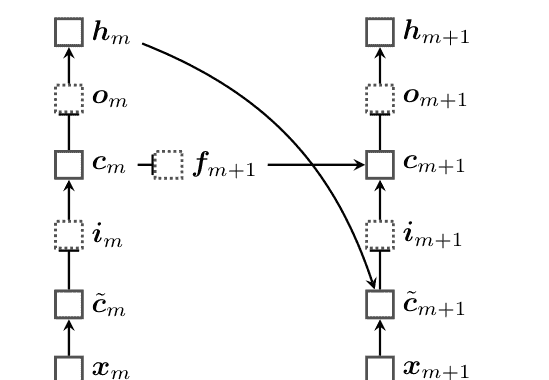

图 6.2：长短期记忆（LSTM）架构。门以带虚线的方框显示。在 LSTM 语言模型中，每个 $\boldsymbol{h}_m$ 会被用来预测下一个单词 $w_{m+1}$。

门是输入和前一隐藏状态的函数。它们由逐元素的 sigmoid 激活 $\sigma(x) = (1 + \exp(-x))^{-1}$ 计算得到，确保其值处于 $[0, 1]$ 范围内。因此，它们可以被视为软性、可微分的逻辑门。LSTM 架构如图 6.2 所示，完整的更新方程如下：

$\boldsymbol{f}_{m+1} = \sigma(\boldsymbol{\Theta}^{(h \to f)} \boldsymbol{h}_m + \boldsymbol{\Theta}^{(x \to f)} \boldsymbol{x}_{m+1} + \boldsymbol{b}_f)$    遗忘门    [6.35]
$\boldsymbol{i}_{m+1} = \sigma(\boldsymbol{\Theta}^{(h \to i)} \boldsymbol{h}_m + \boldsymbol{\Theta}^{(x \to i)} \boldsymbol{x}_{m+1} + \boldsymbol{b}_i)$    输入门    [6.36]
$\tilde{\boldsymbol{c}}_{m+1} = \tanh(\boldsymbol{\Theta}^{(h \to c)} \boldsymbol{h}_m + \boldsymbol{\Theta}^{(w \to c)} \boldsymbol{x}_{m+1})$    更新候选    [6.37]
$\boldsymbol{c}_{m+1} = \boldsymbol{f}_{m+1} \odot \boldsymbol{c}_m + \boldsymbol{i}_{m+1} \odot \tilde{\boldsymbol{c}}_{m+1}$    记忆单元更新    [6.38]
$\boldsymbol{o}_{m+1} = \sigma(\boldsymbol{\Theta}^{(h \to o)} \boldsymbol{h}_m + \boldsymbol{\Theta}^{(x \to o)} \boldsymbol{x}_{m+1} + \boldsymbol{b}_o)$    输出门    [6.39]
$\boldsymbol{h}_{m+1} = \boldsymbol{o}_{m+1} \odot \tanh(\boldsymbol{c}_{m+1})$    输出。    [6.40]

运算符 $\odot$ 是逐元素（Hadamard）乘积。每个门由一个权重向量控制，这些权重对前一隐藏状态（例如 $\boldsymbol{\Theta}^{(h \to f)}$）和当前输入（例如 $\boldsymbol{\Theta}^{(x \to f)}$）进行参数化，再加上一个向量偏置（例如 $\boldsymbol{b}_f$）。整体操作可以非正式地概括为 $(\boldsymbol{h}_m, \boldsymbol{c}_m) = \text{LSTM}(\boldsymbol{x}_m, (\boldsymbol{h}_{m-1}, \boldsymbol{c}_{m-1}))$，其中 $(\boldsymbol{h}_m, \boldsymbol{c}_m)$ 表示读取第 $m$ 个词元后的 LSTM 状态。

LSTM 在广泛的问题上优于标准循环神经网络。它最初由 Sundermeyer 等人（2012）用于语言建模，但可以更普遍地应用：向量 $\boldsymbol{h}_m$ 可以被视为一个完整表示
（2014）为语素引入向量表示，并将这些表示构建到对数双线性语言模型中；Bhatia 等人（2016）将语素向量融入 LSTM。

## 补充资源

多种神经网络架构已被应用于语言建模。较早值得注意的非循环架构包括神经概率语言模型（Bengio 等人，2003）和对数双线性语言模型（Mnih 和 Hinton，2007）。关于这些模型的更多细节可参见 Goodfellow 等人（2016）的教材。

## 练习

- 1. 证明：如果 n-gram 概率是有效的，则 n-gram 语言模型给出有效概率。具体来说，假设：

  $$\sum_{w_m}^{V} p(w_m \mid w_{m-1}, w_{m-2}, \dots, w_{m-n+1}) = 1 \tag{6.43}$$

  对所有上下文 $(w_{m-1}, w_{m-2}, \dots, w_{m-n+1})$ 成立。证明对所有 $w \in \mathcal{V}^*$，$\sum_w p_n(w) = 1$，其中 $p_n$ 是 n-gram 语言模型下的概率。你的证明应采用归纳法。你应该处理字符串起始情形 $p(w_1 \mid \underbrace{\square,\dots,\square}_{n-1})$，但无需处理字符串结束标记。

- 2. 首先，使用与上一题类似的证明技术，证明 RNN 语言模型是有效的。

  接下来，令 $p_r(w)$ 表示在 RNN $r$ 下 $w$ 的概率。一个 RNN 语言模型集成计算如下概率：

  $$p(w) = \frac{1}{R} \sum_{r=1}^{R} p_r(w). \tag{6.44}$$

  RNN 语言模型集成计算出的概率是否有效？

- 3. 考虑一个词表大小为 $V$ 的一元语言模型。假设一个单词在一个总共有 $M$ 个词元的语料库中出现了 $m$ 次。使用参数为 $\alpha$ 的 Lidstone 平滑时，对于哪些 $m$ 值，平滑概率大于未平滑概率？

- 4. 考虑一种简单语言，其中每个词元以概率 $\frac{1}{V}$ 从词表 $\mathcal{V}$ 中抽取，并且独立于所有其他词元。

### 7.3 Viterbi 算法

通过将评分函数分解为局部部分的求和，可以将标注问题重写如下：

$$\hat{\boldsymbol{y}} = \underset{\boldsymbol{y}\in\mathcal{Y}(\boldsymbol{w})}{\operatorname{argmax}}\,\Psi(\boldsymbol{w},\boldsymbol{y})\tag{7.13}$$ $$= \underset{\boldsymbol{y}_{1:M}}{\operatorname{argmax}}\,\sum_{m=1}^{M+1}\psi(\boldsymbol{w},y_m,y_{m-1},m)\tag{7.14}$$ $$= \underset{\boldsymbol{y}_{1:M}}{\operatorname{argmax}}\,\sum_{m=1}^{M+1}s_m(y_m,y_{m-1}),\tag{7.15}$$

其中最后一行使用简写简化了记号：

$$s_m(y_m,y_{m-1}) \triangleq \psi(\boldsymbol{w}_{1:M},y_m,y_{m-1},m).\tag{7.16}$$

这个推理问题可以使用**动态规划**高效求解，这是一种在递推计算中复用工作的算法技术。我们首先求解一个辅助问题：不求最佳标注序列，而是计算最佳标注序列的得分：

$$\max_{\boldsymbol{y}_{1:M}}\Psi(\boldsymbol{w},\boldsymbol{y}_{1:M}) = \max_{\boldsymbol{y}_{1:M}}\sum_{m=1}^{M+1}s_m(y_m,y_{m-1}).\tag{7.17}$$

该得分涉及对所有长度为 $M$ 的标注序列进行最大化，记作 $\max_{\boldsymbol{y}_{1:M}}$。这个最大化可以分解为两部分：

$$\max_{\boldsymbol{y}_{1:M}}\Psi(\boldsymbol{w},\boldsymbol{y}_{1:M}) = \max_{y_M}\max_{\boldsymbol{y}_{1:M-1}}\sum_{m=1}^{M+1}s_m(y_m,y_{m-1}).\tag{7.18}$$

在求和中，只有最后一项 $s_{M+1}(\blacklozenge,y_M)$ 依赖于 $y_M$，因此我们可以将这一项从第二个最大化中提出来：

$$\max_{\boldsymbol{y}_{1:M}}\Psi(\boldsymbol{w},\boldsymbol{y}_{1:M}) = \left(\max_{y_M}s_{M+1}(\blacklozenge,y_M)\right) + \left(\max_{\boldsymbol{y}_{1:M-1}}\sum_{m=1}^{M}s_m(y_m,y_{m-1})\right).\tag{7.19}$$

等式 7.19 中的第二项与我们的原始问题形式相同，只需将 $M$ 替换为 $M-1$。这表明该问题可以重新表述为一个递推关系。我们通过定义一个称为 Viterbi 变量 $v_m(k)$ 的辅助变量来实现这一点，表示
如何估计这些特征上的权重。§ 2.3 介绍了三类主要的判别式分类器：感知机、支持向量机和逻辑回归。这些分类器中的每一个都有对应的结构化版本，使其能够从带标签的序列而非单个词元进行训练。

#### 7.5.1 结构化感知机

感知机分类器通过增加与正确标签相关联特征的权重，并减少与错误预测标签相关联特征的权重来训练：

$$\hat{y} = \arg\max_{y\in\mathcal{Y}} \theta \cdot f(x,y)$$  
[7.60]

$$\theta^{(t+1)} \leftarrow \theta^{(t)} + f(x,y) - f(x,\hat{y}).$$  
[7.61]

在结构预测的情况下，我们可以应用完全相同的更新：

$$\hat{y} = \arg\max_{y\in\mathcal{Y}(w)} \theta \cdot f(w,y)$$  
[7.62]

$$\theta^{(t+1)} \leftarrow \theta^{(t)} + f(w,y) - f(w,\hat{y}).$$  
[7.63]

这种学习算法被称为**结构化感知机**，因为它学习预测结构化输出 $y$。唯一的区别在于，不是通过枚举整个集合 $\mathcal{Y}$ 来计算 $\hat{y}$，而是使用 Viterbi 算法高效搜索可能的标注集合 $\mathcal{Y}^M$。只要能够进行高效推理，结构化感知机就可以应用于其他结构化输出。与感知机分类一样，权重平均对于获得良好性能至关重要（参见 § 2.3.2）。

**示例** 对于示例 *they can fish*，假设参考标注序列为 $y^{(i)} = \mathrm{N\ V\ V}$，但标注器错误地返回了标注序列 $\hat{y} = \mathrm{N\ V\ N}$。假设模型具有发射特征 $(w_m,y_m)$ 和转移特征 $(y_{m-1},y_m)$，则相应的结构化感知机更新为：

$$\theta_{(\mathrm{fish},\mathrm{V})} \leftarrow \theta_{(\mathrm{fish},\mathrm{V})}+1, \qquad \theta_{(\mathrm{fish},\mathrm{N})} \leftarrow \theta_{(\mathrm{fish},\mathrm{N})}-1$$  
[7.64]

$$\theta_{(\mathrm{V},\mathrm{V})} \leftarrow \theta_{(\mathrm{V},\mathrm{V})}+1, \qquad \theta_{(\mathrm{V},\mathrm{N})} \leftarrow \theta_{(\mathrm{V},\mathrm{N})}-1$$  
[7.65]

$$\theta_{(\mathrm{V},\blacklozenge)} \leftarrow \theta_{(\mathrm{V},\blacklozenge)}+1, \qquad \theta_{(\mathrm{N},\blacklozenge)} \leftarrow \theta_{(\mathrm{N},\blacklozenge)}-1$$  
[7.66]

#### 7.5.2 结构化支持向量机

支持向量机等大间隔分类器通过将分类边界推离训练实例来改进感知机。同样的思想可以


到目前为止，我们看到的每个递推都是这个广义的维特比递推的特例：

- 在概率上的最大乘积维特比递推中，⊕ 运算对应于最大化，⊗ 运算对应于乘法。
- 在概率上的前向递推中，⊕ 运算对应于加法，⊗ 运算对应于乘法。
- 在对数概率上的最大乘积维特比递推中，⊕ 运算对应于最大化，⊗ 运算对应于加法。¹²
- 在对数概率上的前向递推中，⊕ 运算对应于对数加法，a ⊕ b = log(e^a + e^b)。⊗ 运算对应于加法。

半环表示法提供的数学抽象可以应用于这些算法的软件实现，从而得到简洁且模块化的实现。例如，在 OpenFST 库中，通用操作通过选择半环进行参数化（Allauzen 等，2007）。

## 习题

1. 将 § 7.3.1 中的示例扩展到句子 they can can fish，含义是“他们能把鱼装进罐子。”使用表 7.1 中的权重为该示例构建篱笆图（trellis），并找出得分最高的标签序列。如果名词和动词的得分相同，那么你可以假设回溯指针总是指向名词。
2. 使用标签集 𝒴 = {N, V} 和特征集 f(w_m, y_m, y_{m−1}, m) = {(w_m, y_m), (y_m, y_{m−1})}，证明不存在一组权重能够同时为 they can fish (N V V) 和 they can can fish (N V V N) 给出正确的标注。
3. 试推导：如果在上一题提到的两个例子上训练结构化感知器，使用转移特征和发射特征 (y_m, y_{m−1}) 和 (y_m, w_m)，结果会发生什么。将所有权重初始化为 0，并假设当两个标签的得分相同时维特比算法总是选择 N，因此对 they can fish 的初始预测是 N N N。
4. 考虑花园路径句 The old man the boat. 给定词-标签和标签-标签特征，对于这个例子，要使正确标签序列得分高于花园路径标签序列，权重必须满足什么不等式？

¹²这有时被称为热带半环，以纪念巴西数学家伊姆雷·西蒙。

 

这个标题也可以用词性来解释：在可能想要的解释中，*strikes* 是名词，*idle* 是动词；在另一种解释中，*strikes* 是动词，*idle* 是形容词。

词性标注通常被视为自然语言处理流程中的早期步骤。实际上，词性提供了许多特征，这些特征对于后面会遇到的任务很有用，例如句法分析（第10章）、共指消解（第15章）和关系抽取（第17章）。

#### 8.1.1 词性

**通用依存关系**（Universal Dependencies，UD）项目致力于使用统一的标注标准，在多种语言中创建句法标注语料库（Nivre 等，2016）。作为这项工作的一部分，他们设计了一个词性**标签集**，旨在尽可能多地覆盖多种语言的词类。¹ 本节描述该清单，为每个标签给出粗略的定义，并附上支持示例。

词性标签是**形态句法**范畴，而非语义范畴。这意味着它们根据词语如何组合以及如何在内部构成（例如，它们包含哪些后缀和前缀）来描述词语。例如，你可能认为名词指代物体或概念，动词指代动作或事件。但事件也可以是名词：

(8.3) ……the **howling** of the **shrieking** storm.

这里的 *howling* 和 *shrieking* 都是事件，但在语法上它们分别充当名词和形容词。

#### 通用依存词性标签集

UD 标签集分为三组：开放词类标签、封闭词类标签和“其他”。

#### 开放词类标签

几乎所有语言都包含名词、动词、形容词和副词。² 这些都是**开放词类**，因为新词可以很容易地加入其中。UD 标签集还包括两个开放词类标签：专有名词和感叹词。

- **名词**（UD 标签：NOUN）倾向于描述实体和概念，例如：

¹UD 标签集建立在 Petrov 等人（2012）的早期工作之上，该工作通过为单个语言的标签集创建映射，确定了一组十二个通用标签。

²一个显著的例外是韩语，一些语言学家认为韩语没有形容词（Kim, 2002）。

**封闭词类标签** 封闭词类很少增加新成员。它们有时被称为**功能词**——与**实义词**相对——因为它们本身几乎没有词汇意义，而是帮助组织句子的成分。

- **附置词**（ADP）描述补足语（通常是名词短语）与句中另一个成分（通常是名词短语或动词短语）之间的关系。

(8.11) a. Toes are scarce **among** veteran blubber men.
 b. It is not **down on** any map.
 c. Give not thyself **up** then.

如这些例子所示，英语通常使用前置词，即出现在补足语之前的附置词。（一个例外是 *ago*，如 *we met three days ago*）。后置词用于其他语言中，例如日语和土耳其语。

- **助动词**（AUX）是封闭类动词，添加时态、体、人称和数等信息。

(8.12) a. **Shall** we keep chasing this murderous fish?
 b. What the white whale was to Ahab, **has been** hinted.
 c. Ahab **must** use tools.
 d. Meditation and water **are** wedded forever.
 e. Toes **are** scarce among veteran blubber men.

最后一个例子是系动词，在 UD 语料库中也被标注为助动词。

- **并列连词**（CCONJ）表达两个词或短语之间的关系，它们起平行作用：

(8.13) Meditation **and** water are wedded forever.

- **从属连词**（SCONJ）连接两个从句，使一个从句在句法上从属于另一个从句：

(8.14) It is the easiest thing in the world for a man to look as **if** he had a great secret in him.

请注意

- **代词**（PRON）是替代名词或名词短语的词。

(8.15) a. Be **it what it** will, I'll go to **it** laughing.

- (1) 日文 章魚 怎麼說?
- Japanese octopus how say
- How to say octopus in Japanese?
- 
- (2) 日 文章 魚 怎麼說?
- Japan essay fish how say

图 8.3：中文分词歧义的一个例子（Sproat 等，1996）

人名——比任何标注语料库中能观察到的都要多。与地名词典中的条目匹配的标记或片段可以获得特殊特征；这提供了一种在学习驱动框架中整合手工资源（如姓名列表）的方法。

**用于命名实体识别（NER）的神经序列标注** 当前研究强调神经序列标注，使用了与词性标注中类似的 LSTM 模型（Hammerton, 2003; Huang 等, 2015; Lample 等, 2016）。双向 LSTM-CRF（§ 7.6 中的图 7.4）在此任务上表现特别好，因为它能够建模标签之间的依赖关系。然而，Strubell 等人（2017）表明，**卷积神经网络**也可以同样准确，并且由于在**图形处理单元（GPU）**上实现 ConvNet 的效率，速度显著提高。这项工作的关键创新是使用了**空洞卷积**（dilated convolution），详见 § 3.4。

### 8.4 分词

文本分析的一个基本问题（在 § 4.3.1 中首次讨论）是将文本拆分为离散标记序列。对于英语等拼音文字语言，确定性脚本通常足以实现准确的分词。然而，在汉字这类语素文字书写系统中，词通常由少量字符组成，且没有空格间隔。分词必须由读者来决定，偶尔可能产生歧义，如图 8.3 所示。一种方法是将字符序列与已知词典进行匹配（例如 Sproat 等，1996），并利用关于词频的额外统计信息。然而，没有任何词典是完全全面的，基于词典的方法可能难以处理这类词典外词。

因此，中文分词被当作一个有监督的序列标注问题来处理。Xue 等人（2003）训练了一个逻辑回归分类器，在文档上移动滑动窗口时做出独立的分割决策。然后使用一组规则将这些独立的分类决策转换为输入的整体分词结果。然而，这些独立的决策可能在全局上是次优的，这推动了结构化预测方法的发展。Peng 等人（2004）训练了一个条件随机场……

用于预测每个字符的 START 或 NONSTART 标签的字段。更近期的研究采用了神经网络架构。例如，Chen 等人（2015）使用 LSTM-CRF 架构，如 § 7.6 中所述：他们构建一个栅格，其中每个标签根据 LSTM 的隐藏状态进行评分，而标签-标签转移则根据学习到的转移权重进行评分。然后通过 Viterbi 算法计算得分最高的分段。

### 8.5 代码转换

多语使用者和写作者并不局限于单一语言。**代码转换**是口语和文本中在语言之间切换的现象（Auer, 2013; Poplack, 1980）。书写的代码转换在在线社交媒体中变得更加普遍，如加拿大总统贾斯汀·特鲁多网站上的以下摘录所示：⁷

> (8.21) *尽管本网站上写的一切 est disponible en anglais*
>     有英文版
>     *并且用法语，我的个人视频 seront bilinguals*
>             将是双语的

准确分析此类文本首先需要确定使用了哪些语言。此外，对代码转换的定量分析可以提供有关语言本身及其相对社会地位的见解。

代码转换可以被视为一个序列标注问题，其目标是将每个词元标记为候选转换点。在上面的例子中，单词 *est, and,* 和 *seront* 将被标记为转换点。Solorio 和 Liu (2008) 使用监督分类器检测英语-西班牙语转换点，其特征包括该词、在每种语言中的词性（根据监督词性标注器）以及该词和词性在每种语言中的概率。Nguyen 和 Dogruöz (2013) 将条件随机场应用于检测土耳其语和荷兰语之间代码转换的问题。

代码转换是更一般的问题——词级语言识别的特例，Barman 等人（2014）在孟加拉语、英语和印地语之间的三语代码转换背景下解决了该问题。他们还观察到一种更具挑战性的现象：词内代码转换，例如使用孟加拉语词根加上英语后缀。因此他们将每个词元标记为以下之一：（1）属于三种语言之一；（2）多种语言的混合；（3）“通用”（例如，符号、数字、表情符号）；或（4）未定义。

⁷引自 http://blogues.lapresse.ca/lagace/2008/09/08/justin-trudeau-really-parfait-bilingue/，访问于 2017 年 8 月 21 日。

| 说话者 | 对话行为 | 语句 |
|---|---|---|
| A | YES-NO-QUESTION | *So do you go to college right now?* |
| A | ABANDONED | *Are yo-* |
| B | YES-ANSWER | *Yeah,* |
| B | STATEMENT | *It’s my last year [laughter].* |
| A | DECLARATIVE-QUESTION | *You’re a, so you’re a senior now.* |
| B | YES-ANSWER | *Yeah,* |
| B | STATEMENT | *I’m working on my projects trying to graduate [laughter]* |
| A | APPRECIATION | *Oh, good for you.* |
| B | BACKCHANNEL | *Yeah.* |

图 8.4：对话行为标注的示例（Stolcke 等，2000）

### 8.6 对话行为

我们迄今讨论的序列标注问题都是针对词元序列或字符序列（在分词的情况下）。然而，序列标注也可以在更高层级的单元上进行，例如语句。对话行为是对对话中语句的标签，大致对应于说话者的意图——语句的言语行为力量（Austin, 1962）。例如，语句可能陈述一个命题（it is not down on any map），提出一个问题（shall we keep chasing this murderous fish?），或提供一个回应（aye aye!）。Stolcke 等人（2000）描述了如何为 Switchboard 语料库（Godfrey 等，1992）中的 1,155 次对话标注了一组 42 个对话行为。⁸

示例见图 8.4。标注是在 UTTERANCES 上进行的，每个对话轮次可能包含多个语句（在打断等情况下，一个语句可能跨多个轮次）。有些语句是子句（e.g., So do you go to college right now?），而其他语句是单个词（e.g., yeah）。Stolcke 等人（2000）报告称，隐马尔可夫模型（HMMs）在监督语句分段上达到了 96% 的准确率。标签本身反映了说话者的对话目标：语句 yeah 在回应问题 you’re a senior now 时充当答案，但在摘录的最后一行，它是后通道（表明理解）。

对于对话行为标注任务，Stolcke 等人（2000）应用了隐马尔可夫模型。概率 p(w_m | y_m) 必须生成语句中整个词序列，并被建模为三元语法语言模型（§ 6.1）。Stolcke 等人（2000）还考虑了声学特征，这些特征捕捉每个语句的韵律——例如语音的音调和节奏特性，可用于区分对话行为 such

⁸对话行为建模并不局限于语音；在任何交互式对话中都相关。例如，Jeong 等人（2009）在电子邮件和在线论坛语料库中标注了一组更有限的言语行为。

as questions and answers. 这些特征通过额外的发射分布 p(a_m | y_m) 来处理，该分布使用概率决策树建模（Murphy, 2012）。虽然声学特征总体上只带来小幅改进，但它们在区分问题与陈述、以及同意与后通道方面发挥着重要作用。

Kalchbrenner 和 Blunsom (2013) 以及 Ji 等人（2016）提出了用于对话行为标注的循环神经架构，并取得了强劲的实证结果。这两种模型在语句层面上都是循环的，因此每个完整的语句都会更新一个隐藏状态。Kalchbrenner 和 Blunsom (2013) 的循环-卷积网络使用卷积来获得每个单独语句的表示，而 Ji 等人（2016）使用第二层循环，针对单个词。这使得他们的方法也能作为语言模型运行，对文档中词序列给出概率。

## 练习

- 1. 使用通用依存句法 part-of-speech 标签标注以下句子。你可以查阅 UD 标注指南。分词以空白显示。不要忘记标点符号。
-   (8.22)
-   a. I try all things , I achieve what I can .
-   b. It was that accursed white whale that razed me .
-   c. Better to sleep with a sober cannibal , than a drunk Christian .
-   d. Be it what it will , I’ll go to it laughing .
- 2. 从最近的新闻文章中选择三个简短句子，并为其标注 UD part-of-speech 标签。让朋友在不查看你的标注的情况下标注相同的三个句子。计算一致率，使用 § 4.5.2 中定义的 Kappa 指标。然后共同解决任何分歧。
- 3. 从以下形态句法属性中选择一个：MOOD、TENSE、VOICE。在通用依存句法网站 http://universaldependencies.org/u/feat/index.html 上研究该属性的定义。回到第一个练习中的例子，为你选择的属性标注所有动词。查阅英语通用依存句法语料库的示例可能会有所帮助，该语料库可在 https://github.com/UniversalDependencies/UD_English-EWT/tree/master 获取。
- 4. 下载一个标注了通用依存句法的语料库，例如 English Treebank，网址为 https://github.com/UniversalDependencies/UD_English-EWT/tree/master。该语料库已分割为训练、开发和测试数据。

d) 计算测试集上的每字符分段准确率。你应该至少能达到 88% 的准确率。

e) 打印出测试集中的分段文本示例，例如

```
Thereareno mice in the air , I ' m afraid , but y oumight cat
    chabat , and that ' svery like a mouse , youknow . But
    docatseat bats , I wonder ?'
```

8. 对上一题中的分词器进行以下扩展。

a) 通过将标签二元组 $(y_{m-1}, y_m)$ 作为额外特征纳入，训练一个条件随机场序列标注器。你可以使用 CRFSuite 等结构化预测库，也可自行实现 Viterbi。将其准确率与基于分类的方法进行比较。

b) 计算词元级性能：将原始分词作为真实值，计算真正例（同时存在于真实值和预测分词中的词元）、假正例（存在于预测分词中但不存在于真实值中的词元）和假负例（存在于真实值中但不存在于预测分词中的词元）的数量。计算 F 值。
提示：为了匹配预测和真实词元，为每个词元的起始字符添加“锚点”。真正例的数量就是预测词元集合与真实词元集合交集的大小。

c) 在更实际的场景中应用相同方法：中文分词，中文书写时没有空白。你可以在 http://alias-i.com/lingpipe/demos/tutorial/chineseTokens/read-me.html 找到标注好的语料库。


#### 9.1.1 有限状态接受器

正则表达式定义了正则语言，但并未给出判断一个字符串是否属于其所定义语言的算法。有限状态自动机是关于正则语言的计算的理论模型，涉及有限数量状态之间的转换。最基本的有限状态自动机类型是有限状态接受器（FSA），它描述了测试字符串是否属于某种语言所涉及的计算。形式上，有限状态接受器是一个元组 M = (Q, Σ, q₀, F, δ)，由以下部分组成：

- 输入符号的有限字母表 Σ；
- 有限的状态集合 Q = {q₀, q₁, ..., qₘ}；
- 起始状态 q₀ ∈ Q；
- 终态集合 F ⊆ Q；
- 转移函数 δ : Q × (Σ ∪ {ε}) → 2^Q。转移函数将一个状态和一个输入符号（或空字符串 ε）映射到一组可能的结果状态。

M 中的一条路径是转移序列 π = t₁, t₂, ..., t_N，其中每个 t_i 遍历转移函数 δ 中的一条弧。有限状态接受器 M 接受字符串 ω 如果存在一条接受路径，其中初始转移 t₁ 从起始状态 q₀ 开始，最终转移 t_N 在 Q 中的一个终态终止，并且整个输入 ω 被消耗。

### 示例

考虑以下 FSA，M₁。

Σ = {a, b}  [9.1]
Q = {q₀, q₁}  [9.2]
F = {q₁}  [9.3]
δ = {(q₀, a) → q₀, (q₀, b) → q₁, (q₁, b) → q₁}.  [9.4]

该 FSA 定义了在由两个符号 a 和 b 组成的字母表上的语言。转移函数 δ 被写成一组弧：(q₀, a) → q₀ 表示如果机器处于状态 q₀ 并读取符号 a，则保持在 q₀。图 9.1 提供了 M₁ 的图形表示。因为每个初始状态和符号的配对最多有一个结果状态，所以 M₁ 是确定的：每个字符串 ω 至多诱导出一条接受路径。请注意，在状态 q₁ 中符号 a 没有转移；如果在 q₁ 中遇到 a，则接受器会卡住，输入字符串将被拒绝。

M₁ 接受哪些字符串？起始状态是 q₀，我们必须到达 q₁，因为这是唯一的终态。在 q₀ 中可以消耗任意数量的 a 符号，但需要一个 b 符号才能转换到 q₁。到达那里后，可以消耗任意数量的 b 符号，但不能消耗 a 符号。因此，M₁ 所定义语言对应的正则表达式是 a*b b*。

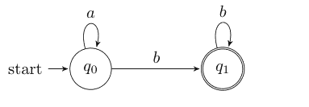

Figure 9.1: 有限状态接受器 M₁ 的状态图。

### 有限状态接受器的计算特性

有限状态接受器的关键计算问题是：我们能多快地确定一个字符串是否被接受？对于确定性 FSA，此计算可通过 Dijkstra 算法完成，时间复杂度为 O(V log V + E)，其中 V 是 FSA 中顶点的数量，E 是边的数量（Cormen et al., 2009）。非确定性 FSA（NFSAs）可以包含来自给定符号和状态的多个转移。任何 NFSA 都可以转换为确定性 FSA，但 resulting automaton 的状态数量可能是指数级的，指数基数为原始 NFSA 的大小（Mohri et al., 2002）。

#### 9.1.2 形态学作为正则语言

许多单词具有内部结构，例如塑造其含义的前缀和后缀。对单词内部结构的研究是形态学的领域，其中主要有两种类型：

- **派生形态学**描述了使用词缀将一个词从一个语法范畴转换为另一个语法范畴（例如，从名词 grace 到形容词 graceful），或改变词义（例如，从 grace 到 disgrace）。
- **屈折形态学**描述了添加诸如性别、数、人称和时态等细节（例如，英语过去时中的 -ed 后缀）。

形态学是语言学中一个丰富的主题，值得单独开设一门课程。¹ 这里的重点将放在有限状态自动机在形态分析中的使用上。The

¹一个好的起点是语言学教科书中的一章（例如，Akmajian et al., 2010；Bender, 2013）。本章的一个关键简化是关注词缀作为派生和屈折的唯一方法。英语使用词缀，但也包含语音交替，例如 foot 变为 feet 的屈折。闪米特语系如阿拉伯语和希伯来语具有基于模板的形态系统，其中词根是三个辅音（例如，ktb），单词通过添加元音创建：kataba（阿拉伯语：他写了），kutub（书），maktab（桌子）。有关形态学的更多细节，请参阅 Haspelmath 和 Sims（2013）以及 Lieber（2015）的著作。

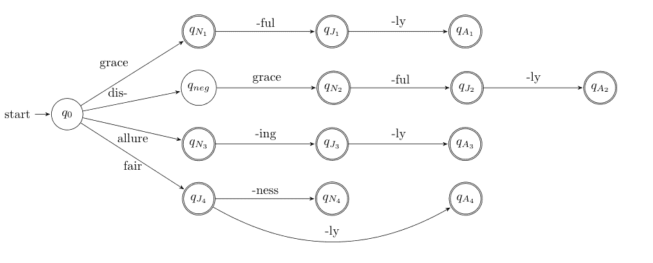

Figure 9.2: 英语派生形态学片段的有限状态接受器。每个路径代表从单个词根形式可能派生的形式。

该 FSA 可以最小化为图 9.3 所示的形式，这使得有限状态方法的普遍性更加明显。例如，从 q₀ 到 q₂ 的转移可以接受的不仅是 fair，而且是任何接受 -ness 和 -ly 作为后缀的单 morpheme（单 morpheme）形容词。这样，有限状态接受器可以很容易地扩展：随着新的词干被添加到词汇中，其派生形式将被自动接受。当然，即使要覆盖英语形态学的这一小片段，该 FSA 仍需要大幅扩展。如 music → musical、athlete → athletic 等案例所示，英语包含多个名词类别，每个类别都有自己的派生规则。

图 9.2 和 9.3 所示的 FSA 接受 allureing，而不是 alluring。这反映了形态学与正字法之间的区别——形态学是使用哪些 morpheme 以及按什么顺序使用的问题，而正字法是 morpheme 在书面语言中如何呈现的问题。正如正字法要求在 -ing 后缀前去掉 e 一样，音系学也对单词在口语中如何呈现施加了一组相关的约束。正如我们很快会看到的，这些问题可以通过有限状态转换器来处理，有限状态转换器是接受输入并产生输出的有限状态自动机。

Jacob Eisenstein. Draft of November 13, 2018.

#### 9.1.3 加权有限状态接受器

根据 FSA 对形态学的处理，每个词要么在语言中，要么不在，没有余地。也许你同意 musicky 和 fishful 不是有效的英语单词；但如果被迫选择，你可能认为 fishful stew 或 musicky tribute 比 behaving disgraceyful 更可取。与其问一个词是否可接受，不如问它有多可接受。Aronoff（1976，第 36 页）换一种说法：

> “尽管形态学中许多事情都是可能的，但有些比其他更可能。”

但有限状态接受器无法表达对技术上有效选择之间的偏好。

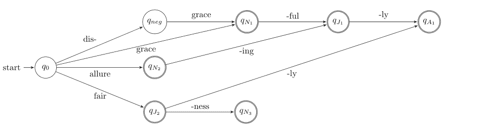

Figure 9.3: 图 9.2 所示有限状态接受器的最小化。

加权有限状态接受器（WFSAs）是 FSA 的推广，其中每条接受路径都被分配一个分数，该分数由转移、初始状态和最终状态计算得出。形式上，加权有限状态接受器 M = (Q, Σ, λ, ρ, δ) 由以下部分组成：

- 有限的状态集合 Q = {q₀, q₁, ..., qₙ}；
- 输入符号的有限字母表 Σ；
- 初始权重函数 λ : Q → ℝ；
- 终止权重函数 ρ : Q → ℝ；
- 转移函数 δ : Q × Σ × Q → ℝ。

WFSAs 在三个方面偏离了 FSA 形式：每个状态都可以是初始状态，得分为 λ(q)；每个状态都可以是接受状态，得分为 ρ(q)；在任何输入上，任意一对状态之间都可能存在转移，得分为 δ(qᵢ, ω, qⱼ)。尽管如此，FSA 可以被视为一种特殊情况：对于任何 FSA M，我们可以通过设置 λ(q) = ∞ 对所有 q ≠ q₀，ρ(q) = ∞ 对所有 q ∉ F，以及 δ(qᵢ, ω, qⱼ) = ∞ 对所有转移 {(q₁, ω) → q₂} 而构建等价的 WFSA，这些转移不被 M 的转移函数允许。

任意路径 π = t₁, t₂, ..., t_N 的总得分为这些分数之和，

d(π) = λ(from-state(t₁)) + Σ_{n=1}^{N} δ(tₙ) + ρ(to-state(t_N)). [9.5]

使用最短路径算法来找到 WFSA 中字符串 ω 的最小成本路径，时间复杂度为 O(E + V log V)，其中 E 是边的数量，V 是顶点的数量（Cormen et al., 2009）。²

²最短路径算法找到成本最小的路径。在许多情况下，路径权重是 log
可能有多个接受路径。在某些应用中，输入的分值是对所有这些路径进行聚合后得到的。这种聚合分值可以通过对 WFSA 进行推广来计算，这一推广使用了 § 7.7.3 首次引入的**半环记号**。

设 d(π) 表示路径 π = t₁, t₂, …, tₙ 的总分，其计算方式为：

d(π) = λ(from-state(t₁)) ⊗ δ(t₁) ⊗ δ(t₂) ⊗ ⋯ ⊗ δ(tₙ) ⊗ ρ(to-state(tₙ)).  [9.8]

这是公式 9.5 到半环记号的推广，使用半环乘法算子 ⊗ 代替加法。

现在设 s(ω) 表示消耗输入 ω 的所有路径 Π(ω) 的总分，

s(ω) = ⨁₍π∈Π(ω)₎ d(π).  [9.9]

这里，半环加法（⊕）用于合并多条路径的分值。

对半环的推广涵盖了许多有用的特殊情况。在**对数概率半环**中，乘法定义为 log p(x) ⊗ log p(y) = log p(x) + log p(y)，加法定义为 log p(x) ⊕ log p(y) = log(p(x) + p(y))。因此，s(ω) 表示接受输入 ω 的对数概率，即对所有路径 π ∈ Π(ω) 进行边缘化。在**布尔半环**中，⊗ 算子为逻辑合取，⊕ 算子为逻辑析取。这简化为未加权有限状态接受器的特殊情况，此时分值 s(ω) 是一个布尔值，指示是否存在任何接受 ω 的路径。在**热带半环**中，⊕ 算子为最大值，因此最终分值是 WFSA 中得分最高的路径的分值。OpenFST 工具包利用半环和多态性来实现加权有限状态自动机的一般算法（Allauzen 等，2007）。

## 插值 n-gram 语言模型

回顾 § 6.2.3，**插值 n-gram 语言模型**将多个 n-gram 模型的概率组合起来。例如，一个插值二元语法语言模型计算以下概率：

p̂(wₘ | wₘ₋₁) = λ₁p₁(wₘ) + λ₂p₂(wₘ | wₘ₋₁),  [9.10]

其中 p̂ 表示插值概率，p₂ 表示二元语法概率，p₁ 表示一元语法概率。设 λ₂ = (1 − λ₁) 可确保概率之和为 1。

插值二元语法语言模型可以使用非确定性 WFSA 来实现（Knight 和 May，2009）。基本思想如图 9.4 所示。在插值二元语法语言模型中，词汇表中的每个元素对应一个状态——在此

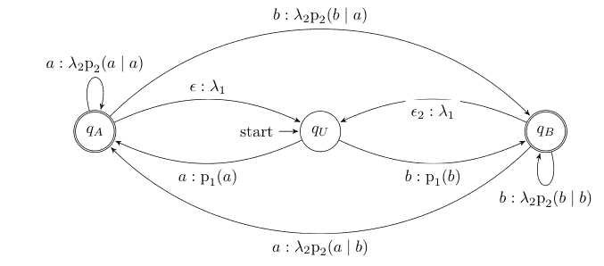

图 9.4：在字母表 Σ = {a, b} 上实现插值二元语法/一元语法语言模型的 WFSA。为简单起见，该 WFSA 被约束为强制第一个词元由一元语法模型生成，并且不对序列结束词元的发射进行建模。

情况下，状态 q_A 和 q_B——它们捕获二元语法概率中的上下文条件。为了对一元语法概率建模，有一个额外的状态 q_U，它“忘记”上下文。从 q_U 出发的转移涉及一元语法概率 p₁(a) 和 p₁(b)；进入 q_U 的转移发射空符号 ε，并且具有概率 λ₁，反映一元语法模型的插值权重。二元语法模型的插值权重包含在转移 q_A → q_B 的权重中。

进入 q_U 的 ε 转移使得该 WFSA 是非确定性的。考虑序列 (a, b, b) 的分值。初始状态是 q_U，因此符号 a 以分值 p₁(a)³ 生成。接下来，我们可以通过转移 q_A → q_B 从一元语法模型生成 b，分值为 λ₂p₂(b | a)。或者，我们可以以分值 λ₁ 转移回 q_U，然后从一元语法模型以分值 p₁(b) 发射 b。为了生成最终的 b 词元，我们面临同样的选择：直接从自转移到 q_B 发射它，或者先转移到 q_U。

序列 (a, b, b) 的总分是所有接受路径的半环和：

s(a, b, b) = (p₁(a) ⊗ λ₂p₂(b | a) ⊗ λ₂p₂(b | b)) ⊕ (p₁(a) ⊗ λ₁ ⊗ p₁(b) ⊗ λ₂p₂(b | b)) ⊕ (p₁(a) ⊗ λ₂p₂(b | a) ⊗ p₁(b) ⊗ p₁(b)) ⊕ (p₁(a) ⊗ λ₁ ⊗ p₁(b) ⊗ p₁(b) ⊗ p₁(b)) . [9.11]

公式 9.11 中的每一行都代表通过 WFSA 的特定路径的概率。在概率半环中，⊗ 是乘法，因此每条路径是每个

³我们本可以对序列初始的二元语法概率 p₂(a | □) 进行建模，但为了简单起见，该 WFSA 不允许这种可能性，因为那需要另一个状态。

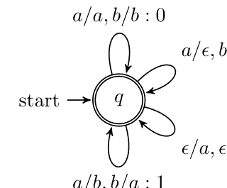

图 9.5：Levenshtein 编辑距离有限状态转换器的状态图。标签 x/y : c 表示输入为 x、输出为 y 的转移的成本为 c。

通过一个未加权的有限状态转换器。第一条规则是：
-   -sses → -ss 例如：dresses → dress [9.16]
-   -ies → -i 例如：parties → parti [9.17]
-   -ss → -ss 例如：dress → dress [9.18]
-   -s → ε 例如：cats → cat [9.19]

最后两行看似冲突；它们的意图是作为一个指令：删除末尾的 -s，除非它是 -ss 结尾的一部分。图 9.6 展示了仅处理这最后两行的状态图。请确保你理解这个有限状态转换器是如何处理 cats、steps、bass 和 basses 的。

## 屈折形态学

在屈折形态学中，词元（lemma）被修改以添加诸如时态、数和格等语法信息。例如，许多英语名词通过后缀 -s 变为复数，许多动词通过后缀 -ed 变为过去时。英语的屈折形态学比世界上许多语言都要简单得多。例如，罗曼语族（源自拉丁语）具有复杂的动词后缀系统，这些后缀必须与动词的人称和数一致，如表 9.1 所示。

形态分析的任务是读取像 canto 这样的形式，并输出类似 CANTAR+VERB+PRESIND+1P+SING 的分析结果，其中 +PRESIND 将时态描述为现在直陈式，+1P 表示第一人称，+SING 表示单数。形态生成的任务则相反，从 CANTAR+VERB+PRESIND+1P+SING 到 canto。有限状态转换器是一个有吸引力的解决方案，因为它们可以用一个模型解决这两个问题（Beesley 和 Karttunen，2003）。例如，图 9.7 展示了西班牙语屈折形态学的一个有限状态转换器的片段。

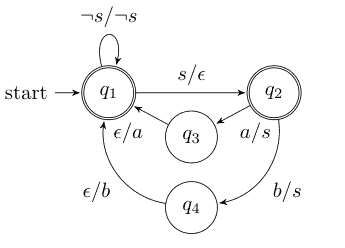

图 9.6：Porter 词干提取图第 1a 步最后两条规则的状态图。状态 q3 和 q4 分别“记住”观察到的 a 和 b；省略号 … 表示输入字母表中每个符号的额外状态。记号 ¬s/¬s 不是 FST 形式体系的一部分；它是一种简写，表示除 s 之外的每个输入/输出符号的一组自转移弧。

| 不定式 | cantar（唱歌） | comer（吃） | vivir（生活） |
|---|---|---|---|
| yo（第一人称单数） | canto | como | vivo |
| tu（第二人称单数） | cantas | comes | vives |
| él, ella, usted（第三人称单数） | canta | come | vive |
| nosotros（第一人称复数） | cantamos | comemos | vivimos |
| vosotros（第二人称复数，非正式） | cantáis | coméis | vivís |
| ellos, ellas（第三人称复数）；ustedes（第二人称复数） | cantan | comen | viven |

表 9.1：西班牙语动词的现在直陈式变位。每一行表示一个人称和数，每一列是一个动词类别中的规则示例，如不定式形式的后缀所示。

输入词汇表 Σ 对应于西班牙语拼写中使用的字母集合，输出词汇表 Ω 对应于这些相同的字母，外加形态特征词汇表（例如，+SING、+VERB）。在图 9.7 中，有两条路径以 canto 作为输入，分别对应动词和名词的含义；这两条路径之间的选择可以由词性标注器来引导。通过反转，每个转移的输入和输出互换，从而产生一个有限状态生成器，能够为任何形态分析生成正确的表面形式。

有限状态形态分析器和其他未加权转换器可以手工设计。设计者的目标是避免过度生成——接受语言中无效的字符串或进行无效的转导——以及欠生成

就是字符 a-z。组合后的转换器（$T_O \circ T_M$）随后将 bake+PAST 转换为拼写 baked。$T_O$ 的设计留作练习。

## 示例：隐马尔可夫模型

隐马尔可夫模型（第 7 章）可被视为加权有限状态转换器，并且它们可以通过转换来构建。回顾一下，隐马尔可夫模型定义了词和标签上的联合概率 p(w, y)，它可以作为穿过网格结构的路径来计算。这个网格本身就是一个加权有限状态接受器，在输入 $Y_m = j$ 时，所有相邻节点 $q_{m-1,i} \rightarrow q_{m,j}$ 之间都有边。边的权重是对数概率，

$\delta(q_{m-1,i}, Y_m = j, q_{m,j}) = \log p(w_m, Y_m = j \mid Y_{m-1} = i)$ [9.20]
$= \log p(w_m \mid Y_m = j) + \log \Pr(Y_m = j \mid Y_{m-1} = i).$ [9.21]

因为每个标签 $Y_m$ 只有一种可能的转移，所以这个 WFSA 是确定性的。任意标签序列 $\{y_m\}_{m=1}^M$ 的得分就是这些对数概率之和，对应于总对数概率 $\log p(w, y)$。此外，网格可以通过更简单的 FST 的组合来构建。

-   首先，构建一个“转移”转换器，表示标签序列上的二元概率模型，$T_T$。该转换器与 § 9.1.3 中的 $n$ 元语法语言模型接受器几乎相同：每个标签对应一个状态，边的权重等于转移对数概率，$\delta(q_i, j, q_j) = \log \Pr(Y_m = j \mid Y_{m-1} = i)$。注意，$T_T$ 是一个转换器，每条弧的输入和输出相同；这使得 $T_T$ 可以与其他转换器组合。
-   接下来，构建一个“发射”转换器，表示在给定标签条件下词的概率，$T_E$。该转换器只有一个状态，每个词/标签对对应一条弧，$\delta(q_0, i, j, q_0) = \log \Pr(W_m = j \mid Y_m = i)$。输入词汇表是所有标签的集合，输出词汇表是所有词的集合。
-   组合 $T_E \circ T_T$ 是一个每个标签对应一个状态的有限状态转换器，如图 9.8 所示。每个状态有 $V \times K$ 条出边，表示到 $K$ 个其他状态中每一个的转移，并为词汇表中的 $V$ 个词分别产生输出。这些边的权重等于 $\delta(q_i, Y_m = j, w_m, q_j) = \log p(w_m, Y_m = j \mid Y_{m-1} = i).$ [9.22]
-   网格是一个具有 $M \times K$ 个节点的结构，对应于要标注的 $M$ 个词中的每一个以及标签集中的 $K$ 个标签中的每一个。它可以通过将 $(T_E \circ T_T)$ 与一个无权重链式 FSA $M_A(w)$ 组合来构建，该 $M_A(w)$ 被专门构造为只接受给定的输入 $w_1, w_2, \dots, w_M$，如图 9.9 所示。输入 $w$ 的网格由组合 $M_A(w) \circ (T_E \circ T_T)$ 构建。与无权重 $M_A(w)$ 的组合不会影响 $(T_E \circ T_T)$ 的边权重，但会选择生成词序列 $w$ 的那部分路径。

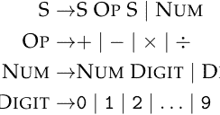

图 9.11：算术表达式的上下文无关文法

-   一个有限的**非终结符**集合 $N$；
-   一个由**终结符号**组成的有限字母表 $\Sigma$；
-   一组**产生式规则** $R$，每条形式为 $A \to \beta$，其中 $A \in N$，$\beta \in (\Sigma \cup N)^*$；
-   一个指定的起始符号 $S$。

在产生式规则 $A \to \beta$ 中，左侧（LHS）$A$ 必须是一个非终结符；右侧（RHS）可以是终结符或非终结符的序列，$\{n,\sigma\}^*$，其中 $n \in N, \sigma \in \Sigma$。一个非终结符可以出现在许多产生式规则的左侧。一个非终结符可以同时出现在左侧和右侧；这是一个**递归产生式**，类似于有限状态自动机中的自环。“上下文无关”这一名称基于这样的性质：产生式规则只依赖于左侧部分，而不依赖其祖先或邻居；这类似于有限状态自动机的马尔可夫性质，即每一步的行为只取决于当前状态，而不取决于到达该状态所经过的路径。

推导 $\tau$ 是从起始符号 $S$ 到表层字符串 $w \in \Sigma^*$ 的步骤序列，后者是推导的**产出**。如果存在从 $S$ 出发产生 $w$ 的某个推导，则字符串 $w$ 属于某个上下文无关语言。**句法分析**是在文法中为字符串寻找推导的问题。句法分析的算法在第 10 章中描述。

与正则表达式类似，上下文无关文法定义了语言，但没有定义识别该语言所需的计算过程。与有限状态接受器对应的上下文无关类似物是**下推自动机**，一种理论计算模型，其中输入符号可以被压入一个可能无限深的栈中。更多细节参见 Sipser (2012)。

## 示例

图 9.11 展示了算术表达式（如 $1+2\div3-4$）的上下文无关文法。在该文法中，终结符号包括数字 $\{1,\ 2,\ \ldots,\ 9\}$ 和运算符 $\{+, -, \times, \div\}$。规则中包含 $\mid$ 符号，这是一种记法上的便利，可以在单行中指定多个右侧部分：语句 $A \to x\mid y$

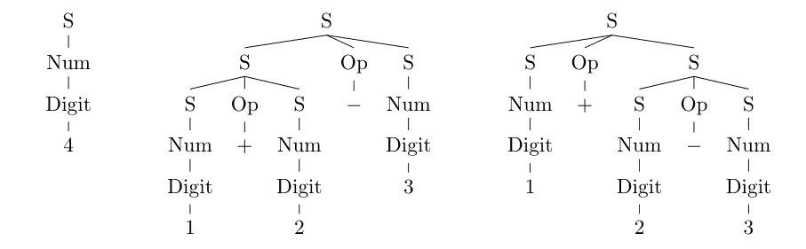

图 9.12：来自图 9.11 算术文法的一些示例推导

定义了两个产生式，A → x 和 A → y。该文法是递归的：非终结符 S 和 NUM 可以产生自身。

推导通常以树的形式展示，产生式规则从上到下应用。图 9.12 中左边的树描述了单个数字的推导，经过产生式序列 S → NUM → DIGIT → 4（这些都是单元产生式，因为右侧只包含一个元素）。图 9.12 中的另外两棵树展示了字符串 1 + 2 − 3 的替代推导。一个字符串存在多个推导表明该文法是歧义的。

上下文无关推导也可以按照树的前序遍历写出。⁶ 对于图 9.12 中 1 + 2 − 3 的两个推导，记号如下：

```
(S (S (S (Num (Digit 1))) (Op +) (S (Num (Digit 2)))) (Op - ) (S (Num (Digit 3))))  [9.23]
```

```
(S (S (Num (Digit 1))) (Op +) (S (Num (Digit 2)) (Op - ) (S (Num (Digit 3)))))  [9.24]
```

## 文法等价性与乔姆斯基范式

一种上下文无关语言可以用多个上下文无关文法来表达。例如，以下两个文法都定义了语言 aⁿbⁿ，其中 n > 0。

```
S → aSb | ab
S → aSb | aabb | ab
```

如果两个文法生成相同的字符串，则它们是弱等价的。如果两个文法通过相同的推导生成相同的字符串，则它们是强等价的。上面的文法只是弱等价的。

⁶这是一种深度优先、从左到右的搜索，首次遇到每个节点时就打印它（Cormen 等，2009，第 12 章）。

修饰它，例如她的弟弟；一个动词短语包含动词及其修饰语，例如买了一条鱼并贪婪地吃掉它。

在上下文无关文法中，每种短语类型都是一个非终结符，每个成分都是该非终结符产出的子串。文法设计涉及选择正确的非终结符集合。细粒度的非终结符使得能够表示更细粒度的语言现象。例如，通过区分单数和复数名词短语，可以构建一个英语文法，使其只生成遵守主谓一致的句子。然而，在西班牙语等语言中，强制主谓一致要复杂得多，因为动词必须在人称和数上与主语保持一致。一般而言，文法设计者必须在过度生成（overgeneration）——即文法允许不合语法的句子——和欠生成（undergeneration）——即文法无法生成合乎语法的句子——之间进行权衡。此外，如果文法要支持句法结构的人工标注，它必须足够简单，以便高效标注。

#### 9.2.3 英语的短语结构文法

为了更好地理解短语结构文法的工作原理，我们来考虑宾州树库（Penn Treebank）英语文法的具体案例。宾州树库（PTB）中的主要短语类别基于主要词性类别：名词短语（NP）、动词短语（VP）、介词短语（PP）、形容词短语（ADJP）和副词短语（ADVP）。顶层类别是 S，它恰好同时代表“句子”（sentence）和“起始”（start）符号。补语从句（例如，I take the good old fashioned ground that the whale is a fish）由非终结符 SBAR 表示。文法中的终结符号是单个单词，它们由词性标注的单元产生式生成（PTB 标签集在 § 8.1 中描述）。

本节描述来自主要短语级类别的一些最常见的产生式，并解释如何生成单独的标签序列。产生式规则以“理论驱动”的方式处理：首先描述每种短语类型的句法属性，然后列出一些必要的产生式规则。但重要的是要记住，宾州树库是以“数据驱动”的方式构建的。在指定了非终结符集合之后，标注者可以自由地以任何在语言学上似乎最准确的方式分析每个句子，只需遵循一些高层指南。宾州树库的文法仅仅是分析该语料库数百万词所需的产生式集合。按照设计，该文法是过度生成的——它不排除不合语法的句子。此外，虽然这里展示的产生式涵盖了一些最常见的情形，但它们只是宾州树库中数千种不同类型产生式的一小部分。


## 句子

最常见的句子生成规则是，

S → NP VP
[9.28]

这可以解释像 *阿比盖尔吃了泡菜* 这样的简单句子——正如我们将看到的，直接宾语 *泡菜* 是动词短语的一部分。但句子还有更复杂的形式：

S → ADVP NP VP                不幸的是，阿比盖尔吃了泡菜。        [9.29]
S → S CC S                    阿比盖尔吃了泡菜，马克斯吃了一个汉堡。    [9.30]
S → VP                        吃泡菜。                               [9.31]

其中 ADVP 是副词短语（如 *不幸地，非常不幸地*），CC 是并列连词（如 *和，但是*）。⁸

## 名词短语

名词短语指称实体，无论是真实的还是想象的、具体的还是抽象的：*阿莎、蒸饺、零件与人工、没有人、鲸鱼的白色，以及二十世纪初革命工团主义的兴起。* 名词短语的生成规则包括“光杆”名词（可选择性跟在限定词后）以及代词：

NP → NN | NNS | NNP | PRP                [9.32]
NP → DET NN | DET NNS | DET NNP          [9.33]

标签 NN、NNS 和 NNP 分别指单数名词、复数名词和专有名词；PRP 指人称代词，DET 指限定词。语法还包含来自这些标签的终结符生成式，例如 PRP → I | you | we | …

名词短语可以被形容词短语（ADJP；例如 *那只小的俄罗斯狗*）和数词（CD；例如 *那五个酥皮糕点*）修饰，它们各自可以可选地跟在限定词之后：

NP → ADJP NN | ADJP NNS | DET ADJP NN | DET ADJP NNS        [9.34]
NP → CD NNS | DET CD NNS | …                               [9.35]

有些名词短语包含多个名词，例如 *解放运动* 和 *一只羚羊角*，因此需要额外的生成式：

NP → NN NN | NN NNS | DET NN NN | …        [9.36]

⁸请注意，该语法不包含递归生成式 S → ADVP S。思考一下为什么这个生成式会导致语法过度生成，可能会有所帮助。

这些多名词结构可以与形容词短语和基数词组合，导致大量额外的生成式。

递归名词短语生成式包括并列、介词短语附加、从句和动词短语附加语：

- NP → NP CC NP 例如，红与黑 [9.37]
- NP → NP PP 例如，佐治亚理工学院院长 [9.38]
- NP → NP SBAR 例如，一条被他弄伤的鲸 [9.39]
- NP → NP VP 例如，一条在设得兰群岛附近捕获的鲸 [9.40]

这些递归生成式是歧义的主要来源，因为 VP 和 PP 非终结符也可以生成 NP 子节点。因此，佐治亚理工学院院长可以通过两种方式推导出来，一条在设得兰群岛附近捕获的鲸在十月份也可以如此。

但除了这些少数递归生成式外，宾州树库语法的名词短语片段相对扁平，包含大量从 NP 直接生成词性序列的生成式。如果名词短语有更多内部结构，语法将需要更少的规则，正如我们将看到的，这将使句法分析更快、机器学习更容易。Vadas 和 Curran（2011）提出以称为名词修饰语（NML）的新非终结符的形式添加额外结构，例如：

(9.6) a. (NP (NN crude) (NN oil) (NNS prices)) (PTB analysis) b. (NP (NML (NN crude) (NN oil)) (NNS prices)) (NML-style analysis).

另一种提议是将限定词视为限定词短语（DP；Abney, 1987）的中心语。关于限定词短语存在支持和反对的语言学论据（例如 Van Eynde, 2006）。从上下文无关语法的角度看，DP 使得对某些成分进行更具结构化的分析成为可能，例如：

(9.7) a. (NP (DT the) (JJ white) (NN whale)) (PTB analysis) b. (DP (DT the) (NP (JJ white) (NN whale))) (DP-style analysis).

## 动词短语

动词短语描述动作、事件和存在的状态。PTB 标记集区分了几类动词屈折形式：原形（VB；*她喜欢吃零食*）、一般现在时第三人称单数（VBZ；*她吃零食*）、一般现在时非第三人称单数（VBP；*他们吃零食*）、过去时（VBD；*他们吃了零食*）、现在分词（VBG；*他们正在吃零食*）和过去分词（VBN；*他们吃过零食*）。这些形式中的每一种都可以单独构成一个动词短语。⁹

⁹该标记集是英语特有的：例如，VBP 之所以是一个有意义的类别，仅仅是因为英语形态区分第三人称单数与所有人称-数组合。

形容词短语在多个方面超越了光杆形容词（ADJP → JJ）：

| 生成式 | 示例 | 编号 |
|---|---|---|
| ADJP → RB JJ | *非常饿* | [9.66] |
| ADJP → RBR JJ | *更饿* | [9.67] |
| ADJP → JJS JJ | *最好的可能* | [9.68] |
| ADJP → RB JJR | *甚至更大* | [9.69] |
| ADJP → JJ CC JJ | *高高在上* | [9.70] |
| ADJP → JJ JJ | *西德* | [9.71] |
| ADJP → RB VBN | *先前报道的* | [9.72] |

标签 JJR 和 JJS 分别指比较级和最高级形容词。

所有这些短语类型都可以并列：

| 生成式 | 示例 | 编号 |
|---|---|---|
| PP → PP CC PP | *按时且不超出预算* | [9.73] |
| ADVP → ADVP CC ADVP | *现在和两年前* | [9.74] |
| ADJP → ADJP CC ADJP | *古雅且相当具有欺骗性* | [9.75] |
| SBAR → SBAR CC SBAR | *无论他们是想要控制权* | [9.76] |
|  | *还是他们想要出口* |  |

#### 9.2.4 语法歧义

上下文无关句法分析之所以有用，不仅在于它能判断一个句子是否符合语法，更主要的是因为其成分及成分间的关系可以应用于诸如信息抽取（第 17 章）和句子压缩（Jing, 2000; Clarke and Lapata, 2008）等任务。然而，大规模覆盖的自然语言语法所具有的歧义性对这些潜在应用构成了严重问题。例如，图 9.13 显示了简单句子我们用筷子吃寿司的两种可能分析，取决于筷子是修饰“吃”还是“寿司”。真实的语法可能允许单个句子有数千甚至数百万种句法分析。加权上下文无关语法通过为每条生成式赋予权重，并选择得分最高的推导来解决这一问题。这是第 10 章的重点。

### 9.3 *轻度上下文相关语言*

在上下文无关语言之外是上下文相关语言，其中非终结符的扩展依赖于其邻居。在上下文相关语言的一般类别中，计算变得更具挑战性：上下文相关语言的成员资格问题是 PSPACE 完全的。由于 PSPACE 包含复杂度类 NP（在非确定性图灵机上可以在多项式时间内求解的问题）

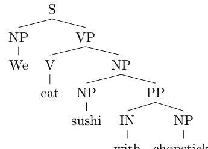

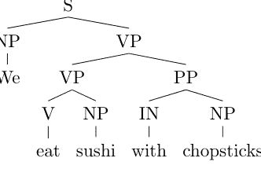

图 9.13：同一句子的两种推导

机器），如果 P ≠ NP，PSPACE 完全问题就无法高效求解。因此，为整个上下文相关语言类别设计高效的句法分析算法可能毫无希望。¹⁰

¹⁰如果 PSPACE ≠ NP，那么它包含无法在非确定性图灵机上于多项式时间内求解的问题；等价地，这些问题的解甚至无法在多项式时间内检验（Arora and Barak, 2009）。

然而，Joshi（1985）确定了一组定义**轻度上下文相关语言**的性质，这些语言是上下文相关语言的严格子集。与上下文无关语言一样，轻度上下文相关语言可以在多项式时间内进行句法分析。然而，轻度上下文相关语言包含非上下文无关语言，例如“复制语言” {*ww* | *w* ∈ Σ*} 和语言 *a^m b^n c^m d^n*。两者的特征都是**交叉序列依赖**，在字符串中远距离连接符号。¹¹ 例如，在语言 *a^n b^m c^n d^m* 中，每个 *a* 符号恰好与一个 *c* 符号相连，无论中间有多少 *b* 符号。

#### 9.3.1 自然语言中的上下文相关现象

这类现象偶尔与自然语言相关。一个经典例子出现在瑞士德语中（Shieber, 1985），其中诸如 *我们让孩子们帮汉斯粉刷房子* 这样的句子通过先列出所有名词再列出所有动词来实现，即 *我们孩子们汉斯房子让帮粉刷*。此外，每个名词的限定词由该名词的**格标记**（它相对于动词所扮演的角色）决定。使用一个类似于前面关于中心嵌套讨论（§ 9.2）的论证，Shieber 将这些格标记约束描述为一组交叉序列依赖，与 *a^m b^n c^m d^n* 同态，因此不是上下文无关的。

¹¹轻度上下文相关语言集合的进一步条件是*恒定增长*：如果语言中的字符串按长度排列，任何一对相邻字符串之间的长度差都受某个语言特定常数的限制。该条件排除了诸如 {*a^{2^n}* | *n* ≥ 0} 之类的语言。


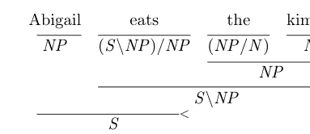

Figure 9.14: CCG 中涉及前向和后向函数应用的句法分析

与从正则语言到上下文无关语言的转变一样，温和上下文敏感语言也可以出于便利性而得到动机。虽然原则上上下文无关文法可以处理有限序列的交叉串行依赖，但使用像树 adjoining 文法（TAG）和组合范畴文法（CCG）这样的温和上下文敏感形式主义通常更方便。受 TAG 启发的解析器已被证明在解析宾州树库（Penn Treebank）方面特别有效（Collins, 1997；Carreras et al., 2008），而 CCG 在当前语义解析研究中发挥着主导作用（Zettlemoyer and Collins, 2005）。这两种形式主义是弱等价的：任何可以用 TAG 指定的语言也可以用 CCG 指定，反之亦然（Joshi et al., 1991）。本章余下部分对 CCG 作了简要概述，但建议您分别查阅 Joshi and Schabes (1997) 和 Steedman and Baldridge (2011) 以了解 TAG 和 CCG 的更多细节。

#### 9.3.2 组合范畴语法

在组合范畴语法中，结构分析是通过一组小的通用组合运算构建的，这些运算适用于直接相邻的子结构。这些运算作用于子结构的类型，产生具有新类型的新结构。基本类型包括 S（句子）、NP（名词短语）、VP（动词短语）和 N（名词）。目标是将整段文本标记为句子 S。

复杂类型或范畴由基本类型、括号以及前向和后向斜线构造：例如，S/NP 是一个复杂类型，表示句子缺少其右侧的名词短语；S\NP 表示句子缺少其左侧的名词短语。复杂类型作为函数起作用，最基本的组合运算是对右侧或左侧邻居的函数应用。例如，动词短语 eats 的类型为 S\NP。将此函数应用于其左侧的主语名词短语会得到 Abigail eats 的分析，其类型为 S，表示解析成功。

及物动词必须先应用于直接宾语——在英语中出现在动词右侧——然后再应用于主语——出现在左侧。它们因此具有更复杂的类型 (S\NP)/NP。同样，限定词应用于其右侧的名词会得到名词短语，因此限定词的类型为 NP/N。图 9.14 提供了涉及及物动词和限定词的示例。此示例的一个关键点是，它可以通过将每次函数应用视为一个成分短语而 trivially 转换为短语结构树。事实上，当 CCG 的唯一组合算子是前向和后向函数应用时，它等价于上下文无关文法。然而，“努力”的位置发生了变化。与其设计良好的产生式，语法设计者必须专注于词典——为每个词选择正确的类型。这使得仅使用少数通用组合算子就能解析广泛的句子成为可能。

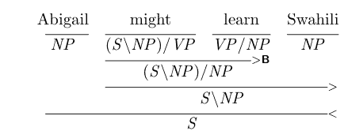

Figure 9.15: 涉及函数组合的 CCG 句法分析（示例改编自 Steedman and Baldridge, 2011）

随着另外两个算子的引入——组合和类型提升——事情变得更有趣。函数组合使复杂类型的组合成为可能：X/Y ∘ Y/Z ⇒_B X/Z（前向组合）和 Y\Z ∘ X\Y ⇒_B X\Z（后向组合）。12 组合使得“深入”复杂类型成为可能，并在一个单元的“输入”与另一个单元的“输出”相匹配时组合两个相邻单元。图 9.15 显示了如何使用函数组合来处理情态动词。虽然该句子仅使用函数应用即可解析，但基于组合的分析更可取，因为该单元 might learn 可以像及物动词一样起作用，如示例 Abigail studies Swahili 所示。这反过来使得可以分析诸如 Abigail studies and might learn Swahili 之类的并列结构，将直接宾语 Swahili 附加到整个并列动词短语 studies and might learn 上。§ 9.2.3 中的宾州树库文法片段无法正确处理这种情况：直接宾语 Swahili 只能附加到第二个动词 learn 上。

类型提升将类型为 X 的元素转换为更复杂的类型：X ⇒_T T/(T\X)（到类型 T 的前向类型提升），以及 X ⇒_T T\(T/X)（到类型 T 的后向类型提升）。类型提升使得函数与其参数之间的关系可以反转——通过将参数转换为关于函数再关于参数的函数！一个例子可能会有所帮助。图 9.15 显示了如何分析宾语关系从句 a story that Abigail tells。问题在于 tells 是一个及物动词，期望其右侧有直接宾语。因此，Abigail tells 不是一个有效的成分。该问题通过提升得以解决

12 下标 B 遵循 Curry 和 Feys (1958) 的记法。

a) 定义一个有限状态接受器，接受与目标字符串 target 编辑距离为 1 的所有字符串。

b) 现在思考如何将你的设计推广以接受与目标字符串的编辑距离等于 d 的所有字符串。如果目标字符串长度为 ℓ，需要的最少状态数是多少？

3. 构造一个类似图 9.3 风格的 FSA，处理以下示例：
- nation/N, national/ADJ, nationalize/V, nationalizer/N
- America/N, American/ADJ, Americanize/V, Americanizer/N

确保你的 FSA 不接受任何进一步的推导，例如 *nationalizeral 和 *Americanizern。

4. 展示如何在加权有限状态接受器中构造三元语法语言模型。确保你在输入的开头和结尾处理边界情况。

5. 扩展图 9.6 中的 FST 以处理 Porter 詞幹提取器规则 1a 的另外两个部分：-sses → ss，以及 -ies → -i。

6. § 9.1.4 描述了 T_O，一个通过转换 cook + ed → cooked 和 bake + ed → baked 来捕捉英语拼写的转换器。设计一个无权有限状态转换器来捕捉英语拼写的这一特性。

接下来，增强该转换器以适当建模后缀 -s 在以 s 结尾的词上应用时的情况，例如 kiss+s → kisses。

7. 在图 9.11 的文法中添加括号化，使其不再含糊。

8. 构造三个示例——一个名词短语、一个动词短语和一个句子——这些可以从 § 9.2.3 中的宾州树库文法片段推导出来，但不是语法正确的。避免重复使用文本中的示例。可选地，提出对文法的修正以避免生成这些情况。

9. 使用 § 9.2.3 中的宾州树库文法片段为以下句子生成解析。

(9.8) This aggression will not stand.
(9.9) I can get you a toe.
(9.10) Sometimes you eat the bar and sometimes the bar eats you.

然后为本周新闻文章中的三个简短句子生成解析。

 

```
1: procedure CKY(w, G = (N, Σ, R, S))
2:   for m ∈ {1 ... M} do
3:     t[m − 1, m] ← {X : (X → w_m) ∈ R}
4:   for ℓ ∈ {2, 3, ..., M} do                      ▷ Iterate over constituent lengths
5:     for m ∈ {0, 1, ..., M − ℓ} do                ▷ Iterate over left endpoints
6:       for k ∈ {m + 1, m + 2, ..., m + ℓ − 1} do  ▷ Iterate over split points
7:         for (X → Y Z) ∈ R do                    ▷ Iterate over rules
8:           if Y ∈ t[m, k] ∧ Z ∈ t[k, m + ℓ] then
9:             t[m, m + ℓ] ← t[m, m + ℓ] ∪ X       ▷ Add non-terminal to table
10:            b[m, m + ℓ, X] ← b[m, m + ℓ, X] ∪ (Y, Z, k)   ▷ Add back-pointers
11:  if S ∈ t[0, M] then
12:    return TRACEBACK(S, 0, M, b)
13:  else
14:    return ∅
15: procedure TRACEBACK(X, i, j, b)
16:   if j = i + 1 then
17:     return X
18:  else
19:    (Y, Z, k) ← PICKFROM(b[i, j, X])
20:    return X → (TRACEBACK(Y, i, k, b), TRACEBACK(Z, k, j, b))
```

- 右侧有超过两个元素的产生式可以通过创建额外的非终结符来 **二元化**，如 § 9.2.1 中所述。例如，产生式 VP → V NP NP（用于双及物动词）可以转换为 VP → VP_ditrans/NP NP，通过添加非终结符 VP_ditrans/NP 和产生式 VP_ditrans/NP → V NP。
- 那么像 VP → V 这样的 unary 产生式呢？虽然此类产生式不是乔姆斯基范式的一部分——因此可以在预处理文法时消除——但在实践中，更典型的解决方案是修改 CKY 算法。该算法在表的每个对角线上进行第二次遍历，用所有能够生成单元格中已存在项目的 unary 产生式扩充每个单元格 t[i, j]：形式上，t[i, j] 被扩展到其 **一元闭包**。假设示例文法在表 10.1 中被扩展以包含产生式 VP → V，从而允许具有不及物动词短语的句子，如 we eat。那么单元格 t[1, 2]——对应于词 eat——首先包含集合 {V}，并在此第二次遍历期间被扩充为集合 {V, VP}。


对这些概率进行比较就能成功解决这种情况（Hindle 和 Rooth, 1993）。其他情况，例如例子*我们用筷子吃寿司*，需要考虑介词宾语：考虑另一种说法*我们蘸酱油吃寿司*。在有足够标注数据的情况下，一些附着歧义的实例可以通过监督分类来解决（Ratnaparkhi 等, 1994）。

然而，局部解决方案存在固有的局限性。尽管玩具示例可能只有几个需要解决的歧义，但真实的句子有成千上万个可能的句法分析。此外，附着决策是相互依存的，如同花园路径示例所示：

(10.2) Cats scratch people with claws with knives。

我们可能想把*with claws*附着到*scratch*上，这在较短句子*cats scratch people with claws*中是正确的。但这使得*with knives*无处附着。只有将附着决策联合起来考虑，才能识别出正确的解释。潜在句法分析数量巨大，似乎使穷举搜索变得不可能。但与序列标注一样，局部性假设使得高效搜索这一空间成为可能。

### 10.3 加权上下文无关文法

让我们将一个推导 $\tau$ 定义为一组**锚定产生式**，

$\tau = \{X \to \alpha, (i, j, k)\}, \quad [10.3]$

其中 $X$ 对应左部的非终结符，$\alpha$ 对应右部。对于乔姆斯基范式中的文法，$\alpha$ 要么是一对非终结符，要么是一个终结符。索引 $i, j, k$ 将产生式锚定在输入中，$X$ 推导出跨度 $\boldsymbol{w}_{i+1:j}$。对于二元产生式，$\boldsymbol{w}_{i+1:k}$ 表示左子节点的跨度，$\boldsymbol{w}_{k+1:j}$ 表示右子节点的跨度；对于一元产生式，$k$ 被忽略。对于输入 $\boldsymbol{w}$，最优句法分析为，

$\hat{\tau} = \arg\max_{\tau \in \mathcal{T}(\boldsymbol{w})} \Psi(\tau), \quad [10.4]$

其中 $\mathcal{T}(\boldsymbol{w})$ 是能产生输入 $\boldsymbol{w}$ 的推导集合。

定义一个跨锚定产生式分解的评分函数 $\Psi$，

$\Psi(\tau) = \sum_{(X \to \alpha, (i, j, k)) \in \tau} \psi(X \to \alpha, (i, j, k)). \quad [10.5]$

这是一个局部性假设，类似于维特比序列标注中的假设。在这种情况下，该假设表明总体得分是各产生式得分之和，这些得分是独立计算的。在加权上下文无关文法（WCFG）中，每个锚定产生式 $X \to \alpha, (i, j, k)$ 的得分仅为 $\psi(X \to \alpha)$，忽略了锚 $(i, j, k)$。在其他句法分析模型中，锚可用于访问输入的特征，同时仍然允许高效的自底向上分析。

| 非终结符 | 产生式 | ψ(·) | exp ψ(·) |
|---|---|---|---|
| S | → NP VP | 0 | 1 |
| NP | → NP PP | -1 | 1/2 |
| NP | → we | -2 | 1/4 |
| NP | → sushi | -3 | 1/8 |
| NP | → chopsticks | -3 | 1/8 |
| PP | → IN NP | 0 | 1 |
| IN | → with | 0 | 1 |
| VP | → V NP | -1 | 1/2 |
| VP | → VP PP | -2 | 1/4 |
| VP | → MD V | -2 | 1/4 |
| V | → eat | 0 | 1 |

表 10.2：一个加权上下文无关文法（WCFG）示例。权重选择使得 exp ψ(·) 对每个非终结符的所有右部求和为一；这是概率上下文无关文法所要求的，但一般 WCFG 并不要求。

### 示例

考虑表 10.2 中所示的加权文法，以及图 10.2b 中的分析。

Ψ(τ) = ψ(S → NP VP) + ψ(VP → VP PP) + ψ(VP → V NP) + ψ(PP → IN NP)
      + ψ(NP → We) + ψ(V → eat) + ψ(NP → sushi) + ψ(IN → with) + ψ(NP → chopsticks) [10.6]
      = 0 − 2 − 1 + 0 − 2 + 0 − 3 + 0 − 3 = −11. [10.7]

在图 10.2a 的另一种分析中，产生式 VP → VP PP（得分为 −2）被替换为产生式 NP → NP PP（得分为 −1）；所有其他产生式相同。因此，这种分析的得分为 −10。这个例子暗示了在 NP、VP 和 PP 等非终结符上进行 WCFG 分析的一个问题：WCFG 总是倾向于 VP 附着或 NP 附着，而不管被附着的是什么！解决这个问题的方法将在 § 10.5 中讨论。

算法14 在加权上下文无关文法 (N, Σ, R, S) 中解析字符串 w ∈ Σ* 的 CKY 算法，其中 N 是非终结符集合，R 是加权产生式集合。该文法假定为乔姆斯基范式（§ 9.2.1）。函数 TRACEBACK 在算法 13 中定义。

```procedure WCKY(w, G = (N, Σ, R, S))
  for all i, j, X do ▷ Initialization
    t[i, j, X] ← 0
    b[i, j, X] ← ∅
  for m ∈ {1,2,...,M} do
    for all X ∈ N do
      t[m, m + 1, X] ← ψ(X → w_m, (m, m + 1, m))
  for ℓ ∈ {2,3,...,M} do
    for m ∈ {0,1,...,M - ℓ} do
      for k ∈ {m + 1, m + 2, ..., m + ℓ - 1} do
        t[m, m + ℓ, X] ← max_{k,Y,Z} ψ(X → Y Z, (m, m + ℓ, k)) + t[m, k, Y] + t[k, m + ℓ, Z]
        b[m, m + ℓ, X] ← argmax_{k,Y,Z} ψ(X → Y Z, (m, m + ℓ, k)) + t[m, k, Y] + t[k, m + ℓ, Z]
  return TRACEBACK(S, 0, M, b)
```

#### 10.3.1 使用加权上下文无关文法进行句法分析

方程 10.4 中的优化问题可以通过修改 CKY 算法来解决。在确定性 CKY 算法中，每个单元格 t[i, j] 存储一组能够推导出跨度 w_{i+1:j} 的非终结符。我们现在扩充该表，使单元格 t[i, j, X] 是从非终结符 X 推导出 w_{i+1:j} 的最优推导的得分。该得分递归计算：对于锚定二元产生式 (X → Y Z, (i, j, k))，我们计算：

- 锚定产生式的得分，ψ(X → Y Z, (i, j, k))；
- 左子节点最优推导的得分，t[i, k, Y]；
- 右子节点最优推导的得分，t[k, j, Z]。

这些得分通过加法组合。与未加权 CKY 算法一样，通过考虑长度递增的跨度来构建表，因此在我们计算得分 t[i, j, X] 时，可以保证跨度 t[i, k, Y] 和 t[k, j, Z] 的得分已经可用。值 t[0, M, S] 是从文法推导出 w 的最优推导的得分。算法 14 形式化了这一过程。

与未加权 CKY 一样，句法分析从回溯指针表 b 中恢复，其中每个 b[i, j, X] 存储在从 X 推导 w_{i+1:j} 的过程中 argmax 分割点 k 和产生式 X → Y Z。最高得分的句法分析可以通过从 b[0, M, S] 开始向后追踪这些指针，一直回溯到终结符来获得。这类似于维特比算法中从网格末端向后追踪指针来计算最佳标签序列。注意，我们只需要为到达 $t[i, j, X]$ 的*最优*路径存储回溯指针；这源于局部性假设，即一个句法分析的全局得分是该分析中每个产生式局部得分的组合。

### 示例

让我们重新审视图 10.1 中的分析表。在加权 CFG 中，每个单元格都会包含每个非终结符的得分；无法生成的非终结符假定得分为 $−∞$。第一条对角线包含一元产生式的得分：$t[0, 1, NP] = −2$，$t[1, 2, V] = 0$，依此类推。下一条对角线包含长度为 2 的跨度的得分：$t[1, 3, VP] = −1 + 0 − 3 = −4$，$t[3, 5, PP] = 0 + 0 − 3 = −3$，依此类推。当我们到达单元格 $t[1, 5, VP]$ 时，事情变得有趣起来，它包含从非终结符 VP 推导跨度 $w_{2:5}$ 的得分。该得分计算为两个备选方案的最大值，

$t[1, 5, VP] = \max(\psi(VP \to VP\ PP, (1, 3, 5)) + t[1, 3, VP] + t[3, 5, PP],$
$\psi(VP \to V\ NP, (1, 2, 5)) + t[1, 2, V] + t[2, 5, NP])$ [10.8]
$= \max(-2 -4 -3, -1 + 0 -7) = -8.$ [10.9]

由于第二种情况是 argmax，我们设置回溯指针 $b[1, 5, VP] = (V, NP, 2)$，从而可以恢复最优推导。

#### 10.3.2 概率上下文无关文法

**概率上下文无关文法（PCFGs）** 是加权上下文无关文法的一种特殊情况，当权重对应于概率时出现。具体来说，权重 $\psi(X \to \alpha, (i, j, k)) = \log p(\alpha \mid X)$，其中右部 $\alpha$ 的概率以非终结符 $X$ 为条件，而锚 $(i, j, k)$ 被忽略。这些概率必须在所有可能的右部上归一化，使得对所有 $X$ 都有 $\sum_{\alpha} p(\alpha \mid X) = 1$。对于给定的句法分析 $\tau$，在**生成模型** $\tau \sim \text{DrawSubtree}(S)$ 下，各产生式概率的乘积等于 $p(\tau)$，其中函数 DrawSubtree 在算法 15 中定义。

给定字符串时句法分析的条件概率为，

$p(\tau \mid \boldsymbol{w}) = \frac{p(\tau)}{\sum_{\tau' \in \mathcal{T}(\boldsymbol{w})} p(\tau')} = \frac{\exp \Psi(\tau)}{\sum_{\tau' \in \mathcal{T}(\boldsymbol{w})} \exp \Psi(\tau')},$ [10.10]

其中 $\Psi(\tau) = \sum_{X \to \alpha, (i,j,k) \in \tau} \psi(X \to \alpha, (i, j, k))$。由于概率是得分 $\Psi(\tau)$ 的单调函数，最大似然句法分析可以通过 CKY 算法识别，无需修改。如果需要归一化概率 $p(\tau \mid \boldsymbol{w})$，方程 10.10 的分母可以通过**内部递归**计算，如下所述。


其中$X \leadsto \boldsymbol{w}_{i+1:j}$表示非终结符$X$产生跨度$w_{i+1}, w_{i+2}, \dots, w_j$的事件。$t[i, j, X]$的递归计算称为**内部递归**，因为它将每个子树的概率计算为其内部较小子树概率的组合。这个名称暗示相应的**外部递归**，它计算非终结符$X$覆盖$\boldsymbol{w}_{i+1:j}$且与外部上下文$(\boldsymbol{w}_{1:i}, \boldsymbol{w}_{j+1:M})$联合的概率。该递归在第10.4.3节中描述。内部递归和外部递归类似于概率序列标注中的前向和后向递归（见第7.5.3节）。它们可用于计算单个锚定产生式的边际概率$\mathrm{p}(X \to \alpha, (i, j, k) \mid \boldsymbol{w})$，对$\boldsymbol{w}$的所有可能推导求和。

#### 10.3.3 半环加权上下文无关文法

加权和未加权的CKY算法可以使用第7.7.3节中描述的相同半环记法与内部递归统一。广义递归为：

$t[i, j, X] = \bigoplus_{k,Y,Z} \psi(X \to Y Z, (i, j, k)) \otimes t[i, k, Y] \otimes t[k, j, Z]. \quad [10.18]$

该递归涵盖了本章到目前为止讨论的所有算法。

**未加权CKY。** 当$\psi(X \to \alpha, (i, j, k))$是布尔真值$\{\top, \bot\}$，$\otimes$是逻辑合取，$\bigoplus$是逻辑析取时，我们推导出未加权上下文无关文法的CKY递归，在第10.1节和算法13中讨论。

**加权CKY。** 当$\psi(X \to \alpha, (i, j, k))$是标量分数，$\otimes$是加法，$\bigoplus$是最大化时，我们推导出加权上下文无关文法的CKY递归，在第10.3节和算法14中讨论。当$\psi(X \to \alpha, (i, j, k)) = \log \mathrm{p}(\alpha \mid X)$时，同样的设置推导出用于在概率上下文无关文法中寻找最大似然推导的CKY递归。

**内部递归。** 当$\psi(X \to \alpha, (i, j, k))$是对数概率，$\otimes$是加法，$\bigoplus$是$\log \sum \exp$时，我们推导出概率上下文无关文法的内部递归，在第10.3.2节中讨论。也可以将$\psi(X \to \alpha, (i, j, k))$直接设为概率$\mathrm{p}(\alpha \mid X)$。在这种情况下，$\otimes$是乘法，$\bigoplus$是加法。虽然这看起来比使用对数概率更直观，但在长输入上存在下溢的风险。

无论分数如何组合，关键点是局部性假设：推导的分数是每个锚定产生式独立分数的组合，且这些分数不依赖于推导的任何其他部分。例如，如果两个非终结符是兄弟节点，这些非终结符的产生式分数是独立计算的。该局部性假设类似于序列标注中的一阶马尔可夫假设，其中标签之间转移的分数仅依赖于前一个标签和当前标签，而不依赖于历史。与序列标注一样，该假设使得高效地找到最优解析成为可能；其语言学局限性在第10.5节中讨论。

### 10.4 学习加权上下文无关文法

与序列标注一样，上下文无关解析是结构预测的一种形式。因此，WCFG可以使用同一组算法来学习：生成式概率模型、结构化感知机、最大条件似然和最大间隔学习。在所有情况下，学习都需要树库，即带有上下文无关解析标注的句子数据集。解析研究受到宾夕法尼亚树库（Marcus等人，1993）的推动，这是第一个大规模此类数据集（见第9.2.2节）。短语结构树库大约存在二十多种其他语言，覆盖范围主要限于欧洲和东亚语言，外加阿拉伯语和乌尔都语。

#### 10.4.1 概率上下文无关文法

概率上下文无关文法类似于隐马尔可夫模型，因为它们都是文本的生成式模型。在这种情况下，感兴趣的参数对应于产生式的概率，以左侧为非终结符为条件。与隐马尔可夫模型一样，这些参数可以通过相对频率来估计：

```
ψ(X → α) = log p(X → α)                     [10.19]

p̂(X → α) = count(X → α) / count(X).          [10.20]
```

例如，产生式NP → Det NN的概率是该产生式的语料库计数除以非终结符NP的计数。该估计器也适用于终结符产生式：NN → whale的概率是whale在语料库中由NN标签生成出现的次数除以NN标签的总计数。即使使用最大的树库——目前约有一百万个标记——很难准确计算即使是中等罕见事件的概率，例如NN → whale。因此，平滑对于使PCFG有效至关重要。

#### 10.4.2 基于特征的句法分析

每个产生式的分数可以计算为权重和特征的内积，

ψ(X → α, (i, j, k)) = θ · f(X, α, (i, j, k), w), [10.21]

其中特征向量f是左侧X、右侧α、锚定索引(i, j, k)和输入w的函数。

基本特征f(X, α, (i, j, k)) = {(X, α)}仅编码产生式本身的标识。这使得判别式训练模型具有与PCFG相同的表达能力。锚定产生式的特征可以包括跨越边界词wi、wj+1，分割点处的词wk+1，左子跨度wi+1:k中是否存在动词或名词等等（Durrett和Klein，2015）。锚定产生式的分数可以并入CKY解析中，而无需对算法进行任何修改，因为仍然可以从其直接子节点递归计算表t[i, j, X]的每个元素。

其他特征可以通过对左侧或右侧的元素进行分组来获得：例如，通过聚类终结符来计算附加特征可能特别有益，这些特征对应于具有相似句法属性的词组。聚类可以从比任何树库大得多的未标注数据集中获得，从而提高覆盖率。此类方法在第14章中描述。

基于特征的句法分析模型可以使用常用的判别式学习技术来估计。例如，结构感知机的更新可以计算为（Carreras等人，2008）：

```
f(τ, w^(i)) = Σ_{(X→α,(i,j,k))∈τ} f(X, α, (i, j, k), w^(i)) [10.22]
τ̂ = argmax_{τ∈T(w)} θ · f(τ, w^(i)) [10.23]
θ ← f(τ^(i), w^(i)) − f(τ̂, w^(i)). [10.24]
```

通过代价增强解码（§ 2.4.2）选择τ̂，可以优化基于间隔的目标，在假设解析和参考解析之间强制执行间隔Δ(τ̂, τ)，其中Δ是非负代价函数，例如汉明损失（Stern等人，2017）。也可以通过条件对数似然来训练基于特征的句法分析模型，如下一节所述。

β(i, j, X)是类型为X的短语覆盖跨度(i + 1 : j)并与外部上下文w_{1:i}和w_{j+1:M}联合的分数。在PCFG中，这对应于对数概率log p((X, i + 1, j), w_{1:i}, w_{j+1:M})。每个外部变量通过以下递归计算：

exp β(i, j, X) ≐ Σ_{(Y→X Z)} Σ_{k=j+1}^{M} exp[ψ(Y → X Z, (i, k, j)) + α(j, k, Z) + β(i, k, Y)] [10.27]
+ Σ_{(Y→Z X)} Σ_{k=0}^{i-1} exp[ψ(Y → Z X, (k, i, j)) + α(k, i, Z) + β(k, j, Y)] . [10.28]

方程10.28的第一行是在X为其父节点的左孩子且跨度w_{i+1:k}（k > j）条件下的分数；第二行是在X为其父节点Y的右孩子且跨度w_{k+1:j}（k < i）条件下的分数。这两种情况如图10.3所示。在每种情况下，我们对X位于右侧的所有可能产生式求和。父节点Y的一侧由i或j界定，具体取决于X是Y的左孩子还是右孩子；我们必须对另一侧所有可能的值求和。外部递归的初始条件为β(0, M, S) = 0和β(0, M, X ≠ S) = −∞。

非终结符X在跨度w_{i+1:j}上的边际概率写作p(X ~ w_{i+1:j} | w)。该概率可以从内部和外部分数计算得出，

p(X ~ w_{i+1:j} | w) = p(X ~ w_{i+1:j}, w) / p(w) [10.29]
= p(w_{i+1:j} | X) × p(X, w_{1:i}, w_{j+1:M}) / p(w) [10.30]
= exp(α(i, j, X) + β(i, j, X)) / exp α(0, M, S) . [10.31]

单个产生式的边际概率可以类似地计算（见练习2）。这些边际概率可用于训练条件随机场解析器，也可用于无监督文法归纳任务，其中PCFG从未标注文本数据集中估计（Lari和Young，1990；Pereira和Schabes，1992）。


 

近年来，深度学习在计算机视觉领域取得了显著的成果，特别是在图像超分辨率重建任务中。深度卷积神经网络（CNN）能够从低分辨率图像中学习到高分辨率图像的映射关系，从而实现高质量的重建效果。本文旨在综述基于深度学习的图像超分辨率重建方法，并探讨其在实际应用中的潜力。

- 传统的插值方法
- 基于重建的方法
- 基于学习的方法

| 方法 | 类别 | 特点 |
|------|------|------|
| SRCNN | 深度学习 | 端到端训练 |
| VDSR | 深度学习 | 残差学习 |
| ESPCN | 深度学习 | 亚像素卷积 |

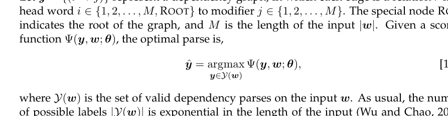

> 深度学习为图像超分辨率提供了强大的工具，但其效果受限于训练数据的质量和模型的复杂度。

其中我们写 \(i|\beta\) 表示 \(i\) 是输入缓冲区中最左边的项目，而 \(\sigma|i\) 表示将 \(i\) 推入栈 \(\sigma\) 的结果。

- **ARC-LEFT:** 创建一个类型为 \(r\) 的新左向弧，连接栈顶的项目和输入缓冲区中的第一个项目。该弧的头是 \(j\)，它保留在输入缓冲区的最前面。弧 \(j \xrightarrow{r} i\) 被添加到 \(A\) 中。形式上，

  \[
  (\sigma|i, j|\beta, A) \Rightarrow (\sigma, j|\beta, A \oplus j \xrightarrow{r} i), \qquad [11.19]
  \]

  其中 \(r\) 是依存弧的标签，而 \(\oplus\) 将新的弧 \(j \xrightarrow{r} i\) 连接到列表 \(A\)。

- **ARC-RIGHT:** 创建一个类型为 \(r\) 的新右向弧，连接栈顶的项目和输入缓冲区中的第一个项目。该弧的头是 \(i\)，它从栈中“弹出”并推到输入缓冲区的最前面。弧 \(i \xrightarrow{r} j\) 被添加到 \(A\) 中。形式上，

  \[
  (\sigma|i, j|\beta, A) \Rightarrow (\sigma, i|\beta, A \oplus i \xrightarrow{r} j), \qquad [11.20]
  \]

  其中再次 \(r\) 是依存弧的标签。

每个动作都有前提条件。SHIFT 动作只能在缓冲区至少有一个元素时执行。当根节点 ROOT 位于栈顶时，不能执行 ARC-LEFT 动作，因为该节点必须是整个树的根。ARC-LEFT 和 ARC-RIGHT 会移除修饰词：ARC-LEFT 从栈中移除，ARC-RIGHT 从缓冲区中移除，因此任何词都不可能拥有多个父节点。此外，只有当缓冲区和栈中的每个词都被移除时才能达到结束状态，因此弧的集合保证构成一棵 spanning tree。表 11.2 中展示了一个 arc-standard 推导示例。

## 弧急切依存分析

在弧标准转换系统中，一旦某个词在依存弧中成为修饰语，它就会完全从分析中移除。此时，该词的任何依存词都必须已被识别。右分支结构在英语（以及许多其他语言）中很常见，词经常被其右侧的成分（如介词短语）修饰。在弧标准系统中，这意味着我们必须先将输入的所有单元移入栈，然后倒过来工作，创建一系列弧，如表 11.2 所示。请注意，将 *bagels* 移入栈的决定保证了介词短语 *with lox* 将附着到名词短语上，并且该决定必须在介词短语本身被分析之前做出。这被认为在认知上是不合理的（Abney and Johnson, 1991）；从计算角度来看，这意味着解析器可能需要在做出正确决定前看好几步。

**Algorithm 16** 潜变量感知器

```
1: **procedure** LATENT VARIABLE PERCEPTRON(\(w^{(1:N)}, y^{(1:N)}\))
2:     \(\theta \leftarrow 0\)
3:     **repeat**
4:         Select an instance \(i\)
5:         \(z^{(i)} \leftarrow \underset{z}{\operatorname{argmax}}\; \theta \cdot f(w^{(i)}, z, y^{(i)})\)
6:         \(\hat{y}, \hat{z} \leftarrow \underset{y',z'}{\operatorname{argmax}}\; \theta \cdot f(w^{(i)}, z', y')\)
7:         \(\theta \leftarrow \theta + f(w^{(i)}, z^{(i)}, y^{(i)}) - f(w^{(i)}, \hat{z}, \hat{y})\)
8:     **until** tired
9:     **return** \(\theta\)
```

这是一种简单而通用的缺失数据学习算法。该算法以最基本的形式在算法 16 中给出，但通常的技巧如平均和边际损失也可以应用（Yu and Joachims, 2009）。除了语义解析外，潜变量感知器还被用于机器翻译（Liang et al., 2006）和命名实体识别（Sun et al., 2009）等任务。在 **潜条件随机场** 中，我们使用完整的期望而不是对隐藏变量进行最大化。该模型也被应用于语义解析之外的各种问题，包括句法分析重排（Koo and Collins, 2005）和手势识别（Quattoni et al., 2007）。

#### 12.4.3 从指称中学习

逻辑形式比完整的推导更容易获得，但对逻辑形式的标注仍需要相当的专业知识。然而，对于许多自然语言句子，获取其指称相对容易。例如，在地理领域，一个问题的指称就是其答案（Clarke et al., 2010; Liang et al., 2013）：

> **文本**: *哪些州与佐治亚州接壤？*
>
> **逻辑形式**: \(\lambda x.\mathrm{STATE}(x) \land \mathrm{BORDER}(x, \mathrm{GEORGIA})\)
>
> **指称**: \(\{\text{Alabama, Florida, North Carolina, South Carolina, Tennessee}\}\)

类似地，在机器人控制环境中，命令的指称将是一个动作或一系列动作（Artzi and Zettlemoyer, 2013）。在这两种情况下，思路是奖励语义解析器选择指称正确的分析：问题的正确答案，或正确的动作。

从逻辑形式学习是通过对推导求和或求最大值实现的。这个想法可以再进一步，针对所有具有正确指称的逻辑形式进行求和或求最大值。令 \(v_i(y) \in \{0,1\}\) 为一个 **验证函数**，它赋予一个


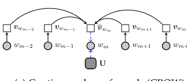

(a) 连续词袋（CBOW）

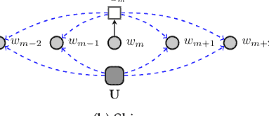

(b) 跳元模型（Skipgram）

图14.3：WORD2VEC的CBOW和跳元模型两种变体。参数U是词嵌入矩阵，每个v_m是单词w_m的上下文嵌入。

算法开头的单词。有关该算法的更多细节，参见Liang（2005）。

### 14.5 神经词嵌入

神经词嵌入结合了前两种方法的特性：与潜在语义分析一样，它们是一种连续向量表示；与Brown聚类一样，它们基于似然目标进行训练。令向量u_i表示单词i的K维嵌入，令v_j表示上下文j的K维嵌入。内积u_i · v_j表示单词i与上下文j之间的兼容性。将此内积纳入语料库对数似然的近似中，即可通过反向传播估计两组参数。WORD2VEC（Mikolov等，2013）包含两种这样的近似：连续词袋（CBOW）和跳元模型（skipgrams）。

#### 14.5.1 连续词袋（CBOW）

在循环神经网络语言模型中，每个单词w_m都以一个循环更新的状态向量为条件，该向量基于从文本开头一直延续下来的词表示。连续词袋（CBOW）模型是一种简化：局部上下文通过计算紧邻区域 m − h, m − h + 1, …, m + h − 1, m + h 中单词嵌入的平均值来获得，

\[
\overline{v}_m = \frac{1}{2h} \sum_{n=1}^{h} \left( v_{w_{m+n}} + v_{w_{m-n}} \right). \tag{14.14}
\]

因此，CBOW是一种词袋模型，因为上下文单词的顺序并不重要；它又是连续的，因为我们不是直接以单词为条件，而是以从词嵌入构造的连续向量为条件。参数h决定邻域大小，Mikolov等（2013）将其设为h=4。

| 词1 | 词2 | 相似度 |
|---|---|---|
| love | sex | 6.77 |
| stock | jaguar | 0.92 |
| money | cash | 9.15 |
| development | issue | 3.97 |
| lad | brother | 4.46 |

表14.4：WS-353（Finkelstein等，2002）词相似度评分数据集的子集（示例来自Faruqui等（2016））。

GloVe（“全局向量”）是一种密切相关的方法（Pennington等，2014），其中要分解的矩阵由对数共现计数构建，$M_{ij} = \log \text{count}(i,j)$。通过最小化平方和来估计词嵌入，

$\min_{\boldsymbol{u},\boldsymbol{v},b,\tilde{b}} \sum_{i=1}^{V} \sum_{j \in C} f(M_{ij}) \left( \widehat{\log M_{ij}} - \log M_{ij} \right)^2$

s.t. $\widehat{\log M_{ij}} = \boldsymbol{u}_i \cdot \boldsymbol{v}_j + b_i + \tilde{b}_j$, \quad [14.25]

其中$b_i$和$\tilde{b}_j$分别是单词$i$和上下文$j$的偏置项，与嵌入$\boldsymbol{u}$和$\boldsymbol{v}$联合估计。加权函数$f(M_{ij})$在$M_{ij}=0$时取零，从而避免对零计数取对数的问题；当$M_{ij}=m_{\max}$时达到饱和，从而避免对常见词-上下文对过度计数的问题。这一启发式方法对该方法的性能至关重要。

稀疏矩阵重建的时间复杂度由非零词-上下文计数的数量决定。Pennington等（2014）表明，该数量随数据集规模次线性增长：对于典型英语语料库，大约为$\mathcal{O}(N^{0.8})$。相比之下，WORD2VEC的时间复杂度与语料库大小呈线性关系。计算共现计数也需要与语料库大小成线性时间，但该操作可以很容易地使用MapReduce风格的算法并行化（Dean和Ghemawat，2008）。

### 14.6 评估词嵌入

分布式词表示可以通过两种主要方式进行评估。内在评估测试这些表示是否与我们对词义的理解一致。外在评估测试它们是否对下游任务（如序列标注）有用。


#### 15.1.2 专有名词

如果一个专有名词被用作指称表达，它通常与另一个专有名词共指，此时共指问题就简化为判断两个名称是否匹配。后续的专有名词指称常使用缩写形式，如运行示例（图15.1）所示：

(15.12) 苹果公司首席执行官[蒂姆·库克]已飞抵中国……[库克]正在对该国进行首次商务访问……

专有名词共指的一个典型解法是将指称的句法中心词与所指对象进行匹配。在§10.5.2中，我们看到，短语的中心词可以通过将中心词渗透规则应用于短语句法树来识别；或者，中心词可以识别为覆盖该名称的依存子树的根节点。对于专有名词序列，中心词将是最后一个词元。

匹配专有名词中心词的做法存在若干注意事项。

- 在欧洲传统中，姓氏往往比名字更具特异性，且通常位于最后。然而，其他传统则有不同做法：例如，在中国人名中，姓氏通常在前；在日语中，敬称位于姓名之后，如Nobu-San（信先生）。
- 在组织名称中，中心词往往不是信息量最大的部分，如Georgia Tech（佐治亚理工）和Virginia Tech（弗吉尼亚理工）。类似地，Lebanon（黎巴嫩）与Southern Lebanon（南黎巴嫩）所指实体不同，因此需要对地理修饰语这一特殊情况制定专门规则（Lee等，2011）。
- 专有名词可以嵌套，如[[微软]的首席执行官]，导致中心词匹配但不共指。

尽管存在这些困难，专有名词仍然是最容易消解的指称类别（Stoyanov等，2009）。在机器学习系统中，一种解决方案是引入一系列匹配特征，包括精确匹配、中心词匹配和字符串包含。除匹配特征外，有竞争力的系统（如Bengtson和Roth，2008）还会包含大型列表（gazetteer），收录缩写词、居民称谓（demonyms）和其他别名，例如“国家篮球协会/NBA”（National Basketball Association/NBA）、“以色列人/以色列”（the Israelis/Israel）以及“佐治亚理工学院/佐治亚理工”（the Georgia Institute of Technology/Georgia Tech）。

#### 15.1.3 名词性指称

在共指消解中，既非代词也非专有名词的名词短语称为名词性指称。在运行示例（图15.1）中，名词性指称包括：该公司（Apple Inc，苹果公司）；该公司最大的增长市场（中国）；以及该国（中国）。

 

为加强地热资源管理，合理开发利用和保护地热资源，促进地热资源可持续利用，根据《中华人民共和国矿产资源法》《矿产资源开采登记管理办法》等法律法规，结合河东市实际，订立本合同。

第一条 地热资源属于国家所有，不因其所依附的土地所有权或者使用权的不同而改变。勘查、开采地热资源必须依法取得探矿权、采矿权。

第二条 市自然资源和规划主管部门负责全市地热资源开发利用与保护的监督管理工作。市水利、生态环境、住建等有关部门按照各自职责，协同做好地热资源相关工作。

| 序号 | 项目名称 | 开发单位 | 开采规模 | 审批状态 |
|------|----------|----------|----------|----------|
| 1 | 河东新区地热供暖项目 | 河东新能源有限公司 | 10万m³/a | 已批准 |
| 2 | 温泉度假村地热利用项目 | 温泉旅游开发公司 | 5万m³/a | 已批准 |
| 3 | 农业温室地热项目 | 绿源农业科技有限公司 | 3万m³/a | 审核中 |

第三条 开采地热资源应当遵循综合利用、梯级开发的原则，提高地热资源利用率。鼓励采用先进技术和工艺，实现地热资源的高效利用和尾水回灌。

第四条 开采地热资源必须符合地热资源开发利用规划和年度开采计划，不得超采、滥采。开采单位应当安装计量设施，建立开发利用台账，定期向主管部门报送开采利用情况。

第五条 开采地热资源应当按照规定缴纳资源税和矿业权出让收益。地热资源开发利用实行有偿使用制度，具体标准按照国家及省有关规定执行。

第六条 违反本合同规定，未取得勘查许可证或者采矿许可证擅自开采地热资源的，由市自然资源和规划主管部门依法责令停止开采，赔偿损失，并处以罚款；构成犯罪的，依法追究刑事责任。

第七条 本合同自签订之日起生效。合同双方应当严格履行本合同的各项条款，因履行本合同发生争议的，由双方协商解决；协商不成的，可依法向人民法院提起诉讼。

网络：ψ_E(i, e) = Feedforward([v_e; u_i])。如果i被加入实体e，则其表示通过循环神经网络（如长短期记忆（LSTM；第6章））进行循环更新：v_e ← f(v_e, u_i)。或者，我们可以应用池化操作，如最大池化或平均池化（第3章），设v_e ← Pool(v_e, u_i)。无论哪种情况，实体e表示的更新都可以看作是通过指称i向该实体添加新信息。

### 15.4 评估共指消解

共指消解评估的现状复杂得令人恼火。早期对简单评估指标的尝试被发现容易受到琐碎基线的影响，例如将每个指称单独放入一个簇，或将所有指称归入同一个簇。继Denis和Baldridge（2009）之后，CoNLL 2011共指消解共享任务（Pradhan等，2011）将三种不同指标的平均做法正式化：MUC（Vilain等，1995）、B-CUBED（Bagga和Baldwin，1998a）和CEAF（Luo，2005）。这些指标的参考实现可在https://github.com/conll/reference-coreference-scorers获取（Pradhan等，2014）。

## 补充资源

Ng（2010）综述了截至2010年的共指消解研究。早期工作完全集中在代词消解上，采用基于规则（Lappin和Leass，1994）和概率方法（Ge等，1998）。完整的共指消解问题在第六届消息理解会议（Message Understanding Conference）相关的共享任务中得到推广，该任务为训练集和测试集分别提供了三十篇文档的共指标注（Grishman和Sundheim，1996）。一篇有影响力的早期论文是Soon等（2001）的决策树方法，他们引入了指称排序。Bengtson和Roth（2008）提供了共指消解表面特征的综合列表。Durrett和Klein（2013）通过引入大规模词化特征集改进了先前工作；后续工作则强调实体和指称的神经表示（Wiseman等，2015）。

## 习题

1. 从今天的新闻中选择一篇文章，为文中出现的前二十个名词短语和物主代词标注共指关系，包括嵌套在更大名词短语中的那些。然后，根据这些候选实体指称中的前五个，给出由此产生的指称对（mention-pair）训练数据。
2. 使用前一题中的标注，计算以下统计量：比较原始5-gram计数与通过替换生成的5-gram计数总和的比率。该比率能否很好地预测某个成分是否具有指称性？

## 第16章 篇章

自然语言处理的应用通常涉及多句文档：从段落长度的餐厅评论，到500词的报纸文章，再到500页的小说。然而，迄今我们讨论的大多数方法都只针对单个句子。本章讨论处理多句语言现象的理论和方法，这些现象统称为**篇章**。篇章结构有多种不同的刻画方式，没有一种结构对所有计算应用都是理想的。本章涵盖一些研究最充分的篇章表示，并重点介绍识别和利用这些结构的计算模型。

### 16.1 片段

文档或对话可以看作一系列**片段**，每个片段在内容和/或功能上都是**内聚**的。在维基百科传记中，这些片段通常涉及主题人物生活的各个方面：早年经历、重大事件、对他人的影响等等。这种切分围绕**主题**进行组织。或者，科学研究论文通常按**功能主题**组织：引言、先前研究综述、实验设置和结果。

书面文本通常使用章节标题和相关格式手段来标记片段。然而，这种格式可能过于粗粒度，难以支持诸如检索与查询相关的特定文本段落等应用（Hearst，1997）。未格式化的语音转录文本，如会议和讲座，也是片段切分的一个应用场景（Carletta，2007；Glass等，2007；Janin等，2003）。


|  | 斯凯勒 | 沃尔特 | 危险 | 一个家伙 | 门 |
|---|---|---|---|---|---|
| *你不知道你在跟谁说话，* | S | - | - | - | - |
| *让我来告诉你吧。* | O | O | - | - | - |
| *我并没有身处危险，斯凯勒。* | X | S | X | - | - |
| *我就是危险。* | - | S | O | - | - |
| *一个人打开门就中枪了，* | - | - | - | S | O |
| *你觉得我会那样？* | S | X | - | - | - |
| *不。我就是那个敲门的人！* | - | S | - | - | - |

图16.3：美剧《绝命毒师》中一段对话的实体网格表示。

中心理论统一了句法、话语和回指消解的各个方面。然而，要明确如何对每个话语的元素进行排序，甚至如何将文本或对话切分为话语，可能并不容易（Poesio 等，2004）。

#### 16.2.2 实体网格

将中心理论的思想形式化的一种方法是将文本或对话中的实体排列成一个**实体网格**。这种数据结构每个句子占一行，每个实体占一列（Barzilay 和 Lapata，2008）。每个单元格 $c(m, i)$ 可以取以下值：

$c(m, i) = \begin{cases} S, & \text{实体 } i \text{ 在句子 } m \text{ 中位于主语位置} \\ O, & \text{实体 } i \text{ 在句子 } m \text{ 中位于宾语位置} \\ X, & \text{实体 } i \text{ 出现在句子 } m \text{ 中，但既不在主语也不在宾语位置} \\ -, & \text{实体 } i \text{ 未出现在句子 } m \text{ 中。} \end{cases}$

[16.3]

为了填充实体网格，需要运用句法分析来识别主语和宾语位置，并运用共指消解来将同一个实体的多次提及关联起来。图16.3给出了一个例子。

网格构建完成后，文档的连贯性可以通过每列中相邻单元格之间的*转换*来衡量。例如，转换（$S \rightarrow S$）使实体在相邻句子中保持主语位置；转换（$O \rightarrow S$）将实体从宾语位置提升到主语位置；转换（$S \rightarrow -$）使某个句子的主语不出现在下一个句子中。每个转换的概率可以

#### 16.3.2 层级话语关系

在句子分析中，相邻短语组合成更大的成分，最终为整个句子产生一个单一成分。由此产生的树结构可以对句子进行结构化分析，其子树表示句法上连贯的意义块。修辞结构理论（RST）将这种层级分析风格扩展到话语层面（Mann 和 Thompson，1988）。

RST的基本元素是话语单位（discourse unit），指一段连续的文本。基本话语单位（EDU）是该框架中的原子元素，通常（但不总是）是小句。⁵ 每种话语关系将两个或更多相邻的话语单位组合成一个更大的复合话语单位；这一过程最终将整个文本联结成一个类树结构。⁶

**核心性** 在许多话语关系中，有一个论元是主要的。例如：

(16.8) [拉肖恩热爱动物]ₙ
[她养了九只狗和一头猪]ₛ

在这个例子中，第二个句子为第一个句子所表达的观点提供了EVIDENCE（证据）。因此，第一个句子是话语关系的核心，第二个句子是卫星。核心性的概念类似于依存分析中的中心词-修饰语结构（见 § 11.1.1）。然而，在RST中，有些关系具有多个核心。例如，对比（CONTRAST）关系的各个论元同等重要：

(16.9) [意识形态的冲突在这种处理下仍然存在]ₙ
[但高尔基笔下人物个体的细微之处和丰富性已在混战中消失]ₙ⁷

具有多个核心的关系称为并列关系；只有一个核心的关系称为从属关系。从属关系仅限于两个论元，而并列关系（如连接关系 CONJUNCTION）可以有多个论元。

⁵话语切分的细节可在RST标注手册中找到（Carlson 和 Marcu，2001）。

⁶虽然RST分析通常采用树结构，但这不应被视为对“所有连贯话语都具有树结构”这一原则的强理论承诺。Taboada 和 Mann（2006）写道：

> 树之所以被采用，仅仅是因为它方便、易于表示、易于理解。另一方面，没有任何理论理由假定树是话语结构和连贯关系的唯一可能的表示。

树结构对话语的适用性受到了质疑，例如 Wolf 和 Gibson（2005）提出了更一般的图结构表示。

⁷来自RST树库（Carlson 等，2002）

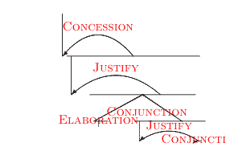

[它本可以是一部伟大的电影]¹ᴬ [它确实有美丽的风景，]¹ᴮ [是自《指环王》以来最好的风景之一。]¹ᶜ [表演也很到位，]¹ᴰ [而且我真的很喜欢武士首领的儿子。]¹ᴱ [他是个可爱的小伙子。]¹ᶠ [我不想看到他死去。]¹ᴳ [但是，除了这些，这部电影无非是隐晦的抄袭之作。]¹ᴴ

图16.5：一篇短影评的修辞结构理论分析，改编自 Voll 和 Taboada（2007）。正面和负面情感词加了下划线，表明RST在文档级情感分析中的潜在用途。

### RST 关系

修辞结构理论拥有大量的话语关系，这些关系分为两个高层类别：主题关系（subject matter relations）和呈示关系（presentational relations）。呈示关系围绕读者的预期信念组织。例如，在(16.8)中，第二个话语单位提供的证据旨在增加读者对第一个话语单位所表达命题（拉肖恩热爱动物）的信念。相比之下，主题关系旨在传达关于其所关联话语单位中命题的额外事实：

(16.10) [债务计划仓促完成]ₙ
[以便在会上公布]ₛ⁸

在这个例子中，卫星描述了一个由核心所描述动作实现的世界状态。这种关系是关于世界的，而不是关于作者的交际意图的。

### 示例

图16.5描绘了一篇影评中一个段落的RST分析。非对称（从属）关系用从卫星指向核心的箭头表示；对称（并列）关系用直线表示。基本话语单位1F和1G通过对称的连接（Conjunction）关系组合成一个更大的话语单位。随后，该话语单位与1E构成证明（Justify）关系中的卫星。

⁸来自RST树库（Carlson 等，2002）

### 层级话语解析

话语解析的目标是从文档文本中恢复层级结构分析，例如图16.5中的分析。目前，我们假设文档已被切分为基本话语单位（EDU）；切分算法将在下文讨论。切分之后，话语解析可以看作是两部分组合：§ 16.3.1 中讨论的话语关系分类技术，以及第10章中讨论的短语结构解析算法，如图表解析（chart parsing）和移进-归约（shift-reduce）。

图表解析和移进-归约都需要对复合话语单位进行编码，可以使用离散特征向量或稠密神经表示。⁹ 一些话语解析器依赖于强组合性准则（Marcu，1996），该准则假设复合话语单位可以用其核心来表示。这一准则在基于特征的话语解析中用于确定复合话语单位的特征向量（Hernault 等，2010）；在神经方法中，它用于将复合话语单位的向量编码设为其核心的编码（Ji 和 Eisenstein，2014）。另一种神经方法是使用递归神经网络学习一个在复合话语单位各组成部分上的组合函数（Li 等，2014），该函数使用递归神经网络（见 § 14.8.3）。

### 自底向上的话语解析

假设文本被切分为 N 个基本话语单位，其基础表示为 {z^(i)}^N_{i=1}，并假设存在一个组合函数 COMPOSE (z^(i), z^(j), ℓ)，它将两个编码和一个话语关系 ℓ 映射为一个新编码。组合函数可以遵循强组合性准则，直接选择核心的编码，也可以执行更复杂的操作。我们还需要一个评分函数 Ψ(z^(i,k), z^(k,j), ℓ)，它为（二值化的）话语关系 ℓ 计算一个标量分数，其中左子节点覆盖跨度 i + 1 : k，右子节点覆盖跨度 k + 1 : j。有了这些组件，我们就可以为每个跨度构建向量表示，这就是组合向量语法（compositional vector grammars）的基本思想（Socher 等，2013）。

这些组件同样可以用于自底向上解析，方式类似于加权上下文无关文法的CKY算法（见 § 10.1）：按长度递增的顺序计算每个可能跨度的分数和最佳分析，同时存储回溯指针，从而能够恢复整个输入的最优解析。然而，与CKY解析有一个重要区别：对于每个带标签的跨度 (i, j, ℓ)，我们必须使用组合函数构造一个表示 z^(i,j,ℓ)。该表示随后用于将跨越 i + 1 : j 的话语单位组合到更高层级的话语关系中。表示 z^(i,j,ℓ) 依赖于该单位跨度的整个子结构-

⁹要使用这些算法，还需要在解析过程中将所有话语关系二值化，然后再“解二值化”它们以重建所需的结构（例如，Hernault 等，2010）。


话语单元是根据其论元以及一个对应于话语关系的参数计算得出的（Ji and Smith, 2017）。

浅层的、非层级式话语关系也被应用于文档分类。一种方法是对单个话语单元的分析施加一组约束，使得当相邻单元通过表示一致的话语关系连接时，它们具有相同的极性，而当通过表示不一致的对比性话语关系连接时，它们具有相反的极性（Somasundaran et al., 2009; Zirn et al., 2011）。Yang and Cardie (2014) 将宾夕法尼亚话语树库中显式标记的关系应用于句子级情感极性分类问题（见§4.1）。他们施加了以下软约束：

- 当句子开头出现对比关系时，该句的情感极性应与其前一句相反。
- 当句子开头出现扩展或依赖关系时，该句的情感极性应与其前一句相同。
- 当句子内部出现对比关系时，该句的情感极性应为中性，因为它可能同时表达两种情感。

这些由话语驱动的约束被证明可以在两个产品评论数据集上提升性能。

## 连贯性

正如语法性是结构良好的句子所共有的属性，连贯性是结构良好的话语所共有的属性。话语处理的一个应用是衡量（并最大化）计算机生成的文本（如译文和摘要）的连贯性（Kibble and Power, 2004）。连贯性评估也用于评价人类生成的文本，例如学生作文（如 Miltsakaki and Kukich, 2004; Burstein et al., 2013）。

连贯性涵盖了一系列现象，其中许多已在本章前面提到：例如，相邻句子应在词汇上具有衔接性（Foltz et al., 1998; Ji et al., 2015; Li and Jurafsky, 2017），实体指称应遵循中心理论的原则（Barzilay and Lapata, 2008; Nguyen and Joty, 2017）。话语关系也以多种方式影响文本的连贯性：

- 层级式话语关系的核心和卫星往往存在“典型顺序”（Mann and Thompson, 1988）：例如，在修辞结构理论的阐述关系中，核心总是位于前面，而在论证关系中，卫星往往位于前面（Marcu, 1997b）。

## 练习

1. 有些话语连接词倾向于出现在其论元之间；有些则可以位于两个论元之前，少数可以位于两个论元之后。请指出下列连接词可以出现在其论元之间、之前还是之后：*however, but, while*（表示对比，而非时间）、*although, therefore, nonetheless*。

2. 本练习需两人合作完成。每位参与者从今天的新闻中选择一篇文章，并将所有提到具体人物的部分替换为特殊标记，如PERSON1、PERSON2等。另一位参与者应使用中心理论的规则来猜测每种指称表达的类型：全名（*Captain Ahab*）、部分姓名（如*Ahab*）、名词性短语（如*the ship’s captain*）或代词。检查预测是否与原文匹配，以及文本是否符合中心理论的规则。

3. 在本练习中，你将制作一个类似图16.1的图形。

- a) 使用平滑核**k** = [.5, .3, .15, .05]，实现公式16.2中的平滑余弦相似度度量。
- b) 下载一篇至少包含十个段落的新闻文章文本。
- c) 计算并绘制整篇文章范围内的平滑相似度**s̄**。
- d) 按以下方式识别**s̄**中的*局部最小值*：首先找出所有满足**s̄**_m < **s̄**_{m±1}的句子*m*。然后在这些点中搜索，找出**s̄**_m值最低的五个句子。
- e) 这五个局部最小值与段落边界的重合频率如何？
  - 局部最小值中属于段落边界的比例即为**k处精确率**，此处*k* = 5。
  - 段落边界中属于局部最小值的比例即为**k处召回率**。
  - 计算*k* = 3和*k* = 10时的k处精确率和k处召回率。

4. 将文本分割形式化为概率模型的一种方法是使用**狄利克雷复合多项式**（DCM）分布，该分布计算词袋的概率DCM(*x*; *α*)，其中参数*α*是一个正实数向量。该分布可以配置为对内部一致的词袋向量赋予高似然，使得单个词重复出现：例如，这种特性可以通过简单的参数设置观察到，如*α* = *α* **1**且*α* < 1。

设*ψ*_*α*(*i*, *j*)表示在参数为*α*的DCM分布下，片段**w**_{i+1:j}的对数概率。给出一个动态规划算法，将文本分割为总共K个片段，使得对数概率之和∑_{k=1}^K ψ_α(s_{k-1}, s_k)最大化，其中s_k表示第k个片段的最后一个词的索引，且s_0 = 0。你的动态规划的时间复杂度不应高于输入长度的二次方乘以片段数量的线性。

5. 在上一题的基础上，你现在需要调整CKY算法以进行层级式分割。将层级式分割定义为一组分割{{s_k^{(ℓ)}}_{k=1}^{K^{(ℓ)}}}_{ℓ=1}^L，其中L是分割深度。为确保分割在层级上是有效的，我们要求第ℓ层上的每个分割点s_k^{(ℓ)}也是第ℓ−1层上的分割点，其中ℓ > 1。

为简化，本题关注二叉层级式分割，因此第ℓ > 1层的每个片段恰好有2个子片段。将层级式分割的得分定义为所有层级上所有片段得分之和，使用上一题中的DCM对数概率作为片段得分。给出一个类似CKY的递推关系，使得文本的最优“解析”是恰好有L层、具有最大对数概率的二叉分割。

6. 中心理论的实体网格表示可用于计算相邻句子的得分，如§16.2.2所述。给定一组句子，这些得分可用于计算最优排序。请通过从某个众所周知的问题进行归约，证明寻找具有最大对数概率的排序问题是NP完全的。

7. 在§16.3.2中已经指出，使用每个区间的组合向量表示进行自底向上解析并不能保证最优。在本练习中，你将构建一个最小示例来证明这一点。考虑一个包含四个话语单元的话语，其基本表示为{z^{(i)}}_{i=1}^4。构造一个场景，使得自底向上解析选择的解析树不是最优的，并给出该次优解析被选中的精确数学条件。在本例中可以忽略关系标签ℓ。

8. 如§16.3.3所述，论元可以用超图来描述，其中一个片段可能削弱另外两个片段之间提出的边。将§16.3.4中描述的抽取式摘要模型扩展到论元，并添加以下约束：如果片段i削弱了j和k之间的论证关系，那么除非j和k都被包含，否则i不能被包含在摘要中。你的解决方案应采用整数线性规划中的一组线性约束的形式——也就是说，每个约束只能涉及变量的加减。

在接下来的两个练习中，你将探索真实语料库中话语连接词的使用。使用NLTK获取Brown语料库，并识别以以下连接词开头的句子：however, nevertheless, moreover, furthermore, thus。


- 9. 词汇连贯性和话语连接词共同促进了文本的**衔接**。因此，我们可能预期，由显式话语连接词连接的相邻句子也具有更高的词汇重叠度。利用 Brown 语料库，通过计算由上述连接词之一连接的相邻句子之间的平均余弦相似度来检验这一理论。将其与所有其他相邻句子的平均余弦相似度进行比较。如果你知道如何进行，请执行双样本 t 检验，以确定观察到的差异是否具有统计显著性。

- 10. 将上述连接词归入以下三种话语关系：
  - 扩展：*moreover, furthermore*
  - 比较：*however, nevertheless*
  - 因果：*thus*

  重点关注由这五个连接词之一连接起来的句子对，构建一个分类器，根据两个相邻句子的文本预测话语关系——注意要忽略连接词本身。使用 Brown 语料库的前 30000 个句子作为训练集，其余句子作为测试集。将你的分类器的性能与简单选择最频繁类别的方法进行比较。使用词袋分类器很难比这个基线好多少，因此请考虑更复杂的替代方案！

# 第四部分 应用
 

- 提及字符串与规范实体名的相似度，通过字符串相似度量化。这一特征会使得字符串 *Atlanta* 更倾向于指代城市亚特兰大，而不是篮球队亚特兰大老鹰队。
- 实体的流行度，可通过维基百科页面浏览量或维基百科链接图中的 PageRank 来衡量。这一特征会使得佐治亚州的亚特兰大更倾向于俄亥俄州的非建制社区亚特兰大。
- 实体类型，由命名实体识别系统输出。在提及被标记为地点的上下文中，这一特征会使得城市亚特兰大更倾向于杂志《亚特兰大》。

除了这些局部特征，文档上下文也能提供帮助。如果 *Jamaica* 在一篇关于加勒比地区的文档中被提及，它很可能指的是那个岛国；在纽约的语境下，它很可能指皇后区的那个街区；在菜单的语境下，它可能指木槿花茶饮品。这种提示可以通过计算描述每个候选实体的维基百科页面与提及上下文 $c^{(i)}$ 之间的相似度来形式化，其中上下文可以包括表示文档的词袋（Dredze et al., 2010; Hoffart et al., 2011）或提及周围较小的文本窗口（Ratinov et al., 2011）。例如，我们可以计算上下文和实体描述的词袋向量之间的余弦相似度，通常使用**逆文档频率**加权以强调稀有词。[^2]

### 神经实体链接

另一种方法是使用实体、提及和上下文的分布式向量表示来计算每个实体候选的得分。例如，对于 Twitter 中的实体链接任务，Yang et al. (2016) 采用了双线性评分函数，

$$\Psi(y, x, c) = v_y^\top \Theta^{(y,x)} x + v_y^\top \Theta^{(y,c)} c,\tag{17.3}$$ 

其中 $v_y \in \mathbb{R}^{K_y}$ 是实体 $y$ 的向量嵌入，$x \in \mathbb{R}^{K_x}$ 是提及的嵌入，$c \in \mathbb{R}^{K_c}$ 是上下文的嵌入，矩阵 $\Theta^{(y,x)}$ 和 $\Theta^{(y,c)}$ 是用于对每个实体相对于提及和上下文的兼容性进行评分的参数。每个向量嵌入都可以通过端到端目标学习，或在无标注数据上进行预训练。

- 预训练的**实体嵌入**可以从现有的知识库中获得（Bordes et al., 2011, 2013），或者通过在维基百科文本上运行诸如 word2vec 之类的词嵌入算法获得，用超链接替换锚文本。[^3]
- 提及 *x* 的嵌入可以通过对提及中单词的嵌入取平均来计算（Yang et al., 2016），或者通过第 14.8 节中描述的组合技术来计算。
- 上下文 *c* 的嵌入也可以从上下文中单词的嵌入计算得出。**去噪自编码器**通过最小化重构损失来学习从原始文本到密集 *K* 维向量编码的函数（Vincent et al., 2010），

$$\min_{\theta_g,\theta_h}\sum_{i=1}^{N}\|x^{(i)} - g(h(\tilde{x}^{(i)};\theta_h);\theta_g)\|^2,\tag{17.4}$$

其中 $\tilde{x}^{(i)}$ 是词袋计数 $x^{(i)}$ 的噪声版本，通过随机将某些计数设为零而产生；$h : \mathbb{R}^V \rightarrow \mathbb{R}^K$ 是参数为 $\theta_h$ 的编码器；$g : \mathbb{R}^K \rightarrow \mathbb{R}^V$，参数为 $\theta_g$。编码器和解码器函数通常实现为前馈神经网络。为了将此模型应用于实体链接，每个实体和上下文最初由其词袋向量的编码表示，即 $h(e)$ 和 $g(c)$，然后这些编码通过标注数据进行微调（He et al., 2013）。上下文向量 $c$ 也可以通过卷积（§ 3.4）对文档中单词的嵌入获得（Sun et al., 2015），或者通过检查元数据（如作者的社会网络）获得（Yang et al., 2016）。

其余参数 $\Theta^{(y,x)}$ 和 $\Theta^{(y,c)}$ 可以通过公式 17.2 中的边际损失的反向传播进行训练。

#### 17.1.2 集体实体链接

当在文档中联合执行实体链接时，实体链接可以更加准确。为了理解原因，请考虑以下列表：

(17.5)
a. California, Oregon, Washington
b. Baltimore, Washington, Philadelphia
c. Washington, Adams, Jefferson

在每种情况下，术语 *Washington* 指的是不同的实体，而这种指代由列表中的其他条目强烈暗示。在最后一个列表中，所有三个名字都具有高度歧义——在维基百科中还有几十个其他的 *Adams* 和 *Jefferson* 实体。但是一个

 

```
1: procedure WARP(y^(i), x^(i))
2:   N ← 0
3:   repeat
4:     Randomly sample y ~ Y(x^(i))
5:     N ← N + 1
6:     if ψ(y, x^(i)) + 1 > ψ(y^(i), x^(i)) then ▷ check for margin violation
7:       r ← ⌈|Y(x^(i))|/N⌉ ▷ compute approximate rank
8:       return L_rank(r) × (ψ(y, x^(i)) + 1 − ψ(y^(i), x^(i)))
9:   until N ≥ |Y(x^(i))| − 1 ▷ no violation found
10:  return 0 ▷ return zero loss
```

不仅仅是得分最高的预测。Usunier et al. (2009) 定义了一个通用的排序误差函数，

$$L_{\mathrm{rank}}(k) = \sum_{j=1}^k \alpha_j, \quad \text{with } \alpha_1 \ge \alpha_2 \ge \dots \ge 0,\tag{17.6}$$

其中 *k* 等于排名高于正确标签 $y^{(i)}$ 的标签数量。该函数定义了一类排序误差：如果对所有 $j$ 都有 $\alpha_j = 1$，那么排序误差等于正确实体的排名；如果 $\alpha_1 = 1$ 且 $\alpha_{j>1} = 0$，那么只要正确实体没有排在第一位，排序误差就是 1；如果 $\alpha_j$ 随 $j$ 平滑递减，例如 $\alpha_j = 1/j$，则误差介于这两个极端之间。

这种排序误差可以整合到边际目标中。请记住，大边际分类不仅要求正确的标签，还要求正确标签以相当大的边际超过其他标签。类似的原则也适用于排序：我们希望正确实体具有高排名，并且希望它与其它实体之间有很大的边际。因此我们定义了边际增强排名，

$$r(y^{(i)}, x^{(i)}) \triangleq \sum_{y \in Y(x^{(i)}) \setminus y^{(i)}} \delta\bigl(1 + \psi(y, x^{(i)}) \ge \psi(y^{(i)}, x^{(i)})\bigr),\tag{17.7}$$

其中 $\delta(\cdot)$ 是一个 delta 函数，$Y(x^{(i)}) \setminus y^{(i)}$ 是所有实体候选减去真实实体 $y^{(i)}$ 的集合。边际增强排名是真实实体在当前评分函数 $\psi$ 下的排名，在对每个其他候选添加 1 的边际之后。（为简洁起见省略了上下文 $c$，可将其视为 $x$ 的一部分。）

对于每个实例，根据排序误差计算一个铰链损失

[^2]: 单词 $j$ 的**文档频率**为 $\mathrm{DF}(j) = \frac{1}{N} \sum_{i=1}^N \delta\left(x_j^{(i)} > 0\right)$，等于该单词出现的文档数量。每个单词对两个词袋向量的余弦相似度的贡献可以用**逆文档频率** $\frac{1}{\mathrm{DF}(j)}$ 或 $\log \frac{1}{\mathrm{DF}(j)}$ 来加权，以强调稀有词（Spärck Jones, 1972）。

[^3]: 预训练的实体嵌入可以从 https://code.google.com/archive/p/word2vec/ 下载。


边际增强的排名，以及边际约束的违反，

$$
\ell(y^{(i)}, x^{(i)}) = \frac{L_{\mathrm{rank}}\left(r(y^{(i)}, x^{(i)})\right)}{r(y^{(i)}, x^{(i)})} \sum_{y \in \mathcal{Y}(x) \setminus y^{(i)}} \left( \psi(y, x^{(i)}) - \psi(y^{(i)}, x^{(i)}) + 1 \right)_+ , \tag{17.8}
$$

方程 17.8 中的求和对应用边际增强后排名至少与真实实体一样高的每个标签都包含非零值。因此除以真实实体的边际增强排名就得到平均违反程度。

方程 17.8 中的目标在标签空间很大时优化成本很高，而在针对大型知识库进行实体链接时通常就是这种情况。这促使了一种称为 WARP 的随机近似方法 Weston et al., 2011，见算法 18。在此过程中，我们采样随机实体，直到有一个违反成对边际约束 $\psi(y, x^{(i)}) + 1 \ge \psi(y^{(i)}, x^{(i)})$。找到此类违反所需样本数 $N$ 给出了真实实体边际增强排名的近似值，$r(y^{(i)}, x^{(i)}) \approx \lceil |\mathcal{Y}(x)| / N \rceil$。如果立即找到违反，$N = 1$，正确实体可能排在许多其他实体之后，$r \approx |\mathcal{Y}(x)|$。如果在找到违反之前需要大量样本，$N \to |\mathcal{Y}(x)|$，则正确实体可能排名很高，$r \to 1$。WARP 的计算优势在于不必找到得分最高的标签，而当 $\mathcal{Y}(x^{(i)})$ 很大时，这会带来非平凡的计算成本。该目标在概念上与 word2vec 中的负采样目标 chapter 14 相似，后者将观察到的词与随机采样的替代词进行比较。

### 17.2 关系

在识别文本中提及的实体之后，下一步是确定它们之间的关系。考虑以下示例：

(17.6) 乔治·布什于周四前往法国参加峰会。

该句子在乔治·布什和法国所指的实体之间引入了一种关系。在自动内容抽取 Automatic Content Extraction 本体 Linguistic Data Consortium, 2005 中，该关系的类型为 PHYSICAL，子类型为 LOCATED。该关系将被写为，

PHYSICAL.LOCATED(GEORGE BUSH, FRANCE). [17.9]

关系恰好取两个参数，且参数的顺序很重要。

在 ACE 数据集中，关系是在实体提及之间标注的，如上例所示。关系也可以在名词短语之间成立，如 SemEval-2010 共享任务 Hendrickx et al., 2009 中的以下示例：

| 关系类型 | 示例 |
|---|---|
| CAUSE-EFFECT | *那些癌症是由辐射暴露引起的* |
| INSTRUMENT-AGENCY | *电话接线员* |
| PRODUCT-PRODUCER | *一家工厂生产西装* |
| CONTENT-CONTAINER | *一瓶蜂蜜被称重* |
| ENTITY-ORIGIN | *来自外国的信件* |
| ENTITY-DESTINATION | *男孩去了床上* |
| COMPONENT-WHOLE | *我的公寓有一个大厨房* |
| MEMBER-COLLECTION | *森林里有许多树* |
| COMMUNICATION-TOPIC | *讲座关于语义学* |

表 17.1：来自 SemEval-2010 数据集 Hendrickx et al., 2009 的关系及示例句子

(17.7) 杯子里装着来自干人参的茶。

该句子描述了茶与人参之间类型为 ENTITY-ORIGIN 的关系。名词关系抽取与语义角色标注 chapter 13 密切相关。主要区别在于关系抽取限制为相对较少的关系类型；例如，表 17.1 显示了 SemEval-2010 的十种关系类型。

#### 17.2.1 基于模式的关系抽取

关系抽取的早期工作集中在手工制作的模式 Hearst, 1992。例如，同位语 *Starbuck, 来自 Nantucket 的本地人* 表明 Starbuck 与 Nantucket 之间存在 ENTITY-ORIGIN 关系。该模式可以写为，

PERSON, a native of LOCATION ⇒ ENTITY-ORIGIN(PERSON, LOCATION). [17.10]

每当字面字符串 “, a native of” 出现在类型为 PERSON 的实体与类型为 LOCATION 的实体之间时，该模式就会被“触发”。此类模式可使用诸如词形还原等技术推广到字面匹配之外，这将使词语 buy, buys, buying 触发相同的模式 see § 4.3.1。更激进的策略是将所有词语归入 WordNet 同义词集 § 4.2，从而使例如 buy 和 purchase 触发相同的模式。

关系抽取模式可以用有限状态自动机实现 § 9.1。如果命名实体识别器也是有限状态机，则系统可以通过有限状态转导 Hobbs et al., 1997 结合。这使得能够通过有限状态级联传播不确定性，并从更高层上下文中进行消歧。例如，假设实体识别器无法确定 Starbuck 指的是 PERSON 还是 LOCATION；在组合的转换器中，关系抽取器可以自由地在适当模式的上下文中选择 PERSON 标注。

#### 17.2.2 作为分类任务的关系抽取

关系抽取可以表述为分类问题，

$$
\hat{r}_{(i,j),(m,n)} = \arg\max_{r \in \mathcal{R}} \Psi(r, (i,j), (m,n), \boldsymbol{w}), \tag{17.11}
$$

其中 $r \in \mathcal{R}$ 是关系类型 possibly NIL，$\boldsymbol{w}_{i+1:j}$ 是第一个参数的跨度，$\boldsymbol{w}_{m+1:n}$ 是第二个参数的跨度。参数 $\boldsymbol{w}_{m+1:n}$ 可能出现在 $\boldsymbol{w}_{i+1:j}$ 之前或之后，或两者重叠；我们只规定 $\boldsymbol{w}_{i+1:j}$ 是关系的第一个参数。我们现在考虑计算评分函数的三种替代方案。

#### 基于特征的分类

在基于特征的分类器中，评分函数定义为，

$$
\Psi(r, (i,j), (m,n), \boldsymbol{w}) = \boldsymbol{\theta} \cdot \boldsymbol{f}(r, (i,j), (m,n), \boldsymbol{w}), \tag{17.12}
$$

其中 $\boldsymbol{\theta}$ 表示权重向量，$\boldsymbol{f}(\cdot)$ 表示特征向量。§ 17.2.1 中描述的基于模式的方法建议了以下几个特征：

- $\boldsymbol{w}_{i+1:j}$ 和 $\boldsymbol{w}_{m+1:n}$ 的局部特征，包括：字符串本身；它们是否被识别为实体，如果是，则是哪种类型；字符串是否出现在实体名称的 **gazetteer** 中；每个字符串的句法中心 § 9.2.2。
- 两个参数之间的跨度 $\boldsymbol{w}_{j+1:m}$ 或 $\boldsymbol{w}_{n+1:i}$ depending on which argument appears first 的特征：跨度的长度；跨度中出现的具体词语，要么作为字面序列，要么作为词袋；参数之间跨度中出现的 WordNet 同义词集 § 4.2。
- 两个参数之间的句法关系特征，通常是参数之间的 **dependency path** § 13.2.1。示例依赖路径显示在表 17.2 中。

#### 核方法

假设表 17.2 的第一行是标记示例，其余行是待分类的实例。基于特征的方法必须将依赖路径分解为捕捉单个边、带或不带其标签的特征，然后为每个特征学习权重：例如，第二行包含相同的依赖关系，但参数不同；第三行包含 travel 词的不同屈折；第四行和第五行在依赖路径上各包含一条额外的边；第六个示例使用完全不同的路径。与其尝试创建能够捕捉这些依赖路径

右子路径：路径 George Bush ← wants → travel → France 被分割为子路径 George Bush ← wants 和 wants → travel → France。在每条路径中，从参数到根词 in this case, wants 运行循环神经网络。最终表示通过 max pooling § 3.4 在每条路径上的所有循环状态上获得。该过程可以应用于单独的“channels”，其中输入包括词语、词性、依赖关系和 WordNet 上位词的嵌入 e.g., France-nation; see § 4.2。为了形式化地定义模型，设 $s(m)$ 定义左或右子路径中词 $m$ 的后继 in a dependency path, each word can have a successor in at most one subpath。设 $x_m^{(c)}$ 表示通道 $c$ 中词 or relation $m$ 的嵌入，并设 $\overleftarrow{h}_m^{(c)}$ 和 $\overrightarrow{h}_m^{(c)}$ 表示左子树和右子树中相应的循环状态。然后完整模型指定如下，

$$
h_{s(m)}^{(c)} = RNN(x_{s(m)}^{(c)}, h_m^{(c)}) \tag{17.18}
$$

$$
z^{(c)} = MaxPool\left( \overleftarrow{h}_i^{(c)}, \overleftarrow{h}_{s(i)}^{(c)}, \ldots, \overleftarrow{h}_{\mathrm{root}}^{(c)}, \overrightarrow{h}_j^{(c)}, \overrightarrow{h}_{s(j)}^{(c)}, \ldots, \overrightarrow{h}_{\mathrm{root}}^{(c)} \right) \tag{17.19}
$$

$$
\Psi(r, i, j) = \theta \cdot \left[ z^{(\mathrm{word})}; z^{(\mathrm{POS})}; z^{(\mathrm{dependency})}; z^{(\mathrm{hypernym})} \right] . \tag{17.20}
$$

注意 $z$ 是通过对水平拼接向量 $h$ 的矩阵应用 max-pooling 计算的，而 $\Psi$ 是从垂直拼接向量 $z$ 的向量计算的。Xu et al. 2015 将分数 $\Psi$ 通过 softmax 层以获得概率 $p(r | i, j, \boldsymbol{w})$，并通过正则化交叉熵训练模型。Miwa and Bansal 2016 显示，相关模型可以解决更具挑战性的“端到端”关系抽取任务，其中模型必须同时检测实体然后抽取其关系。

#### 17.2.3 知识库填充

在许多应用中，重要的是不是分析了多少句子是正确的，而是能抽取多少准确的知识。知识库填充 Knowledge base population 指的是填充维基百科风格信息框的任务，如图 17.1a 所示。知识库填充可以分解为两个子任务：实体链接 described in § 17.1，和槽填充 Ji and Grishman, 2011。槽填充与上面提出的关系抽取表述有两个关键区别：关系是在实体之间而不是文本跨度之间成立，并且性能在类型级别 on entity pairs 而不是标记级别 on individual sentences 上进行评估。

从实际角度来看，槽填充与按句子关系抽取之间还有三个其他重要区别。

- KBP 任务通常是从识别少数“query”实体的属性的角度制定的。因此，这些系统通常从信息

在多个文档中以高置信度检测到的关系更可能是有效的，这启发了如下启发式方法：

ψ(r, e₁, e₂) = Σᵢ₌₁ᴺ (p(r(e₁, e₂) | w⁽ⁱ⁾))ᵅ, [17.21]

其中，p(r(e₁, e₂) | w⁽ⁱ⁾) 是在文本 w⁽ⁱ⁾ 条件下，实体 e₁ 和 e₂ 之间关系 r 的概率，α ≫ 1 是可调超参数。使用这种启发式方法，可以对所有候选关系进行排序，并在抽取更多关系时描绘出**精确率-召回率曲线**。⁶

⁶精确率-召回率曲线类似于图4.4所示的ROC曲线，但它包含精确率 TP/(TP+FP)，而不是假阳性率 FP/(FP+TN)。

或者，可以在多个文本片段上聚合特征，输入到单个类型级关系抽取系统中（Wolfe等，2017）。

通过引入跨多个关系的约束，可以提高精确率。例如，如果我们确定关系 PARENT(e₁, e₂) 成立，那么 PARENT(e₂, e₁) 就不能同时成立。整数线性规划使得将这些约束纳入全局优化成为可能（Li等，2011）。其他关系对具有正相关性，如 MAYOR(e₁, e₂) 和 LIVED-IN(e₁, e₂)。跨关系类型的兼容性可以纳入概率图模型中（例如，Riedel等，2010）。

## 远程监督

关系抽取是“标注饥渴”的，因为每个关系都需要自己的标注数据。与其依赖单篇文档的标注，不如利用现有的知识资源——例如 DBPedia 等知识库中已经捕获的许多事实。然而，这种标注引发了上述信息融合问题的逆问题：关系 MAYOR(Maynard Jackson Jr., Atlanta) 的存在仅为提及该实体对的示例文本提供了**远程监督**。

一种方法是将实体对而不是文本本身作为实例（Mintz等，2009）。然后，在两个实体都被提及的所有句子中聚合特征，标签对应于知识库（如 FreeBase）中实体之间可能存在的关系。负实例由知识库中不相关的实体对构成。在某些情况下，两个实体相关，但知识库缺少该关系；然而，由于可能的实体对数量巨大，这些缺失关系被推测为相对罕见。这种方法如图17.2所示。

在**多实例学习**中，标签被分配给实例的*集合*，其中只有未知子集实际相关（Dietterich等，1997；Maron和Lozano-Pérez，1998）。这形式化了远程监督的框架：关系 REL(A, B) 作为提及实体 A 和 B 的整个句子集合的标签，即使只有这些句子的一部分实际描述了该关系。多实例学习的一种方法是为每个句子引入一个二元**潜在变量**，指示该句子是否表达了带标签的关系（Riedel等，2010）。这种关系抽取的概率模型已采用了多种推理技术：Surdeanu等（2012）使用期望最大化，Riedel等（2010）使用采样，Hoffmann等（2011）使用定制的基于图的算法。第5章综述了期望最大化和采样，Murphy（2012）更详细地讨论了它们；基于图的方法由Mihalcea和Radev（2011）综述。

- **标签**：MAYOR(Atlanta, Maynard Jackson)
  - 1973年当选**亚特兰大**市长的**Maynard Jackson** ...
  - **亚特兰大**的机场将更名以纪念该市第一位黑人市长**Maynard Jackson** ...
  - 1938年出生于得克萨斯州达拉斯，**Maynard Holbrook Jackson, Jr.** 8岁时搬到了**亚特兰大**。
- **标签**：MAYOR(New York, Fiorello La Guardia)
  - **Fiorello La Guardia** 曾担任三届**纽约**市长 ...
  - **Fiorello La Guardia**，当时在**纽约**市议会任职 ...
- **标签**：BORN-IN(Dallas, Maynard Jackson)
  - 1938年出生于得克萨斯州**达拉斯**，**Maynard Holbrook Jackson, Jr.** 8岁时搬到了亚特兰大。
  - **Maynard Jackson** 在**达拉斯**长大 ...
- **标签**：NIL(New York, Maynard Jackson)
  - **Jackson** 与 Valerie Richardson 结婚，他是在**纽约**认识她的 ...
  - **Jackson** 是佐治亚州和**纽约**律师协会的成员 ...

图17.2：使用**远程监督**（Mintz等，2009）进行关系分类的四个训练实例。前两个实例对于 MAYOR 关系是正例，第三个实例对于 BORN-IN 关系是正例。第四个实例是负例，由在 Freebase 任何关系中都不出现的实体对（NEW YORK, MAYNARD JACKSON）构成。每个实例的特征通过聚合提及这两个实体的所有句子来计算。

#### 17.2.4 开放信息抽取

在经典的关系抽取中，使用**模式**预先定义关系集合。然后，可以使用多类分类来预测任意实体对的关系。在**开放信息抽取**（OpenIE）中，关系可以是任意文本三元组。这个具有四个属性的例子为：职位（MAYOR）、选区（ATLANTA）、日期（1973）和当选者（MAYNARD JACKSON, JR.）。在事件检测中，为每种事件类型（例如，选举、恐怖袭击或化学反应）提供模式，指示事件的所有可能属性。然后要求系统尽可能多地填充这些属性（Doddington等，2004）。

事件检测系统通常包括检索组件（查找相关文档和文本片段）和抽取组件（基于检索到的文本确定事件属性）。早期方法侧重于使用有限状态模式来识别事件属性（Hobbs等，1997）；通过搜索在匹配事件查询的文档中特别可能出现的模式，可以自动归纳此类模式（Riloff，1996）。当代方法采用类似于 FrameNet 语义角色标注（§ 13.2）的技术，例如基于局部和全局特征的结构化预测（Li等，2013）和双向循环神经网络（Feng等，2016）。这些方法检测句子是否描述了一个事件，如果是，则检测其属性是什么。

## 事件共指

由于多个句子可能描述单个事件的独特属性，因此需要事件共指来链接单个文本片段内或片段之间的事件提及（Humphreys等，1997）。Bejan和Harabagiu（2014）将事件共指定义为识别共享相同事件参与者（即槽填充实体）和相同事件属性（例如时间和地点）的事件提及的任务，无论在文档内还是跨文档。事件共指消解可以使用监督学习技术，以类似于实体共指的方式执行，如第15章所述：从左到右遍历文档，使用分类器决定是将每个事件引用链接到现有的共指事件簇，还是创建一个新簇（Ahn，2006）。每个聚类决策基于描述事件参与者和属性的特征的兼容性。由于为实体共指标注大量数据的困难，无监督方法尤为可取（Chen和Ji，2009；Bejan和Harabagiu，2014）。

## 事件之间的关系

正如实体与其他实体相关，事件也可能与其他事件相关：例如，赢得选举的事件既先于又导致担任市长的事件；搬到亚特兰大先于并使成为亚特兰大市长的事件成为可能；从达拉斯搬到亚特兰大阻止了后来成为达拉斯市长的事件。正如这些示例所示，事件可能在时间上和因果上相关。TimeML标注方案规定了一组事件之间的六种时间关系（Pustejovsky等，2005），部分源自区间代数（Allen，1984）。TimeBank语料库为186个文档提供了TimeML标注（Pustejovsky等，2003）。检测这些时间关系的方法结合了监督


| | 肯定 (+) | 否定 (-) | 未指定 (u) |
|---|---|---|---|
| 确定 (CT) | 事实：CT+ | 反事实：CT- | 确定但未知：CTU |
| 很可能 (PR) | 很可能：PR+ | 不太可能：PR- | (NA) |
| 可能 (PS) | 可能：PS+ | 不可能：PS- | (NA) |
| 未指定 (U) | (NA) | (NA) | 未知或未承诺：UU |

表17.4：来自FactBank语料库的事实性取值表（Saurí和Pustejovsky, 2009）。（NA）条目表示该组合未被标注。

带有时间约束（例如传递性）的机器学习（如 Mani et al., 2006; Chambers and Jurafsky, 2008）。

较新的标注方案和数据集将时间和因果关系结合起来（Mirza et al., 2014; Dunietz et al., 2017）：例如，CaTeRS数据集包含320篇五句话短篇故事的标注（Mostafazadeh et al., 2016）。进一步抽象，**过程**是多个事件之间因果关系的网络。ProcessBank数据集（Berant et al., 2014）中标注了一个小型生物过程数据集，其目标是支持对科学教科书的自动问答。

### 17.4 模糊限制语、否认与假设

迄今为止描述的方法适用于关于现实世界中事物状态的**命题**。但是，自然语言也可以描述那些很可能或不太可能、可能或不可能、被渴望或被恐惧的事件和关系。下面的例子暗示了该问题的范围（Prabhakaran et al., 2010）：

- (17.9)
- a. 通用汽车将裁员。
- b. 通用汽车的一位发言人表示，通用汽车将裁员。
- c. 通用汽车可能会裁员。
- d. 那位政客声称通用汽车将裁员。
- e. 有些人希望通用汽车会裁员。
- f. 通用汽车会裁员吗？
- g. 许多人想知道通用汽车是否会裁员。

准确的信息抽取需要处理这些**命题外**的意义层面，这些层面有时被概括在**情态**和**否定**这两个术语之下。

7. 将否定归类为命题外的方面是有争议的：Packard等人（2014）认为否定是“组合构建的逻辑形式表示的核心部分”。否定是第12章和第13章讨论的语义解析任务的一个元素——例如，否定标记是

注意力向量通过对双线性积向量进行softmax计算得到，期望表示通过对注意力值求和得到，

$$\tilde{\alpha}_m = (u^{(q)})^T W_a h_m^{(p)} \tag{17.26}$$
$$\alpha = \operatorname{SoftMax}(\tilde{\alpha}) \tag{17.27}$$
$$o = \sum_{m=1}^{M} \alpha_m h_m^{(p)} . \tag{17.28}$$

每个候选答案 c 由向量 x_c 表示。假设候选答案是原文中的片段，那么这些向量可以设为 h^{(p)} 中对应的元素。每个候选答案 a 的得分通过内积计算：

$$\hat{c} = \arg\max_c o \cdot x_c . \tag{17.29}$$

该架构可以基于正确答案的对数似然损失进行端到端训练。人们已经提出了许多相关架构（例如，Hermann et al., 2015; Kadlec et al., 2016; Dhingra et al., 2017; Cui et al., 2017），Wang等人（2017）综述了这些方法。

## 补充资源

信息抽取领域已有综述：Grishman（2012）的课程讲义，以及更近期的简短综述论文（Grishman, 2015）。Shen等人（2015）综述了实体链接任务，Ji和Grishman（2011）综述了知识库填充方面的研究。本章关于非命题意义的讨论深受Morante和Sporleder（2012）的影响，他们推出了期刊《计算语言学》的一期特刊，专门刊载情态和否定方面的近期研究。

## 练习

- 1. 前往你最喜欢的电影的维基百科页面。对于信息框中的每条记录（例如，编剧：斯坦利·库布里克），报告文章中是否存在一个句子同时包含字段和值（例如，剧本由斯坦利·库布里克撰写）。如果没有，文章中是否有仅包含该值的句子？（对于有多个值的记录，只需使用第一个值。）
- 2. 基于上一题的答案，报告至少三条记录中字段和值的中心词之间的依存路径。
- 3. 考虑以下用于实体链接的启发式方法：
  - 在与提及类型相同的所有实体中（例如，LOC、PER），选择名称与提及之间编辑距离最小的那个。
  - 如果有多个实体类型正确且与提及的编辑距离最小，选择最流行的那个。
  - 如果没有候选实体类型正确，选择NIL。

现在假设你有以下特征函数：

f(y, x) = [edit-dist(name(y), x), same-type(y, x), popularity(y), δ(y = NIL)]

设计一组与该启发式方法相符的排序权重 θ。你可以假设编辑距离和流行度始终在 [0, 100] 范围内，并且NIL实体除了 δ(y = NIL) 之外，所有特征的值都为零。

- 4. 现在考虑另一种启发式方法：
  - 在所有与提及编辑距离为零且类型正确的候选实体中，选择最流行的那个。
  - 如果没有实体与提及的编辑距离为零，则选择类型正确且最流行的实体，而不考虑编辑距离。
  - 如果没有实体类型正确，则选择NIL。

使用上一题中的相同特征和假设，证明不存在任何一组权重能够实现这种启发式方法。然后说明，只需增加一个单一特征即可实现该启发式方法。你的新特征应只考虑编辑距离。

- 5. 下载NLTK中的Reuters语料库，并遍历语料库中的词元：

```
import nltk
nltk.corpus.download('reuters')
from nltk.corpus import reuters
for word in reuters.words():
    #your code here
```

  - a) 应用模式____，例如____，来获取IS-A关系的候选，例如IS-A(ROMANIA, COUNTRY)。该方法正确识别出的三个配对是什么？它错误识别出的另外三个配对是什么？
  - b) 为PRESIDENT关系设计一个模式，例如PRESIDENT(PHILIPPINES, CORAZON AQUINO)。在这种情况下，你可能希望增强你的模式匹配器，使其能够匹配多个通配符词元，也许可以使用大小写信息来检测专有名词。同样，列出三个正确的配对。
  - c) 通过运行命名实体识别器对Reuters数据进行预处理，在适用的情况下用命名实体片段替换词元——例如，如果NER系统对*美国*进行了标注，你的模式现在就可以匹配它。将你的PRESIDENT匹配器应用于这个预处理后的数据。准确率提高了吗？比较这个模式和你上一部分设计的模式各自的20个随机选取的配对。

- 6. 使用相同的NLTK Reuters语料库，应用远程监督构建一个训练集，用于检测国家与其首都之间的关系。从以下已知关系开始：(JAPAN, TOKYO)、(FRANCE, PARIS)、(ITALY, ROME)。你能提取出多少个正例和负例？

- 7. 将依存路径 $x^{(i)}$ 表示为一个长度为 $M_i$ 的词和依存弧序列，忽略路径的端点。在表17.2的示例1中，依存路径为：

$$x^{(1)} = (\mathop{\leftarrow}\limits_{\mathrm{NSUBJ}},\ \textit{traveled},\ \mathop{\rightarrow}\limits_{\mathrm{OBL}}) \tag{17.30}$$

如果 $x_m^{(i)}$ 是一个词，那么令 $\operatorname{pos}(x_m^{(i)})$ 表示其词性，使用第8章定义的标记集。

我们可以定义如下作用于依存路径对的核函数（Bunescu and Mooney, 2005）：

$$\kappa(x^{(i)},x^{(j)}) = \begin{cases} 0, & M_i \ne M_j \\ \displaystyle\prod_{m=1}^{M_i} c(x_m^{(i)},x_m^{(j)}), & M_i=M_j \end{cases}$$

$$c(x_m^{(i)},x_m^{(j)}) = \begin{cases} 2, & x_m^{(i)}=x_m^{(j)} \\ 1, & x_m^{(i)}\ne x_m^{(j)}\ \text{ and }\ \operatorname{pos}(x_m^{(i)})=\operatorname{pos}(x_m^{(j)}) \\ 0, & \text{otherwise.} \end{cases}$$

使用该核函数，计算表17.2中的示例1与其他五个示例的核相似度。

- 8. 继续上一题，假设实例具有以下标签：

$$y_2=1,\ y_3=-1,\ y_4=-1,\ y_5=1,\ y_6=1 \tag{17.31}$$

公式17.13用参数 $\alpha$ 和 $b$ 定义了基于核的分类。使用上述 $y_2,\ldots,y_6$ 的标签，确定使 $\hat{y}_1=1$ 的 $\alpha$ 和 $b$ 的值。记住约束条件：对所有 $i$，$\alpha_i\geq 0$。


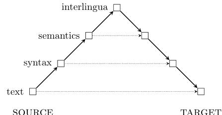

图18.1：沃夸金字塔

翻译模型，解码是NP难的（Knight, 1999）。处理这种复杂性的方法将在§18.4中描述。

估计翻译模型同样困难。标注的翻译数据通常以平行句对的形式出现，例如：

```
w^(s) = A Vinay le gusta las manzanas.
 w^(t) = Vinay likes apples.
```

一个有用的特征函数会记录翻译对（gusta, likes）、（manzanas, apples），甚至（Vinay, Vinay）。但这种词到词的对应关系并没有在数据中给出。一种解决方案是将这种对齐视为潜在变量；这是经典统计机器翻译（SMT）系统采用的方法，如§18.2所述。另一种解决方案是通过更复杂且表达能力更强的函数来建模$\boldsymbol{w}^{(t)}$和$\boldsymbol{w}^{(s)}$之间的关系；这是神经机器翻译（NMT）系统采用的方法，如§18.3所述。

沃夸金字塔是关于如何完成翻译的一种理论。在最底层，翻译系统处理单个单词，但此层的水平距离很大，因为不同语言表达思想的方式不同。如果我们能沿着三角形向上移动到句法结构，翻译的距离就会减小；我们随后只需从句法表示生成目标语言文本，这可以简单到如同从树上读出一样。再往三角形上方是语义层；在语义表示之间进行翻译应该更容易，但从语义到表层文本的映射却是一个困难的、尚未解决的问题。三角形的顶端是中间语（interlingua），一种非常通用的语义表示，在所有人类语言中都是相同的。哲学家们争论是否真的可能存在像中间语这样的东西（例如，德里达，1985）。虽然第12章讨论的一阶逻辑表示可能被认为是与语言无关的，但它们建立在与英语单词惊人相似的谓语清单之上（Nirenburg和Wilks，2001）。尽管如此，将翻译与从未对齐平行文本（例如网页和维基百科文章）中自动识别平行句对的可能性联系起来（Kilgarriff和Grefenstette，2003；Resnik和Smith，2003；Adafre和de Rijke，2006）。另一种方法是通过众包创建大型平行语料库（Zaidan和Callison-Burch，2011）。

### 18.2 统计机器翻译

前一节介绍了充分性和流畅性作为机器翻译的两个主要标准。一种自然的建模方法是使用单独的分数来表示它们，

$$ \Psi(\boldsymbol{w}^{(s)}, \boldsymbol{w}^{(t)}) \equiv \Psi_A(\boldsymbol{w}^{(s)}, \boldsymbol{w}^{(t)}) + \Psi_F(\boldsymbol{w}^{(t)}). \tag{18.3} $$

流畅性分数$\Psi_F$甚至不需要考虑源句子；它只根据目标语言中的流畅程度来判断$\boldsymbol{w}^{(t)}$。这种分解是有利的，因为它使得可以在不同的数据上估计这两个评分函数。充分性模型必须从对齐的句子中估计——这些句子相对昂贵且稀有——而流畅性模型可以从目标语言的单语文本中估计。得益于维基百科等资源，现在许多语言都有大规模的单语语料库。

等式18.3中分解的一个优雅合理解释由噪声信道模型提供，其中每个评分函数都是一个对数概率：

$$ \Psi_A(\boldsymbol{w}^{(s)}, \boldsymbol{w}^{(t)}) \equiv \log p_{S|T}(\boldsymbol{w}^{(s)} \mid \boldsymbol{w}^{(t)}) \tag{18.4} $$

$$ \Psi_F(\boldsymbol{w}^{(t)}) \equiv \log p_T(\boldsymbol{w}^{(t)}) \tag{18.5} $$

$$ \Psi(\boldsymbol{w}^{(s)}, \boldsymbol{w}^{(t)}) = \log p_{S|T}(\boldsymbol{w}^{(s)} \mid \boldsymbol{w}^{(t)}) + \log p_T(\boldsymbol{w}^{(t)}) = \log p_{S,T}(\boldsymbol{w}^{(s)}, \boldsymbol{w}^{(t)}). \tag{18.6} $$

通过将评分函数设为先验和对数似然的对数，它们的和等于$\log p_{S,T}$，即源语言和目标语言联合概率的对数。最大化这一联合概率的句子$\hat{\boldsymbol{w}}^{(t)}$也是条件概率$p_{T|S}$的最大化者，使其成为在给定源语言条件下最有可能的目标语言句子。

噪声信道模型可以通过一个生成故事来证明其合理性。目标文本最初由概率模型$p_T$生成。然后它在“噪声信道”$p_{S|T}$中被编码，该信道将其转换为源语言字符串。在解码时，我们应用贝叶斯规则来恢复在条件概率$p_{T|S}$下最可能的字符串$\boldsymbol{w}^{(t)}$。在这种解释下，目标概率$p_T$只是一个语言模型，可以使用第6章中的任何技术进行估计。唯一剩下的学习问题是估计翻译模型$p_{S|T}$。

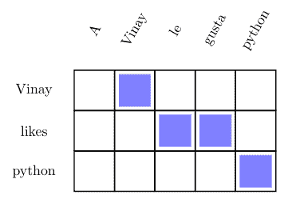

图18.3：词到词对齐的一个示例

#### 18.2.1 统计翻译建模

翻译模型最简单的分解是词到词：源语言中的每个单词都应对齐到翻译中的某个单词。这种方法预设了一个对齐$\mathcal{A}(\boldsymbol{w}^{(s)}, \boldsymbol{w}^{(t)})$，其中包含源语言和目标语言标记对组成的列表。例如，给定$\boldsymbol{w}^{(s)} = A$ Vinay le gusta Python和$\boldsymbol{w}^{(t)} = Vinay$ likes Python，一种可能的词到词对齐是：

$$ \mathcal{A}(\boldsymbol{w}^{(s)}, \boldsymbol{w}^{(t)}) = \{(A, \varnothing), (Vinay, Vinay), (le, likes), (gusta, likes), (Python, Python)\}. \tag{18.7} $$

这个对齐如图18.3所示。另一种不太有希望的对齐是：

$$ \mathcal{A}(\boldsymbol{w}^{(s)}, \boldsymbol{w}^{(t)}) = \{(A, Vinay), (Vinay, likes), (le, Python), (gusta, \varnothing), (Python, \varnothing)\}. \tag{18.8} $$

每个对齐恰好包含源语言中每个单词的一个元组，用于解释源单词如何从目标语言翻译而来，正如翻译概率$\mathrm{p}_{S|T}$所要求的那样。如果源语言单词在目标语言中找不到合适的单词，它就与$\varnothing$对齐——就像例子中的西班牙语功能词$a$，它对应英语单词to。目标语言中的单词可以与源语言中的多个单词对齐，因此目标单词likes可以同时与源语言中的le和gusta对齐。

对齐和翻译的联合概率可以方便地定义为：

$$ \mathrm{p}(\boldsymbol{w}^{(s)}, \mathcal{A} \mid \boldsymbol{w}^{(t)}) = \prod_{m=1}^{M^{(s)}} \mathrm{p}(w^{(s)}_m, a_m \mid w^{(t)}_{a_m}, m, M^{(s)}, M^{(t)}) \tag{18.9} $$

$$ = \prod_{m=1}^{M^{(s)}} \mathrm{p}(a_m \mid m, M^{(s)}, M^{(t)}) \times \mathrm{p}(w^{(s)}_m \mid w^{(t)}_{a_m}). \tag{18.10} $$

这个概率模型有两个关键假设：

- 对齐概率在各标记之间分解，

  $$ p(\mathcal{A} \mid \boldsymbol{w}^{(s)}, \boldsymbol{w}^{(t)}) = \prod_{m=1}^{M^{(s)}} p(a_m \mid m, M^{(s)}, M^{(t)}). \tag{18.11} $$

  这意味着每个对齐决策与其他决策无关，仅取决于索引$m$以及句子长度$M^{(s)}$和$M^{(t)}$。

- 翻译概率也在各标记之间分解，

  $$ p(\boldsymbol{w}^{(s)} \mid \boldsymbol{w}^{(t)}, \mathcal{A}) = \prod_{m=1}^{M^{(s)}} p(w_m^{(s)} \mid w_{a_m}^{(t)}). \tag{18.12} $$

  因此$\boldsymbol{w}^{(s)}$中的每个单词仅依赖于其在$\boldsymbol{w}^{(t)}$中对齐的单词。这意味着翻译是词到词的，忽略了上下文。希望目标语言模型$p(\boldsymbol{w}^{(t)})$能够纠正由词到词翻译产生的任何不流畅之处。

使用这样的模型进行翻译时，我们可以对所有可能的对齐进行求和或取最大值，

$$ p(\boldsymbol{w}^{(s)}, \boldsymbol{w}^{(t)}) = \sum_{\mathcal{A}} p(\boldsymbol{w}^{(s)}, \boldsymbol{w}^{(t)}, \mathcal{A}) \tag{18.13} $$

$$ = p(\boldsymbol{w}^{(t)}) \sum_{\mathcal{A}} p(\mathcal{A}) \times p(\boldsymbol{w}^{(s)} \mid \boldsymbol{w}^{(t)}, \mathcal{A}) \tag{18.14} $$

$$ \ge p(\boldsymbol{w}^{(t)}) \max_{\mathcal{A}} p(\mathcal{A}) \times p(\boldsymbol{w}^{(s)} \mid \boldsymbol{w}^{(t)}, \mathcal{A}). \tag{18.15} $$

项$p(\mathcal{A})$定义了对齐上的先验概率。IBM的研究人员在20世纪80年代和90年代开发了一系列独立性假设逐步放宽的对齐模型，称为IBM模型1-6（Och和Ney，2003）。IBM模型1做出了最强的独立性假设：

$$ p(a_m \mid m, M^{(s)}, M^{(t)}) = \frac{1}{M^{(t)}}. \tag{18.16} $$

在这个模型中，每个对齐的可能性相等。这几乎肯定是错误的，但它产生了一个凸的学习目标，为更复杂的对齐模型提供了良好的初始化（Brown等人，1993；Koehn，2009）。

#### 18.2.2 估计

让我们将参数$\theta_{u \rightarrow v}$定义为把目标词$u$翻译成源词$v$的概率。如果词到词的对齐已被标注，这些概率可以通过相对频率计算得到，

$$ \hat{\theta}_{u \rightarrow v} = \frac{\text{count}(u, v)}{\text{count}(u)}, \tag{18.17} $$

其中 count(u, v) 是训练集中词 v 与词 u 对齐的实例计数，而 count(u) 是目标词 u 的总计数。第 6 章中提到的平滑技术可以帮助降低这些概率估计的方差。

相反，如果我们有一个准确的翻译模型，我们就可以估计每个对齐决策的可能性，

q_m(a_m | w^(s), w^(t)) ∝ p(a_m | m, M^(s), M^(t)) × p(w_m^(s) | w_{a_m}^(t)), [18.18]

其中 q_m(a_m | w^(s), w^(t)) 是我们将源词 w_m^(s) 对齐到目标词 w_{a_m}^(t) 的置信度的度量。然后相对频率可以从期望计数中计算得出，

θ̂_{u→v} = E_q[count(u, v)] / count(u) [18.19]
E_q[count(u, v)] = Σ_m q_m(a_m | w^(s), w^(t)) × δ(w_m^(s) = v) × δ(w_{a_m}^(t) = u). [18.20]

期望最大化（EM）算法通过迭代更新 q_m 和 θ̂ 进行。该算法在第 5 章中以一般形式描述。对于统计机器翻译，该算法的步骤如下：

- 1. **E 步**：使用公式 18.18 更新关于词对齐的信念。
- 2. **M 步**：使用公式 18.19 和 18.20 更新翻译模型。

正如第 5 章所讨论的，期望最大化算法保证收敛，但不保证收敛到全局最优。然而，对于 IBM Model 1，可以证明 EM 优化的是一个凸目标，全局最优性得到保证。因此，IBM Model 1 通常被用作更复杂对齐模型的初始化。更多细节请参见 Koehn (2009)。

#### 18.2.3 基于短语的翻译

真实的翻译并不是逐词替换。一个原因是许多多词表达并不会被逐字翻译，如下例法语所示：

(18.3) Nous allons prendre un verre
We will take a glass
We’ll have a drink

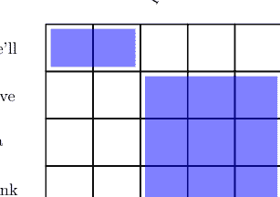

图 18.4：法语和英语之间基于短语的对齐，对应示例 (18.3)

行 we will take a glass 是法语句子的逐词直译；翻译 we’ll have a drink 显示在第三行。这类例子对逐词翻译模型来说很困难，因为它们需要将 prendre 翻译为 have 而将 verre 翻译为 drink。这些翻译只有在这些特定短语的上下文中才是正确的。

基于短语的翻译通过构建多词跨度之间的翻译表和对齐来推广基于词的模型。（这些“短语”不一定是句法成分，如第 9 章和第 10 章所述的名词短语和动词短语。）从基于词的翻译到基于短语的翻译的推广出人意料地简单：翻译表现在可以以多词单元为条件，并可以为多词单元分配概率；对齐是从跨度到跨度的映射，((i,j),(k,ℓ))，使得

p(w^(s) | w^(t),A) = ∏_{((i,j),(k,ℓ))∈A} P_{w^(s)|w^(t)}({w^(s)_{i+1},w^(s)_{i+2},…,w^(s)_j} | {w^(t)_{k+1},w^(t)_{k+2},…,w^(t)_ℓ}). [18.21]

短语对齐 ((i,j),(k,ℓ)) 表示跨度 w^(s)_{i+1:j} 是跨度 w^(t)_{k+1:ℓ} 的翻译。图 18.4 显示了一个短语对齐示例。请注意，对齐集合 A 需要覆盖源语言中的所有词元，正如基于词的翻译中一样。概率模型 p_{w^(s)|w^(t)} 现在必须包含所有短语对的翻译，这些翻译可以像基于词的统计机器翻译中一样通过期望最大化学习得到。

#### 18.2.4 *基于句法的翻译*

Vauquois 金字塔（图 18.1）表明，如果我们采用更高层次的视角，翻译可能会更容易。一个可能性是结合源语言、目标语言或两者的句法结构。对于具有一致句法差异的语言对来说，这尤其有前景。例如，英语形容词几乎总是位于其修饰的名词之前，而在罗曼语族语言如法语和西班牙语中，形容词通常跟在名词之后：因此，*angry fish* 在西班牙语中会译为 *pez (fish) enojado (angry)*。在逐词翻译中，这些重排序会导致对齐模型过于宽松。并不是说将英语翻译成西班牙语时任意一对英语词的顺序都可以颠倒，而只有名词短语内的形容词和名词。类似的问题在翻译日语等动词后置语言（其中动词通常跟在主语和宾语之后）、他加禄语和古典阿拉伯语等动词前置语言，以及英语等动词中置语言之间也会出现。

一个优雅的解决方案是将解析和翻译联系在 **同步上下文无关文法**（SCFG；Chiang, 2007）。³ SCFG 是一组形式为 $X \rightarrow (\alpha, \beta, \sim)$ 的产生式，其中 $X$ 是非终结符，$\alpha$ 和 $\beta$ 是终结符或非终结符的序列，而 $\sim$ 是 $\alpha$ 中项与 $\beta$ 中项之间的一一对齐。英语-西班牙语形容词-名词顺序可以通过一组同步产生式处理，例如，

NP → (DET₁ NN₂ JJ₃, DET₁ JJ₃ NN₂), [18.22]

下标表示右部西班牙语（左）和英语（右）部分之间的对齐。终结产生式产生翻译对，

JJ → (enojado₁, angry₁). [18.23]

同步推导以起始符号 S 开始，并推导出一对终结符序列。

给定一个每个产生式在每种语言中最多产生两个符号的 SCFG（乔姆斯基范式；参见 § 9.2.1），句子可以使用仅 CKY 算法（第 10 章）进行解析。 resulting 推导还包括另一种语言中的产生式，一直向下到表层形式。因此，SCFG 使翻译与解析非常相似。在加权 SCFG 中，对数概率 $\log P_{S|T}$ 可以从产生式的对数概率之和计算得出。然而，将 SCFG 与目标语言模型结合在计算上代价昂贵，需要近似搜索算法（Huang and Chiang, 2007）。

³ 对句法机器翻译的早期方法包括句法驱动转导（Lewis II and Stearns, 1968）和随机逆转导文法（Wu, 1997）。

同步上下文无关文法是 **树到树翻译** 的一个例子，因为它们对目标语言和源语言的句法结构进行建模。在 **字符串到树翻译** 中，字符串元素被翻译成成分树片段，然后组装成翻译（Yamada and Knight, 2001; Galley et al., 2004）；在 **树到字符串翻译** 中，源侧被解析，然后转换成语句目标侧的字符串（Liu et al., 2006）。句法翻译的一个关键问题是短语成分在翻译中对齐的程度（Fox, 2002），因为这决定了我们可以在多大程度上依赖单语解析器和树库。有关句法机器翻译的更多内容，请参阅 Williams et al. (2016) 的专著。

### 18.3 神经机器翻译

机器翻译的神经网络模型基于 **编码器-解码器** 架构（Cho et al., 2014）。编码器网络将源语言句子转换为向量或矩阵表示；解码器网络然后将编码转换为目标语言的句子。

$$z = \text{ENCODE}(\boldsymbol{w}^{(s)})\tag{18.24}$$  $$\boldsymbol{w}^{(t)} \mid \boldsymbol{w}^{(s)} \sim \text{DECODE}(\boldsymbol{z}),\tag{18.25}$$

其中第二行意味着函数 DECODE(z) 定义了条件概率 p(\boldsymbol{w}^{(t)} \mid \boldsymbol{w}^{(s)})。

解码器通常是一个循环神经网络，它一次生成一个词的目标语言句子，同时循环更新隐藏状态。编码器和解码器网络从平行句子端到端训练。如果解码器的输出层是逻辑函数，则整个架构可以训练以最大化条件对数似然，

$$\log p(\boldsymbol{w}^{(t)} \mid \boldsymbol{w}^{(s)}) = \sum_{m=1}^{M^{(t)}} p(w_m^{(t)} \mid w_{1:m-1}^{(t)}, z)\tag{18.26}$$  $$p(w_m^{(t)} \mid w_{1:m-1}^{(t)}, \boldsymbol{w}^{(s)}) \propto \exp\left(\beta_{w_m^{(t)}} \cdot h_{m-1}^{(t)}\right)\tag{18.27}$$

其中隐藏状态 $h_{m-1}^{(t)}$ 是先前生成文本 $\boldsymbol{w}_{1:m-1}^{(t)}$ 和编码 $z$ 的循环函数。第二行等价于写成，

$$w_m^{(t)} \mid w_{1:m-1}^{(t)}, \boldsymbol{w}^{(s)} \sim \text{SoftMax}\left(\beta \cdot h_{m-1}^{(t)}\right),\tag{18.28}$$

其中 $\beta \in \mathbb{R}^{(V^{(t)} \times K)}$ 是目标语言词汇表中 $V^{(t)}$ 个词的输出词向量矩阵。

最简单的编码器-解码器架构是 **序列到序列模型**（Sutskever et al., 2014）。在此模型中，编码器被设置为最终隐藏状态的 **长短期**


作为第 i+1 层 LSTM 的输入：

$\boldsymbol{h}_m^{(s,1)} = \text{LSTM}(\boldsymbol{x}_m^{(s)}, \boldsymbol{h}_{m-1}^{(s)})$ [18.33]

$\boldsymbol{h}_m^{(s,i+1)} = \text{LSTM}(\boldsymbol{h}_m^{(s,i)}, \boldsymbol{h}_{m-1}^{(s,i+1)}), \quad \forall i \ge 1.$ [18.34]

最初的序列到序列翻译工作使用了四层；2016 年，谷歌的商业机器翻译系统使用了八层（Wu 等，2016）。⁴

⁴谷歌报告称，该系统在英语-法语翻译任务上训练了六天，使用了 96 块 NVIDIA K80 GPU，当时成本大约为五十万美元。

- 通过创建翻译模型的集成（ensemble），每个模型从不同的随机初始化进行训练，可以获得显著的改进。对于大小为 N 的集成，每个词元的解码概率设为：

$\mathrm{P}(w^{(t)} \mid \boldsymbol{z}, \boldsymbol{w}_{1:m-1}^{(t)}) = \frac{1}{N} \sum_{i=1}^{N} \mathrm{p}_i(w^{(t)} \mid \boldsymbol{z}, \boldsymbol{w}_{1:m-1}^{(t)})$ [18.35]

其中 $\mathrm{p}_i$ 是模型 $i$ 的解码概率。集成中的每个翻译模型都包含各自的编码器和解码器网络。

- 最初的序列到序列模型采用了相当标准的训练设置：在前五个轮次（epoch）之后使用指数递减的学习率进行随机梯度下降；使用包含 128 个句子的小批量，这些句子被选择为具有相似长度，以便批次中的每个句子大约需要相同的处理时间；使用梯度裁剪（见 § 3.3.4）来确保梯度的范数永远不会超过某个预定义的值。

#### 18.3.1 神经注意力

上一节讨论的序列到序列模型与统计机器翻译有着根本性的不同。在统计机器翻译中，目标语言的每个单词或短语都以源语言中的单个单词或短语为条件。两种方法各有优势。统计翻译利用了组合性（compositionality）的思想——大单元的翻译应基于其组成部分的翻译——如果我们希望将翻译扩展到更长的文本单元，这一点似乎至关重要。但每个单词或短语的翻译往往依赖于更大的上下文，而编码器-解码器模型在句子级别捕捉这种上下文。

翻译能否既上下文相关又具有组合性？一种方法是为神经翻译增加注意力机制。神经注意力的思想已在 § 17.5 中描述，但它在翻译中的应用值得进一步讨论。一般来说，注意力可以被认为是通过一个查询（query）从键-值对（key-value pairs）的记忆中进行选择。然而，查询、键和值都是向量，整个过程是可微的。

对于记忆中的每个键 $n$，我们针对查询 $m$ 计算一个分数 $\psi_\alpha(m, n)$。该分数是键与查询兼容性的函数，可以使用一个小型前馈神经网络来计算。分数向量经过一个激活函数（如 softmax）。这个激活函数的输出是一个非负数向量 $[\alpha_{m\to1}, \alpha_{m\to2}, \dots, \alpha_{m\to N}]^\top$，其长度 $N$ 等于记忆的大小。记忆中的每个值 $v_n$ 都乘以注意力 $\alpha_{m\to n}$；这些缩放后的值之和就是输出。这个过程如图 18.6 所示。在极端情况下，如果 $\alpha_{m\to n}=1$ 且对所有其他 $n'$ 有 $\alpha_{m\to n'}=0$，那么注意力机制就只是从记忆中选择值 $v_n$。

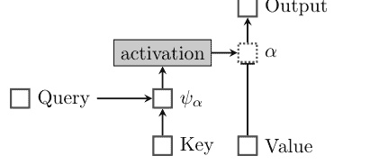

图 18.6：神经注意力的一般视图。虚线框表示每个 $\alpha_{m\to n}$ 可以被视为对值 $n$ 的门控（gate）。

神经注意力使得将对齐（alignment）集成到编码器-解码器架构中成为可能。它不是将整个源句子编码成一个固定长度的向量 $z$，而是将其编码为一个矩阵 $\mathbf{Z} \in \mathbb{R}^{K \times M^{(S)}}$，其中 $K$ 是隐藏状态的维度，$M^{(S)}$ 是源输入中词元的数量。$\mathbf{Z}$ 的每一列表示源句子上循环神经网络的一个状态。这些向量由一个双向 LSTM（见 § 7.6）构建，它可以是一个深度网络，如图 18.5 所示。这些列既是注意力机制中的键，也是值。

在解码的每一步 $m$，通过执行一个查询来计算注意力状态，该查询等于解码器的状态 $h_m^{(t)}$。由此产生的兼容性分数为：

$$\psi_\alpha(m, n) = v_\alpha \cdot \tanh\big(\Theta_\alpha[h_m^{(t)}; h_n^{(s)}]\big).\tag{18.36}$$

因此，函数 $\psi$ 是一个两层前馈神经网络，输出层有权重 $v_\alpha$，输入层有权重 $\Theta_\alpha$。为了将这些分数转换为注意力权重，我们应用一个激活函数，该函数可以是按向量的 softmax 或按元素的 sigmoid：

### Softmax 注意力

$$\alpha_{m\to n} = \frac{\exp \psi_\alpha(m, n)}{\sum_{n'=1}^{M^{(s)}} \exp \psi_\alpha(m, n')}\tag{18.37}$$

### Sigmoid 注意力

α_{m→n} = σ(ψ_α(m, n))  [18.38]

然后，注意力 α 用于通过取 Z 各列的加权平均来计算上下文向量 c_m：

c_m = Σ_{n=1}^{M^{(s)}} α_{m→n} z_n,  [18.39]

其中 α_{m→n} ∈ [0, 1] 是从目标的词 m 到源的词 n 的注意力大小。可以通过向解码器添加另一层（Luong 等，2015），将上下文向量并入解码器的单词输出概率模型：

h̃_m^{(t)} = tanh( Θ_c [h_m^{(t)} ; c_m] )  [18.40]

p(w_{m+1}^{(t)} | w_{1:m}^{(t)}, w^{(s)}) ∝ exp( β_{w_{m+1}^{(t)}} · h̃_m^{(t)} ).  [18.41]

这里，解码器状态 h_m^{(t)} 与上下文向量拼接，形成计算最终输出向量 h̃_m^{(t)} 的输入。上下文向量也可以类似的方式并入解码器的循环过程（Bahdanau 等，2014）。

#### 18.3.2 无需循环的神经机器翻译

在编码器-解码器模型中，注意力的“键和值”是编码器网络中的隐藏状态表示 z，“查询”是解码器网络中的状态表示 h^{(t)}。我们也可以完全消除神经翻译中的循环，方法是在编码器和解码器内部应用自注意力（self-attention）（Lin 等，2017；Kim 等，2017），就像 transformer 架构（Vaswani 等，2017）那样。对于层 i，transformer 编码器侧的基本方程为：

z_m^{(i)} = Σ_{n=1}^{M^{(s)}} α_{m→n}^{(i)} (Θ_v h_n^{(i-1)})  [18.42]

h_m^{(i)} = Θ_2 ReLU( Θ_1 z_m^{(i)} + b_1 ) + b_2.  [18.43]

对于层 i 的每个词元 m，我们计算整个源句上的自注意力。键、值和查询都是向量 h^{(i-1)} 的投影：例如，在公式 18.42 中，值 v_n 是投影 Θ_v h_n^{(i-1)}。注意力分数 α_{m→n}^{(i)} 使用 softmax 注意力的缩放形式计算：

α_{m→n} ∝ exp(ψ_α(m, n)/M),  [18.44]

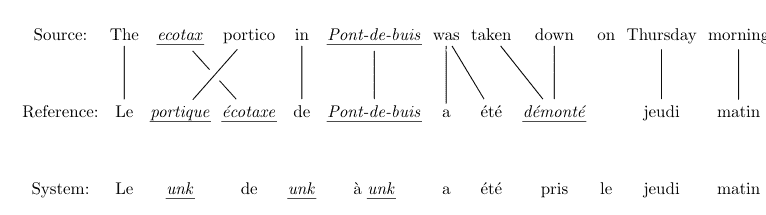

图 18.8：含未知词的翻译。系统输出 unk 来表示其词汇表之外的词。图改编自 Luong 等（2015）。

卷积神经网络（见 § 3.4）也已被用作神经机器翻译的编码器（Gehring 等，2017）。对于每个词 w_m^{(s)}，卷积网络根据该词及其邻居的嵌入计算表示 h_m^{(s)}。这个过程重复多次，形成一个深度卷积网络。然后，循环解码器以解码器的隐藏状态 h^{(t)} 作为查询，在这些卷积表示上计算一组注意力权重。该注意力向量用于对源的另一个卷积神经网络的输出进行加权平均，得到一个平均表示 c_m，并将其输入解码器。与 transformer 一样，速度是相对于循环编码模型的主要优势；另一个相似之处是，词序信息通过使用位置编码来近似。⁶

⁶最近的一项评估发现，最佳性能是通过将循环网络用于解码器、transformer 用于编码器而获得的（Chen 等，2018）。transformer 还被发现明显优于卷积神经网络。

#### 18.3.3 词表外词汇

到目前为止，我们都将翻译视为一个发生在单词或短语层面的问题。对于没有出现在训练数据中的词汇，所有这类模型都会遇到困难。词表外（OOV）词汇的出现主要有两个原因：

- 新的专有名词，例如姓氏或组织名称，不断出现——尤其是在新闻领域。技术术语在较小程度上也是如此。这个问题如图 18.8 所示。
- 在许多语言中，词汇具有复杂的内部结构，称为形态学（morphology）。一个例子是德语，它使用复合构词方式来构成名词，如 Abwasserbehandlungsanlage（污水处理厂；示例来自 Sennrich 等（2016））。

§ 3.3.4), 非线性激活周围的残差连接（见 § 3.2.2），以及非单调的学习率计划。


**束搜索**是一种在无法进行穷举搜索时避免搜索错误的通用技术；它最早在§ 11.3.1中讨论。束搜索可以看作是式(18.50)中描述的增量解码算法的一种变体，但在每一步*m*中，束上保留了一组*K*个不同假设。对于每个假设*k* ∈ {1, 2, …, *K*}，我们同时计算当前分数 \(\sum_{m=1}^{M^{(t)}} \psi(w_k^{(t)}; w_{k,m-1}^{(t)}, z)\) 和当前隐藏状态 \(h_k^{(t)}\)。在束搜索的每一步中，当前束上每个假设的*K*个得分最高的子节点被“展开”，并更新束。关于RNN解码的束搜索的详细描述，参见Graves (2012)。

**学习与搜索** 通常，学习算法被训练为在翻译历史正确的前提下预测翻译中的正确词元。但如果解码必须是近似的，那么通过修改学习算法来对翻译历史中的错误具有鲁棒性，可能会更好。**计划采样**正是如此，它使用有时来自真实数据、有时来自模型自身输出的历史进行训练（Bengio et al., 2015）。¹⁰ 随着训练的进行，辅助轮被移除：我们增加来自模型而非真实数据的词元比例。另一种方法是在一个与束搜索性能直接相关的目标上进行训练（Wiseman et al., 2016）。**强化学习**也被应用于基于RNN的翻译模型的解码，使得直接优化诸如BLEU之类的翻译指标成为可能（Ranzato et al., 2016）。

> ¹⁰ 计划采样建立在早期关于学习搜索的研究之上（Daumé III et al., 2009; Ross et al., 2011），这些研究也在§ 15.2.4中有所描述。

### 18.5 面向评估指标的训练

在基于似然的训练中，目标是最大化平行语料库的概率。然而，翻译并不是根据似然来评估的：像BLEU这样的指标只考虑单个输出翻译的正确性，而不考虑模型分配的概率范围。因此，在我们相信BLEU能衡量翻译质量的前提下，训练翻译模型以获得尽可能高的BLEU分数可能更好。不幸的是，BLEU及相关指标对优化并不友好：它们是翻译模型参数的不连续、不可微的函数。

考虑一个误差函数 \(\Delta(\hat{w}^{(t)}, w^{(t)})\)，它衡量系统翻译 \(\hat{w}^{(t)}\) 与参考翻译 \(w^{(t)}\) 之间的差异；该函数可以基于BLEU或任何其他翻译质量指标。一个可能的标准是选择近似的（Shen et al., 2016），

$$\tilde{R}(\boldsymbol{\theta}) \approx \frac{1}{Z} \sum_{k=1}^{K} \tilde{p}(\boldsymbol{w}_k^{(t)} \mid \boldsymbol{w}^{(s)}; \boldsymbol{\theta}, \alpha) \times \Delta(\boldsymbol{w}_k^{(t)}, \boldsymbol{w}^{(t)}) \tag{18.57}$$ $$Z = \sum_{k=1}^{K} \tilde{p}(\boldsymbol{w}_k^{(t)} \mid \boldsymbol{w}^{(s)}; \boldsymbol{\theta}, \alpha). \tag{18.58}$$

Shen等人（2016）报告，对于神经机器翻译的最小风险训练，性能在K=100时趋于平稳。

在所有可能翻译的集合上进行均匀采样是不可取的，因为大多数翻译的概率非常低。蒙特卡洛估计的一个解决方案是重要性采样，即从一个提议分布q(w^(s))中抽取样本。该分布可以设置为当前翻译模型p(w^(t) | w^(s); θ)。然后每个样本按重要度得分ω_k = p̃(w_k^(t)|w^(s)) / q(w_k^(t);w^(s)) 进行加权。这种加权的作用是修正提议分布q与真实分布p̃之间的任何不匹配。此时风险可以近似为，

$$\boldsymbol{w}_k^{(t)} \sim q(\boldsymbol{w}^{(s)}) \tag{18.59}$$ $$\omega_k = \frac{\tilde{p}(\boldsymbol{w}_k^{(t)} \mid \boldsymbol{w}^{(s)})}{q(\boldsymbol{w}_k^{(t)}; \boldsymbol{w}^{(s)})} \tag{18.60}$$ $$\tilde{R}(\boldsymbol{\theta}) \approx \frac{1}{\sum_{k=1}^{K} \omega_k} \sum_{k=1}^{K} \omega_k \times \Delta(\boldsymbol{w}_k^{(t)}, \boldsymbol{w}^{(t)}). \tag{18.61}$$

重要性采样通常比均匀采样给出更精确的近似。其唯一的形式要求是，提议分布对每个w^(t) ∈ Y(w^(s))赋予非零概率。关于重要性采样及相关方法的更多内容，参见Robert和Casella (2013)。

## 附加资源

机器翻译的完整教科书由Koehn（2009）提供。虽然这本书早于神经翻译的近期工作，但也可以找到关于神经翻译模型的更新草稿章节（Koehn, 2017）。Neubig（2017）提供了从基本原理出发的神经机器翻译综合教程。Cho（2015）的课程笔记也很有用。有几个神经机器翻译库可用：LAMTRAM是DYNET中神经机器翻译的实现（Neubig et al., 2017）；OPENNMT（Klein et al., 2017）和FAIRSEQ可用于PYTORCH；TENSOR2TENSOR是TENSORFLOW中几个Google翻译模型的实现（Abadi et al., 2016）。

文学翻译尤其具有挑战性，即使是专业的人类译者也是如此。Messud（2014）在评论阿尔贝·加缪1942年法语小说*《局外人》*的英译本时，描述了其中一些问题。¹¹ 她将桑德拉·史密斯的新译本与斯图尔特·吉尔伯特和马修·沃德早期的译本进行了比较，重点关注第一句中一个词所带来的困难：

> 此外，史密斯重新考虑了这部书著名的开篇。加缪的原文具有欺骗性的简单：“*今天，妈妈死了。*”吉尔伯特以“母亲今天去世了”影响了数代人——从一开始就在默尔索（叙述者）身上刻下了一种可能被视为无情的正式感。但*妈妈*毕竟是亲密而深情的，是孩子对母亲的称呼。马修·沃德认为它本质上无法翻译（“mom”或“mummy”都不太恰当），于是保留了法语原文：“Maman今天死了。”这个选择有清晰的逻辑；但正如史密斯在接受*《卫报》*采访时解释的那样，*妈妈*“并没有真正告诉读者任何关于其内涵的信息。”相反，她将这句话翻译为“我的母亲今天去世了。”

我选择“我的母亲”是因为我想到一个人会如何告诉另一个人他的母亲去世了。默尔索在直接对读者说话。“我的母亲今天去世了”在我看来就是这样的效果，也体现了法语中“妈妈”的亲密感。

在书的其他地方，她将*妈妈*翻译为“mama”——再次努力尽可能接近于一个真实、口语化的词，使其承载与法语*妈妈*相同的内涵。

这段文字提醒我们，尽管近年来机器翻译的质量有了显著提高，但专业的人类翻译所依赖的考量超出了任何当代计算方法的认知范围。

¹¹ 这篇书评目前可在 `http://www.nybooks.com/articles/2014/06/05/camus-new-letranger/` 在线阅读。

## 练习

- 1. 使用谷歌翻译或其他在线服务，将以下示例翻译成你选择的两种不同语言：

- 8. 对词汇表*it*、*unit*、*unite*应用字节对编码，直到没有二元组出现超过一次。

- 9. 本题与机器翻译的复杂性有关。假设你有一个预言机（oracle），返回翻译中应包含的单词列表，因此你唯一任务是给这些单词排序。进一步假设对排序的评分函数是二元组之和，$\sum_{m=1}^{M} \psi(\boldsymbol{w}_m^{(t)}, \boldsymbol{w}_{m-1}^{(t)})$。通过从众所周知的问题归约，证明寻找最优翻译的问题是NP完全的。

- 10. 手工设计一个注意力循环翻译模型，它简单地将输入从源复制到目标。你可以假设隐藏状态任意大，也可以假设存在一个有限的最大输入长度$M$。指定所有权重，使得任何源的最大概率翻译就是源本身。提示：最简单的是使用Elman循环 $\boldsymbol{h}_m = f(\Theta \boldsymbol{h}_{m-1} + \boldsymbol{x}_m)$ 而不是LSTM。

- 11. 给出西班牙语-英语翻译的同步推导（§ 18.2.4）：

  (18.6) *El pez enojado atacado.*  
  鱼愤怒攻击。  
  愤怒的鱼攻击。

  如上，第二行显示逐字对译，第三行显示期望翻译。使用[18.22]中的同步产生式规则，并设计推导这个句对所需的其他产生式规则。你可以直接从VP推导出(*atacado*, *attacked*)。


## 第19章 文本生成
 

在自然语言处理中，许多最有趣的问题里，语言是输出。前一章描述了机器翻译这一具体案例，但还有许多其他应用，从研究文章摘要、自动化新闻，到对话系统。本章重点介绍三个主要场景：**数据到文本**（data-to-text），即生成文本来解释或描述结构化记录或非结构化感知输入；**文本到文本**（text-to-text），通常涉及将多个语言来源的信息融合成一份连贯的摘要；以及**对话**（dialogue），即在与一个或多个人类参与者的交互式对话中生成文本。

### 19.1 数据到文本生成

在数据到文本生成中，输入范围从结构化记录（例如天气预报的描述，如图19.1所示）到非结构化感知数据（例如原始图像或视频）；输出可能是单个句子（例如图像标题），也可能是多段落的文章。尽管条件多种多样，所有数据到文本系统都面临一些相同的挑战（Reiter and Dale, 2000）：

- 确定要描述数据的哪些部分；
- 规划这些信息的呈现方式；
- 将数据词汇化为单词和短语；
- 将单词和短语组织成结构良好的句子和段落。

该过程的早期阶段有时称为内容选择和文本规划；后期阶段通常称为表层实现。

早期的数据到文本生成系统是模块化的，每个任务都有独立的软件组件。人工智能规划算法可以应用于这两个阶段。

```
(a / admire-01
    :ARG0 (v / visitor
        :ARG1-of (c / arrive-01
            :ARG4 (j / Japan)))
    :ARG1 (m / "Mount Fuji"))
```

- 来日本的游客欣赏富士山。
- 在日本来的游客欣赏富士山。
- 富士山受到来日本的游客的欣赏。

图19.2：来自NITROGEN系统的抽象意义表示和候选表层实现。示例改编自Langkilde and Knight (1998)。

然后使用语言模型来计算弧上的权重，因此最短路径同时也是具有最高二元语言模型概率的表层实现。

更近期的系统是统一模型，使用反向传播进行端到端训练。数据到文本生成与机器翻译有许多共同特性，包括对齐问题：标注示例提供了数据和文本，但没有指明文本的哪些部分对应于数据的哪些部分。例如，要从图19.1中学习，系统必须将单词 cloudy 与 CLOUD SKY COVER 中的记录对齐，将短语 10 度和 20 度与 TEMPERATURE 中的 MIN 和 MAX 字段对齐，等等。与机器翻译一样，潜在变量和神经注意力都被提出作为解决方案。

#### 19.1.1 潜在数据到文本对齐

给定一个由文本及相关联记录组成的数据集 \(\{(w^{(i)}, y^{(i)})\}_{i=1}^N\)，我们的目标是学习一个模型 \(\Psi\)，使得

\[
\hat{w} = \operatorname{argmax}_{w \in V^*} \Psi(w, y; \theta), \qquad [19.1]
\]

其中 \(V^*\) 是离散词汇表上的字符串集合，\(\theta\) 是参数向量。\(w\) 和 \(y\) 之间的关系很复杂：数据 \(y\) 可能包含数十条记录，而 \(w\) 可能延伸到多个句子。为了便于学习和推理，将评分函数 \(\Psi\) 分解为子组件将会很有帮助。如果给定一个对齐，指定 \(y\) 的哪个元素在 \(w\) 的每个部分中被表达，那么这种分解是可能的。具体来说，令 \(z_m\) 表示与单词 \(m\) 对齐的记录。例如，在图19.1中，\(z_1\) 可能指定单词 cloudy 与记录 cloud-sky-cover:percent 对齐。该对齐的得分则由以下这类特征的权重给出：

\[
(\text{cloudy}, \text{cloud-sky-cover:percent}). \qquad [19.2]
\]

一般来说，给定一组观察到的对齐，一个生成的得分可以是

句子摘要与**句子压缩**密切相关，句子压缩通过从原文中删除单词或短语来生成摘要（Clarke and Lapata, 2008）。但如(19.2b)所示，句子摘要也可以引入新词，例如 *against*，它替换了短语 *for combatting*。

句子摘要可以被视为一个机器翻译问题，使用§ 18.3.1中讨论的注意力编码器-解码器翻译模型（Rush et al., 2015）。较长的句子被编码为向量序列，每个词元对应一个向量。解码器在更新自身循环状态时对这些向量计算注意力。与数据到文本生成一样，为编码器-解码器模型增加直接从源中复制单词的能力会很有用。Rush等人（2015）通过从新闻文章构建四百万个句子对来训练该模型。在每个句子对中，较长的句子是文章的第一句，摘要是文章标题。句子摘要也可以用半监督方式进行训练，使用编码器-解码器模型的一种概率形式，称为**变分自编码器**（Miao and Blunsom, 2016，另见§ 14.8.2）。

在对较长文档进行摘要时，另一个额外的问题是摘要不应重复：摘要的每个部分都应涵盖新的内容。这可以通过维护一个迄今所有注意力值总和的向量 \(t_m = \sum_{n=1}^m \alpha_n\) 来解决。这个总和可以用作注意力权重计算的额外输入，

\[
\alpha_{m\to n} \propto \exp\left(\boldsymbol{v}_\alpha \cdot \tanh\left(\Theta_\alpha [h_m^{(t)}; h_n^{(s)}; t_m]\right)\right), \qquad [19.11]
\]

这使模型能够学会偏好源中尚未被注意到的部分（Tu et al., 2016）。为了进一步鼓励生成摘要的多样性，See等人（2017）在目标函数中引入了**覆盖损失**，

\[
\ell_m = \sum_{n=1}^{M^{(s)}} \min(\alpha_{m\to n}, t_{m\to n}). \qquad [19.12]
\]

如果 \(\boldsymbol{\alpha}_m\) 对已在 \(t_m\) 中具有较大值的词分配的注意力很少，则该损失会较低。覆盖损失与**边际相关性**的概念相似，在边际相关性中，添加新内容的奖励与它增加摘要所传达信息总量的程度成正比（Carbonell and Goldstein, 1998）。

#### 19.2.2 用于多文档摘要的句子融合

在**多文档摘要**中，目标是生成一个涵盖多篇文档内容的摘要（McKeown et al., 2002）。解决这一难题的一种方法是识别多篇文档中与单一主题相关的句子，然后将它们融合为单个句子（Barzilay and McKeown, 2005）。例如，考虑以下两个句子（McKeown et al., 2010）：

- (19.3)
  a. 佩林其实是在大桥项目成为浪费性支出的全国性象征之后，才转而反对该项目的。
  b. 佩林女士在竞选州长时支持大桥项目，并在该项目成为全国性丑闻后放弃了它。

*交集*只保留两个句子中都存在的内容：

(19.4) 佩林在大桥项目成为全国性丑闻后转而反对该项目。

*并集*包含两个句子的信息：

(19.5) 佩林女士在竞选州长时支持大桥项目，但当它成为全国性丑闻和浪费性支出的象征时，她转而反对该项目。

依存句法分析常被用作句子融合的一种技术。解析每个句子后，得到的依存树可以被聚合成一个格（lattice）（Barzilay and McKeown, 2005）或图结构（Filippova and Strube, 2008），其中相同或密切相关的词（例如 *佩林、大桥、全国性*）被融合到单个节点中。然后，可以通过求解**整数线性规划**（见§ 13.2.2）将得到的图剪枝回一棵树，

\[
\max_y \sum_{i,j,r} \psi(i \to^r j, w; \theta) \times y_{i,j,r} \qquad [19.13]
\]
\[
\text{s.t. } y \in C, \qquad [19.14]
\]

其中变量 \(y_{i,j,r} \in \{0,1\}\) 表示是否存在一条从 \(i\) 到 \(j\) 的类型为 \(r\) 的边，该边的得分是 \(\psi(i \to^r j, w; \theta)\)，而 \(C\) 是约束集，确保 \(y\) 构成合法的依存图。和往常一样，\(w\) 是图中的单词列表，\(\theta\) 是参数向量。得分 \(\psi(i \to^r j, w; \theta)\) 反映修饰语 \(j\) 对整体意义的“重要性”：在交集式融合中，该得分表示此边上的内容在所有句子中被表达的程度；在并集式融合中，该得分表示此边上的内容是否在任一句子中被表达。约束集 \(C\) 可以施加额外的语言约束：例如，确保并列名词具有足够的相似性。得到的树随后必须被**线性化**成一个句子。线性化类似于依存句法分析的逆过程：不是从词元序列解析成树，而是必须将树转换回词元序列。这通常通过生成一组候选线性化，并选择在语言模型下得分最高的那个来完成（Langkilde and Knight, 1998; Song et al., 2016）。

### 19.3 对话

**对话系统**能够与人类对话者进行交谈，通常是为了执行某些任务（Grosz, 1979），但有时只是为了聊天（Weizenbaum, 1966）。而 re-

(19.6)
A：我想要点一份披萨。
B：要什么配料？
A：凤尾鱼。
B：好的，什么地址？
A：计算学院大楼。
B：请确认：一份带洋蓟的披萨，送到计算学院大楼。
A：不。
B：要什么配料？
...

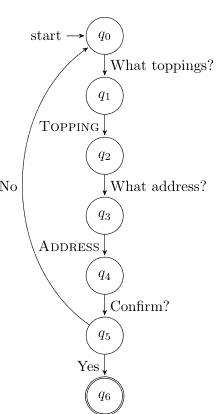

图 19.5：一个示例对话及其对应的有限状态模型。在有限状态模型中，SMALL CAPS 表示用户必须在其回答中提供此类信息。

关于对话系统的研究可以追溯到几十年前（Carbonell, 1970；Winograd, 1972），而 Alexa 和 Siri 等商业系统最近已将该技术带入广泛使用。尽管如此，研究与实践之间仍存在显著差距：许多实际对话系统仍然是脚本化且缺乏灵活性的，而研究系统则强调抽象文本生成、“即时”决策制定以及对用户意图的概率推理。

#### 19.3.1 有限状态和基于议程的对话系统

有限状态自动机在第 9 章中被引入作为计算的正式模型，其中字符串输入和输出与有限数量离散状态之间的转换相关联。该模型自然适合简单的任务导向对话，例如图 19.5 左面板所示的对话。这个（有些令人沮丧的）对话可以用有限状态转换器表示，如图所示的右面板所示。只有在提供所需两个信息后，并且人类用户确认订单正确时，才会到达接受状态。在此简单场景中，TOPPING 和 ADDRESS 是与点披萨活动相关的两个槽位，该活动称为框架。框架表示可以是分层的：例如，ADDRESS 本身可以有槽位，如 STREET 和 CITY。

在图 19.5 的示例对话中，用户在每个轮次中提供所需精确输入（例如，凤尾鱼；计算学院大楼）。一些用户可能会

配料（PEACHES）。在 **部分可观测马尔可夫决策过程 (POMDP)** 中，系统接收到一个 *观察* o，其在概率上取决于状态 p(o | s)。因此它必须维护关于其所处状态的信念分布，其中 q_t(s) 表示在时间 t 对话处于状态 s 的信念程度。POMDP 形式化有助于使对话系统对错误更具鲁棒性，尤其是在口语对话的背景下，其中语音本身可能被误识别（Roy et al., 2000；Williams and Young, 2007）。然而，在 POMDP 中寻找最优策略在计算上是不可处理的，需要额外的近似。

#### 19.3.3 神经聊天机器人

当不需要完成任何事情时交谈更容易。**聊天机器人** 是用回应来回击用户输入以保持对话进行的系统。它们可以从 § 18.3 和 § 19.1.2 中讨论的编码器-解码器架构构建：编码器将用户输入转换为向量，解码器生成一系列词作为回应。例如，Shang et al. (2015) 应用注意力编码器-解码器翻译模型，在来自中国微博平台新浪微博的帖子和回应数据集上训练。⁵ 该方法能够生成与输入在主题上相关的回复，如以下示例所示（由 Shang et al., 2015 从中文翻译）。

⁵Twitter 也经常用于对话数据集的构建（Ritter et al., 2011；Sordoni et al., 2015）。另一个来源是来自 Ubuntu Linux 发行版的技术支持聊天日志（Uthus and Aha, 2013；Lowe et al., 2015）。

(19.8)
a. A：高烧每逢新年第一天就发作。
   B：早日康复，保持健康！
b. A：我又多了一岁。对我的团队心存感激，很开心。
   B：现在变老了。时间毫不留情。

虽然编码器-解码器模型可以生成在紧邻上一轮上下文中合理的回应，但它们难以在更长的对话中保持连贯性。一个解决方案是循环建模对话上下文。这创建了一个 **分层循环网络**，包括词级和轮次级的循环。轮次级隐藏状态随后用作解码器中的额外上下文（Serban et al., 2016）。

一个开放性问题是如何将编码器-解码器架构集成到任务导向对话系统中。神经聊天机器人可以端到端训练：用户的轮次由编码器分析，系统输出由解码器生成。该架构可以通过对数似然使用反向传播进行训练（例如，Sordoni et al., 2015；Serban et al., 2016），或通过更复杂的目标，使用强化学习（Li et al., 2016）。相比之下，§ 19.3.1 中描述的任务导向对话系统通常涉及一个

提到比分的相同前三个元素？你的模板是否捕捉到这些元素在文本中的表达方式？

- 2. 本练习应由一对学生完成。一名学生应从新闻或维基百科中选择一篇文章，并手动对三句短句或子句进行语义角色标注（SRL）。（参见第 13 章回顾 SRL。）识别主要的语义关系及其论元和伴随成分。将此结构化记录——但不是原始句子——传递给另一名学生，其任务是生成表达该语义的句子。然后互换角色，并尝试基于谓词-论元语义从另一篇文章中重新生成三句话。
- 3. 计算上一题中生成的句子的 BLEU 分数（参见 § 18.1.1），以原始文章文本作为参考。
- 4. 将图 19.1 文本中的每个词元对齐到数据库中的特定单条记录，或对齐到空记录 ∅。例如，词元 *南风* 将对齐到记录 `wind direction: 06:00–21:00: mode=S`。每个词元与前一个词元对齐到同一记录的频率如何？有多少次转换？系统如何学会为记录 `min=9` 输出 *10 度*？
- 5. 在句子压缩和融合中，我们可能希望保留词元的连续序列（*n*-grams）和/或依存边。找到五篇带有标题的短新闻文章。对于每个标题，计算出现在文章正文中的二元组的比例。然后手动对标题进行依存句法分析。对于每个依存边，统计它在文章正文中作为依存边的出现频率。您可以使用自动依存句法分析器协助完成此练习，但请检查输出，并重点关注第 11 章所述的 UD 2.0 依存语法。
- 6. § 19.2.2 提出了从依存树生成文本的想法，这需要 **线性化**。有时依存树可以以多种方式线性化。例如：

(19.9)
a. 病小孩待在家里的床上。
b. 病小孩待在床上的家里。

两个句子具有相同的依存句法分析：*家* 和 *床* 都是 *留下* 的（斜）依存。

识别另外两棵英语依存树，每棵树都可以以多种方式线性化，并在每棵树中使用不同的变化模式。如 usual，指定你的树采用通用依存 2 风格，该风格在第 11 章中描述。

如果 $X$ 是离散的，则概率 **质量** 函数 (pmf)；如果 $X$ 是连续的，则称为概率 **密度** 函数 (pdf)。在任何情况下，该函数必须求和为一，并且所有值必须非负：

$$\int_{x} \mathrm{p}_X(x) dx = 1 \tag{[A.28]}$$
$$\forall x, \mathrm{p}_X(x) \ge 0. \tag{[A.29]}$$

多个随机变量的概率可以写成 **联合概率**，例如，$\mathrm{p}_{A,B}(a,b)=\Pr(A=a \cap B=b)$。事件概率的若干性质可推广到随机变量的概率分布：

- **边缘概率分布** 为 $\mathrm{p}_A(a)=\sum_b \mathrm{p}_{A,B}(a,b)$。
- **条件概率分布** 为 $\mathrm{p}_{A|B}(a \mid b)=\frac{\mathrm{p}_{A,B}(a,b)}{\mathrm{p}_B(b)}$。
- 随机变量 $A$ 和 $B$ 独立当且仅当 $\mathrm{p}_{A,B}(a,b)=\mathrm{p}_A(a)\times\mathrm{p}_B(b)$。

### A.5 期望

有时我们想要一个函数的 **期望**，例如 $E[g(x)] = \sum_{x\in\mathcal{X}} g(x)\mathrm{p}(x)$。期望最容易在离散事件的概率分布方面思考：

- 如果是晴天，Lucia 会吃三个冰淇淋。
- 如果是雨天，她只会吃一个冰淇淋。
- 晴天的概率为 80%。
- 她吃冰淇淋的期望数量是 $0.8 \times 3 + 0.2 \times 1 = 2.6$。

如果随机变量 $X$ 是连续的，则期望是一个积分：

$$E[g(x)] = \int_{\mathcal{X}} g(x)\mathrm{p}(x)dx \tag{[A.30]}$$

例如，加拿大魁北克的一家快餐店在寒冷日子提供特别优惠：每低于零度一度，poutine 享受 1% 折扣。假设温度计具有无限精度，则期望价格将是对所有可能温度的积分，

$$E[\text{price}(x)] = \int_{\mathcal{X}} \min(1,1+x) \times \text{original-price} \times \mathrm{p}(x)dx. \tag{[A.31]}$$


## 附录B 数值优化

 

无约束数值优化涉及求解如下形式的问题：

$$\min_{x \in \mathbb{R}^D} f(x),$$ [B.1]

其中 $x \in \mathbb{R}^D$ 是由 $D$ 个实数组成的向量。

微分是数值优化的基础。假设在某个 $x^*$ 处，$f$ 的每个偏导数都等于0：形式化地，$\left.\frac{\partial f}{\partial x_i}\right|_{x^*} = 0$。则称 $x^*$ 为 $f$ 的**临界点**。如果 $f$ 是**凸**函数（定义见§2.4），则当且仅当 $x^*$ 是 $f$ 的临界点时，$f(x^*)$ 的值等于 $f$ 的全局最小值。

例如，考虑图B.1a所示的凸函数 $f(x) = (x-2)^2+3$。其导数为 $\frac{\partial f}{\partial x} = 2x-4$。令导数等于零并求解 $x$，可得唯一最小值点 $x^* = 2$。现在考虑多元凸函数 $f(x) = \frac{1}{2}\|x - [2,1]^\top\|^2$，其中 $\|x\|^2$ 是欧几里得范数的平方。偏导数

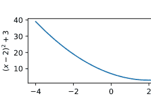

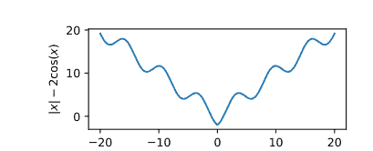

(a) 函数 $f(x) = (x - 2)^2 + 3$

(b) 函数 $f(x) = |x| - 2\cos(x)$

图B.1：两个具有唯一全局最小值的函数

Abadi, M., A. Agarwal, P. Barham, E. Brevdo, Z. Chen, C. Citro, G. S. Corrado, A. Davis, J. Dean, M. Devin, S. Ghemawat, I. J. Goodfellow, A. Harp, G. Irving, M. Isard, Y. Jia, R. Józefowicz, L. Kaiser, M. Kudlur, J. Levenberg, D. Mané, R. Monga, S. Moore, D. G. Murray, C. Olah, M. Schuster, J. Shlens, B. Steiner, I. Sutskever, K. Talwar, P. A. Tucker, V. Vanhoucke, V. Vasudevan, F. B. Viégas, O. Vinyals, P. Warden, M. Wattenberg, M. Wicke, Y. Yu, and X. Zheng (2016). TensorFlow：异构分布式系统上的大规模机器学习。CoRR abs/1603.04467.

Abend, O. and A. Rappoport (2017). 语义表示的最新水平。参见 acl (2017)。

Abney, S., R. E. Schapire, and Y. Singer (1999). 将提升方法应用于标注和PP附着。参见 emn (1999)，第132–134页。

Abney, S. P. (1987). 英语名词短语的句子层面表现。博士论文，麻省理工学院。

Abney, S. P. and M. Johnson (1991). 解析策略的内存需求与局部歧义。*《心理语言学研究杂志》* 20(3), 233–250.

Adafre, S. F. and M. De Rijke (2006). 在维基百科中跨语言查找相似句子。载于《关于新文本维基、博客和其他动态文本源的研讨会论文集》。

Ahn, D. (2006). 事件抽取的阶段。载于《时间与事件标注和推理研讨会论文集》，第1–8页。计算语言学协会。

Aho, A. V., M. S. Lam, R. Sethi, and J. D. Ullman (2006). *《编译器：原理、技术与工具》*（第2版）。艾迪生-韦斯利出版公司。

Aikhenvald, A. Y. (2004). *《示证性》*。牛津大学出版社。

Carletta, J. (1996). 评估分类任务的一致性：kappa统计量。*《计算语言学》* 22(2), 249–254.

Carletta, J. (2007). 释放杀手级语料库：创建多维度AMI会议语料库的经验。*《语言资源与评测》* 41(2), 181–190.

Carlson, L. and D. Marcu (2001). 话语标注参考手册。技术报告 ISI-TR-545，信息科学研究所。

Carlson, L., M. E. Okurowski, and D. Marcu (2002). RST篇章树库。宾夕法尼亚大学语言数据联盟。

Carpenter, B. (1997). *《类型逻辑语义学》*。马萨诸塞州剑桥：麻省理工学院出版社。

Carreras, X., M. Collins, and T. Koo (2008). 基于标注、动态规划和感知机的高效、特征丰富的解析。载于*《自然语言学习会议（CoNLL）论文集》*，第9–16页。

Carreras, X. and L. Márquez (2005). CoNLL-2005共享任务简介：语义角色标注。载于*《第九届计算自然语言学习会议论文集》*，第152–164页。计算语言学协会。

Carroll, L. (1865). *《爱丽丝梦游仙境》*。伦敦：麦克米伦出版社。

Carroll, L. (1917). *《镜中世界：爱丽丝镜中奇遇记》*。芝加哥：兰德-麦克纳利出版社。

Chambers, N. and D. Jurafsky (2008). 联合整合隐式约束改进时间排序。参见 emn (2008)，第698–706页。

Chang, K.-W., A. Krishnamurthy, A. Agarwal, H. Daumé III, and J. Langford (2015). 学习比你的老师更好地搜索。参见 icm (2015)。

Chang, M.-W., L. Ratinov, and D. Roth (2007). 用约束驱动学习指导半监督。参见 acl (2007)，第280–287页。

Chang, M.-W., L.-A. Ratinov, N. Rizzolo, and D. Roth (2008). 带约束的学习与推理。载于*《美国人工智能协会全国会议（AAAI）论文集》*，第1513–1518页。

Chapman, W. W., W. Bridewell, P. Hanbury, G. F. Cooper, and B. G. Buchanan (2001). 一种识别出院摘要中否定发现和疾病的简单算法。*《生物医学信息学杂志》* 34(5), 301–310.

Charniak, E. (1997). 自然语言解析的统计技术。*《AI杂志》* 18(4), 33–43.

Collobert, R., K. Kavukcuoglu, and C. Farabet (2011). Torch7：类似Matlab的机器学习环境。技术报告 EPFL-CONF-192376，EPFL。

Collobert, R. and J. Weston (2008). 自然语言处理的统一架构：基于多任务学习的深度神经网络。参见 icm (2008)，第160–167页。

Collobert, R., J. Weston, L. Bottou, M. Karlen, K. Kavukcuoglu, and P. Kuksa (2011). 自然语言处理（几乎）从零开始。*《机器学习研究杂志》* 12, 2493–2537.

Colton, S., J. Goodwin, and T. Veale (2012). 全脸诗歌生成。载于《国际计算创意会议论文集》，第95–102页。

Conneau, A., D. Kiela, H. Schwenk, L. Barrault, and A. Bordes (2017). 从自然语言推理数据监督学习通用句子表示。参见 emn (2017)，第681–691页。

Cormen, T. H., C. E. Leiserson, R. L. Rivest, and C. Stein (2009). *《算法导论》*（第3版）。麻省理工学院出版社。

Cotterell, R., H. Schütze, and J. Eisner (2016). 词嵌入的形态平滑与外推。参见 acl (2016)，第1651–1660页。

Coviello, L., Y. Sohn, A. D. Kramer, C. Marlow, M. Franceschetti, N. A. Christakis, and J. H. Fowler (2014). 在大规模社交网络中检测情绪传染。*《PLoS ONE》* 9(3), e90315.

Covington, M. A. (2001). 依存句法分析的基础算法。载于《第39届ACM东南会议论文集》，第95–102页。

Crammer, K., O. Dekel, J. Keshet, S. Shalev-Shwartz, and Y. Singer (2006年12月). 在线被动-主动算法。*《机器学习研究杂志》* 7, 551–585.

Crammer, K. and Y. Singer (2001). Pranking与排序。载于《神经信息处理系统会议（NIPS）》，第641–647页。

Crammer, K. and Y. Singer (2003). 针对多类问题的超保守在线算法。*《机器学习研究杂志》* 3, 951–991.

Creutz, M. and K. Lagus (2007). 用于语素切分和形态学习的无监督模型。*《ACM语音与语言处理汇刊（TSLP）》* 4(1), 3.

Cross, J. and L. Huang (2016). 基于跨度、使用结构标签系统和可证明最优动态预言机的成分句法分析。参见 emn (2016)，第1–11页。


Durrett, G. and D. Klein (2015). 神经CRF句法分析. 参见ACL (2015).

Dyer, C., M. Ballesteros, W. Ling, A. Matthews, and N. A. Smith (2015). 基于转移的依赖句法分析与堆栈长短期记忆. 参见ACL (2015), 第334–343页.

Dyer, C., A. Kuncoro, M. Ballesteros, and N. A. Smith (2016). 递归神经网络文法. 参见NAACL (2016), 第199–209页.

Edmonds, J. (1967). 最优分支. 美国国家标准局研究期刊B 71(4), 233–240.

Efron, B. and R. J. Tibshirani (1993). 自助法导论：统计与应用概率专著，第57卷. 纽约和伦敦：查普曼与霍尔/CRC出版社.

Eisenstein, J. (2009). 基于多尺度词汇衔接的层次文本分割. 参见NAACL (2009).

Eisenstein, J. and R. Barzilay (2008). 贝叶斯无监督主题分割. 参见EMNLP (2008).

Eisner, J. (1997). 最小生成树的最新算法：教程讨论. https://www.cs.jhu.edu/~jason/papers/eisner.mst-tutorial.pdf.

Eisner, J. (2000). 双词汇文法及其三次时间句法分析算法. 见《概率及其他句法分析技术进展》，第29–61页. 施普林格.

Eisner, J. (2002). 概率有限状态转换器的参数估计. 参见ACL (2002), 第1–8页.

Eisner, J. (2016). 内外算法和前向后向算法不过是反向传播. 见《自然语言处理结构化预测研讨会论文集》，第1–17页.

Eisner, J. M. (1996). 用于依赖句法分析的三种新概率模型：探索. 参见COLING (1996), 第340–345页.

Ekman, P. (1992). 存在基本情绪吗？心理学评论 99(3), 550–553.

Elman, J. L. (1990). 在时间中发现结构. 认知科学 14(2), 179–211.

Elman, J. L., E. A. Bates, M. H. Johnson, A. Karmiloff-Smith, D. Parisi, and K. Plunkett (1998). 重新思考先天性：发展的联结主义视角，第10卷. 麻省理工学院出版社.

Elsner, M. and E. Charniak (2010). 解析聊天. 计算语言学 36(3), 389–409.

Fillmore, C. J. (1976). 框架语义学与语言的本质. 纽约科学院年鉴 280(1), 20–32.

Fillmore, C. J. and C. Baker (2009). 语义分析的框架方法. 见《牛津语言分析手册》. 牛津大学出版社.

Finkel, J. R., T. Grenager, and C. Manning (2005). 通过吉布斯抽样将非局部信息纳入信息抽取系统. 参见ACL (2005), 第363–370页.

Finkel, J. R., T. Grenager, and C. D. Manning (2007). 无限树. 参见ACL (2007), 第272–279页.

Finkel, J. R., A. Kleeman, and C. D. Manning (2008). 高效、基于特征的条件随机场句法分析. 参见ACL (2008), 第959–967页.

Finkel, J. R. and C. Manning (2009). 层次贝叶斯领域自适应. 参见NAACL (2009), 第602–610页.

Finkel, J. R. and C. D. Manning (2008). 在共指消解中强制传递性. 参见ACL (2008), 第45–48页.

Finkelstein, L., E. Gabrilovich, Y. Matias, E. Rivlin, Z. Solan, G. Wolfman, and E. Ruppin (2002). 将搜索置于情境中：概念的再探讨. ACM信息系统汇刊 20(1), 116–131.

Firth, J. R. (1957). 语言学论文集1934-1951. 牛津大学出版社.

Flanigan, J., S. Thomson, J. Carbonell, C. Dyer, and N. A. Smith (2014). 面向抽象意义表示的判别式图基解析器. 参见ACL (2014), 第1426–1436页.

Foltz, P. W., W. Kintsch, and T. K. Landauer (1998). 用潜在语义分析测量文本连贯性. 话语过程 25(2-3), 285–307.

Fordyce, C. (2007). IWSLT 2007评测活动概述. 见《2007年国际口语翻译研讨会（IWSLT）》.

Forsyth, E. N. and C. H. Martell (2007). 在线聊天对话的词汇与话语分析. 见《国际语义计算会议》，第19–26页. IEEE.

Fort, K., G. Adda, and K. B. Cohen (2011). 亚马逊土耳其机器人：金矿还是煤矿？计算语言学 37(2), 413–420.

Fox, H. (2002). 短语衔接与统计机器翻译. 参见EMNLP (2002), 第304–311页.

Francis, W. and H. Kucera (1982). *英语用法频率分析*. 霍顿·米夫林公司.

Francis, W. N. (1964). 供数字计算机使用的当代英语标准样本. 提交美国教育总署的合作研究项目E-007报告.

Freund, Y. and R. E. Schapire (1999). 使用感知机算法进行大间隔分类. *机器学习* 37(3), 277–296.

Fromkin, V., R. Rodman, and N. Hyams (2013). *语言导论*. 圣智学习出版公司.

Fundel, K., R. Küffner, and R. Zimmer (2007). Relex——使用依赖解析树的关系抽取. *生物信息学* 23(3), 365–371.

Gabow, H. N., Z. Galil, T. Spencer, and R. E. Tarjan (1986). 在无向图和有向图中查找最小生成树的高效算法. *组合数学* 6(2), 109–122.

Gabrilovich, E. and S. Markovitch (2007). 使用基于维基百科的显式语义分析计算语义相关性. 见*国际人工智能联合会议论文集（IJCAI）*，第7卷，第1606–1611页.

Gage, P. (1994). 一种新的数据压缩算法. *C用户期刊* 12(2), 23–38.

Gale, W. A., K. W. Church, and D. Yarowsky (1992). 每个话语一个义项. 见*语音与自然语言研讨会论文集*，第233–237页. 计算语言学协会.

Galley, M., M. Hopkins, K. Knight, and D. Marcu (2004). 翻译规则里有什么？参见NAACL (2004), 第273–280页.

Galley, M., K. R. McKeown, E. Fosler-Lussier, and H. Jing (2003). 多方对话的话语分割. 参见ACL (2003).

Ganchev, K. and M. Dredze (2008). 通过随机特征混合构建小型统计模型. 见*移动语言处理研讨会论文集*，第19–20页. 计算语言学协会.

Ganchev, K., J. Graça, J. Gillenwater, and B. Taskar (2010). 结构化潜变量模型的后验正则化. *机器学习研究期刊* 11, 2001–2049.

Glorot, X. and Y. Bengio (2010). 理解训练深度前馈神经网络的困难. 见《人工智能与统计会议论文集》（AISTATS），第249–256页.

Glorot, X., A. Bordes, and Y. Bengio (2011). 深度稀疏整流网络. 参见AISTATS (2011), 第315–323页.

Godfrey, J. J., E. C. Holliman, and J. McDaniel (1992). Switchboard：用于研究与开发的电话语音语料库. 见《国际声学、语音与信号处理会议论文集》（ICASSP），第517–520页. IEEE.

Goldberg, Y. (2017a, 6月). 对“自然语言的对抗生成”的对抗性评论. https://medium.com/@yoav.goldberg/an-adversarial-review-of-adversarial-generation-of-natural-language-409ac3378bd7.

Goldberg, Y. (2017b). 自然语言处理的神经网络方法. 人类语言技术综合讲座. 摩根与克莱普尔出版社.

Goldberg, Y. and M. Elhadad (2010). 一种用于易优先非定向依赖句法分析的高效算法. 参见NAACL (2010), 第742–750页.

Goldberg, Y. and J. Nivre (2012). 弧急切依赖句法分析的动态预言机. 参见COLING (2012), 第959–976页.

Goldberg, Y., K. Zhao, and L. Huang (2013). 束搜索增量解析器的高效实现. 参见ACL (2013), 第628–633页.

Goldwater, S. and T. Griffiths (2007). 一种全贝叶斯的无监督词性标注方法. 参见ACL (2007).

Gonçalo Oliveira, H. R., F. A. Cardoso, and F. C. Pereira (2007). Tra-la-lyrics：一种基于节奏生成文本的方法. 见《第四届国际计算创造力联合研讨会论文集》. A. Cardoso和G. Wiggins.

Goodfellow, I., Y. Bengio, and A. Courville (2016). 深度学习. 麻省理工学院出版社.

Goodman, J. T. (2001). 语言建模的一点进展. 计算机语音与语言 15(4), 403–434.

Gouws, S., D. Metzler, C. Cai, and E. Hovy (2011). 语境对社交媒体中语言变异的影响. 见《语言与社交媒体研讨会论文集》. 计算语言学协会.

Goyal, A., H. Daumé III, and S. Venkatasubramanian (2009). 大规模自然语言处理的流式处理：语言建模. 参见NAACL (2009), 第512–520页.


- Hirao, T., Y. Yoshida, M. Nishino, N. Yasuda, and M. Nagata (2013). 单文档摘要作为树背包问题。见 EMNLP (2013)，第 1515–1520 页。
- Hirschman, L. and R. Gaizauskas (2001). 自然语言问答：从这里看。自然语言工程 7(4), 275–300。
- Hirschman, L., M. Light, E. Breck, and J. D. Burger (1999). Deep Read：一种阅读理解系统。在计算语言学协会会议论文集 (ACL) 论文集中，第 325–332 页。
- Hobbs, J. R. (1978). 解析代词指称。Lingua 44(4), 311–338。
- Hobbs, J. R., D. Appelt, J. Bear, D. Israel, M. Kameyama, M. Stickel, and M. Tyson (1997). FASTUS：一种用于从自然语言文本中提取信息的级联有限状态转换器。有限状态语言处理，383–406。
- Hochreiter, S. and J. Schmidhuber (1997). 长短期记忆。神经计算 9(8), 1735–1780。
- Hockenmaier, J. and M. Steedman (2007). CCGbank：从宾州树库中提取的 CCG 推导和依存结构语料库。计算语言学 33(3), 355–396。
- Hoffart, J., M. A. Yosef, I. Bordino, H. Fürstenau, M. Pinkal, M. Spaniol, B. Taneva, S. Thater, and G. Weikum (2011). 文本中命名实体的鲁棒消歧。见 EMNLP (2011)，第 782–792 页。
- Hoffmann, R., C. Zhang, X. Ling, L. Zettlemoyer, and D. S. Weld (2011). 基于知识的弱监督用于重叠关系的抽取。见 ACL (2011)，第 541–550 页。
- Holmstrom, L. and P. Koistinen (1992). 在反向传播训练中使用加性噪声。IEEE 神经网络汇刊 3(1), 24–38。
- Hovy, D., S. Spruit, M. Mitchell, E. M. Bender, M. Strube, and H. Wallach (2017). 第一届计算语言学协会自然语言处理伦理研讨会论文集。在第一届计算语言学协会自然语言处理伦理研讨会论文集中。计算语言学协会。
- Hovy, E. and J. Lavid (2010). 朝向语料库标注的“科学”：语料库语言学的一个新的方法论挑战。国际翻译期刊 22(1), 13–36。
- Hsu, D., S. M. Kakade, and T. Zhang (2012). 学习隐马尔可夫模型的光谱算法。计算机与系统科学杂志 78(5), 1460–1480。
- Hu, M. and B. Liu (2004). 挖掘和总结客户评论。在 *知识发现与数据挖掘会议论文集 (KDD)* 中，第 168–177 页。
- Hu, Z., Z. Yang, X. Liang, R. Salakhutdinov, and E. P. Xing (2017). 朝向文本的受控生成。见 ICML (2017)，第 1587–1596 页。
- Huang, F. and A. Yates (2012). 用于领域适应的有偏表示学习。见 EMNLP (2012)，第 1313–1323 页。
- Huang, L. and D. Chiang (2007). 森林重评分：集成语言模型的更快解码。见 ACL (2007)，第 144–151 页。
- Huang, L., S. Fayong, and Y. Guo (2012). 带不精确搜索的结构感知器。见 NAACL (2012)，第 142–151 页。
- Huang, Y. (2015). *语用学* (第二版)。*牛津语言学教材*。牛津大学出版社。
- Huang, Z., W. Xu, and K. Yu (2015). 用于序列标注的双向 LSTM-CRF 模型。*arXiv 预印本 arXiv:1508.01991*。
- Huddleston, R. and G. K. Pullum (2005). *英语语法学生导论*。剑桥大学出版社。
- Huffman, D. A. (1952). 构造最小冗余码的方法。*IRE 会议录* 40(9), 1098–1101。
- Humphreys, K., R. Gaizauskas, and S. Azzam (1997). 用于信息抽取的事件共指。在 *关于在不受限文本中实际鲁棒代词消解的操作因素研讨会论文集* 中，第 75–81 页。计算语言学协会。
- Ide, N. and Y. Wilks (2006). 对词义的理解。在 *词义消歧* 中，第 47–73 页。Springer。
- Ioffe, S. and C. Szegedy (2015). 批量归一化：通过减少内部协变量偏移加速深度网络训练。见 ICML (2015)，第 448–456 页。
- Isozaki, H., T. Hirao, K. Duh, K. Sudoh, and H. Tsukada (2010). 远距离语言对翻译质量的自动评估。见 EMNLP (2010)，第 944–952 页。
- Ivanova, A., S. Oepen, L. Øvrelid, and D. Flickinger (2012). 谁对谁做了什么？句法-语义依存的对比研究。在 *第六届语言标注研讨会论文集* 中，第 2–11 页。计算语言学协会。
- Iyyer, M., V. Manjunatha, J. Boyd-Graber, and D. Daumé III (2015). 深度无序组合与文本分类的句法方法相媲美。见 ACL (2015)，第 1681–1691 页。
- James, G., D. Witten, T. Hastie, and R. Tibshirani (2013). *统计学习导论*，第 112 卷。Springer。
- Janin, A., D. Baron, J. Edwards, D. Ellis, D. Gelbart, N. Morgan, B. Peskin, T. Pfau, E. Shriberg, A. Stolcke, et al. (2003). ICSI 会议语料库。在 *国际声学、语音和信号处理会议论文集 (ICASSP)* 中。
- Jean, S., K. Cho, R. Memisevic, and Y. Bengio (2015). 关于在神经机器翻译中使用非常大的目标词汇表。见 ACL (2015)，第 1–10 页。
- Jeong, M., C.-Y. Lin, and G. G. Lee (2009). 电子邮件和论坛中的半监督言语行为识别。见 EMNLP (2009)，第 1250–1259 页。
- Ji, H. and R. Grishman (2011). 知识库填充：成功方法与挑战。见 ACL (2011)，第 1148–1158 页。
- Ji, Y., T. Cohn, L. Kong, C. Dyer, and J. Eisenstein (2015). 文档上下文语言模型。在 *国际学习表征会议研讨会论文集* 中，第 abs/1511.03962 卷。
- Ji, Y. and J. Eisenstein (2014). 用于文本级篇章解析的表示学习。见 ACL (2014)。
- Ji, Y. and J. Eisenstein (2015). 一个向量不够：用于篇章关系的实体增强分布语义。*计算语言学协会会刊 (TACL)*。
- Ji, Y., G. Haffari, and J. Eisenstein (2016). 用于篇章关系语言模型的隐变量循环神经网络。见 NAACL (2016)。
- Ji, Y. and N. A. Smith (2017). 用于文本分类的神经篇章结构。见 ACL (2017)，第 996–1005 页。
- Ji, Y., C. Tan, S. Matschat, Y. Choi, and N. A. Smith (2017). 神经语言模型中的动态实体表示。见 EMNLP (2017)，第 1831–1840 页。
- Jiang, L., M. Yu, M. Zhou, X. Liu, and T. Zhao (2011). 基于目标的 Twitter 情感分类。见 ACL (2011)，第 151–160 页。
- Jing, H. (2000). 用于自动文本摘要的句子简化。在 *第六届应用自然语言处理会议论文集* 中，第 310–315 页。计算语言学协会。
- Joachims, T. (2002). 使用点击数据优化搜索引擎。在 *知识发现与数据挖掘会议论文集 (KDD)* 中，第 133–142 页。
- Kiperwasser, E. and Y. Goldberg (2016). 使用双向 LSTM 特征表示的简单而准确的依存句法分析。*计算语言学协会会刊* 4, 313–327。
- Kipper-Schuler, K. (2005). *VerbNet：一个覆盖面广、内容全面的动词词典。* 博士论文，计算机与信息科学，宾夕法尼亚大学。
- Kiros, R., R. Salakhutdinov, and R. Zemel (2014). 多模态神经语言模型。见 ICML (2014)，第 595–603 页。
- Kiros, R., Y. Zhu, R. Salakhutdinov, R. S. Zemel, A. Torralba, R. Urtasun, and S. Fidler (2015). Skip-thought 向量。见 NIPS (2015)。
- Klein, D. and C. D. Manning (2003). 精确的无词化句法分析。见 ACL (2003)，第 423–430 页。
- Klein, D. and C. D. Manning (2004). 基于语料库的句法结构归纳：依存和成分模型。见 ACL (2004)。
- Klein, G., Y. Kim, Y. Deng, J. Senellart, and A. M. Rush (2017). OpenNMT：神经机器翻译的开源工具包。*arXiv 预印本 arXiv:1701.02810。*
- Klementiev, A., I. Titov, and B. Bhattarai (2012). 归纳跨语言词的分布式表示。见 COLING (2012)，第 1459–1474 页。
- Klenner, M. (2007). 对共指集合施加一致性。在 *自然语言处理最新进展 (RANLP)* 中，第 323–328 页。
- Knight, K. (1999). 词替换翻译模型中的解码复杂度。*计算语言学* 25(4), 607–615。
- Knight, K. and J. Graehl (1998). 机器转写。*计算语言学* 24(4), 599–612。
- Knight, K. and D. Marcu (2000). 基于统计的摘要 - 第一步：句子压缩。在 *国家人工智能会议论文集 (AAAI)* 中，第 703–710 页。
- Knight, K. and J. May (2009). 加权自动机在自然语言处理中的应用。在 *加权自动机手册* 中，第 571–596 页。Springer。
- Knott, A. (1996). *一种基于数据的动机一致性关系集合的方法。* 博士论文，爱丁堡大学。
- Koehn, P. (2005). Europarl：用于统计机器翻译的平行语料库。在 *机器翻译高峰会* 中，第 5 卷，第 79–86 页。


Lee, K., L. He, and L. Zettlemoyer (2018). 高阶指代消解与粗到细推理。见 naa (2018)，第 687–692 页。

Lenat, D. B., R. V. Guha, K. Pittman, D. Pratt, and M. Shepherd (1990). Cyc：通向具有常识的程序。《ACM 通讯》33(8)，30–49。

Lesk, M. (1986). 使用机器可读词典的自动词义消歧：如何区分松果和冰淇淋甜筒。在第 5 届系统文档国际会议论文集中，第 24–26 页。ACM。

Levesque, H. J., E. Davis, and L. Morgenstern (2011). Winograd 模式挑战。在 AAAI 春季研讨会：常识推理的逻辑形式化中。

Levin, E., R. Pieraccini, and W. Eckert (1998). 使用马尔可夫决策过程学习对话策略。在《国际声学、语音和信号处理会议论文集》第 1 卷中，第 201–204 页。IEEE。

Levy, O. and Y. Goldberg (2014). 基于依赖关系的词嵌入。见 acl (2014)，第 302–308 页。

Levy, O., Y. Goldberg, and I. Dağan (2015). 利用词嵌入的经验改进分布相似度。《计算语言学协会会刊》3，211–225。

Levy, R. and C. Manning (2009). 计算语义学的非正式介绍。http://idiom.ucsd.edu/~rlevy/teaching/winter2009/lingcse256/lectures/lecture_14_compositional_semantics.pdf。

Lewis, M. and M. Steedman (2013). 结合分布式和逻辑语义。《计算语言学协会会刊》1，179–192。

Lewis II, P. M. and R. E. Stearns (1968). 语法导向的转换。《ACM 会刊》15(3)，465–488。

Li, J. and D. Jurafsky (2015). 多义嵌入能改善自然语言理解吗？见 emn (2015)，第 1722–1732 页。

Li, J. and D. Jurafsky (2017). 开放域话语连贯性的神经网络模型。见 emn (2017)，第 198–209 页。

Li, J., R. Li, and E. Hovy (2014). 话语解析的递归深度模型。见 emn (2014)。

Li, J., M.-T. Luong, and D. Jurafsky (2015). 用于段落和文档的分层神经自编码器。见 emn (2015)。

Lin, Z., H. T. Ng, and M.-Y. Kan (2011). 利用话语关系自动评估文本连贯性。见 acl (2011)，第 997–1006 页。

Lin, Z., H. T. Ng, and M.-Y. Kan (2014). 一种 PDTB 风格的端到端话语解析器。《自然语言工程》20(2)，151–184。

Ling, W., C. Dyer, A. Black, and I. Trancoso (2015). 两种/太简单的 word2vec 语法问题适配。见 naa (2015)。

Ling, W., T. Luís, L. Marujo, R. F. Astudillo, S. Amir, C. Dyer, A. W. Black, and I. Trancoso (2015). 在形式中寻找功能：开放词汇词表示的组合字符模型。见 emn (2015)。

Ling, W., G. Xiang, C. Dyer, A. Black, and I. Trancoso (2013). 微博客作为平行语料库。见 acl (2013)。

Ling, X., S. Singh, and D. S. Weld (2015). 实体链接的设计挑战。《计算语言学协会会刊》3，315–328。

Linguistic Data Consortium (2005). ACE（自动内容抽取）关系英语标注指南。技术报告 版本 5.8.3，语言数据联盟。

Liu, B. (2015). 情感分析：挖掘观点、情感和情绪。剑桥大学出版社。

Liu, D. C. and J. Nocedal (1989). 大规模优化的有限内存 BFGS 方法。《数学规划》45(1-3)，503–528。

Liu, Y., Q. Liu, and S. Lin (2006). 用于统计机器翻译的树到字符串对齐模板。见 acl (2006)，第 609–616 页。

Loper, E. and S. Bird (2002). NLTK：自然语言工具包。在《自然语言处理和计算语言学教学有效工具和方法研讨会论文集》中，第 63–70 页。计算语言学协会。

Louis, A., A. Joshi, and A. Nenkova (2010). 摘要中内容选择的话语指示符。在《话语与对话特别兴趣小组（SIGDIAL）论文集》中，第 147–156 页。

Louis, A. and A. Nenkova (2013). 什么使写作伟大？科学新闻领域文章质量预测的首次实验。《计算语言学协会会刊》1，341–352。

Loveland, D. W. (2016). 自动定理证明：逻辑基础。爱思唯尔。

Marcu, D. (1997b). 从局部到全局连贯性：文本规划的自底向上方法。在 *国家人工智能大会论文集（AAAI）* 中，第 629–635 页。

Marcus, M. P., M. A. Marcinkiewicz, and B. Santorini (1993). 构建大型英语标注语料库：宾夕法尼亚树库。*计算语言学 19*(2)，313–330。

Maron, O. and T. Lozano-Pérez (1998). 多实例学习的框架。在 *神经信息处理系统（NIPS）* 中，第 570–576 页。

Márquez, G. G. (1970). *百年孤独*。Harper & Row。Gregory Rabassa 英译。

Martins, A. F. T., N. A. Smith, and E. P. Xing (2009). 依存句法分析的简洁整数线性规划公式。见 acl (2009)，第 342–350 页。

Martins, A. F. T., N. A. Smith, E. P. Xing, P. M. Q. Aguiar, and M. A. T. Figueiredo (2010). Turbo 解析器：通过近似变分推理进行依存句法分析。见 emn (2010)，第 34–44 页。

Matsuzaki, T., Y. Miyao, and J. Tsujii (2005). 具有潜在标注的概率上下文无关文法。见 acl (2005)，第 75–82 页。

Matthiessen, C. and J. A. Bateman (1991). *文本生成与系统功能语言学：英语和日语的经验*。Pinter 出版社。

McCallum, A. and W. Li (2003). 使用条件随机场、特征归纳和网络增强词表的命名实体识别早期结果。见 naa (2003)，第 188–191 页。

McCallum, A. and B. Wellner (2004). 具有名词指代应用的身份不确定性条件模型。在 *神经信息处理系统（NIPS）* 中，第 905–912 页。

McDonald, R., K. Crammer, and F. Pereira (2005). 依存句法分析器的在线大间隔训练。见 acl (2005)，第 91–98 页。

McDonald, R., K. Hannan, T. Neylon, M. Wells, and J. Reynar (2007). 用于细到粗情感分析的结构化模型。见 acl (2007)。

McDonald, R. and F. Pereira (2006). 近似依存句法分析算法的在线学习。见 eac (2006)。

McKeown, K. (1992). *文本生成*。剑桥大学出版社。

McKeown, K., S. Rosenthal, K. Thadani, and C. Moore (2010). 高效创建准确的句子融合语料库。见 naa (2010)，第 317–320 页。

## 参考书目

McKeown, K. R., R. Barzilay, D. Evans, V. Hatzivassiloglou, J. L. Klavans, A. Nenkova, C. Sable, B. Schiffman, and S. Sigelman (2002). 基于哥伦比亚 Newsblaster 的日常新闻跟踪与摘要。在 *第二届人类语言技术研究国际会议论文集* 中，第 280–285 页。

McNamee, P. and H. T. Dang (2009). TAC 2009 知识库构建赛道概述。在 *文本分析会议* (TAC) 第 17 卷中，第 111–113 页。

Medlock, B. and T. Briscoe (2007). 科学文献中模糊分类的弱监督学习。见 acl (2007)，第 992–999 页。

Mei, H., M. Bansal, and M. R. Walter (2016). 谈论什么以及如何谈论？使用具有粗到细对齐的 LSTM 进行选择性生成。见 naa (2016)，第 720–730 页。

Merity, S., N. S. Keskar, and R. Socher (2018). LSTM 语言模型的正则化与优化。见 icl (2018)。

Merity, S., C. Xiong, J. Bradbury, and R. Socher (2017). 指针哨兵混合模型。见 icl (2017)。

Messud, C. (2014, June). 一个新的 ’l’étranger’。*纽约书评*。

Miao, Y. and P. Blunsom (2016). 语言作为潜在变量：句子压缩的离散生成模型。见 emn (2016)，第 319–328 页。

Miao, Y., L. Yu, and P. Blunsom (2016). 文本处理的神经变分推理。在 *国际机器学习会议论文集（ICML）* 中。

Mihalcea, R., T. A. Chklovski, and A. Kilgarriff (2004). SENSEVAL-3 英语词汇样本任务。在 *SENSEVAL-3 论文集* 中，西班牙巴塞罗那，第 25–28 页。计算语言学协会。

Mihalcea, R. and D. Radev (2011). *基于图的自然语言处理与信息检索*。剑桥大学出版社。

Mikolov, T., K. Chen, G. Corrado, and J. Dean (2013). 向量空间中词表示的高效估计。在 *国际学习表征会议论文集* 中。

Mikolov, T., A. Deoras, D. Povey, L. Burget, and J. Cernocky (2011). 大规模神经网络语言模型训练策略。在 *自动语音识别与理解研讨会论文集（ASRU）* 中，第 196–201 页。

Mikolov, T., M. Karafiát, L. Burget, J. Cernocký, and S. Khudanpur (2010). 基于循环神经网络的语言模型。在 *INTERSPEECH* 中，第 1045–1048 页。


Mikolov, T., I. Sutskever, K. Chen, G. S. Corrado, and J. Dean (2013). 词和短语的分布式表示及其组合性. 见 *神经信息处理系统进展*, pp. 3111–3119.

Mikolov, T., W.-t. Yih, and G. Zweig (2013). 连续空间词表示中的语言规律性. 见 NAACL (2013), pp. 746–751.

Mikolov, T. and G. Zweig. 上下文相关的循环神经网络语言模型. 见 *口语语言技术会议论文集 (SLT)*, pp. 234–239.

Miller, G. A., G. A. Heise, and W. Lichten (1951). 语音可懂度与测试材料上下文的关系. *实验心理学杂志* 41(5), 329.

Miller, M., C. Sathi, D. Wiesenthal, J. Leskovec, and C. Potts (2011). 超链接网络中的情感流动. 见 *国际网络与社交媒体会议论文集 (ICWSM)*.

Miller, S., J. Guinness, and A. Zamanian (2004). 基于词聚类和判别式训练的命名标注. 见 NAACL (2004), pp. 337–342.

Milne, D. and I. H. Witten (2008). 学习使用维基百科进行链接. 见 *国际信息与知识管理会议论文集 (CIKM)*, pp. 509–518.

Miltsakaki, E. and K. Kukich (2004). 用于电子作文评分系统的文本连贯性评估. *自然语言工程* 10(1), 25–55.

Minka, T. P. (1999). 从隐马尔可夫模型到线性动态系统. 技术报告 531，麻省理工学院媒体实验室视觉与建模组.

Minsky, M. (1974). 一种表示知识的框架. 技术报告 306，麻省理工学院人工智能实验室.

Minsky, M. and S. Papert (1969). *感知机*. 麻省理工学院出版社.

Mintz, M., S. Bills, R. Snow, and D. Jurafsky (2009). 无标注数据的关系抽取远距离监督. 见 ACL (2009), pp. 1003–1011.

Mirza, P., R. Sprugnoli, S. Tonelli, and M. Speranza (2014). 在 TempEval-3 语料库中标注因果关系. 见 *EACL 2014 语言中的因果关系计算方法研讨会论文集 (CAtoCL)*, pp. 10–19.

Misra, D. K. and Y. Artzi (2016). 神经移位-归约 CCG 语义分析. 见 EMNLP (2016).

Mitchell, J. and M. Lapata (2010). 语义分布模型中的组合性. *认知科学* 34(8), 1388–1429.

Miwa, M. and M. Bansal (2016). 使用 LSTM 在序列和树结构上进行端到端关系抽取. 见 ACL (2016), pp. 1105–1116.

Mnih, A. and G. Hinton (2007). 用于统计语言建模的三种新图模型. 见机器学习国际会议论文集 (ICML), pp. 641–648.

Mnih, A. and G. E. Hinton (2008). 一种可扩展的分层分布式语言模型. 见神经信息处理系统 (NIPS), pp. 1081–1088.

Mnih, A. and Y. W. Teh (2012). 一种用于训练神经概率语言模型的快速简单算法. 见 ICML (2012).

Mohammad, S. M. and P. D. Turney (2013). 众包构建词-情感关联词典. *计算智能* 29(3), 436–465.

Mohri, M., F. Pereira, and M. Riley (2002). 语音识别中的加权有限状态转换器. *计算机语音与语言* 16(1), 69–88.

Mohri, M., A. Rostamizadeh, and A. Talwalkar (2012). 机器学习基础. 麻省理工学院出版社.

Montague, R. (1973). 普通英语中量化的恰当处理. 见自然语言处理方法, pp. 221–242. 施普林格出版社.

Moore, J. D. and C. L. Paris (1993). 为咨询对话规划文本：捕捉意图和修辞信息. *计算语言学* 19(4), 651–694.

Morante, R. and E. Blanco (2012). *SEM 2012 共享任务：解决否定的范围和焦点. 见第一届词汇与计算语义学联合会议论文集, pp. 265–274. 计算语言学协会.

Morante, R. and W. Daelemans (2009). 学习生物医学文本中模糊提示词的范围. 见生物医学自然语言处理当前趋势研讨会论文集, pp. 28–36. 计算语言学协会.

Morante, R. and C. Sporleder (2012). 情态与否定：特刊导言. *计算语言学* 38(2), 223–260.

Mostafazadeh, N., A. Grealish, N. Chambers, J. Allen, and L. Vanderwende (2016). CaTeRS：事件结构语义标注的因果与时间关系方案. 见第四届事件研讨会论文集, pp. 51–61. 计算语言学协会.

Mueller, T., H. Schmid, and H. Schütze (2013). 用于形态标注的高效高阶条件随机场. 见 EMNLP (2013), pp. 322–332.

Parsons, T. (1990). *英语语义中的事件*, 第 5 卷. 麻省理工学院出版社.

Pascanu, R., T. Mikolov, and Y. Bengio (2013). 论训练循环神经网络的难度. 见 ICML (2013), pp. 1310–1318.

Paul, M., M. Federico, and S. Stüker (2010). IWSLT 2010 评测活动概述. 见 *2010 年口语语言翻译国际研讨会 (IWSLT)*.

Pedersen, T., S. Patwardhan, and J. Michelizzi (2004). WordNet::similarity——度量概念的相关性. 见 NAACL (2004), pp. 38–41.

Pedregosa, F., G. Varoquaux, A. Gramfort, V. Michel, B. Thirion, O. Grisel, M. Blondel, P. Prettenhofer, R. Weiss, V. Dubourg, J. Vanderplas, A. Passos, D. Cournapeau, M. Brucher, M. Perrot, and E. Duchesnay (2011). Scikit-learn：Python 中的机器学习. *机器学习研究杂志* 12, 2825–2830.

Pei, W., T. Ge, and B. Chang (2015). 一种用于基于图的依存句法分析的有效神经网络模型. 见 ACL (2015), pp. 313–322.

Peldszus, A. and M. Stede (2013). 从论证图到文本中的论证挖掘：综述. *国际认知信息学与自然智能杂志 (IJCINI)* 7(1), 1–31.

Peldszus, A. and M. Stede (2015). 一个带注释的论证性微文本语料库. 见 *第一届论证学会议论文集*.

Peng, F., F. Feng, and A. McCallum (2004). 使用条件随机场进行中文分词和新词检测. 见 *国际计算语言学会议论文集 (COLING)*, pp. 562–568.

Pennington, J., R. Socher, and C. Manning (2014). GloVe：词表示的全局向量. 见 EMNLP (2014), pp. 1532–1543.

Pereira, F. and Y. Schabes (1992). 基于部分括号标注语料的内外重估. 见 *计算语言学协会会议论文集 (ACL)*, pp. 128–135.

Pereira, F. C. N. and S. M. Shieber (2002). *Prolog 与自然语言分析*. Microtome 出版社.

Peters, M. E., M. Neumann, M. Iyyer, M. Gardner, C. Clark, K. Lee, and L. Zettlemoyer (2018). 深度上下文词表示. 见 NAACL (2018).

Peterson, W. W., T. G. Birdsall, and W. C. Fox (1954). 信号可检测性理论. *IRE 信息论专业组汇刊* 4(4), 171–212.

Petrov, S., L. Barrett, R. Thibaux, and D. Klein (2006). 学习精确、紧凑且可解释的树标注. 见 ACL (2006).

Petrov, S., D. Das, and R. McDonald (2012). 一种通用的词性标注集. 见 *语言资源与评价会议论文集*.

Petrov, S. and R. McDonald (2012). 2012 年网络解析共享任务概述. 见 *第一届非规范语言句法分析研讨会论文集 (SANCL)*.

Pinker, S. (2003). *语言本能：心灵如何创造语言*. 英国企鹅出版社.

Pinter, Y., R. Guthrie, and J. Eisenstein (2017). 使用子词 RNN 模拟词嵌入. 见 EMNLP (2017).

Pitler, E., A. Louis, and A. Nenkova (2009). 文本中隐式话语关系的自动意义预测. 见 ACL (2009).

Pitler, E. and A. Nenkova (2009). 使用句法消解文本中显式话语连接词的歧义. 见 ACL (2009), pp. 13–16.

Pitler, E., M. Raghupathy, H. Mehta, A. Nenkova, A. Lee, and A. Joshi (2008). 容易识别的话语关系. 见 *国际计算语言学会议论文集 (COLING)*, pp. 87–90.

Plank, B., A. Søgaard, and Y. Goldberg (2016). 使用双向长短期记忆模型和辅助损失的多语言词性标注. 见 ACL (2016).

Poesio, M., R. Stevenson, B. Di Eugenio, and J. Hitzeman (2004). 中心化：一种参数化理论及其实现. *计算语言学* 30(3), 309–363.

Polanyi, L. and A. Zaenen (2006). 语境效价转换器. 见 *文本中的态度与情感计算：理论与应用*. 施普林格出版社.

Ponzetto, S. P. and M. Strube (2006). 利用语义角色标注、WordNet 和维基百科进行共指消解. 见 NAACL (2006), pp. 192–199.

Ponzetto, S. P. and M. Strube (2007). 从维基百科获取的知识用于计算语义相关性. *人工智能研究杂志* 30, 181–212.

Poon, H. and P. Domingos (2008). 基于马尔可夫逻辑的联合无监督共指消解. 见 EMNLP (2008), pp. 650–659.

Poon, H. and P. Domingos (2009). 无监督语义分析. 见 EMNLP (2009), pp. 1–10.

Popel, M., D. Marecek, J. Stepánek, D. Zeman, and Z. Zabokrtský (2013). 依存树库中的并列结构. 见 ACL (2013), pp. 517–527.


- Rahman, A. and V. Ng (2011). 缩小建模差距：一种共指消解的聚类排序方法．人工智能研究杂志 40, 469–521．
- Rajpurkar, P., J. Zhang, K. Lopyrev, and P. Liang (2016). SQuAD：用于文本机器理解的100,000+个问题．见EMNLP (2016)，第2383–2392页．
- Ranzato, M., S. Chopra, M. Auli, and W. Zaremba (2016). 基于循环神经网络的序列级训练．见ICLR (2016)．
- Rao, D., D. Yarowsky, A. Shreevats, and M. Gupta (2010). 在Twitter中分类潜在用户属性．载于用户生成内容搜索与挖掘研讨会论文集．
- Ratinov, L. and D. Roth (2009). 命名实体识别中的设计挑战与误解．载于自然语言学习会议 (CoNLL) 论文集，第147–155页．
- Ratinov, L., D. Roth, D. Downey, and M. Anderson (2011). 面向Wikipedia消歧的局部和全局算法．见ACL (2011)，第1375–1384页．
- Ratliff, N. D., J. A. Bagnell, and M. Zinkevich (2007). (近似)次梯度方法用于结构化预测．载于人工智能与统计会议 (AISTATS) 论文集，第380–387页．
- Ratnaparkhi, A. (1996). 一种用于词性标注的最大熵模型．载于自然语言处理实证方法会议 (EMNLP) 论文集，第133–142页．
- Ratnaparkhi, A., J. Reynar, and S. Roukos (1994). 一种用于介词短语附着的最大熵模型．载于人类语言技术研讨会论文集，第250–255页．
- Read, J. (2005). 使用表情符号降低情感分类机器学习技术中的依赖性．载于ACL学生研究研讨会论文集，第43–48页．
- Reisinger, D., R. Rudinger, F. Ferraro, C. Harman, K. Rawlins, and B. V. Durme (2015). 语义原型角色．计算语言学协会汇刊 3, 475–488．
- Reisinger, J. and R. J. Mooney (2010). 词义的多原型向量空间模型．见NAACL (2010)，第109–117页．
- Reiter, E. and R. Dale (2000). 构建自然语言生成系统．剑桥大学出版社．
- Resnik, P., M. B. Olsen, and M. Diab (1999). 圣经作为平行语料库：标注‘2000种语言之书’．计算机与人文 33(1-2), 129–153．
- Saurí, R. and J. Pustejovsky (2009). FactBank：一个标注事件事实性的语料库．*语言资源与评估* 43(3), 227．
- Saxe, A. M., J. L. McClelland, and S. Ganguli (2014). 深度线性神经网络中学习非线性动力学的精确解．载于*国际学习表征会议 (ICLR) 论文集*．
- Schank, R. C. and R. Abelson (1977). *脚本、目标、计划和理解*．新泽西州希尔斯代尔：Erlbaum．
- Schapire, R. E. and Y. Singer (2000). BoosTexter：一种基于提升方法的文本分类系统．*机器学习* 39(2-3), 135–168．
- Schaul, T., S. Zhang, and Y. LeCun (2013). 不再为学习率烦恼．见ICML (2013)，第343–351页．
- Schnabel, T., I. Labutov, D. Mimno, and T. Joachims (2015). 无监督词嵌入的评估方法．见EMNLP (2015)，第298–307页．
- Schneider, N., J. Flanigan, and T. O’Gorman (2015). AMR的逻辑：面向NLP的实用、统一、基于图的句子语义．见NAACL (2015)，第4–5页．
- Schütze, H. (1998). 自动词义判别．*计算语言学* 24(1), 97–123．
- Schwarm, S. E. and M. Ostendorf (2005). 使用支持向量机和统计语言模型的阅读水平评估．见ACL (2005)，第523–530页．
- See, A., P. J. Liu, and C. D. Manning (2017). 开门见山：使用指针生成网络的摘要生成．见ACL (2017)，第1073–1083页．
- Sennrich, R., B. Haddow, and A. Birch (2016). 基于子词单元的罕见词神经机器翻译．见ACL (2016)，第1715–1725页．
- Serban, I. V., A. Sordoni, Y. Bengio, A. C. Courville, and J. Pineau (2016). 使用生成式层次神经网络模型构建端到端对话系统．见AAAI (2016)，第3776–3784页．
- Settles, B. (2012). 主动学习．*人工智能与机器学习综合讲座* 6(1), 1–114．
- Shang, L., Z. Lu, and H. Li (2015). 用于短文本对话的神经响应机器．见ACL (2015)，第1577–1586页．
- Shen, D. and M. Lapata (2007). 使用语义角色改进问答系统．见EMNLP (2007)，第12–21页．
- Socher, R., B. Huval, C. D. Manning, and A. Y. Ng (2012). 基于递归矩阵向量空间的语义组合性．见EMNLP (2012)，第1201–1211页．
- Socher, R., A. Perelygin, J. Y. Wu, J. Chuang, C. D. Manning, A. Y. Ng, and C. Potts (2013). 基于情感树库的语义组合性递归深度模型．见EMNLP (2013)．
- Søgaard, A. (2013). 自然语言处理中的半监督学习与领域自适应．*人类语言技术综合讲座* 6(2), 1–103．
- Solorio, T. and Y. Liu (2008). 学习预测语码转换点．见EMNLP (2008)，第973–981页．
- Somasundaran, S., G. Namata, J. Wiebe, and L. Getoor (2009). 利用话语关系改进观点极性分类的监督和无监督方法．见EMNLP (2009)．
- Somasundaran, S. and J. Wiebe (2009). 识别在线辩论中的立场．见ACL (2009)，第226–234页．
- Song, L., B. Boots, S. M. Siddiqi, G. J. Gordon, and A. J. Smola (2010). 隐马尔可夫模型的希尔伯特空间嵌入．载于*国际机器学习会议 (ICML) 论文集*，第991–998页．
- Song, L., Y. Zhang, X. Peng, Z. Wang, and D. Gildea (2016). 将AMR到文本生成视为旅行商问题．见EMNLP (2016)，第2084–2089页．
- Soon, W. M., H. T. Ng, and D. C. Y. Lim (2001). 名词短语共指消解的一种机器学习方法．*计算语言学* 27(4), 521–544．
- Sordoni, A., M. Galley, M. Auli, C. Brockett, Y. Ji, M. Mitchell, J.-Y. Nie, J. Gao, and B. Dolan (2015). 一种上下文敏感的对话响应生成的神经网络方法．见NAACL (2015)．
- Soricut, R. and D. Marcu (2003). 使用句法和词汇信息的句子级话语解析．见NAACL (2003)，第149–156页．
- Sowa, J. F. (2000). *知识表示：逻辑、哲学和计算基础*．加利福尼亚州太平洋格罗夫：Brooks/Cole．
- Spärck Jones, K. (1972). 词项特异性的统计解释及其在检索中的应用．*文献学杂志* 28(1), 11–21．
- Spitkovsky, V. I., H. Alshawi, D. Jurafsky, and C. D. Manning (2010). 维特比训练改进无监督依存句法分析．见CoNLL (2010)，第9–17页．
- Sporleder, C. and M. Lapata (2005). 话语分块及其在句子压缩中的应用．见EMNLP (2005)，第257–264页．
- Sproat, R., A. Black, S. Chen, S. Kumar, M. Ostendorf, and C. Richards (2001). 非标准词的规范化．*计算机语音与语言* 15(3), 287–333．
- Sproat, R., W. Gale, C. Shih, and N. Chang (1996). 一种用于中文的随机有限状态分词算法．*计算语言学* 22(3), 377–404．
- Sra, S., S. Nowozin, and S. J. Wright (2012). *机器学习优化*．麻省理工学院出版社．
- Srivastava, N., G. Hinton, A. Krizhevsky, I. Sutskever, and R. Salakhutdinov (2014). Dropout：防止神经网络过拟合的一种简单方法．*机器学习研究杂志* 15(1), 1929–1958．
- Srivastava, R. K., K. Greff, and J. Schmidhuber (2015). 训练极深网络．见NIPS (2015)，第2377–2385页．
- Stab, C. and I. Gurevych (2014a). 在议论文中标注论证成分和关系．见COLING (2014)，第1501–1510页．
- Stab, C. and I. Gurevych (2014b). 识别议论文中的论辩话语结构．见EMNLP (2014)，第46–56页．
- Stede, M. (2011, Nov.). *话语处理，人类语言技术综合讲座第4卷*．Morgan & Claypool出版社．
- Steedman, M. and J. Baldridge (2011). 组合范畴语法．载于*非转换句法：语法的形式化与显式模型*．Wiley-Blackwell出版社．
- Stenetorp, P., S. Pyysalo, G. Topić, T. Ohta, S. Ananiadou, and J. Tsujii (2012). brat：一个用于NLP辅助文本标注的基于Web的工具．见EACL (2012)，第102–107页．
- Stern, M., J. Andreas, and D. Klein (2017). 一个极简的基于跨度的神经成分句法分析器．见ACL (2017)．
- Stolcke, A., K. Ries, N. Coccaro, E. Shriberg, R. Bates, D. Jurafsky, P. Taylor, R. Martin, C. Van Ess-Dykema, and M. Meteer (2000). 用于对话语音自动标注和识别的对话行为建模．*计算语言学* 26(3), 339–373．
- Stone, P. J. (1966). *通用探究者：内容分析的计算机方法*．麻省理工学院出版社．
- Stoyanov, V., N. Gilbert, C. Cardie, and E. Riloff (2009). 名词短语共指消解中的难题：理解最新技术现状．见ACL (2009)，第656–664页．


- Strang, G. (2016). *线性代数导论*（第五版）。韦尔斯利，马萨诸塞州：韦尔斯利-剑桥出版社。
- Strubell, E., P. Verga, D. Belanger, and A. McCallum (2017). 利用迭代膨胀卷积实现快速准确的实体识别。参见 EMNLP (2017)。
- Suchanek, F. M., G. Kasneci, and G. Weikum (2007). Yago：语义知识核心。见 *万维网会议论文集 (WWW)*，第 697–706 页。
- Sun, X., T. Matsuzaki, D. Okanohara, and J. Tsujii (2009). 用于结构化分类的潜变量感知器算法。见 *国际人工智能联合会议论文集 (IJCAI)*，第 1236–1242 页。
- Sun, Y., L. Lin, D. Tang, N. Yang, Z. Ji, and X. Wang (2015). 利用神经网络对提及、上下文和实体进行建模以实现实体消歧。见 *国际人工智能联合会议论文集 (IJCAI)*，第 1333–1339 页。
- Sundermeyer, M., R. Schlüter, and H. Ney (2012). 用于语言建模的 LSTM 神经网络。见 *国际语音通信协会会议论文集 (INTERSPEECH)*。
- Surdeanu, M., J. Tibshirani, R. Nallapati, and C. D. Manning (2012). 用于关系抽取的多实例多标签学习。参见 EMNLP (2012)，第 455–465 页。
- Sutskever, I., O. Vinyals, and Q. V. Le (2014). 基于神经网络的序列到序列学习。参见 NIPS (2014)，第 3104–3112 页。
- Sutton, R. S. and A. G. Barto (1998). *强化学习导论*，第 1 卷。剑桥：麻省理工学院出版社。
- Sutton, R. S., D. A. McAllester, S. P. Singh, and Y. Mansour (2000). 基于函数逼近的强化学习策略梯度方法。见 *神经信息处理系统大会 (NIPS)*，第 1057–1063 页。
- Suzuki, J., S. Takase, H. Kamigaito, M. Morishita, and M. Nagata (2018). 构建成分句法分析强基线的实证研究。参见 ACL (2018)，第 612–618 页。
- Sweeney, L. (2013). 在线广告投放中的歧视。*队列 11*(3), 10.
- Taboada, M., J. Brooke, M. Tofiloski, K. Voll, and M. Stede (2011). 基于词典的情感分析方法。*计算语言学* 37(2), 267–307。
- Taboada, M. and W. C. Mann (2006). 修辞结构理论：回顾与展望。*话语研究* 8(3), 423–459。
- Tromble, R. W. and J. Eisner (2006). 在序列解码中强制全局约束的快速有限状态松弛方法。参见 NAACL (2006)。
- Tsochantaridis, I., T. Hofmann, T. Joachims, and Y. Altun (2004). 用于相互依赖和结构化输出空间的支持向量机学习。见国际机器学习会议论文集 (ICML)。
- Tsvetkov, Y., M. Faruqui, W. Ling, G. Lample, and C. Dyer (2015). 通过子空间对齐评估词向量表示。参见 EMNLP (2015)，第 2049–2054 页。
- Tu, Z., Z. Lu, Y. Liu, X. Liu, and H. Li (2016). 神经机器翻译的覆盖度建模。参见 ACL (2016)，第 76–85 页。
- Turian, J., L. Ratinov, and Y. Bengio (2010). 词表示：一种简单通用的半监督学习方法。参见 ACL (2010)，第 384–394 页。
- Turing, A. M. (2009). 计算机器与智能。收录于 R. Epstein, G. Roberts 和 G. Beber 主编的《解析图灵测试》，第 23–65 页。Springer 出版社。
- Turney, P. D. and P. Pantel (2010). 从频率到意义：语义的向量空间模型。人工智能研究杂志 37, 141–188。
- Tutin, A. and R. Kittredge (1992). 语境中的词汇选择：生成程序性文本。参见 COLING (1992)，第 763–769 页。
- Twain, M. (1997). *海外漫游*。纽约：企鹅出版社。
- Tzeng, E., J. Hoffman, T. Darrell, and K. Saenko (2015). 跨领域和任务的同步深度迁移。参见 ICCV (2015)，第 4068–4076 页。
- Usunier, N., D. Buffoni, and P. Gallinari (2009). 基于有序加权成对分类的排序。参见 ICML (2009)，第 1057–1064 页。
- Uthus, D. C. and D. W. Aha (2013). 用于多参与者聊天分析的 Ubuntu 聊天语料库。见 AAAI 春季研讨会：分析微文本，第 13 卷，第 01 页。
- Utiyama, M. and H. Isahara (2001). 面向领域无关文本分割的统计模型。参见 ACL (2001)，第 499–506 页。
- Utiyama, M. and H. Isahara (2007). 基于短语的统计机器翻译中枢轴方法比较。参见 NAACL (2007)，第 484–491 页。
- Uzuner, Ö., X. Zhang, and T. Sibanda (2009). 断言分类的机器学习与基于规则的方法。美国医学信息学协会杂志 16(1), 109–115。
- Vadas, D. and J. R. Curran (2011). 宾夕法尼亚树库中的名词短语解析。*计算语言学* 37(4), 753–809。
- Van Eynde, F. (2006). 名词短语内部一致性与名词短语结构。*语言学杂志* 42(1), 139–186。
- Van Gael, J., A. Vlachos, and Z. Ghahramani (2009). 用于无监督词性标注的无限隐马尔可夫模型。参见 EMNLP (2009)，第 678–687 页。
- Vaswani, A., S. Bengio, E. Brevdo, F. Chollet, A. N. Gomez, S. Gouws, L. Jones, L. Kaiser, N. Kalchbrenner, N. Parmar, R. Sepassi, N. Shazeer, and J. Uszkoreit (2018). 用于神经机器翻译的 Tensor2Tensor。*CoRR abs/1803.07416*。
- Vaswani, A., N. Shazeer, N. Parmar, J. Uszkoreit, L. Jones, A. N. Gomez, L. Kaiser, and I. Polosukhin (2017). 注意力就是你所需要的全部。参见 NIPS (2017)，第 6000–6010 页。
- Velldal, E., L. Øvrelid, J. Read, and S. Oepen (2012). 推测与否定：规则、排序器及句法的作用。*计算语言学* 38(2), 369–410。
- Versley, Y. (2011). 迈向更细粒度的话语连接词标注。见 *“超越语义”研讨会论文集：基于语料库的语用与话语现象研究*，第 2–63 页。
- Vilain, M., J. Burger, J. Aberdeen, D. Connolly, and L. Hirschman (1995). 一种模型论共指评分方案。见 *第六届消息理解会议论文集*，第 45–52 页。计算语言学协会。
- Vincent, P., H. Larochelle, I. Lajoie, Y. Bengio, and P.-A. Manzagol (2010). 堆叠去噪自编码器：在具有局部去噪准则的深度网络中学习有用表示。*机器学习研究杂志* 11, 3371–3408。
- Vincze, V., G. Szarvas, R. Farkas, G. Móra, and J. Csirik (2008). BioScope 语料库：标注不确定性、否定及其范围的生物医学文本。*BMC 生物信息学* 9(11), S9。
- Vinyals, O., A. Toshev, S. Bengio, and D. Erhan (2015). 展示与讲述：一种神经图像字幕生成器。见 *2015 年 IEEE 计算机视觉与模式识别大会 (CVPR)*，第 3156–3164 页。IEEE。
- Viterbi, A. (1967). 卷积码的误差界限及一种渐近最优译码算法。*IEEE 信息论汇刊* 13(2), 260–269。
- Voll, K. and M. Taboada (2007). 并非所有词语生而平等：作为形容词相关性函数的语义取向提取。见 *澳大利亚人工智能会议论文集*。
- Wen, T.-H., M. Gasic, N. Mrkšić, P.-H. Su, D. Vandyke, and S. Young (2015). 用于口语对话系统的基于 LSTM 的语义条件自然语言生成。参见 EMNLP (2015)，第 1711–1721 页。
- Weston, J., S. Bengio, and N. Usunier (2011). WSABIE：扩展到大规模词汇图像标注。参见 IJCAI (2011)，第 2764–2770 页。
- Wiebe, J., T. Wilson, and C. Cardie (2005). 标注语言中的观点和情感表达。语言资源与评估 39(2), 165–210。
- Wieting, J., M. Bansal, K. Gimpel, and K. Livescu (2016a). CHARAGRAM：通过字符 n-gram 嵌入词和句子。参见 EMNLP (2016)，第 1504–1515 页。
- Wieting, J., M. Bansal, K. Gimpel, and K. Livescu (2016b). 迈向通用释义句子嵌入。参见 ICLR (2016)。
- Williams, J. D. and S. Young (2007). 用于口语对话系统的部分可观测马尔可夫决策过程。计算机语音与语言 21(2), 393–422。
- Williams, P., R. Sennrich, M. Post, and P. Koehn (2016). 基于句法的统计机器翻译。人类语言技术综合讲座 9(4), 1–208。
- Wilson, T., J. Wiebe, and P. Hoffmann (2005). 在短语级情感分析中识别上下文极性。参见 EMNLP (2005)，第 347–354 页。
- Winograd, T. (1972). 理解自然语言。认知心理学 3(1), 1–191。
- Wiseman, S., A. M. Rush, and S. M. Shieber (2016). 学习共指消解的全局特征。参见 NAACL (2016)，第 994–1004 页。
- Wiseman, S., S. Shieber, and A. Rush (2017). 数据到文档生成的挑战。参见 EMNLP (2017)，第 2253–2263 页。
- Wiseman, S. J., A. M. Rush, S. M. Shieber, and J. Weston (2015). 学习共指消解的回指性和先行词排序特征。参见 ACL (2015)。
- Wolf, F. and E. Gibson (2005). 表征话语连贯性：一项基于语料库的研究。计算语言学 31(2), 249–287。
- Wolfe, T., M. Dredze, and B. Van Durme (2017). 袖珍知识库填充。参见 ACL (2017)，第 305–310 页。
- Wong, Y. W. and R. Mooney (2007). 通过反转使用统计机器翻译的语义解析器进行生成。参见 NAACL (2007)，第 172–179 页。
- Wong, Y. W. and R. J. Mooney (2006). 使用统计机器翻译学习语义解析。参见 NAACL (2006)，第 439–446 页。


Wu, B. Y. and K.-M. Chao (2004). 生成树与优化问题. CRC Press.

Wu, D. (1997). 随机反转转录语法与平行语料库的双语解析. Computational linguistics 23(3), 377–403.

Wu, F. and D. S. Weld (2010). 使用维基百科的开放信息抽取. 参见ACL (2010), pp. 118–127.

Wu, X., R. Ward, and L. Bottou (2018). WNGrad: 在梯度下降中学习学习率. arXiv preprint arXiv:1803.02865.

Wu, Y., M. Schuster, Z. Chen, Q. V. Le, M. Norouzi, W. Macherey, M. Krikun, Y. Cao, Q. Gao, K. Macherey, J. Klingner, A. Shah, M. Johnson, X. Liu, Łukasz Kaiser, S. Gouws, Y. Kato, T. Kudo, H. Kazawa, K. Stevens, G. Kurian, N. Patil, W. Wang, C. Young, J. Smith, J. Riesa, A. Rudnick, O. Vinyals, G. Corrado, M. Hughes, and J. Dean (2016). 谷歌的神经机器翻译系统：弥合人类与机器翻译之间的差距. CoRR abs/1609.08144.

Xia, F. (2000). 宾州中文树库（3.0）的词性标注指南. 技术报告，宾夕法尼亚大学认知科学研究所.

Xu, K., J. Ba, R. Kiros, K. Cho, A. Courville, R. Salakhudinov, R. Zemel, and Y. Bengio (2015). 展示、关注与描述：带有视觉注意的神经图像字幕生成. 参见ICCV (2015), pp. 2048–2057.

Xu, W., X. Liu, and Y. Gong (2003). 基于非负矩阵分解的文档聚类. 见ACM SIGIR信息检索研究与发展会议论文集, pp. 267–273.

Xu, Y., L. Mou, G. Li, Y. Chen, H. Peng, and Z. Jin (2015). 利用最短依存路径上的长短期记忆网络进行关系分类. 参见EMNLP (2015), pp. 1785–1794.

Xuan Bach, N., N. L. Minh, and A. Shimazu (2012). 使用子树特征的篇章分割重排序模型. 参见SIGDIAL (2012).

Xue, N. et al. (2003). 将中文分词作为字符标注. Computational Linguistics and Chinese Language Processing 8(1), 29–48.

Xue, N., H. T. Ng, S. Pradhan, R. Prasad, C. Bryant, and A. T. Rutherford (2015). CoNLL-2015浅层篇章解析共享任务. 见自然语言学习会议论文集（CoNLL）.

Yamada, H. and Y. Matsumoto (2003). 基于支持向量机的统计依存分析. 见第8届句法分析技术国际研讨会论文集（IWPT）, pp. 195–206.

Zhu, X. and A. B. Goldberg (2009). 半监督学习导论. *人工智能与机器学习综合讲座* 3(1), 1–130.

Zipf, G. K. (1949). *人类行为与最小努力原则*. Addison-Wesley.

Zirn, C., M. Niepert, H. Stuckenschmidt, and M. Strube (2011). 基于结构特征的细粒度情感分析. 参见IJCAI (2011), pp. 336–344.

Zou, W. Y., R. Socher, D. Cer, and C. D. Manning (2013). 用于基于短语的机器翻译的双语词嵌入. 参见EMNLP (2013), pp. 1393–1398.

- 反馈语, 187
- 回退, 130
  - Katz, 130
- 反向传播, 55
  - 随时间, 136
- 后向递推, 165, 166
- 后向中心, 382
- 词袋, 13
- 平衡测试集, 81
- 批量归一化, 61
- Baum-Welch算法, 170
- 贝叶斯规则, 478
- 贝叶斯非参数, 103, 249
- 束采样, 172
- 束搜索, 272
  - 在共指消解中, 363
  - 在机器翻译中, 450, 451
- 贝尔数, 362
- 偏差, 23
- 偏差-方差权衡, 23, 127, 129
- 二元语法, 24, 70
- 双线性积, 330
- 二值化, 211, 228
- 二项
  - 分布, 85
  - 随机变量, 482
  - 检验, 84
- BIO标注, 184, 317
- 生物医学自然语言处理, 183
- Bonferroni校正, 87
- 布尔半环, 199
- 提升, 48
- 自助样本, 86
- 简短惩罚, 434
- 布朗聚类, 327, 332
- 字节对编码, 343, 449
- 成分统制, 353
- 格标记, 182, 219
- 卡塔兰数, 225
- 后指, 352
- 中心嵌入, 207
- 中心理论, 355, 382
- 字符级语言模型, 141
- 聊天机器人, 470
- 乔姆斯基范式（CNF）, 211
- Chu-Liu-Edmonds算法, 264
- CKY算法, 226
- 类别不平衡, 81
- 分类, 13
  - 大间隔, 30
  - 基于词典, 72
  - 权重, 14
- 封闭词汇, 141
- 闭包（形式语言类的）, 192
- 簇排序, 362
- 聚类, 96
  - K均值, 96
  - 交换, 333
  - 层次, 332
  - 软, 97
- 共上位关系, 281
- 协同训练, 108
- 语码转换, 180, 186
- Cohen’s Kappa, 90
- 连贯性, 396
- 衔接, 379, 400
- 集体实体链接, 408
- 搭配提取, 344
- 组合范畴语法, 220
- 补足语从句, 213
- 互补事件（概率）, 476
- 组合（CCG）, 221
- 组合向量语法, 391
- 组合性, 2, 7, 10, 291, 341
- 计算图, 48, 55
  - 动态, 57
- 计算语言学（与自然语言处理相对）, 1
- 计算社会科学, 5
- 概念（在抽象意义表示中）, 319
- 条件独立性, 154, 480
- 条件随机场, 162
- 配置（基于转换的句法分析）, 269
- 逻辑中的一致性, 291
- 逻辑中的常量, 286
- 成分, 212
  - 分裂, 312
- 约束优化, 315
- 内容选择, 457
- 实词, 178
- 上下文无关文法, 208
  - 概率（PCFGs）, 235
  - 同步, 441
  - 加权, 218, 227, 233
- 上下文无关语言, 207, 208
- 上下文无关产生式, 209
  - 递归, 209
  - 一元, 210
- 上下文有关语言, 218
- 连续词袋（CBOW）, 334
- 矛盾, 346
- 对话轮次, 187
- 凸性, 29, 58, 300, 482, 485
  - 双凸性, 102
- 卷积
  - 扩张, 64, 185
  - 窄, 63
  - 一维, 63
  - 宽, 63
- 卷积神经网络, 62
  - 在机器翻译中, 447
  - 在关系抽取中, 415
  - 在语义角色标注中, 318
  - 在序列标注中, 170
- 合作原则, 351
- 坐标上升, 102
- 并列连词, 178
- 系词, 177, 217, 260
- 共指消解, 347, 351
  - 跨文档, 406
- 共指成分, 351
- 余弦相似度, 339, 380
- 代价函数, 31
- 代价增强解码, 32
- 覆盖损失, 465
- 临界点, 58, 485
- 交叉熵, 53, 416
- 交叉串行依存, 219
- 交叉验证, 24
- 众包, 91
- 累积概率分布, 86
- 可判定性, 291
- 决策树, 48
- 解码
  - 代价增强, 161
  - 条件随机场中的解码, 163
- 限定性, 183
- 德尔塔函数, 22
- 指称, 286
- 依存关系, 258
  - 语法, 257
  - 图, 258
  - 标签, 259
  - 路径, 75, 314, 413
  - 句法, 258
- 依存句法分析, 257
  - 弧急切, 269, 270
  - 弧因子化, 263
  - 弧标准, 269
  - 伪投射, 272
  - 二阶, 263
  - 三阶, 264
- 推导
  - 上下文无关语言中的推导, 209
  - 依存句法分析中的推导, 269
  - 语义解析中的推导, 293
- 限定词, 179
- 搜索, 257, 277, 366
- 迁移, 118
- 无监督, 71, 95
- 学习率, 38
- 最小二乘法, 72
- 留一交叉验证, 24
- 词元, 73, 202
- 词形还原, 79
- 词条, 293
- 词汇单位, 310
- 词汇化
  - 在句法分析中, 245
  - 在文本生成中, 457
- 篇章的词汇化树邻接语法（D-LTAG）, 385
- 词典, 293
  - 组合范畴语法中的词典, 221
  - 基于词典的分类, 72
  - 种子, 73
- 轻动词, 321
- 线性可分性, 25
- 线性化, 466, 472
- 连接函数, 42
- 字面字符, 192
- 局部最优, 102, 486
- 局部归一化目标, 275
- 对数双线性语言模型, 342
- 对数似然
  - 条件, 52
- 对数线性模型, 42
- 逻辑, 287
  - 一阶, 288
  - 高阶, 289
  - 命题, 287
- 逻辑函数, 42
- 长短期记忆（LSTM）, 52, 135, 137, 181, 442
  - 双向, 169, 445
  - 深度, 443
  - LSTM-CRF, 169, 318
- 记忆单元, 137
- 查找层, 53, 135
- 损失
  - 函数, 27
  - 合页, 29
  - 逻辑, 36
  - WARP, 411
  - 0-1, 28
- 机器学习, 2
  - 有监督, 16
  - 理论, 26
- 机器阅读, 425
  - 宏平均, 404
  - 微平均, 404
- 机器翻译, 125
  - 神经, 432
  - 统计, 432
- 间隔, 26, 30
  - 函数间隔, 32
  - 几何间隔, 32
- 边际相关性, 465
- 边缘化, 477
- 可标记项, 358
- 马尔可夫假设, 154
- 马尔可夫毯, 154
- 马尔可夫链蒙特卡洛（MCMC）, 103, 115, 172
- 马尔可夫决策过程, 468
  - 部分可观测（POMDP）, 470
- 马尔可夫随机场, 162
- 马尔可夫化
  - 垂直, 244
- 矩阵树定理, 268
- 最大间隔马尔可夫网络, 161
- 最大积算法, 157
- 最大后验, 22, 483
- 最大条件似然, 36
- 最大有向生成树, 264
- 最大熵, 42
- 最大似然, 17, 21, 482


- 批次，38
- 组合的，8
- 受约束的，33
- 凸的，38
- 数值的，8
- 拟牛顿，39
- 预言机，275
  - 动态，277
  - 搜索学习中的，366
- 正字法，196, 204
- 标准正交矩阵，60
- 词汇表外单词，181
- 外部递归，237, 240
- 过拟合，23, 27
  - 神经网络中的，59
- 过度生成，203, 213
- 平行语料库，435
- 参数，482
- 释义，346
- 父节点标注，244
- 句法分析，209
  - 基于议程的，279
  - 图表，226
  - 简单优先，279
  - 基于图的，263
  - 基于转换的，225
- 词性，6, 175
  - 标注，145
- 小品词，179, 217
- 划分，477
- 配分函数，164
- 被动攻击，43, 487
- 路径（FSA中），193
- 宾州篇章树库（PDTB），385
- 宾州树库，140, 159, 180, 212, 238
- 感知机，25
  - 增量式，277, 364
  - 多层，50
  - 结构化，160
- 困惑度，140
- 音系学，196
- 短语，212
- 短语结构语法，212
- 逐点互信息，281, 329, 330
  - 搭配识别中的，344
  - 正，331
  - 偏移正，337
- 策略，276, 365, 469
- 策略梯度，366
- 多义性，74
- 池化，63, 65, 372, 460
- 位置编码
  - 机器翻译中的，447
  - 关系抽取中的，415
- 幂律，2
- 语用学，351
- 精确率，82, 478
  - 前k项，83, 398
  - 带标签的，230
  - 不带标签的，230
- 精确率-召回率曲线，83, 418
- 谓词，403
- 表语形容词，217
- 预测似然，103
- 介词短语，2, 217
- 原始形式，487
- 先验期望，483
- 概率模型，482
- 概率主题模型，5, 409
- 概率
  - 链式法则，477
  - 条件概率，35, 477, 481
  - 密度函数，481
  - 分布，480
  - 联合概率，17, 35, 481
  - 似然，478
  - 边缘概率，481
  - 质量函数，85, 481
  - 后验概率，478
  - 先验概率，22, 36, 478
- 单纯形，18
- 过程，422
- 能产性，195
- 投影性，261
- 代词回指消解，351
- 代词，178
  - 反身代词，353
- PropBank，310
- 专有名词，177
- 提议分布，453
- 命题，286, 287, 422
- 韵律，187
- 原型角色，309
- 泵引理，207
- 下推自动机，209, 251
- 二次规划，34
- 量词，289
  - 存在量词，289
  - 全称量词，289
- 问答，346, 405
  - 完形填空，425
  - 抽取式，426
  - 多项选择，425
- 随机结果，475
- 随机变量，480
  - 离散，480
  - 指示，480
- 排序，406
  - 损失，406
- 召回率，82, 478
  - 前k项，398
  - 带标签的，230
  - 不带标签的，230
- 受试者工作特征（ROC），83
- 修正线性单元（ReLU），51
  - 泄漏式，51
- 指称论元，322
- 指代消解，351
- 参考译文，433
- 指称对象，351
  - 类指，356
- 指称表达，351, 381, 458
- 回归，72
  - 线性回归，72
  - 逻辑斯蒂回归，35
  - 岭回归，72
- 正则表达式，192
- 正则语言，192
- 正则化，23, 32
- 具体化（事件），305
- 关系
  - 抽取，277
  - 逻辑，286, 295
- 关系抽取，411
- 关系
  - 信息抽取中的，403
- 相对频率估计，21, 126, 483
- 重排序，250
- 残差网络，52
- 改造，343
- 修辞结构理论（RST），389
- 修辞区域，381
- 风险，452
- 滚入、滚出，366
- 鞍点，58, 486
- 样本空间，475
- 卫星（RST中），389
- 满足，290
- 计划采样，451
- 模式，403, 404, 419
- 搜索错误，252, 363
- 分段话语表征理论（SDRT），384
- 自注意力，446
- 自训练，108
- 语义一致性，76
- 语义解析，291
- 语义角色，306
- 语义角色标注，306, 412, 420
- 语义学，285
  - 动态，302, 384
  - 句法分析中的，242
  - 词汇，73
  - 模型论，286
  - 欠标定，302
- 半监督学习，105
- 半环，199
  - 代数，172
  - 期望，207
  - 热带，173
- 句子压缩，465
- 句子融合，465
- 句子（逻辑中），289
- 情感分析，69
  - 基于词典的，70
  - 定向，71
- 情感词典，16
- 序列到序列模型，442
- 移进-归约分析，251
- 最短路径算法，197
- sigmoid，49
- 单纯形，115
- 奇异值分解，60, 104
  - 截断，104, 330
- 奇异向量，60
- 跳字词嵌入，335
- 松弛变量，34
- 槽位填充，416
- 槽位（对话系统中），467
- 平滑函数，29
- 平滑，22, 129
  - Jeffreys-Perks，129
  - Kneser-Ney，133
  - 拉普拉斯，22, 129
  - Lidstone，129
- softmax，49, 134, 416
  - 分层，135, 336
- 源语言，431
- 生成树，258
- 稀疏矩阵，330
- 稀疏性，41
- 谱学习，117
- 言语行为，187
- 语音识别，125
- 挤压函数，51, 135
- 分离式标注，90
- 斯坦福自然语言推断语料库，346
- 统计显著性，84
- 词干提取，7, 78, 195
- 步长，486
- 随机梯度下降，29, 35, 39
- 停用词，80
- 字符串（形式语言理论中），191
- 字符串到树翻译，441
- 强组合性准则，391
- 结构归纳，170
- 结构预测，15
- 次梯度，29, 41
- 主观性检测，70
- 从属连词，178
- 和积算法，164
- 摘要，125, 393
  - 生成式，393, 464
  - 抽取式，393
  - 多文档，465
  - 句子的，464
- 语义大类，339
- 支持向量机，34
  - 核，48, 414
  - 结构化，161
- 支持向量，34
- 表层形式，203
- 表层实现，457
- 同义关系，74, 281, 325
- 同义词集，74, 369
- 句法路径，313
- 句法语义语法，293
- 句法，175, 211, 285
- 标记集，176
- tanh激活函数，51
- 目标语言，431
- 时态，177
- 终结符，209
- 测试集，23, 95
- 检验统计量，84
- 文本挖掘，5
- 文本规划，457
- 题元角色，307
- 概率第三公理，476
- TimeML，421
- 分词，77, 185
- 词例与词型，19
- 主题分割，379
  - 分层，381
- 语迹，222
- 训练集，17, 95
- Transformer架构，446
- 转换系统，269
  - 上下文无关语法的，251
- 传递闭包，361
- 翻译错误率（TER），435
- 翻译模型，126
- 音译，449
- 树邻接语法，220
- 树到字符串翻译，442
- 树到树翻译，441
- 树库，238
- 网格图，150, 205
- 三元组，24
- 三元词汇依存，248
- 热带半环，199
- 真阴性，81
- 真阳性，81, 479
  - 率，83
- 真值条件，290
- 调优集，*参见*开发集，81
- 图灵测试，3
- 双尾检验，86, 92
- 类型系统，295
- 类型提升，221, 295
- 一元闭包，228
- 削弱（论证中的），393, 399
- 欠拟合，23
- 下溢，17
- 生成不足，203, 213
- 通用依存关系，176, 257
- 未见词，169
- 话语，187
- 赋值函数，301
- 有效性（逻辑中），290
- 值迭代，469
- 变量，319
  - 约束变量，289
  - 自由变量，289
- 方差，22, 87
- Vauquois金字塔，432
- 动词短语，213
- VerbNet，308
- 动词，177
- 维特比
  - 算法，148
  - 变量，149
- 意志性，307
- 权重衰减，57
- 维基化，405
- 维诺格拉德模式，3
- 词
  - 词嵌入，47, 53, 135, 136, 327, 334
  - 微调词嵌入，340
  - 预训练词嵌入，339
  - 词表示，326
  - 词义消歧，73
  - 词义，73, 309
  - 词元，77
- 世界模型，286
  - 构建器，291
  - 检查器，291


<!-- 无内容 -->
