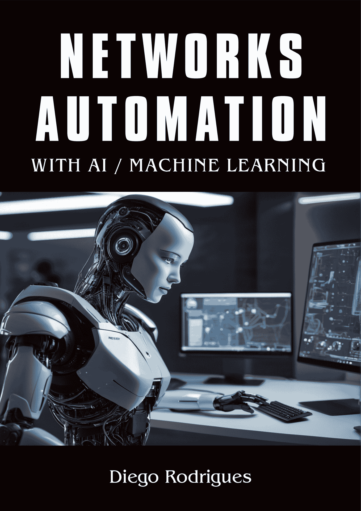

## AI 与机器学习驱动的网络自动化：策略、工具与创新

[www.linkedin.com/in/diegoexpertai](https://www.google.com/url?q=http://www.linkedin.com/in/diegoexpertai&sa=D&source=editors&ust=1715885033670138&usg=AOvVaw2F72FtsRZ4CnBgTud8ct6e)

SUMMARY

第 7 章：网络自动化中的预测分析

[www.linkedin.com/in/diegoexpertai](https://www.google.com/url?q=http://www.linkedin.com/in/diegoexpertai&sa=D&source=editors&ust=1715885033676755&usg=AOvVaw1bKD1XQrlSUqTOdP0CLqAY)

[www.amazon.com/author/diegorodrigues](https://www.google.com/url?q=http://www.amazon.com/author/diegorodrigues&sa=D&source=editors&ust=1715885033676995&usg=AOvVaw1_dPhewSnVZO4aMOamF5D0)

Diego Rodrigues 是一位国际顾问和作家，专注于市场情报、技术、创新和灵性。他精通人工智能、机器学习、数据科学、大数据、区块链、连接技术，是伦理黑客和威胁情报专家。

他拥有 38 项国际认证，涵盖 IBM、GOOGLE、MICROSOFT、AWS、CISCO、BOSTON UNIVERSITY、EC-COUNCIL、INFOSEC、PALO ALTO、GOAL。

自 2003 年以来，他作为顾问，已为巴西、美国和墨西哥的重要品牌开发了 200 多个项目。

BIBLIOGRAPHY:

THE ALGORITHM OF GOD.  Where the Paralles Meet.

STRATTEGIC DATA MANAGEMENT IN 2024 . Unlocking data Potential

LEARN PYTHON  In 10 Steps With Google Colab

DEMAND FORECASTING WITH AI/MACHINE LEARN   Optimizing Profits & Avoiding Bottlenecks

THE POWER OF APIs   Unlocking Digital Integration and Innovation

NETWORK AUTOMATION   Com IA e Machine Learning

NoSQL PRACTICAL GUIDE   Mastering the Universe of Non-Relational Data

THE BEST Python LIBRARIES   Become an Expert in the World's Most Popular Language

GENERATIVE AI IN PROJECT MANAGEMENT   Unlocking Infinite Potential: Generative AI - Turning Projects into Success

SUPER TECHNOLOGICAL CYCLE   Challenges and Opportunities for Students, Professionals and CEOs

Full Stack Developer Practical Guide     Indispensable Technologies, Languages ​​and Frameworks

CAREERS IN TECHNOLOGY Become Highly Valued in the Digital Age

AI IN BUSINESS MANAGEMENT   Capitalizing on Opportunities in the Age of Artificial Intelligence

TRASMÍDIA STORYTELLING   Engagement and Monetization 360 Degrees

MACHINE LEARNING FUNDAMENTALS   A PRACTICAL GUIDE FOR STUDENTS AND PROFESSIONALS

DATA INTELLIGENCE & DECISION MAKING   A Practical Guide for Managers and CEOs

ARTIFICIAL INTELLIGENCE & ENVIRONMENTAL MANAGEMENT   The Practical Guide for Managers and CEOs

COMPETITIVE INTELLIGENCE & GENERATIVE AI   A Practical Guide for Managers and CEOs

PRACTICAL GUIDE FOR THE DATA ANALYST

THE ART OF COMMUNICATION & INFLUENCE   A PRACTICAL GUIDE FOR PROFESSIONALS AND MANAGERS

CRYPTOCURRENCIES   A Practical Guide for New Investors

ETHICAL HACKING A Practical Guide for Students and Professionals

THE BEST ALGORITHMS MACHINE LEARNING  An Essential Guide for Students and Professionals

FUNDAMENTALS OF BIG DATA  An Essential Guide for Students and Professionals

MANUAL DevOps   An Essential Guide for Students and Professionals

# IA GENERATIVA NO DESIGN THINKING   An Essential Guide for Students and Professionals

KALI LINUX FUNDAMENTALS   An Essential Guide for Students and Professionals

FUNDAMENTALS OF COMPUTER VISION   An Essential Guide for Students and Professionals

网络管理是复杂网络中的一个持续挑战，本文通过人工智能和机器学习的视角进行探讨，展示了智能模型如何优化路由和带宽，确保效率并减少拥堵。此外，还讨论了基于人工智能的事件驱动自动化作为应对不断变化的网络条件的动态且适应性更强的网络响应策略。

最后，我们展望网络自动化的未来，思考自主网络的发展，在自主网络中，人工智能和机器学习不仅支持而且引领网络管理，推动系统具备韧性、自愈能力，并能够持续优化。

本书面向 IT 专业人士、网络工程师、研究人员和学生，旨在帮助他们理解并应用人工智能和机器学习在网络自动化中的作用。通过提供技术性和解释性指南，并辅以案例研究和实践示例，我们希望赋予读者所需的知识，使其能够在这个网络创新时代中游刃有余，并在网络技术的动态领域中贡献并茁壮成长。

## 1.1. 网络自动化的基本概念

网络自动化是指利用技术和流程自动执行网络管理任务，从而减少人工干预的需求。本章旨在为该领域的专业人士和学生提供网络自动化的核心原理的扎实理解，为后续章节探讨先进的人工智能和机器学习应用奠定基础。

定义与目的

网络自动化涵盖一系列活动，包括网络设备的配置、性能监控、故障管理以及安全策略的实施。其主要目标是提升运营效率、减少人为错误、提高网络配置的一致性，并能够更灵活地应对业务需求或网络环境的变化。

网络自动化的组成部分

网络自动化基于以下几个基本组件：

- 软件工具：专门用于自动化特定网络任务的应用，如配置管理工具、编排平台和监控系统。
- 脚本和 API：自定义脚本和应用编程接口（API）使得能够自动化与网络设备、网络管理系统以及其他 IT 服务的交互。
- 标准和协议：开放标准和网络协议在实现不同系统和设备之间的互操作性和有效通信方面发挥着关键作用。

网络自动化的好处

实施网络自动化为组织带来多项好处，包括：

- 提高运营效率：自动化能够快速准确地执行网络任务，使 IT 专业人员有更多时间专注于战略性项目。
- 改善服务质量：通过主动解决网络问题并进行动态调整，能显著提升服务质量和最终用户体验。
- 降低成本：减少人工干预和错误，网络自动化可显著降低运营成本。
- 灵活性和可扩展性：自动化支持快速实施网络变更，有效支撑业务增长并适应新需求。

网络自动化的挑战

尽管网络自动化具有诸多优势，但也面临挑战，如在集成异构系统时的复杂性、开发和维护自动化脚本所需的专业技能，以及自动化数据的安全和隐私问题。

网络自动化的基本概念为理解新兴技术（尤其是人工智能和机器学习）如何重塑现代网络格局奠定了基础。通过掌握这些基础，专业人士和学生将更好地应对数字时代网络自动化带来的复杂性和机遇。

## 1.2. 自动化网络的关键组件

了解自动化网络的关键组件对于希望深入网络自动化知识的专业人士和学生至关重要。自动化网络是传统网络的演进，其基础设施支持对网络任务的持续自动化和编排，从而显著提升效率、灵活性和可靠性。

可编程网络设备：自动化网络的基石是可编程设备，如交换机、路由器和防火墙，它们支持应用编程接口（API），能够实现动态和自动化的配置。这些设备设计为可通过软件远程控制，从而在网络事件或条件发生时，快速实施网络策略并进行调整。

编排与自动化平台：编排工具在协调和管理自动化任务中发挥关键作用。这些平台提供了一个集中化的环境，用于定义、执行和监控自动化流程，确保操作以协调且一致的方式进行。它们还促进了不同网络系统和设备之间的集成，构建了一个紧密且灵活的网络生态系统。

配置管理系统：在动态环境中保持网络配置的一致性和完整性，配置管理系统是必不可少的。它们允许存储、跟踪和回滚网络配置，为自动化变更的实施提供安全基础，并在发生故障或配置错误时实现快速恢复。

人工智能和机器学习技术：将人工智能和机器学习纳入网络自动化，使得能够进行高级数据分析、主动异常检测和自动优化网络性能成为可能。智能算法可以从流量模式中学习，在问题影响用户之前识别潜在问题，并自动调整网络设置以保持最佳性能。

应用编程接口（API）：API 是网络自动化的基石，因为它们促进了不同系统、应用和网络设备之间的通信与交互。API 使得编排平台和自动化工具能够访问和控制可编程网络设备，整合不同供应商的功能，并高效地协调复杂的自动化任务。

掌握这些关键组件不仅使专业人士和学生能够设计和实施有效的自动化网络，也为探索网络技术与人工智能、机器学习交叉点的未来创新奠定了基础。

## 1.3. 网络中的人工智能和机器学习入门

将人工智能（AI）和机器学习（ML）集成到网络中，标志着 IT 基础设施管理和运营方式发生了重大变革。这些技术提供了超越传统方法的高级能力，使网络更加智能、适应性强且高效。本节探讨 AI 和 ML 在网络中的基础，阐述这些技术如何重新定义网络自动化的范式。

人工智能在网络中

AI 指的是开发能够执行通常需要人类智能的计算机系统的技术，包括感知、推理、学习和决策等任务。在网络中，AI 用于自动化复杂操作，为性能优化、安全性和流量管理提供创新解决方案。通过使用智能算法，网络可以预测问题、适应环境变化，并主动应对安全威胁，从而显著提升运营效果。

Machine Learning in Networks

Machine Learning（ML）是人工智能的一个子领域，涉及开发能够让系统从经验中学习并改进的算法，而无需为每个任务显式编程。在网络环境中，ML 用于分析大量网络数据、发现模式和趋势，并基于这些洞察进行预测或决策。这包括优化流量路由、防止拥堵以及早期发现网络故障。

Applications of AI and ML in Networks

AI 和 ML 在网络中的应用涵盖多个领域，包括：

- 预测分析：利用历史数据预测未来故障或行为，从而实现预防性维护和优化资源分配。
- 增强安全性：识别异常流量模式，这些模式可能表明受入侵尝试、恶意软件或其他安全威胁，从而实现自动化的应急响应。
- 智能流量管理：分析实时流量模式以优化路由和带宽，提升服务质量。
- 配置自动化：根据预定义的策略和动态网络条件自动调整网络设置，减少人工干预的需求。

Challenges and Considerations

虽然将 AI 和 ML 集成到网络自动化中带来了巨大的承诺，但也面临一些挑战，包括需要大量高质量的数据进行训练、隐私和数据安全问题，以及将这些技术集成到现有网络环境中的复杂性。此外，基于 AI 的决策需要对所使用的模型及其决策依据有清晰的理解，以确保透明性和可靠性。

Conclusion

将 AI 和 ML 引入网络代表了网络自动化的重大进步，为优化、安全和效率提供了新的能力。通过掌握这些基础知识，专业人士和学生将更好地探索 AI 和 ML 在网络未来可能带来的可能性。

1.4. Overview of Automation Tools

网络自动化通过各种软件工具得以简化和增强，每种工具都针对特定任务或网络基础设施的特定方面进行设计。本节概览列出了主要的自动化解决方案类型，帮助专业人士和学生了解工具生态，选择最符合组织需求和目标的工具。

Configuration Management Tools

这些工具是用于自动化网络设备配置和维护任务的关键。它们能够在多个设备之间标准化配置，从而实现可扩展且一致的变更和更新实施。流行的例子包括 Ansible、Puppet 和 Chef，每个都提供独特的自动化和配置管理功能。

Orchestration Platforms

编排平台负责协调和自动化跨设备和系统的复杂任务序列。它们对于确保自动化流程以协调、高效且符合组织策略的方式执行至关重要。Kubernetes（用于容器编排）和 Terraform（用于基础设施即代码编排）是该类别中的典型解决方案。

Monitoring and Analysis Systems

监控与分析是网络自动化的基石，提供对网络性能的实时可见性，并帮助主动发现问题。Prometheus（用于系统监控）和 ELK Stack（Elasticsearch、Logstash、Kibana，用于数据和日志分析）是广泛用于收集、处理和可视化运营数据的工具。

AI and ML-Based Tools

随着 AI 和 ML 在网络自动化中的深入集成，专门的工具应运而生，利用智能算法优化网络性能、预测故障并加强安全性。这些解决方案从预测分析平台到基于机器学习的威胁检测系统不等，代表了网络自动化技术的前沿。

Application Programming Interfaces (APIs)

API 在网络自动化中扮演关键角色，使不同系统和设备之间的程序化交互成为可能。它们简化了自动化工具与网络设备、管理系统以及其他应用的集成，从而可以创建定制的自动化工作流并编排复杂任务。

Conclusion

选择合适的自动化工具是实现智能网络的关键一步。专业人士和学生应根据现有基础设施和未来目标，评估工具的功能、兼容性和可扩展性。通过了解各类工具的特点和优势，组织可以为其网络提升效率、韧性和适应性。

1.5. Evolution and Trends in Network Automation

网络自动化的演进体现了技术的持续进步，受制于构建更高效、更有弹性和更具适应性网络的需求。这一路径从最初的简单脚本用于重复性任务（如设备配置和软件更新），发展到如今利用人工智能（AI）和机器学习（ML）的高级应用。

The Genesis of Network Automation

网络自动化始于使用基础脚本来执行重复性任务，例如设备配置和软件更新。虽然这些脚本功能简陋，但它们标志着减少人工干预、标准化网络操作的第一步。

The Rise of Automation and Orchestration Tools

随着网络复杂度提升和设备数量激增，专用的自动化和编排工具（如 Ansible、Puppet、Chef）应运而生。这些工具为在多样化的网络环境中统一管理配置提供了平台，开启了运营效率新纪元。

Integration of AI and ML

将 AI 和 ML 集成到网络自动化中，标志着重要里程碑，使得预测故障、优化网络性能以及主动提升安全成为可能。智能算法能够分析流量模式、识别异常并实时做出自动化决策，预示着自适应、自主网络的到来。

Emerging Trends

- Software-Defined Networking (SDN) and Network Functions Virtualization (NFV)：采用 SDN 和 NFV 可以实现网络控制的集中化以及网络功能的虚拟化，从而便利了网络服务的灵活、可扩展实施。
- Edge Computing and Network Automation：随着边缘计算的发展，网络自动化向管理分布在网络边缘的设备扩展，这要求能够在高度分散环境中高效运行的解决方案。

-   [内在安全：将安全作为网络自动化的基础组件，从一开始就将安全考虑在自动化系统的设计之中，以主动应对网络威胁。]

-   [意图驱动网络（IBN）：向意图驱动网络的演进，其中网络管理基于期望的结果（意图）而非仅仅基于技术配置，有望提供一种更直观和可适应的网络自动化方法]

Conclusion

[The evolution of network automation reflects ongoing technological innovation and adaptation to the constantly changing needs of the network environment. As we move towards a future of autonomous networks powered by AI and ML, it remains clear that the ability to adapt and innovate will be crucial. For professionals and students in the field, staying informed about these trends and developing relevant skills are essential steps to successfully navigate the dynamic field of network automation.]

## Chapter 2
安全资源优化：AI 能够优化安全资源的分配，将检测和响应能力集中到最需要的位置，提升运营效率并降低成本。

挑战与考量

实现复杂性：在 SDN 环境中有效集成 AI 需要高超的专业知识和大量资源，包括开发和基础设施方面。

误报与漏报：虽然 AI 算法能显著提升威胁检测能力，但仍可能出现误报或漏报，导致不必要的服务中断或未能发现真实攻击。

隐私与伦理：利用 AI 监控和分析网络流量会带来严重的隐私问题。必须确保数据收集和分析符合隐私与数据保护法规。

结论

将 AI 集成到 SDN 中以保障网络安全，提供了一种创新且极具成效的防御网络威胁的方式。尽管存在挑战，但提升威胁检测、事件响应和安全策略管理的潜在收益是毋庸置疑的。随着这些技术的持续演进，它们在防御日益复杂的威胁环境中将发挥日益关键的作用。

5.5. SDN 与 AI 案例研究

软件定义网络 (SDN) 与人工智能 (AI) 的协同效应在网络管理和运营方面展现出巨大的潜力，能够解决长期存在的难题，并提供创新的解决方案，以提升网络效率、增强安全性并实现更智能、主动的网络管理。本节通过真实案例展示 SDN 与 AI 的结合如何优化网络效能、加强安全性以及实现更主动的网络管理。

案例研究 1：自动化流量优化

挑战：大型电信运营商在高峰时段面临网络拥塞问题，导致服务质量下降和客户不满。

解决方案：实施了结合 AI 算法的 SDN 解决方案，实时分析流量模式并预测未来需求。系统动态调整流量路径并提前分配宽带资源，以在拥塞发生前进行预防。

结果：运营商显著提升了网络效率，拥塞减少了最高 40%，服务质量和客户满意度得到改善。

案例研究 2：DDoS 攻击检测与缓解

挑战：某组织频繁遭受 DDoS 攻击，导致服务器过载并中断在线服务。

解决方案：开发了集成 AI 的 SDN 系统，监控网络流量以识别 DDoS 攻击的异常模式。一旦检测到攻击，系统自动重新配置防火墙规则和流量路径，以隔离并缓解恶意流量。

结果：该组织对 DDoS 攻击的响应能力大幅提升，检测与缓解时间从数小时缩短至数分钟，最大程度减少停机时间并保护关键基础设施。

案例研究 3：动态 QoS 管理

挑战：视频点播服务提供商需要在高需求期间保证高质量的流媒体，同时避免过度增加基础设施成本。

解决方案：利用 SDN 与 AI，实施了持续分析网络流量并实时调整 QoS 策略的系统。系统在高峰时段优先处理视频流量并优化资源分配，确保用户体验一致。

结果：实现了高需求期间的显著服务质量提升，而无需大幅投资额外网络容量。

最终考量

这些案例展示了将 SDN 与 AI 结合在各类网络场景中的变革潜力，从流量优化和 QoS 管理到针对网络攻击的增强安全性。通过实现更具适应性、智能性和主动性的网络管理，SDN 与 AI 正在为 IT 基础设施的运营效率和服务质量设定新标准。但必须认识到，这些项目的成功取决于在技术复杂性、系统集成以及安全与隐私等方面的周密考虑。

## 第 6 章

## AI 驱动的网络安全

6.1. AI 在威胁检测与漏洞分析中的作用

将人工智能 (AI) 集成到网络安全中，标志着对网络威胁检测、分析与缓解方式的重大演进。AI 使得保护 IT 基础设施免受新兴漏洞和高级攻击的动态、预测性和更有效的方式成为可能。本节阐述 AI 在威胁检测与漏洞分析中的技术基础、应用场景及收益，为网络安全专业人员和学生提供有价值的洞见。

AI 在网络安全中的技术基础

基于机器学习的威胁检测：机器学习 (ML) 算法可以学习正常网络流量模式，识别可能表明恶意活动的偏差，涵盖零日攻击、恶意软件、钓鱼等传统检测手段难以捕捉的威胁。

大规模数据分析：AI 能够实时处理和分析海量数据，提供网络安全全景，从而快速发现漏洞、识别入侵尝试，并在损害扩大前实施缓解措施。

持续学习：AI 在网络安全中的主要优势之一是其持续学习能力。随着新数据收集和新威胁出现，AI 系统会自适应改进检测与响应策略，使网络安全随时间推移更具韧性。

AI 在网络安全中的实际应用

异常行为检测：通过无监督学习技术，AI 能识别偏离常规的网络行为，即使这些行为不属于已知威胁，也能预示潜在攻击或安全 breaches。

AI 辅助漏洞分析：AI 驱动的漏洞扫描工具能够扫描网络，评估每个发现漏洞的风险，并推荐优先级更高的修复措施。

自动化响应：除了检测威胁，AI 系统还可配置自动化响应，如隔离受感染设备、更新防火墙规则或撤销受损凭据，从而加速安全事件的处理。

挑战与考量

准确性与误报：虽然 AI 可以显著提升威胁检测能力，但机器学习模型的准确性以及误报的最小化仍是重要挑战，需要持续调优和验证。

高质量数据依赖：AI 系统的有效性取决于高质量且具有代表性的数据，这对组织实施稳健的数据收集和管理实践提出了挑战。

伦理与隐私问题：AI 系统对网络流量的深度分析会引发伦理和隐私 concerns，需要确保数据收集和分析符合相关法规。

结论

AI 在威胁检测和漏洞分析中的应用正在转变网络安全，提供了有效识别和应对网络威胁的高级能力。通过克服技术与伦理挑战，将 AI 集成到网络安全中，有望显著增强 IT 基础设施对不断演进威胁环境的韧性。

6.2. 机器学习在网络安全中的应用

将机器学习（ML）应用于网络安全是一种强大的防御策略，用于加强对日益复杂多变的数字威胁的防护。通过 ML 算法，可以自动化威胁检测和事件响应，甚至在攻击发生前预测并防止攻击。本节介绍机器学习在网络安全中的基本方面，涵盖其技术、实际应用、收益和挑战。

机器学习技术在网络安全中的应用

监督学习：基于标记数据，用于将网络活动分类为 benign（良性）或 malicious（恶意）。决策树、随机森林和支持向量机等模型在已知恶意样本（如恶意软件、网络钓鱼等）上进行训练，以识别模式和攻击指标。

无监督学习：通过分析未标记数据，用于发现异常行为和检测未知威胁，利用 k-means、主成分分析（PCA）等方法在网络流量中寻找异常聚类或模式。

强化学习：用于实时优化安全决策，根据持续反馈调整安全策略，以提高事件响应和缓解策略的有效性。

机器学习在网络安全中的实际应用

恶意软件检测：ML 算法可以分析文件和进程的可疑行为，基于已知样本的特征识别恶意软件，即使恶意代码被修改或混淆。

欺诈防止：ML 用于检测在线交易、电子邮件和支付系统中的欺诈模式，分析用户行为和交易数据，以识别欺诈或身份盗窃尝试。

网络流量分析：ML 在网络流量分析中的应用可识别分布式拒绝服务（DDoS）攻击、渗透以及攻击者在网络内的横向移动模式，从而实现早期检测和快速响应。

机器学习在网络安全中的收益

加速检测：能够实时处理大量数据，实现更快的威胁检测，缩短受攻击的暴露时间。

持续适应与学习：ML 算法随新数据不断进化，提高准确性和适应性，能够应对新威胁和攻击技术。

误报减少：改进的活动分类准确性降低了误报数量，减少干扰，使安全团队能够专注于真实威胁。

机器学习在网络安全中的挑战

数据质量：ML 模型的有效性高度依赖训练数据的质量和代表性，需要持续努力进行数据收集和整理。

对手规避：攻击者可使用混淆和规避技术欺骗 ML 模型，需要不断更新和完善模型。

可解释性与透明度：某些 ML 模型的“黑盒”特性使得理解其决策原因变得困难，影响对自动化安全工具的透明度和信任度。

6.3. 使用人工智能的自动化事件响应

人工智能（AI）用于自动化网络安全事件响应的实施，标志着 IT 防御策略的重大演进。通过 AI 算法，可以实时检测威胁，并自动、有效地进行响应，最大程度降低攻击影响，保护组织的关键资产。本节探讨自动 AI 事件响应的基本原理、技术和收益，阐述该方法如何转变网络安全。

自动化事件响应与 AI 的基本原理

自动化事件响应与 AI 基于能够在无需直接人工干预的情况下做出决策并执行安全操作的智能系统。这些系统利用网络监控数据、事件日志等信息来源，识别恶意行为并主动响应。

涉及的技术与方法

自动化检测与响应（SOAR）系统：结合编排安全、事件响应自动化和威胁情报能力的平台，借助 AI 实现更高效的事件管理。

行为分析：AI 算法分析网络中用户和设备的行为模式，以识别可能表明安全漏洞的可疑活动。

基于机器学习的决策：ML 模型通过历史安全数据训练，学会区分正常活动与潜在威胁，从而优化检测和响应的准确性。

实际应用场景

自动隔离受感染设备：当检测到恶意软件或其他感染时，AI 可自动将受影响设备与网络隔离，防止威胁扩散。

动态攻击阻断：AI 系统可实时识别并阻止 DDoS 尝试或渗透攻击，通过动态调整防火墙规则等安全策略实现。

主动修复与更新：除了响应具体事件外，AI 还能自动化安全补丁和软件更新的应用，修复已知漏洞。

自动化响应的收益

缩短响应时间：能够瞬间应对威胁，最大限度减少攻击暴露时间及潜在损害。

提升运营效率：自动化响应使安全团队能专注于高价值的战略任务，而 AI 处理快速、有效的响应。

持续适应新威胁：AI 系统从每次事件中学习，持续改进检测和响应策略，适应不断演变的攻击手法。

实施挑战

误报与 AI 决策：自动决策可能产生误报，导致不必要的服务中断，如果算法准确性不足。

系统复杂性与管理：部署和维护用于事件响应的 AI 系统需要专业知识和专门资源，以微调和持续验证模型。

信任与透明度问题：建立对自动化系统的信任并确保 AI 决策透明，是其被接受和有效运作的关键。

结论

自动化事件响应结合人工智能有潜力从根本上转变网络安全，通过提供主动和自适应的数字威胁防御来实现。通过克服实施挑战并优化系统以最小化误报，组织可以利用人工智能显著提升其事件响应能力，更好地保护其数字资产在不断演变的威胁环境中。

6.4. AI 在欺诈和入侵预防中的应用

人工智能（AI）用于防止欺诈和入侵的应用是一个日益受到重视的领域，因为组织寻求更有效的方式来保护其系统免受恶意活动和未经授权访问的侵害。AI 特别是通过使用机器学习（ML）和高级数据分析技术，能够识别表明欺诈或入侵尝试的复杂模式和可疑行为。本节涵盖在网络安全这一关键领域应用 AI 的技术方面、好处和挑战。

AI 技术在欺诈和入侵预防中的应用

异常检测：基于无监督学习的机器学习算法在检测使用和访问模式中的异常方面非常有效，能够识别偏离正常预期行为的活动。这包括未经授权用户尝试访问系统的行为，或表明欺诈的交易模式。

行为分析：AI 技术可以实时分析用户和系统的行为，学习正常活动模式，并突出可能表明欺诈或入侵尝试的行为。这种分析对于识别使用 stolen credentials 等高级攻击至关重要。

预测建模：利用历史数据，AI 可以预测潜在漏洞和攻击点，使组织在欺诈者或攻击者利用这些弱点之前加强防护措施。

AI 在欺诈和入侵预防中的好处

快速响应：AI 能够在实时识别和响应可疑活动，是其关键优势之一，能够最大限度地减少攻击影响并降低财务或数据损失的风险。

减少误报：得益于持续学习和适应的能力，AI 可以提高欺诈和入侵检测的准确性，减少误报数量，从而减轻安全团队的负担。

全面保护：AI 提供了一个额外的安全层，与传统安全措施相辅相成，提供对更广泛威胁（包括未知或演变的威胁）的更强大防御。

在实施 AI 用于欺诈和入侵预防中的挑战

实施复杂性：将 AI 解决方案有效集成到现有安全系统中可能复杂，需要高度的技术专业知识。

数据质量和隐私：AI 模型的有效性取决于用于训练的数据质量。此外，收集和分析这些数据必须以保护用户隐私的方式进行，符合欧盟 GDPR 等法规及全球其他数据保护法律的要求。

持续维护和更新：AI 模型需要定期更新和优化，以在新的攻击和欺诈技术出现时保持其有效性，这需要对这些系统进行持续的维护和更新的承诺。

结论

AI 提供了一种强大且自适应的欺诈和入侵预防方法，能够更快、更准确地检测恶意活动。尽管在实施和维护方面面临挑战，AI 能够显著提升网络安全并防止财务和数据损失，使其成为各行各业组织的战略优先事项。随着 AI 技术的不断演进，其在网络安全中的作用预计将变得更加中心化，为不断变化的威胁环境提供先进的防御。

6.5. AI 安全中的伦理与隐私

将人工智能（AI）集成到网络安全系统中带来了伦理和隐私等关键问题。随着 AI 算法在威胁检测、事件响应以及欺诈和入侵预防中的使用日益普及，这些系统在收集、分析和利用数据的方式引发了重大关注。本节涵盖与 AI 在网络安全中使用相关的伦理和隐私考量，强调负责任和透明的做法的重要性。

AI 安全中的伦理问题

透明度与可解释性：确保 AI 系统做出的决策对安全专业人员和受影响的用户都是透明且可解释的，是主要伦理挑战之一。这包括能够审计和理解 AI 行动的原因，例如检测威胁或决定阻止访问。

偏见与公平性：AI 算法可能在训练数据中 perpetuate（延续）或甚至放大现有偏见，导致不公平或歧视性的决策。例如，基于 AI 的欺诈检测系统可能因训练数据不具代表性或偏斜而错误地将合法活动标记为可疑。

自主性与人类控制：AI 系统在网络安全中获得的自主权也引发了关于人类对关键安全决策控制的问题。确定自动化行动与人工监督之间的适当平衡至关重要，以防止不适当或有害的响应。

使用 AI 时的隐私考量

数据收集与使用：AI 系统依赖大量数据进行分析和学习。确保数据的收集、存储和使用方式能够保护个人隐私，并符合欧盟 GDPR 等法规及全球其他数据保护法律的要求。

数据安全：保护 AI 系统中使用和生成的数据是另一项重要关注点。这包括实施强有力的安全措施，防止未经授权访问敏感信息，并确保 AI 数据不被恶意利用。

用户同意与选择：用户必须对 AI 系统如何收集和使用其数据拥有控制权。这包括获得知情同意的需求以及用户选择退出某些监控或分析形式的能力。

应对伦理与隐私的策略

负责任的开发：在 AI 系统开发的 earliest（最早）阶段就纳入伦理和隐私考量，确保这些原则指导设计和实现。

持续审计与评估：定期进行审计和隐私影响评估，以识别并减轻 AI 使用相关的伦理和隐私风险。

培训与意识提升：教育安全专业人员和终端用户关于 AI 在网络安全中相关的风险、好处和最佳实践，促进一种知情且负责任的安全文化。

结论

尽管 AI 能显著提升网络安全，但应对伦理与隐私问题对于确保技术的负责任和可信实施至关重要。通过采用以用户为中心的伦理方法，组织不仅能保护其系统和数据，还能维护因 cyberspace 与个人生活和自由紧密相连而获得的信任和尊重。

第 7 章

预测分析在网络自动化中的应用

7.1. 预测分析概念

预测分析在网络自动化中代表了对网络管理和优化方式的重大演进。通过使用机器学习（ML）模型和高级统计技术，预测分析使您能够在问题发生之前预测未来的趋势、流量行为、设备故障和潜在的安全漏洞。本节详细介绍了预测分析在网络自动化中的基本概念，解释了该技术如何赋能网络管理员做出主动、基于数据的决策，从而提升网络的效率、安全性和性能。

什么是预测分析？

预测分析是指利用数据、统计算法和机器学习技术，基于历史数据识别未来结果的可能性。在网络自动化的语境中，这意味着分析大量网络数据以预测未来事件，从而使网络管理员能够预见问题并采取预防措施。

预测分析在网络中的关键组成部分

数据采集：任何有效的预测分析的基础是全面的数据采集。这包括网络性能指标、系统日志、流量模式、设备配置和故障历史。

统计和机器学习建模：在数据收集后，数据用于训练统计和机器学习模型。这些模型被开发以识别可能不易察觉的模式和相关性，从而提供对未来网络行为的有价值洞察。

模型验证：预测模型需要在未用于训练的数据集上进行验证和测试，以确保其准确性和有效性。这一过程有助于调整模型，使其更好地反映实际网络条件。

实施与监控：在验证后，模型被部署为网络管理系统的一部分，实时分析数据流。持续监控至关重要，用于适应网络条件的变化。

预测分析在网络自动化中的应用

故障预测：预测模型可以识别关键网络组件（如交换机、路由器和服务器）的退化早期迹象，通过安排预防性维护，显著减少非计划停机时间，确保服务连续性。

网络容量和性能优化：预测分析简化了对流量模式和需求增长的预测，帮助管理员动态调整资源分配和网络配置，以保持最佳性能。这包括重新分配工作负载、平衡流量以及扩展网络容量以满足预期的需求增长。

主动安全异常检测：专门用于异常检测的机器学习算法可以分析流量模式，识别表明入侵尝试、分布式拒绝服务（DDoS）攻击或其他网络威胁的可疑活动。早期发现这些威胁，可立即实施缓解措施，保护网络。

事件管理和威胁响应：通过趋势分析和预测建模，网络自动化系统可以被编程为在安全事件发生时自动响应，如应用补丁、重新配置设备或隔离网络受影响区域，以限制攻击影响。

交易欺诈预防：在支持商业或金融交易的网络中，预测分析可用于识别表明欺诈尝试的行为模式。这使得在交易完成前采取预防措施，阻止欺诈交易，保护用户和网络完整性。

战略网络规划：预测分析生成的洞察为网络基础设施的长期战略规划提供了坚实基础。这包括关于新技术投资、网络扩展和预算分配的决策，确保网络能够满足未来业务需求。

实施挑战

尽管预测分析在网络中提供了显著的好处，其实施仍面临挑战，例如需要收集和管理大量高质量数据、选择和训练合适的机器学习模型的复杂性，以及将这些模型集成到现有网络自动化系统中的挑战。

结论

预测分析为网络管理员提供了强大的工具，以便在问题影响网络之前预测和缓解问题。通过将预测分析纳入网络自动化，组织可以显著提升其基础设施管理，从而构建更强大、更安全、更高效的网络。然而，该方法的成功取决于谨慎的实施、适当的模型选择以及持续适应和学习的承诺。

7.2. 预测分析在网络中的应用

预测分析，当集成到网络自动化中时，主动转变了对 IT 基础设施管理和运营的方式。它基于对历史数据和行为模式的分析，预测未来事件，如设备故障、流量变化和安全威胁。本节探讨了预测分析在网络中的几种实际应用，展示了该技术如何优化网络基础设施的性能、安全性和可靠性。

预测设备故障

通过使用预测分析模型，可以识别关键网络组件（如交换机、路由器和服务器）的退化早期迹象。这种预测能力使得预防性维护得以进行，显著减少非计划停机时间，确保服务连续性。

网络容量和性能优化

预测分析简化了对流量模式和需求增长的预测，帮助管理员动态调整资源分配和网络配置，以保持最佳性能。这包括重新分配工作负载、平衡流量以及扩展网络容量以满足预期的需求增长。

主动安全异常检测

专门用于异常检测的机器学习算法可以分析流量模式，识别表明入侵尝试、分布式拒绝服务（DDoS）攻击或其他网络威胁的可疑活动。早期发现这些威胁，可立即实施缓解措施，保护网络。

事件管理和威胁响应

通过趋势分析和预测建模，网络自动化系统可以被编程为在安全事件发生时自动响应，如应用补丁、重新配置设备或隔离网络受影响区域，以限制攻击影响。

交易欺诈预防

在支持商业或金融交易的网络中，预测分析可用于识别表明欺诈尝试的行为模式。这使得在交易完成前采取预防措施，阻止欺诈交易，保护用户和网络完整性。

战略网络规划

预测分析生成的洞察为网络基础设施的长期战略规划提供了坚实基础。这包括关于新技术投资、网络扩展和预算分配的决策，确保网络能够满足未来业务需求。

实施挑战

尽管预测分析在网络中提供了显著的好处，其实施仍面临挑战，例如需要收集和管理大量高质量数据、选择和训练合适的机器学习模型的复杂性，以及将这些模型集成到现有网络自动化系统中的挑战。

结论

预测分析代表了网络管理的重大演进，为管理员提供了强大的工具，实现更高效、更安全和更主动的运营。通过克服技术和运营挑战，组织可以最大化预测分析的潜力，在问题影响网络之前预测并解决问题，从而构建更具弹性和适应性的 IT 基础设施。

7.3. AI 用于网络故障预测

将人工智能（AI）应用于预测网络故障正在重新定义 IT 基础设施的维护和运营方式。通过使用高级机器学习（ML）算法和数据分析技术，AI 能够识别模式和即将发生的故障的预测性信号，从而实现主动干预，防止停机并优化网络可用性。本节探讨了 AI 在预测网络故障中的集成，讨论了其基本原理、应用方法以及该技术对网络管理的潜在影响。

## 网络故障预测的基础

人工智能（AI）利用机器学习（ML）模型分析网络性能历史数据、事件日志和运营指标，以学习与过去故障相关的模式。这些模型随后能够识别可能导致网络故障的异常迹象，从而在出现更大问题之前采取纠正措施。

## 适用方法论

### 监督学习模型
他们使用历史网络故障数据，包括事件描述及其原因，来训练能够预测未来类似情况的模型。

### 无监督学习与异常检测
他们采用不需要标记历史数据的技术，自动识别偏离网络正常运行模式的行为。

### 神经网络与深度学习
深度神经网络能够捕捉大量且异构网络数据中的复杂性和非线性依赖，从而提高故障预测的准确性。

## 实际应用

### 预测设备故障
AI 模型可以根据磨损和损耗模式预测关键网络组件（如路由器、交换机和服务器）的寿命。

### 流量拥塞预测
AI 帮助预测流量需求激增，以免压倒网络基础设施，从而实现资源分配的提前调整。

### 安全漏洞识别
AI 算法可分析网络配置和流量模式，以识别可能被网络攻击利用的潜在漏洞。

## 网络故障预测的 AI 优势

### 减少停机时间
通过对潜在网络故障的主动干预，最小化服务中断，提升用户体验和业务连续性。

### 维护成本优化
由准确预测指导的预防性维护比紧急维修和设备更换更具成本效益。

### 网络基础设施的持续改进
AI 生成的洞察可指导网络升级和新技术采购的战略决策。

## 实施中的挑战

### 数据质量与完整性
预测准确性取决于收集的数据质量，需要强大的数据收集和处理机制。

### AI 模型的复杂性
开发既准确又能泛化到不同网络环境的 AI 模型面临重大挑战。

### 与网络管理系统集成
有效将 AI 解决方案集成到现有网络管理系统需要不同技术平台之间的兼容性和互操作性。

## 结论

AI 用于预测网络故障提供了一条优化 IT 基础设施管理和维护的有前途的道路，使组织能够以更主动、数据驱动的方式运营网络。尽管实施和集成这些技术面临挑战，但通过减少停机时间、优化成本以及提升网络安全和性能等方面的收益，凸显了 AI 作为数据自动化关键战略工具的重要性。

## 7.4. 通过预测分析实现资源优化

在网络环境中，通过预测分析实现资源优化涉及使用人工智能（AI）和机器学习（ML）算法来预测未来资源需求，并主动调整带宽分配、处理能力、存储等关键网络元素。这一过程不仅提升网络效率和性能，还有助于更有效的成本管理，确保资源得到最佳利用。我们将探讨其重要性、涉及的技术以及带来的好处。

## 资源优化的重要性

在不断演进的数字世界中，数据和在线服务需求呈指数级增长，预测并高效满足这一需求的能力至关重要。资源优化确保网络基础设施能够在流量高峰时保持服务质量，同时避免过度配置和资源浪费。

## 用于优化的预测分析技术

### 需求建模
利用历史流量数据预测需求模式，从而在流量高峰出现前调整资源分配。

### 异常检测
识别异常流量模式，这些模式可能表明资源分配低效、即将发生故障或受到网络攻击。

### 模拟和场景建模
使用预测模型模拟不同需求场景，评估资源调整对网络性能的影响。

### 用于动态分配的机器学习
ML 算法分析持续的数据趋势，自动优化资源分配，并随时间学习和适应新的使用模式。

## 资源优化的好处

### 性能最大化
确保网络始终在最佳容量运行，根据流量需求调整资源，防止拥堵。

### 成本效率
防止过度配置和资源浪费，使组织能更有效地利用其 IT 基础设施投资。

### 快速响应变化
能够动态预测和应对需求变化，使网络能够迅速适应意外事件或新兴使用趋势。

### 改善用户体验
高效的资源分配有助于提供更一致的高质量用户体验，响应时间更快，服务中断更少。

## 实施中的挑战

### 数据复杂性
有效分析需要大量高质量的数据，数据的收集、存储和处理本身即具挑战。

### 模型选择与训练
选择合适的机器学习模型并使用具有代表性的数据进行训练是保证预测准确性的关键。

### 与现有系统集成
将预测分析解决方案集成到现有网络基础设施可能需要大量开发和适配工作。

## 结论

通过预测分析实现资源优化是提升网络效率和性能的有力策略。它赋予管理员数据驱动的决策能力，以预测未来需求并主动调整资源分配。尽管在数据收集与分析以及系统集成方面存在挑战，但网络性能、成本效益和用户体验方面的收益，使其成为现代网络管理的重要方法。

## 7.5. 预测分析的用例与优势

预测分析在网络自动化中具有颠覆性潜力，能够根本改变网络的运营和管理方式，为服务提供商和终端用户带来具体的实惠。本节探讨预测分析在实际应用中的价值，突出其在运营效率、安全性和用户满意度方面的好处。

### 网络故障预测

用例：预测分析可基于历史数据模式和性能指标，预测交换机、路由器和服务器等网络设备的故障。

好处：

- 通过预防性维护减少网络停机时间。
- 提高网络服务的可靠性和可用性。

### 主动容量管理

用例：利用预测分析预测流量需求增长，并主动调整网络容量，确保高峰期有足够资源。

好处：

- 优化网络性能并防止拥堵。
- 为基础设施升级进行战略规划，避免不必要的费用。

### 异常检测与安全

使用机器学习（ML）对网络流量进行建模，是一种创新高效的方法，用于理解和管理复杂 IT 基础设施中的数据流。该技术通过将机器学习算法应用于分析历史和实时流量模式，从而预测未来趋势、识别潜在瓶颈并优化资源分配。本节探讨了基于机器学习的网络流量建模的技术方面，展示该技术如何转变企业和电信网络的流量管理方式。

网络流量建模的基本原理

基于机器学习的网络流量建模涉及从数据收集和预处理到模型训练及实施预测洞察的多个关键步骤。神经网络、决策树和聚类算法等机器学习算法会使用大规模数据集进行训练，以识别复杂模式并预测流量行为。

所用技术和算法

卷积神经网络（CNNs）：擅长时间序列分析，CNNs 可处理流量数据以识别模式并预测未来流量。

决策树和随机森林：用于分类流量类型，并识别流量异常和需求峰值的原因。

聚类（K-means、DBSCAN）：通过对流量模式进行分段，便于分析不同数据流，并识别行为相似的组。

实际应用

流量需求预测：机器学习算法可准确预测网络不同时间和地点的流量量，从而实现容量规划和资源分配的主动管理。

拥堵检测与缓解：预测建模有助于提前识别拥堵点，从而自动重新配置网络以更有效地分布流量。

路由优化：预测分析可建议关键应用的最优路由，降低延迟并提升服务质量。

机器学习流量建模的优势

提升网络效率：通过预测并实时响应流量变化，管理员可更高效利用资源，避免过载和闲置。

改善用户体验：在流量波动时保持高性能，可为用户提供更一致且满意的体验。

降低运营成本：主动优化流量并防止网络问题，可显著降低因停机和紧急维护产生的成本。

实施中的挑战

数据复杂性：网络流量数据的多样性和体量对处理和分析提出了重大挑战。

持续模型更新：流量模式不断变化，机器学习模型需定期更新以保持准确性。

与现有系统集成：将机器学习方案集成到现有网络基础设施中可能需要大量的技术适配和整合工作。

[/content]

[content]
机器学习在路由优化中的应用

利用机器学习（ML）进行路由优化是一种创新方法，旨在提升数据在网络中的传输效率和效果。通过实时分析流量模式，机器学习算法能够预测拥堵并动态调整路由，确保数据传输尽可能快速可靠。本节探讨机器学习在路由优化中的应用、涉及的技术以及面临的挑战。

机器学习在路由优化中的应用

路由优化中的机器学习涉及收集和分析大量网络状态数据，包括性能指标、流量模式和网络设备健康情况。基于这些数据，机器学习模型被训练预测未来网络状况，并找出最佳的数据路由方式，考虑延迟、可用带宽以及网络故障概率等因素。

使用的机器学习技术

卷积神经网络（CNNs）和循环神经网络（RNNs）：擅长处理序列数据，能够建模网络流量的复杂时序模式，预测未来拥堵并建议替代路径。

优化算法：如梯度提升和遗传算法，可在复杂解空间中寻找最优解，实时优化数据路径。

强化学习（RL）：通过试验学习最优路由策略的技术，能够动态适应网络变化，最大化奖励（如最小化传输时间）。

机器学习路由优化的优势

降低延迟：实时调整路由可显著降低网络延迟，提升时间敏感型应用（如 VoIP、视频流）的用户体验。

提升网络弹性：预测故障和拥堵，机器学习可主动重新配置数据路径，增强网络的弹性和可靠性。

资源效率：机器学习路由优化实现更高效的带宽和资源利用，避免过载并优化现有容量。

实施中的挑战

数据复杂性：训练有效机器学习模型所需的数据量和复杂性可能具有挑战性，需要先进的基础设施和处理能力。

持续适应：网络不断变化，机器学习模型需要持续更新和适应，以反映网络当前的状态。

与网络系统集成：将机器学习解决方案与现有网络系统集成可能复杂，需要兼容的接口和通信协议。

结论

使用机器学习进行路由优化提供了一种有前景的方法，以克服传统网络流量管理挑战。尽管存在技术和实施挑战，但网络性能、弹性和效率方面的收益显著，为更智能、更适应的网络铺平了道路，能够满足日益增长的数据流量需求。

8.3. 使用人工智能进行拥塞检测和管理

人工智能（AI）在拥塞检测和管理方面正在彻底改变网络处理流量变化和确保高效数据传输的方式。通过使用先进的机器学习（ML）和数据分析技术，可以识别先于拥塞出现的模式，预测拥塞何时何地发生，并实施主动策略以减轻其影响。本节探讨了使用 AI 进行拥塞检测和管理的技术方面，突出了这一创新方法的优势。

拥塞检测和管理的基本原理

预测分析：机器学习算法分析流量历史，识别可能导致拥塞的模式。这使得在拥塞降低服务质量之前，可以采取预防性措施，如动态路由调整和资源分配。

流量建模：基于 AI 的流量模型帮助理解数据流在网络中的动态，从而更准确地预测在不同条件下流量的演变。

路由优化：AI 算法可以实时计算最佳路径，根据对网络状况的持续分析，将流量分布到避免拥塞点的位置。

所使用的技术和方法

深度神经网络（DNN）：深度神经网络擅长建模复杂系统，能够处理大量流量数据，以识别拥塞的早期预警信号。

异常检测系统：它们使用无监督学习来检测可能预示即将发生拥塞的异常流量模式。

优化算法：它们采用强化学习和其他优化技术，根据流量条件的变化调整网络配置，以最小化延迟并最大化传输容量。

拥塞管理 AI 的优势

改善网络性能：预测和防止拥塞的能力确保网络资源的高效利用，保持终端用户的服务质量。

适应性和灵活性：基于 AI 的系统可以快速适应流量条件的变化，实施定制于当前网络需求的拥塞管理方案。

降低运营成本：主动拥塞预防减少了人工干预的需求和停机风险，从而为组织带来显著节省。

实施中的挑战

复杂性和可扩展性：将 AI 解决方案集成到大规模网络中可能具有技术挑战性，需要先进的计算资源和高效算法。

AI 模型的准确性：拥塞检测和管理的有效性取决于 AI 模型的准确性，需要持续使用更新的数据进行训练和调整。

可解释性和透明度：了解 AI 模型如何做出决策对于网络管理员对自动化解决方案的信任至关重要，需要努力提高 AI 系统的透明度和可解释性。

结论

将 AI 应用于检测和管理网络拥塞代表了 IT 基础设施自动化和优化的重大进步。通过使用基于 AI 的预测分析和优化技术，网络可以变得更具弹性、高效和适应性，能够满足对数据的日益增长需求，同时优化性能。然而，要实现这些好处，必须克服实施复杂性、模型准确性以及 AI 系统透明度需求等挑战。

8.4. 使用机器学习进行动态带宽适应

使用机器学习（ML）进行动态带宽适应是一种先进的方法，用于在实时优化网络资源的使用，确保在需求变化时高效分配带宽。该方法使用 ML 算法分析流量模式，预测未来需求，并自动调整带宽以满足特定应用和用户的需求。让我们探讨使用 ML 进行动态带宽适应如何改变网络管理，确保最佳性能和改善用户体验。

动态带宽适应的基本原理

预测性流量分析：ML 算法分析历史和实时网络流量数据，以识别趋势、模式和需求峰值。这些分析使得可以预测何时和在哪里需要调整带宽。

主动资源分配：基于生成的预测，自动化系统调整网络不同部分、应用程序或用户之间的带宽分配，优化资源分配到最需要的区域。

持续学习和调整：ML 模型持续使用新数据进行训练，提高准确性和适应性。这确保在面对流量需求和模式的变化时，带宽分配策略仍然有效。

应用和优势

实时流量管理：能够在即时响应流量变化时动态调整带宽，确保关键应用在需求高峰时保持所需性能。

降低对延迟敏感应用的延迟：对于要求低延迟的应用，如 VoIP 或在线游戏，动态带宽适应可以显著改善用户体验，减少延迟和中断。

成本效益：通过按需主动调整带宽，可以避免资源过度分配，优化网络基础设施的运营和资本支出。

改善服务质量（QoS）：动态适应使得能够在透明且高效的方式中，为所有用户维持高 QoS 标准。

实施中的挑战

机器学习模型的复杂性：开发和维护能够准确预测不同网络场景下带宽需求的 ML 模型是复杂的，需要专业知识。

与现有基础设施的集成：实施 ML 解决方案进行动态带宽适应可能需要对现有网络架构和运营流程进行重大更改。

数据要求：ML 模型的有效性取决于用于训练的流量数据的质量和数量，这对组织构成了收集和处理大量网络信息的挑战。

结论

使用机器学习进行动态带宽适应代表了一种强大的网络管理策略，使组织能够根据变化的流量需求优化资源分配。通过克服模型复杂性、系统集成和数据要求等挑战，公司可以确保其网络更具弹性、高效，并能够为终端用户提供更佳的体验。

8.5. 网络流量管理中的案例研究

虽然由于我的知识和数据访问限制，无法提供真实或公司特定的案例研究，但我可以通过假设性例子说明机器学习（ML）和人工智能（AI）在网络流量管理中的应用优势。这些例子展示了这些技术在网络管理中转变网络管理的潜力。

案例研究 1：ISP 流量优化

背景：互联网服务提供商（ISP）面临流量高峰期间网络拥堵的挑战，导致终端用户服务质量下降。

解决方案：实施基于机器学习的流量管理系统，分析历史和实时流量模式。该系统预测需求高峰，并动态调整带宽和流量路由以缓解拥堵。

结果：该方案显著提升了服务质量，网络拥堵案例减少了 40%。客户满意度提升，体现在服务投诉减少和网络性能指标改善。

案例研究 2：视频流媒体公司

背景：视频流媒体平台在热门内容发布时面临带宽需求激增的问题，难以保持用户体验一致。

解决方案：公司采用机器学习算法，根据观看趋势和发布事件预测流量需求。在关键数据中心提前调整带宽，并优化内容分发路径以满足增加的需求。

结果：主动适应导致流媒体延迟减少了 30%，用户平均获得的比特率提高了 20%，整体用户体验得到改善。

案例研究 3：全球企业网络

背景：全球企业面临在多个地点保持连接和网络性能的挑战，影响员工生产力。

解决方案：部署 AI 解决方案监控和管理网络流量，利用预测分析识别使用模式，并优化企业网络中流量路由和资源分配。

结果：企业网络性能提升了 25%，关键业务应用的响应时间缩短。此外，该方案还降低了因过度配置网络资源而产生的运营成本。

最终考量

这些假设性案例展示了利用 ML 和 AI 管理网络流量的潜力，以优化带宽、提升服务质量和提高运营效率。每个案例都强调了主动、数据驱动的方法在应对复杂流量管理挑战中的重要性，展示了先进技术解决方案如何为 ISP、流媒体公司和全球企业网络带来具体的好处。

## 第 9 章

## 基于事件的网络自动化与 AI

### 9.1. 事件驱动自动化基础

基于事件的网络自动化与人工智能（AI）是一种创新的网络管理和运营方法，使网络更加适应、高效和智能。该方法利用系统自动响应网络中检测到的特定事件或条件，执行从简单配置调整到复杂安全事件应对的预定义操作。让我们探讨其基础、实施和优势。

#### 什么是事件驱动自动化？

事件驱动自动化是指持续监控网络以检测特定事件或条件，然后自动触发预定义的操作或流程。 "事件" 可包括配置变更、流量激增、设备故障或可疑的网络活动（可能表明网络攻击）。

#### 事件驱动自动化的关键组件

事件检测系统： 使用传感器、日志和其他监控机制识别网络上的重要事件。

事件处理器： 分析检测到的事件，判断是否触发自动化操作。

操作执行机制： 基于定义的规则执行自动化任务，范围从简单的配置调整到复杂的威胁缓解序列。

反馈与学习： AI 系统分析自动化操作的结果，随着时间的推移不断调整和改进自动化策略。

实施基于事件的自动化与 AI 需要使用机器学习算法和数据分析来提升事件检测和自动化操作的有效性。这包括改进事件检测、智能决策以及持续学习和适应。AI 使自动化系统能够从以往交互中学习，持续提升其应对未来事件的能力。

事件驱动自动化的优势包括对事件的快速响应、减少人为错误以及提高运营效率。但配置的复杂性、与现有系统的集成以及维护和升级的挑战构成了实施中的重大困难。

结论：

基于事件的网络自动化与 AI 提供了一种强大且灵活的策略，用于流量管理，使组织能够主动优化网络。通过克服技术和实施挑战，公司可以确保其网络更具弹性、高效，并能为终端用户提供更优质的体验。通过采用这种方法，组织不仅提升网络的效率和安全性，还能在当今数字时代有效应对网络流量的动态需求，凭借灵活性和智能性保持竞争优势。

### 9.2. 复杂事件处理与 AI

复杂事件处理（CEP）与人工智能（AI）扩展了网络自动化的能力，使网络能够实时分析和关联网络中发生的多个事件。这种先进的方法利用 AI 和机器学习（ML）算法来解释、预测和响应复杂的事件模式，从而实现更动态和主动的网络管理。通过将 CEP 与 AI 相结合，网络可以自动适应变化，优化性能并智能增强安全性。

#### 与 AI 的 CEP 基础

CEP 通过监控事件流来识别网络中对感兴趣的显著行为或情况的模式。当与 AI 结合时，这一过程达到新的高度，不仅能够检测复杂模式，还能预测未来事件并基于预测洞察自动做出决策。

#### 关键组件

CEP 引擎： 专用软件实时监控和分析事件流，识别需要关注的复杂模式或事件序列。

AI/ML 模型： 基于历史数据训练的算法，用于识别模式、预测未来事件并确定应对措施。

自动化操作系统： 负责执行 AI 模型预测或推荐的预定义或建议的操作，包括配置调整、警报或安全措施。

#### 实施与应用

安全威胁检测与缓解： 将 AI 集成到 CEP 中，使网络能够更有效且实时地识别和响应复杂的安全威胁，如协同或高级持续性攻击（APT）。

性能管理： 事件关联使得能够提前发现可能导致性能问题的模式，从而自动干预以在用户受影响之前优化网络。

# 适应交通状况
基于人工智能的 CEP 可以预测交通高峰，并动态调整资源分配和数据路由，以保持网络性能的最优状态。

## 以 AI 为驱动的 CEP 的好处
### 实时响应
实时处理和响应复杂事件的能力显著提高了网络的灵活性和韧性。

### 数据驱动的决策
利用 AI 解释复杂事件，可确保自动化决策基于准确的数据和预测洞察，从而减少对人工干预的依赖。

### 运营效率
智能自动化网络管理任务，释放人力资源，使其专注于战略性项目，从而提高整体运营效率。

## 实施中的挑战
### 技术复杂性
将 CEP 系统与 AI 模型及现有网络基础设施集成可能面临技术挑战。

### 数据质量和完整性
AI 模型的准确性取决于输入数据的质量，需要强大的数据收集和分析机制。

### 持续更新和维护
为保持其效果，AI CEP 系统需要定期更新，并持续维护机器学习模型。

## 结论
将复杂事件处理与人工智能相结合，转变了网络自动化，使对动态事件的快速且明智的响应成为可能。尽管实施过程中存在挑战，但安全、性能和运营效率方面的收益为优化现代网络管理提供了巨大的潜力。随着 AI 技术的不断发展，其在 CEP 中的应用预计会变得更加高级，为智能电网自动化开辟新的前沿。

## 9.3. AI 用于自动化网络事件响应
利用人工智能（AI）自动化网络事件响应，显著提升了组织快速有效应对安全事件、系统故障、需求激增等关键事件的能力。通过将 AI 和机器学习（ML）算法集成到网络监控和管理系统中，不仅能实时识别事件，还能自动确定并执行最合适的操作。这种方式提升了网络的弹性、安全性和用户体验，同时减轻了 IT 团队的负担。

### AI 在响应自动化中的实施
#### 实时检测
通过机器学习技术，系统可持续监控网络数据流，以检测模式、异常及新兴事件的迹象。

#### 事件分析与优先级排序
在检测到事件后，AI 会评估事件的严重性和紧迫性，依据预定义的标准进行响应优先级排序，并从历史事件中学习。

#### 自动化响应选择
基于事件分析，系统会选择预配置的响应，或利用 AI 算法生成新的解决方案。这可包括自动调整设置，或启用高级安全协议。

#### 执行与反馈
选定的操作自动执行，系统实时监控结果以确保响应有效。响应性能的信息反馈给 AI 系统，持续提升其应对未来事件的能力。

### 应用与好处
#### 快速响应安全事件
AI 算法可瞬间识别并应对网络攻击，可能降低安全漏洞的影响。

#### 主动故障管理
AI 能在网络故障造成重大中断前，实现早期检测和解决，提高网络可用性。

#### 流量优化
智能系统可动态调整流量路由和资源分配，以应对需求激增，确保用户体验一致。

#### 适应配置变更
AI 可自动实施配置变更，确保网络在事件发生时保持优化和安全。

## 实施中的挑战
#### 复杂性和集成
将 AI 解决方案集成到现有网络管理系统中可能复杂，需要谨慎处理和专业资源。

#### 数据质量
自动化响应的准确性取决于用于训练 AI 模型的数据质量和完整性。

#### 持续维护与调整
AI 模型需要定期更新和微调，以反映网络状况和安全威胁的变化。

## 结论
利用 AI 自动化网络事件响应，为组织提供了强大的工具，以提升 IT 基础设施的安全性、效率和弹性。通过实现针对多种事件的快速、准确和适应性的响应，这一策略可最大程度减少负面影响，同时优化网络资源。然而，该策略的成功取决于谨慎实施、AI 系统的持续维护以及所用数据的质量。在采取这些预防措施的前提下，AI 驱动的自动化成为现代网络管理的关键组成部分。

## 9.4. 事件驱动自动化的好处
事件驱动自动化，特别是当由人工智能（AI）和机器学习（ML）驱动时，为网络管理带来一系列变革性好处。这种方式不仅显著提高运营效率，还增强了网络的弹性、安全性和用户满意度。以下是事件驱动自动化在网络管理中的主要好处。

### 快速准确响应
能够即时响应特定事件，使网络能够迅速适应变化，无论是因需求激增而扩展资源，还是实时应对安全威胁。这能最大限度地减少停机时间及对网络性能的负面影响。

### 减少人为错误
通过自动化对常见或关键事件的响应，显著降低了对人工干预的依赖。这不仅让 IT 团队能够专注于更具价值的战略任务，还能降低因人为错误导致的安全或性能故障的可能性。

### 改进运营效率
事件驱动自动化优化网络资源的利用率，确保带宽、处理能力等资源在需要时得到有效分配。这提升了网络管理的效率，减少资源浪费和相关运营成本。

### 提升网络安全
AI 和 ML 能够对流量模式进行高级检测和分析，在威胁实际发生前识别潜在安全风险。自动化对这些事件的响应不仅加速攻击缓解，还提升了网络预防未来漏洞的能力。

### 适应性与可扩展性
现代网络必须快速适应需求和技术的变化。事件驱动自动化（尤其是结合 AI）提供了前所未有的适应性，使网络能够动态、可扩展地演变，满足新兴需求。

### 增强用户体验
通过主动且响应迅速的网络管理，事件驱动自动化提升了用户体验的稳定性和质量。这包括降低延迟、确保服务可用性，并在高强度使用场景下保持服务质量（QoS）。

## 实施中的挑战
尽管好处显著，事件驱动自动化结合 AI 仍面临挑战，包括与现有系统集成的复杂性、高质量数据收集与分析的需求，以及 AI 模型的持续培训与维护，以确保长期有效性。

## 结论

事件驱动自动化代表了网络管理演进中的里程碑，提供了更智能、高效和适应性更强的解决运营和安全挑战的方法。虽然面临一些需要克服的挑战，但其在提升运营效率、加强安全性和改善用户体验方面的好处，使得这种方法成为组织优化 IT 基础设施的有价值策略。

# 9.5. 实施与挑战

在网络中使用人工智能（AI）实施事件驱动自动化是一个需要慎重考虑、规划并持续调整的过程。这种创新方法有望转变网络管理，使其更加智能、高效和适应性强。然而，这种转变伴随着必须解决的重大挑战，以确保成功实施。

## 实施步骤

1. 定义目标和需求：确定事件驱动自动化的具体目标及实现所需的条件。这可能包括提升安全性、运营效率、流量管理等方面的改进。

2. 评估现有基础设施：分析当前网络基础设施，判断其是否支持 AI 和事件驱动自动化。这可能包括评估硬件、软件及其他技术资源。

3. 选择工具和技术：在考虑兼容性、可扩展性和成本等因素后，选择最适合事件驱动自动化的 AI 工具和技术。

4. 开发或定制 AI 模型：开发或定制机器学习模型，用于处理和分析网络数据，识别触发自动化操作的模式和事件。

5. 系统集成：将 AI 和事件驱动自动化解决方案与现有的网络监控和管理系统集成，确保通信和运行流畅。

6. 测试与调整：进行全面测试，验证已实施解决方案的有效性，并根据需要对 AI 模型和自动化逻辑进行调整。

7. 培训与采用：培训 IT 团队和其他相关用户，使其能够操作并利用新的自动化系统，确保顺利平稳的过渡。

## 实施中的挑战

技术复杂性：实施 AI 和事件驱动自动化系统可能技术复杂，需要专门的 AI、网络和 IT 系统知识。

系统集成：将新解决方案与现有 IT 系统和网络基础设施集成可能面临重大挑战，尤其是在异构环境中。

数据质量和量：AI 模型的有效性取决于可用于培训的高质量、足量数据，这在部分组织中可能是障碍。

持续维护：AI 系统需要定期监控和调整，以保持其准确性和有效性，这可能成为持续的运营挑战。

安全与隐私问题：在网络管理中采用 AI 必须谨慎考虑数据安全和隐私，确保符合相关法规。

## 结论

结合 AI 的事件驱动自动化有望彻底改变网络管理，在效率、安全和适应性方面带来显著好处。但要实现成功实施，需要采取战略性方法，解决技术、运营和监管挑战。克服这些挑战需要对创新的承诺、持续教育以及流程改进的持续关注，使网络能够满足日益增长的需求并随新兴技术发展而演进。

# 第十章

## AI 和 ML 在网络自动化中的未来

### 10.1. 远见：自主网络

当我们迈入网络技术的未来时，由人工智能（AI）和机器学习（ML）管理和优化的自主网络概念不仅是远见，更是迫在眉睫的现实。这一革命性概念承诺网络不仅能实时监控并响应条件，还能预测需求、适应变化并独立解决问题。让我们探讨 AI 和 ML 如何塑造自主网络的道路，以及这一演变可能带来的影响。

#### 自主网络的概念

自主网络指能够自我管理、几乎无需人工干预的网络系统。它们利用 AI 和 ML 的进步，持续从网络环境中学习，基于数据做出优化、安全和效率方面的决策。目标是构建一个能够预测需求、自我配置、自我保护、自我优化和自我修复的系统。

#### 自主网络的支柱

1. 自动配置：能够自动为新设备和服务配置网络，随需求变化调整网络配置。

2. 自我保护：基于持续识别威胁和漏洞，主动实施安全措施，无需手动干预。

3. 自我优化：根据流量和使用模式分析，动态调整网络参数以优化性能和效率。

4. 自我护理：能够自动检测并修复网络故障，最大限度减少停机和服务影响。

### 使能技术

高级机器学习算法：深度学习模型能够分析大量网络数据，识别模式、预测趋势并做出决策。

预测分析：利用历史和实时数据预测网络事件，从而在问题发生前采取预防措施。

编排与自动化：高级系统整合不同的网络组件、服务和应用，实现统一自动化管理。

## 挑战与考量

技术复杂性：实施自主网络需要先进的基础设施和多技术集成，在开发和维护方面呈现重大挑战。

安全与隐私：在高度自动化、基于 AI 的网络中确保数据安全和用户隐私至关重要，需要新的网络安全方法。

标准与互操作性：制定和采用开放标准，确保不同设备和网络系统间的互操作性，是自主网络成功的关键。

## 自主网络的未来

随着 AI 和 ML 的持续演进，自主网络概念变得愈发具体。向能够自我管理的网络过渡有望彻底改变网络行业，带来前所未有的效率、安全和性能。但实现这一未来需要克服重大的技术、监管和运营挑战，以及行业利益相关者持续致力于创新与协作。随着这些障碍被克服，自主网络将开辟 IT 自动化的新领域，为未来的网络基础设施树立新标准。

### 10.2. 网络 AI/ML 的新兴发展

网络 AI/ML 的新兴发展正在重新定义自动化、优化和安全在 IT 基础设施中的可能性。这些先进技术有望转变不仅管理网络的方式，也处理和保护数据的方式。让我们探讨一些在网络中使用 AI/ML 的最有前途和创新的趋势。

### 网络联邦学习

联邦学习是一种机器学习方法，允许在分布式设备或网络节点上训练人工智能模型，而无需集中化数据。这对数据隐私和安全具有重要意义，因为可以在本地生成洞察，仅共享模型参数。在网络环境中，这可以优化内容交付、提升接入点的安全性，并实现服务个性化，同时不损害用户隐私。

意图驱动网络 (IBN)

意图驱动网络 (IBN) 利用人工智能将业务政策和运营目标转化为自动网络操作。通过表达想要实现的目标，而无需详细指定命令或配置，AI 会确定在网络中实施这些意图的最佳方式。这简化了复杂网络的管理，使运营更贴合业务目标，并更能响应变化的需求。

网络自愈预测分析

预测分析正在发展，以实现网络自愈系统，其中 AI 和 ML 预测故障发生前的情况并自动启动修复程序。这超越了简单的故障检测，能够根据趋势、使用模式和其他网络指标预测问题。这一发展有望提高网络的弹性，大幅降低停机时间和人工干预的需求。

自主资源优化

随着 AI 和 ML 的进步，我们看到更大的实时自主资源优化能力。算法可以持续分析网络状态，识别性能瓶颈，并自动重新配置资源以满足需求。这包括动态带宽分配、路由调整和负载均衡，确保对现有资源的最佳利用。

基于 AI 的主动安全

随着 AI 的应用，网络安全正变得更加主动。机器学习模型用于识别异常流量模式、预测潜在威胁，并在攻击发生前实施安全措施。这标志着从被动应对转向主动网络安全的转变，以预防为主。

挑战与未来考量

尽管 AI/ML 在网络领域的发展前景广阔，但也面临重大挑战。涉及数据隐私、AI 模型完整性、需要互操作的标准以及技术复杂性管理等问题只是一些需要克服的障碍。此外，采用这些技术还需要文化转变以及对 IT 团队进行教育和培训的投入。

结论

AI 和 ML 在网络领域的新兴发展为自动化、效率和安全开辟了新的途径。随着这些技术的持续演进，它们有望将网络基础设施转变为更智能、更适应和更具弹性的系统。但要充分实现这一潜力，必须克服将这些高级技术整合到现有网络管理实践中所面临的技术、监管和运营挑战。

10.3. 网络自动化的未来挑战

随着人工智能 (AI) 和机器学习 (ML) 在网络自动化中的集成不断深入，我们面临的不仅是变革性的可能性，还有显著的挑战。这些挑战涵盖技术、运营、伦理和隐私等方面，均需细致考量，以确保网络自动化的未来不仅先进，而且安全、公平且具有韧性。让我们探讨网络自动化的未来挑战。

可扩展性与复杂性

随着网络变得更加复杂且数据量激增，确保 AI 和 ML 系统可扩展并能高效管理这种复杂性是一个重要挑战。自动化必须应对异构且不断演变的基础设施，需要高度可适应的解决方案，能够持续学习并优化。

安全与隐私

在网络自动化中引入 AI 和 ML 引发了关于数据安全和隐私的关键问题。保护网络免受设计不良或被滥用的 AI 算法引入的漏洞，并确保在高度自动化和智能系统中数据的隐私，是需要强大的网络安全解决方案和明确的数据保护政策的挑战。

互操作性与标准

不同设备、平台和网络系统之间缺乏互操作性是全面自动化的障碍。开发和采用开放标准及兼容技术对于实现网络组件之间的有效通信和集成至关重要，从而促进 AI 和 ML 解决方案的实施。

模型可靠性与准确性

AI 和 ML 模型的可靠性和准确性取决于用于训练的数据质量和数量。确保这些模型在动态变化的网络场景中能够做出准确可靠的决策是一个持续的挑战。此外，AI 模型决策的可解释性（可解释性）对于用户的信任和接受度至关重要。

伦理与社会问题

基于 AI 和 ML 的高级网络自动化引发了重大的伦理与社会问题，包括对就业和劳动力的影响、算法偏见的风险，以及确保这些技术公平负责任地使用的必要性。解决这些问题对于确保网络自动化的好处能够广泛且伦理地共享是关键。

采用与文化转变

向高度自动化、基于 AI 的网络过渡需要组织内部进行重大文化转变。构建 AI 和 ML 技能、适应运营流程、培养持续创新的 mindset 是最大化网络自动化好处的必要步骤。

结论

AI 和 ML 在网络自动化中的未来充满深刻的变革，但要克服未来挑战，需要技术进步以及对安全、隐私、伦理和互操作性的慎重考量。克服这些障碍对于实现网络自动化的全部潜力至关重要，确保未来网络不仅更智能、更高效，而且更安全、更公平且可持续。

10.4. AI 和 ML 在网络可持续性中的作用

AI 和 ML 在网络可持续性中的作用日益重要，因为能源效率、碳足迹减少和可持续运营的需求对全球组织和社会变得迫切。AI 和 ML 提供创新的解决方案，以优化资源使用、提升能源效率，并促进更可持续的网络实践。让我们探讨这些技术如何推动网络可持续性并带来相应的好处。

资源优化与能源效率

AI 和 ML 模型能够分析流量模式、预测网络需求，并动态调整资源分配以最大化效率。这种优化不仅通过在低需求时期最小化不必要的网络组件使用来降低能耗，还能在高峰使用时确保资源可用，防止容量浪费。

数据中心管理

数据中心对于网络运营至关重要，但它们也是能源的大量消耗者。将人工智能和机器学习应用于数据中心管理，可以通过优化制冷、负载分布和电源管理，显著提高能源效率。智能算法可以预测工作负载，并实时调整制冷和电源系统，在不影响性能的前提下降低能耗。

碳足迹减排

通过提高能源效率和优化资源使用，人工智能和机器学习直接有助于降低网络运营的碳足迹。降低能耗不仅能减少运营成本，还能降低与能源生成相关的环境影响，尤其是在依赖非可再生能源的地区。

故障检测与预防

人工智能和机器学习增强了实时检测和预防故障的能力，这通过避免资源浪费和提前更换设备，有助于可持续性。基于历史数据和实时数据分析的预测性维护，使您能在故障发生前识别潜在问题，延长网络组件的使用寿命，减少电子废弃物。

挑战与未来考量

尽管人工智能和机器学习为促进网络可持续性提供了巨大潜力，但仍需考虑一些挑战，包括用于培训的大规模数据集需求、人工智能系统自身的能源消耗，以及伦理与隐私问题。此外，在评估环境影响时，必须考虑网络设备的全生命周期，从生产到处置。

结论

人工智能和机器学习在将网络转变为更高效、更有弹性和更可持续的系统中发挥着基础性作用。通过利用这些技术优化资源使用、提高能源效率和减少碳足迹，组织不仅能实现更可持续的运营，还能为更广泛的环境目标做出贡献。在这条道路上取得成功，需要一种全面的方法，平衡技术创新与环境与社会责任。

10.5. 预备下一代自主网络

随着我们接近由人工智能（AI）和机器学习（ML）进步驱动的下一代自主网络时代，组织和 IT 专业人员面临的挑战与机遇是：在自动化、效率和智能达成前所未有的水平上进行准备。这种准备不仅是技术性的，也是组织性和战略性的，需要全面审视网络的设计、管理和保障方式。让我们探讨实现下一代自主网络所需的关键步骤和考量因素。

人工智能和机器学习技能发展

要充分利用自主网络的能力，IT 团队将需要扎实的 AI 和 ML 专业知识。这包括理解这些技术的基本原理，以及拥有数据建模、算法和实现智能系统的实践技能。持续的培训与发展投入将是保持团队跟踪最新趋势和实践的关键。

网络架构审查

向自主网络的转型可能需要对现有网络架构进行重大更改。组织需要评估其当前基础设施，识别为支持高级自动化和基于 AI 的决策而需更新或重新设计的区域。这可能包括采用软件定义网络（SDN）技术和网络功能虚拟化（NFV）以实现更大的灵活性和可扩展性。

实施严格的安全策略

随着网络变得更加自主，网络安全变得愈发重要。保护 AI 和 ML 系统免受恶意攻击、确保数据安全并维护网络完整性，需要采取分层安全措施。这包括实施严格的安全策略、定期进行安全审计，以及采用网络安全最佳实践。

采用数据治理实践

自主网络产生并处理的数据量巨大，需要制定健全的数据治理实践来管理和保护这些数据。这涉及确保数据质量、隐私和合规性，并建立明确的数据存储、访问和使用政策。透明地说明数据如何用于训练和运行 AI 模型，对于建立利益相关者信任至关重要。

促进协作与创新

向自主网络的演进并非孤立进行的。组织需要培养一个协作生态系统，其中包括技术合作伙伴、供应商、监管机构和其他利益相关方。营造一个鼓励开放创新的环境，可以加速自主网络解决方案的开发与采用，同时确保它们安全、可靠，并惠及所有参与方。

结论

在数字时代保持竞争力，准备好迎接下一代自主网络是组织必须进行的复杂但必不可少的旅程。成功的关键在于结合先进的 AI 和 ML 能力、灵活的网络基础设施、严格的安全策略、有效的数据治理，以及协作与创新的文化。通过以全面、面向未来的策略在这些方面进行应对，组织不仅能顺利过渡到自主网络，还能积极塑造网络技术的未来。
