## 网络安全、防火墙与 VPN（第 3 版）


154. 130

155. 131

156. 132

157. 133

158. 134

159. 135

160. 136

161. 137

162. 138

163. 139

164. 140

165. 141

166. 142

167. 143

168. 144

169. 145

170. 146

171. 147

172. 148

173. 149

174. 150

175. 151

176. 152

177. 153

178. 154

179. 155

180. 156

181. 157

182. 158

183. 159

184. 160

185. 161

186. 162

187. 163

188. 164

189. 165

190. 166

191. 167

192. 168

193. 169

194. 170

195. 171

196. 172

197. 173

198. 174

199. 175

200. 176

201. 177

202. 178

203. 179

204. 180

205. 181

206. 182

207. 183

208. 184

209. 185

210. 186

211. 187

212. 188

213. 189

214. 190


215. 191

216. 192

217. 193

218. 194

219. 195

220. 196

221. 197

222. 198

223. 199

224. 200

225. 201

226. 202

227. 203

228. 204

229. 205

230. 206

231. 207

232. 208

233. 209

234. 210

235. 211

236. 212

237. 213

238. 214

239. 215

240. 216

241. 217

242. 218

243. 219

244. 220

245. 221

246. 222

247. 223

248. 224

249. 225

250. 226

251. 227

252. 228

253. 229

254. 230

255. 231

256. 232

257. 233

258. 234

259. 235

260. 236

261. 237

262. 238

263. 239

264. 240

265. 241

266. 242

267. 243

268. 244

269. 245

270. 246

271. 247

272. 248

273. 249

274. 250

275. 251

276. 252

277. 253

278. 254

279. 255

280. 256

281. 257

282. 258

283. 259

284. 260

285. 261

286. 262

287. 263

288. 264

289. 265

290. 266

291. 267

292. 268

293. 269

294. 270

295. 271

296. 272

297. 273

298. 274

299. 275

300. 276

301. 277

302. 278

303. 279

304. 280

305. 281

306. 282

307. 283

308. 284

309. 285

310. 286

311. 287

312. 288

313. 289

314. 290

315. 291

316. 292

317. 293

318. 294

319. 295

320. 296

321. 297

322. 298

323. 299

324. 300

325. 301

326. 302

327. 303

328. 304

329. 305

330. 306

331. 307

332. 308

333. 309

334. 310

335. 311

336. 312

337. 313

338. 314

339. 315

340. 316

341. 317

342. 318

343. 319

344. 320

345. 321

346. 322

347. 323

348. 324

349. 325

350. 326

351. 327

352. 328

353. 329

354. 330

355. 331

356. 332

357. 333

358. 334

359. 335

360. 336

361. 337

362. 338

363. 339

364. 340

365. 341

366. 342

367. 343

368. 344

369. 345

370. 346

371. 347

372. 348

373. 349

374. 350

375. 351

376. 352

377. 353

378. 354

379. 355

380. 356

381. 357

382. 358

383. 359

384. 360

385. 361

386. 362

387. 363

388. 364

389. 365


# 索引

390. 366

391. 367

392. 368

393. 369

394. 370

395. 371

396. 372

397. 373

398. 374

399. 375

400. 376

401. 377

402. 378

403. 379

404. 380

405. 381

406. 382

407. 383

408. 384

409. 385

410. 386

411. 387

412. 388

413. 389

414. 390

415. 391

416. 392

417. 393

418. 394

419. 395

420. 396

421. 397

422. 398

423. 399

424. 400

425. 401

426. 402

427. 403

428. 404

429. 405

430. 406

431. 407

432. 408

433. 409

434. 410

435. 411

436. 412

437. 413

438. 414

439. 415

440. 416

441. 417

442. 418

443. 419

444. 420

445. 421

446. 422

447. 423

448. 424

449. 425

450. 426

451. 427

452. 428

453. 429

454. 430

455. 431

456. 432

457. 433

458. 434

459. 435

460. 436

461. 437

462. 438

463. 439

464. 440

465. 441

466. 442

467. 443

468. 444

469. 445

470. 446

471. 447

472. 448

473. 449

474. 450

475. 451

476. 452

477. 453

478. 454

479. 455

480. 456

481. 457

482. 458

483. 459

484. 460

485. 461

486. 462

487. 463

488. 464

489. 465

490. 466

491. 467

492. 468

493. 469

494. 470

495. 471

496. 472

497. 473

498. 474

499. 475

500. 476

501. 477

502. 478

503. 479

504. 480

505. 481

506. 482

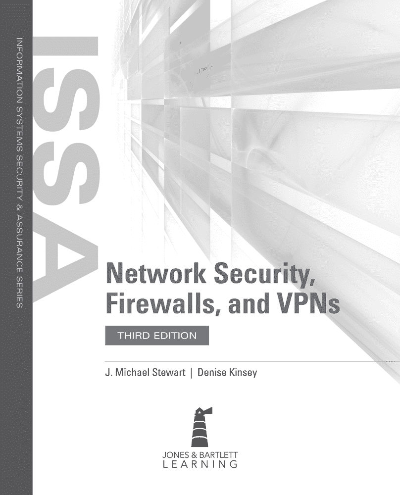


## 世界总部

Jones & Bartlett Learning

5 Wall Street

Burlington MA 01803

978-443-5000

info@jblearning.com

[www.jblearning.com](http://www.jblearning.com)

Jones & Bartlett Learning 的图书和产品可通过大多数书店和在线书商购买。如需直接联系 Jones & Bartlett Learning，请致电 800-832-0034，传真 978-443-8000，或访问我们的网站 [www.jblearning.com](http://www.jblearning.com)。

Jones & Bartlett Learning 出版物批量订购可享受大幅折扣，适用于企业、专业协会和其他合格组织。详情及具体折扣信息，请通过上述联系方式联系 Jones & Bartlett Learning 特约销售部，或发送邮件至 specialsales@jblearning.com。

版权所有 © 2021 Jones & Bartlett Learning, LLC，Ascend Learning 旗下公司

保留所有权利。未经版权所有者书面许可，受此版权保护的材料任何部分不得以任何形式（电子或机械，包括复印、录制）或通过任何信息存储和检索系统进行复制或使用。

本书内容、陈述、观点和意见仅代表各作者个人，不代表 Jones & Bartlett Learning, LLC。书中提及的任何特定商业产品、过程或服务（无论以商标、品牌名称、制造商或其他方式）均不构成或暗示 Jones & Bartlett Learning, LLC 对其的认可或推荐，且此类引用不得用于广告或产品代言目的。书中显示的所有商标均为各自权利人所有。《网络安全、防火墙与 VPN（第三版）》为独立出版物，未获本书中引用的商标或服务标志所有者授权、赞助或批准。

本书可能包含模特肖像图片；这些模特不一定认可、代表或参与图片中呈现的活动。本书中的任何屏幕截图仅供教育和教学目的使用。全书案例研究中出现的任何个人和场景可能是真实的，也可能是虚构的，仅供教学目的使用。

18365-8

## 制作人员名单

**产品管理副总裁：** Amanda Martin

**产品管理总监：** Laura Pagluica

**产品经理：** Ned Hinman

**内容策略师：** Melissa Duffy

**开发编辑：** Kim Lindros

**技术编辑：** Jeff Parker

**内容协调员：** Paula-Yuan Gregory

**项目经理：** Kristen Rogers

**项目专员：** John Fuller

**高级数字项目专员：** Angela Dooley


### 市场经理：Michael Sullivan

### 产品履行经理：Wendy Kilborn

### 排版：Exela Technologies

### 封面设计：Timothy Dziewit

### 正文设计：Kristin E. Parker

### 媒体开发编辑：Faith Brosnan

### 版权专员：James Fortney

### 封面图片（标题页、分册扉页、章节扉页）：© Digital_Art/Shutterstock

### 印刷和装订：McNaughton & Gunn

## 国会图书馆出版数据

**作者：** Stewart, James Michael, 作者。 | Kinsey, Denise, 作者。

**书名：** 网络安全、防火墙与 VPN / J. Michael Stewart, Denise Kinsey 著。

**描述：** 第 3 版。 | 伯灵顿, MA : Jones & Bartlett Learning, [2021] | 包含参考文献和索引。 | 摘要：“《网络安全、防火墙与 VPN》是为网络安全与边界防御课程编写的，特别强调防火墙和 VPN——保护网络安全的两大关键工具。目前分为三部分——第 1 部分：网络安全基础，第 2 部分：网络安全、防火墙与 VPN 技术概述，第 3 部分：实施、资源与未来”——出版社提供。

**标识符：** LCCN 2020022142 | ISBN 9781284183658 (平装)

**主题：** LCSH: 防火墙 (计算机安全) | 计算机网络—安全措施。

**分类：** LCC TK5105.59 .S7585 2020 | DDC 005.8–dc23

LC 记录可在 <https://lccn.loc.gov/2020022142> 查阅

6048

在美国印刷

24 23 22 21 20 10 9 8 7 6 5 4 3 2 1

*本书献给所有渴望深入了解网络安全、防火墙和 VPN 的人。愿你们通过此资源获得基础知识。*


© Digital_Art/Shutterstock

## 简略目录

- 前言
- 致谢
- 作者简介
- 第 1 部分 网络安全基础
- 第 1 章 网络安全基础
- 第 2 章 网络安全威胁
- 第 3 章 常见网络拓扑与基础设施
- 第 4 章 网络设计考量
- 第 2 部分 使用防火墙保护边界
- 第 5 章 防火墙基础
- 第 6 章 防火墙实施
- 第 7 章 防火墙部署考量
- 第 8 章 配置防火墙
- 第 3 部分 使用 VPN 建立远程访问
- 第 9 章 VPN 基础
- 第 10 章 VPN 管理
- 第 11 章 VPN 技术
- 第 12 章 VPN 实施
- 第 4 部分 实施网络安全
- 第 13 章 防火墙安全管理
- 第 14 章 网络安全管理最佳实践
- 第 15 章 新兴技术与法规考量
- 附录 A 答案
- 附录 B 标准缩略语
- 关键术语表
- 参考文献
- 索引


© Digital_Art/Shutterstock

## 目录

- 前言
- 致谢
- 作者简介
- 第 1 部分 网络安全基础
- 第 1 章 网络安全基础
  - **什么是网络安全？**
  - 什么是信任？
  - 谁或什么是可信的？
  - 什么是安全目标？
  - **你要保护什么？**
  - 典型 IT 基础设施的七个域
  - **网络安全目标**
  - **如何衡量网络安全的成功？**
  - **为什么书面网络安全策略很重要？**
  - 为最坏情况做计划
  - **谁负责网络安全？**
  - **增强有线与无线 LAN 基础设施的安全性**
  - **内部与外部网络问题**
  - **用于缓解威胁的常见网络安全组件**
    - 主机和节点
    - 防火墙
    - 虚拟专用网络
    - 代理服务器
    - 网络地址转换
    - 域名系统
    - 目录服务
    - 入侵检测系统和入侵防御系统
    - 网络准入控制
  - **TCP/IP 基础**
  - OSI 参考模型
  - 子协议
  - 首部和载荷
  - 基于地址的过滤
  - **第 1 章 小结**
  - **关键概念和术语**
  - **第 1 章 评估**
- 第 2 章 网络安全威胁
  - **黑客及其动机**
  - **黑客的最爱目标**
  - **来自内部人员和外部实体的威胁**
  - **黑客攻击过程**
    - 侦察
    - 扫描
    - 枚举
    - 攻击
    - 攻击后活动
  - **常见 IT 基础设施威胁**
    - 硬件故障和其他物理威胁
    - 自然灾害
    - 事故
  - **恶意代码 (恶意软件)**
  - 高级持续性威胁
  - **快速增长与过度使用**
  - **无线与有线对比**
  - **窃听**
  - **劫持与重放攻击**
  - **插入攻击**
  - **分片攻击**
  - **缓冲区溢出**
  - **会话劫持、欺骗和中间人攻击**
    - 会话劫持
    - 欺骗攻击
    - 中间人攻击
  - **隐蔽信道**
  - **网络和资源可用性威胁**
    - 拒绝服务 (DoS)
    - 分布式拒绝服务 (DDoS)
  - **黑客工具**
  - **社会工程学**
  - **第 2 章 小结**
  - **关键概念和术语**
  - **第 2 章 评估**
- 第 3 章 常见网络拓扑与基础设施
  - **什么是网络拓扑？**


# 网络设备类型

# 逻辑拓扑与物理拓扑的区别是什么？

#### 物理拓扑类型

#### 逻辑拓扑

##### 创建逻辑拓扑

# Internet 协议版本 4 (IPv4) 与 Internet 协议版本 6 (IPv6) 的区别

## IPSec 与 IPv6

# 网络基础设施示例及相关安全顾虑

#### 工作组

#### SOHO 网络

#### 客户端/服务器网络

## LAN 与 WAN 的对比

#### 瘦客户机与终端服务

## 远程控制、远程访问与 VPN

#### 边界网络

### 本章小结

### 关键概念和术语

### 第 3 章评估

## 第 4 章 网络设计考量

### 网络设计与纵深防御

#### 通过分层实现纵深防御

#### 规划可扩展性

### 与高层管理人员协作

### 协议

### 常见寻址类型

#### IPv6

### 控制通信路径

#### 路由器配置

#### 加密协议

#### 物理访问管理

#### 过滤

## 入侵检测系统与入侵防御系统

### 系统加固

## 设备选型

## 认证、授权与审计

### 通信加密

## 主机：仅本地还是远程和移动

### 冗余

### 端点安全

#### 客户端

#### 服务器

#### 路由器

#### 交换机

### 防火墙与代理

## 风险评估与管理

### 什么是风险区域？

### 本章小结

### 关键概念和术语

### 第 4 章评估

# 第 2 部分 使用防火墙保护边界安全

## 第 5 章 防火墙基础

### 什么是防火墙？

### 防火墙不能做什么

## 为什么需要防火墙？

## 防火墙如何工作及其功能

## 防火墙类型

### 个人和 SOHO 防火墙选项

### 管理 ISP 接入设备上的防火墙

### 将家用路由器转换为防火墙

### 主机软件防火墙的用途

##### 软件防火墙产品示例

##### 使用 Windows 10 的主机软件防火墙

##### 使用 Linux 主机软件防火墙

### 商业软件网络防火墙的用途

## 硬件/设备型防火墙的用途

### 下一代防火墙

### 什么是虚拟防火墙？

## 双宿主和三宿主防火墙

## 入站与出站过滤

### 过滤类型

### 静态包过滤

### 状态检测与动态包过滤

#### 网络地址转换

#### 应用代理

#### 电路代理

#### 内容过滤

## 选择适合您需求的防火墙

### 购买防火墙与自建防火墙的区别

### 本章小结

### 关键概念和术语

## 第 5 章评估

## 第 6 章 防火墙实施

### 检查您的网络及其安全需求

#### 保护什么以及为什么

#### 维护隐私

### 正确的防火墙实施程序

### 构建、配置和管理防火墙

#### pfSense

#### pfSense 要求

### 使用 pfSense 规划防火墙实施

### 小型组织防火墙：包过滤或应用层防火墙，代理实现

### 中大型组织防火墙：应用层防火墙和包过滤，混合系统

#### 子网架构中的防火墙

### 安装 pfSense 防火墙

### 使用 pfSense 配置防火墙

### 防火墙部署要素

#### 测试与故障排除

### 本章小结

### 关键概念和术语

### 第 6 章评估

## 第 7 章 防火墙部署考量

### 防火墙部署的常见安全策略

#### 通过隐匿实现安全

#### 最小权限

### 简洁性

### 纵深防御

#### 防御多样性

#### 关键节点

#### 最薄弱环节

#### 故障安全

#### 强制全员参与

## 认证、授权与审计

## 网络硬件防火墙的放置

## 反向代理的益处与目的

## 端口转发的用途与益处

### 选择堡垒主机操作系统的考量

## 监控与日志记录

#### 理解和解读防火墙日志与警报

## 入侵检测系统与入侵防御系统

### 安全事件与信息管理


### 评估设计安全性中的需求与解决方案

# 当安全性妨碍业务开展时会发生什么？

### 章节摘要

### 关键概念和术语

# 第 7 章评估

## 第 8 章 配置防火墙

### 防火墙规则

#### 入站和出站通信

#### 访问控制列表

### 编写防火墙规则

### 防火墙规则排序

## 应允许什么，应阻止什么？

### 防火墙策略的基本要素

### 防火墙的局限性

## 提升性能

## 加密给防火墙带来的负面影响

### 防火墙增强功能

### 管理接口

### 章节摘要

### 关键概念和术语

## 第 8 章评估

# 第 3 部分 使用 VPN 建立远程访问

# 第 9 章 VPN 基础知识

### 什么是虚拟专用网络？

#### 部署 VPN 有哪些好处？

## VPN 有哪些局限性？

### 什么是有效的 VPN 策略？

## VPN 部署模型和架构

#### VPN 部署模型

#### VPN 架构

### 隧道模式与传输模式

## 加密与 VPN 的关系

### 对称加密

###### 非对称加密

####### 哈希

##### 使用加密建立 VPN 连接

##### 数字证书

### 什么是 VPN 认证？

### 什么是 VPN 授权？

### 章节摘要

### 关键概念和术语

### 第 9 章评估

## 第 10 章 VPN 管理

### VPN 管理最佳实践

### 构建冗余

### 为您的环境选择合适的 VPN 产品

### 制定 VPN 策略

#### 禁止分隧道

#### 确保客户端安全

#### 实施漏洞管理

#### 使用多因素认证

### 记录实施计划

#### 监控 VPN 可用性

#### 执行定期审查、备份和更新

### 制定 VPN 策略

### 制定 VPN 部署计划

### 旁路部署

### 内联部署

##### 基于 DMZ 的实施

## VPN 威胁和漏洞利用

### 商业 VPN 与开源 VPN

### 个人 VPN 与企业 VPN 的区别

## 平衡匿名性和隐私

### 保护 VPN 安全以支持可用性

#### 用户培训的重要性

### VPN 故障排除

### 章节摘要

### 关键概念和术语

## 第 10 章评估

## 第 11 章 VPN 技术

## 软件与硬件解决方案的区别

#### 软件 VPN

#### 硬件 VPN

## 第 2 层与第 3 层 VPN 的区别

### 互联网协议安全 (IPSec)

### 第 2 层隧道协议 (L2TP)

## 安全套接字层 (SSL)/传输层安全 (TLS)

### SSL/TLS 与 VPN

### 安全外壳 (SSH) 协议

## 为 VPN 建立性能和稳定性

#### 性能

#### 稳定性

### 将 VPN 与网络地址转换 (NAT) 结合使用

### 虚拟化类型

#### 桌面虚拟化

#### SSL VPN 虚拟化

### 章节摘要

### 关键概念和术语

### 第 11 章评估

## 第 12 章 VPN 实施

### 基于操作系统的 VPN

#### VPN 设备

### 配置典型 VPN 设备

### 客户端配置

### 远程桌面协议

### 使用远程控制工具

### 使用远程访问

#### 远程使用的技术

#### 在 IPSec 和 SSL/TLS 远程访问 VPN 之间进行选择

### 远程桌面服务

#### RD RemoteApp

#### RD Web Access

#### RDS 和托管服务

### Microsoft DirectAccess

### DMZ、外联网和内联网 VPN 解决方案

#### 内联网 VPN

#### 外联网 VPN

## 网吧 VPN

### 在线远程 VPN 选项

#### 安全性

#### 唤醒局域网 (Wake-on-LAN) 支持

#### 文件共享

#### 远程打印

#### Mac 和移动设备支持

### Tor 应用程序

### 规划 VPN 实施

#### 下载并验证安装文件

#### 安装提示

#### 配置 OpenVPN

#### 运行 OpenVPN

### 测试和故障排除

#### OpenVPN Private Tunnel

### VPN 实施最佳实践

### 章节摘要

### 关键概念和术语


# 第 12 章 评估

# 第 4 部分 实施网络安全

## 第 13 章 防火墙安全管理

## 防火墙管理的最佳实践

## 防火墙之外的安全措施

### 缓解防火墙威胁和漏洞利用

## 与穿越或跨越防火墙的隧道技术相关的问题

### 测试防火墙安全性

### 管理和监控防火墙的重要工具

## 防火墙故障排除

## 检测防火墙威胁和响应事件

### 本章小结

### 关键概念和术语

## 第 13 章 评估

# 第 14 章 网络安全管理的最佳实践

## 网络安全管理要点

### 网络安全管理工具

### 安全计划和安全策略

#### 安全清单

## 限制网络访问和实施加密

### 物理安全

### 预防和威慑事件的技术

### 实施隔离

### 使用蜜罐、蜜网和填充单元

### 杀毒软件、监控和其他主机安全控制

### 备份和恢复

#### 用户培训、安全意识和持续教育

### 事件响应

#### 准备

### 检测和分析

#### 遏制

#### 根除

#### 恢复

### 事后跟进

### 故障安全、故障开放和故障关闭选项

## 网络安全评估和测试

#### 安全评估

#### 配置扫描

#### 漏洞扫描

#### 渗透测试

#### 事后评估审查

### 变更管理

#### 合规性审计

### 网络安全故障排除

### 本章小结

### 关键概念和术语

## 第 14 章 评估

## 第 15 章 新兴技术和法规考量

### 网络安全、防火墙和 VPN 的未来展望

#### 威胁

### 防火墙能力

#### 加密

#### 认证

#### 度量指标

### 关注点

### 保护云安全

#### 保护移动设备

###### 物联网

###### 移动 IP

###### 自带设备 (BYOD)

### 网络安全、防火墙和 VPN 资源站点

#### 防火墙供应商

#### 虚拟专用网络供应商

#### 网络安全网站

#### 网络安全杂志网站

### 网络安全、防火墙和 VPN 工具

#### 商用现成软件 (COTS)

### 开源应用程序和工具

### 消失的网络边界

### 无处不在的无线和移动连接的影响

### 使无线和移动连接更安全

### 安全技术的潜在用途

### 法规与合规

### 专用防火墙

### 新兴网络安全技术

#### 数据泄露防护

#### 生物识别

#### 虚拟化安全

### IP 版本 6

#### VPN、防火墙和虚拟化

### 本章小结

### 关键概念和术语

## 第 15 章 评估

# 附录 A 答案

# 附录 B 标准缩略语

# 关键术语词汇表

# 参考文献

# 索引


© Digital_Art/Shutterstock

## 前言

### 本教材的目的

本教材是 Jones & Bartlett Learning（`www.jblearning.com`）推出的信息系统安全与保障系列丛书的一部分。该系列专为 IT 安全、网络安全、信息保障和信息系统安全课程及课程体系而设计，全面且系统地阐述了该关键领域最新的研究成果和发展趋势。这些教材将基本的信息安全原则与大量真实的应用案例相结合。由认证信息系统安全专家 (CISSP) 编写，全面涵盖了信息安全的各个方面。经该领域领先技术专家逐字逐句审核，这些教材不仅紧跟当前形势，更具前瞻性——使您能够应对不仅是当今，而且是未来的网络安全挑战。

第一部分重点关注常见的网络安全主题，以及当您将组织网络物理连接到公共互联网时所面临的业务挑战和威胁。它介绍了关键概念和术语，并揭示了黑客试图访问您网络时的所作所为，从而为后续讨论奠定必要的网络安全基础。

第二部分定义了防火墙，使您了解如何将这些工具作为安全对策来解决业务挑战。它讨论了如何选择和部署防火墙，以及用于管理和监控它们的工具。它注重实践，给出了实施防火墙的具体分步示例。

第三部分专注于虚拟专用网络 (VPN)，回顾了 VPN 的实施、所涉及的技术以及 VPN 管理的最佳实践。它还讨论了从事网络安全工作的信息安全专业人员未来将面临的挑战。它涵盖了专业人员可用的工具和资源，并展望了新兴技术的前景。

### 学习特色


本书的写作风格实用且通俗易懂。全书贯穿了信息安全概念和程序的分步示例。每章开头都列出了学习目标。插图既用于阐明内容，也用于丰富呈现形式。正文中穿插着注释、提示、参考信息、警告和边栏，旨在提醒读者关注与讨论主题相关的额外有用信息。

章节测验位于每章末尾，答案提供在书后。章节总结包含在正文中，旨在提供快速复习或预习材料，并帮助学生理解所呈现概念的相对重要性。

## 读者对象

本书适合计算机科学、信息科学、网络安全专业的本科生或研究生，具备基础技术背景的两年制技术学院或社区学院学生，以及具备基本 IT 原理理解并希望扩展知识的读者。

## 本版新增内容

本版提供了改进的格式，每个主要主题（网络安全、防火墙、VPN）都从入门讲解到高级主题，然后再过渡到下一个主题，并加强了主题间的整合。本版还反映了最新的软件版本和技术。最后几章介绍了网络安全的最佳实践，并探讨了技术的未来、法规考量以及人员和流程管理。

## 云实验室

本书配套网络安全云实验室。这些实操虚拟实验室提供了沉浸式的模拟 IT 基础设施，学生可在其中学习和实践基础网络安全技能，作为本书课程的延伸。如需更多信息或购买实验室，请访问 [go.jblearning.com/stewart3e](http://go.jblearning.com/chapple3e)。


© Digital_Art/Shutterstock

## 致谢

Denise Kinsey 博士要感谢 Rob 和 M.C. 始终如一的支持与鼓励；感谢开发团队和 JBL 的所有人员，特别感谢 Ned、Melissa 和 Kim。我感激你们为构建此版本提出的所有意见和想法。

Jones & Bartlett Learning 感谢所有审阅本书第二版的人员。你们的反馈帮助塑造了此次修订。

Georgia Brown

*美国军事大学*

*ECPI*

*EC Council University*

*西部州长大学*

*泰德沃特社区学院*

Shana Bumpas

*约翰·泰勒社区学院*

Colin T. Carlile

*圣母湖大学*

Casimer DeCusatis

*马里斯特学院*

Charles DeSassure

*塔兰特县学院*

M. Lamine Diop

*蓝岭社区学院*

Perry Hood

*威尔格拉斯佐治亚技术学院*

Richard McKinney

*纳什维尔州立社区学院*

Teresa Nash

*刘易斯-克拉克州立学院*

Nicholas Peirce

*托马斯·纳尔逊社区学院*

Richard S. Riddle Jr.

*丹维尔社区学院*

Jianhua Yang

*哥伦布州立大学*

Tatyana Zidarov

*黑格斯敦社区学院*


© Digital_Art/Shutterstock

## 作者简介

**James Michael Stewart** 从事计算机和技术工作已超过 25 年。他的工作重点在于安全、认证和各种操作系统。最近，Michael 一直在教授职业技能和认证课程，如 `CISSP`、`CEH` 和 `Security+`。他是《CISSP 学习指南 第 4 版》和《Security+ 2008 复习指南》的主要作者。此外，Michael 还撰写了大量关于其他安全、Microsoft 认证和管理主题的文本。他开发了认证课程教材和培训材料，并在课堂上讲授这些材料。Michael 持有以下认证：`CISSP`、`ISSAP`、`SSCP`、`MCT`、`CEI`、`CEH`、`TICSA`、`CIW SA`、`Security+`、`MCSE+Security: Windows 2000`、`MCSA Windows Server 2003`、`MCDST`、`MCSE NT & W2K`、`MCP+I`、`Network+`、`iNet+`。他于 1992 年毕业于德克萨斯大学奥斯汀分校，获得哲学学士学位。

**Denise Kinsey, Ph.D** 在计算机网络和网络安全领域拥有超过 20 年的工作经验。她为政府和私营部门设计、实施和管理过 IT 和 OT 项目。Denise 是多部 IT 和网络安全教材的作者，旨在教育读者、赋能读者，使其了解更多技术知识，并为其雇主和家庭实施安全系统。在不解决网络安全问题时，她喜欢与学生合作，改善非营利组织和本地企业的网络和网络安全。Denise 持有多项认证，包括 `CISSP`、`C|CISO`、`Security+` 等。Kinsey 博士是副教授。


© Digital_Art/Shutterstock

# 第 1 部分

# 网络安全基础

第 1 章 网络安全基础

第 2 章 网络安全威胁

第 3 章 常见网络拓扑和基础设施

第 4 章 网络设计考量


© Digital_Art/Shutterstock

## 网络安全基础

## 第 1 章

计算机网络安全非常复杂。来自网络内外的新威胁层出不穷。作为回应，安全社区不断开发新产品和程序，以抵御过去的威胁和未来的未知威胁。

随着公司合并、人员失业、新设备上线以及业务任务变更，人们的行为并不总是符合预期。昨天行之有效的网络安全配置，明天可能就不那么奏效了。在瞬息万变的商业环境中，你该信任谁？你的信任被背叛了吗？你怎么知道？这次是谁在试图破坏你的网络？为什么？

鉴于这些复杂问题，你需要了解网络安全的基本要素。本章将向你介绍网络安全的基本要素。一旦你牢固掌握这些基础知识，就能为组织网络实施有效的安全措施做好充分准备。

### 第 1 章主题

本章涵盖以下主题和概念：

*   网络安全的含义
*   典型 IT 基础设施七大领域中受保护的项目
*   网络安全的目标
*   如何评估网络安全实施的成效
*   书面网络安全策略为何重要
*   谁负责网络安全
*   增强有线和无线局域网（`LAN`）基础设施安全的控制措施
*   内部和外部网络问题的示例
*   用于缓解整个 IT 基础设施威胁的常见网络安全组件
*   传输控制协议/互联网协议（`TCP/IP`）的基础知识

### 第 1 章目标

完成本章后，你将能够：

*   描述与网络安全相关的关键概念和术语
*   描述书面安全策略的重要性；解释策略如何帮助将网络基础设施的风险敞口和威胁降至最低
*   定义网络安全角色和职责；确定 IT 组织中谁对这些安全实施负责
*   识别网络安全关注点或威胁的示例，这些威胁需要加强安全对策以妥善将风险敞口和威胁降至最低


*   描述有线与无线 LAN 基础设施所需的安全要求，以提供更高级别的安全性
*   比较和对比常见的网络安全组件和设备，以及它们在整个 IT 基础设施中的用途

### 什么是网络安全？

网络安全是对计算机网络上通信的不受欢迎的入侵、使用或破坏进行控制。这包括监控滥用行为、查找协议错误、阻止未经批准的传输，以及及时准确地响应问题。网络安全还关乎支持组织使命和目标所必需的基本通信、避免未经批准的资源使用，以及确保遍历网络的信息的完整性。

网络安全包含防止未经授权的访问和操作的要素，同时支持理想的活动，例如访问客户记录或管理库存。要高效、具有成本效益且透明地做到这一点很难。高效的网络安全为用户提供对资源的快速便捷访问。具有成本效益的网络安全控制用户对资源和服务的访问，前提是风险足以证明控制成本的合理性。透明的网络安全通过强制执行组织的网络安全策略来支持组织的使命和目标，而不会给执行合法任务的有效用户带来不必要的步骤或延迟。

计算机网络技术的变革和改进速度比以往任何时候都快。无线连接现在已成为大多数组织和个人的现实选择。恶意黑客越来越擅长利用一切可用手段窃取身份、知识产权和金钱。

如今，许多组织在保护其资产上花费的时间、金钱和精力，比在网络初始安装期间还要多。威胁（无论是内部还是外部）都可能导致灾难性的系统故障或妥协。此类安全漏洞甚至可能导致公司倒闭。没有网络安全，许多企业和个人将无法高效工作。

网络安全必须支持员工的工作，同时防范妥协、保持高性能并将成本降至最低。这极具挑战性；但通过适当的规划和执行，许多组织已成功完成了这项任务。

网络安全始于信任。

#### 什么是信任？

信任是你对他人将以你的最佳利益行事这一期望的信心。在计算机和网络中，信任是指相信其他用户将按照组织的安全规则、企业使命和愿景行事。你相信他们不会试图破坏网络及其资源的稳定性、隐私或完整性。信任是认为他人值得信赖的信念。

不幸的是，有时人们会违背你的信任。他们可能因意外、疏忽或不知情（甚至不知道存在这种期望）而这样做。在其他情况下，他们会故意违背信任。因为这些人可能是内部人员，也可能是外部黑客，所以很难知道该信任谁。

那么，如何回答“谁是值得信赖的？”这个问题呢？你首先要认识到信任是基于过去的经验和行为的。相互了解的人之间通常可以建立信任。信任陌生人既不容易也不合乎需要。然而，一旦你定义了一套规则且所有人都同意遵守这些规则，你就建立了有条件的信任。随着时间的推移，随着人们表现出他们愿意遵守规则并符合行为期望，你可以认为他们是值得信赖的。

信任也可以来自第三方方式。如果一个值得信赖的第三方了解各方实体，并声明双方都值得信赖，那么你就可以将有条件的信任扩展到各个实体。随着时间的推移，某人的行为会显示最初的有条件信任是否当之无愧。

归根结底，网络安全基于信任。组织假定其员工以及所有计算机和网络设备都是值得信赖的。但并非所有信任都一定相同。你可以（而且可能应该）在不同级别或层级的信任下运作。拥有较高信任级别的人员可被分配更大的权限和特权。在网络术语中，权限是访问资产的授权，特权是在网络上被授予的能力。如果有人或某物违背了你的信任，你就移除违规者对安全环境的访问。例如，组织会解雇不值得信赖的员工或更换有缺陷的操作系统。

第三方信任系统的一个常见例子是使用公共证书颁发机构颁发的数字证书。如**图 1-1**所示，用户与 Web 电子商务服务器进行通信。用户最初不知道 Web 服务器是否真的是它声称的那样，或者是否有人正在“欺骗”其身份。一旦用户检查了证书颁发机构颁发给 Web 服务器的数字证书，用户就可以信任该网站的身份是有效的。之所以会发生这种情况，是因为用户和网站都有一个共同的、值得信赖的第三方，且双方都认识该第三方。

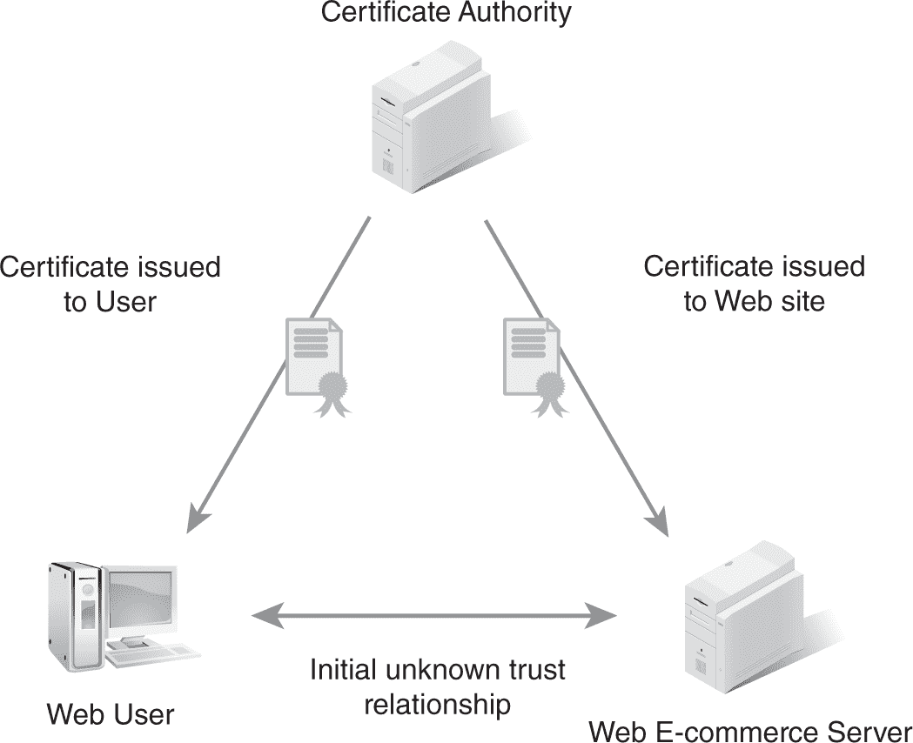

**图 1-1** 第三方信任系统的示例。

#### 谁——或什么——是值得信赖的？

确定谁或什么是值得信赖的，是每个组织持续进行的活动，无论是全球性企业还是家庭家庭网络。在这两种情况下，你都有条件地向他人提供信任。这种有条件的信任会随着时间的推移而变化，基于是遵守还是违反了期望和规定的行为。

如果程序导致问题，它就会失去你的信任，你会将其从系统中移除。同样，如果用户违反安全规定，该人员就会失去你的信任，你可能会撤销其访问特权。当员工遵守规则时，你的信任会增加，如果因额外的工作职责或需求而必要，特权可能会增加。同样，当互联网站点未造成危害时，你会认为它值得信赖并允许访问该站点。

回顾一下，信任是主观的、暂时的，且会随时间变化。你可以基于第三方的声誉提供信任。当他人违反规则时，你会撤回信任。信任源于过去的行为，并可基于未来的行为而增长。

在网络安全中，信任是复杂的。在没有适当背景调查的情况下向员工延伸信任可能会造成毁灭性后果。网络的安全性取决于其最薄弱的环节。你需要审查网络的各个方面，包括软件、硬件、配置、通信模式、内容和用户，以维护网络安全。否则，你将无法实现组织的安全目标。

#### 什么是安全目标？

安全目标是组织通过其安全工作努力实现的目标。通常，组织认可三个主要安全目标：

*   机密性/隐私
*   完整性/不可抵赖性
*   可用性/正常运行时间


##### 核心安全目标

机密性是指防止未经授权的访问，同时为授权用户提供无阻碍的资源访问。机密性确保数据不会被有意或无意地泄露给任何没有正当知情需求的人。职位描述定义了一个人的知情需求。如果一项任务不需要访问特定资源，则该人员不需要访问该资源的权限。

完整性是指防止未经授权的更改，同时允许授权用户执行授权的更改。完整性确保数据在内部和外部都保持一致。一致的数据不会随时间改变，并与现实世界保持同步。完整性还可防止意外事故和黑客通过恶意代码或带有恶意意图编写的软件进行的修改。

可用性是指防止停机、数据丢失和访问受阻，同时提供持续的正常运行时间、保护数据并支持授权用户访问资源。可用性确保用户能够及时访问适当的资源以完成工作。例如，可用性确保 Web 资源可访问，从而避免销售损失。

认证是在授予对安全区域的访问权限之前，对用户身份进行的证明或验证。这可以发生在网络中，也可以发生在物理的现实世界中。虽然最常见的认证形式是密码，但密码可能会被意外共享或窃取，尤其是当被写下来时。多因素认证是大多数网络管理员首选的安全登录方法，因为它需要多重身份证明。

授权是控制用户被允许和不被允许执行的操作。授权由组织的安全架构决定，该架构可能侧重于自主访问控制 (DAC)、强制访问控制 (MAC) 或基于角色的访问控制 (RBAC)。授权基于知情需求和用户的职位描述来限制访问。授权也称为访问控制。

不可抵赖性是一项安全原则，它防止用户否认曾执行过某项操作。例如，不可抵赖性可防止发送方否认曾发送过某条消息。公钥密码学通常提供不可抵赖性服务。

隐私保护个人身份信息或敏感数据的机密性、完整性和可用性。私人数据可以包括财务记录或医疗信息。隐私防止对用户和员工进行未经授权的监视和监控。

维护和保护这些安全目标可能是一项挑战。与大多数困难任务一样，将安全分解为更简单或更小的组件将有助于您理解并最终实现这一目标。为了支持安全目标，您需要知道确切要保护什么。

### 您试图保护什么？

在安全领域，您想要保护的事物称为资产。资产是指用于开展业务的任何事物。员工为完成任务所需的任何对象、计算机、程序、数据片段或其他逻辑或物理组件都是资产。

资产不必昂贵、复杂或庞大。事实上，许多资产成本相对较低、司空见惯且大小不一。但无论特性如何，资产都需要保护。无论出于何种原因，当资产不可用时，员工就无法完成工作。

对于大多数组织而言，无论大小，最关心的资产包括业务和个人数据。如果这些信息丢失、损坏或被盗，将导致严重后果。企业可能倒闭。个人可能遭受经济损失。身份可能被盗用。生活可能被毁。

是什么导致了这些问题？什么违反了网络安全？答案包括意外事故、无知和黑客。意外事故会发生，包括硬件故障和自然灾害。培训不足等于无知。即使初衷良好的员工，如果不了解正确程序或缺乏必要技能，也可能破坏系统。过度劳累和匆忙行事的人员会忽视可能导致资产泄露或丢失的问题。恶意黑客可针对网络发起攻击和漏洞利用，意图获取访问权限或单纯造成破坏。

#### 典型 IT 基础设施的七大域

IT 基础设施的任何方面都存在风险，也没有任何方面能免疫于黑客的审视。风险是指威胁利用漏洞的可能性。在设计和实施网络安全时，您需要分析典型 IT 基础设施的七个域（**图 1-2**](#10_chapter01_02.xhtml#fig1-2)）中的每一个，以发现潜在的漏洞和弱点。安全措施必须详细、聚焦且详尽。您必须考虑每一种可能的攻击途径；评估风险；如果风险足够大，则应用对策。未能做到这一点将为黑客留下一条开放路径。黑客只需发现您防线中的一处裂缝，就能开始瓦解整个网络的安全性。

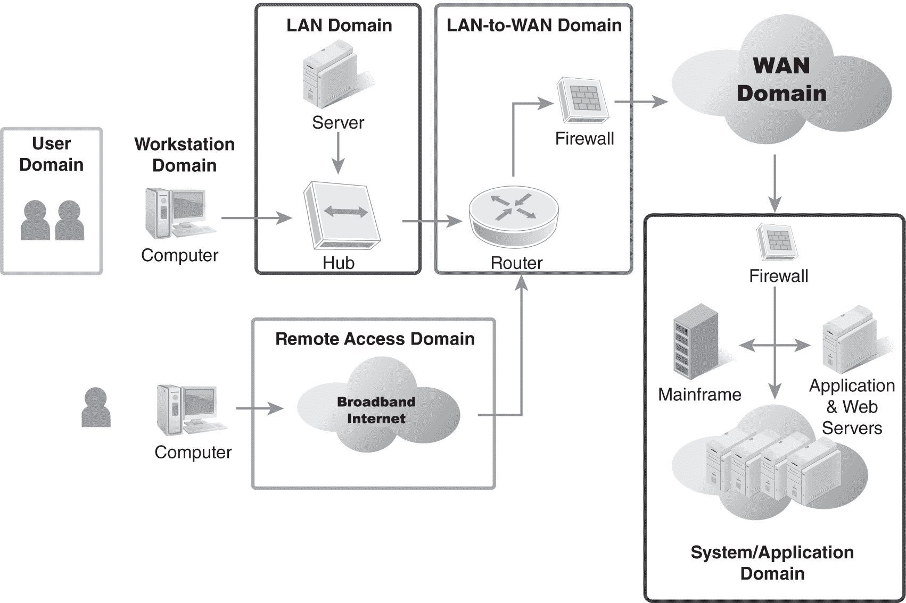

**图 1-2** 典型 IT 基础设施的七大域。

典型 IT 基础设施的七大域各有独特的方面，需要安全改进。以下各节描述了与这七大域相关的重要基础网络安全问题。

##### 用户域

该域指实际用户，无论他们是员工、顾问、承包商还是其他第三方用户。任何访问和使用组织 IT 基础设施的用户，在被授予访问组织 IT 资源和基础设施的权限之前，必须阅读并签署可接受使用策略 (AUP)。该域还应关注培训、强认证、细粒度授权和详细审计。此外，添加到其他域的许多保护措施也为用户域提供了额外的保护，并防范来自用户域的威胁。

社会工程学是黑客针对人的攻击。这种攻击试图通过巧妙的措辞、撒谎、误导、关系操纵、恐惧、心理诡计和骗术来愚弄人们。社会工程学攻击的后果可能包括用户泄露私人信息，或在计算机上执行导致网络安全降低的操作。

##### 工作站域

该域指最终用户的桌面设备，如台式计算机、笔记本电脑、网络电话 (VoIP) 或其他终端设备。工作站设备通常需要安全对策，如防病毒、反间谍软件和漏洞软件补丁管理，以维护设备的完整性。

工作站、客户端或独立家庭系统都可能成为目标。这类主机通常比局域网服务器安全性更低。这并非有意为之，因为大多数安全措施侧重于基础设施的核心组件，而非那些看似处于边缘的组件。很多时候，工作站上的安全措施陈旧、过期，或安装和配置不当。系统加固、通信保护和工作站定位对安全至关重要。

##### 局域网域


# 网络安全域

该域是指用于支持工作站连接到组织网络基础设施的物理和逻辑局域网 (LAN)技术（即由设备和通信协议构建的有线或无线拓扑）。协议、寻址、拓扑和通信加密为该域提供安全保障。

从家庭办公室到大型企业，私有局域网都是攻击的常见目标。局域网通常包含数十到数千台主机，这使得保护每一台主机变得困难。一旦黑客获得对网络上某一系统的访问权限，该局域网的其余部分就容易受到攻击。单台主机的沦陷可能导致整个基础设施的沦陷。

##### 局域网到广域网域

该域是指组织的互联网络以及局域网与广域网网络基础设施之间的互连点。路由器、防火墙、交换机、代理、非军事区 (DMZ)、入侵检测系统 (IDS)、入侵防御系统 (IPS) 和通信加密通常用作该域中的安全监控设备。

局域网位置之间的广域网 (WAN)连接，尤其是由第三方实体控制的连接，都是攻击目标。私有局域网与广域网连接之间的过渡接口可能是潜在的薄弱环节。如果针对广域网连接的攻击成功，跨越广域网/局域网接口入站的恶意流量不太可能被过滤。

##### 远程访问域

该域是指用户远程访问组织 IT 基础设施、系统和数据的授权和认证远程访问程序。远程访问始终是黑客热门的攻击目标，因为它消除了黑客必须亲临现场才能访问和攻击局域网的必要性。世界上任何拥有互联网或电话连接的黑客都仍可伸出魔爪，攻击任何看似孤立的目标。远程访问无异于向黑客发出邀请，让他们尝试突破你的防线。

远程访问解决方案通常涉及加密的远程浏览器访问或加密的虚拟专用网络 (VPN) 隧道，以实现安全的远程通信。

##### 广域网域

拥有远程站点的组织需要广域网进行互联。组织通常从服务提供商处外包广域网连接，以获得端到端的连接和带宽。

广域网域包括网络，例如使用异步传输模式 (ATM) 或帧中继的网络，这些网络由电信公司或载波网络公司所有，并租赁接入权给企业。通常，这些广域网连接的隐私性是通过电子隔离而非加密来实现的。针对特定目标的黑客可能会尝试突破载波网络的电子隔离，而不是专注于端点局域网。该域通常包括远程站点的路由器、电路、交换机、防火墙和同等设备，有时由服务提供商通过托管服务提供。协议选择、寻址方案和通信加密是保护该域的要素。

##### 系统/应用域

该域是指通常位于组织数据中心和/或机房中的硬件、操作系统软件、数据库软件、客户端/服务器应用程序和数据。托管应用程序、虚拟化系统或数据库的服务器集群是高价值目标。有时托管的数据是目标。有时黑客想要夺取的资源是服务器的计算能力。网络设计、认证、授权、审计和节点安全是该域重要的安全关注点。

网络管理员需要认识到，组织内部各处都存在安全受损的可能性，这导致了对充分网络安全的需求。从认识到风险存在和威胁迫在眉睫这一知识出发，网络安全管理员可以设计和实施适当的对策和防护措施。第一步是认识到组织内部各处都存在安全受损的可能性。下一步是理解网络安全的目标。

### 网络安全目标

不同组织的网络安全目标各不相同。然而，通常有几项共同的指令：

*   确保资源的机密性
*   保护数据的完整性
*   维护 IT 基础设施的可用性
*   确保个人可识别数据的隐私
*   实施访问控制
*   监控 IT 环境中的策略违规行为
*   支持业务任务和组织的整体使命

为了实现组织的安全目标，你需要将这些目标记录下来，并制定详尽的计划来执行它们。没有书面计划，安全工作充其量只是杂乱无章，很可能无法保护你的资产。有了书面计划，网络安全就走上了成功之路。一旦定义了这些安全目标，它们将成为组织保护整个 IT 基础设施的路线图。

### 如何衡量网络安全的成功？

组织通过其既定安全目标的达成程度以及安全标准的维护情况来衡量其网络的安全性。从本质上讲，这成为了组织对信息系统安全的基准定义。例如，如果网络上的私密信息未泄露给外部人员，那么你为维护机密性所做的努力就是成功的。或者，如果员工能按时按预算完成工作，那么你为提供系统完整性保护所做的努力就是成功的。

然而，如果发生违规行为，导致资产受损或无法实现安全目标，那么网络安全就不算成功。即使设计精良且执行得当的安全措施，也会面临意外、错误甚至蓄意的有害攻击的挑战。完美的安全组件不存在。所有组件都有弱点、局限性、后门、变通方法、编程漏洞或其他可被利用的因素。

幸运的是，成功的安全不依赖于单一防御组件的安装。相反，良好的网络安全依赖于多个有效安全组件的交织组合。你家的门上不会只装一把锁。通过结合多重防护、防御和检测系统，你可以抵御许多常见、简单的黑客攻击。

网络安全的成功不在于防范所有可能的攻击或入侵。相反，你致力于持续改进安全状况，使网络在未来比过去得到更好的保护。随着黑客创造新的攻击手段，安全专业人员了解它们，调整其方法和系统，并建立新的防御。成功的网络安全关键在于持续警惕，而非创造一个最终产品。安全是一项持续的工作，不断变化以应对新威胁的挑战，要求网络安全专业人员不断学习和适应。

### 为什么书面网络安全策略很重要？

有了书面安全策略，所有安全专业人员都致力于实现同一目标：一个成功、安全的工作环境。书面计划和程序将安全工作和资源集中在支持组织整体安全目标的最重要任务上。如果没有可靠且明确的目标，你的安全工作将会混乱且难以管理。


#### 该计划提供了一个通用参考，安全任务将据此进行比较

它充当了一种衡量工具，用于判断安全工作是有助于还是损害了组织的安全目标。通过遵循书面计划，您可以跟踪进度，从而安装和配置所有必要的组件。书面计划验证您所做的工作，定义您仍需完成的工作，并在必要时指导您如何修复基础设施。如果没有书面安全策略，员工将没有可靠的指南来了解该做什么，且判断安全成效将变得不可能。没有书面策略，就没有安全。

#### 为最坏情况做计划

事情总会出错。用户会犯错。恶意代码会找到进入网络的途径。黑客会发现并利用漏洞。在预判威胁安全的问题时，您必须为最坏的情况做计划。

这种类型的计划有很多名称，包括应急计划、最坏情况规划、业务连续性规划、灾难恢复规划和运营持续性规划。名称并不重要。关键在于您要组建一个团队并进行规划。

当问题发生时，转入响应模式：响应、遏制和修复。对所有故障或安全漏洞做出响应，以将损害、成本和停机时间降至最低。遏制威胁，防止其扩散或影响基础设施的其他区域。及时修复损害，以快速高效地使系统恢复正常状态。请记住，安全的目标是机密性、完整性和可用性。在为最坏情况做计划时，请始终将这些目标放在首位。

为问题做计划的关键目的是做好充分准备以保护您的基础设施。运气好的话，可能不会发生重大灾难。但做好准备而不需要用到响应计划，总比让问题导致业务失败要好。

#### 谁负责网络安全？

网络安全是组织内使用网络的每个人的责任。没有人有奢侈的资本去无视安全规则。这适用于全球性企业，也适用于家庭网络。每个人都有责任了解如何支持和维护网络安全。最薄弱环节法则在此适用：如果仅有一个人未能履行这一责任，所有人的安全都将受损。

高级管理层 对安全负有最终责任。这是有充分理由的；高级管理层对保护组织资产负有最大的问责义务。没有高级管理层的批准和支持，任何安全工作都无法成功。高级管理层必须确保制定出所有员工都能理解并遵守的书面安全策略。

高级管理层还将设计、编写和执行安全计划的责任分配给 IT 员工。理想情况下，这些工作的成果是一个安全的网络基础设施。反过来，安全人员必须有效管理所有资产、系统漏洞、迫在眉睫的威胁和相关防御措施。他们的任务是在整个组织中设计、执行和维护安全。

作为人员群体的监督者，管理者和主管必须确保员工拥有完成工作所需的所有工具和资源。管理者还必须确保员工经过适当培训、具备必要技能，并知晓程序、策略、界限和限制。如果组织要求员工从事其未经过适当培训的工作，员工可以向组织提起合法的法律诉讼。

网络管理员管理组织的所有计算机资源。资源包括文件服务器、网络访问、数据库、打印机池和应用程序。网络管理员的工作是确保资源功能正常且可供用户使用，同时强制执行机密性和网络完整性。

组织的员工是网络用户和操作员。他们最终完成业务所需的工作。用户创建产品、提供服务、执行任务、输入数据、响应查询等。职位描述可能适用于单个用户或一组用户。每个职位描述定义了用户的任务。用户必须在网络安全的限制范围内执行这些任务。

审计员 负责监控问题和违规行为。审计员调查网络，寻找任何不符合书面安全策略的情况。审计员监控系统和用户的活动，以查找违规行为、瓶颈 趋势以及尝试违规的行为。审计员发现的信息有助于改进安全策略、调整安全配置，或指导调查人员抓捕安全违规者。

所有这些角色 在每个组织中都存在。有时由不同个体扮演这些角色。在其他情况下，由单个人扮演所有这些角色。无论哪种情况，这些角色对于安全的创建、维护和改进都是必不可少的。

### 增强有线与无线 LAN 基础设施的安全性

有线网络提供了一种无线网络所缺乏的安全形式。这种安全性在于直接连接到有线或布线网络。黑客需要物理接触您的设施或大楼。通常，大楼的访问控制足以防止大多数外部人员访问您的私有 LAN。

然而，请认识到，如果您允许通过电话调制解调器、高速宽带甚至基本互联网服务进行远程连接，那么您就失去了物理访问限制的优势。一旦允许远程访问，物理隔离的益处就会消失。

如果您允许无线连接接入网络，情况也是如此。无线网络赋予了合法和未知用户与网络交互的能力。这消除了连接网络必须亲自到大楼现场的要求。许多组织允许甚至鼓励员工、承包商和访客自带设备。这具有成本效益且通常能提高效率，但这使最终用户的设备面临失控的风险。有了合适的天线，攻击者可能距离您的办公大楼一英里以外，仍能影响您的无线网络。

##### 注意

一种称为“范埃克窃听”的攻击允许攻击者从远处窃听电子设备。这种技术既不完美也不易实施，但已在 LCD 和 CRT 显示器以及键盘电缆上得到演示。通过轻微的屏蔽，可以消除此类攻击的大部分风险。

为了重获物理隔离提供的部分安全性，请尝试在网络设计中融入物理隔离。将所有远程访问和无线接入点与主有线网络隔离开。您可以通过使用单独的子网，并利用防火墙过滤 通信来实现这一点。虽然这种设计提供的安全级别不如物理隔离，但该安排比对远程或无线连接毫无控制要好得多。

##### 注意

您将在本章后面了解传输控制协议/互联网协议 (TCP/IP) 以及协议工作所在的层。


### 所有远程连接在授予内部 LAN 访问权限前，都应经过严格的多重验证

想象一下中世纪的城堡设计，采用了多层防御：护城河、吊桥、厚实的铆接墙壁、内侧垛墙，最后是坚固的主堡或内堡。您的多层防御设计应包括多因素认证和通信加密，例如 `VPN`。额外的检查可包括操作系统和补丁级别的验证、物理或逻辑位置来源的确认（如来电显示、`MAC` 地址或 `IP` 地址）、时间限制，以及传输层以上协议的限制。任何入侵者都需要绕过一层又一层的防线，使得入侵变得越来越困难。这通常被称为分层防御或纵深防御。

### 内部与外部网络问题

在部署新网络或修改现有基础设施时，请仔细评估对安全性的影响以及安全性对基础设施的影响。当您或您的团队忽视或规避标准安全实践时，实际上可能会降低安全性或导致网络瘫痪。业务中断不仅可能导致利润损失，还可能导致机会丧失，甚至导致裁员。如果妥协后果足够严重，企业可能无法恢复。

企业面临的威胁众多且不断变化。这些问题往往每天都在发生。恶意代码、信息泄露、零日漏洞利用、未经授权的软件、不道德的员工和复杂的网络基础设施，只是每个组织和网络管理员必须面对的众多担忧中的一小部分。

#### 恶意代码

恶意代码可通过任何通信渠道进入计算机。这包括文件传输、电子邮件、便携设备同步、可移动介质和网站。防范恶意代码的措施包括使用防火墙进行网络流量过滤、反恶意软件扫描以及用户行为规范。

#### 信息泄露

信息泄露通常源于恶意员工故意（恶意地）或意外地将内部文档发布给公众。这也可能源于意外事故，或发生在存储设备丢失、回收、捐赠、被盗或处理不当时。当用户意外将文档发布到点对点（`P2P`）文件共享服务或网站时，也会发生泄露。防范信息泄露的措施包括对员工进行彻底的背景调查、使用最小权限原则仅提供完成工作职责所必需的访问权限、详细审计和监控所有用户活动、对所有信息进行分类并控制通信路径、对便携设备的使用实施更严格的控制，以及实施清零——通过用零填充存储空间来清除待丢弃的存储设备。

#### 零日漏洞利用

零日漏洞利用是指针对当前尚无特定防御措施的新型、未知攻击。可将其视为针对您网络的突袭。`零日` 指的是漏洞利用的新颖性，它可能在黑客社区已为人知一段时间，但供应商和安全专业人员才刚刚获悉。

“零日”标签源于这样一个理念：供应商一旦得知问题，开发补丁的工作便立即开始。发现新漏洞利用的那一刻被称为“零日”。虽然不存在针对零日攻击的特定防御措施，但通用的安全管理、使用入侵检测和入侵防御、以及详细的日志记录和监控，有助于快速发现并阻止新攻击。一旦知晓某次攻击或漏洞利用，您便可以开始采取措施遏制损害或将妥协程度降至最低。

#### 未经授权的软件

未经授权的软件是指用户选择在客户端系统上运行的、未经组织批准或提供的任何代码或程序。并非所有未经授权的软件都直接构成问题，但您应出于多种原因防止其使用。此类软件可能给组织带来金钱、时间和精力上的成本。安装或使用该软件可能违反许可协议。该软件可能包含隐藏的恶意组件，无论用户是否知情，都可能危及网络安全。防止使用未经授权软件的措施应包括限制普通用户的安装权限，以及使用白名单阻止执行任何不在批准列表中的程序。

#### 不道德的员工

用户是安全防线的最后一环，往往也是网络安全中最薄弱的一环。如果用户选择违反安全策略，向公众泄露信息或执行恶意代码，后果可能会毁掉组织，或让肇事者陷入官司。不道德的员工会故意违反组织规定的规则和目标。这些员工往往认为规则不重要、不适用于自己，或实际上未被强制执行。大多数人认为自己永远不会被抓住。当用户违背组织的使命和目标时，后果可能是灾难性的。

防止不道德员工造成损害的方法包括更好的背景筛选、详细审计和监控所有用户活动、以及定期的管理监督和工作绩效评估。对于处于信任职位或有权访问组织机密或专有信息的员工，背景筛选应更加详细。当您发现有问题的人员时，或许可以在重新培训后给予其第二次机会。然而在许多情况下，对组织最安全的选择是终止雇佣关系。

#### 复杂的网络基础设施

复杂的网络基础设施往往导致复杂的漏洞。网络规模越大，包含的服务器、客户端、网络设备和网段就越多。庞大的活动部件数量几乎可以确保：某些组件必然会配置错误、安装不当、缺乏当前固件或补丁、存在或诱发瓶颈、或被错误使用。这些状况中的任何一种都可能导致漏洞，供内部或外部攻击者利用。网络规模越大、越复杂，安全团队就越需要彻底监控基础设施，并调查每一个超出组织可接受使用阈值的症状、趋势或警报。 防止复杂性成为负债，需要详细的规划、谨慎的实施、定期的安全管理，以及对基础设施有效性的持续审查。

#### 威胁评估

研究表明，大多数威胁来自内部来源，但太多组织关注外部来源而忽视内部威胁。更好的立场是将所有威胁——无论来源——视为值得调查的对象。一旦理解了潜在威胁，就能更好地理解和评估其风险、潜在损失和发生可能性。

#### 外部威胁：互联网

最明显的外部威胁之一是互联网。互联网是一个全球性网络，通过高速、实时通信连接人员和资源。不幸的是，这一绝妙的基础设施是黑客和恶意软件分发者的首选工具。一旦您的组织安装了互联网连接，世界就来到了您的门口——更准确地说，是在每位员工的指尖。这个世界既包含潜在客户，也包含潜在攻击者。


在没有全球通信基础设施的情况下，黑客必须亲自到场——通过有线连接——在您的大楼内或附近才能发起攻击。随着互联网和无线技术的出现，任何地方的黑客都可以尝试入侵您的网络安全。通常，攻击并非针对您的特定组织，而是针对特定的操作系统、通信协议或软件漏洞。因此，将互联网视为一种威胁是有帮助的。这不是一种您应该轻视的威胁，也不应因此而放弃互联网这一强大工具。互联网接入的好处值得您付出努力和费用来防御其负面特性。

抵御互联网威胁的最佳防御措施包括：经过深入研究和编写的安全策略；经过彻底培训的人员；使用防火墙过滤流量；入侵检测和防御系统；使用加密通信（如 `VPN`）；以及对所有用户和节点活动进行彻底的审计和监控。

同样，完美的安全解决方案并不存在。任何单一防御都可能被某种形式的攻击、妥协或漏洞利用绕过。网络安全的关键在于交织并互连多个安全组件，以构建多面的保护方案（即纵深防御）。

目标是平衡多个安全组件的优势和劣势。网络安全的终极功能是以最佳方式锁定事物，然后监控所有试图违反既定防御的行为。完美的锁不存在，因此要通过审计和监控来改进现有的最佳锁。了解这一点后，您的下一步是了解常见的网络安全组件及其最佳用途。

#### 用于缓解威胁的常见网络安全组件

在考虑部署网络或修改现有网络时，请评估每个网络组件以确定其安全优势和劣势。本节讨论许多常见的网络安全组件。

##### 主机和节点

**节点** 是网络上的任意设备。这包括客户端计算机、服务器、交换机、路由器、防火墙，以及任何具有网络接口且拥有 `MAC` 地址的设备。**媒体访问控制 (`MAC`) 地址** 是由制造商分配给网络接口卡 (`NIC`) 的 48 位物理**硬件地址**。节点是可以直接通信的组件，而非仅通过或跨越通信。例如，网线和配线架不是节点，但打印机是节点。

**主机** 是一种分配了逻辑地址（通常是互联网协议 (`IP`) 地址）的节点形式。该地址通常意味着该节点在网络层或更高层运行。网络层包括客户端、服务器、防火墙、代理，甚至路由器。网络层不包括交换机、网桥和其他物理设备，如中继器和集线器。在大多数情况下，主机要么共享，要么从其他主机访问资源和服务。

在网络安全方面，节点和主机的安全性有所不同。节点和主机都可能受到物理攻击和拒绝服务 (`DoS`) 攻击的危害。然而，主机还可能受到恶意代码或认证攻击的危害，甚至可能被黑客远程控制。节点保护主要是物理访问控制，以及针对洪水攻击的基本网络过滤。

主机安全可能更为复杂，因为主机本身应当加固，且您需要执行常规网络安全。**加固** 是保护或锁定主机以抵御威胁和攻击的过程。这可以包括移除不必要的软件、安装更新以及实施安全配置设置。

#### 防火墙

并非所有网络流量都来自授权源，因此不应允许其进入或离开网络。并非所有流量都用于授权目的，因此应阻止其到达目的地。并非所有流量都在正常或可接受的网络活动范围内，因此应在其造成妥协前将其丢弃。

所有这些保护都是防火墙的职责。顾名思义，**防火墙** 是一种旨在阻止损害的工具，正如发动机舱中的防火墙在事故中保护乘客免受伤害一样。防火墙是您部署的硬件设备或软件产品，用于在网络通信上强制执行访问控制策略。换句话说，防火墙会过滤网络流量中的有害漏洞利用、入侵、数据、消息或其他事件。

防火墙通常位于网络或子网的边缘。防火墙保护网络免受来自互联网的众多威胁。防火墙还保护互联网免受私有网络上流氓用户或应用程序的侵害。防火墙保护私有网络的吞吐量或带宽，使资源可供授权用户使用。没有防火墙，您网络的大部分能力将被来自互联网的无用或恶意流量消耗。想想大坝如何工作；没有大坝，河流容易泛滥。大坝防止了洪水和损害。

没有防火墙，网络的安全性和稳定性将主要取决于网络内部节点和主机的安全性。基于大多数主机操作系统糟糕的安全历史，没有防火墙将不是一个安全的解决方案。加固的主机和节点对网络安全很重要，但它们不应是可靠网络安全的唯一组件。防火墙可以安装在客户端和服务器计算机上。这些主机软件防火墙保护单个主机免受来自互联网的威胁，以及来自网络和其他内部网络组件的威胁。

无论如何，防火墙通常配置为基于**默认拒绝/例外允许**立场来控制流量。这意味着流量不会仅仅因为存在于网络上（或试图到达网络）就通过防火墙。相反，所有到达防火墙的流量必须满足一组要求才能继续其路径。

作为网络管理员或 IT 安全官员，您可以选择允许哪些流量通过防火墙，阻止哪些流量。此外，您还可以确定过滤是在入站流量（称为**入站过滤**）、出站流量（称为**出站过滤**）还是两者上进行。过滤入站流量是正常功能，因为许多威胁存在于网络之外。不要忘记，敏感数据和公司机密可能从网络内部源发送到外部世界，这就是为什么出站流量过滤也是必要的。

防火墙是主机和网络安全的基本组件。

##### 虚拟专用网络

**虚拟专用网络 (`VPN`)** 是一种跨中介网络（通常通过互联网）建立远程访问连接的机制。`VPN` 允许在通过互联网建立时实现廉价的长距离连接，因为两个端点只需要本地互联网链路。互联网本身充当“免费”的长途载体。

`VPN` 使用**隧道**或**封装**协议。隧道协议将原始网络协议封装起来，以便其能够穿越中介网络。在许多情况下，隧道协议采用**加密**，以便原始数据能够安全地穿越中介网络。


##### VPN、代理服务器和网络地址转换

您可以使用 VPN 进行远程访问、远程控制，或在不受信任的网络中进行高度安全的通信。

##### 代理服务器

代理服务器是防火墙的一种变体。代理服务器会过滤流量，但也会以几种特定方式对该流量进行处理。首先，代理服务器充当内部客户端和外部服务器之间的中间人。或者，在反向代理的情况下，这种关系可以颠倒，变为内部服务器和外部主机。其次，代理服务器将通过称为网络地址转换 (NAT)的过程，向服务器隐藏原始请求者的身份。本质上，代理服务器作为中介站在另一台服务器的前面。

代理服务器的另一项功能可以是内容过滤。这种过滤侧重于服务器的地址（通常按域名或 IP 地址）或传输内容中出现的关键字。您可以采用这种形式的过滤来阻止员工访问与业务任务无关或无益，或可能对业务网络产生直接影响的互联网资源。这可能包括恶意代码、黑客工具、过度的带宽消耗（如视频流或 P2P 文件交换），以及不当或令人反感的网站或材料。

代理服务器还可以提供缓存服务。缓存是一种数据存储机制，它保存性质相对静态且众多内部客户端有规律请求的内容的本地副本。热门网站的首页，如搜索引擎的首页，通常由代理服务器缓存。当用户请求一个存储在缓存中的互联网页面时，代理服务器会从缓存中向用户提供该页面，而不是再次从互联网站点获取。这为用户提供了更快的性能，并减轻了互联网链路的负载。

这种类型的缓存通常会导致所有用户体验到更快的互联网性能，即使提供给他们的页面是从互联网获取的。显然，这种缓存必须经过调整，以防止缓存中出现陈旧页面。调整是指在缓存页面上设置超时值，使每个页面以合理的速率过期。所有过期的缓存页面都会被来自互联网上原始源服务器的新内容所替换。

#### 网络地址转换

网络地址转换 (NAT) 将内部地址转换为外部公共地址，反之亦然。网络对进入或离开网络的数据包执行此转换，以掩盖和修改内部客户端的配置。NAT 的主要目的是防止内部 IP 和网络配置详细信息被外部实体（如黑客）发现。

**图 1-3** 显示了一个示例，即内部客户端通过使用 NAT 的代理或防火墙到达外部服务器的路径。在本例中，外部服务器是运行在默认 HTTP 端口 80 上的 Web 服务器。Web 服务器使用 IP 地址 `208.40.235.38`。发起请求的内部客户端使用 IP 地址 `192.168.12.153`。客户端在 1,024 和 65,535 之间随机选择一个源端口（如 `13,571`）。有了这些源详细信息，客户端生成初始请求数据包。这是步骤 1。该数据包通过网络发送到外部服务器，途中遇到 NAT 服务。

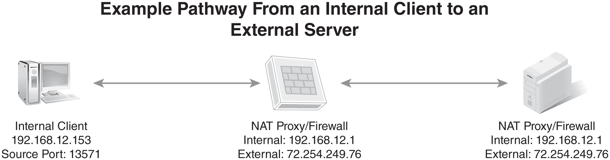

**图 1-3** NAT 功能示例。

###### 步骤 1 初始请求：

```
S: 192.168.12.153: 13571
D: 208.40.235.38: 80
```

###### 步骤 2 NAT 在转换映射表中创建条目：

```
内部: 外部:
192.168.12.153: 13571 <- -> 72.254.149.76: 27409
```

NAT 服务在其转换或映射表中为该请求创建一个条目。该表包含源 IP 地址和端口，以及转换后的 IP 地址和端口。NAT 服务器使用其自身的公共 IP 地址作为转换后的 IP 地址，并为数据包选择一个当前未使用的随机端口作为新的源端口。这是步骤 2。

###### 步骤 3 转换后的请求：

```
S: 72.254.149.76: 27409
D: 208.40.235.38: 80
```

步骤 3 是使用转换后的源信息构建新数据包，然后通过互联网传输到外部服务器。Web 服务器接收到一个请求，其来源看起来像是代理/防火墙系统。

###### 步骤 4 来自外部服务器的响应：

```
S: 208.40.235.38: 80
D: 72.254.149.76: 27409
```

步骤 4 是由 Web 服务器生成并传输的响应。

###### 步骤 5 NAT 将响应发送给客户端：

```
S: 208.40.235.38: 80
D: 192.168.12.153: 13571
```

代理/防火墙接收到对 Web 服务器请求的响应。NAT 服务使用转换表将原始客户端的信息作为目标地址放回数据包头部。这是步骤 5。此过程以线速进行。对于参与通信的客户端和服务器来说，这通常是透明的，因为它们不知道发生了转换。

NAT 的另一个目的或用途是减少从互联网服务提供商 (ISP) 租用大量公共 IP 地址的需求。如果没有 NAT，您将需要为每个曾经连接到互联网的单个系统提供一个唯一的公共 IP 地址。有了 NAT，您可以租用一组较小的公共 IP 地址来服务更多的内部用户。在许多小型办公室/家庭办公室 (SOHO) 网络中，所有内部网络设备都可以转换为单个公共地址。

这种整合之所以成为可能，有两个原因。首先，IPv4 地址的短缺要求某些网络整合地址。其次，仅当使用静态 NAT 时，NAT 才会为单个内部客户端保留特定的公共地址。相反，NAT 会为每个后续的内部客户端请求随机分配一个可用的公共地址。一旦客户端的通信会话结束，该公共地址就会返回到可用地址池中，供未来的通信使用。

此外，NAT 通常不采用 IP 到 IP 的地址转换，而是使用一种称为端口地址转换 (PAT)的更细粒度选项。使用 PAT 时，客户端的端口和 IP 地址都会被转换为一个随机的外部端口和公共 IP 地址。这允许多个同时通信在单个 IP 地址上进行。这一过程反过来又允许您支持来自单个客户端或多个客户端的更多数量的通信，而只需租用更少数量的公共 IP 地址。

NAT 在仍支持互联网通信的同时，启用了私有 IP 地址的使用。这些地址被称为 RFC 1918 地址，源自详述该协议的技术规范。范围如下：

*   **A 类**—`10.0.0.0–10.255.255.255/8`（1 个 A 类网络）
*   **B 类**—`172.16.0.0–172.31.255.255/12`（16 个 B 类网络）
*   **C 类**—`192.168.0.0–192.168.255.255/16`（256 个 C 类网络）

RFC 1918 地址仅用于私有网络。根据定义，它们是不可路由的地址空间。互联网路由器会丢弃使用这些地址的任何数据包。如果没有 NAT，使用这些私有 IP 地址的网络将无法与互联网通信。通过使用 RFC 1918 地址，网络在抵御基于互联网的攻击方面建立了另一道屏障，并且无需为租用内部地址付费。


NAT 是允许 IPv4 在可用公共 IP 地址耗尽后仍能继续广泛使用的技术之一。随着向 IPv6 的过渡正在进行，NAT 正在发挥新的作用，用于在寻址方案之间进行转换，即 IPv4 到 IPv6 的转换。许多防火墙和代理设备可能包含 IPv6 转换服务。在研究防火墙采购或部署时，此功能是一个值得考虑的选项，您可能希望将其列入功能清单。

##### 技术提示

NAT 和 PAT 的一个有趣之处在于，大多数支持 PAT 的设备和软件产品在其文档和配置接口中实际上都声明也支持 NAT。看来 NAT 已被重新定义为包含端口地址转换的功能，尽管该特定附加技术已有官方首字母缩略词。大多数认证考试也将两者结合在一起。问题可能使用 NAT 这个首字母缩略词，但实际指的是端口地址转换（PAT）。

####### 域名系统

域名系统 (DNS) 是互联网和私有网络资源访问的基本要素。用户不会记录服务器的 IP 地址。因此，要访问社交网站上的文件服务器，用户依赖 DNS 将完全限定域名 (FQDN) 解析为关联的 IP 地址。DNS 类似于智能手机中的通讯录（联系人）。您不必记住他人的电话号码，只需查找他们的姓名；通讯录（联系人）将每个人的姓名与要拨打的号码关联起来。

大多数用户甚至没有意识到网络依靠 IP 地址将流量导向目的地，而不是他们在客户端软件地址栏中输入的域名。然而，如果没有这项基本但通常透明的服务，互联网的运作方式将截然不同。在这种情况下，用户将需要维护一份他们想要访问的站点的 IP 地址列表，或总是通过搜索引擎查找站点的 IP 地址。

DNS 是当今大多数目录服务（如 Active Directory 和 LDAP，见下节）的基础。Active Directory 存在于 Windows 操作系统中。因此，DNS 对内部网络至关重要，正如它对外部互联网一样。

DNS 在多方面存在漏洞。首先，DNS 是一个非认证的基于查询的系统。这允许作为 DNS 查询发送的虚假或“欺骗性”响应显得有效。其次，任何人都可以请求传输 DNS 映射数据（称为区域文件），包括外部实体（如果允许 TCP 端口 53 入站访问）。第三，DNS 使用明文通信，允许窃听、拦截和修改。

您可以通过 HOSTS 文件中的本地静态 DNS 映射、在网络边界过滤 DNS 以及对所有主机间的所有通信使用互联网协议安全 (IPSec) 来解决 DNS 的部分缺陷。（HOSTS 文件是每个 IP 启用主机上的一个静态文件，可在其中硬编码 FQDN 到 IP 地址的解析。）然而，这些是针对 DNS 的防御措施，因为 DNS 并不保护网络；相反，它是一项需要保护的基本服务。

### 注意

仍有少数互联网索引站点存在，但它们不如大多数搜索引擎详尽（或最新）。可以将其想象为每年投放在您门廊上的黄页与拨打 411 电话查号台的区别：一个比另一个更及时、更相关。

####### 目录服务

目录服务是一种网络索引。它帮助用户定位私有网络内的资源。目录服务负责跟踪哪些服务器（有时充当客户端）处于在线状态，以及这些主机与网络共享的资源。目录服务的运作方式很像电话簿对电话号码和地址的作用。

在目录服务出现之前，采用效率较低的方法来跟踪或定位可用资源。这些方法包括本地静态或动态列表，网络通过广播通告来维护这些列表。只有工作组网络仍在使用这些过时的方法。

目录服务是现代网络的另一个基本组成部分，它不提供显而易见的安全服务。这意味着目录服务需要其他安全服务和设备提供的保护。您应将对目录服务的访问限制为本地网络的授权且已认证的客户端和用户。除有效的（组织识别的）远程访问或 VPN 链路外，您的网络应忽略所有外部信息请求。如果可能，您应部署 IPSec 以保护每一项内部网络通信。

### 入侵检测系统和入侵防御系统

入侵检测系统 (IDS) 和入侵防御系统 (IPS) 已成为 IT 和安全领域热门的讨论话题。IDS 的概念是一种监视内部主机或网络以发现妥协或入侵症状的系统。实际上，IDS 是一种防盗警报形式，用于检测网络内发生的攻击。

IDS 通常作为防火墙的补充机制。一旦 IDS 检测到入侵者，它可以向防火墙发送命令或请求以中断连接、阻止 IP 地址，或阻止端口或协议。您必须将防火墙配置为接收这些命令，并授权 IDS 发送它们。并非所有 IDS 和防火墙都以这种方式兼容。

最终出现了 IPS 概念，其致力于检测攻击或入侵企图以防止攻击。一旦检测到企图，IPS 可以响应以防止企图成功，而不是等到成功入侵后再响应。IPS 不取代 IDS。相反，这些通常用作主动防御的第一层或初始层，将 IDS 置于针对 IPS 错过或内部人员执行的事件的检测姿态。

IDS 和 IPS 是完整网络安全解决方案的重要组成部分。然而，这些并非没有缺陷。在特定条件下，IDS 和 IPS 可能会造成虚假的安全感。两个常见的条件包括未知的零日攻击和误报。

当未知的零日攻击威胁网络时，IDS 或 IPS 可能没有检测它的机制。因此，缺乏警报可能导致管理员假设没有发生攻击。在大多数情况下，缺乏警报确实意味着没有恶意活动发生。因此，这种假设并非完全没有根据。但如果 IDS 从未触发警报，那么您应该怀疑是检测系统差，而不是完全没有妥协尝试或攻击。这是一种误报（漏报），因为尽管存在威胁，却未检测到威胁。

误报因相反的原因呈现相同的问题，即因良性（或有效）事件产生过多警报。最初的几次警报被良性活动触发后，响应警报的紧迫性就会降低。随着更多误报出现，管理员可能会推迟调查警报。最终，您会完全忽略警报。一旦出现这种情况，您甚至可能将恶意事件的警报视为误报，再次建立起虚假的安全感。但管理员应该“调整”设备以减少网络上的误报数量。存在误报的情况比漏报更糟，因为它容易让人麻痹大意，认为网络上没有问题，因为没有出现警告。


####### 网络访问控制

网络访问控制 (NAC) 根据主机的安全合规性限制对网络的访问或准入。NAC 本质上是一种强制工具，用于确保所有连接到网络的主机都具有最新且合规的安全组件。通过 NAC，如果计算机没有最新的防病毒更新、特定的安全补丁或主机防火墙，或者设备未经授权，则可以阻止或限制其访问。

NAC 通常通过在每台授权主机上放置一个代理来运行。当主机连接到网络时，代理会联系主控程序以查找当前的主机要求。如果主机未能满足这些要求，则 NAC 会阻止该主机访问网络。不合规的主机可能只被授予访问修复服务器的权限。这些修复服务器可以提供使主机达到完全合规所需的补丁和更新。

实际上，NAC 是一种通过自动化的系统级机制来强制执行主机加固规则的方法。通过 NAC，系统必须处于合规状态，否则访问通用网络资源的尝试将被阻止。只有在不合规的系统更新后，才允许访问网络。

### TCP/IP 基础

要充分理解网络安全机制，特别是防火墙采用的过滤机制，你需要对 传输控制协议/互联网协议 (TCP/IP) 协议套件有扎实的理解。深入了解 TCP/IP 不仅有助于安全管理员进行防火墙管理，还涉及路由、交换、维护可用性、提升网络性能、管理网络流量、分析协议、理解漏洞和攻击，甚至执行渗透测试或道德黑客攻击。

大多数网络（包括互联网）都使用 TCP/IP 协议。目前使用最广泛的版本是 互联网协议版本 4 (IPv4)。然而，互联网协议版本 6 (IPv6) 正在全球范围内获得更广泛的应用。在过渡期间，你应该了解 IP 的两个版本。

#### OSI 参考模型

大多数协议讨论都始于 开放系统互连 (OSI) 参考模型。OSI 模型是一个标准的概念工具，用于讨论协议及其功能。OSI 模型有七层 (**图 1-4**)。每一层都与通信会话另一端的对等层进行通信。虽然 OSI 模型有助于理解协议，但大多数协议并不完全符合它。

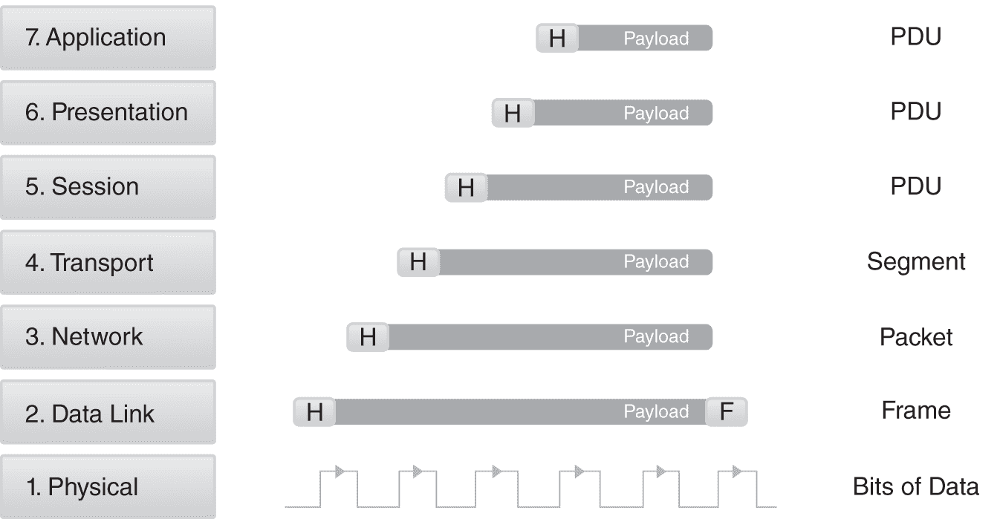

**图 1-4** 封装过程及每层 OSI 层中头部和有效载荷集合的名称。

OSI 模型的每一层都有独特的职责、功能和特性。OSI 模型定义了每一层需要发生的事情，并将完成这些任务的实际过程留给协议，最终留给协议程序员。

### 注意

OSI 模型是讨论和描述网络协议的文档化标准。然而，TCP/IP 是事实上的或实用的标准，因为它在 OSI 模型发展为实际协议之前就已投入使用。很少有产品能直接支持 OSI 模型或其衍生协议。相反，大多数产品支持 TCP/IP，尽管它不是国际标准化组织的官方文档标准。

*   应用层 (第 7 层)——应用层 (第 7 层) 实现与主机软件（包括操作系统）的通信。应用层是主机软件与网络协议栈之间的接口。该层的子协议支持特定的应用程序或数据类型。

*   表示层 (第 6 层)——表示层 (第 6 层) 将从主机软件接收的数据转换为网络可接受的格式。该层也为从网络到主机软件的数据执行反向任务。

*   会话层 (第 5 层)——会话层 (第 5 层) 管理网络通信端点之间的通信通道（称为会话）。两个系统之间的单个传输层连接可以支持多个同时进行的会话。

*   传输层 (第 4 层)——传输层 (第 4 层) 格式化并处理数据传输。这种传输独立于应用程序，且对其透明。

*   网络层 (第 3 层)——网络层 (第 3 层) 处理逻辑寻址（IP 地址）和路由流量。

*   数据链路层 (第 2 层)——数据链路层 (第 2 层) 管理物理寻址（MAC 地址）并支持网络拓扑，如以太网。

*   物理层 (第 1 层)——物理层 (第 1 层) 将数据转换为通过物理网络介质传输的比特（网络布线，或无线通信情况下的空气）。

### 关于地址你应该知道的内容

逻辑地址（如 IP 地址）创建全局区分。至少对于公共 IP 地址而言，互联网上使用的所有地址都是唯一的。逻辑地址的分配独立于物理位置。逻辑地址使两台主机之间能够通信，无论设备的物理邻近程度如何。

物理地址（如 MAC 地址）创建本地区分。MAC 地址只需在本地子网内唯一。这使得能够区分能够接收相同电子信号的物理邻近系统。制造商通常执行 NIC 的物理地址分配，因此它依赖于物理硬件组件本身。

MAC 地址依赖于物理 NIC；制造商将其分配为“永久”硬件地址。然而，在大多数系统上，修改或欺骗有效 MAC 地址通常是可能的。可以使用原生命令更改 MAC 地址（如 Linux、Unix 和 Mac OS），或使用第三方实用程序（如 Windows 所需的）。工具包括 Change MAC Address、SMAC MAC Address Changer 和 MAC Spoof。

当数据从软件应用程序移动以便通过网络传输时，它会从上到下遍历协议栈的各层。当每一层接收来自上层的数据时，该数据成为有效载荷并附加一个特定于该层的头部。在数据链路层（第 2 层，以太网所在层），数据还会接收一个尾部。这个过程称为封装。其逆过程称为 解封装，发生在接收网络通信时。随着该过程进行，被操作的数据集会根据其遍历的层获得唯一的名称。该过程的步骤如下：

*   应用层 (第 7 层)——协议数据单元 (PDU)，即从主机软件应用程序获得的数据。

*   表示层 (第 6 层)——PDU

*   会话层 (第 5 层)——PDU

*   传输层 (第 4 层)——段

*   网络层 (第 3 层)——包


#### OSI 模型层

*   **数据链路层（第 2 层）** — 帧
*   **物理层（第 1 层）** — 数据位

添加首部（以及在数据链路层添加尾部）的封装过程，使得不同系统各层之间能够进行数据交换。这被称为对等通信。首部的内容包含供网络链路接收端对应层处理的信息。

首部的内容，主要来自第 2–4 层，是防火墙最关心和关注的重点。应用代理防火墙和状态检测防火墙也可以检查第 5–7 层的首部和载荷内容。

##### 子协议

TCP/IP 不是单一协议，而是一组协议的集合。通常被称为 TCP/IP 协议族，该集合包括若干核心协议，如 **Internet Protocol (IP，网际协议)**、**Transmission Control Protocol (TCP，传输控制协议)** 和 **User Datagram Protocol (UDP，用户数据报协议)**，以及若干常用协议，如 Address Resolution Protocol (ARP，地址解析协议)、Internet Control Messaging Protocol (ICMP，互联网控制报文协议)、Hypertext Transfer Protocol (HTTP，超文本传输协议) 和 Transport Layer Security (TLS，传输层安全)。除了这些之外，还有数万个提议的 Request for Comments (RFC，征求意见稿) 引入了潜在协议，但通常只有少数协议在由 TCP/IP 创建的网络基础设施中运行。

假设读者对 TCP/IP 的子协议有扎实的了解，但这并非掌握本文范围的必要条件。

##### 首部和载荷

防火墙，特别是包过滤防火墙，会检查首部的内容以允许或拒绝 **帧**、数据包或段。根据过滤类型以及过滤关注的层或协议，被检查的项目及其来源首部可能会有所不同。

##### 技术提示

要查看更完整的其他子协议列表及其对应的端口分配，请查看 Internet Assigned Numbers Authority (IANA，互联网号码分配局) 托管的文档：<https://www.iana.org/assignments/service-names-port-numbers/service-names-port-numbers.xhtml>。几乎所有 65,536 个端口都有一个或多个相关联的协议和应用程序。

要查看恶意软件使用的端口列表，请访问 <https://attack.mitre.org/techniques/T1065/>。

包过滤通常关注四个主要首部：

*   数据链路层帧的以太网首部
*   网络层数据包的 IP 首部
*   传输层段的 TCP 首部
*   传输层段的 UDP 首部

这四个首部中的每一个都有许多影响过滤动作的细节。这些细节包括 MAC 地址、IP 地址、TCP 首部标志、端口号等。

##### 基于地址的过滤

关于 IPv4 和 IPv6 寻址的基本差异，关注的问题不在于子网掩码或地址长度——两者都很重要——而在于地址长度、满足唯一地址需求的可用地址容量以及子网掩码。

许多形式的过滤侧重于 IP 地址和/或端口号来做出允许或拒绝的决定。此类决定或规则可以侧重于段、数据包或帧首部中找到的源地址或目的地址。换句话说，端口号、IP 地址或 MAC 地址均可作为源和/或目的地考量因素来支持过滤。

防火墙过滤可以关注 IP 数据包首部中源地址或目的地址位置的地址是公有还是私有。通常，私有地址在私有网络上运行，不会到达外部。如果数据包正前往外部目的地，NAT 会将源私有地址转换为公有地址。在互联网上，路由器和防火墙都会丢弃首部中带有 RFC 1918 地址的任何 IP 数据包。防火墙可以根据地址是已知还是未知进行过滤。此功能针对用于源和/或目的地的地址进行过滤。已知地址通常是受信任的地址。只有带有受信任且已知地址的数据包才被允许到达目的地。未知地址不太可能受信任。带有未知地址的数据包可在所有情况下被阻止，或在做出允许或拒绝决定前进一步检查。

防火墙可以根据地址是否已知为良性或常发送恶意内容进行过滤，这是已知和未知过滤的一种变体。此方法不再是已知地址受信、未知地址不受信，而是扭转了这一思路。良性地址是已知的、受信任的地址，恶意地址是已知的、不受信任的地址。在这两种情况下，地址都是已知的。使用这种过滤形式时，遇到的任何未知地址都将需要后续的额外过滤，检查流量的其他方面。

防火墙还可以根据地址是真实还是伪造进行过滤。这种过滤形式不如前几种类型清晰明确。在任何情况下，要确定段、数据包或帧的地址是真实的正确地址还是伪造的虚假地址，都可能很困难。当地址是真实地址（即在网络的子网范围内）时，判断它是否为伪造地址的方法很少。

一种方法是将地址与使用表（如动态主机配置协议 (DHCP) 服务器维护的表）进行比较，查看该地址当前是否未分配给任何授权系统。另一种方法是检查源地址的路由、通信路径、接收向量或接收接口，将其与该地址应有的该方面进行对比。例如，如果源地址通常到达端口 4 却出现在端口 7 上，则它很可能是伪造的源地址。

伪造地址也可以在边界哨点检测到。当源地址来自防火墙的另一侧时，它显然是伪造地址。一个明显的例子是：内部 LAN 地址作为源地址出现在从外部进入网络的数据包中。这种伪造过滤可以作为入站过滤的一部分。

同样，相同的过程可用于离开网络的数据包。如果数据包的源地址来自外部（如互联网地址），但数据包是从私有 LAN 的接口被防火墙接收的，则它必定来自伪造地址。这种伪造过滤可以作为出站过滤的一部分。

### 章节摘要

网络安全很复杂，这就是为什么我们从网络安全基础开始讲起。一旦你牢固掌握了这些基本问题，就能在自己的网络上付诸安全实践。网络基础设施设计会对安全产生重大影响。

书面安全策略是成功安全工作的基础。没有书面策略，安全将变得混乱且失控。安全策略定义并分配组织内人员的角色和职责。典型 IT 基础设施的七个域有助于识别用户如何相互交互以及与网络上的资源交互。这些域包括用户域、工作站域、LAN 域、LAN-to-WAN 域、远程访问域、WAN 域和系统/应用域。管理员可以使用许多网络组件和设备来支持网络安全策略。这些包括防火墙、VPN 和 IDS/IPS。

### 关键概念和术语

*   **访问控制**
*   **应用层（第 7 层）**


# 术语表

- 资产
- 审计员
- 认证
- 授权
- 可用性
- 瓶颈
- 业务任务
- 缓存
- 机密性
- 对策
- 数据链路层（第 2 层）
- 解封装
- 纵深防御
- 目录服务
- 域
- 域名系统 (DNS)
- 停机时间
- 出站过滤
- 封装
- 加密
- 漏洞利用/攻击代码
- 过滤
- 防火墙
- 帧
- 完全合格域名 (FQDN)
- 加固
- 硬件地址
- 主机
- HOSTS 文件
- 入站过滤
- 完整性
- 互联网协议 (IP)
- 互联网协议安全 (IPSec)
- 互联网协议版本 4 (IPv4)
- 互联网协议版本 6 (IPv6)
- 入侵检测系统 (IDS)
- 入侵防御系统 (IPS)
- 局域网 (LAN)
- 逻辑地址
- 恶意代码
- 媒体访问控制 (MAC) 地址
- 网络访问控制 (NAC)
- 网络地址转换 (NAT)
- 网络层（第 3 层）
- 网络安全
- 节点
- 不可否认性
- 开放系统互连 (OSI) 参考模型
- 权限
- 物理地址
- 物理层（第 1 层）
- 端口地址转换 (PAT)
- 表示层（第 6 层）
- 隐私
- 私有 IP 地址
- 特权
- 代理服务器
- 公共 IP 地址
- 资源
- RFC 1918 地址
- 风险
- 角色
- 安全目标
- 安全目的
- 安全策略
- 高级管理层
- 服务器
- 会话层（第 5 层）
- 静态 NAT
- 电信公司
- 威胁
- 传输控制协议 (TCP)
- 传输控制协议/互联网协议 (TCP/IP)
- 传输层（第 4 层）
- 信任
- 隧道技术
- 用户数据报协议 (UDP)
- 虚拟专用网络 (VPN)
- 漏洞
- 白名单
- 广域网 (WAN)
- 零日漏洞利用/零日攻击
- 清零

### 第 1 章 评估

1.  以下哪项最能描述最小权限原则？
    1.  允许用户仅访问其付费计划上的项目
    2.  允许用户仅在其正常预定工作时间内访问项目
    3.  仅在漏洞利用被发现并公开后才开发补丁
    4.  允许用户仅访问其工作职责所必需的内容

2.  以下哪项最能描述风险的概念？
    1.  网络上未受保护的内容，可能被用于获取网络访问权限
    2.  网络上线时暴露的攻击面，黑客可利用其进行访问
    3.  结合了特定网络最佳解决方案的解决方案
    4.  威胁利用网络上漏洞的可能性

3.  有效安全目标最重要的特征是什么？
    1.  成本低廉。
    2.  可用当前部署的技术实现。
    3.  书面记录下来。
    4.  经所有人员批准。

4.  以下关于网络安全的陈述哪项是正确的？
    1.  使用框架可确保网络安全防护成功。
    2.  网络安全包含防止未经授权的访问和操作的要素。
    3.  将最新修复程序应用到任何网络设置中很容易。
    4.  网络安全通常无需资金投入即可保障。

5.  无线连接的主要安全顾虑是什么？
    1.  冗余
    2.  信号范围
    3.  对 IPv6 的支持
    4.  连接速度

6.  Van Eck 窃听允许什么？
    1.  攻击者加密设备的硬盘，直到支付赎金为止
    2.  提交足够多的数据包，使拒绝服务攻击持续存在
    3.  攻击者从一台设备上窃听电子设备
    4.  限制对网络上任何物理设备的访问

7.  以下哪项最能描述加固的概念？
    1.  将项目从云端移除至物理存储位置
    2.  允许用户通过自己的设备访问网络
    3.  保护或锁定主机以抵御威胁和攻击的过程
    4.  从工作组计算机和设备中移除不必要的软件

8.  以下哪项最能描述网络可用性？
    1.  防止未经授权的更改，同时允许授权更改
    2.  防止不必要的成本，同时允许合理的支出
    3.  防止停机，同时支持对资源的授权访问
    4.  防止未经授权的访问，同时提供授权访问

9.  对哪类威胁目前没有防御措施？
    1.  零日
    2.  恶意代码
    3.  未经授权的软件
    4.  硬件故障

10. 以下哪项最能描述不可否认性？
     1.  它防止用户否认曾执行过某项操作。
     2.  它控制用户被允许做什么和不被允许做什么。
     3.  它是在授予用户进入安全区域访问权限前对用户身份的证明。
     4.  它确保恶意代码不在企业网络上泛滥。


© Digital_Art/Shutterstock

# 网络安全威胁

# 第 2 章


### 网络安全面临持续攻击

网络安全正遭受来自内部和外部威胁的持续攻击，威胁源范围涵盖不满的员工到全球黑客。不存在完美的防御，因为黑客能够绕过、攻破或规避几乎所有的防护措施、对策和安全控制。黑客不断开发新的攻击技术、编写新的漏洞利用代码并发现新的漏洞。网络安全是一项需要持续警惕的任务，而非一个可完成的项目。这是一份永远做不完的工作。

#### 为何理解黑客技术至关重要

为何理解黑客攻击、漏洞利用、漏洞及攻击手段至关重要？正如公元前六世纪中国军事战略家兼哲学家孙子在其著名军事著作《孙子兵法》中所言：“知己知彼，百战不殆。”一旦你了解黑客的思维方式、所用工具、漏洞利用代码及攻击技术，便能制定有效的防御措施来保护你的网络。理解黑客技术不仅能提升网络安全；还能使安全保持高度的备战状态。

### 第 2 章主题

本章涵盖以下主题和概念：

*   黑客类型及其动机
*   经常成为目标的网络资产
*   内部和外部网络威胁
*   黑客攻击流程
*   常见 IT 基础设施威胁
*   各类恶意代码（恶意软件）及相应的安全顾虑
*   快速增长和过度使用的危险
*   无线和有线连接带来的危险
*   窃听风险
*   不同攻击类型，包括劫持攻击和重放攻击、插入攻击、分片攻击和缓冲区溢出
*   防止会话劫持、欺骗攻击和中间人攻击
*   隐蔽信道及相关攻击
*   对网络和资源可用性的威胁，包括拒绝服务（DoS）和分布式拒绝服务（DDoS）攻击
*   社会工程学风险

### 第 2 章目标

完成本章后，你将能够：

*   描述黑客及其他恶意计算机网络入侵者的动机
*   对比内部和外部来源的威胁
*   描述事故、自然灾害和无知如何影响网络安全
*   解释恶意代码带来的风险
*   识别有线和无线连接对网络安全的影响
*   描述常见的网络安全漏洞利用和攻击，包括劫持攻击、重放攻击、插入攻击、分片攻击、缓冲区溢出、XSS 攻击、中间人攻击、欺骗攻击、隐蔽信道、DoS、DDoS、僵尸网络攻击和社会工程学攻击
*   描述黑客工具如何利用脆弱目标

### 黑客及其动机

黑客攻击最初意指摆弄或修改系统以进行学习和探索。然而，该术语现在指代恶意的——且可能是犯罪的——对计算机的入侵和操纵。无论哪种情况，恶意或犯罪性的黑客攻击都是严重威胁。每位网络管理员都应关注黑客攻击。

黑客是人——往往是被误导的、不道德的、足智多谋的、犯罪的——但终究是人。在设计安全方案时，请记住威胁最终且主要来自人类。这种认知应促使你更好地选择威慑、检测和响应工具及技术。威慑手段是指任何能让攻击你的网络比攻击其他网络缺乏吸引力的工具或技术。这可以通过加强安全来实现，从而增加黑客获取访问权限所需的时间、精力和投入。将网络置于针对非法或未经授权访问有严格法律和惩罚的地区，也是一种威慑手段的例子。

安全的某些重要方面源于对黑客技术、方法和动机的理解。一旦你学会像黑客一样思考，就可能预判未来的攻击。这使你能在黑客成功攻破组织网络之前设计新的防御措施。

那么，黑客是如何思考的？黑客沿着操纵或篡改的思路思考。他们研究规则，以创造新的方法来弯曲、打破或改变规则。许多成功的安全漏洞利用只不过是对网络通信规则的细微变体或违规。

黑客寻找容易下手的目标或被忽视的漏洞。黑客将事物翻转、剖析、反向操作。黑客尝试以不同顺序、使用错误值、在预期边界之外执行任务，旨在引发反应。黑客从错误中学习并加以利用，特别是网络安全专业人员未能妥善保护组织资产的错误。

是什么驱使黑客攻击计算机网络？为何有人会卷入非法活动？动机多如攻击手段。有人纯粹为了黑客攻击的快感——将其视为一种运动。一些黑客将黑客攻击视为爱好。一些人热衷挑战。一些人受同伴压力驱使或寻求社会认同。对另一些人而言，黑客攻击是赢得同伴“街头信誉”或攻击感知到的社会不公的方式。最后，许多黑客为权力和经济利益而实施攻击。由于难以理解黑客动机，本节提供更多细节以洞察黑客心理。

许多犯罪黑客纯粹为钱。黑客通过攻击计算机网络获取经济利益的途径多种多样，范围涵盖窃取信用卡和财务报表到勒索、黑市交易和贩运。部分经济利益是即时的；例如，黑客可能将资金从目标账户转出。其他手段更为复杂，如窃取企业文件并出售给竞争对手，或利用加密劫持数据并勒索赎金。黑客可通过出售服务牟利，包括分发垃圾邮件、窃听、破解密码和制造 DoS 事件。

##### FYI

垃圾邮件是指不需要且未请求的电子邮件。它常大量发送至某电子邮箱，意图导致系统延迟或拒绝服务（DoS）事件。垃圾邮件在技术上不属于恶意软件，但会对 IT 基础设施造成严重负面影响。专家估计互联网邮件流量中 80% 至 95% 为垃圾邮件和其他形式的恶意信息。黑客可轻易通过向网络泛洪流量或 ping 请求发动 DoS 攻击。结果导致网络服务器无法应对海量流量；往往使网站或网络访问变得不可用。

一种较新的为牟利的攻击类型是勒索软件。历史上，黑客获取系统访问权、识别资产、窃取有价值信息，并可能长驻网络或创建后门以便再次进入。然而在勒索软件攻击中，黑客通常诱骗用户点击恶意链接或邮件附件，从而加密文件、文件夹或整个驱动器，阻止用户查看、复制或访问。黑客告知受害者如何恢复访问，如通过比特币等加密货币支付。支付赎金往往能让受害者恢复访问，但这并非保证，也无法防止再次加密。

##### FYI


#### 加密货币与黑客动机

#### 勒索软件中的加密货币

加密货币是一种电子货币，其存在形式是存储在参与者系统上的数学公式，汇率会波动。黑客会将赎金要求列为“4 个比特币”或其他金额，受害者则按当前汇率购买加密货币。如果黑客想要惩罚受害者或纠正自认为的不公，有些赎金会通过向慈善组织捐款的方式支付。

#### 黑客动机

##### 挑战与技能提升

对许多黑客而言，寻找新漏洞、开发新攻击代码或发现新的安全漏洞是一项令人兴奋的挑战。漏洞是指任何成功绕过网络防御的尝试，例如“突破”边界。一些黑客攻击目标的原因，正如一些人攀登高山——因为它就在那里，因为他们能做到，因为他们想征服它。一些黑客不断寻找更新、更困难的目标，以提升技能并增加挑战难度。

##### 权力与支配

展示攻破目标的能力，尤其是当目标具有相当安全性时，是黑客证明自己比防御者更强大的一种方式。如果你能控制某样东西，你就拥有对它的权力。如果黑客能远程控制你的计算机，那么黑客就拥有对你计算机的权力；在某些方面，黑客也拥有对你的权力。黑客有时进行黑客攻击是为了提升形象、满足自我。如果他们能发动成功的攻击，就是在展示对目标的支配力。

##### 刺激与风险

黑客攻击可以带来刺激感。想象一下寻宝者在别人私有领地上的感受。权力、挑战、风险和潜在的追捕，加上发现潜在有价值资产的组合，对某些黑客来说是一种刺激。逃脱惩罚的快感激励许多黑客在弄清如何成功入侵网络后继续发动攻击。

一些黑客享受攻击网络的纯粹风险。与任何犯罪一样，被抓获的风险始终存在。目标网络可能部署了蜜罐、入侵检测系统 (IDS)、入侵防御系统 (IPS)、防火墙和其他技术防御，黑客需要探测并规避这些防御。安全专业人员时刻致力于发现新的攻击技术并识别黑客身份。因此，每一次攻击都让黑客面临被抓获和起诉的风险。

##### 无聊与娱乐

一些黑客诉诸黑客攻击，试图寻求娱乐或摆脱无聊。一次成功的系统入侵通常会引发响应，往往是一场有趣的“猫鼠游戏”。针对勒索软件攻击，黑客还处于强势地位：受害者必须遵从黑客的要求，否则无法恢复访问权限。

##### 同伴压力与地位

黑客和其他人一样，也有同伴和社交群体。同伴压力可能成为融入群体、炫耀或向群体展示忠诚的强大动力，尤其是对于处于黑客社区低层或低等级的人员。新手或缺乏经验的黑客会感到受到鼓励去实施攻击，以维持其在同伴群体中的成员资格。一些攻击是作为入会仪式或成人礼，让潜在的黑客组织成员成为正式成员。黑客攻击可以帮助黑客获得或维持地位。一些黑客试图制造媒体新闻，让自己的名字出现在新闻中。其他攻击则是为了在当前和未来的目标中植入恐惧并强迫其顺从。

##### 黑客行动主义

认为某公司不是良好的本地或全球公民的黑客可能会实施黑客行动主义，即通过黑客手段纠正社会不公，或为该公司或特定个人自认为的错误进行报复。这类黑客可能会窃取数据，但通常会将经济利益捐赠给被认为值得的事业，或致力于纠正引发黑客行为的错误的事业。这类黑客更难抓捕，因为资金通常会立即转给第三方非营利组织，而该组织并不雇佣或赞助黑客。没有“顺藤摸瓜”追踪资金的机会来抓捕个人，这与黑客保留黑客所得的情况不同。

### 黑客类型

黑客主要分为三类：娱乐型、机会型和专业型：

#### 娱乐型黑客

娱乐型黑客是那些喜欢学习和探索的人，尤其是在计算技术方面。然而，他们可能会在何时使用新获得的技能上做出错误选择。将未经批准的软件从家里带入公司、在公司网络上进行实验，或仅仅是尝试一个漏洞利用代码看看是否有效，这些都是娱乐型黑客的潜在行为。一些黑客可能没有充分考虑到他们的爱好可能带来危险，且其行为可能违反公司安全策略。例如，脚本小子是依赖他人编写的预存程序或代码的黑客。这类黑客只需指点点击工具即可运行脚本，可能并不完全理解这些行为的后果。

#### 机会型黑客

机会型黑客胆小谨慎，不太可能主动发起攻击。无论出于何种原因，他们都不愿刻意策划和发动入侵。然而，如果出现了可以轻松实施且极少有被发现或承担后果风险的攻击机会，机会型黑客可能会利用这个稍纵即逝的良机。此时可能是某人碰巧加班，成为大楼里最后一名员工。机会可能是消防演习将其他人都赶出了设施，或随机停电导致半数员工回家。甚至可能只是因为他们注意到某个办公室的门开着，且无人看管。

#### 专业型黑客

专业型黑客是以攻破 IT 基础设施为唯一职业目标的罪犯。无论是作为个人运营、提供雇佣黑客服务、作为犯罪组织成员运作，还是进行国家资助的攻击，专业黑客都将时间和精力集中在实施最佳安全攻击上。当人们花费数年时间在一个主要领域学习和实践时，他们能开发出足以匹敌所有防御的专业知识和技能。完美的不可攻破安全解决方案不存在。专业黑客拥有时间、耐力、技能、耐心和后盾，能持续对目标发动攻击直到成功。他们对网络的威胁，正如白蚁对木质建筑。你可以威慑它们；大多数时间能将它们挡在外面。但它们始终在附近伺机而动，一旦你松懈片刻，就会啃噬地基。

### 结论

黑客实施攻击的原因多种多样，此列表可能并不详尽。无论其动机如何，他们都被驱使去从事不道德的活动。你可能无法完全理解黑客的心态，但尝试理解很重要，这样你才能更好地预判黑客可能如何攻击你的网络。

### 黑客青睐的目标

在安全领域，你想要保护的东西称为资产。资产是指用于通过计算机网络开展业务的任何事物。员工完成任务所需的任何对象、计算机、程序、数据片段或其他逻辑或物理组件都是资产。

攻击者最常针对哪些有价值的资产？每个黑客都不同，就像任何亚文化中的个体成员一样。虽然许多人认同什么是有价值的，例如金钱和访问权限，但其他人可能更倾向于将公司财务、秘密配方、病历、信用报告、法庭记录、会计日志等作为其首选目标。例如，为什么有些人收集玩具，而其他人收集汽车、汽水瓶或打扑克的狗的图片？


黑客最青睐的目标之一是易攻击资产——那些能迅速获利的目标。易攻击目标是指未得到妥善保护的 IT 基础设施和要素。那些暴露在世界面前、存在众所周知的可利用漏洞（称为漏洞）的系统，对黑客来说就是“易如反掌”。项目的成本并不能将其归类为资产；相反，是其对公司网络的实用性和价值。最近一些最典型的勒索软件攻击针对的是医疗系统和提供商，包括医院、医生诊所和保险公司。医疗提供商迫切需要恢复访问权限，而赎金通常低到只算是一种麻烦，而非难以承受的负担。

能迅速获利的目标是指能让黑客获得某种形式的货币或易货收益的目标，例如资金或加密货币。信用卡和银行账户可以迅速转换为黑客想要的货币形式。在其他情况下，获得网络的访问权和控制权，尤其是那些拥有高速互联网链路的网络，也是很有价值的。此类网络可能被植入发送垃圾邮件的恶意代码，并可用于窃听。利用被攻破的网络，黑客可以利用服务器和处理能力尝试破解加密。随后，黑客可以将这些服务出售或交易给他人。

然而，有些黑客并不寻找易攻击目标；相反，他们寻找独特的目标、新的挑战和复杂的基础设施，以测试和提升他们的技能。专家级和经验丰富的黑客通常希望继续提高能力，而不是将时间浪费在任何业余黑客或“脚本小子”都能攻破的目标上。

资产不必昂贵、复杂或庞大。事实上，许多资产价格相对低廉、司空见惯，且大小不一。对于大多数组织（包括 SOHO[小型办公室/家庭办公室]环境）而言，最关心的资产包括业务和个人数据。如果这些信息丢失、损坏或被盗，可能会导致严重后果。企业可能倒闭，个人可能损失钱财，身份可能被盗用，政府监管机构可能施加处罚或提起刑事指控，人生可能毁于一旦。

宝贵的资源大量存在于个人计算机中，也存在于由互连局域网组成的 IT 基础设施中。黑客根据各种目标和动机，以及对资源感知价值的不同来寻找目标。但黑客究竟是谁呢？

#### 内部人员和外部实体的威胁

虽然历史上三分之二或更多的安全违规事件是外部人员直接造成的，但这一情况正在发生剧烈变化。由于自动化入侵增多、黑客攻击增加以及犯罪和恐怖活动上升，“内部”计算机犯罪的比例已降至个位数，但这仍意味着中小企业和小型政府机构每天要经历数千次或更多的攻击。这显著增加了各类规模组织对受过训练的计算机安全专业人员的需求。根据 Verizon《2019 年数据泄露调查报告》（*[`enterprise.verizon.com/resources/executivebriefs/2019-dbir-executive-brief.pdf`](https://enterprise.verizon.com/resources/executivebriefs/2019-dbir-executive-brief.pdf)*），69% 的数据泄露源于外部代理。内部泄露占已分类事件的 34%。

驻场员工拥有设施的物理访问权和网络的逻辑访问权。员工可能只有标准或普通用户账户，但一定级别的逻辑访问权可以被转化为更高级别的访问权（称为权限提升）。来自内部人员的威胁，无论是物理还是逻辑上的，都是严重的。你必须在安全策略、网络设计、基础设施部署以及持续的系统和安全管理中应对此类威胁。对组织网络安全构成最常见威胁的人员包括不满的员工和合同工（内部威胁），以及大量外部黑客。**图 2-1** 描绘了内部和外部黑客。

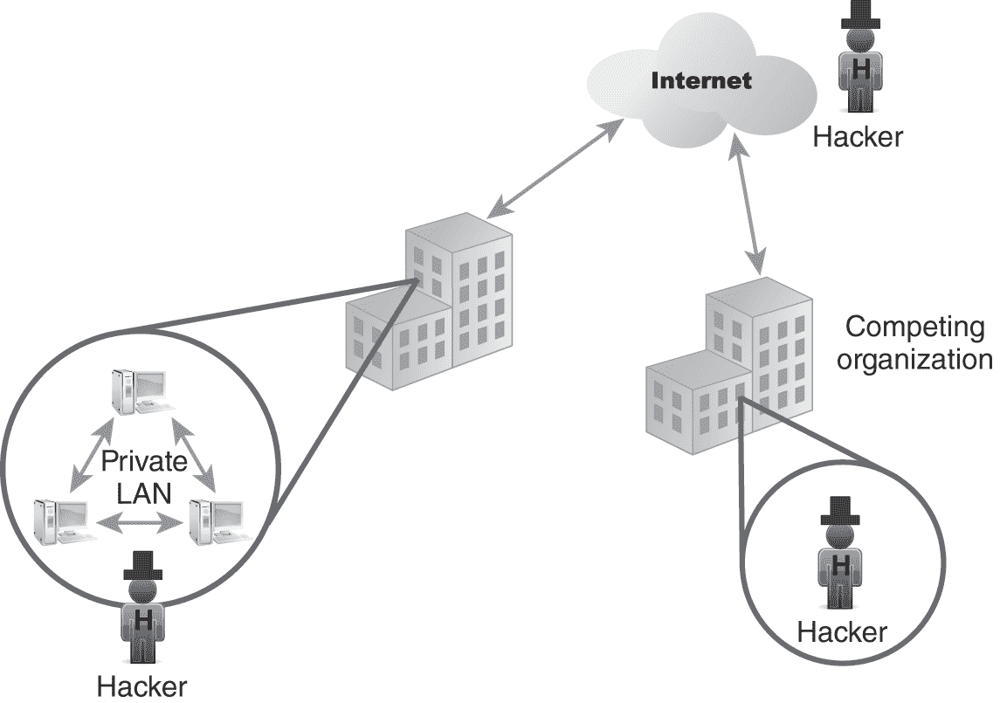

**图 2-1** 内部和外部黑客。

不满的员工 认为自己以某种方式受到了组织的委屈。无论这种“委屈”是真实的还是感知的，他们的行为都可能导致关键任务操作的严重中断。不满的员工可能会试图挪用公款、窃取物资、浪费时间、用恶意代码感染系统或网络、泄露机密数据、干扰其他员工工作或使项目脱轨。

合同工 是被引入组织临时执行工作的外部人员。合同工可以是顾问、临时工、季节工、承包商，甚至日工。通常，外部人员不像大多数全职员工那样对组织怀有同等的忠诚度。因此，如果有机会为了个人利益而危害组织，合同工更有可能采取不道德的行为。此类犯罪分子不担心长期的稳定性或生存能力，也不在乎正式员工的命运。相反，他们利用这些方式以他人的损失为代价谋取私利。

员工和外部实体代表了不同层级的风险，在规划网络安全时应予以应对。最初，外部攻击者的风险较低。外部攻击者必须寻找并发现获取网络或设施逻辑或物理访问权的方法。没有访问权，黑客只能诉诸攻击外部接口，如 Web 服务器、VPN 设备、防火墙和远程访问服务器（RAS）。如果这些都是安全的，那么黑客的默认或后备立场就是发动 DoS 攻击、尝试入室盗窃或对内部人员实施社会工程学攻击。

对网络安全的另一个威胁是蓄意破坏或蓄意损坏。不满的员工、被解雇的合同工、伺机行事的清洁人员、不满的经理，甚至粗心的访客，如果他们有权接触敏感设备或信息，都能在瞬间造成巨大破坏。适当的入职前申请人筛选、敏锐的监督管理、非员工陪同制度、背景调查、安全摄像头、培训、关注企业文化，以及提供有竞争力的薪酬标准或其他激励和礼遇，对防止 IT 设备和资源的蓄意破坏或损毁大有裨益。

### 黑客攻击过程

尽管网络安全专业人员不喜欢这种行为，但黑客攻击可以是一个迷人的过程。从主流 IT 行业的角度观察，黑客的活动往往显得混乱且随意。黑客不必遵循任何固定程序，也不必遵守任何既定界限。相反，他们利用一切可用手段在选定目标上寻找漏洞。对他们而言，混乱既是一种方法论，也是一种防御机制。

一般来说，黑客攻击可分为五个主要的事件或活动子群，称为阶段。这种分类可以代表黑客攻击，但并不能真正控制或阻止它。这五个类别是：侦察、扫描、枚举、攻击和攻击后活动。（参见 **图 2-2**。）如果攻击成功，就会按此阶段顺序发生。如果攻击不成功，黑客可以尝试后备方案。

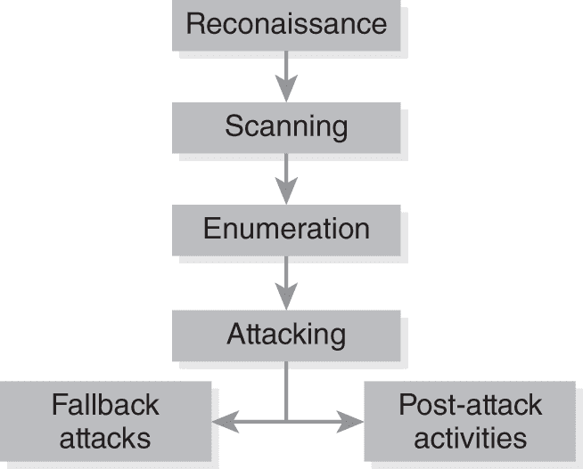

**图 2-2** 黑客攻击的五个阶段。

#### 后备攻击


#### 后备攻击

后备攻击是黑客在对目标的入侵尝试失败后，可以部署的其他制造破坏的选项。常见的入侵替代手段包括 DoS、窃听、破门而入、社会工程学、恶意代码、会话劫持、中间人攻击、无线黑客攻击、SQL 注入、网站攻击等。

##### 侦察

侦察是黑客攻击过程的发起阶段。侦察意味着检查或探索的行为，也称为足迹采集、发现、研究和信息收集。此阶段是三个攻击前阶段中的第一个，黑客在尝试首次实际攻击前，会尽可能多地了解目标。侦察包括从所有可能的在线和离线来源收集关于目标的数据。黑客会小心避免让目标察觉到其已探测网络以获取信息。

侦察可能包括：

*   在 `archive.org` 研究目标组织网站的旧版本
*   检查搜索引擎内容
*   审查组织网站
*   调查人员背景
*   执行位置测绘
*   阅读招聘启事
*   检查内部信息泄露网站
*   查看报纸和杂志文章中关于该组织的提及
*   仔细阅读新闻稿
*   搜索新闻组、聊天记录、博客和论坛
*   审计财务记录或审查公开文件
*   审查法庭案件和其他公共记录
*   查询 `whois`、`域名注册` 和公共 IP 分配
*   窃听电子邮件和其他对话
*   实地访问组织的物理位置

这些只是黑客可能执行的一些侦察活动。信息收集仅受限于黑客的时间、资源和想象力。一旦黑客建立并整理了关于目标的合理信息组合，下一步就是扫描。

##### 扫描

扫描是使用各种工具来确认侦察阶段所获信息并发现新细节的活动。扫描旨在发现存活且活跃的系统。扫描可能包括 `wardialing`（电话扫描/战争拨号）、`wardriving`（无线网络侦测/战争驾驶）、`ping sweeps`（Ping 扫描）和 `port scanning`（端口扫描）。

电话扫描是一种较旧的战术，它利用电话系统来定位任何活跃且应答的调制解调器。使用调制解调器和通常的拨号程序，黑客的计算机会自动拨打目标电话号码。黑客在侦察阶段获取电话号码，或通过拨打某个区号或前缀下的所有号码来获取。

无线网络侦测，源自 `wardialing` 的术语，是使用无线探测器（嗅探器）来定位无线网络的技术。黑客过去常开着装有笔记本电脑的车穿梭于城市或社区以发现无线网络。如今，无需驾车，智能手机即可自动探测无线网络。

Ping 扫描用于发现网络连接中会响应互联网控制消息协议 (ICMP) 回显请求的系统。黑客通常使用 ICMP 进行网络健康检查和测试。从计算机命令行或网络映射工具输入的 `ping` 命令会向 Internet 协议 (IP) 地址范围或子网内的所有可能接收者发送 ICMP 回显请求。来自系统的 ICMP 回显响应表明其 IP 地址且显示它们处于运行状态。

黑客通过向端口发送各种构造的传输控制协议 (TCP) 或用户数据报协议 (UDP) 数据包来执行端口扫描（**图 2-3**](#11_chapter02_04.xhtml#fig2-3)）。如果黑客不知道计算机系统的存在，端口扫描可以确定特定 IP 地址处是否存在系统，以及端口是开放、关闭还是被过滤。如果能建立完整的 TCP 三次握手虚拟电路，则 TCP 端口被认定为开放。由于开放端口的默认响应总是沉默，因此无法确认 UDP 端口为开放状态。

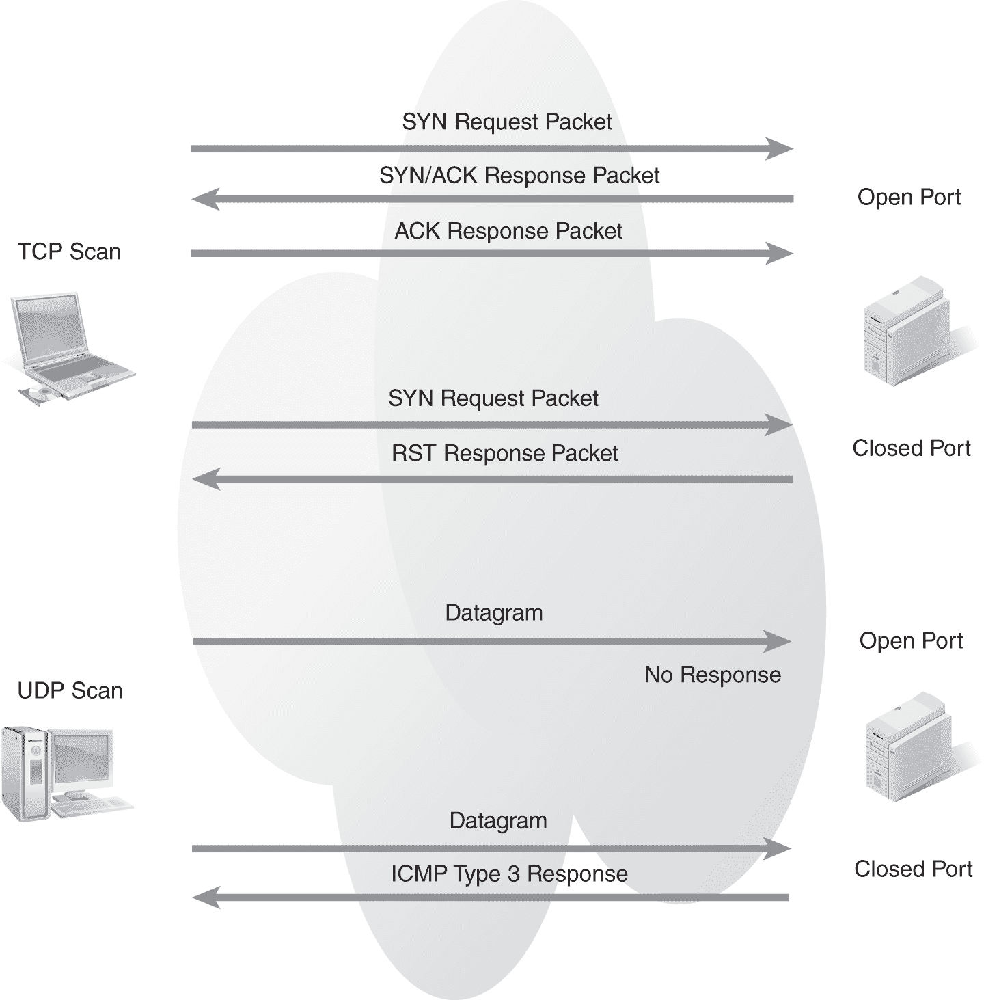

**图 2-3** 基本 TCP 和 UDP 端口扫描。

##### 技术提示

端口存在于开放系统互联 (OSI) 参考模型的传输层（第 4 层）。TCP 和 UDP 使用端口，以支持通过单个第 3 层（网络层）IP 地址进行多路同时通信、连接或会话。共有 65,535 个端口，但大多数系统只能支持几百个并发事务。

如果有活动服务准备好通过特定端口处理数据，则该端口为开放。如果没有服务与该特定端口关联，则该端口为关闭。

当通信引发来自端口的错误消息或异常响应时，防火墙可以过滤掉这些响应。这将导致该端口对于有效和正常的通信可见。防火墙可以阻止任何引发错误或异常响应的尝试。

在扫描期间，通常称为探测，黑客发送数据包以引发响应。当黑客执行扫描时，是可被检测到的。侦察通常是无声的、隐秘的和不显眼的。你也不太可能检测到针对单个数据项（如单个开放或关闭端口）的验证扫描。但当黑客扫描以发现所有正在使用的可能 IP 地址和所有可能的开放及关闭端口时，网络管理员会注意到，且通常会记录在系统日志中。侦察活动可能会也可能不会引起注意，但扫描——如果不小心进行，且对所有端口一次性进行端口扫描或爆破扫描，而不是仔细地在单个端口上进行——将难以被忽视。

黑客执行扫描直到发现一个或多个目标。因为扫描仅揭示系统和开放端口，黑客对目标了解甚少。每当黑客获得足够信息，或其扫描根据攻击目的未能揭示新信息时，黑客就会停止扫描并转入枚举阶段，即迈向攻击的下一步。请记住，攻击者只需一个漏洞即可访问系统或网络。一旦黑客能访问一台机器，迅速转向攻击它是最常见的升级路径。

##### 枚举

枚举是发现并列出潜在攻击目标的过程。枚举是黑客发现关于潜在目标的足够细节，以了解是否存在可供其成功攻击的漏洞的过程。枚举通常从操作系统 (OS) 识别开始，随后是应用程序识别，然后从发现的服务中提取信息。

黑客通过探测目标的开放和关闭端口来执行操作系统识别。这些端口的响应标识了操作系统。之所以能进行这种识别，是因为不同程序员编写可互操作代码的独特风格。每个操作系统使用不同的程序员团队来编写网络协议栈。即使生成的协议栈可能符合 IEEE 标准，但该栈的默认值和反应往往因操作系统而异。这些差异是已知的，并维护在一个小型数据库中，该数据库被编码进大多数网络扫描和探测工具中，例如 `nmap`。


每个开放端口后面都运行着一项服务。横幅抓取是探测这些服务以获取信息的活动（**图 2-4**）。一旦连接开始，服务可能会发送连接公告或通信确认。此公告称为横幅。横幅可能包含其他详细信息，例如服务的产品名称和版本号。

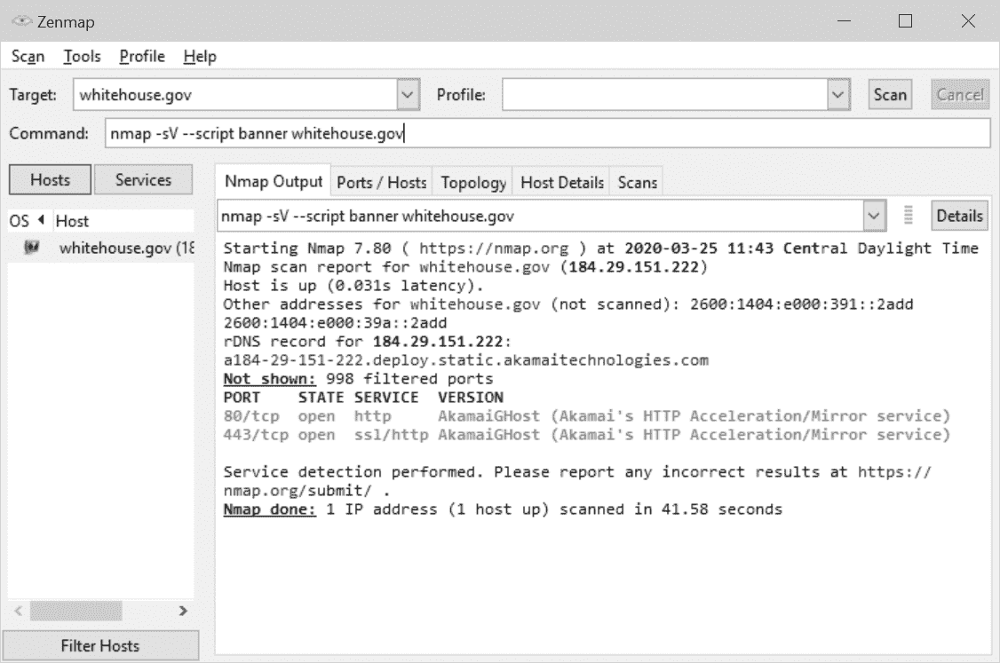

**图 2-4** 从 Web 服务器抓取的横幅。¶ 由 Zenmap 提供。

横幅中的信息可被黑客用于侦察目的——获取形成攻击基础所需的情报。一种低成本的防护方法是修改横幅，以误导黑客对服务器使用错误的漏洞利用代码，但仍允许该端口上的服务执行其职责。在某些情况下，横幅实际上未被使用，因此可能会被大幅缩短；在其他情况下，未使用的高级功能可能会被放弃，以换取更好的安全性。

一旦黑客识别出服务，他们就可以请求更多信息。该信息请求可能会被忽略，这很安全，因为没有发送响应。但如果不安全，服务可能会向黑客返回大量数据。根据服务类型和黑客执行的查询，提取的信息可能包括系统名称、网络名称、用户名、组名、共享名称、安全设置、可用资源、访问控制设置等。

枚举为黑客提供了已识别的潜在攻击点。在查看漏洞数据库（如 MITRE (*[`cve.mitre.org`](http://cve.mitre.org)*) 或 美国国家标准与技术研究院 (NIST) (*[`nvd.nist.gov`](https://nvd.nist.gov)*)）后，黑客评估潜在漏洞。一旦黑客选择攻击目标，他们就会收集漏洞利用工具并发起攻击。

现代攻击的一个特征是侦察阶段和攻击阶段之间经过的时间量。过去，两者可能仅相隔几分钟，但更现代的攻击可能需要数周、数月或更长时间来收集信息，然后才发动攻击。这种攻击——高度针对性的高级持续性威胁 (APT)——将在本章后面更深入地讨论。

##### 攻击

攻击是黑客攻击的第四阶段。虽然这似乎是最吸引关于黑客炒作的阶段，但实际上它是整个黑客攻击过程中最短暂的阶段。基于扎实的研究和准备，一次成功的攻击只需几秒钟即可完成。

如果初始攻击失败，黑客可以修改其漏洞利用代码、调整其载荷、调整其 Shellcode、重置其攻击向量，并重新发起攻击。一旦黑客发现假设的漏洞不存在或已被修复，他们就会返回枚举结果以选择新的攻击点。同样，可以想到白蚁：如果它们无法通过门框进入房屋结构，它们会同样热切地尝试通过窗台进入。这两种害虫都不知疲倦。

反复攻击最终将导致成功突破，或因目标的成功防御而使黑客感到沮丧。如果成功，攻击者将转入攻击后活动。如果不成功，攻击者可以选择转向备选的后备攻击。

##### 攻击后活动

在成功的攻击中，黑客通常已突破目标的安全防线，获得一定级别的逻辑访问权限。这可能是标准用户账户的凭据，或是通过缓冲区溢出漏洞利用访问 命令 Shell。无论哪种情况，通常都会发生一些常见的攻击后活动。这些包括 权限提升、植入额外的黑客工具、窃取数据、创建再入口点（后门）以及清除黑客入侵的证据。

权限提升是试图从目标处获得更高级别的访问权限或特权。这可以通过击键记录器、已知的操作系统漏洞利用来窃取管理员或系统访问权限、操纵计划任务、社会工程学、特洛伊木马、远程控制程序和其他机制来实现。结果是黑客获得了作为管理员、root 或系统本身运行的用户账户或命令 Shell 的访问权限。有了特权访问，剩余的攻击后活动就容易得多。

植入额外的黑客工具使黑客能更好地控制受损系统。工具可能启用当前连接方法无法提供的额外能力。工具可能协助窃取数据、清除入侵证据，或在未来维持或重新获得访问权限。为了重新获得访问权限，黑客通常会在系统上创建新账户。扫描新账户是识别此技术的简便方法。

窃取数据就是字面意思：搜刮存储设备寻找感兴趣的文件。黑客寻找任何能快速变现的东西。他们还寻找公开后会有趣、有吸引力或具有破坏性的东西。他们寻找可用于勒索或胁迫用户的物品。当然，他们也在留意可用于与其他黑客或罪犯交易或置换的潜在有价值信息。转储用户账户数据库和密码哈希值通常也是优先事项。破解其他用户的密码将有助于未来访问系统。

清除入侵及后续活动的证据是黑客的重要一步。未能掩盖踪迹可能导致被捕和起诉。允许 IT 和安全人员发现入侵只会导致安全级别提高。发现会使未来的再次入侵更加困难，甚至不可能，具体取决于黑客的技能水平。

一旦黑客完成证据清理，攻击者就可以声称已“拥有”（或用 黑客行话 说是 pwned）某个系统。黑客通过发现、追踪和渗透目标展示了技能。这通常是黑客的目标：成功渗透目标。然而，这种成功并不总是容易或常见的。如果攻击失败，黑客可能有后备攻击选项。

### 常见 IT 基础设施威胁

你对网络安全的各种威胁和风险了解得越多，就能部署越多的防御来抵御这些攻击。网络安全威胁包括黑客漏洞利用，以及自然灾害、设备故障和用户执行正常业务活动。

#### 硬件故障和其他物理威胁

网络安全不仅仅是防范黑客攻击。计算机系统和网络持续面临许多其他威胁。计算机设备复杂且有时脆弱。硬件故障是意外停机最常见的原因。大多数设备预计在正常环境下运行时间远超其预期寿命。然而，某些技术形式比其他形式更容易发生故障。


# 硬件故障与物理威胁

##### 硬盘故障

导致意外停机最常见的原因之一是硬盘故障。硬盘是极少数具有移动部件的常见计算机组件之一。虽然光驱、磁带驱动器、鼠标和键盘也有移动部件，但这些设备的使用寿命似乎比硬盘长得多。硬盘故障可能毫无征兆地发生，也可能有合理的预警。预警通常表现为驱动器在开始故障时发出的研磨声、尖啸声或咔哒声。这些噪音清楚地表明设备的可用寿命即将结束，应立即更换。

针对硬盘故障以及硬件故障的最佳防御措施是做好准备。做好准备包括：定期进行一致的备份，最好使用独立磁盘冗余阵列（`RAID`）；执行常规清洁和维护；并备有备件以应对不可避免的故障。避免停机和可用性损失的另一种方法是在设备故障前更换设备。大多数设备都有平均故障时间（MTTF）或平均故障间隔时间（MTBF），可用于确定故障的统计可能性。在该周期到期前更换设备是一种良好的做法。虽然您会在实际故障发生前很久就更换某些设备，但这种技术能让统计数据站在您这边。虽然计划内停机成本高昂，但它比计划外停机的成本要低。固态硬盘（SSD）消除了与硬盘驱动器相关的许多问题，但硬件的初始成本更高。

##### 热量威胁

另一个物理威胁是热量。过高的温度会损坏计算机设备。经历严重温度循环（如极热到极冷）的系统可能会发生芯片位移，或材料翘曲和开裂。芯片位移是由温度变化导致金属膨胀和收缩引起的。严重的温度循环甚至可能断裂焊接连接。关于晚上或周末关闭计算机还是让设备保持运行状态的传统争论，涉及这些温度变化的影响。运行中的计算机处于其最佳工作温度。

##### 静电放电与其他物理风险

干燥环境产生的静电放电（ESD）可破坏大多数电路。因摩擦尖锐金属边缘或粗糙表面（如混凝土砖墙）导致的电线磨损，可能引起短路。空气湿度过大或液体溢出导致的潮湿，对电气设备总是有害的。过度振动会损坏计算机设备。振动——由附近的大型施工、火车、地铁和飞机的定期经过，甚至车间或制造车间的叉车和大型设备引起——会随时间造成损坏。跌落设备、撞倒设备、重物砸在设备上等造成的任何明显物理损坏，都可能导致设备损坏。通过合理的预防措施、常识以及对电子设备的正确操作、保养和存储，可以消除或显著降低大多数物理风险和威胁。

##### 故意电磁干扰 (IEMI)

其中一种风险是故意电磁干扰（IEMI），即通过故意放电损坏或摧毁电子设备，范围涵盖从手机、视频监控到计算机和服务器。记录显示 IEMI 放电距离可达两英里，且不会对生物造成损害。虽然 IEMI 和相关技术已被军方使用多年，但 IEMI 刚刚成为计算机安全的威胁。

##### 盗窃

最后一个物理威胁是盗窃。物理设施防护应确保 IT 基础设施不受未经授权的外部人员（或内部人员）携带存储设备或其他关键组件离开的威胁。窃取设备的黑客可以花费任意长的时间尝试获取访问权限。

##### 自然灾害

大自然力量强大且不可预测。各种严重天气事件都可能损坏或摧毁 IT 基础设施。了解您所在地区常见的严重天气类型将提示采取正确的预防措施，如特殊保险、结构加固、防雷保护、浪涌保护器、排水泵等。无论潜在灾害是什么，保护数据的最佳方式是将可靠的定期备份存储在安全的异地设施中。

##### 意外事故

事故难免发生。只要有人为因素介入，事情就会出错。墨菲定律指出：“任何可能出错的事，终将出错。”为事故做好准备可以显著减轻其发生时的影响，或有助于避免事故。

IT 基础设施是一个庞大、复杂但脆弱的系统，完全掌握在人类手中。关键位置或关键时刻的意外损坏可能造成毁灭性后果。事故包括：液体洒在设备上、被线缆绊倒、拔错电源线或数据线、触发大楼断路器、触发水喷淋系统、撞倒计算机、过早关闭系统、安装错误驱动程序等。

针对事故的最佳预防和保护措施是备份、配置文档和培训。通过对员工活动进行一些常识性调整，更密切地关注其执行的活动，并留意不稳定的情况，可以避免许多“常见”事故。培训员工在事故或紧急情况下该怎么做，能显著增加成功恢复的几率。

#### 恶意代码

恶意软件是恶意软件的简称。恶意软件是黑客编写的用于造成伤害和破坏的不道德代码。恶意软件通过无数种方式获取系统访问权限，通常未经用户同意或用户不知情。这种计算机污染物最常见的传播媒介是便携式存储设备和互联网通信，如电子邮件或社交媒体。存在各种各样的恶意软件，包括病毒、蠕虫、特洛伊木马、键盘记录器、间谍软件、广告软件、根套件、逻辑炸弹、陷阱门、后门、拨号器、URL 注入器和其他漏洞利用代码。独特恶意代码示例的数量令人震惊。最近对恶意软件攻击的研究估计，潜在的唯一签名（用于检测和识别特定恶意软件的代码字符串，很像指纹）的数量高达数十亿。这比赛门铁克在不到 10 年前记录的 1700 多万个唯一签名有了巨大增长。

##### 病毒

就像生物病毒一样，计算机病毒需要一个宿主对象来感染。大多数病毒感染文件，如可执行文件、设备驱动程序、动态链接库（`DLL`）、系统文件；有时甚至感染文档、音频、视频和图像文件。某些病毒感染存储设备的引导扇区，包括硬盘和 USB 驱动器。病毒通过用户的操作传播。当用户打开受感染的文件时，病毒会传播到其他文件。当用户将受感染的文件发送到其他系统时，病毒也会随之传播。

##### 蠕虫

与病毒从文件传播到文件不同，蠕虫是从系统传播到系统。因为传播不需要人工交互，这些文件可以（并且确实）比病毒传播得快得多。如今，几乎所有被描述为病毒的威胁实际上都是蠕虫。黑客针对特定系统缺陷设计蠕虫。蠕虫扫描其他系统寻找此缺陷，然后利用该缺陷访问另一个受害系统。一旦寄生在另一个系统上，蠕虫通过重复该过程将自身传播开来。蠕虫在跨网络主机繁殖传播时，可作为载体投放其他形式的恶意代码。


##### 恶意软件类型详解

###### 特洛伊木马

特洛伊木马实际上是一种分发或投递机制，而非某种特定类型的恶意软件。在特洛伊战争期间，希腊人建造了一个巨大的中空木马；将战士藏在里面；把木马雕像送给特洛伊人；并假装离开该地区。特洛伊人将木马拖入城堡，当希腊战士从藏身处冲出时，他们在一夜之间遭到屠杀。该概念指嵌入在看似良性的载体或宿主程序中的恶意载荷，即用户想要的程序——如游戏或视频片段——并有意下载或复制。然后，当宿主程序运行游戏或视频片段时，恶意软件便被投递了。

特洛伊木马的诡计在于愚弄某人（一种社会工程学攻击），使其接受特洛伊木马程序为安全程序。通过在内部嵌入恶意软件，任何程序都可以被转换为特洛伊木马，就像通过添加有毒物质，任何食物都可以被毒害一样。事实上，黑客拥有专门设计用于构建特洛伊木马的工具，称为封装器或特洛伊木马构建工具包。

###### 键盘记录器

键盘记录器记录用户的键盘活动。黑客可以通过多种技术（包括蠕虫或特洛伊木马）将软件键盘记录器植入受害者的系统。一旦系统被感染，键盘记录器会定期通过电子邮件、文件传输协议 (FTP) 或即时通讯 (IM) 将按键日志传输给发起攻击的黑客。硬件键盘记录器攻击可通过键盘线缆实施。这些很难被检测到，因为设备非常小；虽然通常连接在键盘线缆上，但它通常位于桌面下方或计算机背后，用户通常不会去查看那些地方。

###### 垃圾邮件与网络钓鱼

垃圾邮件常被用于实施网络钓鱼攻击，邮件看起来合法或诱人，即使从未被请求过，导致接收者点击它，从而将恶意软件释放到他们的计算机系统中。

###### 间谍软件

间谍软件是键盘记录技术的进阶，用于监控和记录许多其他用户活动。间谍软件差异很大，但可以收集已启动应用程序列表、访问过的 URL、发送和接收的电子邮件、发送和接收的聊天记录、所有打开过的文件名、网络活动记录、定期屏幕截图，甚至麦克风录音或网络摄像头图像。

###### 广告软件

广告软件渗透广告。间谍软件和广告软件通常以共生方式关联在一起，因为从间谍软件了解到的目标信息有助于选择广告软件将推送给用户的材料。广告软件可以通过弹窗、电子邮件消息，或在浏览器显示网站时替换现有的合法广告来推送广告。

###### Rootkit

Rootkit 是一种恶意伪装，充当黑客想要在计算机上隐藏的任何事物的隐形护盾。Rootkit 的作用类似于设备驱动程序，并将自身定位在内核（操作系统的核心程序）和硬件之间。从那里，Rootkit 可以选择性地隐藏存储设备上的文件，并使内存中的活动进程无法被操作系统查看、访问或检测到。Rootkit 隐藏其他形式的恶意软件或黑客工具，除了隐身能力外，还可以包含其他恶意软件功能。

###### 逻辑炸弹

逻辑炸弹是一种电子地雷。一旦黑客在系统中植入逻辑炸弹，它将保持休眠状态，直到触发事件发生。触发器可能是特定的时间和日期、程序的启动、特定关键字的输入，或访问特定的 URL。一旦触发发生，逻辑炸弹就会向毫无防备的用户释放其恶意事件。

###### 后门/陷阱门

陷阱门和后门恶意软件是同一类恶意软件的两个术语。后门或陷阱门程序为黑客打开一条访问路径，以便轻松进入受损系统。后门恶意软件通常通过特洛伊木马方式投递。与勒索软件或蠕虫等恶意软件不同，特洛伊木马的恶意部分保持隐藏至关重要。该访问权限可能是创建一个黑客定义了凭据的新用户账户；一个流氓 Web、Telnet 或 Secure Shell (SSH) 服务器，赋予黑客远程命令提示符访问权限；或一个能完全远程控制受害者机器的来源（有时仅通过在 Windows 主机上开启远程桌面即可）。许多其他可能的陷阱门或后门操作都能授予外部黑客访问权限。

###### 拨号器

拨号器是一种流氓程序，可在预定义号码上自动拨号调制解调器。有时此过程会自动向受害者系统下载额外的恶意软件，或从受害者处上传窃取的数据。在其他情况下，拨号器会从受害者系统拨打付费电话号码，以产生巨额长途费。如果用户通常通过拨号链路连接互联网，拨号器可能会拨打流氓代理站点，而不是互联网服务提供商 (ISP)。该站点将充当中间人，随后窃听所有通信。

###### URL 注入器

URL 注入器替换 HTTP GET 请求中的 URL 为替代地址。这些被注入的 URL 会导致浏览器显示的网页与用户点击请求的网页不同。这些被替换的网页可能展示广告站点、产生流量以伪造搜索引擎优化 (SEO)，或导向欺骗性站点。

###### 漏洞利用代码

漏洞利用代码是旨在利用编程、时序、通信或存储缺陷的任何形式的恶意软件。黑客通常将漏洞利用代码嵌入其他形式的恶意软件中，以协助感染和分发。漏洞利用代码也独立存在，通常作为黑客用于发动攻击、造成破坏和执行入侵的工具。

###### 恶意软件传播与移动代码

恶意软件通过与合法、良性数据相同的通信通道传播。区别在于黑客设计恶意软件是为了造成困扰和破坏。恶意软件传播的一个不断增长的风险领域是移动代码。移动代码是黑客编写的软件，旨在通过通信网络（如互联网和移动电话网络）轻松分发。黑客设计移动代码以下载到宿主，然后在宿主上执行。在移动代码的幌子下，恶意软件的传播速度比以往任何时候都快。普通大众——甚至 IT 专业人员——都需要提高警惕，采取适当预防措施，并使用反恶意软件应用程序。

###### 高级持续性威胁

####### Advanced Persistent Threat

多年来，公众甚至许多知识渊博的安全专业人员习惯将每种类型的恶意软件都称为病毒。现在，将每种类型的恶意软件都称为高级持续性威胁 (APT) 也变得同样普遍。尽管 APT 的发生率急剧增加，但它们仍只占攻击的一小部分。确实，APT 代表了下一代恶意软件，因为该威胁会悄无声息地驻留在目标机器上，直到被激活（因此称为“持续性”）。然而，APT 具有高度针对性，其目标情报通常从其他类型的攻动中获取，范围从网络钓鱼到社会工程学。历史上，大多数攻击都是机会主义攻击，寻找最薄弱的系统进行入侵：最容易得手的目标。随着我们看到从经济动机攻击向国家资助的间谍活动和黑客行动主义（即政治动机的黑客行为）转变，可以预见，我们将继续看到针对性攻击（如 APT）的增长。


即使存在当前所有的恶意软件变体以及未来将出现的变体，您也只能从几种常见的防御措施中进行选择：防病毒软件、反恶意软件扫描器、完整性检查扫描器和用户安全意识。防病毒软件会在内存和存储设备中主动搜索病毒、蠕虫、特洛伊木马以及其他类似的破坏性恶意软件形式。反恶意软件扫描器会查找防病毒软件可能无法处理的间谍软件、广告软件、拨号程序等。完整性检查器会保存所有系统和应用程序文件的哈希值数据库，并在这些文件发生未经授权的更改时报告。您可以通过提供培训来提高用户安全意识，鼓励其采取负责任的安全行为。培训还将鼓励用户在工作和家庭中采取合理的预防措施，以防止感染和攻击。培训应包括了解发生事故时该做什么以及联系谁（如 IT 团队或服务台）以便在组织内报告事件。

#### 快速增长与过度使用

网络安全并不总是组织的优先事项。一些组织更关注利润和快速增长，而非花时间在网络安全上。安全有时被视为一种烦人的间接开支，它消耗资源却无法提供任何回报来弥补支出。尽管这种心态在高级管理层中很常见，但这对网络安全这一关键投资的投资回报率 (ROI)是一种错误且不正确的理解。

网络安全——事实上，所有形式的安全——都在保护组织，使其利润中心能够在没有中断或干扰的情况下运作。没有网络安全，IT 基础设施的能力和可用性将不稳定，尤其是在发生事故、感染、攻击或硬件故障期间。网络安全可减少停机事件以及资源损坏或丢失。什么比组织的利润底线更重要？

未能在爆发式增长时期解决安全问题的组织更有可能经历灾难性故障。由于未能保护资产（通信、数据存储、知识产权、客户数据、财务记录和私人人员数据），任何级别的黑客入侵都可能导致组织崩溃。

在没有适当规划和准备的情况下急于求成，通常以失败告终。建造摩天大楼时，直到下面的每一层楼都妥善建好之前，不会建造顶层结构。在缺乏足够网络安全防护的情况下让公司过快增长，就像试图在底层楼层完工前就建造顶层公寓。登顶的过程可能令人振奋，但随后的崩溃将是不可避免的。上升得太快，必然跌得更快。

稍微放缓增长速度，在组织扩张的同时同步构建网络安全，是一个明智得多的计划。这种深思熟虑的方法比那种不顾风险、盲目追求前进动力的方法，更有可能提供持续的增长和长久的生命力。

另一个潜在的疏忽是组织将设备、软件和连接性推向超出合理负载水平的程度。这就像用跑车去拖游艇。看起来很酷，但有什么风险？现代 IT 设备能够以惊人的水平运行。但即使是最好的设备，在超过其峰值运行极限之前也只能做这么多——一旦超限，就会开始趋向故障。

大多数组织的增长是可预测的。可预测的增长有助于在基础设施成为瓶颈之前规划基础设施扩展。当增长超过当前基础设施 60% 的容量时，您应该已经在规划扩展了。当增长超过 80% 容量时，应采取措施实施扩展。当增长超过 90% 时，应加快努力完成扩展。

如果公司在完成扩展之前达到 100% 容量，将导致阻碍增长的瓶颈。此障碍可能产生反弹效应，即增长中断可能导致组织收缩，使重返增长轨道变得更加困难。设备、存储空间、内存容量、备份能力、通信带宽和处理能力绝不应达到最大使用或消耗。您应预留足够的余量以应对偶尔超出正常最大活动水平的峰值。

管理组织增长有许多好处，包括有计划、有步骤的升级和改进，而非设备故障和停机。如果增长过快，您如何知道带宽不足是由于合法网络进程的过度使用和过度增长，还是由于恶意软件感染？这两种情况对网络行为和用户满意度有相似的影响。

#### 无线网络与有线网络

无线网络与有线网络相比的安全隐患往往被夸大了。最大的区别在于攻击的机制和接近程度。对于有线网络，黑客必须获得与目标的物理接近性才能进行直接接触。一旦连接到有线网络，黑客就可以尝试各种攻击和漏洞利用。

对于无线网络，黑客不必在物理上靠近。黑客可以从距离接入点一英里或更远的地方尝试网络入侵（**图 2-5**）。然而，在大多数现实场景中，使用小型但强大的定向天线，范围通常在 1000 英尺以内。

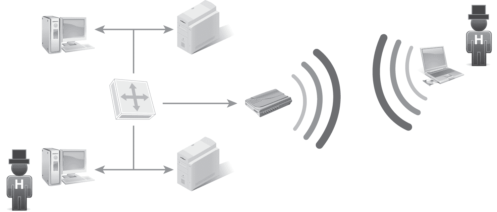

**图 2-5** 有线网络需要本地攻击；无线网络允许远程攻击。

无论哪种情况，有线或无线，如果黑客的目标是获取用户账户访问权限或存储在网络上的数据，黑客必须首先获得与目标网络的网络连接才能发起攻击。如果黑客主要对破坏和 DoS 感兴趣，则不需要逻辑网络访问。

#### 窃听

窃听是指偷听通信。窃听可以是使用数据包捕获工具（通用称为嗅探器）记录网络流量（**图 2-6**）。黑客可以针对数据包或语音流量进行窃听。窃听可能发生在有线或无线连接上。

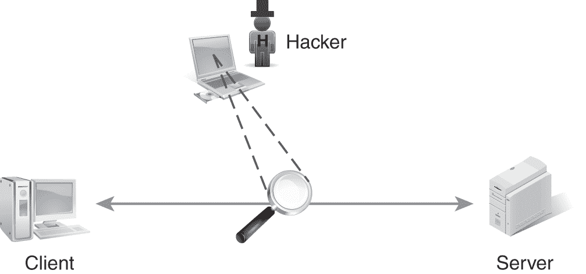

**图 2-6** 窃听客户端和服务器之间的现有会话。

任何以明文和直接可用数据形式执行的通信都可能被拦截和记录。您可以通过使用加密协议来防止窃听。只有经过强加密编码的消息才能防止外部人员获知对话内容。但随着超级计算机速度和效率的提高，一旦数据包被获取，破解加密只是时间问题。

#### 劫持与重放攻击

劫持攻击发生在黑客使用网络嗅探器监视通信会话以了解其参数时。随后黑客断开会话主机之一的连接，冒充离线系统，并开始向通信流中注入精心构造的数据包。如果成功，黑客将接管离线主机的会话，而另一主机却未察觉到这种切换。


##### 重放攻击

重放攻击也称为回放攻击。当黑客使用网络嗅探器捕获网络流量，然后在稍后的时间将该流量重新传输回网络时，就会发生重放攻击。重放攻击的目标是获得对系统的交互或会话访问权限。

为重放攻击而捕获并重传的流量是认证数据包（**图 2-7**）。在这种类型的攻击中，黑客捕获客户端和服务器之间的流量，然后稍后将其重传给与原始通信相同的服务器。重放攻击通常专注于认证流量，希望重传允许真实用户登录系统的相同数据包能授予黑客相同的访问权限。

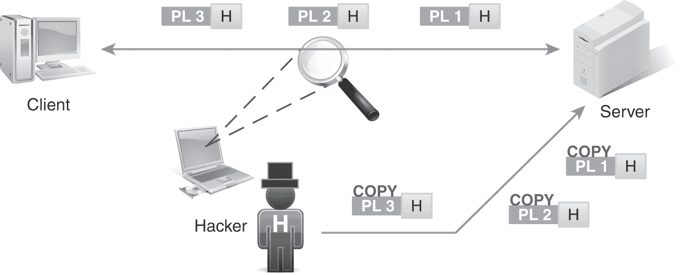

**图 2-7** 重放攻击收集认证数据包，然后在稍后的时间重传这些数据包。

幸运的是，您可以通过使用几种常见的通信改进来挫败大多数重放攻击。许多认证事务包含一个无法重放的随机质询-响应对话。该对话由一端生成一个发送给另一端的随机种子值组成。第二端使用双方都知道的共享密钥，通过单向计算得出响应。响应返回给原始端点，在那里会与预期的响应进行比对。如果接收到的响应与预测的响应匹配，则用户通过认证。

时间戳是防御重放攻击的另一种手段。某些认证交换包含编码的时间详情，如果不被检测到，这些详情很难复制或修改。此外，使用一次性密码本或基于会话的加密可以使重放攻击变得不可能。

##### 插入攻击

插入攻击形式多样，但都涉及向原本安全的基础设施引入未经授权的内容或设备。三种常见的基于插入的攻击包括 SQL 注入、IDS 插入和流氓设备插入。了解网络上应该有什么，并丢弃意外的或格式不正确的数据包，能极大地减少这类攻击。

SQL 注入是一种将黑客代码插入到网站托管的脚本中或通过数据库查询进行的攻击。SQL 注入攻击可使黑客访问 Web 应用程序的后端数据库。该技术利用了常见 Web 通信中的一个弱点，即某些字符因被赋予特殊含义或用途而受到不同对待，而非仅作为文本处理。这些被称为元字符，充当编程标记。如果您不以防御方式编写脚本以阻止或忽略元字符，那么注入攻击就可以根据黑客提交的内容有效地重写脚本。注入的代码几乎可以执行任何可想象的命令行任务。

跨站脚本 (XSS) 类似于 SQL 注入，但其结果是攻击网页的未来访问者，而不是授予黑客访问后端数据库的权限。XSS 攻击向网站提交脚本代码。XSS 可能导致 Web 源文件持续遭到恶意修改。这会导致该网站的所有未来访问者接收到被篡改的内容。

XSS 攻击可能包含发送给受害者的电子邮件，其中带有伪造的超链接，当受害者点击电子邮件中的嵌入链接时，将脚本注入指向目标站点。此类攻击可授予黑客访问受害者看似安全的 Web 事务的权限。这种攻击形式是非持久性的，因为它仅影响点击恶意邮件中链接的人。

IDS 插入是一种利用网络型 IDS 特性的攻击形式；它收集并分析每个数据包，欺骗 IDS 认为发生了攻击，而实际上并未发生。IDS 插入攻击的常见目的是欺骗对恶意网络事件的特征或模式匹配检测。通过将攻击流量与目标主机会拒绝但 IDS 会查看的数据包穿插在一起，IDS 无法识别攻击模式，但攻击仍然会发生。例如，假设一个攻击由四个数据包 A、B、C 和 D 组成，而 IDS 特征是 ABCD 数据包流。如果黑客以 AXBCYD 的形式传输攻击，其中 X 和 Y 是目标拒绝的无效数据包，则 IDS 无法识别该模式。在 X 和 Y 被丢弃后，ABCD 攻击将针对目标发生。

流氓设备插入是一种物理形式的插入攻击，黑客将冒充设备插入基础设施中。最常见的例子是插入一个配置类似于真实授权接入点的流氓无线接入点 (WAP)。一些用户可能会被骗连接到流氓接入点。这将构成中间人攻击，黑客将拦截受损系统的所有事务。智能手机可以模仿 WAP。另一种插入攻击是前面讨论的物理键盘记录器。

每种插入攻击方法都要求您创建独特的防御措施。您可以通过防御性编程和输入过滤来防止 SQL 注入攻击。如果您使用防御性编码技术、元字符过滤和输入验证，通常可以防止 XSS 攻击。对于最终用户，防御措施包括 Cookie 管理以及在浏览器和电子邮件客户端中禁用脚本支持。通过使用现代 IDS 技术（如异常检测、行为检测和启发式检测）来平息 IDS 插入攻击。您可以通过加密通信、预配置网络访问、禁止无线网络、用户培训和定期现场勘测来挫败流氓设备插入。

##### 分片攻击

分片攻击是对 IP 数据包分片偏移特性的滥用。当许多不同的网络链路连接在一起构建全球基础设施时，就会发生分片。某些网段支持的数据报（数据包或帧的另一个术语）比其他网段小，因此较大的数据报会被分片成较小、更兼容的大小。当原始数据报的分片元素重新组装时，对分片的操纵可能导致几种潜在的恶意重组，如重叠和溢出。请想象《星际迷航》中的传送器：如果有任何东西妨碍了被传送者的重组，您可能会得到一个留着山羊胡的邪恶斯波克先生。

重叠可能导致数据报组件的完全或部分覆盖，从而由先前数据报的部分创建出新的数据报。溢出可能导致过大的数据报。其他分片攻击会导致 DoS 或混淆 IDS 检测和防火墙过滤。

防范分片攻击的措施包括现代 IDS 检测和防火墙过滤功能，以及执行发送端分片。发送端分片查询网络路由以确定最小的最大传输单元 (MTU) 或数据报大小。然后发送端预先对数据进行分片，以确保在途中无需进行分片。“斯科蒂先生，把我传上来——并确保我完好无损地回来。”

##### 缓冲区溢出


`buffer` 是一块指定用于接收输入的内存区域。缓冲区的大小由程序员专门确定，因为主机上只存在有限的内存量。`buffer overflow`（缓冲区溢出）是针对糟糕编程技术和缺乏质量控制的攻击。黑客可以向缓冲区注入超出其容量的数据，这可能导致额外的数据溢出到下一块内存区域。

这种溢出可能会被完全忽略，可能触发溢出崩溃或冻结，也可能导致 `arbitrary code execution`（任意代码执行）。在最后一种情况下，黑客精心构造输入流，使溢出的数据成为一条以系统级权限执行的命令行代码语句。

程序员可以防止缓冲区溢出。使用防御性编程技术，例如输入限制检查，以及避免使用不检查边界限制的编程语言函数，缓冲区溢出就会成为一种无效的攻击形式。

##### 会话劫持、欺骗和中间人攻击

针对系统和网络的攻击可能涉及凭证伪造或身份虚假陈述。这一类攻击涉及黑客冒充另一个实体，或发送消息声称其系统实际上是另一台机器。这些攻击包括会话劫持、欺骗和中间人攻击。

###### 会话劫持

`Session hijacking`（会话劫持）发生在客户端通过服务器认证后，黑客能够接管该连接时（**图 2-8**）。要执行此攻击，黑客必须窃听会话以获取详细信息，例如会话端点的地址和序列号。有了这些信息，黑客可以使客户端不同步，接管客户端的地址，然后将精心制作的数据包注入数据流。如果服务器接受最初的伪造数据包为有效数据包，则会话已被劫持。

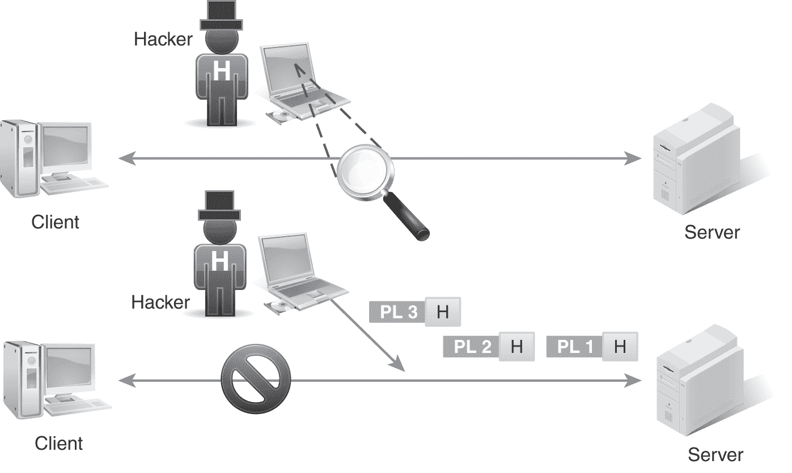

**图 2-8** 会话劫持从客户端窃取连接。

在会话劫持中，攻击者不会直接获知客户端的凭证。如果黑客失去连接，他将不得不寻找另一个会话进行劫持。失去会话的客户端会意识到连接已丢失，但不一定会意识到该断开连接是一次劫持攻击。

会话劫持有时会采用 DNS 欺骗、投毒、ARP 欺骗、ICMP 重定向和流氓 DHCP 来改变会话的路由或路径。黑客利用这种路径改变，强制目标会话经过更易访问的网段，从而使会话劫持攻击更容易实施。

任何在未加密的情况下使用 TCP/IP 的主机都容易受到会话劫持的攻击。即使使用复杂或伪随机的数据包序列编号，黑客（或黑客的工具）只需进行少量窃听即可预测未来的序列值。防止会话劫持的唯一真正保护措施是加密，例如 VPN。

###### 欺骗攻击

`Spoofing`（欺骗）是信息的伪造。大多数欺骗都是对来源身份的伪造。电子邮件地址、MAC 地址和 IP 地址都很容易被伪造。欺骗会诱使用户或主机相信通信源自除其实际来源以外的其他位置。这是垃圾邮件传输中的常用战术。欺骗会冒充授权实体，例如通过 MAC 欺骗绕过无线接入点的 MAC 过滤。

欺骗难以防范，也较难检测。大多数欺骗检测发生在监控正常流量并寻找寻址异常时。例如，如果交换机发现某个特定 MAC 地址是交换机端口 6 接收到的帧的源地址，而该 MAC 地址也出现在交换机端口 9 接收到的帧的源地址中，这就是 MAC 欺骗的症状（**图 2-9**）。在另一个例子中，如果防火墙在其外部接口上接收到一个数据包，而源 IP 地址是内部 LAN 地址，则可能正在发生欺骗。

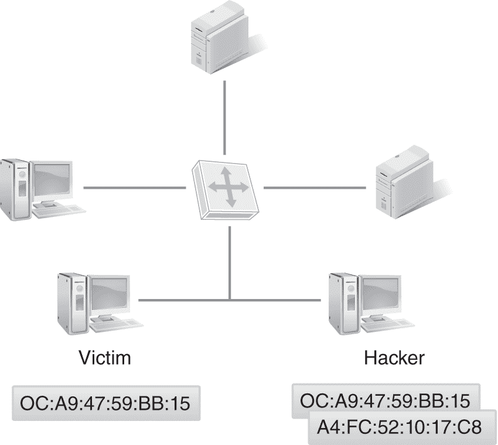

**图 2-9** 黑客计算机对客户端 MAC 地址的欺骗。

##### 技术提示

NTFS 的 `alternate data streams (ADS)`（备用数据流）是添加到此文件系统的一项功能，用于支持来自 POSIX、OS/2 和 Macintosh 的文件。此功能于 1990 年代中期添加到 `New Technology File System (NTFS)`（新技术文件系统）中，以推动政府采购 Windows NT。然而，即使 Windows 现已放弃对 POSIX 和 OS/2 的支持，且 Macintosh 使用 `hierarchical file system (HFS)`（分层文件系统），NTFS 仍保留了此功能。ADS 是文件包含多个资源分支的能力。NTFS 对 ADS 的支持导致完整的附加文件（而不仅仅是附加资源）可以隐藏在任何普通文件对象之下。

一个普通文件对象（包括目录）可以在其下方包含许多附加文件。附加文件的数量仅受驱动器上可用空间总量和隐藏文件大小的限制。一旦文件作为 ADS 存储，它就不再被操作系统本身可见或轻松访问。有几种黑客工具可以创建和操作 ADS。只有少数扫描工具（如 `sysinternals.com` 的 Streams）和极少数恶意软件扫描器能专门扫描驱动器以查找 ADS 隐藏代码。

欺骗是需要监视和过滤的对象，但不存在真正的或直接的欺骗预防措施。此外，如果传输中的真实数据未加密，黑客可以拦截并修改已在传输中的数据。因此，欺骗数据并不总是作为伪造通信发起的。

###### 中间人攻击

`Man-in-the-middle (MitM) attacks`（中间人攻击）发生在黑客介入客户端和服务器之间的通信会话时。该攻击通常涉及愚弄或诱骗客户端与黑客的计算机发起会话，而不是与预期的服务器（**图 2-10**）。黑客执行欺骗攻击以诱骗客户端。结果是客户端和服务器之间的连接由黑客代理。这允许黑客窃听和操纵通信。中间人攻击也称为 `interception attack`（拦截攻击）、`proxy attack`（代理攻击）或 `monkey-in-the-middle attack`（中间人攻击）。

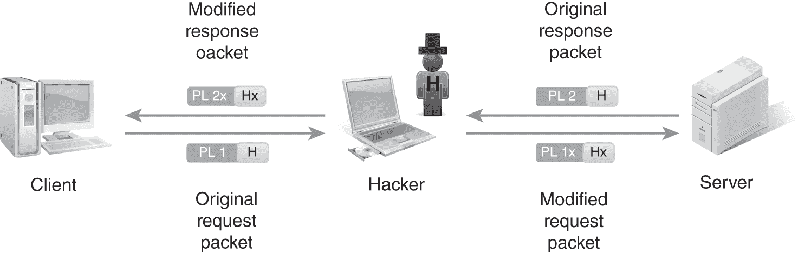

**图 2-10** 中间人攻击欺骗客户端与黑客而非目标服务器发起会话。

MitM 攻击涉及攻击前的准备环节，即向客户端提供虚假信息，导致客户端请求与黑客的计算机建立会话，而不是与真正的服务器。黑客可以使用以下几种方法之一来实现这一点：


####### 中间人攻击技术

*   **ARP 欺骗**—地址解析协议（`ARP`）是一种非认证的广播查询服务，它请求使用特定 IP 的系统提供媒体访问控制（`MAC`）地址。如果运行 ARP 欺骗 工具的黑客在真实响应返回之前向请求者发送虚假响应，则发送者将使用虚假的 MAC 地址。后续帧将发送到流氓 MAC 地址，该地址由黑客的计算机使用。由于 `ARP` 协议是第 2 层且不可路由，因此 `ARP` 欺骗必须发生在子网内。

*   **MAC 欺骗**—黑客的计算机使用服务器的 MAC 地址；当服务器被淹没时，黑客的系统会接收原本发往预期服务器的流量。与上述 `ARP` 类似，MAC 欺骗 必须发生在子网内。

*   **DNS 投毒**—要执行 DNS 投毒，黑客会攻破域名系统（`DNS`）服务器并植入虚假的 FQDN 到 IP 映射记录。`DNS` 源会向后续的用户查询提供虚假数据。

*   **DNS 欺骗**—`DNS` 是一种非认证的查询服务，它请求将 FQDN 解析为其相关的 IP 地址。托管流氓 DNS 欺骗 工具的黑客可以发回虚假的 DNS 响应。

*   **ICMP 重定向**—在有多个路由器的子网上，ICMP 重定向 可能导致主机更改其路由表。这种攻击可能会将流量重定向到不同于默认、预期或最优路由的路径上。

*   **代理操纵**—要执行 代理操纵，黑客会重新配置客户端的代理配置。服务请求会发送到充当中间人（`MitM`）代理的黑客系统。

*   **流氓 DHCP**—流氓 DHCP 是一个虚假的动态主机配置协议（`DHCP`）服务器，它可以为唯一子网提供 IP 地址配置租约并定义默认网关，因为黑客的计算机充当 `MitM` 路由器/代理。

*   **流氓接入点**—要创建 流氓接入点，黑客会配置一个类似于真实授权接入点的流氓无线接入点，诱骗用户连接，从而充当 `MitM` 代理。

##### 技术提示

当使用 非认证查询服务 时，它不会确认收到的任何响应的来源或有效性。因此，如果您收到伪造、欺骗或流氓响应，系统会将其视为真实并结束查询会话。如果真实响应到达，系统会将其作为无效或杂散数据包拒绝，因为它将不再与任何打开的查询会话对应。

针对 `MitM` 攻击的防御措施包括监控常见网络滥用或异常网络活动的 `IDS` 和 `IPS` 解决方案。此外，强多因素认证和相互认证可以降低 `MitM` 攻击的成功率。

#### 隐蔽信道

隐蔽信道 是隐藏的、未知的、独特的、非典型的信息传输路径。该信道之所以隐蔽，是因为它是未知且不可见的。黑客利用隐蔽信道进行秘密通信，通常用于泄露数据（传输数据）离开安全环境，例如气隙系统。隐蔽信道是不安全的传输路径。如果该路径被知晓，它将成为公开信道，并可能被阻止、过滤或以其他方式保护。

隐蔽信道主要有两种形式：时序信道和存储信道。时序信道通过定时和同步的活动传递信息。时序隐蔽信道的几个潜在示例包括：

*   闪烁灯光以摩斯码分发信息
*   操纵风扇转速，使较高和较低音调的噪音产生二进制传输
*   节流互联网链路上的带宽消耗，使得在特定间隔内，利用率测量值读取低于 60% 为 0、高于 60% 为 1，从而进行二进制通信。这会导致较低的波特率（数据传输速率），这对于用户凭证等小通信流仍然有效，但不适用于大量数据包，如数据库。

存储隐蔽信道通过不可见或未被发现的存储位置传递信息。存储隐蔽信道的几个潜在示例包括：

*   使用硬盘的 未分区空间 通过十六进制编辑器写入数据存储数据
*   使用板载固件闪存芯片存储数据
*   使用 `NTFS` 的备用数据流隐藏文件
*   使用硬盘的 松散空间 存储数据

针对隐蔽信道的最佳防御措施包括 `IDS` 和 `IPS`，以及对 IT 基础设施的所有方面进行彻底监控，以发现任何类型的异常或异常事件。预测隐蔽信道很困难，因为就其本质而言，它们是未知且不可见的。

#### 黑客如何劫持松散空间

硬盘包含称为扇区的段。扇区 是驱动器中最小的固定大小存储块，大小为 512 字节。当文件系统应用于 分区 时，会由一个或多个扇区创建 簇。松散空间是存储文件仅部分消耗的最后一个簇的未使用部分。簇与扇区的比率通常在 1:1 到 1:128 之间，对应 512 字节到 64 KB 的簇。

文件系统具有分配给簇的固定最大地址数量。较大的驱动器拥有与较小驱动器相同数量的簇，但簇更大。这有点像鞋子：儿童鞋一双一盒，成人鞋也是一双一盒，但装成人鞋的盒子更大。簇是最小的可消耗存储空间元素，只能包含单个文件的数据。标准文件系统格式中没有原生机制寻址亚簇划分。

当文件写入驱动器时，它会消耗包含文件所有数据所需的尽可能多的簇。除包含文件的最后一个簇外，所有簇都被填满。仅当文件大小恰好是簇大小的整数倍时（这不太常见），最后一个簇才会被完全消耗。最后一个簇的未使用部分称为松散空间（**图 2-11**）。松散空间实际上是不可用的、浪费的存储空间。

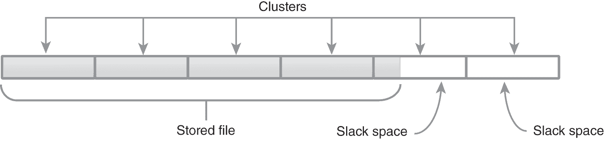

**图 2-11** 松散空间是存储文件仅部分消耗的最后一个簇的未使用部分。

黑客开发了特殊的文件操作工具，可以定位并劫持松散空间，并利用它在硬盘上创建隐藏卷。这些卷几乎不可能被检测到，因为它们不被存储设备的文件系统包含、引用或寻址。相反，松散空间驱动器之所以存在，仅仅是因为特殊软件可以寻址亚簇存储位置。松散空间驱动器软件独立于操作系统和文件系统运行。

##### 技术提示

Web 服务器，或至少网站，以至少四种不同的架构部署选项出现在互联网上：反向代理、非军事区（`DMZ`）、托管和主机托管。反向代理使用静态网络地址转换（`NAT`）映射或端口转发，允许外部访问者发起与内部服务器的通信。这是最差的安全选择，因为如果 Web 服务器被攻破，可能会授予黑客对整个内部网的访问权限。


#### 在 DMZ 中托管 Web 服务器

在 DMZ 中托管 Web 服务器是一种更安全的解决方案。然而，一旦被攻破，DMZ Web 服务器会给黑客提供一个武器平台，该平台就在私有网络的前门之外。共置是指将 Web 服务器主机直接放置在 ISP 网络设施内。托管是指租用由托管实体拥有和管理的现有 Web 服务器上的空间访问权。后两种选择最为安全；如果 Web 服务器或站点被攻破，黑客将无法获得位置优势来突破私有网络。

#### 网络和资源可用性威胁

要想成功，许多漏洞利用和攻击都需要在私有网络上获得特殊访问权限。某些漏洞利用可针对面向互联网的 Web 服务器发挥作用，但此类服务器可能不会直接连接到私有网络。如果黑客无法找到可利用的漏洞来获取目标系统的访问权或控制权，最后的备选方案或最终手段就是发起可用性攻击。

可用性攻击旨在阻止合法访问或使用资源，以延迟或中断业务。通常，这被称为拒绝服务攻击。

##### 拒绝服务

拒绝服务攻击会中断正常的流量、通信和响应模式。DoS 攻击会干扰对合法资源请求的及时处理和回复。DoS 攻击主要有两种形式：缺陷利用或流量生成。

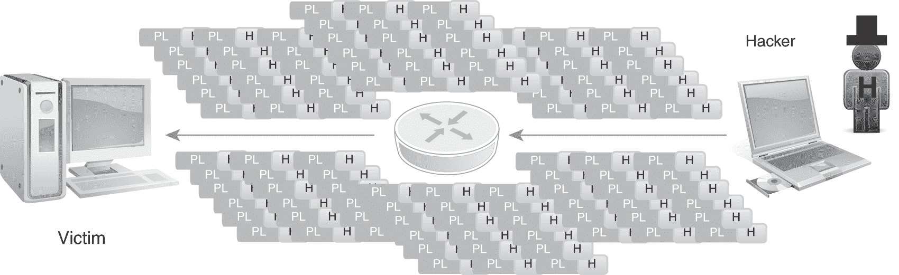

**图 2-12** 针对客户端的拒绝服务洪水攻击。

缺陷利用型 DoS 攻击利用编程错误、缺陷或惯例。DoS 漏洞利用会导致系统冻结、崩溃、重启或无法响应外部通信。您可以通过应用补丁以及使用 `IDS` 或 `IPS` 系统来缓解缺陷利用型 DoS 攻击。一旦应用了补丁，DoS 将不再有效。缺陷利用攻击通常特定于某个软件版本。

流量生成型 DoS 攻击用大量流量淹没目标（**图 2-12**）。该流量消耗可用带宽和处理能力，阻止合法通信。不存在可缓解流量生成型 DoS 攻击的补丁。相反，流量过滤是唯一有效的响应。然而，上游过滤比边缘设备过滤更有效。

上游过滤是指父网络（通常是 ISP）在流量进入个人和企业客户连接的子网络之前对其进行过滤。边缘设备过滤可防止恶意流量进入私有网络，但无法防止成功的 DoS 攻击。只有上游过滤才能减少或消除 DoS 流量，并允许合法通信继续进行。

##### 分布式拒绝服务

分布式拒绝服务攻击通过大规模分布式处理和源发起，将 DoS 攻击推向了新高度。DDoS 攻击的基础是代理、僵尸程序或僵尸主机，这些是植入在互联网上受害系统中的恶意代码。这些移动代理可能创建自己的对等网络交互，或连接到公共通信媒介，例如互联网中继聊天 (IRC) 频道。由此产生的网络被称为僵尸网络、僵尸大军或僵尸阵列。

黑客远程控制僵尸网络，并指挥其对选定目标执行各种恶意活动——包括洪水攻击。通常，僵尸网络的主要目标被称为主要受害者，而托管僵尸网络代理的受损系统被称为次要受害者。这种形式的 DoS 之所以被称为分布式，是因为僵尸程序分散在众多次要受害者中，且由此产生的攻击源自大量源向量。

黑客将僵尸程序、代理或僵尸主机分发到遍布互联网的许多次要受害者处。然后，僵尸程序连接到某种通信服务器，通常是 IRC 等聊天服务，每个僵尸程序均可从黑客处接收指令。一旦黑客发送攻击指令，僵尸程序便会针对主要目标发起攻击（**图 2-13**）。

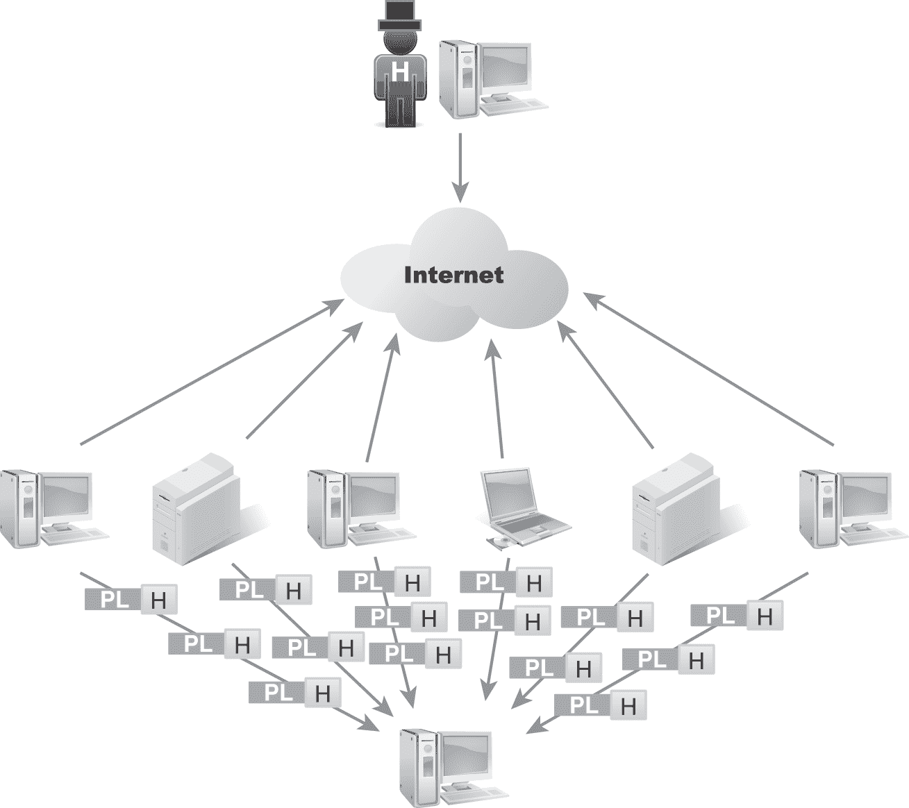

**图 2-13** 针对主要目标的分布式拒绝服务洪水攻击。

僵尸网络可执行各种恶意操作，包括洪水攻击、垃圾邮件发送、窃听、拦截、`MitM`、会话劫持、欺骗、数据包操纵、恶意软件分发、钓鱼网站托管、密码窃取、加密破解等。

在过去十年中，出现了多个僵尸网络，如 Storm 和 Conficker；据估计，这两个蠕虫的次要受害者基数达 7500 万至 1 亿个系统。

针对 DDoS 的防御侧重于避免成为次要受害者，或防范主要受害者遭受的猛烈攻击。为避免成为次要受害者，措施包括最新的防病毒和反恶意软件扫描、用户行为规范、防火墙过滤以及 `IDS/IPS` 解决方案。防范主要受害者遭受猛烈攻击的措施包括防火墙过滤、蜜罐、`IDS/IPS` 解决方案和 DDoS 缓解设备。DDoS 缓解设备是一种专用设备，用于检查进入网络的流量；它在允许合法流量通过的同时阻止攻击。混合解决方案将本地设备与云清洗服务相结合以过滤流量。

#### 黑客工具

黑客工具包括各种软件：从普通的原生操作系统实用程序、商业应用程序，到定制编码的漏洞利用代码。通常，任何被用于恶意或未经授权（根据公司安全策略）用途的软件都是黑客工具。黑客工具执行黑客活动。本章提到的所有漏洞利用概念都可以通过各种黑客工具和实用程序来实现。

不存在可供搜索或阻止访问以保护 IT 系统的黑客工具主列表。几乎所有合法程序都可被用于某些非法任务。为了总体上防御黑客工具，请考虑使用白名单限制系统。

白名单限制系统包含一份获授权使用的软件可执行文件列表。用户可以启动列表中的任何应用程序，但列表之外的所有可执行文件均可被阻止运行。白名单不能仅关注授权的文件名；此过程还使用哈希值，以防止黑客通过简单的文件重命名轻松绕过限制。除了白名单外，您还可以通过限制互联网下载和文件交换、控制便携式存储设备的使用（尤其是那些在外部系统上使用过的设备）、过滤电子邮件附件、安装 `IDS/IPS` 解决方案以及提供用户教育来降低黑客工具的威胁。

##### 社会工程学

社会工程学是通过操纵和利用人性，诱使人们执行任务或泄露违反安全规定的信息的技巧。由于人类的存在，社会工程学几乎总能针对目标组织实施。人类是社会工程学的主要目标。


##### 社会工程学

人类是大多数安全解决方案中最薄弱的环节，因为人类是组织中唯一拥有自由意志的要素。其他所有要素只能在其编程和设计范围内运行。此外，人类可能被欺骗或愚弄，而硬件和软件只能按照其设计和编程运行。社会工程学攻击可通过任何通信方式进行，包括面对面、电话、电子邮件、即时通讯（IM）和网站。社会工程学可能侧重于从目标处提取信息，或说服目标采取改变主机或网络安全状态的行动。

许多社会工程学攻击源于某种形式的关系，从最初的随意接触到商务专业往来，再到长期且高度深入的关系。关系越深入、持续时间越长，黑客就能利用越多的筹码来策反、欺骗或滥用目标。社会工程学可涉及多种技术，包括冒充权威职位、互惠利益、利用社会认同，以及通过稀缺性制造紧迫感。如果黑客能冒充内部人员，这些攻击往往会更成功。

获取内部信息通常是社会工程学攻击的第一要素。`垃圾箱搜寻`、侦察和`冷呼叫`是了解目标内部文化的技术。随着黑客掌握越来越多的术语、流程、组织架构、政策、事件、八卦、社交活动、日程安排、项目进度等，黑客就越能模拟内部人员。一旦目标被愚弄，相信黑客只是另一名员工，初步攻击即告成功。凭借获得的信任地位，黑客会操纵目标透露更多内部信息、重新配置系统，或从可疑的互联网位置下载工具。

社会工程学可能是黑客攻击的第一波浪潮，也可能是在逻辑入侵或物理闯入尝试失败时的最后备选方案。有些黑客天生擅长社会工程学，而另一些则必须通过练习才能获得实用的技能。这些社会工程学技能并非这种不道德活动所独有；相反，它们是大多数人在正常社交场合中试图达成目的、说服某人约会、寻求帮助、提升社会地位、摆脱麻烦、领导团队、销售营销、制作广告等时所使用的相同技能。区别在于黑客使用这些技能有着不道德的目的。

社会工程学主要针对人员，对典型的 IT 对策免疫。相反，防御社会工程学的最佳手段是彻底的用户培训和意识提升。一旦人员意识到他们是、曾经是、并且将会是攻击目标，他们就能采取略带怀疑和谨慎的态度。员工应以怀疑的态度评估任何看似奇怪或不合时宜的活动、问题、互动或关系。

您可以通过使用安全策略来降低社会工程学的威胁，这些策略采用信息分类并配合相关的通信方式限制。如果您限制特定类别信息所经过的通信渠道，就能减少由社会工程学导致的信息泄露。例如，如果您限制通过电话或电子邮件使用密码，那么任何请求密码的人显然都在试图违反安全规定。员工应接受培训，将所有此类请求报告给网络安全人员。

### 章节摘要

黑客始终在寻找机会，利用任何未做好准备或未妥善保护的人员或系统。了解黑客常用的各种攻击手段，能直接提高安全意识和整体网络安全水平。

黑客通常通过攻击个人和组织寻求经济利益。黑客可以是内部员工，也可以是外部人员。危机情况不仅限于黑客攻击，还可能包括事故、疏忽、硬件故障、快速扩张和恶劣天气。黑客工具和技术包括恶意软件、利用无线连接、窃听、重放、插入、分片、缓冲区溢出、XSS、中间人攻击、会话劫持、欺骗、隐蔽信道，以及 DoS 和 DDoS 可用性攻击。您应采取行动限制或阻止黑客工具，并利用谨慎和培训来避免社会工程学攻击。

除此处列出的攻击之外，还存在其他黑客攻击和技术。本章提供了黑客攻击过程的通用描述，而非权威或详尽的考察。然而，基于这一基础，您可以更深入地了解黑客攻击及黑客构成的威胁（以及其他威胁和风险来源），从而改进安全设计、策略和实施。

### 关键概念和术语

高级持续性威胁 (APT)

广告软件

代理程序

备用数据流 (ADS)

任意代码执行

ARP 欺骗

攻击

后门

横幅

横幅抓取

`Baud rate`（波特率）

僵尸程序

僵尸网络

破坏/违规

缓冲区

缓冲区溢出

芯片松动

簇

冷呼叫

命令外壳

合同工

隐蔽信道

跨站脚本 (XSS)

`Cryptocurrency`（加密货币）

DDoS 缓解器

拒绝服务 (DoS) 攻击

威慑

拨号器

不满员工

分布式拒绝服务 (DDoS) 攻击

DNS 投毒

DNS 欺骗

域名注册

垃圾箱搜寻

窃听

枚举

后备攻击

缺陷利用攻击

泛洪

足迹搜集

分片

分片攻击

黑客

黑客攻击

黑客行动主义

分层文件系统 (HFS)

`Hijack attack`（劫持攻击）

蜜罐

ICMP 重定向

IDS 插入

插入攻击

即时通讯 (IM)

有意电磁干扰 (IEMI)

拦截攻击

互联网中继聊天 (IRC)

击键记录器

精英语/黑客术语


# 术语表

- 逻辑炸弹
- MAC 欺骗
- 中间人攻击
- 最大传输单元 (MTU)
- 平均故障间隔时间 (MTBF)
- 平均故障前时间 (MTTF)
- 元字符
- MITRE
- 移动代码
- 中间猴攻击
- 美国国家标准与技术研究院 (NIST)
- 新技术文件系统 (NTFS)
- Nmap
- 非认证查询服务
- 机会主义黑客
- 分区
- 网络钓鱼
- Ping 扫描
- 回放攻击
- 端口扫描
- 权限提升
- 职业黑客
- 代理攻击
- 代理操纵
- 被攻破
- 勒索软件
- 侦察
- 娱乐性黑客
- 重放攻击
- 投资回报率 (ROI)
- 流氓接入点
- 流氓设备植入
- 流氓 DHCP
- Rootkit/根工具包
- 扫描
- 脚本小子
- 扇区
- 会话劫持
- Shellcode/外壳代码
- 特征码/签名
- 松散空间/Slack 空间
- 社会工程学
- 固态硬盘 (SSD)
- 垃圾邮件
- 欺骗
- 间谍软件
- SQL 注入
- 静电放电 (ESD)
- 陷阱门/后门
- 特洛伊木马
- 未分区空间
- 上游过滤
- URL 注入器
- 病毒
- 电话扫描/War Dialing
- 无线网络侦测/War Driving
- Whois
- 蠕虫
- 包装器/Wrapper
- 僵尸主机
- 僵尸网络/僵尸大军
- 僵尸阵列

### 第 2 章 测评

1.  哪类黑客构成最大威胁，因为他们很可能已拥有对目标的物理访问权限？
    1.  顾问
    2.  竞争对手
    3.  清洁工
    4.  客户

2.  大多数漏洞利用基于以下哪项的存在？
    1.  带宽速度
    2.  人类
    3.  过滤协议
    4.  系统异常

3.  黑客攻击过程的第一阶段或步骤是什么？
    1.  枚举
    2.  渗透
    3.  侦察
    4.  扫描

4.  哪种攻击形式捕获认证数据包以便稍后重传？
    1.  劫持
    2.  插入
    3.  中断
    4.  重放

5.  哪种攻击形式向目标提交过量数据以导致任意代码执行？
    1.  缓冲区溢出
    2.  分片
    3.  插入
    4.  中断

6.  哪种攻击基于对合法主机的冒充？
    1.  DoS
    2.  分片
    3.  劫持
    4.  欺骗

7.  哪种通信方式是不可见的、未经过滤的，且基于定时操纵？
    1.  缓冲区溢出
    2.  隐蔽信道
    3.  IDS 插入
    4.  中间人攻击

8.  哪种攻击使用非技术手段达到目的？
    1.  缓冲区溢出
    2.  隐蔽信道
    3.  社会工程学
    4.  SQL 注入

9.  黑客在目标系统中利用的是什么？
    1.  僵尸网络
    2.  漏洞
    3.  多因素认证
    4.  流量过滤

10. 如果其他尝试均未成功，黑客可能会发动以下哪种攻击？
    1.  缓冲区溢出
    2.  回退攻击
    3.  隐蔽信道
    4.  僵尸攻击


# 常见网络拓扑和基础设施

# 第 3 章

**计算机网络**允许组织共享信息和资源，以实现并提升员工生产力。用户无需亲自前往资源所在位置，如果所需项目（如文件、文件夹、软件程序、图像或视频）已加载到网络上，且请求该项目的用户拥有权限并获得管理员授予的访问权限，则该项目可以从用户的桌面上更快、更高效地访问。这简化了数据文件和资源的库存管理，并能增强通信与协作。网络还为重要信息提供集中存储，并使授权用户能够快速高效地访问这些信息。

网络规模可大可小，从几台设备到数千台互联的计算机、设备和外设。有些网络位于同一房间或同一建筑内，而另一些网络则跨越全球。非传统设备（包括游戏系统、智能手机和物联网 (IoT) 设备）均可连接，并可能构成一个网络。这些网络的构建方式，以及各网络在物理和逻辑上的布局与通信方式，即为网络的**拓扑**。

网络由不同设备组成，它们使用通用的寻址方案连接在一起；这样，每台设备都能被轻松访问，发往该设备的消息也能被快速投递。主要的寻址方法是使用互联网协议版本 4 (IPv4) 或互联网协议版本 6 (IPv6) 寻址。寻址决定了网络上的通信数据包如何由网络上的设备发送和接收。

### 第 3 章 主题

本章涵盖以下主题和概念：

- 常见网络拓扑，包括总线型、环型、星型、网状和无线
- 作为网络拓扑一部分的各种网络设备
- 物理拓扑与逻辑拓扑之间的关系
- IPv4 与 IPv6 的区别
- 网络基础设施示例

### 第 3 章 目标

完成本章后，您将能够：

- 描述常见网络拓扑——总线型、环型、星型、网状和无线——及其各自的优缺点
- 描述有线和无线配置的区别
- 区分物理拓扑和逻辑拓扑
- 识别各主要拓扑的扩展性顾虑
- 解释 IPv6 对现代网络的重要性
- 描述常见网络基础设施及相关安全顾虑

### 什么是网络拓扑？


### 计算机网络和网络设备

计算机网络是当今大多数企业的重要组成部分。无论该企业是小型家庭办公室还是跨国组织，计算机网络通常都能降低共享资源的成本和时间，并提高业务效率。了解计算机网络的运作方式对于理解如何保护此类网络环境至关重要。

在网络的语境下，术语拓扑是指通信网络元素的顺序和排列。拓扑常被描述为：如果打开屋顶，你能清晰地看到下面所有的计算机和外设连接在一起，计算机网络看起来就会像那样。计算机和网络外设的连接方式决定了网络上可使用哪些通信方法、需要什么硬件，以及是否存在冗余。

显然，从屋顶俯视建筑物内部并不容易，但你可以创建网络图和网络拓扑图，帮助理解现有的连接和通信路径。这些图表是排查网络问题和故障的重要工具，因为你预期发现的情况与网络实际配置方式之间的差异，往往就是需要解决或纠正的问题。

在继续介绍配置网络的各种拓扑选项之前，先定义网络中常见的不同类型的设备和设施是合乎逻辑的，这有助于使网络拓扑更易于理解。

#### 网络设备的类型

计算机和服务器（包括刀片服务器和专用计算机）通常位于网络上，但为了效率、隔离或安全，还有许多其他设备被使用。

集线器是一种汇聚或收集其他计算机和设备的线缆及连接的设备。通常，一台服务器支持不止几台计算机，这将要求每台计算机单独连接到服务器。大多数服务器并未配备足够的单独端口来适应这种类型的连接。集线器只需收集单独的物理线缆，并提供一个到服务器的单一连接（**图 3-1**），从而限制物理布线并简化连接。简单的汇聚集线器通常被视为哑集线器或无源集线器，因为盒子内部没有逻辑或电源——它只是线缆的汇聚点。

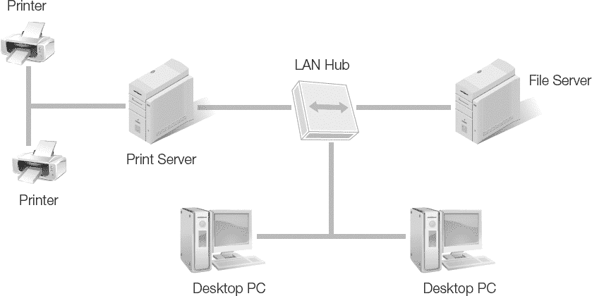

**图 3-1** 简单局域网上的集线器。

打线块，也称为打线面板，是集线器的一个例子，尽管它的形状不像传统的无源集线器。集线器是开放系统互联（OSI）第 1 层（物理层）设备，因为它将线缆物理连接到一个设备中。集线器是不加区分的，由于设备的直通行为，会发生许多数据冲突。进入入站端口的流量会被发送到连接到该设备的所有其他端口，无论数据是否打算发往该端口和连接的设备，这会产生额外的流量并占用带宽。

另一种类型的集线器是智能集线器或有源集线器。这种集线器内置了一些智能。这是市场上最常见的集线器，并且通常在产品命名规范中不包含“智能”或“有源”。这些设备的其他常用术语包括汇聚器和中继器。使用这些术语是因为这种类型的集线器通常在信号进入设备时对其进行汇聚，并且可以在信号离开设备时通过中继过程增强信号。

历史上，智能集线器包含一些简单的管理软件，使网络管理员能够执行基本命令并获取关于网络性能的统计数据，例如吞吐量度量、正常运行时间百分比、路由表条目以及其他用于故障排除和基准测试的有价值信息。许多相同的度量可以从网络上的各种服务器和设备执行。然而，因为集线器是一个汇聚点，通常由用户执行的信息汇聚由智能集线器代为完成。

>  **注意**
>
> 物联网家庭自动化中心更针对特定设备，与用于控制计算机网络的集线器类型不同。然而，物联网中心可以作为家庭网络上的一个设备来实现。

中继器是一种集线器，它通过逐位过程重建接收到的信号。它不放大数据；而是重建数据以传递它。此功能是必要的，因为网络电缆的长线段或无线设备之间的距离，其自然结果是信号可能变弱或退化。中继器通过以更强的信号强度提供新重构的数据包来防止数据丢失，以便它能继续通过网络到达目的地。有源集线器延长了设备或网络段之间的可用距离。

交换机是一种第 2 层（数据链路层）设备，它使用介质访问控制（MAC）地址来区分流量。典型的交换机如**图 3-2**所示。MAC 地址是在联邦通信委员会（FCC）指导下由制造商分配的唯一硬件标识号。网络上的每个节点都有一个网络接口控制器（NIC），它拥有唯一的 MAC 地址。因为交换机通过查看 MAC 地址来确定每个数据包的去向，所以不会发生冲突；数据包仅发送给预期的目标（如果存在）。如果目标地址不存在，数据包将被丢弃。交换机通常用于大型网络。它们成为网络中的一个连接点，因为它们在发送数据包给预期接收设备时会切换到正确的端口。交换机可以执行一些错误检查并丢弃任何检测到错误的数据包。

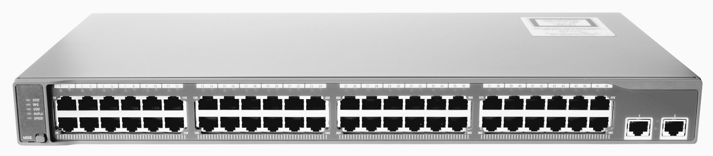

**图 3-2** 交换机。 ¶ © Vtls/Shutterstock

交换机通过硬件提供网络分段。跨越交换机，临时专用的电子通信路径连接会话的端点（如客户端和服务器）。这种交换路径防止了冲突。此外，交换机允许你通过通信利用网络连接的全部潜在吞吐容量，而不是像集线器那样因冲突而浪费 40% 或更多。请参见**图 3-3**。

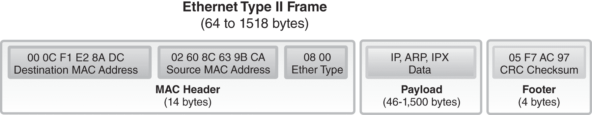

**图 3-3** 交换机部署示例。

一旦你检查此过程如何发生，就可以将交换机的这一基本功能视为一种安全优势。交换机在 OSI 模型的第 2 层，即数据链路层运行，MAC 地址在此定义和使用。交换机通过使用以太网帧中的源和目标 MAC 地址来管理流量。以太网帧是数据链路层（第 2 层）的一个逻辑数据集构造，由来自网络层（第 3 层）的有效载荷加上以太网帧头和帧尾组成（**图 3-4**）。

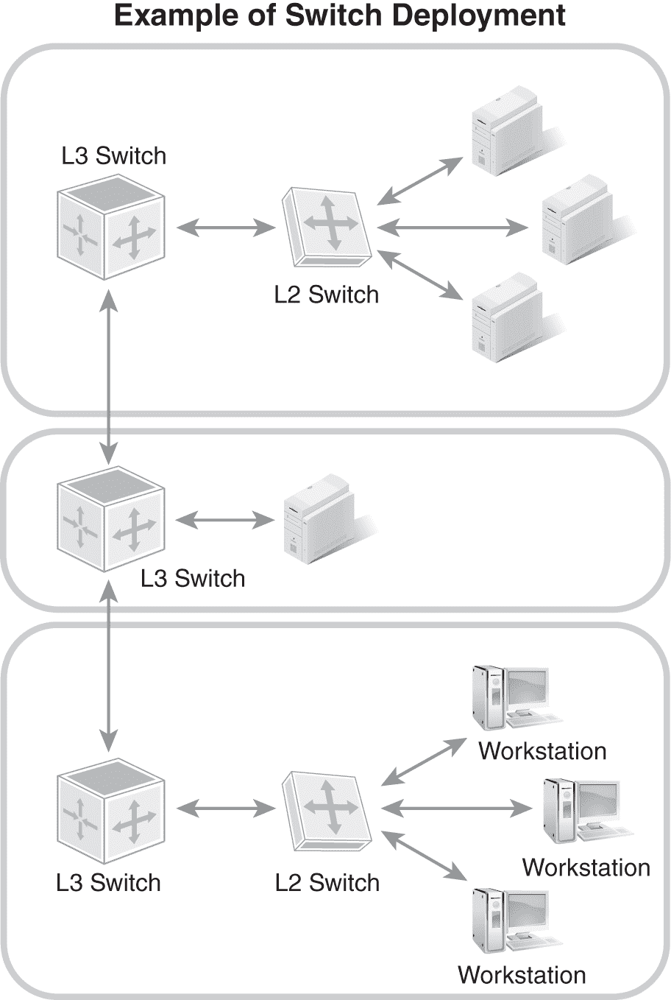

**图 3-4** IEEE 802.3 以太网类型 II 帧。


##### 交换机、路由器与网桥

###### 交换机工作流程

交换机采用四个主要程序，分别标记为“学习”“转发”“丢弃”和“泛洪”。

- **学习**：从帧头的源位置收集 MAC 地址。源 MAC 地址与接收该帧的端口编号一起存入映射表。
- **转发**：当帧的目的 MAC 地址出现在映射表中时发生转发。该表指导交换机从最初发现该 MAC 地址的端口发送帧。
- **丢弃**：如果帧要去往映射表指示的目的端口，而该端口正是接收帧的端口，则丢弃该帧。交换机无需将帧再传回其来源的网段。
- **泛洪**：如果目的 MAC 不在映射表中，交换机将回退到泛洪——即从每个端口发送帧——以确保帧有最大机会到达目的地。

通过监控交换机活动——具体来说，观察映射表的构建和修改以及帧头中 MAC 地址的变化——可以检测错误和恶意流量。智能或多层交换机或外部入侵检测系统（`IDS`）/入侵防御系统（`IPS`）服务可执行此安全监控功能。

当交换机程序失效时，网络将受损。这可能意味着吞吐量降低、导致拒绝服务（`DoS`）的阻塞，或允许黑客尝试修改或窃听的流量重定向。幸运的是，此类攻击在产生大量异常网络流量方面是“吵闹”的，使得使用基本安全传感器更容易检测。仅这一优势就是使用交换机而非集线器的重要理由。

#### 路由器

路由器 是一种有线或无线设备，使用第 3 层（网络层）Internet 协议（`IP`）地址工作（参见 **图 3-5**）。这些地址用于标识和移动发往 Internet 并从 Internet 接收的数据包。路由器通常位于网络的不同段之间，允许段间连接并将流量从一个段路由到目标段。路由器有若干合并端口，以及一个连接到 Internet 或最终连接到 Internet 的网段的端口。合并的路由器端口接收多个数据流并将它们合并以发送到网络的各个部分。路由器最常用于连接网络或网段，以简化数据包传输过程。

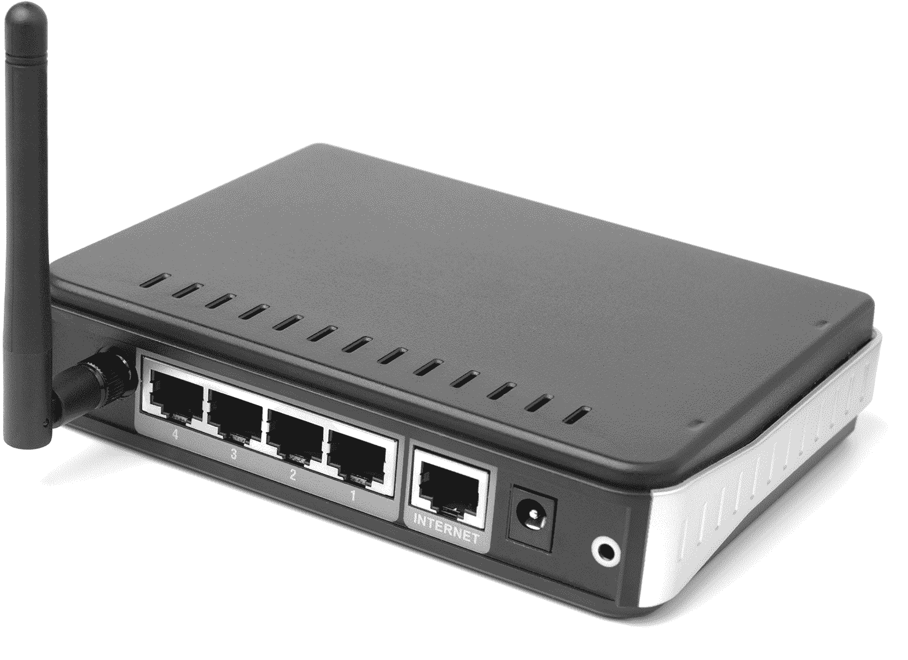

**图 3-5** 无线路由器。 ¶ © Natalia Siverina/ShutterStock, Inc.

##### 注意

嗅探器，也称为数据包分析器、网络分析器和协议分析器，是一种捕获网络通信以进行调查和分析的软件实用程序或硬件设备。为帮助防止基础设施级攻击，请确保路由器使用身份验证来交换路由数据，并防止未经授权的物理访问。

路由器的主要目的是沿当前已知最佳可用路径将流量导向其既定目的地（参见 **图 3-6**）。`RIP`、`OSPF`、`IGRP`、`EIGRP`、`BGP` 等路由协议根据各种度量动态管理路由选择。路通过引导流量走首选路由（而非在逻辑或物理上可能不那么安全的路由）来支持安全性。如果黑客能诱骗路由器改变传输路径，网络流量可能会遍历黑客放置了嗅探器的网段。

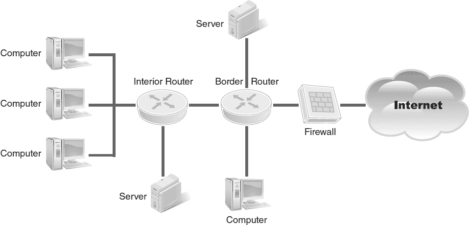

**图 3-6** 路由网络部署示例。

尽管在某些情况下交换机和路由器可互换使用，但最常见的做法是：在 Internet 连接前放置路由器，在不同计算机群组之间的连接处使用交换机。路由器过去比交换机慢，但现在已不再如此。近期上市的产品提供与交换机相同的速度和性能。

###### 网桥

网桥 是一种第 2 层（数据链路层）设备。该设备的作用类似智能集线器或中继器，但包含基于 MAC 地址过滤数据包的能力，允许在使用相同通信协议的两个局域网（`LAN`）之间建立连接。与集线器、路由器和交换机不同，网桥只有两个端口，因为该设备仅连接两个 LAN。

网桥通过在网络间创建路径或路由来连接网络，仅当通信的目的地实际位于网桥对面的对向网络上时才使用该路径。一个类比是：一座城市被河流一分为二。当该城市的人想访问河流同侧的地点时，无需过桥即可到达。

网桥也是如此。网桥的工作方式与交换机类似，它们使用几个基本程序来管理流量。当你需要一个简单的“仅在需要时使用”的链路，而不需要路由器、交换机或防火墙的复杂性时，可使用网桥连接网络、网段或子网。

网桥使用学习、转发和丢弃过程。通过这些过程，只有发往对向网络上目的地的流量才会穿越网桥到达该网络。所有发往接收端同侧目的地的流量将被丢弃，因为该流量已在正确的网络上。参见 **图 3-7**。除协议外，网桥还可连接基础设施大多数方面存在差异的网络。这包括不同的拓扑、电缆类型、传输速度，甚至有线与无线。

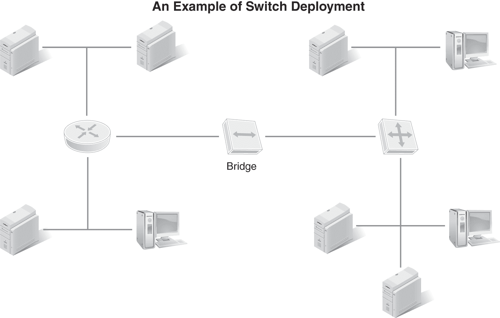

**图 3-7** MAC 层网桥部署示例。

你可以使用网桥检测交换机所能检测的同类流量滥用。此外，网桥和交换机都可对 MAC 地址实施过滤。此处可使用黑名单或白名单概念：允许除黑名单/阻止列表上的流量外的所有流量，或阻止除白名单/允许列表上的流量外的所有流量。

你可以安排在路由器、交换机和网桥上记录活动。你应定期查看流量日志，通常与防火墙和 `IDS`/`IPS` 日志保持相同的时间表。你将在这些通常不被视为安全设备的常见网络设备中发现滥用、入侵、拒绝服务、网络消耗、未经授权的流量模式等迹象。在大型网络中，最好拥有自动化监控解决方案，因为日志根据网络上发生的操作实时生成。跟上新条目和异常可能非常困难。

存在两种类型的网桥：透明网桥和源路由网桥。在透明网桥中，连接的 LAN 以及每个 LAN 上的单个设备都不知道网络上有网桥。它通常无缝工作，因此对实际用户或设备是透明的。这对网络管理是一大益处，因为每个 LAN 上的设备无需配置即可识别网桥。


##### 网络设备与拓扑

###### 源路由网桥

在源路由网桥中，路由基于发现帧的使用而发生，该帧遍历网络以确定通往预期目的地的所有可能路径，然后选择最佳路径使用。这会导致额外的网络流量，但通常能实现更快的数据包传输。在一天的时间里，网络上的流量可能会根据请求的资源和访问的用户而发生剧烈变化。由于发现帧在实际数据包发送前立即发出，因此始终会选择最优路由。

###### 网桥路由器

网桥路由器是`bridge`（网桥）和`router`（路由器）的组合，也可称为桥接路由器。该设备同时执行网桥和路由器的功能，即它可以有效地将数据包路由到网络的不同段，并作为网桥将这些数据包发送到不同的网络。根据在网络上执行的具体功能，该设备可以在第二层（数据链路层）或第三层（网络层）工作。

###### 网关

网关是一种连接两个使用不同通信协议网络的设备（**图 3-8**）。网关类似于网桥，并可充当网桥；然而，由于使用了不同的协议，网桥无法充当网关。该设备本质上从一个网络中获取特定协议的数据包，并将这些数据包转换为接收网络的协议。由于这一动作，该设备有时被称为协议转换器。

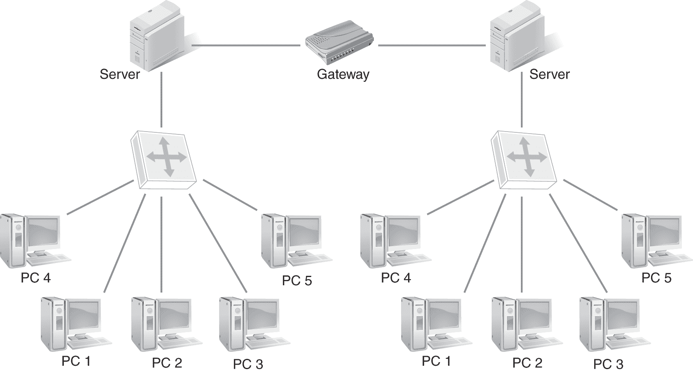

**图 3-8** 连接两个网络的网关。

####### FYI（供参考）

调制解调器最初是指将计算机的数字信号转换为传统电话线上的模拟信号以便传输信息的设备。该术语源自 `mod`ulate（调制）和 `dem`odulate（解调）两个词，以表明数据在该过程中经历的转换。调制解调器用于通过电缆、光纤或传统电话线连接到互联网服务提供商 (ISP)。

历史上，路由器和调制解调器是执行不同网络环境任务的不同设备。如今，可以购买同时提供这两种功能的设备。尽管电话连接在大多数环境中很少使用，但术语 `modem` 仍用于指代有线电视公司提供的、将电视、计算机和视频接入引入家庭的设备。

### 什么区分了逻辑拓扑和物理拓扑？

计算机网络的排列方式包括每台设备的物理连接方式，即物理拓扑（有线或无线），以及逻辑方式，涉及资源如何被隔离和分配。所有计算机网络都有物理和逻辑拓扑，且这两种拓扑可能相似。从用户角度来看，除非用户无法访问完成任务所需的资源，否则这两种拓扑都无关紧要。

由于将拓扑视为计算机和设备连接方式最为容易理解，让我们先介绍有线拓扑。有线拓扑在设备之间有物理线缆，允许这些设备间进行通信。路由是通信数据包在网络有线连接中传输的路径。如果没有适当的文档辅助网络管理员或工程师，网络通信的路由并不总是容易被识别或管理。网络设备（包括路由器、交换机和网关）可能会改变看似简单直接的通信路径，以更好地平衡通信负载，或限制对某些设备或网络部分的访问。

逻辑拓扑是网络从任何设备或用户视角呈现的样子，它更多由策略和访问权限而非物理连接决定。不要想着计算机和组件如何在物理上排列，而应将逻辑拓扑视为这些计算机如何访问和共享数据及资源。它可能与设备的物理连接几乎没有相似之处。

无论是识别物理还是逻辑拓扑，都应牢记某些要素。在规划网络安装或升级，或扩展（无论是扩大还是缩小）时应尽职尽责，以确保选择合适的物理和逻辑拓扑来支持业务需求。这两种拓扑都应在安全策略和独立的网络文档中清晰记录，以便网络管理员和工程师在排查网络问题时能够访问。

#### 物理拓扑类型

##### 总线拓扑

总线拓扑被视为线性网络，因为计算机呈一条线排列（尽管不一定是直线）。请参见**图 3-9**。拓扑中的每台计算机或设备都连接到排在它后面的计算机或设备。实际配置可能是波浪形的（在办公空间中穿行于上下排的计算机之间）或呈圆形，尽管它不是环形或圆形，因为两端永不相连。总线拓扑要求在物理电缆的每一端放置称为终端器的设备。终端器防止线路上的信号来回反弹。

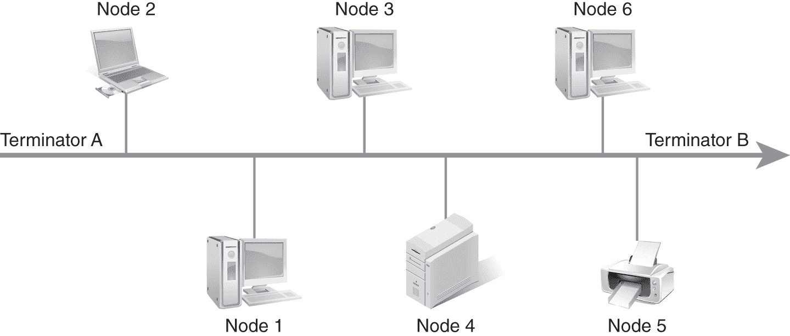

**图 3-9** 总线拓扑。

在这种拓扑中，单根电缆用作网络的主干。属于该网络的计算机和设备连接到该电缆。这种网络拓扑在家庭办公室和小型企业环境中更易于实施和故障排除，但通常较慢，尤其是当网络上有超过 10 台设备时。当总线拓扑中的某个系统发生故障时，整个网络都会瘫痪。

网络中的连接问题会影响总线配置中连接到网络的所有其他计算机和设备。随着网络上计算机和设备数量增加超过 10 台，采用总线拓扑的网络通常更容易出现性能问题。布线也有长度限制——数据包离起点越远，信号衰减越严重。中继器通常能解决部分长距离问题，但如果无法达到预期的吞吐量质量，可增加无线网络以覆盖更远距离。然而，布线和安装比其他配置更容易且通常成本更低，这也是总线拓扑成为小型办公室/家庭办公室安装中最常见网络设计的原因。总线网络的另一个优势是相对容易扩展网络至最大设备数量，或移除设备以缩减规模。


# 网络拓扑

##### 环形拓扑

环形拓扑使用一种闭合的布线方案；也就是说，它将电缆/网络的一端连接到另一端以形成一个环（参见**图 3-10**）。每台计算机或设备连接到两个设备，每侧各一个。这种拓扑需要一种称为令牌的特殊数据包，类似于童年游戏中的“接力棒”，只有持有接力棒的人才能通信。令牌的使用是这种拓扑常被称为“令牌环”的原因。因为这种网络方案使用令牌来控制对网络电缆的访问以进行通信和传输，所以它比其他物理拓扑遇到的数据冲突问题更少；然而，当网络上的多个设备尝试同时通信时，它仍然会经历速度变慢的情况。当网络上有大量节点时，环形网络通常使用中继器。

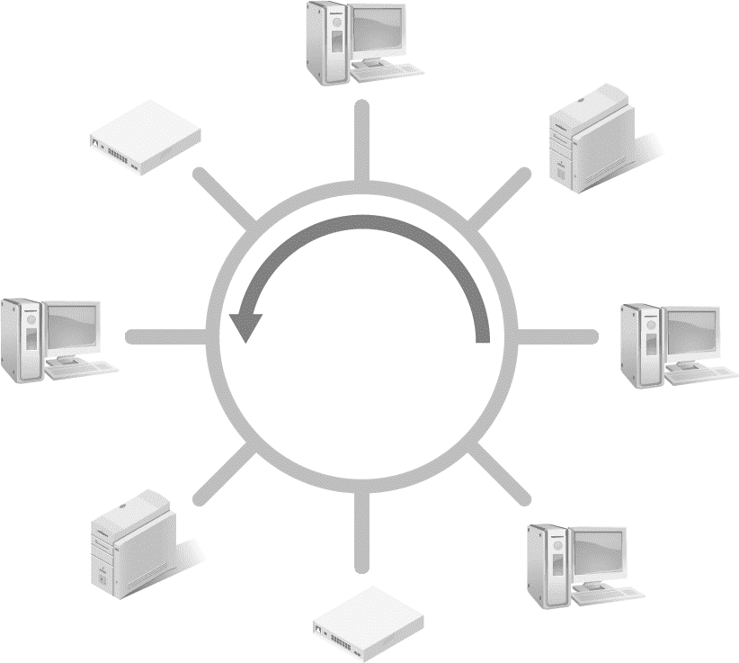

**图 3-10** 环形拓扑。

如果环形网络是单向的，这意味着令牌仅沿环单向移动，则可能会出现延迟。在令牌按顺序移动到环上的下一个设备之前，网络上的每台计算机和设备都会被轮询（询问或查询）是否有数据包要发送。

双向环要求每个设备有两个连接，并提供单向令牌环网络中不可用的冗余。这种类型的环为令牌在任一方向上移动提供了完整的布线设置。这意味着它实际上不是一个双向环；它是两个独立的环，每个环朝不同的方向。

本质上，环形网络在相反方向上实现了两次。由于增加了第二个网络，等待时间不一定减半，但它比单环是一个更快的通信系统。成本是许多类型环形网络的阻碍因素，故障排除更加复杂，因为管理员必须首先确定哪个网络正在经历问题。

双向环的优点包括由于整个网络的复制而带来的冗余。然而，如果一台计算机宕机，整个网络有可能在两个方向上都宕机。由于跨两个环网络的负载均衡，速度潜在地得到了改善，但如果网络处于满负荷状态，用户仍然会感觉缓慢。令牌在每个网络上也不是直接相对的。令牌通过轮询过程工作。轮询每个设备以确定是否有通信数据包要跨网络发送。如果没有，令牌移动到环中的下一个设备。如果有数据包要发送，该设备发送这些数据包，然后令牌按顺序移动到下一个设备。根据发送的数据量，系统运行速度可能比预期慢。

##### 星形拓扑

星形拓扑（如**图 3-11**所示）提供了一层总线或环形拓扑中不存在的性能保护。网络设计为每个设备提供一根独立的电缆。这种配置通常比总线或环形拓扑使用更多的布线，但它受益于每个布线段的独占使用。如果一个段被破坏，通常不会导致整个网络瘫痪。因为通往每个设备的电缆与其他设备隔离，所以它提供了针对元件损坏的冗余。但它并不为所有设备提供完全冗余，因为受影响的设备在问题解决之前将无法连接到网络。

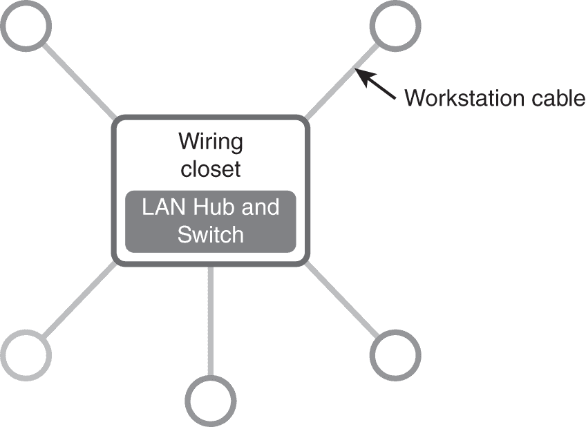

**图 3-11** 星形拓扑。

这种设计的常见视觉形象是一个圆圈，从中心向四周设备发出线条。这使得图像类似于车轮的辐条或派的轮廓切片。在应用中，“辐条”不需要延伸到所有侧面。常见的形状更像乌贼，服务器和集线器在顶部，触须状的电缆垂下到每个设备。无论哪种方式，中央“集线器”和通往每个设备的隔离电缆的存在都标识了该拓扑，即使物理设计与星号几乎没有相似之处。星形拓扑比总线拓扑更具容错性，因为每根有线线路的独立性允许一个或多个设备失去连接；其余设备保持与网络其余部分的连接。

##### 网状拓扑

网状拓扑是有线拓扑中冗余性最高的，因为该设计为设备提供隔离，并在网络段不再运行以允许通信时提供冗余。网状拓扑可以以两种形式实施：全连接和部分连接。在全连接网状网络中（**图 3-12**），所有设备都连接到所有其他设备。这基本上意味着网络上的每个设备前面都有一个集线器来促进和简化连接。

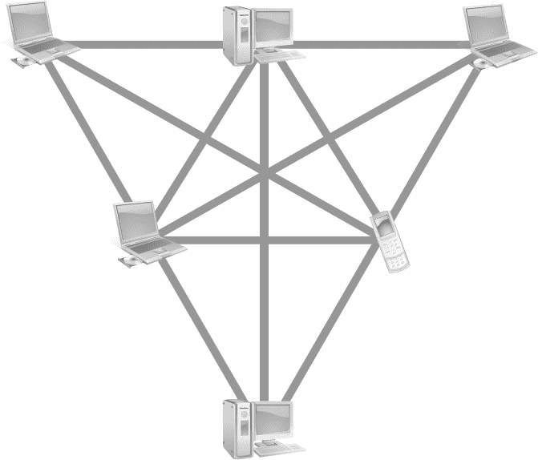

**图 3-12** 全网状拓扑。

一种更常见且成本较低的方法是部分连接网状网络（**图 3-13**），其中所有高需求、资源密集型设备具有冗余连接，但并非每个设备都连接到每个其他设备。在这种网状拓扑的应用中，每个区域的所有服务器和主系统都有冗余。例如，在一所提供在线课程的学校中，主服务器之间将具有冗余线路，托管在线课堂环境的在线学习管理系统（LMS）将连接到其他几个服务器和设备。如果一条通往互联网的路径不可访问，将会有其他路径，因此课堂环境仍可供学生使用。这在企业的关键任务领域和军事中很常见，因为通信对生存至关重要。

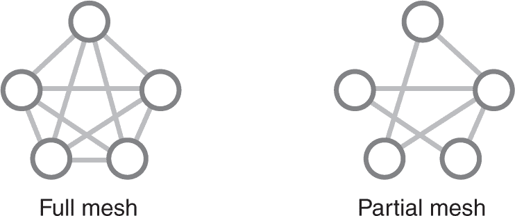

**图 3-13** 部分网状拓扑与全网状拓扑的对比。

##### 无线拓扑

无线拓扑有点名不副实。在无线安装中，几乎没有电线，因为设备使用空气作为通信数据包交换的介质。某些区域可能存在一些布线，这些区域需要额外的冗余，以便有线和无线在一种方法无法正常工作时提供替代方案。无线网络拓扑中至少有一个无线路由器。这是允许互连和访问互联网的连接点。参见**图 3-14**。

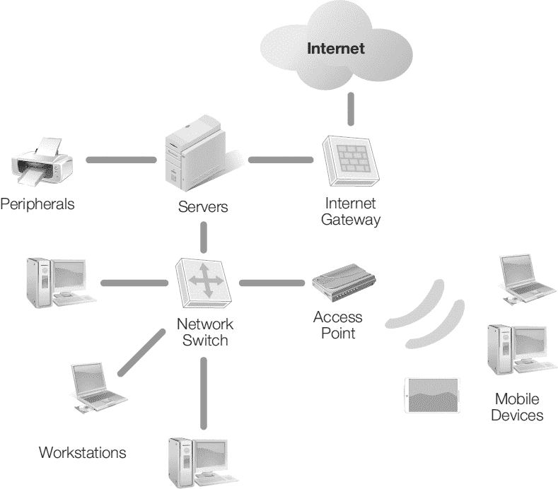

**图 3-14** 无线网络拓扑。

#### 逻辑拓扑


##### 逻辑网络

所有网络的本质都是设备之间的通信，但逻辑网络更多地关注连接和权限，而非物理布局。在典型的办公环境中，员工可能因为工位距离较近而能在工作时相互看见。然而，计算机却可能无法检测到其他计算机和设备的存在。实施逻辑网络对于职责分离和访问控制非常重要。通常，负责推销组织产品或服务的员工，并不是完成组织薪资发放或支付账单的同一个人。这些工作职能通常由两个或更多的人完成，他们通常不会访问相同的程序和工具。**图 3-15** 展示了一个逻辑拓扑的示例。

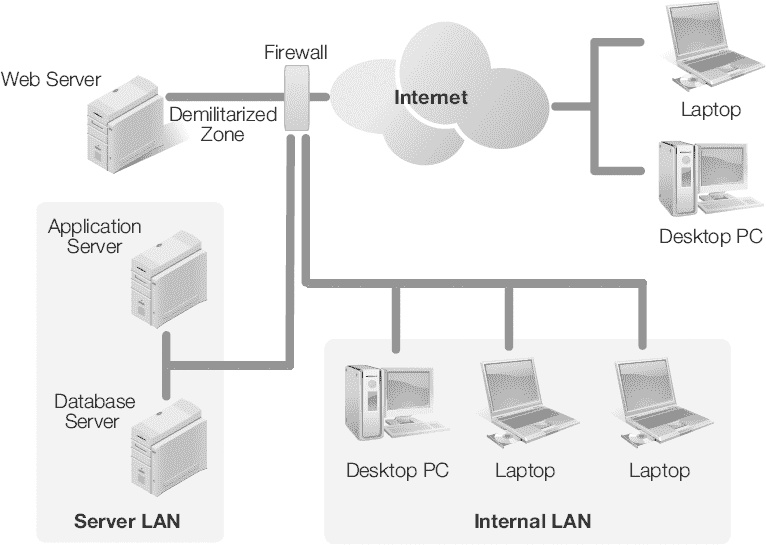

**图 3-15** 一个逻辑拓扑。

对于全公司都需要访问的工具（如电子邮件），应向所有员工授予访问权限。对于其他资源（如薪资应用程序或库存管理），仅向因工作职责需要访问这些程序的员工授予对这些系统的访问权限。如果每个部门或分部有多名员工，可以通过使用模板或组来授予访问权限。

如果网络设置正确，逻辑网络通过仅允许需要此类访问的个人和设备进行访问，从而限制对数据和资源的访问。这种分段可防止员工意外访问、篡改或删除信息。分段通过支持最小权限和职责分离，有助于满足法律合规要求。当拒绝无合法需求的人员和系统访问网络资源时，也有助于减缓或阻止恶意软件的传播，因为受感染的系统或账户无法将恶意软件传播到其权限范围之外。

逻辑网络还有助于隐藏资产，因为并非所有设备都能看到或访问网络上的每个资产，只能访问被授予权限的资产。当有多台服务器执行相同功能（如 Web 服务器负载均衡）时，这非常有用。限制访问还可能限制通过特定路径和通信通道的网络流量，或将流量重定向到更优的连接流。如果因限制对特定段的访问而使网络流量和通信显得更快，这种变化有助于提升网络性能——或对网络性能的感知。

尽管使用逻辑网络拓扑有许多好处，但在实施前仍需考虑一些缺点。逻辑网络会使网络扩展（通过添加或移除设备使其变大或变小）变得复杂，因为设备的放置位置并不意味着被授予的权限。从视觉上识别出设备距离很近，并不意味着这些设备彼此拥有访问权限或能识别对方的存在。这会使故障排查变得复杂，因为网络工程师不能依赖网络的外观；他们必须了解逻辑路径和访问权限，才能确定问题所在。授予权限和拒绝访问的需求是一个复杂的过程，要求彻底了解网络应如何运行。使用模板或组有助于这项工作，但通常仍需针对单个账户或系统授予自定义访问权限。未能正确记录或实施访问控制，可能会抵消最初分段带来的任何好处。利用逻辑网络策略限制访问和隐藏资产时，也可能产生虚假的安全感；人们可能认为仅靠此策略就足以提供保护，而忽视了更新网络安全计划所有要素的必要性，例如打补丁、定期审查账户和访问权限，以及移除任何不必要的便利措施。

##### 创建逻辑拓扑

创建逻辑网络主要有两种方法：子网划分和 VLAN 划分。**虚拟局域网 (VLAN)** 在 OSI 第 2 层（数据链路层）创建，而子网划分发生在 OSI 第 3 层（网络层）。

**VLAN** 是逻辑网络的一个示例。**VLAN** 可以由来自不同 **LAN** 的设备创建，这些设备的功能就像它们位于同一个网络上一样（**图 3-16**）。在许多应用中，关于 OSI 层的逻辑网络创建方式是相同的，但也可以构建与第 2 层和第 3 层不匹配的网络。从物理网络配置到子网的流量确实会创建一个使用相同交换机的逻辑网络，这可能会降低流量速度。如果为每个逻辑网络使用 **VLAN**，交换机的负载会得到缓解，因为流量不会从一个 **VLAN** 穿越交换机到达另一个 **VLAN**。

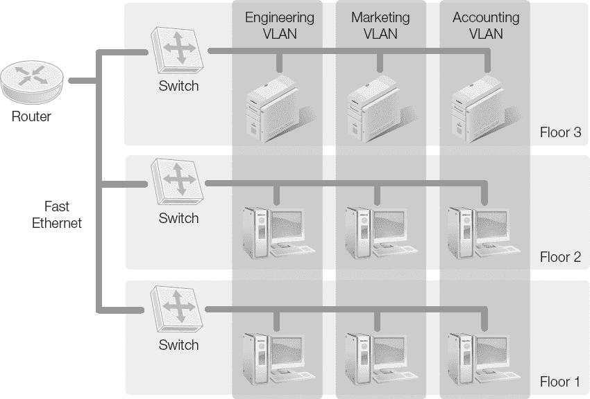

**图 3-16** VLAN 是网络上的逻辑分区，基于逻辑关联而非与交换机的物理连接来定义主机分组。

将网络逻辑分段为较小的组以管理访问和资源的过程也称为子网划分。**子网划分** 是将一组 IP 地址分解为较小子集的过程，以便更好地识别网络上的系统并分配资源。将计算机和设备集合按部门或区域隔离是子网划分的常见用途。这样，特定范围内的所有 IP 地址都将分配给具有共同目标、位置或需求的组。

对于 **IPv4**，在非常大的网络中，子网划分是必要的，因为可用的 **IPv4** 地址不足以给每个设备分配一个。通过子网划分，可用地址池得以扩展，允许更多设备并发访问网络。这通过应用子网掩码来实现，子网掩码适用于特定类别的寻址。地址类别区分了地址的用途。用途包括公共、私有、实验和多播（即单个主机向多个网络设备发送消息）。在全球范围内，IP 地址由 **互联网号码分配局 (IANA)** 管理。

**IPv6** 不需要使用子网划分来扩展组织可用的 IP 地址池，因为该方案下可用的地址多得多。虽然不再受制于扩展可用地址的需求，但出于限制访问、最小化恶意软件访问、法律合规和其他业务原因，逻辑网络隔离仍然很重要。**IPv4** 和 **IPv6** 将在接下来详细介绍。

### 互联网协议版本 4 (IPv4) 与互联网协议版本 6 (IPv6) 的区别

**IPv4** 作为互联网上的主要协议已使用近三十年。它最初于 1981 年在一项称为 **RFC 791** 的技术规范中定义。**IPv4** 是一种无连接协议，运行在 **OSI** 模型的网络层（第 3 层）。**IPv4** 是当今 **TCP/IP** 协议套件的基础。


#### IPv4 和 IPv6

IPv4 的设计基于若干假设，其中许多已被证明不准确、严重高估或根本不适用。虽然 IPv4 一直是互联网上的主要协议，但其替代者早已迟到了。一些关键问题包括仅 32 位的耗尽地址空间、子网划分的复杂性以及缺乏集成安全性。随着网络地址转换（`NAT`）、无类别域间路由（`CIDR`）和互联网协议安全（`IPSec`）的出现，其中一些问题已得到缓解。但尽管有这些进步，IPv4 正在被 IPv6 取代。

#### IPv6

IPv6 于 1998 年在 RFC 2460 中定义。新版本专门设计为 IPv4 的继任者，主要是由于其可用性不断减少，这在 1990 年代末就已预见。IPv6 使用 128 位地址，比 IPv4 的 32 位寻址大得多。**图 3-17** 对比了 IPv4 地址和 IPv6 地址。


**图 3-17** 对比典型的 IPv4 地址和 IPv6 地址。

##### 注意

如果 IPv6 地址有一个或多个连续的全零四位段，这些零段可以省略并用双冒号替代。例如：`2001:0f58:0000:0000:0000:0000:1986:62af` 可缩短为 `2001:0f58::1986:62af`。但是，如果有两组零段，只能用双冒号替代其中一组。

##### 技术提示

IPv4 和 IPv6 地址的分配由一个名为互联网号码分配局（`IANA`）的全球组织的下属机构负责。要了解更多关于 `IANA` 的信息，请访问 [`www.iana.org`](http://www.iana.org)。在美国，下属机构是美国互联网号码注册中心（`ARIN`）；更多信息请访问 [`www.arin.net`](http://www.arin.net)。

此外，子网划分、地址分配和数据包头部的变更，以及更简单的路由处理，使 IPv6 比其前身更受青睐。IPv6 的一些优势包括：

*   **地址空间增加**—IPv6 为网络设备支持 340 亿亿亿亿（即 1 后跟 36 个零）个 IP 地址。
*   **路由更高效**—IPv6 的路由功能得到了增强。
*   **管理需求降低**—作为一种更健壮的协议，IPv6 需要的管理更少。相比之下，IPv4 因协议推出后增加的需求而需要大量管理。
*   **为所有类型的应用程序提供更好的服务质量（QoS）支持**—QoS 支持内置于 IPv6 中，而在 IPv4 中它是附加组件。
*   **安全性**—IPv6 包含原生信息安全框架（`IPSec`），为数据包和控制包提供保护。
*   **支持有或无 DHCP 的即插即用配置**—IPv6 允许主机在连接到 IPv6 网络时，通过向本地路由器发送组播消息进行自动配置。如果路由器配置正确，将发回包含适当配置信息的响应。如果此机制不适合特定环境或应用程序，则可使用 IPv6 版本的 `DHCP`。它也支持静态配置。

目前存在三种从 IPv4 向 IPv6 过渡的机制。重要的是要理解，当 IPv6 标准出现时，预期这两种协议需要在网络中共存 20 到 30 年，以允许渐进的过渡期。迁移策略包括：

*   **双栈**—采用此过渡方案，IPv4 和 IPv6 协议栈在同一终端或网络设备中共存。这允许网络使用两种协议进行通信，但会给网络基础设施增加显著的开销。
*   **隧道**—此方案允许两个 IPv6 主机通过 IPv4 网络创建隧道，在两个 IPv6 主机之间传输流量，反之亦然（随着 IPv4 的逐步淘汰）。这可能会增加显著的配置开销。
*   **翻译**—此方案使 IPv4 主机能与 IPv6 主机通信。此方案将需要额外开发，因为目前 IPv6 不包含此功能。

####### IPSec 和 IPv6

`IPSec` 是 IPv6 的强制组件，用于在数据通过网络发送时原生保护 IPv6 数据。IPv6 中 `IPSec` 的组件与 1990 年代以来业界一直在使用的 IPv4 中的 `IPSec` 没有显著差异。在 IPv6 中，`IPSec` 使用认证头（`AH`）和封装安全载荷（`ESP`）扩展头。

IPv6 `IPSec` 是一组互联网标准，它使用加密安全服务提供以下功能：

*   **机密性**—`IPSec` 流量经过加密，没有适当的加密密钥无法解密。由于它是协议的原生组件，因此在 IPv6 中结合使用应更容易。
*   **数据源认证**—IPv6 `IPSec` 使用包含共享加密密钥的加密校验和，以便接收方验证数据确实由表面上的发送方发送。这可防止事务欺骗。
*   **数据完整性**—接收方可使用加密校验和验证数据包在传输过程中未被修改。

您可以在 RFC 2460 的 [`http://tools.ietf.org/html/rfc2460`](http://tools.ietf.org/html/rfc2460) 中找到更多关于 IPv6 的信息。

### TCP/IP 协议族

TCP/IP 协议族由大量协议组成，定义在一系列 RFC 中。TCP/IP 协议族中的每个协议提供不同的功能，共同提供称为 TCP/IP 的功能。

TCP/IP 协议族的名称源自套件中的两个主要协议：`TCP`（传输控制协议）和 `IP`（互联网协议）。`TCP` 负责提供从一个系统到另一个系统的可靠传输，`IP` 负责寻址和路由选择。`IP` 定义了计算机如何通过网络通信。

出自 Harwood, Mike. *Comp TIA Network+ N10-004 Exam Prep.* Pearson Education.

### 网络基础设施示例及相关安全关注点

在设计网络时，您需要从安全后果的角度评估各个方面。在预算、人员和时间有限的情况下，您还必须将风险降至最低，将防护最大化。请考虑以下每个网络安全方面如何影响大型企业、小型公司甚至家庭企业的安全。

#### 工作组

**工作组** 是一种网络形式，其中每台计算机都是对等的或平等的。对等体在任何一个系统对同一工作组其他成员拥有多少权力或控制权方面是平等的。所有工作组成员都能管理自己的本地资源和资产，但不能管理任何其他工作组成员的资源和资产。

工作组是非常小型环境（如家庭网络或极小型公司）的绝佳网络设计。在大多数情况下，工作组包含少于 10 台计算机，很少超过 20 台。没有单一规则规定工作组的大小。相反，较大工作组的管理开销促使网络管理人员转向客户端/服务器配置。

工作组没有控制或限制网络活动或资源访问的中央权威机构。相反，每个工作组成员各自制定资源和资产的规则和限制。为一个成员定义的安全性不适用于工作组中的任何其他计算机，也不影响它们。


##### 典型工作组配置

**图 3-18** 展示了一个典型的工作组配置。在该示例中，一台交换机互连了四台桌面工作组成员，以及一个互联网连接设备和一个无线接入点 (WAP)。其他客户端可通过接入点无线连接，或通过连接到交换机的网线有线连接。

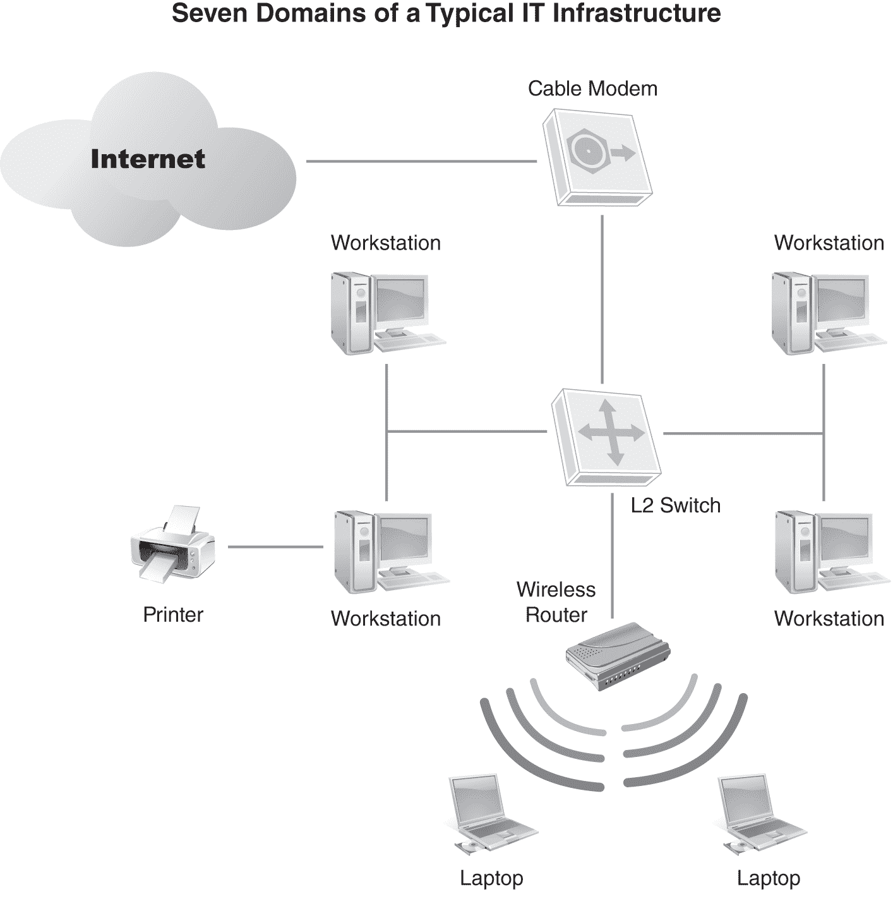

**图 3-18** 典型工作组示例。

由于基于系统的安全模型，工作人员或工作组成员需要在其他每个工作组成员的系统上都定义一个用户账户，才能访问那些系统上的资源。即使使用相同的字符创建用户名和密码，这些账户在技术上也是唯一的用户账户。

这导致要么出现多个用户名和密码均不同的唯一用户账户，要么出现多个用户名和密码均相同的唯一用户账户。无论哪种情况，安全性都很差。前一种情况下，用户必须记住多组凭据，这往往导致用户将凭据记录下来。后一种情况下，入侵者只需破坏一组凭据即可。

缺乏中央认证机构既是工作组的优势也是劣势。优势在于每台计算机的每个用户都可以自主决定与他人共享资源；劣势在于会导致不一致的访问级别。

工作组易于创建。通常，操作系统的默认网络配置就是加入一个工作组。在一台计算机上定义一个唯一名称即可创建新工作组。一旦一台计算机命名了该工作组，该工作组就已存在。其他计算机只需使用相同的工作组名称即可成为新工作组的成员。由于工作组缺乏中央权威，任何人都可以随时加入或离开工作组。这包括流氓员工或外部人员拥有的未授权系统。

大多数工作组仅使用基本的资源共享保护，未使用加密协议，且对入侵或入侵尝试的监控松懈。虽然可以对工作组实施一定的安全措施，但通常需要单独配置每个工作组成员。幸运的是，由于工作组规模较小，这不代表大量的工作量。

#### SOHO 网络

SOHO（小型办公室/家庭办公室） 是一个通用术语，用于描述常见于小型企业的较小型网络，通常部署在某人的家中、车库、活动板房或租赁办公空间内。SOHO 环境可以是工作组，也可以是客户端/服务器网络。通常 SOHO 网络意味着考虑了业务和安全的有目的设计。

SOHO 网络通常比典型工作组更安全，主要因为管理者或所有者会强制执行网络安全。当工作组有安全管理员时，为每个工作组成员定义的安全设置更有可能保持一致。此外，SOHO 网络更有可能采用安全工具，如防病毒软件、防火墙和审计。

#### 客户端/服务器网络

客户端/服务器网络 是一种网络形式，其中指定某些计算机作为服务器，其他作为客户端。服务器托管与网络共享的资源。客户端访问资源并执行任务。用户从客户端计算机工作，以与服务器托管的资源进行交互。在客户端/服务器网络中，访问从服务器集中管理。因此，可以轻松地在所有网络成员中实施一致的安全性。

**图 3-19** 展示了客户端/服务器网络的一种可能的基本布局。在该示例中，三台服务器托管资源，如打印机、互联网连接和文件存储，并与网络共享。支持有线和无线客户端。交换机互连所有节点。客户端/服务器网络更有可能使用硬件或设备防火墙。

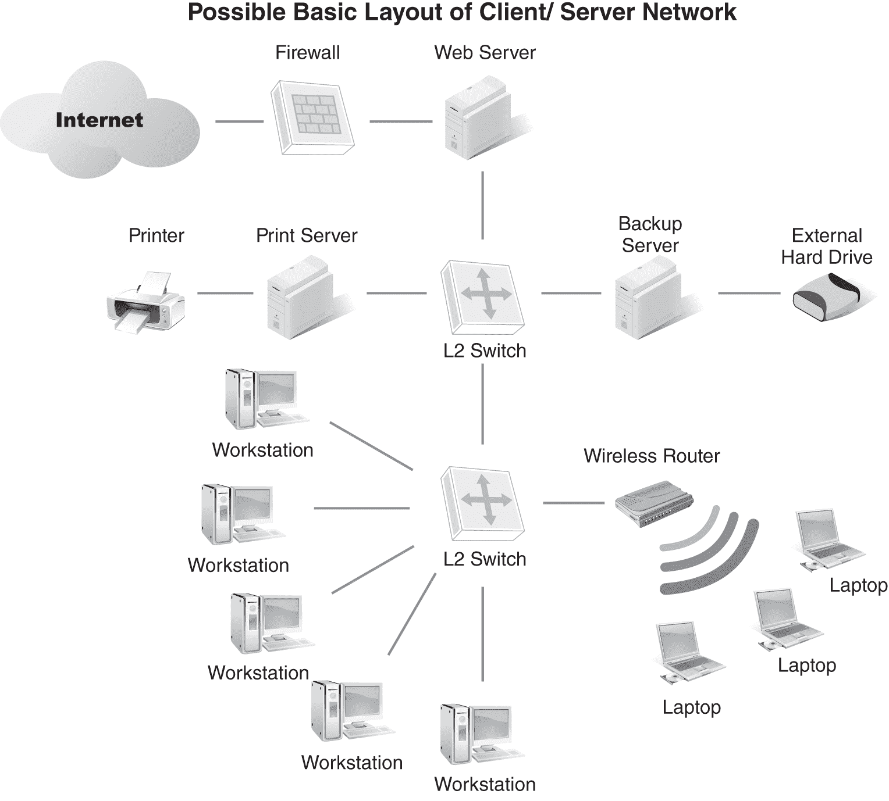

**图 3-19** 典型客户端/服务器网络示例。

客户端/服务器网络还采用单点登录 (SSO)。SSO 允许每个用户使用一组更强的凭据。通过 SSO，每个用户必须执行身份验证以获得对客户端和网络的访问权限。用户登录后，访问控制管理资源使用。换句话说，带有 SSO 的客户端/服务器身份验证通常比工作组身份验证更复杂，但更安全。用户只需登录一次，而不必每次联系资源主机服务器时都登录。

由于其复杂性，客户端/服务器网络通常比 SOHO 和工作组网络更安全。但复杂性本身并不等于安全。相反，正是因为更复杂，客户端/服务器网络需要更彻底的设计和规划。安全是基础设施规划的重要方面，因此会融入网络设计中。

客户端/服务器网络不一定安全，因为你可以在完全不考虑安全的情况下部署客户端/服务器网络。但大多数组织明白，如果忽视网络安全，就等于确保其最终的技术垮台。安全很少从部署过程中排除。而且有些网络天生就比其他网络更安全。

#### LAN 与 WAN

LAN 代表局域网。LAN 是指在有限地理区域内的网络。这意味着 LAN 网络位于单个物理位置，而非分布在多个位置。有些 LAN 规模很大，而有些非常小。LAN 更显著的特征是其所有段或链路均由一个组织拥有和控制。LAN 不包含或使用任何租用或外部拥有的连接。

WAN 代表广域网。WAN 是指不受任何地理边界限制的网络。这意味着 WAN 网络可以跨越几个街区、遍布全球，甚至延伸至外太空。WAN 的一个显著特征是它经常使用租用或外部连接和链路。大多数组织依赖电信服务提供商（通常称为电信运营商）提供 WAN 电路和链路，连接到物理建筑和设施，包括到物理分界点的最后一公里连接。LAN 和 WAN 网络都可以是安全或不安全的。对于 LAN，网络所有者独自负责确保安全得到执行。对于 WAN，租赁方必须选择拥有安全 WAN 基础设施的电信运营商，并纳入服务级别协议 (SLA)，定义每月为客户提供的服务和性能水平。在大多数情况下，WAN 数据只有在传输前加密的情况下才是安全的。这项服务是数据所有者的责任，而非电信服务提供商，除非该选项作为增值服务提供。

#### 瘦客户机与终端服务

瘦客户机计算，也称为终端服务，是一种旧的计算理念，在现代重新流行起来。在计算机早期，主计算核心（通常称为大型机）通过称为终端的接口进行控制。终端仅仅是一个视频屏幕（通常是单色）和一个键盘。终端没有本地处理或存储能力。所有活动都在大型机上进行，结果显示在终端的屏幕上。


随着个人计算机（PC）的出现，员工桌面上的计算机提供了本地处理和存储能力。这些 PC 成为了客户端/服务器架构中的客户端。现代网络环境可为最终用户提供多种选择。作为工作站或客户端系统使用的功能齐全的 PC 最为常见。PC 可以运行瘦客户端软件，该软件模拟过去的终端系统。这意味着它们在服务器或大型机系统上执行所有任务，仅将 PC 用作带有键盘和鼠标的显示屏。甚至现代瘦客户端终端也可以在不使用完整 PC 的情况下连接到服务器或大型机。

#### 远程控制、远程访问和 VPN

远程控制是指使用本地计算机系统通过网络连接远程接管另一台计算机控制权的能力。从某种意义上说，这是在现代功能齐全的工作站上应用瘦客户端概念，以模拟面向大型机的工作，或将您的物理存在虚拟化。

通过远程控制连接，本地键盘和鼠标控制远程系统。这看起来和感觉上就如同您亲自坐在远程系统的键盘前一样，而该远程系统可能位于另一个城市，甚至位于世界的另一端。您在本地执行的每一个操作都会通过远程控制连接在远程计算机上发生。唯一的限制是中间网络链路的速度，以及无法物理插入或移除介质（如闪存驱动器）和使用外设（如打印机）。

您可以将远程控制视为一种基于软件的瘦客户端或终端客户端形式。事实上，许多瘦客户端和终端客户端产品作为远程控制解决方案出售。

许多现代操作系统都包含远程控制功能，例如大多数 Windows 版本中都有的远程桌面功能。启用后，远程桌面连接可跨网络远程控制另一台 Windows 系统。

远程访问不同于远程控制。远程访问链接通过 WAN 链接连接到地理位置遥远的网络，从而实现对网络资源的访问。实际上，远程访问为物理上不在本地网络中的系统创建了一个本地网络链路。通过远程访问连接，客户端系统在技术上可以执行与本地连接的客户端完全相同的所有任务，唯一的区别在于连接的速度。网络管理员可以对远程访问客户端可使用的资源和服务施加限制。

远程访问最初通过调制解调器利用拨号电话链路进行。如今，远程访问涵盖多种连接类型，包括 ISDN（综合业务数字网）、DSL、有线调制解调器、卫星、移动宽带等。

在大多数情况下，远程访问连接将远程客户端链接回主网络。远程访问服务器 (RAS)接受来自远程客户端的入站连接。连接建立后，远程客户端与网络的交互方式就像它是本地连接的一样。

远程连接的另一种变体是虚拟专用网络 (VPN)。VPN 是在其他网络连接之上创建的一种网络连接形式。在大多数情况下，VPN 链接将远程系统和局域网 (LAN) 连接起来，但仅在正常网络连接链接到中介网络之后。

在 **图 3-20** 中，局域网通过正常网络连接连接到互联网，远程客户端也已建立到互联网的正常网络连接。这两个连接彼此独立工作。局域网的连接通常是永久或专用连接，支持与互联网的入站和出站活动。远程客户端到互联网的连接可以是专用的，也可以是非专用的。在后一种情况下，连接先于 VPN 的创建。一旦未来 VPN 链路的两个端点都已连接到中介网络（在本例中为互联网），VPN 即告建立。

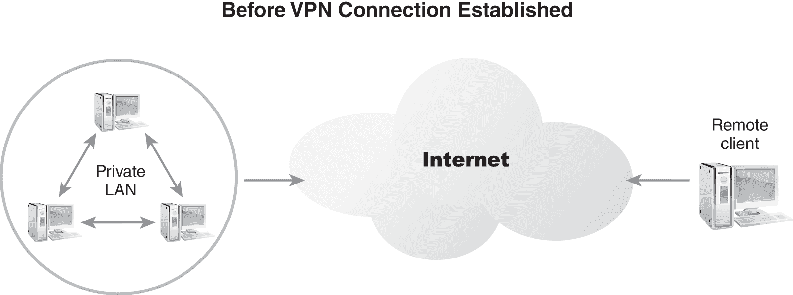

**图 3-20** 常见资源访问连接。

在 **图 3-21** 中，一条新的网络连接跨越中介网络将远程客户端连接到局域网。这条新的网络连接就是 VPN。

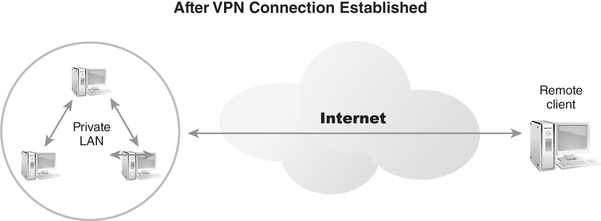

**图 3-21** 通过互联网在远程客户端和局域网之间建立的 VPN。

VPN 是一种跨越中介网络（通常是互联网）建立远程访问连接的机制。VPN 允许通过互联网建立低成本的长距离连接，因为两个端点只需要本地互联网链路即可。互联网本身充当了“免费”的长途承载商。

VPN 使用隧道或封装协议。隧道协议将原始网络协议封装起来，以便其能够穿越中介网络。在许多情况下，隧道协议采用加密，以便原始数据能安全地穿越中介网络。

#### 边界网络

边界网络是位于局域网边缘的子网。边界网络将某些活动（如编程或研发）与内部环境（私有局域网）隔离开来，而内部环境无需被外部访问。外部用户也可以访问托管在边界网络中的资源。这种子网称为非军事区 (DMZ)。

DMZ 是托管面向公共互联网资源服务器的边界网络。外联网是托管面向有限且受控的外部用户群体（如业务合作伙伴、供应商、分销商、承包商等）资源服务器的边界网络。

DMZ 子网是一种常见的网络设计组件，用于托管公共信息服务，如网站。DMZ 允许公共互联网上的任何人访问资源。但同时，DMZ 对明显的恶意流量提供一定的过滤，并防止互联网用户访问私有局域网。

外联网子网为需要与外部合作伙伴交换数据的公司提供了一个安全的场所。外联网经过保护，只有预期的外部用户才能访问。通常，访问外联网需要 VPN 连接。外联网配置将公共互联网用户拒之门外，也将外部合作伙伴隔离在私有局域网之外。您可能熟悉的一个外联网示例是：通过访问快递公司的网站并输入包裹的唯一跟踪号来跟踪包裹的进度。

部署 DMZ 和外联网子网的方式各不相同。最常见的两种设计是使用三端口防火墙的屏蔽子网（**图 3-22**）和 N 层部署（**图 3-23**）。使用三端口防火墙的屏蔽子网为私有局域网和 DMZ 或外联网创建了一个网络段。三端口防火墙既作为过滤设备，也作为路由器，控制进入这两个网段的流量。

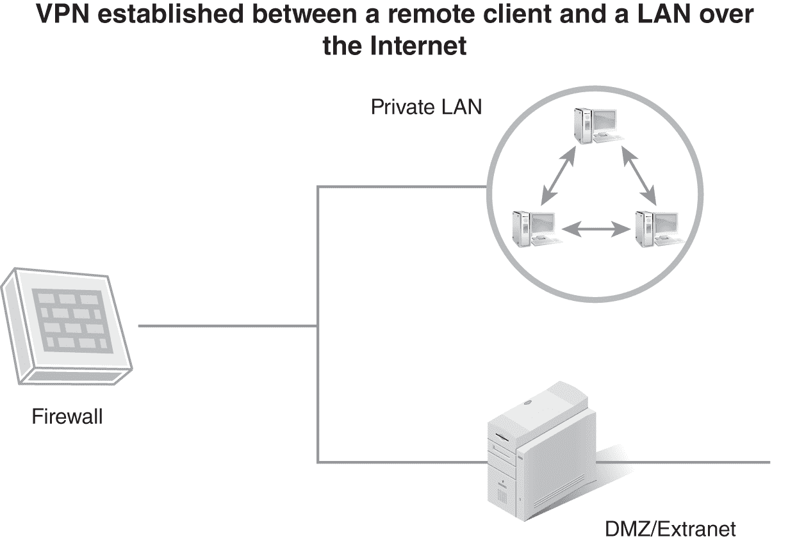

**图 3-22** 作为带有三端口防火墙的屏蔽子网部署的 DMZ 或外联网。

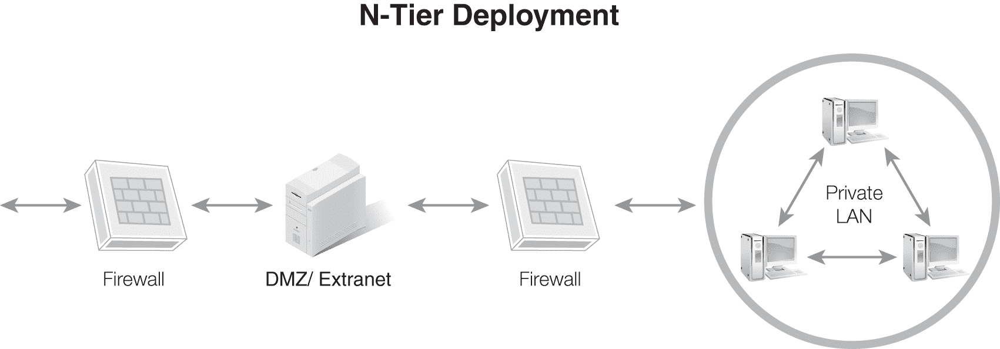

**图 3-23** 以 N 层配置部署的 DMZ 或外联网。


N 层部署会创建一系列由防火墙隔离的子网。DMZ（非军事区）或外联网子网充当互联网与私有局域网之间的缓冲网络。N 层中的“N”是一个变量，需替换为您实际在网络中构建的层数。

### 章节摘要

存在多种常见的网络拓扑，每种都有独特的优势和负面考量。了解组织的目标、采用各种物理设计的能力，以及网络应如何在逻辑上进行配置，有助于做出正确的拓扑决策。尽管总线拓扑可能适用于某些小型组织，但通常仅用于极小规模的安装。网状拓扑提供最高的冗余性，但成本也最高。

尽管大多数拓扑均可实现为遵循特定的逻辑拓扑框架，但在要求所有设备均须知晓并识别所有其他设备的物理网络上实施某些逻辑设计，安全性可能较低。在物理连接阻止了从一个系统到另一个系统的流量流向下一台设备的情况下（如总线和环形实现），安全性也可能较低。即使这些设备不应与网络中的下一台设备通信，该设备仍为计算机所知；因此，可能会尝试访问它。这就是为什么安全性是在构建网络前必须考虑的因素，并且在网络管理和维护过程中持续作为一个重要要素。

本章还详细探讨了 IPv4 和 IPv6，以及各种网络基础设施。

### 关键概念和术语

有源集线器

设备

双向

黑名单

边界网络

网桥

网桥路由器

总线拓扑

客户端

客户端/服务器网络

汇聚器

非军事区 (DMZ)

无源集线器

外联网

网关

集线器

互联网服务提供商 (ISP)

日志

逻辑拓扑

网状拓扑

调制解调器

无源集线器

物理拓扑

协议转换器

配线面板

打线块

远程访问

远程访问服务器 (RAS)

远程控制

中继器

环形拓扑

路由

路由器

扩展

单点登录 (SSO)

智能集线器

嗅探器

SOHO（小型办公室/家庭办公室）

源路由网桥

星型拓扑

子网划分

交换机

终端服务

终端器

瘦客户机计算

令牌

拓扑

透明网桥

单向

虚拟局域网 (VLAN)

有线拓扑

无线拓扑

工作组

### 第 3 章评估

1.  协议转换器是指哪种设备的另一个名称？

    1.  网桥

    2.  网关

    3.  集线器

    4.  路由器

2.  以下哪项是使用工作组进行业务网络活动的缺点？

    1.  工作组没有控制或限制网络活动的中央权威机构。

    2.  工作组赋予每个成员保护其资源免受其他设备访问的能力。

    3.  工作组允许为某成员定义的安全性仅应用于该成员。

    4.  工作组对于小型公司和 SOHO 安装通常更具成本效益。

3.  以下哪项是无源集线器的一种类型？

    1.  配线面板

    2.  网桥路由器

    3.  中继器

    4.  网关

4.  以下哪项是智能集线器的一种类型？

    1.  网桥路由器

    2.  汇聚器

    3.  防火墙

    4.  网关

5.  哪种设备工作在第 2 层（数据链路层）并使用 MAC 地址来区分流量？

    1.  路由器

    2.  防火墙

    3.  交换机

    4.  配线面板

6.  在 FCC 指导下由制造商分配的、用于标识硬件的唯一地址称为什么？

    1.  MAC 地址

    2.  IPv4 地址

    3.  环回地址

    4.  IPv6 地址

7.  关于星型拓扑，以下哪项描述是正确的？

    1.  它比传统总线网络所需布线更少。

    2.  它比网状网络更安全。

    3.  它比无线网络所需布线更少。

    4.  它比总线网络更具容错性。

8.  关于逻辑网络，以下哪项描述是*不*正确的？

    1.  网络有可能具有相同的逻辑拓扑和物理拓扑。

    2.  物理上相邻的计算机有可能在逻辑网络中位于不同的子网。

    3.  物理网络为星型而逻辑网络为环型是可能的。

    4.  物理网络有可能采用网关。

9.  以下哪种网络提供最高的冗余性？

    1.  星型

    2.  网状

    3.  总线型

    4.  环型

10. 以下哪种网络拓扑需要使用终端器？

     1.  总线型

     2.  星型

     3.  环型

     4.  网状


© Digital_Art/Shutterstock

## 网络设计考量

## 第 4 章

网络安全对**每个**组织都至关重要，从家庭中的单台计算机到跨国公司皆是如此。安全基础具有普适性，无论计算机和网络的规模、用途或功能如何。

实施网络安全要求您完成所有组件的安装、部署和配置，但必须从彻底的规划和设计开始。这意味着要考虑纵深防御、协议的正确使用、通信管理、入侵检测和防御系统、系统加固等。基于一些通用且通常简单的原则，您可以显著提高组织计算机系统和网络的安全性。

遵循本章中的建议将降低因意外、疏忽、自然灾害或恶意意图导致系统受损的风险。

### 第 4 章主题

本章涵盖以下主题和概念：

*   网络设计与纵深防御
*   协议
*   常见寻址类型
*   如何控制通信路径
*   入侵检测系统 (IDS) 和入侵防御系统 (IPS)
*   如何加固系统
*   选择设备应使用哪种方法


### 认证、授权和审计

### 通信加密

# 仅适用于本地主机或远程和移动主机的最佳架构

# 冗余示例

# 什么构成节点安全

# 如何执行风险评估

# 网络风险区域

### 第 4 章目标

完成本章后，您将能够：

*   描述网络安全设计的要素
*   比较和对比公共和私有寻址，以及静态和动态寻址
*   理解 IDS 和 IPS 之间的区别
*   说明系统加固的重要性
*   描述为什么认证、授权、审计和加密对于网络安全至关重要
*   识别本地主机以及远程和移动主机的安全问题
*   定义节点安全的要素
*   为网络风险分配值

### 网络设计与纵深防御

每个网络都是不同的。然而，通用的安全原则适用于每个网络，无论其独特要素如何。这些通用原则之一是安全网络设计。安全网络设计在 IT 基础设施实施之前，将核心保护和改进嵌入其中。设计源于规划。规划源于对业务需求、用户行为和网络漏洞的充分知识和理解。

通用安全目标包括机密性、完整性、可用性、隐私、认证、授权、不可抵赖性和审计。为了高效实现这些目标，明智的规划可协助您在部署前设计网络。了解常见网络漏洞并规定解决方案，有助于安全网络的设计。

设计网络安全既不简单，也非短期任务。彻底的网络安全设计必须包含充分的研究、详尽的规划，以及广泛的建模和测试。安全设计过程必须评估执行惊人数量功能的各种技术。

最终，良好的网络安全设计会生成蓝图，指导安全运行的网络基础设施建设。该蓝图是组织安全策略的基础。大多数网络设计都有局限性。这些局限性包括预算、内部政治、法规、标准和行业惯例。网络设计应专注于在这些规定的预算边界内提供尽可能最好的安全性。

#### 通过分层实现纵深防御

网络安全设计的一项基本原则是没有完美的安全解决方案。任何单一的安全保护、对策和防护措施都是不够的。黑客将使用某种方法、技术或漏洞利用来绕过、规避或使安全保护失效。潜在顾虑包括部署位置、编程缺陷、默认设置、最大值、处理能力、内存容量、后门、恶意代码、社会工程学和物理攻击。此列表并非详尽无遗，但代表了关键问题。理论上，没有安全解决方案是充分且完整的。

因此，您需要使用多个安全组件。这称为纵深防御或多层防御（**图 4-1**）。如果您遵循纵深防御设计概念，众多防护措施将保护每项资产。随着一种防御工具与另一种互锁，它们重叠并提高整体安全性。一种对策的优势和益处可补充或弥补另一种对策的弱点和局限性。


**图 4-1** 围绕资产的纵深防御示例。

纵深防御使许多安全专业人员遵循两条额外准则。第一，避免单点故障。第二，分而治之。单点故障是指系统中任何可能导致整个系统故障或受损的元素、组件或方面。分而治之是将大型项目分离为多个更小、更易管理的片段的过程。

避免单点故障必须在多个战线上进行。黑客只需一个缺陷或弱点即可利用目标。工作重点应放在发现并消除尽可能多的漏洞，以移除黑客寻求利用的单点。

良好的设计会多次过滤每一次用户与资产的交互。此过滤应包括认证、授权、内容过滤和上下文过滤。依赖单一过滤器或检查系统是一种单点故障形式。始终假设任何单一服务或功能都有缺陷或将会失效。

有效的网络设计使用多种技术监控和检查针对资产的所有活动。这可能包括对象审核、服务器监控、客户端监控、网络监控等。仅使用单一监控视角可能构成单点故障。每个人都看过单一视角的视频片段，它引导观众看到或相信一件事，但从另一个摄像机角度来看，真相、诡计或另一种解释就会变得清晰。

分而治之不仅是实际战争的战术；也是对抗网络安全漏洞战争中的战术。通过将较大的项目或任务分割为可管理的组件，您可以专注于并照顾每个组件，以确保在解决网络安全问题时的准确性和完整性。试图将网络安全作为一个整体来应对，往往是灾难的配方。评估全局始终是个好主意，但仅在整体上工作可能导致忽略细节，或错过仅在仔细详细检查时才能察觉的微妙之处。

贯穿 IT 基础设施的分层安全方法效果最佳：缓慢、有条不紊、分隔化且彻底。设计得当的网络安全应支持信息的及时传递和交易期间的充分响应。妥善保护的网络提供可靠稳定的通信。设计良好的安全性可适应不断变化的条件，并预测未来的增长和扩展。

减少黑客入侵的一种方法是防止他们发现您的网络作为目标。通过保持离线并仅使用受信任的通信路径，您的组织可以避免大量风险。然而，这种技术性的“捉迷藏”并不完美，也无法消除所有问题。外部黑客可能无法从外部入侵非互联网连接的内部网；然而，来自不满员工和其他内部用户的风险依然存在。

躲避危险的想法通常称为靠不为人知而安全。确实，如果不被发现，就不会受到攻击；然而，如果网络受到的保护是默默无闻——而非实际的对策和防护措施——这往往是虚假的希望。默默无闻或难以定位可能是好事，但它不是可靠的安全形式。设计网络安全时，仅使用直接且真实的安全防御。

并非所有攻击都是有针对性的攻击。虽然许多针对系统或网络的攻击是由黑客针对该系统发起的，但其他攻击是针对互联网发动的无差别攻击，旨在对因固有漏洞而易受该特定攻击影响的任何系统造成损失、危害和破坏。即使攻击针对特定系统或网络，也可能造成附带损害，具体取决于攻击是如何编写脚本的。


# 安全性对于任何现代组织的长期生存至关重要

没有安全性，逻辑、物理和社会层面的漏洞将使大多数公司面临失败的风险。但安全性离不开平衡。你可能会将基础设施过度保护，以至于安全性干扰了工作任务。可用性与安全性必须保持平衡。没有安全性，可用性难以长久；而过度的安全性会扼杀可用性。优秀的网络安全设计能在安全性与可用性之间取得平衡。

#### 规划可扩展性

大多数组织的目标之一是扩张与增长。它们通常寻求吸引新客户、支持更多用户、销售更多产品、提供更多服务、赚取更多利润等。但增长是一把双刃剑。虽然增长能带来更可靠、更有保障的未来，但也可能引发成长的烦恼。对任何组织而言，当现有基础设施、设施甚至人员被推向极限或超负荷运转，以支撑增长带来的额外工作量时，就会出现成长的烦恼。

增长可以是预期的、意外的、渐进的，也可以是突发的。恰当的网络设计流程会评估并预测潜在的增长场景，并为每种场景规划应急预案。应对增长的一个预案是为当前基础设施预留额外产能。如果预期是缓慢增长，则预留 20% 的额外产能可能就足够了；而快速增长可能在短时间内就会消耗掉 50% 的额外产能（**图 4-2**）。

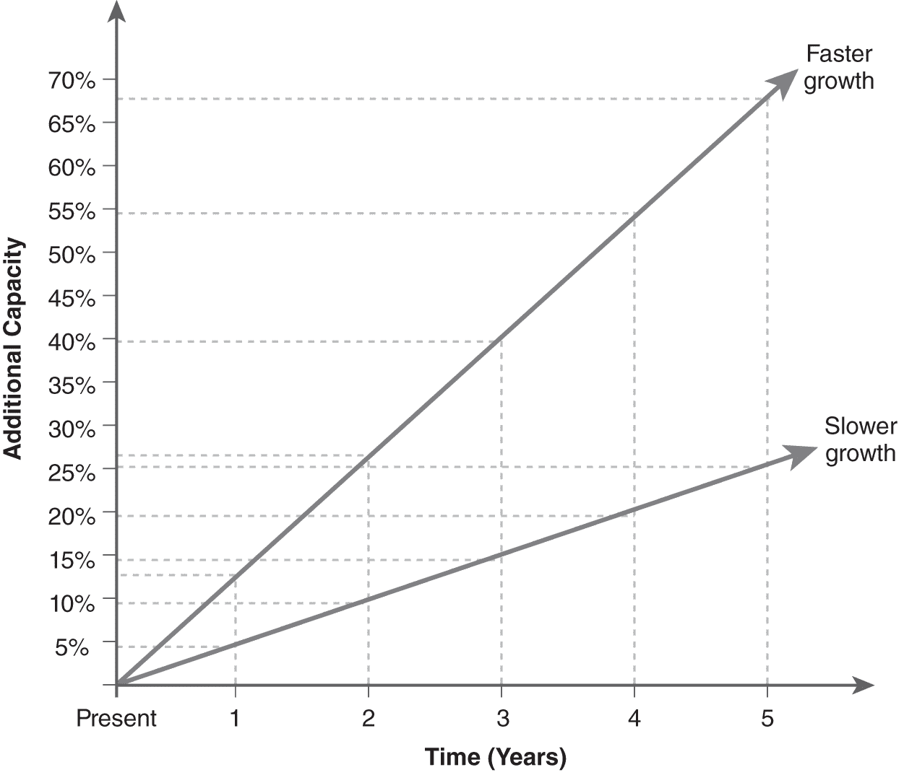

**图 4-2** 用于预测所需额外产能的增长率。

增长过快与萎缩一样都是负担。当组织超出其支撑、销售、创造、维护、响应和生产的能力范围时，小问题会迅速演变成雪崩般的大灾难。稳健、可控、有限度的增长往往是确保长期生存能力和稳定性的方法。这在一般商业管理中成立，在网络安全设计中同样成立。

当组织萎缩时，可能会出现不再使用或监控的系统、流程和资源。如果这些项目未得到保护，黑客可将其作为进入网络的入口点，并在扫描网络寻找其认为有价值的项目时潜在地保持不被发现状态。如果某项目连接到了网络，就应对其进行保护和监控。如果该项目不再必要，应将其从网络断开，妥善存放以备后用或妥善处置（如妥善销毁可能包含敏感数据的系统或打印机中的硬盘驱动器）。

在网络设计阶段，应考虑所选部署技术的可扩展性。某组件或系统是否有最大值或限制，且会迅速达到？该组件或系统能否在不损害效率、成本效益和安全性的前提下进行扩展？一旦发生中等程度的增长，该组件或系统是否需要由可扩展的解决方案替代？如果是，为何不现在就使用可扩展的解决方案？规划增长将减少因功能和安全容量不足而导致的问题。

#### 与高级管理层合作

没有高级管理层的积极参与，任何安全举措都不会成功。事实上，没有其明确批准和支持，任何安全工作注定可能失败。高级管理层有责任制定组织的战略目标和计划，因此也决定了其 IT 基础设施和集成安全。高级管理层必须批准预算资金、鼓励合规并支持安全工作，即使在出现问题时也是如此。高级管理层设定企业期望，塑造组织的企业文化。

在整个网络安全设计和实施过程中，高级管理层监控并批准进度报告。高级管理层引领组织及其安全规划适应不断变化的商业环境。但安全网络设计不仅仅是追随领导；它还关乎将每一位员工融入整体安全设计流程。安全是组织中每个人的责任，而不仅仅是管理者和高管的责任。

安全网络设计的要素涉及 IT 基础设施的方方面面。这包括主机、节点、通信、加密、本地和远程系统、冗余等。通常，设计安全的过程始于聚焦于贯穿基础设施的核心要素。重要的分布式核心组件是网络协议。

### 协议

网络安全的很大一部分在于做出正确的技术选择，而不陷入容易的陷阱或默认设置。一个常见的陷阱是继续沿用旧做法或同一产品。你需要定期重新评估旧技术和现有解决方案。大多数组织选择每年进行一次安全设计评估。在进行安全评估时，要重新审视基础设施的方方面面，包括网络协议。

大多数网络使用 `Transmission Control Protocol/Internet Protocol (TCP/IP)` 作为主要网络协议套件。`TCP/IP` 是一个套件，因为它是两个协同工作的通信协议，旨在提供更高的速度和一致性。具体而言，大多数网络仍使用 `Internet Protocol version 4 (IPv4)`，而非 `Internet Protocol version 6 (IPv6)`。使用 `IPv4` 并非向黑客发出公开邀请，但它确实存在许多常被利用的弱点和隐患。`IPv4` 通常默认采用明文传输形式，而 `IPv6` 可默认设置为加密传输。`IPv4` 可使用 `IP Security (IPSec)` 或其他 `virtual private network (VPN)` 协议进行加密。

其他需要考虑的问题包括：

*   当前协议是否容易被攻破？
*   是否有大量针对该协议的漏洞利用代码可供新手黑客使用？
*   能否应用加密？
*   添加加密的过程是否复杂或成本高昂？
*   加密是否会干扰其他技术，例如 `IPSec` 和 `network address translation (NAT)`？
*   是否有替代方案或替代品可用？
*   替代方案是否向后兼容？
*   替代方案是否被所有当前主机和节点支持？

这只是评估当前部署的网络协议以考虑可能替换时，你需要考虑的问题的部分清单。关键在于定期认真考虑这一问题。网络安全的大多数要素都基于所使用的协议。如果协议发生了变化或改进，这可能会导致生产环境发生全面变革——最重要的是该环境的安全性。

作为撰写本文时的一般经验法则，如果大多数主机和软件的使用年限不超过五年，则升级到 `IPv6` 很可能只会带来最小的麻烦。然而，如果 `IPv4` 配合 `IPSec` 或其他形式的加密在性能和安全参数范围内运行良好，则没有强烈的必要升级到 `IPv6`。

当你考虑协议升级时，需要彻底研究和测试生产和安全环境的方方面面，以确认与 `IPv6` 的兼容性。任何过渡都会遇到一些障碍，而切换主网络协议无疑是重大障碍的候选者。应在实验室进行 `piloting`（试点测试）后，分阶段推出协议变更，并考虑在过渡期内运行双协议。


#### 协议评估与寻址方案

TCP/IP，至少 IP 协议，并非大多数网络上唯一使用的协议。OSI（开放系统互联）模型网络协议栈中每个理论层面上的每个协议都需要定期重新评估。您是否仍想继续使用简单邮件传输协议 (SMTP)和邮局协议 (POP)？文件传输协议 (FTP)、网络新闻传输协议 (NNTP)和 Telnet 呢？如果某协议以明文方式运行，请考虑使用具有原生加密功能的协议，或研究将其封装在加密隧道协议（如 IPSec 或安全套接字层/传输层安全性 (SSL/TLS)）内部的可能性。

AppleTalk、Internetwork Packet Exchange/Sequenced Packet Exchange (IPX/SPX)、Systems Network Architecture (SNA)、NetBios Extended User Interface (NetBEUI) 或其他协议是否仍存在于网络中？它们是否仍然必要？需要这些协议的旧系统是否已被替换或移除？较新的安全替代方案能否取代这些老旧且不安全的协议？仍在使用传统协议的系统能否被替换，以获得主机安全性并移除该协议？

不要让传统、个人偏见或沉没成本妨碍做出明智的安全设计决策。如果持续使用某物品带来的安全风险和担忧大于收益，则该物品的成本不是继续使用它的理由。仅仅因为某事一直以某种方式完成，并不意味着它应继续以这种方式完成，特别是当旧方式不安全时。就喜好、厌恶、舒适度和熟悉度而言，个人偏见不是避免转向更安全解决方案的充分商业理由。

沉没成本是指过去已投入的资金或投资，相对于未来可能发生的预期成本。往往过度担忧已投入资源浪费的管理者会做出糟糕的决策。避免损失是商业的良好原则，但仅仅因为您已经花费了一些金钱、时间和精力，并不意味着您应该继续沿着既定路径前进。通常，因沉没成本而追加投资会加剧损失。如果现有系统、解决方案或产品的未来收益无法得到保证，则任何数额的沉没成本都无法证明其持续使用的合理性。在大多数情况下，决策时应仅分析未来的成本和收益。已发生的费用（沉没成本）不应影响未来的选择。

### 常见寻址类型

寻址是为网络上的主机分配逻辑编号系统，以实现高效的流量路由。寻址不仅仅是网络服务器强加的一种系统；它通常也是一种控制流量的手段。通过使用逻辑地址，可以实现基于路由和流量过滤的流量管理。

全球最常用的协议是 TCP/IP。该网络协议套件规定了最常见的寻址方案。IPv4 和 IPv6 的寻址方案差异很大，但某些通用元素、安全顾虑和管理技术保持一致。

内部 IP 地址可以是公共地址、私有地址，或两者的混合。公共地址是由 IANA 分配、由 RIR 监控、并通过 ISP 直接租用的地址。互联网号码分配局 (IANA)（*[`www.iana.org/`](http://www.iana.org/)*）是负责全球 IP 寻址、DNS 根区及其他互联网协议资源协调的实体。区域互联网注册机构 (RIR)是五个区域性组织之一，负责监督和管理 IP 地址（IPv4 和 IPv6）的使用与分配。互联网服务提供商 (ISP) 可能会随机分配或半永久性地租赁 IP 地址给个人或组织。公共地址是从 ISP 获取的地址。

###  注意

过去，可以购买或拥有 IP 地址，特别是大型地址组或整个地址类。然而，这种做法现在大多已不可能，并非因为禁止拥有 IP 地址，而是因为缺乏可供出售的可用 IP 地址。许多原始的 A 类和 B 类子网所有者仍然拥有、控制并使用其购买的地址。其中一些实际上是 ISP，它们现在将拥有的 IP 地址范围的子集租赁出去。如今，大多数公共 IP 地址是租赁而非出售或拥有的。

公共地址也意味着它直接与互联网上的资源通信。互联网仅使用公共地址。没有公共地址，就无法与互联网托管的资源进行通信或接收响应。

公共地址从 IPv4 地址空间的 A 类、B 类和 C 类范围分配（D 类和 E 类分别保留用于组播和实验）。IPv6 的公共地址是大部分 $2^{128}$ 个地址，`fc00::/7` 地址块除外。

在名为 RFC 4193 的技术规范中，IANA 预留了 `fc00::/7` 地址块用作 IPv6 的私有地址，类似于 IPv4 的 RFC 1918。RFC 1918 为私有 IPv4 地址预留了三个类范围：

*   **A 类**—`10.0.0.0–10.255.255.255/8`（1 个 A 类网络）
*   **B 类**—`172.16.0.0–172.31.255.255/12`（16 个 B 类网络）
*   **C 类**—`192.168.0.0–192.168.255.255/16`（256 个 C 类网络）

##### 技术提示

`DHCP` 预留是指通过使用目标主机的 `MAC` 地址进行预留，将特定 IP 地址预先分配给主机。预留可确保始终向特定主机分配相同的地址。它还可以模拟静态寻址，但保留了地址分配的集中控制权。

私有地址仅用于私有网络内部。个人和组织无需外部实体的批准或付费即可使用私有地址。但是，使用私有地址需要 `NAT` 服务才能与互联网资源通信。所有互联网路由器会自动丢弃报头中包含私有地址的任何数据包。私有地址可作为基本的隔离安全措施，因为拥有公共地址的外部实体无法直接与内部私有地址主机通信。但 `NAT` 服务器允许与互联网资源通信。

您应审查组织在内部使用私有或公共地址的选择。问题不仅关乎省钱。私有地址免费，而公共地址通常需租赁。私有地址需要转换，而公共地址不需要。私有地址天然与互联网隔离，而公共地址则不然。在内联网上混合使用私有和公共地址也是可能的。

另一个寻址考量是采用静态还是动态寻址。静态寻址为每台主机预先分配特定 IP 地址，而动态寻址从地址池向主机分配 IP 地址。除非为主机创建了预留，否则动态寻址不保证主机始终获得相同的地址。

静态寻址通常要求在每台主机上单独配置 IP 地址。这确保主机始终使用相同的 IP 地址。但是，如果网络配置或拓扑发生变化，逐台手动更改主机上的 IP 地址会涉及大量额外的管理开销。


因此，大多数组织使用动态分配，通常使用 `动态主机配置协议 (DHCP)` 系统。如果首选静态寻址，则可以使用 `DHCP` 预留来模拟静态寻址，同时保持集中控制。通过基于预留的静态寻址，只需编辑 `DHCP` 服务器上的预留即可进行更改，而无需单独手动调整每台主机。

当地址被动态分配时，恶意系统可能上线并仅通过请求就获得一个有效的 IP 地址。如果地址是静态分配的，攻击者则需要发现一个有效但未使用的 IP 地址，并手动配置其系统以使用它。同样，如果使用 `DHCP` 预留，攻击者要么会手动静态分配自己的地址，要么会欺骗 `媒体访问控制 (MAC)` 地址，从另一台离线系统“借用”一个 IP 地址。

#### IPv6

全球互联网寻址约有 25% 使用 IPv6 地址，且少量攻击利用了这一点。因此，安全专业人员保持知识更新非常重要，熟悉 IPv6 也至关重要。IPv6 在两个重要方面与 IPv4 不同：数据包头部的结构不同，且 IPv6 地址的大小和构造与 IPv4 地址不同。还有一些过渡机制允许 IPv4 封装在 IPv6 数据包中，反之亦然。过渡机制使在 IPv4 和 IPv6 之间切换变得更容易，但对于安全性和策略执行来说却可能是一场噩梦。

IPv6 地址由 128 位组成，而 IPv4 地址为 32 位。地址被分类为各种类型，用于主要寻址和路由方法中的应用：单播、多播和任播网络。在每种类型中，通过将 128 个地址位在逻辑上划分为位组，并建立规则将这些位组的值与特殊寻址特征相关联，从而识别各种地址格式。IPv6 中没有像 IPv4 那样的 A 类或 B 类地址。

*   **单播地址** 标识单个网络接口。互联网协议将发送到单播地址的数据包传递给该特定接口。
*   **任播地址** 分配给一组接口，通常属于不同的节点。发送到任播地址的数据包仅传递给其中一个成员接口，通常是根据路由协议对距离的定义，传递给最近的主机。任播地址不易识别，它们与单播地址具有相同的格式，仅因在网络中的多个点存在而有所不同。几乎任何单播地址都可用作任播地址。
*   **多播地址** 也由多台主机使用，这些主机通过在网络路由器之间参与多播分发协议来获取多播地址目的地。发送到多播地址的数据包将传递给所有加入了相应多播组的接口。

IPv6 不实现广播寻址。广播的传统角色由发送到所有节点链路本地多播组 `ff02::1` 的多播寻址所取代。然而，不建议使用所有节点组，大多数 IPv6 协议使用专用的链路本地多播组，以避免干扰网络中的每个接口。

地址管理是网络安全的一个重要关注点。另一个关注点是通信路径的管理。

### 控制通信路径

控制信息流是网络安全的关键要素。这涉及确保数据沿着隔离、安全且受控的路径传输，而不是沿着公开、不安全且不受控的路径传输。通信路径控制的一部分关乎拓扑选择，但也关乎路由器配置、加密协议、物理访问管理和过滤。

#### 路由器配置

路由器是管理员用来控制通信所遍历路径的主要网络设备。未能在设计路由器配置和部署时考虑安全性是一个严重的疏忽。路由器实时确定通往目的地的最佳可用路径。然而，路由器可用于做出这些决策的信息可能是真实准确的，也可能是不正确、伪造和误导的。

安全网络设计包括对路由器、路由协议和路由信息的保护。路由器的物理隔离对于确保只有授权的路由器管理员能够访问设备非常重要。未能在物理上保护路由器意味着逻辑活动和由此产生的选定路由将不可信。

路由器使用路由协议来交换关于路由和连接路径的信息。该信息计算最佳路径以引导数据包走向其目的地。根据路由器的品牌和型号、路由协议及相关配置，黑客可以通过伪造的 `互联网控制消息协议 (ICMP)` 类型 5 重定向消息来欺骗或操纵路由数据。配置路由器仅接受来自其他已知路由器的路由信息，并通过源认证进行验证。还应考虑加密路由器之间的所有通信。

路由器指定的路径为黑客窃取或劫持信息提供了机会。黑客传递错误路径（欺骗），导致数据包沿着被攻陷的路由发送，从而被轻易复制或捕获。因此，应使用路由器反欺骗技术。路由器反欺骗技术包括源地址验证和丢弃任何具有虚假源地址的数据包。防止欺骗数据包最简单的方法之一是设置防火墙或路由器规则来检查传入的数据包。`路由器访问控制列表` 是限制网络访问和流量、提高网络性能的有效工具。访问控制列表简单来说就是一份清单，列出了什么可以或不可以访问路由器后面的网络段。

#### 加密协议

加密协议是通信路径安全的另一个重要方面。即使是最好的设计、正确的安装和合理的物理隔离，也无法保证有线或无线通信通道不会成为窃听、拦截或中间人攻击的目标。假设物理访问始终在你的控制之下是天真的。内部恶意实体的存在或植入社会工程学窃听设备的可能性始终存在。

为挫败基于窃听的窃听及相关攻击，你应该加密网络通信链路上的所有流量。这尤其适用于从组织设施外部可物理访问的网络段上传输的任何流量。但这也适用于物理隔离和内部连接。每个物理连接被攻破的可能性始终存在，因此针对内容窃听的最佳防御是加密。

#### 物理访问管理

物理访问管理应始终是通信路径安全的一部分。即使使用了加密协议，黑客仍可通过窃听网络段获取大量信息。即使你加密了每一个数据包（这通常并不现实），窃听仍可获取关于受保护通信的各种信息。

此类获取的信息可包括数据包数量和大小的统计。这可用于估算传递的有效载荷大小，进而推断可能的数据类型，如电子邮件传输、网页浏览、文件交换或数据库同步。


# 通信路径安全

#### 窃听

窃听还可以获取安全通信端点的身份信息。如果事务使用传输模式加密，则端点是实际的发送和接收主机。如果事务使用隧道模式加密，则端点要么是两个 VPN 网关，要么一端是远程主机。

窃听还可以根据发往和来自每个发现端点的流量时序和数量，推断出每个端点的大致身份或用途。这可以让外部用户可靠地预测哪个端点是服务器、客户端或 VPN 网关。

通常，通过窃听通信（无论是否加密）来收集数据，称为流量和趋势分析。此类分析可以揭示内部流程的许多重要细节，以及系统的重要性、价值或关键性。因此，即使有加密，防止物理访问通信电缆和无线信号也是至关重要的。

#### 过滤

过滤是通信路径安全的另一个重要部分。部门、子网、WAN 连接的局域网和互联网之间的数据移动要求您监控和过滤通信，以防止泄露、入侵和恶意代码感染。

隐蔽信道是许多组织在通信路径安全和控制方面面临的风险。隐蔽信道是安全系统或人员未知或无法控制的通信路径。无论是基于时序还是存储的隐蔽信道，都可能泄露信息或将恶意内容引入网络。

发现隐蔽信道很困难，因为这些信道的本质就是保持未知和不可见。对抗隐蔽信道的最佳防御措施包括入侵检测系统和入侵防御系统，以及全面监控 IT 基础设施的各个方面，以发现任何类型的异常或非正常事件。为了有效实施，请在规划和设计通信路径安全时，评估入站和出站流量所需的保护措施。还应考虑管理仅限内部、仅限外部或跨边界的通信。

您需要通过提出几个关键问题来检查入站流量：入站通信是对内部实体先前请求的响应，还是源自外部源的通信？除非最初的请求是针对禁止访问的资源，否则通常允许响应。此类限制包括被阻止的协议、IP 地址或域名、未经授权的服务和应用程序，或没有足够或正确授权的用户。

如果通信源自外部，而不是响应，那么该通信通常是被允许还是不被允许？如果通信是针对面向公众提供的资源，则可能允许该通信。但是，如果不存在公共资源，则该通信更有可能是未经授权的。

通信中的源地址是来自已知还是未知位置？如果是已知位置，是否已知为恶意或可疑？如果是后者，则阻止流量更可能是正确的安全立场。流量是否明显被欺骗？流量是否匹配任何已知的恶意模式、是否有任何构造异常或可疑内容？是否可以被归类为异常或非典型？在大多数这些情况下，数据包应被丢弃，而不是允许继续前往其声称的目的地。

通信路径安全的一个关注领域是基于流量是仅限内部、仅限外部还是跨边界进行流量管理的差异。通常，仅限内部的流量比任何其他形式的流量更可信。在大多数情况下，内部流量源自受信任的内部主机，并终止于受信任的内部主机。然而，由于始终存在流氓内部主机或恶意内部人员的可能性，仅因为流量源自内部就盲目信任它是一个安全失误。

##### 技术提示

随着远程办公和外包的普及，外部用户通常也是有效用户。认识到这一点，您必须设计网络以支持来自有效外部用户的入站连接。这可能涉及传统的远程访问连接，但更可能使用 VPN 链路。VPN 为远程用户提供的连接功能类似于本地连接，并通过加密保持这些连接内容的机密性。

一个好的做法是谨慎对待所有流量。在证明流量符合安全策略且不匹配任何已知恶意模式之前，不要信任任何东西。监控和过滤内部通信与监控外部和跨边界通信同样重要。

您应对出站流量进行与入站流量相同的调查和分析。出站流量如果是从网络内部发起的，可能看起来是合法的，但它可能来自已渗透网络并正在发送公司商业机密的黑客，或您未意识到的不满员工。了解其意图的最佳机会是保护流量和日志，并定期审查日志。出站通信是否通过异常协议或端口进行？是否尝试与被阻止或禁止的主机或服务通信？流量是否被欺骗、是否有异常时间戳、是否为另一个数据包的克隆，或是否属于洪水攻击的一部分？

幸运的是，入站和出站流量过滤是防火墙使用入站和出站聚焦过滤器的主要功能和目的。安全通信路径管理通常需要使用防火墙。防火墙是安全网络设计中的基本要素。

跨边界通信是指离开内网前往互联网，或从互联网进入内网的通信。在任何一种情况下，都存在更高的妥协风险。入站通信可能携带恶意代码或入侵尝试。出站通信可能泄露内部机密或分发机密文件。这些是极端例子，但并不罕见。大多数跨边界流量是良性的，但由于跨边界处恶意流量的风险更大，因此需要额外的过滤、监控和阻止。

自然，仅限外部的通信更有可能是恶意的；然而，它们不终止于内部源头，也不源自内部源头，因此通常很少需要担心。不试图突破您网络边界的恶意活动实际上不是您的问题。但是，如果仅限外部的通信被定义为那些不与您的内部网交互，但可能与您的非军事区（DMZ）或外联网交互的通信，则您应该关注。

采用此仅限外部通信的定义，您必须过滤、监控并阻止最明显的恶意数据包和事件，但仍允许任何符合要求的通信请求——即使来源或源头不熟悉。

控制通信路径是管理和设计网络安全的重要组成部分。但安全拼图的另一个重要部分是管理强化系统，安全通信发生在这些系统之间。网络上的所有系统都是资产，它们包含其他资产（如数据、进程和配置），这些资产对业务具有价值。

##### 技术提示


在考虑内部用户对网络资源的访问时，应审查所有用户账户，因为黑客可能获得网络访问权限并在网络中潜伏多年。仅仅因为活动发生在网络内部，并不意味着它比源自网络外部的活动更安全或更合法。网络安全是网络设计和管理的基本组成部分。必须了解网络的设计和流向——包括物理和逻辑两方面——以识别某事件是否为可能的恶意软件攻击，或者网络是否已达到其数据吞吐量容量，因为这两种情况都可能导致网络出现相似的行为。

### 入侵检测系统和入侵防御系统

可用于保护网络的两种安全技术是入侵检测系统（IDS）和入侵防御系统（IPS）。IDS 可检测未经授权的用户活动、攻击和网络入侵（**图 4-3**）。IDS 分为两类：基于主机和基于网络。

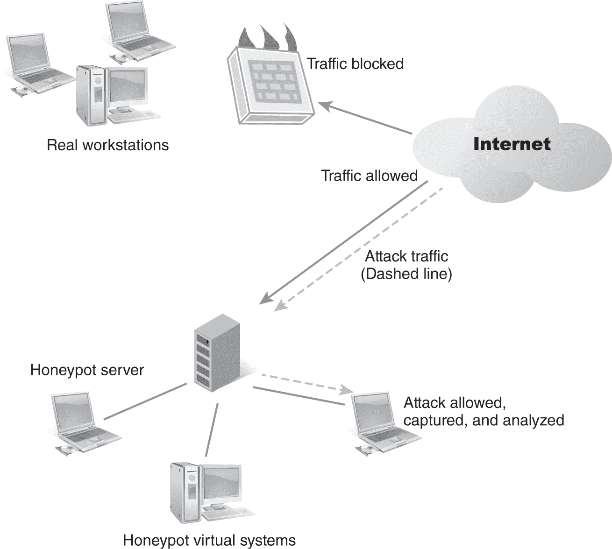

**图 4-3** IDS 检测到攻击并通知操作员——需要人工干预。

#### 注

IDS/IPS 主要用于互联网连接，因为这些连接通常对网络构成最大威胁。您也可以在内部网络的战略位置部署 IDS/IPS。如果您的内部网络连接到第三方网络（如客户、供应商或业务合作伙伴），这是一个极好的主意。

入侵防御系统（IPS）与 IDS 非常相似，不同之处在于除了检测和警报外，IPS 还可以采取行动防止入侵发生（**图 4-4**）。

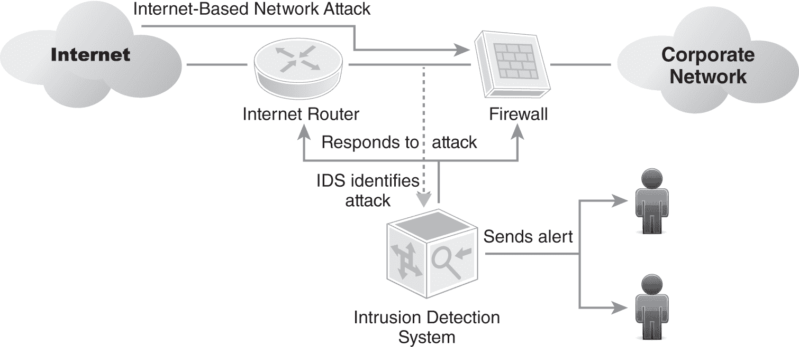

**图 4-4** IPS 检测攻击、通知操作员，然后修改防火墙和路由器配置以应对攻击。

在放置 IDS/IPS 以保护网络免受互联网威胁时，通常采用两种常见的部署方法。每种方法都有优缺点。

未经过滤的 IDS/IPS 安装会在原始互联网数据流穿过防火墙**之前**对其进行检查（**图 4-5**）。这提供了最高程度的攻击可见性，但也意味着将监控大得多的数据量，且误报的可能性更高。在高流量期间，IDS/IPS 可能无法处理所有数据包，从而导致攻击被遗漏。这种放置方式往往会在网络中造成瓶颈，用户可能会注意到延迟并抱怨网络性能。

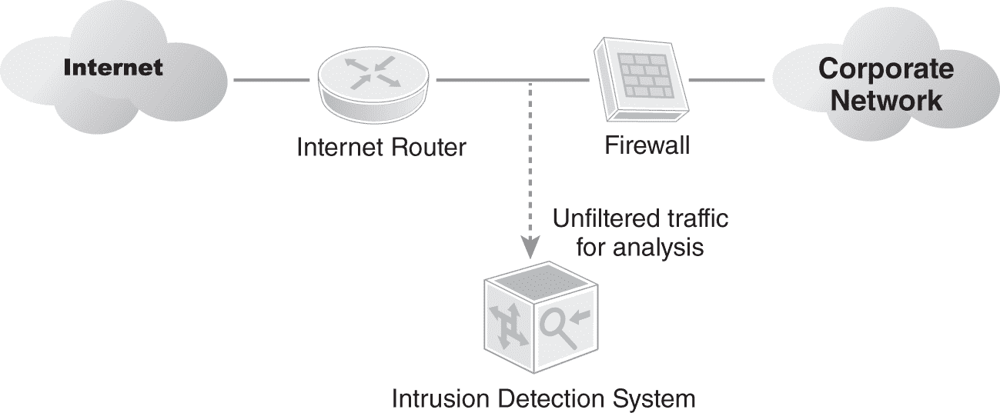

**图 4-5** 入侵检测系统的放置位置，以获取未经过滤的流量进行分析。

屏蔽式 IDS/IPS 解决方案监控通过屏蔽防火墙的流量（**图 4-6**）。该模型的优势在于大幅减少了受监控的流量，降低了误报几率，并减少了高流量期间丢包的可能性。该模型伴随的是可见性的降低，因为您无法看到被屏蔽防火墙拦截的攻击。通常您可以通过防火墙丢弃的数据包了解攻击来源。这种放置方式减少了网络中出现瓶颈的可能性，因为待评估的数据包数量较少。

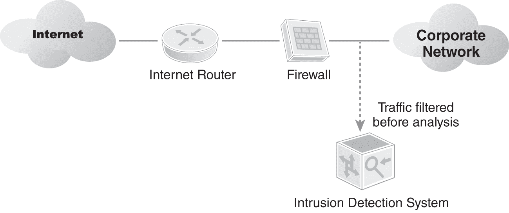

**图 4-6** 部署在屏蔽防火墙后方的入侵检测系统。

### 系统加固

系统加固侧重于提高主机和节点的安全性。加固是通过移除不必要的组件并添加防护措施，来减少潜在目标攻击面的过程。尽管每个组织通常都会制定自己的定制内部加固流程和程序，但大多数加固指南都包含共同的要素和组件。

在考虑您的网络和系统时，可将攻击面想象为一种流行的纽扣形巧克力上的糖衣外壳。这层多彩的外壳不易融化，从而保护了对热敏感的内部内容（巧克力）。如果外层糖衣涂抹不当、因压力或跌落而开裂，或因制造缺陷暴露在空气和热量中，巧克力就会开始融化并流出。为了保护内部内容，外壳必须无缺陷且连续无间隙。网络也是如此。网络中的任何弱点都会暴露整个网络。

以下是一些提高安全性或加固主机的常见建议：

*   移除所有不必要的协议。
*   卸载所有不必要的应用程序和服务。
*   为所有账户定义复杂密码；不得留有任何使用默认密码或空密码的账户。
*   配置账户锁定策略并定义登录警告横幅。
*   为操作系统及每个剩余的应用程序和服务安装所有可用的最终发布版更新、补丁、修复程序、服务包等。
*   使用供应商提供的最新最终发布版更新所有硬件设备固件或 BIOS。
*   安装所有设备驱动程序的最新最终发布版。
*   安装并更新防病毒和反恶意软件扫描器。
*   配置通信加密。
*   安装并配置主机防火墙。
*   使用支持文件级权限和审计的文件系统，并设置这些权限。
*   配置系统监控和审计。
*   同步网络中所有设备和系统的时钟，以便于审计。
*   对主机运行漏洞评估工具，如 `OpenVAS` 和 `Nessus`。
*   配置定期备份，并测试这些备份以确保每个备份均有效且数据可恢复。
*   实施任何组织特定的安全限制，如阻止 USB 驱动器或使用白名单执行管理。这通常通过安全模板文件执行。
*   在 Windows 中，禁用来宾账户，并重命名管理员账户。在 Unix 中，建立策略禁止直接使用 root 账户，管理员必须使用 `su` 命令获取 root 访问权限（从而创建其操作日志）。

除了这些加固建议外，组织还应根据系统用途、系统关键性及环境中存在的风险，在其安全程序中增加额外步骤。

完成系统加固后，必须随时间对其进行维护。按固定计划（至少每年一次）根据组织的加固策略重新检查每台主机，以确保合规性。将任何不符合加固策略的系统移出服务，直到您能使其恢复合规。然后，调查安全不合规的原因并采取对策防止再次发生。

### 设备选择

设备选择是安全网络设计中常被忽视的一个方面。普遍认为任何能够执行 IT 功能的硬件都适合部署，但遗憾的是事实并非如此。无论成本如何，所有产品都可能存在众所周知的或尚未被发现的安全缺陷。


随意或自动选择最便宜或最昂贵的产品，或某个特定品牌的产品，并非制胜的安全策略。您应仔细评估每一件计算机设备（从网络设备到主机系统）的原生安全防御能力或缺失情况，而不应考虑其成本或品牌。

在选择、采购和部署设备时，请考虑引入的漏洞以及对基础设施安全状况的任何防护或改进。每一件设备都将以某种方式提高或降低安全性。某些设备会增加新的弱点或扩大组织的攻击面，而其他设备则充当对策，保护其他组件的弱点并减少攻击面。

只要可能，应选择能更大程度提升安全性的设备，而非有损安全性的设备。这看似是显而易见的准则，但只有您认真评估每个设备的安全概况时，才能遵循它。未能妥善评估新设备的安全性，可能意味着您会无意中将新漏洞引入组织的网络和系统中。

关于设备安全的一些顾虑包括：

*   **可拆卸机箱**—设备机箱越容易拆卸或打开，越容易被黑客入侵、植入监听器或修改其功能。
*   **便携性**—设备是否足够小，可放入口袋、钱包或背包，从而容易被盗？
*   **可机架安装**—一旦拧入可上锁的机架机箱，机架安装设备被盗的可能性较小。
*   **可移动介质**—带有可移动介质托架（如磁带和光盘）或外部外设端口（如通用串行总线 [USB]、防火墙和以太网）的设备，可能比那些接入点较少或没有这些接入点的设备更容易受到攻击。
*   **BIOS/固件刷新**—更改设备嵌入式软件的能力既是优势也是劣势。刷新到更新、更安全的固件版本是积极的；然而，如果黑客可以轻松地将固件替换为有缺陷的第三方版本或旧版本，则可能会成为问题。
*   **远程连接**—如果设备支持远程连接，则风险增加。应限制、加密并监控远程连接。
*   **明文协议**—设备默认使用或仅支持明文协议越多，其安全性越低。应选择支持加密的设备。
*   **易于访问的管理控制台端口或界面**—如果设备可通过 LCD 屏幕和几个按钮（如打印机）重新配置，或者控制台/终端端口允许快速访问配置或管理界面（如无线接入点、路由器或交换机），则部署设备时应谨慎，并评估物理访问安全级别。
*   **重置按钮**—重置按钮用于将设备恢复为出厂默认设置。如果有人按下重置按钮，设备上定义的任何安全配置都将丢失。如果可能，应选择没有重置按钮、或按钮可被禁用以提供物理安全的设备。
*   **位置**—考虑需要定期登录访问或人工交互的设备的位置，因为附近的员工可能会通过“肩窥”获取访问该设备所需的凭据。这对员工工作站同样适用。随着智能手机进入职场，只需将手机内置摄像头对准他人使用的键盘方向，即可查看或录制按键以供后用。
*   **易于触及的电源开关**—如果电源开关易于触及或触发，与设备的偶然接触可能导致断电。此外，易于触及的电源开关允许恶意人员关闭设备或触发重启。
*   **产生的热量**—设备产生的热量越多，供暖、通风和空调 (HVAC) 系统为将室温维持在可接受范围内所需的工作量就越大。过度产热的设备还会增加火灾风险。
*   **耗电量**—过度的能源使用不仅会导致电费增加，还会导致设备内部和配电系统的温度升高。电路汲取过多电力可能导致断路器过载。断路器跳闸会导致停机，并可能造成数据丢失和设备损坏。

在评估新设备部署时，设备安全的许多其他方面也很重要。无论设备是高端服务器、用户笔记本、智能手机、网络路由器还是其他任何设备，都应彻底考虑设备的安全性；切勿仅根据设备成本提出采购建议。

请记住，前期便宜或免费的设备，从长远来看，其管理和安全成本可能远高于更昂贵的设备。然而，高昂的成本并不意味着其安全管理要求就低。资金很少是衡量任何事物安全性的真实标准。

### 认证、授权和审计

安全最终由认证、授权和审计 (AAA)支持和强制执行。AAA 是通常称为身份与访问管理 (IAM)的安全领域的一部分。如果没有正确实施这三大安全基础，真正的安全就不存在。

认证是对某人或某物身份的验证或证明。最常见的认证形式是使用密码。尽管密码最常见，但它们也是最薄弱的认证形式之一。人们通常选择容易猜测或可预测的密码，且经常在多个系统中重复使用相同的密码。

密码以哈希形式驻留在账户数据库中，这意味着无法从哈希值恢复原始密码。然而，通过对大量潜在密码进行哈希运算，密码破解技术有可能将密码哈希与目标哈希匹配。密码破解技术（包括字典密码攻击、暴力密码攻击和混合攻击）通常能揭示构造不当的密码。

##### 技术提示

密码破解通常侧重于生成并哈希大量密码，目标是匹配被窃取或捕获的密码哈希。字典密码破解使用预先准备好的潜在密码列表。列表中的每个密码都使用与目标/被盗密码相同的哈希算法进行哈希运算。如果在列表用尽前找到匹配项，则攻击成功。彩虹表是攻击中使用的预编译哈希密码列表。拥有物理系统访问权限的黑客可能能够从设备的硬盘驱动器构建潜在密码字典，因为键盘输入的大多数密码都以明文形式存储在硬盘驱动器上。这就是为什么硬盘加密是一项重要的安全措施。

暴力密码攻击从选定的字符集构建潜在密码，创建越来越长、使用每种可能的有效字符组合的密码。黑客对每个构造的密码进行哈希运算，并将其与目标哈希进行比较，直到找到匹配项或放弃攻击。给予足够的时间和合适的字符集，暴力攻击最终将会成功。


混合攻击使用字典列表作为种子密码，然后对其进行暴力修改。首先，黑客尝试所有可能的单字符修改，然后是双字符，接着是三字符。这种技术通常更成功，因为许多人选择一个容易记住的单词，然后只进行少量字符修改，例如将“a”改为“@”，或者仅添加一两个字符。

防御密码破解技术的最佳方法是选择长密码，例如在 Windows 系统上使用至少 15 个字符的密码。增加复杂性（混合多种字符类型：大写、小写、数字和符号）以及使用多个单词或短语代替单个基础单词，也能提高密码强度。无论密码看起来多长或多强，成功的网络钓鱼攻击、社会工程学尝试或肩窥（观察他人输入密码）都可能击败它。

动态密码令牌是一种带有显示屏的设备，显示看似随机、不重复的一次性密码。令牌上显示的密码必须包含在登录过程中，通常与单独的 Type 1 PIN 或密码一起使用。类似的技术是移动认证器应用，它将密码发送到您的移动设备。该密码是临时的，如果延迟过长，必须发送新请求以获取另一个一次性密码，因为前一个密码已超时。Google 的 Titan Key（Type 1 和 Type 2）利用邻近性验证对系统的授权，无需输入数字代码。这些双因素机制属于多因素认证的形式。

多因素认证比任何单因素认证形式都安全得多。密码只是第一类认证因素的一个例子。三种常见的认证因素包括：

*   **Type 1**—您知道的事物
*   **Type 2**—您拥有的事物
*   **Type 3**—您本身的特征或行为

**您知道的事物**可以是您记住的任何内容，以便在被要求认证时输入、书写或说出。密码是 Type 1 认证因素最常见的例子。

**您拥有的事物**可以是您必须随身携带的任何物品，例如设备或令牌。这些可以包括金属钥匙、智能卡、射频识别 (RFID) 芯片、ID 徽章、称为动态密码令牌的电子设备，或发送到您预先注册的智能手机的短信。

**您本身的特征或行为**通常称为生物识别。人体的某一部分被用作认证过程中的一个要素。这可以包括指纹、虹膜扫描、视网膜扫描、面部几何、掌纹扫描、签名动态、击键动态和语音模式分析。

两种或多种认证因素的组合即为多因素认证。多因素认证比单因素认证安全得多。使用单因素认证时，攻击者只需掌握单一技能或漏洞利用，即可成功使用被盗用的用户账户登录。使用多因素认证时，攻击者需要掌握多种技能或漏洞利用，才能成功使用被盗用的用户账户登录。

强认证可防止未经授权的实体轻松访问组织基础设施的内部运作。应将强认证应用于逻辑环境，以及物理环境。

授权（通常称为访问控制）定义了用户可以和不可以执行哪些操作。合理细粒度地使用授权可确保授权用户仅执行授权活动。

最小权限原则通常是确定最合适授权设置的良好指导原则。该原则规定，您应授予用户完成其分配工作所需的最少能力、权限和特权，而不提供不必要的访问和额外能力。换句话说，您授予用户足够的权力和访问权限以执行其分配的工作，但不授予超出其职位描述的额外能力。如果用户有权访问某设备，就存在对该设备或其内容进行有意或无意更改的可能性。

审计是记录、监控和审计环境的活动，重点关注用户和系统活动，以检查安全策略合规性。此过程要求用户和系统对其行为和活动负责。通过彻底的核算和详细的审计，您可以检测并响应任何违规、违规尝试或违规趋势。

请记住，安全就是锁定事物，然后监视试图破坏锁的行为。认证和授权是锁定的形式，审计是监视。然而，这些不是安全网络上唯一的锁定和监视形式。网络安全的另一个重要领域是通信加密。

### 通信加密

通信加密是使用加密协议来保护通信内容的安全。任何时候发生与外部实体的事务，或通信跨越存在窃听风险的网段时，都应使用加密。当内部人员可能导致重大损害时，内部通信也应使用加密。

您可以通过两种主要方式使用加密来保护事务。一种是使用提供加密的封装中间协议，例如 IPSec 和 SSL/TLS；另一种是在数据进入网络协议之前对其进行加密。

协议加密可确保通过网络发送的所有或大部分数据免受窃听、修改和其他形式的破坏。一种广泛使用的协议加密机制是 VPN。VPN 可以在单个系统之间、整个网络之间或任何其他端点组合之间运行。

数据加密由客户端或服务器软件执行，可确保即使协议加密失败或被破坏，数据本身的加密也能保证其安全。软件或数据加密不如协议或 VPN 加密具有互操作性，但当事务的双方都使用兼容的软件组件时，它可以是一个可行的选择。

如果不确定，始终进行加密。虽然它不是完美的解决方案（事实上，不存在完美的安全解决方案），但加密能提供显著的保护，防止外部窃听和修改。然而，如果所选算法较差、密钥管理不安全、通信任一端点已被攻破（例如被黑客入侵或植入恶意代码），或负责解密和重新加密的中间网络节点失效，加密就会失效。

默认选择加密是一条极好的网络安全经验法则。此准则并不意味着相同的加密同时保护仅限内部的通信和跨越网络边界的通信。在决定使用哪种加密时，考虑主机所在位置非常重要。

### 主机：仅本地或远程和移动

在设计网络安全时，应关注每个设备的功能，以及其物理和逻辑位置。当主机为本地且仅与其他本地主机通信时，内部通信可使用稍宽松的安全性。然而，当主机为远程、移动或以其他方式位于私有网络之外时，应采取重大的额外预防措施。


### 端点安全

一旦你允许远程访问，就会失去物理访问控制的优势。一旦支持远程连接，黑客或入侵者无需亲自出现在设施内即可发起攻击。因此，远程访问是一种风险，它会降低环境的整体安全性。为了弥补这种安全性的降低，你应该在身份验证、授权和审计方面实施更严格的限制。

在设计和部署安全性时，请考虑每个设备的用途或功能，特别是客户端和服务器，以及它们在典型 IT 基础设施七大域（**图 4-7**）中的一个（或多个）中的位置。然后，考虑哪些其他设备需要与之通信。通信路径越脆弱，你需要施加的安全措施就越多。

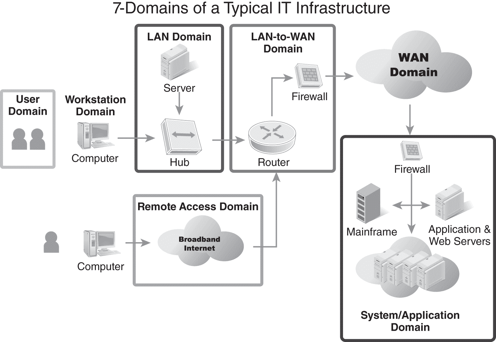

**图 4-7** 典型 IT 基础设施的七大域。

如果两个端点物理上位于同一设施内，但连接设备的网络路径涉及任何外部段，则该事务所需的安全性高于仅限本地的通信。如果端点在地理上相距遥远，则需要使用加密通信。

远程和移动设备固有风险较高，因为它们面临更多潜在威胁。在办公室内，大多数威胁是已知的、受控的和受监控的。但移动和远程设备可能面临未知的、不受控的和不受监控的情况、数据、软件和用户。位于组织设施外部的位置也意味着对设备的物理访问控制不那么严格。

##### 技术提示

位置感知防盗软件会定期收集 IP 信息和任何可用的位置数据，并将其上传到中心站点。如果系统所有者报告物品丢失或被盗，这些自动发布的数据可能有助于找回设备。但是，如果小偷重新格式化了硬盘驱动器，则防盗软件可能会被移除。

安全性的变化和潜在的风险暴露要求在远程和移动设备上增加额外的保护。这些设备应继续部署防病毒扫描程序、反恶意软件扫描程序和防火墙。但它们也可以从全硬盘加密、多因素身份验证和位置感知防盗软件中受益。

远程和移动设备最有可能不符合安全要求，例如补丁级别或安全模板的应用。网络准入控制（`NAC`）系统可以隔离和隔离设备，直到它们安装了所有必要的补丁和更新。

即使有良好的主机管理——无论是本地、远程还是移动——也要考虑冗余要求。拥有一个某物是否足够，还是说一旦它离线就会造成严重问题？

### 冗余

如果不充分解决准备工作问题，安全性就不完整。冗余是准备工作的核心。你的组织能否在停机、断电、通信中断、服务器崩溃、硬盘故障、洪水、大楼疏散、病毒感染或任何其他潜在威胁中幸存下来？在大多数情况下，能否回答“组织可以幸存”取决于该组织的准备工作水平。

准备工作也称为业务连续性规划或灾难恢复规划。此类规划的目的是确保存在一种策略，能够从任何现实威胁中恢复。规划类型的差异取决于威胁的严重性和持续性。要确定组织所需的内容，请评估每个对组织稳定性和功能构成严重威胁的因素。然后，制定应对威胁的程序。该程序可以侧重于预防或恢复（或两者的结合）。

贯穿这种规划形式的核心要素是冗余。冗余是指通过构建多个元素、路径或方法来完成每项关键任务，从而避免单点故障。在安全领域，这方面常被忽视，因为它被视为完成完全相同的工作或流程所需的额外成本或开支。

冗余以多种方式发挥作用。廉价磁盘冗余阵列（`RAID`）是硬盘驱动器的一种冗余形式。`RAID` 可防止驱动器故障。硬盘驱动器是机械设备，其设计寿命仅为一段设定的时间，以平均无故障时间（`MTBF`）额定值（使用小时数）表示。所有硬盘驱动器最终都会发生故障。拥有一个计划和充足的备份可以缓解网络高峰生产力期间驱动器故障带来的问题，或者更糟的是，在无人察觉驱动器已故障且无替换计划时发生故障。

不间断电源（`UPS`）是电源的一种冗余形式。在发生电压降或停电时，`UPS` 设备提供临时电源。如果市电不能及时恢复，`UPS` 可以触发优雅关机以防止数据丢失。如果因空调机组启动等导致楼宇电源出现周期性低谷和尖峰，这些设备还提供电源调节功能。这在实施轮流限电或停电的城市，或在老旧建筑中尤为重要，可防止数据丢失并维护系统完整性。

冗余可应用于通信路径。良好的网络设计要求每个重要资源至少有两条路径。在大多数情况下，客户端的冗余链路可能不是强需求，但拥有多条到达资源的路径通常是必不可少的。

##### 技术提示

尽量避免具有单点故障的网络设计；拥有冗余选项以确保关键任务功能能够执行非常重要。请记住，即使有冗余路径，瓶颈仍有可能发生。监控网络中每个段上的流量和使用水平，以寻找吞吐量或生产力随时间下降的趋势。瓶颈起初可能只是轻微阻碍高性能和生产力，但后来可能演变成一种 `DoS` 攻击形式。

语音和数据的冗余通信链路也是重要的考虑因素。施工人员可能会在错误位置挖掘，意外切断支持组织的主线缆束。通往服务提供商的冗余线路可能是小麻烦与公司灭顶之灾的区别。你想把终结组织的权力交给外人吗？

一旦冗余防火墙、代理、路由器、交换机、服务器和数据库成为 IT 基础设施中必不可少或关键任务的元素，它们在安全性和财务上就开始变得合理。不要将组织的生存能力托付给任何单一组件。始终要有备选方案或备份计划。

不计划就是计划失败。硬件故障、错误、事故或蓄意破坏终将在组织的每个系统中发生。没有组织能幸免于难。成功企业的区别在于：组织是否已准备好随时可用的响应解决方案来应对问题，还是会措手不及，导致不得不手忙脚乱地恢复。


### 实施网络安全

实施网络安全既关乎大局，也关乎细节。基础设施设计、拓扑结构和冗余都是重要的大局层面事项。但切勿忽视那些需要逐节点关注的细节。节点安全侧重于各类网络设备为提升其安全性所必需的任务。节点安全或节点加固采纳了系统加固的通用建议，并在此基础上增加了针对特定节点/主机的额外改进措施。

#### 客户端

客户端是由人员直接控制的设备。因此，客户端必须保护网络免受用户侵害，反之亦然。将客户端视为双向接口，有助于对这一关键 IT 基础设施组件进行恰当的安全设计与实施。

每个客户端都需要以下安全要素：

*   杀毒软件和反恶意软件扫描器
*   主机防火墙
*   安全的互联网客户端软件，如浏览器、电子邮件、文件传输和聊天工具
*   具有自动超时功能的密码保护屏幕保护程序
*   加密网络通信的能力
*   加密存储设备的能力
*   对所有用户活动进行审计
*   完整性检查系统，通过哈希值比对监控未经授权的文件更改
*   配置完整性管理，在配置发生更改时发出警报，或锁定配置以防止篡改

客户端应接受 `NAC` 程序的约束，以防止不安全的客户端危害网络其余部分。应尽可能使用多因素认证，将未经授权的人员访问客户端进而访问整个网络的风险降至最低。根据客户端需求允许特定必要功能（如安全 `FTP`）；如果某项服务无正当业务需求，则应移除执行该操作的能力。

近期一些组织发生的另一个转变是允许甚至鼓励员工和承包商**自带设备**。使用个人手机、平板电脑、笔记本电脑或类似设备可降低组织成本，但也引发了从策略到实施等诸多不同的安全问题。例如，谁负责设备上运行的应用程序及其各自的安全性？谁拥有并在设备上创建的文件内容及其保护的责任？如果特定设备无法运行组织指定的特定安全软件（如杀毒软件甚至 `VPN` 软件）怎么办？如果设备所有者不愿接受安全扫描或运行特定软件怎么办？`BYOD` 使组织面临一系列安全问题——这些问题的重要性与日俱增，尤其是因为 `BYOD` 设备数量不断增加，且这些设备均为无线设备。

为解决 `BYOD` 安全顾虑，首先应考虑 `BYOD` 是否适合您的组织。成本降低可能意味着控制力减弱和业务访问权限受限。如果您的组织有正当理由允许 `BYOD`，请确保制定具体策略，详细规定可接受的使用方式，并将业务数据分类为属于组织的资产。采用远程擦除工具，在员工离职或被发现访问/持有无正当业务需求的数据时，从设备中移除数据。设备丢失或被盗时，此功能也非常实用。要求所有员工签署免责声明并接受这一安全措施，并请组织法律顾问审核所有企业策略。

#### 服务器

服务器是任何 IT 基础设施的骨干。无论是文件服务器、数据库主机、电子邮件服务器、代理服务器还是认证服务器，服务器通常都在为组织支持一项关键或任务关键型功能。服务器需要防止停机保护。这可包括 `RAID`、备用服务器和/或集群等方面的冗余。

采用备用服务器意味着同时运行两个配置相同的系统，但只有一个为网络提供实时服务。第二个系统作为备份运行，并实时接收所有数据变更。一旦主服务器故障，备用服务器可接管网络服务支持。这些服务器可并排放置在同一设施内，或通过电话线或互联网连接位于不同州的设施。一些公司依赖本地服务器和托管在云端的备用服务器，以节省运维两套物理系统的开销。

集群是指两个或多个配置相同的系统作为一个整体运行。所有系统共同分担为网络提供实时服务的任务。如果集群中任何成员下线，其余成员将继续支持服务。集群使服务能够持续可用，同时仍允许进行计划内维护和偶发的单个服务器停机。使用集群会产生额外资源开销，包括审计成本。

服务器需要强多因素认证，以确保只有管理员有权从键盘登录。您应将服务器隔离在专用机房或保险库中，防止未经授权的用户随意或蓄意接触。服务器机房必须始终上锁并受到监控。

#### 路由器

路由器是任何网络必不可少的流量管理设备。网络路由器安全主要在于防止未经授权的访问。首先，路由器应对非管理员物理不可见。所有路由器配置和管理接口必须要求强认证。某些环境选择取消路由器上的本地账户，改为依赖**终端访问控制器访问控制系统加强版** 进行路由器认证和访问控制。将管理接口访问限制为仅允许直接控制台或终端线缆连接，而非允许网络内访问。要求所有管理接口通信和路由器间通信均须加密。

如果密码存储在路由器的配置文件中，请务必使用不易破解或逆向工程的编码方案。例如，`Cisco IOS` 密码类型 7 的哈希方法使用一种弱可逆算法，可使用追溯至 1997 年的软件工具轻松破解。遗憾的是，这种易被攻破的方法至今仍在使用。请务必将配置更新为设备上可用的最新、最安全选项，或考虑更换为安全性更好的新型号路由器。

通常，在路由器上配置以下内容：

*   阻止所有定向 IP 广播。
*   丢弃所有源地址为 `RFC 1918` 地址或任何其他内部地址的来自互联网的数据包。
*   禁用 `TCP` 和 `UDP` 的小型服务：echo、chargen、discard 和 daytime。
*   为所有尝试连接路由器的会话启用警告横幅，特别是管理接口。

尽量限制将路由器用作过滤设备。保持路由表专注于流量路由，并部署防火墙以提供内容过滤和阻断可疑或恶意流量。使用防火墙保护任何被视为边界路由器的路由器。

#### 交换机

交换机安全与路由器安全类似。保持对能物理接触交换机人员的管控。限制管理控制台访问，并要求强认证以访问管理接口。如果密码存储在交换机的配置文件中，请务必使用不易破解或逆向工程的编码方案。


考虑部署支持 IDS 类功能的交换机，例如监视 MAC 欺骗和 ARP 泛洪。MAC 欺骗会欺骗交换机，使其认为黑客的计算机实际上是一台合法主机。黑客会窃取或伪造合法的 MAC 地址。如果交换机正在监视端口变更的 MAC 地址，那么除非黑客能够物理访问他们试图欺骗的 MAC 地址的端口连接，否则 MAC 欺骗将不再构成严重威胁。

ARP 泛洪会使交换机的映射表过载，导致交换机不再将数据包转发到正确的端口，而是默认进入泛洪模式，将数据包传输到所有端口。这种类型的攻击属于主动嗅探。主动嗅探是对交换网络进行窃听的尝试。

使用交换机功能，例如虚拟局域网 (VLAN)支持和审计端口。VLAN 是硬件强制的网络分段。VLAN 隔离流量。使用 VLAN 管理流量通常具有成本效益，因为它不需要重新布线或更改 IP 地址；所有 VLAN 配置都在交换机内部进行。

交换机上的审计、镜像或 IDS 端口将 IDS 或 IPS 连接起来，以监控穿越交换机的所有流量。由于交换机仅从其预期目标所在的端口传输数据，因此如果不使用审计端口，就无法监控交换网络上的所有流量。禁用所有未使用的交换机端口，这可以防止向网络添加流氓设备的最简单方法——即插入空闲端口。

#### 防火墙和代理

防火墙和代理保护网络，但您也需要保护这些设备本身；否则，如果黑客能够攻破防火墙，那么它提供的安全性就不可靠。与路由器和交换机一样，防火墙和代理也需要物理访问保护。任何非管理用户都不应能直接物理接触防火墙或代理。限制对管理控制台的访问，并要求强身份验证才能访问管理界面。如果防火墙或代理的配置文件中存储了密码，请务必使用不易被破解或逆向工程的编码方案。切勿保留默认密码，更改所有密码，并确保不为多个设备使用相同的密码。请记住，重命名管理员账户也提供了一种额外的控制措施。

防火墙应丢弃所有直接发送给防火墙的数据包，因为防火墙不以这种方式托管传统服务。代理服务器通常也是如此，但在某些情况下存在直接与代理服务器通信或代理服务器托管额外可访问资源的情况。

##### FYI

对包括防火墙、代理、交换机、路由器、服务器和客户端在内的任何设备进行最终安全评估。您可以使用自动化漏洞扫描工具或自定义手动渗透测试来执行此评估。目标是发现这些设备中任何剩余的漏洞，以便尽快使每个设备尽可能安全。

如果网络上使用了简单网络管理协议 (SNMP)，请要求使用 SNMP v3，它允许加密事务和 SNMP 会话认证。然后，使用自定义团体名称，而不是默认的 public 或 private 团体。当引入新版本时，请务必查看该协议的 RFC，以确定它是否适用于您现有的网络，或者在更改之前是否需要对硬件或软件进行修改。

考虑路由器、交换机、防火墙或代理的软件或固件。仅安装完整的最终版本，切勿安装 Beta 版或部分固件。如果您担心最新版本未在现实世界中经过彻底测试，则可以坚持使用之前的版本，前提是没有发布关键安全缺陷的报告。最新版本中的增强功能对黑客而言就像一本“如何黑客攻击手册”，因为最新版本中修复的所有问题仍然存在于旧版本中。因此，如果升级被认为是您业务的最佳选择，请勿延迟升级。

### 风险评估和管理

您的组织如何确定部署多少防火墙以及在何处部署？在大多数情况下，这需要一个风险评估和风险管理的过程。风险评估涉及检查价值、威胁级别、可能性、完全妥协的总成本与资源价值及保护成本的对比。许多其他因素会影响风险评估，但这一基本的业务和安全流程如下：

1.  确定资源或资产的总体价值。称为资产价值 (AV)，此计算应包括有形和无形成本和价值。

2.  确定面临该资产的威胁。对于每个威胁，计算暴露因子 (EF)，即以百分比表示的潜在损害程度。这将创建一个带有相应 EF 的资产-威胁对列表。

3.  计算单次损失期望值 (SLE)：`SLE = AV × EF`。这是由于针对特定威胁的单次资产妥协事件可能经历的潜在损失金额。这将为每个资产-威胁对添加一个 SLE 值。

4.  对于每个威胁，计算该威胁在一年内可能成为实际攻击的次数。这称为年化发生率 (ARO)。

5.  计算年化损失期望值 (ALE)：`ALE = SLE × ARO`。这是在一年内因特定威胁导致的该资产任何妥协事件可能经历的潜在损失金额。这将为每个资产-威胁对添加一个 ALE 值。

6.  按 ALE 对资产-威胁对列表进行排序。最高的 ALE 是该特定资产/资源的最大风险。

7.  取 ALE 最大的资产-威胁对，确定可用于防范该威胁的可能对策。这将创建资产-威胁-对策三元组。

8.  对于每个资产-威胁-对策三元组，计算一个新的 ARO。对策应降低 ARO。完美的对策会将 ARO 降至零。完美的对策很少见。

9.  使用新的 ARO，为每个资产-威胁-对策三元组计算一个新的 ALE。

10. 对每个资产-威胁-对策三元组进行成本/效益分析。公式为：`(Original ALE – New ALE) – cost of the countermeasure per year`。

11. 按潜在成本/效益对资产-威胁-对策三元组进行排序。成本/效益最大的三元组是最佳选择。

简而言之，如果针对特定资产-威胁的成本/效益分析建议使用防火墙，那么安装防火墙就是一个良好的业务、安全和预算决策。如果其他对策能以更低的成本提供更大的效益，那么该对策就是更好的选择。

执行详细的风险分析是一项复杂的任务。许多小公司或家庭网络爱好者可能不想花费精力进行复杂的风险评估。这是可以理解的，但不进行完整的风险评估并不意味着您没有风险，也不意味着您没有值得保护的资产。


至少，您需要保护任何和所有可识别个人身份的数据。这包括电子邮件等个人通信；任何定制制作的文档、图片、视频或其他文件类型；所有医疗信息；所有财务信息；配置设置；以及密码和其他凭证。身份盗窃是互联互通世界中最频繁且破坏性最强的犯罪之一。仅担心邻居、随机的入室盗窃或街头扒手，无异于管窥蠡测。如今，您必须关注全球范围内所有企图通过互联网访问您电子资产的潜在犯罪分子。

### 什么是风险区域？

风险区域是指代表一定风险级别的任何网段、子网、网络或网络集合。风险越高，您需要的安全防护就越多，以抵御该风险。与某区域相关的风险越小，所需的安全防护就越少，因为对该区域的威胁造成危害的可能性较小。

风险区域的另一面是信任区域。高度信任的区域自然需要较少的安全防护，而低信任的区域则需要更多的安全防护。

每个风险区域都需要与其他任何风险区域清晰且明显地隔离开来，特别是当这些区域具有不同风险级别时。用于隔离区域的主要工具是防火墙。

大多数网络有两到四个风险区域。这些包括私有网络（LAN/内部网）、DMZ、外部网和互联网。请参见**图 4-8**。私有网络区域风险最低，是信任度最高的区域。互联网区域风险最高，是信任度最低的区域。DMZ 的风险低于互联网，但不如私有网络可信。DMZ 区域具有中高风险或中低信任度。外部网的风险高于私有网络，信任度高于互联网。外部网区域具有中低风险或中高信任度。请参见**表 4-1**。

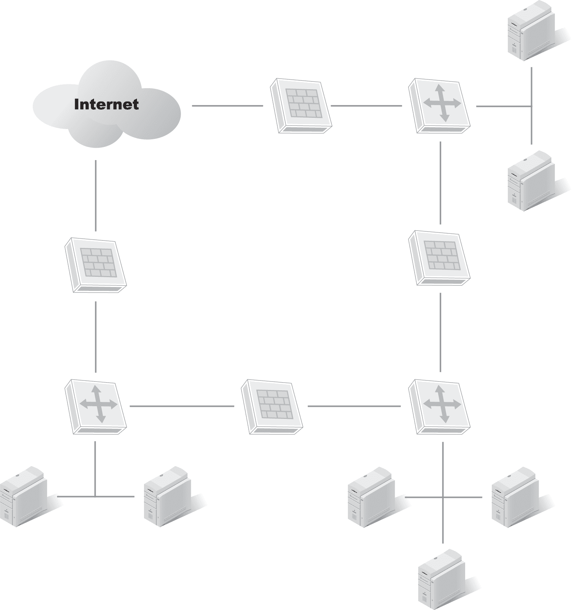

**图 4-8** 具有四个风险或信任区域的私有网络示例。

**表 4-1** 常见网络区域的风险和信任级别

| 区域 | 风险级别 | 信任级别 |
| --- | --- | --- |
| LAN/内部网 | 低 | 高 |
| 外部网 | 中低 | 中高 |
| DMZ | 中高 | 中低 |
| 互联网 | 高 | 低 |

您组织的书面安全策略应定义这些区域的存在位置，并规定每个区域的安全要求。此类要求将包括流量管理、防火墙的使用、使用 VPN 跨越区域划分、系统加固、恶意代码扫描等。防火墙很可能位于风险区域的分界处，在某些情况下可能是性价比最高的安全对策。

### 本章小结

网络安全实施依赖于对组织、其目标、其风险以及 IT 基础设施中所采用技术的透彻理解。在您能够正确部署网络安全之前，必须先对其进行设计。大多数网络安全设计都包括纵深防御层，以及足以支持增长的充足容量。

网络安全包括对组织所使用的协议和方法进行评估。如果当前设计不足，请用一个兼顾生产力和安全性的设计来替换它。您需要结合各寻址方案（无论是公有还是私有、静态还是动态）对安全性的改进或削弱作用来评估正在使用的寻址方案。

网络安全设计和部署的其他重要组成部分包括控制通信路径；加固系统；以及选择合适的设备、认证、授权、审计、通信加密、主机类型、冗余和节点安全细节。

本章还介绍了风险评估和管理的概念，以帮助确定适当数量的防火墙和其他安全措施。虽然术语很重要，但必须理解如何将风险转化为可量化的数字，并以一种能够妥善保护和防御网络的方式来应对它。

### 关键概念和术语

年化损失期望值 (ALE)

年化发生率 (ARO)

资产价值 (AV)

攻击面

审计

认证、授权和审计 (AAA)

自带设备 (BYOD)

暴力破解密码攻击

成本/效益分析

字典密码攻击

字典密码破解

暴露因子 (EF)

文件传输协议 (FTP)

混合攻击

身份与访问管理 (IAM)

无形成本和价值

互联网号码分配局 (IANA)

建模

多因素认证

网络新闻传输协议 (NNTP)

试点

邮局协议 (POP)

彩虹表

冗余

廉价磁盘冗余阵列 (RAID)

区域性互联网注册机构 (RIR)

风险评估

风险管理

路由器访问控制列表

路由器反欺骗

靠不公开实现安全

简单邮件传输协议 (SMTP)

单次损失期望值 (SLE)

单点故障

沉没成本

有形

Telnet

不间断电源 (UPS)

虚拟局域网 (VLAN)

风险区域

信任区域

### 第 4 章评估

1.  以下哪项应作为路由器配置的一部分完成？

    1.  将配置复制并粘贴到所有路由器和防火墙

    2.  为所有尝试连接启用警告横幅

    3.  为保持一致性要求使用 SNMP v2 或更早版本

    4.  在网络边界内丢弃所有加密数据包

2.  以下哪项*不是*针对密码使用的攻击类型？

    1.  暴力破解

    2.  字典攻击

    3.  混合攻击

    4.  递归攻击

3.  以下哪项是纵深防御策略的一部分？

    1.  避免单点故障

    2.  避免拥有多重冗余

    3.  避免移除默认账户

    4.  避免使用不同制造商的设备

4.  192.168.32.16 属于以下哪个地址类别？

    1.  A 类

    2.  B 类

    3.  C 类

    4.  D 类

5.  以下哪项是冗余的示例？

    1.  每个物理边界处的一个防火墙

    2.  使用多因素认证

    3.  加密网络外部的通信

    4.  不间断电源

6.  以下哪项最能定义靠不公开实现安全？


# 使用防火墙保护边界

## 第 5 章：防火墙基础

### 第 5 章主题

本章涵盖以下主题和概念：

*   什么是防火墙
*   为什么网络需要防火墙
*   防火墙如何工作
*   防火墙的类型
*   个人和 SOHO（小型办公室/家庭办公室）防火墙的选项
*   主机软件防火墙、商业软件网络防火墙以及硬件和设备防火墙的常见用途
*   下一代防火墙
*   虚拟防火墙
*   双宿主和三宿主防火墙的区别
*   入站过滤和出站过滤的区别
*   防火墙过滤的类型
*   选择防火墙
*   购买与自建防火墙的考量因素

### 第 5 章目标

完成本章后，你将能够：

*   定义防火墙
*   解释防火墙的必要性
*   描述防火墙的类型，包括网络路由器/接口防火墙、硬件/设备防火墙和主机软件防火墙
*   对比软件和硬件防火墙
*   设置宽带连接设备防火墙
*   使用 Windows Defender 防火墙
*   对比双宿主和三宿主防火墙
*   定义入站过滤和出站过滤的含义
*   解释标准过滤方法，包括静态包过滤、网络地址转换 (NAT) 服务、应用代理过滤、电路代理过滤、动态包过滤、状态检测过滤和内容过滤

### 什么是防火墙？

防火墙就像一名**边境哨兵**。将防火墙想象成一名驻守在国家边境的卫兵。在网络中，防火墙是一种过滤设备，它强制执行网络安全策略，保护网络免受外部攻击。**数据包**是在互联网或任何其他网络上，在两点之间路由的信息单位。数据包**头部**包含源地址、类型、大小、源地址和目的地址等信息。作为一种过滤设备，防火墙会监视不符合防火墙管理员定义的**规则**的流量。

防火墙可以关注数据包头部、数据包**有效载荷**（数据包的核心数据）或两者兼顾；也可以关注**会话**的内容、**电路**的建立，以及可能的其他资产。大多数防火墙仅关注其中之一。最常见的过滤焦点是数据包的头部，紧随其后的是数据包的有效载荷。

> **提示**
>
> “防火墙”一词源于建筑和汽车制造中的一个概念，即建造一堵墙以防止火势从一个区域蔓延到另一个区域。建筑物或汽车发动机舱中的防火墙是一道阻止火势蔓延的物理屏障。

防火墙是组织综合安全策略的重要组成部分。安全策略定义了安全的目标、目的和程序。每一个专注于网络安全的安全策略都需要部署防火墙。防火墙的工作是将安全策略中定义的所有限制和边界强制施加到所有网络流量上。防火墙强制执行组织的网络安全策略，就像交通警察执行城镇或州的机动车法规一样。防火墙策略确保网络防火墙的成功。全公司范围的安全策略确保组织安全基础设施的成功。防火墙绝不能替代此类安全策略。

> **提示**
>
> 防火墙强制执行网络流量访问控制安全策略。防火墙是安全策略的物理化身。它是你网络流量上最明显或最直接的访问控制执行。没有其他设备像防火墙那样直接参与允许授权流量并拒绝所有其他流量。

防火墙过滤将接收到的每个数据包与一组例外规则进行比较。这些规则规定数据包中的内容要么被允许，要么被拒绝。如果数据包匹配允许规则，它将继续前往目的地。如果数据包匹配拒绝规则，该数据包将被丢弃。因此，拒绝规则可防止数据包到达其目的地。如果数据包未能匹配任何规则，防火墙默认会丢弃该数据包。

如果配置得当，过滤将允许你想要的网络内容并拒绝你不想要的内容。过滤依赖于过滤规则。每条规则标识一个关注的模式，以及当传入元素匹配该模式时防火墙将做出的响应。

防火墙遵循一种称为**默认拒绝/例外允许**的安全理念或立场。防火墙上的所有规则都是例外。一些例外规则定义允许的内容。一些例外规则定义希望拒绝的内容。最后一项选项，有时称为最终规则，是指任何未匹配任何例外的内容默认被拒绝。

过滤规则是“拒绝所有”规则的例外，而“拒绝所有”规则是防火墙的最终且绝对的规则。事实上，如果不存在默认拒绝规则，该过滤设备根本就不是防火墙。相反，它更像是一个路由器或交换机，即使流量不匹配预期的模式或规则，也允许其通过。


##### 技术提示

请牢记 `deny by default/allow by exception`（默认拒绝/例外允许）的安全立场。防火墙是一种过滤设备，有助于支持这一立场。

网络安全管理员使用“防火墙”一词来指代允许某些流量但拒绝其他流量的设备或服务。这与建筑物的防火墙不同，后者只有在防火墙失效时才允许火势蔓延。在网络安全中，防火墙允许被认为安全的流量通过——或者至少授权流量通过，而无需整个防火墙失效。此外，如果防火墙确实发生故障，它会进入一种称为 `fail-safe` 或 `fail-secure` 的安全状态。这意味着当防火墙离线、锁定或冻结，或以其他方式出现问题时，防火墙会停止所有流量，而不是允许所有流量通过。

网关是访问受控空间的入口或出口。网关很重要，因为通常有大量流量通过网关。因此，在网络网关处部署防火墙是安全设计的一个方面。如果网关已存在于网络基础设施中，那么在此处部署防火墙是显而易见的安全改进。如此部署的防火墙会拦截并验证跨越该网关点的所有流量。

防火墙常部署的其他位置包括位于前面（即公共互联网一侧）、后面（数据中心内部）或负载均衡系统中——它们通常被称为负载均衡器。负载均衡器的命名相当贴切，因为这些设备的功能正是如此：它们接收进入一组服务器的负载，并根据各种因素确保负载在服务器之间或之中保持平衡。这是流量的汇聚点，是强制执行策略的理想位置，而这正是通过防火墙来完成的。

如果网络仍处于设计阶段，网络设计师可能会出于安全考虑，选择在网络布局中创建一个网关。然而，在这种情况下，该汇聚点被称为瓶颈点，而不是网关。如果网关是访问其他资源区域的接入点，那么瓶颈点就是一种专门的网关，它将流量集中到单一的集中通道，以简化过滤过程。

你也可以将防火墙视为一种流量控制设备。网络安全的很大一部分只不过是控制流量。授权流量通过数字十字路口，而未经授权、不需要的、异常的或明显恶意的流量被阻断。知道如何区分流量的差异通常很困难，需要你依赖精心设计的规则。

现代防火墙最基本和最初的形式是筛选路由器。路由器根据目标地址分析流量。通往目标的最佳可用路由决定了转发决策。然而，筛选路由器增加了额外的规则，可根据目标或源地址丢弃流量。一旦过滤扩展到地址协议甚至端口，筛选路由器就成为了基本的静态包过滤防火墙。

除了防火墙之外，透明代理（也称为直通代理的权限。私有局域网（LAN）的流量可以遍历一个段，而目标为非军事区（DMZ）的流量可以遵循另一个段（参见图 5-1）。防火墙是你网络这条高速公路上高效、必要的交通控制设备。

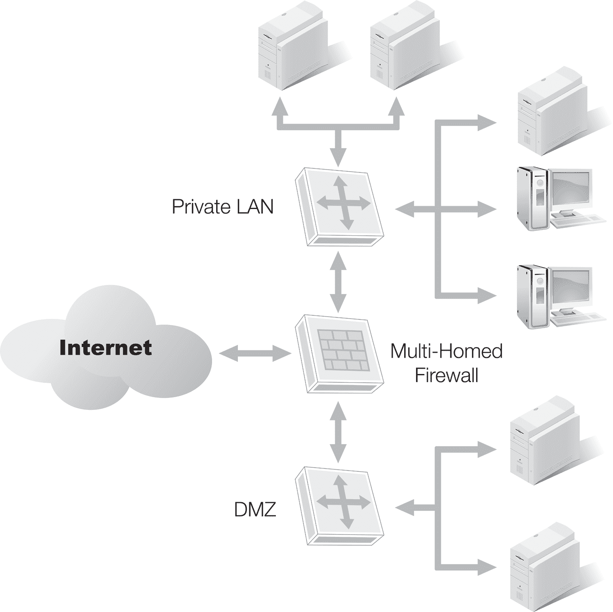

**图 5-1** 一个基本的多宿主防火墙，为两个网络段进行过滤和路由。

防火墙的关键功能是保护你的网络免受外部攻击。计算机网络的某些威胁被称为病毒并非偶然；外部威胁似乎在不断变化和演变。一些攻击专门针对你的网络或组织。其他攻击则是无目标的、随机的。相反，这些攻击针对的是恰好具有特定漏洞的任何主机。恶意代码持续感染并攻破无防护的计算机系统。洪水攻击试图中断及时的互联网通信。这些只是你组织网络面临的外部威胁中的一部分。

无论将其标记为资源访问的网关，还是控制安全的瓶颈点，结果都是一样的。部署在网关处的防火墙为所有流量提供过滤服务。瓶颈点为资源提供经过过滤的访问。正如一位睿智的诗人曾说：“好篱笆造就好邻居。”同样，良好的网关和位置得当的防火墙造就安全的网络。

理解这些定义和区别只是理解防火墙的开始。

##### 防火墙无法做到的事

如果使用得当，防火墙能为外部威胁提供可靠且一致的安全防护。然而，防火墙有其局限性，只是完整安全策略的一部分。仅靠防火墙本身，无法保护网络免受所有威胁。

防火墙是网络安全的重要组成部分，但它不是网络安全的全部。不要犯下部署了防火墙却忽视其他安全管理活动的错误。防火墙只是解决网络安全这个大型复杂拼图中的一块。防火墙无法包揽一切。

###### 认证服务器

防火墙主要用于网络流量过滤。它不是认证系统。防火墙的设计初衷不是检查登录凭据、比对生物识别扫描，甚至不是确认数字证书的有效性。这些是认证服务的功能，通常托管在域控制器或主网络服务器上。

话虽如此，你可能会发现有必要让防火墙在授予资源访问权限或允许会话之前进行认证。某些防火墙可以具有提供防火墙托管认证服务的增强功能。然而，在许多情况下，更好的解决方案是让防火墙将该任务卸载给专用的认证服务器或服务，例如 802.1x、公钥基础设施 (PKI) 或目录服务。大多数安全专家不建议使用防火墙来认证用户，或者至少不建议将其作为网络目录服务或集中式认证解决方案的替代品。

###### 远程访问服务器


####### 防火墙不是远程访问服务器

来自远程用户的连接在防火墙处没有终点。相反，终点是远程访问服务器（`RAS`）或网络接入服务器（`NAS`）。防火墙可能在 `RAS`/`NAS` 之前或之后发挥作用，以过滤远程访问流量。然而，这并不意味着防火墙就是 `RAS`/`NAS`。

您的防火墙应过滤所有远程流量，特别是因为远程流量比本地流量更有可能是蓄意恶意的或意外破坏性的。为什么？组织对谁可以在本地连接到其网络拥有更多控制权，而当允许远程连接时，这种控制力就大大降低了。

###### 加密数据包

与超人不同，您的防火墙没有透视加密流量的 X 射线眼；换句话说，它无法查看加密流量的内容。防火墙可以使用传输模式加密根据流量的头部进行过滤，因为原始头部是明文形式的。然而，防火墙无法使用隧道模式加密过滤流量的原始头部，因为唯一的明文组件是一个临时隧道头部，它仅包含关于隧道端点的信息。这就像试图仅通过观察火车头和守车来猜测货车厢里装了什么。

将防火墙放置在能发挥最大效用的位置。如果安全设计要求防火墙检查所有流量内容，则需要将防火墙放置在流量解密之后的位置。如果安全设计仅要求对非加密流量进行过滤，则防火墙的放置位置就不那么关键了。

专为 Web 电子商务站点设计的防火墙可能具有额外的能力，可充当来自互联网客户端的安全套接字层（`SSL`）或传输层安全（`TLS`）隧道的端点。这使客户端的数据在穿越互联网时得到保护。这允许防火墙在 Web 服务器接收并处理信息之前过滤流量内容。

加密是规避过滤的一种方法。用户和黑客可以使用客户端加密解决方案在传输前对数据进行编码，或创建未经授权的加密封装隧道以防止防火墙过滤。在这种情况下，您的网络安全策略可能会规定防火墙需要阻止客户端发起的加密传输，特别是当目标位于互联网上时。

###### 恶意代码扫描器

防火墙也不是恶意代码扫描器。防火墙传统上是基于规则的过滤产品。这些规则集通常只有几十条，至多几百条规则。要过滤恶意代码，规则列表将需要数百万条目。2009 年 12 月，AVG 反病毒定义数据库 #270.14.88/2538 正在追踪 24,303,360 个恶意代码感染定义。到 2018 年，这一数字已增长至数亿。如此数量的条目根本无法包含在防火墙规则集中。

某些防火墙产品包含用于恶意代码扫描的增强功能或附加模块。这种增强功能只是一个附加组件，并非防火墙的核心功能。在大多数情况下，使用独立的反恶意软件扫描器比将此功能添加到防火墙中更高效、更安全。

许多防火墙规则会阻止带有欺骗地址、不常用端口、未经授权的协议、无效头部结构或值等的流量。此类规则阻止了由恶意代码引起的大量流量，但这些规则并不能直接阻止恶意软件进入或离开网络。

###### 入侵检测

防火墙不是入侵检测系统（`IDS`）。`IDS` 是一种网络防盗或入侵警报，能检测并响应您网络内部的未经授权活动。`IDS` 通过监控所有网络流量来执行此任务。虽然 `IDS` 可以部署在网络边界或面向互联网的网络外部，但大多数运行在私有网络内部，并提供监视所有内部网络流量的能力。

防火墙只有在恶意流量进入其接口之一时才能检测到。防火墙通常不监视一般的内部网络活动。防火墙要么是网络和子网的边界设备，要么是监视单个主机的软件产品。无论哪种情况，它们看到的流量都不同，也无法执行与 `IDS` 相同的任务。因此，防火墙无法替代优秀的 `IDS`。

###### 内部攻击和社会工程学

一个常见的误解是防火墙可以防范内部攻击。防火墙可以是边界设备，也可以是主机上的软件。边界防火墙可以过滤进出网络或子网的流量。边界防火墙无法看到任何内部流量（**图 5-2**）。当一名内部客户端的攻击者攻击同样是内部主机的目标时，边界防火墙不参与该通信；因此，它既无法检测也无法阻止该攻击。主机软件防火墙只能看到进出该主机的流量。主机软件防火墙无法看到任何其他内部流量。

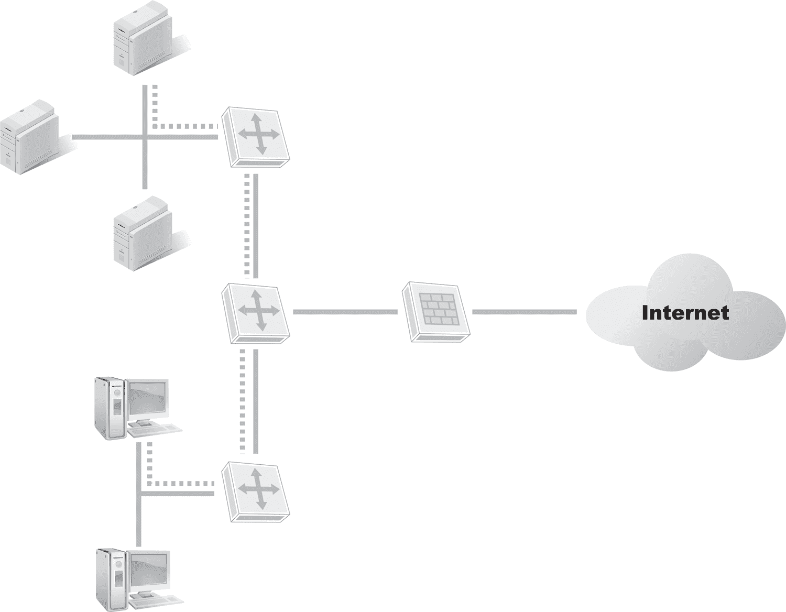

**图 5-2** 边界防火墙无法过滤内部通信。

当然，如果流量不经过其接口，防火墙就无法过滤该流量。防火墙只能过滤它能看到的内容。如果恶意或不需要的流量未进入防火墙的接口，防火墙将无法过滤该流量。对于最佳策略，您应该在每台主机、每个边界网关或检查点，以及每个重要子网或内部网络划分之间部署防火墙。

防火墙无法做到的另一件事是防范社会工程学。社会工程学是一类针对组织人员的攻击。这些攻击通过巧妙地询问或说服某人执行违反网络安全的操作，从而从人员那里获取信息。防范社会工程学的唯一真正保护是员工培训和安全意识。

####### 注释

`IDS` 可以检测大量不需要的活动，使用多种检测方法，并执行广泛的响应，包括被动和主动两种。

###### 可移动介质

防火墙无法防范可移动介质使用所带来的重大威胁。可移动介质有多种类型：USB 硬盘、USB 闪存驱动器、CD、DVD、蓝光光盘、HD-DVD 光盘、其他光盘、闪存卡、FireWire 存储设备、磁带介质、电子邮件附件、通过 USB 线连接的智能手机等。防火墙不参与可移动介质的使用，也不涉及这些设备可能包含的任何内容。防火墙无法保护您的网络免受可移动介质持续带来的威胁。同样，对此威胁的最佳防御是良好的公司政策、员工培训和安全意识。

###### 物理攻击

当然，防火墙无法防范物理入侵或攻击。物理攻击会绕过任何和所有逻辑及电子保护机制。防火墙无法防范设备盗窃、窃听装置植入、电缆断开、将流氓设备连接到开放节点、设备破坏、向电子设备泼洒液体、建筑火灾或任何其他形式的物理攻击。只有有效的物理防御才能阻止物理攻击。防火墙的设计初衷并非用于挫败物理攻击。


###### 配置错误与安全管理

计算机设备和软件只能执行其设计和编程规定的功能。如果管理员错误配置了安全设备，该设备不会自动弥补这一疏忽。如果安全管理员未能了解新设备的所有功能和默认设置，该产品无法自主保障自身安全。

安全需要培训、研究、周密的规划、深思熟虑的实施，以及持续的审查和维护。这一过程称为安全管理——这需要付出努力。那句老话在今天从未如此真实：“垃圾进，垃圾出。”你在网络安全上投入什么，就会得到什么。因此，请记住，防火墙无法弥补管理员的无能或无知。

防火墙无法弥补糟糕的安全管理。主动的安全管理对于任何安全工作的成功至关重要。安全管理是审查、测试、调整和更新组织安全策略及安全基础设施的过程。这是一项持续的工作，需要知识、研究和警惕。组织面临的威胁和风险在不断演变，变得更加持久和猖獗。你的安全策略在防御上应同样严谨且有的放矢。及时了解网络安全领域的当前威胁和趋势是这项工作的重要组成部分。与安全专业人士建立联系、参加相关会议、阅读最新的行业文献，都是保持自身及安全工作敏锐度的途径。

最后，防火墙并非完美的解决方案。它们无法自我调整以适应不断变化的条件或未来的威胁。防火墙主要是软件（即使运行在专用硬件上），由难免犯错的人类编写；因此，它们难免存在 Bug 和缺陷。幸运的是，尽管防火墙有诸多局限性，它仍是一种可靠的过滤解决方案。它能够且应该作为完整安全基础设施的一部分，保护网络边界和单个主机的边界。

### 为什么你需要防火墙？

高速互联网连接已变得无处不在。大多数计算机用户现在在家里、工作场所，甚至通过移动设备在外出时都能获得高速接入。通常，这些宽带连接是“永远在线”的连接。这意味着计算机和网络始终处于联机状态——并暴露在攻击之下。如果吊桥永远放下，就很容易被跨越。当系统始终保持连接时，它可能成为集中攻击的焦点，攻击者试图发现其漏洞并突破其安全防线。

计算机被发现并通过互联网攻击的可能性有多大？几乎是肯定的。大多数系统在获得公共 IP 地址 几分钟内就会被检测、扫描和探测。在安装防火墙以及硬件、操作系统（OS）和已安装应用程序的最新供应商补丁之前，将系统连接到互联网无异于技术自杀。

这是否意味着有成群结队的黑客正等待寻找新目标进行攻击？不幸的是，是的——但并非你想象的那种方式。恶意程序，如代理、僵尸程序和傀儡机，会自动执行大部分扫描和攻击。被称为僵尸网络的恶意代码组合，会持续在互联网上搜寻新受害者。

有了防火墙保护你的系统免受互联网侵害，黑客的扫描将几乎毫无价值。对探测数据包的响应将被过滤。外部人员将难以了解你的基础设施。这反过来意味着他们将发现更少的漏洞，从而发起更少的攻击。即使发起攻击，也更有可能失败。

防火墙不仅用于互联网防护。不要忘记内部也存在重大威胁。防火墙监控你私有网络内部的网段（**图 5-3**）。可将防火墙视为防止局域网资源被滥用或误用的工具。组织内每个主要部门、子网或其他相关区分都应具备防火墙保护。这将确保意外泄露和故意滥用在内部被最小化。所有网络都需同时防范内部威胁和外部威胁。

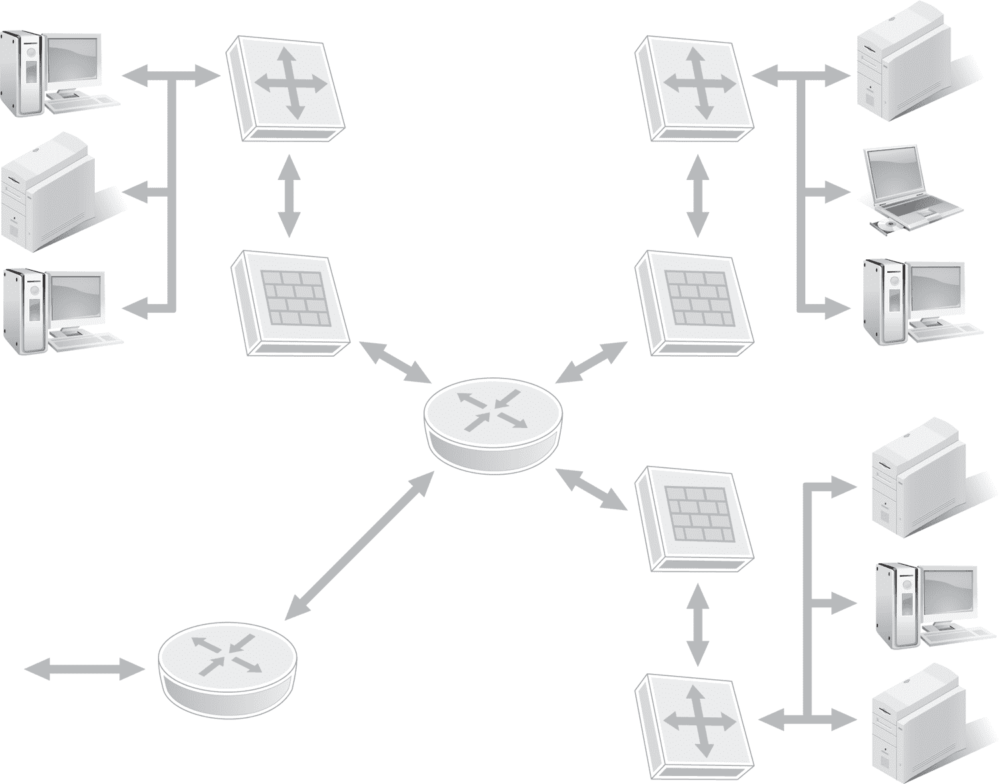

**图 5-3** 使用防火墙安全隔离子网的私有网络示例。

虽然防火墙起源于路由，但你仍应使用专用路由器进行路由，使用专用防火墙进行过滤。在许多情况下，组合或多功能设备提供了大量功能，但不一定具备最佳性能和效率。这些设备可能为小型网络节省资金，但对于大型网络往往是得不偿失的。如果设备在必要时无法达到商业级性能水平，其后果造成的收入和生产力损失，可能比最初部署适当的防护措施花费更多。

主机防火墙既保护主机，也保护网络免受主机的威胁。主机防火墙的工作是过滤进出单个计算机系统的流量。攻击和恶意流量可能来自互联网，也可能来自本地网络。主机防火墙可保护主机免受此类威胁。然而，主机本身可能被恶意代码攻陷，或被恶意用户控制。在这种情况下，主机防火墙可保护网络免受来自主机的威胁。

从另一个角度看，主机防火墙也保护网络免受用户的普遍风险。用户是网络基础设施中风险最大的因素。即使其他每个组件——硬件或软件——都按其编程和配置运行，用户也可能决定违反安全规定。因此，人类用户的自由意志是每个计算环境面临的最大风险之一。

用户可能无知、犯错、被特洛伊木马欺骗、成为社会工程学攻击的目标，或故意实施恶意行为。主机系统的安全，包括通用系统加固、反恶意软件扫描、互联网客户端限制、阻止非批准软件以及主机防火墙，所有这些措施都是为了保护网络免受人类用户的风险。

### 防火墙的工作原理及功能

防火墙沿通信路径工作。这可以是网络的网关点、网络内的关键节点、区域过渡点，或主机上。在这些位置，防火墙会中断流量以检查数据包或会话。如果流量被授权，则继续传向目的地。如果流量未被授权，则被阻止并丢弃。

提到防火墙，人们通常会联想到某种硬件，但实际上将其视为一种功能更为准确。防火墙实现主要有两大类型：线路中插入式和协议栈中插入式。线路中插入式（**图 5-4**）是独立的硬件防火墙实现，而协议栈中插入式（**图 5-5**）是通过软件实现的防火墙。


**图 5-4** 线路中插入式实现。


**图 5-5** 协议栈中插入式实现。


#### 防火墙

防火墙基于堡垒主机运行（**图 5-6**）。这在硬件防火墙的情况下最为明显，但对于主机软件防火墙同样适用。堡垒主机防火墙沿着潜在攻击的路径站岗放哨，处于承受任何攻击主力冲击的位置。防火墙充当前锋，是抵御任何攻击的第一道防线。堡垒主机也可称为牺牲主机。


**图 5-6** 堡垒主机防火墙部署示例。

就主机软件防火墙而言，防火墙将尝试阻止所有针对主机的恶意交互（无论入站还是出站）。如果防火墙被攻破，通常会将系统与网络断开连接。虽然这是一种拒绝服务（DoS）形式，但相比于默认开放无限制且未经过滤的连接，这通常是首选的故障安全/故障保密响应。如果连接直接通向互联网，这一点尤其正确。

如果防火墙能够击退攻击，则资源是安全的。如果防火墙因攻击而失效，它将阻止与其背后资源的任何进一步通信。可将防火墙视为死人开关。如果防火墙失效或脱机，其过滤的连接也将随之中断。

防火墙最常见的功能是筛选或过滤流量。防火墙根据其规则集检查其接口上接收到的任何数据包，以决定是转发还是丢弃该数据包。正如您之前所读，防火墙通常基于“默认拒绝/例外允许”的安全策略运行。

防火墙主要根据数据包或段头部中的信息执行大部分流量过滤。这可以包括源和目标的 IP 地址，以及源和目标端口。某些防火墙还可以过滤或阻止特定协议或协议的特定用法。例如，防火墙可以阻止所有流媒体协议，并仅阻止 Internet 控制消息协议（ICMP）类型 3（目标不可达）和类型 11（超时）。

防火墙区分网络或子网。防火墙作为一个清晰且明确的边界，将一个网络区域与另一个区域分隔开。通过在网络分段或子网之间放置防火墙，网络设计人员和安全管理员正在对试图跨越该交汇点的流量进行管理和控制。防火墙既作为面向互联网的网络边缘边界设备，也作为组织内部不同部门之间的内部边界设备。

开放且无限制的内部通信听起来可能是个好主意，但在实践中，此类流量会导致整体基础设施性能和稳定性严重下降。通过阻止——或至少限制——组织某些部门之间的通信，可提高流量效率。此外，流量控制和管理可降低风险。

例如，通过阻止编程组网络与生产网络之间的通信，可防止未经批准的软件版本意外加载到生产网络。此外，从生产网络阻止对财务子网、研发子网、DMZ 和外联网的常规访问，可防范数据泄露、恶意代码传播及其他形式的欺诈和滥用。

防火墙可充当恶意活动的通用过滤器，或单向筛。作为通用过滤器，防火墙将允许所有正常的良性流量通过。这是用于保护 DMZ 或区分局域网内子网的防火墙类型。通用过滤防火墙致力于阻止恶意活动。

通用过滤防火墙可以允许使用任意协议、任意端口进行通信，也可以将通信限制为特定协议和端口（以及其他限制）。如果只有防火墙后托管的少数特定资源需供外部用户访问，防火墙可根据 IP 地址和端口允许访问那些特定的内部系统，但阻止所有其他入站请求。

筛式防火墙仅允许流量从私有或受信侧发起。筛式防火墙允许非恶意响应从公共或低信任侧返回，但通常会阻止或防止来自外部的任何发起或入站通信请求。筛式防火墙通常保护私有局域网或外联网。

防火墙可支持与局域网的特殊入站授权连接。一种专用内容类型是来自远程办公人员的虚拟专用网络（VPN）链路。这对外联网也是一项重要功能，因为 VPN 访问通常是通过互联网访问托管资源的唯一方式。

防火墙可提供端口转发服务。端口转发是一种静态的网络地址翻译反向形式。在传统或动态网络地址转换（NAT）中，外部实体无法发起与内部系统的通信；NAT 系统外部接口接收到的任何数据包都不会在转换表中找到匹配的映射，因此会被视为无效并丢弃。

通过端口转发，会编码一个转换映射，使得外部 IP 地址和端口组合固定下来，并将流量重定向到特定的内部系统，即使该内部系统使用的是私有 IP 地址。IP 地址和端口号的组合称为套接字。在**图 5-7**中，外部端口 `208.40.235.38:8081` 被转发到内部服务器的 `192.168.5.74:80` 端口。端口转发也可称为静态 NAT、流量转发、服务重定向、反向代理以及“在防火墙上打洞”。


**图 5-7** 跨 NAT 系统的端口转发示例。

##### FYI

“在防火墙上打洞”这一短语指出了一个非常重要的问题：即使用端口转发会降低防火墙提供的有效安全性。如果没有端口转发或其他类似服务，防火墙可以击退与内部系统通信的尝试。使用端口转发，您就在主要边境哨所创建了一条通道。多种黑客攻击手段可利用端口转发到达端口转发设置“允许”范围之外的其他端口上的其他内部系统。这些攻击通常是分片操纵的变体。

管理和控制流量是防火墙的主要关注点和功能。仅允许授权通信；其他一切均被阻止。决定允许什么和阻止什么的行为取决于防火墙的过滤功能。这些功能包括数据包检查、连接或状态管理、状态检测等。（状态是客户端与资源服务器之间的逻辑连接。）这些过滤概念将在本章后面定义。

此外，防火墙可以阻止或过滤出站流量。此功能可阻止欺骗性流量，或目标或源为无效 IP 地址的任何流量。特定协议或端口也可被阻止。当然，特定域名或目标地址也可被阻止。


#### 防火墙

防火墙还可以基于内容进行过滤。防火墙可以在数据包离开网络并到达外部网络之前，拦截其中的特定内容。这可能导致数据包被丢弃、整个连接被切断，或者数据包被编辑以移除被阻止的内容并用其他内容替换。内容过滤可以关注域名、URL、文件名、文件扩展名或内容中的关键字。

防火墙的另一项功能是基于加密进行过滤。防火墙可以无限制地允许加密。或者，防火墙可以设置为在某些端口上阻止加密，而在其他端口上不阻止。防火墙还可以阻止来自和发往所有内部 IP 地址的加密流量，但服务器、VPN 设备和 RAS/NAS 除外。

在网络管理员认为直接通信风险过高的情况下，防火墙可以在主机之间执行中介功能。这是代理的基本功能。位于通信路径上的代理防火墙可以向通信参与者隐藏通信一个或两个端点的身份。在大多数情况下，代理服务会向外部实体隐藏内部系统的身份。

防火墙可以通过使用地址转换或转换系统来执行地址节约。`NAT` 是网络支持的最常见的转换服务。`NAT` 在内部地址和公共外部地址之间进行转换。`NAT` 允许私有网络使用 RFC 1918 私有 IP 地址。这反过来又提供了额外的安全性，因为互联网主机无法直接寻址 RFC 1918 系统。

由于不存在完美的安全产品，你必须依靠监控来留意任何试图（以及成功）突破或违反安全的行为。安全就是尽你所能地锁定事物，然后监视试图突破你防线的行为。先锁定，再监视。防火墙也不例外。如果提议的防火墙产品无法记录其操作和网络活动的日志，你需要寻找其他防火墙产品。请记住这句经过时间考验的商业格言：“你得到的是你检查的，而不是你期望的。”

防火墙可以记录事件。防火墙可以设置为将任何操作记录到日志文件中。此外，防火墙可以将任何恶意流量的内容记录到日志文件中。另外，任何异常的网络活动、性能水平和流量统计都可以列在日志文件中。记录事件是防火墙的一项宝贵功能。

通过所有这些特性、功能和能力的组合，防火墙为组织的计算机和电子资源提供了一致、可靠的保护。但防火墙并不完美，不应成为网络基础设施的唯一安全组件。它们只是网络安全策略的一个要素——尽管是必不可少的一个。

### 防火墙的类型

列举防火墙的类型，几乎就像在生物学中列举动物界的分类学。其变体、型号和版本数不胜数。此外，对于什么是防火墙、什么不是防火墙，观点各异。许多专家开始讨论防火墙类型时，会将防火墙整体划分为两个简单的主要类别：个人防火墙和商用防火墙。

个人防火墙旨在为单个系统或小型网络（如 SOHO 网络）提供保护。大多数个人防火墙提供用户友好的界面，可能基于 Web 或图形化（即图形用户界面，或 `GUI`）。为了充分利用其功能，大多数个人防火墙不需要特殊培训或认证。

商用防火墙旨在为中大型企业网络提供保护。大多数商用防火墙相当复杂，通常需要特殊培训和认证才能充分利用高级功能。大多数商用防火墙使用类 Unix 命令行界面（`CLI`），虽然功能强大且高效，但不直观。

然而，这两个类别并不代表防火墙的全部，因为有几种防火墙很容易归入其中任何一类或两类。因此，另一种常见的分类方法是将防火墙分为硬件防火墙或软件防火墙。

硬件防火墙是一种专用硬件设备，专门构建并加固，以支持在其上运行的防火墙软件的功能。硬件防火墙也称为设备防火墙。它不与任何其他服务共享专用硬件资源。硬件防火墙的使用不需要任何额外的硬件或软件。它只需要一个或多个网络连接和一个电源。虽然硬件防火墙可以保护单个系统或整个网络，但它只能过滤到达其设备网络接口的流量。不过，硬件防火墙可以部署在网络的关键点或网关位置，以分析和过滤所有流量。

##### 注意


软件防火墙和硬件防火墙都是一种软件形式，但硬件防火墙拥有专用设备作为其宿主，而软件防火墙使用标准客户端或服务器作为其宿主。

软件防火墙是安装在宿主机上的应用程序，这就是为什么它也被称为主机防火墙。软件防火墙依赖于宿主机的硬件和操作系统。如果宿主机的组件没有得到适当的加固，软件防火墙的效果会打折扣，特别是当宿主机上存在其他通信路径或攻击点时。软件防火墙必须在宿主机上与所有其他活动进程竞争资源。充其量，软件防火墙只能保护单个宿主机免受恶意网络活动的侵害。软件防火墙只能过滤到达其宿主机网络接口的流量。

软件和硬件防火墙都可能成为攻击目标。漏洞利用可能危害软件组件，或物理攻击可能损害宿主机/设备。软件防火墙通常比硬件防火墙便宜。硬件防火墙通常提供比软件防火墙更广泛的功能和能力。软件防火墙和硬件防火墙都是你可以在整个网络基础设施中使用的选项。

结合这些类型的防火墙，会产生四种主要选择：

*   个人软件防火墙
*   商用软件防火墙
*   个人硬件防火墙
*   商用硬件防火墙

个人软件防火墙是用于个人家庭系统、SOHO 系统，甚至客户端/服务器网络工作站和服务器的产品。通常，个人软件防火墙是免费的，或比商用软件防火墙产品便宜。

商用软件防火墙是用于客户端/服务器网络工作站和服务器的产品。这些可以安装在个人或 SOHO 系统上，但安装通常昂贵，且是整体安全管理或网络准入控制（`NAC`）系统的一部分。大多数商用软件防火墙可用于代理/控制台基础设施，其中每个宿主机的防火墙都从主管理控制台远程管理。

##### 注意


大多数无线接入点，无论是消费级还是商用级，都包含某种形式的防火墙，以便为无线客户端以及物理有线连接提供过滤服务。许多无线接入点可以准确地标记为路由器和/或交换机，特别是当某些型号包含两到六个额外有线连接端口时。


个人硬件防火墙是集成防火墙产品的一部分，例如无线接入点（WAP）或有线/数字用户线路（DSL）调制解调器。个人硬件防火墙的另一种变体是将客户端或服务器计算机重新用于自制的开源防火墙。一个例子是 Netgate 的 pfSense，这是一个提供部分路由和 VPN 功能的软件防火墙。

商用硬件防火墙通常是处理大型组织网络复杂性的设备。商用硬件防火墙通常非常昂贵，价格在 10,000 美元或以上。这些防火墙通常需要详细的培训才能正确设置和部署。

##### FYI

两种常见但不同的二分法是免费与付费，以及开源与闭源软件。*免费*意味着您无需付费即可使用防火墙。*付费*意味着您必须支付购买价格和/或许可费才能使用。免费和付费防火墙产品都有很多例子。开源意味着原始源代码可供查看和修改。闭源意味着分发版本是预编译的，且原始源代码未公开。

软件防火墙产品以及任何其他形式的 IT 产品，都可以是免费开源、免费闭源、付费开源和付费闭源。您不应假设：因为某物是免费的，它就是开源的；或者因为某物是商业的，它就必须购买。

此外，产品免费并不保证其可靠性或可信度。另外，能够审查源代码也不代表产品可靠。

关于免费软件的进一步讨论，请访问 GNU 组织的网站：[*www.gnu.org*](http://www.gnu.org)

个人版软件和硬件防火墙可能包含与其商用版本不同的附加组件或增强功能。这些附加组件或增强功能可能包括防病毒软件保护、密码管理、注册表保护、驱动程序保护、VPN 网关、远程访问支持、IDS、IPS、垃圾邮件过滤等。通常这些附加组件会使防火墙产品对潜在买家更具吸引力。然而，大多数商业实体通常会避免使用集成防火墙解决方案，而倾向于使用专用产品来处理不同的安全或管理功能。集成设备可能提供更简单的管理，但它代表了多种服务的单点故障。此外，由于支持的通信复杂性，此类捆绑解决方案更难排查故障。

防火墙的另一种变体，实际上是最初的变体，是筛选路由器。大多数设备路由器和许多软件路由器（如 Windows Server 中的路由和远程访问服务 [RRAS]）除了路由功能外，还能执行防火墙过滤服务。执行防火墙过滤的筛选路由器可能为您的需求提供足够的哨兵安全性。但是，如果您想要更高级的功能，筛选路由器不太可能成为您网络的最佳解决方案。

无论防火墙的类型或实现方式如何，重要的是要确定您的防火墙实施了您想要的安全和隐私策略，同时不与其他安全措施冲突。例如，如果您将要访问的远程系统要求使用某个被本地防火墙阻止的协议或过程，那么您就遇到了一个必须在访问远程系统之前解决的问题。

### 个人和 SOHO 防火墙选项

个人或小型办公室运行者的防火墙选项范围从原生操作系统防火墙到专用设备。大多数个人和 SOHO 用户关心安全，但不想花费过多成本。实际上，为大多数家庭或小型办公室环境获得合理的安全级别非常容易且具有成本效益。

### NOTE

安装一把安全工具并不意味着您可以掉以轻心、随意浏览整个互联网而保持安全。相反，通过使用简单的安全工具并结合常识，大多数威胁要么被阻止，要么被规避。当然，潜在的例外情况始终可能影响这一规则，例如当受信任的站点被攻陷，您下一次访问导致恶意软件传输到您的硬盘驱动器时。

首先，了解此类环境面临的常见威胁表明，防火墙选项可以简单且廉价。通常，互联网威胁分为两大类：被动和主动。被动威胁是指您必须主动寻找才会受到伤害的威胁。例如，您必须访问某个网站才会受到嵌入在该网站中的恶意代码的危害。同样，下载受感染的内容仅在您选择点击下载链接时发生。用户可以通过对去往何处以及在互联网上做什么做出良好且安全的选择来避免大多数被动威胁。

为了应对被动威胁，现代 Web 浏览器包含弹出窗口拦截器、Cookie 过滤器（**图 5-8**）和恶意站点管理器以限制暴露。使用防病毒扫描、反间谍软件扫描器和反垃圾邮件过滤器可解决其他常见威胁。在您的安全态势中添加防火墙，可防范互联网上可能被随意触发的大多数被动威胁。


**图 5-8** Firefox“选项”对话框的隐私部分。注意 Cookie 设置。

互联网威胁的另一类是主动威胁。主动威胁是指采取某种主动措施寻找目标进行攻击的威胁。这可以是黑客、入侵者或自动化蠕虫。在任何情况下，主动威胁都会寻找脆弱的目标。如果您没有部署合理的安全措施，且主动威胁发现了您的系统，您可能面临被攻破的风险。

幸运的是，大多数个人和 SOHO 环境并非大多数黑客活动的重要或主要目标。在安全性适中的单台计算机或小型网络上花费时间和精力进行攻破，价值或收益不足。如果您的业务获得大量流量和订单，或者您恰好托管了数百个系统，那么您自然会成为黑客更有价值的目标。

在大多数情况下，普通家庭用户和大多数小型办公室（例如在网络中运行十几台或更少计算机的办公室）可以从非常简单且廉价的防火墙选项中获得合理的安全保护。

要考虑的第一个防火墙选项是操作系统的任何原生防火墙。大多数操作系统都包含默认或原生防火墙。如果您的系统有，请在自动放弃之前先调查其功能和选项。最新版本操作系统中发现的许多防火墙与大多数商业可用的第三方主机软件防火墙选项一样好，甚至更好。

最著名的原生操作系统防火墙示例之一是 Windows 防火墙。Windows 防火墙作为 Windows XP Service Pack 2 的一部分首次在 Windows 操作系统中亮相。自首次发布以来，Windows 防火墙作为标准原生功能出现在 Windows Vista、Windows 7 和 Windows 10 中。Windows 防火墙的功能集和用法将在本章后面讨论。

### NOTE


#### 微软在 Windows 10 中将 Windows 防火墙的名称更改为“Windows Defender 防火墙”；不过，在某些情况下，你仍会看到它被称为“Windows 防火墙”。

其他操作系统可能有也可能没有像 Windows 防火墙那样广为人知的防火墙，但在寻找替代方案之前，你仍应调查原生提供的标准选项和功能集。毕竟，在你驾驶并路测了一辆全新汽车的标准功能之前，绝不会对其进行定制涡轮增压改装。

大多数 Linux 发行版不会自带原生软件防火墙。当 Linux 确实提供原生防火墙时，它不太可能默认启用或配置。由于 Linux 发行版的差异极大，Linux 提供了一系列防火墙。Linux 防火墙包括较旧的产品，如 `ipchains` 和 `iptables`，以及较新的选项，如 `PF`、`Netfilter` 和 `Vyatta`。

除了免费或原生操作系统防火墙选项外，个人和小型办公/家庭办公（SOHO）用户还可以使用由互联网服务提供商（ISP）连接设备、路由器或无线接入点（WAP）托管的防火墙。ISP 连接设备是指将本地网络（甚至单台计算机）连接到电信运营商网络以访问互联网的任何硬件。大多数 ISP 连接设备（包括有线调制解调器、DSL 调制解调器、卫星调制解调器、路由器和无线调制解调器）都包含防火墙功能。防火墙功能可能代表也可能不代表一个功能齐全的防火墙。有些只是基本的过滤工具，使用简单的黑名单技术来阻止 IP 地址、端口或协议。

ISP 连接设备可能提供无线连接。如果提供商不提供无线选项，或要求你为其设备的无线功能支付额外费用，你应该考虑部署自己的 WAP。面向消费者和 SOHO 环境的大多数 WAP 价格在 100 美元以下，并提供防火墙服务以及无线连接。

对于家庭用户或小型办公室网络，使用原生主机操作系统防火墙以及由 ISP 连接设备或 WAP 提供的硬件防火墙，通常已足以提供充分的过滤安全性。然而，如果你想探索其他选项，或者你拥有更大、风险更高或更敏感的环境，请考虑其他防火墙替代方案。

### 管理 ISP 连接设备上的防火墙

大多数 ISP 连接设备使用 Web 界面。要启动对管理界面的访问，请打开 Web 浏览器，并在通常输入 URL 的位置输入设备的 IP 地址。在大多数情况下，设备的 IP 地址是默认网关地址、DHCP 地址，或是直接连接到设备物理端口的客户端接口的 DNS 地址。

##### 技术提示

如果 ISP 连接设备提供防火墙服务，请获取一份该设备制造商最新的用户手册。该文档将提供关于访问和配置设备防火墙的最佳初始信息，通常可在制造商的网站上在线获取。

尝试打开配置界面时，很可能会提示输入身份验证凭据。供应商的用户手册应会指明设备的默认用户名和密码——这也是为什么你必须更改设备上的这些默认值的原因——但请务必记录账户信息并将其妥善保管。如果没有记录，请使用“默认密码”等关键词以及设备名称、品牌和型号在互联网上搜索。如果失败，请尝试用户名 `admin` 搭配密码 `admin` 或 `password`。令人震惊的是，这些组合正确的频率极高。在 Linux 系统中，通常使用 `root` 作为用户名，`toor` 作为密码。

你的 ISP 很可能已经锁定了对连接设备的访问。这有时是为了防止不懂行的人误操作，从而导致技术支持麻烦增加。如果你发现 ISP 连接设备被锁定，请尝试致电 ISP，要求他们授予你访问权限（通常是透露登录设备的凭据）。

如果他们拒绝提供此信息，你有四种选择：

1.  你可以接受他们的拒绝，将其视为“事情就是这样”，并使用其他设备作为硬件防火墙。
2.  你可以更换 ISP 或服务提供商，选择一家允许你配置设备的运营商。
3.  你可以尝试用你拥有并完全控制的设备替换运营商的设备。
4.  你可以在互联网上寻找特定于 ISP 和设备的信息，其中可能包括绕过或破解的详细信息。

##### 注意

有线电视提供商通常不太可能允许你访问其连接设备，而大多数 DSL 提供商似乎愿意至少授予部分访问权限。

然而，选择最后这条路时必须非常小心；这通常是徒劳的，很可能违反 ISP 服务条款，不道德，甚至可能违法。

如果你无法找到访问 ISP 连接设备配置界面的合法途径，破解设备应是你的最后也是最终的选择。破解 ISP 提供的设备将使你的合同失效，并可能使你承担设备成本、罚款以及可能的法律诉讼。一个更合乎道德的解决方案是用你拥有并控制的设备替换它，或者完全更换 ISP。

##### 注意

搜索提供如何破解或绕过 ISP 设备信息的网站时要小心。这些网站往往设有陷阱，植入恶意软件以欺骗毫无戒心的访问者。你可能能够下载说明，但通常这是一个特洛伊木马文件，包含会感染你系统的恶意软件。此外，某些 ISP 设备可能是租赁而非出售的，尝试访问内部功能可能违反合同，甚至违法。

如果一切都失败了，在 ISP 连接设备和你的第一台联网系统之间添加你自己的防火墙。通过这种配置，你仍然可以获得内联防火墙的好处，而不会违反任何合同或冒法律风险。在大多数情况下，你无论如何都会想要补充或禁用 ISP 连接设备的防火墙。因此，如果你的 ISP 阻止访问它，只需像该设备不提供防火墙保护一样来设计你的安全方案。

### 将家用路由器转换为防火墙

许多家用路由器具有功能足够强大的特性，你可以将其配置为作为防火墙运行。为了确保易用性（并最大限度地减少产品退货），这些设备通常在出厂时关闭了所有安全功能。由于“即插即用”能带来即时连接，许多用户从未回头配置设备的安全性。因此，黑客和恶意软件往往能轻松入侵家庭网络。你可以通过了解这类产品中可用的功能来防止这种情况。

要访问家用路由器，请在浏览器中输入网关的 IP 地址。要在 Windows 机器上确定 IP 地址，请选择“开始”>“运行”，输入 `Command`，在 `C:\\>` 提示符下输入 `ipconfig`。大多数路由器出厂默认地址为 `192.168.1.1`。如果你还记得，`192.168.X.X` 是一段不可路由的 IP 地址范围，这意味着该地址范围内的流量不会与该范围外的地址共享。在 Linux 系统上过程类似，只不过有线系统的命令是 `ifconfig`，无线 Linux 设备的命令是 `iwconfig`。


登录后，请考虑更改许多设置（**图 5-9**）。首先，如果路由器是无线设备，请将服务集标识符（SSID）从默认设置更改为其他名称。你不希望你的路由器成为邻里中八个名为“ASUS”的接入点之一。这为什么很重要？大多数电脑会自动连接已知 SSID 中信号最强的无线信号。如果你的无线接入表中有标准 SSID（如 ASUS），你可能会在不知不觉中连接到邻居（或黑客）的系统。另一个好主意是将默认 IP 地址范围更改为 `192.168.1.X` 以外的范围。这将为你自己的网络创建一个自定义范围。如果你将内部网络范围硬编码为类似 `10.20.30.X` 的地址，则不太可能陷入那种情况。


**图 5-9** ASUS 无线路由器的初始配置屏幕。 ¶ 图片由华硕提供。

大多数路由器默认启用动态主机配置协议（DHCP）。你可以通过以下两种方式锁定网络：将 IP 地址硬编码到每台授权机器中（并关闭 DHCP），或对允许获取 DHCP 租约的设备数量设置严格的上限（大多数默认设置为 100）。如果你有五台设备，请将连接数限制为五台。（不要忘记 Xbox 360 或 PS3——这些设备也需要 IP 地址。）

### 注意

请勿忘记更改设备的默认管理员密码。

对于防火墙设置，大多数路由器都会有一个配置页面来阻止服务或控制端口访问。确定你需要哪些端口来访问互联网，然后阻止所有其他端口。请注意，此设置限制的是出站流量。那么，既然流量源自内部，为什么要阻止它呢？恶意软件、僵尸网络、机器人程序和其他敌意应用程序通常必须连接到外部才能造成破坏或窃取你的财产。如果你在最喜欢的咖啡馆意外将危险的恶意软件下载到笔记本电脑上，然后连接到防火墙后面的家庭或办公室网络，该恶意软件可能会访问你所有的对等系统。但是，如果你阻止了所有非必要的出站流量，大多数恶意软件将无法窃取你的敏感信息，也无法向其远程服务器请求下一步对你的系统采取什么指令。只有使用通用端口（如端口 80）的应用程序才能通过。

你应该阻止哪些出站端口？首先，请查阅你的策略，或确定你正在使用哪些程序。在大多数情况下，你需要始终允许以下出站端口保持开放：

*   **端口 25**—SMTP（出站邮件）
*   **端口 53**—DNS（域名解析）
*   **端口 80**—HTTP（互联网访问）
*   **端口 110**—POP（发起入站邮件请求）
*   **端口 443**—HTTPS（安全互联网）
*   **端口 465 和 995**—SMTP 和 POP（如果使用 Gmail 或其他邮件套件）
*   **端口 1024–1035**—用于下载文件的 DCOM 端口（根据受保护系统的数量增加端口数量；对于家庭网络，10 个通常就足够了）

除非你使用 cPanel 通过端口 2083 访问外部托管的网站，或者使用端口 11371 查找 PGP 密钥，否则你可能不需要允许端口 1035 以上的出站流量。通过阻止所有其他高位端口，你也会很快收到同事或家庭成员的反馈，他们可能一直在使用其中一些专用于特殊软件或游戏的端口。在家里，你可能想要允许（或设置时间限制）；在工作中，你可能想要阻止这些端口，因为玩游戏通常不是公司资源的可接受用途。

一般来说，你不应接受任何源自防火墙外部的连接。你的策略可能允许例外，例如远程访问工具，因此在阻止所有内容时要小心。一些家用防火墙没有直接阻止特定入站端口的方法，但大多数允许你进行端口转发。利用此功能阻挡外部攻击的一个巧妙方法是转发到一个不存在的端口。例如，如果你的本地网络范围包括从 `10.20.30.40` 到 `10.20.30.49`，你可以将入站连接请求转发到端口 `10.20.30.99`——那里没有设备在监听。你可能考虑转发的端口包括：

*   **端口 20 和 21**—FTP 数据和 FTP。防止外部连接下载你的文件。如果你的业务需要文件传输，更安全的替代方案是 SFTP（端口 22）和 FTPS（端口 990）。
*   **端口 23**—Telnet。防止外部连接不安全地登录到你的内部系统。
*   **端口 53**—DNS。防止外部实体污染你的 DNS 缓存。
*   **端口 80**—HTTP（除非你在防火墙后运行 Web 服务器，这不是个好主意）。
*   **端口 81 和 82**—常作为端口 80 的“溢出”端口使用。无合法用途，因此阻止这些端口。
*   **端口 137、138 和 139**—NetBIOS。常被恶意软件利用，这提供了进入 Windows 系统的途径。
*   **端口 443**—HTTPS（除非你在防火墙后运行安全 Web 服务器，这仍然不是个好主意）。
*   **端口 445**—用于 Windows 2000 及更高版本的 NetBIOS。
*   **端口 3074**—Xbox 游戏端口。不要允许陌生人在你不在时连接到你的 Xbox。记住——它“生活”在你的内部网络上。

测试配置的一个绝佳方法是访问 Steve Gibson 的 [*http://www.grc.com*](http://www.grc.com) 网站并运行他免费的 ShieldsUP! 端口扫描工具（**图 5-10**）。尽管该网站外观公认过时（截至撰写时），但该工具是合法的，可用于扫描端口和服务，例如通用即插即用（UPnP），这些通常是恶意行为者的攻击目标。大多数系统最终得分很低。如果你能达到 100% 隐身，说明你做得很好。


**图 5-10** ShieldsUP! 端口扫描结果，确认家用路由器防火墙规则配置良好。

### 主机软件防火墙的用途

从原生操作系统防火墙（甚至没有防火墙的操作系统）进阶的下一步是第三方主机软件防火墙。这些选项包括适用于大多数操作系统的开源和商业软件防火墙。

你可以在几种情况下使用主机软件防火墙。第一个也是最明显的用途就是保护客户端系统。请记住，主机软件防火墙为入站和出站通信都提供保护。主机软件防火墙既保护客户端免受网络上的攻击，也保护网络免受客户端上的攻击。

在服务器系统上使用主机软件防火墙作为额外的保护层。大多数服务器操作系统不包含主机软件防火墙。因此，专用防火墙设备通常部署在网络上。服务器上的主机软件防火墙永远不能替代设备防火墙。但是，它可以作为补充。

### 注意

在安装任何第三方软件防火墙之前，请务必再次检查其与你当前操作系统版本和补丁级别的完全兼容性。如果防火墙的文档没有明确列出你的操作系统为完全兼容，请不要假设该设备将正常工作。防火墙安全性不能靠运气。


主机软件防火墙可以为 VPN 提供防火墙过滤服务。仅仅因为 VPN 链路可能是加密的，并不能保证 VPN 连接的另一端像你期望的那样安全。将主机软件防火墙与软件主机 VPN（如传输模式 VPN 或远程访问 VPN）或设备 VPN 结合使用，可以增加一层额外的保护，防止可能遍历 VPN 连接的攻击。

##### 注意

安装第三方软件防火墙时，请确保所有原生或其他防火墙均已禁用或卸载。不要尝试在同一计算机系统上同时运行两个软件防火墙。在不同系统上运行不同的软件防火墙，甚至使用一个或多个设备硬件防火墙都是可以接受的。只是不要尝试在一台系统上使用两个软件防火墙。

主机软件防火墙可以为小型网络提供适度的保护。家庭网络、游戏网络和小型办公网络有时是使用连接到互联网的主系统构建的，该主系统通过辅助网络接口与小型网络共享该连接。在 Windows 系统上，Internet 连接共享（ICS）服务使这种类型的网络配置变得简单。使用主机软件防火墙，为辅助网络提供适度的防火墙过滤服务。

主机软件防火墙可能还有许多其他用途。在经过适当的研究和测试后，可在任何网络配置中使用主机软件防火墙。目标是建立额外的安全层，而非墨守成规的设计和实施观念。

##### 软件防火墙产品示例

在为家庭环境以及企业 IT 基础设施设计和部署安全解决方案时，软件防火墙产品是重要的考虑选项。有许多第三方软件防火墙值得考虑。以下只是其中一些较为知名的选项：

*   Check Point ZoneAlarm（免费版和零售版）
*   Comodo Firewall（免费）
*   eConceal（零售版）
*   Jetico Personal Firewall（零售版）
*   Lavasoft Personal Firewall（零售版）
*   TinyWall Firewall（免费）
*   GlassWire Firewall（零售版）

除了独立的第三方防火墙外，一些防火墙作为安全套件的一部分打包提供。这些套件成员防火墙不作为独立产品提供。然而，如果你还没有现有的防病毒或反恶意软件解决方案，这套安全应用程序可能值得考虑。一些可考虑的安全套件包括：

*   AVG Security Suite
*   Computer Associates (CA) Internet Security
*   F-Secure Internet Security
*   McAfee Personal Firewall Plus
*   Avast Security Suite
*   Microsoft Security Essentials
*   Norton Internet Security 和 Norton 360
*   MalwareBytes Internet Security
*   Trend Micro Internet Security
*   Webroot Internet Security Essentials

##### 使用 Windows 10 的主机软件防火墙

Windows 10 中原生的 Windows Defender Firewall（**图 5-11**）在许多情况下已是足够的安全措施。在急于替换这个免费安全组件之前，请花时间评估这个功能强大的防火墙选项的优势。Windows 10 中的 Windows Defender Firewall 是一款主机软件防火墙。然而，它可以用于大多数家庭、SOHO 和移动环境的各种情况和网络配置。


**图 5-11** Windows Defender Firewall 高级安全配置对话框。 ¶ 经 Microsoft 许可使用。

Windows 10 中的 Windows Defender Firewall 包含配置文件，因此你可以为工作、家庭和公共连接创建自定义防火墙配置设置。这允许在公共网络中实施严格限制，在工作中采用适度设置，以及在从家庭访问时（或根据你的偏好）提供更多选项。其好处是，一旦配置完成，防火墙将根据每次连接的已知、先前访问过的网络连接自动调整其设置。

Windows Defender Firewall 创建一个受密码保护的家庭组或工作组，允许经密码授权的系统之间进行文件和打印机共享。这改进了之前版本的 Windows Firewall，后者经常鼓励用户直接关闭整个防火墙，而不是正确配置文件和打印机共享访问规则。此外，这不仅适用于 Windows 系统，也适用于任何被识别为媒体共享设备的设备或计算机（如 Xbox 360）。

Windows 10 版本中 Windows Defender Firewall 的其他改进包括更细粒度的控制和配置管理界面、更广泛的日志记录，以及扩展的命令行管理能力（使用 `netsh advfirewall firewall` 命令代替之前的 `netsh firewall` 命令）。

尽管它不是革命性的，且仍缺少一些功能（如作为具有程序控制功能的真正双向个人防火墙），但 Windows Defender Firewall 对于大多数网络情况下的大多数客户端来说，都是一款有价值的主机软件防火墙。也就是说，你仍应探索该产品如何适应你自己的计算环境和安全需求。

##### 使用 Linux 主机软件防火墙

Linux 系统可以从主机软件防火墙中受益，或者可以支持用于网络的软件防火墙。第一个想法仅仅是为本地用户的利益安装一个主机软件防火墙。这与 Windows 10 中的 Windows Defender Firewall 思路相同。Linux 有各种开源和商业主机防火墙选项可用，包括：

*   IPFire
*   pfSense
*   IPtables 或 Netfilter
*   Untangle NG
*   UFW
*   VyOS
*   Smoothwall

如果你因 Linux 的低准入成本而选择它，那么选择一个同样低成本的主机软件防火墙通常是一个有吸引力的选项。然而，付费购买商业主机防火墙产品可能提供更广泛的功能或服务，以及更好的技术支持。

使用 Linux 软件防火墙作为商业防火墙设备的替代品，可以是一个非常具有成本效益的解决方案。Linux 通常可以重新利用那些不再足以支持 Windows 等更大、更笨重、更资源密集型操作系统的计算机硬件。Linux 通常可以将计算机硬件的使用寿命延长数年。运行 Linux 的重新利用计算机系统是作为软件防火墙主机的绝佳选择。

### 商业软件网络防火墙的用途

商业软件网络防火墙安装在你的硬件上，提供网络级安全服务。一些商业软件网络防火墙安装在现有操作系统（如 Windows）之上。其他的则是完整的操作系统替代品，其中许多基于 Linux。一些商业软件防火墙示例包括：

*   Check Point
*   Cisco Systems Next-Generation Firewall Virtual (NGFv) 和 Adaptive Security Virtual Appliance (ASAv)
*   Fortinet FortiGate - VM
*   Huawei
*   SonicWall

与任何防火墙选择一样，在选购防火墙解决方案之前，请了解你的环境并理解你的安全需求。

### 硬件/设备防火墙的用途

设备防火墙，无论称为设备防火墙还是硬件防火墙，都是每个中大型网络基础设施中常见且近乎必不可少的元素。设备防火墙的范围可以从低端消费级到非常昂贵的高端商业级解决方案。

各种制造商和供应商制造和维护设备防火墙。一些主要的供应商/品牌包括：

*   Barracuda
*   Cisco Meraki
*   Fortinet


#### 防火墙供应商

*   Juniper Networks
*   Linksys (owned by Cisco)
*   NetGear
*   SonicWall

#### 硬件/设备防火墙选型要点

在选择硬件或设备防火墙时，请牢记以下几点。企业最常关注的问题包括易用性、安全的管理接口、端口过滤支持、状态检测过滤，以及固件/软件升级能力。

切勿在吞吐量上妥协。防火墙往往是网络带宽的瓶颈，因此选型时应确保能维持线速。务必确认硬件防火墙不仅能应对当前网络速度，还能为未来增长留有余地。例如，若当前网络为 1 Gbps，应考虑支持 2.5 Gbps 或更高线速过滤的防火墙。

对于大型网络，集中式和远程管理选项通常至关重要。如果防火墙管理需要直接物理接触，或一次只能配置一台防火墙，这将严重阻碍大型网络的管理。企业级网络的现实防火墙解决方案的重要组成部分可以是多设备管理，包括同步配置功能。

考虑插件、升级或额外功能是否可用，以及这些是否对决策至关重要。部分防火墙设备可转换为防火墙增强型设备或真正的多功能设备。额外功能可能包括邮件扫描、消息隔离、附件剥离、病毒扫描、移动代码过滤、反间谍软件、入侵检测系统（IDS）/入侵防御系统（IPS）功能、垃圾邮件过滤、合规性监控和网络准入控制。支持扩展或防火墙附加组件的产品称为统一威胁管理工具，或归类为高级 IDS/IPS。

无论供应商提供何种选项，始终应基于实际的当前和未来网络需求进行考量。产品昂贵并不保证其比免费的自建替代方案效果更好。

##### 技术提示

通常可以用第三方替代品替换设备或设备防火墙的操作系统。这甚至适用于 ISP 设备和 WAP。一些知名的设备固件替换选项包括 `DD-WRT`、`OpenWRT` 和 `Tomato`。

### 下一代防火墙

下一代防火墙（NGFW）是一种提供传统防火墙功能之外额外能力的设备。传统防火墙可能提供状态包检测，而 NGFW 可能提供集成的 IDS/IPS 功能。这被视为第三代防火墙技术，部署在网络上可提供多项优势。

单台设备执行多种功能的能力具有成本效益，特别是对于较小的企业网络，或缺乏内部专业知识支持该技术的情况。单一设备供应商能够协助设备的规划、部署和故障排除，尽管该设备在网络上执行多种功能。与学习多种接口和设备语言相比，管理单一设备接口对网络管理员来说通常更容易。

使用 NGFW 一体机设备的缺点包括：设备故障时构成单点故障。如果没有安全设备和技术的分层部署以提供纵深防御，这将尤为棘手。多功能设备的费用可能轻松达到独立设备的数倍。若不在全包支持计划内，故障发生时支持成本可能更高。最后，因提供各种服务，设备更加复杂，导致部署、维护和日志管理更为复杂。

### 什么是虚拟防火墙？

虚拟防火墙一词描述了多种防火墙及类防火墙概念。这包括为标准物理网络提供过滤服务的虚拟化软件防火墙，以及运行在虚拟化客户端和服务器操作系统之间的防火墙。理论上，只要宿主操作系统的网络通信在离开宿主的网络接口控制器（NIC）前经过虚拟防火墙路由，软件防火墙即可替代网络设备。

这是防火墙部署中一个相对较新且不断增长的领域。与传统的“单操作系统对单硬件盒”部署相比，虚拟化提供了诸多优势。虚拟化允许快速开发、快速原型设计、隔离、流量管理、快速恢复、测试等。

通过将防火墙与操作系统一起虚拟化，可以构建传统网络架构概念中不存在的新网络架构。例如，利用虚拟化防火墙，可将每个虚拟化操作系统间的所有通信都路由通过过滤服务。这相当于在每个系统之间部署设备防火墙，但省去了麻烦、费用和复杂性。

虚拟防火墙并非万能药。虚拟防火墙并非在所有情况下都有用，但它们是监控、管理和过滤传统或虚拟化网络段上网络流量的一个有趣新选项。

### 双宿主与三宿主防火墙

防火墙，特别是硬件设备防火墙，通常具有两个或更多网络接口。具有两个接口的防火墙称为双宿主防火墙，具有三个接口的称为三宿主防火墙或三脚防火墙。

多接口的优势在于，连接到每个防火墙接口的网段、子网或网络在电子层面上相互隔离。这可防止未过滤的流量从一个网段跳跃到另一个网段，以绕过防火墙过滤。

然而，对于使用多接口的软件防火墙，需确保传输控制协议/互联网协议（TCP/IP）协议功能 `IP forwarding` 已禁用。`IP forwarding` 实为一条路由规则，允许流量从一个接口进入、从另一接口退出，而无需在协议栈中向上移动至 IP 层以上。在许多情况下，`IP forwarding` 允许数据包绕过过滤。若系统要作为防火墙运行，应禁用此功能。

软件主机防火墙通常是单宿主防火墙，因为主机仅有一个 NIC。这是可以接受的，因为软件主机防火墙不在网段间提供哨兵服务，仅在主机与网络之间提供。

虽然存在四个或更多接口的防火墙，但极少部署。此类配置需要复杂得多的过滤和路由规则才能有效运行。这也是一个显著的单点故障和多网段间流量的瓶颈。

##### 注意


若系统要作为路由器而非防火墙运行，`IP forwarding` 可能是一项期望功能。

### IPv4 与 IPv6 防火墙

针对 IPv4 设计的防火墙与针对 IPv6 设计的防火墙之间没有实质区别。许多防火墙已支持两个版本的 IP。如果您计划迁移到 IPv6 或已开始转换过程，请务必确认防火墙支持 IPv6。


一个小问题影响 IPv6 和 IPv4 子网之间的过滤。协议转换工具可以支持使用不同 IP 版本的网络之间的交互。这种转换工具称为网络地址转换-协议转换（`NAT-PT`），并在 `RFC 2766` 中由 `IETF` 定义。如果您计划跨越 IP 版本障碍进行通信，请务必确保您选择的防火墙支持 `NAT-PT`。

如果您想进一步了解此转换问题或获得关于 IPv6 的更多理解，请访问：

*   ARIN IPv6 Wiki：[*https://www.arin.net/vault/knowledge/getipv6_info.html*](https://www.arin.net/vault/knowledge/getipv6_info.html)
*   [IPv6.com](http://IPv6.com)：[*http://www.ipv6.com*](http://www.ipv6.com)

### 入站和出站过滤

入站和出站过滤是消除欺骗的常见过滤做法。来自防火墙另一侧（即非分配侧）的源地址显然是欺骗地址。例如，当内部 LAN 地址作为源地址出现在从外部进入网络的数据包中时，就会发生这种情况。这种形式的欺骗过滤可以是入站过滤的一部分。

同样，相同的过程也可以过滤离开网络的数据包。如果防火墙从私有 LAN 内部的接口接收到一个源地址来自外部（如互联网地址）的数据包，这也是一个欺骗地址。这种形式的欺骗过滤可以是出站过滤的一部分。

入站和出站过滤可以扩展到防欺骗之外，包括对入站和出站流量的各种检查。这可以包括黑名单和白名单过滤、协议和端口阻断，以及在通信继续之前确认认证或授权。

不幸的是，如果数据包的欺骗地址不违反上述任何顾虑，则欺骗地址可能不容易被检测到。例如，如果客户端欺骗 IP 地址使其看起来像同一子网中的另一个客户端，则上述捕获欺骗的规则将无法注意到这种欺骗通信。除了基本的入站和出站过滤外，防火墙还可以支持其他形式的数据包检查和调查。

### 过滤类型

过滤是防火墙的主要功能，大多数设备可以支持多种不同形式的过滤。通过其过滤服务，防火墙的大多数其他优势和能力得以实现。此外，过滤类型的术语和防火墙类型的术语经常互换使用。例如，支持数据包过滤的防火墙被称为数据包过滤防火墙。

#### 静态数据包过滤

最常见的过滤形式是静态数据包过滤。静态数据包过滤使用一组静态或固定的规则来过滤网络流量。规则可以关注源或目标 IP 地址、源或目标端口号、IP 头部协议字段值、ICMP 类型、分片标志和 IP 选项。静态数据包过滤关注头部内容，不检查数据包或段的有效载荷。因此，静态数据包过滤主要关注网络层（第 3 层），但也可以包含传输层（第 4 层）元素。

静态数据包过滤速度快。与拒绝规则匹配的流量会被丢弃，而与允许规则匹配的流量被允许继续向其目标传输。除非流量被阻断，否则静态数据包过滤器对主机和用户是不可见或透明的；那时用户会注意到防火墙对其通信的操作。

静态数据包过滤要求防火墙管理员定义和调整规则集。大多数防火墙规则集（包括静态数据包过滤规则集）都是首次匹配有序系统。当规则集变得太大时，静态数据包过滤可能会出现问题。如果规则顺序错误或混乱，规则集可能会产生漏洞或无意中丢弃授权流量。

网络通信的复杂性（如接受查询响应和端口转移）用静态数据包过滤很难管理。即使首个数据包被丢弃，静态数据包过滤仍可能允许分片消息的后续数据包通过。这可能导致目标系统遭受 DoS 攻击，因为它将永远等待不到到达的首个数据包。

此外，静态数据包过滤器对单个数据包执行分析，而不管通信流中前一个或后一个数据包之间的关系或关联。如果流中的每个单独数据包独立于流中的其他数据包都不被识别为恶意，这可能允许复杂的多数据包攻击绕过防火墙。

尽管有缺点，静态数据包过滤仍应作为第一道防线使用。通过将静态数据包过滤用作第一层防御，后续的过滤层将有更少的批量流量需要处理，因此可以更高效地运行。适当的放置和配置有助于成功的数据包过滤。

#### 有状态检测和动态数据包过滤

状态是一个通信会话。有状态检测解决了复杂恶意流量的问题。有状态数据包过滤确定当前数据包是否属于现有会话，并基于此确定做出允许/拒绝决定。通常，状态指传输层（第 4 层）协议 TCP 通过三次握手（使用带有 SYN、SYN/ACK 和 ACK 标志的段）建立的虚拟电路。有状态检测系统还可以跟踪第 5-7 层的通信。有状态检测防火墙将在内存中存储的状态表中跟踪当前会话。

当防火墙遇到每个数据包时，都会对其进行分析，以确定该数据包是否属于现有状态。如果不是，则很可能被丢弃，除非它是用于帮助发起新的授权会话的数据包。这种有状态调查也可以被视为动态数据包过滤器。使用静态数据包过滤时，必须创建规则以允许出站请求和入站回复。使用动态数据包过滤时，一旦会话建立，防火墙就会监视不属于授权会话的数据包。将有状态检测用作动态数据包过滤允许使用更简单的规则集。一条规则允许出站连接，防火墙的状态管理会自动允许返回流量。

不幸的是，通过操纵头部内容使恶意流量看起来像是现有有效会话的一部分，有状态检测有时会被欺骗。更高级的有状态检测过滤器跟踪会话的基本端点，以及关于会话的其他详细信息，如序列号和确认号。这降低了风险，但并不能完全消除风险，因为黑客可以窃听会话，获知序列号，并预测未来的有效序列。

有状态检测的另一个问题是，并非所有流量都使用状态。具体来说，UDP 和 ICMP 是无连接协议，因此状态管理不适用于它们。对于这些协议，防火墙表现得就好像状态存在一样，并跟踪出站数据包的源和目标。这些会被添加到状态表中并带有一个超时值。如果在收到响应之前发生超时，则该状态将从表中移除。黑客可以用欺骗任何有状态协议（如 TCP）的相同方式来欺骗此机制。

###  注意


###### 有状态检测

有状态检测是一种动态包过滤形式。动态包过滤是自动创建临时过滤器的过程。在大多数情况下，这些过滤器允许针对先前出站请求的入站响应，但仅限于有限的超时时间内。这两种状态或会话感知形式——动态包过滤和有状态检测——通常是可互换的术语。

#### 网络地址转换

网络地址转换（NAT）严格来说不是一种过滤形式，但它通常包含在防火墙提供的过滤服务或选项列表中。NAT 将内部地址转换为外部地址。NAT 可以针对 IP 地址以及端口号执行此服务。任何支持 NAT 的防火墙都可以成为 NAT 防火墙。在大多数情况下，NAT 是防火墙核心过滤功能的附加转换服务。NAT 是现代防火墙常见的（如果不是标准的）功能。

#### 应用代理

应用代理、应用防火墙或应用网关是数据包过滤器的特定应用版本。然而，与仅能检查数据包或段头部的静态包过滤器不同，应用代理能够在包括应用负载在内的任何层全面检查流量。

即使被命名为防火墙或网关，应用代理也充当客户端和服务器之间的中介或中间人。特定应用的所有通信都会被代理。这赋予了应用防火墙检查流量中特定于应用的元素的能力。应用代理是特定于应用的，因此针对电子邮件、Web、文件传输、数据库访问、互联网协议语音（VoIP）以及其他 TCP/IP 子协议的特定产品可用。

部署应用代理时，通常要求重新配置所有客户端软件，使通信指向代理服务器，而不是实际的目标资源服务器。应用代理会在将请求数据包发送到资源服务器之前重建它。这可以包括 NAT 服务，但在大多数情况下，这只是一个代理通信的过程。应用代理维护两个连接，一个与请求客户端，另一个与资源服务器。因此，应用代理不是透明过滤器，因为客户端知道正在使用代理。当代理参与时，客户端永远不会与资源服务器建立直接连接。

监控网络边界的所有其他防火墙必须拒绝由应用代理管理的应用协议的访问。这可以防止用户尝试绕过应用代理。

应用防火墙可以根据应用负载的内容进行过滤。这可以包括 IP 地址、域名、URL、子协议、附件、关键字等。应用代理可以检查应用通信的各个方面。这被称为深度包检测。应用代理还可以执行缓存服务以提高性能并减少连接吞吐量消耗。应用代理防火墙的主要局限性是每个唯一的应用都需要其自己的专用应用代理。通用代理系统通常无效。

#### 电路代理

电路代理或电路防火墙将其过滤重点放在会话、状态或电路的初始建立过程上。这种过滤形式可以关注第 3-5 层。其功能类似于应用代理，因为它充当客户端和服务器之间的中间人。电路代理防止客户端和服务器之间存在直接连接，以保护网络。

电路代理会对会话、状态或电路的发起做出允许或拒绝的决定。一旦电路建立，不再进行进一步的过滤。如果允许客户端与资源服务器发起通信，则通信内容将不被过滤和监控（至少不被电路代理）。

电路代理的过滤规则类似于静态包过滤，即 IP 地址、端口号、域名、网络甚至资源提供商的规则列表决定了允许哪些电路或连接，不允许哪些。过滤器集可以采取“默认拒绝/但允许例外”的立场，或“默认允许/但拒绝例外”的立场。

#### 内容过滤

防火墙也可以基于内容进行过滤。防火墙可以在数据包离开网络到达外部之前拦截其中的特定内容。这可能导致数据包被丢弃、整个连接被断开，或数据包被编辑以移除被阻止的内容并替换为其他内容。内容过滤可以关注域名、URL、文件名、文件扩展名或其他形式的关键字。内容过滤通常是应用代理防火墙、有状态检测防火墙和动态包过滤防火墙的一项功能。

### 为您的需求选择合适的防火墙

为您的特定环境选择最佳防火墙需要了解防火墙选项并理解您网络环境的安全需求。自动选择最昂贵的选项、最便宜的选项或开源解决方案，都无法妥善评估情况。防火墙是安全的基本要素。在未尽职调查的情况下选择产品是疏忽大意的行为。

> **注意**
>
> 为您组织的情况选择并购买合适的防火墙需要仔细评估。与任何重大决策一样，请务必尽早而非稍后解决流程的重要方面。例如，首先熟悉采购预算。

在研究和评估防火墙之前，您应确保您的组织已制定书面安全策略。然后选择能够满足并遵守该策略的防火墙。

任何防火墙的基本概念都是相同的，因此您应根据其提供的安全级别和功能来评估防火墙。首先且最重要的是，防火墙应能满足并遵守您的安全策略。其他一些需要考虑的特性包括：

*   **安全保证**——独立保证相关防火墙技术符合其规范。
*   **权限控制**——产品施加用户访问限制的程度。
*   **认证**——验证客户端身份并允许为不同用户实施不同类型访问控制的能力。
*   **审计能力**——监控网络流量、生成日志并提供统计报表的能力。日志可能包括授权流量和未授权尝试，并可能能够针对特定事件触发警报。

在考虑功能时，请考虑产品满足组织需求的能力。一个好的防火墙产品应提供：

*   **灵活性**——防火墙应足够开放，以适应您组织的安全策略，并允许进行更改。安全策略可能会变更，安全程序应能随这些不同需求进行更改和适应。
*   **性能**——防火墙应足够快，以至于用户不会注意到数据包筛选的存在。与产品相关的数据吞吐量和传输速度应合理，并与组织连接互联网的网络带宽保持一致。
*   **可扩展性**——防火墙应能处理额外的工作负载。额外的工作负载可能源于组织内部的增长，或因互联网连接使用量的增加。


#### 考虑集成功能时，请考虑防火墙满足您的网络和用户需求的能力。这包括：

*   **易用性**—防火墙产品理想情况下应具有图形用户界面（`GUI`），这简化了安装、配置和管理工作。
*   **客户支持**—销售防火墙的供应商通常提供支持。这包括为安装、使用和维护提供及时的技术专家支持。也包括培训。

了解可用于防火墙保护的资金数额，有助于您快速排除那些明显超出您价格范围的产品。不要自动放弃每一个超出预算限制的产品，但要意识到任何超出您最大预算约 15% 的产品很可能都买不起。

接下来，考虑开源解决方案是否是您企业文化的可行选择。一些组织在理念上反对开源解决方案，而另一些则拥抱并鼓励此类尝试。

您是想包含自建选项，还是只关注现成的、可直接部署的选项？尽早做出此决定将有助于引导您做出可行的选择。

熟悉网络的线速、一般流量水平、所需的过滤类型、近期攻击的类型或形式，以及未来的增长和扩展计划。掌握这些信息后，您就可以开始认真审查最合适的防火墙解决方案。

阅读在线和技术出版物及行业期刊上的当前防火墙评论，并查阅购买指南以获取专家建议。浏览 IT 协会的博客和讨论论坛。根据您对网络和已知威胁的理解，找出符合您确定参数的防火墙选项。

一些通用准则将协助您完成此过程：

*   如果速度、灵活性和简易性是优先考虑因素，则选择包过滤防火墙或状态检测防火墙。
*   如果实时应用和高带宽通信是优先考虑因素，则选择专用的应用程序特定代理防火墙。
*   如果强身份验证是优先考虑因素，则选择应用程序网关防火墙或专用的应用程序特定代理防火墙。
*   如果详细日志记录是优先考虑因素，则选择应用程序代理防火墙。
*   如果定制的、独特的或复杂的过滤选项是优先考虑因素，则选择专用的应用程序特定代理防火墙或状态检测防火墙。
*   如果阻止内部攻击是优先考虑因素，则选择专用的应用程序特定代理防火墙或个人主机防火墙。

防火墙技术发展迅速。通常，黑客精心设计的新攻击和漏洞利用推动了这些进步和升级。对特定型号、产品线甚至供应商的具体推荐都有时效性。在选择特定防火墙产品之前，请进行调查以核实供应商是否仍在支持该防火墙产品。对于软件防火墙，请确保该解决方案与您的 `OS` 兼容且受维护。您不想购买一款已标记为退役或面临快速被取代风险的产品。查看修订历史记录，并根据以往的时间周期，估算当前版本是否即将发布修订版。

单一防火墙产品很少能满足所有需求。但是，您应该能找到一种或多种防火墙解决方案，以解决贵组织的主要安全顾虑。

购买后，定期访问供应商的网站和讨论论坛（包括非供方支持的站点），获取有关您防火墙产品的新闻和信息。随时了解更新公告、更新问题、新发现的漏洞或利用代码、替代配置思路、故障排除选项等。

### 购买防火墙与自建防火墙的区别

仔细考虑是购买现成部署的防火墙还是自行构建。您只需插上即用的现货防火墙可能是一个有吸引力的解决方案。然而，开箱即用的产品通常比同等的 DIY 系统成本更高。此外，大多数预配置系统不如定制版本灵活或可扩展。

这并不是说 DIY 防火墙总是最佳答案。自建防火墙可能更便宜，并提供更多种类的功能和选项。然而，当内部定制防火墙出现问题时，您通常很难找到除用户社区讨论论坛之外的正式技术支持。

如果您准备充分研究并了解防火墙产品，以自行安装、配置和管理它，那么 DIY 防火墙可以是一个极佳的省钱方案。然而，如果您组织的 IT 人员已经人手不足且工作过度，那么自建解决方案可能带来的问题比解决的问题更多。

预构建的现货防火墙更有可能开箱即用，只需您插上电源、设置配置并连接网线。自建防火墙可能需要额外的硬件操作、设备驱动程序的安装和配置、主机 `OS` 的加固等。请自问：自建值得这麻烦吗？

在调查和评估选项之前，不要自动排除购买或自建防火墙的任何选项。您可能会对成品的低成本和功能丰富度感到惊讶，或者会被 DIY 产品的复杂性、不稳定性或高成本吓一跳。始终寻找最适合您特定需求和当前威胁的最佳防火墙解决方案。

## 注意

自建防火墙通常成本较低，因为这些通常不包含专用硬件，且常使用开源（免费）源代码。然而，要成功部署可靠的边界哨兵解决方案，节省成本的代价是您需要更多地了解防火墙的一般知识以及您特定的软件和/或硬件。

### 章节摘要

作为网络安全的基本要素，防火墙是一种过滤服务，用于保护您的网络和主机免受各种内部和外部威胁。有多种类型的防火墙可用，包括筛选路由器、硬件设备和主机软件产品。这些防火墙中的每一种都可以采用一种或多种功能进行入站和出站过滤。常见的过滤功能包括静态包过滤、状态检测或动态包过滤、`NAT`、应用程序代理和电路代理。

防火墙在许多不同情况下都很有用。每个网络基础设施都能从防火墙的正确使用中受益。在选择部署哪种防火墙时，请考虑广泛的选项，包括中小型网络环境的需求、主机软件防火墙、原生 `OS` 防火墙、第三方 `OS` 防火墙替代品、`ISP` 连接设备防火墙、商业防火墙选项、开源防火墙、硬件防火墙、下一代防火墙和虚拟防火墙。

### 关键概念和术语

*   `802.1x`
*   `活动威胁`
*   `设备防火墙`
*   `应用程序防火墙`
*   `应用程序网关`
*   `应用程序代理`
*   `堡垒主机`
*   `边界防火墙`
*   `边界哨兵`
*   `协议栈插入`
*   `线路插入`
*   `咽喉点`
*   `电路`
*   `电路防火墙`


# 术语表

*   电路代理
*   闭源
*   商用防火墙
*   内容过滤
*   Cookie 过滤器
*   死人开关
*   默认拒绝/例外允许
*   双宿主防火墙
*   动态包过滤
*   硬件防火墙
*   首部/报头
*   主机防火墙
*   内联代理
*   IP 地址
*   负载均衡器
*   原生防火墙
*   下一代防火墙 (NGFW)
*   开源
*   数据包
*   被动威胁
*   载荷/有效载荷
*   个人防火墙
*   弹窗拦截器
*   端口转发
*   端口号
*   公钥基础设施 (PKI)
*   反向代理
*   规则
*   规则集
*   牺牲主机
*   屏蔽路由器/筛选路由器
*   安全套接字层 (SSL)
*   安全立场/安全态势
*   段
*   服务集标识符 (SSID)
*   会话
*   套接字
*   软件防火墙
*   状态
*   状态检测/状态检查
*   静态包过滤
*   透明代理
*   传输层安全性 (TLS)
*   传输模式加密
*   三宿主防火墙
*   隧道模式加密
*   虚拟防火墙
*   Windows Defender 防火墙

### 第 5 章 评估

1.  以下关于防火墙规则的说法哪项是正确的？
    1.  规则遵循 `默认允许/例外拒绝` 理念。
    2.  防火墙上没有规则是例外。
    3.  防火墙上的所有规则都是例外。
    4.  最后一条规则是：默认允许任何未匹配例外之一的内容。

2.  以下哪种攻击**无法**被边界防火墙阻止？
    1.  端口扫描
    2.  协议滥用
    3.  内部客户端对内部主机的攻击
    4.  洪水攻击

3.  以下关于防火墙的说法哪项**不正确**？
    1.  防火墙是一种认证系统。
    2.  防火墙可以过滤流量。
    3.  防火墙可以提供路由功能。
    4.  防火墙是一种流量控制设备。

4.  以下哪项最能定义入站过滤/入向过滤？
    1.  阻止离开网络的流量
    2.  将主机活动限制在该主机内
    3.  监控进入网络的流量
    4.  拒绝发往特定端口的所有流量

5.  动态包过滤的另一个名称是什么？
    1.  状态检测
    2.  静态包过滤
    3.  结构化包过滤
    4.  顺序检查

6.  以下哪种过滤方法会自动在有限超时的基础上跟踪会话，以允许对查询的响应到达内部系统？
    1.  应用过滤
    2.  深度包检测
    3.  动态包过滤
    4.  静态包过滤

7.  以下哪种过滤形式允许通信，而不管之前是否已建立会话？
    1.  电路代理
    2.  动态包过滤
    3.  深度包检测
    4.  无状态过滤

8.  以下哪项活动将三宿主防火墙与双宿主防火墙区分开来？
    1.  子网的物理隔离
    2.  将设备作为设备部署
    3.  将来自互联网的流量部署到 DMZ
    4.  过滤内容，包括删除附件

9.  部署软件防火墙时，单个系统在同一时间最多应有多少个处于运行状态？
    1.  1
    2.  2
    3.  5
    4.  10

10. 以下哪项**不是**内容过滤方法？
    1.  域名
    2.  源 IP 地址
    3.  数据包中的关键字
    4.  文件名

---

# 防火墙实施

# 第 6 章

### 第 6 章 主题

本章涵盖以下主题和概念：

*   如何检查您的网络并评估其安全需求
*   如何构建、配置和管理防火墙
*   pfSense 防火墙的要求和基础知识
*   如何规划并使用 pfSense 实施防火墙
*   如何配置 pfSense 防火墙
*   防火墙部署的要素
*   如何测试 pfSense 防火墙
*   如何排查 pfSense 防火墙故障

### 第 6 章 目标

完成本章后，您将能够：

*   安装主机软件防火墙
*   评估网络的安全需求
*   配置 pfSense 防火墙
*   测试 pfSense 防火墙
*   排查 pfSense 防火墙故障

### 检查您的网络及其安全需求

根据国家安全局 (NSA)的说法，针对连接到互联网的系统的攻击变得越来越复杂和危险。例如，黑客可以利用多种技术渗透计算机系统，利用隐藏在许多操作系统和应用程序复杂代码中的弱点。

#### 保护什么以及为什么

面向互联网的服务器可供世界上任何拥有互联网接入的人访问，这些服务器通常是攻击的目标。它们包括 Web 服务器、电子邮件服务器、文件传输协议 (FTP) 服务器等。如果服务器具有公共 IP 地址，它就是黑客攻击的潜在目标。防火墙还通过提供一层保护来保护内部客户端，限制攻击者利用系统弱点（包括硬件和软件）的能力。

想象一个通过互联网销售产品并处理支付卡交易的组织。客户坚持要求商家保护他们的支付卡数据。为此，组织需要解决两个不同的安全领域：

*   **网络安全**—直接或间接连接到互联网的计算机、硬盘、数据库和其他计算机设备需要保护。防火墙在这一网络安全方面发挥着重要作用。


##### 交易安全

Web 服务器必须能够安全地与可在互联网上访问的数据库中的其他实体完成私密交易。超文本传输安全协议（`HTTPS`）是用于加密交易的重要工具。此外，防火墙为数据提供保护。例如，通常会将 Web 服务器置于一道防火墙之后。数据库服务器位于第二道防火墙之后，该防火墙将对数据库的访问限制为仅限 Web 服务器。在此场景中，Web 服务器运行的区域称为非军事区（`DMZ`）。

网络安全和交易安全有四种重叠的风险类型：

*   **未经授权的个人可能会破坏服务器的文档树** — 根据驻留在服务器上的数据，此威胁可能会危及存储在那里的文档的机密性。
*   **交易数据可能被拦截** — 此威胁可能包括个人数据、财务数据或支付卡信息。
*   **服务器信息可能被访问** — 如果攻击者了解服务器的详细信息，例如服务器类型及其操作系统（`OS`），他们可能能够识别并利用其已知漏洞。
*   **可能发生拒绝服务（`DoS`）攻击** — 可能发生许多不同类型的 `DoS` 攻击，例如当 `TCP` 握手攻击未结束并保持通信通道打开时。短时间内数百个此类未完成的会话会消耗服务器上的大量资源，甚至导致其崩溃。

如果您的组织在互联网上开展业务，则需要采取措施保护这些交易。电子商务要求对故障零容忍。保护不是可选的；它是必需的。

##### 保护信息和资源

组织必须防范攻击者试图访问内部网络中的信息和资源，例如服务器和工作站。服务器可以托管对攻击者极具价值的海量数据。数据库服务器可能托管关于客户的个人身份信息（`PII`），包括其支付卡数据。域名系统（`DNS`）服务器托管诸如网络中所有系统的 `IP` 地址和名称等信息。

##### 保护客户端和用户

大多数组织都有书面安全策略，概述了具体的安全要求。防火墙通过提供边界安全，有助于维护安全策略。换句话说，防火墙限制了来自内部网络外部黑客的攻击风险。

但是，如果您想保证组织网络的安全并保护其客户和用户的利益，还应执行以下操作：

*   **将私密消息视为机密** — 私密消息应进行加密，以确保消息保持机密。加密可防止私密消息被未经授权地泄露。
*   **维护信息的完整性** — 完整性方法验证数据未被更改。例如，哈希常用于验证消息的完整性。`hash` 只是通过将算法（数学公式）应用于组成消息的数字（1 和 0）来计算得出的一个数字。无论您计算多少次哈希值，只要数据未改变，结果始终相同。哈希值在源端计算并随消息发送。在目标端根据接收到的消息重新计算哈希值，并将其与随消息发送的哈希值进行比较。如果两个哈希值相同，则确保了消息的完整性。
*   **对所有交易使用强身份验证和不可否认性方法** — 数字签名通常同时伴随身份验证和不可否认性。例如，发送者可以使用数字签名对消息进行签名。接收者可以使用此签名来验证发送者的身份。换句话说，数字签名提供了身份验证。此外，因为消息经过数字签名，发送者无法否认发送过它。换句话说，数字签名还提供了不可否认性。

#### 维护隐私

在互联网上维护用户隐私比在物理世界中更难。通常，您寻求隐私时可以关上门，或低声细语以免他人听见。但数字时代改变了一切。互联网上不存在“低声细语”这种事。

当用户浏览互联网发送或接收数据时，该信息可能被拦截和收集。其中大量数据存储在数据库中，并可提供给他人出售。随后使用数据挖掘方法来帮助建立客户偏好档案。从销售产品的组织角度来看，这些数据对于识别个人购买习惯和定向广告很有价值。然而，这些数据很容易被滥用。

电子隐私信息中心（`EPIC`） 成立于 1994 年，总部位于华盛顿特区。其目标是提醒公众关注与国家信息基础设施（`NII`）相关的新兴隐私问题，例如数字电话提案、医疗记录隐私和消费者数据销售。`EPIC` 的使命是在电子时代维护隐私权，让个人能更好地控制个人信息，并鼓励开发保护隐私权的新技术。`EPIC` 可为 IT 专业人员提供关于新兴网络法律和其他隐私威胁的宝贵信息。

加州消费者隐私法案（`CCPA`） 于 2020 年 1 月生效，要求公司保护其持有的消费者信息，并规定了针对数据泄露的集体诉讼的最低赔偿额。“实施并维护合理的安全程序和做法”这一要求通常包括将敏感信息保存在防火墙后的数据库中，并限制对数据库的访问。

在企业网络上维护隐私可能需要更严格的安全性，如果您有来自世界各地的用户访问资源的话。管理员负责制定安全策略以保证用户隐私，访问公司网络的每个用户都有责任以对其他人负责的道德态度浏览网页。他们还应意识到在从网络外部访问资源时可能泄露的信息。

通常，大多数网络服务器（和 Web 服务器）会记录所有接收到的点击（连接）。此日志通常包括发出请求的计算机的 `IP` 地址和/或主机名。如果站点使用任何形式的身份验证，服务器也会记录用户名。如果用户在会话期间填写了任何表单，该表单中任何变量的所有值也会被记录。请求的状态、传输的数据包大小、用户的电子邮件地址等也可以被记录。此外，Web 服务器可以将所有这些信息提供给 通用网关接口（`CGI`） 脚本。由于大多数 Web 浏览器运行在单用户 PC 上，因此极有可能所有交易都可归因于使用该 PC 的个人。

##### 技术提示

如果您想了解更多关于 `EPIC` 的信息，可以查看其网页 <https://epic.org/>。


泄露任何此类信息都可能危害用户。如果用户记录了任何 PII（个人身份信息），这一点尤为真实。攻击者可利用 PII 进行身份盗窃。某些 PII 可能允许攻击者访问银行账户或欺诈性地刷卡消费。作为一个更隐蔽的例子，如果用户在某网站研究职位空缺，可能表明该用户正在找工作。浏览器列表、热门列表和缓存也可能泄露用户的特定模式。例如，代理服务器将按 IP 地址和请求的 URL 跟踪网络外的每一个 Internet 连接。如果在组织内部安装代理服务器，存储在其上的数据需要受到保护，以便只有授权人员才能访问。

### 正确的防火墙实施程序

防火墙实施程序应规定安装和正确配置防火墙的系统流程。由于每款防火墙产品不同，且每种部署类型也可能不同（例如边界防火墙与内部主机防火墙），您甚至可能需要多份防火墙实施指南。

实施指南的具体细节因组织而异。为您的特定环境定制计划对于从部署的防火墙获得最佳安全性至关重要。然而，每个计划都应包含某些通用要素。无论您是制定自己的防火墙实施策略还是修订现有策略，请使用以下计划组件，使您的策略成为组织的最佳策略。

每个防火墙程序都应明确定义防火墙的需求。对防火墙的通用描述是不够的。不要只说明您需要软件防火墙或设备防火墙。相反，应规定完成任务和安全目标所需的具体能力、功能和需求。您可以包含供应商确切品牌和型号的具体示例。然而，产品经常被供应商更改、修订、替换和淘汰。即使您专注于某款现成产品，也应包含功能和规格清单。

指定防火墙将补充的网络设计。要有效，网络防火墙（相对于主机防火墙）必须位于关键点或过渡点。网络设计是有效防火墙部署的基本要素。定义甚至绘制应存在的网络结构，精确标明防火墙的位置，直至逻辑配置和连接到它的物理电缆。您的网络设计会随时间变化，但这可以在未来执行变更文档和指南修订时随时更新。

将计划记录下来。从防火墙到达现场那一刻起，到启用生产流量过滤这一点，逐步、逐点地写出要采取的每一个行动。包括加固堡垒主机、应用补丁、更新固件、更改默认值（尤其是密码）、锁定管理接口、更改配置设置、定义规则集、配置接口、安装物理组件、备份配置、启动测试、压力和负载测试、记录性能和稳定性、获得高级管理层批准，以及启发生产流量过滤。

在文档中包含照片，以便快速检索信息。这应包括配置屏幕和任何物理设置，包括电缆连接和标记。当关键任务功能在网络上瘫痪时，“一图胜千言”这句话是真理。恢复得越快，企业在网络崩溃或问题中生存下来的可能性就越大。

在部署前记录防火墙使用的各个方面。从部署开始到结束，记录执行的每一步，然后将管理、维护、监控和故障排除防火墙的每一个动作记录到文档中，贯穿其部署生命周期的其余时间。相对于您的防火墙部署，没有任何动作或事件是微不足道到不必记录的。这种全面的防火墙文档对于管理、故障排除、恢复和事件响应至关重要。

准备好面对最终防火墙设计可能涉及高层管理和公司其他部门政治问题的情况。例如，安全策略可能规定网络新闻传输协议（NNTP）对组织非必要。您随后会设计防火墙阻止所有 NNTP 流量。但即使它非必要，高层管理可能决定允许该流量。

您还需要决定如何配置防火墙以及将使用什么策略。**图 6-1** 显示了一个简单的防火墙解决方案，包含一台网络防火墙，所有资源均置于其后。


**图 6-1** 简单的防火墙解决方案。

##### FYI

许多安全策略都有专门针对防火墙的章节，概述如何配置和使用它。例如，许多组织认识到，允许通过防火墙的每一项服务和协议都代表一种风险。通过阻止支持组织运营所不需要的流量，可以消除这些风险。一种更简单的途径是仅监控网络和 Web 服务器的活动，但这可能会使网络面临您可以轻松避免的风险。

这种方法通常不推荐用于托管面向 Internet 服务器（如电子邮件服务器或 Web 服务器）的组织。这些服务器可以放在这单个防火墙后面，您可以配置防火墙使用端口转发将 Internet 流量导向这些服务器。然而，这会将内部网络暴露于来自 Internet 的潜在威胁中。如果您改将面向 Internet 的服务器直接放在 Internet 上，则会使这些服务器暴露于来自世界任何地方的攻击威胁。

对于拥有面向 Internet 服务器的组织，一种替代方案是使用外围网络。**图 6-2** 显示了一个示例。防火墙有三个连接：一个连 Internet，一个连内部网络，一个连外围网络。这也称为堡垒主机。在此解决方案中，防火墙将发往面向 Internet 服务器的流量导向外围网络上的服务器。来自 Internet 的未请求流量将被阻止进入内部网络。


**图 6-2** 用于外围网络的多宿主防火墙。

第三种解决方案使用两台防火墙创建非军事区（DMZ），如 **图 6-3** 所示。这提供了多重好处。两台防火墙为内部网络提供了额外的安全层。如果 Web 服务器需要访问数据库，数据库服务器可放在内部网络中以获得更好的保护。Internet 用户将无法直接访问数据库服务器。


**图 6-3** 使用两台防火墙创建 DMZ。

许多组织对其不同的防火墙使用两个不同的品牌。如果一个品牌出现缺陷或漏洞，第二个防火墙不太可能同时存在漏洞。此外，攻击者可能精通攻破某一品牌的防火墙，但不太可能对两个不同品牌具有同等水平的专业知识。


### 构建、配置和管理防火墙

但请记住，你需要在组织需求与安全要求之间取得平衡。虽然 DMZ（非军事区）确实比单个防火墙提供更多保护，但它的成本也更高。

市面上有许多适用于小型企业和居家办公人员的防火墙产品。**SOHO**（小型办公室/居家办公室）**VPN** 硬件防火墙通常建立在通往公司网络的安全虚拟专用网络（**VPN**）连接之上，用于传输电子邮件和敏感文件。可以将 **SOHO** 网络视为通常拥有 25 台或更少计算机和设备的网络。

在许多情况下，**SOHO** 防火墙具有额外功能，例如防病毒工具、**IP** 过滤、Web 内容过滤、路由器选项（路由器/防火墙组合）、入侵检测以及拒绝服务（**DoS**）/分布式拒绝服务（**DDoS**）攻击检测。一些防火墙自带 **Linux** 或类 **Linux** **OS**，并使用 `ipchains` 来管理其过滤规则。

当你已拥有一个正常运行的网络并希望提供远程访问时，**SOHO VPN** 硬件防火墙是最佳解决方案。例如，你可能已经在办公室内连接了个人电脑。如果你想在另一个地点开设新办公室，可以在每个办公室部署一台 **SOHO VPN** 防火墙来连接两个办公室。它将创建一个安全连接，用于在办公室之间传输敏感数据（银行信息、客户信息或公司相关信息）。另一个例子是移动工作者，如外勤销售人员。销售人员可以利用 **VPN** 的安全连接，直接从公司办公室访问公司文件、演示文稿或客户相关信息，即使在外勤工作时也是如此。

回顾一下，防火墙允许你限制互联网与内部网络之间的未授权访问。它的存在是为了阻止未授权连接，防止外部攻击者渗透内部网络。它还能防止内部连接在未授权的情况下访问互联网。通过监控内部用户，防火墙可以防止发送敏感信息（如个人身份信息或敏感企业数据）到互联网。

#### pfSense

你有许多防火墙应用程序可供选择。本章讨论其中一种可能的选择：**pfSense**。**pfSense** 防火墙是一款主机软件防火墙。它支持多种不同的网络类型，是几乎任何组织的实用解决方案。虽然有多种软件防火墙选项，但 **pfSense** 是一款知名且广泛部署的选项。

**pfSense** 防火墙的主要功能包括：

*   与广泛的硬件和系统兼容
*   灵活性和易用性
*   全面的报告和日志记录功能
*   Web 代理支持
*   **Snort** 入侵检测系统（**IDS**）支持
*   静态和动态域名系统（**DNS**）支持
*   远程访问和 **VPN** 支持
*   动态主机配置协议（**DHCP**）和网络时间服务器支持
*   **GeoIP** 阻断
*   **NAT** 映射（入站/出站）
*   系统更新
*   **IDS**/**IPS**
*   负载均衡
*   流量整形
*   透明缓存代理
*   Web 内容过滤
*   每个接口多个 **IP** 地址
*   构建在稳定、受良好支持的 **FreeBSD** 平台之上
*   免费的文档和资源库

#### pfSense 要求

如前所述，**pfSense** 的主要优势之一是它可以在各种硬件上运行。无论如何，你的 **pfSense** 机器中至少需要两个网络接口控制器（**NICs**），因为防火墙需要跨越两个或更多网络连接。你可能还需要一根交叉线。如今许多交换机执行自动检测；在这种情况下，无需使用交叉线。

**pfSense** 安装有许多可能的配置，但 **pfSense** 的最低要求是：

*   64 位 **Intel** 或 **AMD** 处理器
*   必须能够从 **USB**、光驱或 **Memstick** 启动
*   两个 **NICs**

**pfSense** 的安装很简单。访问 **Netgate** 网站 <https://docs.netgate.com/pfsense/en/latest/install/installing-pfsense.html> 并遵循说明操作。在尝试任何下载之前，请确保安装软件的系统满足或超过最低规格。你还需要一个持续的在线连接，以免安装过程被中断。如果下载出现问题，你可以删除应用程序并重新开始。

### 使用 pfSense 规划防火墙实施

在规划防火墙时，你应该使用标准硬件，通常来自主流制造商，这将为你提供显著优势，包括：

*   **灵活性**——你可以轻松添加独立磁盘冗余阵列（**RAID**）、冗余电源、额外的随机存取存储器（**RAM**）以及一系列网络接口卡。
*   **性能与性价比**——普通台式 **PC** 的处理能力和内存容量通常是大多数中端硬件防火墙设备的数倍。办公 **PC** 已成为大宗商品，提供了极高的性价比。
*   **支持**——主流 **PC** 制造商几乎可以在世界任何地方支持其产品，包括在客户需要时提供快速的上门维修或更换服务。或者，在大多数大城市，也有多家第三方计算机公司支持此类硬件。相比之下，小型制造商设备的支持通常仅限于将机器寄回工厂维修。

什么样的防火墙适合一个组织？实话实说，不存在单一的正确且确定的答案。由 **财富 500 强** 公司制定的安全策略肯定不适合小企业主（反之亦然）。

以下是简要场例，说明满足不同需求的不同防火墙设计。

#### 小型组织的防火墙：包过滤或应用层防火墙，代理实现

设想一个较小的组织，员工需要互联网访问权限，但不托管 Web 服务器或 **VPN** 服务器。组织内所有用户都需要访问互联网，并且需要一层针对基于互联网攻击的防护。

代理服务器或像 **pfSense** 这样的防火墙就足够了。所有用户都可以通过 **pfSense** 防火墙访问互联网，它将提供针对外部攻击的防护。虽然 **pfSense** 是本章深入探讨的示例，但许多其他产品也可以为小型组织提供同等级别的服务。

#### 中大型组织的防火墙：应用层防火墙和包过滤，混合系统

中大型组织的员工通常每天出于各种不同的业务目的访问互联网。此外，此规模的组织托管的 Web 服务器会有大量的客户访问。移动工作者使用 **VPN** 服务器访问内部资源。

这些组织可能会决定，带有两个应用层防火墙和包过滤的 **DMZ** 足以满足其需求。Web 服务器和 **VPN** 服务器应置于 **DMZ** 中以便从互联网访问，而内部网络则需要额外的保护层。


##### DMZ 的使用

DMZ 的使用对许多网络管理者极具吸引力，因为它既具备一定的安全性，又允许企业网络之外的公共访问。重要的是要确保应用层防火墙在部署 DMZ 之前能正确限制访问。如果外部人员将访问高价值信息（例如客户访问可供购买的库存），这一点尤为重要。一旦授予访问权限，构建不当的防火墙规则可能会允许访问本应受限的数据。

#### 子网架构中的防火墙

设想一个拥有多个子网的大型组织。可能需要限制子网内的特定类型流量。例如，他们可能希望确保特定子网内的流量使用 Internet 协议安全 (`IPSec`) 进行加密。此外，他们可能希望在一个子网上允许 `NNTP` 流量，但在其他子网上不允许。您可以配置路由器以提供基本的数据包过滤。换句话说，路由器可以根据 IP 地址、端口（如 `NNTP` 的端口 `119`）以及某些协议（如 Internet 控制消息协议 (`ICMP`) 或 `IPSec`）来阻止或允许流量。

如果组织想要保护网络内的子网，路由器提供的基本数据包过滤可能是最合适的选择。此模型支持内部网络内的每种客户端和服务类型。无需进行硬件或软件修改，也不需要特殊的客户端软件。用作数据包过滤防火墙的路由器的访问控制对用户和应用程序都是透明的。现有路由器即可处理数据包过滤。此解决方案无需购买主机或防火墙产品，因为昂贵的 UNIX 主机或防火墙产品是不必要的。

### 安装 pfSense 防火墙

了解一种技术的最佳方法之一就是使用它。具备计算机硬件基础知识的人员可以使用 Web 界面进行配置，从而完成 pfSense 防火墙的安装。

由于 pfSense 基于 FreeBSD，因此兼容硬件列表与之相同。FreeBSD 硬件说明网页 (<https://www.freebsd.org/releases/11.2R/hardware.html>) 包含处理器、系统板和独立设备（包括摄像头和视频录制设备）的详细列表。随着新选项的出现，该网站会随之更新。

您可以在本地防火墙、大型安全设备或云中安装 pfSense。pfSense 是防火墙的软件组件，这意味着您必须根据已知的兼容性选择特定硬件。pfSense 支持文档提供指导和故障排除资源。

pfSense 软件可从 <https://www.pfsense.org/download> 下载。在该网站上，您需要根据版本、架构（硬件）和安装程序类型（下列选项）进行选择，以确定所需的特定下载版本。

要安装 pfSense，请在 `ISO 镜像`（`.iso` 文件是文件系统的精确副本）的三个安装程序选项中进行选择：

*   **光盘**—配备 CD 或 DVD 驱动器的系统可使用光盘。
*   **USB**—系统的 BIOS 必须设置为从 USB 启动（如果不是，请进行必要的修改或选择其他方法）。
*   **Memstick**—此选项通过串行控制台使用串行记忆棒。

与大多数 Unix 和 Linux 产品一样，下载后会提供哈希值以供文件验证。如果哈希值匹配，则内容未被篡改。如果哈希值不匹配，则文件可能已被篡改；应将其丢弃并重新下载文件。

成功下载后，必须将文件保存到上述列表中的适当介质中，以便安装在选定的硬件上。（尽管可以通过 `PXE` 安装 pfSense，但大多数安装都是在本地介质上进行的。）网站上提供了有关每种安装的具体信息。

启动后，pfSense 会自动检查硬件组件，以确定哪些硬件可访问、是否满足最低规格要求以及是否通信正常。如果硬件不满足最低要求，将显示一条消息；该消息会指出问题所在以及是否可以纠正，例如需要增加内存。消息还会注明，除非满足最低要求，否则 pfSense 将不会安装。如果硬件足够，pfSense 将启动并显示提示。您必须接受版权声明，否则系统将无法继续。选择“OK”后，安装选项将以菜单形式显示。第一个选项“Install”是要选择的选项。

> **警告**
>
> 在安装过程中，pfSense 会删除存储设备上的所有数据。在开始安装之前，请确保所有重要数据已安全备份。

接下来，pfSense 会提示您选择要使用的文件系统（**图 6-4**）。Unix 文件系统 (`UFS`) 是当前版本的默认选项，但您可以选择 Z 文件系统 (`ZFS`)，它是实验性的但作为一个选项提供。如果您计划使用硬盘上的一个分区来存储应用程序，为了安装过程最顺畅，应在开始安装过程之前创建该分区。


**图 6-4** pfSense 安装期间的分区选项。 ¶ � pfSense

下一个提示是选择键盘映射（**图 6-5**）。标准美式键盘是默认选项。按下“Select”后，安装过程开始，包括擦除目标介质上的所有文件，然后安装 pfSense。安装过程通常在几分钟内完成。


**图 6-5** pfSense 安装期间的键盘映射选项。 ¶ � pfSense

安装完成后，系统会提示手动配置选项。除非您精通这些选项，否则应选择“No”，然后允许系统重启。首先移除您保存 pfSense 的驱动器或磁盘，以免下次系统启动时从中引导。

启动后，您将需要使用系统控制台分配接口。大多数人使用默认安装，即大多数产品应用通用的预选选项，因为它是为产品最常见的用途配置的。接下来的问题取决于您对产品的具体用途。首先会提示您分配虚拟局域网 (`VLAN`)，如果使用的话。安装网站上有关于使用 `VLAN` 的其他说明。

> **注意**
>
> Netgate 在其网站上提供分步安装故障排除指南：<https://docs.netgate.com/pfsense/en/latest/install/installation-troubleshooting.html>。许多 YouTube 视频也演示了安装过程。


pfSense 会提示您输入 WAN 和 LAN 接口。如果您知道这些信息，请输入具体细节（例如 WAN 为 `em0`，LAN 为 `em1`）；否则，按“Enter”键接受默认值。pfSense 至少需要一个接口；配置完一个接口后，无需再输入其他接口，但如果存在其他接口也可以输入。pfSense 将分配给 WAN 的单个网络接口视为“设备模式”。如果所有网线都已从系统拔出，您还可以选择使用 pfSense 的“自动分配”过程。要使用它，只需输入“a”并按“Enter”键。如果该过程不成功，请查阅在线的安装故障排除指南，或按照之前的说明重新启动。

### 使用 pfSense 配置防火墙

安装完 pfSense 后，您需要通过 Web 浏览器配置防火墙。该界面整洁且布局合理，可在 Mozilla Firefox、Google Chrome 和 Microsoft Edge 中正常工作。重启计算机后，您可以通过浏览器从 Web 界面（通常为 `https://192.168.1.1/24`）访问它，开始配置防火墙。pfSense 网站上提供了完整的默认配置副本，但请务必注意以下默认配置项：

*   所有传入的 WAN 连接均被阻止
*   所有传出的 LAN 连接均被允许
*   WAN 配置了 IPv4 和 IPv6 DHCP 客户端
*   pfSense 默认在 IPv4 和 IPv6 上作为 DHCP 服务器运行

安装到此结束。控制台上的 Shell 菜单中还有后续安装任务需要完成。pfSense 可通过接口或 WAN 访问。基于 Web 的图形用户界面（WebGUI）是访问和配置系统的最常用方式。通过高级菜单可以访问的项目包括：重启系统、访问 Shell、Ping 主机、过滤日志文件，以及在配置被更改或泄露时恢复最近的配置。

### 防火墙部署要素

此时，您应开始考虑部署防火墙以及希望其运行的服务。您可以运行：

*   Captive Portal（pfSense 的认证前端）
*   DHCP 服务器
*   DNS 服务器
*   NTP 服务器
*   SNMP 守护进程
*   IGMP 代理守护进程
*   IDS/IPS 部署
*   虚拟化

具体的服务组合应基于网络需求、其他产品的有无以及管理和维护 pfSense 的能力来决定。每个服务都有可修改的日志选项，可用于收集每个服务实例的或多或少的信息。在考虑记录什么内容时，请了解系统的存储容量以及调查系统问题或入侵所需的信息。更多关于日志记录的信息请访问 pfSense 网站。

#### 测试与故障排除

很容易假设新设备或应用程序安装在网络上后就能正常工作。它可能看起来在工作，但请考虑它是否按您预期的方式执行。测试有助于确保设备或应用程序正常运行，这对防火墙至关重要。

在安装任何防火墙之前，请制定全面的测试计划。设计测试的团队应由网络管理员、硬件工程师和系统用户组成，以帮助提供最真实的测试环境和数据收集。记录测试结果，并标记测试数据，以便在出现问题或本应被阻止的数据通过系统时进行审查。

要测试 pfSense 防火墙，您需要与网络上的实时数据非常接近的测试数据。如果可能，公司会利用沙箱或测试环境。使用虚拟化作为测试环境以节省设备成本是一种流行做法。

检查连通性至关重要。请使用 `ping` 和 `traceroute` 等常用命令。有关如何完成这些测试及更多测试的说明，请访问 Netgate 系统监控网页“状态信息”部分：`https://docs.netgate.com/pfsense/en/latest/monitoring/index.html`。

测试过程应有助于限制数据包/流量丢失；如果流量丢失或消失，网站上也有相应章节提供步骤来帮助确定原因。测试系统时，如果可能，请使用典型和非典型网络流量的集合。这提供了合法流量，并提供了最佳机会观察和测试系统行为，因为数据包是根据规则进行评估的。如果仍有问题，故障排除可能会提供见解。卸载选项可通过导航至 `System > Advanced > Networking` 选项卡获得：`Hardware Checksum Offloading`、`Hardware TCP Segmentation Offloading` 和 `Hardware Large Receive Offloading`。请注意每个选项的措辞，因为每个复选框都标明了选中或取消选中它将禁用该选项。

故障排除网页（`https://docs.netgate.com/pfsense/en/latest/troubleshooting/index.html`）提供了一个方便的链接列表，指向许多不同的 pfSense 故障排除场景。在一般故障排除时，请一次只做一项更改，然后测试该更改，查看它是否在网络上产生影响，然后再进行其他更改。您还应记录每项更改、更改的顺序、测试更改的结果，以及是否保留或撤销了该更改，以帮助防止故障排除时的意外后果。

您可能会遇到的一个错误消息是“filesystem is full”（文件系统已满）。此消息也可能表现为 inode 故障——“no inodes free”（无可用 inode）。虽然这看起来很直观，但这些消息通常并非由于防火墙驱动器缺乏空间。硬盘包含会随时间磨损的机械部件，容易发生故障。如果硬盘正在失效，可能会出现上述任一消息。如果驱动器未失效，则可能是操作系统尝试向硬盘写入信息时发生中断所致。要确定问题原因，请从 Shell 运行 `df –hi` 命令。系统显示的统计信息将包括硬盘已用百分比和剩余空闲百分比。需重点查看实际设备的统计信息，例如 `/dev/md0` 和 `/dev/md1`。如果 `devfs` 值为 100%，这属于正常情况，不代表物理设备上的空间。

如果驱动器有足够的可用空间，您很可能需要更换驱动器。如果驱动器已满，请考虑将一些日志备份到其他位置以释放空间。请务必加密新位置中的日志，以免未经授权的用户访问或更改信息。

硬件问题或 FreeBSD 内核问题（特别是 `kernel panics`）可能导致 pfSense 防火墙意外重启。硬件问题更常见，应首先排除。这包括检查电源的可行性。您是否遇到过系统电源问题，包括电压浪涌、电压尖峰，甚至持续的电压不足？检查安装 pfSense 的设备上 CPU 和 RAM 的运行温度。过热会导致防火墙停止工作并强制重启。此问题也可能源于故障或故障的硬盘。针对该问题，请执行前文所述的 `df –hi` 命令和系统检查。


在“故障排除”网页中，单击左侧窗格中的“硬件”链接会显示一个故障排除主题列表，其中包括一个用于停止并关闭防火墙电源的主题。这可能是系统或网络升级、硬件更换或排查网络问题所必需的。本节还包含有关如何访问各种控制台类型的信息，例如是否需要通过串行控制台进行物理连接。

每次测试和故障排除会话都应包含日志审查。日志记录设备上发生的特定事件信息。某些日志具有设定的默认值，足以满足大多数企业的需求，而其他日志则应进行审查，以确保捕获了贵组织所需的内容。一旦事件结束，通常就太晚了，无法重现该信息。根据公司策略评估日志详细信息和存储选项（如保留时长、存储位置和日志备份），以确保合规性。考虑会查阅日志的活动类型（测试、故障排除、不可否认性和追踪黑客攻击尝试），并确定存储的信息是否充分。可用的日志文件包括防火墙日志、系统日志、路由日志、网关日志、过滤日志、复制日志和路由日志。

### 章节摘要

防火墙为服务器、工作站和设备提供针对互联网威胁的保护，并且可以配置为仅允许基于组织意愿的特定流量。组织通常会在一份全面的书面安全策略中定义可接受的流量类型。IT 专业人员随后会确定一种能够在既定预算内满足并遵守该策略的防火墙解决方案。

pfSense 是一款可保护组织网络的互联网防火墙。本章演示了如何使用基于 Web 的 GUI 配置和使用像 pfSense 这样的防火墙。pfSense 是一款开源防火墙，安装或使用无需 Linux 知识。pfSense 可将任何符合规格的典型 PC 或具备互联网功能的设备，转变为一种网络设备，具备将网络流量路由至互联网和从互联网路由流量、分配 IP 地址以及保护网络私有侧免受入侵的功能。

### 关键概念和术语

*   加利福尼亚消费者隐私法案 (CCPA)
*   通用网关接口 (CGI)
*   电子隐私信息中心 (EPIC)
*   哈希
*   Ipchains
*   ISO 镜像
*   内核恐慌
*   国家信息基础设施 (NII)
*   国家安全局 (NSA)

### 第 6 章评估

1.  以下哪两个是必须用防火墙保护的不同区域？
    1.  访问和控制
    2.  文件共享和打印功能
    3.  网络和事务安全
    4.  广域网流量和蜂窝信号

2.  哪个机构的成立是为了向公众警示与国家信息基础设施相关的新兴隐私问题？
    1.  CERN
    2.  EPIC
    3.  NSA
    4.  WWW

3.  以下哪项*不是*网络和事务安全中重叠的风险类型之一？
    1.  事务数据可能被截获
    2.  服务器硬件可能故障
    3.  服务器相关信息可能被访问
    4.  未经授权的个人可能侵入服务器的文档树

4.  以下哪种是将私人消息视为机密的最佳方式？
    1.  从个人电子邮件账户发送消息
    2.  将消息发送给所有人，使其不再私密
    3.  加密消息，使其保持私密
    4.  不发送私人商务消息

5.  以下哪项最能描述不可否认性？
    1.  一个操作被复制到多个系统上，从而实现冗余
    2.  一个操作被记录日志，以便在被删除时可恢复
    3.  一个操作被重复执行，从而实现冗余
    4.  一个操作无法被否认其发生过

6.  以下哪个工具*不是*防火墙的故障排除工具？
    1.  `ipconfig`
    2.  `ping`
    3.  `NAT`
    4.  `traceroute`

7.  以下哪项*不是* EPIC 会向公众警示的新兴问题类型？
    1.  Alexa 个人助手
    2.  剪刀芯片
    3.  医疗记录隐私
    4.  消费者数据出售

8.  以下哪项*不是*防火墙的功能？
    1.  阻止来自互联网的未授权流量
    2.  阻止来自外部攻击者的未授权连接
    3.  阻止某一设备占用过多带宽
    4.  阻止敏感信息被发送到互联网

9.  以下哪项不是 pfSense 的安装方法？
    1.  通过网络流式传输
    2.  光驱
    3.  USB 驱动器
    4.  Memstick

10.  选择防火墙解决方案时，以下哪些是需要考虑的安全顾虑？
     1.  审计能力
     2.  特权控制
     3.  刷新率
     4.  认证


© Digital_Art/Shutterstock

## 防火墙部署考量

## 第 7 章

防火墙可能是**复杂的**安全解决方案。无论是针对小型家庭办公室还是大型企业，你都应仔细规划防火墙的部署。在开始之前，尽可能评估更多的防火墙部署考量因素，以确保你为网络和具体情况做出了最佳选择。

明确确定将允许哪些类型的流量跨越网络边界，以及将阻止哪些类型的流量。评估常见的安全策略，包括通过隐匿实现安全、最小权限原则、简洁性、纵深防御、防御多样性、关卡点、最薄弱环节、故障安全和强制全员参与。将你想要使用的每种策略整合到组织的安全策略及其防火墙部署中。

防火墙的实际部署过程相当简单直接。该过程始于了解网络环境，包括选择满足安全需求的产品，终于构建更安全的网络基础设施。为此，本章将探讨决策过程中常涉及的几个剩余概念。

确定反向代理和端口转发等功能是否为基础设施的网络通信所必需。在使用新防火墙之前，权衡堡垒主机操作系统的优势。了解监控和日志记录、解读防火墙日志和警报，以及入侵检测和预防如何补充防火墙功能。

每个组织都不同，必须评估自身的业务和安全需求。确定哪些任务是必要的、哪些是可选的、哪些是个人的、哪些是恶意的。使用防火墙和其他控制措施支持必要的流量，并阻止其他所有流量。安全管理员负责评估需求和解决方案，并在安全需求与业务需求不兼容时准备响应方案。

### 第 7 章主题

本章涵盖以下主题和概念：

*   防火墙部署的常见安全策略
*   认证、授权和审计的目的
*   如何确定网络硬件防火墙的放置位置
*   反向代理的优势和目的
*   端口转发的优势和用途
*   哪些考量因素有助于选择堡垒主机操作系统 (OS)
*   监控和日志记录的要点
*   如何理解和解读防火墙日志与警报


# 入侵检测系统和入侵防御系统 (IDS/IPS)

# 安全信息和事件管理 (SIEM) 如何聚合日志数据以辅助决策

# 如何在设计安全方案时评估需求和解决方案

# 当安全阻碍业务开展时会发生什么

### 第 7 章目标

完成本章后，您将能够：

*   描述各种防火墙安全策略
*   确定防火墙的最佳部署位置以实现最优覆盖
*   定义反向代理和端口转发的优缺点
*   解释堡垒主机的重要性
*   设计策略以指导有效的防火墙监控和日志记录
*   解释 IDS/IPS 系统和 SIEM 的重要性
*   评估安全性对可用性和性能的业务影响

### 防火墙部署的常见安全策略

安全策略是将安全用于防火墙以及整个组织安全基础设施的指导方针、理念或方法。有许多不同的策略可供选择。一些组织专注于单一策略，而另一些组织则将多种策略结合成自定义策略。

#### 通过隐匿实现安全

通过隐匿实现安全 是指通过使用异常配置来获得保护的想法。这既可以是一种积极的安全措施，也可以是一种消极的安全措施；这仅取决于所涉及的隐匿类型。通过隐匿实现安全的不佳选择是对标准产品使用替代配置。

在基于标准产品（无论是操作系统、网络服务还是安全解决方案）的网络环境中，仅修改基本配置设置并不能真正提供安全性。例如，将通常在某一端口上运行的服务重新配置为使用不同的端口，这并非良好的安全措施。更改名称、地址、网络规模、子网划分或带宽消耗，甚至伪造横幅、标头或身份，均不能提供真正的安全性；不过，这可能会对初级攻击提供一定的保护，因为如果找不到匹配的端口，黑客或发起的攻击可能会失败。

一些基于隐匿的安全常见错误示例包括：

*   将前门钥匙藏在花坛的一块石头下
*   连接互联网，却假设自己的系统不会被注意到
*   对加密算法保密
*   更改网络服务的默认服务端口
*   将密码写在便利贴上，贴在键盘或鼠标垫下

所有基于“捉迷藏”提供网络安全的尝试，都可以通过基本的网络扫描技术来克服或绕过。当黑客仅通过扫描或嗅探网络流量就能发现或攻破主机、服务或网络时，就不存在真正的安全性。隐匿可能让彩蛋和糖果保持安全，但作为一种安全解决方案，它在现代 IT 环境中没有立足之地。

通过隐匿实现安全存在多个问题。首先，如果它是唯一采用的安全形式，则不存在真正的安全性。其次，所采用的隐匿方法可能并不像你想象的那样隐蔽。把钥匙藏在花盆下，不如把它埋在田野中一个无标记的位置来得隐蔽。第三，它往往会干扰对其他措施所提供的真实安全状态进行准确评估。第四，隐匿会产生一种虚假的自信感。

真正的通过隐匿实现安全依赖于使用冷门和非标准技术。如果大家都知道最常用或最流行的操作系统或软件产品是不安全的，那么改用更冷门的产品可以算作一种安全改进。这并不保证替代系统上不存在其他缺陷或漏洞，但通常完全相同的漏洞利用或攻破将不再构成风险。

然而，仅当相同的缺陷也不存在于替代技术中时，切换到替代技术才算作安全改进。它必须提供实际的安全性。切换技术（如更换操作系统）并不能消除安全管理的需求。它只是改变了产品，并不能消除其他领域的安全顾虑。

一般来说，只有当黑客无法确定您使用了哪些技术时，才能通过隐匿获得安全。黑客对您的软件、配置、部署、寻址、基础设施设计、补丁方案等了解得越少，他们攻破安全的尝试就越不可能成功。隐藏内部 IT 环境的信息是防御其“捉迷藏”心态的主要手段。

#### 隐写术

隐写术是编写隐藏消息的艺术与科学，使得只有发送者和预期的接收者知道消息的存在。隐写术是通过隐匿实现安全的终极技术。

现代最著名的隐写术技术可能是在数字图像中嵌入额外信息。嵌入消息前后的图像在肉眼看来保持不变。但如果您通过适当的程序运行该图像，秘密消息就会显现出来。然而，隐写术的历史比数字图像悠久得多，它可以采取多种形式。在书页上用隐形墨水书写消息就是一种隐写术形式。

隐写术的主要优势在于消息不会引起怀疑。如果您加密一封电子邮件并发送，且该邮件被拦截，那么拦截者会假设消息中包含敏感或有价值的内容。然而，如果您发送一张儿童在游乐园玩耍的照片，并在照片中嵌入消息，除非拦截方知道编码消息即将到来，否则他们不会给予任何特别关注。加密消息保护消息内容。隐写消息则保护数据以及发送者和接收者的意图。

#### 最小权限

最小权限原则 是网络安全的基本概念之一。最小权限原则背后的思想是，用户应仅拥有完成分配任务所需的最低级别资源访问权限。超出该必要最低限度的任何能力、访问权或特权都会增加被攻破的风险，并可能导致意外或故意的篡改和损失。

在大多数环境中，用户无需访问每一台主机、每一个系统、每一种资源、每一个文件、每一项网络服务和每一个互联网资源。在默认拒绝环境中，您默认阻止对所有资源（内部和外部）的访问。您通过根据工作描述，仅在必要时添加明确和具体的允许例外，来应用最小权限原则。

最小权限的缺点是需要单独控制每个用户的访问权限。每位员工都需要单独定义的资源和活动权限。这代表了用户管理工作的显著增加。由于这种额外的开销，许多组织仅部分使用最小权限。

一种常见的做法是将用户按相似的工作职能或安全级别分组，向整个组授予权限。这会赋予用户超出其工作严格所需的额外特权，但不足以对组织的安全性、稳定性或机密性构成严重风险。相反，这种微小的安全权衡可能会大大减少管理开销。


##### 职责分离

最小权限原则的一种延伸，称为职责分离，专门针对管理用户。网络安全中一种懒惰且不安全的做法是，授予部分高级用户整个 IT 基础设施的完全管理权限。这是灾难的根源。犯错的管理员可能会意外损害整个组织。心怀不满或感到受公司委屈的管理员可能会蓄意损害组织，并拥有实施破坏的系统级权力。如果其他用户或外部入侵者攻破了此类管理员的账户，黑客便可利用该管理员的高级访问权限造成重大损害或损失。

更安全的做法是将最小权限原则应用于所有用户，包括管理员。在职责分离的原则下，将所有管理任务的集合划分为专注于单一任务、系统、服务或问题的小型权限集。然后，为管理员分配这些专注领域内的子任务，并仅授予其分配任务范围内的权限。这将管理职能隔离开来，为防范意外、蓄意破坏和入侵提供了一种阻隔机制。

应用职责分离的结果是消除了“系统级”管理员。取而代之的是，每位管理员仅在其有限的责任范围内拥有足够的特权。某些领域可能有多位管理员，某些管理员可能拥有多个领域的权限，但总体而言，管理特权的隔离显著提高了安全性并降低了风险。

请记住，最小权限原则适用于用户和系统两者。控制服务或设备可访问的资源和通信路径，将直接降低异常、滥用和妥协的可能性。

#### 简易性

保持事物简单是安全的重要组成部分。这使系统更易于理解、管理和排错。当系统过于复杂时，理解和管理正常流量及进程会困难得多，排错也更加复杂。此外，验证复杂系统是否提供足够的安全性也更难。

解决方案越复杂，安全管理员犯错、留下漏洞、缺陷或疏忽的余地就越大。系统越复杂，黑客就越有可能发现系统设计者和网络管理者未察觉的漏洞。

然而，简单并非总是可行，尤其是在软件和网络基础设施方面。但当你在更简单的解决方案和更复杂的解决方案之间做选择时，更简单的选项可能提供更切实际、可验证的安全级别。请记住，过于简单与过于复杂有着相同的缺陷。切勿为了简易性而牺牲安全性。

#### 深度防御

部署安全基础设施需要众多系统进行交互和互锁。任何安全解决方案的目标都是在支持授权且必要的事件的同时，防止意外事件发生。可靠的安全基础设施通常不是单一控制、单一防御或单一对策。相反，需要多重安全防护措施来提供完整详尽的覆盖（**图 7-1**）。


**图 7-1** 深度防御。

基础设施安全设计的一个方面是将防御视为访问受保护资源的多层屏障或障碍。这称为分层防御或深度防御。设计安全时，应考虑安全系统任何组件失效后的净结果。如果单个组件的失效导致妥协或入侵，则该环境仅有一层保护。采用深度防御时，单个组件的失效不会导致妥协或入侵。相反，每个组件都有备用、替代或补充组件。依赖单一安全产品作为安全解决方案的唯一组件是个坏主意。防火墙是优秀的产品，但仅靠防火墙无法提供完整的安全。这只是一个组件，完整安全基础设施的一块拼图。合理的安全基础设施拥有众多相互咬合、分层或分级部署的组件。

深度防御的另一个方面是串联部署多个子网，以将私有资源与公共资源隔离。这称为 N 层部署。N 代表私有控制下的子网数量。**图 7-2** 展示了使用非军事区（DMZ）、数据库子网和私有局域网（LAN）构建的常见三层部署架构。


**图 7-2** N 层部署示例。

正确实施时，深度防御确保无论通信、连接和事务的源或目标为何，都涉及多重安全控制。通过使用多重或冗余安全系统，任何妥协或突破安全的尝试都会变得困难得多，这不仅针对外部入侵者，也针对内部破坏者。

#### 防御多样性

防御多样性与深度防御类似，因为它也支持多层安全。区别在于，在防御多样性中，大多数层使用不同的安全机制。因此，防御多样性源于使用一系列多样化的安全解决方案。

串联部署多个防火墙属于深度防御，但不属于防御多样性。增加入侵检测系统（IDS）、防病毒、强身份验证、虚拟专用网络（VPN）支持和细粒度访问控制等工具，可将单一的深度防御转化为更实质性、多层次、多样化的安全类型。

可能有人会声称，使用来自不同供应商的多个防火墙（或来自不同供应商的任何安全机制）构成了防御多样性。尽管使用不同供应商的不同产品会降低某些形式的风险，但其收益不如真正的多样性——那不仅指不同供应商，还指不同类型的安全组件。使用多种供应商将降低某一产品中存在的单一缺陷同时存在于其他供应商所有产品中的可能性。

例如，使用三家不同供应商的防病毒产品是个合理的想法：一家用于客户端，一家用于内部服务器，第三家用于边界设备。（然而，仅依赖防病毒而不使用任何其他类型的安全机制是糟糕的安全解决方案。）使用三家不同供应商将增加检测恶意代码的可能性，并降低未被检测到的恶意软件的威胁。尽管如此，请注意，使用多供应商解决方案会增加网络管理的复杂性，因为配置和系统访问存在差异。管理单一供应商解决方案已颇具挑战；当涉及两家、三家或更多不同供应商的同类产品时，管理复杂性将显著增加。负责支持网络的人员必须接受过所用各类设备和软件的必要培训，以确保其配置正确、有助于保障网络安全，且不会造成虚假的安全感。


##### 选择产品时的考量因素

在选择产品时——无论是按类型还是供应商——请牢记整体基础设施设计，例如并行与串行连接，以及冗余选项。在某些情况下，使用两种不同的防御措施反而会导致攻击面扩大而非缩小。例如，如果两种不同的产品在并行部署时各自存在不同的漏洞，那么这两个弱点将同时暴露，使攻击者有机会利用其中任意一个。如果这些设备采用串行部署，攻击者必须先成功攻破第一层防御，才能尝试突破第二层。请考虑计划中的多样性是否真正提升了安全性。

除了供应商和技术多样性外，还应考虑控制类型的多样性。控制分类包括物理控制、技术控制和管理控制。物理控制的例子包括设施门锁（内部和/或外部）、围栏和保安。技术控制可以是应用于网络或系统的硬件或软件，用于控制行为或流量，例如防火墙、防病毒软件或访问控制列表（`ACL`）。管理控制是限制威胁或风险的程序化方式，例如权限应用、安全策略和防火墙策略的使用以及数据分类。

控制功能分为三类：预防性、检测性和纠正性。预防性控制（如防火墙）有助于防止攻击或对系统/网络的访问。检测性控制提供对意外流量或行为的识别和认知。入侵检测系统（`IDS`）就是检测性控制的一个例子。纠正性控制提供有助于将网络或系统恢复到正常状态的操作，例如重启系统或修补防火墙。

在调查和设计包含多样化防御要素的基础设施时，请牢记以下顾虑：

*   某些公司会通过其他供应商转售其产品、技术或知识产权。来自公司 B 的私有标签或贴牌产品可能只是公司 A 的同一产品，仅换了名称或包装。
*   由同一安全管理员配置的安全系统可能存在相同的错误配置或设计弱点。考虑使用安全管理员团队，或者至少让多位安全专家审查并检查所有配置。
*   许多产品源自单一的原始代码库或标准。公司 A 的产品版本 2.0 和公司 B 的产品版本 5.0 可能都包含从开源或知识共享许可代码库借用的相同协议栈代码。不要自动假设来自不同供应商的产品，即使构建版本不同，也代表 100% 不同的编程。
*   同类型的许多系统都将具有底层技术、设计和安全概念中固有的相同弱点。

在实施多样性时，请确保您使用的是真正能提升安全性的多样性，而非虚假或误导性的多样性（这反而会降低安全性）。所有安全设计和认知都应经得起评估和测试的审视。

#### 关键节点

关键节点强制所有流量、通信和活动通过单一路径或通道。该路径可用于控制带宽消耗、过滤内容、提供认证服务或强制授权。关键节点的目的是确保控制位置的安全设备能够控制一切。没有任何流量、用户或数据能够未经检查地通过。

关键节点的其他名称包括检查点、过滤路径或瓶颈。关键节点可用于强制网络流量沿单一路径传输，并通过安全设备进行监控或过滤，这些设备包括路由器、交换机、防火墙、IDS/IPS、防病毒软件、网络准入控制（`NAC`）等。关键节点还可以控制用户活动，例如要求认证和强制执行访问控制作为安全措施。

关键节点只有在难以绕过或避开瓶颈时才具有价值。如果黑客可以在不经过关键节点过滤系统的情况下与目标交互，则该关键节点毫无价值。如果网络安全的核心部分依赖关键节点基础设施组件，请务必评估并考虑黑客可能采用的所有可能替代路径。例如，如果外部人员可以访问无线接入点（`WAP`）、物理连接端口或拨号调制解调器，则防火墙作为关键节点的效果会大打折扣。

在许多情况下，单个关键节点是不够的。使用多个关键节点可能是确保网络评估和过滤所有流量的唯一有效手段。一些潜在的关键节点可以包括任何网络域边界跨越到另一个域的位置。通过在典型 IT 基础设施的边界上使用关键节点，您可以过滤大多数可能承载恶意交互的通信路径。

请考虑可能绕过“标准”关键节点的潜在间接路由。例如，如果在两个站点之间建立了 VPN 链路（无论是分支机构还是业务合作伙伴），一个站点的互联网连接可能成为进入第二个站点的替代路径。如果一个站点使用强关键节点安全性而另一个站点没有，就可能发生这种入侵。即使这可能显得老派，也别忘了检查对局域网服务器或其他组件的拨号访问。拨号访问可成为黑客绕过前门安全防护的后门。

#### 最薄弱环节

任何链条的强度仅取决于其最薄弱环节。安全基础设施的强度仅取决于其最薄弱的组件。您必须彻底了解您的安全基础设施，以理解最薄弱点在何处。一旦识别出最薄弱环节，请替换或移除它。

最薄弱环节安全立场是一个持续的过程，即定位基础设施中最不安全的元素并加以保护。一旦您保护了当前的最薄弱环节，它就不再是最薄弱环节；因此，会出现一个新的最薄弱环节。通过寻找下一个薄弱点并加以改进来重复该循环。

这一安全立场或流程背后的理念是：黑客在寻找漏洞进行攻击时，正在执行这一确切任务。最终，黑客会发现并攻破最薄弱环节，从而获得对安全环境的访问和进入权限。通过主动且持续地寻找漏洞和薄弱点并加以保护，您可以降低黑客发现并利用薄弱环节的可能性。当然，寻找最薄弱环节不仅限于检查技术漏洞。未受安全培训的乐于助人的员工往往是最薄弱环节。

最薄弱环节不可避免。但强有力的最薄弱环节总比脆弱的最薄弱环节要好。采用“发现即修复”的心态有助于构建能够抵御大多数常见攻击和入侵尝试的安全体系。

#### 故障安全


##### 故障安全态势

故障安全、故障保密、故障开放和故障关闭不仅是防火墙和其他安全控制的设计要素。故障安全也是推动组织安全的总体安全态势。当安全的任何方面发生故障时，该故障的最佳结果是故障转入一种支持或维持基本安全防护的状态。通常，这意味着维持机密性和完整性防护。然而，大多数故障安全解决方案将牺牲可用性防护以保留机密性和完整性。故障安全态势不仅仅关乎使用故障安全设备，而是关乎以故障安全为核心重点来设计整体基础设施。请参见 **图 7-3**。


**图 7-3** 故障安全态势的概念。

故障安全不必是一种独立的安全态势。您可以将故障安全的概念融入任何安全视角中。请牢记组织的最终目标和策略。如果可用性是首要任务，那么故障安全可能不如那些可以牺牲可用性以支持其他安全防护的环境那样可行。

#### 强制全员参与

安全要想有效，几乎不言而喻，每个人都必须在组织书面安全策略确立的限制范围内工作。如果您开设例外——例如，高层管理人员自视凌驾于规则之上，认为可以为所欲为而无需承担后果——那么您拥有的仅仅是安全的假象。真正的安全不复存在。只有采用强制全员参与，安全才能发挥作用。

每一位员工、每一位管理者、每一位高级主管、每一位临时工、每一位顾问、每一位供应商、每一位客户、每一位业务合作伙伴以及每一位外部人员，都必须被强制要求在安全策略的限制范围内工作。是的，现实世界中例外往往是必要的，但当例外成为常态时，安全就丧失了。当绕过、规避甚至无视安全控制变得容易时，攻击者就可以利用同一路径攻破整个安全环境。

每一个足够重视安全以至于编写安全策略的企业，都应建立并强制执行该策略，以确保每个人遵循相同的规则。当违反安全以完成工作任务成为不成文的规定时，安全与生产力之间就存在明显的脱节。在这种情况下，应重新审视安全和生产力目标。安全应支持生产力，而非阻碍它。

全员参与旨在确保每个人遵守安全限制。用户可能有多种方式故意违反安全。这通常发生在员工认为安全限制过于严格，或新规则严重限制了他们先前享有的自由的环境中。员工越不信服和认同组织的安全策略，就越有可能违反他们认为不公平的规则。

用户故意规避或违反安全——即不积极支持和参与安全——的示例包括：

*   选择弱口令
*   与他人共享账户
*   在公司局域网上使用未经授权的个人计算机设备
*   安装未经授权的无线接入点
*   在公司设备上使用未经授权的可移动介质
*   使用代理工具绕过防火墙过滤
*   配置拨出式调制解调器连接以建立未经过滤的互联网访问
*   未经授权使用基于互联网的远程访问/远程控制工具从外部系统访问其工作站
*   安装未经批准的软件

安全策略的成功实施和执行取决于高层管理者或所有者的认同。要实现安全工作中的全员参与，要么员工必须相信合规符合他们的最大利益，要么您必须通过违规后果来强制合规。在大多数情况下，自愿合规更好，因为员工会支持安全工作，而不是让员工成为与安全基础设施对立的对手。当某些员工似乎享有特权或遵循不同规则时，很容易对安全产生不满。一致的执行很重要，这样所有人都能了解后果并平等地遵守策略。

### 认证、授权和审计

安全由认证、授权和审计（AAA）支持和强制执行，这是一个用于控制对计算机和网络资源的访问、强制执行策略等的框架。

认证是验证实体数字身份的过程——例如，员工、客户、服务器、应用程序、网站、智能电表、移动电话或保安。认证通常也称为登录。

认证可以在防火墙处进行，也可以穿过防火墙在防火墙之外进行。当允许/拒绝决策取决于主机或用户的身份时，认证在防火墙处进行。当允许/拒绝决策不取决于主机或用户的身份时，认证在防火墙之外进行；防火墙改为基于流量特征进行过滤，并将认证任务留给接收连接的内部主机。

#### 认证在防火墙处进行时

*   防火墙充当守门人，允许（或不允许）通信通过防火墙。每当根据个人用户身份或特定组成员身份授予不同类型或级别的端口、协议或电路访问权限时，就会在防火墙处进行认证。
*   当认证在防火墙处进行时，防火墙可以执行登录过程，也可以将任务转发给专用的认证服务。防火墙原生认证方法可以是基本的，例如支持在线用户名和密码；也可以是复杂的，例如支持信用卡支付或智能卡的使用。然而，大多数防火墙的认证选项有限。

通常，防火墙上或处的认证仅支持一种——或充其量几种——选项。防火墙处认证通常要求在防火墙上单独、独立地定义凭据，这与网络上的任何身份都不同。因此，大多数防火墙处认证解决方案无法集成到网络的单点登录系统中。基于此原因，大型组织很少采用防火墙处认证。

当防火墙将认证任务移交给代表防火墙执行登录过程的专用认证服务时（**图 7-4**](#17_chapter07_02.xhtml#fig7-4)），可用的认证选项种类将大幅增加。该机制的一个常见用途是 IEEE 802.1x。IEEE 802.1x 称为基于端口的网络访问（准入）控制 (PNAC)。在此术语中，端口并非指 OSI 第 4 层的端口号；而是指网络基础设施连接点的更通用引用。


**图 7-4** 防火墙通过 802.1x 将认证任务移交给专用认证服务器。


##### IEEE 802.1x 和防火墙认证授权

IEEE 802.1x 通常存在于许多网络设备中，包括防火墙、交换机、路由器和无线接入点。它也被称为“门户认证”。802.1x 设备在请求主机和设备之间建立初始电子连接或虚拟电路，但在与门户设备之外的主机进行通信之前，必须进行认证。802.1x 可以支持 RADIUS、TACACS、Kerberos、证书、密码、智能卡、生物识别、特殊访问代码，甚至信用卡作为认证手段。

交接认证（如使用 802.1x 时）是一种完全可扩展的架构。您可以用它来管理任意数量的用户或主机的防火墙认证。802.1x 唯一的限制是认证服务器的可扩展性，该服务器接管了代表防火墙管理登录的责任。

当认证发生在防火墙之外时，防火墙基于流量因素而非用户或主机标识因素做出允许/拒绝决策。在此配置中，防火墙不参与认证过程。相反，接收通信的防火墙外主机处理任何必要的认证。

例如，防火墙可以保护 DMZ。大多数 DMZ 防火墙不执行防火墙认证。相反，DMZ 中托管的 Web 服务器可以向访问者提供匿名内容和经过认证的内容。访问者使用 Web 服务器支持的任何认证方式、正在使用的协议和访问客户端进行登录。通常，这是基于表单的认证，通过安全套接字层 (SSL) 或传输层安全性 (TLS) 加密会话进行保护。

当任何形式的认证发生时，无论是在防火墙上还是通过防火墙，您都应该始终加密所有与认证相关的通信。非加密或明文认证流量容易被窃听，从而导致凭证被盗。加密的认证流量能抵抗窃听和重放攻击，在某些情况下甚至能抵抗中间人攻击。

许多不同的认证协议（包括加密和明文）可用于防火墙认证或防火墙外认证。无论采用何种解决方案，都应结合原生安全性和固有风险评估所有认证选项。如果您使用认证加密，请认识到这并不能确保后续的数据交换自动加密。选择能为认证流量和数据流量提供保护的解决方案。

您可以通过匿名连接完全避免认证。在匿名连接中，用户和/或主机身份未知，访问权限的授予或拒绝完全基于流量内容和资源请求的正确形成。例如，公共网站访问可以是匿名的，例如 Ready.gov 的网络安全页面 ([`www.ready.gov/cybersecurity`](https://www.ready.gov/cybersecurity))，它主要支持对在线资源的匿名连接。

授权发生在认证之后。授权是定义电子实体可以访问哪些资源以及授予何种级别或类型访问权限的过程。授权也通常称为访问管理或权限管理。认证在既定参数内确定您是谁。一旦知道这一点，就可以确定您是否被允许执行请求的操作。授权与认证一样，可以在防火墙上或防火墙之外进行。当授权在防火墙上进行时，防火墙会决定是否允许后续通信穿越防火墙。这有时称为控制电路。如果经过认证的用户确实有权访问某资源，则防火墙允许并支持该连接。如果经过认证的用户无权访问某资源，防火墙将阻止或丢弃该连接。

通常，防火墙仅参与连接或电路的授权。后续通信中的任何内容可能会接受内容过滤，但这是防火墙一项独特且独立的服务和功能。这种授权控制形式与电路代理相同。

当授权发生在防火墙之外时，目标主机控制用户可以访问和不可以访问的内容，就像防火墙外认证一样。防火墙仅参与监控滥用行为或潜在的内容过滤。当防火墙对不受防火墙授权管理的通信执行内容过滤时，这与应用代理相同。

虽然认证和授权通常一起用于基于身份控制用户访问，但它们可以独立使用。例如，执行防火墙认证的防火墙不需要单独提供授权。如果用户通过认证，则他们可以访问防火墙之外的任何内容。如果用户认证失败，则他们无法访问。在此示例中，认证过程是一种授权形式。

同样，防火墙可以在没有认证的情况下执行防火墙授权。这是防火墙规则的基本或正常功能。当流量头中的地址和端口“标识”通信时，即假定已进行认证；规则集本身提供授权限制。如果端口关闭，则拒绝访问。如果源地址被阻止，则拒绝访问。

认证和授权是完整网络安全结构的重要组成部分。根据需要在防火墙上或防火墙之外使用这些服务。与防火墙安全相关的其他重要服务是发生在防火墙上或穿越防火墙的流量和事件的监控和日志记录。

AAA 中的第三个 A 是审计。它不同于财务会计，因为它记录用户在系统上执行了什么操作。换句话说，它通过一个或多个日志文件跟踪谁对哪些资产做了什么。

### 网络硬件防火墙的部署位置

您网络防火墙的部署位置取决于几个关键但主观的因素。没有单一的正确答案或部署策略适用于每个应用程序。但是，有几个好的通用准则可以帮助规划防火墙部署。

*   **了解您的网络结构**—网络上的自然或组织划分在哪里？这些是否对应不同的子网或地理/物理位置？在许多情况下，在每个划分或物理位置之间（甚至是建筑物的不同楼层之间）放置防火墙可能是有益的。您有 DMZ 或外联网吗？您需要将它们与私有 LAN 和 Internet 隔离开来。

*   **了解您的网络流量模式**—内部系统之间以及内部和外部系统之间常见的通信向量和路径是什么？考虑将防火墙放置在可过滤所有流量的位置。这可能涉及创建瓶颈点。

*   **保护 Internet 接入点**—您应该用防火墙保护所有 Internet 接入点或网关。事实上，任何外部网关或门户都应该有防火墙。

*   **保护远程访问和无线连接**—您应该在每个远程访问服务器 (RAS) 或网络接入服务器 (NAS) 与私有 LAN 之间放置防火墙。假设所有远程和无线连接都可能是恶意的。

*   **确定黑客路径**—基于之前的妥协，内部或外部黑客可能用来入侵您网络的最可能访问路径是什么？沿这些路径放置防火墙。


#### 评估整个环境

您的 IT 基础设施是否还有其他独特的方面或特性值得考虑防火墙保护？

将防火墙部署在本指南提到的所有位置可能并不切实际、不具成本效益，也不一定安全。大多数商业级防火墙成本高昂。即使没有采购成本（由于促销或开源），防火墙持续的维护成本随着时间的推移也会显著增加。如果在每台主机和每个网段都部署防火墙，防火墙管理的开销将远超大多数企业的 IT 总预算。在部署之前，请进行风险评估，以确定防火墙是否是最佳的对抗措施选择。

普遍部署防火墙的第二个缺点是过度依赖。防火墙只是完整安全解决方案的一部分，而非自身即完整的解决方案。在每台主机和每个网段部署防火墙，可能会导致其他必要的安全工作被忽视或被认为没有必要。这将是一种灾难性的安全态势。防火墙无法弥补糟糕的安全策略、糟糕的安全管理或缺乏适当的系统加固。

### 反向代理的优势与用途

反向代理是一种防火墙服务，允许外部用户访问内部托管的 Web 资源。该服务采用传统代理功能并将其反转。它不是隐藏向 Internet 发起连接的客户端身份，而是隐藏被 Internet（或外部）客户端访问的 Web 服务器身份。

外部用户将查询指向一个公共 Internet IP 地址和默认或分配的端口号，就像访问任何服务一样。然而，该 IP 地址是代理服务器的地址，而非托管请求资源的实际 Web 服务器地址。然后，代理服务器对请求执行类似于网络地址转换 (NAT) 的功能，将目标地址转换为资源主机的内部（可能是私有）地址。请参见 **图 7-5**。


**图 7-5** 反向代理。

您可以部署反向代理以支持跨多个内部资源主机的负载均衡或负载分发。这允许客户端使用单个公共地址访问内部 Web 服务器集群。

部署反向代理的其他常见原因包括：

*   **反向缓存**—反向缓存 获取静态内容并由代理进行缓存和发送，而不需要 Web 服务器为相同内容的每个请求提供服务。
*   **安全性**—使用反向代理在基于 Internet 的用户和内部托管的服务器之间增加了一层额外的保护和控制。代理使内部服务器的真实身份保持未知或至少被混淆。
*   **加密**—代理服务器可以充当安全套接字层 (SSL) 或传输层安全性 (TLS) 加密隧道的端点。这可以允许防火墙或 IDS 在流量到达 Web 服务器之前对其内容进行监控和过滤。基于代理的加密还可以受益于硬件和软件加速，以维持高性能通信。

反向代理不必仅在私有网络边界上运行。它也可以在子网或部门之间内部运行，尤其是在大型企业的 IT 基础设施中。反向代理在外联网或 DMZ 中也很有用。如果部署和管理得当，通过反向代理进行间接访问通常能带来显著的安全效益。

### 端口转发的用途与优势

端口转发是一种防火墙、代理和路由服务，它可以在一个接口的某个端口上接收资源请求，然后将该请求转发到同一端口或不同端口上的另一个地址。端口转发用于反向代理，但仅限于 Web 流量，如 TCP 端口 80 或端口 443。端口转发可支持任何端口上的任何服务。

端口转发是 NAT 的一种变体或增强。这就是为什么端口转发有时被称为端口地址转换 (PAT)。当请求到达面向外部的接口的特定端口时，该请求会被发送给内部主机。路由由静态 NAT 映射控制，该映射定义了哪个内部 IP 地址和端口将接收发送到外部 IP 地址和端口的通信。

端口转发不支持缓存、加密端点或负载均衡。同一时间只能有一台内部机器使用转发端口。由于转换服务会将源地址重写为其自身地址，内部接收（目标）主机会将通信源视为端口转发设备。因此，目标系统将不知道通信的真实发起者。

您几乎可以在任何支持 NAT 的服务或设备上找到端口转发服务。这包括大多数防火墙（硬件和软件）、WAP 以及 Internet 连接设备（如 DSL 和有线调制解调器）。端口转发也是 Windows Internet 连接共享 (ICS) 服务的基本要素，该服务允许多个系统通过主连接计算机共享单个 Internet 连接。

### 选择堡垒主机操作系统的考量

堡垒主机操作系统 是专门设计、构建和部署用作网络前沿防御的系统。堡垒主机是外部实体在访问 DMZ、外联网或私有网络资源途中访问的第一个（或几乎是第一个）主机。堡垒主机承受攻击尝试的主力冲击，为其后方的主机提供保护。

堡垒是中世纪城堡中高度设防的部分，旨在协助防御。堡垒位于城堡周边任何可能发生访问尝试的地方，例如主大门或入口周围、任何侧门或后门，或自然地形的进攻路径。堡垒区域通常拥有更厚、更坚固的墙壁；可容纳更多战士；并具有特殊的防御设施。这些特殊防御设施可能包括射箭孔、用于刺矛或推开梯子的孔洞，以及用于向攻击者倾倒滚油的锅。

在现代计算机网络中，堡垒是一台加固的计算机设备——可能是主机、防火墙或路由器——置于私有拥有和控制的网络与公共 Internet 之间的火力线上。堡垒主机的目的是提供前沿过滤和防御，抵御典型攻击。大多数防火墙——尤其是设备型、硬件或装置防火墙——作为堡垒主机运行。如果主机经过适当的锁定和加固，软件防火墙也可以作为堡垒主机。

了解防火墙通常作为堡垒主机部署后，就会引出一个问题：在堡垒主机防火墙上应该使用哪种类型的操作系统作为主机操作系统？堡垒主机操作系统主要分为两大类：专有操作系统 和 通用操作系统。

专有操作系统是专门构建用于在堡垒主机设备上运行的操作系统。大多数设备型防火墙采用专有操作系统。这包括商业防火墙设备以及许多 ISP 连接设备和无线接入点。这些专有堡垒主机操作系统支持对安全至关重要的功能或服务（或其其他主要用途），除此之外几乎不支持其他功能。专有堡垒主机操作系统的一个示例是 `Cisco IOS`。


#### Firewall Bastion Host Operating Systems and Monitoring and Logging

The bastion host operating system of a firewall device supports only firewall functionality. The bastion host operating system of an ISP connection device supports firewall services and connection services. The bastion host operating system of a wireless access point supports firewall services, wired connection services, wireless connection services, and possibly other services (such as `802.1x`).

General-purpose operating systems include `Windows`, `Linux`, `Mac OS`, `UNIX`, and so on. These operating systems support various purposes and functions, including acting as client or server host operating systems. When used as a bastion host operating system, each system must be hardened and locked down. Otherwise, an insecure host operating system renders the security provided by the firewall worthless. If an attacker can crash the firewall host or bypass the firewall filtering, the firewall cannot provide effective security protection.

General-purpose operating systems can be reasonably hardened for use as bastion host operating systems, but this requires specific and detailed modifications. Most software firewall products include a guide for performing operating system hardening to improve bastion host security and reduce vulnerabilities and backdoors that could lead to firewall compromise.

Some firewalls include pre-hardened versions of general-purpose operating systems as the bastion host operating system. Many Linux-based firewalls (such as `pfSense`) fall into this category.

The benefit of using a general-purpose operating system as a bastion host operating system is that such operating systems are widely available. Some of them (primarily `Linux` variants) are free. Additionally, you can leverage existing general-purpose operating system knowledge and skills to manage the bastion host. However, remember that general-purpose operating systems have a wider attack surface and a higher risk of new exploits.

The advantage of a proprietary operating system as a bastion host operating system is fewer known attacks and a lower risk of future exploits. However, a proprietary operating system may differ significantly from other operating systems in the environment, potentially requiring system administrators to learn an entirely new system to properly and securely manage the firewall. Furthermore, most proprietary operating systems are released only on bastion host hardware. This makes acquisition more difficult and, in most cases, more expensive (at least compared to free open-source alternatives).

##### Monitoring and Logging

Monitoring and logging are the observation and recording of events and traffic that occur on or traverse the firewall. Theoretically, you can log every packet that traverses the firewall; however, this is usually impractical because the required storage space would be enormous. Some products can maintain a sliding window of recorded traffic, using multiple terabytes of storage to cover hours of communication. However, these devices are used for advanced security management and are beyond the scope of this chapter.

Firewall monitoring and logging are intended to record events that occur on or traverse the firewall (**Figure 7-6**). You can use various logging methods. You can log everything, or you can log only events that appear significant. Typically, you will fine-tune logging over time through practical experience. Most security professionals recommend capturing everything initially. Later, after determining that specific types of information, traffic, or events lack forensic, evidentiary, or historical value, you can adjust logging and reduce the volume of records.


**Figure 7-6** Example of a pfSense firewall log display interface. ¶ © pfSense

Firewall logging ensures that defined filters or rules are adequate and functioning as intended. By monitoring traffic traversing the firewall filtering scheme, you can discover traffic that the firewall should have blocked but allowed due to a lack of valid rule definition (or improper rule definition).

> **Note**
>
> An example of a device capable of logging all traffic within a sliding window is the `Solera DS` series of network forensics appliances (owned by `Symantec`). For more information on such advanced network monitoring products, visit the `Symantec` website: [`www.symantec.com/products/network-forensics-security-analytics`](https://www.symantec.com/products/network-forensics-security-analytics).

Generally, every connection allowed by the firewall should be logged, as well as every packet dropped or blocked. This "log and monitor everything" stance ensures that nothing slips through the cracks and that future investigation of log file contents will reveal complete data. You can always discard extraneous and unnecessary data later, but you cannot recover critical data that was not recorded during the actual event.

Firewall logging can be performed on the firewall or offloaded to a dedicated logging system. In either case, the firewall collects the events and/or packets you want to log. The difference lies in whether the information is stored in a log file local to the firewall or transmitted via a network connection to a dedicated log server.

A famous and widely used centralized logging system is `syslog`. Syslog is a standard for forwarding log messages from client devices (in this case, the firewall) to a centralized server. `Linux` and `Unix` systems have supported `syslog` functionality for decades. `Windows` systems prior to `Windows 7` required third-party products to interact with `syslog` services. Most network devices (including firewalls, switches, proxies, etc.) natively support `syslog` (i.e., can be used without third-party media).

Firewall logging:

*   Creates an activity history for traffic and trend analysis and growth forecasting
*   Tracks usage levels and times for load balancing, billing, and even chargeback to users
*   Discovers new attack methods or techniques, especially those based on network packet manipulation
*   Detects intrusions or security breach attempts
*   Creates legally admissible evidence usable for prosecution

Firewall logs recording all events generate a large volume of recorded information. Always track available remaining storage capacity to ensure sufficient space for storing new recorded events. As current storage devices approach capacity limits, back up records and move them to long-term archival storage. You never know how far back you may need to look in a future investigation to uncover evidence of a security breach. Your organization's written retention policy should define how long logs are kept.

In addition to addressing storage needs, you must be able to analyze the recorded data. Log file analysis is typically not an exciting task for most people. It is long and tedious, even maddeningly boring. Fortunately, the evolving field of automated analysis tools can reduce the time and burden of log file investigation. Firsthand knowledge, understanding, and experience remain the best tools for interpreting and comprehending firewall log contents.

One of the final steps taken by most experienced hackers after penetrating your network is to erase all evidence of their activity. They typically accomplish this by deleting log files or using specialized tools to surgically edit log files. For example, `SolarWinds Event Log Consolidator` is a tool for editing `Windows` log files that deletes only entries matching keywords (such as IP addresses or usernames). To counter this potential threat, use Write Once, Read Many (WORM) storage devices to preserve all log files. Using `WORM` means logs can be written once and subsequently accessed read-only many times. Intruders cannot edit data written to a `WORM` device.

If you decide not to log everything traversing the firewall, here is a brief list of the essential items that must be logged:


#### 理解和解读防火墙日志与警报

#### 应记录的事件

*   防火墙拒绝的所有连接尝试
*   所有指向防火墙的流量
*   外部主机对内部资源的任何访问
*   内部主机对外部资源的任何访问
*   防火墙规则和过滤器的任何修改或禁用
*   所有防火墙重启、存储设备空间不足或其他异常操作事件

每个防火墙管理界面都各不相同。因此，您用于配置特定日志记录和监控的方法和机制也会有所不同。在部署防火墙之前，请务必查阅防火墙的文档，了解日志记录的类型以及记录哪些类型的事件。

在组织网络安全策略所包含的防火墙安全策略中定义防火墙日志记录。防火墙的日志记录和监控功能与您用于允许或拒绝流量的规则和过滤机制同样重要。配置和记录日志很重要，但理解如何解读防火墙日志更为重要。

#### 理解和解读防火墙日志与警报

启用防火墙日志记录通常是一项相当简单的任务。将流量和事件记录到文件中并不是一项真正复杂的任务。但决定哪些事件值得触发警报，以及日志文件的内容实际意味着什么，并不总是那么简单直接。

警报是指当特定事件影响防火墙时，向管理员发送的自动通知。某些软件主机防火墙预配置了大量弹出消息，每当那些极其常见的活动发生时就会触发。例如，每当新应用程序尝试与网络通信时，防火墙弹出警报可能会通知用户该事件并提示采取操作（图 7-7）。


**图 7-7** Windows Defender 防火墙弹出警报示例。 ¶ Microsoft Corporation

设备型防火墙以及通常设计用于保护网络而非单个主机的防火墙，不太常见预设默认警报的配置。相反，防火墙管理员会自行决定哪些事件真正需要警报。一些通常需要警报的常见事件包括：

*   防火墙重启
*   与防火墙主机的连接尝试
*   与预先识别的 IP 地址或子网的通信
*   检测到部分或全部攻击尝试
*   检测到任何成功的入侵或安全漏洞

最终，组织的安全立场和风险等级决定了哪些事件需要警报，而不是仅仅记录在日志文件中。一个常见的建议是，仅对那些可能需要管理员立即响应或采取行动的事件发出警报。所有内容——或几乎所有内容——都应记入日志，但并非所有内容都值得发出警报。

无论是否有警报，防火墙的日志记录系统都会产生大量无用的原始数据。您可以实时或定期批量对日志文件执行分析。您可以雇佣一大批专业人员，其主要任务是执行实时日志文件分析，也可以使用自动化分析或入侵检测/入侵防御（IDS/IPS）工具。在大多数情况下，自动化日志文件分析工具既减轻了人力负担，又利用高速计算能力处理网络防火墙收集的海量信息。

通过仔细分析防火墙日志，您可以检测出多种不同类型的不需要的或恶意的活动，包括蠕虫、特洛伊木马、远程控制工具、端口扫描和定向入侵尝试。当您执行手动日志分析时，第一个障碍是获取日志文件内容的访问权限。

许多防火墙以二进制或混淆形式记录日志文件，使得外部或未授权用户难以访问。此类日志文件要求管理员通过日志读取界面访问日志内容。一些第三方产品可作为替代管理界面运行，也能解读日志文件格式以供查看。

一旦您获得日志内容的访问权限（无论是直接访问还是通过解读界面），下一个障碍是确保您查看的是正确的日志。您的系统上可能运行着多种不同类型的日志文件，包括流量日志、审计日志、警报日志、控制台日志，甚至软件主机防火墙的主机设备操作系统日志。另一个细节是，防火墙设备、管理主机或集中式日志服务器可能存储各自的日志。最后，可能存在多个日期版本的日志。请务必打开或访问最新的日志——或与特定调查相关的任何日期范围。

当然，解读和理解防火墙日志内容的关键在于理解网络通信的工作原理。每个通信会话涉及两台主机，每台主机都有一个 IP 地址和端口号。某些形式的通信包含的信息较少，例如被阻断的连接尝试、无连接流量，以及第 3 层协议，如 ICMP 和 IGMP。

通过检查每个已建立的会话以评估源和目标 IP 地址以及正在使用的端口号，您可以快速确定该事务是有效还是无效。如果地址是已知的——或者至少未被认定为恶意——且端口用于可接受的服务，则该通信极有可能是良性的。然而，如果地址是已知的恶意主机或无效地址（如未分配的内部地址），或者您发现了已知的恶意软件端口，这些都是不需要的且潜在恶意通信（或至少是通信尝试）的迹象。

互联网号码分配局（IANA）和一些安全供应商维护着知名端口号及其关联应用程序的列表。它们通常会列出已知恶意软件及其常用的端口号。搜索“恶意端口”或“特洛伊木马端口”以查找当前列表。

要检查和解读防火墙日志，您可以：

*   识别并丢弃有效主机和有效端口之间良性会话涉及的所有数据包。
*   识别并丢弃有效主机和端口之间所有有效的 UDP 传输。
*   识别并丢弃有效主机之间所有有效的 ICMP（及其他授权协议）。
*   识别来自已知恶意地址的任何通信。（这是来自已知恶意主机通信的症状。）
*   识别来自未授权或未分配内部地址的任何通信。（这是内部失控主机的症状。）
*   识别发往内部主机上未知或未授权端口的任何通信。（这是内部失控服务的症状。）
*   识别跨顺序或随机地址集和/或端口的串行通信尝试模式。（这是扫描或探测的症状。）
*   识别针对一个或一小组内部地址、构造相同或相似的大量非会话流量。（这是洪水攻击的症状。）
*   识别任何大小无效或报头构造无效的数据包。（这是扫描、探测或利用尝试的症状。）
*   识别任何配置了源路由的数据包。（这是尝试入侵或流量整形的症状。）
*   识别目标为非资源共享系统（如防火墙或路由器）的数据包。（这是探测、网络扫描或利用尝试的症状。）


这是防火墙日志文件分析过程的开始。对于组织希望识别的每一种威胁、漏洞利用、攻击或关注点，都应增加一个步骤来搜索日志内容以查找相应的症状。请记住，许多症状在各种恶意活动中是共享的。

请记住，黑客可以在看似良性的流量中执行恶意活动。当流量的有效载荷是恶意内容时，这一点尤其正确。防火墙可以根据头部信息和数据包构造的异常情况检测恶意或异常特征，但许多类型的恶意有效载荷无法被防火墙过滤。例如，针对登录提示的密码猜测通常不是可过滤的活动。入侵检测系统（IDS）或入侵防御系统（IPS）可能检测到在线密码猜测，但防火墙无法做到。

这引出了一个之前讨论过的重要问题，但值得重申：防火墙并不完美。防火墙只是安全基础设施的一部分；它们不是安全的全部。即使你正确使用它们，防火墙也有局限性。例如，防火墙无助于防范内部攻击。防火墙的局限性将在本章后面讨论。

解读防火墙日志内容的最佳工具是对网络中发生的正常和预期流量有透彻的了解。通过了解什么是正常和预期的，你将更有准备去检测和识别异常和意外情况。保持完整的配置文档，并积极寻求直接的、实践性的知识和经验，以提高你作为防火墙管理员检查、解读日志文件内容并采取行动的能力。

不要变得自满，也不要假设前任管理员已尽到应有的职责。黑客可以很有耐心。联邦调查局（FBI）分享的一种战术是：一些黑客一旦获得网络访问权限，就会保持持久性并处于休眠状态，仅发送偶尔的数据包流但不构成威胁。这使得账户和流量看起来正常且合法，从而允许黑客在未来识别出有价值的东西时泄露信息。

### 入侵检测系统和入侵防御系统

像防火墙这样的受控网络边界哨兵设备会过滤试图跨越边界的任何流量。并非所有需要监控的流量都会穿越由防火墙保护的网络边界。这就是 IDS 发挥作用的地方。IDS 或 IPS 监控内部主机或网络，监视妥协或入侵的症状。实际上，IDS 是一种入室盗窃报警器的形式，用于检测网络内部正在发生的攻击。

IDS 作为防火墙的伴随机制。一旦 IDS 检测到入侵者，它可以向防火墙发送命令或请求以中断连接、阻止 IP 地址，或阻止端口或协议。你必须将防火墙配置为接收这些命令，并授权 IDS 发送每条命令。然而，并非所有的 IDS 和防火墙都以这种方式兼容。

最终，安全专业人员开发了 IPS 概念。IPS 致力于在攻击尝试或入侵成功之前检测到它们。一旦检测到，IPS 可以做出响应，防止尝试成功，而不是等到成功入侵后再响应。IPS 不取代 IDS。相反，这些通常用作主动防御的初始层，将 IDS 归为针对 IPS 错过的事件或内部人员执行的事件的被动措施。

IDS 和 IPS 是完整网络安全解决方案的重要组成部分。然而，这些设备并非没有问题。在某些条件下，IDS/IPS 解决方案可能会造成虚假的安全感。两个常见的已知条件包括未知的零日攻击和误报。

###  注意

下一代入侵防御系统（NGIPS）可用，包含应用程序控制和用户控制等功能。NGIPS 通过监控更长的网络协议列表来检测更多攻击，扩展了传统 IPS 的功能。

当零日攻击威胁网络时，IDS 或 IPS 可能没有检测攻击的机制。因此，缺乏警报可能导致管理员假设没有发生攻击。在大多数情况下，缺乏警报确实意味着没有恶意活动发生。所以，这种假设并非完全没有根据。但如果 IDS 从未触发警报，你可能拥有一个糟糕的检测系统，而不是完全不存在妥协尝试或攻击。

当 IDS 未能检测到攻击时，无论是零日攻击还是仅仅被忽视的已知攻击，这被称为漏报。漏报是 IDS 最棘手的问题之一，因为它会使组织陷入虚假的安全感中。当警报不响起时，通常假设没有发生恶意事件。如果这是一个错误的假设，那么真实的攻击正在发生，而安全人员却毫不知情。这是最糟糕类型的安全漏洞。

误报可能因相反的原因造成虚假的安全感：即来自良性事件的过多警报。还记得“狼来了”的故事吗？最初的警报被证明是良性活动后，响应警报的紧迫性就会降低。在更多误报之后，管理员可能不会调查警报。最终，你会完全忽略警报。一旦出现这种情况，你会将恶意事件的警报视为误报，再次强化虚假的安全感。

IDS 和 IPS 可以使用类似于防火墙的基于规则的检测机制，也可以采用借用自防病毒技术的检测机制。例如，一些 IDS 和 IPS 拥有已知恶意活动的签名或模式数据库。这被称为基于签名的检测、基于数据库的检测或基于知识的检测。数据库中的任何攻击都可以通过 IDS 在实时活动中被检测到。

另一种检测形式是基于异常的。基于异常的检测系统寻找异常情况。为此，你必须首先定义“正常”。正常可以由规定所有有效数据包构造和头部内容的规则或过滤器来定义。然后，任何不符合正常定义的情况都是异常。由于可能发生错误、失误和糟糕的网络应用程序编程，异常不一定是恶意的或有意的攻击。

还有一种检测机制是基于行为的。基于行为的检测基于真实流量的记录建立基线，寻找偏离正常的情况。正常基线可以在数小时或数天内记录。一旦记录完成，它就是衡量所有未来活动的标尺。任何与基线集中的行为不相似的未来事件都代表可能的违规。


#### 行为检测的局限性

与异常检测类似，基于行为的检测也存在局限性。例如，所有形式的良性行为可能并未在行为记录期间发生。或者，恶意事件可能发生在记录期间。在这两种情况下，未来的情况都可能产生误报（将良性行为误判为恶意）或漏报（将恶意行为误判为良性）。记录应包含特定日期和行为的数据，例如每月第二个周二发生的系统更新，以帮助减少误报。因为黑客可能已经潜伏在网络中，所以不要仅仅因为流量是基线的一部分就忽略它。最初应调查正常流量以确保其安全。

某些 `IDS` 和 `IPS` 可以导入并解析防火墙日志，作为检测不需要活动的另一个信息来源。因此，除了使用单独的调查工具手动审查日志文件外，它们还可以使 `IDS` 和 `IPS` 受益，并提高范围和有效性。

`IDS` 和 `IPS` 不是防火墙的替代品，但它们是潜在的补充或伴随解决方案，可以扩展已有的有效检测方法。在考虑使用 `IDS` 和/或 `IPS` 来改进防火墙已提供的过滤功能时，请仔细考虑部署选项，并彻底规划改进后的基础设施。将该计划与典型的 IT 基础设施进行比较，并考虑在贵组织中 `IDS` 和/或 `IPS` 的放置位置在哪里最合理。

### 安全事件与信息管理

使用安全事件管理（`SEM`）和安全信息管理（`SIM`）保护网络的组合称为安全信息和事件管理（`SIEM`）。这些技术的组合允许对从多个系统和流程收集的相关信息进行比较和聚合，以便用于决策。统计度量和分析有助于将关于事件的事实转化为逻辑性更强、更易理解的内容。存储用于审查或稍后访问的与事件相关的相关信息称为日志。记录的内容通常由每个设备的默认设置或自定义设置决定。`SIEM` 日志通常比独立系统日志全面得多。这使审查人员能够识别事件是异常还是需要采取安全措施。这是一种更全面的网络事件和日志管理方法。

日志应使用 `WORM` 原则编写。从网络上系统收集不同的日志信息称为聚合。使用统计度量识别日志中捕获的事件如何相关联称为关联。

除了增强的报告选项外，`SIEM` 系统还提供自动警报，其触发阈值可针对组织的特定需求进行自定义。如果网络上的许多设备将事件活动记录到日志中，日志管理和审查将变得单调且往往令人不堪重负。这是因为日志记录实时发生，难以跟上每个事件的发生。

`SIEM` 产品的另一个优势是时间同步，它管理系统时钟之间的差异——例如全球网络中不同时区的时钟——以便根据事件实际发生的时间进行评估，而不是根据基于位置的记录时间。在跟踪违规发生前后的事件时，了解确切时间及其与其他系统记录时间的关系对于成功的跟踪和起诉至关重要。

许多管理员赞赏的一项功能是事件去重服务。`SIEM` 可以设置为消除或静音来自多个设备的重复事件（当它们涉及同一项目、数据包或事件时）。也就是说，由三个不同设备记录的相同事件不会升级，除非这三个设备存在相关问题。一条记录将捕获所有三个事件的本质，以免在网络流量方案中使任何事件显得更加重要。

设备和信息管理可以在带内或带外进行。带内管理是最常用的方法，需要使用通用协议收集有关网络的信息。这些协议可能包括安全 Shell（`SSH`）、简单网络管理协议（`SNMP`）或 `Telnet`。流量仅为内部流量，因此使用 `Telnet` 不是安全风险，因为无法通过该协议获得外部访问权限。带内网络管理的一个严重问题是，如果网络因任何原因宕机，可能无法捕获或查看数据和日志。通常，这种类型会辅以带外功能；但并非所有安装都会这样做，这使得一些网络处于脆弱状态。

带外管理（`OBM`）是指设备（通常是服务器）通过每个设备中的管理端口访问受控的特定设备。这通常通过具有公共 IP 地址的网络设备来实现，该设备仅接受来自白名单网络设备的流量。当网络出现路由或拥塞问题时，如果设备配置仍允许某些网络访问，这将是一个优势。`OBM` 技术通常部署在任务关键型网络上，以便为这些设备提供一条替代的独立路径。

### 评估设计安全性中的需求与解决方案

任何规模大于单人的组织都会对防火墙应允许或不允许通过的内容产生多种意见。几乎所有人都会同意在某程度上允许必要的协议、应用程序和服务跨越受防火墙保护的网络边界，这些对于任务关键型（或至少是运营必需的）业务任务至关重要。

对于什么构成必要业务任务，意见可能不同，但如果是必要任务，组织的安全解决方案应使其成为可能。即使是必要的业务通信，也必须实施限制、限制、过滤和日志记录。然而，关键在于确定什么应该且不应该跨越防火墙。

通常，业务环境中会发生四种主要类型的通信：业务必需、业务期望、个人和恶意。业务必需通信必须进行，否则业务将受损。阻止关键事务将直接导致业务问题，因为它会阻碍产品的生产和分发、抑制客户服务、减少利润等。安全基础设施必须支持业务必需通信。

业务期望通信对于组织的核心功能或目的并非必不可少。这些业务通信的失败可能会带来不便，或降低数量或质量，但基本业务功能将继续进行。业务期望通信有助于企业以更好、更快、更廉价、更整洁、更高效或更炫酷的方式开展业务。但当这些期望因任何原因无法实现时，企业的核心活动仍能充分运作。

个人通信是公司内部个人与外部实体之间不直接与业务任务相关的事务。如果消除个人通信，所有业务功能将继续不受阻碍。然而，那是在完美世界中。在现实世界中，扼杀人际交流会导致工作满意度低下、孤立感，甚至员工疏离。这反过来又会导致生产力和质量下降。


大多数组织必须在仅允许业务通信和允许所有通信之间寻求平衡。显而易见，从安全角度来看，允许所有通信是个坏主意，对生产力也是如此。通常，适度的网站访问、经过过滤的电子邮件访问，以及其他潜在的无威胁服务，作为个人通信的形式，可以在工作时间内通过公司设备传输，且能保持合理的安全水平。

但没有清晰或明确的界限来界定何种程度的个人通信能维持员工士气和工作满意度。当限制过严时通常显而易见，因为工作表现会下降或安全违规会增加。解决此问题的部分办法是教育用户或员工了解在公司网络上何为可接受和不可接受的行为。这包括定义允许或阻止哪些类型的通信，无论是用于业务还是个人用途。

恶意流量是第四种常见的网络流量类型，应始终被阻断。这是一种广泛持有的安全立场，也是最初使用安全措施的根本目的。然而，识别所有恶意流量并非易事，它有时会伪装成其他三种常见通信形式之一。随着时间的推移不断改进安全性，对于在最大程度防范恶意通信的同时，支持必要的、期望的或良性的个人通信至关重要。

每个组织必须为允许跨越任何安全边界的每种事务类型定义自己的参数和理由，无论是网络流量还是物理访问。无论做出何种决定，都应在组织的书面安全策略中清楚地说明有效事务与无效事务的指定规则，然后在安全基础设施中实施它们。

一旦定义了必要的事务并规定了期望的安全性，就将这些概念用于实际的安全强制执行软件和硬件解决方案中。这就是你对安全目标、组织使命和预算的理解至关重要的地方。总有价格更高的产品，但更贵并不总是意味着更好的安全性。事实上，在许多情况下，如果配置和实施得当，廉价或免费的解决方案能提供与最昂贵产品同等甚至更好的安全性。

使用安全性是风险评估和管理过程的重要组成部分。评估安全性的部分内容是了解威胁、攻击和风险，以及可用的对策。了解对策的一个方面是执行成本/效益分析，以便为每一投入美元获得最佳安全解决方案。不要只购买最昂贵的解决方案；那从来不是衡量安全质量的可靠标准。

此外，不要自动购买成本/效益分析指出的最佳选项产品。你必须结合安全基础设施的所有其他要素以及预算规模，评估每个提议的解决方案。通常，将 50% 或更多的预算花费在单个安全组件上并非正确选择。相反，应制定支出计划或比率工具来指导安全解决方案的采购。

一种可能的方法是将预算的 10% 分配给所涉及的 10 个主要安全章节或部门。这假设你可以将组织的整体安全划分为 10 个隔间——你可能需要 30 个章节，或者可能只有 4 个就足够了。无论你使用多少个划分，都根据风险给每个划分分配相等或加权的预算份额。当某个解决方案的成本超出特定章节的可用资金时，你可以根据需要在章节之间调配资金。

该系统的目的是让安全管理员和设计人员更加了解安全成本，并防止在某一领域超支而在另一领域投入不足。你应该比较均匀地花费安全资金以保护整个组织，而不是过度保护一个领域而忽视另一个。遇到高度设防的防御时，黑客或入侵者可能会去寻找一个安全性较低的后门。

归根结底，你应该像对待其他任何预算一样对待安全预算。对支出进行分类和优先级排序。在开出第一张支票、进行首笔资金转账或刷公司信用卡之前，先在纸面上规划支出。根据需求和重要性分配资金，然后根据市场状况或不断变化的威胁调整这些分配，这都是妥善安全管理（以及安全预算管理）的一部分。

### 当安全妨碍业务开展时会发生什么？

企业的存在是为了盈利。利润来自于执行任务，如生产产品或提供服务。当安全基础设施干扰基本业务任务时，必须做出改变。安全应在支持和允许业务功能的同时防止妥协。当安全发生变化或业务任务发生变化时，安全策略和业务都应做出调整。

缺乏这种调整，安全就会干扰业务运营。有些组织永远不会面临这种情况，但每个企业都必须制定应对计划以防万一。当业务任务与安全防护发生冲突时，该怎么办？有几个短期选项可用；但没有一个是最优的。一个短期选项是禁用安全性，让业务任务继续进行。无论安全性是被禁用一小段时间还是永久禁用，你都提供了妥协、入侵或破坏的机会。使用这种目光短浅的解决方案可能不会立即对基础设施造成损害，但它确立了一种模式和心态：安全不重要。

即使在这段安全性降低或无安全性的时期内未发生攻击或违规，真正的损害在于对安全心态的改变：从视安全为必要且强制性转变为可选且非必要。一旦组织认为安全可以在不方便时关闭，安全就会受损，灾难性的妥协只是时间问题。安全依赖于警惕。一旦对警惕的承诺丧失，真正的安全也就随之失去。

另一个短期选择是不执行被安全阻止的任务。如果该任务非必要，组织可能无需再执行该特定任务也能继续前进。然而，如果是必要或关键任务，不予支持将对组织产生负面影响。

还有另一种方式。首选且安全的长期应对措施是结合安全基础设施重新评估业务任务。设计新的安全解决方案或修改任务完成方式。同时支持安全和业务功能。这两者对组织的长期稳定和活力都至关重要。

### 本章小结

切勿仓促部署防火墙。相反，应在防火墙的设计和使用中进行仔细的调查和规划。考虑关于业务需求和网络状况的众多防火墙部署问题。

一些重要考量包括决定：

*   集成哪些安全策略
*   AAA 如何强制执行安全
*   是否需要反向代理
*   是否配置端口转发
*   使用哪种堡垒主机操作系统
*   如何监控防火墙和处理日志数据
*   如何处理 IDS/IPS 的误报和漏报
*   防火墙将如何与业务流程交互或干扰

### 关键概念和术语

*   聚合
*   警报
*   基于异常的检测


# 术语表

- **Bastion host OS** (堡垒主机操作系统)
- **Behavioral-based detection** (基于行为的检测)
- **Centralized logging system** (集中式日志系统)
- **Correlation** (关联分析)
- **Database-based detection** (基于数据库的检测)
- **Deduplication** (去重)
- **Diversity of defense** (纵深防御/防御多样性)
- **Fail-closed** (故障关闭)
- **Fail-open** (故障开放)
- **Fail-safe** (故障安全)
- **Fail-secure** (故障保密)
- **False negative** (假阴性/漏报)
- **False positives** (假阳性/误报)
- **General-purpose OSs** (通用操作系统)
- **In-band management** (带内管理)
- **Knowledge-based detection** (基于知识的检测)
- **Logging** (日志记录)
- **Monitoring** (监控)
- **N-tier deployment** (N 层部署)
- **Out-of-band management (OBM)** (带外管理)
- **Port-based network access (admission) control (PNAC)** (基于端口的网络准入控制)
- **Principle of least privilege** (最小权限原则)
- **Proprietary OSs** (专有操作系统)
- **Reverse caching** (反向缓存)
- **Security information and event management (SIEM)** (安全信息与事件管理)
- **Security through obscurity** (通过隐匿实现安全)
- **Separation of duties** (职责分离)
- **Signature-based detection** (基于特征的检测)
- **Steganography** (隐写术)
- **Syslog** (系统日志)
- **Time synchronization** (时间同步)
- **Universal participation** (全员参与)
- **Weakest link** (最薄弱环节)
- **Write-once read-many (WORM)** (一次写入多次读取)

---

### 第 7 章 评估

1.  反向代理在什么情况下有用？
    1.  授予外部用户访问内部邮件服务器的权限
    2.  支持内部用户访问公共互联网
    3.  允许内部用户访问外部 Web 服务器
    4.  **向外部实体提供访问内部 Web 服务器的权限**

2.  以下哪项是防火墙日志文件中发现的事件，表明私有网络内存在流氓主机？
    1.  来自未分配内部地址的数据包
    2.  发往内部主机未知端口的数据包
    3.  成串分组、尝试访问一系列端口的数据包
    4.  完全相同、指向单一目标的数据包

3.  哪种安全策略基于锁定环境，使用户只能执行分配的任务，而不能做其他事情？
    1.  创建检查点
    2.  纵深防御
    3.  **最小权限原则**
    4.  职责分离

4.  关于反向代理，以下哪项陈述是正确的？
    1.  **反向代理服务器可以充当 TLS 隧道的端点。**
    2.  反向代理不能与安全网站结合使用。
    3.  反向代理可用于隧道模式 IPSec VPN。
    4.  反向代理不支持同时进行的 SSL 隧道。

5.  堡垒主机操作系统最重要的特性是什么？
    1.  利用现有的操作系统管理知识
    2.  固有的易用性
    3.  **抵抗攻击和妥协尝试的能力**
    4.  无限制的远程管理

6.  考虑部署 IDS 或 IPS 时，最大的问题是什么？
    1.  异常检测失败
    2.  **误报**
    3.  漏报
    4.  无法在线速下运行

7.  以下哪项是保持防火墙日志安全且未损坏的高度推荐方法或技术？
    1.  以二进制形式存储日志
    2.  使用大容量硬盘驱动器
    3.  使用时间戳
    4.  **使用 WORM 驱动器**

8.  哪个标准允许防火墙将认证移交给托管在不同系统上的专用服务？
    1.  **IEEE 802.1x**
    2.  IIEE 802.3
    3.  IEEE 802.11
    4.  IEEE x801

9.  哪种安全立场侧重于使用防火墙作为控制通信的主要手段？
    1.  **检查点**
    2.  全员参与
    3.  故障安全
    4.  最薄弱环节

10. 哪个术语描述了按顺序部署多个子网以将私有资源与公共资源分离？
     1.  多样化
     2.  分离
     3.  **N 层**
     4.  DMZ

---

## 第 8 章 配置防火墙

## 章节概述

防火墙是完整安全基础设施的关键组件。虽然它很常见，但防火墙并非简单的安全措施。您必须了解防火墙的复杂性，以设计安全策略、构建防火墙并对其进行正确配置。

本章讨论防火墙规则、认证和授权的基础知识。您还将了解防火墙的局限性、如何提高防火墙性能、加密与防火墙的关系、如何评估各种防火墙增强功能，以及如何思考与防火墙管理接口相关的安全问题。

### 第 8 章主题

本章涵盖以下主题和概念：

- 良好的防火墙规则构成
- 如何编写定义允许内容和阻止内容的防火墙策略
- 排序防火墙规则应遵循的指南
- 使用防火墙时如何知道允许什么和阻止什么
- 防火墙策略的基本要素
- 防火墙的局限性
- 如何提高防火墙性能
- 加密对防火墙的负面影响
- 防火墙增强功能
- 如何使用防火墙管理接口

### 第 8 章目标

完成本章后，您将能够：

- 构建常见防火墙规则的示例
- 解释防火墙规则排序的重要性
- 描述编写良好的防火墙策略
- 评估防火墙的局限性和弱点
- 描述管理防火墙性能的方法
- 定义与防火墙相关的加密问题
- 评估防火墙增强功能的利弊
- 演示如何访问和使用防火墙管理接口

### 防火墙规则

防火墙使用规则或**过滤器**来过滤流量。所有类型的防火墙——静态包过滤、状态检测、应用代理、电路代理或内容过滤——都使用规则来过滤流量。规则是评估穿越网络的流量并采取行动的指令。

防火墙规则用于控制进入或离开安全网络区域的流量。根据防火墙的部署位置，此机制可以保护私有网络免受公共互联网的侵害，或过滤内部子网或部门之间的流量。安全管理员或专职防火墙管理员根据组织的安全策略配置防火墙规则。

通常，两种主要的理念或安全立场管辖规则的使用：默认拒绝或默认允许。**默认拒绝**也称为*拒绝所有*。**默认允许**也称为*允许所有*。这两条规则定义了管辖穿越防火墙流量的规则基础。


#### 默认拒绝与默认允许策略

默认拒绝立场假设所有流量都可能是恶意的——或者至少是不需要的或未授权的。因此，默认情况下禁止所有内容。然后，当识别出良性的、期望的和授权的流量时，例外规则授予其网络访问权限。这被称为**默认拒绝/例外允许**。这种规则创建方法允许安全管理员专注于需要或想要的内容，而不是监视所有可能形式的不需要或恶意活动。这是防火墙中的白名单式操作，即仅允许您定义的那些例外通过。

默认允许立场假设大多数流量是良性的。因此，默认情况下允许所有内容。然后，当识别出恶意、不需要或未授权的流量时，例外规则将其阻止。这被称为**默认允许/例外拒绝**。这种规则创建方法迫使安全管理员时刻监视新的和不同形式的不需要、未授权和恶意活动。这是防火墙中的黑名单式操作，即允许所有内容，只有少数例外被阻止。

大多数安全专家一致认为，默认拒绝/例外允许是更安全的立场。这种立场默认自动阻止大多数恶意通信，而相反的默认允许立场则默认允许大多数恶意通信。在大多数情况下，默认拒绝解决方案所需的例外比默认允许系统更少。

大多数防火墙（包括硬件和软件）通常预配置了超出默认规则之外的规则。防火墙通常出厂配置为默认拒绝立场，并包含一些常见的例外规则，以方便最终用户/客户（**图 8-1**）。通常，这些规则允许最常见的通信形式在新防火墙上发生，而无需您在初始安装时完全配置防火墙。一些更常见的出厂默认规则允许通过默认端口上的常见互联网服务进行 Web、电子邮件、即时消息和文件传输。


**图 8-1** pfSense 的默认规则配置界面，显示默认拒绝作为最后一条规则。 ¶ © pfSense

虽然这可能是一种便利，但依赖第三方对您环境的假设或对您想要或不想要跨越防火墙边界的流量类型的猜测，永远不符合您的最佳利益。请务必花时间在将防火墙部署到生产环境之前审查任何出厂安装的规则。删除或禁用您不需要或不想要的任何规则。对于您确实需要或想要的任何规则，您应该反复检查以确保这些规则符合您的安全策略。如果您需要默认不存在的规则，请仔细添加每一条，并在过程中反复检查您的工作。

您的组织需要决定定义哪些防火墙规则；这是其安全策略的重要组成部分。如果组织安全策略中与防火墙相关的适当章节未预先定义在新防火墙上实施哪些规则，请执行以下程序：

1. 清点所有将跨越防火墙/检查点的基本业务流程和通信。
2. 确定内部和外部主机的有效流量的协议、端口和互联网协议（`IP`）地址。
3. 编写规则或使用防火墙规则设计器/模拟器。
4. 在安全的非生产环境中测试规则。
5. 从变更审批委员会或管理部门获得规则集的书面批准。
6. 将规则记录到安全策略程序修正案中，并将修正案提交给安全策略管理团队或管理员，以纳入正式文件。

最终，这是创建任何新安全要素的基本过程。目标是为每个安全组件制定书面安全策略。如果没有当前的策略或程序定义部署新安全要素的步骤，则必须编写、测试并获得新策略或程序的批准。一旦程序存在，就用它来判断部署是否成功。

要添加到新防火墙的确切规则取决于每个组织独特的业务流程。然而，大多数防火墙上都有一些常见类型的规则。这些包括：

*   访问不安全的互联网网站（`HTTP`）
*   访问安全的互联网网站（`HTTP over SSL` 或 `TLS`）
*   访问其他互联网网站协议（`SQL`、`Java` 等）
*   入站互联网电子邮件
*   出站互联网电子邮件

如果其他互联网服务对业务任务至关重要，则需要允许或启用此类通信的规则。请尝试将规则数量保持在最低限度。仅授予必要流量的访问权限。添加到防火墙的每条规则都会增加其攻击面——从而增加其安全漏洞。

#### 入站和出站通信

请记住，大多数网络通信都是双向事务、交换或会话。通常，内部客户端向外部服务器发起请求。服务器响应并建立通信通道，通常称为虚拟电路（基于传输层的 `TCP`），或者更通用地称为会话。流量可以在任一方向上遍历会话。因此，大多数规则应允许对初始出站请求的入站响应。

根据防火墙的不同，单条规则有时可以同时定义出站和入站通信参数。其他防火墙需要两条单独的规则：一条用于初始出站请求，第二条用于处理生成的入站响应。无论哪种情况，每个期望的基于会话的通信服务都必须通过适当的双向规则构建来支持或允许。

除了基于内部用户发起而允许流量的规则外，还应考虑管理外部发起通信的入站通信规则。当防火墙允许外部主机请求访问内部资源时，您需要创建入站规则或入口过滤器。仅当外部实体需要访问内部托管的服务和资源时，才定义允许入站发起的规则。

否则，允许防火墙发挥其主要作用，防止外部人员轻松访问内部系统。大多数防火墙默认拒绝外部实体对内部资源的所有访问。这要么通过忽略在特定接口上接收到的所有请求（例如在双宿主或三宿主防火墙上）来完成，要么通过具有特定规则（或一组规则）来过滤掉所有源自非内部 `IP` 地址的流量。

#### 访问控制列表

防火墙规则也可以称为过滤器或访问控制列表（`ACL`）。这些术语在文档、书籍以及防火墙的配置或管理界面中经常互换使用。不要被这弄糊涂了。规则是对关注项（协议、端口、服务、应用程序、用户、IP 地址）及当关注项出现在流量中时采取的一个或多个动作的书面表达。过滤器与规则相同，但使用过滤器的重点或目的是强调阻止或拒绝不需要的关注项的意图。因此，使用 `ACL` 术语强调基于访问控制/认证基础授予或拒绝流量的意图。`ACL` 侧重于控制特定用户或客户端对协议或端口的访问。


##### 规则

规则允许流量畅通无阻地通过，或阻止/拒绝流量以防止其到达预期目标。规则还可以包含日志记录元素，因此无论流量被允许还是被拒绝，都会被记录下来。

##### 技术提示

使用防火墙确保仅授权正常发起的通信。除非你正在运行内部服务（如 Web 服务器），否则外部实体绝不应能够发起连接。

##### 技术提示

大多数基于会话的通信都会为目标端口（服务或资源所在的位置）使用众所周知的默认端口。这些通信通常会为客户端源端口使用随机选择的高位端口（1023 以上的任何端口）。大多数防火墙，尤其是具备状态检测能力的防火墙，在建立会话时会自动处理并适配随机源端口。如果某款特定防火墙不具备此功能，你可能需要创建自定义规则，或考虑用更好的产品替换该防火墙。

### 编写防火墙规则

如果访问类型极少，为家庭、便携主机或 SOHO（小型办公室/家庭办公室）环境设置或定义规则可能相当容易。但随着控制、限制、约束和例外情况的增加，正确定义规则可能会变得更加复杂。显然，拥有更先进基础设施和通信的大型网络需要更复杂的规则集。

定义或编写规则的基础在所有防火墙产品中都是相同的——或者至少是相似的。然而，一些防火墙支持直接编辑或编写规则，而另一些则采用图形界面或使用设计向导来完成此任务。软件主机防火墙，尤其是面向最终用户设计的，通常使用基于图形向导的系统，而硬件防火墙通常直接暴露原始规则本身。

大多数规则有六个主要元素或组件（**图 8-2**）：


**图 8-2** pfSense 的规则配置界面。 ¶ © pfSense

1.  **基础协议**——设置为 `TCP`、`UDP`、`ICMP`，以及潜在的其他第 2、3 或 4 层协议。

2.  **源地址**——设置为特定 IP 地址、子网、地址范围，或 `ANY`（表示所有可能的地址）。

3.  **源端口**——设置为特定端口、一组端口、端口范围、小于或大于某值的端口，或 `ANY`（表示所有可能的端口）。

4.  **目标地址**——设置为特定 IP 地址、子网、地址范围，或 `ANY`（表示所有可能的地址）。

5.  **目标端口**——设置为特定端口、一组端口、端口范围，或 `ANY`（表示所有可能的端口）。

6.  **动作**——两个标准动作是 `Allow`（允许）和 `Deny`（拒绝）。一些防火墙包含 `Log`（记录日志）和 `Alert`（警报）动作，允许在单条规则中执行额外操作。

#### 须知

某些防火墙规则系统在规则集中包含应用层协议标识。这通常是一种人性化的命名约定，用于指出应用层协议，而非用于筛选流量的过滤器元素。然而，一些防火墙界面会用常见协议名称替代目的端口。例如，端口 80 将显示为 `HTTP`，端口 25 显示为 `SMTP`。不过，这些通常仅供人工查看；实际的协议级筛选活动仍使用端口号。

视防火墙而定，`TCP` 和 `UDP` 规则（以及 `ICMP`、`IGMP`、`ARP` 和其他 OSI 第 2、3 或 4 层协议）可能在同一位置定义，也可能在不同的界面、页面或规则集中定义。当所有规则在同一位置定义时，使用一个额外的规则元素来指定 `TCP`、`UDP`、`ICMP` 等。除非另有说明，以下所有规则示例均假设为基于 `TCP` 的通信。

常见规则结构为：


定义出站规则时，源地址和端口通常设置为 `ANY`，除非该规则旨在应用于特定系统或端口。例如，一条允许 `192.168.42.0/24` 子网上的任意内部客户端访问任意非安全互联网网站的规则如下：


一条允许访问任意安全互联网网站的规则会将目标端口 80 改为 443：


一条阻止内部客户端访问基于互联网的 `FTP` 站点的规则如下：


#### 须知

请记住，防火墙供应商可能设计了独特的管理界面，其显示防火墙规则的方式不同于此处演示的基本行式形式。例如，一些防火墙有 `Allow` 规则的配置页面和单独的 `Deny` 规则页面。在该示例中，每个页面上的规则将不包含 `Allow` 或 `Deny` 动作，因为定义它们的页面暗示了该动作。

定义入站规则时，源地址和端口地址通常为 `ANY`，除非该规则旨在应用于特定系统或端口。例如，一条允许任意外部主机客户端访问托管在 `192.168.42.98` 上的非安全网站的规则如下：


一条拒绝外部主机访问托管在与 Web 服务器相同的内部系统上的 `telnet` 服务器的入站规则如下：


通常，仅当内部资源专门为外部访问目的而托管时，才需要入站规则。此类规则常见于非军事区（`DMZ`）和外联网防火墙，但不应用于内联网边界防火墙。可能需要的唯一常见入站规则是允许对先前内部客户端对网络外部资源的请求进行响应的规则。状态检测防火墙通常会自动允许响应流量，但静态过滤防火墙可能需要特定的响应规则集，例如：


当需要定义 `UDP` 规则集时，你必须切换到防火墙上的不同规则集界面，或将协议指定从 `TCP` 更改为 `UDP`。假设防火墙界面为每条规则提供前置协议指定，一条允许外部实体使用内部 `DNS` 服务器 `192.168.42.104` 进行用户查询，但阻止尝试执行 `DNS` 区域传输的规则集如下：


要编写控制 `ICMP` 的防火墙规则，请将协议指定更改为 `ICMP`——或切换界面——并定义 `ICMP` 类型。端口指定将完全移除，因为 `ICMP` 在 OSI 第 2 层不使用端口。可以为各种子类型定义多条 `ICMP` 规则，以允许某些 `ICMP` 流量，并为其他所有情况定义一条拒绝所有的捕获规则。例如，要仅阻止入站 `ICMP` 回显请求数据包，请使用以下过滤器：


##### 注意

Internet Control Message Protocol (ICMP) 是大多数网络中用于传递错误消息的通信协议。响应这些消息是一个安全问题，因为它使黑客能够了解网络内的软件版本和补丁级别。

##### 技术提示

`ICMP` 协议的头部通过编号类型定义协议控制消息的目的。有数十种定义的类型。最常用的是类型 8 回显请求、类型 0 回显应答、类型 3 目标不可达和类型 11 生存时间超时。许多类型通过编号代码进一步细化。例如，类型 3 代码 3 表示目标端口不可达。

有关 `ICMP` 类型和代码的更详尽介绍，请阅读 RFC 2939：*[`www.iana.org/assignments/icmp-parameters/icmp-parameters.xhtml`](https://www.iana.org/assignments/icmp-parameters/icmp-parameters.xhtml)*。

定义防火墙规则时，以下是一些基本准则：

*   保持规则集尽可能简单。
*   为每条规则编写文档。


### 防火墙规则集管理与排序指南

#### 核心原则

*   使用变更控制机制来跟踪规则修改。
*   在使用更改/更新后的规则集之前，始终确认默认拒绝策略。

#### 简单规则集

一个简单的规则集是指规则尽可能少的集合。规则越少意味着：

*   复杂性越低
*   漏洞风险越小
*   更易于测试
*   更难被攻击和妥协

#### 规则与安全策略的对应关系

每一条由防火墙强制执行的规则都应写入安全策略。只有书面安全策略中的规则才应由防火墙强制执行。每当需要更改防火墙规则时，应先更新安全策略，然后重新配置防火墙以匹配安全策略中定义的设置。始终完整记录主动过滤流量的规则。

不仅要记录规则的存在及其基本结构，还应包含规则的意图或目的描述。有时，看似简单直接的规则可能无法实现预期目的。当其他安全管理员审查文档并检查规则时，他们可能会发现差异并加以纠正。养成记录意图、想法和顾虑的习惯。通常，这些看似零散的注释将引出解决方案或协助未来的故障排除。

#### 变更控制机制

变更控制机制通过记录每一次变更、修改或调整，来跟踪和监控系统的变化。通常，变更管理解决方案需要手动记录变更日志；因此，必须由安全策略的书面部分来强制执行和遵循。变更控制过程会生成安全组件状态的历史文档。变更文档在故障排除和修复中往往至关重要。通常，对系统或规则集所做的最后一次更改导致其损坏或故障。准确了解做了什么以及为什么这样做，能更快、更容易地将系统恢复到最后的安全状态，并允许正确地对规则进行编程。

#### 默认拒绝立场

大多数防火墙基于默认拒绝立场运行，但可能可以修改此立场。立场修改可能是防火墙整体配置中的常规设置，也可能只是规则集中的最后一条规则。如果只是一条规则，请务必确保最后一条规则始终是默认拒绝，且默认拒绝规则永远不被编辑或修改。默认拒绝规则应如下所示或强制执行如下过滤：


由于防火墙是基于首次匹配应用的规则系统，因此规则在防火墙上是有序的。流量从顶部规则开始与每条规则进行比较。如果某条规则匹配流量，则应用该规则的动作。一旦匹配规则的动作被应用到流量，将不再尝试进一步的规则匹配。如果流量不匹配除最后一条规则外的任何规则，则将被默认拒绝。默认拒绝之前的所有规则可以是例外的 `Allow` 动作或特定的 `Deny` 动作。无论规则结构或规则集中的规则数量如何，始终确保存在一条默认规则。随着规则集变得更复杂，以及潜在的规则冲突，默认规则有助于设定优先级（自上而下）。

#### 基础 TCP 规则集示例

以下是一个基础 TCP 规则集示例：


##### FYI

所有防火墙规则示例均使用 [IANA 服务名称和端口号注册表](https://www.iana.org/assignments/service-names-port-numbers/service-names-port-numbers.xhtml) 中定义的常见服务的默认通用端口。

这组七条规则执行以下过滤功能：

1.  允许对内部主机的 TCP 连接进行响应。
2.  防止防火墙（`192.168.42.1`）直接连接到任何事物。
3.  防止外部主机直接访问防火墙。
4.  允许内部主机访问外部资源。
5.  允许外部主机向 `192.168.42.55` 的邮件服务器发送入站邮件。
6.  允许外部主机访问 `192.168.42.98` 的内部 Web 服务器。
7.  对所有不匹配前面例外情况的流量应用默认拒绝规则。

### 防火墙规则排序

构建规则集并不困难，但必须关注细节，因为某些规则可能很复杂。防火墙规则集最重要的方面是其顺序。规则顺序错误会导致意外和不想要的后果。这可能包括你想要阻止的流量和其他不想要的流量通过检查点。规则集排序对防火墙安全的成功运行至关重要。

当错误的规则被放在首位时，会产生潜在的漏洞。漏洞是过滤逻辑中的缺陷，将允许发生不想要的动作。防火墙只能执行其编程的操作，规则的具体细节和顺序就是一种编程形式。请花时间评估、测试和验证你是否正确定义了所有防火墙规则，并将每条规则放在最佳顺序。

第一条也是最基本的规则集排序约定是：通用的 `Deny` 规则应是最后一条最终规则。默认拒绝或默认否决的使用建立在这样一个前提上：最后一条规则是捕获所有未因前面基于规则的例外而被允许访问的流量的兜底规则。

另一个常见的规则集排序准则是将关键的 `Deny` 例外放在规则集的前面或靠前位置。当特定的内部或外部 IP 地址、端口，甚至整个协议必须被绝对阻止时，你可能需要一个 `Deny` 例外，而不能依赖最终的默认拒绝规则。之前的某些 `Allow` 例外可能因通用应用（使用 `ANY`）而无意中允许了通信。通过在任何 `Allow` 例外之前使用先发制人的特定强制拒绝，可以消除意外允许已知恶意或不需要通信的可能性。

只要可能，应使用较少的规则而不是较多的规则。即使排序正确，规则越多，配置错误或产生漏洞的可能性就越大。导致规则增多而非减少的一个问题是基础设施设计，特别是与寻址相关的设计。如果允许一范围 IP 地址访问，但该范围内的某些地址被拒绝访问，就会产生对更多规则的需求。例如，比较两种场景。

**场景一：** 网络主机地址范围为 `192.168.42.140–190`。除 `188`、`189` 和 `190` 外，所有主机均允许访问某个端口。只需一条允许主机 `140–187` 的规则即可，因为默认拒绝规则会处理阻止剩余未包含的主机。

**场景二：** 网络主机地址范围为 `192.168.42.140–190`。除 `165`、`171` 和 `188` 外，所有主机均允许访问某个端口。你需要多条规则来使用此配置。必须先为 `165`、`171` 和 `188` 定义一条或多条 `Deny` 例外规则，随后是 `140–190` 范围的 `Allow` 规则。如果防火墙每条规则只允许单个地址或一段地址范围，而不允许不连续地址列表，则在此场景下需要三条 `Deny` 规则。


#### 网络设计与防火墙规则集优化

在本示例中，网络设计和寻址可用于使防火墙规则集的构建变得更大、更复杂，或者更短、更清晰、更紧凑。出于管理目的以及安全性和效率考虑，后者是首选。如果创建规则的过程需要大量特殊例外来修改或调整地址或端口范围，请考虑重新配置网络，而不是使用过于复杂或过长的规则集。在设计或编写防火墙规则时，特别是编写成对或成组的规则时，如果网络的寻址方案、基础设施设计或子网布局经过调整，请考虑使用单条规则或更简单的规则集。

#### 规则集排序指南

作为排序规则集的另一项指南，请考虑将与更常见流量相关的规则放在规则集的前面，而不是后面。将流量与规则集进行比较需要时间；检查每条规则都需要一定的时间。在授予 `Allow` 之前需要检查的规则越少，对流量流的延迟就越小。在规则集列表中，优先考虑更常用的流量形式，无论是按 IP 地址、端口还是协议。将不太常用的流量形式放在规则集列表的后面。

随着规模增大，每个规则集都会变得更复杂。通常，这种复杂性源于拥有带有额外 `Deny` 规范的显式 `Allow` 规则。这会导致规则重叠。如果您理解重叠并有意使用它，那么重叠是可以接受的。当重叠意外发生时，可能会导致不需要的漏洞。同样，解决方案是保持规则集尽可能简单，记录每条规则的意图，并在部署前彻底测试规则。

归根结底，规则集是关于强制执行与组织相关的安全性。规则集应反映您书面安全策略（特别是防火墙策略）中规定的指导原则。设计、编写和排序防火墙规则的目标应专注于获得必要的安全性。优雅和速度是红利，但不如阻止恶意流量和允许良性流量那样重要。永远不要偏离主要目标：根据您的安全策略过滤流量。

##### 您应该允许什么、阻止什么？

安装防火墙时最常被问到的问题是：“应该允许什么，应该阻止什么？”这个问题假设有一个独特且确定的答案。然而，答案是主观且多变的。不存在适用于所有情况、所有组织和所有系统的单一安全立场或过滤配置。网络安全管理人员必须调查业务需求和威胁，并就是否允许或阻止流量做出明智的决定。

做出此决定的第一阶段是对所有所需或期望的通信进行完整清单。这应包括内部系统之间的每一笔交易，以及与外部系统的任何交互。作为此清单的一部分，请注明使用的协议、使用的端口以及可能的源地址和目标地址。

网络通信的可能清单如 **表 8-1** 所示。

**表 8-1** 网络上发生的通信部分列表


这不是一个详尽的表格，但它展示了网络通信清单的基本思想。请注意，某些通信仅限内部，而其他通信则跨越网络边界。基于对网络通信的完整详尽清单，您可以建立潜在的规则库。

根据清单，阻止所有仅应为内部的通信跨越网络边界。在大多数情况下，规则集的默认拒绝规则将阻止这些通信退出网络。但是，当端口或协议通用时，针对有效外部通信的 `Allow` 规则也可能允许外部实体访问内部专用通信。

在表 8-1 中，此问题的一个示例是运行在端口 25 上的电子邮件协议简单邮件传输协议 (SMTP)。通过定义允许例外规则，您可能会在同一端口上造成威胁内部通信的漏洞。通过使用非常具体的规则或添加额外的 `Deny` 例外，可以降低或消除此风险。在本示例中，一个非常具体的规则将仅允许源自内部邮件服务器 `192.168.42.115` 的端口 25 外部通信。定义此规则后，如果任何其他内部主机尝试在端口 25 上进行外部 SMTP 通信，将不被允许，因为 IP 地址与该特定规则不匹配。该通信将被默认拒绝规则阻止。

如果外部通信的允许例外规则也适用于内部通信，您可以在 `Allow` 规则之前添加一个特定的拒绝例外规则。`Deny` 例外可以专门阻止内部通信跨越网络边界，但仍允许后续的 `Allow` 例外授予对有效事务的访问权限。

完成详尽的网络通信清单后，您应确定哪些通信是关键任务、重要、可选、个人娱乐用途，还是实际上是恶意的。阻止您认为恶意或只是不需要的任何流量，无论是通过显式 `Deny` 还是通过兜底的默认拒绝。

根据包括策略在内的多个因素评估所有其他形式或类型的流量。如果它不支持业务，是否真的需要？个人娱乐或非业务功能的通信是否被策略允许，或被视为资源浪费？是否有任何通信重复或冗余？这是资源浪费、攻击面扩大、有效冗余，还是避免单点故障？是否有任何通信不再必要？如果是，您是否应该禁用或移除该通信类型？

##### 流量清单

用于进行流量清单的常见且免费的网络协议分析器（或嗅探器）是 Wireshark（[www.wireshark.org](http://www.wireshark.org)）。Wireshark 可在没有防火墙的情况下使用，或配合设置为允许所有流量的防火墙使用，或在有防火墙的情况下用于清单网络上的所有流量。然后，流量可划分为需要穿越防火墙的流量和不应穿越防火墙的流量。通常使用嗅探工具，或专门使用 Wireshark 进行流量清单，目的是突出显示所有流量并确保防火墙规则准确。在流量清单过程中，您可以发现大量关于网络的先前隐藏信息。您可以了解哪些应用程序和用户是带宽的主要消费者。您可以发现网络上实际使用哪些协议。您可以识别先前未知的恶意用途。一些更高级的防火墙也内置了此功能。

根据组织的策略声明（包括使命和目标）来评估许多其他可能的问题或事项。花时间了解网络的通信需求，然后据此设计过滤规则集。请记住，防火墙通常是抵御源自外部网络的恶意通信的前哨或第一道防线。倾向于谨慎并锁定事物，比保持通信开放并希望检测机制能注意到并识别恶意事件，是一种更有效的安全立场。


尽管这些建议可能会因贵组织的业务模式或策略而存在一些例外，但以下项目在大多数（如果不是全部）情况下通常都被视为应阻断的通信：

*   所有源自互联网的互联网控制消息协议（`ICMP`）流量
*   专门指向防火墙的任何流量
*   发往已知关闭端口的任何流量
*   发往已知恶意软件端口的任何流量，例如 Back Orifice 使用的 `31337`
*   入站传输控制协议（`TCP`）`53`，以阻断外部域名系统（`DNS`）区域传输请求
*   入站用户数据报协议（`UDP`）`53`，以阻断外部 `DNS` 用户查询
*   来自黑名单上 IP 地址的任何流量
*   来自未分配的内部 IP 地址的任何流量

随着组织随时间推移管理其安全性，特别是在应对入侵尝试、经历扫描、成为黑客攻击和洪水攻击目标时，必须创建额外的通信过滤规则以应对现实条件。黑客不断提升其技能和技术。因此，当前行之有效的过滤规则在不久的将来可能就会变得不足。

网络可能非常庞大且极其复杂。必须充分了解网络中发生的通信，以知晓允许什么和阻断什么。除了这些知识外，通过书面安全策略建立安全策略将指导和引导防火墙规则的部署，以及安全基础设施的其他方面。

### 防火墙策略的基本要素

防火墙策略是一种侧重于在组织 IT 基础设施中部署防火墙的安全策略。部署防火墙的第一步是制定防火墙策略。一旦建立了防火墙策略，随后安装的防火墙必须完全遵守该策略进行部署。

书面防火墙策略提供多种益处，并服务于多种目的，例如：

*   安装指南
*   配置指南
*   协助故障排查的工具
*   检测变更和差异的准则
*   确保所有防火墙间过滤一致性的机制

防火墙策略应解决若干具体问题并包含具体的配置细节。防火墙策略的首要重要要素之一是定义和指定安全区域。每个网络都有不同的风险区域和信任区域。通常，区域的划分依据与典型 IT 基础设施相同。需清晰描述每个子网的功能、风险等级和信任等级。基于这些信息，您可以制定基本的防火墙部署策略。

防火墙策略应明确定义所需的防火墙类型。它甚至可能规定每个区域过渡点或接口处防火墙的具体供应商、品牌和型号。防火墙类型包括静态包过滤、代理和状态检测。

对于每个规定的防火墙，定义一套完整的防火墙规则集。详细定义每条规则，而不仅仅是要在防火墙接口上实施的配置设置。用理由和依据支持每条规则，说明为何定义或选择它。明确指示规则的顺序。

防火墙策略还应规定在客户端和服务器上部署主机软件防火墙。这也应包括配置设置和规则集。设计和配置主机防火墙以补充设备防火墙的安全性。

防火墙策略还应涉及：

*   记录什么日志
*   日志存储位置和冗余
*   日志文件存放位置
*   日志文件审查频率
*   使用什么插件或增强功能
*   谁负责防火墙管理
*   如何访问防火墙配置接口
*   防火墙的物理和逻辑部署位置
*   需要何级别的物理访问控制
*   存在何种形式的备份或冗余
*   如何管理加密，以及在何处使用或禁用它
*   如何部署和配置 `IDS`/`IPS` 以与防火墙交互

与所有安全策略一样，防火墙策略必须尽可能详尽。它应涵盖并定义防火墙设计、部署、实施、管理、调优、修复、恢复、故障排查和监控的方方面面。防火墙策略应成为组织内所有防火墙事务的首要且最终权威。

防火墙策略的初稿可能并不详尽或准确。应定期审查和改进防火墙策略，就像对待组织其他安全策略一样。每个审查周期都应评估防火墙是否满足安全需求，以及如何改进以继续提供充分的安全性。将所有改进纳入书面安全策略。然后调整已部署的基础设施以符合书面安全策略。

### 防火墙的局限性

防火墙是安全的关键组件。从独立家用系统到全球 IT 基础设施，所有系统都需要防火墙作为整体安全解决方案的一部分。然而，防火墙并非完美的解决方案。事实上，就防火墙而言，您需要考虑设计和管理中几个众所周知的局限性。

防火墙归根结底是由人类编写的软件代码。无论是主机防火墙还是设备防火墙，防火墙的逻辑和控制机制都是软件。软件仅仅是由人设计和编写的代码。只要有人参与，就存在犯错或疏忽的可能性。幸运的是，大多数防火墙产品都经过了严格和彻底的测试，以抵消这一威胁。但不要假设防火墙软件天生就是完美的。

虽然不常发生，但管理员和黑客已在实际使用中发现软件编码错误或缺陷。黑客不断使用扫描、测试和探测工具来发现可利用的弱点。一旦出现漏洞，黑客就会创建利用该缺陷的漏洞利用代码。一些漏洞利用导致防火墙冻结或崩溃，而另一些则赋予黑客读取或调整过滤规则的能力。此类缺陷的初次发现被称为零日漏洞利用。

一些漏洞利用基于缓冲区溢出。缓冲区溢出是指内存缓冲区超出其容量，导致额外内容“溢出”到相邻内存的状况。黑客常利用此手段攻击不良的编程技术或糟糕的软件质量控制。黑客可向内存缓冲区注入超出其容量的数据，导致额外数据溢出到下一块内存区域。若溢出延伸至指定用于代码执行的下一内存段，熟练的攻击者可插入代码，使其以当前程序的同等权限执行。格式不当的溢出数据也可能导致系统崩溃。

##### 注意

软件供应商发布的大多数补丁文档都会说明补丁的目的及其修复的问题。这些发行说明读起来就像黑客的“操作指南”，让他们了解未应用特定补丁的系统中存在的漏洞。切勿延迟测试和实施补丁。

一旦防火墙供应商知晓现场存在漏洞利用，他们会迅速开发并发布补丁。通过建立有效的安全管理和补丁管理系统，您可以快速测试并安装这些新更新，以保护您的生产环境。如果补丁的发布或应用被延迟，黑客攻破您环境的机会之窗将保持开启状态。


##### 防火墙有时容易受到分片攻击

分片攻击是对 IP 数据包分片偏移特性的滥用。当许多不同的网络链路连接以构建全球基础设施时，网络中可能会发生分片。某些网段支持的数据报（数据包或帧的另一个术语）比其他网段小，因此较大的数据报会分片成较小的尺寸。当原始数据报的分片元素重组时，片段的重组可能会导致几种潜在的恶意重构，例如重叠和溢出。

重叠可能导致数据报组件的完全或部分覆盖，从而利用先前数据报的部分创建新的数据报（**图 8-3**）。溢出可能导致过大的数据报构造。其他分片攻击旨在导致 DoS，或试图混淆 IDS 检测或防火墙过滤。


**图 8-3** 分片与重叠。

防范分片攻击的措施包括使用现代 IDS 和防火墙过滤功能，以及执行发送端分片。发送端分片查询网络路由以确定最小的最大传输单元 (MTU) 或数据报大小。然后发送端预先对数据进行分片，以确保途中不会发生分片。

防火墙探测 是另一个已知的防火墙局限性。防火墙探测是一种从外部了解防火墙配置的技术。该技术使用一个内部主机的有效 IP 地址。然后，从外部系统，黑客尝试通过多个不同的端口与内部主机建立通信会话。实际上，这是一种端口扫描形式，但由于已知内部主机的存在，黑客不仅可以了解哪些端口是开放的，还可以了解哪些端口实际上允许与内部系统通信。实际上，防火墙探测可以发现基本包过滤防火墙上的规则或过滤器。现代状态检测防火墙通常不那么容易受到防火墙探测的影响，因为它们能够检测这种机械性活动。

内部代码植入是另一个已知的防火墙局限性。防火墙通常部署为边界哨兵。其目的是保护内部系统免受源自外部实体的通信侵害。不幸的是，一些安全管理员仅使用入站防火墙过滤，而将出站流量置于不受控制和未过滤的状态。

在这种情况下，如果黑客能在内部植入代码，诱骗用户下载或运行代码，或者员工有意或无意地在文件或下载中带入代码，则可能发生通往恶意外部实体的出站连接。许多黑客工具都基于此技术。黑客创建一种托管在外部主机上的服务器。自动连接客户端实用程序在内部主机上执行并建立连接，然后外部主机能够向内部客户端发送数据或命令。通常，这种形式的攻击会导致黑客获得对受损内部主机的适度到完全的远程控制。

拒绝服务 (DoS) 是另一个揭示防火墙局限性的常见问题。DoS 攻击，特别是基于洪水或流量的 DoS，会向目标系统发送大量数据。如果该系统有防火墙，防火墙可以检测并丢弃潜在的 DoS 流量。防火墙的过滤服务通常可以防止 DoS 流量突破网络边界并影响内部系统。

然而，由于防火墙必须收集、分析并响应其接口上接收到的每个数据包，精心组织的 DoS 会消耗连接到防火墙的网段的所有可用带宽，以及防火墙的所有处理能力。这反过来又会阻止任何合法流量到达网络。因此，即使有防火墙保护内部网络，DoS 洪水攻击仍然可以成功切断或干扰外部通信。

对 DoS 洪水攻击的脆弱性是防火墙的一个局限性或弱点，你无法通过升级防火墙或应用补丁来修复、改进或修补它。升级到状态检测防火墙可以解决分片、防火墙探测甚至内部代码释放问题。打补丁将解决编程错误和缓冲区溢出。上游过滤是防止洪水攻击到达面向互联网的防火墙的一种可能对策，但这项技术需要互联网服务提供商 (ISP) 和其他第三方的配合。

了解这些局限性，以及认识到其他可能局限性的存在，使安全管理员回归基础。安全管理是在任何环境中维持任何安全表象的强制要求。熟悉授权流量和网络使用情况。保持系统打有最新补丁，使用加固配置，了解新漏洞利用，并监控环境中的成功和尝试性妥协。这些是维护安全的基本长期策略。

### 提高性能

使用防火墙主要是为了建立和维护边界安全，但安全管理者还必须关注除安全之外的其他重要领域。其中一个额外的非安全领域是性能。因为安全的目标是保护生产环境，安装严重阻碍完成工作所需能力的安全措施是适得其反的。

网络通信速度是使用防火墙时最常见的顾虑之一。如果选择和安装得当，防火墙应以线速运行。以线速运行意味着防火墙不会在通信中引入任何延迟或延迟，因为它以与网络相同的速度运行。如果是 1,000 兆比特每秒 (Mbps) 的网络，那么 100 Mbps 级别的防火墙就太慢了。

除了购买适合网络已知传输速度的防火墙之外，两个主要标准可以帮助你提高防火墙性能。这两个标准是缓存和负载均衡。通过在网络设计和业务吞吐量规划中考虑这些标准，可以实施安全性。

缓存是在防火墙的存储或内存中保存经常访问的内容。然后，当收到对相同内容的未来请求时，缓存副本将投入使用，而不是原始外部源。这要求内容相对静态，并使用陈旧值来触发内容刷新。缓存是一种通过借用代理服务器来看似提高性能的技术。事实上，给防火墙添加缓存功能实际上将其转变为代理服务器，用于补充你配置缓存的任何服务。

不幸的是，缓存仅对两项主要服务有益：Web 和文件传输。如果跨防火墙的潜在或实际性能瓶颈不是由这两种通信类型引起的，则缓存不是一个好的解决方案。对于许多组织而言，主要的外部通信是 Web 传输（员工查看 Web 上的内容），这符合缓存场景。


#### 负载均衡

负载均衡是将防火墙过滤工作负载分配到多个并行防火墙上。您可以按照**图 8-4**所示，在执行入站和出站通信负载均衡流量管理的路由器之间，部署两个或更多个并行防火墙的方阵。负载均衡允许进行更深度的数据包检测，同时利用并行分布式防火墙处理保持线速性能。


**图 8-4** 采用负载均衡配置部署的防火墙。

##### 技术提示

路由器负载均衡流量管理可以使用多种调度算法，例如 `round-robin`（轮询）或 `fair queuing`（公平队列）。`Round-robin` 只是按非优先顺序分配任务。例如，有三个防火墙和五个事务，事务一发送给防火墙一，事务二发送给防火墙二，事务三发送给防火墙三，事务四发送给防火墙一，事务五发送给防火墙二。`Fair queuing` 通过将下一个事务发送给当前工作负载最少的防火墙来运行。

使用负载均衡通常还有额外的好处，例如冗余和容错。这两者都提高了网络通信中防火墙过滤服务的可用性。负载均衡使用设备或软件，在成员设备或网络路径之间更好地分配流量或任务。如果负载均衡是在设备之间进行的，流量会排队发送给第一个设备，然后下一个通信流发送给下一个设备，依此类推。如果负载均衡是针对网络流量的，它将是软硬件的结合体，通过发送流量来学习数据包到达网络上不同位置目的地所需的时间，从而做出响应。

负载均衡的两大主要分类基于开放系统互连（OSI）参考模型中发生均衡的网络层。`第 4 层（传输层）` 基于网络层和传输层协议引导遇到的流量。`第 7 层（应用层）` 基于应用程序和头部信息确定路由。

`高可用性` 是一个常与负载均衡和网络可用性联系在一起的术语。该指标是服务或设备可供网络用户使用的时间百分比。设备可能 95% 的时间可用，其余时间停机仅为了允许硬件更新和补丁。负载均衡有助于提高用户满意度，因为分配到目的地的流量更快，响应也可能更快，并更快地发送给用户。

拥有一个防故障或故障安全计划，以便在防火墙受到攻击时断开通信，这是必不可少的。然而，一个更安全且有利于生产力的解决方案，是通过拥有带有重复防火墙的冗余路径，维持带有过滤功能的持续通信。

### 防火墙中的加密缺点

加密是一种常见的安全机制，您可以用它来保护存储中和传输中的数据。如果使用得当，加密提供机密性保护。加密可防止未经授权的第三方访问受保护的内容。随着窃听和数据窃取风险的不断增加，使用加密不仅是一个好主意，更是存储和事务安全的基本要素。

然而，相对于防火墙而言，加密确实有其缺点。防火墙通常不是通信的预期目的地或直接通信伙伴，尤其是加密通信。因此，任何加密数据都无法被防火墙过滤。然而，仅仅因为数据包被加密了，并不意味着数据包的所有内容都不再是明文。

事务或通信加密主要采取两种形式：`tunnel mode`（隧道模式）和 `transport mode`（传输模式）。`Tunnel mode` 加密整个原始载荷和头部，而 `transport mode` 仅加密载荷。在 `tunnel mode` 中，一个临时头部随加密数据包一起传输，以引导其穿越 VPN 隧道。在 `transport mode` 中，原始头部保持明文。

防火墙仍然可以查看并基于 `tunnel mode` 头部或 `transport mode` 头部的内容进行过滤。然而，`tunnel mode` 头部仅包含关于隧道端点的详细信息，而非实际通信本身的端点。因此，`tunnel mode` 头部过滤作为针对恶意流量的过滤器并不太有用。

对 `transport mode` 头部进行过滤是一个可行的选项，因为 `transport mode` 下数据包中的头部未被加密。因此，任何仅基于头部的过滤规则仍可应用于 `transport mode` 加密通信。然而，任何需要检查载荷的过滤都将失效。

在构建或设计防火墙过滤规则时，您必须选择如何处理加密内容。要同时考虑内容加密的合理理由和不合理理由。组织可以选择支持或允许特定类型在特定协议或端口上加密，但在其他地方禁止并防止加密通信。Web 通信和电子邮件交换的加密通常是可以接受的，而与互联网的其他事务可能不加密。

在设计防火墙规则时，加密流量的管理范围可以从完全允许到完全拒绝。是否允许特定端口上的加密而另一些端口不允许，是否始终允许加密、仅允许特定用户使用加密或完全不允许加密，这些都是您的组织需要解决并纳入安全策略的常见问题。关于是否允许加密跨越网络边界，不存在绝对正确或错误的决定。应根据组织的安全立场、加密和明文事务带来的风险，以及您特定业务任务所需的通信类型来决定。

安全部署中日益增长的趋势，特别是针对 DMZ 或其他指定供公众访问的托管资源，是支持加密通信，但让加密隧道在防火墙上或防火墙处终止。这允许您在数据包到达实际目的地之前检查通信内容。这正成为面向公众网站的常见基础设施设计组件。**图 8-5** 显示了一个配置示例，其中来自外部互联网客户端的 `SSL` 或 `TLS` 链接在防火墙处终止，然后以明文形式穿越最后一段到达目标 Web 服务器。


**图 8-5** 作为 SSL/TLS 端点部署的防火墙，以允许 Web 流量过滤。

另一个问题是，当加密流量穿越防火墙时，防火墙通常无法执行 `NAT`。这取决于所使用的加密系统，但在部署前值得调查。如果加密机制对头部进行哈希处理，即使头部保持明文，`NAT` 对头部的修改也会导致哈希验证过程失败，从而使传输无效。使用加密头部时，`NAT` 将无法修改地址。如果这是网络基础设施的必要功能，请务必选择与 `NAT` 兼容的加密协议。

### 防火墙增强功能


#### 防火墙：演进、增强与管理

防火墙从基本的路由器流量控制系统演变为功能齐全的内容过滤器。然而，在整个演进过程中，防火墙始终专注于检测不需要的、未知的或恶意的流量并将其阻断。过滤机制通常基于识别。无论是 IP 地址、端口、协议服务、MAC 地址、内容关键字，甚至是用户认证，允许和拒绝的决策都直接依赖于易于定义的元素。

现代防火墙现在提供各种增强功能、改进或附加特性，某些组织可能会觉得这些很有吸引力。您应结合设备持续执行防火墙过滤基本服务的能力来考量这些增强功能的价值。不要让与您使用防火墙无关的非必要特性分散您的注意力，以免无法获得并部署可靠的过滤设备。务必在购买前彻底调研任何新提供的增强功能。不必要的功能不仅会增加成本，而且某些功能可能导致安全问题或给网络引入漏洞。

##### 恶意软件扫描

一种常见或流行的防火墙增强功能是恶意软件扫描。在防火墙中添加防病毒、反间谍软件、反木马、反各类恶意软件扫描器，并不会显著超出核心防火墙的能力范围，尤其是对于应用代理和状态检测防火墙而言。主要关注点应在于此类增强功能能否维持线速性能，以及防火墙的反恶意软件能力是否与现有的独立恶意软件防护产品相当。如果您正在考虑防火墙恶意软件扫描增强功能，请注意细节。重要的考量因素包括检测引擎和定期更新病毒特征库定义的机制。

##### IDS 和 IPS 功能

防火墙还可以提供 IDS 和 IPS 功能。事实上，入侵检测与防御的融合是一个合乎逻辑的组合。单个设备既能过滤流量，又能监视并防御入侵，这很有吸引力。但问题依然存在：组合设备能否像常见的独立产品一样，以同等卓越的水平执行这两项任务？如果不能，那么这种组合弊大于利。此外，防火墙是否保持了线速运行的能力？

##### VPN 端点

某些防火墙配备了作为 VPN 端点的功能。在设计防火墙和 VPN 架构时，这可能是一个有吸引力的选项，但与每一项防火墙增强功能一样，您应将其特性和性能与独立解决方案进行对比评估。

##### 统一威胁管理 (UTM)

统一威胁管理 (UTM) 是将防火墙部署为包罗万象的主要网关安全解决方案。UTM 的理念是您可以使用单个设备执行防火墙过滤、IPS、防病毒扫描、反垃圾邮件过滤、VPN 端点托管、内容过滤、负载均衡、详细日志记录，以及潜在的其他安全服务、性能增强或扩展能力。UTM 具有其优势，主要在于能够部署单一产品并从单一界面管理多种安全服务。

任何特定的 UTM 都可能是“样样通、样样松”的产品。然而，随着许多大型防火墙和安全产品供应商开发支持 UTM 的产品线，部署可靠的单设备解决方案成为可能。但即使是可靠的 UTM 产品，仍然是单点故障。对于使用简单或过时防火墙、以及缺乏非防火墙安全类别独立防护的环境，UTM 是显而易见的改进。一体化 UTM 设备可以快速有效地提升组织的安全性。

##### 虚拟化环境

随着虚拟化网络、主机和应用的趋势持续发展，虚拟化网络环境内对安全的需求也随之增加。虚拟主机仅存在于内存中这一事实，并不意味着它免疫于黑客攻击或利用。事实上，企业可能面临更大的风险。请在构建虚拟化网络时纳入防火墙。

当虚拟主机之间的流量跨越物理网段时，您仍可使用硬件防火墙。然而，当虚拟主机通信仅在内存中发生时，则需要虚拟化防火墙。虚拟化防火墙实际上与虚拟化主机相同；它是硬件环境的软件构造，托管操作系统使其能在内存中运行，而非在实际物理设备上。您可以在虚拟主机中安装软件防火墙，以充当虚拟网络连接的防火墙。在设计和使用虚拟化网络时，请努力将虚拟防火墙作为基础设施的一部分纳入其中。

### 管理接口

您必须配置防火墙以实现正常性能和您期望的安全功能。每个防火墙都有一个用于配置其功能和特性的管理接口。通过管理接口，您可以控制和定义防火墙的所有方面。

防火墙的管理接口可能基于命令行（**图 8-6**）或基于图形界面（**图 8-7**）。图形用户界面 (GUI) 可能是一个您必须安装到主机上的独立客户端应用程序，也可能是托管在防火墙自身内部微型 Web 服务器上的 Web 界面。


**图 8-6** 通过命令行 (SSH) 访问防火墙 (pfSense) 的示例。 ¶ © pfSense


**图 8-7** GUI 防火墙界面 (pfSense) 的示例。 ¶ © pfSense

防火墙的管理接口可能默认提供加密访问。如果防火墙不提供管理接口加密，则应将其替换为提供加密的防火墙。始终启用加密，以便所有未来对管理接口的访问都免受窃听、拦截和会话劫持的侵害。对访问防火墙管理接口的会话进行加密，是管理接口配置中最重要、最关键的方面。

从物理和逻辑上保护防火墙的管理接口。这意味着与防火墙设备或防火墙主机的直接物理接触将受到限制，仅限授权管理人员。禁止任何外部或未授权实体的物理接触或接近。

通过强认证过程保护对防火墙管理接口的所有逻辑访问。如果支持多因素认证，请使用它。如果不支持，则要求使用长且复杂的密码。确保管理员不在任何其他系统上重复使用相同的密码。管理员以及所有用户，一旦密码过期，绝不应在任何系统上重复使用旧密码。密码就像牛奶——即使妥善保管和存储，也只能保存那么长时间，一旦过期，就绝不应再次使用。

##### 技术提示

部署新防火墙的第一步是更改管理员账户的默认密码。更好的做法是修改每一个预定义用户账户和任何类型的默认访问代码。使用独特、原创且难以预测的内容。请务必妥善记录并安全存储这些信息，以便在需要时能够检索，同时防止未授权使用。


##### 限制访问防火墙管理接口的方法

制造商通常会启用所有可能的访问途径，以确保初始部署时安装简便。然而，除了贵组织选定使用的唯一安全机制外，您应禁用访问管理接口的所有方法。潜在的可用访问途径包括 `telnet`、加密 `telnet`、`web`、加密 `web`、`SSH` 以及其他专有选项。选择其中一个安全选项并禁用其余选项。通过已禁用的方法测试访问，以确保编写的规则和设置的排除项实际工作正常。

此外，请考虑访问管理接口的通信路径。通常，物理电缆连接端口（常标记为用于控制台的 `CON`、用于终端的 `TER` 或用于管理的 `ADM`）无法通过软件禁用。此端口通常是用于直接物理连接管理的专用端口，而非用于任何其他目的。需要一根交叉线或特殊的控制台电缆（通常基于 `RS-232`）将计算机直接连接到防火墙，以获取管理接口的访问权限。

然而，大多数网内或跨网络的逻辑访问路径均可被禁用。请务必禁用在每个面向外部的物理网络接口或端口上对管理界面的访问。换句话说，安全性较低的 `NIC` 端口不应支持对管理接口的访问。

如果安全侧存在多个 `NIC` 端口，则将访问限制为仅其中一个端口。如果防火墙是也支持无线连接的多功能设备，请禁用通过无线连接进行的管理接口访问。最终配置应仅允许通过物理 `CON` 连接和一条逻辑路径进行管理接口访问。禁用所有其他访问方法。

将防火墙配置为将每一次尝试连接和成功连接管理接口的记录写入日志文件。记录通过管理接口进行的所有后续配置更改也可能是个好主意。此日志可作为变更文档的组成部分，并将协助未来的故障排除、调查和重新配置。

最后，定期手动验证所有设置是否保持原配置状态。这通过查看配置或管理界面，将实时设置与文档中定义的设置进行比较来完成。每当发现差异时，请立即调查并修复。

### 章节摘要

防火墙对于维护安全至关重要，例如支持有效通信和阻断恶意流量。然而，防火墙往往不仅仅是简单的过滤工具。防火墙产品的标准功能和增强功能需要知识和技能，才能实现安全部署。

本章讨论了构建防火墙规则、排序规则集、理解阻断对象、应对防火墙局限性、配合防火墙维护高速网络性能、管理跨防火墙的加密、评估防火墙增强功能以及处理防火墙管理接口。

### 关键概念和术语

- 访问控制列表 (ACL)
- 默认允许
- 默认拒绝
- 公平队列
- 过滤器
- 防火墙探测
- 高可用性
- 互联网控制消息协议 (ICMP)
- 负载均衡
- 漏洞/漏洞利用
- 管理接口
- 轮询/轮转法
- 统一威胁管理 (UTM)
- 线速

### 第 8 章 评估

1.  以下哪条防火墙规则准则最重要？

    1.  在规则集中的规则里包含每一个可能的地址和端口，以确保每种通信类型都有显式的调用。
    2.  将针对单个系统的显式拒绝规则置于包含这些单个系统的范围的显式允许规则之前。
    3.  将针对单个系统的通用允许规则置于该范围内系统的通用拒绝规则之前。
    4.  在显式允许规则之后包含针对已知恶意远程控制工具的所有特定拒绝。

2.  哪种加密形式允许防火墙基于原始源地址和目标地址进行过滤？（假设防火墙位于会话端点之间的路径上。）

    1.  隧道模式
    2.  传输模式
    3.  流量模式
    4.  事务模式

3.  以下哪项是默认拒绝规则？

    1.  `TCP ANY 192.168.42.0/24 ANY ANY Deny`
    2.  `TCP ANY ANY 192.168.42.0/24 ANY Deny`
    3.  `TCP ANY ANY ANY ANY Deny`
    4.  `DENY TCP ANY ANY ANY ANY`

4.  以下哪项是防火墙的潜在弱点，且无法通过应用补丁来修复？

    1.  分片
    2.  编程错误
    3.  缓冲区溢出漏洞
    4.  来自外部的 DoS 攻击

5.  哪种类型的通信会话可通过防火墙上的缓存得到改善？

    1.  电子邮件
    2.  即时通讯
    3.  远程访问
    4.  Web

6.  在防火墙规则集中，什么始终是最重要的元素？

    1.  使用具体地址而非 `ANY`
    2.  将拒绝例外列在允许例外之后
    3.  将入站例外列在出站例外之前
    4.  将默认拒绝的最终规则列在最后

7.  编写防火墙规则时，以下哪项是主要因素？

    1.  带宽
    2.  业务任务
    3.  流量水平
    4.  用户偏好

8.  以下哪项*无法*通过防火墙策略得到满足？

    1.  协助故障排除
    2.  检测已部署设置的变更
    3.  确保整个基础设施的一致性过滤
    4.  网络负载均衡

9.  以下哪条防火墙规则可防止内部用户访问公共 FTP 站点？

    1.  `TCP 192.168.42.0/24 ANY ANY 21 Deny`
    2.  `TCP ANY ANY ANY FTP Deny`
    3.  `TCP 21 192.168.42.0/24 ANY ANY Deny`
    4.  `TCP ANY ANY 192.168.42.0/24 21 Deny`

10. 构建规则集时，应将默认拒绝规则放在何处？

     1.  最前面，在任何其他规则之前
     2.  在任何显式允许规则之后
     3.  在任何显式拒绝规则之后
     4.  最后，在所有其他规则之后

---


© Digital_Art/Shutterstock

# 第 3 部分

# 使用 VPN 建立远程访问

- 第 9 章 VPN 基础
- 第 10 章 VPN 管理
- 第 11 章 VPN 技术
- 第 12 章 VPN 实施


© Digital_Art/Shutterstock

| 

## VPN 基础

 || 

## 第  

9

 章

 |

| --- | --- |

**虚拟专用网络 (VPN)** 允许组织通过公共中介网络安全地传输私密和敏感数据。互联网可作为一种廉价的长途载体，用于利用 `VPN` 建立的广域网 (`WAN`) 连接。`VPN` 使用原生操作系统 (`OS`) 功能或第三方软件，以及硬件设备，包括边缘路由器、防火墙和 `VPN` 设备。移动用户的远程访问、多办公室内联网的互联以及对外联网的安全访问是常见的 `VPN` 架构解决方案。


# VPN 在从 SOHO（小型办公室/家庭办公室）网络到企业全球网络等各类网络中的应用，极大地拓展了人们连接和工作的方式。

VPN 允许远程员工、业务合作伙伴、出差人员、供应商、分销商及其他人员，在身处异地的情况下受益于安全连接。具备对 VPN 的基本了解后，您便可以开始设计和规划自己的 VPN 解决方案。

### 第 9 章主题

本章涵盖以下主题和概念：

*   VPN 及其用途
*   VPN 的优势及部署理由
*   VPN 的局限性
*   有效的 VPN 策略
*   VPN 部署模型与架构
*   隧道模式与传输模式的区别
*   加密与 VPN 的关系
*   VPN 认证及其实现方式
*   VPN 授权及其必要性

### 第 9 章目标

完成本章学习后，您将能够：

*   定义 VPN
*   解释 VPN 的商业和个人用途
*   描述 VPN 的优缺点
*   解释 VPN 的部署模型和架构，包括边缘路由器、企业防火墙、VPN 设备、远程访问服务器、站点到站点 VPN 及支持设备、主机到主机 VPN 及支持设备
*   区分传输模式 VPN 和隧道模式 VPN
*   描述加密、认证和授权对 VPN 的重要性

### 什么是虚拟专用网络？

虚拟专用网络（VPN）是一种跨越中介网络（通常是互联网）建立安全远程访问连接的机制。VPN 允许在专用网络内进行远程访问、远程控制和高度安全的通信。VPN 采用加密和认证技术，为网络通信提供机密性、完整性和隐私保护。

VPN 一词源于电信领域。电话 VPN 为企业创建了一个类似 PBX 的系统，而无需部署真正的专用交换机（PBX）硬件。取而代之的是，该系统使用公共电话服务以及电信运营商中心局的 PBX 服务。该服务/产品在 20 世纪 60 年代至 80 年代以 Centrex（由 *centr*al 和 *ex*change 组合而成）之名销售。

随着计算机网络和互联网连接的普及，VPN 一词演变为指代跨越网络链路的隧道连接。早期的计算机 VPN 侧重于隧道或封装过程，很少包含加密服务。如今，VPN 几乎总是使用加密来保障安全。然而，您永远不应假设任何事物是完全安全的，尤其是跨越公共网络的连接。在依赖某产品执行敏感操作之前，务必确认其能正确执行加密。

VPN 在中介网络上创建或模拟网络连接。但是什么让 VPN 变得“专用”？存在几种可能的机制：

*   主要组织拥有所有网络基础设施组件，包括交换机、路由器和电缆。真正的专用 VPN 发生在单个组织拥有支持其 VPN 的所有硬件时。然而，鲜有组织真正拥有其各位置间的所有连接，因此这通常不切实际或成本高昂。这种完全自有和自营的系统构成了可信 VPN。
*   租用电信连接上的专用信道集。即使在第三方设备上，此方法也提供物理隔离；因此隐私得以维持。此类系统更切合实际，但成本仍然较高。这也可称为可信 VPN，因为您必须能够信任托管基础设施的所有者保护网络通信免受窃听。
*   加密确保即使在互联网等公共网络上也能保障隐私。此方法最为可靠，因为前两种方案仍面临窃听风险。此外，使用加密提供隐私不仅切合实际，而且成本最低。此系统可称为安全 VPN。
*   混合 VPN 在可信 VPN 连接之上建立安全 VPN。可信 VPN 允许组织知晓并控制其传输路径。然而，可信 VPN 无法防范窃听或篡改。安全 VPN 保护数据的机密性和完整性，但不控制或保证传输路径。结合这两种 VPN 技术，可创建一个潜在的更安全、更实用的解决方案。两种可能的混合 VPN 布局如**图 9-1**和**9-2**所示。


**图 9-1** 由跨越中介可信 VPN 的安全 VPN 组成的混合 VPN。


**图 9-2** 由可信 VPN 内部的安全 VPN 片段组成的混合 VPN。

VPN 常与远程访问或远程控制联系在一起。然而，这些关联需要澄清才具有价值。远程控制是指使用本地计算机系统远程接管另一台计算机的能力。在某种程度上，此过程是在功能齐全的现代工作站上应用瘦客户端概念，以模拟对大型主机的操作或虚拟化您的物理存在。该应用总体上类似于 VPN，但 VPN 创建的是远程网络连接，而非远程控制会话。

建立远程控制连接后，本地显示器、键盘和鼠标控制远程系统。此过程的外观和体验仿佛您亲临远程系统键盘前，而该系统可能位于另一城市，甚至地球另一端。您在本地执行的每个操作，都如同您通过远程控制连接虚拟地亲临那台远程计算机前一般。唯一的限制是中介网络链路的速度，以及无法物理插入或移除介质和外设。

您可以将远程控制视为一种基于软件的瘦客户端或终端客户端形式。事实上，许多瘦客户端和终端客户端产品作为远程控制解决方案销售。许多现代操作系统包含远程控制功能，例如大多数 Windows 版本中包含的远程桌面。启用后，远程桌面连接可跨网络远程控制另一台 Windows 系统。

远程访问不同于远程控制。远程访问链路通过 WAN 链路连接到地理位置遥远的网络，从而实现对网络资源的访问。实际上，远程访问为物理上不在网络附近的系统创建了一个本地网络链路。通过远程访问连接，客户端系统在技术上可以执行与本地连接的客户端相同的所有任务。网络管理员可对远程访问 VPN 客户端可使用的资源和服务施加限制。

远程访问和 VPN 最初通过调制解调器利用拨号电话链路提供支持。如今，远程访问涵盖多种连接类型，包括综合业务数字网（ISDN）、数字用户线路（DSL）、有线调制解调器、卫星、移动宽带等。得益于高速互联网连接的广泛普及，VPN 和其他远程访问解决方案已成为个人和商业用途的热门选择。


在许多情况下，远程访问连接是从远程客户端建立回主网络的。如果远程客户端需要直接连接到局域网（LAN），例如通过拨号连接，则远程访问服务器（RAS）将托管一个调制解调器来接受该连接。如果远程客户端可以使用互联网访问 LAN，则需要一个本地互联网连接。一旦客户端建立了正常的 LAN 连接或互联网连接，VPN 链路就成为可能。连接建立后，远程客户端可以像本地连接一样与网络进行交互。

在图 9-3 中，一个 LAN 和一个远程客户端都拥有到互联网的连接。这两个连接相互独立。LAN 的连接通常是永久性的或专用连接，支持与互联网的入站和出站活动。远程客户端可以拥有专用或非专用连接到互联网。在后一种情况下，必须先建立连接，然后才能创建 VPN。一旦两个端点都通过中介网络（本例中为互联网）建立了连接，就可以创建 VPN。在图 9-4 中，一条新的网络连接跨越中介网络从远程客户端建立到了 LAN。这条新的网络连接就是 VPN。


**图 9-3** 企业 LAN 与拥有互联网连接的远程客户端。


**图 9-4** 通过互联网在远程客户端和 LAN 之间建立的 VPN。

VPN 可以在标准互联网连接或专用业务通信线路上运行，例如多协议标签交换（MPLS）、异步传输模式（ATM）和帧中继。然而，VPN 并不需要专用、隔离甚至安全的业务线路所带来的额外费用。

VPN 可以通过加密在互联网上安全运行，并仍提供高级别的安全性。这使得廉价的不安全链路可以替代昂贵的商业租用线路，而无需牺牲安全性。

VPN 是提供安全远程连接最高效、最具成本效益的手段之一。当通过互联网建立时，VPN 利用廉价的长途连接，因为两个端点只需要本地互联网链路。互联网充当了“免费”的长途载体。由于 VPN 的速度取决于本地互联网链路的速度，对于高速连接，你可能仍然需要光载波（OC）线路（例如 OC-1 51.84 Mbps 到 OC-768 40 Gbps）。

从 LAN 到中介网络的连接可以仅支持 VPN 流量，也可以允许 VPN 和普通非 VPN 流量的组合。后一种配置安全性较低，但提供了灵活性，即并非所有通信都必须经过 VPN 保护。因此，不需要专门为 VPN 使用而保留的互联网连接。一条 OC-1 线路完全有能力支持一条或多条 VPN 链路——此外还能支持大量非 VPN 互联网会话——而不会有任何困难或延迟。延迟是指数据传输中非预期或非计划的延迟。

设置 VPN 可能要求 IT 或安全管理员具备广泛的知识和专业技能。例如，安全 VPN 的一些重要考虑因素包括：

*   所有 VPN 流量必须经过身份验证和加密。没有身份验证的 VPN 不是私密的，没有加密的 VPN 是不安全的。
*   所有 VPN 端点必须遵守相同的安全参数和算法。每个 VPN 隧道必须具有相应的加密密钥集，以安全地交换加密内容。此外，相同的安全策略应管辖所有端点。
*   适当的加密协议必须确保没有外部第三方能够影响 VPN 的安全性。弱加密会使“安全”的 VPN 容易受到攻击。

当你使用受信 VPN 时，需要考虑以下问题：

*   受信 VPN 基于提供商限制和控制对 VPN 内容访问的能力。只有受信 VPN 提供商应该能够修改 VPN 的通道或路径。
*   只有受信 VPN 提供商可以在受信通道中添加、删除或更改数据。违反这一点即违反了客户对提供商的信任。
*   受信 VPN 内部执行的寻址和路由必须在 VPN 上线前定义。这些服务通常在 SLA（服务级别协议）中预先定义，但它们可能会为每个 VPN 连接动态修改。

即使是混合 VPN 也有一个重要的关注焦点，即受信任段与安全段需要明确定义。将安全性误认为信任——反之亦然——可能会导致毁灭性的后果。

VPN 使用隧道或封装协议。隧道协议将原始网络协议封装起来，以便其能够穿越中介网络。在许多情况下，隧道协议采用加密，以便原始数据能安全地穿越中介网络。创建 VPN 的协议包括 `IPSec`（互联网协议安全）、`PPTP`（点对点隧道协议）、`L2TP`（第 2 层隧道协议）、`SSH`（安全外壳）、`SSL`（安全套接字层）、`OpenVPN` 和 `TLS`（传输层安全）。安全 VPN 的主导形式使用 `IPSec` 或 `SSL/TLS` 作为隧道/封装协议。大多数 VPN 使用运行在主机操作系统之上的软件。然而，一些 VPN 设备可以在不向主机添加任何软件的情况下支持 VPN 连接。主机 VPN 软件产品允许单个主机访问 VPN 服务，而 VPN 设备允许整个网络访问 VPN 服务。

VPN 通过提供一种简便高效的手段来安全连接总部、远程办公室、出差员工和远程办公人员，简化了许多业务网络问题。

#### 部署 VPN 有哪些好处？

部署和使用 VPN 的原因因组织而异。成本始终是任何商业决策中的重要因素。预算永远不是无限的，因此组织必须在有限的资金中考虑各种方案以完成其使命和目标。一个共同的目标是高生产力。授予员工及时高效地访问和使用资源的能力，有助于完成工作。当这些资源是计算机文件或网络服务时，员工不再需要与这些资源位于同一栋建筑中。因此，对资源的远程访问变得比以往任何时候都更普遍。

安全远程访问至关重要。随着访问和连接的普及从工作场所延伸到家庭、便携/移动设备，对互联网和私有 LAN 的访问变得无处不在。公司必须对资源访问使用安全控制，否则将承受不安全访问方法的后果。随着物理访问限制的消除，企业失去了对员工在何处以及如何连接到私有 LAN 的控制。


##### VPN 必要性与优势

员工可能通过手机、网吧、酒店网络及其他随机 Wi-Fi 热点连接公司局域网。在自带设备（BYOD）盛行的时代，许多人使用个人笔记本电脑和移动设备，而非公司正式发放的系统。所有这些设备都不在公司 IT 和安全部门的控制范围内。唯一的选择是将局域网连接限制在可保障安全的范围内。因此，VPN 已成为这个移动互联世界的必需品。

VPN 支持从各种复杂设备进行远程访问，降低不安全接入地点带来的风险，并实现与所有局域网资源的交互。此外，灵活性、可扩展性、易管理性、可靠性等特性，使 VPN 成为应对现代连接风险和挑战的显而易见的选择。**可扩展性**是指组织快速增加或缩减设备、系统或网络的容量与使用的便利程度。

> **注意**
>
> 每个员工和每个组织都需要 VPN 和远程访问吗？并非如此。对于许多工作场景，VPN 并非正确解决方案。这些场景包括任何需要特殊工具、物理接触设备或管理者密切监督的工作形式。

远程访问、移动连接和安全通信是部署和使用 VPN 的充分理由。但这些是 VPN 的唯一优势吗？VPN 最常被宣传的优势是节省成本。VPN 是节省远程办公人员和出差员工长途通话费用的绝佳途径。对于企业而言，VPN 仅需本地互联网链路，而非各地点间的专用**租用线路**，从而创造巨大的节省（**图 9-5**）。业务地点距离越远、地点数量越多，VPN 能产生的成本节省越多。租用线路是一种半专用连接订阅，线路上的流量仅限于订阅者（通常是某地理区域内的一到几家企业）。租用线路可能传输业务竞争对手的数据，因此窃听未加密数据包是一个隐患，这种专有通信方式的高昂成本也是一大担忧。


**图 9-5** 使用专用租用线路的企业网络与使用基于互联网 VPN 的对比

此外，要真正对比 VPN 提供的连接性与专用租用线路，你需要一套完整的租用线路全网状拓扑。全网状拓扑要求每个业务地点之间都有一条线路，允许站点间直接通信。由于跨互联网的 VPN 能提供同等的站点到站点通信能力，只有专用租用线路的网状网络才能真正与之比拟。在这种租用线路方案中，你的组织是唯一使用该通信路径的实体；它专为你的业务服务。与 VPN 显著的成本节省相比，此方案显然极其昂贵。

随着企业寻求降低 IT 基础设施成本，允许员工远程办公成为常见做法。**远程办公**允许员工无论是在家、出差还是驻守客户现场，都能访问公司资源。过去，远程办公明确意味着使用拨号连接接入公司局域网；现在它指任何地理位置偏远的员工连接网络完成工作。

随着高速宽带连接和 Wi-Fi 的普及，远程办公变得更加可行和现实。通过使用 VPN，远程办公实现了真正的远程办公室，而不仅仅是文件交换和通信系统。VPN 使远程办公不仅成为可能，而且切实可行且安全。得益于 VPN，扩充劳动力不再受地理位置限制。

当企业建立新合作伙伴关系或寻求与供应商、分销商及其他外部实体加强互动时，常会部署**外联网**。外联网是边界网络，类似于非军事区（DMZ），为外部实体托管可访问的资源。然而，与 DMZ 不同，外联网不对公众开放。仅允许特定、有限的用户集连接外联网。通常，这意味着需要特定的 VPN 配置才能访问外联网资源。有了 VPN，外联网成为可能且切实可行。外联网可能面临大量访问或访问者流量。例如，通过登录承运商或快递服务的网站查询包裹投递状态，就是在使用外联网。你只能凭特定追踪号查看系统中你特定包裹的状态。

VPN 允许系统管理员远程管理和控制网络。得益于 VPN，员工可随地办公，朋友可创建广域网链路支持多人游戏，技术支持可远程修复客户端系统。无论何时，只要两个系统或两个网络之间需要网络连接，但无法铺设直连电缆，VPN 就是解决方案。

通常，VPN 的真正收益不来自 VPN 本身，而是来自当前可行的所有工作、研究、学习和娱乐的新可能性。这些收益包括：

*   降低设备成本
*   无限的地理连接性
*   工作地点灵活性和通用性的提升
*   因强加密而改善的隐私和机密性
*   经验证的传输完整性
*   完全可扩展的全球基础设施和架构
*   快速部署选项
*   与现有网络和技术的灵活集成
*   比传统广域网基础设施更快的投资回报率（ROI）
*   减少对长途运营商解决方案的依赖
*   减轻互联网服务提供商（ISP）的支持负担

以新颖独特方式使用和集成 VPN 的个人和组织定能获得额外收益。历史表明，新通信手段一旦创建，往往会以安装之初无法预料的方式演变和应用。然而，VPN 并非完美，一些棘手问题限制了其使用。

### VPN 的局限性有哪些？

尽管 VPN 提供诸多优势，但在部署前，你需要评估其真实且独特的局限性。

VPN 连接提供灵活的安全通信选项，但**不保证服务质量**。VPN 链路依赖于 ISP 连接的稳定性、吞吐量和可用性，以及端点间的中间网络连接。基于互联网的 VPN 容易遭受延迟、分片、**流量拥塞**和丢包。这也导致业务站点间缺乏专用带宽，因为互联网具有波动性。


#### 碎片化与网络拥塞

当数据包的大小超过网络或互联网某段允许的大小时，就会发生碎片化。过大的数据包会被分割或碎片化为符合大小限制的较小数据包。网络上的流量拥塞类似于大多数高速公路上的高峰时段交通。在高峰时段，更多的流量（数据包或汽车）试图汇入主干道（有线或无线设备上的带宽，或物理高速公路），这会导致所有流量显著减慢，因为容量超过了高速公路（网络或物理）所能支持的范围。这种减慢会同时影响网络流量和员工生产力。针对网络的恶意软件或拒绝服务攻击与流量拥塞有一些共同行为，如果管理员将攻击误认为是拥塞，则会很危险。

##### 技术提示

加密流量不可压缩。压缩通过移除数据集中的冗余或重复部分来减小数据集的大小。经过适当加密的数据会产生不包含冗余或可识别模式的密文。如果密文具有这些特征，其安全性就会降低。因此，由于缺乏这些冗余，无法压缩加密数据。

尽管 VPN 几乎是每种宽带连接选项的绝佳解决方案，但在拨号连接上维护 VPN 可能比较困难。在农村地区，拨号连接仍在使用，且可能是无线通信之外的唯一替代方案。VPN 流量是加密的，而加密流量不可压缩。大多数拨号调制解调器连接依赖 `compression`（主要是硬件压缩）来提高连接速度。当无法压缩时，会发生显著且明显的速度降低。此外，由于协议头的变化、潜在的身份验证延迟以及漫长的连接建立协商，VPN 隧道管理可能会带来显著的管理开销增加。

另一个关注领域是数据在互联网传输过程中面临的微小泄露风险或潜在可能。只有当 VPN 未使用强加密或加密配置不当时，这才是真正的担忧。适当的安全管理将消除这一严重担忧。

漏洞存在于 VPN 端点。使用 VPN 时，针对加密链路的侧信道攻击几乎被消除。然而，进出 VPN 的数据处于风险之中。最终用户计算机可能会被恶意代码感染，并通过 VPN 链路进入公司局域网。此外，公司局域网中的私密和机密数据可能被复制通过 VPN 链路传输到最终用户计算机。在这台计算机上，该数据的安全性较低，并面临更广泛的威胁。

您还应考虑远程提供技术支持的难度增加。当远程连接无法工作时，这一点尤为真实。此外，让远程系统遵守安全设置、开展培训、允许监管监督、实现人力资源管理以及监控用户活动也变得更加困难。

一个更大的担忧是向通过 VPN 连接的用户授予开放或全面的无限制网络资源访问权限。您必须对 VPN 用户（尤其是 VPN 远程办公人员）实施更强的身份验证和授权限制。远程用户应仅能访问其当前任务所需的资源。如果远程用户或远程计算机遭到入侵，无限制的网络资源访问会迅速导致被利用和机密数据泄露。

如果您了解这些限制并妥善解决每一个问题，就有助于在正确安装和高效使用 VPN 时避免灾难性错误。实现这一目标的主要工具之一是 VPN 策略。

### 什么是有效的 VPN 策略？

有效的 VPN 策略是指那些明确定义施加于 VPN 的安全限制，并与组织的整体 IT 使命和目标保持一致的策略。VPN 可以为移动性和互联提供许多令人振奋的可能性。然而，VPN 也可能对组织基础设施的机密性和稳定性构成风险。

与所有安全策略一样，您的 VPN 策略应从彻底的风险评估和分析开始。如果不充分了解 VPN 的资产、流程、威胁和风险，就无法有效地使用或管理该设备或流量。

制定 VPN 安全策略并非简单或直接的任务。您需要规划时间和精力来解决各种各样的问题和顾虑。VPN 策略设计和规划的一些方面包括（但不限于）：

*   考虑软件和 `hardware VPN` 解决方案的优缺点
*   对所有 VPN 连接实施严格的多因素身份验证（您知道的多个要素或用于验证您身份的多个要素）
*   对所有 VPN 连接实施强访问控制（授权）限制
*   定义 VPN 将如何被管理、通过什么接口以及由谁管理
*   探索通过 VPN 进行补丁管理的复杂性
*   定义为 VPN 远程办公人员提供远程技术支持的机制
*   在跨越或穿过 VPN 的所有活动上启用详细审计
*   定义授予用户访问远程办公 VPN 资格的明确标准
*   规定所有 VPN 活动的用户培训要求

### VPN 部署模型与架构

部署 VPN 时面临的首要决策之一是确定由哪个设备充当安全隧道的终止点。您有多种选择，但决策通常取决于您希望在网络基础设施的何处定位隧道端点。VPN 设备提供的功能可能是决策的一个因素。

这些因素包括：决定哪些设备拥有足够的处理能力以维持线速，即使在流量繁重和复杂加密的情况下也是如此。另一个顾虑是网络地址转换 (NAT) 是否存在，因为这可能会给隧道模式加密带来问题。

#### VPN 部署模型

硬件 VPN 使用专用设备为网络执行 VPN 功能。三种主要的 VPN 设备型号是 `edge router`（边缘路由器）、`corporate firewall`（企业防火墙）和 VPN 设备。

##### 边缘路由器

以边缘路由器作为 VPN 终止点时，VPN 链路仅存在于公共中介网络上，而不存在于私有局域网内。这要求边缘路由器支持 VPN 连接。边缘路由器 VPN 终止可确保防火墙能够过滤从 VPN 退出并进入局域网的流量。所有流量，无论传输方式如何，都必须遵守防火墙的过滤规则。如果 VPN 在防火墙内部终止，则来自 VPN 的流量可能违反安全性，因为它未经过防火墙检查。

边缘路由器上的 VPN 终止最适合受控访问 DMZ。这种配置授予业务合作伙伴轻松访问 DMZ 的权限，而无需将流量暴露在互联网上或授予对私有局域网的不必要访问权限。

##### 企业防火墙


###### 在企业防火墙终止 VPN

如果防火墙支持 VPN 服务，则可以在企业防火墙处终止 VPN。并非所有防火墙都提供此服务，因此这取决于您对防火墙产品品牌和型号的选择。通过跨公共网络的防火墙到防火墙 VPN，一个网络 LAN 的用户可以访问另一个网络 LAN 中的资源，且无需额外的复杂配置。主要而言，此配置将防火墙端点之间的 VPN 链路视为 LAN 中的另一条路由（实际上是 WAN）。此处的优势在于，当 VPN 在企业防火墙终止时，用户无需重新认证，也无需遵守额外的防火墙限制。

企业防火墙终止 VPN 意味着进出 VPN 的流量不会经过防火墙的过滤限制。相反，防火墙仅作为 VPN 隧道端点的系留点。然而，任何与 VPN 无关的流量仍需接受防火墙的检查。

此配置存在一个潜在限制。随着 VPN 链路数量或 VPN 流量负载的增加，随之而来的加密计算量增加可能会干扰防火墙的线速过滤性能。为防止这种情况，请执行趋势分析以监控此状况，并在瓶颈发生前提升防火墙性能。

#### VPN 专用设备

第三种设备选择是专用 VPN 专用设备。与边缘路由器或防火墙终止点不同，专用 VPN 专用设备专门处理 VPN 的负载，而非将 VPN 支持作为一项附加服务。您可以将 VPN 专用设备置于企业防火墙之外，位置类似于边缘路由器，以便所有 VPN 流量都经过防火墙过滤器。

VPN 专用设备也可驻留在企业防火墙内部，以避免防火墙过滤。这种部署方式与企业防火墙概念类似，至少在不对 VPN 流量进行过滤这一点上是如此。这种部署方法还能确保没有外部实体能够干扰 VPN 隧道的端点。当企业已有防火墙但不支持您想要的 VPN 技术或架构时，这些技术非常有用。因此，您无需更换防火墙，只需安装一台额外的专用 VPN 专用设备即可。

#### VPN 架构

除了选择 VPN 设备外，您还需做出若干架构决策。这些决策侧重于 VPN 的预期目的、功能或用途，例如远程访问、主机到主机、站点到站点和外联网访问。

##### 远程访问

第一种 VPN 架构是基本远程访问（**图 9-6**）。远程访问 VPN 也称为主机到站点 VPN，因为它支持单主机 VPN 连接进入 LAN 站点。这种设计授予个别远程办公者或出差人员轻松访问私有 LAN 的权限。单个 LAN 可利用任意 VPN 端点概念（边缘路由器、企业防火墙或 VPN 专用设备）支持多个远程用户。


**图 9-6** 用于将单个 LAN 与远程移动用户连接的 VPN。

##### 站点到站点

第二种 VPN 架构是站点到站点（**图 9-7**）。站点到站点 VPN 也称为局域网到局域网 VPN 或 LAN 之间的广域网 VPN 连接。无论名称如何，站点到站点 VPN 均支持通过中介公共网络在 LAN 之间建立安全连接。如果安装得当，站点到站点 VPN 可成为为多地点组织创建单个分布式局域网（也称为广域网）的一种廉价机制。站点到站点 VPN 可使用任意 VPN 端点概念：边缘路由器、企业防火墙或 VPN 专用设备。


**图 9-7** 用于连接多个 LAN 的 VPN。

站点到站点 VPN 的一个轻微变体是带有远程移动用户的站点到站点 VPN。这是站点到站点 VPN 概念与远程访问 VPN 的结合（**图 9-8**）。这种架构的优势在于，无需提供额外的企业设施作为现场工作空间，即可为新员工增加到 LAN 的安全连接。


**图 9-8** 用于连接多个 LAN 及远程移动用户的 VPN。

##### 主机到主机

第三种 VPN 架构是主机到主机。主机到主机 VPN 也称为客户端到服务器、远程到办公室或远程到家庭 VPN。主机到主机 VPN 是一台主机与另一台主机之间的直接 VPN 连接。此机制可在公共网络或私有网络内运行。在公共网络上，主机到主机 VPN 提供免受公共网络窥探的安全连接。在私有网络上，它为关键任务或高度敏感的事务提供额外的安全级别。

标记为客户端到服务器 VPN 的主机到主机 VPN 可创建客户端与资源主机服务之间的安全交互。这类似于但不完全等同于 Web 浏览器与 Web 服务器之间的安全 Web 链接。SSL 可用于应用协议安全（如安全 Web 会话中那样），或作为一种 VPN 协议。作为 VPN 协议时，SSL 在开放系统互联（OSI）参考模型的网络层运行；作为 Web 会话安全工具时，它在传输层顶部运行。

远程到办公室 VPN 是便携式或家庭系统与办公室工作站之间的直接链路。此 VPN 链路允许用户在家或出差办公，而无需牺牲对可能仅安装在（或仅获许用于）办公室工作站计算机上的资源、服务或应用程序的访问权。此 VPN 建立远程控制会话就像建立远程访问会话一样容易。

远程到家庭 VPN 将工作计算机或便携式计算机连接回家庭系统，实际上是远程到办公室配置的反向设置。远程到家庭 VPN 在您离家时授予您访问家庭计算机的权限。

主机到主机 VPN 变体通常依赖于操作系统原生的软件 VPN 解决方案或安装在主机上的第三方应用程序。不过，某些 VPN 专用设备可适配这些较简单的主机到主机连接架构。

##### 外联网访问

第四种 VPN 架构是外联网访问。将 VPN 隧道端点置于外联网边界上或内部，此选项可作为一条路径，供业务合作伙伴、分销商、供应商等访问企业资源，而无需将其流量暴露于互联网，也无需授予其对私有 LAN 的不必要访问权限。

与 DMZ 相比，链接到外联网的 VPN 为远程实体提供了更高的安全性。链接到 DMZ 的 VPN 会将远程实体暴露于 DMZ 中存在的任何威胁之下。由于 DMZ 可公开访问，因此风险较高。外联网 VPN 在 VPN 终止点无显著风险的情况下，授予远程实体安全通信。

VPN 通常充当控制点，以管控哪些外部实体有权访问外联网。仅有那些被授予特定访问权限、分配了用户账户并获得配置详情的实体，才能配置并建立与外联网的 VPN 链路。

### 隧道模式与传输模式


VPN 可以使用两种主要类型的封装加密。它们被称为隧道模式和传输模式加密。

隧道模式加密保护原始 IP 数据包的整个头部和有效载荷。加密后的数据包成为带有新 IP 头部的新 IP 数据包的有效载荷。这种加密形式确保了通信原始端点的身份在流量穿越安全链路时保持机密。隧道模式加密通常用于连接网络站点的 VPN 或提供安全远程访问的 VPN。

传输模式加密仅保护原始 IP 数据包的有效载荷。加密后的有效载荷保留其原始 IP 头部。这种加密形式仅保护有效载荷，而不保护端点的身份。传输模式加密有助于 VPN 将各个计算机连接在一起。

#### 加密与 VPN 之间的关系

加密与安全 VPN 几乎是不可分割的。安全 VPN 之所以存在，是因为流量被加密了，但某些可信 VPN 可能使用加密，也可能不使用。要充分理解和领会 VPN 的运作，你需要对加密有合理的了解。

加密只是密码学这一更大主题的一个方面。密码学是改变信息的艺术与科学，使其不易被未授权的第三方识别或理解。密码学通过一组互补且可逆的过程发生：加密和解密。加密是将称为明文的原始可用数据转换为称为密文的不可用混乱形式的过程。解密是将密文转换回明文的过程。安全通信产品必须同时提供加密和解密。

现代密码学基于算法。算法是一组规则和过程，通常具有数学性质，用于定义加密和解密过程如何运作。算法通常非常复杂。许多算法是公开已知的，任何人都可以调查和分析算法的优势和劣势。

##### 技术提示

不到 10 年前，64 位被认为是强加密。如今，128 位是可被视为强加密的最小对称密钥长度；在许多情况下，预期使用 256 位。密钥长度翻倍是否意味着比之前的密钥长度更强？实际上，虽然 128 位密钥的长度是 64 位密钥的两倍（即位数翻倍），但 128 位密钥创建的密钥空间远不止是 64 位密钥的两倍，256 位密钥也远不止是 128 位密钥的两倍。每当密钥长度的二进制数增加一位，可能的密钥空间大小就会翻倍。128 位密钥创建的密钥空间是 64 位密钥的 `2⁶⁴` 倍，即 `1.8 × 10¹⁹` 倍。

加密算法使用密钥。加密密钥是一个唯一且秘密的数字，用于控制算法执行的加密和解密过程。密钥是一个非常大的二进制数，以其位长度来衡量或定义。密钥的位长度是组成密钥的二进制位数。例如，128 位的密钥长度为 128 个二进制位。

算法密钥的位长度定义了该算法的密钥空间。密钥空间是可用于该特定算法的有效密钥范围。使用密钥长度特定二进制位数创建的任何密钥都是该算法密钥空间的一部分。此密钥空间包括从全零密钥到全一密钥之间的每一个数字（请记住，这是二进制代码，数字只有 0 和 1）。这意味着具有 128 位密钥长度的算法有 `2¹²⁸` 个可用密钥。`2¹²⁸` 的十进制形式超过 `3.4 × 10³⁸`。

在密码学领域内运作的算法主要有三种类型：对称、非对称和哈希。

###### 对称密码学

对称密码学基于使用单个共享密钥的算法。记住对称密码学所用密钥类型的常用方法是记住“对称”的同义词：相同。加密和解密数据必须使用相同的密钥，并且该密钥必须与同一会话的所有通信伙伴共享。

与非对称密码学相比，对称密码学非常快，在相似的密钥长度和消息大小下，通常快 10,000 倍。一般来说，对称密钥的长度越长，产生的加密越强。大多数算法只有一个或少数几个密钥长度选项，因此选择具有较长密钥的算法通常能确保更强的加密。小于 128 位的密钥被认为较弱，128 到 256 位的密钥被认为较强，超过 256 位的密钥被认为非常强。这就是为什么当你选择对称密码学产品时，应该只使用采用 128 位或更长密钥的解决方案。

选择强算法不仅仅涉及密钥长度；你还需要考虑其他问题，例如随机数的使用、雪崩效应的使用以及对逆向工程攻击的抵抗力。随机数是指序列不易被假设或推导出模式的数字。雪崩效应与哈希相关，指微小的变化在输出哈希中引起巨大的效应。大多数弱算法一旦公开发布就会被迅速破解，因此大多数消费者不需要过多关注算法的细节，而应寻找支持更长密钥的算法。一般规则（虽然略过了某些细节）是密钥越长越好。有关密码学、算法选择及算法内部工作原理的更多信息，请参阅《Schneier’s Cryptography Classics Library》或《Introduction to Modern Cryptography》。

### 注意

假设的通信伙伴 Bob 和 Alice 常被用来描述和讨论密码学的功能。这是因为我们经常标注从 A 点到 B 点的通信，这也是选择 Alice 和 Bob 作为示例的原因。

对称密码学的工作原理如下（**图 9-9**）：


**图 9-9** 对称密码学过程。

1.  Bob 和 Alice 交换对称密钥（`K1`）。（此过程通常由非对称过程或带外通信执行。）

2.  Bob 使用共享的对称密钥加密消息。

3.  Bob 将消息传输给 Alice。

4.  Alice 使用共享的对称密钥解密消息。

### 注意

带外通信是指通过不同的通道或方式进行通信。它也可以指发生在现有通信之外、时间上分离的通信流。为了成功进行密钥交换，此过程通常发生在使用该密钥的其余通信之前。

对称密码学提供的安全服务是机密性。具有合理长度密钥的对称加密可防止未授权的第三方访问或查看通信内容或存储的数据文件。对称密码学保护存储设备上的文件以及传输中的数据。事实上，由于其强度和效率，对称密码学是保护任何大小的存储数据或传输数据的首选方法。

对称密码学算法或系统的示例包括 `DES`、`3DES`、`AES`、`CAST`、`RC4`、`RC5`、`RC6`、`RC7`、`IDEA`、`Twofish` 和 `Blowfish`。


##### VPN 解决方案

VPN 解决方案采用对称加密来保护传输中的通信。这种保护可防止未经授权的窃听或中途篡改。

###### 非对称加密

非对称加密基于使用密钥对或其他特殊数学机制的算法。使用密钥对的非对称加密通常称为公钥加密。所有公钥加密都是非对称的，但某些非对称算法并非公钥算法。记住非对称加密所用密钥或非密钥类型的常用方法是记住“asymmetric”（非对称）的同义词：“different”（不同）。不同的密钥用于不同的目的，不同的密钥由通信会话的不同成员使用，某些系统则完全使用不同于密钥的东西。

##### 技术提示

请记住，平均 2,048 位非对称密钥不仅仅是非常强的 256 位对称密钥长度的 8 倍；实际上，其密钥空间是 256 位密钥密钥空间的 2¹,792 倍（即 2.79 × 10⁵³⁹ 倍），这是一个天文数字。这种规模的数字非常难以管理，更不用说进行复杂的数学计算了。

与对称加密相比，非对称加密非常慢。这是由于这些算法所用数学的复杂性，以及非对称密钥的长度（当存在密钥时）。公钥加密使用的密钥长度为 1,024 到 8,192 位（有时更长）。

非对称加密还使用基于单向函数概念的数学。单向函数是指在一个方向上相对容易执行，但不可能或几乎不可能逆向执行的数学运算。这种数学在 20 世纪 70 年代末被形式化为加密算法。不要因为它看起来很旧就低估这类函数的强度。

由于非对称加密具有极长的密钥和极其复杂的数学函数，因此与对称加密相比速度较慢。因此，非对称加密通常不适合用于加密存储或传输的大量数据；相反，这种加密最适合用于身份验证和密钥交换。

非对称加密提供的保护是真实性和不可抵赖性。真实性是一个用于传达认证与访问控制相结合的术语。根据用法，特别是结合公钥加密，非对称解决方案可以证明消息来源的身份（认证）或控制消息的目标或接收者（访问控制）。此外，当正确使用时，非对称加密可提供发送者发送了消息的证明，并防止发送者可信地否认发送过该消息，这称为不可抵赖性。

公钥加密是非对称加密的一个子集，基于密钥对。通信或社区中的每个参与者都有一组离散的密钥对。密钥对集由一个私钥和一个公钥组成。私钥始终保持安全和私密。公钥则公开供公众访问和使用。密钥对作为相反数协同工作。其中一个密钥执行的加密或编码只能由该密钥对的相反密钥撤销。

非对称加密提供的一种机制是数字信封。其工作原理如下（**图 9-10**）：


**图 9-10** 数字信封的非对称加密过程。

1.  Bob 获取 Alice 的公钥。
2.  Bob 使用 Alice 的公钥对消息进行编码。
3.  Bob 将消息发送给 Alice。
4.  Alice 使用她的私钥对消息进行解码。

编码后的消息只有拥有相应私钥的 Alice 才能读取。数字信封确保消息仅可由预期接收者（即相应私钥的所有者）访问。数字信封机制在通信伙伴之间交换对称密钥。在此机制中，对话的一方执行密钥生成，然后安全地交换该密钥。这是 VPN 用于安全交换密钥的机制。

非对称加密提供的另一种机制是数字签名。数字签名可证明发送者的身份。其工作原理如下（**图 9-11**）：


**图 9-11** 数字签名的非对称加密过程。

1.  Alice 使用她的私钥对消息进行编码。
2.  Alice 将编码后的消息发送给 Bob。
3.  Bob 获取 Alice 的公钥。
4.  Bob 使用 Alice 的公钥解锁编码。

此过程向 Bob 证明消息来自 Alice。这就是真实性。数字签名并不阻止他人查看消息或确认消息来源。数字签名不是加密；它不提供机密性保护。VPN 使用数字签名，但这些通常采用将哈希作为过程一部分的版本（见下一个示例）。

通过添加哈希，数字签名机制得以改进。（哈希在下一节中有更详细的描述。）使用哈希的数字签名稍微复杂一些，采用以下程序（**图 9-12**）：


**图 9-12** 带哈希的数字签名非对称加密过程。

1.  Alice 计算消息的哈希值。
2.  Alice 使用她的私钥对哈希值进行编码。此编码后的哈希即为数字签名。
3.  Alice 将编码后的哈希添加到消息中。
4.  Alice 传输消息。
5.  Bob 去除 Alice 的数字签名。
6.  Bob 对原始消息进行哈希运算以计算其哈希值。
7.  Bob 获取 Alice 的公钥。
8.  Bob 解码 Alice 的数字签名以显示 Alice 的原始哈希值。
9.  Bob 将 Alice 的原始哈希值与 Bob 计算的哈希值进行比较。

如果哈希值相同，Bob 将接受该消息为保持完整性。这也证明了消息来自 Alice（真实性）。此外，此过程确保 Alice 不能否认曾发送过该消息（不可抵赖性）。VPN 通常采用这种形式的数字签名来证明端点身份并确认传输的完整性。

一些非公钥加密的非对称加密算法或系统示例包括 Diffie-Hellmann、El Gamal 和椭圆曲线加密（ECC）。作为公钥加密的非对称加密算法或系统的最常见示例是 Rivest-Shamir-Adleman（RSA）。VPN 解决方案采用非对称加密来保护对称密钥交换（通过数字信封）、认证 VPN 链路端点或用户（通过数字签名），以及在结合哈希时验证传输消息的来源和完整性（同样是数字签名）。

####### 哈希


####### 哈希

哈希是一种加密函数，它接收文件或消息作为输入，并生成固定长度的输出。输入可以是任意大小，但输出长度是固定的，具体取决于所使用的哈希算法。哈希不会以任何方式修改或改变原始数据；它只是利用原始数据生成一个哈希值作为新的数据项。常见的哈希值输出长度包括 128 位（如 MD5 产生的）、160 位（如 SHA-1 产生的），甚至 512 位或更多（如 SHA-2 系列各成员产生的）。哈希算法的输出可以称为哈希、哈希值、消息摘要、消息认证码、指纹、数字值或校验和。

####### 哈希检查完整性

哈希在文件或消息存储或传输时计算哈希值，然后在存储期结束时或收到传输时再次计算哈希值。如果前后的哈希值相同，则消息保持了其完整性。如果前后的哈希值不同，则消息已失去其完整性，不再可信或可用。

####### 哈希验证完整性

哈希基于哈希算法中使用的复杂数学函数来验证完整性。这些函数的一个核心组件或特性是雪崩效应。这种效应确保输入数据的微小变化会在计算出的哈希值中产生巨大变化。文件中单个二进制位的变化，应当在生成的哈希值中产生明显可辨的差异。

####### 哈希是单向函数

无论源数据大小如何，哈希都是固定长度的值。哈希将始终是特定数量的字符，尽管这些字符的值取决于被哈希的数据。哈希值无法直接逆向还原为计算它所依据的原始数据文件。因此，如果攻击者获取了哈希值，该数据并不面临从哈希中被提取的重大风险。

####### 哈希算法示例

哈希算法或系统的示例包括 MD5、HAVAL、SHA-1 以及 SHA-2 变体（SHA-256、SHA-384、SHA-512 等）。

####### VPN 与哈希

VPN 采用哈希，通常作为数字签名的一部分，作为一种确认传输数据保持完整性的方法。任何哈希值的不匹配都会导致系统丢弃接收到的数据并请求重传。这确保了 VPN 连接的任一端仅接受完全有效且真实的数据。

##### 使用加密建立 VPN 连接

现在您已经了解了对称加密、非对称加密和哈希，让我们来看看 VPN 用于提供安全通信的总体过程。基本的 VPN 建立过程如下：

1.  Bob 根据消息计算哈希值（**图 9-13**）。
2.  Bob 使用他的私钥对哈希值进行编码以创建数字签名。
3.  Bob 生成一个随机对称密钥（`K1`）。
4.  Bob 使用 `K1` 加密消息。
5.  Bob 获取 Alice 的公钥。
6.  Bob 使用 Alice 的公钥对 `K1` 进行编码以创建数字信封。
7.  Bob 将数字签名、加密消息和数字信封发送给 Alice。
8.  Alice 使用她的私钥解码数字信封以获取 `K1`（**图 9-14**）。
9.  Alice 使用 `K1` 解密消息。
10. Alice 计算消息的哈希值。
11. Alice 获取 Bob 的公钥。
12. Alice 使用 Bob 的公钥解码数字签名以获取 Bob 的哈希值。


**图 9-13** 使用加密建立 VPN 连接的总体过程 (1/3)。


**图 9-14** 使用加密建立 VPN 连接的总体过程 (2/3)。

Alice 对比前后的哈希值。如果哈希值相同，则消息保持了其完整性。因此，正确的公钥解码了数字签名。Bob 的身份得到验证（真实性和不可抵赖性）。

此交换使得对称密钥能够保护 Bob 发给 Alice 或 Alice 发给 Bob 的后续消息（**图 9-15**）。一旦 Bob 和 Alice 之间建立了 VPN，交换的会话密钥（`K1`）将存在于两个端点。使用这个共享会话密钥，Bob 可以加密消息（信封 #1）发送给 Alice，Alice 也可以加密消息（信封 #2）发送给 Bob。


**图 9-15** 使用加密建立 VPN 连接的总体过程 (3/3)。

此基本 VPN 会话建立过程存在变体。一种变体是使用 `K1` 同时加密消息和数字签名。另一种变体是 Bob 先用他的私钥对 `K1` 进行数字签名，然后再使用 Alice 的公钥将其编码进数字信封。

这种初始的对称密钥交换建立了加密机制，用于保护当前通信会话期间的所有后续消息。当此会话结束并开始新的 VPN 会话时，新的对称密钥将启动该过程。然而，只要当前会话持续，同一个对称密钥就会一直适用。

重用对称密钥存在轻微风险，即使是在同一会话或对话的多条消息中。为了最小化或降低这种风险，某些 VPN 使用重新生成密钥过程。重新生成密钥会丢弃当前正在使用的密钥，并生成和交换一个新的对称密钥。重新生成密钥有几种类型：

*   **基于时间的重新生成密钥**——在特定时间触发重新生成密钥。
*   **空闲重新生成密钥（滞后或延迟）**——当对话中出现特定量的空闲、滞后或延迟时触发重新生成密钥。
*   **基于流量的重新生成密钥**——当传输特定量的流量时触发重新生成密钥。
*   **随机重新生成密钥**——在随机时间间隔触发重新生成密钥。
*   **选举重新生成密钥**——VPN 会话的任一成员可随时选择重新生成密钥。

如果 VPN 解决方案执行会话中途的重新生成密钥，您可能有也可能没有管理配置选项来管理重新生成密钥过程。重新生成密钥可能嵌入在加密算法中。一次性密码本加密系统也是可能的。一次性密码本系统为通信的每个片段使用唯一且随机的对称密钥。这是一个更复杂的系统，但提供了更高的安全性。试图破解多随机密钥加密方案是已知的对加密最困难的攻击之一。

##### 数字证书

您可以通过使用数字证书代替普通的公钥和私钥，来提高真实性和不可抵赖性的可靠性。数字证书是由受信任的第三方数字签名的公钥和私钥对。这个第三方是证书颁发机构 (CA)。CA 首先验证个人或公司的身份，然后制作并颁发数字证书。

>  **注意**
>
> 严格来说，计算机提供的是伪一次性密码本，因为它们目前无法产生真正的随机数。取而代之的是使用伪随机数生成器 (PRNG)。PRNG 使用复杂算法和定时芯片来生成看似随机的数字。结果非常好，但并非真正随机。


除了提高可靠性外，证书还解决了公钥加密系统的可扩展性问题。如果没有证书，每个系统都必须管理一个不断扩大的公钥库。使用基于第三方证书的系统，每个系统不再需要保留公钥。相反，在 CA 的协助下，密钥会在每个会话开始时进行交换。

每个主机仅存储 CA 的受信任公钥。CA 的公钥存储在受信任根列表（TRL）中。只要证书未过期且未被吊销，由受信任 CA 颁发的任何证书都将被接受为有效。

该过程类似于建立 VPN 连接的整体加密过程。主要区别在于，发送方的数字证书对消息进行编码，而不是发送方的通用私钥。然后，接收方使用 CA 的公钥开始解包过程。CA 的公钥解码 CA 的私钥对发送方公钥的编码（这是发送方的数字证书）。这通过 CA 颁发的数字证书确认了发送方的身份。然后，接收方使用发送方的公钥解码发送方私钥对消息的编码。

使用数字证书为整个过程增加了几个额外步骤，但这提高了安全通信中参与者的身份验证。通信会话结束后，接收方可以丢弃发送方的公钥。每次启动新会话时，都会通过数字证书流程重新交换发送方的公钥。这减轻了公钥管理的负担，使包括 VPN 在内的任何安全通信服务具有更强的可扩展性。

### 什么是 VPN 认证？

认证是确认或证明用户身份的过程，对 VPN 至关重要。因为 VPN 允许外部实体连接到私有网络（或系统）并与之交互，因此在授予访问权限之前验证身份至关重要。VPN 认证分两个层面进行：连接层面和用户层面。

VPN 链路启动时，每个端点的硬件和软件组件必须进行认证以建立连接。通信链路建立后，用户执行单独且不同的认证过程。如果任一身份证明失败，VPN 将被切断。

任一情况下使用的实际认证机制可能不同。选项包括用户名和密码、智能卡、令牌设备、数字证书，甚至生物识别。经验法则是，应避免仅使用用户名和密码的解决方案，而应使用多因素认证选项。仅凭密码的认证极易被利用，其安全性不足以可靠地保护 VPN。

VPN 服务（无论是软件还是硬件）可能直接支持认证，或在卸载到专用认证服务器时间接支持。卸载可以指向任意数量的广泛使用的认证、授权和审计（AAA）服务或技术，包括 `RADIUS`、`TACACS`、`802.1x`、`LDAP` 和 `Active Directory`。

为 VPN 选择认证解决方案时，应独立于其 VPN 集成来考虑认证因素的优缺点。如果某个认证因素本身存在弱点，在与 VPN 结合使用时这些弱点不会消失。

VPN 认证应具有可扩展性，并支持潜在连接主机之间的互操作性。不要使用无法支持几十个以上用户或主机的认证方式。同样，使用仅在单一平台或操作系统上可用的认证形式，将带来日后难以且昂贵解决的限制。

### 什么是 VPN 授权？

授权是控制用户被允许和不被允许执行的操作。授权也称为访问控制。必须建立明确定义的策略，规定 VPN 连接将支持和不支持哪些活动。

首要考虑的是定义允许建立 VPN 连接的用户。将 VPN 视为一种资源而不仅仅是一种连接方法，显然并非所有用户都应有权访问所有资源。如果 VPN 连接既非工作人员指定任务和职责所必需，也无益于其完成，则不应允许他们打开或使用 VPN 连接。

认证有助于强制执行此访问控制问题。每当未获授权使用 VPN 的用户账户尝试跨 VPN 进行认证时，该尝试应失败。事实上，自动锁定此类账户是合理的安全响应。用户应清楚了解自己是否已被授予 VPN 使用权限。因此，任何未获 VPN 批准的用户跨 VPN 进行的访问，要么是违反策略的员工行为，要么是外部入侵企图。

除了锁定 VPN 本身的使用外，还应限制授权用户跨 VPN 访问资源。VPN 确实建立了除速度外与本地直连连接无法区分的网络连接，但这并不意味着需要、要求甚至推荐相同级别的授权。

VPN 连接需要更强力地应用最小权限原则。员工在现场使用的并非所有任务和资源都是远程活动所必需的。用户在现场时应拥有一个级别或范围的访问权限，而通过 VPN 连接时应拥有不同的、更小的访问范围。这当然取决于工作人员的任务分配以及完成这些任务所需资源的敏感度，但在授予默认或全面访问权限前，应彻底考虑此问题。

如果关键任务资源、流程和信息暴露给通过 VPN 连接的用户，可能会面临风险。因为远程用户的计算机可能比组织现场的工作站安全性更低，因此额外风险可能很大。远程办公或出差人员是否真正需要访问特定资源？如果不需要，则应阻止访问。

远程 VPN 用户是否应能将敏感、私密或有价值的数据传输到远程主机？这就是信息泄露的风险。一旦数据离开 LAN，企业安全基础设施就失去了完全控制和保护信息的能力。在远程主机上，VPN 断开后，LAN 的安全防护消失。仅存的安全性只有主机上的安全性和用户的安全实践。

某些资源不适合或不切实际地进行远程访问。例如，考虑阻止远程 VPN 用户访问打印机。出差人员是否需要打印他们无法亲自处理的文档？是的，在某些情况下远程打印是合理的。但仅仅因为可能，就允许所有本地活动跨 VPN 进行吗？

另一个授权考量是是否允许 VPN 用户进行互联网通信。如果本地 LAN 用户能够访问互联网，那么技术上 VPN 用户也可以。但他们应该这样做吗？这是额外的风险，还是仅仅是额外的带宽消耗负担？

如果 VPN 用户无法通过 VPN 从 LAN 访问互联网，他们能否通过与 VPN 链路相同的 ISP 链路同时访问互联网？这种配置称为分隧道。许多组织视此为重大风险。此场景使得互联网攻击有可能突破远程主机，然后利用 VPN 访问私有 LAN。这将成为互联网与 LAN 之间近乎无限制的通道。大多数组织采用的 VPN 连接解决方案可防止远程主机同时建立本地 VPN 和互联网连接。


即使存在这些 VPN 认证问题，对本地和远程主机实施访问控制的总体过程基本相同。在大多数情况下，访问控制是在资源本身上定义的，无论用户位于何处。在制定定义 VPN 使用和管理参数的策略时，请记住这一点。

### 章节总结

VPN 是远程连接局域网和移动主机的机制。VPN 可以为组织节省资金并提供工作灵活性。VPN 保护公共中介网络上的通信安全。当基础设施成本较高或您需要移动访问和灵活性时，应使用 VPN。VPN 无法保证互联网上的服务质量，也无法防范端点设备/主机漏洞。您应基于经过深入研究的 VPN 策略来部署 VPN。

VPN 提供许多优势，包括广泛的实现选择。各种设备和软件产品支持 VPN 连接。VPN 的端点可以位于防火墙内部、防火墙上或防火墙外部。VPN 可以支持移动主机的远程访问、在单个系统之间创建链路，以及支持网络之间的通道。VPN 可以采用隧道模式或传输模式加密。VPN 可以使用您在其他地方为一般网络安全部署的相同认证和授权技术。

### 关键概念和术语

- Algorithm
- Asymmetric cryptography
- Authenticity
- Avalanche effect
- Certificate authority (CA)
- Channels
- Ciphertext
- Client-to-server VPNs
- Compression
- Corporate firewall
- Cryptography
- Decryption
- Dedicated connection
- Dedicated leased lines
- Digital certificates
- Digital envelope
- Digital signature
- Distributed LAN
- Edge router
- Encryption key
- Extranet VPN
- Hardware VPN
- Hash
- Hash algorithm
- Hash value
- Hashing
- Host-to-host VPN
- Host-to-site VPN
- Host VPN
- Hybrid VPN
- Identity proofing
- Intermediary network
- Key exchange
- Key pairs
- Keyspace
- LAN-to-LAN VPNs
- Leased line
- Nondedicated connection
- One-time pad
- One-way function
- Optical carrier (OC)
- Out-of-band communication
- Private branch exchange (PBX)
- Private key
- Pseudo random number generator (PRNG)
- Public key
- Public key cryptography
- Public networks
- Rekeying
- Remote access VPN
- Remote-to-home VPN
- Remote-to-office VPN
- Scalability
- Secured VPN
- Site-to-site VPNs
- Software VPN
- Split tunnel
- Symmetric cryptography
- Telecommuting
- Traffic congestion
- Trusted third party
- Trusted VPN
- VPN appliance
- WAN VPN

### 第 9 章评估

1. 隧道模式加密中哪项特性在传输模式加密中不支持？

    1. 添加页脚以包含哈希值。
    2. 有效载荷被加密。
    3. 源地址被加密，但目标地址未加密。
    4. 头部被加密。

2. VPN 认证最重要的两个特征是什么？

    1. 单因素和可重放
    2. 可扩展和可互操作
    3. 透明和高效
    4. 可重放和可扩展

3. 哪种加密形式加密了在 VPN 端点之间传输的大部分数据？

    1. 对称加密
    2. 哈希
    3. 公钥加密
    4. 非对称加密

4. 以下哪种 VPN 可防止对 VPN 流量进行过滤？

    1. 边缘路由器
    2. 外联网 VPN
    3. 企业防火墙
    4. 主机到站点 VPN

5. 在为 VPN 和 VPN 用户设计授权时，应将什么作为主要安全准则？

    1. 分布式信任
    2. 多因素
    3. 最小权限原则
    4. 默认授权，例外拒绝

6. 在构建 VPN 策略之前，应完成以下哪项工作？

    1. 风险评估
    2. 补丁管理
    3. 财务审计
    4. 意识培训

7. 哪个 VPN 访问控制问题可通过 VPN 认证来实施？

    1. 控制对打印机的访问
    2. 限制对互联网的访问
    3. 限制对文件的访问
    4. 阻止未授权的 VPN 用户

8. 哪种形式的 VPN 部署要求在跨越 VPN 访问资源时进行额外的认证？

    1. 企业防火墙
    2. 站点到站点 VPN
    3. 主机到站点 VPN
    4. 边缘路由器

9. VPN 和局域网连接的主要区别是什么？

    1. 认证因素
    2. 资源访问
    3. 速度
    4. 安全性

10. 部署 VPN 的局限性是什么？

     1. 中介网络不安全。
     2. VPN 无法在原生操作系统上运行。
     3. 无法拥有受信任的 VPN。
     4. 端点存在漏洞。


© Digital_Art/Shutterstock

## VPN 管理

## 第 10 章

虚拟专用网络 (VPN) 管理是组织计算机安全的关键组成部分。VPN 将内部网络扩展到防火墙和其他安全技术所保护的边界之外。对 VPN 进行适当的管理，不仅需要了解 VPN 技术，还需要了解推动 VPN 实施的业务需求。

使用错误类型的 VPN（或不满足组织需求的 VPN）会制造原本不存在的安全问题。在为组织选择 VPN 产品或技术之前，请创建一份详细的需求文档。这应纳入 VPN 的安全需求和业务需求。虽然安全很重要，但请记住，安全是为了支持组织的目标，而不是相反。


### VPN 管理最佳实践

一旦你拥有一组按优先级排序的需求，就开始寻找能满足尽可能多需求的解决方案。你可能无法找到单一产品满足所有需求。发生这种情况时，选择最符合最高优先级需求的解决方案。在某些情况下，使用多种解决方案来满足所有需求可能是正确的选择。

研究对于选择合适的 VPN 至关重要。不要仅依赖网站、技术杂志评论或诱人的销售宣传。根据你的需求，你可能想探索健壮的公共领域解决方案，而不是现成的商业产品。

请记住，VPN 是一种安全技术，但它们也可能降低你的安全边界。部署 VPN 只是项目的开始；你还需要解决许多额外因素，以实现成功的 VPN 部署。

### 第 10 章主题

本章涵盖以下主题和概念：

*   VPN 管理最佳实践
*   如何制定 VPN 策略
*   如何制定 VPN 部署计划
*   常见 VPN 威胁和漏洞利用
*   商业 VPN 与开源 VPN 之间的权衡
*   个人 VPN 与网络 VPN 的区别
*   如何平衡匿名性和隐私
*   如何保护 VPN 安全以支持可用性
*   VPN 用户培训的重要性
*   如何排查 VPN 问题

### 第 10 章目标

完成本章后，你将能够：

*   描述 VPN 最佳实践
*   编写 VPN 策略
*   描述 VPN 部署、放置和实施涉及的问题
*   评估针对 VPN 的威胁和攻击
*   对比个人 VPN 与企业或网络 VPN 的需求和功能
*   比较匿名性和隐私
*   为用户编写入门级 VPN 培训计划
*   制定 VPN 故障排查程序

### VPN 管理最佳实践

在开始 VPN 部署之前，你应该熟悉那些能让你安全、高效且尽可能具有成本效益地管理 VPN 的建议、指南和程序。这些技术和建议统称为“最佳实践”，通常由该领域的专家开发、发布或共享。VPN 自 20 世纪 90 年代末以来就已存在，这意味着行业内有大量可供参考的真实经验。

最佳实践通常不是工具，而是同行安全从业者分享其所学经验的集体智慧。从事信息安全领域工作的一大优势是，众多专家通常愿意分享他们的经验。但要注意：安全专家往往有强烈的个人观点，因此每当你审查最佳实践时，务必牢记你自己环境的需求和要求。在一家拥有 25,000 名员工的全球制造公司行之有效的流程，在一家拥有 50 名员工的医疗记录处理公司可能效果就不那么好了。

你或许能将另一家公司的流程改造以适应你的环境。充分利用最佳实践的关键在于逐一考量，同时牢记你的特定环境和要求。保留有效的，修改可改造的，忽略不合理的。

#### 冗余设计

提供冗余，因为包括 VPN 在内的一切设备都可能损坏。如果你的组织将依赖 VPN 进行远程访问、数据加密与保护，或为业务合作伙伴提供对外联网的访问，你会在 VPN 故障的那一天迅速意识到它有多么关键。大多数商业 VPN 产品提供故障转移或负载均衡功能，以便在一台设备故障时，另一台设备能接管流量。

通常，VPN 通过云实现提供。在这种情况下，请确保内置了冗余级别，并且冗余在合同或 `service level agreement (SLA)` 中有明确规定并得到保证；否则将不在你的直接控制范围内。尽管在云实现中转移安全责任似乎很高效，但如果服务提供商实际上未能提供所需的服务级别和专业知识，后果可能是灾难性的。企业法律顾问应与 IT 管理和行政人员一起审查所有 SLA，以确保承诺的支持级别符合要求。

或者，在货架上备有一个配置就绪、可在故障时立即上线的备用 VPN 产品。通常，等待技术支持或订购备件所需的时间可能超过组织恢复服务的可接受等待时间。这种冗余和准备级别通常被称为企业灾难恢复计划。你将在本章后面了解更多相关内容。

#### 为你的环境选择合适的 VPN 产品

选择合适的 VPN 产品对 VPN 部署的长期成功至关重要。花时间记录你的需求，仔细评估你审查的每个 VPN 产品的能力，如果可能的话与同行交流，并查阅相关的行业文献。安全杂志对 VPN 产品的评论是开始搜索的宝贵工具——甚至是在你记录完需求后缩小范围——但不要仅根据哪个产品获得了你最喜欢的行业杂志去年“编辑选择奖”来选择解决方案。大多数行业杂志、网站和博客的编辑和评论员技术能力很强，且花费大量时间研究产品，但他们不必在你的环境中支持该产品。最终，你将负责满足组织的需求并维护支持。

避免基于承诺而非经验证的能力购买产品。`Slideware`，有时也称为 vaporware（幻影软件），指任何出现在供应商 PowerPoint 演示文稿中但尚未上市销售的产品。如果可能，在购买前在你的环境中对产品进行路测。亲眼见证产品的实际表现总是个好主意。

最后，寻找产品时，考虑利用经销商和顾问。好的经销商可以通过将搜索范围缩小到较小的产品池来为你做一些腿脚工作。虽然一些经销商的运作方式很像标准百货商店，只卖货架上的东西，但许多经销商会竭尽全力确保你获得适合你环境的产品。这省去了他们售出劣质产品后试图提供支持的麻烦；如果你喜欢该解决方案，经销商未来还有机会向你销售更多产品。

### 制定 VPN 策略

VPN 策略（通常称为远程访问策略）记录了组织使用 VPN 的规则。你将在本章后面详细阅读如何创建 VPN 策 ategy。但请认识到，在处理安全技术时，尤其是那些提供对计算环境远程访问的技术，适当的策略框架是一项关键的最佳实践。

#### 禁止分隧道


##### 拆分隧道

拆分隧道是一种配置设置，允许同时访问不受信任的网络（如家庭网络）和安全的 VPN 网络连接。乍一听这可能不像是个坏主意——毕竟，为什么不希望连接到 VPN 的人同时访问互联网或他们的家庭网络（或其他网络）呢？拆分隧道之所以是个坏主意，是因为它可能会为你的网络打开一扇你无法控制的大门。这被称为发夹转发，因为恶意代码可以从非安全网络进入，做一个发夹（或急剧）转弯，并几乎毫无阻碍地进入你的安全网络，因为它是从一个安全且经过验证的端点进入的。

如果客户端计算机被允许攻击者远程控制系统的病毒所攻陷，并且该客户端计算机连接到 VPN，那么攻击者将能够从互联网上的任何位置访问你的内部网络。然而，如果你禁止拆分隧道，那么即使攻击者能够攻陷客户端，外部连接也会在 VPN 连接建立的那一刻终止，从而确保你的网络是安全的（即使客户端不安全）。

#### 确保客户端安全

在很大程度上，VPN 技术既成熟又安全。VPN 会遭受拒绝服务攻击，但 VPN 服务器极少被黑客攻破。2019 年 10 月，私人 VPN 提供商 NordVPN 证实了关于其遭受黑客攻击的传言。该漏洞是由于内部私钥过期导致的，使得连接容易受到黑客搭建自己的服务器冒充 NordVPN 服务器进行欺骗的攻击。尽管如此，VPN 仍然是想要攻击你网络的人可行的攻击载体。这些攻击的目标通常是 VPN 链中最薄弱的一环——客户端系统。

使用远程访问 VPN 的挑战之一是确保连接另一端的客户端是安全的。远程访问 VPN 允许从不可信网络上的远程位置访问安全网络。如果客户端系统不安全，你就冒着攻陷自己安全网络的风险。典型的 VPN 客户端运行的操作系统（OS）至少每月需要打补丁一次；运行的应用程序几乎也需要同样频繁地打补丁；并且容易受到病毒、间谍软件和其他攻击。请务必在每个将通过 VPN 连接到你网络的客户端上安装防病毒软件、反恶意软件和软件防火墙。

一种观点认为：如果设备不属于公司，就不应该连接到公司网络。幸运的是，你对组织的计算机有一定的控制权。你可以要求公司拥有的任何计算机上安装防病毒、反恶意软件、入侵检测系统（IDS）和防火墙软件。对于非组织拥有的系统，你可以要求设备满足特定的安全标准，包括在允许访问前运行防病毒测试。这是一个复杂的过程，可能超出了某些系统管理员的能力范围。因此，如果你不禁止非公司系统连接到网络，你就无法控制这些系统是否安全；也就是说，你无法确保你的网络保持安全。最终用户在家庭电脑上加载 VPN 客户端并连接到你的网络是非常容易的。虽然一些 VPN 解决方案提供了防止不受控系统成功连接的技术，但通过禁止这种做法来打好基础非常重要。

如果组织有自带设备（BYOD）政策和虚拟专用网络，就必须解决这个问题。自带设备应如何被允许接入 VPN，连接的政策和技术准则是什么？组织愿为了获得 BYOD 的财务和运营效益而放弃多少安全性？在许多情况下，基于云的提供商将比传统 VPN 产品支持更多种类的客户端操作系统类型和版本。也许是时候考虑基于云的解决方案了。在考虑你的 VPN 以及你的信息的安全或不安全时，这些都是你的组织必须考虑的因素。

#### 实施漏洞管理

有效的漏洞管理有助于管理你的远程客户端。这些是在计算环境中用于识别、跟踪和缓解主机或应用程序已知弱点的技术和业务流程。

请记住，万物皆可被攻击。UNIX、Windows、路由器、网络打印机——甚至你的 VPN 解决方案——都会存在漏洞。漏洞的例子包括软件编码错误、不当配置和糟糕的密码选择。VPN 的危险在于，它将你的网络从你可以严密控制的系统扩展到包括家庭办公室、分支机构、酒店、咖啡店，甚至业务合作伙伴网络中的系统。

漏洞管理是工具和流程的结合，允许你降低计算环境（包括 VPN 连接的系统和网络）中的风险。使用工具定期测试你的环境（包括 VPN 系统）是否存在缺失补丁、配置问题、已知漏洞利用和其他漏洞。这将确保你的远程系统和本地系统一样安全。频繁扫描并在发现问题时及时处理。

##### 技术提示

在解决环境中的漏洞时，要讲究效率。如果你使用的工具将漏洞从 1 级排到 5 级，其中 1 级仅供参考，5 级为严重，你可能会倾向于先处理 5 级，然后再回来处理 4 级，接着是 3 级，以此类推。但这就像有一个有几个坏键的键盘。你不会先修“E”键，然后稍后再回来修“U”键，因为它不那么关键——你会一次性把它们都修好。对待漏洞采取类似的方法。确定你想要在环境中解决的漏洞级别（例如所有 3 级及以上）；然后按系统逐一解决。这种方法可能会让一些 5 级漏洞在环境中多留一段时间，但它将用更少的时间保护整个环境，因为你不需要多次接触同一个系统。这可能更高效，因为优先级较低的区域可能正遭受攻击。

#### 使用多因素认证

你的 VPN 只有你的认证方法那么安全。攻破 VPN 最简单的方法之一就是攻破认证凭据。只需要一个密码为“password”的用户，就能为你的网络打开一条直接连接。最佳实践是对 VPN 访问使用多因素认证。这是一种使用多个不同认证因素来证明身份的方法。认证因素包括你知道的东西、你拥有的东西，或你本身的东西。示例包括智能卡（你拥有的东西）配合 PIN 码（你知道的东西）；生物识别设备（你本身的东西）配合密码（你知道的东西）；或邻近卡（你拥有的东西）激活指纹阅读器（你本身的东西）。最常见的多因素认证形式是双因素认证，它使用两个认证器（最常见的是用户 ID/密码和发送的短信验证码或需输入的代码）。每增加一个因素，安全性都会呈指数级增长，但也会增加成本和复杂性。

#### 记录你的实施计划


#### VPN 管理最佳实践与策略制定

##### 实施规划

如果你不计划，就是计划失败。记录你的实施计划。你不能简单地在数据中心找一个空机架，拉根线，插上设备，然后交叉手指祈祷它能工作。记录你的实施和支持计划。你将在本章后面了解更多相关内容。

#### 监控 VPN 可用性

监控 VPN 的可用性可以节省时间和烦恼。发现 VPN 问题的典型（也是最差）方法是用户开始打电话求助。当来电者包括你组织的高级管理团队成员时，这可能会特别棘手。墨菲定律的一个推论可能是：“高级管理团队成员尝试通过 VPN 访问网络的可能性，与 VPN 发生故障的可能性成正比。” 主动提醒高级管理层临时性问题，远比让他们来告诉你系统出问题要好得多。因为 VPN 是网络组件，所以你通常可以使用监控路由器、交换机和其他网络设备的相同监控设备。

##### 注意

当你的设备宕机时，供应商可以提供很大帮助。许多技术和信息安全专业人员认为他们能修好任何问题，有时他们会在一个问题上耗费大量工时，最后才联系技术支持。虽然技术支持可能会让人头疼，尤其是在应对一线支持时，但当问题出在 VPN 设备或软件上时，供应商的价值是无可估量的。

#### 执行定期审查、备份和更新

VPN 部署完成后，请定期审查使用情况。如果你发现有员工不使用 VPN，你可能需要移除他们的访问权限。如果你看到员工有多个并发连接，可能存在安全问题，应进一步调查。对于因公司安排出国出差或休假而无法使用或不允许访问 VPN 的人员，应暂停其访问权限。

定期备份 VPN 配置。这是针对任何网络设备的良好实践，但如果 VPN 硬件发生故障需要更换，你将需要能够快速恢复最后一个已知的正常工作配置。从默认设置重建 VPN 配置可能是一项漫长而艰巨的任务——更别提事后复盘会议会变得多么不愉快了。

定期打补丁。供应商通常会在产品的整个生命周期内发布 VPN 代码的补丁和更新。这些补丁解决安全问题、修复漏洞或提供额外功能。在理想环境中，你将拥有一个开发用 VPN 来测试补丁和更新。然而在大多数环境中，你没有开发用 VPN 的奢侈条件，只能在生产环境中实施时进行测试。无论哪种情况，都要与供应商密切合作，确保你能及时收到补丁和更新的通知。建立操作流程和维护窗口，以便及时应用补丁和更新。

你的 VPN 解决方案最终可能成为组织业务连续性规划和灾难恢复规划的关键组件。如果发生事件导致员工无法到达工作地点，提供在家办公支持的 VPN 就是许多恢复计划的关键组成部分。地震、暴风雪、龙卷风、洪水、大流行病和其他自然灾害等事件，都可能使远程工作成为标准运营的可行替代方案。

这套 VPN 管理最佳实践旨在为你成功部署 VPN 提供起点。它并不旨在面面俱到，而是提供一些通用的实践和流程来帮助你的 VPN 部署。根据你的 VPN 解决方案——以及你的环境、业务需求和经验——你可能会用到所有这些建议，也可能只用到其中几条。关键在于确保你在做适合你环境的事情。如果需要帮助，不要害怕向同行寻求建议和意见。随着时间的推移，随着你作为安全从业者积累更多经验，你将形成自己的一套最佳实践，很快其他人可能就会向你寻求建议。

### 制定 VPN 策略

如果你正在实施或支持 VPN 解决方案，请使用 VPN 策略以确保用户了解在 VPN 上进行计算的要求。VPN 策略有时被称为远程访问策略，这个术语用于拨号线路和调制解调器是远程访问网络的主要手段的时代。

请记住，VPN 策略应该是你整体策略框架的一部分，而不是独立存在的。如果你试图在脱离整体策略框架的情况下制定 VPN 策略，你可能会发现自己在重复信息，或者编写的 VPN 策略可能与整体安全策略框架的其他方面相冲突。例如，如果你在 VPN 策略中要求用户密码必须为 15 位字符，但密码策略规定密码必须为 8 位字符，这会让最终用户感到困惑。

一份可靠的 VPN 策略的组成部分包括：

*   **简介**——阐述策略名称，并说明它如何融入组织的策略框架。
*   **目的**——描述策略解决的问题以及应如何使用该策略。包括对任何适用的治理、风险或合规问题的引用，以及文档支持的任何特定法律或法规要求。
*   **范围/约束力声明**——描述策略涵盖的系统、网络或人员，并概述不遵守策略的处罚。“纪律处分，直至并包括解雇”是安全策略中常见的措辞。
*   **定义/缩略语**——定义策略中使用的技术术语或缩略语。策略的读者可能不熟悉所用的术语或行话。
*   **文档信息**——包括文档创建者、创建日期、版本、文档状态（如草稿、模板、策略和指南），以及任何版本跟踪信息。
*   **策略正文**——这是实际的策略语言。本部分需要非常清晰，尽可能减少歧义。
*   **可选要素**
    *   **摘要**——如果你的策略很长，你可能想在策略的开头或结尾用项目符号列表进行总结。这为员工提供了一种快速检查策略声明的方法。
    *   **角色和职责**——如果你的文档很长，或者你需要记录在策略下谁做什么，请包含角色和职责。例如，涉及基础设施的策略可能包括系统经理、系统架构师、最终用户、开发人员或组织内其他关键人员的角色。

在 VPN 策略中应包含的一些具体主题有：

*   限制对组织 VPN 解决方案的远程访问。
*   禁止分隧道。
*   定义哪些类别的员工可以通过 VPN 访问网络。这可能包括正式员工、供应商、承包商和临时工，或者根据业务需求仅限于在家办公人员。
*   定义允许哪些类型的 VPN 连接。
*   定义允许的认证方法。
*   禁止共享 VPN 凭据。
*   列出远程主机的配置要求，包括最新的病毒防护、反恶意软件、基于主机的入侵检测系统 (HIDS) 和个人防火墙。某些 VPN 解决方案包含检查这些类型配置的能力。
*   禁止使用非公司设备，或者如果允许个人系统连接 VPN，则定义这些连接的最低标准。
*   定义 VPN 连接所需的加密级别。


*   如果您将使用 VPN 进行网络到网络的连接，请定义建立网络到网络连接的审批流程和标准。

在发布前，请让您的通讯、法律和人力资源部门审查并批准您的策略。在策略的文档状态部分记录相应的批准情况，然后将策略传达给员工。将策略发布到信息安全或安全策略内部网站点是一种常见做法。一旦在内部网上可用，您就可以使用标准的沟通方式让员工了解策略要求。这些方法可以包括电子邮件、结构化的意识培训计划、纳入新员工培训，甚至基于 Web 的或面对面的策略培训。您选择的方法将取决于您组织的规模、地点和要求。任何类型的意识培训的关键都是将您的沟通构建为面向正确的受众。与销售团队相比，一群工程师将需要一种截然不同的方式来介绍技术策略。

这些只是为您的组织制定 VPN 策略的一些因素。虽然这些应构成您组织策略开发的基础，但请务必涵盖所有适用的要求。疏远员工的一个确定方法是发布一份对他们来说毫无意义的策略，或者您不得不过早修订策略以涵盖第一版中未曾考虑的事项。请花时间考虑所有要求，您最终将得到一份可用的 VPN 策略。

### 制定 VPN 部署计划

现在您已经了解了最佳实践和 VPN 策略，是时候研究如何选择、放置和使用 VPN 了。

在搜索过程中请考虑以下标准：

*   该解决方案支持哪些类型的 VPN 连接（用户接入、站点到站点，或两者皆支持）？
*   支持哪些加密协议？
*   支持多少个 VPN 连接？
*   与高速网络相比，VPN 的性能如何？
*   VPN 与您现有的网络基础设施互操作得如何？
*   供应商提供哪些支持选项？
*   VPN 设置有多容易或多困难？
*   VPN 提供哪些管理功能？
*   VPN 提供哪些附加功能？
*   VPN 是否支持故障转移或高可用性配置？
*   VPN 的可扩展性如何？

收集到这些信息后，您可以根据这些功能满足您标准的程度开始缩小选择范围。

#### 供您参考

在选择和购买 VPN 解决方案之前，请考虑多个因素。一个经常被忽视的因素是解决方案的预算。请仔细考虑您的标准并评估您的选择，始终牢记您需要量入为出。在预算编制时，请务必不仅关注采购成本，还要至少关注前三年的持续支持和维护成本。

接下来，考虑您将在网络的何处部署 VPN。通常有三种常见架构伴随 VPN 解决方案部署。这三种部署类型分别是旁路式、内部连接式和基于 DMZ 的部署。

##### 旁路式部署

旁路架构（**图 10-1**）部署 VPN，使得发往 VPN 的流量以及从 VPN 到内部网络的流量完全不经过防火墙。这被称为旁路部署。


**图 10-1** 旁路式 VPN 实施。

这是 VPN 刚推向市场时的一种常见架构。这种部署架构背后的逻辑是，由于 VPN 仅在特定端口上接受加密连接，因此无需额外的防火墙保护，安全性也足够。其假设是，因为流量是加密的，所以不需要额外的保护。即使您在面向互联网的 VPN 连接上放置了防火墙，防火墙也无法分析加密的 VPN 流量。旁路架构还将连接到 VPN 的任何人视为受信任主机。最后，让流量穿越防火墙总会引起对性能影响的担忧，这在一定程度上是合理的。

这种实施模型会出现两个重大问题。首先，VPN 和任何网络设备一样；每个设备都可能有各种漏洞。因此，VPN 仍然容易受到针对设备本身的攻击。其次，自该技术首次出现以来，VPN 的用途已大大扩展，在当今环境中，利用 VPN 为不可信主机提供对网络部分的访问并不罕见。这些可能是访问订单管理门户的客户、支持内部网络系统的供应商，或向您的内部系统传输发票的供货商。虽然大多数 VPN 解决方案中都提供了一些控制（通常与路由表相关），但将 VPN 直接终止在您的内部网络上是一种危险的做法。因此，除非您的风险承受能力相当高，否则旁路 VPN 架构仍是可行解决方案的情况有限。

##### 内部连接式部署

内部连接架构（**图 10-2**）部署 VPN，使得发往 VPN 的流量以及从 VPN 到内部网络的流量完全不经过防火墙。


**图 10-2** 内部连接式 VPN。

内部连接式 VPN 架构认识到如果将 VPN 直接放在互联网上会容易受到攻击，因此将面向互联网的 VPN 连接置于防火墙之后。为该解决方案选择合适的防火墙对成功实施至关重要。然后，VPN 将任何远程用户或站点到站点的连接直接连接到内部网络。

这比旁路架构有所改进，但仍未解决与不可信 VPN 连接相关的潜在安全问题。不推荐使用此架构，尽管如果连接的主机仅为受信任主机，则该架构可以工作。

##### 基于 DMZ 的实施

非军事区 (DMZ) 架构实施（**图 10-3**）解决了前两种架构的主要缺陷。


**图 10-3** 在 DMZ 中实施的 VPN。

此架构在 VPN 前面部署防火墙以防止基于互联网的攻击，在后面部署防火墙以保护内部网络。内侧的防火墙可配置为保护重要基础设施，如财务部门或研发部门服务器，将业务合作伙伴限制为仅能访问他们需要的系统，或将供应商访问权限限制为仅支持的那些系统。

该设计最大的缺点是部署多个防火墙进行实施的成本。然而，许多公司已经按此配置建立了 DMZ，因此可能只需利用现有基础设施来满足您的需求。

在选择理想的 VPN 并确定将其放置在基础设施的何处后，就该制定您的部署计划了。

在查看成功部署计划的组成部分之前，请记住您的环境对于您的组织而言是独特的。您将读到的一些要素将不适用于您的部署。这些只是大多数典型 VPN 部署计划中常见的一些要素。正如此处讨论的其他主题一样，请在考虑您组织需求的同时审阅这些内容。

要成功部署您的 VPN，您需要：

##### 注意


### VPN 部署规划与安全威胁

你可以使用项目管理应用程序来规划 VPN 部署，也可以使用文字处理或电子表格应用程序这样简单的工具。该计划的目的是让你比在鸡尾酒餐巾纸背面写计划更正式地构建部署结构。

*   规划 VPN 的物理位置。这通常是数据中心的机架空间。
*   确保所选位置满足电源和散热要求。从 VPN 的技术规格中获取电源和散热要求信息。
*   规划 VPN 上外部和内部网络连接的互联网协议（IP）寻址，以及客户端连接 VPN 时分配的地址池。在为 VPN 分配这些地址池时，要为高峰使用情况做规划。虽然平均用户数是一个极好的使用基准，但高峰使用量决定了 IP 地址的最大数量，以确保所有用户都能连接。如果是站点到站点连接，你的 IP 寻址规划不会那么复杂，但在建立隧道时仍然很重要。
*   如果你像上一节讨论的那样使用防火墙，请规划防火墙上允许 VPN 工作所需的规则。通常，IPSec VPN 需要 `UDP` 端口 `500` 用于 `IKE` 数据包，需要 `TCP` 端口 `443` 用于 `IPSec` 流量。SSL VPN 专门使用端口 `443`。大多数 VPN 规则集允许来自互联网的 `ICMP` 数据包。如果你在 VPN 上遇到问题，在故障排除期间，确定用户是否可以使用 `ping` 或 `traceroute` 等工具访问 VPN 服务器通常很有用。
*   通过设置 IP 地址池、为接口分配 IP 地址、建立横幅消息和禁用拆分隧道来配置 VPN 服务器。在上线前让供应商审查你的配置也是个好主意，以确保你在规划中没有遗漏任何内容。在某些情况下，你可能希望供应商为你安装 VPN，而你专注于客户端部署、策略沟通和其他相关任务。
*   设置身份验证机制。理想情况下，这将是基于令牌的身份验证解决方案，但也可能是基于 `RADIUS` 的身份验证，或者在某些较小的环境中，是在 VPN 上设置的用户账户。
*   部署 VPN 时遵循组织的变更管理策略。如果组织没有正式的变更管理流程，请务必将规划时间表告知管理层，以免出现意外。你最不希望的就是在会计部门对组织财务系统进行重大升级的同一个周末让 VPN 上线。如果他们的升级出现问题，你可以指望至少有一个人会将其归咎于你的 VPN 部署。
*   VPN 上线后，创建一个试点组来测试部署。在向更大的用户群推广部署之前解决任何问题。将员工可能面临的新解决方案问题降到最低。破坏新解决方案的最好方法就是带着大量问题部署它。你可能会发现一些员工对问题的容忍度很低。
*   制定运维手册，记录配置、操作程序、变更规划流程和变更历史。
*   制定用户文档。包括如何安装客户端（如果需要手动安装）、如何登录、支持电话号码、常见问题解答，以及你认为能让用户 VPN 体验更轻松的任何其他信息。
*   制定支持流程。出现问题时谁接到第一个电话？如果问题无法解决，升级路径是什么？
*   向管理层和受影响的员工传达部署计划。让他们知道时间安排、新解决方案的好处，以及你认为能确保部署成功的任何其他信息。
*   为任何远程访问用户安装 VPN 客户端。如果是站点到站点部署，请配置隧道连接。
*   如果使用无客户端 VPN，请配置软件。
*   分发身份验证凭据、令牌等。
*   培训用户。
*   正式上线——享受成功的 VPN 部署。

你现在应该能够为组织选择、规划并成功部署 VPN。

#### VPN 威胁与漏洞利用

考虑针对 VPN 的威胁和可能的攻击，以及如何缓解每一种。VPN 可以是信息安全基础设施的关键组件。正确实施的 VPN 可以解决针对基础设施的许多常见攻击，包括窃听、中间人攻击、重放攻击等。然而，虽然 VPN 可以缓解攻击，但它也开启了一组全新的安全问题。

请记住，VPN 本质上是网络设备，会面临许多与路由器或交换机相同的安全问题。如果你运行的是软件 VPN，那么你的 VPN 可能会有网络服务器上常见的许多问题。

硬件 VPN 解决方案可能会遭受许多安全漏洞，包括：

*   弱默认密码
*   不安全的默认配置或安装人员的错误配置

任何硬件网络设备上最常见且易被利用的漏洞之一是默认密码。供应商会在设备上设置初始密码。通常，只需在互联网上快速搜索即可发现此密码；通常也不难猜到。尝试供应商名称、“admin”或“password”，你很有可能就能登录。这似乎是一个合理的机制——供应商不想在没有密码的情况下分发设备，因此设置了一个安装人员容易记住的标准密码。

潜在的问题发生在安装人员忘记更改该密码时。安装人员在整个安装期间保留原密码的情况并不罕见。每次重启后输入“admin”比每次进行需要重启的更改时输入“$$Th!s!sAS3cur3P@ssw0rd!!”容易得多。问题在于安装人员在工作完成后忘记更改密码，或者在安装过程中发生攻击。

想象一下，安装人员还有几个额外的设置要更改，但这是周五下午 6:00，他准备过周末了。他决定周一早点来完成配置。整个周末，你指望为网络提供安全访问的 VPN 都在互联网上以“admin”作为密码运行。解决此类漏洞的最佳方法是通过严格的系统配置程序和对支持人员及承包商的强化意识培训。当安装人员未遵循说明时采取纪律处分，对于传达这一信息也非常有效。

硬件 VPN 的第二个常见问题是以默认配置安装设备。很少有网络设备出厂时就是完全安全的配置。例如，一个重要的配置设置是禁用拆分隧道。默认 VPN 配置可能不会禁用该设置；相反，它可能需要修改配置来禁用该功能。如果你正在完成首次安装，很容易只更改足够多的配置让 VPN 运行起来，而避开任何不熟悉的设置。


##### VPN 安全威胁与缓解措施

###### 安装人员引发的安全威胁

当缺乏经验的安装人员在不了解更改影响的情况下修改配置时，会出现相关问题。例如，对加密协议了解有限的安装人员可能认为，对 VPN 加密使用数据加密标准（DES）算法“足够好”，并且比 3DES 等更高强度的加密算法能提高性能。安装人员可能在某处读到，用于加密的密钥长度越长，对性能的影响越大。这通常是正确的，但较长的密钥长度通常意味着更安全的通信。安装人员引发的安全威胁是最难追踪的问题之一。因为这些问题是由对自己在做什么了解有限的人造成的，所以安装人员帮助您追踪问题的能力也同样有限。

为降低这些问题的风险，请确保在安装 VPN 之前对安装人员（或您自己）进行培训。如果您没有时间或理由接受产品培训，则应聘请供应商或系统集成商协助安装，甚至由其完成安装。安装上线后，让专家对您的 VPN 执行漏洞测试或渗透测试是值得的。让专家检查您的工作总无坏处。

###### 软件 VPN 解决方案面临的威胁

软件 VPN 解决方案可能面临以下威胁：

*   操作系统漏洞
*   操作系统错误配置
*   应用程序冲突
*   不稳定性
*   病毒和恶意软件

虽然软件 VPN 解决方案在企业环境中不典型，但它们在小型组织、学术环境以及硬件 VPN 无法满足业务需求或超出预算的其他领域很常见。软件 VPN 解决方案的主要威胁源于操作系统。像 UNIX 或 Microsoft Windows 这样的操作系统由高度复杂的代码组成。每个系统都旨在支持许多业务相关任务，其复杂性远高于基于硬件的 VPN 所用的操作系统。因此，与软件相关的威胁可能复杂得多。

操作系统包含数百万行软件代码，与人编写的任何事物一样，它们可能包含错误。攻击者在攻击操作系统时，正是试图利用这些错误。漏洞利用可能包括缓冲区溢出、权限提升或其他任何数量的问题。因此，如果您在通用操作系统上运行 VPN，您的 VPN 将易受与操作系统相同的软件漏洞影响。此外，与硬件 VPN 相比，软件 VPN 存在更多可能的操作系统配置错误。

一些组织在支持多个应用程序的服务器上运行 VPN 软件。例如，VPN 服务器可能同时也是 SQL 服务器、Web 服务器或文件服务器。如果您的环境属于这种情况，请注意应用程序冲突造成的潜在漏洞。这可能是两个应用程序争夺服务器资源导致问题，也可能是其中一个应用程序在 VPN 软件中打开了一个新的漏洞。设想一个同时也是 Web 服务器的 VPN 服务器。如果 Web 服务器配置不正确，攻击者可能通过 Web 服务器接口访问 VPN 配置文件。在这种情况下，即使您安全地配置了 VPN 服务器，攻击者仍可能从 Web 目录中提取配置文件副本，从而绕过您的安全防护。

与软件 VPN 相关的另一个潜在威胁是不稳定性。许多信息安全专业人员不愿运行软件 VPN，因为操作系统崩溃并随之拖垮 VPN 的挑战。许多安全专业人员绝不希望运行一个可能被“蓝屏死机”（Microsoft 服务器崩溃屏幕的昵称）瘫痪的 VPN。

最后，操作系统容易受到病毒和其他形式恶意软件的攻击。这些包括特洛伊木马、Rootkit（根工具包）或当前在互联网上活跃的其他破坏性恶意软件。这些感染中的任何一种都可能危及您的 VPN 安全以及内部网络安全。

如果您计划运行软件 VPN，请务必在专用服务器上运行，仔细检查操作系统配置和 VPN 配置，并保持操作系统完全打补丁且最新。VPN 完全配置后，请针对其运行漏洞管理工具，或请专业人员进行渗透测试。此外，请务必在服务器上安装并维护最新的防病毒和反恶意软件。安装防火墙应用程序和入侵检测/预防（IDS/IPS）应用程序是个好主意，以确保您的 VPN 保持安全。

###### 硬件和软件 VPN 实现的通用漏洞

硬件和软件 VPN 实现共有的漏洞包括：

*   DoS 攻击
*   缺失补丁
*   后门攻击
*   代码中未公开的漏洞
*   弱客户端安全
*   弱认证
*   发夹
*   凭证共享

####### 凭证共享

凭证共享是指与他人共享用户名和密码或其他安全凭证。一个人可能与另一个授权用户（如老板、秘书或同事）或家庭成员共享凭证。一个人也可能出于非官方外包其全部或部分工作（如数据录入或编码）等原因共享凭证，而雇主对此不知情。这种做法不一定会导致系统受损，但往往会。它违反了数据的机密性，并破坏了认证过程。

####### DoS 攻击

在 DoS 攻击中，攻击者试图阻止其他人访问 VPN 服务。攻击者使用专门制作的数据包来使 VPN 崩溃，或者更有可能的是，向 VPN 发送大量流量，试图使其过载。这不是一种非常常见的攻击，因为使大多数公司的网络基础设施过载需要大量流量。通常，您不会看到 VPN 成为 DoS 攻击的目标；VPN 攻击通常旨在允许攻击者访问内部网络。DoS 攻击更常见于 Twitter 或 Facebook 等知名网站（这些网站有显著的公众关注度），或可能容易遭受勒索的在线商家。当您的网站是重要收入来源时，DoS 攻击可能代价高昂。

####### 缺失补丁

任何可以运行 VPN 软件的硬件或软件平台都存在漏洞；这是任何计算机技术的本质。发现这些漏洞时，供应商通常会开发补丁或更新来解决问题。如果您不保持 VPN 的最新状态，就会让网络暴露于这些问题中，攻击者会尝试利用 VPN 中的已知漏洞。

####### 后门账户攻击

后门账户攻击相当罕见，但在某些情况下可能发生。传统后门攻击的一个例子出现在经典电影《战争游戏》中，系统开发人员在安全系统上留下了一个用户账户和密码，以防他需要重新进入系统。该账户被攻击者利用（在电影中，是一个只想玩在线游戏的孩子）——差点导致世界末日。不用说，您环境中的问题不会那么戏剧化，但这些仍然令人担忧。VPN 和操作系统上运行的代码受到严格审查，因此系统开发人员不太可能构成威胁，但即将被解雇的系统管理员呢？或者前来支持您 VPN 的供应商，创建了一个支持账户，离开前却忘记删除？缓解此类攻击的最佳方法是定期审核 VPN 上的所有账户，以及制定有关如何以及何时创建和删除账户的强有力的、有文档记录的程序。这特别适用于具有提升权限的账户或可从互联网访问的系统上的账户。


最棘手（也是幸运的是最罕见）的安全威胁之一是 VPN 代码中未公开的漏洞。研究人员或潜在攻击者可能会发现未公开的漏洞。如果未公开，意味着供应商尚不知情，因此也未开发出补丁或更新。这被称为零日攻击。这可能是你将面临的最难应对的威胁，因为除了遵循安全最佳实践、创建分层安全环境以及监控环境行为以发现异常外，你几乎无能为力。如果遇到此问题，请务必遵循你的事件响应流程，并与供应商合作以识别问题并创建补丁。

另一个漏洞不直接存在于 VPN 本身，而是存在于连接到 VPN 的设备中。VPN 提供了显著的安全优势，但如果连接另一端的客户端不安全，你的网络就会面临风险。为降低此风险，请使用标准客户端配置，其中包括防病毒、反恶意软件、防火墙，甚至可能包括入侵检测软件。此外，请确保连接 VPN 的客户端仅为公司所有的设备。允许个人资产连接到你的网络会引发许多额外问题，因为你无法监管这些系统的配置。只需一名员工的孩子点击朋友发来的视频链接（通常附带类似“快看这个我拍的你的视频”这样的评论），当该员工使用同一系统连接 VPN 时，你的网络就可能感染病毒。

最后要考虑的一个漏洞是弱身份验证的挑战。你的 VPN 实际上只能像你的身份验证机制一样安全。如果你通过用户 ID 和密码进行身份验证，就会面临他人猜测或窃取这些凭据并未经授权访问你网络的风险。为降低此风险，请依赖基于令牌或生物特征的身份验证方法，以替代或补充用户 ID 和密码。如果必须使用用户 ID 和密码进行身份验证，请务必对用户进行强密码使用方面的适当培训。

熟悉各种威胁、攻击和缓解措施，对长期支持你的 VPN 和整个网络至关重要。请注意，没有任何威胁和攻击清单能做到面面俱到，因为攻击者不断开发新方法来攻破网络。在缺乏具体威胁和攻击的情况下，请依赖良好的安全实践来保障安全。

### 商业 VPN 与开源 VPN

在考察 VPN 解决方案时，决定是否要包含利用开源 VPN 的选项。如果是，请注意在利用开源 VPN 产品时将遇到的一些权衡。

商业解决方案提供以下优势：

*   安装和管理简便
*   提供管理工具
*   可获得供应商支持
*   提供硬件维护

开源解决方案的优势包括以下内容：

*   低成本
*   灵活性
*   能够在现有硬件上运行
*   可获得基于互联网的支持

商业和开源解决方案都带来一些挑战。商业解决方案通常更易于实施，但这种安装便利性是有代价的。商业解决方案更昂贵，且通常不如开源解决方案灵活。像 `OpenVPN` ([`openvpn.net/`](https://openvpn.net/)) 这样的开源解决方案提供了显著的灵活性，但通常需要更高的技能来安装和支持该产品。你很少能获得供应商支持，因为开源解决方案通常依赖用户和开发社区的知识。遇到问题时，通常可以在讨论板发帖求助，社区会协助你解决问题。

在权衡开源 VPN 解决方案的利弊时，还要考虑其他几个因素。许多组织都有关于开源软件使用的政策。这些政策源于公司的风险承受能力、开源许可协议以及开源的知识产权影响。如果你的组织拥抱开源，开源 VPN 很可能值得考虑。

最好的 VPN 应用程序归根结底还是要明确你的需求，并为你的组织找到最合适的解决方案。如果你预算有限或拥有可靠的技术资源，开源解决方案可能是满足你需求的最佳选择。

### 个人 VPN 与企业 VPN 的区别

本章的大部分信息涉及为支持企业或至少中大型网络而部署的 VPN。另一类 VPN 应用程序是个人 VPN，有时称为 SOHO（小型办公室/家庭办公室）VPN 解决方案。

许多家用路由器包含对 VPN 连接的支持，这使得开源 VPN 在此领域很流行。`OpenVPN` ([`openvpn.net/`](https://openvpn.net/)) 提供了一个开源 VPN 客户端，可连接到许多基于标准的 VPN 网关，例如 `SoftEther` ([www.softether.org/](http://www.softether.org/))。这些个人 VPN 的价值有两方面。首先，实施个人 VPN 可为你提供对家庭网络的安全访问。更重要的是，实施个人 VPN 能让你获得宝贵的 VPN 经验，随后可将这些经验应用到你组织的企业 VPN 中。

### 平衡匿名性与隐私

理解 VPN 技术的一个关键概念是匿名性与隐私的区别。匿名性是指网络或系统用户保持身份未知的能力。支持匿名访问的工具包括 `Tor` (www.torproject.org)，这是一个用于匿名浏览网页的开源软件和网络。利用 Tor 网络实现匿名性的硬件解决方案是 `VyprVPN` (www.anonabox.com/partners/vyprvpn)。匿名性解决方案的问题在于，它们并不总是保护你的隐私。在许多情况下，这些应用匿名传输的流量是未加密的，这意味着攻击者只要访问网络的适当部分就能读取它。如果你传输的是用户 ID 和密码、信用卡号码或其他你想保密的信息，这些方案都不适合你。

另一方面，隐私是防止网络或系统用户的信息被泄露。如果你想保护你的信息，VPN 连接通过加密其传输的数据，能出色地完成这项工作。每当你连接到不可信网络并想要发送敏感信息时，请利用 VPN。无线网络是攻击者试图从公共网络获取私人信息的特别温床。然而，VPN 不提供任何匿名性，因为你始终能够追踪 VPN 连接的端点，而维护 VPN 连接需要这些信息。

### 保护 VPN 安全以支持可用性

选择 VPN 时，你做出的一个设计决策是是否需要高可用性解决方案。一旦你的用户期望能从酒店、客户现场、咖啡店，或是在孩子生病时从家里访问网络，你会发现他们对中断几乎零容忍。VPN 瘫痪意味着你的所有远程工作者都无法开展太多工作，在某些组织中，这可能意味着大部分公司人员都会脱离网络，直到 VPN 恢复运行。

##### 技术提示


### VPN 高可用性与用户培训

#### VPN 高可用性

在考虑 VPN 可用性时，不要忽视细节。将 VPN 设备放置在独立的机架中，并连接到独立的电源。没有什么比向经理解释 VPN 因有人意外关闭了电源插座而宕机两小时更尴尬的了。

实现高可用 VPN 最常用的方法其实非常简单。你需要购买两台 VPN 硬件设备（或部署两个开源 VPN），然后利用厂商提供的高可用性机制将它们配置为高可用对。Cisco 提供了 热备路由器协议 (HSRP)，这是一种长期的专有标准，允许配置一对 Cisco VPN，以便在主 VPN 故障时，备用设备能无缝接管。如果配置正确，最终用户不会察觉到切换。提供类似功能的更多行业标准协议是 虚拟路由器冗余协议 (VRRP)。你也可以选择使用第三方解决方案。如今许多负载均衡器都提供对 VPN 进行负载均衡的能力。当一台 VPN 故障时，负载均衡器会自动将所有流量导向剩余的网关。跨多路由器负载均衡的一个例子是专有的 Cisco 网关负载均衡协议 (GLBP)。

除了确保 VPN 高可用外，还要确保互联网线路具有类似的冗余。如果只有一条互联网连接且中断，VPN 用户将无法访问网络。发生线路中断时，用户通常需要重新连接 VPN。这总比完全无法连接要好。

在考虑高可用 VPN 解决方案时，务必考虑未来三到五年的采购成本和持续维护成本。持续的维护和更新会在产品生命周期内增加显著成本。了解解决方案的总体拥有成本而非仅关注采购价格非常重要。

#### 用户培训的重要性

VPN 部署并运行后，必须培训用户如何使用它。IT 基础设施部署（尤其是 VPN 等安全基础设施）面临的最常见挑战之一是：IT 团队假设因为他们理解解决方案的工作原理，最终用户也能理解。这几乎总是一个错误的假设，它可能将一次成功的部署变成失败。

要制定良好的用户培训，首先要设定合适的培训目标。安全从业者在开发培训时犯的第一个错误往往是跳过规划，直接开始截图、编写文档和安排会议。然而，正如成功的 VPN 部署一样，成功培训的第一步也是规划。在设计用户培训前，请确定以下事项：

*   **培训目标受众是谁？** 在开始编写培训材料前，先了解谁将参与学习。
*   **受众的技术认知水平如何？** 是培训精通技术的 IT 专业人员，还是只想开机开始工作的销售人员？
*   **受众分布在哪里？** 是集中在一个地点，还是分散在各地区甚至全国？这将影响培训媒介的选择。
*   **旨在提供何种层级的培训？** 用户是否需要自行安装客户端软件？是否要包含基础故障排除？是推销功能，还是仅培训如何登录？是否应在培训中包含额外的安全议题？

收集完上述信息后，确定最佳的培训交付机制。例如，可以分发书面说明、制作培训视频、召开电话会议或举办网络会议。对于高关注度用户或需要大量支持的用户，可安排课堂培训。如果决定采用现场培训，请计划额外的信息安全培训。毕竟，在培训期间你拥有他们的注意力；应最大化培训收益，不仅造福用户，也造福公司。请记住，受过良好培训的员工往往是最安全的计算机网络用户。

规划用户培训时还需注意以下事项：确保培训计划包含如何培训新员工。培训材料会发布到新员工可观看的内部网站吗？是否会定期提供新员工培训，以确保每个人都了解如何使用 VPN？

最后，不要忘记支持人员。如果遇到 VPN 问题的用户应联系服务台，请确保服务台知道如何提供帮助。

### VPN 故障排除

要成功排查并解决 VPN 问题，你必须有条理、有条不紊且做好准备。就像网络上的其他设备一样，VPN 迟早会出现问题。安装和维护期间所做的准备工作将成为故障排除过程中的关键环节。

开始排查 VPN 问题前，请确保能获取以下信息：

*   显示 VPN 及防火墙、路由器、交换机等关键网络组件部署位置的网络拓扑图
*   当前 VPN 配置的副本
*   任何错误、系统或告警日志
*   操作指南
*   维护日志和变更管理记录

现在你已掌握基础信息，可以开始故障排除。排查问题（尤其是 VPN 问题）没有固定的单一流程。你可以确定最适合自己的方法并坚持使用。有人喜欢从远端开始逐步回溯到本地 VPN 服务器；也有人从网络层入手，逐层排查至应用层。实际流程不如拥有既定程序并坚持执行那么重要。以下是一种可行的排查流程：

##### 技术提示

排查 VPN 或任何网络设备问题时，请务必审查环境中所有近期变更，而不仅限于 VPN 的变更。DNS 服务器更新、路由器更换或 IP 地址变更都可能影响 VPN。

1.  **识别症状** — 处理用户报告的问题时，报告内容往往与实际问题差异很大。用户倾向于笼统陈述，如“所有人都无法连接 VPN”或“通过 VPN 无法访问内网”。在着手解决问题前，你需要更具体的细节。理想情况下，你会收到监控系统的自动告警，这通常比服务台工单能更快地定位问题。

2.  **确定问题范围** — 明确问题是否仅影响单个用户或系统、某个工作组，还是整个网络。是一个用户无法连接、100 个用户受影响，还是全公司瘫痪？这不仅有助于判断问题的紧急程度，还能提供宝贵的线索。如果仅一个用户受影响，极大概率是客户端问题，或用户端的网络问题，服务台通常可协助解决。如果大群用户（但非全部）受影响，可寻找共性：他们是否属于同一 VPN 组？是否从同一地区连接（暗示可能是 ISP 问题）？如果有多台 VPN，问题是否都集中在某一台上？


##### 3. 寻找变更
在假设某物损坏之前，先看看是否有什么发生了变化。如果问题出在单个用户身上，该用户是否安装了像 `Skype` 或 `Tor` 这样的新应用程序，可能会干扰 VPN？如果无法从互联网访问 VPN，是否有人在维护你的互联网连接？你周末是否升级了任何软件？正式变更管理的重要性对于成功维护生产计算环境至关重要。当你进行故障排除时，要确定发生了什么变化。请注意，有时在复杂环境中追踪与变更相关的问题最棘手的部分，在于弄清楚在周末变更窗口期间执行的 20 或 30 项变更中，究竟是哪一项导致了你的问题。

##### 4. 联系供应商
联系供应商看看是否为已知问题，这永远不是坏主意。如果你没有供应商的电话支持，请访问其网站并查阅其知识库。互联网是协助故障排除的宝贵工具。

##### 5. 尝试最可能的解决方案
作为驻场专家，一旦你收集了所有信息并审查了可能的问题，就尝试修复。将这些修复记录在你的操作指南和变更控制流程中。

##### 6. 测试它
你做出了更改；测试一下是否奏效。如果无效，撤销你所做的更改，并用下一个最可能的修复方案重复上一步。重复此过程，直到问题解决。不要在不撤销先前修复的情况下，不断尝试一个又一个修复；你可能最终会做太多更改，以至于无法轻松恢复到稳定配置。

##### 7. 检查是否损坏了其他东西
这是一个关键步骤。对环境的更改——即使你是试图修复某些东西——也可能产生不可预测的影响。你最不希望的就是假设问题已解决，结果稍后接到电话，说没人能上网了。

##### 8. 记录，记录，再记录
这可能是整个过程中最重要的部分。如果你不把流程和程序写下来，就等于这些程序从未被执行过。当下一位专家前来排查故障而你的更改未被记录时，他们将基于错误信息或猜测开始工作。如果 12 个月后你遇到相同的问题，你会庆幸能参考之前的流程来加快第二次恢复。在你的操作指南中专门创建一个章节用于此类文档记录。

##### 9. 记得进行备份
虽然这包含在文档中，但请务必在备份中记录任何配置更改。网络升级或针对另一问题的修复可能导致该问题再次发生。一旦某项问题得到纠正，重新安装比进行第二轮故障排除要快得多。

现在你已经有了一个通用的故障排除流程，在排查具体情况时还需考虑其他一些事项：

*   **不要恐慌**——在重大故障期间，人们往往会恐慌。他们会开始向大型分发列表发送邮件、发送警报、升级问题，并做各种其他对你排查问题并无特别帮助的事情。保持冷静，专注于手头的问题，并让管理层了解你取得的进展。
*   **不要过度承诺或做出无法兑现的承诺**——如果你不知道问题是什么，就不要告诉你的经理或用户网络将在一小时内恢复。
*   **专注于手头的问题**——在排查复杂问题时很容易跑题。确保手头的问题就是你正在努力解决的问题。如果你发现了其他与当前故障无关的潜在问题，请记录下每一个，并计划在故障结束后通过变更控制流程进行修正。但不要跑题了，以免延误解决当前的紧迫问题。

##### 注意
当你排查 VPN 问题时，管理层通常会要求频繁的状态更新。VPN 故障时，你最不该做的事就是把所有时间都花在电话会议上，应对“何时能修好？”这类问题。管理层需要明白一个概念：只有你挂断电话、回去解决问题，事情才会被修好。

如果你遇到重大 VPN 故障，只想确认 VPN 仍在网络上，可以做一些快速简单的测试。通常，VPN 会有两个接口。一个可从互联网访问，另一个连接到你的内部网络（可能通过防火墙）。发生重大故障时，首先验证这两个端口是否都在正常工作。

要验证内部端口是否可用，可以从 Windows 命令提示符或 UNIX 命令行使用 `ping` 命令。成功的 ping 响应示例请参见 **图 10-4**。


**图 10-4** 使用 PING 排查 VPN 问题。 ¶ 经 Microsoft 许可使用。

验证完内部端口后，还要验证外部端口。这通常是个挑战，因为在大多数组织中，无法直接获得通往外部网络的连接。在一些大型组织中，你可能有专门用于测试的数字用户线路（`DSL`）互联网连接，但如果你没有那种访问权限，许多互联网网站允许你从其网站运行网络诊断。来自 `www.network-tools.com` 的示例互联网 `traceroute` 命令请参见 **图 10-5**。如果你在互联网上搜索“network tools”，可以找到许多提供类似功能的网站。


**图 10-5** 使用基于互联网的 traceroute 工具确定 VPN 是否可从互联网访问。 ¶ 由 Network-Tools.com 提供。

你现在拥有了创建自己 VPN 故障排除流程的工具，可以使用讨论过的部分或全部步骤和技巧。你只需确定什么最适合你的环境。要有条不紊，不要恐慌，专注于问题，你就能在你的环境中非常成功地快速解决 VPN 问题。

##### 注意
使用任何第三方网站时请小心。一个看似提供帮助的网站可能确实提供帮助，但也可能记录来自你系统和网络的信息，或在分析过程中向你的系统下载恶意软件。

### 章节总结
VPN 管理是一项复杂的活动，需要注重细节和良好的文档记录。各种最佳实践可协助你进行 VPN 部署和持续支持。选择并部署满足业务需求的 VPN 解决方案至关重要。这包括在选择产品时在开源和商业 VPN 解决方案之间做决定。了解威胁、攻击和缓解措施，并确保 VPN 可用，是成功的关键组成部分。此外，你必须理解隐私与匿名的区别；知道个人/个体解决方案与企业/网络解决方案的区别；最后，能够很好地培训用户。一旦掌握了成功 VPN 推出和支持的所有这些方面，你就准备好转向其他安全主题了。

### 关键概念和术语
*   匿名性
*   旁路部署
*   发夹/回针
*   热备份路由器协议 (HSRP)
*   隐私


# 服务级别协议 (SLA)

# 幻灯片演示文稿

# 双因素认证

# 虚拟路由器冗余协议 (VRRP)

# 漏洞管理

### 第 10 章 测评

1. 以下哪项*不*属于三种最常见的 VPN 部署架构之一？
    1. 旁路式
    2. DMZ
    3. 内部连接式
    4. 修改式

2. 以下哪项*不*属于软件和硬件 VPN 通用的威胁？
    1. 后门攻击
    2. 拒绝服务
    3. 缺失补丁
    4. 分隧道

3. 以下哪项是任何硬件网络设备上最常见且最容易被利用的漏洞之一？
    1. 弱默认密码
    2. 可访问的电源开关
    3. 默认隧道
    4. 无多因素认证

4. 以下哪项*不*属于软件和硬件 VPN 通用的威胁？
    1. 弱认证
    2. 弱客户端安全
    3. 弱加密密钥
    4. 弱用户名

5. 以下哪项是商业 VPN 解决方案相较于开源解决方案的优势？
    1. 成本更低
    2. 产品支持
    3. 灵活性更强
    4. 可访问代码

6. 以下哪项*不*属于 VPN 策略的组成部分？
    1. 定义
    2. 简介
    3. 范围
    4. 故障排除

7. 以下哪项*不*属于 VPN 最佳实践？
    1. 备份配置
    2. 允许分隧道
    3. 实施漏洞管理
    4. 基于最佳评价进行选择

8. 以下哪个术语指恶意代码进入网络并急转进入安全网络？
    1. 回旋镖
    2. 弯曲
    3. 发夹转弯
    4. 掉头

9. 以下哪个术语指 VPN 与内部网络之间的流量未经过防火墙的 VPN 部署？
    1. 替代部署
    2. 旁路部署
    3. 差异部署
    4. 内部连接部署

10. 以下哪项*不*属于多因素认证的一部分？
     1. 你所是的东西（生物特征）
     2. 你所有的东西
     3. 你知道的东西
     4. 你穿戴的东西


© Digital_Art/Shutterstock

# VPN 技术

# 第 11 章

### 第 11 章主题

本章涵盖以下主题和概念：

*   软件和硬件解决方案的区别
*   第 2 层和第 3 层 VPN 的区别
*   Internet 协议安全 (`IPSec`)
*   第 2 层隧道协议 (`L2TP`)
*   安全套接字层 (`SSL`) 和传输层安全 (`TLS`)
*   安全外壳 (`SSH`) 协议
*   如何建立 VPN 的性能和稳定性
*   如何将 VPN 与网络地址转换 (`NAT`) 结合使用
*   不同类型的虚拟化

### 第 11 章目标

完成本章后，你将能够：

*   对比硬件和软件 VPN 解决方案
*   描述 VPN 协议、用途、特性和问题
*   解释将 VPN 与 `NAT` 结合使用的问题
*   评估硬件 VPN 设备

### 软件和硬件解决方案的区别

讨论 VPN 技术的一个关键主题是软件和硬件解决方案的区别。以下定义有助于揭示这些区别：

*   **软件 VPN**—基于软件的 VPN 可以作为服务器操作系统 (`OS`) 的一部分、作为设备操作系统的一部分，或作为第三方附加软件解决方案出售。
*   **硬件 VPN**—硬件 VPN 是一种独立设备，专门用于管理 VPN 功能，如认证、封装、加密和过滤。

软件和硬件 VPN 解决方案的功能本质上是相同的，但按需提供安全远程连接凸显了一些重要差异。

> **注意**
>
> 在 VPN 早期，VPN 软件通常运行在 Windows 或 UNIX 服务器上。如今，基于服务器的实现大多见于小型环境，因为 `OS` 的可扩展性和可靠性较差。大多数软件 VPN 作为防火墙或路由器的一个组件发挥作用，而不是作为服务器的附加组件。

#### 软件 VPN

在评估是否部署软件 VPN 时，请考虑两种类型的软件 VPN：

*   **基于操作系统的 VPN**—基于操作系统的 VPN 解决方案是运行在 Microsoft Windows 或 UNIX `OS` 上的应用程序。这些通常用于较小的公司，因为该设备往往比其他 VPN 解决方案的可扩展性和稳定性较差。基于操作系统的解决方案通常费用较低，特别是在共享服务器上运行时，该服务器可能还托管其他应用程序。许多此类解决方案是开源的，这进一步降低了成本，尽管可能会增加解决方案的复杂性。

    此解决方案的一个潜在安全问题是，服务器需要与公共网络（通常是互联网）通信以建立连接。任何时候将服务器及其关联的 `OS` 连接到公共网络，都会增加安全风险，因为这会将其暴露给大得多的攻击者群体。你可以通过限制向服务器开放的端口来降低这种风险，如果你仅使用站点到站点 VPN 连接，甚至可能将连接限制为指定的 `IP` 地址。你也可以为 VPN 服务器添加防火墙，这会增加服务器的开销，但能提供额外保护以抵消增加的暴露风险。


#### 基于模块的 VPN

基于模块的 VPN 作为大型系统上的一个组件运行。这些模块有时包含在整体功能集中，在其他情况下可能需要购买额外的许可证才能使用 VPN。一个例子是许多防火墙附带的 VPN 功能。许多路由器也提供此类功能，允许安全意识强的公司轻松加密广域网 (WAN) 链路。这种 VPN 解决方案的优势在于降低了环境的复杂性，因为您需要管理的独立设备更少。VPN 模块通常也比硬件 VPN 解决方案更便宜。一些供应商还提供硬件加速器，以提高此解决方案的整体性能。

#### 硬件 VPN

硬件 VPN 是基于专用设备的解决方案，通常基于路由器类型的平台。硬件 VPN 是当今企业部署最常见的 VPN 类型。尽管硬件 VPN 部署起来可能很复杂，但这些设备通常比软件对应产品具有更好的可扩展性，并且可以轻松以冗余方式部署。硬件 VPN 会增加环境的复杂性，因为您要部署额外的设备。好消息是，您通常可以使用管理环境中路由器和交换机的同类网络管理工具来管理这些额外的硬件。

硬件 VPN 可能会产生一些安全问题，主要与设备上 VPN 软件代码中的潜在漏洞有关。近年来出现了许多与 VPN 漏洞相关的安全警报。幸运的是，您可以通过及时关注供应商的安全警报并及时升级 VPN 代码，相当容易地管理此问题。如果您的组织没有技能或能力彻底测试解决方案，最好运行代码的 `N–1` 版本，其中 `N` 是当前代码版本，除非已发布该先前版本代码的已知问题。

最终，您的业务需求将驱动您对软件或硬件 VPN 的选择。好消息是，针对各种规模的网络，都有许多可用选项。

##### 注意

您必须基于风险做出决策，是接受新版本硬件中未被发现的 Bug 的可能性，还是忍受先前版本中已知的 Bug。如果升级主要是为了修复安全缺陷，您可能更适合使用新版本，尽管它可能带来意外。

### 第 2 层和第 3 层 VPN 之间的区别

当前 VPN 的一个显著组成部分是使用多种传输协议来建立连接。这不仅有帮助，因为这些协议具有不同的能力、加密强度和认证机制，还因为每种协议都可以在开放系统互联 (OSI) 参考模型的不同层运行。OSI 模型是描述协议及其相应功能的标准七层概念工具。每一层都与通信会话另一端的对等层进行通信。尽管 OSI 模型有助于讨论协议，但大多数协议并不完全符合它。

在 VPN 的情况下，绝大多数解决方案使用的协议工作在 OSI 模型的第 2 层和第 3 层。

OSI 模型的第 2 层是数据链路层。数据链路层是在相邻网络节点之间传输数据的协议层。在 VPN 的情况下，该协议将数据从一个 VPN 端点传输到另一个端点。第 2 层隧道协议 (L2TP) 是使用第 2 层进行通信的协议示例。OSI 模型的第 3 层是网络层。网络层负责端到端的数据包传输，并包含通过中间主机路由数据包的能力。IPSec 是在第 3 层通信的 VPN 协议示例。

##### 技术提示

SSL/TLS 和 SSH 是在 OSI 模型第 7 层（应用层）运行的协议。

##### 技术提示

RFC 是 征求意见稿。这些“请求”由 互联网工程任务组 (IETF) 发布。IETF 是互联网相关工程规范的标准机构。IETF 使用 RFC 作为定义互联网相关标准的机制。（有关更多信息，请访问 [www.ietf.org](http://www.ietf.org)。）

### 互联网协议安全 (IPSec)

互联网协议安全 (IPSec) 是一套基于标准的协议套件，专门设计用于保护互联网协议 (IP) 通信。IPSec 对 IP 数据流中的每个 IP 数据包进行认证和加密。此外，IPSec 还拥有可在会话期间建立相互认证和加密密钥协商的协议。IPSec 在 OSI 模型的网络层（第 3 层）运行。

IPSec 标准利用三个主要组件：

1.  认证头 (AH)
2.  封装安全载荷 (ESP)
3.  互联网密钥交换 (IKE)

认证头 (AH) 为数据包头部和数据提供完整性保护，以及用户认证。它可以选择性地提供重放保护和访问保护。AH 无法加密数据包的任何部分。在 IPSec 的初始版本中，ESP 协议只能提供加密，不能提供认证，因此 AH 和 ESP 经常一起使用，以同时为通信提供机密性和完整性保护。由于在 IPSec 的第二个版本中向 ESP 添加了认证功能，AH 的重要性降低了；事实上，一些 IPSec 软件不再支持 AH。然而，AH 仍然有价值，因为 AH 可以认证 ESP 无法认证的数据包部分。此外，许多现有的 IPSec 实现仍在使用 AH。

封装安全载荷 (ESP) 是第二个核心 IPSec 安全协议。在 IPSec 的初始版本中，ESP 仅为数据包载荷数据提供加密。如果需要，完整性保护由 AH 协议提供。在 IPSec 的第二个版本中，ESP 变得更加灵活。它可以执行认证以提供完整性保护，尽管不针对最外层的 IP 头部。

##### 技术提示

为什么层很重要？因为 IPSec 在 OSI 模型的第 3 层运行，它可以加密 OSI 模型第 4 层到第 7 层的任何流量。这意味着 IPSec 可用于加密任何应用程序流量。

##### 注意

IPSec 支持数据加密标准 (DES)，一种 56 位加密协议，以及 3DES，后者实际上产生 168 位加密协议。（在 3DES 中，读作“三重 DES”，数据使用 DES 加密三次。）

因此，除最古老的 IPSec 实现外，在所有实现中，ESP 都可以仅提供加密、加密和完整性保护，或仅提供完整性保护。本章主要讨论第二版 ESP 的特性和特征。

互联网密钥交换 (IKE) 协商、创建和管理安全关联。安全关联 (SA) 是一组定义应用于连接的 IPSec 功能和保护的值的通用术语。您也可以使用双方预先商定的值手动创建 SA，但由于这些 SA 无法更新，这种方法不适用于现实生活中的大规模 VPN。在 IPSec 中，IKE 为建立受 IPSec 保护的连接提供了一种安全机制。

IPSec 支持两种不同的模式：

*   **传输模式（主机到主机）**——在传输模式下，仅封装数据包载荷，而数据包头部保持完好。在此模式下，目标主机对数据包进行解封装。这是在 Windows 环境中使用 IPSec 保护客户端到服务器连接所使用的模式。


#### 隧道模式（网关到网关或网关到主机）

在隧道模式下，IP 数据包被完全封装并获得一个新的头部。新 IP 头部中指定的主机/网关对数据包进行解封装。这是用于保护从远程主机到内部网络 VPN 集中器的远程访问 VPN 连接流量的模式。（`VPN 集中器` 解密来自远程用户的通过互联网传输的信息，并加密通过互联网发送回远程用户的信息。）

IPSec 与其他一些协议略有不同。它为 IPv4 和 IPv6 提供高质量、可互操作、基于加密的安全性。因此，该协议支持一套全面的安全服务，包括：

*   访问控制
*   无连接数据完整性检查
*   数据源认证
*   重放检测与拒绝
*   使用加密的机密性
*   流量流机密性

基于 IPSec 的 VPN 多年来一直是主导的 VPN 平台，尽管近年来基于 SSL 的 VPN 取得了显著进展。IPSec 之所以流行，主要有三个原因：

*   它支持所有操作系统平台。
*   它提供安全的网络节点连接（即计算机被视为本地安全网络的一部分）。
*   它提供基于标准的解决方案，允许不同设备和供应商之间更容易地实现互操作性。

有关 IPSec 的更多信息，请参阅 <http://tools.ietf.org/html/rfc4301>。虽然 RFC 4301 提供了主要的 IPSec 标准定义，但某些 IPSec 功能存在单独的 RFC。完整的 RFC 集定义了整个标准。

### 第 2 层隧道协议 (L2TP)

`Layer 2 Tunneling Protocol (L2TP)` 是一种较旧的协议，在生产环境中已基本被 IPSec 和基于 SSL/TLS 的 VPN 取代；不过，你仍会在当前的 VPN 文献中遇到对该协议的引用。它可能仍在某些旧环境中使用，在这些环境中向后兼容性仍可能是一个问题。L2TP 曾广泛用于早期的 VPN 解决方案，但随着行业标准的发展，其他协议被证明更具可用性，L2TP 逐渐失去了流行度。

L2TP 结合了 `Point-to-Point Tunneling Protocol (PPTP)`（一种 Microsoft 专有协议）和 `Layer 2 Forwarding (L2F) Protocol`（由 Cisco Systems 开发的早期与 PPTP 竞争的协议）的最佳特性。与 PPTP 一样，L2TP 是 `Point-to-Point Protocol (PPP)` 的扩展，允许 PPP 通过 IP 网络进行隧道传输。L2TP 支持首次包含在 Windows 2000 Server 的 Microsoft 服务器产品中，并延续至 Windows Server 2019。

L2TP 的一个挑战是它仅提供一种通过 IP 网络创建隧道的机制。它不提供加密隧道数据的机制。因此，L2TP 通常与 IPSec 协议的 ESP 结合使用以进行加密。因此，你有时会看到 L2TP 被称为 L2TP/IPSec。

RFC 3193 定义了使用 IPSec 保护 L2TP 实现。有关 L2TP 的更多信息，请参阅 <http://tools.ietf.org/html/rfc2661>。虽然 RFC 2661 提供了主要的 L2TP 标准定义，但其他实现和功能存在单独的 RFC。完整的 RFC 集定义了整个标准。

请记住，你可能永远不会在生产环境中遇到 L2TP，但在总体考察隧道和 VPN 协议时，你应该了解该协议的基本方面。

### 安全套接字层 (SSL)/传输层安全性 (TLS)

当今的关键 VPN 协议之一是 SSL/TLS，如果你不想利用 IPSec 解决方案，它是 VPN 解决方案的主要替代方案。然而，在结合 VPN 考虑该协议之前，了解该协议的起源很重要。

如果你曾浏览过万维网 (WWW)，你就使用过 `Hypertext Transfer Protocol (HTTP)` 连接到网站。HTTP 的缺点之一是它不包含加密或以其他方式保护客户端和服务器之间数据流的能力。这在 1990 年代初之前不是问题，那时保护通信免受窃听的需求变得至关重要，关系到万维网的最终成功。有几种技术解决了这一需求，但有一个解决方案迅速成为行业标准：`Secure Sockets Layer (SSL)`。

`HTTPS` 是利用 SSL 加密 HTTP 的 Web 协议，如今在全球范围内用于安全的 Web 通信。（参见 **图 11-1**。）


**图 11-1** 使用 SSL 的安全浏览器会话。注意地址栏中的“https”。 ¶ 由 Krebs on Security 提供。

##### 技术提示

SSL 支持 128 位和 256 位加密，而 TLS 支持具有 128、192 和 256 位密钥的 `Advanced Encryption Standard (AES)`。

SSL 最初由 Netscape 提议作为标准。版本 1.0 存在严重的安全缺陷，这些缺陷在版本 2.0 和 3.0 中得到了修正。随着该协议的广泛使用，它已在 IETF 标准 `Transport Layer Security (TLS)` 中正式化。`SSL/TLS` 协议套件提供了一种跨网络进行安全客户端/服务器通信的方法。SSL/TLS 防止对传输中的数据进行窃听和篡改。SSL/TLS 还通过加密提供端点认证和通信机密性。

##### 技术提示

`SSL/TLS` 处理 `RSA` 算法需要巨大的开销。通过利用 SSL/TLS 加速和负载均衡，可以更好地管理开销，并获得额外收益，包括私钥和证书的集中控制点，这简化了管理并使策略应用更容易。通过加速，可以在允许访问 Web 资源之前验证客户端身份，并且可以在负载均衡器处重新加密流量以提供额外安全性。

##### 技术提示

尽管 IETF 标准将该协议称为 TLS，但业界在提及用于保护浏览器通信的协议时，仍使用首字母缩略词 SSL。

在典型的最终用户/浏览器使用中，SSL/TLS 认证是单向的。当客户端将输入的用于访问服务器的信息与存储在服务器上的 SSL 证书上的信息进行比较时，服务器会被认证。客户端知道服务器的身份，但反之不然；客户端保持未认证或匿名状态。请参见 **图 11-2** 了解服务器证书中信息的示例。


**图 11-2** 用于在 HTTPS 连接中认证服务器的证书。 ¶ 经 Microsoft 许可使用。

SSL/TLS 还可以通过使用基于客户端的证书执行双向认证。在使用此协议访问受保护网络时，这特别有帮助，因为它为访问增加了一层认证。

##### FYI


##### SSL/TLS 本应用于验证服务器身份，但其健壮性不如最初计划的那样强。网络钓鱼攻击（将用户浏览器导向伪造网站的攻击）是安全专业人员面临的一个主要问题。用户通常不会检查网站是否加密，也不会核对证书信息是否与其目标网站匹配。较新版本的浏览器会为用户检查加密状态，并在证书与呈现该证书的域名不匹配时发出警告。

### SSL/TLS 与 VPN

正如你在 `IPSec` 部分所学，`VPN` 会在互联网等公共网络中创建一条安全隧道。尽管 `SSL VPN` 仍然利用隧道技术的概念，但隧道的创建方式与 `IPSec` 不同。`SSL VPN` 使用 `SSL` 协议建立连接。`IPSec` 工作在 `OSI` 模型的第 3 层，而 `SSH` 在第 4 层和第 5 层运行。`SSL VPN` 还可以在第 6 层和第 7 层封装信息，这使得 `SSL VPN` 成为可用的最灵活的 VPN 类型之一。

`SSL VPN` 的一个额外功能是它通常通过 Web 浏览器进行连接，而 `IPSec VPN` 通常要求远程系统上安装客户端软件。

`SSL VPN` 主要创建远程访问 `VPN` 连接，即客户端连接到内部网络上的应用程序。这不同于站点到站点连接，后者是两个网关跨越互联网连接不同的私有网络。

与 `IPSec VPN` 相比，`SSL/TLS VPN` 的部分优势包括：

*   **费用更低**—因为 `SSL VPN` 通常无需客户端，所以你不需要承担推出、支持和更新客户端软件的成本。
*   **平台独立性**—对 `SSL VPN` 的访问通过标准 `SSL` 接口实现，而该接口是几乎所有运行浏览器的 `OS` 上 Web 浏览器的组成部分。尽管常见 `OS` 对 `VPN` 客户端的支持良好，但在新 `OS` 发布或新客户端版本发布后，客户端开发可能会存在显著滞后。你可能会比 Apple Mac 或 Linux 版本早 90 到 180 天看到 Windows 客户端。
*   **客户端灵活性**—通常情况下，`IPSec` 客户端仅安装在企业系统上。得益于额外的配置灵活性，`SSL VPN` 允许从各种客户端进行访问，包括企业系统、`SOHO`（小型办公室/家庭办公室）系统，甚至是诸如图书馆或网吧中的自助终端系统。这种更广泛的可访问性往往能提高用户对该技术的满意度。
*   **无 `NAT` 问题**—历史上，`NAT` 会给 `IPSec VPN` 带来问题。因此，几乎所有 `IPSec` 厂商都创建了变通方案。使用 `SSL VPN` 时，你不会遇到这些问题，因为 `SSL` 工作在比 `IPSec` 更高的 `OSI` 层，因此不受 `NAT` 影响。
*   **细粒度访问控制**—这取决于你的环境，可能是优势也可能是劣势。由于从主机到内部网络创建了隧道，`SSL VPN` 比典型的 `IPSec VPN` 需要更细粒度的访问控制。`SSL VPN` 要求显式定义每个被访问的资源。好处是，除非你显式定义了某资源，否则 `SSL VPN` 用户无法访问该资源。尽管这种屏障具有安全优势，但在复杂环境中，这可能会给你的 `VPN` 支持增加大量开销。
*   **所需防火墙规则更少**—要跨越防火墙访问 `IPSec` 网关，你需要打开多个端口以支持用于身份验证和隧道的各个协议。而使用 `SSL VPN`，你只需打开端口 443，这得益于 `HTTPS` 协议的普及而变得很容易。

有关 `TLS` 的更多信息，请参阅 <http://tools.ietf.org/html/rfc5246>。

### 安全外壳 (SSH) 协议

**安全外壳 (SSH)** 协议是一种通过互联网等公共网络进行安全远程登录和其他安全网络服务的方法。`SSH` 服务于跨多个平台（包括 `UNIX`、`Windows`、`Mac` 和 `Linux`）的多种应用程序。

你可以使用 `SSH`：

*   登录到远程主机上的 Shell，替代 `telnet` 和 `rlogin` 的需求（有关使用 `SSH` 实现此应用的应用程序示例，请参见 **图 11-3**）
*   在远程主机上执行单个命令，替代 `rsh` 的需求
*   向远程主机传输文件
*   结合 `rsync` 安全地备份、复制和镜像文件
*   结合 `OpenSSH` 服务器和客户端创建完整的 `VPN` 连接


**图 11-3** PuTTY 是一款提供终端仿真的应用程序，它利用 `SSH` 为主机提供安全连接。 ¶ 图片由 PuTTY 提供。

`SSH` 协议由三个主要组件组成：

*   `TLS` 提供服务器身份验证、机密性和完整性，并具备完美前向保密性（为用户发起的每个 Web 会话使用独立的会话密钥，以保护数据）
*   **用户认证协议 (UAP)**，用于向服务器验证客户端身份
*   **连接协议**，将加密隧道复用为多个逻辑通道

有关 `SSH` 的更多信息，请参阅 <http://tools.ietf.org/html/rfc4251>。

### 为 VPN 建立性能与稳性

现在你已经深入了解了可用的各种 `VPN` 选项以及其他安全访问协议，是时候讨论一下你在支持 `VPN` 时可能遇到的一些挑战了。为了使 `VPN` 推出成功，请考虑两个因素：性能和稳定性。

#### 性能

网络上 `VPN` 的性能对不同形式的通信影响各异。所选 `VPN` 类型直接影响其性能。一些关键因素可能会影响你的 `VPN` 性能：

> **注意**
>
> 在调查与负载相关的性能问题时，不要忘记考虑时间因素。你通常会发现 `VPN` 使用的高峰时段出现在：早上上班刚开始时；午休结束大家陆续返回时；以及下班结束时。如果出现性能问题，请务必记录一天中的时间，以帮助关联数据并确定根因，或至少找出共同因素。

*   **VPN 类型**—支持远程客户端的 `VPN` 的性能特征可能与支持站点到站点连接的 `VPN`，甚至远程客户端和站点到站点连接混合的 `VPN` 的性能特征截然不同。
*   **协议**—`IPSec VPN` 相关的性能特征可能与 `SSL VPN` 实现的性能特征大相径庭。你在 `VPN` 解决方案中如何应用 `IPSec` 和 `SSL/TLS` 会影响 `VPN` 的性能。在投入生产前验证解决方案的性能规格，应能解决与协议启动相关的任何性能问题。
*   **负载**—远程访问或站点到站点 `VPN` 的数量将影响 `VPN` 推出的整体性能。解决此问题的挑战在于，特别是在支持大量远程客户端池的环境中，性能问题往往会在高峰使用期间出现。为了适当诊断这些问题，你需要了解网络和使用波动，以确定峰值使用时间。当前可用的许多 `VPN` 报告工具倾向于显示一段时间内的平均值，这可能会掩盖使用数量中的峰值和低谷。请确保你充分理解这些性能报告。


##### 影响 VPN 性能的因素

*   **客户端配置**—在远程 VPN 连接中，性能在很大程度上实际上与客户端的能力有关。如果远程客户端运行在内存有限、处理器性能不足的旧硬件上，加密流量所带来的开销将会影响 VPN 连接的性能。导致开销的另一个因素是在远程 PC 上运行的其他程序和进程。如果用户正在运行占用大量内存的应用程序（如照片编辑套件），你可能会发现这种资源占用会降低 VPN 的性能。

*   **带宽**—VPN 可用的带宽会对其性能产生重大影响，并且在不同的远程主机和网关之间可能差异很大。如果你的 VPN 支持连接两个站点的站点到站点 VPN，连接任一端（或两端）分配的带宽都可能影响性能。例如，你可能会发现远程客户端位置不可靠的 DSL 连接会给用户造成无法接受的延迟。

*   **拓扑**—取决于 VPN 端点的位置，拓扑结构可能会影响性能。例如，如果你的 VPN 连接必须穿越防火墙或代理服务器，你可能会发现性能有所下降，具体取决于这些设备处理 VPN 流量的能力如何。

*   **加密级别**—加密级别越高，安全性越强，但对端点设备的内存和处理器的影响也越大。话虽如此，你应始终运行可用的最高加密级别。如果你怀疑加密导致了性能问题，可以考虑使用专用处理器来处理加密，或升级中央处理器的处理能力。

*   **流量**—与带宽相关的一个问题是流量负载。假设销售部门喜欢在周三下午通过计算机网络流式传输视频棒球比赛，而你正好在这段时间遇到 VPN 性能问题。增加带宽可能会解决问题，但并不能真正解决根本原因，即流量激增而非带宽不足。要诊断与流量相关的性能问题，需设法查看网络上的流量情况。这方面的另一个侧面是 VPN 上的流量负载是什么样的。你的远程用户是否将文档存储在核心网络的服务器上以进行备份和安全防护？如果你在禁用分隧道的情况下运行 VPN，远程用户是否通过 VPN 连接进行网页浏览？优化 VPN 内部流量和外部网络流量在很大程度上有助于确保你不会遇到性能问题。

*   **客户端版本**—有时，安装在客户端上的软件版本会影响性能。根据组织管理这些设备的方式，管理远程设备上的旧版本可能非常困难。保持客户端为最新版本，你应该能够避免任何与客户端版本相关的性能问题。

#### 稳定性

为确保 VPN 部署成功，实施必须稳定。稳定性是指 VPN 解决方案保持“在线”且可用，并具有稳定性能（无连接中断或拖延）的能力。一些可能影响 VPN 稳定性的因素包括：

*   **配置**—归根结底，你如何配置 VPN 将对 VPN 部署产生重大影响。检查你的内部 VPN 配置，并在初始设计中考虑稳定性因素。如果通过 VPN 访问网络是关键任务，你应确保使用包含一定级别的高可用性或故障转移的配置。

*   **位置**—考虑 VPN 在网络中的部署位置。如果 VPN 连接必须穿越三个防火墙、多个本地路由器和一个代理服务器，你可能会发现连接不如预期那样稳定。

*   **软件版本**—VPN 软件的版本（或对于硬件 VPN，即集中器代码）会对部署的稳定性产生重大影响。请务必保持 VPN 软件更新。在发布到生产环境之前，对所有软件版本更新进行仔细测试至关重要。

*   **底层操作系统**—运行 VPN 的操作系统绝对会影响 VPN 实施的稳定性。运行在旧版 Windows 操作系统上的 VPN 可能会遇到令人恐惧的蓝屏死机问题。基于硬件的 VPN 如果存在固件或操作系统问题，也可能面临挑战，尽管这些问题通常比基于操作系统的解决方案少见。运行硬件 VPN 所需的软件代码行数比当前的操作系统代码少得多。软件越精简、越精确，遇到操作系统问题的风险就越小。

虽然这些列表包含了你可能遇到的大多数常见性能问题来源，但在诊断 VPN 性能和稳定性问题时，请务必参考你的故障排除流程和程序。

### 将 VPN 与网络地址转换 (NAT) 结合使用

VPN 和网络地址转换 (NAT) 在结合使用时，历史上一直存在一些冲突。NAT 是一种互联网标准，允许你在内部 LAN 上使用一组 IP 地址，而在互联网连接上使用第二组 IP 地址。一台设备（通常是路由器或防火墙）位于这两个连接之间并提供 NAT 服务，管理内部地址到外部地址的转换。这使得公司可以使用大量未注册的内部地址，而只需在互联网上使用极少数地址，从而节约地址资源。这类似于一家公司大楼里可能有数百部电话，但只需支付少量的电话交换机连接费用，因为不太可能每位员工都在同一时刻拿起电话。

NAT 是作为解决 IP 寻址问题的变通方法而创建的。因为互联网依赖传输控制协议/互联网协议 (TCP/IP) 协议进行通信，所以它也依赖作为 TCP/IP 协议套件组成部分的 IPv4 寻址。互联网的爆发式增长曾威胁要耗尽 IPv4 IP 地址池。没有唯一地址，互联网将无法成功路由 TCP/IP 流量。这显然是不可接受的，因为互联网正在推动许多企业的爆发式增长。因此，NAT 被提议并广泛采用，作为节约关键 IPv4 地址的一种方式。

在互联网早期创建 IP 寻址时，开发人员认为 32 位寻址方案（称为 IPv4）足以应对任何潜在的网络增长。理论上，使用 32 位寻址可提供 4,294,967,296 个唯一地址，即使扣除保留范围，也有超过 30 亿个地址可用。当时，地址足以给地球上的每个人分配一个。


#### NAT 和虚拟化

##### NAT 概述

遗憾的是，地址方案的设计者大大低估了互联网的爆发式增长，以及 TCP/IP 在企业和家庭网络中的普及程度。现有的地址已不够分配。IPv6 包含一种允许拥有大得多的地址池的寻址方案，但由于切换到 IPv6 的成本，当今互联网上许多网络的迁移进程缓慢。这在很大程度上归因于 NAT 的使用。许多公司在被迫之前不会迁移到 IPv6。对某些公司而言，是因为已安装的硬件和软件不支持新标准；对其他公司而言，则是缺乏熟练员工来进行必要的更改，以及执行培训和测试。目前，IPv6 网络约占企业网络的 40%，这一数字还将继续增加。有关 NAT 的更多信息，请参阅 RFC 3022 <http://tools.ietf.org/html/rfc3022>。

主要有两种类型的 NAT 可用：

*   **静态 NAT**—这种版本的 NAT 将专用网络上的未注册 IP 地址以一对一的方式映射到公共网络上的已注册 IP 地址。当被转换的设备必须可从公共网络访问时使用此方式。例如，您专用网络上的 Web 服务器可能有一个未注册地址 `10.10.10.10`，但有一个 NAT 地址 `12.2.2.123`。试图连接该网站的用户可以输入 `12.2.2.123`，另一端的路由器或防火墙会在数据包到达时将该地址转换为 `10.10.10.10`。静态地址用于需要公共访问的设备，例如网站。

*   **动态 NAT**—这种版本的 NAT 将未注册的 IP 地址映射到一组已注册 IP 地址中的一个。当内部网络上有大量设备池需要访问互联网且不需要静态地址时，这种方式更常用。工作站的地址会在其发起与公共网络的连接时，立即转换为下一个可用的已注册地址。

关于 NAT 要记住的关键一点是，由于 IPSec 标准的局限性，IPSec 在穿越转换网络时存在问题。VPN 厂商已解决此问题，但变通方法可能会使故障排除更具挑战性。如果可能，请在未转换的地址上运行 IPSec VPN，或部署 SSL VPN。因为 SSL 在 OSI 模型的更高层运行，所以不受 NAT 影响。NAT 穿越是建立和维护穿越 NAT 网关的 TCP/IP 网络和/或 UDP 连接的技术的统称。

要使 IPSec 能通过 NAT 工作，请配置防火墙以允许以下协议和端口：

*   **Internet Key Exchange (IKE)**—用户数据报协议 (UDP) 端口 `500`
*   **Encapsulating Security Payload (ESP)**—IP 协议号 `50`
*   **Authentication Header (AH)**—IP 协议号 `51`

### 虚拟化类型

有几种类型的虚拟化可用于 SOHO 和企业安装。操作系统虚拟化是在一个操作系统上托管另一个操作系统环境的仿真。虚拟机在逻辑上存在，但没有关联的专用物理设备。因此，单个物理机器可以托管多个虚拟机。存储虚拟化允许存储管理器抽象底层的物理存储技术，并在逻辑层面管理存储。网络虚拟化允许您在单个物理交换机机箱内运行多个逻辑交换机。某些 SSL VPN 支持 VPN 虚拟化。

所有这些技术都可能影响您的 VPN 环境。

#### 桌面虚拟化

桌面虚拟化（有时称为客户端虚拟化）是一种概念，它通过使用客户端/服务器计算模型，将个人计算机环境与物理机器分离。这种模型让人想起多年前的瘦客户端客户端/服务器架构，那时操作系统是集中运行的。这一代模型提供了显著更多的商业优势。虚拟化桌面托管在远程中央服务器上，而不是远程客户端的本地硬件上。这允许用户从其远程客户端工作，而所有使用的程序、应用程序、进程和数据都存储在企业服务器上并由其维护。

这对您的 VPN 产生了直接影响，即确保 VPN 客户端与虚拟化桌面的兼容性。客户端虚拟化始终存在导致客户端出现问题或使 VPN 问题的故障排除复杂化的可能性。在虚拟化桌面环境中工作的最佳方法是，在虚拟化实施投入生产之前，仔细测试 VPN 应用程序。

与 VPN 相关的另一个问题是如何将虚拟桌面发布给未连接到网络的远程客户端。一种模式是先建立 VPN 连接，然后通过 VPN 连接发布虚拟桌面。由于不需要专用客户端软件，这非常适合 SSL VPN。对于 IPSec VPN 部署，需要远程桌面上有一个工作正常的 VPN 客户端，然后才能发布虚拟桌面。这增加了您的 VPN 环境的复杂性。另一种模式是从 DMZ 环境通过互联网以原生方式发布虚拟桌面，然后通过 VPN 连接回网络，将 VPN 客户端（如果使用 IPSec）作为虚拟桌面镜像的一部分发布。

桌面虚拟化的一些局限性包括：

*   使用远程虚拟桌面时，与复杂的网络和桌面镜像环境相关的额外安全风险。
*   由于所有存储和处理都是集中式的，员工隐私丧失。
*   在虚拟镜像中维护 VPN 客户端。
*   网络故障发生时停机时间增加。
*   故障影响更多员工。

#### SSL VPN 虚拟化

虚拟化的概念现在已成为企业客户的标准。对于 SSL VPN，虚拟化的需求是很自然的。企业通常为不同的用户群（如合作伙伴和不同部门的员工）提供不同的远程访问 VPN 入口。以下部分介绍了“虚拟化” SSL VPN 部署需考虑的一些基本功能。

虚拟化 SSL VPN 为每个单独的用户群提供唯一的虚拟 VPN 配置。与其他类型的虚拟化一样，虚拟化 SSL VPN 允许分离 VPN 的物理侧和逻辑侧。

虚拟化 SSL VPN 环境的一些优势包括：

*   **更大的灵活性**—虚拟化 SSL VPN 为您提供了为不同用户群创建自定义身份验证方法和 VPN 组策略的能力。
*   **管理委派**—虚拟 VPN 允许为每个虚拟实例委派管理角色。如果一个虚拟 VPN 实例允许业务合作伙伴连接到内部应用程序，则该虚拟 VPN 的管理可以分配给支持该业务合作伙伴的人员。
*   **在多群组环境中工作时的额外安全性**—虚拟 VPN 在系统资源、路由表、用户数据库和策略管理接口方面，提供了 VPN 实例的完全逻辑分离。

虚拟化 VPN 的使用对将 VPN 作为服务提供的公司特别有吸引力。创建完全独立的环境和资源池的能力至关重要。为每个客户设置专用硬件环境，无法让服务提供商利用单一实施提供的规模经济。

### 章节摘要


# VPN 实施

## 第 12 章

虚拟专用网络 (VPN) 是当今计算机安全环境中的关键技术组成部分。回想一下，互联网几乎对任何用户开放，而内部网仅对组织内部人员开放。第三种网络是外部网。外部网介于互联网和内部网之间。

公司使用外部网与供应商和客户建立连接，这两类群体对业务流程至关重要。外部网通常使用 VPN 技术来确保信息的机密性和完整性。VPN 正成为任何成功企业信息技术规划中日益重要的组成部分。通过使用高效灵活的协作技术，VPN 可以大幅增强任何组织网络的技术架构。

在本章中，您将学习如何在您的组织中规划完整的 VPN 安装，涵盖从操作系统 (OS) 和 VPN 设备到远程桌面的各个方面。

### 第 12 章主题

本章涵盖以下主题和概念：

*   基于操作系统的 VPN
*   VPN 设备
*   远程桌面协议 (`RDP`)
*   如何使用远程控制工具
*   如何执行远程访问
*   远程桌面服务 (`RDS`)
*   Microsoft DirectAccess
*   DMZ、外部网和内部网 VPN 解决方案
*   网吧 VPN
*   在线远程 VPN 选项
*   Tor 应用程序
*   规划 VPN 实施
*   VPN 实施最佳实践

### 第 12 章目标

完成本章后，您将能够：

*   规划使用远程桌面的远程控制 VPN
*   评估硬件 VPN 设备
*   试用 Tor
*   设置网吧 VPN 客户端
*   评估在线远程控制产品，如 GoToMyPC 和 LogMeIn
*   配置 `IPSec` VPN

### 基于操作系统的 VPN

基于操作系统的 VPN 非常方便，因为远程服务器可以通过其分配的互联网协议 (`IP`) 地址进行引用，而无需使用网络地址转换 (`NAT`)。这避免了连接到多对一 `NAT` 配置背后的服务器时固有的问题。有多种方法可以使用运行商业操作系统的计算机来安装 VPN。可以使用多种操作系统（包括 Windows、Linux 和 UNIX）配置从客户端计算机发起的 VPN 连接。

VPN 是面向远程工作者的软硬件结合解决方案，为用户提供了一个数据加密的网关，穿过防火墙进入企业网络。VPN 曾经仅适用于大型企业。然而，如今大多数企业——无论大小——都能负担得起这项技术。VPN 在中小型企业市场中变得越来越流行。VPN 非常适合拥有远程办公人员、分支机构，或员工出差需要通过互联网连接到企业网络的公司。如果使用得当，VPN 可以阻止黑客试图访问您的网络以窃取敏感数据。

作为互联网上的一个数据加密隧道，VPN 可以为组织提供强大且安全的互联网连接。它也可以作为专用租用线路的一种低成本替代方案。如何知道您的组织是否需要 VPN？以下是决定使用 VPN 前应考虑的一些关键因素：

*   组织是否发送或接收敏感数据？对大多数企业而言，答案可能是肯定的。大多数公司在内部网络中都有客户信息和记录、财务记录以及专有信息，这些都值得保护。


### VPN 注意事项

*   贵组织是否雇佣了远程办公人员、出差员工或其他远程工作者？如果是，VPN 可以提供两大主要优势：它可以为离开办公室、出差或在外地工作的员工提供安全的网络访问，并能将企业网络延伸至他们身边，使他们能够在办公室外保持高效工作。

*   贵公司是否已在使用安全套接字层 (SSL)/传输层安全性 (TLS) 加密的互联网页面？例如，一些使用 Microsoft Exchange 服务器处理电子邮件的公司，可能已经具备了远程工作者所需的加密保护——至少用于访问其电子邮件（通过 Web 版 Outlook）。在这种情况下，VPN 是操作系统的内置功能。没有敏感信息的企业可以使用基于操作系统的 VPN 和基于 Web 的 VPN 替代方案进行身份验证和加密，尽管这些方案的安全性可能较低。

*   贵组织是否有不止几名员工？对于员工少于五人的公司，硬件 VPN 可能更难管理。如果内部缺乏此类专业知识，基于软件或云的替代方案可能更适合此类环境。

假设您已考虑过这些问题，并得出结论：贵组织确实需要 VPN。在这种情况下，以下是需要考虑的六个进一步重要因素：

1.  考虑基于用户端设备 (CPE) 的 VPN 与基于操作系统的 VPN 之间的区别。CPE 解决方案代表了市场上大多数 VPN，通常被称为 VPN 设备。该解决方案易于设置、管理和维护。Windows Server 2019 网络访问是基于操作系统 VPN 的一个示例。如果您有一台运行 Windows Server 2019 的服务器，可以安装网络策略和访问服务 (NPAS) 角色，并将该服务器配置为 VPN 服务器。这需要一定的 Windows Server 2019 专业知识，并且可能比 CPE 解决方案稍具挑战性。然而，基于操作系统的 VPN 可能比 CPE 更便宜且更易于管理。

2.  您应该自行安装 VPN 还是使用托管服务？任何称职的 IT 员工都可能安装来自 Cisco 或 SonicWall 等供应商的领先商业产品。虽然自行安装 (DIY) 方法能提供对设置和使用的更多控制，但错误安装 VPN 可能会无意中在贵组织的网络中打开一个安全漏洞。此外，内部管理和维护 VPN 有时可能很复杂。包括 Qwest、Verizon 和 BellSouth 在内的电信公司，以及多家互联网服务提供商，都提供托管安全解决方案，可为您节省时间和金钱。

3.  您有防火墙吗？VPN 无法替代防火墙。一些管理员倾向于用 VPN 代替防火墙，这并非明智之举。VPN 的目的是通过您网络的防火墙创建一个加密隧道或网关，并阻挡黑客。VPN 对数据片段进行加密，但防火墙仍负责保护内部网络免受外部威胁。没有防火墙的 VPN 是不安全的。

4.  您有基于操作系统的 VPN 吗？无论您最终采用何种策略，请确保拥有符合 IPSec (Internet Protocol Security，互联网协议安全) 标准的操作系统。IPSec 是一种 VPN 支持技术，包含在 Windows XP 到 Windows 10 以及 Windows Server 2008 R2 到 Windows Server 2019 中。配合兼容的 VPN 使用时，IPSec 可保证网络流量的真实性、完整性和机密性。Mac 或某些 UNIX/Linux 变体与 VPN 的互操作性可能存在问题。如果您决定购买 VPN，请确保它与贵组织的操作系统兼容。

5.  您有无线局域网 (WLAN) 吗？VPN 应能与其安全协同运行。VPN 可以增强 WLAN 的功能，但在无线网络上不当地叠加 VPN 可能会导致安全漏洞。一种方法是将 WLAN 置于防火墙外部，将 VPN 托管在防火墙后面以确保安全。否则，无线网络流量可能会访问防火墙后面的系统，从而抵消 VPN 的优势。许多组织使用分层防火墙，使无线网络免受外部攻击，同时限制对内部的访问。实质上，WLAN 在所谓的非军事区 (DMZ) 中运行。

6.  贵组织能否容忍网络性能潜在的下降？VPN 可能会导致内部用户访问互联网时出现性能延迟。当 10% 到 15% 的互联网带宽作为安全开销时，就会发生这种情况。VPN 非常适合建立安全连接，但它们会对连接速度产生可衡量的影响。权衡之处在于，VPN 为远程和出差工作者提供安全连接，是一项值得的投资。

#### VPN 设备

提供安全网络访问最简单、最具成本效益的方法之一，是购买一款价格低廉的 VPN 设备并进行设置，这大约只需花费您一个小时的时间。VPN 设备可以让安全远程访问变得简单。

在考虑购买 VPN 设备时，请确保您已具备所需的配套硬件。首先，VPN 设备必须能够访问互联网。远程用户将使用分配给该设备的公共 IP 地址连接到它。其次，VPN 服务器必须能够访问内部网络。它将使用内部路由将远程用户从互联网连接到内部网络。当然，内部网络中的资源必须处于开启且可用状态，VPN 用户才能访问它们。

#### 组织中的 VPN 使用

VPN 主要通过两种方式服务于组织的计算机网络。它们为远程用户提供对内部网络的访问，或者连接两个独立的办公室。这就是主机到网关模型和网关到网关模型：

*   **主机到网关 VPN**——在主机到网关 VPN 中，移动用户采取特定操作连接到 VPN。例如，移动用户首先会从组织外部的远程位置连接到互联网。一旦连接到互联网，用户便可启动 VPN 以穿越互联网建立隧道。VPN 设备或服务器随后充当网关，供用户访问内部网络上的资源。

*   **网关到网关 VPN**——网关到网关 VPN 用于连接位于不同地点的两个办公室。例如，一个组织可能在弗吉尼亚海滩设有总部，在迈阿密设有远程办公室。VPN 设备或服务器可在两个地点运行，并在它们之间建立始终在线的 VPN 连接。现在，迈阿密的用户可以使用此网关到网关模型连接到弗吉尼亚海滩的资源。在该模型中，远程办公室的用户无需采取任何额外步骤即可连接。网关到网关模型也称为站点到站点模型。

不久前，VPN 设备价格昂贵，除设备本身外，还需要为每台计算机购买客户端许可证。VPN 技术成本过高，除最大型公司外，其他公司难以负担。但新产品使得预算有限的组织和 SOHO（小型办公室/家庭办公室）网络几乎可以在任何规模的网络上安装 VPN 设备。例如，Buffalo Technology 的 125 High-Speed Mode 无线安全远程网关将 VPN 网关/防火墙路由器和无线接入点集于一身。另一款出色的产品是 Linksys WRV54 Wireless-G VPN 宽带路由器，这是一款提供强大网络保护的类似产品。您应该知道，市场上一些 VPN 设备产品是为家庭安装设计的。虽然这些产品非常容易安装，但它们仅允许非常有限数量的账户，且部分产品提供的访问速度相对较慢。

### 配置典型 VPN 设备


#### VPN 设备

大多数 VPN 设备旨在实现简单快速的安装，提供大量向导和自动化设置，即使是不懂计算机的人也能轻松上手。通常你只需将设备插入网络，置于你的互联网服务提供商 (ISP) 连接和内部网络之间。如果你的网络没有路由器或集线器，该设备也可以起到同样的作用。打开 VPN 设备电源后，你可以使用网络上的任意计算机登录网页，完成配置，并添加用户访问账户。

VPN 设备是一项安全技术，但你需要采取基本的安全措施来维护网络和远程连接的安全。例如，在 VPN 网关系统上配置用户账户访问权限时，务必更改默认设置，切勿使用默认密码。此外，你应该为每位 VPN 用户分配独立的访问账户。在实际操作中，这意味着如果员工离职，你无需更改所有人的访问密码——只需禁用相关账户即可。

### 客户端配置

配置好设备后，你需要配置连接到网络的计算机（客户端）上的软件。专为小型安装设计的系统假设你将使用 Microsoft 或 Mac VPN 客户端软件。某些 Linux 和 UNIX 变体可能内置了客户端 VPN 软件。

将 VPN 设备添加到办公网络，可为你提供远程访问解决方案，让你和员工能在世界任何地方更高效地工作。只需花费几百美元和一小时时间，回报颇丰。

### 远程桌面协议

远程桌面协议 (RDP) 是 Microsoft 开发的一种专有协议，它为用户提供图形界面以连接另一台计算机。该协议是 ITU-T T.128 应用程序共享协议的扩展。大多数版本的 Microsoft Windows、Windows Mobile、Linux、UNIX、Mac OS X 和其他现代操作系统都有相应的客户端。默认情况下，RDP 使用传输控制协议 (TCP) 端口 `3389`。

远程桌面连接 (RDC) 是一款使用 RDP 的内置应用程序。启用 RDC 后，你可以连接到另一台计算机，登录并执行几乎所有操作，就像坐在远程计算机前一样。你可以在运行相同操作系统的台式电脑之间进行此操作。在大型组织中，管理员通常使用此功能从台式电脑远程管理服务器。

必须在远程计算机上启用远程桌面连接。在 Windows 10 中，可在 Windows 搜索栏输入“远程桌面设置”并选择“远程桌面设置”来实现。在“远程桌面”屏幕上，将“启用远程桌面”设置为“开”，然后确认更改（请参阅 图 12-1）。这会在远程计算机上打开端口 `3389`。如果连接经过防火墙，防火墙上也必须开放端口 `3389`。在不同的 Windows 操作系统中启动 RDC 的方式可能不同。但是，一种适用于所有当前 Windows 版本的方法是在命令行输入 `MSTSC`。这些首字母代表 Microsoft Terminal Services Connection（Microsoft 终端服务连接）。


**图 12-1** 在 Windows 客户端上启用远程桌面。 ¶ 经 Microsoft 许可使用。

只要支持终端服务协议，客户端也可以运行其他操作系统，如 Mac OS、Linux 或 UNIX。连接到 Windows Server 2019、Windows 10 或更新系统时，你需要降低安全性以支持非 Microsoft 客户端。

GoToMyPC 是另一种远程桌面技术，它允许你通过安全的私有连接，从世界上任何其他联网计算机（几乎支持任何操作系统）远程访问你的计算机。该应用程序非常适合需要为多达 50 台计算机提供远程桌面访问的组织。它是一种简单安全的远程访问解决方案，可方便地从家中或外出时访问电子邮件、文件、程序和网络资源。

##### 注意

Microsoft 在 Windows Server 2008 R2 中将“终端服务”更名为“远程桌面服务”。但是，`MSTSC` 命令仍然有效。还值得注意的是，终端服务和远程桌面服务的用途远不止连接远程桌面。例如，当 Microsoft 服务器配置为 VPN 服务器时，也可以使用这些服务。

### 使用远程控制工具

随着公司不断扩展网络并使用远程办公室和远程办公模式，出现了从几乎任何位置管理设备的需求。自 Windows XP 以来，Microsoft 为现代操作系统提供了一个名为“远程协助”的内置远程控制解决方案。它允许帮助台专业人员或其他 IT 管理员在用户观看的情况下远程控制用户的系统。

例如，用户可能不知道如何配置应用程序。用户致电帮助台寻求协助。帮助台专业人员无需试图通过口头指导用户完成步骤，而是可以演示如何操作。帮助台专业人员可以使用远程协助接管用户的桌面。连接期间，只要用户允许，专业人员就能控制用户的桌面。用户可随时断开专业人员的连接。

尽管内置的远程协助作为免费工具非常出色，但它并不能满足每个组织的需求。有多种第三方工具可提供额外功能。这些产品包括 TeamViewer、LogMeIn 和 RemotePC 等。

### 使用远程访问

VPN 允许远程用户通过公共网络连接到专用网络。专用网络是组织的内部网络。公共网络通常是互联网，但组织也可以使用电信公司的租用线路来创建 VPN 连接。

远程用户可以是：

*   外出的销售人员
*   现场技术人员
*   在客户现场工作的顾问
*   任何经授权且需要在外出时访问内部公司资源的人员

由于数据通过公共网络传输，因此需要保护。VPN 使用隧道协议建立安全连接。这些隧道协议包含不同类型的加密以保护数据。

#### 远程使用的技术

有多种协议支持 VPN。其中包括：

*   **点对点隧道协议 (PPTP)**——该协议支持 Microsoft 的远程访问服务器，但存在已知问题。它使用 Microsoft 点对点加密 (MPPE)。尽管 PPTP 仍用于某些远程访问解决方案，但基于 IPSec 和 SSL/TLS 的解决方案正在取代它。
*   **第 2 层隧道协议 (L2TP)**——Cisco 和 Microsoft 合作创建了该协议，结合了 Cisco 的第 2 层转发 (L2F) 协议和 Microsoft 的 PPTP 的优点。它使用 IPSec 进行加密。一个显著弱点是 IPSec 无法通过网络地址转换 (NAT) 服务器，因为 NAT 会破坏 IPSec。
*   **基于 SSL/TLS 的隧道协议**——由于 IPSec 在 NAT 方面的局限性，较新的隧道协议使用 SSL/TLS 进行加密。例如，Microsoft 可以使用安全套接字隧道协议 (SSTP)。VPN 设备可以使用基于 SSL/TLS 的隧道协议。SSL/TLS 需要公钥基础设施 (PKI) 支持以获取和使用证书。


##### Internet Key Exchange v2

**Internet Key Exchange v2 (IKEv2)** 是一种基于 IPSec 的 VPN 协议，它使用 NAT 遍历（`NAT-T`）。`NAT-T` 允许 IPSec 流量通过 NAT 服务器。与 IKE 相比，IKEv2 提供了显著的改进，并已被多家公司采用，包括 Microsoft（在 Windows Server 2008 R2 及更高版本中）、Cisco 和 OpenVPN Inc.。**OpenVPN** 是本章后面介绍的一种开源解决方案。IKEv2 需要公钥基础设施（`PKI`）支持以获取和使用证书。

每种方法都有其优势，具体取决于用户的访问需求和组织的 IT 流程。尽管许多解决方案仅提供 IPSec 或 SSL/TLS，但一些供应商（包括 Microsoft 和 Cisco）在统一管理的单一平台上集成了多种技术。同时提供 IPSec 和 SSL/TLS 技术，可以使组织在无需额外硬件或管理复杂性的情况下，定制远程访问 VPN。

基于 SSL/TLS 的 VPN 使用 Web 浏览器及其原生的 SSL/TLS 加密，能够从几乎任何支持 Internet 的位置实现远程访问连接。它不需要预先安装任何专用客户端软件。这使得远程访问 SSL/TLS VPN 能够从公司管理的台式机和非公司管理的系统（如员工的 PC、承包商或业务合作伙伴的台式机以及 Internet 亭）实现“随地”连接。跨 SSL/TLS VPN 连接进行应用程序访问所需的任何软件都会按需动态下载，从而将桌面软件维护降至最低。

基于 IPSec 的 VPN 是组织采用的经过部署验证的远程访问技术。IPSec VPN 连接使用用户系统上预装的 VPN 客户端软件，主要面向公司管理的台式机。基于 IPSec 的远程访问通过修改 VPN 客户端软件，提供了通用性和可定制性。利用 IPSec 客户端软件中的 API，组织可以控制 VPN 客户端的外观和功能，用于无人值守亭、与其他桌面应用程序集成以及其他特殊部署等应用场景。

#### 在 IPSec 和 SSL/TLS 远程访问 VPN 之间进行选择

IPSec 和 SSL/TLS VPN 技术均可访问几乎任何网络应用程序或资源。SSL/TLS VPN 提供了额外功能，例如从非公司管理的台式机轻松连接、极少或无需桌面软件维护，以及登录时用户自定义的 Web 门户。IPSec 的主要缺点是它无法穿越 NAT 服务器。如果您要部署 VPN 服务器并希望连接通过 NAT 服务器，则 SSL/TLS 是一个可靠的解决方案。

可以使用 NAT 遍历（`NAT-T`）允许 IPSec 流量通过 NAT 服务器，但请注意它存在一些问题。例如，Microsoft 专门建议不要使用 `NAT-T`，尽管 IT 专业人员仍建议在非 Microsoft 主机上使用 `NAT-T`。

### 远程桌面服务

**远程桌面服务（RDS）** 是一款内置的 Microsoft Server 产品，具有多种用途。它主要以两种模式工作：**远程桌面会话主机（RD 会话主机）** 和 **远程桌面虚拟化主机（RD 虚拟化主机）**。使用 `RD 会话主机` 时，服务器通常为日常用户工作负载提供桌面会话池和应用程序。在 `RD 虚拟化主机` 模式下，服务器通常在虚拟机中提供个人桌面会话。这两种模式都允许管理员提供多个虚拟桌面，每个桌面的使用方式都就像用户的主工作站一样。

RDS 还包含其他组件，包括 **RD RemoteApp** 和 **RD Web Access**。

#### RD RemoteApp

在远程服务器上运行应用程序面临的挑战之一是其呈现给用户的外观怪异，导致用户难以适应。**RD RemoteApp** 是一种 Microsoft 解决方案，它运行在 Microsoft RDS 服务器上，但对最终用户而言，看起来就像实际运行在他们的系统上一样，无论他们使用什么操作系统。用户无需打开 RDS 会话；相反，他们从“开始”菜单或计算机上的快捷方式启动应用程序。该应用程序会在用户计算机上的一个窗口中显示，就像在本地计算机上运行一样。

#### RD Web Access

**RD Web Access** 是一种 RDS 服务器角色，允许从 Web 浏览器启动桌面和 RD RemoteApp 应用程序。除了常规的 RDS 基础设施外，RD Web Access 还需要 **Internet Information Services (IIS)** 才能正常工作。

管理员可以将虚拟桌面和 RD RemoteApp 应用程序集成到网页中，这些网页看起来像是从 Web 服务器启动的。换句话说，客户端使用 Web 浏览器访问一个网站。在这个网站内，他们可以点击桌面或 RD RemoteApp 应用程序的链接。RD Web Access 可以配置在内部 Intranet 中，也可以让用户从 Internet 访问。

RD Web Access 允许远程客户端连接到内部资源，而无需 VPN。根据远程客户端的需求，这可能是一个合适的替代方案。

#### RDS 和托管服务

过去几年里，许多软件发行商尝试提供托管服务。托管服务架构的基本理念是：组织无需购买软件应用程序的许可证，也无需承担安装或维护这些应用程序的麻烦。相反，ISP 或软件供应商将应用程序租赁给组织。应用程序实际运行在服务提供商的服务器上，用户通过 Internet 与应用程序交互。

然而，这种安排也有一些缺点。例如，托管服务将应用程序的配置移出了组织的直接控制范围。网络管理员因其公司决定将所有应用程序外包给托管提供商而失业的情况并不罕见。反对使用托管服务的另一个有力论据与服务可用性有关。如果您的 Internet 连接失败，没有人能访问托管应用程序。当然，某些地区的 Internet 服务比其他地区更可靠。

用于托管应用程序的远程桌面服务具有许多优势。主要优势是服务提供商会为您处理所有应用程序维护。如果您在每个单独的工作站上本地安装应用程序，或者将应用程序外包给托管提供商，就无法获得其中许多优势。Microsoft 产品可以使用 RD RemoteApp 和 RD Web Access 提供托管应用程序。

### Microsoft DirectAccess

**DirectAccess** 是一种 Microsoft 解决方案，可用作传统 Internet Engineering Task Force（`IETF`）VPN 的替代方案。它允许远程客户端连接到内部服务器，而无需发起 VPN 连接。只要客户端具有 Internet 连接，系统就应该能够使用 DirectAccess 访问内部资源。

Microsoft 在 Windows 7 和 Windows Server 2008 R2 产品中引入了 DirectAccess，并在 Windows 10 和 Windows Server 2019 中继续提供支持。一旦在客户端和服务器上配置完成，它对客户端来说相对不可见。客户端计算机连接到 DirectAccess 计算机，后者充当通往内部资源的网关。只有配置为允许 DirectAccess 访问的资源才可从客户端获取。换句话说，您内部网络中可能有 10 台服务器，但可以选择只让其中少数几台可供访问。


例如，您可以将 Microsoft Exchange 服务器（用于电子邮件）配置为使用 DirectAccess。当启用了 DirectAccess 的 Windows 10 客户端连接到 Internet 时，它会自动连接到 DirectAccess 服务器。当用户启动 Microsoft Outlook 时，DirectAccess 会自动建立到内部 Microsoft Exchange 服务器的连接。换句话说，用户可以在外出途中，仍能像在办公室一样使用其电子邮件客户端。相同的过程也适用于管理员希望使其可通过 Internet 访问的任何服务器。

DirectAccess 一个显著的额外优势是管理员可以对远程客户端实施控制。例如，在 Microsoft 环境中，组策略可以确保系统满足最低安全设置。尽管这对于与内部网络断开连接的系统通常是不可能的，但结合统一访问网关 (UAG) 的 DirectAccess 允许管理员将组策略应用到这些远程计算机。

可以将网络访问协议与 DirectAccess 结合使用。您可以创建策略，以确保远程系统已采取特定的安全措施。例如，您可以确保系统通过当前的安全补丁保持最新状态，并且已安装并启用了最新的防病毒软件。

### DMZ、外联网和内联网 VPN 解决方案

非军事区 (DMZ) 是一个物理或逻辑子网，包含并暴露组织的外部服务给一个更大的、不受信任的网络（通常是 Internet）。DMZ 的目的是为组织的 LAN 增加一层额外的安全防护。外部攻击者可以访问 DMZ 中的设备，但无法访问防火墙后面的网络部分。

例如，需要从 Internet 访问的面向公众的服务器会被放置在 DMZ 中。这可能包括 Web 服务器、电子邮件服务器、文件传输协议 (FTP) 服务器等。组织通常将用于远程访问的 VPN 服务器放置在 DMZ 中。

在网络中，最容易受到攻击的主机是那些为本地网络外部的用户提供电子邮件、Web 和 FTP 等服务的主机。由于被攻破的可能性增加，这些主机被放置在一个子网中，以便在入侵者得逞时保护网络的其余部分。

DMZ 中的主机与内部网络中的特定主机具有有限的连接性，但允许与外部网络连接。例如，DMZ 中的 Web 服务器可能能够连接到内部网络中的数据库服务器，但不能连接到内部网络中的任何其他主机。这使得 DMZ 中的主机能够同时为内部和外部网络提供服务，而中间的防火墙控制 DMZ 服务器与内部网络客户端之间的流量。

#### 内联网 VPN

内联网是一个内部网络。尽管内联网内的用户可以使用代理服务器等不同资源访问 Internet，但对内部网络的访问受到严格限制。由于内联网中的流量主要来自内部客户端，因此内联网是一个受信任区域，需要的安全措施较少。

内联网 VPN 是连接两个或多个内部网络的 VPN。本章前面介绍了网关到网关 VPN 的概念。网关到网关 VPN 在两个位置（如总部和分支机构）之间提供连接。这也称为内联网 VPN。

重要的是要认识到，即使 VPN 被称为内联网 VPN，它仍然会穿越广域网 (WAN) 链路。大多数组织会租用此 WAN 链路的接入权限；公司独占使用该链路的情况非常罕见。换句话说，该 WAN 链路将可被组织外部的用户访问。用于保护 DMZ VPN 的同等级别安全措施也应用于保护内联网 VPN。

#### 外联网 VPN

外联网 VPN 通过共享基础设施将客户、供应商、合作伙伴或利益相关社区连接到企业内联网。例如，一个组织可能聘请一家咨询公司来评估组织内的不同流程并提供改进建议。该组织可以创建一个外联网 VPN，以允许顾问访问某些内部资源。

外联网通常配置为通过 Internet 连接，但也可以使用租用线路甚至专用连接。外联网与内联网的区别在于，允许企业外部的远程用户访问网络内部的资源。

**图 12-2** 说明了外联网 VPN 拓扑。使用数字证书，客户端通过 Internet 向企业建立一条安全隧道。证书颁发机构 (CA) 向每个客户端颁发数字证书以进行设备身份验证。CA 服务器检查远程用户的身份，然后授权远程用户访问与其职能相关的信息。


**图 12-2** 外联网 VPN 拓扑。

### Internet 咖啡馆 VPN

Internet 咖啡馆是出售 Internet 接入服务的公共场所，通常按分钟计费。咖啡馆通常也会出售咖啡和三明治等典型餐品。然而，近年来随着无线技术的普及，许多餐饮场所提供免费无线 Internet 接入以吸引顾客。例如，许多咖啡店和餐厅提供免费 Wi-Fi。

使用 Internet 咖啡馆甚至餐厅的开放无线连接时面临的挑战是安全性。同一区域内的其他人可能能够查看连接中的数据，除非数据经过加密。由于大多数 Internet 流量未加密，攻击者可能通过捕获其他用户的 Internet 使用情况来获取有价值的信息。

Internet 咖啡馆的所有者可以使用免费的数据包嗅探器（如 `Wireshark`）捕获通过的任何数据。此外，攻击者可以在共享无线连接上使用许多可用的免费无线嗅探器来捕获所有流量。无线网络上的任何系统都可以访问该网络上的流量。

一种替代方案是使用 Internet 咖啡馆 VPN 连接。一旦您连接到 Internet 咖啡馆或无线连接，就会连接到 Internet 咖啡馆 VPN。这将托管在您的组织中。它将加密所有流量并防止任何嗅探攻击。

例如，`ExpressVPN` 是您的组织可以购买并用作 Internet 咖啡馆 VPN 连接的产品。设置完成后，您可以指示用户连接到它以进行所有 Internet 接入，包括从他们的智能手机。

###  注意

您可以在 *[`www.expressvpn.com/`](https://www.expressvpn.com/)* 获取有关 Express-VPN 的更多详细信息。

### 在线远程 VPN 选项

`GoToMyPC`、`LogMeIn` 和 `TeamViewer` 是表现极佳的远程访问和控制解决方案。每个产品都易于设置和使用，并且都提供一组相似的功能。这些产品相似，但您应该了解一些值得注意的差异。

#### 安全性

尽管每种技术处理安全性的方式略有不同，但所有产品都是安全的，可以在任何环境中安全使用。`LogMeIn` 和 `TeamViewer` 确实比 `GoToMyPC` 提供了更多功能。`LogMeIn` 和 `TeamViewer` 均提供 256 位端到端加密。而 `GoToMyPC` 仅提供 128 位加密。此外，`LogMeIn` 和 `TeamViewer` 允许您限制计算机可被远程访问的时间，并指定可从中远程访问的 IP 地址——`GoToMyPC` 不提供此功能。如果您觉得需要限制远程访问时间和/或将访问限制为仅特定 IP，则应考虑 `LogMeIn` 或 `TeamViewer`。

#### 唤醒局域网 (Wake-on-LAN) 支持


##### 唤醒局域网 (Wake-on-LAN)

唤醒局域网是一项极其宝贵的功能。大多数计算机都包含电源管理功能，允许其在一段时间未使用时关闭或进入低功耗状态。当这些计算机接收到“魔术数据包”中特定的比特串时，就会被唤醒。当计算机接收到魔术数据包时，它会唤醒。如果它处于关闭状态，它将开机。如果它处于较低功耗状态，它将进入全功率状态。

#### 文件共享

LogMeIn 提供文件共享功能，使您能够通过电子邮件发送指向您计算机上文件的链接，收件人可使用该链接随时下载该文件（直接从您的计算机）。以这种方式共享文件，您无需邀请对方共享您的桌面，且在文件下载时您无需坐在自己的计算机前。如果您经常需要共享因体积过大而无法通过电子邮件发送的文件，此功能特别有用。GoToMyPC 不提供此功能。

#### 远程打印

GoToMyPC、TeamViewer 和 LogMeIn 均可让您轻松地在主机上打印文档，使用的是连接在客户端的打印机。

#### Mac 和移动设备支持

这三款产品均支持将 Mac 用作客户端。只有 TeamViewer 除支持某些物联网 (IoT) 设备外，还提供对移动设备的支持（具体硬件和软件规格请参阅网站）。

### Tor 应用程序

Tor 是一款使用“洋葱路由”的应用程序。从一般意义上讲，洋葱路由被设计为一种架构，旨在限制网络对窃听和流量分析的脆弱性。它使用多个代理服务器或中继来提供匿名连接。每个代理服务器仅知晓来自前一个代理服务器或下一个代理服务器的详细信息。

代理服务器通过请求访问资源，使其看起来像是代理服务器在请求访问，而非原始用户，从而为用户提供匿名性。

#### 供参考 (FYI)

数据泄露是 BitTorrent 等点对点 (P2P) 网络的常见问题。用户会共享他们无意共享的数据。例如，美国总统直升机的绝密计划曾通过 P2P 网络泄露，并在伊朗的服务器上被发现。有人认为组织禁止这类应用程序是为了防止版权材料的盗版。然而，主要原因在于大多数人根本不了解的固有安全风险。当然，帮助防止知识产权盗窃无可厚非。

Tor 源自由美国海军研究实验室管理的洋葱路由项目。然而，Tor 并非 The Onion Routing project 的首字母缩略词。相反，它只是一个品牌名称——类似于 Kleenex 之于面巾纸。`torproject.org` 网站仍使用洋葱作为标志；不过，Tor 不全为大写。

Tor 的目标是允许用户匿名浏览互联网。Tor 不直接连接到互联网站点，而是将其他 Tor 用户的计算机用作中继或代理。任何单个 Tor 连接都会经过多台其他计算机。

有趣的是，尽管 Tor 最初是由美国海军研究实验室设计的，但它在大多数政府系统上是被禁止的；主要原因与数据泄露有关。虽然 Tor 网络确实提供了一定程度的匿名性，但用户永远不知道请求将经过哪些其他计算机。发送和接收的数据可能被这些计算机中的任何一台捕获。

例如，2007 年，瑞典的安全专家 Dan Egerstad 收集了不同大使馆 100 个电子邮件账户的用户名和密码。他只是在自己的系统上安装了 Tor，然后捕获了所有经过它的数据。他的计算机在 Tor 网络中被用作数千用户的代理，一个简单的协议分析器就捕获了这些数据。除了凭据，他还捕获了大量来自大使馆和财富 500 强公司的敏感电子邮件。Edward Snowden 曾使用 Tor 获取机密信息并随后公开分享，由于信息的机密性，此举属于非法。2018 年《福布斯》的一篇文章曝光了 Tor 是窃取多个区块链服务数据的机制。

### 规划 VPN 实施

VPN 可与分支机构、远程员工、业务合作伙伴或客户建立安全的数据链路，从而启用或要求访问防火墙后的服务器。VPN 可在防火墙与远程客户端或服务器之间提供安全且加密的数据流。

本节提供使用 OpenVPN 建立永久站点到站点 VPN 隧道的通用安装和配置步骤，OpenVPN 是一款适用于 Windows、Linux 和其他操作系统的开源 VPN。

OpenVPN 支持通过静态密钥模式进行预共享密钥加密，或通过客户端和服务器证书实现 SSL/TLS 安全。还支持通过代理或 NAT 使用 TCP 或用户数据报协议 (UDP) 建立非加密隧道。为提高灵活性，OpenVPN 适用于大多数平台支持的 TUN/TAP 虚拟网络接口。TUN 是 `TUN`nel 的缩写，TAP 代表网络 `TAP`，两者均为虚拟网络内核设备。

在尝试此 VPN 安装之前，请记住以下几点：

*   VPN 所基于的 IPSec 协议不容忍其数据包的网络地址转换 (NAT)。如果您的防火墙执行 NAT，则必须专门为将穿越 VPN 的数据包禁用它。
*   VPN 隧道两端的网络必须使用不同的 IP 地址范围。例如，组织的内部网络可能使用 192.168.0.1 到 192.168.0.254 的 IP 地址范围。另一端网络必须使用不同的地址范围，例如 192.168.1.1 到 192.168.1.254。为避免混淆，您可能希望为每个网络使用完全不同的私有地址范围，例如 172.16.`y`.`z` 或 10.`x`.`y`.`z`。
*   永久站点到站点 VPN 需要两端均部署使用静态 IP 地址的防火墙。

**图 12-3** 描绘了两个环境之间 VPN 的示例拓扑图。


**图 12-3** VPN 拓扑图示例。

#### 下载并验证安装文件

从 OpenVPN 社区下载站点 `https://openvpn.net/community-downloads/` 下载 Windows 安装程序 `.exe` 文件。由于安装文件包使用 GPG 密钥签名，您必须在安装软件前执行签名验证。从下载页面将签名文件下载到与安装程序文件相同的文件夹，然后验证签名文件。

#### 安装提示

您必须在至少两台计算机或虚拟机上安装该软件——一台用作服务器，一台用作客户端。安装 OpenVPN Windows 版很简单——只需双击安装程序 `.exe` 文件并按提示操作即可。在**图 12-4** 所示的“选择组件”安装屏幕上，保留默认选中的组件并单击“下一步”。再经过几个屏幕后，单击“完成”。


**图 12-4** OpenVPN 中的选择组件安装屏幕。 ¶ 由 OpenVPN 提供。

完成文件安装后，您需要修改示例配置文件，将密钥/证书文件复制到适当位置，然后测试您的新安装。

>  **注意**
>
> 这些说明以 Windows 为例。您可以从 OpenVPN 网站获取 Linux 安装的详细信息。

#### 配置 OpenVPN


##### OpenVPN 配置与最佳实践

###### OpenVPN 设置

OpenVPN 通常需要一个配置文件和密钥/证书文件，您应收集这些文件并将其复制到 OpenVPN 的配置目录 `\Program Files\OpenVPN\config` 中。然而，对于仅包含单个服务器和客户端的简单 VPN，可以使用静态密钥设置（预共享密钥），而无需创建包含密钥对和证书的公钥基础设施 (PKI)。静态密钥设置的一个注意事项是，必须通过 VPN 之外的安全通道交换密钥。有关静态密钥和 PKI 要求的更多信息，请参阅 OpenVPN 的安装指南。

OpenVPN 在 `\Program Files\OpenVPN\sample-config` 文件夹中提供了示例配置文件。根据您是在配置客户端还是服务器，将 `client.ovpn` 或 `server.ovpn` 文件复制到 `OpenVPN\config` 文件夹中。要编辑文件，请双击它以在记事本中打开。


**图 12-5** OpenVPN 中 client.ovpn 示例文件的一部分。 ¶ © OpenVPN Inc.


**图 12-6** OpenVPN 中 server.ovpn 示例文件的一部分。 ¶ © OpenVPN Inc.

每个配置文件的内容包含注释，指导您了解哪些项目需要修改。以分号开头的指令或属性将被忽略；删除分号可使指令或属性被读取并执行。

在服务器配置文件中，如果您决定使用 PKI 方法，请编辑 `ca`、`cert` 和 `key` 参数以指向您的 PKI 文件。同时编辑 `remote` 指令参数，使其指向 OpenVPN 服务器的主机名/IP 地址和端口号。

确保客户端配置文件中的参数与服务器配置文件中的参数匹配，例如 `dev`（tun 或 tap）和 `proto`（udp 或 tcp）。此外确保客户端配置文件指向服务器的域名或公网 IP 地址。

另外，确保服务器上的 UDP 1194 端口是开放的。虚拟 TUN 接口在客户端和服务器上均不能被阻止。除非您在控制面板中重命名，否则此接口可能名为 `本地连接 *n*`。

#### 运行 OpenVPN

此时，OpenVPN 已准备好供使用。要运行 OpenVPN：

*   右键单击 OpenVPN 配置文件 (`.ovpn`)，然后从弹出菜单中选择 **启动 OpenVPN**。
*   在 Windows 命令提示符下发出 `openvpn myconfig.ovpn` 命令。

您也可以使用控制面板中的 **管理工具/服务** 将 OpenVPN 作为服务启动。

#### 测试与故障排除

要验证 VPN 是否正在运行，请从服务器和客户端发出 `ping` 命令。例如，从服务器命令提示符发出 `ping 10.8.0.2` 以尝试访问客户端，从客户端发出 `ping 10.8.0.1` 以访问服务器。

如果此检查失败，请记住防火墙可能会干扰任何 VPN，因此您应注意防火墙设置。请记得在防火墙上开放 UDP 1194 端口，或设置端口转发规则，将防火墙/网关上的 UDP 1194 端口转发到运行 OpenVPN 服务器的计算机。同时确保 TUN/TAP 接口未被防火墙阻止。

许多防火墙都能与 OpenVPN 良好配合。但是，您可能需要执行以下操作：

*   在区域文件中为远程 VPN 创建名称。
*   根据区域文件中的名称描述要使用的 IPSec 接口。
*   在策略文件中描述区域文件中命名的网络如何交互。
*   在隧道文件中定义远程站点的公网 IP 地址。

有关更多故障排除步骤，请参阅 OpenVPN 网站上的故障排除部分。

#### OpenVPN Private Tunnel

许多中小型企业/家庭办公室 (SOHO) 可能没有设置 VPN 所需的员工或技能。然而，使用简单的个人隧道从家庭或公共 Wi-Fi 上网会更安全，它可以加密连接并使您的 IP 地址匿名。OpenVPN 的 Private Tunnel 产品就是此类选项之一。与开源的 OpenVPN 不同，Private Tunnel 以合理的月度订阅价格提供。

注册 PrivateTunnel 订阅并安装软件后，您选择一个靠近您所在地区的服务器，然后连接到该服务。


**图 12-7** PrivateTunnel 界面。 ¶ 由 OpenVPN 提供。

此时，您已通过 Private Tunnel 连接到互联网，它会加密、隐藏并保护您的网页浏览和网络流量。您可以配置 PrivateTunnel 设置，使其在 Windows 启动时自动启动，或根据需要开启和关闭。

### VPN 实施最佳实践

VPN 的安全性取决于使用它的计算机。在部署 VPN 之前，请查看 **表 12-1** 中列出的实施最佳实践，以“应该做”和“不应该做”的形式呈现。

**表 12-1** VPN 实施最佳实践

| 类别 | 应该做 | 不应该做 |
| --- | --- | --- |
| 密码 | 应将原始密码更改为您能记住的强密码。 | 除非密码将存放在保险箱中，否则不要将其写下来。 |
| 软件 | 应购买或升级防病毒检测软件。<br>应确保病毒定义设置为自动更新。<br>应经常检查更新的操作系统补丁和应用程序补丁。 | 不要在没有防病毒软件的情况下运行。<br>不要忽略操作系统和应用程序的更新/补丁。<br>不要使用不安全的应用程序，如点对点 (P2P) 文件共享工具或来源不明的应用程序。 |
| 防火墙 | 应启用内置防火墙。<br>应尽可能使用外部独立防火墙。 | 不要在没有内置或独立防火墙的情况下运行。 |
| 硬件 | 如果通过无线接口连接，应断开或禁用有线网络接口。<br>如果通过有线接口连接，应断开无线连接。<br>应仅将 VPN 用于工作目的。 | 在使用 VPN 连接的计算机上，不要启用或连接多个网络接口。<br>不要允许可能不安全使用计算机的人员使用该计算机。 |
| 服务和协议 | 应禁用任何不需要的服务或协议。 | 除非每个默认服务和协议都是专门需要的，否则不要运行它们。 |

您可以对 VPN 服务器采取的其他步骤包括：

*   **使用强身份验证**—确保只有授权客户端可以连接。由于 VPN 服务器将拥有公网 IP 地址，因此它可从世界任何地方的互联网用户访问。如果有人能轻松登录 VPN 服务器，该人就能轻松访问您的内部网络。
*   **使用强加密**—当今 VPN 中使用的两种主要加密协议是 IPSec 和 SSL/TLS。这两种协议中的任何一种都足以保护 VPN，但应评估其他协议以找到最适合您需求的方案。
*   **在防火墙后保护 VPN 服务器**—无论您使用的是主机到网关还是网关到网关配置，都不应将 VPN 服务器直接放在互联网上。相反，应将其置于防火墙后面，例如放在 DMZ 配置中。这将提供一层针对互联网攻击的保护。

### 本章小结

本章讨论了 VPN 的不同类型、设计、配置、实施和测试。还讨论了市场上可用的主要 VPN 技术以及实施的最佳实践。VPN 可以在主机到网关配置中为远程客户端提供对内部网络的访问。VPN 使用网关到网关模型提供同一组织内两个办公室之间的访问。


有许多不同的 VPN 应用程序可用。Microsoft 提供内置于服务器操作系统中的 VPN 解决方案。Cisco 和其他供应商销售 VPN 设备，以便于安装和配置。你可以使用 Windows、Linux 或其他操作系统，并安装免费的 VPN 解决方案，例如 `OpenVPN`。

VPN 正成为互联网日常生活的一部分。许多人使用它们来访问办公室的资源，例如电子邮件服务器和其他内部网资源。随着许多公司发现让员工在家办公成本更低，从而减少了租赁额外办公空间的需求，这一趋势肯定会变得更加流行。

站点到站点 VPN 将继续被部署，因为大大小小的公司发现，与远程办公室共享对主网络的访问权限变得越来越必要。

### 关键概念和术语

*   客户端设备 (CPE)
*   非军事区 (DMZ)
*   DirectAccess
*   网关到网关 VPN
*   主机到网关 VPN
*   Internet 密钥交换 v2 (IKEv2)
*   OpenVPN
*   远程桌面连接 (RDC)
*   远程桌面协议 (RDP)

#### 第 12 章评估

1.  VPN 的另一个术语是什么？
    1.  堡垒主机
    2.  专用服务器
    3.  数据加密隧道
    4.  DMZ

2.  以下哪项是 Microsoft 为 Windows Server 和 Windows 10 提供的免费远程软件？
    1.  远程数据服务
    2.  远程桌面服务
    3.  远程桌面系统
    4.  远程拨号系统

3.  以下哪项是部署远程访问 VPN 的主要方法之一？
    1.  IKEv2
    2.  IPSec
    3.  TCP
    4.  SSH

4.  关于远程桌面服务，以下哪项是正确的？
    1.  它可以托管多个并发会话。
    2.  它可以支持动态寻址。
    3.  它可以同步多个代理服务器。
    4.  它可以用良性数据包替换可疑数据包。

5.  以下哪种协议*不*支持 VPN 使用？
    1.  IKEv2
    2.  L2TP
    3.  NAT-T
    4.  PPTP

6.  以下哪项*不是*本章讨论的远程 VPN 选项？
    1.  AdobeConnect
    2.  GoToMyPC
    3.  LogMeIn
    4.  TeamViewer

7.  以下哪个产品具有接收“魔术包”后唤醒的能力？
    1.  Awaken
    2.  TimeToWork
    3.  SystemOn
    4.  Wake-on-LAN

8.  哪个组织最初管理洋葱路由项目？
    1.  中央情报局
    2.  国家标准与技术研究院
    3.  国家安全局
    4.  美国海军研究实验室

9.  使用哪个命令验证 OpenVPN VPN 正在运行？
    1.  ping
    2.  open VPN
    3.  VPN on
    4.  VPN verify

10. 以下哪种工具是一种将 IPSec ESP 数据包封装到 UDP 数据包中的方法，以便通过采用 NAT 的路由器或防火墙？
    1.  Openswan
    2.  LogMeIn
    3.  NAT-T
    4.  协议 50 ESP


© Digital_Art/Shutterstock

# 第 4 部分

### 实施网络安全

*   第 13 章 防火墙安全管理
*   第 14 章 网络安全管理最佳实践
*   第 15 章 新兴技术与法规考量


© Digital_Art/Shutterstock

# 防火墙安全管理

# 第 13 章

防火墙安全管理旨在关注环境的基本安全目标，并确保部署的防火墙有助于实现这些目标。通过细心且尽职地遵循通用最佳实践，将有助于确保合规性。请认识到，尽管防火墙性质重要——甚至至关重要——但它们并非安全的全部；网络需要其他安全防护措施来创建完整的解决方案。

即使有合适且配置正确的防火墙，持续的安全顾虑也不可避免地会出现。要为不可避免的攻击、漏洞利用和安全威胁做好计划。黑客可能会尝试使用隧道或虚拟专用网络 (VPN) 服务作为绕过防火墙过滤器的机制。要了解这些问题，并准备好应对每一个问题。要制定事件响应计划，以防防火墙被攻破。

防火墙管理包括测试、监控和故障排除。许多优秀的工具可以帮助简化或自动化这些过程。最好的工具需要可靠的信息和对你环境的实用知识。详细的实施计划对于维护可靠的安全性大有裨益。

### 第 13 章主题

本章涵盖以下主题和概念：

*   防火墙管理最佳实践
*   除防火墙外的一些安全措施
*   如何缓解防火墙威胁和漏洞利用
*   与穿越或跨越防火墙的隧道技术相关的问题
*   如何测试防火墙的安全性
*   一些用于管理和监控防火墙的重要工具
*   如何对防火墙进行故障排除
*   正确防火墙实施的程序
*   如何响应事件

### 第 13 章目标

完成本章后，你将能够：

*   描述防火墙管理最佳实践
*   演示用于管理和监控防火墙的工具的使用
*   对常见防火墙问题进行故障排除
*   制定防火墙事件计划

### 防火墙管理最佳实践

防火墙管理最佳实践是在实际预算内获得可靠防火墙安全性的建议、指南或标准操作程序。最佳实践通常不是针对产品或工具的具体建议。相反，这些是关于如何着手进行的理念、立场或概念的建议。以下是建议的最佳实践，其中一些也适用于一般网络安全。这些可能不适用于每个环境，尽管你应该考虑每一项，并在适当的时候进行调整或采用。

*制定书面防火墙策略*。书面策略规定了要启用或禁用哪些防火墙功能。它还描述了防火墙应如何根据 Internet 协议 (IP) 地址、协议、应用程序和其他因素处理入站和出站网络流量。书面防火墙策略是组织整体安全策略的补充。要编写防火墙策略，请了解并彻底检查 IT 基础设施内部、跨越和穿越的每一项通信、事务和服务。只有当你了解并理解你的运行环境时，才能编写全面有效的防火墙策略。

*制定计划*。这是每个防火墙实施的基础。如果没有计划，配置、使用和管理防火墙的任何其他方法、过程或程序都面临失败的风险。只有书面防火墙策略能指导你实现成功可靠的防火墙部署。

*了解组织的基础设施*。确定网络的哪些部分需要保护，以制定有效的计划。除了了解所有内容的驻留位置以及用户如何使用基础设施外，你还必须了解组织的技术使用、资产可用性和资源消耗情况。


#### 防火墙部署最佳实践指南

##### 确定防火墙部署位置
在彻底了解运行环境后做出决策。在大多数情况下，每台主机都应部署本地软件防火墙。防火墙必须部署在每个边界通信点，以及不同信任级别、风险等级或用途的子网之间的每个过渡点。防火墙提供通信控制功能，应广泛部署。

##### 执行风险评估
创建实用且相关的防火墙策略至关重要。只有通过适当的风险评估，才能确定环境及其通信面临的威胁和风险，进而指导防火墙配置以实现最大效益。

##### 定期审查策略
防火墙策略实施后，应至少每年审查一次。更新策略规则以适应网络变化，例如新应用程序的实施和服务器的增加。验证所有服务是否仍受到适当保护。评估预防、威慑和响应措施是否充分有效。如发现缺陷，应立即修复。

##### 建立无例外策略
每项服务、每笔交易和每次通信必须通过一台或多台防火墙，并根据防火墙策略指南进行过滤。立即终止任何未经防火墙过滤的通信。

##### 确立“默认拒绝”而非“默认允许”的理念
以阻止所有内容为起点，仅允许被认为安全且适当的功能、服务、协议、端口、应用程序和用户通过例外规则进行通信。采用“默认允许”立场会导致随着新的妥协或恶意事件出现，不得不进行永无止境的显式拒绝配置。**默认拒绝/例外允许**始终是首选的安全立场。

##### 维护物理安全
监控所有人员对防火墙的访问。除防火墙管理员外，任何人不应拥有对防火墙设备的物理访问权限。防火墙是安全的集中体现，往往是通信安全的主要化身。未经授权的访问带来的妥协风险极大。

##### 限制并过滤互联网连接
互联网对大多数组织构成重大风险，无限制或未过滤的互联网连接是恶意代码、社会工程学攻击和入侵尝试的高速公路。如果某项互联网服务、协议、域名或 IP 地址非必要业务任务所必需，应予以阻断。

##### 采用纵深防御
应尽可能使用多层防御。切勿依赖单个或独立的防火墙。尝试沿通信和事务路径交错分层部署防火墙。这样做可使多次过滤事件保护每项资产。

##### 配置防火墙以允许 IPsec、VPN 及其他加密通信
在适当场景下使用这些技术，但不应普遍允许加密通信。加密可能掩盖恶意活动。强认证的端点不太可能成为恶意行为的源头。

##### 保持简单：安全即简化
专注于设计和配置使用简单直接规则集的防火墙。复杂性越高，错误配置、规则排序不当或造成保护漏洞的可能性越大。

##### 确定优先级
在网络上部署防火墙只是开始。部署后，必须执行维护工作以确保安全。保持访问规则和列表的最新状态对网络流量安全至关重要。**默认拒绝/例外允许**理念可将琐碎干扰降至最低。即使一切看似正常，也务必定期评估防火墙是否正常运行。

##### 强化内部防火墙主机与边界防火墙
无论网络位置如何，均应使用经强化、能抵御妥协的防火墙。在整个 IT 基础设施中提供一致且彻底的安全性。保护防火墙的稳定性和可靠性，进而保护整个网络的安全。

##### 始终测试新代码
无论新代码来源如何，或是否解决**关键任务**问题，部署到防火墙前均须测试。所有未经测试的代码均属未授权代码，应禁止其进入所有生产环境防火墙。测试成本相对低廉，而从入侵损害中恢复的代价可能高得灾难性。本章后续将详细介绍防火墙代码。

##### 始终制作备份
不允许防火墙配置的唯一副本仅驻留在防火墙内存中。确保所有备份在紧急情况下易于检索。若使用云存储，需考虑下载速度及恢复系统所需时间。为实现冗余，本地传统介质备份可能恢复速度更快。

##### 锁定并监控
若资产值得投入时间精力保护，则也值得监控。按安全策略配置各防火墙，随后监控针对该安全性的入侵尝试。完美的安全不存在。为提升安全性，做好在发生入侵时响应的准备。未监控受保护资产，意味着入侵发生时无法立即察觉。防火墙本身也可能成为攻击焦点，就像其他主机一样。保持警觉并做好应对此类攻击的准备，将使您在及时响应时占据优势。

##### 维护防火墙事件响应计划
不良事件必然发生。故障必然发生。入侵必然发生。防火墙可能失效。恶意流量可能被忽视。尽管如此，必须做好准备。评估并审视环境面临的现实威胁。为最坏情况制定计划。定义应对任何及所有情况的程序。

##### 专注于平衡安全性与可用性
防火墙过滤不应使所有工作任务变得更困难。同样，基本工作职能不应以牺牲安全为代价。在这两个极端之间寻找平衡至关重要。专注于在降低基础设施风险的同时，让用户以最小麻烦执行授权任务。

##### 制定防火墙检查清单
定期（如每季度）审查清单的完整性和准确性。频繁确认清单上的每个要素（如每周或每天一次）。此过程可在一定程度上自动化，但通常需要人工测试和确认，以确保每个安全机制到位、激活、武装且有效。

##### 测试所有防火墙用例的充分性
对所有已部署防火墙设置执行验证扫描以确保功能正常。安装不当或配置错误会使即使设计良好的防护措施也变得毫无价值。每次安装新安全设置或规则以及每次重新配置时均须测试。

##### 执行定期漏洞评估
使用具有更新安全测试和漏洞利用模拟数据库的自动化工具。这些工具应确认补丁和更新、验证安全配置，并探测已知漏洞利用和弱点。快速解决扫描发现的任何问题。

##### 执行渗透测试
在改进和调优防火墙安全性后，这是终极测试。聘请或组建道德黑客团队测试防火墙的强弱项。道德黑客使用与犯罪分子相同的工具和攻击技术，但无造成实际损害的意图。专业安全评估团队可定制攻击、修改漏洞利用代码并实时反应，以全面压力测试安全防御。


这份防火墙管理最佳实践集应作为开发有效防火墙部署的起点。其他有效且有用的指南也值得考虑，因此不要假设这份建议清单，或来自任何来源的任何清单，都是详尽无遗的。总有新的经验教训需要学习，新的挑战需要面对，以及新的智慧需要获取。

### 除防火墙外的安全措施

防火墙是任何安全基础设施的重要组成部分。每台主机都需要防火墙。传统网络需要边界防火墙。防火墙是安全的集中体现，也是组织安全策略易于识别的具体化形式。然而，仅靠防火墙本身并不构成完整的安全解决方案。

一个完整的安全解决方案所需的组件（**图 13-1**）远不止防火墙一个。对组织核心流程、威胁和目标的正确理解将指导你制定有效的安全计划。然而，如果没有适当的风险评估，对防护措施和对策的建议就只是猜测。


**图 13-1** 防火墙：安全拼图的仅一部分。

大多数设计得当的安全系统都具有若干共同要素。这些要素包括：

*   多因素认证
*   反恶意软件扫描
*   全硬盘加密
*   通信加密
*   详细的事件日志记录和审计
*   入侵检测系统和入侵防御系统 (IDS/IPS)
*   网络分段和流量管理
*   私有 IP 地址和网络地址转换 (NAT) 代理
*   用于远程访问的 VPN
*   网络准入控制 (NAC)

尽管这些通常都是极佳的安全组件，但并非所有组件在每个环境中都适用且必要。针对你环境的特定风险总比仅因为某安全产品看起来不错就部署它更可取。

### 缓解防火墙威胁和漏洞利用

防火墙是完整安全解决方案中最重要的组件之一。然而，防火墙并非没有问题、威胁和顾虑。漏洞利用会导致防火墙失效。请记住，防火墙是软件，有时包含专用硬件和主机操作系统。仅仅称其为防火墙并不能消除这一顾虑。

归根结底，防火墙是由人类编写的软件代码。无论是主机防火墙还是设备防火墙，其逻辑和控制机制都是软件。软件代码由人设计和编写。只要有人参与，就可能出现错误或疏忽。任何软件产品都容易出现编程缺陷和错误。

与操作系统 (OS) 或其他形式的软件相比，编码错误在防火墙产品中不那么常见。但不要以为错误不会发生。大多数防火墙程序员和供应商会格外小心，按照严格的质量控制和安全标准彻底测试每一行代码。标准行业惯例要求在防火墙代码发布到商业环境之前进行大量的试点测试。

尽管采取了这些预防措施，防火墙发布上市后仍被发现存在软件编码错误并被利用。黑客不断使用扫描、测试和探测工具来发现可利用的弱点。一旦出现漏洞，黑客就会利用该缺陷。一些防火墙漏洞导致防火墙冻结或崩溃，而另一些则赋予黑客读取或调整过滤规则的能力。在大多数情况下，供应商会迅速发布更新和补丁来修正这些问题。选择防火墙时，请检查版本和补丁历史。补丁很多的防火墙产品在未来可能不如补丁较少的产品可靠。

一旦产品的缺陷或漏洞利用成为公众知识，供应商通常需要多长时间发布补丁？供应商发布修复程序的时间越长，你在等待更新时处于不安全状态的时间就越长。虽然称为“零日漏洞利用”，但一旦被发现，黑客可以利用该漏洞直到打上补丁。

当防火墙供应商知晓漏洞利用时，会迅速开发并发布补丁。一个有效的安全和补丁管理系统将使你能够快速测试并更新保护生产环境的防火墙。补丁发布或应用的延迟会让黑客攻破你环境的机会之窗一直敞开。

一个好的策略是避免使用防火墙产品的第一代或首个版本。版本 1.0 可能比后续版本包含更多的编程错误。如果某产品的第一个版本似乎比任何其他可用产品都好，请彻底测试该产品，或至少在其首次发布后等待六个月再部署。这给了其他人——无论好坏——一个合理的时间来发现缺陷、测试漏洞利用，并促使供应商发布更新。

安装防火墙后，始终安装供应商提供的每一个可用补丁和更新。始终先测试更新——没有例外——但随后应尽快在测试流程允许的范围内完成安装。仅安装防火墙补丁的完整最终版本。切勿在生产防火墙上部署 alpha、beta、预发布、发布候选或测试构建版本的补丁。

防火墙安全的另一个潜在顾虑是所使用的过滤方式。每种形式的防火墙过滤或流量管理在某方面都存在脆弱性。最简单的是基本包过滤。

基本包过滤使用简单且静态的规则集。大量显式的允许和拒绝例外会破坏规则集最终的“拒绝所有”规则。规则可按源和/或目的地的 IP 地址和端口号以及所用协议进行过滤。一种称为“火路探测”的防火墙测试和探测技术可能会发现静态包过滤防火墙上的一些或所有规则。

重叠可能导致数据报组件的完全或部分覆盖，从而由前一个数据报的部分创建出新的数据报（**图 13-2**）。溢出可能产生过大的数据报。这些及其他形式的分片攻击会导致拒绝服务 (DoS)，或试图混淆入侵检测或防火墙过滤。


**图 13-2** 分片与重叠。

分片是 IP 数据包支持的一项功能。当数据包遇到支持较小最大传输单元 (MTU) 的网段时，就会发生分片。当数据包重组时，分片通常会将数据恢复到其原始配置。然而，重叠攻击可能滥用 IP 头部中的分片偏移值，导致重组重叠。重组重叠可能创建新的有效载荷或头部。例如，如果有效载荷“EVIL PAYS BLUE LOAD”分片为“EVIL PAYS BLUE”和“LOAD”，重叠重组可能导致创建出“EVIL PAYLOAD”。

防范分片攻击的措施包括使用现代 IDS 检测和防火墙过滤功能，以及执行发送端分片。发送端分片查询网络路由以确定最小的最大传输单元 (MTU) 或数据报大小。然后发送端预先对数据进行分片，以确保在传输途中无需进行分片。


阻止这些攻击的唯一可靠方法是部署一个执行虚拟重组的动态过滤系统。虚拟重组将分片数据包和原始载荷拼凑在一起。重组后的载荷会被分析，只有在被判定为非恶意时，原始数据包才会被传输到内部网络。虚拟重组并非完全万无一失的技术，但它确实能大大降低这些漏洞利用的风险。

利用和/或绕过防火墙最常见的方法是内部代码植入。防火墙通常是边界哨兵，保护内部系统免受源自外部实体的通信侵害。遗憾的是，一些安全管理员仅使用入站防火墙过滤，导致出站流量处于不受控和未过滤的状态。

在这种情况下，如果黑客能在内部植入代码并诱使用户运行，或者员工带入代码，就可能建立通往恶意外部实体的出站连接。例如，笔记本电脑或 USB 驱动器可能感染恶意软件，随后连接到内部网络，将恶意软件置于防火墙之后。许多黑客工具依赖这种技术，如 `Loki`、`Back Orifice`、`NetBus` 和 `Netcat`。某种服务器托管在外部主机上，自动连接客户端实用程序在内部主机上运行。客户端实用程序将初始连接建立为出站连接（防火墙允许），随后外部主机能通过此连接向内部客户端发送数据或命令。通常，这种攻击形式会导致黑客获得对受损内部主机的适度到完全的远程控制权。

防火墙必须收集、分析并响应其接口上接收到的每一个数据包；管理良好的 DoS 攻击会消耗连接到防火墙的网段的所有可用带宽，以及防火墙的所有处理能力。这反过来会阻止任何合法流量到达网络。即使有防火墙保护内部网络，DoS 泛洪攻击仍可能成功切断或干扰外部通信。

防火墙对 DoS 泛洪的脆弱性是一个无法通过升级防火墙或应用补丁来修复、改进或修补的限制或弱点。升级到状态检测防火墙可解决分片、防火墙探测甚至内部代码植入问题。打补丁可解决编程错误和缓冲区溢出。尽管有高度专业化的工具可执行部分上游 DoS 检测和过滤，但总体而言，没有修复方案能防止泛洪攻击到达面向互联网的防火墙。

了解这些威胁和漏洞利用，以及意识到其他潜在威胁的可能性，应提醒安全管理员精通基础知识。安全管理是维持任何环境安全表象的强制要求。您维护安全的基本长期策略包括：保持系统通过补丁保持最新、使用加固配置、了解新的漏洞利用技术，以及监控环境中的成功和尝试性妥协。

### 与通过或跨越防火墙的隧道技术相关的问题

可通过或跨越您的防火墙部署实现的黑客隧道技术，对组织的网络安全构成严重威胁。隧道技术是创建通信通道，类似于创建 VPN。在某些情况下，它使用实际的 VPN 解决方案和协议。隧道技术可以创建隐蔽通道或未被过滤的已知通道。

隧道技术使用两种技术。一种方法是在内部系统上安装服务器组件，然后由外部客户端组件发起连接。此技术要求防火墙允许入站发起连接到内部系统。第二种方法是在外部系统上安装服务器组件，然后使用内部客户端组件发起连接。此技术要求防火墙允许出站连接。

大多数防火墙部署严格限制或约束入站通信发起到特定端口和服务。使用入站连接的隧道设置必须“劫持”现有的开放端口，或重新配置防火墙以开放另一个端口供隧道使用。如果实施此安全违规行为的人有能力重新配置防火墙，您将面临比隧道技术严重得多的安全问题。

防火墙通常允许大多数出站通信，几乎没有限制。虽然这不是最佳的安全立场，但它方便且容易。正确使用拒绝默认立场应将入站和出站连接均限制为显式允许的那些。如果防火墙允许出站连接，则内部发起的隧道极易建立。

隧道技术可以使用几乎任何协议，包括 `IP`、`ICMP`、`TCP`、`UDP` 和大多数应用层协议。专用的隧道服务器/客户端应用程序可以用黑客想要的任何内容替换传统的载荷内容。实际上，这可以将 OSI 模型任何层的几乎任何协议转换为封装或隧道协议（**图 13-3**）。


**图 13-3** 跨越防火墙的隧道。

隧道技术明显滥用并违反了协议规则。然而，如果防火墙不检查帧、数据包、段等的载荷，黑客就可以使用未设计用于执行封装的协议建立隧道。

当隧道系统采用加密时，问题会变得更糟。这使得载荷调查更加困难，因为防火墙无法解读编码载荷的内容或目的。为应对这种复杂性，可将防火墙设置为阻止所有加密、仅允许源自或终止于防火墙的加密，或仅在特定端口上允许加密（可能同时将通信限制在特定 IP 地址之间）。

> **注意**
>
> 一旦隧道打开，数据可以双向移动。连接的方向性与隧道哪一端是控制端、哪一端是最终目标或受害者关系不大。

跨越防火墙的加密隧道本质上或自动并非恶意性质。VPN 是加密隧道，通常在互联网上和私有网络内为个人和商业通信创建安全性。然而，大多数 VPN 使用知名的 VPN 协议，如 `IPSec` 和 `SSL`/`TLS`，在标准化端口上运行，具有可预测的头部结构和特征。未经授权或流氓隧道机制通常使用奇特的协议进行封装，可在任何端口上运行，使用无效的数据包结构，并违反通信标准。

除了用于此目的的标准 VPN 协议（如 `IPSec`、`SSL`、`TLS`、`OpenVPN`、`PPTP`、`L2F`、`L2TP` 等）外，还有其他一些合法和颠覆性的服务、产品和协议可配置未经授权的隧道。这些包括：

*   **Loki** — `Loki` 使用 `ICMP` 作为隧道协议。
*   **Netcat** — `Netcat` 可创建到任意端口或从任意端口的 `TCP` 和 `UDP` 网络连接。
*   **Cryptcat** — `Cryptcat` 是创建加密连接的 `Netcat` 版本。
*   **NetBus** — `NetBus` 是一种恶意远程控制工具。
*   **Back Orifice** — `Back Orifice` 是一种恶意远程控制工具。
*   **SubSeven** — `Subseven`（也称为 `Sub7`）是一种恶意远程控制工具。


#### 远程桌面协议 (RDP) 和远程协助
这些是 Windows 操作系统的原生功能。`RDP` 默认处于禁用状态，而 `Remote Assistance`（远程协助）需要发送邀请。

#### Tor
这是一个双向盲封装系统，可实现匿名但**非加密**的互联网通信。

#### JanusVM
这是由 `VMware` 提供支持的 Linux 软件，用于创建 `SSH` 加密隧道，并结合 `Tor` 使用。它最后更新于 2009 年，但仍被用于某些攻击中，因为未打补丁或遗留的系统依然脆弱。

#### PacketiX VPN
这是一种加密的 Web 代理服务。它最后更新于 2012 年，但仍被用于某些攻击中，因为未打补丁或遗留的系统依然脆弱。

#### HotSpot Shield
这是一种加密的 Web 代理服务。

#### HTTP 代理
这是一种 Web 代理服务。

#### GoToMyPC、RescueAssist、LogMeIn、Remote Framebuffer 及类似服务
这些是第三方远程桌面控制服务。

#### TigerVNC 和 TightVNC
这些是虚拟网络计算应用程序。

此处列出的用于跨越防火墙创建非法隧道的产品、服务、解决方案和协议并非详尽无遗。其中有几项是具有合法用途的合法服务，但当黑客未经授权使用它们时，尤其是跨越非标准端口时，这代表了严重威胁。任何突破防火墙以允许未经过滤的全双工通信的能力都值得关注和响应。

防御这些隧道攻击的最佳手段是对入站和出站通信严格实施 `deny by default`（默认拒绝）策略。在可接受使用策略 (AUP)中明确规定哪些工具未经授权，哪些被视为安全违规。使用网络和主机 `IDS/IPS` 监控。部署白名单控制以防止安装未经批准的软件。

隧道问题和关注点列表中常包含的另一项是移动代码的危险。移动代码超出了本书的范围，它之所以危险是因为它在客户端设备上执行。代码中包含的任何恶意软件或有害指令都将在您的系统上执行。在浏览器中限制移动代码，如 `ActiveX`、`Java`、`Flash`、`Silverlight` 和 `JavaScript`，以最大程度降低基于 Web 的隧道形式利用授权 Web 客户端的可能性。

### 测试防火墙安全性

防火墙测试是构建和管理过程的重要且不可或缺的组成部分。标准的安全管理实践是测试安全性，以确认配置正确、性能良好，并能抵御攻击和漏洞利用。不测试防火墙严重违反了这一最佳实践，并使网络不必要地处于脆弱状态。这是因为防火墙是您安全基础设施中最重要的部分之一。防火墙是安全控制的集中体现，也是网络抵御入站攻击的第一道防线。未能彻底测试防火墙几乎可以确保您将遭遇入侵或渗透。

对防火墙的任何方面——或连接到防火墙的网络段——进行的每一次更新、更改或修改，都应触发新一轮的防火墙测试。测试防火墙应如同为奥运会训练一般。反复测试，力求在每次演练中突破极限并不断改进。致力于确保您的防火墙部署达到尽可能最佳的状态。

##### 技术提示

测试防火墙涉及使用多种工具和技术。这些包括自动化漏洞评估工具、漏洞利用框架和流氓黑客攻击工具。

您可以使用的一种工具是模拟防火墙测试。此类测试使用攻击模拟器向防火墙发送攻击数据包。您可以将攻击模拟器置于防火墙内部或外部，以模拟内部攻击或外部攻击。攻击模拟器可以验证防火墙上是否存在特定弱点，而不会实际造成损害或中断生产。大多数模拟器测试在设计上就是安全的。`Keysight’s Threat Simulator System`（Keysight 威胁模拟器系统）是可用于防火墙测试的模拟器示例。

使用虚拟化工具（如 `VMware`）创建虚拟化网络环境，是执行虚拟防火墙测试的绝佳场所。将创建一个虚拟内部网，设置一台虚拟防火墙堡垒主机，并激活虚拟外部系统。管理员随后将处理各种攻击场景，包括来自内部攻击者和外部攻击者的攻击。从逻辑上讲，虚拟化环境的功能类似于真实环境，但您可以使用那些可能会损坏或中断生产网络的技术对其进行测试。

实验室测试在非生产子网中运行，您在其中配置了生产环境的副本。实验室设置镜像每个系统，包括防火墙。在实验室环境中测试任何可能干扰生产或导致数据丢失或系统损坏的内容。

实验室测试和虚拟化测试相似，但两者都是有用的机制；应两者都使用，而不是放弃实验室测试而专门使用虚拟测试。防火墙和系统的实际物理设备可能会暴露虚拟化版本中不存在的弱点。

这些测试配置中的任何一种都可以从使用模糊测试工具中受益。模糊测试工具使用暴力技术构造数据包和其他形式的输入，并将其指向目标。模糊测试工具对系统施加压力，以确定其是否会做出不当反应、发生故障或暴露未知漏洞。模糊测试工具有助于发现编码错误、缓冲区溢出、远程漏洞利用缺陷、注入弱点等。使用模糊测试工具的缺点是，这些工具可能需要大量的时间和带宽才能发现有价值的内容。

使用多种测试方法彻底测试防火墙，是用于最大化网络安全有效性的安全管理的重要组成部分。计划、设计、部署、测试，然后微调您的防火墙测试。

### 管理和监控防火墙的重要工具

适当的安全管理要求您管理和监控基础设施中的防火墙。与所有类型的安全一样，您不能只是在网络上安装防火墙就置之不理。每项安全防护措施都必须随时间推移而被锁定、调优和监控。一旦防火墙安装并配置完毕，管理它的工作就开始了。

防火墙管理关乎于理解：来自黑客的新威胁持续不断，而今天行之有效的防御和设置，明天可能就不是抵御新攻击的最佳防御。防火墙管理是在面对这些新威胁时维护防火墙的基本任务。

防火墙管理的另一个要素包括验证防火墙的配置设置保持原状，且未经授权不得更改。设备故障、电力波动和意外重启可能会删除或损坏防火墙配置。定期验证所需设置在防火墙上仍处于激活状态。

与所有网络设备一样，为防火墙应用更新和补丁是确保设备保持最新状态的基本管理实践。部署前务必测试更新。在应用新的经过测试的更新之前，备份防火墙配置。应用更新后，确认更新的应用未将配置重置为默认设置，也未进行任何不需要或非预期的更改。


防火墙管理中一个常被忽视的领域是测试防火墙抵御攻击的能力。这可能涉及使用各种自动化和手动攻击工具及技术。实际上，防火墙测试就是将渗透测试或道德黑客技术应用于以防火墙为主要目标的场景。以合乎道德且受边界限制的方式使用犯罪黑客的工具和方法，是验证防火墙抵御已知攻击能力的绝佳途径。

网络中的细微变化（流量增加、来自不同源系统的流量）有助于预测攻击，尽管这种增加或变化可能非常微妙，且是随时间推移发生的，不一定会触发防火墙规则。防火墙管理包括使用监控工具长期观察防火墙的性能和可靠性。在将这些或任何工具应用于网络时务必谨慎。请妥善研究每个工具，并充分了解部署的后果。在启动任何工具前务必先进行备份。一些建议考虑的工具包括：

*   **Nmap**——这是一款网络映射器、端口扫描器和操作系统指纹识别工具。它可以检查端口状态、识别目标并探测服务。
*   **Netstat**——这是一个简单的命令行工具，用于列出系统上当前打开的、监听的和已连接的套接字。套接字是任何数据包的 IP 地址和端口的组合。
*   **TCPView**——这是一个图形用户界面 (GUI)工具，用于列出系统上当前打开的、监听的和已连接的套接字，以及与每个套接字相关的服务/程序。
*   **Fport**——这个命令行工具列出系统上当前打开的、监听的和已连接的套接字，以及与每个套接字相关的服务/程序。
*   **Snort**——这是一个开源的、基于规则的 IDS/IPS，可检测防火墙入侵。
*   **Nessus**——这是一个开源漏洞评估引擎，可扫描已知漏洞。
*   **Wireshark**——这是一个免费的数据包捕获、协议分析器和嗅探器，可在每个数据包和帧进入或离开防火墙时进行分析（**图 13-4**）。
*   **Netcat**——此工具使用支持标准输入和输出传输的 UDP 或 TCP 端口创建网络通信链路。它通常创建隐蔽信道以远程控制目标系统或绕过防火墙。它可以测试防火墙检测和阻止隐蔽信道的能力。
*   **Cryptcat**——此工具提供与 Netcat 类似的功能，但使用加密。
*   **Kali Linux 或 Armitage**——这些是包含数十种安全和黑客工具的 Linux 发行版，包括 Nessus 和 Metasploit。这些工具可对防火墙执行攻击或通过防火墙进行攻击以用于测试目的。这些工具集的前身是非常流行的 Backtrack PenTesting 套件。
*   **Syslog**——这是一个集中式日志记录服务，托管日志文件的副本。它为每个参与主机上的每个日志提供实时备份。


**图 13-4** Wireshark. ¶ 由 Wireshark 提供.

这些只是管理和监控防火墙的众多优秀工具中的一小部分。但比你使用的工具更重要的是，确保对防火墙进行细致的管理、监控和调优真正落到实处。

### 故障排除防火墙

防火墙故障排除与其他任何形式的故障排除一样，更多的是关于过程而非实际结果。如果你制定了详细的故障排除程序并附有大量文档，大多数防火墙问题都相对容易排查。成功故障排除的基础是准备工作。

当网络安全内部或周边出现麻烦，特别是涉及防火墙时，你必须迅速采取行动解决当前问题。故障排除既是一门艺术也是一项技能：系统地诊断并消除问题，无论其来源如何。这是一个相当漫长且繁琐的过程。了解一些程序和常识性指导原则可以提高你的故障排除技能，并帮助将停机时间和安全漏洞降至最低。

你永远不可能拥有过多有用的故障排除信息。数据、文档、信息和资源是你用来查找和解决问题的主要工具。有用的故障排除信息包括：

*   完整的硬件和软件清单（与防火墙相关）
*   配置设置的纸质和电子副本
*   防火墙策略
*   变更文档
*   以往的故障排除日志
*   活动、错误和警报日志
*   维护日志
*   物理和逻辑网络拓扑
*   关于当前问题的任何信息

一旦掌握了这些信息，你就可以开始整体故障排除过程。不要等到问题发生时才收集这些基本信息。相反，应将这套文档的收集作为系统维护和管理的常规、基本要素加以维护。记录环境和配置的最佳时机是你不急需它的时候。当问题确实出现时，你希望能专注于解决问题，而不是收集资源和工具。预先组装好故障排除所需的工具和资源，以便随时准备采取行动。

墨菲定律决定了事情出错时——而且它们一定会出错——会在最不方便的时候变得更糟。为了应对这一点，请在问题出现前做好准备。这样，当防火墙发生故障、死锁、冻结、放行不需要的流量或被黑客攻破时，你可以专注于处理数据丢失和停机的后果，而无需忙于收集解决问题所需的基本材料。

做好准备永远是可靠的第一步。接下来，制定故障排除计划、技术或程序。有些问题是可预测且有已知解决方法的，但许多情况将需要即兴头脑风暴来设计新的解决方案。以下是你需要融入故障排除规划中的几个常识性要素：

*   **保持耐心**——保持冷静并花时间处理将会有回报；这将使你能够在不犯错、不遗漏关键细节或不使问题恶化的情况下快速找到解决方案。
*   **彻底了解你的防火墙**——你对防火墙硬件和软件了解得越多，就越了解其运作方式。你可以立即利用这些知识寻找解决方案。
*   **隔离问题**——尽可能隔离防火墙系统中运行正常的元素或组件，以缩小潜在问题源的范围。
*   **化繁为简**——禁用或断开防火墙功能非必需的软件和硬件。这将降低局势的复杂性，并可能有助于发现原因。
*   **聚焦核心**——致力于找到当前最关键问题的解决方案。在解决主要问题之前，不要浪费时间去修复、修补、升级、重置或配置防火墙系统的任何其他问题或方面。你可能会被“只需一秒钟”就能解决的琐碎细节分心；将这些较小的问题列入清单，稍后再处理。
*   **审查变更文档**——最近的变更是否导致了不需要的活动？如果是，尝试撤销该变更，看看问题是否停止。
*   **审查以往的故障排除日志**——考虑当前问题是否与日志中记录的近期问题相同或相似。尝试重复成功的解决方案。


#### 故障排除最佳实践

*   **更新故障排除日志**——记录每一次尝试的操作，无论成功与否。将其记入故障排除日志，并将其作为日志使用。想到什么就写下来。然后尝试解决方案并记录下来。接着测试有效性并记录下来。随后重复故障修复，并记录下来。重复此过程直到问题解决，写下成功的解决方案，并记录任何其他想法、主意或观察。问题修复后，务必移除任何失败且在实施下一个想法前已撤销的尝试，以保持变更日志仅包含相关且适用的信息。

*   **先尝试快速简便的修复**——先尝试快速简便的操作，再尝试困难复杂的选项。你可能会走运；如果不行，撤销简单尝试但失败的解决方案将比撤销复杂选项更容易。

*   **避免在最后才使用破坏性或不可逆的解决方案**——在故障排除过程早期尝试使用不可逆的修复是个坏主意。只有在可逆和/或安全的解决方案都失败后，才应尝试更激进的措施。

*   **先尝试免费选项，再考虑昂贵选项**——始终尝试在内部执行维修和修复，使用已拥有或可免费获取的工具和资源。在耗尽其他选项之前，推迟购买新资源或雇佣技术支持。联系技术支持以了解这是否为已知问题且有可用修复，但除非是关键任务情况，否则在尝试自行排除故障之前，推迟使用任何按需付费的技术支持服务。

*   **让问题引导你**——你越了解防火墙的运作方式以及问题的本质，问题就越能指引你找到受影响区域或问题根源。

*   **一次只做一个修复**——一次只尝试一个修复或维修选项。同时尝试多个修复更为复杂，且可能掩盖成功的解决方案。

*   **每次尝试后进行测试**——每次修复后，测试维修是否成功。记录每一次成功和失败。

*   **撤销失败的解决方案**——如果修复未能解决问题，请撤销它以返回之前的状态。保留失败的修复可能导致其他问题、加剧主要问题，或阻碍后续解决问题的尝试。

*   **重现故障**——有时让故障重现有助于确定原因。但仅当重现不会造成进一步损害或损失时才这样做。

*   **执行事后复盘**——问题（尤其是已解决的问题）最有价值的结果是你能从事件中学到东西。始终回顾整个故障排除响应过程。寻找改进未来问题响应的方法。

利用这些常识性想法，创建一份官方操作指南，供 IT 和安全人员在防火墙问题出现时遵循。防火墙问题不等人；要争取快速理解并解决每一个问题。否则，你的网络将面临风险，或生产力会受损。两者都不利于组织的长期生存能力。

#### 重置防火墙设备

关于防火墙设备，在某个时刻你可能必须恢复出厂默认设置。许多防火墙设备只需简单按下一个按钮即可快速重置为出厂默认值。某些设备的重置按钮位置显眼且标签清晰，任何人都能随意将设备恢复为默认状态。然而，这种显而易见的按钮也有缺点，例如意外或无心的手部动作。

幸运的是，越来越多仍提供按钮重置选项的设备将按钮隐藏在一个微小的针孔后面。一根拉直的回形针（或昂贵的微型螺丝刀）可按下重置按钮。通常，单次快速按压不足以重置设备；可能需要一系列按压或长按 10 到 30 秒才能触发重置。此功能使意外按压成为不可能，但也让有意重置变得有点棘手。请务必查阅用户手册，了解可能不明显或不直观的说明。

### 检测防火墙威胁与响应事件

网络安全威胁形式多样。勒索软件显而易见且易于检测，而高级持续性威胁（APT）则更隐蔽，可潜伏数月甚至数年而不被发现。然而，大多数防火墙入侵都是由于防火墙配置错误导致的。

当通过自动警报或手动日志检查检测到防火墙入侵时，必须立即处理该事件。大多数事件响应方案包含六个主要步骤或阶段：

> **NOTE**
>
> 由于当今大多数企业 Web 流量均已加密，攻击者利用加密将威胁隐藏在防火墙之外。下一代防火墙旨在检查并解密 SSL、TLS 和其他加密流量。

*   **准备**——选拔并培训安全事件响应团队（SIRT）成员，分配资源。

*   **检测**——确认实际入侵。

*   **遏制**——防止事态进一步升级。

*   **根除**——解决妥协/入侵问题。

*   **恢复**——恢复正常运行。

*   **跟进**——回顾流程，改进未来响应。

SIRT 成员（可能是防火墙管理员）负责检测防火墙安全问题，并重新配置防火墙以解决被利用的漏洞。组织应制定书面防火墙策略，并建立将防火墙恢复到工作状态的程序。

该过程通常涉及禁用被入侵的防火墙。在冗余设置中，所有互联网流量通过备用防火墙流动，同时重新配置受影响的防火墙。如果没有备用防火墙，应暂时禁用互联网服务以保护其他系统。重新配置后，主防火墙可恢复并重新上线。

整个过程中必须更新文档，以描述入侵情况、采取的行动以及新的防火墙配置。此文档也为预防未来事件和快速恢复提供了有用工具。

### 章节总结

防火墙管理涉及解决与防火墙提供的安全性相关的所有安全顾虑。这包括遵循推荐的最佳实践并了解防火墙安全的局限性。做好准备以减轻防火墙威胁和风险，处理跨防火墙的隧道技术，创建防火墙测试程序，使用管理和监控工具，排除故障，并制定防火墙事件响应计划。

### 关键概念与术语

*   可接受使用策略 (AUP)
*   模糊测试工具
*   图形用户界面 (GUI)
*   关键任务

### 第 13 章评估

1.  如何知道防火墙是否正常运行？
    1.  审查文档
    2.  审查配置
    3.  审查日志文件
    4.  审查测试结果

2.  以下哪项**不是**利用隧道技术完成的任务？
    1.  为外部用户提供对内部网络的访问
    2.  绕过数据包的过滤限制
    3.  确保流量加密
    4.  使用开放端口进行标准通信

3.  以下哪种 VPN 工具提供匿名、未加密的隧道系统？
    1.  Cryptcat
    2.  JanusVM
    3.  PacketIX VPN
    4.  Tor

4.  解决防火墙妥协/入侵的最佳选项是？
    1.  添加额外规则
    2.  重新安装配置
    3.  应用未安装的补丁


# 网络安全管理最佳实践

## 第 14 章

### 第 14 章主题

本章涵盖以下主题和概念：

*   网络安全管理要素
*   重要的网络安全管理工具
*   限制网络访问和实施加密的技术
*   物理安全的重要要素
*   预防和威慑事件的技术，如遏制、蜜罐、防病毒、备份和恢复
*   事件响应包含的内容
*   故障安全、故障开放和故障关闭选项之间的区别
*   安全评估基础
*   变更管理为何重要
*   合规性审计包含的内容
*   网络安全故障排除基础

### 第 14 章目标

完成本章后，您将能够：

*   列举网络安全最佳实践的示例
*   描述物理安全的重要性
*   编写事件响应程序
*   列举有效网络安全部署的关键组件
*   描述网络安全评估的方法

### 网络安全管理要素

安全是脆弱的。黑客只需发现您防御中的单个缺陷即可发起攻击。无论是物理还是逻辑上的基础设施变更，都可能在网络中打开新的漏洞。此外，用户和人员可能会有意或无意地破坏安全。

网络安全管理最佳实践是在现实预算下获得合理安全性的建议、指南或标准操作程序。最佳实践通常不是针对产品或工具的具体推荐；相反，这些是关于要使用的理念、立场或概念的推荐。

设计安全时要关注核心安全服务：机密性、完整性和可用性。未能妥善且充分地解决这些基本安全服务将导致损害、数据丢失和停机。机密性是在支持授权访问的同时防止未授权访问。完整性是防止未授权修改。可用性是确保资源能及时访问。

考虑围绕三大核心功能设计安全，尤其是物理安全：威慑、检测和延迟。**威慑**是利用安全措施让潜在攻击者相信攻破系统的努力不值得。攻击可能被认为太难或太复杂，尝试太容易被发现，后果太严重。**检测**是监视安全漏洞尝试以便及时响应。延迟是拖慢攻击进程，以便即使攻击成功，也能给防御者留出响应时间，从而抓捕攻击者或阻止进一步入侵。

安全设计和实施的另一组常见三要素是预防、检测和响应。**预防**是使用防护措施来阻挠利用或攻破。预防入侵和破坏通常比事后应对更高效、更容易且更具成本效益。对企图和成功的安全漏洞进行即时检测非常重要。恶意行为与权威响应之间的时间跨度越长，肇事者逍遥法外的可能性就越大。**响应**意味着做好准备以遏制损害、限制进一步破坏，并实施修复以使系统恢复正常。

以下网络安全管理最佳实践集合应作为您开展有效安全工作的起点：

*   **不要依赖单一或个别防御**——尝试互锁和分层防御。尽可能实施纵深防御或多层防御（**图 14-1**）。遵循纵深防御设计概念，您将用多重防护措施保护每项资产。随着一种防御工具与另一种互锁，会产生重叠——就像中世纪的铠甲片——从而提高整体安全性。一种对策的优势和益处可以补充或弥补另一种的弱点和局限性。即使分层防御较弱，该策略仍能提供足够的延迟，使恶意活动被注意到并制止，或者起到威慑作用，让黑客转而攻击耗时较少的目标。

*   **了解安全产品的局限性**——每种安全机制都在特定环境下解决单一或一小组问题。某一位置存在安全措施，并不意味着其他位置会神奇地拥有安全防护。请确保在必要的地方部署具体且相关的安全解决方案。例如，使用互联网协议安全（`IPSec`）进行网络加密，并不意味着存储在客户端上的数据已加密。

*   **假设程序天生不安全**——安全通常不是编程中的优先事项或要求。尽可能使用安全编程质量保证。

### 复习题

#### 4. 使用反恶意软件扫描

#### 5. 故障排除的一部分是识别开放端口。以下哪种工具有助于扫描端口是开放还是关闭？

1.  `Fport`
2.  `Netstat`
3.  `Nmap`
4.  `Wireshark`

#### 6. 以下哪种工具主要用于网络漏洞评估？

1.  `Fport`
2.  `Nessus`
3.  `Netcat`
4.  `Snort`

#### 7. 以下哪项*不是*防火墙管理最佳实践？

1.  制定清单
2.  建立书面策略
3.  保护物理访问
4.  使用供应商默认配置

#### 8. 以下哪项*是*防火墙管理最佳实践？

1.  安装防火墙产品的第一代或首个发行版。
2.  防火墙安装完成后，安装供应商提供的可用更新。
3.  预发布补丁一旦可用，立即安装在生产防火墙上。
4.  因为防火墙供应商为质量保证测试代码，管理员无需在防火墙上安装代码前重复测试工作。

#### 9. 排查防火墙故障时，最好首先使用以下哪种工具？

1.  压线工具
2.  模糊测试工具
3.  信息
4.  源代码

#### 10. 检测到防火墙漏洞时，应采取的第一步是什么？

1.  启用防火墙警报
2.  记录事件
3.  禁用防火墙
4.  安装新防火墙


### 安全最佳实践指南

#### 核心安全策略

*   **制定全面的代码测试策略**——在将新代码部署到生产系统之前，必须始终进行测试。无论代码来源如何，都必须测试。即使是内部程序员编写的代码，也必须测试。即使代码解决了关键任务问题，也必须测试。无一例外地测试所有新代码。任何未经测试的代码均属未授权代码，应禁止其进入所有生产系统。

*   **开发并实施高效的补丁管理系统**——您需要及时分析、评估并安装供应商发布的每一个新补丁，无论是针对硬件还是软件，这即是有效的补丁管理。绝不走捷径绕过“部署前测试所有代码”策略，也绝不因恐慌而实施代码。相反，应建立一个专注且高效的流程来测试和批准新更新，以便每个更新都能快速推向生产系统。保持每个系统的补丁为最新状态；但请记住，过早且未经适当测试就推送补丁，与因缺乏时间审查而延迟批准补丁一样糟糕。

*   **强化内部主机**——不要只关注安全的某一个领域或问题而忽视其他所有方面。在整个 IT 基础设施中提供一致且彻底的安全性。所有联网设备都面临风险——威胁可能不同，但风险依然存在。

*   **规划故障、错误、入侵和停机的处理方案**——关注发生不良事件时的应对措施。目标应是快速高效地恢复。不做计划就是计划失败。

*   **假设您可能成为拒绝服务攻击的受害者**——每个通信系统都容易受到 DoS 攻击。不要忘记物理破坏也可以是一种有效的 DoS 手段。

*   **不要假设某服务或协议已由其他层或服务保护**——验证穿越网段的数据是否已加密或以其他方式得到保护。

*   **从错误中吸取教训**——当发现问题、暴露设计缺陷或证明流程无效时，要正视并解决。改进环境以消除问题。复盘流程并从中学习。

*   **KISS——保持简单：安全**——安全本身已足够复杂，无需人为增加额外的复杂性。专注于设计普通用户能够轻松、简单遵守的安全措施。程序越是晦涩神秘，用户误解、不合规或故意规避的可能性就越大。简单促进合规。

*   **确保实施防护措施后系统的可用性**——关注安全性与可用性的平衡。绝对的网络安全会造就不可用的系统，而过度的易用性会造就不安全的网络；找到平衡点很重要。重点应放在降低基础设施风险的同时，让用户能以最小的麻烦执行授权工作。

*   **确定优先级**——安全问题总会压倒可用的时间、精力或预算。优先关注影响大、成效大的问题，而不是试图修复发现的每一个干扰项。安全形势不断变化；目标是维持合理的——而非完美的——安全。

*   **了解您的网络**——时刻全面掌握组织安全的状态。不要臆测。如果您不能确定组织的某个方面是安全的，请去核实。假设安全存在会导致虚假的安全感。对安全状态缺乏了解会导致麻痹大意。假设没有问题，就会感觉不到调查和整改问题的紧迫性。不要陷入“我以为它受保护了”的陷阱；如果您不知道或不确定，请花时间调查并确认。


**FIGURE 14-1** 资产周围纵深防御的示例。

此过程的一部分是创建和维护网络性能基准。没有这些度量指标，可能很难判断网络上的明显延迟是攻击造成的，还是网络达到了 95% 的利用率。网络管理的一部分是为所有授权用户维护最佳性能。

#### 进阶安全运营

*   **严格审查网络以查找缺陷**——寻找最薄弱的环节。每个系统或结构都有弱点，安全架构也不例外。可能是电源、用户、编码问题、处理能力，或是您从未考虑过的因素。无论如何，安全链条中总存在某个薄弱环节。像黑客一样思考并寻找它。找到它。改进它。然后，去寻找下一个最薄弱的环节。

*   **保持务实**——关注已知的、真实的、可能发生的威胁，而非未知的、想象的或仅仅是可能的威胁。虽然德克萨斯州休斯顿可能下雪，但您在有生之年在那里遇到暴风雪的可能性大吗？极小。不要为几乎不可能发生的紧急情况制定计划。您没有足够的时间、精力或预算来防范所有事情。执行风险评估，专注于当前的重大问题。

*   **创建并完善程序**——制定基于标准化流程的程序来强化新系统。在将每一台新的主机设备——包括交换机、路由器、防火墙、服务器和其他设备——部署到生产网络之前，都应对其进行严格彻底的强化过程。事实上，拥有一个专用的、隔离的新系统测试网络，既能保护现有生产网络免受新系统的影响，也能保护新系统免受现有生产网络中威胁的影响。随着流程的改进，请务必记录这些改进，以便下次轻松复用。

*   **了解威胁**——随时掌握安全和漏洞研究的最新动态。如果您不了解威胁，就无法防范它们。您需要主动寻找这些信息，因为大多数主流新闻来源，即使是专注于技术的，也不会涉及每天出现的大多数安全漏洞、利用代码或妥协事件。寻找优质的安全与漏洞研究资源（**FIGURE 14-2**）并定期查阅。知识往往是安全斗争中最好的武器之一。

*   **实施最小权限原则**——所有用户（包括管理员）仅需要完成其分配工作所必需的特权、访问权和权限。这被称为最小权限原则。超出此最低限度的任何权限都会增加妥协和滥用的可能性。

*   **实行职责分离**——通过实施职责分离来隔离和划分管理特权。这也称为分散知识。管理员仅被授予 IT 基础设施有限区域的管理权限。没有任何单一管理员拥有对整个环境的完全或总控权力。这限制了不满的管理员以及攻破管理员账户的黑客的潜在滥用范围和危害。例如，负责维护网络防火墙的 IT 人员无法访问由非防火墙设备捕获和维护的网络日志。这防止了防火墙团队的任何人轻易破坏防火墙规则，然后通过删除或篡改网络日志来掩盖踪迹。


**FIGURE 14-2** 美国国家标准与技术研究院 (NIST)：国家漏洞数据库。¶ 由 NIST 提供。


这份建议清单并非详尽无遗。您将在本章中了解许多其他最佳实践。

### 网络安全管理工具

最好的网络安全管理工具既不是商业产品或解决方案，也不是开源产品或解决方案。相反，最好的网络安全管理工具非常简单且显而易见。最好的工具包括：

*   一份书面安全策略
*   一份安全清单
*   所有硬件和软件的完整清单
*   一份物理布线布局和设备位置图
*   一份逻辑组织、寻址和子网划分图
*   每台设备的完整配置文档
*   变更文档和日志
*   备份和恢复程序
*   一份事件响应、业务连续性和灾难恢复策略
*   故障排除指南
*   硬件和软件文档
*   个人知识和技能
*   对在线资源的访问权限

安全管理不在于拥有最昂贵的产品或最自动化的配置。相反，良好的安全管理植根于对基础设施的扎实理解，以及根据需要改进、响应和修复的工具。安全管理应专注于保护资产、支持授权活动，并在发现威胁时做出响应。使用现成的安全管理产品可能更高效或更具成本效益，但使用这些设备无法替代解决组织核心安全顾虑的工作。

#### 安全计划与安全策略

任何安全工作的基础都是一份书面计划。要制定计划，您必须彻底了解组织的基础设施、其使命和目标，以及生产其产品和服务所需的流程。这意味着要了解同事所需和使用的技术、涉及哪些资产、消耗哪些资源、所有内容驻留在何处，以及用户如何访问基础设施。请结合典型的 IT 基础设施，考虑更大、更复杂的环境。

一份书面安全策略建立了组织中每个人都可以遵循和遵守的文档痕迹。书面安全策略无可替代。只有书面安全策略才有可能成功。

要编写一份全面的安全策略，您必须首先彻底清点并检查 IT 基础设施的每个组件。只有当您完全了解环境时，才能制定出全面且有效的安全策略。

连接到公司网络的每台设备都必须完全符合安全策略并保持最新状态，且已安装经过批准的补丁和更新。阻止任何不符合这些限制的设备与网络交互。这实际上是网络准入控制（NAC）服务的功能。但这也应成为安全策略中的一个书面要素。以书面形式定义“无例外”，然后利用技术手段强制执行计划的这一要素。

> **技术提示**
>
> 要创建一份有用且相关的安全策略，请执行风险评估。了解资产、漏洞、威胁和可能性的过程是风险评估的核心。

如果没有高级管理层的坚定背书和支持，安全工作就无法成功。高管应支持安全策略、遵守计划，并支持 IT 人员做出的决策。当安全人员和高管专注于同一个目标时，解决方案自然会随之而来。当这两个群体无法协同工作时，时间、金钱和精力将被浪费，网络安全也将随之失败。

一旦您设计并部署了书面安全策略，请定期审查该策略。调查现有安全性的整体质量和可靠性是否足够，或是否需要改进。验证资产是否仍受到妥善保护。评估预防、威慑和响应是否充分有效。无论您在何处发现缺陷，请立即采取行动进行改进和纠正。

#### 安全清单

维护安全有效性的一种方法是定期对每项对策、防护措施、安全控制、威慑手段、预防措施和防御机制进行验证和确认检查。这需要列出所有安全措施的清单。该清单随后可转化为一份检查清单。

物理安全和逻辑安全各自需要一份单独的清单，分别关注各自的关注领域。保安或安全技术人员会检查每一项物理安全措施，以确保其仍然生效、处于激活状态且未被篡改。逻辑安全层面的此类任务最好留给拥有适当管理访问权限的安全技术人员处理。

安全清单的执行应每天进行。清单上的每一项都应亲自到场检查。如果出现任何问题或疑虑，请记录每一项，并立即引起安全团队的注意。及时采取补救措施，并调查以追踪问题的根本原因。可将其视为飞行员的飞行前检查清单。由于同一过程定期重复，很容易遗漏某个步骤，或记错某步骤是在今天还是昨天验证的。检查清单提供了一种记录每个被检查要素的日期和时间的方法。

物理安全清单应包括为设施控制部署的每一项安全控制措施。这些包括：

*   检查每一个窗锁
*   检查每一个门锁
*   检查每一面外墙
*   检查架空地板区域的入口
*   检查吊顶的入口
*   确保机柜或容器已上锁
*   核实监控摄像头指向正确方向
*   核实所有灯泡类型正确且运行正常
*   检查运动探测器
*   测试报警系统
*   询问保安人员并确认其遵守程序

根据行业和专业化程度的不同，组织的物理安全可能包含更多组件。此清单仅是典型物理安全清单应包含内容的示例。请留意物理安全每个要素的任何修改、损坏或普遍故障。一个损坏的窗锁或一扇无法自动完全关闭的门，都可能让意图破坏计算机设备的窃贼轻松进入。

逻辑安全清单应包括为计算机和网络控制部署的每一项安全控制措施。这些包括：

*   检查身份认证
*   检查授权和访问控制
*   审计系统
*   核实防火墙和其他过滤器
*   检查代理和其他通信管理解决方案
*   核实加密，包括密钥管理
*   更新防病毒软件和扫描程序
*   备份并安全存储归档信息
*   核实日志记录功能正常且结果受到保护

设计良好的安全基础设施中，详尽的逻辑安全清单还包含更多要素。同样，此清单仅是大多数安全组织中常见要素的示例。不良配置、被忽视的默认设置和过时的系统可能会留下漏洞，供探测的黑客发现并利用。切勿假设您是安全的。定期检查并验证一切。没有人会替您做这件事。

尽管面临变更、事故和人性弱点，安全清单仍可成为管理和维护网络安全的有效工具。请务必立即开始编制您的清单，并立即投入实际审查中使用。

### 限制网络访问与实施加密


#### 控制对网络的访问

控制对网络的访问，以及用户可执行的操作类型，能极大地降低成功入侵的风险。加密有助于保护敏感数据，无论数据处于存储状态还是传输状态。在保护网络安全时，请牢记以下最佳实践：

*   **限制并过滤互联网连接**——不受限制或未经过滤的互联网连接是恶意代码、社会工程学攻击和入侵尝试的途径。如果某项互联网服务、协议、域或互联网协议（IP）地址并非必要业务任务所必需，请将其屏蔽。对组织网络和资产的计算机访问权限是用于工作任务，而非个人活动。

*   **实施多因素认证**——单因素认证，尤其是基于密码的认证，不再是一种真正安全或充分的登录保护方法。增加至少一个额外因素可显著提高环境的认证安全性。一旦启用多因素认证，不得允许任何退回到单因素解决方案的例外情况。否则，入侵尝试将集中在单因素途径上，因为它是网络防御中最薄弱的环节。

*   **不要仅依赖会话发起时的认证**——会话劫持是大多数常用协议面临的严重威胁。请使用支持定期中途重新认证以及通信加密的解决方案。

*   **消除或严格限制远程访问**——尽可能避免远程访问。将访问限制为仅本地直接连接。当远程访问必不可少时，要求使用虚拟专用网络（VPN）。一旦允许远程连接，就允许了远程黑客攻击的可能性。远程黑客攻击试图在无需亲自到达或进入目标设施的情况下突破安全防线。要求所有远程连接都使用 VPN 可通过防止开放连接或易受窃听的通信来降低这种威胁。

*   **限制访问**——专注于建立“默认拒绝”而非“默认允许”的理念。通过从阻止一切作为起点，只有管理层认为安全且适当的那些功能、服务、协议、端口、应用程序和用户才能作为例外被启用。“默认允许”的立场意味着你必须创建源源不断的显式拒绝规则，因为你会不断检测到新的妥协或恶意事件。*默认拒绝/例外允许*始终是首选的安全立场。

*   **采用设备和文件加密**——任何便携式设备或非员工易于接触的设备都应使用全硬盘加密，或至少使用文件加密。虽然这并非绝对万无一失，但对整个硬盘进行加密会使访问便携设备上的数据变得复杂得多。如果系统在关机状态下被盗，硬盘加密通常构成一道难以逾越的屏障。如果设备在运行状态下被盗，黑客可能会通过从活动内存中窃取加密密钥来绕过硬盘加密。然而，这种攻击不太可能发生。

*   **加密网络流量**——要求对所有内部网络通信进行加密。使用 IPSec 保护所有内部网通信。这通常是一种简便且具成本效益的方法，可快速降低窃听、中间人攻击、重放攻击以及许多其他形式网络攻击的风险。经过良好加密的数据极不可能落入黑客、窃贼和未授权人员手中。

*   **实施应用程序白名单控制**——白名单是在默认拒绝背景下的允许例外列表。通过使用白名单配置系统，除非每个可执行文件都在允许的例外列表中，否则将全部阻止。白名单包含应用程序名称、其文件名和文件的哈希值。这可以防止恶意或未经批准的应用程序仅通过重命名可执行文件来进行欺骗。

##### 技术提示

不要忽视认证、授权和审计的重要性。这些服务对于安全基础设施至关重要。你必须控制谁被允许进入网络（认证）；限制用户能做什么（授权）；并让所有实体——甚至高层管理人员——对其行为、活动和结果负责（审计）。

请记住，最强大的安全来自于分层防御，这使得攻击者难以突破每一道防线以获取访问权限。

### 物理安全

没有物理安全，就没有安全。逻辑保护只能防范逻辑攻击。物理保护防范物理攻击。只需几分钟的物理接触，黑客就能克服或绕过大多数逻辑安全措施。

物理安全是防止未授权人员直接进行物理接触、访问或对 IT 基础设施敏感组件施加影响。任何设计良好的网络安全解决方案都将包含物理安全组件。如果你未能充分解决物理安全问题，就意味着你未能理解组织面临的威胁。

物理安全包括能抵抗强行闯入的设施。选择、改进或建造能防止和阻止未授权物理入侵的设施。如果物理破门而入是可能的，且对窃贼有潜在利益，则更有可能发生。

物理安全应包括对所有人员活动的监控。可靠的物理访问控制包括记录员工何时进入和离开每个安全或敏感区域。良好的物理访问控制可阻止外部人员进入，并强制要求访客、顾问和其他获授权的非员工由人陪同。这是安全策略中常被违反的领域。门上的锁虽有其作用，但如果没有监控或报警，可能会被绕过。试想员工离开去抽烟时将后门撑开。如果门口不在他们的视线范围内，任何人都可能溜进去。即使他们能从所在位置看到门口，又有多少人会上前质问陌生人并试图阻止其进入？遗憾的是，我们生活在一个存在活跃枪手、因我们的工作单位、宗教或政治信仰而意图伤害我们、或仅仅因为他们能作案就动手的人的世界中。绕过物理安全实质上会使所有其他安全组件失效。

所有服务器和重要设备应存放在上锁且安全的区域，以防篡改和意外。给设备贴标签时，最好采用一种内部识别策略，以便内部人员轻松访问，但外部人员无法识别。与其贴上标注“Web 服务器”及相应 IP 和媒体访问控制（MAC）地址的标签，不如仅用 IT 管理人员知晓而他人不知的代码来标注信息，这样会更安全。

物理安全应包括门禁卡、防盗报警器、运动探测器和安全摄像头。利用最佳可用技术来威慑和检测物理安全违规行为。物理安全教育也至关重要。例如，我们的自然倾向是为进入设施的人扶门，但这会使门禁卡失效，且无法准确记录谁在何时进入了大楼。如果发生紧急情况或疏散并需要准确清点人数，这可能会酿成灾难。

### 预防和威慑事件的技术


组织中的每个人都是物理安全工作的一部分。所有个人都有责任保持在安全边界内。他们也有责任报告违规或可疑活动。安全关乎锁定与监控。并非每位员工都能协助锁定事物的过程，但所有人都能且应当协助监控违规和可疑行为。

利用所有可用技术——除人眼外——查找安全违规。在适当的地方使用审计、入侵检测系统/入侵防御系统（`IDSs/IPSs`）、安全摄像头和运动探测器。适当的网络安全管理包括适当的设计和审计，以监控违规行为。

违规可能发生在物理世界，也可能发生在计算机、网络和互联网的逻辑世界中。不要假设仅仅因为违规未造成直接物理伤害，该问题就不值得了解或追究。犯罪就是犯罪，无论是物理犯罪还是逻辑犯罪。设计并实施检测机制，以注意、记录和监控可疑或异常活动。

#### 强制隔离

隔离是考虑到恶意代码或其他入侵者导致安全漏洞可能性的基础设计要素。隔离将网络明确划分为访问区域或区域。通常，这些区域围绕通常通过网络交互的部门或实体。默认情况下，不常交互的任何实体均通过网络安全访问控制设备（如路由器、交换机和防火墙）进行隔离。

隔离的目的是创建支持工作任务的小型系统集合，同时将风险降至最低。典型风险在于：如果一台系统被攻破，该漏洞可能迅速导致其他系统被攻破。这对于快速传播的恶意代码尤为真实。这也适用于远程黑客入侵，因为黑客试图从系统跳转到系统，搜寻有价值的资源。

网络隔离类似于船舶的水密舱壁。发生船体漏水时，受影响舱室的水密门关闭并密封。这可防止单一破口导致整船沉没。计算机网络隔离同理。检测到漏洞时，您可以切断网络隔离区之间的链路，防止进一步的恶意通信进出受影响区域。

#### 使用蜜罐、蜜网和缓冲单元

您可以添加到安全基础设施中的另一种特定入侵者陷阱是蜜罐。蜜罐是黑客或入侵者陷阱。蜜罐是一个系统或网络，它看起来包含有价值的信息且属于合法的组织网络；实际上，它是一个专门设计的陷阱（参见`图 14-3`）。蜜罐的目的是诱捕黑客/入侵者、更好地了解新型攻击，或仅作为诱饵将攻击从实际的主网络上转移开。


**图 14-3** 蜜罐捕获并允许分析攻击流量。

蜜罐可以是单个系统，也可以是由多个系统组成的网络，这些系统构建得看起来、表现得、运行起来都像真实的网络环境，包含看似有吸引力但实际为虚假的资源。为了使蜜罐有效，它必须看起来和表现得就像真实目标。否则，黑客会迅速发现它是假的，并更努力地寻找真实目标。蜜罐通常包含广泛的重点审计和记录功能，以彻底捕获其中发生的所有活动。

蜜罐可以是单个系统或多个联网系统。蜜罐网络有时称为`蜜网`。蜜罐和蜜网都是始终运行的诱饵系统，旨在吸引潜在的黑客和入侵者。蜜罐的另一种形式是`缓冲单元`。缓冲单元是一个系统，它等待`IDS`检测到攻击者，然后将攻击者传送到一台特殊主机，在那里攻击者无法对生产环境造成任何损害。

配置和部署蜜罐时，不应干扰授权用户执行授权活动。但是，您需要将这些蜜罐放置在外部人员或入侵者可能采取的常见访问路径上，就像猎人藏在森林的兽径旁一样。蜜罐应具有足够的吸引力和趣味性，说服黑客攻击它，但不能过于吸引人，以免触发黑客脑海深处那个说“这是个陷阱”的声音。

##### FYI

设计和实施蜜罐超出了大多数 IT 专业人员的技能范围。打造蜜罐需要高水平的欺骗技巧和对细节的关注，以确保蜜罐中的数据是良性的，而非真实信息或账户。蜜罐需要持续监控，因为攻破蜜罐可能成为发起更多攻击的平台。美国政府、智库、教育机构、安全研究公司和一些大型组织运营蜜罐。

访问 OWASP 蜜罐项目网站 `https://owasp.org/www-project-honeypot/` 了解更多信息。

蜜罐在两种主要情况下具有价值。首先，如果组织的主要目标是了解新的黑客攻击手段，那么蜜罐可以为此目的充当实验室。其次，如果组织的主要目标是起诉罪犯，那么蜜罐可能有助于发现、识别和逮捕嫌疑人。然而，如果这两个目的都不是组织的主要目标，那么部署蜜罐通常不是一项值得的工作。

### 杀毒软件、监控和其他主机安全控制

每台主机，无论是便携设备、工作站还是服务器，都需要防范其用户以及其通信的网络带来的风险。即使在私有网络内，授权用户也始终存在风险。没有任何系统能免疫恶意软件和恶意通信；针对已知问题的基本过滤器和屏障可防止易于避免的妥协和停机。预防措施包括为主机设备配备针对已知潜在妥协途径的合理防御。

每台主机都需要`杀毒扫描器`。尽管在某些操作系统中恶意代码的威胁不如其他系统严重，但黑客会为每个平台创建恶意软件。您不能再仅凭操作系统的选择就安全地声称拥有免疫力。

杀毒扫描器必须是最新的。扫描引擎——恶意软件检测的核心机制——不应超过一年。通常，部署的杀毒软件其名称中应包含当前年份，或其构建日期为当前年份。任何超过一年的杀毒扫描器，在新的和当前的扫描技术、恶意嵌入技术以及清理和移除程序方面都太过陈旧。

杀毒扫描器需要至少每天更新一次其定义数据库。这应该是一个自动化过程，以便供应商一发布新更新，就立即下载并应用。使用新扫描器搭配旧数据库，与使用旧扫描器一样糟糕。杀毒产品仅提供针对已知威胁的保护，因此不要让您的杀毒软件过时。


防病毒扫描程序必须配置为执行持续、一致且自动的扫描。实时监控内存、处理堆栈以及计算机系统的任何其他活动元素，以发现恶意代码入侵的症状。当恶意软件到达主机时，它可以瞬间感染该主机并复制或分发其代码。如果没有实时感染监控，严重损害可能在定期扫描检测到漏洞之前很久就已发生。

防病毒扫描程序应配置为定期（每天或至少每周一次）在所有内存和存储设备上执行完整的、系统范围的、低级别的扫描。通过定期扫描整个系统，您可以检测并清除那些通过某些未监控或隐蔽通道获得访问权限的恶意软件。

除了防病毒扫描程序外，主机还应受益于反恶意软件扫描程序。反恶意软件扫描程序也称为间谍软件或广告软件扫描程序。这些是防病毒软件的配套扫描产品，因为这些形式的恶意、骚扰或可疑代码可能不符合病毒或蠕虫的定义。这些目标包括间谍软件、广告软件、键盘记录器、Rootkit、黑客工具、后门、特洛伊木马、恶意/异常 Cookie、可疑移动代码、僵尸程序、肉鸡等。不要被名称迷惑；所有这些都代表了真实的网络损害潜力。

每台主机都应配备软件主机防火墙。主机防火墙为进入和离开本地主机的数据提供过滤服务。主机防火墙可以限制本地应用程序的网络连接，以及允许或拒绝外部实体对资源的访问。即使网络入口处有硬件防火墙，每台服务器仍然需要软件防火墙来保护它。规则集中一条编写错误或顺序不正确的规则就可能导致硬件防火墙失效。主机上的软件防火墙增加了针对任何从网络穿透进来或试图从该特定主机访问网络的事物的保护。

大多数主机都可以从全硬盘加密的额外安全性中受益。这确保了驱动器上的所有数据都是安全的。根据您采用的产品和技术，全硬盘加密可以通过启动密码或使用硬件设备（如 USB 驱动器或 `Trusted Platform Module (TPM)` 芯片）来解锁。全硬盘加密本质上防止了硬盘被盗后被另一个系统读取。

某些形式的系统和文件损坏源于非恶意软件相关的活动。使用哈希完整性检查机制来监视未经授权的文件更改，有助于追踪异常的妥协来源。监控每个系统文件和设备驱动程序。任何与有效更新安装无关的更改都可能是恶意活动的症状。

您应该在所有主机上配置和审查审核，而不仅仅是服务器。恶意活动和通信可能发生在任何系统上。配置每台主机以审核、监控和记录本地及网络事件。然后，使用 `IDS/IPS` 或其他形式的安全审核工具，扫描日志文件以查找关注症状。未知的事情可能会伤害您，所以请用尽可能多的知识武装自己。

#### 备份与恢复

没有不实施 `backup` 解决方案的借口。备份是防止数据丢失的唯一保险。单次数据丢失事件（如硬盘故障）就足以导致组织倒闭。不要因疏忽而丢失数据；立即实施备份流程。备份并不困难。它们只需要一点规划。首先，规划您想在哪里存储备份。主要有三种选择：在线、异地或本地。

在线或云备份存储在普及度、可用性和成本效益方面日益增长。在线备份提供从任何互联网连接访问数据的能力，使得从任何地方恢复成为可能。然而，在线备份将您的数据放在别人的硬件上，使您依赖于该方的安全性、保密性保证和可靠性。此外，备份传输速度取决于本地互联网链路速度，这通常比大多数本地介质备份选项慢得多。

异地和本地存储采用备份介质。备份介质可以是磁带、光盘、硬盘、USB 驱动器和固态硬盘/卡。物理介质需要存储空间，并面临物理威胁，即盗窃、损坏和毁坏。面对重大灾难时，异地存储是更好的选择。这可以保护您的备份介质免受主要工作地点发生的问题造成的损害。本地存储可针对小问题提供快速恢复。

中大型组织通常选择多阶段备份解决方案，以同时提供本地和异地存储的优势。一种可能的配置是使用可重写高速光存储设备阵列来托管实时、在线、本地备份。然后从光存储集定期备份到便携式介质（如磁带），以便安全地异地存储。此配置提供从原始系统到光介质的快速备份，然后提供快速创建磁带副本的便捷流程。它还允许从在线、本地光备份快速恢复数据，同时通过异地安全存储磁带提供重大灾难保护。

###  注意

在考虑备份存储位置时，请记住这些是网络数据和资源的机密副本，必须作为资产加以保护。用于备份的设备必须经过安全加固和加密。本地备份有助于在意外删除或小型事件发生时快速检索数据。应考虑异地存储，以防发生危及整个设施的事件。在做出这一重要决定时，请考虑备份的访问权限和检索成本。

尽可能自动化备份流程，以确保其执行。如果备份网络数据的行为干扰了生产，则安装一个辅助网络以专门支持备份的数据传输。这将要求受备份流程保护的每个系统都配备第二个网络接口。

备份介质的异地存储位置应安全且合理地受到保护，免受灾害（尤其是恶劣天气）的影响。如果您的组织足够大，拥有多个位置，而不是同一栋楼甚至几个街区内的建筑，那么异地存储可以从第三方存储切换到远程分支机构的内部存储。

请严格限制谁有权向供应商请求和接收备份。备份是您组织数据的完整副本；因此，它是一个非常有价值的机密资产。检索数据通常涉及成本。请务必将其计入所采用的备份解决方案的成本中。企业法律顾问应审查与供应商的服务级别协议（`SLA`）。请确保所选供应商有足够的资源来履行合同中的任何义务。

#### 用户培训、安全意识和持续教育

用户培训是任何安全工作的重要组成部分。组织中的并非每个员工都是 IT 或技术专家，也不应期望他们是。用户培训和 `security awareness` 旨在为所有用户提供基本安全知识，以及特定工作的安全信息。


##### 用户安全意识与培训

为了让用户对其行为负责，首先必须明确界定网络安全策略的边界和限制。如果有一套规则和限制却不告知人员其存在，将无法强制执行策略，并可能导致员工不满。培训和意识教育对于让用户了解其职责以及违反组织策略的后果至关重要。

如果没有针对用户的充分安全教育，维护安全环境将变得困难，甚至不可能。技术手段无法解决或补救所有安全问题，包括人为因素。然而，许多组织未能充分支持最终用户培训。这导致用户不理解安全的重要性、必要性和益处。此外，这将导致违规行为增加，其中大多数是良性且非故意的，但您仍需调查和解决这些事件。

由于缺乏安全培训而导致的常见最终用户安全错误或问题包括：

*   打开来自未知来源的电子邮件附件，或来自已知来源但意外或异常的附件
*   阻止更新和补丁安装，即使这些更新已由安全人员批准和推荐
*   在工作计算机上安装未经批准的软件，包括游戏、屏幕保护程序、实用工具、即时通讯客户端和浏览器插件
*   在工作计算机上安装未经验证为安全且无恶意代码的软件
*   如果工作数据存储在本地，未能对工作计算机上的工作数据进行备份
*   在台式机或笔记本电脑仍连接公司局域网的情况下，使用调制解调器或无线连接
*   使用不加密其数据库的密码存储/跟踪工具
*   仍处于登录状态时离开计算机
*   将未知和未经批准的设备连接到工作计算机
*   在工作计算机上使用来自外部来源的便携式介质和存储设备
*   未经批准在工作计算机上安装远程控制或远程访问软件
*   在多个系统上使用相同的密码
*   将便携式设备放在容易被盗的位置，如汽车后座

这些只是未受培训用户导致的常见安全问题的一些示例。通过合理的用户安全教育，可以避免或至少最大程度减少这些问题。IT 人员犯安全错误也很常见，即使他们对技术了解得多得多。一个“技术迷”或可能被视为计算机极客的人，不一定具备安全智慧。

技术专家（本应更懂行）犯的一些错误包括：

*   在多个系统上使用相同的密码
*   未能更改设备上的默认密码
*   在新系统未经过适当加固和/或测试之前就允许其上线
*   未能及时应用可用的补丁和升级，特别是与安全相关的补丁
*   使用方便但不安全的远程系统和设备管理机制
*   通过电话讨论密码，包括根据电话要求更改密码
*   在提供信息或资源访问权限前，未能妥善核查身份、权限和许可
*   未能实施适当的备份解决方案
*   未验证和测试备份是否正常工作
*   假定某事物是安全的或配置正确的，而未进行具体检查和验证
*   允许不必要且潜在不安全的应用程序、服务和协议保留在系统上
*   使用安全和网络设备而不更改默认设置，如防火墙、代理、路由器等
*   未能理解新软件或硬件产品上的所有安全配置选项
*   在彻底测试并获得批准之前，将新软件或硬件投入生产
*   允许反恶意软件防御过时
*   允许敏感信息在未加密的通道中传输

即使是知识渊博的技术专业人员，也可以通过适当的培训和意识教育学习如何更安全。组织中的每个人都有安全责任。这些责任需要被定义、解释和教授。当用户了解风险是什么、什么处于危险之中，以及如果他们不支持安全，其行为将如何影响自己时，他们的行为会得到改善。

与安全相关的培训目标是修改用户行为。用户需要采取措施，将其日常活动从使工作场所的人员和财产处于风险中的活动，转变为规避风险的活动。大多数人都容易理解风险，但他们需要意识到风险的存在，从而触发行为的改变。

良好的用户培训将提高用户对组织标准、策略、程序和指南的遵守程度。通常，安全培训的开始是意识教育。意识教育是适用于所有员工的入门性、基础性和普遍性的安全信息。意识教育旨在为整个组织建立共同的安全理解基准。

意识培训的主要方式是课堂环境。但它还应包括各种沟通方式，包括在线视频、交互式网站、海报、电子邮件提醒、定期备忘录或通讯、墙面横幅、咖啡杯、便利贴、经理评审会议、广播通知、屏幕保护程序、鼠标垫，甚至语音邮件。关键是告知用户基本安全要素，并在他们工作时不断强化这些基础知识。请记住，通过更换海报和屏幕保护程序中的视觉效果来保持信息的新鲜感，以免员工忽视信息；当信息被多次查看后，就会被忽略。

意识教育对所有人员、所有职位、每个访问级别都很重要，从组织的顶层到底层。每个人都应该了解基本安全问题。这些问题通常侧重于一般责任、法律责任、避免浪费和欺诈、减少未经授权的活动，以及监视异常或可疑事件。

让员工观察到安全对组织很重要至关重要。这意味着即使是高层管理人员也必须对整个普通员工群体强制执行的相同基本原则负责。如果员工看到高级管理层有妥协或规避合规的证据，他们就会认为规则不够重要，不值得任何人遵守。您不希望员工因“不要学我做，要听我说”的管理模式而感到沮丧和困惑。

###### 用户教育

每个组织都应该有书面的安全策略，但这还不够。为了确保个人了解策略，应要求个人阅读策略并签署声明，确认其已阅读策略并将遵守该策略及任何后续更新。这些要求不仅适用于薪金制和计时制员工，还适用于任何被授予电子或物理访问权限以进入组织场所、以及在资产转移至物理设施外部时访问组织资产的人员。这可能包括承包商、供应商和其他人员，并需要持续监控。这甚至可能需要测试或安全认证、背景调查或其他确定持续合规性的手段。鼓励用户遵守策略的一种方法是确保他们了解不合规的后果。任何被授予访问组织资产权限的人都不得豁免于安全策略。


##### 安全意识、培训与教育

在意识之后是培训。培训更侧重于与特定工作任务密切相关的安全问题和主题。因此，培训包含特定岗位的安全信息。此类安全培训帮助用户在安全基础设施的边界内完成其个人工作任务。大多数组织提供内部的意识教育和培训。这很常见，因为此类培训能直接减少事件，以及处理和应对内部意外泄露和基于无知的泄露所产生的相关成本。

在培训之上是安全教育。这种学习形式的范围比职位描述或整个组织更广泛。安全教育的目的是获取关于安全及相关主题的广泛知识，即使它们不直接适用于当前的工作职责或任务。教育是为了个人的进步，也许是为了改善其职业前景。

教育通常在组织外部获得。公司可能将教育视为对员工保留的威胁，也可能视为让员工满意的福利。大多数组织都希望提高其人员的技能。无论哪种方式，安全教育都能提升个人的知识和技能。

安全意识、培训和教育对任何安全工作都有益处。将其纳入并资助到贵组织的整体安全解决方案中，将提高您成功的几率。对于合规性驱动型行业的组织而言，它是保持年度合规性的基本要素。

### 事件响应

事件响应是对负面情况或事件的计划性反应。安全漏洞，或至少是企图破坏安全的行为，不可避免地会发生。当这些事件以任何方式影响组织或其执行任务的能力时，事件响应就会被触发。事件响应的目标是将停机时间降至最低，将损失降至最低，并尽快将网络环境恢复到安全的正常状态。

大多数事件响应解决方案包含六个主要步骤或阶段（参见**图 14-4**）：


**图 14-4** 事件响应的阶段。

1.  **准备**——选拔并培训安全事件响应小组（SIRT）成员，并分配资源（预算、备用硬件以及部分员工工作时间/职责）。
2.  **检测与分析**——确认实际发生的漏洞。
3.  **遏制**——限制事态进一步升级。
4.  **根除**——解决受损问题。
5.  **恢复**——恢复正常运行。
6.  **事件后跟进**——回顾流程并改进未来的响应。

事件响应计划是网络安全管理的重要组成部分。

#### 准备

每个事件响应项目都需要一份应对事件的计划。定义应对情况的程序和定义 SIRT 角色称为**事件响应规划**。事件响应计划概述了必须采取的步骤，以在不造成不必要的停机的情况下制止事件。

SIRT 应接受全面培训，并能在事件发生时访问响应所需的文档。准备阶段的质量决定了 SIRT 处理事件的能力。

> **技术提示**
>
> 切勿忽视制定**业务连续性计划**和**灾难恢复计划**。除了安全漏洞之外，自然灾害和人为灾难形式的业务终结性事件也构成威胁。诸如建筑物倒塌、洪水、地震、飓风、火灾、破坏、停电、恶意软件感染和犯罪活动等事件都可能终结贵组织的运营。如果没有完成关键任务的替代手段，贵组织将不复存在。制定一份从灾难中恢复并开展未来业务的计划。

#### 检测与分析

安全工作通常侧重于预防和威慑。当入侵或安全违规尽管采取了预防措施仍然发生时，安全的下一阶段或层级必须做出响应。安全的升级阶段是检测与分析。了解安全违规是否以及何时发生，对于对漏洞做出及时且充分的响应至关重要。

并非所有事件都是安全违规。例如，您可能会通过安全供应商的通知、用户报告问题或警报而知晓某个事件。请确保您已制定程序以应对任何类型的事件，演练这些程序，并根据需要进行改进。

#### 遏制

一旦检测到漏洞，必须立即启动响应。此响应阶段是**遏制**。遏制的目标是防止已知恶意事件进一步扩散。遏制是一种心态、一个行动计划，也是设计的一个要素。作为一种心态，遏制是首批响应人员或 SIRT 成员的关注焦点。他们的目标是防止受损情况扩大或蔓延到其他系统。

遏制可以简单到拔掉受损系统的网线。这能有效切断与可疑主机的任何通信。您还可以通过禁用用户账户、停止服务、在过滤设备中添加条目等方式实施遏制。无论恶意事件的载体或来源是什么，都应切断其源头或目标，使其无法造成持续危害。

遏制行为应中断或干扰不受欢迎事件的持续扩散或运行。这种类型的初始响应通常对恶意代码、勒索软件、远程访问、后门控制、受损用户账户、社会工程学以及许多其他形式的网络或系统受损有效。

#### 根除

在您遏制了事件并消除或阻断了其来源后，下一步是彻底根除问题。**根除**涉及修复允许入侵者访问网络或系统的漏洞，例如清除计算机上的恶意软件。对于某些事件，根除是在恢复期间执行的。

#### 恢复

恢复涉及将受影响的系统恢复到正常状态。您可能需要从干净的数据备份或未受感染的应用程序重建系统，通过应用补丁和更新再次加固系统，并更改密码。在发生网络漏洞的情况下，重新评估网络边界安全，如防火墙规则集和路由器访问控制列表，并修复漏洞以防止类似事件再次发生。

#### 事件后跟进

从事件中吸取教训，可让您建立新的控制措施和程序，以更有效地预防未来事件或对其做出反应。对每起事件进行经验教训回顾，以获取 SIRT 可用于未来事件的信息。

记录事件响应过程的每一步，可为更新您的事件响应计划以及安全策略和程序提供资源。例如，记录多起与恶意软件相关的事件可能表明需要更好的控制措施。

### 反取证

**反取证**是一系列旨在试图挫败取证调查人员及其数字取证技术的技术。这些技术也被用于清除黑客可能攻击的易受攻击目标区域中的系统信息。


### 取证技术与反取证

取证技术在信息安全界广为人知，进而也为黑客社区所熟知。因此，黑客们开发了一套反制技术武器库，用于挫败调查。如果他们能阻止调查人员恢复可用的证据，就更有可能避免被发现或起诉。其中一些技术也被用于隐藏 Rootkit 和其他恶意软件。

反取证工具和技术的示例包括：

*   安全地覆盖数据
*   覆盖元数据
*   设计代码使其在系统处于调试模式时不运行
*   设计代码使其在虚拟机中不运行
*   防止系统进入安全模式或调试模式
*   从外部设备（如 USB 驱动器）运行所有代码
*   篡改文件系统的日期和时间戳
*   以只读模式运行，以防止系统更新文件信息

你应该熟悉与反取证相关的概念，但除非你打算成为一名取证调查员，否则你可能不会遇到这些技术，除了可能的安全覆盖数据。作为一名网络安全专业人员，你可以利用其中一些技术来保护商业机密的机密性。如果组织因设备老旧而拥有不再有用的计算机，你可以使用一种保护驱动器免受数据恢复的工具来擦除硬盘驱动器。通过以随机模式写入驱动器，然后擦除信息并重写随机值，该软件消除了恢复任何真实数据的可能性。

反取证的另一个合法用途是清理计算机系统上的缓存。获得系统访问权限的黑客可能能够从系统 RAM（随机存取存储器）中检索用户名和密码信息或其他机密信息。通过运行清理程序，缓存和 RAM 的内容会被擦除，并写入良性的字符串。

### 故障安全、故障开放和故障关闭选项

故障不是一种选择；它是必然发生的。在组织的生命周期中，故障迟早会发生。你是否准备好妥善处理？故障会造成多大伤害？你在故障发生时采取的行动，对组织的成败以及故障的任何后果至关重要。

故障可能是由于硬件因材料或制造中的未知缺陷而停止正常运行、静电意外放电损坏电路，或非典型天气导致建筑物进水。故障可能是由于恶意软件感染导致服务器崩溃，或零日漏洞利用从外部破坏安全。故障可能由能源供应商停电导致断电触发，或必要设备意外拔掉插头触发。

故障意味着问题、停机、损失和后果。然而，故障不一定意味着破产、倒闭、入狱或灾难性损失。灾难与单纯不便的区别在于规划。与安全的大多数方面一样，适当且广泛的规划有助于设计一种基础设施，能够防止或有效应对任何问题或关注点。

为故障做规划，就是规划如何响应和从故障中恢复。目标是故障转入安全状态，而不是不安全或混乱状态。这被称为故障安全。故障安全状态会恢复到一种几乎没有危害、或者至少不会造成进一步危害的状态。根据具体情况，故障安全状态可以是故障开放或故障关闭。

故障开放是指恢复到开放、可用或解锁状态。在物理世界中，故障开放对人员安全至关重要。故障开放的门允许人们轻松离开建筑物。然而，这种易于开启的门可能代表一种弱点，入侵者可利用它访问安全的内部区域。在 IT 领域，故障开放是指恢复到无过滤通信或数据访问的状态。

故障关闭是指恢复到关闭、不可用或锁定状态。在物理世界中，故障关闭是在紧急情况或妥协期间防止门或容器被打开。在 IT 领域，故障关闭会阻止对通信和其他数字资源的访问。

根据具体情况，这两种状态——故障开放或故障关闭——都可以是故障安全或故障保险选项。无论哪种情况，你都应仔细考虑并规划将使用的默认响应类型，特别是在紧急情况、入侵、妥协或系统故障期间。在制定响应计划时，请考虑网络不可用时受影响的设备和资源。

### 网络安全评估与测试

对所有已部署的对策执行验证扫描，以确保功能正常。安装不当或配置错误会使初衷良好的防护措施形同虚设。安装每个新的安全控制时以及每次重新配置时都要对其进行测试。在向网络的该段添加任何新设备或代码后进行测试。

##### 技术提示

许多安全组织和政府/军事机构发布安全实施指南、手册和清单。你可以使用这些文档（通常称为 `Security Technical Implementation Guides (STIGs)`）来审查和评估组织的状态和安全状况。自我评估试图从外部、独特或独立的角度来评估安全。这就是为什么使用外部安全指南、标准和度量可以揭示现有安全基础设施中的疏忽。

使用带有更新的安全测试和漏洞利用模拟数据库的自动化工具。这些工具应确认补丁和更新，验证安全配置，质询用户账户，并探测已知漏洞和利用弱点。快速解决扫描发现的任何问题。

#### 安全评估

`安全评估` 是对已部署安全解决方案进行判断、测试和评估。就安全而言，世界的状态在不断变化。黑客社区正在积极开发新技术、方法和漏洞利用来攻破目标。昨天有效的防御和明天可能不再那么有效。

安全评估是评估安全以便改进安全的持续过程。安全是通过执行风险评估的行为来建立的。评估结果被制定成策略，指导初始安全基础设施的实施。从那时起，安全管理接管一切。

安全管理是监视违规、调整现有安全以及评估安全改进需求的过程。正是后一个关注领域是安全评估的重点。安全评估采用多种技术来评估已部署安全的有效性。

#### 配置扫描

配置扫描探测系统以确定配置和设置的当前状态。此扫描确定已安装或缺失哪些可用的供应商补丁。此扫描还根据建议数据库评估许多系统配置设置。根据你用于执行配置扫描的工具，你可能会根据系统功能或所需的总体安全级别发现不同级别的建议。


##### 一款知名的配置扫描工具示例是 OpenVAS

OpenVAS 由 Greenbone Networks 赞助，并通过 GitHub (`https://www.openvas.org/`) 由开发人员和用户社区提供支持。OpenVAS 是一款非常适合小型办公室和最终用户使用的工具，可用于快速检查其系统的已知补丁、评估密码强度，并确认安全设置配置的合规性。然而，这只是第一步；它不应是你使用的唯一工具。你将需要其他专注于更广泛问题的工具，以获得完整且彻底的配置扫描。

#### 漏洞扫描

漏洞扫描专注于定位已部署系统中已知的可利用弱点或漏洞。你可以通过使用带有可更新的漏洞利用和测试脚本数据库的自动化工具来执行此类扫描。漏洞扫描将揭示配置、安装和产品代码方面的问题。此类扫描的可靠性仅取决于产品本身及测试数据库的时效性。

一款流行且知名的漏洞扫描产品是 Tenable Network Security 的 Nessus。Nessus 提供免费的家庭版（最多扫描 16 个 IP）和用于商业用途的付费版。Nessus 是一款功能强大的扫描引擎，拥有海量的漏洞利用插件数据库，并提供卓越的报告功能（**图 14-5**）。


**图 14-5** Nessus 扫描报告。 ¶ © 由 Nessus 提供

### 注意

Nessus 可在线获取，地址为 [`https://www.tenable.com/products/nessus`](https://www.tenable.com/products/nessus)。

#### 渗透测试

渗透测试（渗透测试），也称为道德黑客，是指受信任的道德安全专家应用黑客技术、方法论和工具。渗透测试的目的是评估当前安全基础设施的弹性并提出改进建议。渗透测试由专业团队执行，他们能够定制攻击、修改漏洞利用代码，并实时响应，以全面压力测试安全防御。

##### 技术提示

聘请或组建一支道德黑客团队，以测试 IT 安全、设施安全以及员工安全的优势和劣势。内部测试人员可能构成潜在风险，因为员工往往会对问题产生盲点，或者可能缺乏彻底测试设备或网络的知识。如果你使用内部测试人员，应偶尔引入外部第三方渗透测试团队来补充该团队的工作。这是受多个领域强制性法律合规要求约束的组织的常见要求。

渗透测试通常包含五个主要阶段或步骤：侦察、扫描、枚举、攻击和攻击后活动。犯罪黑客行为和道德黑客行为的步骤或组成部分是相同的。区别在于目标以及遵守道德限制和合同边界。

#### 事后评估审查

即使使用主要技术（配置扫描、漏洞扫描和渗透测试）进行了充分的安全评估，你可能仍然需要一种额外形式的安全评估。这种额外形式就是事后评估审查。

事后评估审查是个人和组织在每次安全评估任务后进行的自我评估。事后审查的目的是从错误中吸取教训。这将改进未来活动的流程，并避免相同错误的再次发生。熟能生巧是真理。如果你反复练习相同的任务，每次都在前一次表现的基础上改进，你最终将掌握该任务。

事后审查能持续提供渐进式改进，并偶尔带来革命性的改进。此类审查可包含众多评估关注要素，包括：

*   整个流程
*   执行的每个步骤
*   步骤的顺序
*   步骤是否可能遗漏
*   还能采取哪些其他行动
*   参与者是否经过适当培训
*   是否需要额外资源
*   资源是否被浪费
*   是否需要额外人员
*   涉及人员是否过多
*   报告是充分还是不充分
*   评估中缺少了什么
*   下次可以改进什么

只要目标是改进评估流程和工具的未来应用，还可以提出许多其他问题。如果持续使用，事后审查是一个有益的过程。

### 变更管理

变更管理是一个管理系统或网络配置变更的过程。未受管理和未经授权的变更可能影响安全操作或控制、打开安全漏洞并导致中断。即使系统是安全的，系统管理员仍有可能进行修改；然而，变更管理流程提供了格式和必要的考量，以评估变更可能如何影响其他系统。

你应该实施一个正式的流程来变更网络配置设置。这包括遵守一项书面策略，该策略定义了与变更管理相关的所有角色、职责和程序。目标是最大化所有参与变更人员的利益，并将失败风险降至最低。

变更控制委员会应批准每项变更。变更控制委员会的主要目标是确保所有变更都经过适当测试、授权、调度、沟通和记录。委员会成员应包括系统管理员、资产所有者（如数据库所有者）和管理层，以便组织全员知晓任何变更的目的，并让利益相关者有机会讨论该变更可能如何影响其资产和网络功能。

文档记录包括做了什么、由谁做的（个人/团队、第三方供应商）、为什么做以及发生的任何测试。列表应按逆时间顺序排列（最近的变更列在前面；然后按完成顺序列出较早的变更），并方便网络管理员访问。这是因为事件发生前的最新变更或修改可能导致了该事件，管理员需要知道如果变更影响了正常操作，应该做什么（或撤销什么）。该文档还有助于共享撤销变更或进行测试的后果。

#### 合规性审计

合规性审计是一种评估类型，用于判断组织实现既定目标或要求的程度。这些目标和要求可以是内部的，也可以由政府、行业和其他监管机构设定。合规性审计是维护业务的重要组成部分，尤其是成长型企业，因为它确保组织遵循所有必要的安全准则。

对于某些行业（如金融和医疗），合规性审计可能是法律要求。独立的外部审计员执行合规性审计，以确保目标组织完全遵守政府施加的规则和法规。此审计是对正在进行的业务流程的全面调查和审查。审计要求审查安全策略、访问控制、风险管理流程和历史日志文件。


#### 合规性审计

合规性审计的重点因行业、信息类型以及组织是公营还是私营而异。审计人员通过文档分析、人员访谈和梳理审计日志来调查组织。合规性审计可以检查近期的安全漏洞、评估事件响应、采访现任和前任员工、判断用户访问级别、就关键安全问题采访高管等。

组织通常清楚地知道何时合规性审计是强制性的定期活动。在这些情况下，公司应通过收集各类信息并按审计人员要求创建适当记录来为审计做准备。事实上，建立生成和归档必要信息的标准做法是明智之举。这些行动的目的不是为了操纵数据，而是为了提供对事实和历史活动的充分访问。

没有强制性合规性审计的组织应考虑实施自我强制审计。彻底调查与既定安全策略的合规程度这一过程，可以提高每个组织的长期稳定性和安全性。自我评估和改进是大多数成功 IT 组织的共同特征。

##### 注意

确保完全遵守所有联邦和州的法律法规，不仅是良好的安全管理；还能让公司高管免于牢狱之灾。合规要求频繁变更，而合规性审计是确保组织仍符合法规和要求的最佳方式。

### 网络安全故障排除

安全故障排除旨在从与对策相关的问题中恢复。防御机制会出现问题。安全控制的停机时间与核心业务流程或资产的停机时间同样关键。排除安全控制故障是网络安全管理的重要组成部分。与大多数问题一样，预防总是优于修复或响应。通过努力确保故障不发生，或至少减少发生频率，维护有效安全将更容易，且在预算和人力方面成本更低。

网络安全故障排除通常关乎分诊——决定哪些问题或故障最为迫在眉睫。安全组件对关键任务流程影响越大，快速响应和修复就越重要。当安全防护失效时，先前受保护的资产面临更大的妥协风险。将响应消耗的时间降至最低对于将长期损失降至最低至关重要。

网络安全故障排除中最有效的预防技术之一是安装补丁和更新。与生产系统的补丁和更新一样，部署前务必彻底测试新代码。一经测试并批准应用，应在停机造成问题最少的时候应用更新。如果更新过程导致进一步的安全控制问题，务必准备好冗余方案。

应用补丁和更新可能导致的并发症包括恢复出厂默认设置、丢失部分（而非全部）配置设置，以及 `bricking`（即使设备失去功能）控制设备。如果安全控制恢复到出厂默认设置，则需要完全重新配置。如果有近期的配置备份，恢复可能是快速修复。否则，将需要手动重置。为便于此过程，始终保存所有安全控制所有设置的完整文档。屏幕截图和图像往往能加快进程，因为可以将图像中的期望状态与显示器上的信息以相同字体和外观进行快速比对。

如果丢失部分而非全部配置设置，则安全控制不太可能按预期运行。应及时恢复或重新配置设置。更新可能添加或修改了需要测试和验证功能及兼容性的设置。如果新功能干扰业务任务，可能需要禁用该功能或回滚更新。

如果更新过程导致安全控制完全失效，该产品极有可能变得毫无用处。这被称为 `bricking`——将有用的设备变成一块废砖。在某些情况下，硬重置可以使看似变砖的设备起死回生，而其他设备可能有更深奥的修复和恢复选项。如果供应商未提供解砖方案，请在互联网上搜索用户组或讨论论坛寻找民间解决方案。

配置错误可能是安全控制故障的原因。配置错误可能由人为失误、疏忽或无知引起，也可能由更新、电源波动和物理损坏导致。当安全控制配置不当时，无法提供预期的安全性。排除这种情况可能只需恢复到之前保存的配置或手动重新应用设置。

当配置错误不易修复时，会出现更严重的问题。最近的补丁或更新可能导致产品不稳定，或者可能需要补丁或更新来使其稳定。如果每次电源循环后配置错误都会重现，则设备可能有缺陷，可能需要增加内存（或更换有缺陷的内存），或者可能需要连接 `不间断电源 (UPS)` 以减少非计划电源波动的次数。物理损坏应迅速修复。若无法修复，可能需要更换设备。安装预防措施以防止物理损坏再次发生。

电源故障可能由多种原因引起。如果大楼电网不可靠，且电压跌落和尖峰经常发生，长期修复的重点应放在改善大楼的配电系统上。短期响应可包括浪涌保护器、`UPS` 和发电机。

如果设备因过热遇到电源波动，请调查设备运行所在机房是否有足够的 `HVAC`（暖通空调）服务。专门用于存放计算机设备的机房平均温度应在华氏 70 度（约 21 摄氏度）或以下，并保持适度相对湿度以避免产生静电。在人员使用计算机的房间中，温度应保持在华氏 80 度（约 27 摄氏度）以下。此外，检查设备是否有足够的内部气流以维持适当的内部工作温度。别忘了检查滤网和通风口是否有灰尘堆积。

电源故障可能包括电源或电网的波动。在这种情况下，唯一的响应措施是浪涌保护器、`UPS` 和发电机，因为客户无法自行影响电力公司的供电质量。如果更换供电商是一个选项，请调查其他供应商的可靠性，以及更换的费用和麻烦。有时主动且公开地“货比三家”选择供电商，能促使现有供应商改善服务。

在某些情况下，安全问题不在于安全组件，而在于整体基础设施设计。应定期（如每年一次）重新评估设计，以判断当前基础设施是否继续满足组织的安全需求。由于安全形势随时间变化，安全设计可能需要演进以应对新风险、新威胁和新关注点的需求。


#### 静电与物理损坏

静电也是一个值得关注的问题。静电放电 (ESD) 或静电放电 (SED) 很容易损坏设备，包括安全设备。当你能看到火花跳跃时，某人手指与门把手之间放电的电量电压足以摧毁大多数计算机芯片。请采取预防措施以防止静电损坏。

物理损坏可能是一个需要排查的问题。损坏可能由故意破坏、意外事故或自然灾害（不可抗力）引起。如果损坏只是表面性的或外观上的，设备可以恢复使用。但是，如果损坏导致安全设备无法正常运行，则在大多数情况下你需要更换它。解决物理损坏的根本原因，以降低再次发生的可能性。

#### 网络安全故障排查

网络安全故障排查的重点在于入侵者是否能够绕过安全防御或限制。一个可以被绕过的安全控制毫无价值。一旦你发现某个安全控制可以被绕过，你需要调查绕过的方法或机制。然后，如果可能，移除或阻断该绕过方法。如果缺陷是设计或基础设施方面的问题，请考虑修改设计以消除漏洞。

黑客不时会发现安全控制编程中的缺陷。一旦编写出利用代码，该安全控制就会因利用了有缺陷的代码而变得毫无用处。对漏洞数据库和研究保持警惕并进行审查、关注供应商信息以及监控组织网络的日志文件，应能在漏洞利用成功时提醒你。

针对针对安全控制的漏洞利用进行防御，与针对网络任何其他方面的漏洞利用进行防御是一样的。如果可能，重新配置控制以最大限度地降低漏洞利用的有效性。考虑移除该组件，直到你能实施新的防御。一旦供应商提供补丁或更新，请尽快应用。

与网络安全故障排查相关的最后一个问题是硬件故障。虽然这种情况不常见，但硬件确实会发生故障。在一个组织的生命周期中，你几乎可以肯定会遇到由硬件故障导致的停机。当故障硬件是一个安全控制时，停机的后果更为严重，因为它会使环境的其余部分面临更大的风险。

通过备有替换设备或能够快速获取替换设备来应对硬件故障。通过冗余基础设施设计来减少停机时间。监控持续的性能指标可能有助于在性能下降时检测到未来的硬件故障。然而，突然发生的硬件故障很难预测。因此，准备好替代方案和备件通常是最好的故障排查解决方案。

### 章节摘要

网络安全管理的重点在于警惕性。警惕技术的更新。警惕了解新威胁和漏洞利用，并及时响应停机和妥协事件。警惕定期、持续地恢复、修复和更新安全。

大量活动构成了网络安全管理的领域，包括故障安全响应、维护物理安全、检测妥协、准备事件响应、诱捕入侵者、主机安全组件、备份程序、用户培训、管理工具、检查表、故障排查、合规性审计和安全评估。

### 关键概念与术语

- 反取证
- 防病毒扫描器
- 备份
- 变砖
- 业务连续性计划
- 变更管理
- 分区隔离
- 合规性审计
- 遏制
- 延迟
- 检测
- 威慑
- 数字取证技术
- 灾难恢复计划
- 静电放电 (ESD)
- 根除
- 道德黑客
- 文件加密
- 蜜网
- 事件响应规划
- 填充单元/隔离环境
- 补丁管理
- 渗透测试
- 预防
- 响应
- 安全评估
- 安全意识
- 安全管理
- 安全技术实施指南 (STIGs)
- 职责分离
- 单因素认证
- 静电放电 (SED)
- 可信平台模块 (TPM)
- 漏洞扫描
- 全盘加密

### 第 14 章评估

1.  以下哪项*不是*网络安全管理的最佳实践？

    1.  避免远程访问
    2.  依赖单一或个别防御
    3.  职责分离
    4.  最小权限原则

2.  物理安全在组织中的目的是什么？

    1.  防止通过 VPN 进行的外部攻击
    2.  防止通过防火墙进行的外部攻击
    3.  防止未经授权访问设施和设备
    4.  防止添加新用户账户

3.  事后评估审查的主要目的是什么？

    1.  确定必要的设备和预算
    2.  从错误中吸取教训
    3.  降低成本
    4.  理解合规性

4.  以下哪种技术*不*被视为网络安全评估的一部分？

    1.  事件响应
    2.  配置扫描
    3.  渗透测试
    4.  漏洞评估

5.  以下哪项*不是*用户培训中应包含的常见错误？

    1.  导致公司电脑变砖
    2.  离开电脑时未注销
    3.  在公司电脑上安装未经批准的软件
    4.  打开电子邮件中意外收到的附件

6.  以下哪项是防止数据丢失的*唯一*保障？

    1.  审计
    2.  备份
    3.  配置
    4.  加密

7.  以下哪项*不是*事件响应计划中的步骤或阶段？

    1.  取证获取
    2.  遏制
    3.  根除
    4.  恢复

8.  以下哪项对防病毒扫描器的有效性*最为重要*？

    1.  网络上的可用带宽
    2.  商业产品与开源产品的对比
    3.  扫描引擎的平台
    4.  病毒定义数据库的及时性

9.  以下哪项*不是*完整全面安全方法的一部分？

    1.  保护资产
    2.  培训用户
    3.  监控违规尝试
    4.  实施单因素认证

10. 以下哪项*不是*网络安全管理工具或技术？

     1.  变更文档
     2.  设备清单
     3.  逻辑组织架构图
     4.  获奖产品


© Digital_Art/Shutterstock

## 新兴技术与法规考量

## 第 15 章


# 在您作为安全专业人员的职业生涯中

在您作为安全专业人员的职业生涯中，您将致力于了解如何保护组织的 IT 资产、网络和系统。您已经在学习大量当前可用的工具、技术、流程和程序。在工作中，您可能会应用防火墙来保护网络边界，并应用虚拟专用网络 (VPN) 来保护传输中的数据。对当前安全形势的深入了解对您的职业成功至关重要。但您也需要知道未来的路在何方。在本章中，您将了解接下来会发生什么。

当今的信息安全专业人员面临着艰巨的任务。您不仅需要了解如何保护复杂、多样且快速变化的 IT 环境，还需要意识到即将到来的挑战和威胁。对安全技术（如 VPN 和防火墙）以及威胁（如恶意软件和社会工程学）的深入理解构成了您武器库的基础。然而，要真正成功，您还需要具备识别和应对技术与威胁发展趋势的能力。为了跟上攻击者的步伐，您需要知道即将发生什么，以及去哪里获取可靠、最新的信息。

在您作为信息安全专业人员的整个职业生涯中，您将遇到必须将安全最佳实践应用于新技术或新架构的情况。您可能会发现自己正在进行调查，试图确定基础设施是如何被攻破的。您可能正在监控新型攻击并试图开发新的防御措施。无论您将来面临何种挑战，都将要求您利用所学的经验、理解和最佳实践，确保您能有效应对新的风险和威胁。

### 第 15 章主题

本章涵盖以下主题和概念：

*   网络安全、防火墙和 VPN 的未来展望
*   网络安全技术、技巧和威胁的资源
*   实用的网络安全工具
*   无线和移动连接对网络边界的影响
*   安全技术的潜在用途
*   与网络安全相关的法规和合规措施
*   专用防火墙
*   新兴网络安全技术

### 第 15 章目标

完成本章后，您将能够：

*   讨论不同类型的集成和专用防火墙，包括各自的优缺点
*   列出与网络安全相关的其他信息来源
*   描述新兴 IT 和安全趋势及其对网络安全的影响
*   识别新技术和新兴威胁给网络安全带来的挑战和优势
*   了解影响网络安全的法规类型
*   讨论网络安全、防火墙和 VPN 的未来

### 网络安全、防火墙和 VPN 的未来展望

本章重点关注网络安全、防火墙和 VPN 的未来。

安全专家如何洞察未来？当您尝试为信息安全战略绘制路线图时，有许多因素应影响您的规划：

*   **威胁的历史演进**—如果您熟悉威胁是如何随时间演进的，您将更好地理解这些威胁未来可能走向何方。例如，10 年前，几乎所有恶意软件攻击都集中在操作系统 (OS) 上。如今，恶意软件攻击应用程序的频率远高于操作系统。浏览器是当今攻击的特别热门目标。
*   **您的行业**—每个行业在展望未来时都有不同的关注点。例如，银行的需求与鞋店截然不同。了解您的行业，与同行建立联系，并确保您正在查看适合您规划的正确框架。
*   **专家**—在进行规划之前，了解预测行业未来的人怎么看总是个好主意。尽管专家们可能对某些具体预测存在分歧，但如果您关注主要信息来源（其中一些稍后在本章中提供），您就能对信息安全的发展方向有一个相当不错的了解。
*   **供应商**—因为他们经常试图向您推销其下一代解决方案，供应商通常对未来持有偏见的看法。然而，他们可以为您的规划提供有价值的信息。如果您合作或关注的供应商都在针对某个特定威胁或技术，他们将其视为创收领域。如果某个行业将特定领域作为收入来源，那么那里极有可能潜伏着威胁。
*   **网络安全在国家安全中的作用**—2019 年 3 月，特朗普总统将网络安全预算增加了 5%，同年 5 月，他谈到了他的计划，即“加强美国的网络安全劳动力，以保卫我们的国家并促进繁荣”。尽管受过训练的安全专业人员数量仍然不足，但公众、立法者、组织领导者以及——重要的是——雇主的意识已大幅提高。从《纽约时报》到《华尔街日报》的每一家主要出版物都指出，没有足够的——而且将来也不会有足够的——受过训练的安全专业人员来填补未来劳动力的需求。

以下是您在规划信息安全战略时应关注的一些领域。

#### 威胁

发展极快的一个领域是针对您基础设施的威胁种类。几年前，最普遍的威胁来自不成熟的攻击者，他们的主要目标是在聊天室里向朋友吹嘘自己的成就。如今，有组织犯罪已盯上计算机黑客攻击中巨大的利益。您现在看到针对特定行业和公司的定向攻击；以信用卡号、银行账户信息和社会安全号码为目标的病毒；以及一旦安装在计算机上，就将其变成攻击者可远程控制的主机，用以攻击其他系统和网络的 Rootkit。一些攻击者会威胁发起拒绝服务攻击瘫痪网络，或加密系统数据，除非系统所有者支付勒索钱——这是“保护费”敲诈的高科技等价物。

在未来，您将看到更具弹性的网络来降低基于流量的攻击风险，更安全的操作系统和应用程序来抵御恶意软件，能即时响应攻击的入侵防御系统，以及可在威胁损害基础设施前将其隔离的云端分诊。

#### 防火墙功能

自设备问世以来，防火墙不断增加新功能。早期的防火墙仅包含一些有限的过滤和 NAT 功能，别无他物。您将在本章后面了解当今防火墙广泛的功能和专长。

#### 加密

加密是一个不断演进的标准。1977 年，数据加密标准 (DES) 在联邦信息处理标准 (FIPS) 发布中被指定。它成为了一项国家标准。此后，标准已从 DES（一种 56 位算法）变为 3DES（一种有效 168 位算法），再到高级加密标准 (AES)，后者支持 256 位算法。加密的问题在于计算机处理能力的不断提升。随着计算机变得更快、更强大，拥有越来越大的内存空间，加密算法通过暴力破解和其他技术被攻破变得越来越容易。


##### 加密与认证趋势

随着对静态、传输中及归档数据保护的关注成为许多行业的首要任务，加密技术的普及度日益提高。你见过多少关于笔记本电脑被盗、其中存储着 10 万个社会安全号码，或应用程序因数据以明文形式存储在硬盘上而被攻击者直接读取从而遭到入侵的报道？如今，国防部等政府机构要求所有笔记本电脑必须进行全盘加密。

行业正在迅速响应加密日益增长的需求。AES 标准被指定为 DES 的替代品。它旨在通过更长的密钥实现向上扩展。在考察加密解决方案时，请记住检查它们是否支持 AES 或同等算法，并确保在数据存在漏洞的所有地方对其进行加密。仅依赖 VPN 作为唯一数据保护手段的日子已经一去不复返了。你需要在数据可被访问的任何地方使用加密来保护它。

#### 认证

在未来能力方面，你将看到显著变化的另一个领域是认证，特别是涉及身份与访问管理方面。过去，用户安全在很大程度上基于用户 ID 和密码。人们花费了数年时间试图教育用户什么是强密码、为什么需要强密码，以及为什么需要每 90 天更换一次密码。这些努力在很大程度上收效甚微。用户仍然选择弱密码；即使他们选择了强密码，往往会将其记录下来，且只要拥有足够的计算能力，密码仍可能被破解。

与认证相关的另一个挑战实际上是用户管理问题。在复杂环境中，用户账户的创建、授权、管理及最终注销往往无法有效运作。用户转岗后，账户往往长期保留权限；员工离职后，账户仍长期保留在系统中；在许多情况下，对使用特权账户的操作缺乏审计。这些关键任务统称为身份与访问管理。

这些挑战未来将如何演变？一个趋势是从密码转向令牌、智能卡和生物识别认证。多因素认证（使用多种身份证明）是保护系统的更好方式。双因素认证是多因素认证的一种，要求提供两种身份证明。证明来源分为三类：你知道的（通常是用户 ID 和密码或口令）、你是的（如虹膜或视网膜扫描、手部几何特征、声音或签名识别等生物识别度量）、你拥有的（如令牌、自动号码生成器或认证应用程序）。与此同时，单点登录解决方案也在兴起，它允许用户输入一组凭据即可访问多个设备或服务，而无需为每个访问的设备输入单独的凭据。

在身份与账户管理方面，许多解决方案实现了这些活动的自动化，提供完整的账户生命周期管理以及许多公司寻求的相关审计能力。这些解决方案的一个挑战在于，由于大多数企业计算环境的复杂性，它们的安装和维护非常复杂。在大多数情况下，这不仅仅是实现 Microsoft Active Directory 账户创建自动化的问题。公司拥有多个应用系统和认证要求。让所有这些组件协同工作并非易事。然而，一旦让它们协同工作，你就消除了安全态势中的一个重大威胁。

#### 度量指标

首席信息官（CIO）对信息安全最大的抱怨之一，是缺乏衡量项目成功与否的指标。信息安全已从一门由少数不被理解的专家实践的晦涩学科，演变为支持企业利润的核心业务职能。虽然这一演变早已 overdue（迟来），但如今管理层期望你量化你对公司的贡献，并为支持安全所做的支出提供理由。将数据分析原则应用于更好地了解网络上发生的情况，包括其运作统计、吞吐量、带宽使用情况和安全异常，可以提供必要的视角，并有助于发现未经授权的行为。

好消息是，行业在这方面已经朝着这个方向发展了一段时间，并开发出许多性能指标。最流行的是信息技术基础设施库 (ITIL)，它是一组可用于规范你的安全管理实践及相关报告的概念。此外，许多解决方案允许你不仅自动化这些流程，还能自动化相关的度量。

#### 焦点

信息安全另一个显著演变的领域在于保护对象的性质。最初，信息安全完全是关于防止黑客入侵你的网络。因此，公司在防火墙和其他网络安全技术上投入了大量资金。随后，焦点从网络转移到主机，组织开始关注补丁管理、操作系统加固和安装基于主机的防火墙。

一旦行业保护了主机，攻击者便将目标转向运行在这些主机上的应用程序。IT 随后开始专注于将安全集成到软件开发生命周期中，测试和评估代码，聘请渗透测试人员尝试故意破解代码，并部署专门用于保护应用程序的防火墙和代理服务器。

信息安全下一个焦点转移的方向是日益关注真正有价值的东西：数据。归根结底，迄今为止开发的所有措施，从网络防火墙、主机加固到渗透测试，归根结底都是为了保护数据。行业正朝着以数据为中心的安全模型迈进，这与以往的模型相比是一个重大的范式转变。以数据为中心的模型迫使公司专注于对其选择存储的数据进行分类和价值评估。尽管这一过程无疑会让许多公司感到痛苦，但这种方法最终将产生一个安全得多的环境。

#### 保护云环境

云计算仍是计算基础设施中一个相对较新的现象，它涉及将计算资源移至互联网。这通常意味着与第三方签约以维护数据并提供访问，从而使组织无需购买额外基础设施。资源随后由多个应用程序共享，在许多情况下，由多个公司共享。可以想想电话网络或电网是如何运作的。这些云通常基于虚拟化构建，虚拟化带来了极高的效率，但也带来了许多新的安全挑战。

要发挥云计算的真正优势，你必须信任提供云服务的供应商。这要求将关注点从部署安全技术转移到确保供应商在合同上有义务且在物理上有能力保护你的数据安全。你还需要能够评估供应商以确定其可信度。如果你有可用资源，应该审计供应商，以确保你的数据始终得到安全保护。

你将在本章后面了解虚拟化特有的安全挑战。

#### 保护移动设备


##### 移动设备与物联网安全挑战

快速增长的最终用户计算领域之一是移动设备的使用，如智能手机、智能手表、上网本或平板电脑。这些设备带来了一些独特的挑战。想想如今有多少人在智能手机上收发邮件，或者在上班途中乘坐火车时使用 iPad 查看机密文档。你如何保护这些设备的安全？

好消息是，一旦行业识别出此类问题，就会集中资源并最终解决问题。计算机安全行业几乎没有“无法解决”的问题。目前，移动设备已经可以使用病毒防护、移动设备管理和加密应用程序。在当前和未来的技术中，你通常会遇到的挑战是：在记录安全风险时，这类设备经常被忽视或低估。请务必将这些设备列入风险清单。个人设备拥有惊人的存储和处理能力，这使得员工很容易无意中在个人设备上存储机密信息。

###### 物联网

术语**物联网**描述了各种设备和传感器如何连接和被访问，通常通过无线网络。IoT 设备或传感器用于安全系统、胰岛素输送系统、可穿戴活动追踪器、楼宇自动化、恒温器、灯泡、电子设备等。IoT 设备的使用正在快速增加，这带来了问题和挑战。安全专业人员担心 IoT 的开发和连接速度超过了安全、隐私和法规合规性。如今的许多讨论都围绕着如何更好地保护这些 IP 连接设备及其连接的网络。

###### 移动 IP

未来将带来与使 IP 移动化相关的技术、技术和协议的更清晰认识，从实际称为**移动 IP**的技术到一系列其他潜在技术，包括 **IP 多媒体子系统 (IMS)**，以及域名服务和其他基础技术的变更。

###### 自带设备 (BYOD)

**自带设备 (BYOD)** 将会增加，保护不断增长的移动终端、不同操作系统和应用程序的需求也将随之增加。当结合移动技术的讨论和基础技术的移动启用来考虑时，BYOD 的移动性方面变得更加重要；同时考虑到员工、承包商、客户和其他人员需要以潜在的不同权限安全地连接到组织的资产。

### 网络安全、防火墙和 VPN 资源站点

各种资源站点可为你提供关于网络安全、防火墙和 VPN 的更多信息。虽然这份在线和离线资源列表是一个良好的开端，但不可能涵盖每一个优质来源。以下是一些涵盖关键主题的站点和书籍，帮助你入门。如果你需要更多信息，只需点击搜索引擎或去一趟书店就能找到答案。

在出版时，此处列出的所有网站均有效；然而，由于行业中的合并、收购和其他变化，其中一些链接可能会随时间而变化。

#### 防火墙供应商

*   Check Point Software — [`www.checkpoint.com`](http://www.checkpoint.com)
*   Cisco — [`www.cisco.com`](http://www.cisco.com)
*   Juniper Networks — [`www.juniper.net`](http://www.juniper.net)
*   Fortinet — [`www.fortinet.com`](http://www.fortinet.com)
*   McAfee — [`www.mcafee.com`](http://www.mcafee.com)
*   Palo Alto Networks — [`www.paloaltonetworks.com`](http://www.paloaltonetworks.com)
*   Sophos — [`www.sophos.com`](http://www.sophos.com)
*   SonicWALL — [`www.sonicwall.com`](http://www.sonicwall.com)
*   WatchGuard — [`www.watchguard.com`](http://www.watchguard.com)

#### 虚拟专用网络供应商

*   Cisco — [`www.cisco.com`](http://www.cisco.com)
*   Citrix — [`www.citrix.com`](http://www.citrix.com)
*   F5 Networks — [`www.f5.com`](http://www.f5.com)
*   Juniper Networks — [`www.juniper.net`](http://www.juniper.net)
*   Microsoft — [`www.microsoft.com`](http://www.microsoft.com)
*   OpenVPN — [`www.openvpn.net`](http://www.openvpn.net)
*   Openswan — [`www.openswan.org`](http://www.openswan.org)

#### 网络安全网站

*   CERT（安全研究）— [`www.cert.org`](http://www.cert.org)
*   数据泄露调查报告（安全研究）— [`www.verizonenterprise.com/DBIR/`](http://www.verizonenterprise.com/DBIR/)
*   Gibson Research Corporation（安全测试和工具）— [`www.grc.com`](http://www.grc.com)
*   HackerWhacker（防火墙测试）— [`www.hackerwhacker.com`](http://www.hackerwhacker.com)
*   ISACA（标准/认证）— [`www.isaca.org`](http://www.isaca.org)
*   (ISC)²（标准/认证）— [`www.isc2.org`](http://www.isc2.org)
*   Krebs on Security（当前问题和黑客博客）— [`krebsonsecurity.com`](http://krebsonsecurity.com)
*   美国国家标准与技术研究院 (NIST)/ 计算机安全资源中心 (CSRC) — [`csrc.nist.gov`](http://csrc.nist.gov)
*   MITRE（非营利性网络安全智库和研究机构）— [`www.mitre.org/`](http://www.mitre.org/)
*   开放 Web 应用安全项目 (OWASP)（Top 10 问题和多个开源项目）— [`www.owasp.org`](http://www.owasp.org)
*   SANS（安全研究和培训）— [`www.sans.org`](http://www.sans.org)
*   Symantec（安全供应商）— [`www.symantec.com`](http://www.symantec.com)

#### 网络安全杂志网站

*   CSO Magazine — [`www.csoonline.com`](http://www.csoonline.com)
*   数据泄露调查报告（安全研究）— [`www.verizonenterprise.com/DBIR/`](http://www.verizonenterprise.com/DBIR/)
*   SC Magazine — [`www.scmagazine.com/`](http://www.scmagazine.com/)
*   Search Security — [`searchsecurity.techtarget.com`](http://searchsecurity.techtarget.com)

### 网络安全、防火墙和 VPN 工具

当你回顾信息安全职业生涯中可能遇到的信息安全技术时，你可能会想知道在哪里可以找到这些工具。

在学习过程中，你可能已经了解了许多用于网络安全的商业和开源解决方案。网络安全工具、防火墙和 VPN 有许多商业和开源解决方案可用。未来的工具将在哪里找到？

#### 商用现成软件 (COTS)

商业软件仍然是世界各地公司的首选，这种情况在未来不会改变。许多原因导致商业解决方案在信息安全行业占据主导地位。其中包括：

*   **将硬件和软件结合成设备的流行度** — 许多最流行的防火墙、VPN、漏洞管理、入侵检测和其他安全应用程序将以设备格式开发和分发。虽然一些开源解决方案允许你使用标准服务器硬件创建类似设备的解决方案，但真正的开源设备可能会作为商业解决方案分发。
*   **公司依赖可获得支持的解决方案** — 开源软件的一个持续挑战是缺乏商业支持。技术水平高的人可以在开源支持社区中很好地工作。开源社区的支持通常比商业帮助台提供的更好，但公司通常不愿将安全相关的解决方案交托给这种模式。


#### 开源解决方案的商业化

许多最流行的开源解决方案正在被商业化，因为其开发者希望从产品中获得收入。两个例子是 Snort 入侵检测系统（IDS）解决方案和 Nessus 漏洞扫描器。这两个工具曾被广泛使用且极受欢迎，是开源安全解决方案的代表，而现在两者都已推出商业版本。

#### 开源应用程序与工具

在生产环境中，企业采用商业工具是常见现象，但你不能忽视开源社区中蕴含的巨大创新潜力。本书引用的大多数工具均为开源，你可以预期这些工具大多将持续开发，且未来还会有新工具加入。

在构建你的安全工具包时，请记住开源工具的另外几个优势。首先，使用开源工具是构建信息安全技能组合的绝佳途径。大多数安全专业人员无法负担购买多个商业安全应用程序用于学习，因此利用开源工具是一种高性价比的职业发展方式。

开源安全工具为安全专业人员带来的另一个价值在于，这些工具往往也是攻击你网络的人所使用的工具。你能培养的最重要技能之一，就是理解试图入侵你系统的黑客的思维。学习他们可能使用的工具和技术，并建立相应的专业知识，将有助于你的职业发展。商业应用程序很少提供同等的学习机会。攻击者通常不会在攻击中使用商业应用程序，他们也通常不会从开源社区寻求学习帮助。

### 消失的网络边界

如果回顾网络安全的早期应用，安全专业人员本质上是在企业网络和互联网之间部署了一台防火墙。该防火墙标志着网络的边界。随着网络变得更加复杂，公司发现他们在更多位置连接互联网，因此安装了更多防火墙。边界依然是互联网与企业网络之间的分界线。如今，“消失的边界”已成为众多演示文稿、白皮书和销售宣传的主题，供应商试图说服组织投资以保护其无边界环境。

VPN 将内部网络延伸到了由防火墙/互联网接口定义的那个清晰、整齐的网络边界之外。突然之间，随着员工利用无线和移动计算的优势，你的网络可能出现在全国任何一家酒店或咖啡馆。更糟糕的是，大容量硬盘和便携式存储设备意味着，不仅你的网络延伸到了你从未想象过的地方，你的数据存储也不再局限于办公空间内。关键信息可以轻松地存储在员工想要的任何地方。

不幸的是，作为信息安全专业人员，你面临的挑战远未结束。除了员工将网络和数据带到他们想去的任何地方，你的企业还发现了与客户、供应商、合作伙伴互联的益处。这些群体中的每一个都需要不同级别的访问权限来访问你的系统、网络和数据。

除了网络连接和数据超出你的网络控制范围带来的所有挑战，企业还发现了通过互联网进行在线商务的益处。这看似无害，直到你意识到要在互联网上开展业务，你需要在网络边界上“打洞”，以提供从互联网到你的系统、网络和数据的访问。这有点像在屋顶安装天窗：你想要阳光照进屋内的好处，但不想在下雨时漏水。

在一个完美的世界里，高层管理人员会在启动这些项目前咨询网络安全团队。他们会给你无限预算来部署网络区域，隔离每种不同类型的数据，在每一层部署防火墙和 IDS/IPS，并配备足够的员工监控所有基础设施，确保没有任何威胁能绕过你的安全措施。

现实中，最初的几个连接极有可能是在安全团队不知情的情况下建立的，甚至可能没有防火墙保护。这比购买防火墙、设置防火墙规则、监控日志以及组织在其保护边界上打洞时需要做的所有其他事情要容易得多，也省去了证明这些采购合理性的麻烦。

#### 无处不在的无线与移动连接的影响

当你思考无线技术时，首先要意识到的是，你需要考虑多种无线技术。务必不要关注点过窄而遗漏关键因素。请考虑影响你环境的无线技术类型：

*   **作为局域网 (LAN) 技术部署的无线网络**——将无线网络作为办公室局域网一部分进行部署，给安全专业人员带来了持续的失眠之夜。他们过去常投入无数小时扫描网络，以搜寻未受保护的无线接入点 (WAP)。除了允许绕过边界安全控制这一事实外，该技术真正的挑战在于其便利性。对员工来说设置非常简单——特别是使用默认配置进行设置，这带来了所有随之而来的安全问题。
*   **公共与家庭办公室无线网络**——公共/家庭办公室无线网络为员工提供了绝佳机会。拿出笔记本电脑，连接无线，即可上网冲浪。你可以连接企业网络、进行网银操作、网购、发布社交媒体动态，或只是浏览新闻。还有什么比这更方便？正如常见情况那样，便利性是安全的天敌。公共/家庭办公室无线网络存在许多安全挑战。首先，通过这些无线网络发送的任何未加密流量都可能被拦截。指望咖啡厅（或员工的有线电视公司）配置无线网络并启用最先进的安全功能是不现实的。
*   **移动无线网络**——智能手机及其他可连接蜂窝网络设备的普及，在讨论无线连接对信息安全的影响时，提出了另一个挑战。现在员工无需寻找无线热点即可连接网络；他们几乎可以从任何地方访问邮件。

好消息是，行业在无线安全方面已取得长足进步。我们现在拥有更强的认证技术，如 `802.1x`，它要求连接的系统使用公钥基础设施 (PKI) 机器证书进行认证；更强的加密技术；以及用户安全意识的显著提高。无线连接是一种便捷的用户解决方案，其安全性可比过去高得多。

#### 让无线与移动连接更安全

与用户合作，确保他们了解与无线连接相关的风险。从企业网络角度来看，你可能正在为业务连接运行 VPN，因此该数据应是安全的。

防御无线和移动风险的最佳手段是策略与技术的结合。首先，你的策略应将访问公司系统和电子邮件的权限限制在公司自有设备上。这使你能对访问数据的设备类型和配置拥有一定程度的控制。接下来，确保所用设备利用了适当的安全技术，如加密和防病毒扫描。虽然几乎不可能物理上保护智能手机这类便携设备，但你可以确保设备被盗或丢失时，其中的数据无法被恢复。


最后，实施适当的控制措施以重建您的网络边界。如果您像对待互联网带来的风险那样，对待无线和移动技术连接到您网络的风险，您将能够缓解与您将面临的日益模糊的边界相关的风险。

### 安全技术的潜在用途

在审视防火墙、VPN、入侵检测、漏洞管理等安全技术时，一个不断扩大的讨论领域是这些技术的多种用途。显然，您使用安全技术来保护数据、网络和系统，这当然是安全技术的主要用途。但您应该了解这项技术的一些额外用途。

核心安全概念可以用首字母缩写词 **C-I-A** 来概括。这代表机密性、完整性和可用性。

*   **机密性**——机密性涉及保护信息、网络和系统免受未经授权的访问。鉴于多家大公司泄露人们个人信息的高调事件，这一问题在当今环境中尤为关键。这些机密性泄露之所以成为头条新闻，主要是因为这些窃取行为使人们面临身份盗窃的潜在风险。

    企业安全环境中有几种技术支持机密性。

    这些包括：

    *   强加密
    *   强认证
    *   严格的访问控制

*   **完整性**——完整性是数据或信息的一致性、准确性和有效性。成功的信息安全目标之一是确保信息免受任何未经授权或意外的更改。架构应包含管理有意更改的流程和程序，以及检测更改的能力。

*   **可用性**——可用性是第三大核心安全原则，定义为资源在需要时可被用户、应用程序或计算机系统访问的特性。换句话说，当用户需要信息时，信息可供他们使用。通常，对可用性的威胁分为两类：意外和蓄意。意外威胁包括风暴、洪水、火灾、地震等自然灾害及其伴随的停电。此类别还包括因设备故障、软件问题以及其他非计划的系统、网络或用户问题导致的中断。第二类与利用系统漏洞导致的中断有关。此类威胁的例子包括拒绝服务 (DoS) 攻击或影响易受攻击系统可用性的网络蠕虫。在某些情况下，中断发生后您需要采取的首要行动之一是确定中断属于哪一类。公司处理意外中断的方式与处理蓄意中断的方式截然不同。

随着您在信息安全领域的不断深入，您将遇到的另一个首字母缩写词是 GRC，它代表 治理、风险与合规。这是从业务角度审视您的安全技术的最佳方式。看看您部署的安全技术如何提供的不仅仅是数据保护：

*   **治理**——治理包括确保员工遵守组织安全策略的流程和程序。例如，您有一项策略规定，跨公共网络传输的数据必须至少使用 128 位加密进行保护。您将确保连接网络的唯一方式是通过使用至少 128 位加密的 VPN。此机制将成为您治理工作的一部分。

    治理通常用于向管理层、客户和审计员证明您的信息安全计划正按照您的策略、程序和实践大纲运行。如果您是服务提供商，您可以利用您的治理能力来证明您值得信赖，能够保护客户信息的安全。

*   **风险**——任何信息安全计划的基础之一是强大的风险管理实践。如果您不识别风险，如何知道部署哪些安全技术以及部署在何处？风险是威胁利用漏洞造成损害或损失的可能性或潜在性。风险是资产价值、暴露程度和发生率的组合。安全的一个目标是识别、理解和消除风险。

风险管理流程始于对环境的风险评估。从您的关键数据、应用程序、系统和网络开始。在风险矩阵中记录与每个资产相关的风险。典型的风险矩阵将包含以下内容：

*   风险描述
*   风险实际发生的可能性
*   风险的影响
*   总风险评分
*   风险相关的业务负责人
*   风险影响的核心安全原则之一：机密性、完整性和/或可用性
*   应对风险的适当策略

最后一项是关于安全技术的关键；您将安全技术作为应对风险策略的一部分加以利用。

### 法规与合规

合规是信息安全领域增长最快的板块之一。合规意味着确保您的组织遵守内部策略，以及任何适用的法律或其他监管要求。监管要求是联邦政府和各州颁布的法律，旨在确立商业中可接受的行为准则。美国缺乏一部涵盖网络安全所有方面的单一联邦法律或法规，以规定关于数据和客户信息的可接受行为。您会发现，您的安全计划，结合支持它的安全技术，对于确保遵守日益增多的法规至关重要。

以下是一些涉及网络安全和/或数据保护的法规和法律：

*   **健康保险流通与责任法案 (HIPAA)**——国会于 1996 年通过了 健康保险流通与责任法案 (HIPAA)。HIPAA 以其数据保护规则而闻名，这些规则涉及受保护健康信息 (PHI) 的安全性和隐私性。PHI 是关于个人健康的任何可单独识别的信息。在 HIPAA 的主要规则中，安全规则对网络安全有直接影响，要求实施管理、物理和技术层面的多层防护措施。

    管理防护措施包括采用一套书面的隐私程序，限制员工访问电子受保护健康信息 (EPHI)，执行 HIPAA 合规性内部审计，并实施处理和响应安全漏洞的程序。

    物理防护措施包括实施设施物理访问控制，以及维护相关记录和访客记录。

    技术防护措施包括实施防止入侵的信息系统，确保 EPHI 的机密性和完整性，要求对所有系统用户进行身份验证，并监控系统访问等。


#### HITECH 法案

HITECH 法案作为 2009 年《美国复苏与再投资法案》的一部分颁布，扩大了 HIPAA 下隐私和安全保护的范围，并推动了健康信息技术的广泛采用和标准化。最初，寻求采用电子健康记录（EHR）系统的提供者可以申请货币激励，以帮助支付向 EHR 平台过渡的费用。这些激励措施于 2015 年到期。根据 HITECH 法案，卫生与公众服务部（HHS）可直接要求业务关联方遵守 HIPAA。合规要求保护受保护的健康信息（PHI）、检测违规行为，并向受监管实体报告 HIPAA 违规行为。业务关联方须接受 HIPAA 审计，未能遵守 HIPAA 安全和隐私规则将面临处罚。

#### 格雷姆-里奇-比利雷法案 (GLBA)

格雷姆-里奇-比利雷法案 (GLBA) 中的保障规则关注信息安全策略。金融机构必须制定并遵守全面的信息安全策略，其中包括处理敏感客户信息的保障措施。该计划要求定期监控和测试保障措施。公司还必须实施持续的风险管理计划。该计划必须首先识别公司基础设施和信息面临的潜在风险。在公司满足 GLBA 的初始风险识别要求后，若公司的业务或技术发生变化，必须重新评估风险。公司还必须在必要时更新其书面策略和程序。

#### 萨班斯-奥克斯利法案 (SOX)

2002 年的萨班斯-奥克斯利 (SOX) 法案旨在通过要求上市公司验证保护财务数据的控制措施来保护投资者。SOX 通过实施严厉的处罚并让企业高管对披露内容承担个人责任来实现这一目标。该法案的两个条款对 IT 安全施加了重大限制。第 302 条“企业对财务报告的责任”要求首席执行官（CEO）和首席财务官（CFO）亲自证明财务报告的准确性。他们还必须确保内部控制得到遵循、评估，并每季度报告一次。第 404 条“管理层对内部控制的评估”要求公司证明控制措施有效。这通过评估和公共会计事务所的审计来实现。结果必须发布在公司的年度报告中。SOX 以记录保留策略和对组织电子记录（如电子邮件和会计系统数据）的访问形式影响 IT 部门。

#### 家庭教育权利和隐私法案 (FERPA)

家庭教育权利和隐私法案 (FERPA) 是一项保护学生信息隐私的联邦法律。FERPA 适用于接受联邦资助的教育机构所维护的数据。这些学校必须在 IT 系统中实施安全控制，以保护电子学生记录的隐私。

#### 支付卡行业数据安全标准 (PCI DSS)

支付卡行业数据安全标准 (PCI DSS) 确保持卡人数据和交易处理功能的机密性、完整性和可用性。最新的 PCI DSS 标准涉及众多安全事项和 PCI 合规要求。每项要求都针对保护 IT 基础设施的特定控制措施，例如安装防火墙、使用加密、实施反恶意软件、执行持续的安全风险评估、安全测试等。尽管上述法规属于政府管控，但 PCI DSS 是一项行业标准和控制。制定该标准的委员会的权力及合规威胁在于：如果公司未能合规，接受信用卡交易的能力可能会被永久终止。该委员会由最大的信用卡发卡公司组成，建立该标准是为了防止政府对信用卡使用进行管控。

#### 通用数据保护条例 (GDPR)

通用数据保护条例 (GDPR) 是一项保护公民隐私和信息的欧盟 (EU) 法规。与 HIPAA 一样，不合规可能导致财务处罚。GDPR 适用于欧盟国家，以及处理来自欧盟组织或欧盟公民数据的公司。GDPR 给信息安全带来的最大变化之一是显式选择退出机制，即所有公民默认自动退出营销和推广活动，并自动选择不存储数据，除非以法规中描述的要求所规定的方式存储。否则，个人必须显式选择加入，即选择接收推广并存储其受保护信息。数据主权（即数据受其存储所在国家法律管辖的概念）正随着企业业务向云端迁移而成为企业面临的挑战。

##### 注意

根据 HIPAA，受监管实体可以以特定方式使用 PHI。受监管实体可以是健康计划、医疗保健信息中心，或以电子形式传输 PHI 的任何医疗保健提供者。HIPAA 也适用于受监管实体的业务关联方。业务关联方是指为受监管实体执行医疗保健活动的组织，例如处理血液样本的实验室。

虽然遵守法规影响组织内的不同群体，但 IT 部门负责实施合规控制。因此，IT 人员应随时了解最新法规。然而，组织内健全的治理、风险管理和合规计划可以使该过程更加高效和有效。

### 可用的专用防火墙

在本节中，您将了解一些可用的专用防火墙，例如：

#### 混合型

混合防火墙将多种不同功能结合在单个设备中。您已了解具有集成 VPN 功能的防火墙，但您也可以期待看到将防火墙与漏洞管理、IDS/IPS、防病毒/反间谍软件、内容过滤或各种其他网络和安全相关技术相结合的产品。在考察混合防火墙时，关键在于确保您的特定安全需求得到满足，而不会造成性能瓶颈。在单个系统上放置的功能越多，遇到性能瓶颈的可能性就越大。

#### 数据保护

数据保护防火墙是一种混合防火墙，但值得进一步解释。成熟安全计划的重点是确保数据安全。数据泄露防护 (DLP) 是一种专门设计用于确保数据留在您网络内的技术。DLP 技术是识别、监控和保护使用中、传输中和静态数据的系统，防止其被不当使用、分发、传输或其他未经授权的操作。DLP 技术在中央管理控制台定义的范围内执行深度内容检查，通常部署在环境中的多个位置以确保全面覆盖。当与网络边界的防火墙技术相结合时，数据保护防火墙成为防止数据流出电子邮件和社交媒体账户、并将其保留在内部网络中这一目标的宝贵工具。


### 专用防火墙

#### Application

**Application**—应用防火墙专门设计用于控制应用程序的输入、输出和/或访问。当攻击重点从操作系统转移到应用程序时，这种类型的防火墙变得非常流行。应用防火墙通过监控应用程序中的输入、输出和系统调用，并阻止任何不符合防火墙规则的调用来运行。应用防火墙可以阻止缓冲区溢出攻击、SQL 注入攻击以及大多数其他针对应用程序的攻击。

应用防火墙要么是基于网络的，要么是基于主机的应用程序。应用防火墙的一个缺点是它们通常针对特定类型的应用程序设计（即 Web 应用程序或数据库），而标准防火墙可以保护许多不同类型的应用程序——尽管无法达到应用防火墙提供的保护级别。

#### Database

**Database**—数据库防火墙是一种旨在控制对数据库进行的输入、输出和系统调用的应用程序。尽管仅限于数据库安全，但该防火墙为数据库提供了非常细粒度的安全性。如果您的组织提供带有在线目录和订购功能的网站，并且每天有大量在线访问者访问该网站，那么这是防止 SQL 注入的重要工具。

#### Ubiquitous

**Ubiquitous**—这可能是防火墙未来最终将采取的方向。行业目前支持各种集成到网络和主机中的防火墙，它们运行在边界和核心处，以保护网络区域之间的分界。现在防火墙正向虚拟化领域发展。最终，这种智能和控制将被直接推送到基础设施中，并从单一控制台进行管理。您将不再需要在每个防火墙上单独控制孤立的端口，而是能够在数据流入、流出并穿越您的环境时对其进行管理——从源主机到网络边界以及中间的所有连接点。这将使您能够重建因所有外部连接而消失的边界。

#### Cloud-based, cloud-deployed

**Cloud-based, cloud-deployed**—基于云的防火墙是指防火墙功能在云中执行的防火墙。“云”是一个用于传达数据和服务存储及访问位置和方式的术语。并非所有云解决方案都是等效的。例如，假设您的晚餐计划包括去食堂。大多数人会意识到食堂提供各种食物和饮料选择，而不是特定的一餐。这就是云的运作方式。根据所选择和订购的项目，云体验在所提供的内容和购买的内容方面可能因公司而异。就我们而言，基于云的防火墙通常是部署的软件，并提供一系列选项，使公司能够保护存储在云环境中的远程数据资产。

专用防火墙因这些设备的普遍性和增强功能的价值而在网络中变得普遍。随着向云迁移进行数据存储和安全服务，许多组织将这部分安全工作移交给其第三方提供商。为确保您的组织获得所需且合同约定的安全级别，请务必阅读与云提供商签订的最终用户许可协议（`EULA`）和服务级别协议（`SLA`）。

### 新兴网络安全技术

除了这些可选的安全技术增强之外，您还应了解三个新兴安全技术领域。

#### 数据泄露防护

随着数据价值的持续攀升，`DLP` 技术应会得到更广泛的实施。该技术已在金融行业得到大量应用。新的政府法规将有助于推动其他行业（最可能是医疗保健行业）的实施。`DLP` 最关注静态数据（即数据存储时）或在系统或网络之间传输的数据的保护。随着更多员工远程工作，保护整个工作环境可能变得困难，因为用于连接企业网络的端点可能是咖啡馆里的个人笔记本电脑。员工的个人笔记本电脑可能受到保护和安全防护；甚至可能是公司笔记本电脑。然而，用于连接的媒介——免费 `Wi-Fi`——是不安全的。通过使用 `DLP`，云中的数据会被扫描以检测篡改和访问。访问数据的系统将接受企业策略合规性评估，并可能被阻止访问。

#### 生物识别

生物识别基于解剖学特征（如指纹、声纹或虹膜模式）识别用户。与密码、令牌或 ID 卡相比，这些识别方法具有许多优势。

首先，生物识别认证要求被认证者必须亲自到场。其次，生物识别安全消除了记忆复杂密码的需求。不再有贴在键盘下的密码；您随身携带密码。最后，生物识别消除了携带令牌或 ID 卡的需求。您不必担心因将令牌落在家里的厨房桌上而无法工作。

目前正在研究生物识别应用的领域包括 ATM 和计算机网络。集成到 ATM 中的生物识别读取器越来越受欢迎，因为它们将一种不可抵赖性——消除您否认进行了交易的能力——与资金提取联系在了一起。

#### 虚拟化安全

随着虚拟化和云计算的持续普及，新一代虚拟化感知安全工具正在开发中。防病毒、漏洞管理、数据泄露防护和 `IDS/IPS` 技术都在开发中，旨在针对底层 `hypervisor` 层运行。`hypervisor` 层是虚拟机运行所在的硬件或软件。这使安全应用程序能够直接访问虚拟环境的底层数据传输层，而不必强制其针对每个虚拟服务器运行，从而显著提高了性能、对安全问题的可见性和易用性。

在多租户环境中（多家公司共享同一虚拟环境），正在开发额外的安全工具，以确保虚拟环境之间不发生访问。

#### IP Version 6

`IPv6` 是下一代 IP 版本，也是 `IPv4` 的继任者。尽管重新设计互联网协议的主要驱动力是 `IPv4` 地址即将耗尽，但 `IPv6` 对未来的信息安全专业人员有重大影响。

`IPv6` 包含一个原生信息安全框架（`IPSec`），为数据包和控制包提供保护。因此，您目前使用传统 `VPN` 完成的工作，将能够在任何 `IPv6` 设备上原生完成。从高层来看，这意味着您可以在不需要客户端的情况下运行 `IPSec VPN`，但其影响要深远得多。在完全基于 `IPv6` 的环境中，任何连接都可以使用 `IPSec` 连接。因此，从用户到应用程序、从主机到主机，甚至从对等点到对等点的任何连接，在穿越网络时都会进行认证和加密。


一个仅包含安全连接的网络构想，似乎是安全专业人员梦寐以求的理想配置，但在着手 IPv6 迁移项目之前，您也应考虑一些缺点。加密面临的挑战之一在于，它不仅保护数据免受攻击者窃取，也使授权用户无法查看数据。许多安全技术（如 IDS/IPS、内容过滤、基于网络的防病毒、数据泄露防护，甚至防火墙技术）都依赖于检查数据包以确定如何处理每个数据包。一旦这些数据包被封装在安全的 IPSec 连接中，您所依赖的所有安全工具都将停止工作。

由于 IPv6 部署有限，针对这些挑战的解决方案尚未取得重大开发进展，但随着 IPv6 使用的扩大，这将成为一个备受关注的课题。

#### VPN、防火墙和虚拟化

某些安全套接字层（SSL）VPN 能够为每个用户组提供独特的虚拟 VPN 配置。与其他类型的虚拟化类似，虚拟化 SSL VPN 允许您将 VPN 的物理使用与逻辑使用分离开来。未来，这种能力可能会扩展到 IPSec VPN。这项技术在为不同用户组配置安全 VPN 上下文时提供了一些独特的能力，但您需要了解随之而来的额外复杂性。配置错误的虚拟 VPN 上下文可能会将网络的部分区域暴露给本不应拥有访问权限的群体。例如，如果您使用虚拟化 VPN 为客户提供对服务台工单系统的访问，却无意中授予该上下文访问存放所有定价信息的内部网的权限，就会将组织的专有数据置于不必要的风险之中。

虚拟防火墙是一项相对较新且不断发展的技术领域。目前，市场上某些防火墙可以划分为多个虚拟防火墙。每个虚拟防火墙都像是一台独立的防火墙，拥有自己的安全策略、接口和配置。这使您能比以往更高效地利用防火墙硬件，但再一次，部署虚拟防火墙也带来了额外的风险。

首先，存在支持该技术的防火墙，但并非所有防火墙都支持虚拟化环境中的所有功能。在部署虚拟化防火墙之前，请务必确认其支持满足您的业务和安全需求所需的所有功能。这是一项极具前景的技术，但也非常新。有时早期采用者会发现自己遇到了供应商在质量保证过程中未发现的问题。

其次，您依赖的是防火墙的逻辑隔离，而非多台物理防火墙提供的物理隔离。由于这项技术仍处于早期阶段，请在将虚拟防火墙部署到关键环境之前进行一些测试。如果您使用防火墙来隔离连接到您网络的两个客户，却发现存在绕过虚拟安全措施并从一个虚拟环境移动到另一个虚拟环境的方法，那将是不妙的。

最后，该模型在虚拟 VPN 方面面临着相同的复杂性挑战。任何提供更大灵活性的解决方案，也都会带来更大复杂性的可能性。与简单环境相比，复杂环境几乎总是更难保护、监控和管理。

尽管虚拟化 VPN 和防火墙等安全技术面临诸多挑战，但利用虚拟化环境更有效地发挥硬件性能，依然存在令人信服的商业理由。请在部署前确保彻底了解该技术。信息安全领域很少容许在工作中边学边练。

### 章节总结

在本章中，您了解了许多涉及安全技术未来以及一些重大新兴安全威胁的主题。未来的信息安全工具可能来自商业社区或开源社区，您了解了这两个开发领域的优缺点。

治理、法规、风险和合规是指导您使用安全技术的良好策略的支柱。安全技术显而易见的用途是提供安全；但归根结底，信息安全需要成为业务推动者，并基于对业务需求和底线的理解而创建。

安全边界处网络技术的变化会影响网络安全的运作方式。防火墙专业化包括混合型、数据保护型、应用型、数据库型、普适型和基于云的防火墙。

### 关键概念和术语

- 合规性
- 数据分析
- 数据泄露防护 (DLP)
- 数据主权
- 家庭教育权利和隐私法案 (FERPA)
- 通用数据保护条例 (GDPR)
- 治理、风险与合规 (GRC)
- 格雷姆-里奇-比利雷法案 (GLBA)
- 健康保险流通与责任法案 (HIPAA)
- HITECH 法案
- `Hypervisor`
- 信息技术基础设施库 (ITIL)
- 物联网
- IP 多媒体子系统 (IMS)
- 移动 IP
- 支付卡行业数据安全标准 (PCI DSS)
- 萨班斯-奥克斯利 (SOX) 法案

### 第 15 章评估

1.  以下哪项*不是*虚拟化 `Hypervisor` 的优势？

    1.  性能提升
    2.  安全问题可见性
    3.  易用性
    4.  深度内容检查

2.  从业务角度考虑安全，以下哪项*不是*最佳方式之一？

    1.  合规性
    2.  治理
    3.  风险
    4.  权限

3.  哪项法规旨在通过要求上市公司验证保护财务数据的控制措施来保护投资者？

    1.  萨班斯-奥克斯利法案
    2.  健康保险流通与责任法案 (HIPAA)
    3.  HITECH 法案
    4.  通用数据保护条例 (GDPR)

4.  以下哪项*不是*一种专用防火墙类型？

    1.  应用型
    2.  数据保护型
    3.  动态型
    4.  混合型

5.  以下哪项*不*会导致网络边界的消解？

    1.  BYOD
    2.  云计算
    3.  VPN

6.  以下哪种专用防火墙类型旨在提供数据泄露防护？

    1.  应用型
    2.  数据保护型
    3.  数据库型
    4.  混合型

7.  以下哪项*不是*生物特征特征？

    1.  指纹
    2.  身高
    3.  虹膜纹理
    4.  声纹

8.  以下哪项*不是*核心安全原则？

    1.  可用性
    2.  机密性
    3.  灵活性
    4.  完整性

9.  CIO 可能因政府合规方面的安全漏洞被追责。当 CIO 抱怨安全问题时，以下哪项是他们首要的抱怨？

    1.  缺乏措施
    2.  成本
    3.  缺乏灵活性
    4.  停机时间

10. 以下哪项是生物特征特征的示例？

     1.  签名
     2.  令牌
     3.  密码
     4.  智能卡


© Digital_Art/Shutterstock

## 答案

## 附录 A


# 标准缩略语

| 缩略语 | 全称 |
| :--- | :--- |
| **3DES** | 三重数据加密标准 |
| **AAA** | 认证、授权和审计 |
| **ACD** | 自动呼叫分配器 |
| **ACK** | 确认 |
| **ACL** | 访问控制列表 |
| **ADS** | 备用数据流 |
| **AES** | 高级加密标准 |
| **AH** | 认证头 |
| **ALE** | 年化损失期望 |
| **ANSI** | 美国国家标准协会 |
| **AP** | 接入点 |
| **API** | 应用程序编程接口 |
| **APT** | 高级持续性威胁 |
| **ARO** | 年化发生率 |
| **ARP** | 地址解析协议 |
| **ASAv** | 自适应安全虚拟设备 |
| **ATM** | 异步传输模式 |
| **AUP** | 可接受使用策略 |
| **AV** | 资产价值 |
| **B2B** | 企业对企业 |
| **B2C** | 企业对消费者 |
| **BBB** | 商业促进局 |
| **BCP** | 业务连续性规划 |
| **BGP** | 边界网关协议 |
| **BIOS** | 基本输入/输出系统 |
| **BYOD** | 自带设备 |
| **C2C** | 消费者对消费者 |
| **CA** | 证书颁发机构 |
| **CAP** | 认证与授权专业人员 |
| **CAUCE** | 反垃圾商业电子邮件联盟 |
| **CCC** | CERT 协调中心 |
| **CCNA** | 思科认证网络工程师 |
| **CCPA** | 加州消费者隐私法案 |
| **CERT** | 计算机应急响应小组 |
| **CFE** | 注册舞弊审查师 |
| **CGI** | 通用网关接口 |
| **C-I-A** | 机密性、完整性和可用性 |
| **CIDR** | 无类别域间路由 |
| **CISA** | 注册信息系统审计师 |
| **CISM** | 注册信息安全经理 |
| **CISSP** | 注册信息系统安全专家 |
| **CLI** | 命令行界面 |
| **CMIP** | 通用管理信息协议 |
| **COPPA** | 儿童在线隐私保护法案 |
| **CPE** | 用户端设备 |
| **CPU** | 中央处理器 |
| **CRC** | 循环冗余校验 |
| **CSI** | 计算机安全学会 |
| **CTI** | 计算机电话集成 |
| **DBMS** | 数据库管理系统 |
| **DCOM** | 分布式组件对象模型 |
| **DDoS** | 分布式拒绝服务 |
| **DD-WRT** | DresDren-Wireless RouTer |
| **DES** | 数据加密标准 |
| **devfs** | 设备文件系统 |
| **DHCP** | 动态主机配置协议 |
| **DLLs** | 动态链接库 |
| **DLP** | 数据泄露防护 |
| **DMZ** | 非军事区 |
| **DNS** | 域名系统 |
| **DoS** | 拒绝服务 |
| **DPI** | 深度包检测 |
| **DRP** | 灾难恢复计划 |
| **DSL** | 数字用户线路 |
| **DSS** | 数字签名标准 |
| **DSU** | 数据服务单元 |
| **ECC** | 椭圆曲线密码学 |
| **EDI** | 电子数据交换 |
| **EF** | 暴露因子 |
| **EHR** | 电子健康记录 |
| **EIDE** | 增强型集成开发环境 |
| **EIGRP** | 增强型内部网关路由协议 |
| **EPHI** | 电子受保护健康信息 |
| **EPIC** | 电子隐私信息中心 |
| **ESD** | 静电放电 |
| **ESP** | 封装安全载荷 |
| **EU** | 欧盟 |
| **EULA** | 最终用户许可协议 |
| **FACTA** | 公平准确信用交易法案 |
| **FAR** | 错误接受率 |
| **FBI** | 联邦调查局 |
| **FCC** | 联邦通信委员会 |
| **FDIC** | 联邦存款保险公司 |
| **FEP** | 前端处理器 |
| **FERPA** | 家庭教育权利和隐私法案 |
| **FIPS** | 联邦信息处理标准 |
| **FQDN** | 完全合格域名 |
| **FRCP** | 联邦民事诉讼规则 |
| **FRR** | 错误拒绝率 |
| **FTC** | 联邦贸易委员会 |
| **FTP** | 文件传输协议 |
| **GDRP** | 通用数据保护条例 |
| **GIAC** | 全球信息保障认证 |
| **GLBA** | 格雷姆-里奇-比利雷法案 |
| **GLBP** | 网关负载均衡协议 |
| **GRC** | 治理、风险与合规 |
| **GUI** | 图形用户界面 |
| **HIDS** | 基于主机的入侵检测系统 |
| **HIPAA** | 健康保险流通与责任法案 |
| **HIPS** | 基于主机的入侵防御系统 |
| **HITECH** | 经济与临床健康信息技术法案 |
| **HSRP** | 热备份路由器协议 |
| **HTML** | 超文本标记语言 |
| **HTTP** | 超文本传输协议 |
| **HTTPS** | 基于安全套接字层的 HTTP |
| **HVAC** | 供暖、通风与空调 |
| **IAB** | 互联网活动委员会 |
| **IAM** | 身份与访问管理 |
| **IANA** | 互联网号码分配局 |
| **ICMP** | 互联网控制报文协议 |
| **ICS** | 工业控制系统 |
| **IDEA** | 国际数据加密算法 |
| **IDPS** | 入侵检测与防御系统 |
| **IDS** | 入侵检测系统 |
| **IEEE** | 电气和电子工程师协会 |
| **IEMI** | 故意电磁干扰 |
| **IETF** | 互联网工程任务组 |
| **IGMP** | 互联网组管理协议 |
| **IGRP** | 内部网关路由协议 |
| **IKE** | 互联网密钥交换 |
| **IKEv2** | 互联网密钥交换 v2 |
| **IM** | 即时通讯 |
| **IMS** | IP 多媒体子系统 |
| **InfoSec** | 信息安全 |
| **IoT** | 物联网 |
| **IP** | 互联网协议 |
| **IPS** | 入侵防御系统 |
| **IPSec** | IP 安全 |
| **IPv4** | 互联网协议版本 4 |
| **IPv6** | 互联网协议版本 6 |
| **IPX/SPX** | 互联网包交换/顺序包交换 |
| **IRC** | 互联网中继聊天 |
| **IRS** | 美国国税局 |
| **(ISC)²** | 国际信息系统安全认证联盟 |
| **ISDN** | 综合业务数字网 |
| **ISO** | 国际标准化组织 |
| **ISP** | 互联网服务提供商 |
| **ISS** | 互联网安全系统 |
| **IT** | 信息技术 |
| **ITIL** | 信息技术基础设施库 |
| **ITRC** | 身份盗窃资源中心 |
| **IVR** | 交互式语音应答 |
| **LAN** | 局域网 |
| **LCD** | 液晶显示器 |
| **LDAP** | 轻量级目录访问协议 |
| **L2F** | 第 2 层转发 |
| **L2TP** | 第 2 层隧道协议 |
| **MAC** | 强制访问代码。也指介质访问控制。 |
| **MAN** | 城域网 |
| **MD5** | 消息摘要算法 5 |
| **MitM** | 中间人 |
| **modem** | 调制解调器 |
| **MPLS** | 多协议标签交换 |
| **MPPE** | 微软点对点加密 |
| **MTBF** | 平均故障间隔时间 |
| **MTTF** | 平均故障前时间 |
| **MTU** | 最大传输单元 |
| **NAC** | 网络准入控制 |
| **NAS** | 网络接入服务器 |
| **NAT** | 网络地址转换 |
| **NII** | 国家信息基础设施 |
| **NAT-PT** | 网络地址转换-协议转换 |
| **NetBEUI** | NetBios 扩展用户接口 |

---

# 附录 B 章节测验答案

## 第 1 章 网络安全基础
1. D
2. D
3. C
4. B
5. B
6. C
7. C
8. C
9. A
10. A

## 第 2 章 网络安全威胁
1. A
2. B
3. C
4. D
5. A
6. D
7. B
8. C
9. B
10. B

## 第 3 章 常见网络拓扑与基础设施
1. B
2. A
3. A
4. C
5. C
6. A
7. D
8. C
9. B
10. A

## 第 4 章 网络设计考量
1. B
2. D
3. A
4. C
5. D
6. C
7. B
8. D
9. D
10. A

## 第 5 章 防火墙基础
1. C
2. C
3. A
4. C
5. A
6. C
7. A
8. C
9. A
10. B

## 第 6 章 防火墙实施
1. C
2. B
3. B
4. C
5. D
6. C
7. A
8. C
9. A
10. C

## 第 7 章 防火墙部署考量
1. D
2. A
3. C
4. A
5. C
6. C
7. D
8. A
9. A
10. C

## 第 8 章 配置防火墙
1. C
2. B
3. B
4. C
5. D
6. C
7. A
8. C
9. A
10. C

## 第 9 章 VPN 基础
1. D
2. B
3. A
4. C
5. C
6. A
7. D
8. D
9. C
10. D

## 第 10 章 VPN 管理
1. D
2. D
3. A
4. D
5. B
6. D
7. B
8. C
9. B
10. D

## 第 11 章 VPN 技术
1. B, C
2. B, C
3. C
4. D
5. D
6. B
7. B
8. A
9. A
10. B

## 第 12 章 VPN 实施
1. C
2. B
3. B
4. A
5. C
6. A
7. D
8. D
9. A
10. C

## 第 13 章 防火墙安全管理
1. D
2. C
3. D
4. C
5. C
6. B
7. D
8. B
9. C
10. C

## 第 14 章 网络安全管理最佳实践
1. B
2. C
3. B
4. A
5. A
6. B
7. A
8. D
9. D
10. D

## 第 15 章 新兴技术与法规考量
1. D
2. D
3. A
4. C
5. C
6. B
7. B
8. C
9. A
10. A


# NFIC
国家欺诈信息中心

# NGFV
下一代防火墙虚拟版

# NGFW
下一代防火墙

# NGIPS
下一代入侵防御系统

# NIC
网络接口卡

# NIDS
网络入侵检测系统

# NIPS
网络入侵防御系统

# NIST
国家标准与技术研究院

# NMS
网络管理系统

# NNTP
网络新闻传输协议

# NPAS
网络策略和访问服务

# NSA
国家安全局

# NTFS
新技术文件系统

# OBM
带外管理

# OC
光载波

# OpenVPN
开源虚拟专用网络

# Open WRT
开放无线路由器

# OS
操作系统

# OSI
开放系统互连

# OSPF
开放式最短路径优先

# OWASP
开放式 Web 应用程序安全项目

# P2P
点对点

# PAT
端口地址转换

# PBX
专用交换机

# PC
个人计算机

# PCI
支付卡行业

# PCI DSS
支付卡行业数据安全标准

# PGP
优良隐私协议

# PHI
受保护的健康信息

# PII
个人身份信息

# PKI
公钥基础设施

# PNAC
基于端口的网络访问（准入）控制

# POP
邮局协议

# PPP
点对点协议

# PPTP
点对点隧道协议

# PRNG
伪随机数生成器

# QoS
服务质量

# RADIUS
远程认证拨号用户服务

# RAID
独立磁盘冗余阵列

# RAM
随机存取存储器

# RAS
远程访问服务器

# RBAC
基于角色的访问系统

# RDC
远程桌面连接

# RDP
远程桌面协议

# RDS
远程桌面服务

# RFC
征求意见稿

# RFID
射频识别

# RIP
路由信息协议

# RIR
区域互联网注册机构

# ROI
投资回报率

# RRAS
路由和远程访问服务

# RSA
Rivest、Shamir 和 Adleman（算法）

# SAN
存储区域网络

# SANCP
安全分析师网络连接分析器

# SANS
系统管理、审计、网络、安全

# SAP
服务访问点

# SCSI
小型计算机系统接口

# SDD
软件设计文档

# SED
静电放电

# SEM
安全事件管理

# SEO
搜索引擎优化

# SET
安全电子交易

# SGC
服务器门控加密

# SHA
安全哈希算法

# S-HTTP
安全 HTTP

# SIEM
安全信息和事件管理

# SIM
安全信息管理

# SIRT
安全事件响应团队

# SLA
服务级别协议

# SLE
单次损失期望值

# SMAC
社交、移动、分析和云

# SMFA
特定管理功能领域

# SMTP
简单邮件传输协议

# SNA
系统网络架构

# SNMP
简单网络管理协议

# SOHO
小型办公室/家庭办公室

# SOX
2002 年萨班斯-奥克斯利法案（亦称 Sarbox）

# SQL
结构化查询语言

# SSA
社会保障管理局

# SSCP
系统安全认证从业者

# SSH
安全外壳协议

# SSID
服务集标识符

# SSL
安全套接字层

# SSL/TLS
安全套接字层/传输层安全性

# SSO
单点登录

# STP
屏蔽双绞线

# STIG
安全技术实施指南

# SYN
同步

# SYN/ACK
同步确认

# TACACS
终端访问控制器访问控制系统

# TCP
传输控制协议

# TCP/IP
传输控制协议/互联网协议

# TCSEC
可信计算机系统评估标准

# TFTP
简单文件传输协议

# TLS
传输层安全性

# TNI
可信网络解释

# TPM
可信平台模块

# UDP
用户数据报协议

# UNIX
Uniplexed Information and Computer Systems

# UPS
不间断电源

# URL
统一资源定位符

# USB
通用串行总线

# UTM
统一威胁管理

# UTP
非屏蔽双绞线

# VLAN
虚拟局域网

# VOIP
网络电话

# VPN
虚拟专用网络

# VRRP
虚拟路由器冗余协议

# WAN
广域网

# WAN
广域网虚拟

# VPN
专用网络

# WAP
无线接入点

# WebGUI
基于 Web 的图形用户界面

# WLAN
无线局域网

# WNIC
无线网络接口卡

# WORM
一次写入多次读取

# W3C
万维网联盟

# WWW
万维网

# XXS
跨站脚本


© Digital_Art/Shutterstock

# 关键术语词汇表

## 802.1x
端口或门户认证。一种通常由网络设备（如防火墙、路由器、交换机和无线接入点）使用的机制，用于在允许通信继续通过或穿过设备之前对用户进行身份验证。认证可以在设备本地进行，也可以发送到认证服务，例如信用卡支付系统、`PKI`或目录服务。

## A

### 访问控制
授予或拒绝使用资源的过程或机制；通常应用于用户或通用网络流量。

### 可接受使用策略 (AUP)
一种结构化文档，概述了使用公司设备和计算机时允许执行和查看的内容。

### 访问控制列表 (ACL)
定义流量或事件以应用允许或拒绝的授权控制的机制。在防火墙方面，常与`rule`和`filter`术语互换使用。`ACL`侧重于控制特定用户或客户端对协议或端口的访问。

### 有源集线器
一种整合布线的设备，使单根电缆即可连接到服务器，并包含再生信号的功能，以降低延迟并增加信号传输距离。

### 主动威胁
一种采取某种主动措施寻找目标进行妥协的威胁形式。这些可以是黑客、入侵者或自动化蠕虫。无论如何，主动威胁会寻找脆弱的目标。如果您没有合理的安全措施，且主动威胁发现了您的系统，您可能面临被妥协的风险。

### 高级持续性威胁 (APT)
一种网络攻击，未经授权的人员获取网络访问权限并在很长一段时间内未被检测到地潜伏。此类攻击的目的是窃取数据，而非破坏网络或组织。拥有高价值信息的领域，如国防、制造和金融行业，通常是此类攻击的目标。

###### 广告软件
显示广告的不需要的软件。通常与间谍软件相关联。

### 代理
黑客分发的恶意软件程序，用于接管受害者计算机的控制权。也称为`bot`或`zombie`。代理常用于构建僵尸网络。

### 聚合
将来自不同系统和位置的不同日志信息收集到一个位置。

### 警报
防火墙发出的通知，指示检测到特定事件或数据包。警报通知管理员可能需要实时人工响应或关注的事件。

### 算法
一组规则和过程，通常具有数学性质。算法可以定义加密和解密过程如何运行。算法通常非常复杂，许多算法是公开已知的；任何人都可以调查和分析算法的优缺点。

### 备用数据流 (ADS)
添加到`NTFS`文件系统的一项功能，用于支持来自 POSIX、OS/2 和 Macintosh 的文件。`ADS`支持文件对象的多个资源分支。黑客利用`ADS`隐藏文件。

### 年化损失期望 (ALE)
针对特定资产和特定威胁，跨一年总损失潜力的计算。`ALE`计算是风险评估的一部分。`ALE = SLE × ARO`。


# 年度化发生率 (ARO)

基于统计数据和历史发生情况的概率预测，用于判断威胁在未来一年内造成危害的可能次数。ARO 用于 ALE 计算。

# 基于异常的检测

一种基于已定义正常行为的入侵检测系统/入侵防御系统 (IDS/IPS)，通常使用类似于防火墙规则的规则来定义。所有未能匹配已定义正常行为的流量或事件均被视为异常且具有潜在恶意性。

# 匿名性

网络或系统用户保持身份未知的能力。连接到网络时，许多工具和技术可提供匿名性，尽管底层网络协议使得真正的匿名性非常难以实现。

### 反取证

用于阻止取证检查识别攻击或攻击者的一系列工具和技术。

# 杀毒扫描程序

一种软件程序，通过识别恶意软件的独特特征（称为病毒特征码）来检测和防止计算机组件受到感染。

# 专用设备

一种专用于单一主要功能的硬件产品。该硬件设备的操作系统或固件已加固，其用途仅限于直接且专门地支持预期功能。防火墙、路由器和交换机是典型的专用设备。

# 专用设备防火墙

经过加固的硬件防火墙。

# 应用防火墙

一种根据特定应用程序的内容和会话信息进行过滤的防火墙类型。

# 应用网关

*参见* 应用防火墙。

# 应用层 (第 7 层)

OSI 模型的顶层或第七层。该层负责实现与主机软件（包括操作系统）的通信。应用层是主机软件与网络协议栈之间的接口。该层的子协议支持特定应用程序或数据类型。

#### 应用代理

*参见* 应用防火墙。

# 任意代码执行

一种允许黑客在受损系统上运行任意命令行功能的漏洞利用。缓冲区溢出攻击和 SQL 注入攻击通常可导致任意代码执行。

# ARP 欺骗

伪造 ARP 回复，诱使请求者将帧发送到非其预期目的地的系统。

# 资产

你在业务流程中用于完成业务任务的任何事物。

# 资产价值 (AV)

基于有形和无形价值的资产累计价值。AV 支持 SLE 计算。

###### 非对称加密

一种使用相关但不同的密钥进行编码和解码信息的方法。用于编码的密钥无法解码，反之亦然。加密基于使用密钥对或其他特殊数学机制的算法。使用密钥对的非对称加密通常称为公钥加密。不同的密钥服务于不同的目的。通信会话的不同成员使用不同的密钥。某些系统完全使用除密钥以外的其他机制。

# 攻击面

未经身份验证的用户可运行的软件系统部分。

##### 攻击

以计算机或网络为目标，并利用可用手段获取信息或访问系统的行为。

# 审计

执行审计的行为。审计可以是系统将用户活动和系统事件记录到审计日志中的动作。审计也可以是审计员检查是否遵守安全策略和其他法规的动作。

# 审计员

外部顾问或信息技术部门的内部成员。审计员执行安全审计，确认审计措施是否充分，并调查系统审计产生的审计踪迹。在法规遵从性方面，审计员应为外部人员，且独立于被审计组织。

# 身份验证

确认用户身份的过程。也称为登录。

# 身份验证、授权和审计 (AAA)

用于控制对计算机资源的访问、强制执行策略、审计使用情况并提供计费信息的程序。示例包括 RADIUS、TACACS、802.1x、LDAP 和 Active Directory。

# 认证头 (AH)

一种为数据包头部和数据提供完整性保护以及用户身份验证的协议。

# 真实性

身份验证和访问控制（授权）相结合的安全服务，可提供消息发送者的身份，或控制谁是消息的接收者。

# 授权

定义用户被允许和不被允许执行的操作；也称为访问控制。

# 可用性

系统可用于其预期用途时的状态。支持及时访问资源的安全服务。如果可用性受到破坏，则正在发生拒绝服务。

# 雪崩效应

哈希算法的常见特性。该效应确保输入数据的微小变化会产生输出哈希值的巨大变化。文件中单个二进制位的变化应导致生成的哈希值出现明显可识别的差异。

## B

# 后门

对系统的未授权访问。后门是指绕过访问或身份验证机制的任何访问方法或途径。

# 备份

将数据复制到其他存储介质上的过程。备份的目的是通过拥有额外的现场或异地数据副本以防数据丢失，以便在必要时恢复。

# 横幅

服务针对有效或无效查询发回的消息。横幅可确认通信运行正常或宣布错误。某些横幅会泄露服务的产品名称和版本号。

# 横幅抓取

从服务中捕获或提取横幅的行为。黑客通常在端口扫描后执行横幅抓取，以了解哪个服务在端口上处于活动状态。

# 堡垒主机

位于网络与互联网接口的初始入口点的防火墙。它充当网络的第一道防线；也称为牺牲主机。

# 堡垒主机操作系统

专门设计、构建和部署用作网络前线防御的系统。

# 基于行为的检测

一种基于真实流量记录作为正常基线的 IDS/IPS 检测形式。所有未能匹配正常基线的流量或事件均被视为异常且具有潜在恶意性。

# 双向

一种环形拓扑类型，要求每个设备有两个连接以提供冗余。

# 黑名单

一种过滤类型，允许所有活动或实体，除黑名单上的项目外；也称为阻止列表。

# 边界哨兵

常用于描述位于网络区域过渡点或网关位置的防火墙。

# 僵尸程序

黑客分发的恶意软件程序，用于接管受害者计算机的控制权。也称为 `agent` 或 `zombie`。僵尸程序常用于构建僵尸网络。

# 僵尸网络

受黑客控制的受损系统。

# 僵尸网络军团

受黑客控制的僵尸/僵尸程序/代理受损系统组成的网络。

# 瓶颈

对系统性能的任何限制。可能由较慢的组件或吞吐量不足的路径引起。瓶颈会导致系统的其他组件以低于其最佳速率的速度工作。

# 违规

任何安全妥协。无论由授权用户还是未授权外部人员引起，任何违反限制或规则的行为。

# 变砖

使设备失去功能的过程，无论是有意还是无意（例如应用补丁失败时）。

###### 网桥

一种网络设备，根据以太网帧的 MAC 地址在网络之间转发流量。网桥仅转发目标地址位于对端网络的数据包。


###### 自带设备 (BYOD)

一种允许甚至鼓励员工、承包商和其他人员将其自己的计算机、智能手机和其他设备连接到其组织网络的政策。BYOD 可以节省开支并赋予员工更多自主权，但也可能危及安全性。

###### 网桥路由器

一种将网桥和路由器功能结合在一起的设备。也称为桥接路由器。

# 暴力密码攻击

一种密码或加密密钥破解攻击形式，它尝试来自一组已定义可能性（例如一组字符或十六进制值）的所有可能有效组合。假设黑客使用了正确的可能性集合，给予足够的时间，暴力攻击最终会生成一个有效解决方案。

# 缓冲区

指定用于接收输入以进行处理的内存区域。

##### 缓冲区溢出

一种内存缓冲区超出其容量并将其内容延伸到相邻内存的状况；常被用作针对不良编程技术或不良软件质量控制的攻击。黑客可以向内存缓冲区注入超出其容量的数据，这可能导致额外数据溢出到下一个内存区域。如果溢出延伸到指定用于代码执行的下一个内存段，熟练的攻击者可以插入任意代码，该代码将以与当前程序相同的权限执行。格式不正确的溢出数据也可能导致系统崩溃。

# 协议栈插入式

通过软件实现的防火墙的术语。

# 线路插入式

作为独立硬件实现的防火墙的术语。

##### 总线拓扑

计算机和外设的线性排列。

# 业务连续性计划

在威胁使业务流程脱机的问题发生时，维持组织关键任务功能的计划。业务连续性规划的目标是防止业务任务中断，即使在环境受损和资源减少的情况下也是如此。

# 业务任务

为实现组织长期目标所必需的任何活动。业务任务通过职位描述分配给员工和其他授权人员。

# 旁路部署

一种不使用防火墙来过滤发往 VPN 流量的 VPN 部署配置。

## C

# 缓存

代理服务器对 Internet 内容的保留。各种内部客户端可以访问此内容，并将其提供给后续请求者，而无需重复从 Internet 检索相同内容。

# 加利福尼亚消费者隐私法案 (CCPA)

于 2020 年 1 月生效的立法，要求公司保护存储在其系统上的消费者信息。

# 集中式日志系统

将日志事件存储或复制到集中式日志服务器的技术。此机制用于在单个存储位置创建所有日志文件的冗余副本。一个常见的例子是 `syslog`。

# 证书颁发机构 (CA)

一个受信任的第三方实体，颁发数字证书以以数字方式验证和确认人员、组织、系统和网络的身份。

### 变更管理

一个用于管理和跟踪系统或网络配置变更的过程。

# 信道

专用于或保留用于特定传输的通信路径、电路或频率。

# 芯片松动

由于极端温度波动引起的膨胀和收缩，导致芯片缓慢地从其插座或焊点移出。

# 咽喉点

类似于瓶颈，但是在网络基础设施中刻意创建的。咽喉点是一个受控通道，所有流量都必须通过它。在此处，可以进行过滤以阻止不需要的通信或进行监控。

# 密文

对原始数据应用加密函数后产生的看似随机且不可用的输出。密文是加密的结果。解密将密文转换回明文。

# 电路

客户端与资源服务器之间的逻辑连接。可能存在于 OSI 模型的第 3、4 或 5 层。也称为会话或状态。

# 电路防火墙

一种过滤设备，允许或拒绝电路、会话或状态的初始创建，但一旦建立，不对该电路执行后续过滤。

#### 电路代理

*参见* 电路防火墙。

#### 客户端

网络上的一个主机。客户端是支持用户与网络交互的计算机系统。用户使用客户端从网络访问资源。用户也可以笼统地使用客户端作为访问资源的任何硬件或软件产品。例如，标准电子邮件软件就是一个客户端。

#### 客户端/服务器网络

一种网络形式，其中某些计算机被指定为“服务器”以托管与网络共享的资源。其余计算机被指定为“客户端”，以使用户能够访问共享资源。大多数客户端/服务器网络采用目录服务和单点登录。也称为域。

# 客户端到服务器 VPN

在同一局域网内或跨 WAN 链路或中间网络的客户端与服务器之间创建的 VPN，以支持客户端与资源主机服务的安全交互。也称为主机到主机 VPN。

# 剪刀芯片

由美国政府开发和推广的芯片组，作为一种加密设备，供电信公司采用以进行语音传输。它于 1993 年宣布，并于 1996 年停止。

# 闭源

一种预编译且源代码不公开的软件产品类型。

# 簇

由硬盘上一个或多个扇区组成的数据逻辑划分。簇是驱动器存储的最小可寻址单元，通常为 512、1,024、2,048 或 4,096 字节，具体取决于逻辑卷大小。

# 冷呼叫

一种为了推销或实施社会工程学攻击而追踪和提取信息的策略。冷呼叫预设了对接电话的人知之甚少或一无所知。它要求来电者能够捕捉语音和措辞线索，了解人性，并快速适应对话的变化。

# 命令行外壳

允许代码执行的与系统交互的软件接口。命令行外壳通常是攻击的焦点。如果黑客获得了命令行外壳的访问权限，他或她就可以执行任意代码。也称为终端窗口或命令提示符。例如，在 Windows 中，命令行外壳提示符通常是 `C:\\>`。

# 商业防火墙

专为大型网络设计的防火墙产品。通常，商业防火墙是一种硬件设备。

# 通用网关接口 (CGI) 脚本

通用网关接口 (CGI) 是一个标准，定义了 Web 服务器软件如何将网页生成委托给控制台应用程序。此类应用程序称为 CGI 脚本。它们可以用多种编程语言编写，尽管通常使用脚本语言。

# 合规性

确保遵守适用的法律或法规要求。

#### 合规性审计

对已部署的安全基础设施与组织的安全策略以及任何适用的法律法规进行详细且彻底的审查。

# 压缩

移除冗余或多余的数据或空间以减小数据集的大小。压缩消耗更少的存储空间并提高数据传输速度。

# 集线器

*参见* 智能集线器。

# 机密性

防止未授权用户访问资源，同时支持授权用户访问的安全服务。

#### 遏制

隔离流量或通信以防止进一步升级。

#### 内容过滤

一种专注于流量内容的过滤形式。应用程序代理执行大多数内容过滤。


# 合同工
被引入组织临时工作的外部人员。合同工可以是顾问、临时工、季节工、承包商，甚至是日工。与正式全职员工相比，合同工可能代表更大的风险，因为他们可能缺乏忠诚度，不认为公司值得保护，项目结束后可能不再承担责任，等等。

# Cookie 过滤器
Cookie 是 Web 浏览器和服务器用于跟踪 Web 会话的小型文本文件。Cookie 过滤器会阻止 Cookie 的发送和接收。阻止 Cookie 可以减少某些会话跟踪和身份盗窃的威胁，但也可能禁用许多基于 Web 的服务，例如在线购物。

##### 企业防火墙
放置在组织网络边界或边缘的设备防火墙。

# 关联
使用统计度量建立日志文件之间的关系。

# 成本/效益分析
风险分析的最终公式，用于评估针对特定威胁下某资产潜在年损失，采取对策的相对收益。

# 对策
为将威胁降至最低或阻止负面事件发展而采取的行动。

#### 隐蔽信道
未知的、秘密的通信路径。隐蔽信道可以基于时间或存储。

# 跨站脚本攻击 (XSS)
将脚本代码恶意植入到存在漏洞的网站中。XSS 攻击的后果可能包括网站数据损坏或网站访问者身份被盗。

# 密码学
对未经授权的第三方隐藏信息的艺术与科学。密码学分为两大类：加密和解密。

# 客户端设备 (CPE)
基于客户端设备的 VPN。这种 VPN 也称为 VPN 设备。

## D

# 数据分析
用于将理解应用于数据（如日志文件）的统计和其他工具。

# 数据泄露防护 (DLP)
一种分布式数据保护技术，利用深度分析、上下文评估以及从中央控制台配置的规则，确保机密信息在使用中、传输中和静止时均保持安全。

# 数据链路层 (第 2 层)
OSI 模型的第二层，负责物理寻址（MAC 地址）并支持网络拓扑，例如以太网。

# 数据主权
数据受其存储所在国家/地区法律的管辖。

# 基于数据库的检测
一种基于存储在数据库中的样本、模式、特征码等集合的 IDS/IPS 检测形式，该数据库包含已知的恶意流量和事件。所有与数据库中某个项目匹配的流量或事件均被视为异常且潜在恶意。也称为基于特征码、知识和模式匹配的检测。

# DDoS 缓解设备
一种检查进入网络流量的设备。

# 死人开关
一种自动触发开关，当持续的预防机制失效时触发。常见的死人开关包括防火墙和手榴弹。如果防火墙停止运行，连接将被切断。如果持有活体手榴弹的人死亡，保险栓打开，手榴弹爆炸。

# 解密
将密文转换回明文的过程。

# 专用连接
始终开启且可立即传输数据的网络连接。大多数租用线路都是专用连接。

# 专用租用线路
*参见* 专用连接 *和* 租用线路。

# 去重
在从多个设备聚合日志时，消除针对同一事件或设备规则的重复通知。

# 解封装
处理报头内容、移除该报头，并将剩余有效载荷发送到 OSI 模型中下一高层的适当协议的动作。

# 默认允许
一种安全立场，允许所有通信，除非被特定的拒绝例外所禁止；也称为默认允许。

# 默认拒绝
一种安全立场，阻止对所有资源的所有访问，直到定义了有效的授权显式例外。

#### 深度防御
一种涉及多层或多级安全组件的防护策略。基于这样的理念：多重防护产生累积效应，将要求攻击者突破所有层，而不仅仅是一层。

# 非军事区 (DMZ)
一种用于托管指定为公众可从 Internet 访问的资源的边界网络。

# 拒绝服务 (DoS) 攻击
一种试图破坏可用性的攻击形式。DoS 攻击通常分为两类：漏洞利用和洪水攻击。DDoS（分布式拒绝服务）通常涉及将机器人、僵尸程序或代理分发到成千上万或数百万个系统，然后利用这些系统对主要目标发起 DoS 攻击。

# 默认拒绝/例外允许
一种安全立场，阻止所有通信，除非被特定的允许例外所启用。也称为默认拒绝。

#### 桌面虚拟化
通过使用客户端/服务器模型，将个人计算机环境与物理机器分离。

# 检测
在访问之前、期间或之后识别入侵尝试。

# 威慑
利用安全措施使目标缺乏吸引力。

# 威慑手段
一种安全防御形式，侧重于通过物理伤害、社会耻辱或法律后果等惩戒措施来阻止犯罪者。威慑手段也可以是一种复杂或难以克服的防御，例如强加密、多因素认证或有状态检测过滤。

# 拨号程序
一种自动拨打调制解调器至预定义号码的流氓程序。有时这是为了自动向受害者下载额外的恶意软件，或从受害者处上传窃取的数据。在其他情况下，拨号程序会拨打付费电话号码，导致巨额长途话费。

# 字典密码攻击
一种密码或加密密钥破解攻击形式，使用预先构建的潜在密码或加密密钥列表。

##### 数字证书
由证书颁发机构 (CA) 颁发的电子身份证明。数字证书是实体的公钥经 CA 的私钥编码而成。

# 数字信封
一种基于公钥密码学的安全通信，使用预期接收者的公钥对消息或数据进行编码。

# 数字签名
一种基于公钥密码学的机制，用于证明已签名数据集或消息的来源（以及可能的完整性）。数字签名使用发送者的私钥。这与“数字化签名”不同，后者是手写签名的数字图像。

# Direct Access
一种微软解决方案，可用作传统 VPN 的替代方案。

####### 目录服务
一种网络服务，维护网络主机和共享资源的可搜索索引或数据库。通常基于域名系统 (DNS)。大型网络的基本服务。

# 灾难恢复计划
一旦组织的关键任务功能因不利事件中断，用于恢复这些功能的计划。灾难恢复规划的目标是在有限时间内使业务恢复功能性运行，以防止组织因事件而失败。

# 怨恨员工
感觉受雇主委屈，并可能采取恶意、不道德、潜在非法行动对组织进行报复的工人。

# 分布式拒绝服务 (DDoS) 攻击
一种使用分布在 Internet 上的多个远程控制软件代理的攻击。由于拒绝服务攻击同时来自多台机器，因此它是“分布式”的。DDoS 攻击可包括洪水攻击、垃圾邮件、窃听、拦截、中间人攻击、会话劫持、欺骗、数据包操纵、恶意软件分发、托管钓鱼网站、窃取密码、破解加密等。


# 分布式局域网
其组件位于多个地点，并通过 WAN VPN 链路互联的局域网。

# 纵深防御多样性
一种类似于纵深防御的安全方法，因为它支持多层防御；但它与纵深防御不同，因为它在每一层或大多数层使用不同的安全机制。

# DNS 投毒
一种攻击形式，其中 DNS 服务器上的数据被篡改，导致后续对 DNS 解析查询的响应不正确。DNS 投毒可用于发动中间人攻击。

# DNS 欺骗
一种攻击形式，其中未经授权或流氓 DNS 服务器使用虚假的、欺骗性的解析来响应 DNS 查询。DNS 投毒可用于发动中间人攻击。

# 域
由目录服务管理的客户端/服务器网络。

# 域名系统 (DNS)
一种网络服务，用于将完全合格域名 (FQDN) 解析为其对应的 IP 地址。DNS 是大多数网络及其目录服务的基本服务。

# 域名注册
通过域名注册商网站和 whois 查询访问的与域名所有者和管理者相关的信息。域名注册信息可能包括物理地址、人名、电子邮件地址和电话号码。这些信息对于发动社会工程学攻击很有用。

# 停机时间
网络服务或资源不可用的任何计划内或计划外时段。停机时间可能由攻击、硬件故障或计划内维护引起。大多数组织致力于通过安全和系统管理将停机时间降至最低。

# 双宿主防火墙
具有两个网络接口的防火墙。每个网络接口位于唯一的网段中。这允许真正隔离这些网段，并强制防火墙过滤从一个网段移动到另一个网段的所有流量。

# 普通集线器
*参见* 集线器

# 垃圾箱搜寻
一种侦察类型，攻击者检查组织的垃圾或其他丢弃物品以了解内部或私密信息。垃圾箱搜寻的结果常用于发动社会工程学攻击。

# 动态包过滤
自动创建临时过滤器的过程。在大多数情况下，过滤器允许针对先前出站请求的入站响应。也称为状态检测。

## E

#### 窃听
监听数字或音频对话的行为。网络窃听通常需要嗅探器、协议分析器或数据包捕获工具。根据发生位置的不同，窃听可能能够访问未加密的通信。

##### 边缘路由器
位于私有网络边缘的路由器。通常，边缘路由器是组织拥有和控制的最后一个设备，之后才是 ISP 或电信连接。

### 教育
获得安全知识的第三个也是最高层级，可带来职业晋升。安全教育范围广泛，不一定专注于特定的工作任务或分配。比意识培训或技能培训更严格。

### 出站过滤
当流量试图离开网络时对其进行过滤，这可能包括监控欺骗地址、畸形数据包、未经授权的端口和协议以及被阻止的目标。

### 电子隐私信息中心 (EPIC)
位于华盛顿特区的一个公共利益研究组织，成立于 1994 年，旨在引起公众对新兴公民自由问题的关注，并在信息时代保护隐私、第一修正案和宪法价值。其开展广泛活动，包括隐私研究、公众教育、会议、诉讼、出版物和倡导。它维护着全球最受欢迎的两个隐私网站——epic.org 和 privacy.org，并每两周发布在线 EPIC Alert，提供关于新兴隐私和公民自由问题的信息。

### 静电放电 (ESD)
可能损坏设备的静电放电。

### 封装安全载荷 (ESP)
第二个核心 IPSec 安全协议；它可以执行认证以提供完整性保护，尽管不保护最外层的 IP 头部。

### 封装
将一个协议或数据包包含在另一个协议或数据包内部的过程。也称为“隧道技术”。封装允许通信跨越可能与原始协议不兼容的中间网络。封装不同于加密，但许多封装协议包含加密。

#### 加密
将原始数据转换为混乱且不可用的形式以保护其免受未经授权的第三方访问的过程。解密将数据恢复为其原始的可用形式。

### 加密密钥
可解密文件的数学公式解。

##### 枚举
发现关于潜在目标的足够细节以了解网络或系统漏洞的过程。枚举通常从操作系统识别开始，随后是应用程序识别，然后从发现的服务中提取信息。

#### 根除
修复漏洞。通常在恢复期间执行。

### 道德黑客
也称为渗透测试，怀着善意应用黑客技术。

### 漏洞利用
黑客用来利用目标系统中已知漏洞或缺陷的攻击工具、方法或技术。

### 暴露因子 (EF)
特定威胁可能造成的危害程度，以百分比表示。用于计算 SLE（单次损失期望值）。

### 外联网
一种边界网络类型，用于托管指定为有限外部实体（如业务合作伙伴或供应商）可访问，但公众不可访问的资源。通常，访问外联网需要使用虚拟专用网络或 VPN，特别是当访问源自互联网时。

#### 外联网 VPN
用于授予外部实体访问边界网络权限的 VPN；用于托管指定为有限外部实体（如业务合作伙伴或供应商）可访问，但公众不可访问的资源。

## F

### 故障关闭
导致无法访问的故障响应，因为设备或端口处于关闭状态。

### 故障开放
导致开放且无限制访问或通信的故障响应。

#### 故障安全
导致安全或受保护级别的访问或通信的故障响应。

### 故障保密
导致安全或受保护级别的访问或通信的故障响应。

### 公平排队
一种负载均衡技术，通过将下一个事务发送给当前工作负载最小的防火墙来运行。

### 回退攻击
当初始攻击无法提供对系统或网络的访问时，使用备用攻击的过程。

### 误报（漏报）
本应触发警报但未触发的事件，因为该流量或事件实际上是异常和/或恶意的。这是对恶意事件的不希望发生的未检测。

### 误报（误报）
本不应触发警报但触发了警报的事件，因为该流量或事件实际上是良性的。这是不希望发生的虚假警报，会浪费时间和资源去追查非恶意事件。

#### 家庭教育权利和隐私法案 (FERPA)
一项保护学生信息隐私的联邦法律。

### 文件加密
一种安全保护形式，通过打乱单个文件的内容，使其无法被未经授权的第三方使用，从而保护这些文件。

### 文件传输协议 (FTP)
一种常用于 TCP/IP 网络（包括互联网）的协议和数据交换系统，但它是未加密的，并以明文执行认证和数据传输。

### 过滤器
对关注项（协议、端口、服务、应用程序、用户、IP 地址）的书面表达，以及当关注项出现在流量中时要采取的一个或多个动作。过滤器表达了阻止或拒绝不需要的关注项的意图。也称为规则或 ACL。


#### 过滤
根据一组规则或限制检查内容，以对该内容实施允许和拒绝操作的过程。防火墙和其他安全组件使用过滤。

# 防火墙漫步
一种针对静态包过滤防火墙的黑客技术，用于发现控制入站流量的规则或过滤器。

#### 防火墙
一种网络安全设备或主机软件，根据一组预定义规则过滤通信（通常是网络流量）。拒绝不需要的内容，允许授权的内容。也称为哨兵设备。

# 缺陷利用攻击
一种利用特定软件漏洞导致可用性中断的 DoS 形式。一旦应用了适当的补丁，系统将不再容易受到这一特定漏洞利用的攻击。

# 洪水攻击
一种通常导致 DoS 的攻击，黑客将大量流量导向目标，以完全消耗可用带宽或处理能力。

# 踩点
研究并挖掘潜在攻击目标信息的行为；也称为侦察。

# 分片
当数据集过大，超过了通信容器（如段、包或帧）支持的最大尺寸时，就会发生这种情况。原始数据集被分割成多个片段或分片，以便在尺寸受限的介质上传输，然后在接收端重组。分片有时会损坏数据，或允许外部人员将恶意内容偷偷带过网络过滤器。

##### 分片攻击
一种基于滥用分片机制的攻击。

# 帧
OSI 模型数据链路层（第 2 层）的数据集合，由以太网 IEEE 802.3 标准定义，由来自网络层（第 3 层）的有效载荷以及附加的以太网头部和尾部组成。

# 完全限定域名 (FQDN)
一个完整的互联网主机名，包括顶级域名、注册域名、可能的一个或多个子域名以及主机名。示例包括：`www.itttech.edu` 和 `maps.google.com`。DNS 用于将 FQDN 解析为 IP 地址。

# 模糊测试工具
使用暴力技术制作数据包和其他形式的输入并指向目标的黑客和测试工具。模糊测试工具给系统施加压力，迫使其做出不当反应、发生故障或暴露未知漏洞。

## G

###### 网关
受控空间的入口或出口点。防火墙通常位于网络的网关处，以阻止不需要的流量。

# 网关到网关 VPN
一种用于连接办公室的 VPN 模型，例如总部和远程办公室。也称为站点到站点 VPN。

# 通用操作系统
一种操作系统，如 Windows、Linux、Mac OS 或 UNIX，可支持各种用途和功能，但当用作堡垒主机操作系统时，必须进行加固和锁定。

#### 通用数据保护条例 (GDPR)
一项保护公民隐私和信息的欧盟法规。

# 治理、风险与合规 (GRC)
一种将安全技术与法律法规要求相协调的概念。

#### 格雷姆-里奇-比利雷法案 (GLBA)
一项关于金融机构保护客户信息的法律法规。

# 图形用户界面 (GUI)
一种使用图标（图片）代替菜单的界面。

## H

# 黑客
从事黑客活动的人。现代用法暗示黑客具有恶意或犯罪意图，尽管罪犯更准确地称为“破解者”。“道德黑客”在入侵前会获得系统所有者的许可。

# 黑客攻击
产生系统设计者未预期结果的行为。黑客可能出于好奇或恶意实施此类行为。恶意黑客攻击称为“破解”，但许多人通常无论意图如何，都将所有这些行为称为“黑客攻击”。

##### 黑客行动主义
出于政治或社会动机的黑客行为，活动家将其视为为了言论自由和人权的一种公民抗命形式，但反对者将其视为一种网络恐怖主义形式。

# 发夹转弯
恶意代码从非安全网络进入并做一个发夹状（或急转）弯的过程。它可以几乎毫无阻碍地进入安全网络，因为它是从一个安全且经过验证的端点进入的。对于希望同时连接到非安全网络和 VPN 的在家办公员工的组织来说，发夹转弯是一个特定问题。

# 加固
保护或锁定主机以抵御威胁和攻击的过程。这可能包括删除不必要的软件、安装更新以及实施安全配置设置。

# 硬件地址
由制造商分配给网络接口的物理地址。也称为 MAC 地址。

# 硬件防火墙
一种设备防火墙。一种仅托管防火墙软件的经过加固的计算机产品。

#### 硬件 VPN
托管 VPN 软件的专用设备。也称为设备 VPN。硬件 VPN 可以连接主机和/或网络。

# 哈希算法
一组数学规则和程序，从数据集生成一个唯一数字。参见 `hash` 或 `hash value` 以及 `hashing`。

# 哈希或哈希值
将哈希算法应用于数据集时生成的唯一数字。哈希值用于验证数据的完整性。

# 哈希运算
验证数据完整性的过程。哈希运算使用哈希算法从数据集生成唯一数字，称为哈希值。如果前后哈希值相同，则数据保持完整性。

# 头部
在 OSI 模型的每一层添加到有效载荷前面的附加数据，包含特定于该层的信息。

# 健康保险流通与责任法案 (HIPAA)
1996 年生效的保护医疗记录的法律法规。

# 分层文件系统 (HFS)
由 Apple Inc. 开发的用于 Macintosh 计算机的存储设备文件系统。HFS 支持文件对象的多个资源分支。

# 高可用性
服务或设备可用的时间百分比；数字越高越好。

# 劫持
当黑客使用网络嗅探器监视通信会话以了解其参数时，就会发生这种攻击。然后黑客断开会话主机之一的连接，冒充离线系统，并开始向通信流中注入精心制作的数据包。如果成功，黑客将接管离线主机的会话，而另一台主机却毫不知情。

# HITECH
这项 2009 年法案通过增加针对计算机和电子记录的更具体要求，扩展了 HIPAA。

# 蜜网
网络中多个蜜罐的集合，目的是引诱和捕获黑客。

# 蜜罐
一个受到密切监控的系统，通常包含大量看似有价值或敏感的文件，作为黑客的陷阱。蜜罐分散黑客对真实目标的注意力，检测新的漏洞利用，并了解黑客的身份。

# 主机
一个分配了逻辑地址（通常是 IP 地址）的节点。这通常意味着该节点在网络层及/或以上层运行。这包括客户端、服务器、防火墙、代理，甚至路由器。该术语不包括交换机、网桥以及中继器和集线器等其他物理设备。在大多数情况下，主机要么共享要么从其他主机访问资源和服务。

# 主机防火墙
安装在客户端或服务器上的软件防火墙。

# 主机 VPN
位于主机客户端或服务器上的 VPN 端点。主机 VPN 依赖于操作系统的原生功能或第三方应用程序。

# 主机到网关 VPN
一种 VPN 模型，远程客户端连接到 VPN 服务器以获得对内部网络的访问权限。


# 主机到主机 VPN
在本地或中间网络上两个独立主机之间创建的 VPN。主机到主机 VPN 也称为客户端到服务器、远程到办公室或远程到家庭 VPN。

# 主机到站点 VPN
在本地或中间网络上主机与网络之间创建的 VPN。也称为远程访问 VPN。

# HOSTS 文件
每台支持 IP 的主机上都存在的一个静态文件，可在其中将 FQDN 到 IP 地址的解析硬编码。

# 热备路由器协议 (HSRP)
一种专有标准，允许配置一对思科 VPN 以实现故障切换性能。

# 集线器
一种集中有线连接的设备，使得只需一根电缆即可连接到下一个设备。

# 混合攻击
一种密码或加密密钥破解攻击形式，结合了字典攻击与暴力破解攻击。字典列表为暴力破解工具提供种子值，该工具对种子值进行修改。这是一种针对那些错误地认为在基础密码上更改几个字符或添加几个字符就能真正提高密码强度的用户的非常有效的攻击。例如，混合攻击可能将字典单词与一两个数字结合，以增加获得成功结果的可能性。

# 混合 VPN
一种在受信任的 VPN 连接之上建立安全 VPN 的 VPN 形式。

## I

# ICMP 重定向
发送给主机以调整路由表的通告消息。ICMP 类型 5 消息称为重定向。黑客可利用 ICMP 重定向执行中间人攻击或会话劫持攻击。

# 身份与访问管理 (IAM)
一种安全规范，使得正确的个人能够在正确的时间访问正确的资源，且符合组织策略。

# 身份验证
认证的行为。确认用户或主机的身份。

# IDS 插入攻击
一种利用网络型 IDS 收集和分析每个数据包的特性，欺骗 IDS 进行规划的攻击
一种预定义的程序，用于对安全漏洞做出反应以限制损害、遏制恶意内容的传播、阻止信息泄露，并及时将环境恢复到正常状态。

# 信息技术基础设施库 (ITIL)
一组概念和实践，为常见 IT 实践提供详细描述和全面的清单、任务及程序。安全管理部分基于 ISO 27002 标准。

# 入站过滤
当流量试图进入网络时对其进行过滤。这可能包括监控欺骗地址、畸形数据包、未授权端口和协议以及阻止的目的地。

# 直列代理
通常安装在防火墙和 Web 服务器之间以过滤请求的设备。

##### 插入攻击
一种基于向原本安全的基础设施引入未授权内容或设备的攻击。三种常见的基于插入的攻击包括 SQL 注入、IDS 插入和流氓设备。

# 即时通讯 (IM)
一种近实时的文本通信形式。也称为聊天、IRC 和短信消息。

# 无形成本与价值
与预算资金无直接关系的成本或价值。它们可能包括但不限于研发、营销优势、竞争价值、首发优势、知识产权、公众舆论、服务质量、品牌知名度、回头客、忠诚度、诚信、可靠性、保证、可信度、商标、专利、隐私等。

# 综合业务数字网 (ISDN)
一套通信标准，用于在公用交换电话网的传统电路上同时进行语音、视频、数据和其他网络业务的数字传输。

# 完整性
防止未授权更改数据的安全服务。

##### 故意电磁干扰 (IEMI)
故意放电导致的结果，旨在损坏或摧毁电子设备，范围从手机到计算机和服务器。

# 截获攻击
任何将攻击者置于客户端和服务器会话通路中的攻击。此类攻击通常允许黑客窃听并操纵会话内容。也称为中间人攻击。

# 中间网络
位于 VPN 端点之间的任何网络、网络链路或信道；通常指互联网。

# 内部人员
在大楼内实际存在的任何工作者或人员，或拥有远程连接到网络授权的人员。内部人员是安全违规最常见的原因。

# 互联网号码分配局 (IANA)
负责全球协调 IP 寻址、DNS 根区及其他互联网协议资源的实体。

# 互联网控制消息协议 (ICMP)
网络层（第 3 层）中常见的一种协议。ICMP 作为 IP 数据包的载荷。ICMP 支持网络健康检查和测试。常被黑客滥用于洪水攻击和探测攻击。

# 互联网工程任务组 (IETF)
互联网相关工程规范的标准机构。

# 互联网密钥交换协议 v2 (IKEv2)
IKE 协议的第二个也是最新的版本。

###### 物联网
可通过互联网连接和访问的设备。

# 互联网协议 (IP)
一种用于在互联网上通信的协议标准。

### 互联网协议安全 (IPSec)
一种旨在保障通信安全的协议。

# 互联网协议版本 4 (IPv4)
一种使用点分十进制格式为计算机和网络标识唯一地址的协议。由于潜在地址数量的限制，该协议已被 IPv6 取代。

# 互联网协议版本 6 (IPv6)
一种不受 IPv4 数学限制约束的寻址协议。

# 互联网中继聊天 (IRC)
一种实时文本通信系统。黑客通常使用 IRC 作为匿名通信和控制僵尸网络的方式。

# 互联网服务提供商 (ISP)
为家庭或企业提供互联网接入的供应商。

# 互联网包交换/顺序包交换 (IPX/SPX)
Novell 为其 NetWare 网络产品开发的一种遗留协议。大多已被 TCP/IP 取代。

# 入侵检测系统 (IDS)
一种用于检测未授权用户活动、攻击和网络入侵的安全机制。IDS 可以通过警报和日志以被动方式响应，也可以通过断开违规会话以主动方式响应。

# 入侵防御系统 (IPS)
一种用于检测并防止安全漏洞尝试的安全机制。

# IP 地址
分配给网络上主机的临时逻辑地址。IP 地址由 OSI 模型网络层（第 3 层）的 IP（互联网协议）进行管理和控制。IPv4 地址是以人类友好的点分十进制表示法呈现的 32 位地址。IPv6 地址是以特殊的十六进制分组格式呈现的 128 位地址。

# IP 多媒体子系统 (IMS)
一种用于提供 IP 多媒体业务的架构框架；IMS 将通过无线或固网承载所有已知形式的分组通信，从传统电话到视频点播 (VoD)。

# IPchains
内置于大多数 Linux 发行版中的防火墙功能。

# IPSec
从 IPv6 中提取的 IP 协议加密服务，作为附加组件用于 IPv4。IPSec 在主机和/或网络之间提供隧道模式和传输模式的加密网络层连接。

# ISO 镜像
一种可用于安装软件或存储文件的驱动器镜像。

## K

# 内核恐慌
FreeBSD 中的一个已知问题，会导致系统冻结并停止处理指令。这类似于微软的“蓝屏”。


# 密钥
用于指导算法进行加密和解密过程的唯一数字。有效密钥必须位于算法的密钥空间之内。

# 密钥交换
确保通信双方拥有相同对称密钥的加密功能。密钥交换通过同步密钥生成或数字信封进行。

# 密钥对
包含公钥和私钥的相关密钥集合，由公钥密码学使用。只有公钥能解密私钥加密的数据，反之亦然。

# 密钥空间
算法使用的有效密钥范围。密钥空间是算法支持的密钥位长度。

# 击键记录器
记录所有键盘输入并将击键日志传输给黑客的恶意软件。

# 基于知识的检测
一种基于存储在数据库中的已知恶意流量和事件样本、模式、签名等集合的 IDS/IPS 检测形式。所有与数据库中某个项目匹配的流量或事件均被视为异常且潜在恶意。也称为基于签名、数据库和模式匹配的检测。

## L

### LAN-to-LAN VPN
通过中间网络连接两个网络的 VPN；也称为 WAN VPN 和站点到站点 VPN。

### 第 2 层转发 (L2F) 协议
一种早期的通信协议，曾与点对点隧道协议竞争。

### 第 2 层隧道协议 (L2TP)
一种较旧的协议，在生产环境中很大程度上已被 IPSec 和基于 SSL/TLS 的 VPN 取代，但在某些较旧的环境中仍在使用。

### 租用线路
从 ISP 或电信服务商租用的网络通信线路。租用线路通常是网络位置之间或通往互联网的专用线路。

### 黑客术语 / Leetspeak
一种黑客使用的、基于用数字、符号或其他外观略微类似原始字符的字母来替换字母的、某种程度上隐秘的通信形式或语言。例如，“elite”变为“eleet”，进而变为“31337”。

### 负载均衡器
一种系统或设备（硬件或软件），接收传入的一组服务器的负载，并确保负载在服务器之间均衡分配。

#### 负载均衡
一种网络流量管理技术，将工作负载或流量水平分散到多个设备上，以在线速下保持可用性、正常运行时间和高性能。

### 局域网 (LAN)
局限于有限地理距离内的网络。通常，LAN 由完全由宿主组织拥有和控制的网段组成，而不是使用从电信公司租用的线路。

### 日志
活动的记录或标注。许多安全服务、应用程序和网络资源会自动创建所有事件的日志。也称为事件日志或日志文件。

### 记录日志
将事件创建或记录到日志中的行为。类似于审计和监控。

###### 逻辑炸弹
像电子地雷一样的恶意软件。一旦黑客在系统中植入逻辑炸弹，它将保持休眠状态，直到触发事件发生。触发条件可以是特定的时间和日期、程序的启动、特定关键词的输入或访问特定 URL。一旦触发发生，逻辑炸弹就会对毫无防备的用户发起恶意事件。

### 逻辑地址
分配给主机的临时地址。IP 地址是逻辑地址的常见示例。大多数逻辑地址存在于 OSI 模型的网络层（第 3 层）。

#### 逻辑拓扑
计算机表现出的行为方式，与这些计算机实际连接方式的对比。

### 漏洞 / 规避漏洞
绕过防御或策略的意外途径。

## M

### MAC 地址欺骗
黑客更改其网络接口 MAC 地址的行为。常用于通过冒充合法客户端来绕过无线接入点上的 MAC 过滤。

#### 恶意代码
任何带有恶意意图编写的软件。管理员使用防病毒和反恶意软件扫描器来检测和防止恶意代码（也称为恶意软件）在私有网络或计算机中造成危害。

### 管理接口
用于控制和配置设备的命令行或图形界面。通常可通过设备上的控制台 (CON) 端口或通过网络上的逻辑接口访问。

###### 中间人攻击
当黑客位于客户端和服务器之间，并欺骗客户端连接到黑客的计算机而非真实服务器时发生的攻击。攻击者执行欺骗攻击来诱骗客户端。结果是，客户端和服务器之间的连接由黑客代理。这使得黑客能够窃听和篡改通信。

### 最大传输单元 (MTU)
基于管理特定网段的网络设备限制，数据报能容纳的最大数据量。随着 MTU 在通信路径上发生变化，数据报可能会被分片以符合 MTU 限制。

### 平均故障间隔时间 (MTBF)
某些硬件设备的一个额定值，表示两次重大故障之间的平均时间长度。

### 平均故障前时间 (MTTF)
某些硬件设备的一个额定值，表示直到首次重大故障可能发生前的平均时间长度。

### 媒体访问控制 (MAC) 地址
由制造商分配给网络接口的物理地址。MAC 地址是一个 48 位二进制地址，以十六进制对的形式呈现，并用冒号分隔。MAC 地址的前半部分称为组织唯一标识符 (OUI) 或厂商 ID；后半部分是网卡的唯一序列号。

##### 网状拓扑
一种具有更高冗余性且通常建设成本显著增加的网络布局。

### 元字符
被赋予特殊含义并被识别为脚本或编程语言一部分的字符。应对元字符进行过滤、转义或阻止，以防止脚本注入攻击。转义元字符是一种编程策略，将所有字符视为基本 ASCII 字符，而非具有特殊含义或用途的字符。

### 关键任务 / 使命关键
对组织的长期生存和稳定至关重要的资产或进程的状态或条件。如果关键任务要素中断或移除，往往会导致组织瘫痪。

### MITRE
MITRE 公司是一家非营利组织，其宗旨是为公众利益工作。它赞助一个漏洞研究、编目和信息组织机构：[`cve.mitre.org/`](http://cve.mitre.org/)。

### 移动代码
一种传输到客户端并在其上执行的软件形式。黑客可将移动代码用于恶意目的。

###### 移动 IP
一种标准通信协议，旨在让移动设备用户在保持永久 IP 地址的情况下从一个网络移动到另一个网络；此概念也称为 IP 移动性。IPv4 的移动 IP 在 RFC 5944 中描述。移动 IPv6 旨在配合下一代互联网协议工作，涵盖在 RFC 6275 中。

### 建模
在部署到生产环境之前，对新概念、设计、编程、技术等进行模拟和测试的过程。建模通常发生在试点之前。

### 调制解调器
用于将计算机或网络连接到互联网的设备。

### 监控
监视异常或不想要情况的行为。常与记录日志和审计互换使用。

###### 中间人攻击
中间人攻击的另一个术语。

### 多因素认证
要求同时组合使用多个有效身份证明的认证方式。

## N


# 国家信息基础设施 (NII)

1991 年《高性能计算与通信法案》的产物。它曾是一个电信政策流行语，在戈尔副总统的领导下，于克林顿政府时期被广泛推广。它是一个提议中的先进、无缝的公共和私人通信网络、交互式服务、可互操作的硬件和软件、计算机、数据库以及消费电子产品组成的网络，旨在将海量信息置于用户指尖。

# 美国国家标准与技术研究院 (NIST)

NIST 是美国商务部下属的一个非监管联邦机构；其使命是通过推进测量科学、标准和技术，促进美国的创新和工业竞争力。作为其使命的一部分，NIST 执行漏洞研究、编目和信息分发：[`nvd.nist.gov/`](http://nvd.nist.gov/)。

# 国家安全局 (NSA)

国家安全局/中央安全局 (NSA/CSS) 是美国政府的一个密码情报机构，作为美国国防部的一部分进行管理。它负责外国通信和外国信号情报的收集与分析，这涉及密码分析。它还负责保护美国政府通信和信息系统免受其他类似机构的侵害，这涉及密码学。

# 原生防火墙

操作系统或硬件设备内部由供应商或制造商预置的防火墙。也可以包括不一定默认安装，但可通过更新或补丁安装添加到系统中的防火墙。

# 网络准入控制 (NAC)

一种基于主机安全合规性来限制网络访问或准入的机制。

# 网络地址转换 (NAT)

一种在内部地址和外部公共地址之间进行转换的服务。当数据包进入或离开网络时执行此转换，以掩盖和修改内部客户端的配置。NAT 的主要目的是防止内部 IP 和网络配置细节被外部实体（如黑客）发现。

# 网络层 (第 3 层)

OSI 模型的第三层。该层负责逻辑寻址（IP 地址）和流量路由。

# 网络新闻传输协议 (NNTP)

USENET 消息服务使用的协议。USENET 是一种持久消息服务，允许任何人从超过 100,000 个命名的、分类的、主题明确的新闻组发布和阅读消息。

# 网络安全

在网络中组装的安全组件集合，用于支持安全的内部和外部通信。网络安全依赖于主机安全。网络安全旨在保护整个网络，而非单个系统。

# 新技术文件系统 (NTFS)

由微软开发的一种文件格式，常用于 Windows 系统。NTFS 提供文件安全性、大卷容量、大文件支持和备用数据流 (ADS)。

# 下一代防火墙 (NGFW)

一种提供超越传统防火墙能力（如数据包检查）的设备。

# Nmap

一种网络映射工具，可执行网络扫描、端口扫描、操作系统识别和其他类型的网络探测。Nmap 可在 [`www.insecure.org/`](http://www.insecure.org/) 获取。

# 节点

网络上可充当通信端点的任何设备。这包括客户端、服务器、交换机、路由器、防火墙，以及任何具有网络接口和 MAC 地址的设备。节点是可以接收通信的组件，而非仅让通信通过或穿越的组件。例如，网线和配线架不是节点。

# 非认证查询服务

任何不验证通信端点身份、并接受任何格式正确的响应为有效的通信交换。DNS 和 ARP 是常见示例。黑客可以轻松欺骗此类服务。

# 非专用连接

并非始终开启且可立即进行数据传输的网络连接。必须通过协商过程建立连接，信道打开并准备好进行数据传输后方可使用。拨号、ISDN 和 DSL 线路属于非专用连接。

# 不可抵赖性

一种确保发送方无法否认已发送消息的安全服务。该服务可由公钥密码学提供，通常通过数字签名实现。

## O

# 一次性密码本

一种加密形式，其中每个加密密钥在被丢弃前仅使用一次。密钥为伪随机且永不重复。密钥长度必须与消息长度匹配，以便每个字符都用唯一的密钥字符进行加密。

# 单向函数

一种在一个方向上相对容易执行的数学运算；反向运算则不可能——或几乎不可能。

# 开源

一种软件产品类型，可能经过预编译也可能未经过，其源代码免费公开，可供审查和修改。

# 开放系统互联 (OSI) 参考模型

一种用于讨论协议及其功能的标准概念工具。OSI 模型有七层。每一层都可以与通信会话另一端的对等层进行通信。虽然 OSI 模型有助于讨论协议，但大多数协议并不完全符合它。

# Open VPN

本书中用于演示主题的一种 VPN 品牌。

# 机会主义黑客

利用独特或异常情况实施恶意行为，但不会主动发起此类行为的人。

# 光载波 (OC)

一种网络载波线路，通常租用或专用，使用光纤电缆实现极高速连接。OC-1 连接支持 51.84 Mbps 的吞吐量。

# OS/2

由微软和 IBM 共同开发的一种多任务操作系统。于 1987 年首次发布，在两家公司于 1990 年停止合作后，其几乎所有市场份额均输给了 Windows。IBM 于 2006 年停止支持。

# 带外通信

一种通过替代路由、机制或路径进行通信的方法，区别于当前采用的路径（当前通信称为“带内”）。常用作安全数据交换或身份验证的技术。

## P

# 数据包

OSI 模型网络层（第 3 层）的数据集合。它由来自上层传输层（第 4 层）的有效载荷和网络层头部组成。IP 数据包是常见示例。

# 填充单元

一种专用主机，用于将攻击者置入一个无法造成任何危害的系统中。

# 分区

硬盘的一个逻辑划分，可使用文件系统进行格式化。

# 被动集线器

见 `hub`

# 被动威胁

任何依赖用户操作才能被访问或激活的有害代码或站点。如果用户从未访问受感染站点或未执行高风险活动，威胁就永远不会触及他们。被动威胁类似于病毒，因为它依赖用户的活动来激活、感染和传播。

# 补丁管理

监控供应商发布的新更新、测试补丁、获得批准，然后监督跨生产环境的更新部署和实施的过程。

# 有效载荷

PDU/段/数据包/帧的非头部组件。有效载荷是从上层接收的数据，包含上层的头部及其有效载荷。

#### 支付卡行业数据安全标准 (PCI DSS)

一项用于安全存储持卡人信息和交易处理的行业标准。

#### 渗透测试

见 `道德黑客`

# 权限

通过某种授权或访问控制方法（如访问控制列表 ACL）授予或拒绝用户与资源交互的能力。


# 术语表

## Personal firewall
通常指安装在家用计算机或网络客户端上的软件主机防火墙。也可指 SOHO 硬件防火墙，例如 DSL 和有线调制解调器以及无线接入点上的防火墙。

## Phishing
一种通过呈现虚假凭证或诱骗受害者访问攻击站点来获取受害者信息的攻击。网络钓鱼可当面发生、通过电话、电子邮件、网站或即时通讯（IM）进行。

## Physical address
制造商分配给网络接口的硬件地址。也称为 MAC 地址。

## Physical Layer (Layer 1)
OSI 模型的最底层或第一层。该层将数据转换为通过物理网络介质传输的比特流。

## Physical topology
计算机和设备在网络中的连接方式。

## Piloting
在向整个生产环境推出新组件之前，将新服务、设备、配置、软件等部署到有限数量的测试主机上使用。试点通常在建模之后进行。也称为 Beta 测试。

## Ping sweep
一种网络扫描，向一系列 IP 地址发送 ICMP 类型 8 回显请求以获取 ICMP 类型 0 回显响应。Ping 扫描可发现活动系统并识别正在使用的 IP 地址。

## Playback attack
*参见* replay attack。

## Point-to-Point Protocol (PPP)
一种常用于在两个网络节点之间建立直接连接的协议。

## Point-to-Point Tunneling Protocol (PPTP)
微软早期的一种专有协议。

## Pop-up blocker
一种防止或限制网站在未经用户同意的情况下自动打开额外标签页或窗口的软件工具。这些额外的窗口称为弹出窗口或隐藏弹出窗口。弹出窗口常被用作广告手段，也是社会工程学和恶意代码分发的要素。

## Port address translation (PAT)
网络地址转换（NAT）的一种扩展，允许将局域网（LAN）上的多个设备映射到单个公共 IP 地址。

## Port-based network access (admission) control (PNAC)
一种用于单个网络接入设备（如防火墙、VPN 网关和无线路由器）的网络访问控制或准入控制（NAC）形式，用于将身份验证卸载到专用的身份验证服务器/服务。仅在通过有效身份验证后，才允许与网络设备进行通信或跨越网络设备通信。

## Port forwarding
将外部源接收到的、针对特定预定义 IP 地址和端口组合（也称为套接字）的流量路由到内部资源服务器的功能。也称为反向代理和静态 NAT。

## Port number
OSI 模型传输层（第 4 层）使用的寻址方案。共有 65,535 个端口，理论上每个端口可支持单个并发通信。

## Port scanning
一种网络扫描，发送各种构造的 TCP 或 UDP 数据包以确定端口的开放或关闭状态。可使用 `nmap` 等工具执行端口扫描。

## Post Office Protocol (POP)
电子邮件客户端用于从电子邮件服务器接收消息的应用层协议。默认 TCP/IP 端口为 110，且不加密通信。配套的 SMTP 协议用于将消息发送到电子邮件服务器。

## Presentation Layer (Layer 6)
OSI 模型的第六层，将从主机软件接收的数据转换为网络可接受的格式。该层也为从网络传来的数据执行反向任务以供主机软件使用。

## Prevention
使用安全防护措施以阻止利用或妥协。

## Principle of least privilege
指导原则：所有用户应仅被授予执行其分配的工作任务和职责所需的最低级别访问权限和许可。

## Privacy
防止网络或系统用户的信息被泄露给未授权实体。虽然通常关注社会安全号、医疗记录、信用卡号或手机号码等私人信息，但隐私问题延伸至任何代表个人可识别信息（PII）的数据。

## Private branch exchange (PBX)
一种企业电话网络。PBX 系统支持多个电话分机、语音信箱和会议通话。PBX 系统需要专用设备。PBX 系统正在很大程度上被 VOIP（IP 语音）解决方案取代。

## Private IP address
RFC 1918 中定义的用于专用网络且不可在互联网上使用的 IP 地址范围。

## Private key
公钥加密密钥对中保密且仅由预期实体使用的密钥。私钥解码由其关联公钥编码的信息，加密仅能由其关联公钥解密的信息。此过程验证发起者的身份并创建数字签名。

## Privilege
通过某种授权或访问控制方法（如 Windows 系统上的用户权利）授予或拒绝用户的、与操作系统和桌面环境交互及修改的增强能力。

## Privilege escalation
为用户账户或会话获取更高级别的特权或访问权限的行为。黑客在通过妥协普通用户账户入侵网络后采用的一种战术。

## Professional hacker
以破坏 IT 基础设施为目标的犯罪分子。无论是作为个人运营、提供雇佣黑客服务，还是作为犯罪团伙成员运作，专业黑客都将时间和精力集中在成为高效的网络攻击者上。专业黑客是将其黑客技能承包给他人的人员。

## Proprietary OS
专门构建用于在堡垒主机设备上运行的操作系统。大多数设备型防火墙采用专有操作系统。

## Protocol converter
*参见* gateway。

## Protocol Data Unit (PDU)
OSI 模型会话层、表示层和应用层（第 5-7 层）的数据集合。

## Proxy attack
*参见* man-in-the-middle attack。

## Proxy manipulation
一种攻击，黑客修改客户端上的代理设置以将流量重定向到另一系统（如黑客自己的机器）。黑客除可窃听和操纵重定向的流量外，还可能托管代理服务器。

## Proxy server
充当客户端和服务器之间“中间人”的网络服务。代理可隐藏客户端身份、过滤内容、执行 NAT 服务和缓存内容。

## Pseudo random number generator (PRNG)
计算机系统使用复杂算法和通常基于时间的种子值生成部分随机数的机制。计算机目前无法产生真随机数，PRNG 可近似随机性。

## Public IP address
任何可在互联网上使用的有效地址。这不包括特殊保留地址，如环回地址（127.0.0.1–127.255.255.255）、RFC 1918 地址和 Windows APIPA 地址（169.254.0.0–169.254.255.255）。组织从互联网服务提供商（ISP）租用公共地址。

## Public key
公钥加密密钥对中与私钥持有者希望通信的其他实体共享的密钥。公钥解码由其关联私钥编码的消息，发起仅持有关联私钥者才能解密的消息，并创建数字信封。

## Public key cryptography
基于密钥对集使用的非对称加密子集。公钥加密使用公钥和私钥创建数字信封和数字签名。


## 公钥基础设施 (PKI)

多个加密组件的组合，旨在创建一个现实世界的解决方案，提供安全通信、存储和身份识别服务。通常使用对称加密、非对称/公钥加密、哈希和数字证书。在大多数情况下，当 PKI 涉及认证时，数字证书被用作凭据。

## 公共网络

任何可被组织外部实体访问的网络。该术语最常指代互联网，但也存在许多其他公共网络。

## 打线面板

一种集线器类型。

## 打线块

一种集线器类型。

## Pwned（被攻破/被控制）

一种“精英黑客俚语”，源于 IRC 中常见的“owned”拼写错误。意指黑客攻击并接管计算机或网络的控制权。

## R

### 勒索软件

一种恶意软件，它会加密设备驱动器，直到支付赎金为止。

### 彩虹表

预先计算好的哈希密码列表，用于攻击。

##### 侦察

在尝试攻击之前，尽可能多地了解目标的行为。侦察包括从多个在线和离线来源收集关于目标的数据。有效的侦察是隐蔽进行的，不会让目标察觉到正在被调查。侦察也称为足迹收集、发现、研究和信息收集。

### 业余黑客

喜欢探索和学习计算机技术的人；他或她可能会通过引入未经批准的软件、在网络上进行实验，或仅仅是尝试漏洞利用来“看看是否奏效”，从而使组织的网络面临风险。

### 冗余

网络设计的一项特性，确保存在多条通信路径。其目的是防止或避免单点故障。

### 独立磁盘冗余阵列 (RAID)

一种磁盘组管理技术，可提升速度和容错能力。RAID 可以在一定程度上防止硬盘故障，但无法防范软件或数据泄露，例如病毒感染。

### 区域互联网注册机构 (RIR)

负责监督和监控 IP 地址（包括 IPv4 和 IPv6）分配与注册的五个区域性组织。RIR 由美国互联网号码注册中心 (ARIN)、RIPE 网络协调中心 (RIPE NCC)、亚太网络信息中心 (APNIC)、拉丁美洲和加勒比地区互联网地址注册机构 (LACNIC) 以及非洲网络信息中心 (AfriNIC) 组成。

### 重新生成密钥

触发生成新的对称加密密钥并安全交换该密钥的过程。重新生成密钥可基于时间、空闲度、数据量、随机性或选举来进行。

##### 远程访问

一种通信链路，它使用广域网 (WAN) 链路连接到地理位置遥远的网络，从而实现对网络资源的访问。实际上，远程访问为物理上不在本地网络的系统创建了一个本地网络链路。通过远程访问连接，客户端系统在技术上可以执行与本地连接的客户端完全相同的所有任务，唯一的区别在于连接的速度或带宽。

### 远程访问服务器 (RAS)

接受来自远程客户端入站连接的网络服务器。也称为网络接入服务器 (NAS)。

### 远程访问 VPN

主机到站点 VPN 的另一种称呼。

### 远程控制

使用本地计算机系统通过网络连接远程接管另一台计算机的能力。常用于远程技术支持。

### 远程桌面连接器 (RDC)

远程桌面协议 (RDP) 中的一个内置应用程序。

### 远程桌面协议 (RDP)

一种提供 GUI 的微软专有协议。

### 远程到家庭 VPN

用于将远程或移动主机连接到家庭计算机或网络的 VPN。也称为主机到主机 VPN。

### 远程到办公室 VPN

用于将远程或移动主机连接到办公室网络工作站的 VPN。也称为主机到主机 VPN。

### 中继器

一种通过逐位过程重建接收信号的集线器类型。

##### 重放攻击

当黑客使用网络嗅探器捕获网络流量，然后在稍后时间将该流量重新传输回网络时，就会发生这种攻击。重放攻击通常针对认证流量，希望重新传输允许真实用户登录系统的相同数据包，能让黑客获得相同的访问权限。

### 征求意见稿 (RFC)

定义或描述计算机和网络技术的文档。这些文档由互联网工程任务组发布，该组织是互联网工程规范的标准机构。RFC 涵盖硬件、操作系统、协议、安全服务等众多领域。

### 资源

计算机或网络上可供用户访问以执行任务的任何数据项或服务。

### 响应

针对系统或网络上的攻击或意外行为所采取的行动。

### 投资回报率 (ROI)

一种商业评估技术，用于确定投资是否能在特定时间内赚回等值或更大的收益。

### 反向缓存

一种为外部用户访问内部 Web 服务器提供更快静态内容访问的方法。

### 反向代理

将外部源接收到的、针对特定预定义 IP 地址和端口组合（也称为套接字）的流量路由到内部资源服务器的功能。也称为端口转发和静态网络地址转换 (NAT)。

### RFC 1918 地址

按照惯例，不在私有或封闭网络外部路由的 IP 地址。

```
Class A: 10.0.0.0–10.255.255.255
Class B: 172.16.0.0–172.31.255.255
Class C: 192.168.0.0–192.168.255.255
```

##### 环形拓扑

使用闭合布线方案的拓扑结构。

### 风险

威胁利用漏洞造成损害或损失的可能性或潜在性。风险是资产价值、暴露程度和威胁发生率的综合。安全的目标是识别、理解和消除风险。

### 风险评估

风险评估是检查资产价值、威胁等级、可能性、完全妥协的总成本与资源价值及防护成本对比的过程。这涉及使用数值和计算，如 AV、EF、SLE、ARO、ALE 以及成本/收益方程。

### 风险管理

执行风险评估，然后根据结果采取行动以减少或缓解风险。风险评估通常会确立新的安全策略，并协助随时间对其进行修订。

### 流氓接入点

由黑客设置和配置的接入点，用于诱骗用户连接。黑客随后可能利用该连接发起中间人攻击等攻击。

### 流氓设备插入

一种物理攻击，冒充设备被插入网络并通过有线或无线方式连接到网络。

### 流氓 DHCP

一个向网络设备提供 IP 地址的虚假 DHCP 服务器。

### 角色

由安全策略或职位描述为基本生产力或安全岗位的个人定义的任务和职责的集合。

### 根本原因

问题的实际原因，通常隐藏在几个看似是原因的症状背后。

### Rootkit（根工具包/隐藏型恶意软件）

一种黑客可上传并部署在目标系统上的恶意软件形式。它通常会用修改过的代码替换宿主操作系统的多个组件。

### 轮询/轮转法

一种负载均衡形式，按重复的非优先级顺序分配任务。

### 路由

通信在有线网络中传输的路径。

#### 路由器

负责沿最佳已知当前可用路径将流量导向其既定目的地的网络设备。

### 路由器访问控制列表

一种用于限制网络访问和流量、同时提高网络性能的工具。


# RRDool

一种循环数据库工具，旨在处理网络带宽、温度、CPU 负载等时间序列数据。数据存储在循环数据库（环形缓冲区）中；因此，系统存储占用随时间推移保持恒定。

# Rule

对关注项（协议、端口、服务、应用、用户、IP 地址）的书面表达，以及当关注项出现在流量中时采取的一个或多个动作。也称为过滤器或 ACL。

# Rule set

防火墙（或路由器、交换机）上的规则列表，用于确定允许哪些流量通过过滤设备，不允许哪些流量通过。大多数规则集采用首次匹配-应用动作的处理流程。

# S

## Sacrificial host

位于网络与互联网接口的初始入口处的防火墙，充当网络的第一道防线。也称为堡垒主机。

## Sarbanes-Oxley (SOX) Act

2002 年颁布的一项联邦法规，旨在通过要求上市公司验证控制措施和财务数据来保护投资者。

## Scalability

产品或服务在规模、负载、范围或容量发生变化时，提供足够性能的能力。

## Scaling

通过扩大或缩小来改变网络的规模。

## Scanning

使用定制数据包探测网络的行为。扫描可以确定正在使用的 IP 地址以及端口是开放还是关闭。工具 `nmap` 可用于执行扫描。

## Screening router

一种路由器，除路由功能外，还能执行基本的静态包过滤服务。筛选路由器是现代防火墙的前身。

## Script kiddie

新手、缺乏经验或无知的黑客，他们使用预构建的攻击工具和脚本，而不是编写自己的工具或定制现有工具。尽管“脚本小子”是黑客社区中的贬义词，但它仍然描述了对网络安全的严重威胁。

## Sector

计算机存储介质的一个细分，代表固定大小的用户可访问数据。磁盘通常具有 512 字节的扇区；光盘具有 2,048 字节的扇区。当设备被格式化时，扇区被分组为簇。

## Secure Shell (SSH)

一种网络协议，允许通过两个网络设备之间的安全通道进行数据交换。它主要用于基于 GNU/Linux 和 UNIX 的系统以访问 Shell 账户。SSH 取代了 Telnet 和其他不安全的远程 Shell，后者以明文发送信息（尤其是密码），使其容易受到包分析攻击。SSH 使用的加密技术可在不安全网络（如互联网）上提供数据的机密性和完整性。

## Secure Sockets Layer (SSL)

一种安全协议，运行在传输层（第 4 层）之上，并作为 TCP 会话的载荷存在。Netscape 于 1997 年设计 SSL 用于安全的 Web 电子商务，但它可以加密传输层之上的任何流量。它使用公钥证书来识别会话端点，并使用对称加密来保护传输的数据。SSL v3.0 是 SSL 的最后一个版本；TLS 正在取代 SSL。

## Secured VPN

使用加密来保护其传输机密性的 VPN。

## Security assessment

对已部署的安全解决方案进行判断、测试和评估。

## Security awareness

对特定行业漏洞、已知威胁以及避免安全疏漏方法的了解。

## Security goal

应用安全实践并纳入工具和技术所期望的结果。

## Security Information and Event Management (SIEM)

一种工具集，用于从多个系统收集相关信息并将其聚合以供决策使用。

## Security objective

网络安全活动既定目的或目标的集合。标准目标是机密性、完整性和可用性。目标通常更侧重于实现或维护目标，例如确保资源的机密性。

## Security policy

一份书面文件，规定了给定组织的安全目标、使命、目的、标准、程序和实施。还根据资产价值确定哪些资产需要保护。

## Security stance

组织的过滤配置；本质上，它是对“应允许什么、应阻止什么”这一问题的回答。

## Security Technical Implementation Guides (STIG)

一份安全指南、程序或建议手册。

## Security through obscurity

一种基于隐藏系统细节或创建难以理解的复杂机制的安全形式。此类策略通常无法抵御持续攻击；它们用于真正的安全性不被充分理解或感知到的威胁不足以克服晦涩方法论的情况。例如，专有源加密算法可被归类为靠隐藏实现安全，因为不存在同行评审或正式测试的论坛来检验该方法论在密码学上是否可靠。

## Segment

OSI 模型传输层（第 4 层）的数据集合。它由上层会话层（第 5 层）的载荷和传输层头部组成。TCP 段是常见示例。（注：UDP 段称为数据报，因为它们是无连接的，而非面向连接的）。

## Senior management

组织内拥有最高控制权和责任的个人或群体。归根结底，网络安全的成败取决于高级管理层。

## Separation of duties

一项管理规则，即任何单个个人不拥有执行某些操作的足够权限。通过将管理级任务和权力分配给分隔的管理员来实现。

## Server

网络上的主机。服务器是托管资源的计算机系统，用户从客户端访问这些资源。

## Service level agreement (SLA)

服务提供商或支持组织对其客户或用户做出的合同承诺。

## Session

客户端与资源服务器之间的逻辑连接。可能存在于 OSI 模型的第 3、4 或 5 层；也称为电路或状态。

## Session hijacking

黑客在客户端通过身份验证后接管连接的行为。要执行此攻击，黑客必须窃听会话以获取详细信息，例如会话端点的地址和序列号。利用这些信息，黑客可以使客户端不同步，接管客户端的地址，然后将伪造的数据包注入数据流。如果服务器接受初始的伪造数据包为有效，则会话已被劫持。

## Session Layer (Layer 5)

OSI 模型的第五层。该层管理网络通信端点之间的通信通道（称为会话）。两个系统之间的单个传输层连接可以支持多个同时进行的会话。

## Shell code

要在目标系统上或针对目标系统执行的漏洞利用代码内容。

## Signature

恶意软件的独特特征（称为病毒特征码），用于检测和防止计算机组件感染。

## Signature-based detection

一种基于存储在数据库中的样本、模式、特征码等集合的 IDS/IPS 检测形式，该数据库包含已知的恶意流量和事件。所有与数据库中项目匹配的流量或事件均被视为异常且潜在恶意。也称为基于数据库、知识和模式匹配的检测。

## Simple Mail Transfer Protocol (SMTP)

一种应用层协议，电子邮件客户端用它将消息发送到电子邮件服务器，也用于在电子邮件服务器之间中继消息。默认 TCP/IP 端口为 25，且不加密通信。配套的 POP 协议用于从电子邮件服务器接收消息。


# Glossary

## S

### Single-Factor Authentication
Using only a single authentication factor to prove a subject's identity. Considered much weaker than multi-factor authentication.

### Single Loss Expectancy (SLE)
A calculation of the loss potential for a single occurrence against a specific asset by a specific threat. The SLE calculation is part of risk assessment. `SLE = AV × EF`.

### Single Point of Failure
Any element of a system or network infrastructure that serves as the primary or sole path through which a process occurs. Compromise of such an element can result in system failure. Network design should avoid single points of failure by introducing redundancy and defense in depth.

### Single Sign-On (SSO)
A network security service that allows a user to authenticate to an entire domain through a single client logon process. All domain members accept this single authentication. Local authorization is used to control access to individual resources. Because multiple logons are not required for each separate server, this single authentication can be more complex.

### Site-to-Site VPN
A VPN used to connect networks. Also called LAN-to-LAN VPN and WAN VPN.

### Slack Space
The unused portion of the last cluster allocated to a stored file. It may contain remnants of a file previously stored at that location. Slack space can be hijacked by hackers to create hidden storage areas.

### Slideware
Industry term for a product that appears in a vendor's PowerPoint slides but is not yet available in any of their products; sometimes called "vaporware."

### Smart Hub
*See* Active Hub

### Sniffer
A software tool or hardware device that captures network communications for investigation and analysis. Also called a packet analyzer, network analyzer, and protocol analyzer.

### Social Engineering
The art of manipulating people into performing tasks or divulging information that violates security policies. Social engineering relies on telling convincing lies to manipulate people or on exploiting the victim's desire to be helpful.

### Socket
The combination of an IP address and a port number to form a complete address.

### Software Firewall
A host firewall installed on a client or server.

### Software VPN
A VPN built from software rather than hardware. A software VPN may be a feature of an operating system or a third-party application.

### SOHO (Small Office/Home Office)
Any small network, workgroup, or client/server deployed by a small business, home business, or simply a home network.

### Solid State Drive (SSD)
A drive that eliminates many of the problems associated with magnetic drives by moving and restoring data on the drive.

### Source Route Bridge
A type of bridge that bases its routing on the use of a discovery frame that traverses the network to determine possible paths to a destination.

### Spam
Unwanted and usually unsolicited messages. Spam is technically not malware but can have a serious negative impact on IT infrastructure through sheer volume. Estimates vary, but spam may account for 95% of all email (meaning up to 19 irrelevant spam messages for every legitimate email).

### Split Tunneling
A VPN connection that allows simultaneous access to a secure VPN link and unsecured Internet access over the same connection.

### Spoofing
The falsification of information. Spoofing is usually an attempt to hide a user's true identity or the true source of a communication.

### Spyware
An advancement of keylogging technology used to monitor and record many other user activities. Spyware varies widely but can collect lists of launched applications, URLs visited, emails sent and received, chat logs sent and received, names of all files opened. It can also record network activity, periodically capture screenshots, and even record microphone or webcam content. Can be associated with adware.

### SQL Injection
A form of website/application attack where a hacker submits SQL expressions to cause authentication bypass, data extraction, information planting, or command shell access.

### Star Topology
A network layout where each device has an independent cable connection.

### State
A logical connection between a client and a resource server. May exist at Layer 3, 4, or 5 of the OSI model. Also called a session or circuit.

### Stateful Inspection
The process of automatically tracking sessions or states to allow inbound responses to previous outbound requests. Also called dynamic packet filtering.

### Static Electricity Discharge (SED)
A sudden, momentary flow of electricity, typically with high voltage and low current, between two objects. Usually caused by low-humidity environments. Human bodies, polyester, and plastics are prone to static electricity buildup. SED can damage most computer components.

### Static NAT
A statically coded translation path across a NAT service. Also called port forwarding and reverse proxy.

### Static Packet Filtering
A method of filtering network traffic using a static or fixed set of rules. Rules can focus on source or destination IP addresses, source or destination port numbers, IP header protocol field values, ICMP types, fragmentation flags, and IP options. Thus, static packet filtering focuses primarily on the Network layer (Layer 3) but can include Transport layer (Layer 4) elements. Static packet filtering focuses on header contents and does not inspect the payload of packets or segments.

### Subnetting
A logical networking technique that breaks down IP addresses into smaller subsets, thereby expanding the available IP address pool or allowing for network segmentation.

### Sunk Cost
The time, money, and effort already spent on a project, event, or device. In economics, sunk costs are irrelevant to future decisions. But emotionally, people often use sunk costs to rationalize continuing a failing process or program.

### Switch
A device that provides network segmentation through hardware. On a switch, a temporary dedicated electronic communication path is created between session endpoints (such as a client and a server). This switched path prevents collisions. Also, a switch allows communications to utilize the full potential throughput capacity of the network connection rather than wasting 40 percent or more of bandwidth on collisions like a hub.

### Symmetric Cryptography
Cryptography based on the use of a single shared key algorithm. The same key is used to encrypt and decrypt data, and all communication partners for the same session must share the same key.

### Synchronous Dynamic Random Access Memory (SDRAM)
Dynamic random access memory (DRAM) with a synchronous interface. Traditionally, DRAM has an asynchronous interface, meaning it responds as fast as possible to changes in control inputs. SDRAM has a synchronous interface, meaning it waits for a clock signal before responding to control inputs, thus synchronizing with the computer's system bus.

### Syslog
A standard for forwarding messages from client devices to a centralized server.

### Systems Network Architecture (SNA)
A legacy network protocol developed by IBM, often used to support communication between mainframes. Largely replaced by TCP/IP.

## T

### Tangible Costs and Values
Costs or values directly related to budgeted funds. Can include but are not limited to: acquisition, licensing, maintenance, administration, support, utilities, training, troubleshooting, hardware, software, updates/upgrades, etc.

### Telco
Short for telephone company or telecommunications company. Used to refer to any company that sells or leases WAN connection services, whether wired or wireless.

### Telecommuting
The act of working from a home, remote, or mobile location while connected to an employer's private network, typically using a VPN.


# Telnet
一种协议和服务，用于通过纯文本命令行界面远程控制或管理主机。

# Terminal services
传统瘦客户端操作的现代形式。瘦客户端软件工具连接到中央终端服务器，后者模拟远程控制。终端服务系统可以支持多个同时进行的终端客户端连接。使用终端服务时，客户端工作站转变为瘦客户端状态。所有存储和处理操作随后都在终端服务器上进行。

# Terminator
用于总线拓扑网络中的硬件设备，用于阻止信号反弹。

# Thin-client computing
一种用于控制大型主机的传统终端概念。瘦客户端没有本地处理或存储能力。现代瘦客户端模拟这些限制，并在终端服务器、远程控制服务器或瘦客户端服务器上执行所有操作。

# Threat
网络上对资源或节点的任何潜在危害。威胁可以是自然的或人为的，由自然或人类引起，或由无知或恶意导致。威胁源于内部和外部。

# Time synchronization
SIEM 的一项优势，用于管理系统时钟之间的差异。

# Token
在环形网络中，令牌通过确定哪些系统可以向线路上发送信息来控制网络电缆上的流量。

# Topology
网络中计算机和外围设备的排列和连接方式。

# Traceroute
一种计算机网络工具，用于显示数据包跨 IP 网络所采取的路由。IPv6 变体 `traceroute6` 也广泛可用。

# Traffic congestion
当过多数据穿过网络段时出现的问题。这会导致吞吐量降低、延迟增加和数据丢失。

# Training
组织提供的第二级知识分发，旨在教育用户了解以工作任务为中心的安全问题。培训比意识教育更严格，但不如教育严格。

# Transmission Control Protocol (TCP)
在 OSI 模型的传输层（第 4 层）运行的面向连接的协议。

# Transmission Control Protocol (TCP)/Internet Protocol (IP)
常用于网络和互联网流量的套件，它结合了两种协议的优点。

# Transparent bridge
一种网桥，其中 LAN 相互连接，且每个设备都不知道网桥在网络上。

# Transparent proxy
最常安装在防火墙和 Web 服务器之间的代理。

# Transport Layer (Layer 4)
OSI 模型的第四层。该层对数据传输进行格式化和处理。这种传输独立于应用程序，且对其透明。

# Transport Layer Security (TLS)
一种安全协议，运行在传输层（第 4 层）的顶部，并作为 TCP 会话的有效载荷驻留。它使用公钥证书来识别会话的端点，并使用对称加密来保护传输的数据。TLS 1.0 是 SSL 3.0 的替代品。

# Transport mode encryption
一种加密形式，也称为点对点或主机到主机加密。传输模式加密仅保护流量的有效载荷，而将头部保留为明文原始形式。

# Trapdoor
一种对系统的未授权访问形式。陷阱门是任何绕过访问或身份验证机制的访问方法或路径。也称为后门。

# Triple-homed firewall
具有三个网络接口的防火墙。每个网络接口位于唯一的网段中。这允许真正隔离这些网段，并强制防火墙过滤从一个网段穿越到另一个网段的所有流量。

# Trojan horse
一种分发或传递机制，而非特定类型的恶意软件。特洛伊木马将恶意有效载荷嵌入看似良性的载体或宿主程序中。当宿主程序被执行或以其他方式访问时，恶意软件被传递。特洛伊木马的诡计在于愚弄某人（一种社会工程学攻击）接受特洛伊程序为安全程序。

# Trust
对他人将以你的最佳利益行事，或资源是真实的这一期望的信心。在计算机网络中，信任是指相信其他用户将按照组织的安全规则行事，不会试图破坏网络及其资源的稳定性、隐私或完整性。

# Trusted Platform Module (TPM)
某些主板上发现的专用微芯片，用于托管和保护全硬盘加密的加密密钥。

# Trusted third party
一种使用第三方实体的认证机制，该实体为两方所知并信任。受信任的第三方允许原本互不相识的两个通信方建立初始的推断信任级别。

# Trusted VPN
其组件完全由其服务的组织拥有的 VPN。

# Tunnel-mode encryption
一种加密形式，也称为站点到站点、局域网到局域网、网关到网关、主机到局域网和远程访问加密。隧道模式加密将原始流量完全封装到新的隧道协议中。整个原始头部和有效载荷被加密，临时链路或隧道头部引导数据穿过中间网络。

# Tunneling
通过将一种协议封装在另一种协议中，跨中间网络传输该协议的行为。参见封装。

# Two-factor authentication
使用两种不同的认证因素证明身份的方法。认证因素包括你知道的东西、你拥有的东西或你本身的东西。示例包括智能卡（你拥有的东西）配合 PIN 码（你知道的东西）；生物识别设备（你本身的东西）配合密码（你知道的东西）；或邻近卡（你拥有的东西）激活指纹读取器（你本身的东西）。

## U

### Unidirectional
在环形网络中，令牌仅沿环形电缆单向移动。

### Unified threat management (UTM)
将防火墙部署为包罗万象的主要网关安全解决方案。UTM 背后的理念是单个设备可以被设计为执行防火墙过滤；IPS、防病毒扫描；反垃圾邮件过滤；VPN 端点托管；内容过滤；负载均衡；详细日志记录；以及潜在的其他安全服务、性能增强或扩展功能。

### Uninterrupted power supply (UPS)
一种电源调节设备，提供电池支持，以便在断电事件发生时允许逻辑关闭计算机程序和系统断电。

### Universal participation
一项原则，即为了使组织的安全策略有效，每个人都必须被强制在其框架内工作并遵守其规则。

### Unpartitioned space
存储设备上不包含在分区内的区域。未分区空间无法被操作系统直接访问。

### Upstream filtering
由位于私有网络一跳或多跳之外（上游）的防火墙或其他过滤设备进行的流量管理。

### URL injector
一种恶意软件，它替换 HTTP GET 请求中的 URL 为替代地址。这些注入的 URL 会导致浏览器中显示的网页与用户请求的不同。这些被替换的网页可能是广告网站、产生流量以伪造搜索引擎优化 (SEO)，或通向虚假或欺骗性网站。

### User Datagram Protocol (UDP)
在 OSI 模型的传输层（第 4 层）运行的无连接协议。

## V

### Virtual firewall
使用软件执行防火墙活动的各种防火墙和类防火墙概念。

### Virtual local area network (VLAN)
由不同局域网上的设备创建的逻辑网络，它们在同一网络上运行。


# 虚拟专用网络 (VPN)

一种在中介网络（通常是互联网）上建立安全远程访问连接的机制。这使得廉价的不安全链路能够取代昂贵的安全链路。VPN 允许通过互联网建立廉价的长距离连接。两个端点只需要一个本地互联网链路。互联网本身充当“免费”的长距离载体。VPN 采用封装和隧道协议，例如 `IPSec`。

# 虚拟路由器冗余协议 (VRRP)

一种行业标准协议，使用两台 VPN 硬件设备为连接提供冗余。

##### 病毒

需要宿主对象进行感染的恶意软件。大多数病毒感染文件，例如可执行文件；设备驱动程序；`DDLs`；系统文件；有时甚至包括文档、音频、视频和图像文件。某些病毒感染存储设备的引导扇区，包括硬盘、软盘、光盘和 USB 驱动器。病毒通过用户的操作传播，并实现文件到文件的传播（与蠕虫形成对比）。

#### VPN 设备

一种硬件 VPN 设备。

# VPN 集中器

一种 VPN，它解密来自远程用户通过互联网发送的信息，并加密发送回远程用户通过互联网的信息。

# VPN 指纹识别

攻击者用于识别 VPN 服务器供应商，并在某些情况下识别其软件版本的一种技术。

# 漏洞

主机、节点或任何其他基础设施组件中黑客可发现并利用的弱点或缺陷。安全管理旨在发现并消除此类漏洞。

# 漏洞管理

用于识别、跟踪和缓解计算环境中主机已知弱点的技术和业务流程。

#### 漏洞扫描

一种调查形式，旨在基于测试、脚本和模拟攻击的数据库，检查目标系统是否容易受到攻击。

## W

# 广域网 VPN

两个网络之间通过中介网络建立的 VPN。也称为局域网到局域网 VPN 和站点到站点 VPN。

# 电话扫描

通过拨打一系列电话号码来发现活动调制解调器的方法。

# 无线网络侦测

携带检测设备在某个地理区域移动，以发现无线网络的方法。

#### 最薄弱环节

一种安全立场，基于一个重复的过程：定位基础设施中最不安全的元素，加固它，然后识别新的最薄弱环节并加固它。

# 白名单

一种过滤概念，网络拒绝所有活动，除白名单上的活动外。也称为“允许列表”或“权限列表”。

# Windows Defender 防火墙

Microsoft Windows 10 中提供的软件防火墙。

# Whois

一种用于查看域名注册信息的工具。`Whois` 是 Linux 和 Unix 的命令行功能，但也是大多数域名注册商网站上的一个工具。

# 全盘加密

加密整个硬盘而非仅加密单个文件的过程。在大多数情况下，全盘加密比文件加密提供更好的防未授权访问安全性，因为它加密了临时目录和松散空间。

# 广域网 (WAN)

一种不受任何地理边界限制的网络。广域网可以跨越几个街区，覆盖全球，甚至延伸至外太空。广域网的一个显著特征是其使用租用或外部连接和链路。通常，电信公司拥有这些外部连接。

# 线速

网络段的最大通信或传输能力。常用于描述网络设备在处理流量任务时，能够维持整体网络传输速度而不引入延迟、滞后或时延的能力。

# 有线拓扑

使用电线传输通信流量的计算机和设备的物理连接。

##### 无线拓扑

使用无线传输（通过空气）来传输通信流量的计算机和设备的连接。

#### 工作组

一种网络形式，其中每台计算机都是对等体。在任何一个系统对同一工作组其他成员拥有多少权力或控制权方面，对等体彼此平等。所有工作组成员地位平等，因为它们可以管理自己的本地资源和用户，但不能管理任何其他工作组成员的资源和用户。

##### 蠕虫

不需要宿主对象的恶意软件；相反，蠕虫本身就是一个自我维持的程序。蠕虫是针对特定系统缺陷设计的。蠕虫扫描其他系统以寻找此缺陷，并利用该缺陷获取对另一个受害者的访问权限。一旦寄生在另一个系统上，蠕虫会通过重复该过程寻求传播自身。蠕虫在跨网络主机繁殖和传播时，可作为载体投放其他形式的恶意代码。

# 封装器

一种通过将恶意软件嵌入宿主文件或程序中来创建特洛伊木马的工具。

# 一次写入多次读取 (WORM)

一种存储设备形式，只能写入一次，但一旦写入就无法通过电子方式修改。示例包括 DVD-R、WORM 磁带和 WORM 硬盘。

## Z

#### 零日漏洞利用

新的且先前未知的攻击，目前没有针对性的防御措施。“零日”指的是漏洞利用的新颖性，黑客社区可能已知晓数天或数周。当此类攻击首次发生时，防御者获得零天的通知（因此得名）。此类攻击通常利用先前未被识别的系统缺陷。

# 归零

通过向存储设备上所有可寻址位置写入零来清除设备的过程。归零后的设备不包含其他用户可能恢复的数据残留。

# 僵尸程序

黑客分发的一种恶意软件程序，用于接管受害者计算机的控制权。也称为僵尸网络节点或代理。僵尸程序常用于构建僵尸网络（或僵尸大军）。

# 僵尸大军

由黑客控制的僵尸/节点/代理被攻陷系统的网络。该网络由通过互联网相互通信的节点、代理或僵尸组成。僵尸网络的另一个术语。

# 僵尸阵列

*参见* 僵尸大军

# 风险区域

代表特定风险级别的任何网段、子网、网络或网络集合。风险越高，防范该风险所需的安全级别越高。区域风险越低，所需的安全级别越低，因为存在的威胁较少，或现有威胁危害较小。风险区域的另一面是信任区域。

# 信任区域

代表特定信任级别的任何网段、子网、网络或网络集合。高度信任的区域需要较少的安全性，而低信任的区域需要更多的安全性。信任区域的另一面是风险区域。

# 参考文献

- Beaver, Kevin. *Hacking for Dummies*. 3rd ed. Indianapolis: Wiley Publishing, Inc., 2010.
- Bhaiji, Yusuf. *Network Security Technologies and Solutions*. Indianapolis: Cisco Press, 2008.
- Bott, Ed. “The malware numbers game: How many viruses are out there?” The Ed Bott Report, April 15, 2012. <http://www.zdnet.com/blog/bott/the-malware-numbers-game-how-many-viruses-are-out-there/4783> (accessed May 2, 2013).
- Brenner, Laurie. “How to tell a firewall breach.” It Still Works. <https://itstillworks.com/tell-firewall-breach-12210516.html> (accessed February 16, 2020).


# 参考文献

Brewster, Thomas. “How hackers abused Tor to rob Blockchain, steal Bitcoin, target private email and get away with it.” *Forbes*, February 24, 2015. [`www.forbes.com/sites/thomasbrewster/2015/02/24/blockchain-and-darknet-hacks-lead-to-epic-bitcoin-losses/#747eec2335e5`](https://www.forbes.com/sites/thomasbrewster/2015/02/24/blockchain-and-darknet-hacks-lead-to-epic-bitcoin-losses/#747eec2335e5) (accessed March 22, 2020).

Cheswick, William R., Steven M. Bellovin, and Aviel D. Rubin. *Firewalls and Internet Security: Repelling the Wily Hacker*. 2nd ed. Boston: Addison-Wesley Professional, 2003.

Cisco Systems. “IKEv2 Packet Exchange and Protocol Level Debugging,” 2013. [`www.cisco.com/en/US/tech/tk583/tk372/technologies_tech_note09186a0080bf2932.shtml`](http://www.cisco.com/en/US/tech/tk583/tk372/technologies_tech_note09186a0080bf2932.shtml) (accessed June 17, 2013).

Cisco Systems. *Internetworking Technologies Handbook, Virtual Private Networks*. [`www.cisco.com/en/US/docs/internetworking/technology/handbook/VPN.html`](http://www.cisco.com/en/US/docs/internetworking/technology/handbook/VPN.html) (accessed July 15, 2010).

Cole, Eric. *Hiding in Plain Sight: Steganography and the Art of Covert Communication*. Indianapolis: Wiley Publishing, Inc., 2003.

———. *Network Security Bible*. Indianapolis: Wiley Publishing, Inc., 2009.

Comer, Douglas E. *Internetworking with TCP/IP, Vol 1*. 5th ed. Upper Saddle River, NJ: Prentice Hall, 2005.

Davies, Joseph, and Elliot Lewis. *Deploying Virtual Private Networks with Microsoft Windows Server 2003 (Technical Reference)*. Redmond, WA: Microsoft Press, 2003.

Davis, Michael, Sean Bodmer, and Aaron LeMasters. *Hacking Exposed Malware and Rootkits*. New York: McGraw-Hill Osborne Media, 2009.

Defense Information Systems Agency (DISA). “Information Assurance Support Environment (IASE), Security Checklists.” [`iase.disa.mil/stigs/checklist/index.html`](http://iase.disa.mil/stigs/checklist/index.html) (accessed July 15, 2010).

Defense Information Systems Agency (DISA). “Information Assurance Support Environment (IASE), Security Technical Implementation Guides (STIGS).” [`iase.disa.mil/stigs/stig/index.html`](http://iase.disa.mil/stigs/stig/index.html) (accessed July 15, 2010).

DeLaet, Gert, and Gert Schauwers. *Network Security Fundamentals*. Indianapolis: Cisco Press, 2004.

Douligeris, Christos, and Dimitrios N. Serpanos. *Network Security: Current Status and Future Directions*. Hoboken, NJ: Wiley-IEEE Press, 2007.

Dr. K. *Hackers’ Handbook 3.0 (Expanded, Revised and Updated): Includes WiFi, Identity Theft, Information Warfare and Web 2.0*. New York: Carlton Books, 2009.

Erickson, Jon. *Hacking: The Art of Exploitation*. 2nd ed. San Francisco: No Starch Press, 2008.

Feilner, Markus. *OpenVPN: Building and Integrating Virtual Private Networks*. Birmingham, England: Packt Publishing, 2006.

Ford, Jerry Lee Jr. *Absolute Beginner’s Guide to Personal Firewalls*. Indianapolis: Que, 2007.

Frenkel, Sheila, et al. “Guide to Ipsec VPNs: Recommendations of the National Institute of Standards and Technology.” Special publication 800-77. Computer Security Division, Information Technology Laboratory, National Institute of Standards and Technology, 2005.

Gerwitz, David. “How the President’s secret helicopter plans wound up in Iran.” *CNN*. March 2009. [`ac360.blogs.cnn.com/2009/03/10/how-the-presidents-secret-helicopter-plans-wound-up-iran/`](http://ac360.blogs.cnn.com/2009/03/10/how-the-presidents-secret-helicopter-plans-wound-up-iran/) (accessed July 15, 2010).

Harris, Shon. *CISSP All-in-One Exam Guide*. 5th ed. New York: McGraw-Hill Osborne Media, 2010.

———, Allen Harper, Chris Eagle, and Jonathan Ness. *Gray Hat Hacking, Second Edition: The Ethical Hacker’s Handbook*. New York: McGraw-Hill Osborne Media, 2007.

Huang, Qiang, and Jazib Frahim. *SSL Remote Access VPNs*. Indianapolis: Cisco Press, 2008.

IETF RFC Repository. [`www.ietf.org/rfc.html`](http://www.ietf.org/rfc.html) (accessed July 15, 2010).

Internet Engineering Task Force (IETF). “Internet Key Exchange (IKEv2) Protocol.” December 2005. [`tools.ietf.org/html/rfc4306`](http://tools.ietf.org/html/rfc4306) (accessed July 15, 2010).

InfoSecurity. “Advanced malware detection—Signatures vs. behavior analysis.” April 11, 2017. [`www.infosecurity-magazine.com/opinions/malware-detection-signatures/`](https://www.infosecurity-magazine.com/opinions/malware-detection-signatures/) (accessed June 10, 2020).

Internet Society. “State of IPv6 deployment 2018.” June 6, 2018. [`www.internetsociety.org/resources/2018/state-of-ipv6-deployment-2018/`](https://www.internetsociety.org/resources/2018/state-of-ipv6-deployment-2018/) (accessed July 27, 2019).

[ipv6-test.com](http://ipv6-test.com). Monthly statistics. [`ipv6-test.com/stats/`](https://ipv6-test.com/stats/) (accessed August 5, 2019).

Irwin, Mike, Charlie Scott, and Paul Wolfe. *Virtual Private Networks*. 2nd ed. Sebastopol, CA: O’Reilly Media, 1998.

Katz, Jonathan, and Yehuda Lindell. *Introduction to Modern Cryptography: Principles and Protocols*. Chapman & Hall/CRC, 2007.

Komar, Brian, Ronald Beekelaar, and Joern Wettern. *Firewalls for Dummies*. 2nd ed. Indianapolis: Wiley Publishing, Inc., 2003.

Kozierok, Charles. *The TCP/IP Guide: A Comprehensive, Illustrated Internet Protocols Reference*. San Francisco: No Starch Press, 2005.

Krawetz, Neal. *Introduction to Network Security*. Boston, MA: Charles River Media, 2006.

Lewis, Mark. *Comparing, Designing, and Deploying VPNs*. Indianapolis: Cisco Press, 2006.

Linux Home Networking. “Configuring Linux VPNs.” [`www.linuxhomenetworking.com/wiki/index.php/Quick_HOWTO_:_Ch35_:_Configuring_Linux_VPNs`](http://www.linuxhomenetworking.com/wiki/index.php/Quick_HOWTO_:_Ch35_:_Configuring_Linux_VPNs) (accessed July 15, 2010).

Liu, Dale, Stephanie Miller, Mark Lucas, Abhishek Singh, and Jennifer Davis. *Firewall Policies and VPN Configurations*. Rockland, MA: Syngress, 2006.

Long, Johnny, Jack Wiles, Scott Pinzon, and Kevin D. Mitnick. *No Tech Hacking: A Guide to Social Engineering, Dumpster Diving, and Shoulder Surfing*. Rockland, MA: Syngress, 2008.

Lyon, Gordon Fyodor. *Nmap Network Scanning: The Official Nmap Project Guide to Network Discovery and Security Scanning*. Sunnyvale, CA: Nmap Project, 2009.

Mairs, John. *VPNs: A Beginner’s Guide*. New York: McGraw-Hill Osborne Media, 2001.

Maiwald, Eric. *Network Security: A Beginner’s Guide*. 2nd ed. New York: McGraw-Hill Osborne Media, 2003.

McClure, Stuart, Joel Scambray, and George Kurtz. *Hacking Exposed: Network Security Secrets and Solutions*. 6th ed. New York: McGraw-Hill Osborne Media, 2009.

Merkow, Mark S. *Virtual Private Networks for Dummies*. Indianapolis: Wiley Publishing, Inc., 1999.

Microsoft Docs. “About Remote Desktop Services.” May 31, 2018. [`docs.microsoft.com/en-us/windows/win32/termserv/about-terminal-services`](https://docs.microsoft.com/en-us/windows/win32/termserv/about-terminal-services) (accessed March 15, 2020).

Microsoft Technet. “DirectAccess Technical Overview.” [`technet.microsoft.com/library/dd637827.aspx`](http://technet.microsoft.com/library/dd637827.aspx) (accessed July 15, 2010).

Mitnick, Kevin D., William L. Simon, and Steve Wozniak. *The Art of Deception: Controlling the Human Element of Security*. Indianapolis: Wiley Publishing, Inc., 2003.

———, and William L. Simon. *The Art of Intrusion: The Real Stories Behind the Exploits of Hackers, Intruders and Deceivers*. Indianapolis: Wiley Publishing, Inc., 2005.

MITRE Corporation. “MITRE’s Common Vulnerability Database (CVE).” [`cve.mitre.org/`](http://cve.mitre.org/) (accessed July 15, 2010).

National Institute of Standards and Technology (NIST), National Vulnerability Database. [`nvd.nist.gov/`](http://nvd.nist.gov/) (accessed July 15, 2010).


# 参考文献

Nichols, Randall K., and Panos C. Lekkas. *Wireless Security: Models, Threats, and Solutions*. New York: McGraw-Hill Osborne Media, 2001. [`www.jacco2.dds.nl/networking/certutil.html`](http://www.jacco2.dds.nl/networking/certutil.html) (accessed June 21, 2010).

OpenVPN. “2x HOW TO.” [`openvpn.net/community-resources/how-to/`](https://openvpn.net/community-resources/how-to/) (accessed March 16, 2020).

Peltier, Thomas R. *Information Security Risk Analysis*. 3rd ed. Auerbach Publications, 2010.

Philipp, Aaron, David Cowen, and Chris Davis. *Hacking Exposed Computer Forensics*. 2nd ed. New York: McGraw-Hill Osborne Media, 2009.

PopTop + MSCHAPv2 + Samba + Radius + Microsoft Active Directory + Fedora Howto. [`www.members.optushome.com.au/~wskwok/poptop_ads_howto_1.htm`](http://www.members.optushome.com.au/~wskwok/poptop_ads_howto_1.htm) (accessed July 15, 2010).

[PrivateTunnel.com](http://PrivateTunnel.com). “OpenVPN.” [`www.privatetunnel.com/`](https://www.privatetunnel.com/) (accessed March 15, 2020).

Real Time Enterprises, Incorporated. “Create a IPSEC + Certificates MMC.” [`support.real-time.com/open-source/ipsec/index.html`](http://support.real-time.com/open-source/ipsec/index.html) (accessed July 15, 2010).

Rhodes-Ousley, Mark, Roberta Bragg, and Keith Strassberg. *Network Security: The Complete Reference*. New York: McGraw-Hill Osborne Media, 2003.

Ruston, Chris, and Chris Peiris. *How to Cheat at Designing Security for a Windows Server 2003 Network*. Rockland, MA: Syngress, 2006.

SANS. “The Top Cyber Security Risks.” [`www.sans.org/top-cyber-security-risks/?ref=top20`](http://www.sans.org/top-cyber-security-risks/?ref=top20) (accessed July 15, 2010).

Scarfone, Karn, and Paul Hoffman. *Guidelines on Firewalls and Firewall Policy: Special Publication 800-41, Revision 1*. Washington: National Institute of Standards and Technology (NIST), 2009.

Schneier, Bruce. *Schneier’s Cryptography Classics Library: Applied Cryptography, Secrets and Lies, and Practical Cryptography*. Indianapolis: Wiley Publishing, Inc., 2007.

———. *Secrets and Lies: Digital Security in a Networked World*. Indianapolis: Wiley Publishing, Inc., 2004.

Schudel, Gregg, and David J. Smith. *Router Security Strategies: Securing IP Network Traffic Planes*. Indianapolis: Cisco Press, 2008.

[SearchNetworking.com](http://SearchNetworking.com). “Authentication, authorization, and accounting (AAA)” (n.d.) [`searchsecurity.techtarget.com/definition/authentication-authorization-and-accounting`](http://searchsecurity.techtarget.com/definition/authentication-authorization-and-accounting) (accessed June 17, 2013).

———. “Network packet” (n.d.) [`searchnetworking.techtarget.com/definition/packet`](http://searchnetworking.techtarget.com/definition/packet) (accessed June 17, 2013)

———. “Port Address Translation (PAT)” (n.d.). [`searchnetworking.techtarget.com/definition/Port-Address-Translation-PAT`](http://searchnetworking.techtarget.com/definition/Port-Address-Translation-PAT) (accessed June 17, 2013).

Security Focus. “Embassy leaks highlight pitfalls of Tor.” September, 2007. [`www.securityfocus.com/news/11486`](http://www.securityfocus.com/news/11486) (accessed July 15, 2010).

Shinder, Thomas W. *The Best Damn Firewall Book Period*. 2nd ed. Rockland, MA: Syngress, 2008.

SmoothWall Community Forums. [`community.smoothwall.org/forum/`](http://community.smoothwall.org/forum/) (accessed July 15, 2010).

SmoothWall Limited. [`www.smoothwall.net/`](http://www.smoothwall.net/) (accessed July 15, 2010).

SmoothWall Open Source Project. [`www.smoothwall.org/`](http://www.smoothwall.org/) (accessed July 15, 2010).

Snader, Jon C. *VPNs Illustrated: Tunnels, VPNs, and IPsec*. Boston: Addison-Wesley Professional, 2005.

Stevens, W. Richard, and Gary R. Wright. *TCP/IP Illustrated, Volumes 1–3*. Boston: Addison-Wesley Professional, 1994.

Stewart, James Michael. *CompTIA Security+ Review Guide: SY0-201*. Indianapolis: Sybex, 2008.

———, Ed Tittel, and Mike Chapple. *CISSP: Certified Information Systems Security Professional Study Guide*. 4th ed. Indianapolis: Sybex, 2008.

Strassberg, Keith, Gary Rollie, and Richard Gondek. *Firewalls: The Complete Reference*. New York: McGraw-Hill Osborne Media, 2002.

Sweeney, T. “Businesses lock in on VPN outsourcing options providers of virtual private network services put a new spin on the outsourcing spiel.” InformationWeek, April 3, 2000. [`www.informationweek.com/780/vpn.htm`](http://www.informationweek.com/780/vpn.htm) (accessed July 15, 2010).

Volonino, Linda, and Ian Redpath. *e-Discovery for Dummies*. Indianapolis: Wiley Publishing, Inc, 2009.

Vyncke, Eric, and Christopher Paggen. *LAN Switch Security: What Hackers Know About Your Switches*. Indianapolis: Cisco Press, 2007.

Whitman, Michael E., Herbert J. Mattord, Richard Austin, and Greg Holden. *Guide to Firewalls and Network Security*. Florence, KY: Course Technology/Cengage Learning Inc., 2008.

Whittacker, Zack. “NordVPN confirms it was hacked.” Verizon Media, October 21, 2019. [`techcrunch.com/2019/10/21/nordvpn-confirms-it-was-hacked/`](https://techcrunch.com/2019/10/21/nordvpn-confirms-it-was-hacked/) (accessed March 3, 2019).

Yuan, Ruixi, and W. Timothy Strayer. *Virtual Private Networks: Technologies and Solutions*. Boston: Addison-Wesley Professional, 2001.

Zwicky, Elizabeth D., Simon Cooper, and D. Brent Chapman. *Building Internet Firewalls*. 2nd ed. Sebastopol, CA: O’Reilly Media, 2000.


© Digital_Art/Shutterstock

# 索引

*注*：后跟 *f* 和 *t* 的页码分别表示图和表

## A

AAA. *参见* 认证、授权和审计

可接受使用策略 (AUP)，9，363

访问控制，7，117，279。*另请参见* 授权

访问控制列表 (ACL)，227

访问管理，408

事故，45–46

审计，117

ACL. *参见* 访问控制列表

活动集线器，69

主动嗅探，124

主动威胁，150–151

寻址，104–106

ADS. *参见* 备用数据流

高级加密标准 (AES)，315，408

高级持续性威胁 (APT)，43，48–49

广告软件，47

代理，60，142

聚合，216

AH. *参见* 认证头

警报，210–213

ALE. *参见* 年化损失期望值

算法，268

默认允许，224

备用数据流 (ADS)，56

美国互联网号码注册中心 (ARIN)，85

年化损失期望值 (ALE)，125

年化发生率 (ARO)，125

基于异常的检测，215


# 索引

### A

匿名性，301

反取证，394

反恶意软件扫描器，357，386

反垃圾邮件过滤器，150

反间谍软件扫描器，150

杀毒扫描器，150，386

任播地址，106

AppleTalk，103

设备防火墙，89，148，161，163

应用程序冲突，298

应用层防火墙，166，420

应用层网关，166

应用层（第 7 层），312

应用级防火墙，182

应用代理，166

应用代理防火墙，169

APT。*参见* 高级持续性威胁

任意代码执行，54

ARO。*参见* 年化发生率

ARP 洪水攻击，124

ARP 欺骗，56–57

资产，7，33，375，375*f*

资产价值 (AV)，125

非对称加密，269–274，273*f*

攻击，43

攻击面，113

审计功能，168

审计，7，113

审计员，13

AUP。*参见* 可接受使用策略

认证，7，115–117，168，175，186，258，278–279，288，295，300，347，381，408–409

认证、授权和审计 (AAA)，115–117，202–204，203*f,* 279

认证头 (AH)，86，313，323

认证服务器，138

真实性，271

授权，7，116，117，279–280

可用性，7，301–302，416

雪崩效应，269

AV。*参见* 资产价值

### B

后门，11，47

后门账户攻击，299

Back Orifice，360，362

Backtrack，365

备份，356，387–388

VPN 带宽，320

横幅，42

横幅抓取，42，42*f*

基本包过滤，359

堡垒主机，143，144*f,* 177，179

堡垒主机操作系统，207–208

波特率，58

基于行为的检测，215

最佳实践，284–289

双向，环形拓扑，78

生物识别，117

BIOS/固件刷新，114

128 位密钥，268

BitTorrent，340

黑名单，74

“蓝屏死机”，298

跨境通信，108，109

边界防火墙，139，140*f,* 357

边界哨兵，134，146

僵尸网络，60，142

僵尸程序，60，142

瓶颈，13

边界网络，93–94

违规，10，34

变砖，400

网桥，73–75，74*f*

自带设备 (BYOD)，122，287，411

网桥路由器，75

暴力破解攻击，116

暴力破解密码攻击，116

缓冲区，53

缓冲区溢出，53–54

自制防火墙，170

协议栈插入式，143，144*f*

线路插入式，143，144*f*

业务连续性计划，120，392

业务任务，11，218–219

总线拓扑，77–78，77*f*

BYOD。*参见* 自带设备

旁路部署，292

旁路 VPN 实现，292*f*

### C

有线调制解调器设备，152

加州消费者隐私法案 (CCPA)，176

CA。*参见* 证书颁发机构


# 索引

## C

- **集中式日志系统**，209
- **证书颁发机构 (CA)**，278，338
- **CGI 脚本**。*参见* 通用网关接口脚本
- **变更管理**，398–399
- **信道**，255
- **首席信息官 (CIO)**，409
- **芯片松动**，45
- **咽喉要道**，136，199
- **密文**，262，268
- **电路**，134
- **电路防火墙**，167
- **电路代理**，167
- **思科**，302
- **客户端**，16，89，121–122，316，320，321
- **客户端和用户**，175
- **客户端安全**，286–287
- **客户端/服务器网络**，13，89，90*f,* 315，324
- **客户端配置**，331
- **客户端到服务器 VPN**，267
- **客户端虚拟化**，323–324。*另请参见* 桌面虚拟化
- **闭源软件**，149
- **云备份存储**，387
- **基于云的防火墙**，420–421
- **云计算**，410
- **云实施**，285
- **集群**，58，123
- **代码测试**，356
- **编码错误**，358
- **冷呼叫**，62
- **命令 Shell**，43
- **商用防火墙**，148
- **商用硬件防火墙**，149
- **商用软件防火墙**，149，160–161
- **商用 VPN**，300–301
- **通用网关接口 (CGI) 脚本**，176
- **通信加密**，118
- **通信路径**，106–110，118
- **要阻止的通信**，234–236
- **分隔**，384
- **合规性**，201，417–419
- **合规性审计**，399–400
- **压缩**，262
- **汇聚器**，69
- **条件信任**，5
- **机密性**，7，86，416
- **配置错误**，401
- **VPN 配置**，321
- **配置扫描**，396
- **配置防火墙 pfSense**，186
- **连接协议**，319
- **遏制**，393
- **内容过滤**，147，167
- **合同工**，37
- **Cookie 过滤器**，150，151*f*
- **企业防火墙 VPN 终止**，264
- **关联**，216
- **成本/效益分析**，125
- **高性价比网络安全**，4
- **COTS 软件**。*参见* 现货商用软件
- **隐蔽信道**，57–59，108
- **CPE**。*参见* 用户端设备
- **凭据共享**，298–299
- **跨站脚本 (XSS)**，52
- **Cryptcat**，362
- **加密货币**，34
- **密码学**，268，275–277，275*f*–277*f*
- **用户端设备 (CPE)**，329
- **网络安全角色**，407

## D

- **数据分析**，409
- **静态数据**，408，420
- **基于数据库的检测**，215
- **数据库防火墙**，420
- **以数据为中心的安全模型**，409
- **数据加密隧道**，328
- **数据加密**。*参见* 加密
- **数据加密标准 (DES)**，313，407
- **数据完整性**，86
- **数据泄露**，340
- **数据泄露防护 (DLP)**，419，421
- **数据链路层 (第 2 层)**，312
- **数据源认证**，86
- **数据保护防火墙**，419–420
- **数据主权**，419
- **DDoS 攻击**。*参见* 分布式拒绝服务攻击
- **DDoS 缓解器**，61
- **死人开关**，145
- **解密**，268
- **专用应用程序特定代理防火墙**，169
- **专用连接**，257
- **专用租用线路**，259，260*f*
- **去重**，216
- **默认允许**，224
- **默认拒绝**，224，355
- **默认密码**，296
- **纵深防御**，14，98–102，99*f,* 195–196，355，375
- **延迟**，374


## D

**基于非军事区 (DMZ) 的实现**， 294–296, 294*f*

**非军事区 (DMZ)**， 10, 59, 93, 94*f,* 126, 145, 174, 179*f,* 229–230, 337

**拒绝服务 (DoS)**， 17, 59–60, 60*f,* 72, 174, 180, 240, 286, 299, 359, 416

**默认拒绝/例外允许**， 135, 145, 224, 355, 363

**桌面虚拟化**， 323–324

**DES**。 *参见* 数据加密标准

**详细实施计划**， 353

**检测**， 374

**威慑**， 374

**威慑力**， 32

**DHCP**。 *参见* 动态主机配置协议

**拨号程序**， 48

**拨号调制解调器连接**， 262

**字典密码攻击**， 116

**字典密码破解**， 117

**Diffie-Hellmann**， 274

**数字证书**， 5, 278

**数字信封**， 271, 272*f*

**数字取证技术**， 394

**数字签名**， 175, 272, 273*f*

**数字用户线路 (DSL) 调制解调器**， 149, 152

**DirectAccess**， 336–337

**目录服务**， 138

**灾难恢复计划**， 120, 392

**不满的员工**， 37

**分布式拒绝服务 (DDoS) 攻击**， 60–61, 61*f*

**防御多样性**， 196–199

**分而治之**， 99

**DLP**。 *参见* 数据泄露防护

**DMZ**。 *参见* 非军事区

**DNS 投毒**， 57

**DNS**。 *参见* 域名系统

**DNS 欺骗**， 57

**文档**， 305

**自制防火墙**， 169

**域名系统 (DNS)**， 57, 175

**域名注册**， 39

**域**， 8

**IT 基础设施域**， 8–11, 8*f,* 44–46

**DoS 攻击**。 *参见* 拒绝服务攻击

**DoS**。 *参见* 拒绝服务

**停机时间**， 7

**DSL 调制解调器**。 *参见* 数字用户线路调制解调器

**双宿主防火墙**， 163

**双栈机制**， 86

**非智能集线器**， 69

**垃圾箱搜寻**， 62

**重复服务器**， 122, 123

**动态寻址**， 105

**动态过滤系统**， 360

**动态主机配置协议 (DHCP)**， 105, 154

**动态 NAT**， 323

**动态包过滤**， 165–166

**动态密码令牌**， 117

## E

**易用的管理控制台端口或接口**， 115

**易用的电源开关**， 115

**窃听**， 50–51, 107, 108, 255

**ECC**。 *参见* 椭圆曲线密码学

**边缘路由器**， 264

**教育**， 383, 391

**高效网络安全**， 4

**EF**。 *参见* 暴露因子

**出站过滤**， 164

**电力消耗**， 115

**电子健康记录 (EHR) 系统**， 418

**电子隐私信息中心 (EPIC)**， 176

**静电放电 (ESD)**， 401

**椭圆曲线密码学 (ECC)**， 274

**封装安全载荷 (ESP)**， 86, 313, 323

**封装协议**， 18。 *另请参见* 隧道协议

**加密协议**， 106, 107

**加密**， 18, 118, 138, 206, 242–243, 244*f,* 258, 268–278, 347, 355, 361, 375, 407–408

**加密过滤**， 147

**加密密钥集**， 258

**加密级别**， 321

**端点安全**， 121–125

**防火墙增强功能**， 244–245

**枚举**， 38, 41–43, 42*f*

**EPIC**。 *参见* 电子隐私信息中心


# E

安全网络设计的设备选择，114–115

根除，393

ESD. *参见* 静电放电

以太网帧，71，71*f*

道德黑客，356

道德黑客攻击。 *参见* 渗透测试

欧盟 (EU)，419

专家，406–407

漏洞利用，8，296，358–361

暴露因子 (EF)，125

外部攻击，137

外部实体威胁，36–38

仅外部通信，110

外部威胁，16

外联网，93，94*f,* 126，145，260

外联网 VPN，267，338，338*f*

## F

出厂默认值，400

故障关闭状态，395

故障开启状态，395

故障安全/故障保密响应，143，145

故障安全立场，200

故障保密状态，395

故障，394–395

公平排队，241

回退攻击，38

假阴性，214

假阳性，214

家庭教育权利和隐私法案 (FERPA)，418

联邦通信委员会 (FCC)，70

联邦信息处理标准 (FIPS) 出版物，407

文件加密，382

文件共享，340

文件传输协议 (FTP)，47，103

过滤，18，108–110，134–139，164–167

过滤器，224

防火墙漫游，239–240，359

防火墙核对清单，356

防火墙部署，186

防火墙过滤，163，359

防火墙实施，177–180，178*f,* 179*f*

防火墙局限性，238–240

防火墙日志记录，147

防火墙日志，210–213

防火墙管理，354–357，364–366

防火墙策略，236–237

防火墙规则，204，224–234

防火墙，109，124，134–170，180，192–201，318，355，356，357*f,* 363，407

防火墙间 VPN，264

防火墙故障排除，366–369

缺陷利用攻击，60

灵活性，168，182

泛洪，33

信息安全关注点，409–410

足迹收集，39

强制全员参与，200–201

正式变更管理，304

Fport，365

分片，53，261

分片攻击，53，359，360

免费软件，149

FTP。 *参见* 文件传输协议

全网状租用线路，259

全网状拓扑，80，80*f*

未来发展，406–411

模糊测试工具，364

## G

网关，75–76，75*f,* 136，137

网关到网关 VPN，330

通用数据保护条例 (GDPR)，419

通用过滤防火墙，145

通用操作系统，207

网络安全目标，11

GoToMyPC，333，339，363

治理，416

治理、风险与合规 (GRC)，416

格雷姆-里奇-比利雷法案 (GLBA)，418

细粒度访问控制，318

图形用户界面 (GUI)，246，246*f*

增长场景应急预案，101–102，101*f*

## H

黑客，4，8，32

黑客工具，62

黑客攻击，32

黑客行动主义，35

发夹转发，286

防火墙加固，355

主机加固，24

网络加固，9

服务器加固，377


# 索引

## H

**系统加固**， 113–114

**硬件故障**， 44–45, 402

**硬件防火墙**， 17, 143, 148, 161

**硬件/软件平台**， 299

**硬件 VPN**， 263, 296, 310–311

**哈希算法**， 274

**哈希运算**， 116, 175, 272, 273*f*, 274–275

**哈希值**， 274

**首部**， 134

**健康保险流通与责任法案 (HIPAA)**， 417

**热量**， 115

**HFS**。 *参见* 分层文件系统

**分层文件系统 (HFS)**， 56

**高可用性**， 242

**劫持攻击**， 51

**HITECH 法案**， 418

**家用路由器**， 153–156, 156*f*

**蜜网**， 384–386

**蜜罐**， 34, 384–386, 385*f*

**主机**， 24

**主机防火墙**， 143, 160, 387。 *另请参见* 软件防火墙

**主机软件防火墙**， 140, 157–160

**主机到网关 VPN**， 330

**主机到主机 VPN**， 267

**主机到站点 VPN**， 265

**主机 VPN 软件产品**， 258

**HotSpotShield**， 363

**热备份路由器协议 (HSRP)**， 302

**HSRP**。 *参见* 热备份路由器协议

**HTTP 代理**， 363

**HTTPS**。 *参见* 超文本传输安全协议

**集线器**， 69–70, 69*f*

**混合攻击**， 116

**混合防火墙**， 419

**混合系统**， 182

**混合 VPN**， 255, 255*f*, 256*f*, 258

**超文本传输协议 (HTTP)**， 315

**超文本传输安全协议 (HTTPS)**， 174, 315, 317*f*

**管理程序**， 422

## I

**IAM**。 *参见* 身份与访问管理

**IANA**。 *参见* 互联网号码分配局

**ICMP 重定向**， 57

**ICMP**。 *参见* 互联网控制报文协议

**身份**， 408

**身份与访问管理 (IAM)**， 115

**身份验证**， 271

**IDS 插入攻击**， 52–53

**IDS**。 *参见* 入侵检测系统

**IEEE 802.3 以太网类型 II 帧**， 71*f*

**IEMI**。 *参见* 有意电磁干扰

**IETF**。 *参见* 互联网工程任务组

**IKEv2**。 *参见* 互联网密钥交换 v2

**IM**。 *参见* 即时通讯

**IMS**。 *参见* IP 多媒体子系统

**带内管理**， 216

**入站通信**， 226

**入站流量**， 108, 109

**事件响应**， 369, 391–394

**事件响应计划**， 356, 392

**地址空间增加，IPv6**， 85

**个人防火墙**， 150–156

**行业标准协议**， 302

**信息收集**。 *参见* 侦察

**信息安全专业人员**， 405

**信息技术基础设施库 (ITIL)**， 409

**基础设施**， 354

**入站过滤**， 164

**内联代理**， 136

**现场策略培训**， 291

**插入攻击**， 52–53

**内部攻击**， 139–140

**安装程序引发的安全威胁**， 297

**安装 pfSense 防火墙**， 183–186, 185*f*

**即时通讯 (IM)**， 47

**无形成本与价值**， 125

**完整性**， 7, 175, 274, 416

**有意电磁干扰 (IEMI)**， 45

**截获攻击**， 56

**中介网络**， 254

**内部和外部黑客**， 37, 37*f*

**内部代码植入**， 360

**内部防火墙**， 355

**内部连接 VPN**， 293, 293*f*

**内部人员**， 36–38

**互联网号码分配局 (IANA)**， 83, 85, 104, 212–213

**基于互联网的 Traceroute 工具**， 307*f*

**网吧 VPN**， 339

**Internet 连接共享服务**， 157

**互联网连接**， 355

**互联网控制报文协议 (ICMP)**， 145, 230, 236

**互联网工程任务组 (IETF)**， 312, 336


# 索引

## I

面向互联网的服务器，174，178

互联网密钥交换 (IKE)，313，323

互联网密钥交换 v2 (IKEv2)，334

物联网，410

互联网协议安全 (IPSec)，86，103，312–314，320，323，329，334，341，355，375，422

互联网协议版本，309

互联网协议版本 4 (IPv4)，24，84–86，85*f,* 103，163，322

互联网协议版本 6 (IPv6)，84–86，85*f,* 103，104，106，163，422

互联网中继聊天 (IRC) 频道，60

互联网服务提供商 (ISP) 设备，48，104，152，153

互联网服务提供商 (ISPs)，76，240

互联网威胁，16，150

互联网包交换/顺序包交换 (IPX/SPX)，103

内部网，337

内部网 VPN，337

入侵检测系统 (IDSs)，10，110–112，111*f,* 112*f,* 139，214–215，387

入侵防御系统 (IPSs)，10，110–112，111*f,* 214–215

IoT 中心，70

IP 地址，142

IP 地址，104，295，341

ipchains，180

IP 转发，163

IP 多媒体子系统 (IMS)，411

IP 网络地址转换器，322–323

IPSec。*请参阅* 互联网协议安全

IPSec VPN，295，314，317，318，334

IPSs。*请参阅* 入侵防御系统

IPv4。*请参阅* 互联网协议版本 4

IPv6。*请参阅* 互联网协议版本 6

IPX/SPX。*请参阅* 互联网包交换/顺序包交换

IRC 频道。*请参阅* 互联网中继聊天频道

ISO 镜像，184

ISP 设备。*请参阅* 互联网服务提供商 (ISP) 设备

ITIL。*请参阅* 信息技术基础设施库

IT 基础设施域，8–11，8*f,* 119*f*

IT 基础设施威胁，44–46

## J

JanusVM，362

职位描述，7

## K

保持简单：安全 (KISS)，355

内核恐慌，188

密钥交换，271

密钥对，270

密钥空间，269

键盘记录器，47

基于知识的检测，215

## L

实验室测试，364

局域网域。*请参阅* 局域网域

局域网基础设施安全，13–14

LAN。*请参阅* 局域网；无线局域网

局域网到局域网 VPN，266

局域网到广域网域，10

延迟，258

分层安全方法，100

OSI 模型第 2 层转发 (L2F)，314

OSI 模型第 3 层，312，317

OSI 模型第 7 层，312

第 2 层传输协议 (L2TP)，312

第 2 层隧道协议 (L2TP)，314–315，334

租用线路，259

精英语 (Leetspeak)，44

Linux 防火墙，152，160

负载均衡器，136

负载均衡，241

负载相关性能，320

局域网 (LAN)，9，69*f,* 73，90–91，93*f*

局域网 (LAN) 域，9

本地主机，118

位置感知防盗软件，119

设备选址，115

VPN 位置，321

日志，74–75

日志记录，15，147，208–210

登录。*请参阅* 认证

逻辑安全清单，380–381

逻辑拓扑，76，81–84，82*f*

逻辑炸弹，47

LogMeIn，339，363

Loki，362

漏洞，232

## M


# 索引

## M

**MAC 地址**。*参见* 媒体访问控制地址

**MAC 欺骗**，57，124

**Mac 支持**，340

**大型主机**，91

**恶意代码**，7，12，14，15，46–49

**恶意代码扫描器**，139

**恶意黑客**，4，8

**管理**，13

**管理接口**，227，245–248

**中间人攻击**，56–57，56*f*

**最大传输单元 (MTU)**，53，239，360

**平均故障间隔时间 (MTBF)**，44

**平均故障前时间 (MTTF)**，44

**媒体访问控制 (MAC)**，56，70，105

**内存棒**，184

**网状拓扑**，80–81，80*f*

**元字符**，52

**度量**，409

**微软点对点加密 (MPPE)**，334

**关键任务问题**，356

**中间人攻击**。*参见* 中间人攻击

**MITRE**，42

**移动代码**，48

**移动连接**，415

**移动设备**，410

**移动 IP**，411

**移动无线**，415

**建模**，98

**调制解调器**，76，256

**基于模块的 VPN**，311

**监控**，4，147，208–210，365

**中间猴攻击**，56

**MPPE**。*参见* 微软点对点加密

**MSTSC 命令**，333

**MTBF**。*参见* 平均故障间隔时间

**MTTF**。*参见* 平均故障前时间

**MTU**。*参见* 最大传输单元

**多播地址**，106

**多因素认证**，117，122，123，263，381

**多宿主防火墙**，136–137，137*f*

**多个局域网**，266*f*

**多层防御**，355，375。*另请参见* 纵深防御

**墨菲定律**，288，367

## N

**NAC**。*参见* 网络访问控制

**NAS**。*参见* 网络接入服务器

**国家信息基础设施 (NII)**，176

**美国国家标准与技术研究院 (NIST)**，42–43，378*f*

**国家安全**，407

**国家安全局 (NSA)**，174

**国家漏洞数据库**，378*f*

**原生防火墙**，151，152

**原生操作系统防火墙**，151

**NAT-PT**。*参见* 网络地址转换-协议转换

**NAT**。*参见* 网络地址转换

**NAT 遍历 (NAT-T)**，334

**NAT-T**。*参见* NAT 遍历

**自然灾害**，45

**Nessus**，365

**Nessus 漏洞扫描**，396–397，397*f*

**NetBEUI**。*参见* NetBios 扩展用户接口

**NetBios 扩展用户接口 (NetBEUI)**，103

**NetBus**，362

**Netcat**，362，365

**Netscape**，315

**Netstat**，365

**网络访问控制 (NAC)**，24，120

**网络接入协议**，337

**网络接入服务器 (NAS)**，138，205

**网络地址转换 (NAT)**，59，146*f,* 166，205–206，309，318，322–323，334

**网络地址转换-协议转换 (NAT-PT)**，163

**网络分析仪**，73

**网络和资源可用性威胁**，59–61

**网络通信**，234–235

**网络隔离**。*参见* 隔离

**网络设计**，10，14，98–102

**网络设备，类型**，68–76

**网络基础设施，示例**，87–94

**网络接口控制器 (NIC)**，70，162

**网络问题，内部和外部**，14–16

**网络层 (第 3 层)**，164

**OSI 模型的网络层**，312

**网络新闻传输协议 (NNTP)**，103，178

**网络性能**，330

**网络边界**，413–414

**网络安全**，4，11–12，174，373–403

**网络安全组件**，17–24


## N

网络安全设计，98–102

网络防火墙，204–205

网络拓扑，68

网络流量访问控制安全策略，135

新技术文件系统 (NTFS)，56

下一代防火墙 (NGFW)，162

NII. *参见* 国家信息基础设施

NIST. *参见* 美国国家标准与技术研究院

nmap，41，365

NNTP. *参见* 网络新闻传输协议

节点，17

节点安全，121

无例外策略，355

非认证查询服务，57

非专用连接，257

不可否认性，8，175，188，271

NSA. *参见* 美国国家安全局

NTFS. *参见* 新技术文件系统

N 层部署，94，94*f，* 196，197*f*

## O

OC 线路. *参见* 光载波线路

异地存储，387

现成防火墙，169

一次性密本加密系统，277

单向函数数学运算，271

持续教育，388–391

洋葱路由器应用程序，The. *参见* Tor 应用程序

洋葱路由，340

在线远程 VPN 选项，339–340

在线存储，387

现场存储，387

开源应用程序和工具，413

开源软件，149，160

开源 VPN，300–301

开放系统互连 (OSI)，103

开放系统互连 (OSI) 参考模型，312，318

OpenVAS，396

OpenVPN，342–346

OpenVPN Private Tunnel，346

基于操作系统的 VPN，310–311，328–330

操作系统 (OSs)，41，298，321–322，406

机会主义黑客，35

光载波 (OC) 线路，257

光盘，184

OSI 模型. *参见* 开放系统互连 (OSI) 参考模型

OSs. *参见* 操作系统

出站通信，226

出站流量，108，109，155

带外通信，270

带外管理 (OBM)，216

重叠，359，360

## P

包过滤防火墙，182

数据包分析器，73

包过滤，359

包过滤防火墙，164

包头，134

PacketiX VPN，363

包载荷，134

数据包嗅探器，339

填充单元，384–386

部分网状拓扑，80–81，80*f*

分区，58

被动集线器，69

被动威胁，150

密码破解，116

受密码保护的家庭组，158

补丁，289，400

补丁管理，263，376

PAT. *参见* 端口地址转换

载荷，134

支付卡行业数据安全标准 (PCI DSS)，418–419

PBX. *参见* 专用交换机

对等系统，155

对等 (P2P) 网络，340

渗透测试，356，397–398

性能，168，182，320–321，409

性能改进，240–242

边界网络，178，179

权限，5

个人防火墙，148，169

个人硬件防火墙，149

个人/个体 VPN，301

个人身份信息 (PII)，175

个人软件防火墙，149

pfSense，180–181

pfSense 要求，181

黑客攻击阶段，38–44，38*f*

网络钓鱼，47，317

物理访问，124

物理访问管理，107–108

物理攻击，141

物理损坏，401

物理安全，355，382–383

物理威胁，44–45

物理拓扑，76–81

PII. *参见* 个人身份信息

试点，103


# 索引

## P

**PING**, 305, 306*f*

**ping 命令**, 305

**ping 扫描**, 39

**PKI**. *参见* 公钥基础设施

**明文协议**, 115

**平台独立性**, 318

**重放攻击**, 51

**即插即用配置**, 86

**PNAC**. *参见* 基于端口的网络访问控制

**点对点协议 (PPP)**, 314

**点对点隧道协议 (PPTP)**, 314, 334

**POP**. *参见* 邮局协议

**弹出窗口拦截器**, 150

**设备便携性**, 114

**端口地址转换 (PAT)**, 206

**基于端口的网络访问（准入）控制 (PNAC)**, 202

**端口转发**, 146, 146*f,* 155, 206–207

**端口号**, 146

**端口扫描**, 39

**端口验证**, 306

**攻击后活动**, 43–44

**事后跟进**, 393–394

**事后评估审查**, 398

**邮局协议 (POP)**, 103

**电源故障**, 401

**电源开关**, 115

**PPP**. *参见* 点对点协议

**PPTP**. *参见* 点对点隧道协议

**准备，事件响应**, 392–393

**预防**, 374

**最小权限原则**, 117, 194–195, 279

**隐私**, 7, 175–176, 301

**专用交换机 (PBX)**, 254

**私有 IP 地址**, 105

**私钥**, 271

**私密消息**, 175

**专用网络**, 126, 127*f*

**专用网络**, 142, 142*f,* 333

**专用 VPN**, 254

**权限控制**, 168

**权限提升**, 43

**特权**, 5

**PRNG**. *参见* 伪随机数生成器

**主动安全管理**, 141

**职业黑客**, 35

**专有操作系统**, 207

**协议分析仪**, 73

**协议转换器**, 76

**协议加密**, 118

**协议**, 102–104

**代理**, 124

**代理攻击**, 56

**基于代理的加密**, 206

**代理防火墙**, 147

**代理实现**, 182

**代理操纵**, 57

**代理服务器**, 176, 182, 340

**伪随机数生成器 (PRNG)**, 278

**公共/家庭办公室无线网络**, 414–415

**公共 IP 地址**, 104, 105, 142

**公钥**, 271

**公钥密码学**, 7, 270

**公钥基础设施 (PKI)**, 138, 334, 342, 415

**公共网络**, 254, 333

**打线块**, 69

**配线面板**, 69

**PuTTY 应用程序**, 319*f*

**被攻破**, 44

## R

**机架安装设备**, 114

**基于 RADIUS 的认证**, 295

**彩虹表**, 116

**随机存取存储器 (RAM)**, 182

**勒索软件**, 33

**RAS**. *参见* 远程访问服务器

**RDC**. *参见* 远程桌面连接

**RDP**. *参见* 远程桌面协议

**RD RemoteApp**, 335

**RD Web Access**, 335–336

**侦察**, 39

**恢复**, 387–388, 394

**娱乐性黑客**, 35

**IPv6 的管理需求降低**, 85

**冗余**, 102, 120–121, 285, 302

**独立磁盘冗余阵列 (RAID)**, 182

**廉价磁盘冗余阵列 (RAID)**, 120

**区域互联网注册机构 (RIR)**, 104

**重新生成密钥过程**, 277

**远程访问**, 18, 91–92, 118, 255, 256, 259, 280, 333–335, 358, 382

**远程访问域**, 10

**远程访问策略**, 286, 290

**远程访问服务器 (RAS)**, 92, 138, 205

**远程访问 VPN**, 265

**远程协助**, 333, 362

**远程连接**, 114

**远程控制**, 18, 91, 255, 256, 333


# R

**远程桌面连接 (RDC)**，256，332

**远程桌面协议 (RDP)**，331–333，362

**远程桌面服务**，333，335–336

**远程黑客攻击**，382

**远程或移动主机**，118–120

**远程打印**，340

**远程到家庭 VPN**，267

**远程到办公室 VPN**，267

**远程 VPN 连接**，320

**可拆卸机箱**，114

**可移动介质**，114，140

**中继器**，70

**重放攻击**，51，51*f*

**征求意见稿 (RFC)**，312

**RescueAssist**，363

**研究**。*参见* 侦察

**复位按钮**，115

**资源**，4

**资源站点**，411–412

**响应**，375

**投资回报率 (ROI)**，49

**反向缓存**，206

**反向代理**，146，205–206

**RFC 791**，84

**RFC 1918**，105

**RFC 2460**，85

**RFC 4193**，105

**环形拓扑**，78–79，78*f*

**RIR**。*参见* 区域性互联网注册机构

**风险**，8，175，416–417

**风险评估**，125–126，354

**风险管理**，125–126

**Rivest-Shamir-Adelman (RSA)**，274

**流氓接入点**，57

**流氓设备插入**，53

**流氓 DHCP**，57

**ROI**。*参见* 投资回报率

**角色**，13

**Rootkit**，47

**轮询**，241

**路由**，76

**路由器**，72–73，72*f,* 73*f,* 154*f*

**路由器访问控制列表**，107

**路由器反欺骗**，107

**路由器**，107，123

**RSA**。*参见* Rivest-Shamir-Adelman

**规则**，134

**规则集**，139

# S

**牺牲主机**，143

**萨班斯-奥克斯利 (SOX) 法案**，418

**可扩展性**，101–102，168，259

**扩展**，77

**扫描**，39–41，40*f*

**范围/约束性声明**，290

**屏蔽式 IDS/IPS 解决方案**，112，112*f*

**屏蔽路由器**，136，150

**脚本小子**，35

**搜索引擎优化 (SEO)**，48

**扇区**，58

**安全 VPN**，255，258。*另请参见* 虚拟专用网络 (VPN)

**安全网络设计**。*参见* 网络设计

**安全远程访问**，259

**安全外壳 (SSH) 协议**，318–319

**安全套接字层 (SSL)**，139，328，334，422

**基于安全套接字层 (SSL) 的隧道协议**，334

**安全套接字层 (SSL)/传输层安全性 (TLS)**，103，315–318

**安全套接字隧道协议 (SSTP)**，334

**安全**，86–94，206，216–218，355

**安全评估**，396

**安全关联 (SA)**，313

**安全保证**，168

**安全意识**，388–391

**安全核对清单**，380–381

**安全目标**，11，98

**安全信息和事件管理 (SIEM)**，215–216

**安全基础设施**，199

**安全管理**，141，396

**安全失误**，389

**安全目的**，6–7

**安全规划**，379–380

**安全策略**，12，135，141，176，178，379–380

**安全态势**，150

**安全套件防火墙**，158

**安全技术实施指南 (STIGs)**，395

**安全技术**，405，415–417

**通过隐匿实现安全**，100，192–194

**安全故障排除**，400–402

**SED**。*参见* 静电放电

**段**，137，137*f*

**选择并培训安全事件响应团队 (SIRT)**，369

**发送方分片**，360


# 索引

## S

**高级管理层**，13，102，390

**职责分离**，194–195，377

**服务器**，5，122–123

**服务级别协议 (SLA)**，91，285，421

**服务集标识符 (SSID)**，154

**会话**，134

**会话劫持**，54–55，54*f*，382

**Shellcode**，43

**ShieldsUP! 端口扫描工具**，156，156*f*

**筛选防火墙**，145

**基于特征的检测**，215

**特征码**，46

**简单邮件传输协议 (SMTP)**，103，235

**简单网络管理协议 (SNMP)**，125

**简洁性**，195

**模拟防火墙测试**，364

**单因素认证**，381

**单次损失期望值 (SLE)**，125

**单点故障**，99，100

**单点登录 (SSO)**，89

**站点到站点 VPN**，266

**Skype**，304

**松散空间**，58–59，59*f*

**SLA**。*参见* 服务级别协议

**SLE**。*参见* 单次损失期望值

**幻灯片软件**，285

**小型办公室/家庭办公室 (SOHO)**，21，89，150–156，227，301

**智能集线器**，69–70

**SmoothWall 软件**，160

**SMTP**。*参见* 简单邮件传输协议

**SNA**。*参见* 系统网络架构

**嗅探器**，73

**Snort**，365

**社会工程学**，62–63，139–140

**套接字**，146

**软件编码错误**，358

**软件防火墙**，148，160

**软件防火墙产品**，157–158

**软件主机防火墙**，387

**软件 VPN**，267，297，298，310–311，321

**SOHO**，150–156。*参见* 小型办公室/家庭办公室

**固态硬盘 (SSD)**，45

**可靠的 VPN 策略，组成部分**，290

**源路由网桥**，75

**垃圾邮件**，33

**分散知识**。*参见* 职责分离

**分隧道**，280，286，295

**欺骗地址**，139，164

**欺骗**，55–56，55*f*，164

**间谍软件**，47，386

**间谍软件扫描器**。*参见* 反恶意软件扫描器

**SQL 注入**，52

**SSH 协议**。*参见* 安全外壳协议

**SSID**。*参见* 服务集标识符

**SSL**。*参见* 安全套接层

**SSL VPN**，295，314，318，323，334

**SSO**。*参见* 单点登录

**SSTP**。*参见* 安全套接字隧道协议

**VPN 的稳定性**，298，321–322

**星型拓扑**，79，79*f*

**状态**，147

**状态检测**，147

**状态检测过滤**，165–166

**状态检测防火墙**，169，360

**状态管理**，147

**静态寻址**，105

**静电**，401

**静电放电 (SED)**，45，401

**静态密钥**，342

**静态 NAT**，146，323

**静态包过滤**，164–165

**隐写术**，193–194

**STIG**。*参见* 安全技术实施指南

**强认证**，117，347

**强加密**，347

**子网架构**，183

**子网划分**，83，104

**SubSeven**，362

**套件成员防火墙**，158

**沉没成本**，104

**交换机**，70–72，70*f*

**交换机部署**，71*f*

**交换机**，124

**对称加密**，269–270，270*f*

**症状**，304

**系统日志**，209，365

**系统/应用域**，10–11

**系统网络架构 (SNA)**，103

## T

**TACACS+**。*参见* 终端访问控制器访问控制系统 Plus

**有形成本和价值**，125

**黑客的目标**，36


# 索引

## T

**TCP/IP** *参见* 传输控制协议/互联网协议

**TCP/IP 套件**, 87

**TCP** *参见* 传输控制协议

**TCPView**, 365

**远程办公**, 260

**Telnet**, 103

**终端访问控制器访问控制系统 Plus (TACACS+)**, 123

**终端服务**, 91, 333

**终端器**, 77

**测试**, 187–188, 344–345

**测试防火墙**, 363–364

**瘦客户机计算**, 91

**第三方软件防火墙**, 157

**第三方信任系统**, 5, 6*f*

**威胁**, 4, 296, 406, 407

**时间同步**, 216

**TLS** *参见* 传输层安全

**令牌**, 78, 79

**工具**, 412–413

**拓扑**, 68, 321

**Tor 应用**, 301, 304, 340–341, 362

**TPM 芯片** *参见* 可信平台模块芯片

**traceroute 工具**, 307*f*

**流量与趋势分析**, 108

**流量拥塞**, 262

**流量负载**, 321

**培训**, 388–391

**事务安全**, 174

**转换**, 86

**传输控制协议 (TCP)**, 40, 40*f,* 236

**传输控制协议/互联网协议 (TCP/IP)**, 102–103

**透明网桥**, 75

**透明网络安全**, 4

**透明代理**, 136

**传输层协议**, 319

**传输层安全 (TLS)**, 139, 315–318

**传输模式加密**, 138, 268

**IPSec 的传输模式 (主机到主机)**, 313

**后门**, 47

**三足防火墙**, 163

**特洛伊木马**, 46

**故障排除**, 187–188, 303–307, 344–345, 366–369

**信任**, 5–6

**可信平台模块 (TPM) 芯片**, 387

**受信任的第三方**, 278

**受信任的 VPN**, 254, 255*f,* 256*f,* 258

**可信**, 6–7

**隧道技术**, 86, 361–363

**隧道协议**, 18, 258

**隧道模式加密**, 138, 267

**IPSec 的隧道模式**, 313–314

**双因素认证**, 288

## U

**UAG** *参见* 统一访问网关

**无处不在的防火墙**, 420

**UDP** *参见* 用户数据报协议

**未授权软件**, 15

**未授权隧道**, 362

**未经过滤的 IDS/IPS 安装**, 112, 112*f*

**单播地址**, 106

**单向、环形拓扑**, 78

**统一访问网关 (UAG)**, 337

**统一威胁管理 (UTM)**, 161, 245

**不间断电源 (UPS)**, 120

**通用参与**, 201

**未分区空间**, 58

**更新**, 400

**UPS** *参见* 不间断电源

**上游过滤**, 60

**URL 注入器**, 48

**易用性**, 101, 356, 376

**USB**, 184

**用户认证协议**, 319

**用户数据报协议 (UDP)**, 40, 40*f,* 236, 341

**用户域**, 9

**用户培训**, 302–303, 388–391

**UTM** *参见* 统一威胁管理

## V

**Van Eck 窃听**, 14

**虚拟软件** *参见* 幻灯件

**供应商**, 196, 197, 289, 296, 304, 407

**虚拟防火墙**, 162–163

**虚拟防火墙测试**, 364

**虚拟化**, 162, 323–325, 410

**虚拟化安全**, 421–422

**虚拟化网络环境**, 364

**虚拟化 SSL VPN**, 324–325

**虚拟局域网 (VLANs)**, 83, 84*f,* 124, 185


# V

**虚拟专用网络 (VPN)**，14，16，18，92–93，92*f，* 93*f，* 103，118，146，180，253–280，283–307，309–325，328，341–347，353，355

**虚拟重组**，360

**虚拟路由器冗余协议 (VRRP)**，302

**病毒**，46

**VLAN**。*参见* 虚拟局域网

**VMware**，364

**自愿遵从**，201

**VPN 设备**，258，264，329–331，334

**VPN 授权**，279–280

**VPN 集中器**，313

**VPN 安装**，341–342

**VPN 链路**，261

**VPN**。*参见* 虚拟专用网络

**VRRP**。*参见* 虚拟路由器冗余协议

**漏洞**，8，16，287，296，297，299

**漏洞评估**，356

**漏洞管理**，287–288

**漏洞扫描**，396–397，397*f*

# W

**网络唤醒**，339–340

**WAN 域**，10

**WAN**。*参见* 广域网

**WAN VPN 连接**，266

**电话扫描**，39

**无线网络侦测**，39

**最薄弱环节安全立场**，196–200

**基于 Web 的策略培训**，291

**Web 浏览器**，150

**Web 服务器**，298

**白名单控制**，363

**白名单**，15

**whois**，39

**全盘加密**，382，387

**广域网 (WAN)**，10，90–91，337

**Windows Defender 防火墙**，158，159*f，* 160

**Windows 防火墙**，151，152，158

**Windows Server 2019 网络访问**，329

**有线网络**，14

**有线拓扑**，76

**无线接入点 (WAP)**，53，87，414

**无线局域网 (LAN)**，329，414

**无线网络**，4，14，301

**无线路由器**，72*f*

**无线拓扑**，81，81*f*

**无线** *对* **有线**，50

**Wireshark**，235，339，365，366*f*

**线速**，241

**工作组**，87–89，88*f*

**工作站域**，9

**蠕虫**，46

**WORM 存储设备**。*参见* 一次写入多次读取存储设备

**包装程序**，47

**一次写入多次读取 (WORM)**，210

**书面防火墙策略**，354

**书面安全策略**，12，379

# X

**802.1x**，138

**XSS**。*参见* 跨站脚本

# Z

**零日漏洞利用**，15

**清零**，15

**僵尸网络**，60

**僵尸主机**，60，142

**风险区域**，126–127，127*f，* 127*t*

**信任区域**，126，127*t*

