# 网络安全、防火墙与 VPN（琼斯巴特利特学习信息系统安全与保障系列）（独立书籍）

## 前言

### 本书目的

本书是 Jones & Bartlett Learning 出版的信息系统安全与保障系列丛书（[www.jblearning.com](http://www.jblearning.com)）的一部分。该系列专为 IT 安全、网络安全、信息保障和信息系统安全课程及课程体系设计，全面、系统地阐述了这一关键学科领域最前沿的思维和趋势。这些书籍将基本的信息安全原则与现实世界的应用和示例相结合。由认证信息系统安全专家 (CISSP) 编写，涵盖了信息安全各个方面的综合信息。经该领域领先技术专家逐字逐句审核，这些书籍不仅紧跟当前，更具前瞻性——使您能够解决不仅是当今，而且是未来的网络安全挑战。

本书第一部分关于网络安全的内容，侧重于当您将组织网络物理连接到公共互联网时所面临的业务挑战和威胁。它将向您介绍关键概念和术语，并揭示黑客在试图访问您的网络时的所作所为，从而为后续讨论提供必要的网络安全基础。它将定义防火墙和虚拟专用网络 (VPN)，使您了解如何将它们作为安全对策来解决业务挑战。

第 2 部分讨论如何实施网络安全并回顾最佳实践。它讨论如何选择和部署防火墙以及用于管理和监控它们的工具。它还回顾了 VPN 的实施、所涉及的技术以及 VPN 管理最佳实践。

第 3 部分侧重于实践，给出了实施防火墙和 VPN 的具体分步示例。它还讨论了从事网络安全的信息安全专业人员未来面临的挑战。它涵盖了专业人员可用的工具和资源，并展望了新兴技术的前景。

### 学习特色

本书的写作风格实用且通俗易懂。全书贯穿了信息安全概念和程序的分步示例。每章开头都有学习目标陈述。插图既用于阐明材料，也用于丰富呈现方式。正文穿插了注释、提示、相关信息、警告和侧边栏，以提醒读者注意与讨论主题相关的额外有用信息。章节评估位于每章末尾，答案在书后提供。

正文包含章节总结，旨在提供材料的快速复习或预览，并帮助学生理解所呈现概念的相对重要性。

### 受众

本教材适合本科或研究生计算机科学专业或信息科学专业的学生、具备基本技术背景的两年制技术学院或社区学院学生，或具备基本 IT 安全知识并希望扩展知识的读者。

## 关于作者

James Michael Stewart 在计算机和技术领域工作了 25 年多。他的工作重点是安全、认证和各种操作系统。最近，Michael 一直在教授职业技能和认证课程，如 CISSP、CEH 和 Security+。他是《CISSP 学习指南 第 4 版》和《Security+ 2008 复习指南》的主要作者。此外，Michael 还撰写了大量关于其他安全、Microsoft 认证和管理主题的书籍。他开发了认证课程和培训材料，并在课堂上讲授这些材料。Michael 持有以下认证：CISSP、ISSAP、SSCP、MCT、CEI、CEH、TICSA、CIW SA、Security+、MCSE+Security: Windows 2000、MCSA Windows Server 2003、MCDST、MCSE NT & W2K、MCP+I、Network+、iNet+。他于 1992 年毕业于德克萨斯大学奥斯汀分校，获得哲学学士学位。

# 第一部分：网络安全基础

| 章节 | 标题 |
| --- | --- |
| 第 1 章 | 网络安全基础 |
| 第 2 章 | 防火墙基础 |
| 第 3 章 | VPN 基础 |
| 第 4 章 | 网络安全威胁与问题 |

## 第 1 章：网络安全基础

**计算机网络安全**非常复杂。来自网络内部和外部的新威胁不断出现。与此同时，安全社区也在不断开发新产品和程序，以防御过去的威胁和未来的未知风险。

随着公司合并、人员失业、新设备上线以及业务任务变更，人们并不总是按你预期的方式行事。昨天运行良好的网络安全配置，明天可能就不那么有效了。在不断变化的商业环境中，你该信任谁？你的信任被背叛了吗？你怎么会知道？这一次是谁在试图破坏你的网络？为什么？

鉴于这些复杂的问题，你需要了解网络安全的基本要素。本章将向你介绍网络安全的基本要素。一旦你牢固掌握了这些基础知识，你就能在组织网络上有效地实施有效的安全措施。

### 第 1 章主题

本章涵盖以下主题和概念：

- 什么是网络安全
- 在典型 IT 基础设施的七个域中，你试图保护什么
- 网络安全的目标是什么
- 如何评估网络安全实施的成效
- 为什么书面网络安全策略很重要
- 谁负责网络安全
- 有哪些网络基础设施示例及相关安全顾虑
- 哪些控制措施可以增强有线与无线局域网 (LAN) 基础设施的安全性
- 有哪些内部和外部网络问题示例
- 哪些常见网络安全组件用于缓解整个 IT 基础设施中的威胁

### 第 1 章目标

完成本章后，你将能够：

- 描述与网络安全相关的关键概念和术语
- 描述书面安全策略的重要性，并解释策略如何帮助降低网络基础设施面临的风险敞口和威胁
- 定义网络安全角色和职责，以及 IT 组织中谁对这些安全实施负责
- 识别网络安全顾虑或威胁的示例，这些威胁需要增强安全对策才能妥善降低风险敞口和威胁
- 描述有线与无线 LAN 基础设施所需的安全要求，以提供更高级别的安全性
- 比较和对比常见网络安全组件和设备及其在整个 IT 基础设施中的用途

### 什么是网络安全？

**网络安全**是对组织计算机网络上通信的未经授权的侵入、使用或破坏进行控制。这包括**监控**滥用行为、查找协议错误、阻止未批准的传输，并及时响应问题。网络安全还关乎支持组织使命和目标所必需的基本通信、避免未经批准的资源使用，以及确保遍历网络的信息完整性。

网络安全包含防止不需要活动的要素，同时支持期望的活动。要高效、具成本效益且透明地做到这一点很难。高效的网络安全为用户提供快速便捷的**资源**访问。具成本效益的网络安全在不产生过多费用的情况下控制用户对资源和服务的访问。透明的网络安全通过强制执行组织的网络安全策略来支持组织的使命和目标，而不会妨碍合法用户执行合法任务。

计算机网络技术的变革和改进速度比以往任何时候都快。无线连接现在已成为大多数公司和个人的现实选择。恶意黑客利用一切可用手段窃取身份和金钱的技术越来越高超。

如今，许多公司在保护资产上花费的时间、金钱和精力，比最初安装网络时还要多。这也不足为奇。**威胁**，无论是内部还是外部，都可能导致灾难性的系统故障或泄露。此类安全漏洞甚至可能导致公司倒闭。没有网络安全，许多企业甚至个人都无法高效工作。

网络安全必须支持员工完成工作，同时防范妥协、保持高性能并将成本降至最低。这是一项极具挑战性的工作，但许多组织已成功应对。

网络安全必须从某处着手。它必须从信任开始。

#### 什么是信任？

**信任**是对他人会为你的最大利益行事这一期望的信心。在计算机和网络中，信任是指相信其他用户将按照组织的安全规则行事。你相信他们不会试图破坏网络及其资源的稳定性、隐私或完整性。信任是认为他人值得信赖的信念。

不幸的是，有时人们会违背你的信任。有时这是由于意外、疏忽或不知情（甚至不知道存在这种期望）造成的。在其他情况下，他们则是故意违背信任。因为这些人可能是内部人员，也可能是外部黑客，所以很难知道该信任谁。

那么，如何回答“谁值得信任”这个问题？你要从认识到信任基于过去的经验和行为开始。相互了解的人之间通常可以建立信任。信任陌生人既不容易也不合乎需要。然而，一旦你定义了一套规则并让所有人同意遵守这些规则，你就建立了有条件的信任。随着时间的推移，随着人们证明他们愿意遵守规则并符合行为期望，你就可以认为他们是值得信赖的。

##### 信任与安全目标

##### 第三方信任

信任也可以来自使用第三方方法。如果一个值得信赖的第三方认识你和我，并且该第三方声明你和我都是值得信赖的人，那么你和我就可以假设我们可以有条件地相互信任。随着时间的推移，某人的行为会表明最初的有条件信任是否名副其实。

第三方信任系统的一个常见示例是使用公共证书颁发机构颁发的数字证书。如图 1-1 所示，用户与 Web 电子商务 `server` 进行通信。用户最初不知道 Web 服务器是否真的是它所声称的那样，或者是否有人在“欺骗”其身份。一旦用户检查了颁发给 Web 服务器的数字证书，该证书来自颁发用户数字证书的同一个证书颁发机构，用户就可以信任该网站的身份是有效的。之所以会发生这种情况，是因为用户和网站都有一个共同的、值得信赖的、彼此都认识的第三方。

归根结底，网络安全基于信任。公司假设其员工是值得信赖的，并且所有计算机和网络设备都是值得信赖的。但并非所有的信任都一定相同。你可以（并且可能应该）在不同级别或层级的信任下运行。拥有较高信任级别的人员或事物可以被分配更大的 `permissions` 和 `privileges`。如果有人或某物违背了你的信任，那么你就移除违规者对安全环境的访问权限。例如，公司解雇不值得信赖的员工或更换有缺陷的操作系统。

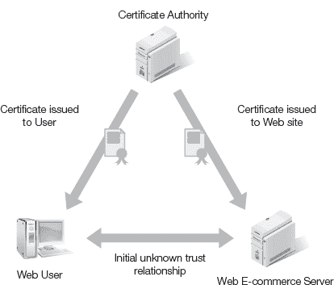

**图 1-1** 第三方信任系统的示例。

##### 谁——或什么——是值得信赖的？

确定谁或什么是值得信赖的，是每个组织持续进行的活动，无论是全球性企业还是家庭家庭网络。在这两种情况下，你都是有条件地向他人提供信任。这种有条件的信任会随着时间的推移，根据对期望和规定行为的遵守或违反情况而发生变化。

如果程序导致问题，它就会失去你的信任，你会将其从系统中移除。如果用户违反安全规定，该人员就会失去你的信任，并可能被撤销访问特权。如果员工遵守规则，你的信任就会增加，特权也会随之提高。如果某个互联网站点未造成危害，你会认为它值得信任，并允许访问该站点。

回顾一下，信任是主观的、暂时的，且会随时间变化。你可以基于第三方的声誉提供信任。当他人违反规则时，你会撤回信任。信任源于过去的行为，并可基于未来的行为而增长。

在网络安全中，信任是复杂的。在没有适当背景调查的情况下向他人延伸信任可能会造成毁灭性后果。网络的安全性取决于其最薄弱的环节。你需要审查网络的各个方面，包括软件、硬件、配置、通信模式、内容和用户，以维护网络安全。否则，你将无法实现组织网络的安全目标。

##### 什么是安全目标？

**安全目标** 是组织通过其安全工作努力实现的目标。通常，组织认可三个主要安全目标：

- 机密性/隐私
- 完整性/不可抵赖性
- 可用性/正常运行时间

**机密性** 是防止未经授权的访问，同时为授权用户提供无阻碍的资源访问。机密性确保数据不会被有意或无意地泄露给任何没有正当知情需求的人。**职位描述** 定义了一个人的知情需求。如果某项任务不需要访问特定资源，则该人员不具有知情该资源的需求。

**完整性** 是防止未经授权的更改，同时允许授权用户执行授权的更改。完整性确保数据在内部和外部保持一致。一致的数据不会随时间改变，并与现实世界保持同步。完整性还可防止意外和黑客通过 `malicious code`（恶意代码，即带有恶意意图编写的软件）进行的修改。

**可用性** 是防止 `downtime`（停机）、数据丢失和访问受阻，同时提供持续的正常运行时间、保护数据并支持授权用户访问资源。可用性确保用户能够及时地在拥有适当资源的情况下完成工作。

**认证** 是在授予对安全区域的访问权限之前，对用户身份的证明或验证。这既可以发生在网络上，也可以发生在物理的现实世界中。虽然最常见的认证形式是密码，但密码访问也是最不安全的认证方法。多因素认证是大多数网络管理员首选的安全登录方法。

**授权** 是控制用户被允许和不被允许做什么。授权由组织的安全结构决定，该结构可能侧重于自主访问控制 (DAC)、强制访问控制 (MAC) 或基于角色的访问控制 (RBAC)。授权基于知情需求和用户的职位描述来限制访问。授权也称为访问控制。

不可抵赖性是一种安全服务，它防止用户否认曾执行过某项操作。例如，不可抵赖性防止发送方否认曾发送过消息。**审计** 和公钥加密通常提供不可抵赖性服务。

**隐私** 保护个人可识别或敏感数据的机密性、完整性和可用性。私人数据通常包括财务记录和医疗信息。隐私防止未经授权地监视和监控用户及员工。

维护和保护这些安全目标可能是一项挑战。与大多数困难任务一样，将安全分解为更简单或更小的组件将有助于你理解并最终完成这一目标。为了支持安全目标，你需要清楚地知道你在试图保护什么。

##### 你在试图保护什么？

在安全方面，你想要保护的事物称为资产。**资产** 是用于开展业务的任何事物。员工为完成任务所需的任何对象、计算机、程序、数据片段或其他逻辑或物理组件都是资产。

资产不必昂贵、复杂或庞大。事实上，许多资产相对便宜、常见且大小不一。但无论特性如何，资产都需要保护。当资产因任何原因不可用时，人们就无法完成工作。

对于大多数组织（包括 `SOHO (small office, home office)` 环境）而言，最关心的资产包括业务和个人数据。如果这些信息丢失、损坏或被盗，将导致严重后果。企业可能倒闭。个人可能损失金钱。身份可能被盗用。甚至生活可能被毁。

是什么导致了这些问题？什么违反了网络安全？答案包括意外、无知、疏忽和黑客。意外会发生，包括硬件故障和自然灾害。培训不足等于无知。即使怀有最好的意图，如果工人不了解正确程序或缺乏必要技能，也会破坏系统。过度劳累和匆忙的人员会忽视可能导致资产泄露或丢失的问题。恶意 `hackers`（黑客）可针对网络发起攻击和 `exploits`（漏洞利用/攻击代码），意图获取访问权限或仅仅是造成破坏。

### 黑客攻击

**黑客攻击**最初是指摆弄或修改系统以进行学习和探索。然而，该术语后来演变为指恶意且可能构成犯罪的计算机入侵和操纵行为。无论哪种情况，恶意或犯罪黑客都是严重威胁。每一位网络管理员都应关注黑客攻击问题。

安全的某些重要方面源于对黑客技术、方法和动机的理解。一旦你学会像黑客一样思考，就可能预判未来的攻击。这使你能够在黑客成功**突破**贵组织网络之前，设计出新的防御措施。

那么黑客是如何思考的？黑客沿着操纵或变更的思路思考。他们研究规则，以创造新的方法来规避、打破或篡改这些规则。许多成功的安全漏洞利用，只不过是对网络通信规则的细微变体或违背而已。

黑客寻找容易下手的目标或被忽视的漏洞。黑客寻求能给他们带来最大收益的目标，通常是经济回报。黑客将事物颠倒过来、彻底剖析、反其道而行之。黑客尝试以不同顺序、使用错误数值、超出边界执行任务，旨在引发反应。黑客从错误中学习并加以利用，特别是网络安全专业人员未能妥善保护组织资产的错误。

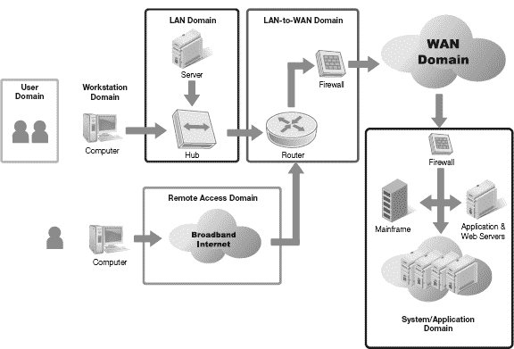

**图 1-2** 典型 IT 基础设施的七大域。

为什么像黑客一样思考至关重要？六世纪中国军事战略家兼哲学家孙子，在其著名军事著作《孙子兵法》中指出：“知彼知己，百战不殆。”一旦你了解黑客如何思考、他们使用的工具、其漏洞利用手段以及采用的攻击技术，就能制定有效的防御措施来抵御他们。

你常听到“最好的防御是进攻”。虽然这句话在其他领域可能有其道理，但大多数网络安全管理员既没有进攻黑客的奢侈条件，也没有法律权利。相反，你需要扭转这一战略口号：最好的进攻是防御。虽然网络安全管理员不能合法或合乎道德地攻击黑客，但他们完全有权限保护网络和资产免受黑客的猛烈攻击。

#### 典型 IT 基础设施的七大域

黑客寻找任何一切机会来利用目标。IT 基础设施的任何方面都存在**风险**，也没有任何方面能免受黑客的审视。在像黑客一样思考时，要分析典型 IT 基础设施的七大**域**（图 1-2）中每一个潜在的漏洞和弱点。要彻底。黑客只需防御体系中的一道裂缝，就能开始瓦解防线。你需要找到每一个可能的突破点，将其加固并强化网络。

典型 IT 基础设施的七大域包括：

- **用户域**—该域指实际用户，无论他们是员工、顾问、承包商还是其他第三方用户。任何访问和使用组织 IT 基础设施的用户，在获得组织 IT 资源和基础设施的访问权限前，必须阅读并签署可接受使用策略（`AUP`）。
- **工作站域**—该域指最终用户的桌面设备，如台式计算机、笔记本电脑、`VoIP` 电话或其他端点设备。工作站设备通常需要安全对策，如防病毒、反间谍软件和漏洞软件补丁管理，以维护设备的完整性。
- **局域网域**—该域指用于支持工作站连接到组织网络基础设施的物理和逻辑**局域网 (LAN)** 技术（即 100Mbps/1000Mbps 交换式以太网、802.11 系列无线局域网技术）。
- **局域网到广域网域**—该域指组织的互联网络以及局域网与广域网基础设施之间的互连点。路由器、防火墙、**非军事区 (DMZ)**、**入侵检测系统 (IDS)** 和**入侵防御系统 (IPS)** 常被用作该域中的安全监控设备。
- **远程访问域**—该域指用户远程访问组织 IT 基础设施、系统和数据的授权和认证远程访问程序。远程访问解决方案通常涉及 `SSL-128` 位加密的远程浏览器访问或加密的 `VPN` 隧道，以实现安全的远程通信。
- **广域网域**—拥有远程站点的组织需要**广域网 (WAN)** 来互联它们。组织通常从服务提供商处外包广域网连接，以获得端到端的连接和带宽。该域通常包括路由器、电路、交换机、防火墙以及远程站点的同类设备，有时由服务提供商通过托管服务提供。
- **系统/应用域**—该域指通常位于组织数据中心和/或机房内的硬件、操作系统软件、数据库软件、客户端/服务器应用程序和数据。

第一步是认识到妥协（被攻破）的可能性存在于整个组织中。下一步是理解网络安全的目标。

#### 网络安全目标

网络**安全目标**因组织而异。但通常包含一些共同的指令：

- 确保资源的机密性
- 保护数据的完整性
- 维护 IT 基础设施的可用性
- 确保个人可识别数据的隐私
- 实施访问控制


 监控 IT 环境中的策略违规行为

 支持**业务任务**和组织的整体使命

无论贵组织的安全目标是什么，要实现它们，都需要将这些目标记录下来，并制定详尽的计划来执行。没有书面计划，安全充其量只是杂乱无章，极可能无法保护资产。有了书面计划，网络安全就走上了成功之路。一旦定义了安全目标，这些目标将成为组织保护整个 IT 基础设施的路线图。

### 如何衡量网络安全的成功？

组织通过其既定安全目标的达成程度和安全标准的维持情况来衡量其网络的安全性。从本质上讲，这成为组织信息系统安全的基准定义。例如，如果网络上的私密信息未泄露给外部人员，则你为维护机密性所做的努力就是成功的。又如，如果员工能按时按预算完成工作，则你为提供系统完整性保护所做的努力就是成功的。

然而，如果发生违规行为，导致资产受损或无法实现安全目标，则网络安全就不算成功。但让我们面对现实吧，安全永远不是完美的。事实上，即使设计和执行得再好，意外、错误甚至蓄意的有害攻击也会困扰你的最佳努力。完美的安全组件不存在。它们都有弱点、局限性、`后门`、变通方法、编程错误或其他可被利用的因素。

幸运的是，成功的安全防护并不依赖于仅安装单一的防御组件。相反，良好的网络安全依赖于多个有效安全组件的交织结合。你家里的门不只有一把锁。通过结合多重防护、防御和检测系统，你可以抵御许多常见且简单的黑客攻击。

网络安全的成功不在于防范所有可能的攻击或入侵。相反，你需要致力于持续改善安全状况，使网络在未来比过去受到更好的保护。随着黑客创造新的攻击手段，安全专业人员会了解它们，调整其方法和系统，并建立新的防御。成功的网络安全关键在于持续警惕，而非创造一个最终产品。安全是一项持续的工作，不断变化以应对新威胁的挑战。

### 为什么书面网络安全策略很重要？

一份清晰书写的 `security policy` 确立了切实可行的目标。如果没有可靠且明确的目标，你的安全工作将会混乱且难以管理。书面计划和程序将安全工作和资源集中在最重要的任务上，以支持组织的总体安全目标。

书面安全策略是一张路线图。有了这张地图，你可以判断你的工作是否在正轨上，还是走向了错误的方向。该计划提供了一个通用参考基准，以便对照该基准比较安全任务。它作为一种衡量工具，用以判断安全工作是有助于还是阻碍组织安全目标的实现。

有了书面安全策略，所有安全专业人员都致力于实现同一个目标：一个成功、安全的工作环境。通过遵循书面计划，你可以跟踪进度，从而安装和配置所有必要的组件。书面计划验证了你所做的工作，定义了你仍需做的工作，并在必要时指导你如何修复基础设施。

没有书面安全策略，你无法信任你的网络是安全的。没有书面安全策略，员工将没有可靠的指南告诉他们该做什么，且判断安全成效将变得不可能。没有书面策略，你就没有安全。

### 为最坏情况做计划

事情总会出错。用户会犯错。恶意代码会找到途径进入你的网络。黑客会发现漏洞并加以利用。在预判威胁安全的问题时，你必须为最坏的情况做计划。

这种类型的计划有很多名称，包括应急计划、最坏情况规划、业务连续性规划、灾难恢复规划和运营持续性规划。名称并不重要。关键在于你要真正去做这个规划。

当问题发生时，切换到响应模式：响应、遏制和修复。响应所有故障或安全漏洞，以将损害、成本和停机时间降至最低。遏制威胁，防止其扩散或影响基础设施的其他区域。及时修复损害，使系统快速高效地恢复正常状态。请记住，安全的目标是机密性、完整性和可用性。在为最坏情况做计划时，请始终将这些目标放在首位。

为问题做计划的关键目的是做好充分准备以保护你的基础设施。运气好的话，可能不会发生重大灾难。但有备无患，总比让问题导致业务失败要好。

### 谁对网络安全负责？

网络安全是使用网络的每个人的责任。在组织内，没有人有奢侈的资本去无视安全规则。这适用于全球性企业，也适用于家庭网络。每个人都有责任理解自己在支持和维护网络安全中的角色。最薄弱环节法则在此适用：如果仅有一个人未能履行这一责任，所有人的安全都将受损。

#### 高级管理层

`Senior management` 对安全负有最终责任。这是有充分理由的——高级管理层最关心组织资产的保护。没有高级管理层的批准和支持，任何安全工作都无法成功。高级管理层必须确保制定一份所有人员都能理解并遵守的书面安全策略。

高级管理层还将设计、编写和执行安全计划的责任分配给 IT 员工。理想情况下，这些工作的成果是一个安全的网络基础设施。安全人员反过来必须全面管理所有资产、系统漏洞、迫在眉睫的威胁和相关防御。他们的任务是在整个组织中设计、执行和维护安全。

作为人员群体的监督者，管理者和主管必须确保员工拥有完成工作所需的所有工具和资源。管理者还必须确保员工在技能、程序、策略、界限和限制方面接受过适当培训。如果组织要求员工从事其未受过适当培训的工作，员工可以向组织提起合法的法律诉讼。

网络管理员管理组织的所有计算机资源。资源包括文件服务器、网络访问、数据库、打印机池和应用程序。网络管理员的工作是确保资源功能正常且可供用户使用，同时强制执行机密性和网络完整性。

组织的员工是网络用户和操作员。他们最终完成业务所需的工作。用户创建产品、提供服务、执行任务、录入数据、响应查询等。职位描述可能适用于单个用户或一组用户。每个职位描述定义了用户的任务。用户必须在网络安全的限制范围内执行这些任务。

#### 审计员

`Auditors` 负责监控问题和违规行为。审计员调查网络，寻找任何不符合书面安全策略的情况。审计员监控系统和用户的活动，以查找违规行为、导致 `bottlenecks` 的趋势以及尝试违规的行为。审计员发现的信息有助于改进安全策略、调整安全配置，或指导调查人员抓捕安全违规者。

所有这些 `roles` 存在于每个组织中。有时由不同个体扮演这些角色。在其他情况下，由单个人扮演所有这些角色。无论哪种情况，这些角色对于安全的创建、维护和改进都是必不可少的。

### 网络基础设施示例及相关安全顾虑

在设计网络时，你需要从安全后果的角度评估每一个方面。在预算、人员和时间有限的情况下，你还必须将风险降至最低，将防护最大化。请考虑以下每个网络安全方面如何影响大型企业、小型公司甚至家庭办公企业的安全。

#### 工作组

`workgroup` 是一种网络形式，其中每台计算机都是对等节点或平级节点。对等节点在权力或控制权方面是平等的，即任何一台系统对同一工作组内其他成员拥有的控制权是相同的。所有工作组成员都能管理自己的本地资源和资产，但不能管理任何其他工作组成员的资源。

工作组是极小型环境（如家庭网络或极小型公司）的绝佳网络设计。在大多数情况下，工作组包含少于 10 台计算机，很少超过 20 台计算机。没有单一规则规定工作组的大小。相反，较大工作组的管理开销促使网络管理人员转向客户端/服务器配置。

##### 网络架构类型

###### 工作组

图 1-3 展示了一个典型的工作组配置。在此示例中，一台交换机将四台桌面工作组成员、一个互联网连接设备和一个无线接入点互连在一起。其他客户端可以通过接入点无线连接，或通过连接到交换机的网线有线连接。

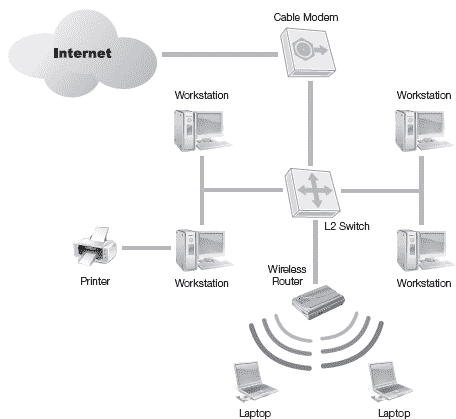

**图 1-3** 典型工作组示例。

工作组没有控制或限制网络活动或资源访问的中央权威机构。相反，每个工作组成员各自制定资源和资产的规则与限制。为某个成员定义的安全设置既不适用于也不影响工作组中的任何其他计算机。

由于基于逐个系统的安全模型，工作人员或工作组成员需要在其他每个工作组成员上都定义一个用户账户，才能访问那些系统上的资源。这些账户在技术上都是唯一的用户账户，即使它们是使用相同的用户名和密码字符创建的。

这会导致以下两种情况之一：要么存在用户名和密码均不同的多个唯一用户账户，要么存在用户名和密码完全相同的多个唯一用户账户。无论哪种情况，安全性都很差。前一种情况下，用户必须记住多组凭据，这往往导致用户将凭据记录下来。后一种情况下，入侵者只需破解一组凭据即可。

这种缺乏中央权威的特性既是工作组的优点，也是缺点。优点在于每台计算机的每个用户都可以自主决定与他人共享资源；但这同时也是缺点，因为会导致不一致的访问级别。

工作组易于创建。通常，操作系统的默认网络配置就是加入一个工作组。只需在一台计算机上定义一个唯一名称，即可创建一个新工作组。一旦一台计算机命名了该工作组，该工作组就已存在。其他计算机只需使用相同的名称，即可成为新工作组的成员。由于工作组缺乏中央权威，任何人都可以随时加入或离开工作组。这包括流氓员工或外部人员拥有的未授权系统。

大多数工作组仅使用基本的资源共享保护，未使用加密协议，且在入侵监控方面比较松懈。虽然可以对工作组实施一定的安全措施，但通常需要单独配置每个工作组成员。幸运的是，由于工作组规模较小，这并不代表大量的工作量。

###### SOHO 网络

SOHO 代表小型办公室、家庭办公室。SOHO 是一个通用术语，用于描述常见于小型企业的较小型网络，通常部署在某人的家中、车库、活动板房或租赁办公空间内。SOHO 环境可以是工作组，也可以是客户端/服务器网络。通常，SOHO 网络意味着考虑了业务和安全的有目的的设计。

SOHO 网络通常比典型工作组更安全，主要因为管理员或所有者会强制执行网络安全。当工作组有安全管理员时，各工作组成员上定义的安全设置更有可能保持一致。此外，SOHO 网络更有可能采用安全工具，如防病毒软件、防火墙和审计。

#### 客户端/服务器网络

**客户端/服务器网络** 是一种网络形式，其中将某些计算机指定为**服务器**，其他计算机指定为**客户端**。服务器托管与网络共享的资源。客户端访问资源并执行任务。用户从客户端计算机工作，以与服务器托管的资源进行交互。在客户端/服务器网络中，访问从服务器进行集中管理。因此，可以轻松地在所有网络成员中实施一致的安全性。

图 1-4 显示了客户端/服务器网络的一个可能的基本布局。在此示例中，三台服务器托管资源，如打印机、互联网连接和与网络共享的文件存储。支持有线和无线客户端。交换机互连所有节点。客户端/服务器网络更有可能使用硬件或**设备**防火墙。

客户端/服务器网络还采用**单点登录 (SSO)**。SSO 允许每个用户使用一组更强的凭据。使用 SSO 时，每个用户必须执行身份验证才能访问客户端和网络。用户登录后，**访问控制** 管理资源使用。换句话说，带有 SSO 的客户端/服务器身份验证通常比工作组身份验证更复杂，但也更安全。用户只需登录一次，而不必在每次联系资源主机服务器时都登录。

由于其复杂性，客户端/服务器网络通常比 SOHO 和工作组网络更安全。但复杂性本身并不等于安全。相反，正是因为它们更复杂，客户端/服务器网络需要更彻底的设计和规划。安全是基础设施规划的一个重要方面，因此会融入网络设计中。

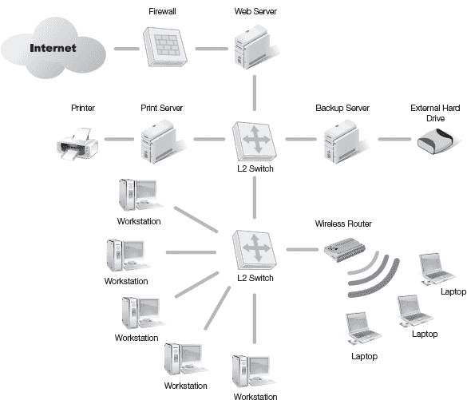

**图 1-4** 典型客户端/服务器网络示例。

客户端/服务器网络不一定安全，因为你可以在完全不考虑安全的情况下部署客户端/服务器网络。但大多数组织都明白，如果忽视网络安全，就等于确保其最终的技术垮台。安全很少被排除在部署过程之外。而且有些网络天生就比其他网络更安全。

##### LAN 与 WAN

LAN 代表局域网。LAN 是一个地理区域有限的网络。这意味着 LAN 网络位于单个物理位置，而不是分布在多个位置。有些 LAN 规模很大，而有些则很小。LAN 更显著的特征是，LAN 的所有段或链路均由一个组织拥有和控制。LAN 不包含或使用任何租用或外部拥有的连接。

WAN 代表广域网。WAN 是一个不受任何地理边界限制的网络。这意味着 WAN 网络可以跨越几个街区，延伸至全球，甚至延伸至外太空。WAN 的一个显著特征是，它使用租用或外部连接和链路。大多数组织依赖电信服务提供商（通常称为**电信运营商**）提供 WAN 电路和链路，连接到物理建筑和设施，包括到物理分界点的最后一公里连接。LAN 和 WAN 网络都可以是安全的，也可以是不安全的。如果有书面安全策略指导其使用，它们就是安全的。对于 LAN，网络所有者有唯一责任确保安全得到执行。对于 WAN，租赁方必须选择拥有安全 WAN 基础设施的电信运营商，并纳入服务级别协议 (SLA)，定义每月为客户提供的服务和性能水平。在大多数情况下，WAN 数据只有在传输前加密的情况下才是安全的。这项服务是数据所有者的责任，而非电信服务提供商的责任，除非该选项作为增值服务提供。

##### 瘦客户端与终端服务

**瘦客户端计算**，也称为**终端服务**，是一个旧的计算理念，在现代重新流行起来。在计算机早期，主计算核心（通常称为大型机）通过称为终端的接口进行控制。终端仅仅是一个视频屏幕（通常是单色）和一个键盘。终端没有本地处理或存储能力。所有活动都在大型机上进行，结果显示在终端的屏幕上。

###### 随着个人计算机（PC）的出现

随着个人计算机（PC）的出现，员工桌面上的计算机提供了本地处理和存储能力。这些 PC 成为了客户端/服务器架构中的客户端。现代网络环境可为最终用户提供多种选择。作为工作站或客户端系统使用的功能齐全的 PC 最为常见。PC 可以运行瘦客户端软件，该软件模拟过去的终端系统。这意味着它们在服务器或大型主机系统上执行所有任务，仅将 PC 用作带有键盘和鼠标的显示屏。甚至现代瘦客户端终端也可以在不使用完整 PC 的情况下连接到服务器或大型主机。

##### 远程控制、远程访问和 VPN

###### 远程控制

**远程控制**是指使用本地计算机系统通过网络连接远程接管另一台计算机控制权的能力。从某种意义上说，这是在现代功能齐全的工作站上应用瘦客户端概念，以模拟面向大型主机的工作，或将您的物理存在虚拟化。

通过远程控制连接，本地显示器、键盘和鼠标控制远程系统。这看起来并感觉上就如同您亲自坐在远程系统的键盘前一样，而该远程系统可能位于另一座城市，甚至地球的另一端。您在本地执行的每一个操作都会通过远程控制连接在远程计算机上发生。唯一的限制是中间网络链路的速度，以及无法物理插入或移除介质（如闪存驱动器）和使用外设（如打印机）。

您可以将远程控制视为一种基于软件的瘦客户端或终端客户端形式。事实上，许多瘦客户端和终端客户端产品作为远程控制解决方案出售。

许多现代操作系统都包含远程控制功能，例如大多数 Windows 版本中都有的远程桌面功能。启用后，远程桌面连接可跨网络远程控制另一台 Windows 系统。

###### 远程访问

**远程访问**不同于远程控制。远程访问链路通过 WAN 链路连接到地理位置遥远的网络，从而实现对网络资源的访问。实际上，远程访问为物理上不在本地网络中的系统创建了一个本地网络链路。通过远程访问连接，客户端系统从技术上讲可以执行与本地连接的客户端完全相同的所有任务，唯一的区别在于连接的速度。网络管理员可以对远程访问客户端可使用的资源和服务施加限制。

远程访问最初通过使用调制解调器的拨号电话链路进行。如今，远程访问涵盖多种连接类型，包括 ISDN、DSL、有线调制解调器、卫星、移动宽带等。

在大多数情况下，远程访问连接将远程客户端链接回主网络。**远程访问服务器 (RAS)** 接受来自远程客户端的入站连接。连接建立后，远程客户端即可像本地连接一样与网络进行交互。

###### 虚拟专用网络 (VPN)

远程连接的另一种变体是**虚拟专用网络 (VPN)**。VPN 是在其他网络连接之上创建的一种网络连接形式。在大多数情况下，VPN 链路将远程系统和局域网 (LAN) 连接起来，但仅在正常网络连接链接到中间网络之后。

在图 1-5 中，局域网通过正常网络连接连接到互联网，远程客户端也建立了到互联网的正常网络连接。这两个连接相互独立工作。局域网的连接通常是永久或专用连接，支持与互联网的入站和出站活动。远程客户端到互联网的连接可以是专用的，也可以是非专用的。在后一种情况下，连接先于 VPN 的创建。一旦未来 VPN 链路的两个端点都连接到了中间网络（在本例中为互联网），VPN 就建立了。

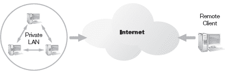

**图 1-5** 常见资源访问连接。

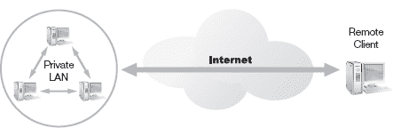

**图 1-6** 通过互联网在远程客户端和局域网之间建立的 VPN。

在图 1-6 中，一条新的网络连接跨越中间网络将远程客户端连接到局域网。这条新的网络连接就是 VPN。

VPN 是一种跨越中间网络（通常是互联网）建立远程访问连接的机制。VPN 允许通过互联网建立廉价的长距离连接，因为两个端点只需要本地互联网链路即可。互联网本身充当了“免费”的长途载体。

VPN 使用**隧道**或**封装**协议。隧道协议将原始网络协议封装起来，以便其能够穿越中间网络。在许多情况下，隧道协议采用**加密**，以便原始数据能安全地穿越中间网络。

##### 边界网络

边界网络是位于局域网边缘的子网。边界网络将某些活动（如编程或研发）与内部环境（私有局域网）隔离开来，后者无需对外访问。外部用户也可以访问托管在边界网络中的资源。这种子网称为非军事区 (DMZ)。

DMZ 是托管面向公共互联网资源服务器的边界网络。**外联网**是托管面向有限且受控的外部用户组（如业务合作伙伴、供应商、分销商、承包商等）资源服务器的边界网络。

DMZ 子网是用于托管公共信息服务（如网站）的常见网络设计组件。DMZ 允许公共互联网上的任何人访问资源。但同时，DMZ 对明显的恶意流量提供一定的**过滤**，并防止互联网用户访问私有局域网。

外联网子网为需要与外部合作伙伴交换数据的公司提供了一个安全的活动场所。外联网经过安全保护，只有预期的外部用户才能访问。通常，访问外联网需要 VPN 连接。外联网配置将公共互联网用户拒之门外，同时也将外部合作伙伴挡在私有局域网之外。

您可以通过不同方式部署 DMZ 和外联网子网。最常见的两种设计是使用三端口防火墙的屏蔽子网（图 1-7）和 N 层部署（图 1-8）。使用三端口防火墙的屏蔽子网为私有局域网和 DMZ 或外联网创建了一个网络段。三端口防火墙既作为过滤设备，也作为路由器来控制进入这两个网段的流量。

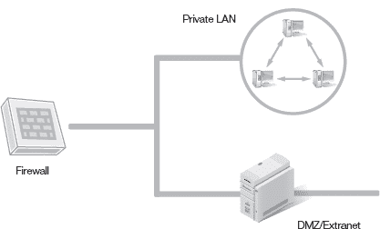

**图 1-7** 作为带有三端口防火墙的屏蔽子网部署的 DMZ 或外联网。

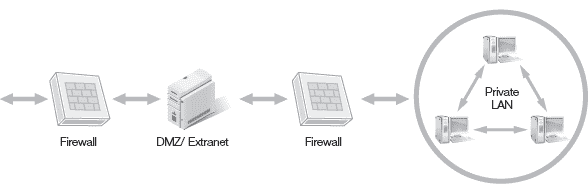

**图 1-8** 采用 N 层配置部署的 DMZ 或外联网。

N 层部署创建了一系列由防火墙分隔的子网。DMZ 或外联网子网作为互联网和私有局域网之间的缓冲网络。

#### 网络设计的优势与劣势


您需要针对安全优势和劣势评估每一种网络设计或布局。虽然不存在完美的部署，但对于给定的一组参数，某些部署提供的安全性优于其他部署。例如，仅有一个互联网连接的网络比具有多个互联网连接的网络更容易保护。

### 网络设计安全考量

#### 网络路径与冗余设计

在设计网络时，请考虑恶意流量可能用于到达您私有 LAN 内部的路径。潜在路径越多，保护网络的难度就越大。然而，也要考虑**冗余性**。如果您的主互联网连接失败，是否有备用连接？请记住，安全不仅仅是防止恶意事件，还在于确保用户能够执行基本业务任务。

请尽量避免具有**单点故障**的网络设计。始终尝试提供冗余选项，以确保关键任务功能能够正常运行。请记住，即使有冗余路径，瓶颈仍然可能发生。随着时间的推移，监控网络中每个段上的流量和使用水平，以寻找吞吐量或生产力下降的趋势。瓶颈起初可能只是轻微阻碍高性能和生产力，但后来可能演变成一种**拒绝服务 (DoS) 攻击**形式。

另一个考量因素是流量控制和过滤。阻止或允许流量是网络安全的重要要素。您可以控制什么流量进入或离开网络。流量过滤通常发生在网络**瓶颈点**。**瓶颈点**是一种瓶颈形式，是两个不同网络信任级别之间单一的受控路径，防火墙或其他过滤设备根据一组规则阻止或允许流量。因此，瓶颈点不仅是过滤的优势所在，也可能降低吞吐量或成为 DoS 攻击的目标。

另一个网络设计问题是授权用户的位置。通常，您假设有效用户是内部用户。然而，随着远程办公和外包的普及，有效用户也经常是外部用户。认识到这一点后，您必须设计网络以支持来自有效外部用户的入站连接。这可能涉及传统的远程访问连接，但更可能使用 `VPN` 链路。`VPN` 为远程用户提供功能类似本地连接的连接，并通过加密保持这些连接内容的机密性。

#### 增强有线与无线 LAN 基础设施的安全性

有线网络提供了一种无线网络所缺乏的安全形式。这种安全性是直接物理连接到有线或布线网络。攻击者需要物理访问您的设施或大楼。通常，大楼的访问控制足以防止大多数外部人员访问您的私有 LAN。

然而，请认识到，如果您允许通过电话调制解调器、高速宽带甚至基本互联网服务进行远程连接，则会失去物理访问限制的优势。一旦允许远程访问，物理隔离的好处就会消失。

如果您允许无线连接接入网络，情况也是如此。无线网络赋予有效用户和未知用户与网络交互的能力。这完全消除了必须亲临大楼才能连接网络的要求。许多组织允许甚至鼓励员工、承包商和访客自带设备，这一举措具有成本效益且通常能提高效率，但也带来了对最终用户设备控制权丧失的风险。攻击者使用合适的天线，可以在距离您办公大楼一英里以外的地方影响您的无线网络。

为了重获物理隔离提供的部分安全性，请尝试在网络设计中融入物理隔离。将所有远程访问和无线接入点与主有线网络隔离。您可以通过使用单独的子网并利用防火墙过滤通信来实现这一点。虽然这种设计提供的安全级别不如物理隔离，但与对远程或无线连接完全无控制相比，这种安排提供了显著的改进。

所有远程连接在授予内部 LAN 访问权限前，都应经过严格的多层验证。请想象中世纪城堡的设计，它采用多层防御：护城河、吊桥、厚重的铆钉墙、内堡垒，最后是坚固的主堡或内要塞。您的多层防御设计应包括多因素认证和通信加密，例如 `VPN`。额外的检查可以包括操作系统和补丁级别的验证、物理或逻辑位置来源的确认（如来电显示、`MAC` 地址或 `IP` 地址）、时间限制以及传输层以上协议的限制。任何入侵者都需要绕过一层又一层的防御，使入侵变得越来越困难。


> **NOTE**
>
> 一种称为“Van Eck 窃听”的攻击允许攻击者从远处窃听电子设备。这种技术并不完美，也不易实施，但已在 LCD 和 CRT 显示器以及键盘电缆上得到演示。通过轻微的屏蔽，可以消除大部分此类攻击的风险。

#### 内部与外部网络问题

在部署新网络或修改现有基础设施时，请仔细评估对安全性的影响以及安全性对基础设施的影响。当您或您的团队忽视或规避标准安全实践时，正常业务就会停止。业务中断不仅会导致利润损失，还会导致机会丧失甚至裁员。如果妥协足够严重，企业可能无法恢复。

企业面临的威胁众多且不断变化。这些问题往往每天都会出现。恶意代码、信息泄露、零日漏洞利用、未经授权的软件、不道德的员工和复杂的网络基础设施只是每个组织和网络管理员面临的众多担忧中的一小部分。

恶意代码可以通过任何通信渠道进入计算机。这包括文件传输、电子邮件、便携设备同步、可移动媒体和网站。针对恶意代码的预防措施包括使用防火墙进行网络流量过滤、反恶意软件扫描和用户行为修改。

信息泄露源于恶意员工故意向公众发布内部文档。也可能源于意外，或发生在存储设备丢失、回收、捐赠、被盗或丢弃时。或者发生在用户意外将文档发布到 P2P 文件共享服务或网站时。针对信息泄露的预防措施包括对员工进行彻底的背景调查、使用最小权限原则、详细审计和监控所有用户活动、对所有信息进行分类并控制通信路径、对便携设备的使用实施更严格的控制，以及实施**清零**——通过用零填充存储设备的空间来清除待丢弃的存储设备。

**零日漏洞利用**是新的且以前未知的攻击，目前不存在针对它们的特定防御措施。将它们视为对您防御体系的突袭。*零日*指的是漏洞利用的新颖性，它可能在黑客社区已知一段时间，但供应商和安全专业人员才刚刚得知。

零日标签源于这样一个理念：供应商一旦得知问题，开发补丁的工作就立即开始。发现新漏洞利用的那一刻称为“第零天”。虽然不存在针对零日攻击的特定防御措施，但通用的安全管理、使用入侵检测和入侵防御，以及详细的**日志记录**和监控，可以帮助快速发现和防止新攻击。一旦您知晓某次攻击或漏洞利用，就可以开始采取措施遏制损害或最小化妥协的程度。

#### 未经授权的软件

未经授权的软件是指用户选择在客户端系统上运行的、未经公司批准也未由公司提供的任何代码。并非所有未经授权的软件都会直接造成问题，但出于多种原因，您应当防止其使用。此类软件可能会浪费时间和生产力，给公司带来金钱、时间和精力上的损失。该软件可能违反许可协议。软件可能包含隐藏的恶意组件，无论用户是否知情，都可能危及网络安全。防止使用未经授权软件的措施应包括限制普通用户的安装权限，并使用 `whitelists`（白名单）来阻止执行任何不在批准列表中的程序。

#### 不道德的员工

不道德的员工会故意违反组织规定的规则和目标。这些员工通常认为规则不重要、不适用于他们，或者实际上并未得到执行。大多数人认为自己永远不会被抓到。当用户违背组织的使命和目标时，后果可能是灾难性的。

用户是安全防护的最后一环，往往也是网络安全中最薄弱的一环。如果用户选择违反安全策略，将信息泄露给公众或执行恶意代码，后果可能会毁掉组织，或让肇事者陷入官司。防止不道德员工造成损害的方法包括更好的背景审查、对所有用户活动进行详细审计和监控，以及定期的管理监督和工作绩效考核。当您发现有问题的人员时，或许可以在重新培训后给予员工第二次机会，但在许多情况下，对组织最安全的选择是终止雇佣关系。

#### 复杂的网络基础设施

复杂的网络基础设施容易导致复杂的漏洞。网络规模越大，包含的服务器、客户端、网络设备和网段就越多。庞大的活动部件数量几乎可以确保某些东西会被错误配置、安装不当、缺乏当前的固件或补丁、存在瓶颈，或被错误使用。这些状况中的任何一种都可能导致 `vulnerability`（漏洞），供内部或外部攻击者利用。网络规模越大、越复杂，安全团队就越需要彻底地监控基础设施，并调查每一个症状、趋势或警报。防止复杂性变成负债，需要详细的规划、谨慎的实施、定期的安全管理，以及对基础设施有效性的持续审查。

#### 内部威胁与外部威胁

研究表明，大多数威胁来自内部来源，但太多组织关注外部来源而忽视内部威胁。更好的立场是将所有威胁——无论其来源如何——都视为值得调查的对象。一旦了解了潜在威胁，就能更好地理解和评估其风险、潜在损失和发生可能性。

#### 互联网作为外部威胁

最明显的外部威胁之一是互联网。互联网是一个全球性网络，通过高速实时通信连接人员和资源。不幸的是，这一绝妙的基础设施也使大规模滥用成为可能。一旦贵公司安装了互联网连接，全世界就近在咫尺——或者说，触手可及，就在每位员工的指尖。这个世界既包含潜在客户，也包含潜在攻击者。

如果没有全球通信基础设施，黑客必须亲自到场——通过有线连接——在您的大楼内或附近才能发起攻击。随着互联网和无线技术的出现，任何地方的黑客都可以尝试入侵您的网络安全。因此，将互联网视为一种威胁是有帮助的。这是一种不应轻视的威胁，也不应因噎废食而放弃互联网这一强大工具。互联网接入的益处完全值得您为防御其负面特性所付出的努力和费用。

针对互联网威胁的一些最佳防御措施包括：经过深入研究的书面安全策略；经过彻底培训的人员；使用防火墙过滤流量、入侵检测和防御系统；使用加密通信（如 `VPN`）；以及对所有用户和节点活动进行彻底的审计和监控。

#### 纵深防御

同样，不存在完美的安全解决方案。任何单一防御都可能被某种形式的攻击、妥协或利用绕过。网络安全的关键在于交织并互联多个安全组件，构建一个多面的保护体系。这通常被称为多层防御或 `defense in depth`（纵深防御）。

目标是平衡多个安全组件的优势和劣势。网络安全的终极功能是以最佳方式锁定事物，然后监控所有试图违反既定防御的行为。既然不存在完美的锁，就要通过审计和监控来改进现有的最佳锁。了解这一点后，您的下一步是了解常见的网络安全组件及其用途。

#### 用于缓解威胁的常见网络安全组件

在考虑部署网络或修改现有网络时，应评估每个网络组件以确定其安全优势和劣势。本节讨论许多常见的网络安全组件。

##### 主机和节点

`node`（节点）是网络上的任意设备。这包括客户端计算机、服务器、交换机、路由器、防火墙，以及任何具有网络接口且拥有 MAC 地址的设备。`Media Access Control (MAC) address`（媒体访问控制 [MAC] 地址）是由制造商分配给网络接口卡 (NIC) 的 48 位物理硬件地址。节点是一个可以直接通信的组件，而不仅仅是被通信通过或跨越的组件。例如，网线和配线架不是节点，但打印机是。

`host`（主机）是一种分配了逻辑地址（通常是 Internet 协议 [IP] 地址）的节点。这种寻址通常意味着该节点在网络层或更高层运行。网络层包括客户端、服务器、防火墙、代理，甚至路由器。但不包括交换机、网桥以及中继器和集线器等其他物理设备。在大多数情况下，主机要么共享资源和服务，要么从其他主机访问资源和服务。

就网络安全而言，节点和主机的安全性有所不同。节点和主机都可能受到物理攻击和 DoS 攻击的危害。然而，主机还可能受到恶意代码、认证攻击的危害，甚至可能被黑客远程控制。节点保护主要是物理访问控制，以及针对洪水攻击的基本网络过滤。

主机安全可能复杂得多，因为主机本身应当经过加固，且您需要执行常规网络安全。`Hardening`（加固）是保护或锁定主机以抵御威胁和攻击的过程。这可以包括移除不必要的软件、安装更新，以及实施安全配置设置。

##### IPv4 与 IPv6

互联网协议版本 4 (IPv4) 作为互联网上主要的协议已使用近三十年。它最初于 1981 年在一份称为 RFC 791 的技术规范中定义。IPv4 是一种无连接协议，在 `Open Systems Interconnection (OSI) Reference Model`（开放系统互联 [OSI] 参考模型）的网络层运行。IPv4 是当今 TCP/IP 协议套件的基础。

IPv4 的设计基于若干假设，但其中许多已被证明不准确、严重高估或根本不适用。虽然 IPv4 作为互联网上的主要协议运行良好，但其替代者早已迟迟未至。主要关注的问题包括：仅 32 位的地址空间日益枯竭甚至耗尽、子网划分的复杂性，以及缺乏集成安全性。随着**网络地址转换（`NAT`）**、**无类别域间路由（`CIDR`）**和**互联网协议安全（`IPSec`）**的出现，这些问题在一定程度上得到了缓解。但尽管有这些进步，IPv4 正在被 IPv6 取代。

IPv6 于 1998 年在 `RFC 2460` 中定义。新版本专门设计为 IPv4 的继任者，主要是由于公共地址日益枯竭。IPv6 使用 128 位地址，比 IPv4 大得多。此外，子网划分、地址分配和数据包头部的变更，以及更简单的路由处理，使 IPv6 远胜于其前身。另一个重大改进是原生网络层安全性。图 1-9 对比了 IPv4 地址与 IPv6 地址。


> **NOTE**
>
> 如果 IPv6 地址有一个或多个连续的四位数字段全为零，这些零字段可以省略并用双冒号替代。例如：`2001:0f58:0000:0000:0000:0000:1986:62af` 可缩短为 `2001:0f58::1986:62af`。但是，如果有两组零字段，只能用双冒号替换其中一组。

###### 警惕以下攻击

**中间人（`MitM`）攻击**发生在黑客位于客户端和服务器之间，并欺骗客户端连接到黑客的计算机而非真实服务器时。黑客执行欺骗攻击以诱骗客户端。结果是客户端与服务器之间的连接被黑客代理。这使得黑客能够窃听和操纵通信。

**劫持攻击**发生在黑客使用网络嗅探器监视通信会话以了解其参数时。黑客随后断开会话主机之一的连接，冒充离线系统，并开始向通信流中注入精心制作的数据包。如果成功，黑客将接管离线主机的会话，而另一主机却毫不知情。

**重放攻击**发生在黑客使用网络嗅探器捕获网络流量，然后在稍后时间将该流量重新传回网络时。重放攻击通常针对认证流量，企图通过重传允许真实用户登录系统的相同数据包，从而获得相同的访问权限。

IPv6 原生的安全特性被封装成一个针对 IPv4 的附加包，称为 `IPSec`。在 IPv4 中，`IPSec` 是可选附加组件；而在 IPv6 中，它是内置功能且默认启用。这种用法从根本上改变了围绕网络和互联网使用的固有安全问题。有了原生网络层加密，大多数形式的窃听、中间人攻击、劫持和重放攻击将不再可能。这并不意味着 IPv6 将没有安全问题，但至少 IPv4 经历的大多数常见安全缺陷将得到修复。


**图 1-9** 对比典型的 IPv4 地址与 IPv6 地址。

在使用和管理计算机及网络时，请在 IPv4 中使用 `IPSec` 或迁移到 IPv6。大多数在 IPv4 上运行的协议将在 IPv6 上无问题运行。您需要替换一些将网络层地址嵌入其应用层协议的应用程序，例如 `FTP` 和 `NTP`。但有效的 IPv6 替代品已存在。

从 IPv4 到 IPv6 的全面行业过渡可能需要长达十年甚至更久，主要是因为需要升级、替换或重新配置分布在全球的数百万主机和节点以支持 IPv6。在过渡期间，有许多技术可允许主机同时与 IPv4 和 IPv6 网络连接交互。这些包括：

 **双 IP 栈**——这是一种同时运行 IPv4 和 IPv6 的计算机系统。`Windows Vista` 和 `Windows Server 7` 默认都具有双 IP 栈。

 **嵌入 IPv6 表示法的 IPv4 地址**——这是一种使用 IPv6 通用表示法来表示 IPv4 地址的方法。例如，`::ffff:192.168.3.125` 是 IPv4 地址 `192.168.3.125` 的 IPv4 映射 IPv6 地址。

> *Note*: IPv6 地址由 80 个零位、16 个一位，然后是 32 位 IPv4 地址（点分十进制表示法）组成，总计 128 位。

 **隧道技术**——这涉及将 IPv6 数据包封装在 IPv4 数据包内，有效地利用 IPv4 为 IPv6 创建一个类 VPN 隧道。

 **IPv4/IPv6 NAT**——这涉及使用网络地址转换服务在两个网络之间进行转换，一个运行 IPv4，另一个运行 IPv6。

无论过渡障碍如何，原生网络层加密的益处是不可估量的。简而言之：当您有选项使用 IPv6 时，请使用它，因为您将帮助全球 IT 社区更早而非更晚地完成升级。

##### 防火墙

并非您网络上的所有流量都来自授权源，因此不应允许其进入或离开网络。并非所有流量都用于授权目的，因此应阻止其到达目的地。并非所有流量都在正常或可接受的网络活动范围内，因此应在其造成危害前将其丢弃。

所有这些保护都是防火墙的职责。顾名思义，**防火墙**是一种旨在阻止损害的工具，正如发动机舱中的防火墙在事故中保护乘客免受伤害。防火墙是您部署的硬件设备或软件产品，用于在网络通信上强制执行访问控制策略。换句话说，防火墙会针对有害的漏洞利用、入侵、数据、消息或其他事件过滤网络流量。

防火墙通常位于网络或子网的边缘。防火墙保护网络免受来自互联网的诸多威胁。防火墙还保护互联网免受私有网络上恶意用户或应用程序的侵害。防火墙保护私有网络的吞吐量或带宽，以便授权用户完成工作。没有防火墙，您网络的大部分能力将被来自互联网的无用或恶意流量消耗。想想大坝如何工作；没有大坝，河流容易泛滥。大坝防止了洪水和损害。

没有防火墙，网络的安全性和稳定性将主要取决于网络内节点和主机的安全性。基于大多数主机操作系统糟糕的安全历史，没有防火墙将不是一个安全的解决方案。加固主机和节点对网络安全很重要，但它们不应是可靠网络安全的唯一组成部分。

您还可以在客户端和服务器计算机上安装防火墙。这些主机软件防火墙保护单个主机免受来自互联网的威胁、来自网络本身的威胁，以及来自其他内部网络组件的威胁。

无论哪种情况，防火墙通常配置为基于*默认拒绝/例外允许*立场控制流量。这意味着流量不会仅仅因为存在于网络上（或试图到达网络）就通过防火墙。相反，所有到达防火墙的流量必须满足一组要求才能继续其路径。

##### 防火墙

作为网络管理员或 IT 安全官员，您可以决定允许什么流量通过防火墙，以及阻止什么流量。此外，您还可以确定过滤是在入站流量（称为**入站过滤**）上进行，还是在出站流量（称为**出站过滤**）上进行——亦或两者兼有。

防火墙是主机和网络安全的基本组成部分。

##### 虚拟专用网络


# 虚拟专用网络 (VPN)

虚拟专用网络 (VPN) 是一种跨越中介网络（通常是互联网）建立远程访问连接的机制。当通过互联网建立时，VPN 允许低成本的长距离连接，因为两个端点只需要本地互联网链路。互联网本身充当“免费”的长途载体。

VPN 使用隧道或封装协议。隧道协议将原始网络协议封装起来，以便其能够穿越中介网络。在许多情况下，隧道协议采用加密，以便原始数据能安全地穿越中介网络。

您可以将 VPN 用于远程访问、远程控制或专用网络内的高安全通信。

## 代理服务器

**代理服务器**是防火墙的一种变体。代理服务器会过滤流量，但也会以几种特定方式对该流量进行处理。首先，代理服务器充当内部客户端和外部服务器之间的中间人。或者，在反向代理的情况下，这种关系可以颠倒，变为内部服务器和外部主机。其次，代理服务器将通过一种称为网络地址转换 (NAT) 的过程（见下一节），向服务器隐藏原始请求者的身份。

代理服务器的另一项功能可以是内容过滤。这种过滤侧重于服务器的地址（通常按域名或 IP 地址）或传输内容中出现的关键字。您可以采用这种形式的过滤来阻止员工访问与业务任务无关或无益，或可能对业务网络产生直接影响的互联网资源。这可能包括恶意代码、黑客工具和过度的带宽消耗（如视频流或 P2P 文件交换）。

代理服务器还可以提供缓存服务。**缓存**是一种数据存储机制，它保存性质相对静态且众多内部客户端有规律请求的内容的本地副本。热门网站的首页通常由代理服务器缓存。当用户请求缓存中的互联网页面时，代理服务器从缓存中向用户提供该页面，而不是再次从互联网站点拉取。这为用户提供了更快的性能，并减轻了互联网链路的负载。

这种类型的缓存通常会导致所有用户体验到更快的互联网性能，即使提供给他们的页面是从互联网拉取的。显然，必须对这种缓存进行调整，以防止缓存中出现陈旧页面。调整是指在缓存页面上设置超时值，使其以合理的速率过期。所有过期的缓存页面都会被来自互联网上原始源服务器的新内容替换。

### 网络地址转换

网络地址转换 (NAT) 将内部地址转换为外部公共地址，反之亦然。网络在数据包进入或离开网络时执行此转换，以掩盖和修改内部客户端的配置。NAT 的主要目的是防止内部 IP 和网络配置细节被外部实体（如黑客）发现。

图 1-10 展示了一个示例，即内部客户端通过使用 NAT 的代理或防火墙到达外部服务器的路径。在该示例中，外部服务器是运行在默认 HTTP 端口 80 上的 Web 服务器。Web 服务器使用 IP 地址 `208.40.235.38`（由 `www.itttech.edu` 使用）。发起请求的内部客户端使用 IP 地址 `192.168.12.153`。客户端在 1,024 和 65,535 之间随机选择一个源端口（如 `13,571`）。有了这些源详细信息，客户端生成初始请求数据包。这是步骤 1。该数据包通过网络发送到外部服务器，途中遇到 NAT 服务。

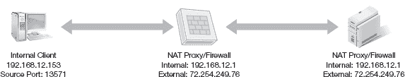

**图 1-10** NAT 功能示例。

**步骤 1 初始请求：**

S: `192.168.12.153:13571`

D: `208.40.235.38:80`

**步骤 2** NAT 在转换映射表中创建条目：

| 内部 | | 外部 |
| --- | --- | --- |
| `192.168.12.153:13571` | `<- ->` | `72.254.149.76:27409` |

NAT 服务在其转换或映射表中为该请求创建一个条目。该表包含源 IP 地址和端口以及转换后的 IP 地址和端口。NAT 服务器使用其自身的公共 IP 地址作为转换后的 IP 地址，并为数据包选择一个当前未使用的随机端口作为新的源端口。这是步骤 2。

**步骤 3 转换后的请求：**

S: `72.254.149.76:27409`

D: `208.40.235.38:80`

步骤 3 是使用转换后的源信息构建新数据包，然后通过互联网传输到外部服务器。Web 服务器收到一个请求，其来源似乎是代理/防火墙系统。

**步骤 4 来自外部服务器的响应：**

S: `208.40.235.38:80`

D: `72.254.149.76:27409`

步骤 4 是由 Web 服务器生成并传输的响应。

**步骤 5** NAT 将响应发送给客户端：

S: `208.40.235.38:80`

D: `192.168.12.153:13571`

代理/防火墙接收到对 Web 服务器请求的响应。NAT 服务使用转换表将原始客户端的信息放回数据包头部作为目标。这是步骤 5。此过程在线速下进行。对于通信中的客户端和服务器来说，这通常是透明的，因为它们不知道发生了转换。

NAT 的另一个目的或用途是减少您需要从 ISP 租用的公共 IP 地址数量。如果没有 NAT，您将需要为每个曾经连接到互联网的单个系统提供一个**公共 IP 地址**。有了 NAT，您可以租用一组较小的公共 IP 地址来服务更多的内部用户。

这种整合之所以可能，有两个原因。首先，大多数网络通信本质上是“突发性”的，而非持续不断的。这意味着计算机通常以短促、快速的数据突发形式传输数据，而不是长时间的连续数据流。某些形式的网络流量（如文件传输和视频流）本质上更具连续性。但这些任务在企业网络上通常比在家庭网络上少见。

其次，NAT 不会为单个内部客户端保留特定的公共地址。相反，NAT 会将可用的公共地址随机分配给每个后续的内部客户端请求。一旦客户端的通信会话结束，该公共地址就会返回到可用地址池中，供未来的通信使用。

此外，NAT 通常不仅采用 IP 到 IP 的地址转换，还采用一种称为**端口地址转换 (PAT)** 的更细粒度选项。使用 PAT 时，客户端的端口和 IP 地址都会转换为随机的外部端口和公共 IP 地址。这允许多个同时通信在单个 IP 地址上进行。这一过程反过来又允许您使用更少的租用公共 IP 地址，来支持来自单个客户端或多个客户端的更多通信。

NAT 实现了**私有 IP 地址**的使用，同时仍支持互联网通信。这些地址被称为 RFC 1918 地址，源自其技术规范。其范围如下：

 **A 类**—`10.0.0.0–10.255.255.255/8`（1 个 A 类网络）

#### RFC 1918 私有地址空间

 **B 类**—`172.16.0.0–172.31.255.255/12` (16 个 B 类网络)

 **C 类**—`192.168.0.0–192.168.255.255/16` (256 个 C 类网络)

**RFC 1918 地址** 仅用于私有网络。互联网路由器会丢弃使用这些地址的任何数据包。如果没有 NAT，使用这些私有 IP 地址的网络将无法与互联网通信。通过使用 RFC 1918 地址，网络可以建立另一道抵御基于互联网攻击的屏障，且无需为租用内部地址付费。

正如所提到的，NAT 是允许在可用公共 IP 地址耗尽后继续扩展使用 IPv4 的技术之一。现在 IPv6 过渡正在进行中，NAT 在提供 IPv4 到 IPv6 的转换方面发挥着新的作用。许多防火墙和代理设备可能包含 IPv6 转换服务。在研究防火墙采购或部署时，此功能是一个值得列入功能清单的选项。

#### 技术提示

NAT 和 PAT 的一个有趣细节是：大多数支持 PAT 的设备和软件产品，在其文档和配置接口中实际上声明它们支持 NAT。看来 NAT 已被重新定义为包含端口地址转换的功能，尽管该特定附加技术已有官方首字母缩写词。大多数认证考试也将两者结合在一起。问题可能使用 NAT 缩写，但实际指的是端口转换 (PAT)。

### 路由器、交换机和网桥

**路由器**、**交换机**和**网桥**是常见的网络设备。虽然它们通常不直接标记为网络安全设备，但你可以部署它们来支持安全，而不是阻碍安全。

路由器的主要目的是沿最佳已知当前可用路径将流量导向其指定目的地（参见 图 1-11）。RIP、OSPF、IGRP、EIGRP、BGP 等路由协议根据各种度量标准动态管理路由选择。路由器可通过引导流量走首选路由而非那些在逻辑或物理上可能不那么安全的路由来支持安全。如果黑客能诱骗路由器改变传输路径，网络流量可能会经过黑客放置 **嗅探器** 的网段。嗅探器也称为包分析器、网络分析器和协议分析器，是一种捕获网络通信以进行调查和分析的软件工具或硬件设备。

虽然这种情况不太可能发生，但并非不可能。确保路由器使用身份验证来交换路由数据，并防止未经授权的物理访问，将防止这种及其他基础设施级别的攻击。图 1-11 描绘了一个路由网络部署示例。

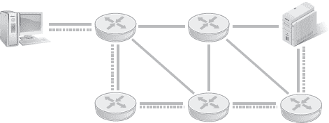

**图 1-11** 路由器部署示例。


**图 1-12** 交换机部署示例。

交换机通过硬件提供网络分段。在交换机上，临时专用的电子通信路径连接会话的端点（如客户端和服务器）。这种交换路径可防止冲突。此外，交换机允许你利用网络连接的全部潜在吞吐容量进行通信，而不是像集线器那样浪费 40% 或更多的带宽在冲突上。参见 图 1-12。

一旦你检查这个过程是如何进行的，就可以将交换机的这一基本功能视为安全优势。交换机在 OSI 模型的第 2 层（数据链路层）运行，MAC 地址在此定义和使用。交换机通过以太网帧中的源和目的 MAC 地址来管理流量。以太网帧是数据链路层（第 2 层）的一个逻辑数据集构造，由网络层（第 3 层）的有效载荷加上以太网帧头和帧尾组成（图 1-13）。

交换机采用四个主要过程，标记为“学习”、“转发”、“丢弃”和“泛洪”。学习过程是从帧头的源位置收集 MAC 地址。源 MAC 地址连同接收该帧的端口号一起进入映射表。一旦帧的目的 MAC 地址出现在映射表中，就会发生转发。该表随即指导交换机从最初发现相关 MAC 地址的端口转发该帧。

如果帧要发往映射表指示的目的端口相同的端口，则该帧会被丢弃。交换机无需将该帧再传回其来源的网段。最后，如果目的 MAC 不在映射表中，交换机将恢复泛洪——即将帧从每个端口发出——以确保帧有最大机会到达目的地。

通过监控交换机的活动——具体来说，观察映射表的构建和修改以及帧头中 MAC 地址的变化——你可以检测错误和恶意流量。智能或多层交换机本身或外部 IDS/IPS 服务可以执行此安全监控功能。

当交换机过程失败时，网络会受损。这可能意味着吞吐量降低、导致拒绝服务的阻塞，或允许黑客尝试修改或窃听的流量重定向。幸运的是，此类攻击在产生大量异常网络流量方面是“吵闹”的，因此你可以用基本安全传感器检测到它们。仅这一优势就是使用交换机而非集线器的重要理由。

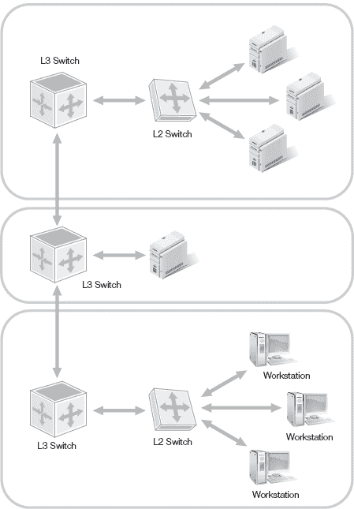

**图 1-13** IEEE 802.3 以太网类型 II 帧。

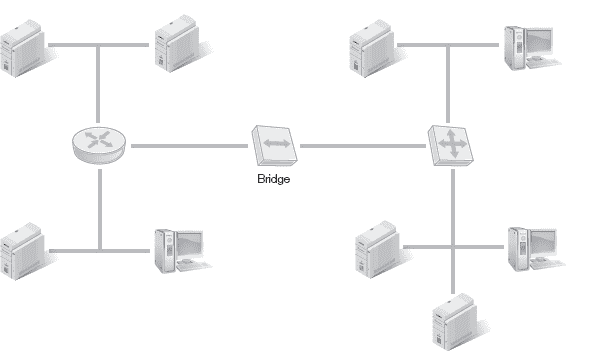

**图 1-14** MAC 层网桥部署示例。

网桥连接网络之间。网桥在网络之间创建路径或路由，仅当通信的目的地实际位于网桥对面的网络上时才使用。这类似于一座河流将一座城市一分为二。当该城市的人想去河流同侧的一个地点时，他们无需过桥即可到达。

网络网桥也是如此。网桥的工作方式与交换机类似，它们使用几个基本过程来管理流量。网桥使用学习、转发和丢弃过程。因此，通过这些过程，只有目的地位于对面网络的流量才会通过网桥到达该网络。所有目的地位于接收流量同侧的流量都会被丢弃，因为流量已经在正确的网络上。

当你需要一个简单的按需使用链路，而路由器、交换机或防火墙的复杂性既非特别要求也非期望时，可使用网桥连接网络、网段或子网。参见 图 1-14。除协议外，网桥还可以连接基础设施大多数方面存在差异的网络。这包括不同的拓扑、线缆类型、传输速度，甚至有线与无线。

你可以使用网桥检测交换机所检测的同类流量滥用。此外，网桥和交换机都可以对 MAC 地址实施过滤。这里可以使用**黑名单**或白名单概念，即允许除黑名单/阻止列表上的流量外的所有流量，或阻止除白名单/允许列表上的流量外的所有流量。

## 网络日志记录与安全服务

### 网络设备日志记录

您可以安排对路由器、交换机和网桥上的活动进行 `log` 记录。您应定期查看流量日志，通常遵循与防火墙和 IDS/IPS 日志相同的计划。您将在这些通常不被视为安全设备的常见网络设备中，发现滥用、入侵、拒绝服务、网络消耗、未授权流量模式等迹象。

### 域名系统

**域名系统 (DNS)** 是互联网和私有网络资源访问的基本要素。用户不会记录服务器的 IP 地址。因此，要访问例如社交网站上的文件服务器，用户依赖 DNS 将**完全合格域名 (FQDN)** 解析为关联的 IP 地址。DNS 类似于您手机中的通讯录。您无需记住他人的电话号码，只需查找他们的姓名；通讯录将每个人的姓名与要拨打的号码关联起来。

大多数用户甚至没有意识到网络依靠 IP 地址将流量导向目的地，而不是他们在客户端软件地址栏中输入的域名。然而，如果没有这项基本但通常透明的服务，当今互联网的大多数运作方式都将失效。在这种情况下，用户将需要维护一份他们想要访问的站点的 IP 地址列表，或始终通过搜索引擎查找站点的 IP 地址。

DNS 是当今大多数**目录服务**的基础，例如 Active Directory 和 LDAP（见下一节）。因此，DNS 对内部网络至关重要，正如它对外部互联网一样重要。

#### DNS 漏洞

DNS 在多个方面存在漏洞：

1.  DNS 是一个非认证查询系统。这允许对 DNS 查询的伪造或“欺骗”响应显得有效。
2.  任何人都可以请求传输 DNS 映射数据（称为区域文件），如果 TCP 端口 53 允许入站访问，则包括外部实体。
3.  DNS 使用明文通信，允许窃听、拦截和修改。

#### DNS 缓解措施

您可以通过**HOSTS 文件**中的本地静态 DNS 映射、在网络边界过滤 DNS 以及对所有主机间的所有通信使用 IPSec 来解决 DNS 的一些缺陷。（HOSTS 文件是每个支持 IP 的主机上的一个静态文件，可在其中硬编码 FQDN 到 IP 地址的解析。）然而，这些是针对 DNS 的防御措施。DNS 本身不保护网络；相反，它是一项需要保护的基本服务。

> **注意**
>
> 仍有少数互联网索引站点存在，但它们不如大多数搜索引擎详尽（或最新）。请想想每年送到您门口的黄页与拨打 411 查号台的区别：一个比另一个更及时、更相关。

### 目录服务

目录服务是一个网络索引。它帮助用户定位私有网络内的资源。目录服务负责记录哪些服务器（有时作为客户端）处于在线状态，以及这些主机与网络共享的资源。目录服务的运作方式很像电话簿对电话号码和地址的作用。

在目录服务出现之前，使用的是效率较低的方法来跟踪或定位可用资源。这些方法包括本地静态或动态列表，网络通过广播通告来维护它们。只有工作组网络仍在使用这些过时的方法。

目录服务是现代网络的另一个基本组成部分，它本身并不提供显而易见的安全服务。然而，目录服务需要其他安全服务和设备提供的保护。您应将对目录服务的访问限制为本地网络的授权且已认证的客户端和用户。您的网络应忽略所有来自外部的信息请求，但有效的远程访问或 VPN 链接除外。如果可能，您应部署 IPSec，以保护每一项内部网络通信。

### 入侵检测系统和入侵防御系统

入侵检测系统 (IDS) 和入侵防御系统 (IPS) 已成为 IT 和安全领域热门的讨论话题。IDS 的概念是一种监视内部主机或网络以发现妥协或入侵症状的系统。实际上，IDS 是一种入室报警器的形式，用于检测网络内发生攻击的时刻。

IDS 作为防火墙的配套机制。一旦 IDS 检测到入侵者，它可以向防火墙发送命令或请求以中断连接、阻止 IP 地址，或阻止端口或协议。您必须将防火墙配置为接收这些命令，并授权 IDS 发送它们。并非所有的 IDS 和防火墙都以这种方式兼容。

最终，IPS 的概念出现了。IPS 致力于在攻击或入侵尝试有机会成功之前检测到它。一旦检测到尝试，IPS 可以响应以防止尝试成功，而不是等到成功入侵后再响应。IPS 不一定取代 IDS。相反，它们通常用作主动防御的第一层或初始层，将 IDS 降级为针对 IPS 错过的事件或内部人员执行的事件的被动措施。

#### IDS/IPS 的局限性

IDS 和 IPS 是完整网络安全解决方案的重要组成部分。然而，它们并非没有缺陷。在特定条件下，IDS 和 IPS 可能会造成虚假的安全感。两个常被讨论的条件包括未知的零日攻击和误报。

**未知的零日攻击：** 当未知的零日攻击威胁网络时，IDS 或 IPS 可能没有检测它的机制。因此，缺乏警报可能导致管理员假设没有发生攻击。在大多数情况下，缺乏警报确实意味着没有恶意活动发生。所以这种假设并非完全没有根据。但如果 IDS 从未触发警报，那么您应该怀疑是检测系统差，而不是完全没有妥协尝试或攻击。

**误报：** 误报因相反的原因呈现相同的结果，即因良性事件触发过多警报。在最初的几次警报被证明是由良性活动触发后，响应警报的紧迫性就会降低。在更多误报之后，管理员可能会推迟调查警报。最终，您会完全忽略警报。一旦出现这种情况，您会将恶意事件的警报也视为误报，再次建立起虚假的安全感。

### 网络访问控制

**网络访问控制 (NAC)** 根据主机的安全合规性限制对网络的访问或准入。NAC 本质上是一种执行工具，旨在确保连接到网络的所有主机都具有当前且合规的安全组件。通过 NAC，如果计算机没有最新的防病毒更新、特定的安全补丁或主机防火墙，您可以阻止或限制其访问。

NAC 通常通过在每个授权主机上放置一个代理来运行。当主机连接到网络时，代理会联系主控程序以查找当前的主机要求。如果主机未能满足这些要求，则 NAC 会阻止主机访问网络。不合规的主机可能仅被授予访问修复服务器的权限。这些修复服务器可以提供将主机带入完全合规状态所需的补丁和更新。

实际上，NAC 是一种通过自动化的系统级机制来强制执行主机加固规则的方法。通过 NAC，系统必须合规，否则无法访问通用网络资源。只有在您更新不合规的系统后，才允许它们访问网络。

---

## 章节总结

### 网络安全基础

### 关键概念和术语

- 访问控制
- 设备
- 资产
- 审计
- 审计员
- 认证 授权
- 可用性
- 后门
- 黑名单


- 瓶颈
- 违规/漏洞
- 网桥
- 业务任务
- 缓存
- 关键点/检查点
- 客户端
- 客户端/服务器网络 机密性
- 深度防御 非军事区 (DMZ)
- 拒绝服务 (DoS) 攻击
- 目录服务 域
- 域名系统 (DNS)
- 停机时间
- 出站过滤
- 封装
- 加密
- 漏洞利用/攻击代码
- 外联网
- 过滤
- 防火墙
- 完全合格域名 (FQDN)
- 黑客
- 黑客攻击
- 加固
- 劫持
- 主机
- HOSTS 文件
- 入站过滤
- 完整性
- Internet 协议安全 (IPSec)
- 入侵检测系统 (IDS)
- 入侵防御系统 (IPS)
- 职位描述
- 局域网 (LAN)
- 日志
- 记录日志
- 恶意代码
- 中间人 (MitM) 攻击
- 媒体访问控制 (MAC) 地址
- 监控
- 网络准入控制 (NAC)
- 网络地址转换 (NAT)
- 网络安全
- 节点
- 开放系统互联 (OSI) 参考模型
- 权限
- 端口地址转换 (PAT)
- 隐私
- 私有 IP 地址
- 特权
- 代理服务器
- 公共 IP 地址
- 冗余
- 远程访问
- 远程访问服务器 (RAS)
- 远程控制
- 重放攻击
- 资源
- RFC 1918 地址
- 风险 角色
- 路由器
- 安全目标
- 安全策略
- 高级管理层
- 服务器
- 单点故障
- 单点登录 (SSO)
- 嗅探器
- SOHO (小型办公室、家庭办公室)
- 交换机
- 电信公司
- 终端服务
- 瘦客户端计算
- 威胁
- 信任
- 隧道技术
- 虚拟专用网络 (VPN)
- 漏洞
- 白名单
- 广域网 (WAN)
- 工作组
- 零日漏洞利用
- 归零

##### 第 1 章 评估

**1.** 一位外部人员需要访问托管在您外联网上的资源。该外部人员对您而言是陌生人，但您最大的分销商之一为他担保。如果您允许他访问该资源，这被称为实施什么？

A. DMZ
B. 虚拟化
C. 受信任的第三方
D. 远程控制
E. 封装

**2.** 以下哪些是常见的安全目标？

A. 不可抵赖性
B. 机密性
C. 完整性
D. 可用性
E. 以上全部

**3.** 什么是资产？

A. 业务任务中使用的任何事物
B. 仅具有货币价值的对象
C. 一个业务流程
D. 职位描述
E. 安全策略

**4.** 学会像黑客一样思考有什么好处？

A. 利用目标中的弱点
B. 在漏洞被利用前保护它们
C. 在不被抓住的情况下犯罪
D. 薪资增加
E. 更好的网络设计

**5.** 有效安全目标最重要的特征是什么？

A. 成本低廉。
B. 可用当前部署的技术实现。
C. 书面记录下来。
D. 经所有人员批准。
E. 是一项绿色倡议。

**6.** 关于所有安全组件和设备，以下哪项是正确的？

A. 它们都能互操作。
B. 它们都兼容 IPv4 和 IPv6。
C. 它们始终强制执行机密性、完整性和可用性。
D. 它们附带预定义的安全计划出售。
E. 它们都有缺陷或局限性。

**7.** 谁对网络安全负责？

A. 高级管理层
B. IT 和安全人员
C. 最终用户
D. 每个人
E. 顾问

**8.** 工作组与客户端/服务器网络的区别是什么？（换句话说，什么功能是这两者之一特有的，但并非两者共有？）

A. DNS
B. 集中式认证
C. 共享资源列表
D. 用户账户
E. 加密

**9.** 远程控制之于瘦客户端，正如远程访问之于？

A. NAC
B. VPN
C. DNS
D. IPS
E. ACL

**10.** 哪两个术语与 VPN 密切相关？

A. 隧道技术和封装
B. 网桥和过滤
C. 路径和网络管理
D. 封装和解封装
E. 端口转发和端口阻断

**11.** DMZ 和外联网有什么区别？

A. 访问需要 VPN
B. 托管资源
C. 外部用户访问
D. 边界或边缘网络
E. 与私有 LAN 隔离

**12.** 无线连接的主要安全顾虑是什么？

A. 加密流量
B. 支持 IPv6
C. 连接速度
D. 内容过滤
E. 信号传播

**13.** 网络设计中哪些要素最有可能导致 DoS？（选择两项。）

A. 目录服务
B. 单点故障
C. 瓶颈

**14.** 对于哪种威胁目前没有防御措施？

A. 信息泄露
B. 洪水攻击
C. 缓冲区溢出
D. 零日
E. 硬件故障

**15.** 关于第 2 层地址和第 3 层地址，以下哪项是正确的？

A. MAC 地址位于第 2 层且可路由
B. 第 2 层地址包含网络编号
C. 第 2 层地址可通过 MAC 地址过滤进行过滤
D. 网络层地址位于第 3 层且可路由
E. C 和 D 都正确

**16.** 以下哪些*不是* IPv6 的优势？

A. 原生通信加密
B. RFC 1918 地址
C. 简化路由
D. 巨大的地址空间
E. 更小的数据包头部

**17.** 防火墙上最常用的默认安全立场是什么？

A. 默认允许
B. 基于用户账户自定义配置访问
C. 缓存 Internet 内容
D. 默认拒绝，例外允许
E. 使用最佳可用路径

**18.** 什么是出站过滤？

A. 检查数据包进入子网时的情况
B. 默认允许，例外允许
C. 检查流量离开网络时的情况
D. 基于职位描述确定访问优先级
E. 无限制地允许所有出站通信

**19.** 以下哪项*不是*代理服务器的功能？

A. 缓存 Internet 内容
B. 过滤内容
C. 隐藏请求者身份
D. 提供 NAT 服务
E. MAC 地址过滤

**20.** 如果主机缺少安全补丁，根据 NAC 允许以下哪项访问？

A. 访问 Internet
B. 访问电子邮件
C. 访问基于 Web 的技术支持
D. 访问文件服务器
E. 访问修复服务器

### 第 2 章：防火墙基础

对一些网络管理员而言，防火墙是其基础设施安全的关键组件。对另一些人而言，防火墙则是一种麻烦，是完成基本任务的障碍。在大多数情况下，对防火墙的负面看法源于对防火墙本质及其工作原理的基本误解。本章将帮助消除这种困惑。

### 第 2 章：防火墙基础

本章清晰地定义了防火墙的基础知识。这些内容包括防火墙是什么、防火墙的作用、其如何执行这些任务、为何防火墙是必要的、各类防火墙类型以及过滤机制。一旦你理解了防火墙的这些基础知识，你将能够超越那些未经训练的观点、常见的迷思以及围绕它们的营销炒作，从而清晰地认识到有效防火墙架构的关键优势。正如任何工具一样，防火墙在解决各种问题和支持基本网络安全方面非常有用。

#### 第 2 章主题

本章涵盖以下主题和概念：

- 什么是防火墙
- 为何你需要防火墙
- 防火墙如何工作及其功能
- TCP/IP 的基础知识是什么
- 防火墙有哪些类型
- 什么是入站和出站过滤
- 防火墙过滤有哪些类型
- 软件防火墙和硬件防火墙有何区别
- 什么是双宿主和三宿主防火墙
- 防火墙的最佳部署位置是什么

#### 第 2 章目标

完成本章后，你将能够：

- 定义防火墙
- 解释防火墙的必要性
- 描述防火墙类型，包括网络路由器/接口防火墙、硬件设备防火墙和主机软件防火墙
- 解释标准过滤方法，包括静态包过滤、`NAT` 服务、应用代理过滤、电路代理过滤、动态包过滤、状态检测过滤和内容过滤
- 定义入站和出站过滤的含义
- 对比软件和硬件防火墙
- 在典型企业网络图上标示防火墙可能的部署位置
- 对比双宿主和三宿主防火墙

#### 什么是防火墙？

**防火墙**就像一名**边境哨兵**。防火墙就像一个**网关**，常被称为“安全网关”。防火墙就像一个流量控制设备。防火墙是一种过滤设备，它强制执行网络安全策略，保护网络免受外部攻击。**数据包**是在互联网或任何其他网络上，从一点路由到另一点的信息单位。数据包**头部**包含源地址、类型、大小、源地址和目的地址等信息。作为一种过滤设备，防火墙会监视不符合防火墙管理员定义的**规则**的流量。防火墙可以关注数据包头部、数据包**载荷**（数据包的核心数据）或两者兼顾；也可以关注**会话**的内容、**电路**的建立，以及可能的其他资产。大多数防火墙仅关注其中一种。最常见的过滤关注点是数据包的头部，紧随其后的是数据包的载荷。

过滤允许你想要的网络流量，并拒绝你不想要的。过滤依赖于过滤规则。每条规则都有一个关注模式，以及当传入元素匹配该模式时防火墙将采取的响应。

防火墙遵循一种称为*默认拒绝/例外允许*的安全理念或立场。防火墙上的所有规则都是例外。一些例外规则定义允许的内容。一些例外规则定义希望拒绝的内容。最后一项选项，有时称为最终规则，是指任何未匹配上述例外的内容均默认拒绝。

防火墙过滤将每个接收到的数据包与一组例外规则进行比较。这些规则规定数据包中的内容是允许还是拒绝。如果数据包匹配允许规则，它将继续前往目的地。如果数据包匹配拒绝规则，则该数据包被丢弃。因此，拒绝规则可防止数据包到达目的地。如果数据包未匹配任何规则，则防火墙默认丢弃该数据包。

过滤规则是“拒绝所有”规则的例外，而“拒绝所有”规则是防火墙的最终且绝对的规则。事实上，如果不存在默认拒绝规则，该过滤设备根本就不是防火墙。相反，它更像是一个路由器或交换机，允许流量通过，即使该流量不匹配预期的模式或规则。因此，请牢记*默认拒绝/例外允许*这一安全立场。防火墙是一种有助于支持这一立场的过滤设备。

将防火墙想象为国家边境上的哨兵。“防火墙”一词并非为这种执行主机和网络基本安全过滤的设备或服务所选的最佳术语。防火墙一词源于建筑和汽车制造的概念，指为防止火势从一个区域蔓延到另一个区域而建造的墙。建筑物或汽车发动机舱中的防火墙是阻止火势蔓延的物理屏障。

网络安全管理员使用防火墙一词来指代允许某些流量但拒绝其他流量的设备或服务。这与建筑物的防火墙不同，后者仅在防火墙失效时才允许火势蔓延。在网络安全中，防火墙允许被认为安全的流量通过——或者至少授权流量通过，而无需整个防火墙失效。此外，如果防火墙确实发生故障，它会进入一种安全状态。这意味着当防火墙离线、锁定或冻结，或以其他方式出现问题时，它会停止所有流量，而不是允许所有流量通过。这被称为故障安全或故障保密。

更好地理解防火墙工作的方式是将其视为哨兵、看门人，甚至边防警卫。这些人站在建筑物的入口或出口处，监视未经授权进入安全区域的企图。有些人被允许进入；其他人则被阻止。如果哨兵不在场，入口会被锁上，因此只有持有钥匙的人才能进入。将防火墙视为边境哨兵。

网关是访问受控空间的入口或出口点。人们每天以各种方式使用网关。入口匝道是通往高速公路的网关，门是通往建筑物的网关，个人电脑是通往互联网——以及你组织网络的网关。你也可以将防火墙视为网关处的大门。防火墙矗立在网络入口处，阻挡不需要的流量。

网关很重要，因为通常大量流量会通过网关。因此，在网络网关处部署防火墙是安全设计的一个方面。如果网关已存在于网络基础设施中，则在该点部署防火墙是显而易见的安全改进。如此部署的防火墙监控通过该网关点的所有流量。

防火墙常部署的另一个位置是在**负载均衡系统**的前面（即公共互联网一侧）、后面（数据中心内部）或内部，负载均衡系统通常被称为**负载均衡器**。负载均衡器的命名相当贴切，因为这正是它们的功能：它们接收传入的一组服务器的负载，并根据各种因素确保负载在服务器之间或其中保持平衡。这是流量的汇聚点，是强制执行策略的理想位置，而这正是通过防火墙来完成的。

##### 理解防火墙：网关、关口与流量控制

###### 网关与关口

如果网络仍处于设计阶段，网络设计师可能会选择在网络布局中创建一个网关来保障安全。然而，在这种情况下，该汇聚点被称为**关口**，而非网关。如果网关是通往其他资源区域的访问点，那么关口就是一种专门的网关，它将流量集中到单一路径，以简化过滤过程。

无论将其标记为用于资源访问的网关，还是用于安全控制的关口，结果都是一样的。位于网关处的防火墙可为所有流量提供过滤服务。关口提供对资源的过滤访问。正如一位智者诗人曾说：“好篱笆造就好邻居。”同样，好的网关和位置合适的防火墙也能造就安全的网络。

###### 防火墙即流量控制设备

你也可以将防火墙视为一种流量控制设备。网络安全的很大一部分只不过是控制流量。授权流量通过数字十字路口，而未授权、不需要、异常或明显恶意的流量则被阻断。

现代防火墙最基础、最原始的形式是**筛选路由器**。路由器基于目标地址分析流量。通往目标的最佳可用路由决定了转发决策。然而，筛选路由器增加了额外规则，可基于目标或源地址丢弃流量。一旦过滤扩展到地址协议甚至端口，筛选路由器就成为了基本的静态包过滤防火墙。

除了过滤，防火墙还可提供路由功能，这是其路由器血统的遗留特性。多宿主防火墙可根据过滤结果，授予流量访问一个或另一个接口或**段**的权限。私有 LAN 的流量可穿越一个段，而目标为 DMZ 的流量则可遵循另一条路径（参见 图 2-1）。防火墙是你网络这条高速公路上高效、必要的流量控制设备。

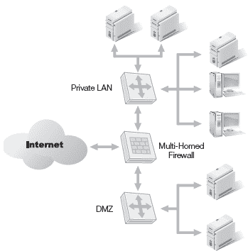

**图 2-1** 基本多宿主防火墙为两个网段提供过滤和路由。

###### 防火墙强制执行安全策略

防火墙强制执行组织的网络安全策略。具体而言，防火墙强制执行网络流量访问控制安全策略。防火墙是安全策略的物理化身。它是网络流量上最明显、最直接的访问控制执行。没有任何设备比防火墙更直接地参与允许授权流量和拒绝所有其他流量。

安全策略定义了安全的目标、目的和程序。每个专注于网络安全的安全策略都要求部署防火墙。防火墙的工作是将安全策略中定义的所有限制和边界强加于所有网络流量。防火墙强制执行组织的网络安全策略，就像交通警察强制执行城镇或州的机动车法规一样。

###### 防火墙的关键功能：抵御外部攻击

防火墙的关键功能是保护网络免受外部攻击。外部威胁众多并非秘密。攻击的猛烈程度几乎令人难以置信，像持续不断的洪水冲击每一个连接互联网的节点。如果没有对主机的警惕加固和防火墙的使用，互联网和专用网络将无法像今天这样存在。

将某些计算机网络威胁称为病毒并非偶然；外部威胁似乎在持续变化和进化。其他攻击专门针对你的网络或组织。有些攻击是非针对性的随机攻击，而是针对恰好具有特定漏洞的任何主机。恶意代码持续感染和破坏无防护的计算机系统。洪水攻击试图中断及时的互联网通信。这些只是你组织网络面临的外部威胁中的一部分。

防火墙作为哨兵、前哨、防御所有攻击和系统妥协尝试的屏障矗立着。好消息是，许多防火墙针对所有已知攻击都经过了良好的加固。这些防火墙能在攻击的闪电战中屹立不倒。防火墙保护网络免受外部攻击可能造成的重大资产损失。

理解这些定义和区别只是理解防火墙的开始。

#### 防火墙不能做什么

防火墙是网络安全的重要组成部分。然而，它并非网络安全的全部。不要犯下部署防火墙却忽视其他安全管理活动的错误。防火墙只是网络安全这个大型复杂拼图中的一块。

防火墙有许多做不到的事情。不要被营销宣传迷惑。随着供应商销售组合或多功能解决方案，其中一些缺陷可能变得模糊不清。这些设备通常为 SOHO 或家庭用户设计，因此从未旨在提供商业级保护。

防火墙主要用于网络流量过滤。**它不是认证系统**。防火墙不是设计用来检查登录凭据、比较生物识别扫描，甚至确认数字证书的有效性。这些是认证服务的功能，通常托管在域控制器或主网络服务器上。

话虽如此，你可能发现有必要让防火墙在授予资源访问权限或允许会话之前进行认证。某些防火墙可具有提供防火墙托管认证服务的增强功能。然而，在许多情况下，更好的解决方案是让防火墙将该任务卸载给专用的认证服务器或服务，例如 **`802.1x`**、**公钥基础设施 (`PKI`)** 或目录服务。大多数安全专家不建议使用防火墙认证用户，或者至少不建议将其作为网络目录服务或集中式认证解决方案的替代品。防火墙不是认证系统。

防火墙**不是远程访问服务器**。远程用户的连接终点不在防火墙。相反，终点是远程访问服务器 (`RAS`) 或网络访问服务器 (`NAS`)。防火墙可在 `RAS`/`NAS` 之前或之后运行，以过滤远程访问流量。然而，这并不意味着防火墙本身就是 `RAS`/`NAS`。

你的防火墙当然应该过滤所有远程流量，特别是因为远程流量比本地流量更有可能是蓄意恶意或意外破坏性的。为什么？组织对谁可以在本地连接到其网络有更多控制权，而允许远程连接时控制权较少。记住：防火墙不能替代远程访问服务器。

与超人不同，你的防火墙没有透视加密流量的 X 射线眼；换句话说，**它无法查看加密流量的内容**。防火墙可以使用**传输模式加密**基于流量头部进行过滤，因为原始头部是明文形式。然而，防火墙**无法**使用**隧道模式加密**过滤流量的原始头部，因为唯一的明文组件是仅包含隧道端点信息的临时隧道头部。这就像试图仅通过观察火车头和守车来判断车厢里装了什么。

将防火墙放置在最有效的位置。如果安全设计要求防火墙检查所有流量内容，则需要将防火墙置于流量解密之后。如果安全设计仅要求过滤非加密流量，则防火墙的位置就不那么关键了。

######### 防火墙的局限性

##### SSL/TLS 终端功能

专为 Web 电子商务站点设计的防火墙可能具备额外功能，可充当互联网客户端发起的 **Secure Sockets Layer (SSL)** 或 **Transport Layer Security (TLS)** 隧道的端点。这使客户端的数据在穿越互联网时得到保护。同时，这也允许防火墙在 Web 服务器接收并处理信息之前，过滤流量内容。

##### 加密可规避过滤

加密是规避过滤的一种手段。用户和黑客可以采用客户端加密解决方案，在传输前对数据进行编码，或创建未经授权的加密封装隧道，以防止防火墙过滤。在这种情况下，网络安全策略可能会规定防火墙需要阻止客户端发起的加密传输，尤其是当目标位于互联网上时。重要的是要记住，防火墙功能强大，但它们没有透视加密流量的“X 射线视力”。

##### 防火墙不是恶意代码扫描器

防火墙传统上是基于规则的过滤产品。这些 **rule sets** 通常只有几十条，至多几百条规则。要过滤恶意代码，规则列表将需要数百万条目。截至 2009 年 12 月，AVG Anti-Virus 定义数据库 #270.14.88/2538 正在追踪 24,303,360 条恶意代码感染定义。如此数量的条目根本无法纳入防火墙规则集中。


某些防火墙产品包含用于恶意代码扫描的增强功能或附加模块。这种增强功能只是一个附加组件，并非防火墙的核心功能。在大多数情况下，使用独立的反恶意软件扫描器比将此功能添加到防火墙中更高效、更安全。

许多防火墙规则会阻止带有欺骗性地址、非常用端口、未授权协议、无效报头结构或值等的流量。此类规则阻止了大量由恶意代码引起的流量，但这些规则本身并不直接阻止恶意软件进入或离开网络。请记住，防火墙功能虽多，但它不是恶意代码扫描器。

### 防火墙不是入侵检测系统

入侵检测系统（`IDS`）是一种网络防盗或入侵警报，用于检测并响应网络内部的未授权活动。`IDS` 通过监控所有网络流量来执行此任务。虽然 `IDS` 可部署在网络边界或面向互联网的网络外部，但大多数 `IDS` 在私有网络内部运行，以便监视所有内部网络流量。

防火墙只有在恶意流量进入其某个接口时才能检测到。防火墙通常不监控通用的内部网络活动。防火墙要么是网络和子网的边界设备，要么是监控单个主机的软件产品。无论哪种情况，它们看到的流量和执行的任务都与 `IDS` 不同。因此，防火墙无法替代优秀的入侵检测系统。


**NOTE**

`IDS` 可检测大量不需要的活动，采用多种检测方法，并执行广泛的响应，包括被动和主动两类。

### 防火墙无法防范内部攻击

一个常见的误解是防火墙可防范内部攻击。实际上它们做不到。防火墙可以是边界设备，也可以是主机上的软件。边界防火墙可过滤进出网络或子网的流量。因此，边界防火墙无法看到任何内部流量（参见 Figure 2-2）。当内部客户端的攻击者攻击同样位于内部的目标主机时，边界防火墙不参与通信，因此既无法检测也无法阻止攻击。

主机软件防火墙只能看到进出该主机的流量，无法看到任何其他内部流量。

当然，如果流量不经过其接口，防火墙就无法过滤该流量。防火墙只能过滤它能看到的内容。如果恶意或不需要的流量未进入防火墙的接口，防火墙将无法过滤该流量（参见 Figure 2-2）。因此，您需要在每台主机、每个边界网关或瓶颈点，以及每个重要子网或内部网络划分之间部署防火墙。

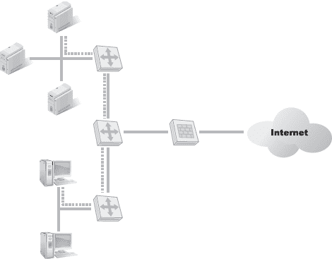

**FIGURE 2-2**

边界防火墙无法过滤内部通信。

### 防火墙无法防范社会工程学攻击

防火墙无法防范社会工程学攻击。社会工程学是针对组织人员的攻击类别。这些攻击通过巧妙的询问或说服他人执行违反网络安全的操作，从人员处获取信息。防范社会工程学的唯一真正手段是员工培训和安全意识教育。防火墙无法阻止源于社会工程学的攻击。

### 防火墙无法防范可移动介质威胁

防火墙无法防范可移动介质带来的威胁。可移动介质的广泛使用对所有计算机构成重大威胁，即使是那些未连接互联网、外部网络，甚至未通过网络链路连接任何其他计算机的设备。可移动介质包括 `USB` 硬盘、`USB` 闪存驱动器、`CD`、`DVD`、蓝光光盘、`HD-DVD` 光盘、其他光盘、闪存卡、`FireWire` 存储设备、磁带介质、电子邮件附件等。可移动介质可能导致信息泄露或将恶意代码带入组织。防火墙不参与可移动介质的使用，也不涉及这些设备可能包含的任何内容。防火墙无法保护网络免受可移动介质持续存在的威胁。同样，对此威胁的最佳防御是良好的公司政策、员工培训和安全意识。

### 防火墙无法防范物理入侵或攻击

防火墙当然无法防范物理入侵或攻击。物理攻击会绕过任何逻辑和电子保护机制。防火墙无法防范设备盗窃、窃听装置植入、电缆拔除、将流氓笔记本连接到开放节点、设备破坏、向电子设备泼洒液体、建筑火灾或任何其他形式的物理攻击。只有有效的物理防御才能阻止物理攻击。防火墙的设计初衷并非用于挫败物理攻击。

### 防火墙不是无能或无知管理员的保险

防火墙不是针对无能或无知管理员的保险。计算机设备和软件只能执行其设计和编程的功能。如果管理员错误配置安全设备，设备不会自动弥补该疏漏。如果安全管理员未能学习新设备的所有功能和默认设置，产品无法自主保障安全。安全需要培训、研究、周密规划、深思熟虑的实施，以及持续的审查和维护。这一过程称为安全管理——这需要付出努力。那句老话在今天从未如此真实：“垃圾进，垃圾出。”您投入网络安全什么，就会得到什么。因此请记住，防火墙无法弥补管理员的无能或无知。

## 为什么你需要防火墙？

同样地，防火墙无法弥补糟糕的安全管理。主动的安全管理对于任何安全工作的成功都至关重要。安全管理是审查、测试、调整和更新组织安全策略及安全基础设施的过程。这是一项持续的工作，需要知识、研究和警惕。组织面临的威胁和风险在不断演变，变得更加持久和猖獗。你的安全策略在防御方面应同样严谨且有的放矢。及时了解网络安全领域最新的威胁和趋势是这项工作的重要组成部分。建立人脉、参加会议、阅读最新的行业文献都是保持自身及安全工作敏锐度的途径。

请记住，防火墙是安全的核心焦点。它是你组织安全策略的化身——一种物理呈现。当你善用且明智地使用它们时，防火墙能提供可靠且一致的安全防护，抵御外部威胁。然而，防火墙有其局限性，只是完整安全策略的一部分。仅凭防火墙本身，无法保护网络免受所有威胁。防火墙无法弥补缺乏明智的、最先进的安全管理这一短板。

此外，正如你迄今所读内容的必然推论，防火墙不能替代可靠的书面安全策略。防火墙无非是一个可靠的边境哨兵。它不是完整的安全基础设施和策略。即使是部署防火墙的决定，也是一项重要的战略举措，不应掉以轻心。彻底的研究和规划将有助于有效防火墙的设计和部署。防火墙策略确保你网络防火墙的成功。全公司范围的安全策略确保你组织安全基础设施的成功。防火墙绝不能替代此类安全策略。

最后，防火墙不是完美的解决方案。如前所述，防火墙是一个边境哨兵，虽可靠但有限。防火墙只能过滤它“看”到的内容。它只能根据安全管理员定义的规则集执行过滤。它无法自我调整以适应不断变化的条件或未来的威胁。防火墙只是完整安全基础设施的一部分。防火墙主要是软件，即使运行在专用硬件上也是如此。它们是软件，由会犯错的人类编写；因此，它们可能会有，且确实存在 Bug 和缺陷。防火墙永远不是完美的解决方案——但它是解决方案的一部分。

幸运的是，尽管防火墙有诸多“不能”，它仍是一个可靠的过滤解决方案。防火墙能够且应该保护网络边界和单个主机的边界。没有正确安装的防火墙，任何安全策略——或部署——都是不完整的。

### 谁需要防火墙？

谁需要防火墙？任何使用计算机与其他计算机进行交互和资源交换的人！你的个人电脑需要防火墙。你的家庭网络需要防火墙。你的公司网络需要防火墙。每个网络都需要防火墙。它们是网络通信的基础。

高速互联网连接已变得无处不在。大多数计算机用户现在在家、在工作中，甚至通过移动设备在外出时都能获得高速接入。通常，这些宽带连接是“始终在线”的连接。这意味着计算机和网络始终处于联机状态——并暴露在攻击之下。如果吊桥始终放下，就很容易被跨越。当系统始终保持连接时，它可能成为集中攻击的焦点，攻击者试图发现其漏洞并突破其安全防线。

计算机通过互联网被发现并遭受攻击的可能性有多大？几乎是肯定的。大多数系统在获得公网 `IP` 地址后几分钟内就会被检测、扫描和探测。在安装防火墙以及为硬件、操作系统和已安装的应用程序安装最新的供应商补丁之前，将系统连接到互联网无异于技术上的自杀。

这是否意味着有成群结队的黑客正等待寻找新目标发动攻击？不幸的是，是的。但并非你想象的那种方式。大多数扫描和攻击是由恶意程序自动执行的。这些程序通常被称为 `agents`、机器人、`zombies`（僵尸网络节点），或简称 `bots`。被称为 `botnets`（僵尸网络）的恶意代码群会持续不断地在互联网上搜寻新受害者。

通过宽带连接持续在线的另一个隐患是吞吐速度。高速互联网链路使针对你系统的高速攻击成为可能。在老旧的、较慢的连接上，同样的风险也存在，但攻击较慢或较少，仅仅是因为通往目标系统的链路限制了攻击速度。随着 `10 Mbps` 及更快的连接变得普遍，攻击可以以近乎闪电的速度发生。

这并非暗示只有低速互联网链路才安全。相反，你应充分利用高速互联网连接。然而，你需要用防火墙保护你的系统。防火墙将为大多数源自互联网的攻击设置一道坚实的屏障。

有了防火墙保护你的系统免受互联网侵害，黑客的扫描将几乎毫无价值。对探测数据包的响应将被过滤。外部人员将难以了解你的基础设施。这反过来意味着他们将发现更少的漏洞，从而发动更少的攻击。即使发动攻击，这些攻击也更有可能失败。

防火墙不仅用于互联网防护。不要忘记，内部也存在重大威胁。防火墙监控你私有网络内部的网段（图 2-3）。将防火墙视为一种防止局域网资源被滥用或误用的工具。组织内每个主要部门、子网或其他相关区分都应具有防火墙保护。这将确保内部的意外泄露和故意滥用被降至最低。所有网络都需同时防范内部威胁和外部威胁。

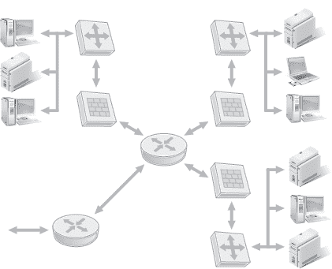

**图 2-3**

使用防火墙安全隔离子网的私有网络示例。

不要忽视这样一点：虽然防火墙起源于路由，但你仍应使用专用路由器进行路由，使用专用防火墙进行过滤。在许多情况下，组合或多功能设备提供了许多功能，但不一定具备最佳性能和效率。这些设备可能为小型网络省钱，但往往成为大型网络的费用来源。如果设备在必要时无法达到商业级性能水平，其后果造成的损失可能比最初部署适当的防护措施更昂贵。

防火墙应用于保护资源，无论该资源位于网络的何处。`hardware firewall`（硬件防火墙）可以保护单个主机或一组主机网络，而软件防火墙只能保护单个主机。不要将防火墙的定义局限于边境哨兵设备。相反，应将其视为一种通用的哨兵设备，能够保护置于其过滤服务后方的任何事物。

### 主机防火墙

`Host firewalls`（主机防火墙）保护主机，并保护网络免受主机的威胁。主机防火墙的工作是过滤进出单个计算机系统的流量。攻击和恶意流量可能来自互联网或本地网络。主机防火墙可以保护主机免受此类威胁。然而，主机本身可能被恶意代码攻陷，或被恶意用户控制。在这种情况下，主机防火墙保护网络免受来自主机的威胁。

从另一个角度来看，主机防火墙也能保护网络免受用户的一般性威胁。用户是网络基础设施中风险最大的要素。即使其他每个组件（无论是硬件还是软件）都按其编程和配置的方式运行，用户仍可能决定违反安全策略。因此，人类用户的自由意志是每个计算环境面临的最大风险之一。

用户可能无知、犯错、被特洛伊木马欺骗、成为社会工程学攻击的目标，或故意执行恶意操作。主机系统的安全（包括通用系统加固、反恶意软件扫描、互联网客户端限制、阻止非批准软件以及主机防火墙）都是为了保护网络免受人为风险。

防火墙可防御互联网威胁、内部网络威胁，保护通用资源，并防御用户风险。仅凭这些能力，似乎在每台主机和每个网段上都安装防火墙是显而易见的后续步骤。

然而，到处部署防火墙有两个显著缺点：成本和过度依赖。大多数商业级防火墙成本高昂。即使它们没有采购成本（由于促销或开源），防火墙持续的维护成本随时间推移也会显著增加。如果在每台主机和每个网段都部署防火墙，防火墙管理的开销将远超大多数企业的 `IT` 总预算。

普遍部署防火墙的第二个缺点是过度依赖。防火墙只是完整安全解决方案的一部分，而非独立的完整方案。在每台主机和每个网段部署防火墙，可能导致其他必要的安全工作被忽视或被认为不必要。这将是灾难性的安全态势。防火墙无法弥补糟糕的安全策略、糟糕的安全管理或缺乏适当的系统加固。

考虑到这些顾虑，组织如何确定部署多少防火墙以及部署在何处？在大多数情况下，这需要**风险评估**和**风险管理**的过程。风险评估涉及检查资产价值、威胁等级、可能性，以及妥协总成本与资源价值和保护成本的对比。虽然许多其他因素影响风险评估，但这一基本的业务和安全流程如下：

1.  确定资源或资产的总体价值。称为**资产价值（`AV`）**，此计算应包括**有形**和**无形成本及价值**。

2.  确定面临该资产的威胁。针对每个威胁，计算**暴露因子（`EF`）**，即以百分比表示的潜在损害程度。这将创建一个带有相应 `EF` 的资产-威胁对列表。

3.  计算**单次损失期望值（`SLE`）**：`SLE = AV × EF`。这是因针对该资产的特定威胁发生一次妥协而可能经历的潜在损失金额。这将为每个资产-威胁对添加一个 `SLE` 值。

4.  针对每个威胁，计算该威胁在一年内可能成为现实攻击的次数。这称为**年化发生率（`ARO`）**。

5.  计算**年化损失期望值（`ALE`）**：`ALE = SLE × ARO`。这是在一年内因该资产针对特定威胁的任何妥协而可能经历的潜在损失金额。这将为每个资产-威胁对添加一个 `ALE` 值。

6.  按 `ALE` 对资产-威胁对列表进行排序。最高的 `ALE` 是该特定资源/资产面临的最大风险。

7.  取 `ALE` 最大的资产-威胁对，确定可用于防御该威胁的可能对策。这将创建资产-威胁-对策三元组。

8.  针对每个资产-威胁-对策三元组，计算新的 `ARO`。对策应降低 `ARO`。完美的对策会将 `ARO` 降至零。完美的对策很少见。

9.  使用新的 `ARO`，为每个资产-威胁-对策三元组计算新的 `ALE`。

10. 针对每个资产-威胁-对策三元组，进行**成本/效益分析**。公式为：`(Original ALE – New ALE) – cost of the countermeasure per year`。

11. 按潜在成本/效益对资产-威胁-对策三元组进行排序。成本/效益最大的三元组是最佳选择。

简而言之，如果针对特定资产-威胁的成本/效益分析建议使用防火墙，则安装防火墙是明智的业务、安全和预算决策。如果其他对策能以更低成本提供更大效益，则该对策是更好的选择。

执行详细的风险分析是一项复杂的任务。许多小公司或家庭网络爱好者可能不愿花费精力进行复杂的风险评估。这可以理解，但不进行完整的风险评估并不意味着你没有风险，或没有值得保护的资产。

至少，你需要保护任何和所有可识别个人身份的数据。这包括个人通信（如电子邮件）；任何定制制作的文档、图片、视频或其他文件类型；所有医疗信息；所有财务信息；配置设置；以及密码和其他凭证。身份盗窃是互联互通世界中最频繁、破坏性最大的犯罪之一。仅担心邻居、随机入室盗窃或街头扒手无异于管窥蠡测。今天，你必须关注全球所有企图通过互联网访问你电子资产的潜在罪犯。

谁需要防火墙？拥有联网计算机的每个人都需要防火墙。为什么防火墙是必要的？因为威胁和恶意实体潜伏在互联网上、私有网络中，甚至可能在你自己的家中！

### 什么是风险区域？

**风险区域**是指代表特定风险等级的任何网段、子网、网络或网络集合。风险越高，保护该风险所需的安全性就越强。与某区域关联的风险越小，所需的安全性就越低，因为该区域的威胁造成危害的可能性较小。

风险区域的另一面是**信任区域**。高度受信的区域自然需要较少的安全性，而低信任度的区域需要更多的安全性。

每个风险区域都需要与其他任何风险区域清晰、明确地隔离，特别是当这些区域具有不同风险等级时。用于将区域相互隔离的主要工具是防火墙。

大多数网络有两到四个风险区域。这些包括私有网络、`DMZ`、外联网和互联网。请参见图 2-4。私有网络区域风险最低，是信任度最高的区域。互联网区域风险最高，信任度最低。`DMZ` 的风险低于互联网，但不如私有网络受信。`DMZ` 区域具有中高风险或中低信任度。外联网的风险高于私有网络，信任度高于互联网。外联网区域具有中低风险或中高信任度。请参见表 2-1。

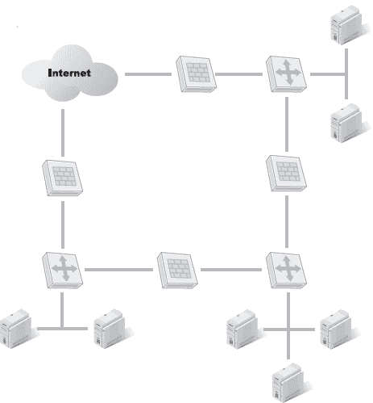

**图 2-4**

具有四个风险或信任区域的私有网络示例。

| **表 2-1** 常见网络区域的风险和信任等级。 |
| :--- | :--- | :--- | :--- | :--- |
| **区域** | | **风险等级** | | **信任等级** |
| `LAN` | | 低 | | 高 |
| 外联网 | | 中–低 | | 中–高 |
| `DMZ` | | 中–高 | | 中–低 |
| 互联网 | | 高 | | 低 |

组织的书面安全策略应定义这些区域的存在位置，并规定每个区域的安全要求。此类要求包括流量管理、防火墙的使用、使用 `VPN` 跨越区域划分、系统加固、恶意代码扫描等。防火墙很可能位于风险区域划分处，在某些情况下可能是性价比最高的安全对策。下一步是了解防火墙在这些点上能做什么以及它如何执行这些任务。

### 防火墙的工作原理与功能

防火墙沿通信路径工作。这可以是网络的网关点、网络内的瓶颈点、区域过渡点或主机上。在这些位置，防火墙会中断流量以检查数据包或会话。如果流量已授权，则继续传送到目的地。如果流量未授权，则会被阻止并丢弃。

提到防火墙，人们通常会想到某种硬件设备，但实际上将其视为一种**功能**更为准确。防火墙实现主要有两大类型：**bump-in-the-wire**（线路中插入）和 **bump-in-the-stack**（协议栈中插入）。前者是独立的硬件防火墙实现，后者是通过软件实现的防火墙。

防火墙基于**堡垒主机**运行（参见图 2-5）。这在硬件防火墙中最为明显，但主机软件防火墙也是如此。堡垒主机防火墙沿潜在攻击路径站岗，处于承受攻击冲击的最前沿。防火墙充当先锋，是抵御攻击的第一道防线。堡垒主机也可称为**牺牲主机**。

对于主机软件防火墙，它会尝试阻止针对主机的所有恶意交互。如果防火墙本身被攻破，通常会将系统从网络断开。虽然这是一种 `DoS` 形式，但相比默认开放无限制、未过滤的连接，这通常是首选的**故障安全/故障保密**响应。如果连接直通互联网，这一点尤为重要。

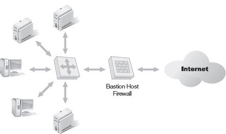

**图 2-5** 堡垒主机防火墙部署示例。

如果防火墙能击退攻击，资源就是安全的。如果防火墙因攻击而失效，它会阻止与其背后资源的任何进一步通信。可将防火墙视为**死人开关**。如果防火墙故障或离线，它所过滤的连接也会随之中断。

防火墙最常见的功能是筛选或过滤流量。防火墙将其接口收到的任何数据包与规则集对比，以决定转发或丢弃。如前所述，防火墙通常基于默认拒绝/例外允许的安全策略运行。

防火墙主要根据数据包或段头部的信息执行流量过滤。这包括源和目的 `IP` 地址，以及源和目的端口。某些防火墙还可过滤或阻止特定协议或协议的特定用法。例如，防火墙可阻止所有流媒体协议，并仅阻止 **Internet Control Message Protocol (`ICMP`)** 类型 3（目的不可达）和 11（超时）。

防火墙区分网络或子网。防火墙作为一个清晰、明确的边界，将一个网络区域与另一个区域分隔开。通过在网络划分或子网之间部署防火墙，网络设计师和安全管理员可对试图跨越该交汇点的流量实施管理和控制。防火墙既作为面向互联网的网络边缘边界设备，也作为组织内部不同部门之间的边界设备。


开放无限制的内部通信听起来不错，但实践中此类流量会严重降低整体基础设施的性能和稳定性。通过阻止或至少限制组织某些部门间的通信，可提高流量效率。此外，流量控制和管理能降低风险。

例如，阻止编程组网络与生产网络之间的通信，可防止未经批准的软件版本泄露。此外，阻止生产网络对财务子网、研发子网、`DMZ` 和外联网的通用访问，可防范数据泄露、恶意代码传播及其他形式的欺诈和滥用。

防火墙可作为恶意活动的通用过滤器，或作为单向筛。作为通用过滤器，防火墙允许所有正常良性流量通过。这类防火墙用于保护 `DMZ` 或区分 `LAN` 内的子网。通用过滤防火墙致力于阻止恶意活动。

通用过滤防火墙可允许使用任意协议、任意端口通信，也可将通信限制在特定协议和端口（及其他限制）。若仅允许外部用户访问防火墙后的少数特定资源，防火墙可基于 `IP` 地址和端口允许访问这些特定内部系统，但阻止所有其他入站请求。

筛式防火墙仅允许流量从私有或受信侧发起。它允许非恶意响应从公共或低信任侧返回，但通常会阻止或防止来自外部的任何发起或入站通信请求。筛式防火墙通常保护私有 `LAN` 或外联网。

防火墙可支持与 `LAN` 的特殊入站授权连接，如远程办公人员的 `VPN` 链路。这对外联网也是一项重要功能，因为 `VPN` 访问往往是通过互联网访问托管资源的唯一途径。

防火墙可提供端口转发服务。**端口转发**是网络地址转换的一种静态反向形式。在传统或动态网络地址转换 (`NAT`) 中，外部实体无法发起与内部系统的通信，因为 `NAT` 系统外部接口收到的任何数据包在转换表中找不到匹配映射，会被视为无效并丢弃。

通过端口转发，可编码转换映射，使外部 `IP` 地址和端口组合固定并重定向流量到特定内部系统，即使内部系统使用私有 `IP` 地址。`IP` 地址和**端口号**的组合称为**套接字**。在图 2-6 中，外部端口 `208.40.235.38:8081` 被转发到内部服务器的 `192.168.5.74:80` 端口。端口转发也称为**静态 NAT**、流量转发、服务重定向、**反向代理**，“在防火墙上打洞”。

“在防火墙上打洞”这一说法指出了一个重要问题：使用端口转发会降低防火墙提供的有效安全性。若无端口转发或类似服务，防火墙可拒绝与内部系统通信的尝试。使用端口转发，你在主要边界哨兵上创建了一条路径。多种黑客攻击可利用端口转发访问端口转发设置“允许”端口之外的其他内部系统的其他端口。这些攻击通常是分片操纵的变体。

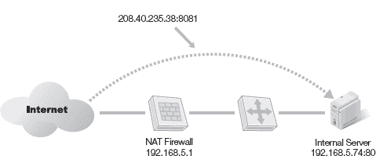

**图 2-6** 跨 `NAT` 系统的端口转发示例。

### 管理与控制流量

管理与控制流量是防火墙的主要关注点和功能。仅允许授权的通信；其他所有通信均被阻断。确定允许什么和阻断什么的行为取决于防火墙的过滤功能。这些功能包括数据包检查、连接或状态管理、**状态检测**等。（**状态**是客户端与资源服务器之间的逻辑连接。）这些过滤概念将在本章后面定义。

此外，防火墙可以阻断或过滤出站流量。此功能可以阻断欺骗流量，或任何以无效 `IP` 地址作为目的地或源的流量。特定协议或端口也可以被阻断。当然，特定域名或目标地址也可以被阻断。

防火墙还可以基于内容进行过滤。防火墙可以在数据包离开网络到达外部之前，拦截其中的特定内容。这可能导致数据包被丢弃、整个连接被中断，或数据包被编辑以移除被阻断的内容并替换为其他内容。**内容过滤**可以针对域名、`URL`、文件名、文件扩展名或内容中的关键字。

防火墙的另一项功能是基于加密进行过滤。防火墙可以无限制地允许加密。或者，防火墙可以设置为在某些端口阻断加密，而在其他端口不阻断。防火墙还可以阻断来自和发往所有内部 `IP` 地址的加密流量，但服务器、`VPN` 设备和 `RAS/NAS` 除外。

在网络管理员认为直接通信风险过大的情况下，防火墙可以在主机之间执行中介功能。这是代理的基本功能。位于通信路径上的代理防火墙可以向通信参与者隐藏通信一个或两个端点的身份。在大多数情况下，代理服务会向外部实体隐藏内部系统的身份。

防火墙可以通过地址转换或转换系统来实现地址节约。`NAT` 是网络支持的最常见转换服务。`NAT` 在内部地址和公共外部地址之间进行转换。`NAT` 允许私有网络使用 `RFC 1918` 私有 `IP` 地址。这反过来又提供了额外的安全性，因为互联网主机无法直接寻址 `RFC 1918` 系统。

通过其所有特性、功能和能力的组合，防火墙为组织的计算机和电子资源提供了一致、可靠的保护。但防火墙并非完美，不应成为网络基础设施的唯一安全组件。它们只是网络安全策略的一个要素——尽管是必不可少的一个。

防火墙可以记录事件。防火墙可设置为将任何操作记录到日志文件中。此外，它们可以将任何恶意流量的内容记录到日志文件中。还可以将任何异常网络活动、性能水平和流量统计记录到日志文件中。记录事件是防火墙的一项极其宝贵的功能。

由于不存在完美的安全产品，你必须依靠监控来察觉企图（及任何成功）突破或违反安全的行为。安全就是尽你所能锁定事物，然后监视试图突破你防线的行为。先锁定，再监视。没有锁定和监视两者兼备，就不可能有成功的安全策略。此外，大多数安全组件都应包含锁定和监视两个方面。防火墙也不例外。如果提议的防火墙产品无法记录其操作和网络活动的日志，则你需要寻找其他防火墙产品。请记住这句经过时间考验的商业格言：“你得到的是你检查的，而不是你期望的。”

### TCP/IP 基础

要充分理解防火墙采用的过滤机制，你需要对 `TCP/IP` 协议套件有扎实的理解。透彻了解 `TCP/IP` 不仅有助于安全管理员进行防火墙管理，还能在路由、交换、维护可用性、提升网络性能、管理网络流量、分析协议、理解漏洞与利用，甚至执行渗透测试或道德黑客攻击等方面受益。

大多数网络（包括互联网）都使用 `TCP/IP` 协议。最普遍使用的版本是 `IPv4`。然而，`IPv6` 正在全球范围内获得更广泛的应用。在过渡期间，你应该了解 IP 的两个版本。如果你需要关于 `TCP/IP` 的更多详细信息，请参阅：

 Stevens, W. Richard, and Gary R. Wright. *TCP/IP Illustrated, Volumes 1–3*. Addison-Wesley Professional, 1994.

 Kozierok, Charles. *The TCP/IP Guide: A Comprehensive, Illustrated Internet Protocols Reference*. No Starch Press, 2005.

 Comer, Douglas E. *Internetworking with TCP/IP, Vol 1 (5th Edition)*. Prentice Hall, 2005.

 ARIN IPv6 Wiki：*[`www.getipv6.info`](http://www.getipv6.info)*。

#### OSI 参考模型

大多数协议讨论都始于开放系统互连（`OSI`）参考模型。`OSI` 模型是一个标准的概念工具，用于讨论协议及其功能。`OSI` 模型有七层（图 2-7）。每一层与通信会话另一端的对等层进行通信。虽然 `OSI` 模型有助于理解协议，但大多数协议并不完全符合它。

以下是 `OSI` 模型七层的简要说明。每一层都有独特的职责、功能和特性。`OSI` 模型定义了每一层需要发生的事情，将完成这些任务的实际过程留给协议，最终留给协议程序员。

> **注意**
>
> `OSI` 模型是讨论和描述网络协议的文档标准。然而，`TCP/IP` 是事实上的或实用的标准，因为它在 `OSI` 模型发展为实际协议之前就已投入使用。极少有产品能直接支持 `OSI` 模型或其衍生协议。相反，尽管 `TCP/IP` 不是国际标准化组织的官方文档标准，但大多数产品都支持 `TCP/IP`。

- **应用层（第 7 层）**—**应用层（第 7 层）**实现与主机软件（包括操作系统）的通信。应用层是主机软件与网络协议栈之间的接口。该层的子协议支持特定应用程序或数据类型。

- **表示层（第 6 层）**—**表示层（第 6 层）**将从主机软件接收的数据转换为网络可接受的格式。对于从网络发往主机软件的数据，该层也执行反向任务。

- **会话层（第 5 层）**—**会话层（第 5 层）**管理网络通信端点之间的通信通道（称为会话）。两个系统之间的单个传输层连接可以支持多个并发会话。

- **传输层（第 4 层）**—**传输层（第 4 层）**对数据传输进行格式化和处理。这种传输独立于应用程序，且对其透明。

- **网络层（第 3 层）**—**网络层（第 3 层）**处理逻辑寻址（`IP` 地址）和流量路由。

- **数据链路层（第 2 层）**—**数据链路层（第 2 层）**管理物理寻址（`MAC` 地址）并支持网络拓扑（如以太网）。

##### 物理层（第 1 层）

**物理层（第 1 层）**将数据转换为通过物理网络介质传输的比特流。

##### 关于地址你应该知道的事

逻辑地址（如 `IP` 地址）创建全局区分。至少对于公网 `IP` 地址而言，互联网上使用的所有地址都是唯一的。**逻辑地址**的分配独立于物理位置。逻辑地址使得两台主机之间能够通信，无论它们在物理上彼此有多近。

**物理地址**（如 **MAC 地址**）创建本地区分。`MAC` 地址只需在本地子网内唯一。这使得能够区分物理位置相近、能够接收相同电子信号的系统。制造商通常执行网卡的物理地址分配，因此它依赖于物理硬件组件本身。

`MAC` 地址依赖于物理网卡；制造商将其分配为“永久”**硬件地址**。然而，在大多数系统上，修改或欺骗有效 `MAC` 地址通常是可行的。可以使用原生命令更改 `MAC` 地址，如 Linux、Unix 和 Mac OS，或使用第三方工具，如 Windows 所需的工具。相关工具包括 `MAC Spoof`、`MAC Makup` 和 `MAC changer`。

##### 图 2-7

封装过程及各 `OSI` 层中头部和载荷集合的名称。

当数据从软件应用程序移动以进行网络传输时，它会从上到下遍历协议栈的各层。当每一层接收来自上层的数据时，该数据成为带有特定层头部的载荷（图 2-7）。在**数据链路层（第 2 层）**（以太网所在层），数据还会接收一个尾部。此过程称为封装。其逆过程称为**解封装**，发生在接收网络通信时。随着此过程进行，被操作的数据集会根据其遍历的层获得唯一名称。它们分别是：

- **应用层（第 7 层）**—`PDU`（协议数据单元）（从主机软件应用程序获取的数据）

- **表示层（第 6 层）**—`PDU`

- **会话层（第 5 层）**—`PDU`

- **传输层（第 4 层）**—段

- **网络层（第 3 层）**—包

- **数据链路层（第 2 层）**—帧

- **物理层（第 1 层）**—数据比特

添加头部（以及在数据链路层添加尾部）的封装过程，使不同系统上的对应层之间能够交换数据。这称为对等通信。头部的内容包含供网络链路接收端对应层处理的信息。

头部的内容，主要来自第 2-4 层，是防火墙最关心和关注的重点。应用代理防火墙和状态检测防火墙也可以检查第 5-7 层的头部和载荷内容。你将在本章后面了解更多基于此层信息的过滤方法。

#### 子协议

`TCP/IP` 不是单一协议，而是一组协议的集合。通常称为 `TCP/IP` 协议族，该集合包括若干核心协议，如 `IP`、**传输控制协议 (`TCP`)** 和 **用户数据报协议 (`UDP`)**，以及若干常用协议，如 `ARP`、`ICMP`、`HTTP` 和 `TLS`。除了这些之外，数以万计的其他协议可以在 `TCP/IP` 创建的网络基础设施中运行。

假设读者对 `TCP/IP` 的子协议有扎实的了解，但这并非掌握本书范围的必要条件。

##### 头部和载荷

防火墙，特别是包过滤防火墙，检查头部内容以允许或拒绝**帧**、包或段。根据过滤类型以及过滤关注的层或协议，被检查的项目及其来源头部可能会有所不同。

###### 技术提示

要获取更完整的其他子协议列表及其端口分配，请查看互联网号码分配局 (`IANA`) 托管的文档：<http://www.iana.org/assignments/port-numbers>。几乎所有 65,536 个端口都有一个或多个关联的协议和应用程序。

要获取恶意软件使用的端口列表，请访问 <http://www.glocksoft.com/trojan_port.htm> 或 <http://www.neohapsis.com/neolabs/neo-ports/neo-ports.html>。

包过滤通常关注四个主要头部：

- 数据链路层帧的以太网头部

- 网络层包的 `IP` 头部

- 传输层段的 `TCP` 头部

- 传输层段的 `UDP` 头部

这四个头部各自包含许多影响过滤动作的细节。这些包括 `MAC` 地址、`IP` 地址、`TCP` 头部标志、端口号等。

##### 寻址

关于 `IPv4` 和 `IPv6` 寻址的基本差异，重点关注的问题不是子网掩码或地址长度（两者都很重要），而是源和目的、公共和私有、已知和未知、良性和恶意，以及真实和欺骗地址等问题。

许多形式的过滤侧重于 `IP` 地址和/或端口号来做出允许或拒绝的决定。此类决定或规则可以侧重于段、包或帧头部中找到的源地址或目的地址。换句话说，端口号、`IP` 地址或 `MAC` 地址可以作为源和/或目的问题来支持过滤。

防火墙过滤可以关注 `IP` 包头部中源或目的位置的地址是公共还是私有。通常，私有地址在私有网络上运行，不会到达外部。如果数据包朝向外部目的地，`NAT` 会将源私有地址转换为公共地址。在互联网上，路由器和防火墙都会丢弃头部包含 `RFC 1918` 地址的任何 `IP` 数据包。防火墙可以根据地址是已知还是未知进行过滤。此功能针对用于源和/或目的的地址进行过滤。已知地址通常是受信任地址。仅包含受信任和已知地址的数据包被允许到达目的地。未知地址潜在不可信。包含未知地址的数据包在所有情况下都可被阻止，或在做出允许或拒绝决定前进一步检查。

防火墙可以根据地址是已知良性还是恶意进行过滤，这是已知和未知过滤的一种变体。然而，这里不是将已知地址视为受信、未知地址视为不受信，而是反转了这一概念。良性地址是已知的、受信任的地址，恶意地址是已知的、不受信任的地址。但在这两种情况下，地址都是已知的。使用这种过滤形式时，遇到的任何未知地址都将需要后续的额外过滤，检查流量的其他方面。

防火墙还可以根据地址是真实的还是伪造的进行过滤。这种过滤形式不如前几种类型清晰明确。在任何情况下，要判断一个段、数据包或帧的地址是真实的正确地址还是伪造的虚假地址，都可能很困难。当一个地址是真实地址（即它在网络的子网范围内）时，判断它是否为伪造地址的方法很少。

一种方法是与使用表（如 `DHCP` 维护的表）进行比对，查看该地址当前是否未分配给任何授权系统。另一种方法是将源地址的路由、通信路径、接收向量或接收接口与该地址应有的这些属性进行核对。例如，如果源地址通常从端口 4 到达，却出现在端口 7，则它很可能是伪造的源地址。

伪造地址也可以在边界哨点检测到。当源地址来自防火墙的另一侧时，它显然是伪造地址。一个明显的例子是：当内部 `LAN` 地址作为源地址出现在从外部进入网络的数据包中时。这种伪造过滤形式可以作为入站过滤的一部分。

同样，相同的过程也可用于离开网络的数据包。任何源地址来自外部（如互联网地址）但数据包却从私有 `LAN` 中的接口被防火墙接收的情况，其源地址必定是伪造的。这种伪造过滤形式可以作为出站过滤的一部分。

这些是防火墙用于基于地址过滤或管理流量的大多数机制。以下章节将探讨各种类型的防火墙和过滤方法。

#### 防火墙类型

列举防火墙类型几乎就像在生物学中列举动物界的分类学。其变体、型号和版本众多。此外，对于什么是防火墙、什么不是防火墙，观点各异。许多专家通过将防火墙集合划分为两个简单的主要分组来开始讨论防火墙类型：个人型和商用型。

**个人防火墙** 旨在为单个系统或小型网络（如 `SOHO` 网络）提供保护。为了充分利用其功能，大多数个人防火墙不需要特殊培训或认证。大多数个人防火墙提供用户友好的界面，可能基于 `Web` 或图形化（即图形用户界面，`GUI`）。

**商用防火墙** 旨在为中大型企业网络提供保护。大多数商用防火墙相当复杂，通常需要特殊培训和认证才能充分利用其功能。大多数商用防火墙使用类 `Unix` 命令行界面（`CLI`），虽然功能强大且高效，但不直观。

然而，这两个分组并不代表防火墙的完整集合，因为有几种防火墙很容易归入任一类别或两者兼具。因此，另一种常见的分类方法是将防火墙分为硬件或软件。

**硬件防火墙** 是专门构建并加固的专用硬件设备，用于支持运行在其上的防火墙软件功能。硬件防火墙也称为 **设备防火墙**。硬件防火墙使用时不需要任何额外的硬件或软件。它只需要一个或多个网络连接和一个电源。

**软件防火墙** 是安装在主机上的应用程序。软件防火墙也称为主机防火墙。软件防火墙依赖于主机的硬件和操作系统。如果主机组件未正确加固，软件防火墙的效果会降低，特别是当主机上存在其他通信路径或攻击点时。软件防火墙必须与主机上所有其他活动进程竞争资源。软件防火墙只能保护单个主机免受恶意网络活动的侵害。软件防火墙只能过滤到达其主机网络接口的流量。

有了这两种划分，就存在四种潜在的组合：

 个人硬件防火墙

 商用硬件防火墙

 个人软件防火墙

 商用软件防火墙

个人软件防火墙是用于个人家庭系统、`SOHO` 系统，甚至客户端/服务器网络工作站和服务器的产品。通常，个人软件防火墙是免费的，或比商用软件防火墙产品便宜。个人软件防火墙独立运行以保护单个主机。

商用软件防火墙是用于客户端/服务器网络工作站和服务器的产品。虽然它们可以安装在个人或 `SOHO` 系统上，但通常价格昂贵，且是整体安全管理或 `NAC` 系统的一部分。大多数商用软件防火墙可用于代理/控制台基础设施，其中每个主机的防火墙都可以从主管理控制台远程管理。


# 个人硬件防火墙

个人硬件防火墙是集成防火墙产品的一部分，如无线接入点或有线/DSL 调制解调器。个人硬件防火墙的另一种变体是将客户端或服务器计算机重新用于自制的开源防火墙。一个例子是 `SmoothWall`，一个加固的可引导基于 `Linux` 的防火墙。

# 商用硬件防火墙

商用硬件防火墙通常是处理大型组织网络复杂性的设备。商用硬件防火墙通常非常昂贵，价格在 10,000 美元或以上。

## FYI

两种常见但不同的二分法是免费与付费、开源与闭源。`免费` 意味着你无需付费即可使用防火墙。`付费` 意味着你必须支付购买价格和/或许可费才能使用。免费和付费防火墙产品都有很多例子。`开源` 意味着原始源代码可供查看和修改。`闭源` 意味着分发版本是预编译的，原始源代码不公开。

防火墙产品以及任何其他形式的 IT 产品，可以是免费开源、免费闭源、付费开源、付费闭源。你不应假设：因为某物是免费的，它就是开源的；或者因为某物是商用的，它就必须购买。

个人版和商用版的软件及硬件防火墙可能包含不同于其商用对应产品的附加组件或增强功能。这些附加组件或增强功能包括防病毒、密码管理、注册表保护、驱动程序保护、`VPN` 网关、远程访问支持、`IDS`、`IPS`、垃圾邮件过滤等。通常这些附加组件会使防火墙产品对潜在买家更具吸引力。然而，大多数商业实体通常会避免使用集成防火墙解决方案，而倾向于使用专用产品来处理其独特的安全或管理功能。集成设备可能提供更简单的管理，但它代表了多种服务的单点故障。此外，由于支持的通信复杂性，此类捆绑解决方案更难排查故障。

## 防火墙变体：筛选路由器

防火墙的另一种变体，实际上也是最初的变体，是**筛选路由器**。大多数设备路由器和许多软件路由器（如 Windows Server 的 `Routing and Remote Access Service (RRAS)`）除了路由功能外，还能执行防火墙过滤服务。执行防火墙过滤的筛选路由器可能为您的需求提供足够的哨兵安全性。但是，如果您想要更高级的功能，筛选路由器不太可能成为您网络的最佳解决方案。

无论防火墙的类型或实现方式如何，重要的是要确保您的防火墙实现了您想要的安全和隐私策略，同时不与其他安全措施冲突。例如，如果您将要访问的远程系统需要使用特定的协议或过程，但该协议或过程被您的本地防火墙阻止，那么您就遇到了一个必须在访问远程系统之前解决的问题。

## 入站与出站过滤

**入站和出站过滤**是欺骗过滤的常用工具。来源地址来自防火墙的另一侧（即分配地址的对面），显然是一个欺骗地址。例如，当内部 LAN 地址作为源地址出现在从外部进入网络的数据包中时，这就是这种情况。这种形式的欺骗过滤可以是入站过滤的一部分。

同样，相同的过程也可以过滤离开网络的数据包。如果防火墙从私有 LAN 内部的接口接收到一个源地址来自外部（如互联网地址）的数据包，这也是一个欺骗地址。这种形式的欺骗过滤可以是出站过滤的一部分。

入站和出站过滤可以扩展到防止**欺骗**之外，包括对入站和出站流量的各种检查。这可以包括黑名单和白名单过滤、协议和端口阻塞，以及在通信继续之前确认身份验证或授权。

不幸的是，如果数据包的欺骗地址不违反上述任何顾虑，则可能不太容易检测到这些欺骗地址。例如，如果客户端欺骗 IP 地址使其看起来像同一子网中的另一个客户端，则上述捕获欺骗的规则将无法注意到这种欺骗通信。

除了基本的入站和出站过滤外，防火墙还可以支持其他形式的数据包检查和调查。

## 过滤类型

**过滤**是防火墙的主要功能。通过其过滤服务，防火墙的大多数其他优势和能力得以实现。防火墙可以支持多种不同形式的过滤。此外，过滤类型的术语和防火墙类型的术语经常互换使用。例如，支持数据包过滤的防火墙称为数据包过滤防火墙。

### 静态数据包过滤

最常见的过滤形式是**静态数据包过滤**。静态数据包过滤使用一组静态或固定的规则来过滤网络流量。规则可以关注源或目标 IP 地址、源或目标端口号、IP 头协议字段值、ICMP 类型、分片标志和 IP 选项。因此，静态数据包过滤主要关注网络层（第 3 层），但也可以包括传输层（第 4 层）元素。静态数据包过滤关注头部内容，不检查数据包或段的有效载荷。

静态数据包过滤速度快。与拒绝规则匹配的流量会被丢弃，而与允许规则匹配的流量则继续向其目标前进。除非流量被阻止，否则静态数据包过滤器对主机和用户是不可见或透明的；那时他们会注意到防火墙对其通信的影响。静态数据包过滤要求防火墙管理员定义和调整规则集。大多数防火墙规则集（包括静态数据包过滤规则集）都是首次匹配有序系统。当规则集变得太大时，静态数据包过滤可能会出现问题。如果规则顺序错误或混乱，规则集可能会产生漏洞或无意中丢弃授权流量。

网络通信的复杂性（如接受查询响应和端口转移）用静态数据包过滤很难处理。即使首包被丢弃，静态数据包过滤也可能允许分片消息的后续数据包通过。这可能导致目标系统遭受 DoS 攻击，因为它在等待永远不会到达的首包。

此外，静态数据包过滤器对单个数据包执行分析，而不管通信流中前一个或后一个数据包之间的关系或关联。如果每个单独的数据包本身不被识别为恶意，这可能允许复杂的多数据包攻击绕过防火墙。

尽管有缺点，静态数据包过滤仍应作为第一道防线使用。通过将静态数据包过滤作为第一层防御，后续的过滤层将有更少的批量流量需要处理，从而可以更高效地运行。

### 有状态检测与动态数据包过滤

**有状态检测**解决了复杂恶意流量的问题。有状态数据包过滤确定当前数据包是否属于现有会话，并基于此确定做出允许/拒绝决策。状态是一个通信会话。通常，状态指的是传输层（第 4 层）协议 TCP 通过三次握手（使用 SYN、SYN/ACK 和 ACK 标志段）建立的虚拟电路。然而，有状态检测系统也可以跟踪第 5-7 层的通信。有状态检测防火墙将在内存中存储的状态表中跟踪当前会话。

当防火墙遇到每个数据包时，会对其进行分析以确定该数据包是否属于现有状态。如果不是，除非它是用于帮助启动新授权会话的数据包，否则很可能会被丢弃。这种有状态调查也可以被视为动态数据包过滤器。使用静态数据包过滤时，必须创建规则以允许出站请求和入站回复。使用**动态数据包过滤**后，一旦会话建立，过滤就会监视不属于授权会话的数据包。将有状态检测用作动态数据包过滤允许使用更简单的规则集。一条规则允许出站连接，防火墙的状态管理会自动允许返回流量。

不幸的是，通过操纵头部内容使恶意流量看起来像现有有效会话的一部分，有状态检测有时会被欺骗。更高级的有状态检测过滤器不仅跟踪会话的基本端点，还跟踪关于会话的其他详细信息，如序列号和确认号。这降低了风险，但不能完全消除，因为黑客可以窃听会话，获取序列号，并预测未来的有效序列。

有状态检测的另一个问题是并非所有流量都使用状态。具体来说，UDP 和 ICMP 是无连接协议。因此，状态管理不适用于它们。对于这些协议，防火墙表现得好像状态存在一样，并跟踪出站数据包的源和目标。这些会被添加到状态表中并带有超时值。如果在收到响应之前发生超时，该状态将从表中移除。黑客可以用欺骗任何有状态协议（如 TCP）的相同方式欺骗此机制。


> **注意**

#### 有状态检测

有状态检测是一种动态包过滤形式。动态包过滤是自动创建临时过滤器的过程。在大多数情况下，这些过滤器允许针对先前出站请求的入站响应，但仅限于有限的超时时间内。动态包过滤和有状态检测这两种状态或会话感知形式，通常是可互换的术语。

### 网络地址转换 (NAT)

网络地址转换 (NAT) 严格来说并非一种过滤形式，但通常包含在防火墙提供的过滤服务或选项列表中。NAT 将内部地址转换为外部地址。NAT 既可以针对 IP 地址执行此服务，也可以针对端口号执行。任何支持 NAT 的防火墙都可以成为 NAT 防火墙。在大多数情况下，NAT 是防火墙核心过滤功能之外的一种额外转换服务。NAT 是现代防火墙常见的（如果不是标准的）功能。

### 应用代理

`应用代理`、`应用防火墙` 或 `应用网关` 是包过滤器的特定应用版本。然而，与仅能检查数据包或段头部的静态包过滤器不同，应用代理能够在任意层（包括应用载荷）全面检查流量。

即使被称为防火墙或网关，应用代理也充当客户端和服务器之间的中介或中间人。特定应用的所有通信都会被代理。这赋予了应用防火墙检查流量中特定于应用元素的能力。应用代理是特定于应用的，因此针对电子邮件、Web、文件传输、数据库访问、VoIP 及其他 TCP/IP 子协议的特定产品均可用。

部署应用代理时，通常要求重新配置所有客户端软件，使其将通信指向代理服务器，而非实际的目标资源服务器。应用代理在将请求数据包发送给资源服务器之前，还会重建该数据包。这可能包含 NAT 服务，但在大多数情况下，这只是一个代理通信的过程。应用代理维护两个连接：一个在其自身与请求客户端之间，另一个在其自身与资源服务器之间。因此，应用代理不是透明过滤器，因为客户端知晓代理正在使用中。当代理介入时，客户端绝不会与资源服务器建立直接连接。

此外，监控网络边界的所有其他防火墙必须拒绝由应用代理管理的应用协议的访问。这可防止用户尝试绕过应用代理。

应用防火墙可以根据应用载荷的内容进行过滤。这可以包括 IP 地址、域名、URL、子协议、附件、关键字等。应用代理能够检查应用通信的各个方面。这被称为深度包检测。

应用代理还可以执行缓存服务，以提高性能并减少连接吞吐量消耗。

应用代理防火墙的主要局限性在于，每个独特的应用都需要其自己的专用应用代理。通用代理系统通常无效。

### 电路代理

`电路代理` 或 `电路防火墙` 将其过滤重点放在会话、状态或电路的初始建立过程上。这种过滤形式可聚焦于第 3-5 层。其功能类似于应用代理，因为它充当客户端和服务器之间的中间人。电路代理防止客户端和服务器之间存在直接连接，以保护网络。

电路代理对会话、状态或电路的发起做出允许或拒绝的决定。一旦电路建立，将不再进行进一步的过滤。如果允许客户端与资源服务器发起通信，则其通信内容将不被过滤和监控（至少不被电路代理过滤和监控）。

电路代理的过滤规则类似于静态包过滤，即一份包含 IP 地址、端口号、域名、网络甚至资源提供商的规则列表，决定允许哪些电路或连接，拒绝哪些。过滤集可以采取“默认拒绝但允许例外”的立场，也可以采取“默认允许但拒绝例外”的立场。

### 内容过滤

防火墙还可以基于内容进行过滤。防火墙可以在数据包离开网络到达外部之前，拦截其中的特定内容。这可能导致数据包被丢弃、整个连接被断开，或数据包被编辑以移除被阻止的内容并替换为其他内容。内容过滤可以聚焦于域名、URL、文件名、文件扩展名或其他形式的关键字。

内容过滤通常是应用代理防火墙、有状态检测防火墙和动态包过滤防火墙的一项功能。

## 软件防火墙与硬件防火墙

软件防火墙是安装在主机上的应用程序。硬件防火墙是专门构建并加固的专用硬件设备，用于支持运行在其上的防火墙软件功能。

软件防火墙也称为主机防火墙。硬件防火墙也称为设备防火墙。

软件防火墙依赖于主机的硬件和操作系统。如果主机组件未妥善加固，且主机上存在其他通信路径或攻击点，则软件防火墙的效果会大打折扣。硬件防火墙部署不需要任何额外的硬件或软件。它只需要一个或多个网络连接和一个电源。

软件防火墙必须与主机上所有其他活动进程争夺资源。硬件防火墙拥有不与任何其他服务共享的专用硬件资源。

软件防火墙仅能保护单个主机免受恶意网络活动的侵害。硬件防火墙可以保护单个系统或整个网络。

软件防火墙仅能过滤到达其主机网络接口的流量。硬件防火墙也仅能过滤到达其设备网络接口的流量。然而，硬件防火墙可以部署在网络的关键节点或网关位置，以分析和过滤所有流量。

软件防火墙和硬件防火墙都是一种软件形式，但硬件防火墙拥有专用设备作为其宿主，而软件防火墙使用标准客户端或服务器作为其宿主。无论哪种情况，软件缺陷或编程漏洞都可能导致防火墙失效。

软件防火墙和硬件防火墙都可能成为攻击目标。漏洞利用可能危害其软件组件，物理攻击可能损害其宿主/设备。

软件防火墙通常比硬件防火墙便宜。硬件防火墙通常提供比软件防火墙更广泛的功能和能力。

软件防火墙和硬件防火墙都是您可以在整个网络基础设施中使用的选项。

## IPv4 防火墙与 IPv6 防火墙

为 IPv4 设计的防火墙与为 IPv6 设计的防火墙之间没有实质区别。许多防火墙已能同时支持这两个 IP 版本。如果您计划迁移到 IPv6 或已开始转换过程，请务必确保您的防火墙支持 IPv6。

一个小问题会影响 IPv6 和 IPv4 子网之间的过滤。协议转换工具可以支持使用不同 IP 版本的网络之间的交互。该转换工具称为网络地址转换-协议转换 (NAT-PT)，由 IETF 在 RFC 2766 中定义。如果您计划跨越 IP 版本障碍进行通信，请务必确保您选择的防火墙支持 NAT-PT。

## 双宿主与三宿主防火墙

防火墙，特别是硬件设备防火墙，通常具有两个或更多网络接口。具有两个接口的防火墙称为**双宿主防火墙**（`dual-homed firewall`），而具有三个接口的防火墙称为**三宿主防火墙**（`triple-homed firewall`）或三足防火墙。

多接口的优势在于，连接到每个防火墙接口的段、子网或网络在电子层面上相互隔离。这可以防止未经过滤的流量从一个段跳跃到另一个段，试图绕过防火墙过滤。

然而，对于使用多接口的软件防火墙，你需要确保称为 IP 转发（`IP forwarding`）的 TCP/IP 协议功能被禁用。IP 转发实际上是一条路由器规则，允许来自一个接口的流量从另一个接口退出，而无需在协议栈中向上移动到 IP 所在层之上。在许多情况下，IP 转发允许数据包绕过过滤。如果系统要作为防火墙，你应该禁用此功能。

软件主机防火墙最常见的是单宿主防火墙，因为主机只有一个 NIC。这是可以接受的，因为软件主机防火墙不是在网段之间提供哨兵服务，而是在主机和网络之间提供。

虽然具有四个或更多接口的防火墙是可能的，但很少部署。这种配置需要复杂得多的过滤和路由规则才能有效运行。它也是一个显著的单点故障，并且是多个网段之间流量流动的瓶颈。

> **注意**
>
> 如果系统要作为路由器而非防火墙运行，IP 转发可能是一个理想的功能。

## 防火墙的部署位置

网络防火墙的部署位置取决于几个关键但主观的因素。没有单一的正确答案或完美的部署策略适合所有人。然而，以下几条通用指南有助于规划防火墙部署。

首先，了解网络结构。网络上的自然或组织划分在哪里？它们是否对应不同的子网或地理/物理位置？在许多情况下，在每个划分或物理位置之间（甚至是建筑物的不同楼层）放置防火墙是有益的。你是否有 DMZ 或外联网？你需要将它们与私有 LAN 和互联网隔离开。

其次，了解网络的流量模式。内部系统之间以及内部和外部系统之间通信的常见载体和路径是什么？考虑将防火墙放置在能够过滤所有流量的位置。这可能涉及创建检查点。

第三，互联网连接对业务任务是否至关重要？你应该用防火墙保护所有互联网接入点或网关。事实上，任何外部网关或门户都应该有防火墙。

第四，是否使用任何形式的远程访问，包括无线？你应该在每个 RAS 或 NAS 与私有 LAN 之间放置防火墙。假设所有远程和无线连接都可能是恶意的。

第五，基于之前的妥协事件，内部或外部黑客可能利用哪些最可能的访问路径来入侵你的网络？在这些路径上放置防火墙。

第六，IT 基础设施的任何其他独特方面或特性是否值得考虑防火墙保护？

在所有这些指南提到的地方都放置防火墙可能不切实际、不具成本效益或不安全。因此，在部署之前，请进行风险评估以确定防火墙是否是最佳对策选择。查看“为什么需要防火墙？”部分，了解有关进行风险评估的更多信息。

# 章节总结

作为网络安全的基本要素，防火墙是一种过滤服务，用于保护网络和主机免受各种内部和外部威胁。有几种类型的防火墙可用，包括筛选路由器、硬件设备和主机软件产品。这些防火墙中的每一种都可以采用一种或多种功能进行入站和出站过滤。常见的过滤功能包括静态包过滤、状态检测或动态包过滤、NAT、应用代理和电路代理。

# 关键概念和术语

- `802.1x`
- `Agent`
- `Annualized loss expectancy (ALE)`
- `Annualized rate of occurrence (ARO)`
- `Appliance firewall`
- `Application Layer (Layer 7)`
- `Application firewall`
- `Application gateway`
- `Application proxy`
- `Asset value (AV)`
- `Bastion host`
- `Border sentry`
- `Botnet`
- `Bots`
- `Bump-in-the-stack`
- `Bump-in-the-wire`
- `Circuit`
- `Circuit firewall`
- `Circuit proxy`
- `Closed source`
- `Commercial firewall`
- `Content filtering`
- `Cost/benefit analysis`
- `Data Link Layer (Layer 2)`
- `Dead-man switch`
- `De-encapsulation`
- `Dual-homed firewall`
- `Dynamic packet filtering`
- `Exposure factor (EF)`
- `Fail-safe/fail-secure`
- `Frame`
- `Gateway`
- `Hardware address`
- `Hardware firewall`
- `Header`
- `Host firewall`
- `Intangible costs and value`
- `Internet Control Message Protocol (ICMP)`
- `IP address`
- `Load balancer`
- `Logical address`
- `Network Layer (Layer 3)`
- `Open source`
- `Packet`
- `Payload`
- `Personal firewall`
- `Physical address`


- `Physical Layer (Layer 1)`
- `Port forwarding`
- `Port number`
- `Presentation Layer (Layer 6)`
- `Public key infrastructure (PKI)`
- `Reverse proxy`
- `Risk assessment`
- `Risk management`
- `Rule set`
- `Rule`
- `Sacrificial host`
- `Screening router`
- `Secure Sockets Layer (SSL)`
- `Segment`
- `Session`
- `Session Layer (Layer 5)`
- `Single loss expectancy (SLE)`
- `Socket`
- `Software firewall`
- `Spoofing`
- `State`
- `Stateful inspection`
- `Static NAT`
- `Static packet filtering`
- `Tangible costs and value`
- `Transmission Control Protocol (TCP)`
- `Transport Layer (Layer 4)`
- `Transport Layer Security (TLS)`
- `Transport mode encryption`
- `Triple-homed firewall`
- `Tunnel mode encryption`
- `User Datagram Protocol (UDP)`
- `Zombie`
- `Zone of risk`
- `Zone of trust`

### 第 2 章 评估

**1.** 防火墙规则集中的单个规则的另一个术语是什么？

A. `States`（状态）
B. `Exceptions`（例外）
C. `Policies`（策略）
D. `Referrals`（引用）
E. `Sentries`（哨兵）

**2.** 以下哪项与防火墙**无关**？

A. `Fail-secure`（故障安全）
B. `Sentry device`（哨兵设备）
C. `Fail-open`（故障开放）
D. `Chokepoint`（检查点）
E. `Filtering service`（过滤服务）

**3.** 防火墙设计为允许哪种类型的流量通过其接口？

A. `Authorized`（授权的）
B. `Non-benign`（非良性的）
C. `Unknown`（未知的）
D. `Abnormal`（异常的）
E. `Malicious`（恶意的）

**4.** 部署防火墙的第一步是什么？

A. `Determining the filtering process`（确定过滤过程）
B. `Defining rules`（定义规则）
C. `Selecting a security stance`（选择安全立场）
D. `Purchasing a license`（购买许可证）
E. `Writing a security policy`（编写安全策略）

**5.** 以下哪项是对防火墙的最佳描述？

A. `An authentication service`（认证服务）
B. `A remote access server`（远程访问服务器）
C. `A resource host`（资源主机）
D. `A sentry device`（哨兵设备）
E. `A malicious code scanner`（恶意代码扫描器）

**6.** 边界防火墙无法防范以下哪项？

A. `Flooding attacks`（洪水攻击）
B. `Insider attacking another internal target`（内部人员攻击另一个内部目标）
C. `Protocol abuses`（协议滥用）
D. `Unauthorized inbound service requests`（未授权的入站服务请求）
E. `Port scans`（端口扫描）

**7.** 以下都是防火墙安全错误，**除了**：

A. `Managing security poorly`（安全管理不善）
B. `Deploying too many firewalls`（部署过多防火墙）
C. `Using firewalls to provide filtering for networks and hosts`（使用防火墙为网络和主机提供过滤）
D. `Not writing a security policy`（未编写安全策略）
E. `未能及时应用更新和补丁`

**8.** 防火墙作为一款必不可少的安全产品，其主要原因是什么？

A. `部署成本低`
B. `威胁的存在`
C. `高投资回报率`
D. `原生协议加密`
E. `互操作性`

**9.** 什么技术用于判断防火墙是否是针对特定资产的特定威胁的最佳对策选择？

A. `进行风险评估`
B. `阅读博客`
C. `购买最便宜的选项`
D. `仅使用开源产品`
E. `使用单一供应商的产品`

**10.** 以下哪项*不是*常见的风险区域？

A. `外联网`
B. `DMZ`（非军事区）
C. `私有局域网`
D. `互联网`
E. `部门子网`

**11.** 以下哪些陈述是正确的？

A. `防火墙可以作为堡垒主机部署。`
B. `防火墙保护资源。`
C. `防火墙通常是网络的第一道防线。`
D. `防火墙是整体安全策略的一部分。`
E. `以上皆是`

**12.** 当保护您网络的单向或筛选型防火墙允许通过特定套接字发生外部发起的通信时，这被称为：

A. `Static NAT`（静态 NAT）
B. `Traffic forwarding`（流量转发）
C. `Port forwarding`（端口转发）
D. `Reverse proxy`（反向代理）
E. `以上皆是`

**13.** 什么是入站过滤？

A. `将流量限制在特定子网`
B. `阻止流量离开网络`
C. `将主机活动限制在该主机上`
D. `监控入站流量`
E. `阻止访问外部资源套接字`

**14.** 内容过滤可以关注流量的以下方面，*除外*：

A. `源或目标 IP 地址`
B. `有效载荷中的关键字`
C. `URL`
D. `文件扩展名`
E. `域名`

**15.** 以下哪项会导致防火墙过滤无法拦截恶意内容？

A. `网络速度`
B. `用户权限`
C. `未部署在关键节点`
D. `加密流量`
E. `线缆类型`

**16.** 以下哪项*不是*判断源地址是否被欺骗的有效方法？

A. `与使用表进行比对`
B. `验证接收路由`
C. `检查 DHCP 日志`
D. `对照 RFC 1918 进行检查`
E. `执行入站过滤`

**17.** 何种过滤形式关注源或目标 IP 地址，并要求为入站和出站通信分别制定规则？

A. `有状态检测`
B. `静态包过滤`
C. `应用代理`
D. `电路代理`
E. `动态包过滤`

**18.** 动态包过滤也称为：

A. `静态包过滤`
B. `应用代理`
C. `有状态检测`
D. `电路代理`
E. `深度包检测`

**19.** 何种过滤方法会在有限超时的基础上自动跟踪会话，以允许查询响应到达内部客户端？

A. `深度包检测`
B. `静态包过滤`
C. `应用代理`
D. `动态包过滤`
E. `电路代理`

**20.** 何种过滤形式在会话建立后允许通信，而不论其内容？

A. `动态包过滤`
B. `电路代理`
C. `有状态检测`
D. `应用代理`
E. `深度包检测`

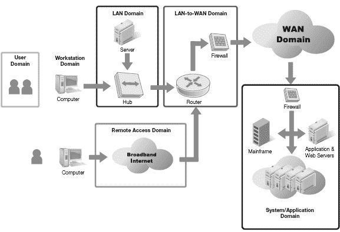

**图 2-8** 典型 IT 基础设施的七个域。

**21.** 哪种类型的防火墙需要主机操作系统的存在？

A. `设备型防火墙`
B. `个人防火墙`
C. `软件防火墙`
D. `商业防火墙`
E. `筛选路由器`

**22.** 根据典型 IT 基础设施的七个域，以下所有位置（参见图 2-8）均适合部署防火墙，*除外*：

A. `用户与工作站之间`
B. `工作站与局域网之间`
C. `局域网与广域网之间`
D. `远程访问与局域网之间`
E. `远程访问与应用服务器之间`

**23.** 三足防火墙能执行而双足防火墙无法执行的活动是什么？

A. `过滤内容`
B. `物理隔离子网`
C. `支持 NAT 代理服务`
D. `作为设备部署`
E. `将来自互联网的流量导向内联网或 DMZ`

### 第 3 章 VPN 基础

**虚**拟专用网络 (`VPN`) 允许组织通过公共中介网络安全地传输私密和敏感数据。互联网可以作为一种廉价的长途载体，用于利用 `VPN` 建立的广域网连接。`VPN` 使用原生操作系统功能或第三方软件，以及硬件设备，包括边缘路由器、防火墙和 `VPN` 设备。移动用户的远程访问、多办公室内联网的互联以及对外联网的安全访问是常见的 `VPN` 架构解决方案。

从小型家庭网络到企业全球网络，`VPN` 的使用极大地拓展了人们连接和工作的方式。通过使用 `VPN`，远程办公员工、业务合作伙伴、出差人员、供应商、分销商等即使身处异地也能受益于安全连接。具备对 `VPN` 的基本了解后，您即可开始设计和规划自己的 `VPN` 解决方案。

#### 第 3 章主题

本章涵盖以下主题和概念：

- 什么是 `VPN` 及其用途
- `VPN` 的优势及部署原因
- `VPN` 的局限性
- 加密与 `VPN` 的关系
- 什么是 `VPN` 认证及其实现方式
- 什么是 `VPN` 授权及其必要性

#### 第 3 章目标

完成本章后，您将能够：

- 定义 `VPN`
- 解释 `VPN` 的商业和个人用途
- 描述 `VPN` 的优缺点
- 说明 `VPN` 的部署模型或架构，包括边缘路由器、企业防火墙、`VPN` 设备、远程访问服务器、站点到站点 `VPN` 及支持设备、主机到主机 `VPN` 及支持设备
- 区分传输模式 `VPN` 和隧道模式 `VPN`
- 描述加密、认证和授权对 `VPN` 的重要性

#### 什么是虚拟专用网络？

简短直接的定义是：**虚拟专用网络 (`VPN`)** 是一种跨越**中介网络**（通常是互联网）建立安全远程访问连接的机制。`VPN` 允许在私有网络内进行远程访问、远程控制和高度安全的通信。`VPN` 采用加密和认证为网络通信提供机密性、完整性和隐私保护。

然而，对“虚拟专用网络”这一短语进行更深入的探讨，可以揭示出简洁定义所忽略的其他重要方面。`VPN` 一词源于电信领域。电话 `VPN` 为企业创建了一个类似 `PBX` 的系统，而无需部署真正的**专用交换机 (`PBX`)** 硬件。相反，该系统使用公共电话服务和电信公司中心局的 `PBX` 服务。该服务/产品以 `Centrex`（central 和 exchange 的组合）之名在 1960 年代至 1980 年代销售。

随着计算机网络和互联网连接的普及，`VPN` 一词演变为指代跨网络链路的隧道连接。早期的计算机 `VPN` 侧重于隧道或封装过程，很少包含加密服务。如今，`VPN` 几乎总是使用加密来保障安全。但是，您永远不应假设任何事物是完全安全的，尤其是**公共网络**上的连接。在依赖某产品执行敏感操作之前，您应始终确认其能否正确实施加密。

##### VPN 概述

`VPN` 可在中介网络之上创建或模拟网络连接。但什么使 `VPN` 具有私密性？至少有三种可能的机制可发挥作用：

- 当主要组织拥有所有网络基础设施组件（包括交换机、路由器和电缆）时。真正的私有 `VPN` 发生在单个组织拥有支持其 `VPN` 的所有硬件时。然而，鲜有组织实际拥有其各位置间的所有连接，因此这通常不切实际或成本高得令人望而却步。这种完全拥有并运营的系统构成**受信 VPN**。

- 当在租用的电信连接上使用专用**信道**集时。即使在第三方设备上，这种方法也提供物理隔离；因此隐私得以维护。这种类型的系统更实用，但成本仍然很高。这也可称为受信 VPN，因为你必须能够信任托管基础设施的所有者保护网络通信免受**窃听**。

- 当加密确保即使在公共网络（如互联网）上也能保证隐私时。这种方法最可靠，因为前两种选择仍面临窃听风险。此外，使用加密提供隐私不仅实用，而且成本最低。该系统可称为**安全 VPN**。

第四种类型的私有 `VPN` 称为**混合 VPN**。这种形式的 `VPN` 在受信 VPN 连接之上建立安全 VPN。受信 VPN 允许组织知晓并控制其传输路径。然而，受信 VPN 无法防范窃听或篡改。安全 VPN 保护数据的机密性和完整性，但不控制或确保传输路径。结合这两种 VPN 技术，可创建一个潜在的更安全且更实用的解决方案。混合 VPN 的两种可能布局如图 3-1 和图 3-2 所示。

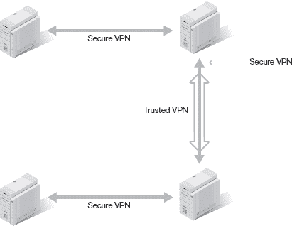

**图 3-1** 由跨越中介受信 VPN 的安全 VPN 组成的混合 VPN。

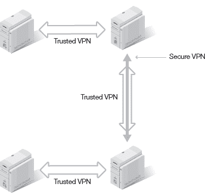

**图 3-2** 由受信 VPN 内部的安全 VPN 片段组成的混合 VPN。

`VPN` 常与远程访问或远程控制联系在一起。然而，这些关联需要澄清才具有价值。远程控制是指使用本地计算机系统通过网络连接远程接管另一台计算机的控制权。从某种意义上说，此过程是在功能齐全的现代工作站上应用瘦客户端概念，以模拟对大型机的操作或虚拟化你的物理存在。该应用通常与 `VPN` 相同，`VPN` 创建的是远程网络连接而非远程控制会话。

建立远程控制连接后，本地显示器、键盘和鼠标控制远程系统。此过程的外观和感觉就像你亲自坐在远程系统的键盘前，而该远程系统可能位于另一城市甚至地球另一端。你在本地执行的每个操作，都如同你通过远程控制连接虚拟地亲临那台远程计算机前一般。唯一的限制是中介网络链路的速度，以及无法物理插入或移除介质和外设。

你可以将远程控制视为一种基于软件的瘦客户端或终端客户端。事实上，许多瘦客户端和终端客户端产品作为远程控制解决方案销售。许多现代操作系统包含远程控制功能，例如大多数 Windows 版本中的远程桌面。启用后，远程桌面连接可跨网络远程控制另一台 Windows 系统。

远程访问不同于远程控制。远程访问链路通过 WAN 链路连接到地理位置遥远的网络，从而实现对网络资源的访问。实际上，远程访问为物理上不在网络附近的系统创建了一个本地网络链路。通过远程访问连接，客户端系统在技术上可执行与本地连接的客户端完全相同的所有任务。网络管理员可对远程访问 `VPN` 客户端可使用的资源和服务施加限制。

远程访问和 `VPN` 最初通过调制解调器利用拨号电话链路支持。如今，远程访问涵盖多种连接类型，包括 `ISDN`、`DSL`、有线调制解调器、卫星、移动宽带等。由于高速互联网连接广泛可用，`VPN` 和其他远程访问解决方案已成为个人和商业用途的热门选择。

在许多情况下，远程访问连接是从远程客户端回到主网络创建的。如果远程客户端需要直接连接到 `LAN`（如通过拨号连接），`RAS` 服务器将托管一个调制解调器以接受连接。如果远程客户端可利用互联网访问 `LAN`，则需要本地互联网连接。一旦客户端建立正常的 `LAN` 连接或互联网连接，`VPN` 链路即成为可能。连接建立后，远程客户端可像本地连接一样与网络交互。

在图 3-3 中，一个 `LAN` 和一个远程客户端都连接到互联网。这两个连接相互独立。`LAN` 的连接通常是支持与互联网进行入站和出站活动的永久或**专用连接**。远程客户端可拥有到互联网的专用或**非专用连接**。在后一种情况下，连接会在创建 `VPN` 之前建立。一旦两个端点都连接到中介网络（本例中为互联网），即可创建 `VPN`。在图 3-4 中，跨中介网络从远程客户端到 `LAN` 建立了一条新的网络连接。这条新网络连接即为 `VPN`。

`VPN` 可在标准互联网连接或专用业务通信电路（如 `ATM` 和帧中继）上运行。然而，借助 `VPN`，专用、隔离甚至安全的业务电路的额外费用并非必要。`VPN` 可通过可靠的加密在互联网上安全运行，仍提供高级别的安全性。这允许廉价的不安全链路替代昂贵的商业租用线路，而不牺牲安全性。

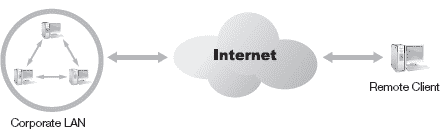

**图 3-3** 企业 `LAN` 和具有互联网连接的远程客户端。

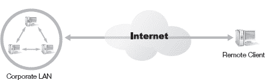

**图 3-4** 通过互联网在远程客户端和 `LAN` 之间建立的 `VPN`。

`VPN` 是提供安全远程连接最高效、最具成本效益的手段之一。`VPN` 利用廉价的长途连接（在互联网上建立时），因为两端仅需本地互联网链路。互联网本身充当“免费”的长途载体。由于 `VPN` 的速度取决于本地互联网链路的速度，你可能仍需要**光载波（`OC`）**线路（如 51.84 Mbps 的 `OC-1`）以获得高速连接。

从 `LAN` 到中介网络的连接可仅支持 `VPN` 流量，或允许 `VPN` 和普通非 `VPN` 流量的组合。后一种配置安全性较低，但提供了灵活性，可决定是否所有通信都必须经过 `VPN` 保护。因此，专门为 `VPN` 使用而保留的互联网连接并非必要。`OC-1` 线路完全有能力在没有任何困难或**延迟**的情况下，支持一条或多条 `VPN` 链路，外加大量非 `VPN` 互联网会话。

##### 设置 VPN

设置 `VPN` 可能要求 IT 或安全管理员具备广泛的知识和专业技能。例如，安全 `VPN` 的一些重要考量因素包括：

*   所有 `VPN` 流量都必须经过身份验证和加密。没有身份验证的 `VPN` 不是私密的，没有加密的 `VPN` 是不安全的。
*   所有 `VPN` 端点必须遵守相同的安全参数和算法。每个 `VPN` 隧道必须拥有相应的加密密钥集，以安全地交换加密内容。此外，相同的安全策略应管控所有端点。
*   适当的加密协议必须确保没有外部第三方能够影响 `VPN` 的安全性。薄弱的加密会使“安全” `VPN` 变得毫无价值。

当你使用受信 `VPN` 时，需要考虑其自身独特的考量因素：

*   只有受信 `VPN` 提供商应该能够修改 `VPN` 的通道或路径。受信 `VPN` 基于提供商限制和控制对 `VPN` 内容访问的能力。
*   只有受信 `VPN` 提供商可以在受信通道中添加、移除或更改数据。违反这一点即违反了客户对提供商的信任。
*   在受信 `VPN` 内执行的寻址和路由必须在 `VPN` 上线前定义。这些服务通常在 `SLA`（服务级别协议）中预先定义，但可能会为每个 `VPN` 连接动态修改。

即使是混合 `VPN` 也有一个重要的关注焦点，即受信任的 `VPN` 片段与安全的 `VPN` 片段需要明确定义。将安全性误认为信任——反之亦然——可能会导致毁灭性的后果。

###### VPN 协议


# VPN 使用隧道或封装协议

隧道协议将原始网络协议封装起来，以便其能够穿越中介网络。在许多情况下，隧道协议采用加密，以便原始数据能够安全地穿越中介网络。创建 VPN 的协议包括 `IPSec`、`PPTP`、`L2TP`、`SSL` 和 `TLS`。安全 VPN 的主流形式使用 `IPSec` 或 `SSL/TLS` 作为隧道/封装协议。

## VPN 部署模型

大多数 VPN 使用运行在主机操作系统之上的软件。然而，一些 VPN 设备可以在不向主机添加任何软件的情况下支持 VPN 连接。正如主机防火墙仅在安装它的主机上工作一样，设备防火墙为整个网络提供安全服务。`主机 VPN` 软件产品允许单个主机访问 VPN 服务，而 `VPN 设备` 允许整个网络访问 VPN 服务。

VPN 通过提供一种简便高效的手段来安全连接总部、远程办公室、出差员工和远程办公者，从而简化了许多业务网络问题。

## 部署 VPN 的理由

部署 VPN 的理由因组织而异，差异巨大。许多显而易见的理由基于 VPN 的优势。尽管如此，其他理由则基于需要 VPN 所能提供的解决方案的业务或个人因素。

### 成本节约

成本始终是任何商业决策中的重要因素。预算永远不是无限的，因此组织必须妥善管理其有限的资金以完成其使命和目标。一个共同的目标是高生产力。授予员工及时高效地访问和使用资源的能力，有助于工作的完成。当这些资源是计算机文件或网络服务时，员工不再需要与这些资源位于同一栋建筑中。因此，对资源的远程访问变得比以往任何时候都更普遍。

安全远程访问至关重要。随着访问和连接的激增，从工作场所延伸到家庭、再到便携/移动设备，对互联网和私有局域网的访问正变得无处不在。公司必须对资源访问使用安全控制，否则将承受不安全访问方法的后果。随着物理访问限制的消除，公司失去了对员工从何处以及如何连接回私有局域网的控制。

员工通过手机、网吧、酒店网络和随机的 Wi-Fi 热点连接到公司局域网。许多人使用个人拥有的笔记本电脑和手持移动设备，而非公司正式发放的系统。所有这些都超出了公司 IT 和安全部门的控制范围。唯一的选择是将局域网连接限制在那些可被保护的连接上。因此，VPN 在这个崭新的移动互联世界中已成为必需品。

VPN 支持从各种复杂设备进行远程访问，降低由不安全访问地点引起的风险，并实现与所有局域网资源的交互。此外，灵活性、`可扩展性`、易管理性、可靠性等特性，使 VPN 成为应对现代连接风险和挑战的显而易见的选择。

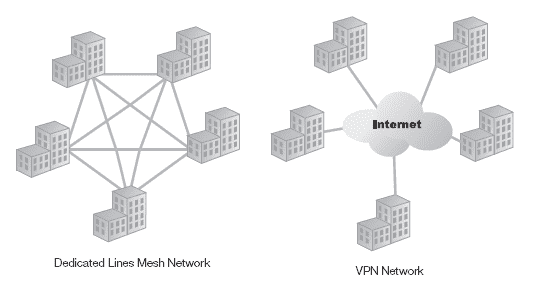

**图 3-5** 企业网络使用专用租用线路与使用基于互联网的 VPN 的对比。

每个员工和每个组织都需要 VPN 和远程访问吗？不。对于许多工作情况，VPN 并非正确的解决方案。这些情况包括任何需要特殊工具、物理接触设备或管理人员密切监督的工作形式。

远程访问、移动连接和安全通信是部署和使用 VPN 的充分理由。但这些是 VPN 的唯一积极方面吗？

VPN 最常被吹捧的优势是成本节约。它们是节省远程办公者和出差员工长途通话费用的绝佳途径。对于本只需本地互联网链路即可实现 VPN、而不需要在各地点之间建立专用 `租用线路` 的企业来说，它们也能创造巨大的节约（参见图 3-5）。各业务地点距离越远、公司地点越多，VPN 能产生的成本节约就越多。

此外，要真正将 VPN 提供的连接性与专用租用线路进行比较，你需要一套完整的租用线路全网状连接。全网状连接要求每个业务地点之间都有一条线路。这允许一个站点与另一个站点直接通信。由于跨互联网的 VPN 能提供同等的站点到站点通信能力，因此只有专用 `租用线路` 的网状网络才能真正与之相比。与 VPN 显著的成本节约相比，此方案显然非常昂贵。

### 远程办公

随着企业寻求降低 IT 基础设施成本，一种常见的技术是允许员工远程办公。`远程办公` 允许员工无论是在家工作、出差途中，还是在客户现场，都能访问公司资源。过去，远程办公明确意味着使用拨号连接来连接公司局域网。

随着高速宽带连接和 Wi-Fi 的普及，远程办公变得更加可行和现实。通过使用 VPN，远程办公实现了真正的远程办公室，而不仅仅是文件交换和通信系统。VPN 使远程办公不仅成为可能，而且变得实用且安全。VPN 使扩充劳动力不再受地理位置限制。

### 外联网

外联网通常在企业建立新合作伙伴关系或寻求与供应商、分销商及其他外部实体进行更多交互时部署。外联网是边界网络，类似于 DMZ，其中托管资源供外部实体访问。然而，与 DMZ 不同，外联网不对公众开放。只允许一组有限的特定用户连接到外联网。通常，这种限制意味着需要特定的 VPN 配置才能访问外联网的资源。有了 VPN，外联网既成为可能又切合实际。

## VPN：优势、局限性与策略考量

VPN 允许系统管理员远程管理和控制网络。VPN 允许员工随时随地办公。VPN 允许朋友创建广域网链接以支持多人游戏。VPN 允许技术支持远程修复客户端系统。无论何时，只要两个系统或两个网络之间需要网络连接，但铺设直接电缆连接不可行，VPN 就是解决方案。

通常，VPN 的真正优势并非源于 VPN 本身，而是源于因 VPN 而变得可行的工作、研究、学习和娱乐的所有新可能性。这些优势包括：

- 降低设备成本
- 无地域限制的连接性
- 增强工作地点的灵活性和多功能性
- 因强加密而提升的隐私性和机密性
- 经验证的传输完整性
- 完全可扩展的全球基础设施和架构
- 快速部署选项
- 与现有网络和技术的灵活集成
- 比传统广域网基础设施更快的投资回报率 (ROI)
- 减少对长途运营商解决方案的依赖
- 作为 ISP 减轻支持负担

以新颖独特的方式使用并集成 VPN 的个人和组织必将收获额外的益处。历史表明，随着新通信手段的创建，它们往往会发生变化，并以在采用初期无法预测的方式被使用。然而，VPN 并非完美无缺，一些非常现实且具有挑战性的问题限制了 VPN 的使用。

### VPN 的局限性有哪些？

虽然使用 VPN 有许多好处，但在部署 VPN 之前，你需要评估其非常现实且独特的局限性。

尽管 VPN 连接提供了灵活的安全通信选项，但它并不保证服务质量。VPN 链路依赖于 ISP 连接的稳定性、吞吐量和可用性，以及端点之间的中间网络连接。基于互联网的 VPN 很容易遭受延迟、`fragmentation`（分片）、`traffic congestion`（流量拥塞）和丢包的影响。这也导致因互联网的波动性，企业站点之间缺乏专用带宽。

#### 技术提示

加密流量不可压缩。压缩通过移除数据集内的冗余或重复部分来减小数据集大小。经过适当加密的数据会产生不包含冗余或可识别模式的密文。如果密文具有这些特征，其安全性就会降低。因此，由于缺乏这些冗余，无法压缩加密数据。

虽然 VPN 是几乎所有宽带连接选项的绝佳解决方案，但通过拨号连接维护 VPN 可能很困难。VPN 流量经过加密，而加密流量不可压缩。大多数拨号调制解调器连接依赖 `compression`（压缩）——主要是硬件压缩——来提高连接速度。当无法压缩时，会发生显著且明显的速度下降。此外，由于协议头的变化、潜在的认证延迟和漫长的连接建立协商，VPN 隧道管理可能会带来显著的管理开销增加。

另一个关注点是在互联网传输过程中数据暴露的微小风险或潜在可能。这仅在 VPN 不使用加密、使用弱加密或错误配置加密时才是真正的担忧。适当的安全管理将消除这一严重担忧。

VPN 端点存在漏洞。使用 VPN 时，针对加密链路的侧信道攻击几乎被消除。然而，进出 VPN 的数据处于风险之中。最终用户计算机可能被恶意代码感染，并通过 VPN 链路遍历进入公司局域网。此外，公司局域网的私密和机密数据可能被复制通过 VPN 链路传输到最终用户计算机。在这台计算机上，该数据安全性较低，面临更广泛的威胁。

你还应考虑远程提供技术支持的难度增加。当远程连接本身无法工作时，这一点尤为真实。此外，让远程系统遵守安全设置、开展培训、实施监管监督、启用人力资源管理和监控用户活动也变得更加困难。

并非所有人都适合成为远程用户。容易分心、缺乏动力或家庭环境不利于工作的人，都是应留在办公室而非居家办公的典型例子。

#### 技术提示

最新一代传统电话调制解调器的额定速度通常为 56 Kbps。其中大部分速度归功于硬件压缩。没有压缩，大多数调制解调器的速度会显著降低——24 Kbps 或更低。

一个更大的担忧是向通过 VPN 连接的用户授予开放或全面的无限制网络资源访问权限。你必须对 VPN 用户（尤其是 VPN 远程办公者）实施更强的认证和授权限制。远程用户应仅能访问其当前任务所需的资源。如果远程用户或远程计算机遭到入侵，对网络资源的无限制访问会迅速导致被利用和机密数据泄露。

如果你了解这些局限性并妥善应对，就能帮助避免在正确安装和高效使用 VPN 时发生灾难性错误。实现这一目标的主要工具之一就是 VPN 策略。

### 什么是有效的 VPN 策略？

有效的 VPN 策略是指那些明确定义施加于 VPN 的安全限制、并与组织的整体 IT 使命和目标保持一致的策略。VPN 可以提供许多令人振奋的移动性和互联可能性。然而，VPN 也可能对组织基础设施的机密性和稳定性构成风险。

与所有安全策略一样，你的 VPN 策略应源于彻底的风险评估和分析。如果不充分了解 VPN 的资产、流程、威胁和风险，就无法有效地使用或管理它们。

制定 VPN 安全策略并非简单或直接的任务。你需要规划时间和精力来解决各种各样的问题和顾虑。VPN 策略设计和规划的某些方面包括（但不限于）：

- 考虑软件和 `hardware VPN`（硬件 VPN）解决方案的优缺点
- 对所有 VPN 连接实施严格的 `multifactor authentication`（多因素认证）
- 对所有 VPN 连接实施强访问控制（授权）限制
- 定义 VPN 将如何被管理、通过什么接口以及由谁管理
- 探索通过 VPN 进行补丁管理的复杂性
- 定义为 VPN 远程办公者提供远程技术支持的机制
- 对发生在 VPN 上或通过 VPN 的所有活动启用详细审计
- 定义授予用户访问远程办公 VPN 资格的具体条件
- 规定所有 VPN 活动的用户培训要求

## VPN 部署模型与架构

### VPN 部署决策与架构

部署 VPN 时面临的首要决策之一是：哪个设备将充当安全隧道的终止点？您有多种选择，但决策通常取决于您希望在网络基础设施的何处定位隧道端点。此外，VPN 设备提供的功能也可能是决策的一个因素。

这些因素包括：决定哪些设备拥有足够的处理能力，即使在流量繁重和复杂加密的情况下也能维持线速。另一个考量是 NAT 是否存在，因为这可能会给隧道模式加密带来问题。

三种主要的 VPN 设备模型是**边缘路由器**、**企业防火墙**和 **VPN 专用设备**。除了选择 VPN 设备外，您还需要做出若干架构决策。这些决策侧重于 VPN 的预期目的、功能或用途，例如远程访问、主机到主机、站点到站点和外联网访问。

#### 边缘路由器

将边缘路由器作为 VPN 终止点时，VPN 链路仅存在于公共中介网络上，而不存在于私有 LAN 内。这要求边缘路由器必须支持 VPN 连接。

边缘路由器 VPN 终止可确保防火墙能够过滤流出 VPN 并进入 LAN 的流量。此方法确保所有流量（无论传输方式如何）均符合防火墙的过滤规则。如果 VPN 在防火墙内部终止，则来自 VPN 的流量可能违反安全策略，因为它未经过防火墙检查。

边缘路由器上的 VPN 终止最适合受控进入 DMZ 的场景。此类配置授予业务合作伙伴轻松访问 DMZ 的权限，而无需将其流量暴露于互联网，也无需授予其不必要的私有 LAN 访问权限。

#### 企业防火墙

如果防火墙支持 VPN 服务，则可以在企业防火墙处终止 VPN。并非所有防火墙都提供此服务，因此这取决于您选择的防火墙产品品牌和型号。通过公共网络上的防火墙到防火墙 VPN，一个网络 LAN 的用户可以访问另一个网络 LAN 中的资源，无需额外的复杂配置。主要而言，此配置将防火墙端点之间的 VPN 链路视为 LAN 中的另一条路由（实际上是 WAN）。此处的优势在于，当 VPN 在企业防火墙终止时，用户无需重新认证，也无需遵守额外的防火墙限制。

在企业防火墙上终止 VPN 意味着进出 VPN 的流量不经过防火墙的过滤限制。相反，防火墙仅充当 VPN 隧道端点的系留点。然而，任何与 VPN 无关的流量仍需接受防火墙检查。

此配置存在潜在限制。随着 VPN 链路数量或 VPN 流量负载的增加，随之而来的加密计算量增加可能会干扰防火墙的线速过滤性能。在这种情况下，应执行趋势分析以监控此状况，并在瓶颈发生前提升防火墙性能。

#### VPN 专用设备

第三种设备选择是专用 VPN 设备。与边缘路由器或防火墙终止点不同，专用 VPN 设备专门处理 VPN 负载，而非将 VPN 支持作为附加服务。

您可以将 VPN 设备置于企业防火墙之外，位置类似于边缘路由器，以便所有 VPN 流量均通过防火墙过滤器。VPN 设备也可驻留在企业防火墙内部，以避免防火墙过滤。此部署方式在不滤 VPN 流量方面，至少在概念上类似于企业防火墙方案。第二种部署方法还能确保没有外部实体能干扰 VPN 隧道端点。

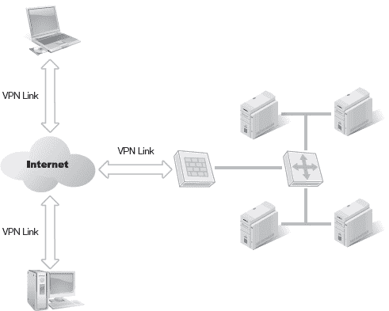

**图 3-6** 用于将单个 LAN 与远程移动用户连接的 VPN。

这些技术在现有企业防火墙不支持您想要的 VPN 技术或架构时非常有用。因此，您无需更换防火墙，只需安装额外的专用 VPN 设备即可。

### 远程访问

第一种 VPN 架构是基本远程访问（图 3-6）。**远程访问 VPN** 也称为**主机到站点 VPN**，因为它支持单主机 VPN 连接进入 LAN 站点。此设计授予个别远程办公人员或出差员工轻松访问私有 LAN 的权限。单个 LAN 可利用任意 VPN 端点概念（边缘路由器、企业防火墙或 VPN 专用设备）支持多个远程用户。

### 站点到站点

第二种 VPN 架构是站点到站点（图 3-7）。**站点到站点 VPN** 也称为 **LAN 到 LAN VPN** 或 **WAN VPN**，指 LAN 之间通过中介公共网络建立的连接。无论名称如何，站点到站点 VPN 均支持 LAN 之间通过中介公共网络的安全连接。如果安装得当，站点到站点 VPN 可成为为多地点组织创建单个**分布式 LAN**（也称为 WAN）的低成本机制。站点到站点 VPN 可使用任意 VPN 端点概念：边缘路由器、企业防火墙或 VPN 专用设备。

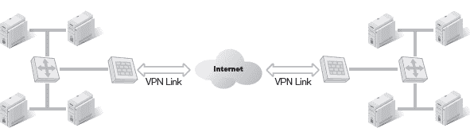

**图 3-7** 用于连接多个 LAN 的 VPN。

站点到站点 VPN 的一个轻微变体是带远程移动用户的站点到站点 VPN。这是站点到站点 VPN 概念与远程访问 VPN 的结合（图 3-8）。此架构的优势在于，无需额外的企业设施提供现场工作空间，即可为新员工增加到 LAN 的安全连接。

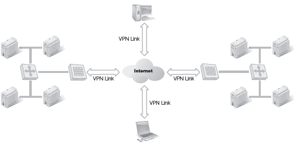

**图 3-8** 用于将多个 LAN 与远程移动用户连接的 VPN。

### 主机到主机

第三种 VPN 架构是主机到主机。主机到主机 VPN 也称为客户端到服务器、远程到办公室或远程到家庭 VPN。**主机到主机 VPN** 是一台主机与另一台主机之间的直接 VPN 连接。此机制可在公共网络或私有网络内运行。在公共网络上，主机到主机 VPN 提供免受公共网络窥探的安全连接。在私有网络上，它为关键任务或高度敏感的事务提供额外的安全级别。

标记为**客户端到服务器 VPN** 的主机到主机 VPN 可创建客户端与资源主机服务之间的安全交互。这类似于但不完全等同于 Web 浏览器与 Web 服务器之间的安全 Web 链接。SSL 可用于应用协议安全（如安全 Web 会话），也可用作 VPN 协议。作为 VPN 协议时，SSL 在网络层运行；作为 Web 会话安全工具时，它在传输层顶部运行。

**远程到办公室 VPN** 是便携式或家庭系统与办公室工作站之间的直接链路。此 VPN 链路允许用户在家或出差工作，而无需牺牲对可能仅安装在（或仅获许可用于）办公室工作站计算机上的资源、服务或应用程序的访问。此 VPN 建立远程控制会话的频率与建立远程访问会话的频率相当。

**远程到家庭 VPN** 将工作计算机或便携式计算机连接回家庭系统，实际上是远程到办公室的反向配置。远程到家庭 VPN 在您离家时授予您访问家庭计算机的权限。

主机到主机 VPN 变体通常依赖于操作系统原生的**软件 VPN** 解决方案或安装在主机上的第三方应用程序。然而，某些 VPN 专用设备可适应这些较简单的主机到主机连接架构。

### 外联网访问

第四种 VPN 架构是外联网访问。当 VPN 隧道端点位于外联网边界内或边界上时，此选项可作为业务合作伙伴、分销商、供应商等访问企业资源的通道，既不会将其流量暴露在互联网上，也不会授予其不必要的私有 LAN 访问权限。

此外，接入外联网的 VPN 相比接入 DMZ，能为远程实体提供更高的安全性。连接 DMZ 的 VPN 会将远程实体暴露于 DMZ 中存在的任何威胁之下。由于 DMZ 是公开可访问的，因此风险较高。**外联网 VPN** 使远程实体能够进行安全通信，且在 VPN 终止点没有显著风险。

VPN 通常充当控制点，以管控哪些外部实体有权访问外联网。只有被授予特定访问权限、分配用户账户并提供配置详细信息的实体，才能配置并建立与外联网的 VPN 链接。

### 隧道模式与传输模式

VPN 可使用两种主要类型的封装加密，称为隧道模式和传输模式加密。

隧道模式加密保护原始 IP 数据包的整个头部和载荷。该加密后的数据包成为新 IP 数据包的载荷，并拥有一个新的 IP 头部。这种加密形式确保了通信原始端点的身份在流量穿越安全链路时保持机密。隧道模式加密常用于连接网络站点的 VPN 或提供安全远程访问的 VPN。

传输模式加密仅保护原始 IP 数据包的载荷。加密后的载荷保留其原始 IP 头部。这种加密形式仅保护载荷，不保护端点的身份。传输模式加密有助于 VPN 连接单个计算机。

### 加密与 VPN 的关系

加密与安全 VPN 几乎是不可分割的。安全 VPN 之所以存在，是因为其流量经过加密。但某些可信 VPN 可能使用加密，也可能不使用。要充分理解和领会 VPN 的运作，需要对加密有合理的认识。


# 加密与密码学基础

加密只是`密码学`这一更大主题的一个方面。密码学是向未经授权的第三方隐藏信息的艺术与科学。密码学通过一个互补且可逆的过程发生：加密和解密。加密是将原始可用形式的数据（称为`明文`）转换为不可用的混乱形式（称为`密文`）的过程。`解密`是将密文转换回明文的过程。真实的通信产品必须同时提供加密和解密功能。

现代密码学基于`算法`。**算法**是一组规则和过程，通常具有数学性质，定义了加密和解密过程如何运作。算法通常非常复杂。许多算法是公开已知的，任何人都可以调查和分析算法的优势和劣势。

## 技术提示

不到 10 年前，64 位被认为是强加密。如今，128 位是可被视为强加密的最小对称密钥长度。密钥长度翻倍是否意味着强度翻倍？实际上，虽然 128 位密钥比 64 位密钥长一倍（位数多一倍），但前者创建的密钥空间大小远不止后者的两倍。每向密钥长度二进制数增加一位，可能的密钥空间大小就会翻倍。128 位密钥创建的密钥空间是 64 位密钥的 `2⁶⁴` 倍（即 `1.8 × 10¹⁹` 倍）。

加密算法使用密钥。密钥是一个唯一且秘密的数字，控制算法执行的加密和解密过程。密钥是一个非常大的二进制数，以其位长度来衡量或定义。密钥的位长度是组成密钥的二进制位数。例如，128 位的密钥长度为 128 个二进制位。

算法密钥的位长度定义了该算法的`密钥空间`。**密钥空间**是该特定算法可使用的有效密钥范围。任何使用特定位长度二进制位数创建的密钥都属于该算法的密钥空间。该密钥空间包含从全零密钥到全一密钥之间的每一个数字（请记住这是二进制代码，数字只有 0 和 1）。这意味着具有 128 位密钥长度的算法有 `2¹²⁸` 个可用密钥。`2¹²⁸` 的十进制值超过 `3.4 × 10³⁸`。

密码学领域主要有三种类型的算法：对称、非对称和哈希。

## 对称密码学

**对称密码学**基于使用单个共享密钥的算法。记住对称密码学所用密钥类型的常用方法是记住“对称”的同义词：“相同”。加密和解密数据必须使用相同的密钥，且同一会话的所有通信伙伴必须共享同一个密钥。

与非对称密码学相比，对称密码学速度非常快，通常在相似密钥长度和消息大小下快 10,000 倍。一般来说，对称密钥长度越长，产生的加密强度越高。大多数算法只有一个或少数几个密钥长度选项，因此选择密钥较长的算法通常能确保更强的加密。小于 128 位的密钥被认为较弱，128 到 256 位的密钥被认为较强，超过 256 位的密钥被认为非常强。这就是为什么在选择对称密码学产品时，应仅使用采用 128 位或更长密钥的解决方案。

选择强算法不仅涉及密钥长度，还需考虑其他因素，如`随机数`的使用、`雪崩效应`的使用以及对逆向工程攻击的抵抗力。大多数弱算法一旦公开发布就不会长久存活，因此大多数消费者不需要过多关注算法的内部细节，而应寻找支持更长密钥的算法。一般规则（尽管这忽略了一些细节）是：密钥越长越好。有关密码学、算法选择及算法内部工作原理的更多信息，请参阅《Schneier’s Cryptography Classics Library》或《Introduction to Modern Cryptography》。


> **注意**
>
> 假设的通信伙伴 Bob 和 Alice 常被用来描述和讨论密码学的功能。

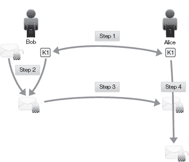

**图 3-9** 对称密码学过程。

对称密码学的工作流程如下（参见图 3-9）：

1.  Bob 和 Alice 交换对称密钥（`K1`）。（此过程通常通过非对称过程或`带外`通信执行。）
2.  Bob 使用共享的对称密钥加密消息。
3.  Bob 将消息传输给 Alice。
4.  Alice 使用共享的对称密钥解密消息。

对称密码学提供的安全服务是机密性。使用合理长度密钥的对称加密，可防止未经授权的第三方访问或查看通信内容或存储的数据文件。对称密码学保护存储设备上的文件以及传输中的数据。事实上，由于其强度和效率，对称密码学是保护任何大小的存储数据或传输数据的首选方法。

对称密码学算法或系统的示例包括 `DES`、`3DES`、`AES`、`CAST`、`RC4`、`RC5`、`RC6`、`RC7`、`IDEA`、`Twofish` 和 `Blowfish`。

VPN 解决方案采用对称密码学来保护传输中的通信。这种保护可防止未经授权的窃听或中途篡改。

### 非对称加密

**非对称加密**基于使用`密钥对`或其他特殊数学机制的算法。使用密钥对的非对称加密通常称为`公钥加密`。所有公钥加密都是非对称的，但某些非对称算法并非公钥算法。记住非对称加密所用密钥或非密钥类型的常用方法是记住“非对称”的同义词：不同。不同的密钥用于不同的目的，不同的密钥由通信会话的不同成员使用，某些系统则完全使用不同于密钥的东西。

> **技术提示**
>
> 请记住，平均 2,048 位的非对称密钥不仅仅是非常强的 256 位对称密钥长度的 8 倍；实际上，其密钥空间是 256 位密钥密钥空间的 1,792 倍平方（即翻倍 1,792 次），这是一个天文数字：`2¹,⁷⁹²` 或 `2.79 × 10⁵³⁹` 倍于 256 位密钥空间。这种规模的数字非常难以管理，更不用说进行复杂的数学运算了。

与对称加密相比，非对称加密非常慢。这是由于这些算法所用数学的复杂性，以及非对称密钥的长度（当存在密钥时）。公钥加密使用的密钥长度为 1,024 到 8,192 位（有时甚至更长）。

非对称加密还使用基于单向函数概念的数学。**单向函数**是指在一个方向上相对容易执行，但不可能或几乎不可能逆向执行的数学运算。这种数学类型直到 20 世纪 70 年代末才被形式化为加密算法。

因此，由于其极长的密钥和极其复杂的数学函数，非对称加密与对称加密相比速度较慢。因此，非对称加密通常不适合加密用于存储或传输的大量数据；相反，这种加密类型最适合`身份验证`和`密钥交换`。

非对称加密提供的保护是`真实性`和`不可否认性`。真实性是一个用于传达认证与访问控制相结合的术语。根据用法，特别是公钥加密，非对称解决方案可以证明消息来源的身份（认证）或控制消息的目的地或接收者（访问控制）。此外，当正确使用时，非对称加密可以提供发送者发送了消息的证据，并防止该发送者可信地否认发送过该消息。这被称为不可否认性。

公钥加密是非对称加密的一个子集，基于密钥对。通信或社区中的每个参与者都有一组离散的密钥对。密钥对集由`私钥`和`公钥`组成。私钥必须始终保持安全和私密。公钥则公开供大众访问和使用。密钥对作为相反数协同工作。其中一个密钥执行的加密或编码，只能由该密钥对的另一个密钥撤销。

非对称加密提供的一种机制是`数字信封`。其工作原理如下（图 3-10）：

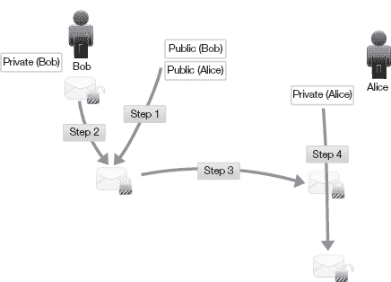

**图 3-10** 数字信封的非对称加密过程。

1.  Bob 获取 Alice 的公钥。
2.  Bob 使用 Alice 的公钥对消息进行编码。
3.  Bob 将消息发送给 Alice。
4.  Alice 使用她的私钥对消息进行解码。

只有拥有相应私钥的 Alice 才能读取编码后的消息。数字信封确保消息仅由预期接收者（即相应私钥的所有者）访问。数字信封机制在通信双方之间交换对称密钥。在此机制中，对话的一方执行密钥生成，然后安全地交换该密钥。这是 VPN 用于安全交换密钥的机制。

非对称加密提供的另一种机制是数字签名。**数字签名**证明发送者的身份。其工作原理如下（图 3-11）：

1.  Alice 使用她的私钥对消息进行编码。
2.  Alice 将编码后的消息发送给 Bob。
3.  Bob 获取 Alice 的公钥。
4.  Bob 使用 Alice 的公钥解除编码。

此过程向 Bob 证明消息来自 Alice。这就是真实性。数字签名并不防止他人查看消息或确认消息来源。数字签名不是加密；它不提供机密性保护。VPN 使用数字签名，但通常采用将哈希作为过程一部分的版本（请参阅下一个示例）。

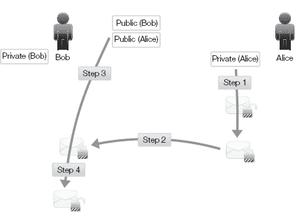

**图 3-11** 数字签名的非对称加密过程。

通过添加哈希，这种数字签名机制得到了改进。（哈希将在下一节中更详细地描述。）使用哈希的数字签名稍微复杂一些，并使用以下过程（图 3-12）：

1.  Alice 计算消息的哈希值。
2.  Alice 使用她的私钥对哈希值进行编码。这个编码后的哈希就是数字签名。
3.  Alice 将编码后的哈希添加到消息中。
4.  Alice 发送消息。
5.  Bob 去除 Alice 的数字签名。
6.  Bob 对原始消息进行哈希运算以计算其哈希值。
7.  Bob 获取 Alice 的公钥。
8.  Bob 解码 Alice 的数字签名以显示 Alice 的原始哈希值。
9.  Bob 将 Alice 的原始哈希值与 Bob 计算的哈希值进行比较。

如果哈希值相同，Bob 将接受该消息为保持完整性。这也证明了消息来自 Alice（真实性）。此外，此过程确保 Alice 不能否认曾发送过它（不可否认性）。VPN 通常采用这种形式的数字签名来证明端点身份并确认传输的完整性。

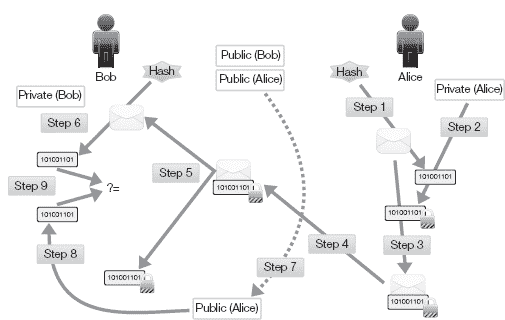

**图 3-12** 带哈希的数字签名非对称加密过程。

一些不属于公钥加密的非对称加密算法或系统示例包括 Diffie-Hellmann、El Gamal 和椭圆曲线加密（`ECC`）。属于公钥加密的非对称加密算法或系统最常见的示例是 Rivest-Shamir-Adleman（`RSA`）。

VPN 解决方案采用非对称加密来保护对称密钥交换（通过数字信封）、认证 VPN 链路端点或用户（通过数字签名），以及在与哈希结合使用时，验证传输消息的来源和完整性（同样是数字签名）。

## 哈希

**哈希**是一种加密函数，它接收文件或消息作为输入并创建固定长度的输出。输入可以是任意大小，但输出长度固定，基于所使用的哈希算法。哈希不会以任何方式修改或改变原始数据；它只是使用原始数据生成哈希值作为新的数据项。常见的哈希值输出长度包括 128 位（如 `MD5` 产生的）、160 位（如 `SHA-1` 产生的），甚至 512 位或更多（如 `SHA-2` 系列各成员产生的）。

**哈希算法**的输出可以称为`哈希`、`哈希值`、消息摘要、消息认证码、指纹、数字值或校验和。

### 哈希校验完整性

哈希在文件或消息存储或传输时计算一个哈希值，然后在存储期结束时或收到传输时计算另一个哈希值。如果前后哈希值相同，则消息保持了其完整性。如果前后哈希值不同，则消息已失去其完整性，不再可信或可用。

哈希基于哈希算法本身所使用的复杂数学函数来验证完整性。这些函数的核心组成部分或特性是`雪崩效应`。该效应确保输入数据的微小变化会在输出的哈希值中产生巨大变化。文件中单个二进制位的变化应导致生成的哈希值出现明显可识别的差异。

哈希是单向函数。哈希值无法直接逆向还原为计算它时所用的原始数据文件。因此，如果攻击者获取了哈希值，数据并不面临从哈希中被提取的重大风险。

哈希算法或系统的示例包括 `MD5`、`HAVAL`、`SHA-1` 以及 `SHA-2` 变体（`SHA-256`、`SHA-384`、`SHA-512` 等）。

VPN 采用哈希，通常作为数字签名的一部分，作为一种确认传输数据保持完整性的方法。任何哈希值的不匹配都会导致丢弃接收到的数据并请求重传。这确保了 VPN 连接的任一端仅接受完全有效且真实的数据。

## 利用密码学建立 VPN 连接

现在您已了解对称密码学、非对称密码学和哈希，让我们来看看 VPN 用于提供安全通信的总体流程。基本的 VPN 建立过程如下：

1.  Bob 根据消息计算哈希值（图 3-13）。
2.  Bob 使用他的私钥对哈希值进行编码以创建数字签名。
3.  Bob 生成一个随机对称密钥（`K1`）。
4.  Bob 使用 `K1` 加密消息。
5.  Bob 获取 Alice 的公钥。
6.  Bob 使用 Alice 的公钥对 `K1` 进行编码以创建数字信封。
7.  Bob 将数字签名、加密后的消息和数字信封发送给 Alice。
8.  Alice 使用她的私钥解码数字信封以获取 `K1`（图 3-14）。
9.  Alice 使用 `K1` 解密消息。
10. Alice 计算消息的哈希值。
11. Alice 获取 Bob 的公钥。
12. Alice 使用 Bob 的公钥解码数字签名以获取 Bob 的哈希值。

Alice 对比前后哈希值。如果哈希值相同，则消息保持了其完整性。因此，正确的公钥解码了数字签名。Bob 的身份得到验证（真实性和不可抵赖性）。

此交换使得对称密钥能够保护 Bob 发给 Alice 或 Alice 发给 Bob 的后续消息（图 3-15）。一旦 Bob 和 Alice 之间建立了 VPN，交换的会话密钥（`K1`）将存在于两个端点。使用这个共享会话密钥，Bob 可以加密消息（信封 #1）发送给 Alice，Alice 也可以加密消息（信封 #2）发送给 Bob（图 3-15）。

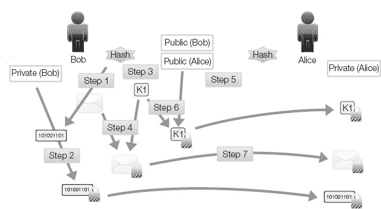

**图 3-13** 建立 VPN 连接的整体加密过程（1/3）。

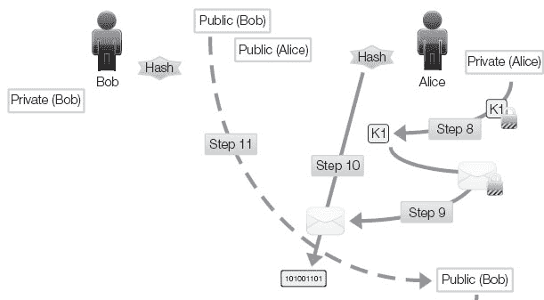

**图 3-14** 建立 VPN 连接的整体加密过程（2/3）。

此基本 VPN 会话建立过程存在变体。一种变体是使用 `K1` 同时加密消息和数字签名。另一种变体是让 Bob 先用他的私钥对 `K1` 进行数字签名，然后再使用 Alice 的公钥将其编码进数字信封。

这种初始的对称密钥交换建立了保护当前通信会话期间所有后续消息的加密机制。当此会话结束并开始新的 VPN 会话时，新的对称密钥将启动该过程。然而，只要当前会话持续，同一个对称密钥就会一直适用。

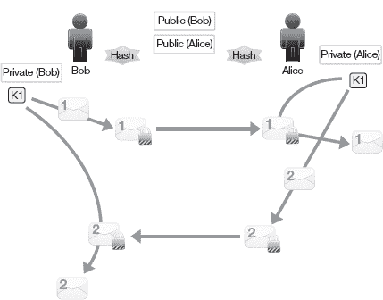

**图 3-15** 建立 VPN 连接的整体加密过程（3/3）。

## 重生成密钥

即使在同一会话或对话的多条消息中重用对称密钥，也存在轻微风险。为了最小化或降低这种风险，某些 VPN 使用`重生成密钥`过程。重生成密钥会丢弃当前正在使用的密钥，并生成和交换一个新的对称密钥。重生成密钥有几种类型：

*   **时间重生成密钥**——在特定时间触发重生成密钥。
*   **空闲重生成密钥（滞后或延迟）**——当对话中出现特定量的空闲、滞后或延迟时触发重生成密钥。
*   **流量重生成密钥**——当传输特定量的流量时触发重生成密钥。
*   **随机重生成密钥**——在随机时间间隔触发重生成密钥。
*   **选举重生成密钥**——VPN 会话的任一成员可随时选择重生成密钥。

如果 VPN 解决方案执行会话中途重生成密钥，您可能有也可能没有管理配置选项来管理重生成密钥过程。重生成密钥可能嵌入在加密算法中。`一次性密码本`加密系统也是可能的。一次性密码本系统为通信的每个片段使用唯一且随机的对称密钥。这是一个更复杂的系统，但提供了更高的安全性。试图破解多随机密钥加密方案是已知的针对加密最困难的攻击之一。


> **注意**
>
> 严格来说，计算机提供的是伪一次性密码本，因为它们目前无法产生真正的随机数。取而代之的是使用`伪随机数生成器（PRNG）`。`PRNG` 使用复杂算法和定时芯片来生成看似随机的数字。结果非常好，但并非真正随机。

## 数字证书

您可以通过使用`数字证书`代替普通的公钥和私钥，来提高真实性和不可抵赖性的可靠性。数字证书是由`受信任的第三方`数字签名的公钥和私钥对。这个第三方是`证书颁发机构（CA）`。CA 首先验证个人或公司的身份，然后制作并颁发数字证书。

除了提高可靠性外，证书还解决了公钥密码系统的可扩展性问题。如果没有证书，每个系统都必须管理一个不断扩大的公钥库。有了基于第三方证书的系统，每个系统不再需要保留公钥。相反，它们在每个会话开始时在 CA 的协助下交换公钥。

每个主机仅存储 CA 的受信任公钥。CA 的公钥存储在受信任根列表（`TRL`）中。只要证书未过期且未被吊销，由受信任 CA 颁发的任何证书都将被接受为有效。

该过程类似于建立 VPN 连接的整体加密过程。主要区别在于，不是使用发送方的通用私钥，而是使用发送方的数字证书对消息进行编码。然后，接收方使用 CA 的公钥开始解包过程。CA 的公钥解码 CA 的私钥对发送方公钥的编码。（这是发送方的数字证书。）这通过 CA 颁发的数字证书确认了发送方的身份。然后，接收方使用发送方的公钥解码发送方私钥对消息的编码。

### 数字证书的使用

数字证书的使用给整个流程增加了一些额外步骤，但这改善了安全通信中参与者的身份验证。通信会话结束后，接收方可以丢弃发送方的公钥。每次新会话开始时，发送方的公钥都将通过数字证书流程重新交换。这减轻了公钥管理的负担，使包括 VPN 在内的任何安全通信服务更具可扩展性。

## 什么是 VPN 认证？

认证是确认或证明用户身份的过程，对 VPN 至关重要。由于 VPN 允许外部实体连接到私有网络（或系统）并与之交互，因此在授予访问权限前验证身份至关重要。VPN 认证在两个层面进行：连接层面和用户层面。

当 VPN 链路启动时，每个端点的硬件和软件组件必须相互认证以建立连接。通信链路建立后，用户将执行一个独立且不同的认证过程。如果这两个身份证明中的任何一个失败，VPN 将被切断。

这两种情况下使用的实际认证机制可能各不相同。选项包括用户名和密码、智能卡、令牌设备、数字证书，甚至生物识别技术。经验法则是，应避免仅使用用户名和密码的解决方案，而倾向于多因素认证选项。仅凭密码的认证众所周知极易被利用，其安全性不足以可靠地保护 VPN。

VPN 服务（无论是软件还是硬件）可能直接支持认证，或在卸载到专用认证服务器时间接支持。卸载可以指向任意数量的广泛使用的`认证、授权和审计 (AAA) 服务`或技术，包括 `RADIUS`、`TACACS`、`802.1x`、`LDAP` 和 `Active Directory`。

在为 VPN 选择认证解决方案时，应独立于其 VPN 集成来考虑认证因素的优缺点。如果某个认证因素本身存在弱点，在与 VPN 结合使用时这些弱点不会消失。


# VPN 认证与授权

VPN 认证应具有可扩展性，并支持潜在连接主机之间的互操作性。不要使用无法支持几十个以上用户或主机的认证方式。同样，使用仅在单一平台或操作系统上可用的认证形式，将带来日后难以且昂贵解决的限制。

## VPN 授权

授权是控制用户被允许和不被允许执行的操作。授权也称为访问控制。您必须建立明确定义的策略，规定 VPN 连接将支持和不支持哪些活动。

首要考虑的是定义谁被允许、谁不被允许建立 VPN 连接。通过将 VPN 视为一种资源而不仅仅是一种连接方法，显然并非所有用户都应有权访问所有资源。如果 VPN 连接既非工人分配任务和职责所必需，也无益于其完成，则不应允许他或她打开或使用 VPN 连接。

认证有助于强制执行此访问控制问题。每当一个未被授权使用 VPN 的用户账户尝试跨 VPN 进行认证时，该尝试应失败。事实上，自动锁定此类账户是一种合理的安全响应。用户应清楚了解自己是否已被授予 VPN 使用权限。因此，任何未获 VPN 批准的用户跨 VPN 进行的访问，要么是违反策略的员工行为，要么是外部入侵尝试。

除了锁定 VPN 本身的使用外，即使对于授权用户，也应限制跨 VPN 访问资源。VPN 确实建立了一种网络连接，除速度外与本地直连有线连接无异，但这并不意味着需要、要求甚至建议相同级别的授权。

VPN 连接需要更强力地应用最小权限原则。员工在现场使用的并非所有任务和资源都是其远程执行活动所必需的。用户在现场时应拥有一个级别或范围的访问权限，而通过 VPN 连接时应拥有不同的、更小的访问范围。这当然取决于工人的任务分配以及执行这些任务所需资源的敏感度，但在授予默认或全面访问权限前，请彻底考虑此问题。

如果关键任务资源、流程和信息暴露给通过 VPN 连接的用户，可能会面临风险。由于远程用户的计算机可能比现场工作站安全性更低，因此额外风险可能很大。远程办公或出差员工是否真正需要访问特定资源？如果不需要，请阻止访问。

远程 VPN 用户是否应能将敏感、私密或有价值的数据传输到远程主机？这就是信息泄露的风险。一旦数据离开局域网，企业安全基础设施就失去了完全控制和保护信息的能力。在远程主机上，VPN 断开后，局域网的安全保护随之消失。剩下的唯一安全保障仅在于主机本身和用户的安全实践。

远程访问对某些资源来说是不合适或不切实际的。例如，考虑阻止远程 VPN 用户访问打印机。出差员工是否需要打印他们无法亲自处理的文档？是的，在某些情况下远程打印是合理的。但仅仅因为可行，就允许所有本地活动通过 VPN 进行吗？

另一个授权考量是是否允许 VPN 用户进行互联网通信。如果本地局域网用户能够访问互联网，那么技术上 VPN 用户也可以。但他们应该这样做吗？这是额外的风险，还是仅仅是额外的带宽消耗负担？

如果 VPN 用户无法通过 VPN 从局域网访问互联网，他们能否通过与 VPN 链路相同的 ISP 链路同时访问互联网？这种配置称为`分隧道`。许多组织视此为重大风险。此场景使得互联网攻击有可能攻破远程主机，然后利用 VPN 访问私有局域网。这将成为互联网与局域网之间近乎无限制的通道。大多数组织采用的 VPN 连接解决方案会阻止远程主机同时进行本地 VPN 和互联网连接。

即使存在这些 VPN 认证问题，对本地和远程主机实施访问控制的总体过程基本相同。在大多数情况下，访问控制是在资源本身上定义的，无论用户身在何处。在制定定义 VPN 管理和使用参数的策略时，请牢记这一点。

## 章节总结

VPN 是远程连接局域网和移动主机的机制。VPN 节省成本并提供工作灵活性。VPN 保护公共中介网络上的通信安全。当基础设施成本高昂或需要移动访问和灵活性时，应部署 VPN。VPN 无法保证互联网上的服务质量，也无法防范端点设备/主机漏洞。您应基于深入研究的 VPN 策略来部署 VPN。

VPN 提供许多优势，包括广泛的实现选择。各种设备和软件产品都支持 VPN 连接。VPN 的端点可以位于防火墙内部、防火墙上或防火墙外部。VPN 可以支持移动主机的远程访问，在单个系统之间创建链接，并支持网络之间的通道。VPN 可以采用隧道模式或传输模式加密。它们可以使用您在其他地方部署的用于一般网络安全的相同认证和授权技术。


## 关键概念和术语

- `算法`
- `非对称加密`
- `认证、授权和审计 (AAA) 服务`
- `真实性`
- `雪崩效应`
- `证书颁发机构 (CA)`
- `通道`
- `密文`
- `客户端到服务器 VPN`
- `压缩`
- `企业防火墙`
- `密码学`
- `解密`
- `专用连接`
- `专用租用线路`
- `数字证书`
- `数字信封`
- `数字签名`
- `分布式局域网`
- `窃听`
- `边缘路由器`
- `外联网 VPN`
- `分片`
- `硬件 VPN`
- `哈希`
- `哈希算法`
- `哈希值`
- `哈希运算`
- `主机到主机 VPN`
- `主机到站点 VPN`
- `主机 VPN`
- `混合 VPN`
- `身份验证`
- `中介网络`
- `密钥或加密密钥`
- `密钥交换`
- `密钥对`
- `密钥空间`
- `局域网到局域网 VPN`
- `租用线路`
- `多因素认证`
- `非专用连接`
- `不可否认性`
- `一次性密码本`
- `单向函数`
- `光载波 (OC)`
- `带外`
- `专用交换机 (PBX)`
- `私钥`
- `伪随机数生成器 (PRNG)`
- `公钥`
- `公钥密码学`
- `公共网络`
- `重新生成密钥`
- `远程访问 VPN`
- `远程到家庭 VPN`
- `远程到办公室 VPN`
- `可扩展性`
- `安全 VPN`
- `站点到站点 VPN`
- `软件 VPN`
- `分隧道`
- `对称加密`
- `远程办公`
- `流量拥塞`
- `可信第三方`
- `可信 VPN`
- `虚拟专用网络 (VPN)`
- `VPN 设备`
- `广域网 VPN`


## 第 3 章评估

**1.** 以下哪项*不是* VPN 的有效示例？

A. 主机通过中介网络链接到另一台主机。
B. 主机通过中介网络连接到网络。
C. 网络通过中介网络与另一网络通信。
D. 主机通过中介网络控制另一台远程主机。
E. 移动设备通过中介网络与网络交互。

**2.** 以下哪项*不是*由安全 VPN 确保或提供的？

A. 机密性
B. 服务质量
C. 完整性
D. 隐私
E. 认证

**3.** 以下哪种技术使 VPN 成为私有的？

A. 单个组织拥有所有支持基础设施组件
B. 从电信运营商租用专用广域网通道
C. 对流量进行加密和封装
D. A 和 B 都是
E. A、B 和 C 都是

**4.** VPN 连接与本地网络连接的主要区别是什么？

A. 速度
B. 资源访问
C. 安全性
D. 访问控制模型
E. 认证因素

**5.** 以下哪项陈述*不*正确？

A. VPN 流量应经过认证和加密。
B. VPN 需要专用租用线路。
C. VPN 的端点应遵守相同的安全策略。
D. VPN 执行隧道和封装。
E. VPN 可以用软件或硬件解决方案实现。

**6.** 什么是混合 VPN？

A. 具有软件端点和硬件端点的 VPN
B. 支持远程连接和远程控制的 VPN
C. 由可信段和安全段组成的 VPN
D. 同时支持对称和非对称加密的 VPN
E. 同时使用隧道和封装的 VPN

**7.** VPN 最常被提及的优势是什么？

A. 成本节约
B. 远程访问
C. 安全传输
D. 分隧道
E. 窃听

**8.** 以下哪项是 VPN 的局限性或缺点？

A. 中介网络是不安全的。
B. Linux 操作系统不支持 VPN。
C. VPN 昂贵。
D. VPN 降低基础设施成本。
E. 端点存在漏洞。

**9.** 有效的 VPN 策略基于什么？

A. 彻底的风险评估
B. 适当的补丁管理
C. 业务财务
D. 工作地点的灵活性
E. 培训

**10.** 哪种形式的 VPN 部署可防止 VPN 流量被过滤？

A. 边缘路由器
B. 外联网 VPN
C. 企业防火墙
D. 设备 VPN
E. 主机到站点 VPN

**11.** 哪种形式的 VPN 部署要求通过 VPN 访问资源时进行额外的认证？

A. 站点到站点 VPN
B. 企业防火墙
C. 主机到站点 VPN
D. 边缘路由器
E. 远程访问 VPN

**12.** 以下哪项*不是*个体系统之间 VPN 的名称？

A. 客户端到服务器
B. 主机到主机
C. 远程到家庭
D. 主机到站点
E. 远程到办公室

**13.** 隧道模式和传输模式 VPN 之间的主要区别是什么？

A. 是否支持网络到网络的链接
B. 载荷是否加密
C. 是否支持主机到主机的链接
D. 头部是否加密
E. 是否支持完整性检查

**14.** 哪种 VPN 实现授予外部实体访问安全资源的权限？

A. 边缘路由器 VPN
B. 企业防火墙 VPN
C. 站点到站点 VPN
D. 外联网 VPN
E. 远程控制 VPN

**15.** 哪种加密形式加密 VPN 端点之间传输的大部分数据？

A. 对称
B. 哈希
C. 公钥
D. 传输模式
E. 非对称

**16.** 哪些组件创建数字签名以验证真实性和完整性？

A. 公钥和会话密钥
B. 私钥和哈希
C. 哈希和共享密钥
D. 会话密钥和公钥
E. 共享密钥和哈希

**17.** VPN 通过什么机制在端点之间安全地交换会话密钥？

A. 数字信封
B. 数字取证
C. 数字封装
D. 数字证书
E. 数字签名

**18.** VPN 认证的两个最重要特征是什么？

A. 单因素和可重放
B. 可扩展和可互操作
C. 透明和高效
D. 互操作性和单因素
E. 可重放和可扩展

**19.** 通过 VPN 认证可以强制执行什么 VPN 访问控制问题？

A. 阻止未授权的 VPN 用户
B. 限制对互联网的访问
C. 限制对文件的访问
D. 过滤对网络服务的访问
E. 控制对打印机的访问

**20.** 在为 VPN 和 VPN 用户设计授权时，主要的安全准则应该是什么？

A. 可扩展性
B. 多因素
C. 分布式信任
D. 最小权限原则
E. 默认授权，例外拒绝

**21.** 关于主机到主机 VPN 的以下陈述均正确，*除*：

A. 主机到主机 VPN 通常由主机操作系统支持。
B. 主机到主机 VPN 必须用 VPN 设备实现。
C. 主机到主机 VPN 可以在不同操作系统产品之间互操作。
D. 主机到主机 VPN 通常采用传输模式加密。
E. 主机到主机 VPN 可以在私有网络内建立。

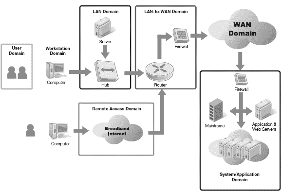

**图 3-16** 典型 IT 基础设施的七个域。

**22.** 以下所有项通常都用于支持站点到站点 VPN，*除*：

A. VPN 设备
B. 商用防火墙
C. 客户端 VPN 软件
D. 边缘路由器
E. VPN 网关代理

**23.** 用于将地理位置分散的用户与私有网络连接的 VPN 位于典型 IT 基础设施的七个域（图 3-16）中的哪个域？

A. 局域网域
B. 用户域
C. 系统/应用域
D. 远程访问域
E. 局域网到广域网域

**24.** 隧道模式加密中有哪些特性或功能是传输模式加密不支持的？

A. 标头被加密。
B. 负载被加密。
C. 源地址被加密，但目标地址未被加密。
D. 添加了页脚以包含哈希值。
E. 它提供从会话源到目的地的加密保护。

**25.** 以下所有陈述均为真，*除*：

A. 加密确保 VPN 流量保持机密。
B. 可以在没有加密的情况下拥有私有 VPN。
C. VPN 认证确保只有有效实体可以访问安全连接。
D. VPN 上的授权*仅*包含授予或拒绝对文件资源的访问。
E. VPN 认证可以包含多因素选项。

# 第 4 章 网络安全威胁与问题

**网络安全时刻面临着来自内部和外部的持续攻击**，威胁来源从心怀不满的员工到全球的黑客。不存在完美的防御，因为黑客能够绕过、攻破或规避几乎所有的防护措施、对策和安全控制。黑客不断开发新的攻击技术、编写新的漏洞利用代码并发现新的漏洞。网络安全是一项需要持续警惕的任务，而非一个可完成的项目。这是一份永远做不完的工作。

为什么理解黑客攻击、漏洞利用、漏洞和攻击至关重要？正如公元前六世纪中国军事战略家兼哲学家孙子在其著名军事著作《孙子兵法》中所言：“知己知彼，百战不殆。”一旦你了解黑客的思维方式、他们使用的工具、他们的漏洞利用手段和攻击技术，你就能制定有效的防御来保护系统免受其害。理解黑客攻击不仅能提高网络安全；还能使安全保持在高度戒备状态。

## 第 4 章主题

本章涵盖以下主题和概念：

- 是什么激励黑客攻击计算机网络
- 攻击者经常以哪些资产为目标
- 网络易受哪些内部或外部威胁
- 常见的 IT 基础设施威胁有哪些
- 恶意代码（恶意软件）的各种类型及其安全隐患是什么
- 什么是快速增长和过度使用
- 什么是无线和有线连接
- 窃听的风险是什么
- 什么是重放攻击及其如何实施
- 什么是插入攻击
- 什么是分片攻击、缓冲区溢出和 XSS 攻击
- 什么是中间人攻击、会话劫持和欺骗攻击
- 什么是隐蔽信道以及黑客如何利用它们
- 对网络和资源可用性的威胁有哪些
- 拒绝服务 (DoS) 如何运作
- 什么是分布式拒绝服务 (DDoS)
- 有哪些常见的黑客工具
- 谁面临社会工程学攻击的风险

## 第 4 章目标

完成本章后，你将能够：

- 描述黑客和其他恶意计算机网络入侵者的动机
- 对比内部和外部来源的威胁
- 描述事故、自然灾害和无知如何影响网络安全
- 解释恶意代码构成的风险
- 阐述有线和无线连接对网络安全的影响
- 描述常见的网络安全漏洞利用和攻击，包括重放攻击、插入攻击、分片攻击、缓冲区溢出攻击、XSS 攻击、中间人攻击、劫持攻击、欺骗攻击、隐蔽信道、DoS、DDoS、僵尸网络攻击和社会工程学攻击
- 演示黑客工具如何利用脆弱目标

## 黑客动机

是什么激励黑客攻击计算机网络？为什么有人会卷入主流之外的非法活动？动机多如攻击手段：许多人纯粹是为了黑客攻击的快感，将其视为一种运动。一些黑客将黑客攻击视为爱好。一些人热爱挑战。一些人是同伴压力的受害者或在寻求社会认可。对另一些人来说，黑客攻击是一种地位的象征。最后，许多黑客从事攻击活动是为了权力和经济利益。让我们更详细地看看其中一些动机，看看你是否能开始理解黑客的心理。

许多犯罪黑客纯粹是为了钱。通过攻击计算机网络获取经济利益的方式有很多。范围从窃取信用卡和财务报表到勒索和黑市交易。一些经济利益是即时的。例如，黑客可能能够将资金从目标账户转出。其他方法则更复杂，例如窃取公司文件并出售给竞争对手，或利用加密劫持数据并勒索赎金。黑客可能涉足销售其服务，包括分发 `spam`、窃听、破解密码和制造 DoS 事件。

证明攻破目标的能力，尤其是当目标相对安全时，是黑客证明自己比防御者更强大的一种方式。如果你能控制某样东西，你就拥有对它的权力。如果黑客能远程控制你的计算机，那么黑客就拥有对你计算机的权力，在某种程度上也拥有对你的权力。黑客有时为了满足自尊而进行攻击。如果他们能发动成功的攻击，就是在展示对目标的统治力。

对许多黑客来说，发现新漏洞、开发新攻击代码或发现新安全漏洞是一项令人兴奋的挑战。一些黑客攻击目标的理由正如一些人攀登高山——因为它就在那里，因为他们能做到，因为他们想征服它。一些黑客不断寻找新的、更困难的目标以提高技能并增加挑战难度。

一些黑客享受攻击网络的纯粹风险。与任何犯罪一样，被抓获的风险始终存在。目标网络可能部署了 `honeypots`、IDS、IPS、防火墙和其他技术防御，黑客需要检测并规避这些防御。安全专业人员时刻致力于发现新的攻击技术并识别黑客身份。因此，每一次攻击都让黑客面临被抓获和起诉的风险。

黑客攻击可以让人兴奋。想想私人领地上的寻宝猎人的感受。权力、挑战、风险、潜在的追捕以及发现潜在有价值资产的结合，对某些黑客来说是一种快感。逃脱惩罚的快感激励许多黑客在弄清如何成功入侵网络后继续发动攻击。

一些黑客生活中缺乏令人兴奋或投入的方面，他们诉诸黑客攻击试图娱乐自己或摆脱无聊。一次成功的系统入侵通常会引发响应，往往是一场比黑客能想到的任何其他事情都更有趣的“猫鼠游戏”。

### 黑客也有同伴和社交群体，就像其他人一样

同伴压力可能是一种强大的动力，促使人们融入群体、炫耀技能或展示对群体的忠诚。同伴压力通常是黑客社区中处于较低层级或排名者的动力来源。新手或缺乏经验的黑客会感到受到鼓励去实施攻击，以维持他们在同伴群体中的成员资格。

黑客行为也可以是一种社会认可机制，例如证明具备加入某个群体的资格。一些攻击是作为一种入会仪式或通关仪式，让潜在的黑客群体成员转变为正式的正式成员。

黑客行为可以帮助黑客获得或维持地位。黑客可能寻求在黑客同伴眼中、在其他黑客群体的评判中，或在大众视野中获得地位。一些黑客试图制造媒体新闻并让自己的名字出现在新闻中。其他黑客攻击则是为了在当前和未来的目标中植入恐惧并强迫其顺从。

黑客实施攻击的原因多种多样，此列表很可能并不详尽。这些动机驱使他们从事不道德的活动。你可能完全理解，也可能不完全理解黑客的思维模式。但你必须尝试去理解；无论动机如何，结果对企业和个人来说都可能是毁灭性的。

### 黑客青睐的目标

在安全领域，你想要保护的事物被称为资产。资产是指用于通过计算机网络开展业务的任何事物。员工完成任务所需的任何对象、计算机、程序、数据片段或其他逻辑或物理组件都是资产。

黑客最青睐的目标中包括易于攻击的资产——那些能快速获利的目标。易于攻击的目标是未得到妥善保护的 IT 基础设施和要素。暴露在世界面前、存在众所周知的可利用漏洞的系统，对黑客来说就是“易如反掌”。


能快速获利的目标是那些能让黑客获得某种形式的金钱或易货收益的目标。信用卡和银行账户可以带来可观的金钱收益。在其他情况下，获得网络的访问权和控制权，尤其是拥有高速互联网链路的网络，是很有价值的。这样的网络可能会被植入恶意代码，用于传播垃圾邮件、窃听、文件交换、破解加密等。黑客随后可以将这些服务交易或出售给他人。

然而，一些黑客并不寻找容易的目标；相反，他们寻找独特的目标、新的挑战和复杂的基础设施来测试和提高他们的技能。专家级和高度经验丰富的黑客通常希望继续提高他们的能力，而不是将时间浪费在任何业余黑客或 `script kiddie`（脚本小子）都能攻破的目标上。

攻击者最频繁地针对哪些有价值的资产？每个黑客都不同，就像任何亚文化群体中的个体成员一样。虽然许多人都认同什么是有价值的，例如金钱和访问权限，但其他人可能更倾向于将公司财务、秘密配方、病历、信用报告、法庭记录、会计日志等作为其首选目标。例如，为什么有些人收藏玩具，而其他人收藏汽车、可乐瓶或埃尔维斯的照片？

为了更好地了解黑客可能选择的潜在目标，请回顾典型 IT 基础设施的七个域（图 4-1）：

 **用户域**—任何用户、工人、员工、承包商、顾问或个人都可能成为目标。**社会工程学**是针对人的黑客攻击。这种攻击试图通过巧妙的措辞、撒谎、误导、关系操纵、恐惧、心理诡计和骗术来愚弄人们。社会工程学攻击的后果可能包括用户泄露私人信息，或在计算机上执行导致网络安全降低的操作。

 **工作站域**—工作站、客户端或独立家庭系统可能成为目标。这类主机通常比局域网服务器安全性更低。这并非有意为之，因为大多数安全措施侧重于基础设施的核心组件，而非那些看似处于边缘的组件。很多时候，工作站上的安全措施陈旧、过时，或安装和配置不当。

 **局域网域**—从 SOHO 到大型企业的私有局域网是常见目标。局域网通常包含数十到数千台主机。所有单个系统都高度安全的可能性不大。一旦黑客获得对网络上一台系统的访问权，该局域网的其余部分就容易受到攻击。单台主机的沦陷可能导致整个基础设施的沦陷。

 **局域网到广域网域**—局域网位置之间的广域网连接，尤其是由第三方实体控制的连接，是攻击目标。私有局域网与广域网连接之间的过渡接口可能是潜在的弱点。如果针对广域网连接的攻击成功，跨越广域网/局域网接口入站的恶意流量不太可能被过滤。

 **远程访问域**—远程访问始终是黑客热门的攻击目标。远程访问消除了黑客必须亲临现场才能访问和攻击局域网的要求。世界上任何拥有互联网或电话连接的黑客仍然可以伸出魔爪，攻击任何看似孤立的目标。远程访问就是向黑客发出的邀请，邀请他们尝试突破你的防线。

 **广域网域**—广域网域是网络，如 ATM 或帧中继，由电信公司或承载网公司拥有，并向企业出租接入服务。通常，这些广域网连接的隐私性是通过电子隔离而非加密来实现的。专注于特定目标的黑客可能会尝试突破承载网的电子隔离，而不是专注于端点局域网本身。

 **系统/应用域**—托管应用程序、虚拟化系统或数据库的服务器集合是高价值目标。有时托管的数据是目标。有时黑客想要夺取的资源是服务器的计算能力。


**图 4-1** 典型 IT 基础设施的七个域。

资产不必昂贵、复杂或庞大。事实上，许多资产价格相对低廉、司空见惯，且大小不一。对于大多数组织（包括 SOHO [小型办公室/家庭办公室] 环境）而言，最关心的资产包括业务和个人数据。如果这些信息丢失、损坏或被盗，可能会导致严重后果。企业可能倒闭。个人可能损失钱财。身份可能被盗用。甚至生活可能被毁。

宝贵的资源不仅存在于单个计算机上，也存在于由互联局域网组成的 IT 基础设施中。黑客根据各种目标和动机，以及对资源感知价值的不同来寻找目标。但黑客到底是谁呢？

### 来自内部人员和外部实体的威胁

什么会违反网络安全？答案包括意外、无知、疏忽和黑客。意外会发生，包括硬件故障和自然灾害。培训不足导致无知。即使怀有最好的意图，如果工人不了解正确的程序且缺乏必要的技能，也会破坏系统。工作过度和匆忙的员工会忽视可能导致资产泄露或丢失的问题。恶意黑客可以针对网络发起攻击和利用漏洞，意图获取访问权限或仅仅是造成破坏。

#### “黑客”最初是指为学习和探索而摆弄或修改系统

然而，该术语后来演变为指恶意且可能构成犯罪的计算机入侵与操纵行为。无论哪种情况，恶意黑客或犯罪黑客都是严重威胁。每一位网络管理员都应关注黑客攻击问题。

虽然历史上三分之二或更多的安全违规事件直接源于外部人员，但这种平衡正在发生变化，且变化剧烈。由于更多自动化入侵、更多黑客攻击以及犯罪和恐怖活动的增加，“内部”计算机犯罪的比例已降至个位数，而即使是中小型企业和小型政府机构也每天面临数十万次甚至更多的攻击。这显著增加了各类规模组织对受过培训的计算机安全专业人员的需求。根据 Verizon 数据泄露调查报告 ([`www.verizonenterprise.com/DBIR/2012/`](http://www.verizonenterprise.com/DBIR/2012/))，98% 的数据泄露源于外部主体。

黑客是人。他们可能被误导、不道德、足智多谋且犯罪，但终究是人。网络安全的主要威胁多源于人为干预。在设计安全方案时，请牢记威胁最终且主要来自人类。这种认知应促使您更好地选择 `deterrent`（威慑）、检测和响应措施。

员工和外部实体代表了您需要应对的不同风险等级。外部实体发起入侵尝试时，最初并不具备物理或逻辑访问权限。起初，外部攻击者的风险较低。外部攻击者必须寻找并发现获取逻辑或物理访问权限的方法。没有访问权限，黑客只能诉诸攻击外部接口，如 Web 服务器、VPN 设备、防火墙和 RAS。如果这些接口是安全的，那么他们的默认或后备手段将是发动 DoS 攻击、尝试盗窃或对内部人员实施社会工程学攻击。

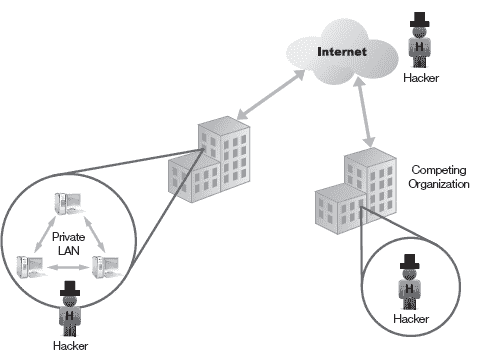

**图 4-2** 内部和外部黑客。

在职员工拥有设施的物理访问权限和网络的逻辑访问权限。员工可能仅拥有标准或普通用户账户，但某种程度的逻辑访问权限可以被转化为更高级别的访问权限（称为权限提升）。来自内部人员的威胁，无论是物理还是逻辑层面，都很严重。您必须在安全策略、网络设计、基础设施部署以及持续的系统和安全管理中应对此类威胁。

对组织网络安全构成最常见威胁的人员包括 `disgruntled employees`（怨恨员工）、`contract workers`（合同工）、`recreational hackers`（娱乐性黑客）、`opportunistic hackers`（机会主义黑客）和 `professional hackers`（职业黑客）。

#### 怨恨员工

怨恨员工认为自己在某种程度上受到了组织的委屈。无论这种委屈是真实存在还是主观感知，他们的行为都可能导致关键任务运营严重中断。怨恨员工可能会尝试挪用公款、窃取物资、浪费时间、植入恶意代码、泄露机密数据、干扰其他员工工作或使项目脱轨。

#### 合同工

合同工是受雇临时执行工作的外部人员。合同工可以是顾问、临时工、季节工、承包商，甚至是日工。外部人员不一定像大多数全职员工那样对组织怀有同等的忠诚度。因此，如果有机会为了个人利益而危害组织，合同工更有可能采取不道德行为。此类犯罪外部人员不担心长期的稳定性或生存能力，也不在乎正式员工的命运。相反，他们以牺牲他人利益为代价谋取私利。

#### 娱乐性黑客

娱乐性黑客是那些享受学习和探索乐趣的人，尤其是在计算技术方面。然而，他们可能会在何时使用新掌握的技能上做出错误选择。从家里带入未经批准的软件、在公司网络上进行实验，或仅仅是试用漏洞利用代码看看是否奏效，这些都是娱乐性黑客的潜在行为。一些黑客可能没有充分意识到他们的爱好可能很危险，且其行为违反了公司安全策略。

#### 机会主义黑客

机会主义黑客是胆小且不太可能主动发起攻击的黑客。无论出于何种原因，他们不愿刻意策划和发动入侵。然而，如果环境允许进行一场极易实施且极小概率被发现或追责的攻击，机会主义黑客可能会抓住稍纵即逝的时机。此时可能是某人碰巧加班，最终成为大楼里唯一留下的人。此时可能是消防演习将其他所有人都赶出了设施。也可能是随机停电发生，半数员工离开回家。此时可能是他或她注意到某个办公室门敞开且无人看管。

#### 职业黑客

职业黑客是以破坏 IT 基础设施为唯一职业目标的罪犯。无论是作为个人运营、提供雇佣黑客服务，还是作为犯罪团伙成员运作，职业黑客将所有时间和精力都集中在实施最佳安全攻击上。当人们花费数年时间在一个主要兴趣领域学习和实践时，他们能开发出足以匹敌所有防御的专业知识和技能。完美的不可攻破安全方案不存在。职业黑客拥有时间、耐力、技能、耐心和后盾，能持续对目标发动攻击直到成功。他们之于网络，犹如白蚁之于木制建筑。您可以威慑他们；大多数时间能将他们拒之门外。但他们始终在附近虎视眈眈，一旦您松懈片刻，他们就会啃噬地基。

这些描述并非暗示所有人天生都是恶意的。相反，它们提供了一个现实视角，说明谁可能是不道德之人、潜在的基于人为因素的妥协存在于何处，以及您应采取何种预防措施来保护组织免受内部和外部威胁。

### 黑客攻击过程

尽管 IT 专业人员不喜欢这种行为，但黑客攻击可以是一个引人入胜的过程。从主流 IT 行业的视角观察，黑客的活动往往显得混乱且随意。黑客不必遵循任何固定程序，也不必遵守任何既定边界。相反，他们利用一切可用手段，在选定目标上寻找漏洞。对他们而言，混乱既是一种方法论，也是一种防御机制。

总体而言，黑客攻击可分为五个主要事件或活动子群。这种分类可以代表黑客攻击，但并不实际控制或预防黑客攻击。这五个类别如下（图 4-3）：`reconnaissance`（侦察）、`scanning`（扫描）、`enumeration`（枚举）、攻击和攻击后活动。如果攻击成功，将按此阶段顺序发生。如果攻击不成功，黑客可以尝试后备方案。

#### 侦察

黑客攻击整个过程的发起称为侦察。侦察意为检查或探索的行为，也可称为 `footprinting`（足迹搜集）、发现、研究和信息收集。此阶段是三个攻击前阶段中的第一个，黑客在尝试首次实际攻击前，尽可能多地了解目标。侦察包括从所有可能的在线和离线来源收集目标数据。黑客会小心避免让目标察觉到正在被探测信息。

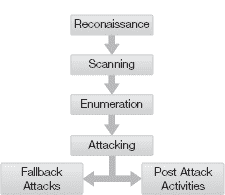

**图 4-3** 黑客攻击的五个阶段。

侦察可包括：

##### 侦察活动

 研究 [`archive.org`](http://archive.org) 上目标组织网站的旧版本

 检查搜索引擎内容

 审查在线网站

 调查人员背景

 执行位置映射

 阅读招聘广告

 检查内部信息泄露网站

 查看报纸和杂志文章或提及

 浏览新闻稿

 搜索 `USENET news groups`、聊天存档、`blogs` 和论坛

 审计财务记录或审查公开文件

 审查法庭案件和其他公共记录

 查询 `whois`、`domain registrations` 和公共 IP 分配

 窃听电子邮件和其他对话

 访问物理位置

这些只是黑客可以执行的可能侦察活动中的一小部分。信息收集仅受限于黑客的时间、资源和想象力。一旦黑客建立并组织了关于目标的合理信息组合，下一步就是扫描。

#### 扫描

扫描是使用各种工具来确认侦察阶段获得的信息并发现新细节的活动。扫描旨在发现存活且活跃的系统。扫描可以包括 `wardialing`、`wardriving`、`ping sweeps` 和 `port scanning`。

`Wardialing` 是一种较旧的战术，它使用电话系统来定位任何活跃且应答的调制解调器。使用调制解调器，黑客的计算机会自动拨打目标电话号码。黑客在侦察期间获取电话号码，或通过拨打某个区号或前缀下的所有号码来获取。

`Wardriving` 是一个源自 *wardialing* 的术语，指使用无线探测器定位无线网络的技术。黑客过去常开着装有笔记本电脑的汽车在城市或社区中穿梭以发现无线网络。如今，驾驶已不再必要，智能手机可自动探测无线网络。

`Ping sweeps` 用于发现通过网络连接会响应互联网控制消息协议（ICMP）回显请求的系统。黑客通常使用 ICMP 进行网络健康检查和测试。`ping` 命令或网络映射实用程序向 IP 地址范围或子网内的所有可能接收者发送 ICMP 回显请求。来自系统的 ICMP 回显响应表明其 IP 地址以及它们处于启动并运行状态。

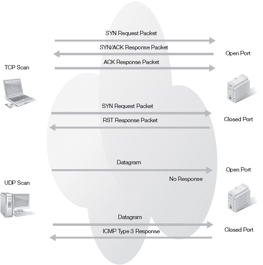

**图 4-4** 基本 TCP 和 UDP 端口扫描。

黑客通过向端口发送各种构造的 TCP 或 UDP 数据包来执行端口扫描（图 4-4）。如果系统尚未被知晓存在，则端口扫描可以确定特定 IP 地址处系统的存在性，以及端口是开放、关闭还是被过滤。如果可以建立完整的 TCP 三次握手虚拟电路，则 TCP 端口被认为是开放的。UDP 端口无法确认是否开放，因为开放端口的默认响应总是沉默。

> **技术提示**
>
> 端口存在于 OSI 模型的传输层（第 4 层）。TCP 和 UDP 使用端口以支持通过单个第 3 层 IP 地址进行多个同时通信、连接或会话。共有 65,535 个端口，但大多数系统只能支持几百个并发事务。
>
> 如果有活动服务准备好通过特定端口处理数据，则该端口是开放的。如果没有服务与特定端口关联，则该端口是关闭的。
>
> 当通信引发来自端口的错误消息或异常响应时，防火墙可以过滤掉这些响应。这将导致端口仅对有效和正常的通信可见。防火墙可以阻止任何引发错误或异常响应的尝试。

扫描是发送探测以引发响应的过程。当黑客执行扫描时，它是可被检测到的。侦察通常是无声的、隐秘的且不显眼的。你也不太可能检测到为了验证单个数据项（如单个开放或关闭的端口）而进行的扫描。但当黑客扫描以发现所有正在使用的可能 IP 地址和所有可能的开放及关闭端口时，这非常显眼。确认性扫描之于发现性扫描，正如狙击手发射一颗子弹之于加特林机枪摧毁一片森林。一种活动可能引起注意，也可能不引起注意，但另一种活动将难以被忽视。

黑客执行扫描直到发现一个或多个目标。由于扫描仅揭示系统和开放端口，黑客对目标了解甚少。黑客根据其攻击目的，随时停止扫描并转向枚举——即攻击的下一步。请记住，攻击者只需一个漏洞即可获得访问权限。一旦黑客能访问一台机器，迅速转向攻击它是最常见的升级路径。

#### 枚举

枚举阶段是第三个攻击前阶段。枚举是黑客发现关于潜在目标的足够细节、以了解是否存在可成功攻击的漏洞的过程。枚举通常从操作系统识别开始，随后是应用程序识别，然后从发现的服务中提取信息。因此，枚举是潜在攻击目标的发现和列举。

黑客通过探测目标的开放和关闭端口来执行操作系统识别。这些端口的响应标识操作系统。之所以可能进行这种识别，是因为不同程序员编写可互操作代码的特性各异。每个操作系统使用不同的程序员群体来编写其网络协议栈。即使生成的协议栈可能符合 IEEE 标准，但该栈的默认值和反应往往因操作系统而异。这些差异是已知的，并维护在一个小型数据库中，该数据库被编码进大多数网络扫描和探测工具中，例如 `nmap`。

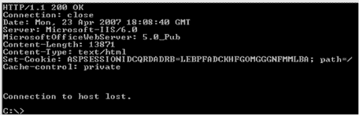

**图 4-5** 从 Web 服务器抓取的横幅。

每个开放端口背后都有一个正在运行的服务。**Banner grabbing**（横幅抓取）是探测这些服务以获取信息的活动（图 4-5）。一旦连接开始，服务可能会发送连接公告或通信确认。此公告称为横幅。**Banner**（横幅）可能包含其他详细信息，例如服务的产品名称和版本号。

横幅中的信息可被黑客用于侦察目的——获取形成攻击基础所需的情报。一种低成本的保护方法是以误导黑客的方式更改横幅。少量实验即可创建出误导黑客对服务器使用错误漏洞利用的横幅，但仍允许给定端口上的服务执行其职责。在某些情况下，横幅实际上未被使用，因此可能会被大幅缩短；在其他情况下，未使用的高级功能可能会被放弃，以换取更好的安全性。

一旦黑客识别出服务，他们可以请求额外信息。信息请求可能是安全的，没有任何数据泄露。但如果不安全，服务可能会向黑客返回大量数据。根据服务和黑客执行的查询，提取的信息可能包括系统名称、网络名称、用户名、组名、共享名称、安全设置、可用资源、访问控制设置等。

#### 枚举

枚举为黑客提供已识别的潜在攻击点。在查看漏洞数据库（如 **MITRE** ([`cve.mitre.org`](http://cve.mitre.org)) 或 **美国国家标准与技术研究院 (NIST)** ([`nvd.nist.gov`](http://nvd.nist.gov))）后，黑客会评估潜在漏洞。一旦黑客选定攻击目标，他或她就会收集利用工具并发动攻击。

现代攻击的一个特征是侦察阶段和攻击阶段之间经过的时间量。在过去，两者可能仅相隔几分钟，但更现代的攻击可能会在数周、数月或更长时间后才被释放。这种攻击，即高度针对性的 **高级持续性威胁 (APT)**，将在本章后面更深入地讨论。

#### 攻击

攻击是黑客攻击的第四阶段。尽管这似乎是吸引关于黑客的大多数炒作的阶段，但实际上，它是整个黑客攻击过程中最短暂的阶段。基于扎实的研究和准备，一次成功的攻击只需几秒钟即可完成。


如果初始攻击失败，黑客可以修改其利用代码、调整其载荷、调整其 `shell code`、重置其攻击向量，并重新发起攻击。一旦黑客发现假设的漏洞不存在或已被修复，他们就会返回枚举结果以选择新的攻切入点。同样，可以想到白蚁：如果它们无法通过门框进入房屋结构，它们会同样热切地尝试通过窗台进入。它们是不知疲倦的。

反复攻击最终要么导致成功的突破，要么导致目标成功防御而使攻击者感到沮丧。如果成功，攻击者将转入攻击后活动。如果不成功，攻击者可以选择转向备选的后备攻击。

### 攻击后活动

在成功的攻击中，黑客通常已突破目标的安全防线，获得一定级别的逻辑访问权限。这可能是标准用户账户的凭证，或是通过 `缓冲区溢出` 漏洞利用访问的 `命令 Shell`。无论哪种情况，通常都会发生一些常见的攻击后活动。这些包括 `权限提升`、植入额外的黑客工具、窃取数据和清除证据。

#### 权限提升

权限提升是试图获得对目标更高级别的访问权限或特权的行为。这可以通过 `键盘记录器`、已知的操作系统漏洞利用来窃取管理员或系统访问权限、操纵计划任务、社会工程学、特洛伊木马、远程控制程序和其他机制来实现。结果是黑客获得了以管理员、root 或系统本身身份运行的用户账户或命令 Shell 的访问权限。拥有了特权访问，剩余的攻击后活动就会容易得多。

#### 植入额外的黑客工具

植入额外的黑客工具使黑客能更好地控制受损系统。工具可能启用当前连接方法无法提供的额外能力。工具可能协助窃取数据。工具也可能协助清除证据。或者工具可能协助在未来维持或重新获得访问权限。

#### 窃取数据

窃取数据就是：搜刮存储设备寻找感兴趣的文件。黑客寻找任何能立即变现的东西。他们也寻找向公众披露会有趣或有意思的东西。他们寻找可用于勒索或胁迫用户的物品。当然，他们也在留意潜在的有价值信息，以便与其他黑客或罪犯进行交换或交易。转储用户账户数据库和密码哈希通常也是优先事项。破解其他用户的密码将有助于将来再次访问系统。

#### 清除证据

清除入侵和后续活动的证据是黑客的重要一步。未能掩盖踪迹可能导致被捕和起诉。允许 IT 和安全人员发现入侵只会导致安全级别提高。发现会使未来的返回变得更加困难，甚至不可能，具体取决于黑客的技能组合。

一旦黑客执行证据清理，攻击者就可以声称已经“拥有”（或用 `leetspeak`（黑客的秘密代码语言）中的 `pwned`）了一个系统。黑客通过发现、跟踪和渗透目标展示了其技能。这通常是黑客的目标：成功渗透目标。然而，这种成功并不总是容易或常见的。如果攻击失败，黑客总是有后备攻击选项。

### 后备攻击

后备攻击是黑客在针对目标的入侵尝试失败后可以部署的其他破坏选项。常见的入侵替代方案包括 DoS、窃听、物理闯入、社会工程学、恶意代码、 `会话劫持`、中间人攻击、无线黑客攻击、 `SQL 注入`、网站攻击等。本章以下部分将讨论这些及其他攻击。

## 常见 IT 基础设施威胁

安全的一些重要方面源于理解黑客的技术、方法和动机。一旦你学会像黑客一样思考，你可能就能预测未来的攻击。这使你能够在黑客成功入侵你组织的网络之前设计新的防御措施。

那么黑客是如何思考的？黑客思考的是操纵或改变。他们深入规则以创造新的方式来弯曲、打破或改变规则。许多成功的安全漏洞只不过是对网络通信规则的细微变体或违反。

黑客寻找容易下手的目标或被忽视的漏洞。他们寻找能为他们提供最大收益的目标，通常是经济回报。黑客将事物颠倒过来、彻底翻转、朝错误的方向操作。他们尝试以不同的顺序、使用不正确的值、在边界之外执行任务，旨在引起反应。黑客从错误和异常中学习并加以利用，特别是网络安全专业人员未能妥善保护组织资产的错误。

你对网络安全的各种威胁和风险了解得越多，就能建立越多的防御来抵御攻击。网络安全威胁包括黑客漏洞利用，以及自然灾害、设备故障，甚至正常的业务活动。

### 硬件故障和其他物理威胁

网络安全不仅仅是防范黑客攻击。许多其他威胁持续面临着计算机系统。计算机设备复杂且有时脆弱。硬件故障是意外停机最常见的原因。大多数设备在正常环境下运行寿命远超其预期寿命。然而，某些技术形式比其他形式更容易发生故障。

最常被讨论的意外停机原因之一是硬盘故障。硬盘是为数不多的拥有活动部件的常见计算机组件之一。虽然光驱、磁带驱动器、鼠标和键盘也有活动部件，但这些设备的寿命似乎比硬盘长得多。硬盘故障可能毫无预兆地发生，也可能有合理的预警。预警通常是驱动器开始故障时发出的研磨声、嗡嗡声或咔哒声。这些噪音清楚地表明寿命将尽。

### 物理威胁与环境风险

#### 硬件故障预防

针对硬盘故障以及一般硬件故障，最好的防御措施是做好准备。准备工作包括：

- 持续的定期备份
- 使用**冗余独立磁盘阵列（`RAID`）**
- 执行常规清洁和维护
- 备有备件以应对不可避免的故障

避免停机和可用性损失的另一种方法是在设备故障前更换设备。大多数设备都有**平均故障时间（`MTTF`）**或**平均故障间隔时间（`MTBF`）**，可据此确定故障的统计可能性。在该周期到期前更换设备是一种良好的实践。虽然你会在某些设备实际故障前很久就将其更换，但这种技术能让统计规律站在你这边。虽然计划内停机成本高昂，但其成本低于非计划停机。

#### 热威胁

过高的温度会损坏计算机设备。经历剧烈温度循环（如极热到极冷）的系统，可能会发生**芯片位移**或材料翘曲开裂。**芯片位移**是由温度变化引起的金属膨胀和收缩导致的。严重的温度循环甚至会断裂焊接连接。关于晚上或周末是关闭计算机还是让其保持运行状态的传统争论，涉及这些温度变化的影响。运行中的计算机处于其最佳工作温度。

#### 静电与物理损伤

干燥环境产生的**静电放电（`SED`）**可摧毁大多数电路。因摩擦尖锐金属边缘导致的电线磨损可能引起短路。空气湿度过大或液体溢出导致的潮湿，对电气设备总是有害的。过度振动会损坏计算机设备。附近大型施工或火车、地铁、飞机的定期经过引起的振动，长期来看会造成损坏。设备跌落、被撞倒、重物砸击等造成的任何明显物理损坏，都可能导致设备损坏。

通过合理的预防措施、常识以及对电子设备的正确操作、保管和存储，可以消除或显著降低大多数物理风险和威胁。

#### 故意电磁干扰（`IEMI`）

此类风险之一是**故意电磁干扰（`IEMI`）**，即通过故意放电损坏或摧毁电子设备，范围涵盖从手机、视频监控到计算机和服务器。`IEMI`放电记录距离可达两英里，且不对生物造成伤害。虽然`IEMI`及相关技术多年来一直被军方使用，但`IEMI`刚刚成为计算机安全的威胁。

### 盗窃

最后一个物理威胁是盗窃。物理设施防护确保 IT 基础设施不受未经授权的外部人员（或内部人员）携带存储设备或其他关键组件离开的威胁。

### 自然灾害

大自然是不可预测且强大的。各种严重天气事件都会损坏或摧毁 IT 基础设施。了解你所在地区常见的严重天气类型，将有助于采取正确的预防措施，如特殊保险、结构加固、防雷保护、浪涌保护器、排水泵等。无论潜在灾害是什么，对数据最好的保护是存放在安全的异地设施中的可靠定期备份。

### 意外与故意事件

#### 意外事件

事故难免。只要涉及人为因素，事情就会出错。墨菲定律指出：“任何可能出错的事终将出错。”

IT 基础设施是一个庞大、复杂但脆弱的实体，完全掌握在人类手中。错误地点或错误时间的意外损坏可能造成毁灭性后果。意外事件包括：设备上洒液体、被线缆绊倒、拔错电源线、触发大楼断路器、触发水喷淋系统、在发热设备上放蜡烛、撞倒计算机、过早关闭系统、安装错误驱动程序、拔错线缆等。

针对意外事件的最佳预防和保护措施是备份、配置文档和培训。通过对员工活动进行一些常识性调整、更密切地关注其执行的活动、留意不稳定的情况，可以避免许多“常见”意外。

#### 故意破坏

不幸的是，有人的地方不仅存在意外风险。网络安全的另一个威胁是故意破坏或蓄意损坏。心怀不满的员工、被解雇的合同工、伺机作案的清洁人员、不满的经理，甚至粗心的访客，如果能接触到敏感设备或信息，瞬间就能造成巨大破坏。适当的人员筛选、敏锐的监督管理、陪同制度、背景调查、安全摄像头、培训、关注企业文化、在某些福利上妥协（如偶尔的长午餐或休闲周五）、提供有竞争力的薪酬体系，在防止 IT 设备和资源遭受故意破坏或损毁方面大有裨益。

### 恶意代码（恶意软件）

**恶意软件**是恶意软件的简称。恶意软件是黑客编写的用于造成危害和破坏的不道德代码。恶意软件通过多种方式获取系统访问权限，通常未经用户同意或知情。这种计算机污染物最常见的传播媒介是便携式存储设备和互联网通信。存在多种类型的恶意软件，包括**病毒**、**蠕虫**、**特洛伊木马**、键盘记录器、**间谍软件**、**广告软件**、**根工具包**、**逻辑炸弹**、**陷阱门**、**后门**、拨号器、**URL 注入器**和漏洞利用代码。独特的恶意代码示例数量惊人。2012 年 4 月，赛门铁克报告称其病毒定义文件包含 1770 万个独立签名——尽管正如 ZDNet 博主 Ed Bott 所指出的，其中一些比其他的更令人担忧。

#### 病毒

就像生物病毒一样，计算机病毒需要宿主对象进行感染。大多数病毒感染文件，如可执行文件、设备驱动程序、`DDLs`、系统文件，有时甚至包括文档、音频、视频和图像文件。某些病毒感染存储设备的引导**扇区**，包括硬盘、软盘、光盘和 USB 驱动器。病毒通过用户操作传播。用户打开受感染文件时，病毒会传播到其他文件。用户将受感染文件发送到其他系统时，病毒也会随之传播。

#### 蠕虫

与病毒从文件传播到文件不同，蠕虫从系统传播到系统。由于传播不需要人工交互，它们的传播速度比病毒快得多。如今，几乎所有被描述为病毒的威胁实际上都是蠕虫。黑客针对特定系统缺陷设计蠕虫。蠕虫扫描其他系统寻找此缺陷，然后利用该缺陷访问另一个受害者。一旦寄生在另一个系统上，蠕虫通过重复该过程将自身传播开来。蠕虫在跨网络主机繁殖传播时，可作为载体投放其他形式的恶意代码。

#### 特洛伊木马

特洛伊木马实际上是一种分发或投递机制，而非特定类型的恶意软件。特洛伊战争期间，希腊人建造了一个巨大的中空木马，藏匿战士于内，并佯装离开。特洛伊人将木马引入城堡，希腊战士夜间从藏身处冲出，屠杀特洛伊人。这一概念如今将恶意载荷嵌入看似良性的载体或宿主程序中。当宿主程序运行时，恶意软件被投递。

### 恶意软件类型与高级持续性威胁

#### 特洛伊木马

特洛伊木马的诡计在于欺骗某人（一种社会工程学攻击），使其接受特洛伊程序为安全程序。通过在程序内嵌入恶意软件，任何程序都可被转换为特洛伊木马，就像在任何食物中添加有毒物质都能使其变成毒药一样。事实上，黑客拥有专门用于构建特洛伊木马的工具，称为**封装器**或特洛伊木马构建工具包。

#### 键盘记录器

键盘记录器记录用户的键盘活动。黑客可通过多种技术将软件键盘记录器植入受害者系统，包括蠕虫或特洛伊木马。系统一旦被感染，键盘记录器会通过电子邮件、`FTP` 或**即时消息 (`IM`)** 定期将按键日志传输给发起攻击的黑客。硬件键盘记录器攻击可通过键盘线缆实施。这些设备难以检测，因为它们体积极小，且是键盘线缆的寄生链接。

#### 间谍软件

间谍软件是键盘记录技术的进阶，用于监控和记录许多其他用户活动。间谍软件种类繁多，但可收集已启动应用程序列表、访问的 `URL`、发送和接收的电子邮件、发送和接收的聊天记录、所有打开文件的名称、网络活动记录、定期屏幕捕获，甚至麦克风录音或网络摄像头图像。

#### 广告软件

广告软件渗透广告。间谍软件和广告软件常以共生方式关联，因为从间谍软件了解到的目标信息有助于选择广告软件将推送的材料。广告软件可通过弹窗、电子邮件消息，或在浏览器显示网站时替换现有的合法广告来推送广告。

#### Rootkit（根工具包/隐藏工具）

Rootkit 是恶意伪装，充当黑客想要在计算机上隐藏的任何事物的隐形盾牌。Rootkit 的作用类似设备驱动程序，将自身定位在内核（操作系统的核心程序）与硬件之间。从那里，Rootkit 可选择性地隐藏存储设备上的文件和内存中的活动进程，使其无法被操作系统查看、访问或检测。Rootkit 隐藏其他形式的恶意软件或黑客工具。除隐藏能力外，Rootkit 还可包含其他恶意软件功能。

#### 逻辑炸弹

逻辑炸弹是电子地雷。一旦黑客在系统中嵌入逻辑炸弹，它将保持休眠状态，直到触发事件发生。触发条件可能是特定时间和日期、程序启动、特定关键词输入或访问特定 `URL`。触发条件一旦满足，逻辑炸弹便会在毫无防备的用户身上引发恶意事件。

#### 陷阱门与后门

陷阱门和后门恶意软件是同一类恶意软件的两个术语。后门或陷阱门程序为黑客打开一条访问路径，使其能轻松进入受感染系统。该访问方式可能是创建一个黑客定义凭据的新用户账户；一个流氓 `Web`、`Telnet` 或 `SSH` 服务器，为黑客提供远程命令提示符访问；或一个能实现对受害者机器完全远程控制的来源（有时仅通过在 `Windows` 主机上开启远程桌面即可）。许多其他可能的陷阱门或后门操作均可授予外部黑客访问权限。

#### 拨号器

拨号器是一种流氓程序，可自动拨打预定义号码的调制解调器。有时此过程会自动向受害者下载额外恶意软件或上传窃取的数据。在其他情况下，拨号器会拨打付费电话号码，导致巨额长途费用。如果用户通常通过拨号链路连接互联网，拨号器可能会拨打流氓代理站点而非 `ISP`。该站点将充当中间人，能够窃听所有通信。

#### URL 注入器

`URL` 注入器替换 `HTTP GET` 请求中的 `URL` 为替代目标地址。这些注入的 `URL` 导致浏览器显示的网页与用户点击请求的不同。这些被替换的网页可能呈现广告站点、生成流量以伪造搜索引擎优化 (`SEO`)，或导向欺骗性站点。

#### 漏洞利用代码

漏洞利用代码是设计用于利用编程、时序、通信或存储缺陷的任何形式的恶意软件。黑客常将漏洞利用代码嵌入其他形式的恶意软件中，以协助其感染和传播。漏洞利用代码也独立存在，通常作为黑客用于发动攻击、造成破坏和执行入侵的工具。

### 垃圾邮件

垃圾邮件是指任何不需要且未经请求的消息。垃圾邮件在技术上不属于恶意软件，但会对 IT 基础设施产生严重负面影响。专家估计互联网电子邮件流量中 80% 至 95% 为垃圾邮件和其他形式的恶意消息。黑客可轻松利用垃圾邮件通过**泛洪**发动 `DoS` 攻击，并常用其发动社会工程学攻击，如**网络钓鱼**。

### 移动代码

恶意软件通过与合法、良性数据相同的通信通道传播。区别在于黑客设计恶意软件旨在造成困扰和破坏。恶意软件传播的一个不断增长的风险领域是移动代码。**移动代码**是黑客为通过通信网络（如互联网和移动电话网络）轻松分发而编写的软件。黑客设计移动代码以下载到主机，然后在主机上执行。由于 IT 专业人员缺乏适当的预防措施和意识，披着移动代码外衣的恶意软件传播速度比以往任何时候都快。

### 高级持续性威胁

多年来，公众甚至许多知识渊博的安全专业人员习惯将所有类型的恶意软件称为病毒。现在，将所有类型的恶意软件称为高级持续性威胁 (`APT`) 同样普遍，也同样错误。虽然 `APT` 的发生率大幅增加，但它们仍仅占攻击的一小部分。确实，`APT` 代表了下一代恶意软件，因为它们在目标机器上静默潜伏直到被激活。然而，`APT` 具有高度针对性，其目标情报往往源自其他类型的攻击，从网络钓鱼到社会工程学。历史上，大多数攻击是机会主义攻击，寻找最容易攻破的系统。随着我们看到从经济动机攻击向国家资助的间谍活动和**黑客行动主义**（即政治动机的黑客行为）转变，这意味着我们可能会持续看到针对性攻击（如 `APT`）的增长。

即使当前存在所有变种的恶意软件以及未来将出现的恶意软件，你也只能从少数几种常见防御中选择：防病毒软件、反恶意软件扫描器、完整性检查扫描器和用户安全意识。防病毒软件主动在内存和存储设备中搜索病毒、蠕虫、特洛伊木马和其他类似破坏性恶意软件。反恶意软件扫描器查找防病毒软件可能未涵盖的间谍软件、广告软件、拨号器等。完整性检查器保存所有系统和应用程序文件的哈希值数据库，并在这些文件发生未经授权的更改时报告。通过提供鼓励负责任安全行为的培训，可提高用户安全意识。培训还将鼓励用户在工作和家庭中采取合理预防措施，防范感染和攻击。

### 快速增长与过度使用

诚然，网络安全并不总是组织的优先事项。一些组织更关注利润和快速增长，而非花时间在网络安全上。安全有时被视为一种烦人的间接开销，消耗资源却无任何回报来补偿支出。虽然这种心态在高级管理层中很常见，但这是对网络安全这一关键投资的**投资回报率 (`ROI`)** 的一种错误且不正确的理解。

网络安全——事实上，大多数形式的安全——保护组织，使其利润中心能够在不中断或不受干扰的情况下运作。没有网络安全，IT 基础设施的能力和可用性将变得不稳定，尤其是在发生事故、感染、攻击或硬件故障期间。网络安全可减少停机事件以及资源损坏或丢失的发生。对组织的利润来说，还有什么比这更重要？

未能在经历爆发式增长时解决安全问题的组织，更有可能遭遇灾难性故障。由于未能保护资产（通信、数据存储、知识产权、客户数据、财务记录和私人人员数据），任何级别的黑客入侵都可能导致组织崩溃。

在缺乏适当规划和准备的情况下急于求成，通常以失败告终。建造摩天大楼时，只有在下面每一层楼都妥善建好之后，才会建造顶层结构。在缺乏足够网络安全防护的情况下让公司过快增长，就像试图在底层楼面完工前就建造顶层公寓。登上顶层的过程可能令人振奋，但随后的坠落将不可避免。上升得太快，必然跌得更快。

稍微放慢增长速度，在组织扩张的同时同步构建网络安全，是一个明智得多的计划。这种深思熟虑的方法，比那种不顾风险、盲目追求前进动力的做法，更有可能提供持续的增长和长久的生命力。

另一个潜在的疏忽是组织将设备、软件和连接性推向超出合理负载水平的程度。这让人联想到用跑车拖拽游艇。看起来很酷，但有什么风险？现代 IT 设备能够以惊人的水平运行。但即使是最好的设备，在超过其峰值运行极限之前也只能做这么多——一旦超限，就会开始趋向故障。

大多数组织的增长是可预测的。可预测的增长有助于在基础设施成为瓶颈之前，规划基础设施的扩展。当增长超过当前基础设施 60% 的容量时，你应该已经在规划扩展了。当增长超过 80% 容量时，采取措施实施扩展。当增长超过 90% 时，加速努力以完成扩展。


如果公司在完成扩展之前达到 100% 容量，将导致阻碍增长的瓶颈。这一障碍可能产生反弹效应，即增长中断可能导致组织收缩，使重返增长轨道变得更加困难。设备、存储空间、内存容量、备份能力、通信带宽和处理能力绝不应达到最大使用量或消耗量。你应该预留足够的余量，以应对偶尔超出正常最大活动水平的峰值。

### 无线网络与有线网络

与有线网络相比，无线网络的安全影响常被夸大。最大的区别在于攻击的机制和距离。对于有线网络，黑客必须获得与目标的物理邻近性，才能与其建立直接联系。一旦连接到有线网络，黑客就可以尝试各种攻击和漏洞利用。

对于无线网络，黑客不必在物理上靠近。黑客可以在距离接入点一英里或更远的地方尝试网络入侵（图 4-6）。然而，在大多数现实场景中，使用小型但功率强大的定向天线，范围通常在一千英尺以内。

无论哪种情况，有线还是无线，如果黑客的目标是获取用户账户或存储在网络上的数据的访问权限，黑客必须首先获得与目标网络的网络连接才能发起攻击。如果黑客主要对破坏和 `DoS` 感兴趣，则不需要逻辑网络访问。

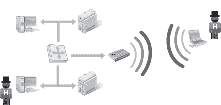

**图 4-6** 有线网络需要本地攻击；无线网络允许远程攻击。

### 窃听

窃听是指监听通信。窃听可以是使用数据包捕获工具（通用称为嗅探器）记录网络流量（图 4-7）。黑客可以针对数据包或语音流量进行窃听。窃听可能发生在有线或无线连接上。

任何以明文和直接可用的数据形式进行的通信，都可能被拦截和记录。你可以通过使用加密协议来防止窃听。只有经过加密编码的消息，才能免受外人窥探对话内容。

#### 重放攻击

重放攻击也称为 `playback attacks`。重放攻击是指重新传输捕获的通信。重放攻击的目标是获取对系统的交互或会话访问权限。被捕获并重新传输用于重放攻击的流量是认证数据包（图 4-8）。在该类型攻击中，黑客捕获客户端和服务器之间的流量，随后针对同一服务器重新传输该流量，就像原始通信一样。

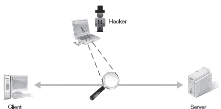

**图 4-7** 窃听客户端和服务器之间的现有会话。

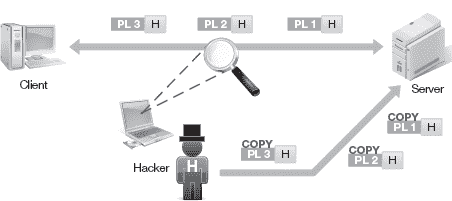

**图 4-8** 重放攻击收集认证数据包，随后稍后重新传输它们。

此攻击的目标是重放凭据数据包，以便黑客获得目标主机上用户账户的访问权限。另一种重放攻击是重新发送事务，例如“发送一张 10 美元的退款支票”。

幸运的是，你可以通过使用几种常见的通信改进方法之一来挫败大多数重放攻击。许多认证事务包含不可重放的随机质询-响应对话。该对话由一端生成一个发送给另一端的随机种子值组成。第二端使用双方都知道的共享密钥，通过单向计算得出响应。响应返回给原始端点，在那里该响应已被预测。如果接收到的响应与预测的响应匹配，则用户通过认证。

另一种针对重放攻击的防御是时间戳。某些认证交换包含编码的时间细节，若不被检测到，很难复制或修改。此外，使用一次性密码本或基于会话的加密可以使重放攻击成为不可能。

#### 插入攻击

`Insertion attacks` 有多种形式，但它们都涉及向原本安全的基础设施引入未经授权的内容或设备。三种常见的基于插入的攻击包括 `SQL注入`、`IDS insertion` 和流氓设备插入。

`SQL注入` 是一种将黑客代码插入托管在网站上的脚本中的攻击。`SQL注入` 攻击可让黑客访问 Web 应用程序的后端数据库。该技术利用了常见 Web 通信中的一个弱点：某些字符因被赋予特殊含义或用途，而非仅作为文本处理，从而受到区别对待。这些被称为 `metacharacters`，充当编程标记。如果你不以防御方式编写脚本以阻止或忽略元字符，那么注入攻击就可以根据黑客提交的内容有效地重写脚本。注入的代码几乎可以执行任何可想象的命令行任务。

##### IDS 插入攻击

`IDS插入` 是一种攻击形式，它利用网络型 `IDS` 收集和分析每个数据包的特性，欺骗 `IDS` 接受一个数据包，而终端系统却拒绝该数据包。这会导致 `IDS` 的状态与终端系统的状态不同步，从而使攻击者能够绕过 `IDS` 的检测。

> **技术提示**
>
> 当 `IDS` 接受一个终端系统拒绝的数据包时，就会发生 **IDS 插入**。这会导致 `IDS` 认为连接处于某种状态，而终端系统实际上处于不同的状态。攻击者可以利用这种差异来规避检测。

#### 中间人攻击

 `MAC欺骗`——黑客的计算机使用服务器的 `MAC` 地址；当服务器被淹没时，黑客的系统会接收本应发往目标服务器的流量。`MAC欺骗` 必须发生在子网内。

 `DNS投毒`——要实施 `DNS投毒`，黑客会攻陷一台 `DNS` 服务器并植入虚假的 `FQDN` 到 `IP` 映射记录。`DNS` 来源会向后续的用户查询提供虚假数据。

 `DNS欺骗`——`DNS` 是一种非认证查询服务，用于请求将 `FQDN` 解析为其相关的 `IP` 地址。托管流氓 `DNS欺骗` 工具的黑客可以发回虚假的 `DNS` 响应。

> **技术提示**
>
> 当使用 `非认证查询服务` 时，它不会确认所收到的任何响应的来源或有效性。因此，如果你收到伪造的、欺骗性的或流氓响应，系统会将其视为真实响应并接受，查询会话随之结束。如果真实响应随后到达，系统会将其作为无效或迷途数据包予以拒绝，因为它将不再与任何打开的查询会话对应。

 **ICMP重定向**—在有多个路由器的子网中，**ICMP重定向**可能导致主机更改其路由表。这种攻击可能会将流量重定向到一条不同于默认、预期或最优的路由上。

 **代理操纵**—要执行**代理操纵**，黑客会重新配置客户端的代理配置。服务请求会发送到充当中间人代理的黑客系统。

 **流氓DHCP**—**流氓DHCP** 是一台虚假的 `DHCP` 服务器，它可以为唯一子网提供 `IP` 地址配置租约并定义默认网关，因为黑客的计算机充当了中间人路由器/代理。

 **流氓接入点**—要创建**流氓接入点**，黑客会配置一个与真实授权接入点类似的流氓无线接入点，以欺骗用户进行连接，随后该接入点充当中间人代理。

针对中间人攻击的防御措施包括监控常见网络滥用或异常网络活动的 `IDS` 和 `IPS` 解决方案。此外，强多因素认证和相互认证可以降低中间人攻击的成功率。

#### 会话劫持

会话劫持是指黑客在客户端通过服务器认证后接管连接的情况（图 4-10）。要执行此攻击，黑客必须窃听会话以了解详细信息，例如会话端点的地址和序列号。利用这些信息，黑客可以使客户端不同步，接管客户端的地址，然后将精心制作的数据包注入数据流。如果服务器接受初始伪造数据包为有效数据包，则会话已被劫持。

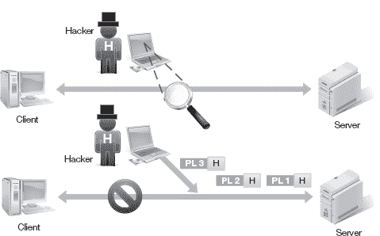

**图 4-10** 会话劫持从客户端窃取连接。

在会话劫持中，攻击者不会直接获知客户端的凭据。如果黑客失去连接，他将不得不寻找另一个会话进行劫持。失去会话的客户端会意识到连接已丢失，但不一定会意识到该断开连接是一次劫持攻击。

会话劫持有时会采用 `DNS欺骗`、`DNS投毒`、`ARP欺骗`、`ICMP重定向` 和 `流氓DHCP` 来改变会话的路由或路径。黑客利用这种路径改变，强制目标会话通过更易访问的网段传输，从而使会话劫持攻击更容易实施。

任何在未加密的情况下使用 `TCP/IP` 的主机都容易受到会话劫持的攻击。即使使用复杂或伪随机的数据包序列编号，只需少量窃听，黑客（或黑客工具）就能预测未来的序列值。防止会话劫持的唯一真正保护措施是加密，例如 `VPN`。

### 欺骗攻击

欺骗是对信息的伪造。大多数欺骗是对来源身份的伪造。电子邮件地址、`MAC` 地址和 `IP` 地址都很容易被伪造。欺骗会诱使用户或主机相信通信源自除其实际来源以外的其他位置。这是垃圾邮件传输中的常用策略。欺骗会冒充授权实体，例如通过 `MAC欺骗` 绕过无线接入点的 `MAC` 过滤。

欺骗难以预防，且在一定程度上难以检测。大多数欺骗检测发生在你监控正常流量并寻找寻址异常时。例如，如果交换机发现某个特定 `MAC` 地址是交换机端口 6 接收到的帧的源地址，而该 `MAC` 地址也作为交换机端口 9 接收到的帧的源地址出现，这就是 `MAC欺骗` 的症状（图 4-11）。另一个例子是，如果防火墙在其外部接口接收到一个数据包，而源 `IP` 地址是内部 `LAN` 地址，则可能正在发生欺骗。

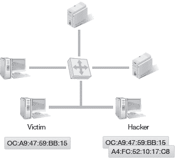

**图 4-11** 黑客计算机对客户端 `MAC` 地址的欺骗。

#### 技术提示

`NTFS` 的**备用数据流 (ADS)** 是为支持来自 `POSIX`、`OS/2` 和 Macintosh 的文件而添加到该文件系统的一项功能。此功能于 1990 年代中期添加到 `NTFS` 中，以推动政府采购 `Windows NT`。然而，即使现在 `Windows` 已放弃对 `POSIX` 和 `OS/2` 的支持，且 Macintosh **分层文件系统 (HFS)** 支持不再需要，`NTFS` 仍保留了此功能。`ADS` 是文件包含多个资源分支的能力。`NTFS` 对 `ADS` 的支持导致不仅额外资源，而且完整的额外文件都可以隐藏在任何正常文件对象之下。

一个正常的文件对象（包括目录）可以在其下包含许多额外的文件。额外文件的数量仅受驱动器上可用空间总量和隐藏文件大小的限制。一旦文件作为 `ADS` 存储，它就不再被操作系统本身看到或轻松访问。有几种黑客工具可以创建和操纵 `ADS`。只有少数扫描工具（如 `sysinternals.com` 的 `Streams`）和极少数恶意软件扫描器能专门扫描驱动器中的 `ADS` 隐藏代码。

欺骗是需要监控和过滤的对象，但不存在真正或直接的欺骗预防措施。此外，如果传输中的真实数据未加密，黑客可以拦截并修改这些数据。因此，欺骗数据并不总是作为伪造通信产生的。

#### 隐蔽信道

**隐蔽信道**是隐藏的、未知的、独特的、非典型的信息传输路径。该信道之所以隐蔽，是因为它未知且不可见。黑客利用隐蔽信道进行秘密通信，通常用于将数据泄露出安全环境。隐蔽信道是不安全的传输路径。如果路径已知，它将成为公开信道，并可能被阻止、过滤或以其他方式保护。

隐蔽信道主要有两种形式：时序和存储。时序信道通过定时和同步的活动传递信息。时序隐蔽信道的几个潜在示例包括：

 闪烁灯光以摩尔斯码分发信息

 操纵风扇转速，使较高和较低的音调噪音产生二进制传输

 节流互联网链路上的带宽消耗，使得在特定间隔内，利用率读数低于 60% 表示二进制通信中的零，高于则表示一

存储隐蔽信道通过未被发现或未被察觉的存储位置传递信息。存储隐蔽信道的几个潜在示例包括：

 使用硬盘的**未分区空间**，通过十六进制编辑器写入数据存储

 使用板载固件闪存芯片存储数据

 使用 **NTFS** 的备用数据流隐藏文件

 使用硬盘的**松散空间**存储数据

针对隐蔽信道的最佳防御包括 `IDS` 和 `IPS`，以及对 IT 基础设施的所有方面进行彻底监控，以发现任何类型的异常或反常事件。预测隐蔽信道很困难，因为就其本质而言，它们是未知且不可见的。

### 黑客如何劫持松散空间

硬盘包含称为扇区的段。扇区是驱动器中最小的固定大小存储块，大小为 512 字节。当文件系统应用于**分区**时，会由一个或多个扇区创建**簇**。松散空间是存储文件仅部分占用的最后一个簇的未使用部分。簇:扇区比率通常在 1:1 到 1:128 之间，对应簇大小从 512 字节到 64 KB。

#### 文件系统与集群

文件系统为集群分配了固定的最大地址数量。较大的驱动器与较小的驱动器拥有相同数量的集群，但集群的大小更大。这有点像鞋子：儿童鞋每双一盒，成人鞋也是每双一盒，但装成人鞋的盒子更大。集群是存储空间中最小的可消耗单元，只能包含单个文件的数据。标准文件系统格式中没有原生机制来寻址亚集群划分。

当文件写入驱动器时，它会消耗容纳文件所有数据所需的尽可能多的集群。除包含文件的最后一个集群外，所有集群都被填满。仅当文件大小恰好是集群大小的整数倍时（这种情况不太常见），最后一个集群才会被完全消耗。最后一个集群未使用的部分称为**松散空间**（参见图 4-12）。松散空间实际上是不可用的、被浪费的存储空间。

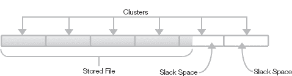

**图 4-12** 松散空间是存储文件仅部分消耗的最后一个集群的未使用部分。

黑客开发了特殊的文件操作工具，可以定位并劫持松散空间，利用它在硬盘上创建隐藏卷。这些卷几乎不可能被检测到，因为它们不被存储设备的文件系统包含、引用或寻址。相反，松散空间驱动器之所以存在，仅仅是因为特殊软件可以寻址亚集群存储位置。松散空间驱动器软件独立于操作系统和文件系统运行。

#### 技术提示

Web 服务器（或至少是 Web 站点）以至少四种不同的架构部署选项出现在互联网上：反向代理、`DMZ`、托管和主机托管。

- **反向代理**使用静态 `NAT` 映射或端口转发，允许外部访问者与内部服务器发起通信。这是最差的安全选择，因为如果 Web 服务器被攻破，可能会授予黑客对整个内部网的访问权限。

- **在 DMZ 中托管 Web 服务器**是一种更安全的解决方案。然而，如果被攻破，`DMZ` Web 服务器会给黑客提供一个就在私有网络大门外的武器平台。

- **托管**是将 Web 服务器主机直接放置在 `ISP` 网络内的设施中。

- **主机托管**是租用托管实体拥有和管理的现有 Web 服务器上的空间（`squarespace.com` 是一个很好的例子）。

后两种选项最安全；如果 Web 服务器/站点被攻破，黑客无法获得位置优势来突破私有网络。

### 网络与资源可用性威胁

许多漏洞利用和攻击要想成功，需要在私有网络上获得特殊访问权限。某些漏洞利用可针对面向互联网的 Web 服务器发挥作用，但此类服务器可能不直接连接到私有网络。如果黑客无法找到可利用的漏洞来获取目标系统的访问权或控制权，则发起可用性攻击作为后备或最后手段。

可用性攻击旨在阻止合法访问或使用资源，以延迟或中断业务。通常，这被称为**拒绝服务（DoS）攻击**。

#### 拒绝服务（DoS）

拒绝服务（`DoS`）攻击会中断正常的流量、通信和响应模式。`DoS` 攻击会干扰对合法资源请求的及时处理和回复。`DoS` 攻击主要有两种形式：缺陷利用和流量生成。

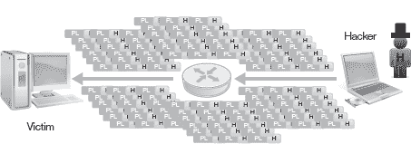

**图 4-13** 针对客户端的拒绝服务洪水攻击。

**缺陷利用 DoS 攻击**利用编程错误、缺陷或约定。`DoS` 漏洞利用会导致系统冻结、崩溃、重启或无法响应外部通信。您可以通过应用补丁和使用 `IDS` 或 `IPS` 系统来缓解缺陷利用 `DoS` 攻击。一旦应用补丁，`DoS` 将不再有效。**缺陷利用攻击**通常特定于某个软件版本。

**流量生成 DoS 攻击**用大量流量淹没目标（参见图 4-13）。该流量消耗可用带宽和处理能力，阻止合法通信。不存在可缓解流量生成 `DoS` 攻击的补丁。相反，流量过滤是唯一有效的响应。然而，**上游过滤**比边缘设备过滤更有效。

**上游过滤**发生在父网络（通常是 `ISP`）在流量进入个人和企业客户连接的子网络之前提供过滤时。边缘设备过滤可防止恶意流量进入私有网络，但无法防止成功的 `DoS`。只有上游过滤才能减少或消除 `DoS` 流量，并允许合法通信继续。

#### 分布式拒绝服务（DDoS）

**分布式拒绝服务（DDoS）攻击**通过大规模分布式处理和源发起，将 `DoS` 攻击推向了新高度。`DDoS` 的基础是代理、僵尸程序或僵尸网络节点。代理、僵尸程序和僵尸网络节点是植入互联网上受害系统的恶意代码。这些移动代理可能创建自己的对等网络交互，或连接到公共通信媒介，例如**互联网中继聊天（IRC）**频道。由此产生的网络称为**僵尸网络军团**或**僵尸军团**。

黑客远程控制僵尸网络，并指挥其对选定目标执行各种恶意活动，包括洪水攻击。通常，僵尸网络的主要目标称为主要受害者，而托管僵尸网络代理的受损系统称为次要受害者。这种形式的 `DoS` 之所以是分布式的，是因为僵尸程序分散在众多次要受害者中，且由此产生的攻击源自大量源向量。

黑客将僵尸程序、代理或僵尸网络节点分发到遍布互联网的许多次要受害者处。然后，僵尸程序连接回某种通信服务器（通常是聊天服务，如 `IRC`），以便从黑客处接收指令。一旦黑客发送攻击指令，僵尸程序就会针对主要目标发起攻击（参见图 4-14）。

僵尸网络可以执行各种恶意操作，包括洪水攻击、垃圾邮件发送、窃听、拦截、中间人攻击、会话劫持、欺骗、数据包操纵、恶意软件分发、钓鱼网站托管、密码窃取、加密破解等。

近年来出现了多个僵尸网络，例如 `Storm` 和 `Conficker`，其估计的次要受害者基数达 7500 万到 1 亿个系统。

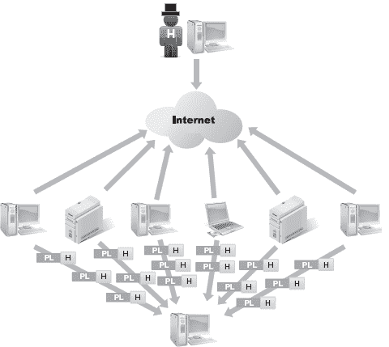

**图 4-14** 针对主要目标的分布式拒绝服务洪水攻击。

针对 `DDoS` 的防御重点在于避免成为次要受害者，或防范主要受害者的攻击。为避免成为次要受害者，应采取的措施包括：当前的防病毒和反恶意软件扫描、用户行为修改、防火墙过滤以及 `IDS`/`IPS` 解决方案。防范主要受害者攻击的措施包括：防火墙过滤、蜜罐以及 `IDS`/`IPS` 解决方案。

### 黑客工具

黑客工具包括各种软件，从普通的原生操作系统实用程序到商业应用程序，再到自定义编码的漏洞利用代码。一般来说，任何被用于恶意或未经授权（根据公司安全策略）用途的软件都是黑客工具。

黑客工具执行黑客活动。本章提到的所有漏洞利用概念都可以通过各种黑客工具和实用程序来实现。

### 黑客工具与社会工程学防御

不存在可供搜索或阻止访问以保护 IT 系统的黑客工具主列表。几乎所有合法程序都可被用于非法任务。为了整体防御黑客工具，请考虑使用白名单限制系统。


白名单限制系统包含一份获授权使用的软件可执行文件列表。用户可启动列表上的任何应用程序。您需阻止运行所有不在列表上的可执行文件。白名单不能仅关注授权的文件名；此过程还使用哈希值，以防止通过简单重命名文件即可轻松绕过限制。

除了白名单机制外，您还可以通过限制互联网下载和文件交换、控制便携式存储设备的使用（尤其是那些在外部系统上使用过的设备）、过滤电子邮件附件、安装 `IDS/IPS` 解决方案以及提供用户教育来降低黑客工具的威胁。

### 社会工程学

社会工程学是操纵和利用人性的艺术。社会工程学是诱导人们执行任务或泄露违反安全规定的信息的技巧。社会工程学是一种几乎总能针对目标组织实施的攻击手段。这是因为人类的存在。人类是社会工程学的主要目标。

在大多数安全解决方案中，人类是最薄弱的环节，因为人类是组织中唯一拥有自由意志的要素。所有其他要素只能在其编程和设计范围内运行。此外，人类会被欺骗或愚弄，而硬件和软件只能按照其设计和编程运行。

社会工程学可通过任何通信方式发生，包括面对面、电话、电子邮件、即时通讯（`IM`）和网站。社会工程学可能侧重于从目标处提取信息，或说服目标采取改变主机或网络安全状态的行动。

许多社会工程学攻击源于某种形式的关系，从最初的随意接触到商务专业关系，再到长期且高度发展的关系。关系越深入、持续时间越长，黑客可利用的杠杆作用就越大，从而诱导、欺骗或滥用目标。

社会工程学可涉及多种技术，包括冒充权威职位、互惠利益、利用社会认同，以及通过稀缺性制造紧迫感。如果黑客能冒充内部人员，这些攻击往往会更成功。

获取内部信息通常是社会工程学攻击的第一要素。`Dumpster diving`（垃圾箱搜寻）、侦察和 `cold calling`（冷呼叫/陌生电话推销）是了解目标内部文化的技术。随着黑客掌握越来越多的术语、流程、组织架构、政策、事件、八卦、社交活动、日历、项目进度安排等，该黑客就越能模拟内部人员。一旦黑客骗过目标，使其相信他/她只是另一名员工，初始攻击即告成功。凭借获得的地位，黑客会操纵目标透露更多内部信息、重新配置系统，或从可疑的互联网位置下载工具。

社会工程学可能是黑客攻击的第一波，也可能是在尝试逻辑入侵或物理入侵失败后的最后备选方案。有些黑客天生擅长社会工程学，而另一些则必须通过练习才能获得实用的技能。这些社会工程学技巧并非这种不道德活动所独有；相反，它们是大多数人在正常社交场合中试图达成目的、说服某人约会、寻求帮助、提升社会地位、摆脱麻烦、领导团队、销售营销、制作广告等时所使用的相同技能。区别在于黑客使用这些技能有着不道德的目的。

社会工程学主要针对人员，不受典型 IT 对策的影响。相反，防御社会工程学的最佳手段是彻底的用户培训和意识教育。一旦人员意识到他们是、曾经是、且将继续是攻击目标，他们就能采取略带怀疑和谨慎的态度。员工应怀疑性地评估任何看似奇怪或不合时宜的活动、问题、互动或关系。

您可以通过使用安全策略来降低社会工程学的威胁，这些策略采用信息分类并配合相关的通信方式限制。如果您限制特定类别信息所经过的通信渠道，就能减少由社会工程学导致的信息泄露。例如，如果您限制通过电话或电子邮件使用密码，那么任何请求密码的人显然都在试图违反安全规定。员工应接受培训，将所有此类请求报告给网络安全人员。

#### 章节总结

黑客始终在寻找机会，利用那些未做好准备或未妥善保护的个人或系统。了解黑客常用的各种攻击手段，能直接提高安全意识和整体网络安全水平。

黑客通常通过攻击个人和组织寻求经济利益。黑客可能是内部员工，也可能是外部人员。危机情况不仅限于黑客攻击，还可能包括事故、疏忽、硬件故障、快速扩张和恶劣天气。黑客工具和技术包括恶意软件、利用无线连接、窃听、重放、插入、分片、缓冲区溢出、`XSS`、中间人攻击、会话劫持、欺骗、隐蔽通道，以及 `DoS` 和 `DDoS` 可用性攻击。您应采取行动限制或阻止黑客工具，并利用谨慎和培训来避免社会工程学攻击。

除此处列出的攻击和技术外，还存在其他黑客攻击手段。本章提供了黑客攻击过程的通用描述，而非权威或详尽的考察。然而，基于这一基础，您可以加深对黑客攻击及黑客构成的威胁（以及其他威胁和风险来源）的理解，从而改进安全设计、策略和实施。

#### 关键概念与术语

- **Advanced persistent threat (APT)**（高级持续性威胁）
- **Adware**（广告软件）
- **Alternate data stream (ADS)**（备用数据流）
- **Arbitrary code execution**（任意代码执行）
- **ARP spoofing**（ARP 欺骗）
- **Banner**（横幅/标识信息）
- **Banner grabbing**（横幅抓取）
- **Blog**（博客）
- **Botnet army**（僵尸网络/肉鸡网络）
- **Buffer overflow**（缓冲区溢出）
- **Chip creep**（芯片松动/爬行）
- **Cluster**（集群）
- **Cold calling**（冷呼叫/陌生电话推销）
- **Command shell**（命令行外壳）
- **Contract worker**（合同工）
- **Covert channel**（隐蔽通道）
- **Cross-site scripting (XSS)**（跨站脚本攻击）
- **Deterrent**（威慑措施）
- **Dialer**（拨号程序）
- **Disgruntled employee**（不满员工）
- **Distributed denial of service (DDoS) attack**（分布式拒绝服务攻击）
- **DNS poisoning**（DNS 投毒）
- **DNS spoofing**（DNS 欺骗）
- **Domain registration**（域名注册）
- **Dumpster diving**（垃圾箱搜寻）
- **Enumeration**（枚举）
- **Flaw exploitation attack**（漏洞利用攻击）
- **Flooding**（洪水攻击/泛洪）
- **Footprinting**（足迹搜集/指纹识别）
- **Hacktivism**（黑客行动主义）
- **Hierarchical file system (HFS)**（分层文件系统）
- **Honeypot**（蜜罐）
- **ICMP redirect**（ICMP 重定向）
- **IDS insertion**（IDS 插入攻击）
- **Insertion attack**（插入攻击）
- **Instant message (IM)**（即时通讯）
- **Intentional electromagnetic interference (IEMI)**（故意电磁干扰）
- **Interception attack**（截获攻击）
- **Internet relay chat (IRC)**（互联网中继聊天）
- **Keystroke logger**（按键记录器）
- **Leetspeak**（精英语/黑客俚语）
- **Logic bomb**（逻辑炸弹）
- **MAC spoofing**（MAC 欺骗）
- **Maximum transmission unit (MTU)**（最大传输单元）
- **Mean time between failures (MTBF)**（平均故障间隔时间）
- **Mean time to failure (MTTF)**（平均故障时间）
- **Metacharacter**（元字符）
- **MITRE**（MITRE 公司/ATT&CK 框架组织）
- **Mobile code**（移动代码）
- **Monkey-in-the-middle attack**（中间人攻击变种）
- **National Institute of Standards and Technology (NIST)**（美国国家标准与技术研究院）
- **New technology file system (NTFS)**（新技术文件系统）
- **Nmap**（网络扫描工具）
- **Non-authenticating query service**（非认证查询服务）
- **Opportunistic hacker**（机会主义黑客）
- **OS/2**（操作系统/2）
- **Partition**（分区）
- **Phishing**（网络钓鱼）
- **Ping sweep**（Ping 扫描）
- **Playback attack**（回放攻击）
- **Port scanning**（端口扫描）
- **POSIX**（可移植操作系统接口）
- **Privilege escalation**（权限提升）
- **Professional hacker**（职业黑客）
- **Proxy attack**（代理攻击）
- **Proxy manipulation**（代理操纵）
- **Pwned**（被攻破/被控制）

##### 侦察

##### 业余黑客

##### 独立磁盘冗余阵列 (RAID)

##### 投资回报率 (ROI)

##### 非法接入点

### 非法 DHCP

### Rootkit（根工具包/后门程序）

##### 扫描

##### 脚本小子

##### 扇区

##### 会话劫持

### Shellcode（Shell 代码）

### 磁盘松散空间

##### 社会工程学

##### 垃圾邮件

##### 间谍软件

##### SQL 注入

##### 静电放电 (SED)

### 陷阱门

##### 特洛伊木马

##### 未分区空间

##### 上游过滤

##### URL 注入器

##### USENET 新闻组

##### 病毒

### 电话扫描/战争拨号

### 无线网络侦察/战争驾驶

##### Whois

##### 蠕虫

##### 包装器

### 僵尸网络/傀儡机大军


#### 第 4 章 评估

**1.** 以下都是黑客常见或可能的动机，*除*哪一项外？

A. 自我膨胀

B. 社会认可

C. 大学学分

D. 挑战

E. 冒险

**2.** 以下哪类潜在黑客构成最大威胁，因为他们很可能已经拥有对目标的物理和逻辑访问权限？

A. 顾问

B. 竞争对手

C. 海外受雇黑帽黑客

D. 客户

E. 16 岁以下的业余黑客

**3.** 以下哪项*不是*对可用性的重大威胁？

A. 自然灾害

B. 硬件故障

C. 意外泼洒

D. 有状态检测过滤

E. 缺乏适当培训

**4.** 以下哪项*不是*恶意软件感染的潜在后果？

A. 数据损坏

B. 机密信息泄露

C. 系统崩溃

D. 身份盗窃

E. 吞吐量提升

**5.** 有线连接与无线连接连接到专用 LAN 时，在网络安全方面的主要区别是什么？

A. 无法访问所有网络资源

B. 缺乏实际吞吐量

C. 需要在建筑物内部才能访问网络

D. 支持加密会话的能力

E. 支持多因素认证

**6.** 大多数漏洞利用基于以下哪项的存在？

A. 加密

B. 过滤

C. 人为因素

D. 系统异常

E. 同步

**7.** 黑客攻击过程的第一阶段或步骤是什么？

A. 扫描

B. 渗透

C. 枚举

D. 提权

E. 侦察

**8.** 哪种攻击形式捕获认证数据包以便稍后重传？

A. 插入

B. 劫持

C. 重放

D. 中断

E. 欺骗

**9.** 哪种攻击形式可能逃避 `IDS`（入侵检测系统）？

A. 病毒

B. 插入

C. 中间人

D. ARP 投毒

E. 非法 DHCP

**10.** 哪种漏洞利用利用了可变 `MTU`（最大传输单元）？

A. 欺骗

B. 劫持

C. 隐蔽信道

D. DoS

E. 分片

**11.** 哪种攻击形式向目标提交过量数据以导致任意代码执行？

A. 缓冲区溢出

B. DDoS

C. 插入

D. 中断

E. 分片

**12.** 哪种攻击利用网站污染其数据集，导致未来访问者接收到损坏的内容？

A. 跨站脚本

B. 代理操纵

C. 非法 DHCP

D. SQL 注入

E. 劫持

**13.** 哪种攻击使用非法 DHCP、ARP 投毒或 `ICMP` 重定向？

A. 分片

B. 注入

C. 中间人

D. 社会工程学

E. 缓冲区溢出

**14.** 哪种攻击之前会有窃听行为？

A. SQL 注入

B. 劫持

C. `IDS` 插入

D. 隐蔽信道

E. `XSS`

**15.** 哪种攻击基于对合法主机的冒充？

A. DoS

B. 重放

C. 分片

D. 欺骗

E. 劫持

**16.** 哪种通信方式是不可见的、未经过滤的，且基于定时操纵？

A. 缓冲区溢出

B. 中间人

C. DDoS

D. 隐蔽信道

E. `IDS` 插入

**17.** 哪种攻击形式基于通过特洛伊木马或蠕虫分发的恶意软件，并能从众多源向主要目标产生海量流量？

A. 分片

B. 劫持

C. DDoS

D. 回放

E. `XSS`

**18.** 哪种攻击使用非技术手段来达到目的？

A. 欺骗

B. SQL 注入

C. 缓冲区溢出

D. 隐蔽信道

E. 社会工程学

**19.** 黑客编写漏洞利用代码来攻击目标，是由于存在以下哪项？

A. 一个漏洞

B. 多因素认证

C. 足够的吞吐量

D. 一个僵尸网络

E. 流量过滤

**20.** 了解黑客攻击和漏洞利用对网络安全的主要好处是什么？

A. 培训合同工

B. 改进防病毒检测机制

C. 针对特定威胁进行防御

D. 更改网络子网组织

E. 降低基础设施成本

# 第二部分 网络安全、防火墙和 VPN 技术概述

| 章节 | 标题 |
| --- | --- |
| **第 5 章** | **网络安全实施** |
| **第 6 章** | **网络安全管理** |
| **第 7 章** | **防火墙基础** |
| **第 8 章** | **防火墙部署注意事项** |
| **第 9 章** | **防火墙管理与安全** |
| **第 10 章** | **使用常见防火墙** |
| **第 11 章** | **VPN 管理** |
| **第 12 章** | **VPN 技术** |

# 第 5 章 网络安全实施

**实施** 是设计、安装、部署和配置网络安全的行为。本章重点介绍每个组织必备的网络安全基础，从家庭个人电脑到跨国公司的网络。无论计算机和网络的规模、用途或功能如何，安全基础都普遍适用。

网络安全基础包括纵深防御、协议的正确使用、通信管理、系统加固等。基于一些常见且通常简单的原则，您可以显著改善组织的计算机系统。遵循本章中的建议将降低因意外、疏忽、自然灾害或恶意意图导致系统受损的风险。

#### 第 5 章 主题

本章涵盖以下主题和概念：

- 典型 IT 基础设施的七个域是什么
- 什么是网络设计和纵深防御
- 什么是协议和拓扑
- 常见的寻址类型有哪些
- 如何控制通信路径
- 如何加固系统
- 选择设备应使用哪种方法
- 什么是认证、授权和审计
- 什么是通信加密
- 什么是最佳架构：仅本地主机还是远程和移动主机
- 什么是冗余
- 什么是节点安全

#### 第 5 章 目标

完成本章后，您将能够：

- 描述网络安全设计的要素
- 比较和对比公共和私有寻址以及静态和动态寻址
- 说明系统加固的重要性
- 描述为什么认证、授权、审计和加密对网络安全至关重要
- 识别本地主机以及远程和移动主机的安全顾虑
- 定义节点安全的要素

#### 典型 IT 基础设施的七个域

##### 典型 IT 基础设施的七大域

中型到大型组织的典型 IT 基础设施（图 5-1）中通常包含七大域。这些域在第一章中已作介绍，但在网络安全实施的背景下，它们需要更详细的阐述和更聚焦的关注。

黑客会寻找一切机会来攻击目标。IT 基础设施的任何方面都存在风险，无一能免受黑客的审视。在设计和实施网络安全时，你需要分析典型 IT 基础设施七大域中的每一个，以查找潜在的漏洞和弱点。安全措施必须详尽、聚焦且全面。你必须考虑所有可能的攻击途径，评估风险，如果风险足够大，则应用相应的对策。未能做到这一点将会给黑客留下一条可乘之机。黑客只需发现你防线中的一个裂缝，就能开始瓦解整个网络的安全。

典型 IT 基础设施的七大域各自具有独特的方面，需要安全改进。在此列出与这七大域相关的重要基础网络安全问题清单：

- **用户域** — 该域指实际用户，无论他们是员工、顾问、承包商还是其他第三方。任何访问和使用组织 IT 基础设施的用户，在被授予访问组织 IT 资源和基础设施的权限前，都应阅读并签署可接受使用策略（`AUP`）。该域还应成为培训、强认证、细粒度授权和详细审计的重点。此外，添加到其他域的许多保护措施也为用户域提供了额外的保护，或防范来自用户域的威胁。

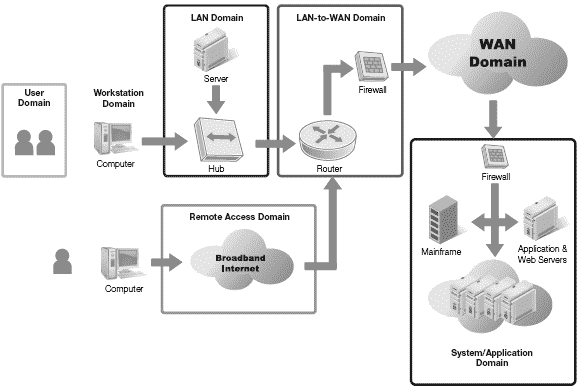

**图 5-1** 典型 IT 基础设施的七大域。


 **工作站域** — 该域指最终用户的桌面设备，如台式电脑、笔记本电脑、`VoIP` 电话或其他端点设备。工作站设备通常需要安全对策，如防病毒、反间谍软件和漏洞软件补丁管理，以维护设备的完整性。系统加固、通信保护和工作站定位对安全至关重要。

 **局域网（LAN）域** — 该域指用于支持工作站连接到组织网络基础设施的物理和逻辑局域网技术。协议、寻址、拓扑和通信加密为该域提供安全保障。

 **局域网到广域网（WAN）域** — 该域指组织的互联网络以及 `LAN` 和 `WAN` 网络基础设施之间的互连点。交换机、路由器、防火墙、代理和通信加密是该域安全的重要方面。

 **远程访问域** — 该域指用户远程访问组织 `IT` 基础设施、系统和数据的授权和认证远程访问程序。远程访问解决方案通常涉及 `SSL` 128 位加密的远程浏览器访问或加密的 `VPN` 隧道，以实现安全的远程通信。了解主机所在位置有助于确定该主机所需的安全类型。

 **广域网（WAN）域** — 拥有远程站点的组织需要广域网将它们互联。协议选择、寻址方案和通信加密是保护该域的要素。

 **系统/应用域** — 该域指通常位于组织数据中心和/或机房内的硬件、操作系统软件、数据库软件、客户端-服务器应用程序和数据。网络设计、认证、授权、审计和节点安全是该域重要的安全关注点。

网络管理员需要认识到，妥协的可能性存在于组织的各个角落。这种认识引出了在整个组织实施充分网络安全的必要性。从风险存在和威胁迫在眉睫这一认知出发，网络安全管理员可以设计和实施适当的对策和保障措施。

#### 网络设计与纵深防御

每个网络都各不相同。然而，通用的安全原则适用于任何网络，无论其独特元素如何。其中一条通用原则是安全网络设计。安全网络设计在 `IT` 基础设施实施之前，将核心防护和改进嵌入其中。设计源于规划。规划源于充分的知识和理解。

通用的安全目标包括机密性、完整性、可用性、隐私、认证、授权、不可抵赖性和审计。为了高效达成这些目标，在部署前进行知情规划有助于你设计网络。

网络安全设计的一项基本原则是：不存在完美的安全解决方案。任何单一的安全防护、对策和保障措施都是不够的。黑客将使用某种方法、技术或漏洞利用来绕过、规避或使安全防护失效。潜在顾虑包括部署位置、编程缺陷、默认设置、最大值、处理能力、内存容量、后门、恶意代码、社会工程学和物理攻击。此清单并非详尽无遗，但代表了关键问题。理论上，没有任何安全解决方案是充分且完整的。

因此，你需要使用多个安全组件。这被称为纵深防御或多层防御（图 5-2）。如果你遵循纵深防御设计理念，众多保障措施将保护每一项资产。随着一种防御工具与另一种互锁，它们相互重叠并提升整体安全性。一种对策的优势和益处可以补充或弥补另一种对策的弱点和局限性。

纵深防御引导许多安全专业人员遵循两条额外的准则。第一，避免单点故障。第二，分而治之。单点故障是指系统中任何可能导致整个系统故障或妥协的元素、组件或方面。分而治之是将大型项目分离为多个更小、更易管理的部分的过程。


**图 5-2** 围绕资产实施纵深防御的示例。

避免单点故障必须在多个战线上进行。黑客只需一个缺陷或弱点即可攻击目标。工作重点应放在发现并消除尽可能多的漏洞上，以移除黑客寻求利用的单点。

良好的设计会使用多重过滤器过滤用户与资产的每一次交互。这种过滤应包括认证、授权、内容过滤和上下文过滤。仅依赖单一过滤器或检查系统就是一种单点故障。始终假设任何单一服务或功能都有缺陷或会失效。

有效的网络设计使用多种技术监控和检查针对资产的所有活动。这可能包括对象审计、服务器监控、客户端监控、网络监控等。仅使用单一监控视角可能构成单点故障。每个人都看过单一视角的视频录像，它引导观众看到或相信一件事，但从另一个摄像机角度来看，真相、诡计或另一种解释就会变得清晰。

##### 网络安全中的分而治之

分而治之不仅是实际战争中的战术，也是对抗网络安全漏洞的战术。通过将较大的项目或任务划分为可管理的组件，您可以专注于并照顾每个组件，以确保在解决网络安全问题时的准确性和完整性。试图将网络的安全性作为一个整体来解决，往往是灾难的根源。评估全局始终是个好主意，但仅在整体上工作可能会导致忽略细节，或错过只有在仔细详细检查时才能察觉的微妙之处。

###### 分层安全方法

贯穿 `IT` 基础设施的分层安全方法效果最佳：缓慢、有条理、分隔式且彻底。设计得当的网络安全应支持信息的及时传递以及交易期间的充分响应。妥善保护的网络提供可靠且稳定的通信。设计良好的安全性能适应不断变化的条件。设计良好的安全性能预见未来的增长与扩展。

###### 设计流程要求

设计网络安全既非简单也非短期任务。彻底的网络安全设计必须包含充分的研究、周密的规划，以及广泛的**建模**和测试。安全设计的过程必须评估执行惊人数量功能的广泛技术。

最终，良好的网络安全设计会生成一份蓝图，指导安全运行的网络基础设施建设。该蓝图是组织安全策略的基础。大多数网络设计都有局限性。这些局限性包括预算、内部政治、法规、标准和行业惯例。网络设计应专注于在规定的预算范围内提供尽可能最好的安全性。

##### 通过隐匿实现安全

减少黑客攻陷风险的一种方法是防止他们发现您的网络作为目标。通过保持离线状态并仅使用受信任的通信路径，您的组织可以避免大量风险。然而，这种技术性的“捉迷藏”并不完美，也无法消除所有问题。外部黑客可能无法从外部入侵未连接互联网的内部网；然而，来自不满员工和其他内部用户的风险依然存在。

躲避危险的想法通常被称为**通过隐匿实现安全**。虽然确实如果不被发现就不会受到攻击，但如果网络的保护依赖于隐匿而非实际的对策和防护措施，这往往是虚假的希望。隐匿或难以定位可能是好事，但它本身并非一种可靠的安全形式。在设计网络安全时，仅使用直接且真实的安全防御。

###### 平衡安全性与可用性

安全性对于任何现代组织的长期生存至关重要。没有安全性，逻辑、物理和社会层面的漏洞会使大多数公司面临失败的风险。但安全性离不开平衡。您可能会将基础设施过度保护，以至于安全性干扰工作任务。可用性和安全性必须保持平衡。没有安全性，可用性无法长久维持；过度的安全性会扼杀可用性。良好的网络安全设计能在安全性和可用性之间取得平衡。

###### 为增长做规划

大多数组织的目标之一是扩张和增长。它们通常寻求吸引新客户、支持更多客户、销售更多产品、提供更多服务、赚取更多利润等。但增长是一把双刃剑。虽然增长能带来更可靠、更有保障的未来，但也可能引发成长的烦恼。对任何组织而言，当现有基础设施、设施甚至人员被推向极限或超越极限以支持增长带来的额外工作量时，就会出现成长的烦恼。

增长可以是预期的、意外的、渐进的或突发的。适当的网络设计流程会评估并预测潜在的增长场景，并为每种场景规划应急措施。应对增长的一种应急措施是在当前基础设施中构建额外容量。如果预期缓慢增长，则 20% 的额外容量可能就足够了；而快速增长可能在短时间内消耗 50% 的额外容量（图 5-3）。

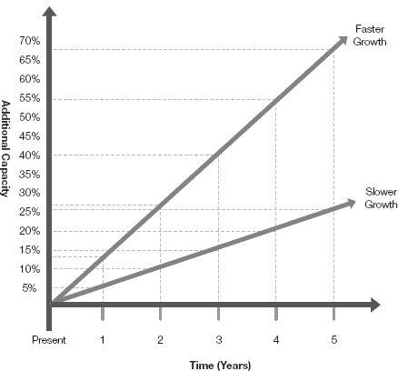

**图 5-3** 用于预测所需额外容量的增长率。

增长过快与萎缩一样都是负担。当组织超出其支持、销售、创建、维护、响应、生产等能力时，小问题会迅速滚雪球般演变成雪崩。稳健、受控、有限的增长通常是确保长期生存能力和稳定性的方法。这在一般商业管理中成立，在网络安全设计中同样成立。

在网络设计阶段，请考虑您选择部署的所有技术的可扩展性。某个组件或系统是否有最大值或限制，会很快达到？该组件或系统能否在不损害效率、成本效益和安全性的情况下扩展？一旦发生中等程度的增长，该组件或系统是否需要由可扩展的解决方案替代？如果是，为什么不现在就使用可扩展的解决方案？为增长做规划将减少因功能和安全容量不足而导致的问题。

###### 高级管理层的参与

如果没有高级管理层的积极参与，任何安全工作都不会成功。事实上，如果没有其明确批准和支持，任何安全努力都注定会失败。高级管理层有责任制定组织的战略目标和计划，因此也决定了其 `IT` 基础设施和集成安全。高级管理层必须批准预算资金、鼓励合规并支持安全，即使在出现问题时也是如此。

在整个网络安全设计和实施过程中，高级管理层监控并批准进度报告。高级管理层引导组织及其安全规划穿越不断变化的商业环境。但安全网络设计不仅仅是追随领导者；它还关乎将每一位员工融入整体安全设计流程。安全是组织中每个人的责任，而不仅仅是管理者和高管的责任。

###### 安全网络设计的要素

安全网络设计的要素涉及 `IT` 基础设施的方方面面。这包括主机、节点、通信、加密、本地和远程系统、冗余等。通常，设计安全的过程始于关注贯穿基础设施的核心要素。分布式核心组件的示例包括网络协议和拓扑。

##### 协议

网络安全的很大一部分在于做出正确的技术选择，而不陷入轻松的陷阱或默认设置。一个常见的陷阱是继续做同样的事情或使用同一产品。您需要定期重新评估旧技术和现有解决方案。大多数组织选择每年进行一次安全设计评估。在执行安全评估时，要重新审视基础设施的各个方面，包括网络协议。

大多数网络使用 `Transmission Control Protocol/Internet Protocol (TCP/IP)` 作为其主要网络协议。具体而言，大多数网络仍使用 `IPv4` 而非 `IPv6`。使用 `IPv4` 并非向黑客发出公开邀请，但它确实存在许多常被利用的弱点和隐患。`IPv4` 通常默认采用明文传输形式，而 `IPv6` 可默认设置为加密传输。`IPv4` 可使用 `IP Security (IPSec)` 或其他 `virtual private network (VPN)` 协议进行加密。

其他需要考虑的问题包括：

*   当前协议是否容易被攻破？
*   是否有大量针对该协议的漏洞利用代码可供新手黑客使用？
*   是否可以应用加密？

######## 网络协议评估与地址分配

######### 协议评估考量因素

 是否增加加密的过程复杂或昂贵？

 加密是否会干扰其他技术，如 `IPSec` 和网络地址转换 (`NAT`)？

 是否有可用的替代方案或替代品？

 替代方案是否向后兼容？

 替代方案是否被所有当前的主机和节点支持？

这只是在评估当前部署的网络协议以考虑可能的替换时，你需要考虑的问题的部分列表。关键在于要定期认真考虑这一问题。网络安全的大多数要素都基于所使用的协议。如果协议发生了变化或改进，这可能会导致整个生产环境发生全面变化——最重要的是该环境的安全性。

根据经验法则，如果大多数主机和软件的使用时间不到五年，那么升级到 `IPv6` 很有可能只会带来最小的复杂性。然而，如果带有 `IPSec` 的 `IPv4` 或其他形式的加密在性能和安全参数范围内运行良好，则没有强烈的需求升级到 `IPv6`。

当你考虑协议升级时，需要彻底研究和测试生产和安全环境的各个方面，以确认与 `IPv6` 的兼容性。任何过渡都会遇到一些障碍，而切换主要网络协议无疑是重大障碍的候选者。应在实验室进行**试点**后，分阶段推出协议变更，并考虑在过渡期内运行双协议。

`TCP/IP`，或者至少 `IP` 本身，并不是大多数网络上唯一使用的协议。`OSI` 模型网络协议栈中每个理论层的每一个协议都需要定期重新评估。你是否仍想继续使用**简单邮件传输协议 (`SMTP`)** 和**邮局协议 (`POP`)**？**文件传输协议 (`FTP`)**、**网络新闻传输协议 (`NNTP`)** 和 **`telnet`** 又如何？如果某协议以明文方式运行，请考虑使用具有原生加密功能的协议，或探究将其封装在加密隧道协议（如 `IPSec` 或 `SSL/TLS`）内部的可能性。

**`AppleTalk`**、**`Internetwork Packet Exchange/Sequenced Packet Exchange (IPX/SPX)`**、**系统网络架构 (`SNA`)**、**`NetBios Extended User Interface (NetBEUI)`** 或其他协议是否仍存在于网络中？它们是否仍然必要？需要它们的旧系统是否已被替换或移除？较新的安全替代方案能否取代这些较旧且不安全的协议？仍在使用传统协议的任何系统能否被替换，以获得主机安全并移除该协议？

不要让传统、个人偏见或**沉没成本**妨碍做出明智的安全设计决策。仅仅因为某事一直以某种方式完成，并不意味着它应该继续以那种方式完成，特别是如果旧方式不安全的话。就喜好、厌恶、舒适度和熟悉度而言，个人偏见不是避免转向更安全解决方案的充分商业理由。

沉没成本是指过去已经投入的资金或投资，相对于未来可能发生的前瞻性成本。通常，过度担心浪费已投入资源的管理者会做出糟糕的决策。避免损失是一个良好的商业原则，但仅仅因为你已经花费了一些金钱、时间和精力，并不意味着你应该继续沿着既定路径前进。通常，因沉没成本而继续投入（好钱填坏账）会加剧损失。如果现有系统、解决方案或产品的未来收益无法得到保证，那么任何数额的沉没成本都无法证明其继续使用的合理性。在大多数情况下，你应该仅分析未来的成本和收益来做决策。已发生的费用（沉没成本）不应影响未来的选择。

######### 常见寻址类型

寻址是为网络上的主机分配逻辑编号系统，以实现高效的流量路由。寻址不仅仅是网络拓扑强加的一个系统；它通常是一种控制流量的手段。通过使用逻辑地址，可以实现通过路由和流量过滤来管理流量。

全球使用最广泛的协议是 `TCP/IP`。该网络协议规定了最常见的寻址方案。`IPv4` 和 `IPv6` 的寻址方案差异很大。然而，一些常见要素、安全顾虑和管理技术保持一致。

内部 `IP` 地址可以是公共地址、私有地址，或两者的混合。公共地址是由 `IANA` 分配、由 `RIR` 监控，并通过 `ISP` 直接租用的地址。**互联网号码分配局 (`IANA`)** ([`www.iana.org/`](http://www.iana.org/)) 是负责全球协调 `IP` 寻址、`DNS` 根区及其他互联网协议资源的实体。**区域互联网注册机构 (`RIR`)** 是五个区域性组织之一，负责监督和监控 `IP` 地址（包括 `IPv4` 和 `IPv6`）的使用和分配。互联网服务提供商 (`ISP`) 可能会随机分配或半永久性地租用 `IP` 地址给个人或组织。公共地址是从 `ISP` 获取的地址。

公共地址也意味着它直接与互联网上的资源通信。互联网本身仅使用公共地址。没有公共地址，就无法与互联网托管的资源进行通信或接收响应。

 **注意**

过去，可以购买或拥有 `IP` 地址，特别是大量地址或整个类的地址。然而，这种做法现在大多已不可能，并非因为禁止拥有 `IP` 地址，而是因为缺乏可供出售的可用 `IP` 地址。许多最初的 `Class A` 和 `Class B` 子网所有者仍然拥有、控制并使用他们购买的地址。其中一些实际上是 `ISP`，它们现在将其拥有的 `IP` 地址范围的子集租出去。如今，大多数公共 `IP` 地址是租用的，而不是出售或拥有。

公共地址从 `IPv4` 地址范围的 `Class A`、`B` 和 `C` 范围分配（因为 `Class D` 和 `E` 分别保留用于多播和实验）。`IPv6` 的公共地址是大部分 `2¹²⁸` 个地址，`fc00::/7` 地址块除外。

在名为 `RFC 4193` 的技术规范中，`IANA` 划出 `fc00::/7` 地址块用作 `IPv6` 的私有地址，类似于 `IPv4` 的 `RFC 1918`。`RFC 1918` 为私有 `IPv4` 地址提供了三个保留用于私有用途的类范围：

 **Class A** — `10.0.0.0–10.255.255.255/8`（1 个 Class A 网络）

 **Class B** — `172.16.0.0–172.31.255.255/12`（16 个 Class B 网络）

 **Class C** — `192.168.0.0–192.168.255.255/16`（256 个 Class C 网络）

**技术提示**

`DHCP` 预留是指通过使用目标主机的 `MAC` 地址进行预留，将特定 `IP` 地址预先分配给主机。预留确保始终向特定主机发放相同的地址。它还可以模拟静态寻址，但保留对地址分配的集中控制。

私有地址仅用于私有网络内部。个人和组织无需外部实体的批准或费用即可使用私有地址。然而，使用私有地址需要 `NAT` 服务才能与互联网资源通信。所有互联网路由器都会自动丢弃报头中带有私有地址的任何数据包。

私有地址作为一种基本的隔离安全措施，因为拥有公共地址的外部实体无法直接与内部私有地址的主机通信。但 `NAT` 服务器允许与互联网资源通信。

######## 网络地址与通信路径控制

######### 地址选择策略

########## 私有地址与公共地址

您应审查组织在内部使用私有地址还是公共地址的选择。这不仅关乎成本节约。私有地址免费，而公共地址通常需要租赁。私有地址需要转换，而公共地址不需要。私有地址天然与互联网隔离，而公共地址则不然。甚至可以在内联网中混合使用私有和公共地址。

########## 静态地址与动态地址

另一个地址相关的考量是采用静态还是动态寻址。静态寻址为每台主机预分配特定的 `IP` 地址，而动态寻址从地址池向主机分配 `IP` 地址。除非为主机创建了保留，否则动态寻址不保证主机始终获得相同的地址。

静态寻址通常要求在每台单独的主机上配置 `IP` 地址。这确保了主机始终使用相同的 `IP` 地址。然而，如果网络配置或拓扑发生变化，逐台手动更改主机上的 `IP` 地址会涉及大量额外的管理开销。


因此，大多数组织使用动态分配，通常采用动态主机配置协议（`DHCP`）系统。如果首选静态寻址，则 `DHCP` 保留可以在保持集中控制的同时模拟静态寻址。基于保留的静态寻址允许通过编辑 `DHCP` 服务器上的保留来进行更改，而无需逐个手动调整每台主机。

## 动态分配的安全隐患

当地址动态分配时，恶意系统可能上线并仅通过请求就获得有效的 IP 地址。如果地址静态分配，攻击者则需要发现一个有效但未使用的 IP 地址，并手动配置其系统以使用它。同样，如果使用 `DHCP` 保留，攻击者要么手动静态分配自己的地址，要么欺骗媒体访问控制（`MAC`）地址，从另一台离线系统“借用”一个 IP 地址。

### IPv6

虽然全球互联网寻址中仅有很小比例使用 IPv6 地址，且利用它的攻击也占很小比例，但安全专业人员保持最新知识至关重要，熟悉 IPv6 很重要。IPv6 与 IPv4 在两个重要方面有所不同：其数据包头部结构不同，且 IPv6 地址的大小和构造与 IPv4 地址不同。还有一些过渡机制允许 IPv4 封装在 IPv6 数据包中，反之亦然。这些过渡机制使 IPv4 与 IPv6 之间的过渡更容易，但可能成为安全和策略执行的噩梦。

IPv6 地址由 128 位组成，而 IPv4 地址为 32 位。地址按单播、组播和任播网络中的主要寻址和路由方法分类为各种类型。在每种类型中，通过将 128 个地址位逻辑划分为位组，并建立规则将这些位组的值与特殊寻址特性关联，可识别各种地址格式。IPv6 中不存在像 IPv4 那样的 A 类、B 类等分类。

 **单播地址** 标识单个网络接口。互联网协议将发送到单播地址的数据包传递给该特定接口。

 **任播地址** 分配给一组接口，通常属于不同节点。发送到任播地址的数据包仅传递给其中一个成员接口，通常是根据路由协议对距离的定义最近的主机。任播地址难以识别，其格式与单播地址相同，仅因在网络中存在于多个点而不同。几乎任何单播地址都可用作任播地址。

 **组播地址** 也由多台主机使用，这些主机通过在网络路由器之间参与组播分发协议来获取组播地址目的地。发送到组播地址的数据包将传递给所有加入相应组播组的接口。

IPv6 不实现广播寻址。广播的传统角色由发送到所有节点链路本地组播组 `ff02::1` 的组播寻址接管。然而，不建议使用所有节点组，大多数 IPv6 协议使用专用的链路本地组播组，以避免干扰网络中的每个接口。

### 控制通信路径

控制信息流是网络安全的关键要素。这涉及确保数据沿着隔离、安全且受控的路径传输，而非公共、不安全且不受控的路径。通信路径控制部分关乎拓扑选择，也关乎路由器配置、加密协议、物理访问管理和过滤。

路由器是管理员用来控制通信遍历路径的主要网络设备。未将安全性纳入路由器配置和部署设计中是严重的疏忽。路由器实时确定通往目的地的最佳可用路径。然而，路由器用于做出这些决策的信息可能是真实准确的，也可能是不正确、伪造和误导性的。

安全网络设计包括对路由器、路由协议和路由信息的保护。路由器的物理隔离对于确保只有授权的路由器管理员能访问设备本身非常重要。未能在物理上保护路由器意味着逻辑活动和由此产生的路由选择将不可信。

路由器使用路由协议交换关于路由和连接路径的信息。该信息计算最佳路径以引导数据包走向目的地。根据路由器的品牌型号、路由协议及相关配置，黑客可通过虚假的互联网控制消息协议（`ICMP`）类型 5 重定向消息欺骗或操纵路由数据。配置路由器仅接受来自其他已知路由器的路由信息，并通过认证来源进行验证。还应考虑加密路由器之间的所有通信。

加密协议是通信路径安全的另一个重要方面。即使是最佳设计、正确安装和合理的物理隔离，也无法保证有线或无线通信通道不会成为窃听、拦截或中间人攻击的目标。假设物理访问始终在您的控制之下是天真的。内部恶意实体或植入社会工程学监听设备的可能性始终存在。

为挫败基于窃听的窃听及相关攻击，您应加密网络通信链路上的所有流量。这特别适用于遍历组织设施外部可物理访问的网段的任何流量。但也适用于物理隔离和内部连接。每个物理连接被攻破的可能性始终存在，因此针对内容窃听的最佳防御是加密。

#### 物理访问管理与通信路径安全

物理访问管理应始终作为通信路径安全的一部分。即使使用加密协议，黑客仍可通过窃听网段获取大量信息。即便您加密了每个数据包（这通常并不现实），窃听仍能推断出受保护通信的多种信息。

此类获取的信息可能包括数据包的数量和大小。这可以估算载荷大小，进而推断可能的数据类型，例如电子邮件传输、Web 浏览、文件交换或数据库同步。

窃听还能获取安全通信端点的身份。若事务使用传输模式加密，则端点为实际的发送和接收主机；若使用隧道模式加密，则端点为双方 VPN 网关，或一端为远程主机。

窃听还可根据发往各发现端点的流量时序和流量，推断各端点的大致身份或用途。这可让外部用户可靠地预测哪个端点是服务器、客户端或 VPN 网关。

通常，通过窃听通信（无论是否加密）收集数据，称为流量与趋势分析。此类分析可揭示内部流程及系统重要性、价值或关键性的许多细节。因此，即使已加密，防止物理访问通信电缆和无线信号仍至关重要。

#### 过滤

过滤是通信路径安全的另一重要环节。部门间、子网间、WAN 互联 LAN 与 Internet 之间的数据流动，要求监控和过滤通信，以防止信息泄露、入侵和恶意代码感染。

#### 隐蔽信道

隐蔽信道是通信路径安全与控制中许多组织面临的风险。隐蔽信道指安全系统或人员未知或无法控制的通信路径。无论基于时序还是存储，隐蔽信道都可能泄露信息或引入恶意内容。

防御隐蔽信道的最佳手段包括 IDS 和入侵防御系统（IPS），以及全方位监控 IT 基础设施中任何类型的异常事件。隐蔽信道本质隐蔽，难以发现。

#### 通信路径安全规划

在规划和设计通信路径安全时，需评估入站和出站流量所需的保护，以及如何管理纯内部、纯外部或跨边界通信。

##### 入站流量检查

需通过以下关键问题检查入站流量：

- 入站通信是内部实体先前请求的响应，还是源自外部的通信？响应通常被允许，除非初始请求针对禁访问资源。此类限制包括：封锁协议、IP 地址或域名、未授权服务和应用、或授权不足或错误的用户。

- 若通信源自外部而非响应，该通信通常是否被允许？若针对公开资源，则可能允许；若无公开资源，则极可能未授权。

- 来源地址是否来自已知或未知位置？若已知，是否为恶意或可疑？若为后者，封锁流量更符合安全立场。

- 流量是否明显被伪造？是否匹配已知恶意模式、存在构造异常或包含可疑内容？是否可判定为异常或非典型？在上述大多数情况下，应丢弃数据包而非允许其继续传输。

##### 出站流量检查

出站流量应接受与入站相同的调查和分析：

- 出站通信是否使用异常协议或端口？

- 是否尝试与被封锁或禁止的主机或服务通信？

- 流量是否被伪造、包含异常时间戳、为另一数据包的克隆，或属于洪水攻击的一部分？

幸运的是，入站和出站流量过滤是防火墙使用入站和出站聚焦过滤器的主要功能和目的。安全通信路径管理通常需要使用防火墙。防火墙是安全网络设计的关键要素。

##### 流量类型管理

通信路径安全的最后一个关注点，是基于流量为纯内部、纯外部或跨边界的管理差异。

- **纯内部流量**：通常比其他形式更可信。大多数情况下，内部流量源自受信内部主机，终止于受信内部主机。但因始终存在恶意内部主机或内部威胁，仅因源自内部就盲目信任流量是安全失误。最佳实践是谨慎对待所有流量。在证明其符合安全策略且不匹配任何已知恶意模式前，不信任任何流量。监控和过滤内部通信与监控外部及跨边界通信同等重要。

- **纯外部流量**：天然更可能为恶意，但因不以内部源为终点或起点，通常少有顾虑。不试图突破您网络边界的恶意活动通常不成问题。但若纯外部通信定义为不与内部网交互但可能与 DMZ 或外联网交互，则需关注。在此定义下，必须过滤、监控并封锁最明显的恶意数据包和事件，但仍允许任何符合要求的通信请求，即使来源陌生。

- **跨边界通信**：指离开内网前往 Internet，或从 Internet 进入内网的通信。两者均存在更高妥协风险。入站通信可能携带恶意代码或入侵尝试；出站通信可能泄露内部机密或分发机密文件。虽为极端例子，但并不罕见。大多数跨边界流量是良性的，但因恶意流量风险更大，需额外的过滤、监控和封锁。

控制通信路径是管理和设计网络安全的重要部分。但安全拼图的另一关键部分，是管理安全通信发生其间的加固系统。

## 系统加固

系统加固专注于提高主机和节点的安全性。加固是通过移除不必要组件和添加保护措施，减少潜在目标**攻击面**的过程。虽然每个组织通常会创建自己的定制内部加固流程和程序，但大多数加固指南具有共同要素和组件。

改进安全或加固主机的一些常见建议包括：

 移除所有不必要的协议。

 卸载所有不必要的应用程序和服务。

 为所有账户定义复杂密码；不留任何默认密码或空密码账户。

### 系统加固与设备选择指南

#### 系统加固步骤

 配置账户锁定策略并定义登录警告横幅。

 为操作系统及所有剩余应用程序和服务安装所有可用的最终发布更新、补丁、修复程序和服务包。

 使用供应商提供的最新最终发布版本更新所有硬件设备固件或 BIOS。

 安装所有设备驱动程序的最新最终发布版本。

 安装并更新防病毒和反恶意软件扫描器。

 配置通信加密。

 安装并配置主机防火墙。

 使用支持文件级权限和审计的文件系统。

 配置系统监控和审计。

 同步时钟。

 使用漏洞评估工具（如 `HFNetChkPro` 和 `Nessus`）对主机进行扫描。

 配置定期备份。

 实施组织特定的安全限制，例如阻止 USB 驱动器或使用白名单执行管理。这通常通过安全模板文件执行。

 在 Windows 中，禁用来宾账户并重命名 Administrator 账户。在 Unix 中，建立策略确保 root 账户从不直接使用，管理员必须使用 `su` 命令获取 root 访问权限（从而创建其操作日志）。

除了这些加固建议外，组织还会根据系统用途、系统关键性以及环境中存在的风险，在其安全流程中增加额外步骤。

一旦完成系统加固，必须随时间对其进行维护。按固定计划定期根据组织的加固策略重新检查每台主机，以确保合规性。将任何不符合加固策略的系统移出服务，直到能使其恢复合规。随后调查安全不合规的原因，并采取对策防止再次发生。

#### 设备选择

设备选择是安全网络设计中常被忽视的一个方面。普遍认为任何能够执行 IT 功能的硬件都适合部署，但遗憾的是事实并非如此。无论廉价还是昂贵的产品，都可能存在众所周知的或尚未被发现的安全缺陷。

随意或自动选择最便宜或最昂贵的产品并非制胜的安全策略。您应仔细评估每一件计算机设备（从网络设备到主机系统）的原生安全防御能力或缺陷，而不论其成本如何。

在选择、采购和部署设备时，应考虑引入的漏洞以及对基础设施安全态势的任何防护或改进。每一件设备都会以某种方式提高或降低安全性。某些设备会增加新的弱点或扩大组织的攻击面，而其他设备则充当对策，保护其他组件的弱点并减小攻击面。

只要可能，应选择能更大程度提升安全性的设备，而非有害设备。这看似显而易见的准则，只有在您认真评估每个设备的安全配置文件时才能遵循。未能妥善评估新设备的安全性，可能意味着您无意中将新漏洞引入组织的网络和系统中。

设备安全顾虑包括：

 **电力消耗**——过度的能源使用不仅会导致电费增加，还会导致设备内部及配电系统温度升高。功率过大的电路可能导致断路器过载。断路器跳闸会导致停机，并可能造成数据丢失和设备损坏。

 **产生的热量**——设备产生的热量越多，供暖、通风和空调（HVAC）系统为将室温维持在可接受范围内就必须更努力地工作。过度产热的设备还会增加火灾风险。

 **重置按钮**——重置按钮用于将设备恢复为出厂默认设置。如果有人按下重置按钮，设备上定义的任何安全配置都将丢失。如果可能，应选择没有重置按钮、或按钮可被禁用以提供物理安全的设备。

 **易触及的电源开关**——如果电源开关易于触及或触发，与设备的偶然接触可能导致断电。此外，易触及的电源开关允许恶意人员关闭设备或触发重启。

 **易触及的管理控制台端口或接口**——如果设备可通过 LCD 屏幕和几个按钮（如打印机）重新配置，或控制台/终端端口允许快速访问配置或管理接口（如无线接入点、路由器或交换机），则部署设备时需谨慎，并评估物理访问安全级别。

 **可移动介质**——带有可移动介质托架（如磁带、光盘、软盘等）或外部外设端口（如通用串行总线 `USB`、防火墙、以太网等）的设备，可能比那些较少或没有这些访问点的设备更容易受到攻击。

 **可移动机箱**——设备机箱越容易拆卸或打开，越容易被入侵、植入监听器或修改其功能。

 **便携性**——设备是否足够小，可放入口袋、钱包或背包，从而容易被盗？

 **可机架安装**——安装在机架上的设备一旦拧入可上锁的机架机箱，被盗可能性较小。

 **BIOS/固件刷新**——更改设备嵌入式软件的能力既是优势也是问题。刷新到更新、更安全的固件版本是积极的益处。然而，如果黑客能轻易将固件替换为有缺陷的第三方版本或旧版本，则会成为问题。

 **远程连接**——如果设备支持远程连接，则风险增加。应限制、加密并监控远程连接。

 **明文协议**——设备默认使用或仅支持明文协议越多，其安全性越低。应选择支持加密的设备。

评估新设备部署时，还有许多其他设备安全方面很重要。无论是高端服务器、用户笔记本、智能手机、网络路由器还是其他任何设备，都应彻底考虑设备安全性，而不仅仅基于设备成本做采购建议。

请记住，前期廉价或免费的设备，从长远来看，其管理和安全成本可能远高于更昂贵的设备。然而，高成本并不意味着低安全管理需求。单凭资金很难衡量任何事物的真实安全性。

### 认证、授权与审计

安全最终由认证、授权和审计（AAA）支持和强制执行。AAA 是通常被称为**身份与访问管理（IAM）**的安全领域的一部分。如果没有正确实施这三大安全基础，真正的安全就不存在。

#### 认证

认证是对某人或某物身份的验证或证明。最常见的认证形式是使用密码。虽然密码最常见，但它们也是最薄弱的认证形式之一。人们通常选择容易猜测或以某种方式可预测的密码。他们经常在多个系统上重复使用相同的密码。

密码以哈希形式驻留在账户数据库中，这意味着无法从哈希值中恢复原始密码。然而，通过哈希大量潜在密码，密码破解技术有可能将密码哈希与目标哈希匹配。包括**字典密码攻击**、暴力密码攻击和混合攻击在内的密码破解技术通常能揭示构造不良的密码。

##### 技术提示

密码破解通常侧重于生成并哈希大量密码，目的是匹配被窃取或捕获的密码哈希。字典密码破解使用预先创建的潜在密码列表。列表中的每个密码都使用与目标/被盗密码相同的哈希算法进行哈希。如果在列表用完之前找到匹配项，则攻击成功。

**暴力密码攻击**从选定的字符集构建潜在密码，使用字符的每一种可能的有效组合创建越来越长的密码。黑客对每个构造的密码进行哈希，并将其与目标哈希进行比较，直到找到匹配项或放弃攻击。给予足够的时间和正确的字符集，暴力攻击最终将会成功。

**混合攻击**使用字典列表作为种子密码，然后对其进行暴力修改。首先，黑客进行所有可能的单字符修改，然后是双字符，再然后是三字符。这种技术通常更成功，因为许多人选择一个容易记住的单词，然后只进行少量字符修改，例如将“a”改为“@”，或将“l”改为“1”，或者只是添加一两个字符。

防御密码破解技术的最佳方法是选择一个长密码。例如，在 Windows 系统上使用至少 15 个字符的密码，可以避免 14 个字符或更少的密码所使用的向后兼容（且易受暴力破解）LANMAN 哈希的弱点。增加复杂性（混合多种字符类型：大写、小写、数字和符号）以及使用多个单词或短语代替单个基础单词，也能提高密码强度。

动态密码令牌是一种带有显示屏的设备，屏幕上显示看似随机、不重复的一次性密码。令牌上显示的密码必须包含在登录过程中，通常与单独的类型 1 PIN 码或密码一起使用。这种双重机制是多因素认证的一种形式。

多因素认证比任何单因素认证形式都要安全得多。密码只是第一类认证因素的一个例子。三种常见的认证因素是：

 **类型 1**—你所知道的

 **类型 2**—你所拥有的

 **类型 3**—你所具有的或所做的

*你所知道的*可以是你记忆中的任何东西，以便在被要求认证时能够输入、书写或说出。密码是类型 1 认证因素最常见的例子。

*你所拥有的*可以是你必须随身携带的任何东西，例如设备或令牌。这些可以包括金属钥匙、智能卡、射频识别 (RFID) 芯片、ID 徽章，或称为动态密码令牌的电子设备。


*你所具有的或所做的*通常称为生物识别。人体的某一部分被用作认证过程中的一个要素。这可以包括指纹、视网膜扫描、面部几何结构、掌纹扫描、签名动态、击键动态和语音模式分析。

两种或多种认证因素的组合就是多因素认证。多因素认证比单因素认证安全得多。使用单因素认证时，攻击者只需拥有单一技能或漏洞利用，即可成功使用被攻破的用户账户登录。使用多因素认证时，攻击者需要拥有多种技能或漏洞利用，才能成功使用被攻破的用户账户登录。

强认证可防止未经授权的实体轻松访问组织基础设施的内部运作。将强认证应用于逻辑环境以及物理环境。

### 授权

授权通常称为访问控制，定义用户可以和不可以执行的操作。适当且细粒度地使用授权可确保授权用户仅执行授权活动。

最小权限原则通常是确定最合适的授权设置的良好指导原则。该原则规定，你应授予用户完成其分配工作所需的最少能力、权限和特权，而不授予额外的能力。换句话说，你授予用户足够的权力和访问权以执行其分配的工作，但不需要授予超出其职位描述的任何额外能力。

### 审计

审计是记录、监控和审核环境的活动，既关注用户也关注系统活动，以检查安全策略合规性。审计是让用户和系统对其行为和活动负责的过程。通过彻底的审计和详细的审核，你可以检测并响应任何违规、违规尝试或违规趋势。

请记住，安全是将事物锁定，然后监视试图破坏锁的行为。认证和授权是锁定的形式，而审计是监视。然而，这些并不是安全网络上唯一的锁定和监视形式。网络安全的另一个重要领域是通信加密。

### 通信加密

通信加密是使用加密协议来保护通信内容。任何与外部实体发生交易时都应使用加密。当通信跨越存在窃听风险的网段时，应使用加密。每当内部人员可能导致的潜在损失或泄露会对组织造成重大损害时，内部也应使用加密。

你可以通过两种主要方式使用加密来保护交易。一种是使用提供加密的封装中间协议，例如 `IPSec` 和 `SSL/TLS`；另一种是在数据进入网络协议之前对其进行加密。

协议加密可确保通过网络发送的所有或大部分数据免受窃听、修改和其他形式的泄露。一种广泛使用的协议加密机制是 `VPN`。`VPN` 可以在单个系统之间、整个网络之间或任何其他端点组合之间运行。

数据加密由客户端或服务器软件执行，可确保即使协议加密失败或被攻破，数据本身凭借自身的加密也能保持安全。软件或数据加密不如协议或 `VPN` 加密具有互操作性，但当交易的双方都使用兼容的软件组件时，它可以是一个可行的选择。

#### 网络安全设计指南

##### 加密策略

拿不准时，始终加密。虽然这不是完美的解决方案（事实上，不存在完美的安全解决方案），但加密能提供显著的保护，防止外部窃听和篡改。然而，如果所选算法较差、密钥管理不安全、通信任一端点已被攻破（例如遭受黑客入侵或植入恶意代码），或负责解密和重新加密的中间网络节点失效，加密就会失效。

默认选择加密是一条极佳的网络安全经验法则。此准则并不意味着相同的加密方式同时保护仅限内部的通信以及跨越网络边界的通信。在决定使用何种加密时，考虑主机所在位置非常重要。

##### 主机分类：仅本地 vs 远程和移动

设计网络安全时，应关注每台设备的功能，以及设备的物理和逻辑位置。当主机为本地且仅与其他本地主机通信时，内部通信可采用稍宽松的安全措施。然而，当主机为远程、移动或以其他方式位于私有网络之外时，必须采取显著的额外预防措施。

一旦允许远程访问，你就失去了物理访问控制的益处。一旦支持远程连接，黑客或入侵者无需亲临现场即可发起攻击。因此，远程访问本身就是一种风险，它会降低环境的整体安全性。为了弥补这一安全性下降，你应该在身份验证、授权和审计方面施加更严格的限制。

在设计和部署安全性时，考虑每台设备的用途或功能（尤其是客户端和服务器），以及其在典型 IT 基础设施七大域中的位置（请参阅图 5-1）。然后，考虑哪些其他设备需要与之通信。通信路径越脆弱，你需要施加的安全措施就越多。

如果两个端点物理上位于同一设施内，但连接它们的网络路径涉及任何外部段，则该事务所需的安全性高于仅限本地的通信。如果端点在地理上相距遥远，则需要使用加密通信。

远程和移动设备固有风险更高，因为它们面临更多潜在威胁。在办公室内，大多数威胁是已知的、受控的和受监控的。但移动和远程设备可能面临未知的、不受控的和不受监控的情况、数据、软件和用户。位于组织设施之外也意味着设备的物理访问控制不那么严格。

###### 技术提示

位置感知防盗软件会定期收集 IP 信息和任何可用的位置数据，并将其上传到中心站点。如果系统所有者报告物品丢失或被盗，这些自动发布的数据可能有助于找回设备。但是，如果窃贼重新格式化硬盘，防盗软件可能会被移除。

这些安全性变化和潜在风险暴露要求对远程和移动设备实施额外保护。这些设备应继续部署防病毒扫描器、反恶意软件扫描器和主机防火墙。但它们也可从全盘加密、多因素认证和位置感知防盗软件中受益。

远程和移动设备最有可能不符合安全要求，例如补丁级别或安全模板的应用。`Network Access Control (NAC)` 系统可以隔离和检疫设备，直到它们安装了所有必要的补丁和更新。

即使主机管理良好，无论是本地、远程还是移动，也要考虑冗余需求。一台设备够用吗，还是仅仅够用到一旦离线就会造成严重问题的程度？

##### 冗余

如果未充分解决准备工作，安全就不算完整。冗余是准备工作的核心。你的组织能否在停机、断电、通信中断、服务器崩溃、硬盘故障、洪水、大楼疏散、病毒感染或任何其他潜在威胁中幸存？在大多数情况下，能否回答“组织可以幸存”，取决于该组织的准备程度。

准备工作也称为业务连续性规划或灾难恢复规划。此类规划的目的是确保存在一份计划，以从任何现实威胁中恢复。评估对组织稳定性和功能的每一种严重威胁。然后，制定应对威胁的程序。程序可以侧重于预防或恢复（或两者结合）。

贯穿此类规划的核心要素是冗余。冗余是指通过构建多个元素、路径或方法来完成每项关键任务，从而避免单点故障。

冗余以多种方式发挥作用。`Redundant Array of Inexpensive Disks (RAID)` 是硬盘的一种冗余形式。`RAID` 可防止驱动器故障。`Uninterruptible Power Supply (UPS)` 是电源的一种冗余形式。`UPS` 设备在发生电压骤降或断电时提供临时电源。如果市电未能及时恢复，`UPS` 可触发优雅关机以防止数据丢失。

冗余可应用于通信路径。良好的网络设计要求每个重要资源至少有两条路径。在大多数情况下，客户端的冗余链路可能不是强需求，但拥有多条到达资源的路径通常至关重要。

语音和数据的冗余通信链路也是重要考量。建筑工人可能误在错误位置挖掘，切断支持组织的主线缆束。通往服务提供商的冗余线路可能意味着麻烦与公司灭顶之灾的区别。你想将终结组织的权力交给外人吗？

一旦冗余防火墙、代理、路由器、交换机、服务器和数据库成为 IT 基础设施中必不可少或关键任务的元素，它们在安全性和财务上就开始讲得通了。不要将组织的生存能力托付给任何单一组件。始终要有备选方案或备份计划。

不计划就是计划失败。硬件故障、失误、事故或蓄意破坏终将在组织的每个系统中发生。没有组织能免疫。区别在于组织是否已准备好可即时使用的响应解决方案，还是会措手不及，在恐慌中拼命恢复。

##### 端点安全

实施网络安全关乎大局，也关乎颗粒度细节。基础设施设计、拓扑和冗余都是重要的大局项目。但切勿忽视那些需要在逐节点基础上予以关注的细节。

节点是网络上的任意设备，甚至包括那些没有 IP 地址的设备。节点安全侧重于每种网络设备为提高其安全性而执行的任务。节点安全或节点加固采纳系统加固的通用建议，并通过额外的节点/主机专用改进对其进行扩展。

###### 客户端

客户端是由人直接控制的设备。因此，客户端必须保护网络免受用户侵害，反之亦然。将客户端视为双向接口，有助于对这一命令（指挥？）和关键 IT 基础设施组件进行适当的安全设计和实施。

每个客户端都需要以下安全要素：

- 杀毒和反恶意软件扫描器
- 主机防火墙

###### 客户端

- 安全的互联网客户端软件，如浏览器、电子邮件、文件传输和聊天
- 具有自动超时功能的密码保护屏幕保护程序
- 加密网络通信的能力
- 加密存储设备的能力
- 对所有用户活动进行审计
- 完整性检查系统，通过哈希值比较监控未经授权的文件更改

客户端应接受 `NAC` 程序的约束，以防止不安全的客户端危害网络的其余部分。应尽可能使用多因素认证，以最大程度地降低未经授权的人员访问客户端（进而访问整个网络）的风险。

组织的另一个近期转变是允许甚至鼓励员工和承包商 **自带设备** (**BYOD**)。个人手机、平板电脑、个人笔记本电脑或类似设备的使用降低了组织的成本，但也引发了许多不同的安全问题，范围涵盖从策略到实施。例如，谁负责设备上运行的应用程序及其安全性？谁拥有并在设备上创建的文件的内容和保护方面负责？如果特定设备无法运行组织指定的特定安全软件（如防病毒软件甚至 `VPN` 软件）怎么办？或者设备所有者就是不想允许安全扫描或运行某些软件怎么办？`BYOD` 带来了一系列尚未被理解的安全问题——这些问题的重要性与日俱增，特别是由于 `BYOD` 设备数量不断增加，且这些设备是无线的。

###### 服务器

服务器是任何 IT 基础设施的骨干。无论是文件服务器、数据库主机、电子邮件服务器、代理服务器还是身份验证服务器，服务器通常都在为组织支持一项基本或关键任务功能。服务器需要防止停机保护。这可以包括 `RAID`、重复服务器和/或集群方面的冗余。

重复服务器意味着有两个配置相同的系统并排运行，但只有一个为网络实时执行服务。第二个系统充当备份，并接收发生的所有数据更改。如果主服务器发生故障，辅助服务器可以接管对网络服务的支持。

集群是指两个或多个配置相同的系统作为一个整体运行。所有系统共同支持网络的实时服务。如果集群的任何成员脱机，其余成员将继续支持该服务。集群允许服务持续可用，同时仍允许计划内维护和偶尔的单个服务器停机。

服务器需要强大的多因素认证，以确保只有管理员才有能力在键盘上登录它们。您应将服务器隔离在专用机房或保险库中，以防止未经授权的用户随意或故意访问。服务器机房必须始终上锁并受到监控。

###### 路由器

路由器是任何网络必不可少的流量管理设备。网络路由器安全主要在于防止未经授权的访问。首先，路由器应对任何非管理员在物理上不可访问。所有路由器配置或管理接口必须要求强认证。某些环境选择取消路由器本身的本地账户，并依赖终端访问控制器访问控制系统加强版（`TACACS+`）进行路由器认证和访问。

将管理接口访问限制为仅直接控制台或终端电缆连接，而不是允许网络内访问。要求所有管理接口通信和路由器到路由器的通信都经过加密。

如果密码存储在路由器的配置文件中，请务必使用不易被破解或逆向工程的编码方案。例如，`Cisco IOS` 密码 7 哈希方法使用一种弱可逆算法，可使用可追溯到 1997 年的软件工具轻松破解。

通常，在路由器上配置以下内容：

- 阻止所有定向 IP 广播。
- 丢弃所有使用 RFC 1918 源地址或任何其他内部地址的来自互联网的数据包。
- 禁用 echo、chargen、discard 和 daytime 的 TCP 和 UDP 小服务。
- 为所有尝试连接到路由器的连接启用警告横幅，特别是管理接口。

如果网络上使用 `SNMP`，请要求使用 `SNMP v3`，它允许加密事务和 `SNMP` 会话认证。然后，使用自定义团体名称，而不是默认的 public 或 private 团体。

考虑路由器的软件或固件。仅安装完整的最终版本，切勿安装测试版或部分固件。如果您担心最新版本未在现实世界中经过彻底测试，坚持使用之前的版本是可以接受的，前提是没有已发布的关键安全缺陷报告。

尽量限制将路由器用作过滤设备。保持路由表专注于流量路由，并实施防火墙以提供内容过滤和阻止可疑或恶意流量。使用防火墙保护任何被视为边界路由器的路由器。

###### 交换机

交换机安全类似于路由器安全。保持对谁可以物理接触交换机的控制。限制对管理控制台的访问，并要求强认证才能访问管理接口。如果密码存储在交换机的配置文件中，请务必使用不易被破解或逆向工程的编码方案。

如果网络上使用 `SNMP`，请要求使用 `SNMP v3`，它允许加密事务和 `SNMP` 会话认证。然后，使用自定义团体名称，而不是默认的 public 或 private 团体。

考虑交换机的软件或固件。仅安装完整的最终版本，切勿安装测试版或部分固件。如果您担心最新版本未在现实世界中经过彻底测试，坚持使用之前的版本是可以接受的，前提是没有已发布的关键安全缺陷报告。

考虑部署支持类 IDS 功能的交换机，例如监视 MAC 欺骗和 ARP 泛洪。MAC 欺骗会欺骗交换机，使其认为黑客的计算机实际上是合法主机。黑客窃取或伪造合法的 MAC 地址。如果交换机监视端口变更的 MAC 地址，那么除非黑客能物理访问其试图欺骗的 MAC 的端口连接，否则 MAC 欺骗不再构成严重威胁。

ARP 泛洪会使交换机的映射表过载，导致交换机不再将数据包转发到正确的端口，而是默认进入泛洪模式，将数据包传输到所有端口。这种攻击属于主动嗅探的一部分。主动嗅探是窃听交换网络的一种尝试。

使用交换机功能，如虚拟局域网（`VLAN`）支持和审计端口。`VLAN` 是硬件强制的网络分段。`VLAN` 控制流量。使用 `VLAN` 管理流量通常具有成本效益，因为它不需要重新布线或更改 IP 地址；所有 `VLAN` 配置都在交换机内进行。

交换机上的审计、镜像或 IDS 端口将 `IDS` 或 `IPS` 连接起来，以监控通过交换机的所有流量。由于交换机仅将数据传输到其预期目标所在的端口，如果不使用审计端口，就无法监控交换网络上的所有流量。

此外，禁用所有未使用的交换机端口。这可以防止向网络添加流氓设备的最简单方法——即插入一个开放的端口。

###### 防火墙和代理

防火墙和代理用于保护网络，但你也需要保护它们自身的安全。否则，如果黑客能够攻破防火墙，那么它提供的安全性就是不可靠的。

与路由器和交换机一样，防火墙和代理也需要物理访问保护。任何非管理用户都不应能够直接接触防火墙或代理。限制对管理控制台的访问，并要求强身份验证才能访问管理界面。如果密码存储在防火墙或代理的配置文件中，请务必使用不易被破解或逆向工程的编码方案。

如果网络上使用简单网络管理协议 (`SNMP`)，则要求使用 `SNMP v3`，它支持加密事务和 `SNMP` 会话的身份验证。然后，使用自定义团体名称，而不是默认的 public 或 private 团体。

考虑防火墙或代理的软件或固件。如前所述，仅安装完整的最终版本，切勿安装测试版或部分固件。如果你担心最新版本尚未在现实世界中经过彻底测试，坚持使用之前的版本是可以接受的，前提是没有发布关于关键安全缺陷的报告。

防火墙应丢弃所有直接发往防火墙本身的数据包，因为防火墙不以这种方式托管传统服务。代理服务器通常也是如此，但在某些情况下，代理服务器会被直接通信或托管额外的可访问资源。

对包括防火墙、代理、交换机、路由器、服务器和客户端在内的任何设备进行最终安全评估。你可以使用自动化漏洞扫描工具或自定义的手动渗透测试来执行此评估。目标是发现这些设备中任何剩余的漏洞，以便尽快使其尽可能安全。

### 章节摘要

网络安全实施依赖于对组织、其目标、其风险以及 IT 基础设施中所采用技术的透彻理解。在能够正确部署网络安全之前，必须先对其进行设计。大多数网络安全设计都包括纵深防御层以及足以支持增长的容量。

网络安全包括对组织所使用的协议和拓扑结构进行评估。如果当前设计不足，则应用一个兼顾生产力和安全性的设计来替换它。你需要结合地址方案如何提高或降低安全性，来评估正在使用的寻址方案，无论是公有还是私有、静态还是动态。

网络安全设计和部署的其他重要组件包括：控制通信路径；强化系统；以及选择合适的设备、认证、授权、审计、通信加密、主机类型、冗余以及节点安全细节。

### 关键概念和术语

- `AppleTalk`
- `攻击面`
- `自带设备`
- `暴力密码攻击`
- `字典密码攻击`
- `文件传输协议 (FTP)`
- `混合攻击`
- `身份与访问管理 (IAM)`
- `互联网号码分配局 (IANA)`
- `互联网包交换/顺序包交换 (IPX/SPX)`
- `建模`
- `NetBIOS 扩展用户接口 (NetBEUI)`
- `网络新闻传输协议 (NNTP)`
- `试点`
- `邮局协议 (POP)`
- `区域互联网注册机构 (RIR)`
- `靠隐藏实现安全`
- `简单邮件传输协议 (SMTP)`
- `沉没成本`
- `系统网络架构 (SNA)`
- `Telnet`

### 第 5 章 评估

**1.** 以下哪项作为网络设计的一部分时*不是*重要因素？

A. 易用性
B. 容量
C. 隐蔽性
D. 增长
E. 纵深防御

**2.** 以下都是网络设计的要素，*除非*：

A. 满足安全目标
B. 了解 IT 基础设施的七大域
C. 实施多层防御
D. 彻底的研究和规划
E. 使用单一供应商

**3.** 哪个 IT 基础设施域在其网络设计中*不*需要包含防火墙？

A. 工作站域
B. 局域网域
C. 用户域
D. 远程访问域
E. 系统/应用域

**4.** 以下哪项是私有寻址的优势，而公有寻址不具备？

A. 与互联网隔离
B. 子网划分
C. 使用 IPv6
D. 路由流量
E. 按源地址和目标地址过滤

**5.** 为什么网络会在内部实施公网地址而不是私网地址？

A. 为了避免使用 NAT
B. 为了能够自定义子网
C. 为了保持与互联网的隔离
D. 为了防止外部发起与内部主机的通信
E. 为了降低成本

**6.** 如何使用 DHCP 模拟静态地址？

A. 轮询分配
B. 在每台主机上手动配置
C. 重复 MAC 地址
D. 预留
E. DNS 反向查找


### 7. 以下哪项是静态寻址和动态寻址*共同*存在的缺陷或弱点？

A. 分配服务器可能脱机。

B. 更改需要在每台主机上手动修改。

C. 公共查询将失败。

D. 黑客可以伪造有效地址。

E. 地址的前半部分标识 NIC 厂商。

### 8. 系统强化的主要好处是什么？

A. 它降低用户性能。

B. 它增加网络吞吐量。

C. 它减少攻击面。

D. 它提高主机 ROI。

E. 它跟踪尝试入侵。

### 9. 以下都是系统强化的要素，*除非*：

A. 移除不必要的协议、服务和应用程序

B. 实施入站和出站过滤以防范欺骗地址

C. 安装补丁和更新

D. 为存储和通信配置加密

E. 安装防病毒软件和主机防火墙

### 10. 关于系统强化，以下说法均正确，*除非*：

A. 系统强化是一次性过程，无需在同一主机上重复进行。

B. 系统强化可移除或减少许多已知漏洞。

C. 系统强化因具有独特功能的每个系统而异。

D. 系统强化取决于主机在 IT 基础设施七大常见域中的位置或放置。

E. 任何被发现不符合系统强化准则的系统都应被隔离，直到修复完成。

### 11. 系统强化应应用于以下所有对象，*除非*：

A. 客户端

B. 服务器

C. 交换机

D. 路由器

E. 线缆适配器

### 12. 以下哪项*通常不*属于系统强化过程的一部分？

A. 更新硬件固件或 BIOS

B. 安装额外内存

C. 配置备份过程

D. 配置账户锁定

E. 替换过时的设备驱动程序

### 13. 认证的基本目的或功能是什么？

A. 控制对资源的访问

B. 监控安全合规性

C. 监视性能水平

D. 验证实体身份

E. 防止恶意软件分发

### 14. 授权的基本目的或功能是什么？

A. 授予或拒绝对资源的访问

B. 检查策略合规性

C. 识别实体

D. 监控利用率水平

E. 检测欺骗内容

### 15. 审计的基本目的或功能是什么？

A. 检测入侵

B. 证明身份

C. 控制对资产的访问

D. 记录系统内的活动和事件

E. 限制事务速率

### 16. 加密的基本目的或功能是什么？

A. 验证完整性

B. 证明端点的身份

C. 保护内容免受未经授权的第三方访问

D. 维护性能

E. 验证停车权限

### 17. 与本地主机相比，远程主机具有以下所有额外的安全问题或顾虑，*除外*：

A. 可能暴露在未经过滤的互联网中

B. 最终用户培训不足

C. 物理盗窃风险更大

D. 可能缺乏补丁和更新

E. 与外部实体有额外的交互

### 18. 以下哪项是针对单点故障的防护措施？

A. 加密

B. 过滤

C. 审计

D. 冗余

E. VPN

### 19. 在对路由器执行节点安全加固时，以下所有都是重要关注点，*除外*：

A. 阻止所有定向 IP 广播

B. 禁用 echo、chargen、discard 和 daytime 服务

C. 监视 MAC 地址欺骗

D. 丢弃来自互联网的 RFC 1918 地址数据包

E. 为所有尝试连接启用警告横幅

### 20. 在配置交换机的节点安全加固时，以下所有都是重要要素，*除外*：

A. 启用击键记录

B. 限制对管理接口的访问

C. 监控 ARP 洪水攻击

D. 升级到 SNMP v3

E. 使用最终版本的固件

## 第 6 章 网络安全管理

**计算机网络安全** 不是最终解决方案，也不是一项待完成的任务。安全是一个持续的旅程。以前行之有效的防护措施和基础设施，可能对未来的攻击几乎不提供保护，甚至完全无效。你必须不断开发并部署针对新漏洞利用的新防御措施。这种警惕性是网络安全管理的核心。

网络安全管理旨在维护既定的安全态势，调整基础设施以应对未来的威胁，并及时响应违规事件。通过使用各种技术和工具，包括事件响应、主机安全、备份与恢复、检查清单和安全评估，网络安全管理是一个复杂但必不可少的组成部分，关乎长期、可靠的安全。

### 第 6 章主题

本章涵盖以下主题和概念：

- 什么是网络安全管理的最佳实践
- 什么是故障安全、故障开放和故障关闭选项
- 物理安全的重要要素有哪些
- 为什么必须监视妥协迹象
- 什么是事件响应
- 如何诱捕入侵者和违规者
- 什么是遏制
- 如何实施隔离
- 如何使用蜜罐、蜜网和填充单元
- 有哪些基本的主机安全控制
- 如何正确实施备份与恢复
- 用户培训和意识的重要性是什么
- 有哪些重要的网络安全管理工具
- 如何创建和使用安全检查清单
- 网络安全故障排除的基础是什么
- 什么是合规性审计
- 什么是安全评估
- 什么是配置扫描
- 什么是漏洞扫描
- 渗透测试的目的是什么
- 为什么事后评估审查很重要

### 第 6 章目标

完成本章后，你将能够：

- 列举网络安全最佳实践的示例
- 描述物理安全的重要性
- 编写事件响应程序
- 枚举有效网络安全部署的关键组件
- 描述网络安全评估的方法

### 网络安全管理最佳实践

网络安全管理最佳实践是在现实预算下获得合理安全性的建议、指南或标准操作程序。最佳实践通常不是针对特定产品或工具的具体推荐；相反，它们是关于应采用的理念、立场或概念的推荐。以下项目是建议的最佳实践。这些可能并不适用于每个环境，尽管你应该在适当的时候考虑、调整或采纳每一项。

任何安全工作的基础，也是安全最佳实践的起点，在于拥有一份书面计划。书面安全策略无可替代。任何其他方法、任何其他流程，以及其他试图定义、实施和管理安全的程序都将失败。只有书面安全策略才有成功的潜力。

要制定计划，你必须彻底了解组织的基础设施、其使命和目标，以及生产其产品和服务所必需的流程。这意味着要了解同事需要并使用什么技术、涉及哪些资产、消耗哪些资源、所有内容驻留在何处，以及用户如何访问基础设施。结合典型的 IT 基础设施，考虑更大、更复杂的环境。

书面安全策略建立了一条文档痕迹，组织中的每个人都可以遵循。要编写一份全面的安全策略，你必须首先彻底清点并检查 IT 基础设施的每个组件。只有当你完全了解环境时，才能创建一份全面且有效的安全策略。

要创建一份有用且相关的安全策略，请执行风险评估。了解资产、漏洞、威胁和可能性的过程是风险评估的核心。

一旦你设计并部署了书面安全策略，请定期审查该策略。调查现有安全性的整体质量和可靠性是否足够，或是否需要改进。验证资产是否仍受到适当保护。评估预防、威慑和响应是否充分有效。无论你在何处发现缺陷，都应立即采取行动进行改进和纠正。

如果没有高级管理层的坚定认可和支持，安全工作无法成功。高管应支持安全策略，自身遵守限制，并支持你和 IT 员工做出的决定。当安全团队和高管专注于同一目标时，解决方案自然会随之而来。当这两个群体无法协同工作时，时间、金钱和精力将被浪费，网络安全也将随之失败。

建立无例外策略。连接到公司网络的每台设备都必须完全遵守安全策略，并保持最新的已批准补丁和更新。阻止任何不符合这些限制的设备与网络交互。这实际上是 `NAC`（网络准入控制）服务的功能。但这也应成为安全策略的一个书面要素。以书面形式定义“无例外”，然后使用技术手段强制执行计划的这一要素。

对所有人员访问 IT 设备保持物理控制。禁止所有非管理用户访问所有服务器或网络设备。将客户端系统的访问权限限制为各部门内的授权人员。确保部门之间由上锁的门隔开。主要通过强制陪同制度，限制访客、顾问和其他授权非员工人员的访问。本章后面的章节将提供更多关于物理安全的建议。

#### 安全最佳实践指南

##### 限制并过滤互联网连接

尽管许多用户希望拥有不受限制、不受监控的互联网连接用于个人用途，但互联网对大多数组织构成重大风险。不受限制或未经过滤的互联网连接是恶意代码、社会工程学攻击和入侵尝试的途径。如果某项互联网服务、协议、域名或 IP 地址并非必要业务任务所必需，则应将其屏蔽。组织网络和资产的计算机访问权限仅用于工作任务，而非个人活动。

##### 在每台主机上安装防病毒扫描器、反恶意软件扫描器和防火墙

每台便携设备、每台台式工作站和每台服务器都应部署这些恶意代码和恶意流量防护措施。没有任何系统能免疫恶意软件和恶意通信；针对已知问题的基本过滤器和屏障可防止易于避免的妥协和停机。防病毒软件及其他主机要素将在本章后续部分进一步讨论。


**图 6-1** 资产周围纵深防御的示例。

##### 不要依赖单一或个别防御

应尝试互锁和分层防御。尽可能实施纵深防御或多层防御（参见图 6-1）。遵循纵深防御设计理念，可用多重保障保护每项资产。随着一种防御工具与另一种互锁，它们相互重叠——如同中世纪的铠甲片——从而提升整体安全性。一种对策的优势和益处可补充或弥补另一种对策的弱点和局限。

##### 尽可能避免远程访问

将访问限制为仅本地直连。当远程访问必要时，要求使用虚拟专用网络（`VPN`）。一旦允许远程连接，即允许远程黑客攻击的可能性。远程黑客攻击旨在无需亲临目标设施即可突破安全。要求所有远程连接使用 `VPN`，可通过防止开放连接或易受窃听的通信来降低此威胁。

##### 对便携或非员工易接触设备实施加密

任何便携设备或非员工易于接触的设备均应使用**全硬盘加密**，或至少使用**文件加密**。虽然并非绝对万无一失，但加密整个硬盘会使访问便携设备上的数据变得复杂得多。如果系统在关机状态下被盗，硬盘加密通常构成难以逾越的屏障。如果设备在运行状态下被盗，黑客可能通过从活动内存中窃取加密密钥来绕过硬盘加密。然而，此类攻击不太可能发生。

##### 要求加密所有内部网络通信

使用互联网协议安全（`IPSec`）保护所有内部网通信。这通常是一种简便且具成本效益的手段，可快速降低窃听、中间人攻击、重放攻击及许多其他形式网络攻击的风险。经过良好加密的数据极不可能落入黑客、窃贼和未授权人员手中。

##### 强化内部主机及边界设备

切勿仅专注于某一安全领域或问题而忽视其他方面。在整个 IT 基础设施中提供一致且彻底的安全防护。所有联网设备均面临风险——威胁来源或许不同，但风险依然存在。

##### 部署前务必测试新代码

无论新代码来源如何，必须对其进行测试。即使代码由内部程序员编写，也必须测试。即使代码解决**关键任务**问题，也必须测试。无一例外地测试所有新代码。任何未经测试的代码均属未授权，应禁止部署至所有生产系统。

##### 尽可能实施多因素认证

**单因素认证**，尤其是基于密码的认证，不再是真正安全或充分的登录保护方法。增加至少一个额外因素可显著提升环境的认证安全性。一旦启用多因素认证，不允许任何回退至单因素方案的例外情况。否则，入侵尝试将集中于单因素路径。

##### 备份、备份、再备份

**备份**是防止数据丢失的最佳保险。切勿将备份存储在同一系统，甚至不应与其他资产置于同一地点。应将备份存储在独立的存储设备上。虽然可同时在异地和本地存储备份，但在发生自然或人为灾害时，异地存储是首选的安全位置。备份与恢复将在本章后续部分详细介绍。

##### 资产值得保护，便值得监控

根据需要锁定每项资产，随后监视针对该安全防线的入侵尝试。不存在完美的安全解决方案；因此，为提升安全性，检测到入侵时须准备立即响应。先锁定，后监控。未能监控受保护资产意味着发生妥协时无法立即察觉。监控妥协情况将在本章后续部分进一步讨论。

##### 制定入侵与**事件响应计划**

意外与故障必然发生，入侵亦将发生。须做好准备。评估并审视资产面临的现实威胁，但要为最坏情况制定计划。定义应对任何情况的程序。事件响应将在本章后续部分进一步探讨。

##### 切勿忽视制定**业务连续性计划**与**灾难恢复计划**

除安全漏洞外，自然灾害与人为灾难形式的业务终结性事件同样严重。建筑倒塌、洪水、地震、飓风、火灾、蓄意破坏、停电、恶意软件感染、犯罪活动等均可终结组织运营。若无执行关键任务的替代方案，组织将不复存在。规划从灾难中恢复并持续开展业务。

##### KISS 原则——保持简单：安全

安全本身已足够复杂，无需人为增加额外复杂性。专注于设计普通用户易于遵守的简单安全措施。程序越晦涩神秘，用户误解、不合规或故意规避的可能性越大。简单性促进合规。

##### 平衡安全与易用性

安全无需使所有工作变得困难。同样，核心工作职能不应损害安全。在这两个极端间寻找平衡至关重要。重点应在于在将基础设施风险降至最低的同时，让用户以最少的麻烦执行授权工作。

##### 确定优先级

安全顾虑总能超出可用时间、精力或预算。优先关注影响大、成效大的问题，而非试图拍打每一个出现的小烦恼。安全不断变化；目标是维持合理而非完美的安全。（切记，完美安全本就是无法实现的目标！）

##### 时刻全面、真实地掌握组织安全状况

切勿臆断。若不确定组织某方面是否安全，务必查明。假设安全存在会导致虚假的安全感。对安全状况缺乏了解会导致麻痹大意。因假设“无问题”而不感到调查和整改的紧迫性。切勿陷入“我以为它受保护了”的陷阱；若不知情或不确定，请花时间调查并确证。

#### 安全架构最佳实践

##### 寻找最薄弱环节

每个系统或结构都有薄弱点，安全架构也不例外。薄弱点可能是电力供应、人为因素、编码问题、处理能力，或其他任何潜在因素。无论如何，安全链中总存在最薄弱的环节。要像黑客一样思考并寻找它。找到它。改进它。然后，继续寻找下一个最薄弱的环节。

##### 聚焦已知、真实、可能的威胁

不要关注未知、想象或仅仅可能的威胁。你没有足够的时间、精力或预算来防范所有事物。执行风险评估，专注于当前的重大问题。

##### 制定标准化、基于流程的加固新系统程序

每台新的主机设备（包括交换机、路由器、防火墙、服务器和客户端）在部署到生产网络前，都应经过严格彻底的加固流程。事实上，拥有一个专用的、隔离的新系统测试网络，既能保护现有生产网络免受新系统影响，也能保护新系统免受现有生产网络中的威胁。

##### 开发并实施高效的补丁管理系统

你需要及时分析、评估并安装供应商发布的每个新补丁，无论是针对硬件还是软件。绝不绕过“部署前测试所有代码”的策略，也绝不因恐惧而实施代码。相反，应建立一个专注且高效的测试和批准新更新的流程，以便快速将其推送到生产系统。保持每个系统的补丁都是最新的；但请记住，在未经适当测试的情况下过早推送补丁，与因缺乏时间审查而延迟批准补丁一样糟糕。

##### 用户培训和行为修正至关重要

技术无法解决或补救所有安全问题。技术无法弥补人为因素。务必培训所有授权人员掌握通用安全概念以及特定任务的安全关注点。培训用户了解策略的期望，明确策略的禁止事项，并鼓励他们认同并支持组织的整体安全工作。用户培训将在本章后面进一步讨论。

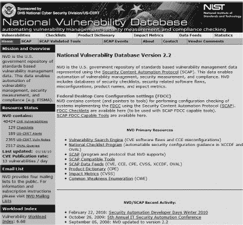

**图 6-2** 美国国家标准与技术研究院（NIST）：国家漏洞数据库。

##### 保持对安全和漏洞研究的关注

除非你知道现有、新出现和即将到来的威胁是什么，否则无法防范它们。你需要主动寻找这些信息，因为大多数通用新闻来源（即使是专注于技术的）都不会涉及每天出现的大多数安全漏洞、利用代码或入侵事件。寻找优质的安全和漏洞研究相关资源（参见图 6-2）并坚持查阅。知识往往是安全斗争中最好的武器之一。

##### 制定安全检查清单

定期审查其完整性和准确性，例如每季度一次。定期频繁地确认清单上的每个项目，例如每周或每天一次。这在一定程度上可以自动化，但检查通常需要人工测试和确认，以确保每个安全机制都已就位、激活、武装且有效。安全检查清单将在本章后面进一步讨论。

##### 执行定期自我评估

许多安全组织和政府/军事机构发布安全实施指南、手册和检查清单。你可以使用这些文档（通常称为**安全技术实施指南（STIGs）**）来审查和评估组织的安全状况和状态。自我评估试图采用外部、独特或独立的视角来评估安全。这就是为什么使用外部安全指南、标准和度量可以揭示现有安全基础设施中的疏漏。

##### 执行内部合规审计

仅仅认为自己安全是不够的；金融、医疗等许多行业的法律现在都要求合规。确保完全遵守所有联邦和州法律法规，不仅是良好的安全管理，还能让公司高管免于牢狱之灾。使用外部审计师往往无法替代内部自我验证。

##### 实施最小权限原则

所有用户（包括管理员）仅需要完成其分配工作所必需的特权、访问权和权限。超出此最低限度的任何能力都会增加妥协和滥用的可能性。

##### 通过实施职责分离来隔离和划分管理权限

这也称为分散知识。管理员仅获得对 IT 基础设施有限区域的有限管理权限。没有单个管理员拥有对整个环境的完全或总控制权。这限制了不满的管理员以及攻破管理员账户的黑客造成潜在滥用和危害的范围。

##### 测试所有安全措施的充分性

对所有已部署的对策执行验证扫描，以确保其正常运行。安装不当或配置错误会使初衷良好的保护措施失效。安装每个新安全控件时以及每次重新配置时都要对其进行测试。

##### 执行定期漏洞评估

使用带有更新的安全测试和漏洞利用模拟数据库的自动化工具。这些工具应确认补丁和更新、验证安全配置，并探测已知漏洞和利用弱点。快速解决扫描发现的任何问题。

##### 在改进和微调安全基础设施后，进行终极测试：渗透测试

雇佣或组建道德黑客团队，测试 IT 安全、设施安全以及员工安全的强弱项。道德黑客使用与罪犯相同的工具和攻击技术，但无意造成实际损害。专业安全评估人员可以定制攻击、修改漏洞利用代码，并实时反应，以充分压力测试安全防御。

##### 设计安全时聚焦核心安全服务

核心服务包括机密性、完整性和可用性。未能妥善且充分地强化这些基本安全服务将导致损害、数据丢失和停机。

- **机密性**是在支持授权访问的同时防止未授权访问。
- **完整性**是防止未授权修改。
- **可用性**是保证资源能及时访问。

##### 考虑围绕三大核心功能设计安全（尤其是物理安全）：威慑、检测和延迟

- **威慑**是利用安全手段让潜在攻击者相信攻破系统的努力不值得。攻击可能被认为太难、太复杂，尝试太容易被发现，后果太严重。
- **检测**是监视安全突破尝试，以便及时响应。
- **延迟**是拖慢攻击进程，使即使成功的突破也能给防御者留出响应时间，以便抓捕攻击者或防止进一步入侵。

### Core Principles of Secure Design and Implementation


Another common triad in secure design and implementation is **prevention**, **detection**, and **response**.

*   **Prevention** is the use of safeguards to stop attacks or compromises. Preventing intrusions and violations is usually more efficient, easier, and more cost-effective than dealing with them after the fact.
*   **Detection** requires the instantaneous discovery of attempted and successful security violations. The longer the time span between a malicious act and an authoritative response, the greater the likelihood that the perpetrator will escape without punishment.
*   **Response** means being prepared to contain the damage, limit further compromise, and implement remediation to return systems to normal.

### The Importance of Authentication, Authorization, and Auditing

Do not overlook the importance of **authentication**, **authorization**, and **auditing**. These services are critical to the security infrastructure. You must control who is allowed into the facility and onto the network. Place limits on what authorized users can do. Hold all entities—even upper management—accountable for their actions, activities, and results.

### Establishing a "Default Deny" Philosophy

Focus on establishing a philosophy of **default deny** rather than **default allow**. By starting with blocking everything, only those features, services, protocols, ports, applications, and users that you judge and deem safe and appropriate are enabled through exceptions. A default allow stance means you must create a never-ending stream of explicit denials as you detect new compromises or malicious events. **Default deny / allow by exception** is always the preferred security posture.

### Implementing Application Whitelisting Controls

Implement whitelisting application controls. A whitelist is a list of allowed exceptions in the context of a default deny. By configuring systems with whitelists, all executables are blocked unless they are on the allowed exception list. The whitelist contains the application name, its filename, and a hash of the file. This prevents malicious or unapproved applications from spoofing by simply renaming the executable.

This set of cybersecurity management best practices should serve as your starting point for effective security work. Other valid and useful guidelines exist; therefore, do not assume this list of advice—or any other list from any other source—is exhaustive. You always have new experiences to learn, new challenges to face, and new wisdom to acquire.

### Fail-Safe, Fail-Open, and Fail-Closed Options

Failure is not an option; it is an inevitability. At some point in the life of an organization, failure will occur. Are you prepared to handle it properly, and how much damage will the failure cause?

Failure may stem from hardware ceasing to function properly due to unknown flaws in materials or construction; it may stem from accidental electrostatic discharge damaging circuitry; it may stem from atypical weather flooding a building; or it may stem from a malware infection crashing a server or a zero-day exploit compromising security from the outside.

Failure means problems, downtime, loss, and consequences. However, failure does not necessarily mean bankruptcy, going out of business, imprisonment, or catastrophic loss. The difference between a disaster and a mere inconvenience is **planning**. As with most aspects of security, proper and extensive planning helps design an infrastructure that can prevent or effectively weather any problem.

Planning for failure is planning how to respond to and recover from failure. The goal is to fail into a safe state rather than an unsafe or chaotic state. This is known as **fail-safe**. A fail-safe state reverts to a condition with little to no danger, or at least no further danger. Depending on the situation, a fail-safe state may be **fail-open** or **fail-closed**.

*   **Fail-open** refers to reverting to an open, accessible, or unlocked state. In the physical world, fail-open is critical for personnel safety (e.g., fail-open doors allow people to easily exit a building). However, such easily opened doors may become a weakness for intruders entering secure internal areas. In IT, fail-open refers to reverting to a state of unfiltered communication or data access.
*   **Fail-closed** refers to reverting to a closed, inaccessible, or locked state. In the physical world, fail-closed prevents doors or containers from being opened during an emergency or compromise. In IT, fail-closed blocks access to communications and other digital resources.

Depending on the specific circumstances, either a fail-open or fail-closed state can be a fail-safe or fail-secure option. In either case, you should carefully consider and plan the type of default response to be used, especially during emergencies, intrusions, compromises, or system failures.

### Physical Security

There is no security without physical security. Logical protections guard against logical attacks; physical protections guard against physical attacks. With just a few minutes of physical access, a hacker can overcome or bypass most logical security measures.

Physical security is the prevention of unauthorized individuals from gaining direct physical contact, access, or influence over sensitive components of the IT infrastructure. Any well-designed cybersecurity solution will include physical security components. If you fail to adequately address physical security, it means you have failed to understand the threats facing the organization.

Physical security includes:

*   **Facilities Resistant to Forced Entry**: Select, improve, or construct facilities that prevent and deter unauthorized physical intrusion. If physical forced entry is possible and potentially profitable, theft is more likely to occur.
*   **Monitoring All Personnel Movement**: Reliable physical access control includes logging when employees enter and exit every secure or sensitive area. Good physical access control prevents outsider access and enforces visitor escort requirements.
*   **Deployment of Technical Means**: Should include card-key entry, burglar alarms, motion detectors, and security cameras. Utilize the best available technology to deter and detect physical security violations.

### Monitoring for Signs of Compromise

Everyone in the organization is part of the physical security effort. Everyone has a responsibility to respect the security perimeter and report violations or suspicious activity. Security is about "locking" and "monitoring." Not every employee can assist with the locking process, but everyone can and should assist with monitoring for violations and suspicious behavior.

In addition to human monitoring, all available technology should be leveraged to look for security violations. Use auditing, `IDS` (Intrusion Detection Systems), `IPS` (Intrusion Prevention Systems), security cameras, motion detectors, etc., where appropriate. Proper cybersecurity management includes proper design for monitoring violations.

Violations can occur in the physical world as well as in the logical world of computers, networks, and the Internet. Do not assume that a violation is not worth knowing about or pursuing just because it did not cause direct physical harm. Crime is crime, whether physical or logical. Design and implement detection mechanisms to notice, log, and monitor suspicious or anomalous activity.

### Incident Response

Incident response is the planned reaction to a negative situation or event. Security violations, or at least violation attempts, will inevitably occur. When these events affect the organization or its ability to carry out its mission in any way, incident response is triggered. The goal of incident response is to minimize downtime, minimize loss, and return the environment to a secure normal state as quickly as possible.

Most incident response solutions contain six major steps or phases:

#### 1. 准备


# 选择并培训安全事件响应团队（SIRT）成员，分配资源

## 2. 检测

确认实际发生的入侵。

## 3. 遏制

限制事态进一步升级。

## 4. 根除

解决受损问题。

## 5. 恢复

恢复正常运行。

## 6. 后续跟进

审查流程并改进未来的响应。

事件响应计划是网络安全管理的重要要素。

### 诱捕入侵者和违规者

安全工作通常旨在预防和威慑。当入侵或安全违规尽管采取了预防措施仍然发生时，下一阶段或层级的安全机制必须做出响应。安全的下一阶段是检测。了解安全违规是否以及何时发生，对于及时、充分地应对入侵至关重要。

一旦检测到入侵，必须立即启动响应。响应的第一阶段是遏制。遏制的目标是防止已知恶意事件进一步扩散。遏制是一种心态、一个行动计划，也是设计的一个要素。作为一种心态，遏制是首批响应人员或 SIRT 成员的关注焦点。他们的目标是防止受损范围扩大或蔓延到其他系统。

#### 为什么遏制很重要

遏制可以像从受损系统上拔掉网线一样简单。这能有效切断嫌疑主机的所有进出通信。你也可以通过禁用用户账户、停止服务、在过滤设备中添加条目等方式实施遏制，等等。无论恶意事件的载体或来源是什么，都应切断其源头或目标，使其无法继续造成危害。

遏制行为应中断或干扰不受欢迎事件的持续扩散或运行。这种类型的初始响应通常对恶意代码、远程访问、后门控制、用户账户泄露、社会工程学以及许多其他形式的网络或系统入侵都很有效。

遏制通常被视为一种响应形式。遏制是首批响应人员采取的行动。然而，即使在你经历安全入侵之前，你也可以采用一种类似于遏制的预防措施，称为隔离。

#### 实施隔离

隔离是基础设施设计的一个要素，它考虑到了恶意代码或其他入侵者导致安全漏洞的可能性。隔离将网络明确划分为不同的访问区域或区域。通常，这些区域围绕着通常通过网络进行交互的部门或实体划分。任何通常不进行交互的实体，默认情况下都会通过路由器、交换机和防火墙等网络安全访问控制设备进行隔离。

隔离的目的是创建支持工作任务的小型系统集合，同时将风险降至最低。典型的风险在于：如果一台系统被攻破，该漏洞可能迅速导致其他系统也被攻破。这对于传播迅速的恶意代码尤其如此。但这也适用于远程黑客入侵，因为黑客会尝试从系统跳转到系统，搜寻有价值的资源。

网络隔离类似于船舶上的水密舱壁。如果船体漏水，受影响舱室的水密门会关闭并密封。这可以防止单一破口导致整艘船沉没。计算机网络隔离也是如此。当你检测到入侵时，可以切断网络隔离区之间的连接，防止任何进一步的恶意通信进出受影响的区域。

#### 使用蜜罐、蜜网和填充单元

你可以添加到安全基础设施中的另一种特定入侵者陷阱是蜜罐。蜜罐是针对黑客或入侵者的陷阱。蜜罐是一个系统或网络，它看起来包含有价值的信息，且似乎是合法组织网络的一部分，但实际上是一个专门设计的陷阱。蜜罐的目的是诱捕黑客/入侵者、检测新型攻击，或仅作为诱饵将攻击从实际的主网络上引开。

蜜罐可以是单个系统，也可以是由多个系统组成的网络，这些系统被构建得看起来、表现得、运行起来都像真实的网络环境，包含看似诱人实则虚假的资源。为了使蜜罐有效，它必须看起来和表现得就像一个真实的目标。否则，黑客会迅速发现它是假的，并更努力地寻找真实目标。蜜罐通常包含广泛的重点审计和记录功能，以彻底捕获其中发生的所有活动。

蜜罐可以是单个系统，也可以是多个联网系统。蜜罐网络有时称为 `honeynet`。蜜罐和蜜网都是始终运行的诱饵系统，旨在吸引潜在的黑客和入侵者。蜜罐的另一种形式是 `padded cell`（填充单元/缓冲区）。填充单元只有在检测到入侵者后才开启；随后你将入侵者引诱进入填充单元。

配置和部署蜜罐时，应使其不干扰授权用户执行授权活动。然而，你需要将它们放置在外部人员或入侵者可能采取的常见访问路径上，就像猎人藏在森林的兽径旁一样。蜜罐应具有足够的吸引力和趣味性，说服黑客攻击它，但不能过于吸引人，以免触发黑客脑海深处的那个声音：“这是个陷阱。”

蜜罐在两种主要情况下具有价值。首先，如果组织的主要目标是了解新的黑客攻击手段，那么蜜罐可以为此目的充当实验室。其次，如果组织的主要目标是起诉罪犯，那么蜜罐可能有助于发现、识别和逮捕嫌疑人。然而，如果这两个目的都不是组织的主要目标，那么部署蜜罐通常就不是一项值得的举措。

### 基本主机安全控制

每台主机都需要防范其用户以及其通信的网络带来的威胁。即使在私有网络内，授权用户也始终存在风险。预防措施包括为主机设备配备合理的防御措施，以抵御已知的潜在妥协途径。

每台主机都需要防病毒扫描器。虽然在某些操作系统中恶意代码的威胁不如在其他系统中严重，但黑客会为每个平台创建恶意软件。你不能再仅凭操作系统的选择就自称拥有免疫力。

防病毒扫描器必须是最新的。扫描引擎（恶意软件检测的核心机制）不应超过一年。通常，部署的防病毒软件其名称中应包含当前年份，或其构建日期为当前年份。任何超过一年的防病毒扫描器，在新的和当前的扫描技术、恶意嵌入技术以及清理和移除程序方面都太过陈旧。

防病毒扫描器需要至少每天更新一次其病毒定义数据库。这应该是一个自动化过程，以便供应商一发布新更新，就立即下载并应用。使用带有旧数据库的扫描器与使用旧扫描器一样糟糕。防病毒产品仅针对已知威胁提供保护，因此不要让你的防病毒软件因延迟更新而产生“健忘症”。

#### 杀毒软件和反恶意软件配置

杀毒扫描器必须配置为执行持续、一致且自动的扫描。实时监控计算机系统的内存、处理堆栈以及任何其他活动元素，以发现恶意代码入侵的症状。当恶意软件到达主机时，它可以在瞬间感染该主机并分发其副本。如果没有实时感染监控，严重破坏可能在定期扫描发现入侵之前很久就已经发生。

杀毒扫描器应配置为定期（每天或至少每周一次）在所有内存和存储设备上执行完整的、全系统的、低级别扫描。通过定期扫描整个系统，您可以检测并清除那些通过某些未监控或隐蔽通道获得访问权限的恶意软件。

除了杀毒扫描器外，主机还应受益于反恶意软件扫描器。反恶意软件扫描器也称为间谍软件或广告软件扫描器。这些是杀毒软件的配套扫描产品，因为它们能发现其他形式的恶意、骚扰或可疑代码，而这些代码可能不符合病毒或蠕虫的定义。其目标包括间谍软件、广告软件、键盘记录器、Rootkit、黑客工具、后门、特洛伊木马、恶意/异常 Cookie、可疑移动代码、僵尸程序、肉鸡等。不要被这些名称迷惑。所有这些事物都代表着真实的网络破坏潜力。

#### 主机防火墙

每台主机都应配备软件主机防火墙。主机防火墙为进出本地主机的数据提供过滤服务。主机防火墙可以限制本地应用程序的网络连接，也可以允许或拒绝外部实体对资源的访问。

#### 全盘加密

大多数主机都能从全盘加密的额外安全性中受益。这可确保驱动器上的所有数据都得到保护。根据您采用的产品和技术，全盘加密可以通过启动密码或使用硬件设备（如 USB 驱动器或 `Trusted Platform Module (TPM)` 芯片）来解锁。全盘加密本质上可以防止硬盘被盗后被其他系统读取。

#### 哈希完整性检查

某些形式的系统和文件损坏源于非恶意软件相关的活动。使用哈希完整性检查机制监控未经授权的文件更改，有助于追踪异常入侵源头。监控每个系统文件和设备驱动程序。任何与安装有效更新无关的更改，都可能是恶意活动的症状。

#### 审计和日志记录

您应该在所有主机上配置并审查审计功能，而不仅仅是服务器。恶意活动和通信可能发生在任何系统上。将每台主机配置为审计、监控并记录本地和网络事件。然后，使用入侵检测系统（`IDS`）或其他形式的安全审计工具，扫描日志文件以查找关注症状。未知的事情可能伤害您，因此请尽可能掌握更多知识。

#### 备份与恢复

备份。备份。备份。没有备份解决方案是没有借口的。备份是防止数据丢失的唯一保险。不进行备份就是在为失败和数据丢失做计划。单次数据丢失事件（如硬盘故障）就足以导致组织倒闭。不要因疏忽而丢失数据；请立即实施备份流程。

备份并不困难。它们只需要一点规划。首先，规划您想将备份存储在何处。主要有三种选择：在线、异地或本地。

在线或云备份存储在普及度、可用性和成本效益方面日益增长。在线备份可让您从任何互联网连接访问数据，使得从任何地方恢复成为可能。然而，在线备份将您的数据置于他人的硬件上，使您依赖于该方的安全性、保密性保证和可靠性。此外，备份传输速度取决于本地互联网链路速度，这通常比大多数本地介质备份选项慢得多。

异地和本地存储采用备份介质。备份介质可以是磁带、光盘、硬盘和固态硬盘/卡。物理介质需要存储空间，并面临物理威胁，即盗窃、损坏和毁灭。面对重大灾难时，异地存储是更好的选择。这可以保护您的备份介质免受主要工作地点发生的问题造成的损害。本地存储可针对小问题提供快速恢复。

中大型组织通常会选择多阶段备份解决方案，以同时获得本地和异地存储的优势。一种可能的配置是使用可重写高速光存储设备阵列来托管实时、在线、本地备份。然后从光存储集定期备份到便携式介质（如磁带），以便安全地异地存储。

这种配置提供了从原始系统到光介质的快速备份，然后提供了快速创建磁带副本的便捷流程。它还允许从在线、本地光备份快速恢复数据，同时通过异地安全存储磁带提供重大灾难保护。

尽可能自动化备份流程，以确保其执行。如果备份网络数据的行为干扰了生产，则安装一个辅助网络以专门支持备份的数据传输。这将要求受备份流程保护的每个系统都配备第二个网络接口。

备份介质的异地存储位置应安全且合理地受到保护，免受灾害（特别是恶劣天气）的影响。如果您的组织规模足够大，拥有多个位置，而不是同一栋楼甚至几个街区内的建筑物，那么异地存储可以从第三方存储切换为远程分支机构的内部存储。

### 用户培训与意识

用户 `training` 是任何安全工作的重要组成部分。组织中的并非每个员工都是 IT 或技术专家，您也不应指望他们是。安全培训和 `awareness` 旨在为所有用户提供基本安全知识以及特定岗位的安全信息。

要让用户对其行为负责，首先要明确定义网络安全策略的边界和限制。拥有一套规则和限制却不告知人员其存在，无法强制执行策略，并可能导致员工不满。培训和意识教育对于让用户了解其职责以及违反组织策略的后果至关重要。

如果没有针对用户的充分安全教育，维护安全环境将变得困难，甚至不可能。然而，许多组织未能充分支持最终用户培训。这导致用户不了解安全的重要性、必要性和益处。此外，这将导致违规行为增加，其中大多数是良性且意外的，但您仍需调查和解决这些事件。

一些常见的最终用户安全错误或因缺乏安全培训引起的问题包括：

 打开来自未知来源的电子邮件附件，或来自已知来源但意外或异常的附件

 阻止更新和补丁安装，即使这些更新已获安全人员批准并推荐

 在工作计算机上安装未经批准的软件，包括游戏、屏幕保护程序、实用工具、即时通讯客户端和浏览器插件

 在工作计算机上安装未经验证为安全且无恶意代码的软件

 未能备份工作计算机上的个人数据或工作数据

#### 常见安全问题与用户教育

##### 普通用户常见的安全问题

以下是未受培训用户导致的一些常见安全问题示例：

- 使用调制解调器或无线连接从台式机或笔记本工作电脑连接，同时仍连接到公司局域网
- 使用不加密其数据库的密码存储/跟踪工具
- 离开电脑时仍保持登录状态
- 将未知且未批准的设备连接到工作电脑
- 在工作电脑上使用来自外部来源的便携式媒体和存储设备
- 未经批准在工作电脑上安装远程控制或远程访问软件
- 在多个系统上使用相同的密码
- 将便携设备留在工作场所外可能被轻易盗窃的位置，如汽车后座

通过合理的用户安全教育，可以避免或至少最大程度减少这些问题。然而，IT 人员也常犯安全错误，即使他们对技术更了解。仅仅因为某人是“技术人员”或可能被视为电脑极客，并不意味着他或她也懂安全。

##### 技术专家常犯的安全错误

技术专家（本应更懂安全）常犯的错误包括：

- 在多个系统上使用相同的密码
- 允许新系统在未妥善加固和/或测试前上线
- 未能及时应用可用的补丁和升级，尤其是与安全相关的补丁
- 使用方便但不安全的远程系统和设备管理机制，如 `telnet`、`HTTP` 和 `FTP`
- 通过电话讨论密码，包括根据电话要求更改密码
- 在提供信息或资源访问权限前，未能妥善核实身份、权限和授权
- 未能实施适当的备份解决方案
- 未验证和测试备份是否正常工作
- 假设某事物是安全的或配置正确的，而未具体检查和验证
- 允许不必要且潜在不安全的应用程序、服务和协议保留在系统上
- 使用默认设置的安全和网络设备，如防火墙、代理、路由器等
- 未能理解新软件或硬件产品上的所有安全配置选项
- 在彻底测试并获得批准前，将新软件或硬件投入生产
- 允许反恶意软件防御过时或失效
- 允许敏感信息在未加密的通道中传输

即使知识渊博的技术专业人员，也可以通过适当的培训和意识**教育**学习如何更安全。组织中的每个人都有安全责任。这些责任需要被定义、解释和教授。当用户了解风险是什么、有什么利害关系，以及如果他们不支持安全，其行为将如何影响他们时，他们的行为会得到改善。

##### 安全培训的目标

与安全相关的培训目标是**用户行为改变**。用户需要采取措施，将其日常活动从使自己和工作场所处于风险中的活动，转变为避免风险的活动。大多数人容易理解风险，但他们需要意识到风险，以触发其行为的改变。

良好的用户培训将提高用户对组织标准、策略、程序和指南的遵从性。通常，安全培训的开始是**意识培训**。意识培训是适用于所有员工的入门性、基础性和普遍性的安全信息。其目的是为整个组织建立共同的安全理解基准。

意识培训的主要方式是课堂环境。但也应包括各种沟通方式，包括在线视频、交互式网站、海报、电子邮件提醒、定期备忘录或时事通讯、墙面横幅、咖啡杯、便利贴、经理评审会议、广播通知、屏幕保护程序、鼠标垫，甚至语音邮件。关键是告知用户基本安全要素，然后在他们工作时强化这些基础知识。

意识培训对所有人员、所有职位、每个访问级别都很重要，从组织的顶层到底层。每个人都应了解基本安全问题。这些通常侧重于一般责任、责任追究、寻求避免浪费和欺诈、减少未经授权的活动，以及留意异常或可疑事件。

##### 用户教育

每个组织都应有书面安全策略，但这还不够。为确保个人知晓策略，应要求其阅读策略并签署声明，确认已阅读并将遵守该策略。个人还应阅读并确认将遵守发布的策略变更。这些要求不仅适用于薪金和小时工员工，也适用于任何被授予电子或物理访问权限以进入组织场所、以及在资产运输离开物理设施途中访问组织资产的人员。这可能包括承包商、供应商和其他人员。这需要持续监控。甚至可能需要测试或安全认证、背景调查，或其他确定持续合规性的手段。鼓励用户遵守策略的一种方法是确保他们了解不合规的后果。获准访问组织资产的任何人都不豁免于安全策略。

员工通过言行看到安全很重要，这一点至关重要。这意味着即使是高管也必须对执行在普通员工群体中实施的相同基本原则负责。如果员工看到高级管理层妥协或规避合规的证据，他们会觉得规则不够重要，不值得任何人遵守。你不希望员工因“不要学我做，要听我说”的管理模式而感到沮丧和困惑。

在意识培训之后是**培训**。培训更侧重于与特定工作任务密切相关的安全问题和主题。因此，培训由特定工作的安全信息组成。此类安全培训帮助用户在遵守安全基础设施边界的同时完成其个人工作任务。

大多数组织提供内部意识培训和技能培训。这很常见，因为此类培训直接减少事件以及处理和响应内部意外和基于无知的违规行为的相关成本。

超越培训的是**安全教育**。这种学习形式的范围比工作描述甚至整个组织都要广泛。安全教育的目的是获得关于安全及相关主题的广泛知识，即使它们不直接适用于当前的工作职责或任务。教育是为了个人的进步，也许是为了改善其职业前景。

###### 教育与安全管理

教育通常是在组织外部获得的。公司可能将教育视为对员工保留的威胁，也可能视为让员工保持满意的福利。大多数组织都希望提升其人员的技能。无论哪种方式，安全教育都能提高个人的知识和技能。

安全意识、培训和教育对任何安全工作都有益处。将其纳入并为组织的整体安全解决方案提供资金支持，将提高成功的几率。

### 网络安全管理工具

最好的网络安全管理工具既不是商业产品，也不是开源产品或解决方案。相反，最好的网络安全管理工具非常简单且显而易见。最好的工具包括：

- 一份书面安全策略
- 所有硬件和软件的完整清单
- 物理布线布局和设备位置图
- 逻辑组织、寻址和子网划分图
- 每台设备的完整配置文档
- 变更文档和日志
- 备份和恢复程序
- 业务连续性和灾难恢复策略
- 故障排除指南
- 硬件和软件文档
- 个人知识和技能
- 在线资源的访问权限

安全管理不在于拥有最昂贵的产品或最自动化的配置。相反，良好的安全管理植根于对基础设施的可靠理解，以及根据需要改进、响应和修复的工具。过分关注光鲜亮丽的产品甚至可能分散对安全管理基础工作的注意力。

安全管理应始终以保护资产、支持授权活动以及在发现威胁时做出响应为中心。使用现成的安全管理产品可能更高效或更具成本效益，但使用它们不能替代解决组织核心安全问题。

#### 安全检查清单

安全是脆弱的。黑客只需发现你防御中的单个缺陷即可发起攻击。无论是物理还是逻辑上的基础设施变更，都可能打开以前不存在的新漏洞。此外，用户和人员可能有意或无意地破坏安全。

维持安全有效性的一种方法是定期对每一项对策、保障措施、安全控制、威慑手段、预防措施和防御机制进行验证和确认检查。这需要所有安全措施的清单。该清单随后可转化为检查清单。

物理安全和逻辑安全各自需要一份单独的清单，专注于各自的关注领域。保安或安全技术人员会调查每一项物理安全措施，以确保其仍然生效、处于激活状态且未被篡改。逻辑安全层面的此类任务最好由拥有适当管理访问权限的安全技术人员执行。

安全清单核查应定期且频繁地进行，最多每天一次，至少每周一次。清单上的每一项都应亲自到场检查。如果出现任何问题或疑虑，应记录在案并立即引起安全团队的重视。及时采取补救措施并进行调查，以追踪问题的根本原因。

##### 物理安全检查清单

物理安全检查清单应包括为设施控制部署的每一项安全控制措施。这些包括：

- 检查每一扇窗户的锁
- 检查每一扇门的锁
- 检查每一面外墙
- 检查架空地板区域的入口
- 检查吊顶的入口
- 确保柜子或容器已上锁
- 核实监控摄像头指向正确方向
- 核实所有灯泡类型正确且工作正常
- 检查运动探测器


- 测试报警系统
- 面谈保安并确认其遵守程序

根据行业和专业化程度，组织的物理安全可能包含更多组件。此清单仅为典型物理安全检查清单应包含内容的示例。请留意物理安全每个要素的任何修改、损坏或普遍故障。一个损坏的窗锁或一扇无法自动完全关闭的门，都可能导致意图破坏计算机设备的窃贼轻松进入。

### 逻辑安全检查清单

逻辑安全检查清单应包括为计算机和网络控制部署的每一项安全控制措施。这些包括：

- 检查认证
- 检查授权和访问控制
- 审计系统
- 核实防火墙和其他过滤器
- 检查代理和其他通信管理解决方案
- 核实加密，包括密钥管理
- 更新防病毒软件和扫描器
- 备份并安全存储归档信息

设计良好的安全基础设施中，详尽的逻辑安全检查清单包含更多要素。同样，此清单仅为大多数安全组织中常见元素的示例。不良配置、被忽视的默认设置和过时的系统可能留下漏洞，供探测的黑客发现并利用。

永远不要假设你是安全的。定期检查并核实一切。没有人会替你做这件事。

使用安全检查清单的目的是在变更、事故和人性面前，长期维持有效的安全。然而，即使是一份完整的清单也无法解决由糟糕的设计和实施引起的问题。为确保你的清单真正有益，而不仅仅是“在沉船上重新摆放躺椅”，请考虑以下常见的疏忽或问题：

- 不要假设某项服务或协议受其他层或服务保护。请核实穿越网段的数据是否已加密或以其他方式得到保护。
- 了解安全产品的局限性。每种安全机制都在特定环境下解决单一或一小组问题。某一位置存在安全措施，并不会在其他位置神奇地形成一层安全保护伞。请确保在必要的地方部署了具体且相关的安全解决方案。例如，使用 `IPSec` 进行网络加密并不意味着存储在客户端上的数据已加密。
- 不要仅依赖会话发起时的认证。会话劫持是大多数常用协议面临的严重威胁。请使用支持定期中途重新认证以及通信加密的解决方案。
- 假设程序天生不安全。安全通常不是编程中的优先事项或要求。在可能的情况下，使用安全编程质量保证。
- 为处理故障、错误、入侵和停机做计划。专注于发生坏事时该怎么做。目标应是快速高效地恢复。不做计划就是计划失败。

 假设您可能成为拒绝服务（DoS）攻击的受害者。每个通信系统都容易受到 DoS 攻击。不要忘记物理损坏也可能是一种有效的 DoS 手段。

 从错误中吸取教训。当问题被发现、设计缺陷被揭示、流程被证明无效时，要正视问题，承担责任，承认过失，然后解决它。改进环境以解决问题。复盘流程并从中学习。

安全清单可以成为管理和维护网络安全的有效工具。请务必立即开始编制清单，并将其用于实际的复查工作中。

### 网络安全故障排除

安全故障排除旨在从与对策相关的问题中恢复。防御机制本身也会出现问题。安全控制的停机时间与核心业务流程或资产的停机时间一样关键。安全控制故障的排除是网络安全管理的重要组成部分。

与大多数问题一样，预防总是优于修复或响应。通过努力确保故障不发生，或者至少减少发生频率，维护有效安全将更容易，且在预算和人力方面成本更低。

网络安全故障排除通常涉及分诊——决定哪些问题或故障最为迫切。安全组件对关键任务流程影响越大，快速响应和修复就越重要。当安全防护失效时，先前受保护的资产将面临更大的妥协风险。最小化响应所消耗的时间对于最大限度地减少长期损失至关重要。

网络安全故障排除中最有效的预防技术之一是安装补丁和更新。与生产系统的补丁和更新一样，在部署前务必彻底测试新代码。一旦测试通过并批准应用，请在停机造成问题最少的时候应用更新。如果更新过程本身导致进一步的安全控制问题，请始终准备好冗余方案。

应用补丁和更新可能导致的并发症包括：恢复出厂默认设置、丢失部分（而非全部）配置设置，以及“变砖”（即使其失去功能）。如果安全控制恢复到出厂默认设置，则需要完全重新配置。如果有最近的配置备份，恢复可能是一种快速修复方法。否则，将需要手动重置。为便于此过程，请始终保留所有安全控制所有设置的完整文档。

如果丢失部分但非全部配置设置，则安全控制不太可能按预期运行。请及时恢复或重新配置设置。更新本身可能添加或修改了需要测试和验证功能及兼容性的设置。如果新功能干扰业务任务，可能需要禁用该功能或回滚更新。

如果更新过程导致安全控制完全失效，该产品很可能变得毫无用处。这被称为变砖——将有用的设备变成无用的砖头。在某些情况下，硬重置可以使看似变砖的设备恢复活力，而其他设备可能有更深奥的修复和恢复选项。如果供应商不提供解砖方案，请在互联网上搜索用户组或讨论论坛寻找民间解决方案。

配置错误可能是安全控制故障的原因。配置错误可能由人为失误、疏忽或无知引起，也可能由更新、电源波动和物理损坏导致。当安全控制配置不当时，它无法提供预期的安全性。排除这种情况可能只需恢复到之前保存的配置或手动重新应用设置。

然而，当配置错误不易修复时，会出现更严重的问题。最近的补丁或更新可能导致产品变得不稳定，或者可能需要补丁或更新来稳定它。如果每次电源循环后配置错误都会重现，则设备可能有缺陷，可能需要额外内存（或更换有缺陷的内存），或者可能需要连接不间断电源（UPS）以减少非计划电源波动的次数。

物理损坏应迅速修复。如果无法修复，可能需要更换设备。安装预防措施以防止物理损坏再次发生。

在某些情况下，安全问题不在于安全组件本身，而在于整体基础设施设计。定期（如每年一次）重新评估设计，以判断当前基础设施是否继续满足组织的安全需求。由于安全形势随时间变化，安全设计可能需要演进以应对新的风险、威胁和关注点。

电源故障可能由多种原因引起。如果建筑物的电网不可靠，如果电压跌落和尖峰经常发生，长期修复的重点应放在改善建筑物的配电系统上。短期响应可以包括浪涌保护器、UPS 和发电机。

如果设备因过热而遇到电源波动，请检查设备运行所在机房是否具备足够的 HVAC 服务。专用于放置计算机设备的机房平均温度应在华氏 70 度（约 21 摄氏度）或以下，并保持适度相对湿度以避免产生静电。在人们使用计算机办公的房间中，温度应保持在华氏 80 度（约 27 摄氏度）以下。此外，请检查设备是否有足够的内部气流以维持适当的内部工作温度。不要忘记检查过滤器和通风口是否有灰尘堆积。

电源故障可能包括电源或电网的变化。在这种情况下，唯一的响应措施是浪涌保护器、UPS 和发电机，因为客户无法自行影响电力公司的供电质量。如果更换电力供应商是一个选项，请调查其他供应商的可靠性，以及切换的费用和麻烦。有时积极且公开地“货比三家”选择电力供应商，可以促使现有供应商改善服务。

静电也是一个关注点。静电放电（ESD）或静电放电（SED）很容易损坏设备，包括安全设备。当您看到火花从手指跳到门把手时，放电的电量足以摧毁大多数计算机芯片。采取预防措施以防止静电损坏。

物理损坏可能是一个需要排查的问题。损坏可能由故意破坏、意外事故或自然灾害引起。如果损坏只是表面或外观上的，设备可以恢复使用。但是，如果损坏导致安全设备无法正常运行，则在大多数情况下需要更换它。解决物理损坏的原因，以降低再次发生的可能性。

### 网络安全故障排除

网络安全故障排除的重点在于入侵者能否绕过安全防御或限制。可被绕过的安全控制毫无价值。一旦发现某安全控制可被绕过，你需要调查绕过的方法或机制。然后，如果可能，移除或阻断该绕过方法。如果缺陷涉及设计或基础设施问题，请考虑修改设计以消除漏洞。

黑客不时会发现安全控制编程中的缺陷。一旦编写出利用代码，攻击者即可利用有缺陷的代码使安全控制失效。通过审查漏洞数据库和研究报告、关注供应商信息以及监控组织网络的日志文件来保持警惕，当攻击成功时，这些措施应能向你发出警报。

防御针对安全控制的攻击，与防御针对网络任何其他方面的攻击是一样的。如果可能，重新配置控制以降低攻击的有效性。考虑移除该组件，直到你能实施新的防御。一旦供应商发布补丁或更新，立即应用。

网络安全故障排除的最后一个关注点是硬件故障。虽然不常见，但硬件确实会发生故障。在组织的整个生命周期中，你几乎可以肯定会遇到由硬件故障导致的停机。当故障硬件是安全控制时，停机的后果更为严重，因为它使环境的其余部分面临更大的风险。

通过备有替换硬件或能快速获取替换硬件来应对硬件故障。通过冗余基础设施设计减少停机时间。监控持续的性能指标可能有助于在性能下降时检测到未来的硬件故障。然而，突发性硬件故障难以预测。因此，准备好替代方案和备件通常是最佳的故障排除解决方案。

#### 合规性审计

合规性审计是一类评估，用于判断组织实现既定目标或要求的程度。这些目标和要求可以是内部制定的，也可以由政府、行业及其他监管机构设定。合规性审计是维护业务（尤其是成长型企业）的重要组成部分，因为它确保组织遵循所有必要的安全准则。

对于某些行业（如金融和医疗），合规性审计可能是法律要求。独立的外部审计员执行合规性审计，以确保目标组织完全遵守政府强制实施的规则和法规。此项审计是对正在进行的业务流程进行的全面调查和审查。审计要求审查安全策略、访问控制、风险管理流程和历史日志文件。

合规性审计的重点因行业、信息类型以及组织是公共还是私营而异。审计员通过文档分析、人员访谈和梳理审计日志来调查组织。合规性审计可检查近期安全漏洞、评估事件响应、访谈前员工、判断用户访问级别、就关键安全问题访谈高管等。

组织通常清楚地知道何时合规性审计是强制性的定期活动。在这些情况下，公司应通过收集审计员所需的各类信息并创建相应记录来为审计做准备。事实上，建立生成和归档必要信息的标准做法是明智之举。这些行动的目的不是操纵数据，而是提供对事实和历史活动的充分访问。

没有强制合规性审计的组织应考虑实施自我审计。彻底调查与既定安全策略的合规程度，可提高每个组织的长期稳定性和安全性。自我评估和改进是大多数成功 IT 组织的共同特征。

### 安全评估

安全评估是对已部署安全解决方案的判断、测试和评价。就安全而言，世界状态在不断变化。黑客社区正积极开发新技术、新方法和新漏洞利用来攻破目标。昨天有效的防御和策略明天可能不再那么有效。

安全评估是评估安全以便加以改进的持续过程。安全是通过执行风险评估来建立的。评估结果被制定成策略，指导初始安全基础设施的实施。从那时起，安全管理接管后续工作。

安全管理是监控漏洞、调整现有安全性并评估安全改进需求的过程。正是后一关注领域是安全评估的重点。安全评估采用多种技术来评估已部署安全措施的有效性。

#### 配置扫描

配置扫描探测系统以确定配置和设置的当前状态。此扫描可确定已安装或缺失哪些可用的供应商补丁。此外，该扫描还会根据建议数据库评估大量系统配置设置。根据你用于执行配置扫描的工具，你可能会根据系统功能或总体期望安全级别发现不同层级的建议。

一个著名的配置扫描工具示例是 `Microsoft Baseline Security Analyzer (MBSA)`。`MBSA` 扫描 Windows 系统并生成易读的报告（图 6-3）。该工具可快速评估单个系统的整体安全状况。要下载 `MBSA` 工具，请访问：[`www.microsoft.com/en-us/download/details.aspx?id=7558`](http://www.microsoft.com/en-us/download/details.aspx?id=7558)。

`MBSA` 是小型办公室和最终用户快速检查其系统是否符合知名补丁和安全设置配置的绝佳工具。然而，这只是第一步；它不应是你使用的唯一工具。你还需要其他工具，特别是非微软软件，专注于更广泛的问题，以获得完整彻底的配置扫描。


**图 6-3** `MBSA` 扫描报告。


**图 6-4** `Nessus` 扫描报告。

#### 漏洞扫描

安全评估的下一步或阶段是**漏洞扫描**。漏洞扫描专注于定位已部署系统中已知的可利用弱点或漏洞。你可以使用具有可更新的漏洞利用和测试脚本数据库的自动化工具来执行此类扫描。漏洞扫描将揭示配置、安装和产品代码方面的问题。此类扫描的可靠性仅取决于产品本身及其测试数据库的时效性。

一款流行且知名的漏洞扫描产品是 `Tenable Network Security’s Nessus`。`Nessus` 提供供家庭使用的免费版和供商业使用的付费版。`Nessus` 是一个功能强大的扫描引擎，拥有海量的漏洞利用插件数据库，提供卓越的报告功能（图 6-4）。

**注意**

`Nessus` 可在 [`www.nessus.org/`](http://www.nessus.org/) 在线获取。

#### 渗透测试

安全评估的第三个也是最后一个步骤或阶段是渗透测试。渗透测试也称为道德黑客攻击，是指受信任的道德安全专家应用黑客技术、方法论和工具的过程。渗透测试的目的是评估当前安全基础设施的弹性并推荐改进措施。渗透测试由一组专业人员执行，他们可以即时定制和调整漏洞利用代码。

渗透测试通常包含五个主要阶段或步骤：侦察、扫描、枚举、攻击和攻击后活动。犯罪黑客攻击和道德黑客攻击的步骤或组成部分是相同的。区别在于目标以及遵守道德限制和合同边界。

##### 事后评估回顾

即使使用三种主要技术（配置扫描、漏洞扫描和渗透测试）进行了充分的安全评估，您可能仍然需要一种额外形式的安全评估。这种额外形式就是事后评估回顾。

事后评估回顾是个人和组织在每次安全评估任务后执行的自我评估。事后回顾的目的是从错误中吸取教训。这将改进未来活动的流程并避免相同错误的再次发生。实践出真知。如果您反复练习相同的任务，每次都在前一次表现的基础上改进，最终将掌握该任务。

事后回顾提供持续的渐进式改进以及罕见的革命性改进。此类回顾可以包含许多评估重点要素，包括：

- 整个流程
- 每个执行的步骤
- 步骤的顺序
- 步骤是否可能缺失
- 还可以采取什么其他行动
- 参与者是否经过适当培训
- 是否需要额外资源
- 资源是否被浪费
- 是否需要额外人员
- 涉及人员是否过多
- 报告是充分还是不充分
- 缺少什么
- 下次可以改进什么

只要目标是改进评估流程和工具的未来应用，还可以提出许多其他问题。当持续使用时，事后回顾是一个有益的过程。

## 章节总结

网络安全管理侧重于警惕性。警惕性要求在技术方面保持最新。警惕性要求了解新威胁和漏洞利用。警惕性要求及时响应停机和妥协事件。警惕性要求定期、持续地恢复、修复和更新安全性。

网络安全管理领域包含大量活动，包括故障安全响应、维护物理安全、检测妥协、准备事件响应、诱捕入侵者、主机安全组件、备份程序、用户培训、管理工具、检查表、故障排除、合规性审计和安全评估。

## 关键概念和术语

- **Awareness**（意识）
- **Backup**（备份）
- **Business continuity plan**（业务连续性计划）
- **Compliance audit**（合规性审计）
- **Default deny**（默认拒绝）
- **Default allow**（默认允许）
- **Disaster recovery plan**（灾难恢复计划）
- **Education**（教育）
- **Fail-open**（故障开放）
- **File encryption**（文件加密）
- **Honeynet**（蜜网）
- **Incident response plan**（事件响应计划）
- **Mission-critical**（任务关键型）
- **Padded cell**（隔离环境/软禁环境）
- **Patch management**（补丁管理）
- **Principle of least privilege**（最小权限原则）
- **Security Technical Implementation Guides (STIGS)**（安全技术实施指南）
- **Separation of duties**（职责分离）
- **Single-factor authentication**（单因素认证）
- **Training**（培训）
- **Trusted Platform Module (TPM)**（可信平台模块）
- **Vulnerability scanning**（漏洞扫描）
- **Whole hard drive encryption**（全盘加密）

## 第 6 章评估

**1.** 以下都是网络安全管理最佳实践的示例，*除外*：

A. 编写安全策略
B. 获得高级管理层认可
C. 过滤互联网连接
D. 为客户提供快速响应时间
E. 实施纵深防御

**2.** 以下都是网络安全管理最佳实践的示例，*除外*：

A. 避免远程访问
B. 从单一供应商采购设备
C. 使用全盘加密
D. 实施 IPSec
E. 加固内部和边界设备

**3.** 以下都是网络安全管理最佳实践的示例，*除外*：

A. 使用多因素认证
B. 备份
C. 拥有业务连续性计划
D. 确定优先级
E. 用完每年的预算

**4.** 发生故障并恢复到切断互联网与 DMZ 之间所有通信状态的防火墙主机，显示了一种称为以下哪项的防御类型？

A. 默认允许
B. 显式拒绝
C. 故障关闭
D. 出站过滤
E. 通过隐匿实现安全

**5.** 物理安全访问控制的目的是：

A. 授予外部实体访问权限。
B. 防止外部攻击通过防火墙进入。
C. 为培训提供可教学场景。
D. 限制人员与设备之间的交互。
E. 防止通过外部设备进行授权通信。

**6.** 完整全面的安全方法需要解决或执行两个主要功能。第一是保护资产，第二是：

A. 监视违规尝试。
B. 防止停机。
C. 验证身份。
D. 控制对资源的访问。
E. 根据组织使命设计基础设施。

**7.** 事件响应是对负面情况或事件的计划性反应。以下哪项不是事件响应的常见步骤或阶段？

A. 遏制
B. 恢复
C. 根除
D. 检测
E. 评估

**8.** 以下都是有效网络安全安装的要素，*除外*：

A. 备份与恢复
B. 用户培训和意识
C. 合规性审计
D. 安全检查表
E. 非计划停机

**9.** 隔离区划分任务侧重于协助解决什么总体安全问题？

A. 限制入侵者造成的损害
B. 基于流量过滤流量
C. 基于位置控制访问
D. 通过利用率支持事务
E. 评估安全性

**10.** 以下哪类安全组件对于安装在所有主机上很重要？

A. 防火墙


## 选择题

**10.** 以下哪项是恶意软件防护的类型？

A. 杀毒软件

B. 反间谍软件

C. 全盘加密

D. 间谍软件防御

E. 以上全部

**11.** 防止数据丢失的唯一保护是什么？

A. 完整性检查

B. 加密

C. 流量过滤

D. 备份与恢复

E. 审计

**12.** 以下都是意识培训中应解决的常见错误或安全问题，*除外*：

A. 打开来自未知来源的电子邮件附件

B. 使用主机不属于的其他子网的资源

C. 在工作计算机上安装未经批准的软件

D. 未能备份个人数据

E. 登录状态下离开计算机

**13.** 最佳网络安全管理工具包含以下所有内容，*除外*：

A. 设备完整清单

B. 书面安全策略

C. 昂贵的商业产品

D. 逻辑组织架构图

E. 变更文档

**14.** 安全检查表的目的是：

A. 在灾难发生时保存设备清单

B. 创建替换零件采购清单

C. 确保所有安全要素仍然有效

D. 完成组织的安全文档

E. 评估基础设施的完整性

**15.** 以下哪项在安装补丁或更新时*不是*潜在风险？

A. 将配置重置回出厂默认值

B. 降低安全性

C. 导致设备变砖

D. 安装未经测试的代码

E. 提高抵御漏洞利用的弹性

**16.** 关于合规性审计，以下哪项陈述是正确的？

A. 合规性审计是每个组织的法定强制任务。

B. 合规性审计确保遵循所有最佳实践。

C. 合规性审计创建安全策略。

D. 合规性审计是金融和医疗行业的可选职能。

E. 合规性审计验证是否遵循了特定行业的法规和法律。

**17.** 就现有安全措施抵御当前威胁的能力而言，以下哪项通常*不*被视为一种网络安全评估形式？

A. 配置扫描

B. 合规性审计

C. 漏洞评估

D. 道德黑客

E. 渗透测试

**18.** 以下哪项无法使用自动化工具充分执行？

A. 检查当前补丁

B. 确认配置设置

C. 漏洞评估

D. 扫描已知弱点

E. 道德黑客

**19.** 决定漏洞评估报告价值和相关性的关键因素是什么？

A. 数据库的时效性

B. 产品是否开源

C. 托管扫描引擎的平台

D. 执行扫描的时间

E. 网络上的可用带宽

**20.** 事后评估审查的主要目的是什么？

A. 降低成本

B. 添加新工具和资源

C. 将责任归咎于个人

D. 从错误中吸取教训

E. 延长任务消耗的时间

## 第 7 章：防火墙基础

**防火墙**是完整安全基础设施的**关键组件**。虽然常见，但防火墙绝非简单的安全措施。你必须了解防火墙的复杂性，才能设计防火墙安全策略、构建防火墙并对其进行正确配置。

本章讨论防火墙规则、认证和授权的基础知识。你将学习这些如何与监控和日志记录相关联、如何解读防火墙日志和警报、入侵检测、防火墙的局限性、提升防火墙性能；加密如何与防火墙相关联；如何评估各种防火墙增强功能；以及如何思考与防火墙管理接口相关的安全问题。

### 第 7 章主题

本章涵盖以下主题和概念：

- 什么构成了良好的防火墙规则
- 什么是认证和授权
- 什么是监控和日志记录
- 如何理解和解读防火墙日志和警报
- 什么是入侵检测
- 防火墙的局限性是什么
- 如何提升防火墙性能
- 防火墙配合加密的缺点是什么
- 什么是防火墙增强功能
- 如何使用防火墙管理接口

### 第 7 章目标

完成本章后，你将能够：

- 构建常见防火墙规则的示例
- 设计策略以指导有效的防火墙监控和日志记录
- 讨论防火墙的局限性和弱点
- 描述管理防火墙性能的方法
- 定义与防火墙相关的加密担忧
- 评估防火墙增强功能的利弊
- 演示如何访问和使用防火墙管理接口

### 防火墙规则

防火墙使用规则或**过滤器**来过滤流量。所有防火墙，无论类型——静态包过滤、状态检测、应用代理、电路代理或内容过滤——都使用规则来过滤流量。规则是对遍历网络的流量进行评估并采取行动的指令。

通常，两种主要理念或安全立场管辖规则的使用：默认拒绝或默认允许。默认拒绝也称为*默认拒绝*或*拒绝所有*。默认允许也称为*默认允许*或*允许所有*。这两条规则定义了管辖流量穿越防火墙的规则基础。

默认拒绝立场假设所有流量都可能是恶意的，或者至少是不需要的或未经授权的。因此，默认情况下禁止一切。然后，当良性的、期望的和授权的流量被识别出时，例外规则授予其访问权限。这被称为*默认拒绝/例外允许*。这种规则创建方法允许安全管理员专注于需要或想要的内容，而不是监视所有可能形式的不需要或恶意活动。

默认允许立场假设大多数流量是良性的。因此，默认情况下允许一切。然后，当恶意的、不需要的或未经授权的流量被识别出时，例外规则将其阻止。这被称为*默认允许，例外拒绝*。这种规则创建方法迫使安全管理员时刻监视新的和不同形式的不需要、未经授权和恶意活动。

大多数安全专家同意，**默认拒绝/例外允许**是采用的更安全立场。这种立场默认自动阻止大多数恶意通信，而相反的默认允许立场则默认允许大多数恶意通信。在大多数情况下，默认拒绝解决方案所需的例外比默认允许系统更少。

防火墙规则用于控制进入或离开安全网络区域的流量。根据防火墙的部署位置，此机制可以保护私有网络免受公共互联网的侵害，或过滤内部子网或部门之间的流量。安全管理员或专职防火墙管理员根据组织的安全策略配置防火墙规则。

大多数防火墙，无论硬件还是软件类型，通常都预配置了除默认规则之外的规则。防火墙通常采用默认拒绝立场进行出厂配置，并为最终用户/客户便利预置了一些常见例外规则（图 7-1）。通常，这些规则允许最常见的通信形式在初始安装时无需完全配置防火墙即可穿越新防火墙。一些更常见的出厂默认规则允许通过默认端口上的常见互联网服务进行 Web、电子邮件、即时通讯和文件传输。

虽然这很方便，但依赖第三方对你环境的假设或对你想要或不想要穿越防火墙边界的流量类型的猜测，从来都不符合你的最佳利益。请务必在部署到生产环境之前，花时间审查任何出厂预装规则。删除或禁用任何你不需要或不想要的规则。对于你确实需要或想要的任何规则，你应该复查以确保它们符合你的安全策略。如果你需要默认不存在的规则，请仔细添加并在过程中复查你的工作。


**图 7-1** SonicWall 的默认规则配置界面，显示最后一条规则（规则 11）为默认拒绝。

您的组织需要决定定义哪些规则；这是其安全策略的重要组成部分。如果与防火墙相关的适当章节没有预先定义在新防火墙上要定义的规则，则执行以下过程：

1. 清点所有将跨越检查点的基本业务流程和通信。
2. 确定内部和外部主机的有效流量的协议、端口和 IP 地址。
3. 在纸上或使用防火墙规则设计器/模拟器编写规则。
4. 在实验室环境中测试规则。
5. 从变更审批委员会获得规则集的书面批准。
6. 将规则记录到安全策略程序修正案中，并将修正案提交给安全策略管理团队，以便纳入正式文件。

最终，这是创建任何新安全要素的基本过程。目标始终是为每个安全组件制定书面安全策略。如果不存在定义部署新安全要素步骤的当前策略或程序，则必须编写、测试并获得新策略或程序的批准。一旦程序存在，就用它来判断部署是否成功。

要添加到新防火墙的确切规则完全取决于每个组织独有的业务流程。但是，大多数防火墙上都有一些常见类型的规则。这些包括：

- 访问不安全的互联网网站 (HTTP)
- 访问安全的互联网网站 (HTTP over SSL or TLS)
- 访问其他互联网网站协议 (SQL, Java 等)
- 入站互联网电子邮件
- 出站互联网电子邮件

如果其他互联网服务对业务任务至关重要，则需要允许或启用此类通信的规则。但是，请尝试将规则数量保持在最低限度。仅授予对必要流量的访问权限。添加到防火墙的每条规则都会增加其攻击面——从而增加其安全漏洞。

请记住，大多数网络通信都是双向事务、交换或会话。通常，内部客户端向外部服务器发起请求。服务器响应并建立通信通道，通常称为虚拟电路（基于 TCP 的传输层），或者更通用地称为会话。流量可以在任一方向上遍历会话。因此，大多数规则应允许入站响应初始出站请求。

根据防火墙的不同，单条规则有时可以同时定义出站和入站通信参数。其他防火墙需要两条单独的规则——一条用于初始出站请求，第二条用于处理生成的入站响应。无论哪种情况，每种所需的基于会话的通信服务都必须通过适当的双向规则构建来支持或允许。

除了基于内部用户发起而允许流量的规则外，还应考虑管理外部发起通信的入站通信规则。当防火墙允许外部主机请求访问内部资源时，您需要创建入站规则或入口过滤器。仅当外部实体需要访问内部托管的服务和资源时，才定义允许入站发起的规则。

否则，允许防火墙发挥其主要作用，防止外部人员轻松访问内部系统。大多数防火墙默认拒绝外部实体对内部资源的所有访问。这要么通过忽略在特定接口上接收到的所有请求（例如在双宿主或三宿主防火墙上）来完成，要么通过具有特定规则（或一组规则）来过滤掉所有源自非内部 IP 地址的流量来完成。

防火墙规则也可以称为过滤器或**访问控制列表 (`ACL`)**。这些术语在文档、书籍以及防火墙自身的配置或**管理接口**中经常互换使用。不要为此感到困惑。规则是关注项（协议、端口、服务、应用程序、用户、IP 地址）及其在流量中出现时采取的一个或多个动作的书面表达。过滤器与规则相同，但使用该术语的要点或目的是强调阻止或拒绝不需要的关注项的意图。使用术语 `ACL` 强调基于访问控制/身份验证授予或拒绝流量的意图。`ACL` 侧重于控制特定用户或客户端对协议或端口的访问。

规则允许流量无阻碍地通过，或阻止/拒绝流量以防止其到达预期目标。规则还可以包含日志记录元素，以便无论允许还是拒绝都可以记录流量。防火墙日志记录和监控的概念将在本章后面讨论。

> **技术提示**
>
> 使用防火墙确保仅授权正确发起的通信。除非您正在运行内部服务（例如 Web 服务器），否则外部实体永远不应能够发起连接。

> **技术提示**
>
> 大多数基于会话的通信将为目标端口（服务或资源所在的位置）使用众所周知的默认端口。它们将为客户端源端口使用随机选择的高位端口（1,023 以上的任何端口）。大多数防火墙，尤其是具备状态检测能力的防火墙，在建立会话时将自动处理并调整随机源端口。如果特定防火墙不支持此功能，您可能需要创建自定义规则或考虑用更好的产品替换该防火墙。

在家庭、便携式主机或 SOHO 环境中设置或定义规则可能相当简单，前提是不同访问类型的数量很少。但是，随着控制、限制、约束和例外的数量增加，正确定义规则可能会变得更加复杂。显然，具有更先进基础设施和通信的大型网络需要更复杂的规则集。

定义或制定规则的基础在所有防火墙产品中是相同的（或至少相似）。但是，某些防火墙支持直接编辑或编写规则，而其他防火墙则采用图形界面或使用设计向导来完成此任务。软件主机防火墙，特别是为最终用户设计的防火墙，通常使用基于图形向导的系统，而硬件防火墙通常公开原始规则本身。

大多数规则有六个主要元素或组件（图 7-2）：

- **基础协议** — 设置为 `TCP`、`UDP`、`ICMP`，以及可能的其他第 2、3 或 4 层协议。
- **源地址** — 设置为特定 IP 地址、子网、地址范围，或 `ANY` 表示所有可能的地址。
- **源端口** — 设置为特定端口、一组端口、端口范围、小于或大于某值的端口，或 `ANY` 表示所有可能的端口。
- **目标地址** — 设置为特定 IP 地址、子网、地址范围，或 `ANY` 表示所有可能的地址。
- **目标端口** — 设置为特定端口、一组端口、端口范围，或 `ANY` 表示所有可能的端口。
- **动作** — 两个标准动作是 `Allow` 和 `Deny`。某些防火墙包含 `Log` 和 `Alert` 动作，允许在单条规则中执行额外操作。

> **FYI**
>
> ##### 防火墙规则系统
>
> 某些防火墙规则系统在规则集中包含应用协议标识。这通常是一种人性化的命名约定，用于指出应用层协议，而非用于选择流量的过滤器元素。然而，某些防火墙界面会用常见协议名称替代目标端口。例如，端口 80 显示为 `HTTP`，端口 25 显示为 `SMTP`。不过，这些通常仅供人工查看；实际协议级过滤活动仍使用端口号本身。


**图 7-2** SmoothWall 的规则配置界面。

根据防火墙类型，`TCP` 和 `UDP` 规则（以及 `ICMP`、`IGMP`、`ARP` 和其他 OSI 第 2、3 或 4 层协议）可能定义在同一位置，也可能分布在不同的界面、页面或规则集中。当所有规则定义在同一位置时，需使用额外的规则元素指定 `TCP`、`UDP`、`ICMP` 等。除非另有说明，以下所有规则示例均假设基于 `TCP` 的通信。

通用规则结构如下：


#### 定义出站规则

定义出站规则时，源地址和端口通常设为 `ANY`，除非规则需针对特定系统或端口。例如，允许 `192.168.42.0/24` 子网上任意内部客户端访问任意不安全互联网网站的规则为：


允许访问任意安全互联网网站的规则将目标端口 80 改为 443：


阻止内部客户端访问基于互联网的 `FTP` 站点的规则为：


> **FYI**
>
> 请注意，防火墙厂商可能设计了独特的管理界面，其显示防火墙规则的方式不同于此处讨论的基本行形式。例如，某些防火墙有单独的允许规则配置页面和拒绝规则配置页面。在这种情况下，各页面上的规则不包含 `Allow` 或 `Deny` 动作，因为定义规则的页面本身暗示了动作。

#### 定义入站规则

定义入站规则时，源地址和端口地址通常为 `ANY`，除非规则需针对特定系统或端口。例如，允许任意外部主机客户端访问托管在 `192.168.42.98` 上的不安全网站的规则为：


拒绝外部主机访问托管在与 Web 服务器相同内部系统上的 `telnet` 服务器的入站规则为：


通常，仅当内部资源专门托管以供外部实体访问时，才需要入站规则。此类规则常见于 `DMZ` 和外联网防火墙，但不应用于内联网边界防火墙。可能需要的唯一常见入站规则是允许响应先前内部客户端对网络外部资源请求的规则。状态检测防火墙通常自动允许响应流量，但静态过滤防火墙可能需要特定的响应规则集，例如：


#### 定义 UDP 规则集

当需要定义 `UDP` 规则集时，必须切换到防火墙上的不同规则集界面，或将协议标识从 `TCP` 改为 `UDP`。假设防火墙界面为每条规则提供前置协议标识，允许外部实体使用位于 `192.168.42.104` 的内部 `DNS` 服务器进行用户查询，但阻止 `DNS` 区域传输尝试的规则集为：


#### 定义 ICMP 规则

要编写控制 `ICMP` 的防火墙规则，需将协议标识改为 `ICMP`（或切换界面）并定义 `ICMP` 类型。端口标识完全被移除（因为 `ICMP` 在 OSI 第 2 层不使用端口）。可为各种子类型定义多条 `ICMP` 规则，以允许部分 `ICMP` 流量，并设置一条拒绝所有其他流量的捕获规则。例如，仅阻止入站 `ICMP Echo_request` 数据包，使用以下过滤器：


> **技术提示**
>
> `ICMP` 协议头通过编号类型定义控制消息的用途。存在数十种定义类型。最常用的有：类型 8 `Echo Request`、类型 0 `Echo Reply`、类型 3 `Destination Unreachable`、类型 11 `Time Exceeded`。许多类型通过编号代码进一步细分。例如，类型 3 代码 3 表示目标端口不可达。
>
> 有关 `ICMP` 类型和代码的详尽列表，请阅读 RFC 2939：<http://www.iana.org/assignments/icmp-parameters>。

#### 防火墙规则定义准则

定义防火墙规则时，请记住以下基本准则：

- 保持规则集尽可能简单。
- 为每条规则编写文档。
- 使用变更控制机制跟踪规则修改。
- 在使用更改/更新后的规则集前，始终确认默认拒绝策略。

简单规则集即规则数量尽可能少的集合。规则越少，复杂性越低；规则越少，漏洞风险越小；规则越少，测试越容易；规则越少，越难被攻击和攻破。

防火墙强制执行的每条规则都应写入安全策略。仅安全策略中的规则应由防火墙强制执行。任何时候需要更改防火墙规则，应先更新安全策略，再重新配置防火墙以匹配安全策略中定义的设置。始终完整记录主动过滤流量的规则。

文档不仅要记录规则的存在及基本结构，还应包含规则的意图或目的描述。有时，看似简单直接的规则可能无法实现预期目的。当其他安全管理员审查文档并检查规则时，他们可能发现差异并加以纠正。养成记录意图、想法和顾虑的习惯。这些零散注释往往能带来解决方案或协助未来故障排查。

变更控制机制通过记录每次变更、修改或调整来跟踪和监控系统变更。通常，变更管理解决方案需要手动记录变更日志；因此，必须由安全策略的书面部分强制执行并遵循。变更控制过程生成安全组件状态的历史文档。变更文档在故障排查和修复中往往至关重要。

大多数防火墙采用默认拒绝立场，但该立场可能被修改。立场修改可能是防火墙整体配置中的通用设置，也可能只是规则集中的最后一条规则。如果只是一条规则，请确保最后一条规则始终为默认拒绝，且默认拒绝规则从不被编辑或修改。默认拒绝规则应如下所示或强制执行以下过滤：


由于防火墙是首次匹配即应用的基于规则的系统，规则在防火墙上按顺序排列。流量从第一条规则开始依次比对。若规则匹配流量，则应用该规则的动作。一旦匹配规则的动作应用于流量，不再尝试进一步匹配。若流量除最后一条规则外不匹配任何规则，则默认被拒绝。默认拒绝规则之前的所有规则可以是例外的 `Allow` 动作或特定的 `Deny` 动作。无论规则结构或规则数量如何，始终确保存在默认规则。

以下是基本 `TCP` 规则集示例：


**FYI**

所有防火墙规则示例均使用由[`www.iana.org/assignments/port-numbers`](http://www.iana.org/assignments/port-numbers)定义的常用服务的默认通用端口。

这组七条规则执行以下过滤功能：

 允许对内部主机的 TCP 连接进行响应。

 防止防火墙（`192.168.42.1`）直接连接到任何内容。

 防止外部主机直接访问防火墙。

 允许内部主机访问外部资源。

 允许外部主机向位于 `192.168.42.55` 的电子邮件服务器发送入站电子邮件。

 允许外部主机访问位于 `192.168.42.98` 的内部 Web 服务器。

 对所有与前面的例外不匹配的流量应用默认拒绝规则。

构建规则集并不复杂，但确实需要关注细节。请务必对单个主机使用单个 IP 地址，对主机集合使用正确的子网或范围标识。尽可能指定端口；否则，请使用有效的端口范围。在需要时包含特定的拒绝规则。请记住，在防火墙这种首次匹配即应用的系统中，顺序至关重要。

要授予除少数特定系统外的所有系统访问资源的权限，你需要一条规则来阻止这些特定系统，并允许其余系统。将此组中的拒绝规则置于其余系统的允许规则之前，因为允许规则很可能是基于 ANY 的规则，而不是列出所有被授予访问权限的众多对象。

如果错误的规则被放在首位，就会产生潜在的漏洞。漏洞是过滤逻辑中的缺陷，会允许发生不需要的操作。防火墙只能执行其被编程执行的操作，而规则的具体细节和顺序就是一种编程形式。请花时间评估、测试并验证你是否已正确定义所有防火墙规则，并将它们放在最佳顺序中。

如果让规则按正确顺序排列似乎令人望而生畏，以下通用的经验法则通常会导致更少的访问权限而非更多：首先列出特定的拒绝规则，然后是允许例外，并始终将默认拒绝规则放在最后。在最好的情况下，这将完全符合你的期望和预期。在最坏的情况下，被阻止的内容会比你预期的多，但这通常比允许比预期更多的内容是更好的安全态势。

随着规模增大，规则集会变得更加复杂。通常，复杂性源于拥有带有额外拒绝规范的显式允许规则。这会导致规则重叠。如果你理解重叠并有意利用它，这是可以接受的。当重叠意外发生时，可能会导致不需要的漏洞。同样，解决之道是保持规则集尽可能简单，记录每条规则及其意图，并在部署前彻底测试规则。

有了对规则的基本理解，你理解和部署防火墙的下一步是考虑跨越防火墙的身份验证和授权选项。

## 身份验证、授权和审计

身份验证是验证实体数字身份的过程——例如，员工、客户、服务器、应用程序、网站、智能电表、手机或保安。身份验证也通常称为登录。授权是定义电子实体可以访问哪些资源以及授予何种级别或类型访问权限的过程。授权也通常称为访问管理或权限管理。

身份验证可以在防火墙本身进行，也可以通过防火墙传递到防火墙之外进行。当允许/拒绝决策取决于主机或用户的身份时，身份验证就在防火墙上进行。当允许/拒绝决策不取决于主机或用户的身份时，身份验证就在防火墙之外进行；相反，防火墙根据流量特征进行过滤，并将身份验证留给接收连接的内部主机。

当身份验证在防火墙上进行时，防火墙本身充当看门人，允许（或不允许）通信通过防火墙。每当根据单个用户身份或特定组成员资格授予不同类型或级别的端口、协议或电路访问权限时，就会在防火墙上进行身份验证。

当身份验证在防火墙上进行时，防火墙本身可以执行登录过程，也可以将任务转发给专用的身份验证服务。原生防火墙身份验证方法可以是基本的，例如支持在线用户名和密码；也可以是复杂的，例如支持信用卡支付或智能卡的使用。然而，大多数防火墙的身份验证选项有限。

通常，防火墙上或上的身份验证仅支持一种——或充其量几种——选项。防火墙上的身份验证通常要求在防火墙上单独、独立地定义凭据，这与网络上的任何身份都不同。因此，大多数防火墙上的身份验证解决方案无法集成到网络的单点登录系统中。因此，大型组织很少采用防火墙上的身份验证。


**图 7-3**

防火墙通过 802.1x 将身份验证任务移交给专用身份验证服务器。

当防火墙将身份验证任务移交给代表防火墙执行登录过程的专用身份验证服务时（图 7-3），将有更多种类的身份验证选项可用。这种机制的常见用途是 IEEE 802.1x。IEEE 802.1x 称为**基于端口的网络访问（准入）控制 (PNAC)**。在此术语中，端口不是指 OSI 第 4 层的端口号；而是指连接到网络基础设施的连接点的更通用引用。

IEEE 802.1x 常见于许多网络设备，包括防火墙、交换机、路由器和无线接入点。它也有“门户认证”的昵称。802.1x 设备在请求主机和其自身之间建立初始电子连接或虚拟电路，但在通过门户设备与门户之外的主机进行通信之前，必须进行身份验证。802.1x 可以支持 RADIUS、TACACS、Kerberos、证书、密码、智能卡、生物识别、特殊访问代码，甚至信用卡作为身份验证手段。

移交身份验证（例如使用 802.1x 时）是一种完全可扩展的架构。你可以用它来管理任意数量的用户或主机的防火墙身份验证。802.1x 的唯一限制是接管防火墙登录管理责任的身份验证服务器的可扩展性。

当身份验证在防火墙之外进行时，防火墙根据流量因素而非用户或主机标识因素做出允许/拒绝决策。在此配置中，防火墙不参与身份验证过程。相反，接收通信的防火墙之外的主机处理任何必要的身份验证。

例如，防火墙可以保护 DMZ。大多数 DMZ 防火墙不执行防火墙身份验证。相反，DMZ 中托管的 Web 服务器可以为访问者提供匿名内容和经过身份验证的内容。访问者使用 Web 服务器、正在使用的协议和访问客户端支持的任何身份验证方式登录。通常，这是通过 SSL 或 TLS 加密会话保护的基于表单的身份验证。

### 认证、授权与审计

当任何形式的认证发生时，无论是在防火墙处还是通过防火墙，你都应始终加密所有与认证相关的通信。非加密或明文认证流量容易遭到窃听，从而导致凭证被盗。加密的认证流量能抵御窃听以及重放攻击，在某些情况下甚至能抵御中间人攻击。

许多不同的认证协议（包括加密和明文两类）都可用于防火墙处认证或防火墙外认证。无论采用何种解决方案，都应结合其原生安全性和固有风险来评估所有认证选项。如果你正在使用认证加密，请注意这并不保证后续的数据交换会自动加密。应选择能同时为认证流量和数据流量提供保护的解决方案。

你可以通过匿名连接完全避免认证。在匿名连接中，用户和/或主机身份未知，访问权限的授予或拒绝完全基于流量内容和资源请求的正确格式。例如，公共网站访问可以是匿名的，如维基百科（[`www.wikipedia.org`](http://www.wikipedia.org)），它支持大多为匿名的连接到其在线社区百科全书。

授权发生在认证之后。认证在既定参数范围内确定“你是谁”。一旦身份确认，就可以判断你是否被允许执行请求的操作。授权与认证一样，既可以在防火墙处进行，也可以在防火墙外进行。当授权在防火墙处进行时，防火墙本身会决定是否允许后续通信穿越防火墙。这有时被称为控制电路。如果经过认证的用户无权访问某资源，防火墙将阻断或丢弃该连接。如果用户有权访问，则防火墙允许并支持该连接。

通常，防火墙仅参与连接或电路的授权。后续通信中的任何内容可能会接受内容过滤，但那是防火墙一项独立且分离的服务和功能。这种授权控制形式等同于电路代理。

当授权在防火墙外进行时，正如防火墙外认证一样，目标主机控制用户可访问和不可访问的内容。防火墙仅参与监控滥用行为或潜在的内容过滤。当防火墙对不受防火墙处授权管理的通信执行内容过滤时，这等同于应用代理。

虽然认证和授权通常结合使用以基于身份控制用户访问，但它们也可以独立使用。例如，执行防火墙处认证的防火墙不需要同时提供单独的授权。如果用户通过认证，则他们可以访问防火墙后的所有内容；如果用户认证失败，则无法访问。在此例中，认证过程本身就是一种授权形式。

同样，防火墙可以在无认证的情况下执行防火墙处授权。这是防火墙规则的基本或正常功能。当流量头部中的地址和端口“标识”通信时，即假定已完成认证；规则集本身提供授权限制。如果端口关闭，则拒绝访问。如果源地址被阻断，则拒绝访问。

认证和授权是完整网络安全架构的重要组成部分。根据需要在防火墙上或防火墙外使用这些服务。与防火墙安全相关的其他重要服务还包括对发生在防火墙上或跨越防火墙的流量和事件进行监控和记录。

AAA 中的第三个 A 是审计。它不同于财务会计，它记录用户在系统上执行了什么操作。换句话说，它通过一个或多个日志文件跟踪谁对哪些资产做了什么。


> **NOTE**
>
> 能够在滑动周期内记录所有流量的设备示例是 Solera DS 系列网络取证设备。有关此类高级网络监控产品的更多信息，请访问 Solera 网站：[`www.soleranetworks.com/`](http://www.soleranetworks.com/)。

### 监控与日志记录

监控和日志记录是对发生在防火墙上或跨越防火墙的事件和流量进行观察和记录。理论上你可以记录穿越防火墙的每个数据包，但这通常不切实际，因为所需的存储空间将极其巨大。某些产品可以利用数 TB 的存储空间，维护一个包含数小时通信记录的滑动窗口。然而，这些设备用于高级安全管理，超出了本章范围。


**图 7-4** SmoothWall 防火墙日志显示界面示例。

防火墙监控和日志记录旨在记录发生在防火墙上或跨越防火墙的事件（参见图 7-4）。你可以采用多种日志记录方法。你可以记录所有内容，也可以仅记录看似重要的事件。通常，你会随着时间推移，通过实际经验微调日志记录。大多数安全专业人员建议初期捕获所有内容。稍后，在你确定特定类型的信息、流量或事件不具备取证、证据或历史价值后，可以调整日志记录并减少记录量。

防火墙日志记录可确保定义的过滤器或规则充分且按预期运行。通过观察穿越防火墙过滤方案的流量，你可以发现防火墙本应阻断但因未定义有效规则（或规则定义不当）而放行的流量。防火墙日志记录有助于确认防火墙施加的限制按预期运行，且你假设防火墙提供的安全性确实存在。

通常，应记录防火墙允许的每个连接，以及被丢弃或阻断的每个数据包。这种“记录和监控一切”的立场确保无事漏网，且未来对日志文件内容的调查将揭示完整数据。你稍后随时可以丢弃多余和不必要的数据，但无法恢复实际事件发生期间未记录的重要数据。

防火墙日志记录可以在防火墙本身进行，也可以卸载到专用的日志记录系统。无论哪种情况，防火墙本身都会收集你想要记录的事件和/或数据包。区别在于信息是存入防火墙本地的日志文件，还是通过网络连接传输到专用的日志记录服务器。

一个著名且广泛使用的**集中式日志记录系统**是 syslog。Syslog 是一种将日志消息从客户端设备（此处为防火墙）转发到集中式服务器的标准。Linux 和 Unix 系统已支持 syslog 功能数十年。Windows 7 之前的 Windows 系统需要第三方产品才能与 syslog 服务交互。大多数网络设备（包括防火墙、交换机、代理等）原生支持 syslog。

防火墙日志记录：

- 创建流量和趋势分析以及增长预测的活动历史记录
- 跟踪使用水平和时间，用于负载均衡、计费，甚至向用户追溯收费
- 发现新的攻击方法或技术，特别是基于网络数据包操纵的攻击
- 检测入侵或安全漏洞尝试

#### 理解和解读防火墙日志与警报

 为起诉创建合法可采纳的证据。

拥有所有事件的防火墙日志会产生大量记录信息。始终跟踪可用的剩余存储容量，以确保有足够空间存储新的记录事件。随着当前存储设备容量达到上限，请备份并将记录移至长期归档存储。在未来的调查中，你永远不知道需要追溯多远才能发现安全漏洞的证据。贵组织的书面保留策略应定义日志的保留时长。

除了应对存储需求外，你还需要能够分析记录的数据。对大多数人来说，日志文件分析通常不是一项令人兴奋的任务。它漫长而乏味，令人难以忍受地枯燥。幸运的是，不断发展的自动化分析工具领域可以减少日志文件调查的时间和负担。第一手知识、理解和经验始终是解读和理解防火墙日志内容的最佳工具。

渗透你的网络后，大多数经验丰富的黑客采取的第一步就是清除其活动的所有证据。他们通常通过删除日志文件或使用专用工具对日志文件进行外科手术式编辑来实现这一点。例如，`WinZapper` 是一种编辑 Windows 日志文件的工具，它仅删除与关键字（如 IP 地址或用户名）匹配的条目。为应对这一潜在威胁，请使用**一次写入多次读取 (WORM)** 存储设备来保存所有日志文件。入侵者无法编辑写入 WORM 设备的数据。

如果你决定不记录穿越防火墙的所有活动，以下是一份需要记录的基本事项简表：

 防火墙拒绝的所有连接尝试
 所有指向防火墙的流量
 外部主机对内部资源的任何访问
 内部主机对外部资源的任何访问
 防火墙规则和过滤器的任何修改或禁用
 所有防火墙重启、存储设备空间不足或其他异常操作事件

每个防火墙管理界面都不同。因此，你用于配置特定日志记录和监控的方法和机制也会有所不同。在部署防火墙之前，请务必查阅防火墙文档，了解日志记录的类型以及记录的事件类型。

在贵组织的书面网络安全策略所包含的防火墙安全策略中定义防火墙日志记录。防火墙的日志记录和监控功能与你用于允许或拒绝流量的规则和过滤机制同样重要。配置和记录日志很重要，但理解如何解读防火墙日志更为重要。

#### 理解和解读防火墙日志与警报

启用防火墙日志记录通常是一项相当简单的任务。将流量和事件记录到文件中并非真正复杂的任务。但决定哪些事件值得触发警报，以及日志文件内容的实际含义，并不总是那么简单直接。

**警报** 是当特定事件影响防火墙时，向管理员发送的自动通知。某些软件主机防火墙预配置了大量弹出消息，每当发生那些极其常见的活动时就会触发。例如，每当新应用程序尝试与网络通信时，防火墙弹出警报可能会通知用户该事件并提示采取行动（图 7-5）。


**图 7-5** Windows 防火墙弹出警报示例。

设备防火墙以及通常设计用于保护网络而非单个主机的防火墙，不太常见预设默认警报配置。相反，防火墙管理员会选择哪些事件真正需要警报。一些通常需要警报的常见事件包括：

 防火墙重启
 与防火墙主机本身的连接尝试
 与预先识别的 IP 地址或子网的通信
 检测到部分或所有攻击尝试
 检测到任何成功的入侵或安全漏洞

最终，组织的安全立场和风险级别决定了哪些事件需要警报，而不是仅仅记录在日志文件中。一个常见的建议是，仅对那些可能需要管理员立即响应或采取行动的事件发出警报。所有或几乎所有内容都应记入日志，但并非所有内容都值得发出警报。

无论是否有警报，防火墙的日志系统都会产生大量无用的原始数据。你可以实时或定期批量分析日志文件。你可以雇佣一大批专业人员，其主要任务是执行实时日志文件分析，也可以使用自动化分析或 `IDS/IPS` 工具。在大多数情况下，自动化日志文件分析工具既减轻了人力压力，又利用高速计算能力处理网络防火墙收集的海量信息。

通过仔细分析防火墙日志，你可以检测到多种不同类型的不需要或恶意活动，包括蠕虫、特洛伊木马、远程控制工具、端口扫描和定向入侵尝试。当你执行手动日志分析时，第一个障碍是获取日志文件内容的访问权限。

许多防火墙以二进制或混淆形式记录日志文件，使得外部或未授权用户难以访问。此类日志文件要求管理员通过日志读取界面访问日志内容。一些第三方产品可作为替代管理界面运行，也能解读日志文件格式以供查看。

一旦你获得日志内容的访问权限（无论是直接访问还是通过解读界面），下一个障碍是确保你查看的是正确的日志。你的系统上可能运行着多种不同类型的日志文件，包括流量日志、审计日志、警报日志、控制台日志，甚至软件主机防火墙的主机操作系统日志。另一个细微差别是，防火墙设备本身、管理主机或集中式日志服务器可能存储着各自的日志。最后，可能存在多个日期版本的日志。请务必打开或访问最新的日志，或与特定调查相关的任何日期范围。

当然，解读和理解防火墙日志内容的关键在于理解网络通信的工作原理。每个通信会话涉及两个主机，每个主机都有自己的 IP 地址和端口号。某些通信形式包含的信息较少，例如被阻止的连接尝试、无连接流量，以及第 3 层协议，如 `ICMP` 和 `IGMP`。

通过检查每个已建立的会话以评估源和目标 IP 地址以及正在使用的端口号，你可以快速判断该事务是有效还是无效。如果地址是已知的——或者至少未被认定为恶意——且端口用于可接受的服务，则该通信极有可能是良性的。然而，如果地址是已知的恶意主机或无效地址（如未分配的内部地址），或者你发现了已知的恶意软件端口，这些都是不需要的、潜在恶意通信（或至少是通信尝试）的迹象。

IANA 和一些安全供应商维护着一份知名端口号及其关联应用程序的列表。它们通常会列出已知的恶意软件及其常用的端口号。搜索“malicious ports”（恶意端口）或“Trojan ports”（木马端口）即可找到当前的列表。

要检查和解读防火墙日志，你可以：

 识别并丢弃在有效主机与有效端口之间良性会话中涉及的所有数据包。
 识别并丢弃来自有效主机和端口、发往有效主机和端口的所有有效 UDP 传输。
 识别并丢弃在有效主机之间进行的所有有效 ICMP（及其他授权协议）通信。


 识别来自已知恶意地址的任何通信。（这是来自已知恶意主机通信的症状。）

 识别来自未授权或未分配内部地址的任何通信。（这是流氓内部主机的症状。）

 识别发往内部主机上未知或未授权端口的任何通信。（这是流氓内部服务的症状。）

 识别跨顺序或随机地址集和/或端口的串行通信尝试模式。（这是扫描或探测的症状。）

 识别发往一个或一小组内部地址的、结构相同或相似的大量非会话流量。（这是洪水攻击的症状。）

 识别任何大小无效或头部结构无效的数据包。（这是扫描、探测或利用尝试的症状。）

 识别任何配置了源路由的数据包。（这是企图入侵或流量整形的症状。）

 识别目标为非资源共享系统（如防火墙或路由器）的数据包。（这是探测、网络扫描或利用尝试的症状。）

这只是防火墙日志文件分析过程的开始。对于组织希望识别的每一种威胁、漏洞利用、攻击或关注点，都要增加一个步骤来搜索日志内容中的相应症状。请记住，许多症状在各种恶意活动中是共享的。

请记住，黑客可以在看似良性的流量中执行恶意活动。当流量的载荷本身就是恶意内容时，这种情况尤为明显。防火墙可以根据头部信息和数据包构造异常检测恶意或异常特征，但许多类型的恶意载荷无法被防火墙过滤。例如，针对登录提示的密码猜测通常不是可过滤的活动。入侵检测系统（`IDS`）或入侵防御系统（`IPS`）有可能检测到在线密码猜测，但防火墙无法做到。

这引出了一个前面讨论过的重要问题，但值得重申：防火墙并不完美。防火墙只是安全基础设施的一部分；它们本身并不代表安全的全部。即使你正确使用它们，防火墙也有局限性。例如，它们无助于防范内部攻击。防火墙的局限性将在本章后面进一步讨论。

解读防火墙日志内容的最佳工具是对网络中发生的正常和预期流量有扎实且彻底的了解。通过了解什么是正常和预期的，你就能更好地准备检测和识别异常和意外情况。保留完整的配置文档，并积极寻求直接的实践知识和经验，以提高你作为防火墙管理员检查、解读日志文件内容并采取行动的能力。

### 入侵检测

防火墙是一种边界哨兵设备。受控网络边界哨兵设备会过滤任何试图跨越的流量。然而，并非所有需要监控的流量都会穿过由防火墙守卫的网络边界。这就是入侵检测系统发挥作用的地方。`IDS` 或 `IPS` 监控内部主机或网络，监视妥协或入侵的症状。实际上，`IDS` 是一种入室报警器的形式，用于检测网络内部正在发生的攻击。

`IDS` 作为防火墙的伴随机制。一旦 `IDS` 检测到入侵者，它可以向防火墙发送命令或请求，以中断连接、阻止 IP 地址，或阻止端口或协议。你必须将防火墙配置为接收这些命令，并授权 `IDS` 发送它们。然而，并非所有的 `IDS` 和防火墙都以这种方式兼容。

最终，安全专业人员开发了 `IPS` 概念。`IPS` 致力于在攻击或入侵尝试成功之前检测到它。一旦检测到，`IPS` 可以进行响应，防止尝试成功，而不是等到成功入侵后再响应。`IPS` 不会取代 `IDS`。相反，它们通常被用作主动防御的初始层，将 `IDS` 归为对 `IPS` 错过的事件或内部人员执行的事件的被动应对措施。

`IDS` 和 `IPS` 是完整网络安全解决方案的重要组成部分。然而，它们并非没有缺陷。在某些条件下，`IDS`/`IPS` 解决方案可能会造成虚假的安全感。两个常被讨论的条件包括未知的零日攻击和**误报**。

当未知的零日攻击威胁网络时，`IDS` 或 `IPS` 可能没有检测它们的机制。因此，缺乏警报可能会导致管理员假设没有发生攻击。在大多数情况下，缺乏警报确实意味着没有恶意活动发生。所以这种假设并非完全没有根据。但如果 `IDS` 从未触发警报，你可能拥有一个糟糕的检测系统，而不是完全不存在妥协尝试或攻击。

当 `IDS` 未能检测到攻击时，无论是零日攻击还是仅仅被忽视的已知攻击，这被称为**漏报**。漏报是 `IDS` 最棘手的问题之一，因为它会让组织陷入虚假的安全感中。当警报不响时，通常会假设没有发生恶意事件。如果这是一个错误的假设，那么真实的攻击正在发生，而安全人员却毫不知情。这是最糟糕类型的安全漏洞。

误报可能会因相反的原因——即良性事件产生过多警报——而造成虚假的安全感。还记得“狼来了”的故事吗？最初的警报被证明是良性活动后，响应警报的紧迫性就会降低。在更多误报之后，管理员可能会推迟调查警报。最终，你会完全忽略警报。一旦出现这种情况，你会将恶意事件的警报也视为误报，从而再次强化虚假的安全感。

`IDS` 和 `IPS` 可以使用类似于防火墙的基于规则的检测机制，但它们也可以采用借鉴自防病毒技术的检测机制。例如，一些 `IDS` 和 `IPS` 拥有已知恶意活动的签名或模式数据库。这被称为**基于签名的检测**、**基于数据库的检测**或**基于知识的检测**。数据库中的任何攻击都可以通过 `IDS` 在实时活动中被检测到。

### 异常检测

另一种检测形式是**基于异常的检测**。基于异常的检测系统会查找异常情况。为此，必须先定义“正常”。正常可以由规则或过滤器定义，这些规则或过滤器规定了所有有效的数据包结构和头部内容。然后，任何不符合正常定义的内容都是异常。由于可能会发生错误、失误和糟糕的网络应用程序编程，异常不一定是恶意的或有意的攻击。

### 行为检测

另一种检测机制是**基于行为的检测**。基于行为的检测通过记录真实流量来建立基线，查找与正常情况的差异。正常基线可以在数小时或数天内记录。一旦记录完成，它就是衡量所有未来活动的标准。任何与基线集中的行为不相似的未来事件都代表可能的违规。

与异常检测一样，基于行为的检测也有其自身的局限性。例如，所有形式的良性行为可能并未在行为记录期间发生。或者，在记录期间可能发生了恶意事件。在这两种情况下，未来的情况都可能产生误报（将良性行为误认为恶意）或漏报（将恶意行为误认为良性）。

### 导入防火墙日志

某些 `IDS` 和 `IPS` 可以导入并解析防火墙日志，作为检测不需要活动的另一个信息来源。因此，除了手动查看日志文件或使用单独的调查工具外，它们还可以使 `IDS` 和 `IPS` 受益，并提高其范围和有效性。

`IDS` 和 `IPS` 不是防火墙的替代品，而是潜在的补充或伴随解决方案，可能会扩展已有的有效检测方法。当您考虑使用 `IDS` 和/或 `IPS` 来改进防火墙提供的过滤功能时，请仔细考虑部署选项，并彻底规划改进后的基础设施。将该计划与典型的 IT 基础设施进行比较，并考虑在何处放置 `IDS` 和/或 `IPS` 最适合您的组织。

### 防火墙的局限性

防火墙是安全的基本组件。从独立的家庭系统到全球 IT 基础设施，所有系统都需要防火墙作为其整体安全解决方案的一部分。然而，防火墙并非完美的解决方案。事实上，就防火墙而言，您需要考虑其设计和管理中几个众所周知的局限性。

防火墙最终是由人类编写的软件代码。无论是主机防火墙还是设备防火墙，防火墙的逻辑和控制机制都是软件代码。软件代码是由人设计和编写的。只要有人参与，就存在犯错或疏忽的可能性。幸运的是，大多数防火墙产品都经过严格和彻底的测试，以抵消这一威胁。但没有人应该假设防火墙软件代码本质上是完美的。

这种情况不常发生，但已经发生过——并且还会再次发生——管理员和黑客在实时使用中发现软件编码错误或缺陷。黑客不断使用扫描、测试和探测工具来发现可利用的弱点。一旦出现漏洞，黑客就会创建利用该缺陷的漏洞利用代码。一些漏洞利用导致防火墙冻结或崩溃，而另一些则赋予了黑客读取或调整过滤规则的能力。

一些漏洞利用基于**缓冲区溢出**。缓冲区溢出是一种内存缓冲区超出其容量并将其内容延伸到相邻内存的情况。黑客经常利用这一点攻击糟糕的编程技术或糟糕的软件质量控制。黑客可以向内存缓冲区注入超出其容量的数据，这可能导致额外的数据溢出到下一个内存区域。如果溢出延伸到指定用于代码执行的下一个内存段，熟练的攻击者可以插入任意代码，该代码将以与当前程序相同的权限执行。格式不正确的溢出数据也可能导致系统崩溃。

一旦防火墙供应商发现现场存在漏洞利用，他们会迅速开发并发布补丁。通过建立有效的安全管理和补丁管理系统，您可以快速测试并安装此类新更新，以保护您的生产环境。如果补丁的发布或应用被延迟，黑客攻破您环境的机会窗口将保持开放。

防火墙有时容易受到**分片攻击**。分片攻击是对 IP 数据包分片偏移功能的滥用。在许多不同的网络链路连接以构建全球基础设施的网络中，可能会发生分片。某些网段支持的数据报（数据包或帧的另一个术语）比其他网段小，因此较大的数据报会分片成较小的尺寸。当原始数据报的分片元素重新组装时，片段的重组可能会导致几种潜在的恶意重构，例如重叠和溢出。

重叠可能导致数据报组件的完全或部分覆盖，从以前的数据报的部分创建新的数据报（图 7-6）。溢出可能导致构建过大的数据报。其他分片攻击旨在导致 `DoS` 或试图混淆 `IDS` 检测或防火墙过滤。

防范分片攻击的措施包括使用现代 `IDS` 和防火墙过滤功能，以及执行发送端分片。发送端分片查询网络路由以确定最小的最大传输单元（`MTU`）或数据报大小。然后发送端预先对数据进行分片，以确保途中不会发生分片。

### Firewalking

**Firewalking** 是另一个已知的防火墙局限性。Firewalking 是一种从外部了解防火墙配置的技术。该技术使用一个内部主机的有效 IP 地址。然后，从外部系统，黑客尝试通过多个不同的端口与内部主机建立通信会话。实际上，这是一种端口扫描形式，但由于已知内部主机，黑客不仅可以了解哪些端口是开放的，还可以了解哪些端口实际允许与内部系统通信。实际上，Firewalking 发现了基本包过滤防火墙上的规则或过滤器。现代状态检测防火墙通常不太容易受到 Firewalking 的影响，因为它们可以检测到这种机械活动。


**图 7-6** 分片与重叠

### 内部代码植入

内部代码植入是另一个已知的防火墙局限性。防火墙通常部署为边界哨兵。它们旨在保护内部系统免受源自外部实体的通信侵害。不幸的是，一些安全管理员仅使用入站防火墙过滤，而不受控且未过滤出站流量。

在这种情况下，如果黑客能在内部植入代码，或诱骗用户运行代码，或员工自带代码，则可能发生与恶意外部实体的出站连接。许多黑客工具基于此技术，例如 `Loki`、`Back Orifice`、`NetBus` 和 `netcat`。黑客在外部主机上创建一种服务器。自动连接客户端实用程序在内部主机上执行。客户端实用程序建立连接，然后外部主机能够向内部客户端发送数据或命令。通常，这种形式的攻击导致黑客获得对受损内部主机的适度到完全的远程控制。

#### 拒绝服务 (DoS) 与防火墙的局限性

拒绝服务 (DoS) 是另一个常见问题，它暴露了防火墙的一个局限性。DoS 攻击，特别是基于洪水或流量的 DoS 攻击，会向目标受害者发送海量数据。如果该受害者部署了防火墙，防火墙可以检测并丢弃潜在的 DoS 流量。防火墙的过滤服务通常可以阻止 DoS 流量突破网络边界并影响内部系统。

然而，由于防火墙必须收集、分析并响应其接口上接收到的每个数据包，精心组织的 DoS 攻击会耗尽连接防火墙的网段的所有可用带宽，同时也会耗尽防火墙的所有处理能力。这反过来会阻止任何合法流量到达网络。因此，即使内部网络受到防火墙保护，DoS 洪水攻击仍能成功切断或干扰外部通信。

对 DoS 洪水攻击的脆弱性是防火墙的一个局限性或弱点，你无法通过升级防火墙或应用补丁来修复、改进或修补它。升级为状态检测防火墙可解决分片攻击、防火墙漫步，甚至内部代码植入问题。打补丁可解决编程漏洞和缓冲区溢出。上游过滤是阻止洪水攻击到达面向互联网的防火墙的一种可能对策，但这项技术需要互联网服务提供商 (ISP) 和其他第三方的配合。

了解这些局限性，以及认识到可能存在其他局限性，使安全管理员回归基础。安全管理是在任何环境中维持安全表象的强制要求。保持系统打有最新补丁，使用强化配置，了解新漏洞利用，并监控环境中的成功及尝试性妥协。这些是维护安全的基本长期策略。

#### 提升性能

使用防火墙主要是为了建立和维护边界安全，但安全管理者还必须关注除安全之外的其他重要领域。其中一个额外的非安全领域是性能。既然安全的目标是保护生产环境，安装严重阻碍完成工作所需能力的安全措施就是适得其反的。

防火墙使用中最常见的顾虑之一是网络通信速度。如果选择和安装得当，防火墙应能以`线速`运行。以线速运行意味着防火墙不会在通信中引入任何延迟或时延，因为它以与网络相同的速度运行。如果是 1,000 Mbps 的网络，则 100 Mbps 吞吐量的防火墙太慢了。

除了购买适合网络已知传输速度的防火墙外，主要有两种方法可以帮助你提高防火墙性能。这两种方法是缓存和`负载均衡`。

##### 缓存

缓存是一种通过借用代理服务器技术来表面上提升性能的技术。事实上，给防火墙添加缓存功能，实际上将其转变为你配置缓存所补充的任何服务的代理服务器。缓存是将经常访问的内容保存在防火墙的存储或内存中。然后，当收到对相同内容的未来请求时，缓存副本将投入使用，而不是原始外部源。这要求内容相对静态，并使用陈旧值来触发内容刷新。

###### 技术提示

路由器负载均衡流量管理可使用多种调度算法，例如`轮询`或`公平队列`。轮询只是按非优先序列分配任务。例如，有三个防火墙和五个事务，事务一发送给防火墙一，事务二发送给防火墙二，事务三发送给防火墙三，事务四发送给防火墙一，事务五发送给防火墙二。公平队列通过将下一个事务发送给当前工作负载最少的防火墙来运行。

不幸的是，缓存仅对两项主要服务有益：Web 和文件传输。如果跨越防火墙的潜在或实际性能瓶颈并非由这两种通信类型引起，则缓存不是一个好的解决方案。

##### 负载均衡

负载均衡是将防火墙过滤工作负载分发到多个并行防火墙上。你可以如图 7-7 所示，在执行入站和出站通信负载均衡流量管理的路由器之间，部署两个或更多个并行防火墙组成的方阵。负载均衡允许进行更深度的数据包检测，同时利用并行分布式防火墙处理保持线速性能。

使用负载均衡通常还有额外好处，例如冗余和容错。这两者都提高了防火墙过滤服务对网络通信的可用性。制定一套在防火墙受损时切断通信的故障安全或故障保密计划至关重要。然而，一个更安全且有利于生产力的解决方案是，通过拥有带有重复防火墙的冗余路径，维持带有过滤功能的持续通信。


**图 7-7** 部署在负载均衡配置中的防火墙。

### 加密与防火墙的负面影响

加密是一种常见的安全机制，可用于保护存储和传输中的数据。如果使用得当，加密提供机密性保护。加密可防止未经授权的第三方访问受保护的内容。随着窃听和数据窃取风险的不断增加，加密的使用不仅是一个好主意，而且正成为存储和事务安全的基本要素。

然而，加密相对于防火墙确实有负面影响。防火墙通常不是通信的预期目的地或直接通信伙伴，尤其是加密通信。因此，防火墙无法过滤任何加密数据。然而，仅仅因为数据包被加密，并不自动意味着数据包的所有内容都不再是明文。

事务或通信加密主要有两种形式：隧道模式和传输模式。隧道模式加密整个原始载荷和头部，而传输模式仅加密载荷。在隧道模式下，临时头部随加密数据包一起传输，以引导其穿越 VPN 隧道。在传输模式下，原始头部保持明文。

防火墙仍可查看并基于隧道模式头部或传输模式头部的内容进行过滤。然而，隧道模式头部仅包含关于隧道端点的详细信息，而非实际通信本身的端点。因此，基于隧道模式头部的过滤对恶意流量的过滤作用不大。

基于传输模式头部的过滤是一个可行的选项，因为传输模式下数据包的头部未加密。因此，任何仅基于头部的过滤规则仍可应用于传输模式加密通信。然而，任何需要检查载荷的过滤都将失效。

在构建或设计防火墙过滤规则时，你必须选择如何处理加密内容。要同时考虑内容加密的合理理由和不合理理由。组织可以选择支持或允许特定类型在特定协议或端口上加密，但在其他地方禁止并防止加密通信。Web 通信和电子邮件交换的加密通常是可以接受的，而与互联网的其他事务可能不应加密。

### 防火墙设计与管理

#### 加密流量管理

在设计防火墙规则时，加密流量的管理范围可以从完全允许到完全拒绝。是否允许在特定端口上使用加密而不在其他端口使用，以及是否始终允许加密、仅允许特定用户使用加密或完全禁止加密，这些都是贵组织需要解决和规划的常见问题。

关于在网络边界是否允许加密，不存在绝对正确或错误的决定。应根据贵组织的安全立场、加密与明文交易带来的风险，以及特定业务任务所必需的通信类型来决定。

安全部署中日益增长的趋势，特别是针对 DMZ 或其他指定用于公共访问的托管资源，是支持加密通信，但让加密隧道在防火墙上或处终止。这使您能够在通信到达实际目的地之前检查其内容。这正成为面向公众的网站常见的基础设施设计组件。图 7-8 展示了一个配置示例，其中来自外部互联网客户端的 SSL 或 TLS 链接在防火墙处终止；然后，它们以明文形式穿越最后一段网络以到达目标 Web 服务器。


**图 7-8** 部署为 SSL/TLS 端点的防火墙，以允许 Web 流量过滤。

另一个关注点是，当加密流量穿越防火墙时，防火墙通常无法执行 NAT。这取决于所使用的加密系统，但在部署前值得调查。如果加密机制对头部进行了哈希处理，即使头部保持明文，NAT 对头部的修改也会导致哈希验证过程失败，从而使传输无效。对于加密头部，NAT 将无法修改地址。如果这是网络基础设施的必要功能，请务必选择与 NAT 兼容的加密协议。

#### 防火墙增强功能

防火墙已从基本的路由器流量控制系统发展为功能齐全的内容过滤器。然而，在整个演变过程中，防火墙始终专注于其主要目的——即检测不需要的、未知的或恶意的流量并将其阻断。过滤机制通常基于标识。无论是 IP 地址、端口、协议服务、MAC 地址、内容关键字，甚至是用户认证，允许和拒绝的决策都直接依赖于易于定义的元素。


现代防火墙现在提供各种增强功能、改进或附加特性，某些组织可能会觉得这些很有吸引力。您应结合设备继续执行防火墙过滤基本服务的能力，来考量这些增强功能的价值。不要让花哨的升级销售附加功能分散您的注意力，使您无法获得和部署可靠的过滤设备。

似乎每当供应商刷新、更新或修订产品时，都会构思新的增强功能添加到其产品线中。因此，请务必在购买前彻底研究任何新提供的增强功能。保险杠光亮并不意味着引擎运转良好。

一种常见或流行的防火墙增强功能是恶意软件扫描。将防病毒、反间谍软件、反木马或反其他类型的扫描器添加到防火墙，并不会显著超出核心防火墙的能力范围，特别是对于应用代理和状态检测防火墙而言。主要关注点应在于此类增强功能能否保持线速性能，以及防火墙的反恶意软件能力是否与现有的独立恶意软件防护产品相当。

如果您正在考虑防火墙恶意软件扫描增强功能，请注意细节。重要考量因素包括检测引擎以及定期更新病毒特征库定义的机制。

防火墙还可以提供 `IDS` 和 `IPS` 功能。事实上，入侵检测与防御的融合是一个合乎逻辑的组合。单一设备既能过滤流量，又能监视并防御入侵，这很有吸引力。但问题依然存在：组合设备是否能像常见的独立产品一样，以同等卓越的水平执行这两项任务？如果不能，那么这种组合弊大于利。此外，防火墙是否保持了其线速运行能力？

一些防火墙配备了作为 `VPN` 端点的功能。在设计防火墙和 `VPN` 架构时，这可能是一个有吸引力的选项，但与每项防火墙增强功能一样，您应根据独立解决方案的特性和性能对其进行评估。

**统一威胁管理 (UTM)** 是将防火墙部署为包罗万象的主要网关安全解决方案。UTM 的理念是，您可以使用单一设备执行防火墙过滤、`IPS`、防病毒扫描、反垃圾邮件过滤、`VPN` 端点托管、内容过滤、负载均衡、详细日志记录，以及潜在的其他安全服务、性能增强或扩展功能。UTM 具有其优势，主要在于能够部署单一产品，并通过单一界面管理多种安全服务。

任何特定的 UTM 都可能是“样样通、样样松”的产品。然而，随着许多大型防火墙和安全产品供应商开发支持 UTM 的产品线，部署可靠的单设备解决方案成为可能。但即使是可靠的 UTM 产品，仍然是一个单点故障。

对于使用简单或过时防火墙、以及在非防火墙安全类别缺乏独立防护的环境，UTM 显而易见是一种改进。一体化的 UTM 设备可以快速有效地提升组织的安全性。

随着虚拟化网络、主机和应用程序趋势的持续，虚拟化网络环境内安全需求也随之增加。虚拟主机仅存在于内存中，并不意味着它们免疫于黑客攻击或利用。事实上，它们可能面临更大的风险。请在虚拟化网络的构建中包含防火墙。

当虚拟主机之间的流量穿越物理网段时，您仍可使用硬件防火墙。然而，当虚拟主机通信仅在内存中发生时，则需要虚拟化防火墙。虚拟化防火墙实际上与虚拟化主机相同；它是硬件环境的软件构造，托管操作系统使其能在内存中运行，而非在实际物理设备上。您可以将软件防火墙安装到虚拟主机中，以充当虚拟网络连接的防火墙。在设计和使用虚拟化网络时，请努力将虚拟防火墙作为基础设施的一部分纳入其中。

### 管理接口

您必须配置防火墙，以使其执行您期望的安全功能。每个防火墙都有一个管理接口，用于配置其功能和特性。通过管理接口，您可以控制和定义防火墙的各个方面。

防火墙的管理接口可能基于命令行（图 7-9），也可能基于图形界面（图 7-10）。图形用户界面 (GUI) 可能是一个必须安装到主机上的独立客户端应用程序，也可能是托管在防火墙自带的内部微型 Web 服务器上的 Web 界面。


**图 7-9** 通过命令行 (`SSH`) 访问防火墙 的示例。


**图 7-10** `GUI` 防火墙界面 的示例。

#### 防火墙管理接口安全

防火墙的管理接口可能默认提供加密访问，也可能不提供。如果防火墙不提供管理接口加密，则应将其替换为提供加密功能的防火墙。务必启用加密，以便所有未来对管理接口的访问都免受窃听、拦截和会话劫持的侵害。访问防火墙管理接口的会话加密是管理接口配置中最重要、最关键的方面。

##### 物理与逻辑安全

从物理和逻辑两方面保护防火墙的管理接口。这意味着与防火墙设备（或防火墙主机）的直接物理接触将受到限制，仅限授权的管理人员。禁止任何外部或未授权实体的物理接触或靠近。

通过强身份验证流程保护对防火墙管理接口的所有逻辑访问。如果支持多因素认证，请使用它。如果不支持，则要求使用长且复杂的密码。确保管理员不会在任何其他系统上重复使用相同的密码。管理员以及所有用户，一旦密码过期，绝不应在任何系统上重复使用旧密码。密码就像牛奶——即使妥善保管和存储，也只能保存一段时间，一旦过期，就永远不能再重复使用。

##### 访问方式限制

限制访问防火墙管理接口的方法。制造商通常会启用所有可能的访问途径，以确保初始部署时安装简便。但是，除贵组织选定的唯一安全机制外，应禁用访问管理接口的所有其他方法。潜在的可用访问途径包括 `telnet`、加密 `telnet`、`Web`、加密 `Web`、`SSH` 及其他专有选项。选择其中一个安全选项并禁用其余选项。

##### 通信路径

此外，还需考虑访问管理接口的通信路径。通常，物理电缆连接端口（常标记为 `CON` 代表控制台、`TER` 代表终端或 `ADM` 代表管理）无法通过软件禁用。该端口是专用于直接物理连接管理的专用端口，在大多数情况下不用于其他目的。需要一根交叉线或特殊的控制台电缆（通常基于 `RS-232`）将计算机直接连接到防火墙，以获取管理接口的访问权限。

然而，大多数网内或网络上的逻辑访问路径是可以禁用的。务必禁用每个面向外部的物理网络接口或端口上的管理接口访问。换句话说，安全性较低的 `NIC` 端口不应支持对管理接口的访问。

如果安全侧存在多个 `NIC` 端口，则将访问限制为仅其中一个端口。如果防火墙是也支持无线连接的多功能设备，请禁用通过无线连接进行的管理接口访问。最终配置应仅允许通过物理 `CON` 连接和一条逻辑路径访问管理接口。禁用所有其他访问方法。

##### 日志记录与审计

配置防火墙，将每一次尝试连接和成功连接管理接口的记录写入日志文件。记录通过管理接口进行的所有后续配置更改也是一个好主意。该日志可作为变更文档的组成部分，并将协助未来的故障排查、调查和重新配置。

### 章节摘要

防火墙对于维护安全至关重要，例如支持有效通信和阻断恶意流量。然而，防火墙往往不仅仅是简单的过滤工具。防火墙产品的标准功能和增强功能需要知识和技能才能妥善运用。

本章讨论了构建防火墙规则、排序规则集、基于防火墙的存在配置身份验证和授权、配置防火墙日志、理解防火墙日志内容、通过入侵检测扩展防火墙功能、应对防火墙的局限性、在防火墙下维护高速网络性能、管理跨防火墙的加密、评估防火墙增强功能以及处理防火墙管理接口。

### 关键概念与术语

- **访问控制列表 (ACL)**
- **警报**
- **基于异常的检测**
- **基于行为的检测**
- **集中式日志系统**
- **基于数据库的检测**
- **默认拒绝/例外允许**
- **公平队列**
- **假阴性**
- **假阳性**
- **过滤器**
- **防火墙探测**
- **基于知识的检测**
- **负载均衡**
- **管理接口**
- **基于端口的网络访问（准入）控制 (PNAC)**
- **轮询**
- **基于特征的检测**
- **统一威胁管理 (UTM)**
- **线速 写一次读多次 (WORM)**

### 第 7 章 评估

**1.** 以下哪条防火墙规则可防止内部用户访问公共 FTP 站点？

A. `TCP ANY ANY ANY FTP Deny`

B. `TCP 192.168.42.0/24 ANY ANY 21 Deny`

C. `TCP 21 192.168.42.0/24 ANY ANY Deny`

D. `TCP ANY ANY 192.168.42.0/24 21 Deny`

E. `TCP FTP ANY ANY Deny`

**2.** 以下哪项是默认拒绝规则？

A. `TCP ANY ANY ANY ANY Deny`

B. `TCP 192.168.42.0/24 ANY ANY ANY Deny`

C. `TCP ANY 192.168.42.0/24 ANY ANY Deny`

D. `TCP ANY ANY 192.168.42.0/24 ANY Deny`

E. `DENY TCP ANY ANY ANY ANY`

**3.** 默认拒绝规则在规则集中的位置是？

A. 首位

B. 任何显式允许规则之后

C. 任意位置

D. 末位

E. 任何显式拒绝规则之后

**4.** 何种机制允许防火墙将身份验证移交给托管在不同系统上的专用服务？

A. `IEEE 802.11`

B. `RFC 1918`

C. `IEEE 802.1x`

D. `RFC 1492`

E. `IEE 802.3`

**5.** 当组织首次部署防火墙并选择开始记录活动时，日志文件中应包含什么？

A. 仅恶意流量

B. 仅 DoS 流量

C. 仅丢弃的数据包

D. 仅允许的数据包

E. 所有事件

**6.** 你可以利用防火墙日志执行以下所有活动，*除*：

A. 发现新的攻击方法或技术

B. 创建用于流量和趋势分析的活动历史记录

C. 跟踪用于负载均衡的使用水平和时间

D. 阻止入侵

E. 创建可用于起诉的合法可采纳证据

**7.** 以下出现在防火墙日志中的事件都需要管理员调查，*除*：

A. 防火墙主机重启

B. 对防火墙主机的连接尝试

C. 检测到攻击尝试

D. 具有伪造内部源地址的入站数据包

E. 内部用户访问公共网站

**8.** 以下哪项是保持防火墙日志安全且未损坏的高度推荐方法或技术？

A. 以二进制形式存储

B. 使用 15,000 RPM 硬盘驱动器

C. 仅记录重要事件

D. 集中式日志记录

E. 使用时间戳

**9.** 以下哪项是在防火墙日志文件中发现的事件，属于私有网络内存在流氓主机的症状？

A. 来自已知恶意地址的数据包

B. 来自未分配内部地址的数据包

C. 发往内部主机未知端口的数据包

D. 成串分组并尝试访问一系列连续端口的数据包

E. 成大量分组且完全相同、指向单一目标的数据包

**10.** `IDS` 最大的问题或缺陷是什么？

A. 假阳性

B. 无法在线速下运行

C. 假阴性

D. 保持模式数据库最新

E. 使用异常检测

**11.** 以下哪项*不是*防火墙的局限性或潜在弱点？

A. 防火墙探测

B. 软件错误或缺陷

C. 使用首次匹配应用规则系统

D. 分片攻击

E. 内部代码连接到外部服务

**12.** 当防火墙能够处理数据包、过滤恶意代码，并将授权通信传递到目的地，且不引入延迟或滞后时，这被称为在 \_\_\_\_\_\_\_\_ 下运行。

**13.** 以下哪项与提高或维护防火墙性能无关？

A. 本地防病毒扫描

B. 轮询任务分配

C. 缓存

D. 公平队列会话管理

E. 负载均衡

**14.** 哪种加密形式允许防火墙基于原始源地址和目的地址进行过滤？（假设防火墙位于会话端点之间的路径上。）

A. 隧道模式

B. `VPN` 远程访问加密

C. 传输模式

D. `VPN` 局域网间加密

E. 头部加密

**15.** 防火墙上使用缓存可以提高哪种类型通信会话的性能？

A. 即时通讯

B. 远程访问

C. 电子邮件

D. 时间同步

E. `Web`

**16.** 以下哪项防火墙的局限性或潜在弱点无法通过应用更新或补丁来修复或纠正？

A. 编程错误或缺陷

B. 防火墙漫步

C. 缓冲区溢出漏洞

D. 分片

E. 来自外部源的流量导致的拒绝服务

**17.** 区分优秀的防火墙增强功能与用于推动销售的营销噱头的主要因素是什么？

A. 增强型防火墙的成本是否与单独产品相同或更低？

B. 增强功能是否影响防火墙的运行速度？

C. 增强功能的运行效果是否与原始防火墙一样好或更好？

D. 增强功能是否需要购买新防火墙，还是可以添加到已部署的现有产品中？

E. 增强功能是否有经常性的许可证或订阅费用？

**18.** 基于防火墙但经过扩展和改进，能够执行多种服务（如过滤、`IPS`、防病毒扫描、反垃圾邮件过滤、`VPN` 端点托管、内容过滤、负载均衡和详细日志记录）的单一设备叫什么名字？

A. 负载均衡过滤

B. 基于端口的网络访问（准入）控制

C. 统一威胁管理

D. 多因素认证

E. `IEEE 802.1x`

**19.** 与防火墙管理接口相关的最重要配置要素是：

A. 防止无线访问。

B. 启用通过网络接口的访问。

C. 访问已加密。

D. 允许通过 `CON` 端口访问。

E. 控制对设备的物理访问。

**20.** 访问防火墙管理接口的所有以下途径都应受到限制、约束或禁用，*除外*：

A. 无线

B. `Telnet`

C. 面向公众的 `NIC` 接口

D. 80 端口 `Web`

E. 专用网络 `NIC` 接口

## 第 8 章：防火墙部署注意事项

防火墙可以是复杂的安全解决方案。无论是针对小型家庭办公室还是大型企业，都应仔细规划防火墙的部署。在全面部署之前，应尽可能评估更多的防火墙部署注意事项。

明确确定允许哪些类型的流量跨越网络边界，以及要阻止哪些类型。评估常见的安全策略。它们包括：通过隐蔽实现安全、最小权限原则、简单性、纵深防御、防御多样性、检查点、最薄弱环节、故障安全和强制全员参与。确定要使用哪些策略，并将它们整合到组织的安全策略及其防火墙部署中。

评估防火墙策略的目的和内容。在采用防火墙策略时，明确定义将使用的软件和硬件防火墙选项。确定反向代理和端口转发等功能是否为基础设施网络通信所必需。在使用新防火墙前权衡堡垒主机操作系统的优势。确保正确排序防火墙规则，并使用尽可能少的规则数量来实施安全目标。

每个组织都不同，必须评估自身的业务和安全需求。确定哪些任务是必要的、哪些是可选的、哪些是个人的、哪些是恶意的。使用防火墙和其他控制措施支持必要的内容，阻止其他所有内容。安全管理员负责评估需求和解决方案，并在安全与业务相互干扰时准备响应。

### 第 8 章主题

本章涵盖以下主题和概念：

- 使用防火墙时应允许什么和阻止什么
- 防火墙部署的常见安全策略有哪些
- 防火墙策略的基本要素有哪些
- 防火墙的软件和硬件选项有哪些
- 反向代理的优势和目的是什么
- 端口转发的用途和优势是什么
- 哪些考量因素有助于选择堡垒主机操作系统 (OS)
- 如何构建和排序防火墙规则
- 在设计安全性时如何评估需求和解决方案
- 当安全妨碍业务开展时会发生什么

### 第 8 章目标

完成本章后，您将能够：

- 编写防火墙策略，定义允许什么和阻止什么
- 描述各种防火墙安全策略
- 定义反向代理和端口转发的优缺点
- 解释堡垒主机的重要性
- 评估安全性高于可用性和性能对业务的影响

### 应该允许什么和阻止什么？

安装防火墙时最常被问到的问题是：“应该允许什么，应该阻止什么？”这个问题预设了一个明确且确定的答案。然而，答案是主观且多变的。

不存在适用于每种情况、每个组织和每个系统的单一**安全立场**或过滤配置。网络安全管理人员必须调查需求和威胁，以便就是否允许或阻止流量做出明智的决定。

做出此决定的第一阶段是对所有所需或期望的通信进行完整清查。这应包括内部系统之间的每一笔事务，以及与外部系统的任何交互。作为此清查的一部分，应注明所用的协议、所用的端口，以及可能的源地址和目的地址。

网络通信的可能清查如 表 8-1 所示。

这并非详尽无遗的表格，但展示了网络通信清查的基本思路。请注意，某些通信仅限内部，而其他通信则跨越网络边界。基于对网络通信的完整详尽清查，您可以建立潜在的规则库。

根据清查，阻止所有仅应为内部的通信跨越网络边界。在大多数情况下，规则集的默认拒绝规则将阻止这些通信这样做。然而，当端口或协议通用时，针对有效外部通信的允许规则也可能允许外部实体访问仅限内部的通信。

在表 8-1 中，此问题的一个示例是运行在端口 `25` 上的电子邮件协议 `SMTP`。通过定义一条允许例外规则，你可能会创建一个漏洞，威胁到该同一端口上的内部通信。可以通过使用一条非常具体的规则，或添加一条额外的拒绝例外来降低或消除此风险。

在此示例中，一条非常具体的规则将仅允许源自内部邮件服务器 `192.168.42.115` 的端口 `25` 外部通信。定义此规则后，如果任何其他内部主机尝试在端口 `25` 上进行外部 `SMTP` 通信，将不被允许，因为其 IP 地址与该特定规则不匹配。该通信将改由默认拒绝规则阻止。

**表 8-1** 网络上发生的通信部分列表。


如果针对外部通信的允许例外规则也适用于内部通信，你可以在允许规则之前添加一条特定的拒绝例外规则。该拒绝例外可专门阻止内部通信跨越网络边界，但仍允许后续的允许例外授予合法事务的访问权限。

在你完成网络通信的全面清查后，应确定哪些通信是关键任务类、重要、可选、个人娱乐用途，抑或实际上是恶意的。阻止任何你认为恶意或只是不需要的流量，无论是通过显式拒绝还是通过兜底的默认拒绝。

根据包括策略在内的多个因素评估所有其他形式或类型的流量。如果它不支持业务，真的有必要吗？个人娱乐或非业务功能的通信是否被策略允许，或被视为资源浪费？是否存在重复或冗余的通信？这是资源浪费、攻击面扩大、有效冗余，还是为了避免单点故障？是否有通信不再必要？如果是，你应该禁用还是移除它们？

根据组织的策略声明（包括使命和目标）来评估许多其他可能的问题或议题。花时间了解网络的通信需求，然后据此设计过滤规则集。请记住，防火墙通常是抵御源自外部网络的恶意通信的前哨哨兵或第一道防线。倾向于谨慎并实施严格管控，比敞开通信并寄希望于检测机制能发现恶意事件，是一种更有效的安全态势。

#### 流量清查


# 网络安全策略与防火墙部署指南

## 网络流量清查与分析

一款常见且免费的网络协议分析器（或嗅探器），用于进行流量清查，即 `Wireshark` ([www.wireshark.org](http://www.wireshark.org))。`Wireshark` 可在没有防火墙的情况下使用，也可在防火墙设置为允许所有流量时使用，甚至可在防火墙存在的情况下用于清查网络上的所有流量。随后可将流量划分为需要穿越防火墙的流量和不应穿越防火墙的流量。总体而言，使用嗅探工具，或专门使用 `Wireshark` 进行流量清查，旨在突显所有流量，并确保防火墙规则有更大机会做到准确。在流量清查期间，你可以发现大量关于网络先前隐藏的信息。你可以找出哪些应用程序和用户是带宽的主要消费者。你可以找出网络上实际使用了哪些协议。并且你可以暴露出你以前未曾知晓的恶意用途。一些更高级的防火墙也内置了此功能。

虽然根据组织的业务模型或策略，可能会出现一些例外情况，但以下项目在大多数（如果不是全部）情况下通常被视为应阻止的通信：

- 所有源自互联网的互联网控制消息协议 (`ICMP`) 流量
- 任何专门发往防火墙的流量
- 任何发往已知关闭端口的流量
- 任何发往已知恶意软件已知端口的流量，例如 `31337`，为 Back Orifice 所用
- 入站传输控制协议 (`TCP`) `53`，以阻止外部域名系统 (`DNS`) 区域传送请求
- 入站用户数据报协议 (`UDP`) `53`，以阻止外部 `DNS` 用户查询
- 任何来自黑名单上 IP 地址的流量
- 任何来自未分配的内部 IP 地址的流量

随着组织随时间管理其安全，特别是在应对入侵尝试、经历扫描、成为黑客攻击和洪水攻击目标时，必须创建额外的通信过滤规则以应对现实条件。安全不是一成不变的。黑客攻击手段在不断变化。因此，今天行之有效的过滤规则在不久的将来可能就不再足够。

网络可能非常庞大且复杂。要充分了解网络中发生的通信，以知晓允许什么和阻止什么。除了这种知识外，通过书面安全策略建立安全策略将指导和引导防火墙规则的部署，以及安全基础设施的其他方面。

## 防火墙部署的常见安全策略

安全策略是将安全用于防火墙以及整个组织安全基础设施的指导方针、理念或方法。有许多不同的策略可用。一些组织专注于单一策略，而另一些则将多种策略结合成自定义策略。

### 通过隐匿实现安全

通过隐匿实现安全是指通过使用异常配置来获得保护的想法。这既是一种积极的安全行动，也是一种不佳的行动。这仅取决于所涉及隐匿的类型。通过隐匿实现安全的不佳选择是对标准产品使用替代配置。

对于基于标准产品的网络环境，无论是操作系统、网络服务还是安全解决方案，仅修改基本配置设置并不能真正提供安全。例如，将通常在某一端口上运行的服务重新配置为使用不同端口，这并非良好的安全做法。此外，更改名称、地址、网络规模、子网划分、带宽消耗，甚至伪造横幅、标头或身份，并不能提供真正的安全，但可能针对基础攻击提供一定保护。

一些基于隐匿的安全的常见错误示例包括：

- 将前门钥匙藏在花坛的一块石头下
- 假设你的系统是 3 亿分之一，因此不会被注意到，从而连接互联网
- 把钱藏在床垫里
- 对加密算法保密
- 在公园或海滩时把车钥匙藏在保险杠后面
- 更改网络服务的默认服务端口
- 将财务记录藏在 MP3 播放器的音频文件中

所有基于捉迷藏提供网络安全的尝试，都可以通过基本的网络扫描技术克服或绕过。当黑客仅通过足够仔细的查找就能发现或攻破主机、服务或网络时，就不存在真正的安全。隐藏可能适用于保护彩蛋和糖果，但兔子采用的安全解决方案在现代 IT 环境中没有立足之地。

#### 通过隐蔽实现安全

通过隐蔽实现安全存在多方面的问题。

1. 如果它是唯一采用的安全形式，则不存在真正的安全。
2. 所采用的隐蔽方法可能实际上并不像你想象的那样隐蔽。把钥匙藏在花盆下，不如把它埋在田野中一个无标记的位置来得隐蔽。
3. 它往往会分散注意力，导致无法准确评估其他措施提供的真实安全状况。
4. 隐蔽会让人产生虚假的安全感。

真正的通过隐蔽实现安全依赖于使用隐蔽且非标准的技术。如果大家都知道最常用或最流行的操作系统或软件产品是不安全的，那么改用一个更隐蔽的产品可以算作一种安全改进。这并不能保证替代系统上不存在其他缺陷或漏洞，但通常完全相同的漏洞利用或攻击将不再构成风险。

然而，仅当同一缺陷不存在于替代技术中时，切换到替代技术才算作安全改进。它必须本身就提供实际的安全性。切换技术（如更换操作系统）并不能消除对安全管理的需求。它只是将安全关注点转移到了其他领域。

通常，只有当黑客无法确定你使用了哪些技术时，才能通过隐蔽获得安全。黑客对你的软件、配置、部署、寻址、基础设施设计、补丁方案等了解越少，他们攻破安全的尝试就越不可能成功。隐藏内部 IT 环境的信息本身就是防御其“躲猫猫”心态的主要手段。

### 最小权限

最小权限原则是网络安全的基本概念之一。最小权限原则背后的思想是：用户应该只拥有完成分配任务所需的最低级别资源访问权限。超出该必要最低限度的任何能力、访问权或特权都会增加被攻破的风险，并导致时间、精力和关注点的浪费。

在大多数环境中，大多数用户无需访问每一台主机、每一个系统、每一个资源、每一个文件、每一项网络服务和每一个互联网资源。在默认拒绝环境中，你默认阻止对所有内部和外部资源的访问。你通过根据职位描述，仅在必要时添加明确且具体的允许例外，来应用最小权限原则。

然而，最小权限的缺点在于需要单独控制每个用户的访问权限。每个员工都需要单独定义的资源和活动权限。这代表了用户管理工作量的显著增加。由于这种额外的开销，许多组织仅部分使用最小权限。

一种常见的做法是将用户按相似的职能或安全级别分组，向整个组授予权限。这会给用户带来超出其工作严格需要的额外特权，但不足以对组织的安全性、稳定性或机密性构成严重风险。相反，这种微小的安全妥协能大幅减少管理开销。

被称为职责分离的最小权限原则延伸专门针对管理用户。一种懒惰且不安全的网络安全做法是授予某些高级用户跨越整个 IT 基础设施的完全管理特权。这是灾难的配方。

- 如果管理员犯了错，他或她可能会意外损害整个组织。
- 如果管理员变得不满、感到受公司委屈，或面临裁员或强制退休，他或她可能会蓄意损害组织，并拥有全系统范围的权力来实施破坏。
- 如果其他用户或外部入侵者攻破了此类管理员的账户，黑客可能利用管理员的高级访问权限造成严重破坏。

更安全的方法是将最小权限原则应用于所有用户，尤其是管理员。在职责分离的标签下，将所有管理任务的集合划分为专注于单一任务、系统、服务或问题的小型权限集。然后，为管理员分配这些专注领域内的子任务，并仅授予其分配任务范围内的权限。这将管理职能隔离，并提供一种防火墙或阻隔，以防范意外、蓄意破坏和入侵。

应用职责分离的结果是消除了无所不能的全系统管理员。取而代之的是，每个管理员仅在有限的责任范围内拥有足够的特权。某些领域可能有多个管理员，某些管理员可能在多个领域拥有权力，但总体而言，管理特权的隔离显著提高了安全性并降低了风险。

请记住，最小权限原则既适用于用户，也适用于系统。控制服务或设备可访问的资源和通信路径将直接减少异常、滥用和攻破的可能性。

### 简洁性

保持事物简单是安全的重要组成部分。这使得它们更易于理解、管理和排查故障。当事物过于复杂时，它们就更难以理解、更难以管理、排查故障也更加复杂。此外，也更难以验证复杂系统是否提供了足够的安全性。

解决方案越复杂，错误、Bug、缺陷或疏忽就越有机会在安全管理员未察觉的情况下潜入。系统越复杂，黑客就越有可能发现系统设计者和网络管理者未曾察觉的漏洞。

然而，简单并不总是可行的，尤其是在软件和网络基础设施方面。但当你在更简单的解决方案和更复杂的解决方案之间做选择时，更简单的选项可能提供更现实、可验证的安全级别。正如有人曾说：“尽可能保持简单，但不要过度简化。”请记住，过于简单具有与过于复杂相同的缺陷。避免为了简洁而牺牲安全。

#### 深度防御

安装安全基础设施需要众多系统进行交互和互锁。任何安全解决方案的目标都是在支持授权且必要的事件的同时，防止意外事件发生。可靠的安全基础设施通常不是单一控制、单一防御或单一对策。相反，多重安全防护措施提供完整且详尽的覆盖。

基础设施安全设计的一个方面是将防御视为访问受保护资源的多层屏障或障碍。这被称为分层防御或深度防御。在设计安全时，考虑如果安全系统的任何组件发生故障，其最终后果是什么。如果单个组件故障导致攻破或入侵，则该环境仅有一层保护。当使用深度防御时，单个组件故障不会导致攻破或入侵。相反，每个组件都有备份、替代或补充组件。依赖单一安全产品作为安全解决方案的唯一组件是个坏主意。防火墙是很棒的产品，但仅靠防火墙无法提供完整的安全。它们只是一个组件，完整安全基础设施的一块拼图。一个适当的安全基础设施拥有众多相互咬合并以层级部署的组件。

##### 深度防御：N 层部署

深度防御的另一个方面是串联部署多个子网，以将私有资源与公共资源隔离。这被称为 **N 层部署**。**N** 代表私有控制下的子网数量。图 8-1 展示了一种常见的三层部署结构，使用了非军事区（DMZ）、数据库子网和私有局域网（LAN）。

```

```

**图 8-1** N 层部署示例。

当正确实施时，深度防御可确保多个安全控制参与每一次通信、连接和事务，无论其来源或目的地如何。通过使用多个或冗余的安全系统，任何企图破坏或突破安全的行为都会变得困难得多，这不仅针对外部入侵者，也针对内部破坏者。

##### 防御多样性

**防御多样性** 与深度防御相似——它支持多层安全。区别在于每一层（或至少大多数层）使用不同的安全机制。因此，防御多样性源于使用一系列多样化的安全解决方案。

串联部署多个防火墙属于深度防御，但不属于防御多样性。添加入侵检测系统（IDS）、防病毒、强身份验证、虚拟专用网络（VPN）支持和细粒度访问控制等工具，可将单一的深度防御转变为更实质性的、多层的、多样化的安全类型。

可能有人会声称，拥有来自不同供应商的多个防火墙（或来自不同供应商的任何安全机制）就构成了防御多样性。虽然使用来自不同供应商的不同产品会降低某些形式的风险，但其益处不如真正的多样性——不仅是供应商的多样性，还有安全组件类型的多样性。

使用多种供应商将降低某一产品中的单一缺陷存在于不同供应商的所有其他产品中的可能性。例如，使用三家不同供应商的防病毒产品是一个合理的想法。为客户端、内部服务器和边界设备分别使用不同的供应商，将增加检测恶意代码的可能性，并降低未被检测到的恶意软件的威胁。然而，仅依赖防病毒而不使用任何其他类型的安全机制，是一种糟糕的安全解决方案。

适当的深度防御将包含供应商选择和安全组件类型两方面的多样性。但请注意，过分关注供应商多样性会增加管理和行政复杂性。管理单一供应商解决方案已经够难了，但当涉及两个、三个或更多不同供应商的同类产品时，管理复杂性会显著增加。

在选择产品时，无论是按类型还是按供应商，请记住整体基础设施设计，例如并行与串行连接，以及冗余选项。在某些情况下，使用两种不同的防御可能会导致攻击面扩大而非缩小。例如，如果两种不同的产品在并行部署时各自具有不同的漏洞，那么这两个弱点将同时暴露，给黑客提供二选一的机会。如果它们是串行部署，黑客必须先成功突破第一层防御，才能尝试突破第二层。请考虑计划中的多样性是否真正带来了安全改进，因为不当设计在错误地采用多样性时会导致安全性降低。

在调查和设计包含防御多样性要素的基础设施时，请记住以下顾虑：

- 有些公司通过其他供应商转售其产品、技术或知识产权。来自公司 B 的私有品牌或贴牌产品可能只是公司 A 的同一产品，只是名称或包装不同。
- 由同一安全管理员配置的安全系统可能具有相同的错误配置或设计弱点。请考虑使用安全管理员团队，或者至少让多位安全专家审查和检查所有配置。
- 许多产品源自单一的原始代码库或标准。公司 A 的产品版本 2.0 和公司 B 的产品版本 5.0 可能都包含从开源或知识共享许可代码库借用的相同协议栈代码。不要自动假设来自不同供应商的产品，即使构建版本不同，也代表 100% 不同的编程。
- 同类的许多系统都将在底层技术、设计和安全概念中具有相同的固有弱点。

在实施多样性时，请确保您使用的是真正能提高安全性的多样性，而不是降低安全性的虚假或误导性多样性。所有安全设计和认知都应经得起评估和测试的审视。

##### 关卡点

**关卡点** 强制所有流量、通信和活动通过单一路径或通道。该路径可用于控制带宽消耗、过滤内容、提供身份验证服务或强制授权。关卡点的目的是确保控制位置的安全设备控制一切。没有任何流量、用户或数据能够未经检查地通过。

关卡点的其他名称包括检查点、过滤通道或瓶颈。关卡点可用于强制网络流量沿单一路径传输，并使用安全设备进行监控或过滤，包括路由器、交换机、防火墙、IDS/入侵防御系统（IPS）、防病毒、网络准入控制（NAC）等。关卡点还可以控制用户活动，例如要求身份验证和强制执行访问控制作为一种安全措施，关卡点只有在难以绕过或避开瓶颈本身时才有价值。如果黑客可以在不通过关卡点过滤系统的情况下与目标交互，则该关卡点毫无价值。

如果网络的安全性将关卡点基础设施组件作为基础设施的核心部分，请务必评估并考虑黑客可能采用的所有可能替代路径。例如，如果外部人员可以访问无线接入点、物理连接端口或拨号调制解调器，则防火墙作为关卡点的效果会降低。

在许多情况下，单个关卡点是不够的。使用多个关卡点可能是确保网络评估和过滤所有流量的唯一有效手段。一些潜在的关卡点可以包括任何从一个网络域边界跨越到另一个域的位置。通过在典型 IT 基础设施的边界上使用关卡点，您可以过滤大多数可能承载恶意交互的通信路径。

请考虑可能绕过“标准”关卡点的潜在间接路由。例如，如果在两个站点之间建立了 VPN 链路，无论是分支机构还是业务合作伙伴，一个站点的互联网连接都可能成为进入第二个站点的替代路径。如果一个站点使用强关卡点安全而另一个站点不使用，就可能发生这种入侵。即使这可能显得老派，也别忘了检查对局域网服务器或其他组件的拨号访问。拨号访问可作为黑客的后门，以绕过前门准备的安全防护。

##### 最薄弱环节

任何链条只能与其最薄弱的环节一样坚固。安全基础设施只能与其最薄弱的组件一样强大。您必须彻底了解您的安全基础设施，才能理解最薄弱点在哪里。一旦确定了最薄弱环节，请替换或移除它。

###### 最薄弱环节安全立场

**最薄弱环节**安全立场是一个持续的过程，旨在定位基础设施中最不安全的元素并对其进行加固。一旦你加固了当前的最薄弱环节，它就不再是最薄弱环节，因此会出现一个新的最薄弱环节。通过寻找下一个薄弱点并对其进行改进，重复这一循环。

这一安全立场或流程背后的理念是：黑客在寻找漏洞以实施攻破时，正在执行这一确切任务。最终，黑客会发现并攻破最薄弱环节，从而获得对安全环境的访问权和进入权。通过主动且持续地寻找漏洞和薄弱点并加以加固，你可以降低黑客发现并利用薄弱环节的可能性。

最薄弱环节是不可避免的。但一个强有力的最薄弱环节总比一个脆弱的最薄弱环节要好。采用“发现即加固”的心态有助于构建能够抵御大多数常见攻击和入侵尝试的安全体系。

####### 故障安全

故障安全、故障保密、故障开放和故障关闭不仅是防火墙和其他安全控制的设计要素。故障安全也是一种总体安全立场，用于推动组织的安全建设。故障安全安全立场不仅关乎使用故障安全设备，更关乎以故障安全为核心重点来设计整体基础设施。

当安全的任何方面发生故障时，该故障的最佳结果是进入一个支持或维持基本安全防护的状态。通常，这意味着维持机密性和完整性防护。然而，大多数故障安全解决方案将牺牲可用性防护，以保留机密性和完整性。

故障安全不必是一个独立的安全立场。你可以将故障安全理念融入任何安全视角中。请牢记组织的最终目标和策略。如果可用性是首要任务，那么对于那些可以牺牲可用性以支持其他安全防护的环境而言，故障安全可能不是一个同样可行的选项。

####### 强制全员参与

对于安全要想有效，几乎不言而喻：每个人都必须在组织书面安全策略确立的限制范围内工作。如果你开设例外——例如，视自己为规则之上、能为所欲为且无需承担后果的高层管理人员——那么你拥有的仅仅是一种安全的*假设*。真正的安全不复存在。安全只有在实施强制**全员参与**时才能奏效。

每一位员工、每一位管理者、每一位高级主管、每一位临时工、每一位顾问、每一位供应商、每一位客户、每一位业务合作伙伴以及每一位外部人员，都必须被强制要求在安全策略的限制范围内工作。是的，现实世界中例外往往是必要的，但当例外成为常态时，安全就失去了。当绕过、规避甚至无视安全控制变得容易时，攻击者就可以利用同一路径攻破整个安全环境。

全员参与不仅关乎官方配置和设计。每一个足够重视安全以至于编写安全策略的企业，都有假设所有人遵守相同规则的官方配置和设计。当违反安全以完成工作任务成为不成文的规定时，安全与生产力之间就存在明显的脱节。在这种情况下，应重新审视安全和生产力目标。安全应支持生产力，而非阻碍它。

然而，全员参与不仅仅是对规则的口头服务。它还关乎确保每个人遵守安全限制。用户有许多方式可能会故意违反安全。这通常发生在员工认为安全限制过于严格，或新强加的规则严重限制了他们先前享有的自由的环境中。员工越不信任和认同组织的安全策略，他们就越有可能违反他们认为不公平的规则。

用户故意规避或违反安全——即不积极支持和参与安全——的例子包括：

- 选择弱密码
- 与他人共享账户
- 在公司局域网上使用个人电脑设备
- 安装未经授权的无线接入点
- 在公司设备上使用个人可移动介质


*   使用代理工具绕过防火墙过滤
*   配置拨出式调制解调器连接以建立未经过滤的互联网访问
*   未经授权使用基于互联网的远程访问/远程控制工具从外部系统访问其工作站
*   安装未经批准的软件

要在安全工作中实现全员参与，要么员工必须相信合规符合他们的最大利益，要么你必须通过针对违规行为的后果来强制合规。在大多数情况下，自愿合规更好，因为它促使员工支持安全工作，而不是将员工与安全基础设施对立起来，使其成为对手。

## 防火墙策略的基本要素

防火墙策略是一种侧重于在组织 IT 基础设施中部署防火墙的安全策略。部署防火墙的第一步是构建防火墙策略。一旦建立了防火墙策略，随后安装的防火墙必须完全遵循该策略进行部署。

书面防火墙策略提供多项益处，服务于多种目的，例如：

*   安装指南
*   配置指南
*   协助故障排查的工具
*   检测变更和差异的准则
*   确保所有防火墙之间过滤一致性的机制

防火墙策略应解决若干具体问题并包含具体配置细节。防火墙策略的首要重要要素之一是定义和指定安全区域。每个网络都有不同的风险区域和信任区域。通常，区域的划分依据与典型 IT 基础设施相同。创建清晰的描述，说明每个子网的功能、风险级别和信任级别。基于这些信息，你可以制定基本的防火墙部署策略。

防火墙策略应明确定义所需的防火墙类型。它甚至可能规定每个区域过渡点或接口处防火墙的具体厂商、品牌和型号。防火墙类型包括静态包过滤、代理和状态检测。

对于每个规定的防火墙，定义一套完整的防火墙规则集。详细定义每条规则，而不仅仅是防火墙界面上的配置设置。为每条规则提供理由和依据，说明为何定义或选择它。明确指示规则的顺序。

防火墙策略还应规定在客户端和服务器上部署主机软件防火墙。这也应包括配置设置和规则集。设计和配置主机防火墙以补充设备防火墙的安全性。

防火墙策略还应涉及：

*   记录什么内容
*   如何进行记录
*   在哪里存储日志文件
*   多久审查一次日志文件
*   使用什么附加组件或增强功能
*   谁负责防火墙管理
*   如何访问防火墙配置界面

## 防火墙部署与配置指南

### 物理与逻辑部署考量

 防火墙的物理与逻辑部署位置

 所需的物理访问控制级别

 现有的备份或冗余形式

 如何管理加密以及在何处使用或禁用加密

 如何部署和配置 IDS/IPS 以与防火墙交互

与所有安全策略一样，防火墙策略必须尽可能详尽。它应涵盖并定义防火墙设计、部署、实施、管理、调优、修复、恢复、故障排除和监控的各个方面。防火墙策略应是组织内所有防火墙事务的首要且最终权威。

防火墙策略的初稿可能并不详尽或准确。因此，应定期审查和改进防火墙策略，就像处理组织其他安全策略一样。每次审查都应评估防火墙是否满足安全需求，以及如何改进以持续提供充分的安全性。将所有改进纳入书面安全策略，然后调整部署的基础设施以符合书面安全策略。

### 防火墙的软件与硬件选项

请记住，大多数实际解决方案都包含软件和硬件防火墙选项的组合。

由于技术变革迅速，在此提出具体产品建议并不明智。许多产品在短短六个月内就可能经历重大升级或代际更替。因此，本讨论将从更通用的角度关注软件和硬件选项。

许多操作系统将主机软件防火墙作为其标准安装版本的一部分。`Microsoft Windows XP` 就是一个著名的例子。从 `Service Pack 2` 开始，`Windows XP` 已将 `Windows Firewall` 作为标准安全组件包含在内。其他操作系统可能提供可选的防火墙产品。基于软件的主机防火墙在客户端系统和服务器上均有益处。

通常可以用第三方选项替换通用操作系统（`OS`）中自带的原生或默认软件防火墙产品。许多开源、免费和商业的主机软件防火墙均可轻松获取。在考虑第三方选项（尤其是替换原生防火墙时），应权衡投入时间、精力或资金购买替代主机软件防火墙，是否比使用设备防火墙来增强或补充主机防火墙更具投资效益。

家庭用户、`SOHO` 环境和小型公司可能受益于其互联网连接设备上的防火墙。大多数 `DSL` 和有线调制解调器设备包含基础到中等能力的防火墙选项。应评估互联网连接设备中自带的防火墙，而非自动将其视为不足或劣质而丢弃。许多当前的互联网服务提供商（`ISP`）设备包含的防火墙对于小型网络环境已绰绰有余。

大多数无线接入点（无论消费级还是商用级）都包含某种形式的防火墙，为无线客户端和物理有线连接提供过滤服务。许多无线接入点可准确地标记为路由器和/或交换机，特别是当它们包含两到六个额外有线连接端口时。

如果除 `ISP` 设备或无线接入点外还需要单独的专用防火墙设备，可考虑利用闲置硬件构建防火墙。自建硬件防火墙可在预算有限的情况下获得防火墙设备级别的控制和安全性。

#### 技术提示

通常可以用第三方替代品替换设备或装置防火墙的 `OS`。这甚至适用于 `ISP` 设备和无线接入点。一些知名的设备固件替代选项包括 `DD-WRT`、`OpenWRT` 和 `Tomato`。

防火墙选项的最高层级是设备防火墙，即作为黑盒哨兵运行的专用硬件设备。设备防火墙范围涵盖从低端消费级到昂贵的高端商用级解决方案。在大多数中大型组织中，专用硬件防火墙是必需品。无论是购买预构建组件还是自行构建，取决于组织的知识、技能和预算。

请记住，安全不在于总是购买最昂贵、最知名、最高效甚至最安全的选项。预算并非无限。目标应是在预算、知识和技能的限制内，部署足够且有效的安全措施。以最优价格获得充分安全通常是所有人的首要任务。

### 反向代理的优势与用途

反向代理是一种防火墙服务，允许外部用户访问内部托管的 `Web` 资源。该服务采用传统代理功能并将其反转。反向代理不是隐藏向互联网发起请求的客户端身份，而是隐藏被互联网（或外部）客户端访问的 `Web` 服务器身份。

外部用户将查询指向公共互联网 `IP` 地址和默认或指定端口号，就像访问任何服务一样。然而，该 `IP` 地址是代理服务器的地址，而非托管请求资源的实际 `Web` 服务器地址。代理服务器随后对请求执行网络地址转换（`NAT`），将目标地址转换为资源主机的内部（通常为私有）地址。

可部署反向代理以支持跨多个内部资源主机的负载均衡或负载分发。这使客户端能使用单个公共地址访问内部 `Web` 服务器集群。

部署反向代理的其他常见原因包括：

 **反向缓存**——**反向缓存**允许静态内容由代理缓存并提供服务，而非要求每次对相同内容的请求均由 `Web` 服务器本身处理。

 **安全性**——使用反向代理在基于互联网的用户和内部托管服务器之间增加了一层额外的保护和控制。代理使内部服务器的真实身份保持未知或至少被混淆。

 **加密**——代理服务器本身可作为安全套接字层（`SSL`）或传输层安全性（`TLS`）加密隧道的端点。这可使防火墙或 `IDS` 在流量到达 `Web` 服务器前对其内容进行监控和过滤。基于代理的加密还可受益于硬件和软件加速，以维持高性能通信。

反向代理不必仅在私有网络边界运行。它也可在子网或部门之间内部运行，尤其是在大型企业的 `IT` 基础设施中。反向代理在外联网或 `DMZ` 中也很有用。仅因网站面向公众访问并不意味着安全预防措施应消失。若部署和管理得当，通过反向代理的间接访问往往能带来显著的安全效益。

### 端口转发的用途与优势

端口转发是一种防火墙、代理和路由服务，可在一个接口的某端口接收资源请求，然后将请求转发至同一或不同端口的另一地址。端口转发用于反向代理，但仅限于 `Web` 流量。端口转发本身可支持任意端口上的任意服务。

#### 端口转发

端口转发是 NAT 的一种变体或增强功能。当请求到达面向外部的接口的特定端口时，该请求会被转发给内部主机。路由由静态 NAT 映射控制，该映射定义了哪个内部 IP 地址和端口将接收发送到外部 IP 地址和端口的通信。

端口转发不支持缓存、加密端点或负载均衡。同一时间只能有一台内部机器使用转发的端口。内部接收（目标）主机会将通信的来源视为端口转发设备，因为转换服务会将源地址重写为其自身的地址。因此，目标系统将无法知晓通信的真实发起者。

您几乎可以在任何支持 NAT 的服务或设备上找到端口转发服务。这包括大多数防火墙（硬件和软件）、无线接入点以及互联网连接设备（如 DSL 和有线调制解调器）。端口转发也是 Windows 互联网连接共享 (ICS) 服务的基本要素，该服务允许多个系统通过主连接计算机共享单个互联网连接。

### 选择堡垒主机操作系统的考量因素

**堡垒主机操作系统**是专门设计、构建和部署用作网络前沿防御的系统。堡垒主机是外部实体在访问 DMZ、外联网或私有网络资源途中访问的第一个（或几乎是第一个）主机。堡垒主机承受攻击尝试的主力冲击，为其后方的主机提供保护。

堡垒是中世纪城堡中高度设防的部分，旨在协助防御。堡垒位于城堡周边任何可能发生访问尝试的地方，例如主大门或入口周围、任何侧门或后门，或自然地形形成的进攻路径。堡垒区域通常拥有更厚、更坚固的墙壁、可容纳更多战士的空间以及特殊的防御设施。这些特殊防御设施可能包括射箭孔、用于刺矛或推开梯子的孔洞，以及用于向攻击者倾倒滚烫油的油锅。

在现代计算机网络中，堡垒是一种加固的计算机设备——可能是主机、防火墙或路由器——部署在私有拥有和控制的网络与公共互联网之间的火力线上。堡垒主机的目的是提供前沿过滤和防御，以抵御典型攻击。大多数防火墙，尤其是设备型、硬件或装置防火墙，都作为堡垒主机运行。如果主机经过适当的锁定和加固，软件防火墙也可以作为堡垒主机。

既然防火墙通常作为堡垒主机部署，这就引出了一个问题：您应该使用哪种类型的操作系统 (OS) 作为堡垒主机防火墙的宿主操作系统？堡垒主机操作系统主要分为两大类：**专有操作系统**和**通用操作系统**。

#### 专有操作系统

专有操作系统是专门构建用于在堡垒主机设备上运行的操作系统。大多数设备型防火墙采用专有操作系统。这包括商用防火墙设备以及许多 ISP 连接设备和无线接入点。这些专有堡垒主机操作系统仅支持对安全（或其其他主要用途）至关重要的功能或服务，仅此而已。专有堡垒主机操作系统的一个示例是 `Cisco IOS`。

防火墙设备的堡垒主机操作系统仅支持防火墙功能。ISP 连接设备的堡垒主机操作系统支持防火墙服务和连接服务。无线接入点的堡垒主机操作系统支持防火墙服务、有线连接服务、无线连接服务，以及可能的其他服务，例如 `802.1x`。

#### 通用操作系统

通用操作系统包括 `Windows`、`Linux`、`Mac OS`、`UNIX` 等。这些操作系统支持各种用途和功能，包括充当客户端或服务器主机操作系统。当用作堡垒主机操作系统时，它们必须经过加固和锁定。否则，不安全的宿主操作系统会使防火墙提供的安全防护形同虚设。如果攻击者能使防火墙主机崩溃或绕过防火墙过滤，则防火墙无法提供有效的安全防护。

可以对通用操作系统进行合理加固以用作堡垒主机操作系统，但这需要具体且详细的修改。大多数软件防火墙产品都包含一份执行操作系统加固的指南，以提高堡垒主机的安全性，并减少可能导致防火墙被攻破的漏洞和后门。

一些防火墙包含预加固版本的通用操作系统作为堡垒主机操作系统。许多基于 Linux 的防火墙（如 `SmoothWall`）即属此类。

使用通用操作系统作为堡垒主机操作系统的好处是此类操作系统广泛可用。有些是免费的——主要是 Linux 变体。此外，当您将通用操作系统用作堡垒主机操作系统时，可以利用您现有的知识和技能。但请记住，通用操作系统遭受攻击的范围广泛得多，新漏洞利用的风险很高。

使用专有操作系统作为堡垒主机操作系统的好处是已知攻击较少，未来漏洞利用的风险较低。然而，专有操作系统可能与环境中的其他操作系统有显著差异，可能需要学习一套全新的系统才能正确、安全地管理防火墙。此外，大多数专有操作系统仅在堡垒主机硬件上正式发布。这使得它们更难获取，且在大多数情况下成本更高（至少与免费和开源替代方案相比）。

### 构建和排序防火墙规则

当您开始认真考虑防火墙部署选项时，对防火墙规则进行仔细检查至关重要。防火墙规则集最重要的方面是其顺序。

规则顺序错误会导致意外且不想要的后果。这可能包括您想要阻止的流量和其他不需要的流量通过了检查点。规则集排序对于防火墙安全的成功运行至关重要。

第一条也是最基本的规则集排序约定是：通用的“拒绝”规则应作为最后一条最终规则。使用默认拒绝或默认拒绝策略的前提是：最后一条规则是捕获所有流量的兜底规则，用于阻止所有未因前面的基于规则的例外而被允许访问的流量。

另一条常见的规则集排序准则是将关键的“拒绝”例外放在规则集的前面或靠前位置。当特定的内部或外部 IP 地址、端口，甚至整个协议必须被绝对阻止时，您可能需要一个“拒绝”例外，而不能依赖默认拒绝的最终规则。由于使用了 `ANY`（任意）进行通用应用，之前的某些“允许”例外可能会无意中允许通信。通过在任何“允许”例外之前使用先发制人的特定强制拒绝，您可以消除意外允许已知恶意或不需要通信的可能性。

只要可能，应使用较少的规则而非较多的规则。即使排序得当，规则越多，配置错误或产生漏洞的可能性就越大。导致规则增多而非减少的一个问题是基础设施设计，特别是与寻址相关的设计。如果允许某个 IP 地址范围访问，但该范围内的某些地址被拒绝访问，就会产生对更多规则的需求。例如，比较两种场景。

首先，某网络拥有主机地址范围 `192.168.42.140–190`。除 `188`、`189` 和 `190` 外，所有主机均允许访问某个特定端口。只需一条允许主机 `140–187` 的规则即可，因为默认拒绝规则会负责阻止剩余未包含的主机。

#### 网络地址范围与防火墙规则配置

其次，某网络的主机地址范围为 `192.168.42.140–190`。除 `165`、`171` 和 `188` 外，所有主机均允许访问某特定端口。该配置需要使用多条规则。必须先定义一条或多条针对 `165`、`171` 和 `188` 的 **Deny（拒绝）例外规则**，随后再定义 `140–190` 范围的 **Allow（允许）规则**。如果防火墙每条规则仅支持单个地址或连续地址范围，而不支持不连续地址列表，则该场景需要三条 **Deny 规则**。

在此示例中，网络设计和寻址方案会导致防火墙规则集的构建变得庞大复杂，或简短紧凑。出于管理、安全和效率考虑，后者更优。如果创建规则的过程需要大量特殊例外来修改或调整地址或端口范围，应考虑重新配置网络，而非使用过于复杂或冗长的规则集。在设计或编写防火墙规则时，尤其是编写成对或成组的规则时，若调整网络的寻址方案、基础设施设计或子网布局能够使用单条规则或更简单的规则集，则应予以考虑。

#### 规则集排序指南

作为排序规则集的另一准则，应考虑将与常见流量相关的规则置于规则集前部而非后部。将流量与规则集进行比对需要时间；检查每条规则都需要有限的时间。在授予 **Allow** 之前需要检查的规则越少，对流量造成的延迟就越小。在规则集列表中，按 **IP 地址**、**端口** 或 **协议** 优先排列更常用的流量形式。将不太常用的流量形式放置在规则集列表的后部。

归根结底，规则集关乎强制执行与组织相关的安全策略。规则集应反映书面安全策略（特别是防火墙策略）中规定的准则。设计、编写和排序防火墙规则的目标，应聚焦于实现必要的安全防护。优雅和速度是红利，但不如“阻止恶意、允许正常”那样关键。切勿偏离主要目标：依据安全策略过滤流量。

#### 评估安全设计中的需求与解决方案

除单人组织外，任何组织都会就何种流量应允许或禁止通过防火墙产生多种意见。几乎所有人都同意允许（至少在某个层面上）那些对关键任务或运营必要业务任务至关重要的协议、应用和服务跨越防火墙保护的网络边界。

对于何种任务属于必要业务任务，意见可能不一，但若属必要任务，组织的安全解决方案应使其成为可能。即使是必要的业务通信，也必须实施限制、限制、过滤和日志记录。关键在于确定什么应该、什么不应该跨越防火墙。

通常，业务环境中发生四种主要类型的通信：**业务关键型**、**业务期望型**、**个人型** 和 **恶意型**。

*   **业务关键型通信** 必须进行，否则业务本身将受损。阻断关键事务会直接导致业务问题，如阻碍产品生产和分发、抑制客户服务、减少利润等。安全基础设施必须支持业务关键型通信。
*   **业务期望型通信** 并非组织核心职能或目的所必需。这些业务通信的失败可能带来不便或降低数量/质量，但核心业务功能将继续运行。此类通信有助于业务以更好、更快、更廉价、更整洁、更高效或更炫酷的方式运作。但当这些期望无法满足时，业务核心活动仍能充分运作。
*   **个人通信** 是公司内部个人与外部实体之间非直接业务相关的事务。若消除个人通信，在完美世界中所有业务功能将不受阻碍地继续。然而在现实世界中，扼杀人际交流可能导致工作满意度低下、孤立感甚至员工疏离感，进而引发生产力和质量下降。

大多数组织必须在“仅允许业务通信”与“允许所有通信”之间寻求平衡。显而易见，从安全和生产力角度看，允许所有通信都是坏主意。通常，适度的网站访问、过滤后的电子邮件访问，以及其他潜在的非威胁性服务，作为个人通信的形式，可在工作时间内以合理的安全程度在公司设备上传输。

但没有明确或清晰的界限定义何种程度的个人通信能维持员工士气和工作满意度。限制过紧的迹象通常很明显，表现为工作绩效受损或安全违规增加。解决此问题的部分办法是教育用户/员工了解公司网络上可接受和不可接受的行为，包括定义允许或阻止的通信类型，无论用于业务还是个人用途。

**恶意流量** 作为第四种常见网络流量类型，应始终被阻断。这是广泛持有的安全立场，也是使用安全措施的初衷。然而，识别所有恶意流量并非易事，且其有时会伪装成其他三种常见通信形式之一。随着时间的推移不断改进安全措施，对于在最大程度防范恶意通信的同时，支持必要、期望或良性的个人通信至关重要。

每个组织必须为允许跨越任何安全边界（无论是网络流量还是物理访问）的各类事务定义自己的参数和理由。无论做出何种判定，都应在组织的书面安全策略中明确规定有效与无效事务的指定，并将其落实到安全基础设施中。

#### 安全解决方案的实施与成本效益分析


一旦定义了必要事务并规定了期望的安全级别，便需在实际的安全执行软硬件解决方案中应用这些概念。此时，您对安全目标、组织使命和预算的理解至关重要。总有价格更高的产品，但更贵并不总意味着更好的安全。事实上，在许多情况下，廉价或免费方案能提供与最昂贵产品同等甚至更好的安全性。

使用安全措施是风险评估和管理过程的重要组成部分。评估安全的部分内容在于理解威胁、攻击和风险，以及可用的对策。理解对策的一个方面是执行**成本/效益分析**，以在投入资金下获得最佳安全解决方案。切勿仅购买最昂贵的解决方案；那从来不是衡量安全质量的可靠标准。

此外，不要仅凭成本/效益分析指出的最佳选项就自动采购该产品。还必须结合安全基础设施的所有其他要素以及预算规模，评估每个拟议解决方案。通常，将 50% 或更多预算花费在单个安全组件上并非明智之举。相反，应制定支出计划或比率工具，以指导安全解决方案的采购。

一种可能的方法是将预算的 10% 分配给所涉及的 10 个主要安全板块或部门。这假设你可以将组织的整体安全划分为 10 个隔间——你可能需要 30 个板块，或者可能只需 4 个就足够了。无论你使用多少个划分，都应根据风险给予每个板块相等或加权的预算份额。当某个解决方案的成本超过特定板块的可用资金时，你可以根据需要在板块之间调配资金。

该系统的目的是让安全管理员和设计人员更清楚安全的成本，并防止在某一领域超支而在另一领域投入不足。你应当比较均匀地花费安全资金以保护整个组织，而不是过度保护某一领域而忽视另一领域。如果黑客或入侵者遭遇高度设防的防御，他们很可能会去寻找一个安全性较低的后门。

归根结底，你应该像对待其他任何预算一样对待你的安全预算。对支出进行分类和优先级排序。在开出第一张支票或刷卡之前，先在纸上列出支出计划。根据需求和重要性分配资金，然后根据市场条件或不断变化的威胁调整这些分配，所有这些都是妥善安全管理（以及安全预算管理）的一部分。

### 当安全妨碍业务开展时会发生什么？

组织的存在是为了执行任务，例如生产产品或提供服务。当安全基础设施干扰基本业务任务时，必须做出改变。安全应在支持和允许业务功能的同时防止妥协。当安全发生变化或业务任务发生变化时，安全策略和业务都应做出调整。

如果缺乏这种调整，安全就会干扰业务运营。许多组织永远不会面临这种情况，但每个企业都必须制定应对计划以防万一。当业务任务与安全防护发生冲突时，你该怎么做？

有几个短期选项可供选择，但没有一个是最优的。一个短期选项是禁用安全以便业务任务继续进行。无论安全是被禁用一小段时间还是永久禁用，你都为妥协、入侵或破坏提供了机会。使用这种目光短浅的解决方案可能不会立即对基础设施造成损害，但它确立了一种模式和心态，即安全不重要。

组织可能侥幸逃脱关闭安全防御的后果。黑客可能永远不会注意到防御的削弱，或者可能不会碰巧将其探测或攻击的时间安排在安全被禁用的时期。然而，即使因安全降级而未发生实际攻击，真正的损害已经造成。

真正的损害是对安全心态的改变，即从视安全为必要和强制性转变为可选和非必要。一旦组织认为安全在不方便时可以关闭，安全就会受损，灾难性的妥协只是时间问题。安全依赖于警惕。一旦对警惕的承诺丧失，真正的安全也就随之丧失。

另一个短期选择是不执行被安全阻止的任务。如果该任务非必要，组织可能无需再执行该特定任务也能继续运作。然而，如果是必要或关键任务，不予支持将对组织产生负面影响。

还有另一种方法。首选且安全的长期应对措施是结合安全基础设施重新评估业务任务。设计新的安全解决方案或修改任务的完成方式。同时支持安全和业务功能。二者对组织的长期稳定和活力都至关重要。

### 章节摘要

切勿仓促部署防火墙。相反，应在防火墙的设计和使用中进行仔细的调查和规划。考虑众多防火墙部署问题。

一些重要考量包括决定：

- 允许和阻止什么
- 整合哪些安全策略
- 防火墙策略是否充分
- 使用哪些硬件或软件选项
- 是否需要反向代理
- 是否配置端口转发
- 使用哪种堡垒主机操作系统
- 如何排序防火墙规则集
- 基本防火墙需求是什么
- 防火墙将如何与业务流程交互或干扰

### 关键概念和术语

- `Bastion host OS`
- `Diversity of defense`
- `General purpose OS`
- `Proprietary OS`
- `Reverse caching`
- `Security stance`
- `Universal participation`
- `Weakest link`

## 第 7 章摘要

**1.** 制定防火墙规则时，确定允许什么与阻止什么主要取决于什么因素？

A. 流量水平
B. 业务任务
C. 带宽
D. 用户偏好
E. 时机

**2.** 确定防火墙规则集中允许什么和阻止什么的第一步是：

A. 审查漏洞监控列表
B. 调查用户想要什么服务
C. 阅读关于防火墙规则最佳实践的博客
D. 记录 24 小时的流量
E. 创建业务通信清单

**3.** 包含阻止端口（如 31337）的规则的目的是什么？

A. 防止用户访问社交网站
B. 防止 DNS 区域传送
C. 停止 ICMP 流量
D. 阻止已知的远程访问和远程控制恶意软件
E. 允许用户使用云备份解决方案

**4.** 哪种安全策略基于这样一个概念：锁定环境，使用户只能执行其分配的任务，而别无他能？

A. 简洁性
B. 最小权限原则
C. 防御多样性
D. 咽喉点
E. 最薄弱环节

**5.** 哪种安全策略在发生妥协时会恢复到安全状态？

A. 故障安全
B. 全员参与
C. 深度防御
D. 靠隐藏实现安全
E. N 层部署

**6.** 哪种安全立场最直接地专注于使用防火墙或其他过滤设备作为控制通信的主要手段？

A. 全员参与
B. 最薄弱环节
C. 故障安全
D. 咽喉点
E. 简洁性

**7.** 防火墙策略执行以下所有功能，*除非*：

A. 协助故障排除
B. 归咎入侵责任
C. 指导安装
D. 确保整个基础设施的一致过滤
E. 检测已部署设置的变更

**8.** 以下哪项*不是*企业网络控制和过滤网络流量的可行选项？

A. 虚拟防火墙
B. 设备防火墙
C. 物理防火墙
D. 主机防火墙
E. 软件防火墙

**9.** 反向代理在以下哪种场景中有用？

A. 授予外部用户访问内部邮件服务器的权限
B. 支持内部用户访问公共互联网
C. 允许私有主机访问外部 Web 服务器
D. 向外部实体提供访问内部 Web 服务器的权限
E. 为点对点交换协议缓存文件传输

**10.** 关于端口转发，以下所有陈述均正确，*除非*：

A. 它是 NAT 的一种变体。
B. 它仅限于 Web 流量。
C. 它隐藏内部主机的身份。
D. 它允许对公共访问服务使用非标准端口。
E. 内部服务器看不到通信真实来源的身份。

## 11. 关于反向代理，以下哪项陈述是正确的？

A. 反向代理不能与安全网站结合使用。
B. 反向代理可与隧道模式 IPSec VPN 结合使用。
C. 反向代理只能支持 SSL 隧道。
D. 反向代理缓存客户端请求并将其归档，用于负载均衡目的。
E. 反向代理服务器可充当 TLS 隧道的端点。

## 12. 关于端口转发，以下哪项*不是*正确的陈述？

A. 几乎所有支持 NAT 的服务或设备上都能找到端口转发服务。
B. 端口转发是 Windows Internet 连接共享 (ICS) 服务的基本要素。
C. 端口转发用于反向代理，但仅限于 Web 流量。
D. 端口转发支持缓存、加密端点和负载均衡。
E. 端口转发是 NAT 的一种变体或增强。

## 13. 以下哪项*不*被视为堡垒主机操作系统的可行选项？

A. UNIX
B. Linux
C. Android
D. Mac OS
E. Windows 7

## 14. 您正在为公司网络部署选择一款新的设备防火墙。您担心操作系统缺陷和漏洞利用不仅出现在主机上，也出现在防火墙上。为将该风险降至最低，您应选择哪种堡垒主机操作系统？

A. Cisco IOS
B. Windows 7
C. UNIX
D. Mac OS
E. Linux

## 15. 堡垒主机操作系统最重要的方面或特性是什么？

A. 利用现有的操作系统管理知识
B. 易用性
C. 远程管理
D. 抵御攻击和妥协尝试的能力
E. 支持广泛的服务

## 16. 在防火墙规则集中，什么*始终*是最重要的元素？

A. 使用具体地址而非 ANY
B. 将拒绝例外列在允许例外之后
C. 将入站例外列在出站例外之前
D. 有一条默认拒绝的最终规则
E. 阻止每一个已知的恶意端口

## 17. 以下哪个完整防火墙规则集示例最有效？

A. 
B. 
C. 
D. 
E. 

## 18. 以下哪项准则最重要？

A. 在显式允许规则之后，包含针对已知恶意远程控制工具的所有特定拒绝规则。
B. 在规则集的规则中包含每一个可能的地址和端口，以确保每种类型的通信都有显式调用。
C. 入站规则应多于出站规则。
D. 将针对单个系统的显式拒绝规则，放在包含这些单个系统的范围的显式允许规则之前。
E. 将通用允许规则放在通用拒绝规则之前。

## 19. 当考虑防火墙检测到不需要的流量所触发的安全响应时，在选择“保护机密性和完整性的响应”与“保护可用性的响应”之间，主要因素是什么？

A. 流量负载
B. 外部客户端数量
C. 使用的端口
D. 业务使命和目标
E. 入侵是否发生在非工作时间

## 20. 当安全机制与业务通信发生冲突时，最佳且最安全的响应是什么？

A. 禁用安全性以允许业务通信。
B. 修改安全策略以保护业务通信。
C. 同时禁用安全性和有问题的业务通信。
D. 禁用业务通信以维护安全性。
E. 不采取任何行动。

# 第 9 章：防火墙管理与安全

**防火墙管理**旨在专注于环境的基本安全目标，并确保已部署的防火墙有助于实现这些目标。遵循通用最佳实践，并投以审慎与尽职调查，将有助于确保合规性。请认识到，虽然防火墙非常重要，甚至必不可少，但防火墙并非安全的全部；您还需要其他安全防护措施来创建完整的解决方案。

选择防火墙时，应关注组织的目的和需求。寻找满足组织网络环境实际需求的产品，而非最流行或最便宜的解决方案。考虑自行构建防火墙设备而非购买现成设备是否更合理。

但即使拥有合适且配置正确的防火墙，持续的安全顾虑仍不可避免地会出现。要针对防火墙提供的安全性所面临的不可避免的攻击、漏洞利用和威胁做好计划。黑客可能会尝试利用隧道或虚拟专用网络 (`VPN`) 服务作为绕过防火墙过滤器的机制。要了解这些问题并准备好应对它们。要制定事件响应计划。

防火墙管理还包括测试、监控和故障排除。许多优秀的工具可以帮助简化或自动化这些过程。但即使是最好的工具，也需要可靠的信息和对环境的实用知识。详细的实施计划也有助于维护可靠的安全性。

## 第 9 章主题

本章涵盖以下主题和概念：

- 防火墙管理的最佳实践是什么
- 除防火墙外还有哪些安全措施
- 如何根据需求选择合适的防火墙
- 购买防火墙与自建防火墙的区别是什么
- 如何缓解防火墙威胁和漏洞利用
- 与穿越或跨越防火墙的隧道技术相关的顾虑是什么
- 如何测试防火墙的安全性
- 管理和监控防火墙有哪些重要工具
- 如何对防火墙进行故障排除
- 正确防火墙实施的程序是什么
- 如何响应事件

## 第 9 章目标

完成本章后，您将能够：

- 描述防火墙管理最佳实践
- 为给定的网络场景选择最佳防火墙
- 演示用于管理和监控防火墙的工具的使用
- 排除常见防火墙问题
- 编写防火墙安装计划

## 防火墙管理的最佳实践

防火墙管理最佳实践是在实际预算内获得可靠防火墙安全性的建议、指南或标准操作程序。最佳实践通常不是针对产品或工具的具体推荐。相反，它们是关于如何着手进行的理念、立场或概念的推荐。以下项目为建议的最佳实践。这些可能不适用于每个环境，但您应考虑每一项，并在适当的时候进行调整或采纳。

**书面防火墙策略**建立了一个文档痕迹，组织中的每个人都可以阅读、考虑并遵循。要编写防火墙策略，请了解并彻底检查 IT 基础设施内部、跨越和穿越的每一项通信、事务和服务。只有当您了解并理解您的运行环境时，才能编写全面有效的防火墙策略。

> **注意**
>
> 每个防火墙实施的基础是*有一个计划*。没有任何方法、过程或程序可以替代书面防火墙策略。配置、使用和管理防火墙的任何其他方法都将失败。只有书面防火墙策略能指导您实现成功且可靠的防火墙部署。

### 防火墙策略与管理最佳实践

#### 1. 充分了解组织基础设施

要制定计划，必须**彻底了解组织的基础设施**、其使命和目标，以及生产产品和服务所需的流程。这意味着要了解组织的技术使用情况、资产可用性和资源消耗，此外还要了解所有内容的驻留位置以及用户如何使用基础设施。请结合典型的 IT 基础设施，考虑更大、更复杂的需求。

#### 2. 确定防火墙部署位置

一旦彻底了解了运行环境，就可以**决定在哪里需要部署防火墙**。在大多数情况下：

- 每台主机都应具有本地软件防火墙
- 每个边界通信点都应有防火墙
- 每个不同信任级别、风险或用途的子网之间的过渡点都应有防火墙

防火墙提供通信控制；应广泛部署它们。

#### 3. 执行风险评估

要创建有用且相关的防火墙策略，**必须执行风险评估**。了解资产、漏洞、威胁和可能性的过程就是风险评估。只有通过适当的风险评估，才能确定环境及其通信面临的威胁和风险。这反过来将指导防火墙的配置，以获得最大收益。

#### 4. 定期审查策略

防火墙策略到位后，**应定期审查该策略**。调查现有防火墙安全性的整体质量和可靠性是否足够，或是否需要改进。验证所有服务是否仍受到适当保护。评估预防、威慑和响应是否充分有效。一旦发现缺陷，应立即努力改进和纠正。

#### 5. 建立无例外策略

建立**无例外策略**。每项服务、每笔交易、每次通信都必须通过一个或多个防火墙，并根据防火墙策略的准则进行过滤。立即终止任何被发现未经防火墙过滤而进行的通信。

#### 6. 维护物理安全

对所有人员访问防火墙的权限**维护物理安全**。除防火墙管理员外，任何人不应拥有对防火墙设备的物理访问权限。防火墙是安全的集中体现，通常是通信安全的主要化身。未经授权访问导致妥协的风险很大。

#### 7. 限制并过滤互联网连接

**限制并过滤互联网连接**。尽管用户希望为个人用途获得不受限制、不受监控的互联网连接，但互联网对大多数组织构成重大风险。不受限制或未经过滤的互联网连接是恶意代码、社会工程学攻击和入侵尝试的高速公路。如果某项互联网服务、协议、域或 IP 地址对于必要的业务任务非必需，请将其屏蔽。工作资产用于工作任务，而非个人活动。相应地配置防火墙。

#### 8. 在每台主机上安装防护软件

**在每台主机上安装防病毒扫描器、反恶意软件扫描器和防火墙**。每台便携设备、每台台式工作站和每台服务器都应具备这些恶意代码和恶意流量防护。没有任何系统能免疫恶意软件和恶意通信；通过针对已知问题的基本过滤器和屏障，防止轻易避免的妥协和停机。

#### 9. 采用纵深防御

不要依赖单个防火墙。尝试沿通信和事务路径交错并分层部署防火墙。**尽可能采用纵深防御或多层防御**。如果这样做，众多过滤事件将保护每项资产。

#### 10. 尽可能避免远程访问

**尽可能避免远程访问**。将访问限制为仅本地直接连接。当需要远程访问时，要求使用 `VPN`。远程连接会导致远程黑客攻击。远程黑客攻击试图在无需亲自到达或进入目标设施的情况下突破安全防线。要求所有远程连接使用 `VPN` 可以在一定程度上减少这种威胁，因为它防止了开放连接或易受窃听的通信。所有穿越防火墙的通信都是潜在漏洞。

#### 11. 要求加密所有内部网络通信

**要求加密所有内部网络通信**。使用互联网协议安全 (`IPSec`) 保护所有内部网通信。这通常是一种简单且具有成本效益的方法，可快速降低窃听、中间人攻击、重放攻击和许多其他形式网络攻击的风险。经过良好加密的数据不太可能落入黑客、窃贼和未经授权人员手中。在适当的地方配置防火墙以允许 `IPSec`、`VPN` 和其他形式的加密通信，但不要通用允许加密通信。加密可能会掩盖恶意活动。强身份认证的端点不太可能成为恶意行为的源头。

#### 12. 加固内部防火墙主机和边界防火墙

**加固内部防火墙主机和边界防火墙**。无论网络位置如何，都应使用加固后的防火墙来防止妥协。在整个 IT 基础设施中提供一致且彻底的安全性。保护防火墙的稳定性和可靠性，反过来将保护整个网络的安全。

#### 13. 始终在部署前测试新代码

**始终在将新代码部署到防火墙之前对其进行测试**。无论新代码的来源是谁，都要测试它。即使代码解决了关键任务问题，也要测试它。毫无例外地测试所有新代码。所有未经测试的代码均属未经授权，应将其从所有生产防火墙中阻止。

#### 14. 备份，备份，再备份

**备份，备份，再备份**。安全性包括可用性保证。如果没有备份，一旦数据丢失、损坏或损毁，将永远无法恢复，这会增加风险。备份是防止数据丢失的最佳保险形式。不要将任何特定系统的备份存储在同一系统上，甚至不要存储在同一位置。将它们存储在单独的存储设备上，包括现场和异地。请记住，面对更大的灾难，异地存储更安全。不要允许防火墙配置的唯一副本仅存在于防火墙的内存中。始终制作备份。

#### 15. 锁定后持续监控

如果资产值得花费时间和精力去保护，那么它也值得监控。根据需要配置每个防火墙，然后监视针对该安全性的尝试性突破。完美的安全性不存在。为了提高安全性，做好准备在突破发生时进行响应——突破必然会发生。**锁定，然后监控**。未能监控受保护的资产只意味着当妥协发生时，你不会立即注意到。防火墙可能成为攻击的焦点，就像任何其他主机一样。了解并准备好应对此类攻击，使你在及时响应方面占据优势。

#### 16. 制定入侵和事件响应计划


# 制定入侵和事件响应计划

坏事会发生。故障会发生。突破将会发生。防火墙可能会失效。恶意流量可能被忽视。但无论如何要做好准备。评估和检查环境面临的现实威胁。为最坏的情况做计划。定义应对任何和所有情况的程序。

## 17. 重视业务连续性与灾难恢复规划

不要忽视`业务连续性规划和灾难恢复规划`。对组织的最大威胁不一定是安全漏洞，而是代表业务终结事件的威胁。建筑物倒塌、洪水、火灾、破坏活动、停电、恶意软件感染、犯罪活动等会关闭组织的运营。如果没有完成关键任务的替代方法，组织很快就会不复存在。计划从灾难中恢复，以便组织能够生存并在未来开展业务。恢复业务流程并不意味着让它处于无保护状态；重新部署防火墙与重新启动业务流程本身同样重要。

## 18. 保持简单：安全 (KISS)

**保持简单：安全 (KISS)**。防火墙本身已经足够复杂，无需人为增加额外的复杂性。专注于设计和配置使用简单直接规则集的防火墙。涉及的复杂性越大，错误配置、规则排序不当或造成保护漏洞的可能性就越大。

### 专注于平衡安全性与易用性

防火墙过滤无需让所有工作任务变得困难。同样，基本工作职能也不必以牺牲安全为代价。在这两个极端之间寻找平衡至关重要。应专注于在将对基础设施的风险降至最低的同时，让用户能够以最少的麻烦执行授权任务。

### 确定优先级

安全顾虑总是威胁着要耗尽可用的时间、精力和预算。应优先关注影响大、成效大的问题，而不是试图拍打每一个出现的小烦恼。安全形势在不断变化；目标是维持合理的安全，而非维持完美的安全。（请记住，这无论如何都是无法实现的！）`默认拒绝/例外允许`的理念应将微小的骚扰降至最低。

### 不要做假设

必须时刻全面、真实地掌握组织安全的状态，特别是关于防火墙性能和功能方面。如果你不能确定组织的某个方面是安全的，就要去搞清楚。假设安全存在是一种虚假的安全感。对安全状态缺乏了解可能导致麻痹大意。假设没有问题会消除调查和纠正问题的紧迫性。不要陷入“我以为它受保护了”的陷阱；如果你不知道或不确定，就要花时间去调查并弄清楚。测试的成本相对较低；而从入侵破坏中恢复则可能付出惨痛的代价。

### 制定防火墙检查清单

定期（如每季度）审查其完整性和准确性。按固定的高频率（如每周一次或每天一次）确认清单上的每一项。这在一定程度上可以自动化，但通常需要人工去测试和确认每个安全机制都已就位、激活、处于备用状态且有效。

### 执行定期自我评估

许多安全组织、政府和军事机构都会发布安全实施指南、手册和检查清单。这些文件通常被称为 `STIG`（安全技术实施指南），可帮助你审查和评估组织的安全状况与状态。自我评估试图以外部、独特或独立的视角来评估安全。这就是为什么使用外部指南、标准和安全度量标准可以揭示现有安全基础设施中的疏漏。

### 执行内部合规审计

仅仅认为自己是安全的已不再足够；在许多行业（如金融和医疗领域），合规审计现已成为法律要求。确保完全遵守所有联邦和州的法律法规，不仅是良好的安全管理，也能让公司高管免于牢狱之灾。使用外部审计人员往往无法替代内部自我验证。

### 测试防火墙的所有用例是否充分

对所有已部署的防火墙设置执行验证扫描，以确保其正常运行。安装不当或配置错误会使即使初衷良好的防护措施也形同虚设。在安装时以及每次重新配置时，都要测试每一个新的安全设置或规则。

### 执行定期漏洞评估

使用带有更新的安全测试和漏洞利用模拟数据库的自动化工具。这些工具应确认补丁和更新、验证安全配置，并探测已知的漏洞利用和弱点。快速解决扫描发现的任何问题。

### 执行渗透测试

在你改进并调优了防火墙安全之后，进行终极测试：执行渗透测试。雇佣或组建一支道德黑客团队来测试防火墙的强项和弱项。道德黑客使用与犯罪分子相同的工具和攻击技术，但无意造成实际破坏。专业的安全评估团队可以定制攻击、修改漏洞利用代码，并实时反应，以全面压力测试安全防御。

### 专注于默认拒绝理念

专注于建立 `default deny`（默认拒绝）而非 `default allow`（默认允许）的理念。通过从阻止一切作为起点，只有那些你认为安全且合适的功能、服务、协议、端口、应用程序和用户才能通过例外规则放行。采用默认允许的立场，会迫使你在新的妥协或恶意事件出现时，陷入永无止境的显式拒绝流中。`默认拒绝/例外允许`始终是首选的安全立场。

这套防火墙管理最佳实践集应作为开发有效防火墙部署的起点。其他有效且有用的指南也值得考虑，因此不要假设这份建议清单，或来自任何其他来源的任何其他清单，都是详尽无遗的。总有新的经验教训要学习，新的挑战要面对，新的智慧要获取。

## 防火墙之外的安全措施

防火墙是任何安全基础设施的重要组成部分。每一台主机都需要防火墙。每一个网络都需要边界防火墙。防火墙是安全的集中体现，也是组织安全策略易于识别的具体化身。然而，防火墙本身并非完整的安全解决方案。


**图 9-1** 防火墙：只是安全拼图的一部分。

完整的安全解决方案需要的组件（图 9-1）远不止防火墙一个。对组织基本流程、威胁和目标的正确理解，将指导你制定有效的安全计划。然而，如果没有适当的风险评估，对防护措施和对策的建议就只是猜测。

大多数设计得当的安全系统都具有以下几个共同要素：

- 多因素认证
- 反恶意软件扫描
- 全盘加密
- 通信加密
- 详细的事件日志记录和审计
- 入侵检测和防御系统
- 网络分段和流量管理
- 私有 IP 地址和 NAT 代理
- 用于远程访问的 VPN
- 网络准入控制

虽然这些通常都是极好的安全组件，但它们并不一定都适用于每个环境，也非在每个环境中都必需。针对你环境的特定风险总比仅因为某安全产品看起来不错就部署它更可取。

## 选择适合您需求的防火墙

为特定环境选择最佳防火墙，需要了解防火墙选项并理解网络环境的安全需求。自动选择最贵的选项、最便宜的选项或开源解决方案，都无法妥善评估形势。防火墙是安全的关键要素，是安全的集中体现。在未尽职调查的情况下选择产品将是疏忽大意的。


> **注意**
>
> 为组织情况选择并购买合适的防火墙需要仔细评估。与任何重大决策一样，首先要找到“帐篷里最长的杆子”：始终优先解决流程中重要的方面。例如，首先熟悉采购预算。

了解可用于防火墙保护的资金数额，有助于你迅速排除那些明显超出价格范围的产品。不要自动放弃每一个超出预算上限的产品，但要意识到任何超过你最大预算约 15% 的产品通常都已超出承受范围。

### 接下来，请考虑开源解决方案是否是贵公司文化的可行选择。

有些组织在理念上反对开源解决方案，而另一些则拥抱并鼓励此类工作。

您是想包含自建选项，还是只关注现成的、即插即用的选项？尽早做出此决定将有助于引导您做出可行的选择。

熟悉网络的线速、总体流量水平、所需的过滤类型、近期攻击的类型或形式，以及未来的增长和扩展计划。掌握这些信息后，您便可以开始认真寻找最合适的防火墙解决方案。

防火墙技术发展迅速。通常，黑客精心设计的新攻击和漏洞利用推动了这些进步和升级。针对特定型号、产品线甚至供应商的具体推荐都有时效性。您今天听到的建议极有可能在短短几个月内就过时、被取代或失效。今年市场顶尖的产品，明年可能甚至入不了围。

请在网上和技术出版物、行业期刊中寻找最新的防火墙评测。根据您对网络和已知威胁的了解，找出符合您所设定参数的防火墙选项。

一些通用准则将协助您完成此过程：

- 如果速度、灵活性和简易性是优先考虑因素，则选择包过滤防火墙或状态检测防火墙。
- 如果实时应用和高带宽通信是优先考虑因素，则选择专用的应用程序专用代理防火墙。
- 如果强身份验证是优先考虑因素，则选择应用网关防火墙或专用的应用程序专用代理防火墙。
- 如果详细日志记录是优先考虑因素，则选择应用代理防火墙。
- 如果定制的、独特的或复杂的过滤选项是优先考虑因素，则选择专用的应用程序专用代理防火墙或状态检测防火墙。
- 如果阻止内部攻击是优先考虑因素，则选择专用的应用程序专用代理防火墙或个人主机防火墙。

单一防火墙产品很少能满足所有需求。但是，您应该能找到一种或多种防火墙解决方案，以解决贵组织最主要的安全顾虑。

### 购买防火墙与自建防火墙的区别

请仔细考虑是购买即插即用的防火墙，还是自行构建。只需插上即可使用的现成防火墙可能是一个有吸引力的解决方案。然而，开箱即用的产品通常比同等的 `DIY`（自己动手）系统成本更高。此外，大多数预配置系统不如定制版本灵活或易于扩展。

这并不是说 `DIY` 防火墙总是最佳答案。自建防火墙可能更便宜，并提供更多种类的功能和选项。然而，当内部自建防火墙出现问题时，您通常很难找到正式的技术支持，只能求助于用户社区讨论论坛。

如果您准备充分研究并了解防火墙产品，以便自行安装、配置和管理，那么 `DIY` 防火墙可以成为一个极佳的节省成本的解决方案。但是，如果贵组织的 IT 人员已经人手紧张、不堪重负，那么自建解决方案可能会解决的问题少、惹的麻烦多。

预构建的现成防火墙更有可能开箱即用，只需插上电源、设置配置并连接网线即可。自建防火墙可能需要额外的硬件操作、设备驱动程序的调试、主机操作系统的加固等。请自问：自建是否值得这份麻烦？

在研究和评估选项之前，不要自动排除购买或自建防火墙的任何选项。您可能会对成品防火墙的低成本和功能丰富度感到惊讶，也可能会被 `DIY` 产品的复杂性、不稳定性或高成本吓一跳。始终要寻找最适合您特定需求和当前威胁的防火墙解决方案。


> **注意**
>
> 自建防火墙通常成本较低，因为它们通常不包含专用硬件，且常使用开源（免费）源代码。然而，要成功部署一个可靠的边界哨兵解决方案，节省成本的代价是您需要更多地了解防火墙的一般知识以及您所用的特定软件和/或硬件。

## 缓解防火墙威胁和漏洞利用

防火墙是完整安全解决方案中最重要的组件之一。然而，它们并非没有自己的问题、威胁和顾虑。漏洞利用会导致防火墙失效。请记住，防火墙是一种软件，有时包含专用硬件和主机操作系统。任何软件产品都容易出现编程缺陷和错误。仅仅称其为防火墙并不能消除这一顾虑。

归根结底，防火墙是由人类编写的软件代码。无论是主机防火墙还是设备型防火墙，防火墙的逻辑和控制机制都是软件代码。软件代码由人设计和编写。只要有人参与，就可能出现错误或疏忽。

编码错误在防火墙产品中不如在操作系统或其他形式的软件中常见。但不要以为它们不会发生。大多数防火墙程序员和供应商会格外小心地梳理和测试每一行代码，以满足严格的质量控制和安全标准。行业标准惯例要求在防火墙代码发布到商业环境之前进行大量的试点测试。

尽管采取了这些预防措施，防火墙过去仍曾在发布上市后被发现存在软件编码错误并遭到利用。黑客不断使用扫描、测试和探测工具来发现可利用的弱点。一旦出现漏洞，黑客就会利用该缺陷。一些防火墙漏洞利用导致防火墙冻结或崩溃，而另一些则赋予黑客读取或调整过滤规则的能力。在大多数情况下，供应商会迅速发布更新和补丁来修正这些问题。在选择防火墙时，请检查其版本和补丁历史。补丁众多的防火墙产品在未来可能不如补丁较少的产品可靠。

一旦产品的缺陷或漏洞利用成为公众知识，供应商通常需要多长时间才能发布补丁？供应商发布修复程序的时间越长，您在等待更新期间处于不安全状态的时间就越长。

一些漏洞利用会导致缓冲区溢出。在缓冲区溢出中，内存缓冲区超出其容量，并将其内容延伸到相邻内存中。黑客经常利用这种攻击针对糟糕的编程技术或糟糕的软件质量控制。黑客向内存缓冲区注入超出其容量的数据，导致额外数据溢出到下一块内存区域。如果溢出延伸到指定用于代码执行的下一个内存段，熟练的攻击者可以插入任意代码，该代码将以与当前程序相同的权限执行。格式不正确的溢出数据也可能导致系统崩溃。

当防火墙供应商发现野外存在漏洞利用时，会迅速开发并发布补丁。有效的安全和补丁管理系统将使您能够快速测试并更新保护生产环境的防火墙。补丁发布或应用的延迟会让黑客攻破您环境的机会之窗一直敞开。

### 防火墙安全最佳实践与常见威胁

#### 产品选择与部署策略

一个好的经验法则是避免使用防火墙产品的第一代或首个发布版本。1.0 版本必然比后续版本更容易出现编程错误。如果某产品的第一个版本看起来比其他任何供应商的产品都要好，那么也请至少在其首次发布后等待六个月再进行部署。这能给好人和坏人一个合理的时间来发现缺陷、测试漏洞利用，并促使供应商发布更新补丁。

一旦选定了防火墙产品，始终要安装供应商提供的每一个可用补丁和更新。必须先测试更新——没有例外——但随后应尽快按测试流程允许的速度安装它们。仅安装防火墙补丁的完整最终版本。切勿在生产环境防火墙上部署 Alpha、Beta、预发布、候选发布或测试构建版本的补丁。

#### 过滤机制的潜在隐患

防火墙安全的另一个潜在顾虑在于其使用的过滤机制。必须明白，不存在完美的安全措施。每种形式的防火墙过滤或流量管理都以某种方式存在漏洞。最基础的是基本包过滤。

##### 基本包过滤

基本包过滤使用简单且静态的规则集。大量显式的允许和拒绝例外会破坏规则集最终的“拒绝所有”规则。规则可以关注源和/或目的的 IP 地址和端口号，以及正在使用的协议。一种称为 `firewalking` 的防火墙测试和探测技术，可能会发现静态包过滤防火墙上部分或全部规则。

`Firewalking` 向已知的内部目标系统发送基本的传输控制协议（TCP）虚拟电路初始化包（同步标志包）。`Firewalking` 工具使用暴力技术操纵 IP 和 TCP 头部的参数。该过程向内部目标发送各种各样的数据包，希望发现一种能成功通过防火墙规则集限制的包配置。

一旦黑客知道了能通过防火墙的包构造，他或她就可以利用该知识攻击已知的内部目标，或发现并攻击其他内部目标。

##### 缺乏内容过滤的风险

如果其他形式的防火墙过滤不执行内容过滤或深度包检测，它们也是脆弱的。非内容过滤防火墙不检查包载荷的内容。因此，一旦攻击建立了看似良性的与内部目标的连接，后续通信就可能包含恶意载荷。

##### 碎片化与重叠攻击

即使存在状态检测、内容检测和深度包检测，黑客仍可采用碎片化和重叠攻击。这些攻击使用精心制作的数据包，单独分析时看似良性，但一旦被目标接收，碎片偏移值会导致异常重组，使数据包重叠以构造新的载荷和/或新的头部内容。此类攻击可更改目标端口或将恶意载荷传递过过滤哨兵。

碎片化攻击是对 IP 包碎片偏移特性的滥用。在许多不同网络链路连接构建全球基础设施的网络中，可能会发生碎片化。某些网段支持的数据报（包或帧的另一称呼）比其他网段小，因此较大的数据报会碎片化为较小的尺寸。当原始数据报的碎片元素重组时，对碎片化的操纵可能导致几种潜在的恶意重构，如重叠和溢出。


**图 9-2** 碎片化与重叠。

重叠可导致数据报组件的完全或部分覆盖，从而由前一个数据报的部分创建出新的数据报（参见图 9-2）。溢出可创建过大的数据报。这些及其他形式的碎片化攻击会导致 DoS，或试图混淆 IDS 检测或防火墙过滤。

碎片化是 IP 包的支持功能。当数据包遇到支持较小最大传输单元（MTU）的网段时会发生碎片化。数据包重组时，碎片通常将数据恢复到其原始配置。然而，重叠攻击可滥用 IP 头部中的碎片偏移值，导致重组重叠。重组重叠可创建新的载荷或头部。例如，如果载荷 "EVIL PAYS BLUE LOAD" 碎片化为 "EVIL PAYS BLUE" 和 "LOAD"，重叠重组可能导致创建出 "EVIL PAYLOAD"。

防范碎片化攻击的措施包括使用现代 IDS 检测和防火墙过滤功能，以及执行发送端碎片化。发送端碎片化查询网络路由以确定最小 MTU 或数据报大小。然后发送端预先对数据进行碎片化，以确保在传输途中无需发生碎片化。

阻止这些攻击的唯一可靠方法是部署执行虚拟重组的动态过滤系统。虚拟重组将把碎片化数据包和原始载荷拼凑在一起。重组后的载荷会被分析，只有被判定为非恶意时，原始数据包才会被传输到内部网络。虚拟重组并非完全万无一失的技术，但它确实能大大降低这些漏洞利用的风险。

#### 常见攻击手段

##### 内部代码植入

利用和/或绕过防火墙最常见的方法是内部代码植入。防火墙通常是边界哨兵。它们保护内部系统免受源自外部实体的通信侵害。不幸的是，一些安全管理员仅使用入站防火墙过滤，这导致出站流量不受控制且未被过滤。

在这种情况下，如果黑客能在内部植入代码、诱骗用户运行代码，或员工自带代码，则可能建立通往恶意外部实体的出站连接。携带恶意软件的笔记本电脑连接到内部网络，将恶意软件置于防火墙之后，这种情况频繁发生。许多黑客工具依赖此技术，如 `Loki`、`Back Orifice`、`NetBus`，甚至 `Netcat`。某种服务器托管在外部主机上，自动连接客户端实用程序在内部主机上运行。客户端实用程序建立初始连接作为出站连接（因此被防火墙允许），随后外部主机能通过此连接向内部客户端发送数据或命令。通常，这种攻击形式导致黑客获得对受感染内部主机的适度到完全的远程控制。

##### 拒绝服务攻击

拒绝服务（DoS）是对防火墙和整个网络的另一种常见威胁。DoS 攻击，特别是基于洪水或流量的 DoS，向目标受害者发送海量数据。如果受害者有防火墙，它将检测并丢弃 DoS 流量。防火墙的过滤服务通常能防止 DoS 流量突破网络边界并影响内部系统。

然而，由于防火墙必须收集、分析并响应其接口上接收到的每一个数据包，精心管理的 DoS 攻击可耗尽连接防火墙的网段的所有可用带宽，以及耗尽防火墙的所有处理能力。这反过来会阻止任何合法流量到达网络。因此，即使有防火墙保护内部网络，DoS 洪水攻击仍能成功切断或干扰外部通信。

###### 防火墙对 DoS 洪水攻击的脆弱性是一个无法通过升级防火墙或应用补丁来修复、改进或修补的局限性或弱点。升级为状态检测防火墙可解决分片攻击、防火墙探测，甚至内部代码植入问题。打补丁可解决编程漏洞和缓冲区溢出。尽管有高度专业化的工具可执行部分上游 DoS 检测和过滤，但总体而言，不存在能防止洪水攻击到达面向互联网的防火墙的修复方法。


了解这些威胁和攻击手段，以及意识到其他潜在威胁的可能性，应时刻提醒安全管理员精通基础知识。安全管理是在任何环境中维持安全表象的强制要求。您维护安全的基本长期策略包括：及时为系统打补丁、使用强化配置、了解新的攻击手法，以及监控环境中的成功入侵和尝试性入侵。

## 与穿越或跨越防火墙的隧道技术相关的问题

黑客穿越或跨越您的防火墙部署建立隧道，对组织的网络安全构成严重威胁。隧道技术是创建通信通道，类似于创建 `VPN`。在某些情况下，它使用实际的 `VPN` 解决方案和协议。隧道技术可以创建隐蔽通道，也可以创建未经过滤的已知通道。

隧道技术使用两种技术。一种方法是在内部系统上安装服务器组件，然后由外部客户端组件发起连接。此技术要求防火墙允许入站发起的连接通往内部系统。第二种方法是在外部系统上安装服务器组件，然后使用内部客户端组件发起连接。此技术要求防火墙允许出站连接。

大多数防火墙部署严格限制或约束入站发起的通信至特定端口和服务。因此，使用入站连接的隧道设置必须“劫持”现有的开放端口，或重新配置防火墙以开放另一个端口供隧道使用。如果实施此安全违规行为的人有能力重新配置防火墙，那么您面临的安全问题比隧道技术本身严重得多。

防火墙通常允许大多数出站通信，几乎不加限制。虽然这不是最佳的安全立场，但方便且容易实施。正确使用 `deny-by-default`（默认拒绝）立场应将入站和出站连接均限制为显式允许的连接。如果防火墙自由允许出站连接，则内部发起的隧道极易建立。

隧道可以使用几乎任何协议，包括 `IP`、`ICMP`、`TCP`、`UDP` 和大多数应用层协议。专用的隧道服务器/客户端应用程序可以用黑客想要的任何内容替换传统的有效载荷内容。实际上，这可以将 `OSI` 模型任何层的几乎任何协议转换为封装或隧道协议（图 9-3）。

隧道技术显然是对协议规则的滥用和违反。然而，如果防火墙不检查帧、数据包、段等的有效载荷，黑客就可以使用并非设计用于执行封装的协议来建立隧道。

### FYI

一旦隧道打开，数据可以双向移动。连接的方向性与隧道哪一端是控制端、哪一端是最终目标或受害者关系不大。


**图 9-3**

跨越防火墙的隧道。

当隧道系统采用加密时，问题会变得更糟。这使得有效载荷检查更加困难，因为防火墙将无法解读编码有效载荷的内容或目的。为应对这种复杂性，可将防火墙设置为阻止所有加密、仅允许源自或终止于防火墙的加密，或仅在特定端口上允许加密（也可能将通信限制为特定 `IP` 地址）。

跨越防火墙的加密隧道本质上并非自动或固有地具有恶意性质。`VPN` 是加密隧道，通常广泛用于在互联网上和专用网络内为个人和商业通信创建安全性。然而，大多数 `VPN` 使用知名的 `VPN` 协议（如 `IPSec` 和 `SSL`），在标准化端口上运行，具有可预测的头部结构和特征。未经授权或流氓隧道机制通常使用奇特的协议进行封装，可在任何端口上运行，使用无效的数据包结构，并违反通信标准。

除了用于此目的的标准 `VPN` 协议（如 `IPSec`、`SSL`、`TLS`、`OpenVPN`、`PPTP`、`L2F`、`L2TP` 等）之外，还有其他一些合法和颠覆性的服务、产品和协议可配置未经授权的隧道。这些包括：

 **Loki**—`Loki` 使用 `ICMP` 作为隧道协议。

 **Netcat**—`Netcat` 可创建通往或来自任意端口的 `TCP` 和 `UDP` 网络连接。

 **Cryptcat**—`Cryptcat` 是创建加密连接的 `Netcat` 版本。

 **NetBus**—`NetBus` 是一种恶意远程控制工具。

 **Back Orifice**—`Back Orifice` 是一种恶意远程控制工具。

 **SubSeven**—`SubSeven` 是一种恶意远程控制工具。

 **远程桌面协议 (RDP) 和远程协助**—这些是 `Windows` 操作系统的原生功能。`RDP` 默认禁用，远程协助需要邀请。

 **TOR（洋葱路由器）**—这是一种双向盲封装系统，可实现匿名（但非加密）的互联网通信。

 **JanusVM**—这是由 `VMware` 提供支持的 `Linux` 软件，可创建与 `TOR` 结合使用的 `SSH` 加密隧道。

 **PacketiX VPN**—这是一种加密 `Web` 代理服务。

 **HotSpotShield**—这是一种加密 `Web` 代理服务。

 **HTTP 代理**—这是一种 `Web` 代理服务。

 **GoToMyPC、GoToAssist、LogMeIn 和其他类似服务**—这些是第三方远程桌面控制服务。

此处列出的用于跨越防火墙创建非法隧道的产品、服务、解决方案和协议并非详尽无遗。其中一些是具有合法用途的正规服务，但当黑客未经许可使用它们（尤其是跨越非标准端口）时，它们代表了严重威胁。任何突破防火墙以允许未经过滤的全双工通信的能力都是令人担忧的，都需要做出响应。

针对这些隧道攻击的最佳防御是对入站和出站通信严格实施 `deny by default`（默认拒绝）。在可接受使用策略 (`AUP`) 中明确规定哪些工具未经授权、哪些被视为安全违规。使用网络和主机 `IDS/IPS` 监控。部署白名单控制以防止安装未经批准的软件。限制浏览器中的移动代码（如 `ActiveX`、`Java`、`Flash`、`Silverlight` 和 `JavaScript`），以最大程度降低基于 `Web` 的隧道形式利用授权 `Web` 客户端的可能性。

## 测试防火墙安全性

防火墙测试是构建和管理过程的重要组成部分。标准的安全管理实践是测试安全性，以确认配置正确、性能良好，并能抵御攻击和漏洞利用。未能测试防火墙严重违反了这一最佳实践。

### 防火墙测试、管理与故障排除

由于防火墙是安全基础设施中最重要的组成部分之一，是安全控制的集中体现，也是抵御入站攻击的第一道防线，未能彻底测试防火墙实际上就等于确保你将遭遇违规或入侵。

对防火墙或连接到防火墙的网络段的任何方面进行的每一次更新、更改或改动，都应触发新一轮的防火墙测试。测试防火墙应如同为奥运会练习一般。反复测试，力求在每次演练中突破极限、精益求精。致力于确保防火墙部署达到最佳状态。

> **技术提示**
>
> 测试防火墙涉及多种工具和技术的使用。这些包括自动化漏洞评估工具、利用框架和恶意黑客攻击工具。

你可以使用的一种工具是模拟防火墙测试。此类测试使用攻击模拟器向防火墙发送攻击数据包。你可以将攻击模拟器置于防火墙内部或外部，以模拟内部攻击或外部攻击。攻击模拟器可以验证防火墙上是否存在特定弱点，而不会造成实际损害或中断生产。大多数模拟器测试在设计上就是安全的。

使用虚拟化工具（如 `VMware`）创建虚拟化网络环境，可执行虚拟防火墙测试。将创建一个虚拟内部网，启动一台虚拟防火墙堡垒主机，并激活虚拟外部系统。管理员随后将处理各种内部和外部攻击场景。从逻辑上讲，虚拟化环境的功能类似于真实环境，但你可以使用那些可能会损坏或中断生产网络的技术对其进行测试。

实验室测试在非生产子网中运行，你在其中配置了生产环境的副本。实验室设置镜像每个系统，包括防火墙。在实验室环境中测试运行任何可能干扰生产或导致数据丢失或系统损坏的操作。

实验室测试和虚拟化测试相似，但两者都是有用的机制；应两者都使用，而不是放弃实验室测试而专门使用虚拟测试。实际的防火墙和系统物理设备可能会暴露虚拟化版本中不存在的弱点。

这些测试配置中的任何一种都可以从使用**模糊测试工具**中受益。模糊测试工具使用暴力技术制作数据包和其他形式的输入，并将其指向目标。模糊测试工具对系统施加压力，以确定其是否会做出不当反应、失效或暴露未知漏洞。模糊测试工具可以发现编码错误、缓冲区溢出、竞争条件、远程利用缺陷、注入弱点等。使用模糊测试工具的缺点是，它们可能需要大量时间才能发现任何有价值的信息。

使用多种测试方法让防火墙全面经受考验，是安全管理的重要组成部分。为了最大化网络的安全有效性，请规划、设计、部署、测试，然后微调。

#### 管理和监控防火墙的重要工具

适当的安全管理要求你管理和监控基础设施中的防火墙。与每种类型的安全一样，你不能只是安装防火墙就置之不理。每个安全防护措施都必须经过加固、调优，并随时间推移进行监控。一旦防火墙安装并配置完成，管理工作便随之开始。

防火墙管理在于理解黑客的新威胁层出不穷，且当前成功的防御和设置明天可能无法成为抵御新攻击的最佳防御。防火墙管理是在面对这些新威胁时维护防火墙的基本任务。

防火墙管理包括验证防火墙的配置设置保持原状，且未经授权不得更改。设备故障、电力波动和意外重启可能会删除或损坏防火墙配置。因此，请定期验证所需设置是否仍在防火墙上处于激活状态。

防火墙管理包括为防火墙应用更新和补丁。请务必在部署前测试更新。在应用新的且经过测试的更新前，请备份防火墙配置。应用更新后，请确认更新的应用未将配置重置为默认设置。

防火墙管理包括测试防火墙抵御攻击的能力。这可以包括使用各种自动化和手动攻击工具及技术。实际上，防火墙测试是将渗透测试或道德黑客技术应用于以防火墙为主要目标的对象。以合乎道德且受边界限制的方式使用犯罪黑客的工具和方法，是验证防火墙抵御已知攻击能力的绝佳方式。

防火墙管理包括使用监控工具随时间观察防火墙的性能和可靠性。请妥善使用任何有效工具。一些建议考虑的工具包括：

*   **Nmap**——这是一款网络映射器、端口扫描器和操作系统指纹识别工具。它可以检查端口状态、识别目标并探测服务。
*   **Netstat**——这是一个简单的命令行工具，用于列出系统上当前打开的、监听的和连接的套接字。
*   **TCPView**——这是一个 `GUI` 工具，用于列出系统上当前打开的、监听的和连接的套接字，以及与每个套接字相关的服务/程序。
*   **Fport**——这是一个命令行工具，用于列出系统上当前打开的、监听的和连接的套接字，以及与每个套接字相关的服务/程序。
*   **Snort**——这是一个开源的、基于规则的 `IDS`，可检测防火墙漏洞。
*   **Nessus**——这是一个开源漏洞评估引擎，可扫描已知漏洞。
*   **Wireshark**——这是一款免费的数据包捕获、协议分析器和嗅探器，可在数据包和帧进入或离开防火墙时对其进行分析（图 9-4）。
*   **Netcat**——这是一款黑客工具，使用支持标准输入和输出传输的 `UDP` 或 `TCP` 端口创建网络通信链路。它通常创建隐蔽通道以远程控制目标系统或绕过防火墙。它可以测试防火墙检测和阻止隐蔽通道的能力。`Cryptcat` 提供使用加密的类似功能。
*   **Backtrack**——这是一个包含数百种安全和黑客工具的 `Linux` 发行版，包括 `Nessus` 和 `Metasploit`。它可针对防火墙或通过防火墙执行攻击以进行测试。
*   **Syslog**——这是一个集中式日志记录服务，托管日志文件的副本。它为每个参与主机上的每个日志提供实时备份。


这些只是管理和监控防火墙的众多优秀工具中的一小部分。但比你使用的工具更重要的是，确保对防火墙的仔细管理、监控和调优真正得以落实。

### 防火墙故障排除

防火墙故障排除与任何形式的故障排除一样，重在于过程而非实际结果。如果你规划了详细的故障排除程序并配有大量文档，大多数防火墙问题都相对容易排查。成功故障排除的基础是准备工作。

当网络安全（尤其是防火墙方面）出现问题时，必须迅速采取行动解决手头的问题。故障排除既是一门艺术，也是一套技能，用于系统地诊断和消除问题，无论其来源如何。虽然故障排除听起来有时很刺激，但现实中它是一个相当漫长且繁琐的过程。了解一些程序和常识性准则可以提高你的故障排除技能，并帮助将停机时间和安全漏洞降至最低。

你永远不可能拥有过多的有用故障排除信息。信息、数据、文档、资源等是你用来查找和解决问题的主要工具。有用的故障排除信息包括：

- 完整的硬件和软件清单（与防火墙相关）
- 配置设置的纸质和电子副本
- 防火墙策略
- 变更文档
- 以往的故障排除日志
- 活动、错误和警报日志
- 维护日志
- 关于当前问题的任何信息

一旦掌握了这些信息，就可以开始整体故障排除流程。但是，不要等到问题发生时才收集这些基本信息。相反，应将这套文档的维护作为系统维护和管理中正常、定期、基本的组成部分。记录环境和配置的最佳时间是你不急需它的时候。当问题确实出现时，你希望能专注于解决问题，而不是收集资源和工具。预先组装好故障排除所需的工具和资源，以便随时准备采取行动。

墨菲定律表明，事情一旦出错（而且一定会出错），就会在最不方便的时候变得更糟。为了应对这一点，必须在问题出现之前做好准备。这样，当防火墙发生故障、死锁、冻结、放行不需要的流量或被黑客攻破时，你可以专注于应对压力、时间紧迫、数据丢失和停机后果，而无需同时应对收集解决问题所需基本材料的工作。

做好准备永远是可靠的第一步。接下来，制定故障排除计划、技术或程序。虽然有些问题是可预测且有已知解决方法的，但许多情况将需要即兴头脑风暴来设计新方案。大多数解决方案来自于大量应用常识。以下是需要融入故障排除规划的几个常识性要素：

- **保持耐心**——保持冷静、慢慢来，最终会得到回报，因为这能让你在不犯错、不遗漏关键细节或不使问题恶化的情况下快速找到解决方案。
- **彻底了解你的防火墙**——你对防火墙硬件和软件了解得越多，就越了解其运作方式。你可以立即利用这些知识寻找解决方案。
- **隔离问题**——尽可能隔离防火墙系统中运行正常的元素或组件，以缩小潜在问题源的嫌疑范围。
- **简化**——禁用或断开防火墙功能所不需的软件和硬件。这将降低局势的复杂性，并可能有助于发现原因。
- **聚焦**——寻求解决当前最关键问题的方案。在解决主要问题之前，不要浪费时间去修复、修补、升级、重置或配置防火墙系统的任何其他问题或方面。你可能会被“只需一秒钟”就能解决的细节分心；列出这些较小的问题，稍后再处理。
- **审查变更文档**——最近的变更是否可能导致了不需要的活动？如果是，尝试撤销该变更，看问题是否停止。
- **审查以往的故障排除日志**——考虑当前问题是否与日志中记录的近期问题相同或相似。尝试重复成功的解决方案。
- **更新故障排除日志**——记录尝试过的每一个动作，无论成功与否。将其记入故障排除日志并将其作为日志使用。想到什么，就写下来。然后尝试解决方案，并记下来。然后测试有效性，并记下来。接着，重复故障修复，并记下来。重复直到解决，写下成功的解决方案，并记录任何其他想法、主意或观察。
- **先尝试快速简便的修复**——先尝试快速简便的方法，再尝试困难复杂的选项。你可能会走运，但如果不行，撤销容易尝试的失败解决方案会比撤销更复杂的选项简单。
- **避免破坏性或不可逆的解决方案，直到最后才使用**——在故障排除过程的早期尝试使用不可逆的修复是个坏主意。只有在可逆和/或安全的解决方案都失败后，才应尝试更激进的措施。
- **先尝试免费选项，再考虑昂贵选项**——始终尝试使用已拥有或可免费获得的工具和资源在内部执行维修和修复。在耗尽其他选项之前，不要购买新资源或雇佣技术支持。
- **让问题引导你**——你越了解防火墙的运作方式和问题的本质，问题就越会引导你找到受影响的区域或问题的根源。
- **一次只做一个修复**——一次只尝试一个修复或修复选项。同时尝试多个修复更复杂，且可能掩盖成功的解决方案。
- **每次尝试后进行测试**——每次修复后，测试修复是否成功。
- **撤销或逆向失败的解决方案**——如果修复未解决问题，请撤销它以返回之前的状态。保留失败的修复可能导致其他问题或加剧主要问题。
- **重现故障**——有时让故障重现有助于确定原因。但是，仅当重现不会造成进一步损害或损失时才这样做。
- **执行事后审查**——问题（尤其是已解决的问题）最有价值的结果是你从事件中学到东西的能力。始终审查整个故障排除响应流程。寻找改进未来问题响应的方法。

利用这些常识要点创建一份正式的操作指南程序，供 `IT` 和安全人员在防火墙出现问题时遵循。防火墙问题不会等待；要争取快速理解并解决它们。否则，你的网络将面临风险，或者生产力会受损。两者都不利于组织的长期生存能力。

#### 正确的防火墙实施程序

成功的防火墙实施源于书面计划。与安全的各个方面一样，书面程序对于可靠且值得信赖的部署至关重要。如果你的组织中不存在防火墙策略，那么你的第一步应该是制定一份。

##### 防火墙实施程序

防火墙实施程序应规定系统化流程，以正确安装和配置防火墙。由于每款防火墙产品各不相同，且每种部署类型也可能不同（例如边界防火墙与内部主机防火墙），您甚至可能需要编写多份防火墙实施指南。

实施指南的具体细节因组织而异。针对您的特定环境定制计划对于从已部署防火墙获得最佳安全性至关重要。然而，每个计划都应包含某些通用要素。无论您是制定自己的防火墙实施策略还是修订现有策略，都请使用以下计划组件，使您的策略成为最适合您组织的最佳策略。

###### 明确防火墙需求

每个防火墙程序都应明确定义防火墙的需求。对防火墙的通用描述是不够的。不要仅仅指出您需要软件防火墙或设备防火墙。相反，应规定完成任务和安全目标所需的具体能力、功能和需求。您可以包含供应商确切品牌和型号的具体示例。然而，产品会频繁变更、修订、替换并被供应商淘汰。因此，即使您专注于某款现成产品，也应包含功能和规格清单。

###### 指定网络设计

指定防火墙将配合的网络设计。要使网络防火墙（相对于主机防火墙）有效，必须将其置于关键点或过渡点。网络设计是有效防火墙部署的关键要素。定义甚至绘制应存在的网络结构，并精确标明防火墙的位置，直至逻辑配置和连接到它的物理线缆。您的网络设计会随时间变化，但这可以在未来执行变更文档和指南修订时随时更新。

###### 书面化计划


# 将计划写下来

从防火墙到达现场那一刻起，到启用生产流量过滤这一节点，逐步、逐点地写出要采取的每一个行动。包括：对堡垒主机进行加固、应用补丁、更新固件、更改默认值（尤其是密码）、锁定管理接口、更改配置设置、定义规则集、配置接口、安装物理组件、备份配置、启动测试、压力和负载测试、记录性能和稳定性、获得高级管理层批准，以及启发生产流量过滤。

# 规定采购流程

规定选购和购买（或以其他方式获取）防火墙的流程。并非所有防火墙都有采购成本，例如免费、开源或通过易货贸易获得的防火墙。尽管如此，仍应记录采购流程。考虑采购价格；考虑产品是全新、二手还是翻新；了解退货政策；寻找折扣；调查保修；并了解哪些级别的技术支持是免费的或需付费的。如果产品必须发货给您，请核实其是否有现货或确定积压等待期。考虑隔夜发货并为包裹投保，以防运输损坏和丢失。不要在一款到货时可能已损坏且无法向货运公司索赔的产品上花费数百或数千美元。

# 文档化一切

记录，记录，再记录。在部署前记录防火墙使用的方方面面。从部署开始到结束，将执行的每一步记录在案，随后将管理、维护、监控和故障排除防火墙的每一个动作在其余部署生命周期内记入文档。相对于您的防火墙部署，没有任何行动或事件是微不足道到不必记录的。这份全面的防火墙文档对于管理、故障排除、恢复和事件响应至关重要。

# 响应事件

事件响应是每个安全基础设施的关键部分。事件响应是对负面情况或事件的计划性反应。安全漏洞，或至少是尝试破坏安全的行为，都会发生。当这些事件以任何方式影响组织或其执行任务的能力时，事件响应即被触发。事件响应的目标是将停机时间降至最低、将损失降至最低，并尽快将环境恢复到安全、正常的状态。这适用于防火墙漏洞以及安全的方方面面。

大多数事件响应解决方案包含六个主要步骤或阶段：

 **准备**——选拔并培训安全事件响应团队（`SIRT`）成员并分配资源。

 **检测**——确认实际漏洞。

 **遏制**——遏制进一步升级。

 **根除**——解决妥协/失陷问题。

 **恢复**——恢复正常运行。

 **跟进**——审查流程并改进未来响应。

事件响应是防火墙管理的重要要素。

## 章节总结

防火墙管理涉及解决与防火墙提供的安全性相关的所有安全顾虑。这包括：遵循推荐的最佳实践、知晓防火墙只是完整安全基础设施的一部分、为环境挑选合适的防火墙、考虑自建与购买防火墙的选项、准备好缓解防火墙威胁和风险、处理跨越防火墙的隧道技术、防火墙测试、使用管理和监控工具、排查问题、规划用途，以及准备好事件响应策略。

## 关键概念和术语

**模糊测试工具**

## 第 9 章评估

**1.** 以下均被视为防火墙管理最佳实践，**除**：

A. 制定书面策略。

B. 提供开放沟通。

C. 维护物理访问控制。

D. 不做假设。

E. 制定清单。

**2.** 以下均为防火墙管理最佳实践，**除**：

A. 先锁定，后监控。

B. 备份，备份，再备份。

C. 保持简单。

D. 执行渗透测试。

E. 实施故障开放响应。

**3.** 您是一家小型医疗机构的安全管理员。为遵守联邦 `HIPAA` 法规，您需要部署防火墙以保护整个办公网络。您担心防火墙故障可能导致合规违规以及因客户法庭案件产生的法律成本。以下哪项是该情况下的最佳防火墙选择？

A. 部署带有原生操作系统防火墙的客户端系统。

B. 选择任意开源防火墙产品。

C. 使用 `ISP` 连接设备提供的防火墙。

D. 从批准产品清单中部署一款知名商业防火墙。

E. 使用多功能设备，如无线接入点。

**4.** 从以下选项中，选择防火墙时最重要的因素是什么？

A. 生物识别认证

B. 要过滤的流量类型

C. 销售或折扣

D. 堡垒主机操作系统

E. 内置防病毒扫描

**5.** 设计良好且配置得当的防火墙无需任何额外防护措施即可提供足够的安全保护。

A. 正确

B. 错误

**6.** 以下哪项是购买即插即用防火墙相较于自建防火墙的优势？

A. 最少的设置时间

B. 成本更低

C. 重新利用现有硬件

D. 使用开源软件

E. 故障排除更复杂

**7.** 以下哪项是使用自建防火墙相较于购买即插即用防火墙的优势？

# 10 使用常见防火墙

防火墙的实际部署是一个相当直接的过程。该过程始于了解网络环境，包括选择满足安全需求的产品，并最终形成更安全的网络基础设施。为此，本章将探讨决策过程中通常涉及的几个剩余概念。

防火墙在许多不同情况下都很有用。每个网络基础设施都能从防火墙的正确使用中受益。本章介绍了针对小型和大型网络环境、主机软件防火墙、原生操作系统 (OS) 防火墙、第三方操作系统防火墙替代方案、互联网服务提供商 (ISP) 连接设备防火墙、商业防火墙选项、开源防火墙、硬件防火墙和虚拟防火墙的其他考量和决策点。

## 第 10 章主题

本章涵盖以下主题和概念：

- 个人和小型办公室/家庭办公室 (SOHO) 防火墙有哪些选项
- 主机软件防火墙的常见用途有哪些
- 如何使用 Windows 7 的主机软件防火墙
- 如何使用 Linux 主机软件防火墙
- 如何管理来自互联网服务提供商 (ISP) 的连接设备上的防火墙
- 什么是商业软件网络防火墙
- 什么是开源软件网络防火墙
- 什么是设备防火墙
- 什么是虚拟防火墙
- 有哪些简单的防火墙技术

## 第 10 章目标

完成本章后，您将能够：

- 在 Windows 7 上配置 Windows 防火墙
- 设置宽带连接设备防火墙

## 个人和小型办公室/家庭办公室 (SOHO) 防火墙选项

针对个人或小型办公室用户的防火墙选项范围很广，从原生操作系统防火墙到专用设备。大多数个人和小型办公室/家庭办公室 (SOHO) 用户关心安全，但不想花费超出真正必要的费用。实际上，为大多数家庭或小型办公室环境获得合理的安全级别非常容易且具有成本效益。

首先，了解此类环境面临的常见威胁表明，防火墙选项可以简单且廉价。虽然互联网不是一个安全的地方，但与互联网资源交互并不意味着必然会导致损害和破坏。常识和基本安全工具的使用大大降低了来自互联网的重大入侵发生的可能性。

一般来说，互联网威胁主要分为两大类：被动和主动。**被动威胁**是指您必须主动寻找才会受到伤害的威胁。例如，您必须访问一个网站，才会受到嵌入在该网站中的恶意代码的危害。同样，下载受感染的内容仅在您选择点击下载链接时发生。用户可以通过对去往何处以及在互联网上做什么做出良好且安全的选择，来避免大多数被动威胁。

为了应对被动威胁，现代 Web 浏览器包含**弹出窗口拦截器**、**Cookie 过滤器**（图 10-1）和恶意网站管理器以限制暴露。使用防病毒扫描、反间谍软件扫描器和反垃圾邮件过滤器可解决其他常见威胁。在您的安全态势中添加防火墙，可防范互联网上可能被偶然触发的大多数被动威胁。虽然仍有可能主动寻找并陷入麻烦，但大多数知名和热门网站非常重视安全，并致力于使访问其资源尽可能安全。

> **注意**
>
> 安装一把安全工具并不意味着您可以掉以轻心，随意探索整个互联网而保持安全。相反，通过结合常识使用简单的安全工具，大多数威胁要么被阻止，要么被避免。当然，潜在的例外情况始终可能影响这一原则，例如当受信任的网站被攻陷时，您的下一次访问可能导致恶意软件传输到您的硬盘驱动器。

**图 10-1**

Firefox“选项”对话框的“隐私”部分。请注意 Cookie 设置。

### 互联网威胁：主动威胁

互联网威胁的另一类是主动威胁。**主动威胁**是指采取某种主动措施来寻找目标以实施攻击的威胁。这可能是黑客、入侵者或自动化蠕虫。无论哪种情况，主动威胁都会寻找脆弱的目标。如果你没有部署合理的安全防护，且主动威胁发现了你的系统，你可能面临被攻破的风险。

幸运的是，大多数个人和小型办公环境并非大多数黑客活动的重要或主要目标。花费时间和精力去攻破一台安全防护适中的单机或小型网络，其价值或收益根本不够。如果你的业务流量和订单很大，或者你恰好托管了数百个系统，那么你自然会成为黑客更有价值的攻击目标。

在大多数情况下，普通家庭用户和大多数小型办公室（例如运行一打或更少计算机的网络）可以从非常简单且廉价的防火墙选项中获得合理的安全防护。

### 原生操作系统防火墙

首先要考虑的防火墙选项是操作系统的任何**原生防火墙**。大多数操作系统都包含默认或原生防火墙。如果你的系统有，请在自动将其抛诸脑后之前，先调查其功能和选项。最新版操作系统中自带的许多防火墙，其性能与大多数商业可用的第三方主机软件防火墙选项一样好，甚至更好。

原生操作系统防火墙最著名的例子之一是 **Windows 防火墙**。Windows 防火墙作为 Windows XP Service Pack 2 的一部分首次在 Windows 操作系统中亮相。最初，Windows 防火墙遭到抨击，因为它在以前不存在任何安全控制的 Windows 操作系统中强制实施了安全性、限制和控制。许多应用程序和服务无法在 Windows 防火墙下运行。具有讽刺意味的是，许多此类“故障”并非由 Windows 防火墙引起，而是由执行不安全且未经过滤活动的服务导致的，这些活动被新操作系统防火墙提供的安全机制所阻止。

自首次发布以来，Windows 防火墙已趋于成熟。它作为标准原生功能出现在 Windows Vista 和 Windows 7 中（参见 图 10-2）。该措施很可能仍将是未来 Windows 版本的关键操作系统组件。Windows 7 防火墙的功能集和用法将在本章后面的章节中讨论。


**图 10-2** Windows 7 的 Windows 防火墙控制面板屏幕

> **提示**
>
> 当前行业命名惯例给大多数 ISP 连接设备起的名字都包含“调制解调器”一词。不要被这个标签误导；“调制解调器”一词源于一种设备的功能，即将数字信息*调制*（*mo*dulate）和*解调*（*dem*odulate）为模拟信号（因此称为 *mo-dem*）。大多数 ISP 连接（包括有线、DSL、卫星和长距离无线）都是数字信令系统，根本不使用任何类型的模拟信号或信息。因此，使用“调制解调器”一词是一种推销手段，旨在让设备听起来熟悉舒适，而不是复杂可怕。

Linux 发行版不会自动附带原生软件防火墙。即使 Linux 提供了原生防火墙，它也极不可能默认启用或配置。由于 Linux 发行版的广泛差异，Linux 提供了一系列防火墙。Linux 防火墙包括较旧的产品，如 `ipchains` 和 `iptables`，以及较新的选项，如 `PF`、`Netfilter` 和 `Vyatta`。

### ISP 连接设备和无线接入点

除了免费或原生操作系统防火墙选项外，个人和 SOHO（小型办公/家庭办公）可以使用的另一种简单易行的防火墙是由 ISP 连接设备或无线接入点托管的防火墙。大多数 ISP 连接设备（包括有线调制解调器、数字用户线路 (DSL) 调制解调器、卫星调制解调器和无线调制解调器）都包含防火墙功能。防火墙功能可能代表也可能不代表一个功能齐全的防火墙。有些只是基本的过滤工具，使用简单的黑名单技术来阻止 IP 地址、端口或协议。

如果 ISP 连接设备提供防火墙服务，请获取该设备原始制造商的用户手册副本。这将提供关于访问和配置设备防火墙的最佳初始信息，因为你的 ISP 很可能选择了锁定对连接设备的访问。ISP 连接设备防火墙的使用将在本章后面讨论。

ISP 连接设备可能提供也可能不提供无线连接。如果提供商不提供无线选项，或要求你为其设备的无线功能支付额外费用，你应该考虑部署自己的无线接入点。面向消费者和 SOHO 环境的大多数无线接入点价格在 100 美元以下，并提供防火墙服务以及无线连接。

使用原生主机操作系统防火墙以及 ISP 连接设备或无线接入点提供的硬件防火墙，通常足以为家庭用户或小型办公网络提供充分的过滤安全性。然而，如果你想探索其他选项，或者你拥有更大、风险更高或更敏感的环境，请考虑其他防火墙替代方案。

### 主机软件防火墙的用途

从原生操作系统防火墙（甚至没有防火墙的操作系统）进阶的下一步是第三方主机软件防火墙。这些选项包括适用于大多数操作系统的开源和商业软件防火墙。

你可以在多种情况下使用主机软件防火墙。第一个也是最明显的用途就是保护客户端系统。这是主机软件防火墙的初衷和预期目的。请记住，主机软件防火墙为入站和出站通信都提供保护。主机软件防火墙既保护客户端免受网络上的攻击，也保护网络免受客户端上的攻击。

> **注意**
>
> 在安装任何第三方软件防火墙之前，请务必再次检查其与你当前操作系统版本和补丁级别的完全兼容性。如果防火墙的文档没有明确列出你的操作系统完全兼容，请不要假设该措施能正常工作。防火墙安全性不能靠运气。

在服务器系统上使用主机软件防火墙作为额外的保护层。大多数服务器操作系统不包含主机软件防火墙。因此，专用防火墙设备通常部署在网络上。服务器上的主机软件防火墙永远不能替代设备防火墙。但是，它可以作为补充。

主机软件防火墙可以针对虚拟专用网络 (VPN) 提供防火墙过滤服务。仅仅因为 VPN 链路本身可能是加密的，并不能保证 VPN 连接的另一端像你期望的那样安全。结合软件主机 VPN（如传输模式 VPN 或远程访问 VPN）或设备 VPN 使用主机软件防火墙，可以增加一层额外保护，防止可能遍历 VPN 连接的攻击。

> **注意**
>
> 安装第三方软件防火墙时，请确保所有原生或其他防火墙均已禁用或卸载。不要尝试在同一计算机系统上同时运行两个软件防火墙。在不同系统上运行不同的软件防火墙，甚至使用一个或多个设备硬件防火墙都是可以接受的。只是不要尝试在一台系统上使用两个软件防火墙。

主机软件防火墙可以为小型网络提供适度的保护。家庭网络、游戏网络和小型办公网络有时是使用连接到互联网的主系统构建的，该系统通过辅助网络接口与小型网络共享该连接。在 Windows 系统上，Internet 连接共享服务使这种类型的网络配置变得简单。使用主机软件防火墙，并为辅助网络提供适度的防火墙过滤服务。

主机软件防火墙可能还有许多其他用途。不要将你的想象力或部署选项局限于书籍中讨论的、手册中描述的或供应商规定的内容。在任何网络配置中使用主机软件防火墙。目标是建立额外的安全层，而不是遵循静态的设计和实施概念。

#### 软件防火墙产品示例

软件防火墙产品是在为家庭环境以及企业 IT 基础设施设计和部署安全解决方案时需要考虑的重要选项。然而，与任何类型的软件一样，可用的产品在不断变化。软件防火墙的更新版本频繁发布；一些产品从市场上消失，而新的防火墙产品不断涌现。

在选择特定的防火墙产品之前，请进行调查以确认该防火墙仍然是一个受全力支持和维护的解决方案。你不想购买一个已被标记为退休或逐步淘汰的产品，也不想投资安装一个即将被取代的版本。验证供应商是否仍在支持该防火墙产品。查看修订历史记录，并根据之前的时间框架，估计当前版本发布是否有点陈旧或修订有点滞后。

当心教科书式的答案。大多数作者不愿推荐具体的当前产品。书籍通常在作者完成手稿后需要六到十二个月才能到达读者手中；巧合的是，六到十二个月也是许多产品版本的生命周期。作者推荐的产品等到推荐到达读者手中时可能不再是最佳选择。

遵循任何关于特定产品（特别是特定版本）的“教科书式”建议时要小心。质疑产品的保质期。收集新鲜信息。始终通过当前的互联网搜索资源、供应商网站、IT 协会博客和讨论论坛、行业期刊以及大众计算杂志来复核事实、评论和建议。像牛奶和奶酪一样，大多数计算机软件产品都有一个有效的“最佳使用日期”，你应该熟悉这一点。

话虽如此，许多第三方软件防火墙值得考虑。以下只是一些较广为人知的选项：

 Check Point ZoneAlarm Pro（免费和零售版）

 Comodo Firewall Pro（免费）

 eConceal Pro（零售版）

 Injoy Firewall（零售版）

 Jetico Personal Firewall（零售版）

 Lavasoft Personal Firewall（零售版）

 Look ’n’ Stop（零售版）

 Norman Personal Firewall（零售版）

 Outpost Firewall Pro（免费和零售版）

 PC Tools Firewall Plus（免费）

 PrivateFirewall（免费）

 Sphinx Software Windows 7 Firewall Control（免费和零售版）

 Tall Emu Online Armor Personal Firewall（免费和零售版）

除了独立的第三方防火墙外，一些防火墙作为安全套件的一部分打包提供。这些套件成员防火墙不作为独立产品提供。然而，如果你还没有现有的解决方案，这组安全应用程序可能值得考虑。一些可考虑的安全套件包括：

 BullGuard Internet Security

 Computer Associates Internet Security

 F-Secure Internet Security

 Kaspersky Internet Security


# McAfee Personal Firewall Plus

# MicroWorld eScan Internet Security Suite

# Microsoft Security Essentials

# Norton Internet Security 和 Norton 360

# Panda Internet Security

# Trend Micro Internet Security

# Webroot Internet Security Essentials

这些列表有多新？这些产品截至 2013 年春季是当前可用的。列表并非详尽无遗，仅包含知名产品。当你阅读此内容时，可能已有新的防火墙选项可用，且列出的一些产品可能已被终止。如果你想搜索更多或当前的选项，请使用诸如 `software firewall` 和 `review` 之类的关键词进行搜索。

## 使用 Windows 7 的主机软件防火墙

Windows 7 的原生 `Windows Firewall`（图 10-3）在许多情况下是足够的安全措施。在急于替换这个免费安全组件之前，请花时间评估这个功能强大的防火墙选项的优势。Windows 7 中的 `Windows Firewall` 版本仅在 Windows 7 中可用，属于主机软件防火墙。然而，它可以用于大多数家庭、SOHO 和移动环境的各种情况和网络配置。

Windows 7 中的 `Windows Firewall` 包含配置文件，因此你可以为工作、家庭和公共连接创建自定义防火墙配置设置。这允许在公共网络中实施严格限制，在工作中采用适度设置，以及在从家庭访问时提供更多选项（或根据你的偏好）。好处是，一旦配置完成，防火墙将根据每次连接的已知、先前访问过的网络调整其设置。

Windows 7 中的 `Windows Firewall` 创建一个受密码保护的家庭组或工作组，允许经密码授权的系统之间进行文件和打印机共享。这是对早期版本 `Windows Firewall` 的改进，早期版本往往鼓励用户直接关闭整个防火墙，而不是正确配置文件和打印机共享访问规则。此外，这不仅适用于 Windows 系统，也适用于任何被识别为媒体共享设备的设备或计算机（如 Xbox 360）。


**图 10-3** Windows 7 的带高级安全 Windows 防火墙配置对话框。

Windows 7 版本中 `Windows Firewall` 的其他改进包括更细粒度的控制和配置管理界面、更广泛的日志记录，以及通过命令行进行管理的扩展能力（使用 `netsh advfirewall firewall` 命令代替之前的 `netsh firewall` 命令）。

虽然不具革命性，且仍缺少一些功能（如作为具有程序控制功能的真正双向个人防火墙），但 Windows 7 的 `Windows Firewall` 对于大多数网络情况下的大多数客户端来说，是一个值得使用的主机软件防火墙。也就是说，你仍应探索该产品如何适应你自己的计算环境和安全需求。

## 使用 Linux 主机软件防火墙

Linux 系统可以从主机软件防火墙中受益，或支持用于网络的软件防火墙。第一个想法仅仅是为本地用户的利益安装主机软件防火墙。这与客户端版本 Windows 上的 `Windows Firewall` 思路相同。Linux 可用的开源和商业主机防火墙选项多种多样，包括：

* IPCop
* IPFire

### 管理 ISP 连接设备上的防火墙

除了免费或原生操作系统防火墙选项外，个人和小型办公/家庭办公（SOHO）用户可以使用的另一种简单易行的防火墙是由 ISP 连接设备、路由器或无线接入点托管的防火墙。大多数 ISP 连接设备（包括有线调制解调器、DSL 调制解调器、卫星调制解调器和路由器）都包含防火墙功能。防火墙功能可能是也可能不是功能齐全的防火墙。它可能只是一个基本的过滤工具，使用简单的黑名单技术来阻止 IP 地址、端口或协议。

ISP 连接设备是指将本地网络（甚至单台计算机）连接到电信运营商网络以访问互联网的任何硬件。常见的 ISP 连接设备包括 DSL 调制解调器和有线调制解调器（请记住，这些设备只是名义上称为调制解调器；它们实际上是路由器）。此定义还可以包括各种其他宽带设备，包括路由器、交换机和无线接入点，特别是在 ISP 要求建立互联网连接时。

大多数 ISP 连接设备使用 Web 界面。要启动对管理界面的访问，请将 Web 浏览器指向设备的 IP 地址。在大多数情况下，设备的 IP 地址是直接连接到设备物理端口的客户端接口的默认网关地址、DHCP 地址，或可能是 DNS 地址。


> **TIP**
>
> 如果 ISP 连接设备提供防火墙服务，请获取该设备原始制造商用户手册的副本。该文档将提供关于访问和配置设备防火墙的最佳初始信息。

尝试打开配置界面很可能会提示输入身份验证凭据。供应商的用户手册应指明这些凭据的设备默认值。如果没有，请使用“默认密码”等关键字以及设备名称、制造商和型号在互联网上搜索。如果失败，请尝试用户名 `admin`，密码为 `admin` 或 `password`。令人震惊的是，这些组合经常是正确的。

您的 ISP 很可能选择了锁定对连接设备的访问。这有时是为了防止不懂技术的用户造成技术支持麻烦而采取的预防措施。如果您发现 ISP 连接设备被锁定，请尝试致电您的 ISP，请求他们授予您访问权限（通常是透露登录设备的凭据）。

如果他们拒绝提供此信息，您有四个选择：

1. 接受他们的拒绝，将其视为“就是这样”，并使用其他设备作为硬件防火墙。
2. 更换 ISP 或服务提供商，选择允许您配置设备的运营商。
3. 尝试用您拥有并完全控制的设备替换运营商的设备。
4. 在互联网上寻找特定于 ISP 和设备的信息，其中可能包括绕过或破解详情。但是，选择这最后一条路时要非常小心；这通常是徒劳的，可能违反 ISP 服务条款，不道德，甚至可能是非法的。


> **NOTE**
>
> 有线电视提供商通常不太可能允许您访问其连接设备，而大多数 DSL 提供商似乎愿意至少授予部分访问权限。

如果您无法找到访问 ISP 连接设备配置界面的合法途径，破解设备应是您的最后选择。破解 ISP 提供的设备将使您的合同失效，并可能使您承担设备成本加上罚款以及可能的法律诉讼。更合乎道德的解决方案是用您拥有并控制的设备替换它，或者完全更换 ISP。

如果一切都失败了，请在 ISP 连接设备和您的第一台联网系统之间添加您自己的防火墙。通过此配置，您仍然可以获得内联防火墙的好处，而不会违反任何合同或冒法律风险。在大多数情况下，您无论如何都想补充或禁用 ISP 连接设备的防火墙。因此，如果您的 ISP 阻止访问它，只需在设计安全性时假设该设备一开始就不提供防火墙保护。


> **NOTE**
>
> 请小心搜索提供如何破解或绕过 ISP 设备信息的网站。这些网站通常植入了恶意软件，以捕捉毫无戒心的访问者。此外，某些 ISP 设备可能是租赁而非出售的，尝试访问内部功能可能违反合同，甚至违法。

### 将家用路由器转换为防火墙

许多家用路由器具有足够强大的功能，您可以将它们配置为作为防火墙运行。为了确保易用性（并最大限度地减少产品退货），这些设备通常在出厂时关闭所有安全功能。由于“即插即用”可实现即时连接，许多用户从未回头配置其设备的安全性。因此，黑客和恶意软件往往能轻松入侵家庭网络。您可以通过了解这类产品中可用的功能来防止这种情况。

要访问家用路由器，请在浏览器中输入网关的 IP 地址。要在 Windows 机器上确定该地址，请选择“开始”>“运行”，输入 `Command`，在 `C:\\>` 提示符下输入 `ipconfig`。大多数路由器出厂默认地址为 `192.168.1.1`。如果您还记得，`192.168.X.X` 是一段不可路由的 IP 地址范围，这意味着该地址范围内的流量不会与该范围外的地址共享。

登录后，请考虑更改许多设置（图 10-5）。首先，如果路由器是无线设备，请将服务集标识符（SSID）从默认设置更改为其他名称。您不希望成为您所在社区八个名为“Linksys”的接入点之一。为什么这很重要？大多数 PC 会从已知 SSID 中抓取最强的无线信号。如果您的无线接入表中有 Linksys 等标准 SSID，您可能会在不知不觉中某天发现自己连接到了邻居（或黑客）的系统。另一个好主意是将默认 IP 地址范围更改为 `192.168.1.X` 以外的其他范围。这将为您自己的网络创建一个自定义范围。如果您将内部网络范围硬编码为类似 `10.20.30.X` 的地址，您就不太可能陷入那种情况。


**图 10-5** Cisco Linksys 无线路由器的初始配置屏幕。

### 网络防火墙配置与类型

大多数路由器默认启用动态主机配置协议（DHCP）。您可以通过以下两种方式锁定网络：将 IP 地址硬编码到每台授权机器中（并关闭 DHCP），或对允许拥有 DHCP 租约的设备数量设置严格的上限（大多数默认设置为 100）。如果您有五台设备，请将连接数限制为五台。（别忘了 Xbox 360 或 PS3——它们也需要 IP 地址！）


> **NOTE**
>
> 别忘了更改设备的默认管理员密码。

#### 防火墙设置

大多数路由器都有一个配置页面，用于阻止服务或控制端口访问。确定您访问互联网所需的端口，然后阻止所有其他端口。请注意，此设置限制的是出站流量。那么，如果流量源自内部，为什么要阻止它呢？恶意软件、僵尸网络、机器人和其他敌对应用程序通常必须连接到外部才能造成破坏。如果您在最喜欢的咖啡馆意外将危险的恶意软件下载到笔记本电脑上，然后连接到防火墙后面的家庭或办公室网络，该恶意软件可能会访问您所有的对等系统。但是，如果您阻止了所有非必要的出站流量，大多数恶意软件将无法窃取您的敏感信息或请求恶意指令。只有使用公共端口（如 80）的应用程序才能通过。

##### 应阻止哪些出站端口？

首先，请查阅您的策略，或确定您正在使用的程序。在大多数情况下，您需要始终允许以下出站端口保持开放：

* **端口 25** — SMTP（出站邮件）
* **端口 53** — DNS
* **端口 80** — HTTP
* **端口 110** — POP（发起入站邮件请求）
* **端口 443** — HTTPS
* **端口 465 和 995** — SMTP 和 POP（如果您使用 Gmail）
* **端口 1024–1035** — 用于下载文件的 DCOM 端口（根据受保护系统的数量增加端口数量；对于家庭网络，10 个通常已足够）

超过 1035 端口后，除非您使用 cPanel 通过端口 2083 访问外部托管的网站，或使用端口 11371 查找 PGP 密钥，否则可能不需要允许出站流量。通过阻止所有其他高位端口，您也会很快发现可能正在使用其中某些端口的人员，这些端口专门用于游戏软件。在家庭环境中，您可能希望允许（或设置时间限制）；在工作环境中，您可能希望阻止这些端口。

#### 入站连接策略

通常，您不应接受任何源自防火墙外部的连接。您的策略可能允许例外，例如远程访问工具，因此在阻止所有内容时要小心。某些家用防火墙没有直接阻止特定入站端口的方法，但大多数允许您进行端口转发。利用此功能阻挡外部攻击的一个巧妙方法是将其转发到一个不存在的端口。例如，如果您的本地网络范围是从 `10.20.30.40` 到 `10.20.30.49`，您可以将传入的连接请求转发到端口 `10.20.30.99`——那里没有任何监听者！您可能考虑转发的端口包括：

* **端口 20 和 21** — FTP-data 和 FTP。防止外部连接下载您的文件。
* **端口 23** — Telnet。防止外部连接不安全地登录到您的内部系统。
* **端口 53** — DNS。防止外部实体污染您的 DNS 缓存。
* **端口 80** — HTTP（除非您在防火墙后运行 Web 服务器，这通常是个坏主意）。
* **端口 81 和 82** — 常作为端口 80 的“溢出”端口使用。无合法用途，应予以阻止。
* **端口 137、138、139** — NetBIOS。常被恶意软件利用，提供对 Windows 系统的访问。
* **端口 443** — HTTPS（除非您在防火墙后运行安全 Web 服务器，这仍然是个坏主意）。
* **端口 445** — Windows 2000 及更高版本的 NetBIOS。
* **端口 3074** — Xbox 游戏端口。不允许陌生人在您外出时连接到您的 Xbox。请记住——它“生活”在您的内部网络上。

测试配置的一个极佳方法是访问 Steve Gibson 的 `http://www.grc.com` 网站并运行其免费的 ShieldsUP! 端口扫描工具（图 10-6）。大多数人最终得分很低。如果您能实现 100% 隐身，说明您做得很好。


**图 10-6** ShieldsUP! 端口扫描结果，确认家用路由器防火墙规则配置良好。

### 相关概念辨析

> **FYI**
>
> 商业产品仅指用于销售而非免费赠送的产品。商业软件不一定是开源软件的反义词，也不是闭源软件的同义词。此外，商业软件也不一定是免费软件的反面。
>
> 开源产品是指任何人都可以获取和查看其源代码的产品。闭源产品则保护其源代码，使公众无法查看。商业产品可以是开源的，也可以是闭源的。然而，大多数商业软件是闭源的。这被视为保护知识产权并允许供应商继续收费的一种手段。
>
> “免费”可以指“无价格”，也可以指“拥有自由”。免费软件可以是无成本的，这使其成为非商业软件。免费软件也可以是授予用户自由的商业软件。
>
> 关于免费软件的进一步讨论，请访问 GNU 组织的网站 `www.gnu.org`。

### 防火墙产品分类

#### 商业软件网络防火墙

商业软件网络防火墙安装在您自己的硬件上，提供网络级安全服务。一些商业软件网络防火墙安装在现有操作系统（如 Windows）之上。其他的则是完整的操作系统替代品，其中许多基于 Linux。

与任何防火墙选择一样，在选购防火墙解决方案之前，请了解您的环境并理解您的安全需求。因为产品打折、广告显眼、销售人员（甚至作者）推荐而购买产品，这是不良的安全做法。相反，应将您的安全需求与最适合、满足或符合这些需求的产品相匹配。

#### 开源软件网络防火墙

开源软件网络防火墙通常是一种无货币成本且源代码可供审查的产品。开源解决方案通常是一种具有成本效益的选择。然而，产品免费并不保证其可靠性或可信度。此外，能够审查源代码也不代表产品可靠。

您应在购买和部署前彻底审查和测试每个安全产品（包括防火墙）。寻找满足您特定组织安全需求的产品，而不应仅因为它是开源的或免费的就选择它。

#### 设备型防火墙

设备型防火墙，无论称为设备防火墙还是硬件防火墙，都是每个中大型网络基础设施中常见且近乎必不可少的元素。硬件防火墙是一种专用硬件设备，专门构建并加固以支持运行在其上的防火墙软件功能。硬件防火墙也称为设备型防火墙。

硬件防火墙的部署不需要任何额外的硬件或软件。它只需要网络连接和电源连接。硬件防火墙拥有不与任何其他服务共享的专用硬件资源。硬件防火墙可以保护单个系统或整个网络。

##### 硬件防火墙

硬件防火墙只能过滤到达其设备网络接口的流量。但是，您可以将硬件防火墙放置在网络的关键点或网关位置，以分析和过滤所有流量。

防火墙，特别是硬件设备防火墙，通常具有两个或更多网络接口。具有两个接口的防火墙称为双宿主防火墙，而具有三个接口的防火墙称为三宿主防火墙或三足防火墙。

多接口的优势在于，连接到每个防火墙接口的段、子网或网络在电子上相互隔离。这可以防止未经过滤的流量从一个段跳跃到另一个段，试图绕过防火墙过滤。

然而，对于使用多个接口的防火墙，请确保禁用 TCP/IP 协议功能 `IP forwarding`。`IP forwarding` 实际上是一条路由器规则，允许来自一个接口的流量遍历到另一个接口，而无需在协议栈中向上移动到 IP 所在层之上。在许多情况下，`IP forwarding` 允许数据包绕过过滤。如果您将系统用作防火墙，请务必禁用此功能。

个人硬件防火墙可以是集成防火墙产品的一部分，例如无线接入点或有线/DSL 调制解调器。个人硬件防火墙的另一种变体是将客户端或服务器计算机重新用于自制的开源防火墙。一个例子是 `SmoothWall`，一个强化的可引导基于 Linux 的防火墙。

商用硬件防火墙通常处理大型组织网络的复杂性。商用硬件防火墙通常非常昂贵——10,000 美元或更高的价格并不罕见。


软件和硬件防火墙的个人版和商用版可能包含不同于其商业对应产品的附加组件或增强功能。这些附加组件或增强功能包括防病毒、密码管理、注册表保护、驱动程序保护、VPN 网关、远程访问支持、IDS、IPS、垃圾邮件过滤等。通常，这些附加组件使防火墙产品对潜在的个人买家更具吸引力。然而，大多数商业实体通常会避免使用集成防火墙解决方案，而倾向于使用专用产品来处理不同的安全或管理功能。集成设备可能提供更简单的管理，但它代表了多种服务的单点故障。此外，由于支持的通信复杂性，此类设备更难排查故障。

各种制造商和供应商制造和维护设备防火墙。此类别中的具体产品不断变化，因此列出确切的品牌和型号将在几个月内过时。（还记得那盒牛奶上的“最佳食用期”吗？）相反，要寻找适用于 SOHO 或企业级环境的最佳产品，请访问供应商的技术评论网站，查看更新的产品讨论、博客和讨论论坛以及购买指南。一些主要的供应商/品牌包括：

- Barracuda
- Cisco
- D-Link
- Fortinet
- Juniper Networks
- Linksys（现归 Cisco 所有）
- NetGear
- SonicWALL
- WatchGuard
- ZyXEL

### 选择硬件或设备防火墙的要点

选择硬件或设备防火墙时，请记住以下几个重要要点。常识性或基本考量包括易用性、安全的管理接口、端口过滤支持、状态检测过滤，以及固件/软件升级能力。

切勿在吞吐量上妥协。防火墙通常代表网络带宽的瓶颈，因此选择时应确保能维持线速。确保硬件防火墙不仅能处理当前的网络速度，还能为未来增长留有余地。如果您当前运行的是 `1 Gbps` 网络，请考虑能够以 `2.5 Gbps` 线速或更高进行过滤的防火墙。

对于较大的网络，集中和远程管理选项通常至关重要。如果防火墙管理需要直接物理接触，或者您一次只能配置一台防火墙，您可能会发现这些是管理大型网络的重大障碍。企业网络现实防火墙解决方案的重要部分可以是多设备管理，包括同步配置同步功能。

考虑附加组件、升级或额外功能是否可用，以及这对您的决策是否重要。一些防火墙设备可转换为防火墙加强版设备或真正的多功能设备。额外功能可能包括电子邮件扫描、消息隔离、附件剥离、病毒扫描、移动代码过滤、反间谍软件、入侵检测系统（IDS）和入侵防御系统（IPS）功能、垃圾邮件过滤、合规性监控和网络访问控制。支持扩展或防火墙添加的产品称为统一威胁管理工具，或可能归类为高级入侵检测和防御系统。

无论供应商提供什么选项，始终结合您当前和未来的实际网络需求来考虑。产品昂贵并不保证它会比免费的自建替代方案工作得更好。

#### 虚拟防火墙

“虚拟防火墙”一词描述了各种防火墙和类防火墙概念。这可以包括为标准物理网络提供过滤服务的虚拟化软件防火墙，以及运行在虚拟化客户端和服务器操作系统之间的防火墙。理论上，只要宿主操作系统的网络通信在离开宿主的网络接口控制器（NIC）之前通过虚拟防火墙路由，使用软件防火墙作为网络设备的替代品就可以工作。

这是防火墙部署一个相对较新且不断增长的领域。与传统的单操作系统对单硬件箱部署相比，虚拟化提供了许多优势。虚拟化允许快速开发、快速原型设计、隔离、流量管理、快速恢复、测试等。通过将防火墙与操作系统一起虚拟化，您可以设计出在传统网络架构概念中不存在或无法存在的新网络架构。

例如，使用虚拟化防火墙，您可以将每个虚拟化操作系统之间的每一次通信都通过过滤服务进行路由。这相当于在每个系统之间部署一台设备防火墙，但没有麻烦、费用或复杂性。

虚拟防火墙并非万能药。虚拟防火墙并非在所有情况下都有用，但它们是一个有趣的新选项，可用于部署以监控、管理和过滤传统或虚拟化网络段上的网络流量。

#### 简单防火墙技术

一些世俗的顾虑影响着使用任何类型防火墙的每个防火墙用户。在大多数情况下，这些问题是常识或至少众所周知，但它们经常被忽视、遗忘或低估。因此，它们被列在此处。

编写防火墙安全策略、获得批准并获取要安装的防火墙后，部署新防火墙的第一步是更改管理员账户的默认密码。更好的是，修改每个预定义的用户账户和任何类型的每个默认访问代码。使用独特、原创且难以预测的内容。

测试至关重要。没有任何配置更改或改动是微不足道到不需要测试的程度。每次更改都应触发测试，以确认更改生效且未导致意外后果。

许多防火墙设备只需简单按一下按钮即可快速恢复出厂默认设置。某些设备的复位按钮位置显眼且标签清晰，以至于任何人只需动动手指就能随意恢复到默认状态。然而，如此显眼的按钮也有缺点，例如意外或无心的手部动作可能触发复位。

幸运的是，越来越多仍提供按钮复位选项的设备将按钮隐藏在一个微小的针孔后面。需要用拉直的回形针（或昂贵的微型螺丝刀）按压复位按钮。通常，单次快速按压不足以复位设备；可能需要一系列按压或长按 `10` 至 `30` 秒才能触发复位。此功能使意外按压成为不可能，但也让有意复位变得稍微有点挑战性。请务必查阅用户手册，了解可能不明显或不直观的说明。

请随身保存一份所有规则集和设置的打印版或手写副本。定期手动验证所有设置是否仍保持在您期望的状态。这通过查看配置或管理界面，并将实时设置与文档中定义的设置进行比较来完成。每当发现差异时，请立即调查并修复。

最后，定期访问供应商的网站和讨论论坛（包括非供方支持的论坛），以获取有关您的防火墙产品的新闻和信息。及时掌握更新公告、更新问题、新发现的漏洞或利用代码、替代配置思路、故障排除选项等信息。


### 章节摘要

防火墙在许多不同场景下都很有用。每个网络基础设施都能从防火墙的正确使用中受益。在选择部署何种防火墙时，应考虑广泛的选项，包括中小型网络环境的需求、主机软件防火墙、原生操作系统防火墙、第三方操作系统防火墙替代品、ISP 接入设备防火墙、商业防火墙选项、开源防火墙、硬件防火墙和虚拟防火墙。


### 关键概念和术语

- `主动威胁`
- `Cookie 过滤器`
- `原生防火墙`
- `被动威胁`
- `弹出窗口拦截器`


### 第 10 章 评估

**1.** 以下哪些类型的互联网威胁被视为被动威胁，即用户必须主动寻找它们才会受到伤害？（选择所有适用项。）

A. 恶意网站
B. 蠕虫
C. 下载的内容
D. 垃圾邮件
E. 特洛伊木马

**2.** 普通家庭用户和大型企业的员工都能从以下哪项中受益：

A. 开源硬件防火墙
B. 网关服务器防火墙
C. 商用设备防火墙
D. 主机防火墙
E. 专有设备防火墙

**3.** 家庭或 SOHO 用户可能在哪些位置默认找到防火墙？（选择两项。）

A. 自行安装的软件防火墙
B. 由操作系统托管
C. 自制设备防火墙
D. 由 ISP 接入设备托管
E. 商用防火墙设备

**4.** Windows 操作系统是唯一包含原生或默认主机防火墙的操作系统。

A. 正确
B. 错误

**5.** 在任何时间点，单台计算机上最多应运行多少个主机软件防火墙？

A. 一个
B. 两个
C. 三个
D. 四个
E. 无

**6.** 防火墙旨在为 \_\_\_\_\_\_\_\_ 和 \_\_\_\_\_\_\_\_ 通信提供保护。

**7.** 如果能获得大幅折扣，组织应考虑购买去年款防火墙而非今年款。

A. 正确
B. 错误

**8.** 在考虑部署防火墙时，应考虑以下哪些因素？（选择所有适用项。）

A. 商业防火墙
B. 旧版防火墙
C. 开源防火墙
D. Beta 版防火墙
E. 自制 (DIY) 防火墙

**9.** Windows 7 的 Windows 防火墙包含一个易于配置的新功能，允许经密码授权的系统之间进行文件和打印机共享。该功能不再鼓励用户直接关闭整个防火墙，而不去弄清楚如何正确配置文件和打印机共享访问规则。此功能称为：

A. Internet 连接共享
B. 快速配置
C. 家庭组
D. 共享计算
E. Microsoft Easy Access Firewall

**10.** 用于配置 Windows 7 的 Windows 防火墙的命令行工具是：

A. route firewall
B. `netsh advfirewall firewall`
C. new use firewall
D. firewall config
E. `netsh firewall`

**11.** 使用 Linux 软件防火墙替代商用防火墙设备可以是一种非常具有成本效益的解决方案。Linux 通常可以重新利用那些不再足以支持更大、更笨重、资源占用更高的操作系统的计算机硬件。

A. 正确
B. 错误

**12.** ISP 接入设备上的防火墙配置最常通过哪种类型的管理界面访问？

A. SMTP
B. HTTP/HTTPS
C. SSH
D. FTP
E. RSH

**13.** 如果您的 ISP 拒绝授予您配置其接入设备的权限，您有哪些合法的替代方案可用？（选择所有适用项。）

A. 不配置也能用。
B. 黑进去。
C. 部署您自己的硬件防火墙替代方案。
D. 购买您自己的接入设备。
E. 更换 ISP。

**14.** 用于显示 Windows 计算机 IP 配置的命令行实用程序是：

A. ifconfig
B. net use network
C. netconfig
D. `ipconfig`
E. netstat

**15.** 在配置无线接入点以提供防火墙服务时，以下哪些是重要的配置操作？（选择所有适用项。）

A. 更改默认管理员密码。
B. 阻止不需要的端口。
C. 更改 SSID。
D. 关闭 SSID 广播。
E. 更改默认 IP 地址范围。

**16.** 一般来说，您不应接受任何源自 \_\_\_\_\_\_\_\_ 您的防火墙的连接。

**17.** 如果您的家用防火墙设备无法阻止端口，请改用 \_\_\_\_\_\_\_\_ 将数据路由到不存在的主机。

**18.** 选择防火墙最好基于：

A. 实际网络安全需求
B. 销售人员的推荐
C. 产品获得的奖项列表
D. 价格
E. 显眼的广告

**19.** 设备防火墙仅且始终是商业防火墙。

A. 正确
B. 错误

**20.** 选择防火墙时，尤其是硬件防火墙，绝不要在 \_\_\_\_\_\_\_\_ 上吝啬。

## 第 11 章 VPN 管理

**V**IRTUAL **P**RIVATE **N**ETWORK (**VPN**) **M**ANAGEMENT 是您组织计算机安全中的关键组成部分。VPN 将内部网络延伸至由防火墙和其他安全技术保护的边界之外。对 VPN 的妥善管理不仅要求理解 VPN 技术，还要求理解驱动 VPN 实施的业务需求。

使用错误类型的 VPN 或无法满足组织需求的 VPN，可能会在原本不存在安全问题的地方制造出安全问题。在为组织选择 VPN 产品或技术之前，请创建一份详细的需求文档。这不仅应考虑 VPN 的安全需求，还应考虑业务需求。虽然安全很重要，但请记住，安全是为了支持组织的目标而存在，而非相反。

一旦您有了一套按优先级排序的需求，就开始寻找能满足尽可能多需求的解决方案。您可能找不到单一产品能满足所有需求。当这种情况发生时，选择最符合最高优先级需求的解决方案。在某些情况下，使用多种解决方案来满足所有需求可能是正确的选择。

良好的研究对于选择合适的 VPN 至关重要。不要仅依赖网站、技术杂志评论或诱人的销售宣传。根据您的需求，您可能需要探索稳健的公共领域解决方案，而不是现成的商业产品。

请记住，VPN 是一种安全技术，但也可能降低您的安全边界。部署 VPN 只是项目的开始；您还需要解决许多其他因素，以实现成功的 VPN 部署。

### 第 11 章主题

本章涵盖以下主题和概念：

- VPN 管理最佳实践是什么
- 如何制定 VPN 策略
- 如何制定 VPN 部署计划
- 常见的 VPN 威胁和攻击有哪些
- 商业 VPN 与开源 VPN 之间的权衡是什么
- 个人 VPN 与网络 VPN 之间的区别是什么
- 如何平衡匿名性和隐私
- 如何保护 VPN 安全以支持可用性
- VPN 用户培训的重要性是什么
- 如何排查 VPN 问题

### 第 11 章目标

完成本章后，您将能够：

- 描述 VPN 最佳实践
- 编写 VPN 策略
- 描述 VPN 部署、放置和实施所涉及的问题
- 评估针对 VPN 的威胁和攻击
- 对比个人 VPN 与企业或网络 VPN 的需求和功能
- 比较匿名性和隐私
- 为用户编写入门级 VPN 培训计划
- 制定 VPN 故障排查程序

#### VPN 管理最佳实践

首先，熟悉那些能让您安全、高效且尽可能具有成本效益地管理 VPN 的建议、指南和程序。这些技术和建议统称为“最佳实践”，通常由该领域的专家开发、发布或共享。VPN 自 20 世纪 90 年代末以来就已存在。这意味着行业中有大量的现实经验可供您参考。

最佳实践通常不是一种工具，而是同行安全从业者分享其所学经验的集体智慧。在信息安全领域工作的一大优势是，许多专家通常愿意分享他们的经验。但请注意：安全专家往往有非常强烈的观点，因此每当您审查最佳实践时，请务必牢记您自己环境的需求和要求。在一家拥有 `25,000` 名员工的全球制造公司行之有效的流程，在一家拥有 `50` 名员工的医疗记录处理公司可能效果就不那么好了。

也就是说，您很可能能够将另一家公司的流程改编为适合您的环境。充分利用最佳实践的关键是结合您的特定环境和要求来考虑它们。保留有效的，修改可改编的，忽略不合理的。在行业摸爬滚打一段时间后，您将成为其他人寻求建议的对象。

提供冗余，因为包括 VPN 在内的任何事物都可能损坏。如果您的组织将依赖 VPN 进行远程访问、加密和保护数据，或为业务合作伙伴提供对外联网的访问，您会在 VPN 故障的那一天迅速发现其关键性。大多数商业 VPN 产品提供故障转移或负载均衡功能，以便在一台设备发生故障时，另一台设备能接管流量。

通常，VPN 通过云实现提供。在这种情况下，请确保内置了冗余级别，并且冗余在合同或 `service level agreement (SLA)` 中明确规定并得到保证，因为否则它将不在您的直接控制范围内。任何作为云应用程序实现的好消息是，其他人负责具体的实现。这也是坏消息，尤其是对安全从业者而言。

或者，在货架上备有一个配置好、随时可上线的备用 VPN 产品，以防发生故障。通常，等待技术支持或订购备件所需的时间可能比您的组织愿意等待恢复服务的时间更长。您将在本章后面了解更多相关内容。

选择正确的 VPN 产品对 VPN 部署的长期成功至关重要。请花时间，记录您的需求，仔细评估您审查的每个 VPN 产品的功能，如果可能的话与同行交流，并查阅适当的行业文献。安全杂志对 VPN 产品的评论是开始搜索的宝贵工具——甚至是在您记录了需求后缩小范围的工具——但不要仅根据谁获得了您最喜欢的行业杂志去年的编辑选择奖来选择您的解决方案。虽然大多数行业杂志、网站和博客的编辑和评论员在技术上很有能力，并花费大量时间研究产品，但他们不必在您的环境中支持该产品。最终，您将负责满足组织的需求并维护支持。

提防提供免费午餐、拥有花哨 PowerPoint 演示文稿的供应商。避免基于承诺而非经验证的能力购买产品。`Slideware`，有时也称为 vaporware，是指出现在供应商 PowerPoint 演示文稿中但尚未上市销售的任何产品。如果可能，请在购买前在您的环境中对产品进行路测。亲眼看到产品能做什么总是个好主意。

最后，在寻找产品时，考虑使用经销商和顾问。好的经销商可以通过将搜索范围缩小到较小的产品池来为您做一些腿脚工作。虽然一些经销商的工作方式很像标准百货商店，只卖货架上的东西，但许多经销商会竭尽全力确保您获得适合您环境的产品。这使他们免去了售出劣质产品后试图提供支持的挑战，如果您喜欢该解决方案，他们将有机会在未来向您销售其他产品。

VPN 策略（通常称为远程访问策略）记录了您组织使用 VPN 的规则。您将在本章后面详细阅读如何创建 VPN 策略。但请认识到，适当的策略框架是在处理安全技术时的一项关键最佳实践，尤其是那些提供对您计算环境远程访问的技术。

客户端是您 VPN 解决方案的关键组件。在很大程度上，VPN 技术既成熟又安全。VPN 易受拒绝服务（DoS）攻击，但 VPN 服务器很少被黑客攻破。尽管如此，VPN 仍然是想要攻击您网络的人的可行载体。这些攻击的目标通常是 VPN 链中最薄弱的环节——客户端。典型的 VPN 客户端运行的操作系统至少每月需要打补丁一次，运行的应用程序几乎同样频繁地需要打补丁，并且容易受到病毒、间谍软件和其他攻击。请务必在每个将通过 VPN 连接到您网络的客户端上安装防病毒软件、反恶意软件和软件防火墙。

#### 拆分隧道

拆分隧道是一种配置设置，允许同时访问不受信任的网络（如家庭网络）和安全的 VPN 网络连接。乍一听这可能不像是个坏主意——毕竟，为什么不希望连接到 VPN 的人同时访问互联网或其家庭网络（或其他网络）呢？拆分隧道之所以是个坏主意，是因为它可能为你的网络打开一扇你无法控制的大门。这被称为**发夹路由**，因为恶意代码可以从非安全网络进入，做一个发夹（或急转）弯，由于它是从一个安全且经过验证的端点进入的，因此几乎不费吹灰之力就能进入你的安全网络。

如果客户端机器被病毒攻破，允许攻击者远程控制系统，并且该客户端机器连接到了 VPN，那么攻击者将能够从互联网上的任何位置访问你的内部网络。然而，如果你禁止拆分隧道，那么即使攻击者攻破了客户端，外部连接也会在 VPN 连接建立后立即终止，从而确保你的网络安全（即使客户端不安全）。

#### 设备所有权与网络访问

如果不属于公司，就不应该连接到公司网络。使用远程访问 VPN 的挑战之一，是确保连接另一端的客户端是安全的。远程访问 VPN 允许从不可信网络上的远程位置访问安全网络。如果客户端系统不安全，你就冒着危及安全网络的风险。

幸运的是，你对组织的计算机有一定的控制权。你可以要求公司拥有的任何计算机上安装防病毒、反恶意软件、入侵检测系统和防火墙软件。对于组织不拥有的系统，你无法提出任何要求。因此，如果你不禁止非公司系统连接到网络，你就无法控制这些系统是否安全，意味着你无法确保你的网络保持安全。最终用户在家庭电脑上加载 VPN 客户端并连接到你的网络是非常容易的。虽然某些 VPN 解决方案提供技术手段来防止不受控系统成功连接，但通过禁止该做法来奠定基础非常重要。


如果组织有自带设备（BYOD）政策和虚拟专用网络，这是一个必须解决的问题。BYOD 设备应如何被允许接入 VPN，连接的政策和技术准则是什么？组织愿为了获得 BYOD 的财务和运营效益而牺牲多少安全性？在许多情况下，基于云的提供商将为比传统 VPN 产品更多种类的客户端操作系统类型和版本提供支持。也许是时候考虑基于云的解决方案了。在考虑 VPN 及你的信息安全或不安全时，这些都是你的组织必须考量的因素。

## 漏洞管理

有效的`漏洞管理`有助于管理你的远程客户端。这些是在计算环境中用于识别、跟踪和缓解主机或应用程序已知弱点的技术和业务流程。

请记住，万物皆可攻击。UNIX、Windows、路由器、网络打印机，甚至你的 VPN 解决方案都会有漏洞。漏洞示例包括软件编码错误、不当配置和糟糕的密码选择。VPN 的危险在于，它将你的网络从你可以严密控制的系统扩展到包括家庭办公室、分支机构、酒店、星巴克，甚至业务合作伙伴网络中的系统。

漏洞管理是工具和流程的结合，允许你降低计算环境中的风险，包括 VPN 连接的系统和网络。使用工具定期测试你的环境（包括 VPN 系统）是否存在缺失补丁、配置问题、已知漏洞利用和其他漏洞。这将确保你的远程系统和本地系统一样安全。频繁扫描并在发现问题时及时处理。

### 技术提示

在处理环境中的漏洞时，要高效。如果你使用的工具将漏洞从 1 级排到 5 级，其中 1 级仅供参考，5 级为严重，你可能会想先处理 5 级，然后回来处理 4 级，接着是 3 级，以此类推。但这就像键盘上有几个坏键。你不会先修“E”键，然后因为“U”键不那么关键就稍后再修——你会一次性把它们都修好。采用类似的方法处理漏洞。确定你想在环境中处理哪个级别的漏洞（例如所有 3 级及以上），然后逐个系统地解决它们。虽然这种方法可能会让一些 5 级漏洞在环境中多留一段时间，但它能用少得多的时间保护整个环境，因为你不需要多次接触同一个系统。

## 认证

你的 VPN 只能和你的认证方法一样安全。攻破 VPN 最简单的方法之一就是攻破认证凭据。只需要一个密码为“password”的用户，就能为你的网络打开一条直接连接。最佳实践是对 VPN 访问使用`双因素认证`。这是一种使用两种不同认证因素来证明身份的方法。认证因素包括你知道的东西、你拥有的东西，或你本身的东西。示例包括智能卡（你拥有的东西）配合 PIN 码（你知道的东西）；生物识别设备（你本身的东西）配合密码（你知道的东西）；或邻近卡（你拥有的东西）激活指纹读取器（你本身的东西）。

## 实施规划

不计划就是计划失败。记录你的实施计划！你不能只是在数据中心找个空机架，拉根线，插上设备，然后交叉手指指望它能工作。记录你的实施和支持计划。你将在本章后面了解更多相关内容。

## 监控

监控 VPN 的可用性可能是救命稻草。发现 VPN 问题的典型（也是最差）方法是用户开始打电话求助。当来电者包括组织高级管理团队成员时，这可能特别棘手。墨菲定律的一个推论可能是：“高级管理团队成员尝试通过 VPN 访问网络的可能性，与 VPN 发生故障的可能性成正比。”主动提醒高级管理层临时问题，总比被他们告知出了问题要好得多。由于 VPN 是网络组件，你通常可以使用监控路由器、交换机和其他网络设备的相同监控设备。


### 注意

当设备宕机时，供应商可能会提供很大帮助。许多技术和信息安全专业人员认为他们能修好任何东西，有时他们会在一个问题上折腾很长时间，最后才联系技术支持。虽然技术支持可能令人头疼，尤其是在穿越一线支持时，但当问题出在 VPN 设备或软件上时，供应商可能是无价的。

## 使用情况审查

VPN 部署完成后，定期审查使用情况。如果你发现有员工不使用 VPN，你可能想移除他们的访问权限。如果你看到员工有多个并发连接，你可能存在安全问题，应进一步调查。

## VPN 管理最佳实践

### 备份与补丁管理

定期备份 VPN 配置。这是任何网络设备的良好实践，但如果 VPN 硬件发生故障并需要更换，您将希望能够快速恢复最后已知的工作配置。从默认设置重建 VPN 配置可能是一项漫长且充满挑战的任务——更不用说事后复盘会议会变得多么令人不快了。

定期打补丁。供应商通常会在产品生命周期内发布 VPN 代码的补丁和更新。这些补丁解决安全问题、修复错误或提供额外功能。在理想环境中，您将拥有一个开发 VPN 来测试补丁和更新。然而在大多数环境中，您没有开发 VPN 的奢侈条件，只能在生产环境中实施时进行测试。无论哪种情况，都要与供应商密切合作，确保及时收到补丁和更新通知，并建立运营流程和维护窗口，以便及时应用补丁和更新。

### 业务连续性与灾难恢复

您的 VPN 解决方案可能最终成为组织业务连续性规划和灾难恢复规划的关键组成部分。如果发生事件导致员工无法到达工作地点，提供在家办公支持的 VPN 是许多恢复计划的关键组成部分。地震、暴风雪、龙卷风、洪水和其他自然灾害等事件都可能使远程工作成为标准运营的可行替代方案。

### 总结

这套 VPN 管理最佳实践旨在为您成功部署 VPN 提供起点。它不追求全面，而是提供一些常见的实践和流程来帮助您的 VPN 部署。根据您的 VPN 解决方案、环境、业务需求和经验，您可能会用到其中的每一条，也可能只用到少数几条。关键在于确保您在自己的环境中做行之有效的事情。如果需要帮助，不要害怕向同行寻求建议和意见。随着时间的推移，随着您作为安全从业者积累更多经验，您将形成自己的最佳实践体系，很快其他人可能会向您寻求建议。

## 制定 VPN 策略

如果您正在实施或支持 VPN 解决方案，请使用 VPN 策略确保用户了解在 VPN 上进行计算的要求。VPN 策略有时称为远程访问策略，该术语用于拨号线路和调制解调器是远程访问网络的主要手段时。请记住，VPN 策略应是整体策略框架的一部分，而不是独立存在。如果您试图在脱离整体策略框架的情况下制定 VPN 策略，可能会发现您在重复信息，或者编写的 VPN 策略可能与整体策略框架的其他方面相冲突。例如，如果您在 VPN 策略中规定用户密码必须为 10 个字符长，而密码策略规定必须为 8 个字符长，这将使最终用户感到困惑。

可靠 VPN 策略的组成部分包括：

- **简介**——陈述策略名称，并说明其如何融入组织的策略框架。
- **目的**——描述策略解决的问题以及应如何使用该策略。包括对任何适用的治理、风险或合规问题的引用，以及文档支持的任何特定法律或法规要求。
- **范围/约束力声明**——描述策略涵盖的系统、网络或人员。描述不遵守策略的处罚。"纪律处分直至解雇" 是安全策略中的常用语。
- **定义/缩略语**——定义策略中使用的技术术语或缩略语。
- **文档信息**——包括文档创建者、创建日期、版本、文档状态（例如草稿、模板、策略和指南）以及任何版本跟踪信息。
- **策略正文**——这是实际的策略语言。此部分要非常清晰，尽可能减少歧义。
- **可选要素**
  - **摘要**——如果您的策略很长，您可能希望在策略的开头或结尾用项目符号列表进行总结。这为员工提供了一种快速检查策略声明的方法。
  - **角色和职责**——如果您的文档很长，或者需要记录谁在策略下做什么，请包含角色和职责。例如，处理基础设施的策略可能包括系统经理、系统架构师、最终用户、开发人员或组织内其他关键人员的角色。

VPN 策略中应包含的一些具体主题：

- 限制对组织 VPN 解决方案的远程访问。
- 禁止分隧道。
- 定义哪些类别的员工可以通过 VPN 访问网络。这可能包括正式员工、供应商、承包商和临时工，或者根据业务需求仅限于在家办公人员。
- 定义允许的 VPN 连接类型。
- 定义允许的身份验证方法。
- 禁止共享 VPN 凭据。
- 列出远程主机的配置要求，包括最新的病毒防护、反恶意软件、基于主机的入侵检测系统（HIDS）和个人防火墙。某些 VPN 解决方案包含检查这些类型配置的能力。
- 禁止使用非公司设备，或者如果允许个人系统连接到 VPN，则定义这些连接的最低标准。
- 定义 VPN 连接所需的加密级别。
- 如果您将使用 VPN 进行网络到网络的连接，请定义建立网络到网络连接的审批流程和标准。

在发布前，请让通讯、法律和人力资源部门审查并批准您的策略。在策略的文档状态部分记录适当的批准，然后将策略传达给员工。将策略发布到信息安全或安全策略内部网站点是一种常见做法。一旦在内网上可用，您可以使用标准沟通方式让员工了解策略要求。这些方法可以包括电子邮件、结构化意识计划、纳入新员工培训，甚至基于 Web 或面对面的策略培训。您选择的方法将基于组织的规模、地点和要求。任何类型的意识培训的关键都是将您的沟通构建为面向正确的受众。一组工程师所需的技术策略介绍与销售团队所需的可能截然不同。

### FYI：VPN 解决方案预算考量

在选择和购买 VPN 解决方案之前，请考虑多个因素。一个经常被忽视的因素是解决方案的预算。仔细考虑您的标准并评估您的选择，始终记住您需要在预算范围内生活。在预算时，请务必不仅查看采购成本，还要查看至少前三年的持续支持和维护成本。

这些只是为您的组织制定 VPN 策略时需要考虑的一些因素。虽然它们应构成您组织策略制定的基础，但请务必涵盖所有适用的要求。疏远员工的一个确定方法是发布一份他们看不懂、或者您不得不很快修订以补充首次未考虑周全的内容的策略。请花时间考虑所有要求，最终您将获得一份可用的 VPN 策略。

### 制定 VPN 部署计划

现在您已经了解了最佳实践和 VPN 策略，接下来将探讨如何选择、放置和使用 VPN。

在搜索过程中请考虑以下标准：

*   该解决方案支持哪些类型的 VPN 连接（用户接入、站点到站点，或两者皆支持）？
*   支持哪些加密协议？
*   支持多少个 VPN 连接？
*   VPN 性能与高速网络相比如何？
*   VPN 与您现有的网络基础设施互操作得如何？
*   供应商提供哪些支持选项？
*   VPN 设置是容易还是困难？
*   VPN 提供哪些管理功能？
*   VPN 提供哪些附加功能？
*   VPN 是否支持故障转移或高可用性配置？
*   VPN 的可扩展性如何？

收集到这些信息后，您可以根据这些功能满足您标准的程度开始缩小选择范围。

接下来，考虑在网络的何处部署 VPN。通常有三种常见架构伴随 VPN 解决方案部署。

#### 旁路部署

旁路架构（图 11-1）部署 VPN，使得发往 VPN 的流量以及从 VPN 到内部网络的流量完全不经过防火墙过滤。

当 VPN 刚推向市场时，这是一种常见架构。这种部署架构背后的逻辑是：既然 VPN 仅在特定端口接受加密连接，那么即使没有额外的防火墙保护，安全性也足够。一个额外的考量是：既然流量已加密，就不需要额外保护。即使您在面向互联网的 VPN 连接上放置了防火墙，该防火墙也无法分析加密的 VPN 流量。这种架构还将连接到 VPN 的任何人视为受信任主机。最后，让流量穿越防火墙总会引起对性能影响的担忧，这在一定程度上是合理的。

这种实施模型会产生两个重大问题。首先，VPN 和任何网络设备一样，可能存在各种漏洞。因此，它们仍然容易受到针对设备本身的攻击。第二个问题是，自技术首次出现以来，VPN 的用例已大幅扩展，在当今环境中，利用 VPN 为不可信主机提供对网络部分区域的访问并不罕见。这些主机可能是访问订单管理门户的客户、支持内部网络系统的供应商，或是向您内部系统传输发票的供货商。虽然大多数 VPN 解决方案中都提供一些控制措施（通常与路由表相关），但将 VPN 直接终止在内部网络上是一种非常危险的做法。因此，除非您的风险承受能力相当高，否则旁路 VPN 架构仍是可行解决方案的场景非常有限。


**图 11-1** 旁路 VPN 实施。


**图 11-2** 内部连接 VPN。

#### 内部连接部署

内部连接架构（图 11-2）部署 VPN，使得发往 VPN 的流量以及从 VPN 到内部网络的流量完全不经过防火墙过滤。

内部连接 VPN 架构认识到如果将 VPN 直接放在互联网上会容易受到攻击，因此将面向互联网的 VPN 连接置于防火墙之后。为该解决方案选择合适的防火墙对成功实施至关重要。随后，VPN 将远程用户或站点到站点连接直接连接到内部网络。

虽然这比旁路架构有所改进，但它仍未解决与不可信 VPN 连接相关的潜在安全问题。不推荐使用此架构，尽管如果连接的主机仅为受信任主机，则该架构也能工作。

#### 基于 DMZ 的实施

非军事区（DMZ）实施（图 11-3）解决了前两种架构的主要缺陷。

该架构在 VPN 前部署一台防火墙以防护基于互联网的攻击，在 VPN 后部署一台防火墙以保护内部网络。内侧防火墙可配置为保护重要基础设施（如财务部门或研发部门服务器），将业务合作伙伴限制为仅访问其所需的系统，甚至将供应商访问权限限制为仅其支持的那些系统。

该设计最大的缺点是部署多台防火墙进行实施的成本。然而，许多公司已经按此配置建立了 DMZ，因此可能只需利用现有基础设施即可满足您的需求。

在选择理想的 VPN 并确定将其放在基础设施的何处后，就该制定您的部署计划了。

在查看成功部署计划的组成部分之前，请记住您的环境对于您的组织而言是独一无二的。您将读到的某些要素可能不适用于您的部署。这些只是大多数典型 VPN 部署计划中常见的一些要素。正如此处讨论的其他主题一样，请结合您组织的要求来审视这些要素。

要成功部署您的 VPN，您需要：

*   规划 VPN 的物理位置。这通常是数据中心的机架空间。
*   确保所选位置满足电源和散热要求。从 VPN 的技术规格中获取电源和散热要求信息。


**注意**

您可以使用项目管理应用程序来规划 VPN 推出，也可以使用文字处理或电子表格应用程序这样简单的工具。该计划的目的是让您比在鸡尾酒会餐巾纸背面写计划更正式地构建部署结构。


**图 11-3** 在 DMZ 中实施的 VPN。

*   规划 VPN 上外部和内部网络连接的 IP 地址，以及客户端连接 VPN 时分配的地址池。在将这些地址池分配给 VPN 时，请为峰值使用情况做规划。虽然平均用户数是一个极好的使用基准，但峰值使用量决定了 IP 地址的最大数量，以确保所有用户都能连接。如果是站点到站点连接，您的 IP 地址规划不会那么复杂，但在建立隧道时仍然很重要。

## VPN 部署与安全威胁

### VPN 部署步骤

 如果您正在使用防火墙（如前一节所述），请规划防火墙上所需的规则以允许 VPN 工作。通常，IPSec VPN 需要 UDP 端口 500 用于 IKE 数据包，TCP 端口 443 用于 IPSec 流量。SSL VPN 专用端口 443。大多数 VPN 规则集允许来自互联网的 ICMP 数据包。如果您在 VPN 上遇到问题，在故障排除期间确定用户是否可以使用 `ping` 或 `traceroute` 等工具访问 VPN 服务器通常很有用。

 通过设置 IP 地址池、为接口分配 IP 地址、建立横幅消息以及禁用拆分隧道来配置 VPN 服务器。在上线前让供应商审查您的配置也是个好主意，以确保您在规划中没有遗漏任何内容。在某些情况下，您甚至可能希望供应商为您安装 VPN，而您则专注于客户端推广、策略沟通和其他相关任务。

 设置认证机制。理想情况下，这将是基于令牌的认证解决方案，但也可能是基于 RADIUS 的认证，或者在某些较小的环境中，是在 VPN 本身上设置的用户账户。

 部署 VPN 时遵循组织的变更管理策略。如果您的组织没有正式的变更管理流程，请务必将规划时间表告知管理层，以避免意外。您最不希望的就是在会计部门对组织财务系统进行重大升级的同一个周末将 VPN 上线。如果他们的升级出现问题，您可以指望至少有一个人会将其归咎于您的 VPN 推出。

 VPN 上线并接入网络后，创建一个试点组来测试部署。在向更大的用户群推广之前解决任何问题。尽量减少员工在使用新解决方案时可能遇到的问题。让新解决方案失败的最好方法就是带着大量问题进行部署。您可能会发现一些员工对问题的容忍度很低。

 制定运维手册，记录配置、操作程序、变更规划流程和变更历史。

 制定用户文档。包括如何安装客户端（如果需要手动安装）、如何登录、联系谁寻求支持、常见问题解答，以及您认为能让用户 VPN 体验更轻松的任何其他信息。

 制定支持流程。出现问题时谁接到第一个电话？如果问题无法解决，升级路径是什么？

 向管理层和受影响的员工传达推出计划。让他们知道时间安排、新解决方案的优势，以及您认为有助于成功部署的任何其他信息。

 为任何远程访问用户安装 VPN 客户端。如果是站点到站点部署，请配置隧道连接。

 分发认证凭证、令牌等。

 培训您的用户。

 正式上线——享受成功的 VPN 推出。

现在您应该能够为您的组织选择、规划并成功部署 VPN。

### VPN 威胁与漏洞利用

考虑针对您 VPN 的威胁和攻击，以及如何缓解它们。VPN 可以是您信息安全基础设施的关键组件。正确实施的 VPN 可以解决针对基础设施的许多常见攻击，包括窃听、中间人攻击、重放攻击等。然而，虽然您的 VPN 可以缓解攻击，但它也开启了一组全新的安全问题。

请记住，VPN 本质上是网络设备，会面临许多您在路由器或交换机中会发现的相同安全问题。如果您运行的是软件 VPN，那么您的 VPN 可能会有许多您在网络服务器上发现的问题。

硬件 VPN 解决方案可能会遭受许多安全漏洞，包括：

 弱默认密码


 不安全的默认配置或安装人员的错误配置

任何硬件网络设备上最常见且最容易被利用的漏洞之一是默认密码。供应商会在其设备上设置初始密码。通常，只需在互联网上快速搜索即可发现此密码。通常甚至不难猜测。尝试供应商名称、“admin”或“password”，您很有可能就能登录。这似乎是一个合理的机制——供应商不想在没有密码的情况下分发设备，因此设置了一个安装人员容易记住的标准密码。

潜在的问题发生在安装人员忘记更改该密码时。安装人员在整个安装期间保留原密码的情况并不罕见。每次重启后输入“admin”比每次进行需要重启的更改时输入“$$Th!s!sAS3cur3P@ssw0rd!!”要容易得多。问题发生在安装人员工作完成后忘记更改密码，或者在安装过程中发生攻击时。

想象一下，安装人员还有几个额外的设置要更改，但这是周五下午 6:00，他准备过周末了。他决定周一早点来完成配置。因此，整个周末，您依赖其提供安全网络访问的 VPN 都在互联网上，密码为“admin”。解决此类漏洞的最佳方法是通过严格的系统配置程序和对支持人员及承包商的强化意识培训。当安装人员未能遵循说明时采取纪律处分，对于传达这一信息也非常有效。

硬件 VPN 的第二个常见问题是以默认配置安装设备。很少有网络设备出厂时就是完全安全的配置。例如，一个重要的配置设置是禁用拆分隧道。默认 VPN 配置可能不会在不修改配置的情况下禁用该设置。如果您正在进行首次安装，仅更改足够的配置以使 VPN 运行并避开任何不熟悉的设置是非常有诱惑力的。

当缺乏经验的安装人员在不了解更改影响的情况下修改配置时，会出现相关问题。例如，对加密协议了解有限的安装人员可能会决定使用 DES 算法进行 VPN 加密“足够好”，并且相比 3DES 等更高加密算法能提高性能。安装人员可能在某处读到过，用于加密的密钥长度越长，对性能的影响越大。这通常是真的，但较长的密钥长度通常意味着更安全的通信。安装人员引发的安全威胁是最难追踪的。因为它们是由对自己在做什么了解有限的人造成的，安装人员帮助您追踪问题的能力也同样有限。

为了降低这些问题的风险，请确保在安装 VPN 之前培训您的安装人员（或您自己）。如果您没有时间或理由进行产品培训，请聘请供应商或系统集成商协助安装，甚至由他们完成安装。安装上线后，让专家对您的 VPN 进行漏洞或渗透测试是值得的。让专家检查您的工作永远无害。

### 软件 VPN 解决方案的漏洞

软件 VPN 解决方案可能遭受以下漏洞：

- 操作系统漏洞
- 操作系统配置错误
- 应用程序冲突
- 不稳定性
- 病毒和恶意软件

虽然软件 VPN 解决方案在企业环境中并不典型，但在小型组织、学术环境以及其他硬件 VPN 无法满足业务需求的领域并不少见。软件 VPN 解决方案的主要威胁源于操作系统。像 UNIX 或 Microsoft Windows 这样的操作系统包含高度复杂的代码。它们旨在支持多种业务相关任务，比基于硬件的 VPN 所用的操作系统更复杂。因此，与软件相关的威胁也可能复杂得多。

操作系统包含数百万行软件代码，与人编写的任何事物一样，它们总是包含错误。攻击者在攻击操作系统时，正是试图利用这些错误。漏洞利用可能包括缓冲区溢出、权限提升或其他许多问题。因此，如果你在通用操作系统上运行 VPN，你的 VPN 就会像操作系统一样易受软件漏洞的影响。此外，软件 VPN 比硬件 VPN 有更多可能的操作系统配置错误。

一些组织在支持多个应用程序的服务器上运行 VPN 软件。例如，VPN 服务器可能同时也是 SQL 服务器、Web 服务器或文件服务器。如果你的环境也是这种情况，请注意应用程序冲突可能造成的潜在漏洞。这可能是两个应用程序争夺服务器资源导致问题，也可能是其中一个应用程序在 VPN 软件中打开了一个新的漏洞。设想一个同时也是 Web 服务器的 VPN 服务器。如果 Web 服务器配置不正确，攻击者可能通过 Web 服务器接口访问 VPN 配置文件。在这种情况下，即使你安全地配置了 VPN 服务器，攻击者也可能从 Web 目录中提取配置文件副本，从而绕过你的安全防护。

与软件 VPN 相关的另一个潜在威胁是不稳定性。许多信息安全专业人员不愿运行软件 VPN，因为操作系统崩溃并随之拖垮 VPN 的挑战。许多安全专业人员绝不希望运行一个可能因“蓝屏死机”（Microsoft 服务器崩溃屏幕的昵称）而瘫痪的 VPN。

最后，操作系统易受病毒和其他形式恶意软件的感染。这些包括特洛伊木马、Rootkit 或互联网上当前活跃的其他破坏性恶意软件。这些感染中的任何一种都可能危及你的 VPN 安全以及内部网络安全。

如果你计划运行软件 VPN，请务必在专用服务器上运行，仔细检查操作系统配置和 VPN 配置，并保持操作系统完全打补丁且为最新状态。VPN 完全配置好后，对其运行漏洞管理工具，或请专业人员进行渗透测试。此外，请务必在服务器上安装并维护最新的防病毒和反恶意软件。建议安装防火墙应用程序和入侵检测/预防应用程序，以确保 VPN 保持安全。

### 凭据共享

凭据共享是指与他人共享登录名和密码或其他安全凭据。一个人可能与另一个授权用户（如老板、秘书或同事）甚至家庭成员共享凭据。一个人也可能出于非官方外包其全部或部分工作（如数据录入或编码）等原因共享凭据，而雇主对此毫不知情。这种做法不一定会导致系统受损，但往往会。

### 硬件和软件 VPN 实现的通用漏洞

硬件和软件 VPN 实现常见的漏洞包括：

- 拒绝服务攻击
- 缺失补丁
- 后门攻击
- 代码中未公开的漏洞
- 客户端安全薄弱
- 认证薄弱
- 发夹
- 凭据共享

在拒绝服务攻击中，攻击者试图使 VPN 崩溃或过载，从根本上拒绝对 VPN 服务的访问。攻击者使用专门设计的数据包使 VPN 崩溃，或者更有可能的是，向 VPN 发送大量流量试图使其过载。这不是一种非常常见的攻击，因为使大多数公司的网络基础设施过载需要大量流量。通常，你不会看到 VPN 成为 DoS 攻击的目标，因为针对 VPN 的攻击通常旨在让攻击者访问内部网络。DoS 更常见于 Twitter 或 Facebook 等热门网站（有巨大宣传效应），或在线商家（面临勒索）。当你的网站是重要收入来源时，DoS 攻击的代价可能非常高昂。

任何可以运行 VPN 软件的硬件或软件平台都存在漏洞。这是任何计算机技术的本质。发现这些漏洞时，供应商通常会开发补丁或更新来解决问题。如果你不保持 VPN 为最新状态，就会让网络暴露于这些问题之下，攻击者会尝试利用 VPN 中的已知漏洞。

后门账户攻击相当罕见，但在某些情况下可能发生。电影《War Games》中展示了传统后门攻击的一个例子：系统开发人员在安全系统上留下了一个用户账户和密码，以防他需要再次进入。该账户被攻击者利用（电影中是一个只想玩游戏的孩子），差点导致世界末日。不用说，你环境中的问题不会那么戏剧化，但仍然令人担忧。VPN 和操作系统上运行的代码受到严格审查，因此系统开发人员不太可能构成威胁，但认为自己即将被解雇的系统管理员呢？或者来支持你的 VPN 的供应商创建了一个支持账户，却在离开前忘记删除？缓解此类攻击的最佳方法是定期审核 VPN 上的所有账户，并制定有关如何以及何时创建和删除账户的强有力、有文档记录的程序。这特别适用于具有提升权限或可从互联网访问的系统上的账户。

最棘手（幸运的是也是最罕见）的安全威胁之一是 VPN 代码中未公开的漏洞。研究人员或潜在攻击者可能会发现未公开的漏洞。如果未公开，意味着供应商尚不知情，因此尚未开发补丁或更新。这些可能是你面临的最困难的威胁，因为除了遵循安全最佳实践、创建分层安全环境以及监控环境行为以发现异常之外，你无能为力。如果遇到此问题，请务必遵循你的事件响应流程，并与供应商合作识别问题并创建补丁。

#### VPN 客户端设备漏洞

另一个漏洞不直接存在于 VPN 本身，而是存在于连接到 VPN 的设备中。VPN 提供了显著的安全优势，但如果连接另一端的客户端不安全，那么您的网络就会面临风险。为降低此风险，应制定标准客户端配置，其中包括防病毒软件、反恶意软件、防火墙，甚至可能包括入侵检测软件。此外，请确保连接到 VPN 的客户端仅为公司自有资产。允许个人资产连接到您的网络会带来许多额外问题，因为您无法监管这些系统的配置。只需一名员工的女儿点击其朋友发送的视频链接（通常附带类似“快看我拍的你的视频”这样的评论），当父亲使用同一系统连接 VPN 时，您的网络就可能感染病毒。

#### 弱认证挑战

最后需要考虑的一个漏洞是弱认证的挑战。您的 VPN 实际上只能像您的认证机制一样安全。如果您通过用户 ID 和密码进行认证，就会面临他人猜测或窃取这些凭据并未经授权访问您网络的风险。为降低此风险，请依赖基于令牌或生物特征的认证方法，以替代或补充用户 ID 和密码。如果必须使用用户 ID 和密码进行认证，请务必指导用户使用强密码。

熟悉各种威胁、攻击和缓解措施，对于 VPN 和整个网络的长期支持至关重要。请注意，没有任何威胁和攻击清单可以做到面面俱到，因为攻击者在不断开发新方法来攻破您的网络。在缺乏具体威胁和攻击的情况下，请依赖良好的安全实践来保障安全。

### 商业或开源 VPN

在考察 VPN 解决方案时，请决定是否要包含利用开源 VPN 的选项。如果是，请注意在利用开源 VPN 产品时会遇到的一些权衡。

商业解决方案提供以下优势：

- 安装和管理简便
- 可用的管理工具
- 可获得供应商支持
- 可获得硬件维护

开源解决方案的优势包括以下几点：

- 成本低
- 灵活性高
- 能够在现有硬件上运行
- 可获得基于互联网的支持

商业和开源解决方案都带来了一些挑战。商业解决方案通常更易于实施，但这种安装便利性是有代价的。商业解决方案不仅比开源解决方案更昂贵，而且通常灵活性较低。像 `OpenVPN`（*[www.openvpn.net](http://www.openvpn.net)*）这样的开源解决方案提供了显著的灵活性，但通常需要更高的技能来安装和支持该产品。您很少能获得供应商支持，因为开源解决方案通常依赖用户和开发社区的知识。遇到问题时，您通常可以将其发布在讨论板上，社区会协助您解决问题。

在权衡开源 VPN 解决方案的利弊时，请考虑另外几个因素。首先，许多组织都有关于使用开源软件的政策。这些政策源于公司的风险承受能力、开源许可协议以及开源的知识产权影响。如果您的组织拥抱开源，那么开源 VPN 值得考虑。

最好的 VPN 应用程序仍然取决于确定您的需求，并为您的组织找到最佳解决方案。如果您预算有限或拥有可靠的技术资源，开源解决方案可能是满足您需求的最佳选择。

### 个人 VPN 与企业 VPN 的区别

本章的大部分信息都涉及为支持企业或至少中大型网络而部署的 VPN。另一类 VPN 应用程序——个人或个体 VPN——有时被称为小型办公室或家庭办公室 VPN 解决方案。许多家用路由器都包含对 VPN 连接的支持，开源 VPN 在此领域也非常流行。`Shrew Soft`（*[www.shrew.net](http://www.shrew.net)*）提供了一个开源 VPN 客户端，可连接到许多基于标准的 VPN 网关，如 `OpenSWAN`（*[www.openswan.org](http://www.openswan.org)*）。这些个人 VPN 的价值有两方面。首先，实施个人 VPN 可为您提供对家庭网络的安全访问。更棒的是，实施个人 VPN 可为您提供宝贵的 VPN 经验，您随后可以将这些经验转移到组织的企业 VPN 中。

### 平衡匿名性与隐私

理解 VPN 技术的一个关键概念是匿名性和隐私的区别。**匿名性**是指网络或系统用户保持身份未知的能力。支持匿名访问的工具包括 `Tor`（*[www.torproject.org](http://www.torproject.org)*），这是一个用于匿名浏览网页的开源软件和网络。利用 `Tor` 网络实现匿名性的硬件解决方案是 `JanusVM`（*[www.janusvm.com](http://www.janusvm.com)*）。匿名性解决方案的问题在于，它们并不总是能保护您的隐私。在许多情况下，这些应用程序匿名传输的流量是未加密的，这意味着攻击者只要访问网络的适当部分就能读取这些流量。如果您传输的是用户 ID 和密码、信用卡号码或其他您希望保密的信息，这些解决方案都不适合您。

另一方面，隐私是指防止网络或系统用户的信息泄露给未经授权的人员。如果您想保护您的信息，VPN 连接通过加密其传输的数据，能出色地完成这项工作。每当您连接到不可信网络并想要发送敏感信息时，请利用 VPN。无线网络是攻击者试图从公共网络获取私人信息的特别温床。然而，VPN 不提供任何匿名性，因为您始终能够追踪 VPN 连接的端点。维护 VPN 连接需要该信息。

### 保护 VPN 安全以支持可用性

选择 VPN 时做出的设计决策之一是您是否需要高可用性解决方案。一旦您的用户习惯于从酒店、客户现场、星巴克或在家照顾生病的孩子时访问网络，您会发现他们对中断几乎零容忍。VPN 宕机意味着您的所有远程工作者都无法开展太多工作，在某些组织中，这可能意味着大多数公司人员在 VPN 恢复运行之前都将处于离网状态。高可用性解决方案非常有意义。

#### 技术提示

在考虑 VPN 可用性时，不要忽视小事。将 VPN 设备放在独立的机架上，连接到独立的电源。没有什么比向经理解释 VPN 因某人意外关闭了电源插座而宕机两小时更尴尬的了。

实现高可用 VPN 最常用的方法非常简单。您需要购买两台 VPN 硬件设备（或实现两个开源 VPN），然后使用供应商的高可用性机制将它们配置为高可用对。例如，Cisco 提供了热备路由器协议（`HSRP`），它允许配置一对 Cisco VPN，以便在主 VPN 故障时，备用 VPN 能够无缝接管。如果配置正确，最终用户甚至不会注意到切换过程。提供类似功能的更多行业标准协议是虚拟路由器冗余协议（`VRRP`）。您也可以选择使用第三方解决方案。如今许多负载均衡器都提供负载均衡 VPN 的能力。当一台 VPN 故障时，负载均衡器会自动将所有流量导向剩余的网关。

除了确保 VPN 高可用外，还要确保您的互联网线路具有类似的冗余性。您不希望最终导致 VPN 正常运行而唯一的互联网连接却中断。最终结果仍然是用户不满，因为他们无法访问网络。如果发生线路中断，用户通常需要重新连接 VPN。这总比完全无法连接要好。

在考虑高可用 VPN 解决方案时，请务必不仅考虑采购成本，还要考虑未来三到五年的持续维护成本。捕获解决方案的完整成本而非仅仅是购买价格非常重要。

### 用户培训的重要性

现在您的 VPN 已启动并运行，您必须培训用户如何使用它。IT 基础设施部署中最常见的挑战之一，特别是像 VPN 这样的安全基础设施，是 IT 团队假设既然他们了解解决方案的工作原理，最终用户也能理解。这几乎总是一个错误的假设。它可能将一次成功的部署变成一次失败的部署。

要开发良好的用户培训，首先要设定适当的培训目标。安全从业者在开发培训时犯的第一个错误之一是跳过规划阶段，直接开始截图、编写文档和安排会议。然而，就像成功的 VPN 部署一样，成功培训的第一部分是规划。在设计用户培训之前，请确定以下事项：

 **您的培训目标受众是谁？** 在开始编写培训材料之前，了解谁将参与学习。

 **受众的技术认知水平如何？** 您是培训精通技术的 IT 专业人员，还是只想打开电脑开始工作的销售人员？

 **受众位于何处？** 您的受众是在一个中心位置，还是分布在各地区甚至全国？这将影响您用于培训用户的媒介选择。

 **您试图提供何种级别的培训？** 用户是否需要安装客户端软件？您是否希望在培训中包含基本故障排除？您是想推销功能，还是只想培训他们如何登录？是否应在本次培训中包含其他安全问题？

收集适当的信息后，确定传递培训的最佳机制。您可以分发书面说明、召开电话会议，甚至举办网络会议。对于高关注度用户或需要大量支持的用户，请举办课堂培训。如果您决定进行现场培训，请务必计划额外的信息安全培训。毕竟，在培训期间您拥有他们的注意力；您不仅应最大化对用户的益处，也应最大化对公司的益处。请记住，受过良好培训的员工往往是最安全的计算机网络用户。

进行用户培训时，请记住其他事项：确保您的培训计划包含如何培训新员工。您的培训会发布到内部网站上，还是加载到新员工可以观看的 DVD 上？您是否会定期提供新员工培训，以确保每个人都了解如何使用 VPN？

最后，不要忘记您的支持人员。如果遇到 VPN 问题的用户应该致电服务台，请确保服务台知道如何提供帮助。

### VPN 故障排除

要成功排查并解决 VPN 问题，您必须有条理、有条不紊且做好准备。就像网络上的其他事物一样，您的 VPN 在某个时刻会遇到问题。您在安装和维护期间所做的准备将证明是您故障排除过程的关键组成部分。

在开始排查 VPN 问题之前，请确保能够访问以下信息：

 显示 VPN 位置及防火墙、路由器、交换机等其他关键网络组件的网络拓扑图
 当前 VPN 配置的副本
 任何错误、系统或警报日志
 操作指南
 维护日志和变更管理记录

#### 技术提示

排查 VPN 或任何网络设备的问题时，请务必查看环境中所有最近的变更，而不仅仅是 VPN 的变更。DNS 服务器的更新、路由器的更换或 IP 地址的变更都可能影响您的 VPN。

现在您已掌握基本信息，可以开始故障排除。排查问题没有唯一的固定方法，特别是 VPN 问题。您可以确定最适合您的方法，并坚持该流程。有些人喜欢从远端开始，逐步回溯到本地 VPN 服务器。其他人则从网络层开始，逐步向上排查到应用层。实际流程不如拥有既定流程并坚持执行那么关键。解决此过程的一种方法如下：

**1. 识别症状** — 通常，在处理用户报告的问题时，报告的项目与实际问题几乎没有相似之处。用户倾向于用“没人能连上 VPN”或“从 VPN 访问内网宕机”这类笼统的陈述来概括问题。在开始纠正问题之前，您需要更多细节。理想情况下，您会收到监控系统的自动警报，这通常比服务台工单能让您更快地追踪问题。


## 2. 确定问题范围

了解您的问题是“大如面包盒”还是“大如波音 747”。是有一个用户无法连接、100 个用户，还是整个公司？这不仅有助于您掌握问题的紧迫性，还能为问题可能的成因提供宝贵线索。如果只是一个用户，极有可能是客户端问题，或者是用户端的网络问题，服务台通常可以协助解决。如果大群体但并非所有人都受影响，您可以寻找共同点。所有用户是否属于同一个 VPN 组？他们是否都从国内同一地区连接（表明可能是 ISP 问题）？如果您有多个 VPN，问题是否都出在同一个 VPN 上？

## 3. 寻找变更

在假设某物损坏之前，先看看是否有什么发生了变化。如果问题出在单个用户身上，他是否安装了像 `Skype` 或 `Tor` 这样的新应用程序，从而干扰了 VPN？如果无法从互联网访问 VPN，是否有人在维护你的互联网连接？你周末是否进行了代码升级？正式变更管理的重要性对于成功维护生产计算环境至关重要。当你进行故障排除时，要确定发生了什么变化。要注意，有时在复杂环境中追查与变更相关的问题最困难的部分，在于弄清在周末变更窗口期间执行的 20 或 30 项变更中，究竟是哪一项导致了你的问题。

## 4. 联系供应商

联系供应商看看他们是否以前遇到过你的问题，这永远不是坏主意。如果你没有供应商的电话支持，请访问其网站并查阅其知识库。互联网是协助故障排除的宝贵工具。

## 5. 尝试最可能的解决方案

作为驻场专家，一旦你收集了所有信息并审查了可能的问题，就尝试修复。不仅要在操作指南中记录这些修复，还要在变更控制流程中记录。

## 6. 测试它

你做了一个更改；测试一下看是否生效。如果没有，撤销你所做的更改，并用下一个最可能的修复重复上一步。重复该过程，直到问题解决。不要在不撤销先前修复的情况下不断尝试一个又一个修复；你可能最终会做太多更改，以至于无法轻松恢复到稳定配置。

## 7. 检查是否损坏了其他东西

这是一个关键步骤。对环境的更改——即使你是试图修复某些东西——也可能产生不可预测的影响。你最不想看到的就是假设问题已解决，结果稍后接到电话，说没人能上网了。

## 8. 记录，记录，再记录

这可能是整个过程中最重要的部分。如果你不把流程和程序写下来，就好像你根本没做过一样。当下一位专家来排查故障而你的更改未被记录时，他或她将不得不基于错误信息或猜测开始工作。而且如果 12 个月后你遇到相同的问题，你会庆幸能参考之前的流程来加快第二次恢复。在你的操作指南中专门创建一个章节用于此类文档记录。

现在你有了一个通用的故障排除流程，在排查具体情况时还需考虑其他一些事项：

 **不要恐慌**——在重大故障期间，人们往往会恐慌。他们会开始向大型分发列表发送电子邮件、发送警报、升级问题，并做各种其他对你排查问题并无特别帮助的事情。保持冷静，专注于手头的问题，并让管理层了解你取得的进展。

 **不要过度承诺或做出无法兑现的承诺**——如果你不知道问题是什么，就不要告诉你的经理网络将在一小时内恢复。

 **专注于手头的问题**——在排查复杂问题时很容易跑题。确保手头的问题就是你正在努力解决的问题。如果你发现了其他与当前故障无关的潜在问题，请记录它们并在变更控制流程下处理。但不要跑题，以免延误解决当前的紧迫问题。

 **注意**

当你排查 VPN 问题时，管理层通常会要求频繁的状态更新。当 VPN 瘫痪时，你最不该做的就是花所有时间在电话会议上应付“何时能修好？”这类问题。管理层需要明白一个概念：只有你挂断电话回去解决问题，事情才会得到修复。

如果你遇到重大 VPN 故障，只想确定 VPN 是否仍在网络上，可以做几个快速简单的测试。通常，VPN 将有两个接口。一个可从互联网访问，另一个连接到你的内部网络（可能通过防火墙）。发生重大故障时，首先验证这两个端口是否都在正常工作。

要验证内部端口是否可用，可以从 Windows 命令提示符或 UNIX 命令行使用 `ping` 命令。请参阅图 11-4 了解成功的 ping 响应示例。

验证完内部端口后，还要验证外部端口。这通常是个挑战，因为在大多数组织中，不容易获得直接连接到外部网络的线路。在一些大型组织中，你可能有专门用于测试的 DSL 互联网连接，但如果你没有那种访问权限，许多互联网网站允许你从其网站运行网络诊断。请参阅图 11-5 了解来自 `www.network-tools.com` 的示例互联网 traceroute 命令。如果你在互联网上搜索“network tools”，可以找到许多提供类似功能的网站。


**图 11-4**

使用 PING 排查 VPN 问题。


**图 11-5**

使用基于互联网的 traceroute 工具确定 VPN 是否可从互联网访问。

你现在拥有了创建自己 VPN 故障排除流程的工具，可以使用讨论过的部分或全部步骤和技巧。你只需确定什么最适合你的环境。要有条不紊，不要恐慌，专注于问题，你就能非常成功地快速解决环境中的 VPN 问题。

 **本章小结**

VPN 管理是一项复杂的活动，需要注重细节和良好的文档记录。各种最佳实践可协助你进行 VPN 部署和持续支持。选择并部署满足业务需求的 VPN 解决方案至关重要。这包括在选择产品时在开源和商业 VPN 解决方案之间做决定。了解威胁、攻击和缓解措施，并确保 VPN 可用，是成功的关键组成部分。此外，你必须理解隐私和匿名性的区别，知道个人/个体解决方案与企业/网络解决方案的区别，最后，能够很好地培训用户。一旦你掌握了成功 VPN 推出和支持的所有这些方面，你就准备好转向其他安全主题了。

 **关键概念和术语**

*   **匿名性**
*   **发夹路由**
*   **服务级别协议 (SLA)**
*   **幻灯件**
*   **双因素认证**
*   **漏洞管理**

 **第 11 章评估**

**1.** 哪个选项包含三种最常见的 VPN 部署架构？

A. 旁路、加密、OpenVPN

B. DMZ、OpenVPN、内部连接

C. DMZ、加密、OpenVPN

D. 加密、OpenVPN、内部连接

E. 旁路、DMZ、内部连接

**2.** 以下都被视为 VPN 管理最佳实践，除了：

A. 一个好，两个更好。

B. 定期打补丁。

C. 允许分隧道。

D. 不允许员工自有电脑连接。

E. 审查使用情况。

**3.** 软件和硬件 VPN 共有的三种常见威胁包括 \_\_\_\_\_\_\_\_、\_\_\_\_\_\_\_\_ 和 \_\_\_\_\_\_\_\_。

**4.** 远程访问 VPN 常用的两种不同类型的 VPN 是 \_\_\_\_\_\_\_\_ 和 \_\_\_\_\_\_\_\_。

**5.** 选出使用开源 VPN 解决方案而非商业解决方案的*两个*优势。

A. 低成本

B. 良好的供应商支持

C. 减少安装和配置时间

D. 利用现有硬件

E. 易于故障排除

**6.** 网络或系统用户保持未被对手知晓的能力是 \_\_\_\_\_\_\_\_。

**7.** 以下哪些是使用商业 VPN 而非开源 VPN 解决方案的优势？（可能有多个正确答案。）

A. 成本更高

B. 灵活性较低

C. 产品支持

D. 部署和支持需要更高的技能

E. 专用硬件

**8.** 一份详述使用 VPN 要求的文档称为 \_\_\_\_\_\_\_\_。

**9.** 以下哪些是软件和硬件 VPN 解决方案共有的漏洞？（可能有多个正确答案。）

A. 默认密码

B. 代码中未公开的漏洞

C. 弱客户端安全性

D. 弱认证

E. 蓝屏死机

**10.** 以下哪些是 VPN 策略的组成部分？（可能有多个正确答案。）

A. 简介

B. 范围

C. VPN 配置设置

D. 定义

E. 备份策略

**11.** 防止网络或系统用户的信息泄露给未授权人员被称为 \_\_\_\_\_\_\_\_。

**12.** 认识到硬件和软件 VPN 都会发现漏洞，请务必频繁地 \_\_\_\_\_\_\_\_。

**13.** 以下哪些不是 VPN 最佳实践？（可能有多个正确答案。）

A. 备份你的配置。

B. 选择评价最好的解决方案。

C. 不允许分隧道。

D. 使用漏洞管理。

E. 保护你的端点。

**14.** 客户端 VPN 的最佳认证方法是 \_\_\_\_\_\_\_\_。

**15.** 在保护 VPN 可用性时，在环境中拥有 \_\_\_\_\_\_\_\_ VPN 网关是一个好习惯。

**16.** 以下哪些是可用于 VPN 高可用性的协议？（可能有多个正确答案。）

A. IPSec

B. 3DES

C. HSRP

D. VRRP

E. SSL

**17.** 如果你想验证 VPN 是否在网络上，可以使用的最简单工具是什么？

A. Snort

B. Ping

C. Traceroute

D. VPN Monitor

E. Syslog

**18.** 在排查 VPN 问题时，以下哪些是有效的故障排除步骤？（可能有多个正确答案。）

A. 不要惊慌。

B. 收集症状。

C. 运行漏洞扫描。

D. 审查环境变更。

E. 升级 VPN 软件。

**19.** 你的 VPN 策略应涵盖以下哪些主题？（可能有多个正确答案。）

A. 定义允许的认证方法

B. 定义 VPN 平台

C. 定义 VPN 连接所需的加密级别

D. 定义故障排除流程

E. 定义如何响应事件

**20.** 除了冗余 VPN，还要确保为你的 VPN 拥有冗余 \_\_\_\_\_\_\_\_，才能真正实现高可用。

# 第 12 章

# 12 VPN 技术

**V**IRTUAL PRIVATE NETWORK (VPN) 是一个通用的行业术语，实际上涵盖了许多不同的技术。询问任何在大公司工作且需要远程访问企业网络的人，他或她很可能会确认使用 VPN 连接到网络并访问电子邮件、内部网和其他企业应用程序。然而，如果问他或她该 VPN 是如何工作的，你几乎总会得到一个茫然的眼神。最终用户通常只关心解决方案的结果，而不关心其工作原理。然而，对于你这位信息安全从业者来说，VPN 如何工作与 VPN 为组织提供的利益同等重要。

VPN 以多种不同方式部署，利用各种技术、平台和协议。确定哪种 VPN 适合你的组织，需要成功地收集和解读业务需求。一旦记录了这些需求，作为安全从业者，你就需要了解各种选项和功能，以将 VPN 技术与适当的业务需求相匹配。

各种技术因素会影响 VPN 解决方案的选择和安装。一些 VPN 可作为安装在工作站或服务器上的软件获得。其他 VPN 是其他设备（如路由器或防火墙）的软件组件。最后，专用 VPN 硬件设备提供安全的远程连接。

各种底层协议可提供不同的功能、特性和加密级别。当供应商开始谈论 `L2TP`、`IPv6`、`SSL` 和 `SSH` 或 `IPSec` 时，你需要听懂这些术语，并为组织做出正确的技术决策。

最后，使用 VPN 技术时，你还需要考虑其他基础设施因素，例如网络地址转换 (`NAT`)、互联网协议 (`IP`) 版本以及虚拟化的使用如何影响 VPN 的部署、维护和故障排除。

## 第 12 章主题

本章涵盖以下主题和概念：

*   软件和硬件解决方案之间的区别
*   第 2 层和第 3 层 VPN 之间的区别
*   什么是互联网协议安全 (`IPSec`)
*   什么是第 2 层隧道协议 (`L2TP`)
*   什么是安全套接字层 (`SSL`) 和传输层安全 (`TLS`)
*   什么是安全外壳 (`SSH`) 协议
*   如何建立 VPN 的性能和稳定性
*   如何将 VPN 与网络地址转换 (`NAT`) 结合使用
*   有哪些类型的虚拟化
*   互联网协议 (`IP`) 版本 4 和 6 之间的区别

## 第 12 章目标

完成本章后，你将能够：

*   对比硬件和软件 VPN 解决方案
*   描述 VPN 协议、其用途、特性及问题
*   解释将 VPN 与 `NAT` 结合使用的问题
*   评估硬件 VPN 设备

## 软件和硬件解决方案的区别

讨论 VPN 技术的一个关键主题是软件和硬件解决方案之间的区别。以下定义有助于揭示这些区别：

*   **软件 VPN**——基于软件的 VPN 可以作为服务器操作系统的一部分、设备操作系统的一部分，或作为第三方附加软件解决方案出售。
*   **硬件 VPN**——硬件 VPN 是一种独立设备，专门用于管理 VPN 功能，如认证、封装、加密和过滤。

> **注意**
>
> 在 VPN 早期，VPN 软件通常运行在 Windows 或 UNIX 服务器上。如今，基于服务器的实现主要出现在小型环境中，因为操作系统的可扩展性和可靠性较差。大多数软件 VPN 作为防火墙或路由器的一个组件发挥作用，而不是作为服务器的附加组件。

虽然软件和硬件 VPN 解决方案的功能本质上相同，都是按需提供安全的远程连接，但两者存在一些重要差异。

### 软件 VPN

在评估是否部署软件 VPN 时，请考虑两种类型的软件 VPN：

*   **基于操作系统的 VPN**——基于操作系统的 VPN 解决方案是运行在 Windows 或 UNIX 操作系统上的应用程序。这些通常用于小型公司，因为它们往往不如其他 VPN 解决方案具有可扩展性和稳定性。它们通常成本较低，特别是因为它们运行在可能同时运行其他应用程序的共享服务器上。许多此类解决方案是开源的，这进一步降低了成本，尽管可能会增加解决方案的复杂性。

#### 此解决方案的一个潜在安全问题

此解决方案的一个潜在安全问题是服务器与公共网络（通常是互联网）进行通信以建立连接。每当你将服务器及其关联的操作系统连接到公共网络时，都会增加安全风险，因为你将其暴露给了大得多的攻击者群体。你可以通过限制向服务器开放的端口来降低这种风险，并且如果你只是进行站点到站点的 VPN 连接，有时可以将连接限制为指定的 IP 地址。你还可以为 VPN 服务器添加防火墙，这会增加服务器的开销，但能提供额外的保护以抵消增加的暴露风险。

 **基于模块的 VPN**——基于模块的 VPN 作为大型系统上的一个组件运行。这些有时包含在整体功能集中，在其他情况下可能需要购买额外的许可证才能使用 VPN。一个例子是许多防火墙附带的 VPN 功能。许多路由器也提供这种类型的功能，允许注重安全的公司轻松加密 WAN 链路。这种 VPN 解决方案的好处是降低了环境的复杂性，因为你需要管理的独立设备更少。VPN 模块通常也比硬件 VPN 解决方案便宜。一些供应商还提供硬件加速器以提高此解决方案的整体性能。

### 硬件 VPN

硬件 VPN 是基于专用设备的解决方案，通常基于路由器类型的平台。硬件 VPN 是当今企业部署最常见的 VPN 类型。虽然硬件 VPN 部署起来可能很复杂，但它们通常比软件同类产品具有更好的可扩展性，并且可以轻松以冗余方式部署。硬件 VPN 会增加环境的复杂性，因为你要部署额外的设备。好消息是，你通常可以使用管理环境中路由器和交换机的同类网络管理工具来管理这些额外的硬件。

硬件 VPN 可能会产生一些安全问题，主要与设备本身上的 VPN 软件代码中的潜在漏洞有关。近年来出现了许多与 VPN 漏洞相关的安全警报。幸运的是，你可以通过及时关注供应商的安全警报并及时升级 VPN 代码来相当容易地管理此问题。一个好的经验法则是运行代码的 `N-1` 版本，其中 `N` 是当前代码版本，除非已知该前一版本代码存在已发布的问题。

最终，你的业务需求将驱动你对软件或硬件 VPN 的选择。好消息是，在寻找最佳解决方案的过程中，有许多可供选择的选项。

 **注意**

你必须基于风险做出决策，决定是接受新版本硬件中可能存在的未发现错误，还是忍受旧版本中已知的错误。如果升级主要是为了修复安全缺陷，那么即使新版本可能带来意外，你也可能更适合使用新版本。

### 第二层和第三层 VPN 之间的区别

当前 VPN 的一个显著特点是它们使用各种传输协议来建立连接。这不仅有帮助，因为这些协议具有不同的能力、加密强度和认证机制，而且它们还可以在开放系统互联（OSI）参考模型的不同层运行。OSI 模型是描述协议及其功能的标准七层概念工具。每一层与通信会话另一端的对等层进行通信。虽然 OSI 模型有助于讨论协议，但大多数协议并不完全符合它。

就 VPN 而言，绝大多数解决方案使用的协议工作在 OSI 模型的第 2 层和第 3 层。

#### OSI 模型的第 2 层是数据链路层

OSI 模型的第 2 层是数据链路层。数据链路层是在相邻网络节点之间传输数据的协议层。在 VPN 的情况下，该协议将数据从一个 VPN 端点传输到另一个端点。

使用第 2 层进行通信的协议示例是第 2 层隧道协议 (`L2TP`)。

#### OSI 模型的第 3 层是网络层

OSI 模型的第 3 层是网络层。网络层负责端到端的数据包传递，并包含通过中间主机路由数据包的能力。

在第三层通信的 VPN 协议示例是 `IPSec`。

> **技术提示**
>
> `SSL/TLS` 和 `SSH` 是在 OSI 模型第 7 层（应用层）运行的协议。

> **技术提示**
>
> RFC 是征求意见稿。这些“请求”由 `互联网工程任务组 (IETF)` 发布。IETF 是互联网相关工程规范的标准机构。IETF 使用 RFC 作为定义互联网相关标准的机制。（有关更多信息，请参阅 `www.ietf.org`。）

### 互联网协议安全 (IPSec)

互联网协议安全 (`IPSec`) 是一个基于标准的协议套件，专门设计用于保护互联网协议 (`IP`) 通信。`IPSec` 对 `IP` 数据流中的每个 `IP` 数据包进行认证和加密。此外，`IPSec` 具有可在会话期间建立相互认证和加密密钥协商的协议。`IPSec` 在 OSI 模型的网络层运行。


IPSec 标准利用三个主要组件：

*   **认证头 (AH)**
*   **封装安全载荷 (ESP)**
*   **互联网密钥交换 (IKE)**

### 认证头 (AH)

**认证头 (AH)** 为数据包头部和数据提供完整性保护，以及用户认证。它可以选择性地提供重放保护和访问保护。AH 无法加密数据包的任何部分。在 IPSec 的初始版本中，ESP 协议只能提供加密，不能提供认证，因此 AH 和 ESP 经常一起使用，以同时为通信提供机密性和完整性保护。由于认证功能在 IPSec 的第二个版本中被添加到了 ESP 中，AH 变得不那么重要了；事实上，一些 IPSec 软件不再支持 AH。然而，AH 仍然有价值，因为 AH 可以认证 ESP 无法认证的数据包部分。此外，许多现有的 IPSec 实现仍在使用 AH。

### 封装安全载荷 (ESP)

**封装安全载荷 (ESP)** 是第二个核心 IPSec 安全协议。在 IPSec 的初始版本中，ESP 仅为数据包载荷数据提供加密。如果需要，完整性保护由 AH 协议提供。在 IPSec 的第二个版本中，ESP 变得更加灵活。它可以执行认证以提供完整性保护，尽管不包括最外层的 IP 头部。

> **技术提示**
>
> 为什么层很重要？因为 IPSec 在 OSI 模型的第 3 层运行，它可以加密 OSI 模型第 4 层到第 7 层的任何流量。这意味着 IPSec 可用于加密任何应用程序流量。

因此，除最古老的 IPSec 实现外，在所有实现中，ESP 都可以仅提供加密、加密和完整性保护，或仅提供完整性保护。本章主要讨论第二版 ESP 的特性和特征。

> **注意**
>
> IPSec 支持数据加密标准 (DES)，一种 56 位加密协议，以及 3DES（使用 DES 对数据加密三次），实际上产生了一种 168 位加密协议。

### 互联网密钥交换 (IKE)

**互联网密钥交换 (IKE)** 协商、创建和管理安全关联。安全关联 (SA) 是一个通用术语，指定义 IPSec 功能和应用于连接的保护的一组值。你也可以手动创建 SA，使用双方预先商定的值，但由于这些 SA 无法更新，因此这种方法不适用于现实生活中的大规模 VPN。在 IPSec 中，IKE 为建立受 IPSec 保护的连接提供了一种安全机制。

### IPSec 模式

IPSec 支持两种不同的模式：

*   **传输模式 (主机到主机)**——在传输模式下，仅对数据包载荷进行封装，而数据包头部保持完整。在此模式下，目标主机对数据包进行解封装。这是在 Microsoft Windows 环境中用于通过 IPSec 保护客户端到服务器连接的模式。
*   **隧道模式 (网关到网关或网关到主机)**——在隧道模式下，整个 IP 数据包被完全封装并获得一个新的头部。新 IP 头部中指定的主机/网关对数据包进行解封装。这是用于保护从远程主机到内部网络 VPN 集中器的远程访问 VPN 连接流量的模式。(VPN 集中器解密来自互联网远程用户的信息，并加密发送回互联网给远程用户的信息。)

### IPSec 安全服务

IPSec 与其他一些协议略有不同。它为 IPv4 和 IPv6 提供高质量、可互操作、基于加密的安全性。因此，该协议支持一套全面的安全服务，包括：

*   访问控制
*   无连接数据完整性检查
*   数据源认证
*   重放检测和拒绝
*   使用加密的机密性
*   流量流机密性

### IPSec 流行的原因

基于 IPSec 的 VPN 多年来一直是主导的 VPN 平台，尽管近年来基于 SSL 的 VPN 取得了显著进展。IPSec 之所以如此流行，主要有三个原因：

*   它支持所有操作系统平台。
*   它提供安全的网络节点连接。
*   它提供基于标准的解决方案，允许不同设备和供应商之间更容易地实现互操作。

### IPSec 参考资料

有关 IPSec 的更多信息，请参阅 <http://tools.ietf.org/html/rfc4301>。虽然 RFC 4301 提供了主要的 IPSec 标准定义，但某些 IPSec 功能存在单独的 RFC。完整的 RFC 集定义了整个标准。

### 第二层隧道协议 (L2TP)

**第二层隧道协议 (L2TP)** 是一种较旧的协议，在生产环境中已基本被 IPSec 和基于 SSL/TLS 的 VPN 取代。然而，你仍会在当前的 VPN 文献中遇到对该协议的引用，并且它可能仍在某些旧环境中使用，在这些环境中向后兼容性仍可能是一个问题。L2TP 曾广泛用于早期的 VPN 解决方案，但随着行业标准的发展，其他协议被证明更具可用性，L2TP 失去了其流行度。

L2TP 结合了 **点对点隧道协议 (PPTP)**（一种 Microsoft 专有协议）和 **第二层转发 (L2F) 协议**（一种早期与 PPTP 竞争的协议，由 Cisco Systems 开发）的最佳特性。与 PPTP 一样，L2TP 是 **点对点协议 (PPP)** 的扩展，允许 PPP 通过 IP 网络进行隧道传输。L2TP 支持首次包含在 Windows 2000 Server 发布的 Microsoft 服务器产品中。在 Windows 2000 之前，PPTP 是唯一支持的协议。包括 Cisco 在内的许多硬件 VPN 供应商也支持它。

L2TP 的挑战之一在于，它仅提供了一种通过 IP 网络创建隧道的机制。它不提供加密隧道数据的机制。因此，L2TP 通常与 IPSec 协议的 ESP 结合使用以进行加密。因此，你有时可能会看到 L2TP 被称为 L2TP/IPSec。

RFC 3193 定义了使用 IPSec 保护 L2TP 实现。

有关 L2TP 的更多信息，请参阅 <http://tools.ietf.org/html/rfc2661>。虽然 RFC 2661 提供了主要的 L2TP 标准定义，但某些其他实现和功能存在单独的 RFC。完整的 RFC 集定义了整个标准。

请记住，你可能永远不会在生产环境中遇到 L2TP，但当你概览隧道和 VPN 协议时，应该了解该协议的基本方面。

> **技术提示：PPP**
>
> PPP 定义于 20 世纪 90 年代末，旨在为点对点数据连接提供标准传输机制。这主要结合调制解调器连接使用，随着高速互联网连接取代了调制解调器连接，PPP 已逐步淘汰。

### 安全套接字层 (SSL)/传输层安全 (TLS)

当今关键的 VPN 协议之一是 SSL/TLS，如果你不想利用 IPSec 解决方案，它是 VPN 解决方案的主要替代方案。然而，在结合 VPN 考虑此协议之前，了解该协议的起源很重要。

如果你曾浏览过万维网，你就使用过超文本传输协议 (HTTP) 连接到网站。HTTP 的缺点之一是它不包含加密或以其他方式保护客户端和服务器之间数据流的能力。这在 20 世纪 90 年代初之前不是问题，当时防止窃听通信的需求变得至关重要，关系到万维网的最终成功。虽然有几种技术解决了这一需求，但有一个解决方案迅速成为行业标准：安全套接字层 (SSL)。

HTTPS 是利用 SSL 加密 HTTP 的 Web 协议，现今在全球范围内用于安全的 Web 通信。(参见图 12-1。)

> **注意**
>
> SSL 支持 128 位加密，而 TLS 支持高级加密标准 (AES)，密钥长度高达 256 位。


**图 12-1** 使用 SSL 的安全浏览器会话。请注意地址栏中的“https”。


**图 12-2** 用于在 HTTPS 连接中认证服务器的证书。

SSL 最初由 Netscape 提议作为标准。版本 1.0 存在严重的安全缺陷，这些缺陷在版本 2.0 和 3.0 中得到了修正。随着该协议被更广泛地使用，它已在称为传输层安全 (TLS) 的 IETF 标准中正式化。SSL/TLS 协议为跨网络的安全客户端/服务器通信提供了一种方法。SSL/TLS 防止窃听和篡改传输中的数据。SSL/TLS 还通过加密提供端点认证和通信机密性。

在典型的最终用户/浏览器使用中，SSL/TLS 认证是单向的。仅当客户端将输入的用于访问服务器的信息与服务器上的 SSL 证书上的信息进行比较时，服务器才会被认证。客户端知道服务器的身份，但反之则不然；客户端保持未认证或匿名状态。有关服务器证书中信息的示例，请参见图 12-2。

> **技术提示：SSL 与 TLS**
>
> 术语 SSL 和 TLS 有时会让人困惑。从实际角度来看，它们是同一回事。虽然 IETF 标准将该协议称为 TLS，但业界在提及用于保护浏览器通信的协议时，仍使用首字母缩略词 SSL。

#### 供参考

##### SSL/TLS 和 VPN

虽然 SSL/TLS 旨在对服务器进行身份验证，但其健壮性并不像最初计划的那样强。网络钓鱼攻击——即将用户的浏览器定向到伪造网站的攻击——是安全专业人员面临的一个主要问题。用户通常不会检查网站是否加密，也不会检查证书信息是否与其目标网站匹配。较新版本的浏览器会为用户检查加密状态，并在证书与呈现它的域不匹配时发出警告。

SSL/TLS 还可以通过使用基于客户端的证书来执行双向身份验证。当使用此协议访问受保护网络时，这特别有帮助，因为它为访问增加了一层身份验证。

##### SSL/TLS 和 VPN

正如您在 `IPSec` 部分所了解的，VPN 通过互联网等公共网络创建一条安全隧道。虽然 SSL VPN 仍然利用隧道的概念，但它们创建隧道的方式与 `IPSec` 不同。SSL VPN 使用 SSL 协议建立连接。`IPSec` 工作在 OSI 模型的第 3 层，而 `SSH` 在第 4 层和第 5 层运行。SSL VPN 还可以在第 6 层和第 7 层封装信息，这使得 SSL VPN 成为可用的最灵活的 VPN 之一。

SSL VPN 的一个额外功能是它通常使用 Web 浏览器进行连接，而 `IPSec` VPN 通常需要在远程系统上安装客户端软件。

SSL VPN 主要创建远程访问 VPN 连接，即客户端连接到内部网络上的应用程序。这不同于站点到站点连接，后者是两个网关通过互联网连接不同的私有网络。

###### SSL/TLS VPN 相对于 IPSec VPN 的优势包括：

*   **费用更低**——由于 SSL VPN 通常无需客户端，因此您不必承担推出、支持和更新客户端软件的成本。
*   **平台独立性**——由于 SSL VPN 的访问是通过标准 SSL 接口进行的，而该接口是几乎所有 Web 浏览器的组成部分，因此支持运行浏览器的几乎任何操作系统 (OS)。虽然 VPN 客户端对常见操作系统的支持良好，但在新操作系统发布或新客户端版本发布后，客户端开发可能会存在显著滞后。您看到 Windows 客户端可能比 Mac 版本早 90 到 180 天。
*   **客户端灵活性**——一般来说，`IPSec` 客户端仅安装在企业系统上。由于额外的配置灵活性，SSL VPN 允许从各种客户端进行访问，包括企业系统、家庭系统、客户或供应商系统，甚至是图书馆或网吧的自助服务终端。这种更广泛的可访问性往往能提高员工对该技术的满意度。
*   **没有网络地址转换 (NAT) 问题**——历史上，NAT 导致 `IPSec` VPN 出现问题。因此，几乎所有 `IPSec` 供应商都创建了变通方法。使用 SSL VPN，您不会遇到这些问题，因为 SSL 的工作层比 `IPSec` 高，因此不受 NAT 影响。
*   **细粒度访问控制**——这取决于您的环境，可能是优势也可能是劣势。SSL VPN 要求比典型的 `IPSec` VPN 更细粒度的访问控制，因为 SSL VPN 不创建从主机到内部网络的隧道，而是要求显式定义每个被访问的资源。好处是，除非您显式定义了资源，否则 SSL VPN 用户无法访问该资源。虽然这种屏障具有显著的安全优势，但在复杂环境中，这可能会给您的 VPN 支持增加大量开销。
*   **所需防火墙规则更少**——要跨防火墙访问 `IPSec` 网关，您需要打开多个端口以支持用于身份验证和隧道的各个协议。使用 SSL VPN，您只需打开端口 443，由于 HTTPS 协议的普及，这很容易实现。

有关 TLS 的更多信息，请参阅 <http://tools.ietf.org/html/rfc5246>。

### 安全外壳 (SSH) 协议

**安全外壳 (SSH)** 协议是一种通过互联网等公共网络进行安全远程登录和其他安全网络服务的方法。SSH 服务于跨多个平台（包括 UNIX、Microsoft Windows、Apple Mac 和 Linux）的许多应用程序。

您可以使用 SSH：

*   用于登录到远程主机上的 Shell，替代 telnet 和 rlogin（有关使用 SSH 进行此应用的应用程序示例，请参见图 12-3）
*   用于在远程主机上执行单个命令，替代 rsh
*   用于向远程主机传输文件
*   结合 rsync 以安全地备份、复制和镜像文件
*   结合 OpenSSH 服务器和客户端以创建完整的 VPN 连接

SSH 协议由三个主要组件组成：

*   传输层协议，提供服务器身份验证、机密性和完整性，并具有完美前向保密性
*   用户身份验证协议，对客户端向服务器进行身份验证
*   连接协议，将加密隧道复用为多个逻辑通道

有关 SSH 的更多信息，请参阅 <http://tools.ietf.org/html/rfc4251>。


**图 12-3** PuTTY 是一款利用 SSH 提供到主机的安全连接的应用程序。

### 建立 VPN 的性能和稳定性

现在您已经深入了解了可用于 VPN 以及其他安全访问协议的众多选项，是时候讨论一下您在支持 VPN 时可能遇到的一些挑战了。为了使您的 VPN 部署成功，请考虑两个因素：性能和稳定性。

### 性能

一些关键因素可能会影响您的 VPN 性能：

*   **VPN 类型**——在考虑 VPN 性能时，请考虑您选择的 VPN 类型。支持远程客户端的 VPN 的性能特征可能与支持站点到站点连接的 VPN 的性能特征截然不同，甚至与远程客户端和站点到站点连接混合的 VPN 也截然不同。
*   **协议**——与 `IPSec` VPN 相关的性能特征可能与您在 SSL VPN 实现中发现的截然不同。您在 VPN 解决方案中如何应用 `IPSec` 和 `SSL/TLS` 会影响 VPN 的性能。在推出之前验证解决方案的性能规格，应能让您解决与协议启动相关的任何性能问题。
*   **负载**——远程访问或站点到站点 VPN 的数量将影响 VPN 部署的整体性能。解决此问题的挑战（特别是在支持大量远程客户端的环境中）在于，性能问题往往会在高峰使用期间出现。为了适当诊断这些问题，您需要能够以一种跟踪高峰的方式报告使用情况。许多当前可用的 VPN 报告工具倾向于显示一段时间内的平均值，这可能会隐藏您使用数字中的峰值和低谷。请确保您完全理解这些性能报告。

#### 客户端配置

在远程 VPN 连接中，性能的很大一部分实际上与客户端的能力有关。如果远程客户端运行在内存有限、处理器性能不足的旧硬件上，与加密流量相关的开销将影响 VPN 连接的性能。导致开销的另一个因素是远程 PC 还在做什么其他任务。如果用户正在运行占用大量内存的应用程序（如照片编辑套件），你可能会发现这种资源占用会降低 VPN 的性能。

> **注意**
>
> 在调查与负载相关的性能问题时，不要忘记考虑时间因素。通常你会发现 VPN 使用的高峰时段出现在：早上上班伊始，员工开始一天的工作时；午餐后，所有人从休息中返回时；以及下班结束时。如果出现性能问题，请务必记录一天中的具体时间，以帮助关联数据并确定根本原因，或者至少找出共同因素。

#### 带宽

可供 VPN 使用的带宽会对其性能产生重大影响，并且在不同的远程主机和网关之间差异很大。如果你的 VPN 支持连接两个站点的站点到站点 VPN，连接任一端（或两端）分配的带宽都可能影响性能。例如，你可能会发现远程客户端位置不可靠的 DSL 连接会给用户造成无法接受的延迟。

#### 拓扑

取决于 VPN 端点的位置，拓扑结构可能会影响性能。例如，如果你的 VPN 连接必须穿过防火墙或代理服务器，你可能会发现性能有所下降，具体取决于这些设备处理 VPN 流量的能力如何。

#### 加密级别

加密级别越高，对端点设备的内存和处理器的影响就越大。话虽如此，你应始终运行可用的最高加密级别。如果你怀疑加密导致了性能问题，可以考虑使用专用处理器来处理加密，或者升级中央处理器的处理能力。

#### 流量

与带宽相关的一个问题是流量负载。例如，如果销售部门喜欢在周三下午观看流媒体棒球比赛，而你恰好在此时遇到 VPN 性能问题，增加带宽可能会解决问题，但并不能真正解决根本原因，根本原因是流量激增而非带宽不足。要诊断与流量相关的性能问题，请设法查看网络上的流量情况。这方面的另一个侧面是 VPN 上的流量负载是什么样子的。远程用户是否将文档存储在核心网络的服务器上？如果你在禁用分隧道的情况下运行 VPN，远程用户是否通过 VPN 连接进行 Web 浏览？优化 VPN 内部流量以及外部网络流量，对于确保不遇到性能问题大有裨益。

#### 客户端版本

有时，客户端版本会影响性能。根据组织管理这些设备的方式，在远程设备上管理旧版本可能非常困难。保持客户端为最新版本，你应该能够避免任何与客户端版本相关的性能问题。

### 稳定性

为确保 VPN 部署成功，实施必须稳定。一些可能影响 VPN 稳定性的因素包括：

#### 配置

归根结底，你如何配置 VPN 将对 VPN 部署产生重大影响。你不仅应该检查内部 VPN 配置，还应在初始设计中考虑稳定性因素。如果通过 VPN 访问网络是关键任务，你应确保使用包含一定级别的高可用性或故障转移功能的配置。

#### 位置

考虑你在网络中将 VPN 放置在何处。如果 VPN 连接必须穿过三个防火墙、多个本地路由器和一个代理服务器，你可能会发现连接的稳定性不如你所需。


# 软件版本

VPN 软件的版本（或对于硬件 VPN，即集中器代码）会对推出的稳定性产生重大影响。请务必保持 VPN 软件为最新版本。更新过快也可能成为稳定性问题的根源，所以一个好的经验法则是将软件版本保持在比 VPN 软件最新版本号低一个版本。这种模式让你能保持 VPN 相对较新，从而避免旧版本代码中包含的任何问题，同时也避免你成为供应商新代码的 Beta 测试者，这在生产环境中绝非好主意。

# 底层操作系统

运行 VPN 的操作系统绝对会影响 VPN 实施的稳定性。运行在旧版 Windows 操作系统上的 VPN 可能会遇到令人恐惧的蓝屏死机问题。如果存在固件或操作系统问题，基于硬件的 VPN 可能会面临挑战，尽管这些问题通常比基于操作系统的解决方案少见。运行硬件 VPN 所需的软件代码行数比当前的操作系统编码要少得多。软件越精简，遇到操作系统问题的风险就越低。

虽然这些列表包含了你可能遇到的许多最常见的性能问题来源，但在诊断 VPN 性能和稳定性问题时，请务必参考你的故障排除流程和程序。

# 将 VPN 与网络地址转换 (NAT) 结合使用

VPN 和网络地址转换 (NAT) 在结合使用时，历史上一直存在一些冲突。NAT 是一种互联网标准，允许你在内部局域网上使用一组 IP 地址，而在互联网连接上使用第二组 IP 地址。一台设备（通常是路由器或防火墙）位于这两个连接之间并提供 NAT 服务，管理内部地址到外部地址的转换。这使得公司可以使用大量未注册的内部地址，而只需在互联网上使用极少数地址，从而节约地址资源。这类似于一家公司大楼里可能有数百部电话，但只支付少量通往电话交换机的连接费用，因为不太可能每位员工会在完全相同的时间拿起电话。

NAT 是作为解决 IP 寻址问题的变通方法而创建的。由于互联网依赖 TCP/IP 协议进行通信，因此也依赖作为 TCP/IP 协议套件组成部分的 IPv4 寻址。互联网的爆炸式增长曾威胁要耗尽 IPv4 IP 地址池。没有唯一地址，互联网将无法成功路由 TCP/IP 流量。这显然是不可接受的，因为互联网正在推动许多企业的爆炸式增长。因此，NAT 被提议并广泛采用，作为节约关键 IPv4 地址的一种方式。

在互联网早期，当 IP 寻址方案被创建时，开发者认为 32 位寻址方案（称为 IPv4）足以应对任何潜在的网络增长。理论上，使用 32 位寻址可提供 4,294,967,296 个唯一地址，即使不计算保留范围，也有超过 30 亿个地址可用。当时，这足以为地球上的每个人提供一个地址。

## NAT 和虚拟化

### NAT 概述

遗憾的是，寻址方案的设计者大大低估了互联网的爆发式增长，以及 TCP/IP 在企业和家庭网络中的普及程度。现有的地址已不足以分配。IPv6 包含一种允许拥有大得多地址池的寻址方案，但在当今的企业网络和互联网中，其部署非常有限。这在很大程度上归因于 NAT 的使用。有关 NAT 的更多信息，请参阅 RFC 3022，网址为 <http://tools.ietf.org/html/rfc3022>。

#### NAT 的类型

主要有两种类型的 NAT 可用：

*   **静态 NAT**—这种版本的 NAT 将专用网络上的一个未注册 IP 地址一对一地映射到公用网络上的一个已注册 IP 地址。当被转换的设备需要从公用网络访问时，会使用此类型。例如，您专用网络上的一个 Web 服务器可能有一个未注册地址 `10.10.10.10`，但有一个 NAT 地址 `12.2.2.123`。试图连接该网站的用户可以输入 `12.2.2.123`，另一端的路由器或防火墙会在数据包到达时将该地址转换为 `10.10.10.10`。

*   **动态 NAT**—这种版本的 NAT 将一个未注册 IP 地址映射到一组已注册 IP 地址中的一个。当内部网络上大量系统需要访问互联网且不需要静态地址时，这种类型更常用。工作站的地址会在其发起与公用网络的连接时，立即被转换为下一个可用的已注册地址。

#### NAT 和 IPSec

关于 NAT，关键一点是要记住：由于 IPSec 标准的局限性，IPSec 在穿越转换网络时会遇到问题。VPN 厂商已经解决了这个问题，但他们采取的变通方法可能会给故障排除人员带来挑战。如果可能，请在未转换的地址上运行您的 IPSec VPN，或部署 SSL VPN。因为 SSL 在 OSI 模型的更高层运行，所以不受 NAT 影响。

NAT 穿越是一个统称，指建立和维护穿越 NAT 网关的 TCP/IP 网络连接和/或 UDP 连接的技术。

要使 IPSec 能够穿越 NAT 工作，请将防火墙配置为允许以下协议和端口：

*   **Internet Key Exchange (IKE)**—用户数据报协议 (UDP) 端口 `500`

*   **Encapsulating Security Payload (ESP)**—IP 协议号 `50`

*   **Authentication Header (AH)**—IP 协议号 `51`

### 虚拟化的类型

如今，企业可用的虚拟化定义和类型有很多。操作系统虚拟化是指在一个操作系统上托管另一个操作系统环境的仿真。虚拟机在逻辑上存在，但没有关联的专用物理设备。因此，一台物理机器可以托管多台虚拟机。存储虚拟化允许存储管理员抽象底层的物理存储技术，并在逻辑层面管理存储。网络虚拟化允许您在单个物理交换机机箱中运行多个逻辑交换机。某些 SSL VPN 支持 VPN 虚拟化。

所有这些技术都可能影响您的 VPN 环境。

#### 桌面虚拟化

桌面虚拟化（有时称为客户端虚拟化）是一种概念，它通过使用客户端/服务器计算模型，将个人电脑桌面环境与物理台式机分离。这种模式让人联想到多年前的瘦客户端客户端/服务器架构，当时操作系统是集中运行的。这一代模式提供了显著更多的商业效益。虚拟化桌面托管在远程中央服务器上，而不是远程客户端的本地硬件上。这允许用户从其远程桌面客户端工作，而所有使用的程序、应用程序、进程和数据都集中保存和运行。

这会立即影响您的 VPN，即确保您的 VPN 客户端与虚拟化桌面的兼容性。客户端的虚拟化始终有可能导致客户端出现问题，或使 VPN 问题的故障排除变得复杂。在虚拟化桌面环境中工作的最佳方法是，在虚拟化实施投入生产前，仔细测试您的 VPN 应用程序。

结合 VPN 可能出现的另一个问题是，如何向未连接到网络的远程客户端发布虚拟桌面。一种模式是先建立 VPN 连接，然后通过 VPN 连接发布虚拟桌面。由于不需要专用客户端软件，这种环境非常适合 SSL VPN。对于 IPSec VPN 部署，您需要先让 VPN 客户端在远程桌面上正常工作，然后再发布虚拟桌面，这增加了 VPN 环境的复杂性。另一种模式是从 DMZ 环境通过互联网原生发布虚拟桌面，然后通过 VPN 连接回网络，将 VPN 客户端（如果使用 IPSec）作为虚拟桌面镜像的一部分进行发布。

##### 桌面虚拟化的局限性

桌面虚拟化的一些局限性包括：

*   使用远程虚拟桌面工作时，与复杂的网络和桌面镜像环境相关的额外安全风险。

*   由于所有存储和处理都是集中式的，导致员工隐私丧失。

*   在虚拟镜像中维护 VPN 客户端。

*   网络故障发生时停机时间增加。中断还可能影响更多员工。

#### SSL VPN 虚拟化

虚拟化的概念在企业客户中越来越流行。对于 SSL VPN，虚拟化的需求是很自然的。企业倾向于为不同的用户群体（如合作伙伴和不同部门的员工）提供不同的远程访问 VPN 入口。以下部分介绍了“虚拟化” SSL VPN 部署应考虑的一些基本功能。

虚拟化 SSL VPN 为每个单独的用户群体提供唯一的虚拟 VPN 配置。与其他类型的虚拟化非常相似，虚拟化 SSL VPN 允许您分离 VPN 的物理侧和逻辑侧。

##### 虚拟化 SSL VPN 的优势

虚拟化 SSL VPN 环境的一些优势包括：

*   **更大的灵活性**—虚拟化 SSL VPN 使您能够为不同的用户群体创建自定义身份验证方法和 VPN 组策略。

*   **管理委派**—虚拟 VPN 允许为每个虚拟实例委派管理角色。如果一个虚拟 VPN 实例允许业务合作伙伴连接到内部应用程序，该虚拟 VPN 的管理权限可以交给支持该业务合作伙伴的人员。

*   **在多群体环境中工作时增加的安全性**—虚拟 VPN 在系统资源、路由表、用户数据库和策略管理界面方面，提供了 VPN 实例的完全逻辑分离。

虚拟化 VPN 的使用对作为服务提供 VPN 的公司特别有吸引力。能够创建完全独立的环境和资源池，对服务提供商的成功至关重要。为每个客户设置专用的硬件环境，无法让服务提供商利用单一实施所提供的规模经济。

# Internet 协议版本 4 (IPv4) 和 Internet 协议版本 6 (IPv6) 之间的差异

## IPv4 与 IPv6：VPN 实现中的关键议题

当今 VPN 实现的关键议题之一与 IPv4 与 IPv6 有关。首先，简要回顾互联网协议（IP）的历史将大有裨益。

互联网推动了 TCP/IP 协议族的发展，TCP 和 IP 依然紧密耦合。TCP/IP 始终是互联网的根基；如今，你在企业网络中使用 TCP/IP，是因为互联网和 TCP/IP 双双取得了成功。在计算机早期，多种协议在企业网络上运行，你必须担心如何通过 VPN 隧道传输其他协议。而今天，大多数网络专门运行 TCP/IP。

### TCP/IP 协议族

TCP/IP 协议族由大量协议组成，定义在一系列 RFC 中。TCP/IP 族中的每个协议提供不同的功能，它们共同提供被称为 TCP/IP 的功能集。

TCP/IP 协议族的名称源自其中的两个主要协议：`TCP`（传输控制协议）和 `IP`（网际协议）。`TCP` 负责提供从一台系统到另一台系统的可靠传输，`IP` 负责寻址和路由选择。`IP` 定义了计算机如何通过网络通信。`IP` 版本 4（`IPv4`，定义于 *[RFC 791](http://tools.ietf.org/html/rfc791)*）是当前普遍使用的版本，包含略多于 40 亿个唯一 IP 地址。`IPv6` 提供了一种更新的编址系统，除其他特性外，其地址池比 `IPv4` 大得多。

### IPv4 面临的挑战

`IPv4` 面临的最大挑战是地址枯竭。虽然 `IPv4` 寻址自互联网早期以来一直支撑着互联网和企业网络的运行，但行业可用的地址即将耗尽。`NAT` 的审慎使用将 `IPv4` 的寿命延续到了远超其预期寿命的程度；然而，目前剩余的 `IPv4` 总地址空间不足 10%。组织将很快需要开始采用 `IPv6`，以支持那些需要持续可用的连续 IP 地址的应用程序。

> **提示**
>
> `IPv4` 和 `IPv6` 地址的分配由全球组织互联网号码分配局（`IANA`）的下属机构负责。要了解更多关于 `IANA` 的信息，请访问 *[www.iana.org](http://www.iana.org)*。在美国，该下属机构是美国互联网号码注册中心（`ARIN`）；更多信息请访问 *[www.arin.net](http://www.arin.net)*。


### IPv6

`IPv6` 是下一代 IP 版本，被指定为互联网中首个实现版本 `IPv4` 的继任者。重新设计互联网协议的主要驱动力是可预见的 `IPv4` 地址枯竭。`IPv6` 于 1998 年 12 月由 `IETF` 通过发布 `RFC 2460` 进行定义。`IPv6` 记录在多个 **请求意见稿（RFC）** 中，始于 `RFC 2460`。

`IPv6` 的部分优势包括：

*   **地址空间增加**——`IPv6` 为网络设备支持 340 亿亿亿亿（3.40282E38）个 IP 地址。

*   **路由更高效**——`IPv6` 的路由功能得到了增强。

*   **管理需求减少**——作为一种更健壮的协议，`IPv6` 需要更少的管理。相比之下，`IPv4` 因协议推出后的新需求而需要大量管理。

*   **为所有类型的应用程序提供更好的服务质量（QoS）支持**——QoS 支持内置于 `IPv6`，而在 `IPv4` 中它是附加组件。

*   **安全性**——`IPv6` 包含原生信息安全框架（`IPSec`），可同时保护数据包和控制包。

*   **支持有或无 DHCP 的即插即用配置**——`IPv6` 允许主机在连接到 `IPv6` 网络时，通过向本地路由器发送组播消息进行查询，从而自动配置自身。如果路由器配置正确，它们将响应适当的配置信息。如果此机制不适合特定环境或应用程序，可使用 `IPv6` 版本的 `DHCP`。它也支持静态配置。

目前存在三种从 `IPv4` 向 `IPv6` 过渡的机制。重要的是要理解，当 `IPv6` 标准出现时，预期这两个协议需要在网络中共存 20 到 30 年，以允许渐进的过渡期。三种建议的迁移策略是：

*   **双栈**——采用此过渡方案，`IPv4` 和 `IPv6` 协议栈在同一终端或网络设备中共存。这将允许网络使用两种协议进行通信，但会给网络基础设施增加显著的开销。

*   **隧道**——此方案允许两台 `IPv6` 主机通过 `IPv4` 网络创建隧道，在两台 `IPv6` 主机之间传输流量，反之亦然（随着 `IPv4` 逐步淘汰）。这可能会增加显著的配置开销。

*   **转换**——此方案使 `IPv4` 主机能够与 `IPv6` 主机通信。此方案将需要额外的开发，因为目前 `IPv6` 不包含此能力。

### IPSec 与 IPv6

`IPSec` 是 `IPv6` 的强制组件，用于在数据通过网络发送时原生保护 `IPv6` 数据。`IPv6` 中 `IPSec` 的组件与行业自 1990 年代以来一直在使用的 `IPSec` 没有显著差异。在 `IPv6` 中，`IPSec` 使用 `AH` 和 `ESP` 扩展头。

`IPv6 IPSec` 是一组互联网标准，使用加密安全服务提供以下功能：

*   **机密性**——`IPSec` 流量经过加密，没有适当的加密密钥无法解密。由于它是协议的原生组件，因此在 `IPv6` 中结合使用应该更容易。

*   **数据源认证**——`IPv6 IPSec` 使用包含共享加密密钥的加密校验和，以便接收方验证数据确实由表面上的发送方发送。这可以防止事务欺骗。

*   **数据完整性**——接收方也可以使用加密校验和来验证数据包在传输过程中未被修改。

你可以在 *[RFC 2460](http://tools.ietf.org/html/rfc2460)* 中找到更多关于 `IPv6` 的信息。

---

## 章节总结

你现在应该熟悉不同的 VPN 和相关协议及其用途，例如 `IPSec`、第 2 层隧道协议（`L2TP`）、安全套接字层（`SSL`）/传输层安全性（`TLS`）和 `SSH`。你还应该了解硬件和软件解决方案的优缺点，并能确定哪种解决方案适合你的环境。

你了解了建立 VPN 性能和稳定性相关的一些挑战如何影响 VPN 的性能和稳定性。

你了解了网络地址转换（`NAT`）在推出 VPN 时可能带来的问题，以及客户端和 VPN 虚拟化对 VPN 的影响。

你详细了解了互联网协议版本 4（`IPv4`）和互联网协议版本 6（`IPv6`），包括与即将到来的向 `IPv6` 迁移相关的挑战和优势。

## 关键概念与术语

*   **Authentication Header (AH)** / 认证头（`AH`）

*   **Encapsulating Security Payload (ESP)** / 封装安全载荷（`ESP`）

*   **Internet Engineering Task Force (IETF)** / 互联网工程任务组（`IETF`）

*   **Internet Key Exchange (IKE)** / 互联网密钥交换（`IKE`）

*   **Layer 2 Forwarding (L2F) Protocol** / 第 2 层转发（`L2F`）协议

*   **Layer 2 Tunneling Protocol (L2TP)** / 第 2 层隧道协议（`L2TP`）

*   **Point-to-Point Protocol (PPP)** / 点对点协议（`PPP`）

*   **Point-to-Point Tunneling Protocol (PPTP)** / 点对点隧道协议（`PPTP`）

*   **Requests for comments (RFC)** / 征求意见稿（`RFC`）

*   **Secure Shell (SSH)** / 安全外壳协议（`SSH`）

## 第 12 章 评估

**1.** IPSec 支持哪两种模式？（多个答案正确。）

A. 传输模式

B. 隧道模式

C. 加密模式

D. 传输模式

E. 内部连接模式

**2.** 以下哪些不被视为 IPSec 服务？（可能有多个正确答案。）

A. 访问控制

B. 加密

C. NAT 互操作性

D. 重放攻击防护

E. 支持 AES 加密

**3.** IPSec 目前支持的最强加密协议是 \_\_\_\_\_\_\_\_。

**4.** 远程访问 VPN 常用的两种不同协议是 \_\_\_\_\_\_\_\_ 和 \_\_\_\_\_\_\_\_。

**5.** 选择使用基于 IPSec 的 VPN 解决方案而非基于 SSL 的解决方案的两个优势。（多个答案正确。）

A. IPSec 提供到网络的直接连接。

B. 由于 IPSec 工作在第 3 层，它可以支持几乎所有网络应用程序。

C. IPSec 需要配置通过 VPN 访问的每个应用程序。

D. IPSec 是一种无客户端解决方案。

**6.** 一种允许工业界延长 IPv4 地址寿命的解决方案是 \_\_\_\_\_\_\_\_。

**7.** 使用 SSL VPN 有哪些好处？（可能有多个正确答案。）

A. 成本更高

B. 灵活性更低

C. 支持 NAT

D. 所需防火墙规则更少

E. 用于安全登录


## 8. SSL VPN 被认为是 \_\_\_\_\_\_\_\_，因为访问是通过 SSL 授予的，而 SSL 得到几乎所有平台上 Web 浏览器的支持。

## 9. 以下哪些因素可能影响 VPN 的稳定性？（可能有多个正确答案。）

A. 用户数量
B. VPN 配置
C. 代码修订级别
D. 操作系统
E. 加密级别

## 10. 以下哪些是网络地址转换的类型？（可能有多个正确答案。）

A. 按需
B. 动态
C. 安全
D. 静态
E. 加密

## 11. IETF 用于记录互联网标准的机制是 \_\_\_\_\_\_\_\_。

## 12. 将物理设备与逻辑设备分离称为 \_\_\_\_\_\_\_\_。

## 13. 以下哪些是 SSH 协议的用途？（可能有多个正确答案。）

A. 安全远程登录
B. 安全文件传输
C. 安全访问网站
D. 加密备份磁带上的数据
E. 创建 VPN 连接

## 14. L2TP 协议是由这两个协议结合创建的：\_\_\_\_\_\_\_\_ 和 \_\_\_\_\_\_\_\_。

## 15. 当你需要安全地连接到路由器进行远程登录时，\_\_\_\_\_\_\_\_ 将是推荐的协议。

## 16. 以下哪些是可用于 VPN 连接的协议？（可能有多个正确答案。）

A. IPSec
B. 3DES
C. SSH
D. IETF
E. SSL

## 17. 在使用网络地址转换的环境中使用 IPSec 时，哪些协议和端口需要开放以便 IPSec 通信？（可能有多个正确答案。）

A. IKE/UDP 端口 500
B. IKE/UDP UDP 端口 500
C. ESP/IP 端口 50
D. SSL/TCP 端口 443
F. AH/IP 协议号 51

## 18. 在设计 VPN 解决方案时，以下哪些方面可能影响 VPN 性能？（可能有多个正确答案。）

A. 可用带宽
B. 客户端配置
C. 客户端补丁级别
D. 流量
E. 拓扑

## 19. 以下哪些是 IPv6 的优势？（可能有多个正确答案。）

A. IPSec 被定义为原生协议。
B. 标准中包含对 SSL 的支持。
C. IPv6 能够寻址多达 43 亿台主机。
D. IPv6 允许即插即用配置，无论是否使用 DHCP。
E. IPv6 定义了如何响应事件。

## 20. 使用网络地址转换在端口 443 上穿越防火墙的能力是哪种 VPN 协议的组成部分 \_\_\_\_\_\_\_\_？

# 第三部分

## 实施、资源与未来

| 章节 | 标题 |
| --- | --- |
| **第 13 章** | **防火墙实施** |
| **第 14 章** | **真实世界中的 VPN** |
| **第 15 章** | **展望、资源与未来** |

### 第 13 章 防火墙实施

局域网 (LAN) 管理员负责监督互联网和 Web 安全管理的各个方面。本章面向那些没有足够时间深入研究互联网和 Web 安全技术细节，但需要可靠的互联网保护方案的专业人士。以下是让防火墙在您的组织中启动并运行的实用说明。

#### 第 13 章主题

本章涵盖以下主题和概念：

- 如何构建、配置和管理防火墙
- 什么是 SmoothWall
- 如何检查您的网络及其安全需求
- SmoothWall 的硬件要求是什么
- 如何使用 SmoothWall 规划防火墙实施
- 如何使用 SmoothWall 安装防火墙
- 如何配置防火墙
- 防火墙部署的要素有哪些
- 如何使用 SmoothWall 执行测试
- 如何使用 SmoothWall 排除防火墙故障
- SmoothWall 的一些附加功能有哪些
- 防火墙实施最佳实践有哪些

#### 第 13 章目标

完成本章后，您将能够：

- 安装主机软件防火墙

#### 构建、配置和管理防火墙

假设您想要保护一个包含约 25 台计算机的小型办公室/家庭办公室 (SOHO) 网络。有许多适用于小型企业和在家办公人员的防火墙产品。SOHO VPN 硬件防火墙通常建立在到公司网络的安全虚拟专用网络 (VPN) 连接之上，用于传输电子邮件和敏感文件。

在许多情况下，SOHO 防火墙具有附加功能，如防病毒工具、IP 过滤、Web 内容过滤、路由器选项（路由器/防火墙组合）、入侵检测和 DDoS/DOS 攻击检测。一些防火墙附带 Linux 或类 Linux 操作系统，并使用 `ipchains` 来管理其过滤规则。

当您已经拥有一个工作网络并希望提供远程访问时，SOHO VPN 硬件防火墙是最佳解决方案。例如，您可能已经在办公室内连接了个人计算机。如果您想在另一个地点开设新办公室，您可以在每个办公室部署一台 SOHO VPN 防火墙来连接两个办公室。它将创建一个安全连接，用于在办公室之间传输敏感数据（银行信息、客户信息或公司相关信息）。另一个例子是移动工作者，如在外勤工作的销售人员。销售人员可以使用 VPN 的安全连接，直接从公司办公室访问公司文件、演示文稿或客户相关信息，即使在外勤工作时也是如此。

回顾一下，防火墙允许您限制互联网与内部网络之间的未授权访问。它的存在是为了阻止未授权连接，防止外部攻击者渗透内部网络。它还防止内部连接在未经授权的情况下访问互联网。通过监控内部用户，防火墙可以防止他们向互联网发送敏感信息，如个人身份信息或敏感企业数据。

##### SmoothWall

###### 防火墙应用程序：SmoothWall

您有许多防火墙应用程序可供选择。本节讨论其中一种可能的选择：**SmoothWall**，它支持多种不同的网络类型，是几乎任何组织的实用解决方案。

####### 网络接口颜色编码

SmoothWall 使用颜色来区分网络：

- **绿色**网络接口卡 (NIC) 是网络的私有、受信任段。
- （可选的）**橙色** NIC 不受信任，但确实共享 Internet 连接。
- **红色**接口是连接到 Internet 的接口。这可能是传统的以太网适配器、拨号调制解调器、`综合业务数字网 (ISDN)`、USB `非对称数字用户线路 (ADSL)` 或传统的以太网适配器。
- **紫色**接口表示无线连接。

图 13-1 说明了此场景。


**图 13-1**  
典型的 SmoothWall 网络接口设置。

####### SmoothWall 的主要功能

SmoothWall 防火墙的主要功能包括：

- 与广泛的硬件和系统兼容
- 灵活且易于使用
- 支持多个网络区域——客户端本地网络（绿色）、用于托管服务器的非军事区 DMZ（橙色）、无线客户端（紫色）和外部网络（红色）
- 全面的报告和日志记录功能
- POP3 电子邮件防病毒代理
- Web 代理支持
- Snort IDS 支持
- 静态和动态域名系统 (DNS) 支持
- 远程访问和 VPN 支持
- DHCP 和网络时间服务器支持
- 强大的流量图和带宽条
- 即时通讯（MSN、ICQ、Yahoo!、AOL）和 VoIP 的内联代理支持，并具备日志记录功能
- 通用即插即用支持 (UPnP)
- 带宽管理
- 按 IP 实时显示图表和流量统计
- 系统更新
- 基于时间的出站流量阻断控制

###### 检查您的网络及其安全需求

根据`国家安全局 (NSA)`的说法，针对连接到 Internet 的系统的攻击变得越来越复杂和危险。例如，黑客可以利用多种技术渗透计算机系统，以利用隐藏在许多操作系统和应用程序复杂代码中的弱点。


**注意**

蒂姆·伯纳斯-李在 CERN（欧洲核子物理实验室）任职期间发起了万维网。该项目旨在构建一个“分布式超媒体系统”。Web 是一个庞大的相互连接的网页集合，提供动态内容文档，可在全球范围内访问。伯纳斯-李至今仍在麻省理工学院的 W3 联盟主持下继续从事该项目。

####### 保护什么以及为什么

面向 Internet 的服务器可供世界上任何拥有 Internet 接入权限的人访问，这些服务器通常是攻击的目标。它们包括 Web 服务器、电子邮件服务器、文件传输协议 (FTP) 服务器等。如果服务器具有公共 IP 地址，它就是黑客攻击的潜在目标。防火墙为面向 Internet 的服务器提供保护。防火墙还为内部客户端提供保护。它们提供了一层保护，以限制攻击者利用系统弱点（包括硬件和软件）的能力。

设想一个通过 Internet 销售产品并处理信用卡交易的组织。客户坚持要求商家保护其信用卡数据。为此，组织需要解决两个不同的安全领域：

- **网络安全**——直接或间接连接到 Internet 的计算机、硬盘、数据库和其他计算机设备需要保护。防火墙在这一网络安全方面发挥着重要作用。
- **交易安全**——Web 服务器必须能够安全地完成与 Internet 上可访问的数据库中其他实体的私有交易。超文本传输安全协议 (HTTPS) 是用于加密交易的重要工具。此外，防火墙还为数据提供保护。例如，Web 服务器通常位于一道防火墙之后。数据库服务器位于第二道防火墙之后，该防火墙将对数据库的访问限制为仅限 Web 服务器。在此场景中，Web 服务器运行的区域称为非军事区 (DMZ)。

网络安全和交易安全有四种重叠的风险类型：

- **未经授权的个人可能破坏服务器文档树的风险**——取决于服务器上驻留的数据，此威胁可能会危及存储在那里的文档的机密性。
- **交易数据可能被拦截的风险**——此威胁可能包括个人数据、财务数据或信用卡信息。
- **服务器信息可能被访问的风险**——如果攻击者了解服务器的详细信息，例如服务器类型及其操作系统，他们可能能够识别并利用其已知漏洞。
- **拒绝服务 (DoS) 攻击的风险**——可能发生多种不同类型的 DoS 攻击。例如，简单的 SYN 洪水攻击会扣留 TCP 三次握手中的第三个数据包。在短时间内出现数百个此类未完成的会话会消耗服务器上的大量资源，甚至导致其崩溃。

如果您的组织在 Internet 上开展业务，您需要采取措施保护这些交易。电子商务要求对失败零容忍。保护不是可选的。

####### 保护信息和资源

组织必须防范攻击者试图访问内部网络中的信息和资源，例如服务器和工作站。服务器可以托管对攻击者极具价值的海量数据。数据库服务器可能托管关于客户的个人身份信息 (PII)，包括他们的信用卡数据。域名系统 (DNS) 服务器托管网络中所有系统的 IP 地址和名称等信息。

####### 保护客户端和用户

大多数组织都有书面安全策略，概述了具体的安全要求。防火墙通过提供边界安全，有助于维护安全策略。换句话说，防火墙限制了来自内部网络外部的黑客攻击风险。

但是，如果您想保证组织网络的安全并保护其客户和用户的利益，您还应该执行以下操作：

- **将私人消息视为机密**——私人消息应进行加密，以确保消息保持机密。加密可防止私人消息的未经授权披露。
- **维护信息的完整性**——完整性方法验证数据未被更改。例如，哈希常用于验证消息的完整性。哈希只是使用算法对消息计算出的一个数字。无论您计算多少次哈希，只要数据未改变，结果将始终相同。哈希在源端计算并随消息发送。在目的地对接收到的消息重新计算哈希，并将其与随消息发送的哈希进行比较。如果两者相同，则确保了消息的完整性。

 **对所有事务使用强身份验证和不可否认性方法**—数字签名通常同时伴随身份验证和不可否认性。例如，发送者可以使用数字签名对消息进行签名。接收者可以使用此签名来验证发送者的身份。换句话说，数字签名提供了身份验证。此外，由于消息经过数字签名，发送者事后无法否认发送过该消息。换句话说，数字签名还提供了不可否认性。

####### 保护隐私

在互联网上保护用户隐私比在物理世界中更加困难。通常，你想要隐私时可以关上门，或者低声细语以免他人听到。但数字时代改变了一切。互联网上不存在“低声细语”这种事。

当用户浏览互联网发送或接收数据时，这些信息可能被拦截和收集。其中大量数据存储在数据库中，并可提供给他人出售。随后会使用数据挖掘方法来帮助构建客户偏好档案。从销售产品的组织角度来看，这些数据对于识别个人购买习惯和定向广告投放非常有价值。然而，这些数据很容易被滥用。

**电子隐私信息中心 (EPIC)** 于 1994 年在华盛顿特区成立。其目标是提醒公众关注与**国家信息基础设施 (NII)** 相关的新兴隐私问题，例如**Clipper 芯片**、数字电话提案、医疗记录隐私以及消费者数据销售。EPIC 的使命是在电子时代维护隐私权，让个人能更好地控制个人信息，并鼓励开发保护隐私权的新技术。EPIC 可为 IT 专业人员提供关于新兴网络法律和其他隐私威胁的宝贵信息。

在企业网络上保护隐私可能需要更严格的安全措施，特别是当用户从世界各地访问资源时。虽然管理员负责制定安全策略以保障用户隐私，但每个访问公司网络的用户都有责任以合乎道德的方式浏览网页，尊重他人。他们还应意识到在从网络外部访问资源时可能泄露的信息。

通常，大多数网络服务器（和 Web 服务器）会记录接收到的所有访问。此日志通常包括 IP 地址和/或主机名。如果站点使用任何形式的身份验证，服务器也会记录用户名。如果用户在会话期间填写了任何表单，该表单中任何变量的所有值也将被记录。请求的状态、传输的数据大小、用户的电子邮件地址等也可以被记录。此外，Web 服务器可以通过 **Common Gateway Interface (CGI)** 脚本提供所有这些信息。由于大多数 Web 浏览器运行在单用户 PC 上，因此所有事务很可能都可归因于使用该 PC 的个人。

 **提示**

如果您想了解更多关于 EPIC 的信息，可以访问其网页 [`epic.org/`](http://epic.org/)。

泄露上述任何信息都可能损害用户利益。如果用户记录了任何 PII，这一点尤为真实。攻击者可利用 PII 进行身份盗窃。某些 PII 可能允许攻击者访问银行账户或欺诈性地刷信用卡。作为一个更隐蔽的例子，如果用户在某网站研究职位空缺，可能表明该用户正在寻找新工作。浏览器列表、热门列表和缓存也可能泄露用户的某些行为模式。

例如，代理服务器将按 IP 地址和请求的 URL 跟踪每一条通往 Web 外部的连接。如果您在组织内安装代理服务器，则需要保护数据，以便只有授权人员才能访问。

####### 防火墙设计与实施指南

决定安装防火墙时，在着手项目前应考虑几项基本决策。

在考虑想要使用哪种类型的防火墙、安装在何处以及如何部署之前，您应确保手头有一份指南。您需要一份策略来设定网络的安全标准，包括用户和系统管理员将遵循的规则，以及您计划部署的安全策略配置。

许多安全策略都有专门的章节用于防火墙，概述如何配置和使用它。例如，许多组织认识到，允许通过防火墙的每一项服务和协议都代表一种风险。通过阻断支持组织运营所不需要的流量，可以消除这些风险。一种更简单的途径是仅监控网络和 Web 服务器的活动，但这可能会使网络面临本可轻松避免的风险。

要做好准备，面对最终防火墙设计可能涉及高层管理和公司其他部门的政治因素。例如，安全策略可能规定网络新闻传输协议 (NNTP) 对组织非必要。您会随之设计防火墙以阻断所有 NNTP 流量。但即使它非必要，高层管理可能决定允许该流量。

确定设计后，您需要找到一款能满足您需求的防火墙。您需要考虑几个项目，包括：

 **适用性**—防火墙能否实施该策略？
 **灵活性**—是否易于重新配置？
 **培训**—是否需要培训，如果需要，成本如何？
 **需求**—列出您想要允许、过滤或阻断的流量清单。这通常源自组织的安全策略。
 **风险**—根据允许的流量，单独列出网络中所有的风险。


**图 13-2**  
简单防火墙解决方案。

 **成本**—将“需求”和“风险”清单加总，算出提供所有内容的成本。然后用该结果除以可用财务资源，您将清楚了解实施理想防火墙系统的成本。结果甚至可能指出您必须购买的防火墙类型。很多时候，您会发现必须重新评估需求，使计划从安全和财务两个角度都更切合实际。

您可以推荐一款几乎零成本的防火墙解决方案，也可以推荐一款可能耗资数十万美元的解决方案。您需要在安全需求与组织资源之间取得平衡。

在技术层面，您需要决定如何配置防火墙以及将使用什么策略。图 13-2 展示了一个简单的防火墙解决方案，包含一台网络防火墙，所有资源均置于其后。

对于托管面向互联网服务器（如电子邮件服务器或 Web 服务器）的组织，通常不推荐此方法。这些服务器可以放在这台单一防火墙后面，您可以配置防火墙使用端口转发将互联网流量导向服务器。然而，这会使内部网络暴露于来自互联网的潜在威胁。如果您反而将面向互联网的服务器直接放在互联网上，则会使它们暴露于来自世界任何地方的攻击威胁。

####### 外围网络和 DMZ

对于拥有面向互联网服务器的组织，另一种选择是使用外围网络。图 13-3 展示了一个示例。防火墙有三个连接：一个连接互联网，一个连接内部网络，一个连接外围网络。这也被称为堡垒主机。

在此方案中，防火墙会将目标为面向互联网服务器的流量导向外围网络上的服务器。来自互联网的未请求流量将被阻止进入内部网络。


**图 13-3**  
用于外围网络的多宿主防火墙。

第三种解决方案使用两个防火墙创建 DMZ，如图 13-4 所示。这提供了多项优势。两个防火墙为内部网络提供了额外的安全层。如果 Web 服务器需要访问数据库，数据库服务器可以放置在内部网络中以获得更好的保护。互联网用户将无法直接访问数据库服务器。

许多组织为其不同的防火墙使用两个不同的品牌。如果其中一个品牌出现缺陷或漏洞，第二个防火墙不太可能同时存在漏洞。此外，攻击者可能精通某一品牌的防火墙，但不太可能对两个不同品牌都具备同等水平的专业知识。

但请记住，你需要在组织需求与安全要求之间取得平衡。虽然 DMZ 确实比单个防火墙提供更多保护，但它的成本也更高。


**图 13-4** 使用两个防火墙创建 DMZ。

### 选择防火墙

在选择防火墙之前，你应确保组织已制定书面安全策略。然后选择能够满足并遵守该策略的防火墙。评估防火墙时，应花时间评估其提供的安全级别。简单来说，有些防火墙比其他的好，高成本并不一定意味着高质量。

任何防火墙的基本概念都是相同的，因此你应根据其提供的安全级别和功能来评估防火墙。首先，防火墙必须能够满足并遵守你的安全策略。其他一些需要考虑的特性包括：

*   **安全保证**——独立保证相关防火墙技术符合其规格。
*   **权限控制**——产品施加用户访问限制的程度。
*   **认证**——验证客户端身份并允许为不同用户实施不同类型访问控制的能力。
*   **审计能力**——监控网络流量、生成日志并提供统计报表的能力。日志可能包括授权流量和未授权尝试，并能针对特定事件触发警报。

考虑功能时，应考虑产品满足组织需求的能力。优秀的防火墙产品应提供：

*   **灵活性**——防火墙应足够开放，以适应组织的安全策略，并允许进行更改。安全策略可能会变更，安全程序也应能随之变更并适应不同需求。
*   **性能**——防火墙应足够快，以至于用户感觉不到数据包筛选的存在。产品相关的数据吞吐量和传输速度应合理，并与组织通往互联网的网络带宽保持一致。
*   **可扩展性**——防火墙应能处理额外的工作负载。额外负载可能源于组织增长，也可能源于互联网连接使用量的增加。

考虑集成功能时，应考虑防火墙满足网络和用户需求的能力。这包括：

*   **易用性**——防火墙产品理想情况下应具有图形用户界面（GUI），以简化安装、配置和管理工作。
*   **客户支持**——销售防火墙的供应商会为其提供支持。这包括为安装、使用和维护提供及时的技术专业知识访问。还包括培训。


**图 13-5** SmoothWall 拓扑。

### SmoothWall 的硬件要求

如前所述，SmoothWall 的主要优势之一是它可在多种硬件上运行。建议使用 166 MHz 或更快的机器。无论哪种情况，你的 SmoothWall 机器中至少需要两块网卡（NIC），因为防火墙需要跨越两个或更多网络连接。你可能需要也可能不需要一根交叉线。`Dell Powerconnect 2650` 交换机执行自动检测，因此无需使用交叉线。这在当今的许多交换机中很常见。图 13-5 描绘了 SmoothWall 的拓扑结构。

运行 SmoothWall 的计算机的最低要求如下：

*   运行速度 166 MHz 或更高的处理器
*   512 MB PC133 **同步动态随机存取存储器 (SDRAM)**
*   20 GB 硬盘
*   两块 NIC

### 使用 SmoothWall 规划防火墙实施

作为一种软件设备，SmoothWall 可将计算机服务器或 PC 转换为专用硬件安全设备，运行经过安全加固的 Linux 操作系统及所有其他必要软件。规划防火墙时，应使用标准硬件，通常来自 Dell、HP 或 IBM 等主要制造商，这将提供显著优势，包括：

*   **灵活性**——你可以轻松添加 RAID、冗余电源、额外内存和各种网络接口卡。
*   **性能与性价比**——普通台式电脑的处理能力和内存容量是大多数中端硬件防火墙设备的数倍。办公电脑已成为大宗商品，提供极高的性价比。
*   **支持**——主要电脑制造商几乎可以在世界任何地方支持其产品，包括在客户需要时提供快速的现场维修或更换。或者，在大多数大城市，也有多家电脑支持公司支持此类硬件。相比之下，小型制造商设备的支持通常仅限于你将机器寄回工厂后进行维修。

什么样的防火墙适合一个组织？实话实说，不存在单一的正确且确定的答案。财富 500 强公司制定的安全策略肯定不适合小企业主（反之亦然）。

以下是简短的虚构场景，用于说明满足不同需求的不同防火墙设计。

#### 大型组织的防火墙：应用层防火墙和包过滤，一种混合系统

Other People’s Money, Inc. (OPM) 的员工每天出于各种不同的业务目的访问互联网。此外，他们还托管一个 Web 服务器，该服务器承载来自 OPM 客户的大量访问。最后，移动工作者使用 VPN 服务器访问内部资源。

OPM 可能会决定，带有两个应用层防火墙和包过滤的 DMZ 足以满足其需求。Web 服务器和 VPN 服务器将放置在 DMZ 中，使其可从互联网访问，但内部网络拥有额外的保护层。

#### 小型组织的防火墙：包过滤或应用层防火墙，一种代理实现

### 防火墙部署场景与 SmoothWall 配置指南

#### 小型组织的互联网接入保护

假设一个较小的组织需要员工访问互联网，但不托管 Web 服务器或 VPN 服务器。组织内所有用户都需要互联网访问权限，并且需要一层针对基于互联网攻击的防护。

代理服务器或防火墙（如 SmoothWall）即可满足需求。所有用户可通过 SmoothWall 防火墙访问互联网，并获得外部攻击防护。虽然本章深入探讨了 SmoothWall，但许多其他产品也能为小型组织提供同等级别的服务。

#### 子网架构中的防火墙部署

假设一个拥有多个子网的大型组织。他们可能希望限制子网内的特定流量类型。例如，确保特定子网内的流量使用 IPSec 加密。此外，可能允许某个子网上的 NNTP 流量，但在其他子网上禁止。

可配置路由器提供基本包过滤。即基于 IP 地址、端口（如 NNTP 的端口 119）及协议（如 ICMP 或 IPSec）阻止或允许流量。

若组织需保护网络内的子网，路由器提供的基本包过滤可能是最佳选择。此模型支持内部网络中的各类客户端和服务。无需硬件、软件修改或特殊客户端软件。通过作为包过滤防火墙的路由器进行的访问，对用户和应用程序均透明。现有路由器即可处理包过滤，无需购买主机或防火墙产品。购买昂贵的 UNIX 主机或防火墙产品是不必要的。

#### 使用 SmoothWall 安装防火墙

SmoothWall 安装简易。只需确保计算机 BIOS 设置为从 CD 启动，安装进程将自动开始。SmoothWall Express 运行于带可启动 CD-ROM 驱动器的工作站上。启动后，将自动检查工作站和硬件组件。

SmoothWall 安装界面的常见接口如下：

 **Red** — Internet。此接口受 `iptables` 防火墙规则保护。

 **Orange** — 过滤/特殊用途。常用于 DMZ 或其他需分配的特殊区域。

 **Green** — 受信网络。允许所有进出此接口的流量。

 **警告**

安装过程中，SmoothWall 将删除硬盘上所有数据。因此安装前请确保所有重要数据已安全备份。

请注意 Green + Red 配置。绿色接口网卡连接内部网络，红色接口连接外部网络。若您的设置或硬件不同，请使用相应配置。

此时，请阅读下一屏幕出现的信息，并按键盘上的 Enter 键。

随后将看到提示硬盘将准备安装防火墙的屏幕。

若有两块相同的 NIC，建议关注媒体访问控制（MAC）地址，以便知道哪根网线连接调制解调器，哪根连接交换机。若红色接口连接 ISP，请根据 ISP 要求配置。例如，某些 ISP 分配手动 IP 地址，其他则使用 DHCP。使用 DHCP 时，所有传输控制协议/互联网协议（TCP/IP）配置信息（如 DNS、网关、IP 地址）将自动完成。

绿色接口应具有静态 IP（如 `192.168.0.1`）以连接内部网络。接口设置正确后，重启计算机。同时，**必须** 对调制解调器进行断电重启。通常，当连接到调制解调器的设备 MAC 地址变更时，ISP 会分配不同的 IP。

配置绿、红接口的 NIC 时，两个接口均可使用静态 IP 地址。

随后需相应设置 DNS 和默认网关。

接着输入 SmoothWall 管理员密码。稍后登录 Web 界面时需要。然后设置 root 密码。

此时 SmoothWall 设置完成，网络应受保护。将显示安装完成屏幕。取出 CD 并重启 SmoothWall。

 **提示**

一个优秀的网站提供 SmoothWall 安装的分步指导：<http://www.linux-tip.net/cms/content/view/316/26/>。

#### 使用 SmoothWall 配置防火墙

安装完成后，需通过 Web 浏览器配置防火墙。界面简洁布局合理，兼容 Mozilla Firefox、Google Chrome 和 Microsoft Internet Explorer。重启计算机后，可通过浏览器访问 Web 界面（通常为 <https://192.168.0.1:441>）开始配置。SmoothWall Express 2.0 版新增 HTTPS 支持。也可使用端口 81 访问。无需登录即可查看部分管理菜单、版本及负载平均值。

因安装已将红色接口连接互联网，首次访问主页将提示：“系统有可用更新。请前往‘更新’部分了解详情。”更新菜单项位于“维护”下。

此时若需验证或更改设置，必须登录。配置过程中曾要求指定密码。登录 Web 界面需使用用户名 `admin` 及指定密码。以 `root` 登录仅适用于 Secure Shell（SSH）或控制台，无法通过 Web 界面以 `root` 登录。

对大多数场景，开箱即用的 SmoothWall 安装无需额外配置即可工作。但额外定制可发挥 SmoothWall 功能真正威力。“服务”选项卡可监控各高级功能，包括时间、远程访问、入侵检测、动态 DNS 更新和代理服务。某些服务（如 SSH 访问服务）默认不启动。值得注意的是，ICMP 配置为同时回复外部和内部 ping 请求，使防火墙易受 DoS 攻击。

“网络”选项卡暴露接口设置、IP 地址阻断、定时访问和流量规则。入站和出站规则易于创建和维护。可随时通过多种选项查看系统状态。配置和资源以文本形式呈现。也可查看 SmoothWall 系统（计算机）上所有运行服务的摘要屏幕。

在服务质量（QoS）配置部分，可使用下拉框选择上传和下载连接速度并启用服务。QoS 引擎对不同流量类型定级，使连接速度看似更快。设置为组合框，非技术用户也能理解。默认情况下，即时通讯流量设为低优先级，VPN 流量为正常，游戏流量为高。

#### 防火墙部署要素

此时应开始考虑防火墙部署及所需运行的服务。应特别关注“服务”选项卡。您可运行：

 Web 缓存/代理（SQUID）

 DHCP 服务器

##### DDNS（用于动态 IP）

##### 入侵检测系统

##### 安全 Shell（Open SSH）

要启用 Web 代理，您必须通过勾选复选框来选择它。需要更改 Web 代理信息。

“透明”选项仅意味着网络上的每个客户端都将被强制通过代理服务器连接。无需更改浏览器设置，客户端甚至不会知道他们正在使用代理。您应将缓存大小从 50 MB 更改为 5000 MB。您不应更改其他选项，因为缓存过大或过小的对象可能会造成问题。

SmoothWall 的一大特性是能够查看网络使用情况。您可以查看由 `RRDtool（循环数据库工具）` 每五分钟生成的网络流量图表。

您还可以通过代理查看 Web 使用日志。您甚至可以通过按 IP 过滤日志来深入挖掘。这样，您就可以查看某个特定 IP（或用户）访问的所有网站。

#### 使用 SmoothWall 执行测试

要测试 SmoothWall 缓解攻击的能力，您可以启用 Snort 入侵检测软件，并通过红色接口对防火墙运行一些攻击。例如，您可以使用 Nmap、Metasploit 框架以及其他一些端口扫描和攻击工具。在所有情况下，防火墙都应能应对它们。Snort 和防火墙日志应能识别大多数类型的攻击、攻击者的 IP 地址以及攻击的时间和日期。SmoothWall 的 IP 查找功能可以确定并报告攻击者的来源。

> **提示**
>
> 您 ping 的主机可能会阻止 ICMP。如果 ping 失败，请考虑 ping 另一台您知道会响应的主机。

SmoothWall 启动并运行后，下一步是测试其访问 Internet 资源的能力。您首先应确保能从 SmoothWall 主机访问 Internet。为此，请运行以下命令：

```
ping www.google.com
```

如果收到成功的回复，则表示您的主机可以访问 Internet。

现在，如果您已配置好内部客户端，请尝试通过运行命令来 ping 其中一台，将命令中的 IP 地址替换为内部客户端的实际 IP 地址。例如：

```
ping 173.16.0.1
```

您还可以测试客户端穿越防火墙的能力。在客户端系统上启动 Web 浏览器，并在地址栏中输入 SmoothWall 路由器的 IP 地址。例如，如果 SmoothWall 机器上绿色网卡的 IP 地址是 `172.16.1.95`，则您需要在浏览器地址栏中输入 `http://172.16.1.95`。您应该能看到 SmoothWall 启动屏幕。如果看到了该屏幕，则说明防火墙已启动并正在运行。接下来，尝试访问任意网站以确认您可以浏览 Internet。如果在访问 Internet 时遇到问题，请尝试以下操作：

*   检查 SmoothWall 主机上的 TCP/IP 设置。确保所有地址和子网掩码均正确。
*   确保访问您 ISP（红色接口）的网卡是正确的网卡。某些 ISP 仅在网卡上的 MAC 地址正确时才提供访问权限。
*   检查客户端计算机上的 TCP/IP 设置。

#### 防火墙故障排除

有时，安装完 SmoothWall 后，您可能无法通过 SSH 登录系统。这通常是因为端口 22 未开放。在这种情况下，您应确保已启用 SSH 且端口 22 或 222 已开放。这使您能够同时建立不同的 SSH 隧道。

从控制台使用 SmoothWall 的一个小缺点是某些传统 Linux 工具经过修改。例如，不包含 `whereis` 和 `locate` 等某些 Shell 命令，这可能会让查找项目变得稍微困难一些。此外，配置文件存储在非传统的 Linux 位置，分区命名也不符合标准。例如，`snort.conf` 文件存储在 `/etc` 中，而 `squid.conf` 文件存储在 `/var/SmoothWall/proxy` 中。

如果您在配置过程中仍然遇到防火墙网络方面的问题，您仍然可以使用 `ping`、`traceroute` 和 `tcpdump` 等传统工具。它们在确定网络问题方面都非常有用。另一个需要注意的因素是交叉线。连接在一起时，某些网络设备需要交叉线，而其他设备具有自动检测功能，即使您使用普通线缆也会自动切换到交叉模式。来自您绿色接口的线缆可能需要交叉线，也可能不需要。

虽然 SmoothWall 本身不包含 FTP 服务器，但您仍可通过 SCP/SFTP 向系统传输文件。为此，您只需使用 WinSCP3 等客户端连接到端口 22 或 222，这与使用其他 FTP 客户端几乎相同。

#### SmoothWall 附加功能

SmoothWall 是一款多功能产品，它赋予网络安全管理员权力，让他们能够通过简化操作来决定如何控制其网络。

基于 Web 的 GUI 简洁易读，并提供了关于网络流量和安全状态的大量信息。基于 Web 的界面被组织成带有选项卡的广泛区域，允许导航以使用特定功能。您可以将 SmoothWall 作为代理服务器或 DHCP 服务器运行，将端口转发到绿色区域中的机器，以及更多功能。您甚至可以设置高级代理服务器功能，如按用户认证和延迟池。然而，大型组织可能希望使用专用代理服务器来获取这些功能。

您可以为 DHCP 服务器配置地址范围、WINS 服务器和静态主机。您可以指定动态 DNS，提供 SSH 远程访问，并与网络时间协议服务器同步。SmoothWall 还允许您启用 Snort，这是一款流行的开源入侵检测系统。

您可以控制的一些网络设置包括：

*   **端口转发**——这允许您将防火墙上的一个端口转发到绿色或橙色区域内的一台机器。您可以使用此功能通过单个 IP 地址隐藏您的 Web 服务器。
*   **外部服务访问**——您可以通过打开所需端口来访问 SmoothWall 机器上运行的任何服务。
*   **DMZ 通道**——顾名思义，这允许您从 DMZ 向绿色区域打开一个通道。如果您的外部服务器需要与绿色区域内的服务器通信，这非常有用。例如，您的 Web 服务器可能需要与绿色区域内的数据库服务器通信。
*   **PPP 设置**——您可以设置各种配置文件，配置多达四个调制解调器，并使用按需拨号。
*   **IP 阻断**——您可以禁止特定的 IP 地址或地址范围。

### 防火墙实施最佳实践

您必须保持防火墙和受保护网络在逻辑上的安全。可靠的安全逻辑应成为制定安全策略的出发点，该策略将使用 `Kerberos`、IPSec 等安全系统。运行安全防火墙（如 SmoothWall）的要求还包括管理员应养成的一系列良好习惯。保持策略简单是一个好的策略，这样系统更易于维护。

大多数堡垒主机和防火墙应用程序都具备生成流量日志的功能。您可以在这些服务器上记录用户浏览模式。这可能包括关于用户、其连接、其地址，甚至其组织规范的信息。这些日志通常包括：

*   IP 地址
*   服务器/主机名
*   访问时间
*   用户名（如果通过用户认证已知，或在 UNIX 中通过 identd 协议获取）
*   请求的 URL
*   通过用户通常在会话期间填写的表单提交的数据变量
*   请求的状态
*   传输数据的大小

## 章节总结


# 防火墙与 VPN 技术

## 第 13 章 防火墙基础

防火墙为服务器和工作站提供针对互联网威胁的保护。可将其配置为仅允许特定流量，具体取决于组织希望允许的内容。组织通常在一份全面的书面安全策略中定义可接受的流量。IT 专业人员随后确定一种防火墙解决方案，该方案能在既定预算内满足并遵守该策略。

SmoothWall Express 是一款互联网防火墙，可保护组织的网络。本章演示了如何使用基于 Web 的 GUI 配置和使用 SmoothWall 等防火墙。SmoothWall 是一款开源防火墙，安装或使用无需 Linux 知识。SmoothWall 可将任何典型 PC 转变为网络设备，其唯一功能是将网络流量路由到互联网和从互联网路由流量、分配 IP 地址，并保护网络的私有侧免受入侵。

### 关键概念和术语

- **非对称数字用户线路 (ADSL)**
- **Clipper 芯片**
- **通用网关接口 (CGI) 脚本**
- **电子隐私信息中心 (EPIC)**
- **综合业务数字网 (ISDN)**
- **Kerberos**
- **国家信息基础设施 (NII)**
- **国家安全局 (NSA)**
- **RRDtool (循环数据库工具)**
- **同步动态随机存取存储器 (SDRAM)**
- **tcpdump**
- **traceroute**

### 第 13 章评估

**1.** 以下均为 SmoothWall 的主要特性，*除外*：

A. POP3
B. 静态和动态 DNS 支持
C. Cybercash 支持
D. Snort IDS 支持
E. DHCP 和网络时间服务器支持

**2.** 根据\_\_\_\_\_\_\_\_\_\_\_\_\_\_\_\_\_\_，连接到互联网的系统遭受的攻击变得越来越复杂。

A. 国家系统局
B. 国家安全局
C. 中央情报局
D. 海军安全局
E. 联邦调查局

**3.** 防火墙技术涉及必须受保护的两个不同领域：

A. 网络和事务安全
B. 访问和控制
C. 文件共享和打印功能
D. 对互联网的访问和来自互联网的访问
E. 以上都不是

**4.** \_\_\_\_\_\_\_\_ 的成立是为了提醒公众注意与国家信息基础设施相关的新出现的隐私问题。

A. EDIP
B. EPIC
C. NII
D. CERN
E. W3C

**5.** 以下是您在防火墙中应寻找的特性，*除外*：

A. 安全保证
B. 权限控制
C. 数字交换机
D. 认证
E. 审计功能

**6.** 一款优秀的防火墙产品应提供：

A. 灵活性
B. 性能
C. 可扩展性
D. 以上所有
E. A 和 C

**7.** 以下均为 SmoothWall 防火墙的特性，*除外*：

A. 它是一个精简的 Linux 内核。
B. 它不能使用 iptables 来控制和路由流量。
C. 它被构建为作为专用防火墙/路由器运行。
D. 它提供了一种通过 NAT 获得额外功能的方法。
E. 它可在多种硬件上运行。

**8.** 以下均为 SmoothWall 常用的接口，*除外*：

A. 绿色：受信网络
B. 蓝色：DMZ 连接
C. 红色：互联网
D. 橙色：过滤/特殊用途

**9.** 以下是运行 SmoothWall 的最低硬件规格属性，*除外*：

A. 512 MB PC133 SDRAM
B. 20 GB 硬盘
C. 10/100 板载网卡
D. AMD Duron 1100
E. 平面 LCD 屏幕

**10.** 安装 SmoothWall 时，您需要确保计算机 BIOS 设置为从 CD 启动。判断正误？

**11.** 在典型的 SmoothWall 防火墙安装中，绿色接口应具有：

A. 静态 IP
B. 软件缺陷但无缺陷
C. 动态寻址
D. 连接到它的代理服务器
E. 连接到外部服务的内部代码

**12.** 为绿色接口配置网卡时，建议使用\_\_\_\_\_\_\_\_。

A. 容量规划
B. 最大化利用率
C. 静态 IP 地址
D. 线速设置
E. 出厂默认值

**13.** 以下哪项与 SmoothWall 提供的服务无关？

A. Web 缓存/代理
B. 指纹认证
C. DHCP 服务器
D. DDNS
E. 入侵检测系统

**14.** 在 SmoothWall 中配置 Web 代理时，“透明”选项的作用是什么？

A. 它允许您创建隧道模式。
B. 网络上的每个客户端都将被强制通过代理服务器连接。
C. 网络上的每个客户端都将被豁免网络访问权限。
D. 代理服务器处于隐身模式。
E. 网络上的冲突不可见。

**15.** SmoothWall 无法与 Mozilla Firefox 和 Google Chrome 良好配合工作。判断正误？

**16.** 以下均为 SmoothWall“服务”选项卡中的服务，*除外*：

A. SQUID
B. Web 缓存/代理
C. DDNS
D. Diskcopy
E. SSH

**17.** 以下是排查防火墙安装故障时可使用的工具，*除外*：

A. ping
B. traceroute
C. robocopy
D. ipconfig
E. tcpdump

## 第 14 章 真实世界中的 VPN

**虚**拟专用网络 (VPN) 是当今计算机安全环境中的关键技术和组件。回顾一下，互联网对几乎任何用户开放，而内联网仅对组织内部人员开放。第三种网络是外联网。外联网介于互联网和内联网之间。

公司使用外联网与供应商和客户建立连接，这两类群体对业务流程至关重要。外联网通常使用 VPN 技术来确保信息的机密性和完整性。VPN 正成为任何成功企业信息技术计划中日益重要的组成部分。通过使用高效灵活的协作技术，VPN 可以大幅增强任何组织网络的技术架构。

在本章中，您将学习如何在组织中进行完整的 VPN 安装，从操作系统和 VPN 设备到远程桌面。

### 第 14 章主题

本章涵盖以下主题和概念：

- 什么是基于操作系统的 VPN
- 什么是 VPN 设备
- 什么是远程桌面协议
- 如何使用远程控制工具
- 如何执行远程访问
- 什么是终端服务
- 什么是 Microsoft DirectAccess
- 什么是 DMZ、外联网和内联网 VPN 解决方案
- 什么是网吧 VPN
- 什么是在线远程 VPN 选项
- 什么是 Tor 应用程序
- 如何规划 VPN 实施
- 什么是 VPN 实施最佳实践

### 第 14 章目标

完成本章后，您将能够：

- 使用远程桌面创建远程控制 VPN
- 评估硬件 VPN 设备
- 体验 Tor
- 设置网吧 VPN 客户端
- 评估在线远程控制产品，如 GoToMyPC 和 LogMeIn
- 配置 IPSec VPN

### 基于操作系统的 VPN

基于操作系统的 VPN 非常方便，因为您可以通过分配的互联网协议（IP）地址引用远程服务器，而无需使用网络地址转换（NAT）。这避免了连接到多对一 NAT 配置背后的服务器所固有的问题。您可以从多种方式中选择，使用运行商业操作系统的计算机来安装 VPN。您可以从客户端计算机配置 VPN 连接，支持的操作系统包括 Windows XP、Vista、Windows 7、Linux 和 UNIX。

VPN 是面向远程工作者的软硬件解决方案，通过防火墙为用户提供数据加密网关，使其能够进入企业网络。VPN 曾经仅适用于大型企业。然而如今，大多数企业（无论大小）都能负担得起这项技术，VPN 在中小型企业市场中越来越普及。VPN 非常适合拥有远程办公人员、分支机构或出差员工的公司，这些人员需要通过互联网连接到企业网络。如果使用得当，VPN 可以阻止试图访问您的网络以窃取敏感数据的黑客。它们还可以为您的组织节省大量长途电话费。

作为互联网上的数据加密隧道，VPN 可以为您的组织提供强大且安全的互联网连接。它也可以作为专用电话线的廉价替代方案。一些面向小公司的解决方案起价低至 200 美元。如何判断您的组织是否需要 VPN？这取决于您在决定使用 VPN 之前应考虑的一些关键因素：

- 您的组织是否处理敏感数据？对于大多数企业，答案可能是肯定的。大多数公司在其内部网络中都有客户信息和记录、财务记录以及专有信息，这些都值得保护。另一方面，如果您的组织将敏感数据离线存储，或者您在线上没有任何引起黑客兴趣的内容，那么您的组织可能不需要投资 VPN。
- 您的组织是否雇佣了远程办公人员、出差员工或其他远程工作者？如果是，VPN 可以提供两大主要优势：它可以为离开办公室、出差或在外地工作的员工提供安全的网络访问；它还可以将企业网络延伸至他们，使他们能够在办公室外保持高效工作。
- 您的公司是否已经使用安全套接字层（SSL）加密的互联网页面？例如，一些使用 Microsoft Exchange 服务器进行电子邮件的公司，可能已经拥有远程工作者所需的加密保护——至少用于访问其电子邮件（通过 Outlook Web Access）。在这种情况下，VPN 是操作系统的内置功能。没有敏感信息的企业可以使用基于操作系统的 VPN 和基于 Web 的 VPN 替代方案进行身份验证和加密，尽管这些可能安全性较低。
- 您的组织是否有不止几名员工？对于员工少于五人的公司，VPN 可能是一项昂贵的解决方案，因此一些替代方案可能更适合此类环境。

假设您已考虑这些问题，并得出结论：您的组织确实需要 VPN。在这种情况下，以下是需要进一步考虑的六个重要因素：

- 考虑**基于用户侧设备（CPE）的 VPN**与**基于操作系统的 VPN**之间的区别。CPE 解决方案代表了市场上大多数的 VPN，通常被称为 VPN 设备。该解决方案易于设置、管理和维护。`Windows Server 2008 Network Access` 是基于操作系统的 VPN 的一个示例。如果您有一台运行 `Windows Server 2008` 的服务器，可以安装网络策略和访问服务角色，并将服务器配置为 VPN 服务器。这需要一定的 `Windows Server 2008` 专业知识，并且可能比 CPE 解决方案稍具挑战性。然而，基于操作系统的 VPN 可能比 CPE 更便宜且更易于管理。
- 您应该自己安装 VPN 还是使用托管服务？任何称职的 IT 人员都可能安装来自 Cisco 或 SonicWall 等供应商的领先商业产品。虽然 DIY 方法能提供对设置和使用的更多控制，但错误安装 VPN 可能会无意中在组织网络中打开一个安全漏洞。此外，内部管理 VPN 有时可能很复杂。Qwest、Verizon 和 BellSouth 等电信公司以及多家互联网服务提供商提供托管安全解决方案，可以为您节省时间和金钱。
- 您有防火墙吗？VPN 无法替代防火墙。一些管理员倾向于用 VPN 代替防火墙，这并不明智。VPN 的目的是创建一个穿过网络防火墙的加密隧道或网关，并阻挡黑客。VPN 对数据片段进行加密，但防火墙仍保护内部网络免受外部威胁。没有防火墙的 VPN 在安全方面讲不通。
- 您有基于操作系统的 VPN 吗？无论您最终采用哪种策略，请确保您拥有符合 IPSec（互联网协议安全）标准的操作系统。IPSec 是包含在 `Windows XP`、`Vista`、`Windows 7`、`Windows Server 2008` 和 `Windows Server 2008 R2` 中的支持 VPN 的技术。配合兼容的 VPN 使用时，IPSec 可保证网络流量的真实性、完整性和机密性。Macintosh 系统或某些 UNIX 或 Linux 变体与 VPN 的互操作性可能存在问题。如果您决定购买 VPN，请确保它与您的操作系统兼容。
- 您有无线局域网（LAN）吗？VPN 应能与其安全协同工作。VPN 可以增强无线 LAN 的功能，但将 VPN 不当地分层部署在无线网络上可能会导致安全漏洞。一种方法是将无线 LAN 放在防火墙外部，将 VPN 托管在防火墙后面以确保安全。否则，无线网络流量可以访问防火墙后面的系统，从而抵消 VPN 的优势。许多组织使用分层防火墙，使无线网络免受外部攻击，同时限制对内部的访问。从本质上讲，LAN 在所谓的非军事区（DMZ）中运行。
- 您的组织能否容忍网络性能潜在的下降？VPN 可能会导致内部用户访问互联网时出现性能延迟。当 10% 到 15% 的互联网带宽作为安全开销时，就会发生这种情况。虽然 VPN 非常适合建立安全连接，但它们会对连接速度产生可衡量的影响。权衡在于：VPN 为远程和出差工作者提供安全连接，是值得投资的。

### 组织中的 VPN 使用

VPN 以两种主要方式服务于组织的计算机网络。它们为远程用户提供对内部网络的访问，或者连接两个独立的办公室。这就是**主机到网关模型**和**网关到网关模型**：

- **主机到网关 VPN**——在**主机到网关 VPN**中，移动用户采取特定操作来连接到 VPN。例如，移动用户首先会从组织外部的远程位置连接到互联网。一旦连接到互联网，用户便可以启动 VPN 以穿越互联网建立隧道。VPN 设备或服务器随后充当网关，供用户访问内部网络上的资源。

#### 网关到网关 VPN

- **网关到网关 VPN**—**网关到网关 VPN** 用于连接位于不同位置的两个办公室。例如，一个组织可能在弗吉尼亚海滩设有总部，在迈阿密设有远程办公室。VPN 设备或服务器可在两个地点运行，并在它们之间建立始终在线的 VPN 连接。现在，迈阿密的用户可以使用此网关到网关模型连接到弗吉尼亚海滩的资源。在此模型中，远程办公室的用户无需执行任何额外步骤即可连接。网关到网关模型也称为站点到站点模型。

### VPN 设备

提供对网络的安全访问最简单且最具成本效益的方法之一，就是购买一台廉价的 VPN 设备并进行设置，这大约只需花费您一个小时的时间。VPN 设备可以让安全远程访问变得轻而易举。

在考虑购买 VPN 设备时，请确保您已具备所需的配套硬件。首先，VPN 设备必须能够访问 Internet。远程用户将使用分配给该设备的公共 IP 地址来连接它。其次，VPN 服务器必须能够访问内部网络。它将使用内部路由将远程用户从 Internet 连接到内部网络。当然，内部网络中的资源必须处于开启且可用状态，VPN 用户才能访问它们。

不久前，VPN 设备价格昂贵，除了设备本身外，还需要为每台计算机购买客户端许可证。VPN 技术过于昂贵，只有最大规模的公司才负担得起。但新产品使得预算有限的组织和小型办公室/家庭办公室 (SOHO) 网络几乎可以在任何规模的网络上安装 VPN 设备。例如，Buffalo Technology 的 125 High-Speed Mode 无线安全远程网关将 VPN 网关/防火墙路由器和无线接入点集于一身。另一款出色的产品是 Linksys WRV54 Wireless-G VPN 宽带路由器，这是一款提供强大网络保护的类似产品。您应该知道，市场上某些 VPN 设备产品是为家庭安装设计的。虽然这些产品非常容易安装，但它们仅允许极少数的账户，且部分产品提供的访问速度相对较慢。

#### 配置典型 VPN 设备

大多数 VPN 设备的设计旨在实现简单快捷的安装，提供大量向导和自动化设置，即使非计算机专业人士也能轻松上手。通常您只需将设备插在 ISP 提供商的连接与您的内部网络之间。如果您的网络没有路由器或集线器，该设备也可以充当该用途。打开 VPN 设备电源后，您可以使用网络上的任意计算机登录到一个网页，完成配置并添加用户访问账户。

虽然 VPN 设备是一项安全技术，但您仍需采取基本的安全措施，以维护网络和远程连接的安全。例如，在 VPN 网关系统上配置用户账户访问权限时，请务必更改默认设置，切勿使用默认密码。此外，您应为每位 VPN 用户分配一个单独的访问账户。在实践中，这意味着如果员工离职，您无需更改所有人的访问密码——只需禁用相关账户即可。

#### 客户端配置

配置好设备后，您需要配置连接到网络的计算机（客户端）上的软件。专为小型安装设计的系统假设您将使用 Microsoft 或 Macintosh VPN 客户端软件。某些 Linux 和 UNIX 变体可能内置了客户端 VPN 软件。

为办公室网络添加一台 VPN 设备，即可获得一种远程访问解决方案，让您和您的员工能够从世界任何地方更高效地工作。只需花费几百美元和一个小时的时间，投资回报率极高。

### 远程桌面协议

**远程桌面协议 (RDP)** 是 Microsoft 开发的一种专有协议，它为用户提供了一个图形界面以连接到另一台计算机。该协议是 ITU-T T.128 应用程序共享协议的扩展。大多数版本的 Microsoft Windows、Windows Mobile、Linux、UNIX、Mac OS X 和其他现代操作系统都提供相应的客户端。默认情况下，RDP 使用 TCP 端口 `3389`。

**远程桌面连接 (RDC)** 是一款使用 RDP 的内置应用程序。启用 RDC 后，您可以连接到另一台计算机、登录并执行几乎所有操作，就像您坐在远程计算机前一样。您可以从一台桌面 PC 连接到运行相同操作系统的另一台桌面 PC。在大型组织中，管理员通常使用此功能从他们的桌面 PC 远程管理服务器。


必须在远程计算机上启用 RDC。在大多数 Windows 操作系统中，您可以在 Windows 资源管理器或“开始”菜单中右键单击“计算机”，然后选择“属性”来实现。接着更改“远程”设置以允许远程桌面连接。这也会在远程计算机上打开端口 `3389`。如果连接经过防火墙，则防火墙上也必须开放端口 `3389`。在不同的 Windows 操作系统中启动 RDC 的方式可能不同。但是，一种适用于所有当前 Windows 版本的方法是在命令行中输入 `MSTSC`。这些首字母代表 Microsoft Terminal Services Connection（Microsoft 终端服务连接）。

只要支持终端服务协议，客户端也可以运行其他操作系统，如 Mac OS、Linux 或 UNIX。连接到 Windows Server 2008、Windows Vista 或更新的系统时，您需要降低安全性以支持非 Microsoft 客户端。

GoToMyPC 是另一种远程桌面技术，它允许您通过安全的专用连接，从世界上任何其他联网计算机（几乎支持任何操作系统）远程访问您的计算机。该应用程序非常适合最多需要 20 台计算机远程桌面访问的组织。它是一种简单且安全的远程访问解决方案，让您能方便地从家中或外出时访问电子邮件、文件、程序和网络资源。


**注意**

Microsoft 在 Windows Server 2008 R2 中将“终端服务”更名为“远程桌面服务”。但是，`MSTSC` 命令仍然有效。还值得注意的是，终端服务和远程桌面服务的用途远不止连接到远程桌面。例如，当 Microsoft 服务器配置为 VPN 服务器时，您可以使用这些服务。

### 使用远程控制工具

随着公司不断扩展网络并越来越多地使用远程办公室和远程办公模式，它们需要具备从几乎任何位置管理设备的能力。

自 Windows XP 以来，Microsoft 为现代操作系统提供了一款名为“远程协助”的内置远程控制解决方案。它允许帮助台专业人员或其他 IT 管理员在用户观看的情况下远程控制用户的系统。

例如，用户可能不知道如何配置应用程序。用户致电帮助台寻求帮助。帮助台专业人员无需尝试通过口头指导用户完成步骤，而是可以演示如何操作。帮助台专业人员可以使用远程协助接管用户的桌面。连接期间，只要用户允许，协助者将拥有用户桌面的控制权。用户可以随时断开协助者的连接。

虽然内置的远程协助作为一款免费工具非常出色，但它并不能满足每个组织的需求。有几款第三方工具可提供额外功能。例如，Symantec 提供 pcAnywhere 作为组织访问和安全管理远程计算机的解决方案。

#### pcAnywhere 程序概述

pcAnywhere 程序支持主机和远程系统的多个平台，包括 Windows（包括 Vista 和 Windows Server 2008）、Linux 和 Mac。系统也可以从 Windows Mobile/Pocket PC 设备和 Web 浏览器安全访问。该应用程序允许组织轻松连接到服务器和端点设备。

pcAnywhere 提供的部分功能：

- 功能丰富、安全、可靠的远程控制解决方案。
- 支持异构主机和远程平台，兼容 Windows、Linux 和 Mac OS X。所有主机也可以从 Microsoft Pocket PC 设备或 Web 浏览器访问。
- 支持 64 位环境。
- 网关选项可实现对防火墙和 NAT 设备后多台设备的实时发现和连接，从而缓解私有 IP 和动态 IP 问题。

#### 使用远程访问

VPN 允许远程用户通过公共网络连接到专用网络。专用网络是组织的内部网络。公共网络通常是互联网，但组织也可以使用电信公司的租用线路来创建 VPN 连接。

远程用户可以是：

- 外出的销售人员
- 现场技术人员
- 在客户现场工作的顾问
- 任何需要在外出时访问内部公司资源的人员

由于数据通过公共网络传输，因此需要对其进行保护。VPN 使用隧道协议来建立安全连接。这些隧道协议包含不同类型的加密来保护数据。

#### 远程使用的技术

有多种协议支持 VPN，包括：

- **点对点隧道协议 (PPTP)**——该协议支持 Microsoft 的远程访问服务器，但存在已知问题。它使用 Microsoft 点对点加密 (MPPE)。虽然 PPTP 仍用于某些远程访问解决方案，但 IPSec 和基于 SSL 的解决方案正在取代它。
- **第 2 层隧道协议 (L2TP)**——Cisco 和 Microsoft 合作创建了该协议，结合了 Cisco 的第 2 层转发 (L2F) 协议和 Microsoft 的 PPTP 的优势。它使用 IPSec 进行加密。一个显著的弱点是 IPSec 无法穿越网络地址转换 (NAT) 服务器，因为 NAT 会破坏 IPSec。
- **基于安全套接字层 (SSL) 的隧道协议**——由于 IPSec 在 NAT 方面的限制，较新的隧道协议使用 SSL 进行加密。例如，Microsoft 可以使用安全套接字隧道协议 (SSTP)。VPN 设备也可以使用基于 SSL 的隧道协议。SSL 需要公钥基础设施 (PKI) 支持以获取和使用证书。
- **Internet 密钥交换 v2**——**Internet 密钥交换 v2 (IKEv2)** 是一种基于 IPSec 的 VPN 协议，使用 NAT 穿越 (NAT-T)。NAT-T 允许 IPSec 流量穿越 NAT 服务器。与 IKE 相比，IKEv2 提供了显著的改进，并已被 Microsoft（在 Windows Server 2008 R2 中）、Cisco 和 Openswan 等多家公司采用。Openswan 是本章后面介绍的基于 Linux 的解决方案。IKEv2 需要公钥基础设施 (PKI) 支持以获取和使用证书。

每种方法都有其优势，具体取决于用户的访问需求和组织的 IT 流程。虽然许多解决方案仅提供 IPSec 或 SSL，但某些供应商（如 Microsoft 和 Cisco）在统一管理的单一平台上集成了多种技术。同时提供 IPSec 和 SSL 技术可以使组织在无需额外硬件或管理复杂性的情况下定制其远程访问 VPN。

基于 SSL 的 VPN 还可以使用 Web 浏览器及其原生 SSL 加密，从几乎任何支持互联网的位置实现远程访问连接。它不需要在系统上预先安装任何专用客户端软件。这使得远程访问 SSL VPN 能够从公司管理的台式机和非公司管理的台式机（如员工的 PC、承包商或业务合作伙伴的台式机以及互联网亭）实现“随处”连接。跨 SSL VPN 连接进行应用程序访问所需的任何软件都会按需动态下载，从而最大限度地减少桌面软件维护。

基于 IPSec 的 VPN 是当今大多数组织使用的经过部署验证的远程访问技术。IPSec VPN 连接使用用户桌面上预装的 VPN 客户端软件，因此主要侧重于公司管理的台式机。基于 IPSec 的远程访问还可以通过修改 VPN 客户端软件提供通用性和可定制性。使用 IPSec 客户端软件中的 API，组织可以控制 VPN 客户端的外观和功能，用于无人值守亭、与其他桌面应用程序集成以及其他特殊用例等应用程序。

IPSec 和 SSL VPN 技术都提供对几乎任何网络应用程序或资源的访问。SSL VPN 还提供其他功能，如从非公司管理的台式机轻松连接、极少或无桌面软件维护，以及登录时用户自定义的 Web 门户。

#### 在 IPSec 和 SSL 远程访问 VPN 之间进行选择

IPSec 和 SSL 都可以提供 VPN 所需的安全级别。IPSec 的主要缺点是它无法穿越 NAT 服务器。如果您要部署 VPN 服务器并希望连接穿越 NAT 服务器，则 SSL 是一个可靠的解决方案。

虽然可以使用 NAT 穿越 (NAT-T) 允许 IPSec 流量穿越 NAT 服务器，但请注意它存在一些问题。例如，Microsoft 专门建议不要使用 NAT-T，尽管 IT 专业人员仍建议在非 Microsoft 主机上使用 NAT-T。

### 终端服务

终端服务是一款内置的 Microsoft Server 产品，具有多种用途。它以两种模式工作：用于管理的终端服务和用于应用程序的终端服务。其他供应商也使用终端服务进行远程应用程序。

用于管理的终端服务允许管理员从其台式机远程连接到服务器。它允许他们像本章前面“远程桌面协议”部分所述那样远程管理服务器。

用于应用程序的终端服务是本节的重点。它允许单台服务器为远程用户托管一个或多个应用程序。例如，假设某个遗留应用程序无法在 Windows 7 上运行。可以将终端服务服务器配置为托管该应用程序，然后多个 Windows 7 客户端可以连接到服务器以运行该应用程序。每个客户端将在单独的内存空间中运行该应用程序的单独实例。

终端服务服务器也可以托管完整的桌面。例如，旧计算机可能正在运行 Windows 2000，且没有支持 Windows 7 的硬件。组织可以将终端服务服务器配置为为这些客户端托管 Windows 7 桌面。用户将启动 Windows 2000 计算机，连接到终端服务服务器，然后运行 Windows 7 桌面。

如前所述，Microsoft 在发布 Windows Server 2008 R2 时将终端服务重命名为远程桌面服务。Windows Server 2008 R2 增加了功能和特性，但支持旧的功能和特性。

#### 托管服务架构

在过去的几年里，许多软件发布商都尝试提供托管服务。托管服务架构背后的基本理念是，组织无需购买软件应用程序的许可证，也无需承担安装或维护这些应用程序的麻烦。取而代之的是，ISP 或软件供应商将应用程序租赁给组织。应用程序实际运行在服务提供商的服务器上，用户通过 Internet 与应用程序进行交互。

然而，这种安排也有一些缺点。例如，终端服务将应用程序的配置移出了组织的直接控制范围。网络管理员因其所在公司决定将所有应用程序外包给托管提供商而失业的情况并不少见。反对使用托管服务的另一个有力论据与服务可用性有关。如果您的 Internet 连接中断，则没有人能够访问托管应用程序。当然，在某些地区 Internet 服务比其他地区更可靠。

托管应用程序的终端服务有许多好处。主要好处是服务提供商会为您处理所有的应用程序维护工作。如果您在每个单独的工作站上本地安装应用程序，或者将应用程序外包给托管提供商，就无法获得其中许多好处。Microsoft 产品可以使用 `TS RemoteApp` 和 `TS Web Access` 提供托管应用程序。

#### TS RemoteApp

在远程服务器上运行应用程序面临的挑战之一是，这在用户看来很奇怪，他们难以适应。`TS RemoteApp` 是一种 Microsoft 解决方案，它运行在 Microsoft 终端服务服务器上，但对最终用户而言，看起来就像实际运行在他们的系统上一样。

他们无需打开终端服务会话，而是从“开始”菜单或计算机上的快捷方式启动应用程序。应用程序会在用户计算机上的窗口中显示，就像在本地计算机上运行一样。

#### TS Web Access

`TS RemoteApp` 的一个扩展是 `TS Web Access`。这允许从 Web 浏览器启动 `TS RemoteApp` 应用程序。这提供了许多潜在的好处。

`TS RemoteApp` 应用程序可以融入网页，并显得像是从 Web 服务器启动的。换句话说，客户端使用 Web 浏览器访问一个网站。在这个网站中，他们可以点击 `TS RemoteApp` 应用程序的链接。`TS Web Access` 可以配置在内部内联网中，也可以让 Internet 上的用户访问。

请注意，`TS Web Access` 允许远程客户端连接到内部资源，而无需 VPN。根据远程客户端的需求，这是一种合适的替代方案。

#### Microsoft DirectAccess

`DirectAccess` 是一种较新的 Microsoft 解决方案，可用作传统 Internet 工程任务组 (IETF) VPN 的替代方案。它允许远程客户端连接到内部服务器，而无需发起 VPN 连接。只要客户端具有 Internet 连接，就能使用 `DirectAccess` 访问内部资源。

Microsoft 在 Windows 7 和 Windows Server 2008 R2 产品中引入了 `DirectAccess`。一旦在客户端和服务器上配置完成，它对客户端来说基本上是不可见的。客户端计算机连接到 `DirectAccess` 计算机，后者充当通往内部资源的网关。只有配置为可通过 `DirectAccess` 访问的资源才能从客户端访问。换句话说，您内部网络中可能有 10 台服务器，但可以选择只让其中几台可访问。

例如，您可以将 Microsoft Exchange 服务器（用于电子邮件）配置为使用 `DirectAccess`。当启用了 `DirectAccess` 的 Windows 7 客户端连接到 Internet 时，它会自动连接到 `DirectAccess` 服务器。当用户启动 Microsoft Outlook 时，`DirectAccess` 会自动建立到内部 Microsoft Exchange 服务器的连接。换句话说，用户可以在外出途中，仍能像在办公室一样使用他们的电子邮件客户端。相同的过程适用于管理员希望在 Internet 上提供访问权限的任何服务器。`DirectAccess` 可以通过与 Forefront Unified Access Gateway (UAG) 结合来增强功能。UAG 让管理员能更好地控制连接并增强安全性。运行 UAG 时，UAG 服务器充当客户端和内部网络之间的网关。这类似于 `DirectAccess` 单独工作时的方式，即客户端无需建立单独的 VPN 连接。

`DirectAccess` 一个显著的额外好处是，管理员可以对远程客户端执行控制。例如，在 Microsoft 环境中，组策略可以确保系统具有最低安全设置。虽然对于与内部网络断开连接的系统通常无法做到这一点，但结合 UAG 的 `DirectAccess` 允许管理员将组策略应用到这些远程计算机。

也可以将网络访问协议与 `DirectAccess` 结合使用。您可以创建策略，确保远程系统具备其他安全措施。例如，您可以确保系统安装了最新的安全更新，并安装并启用了最新的防病毒软件。

### DMZ、外联网和内联网 VPN 解决方案

非军事区 (DMZ) 是一个物理或逻辑子网，包含并暴露组织的外部服务给一个更大的、不受信任的网络（通常是 Internet）。DMZ 的目的是为组织的 LAN 增加一层额外的安全防护。外部攻击者可以访问 DMZ 中的设备，但无法访问防火墙后面的网络部分。

例如，需要从 Internet 访问的面向公众的服务器会被放置在 DMZ 中。这可能包括 Web 服务器、电子邮件服务器、FTP 服务器等。为远程用户使用 VPN 服务器的组织通常将它们放在 DMZ 中。

在网络中，最容易受到攻击的主机是那些向本地网络外部用户提供电子邮件、Web 和 FTP 等服务的主机。由于这些主机被攻破的可能性增加，它们被放置在自己的子网中，以便在入侵者得逞时保护网络的其余部分。

DMZ 中的主机与内部网络中的特定主机具有有限的连接性，但允许与 DMZ 中的其他主机以及外部网络通信。例如，DMZ 中的 Web 服务器可能能够连接到内部网络中的数据库服务器，但不能连接到内部网络中的任何其他主机。这使得 DMZ 中的主机能够同时为内部和外部网络提供服务，而中间的防火墙控制 DMZ 服务器与内部网络客户端之间的流量。

#### 内联网 VPN

内联网是一个内部网络。虽然内联网内的用户可以使用代理服务器等不同资源访问 Internet，但对内部网络的访问受到严格限制。由于内联网中的流量主要来自内部客户端，内联网是一个受信任区域，需要的安全措施较少。

内联网 VPN 是连接两个或多个内部网络的 VPN。本章前面介绍了网关到网关 VPN 的概念。网关到网关 VPN 提供两个位置（如总部和分支机构）之间的连接。这也称为内联网 VPN。

#### VPN 类型

重要的是要认识到，即使 VPN 被称为内联网 VPN，它仍然必须穿越广域网（WAN）链路。大多数组织会租用此 WAN 链路的接入权限，而公司独占访问权限的情况非常罕见。换句话说，WAN 链路将可供组织外部的用户访问。用于 DMZ VPN 的同等级别安全措施也应用于保护内联网 VPN。

##### 外联网 VPN

外联网 VPN 通过共享基础设施将客户、供应商、合作伙伴或利益社区连接到企业内联网。例如，组织可能会聘请一家咨询公司来审视组织内的不同流程并提供改进建议。组织可以创建一个外联网 VPN，以允许顾问访问某些内部资源。

外联网通常配置为通过互联网连接，但也可以使用租用线路甚至专用连接。外联网与内联网的区别在于，它们允许企业外部的远程用户访问。

图 14-1 说明了外联网 VPN 拓扑。使用数字证书，客户端通过互联网向企业建立安全隧道。证书颁发机构（CA）向每个客户端颁发数字证书以进行设备认证。CA 服务器检查远程用户的身份，然后授权远程用户访问与其职能相关的信息。


**图 14-1** 外联网 VPN 拓扑。

##### 网吧 VPN

网吧是出售互联网接入的公共场所，通常按分钟计费。网吧通常还出售咖啡和三明治等典型物品。然而，随着近年来无线技术的爆发，许多餐饮场所提供免费无线互联网接入以吸引顾客。例如，许多星巴克和麦当劳门店提供免费 WiFi。

在网吧甚至餐饮场所的开放无线连接中使用网络时，挑战在于安全性。除非连接经过加密，否则同一区域内的其他人可能能够查看连接中的数据。由于大多数互联网流量未加密，攻击者可能通过捕获其他用户的互联网使用情况来获取有价值的信息。

网吧老板可以使用免费的数据包嗅探器（如 `Wireshark`）捕获通过的任何数据。此外，攻击者可以在共享无线连接上使用许多可用的免费无线嗅探器来捕获所有流量。

一种替代方案是使用网吧 VPN 连接。一旦连接到网吧或无线连接，您就会连接到网吧 VPN。这将托管在您的组织中。它将加密所有流量并防止任何嗅探攻击。

例如，`HotSpotVPN` 是您的组织可以购买并用作网吧 VPN 连接的产品。设置完成后，您可以指示用户连接到它以进行所有互联网访问。


**注意**


您可以在[`www.hotspotvpn.com/overview/`](http://www.hotspotvpn.com/overview/)获取有关`HotSpotVPN`的更多详细信息。

### 在线远程 VPN 选项

`GoToMyPC`、`LogMeIn`和`NTRconnect`是表现极佳的远程访问和控制解决方案。每个产品都易于设置和使用，并且都提供一组相似的功能。虽然每个产品都很相似，但您应该了解一些值得注意的差异。

#### 安全性

虽然每种技术处理安全性的方式略有不同，但所有产品都非常安全，可在任何环境中安全使用。`LogMeIn`和`NTRconnect`比`GoToMyPC`提供了更多功能。`LogMeIn`和`NTRconnect`均提供256位端到端加密。另一方面，`GoToMyPC`仅提供128位加密。例如，`LogMeIn`和`NTRconnect`允许您限制计算机可被远程访问的时间，并指定可从中远程访问的IP地址——`GoToMyPC`不提供此功能。此外，`NTRconnect`是唯一提供智能卡安全性的产品。如果您觉得需要限制远程访问时间和/或将访问限制为仅来自特定IP，则应考虑`LogMeIn`或`NTRconnect`。

#### 唤醒局域网支持

唤醒局域网是一项极其宝贵的功能。大多数计算机包含电源管理功能，允许它们在一段时间未被使用时关闭或进入低功耗状态。然后，当它们接收到“魔术包”中的特定比特串时，可以被唤醒。当计算机接收到魔术包时，它会唤醒。如果已关闭，它将开机。如果处于低功耗状态，它将进入全功耗状态。

在提到的产品中，只有`NTRconnect`允许您远程启动计算机。要使用`GoToMyPC`或`LogMeIn`，远程计算机必须处于开机状态。如果您长时间离开家庭或办公室计算机，并在外出时关闭计算机，您可能会发现`NTRconnect`的唤醒局域网支持是一项真正的优势。

#### 文件共享

`LogMeIn`提供文件共享功能，允许您通过电子邮件发送指向计算机上文件的链接，接收者可以随时使用该链接下载文件（直接从您的计算机）。以这种方式共享文件，您无需邀请对方共享桌面，且在对方下载文件时您无需在计算机前。如果您经常需要共享太大而无法通过电子邮件发送的文件，此功能特别有用。

`GoToMyPC`或`NTRconnect`不提供此功能。

#### 远程打印

`GoToMyPC`和`LogMeIn`允许您轻松使用连接到客户端的打印机在主机上打印文档。但是，`NTRconnect`不支持此功能。`NTRconnect`缺乏远程打印支持并不是太大的问题，因为您可以轻松将文档从主机复制到客户端（然后打印）。也就是说，如果远程打印是您需要定期执行的操作，您可能会更喜欢`GoToMyPC`或`LogMeIn`的便利性。

#### Mac 支持

对于这三个产品，您都可以将Mac用作客户端，但只有`NTRconnect`允许您将Mac用作主机。因此，如果您需要能够远程访问Mac，`NTRconnect`是您的唯一选择。

### Tor 应用程序

`Tor`是一个使用“洋葱路由”的应用程序。从一般意义上讲，洋葱路由被设计为一种架构，旨在限制网络对窃听和流量分析的脆弱性。它使用多个代理服务器或中继来提供匿名连接。每个代理服务器仅知道来自前一个代理服务器或下一个代理服务器的详细信息。

代理服务器通过请求访问资源并使其看起来像是代理服务器在请求访问（而非原始用户），为用户提供匿名性。


**FYI**

数据泄露也是点对点（P2P）网络（如`BitTorrent`）的常见问题。用户共享了他们无意共享的数据。例如，美国总统直升机的绝密计划通过P2P网络泄露，并在伊朗的服务器上被发现。有些人认为组织禁止这些类型的应用程序是为了防止版权材料的盗版。然而，主要原因是大多数人根本不了解的固有安全风险。当然，在此过程中帮助防止版权材料被盗也没有错。

`Tor`源自由美国海军研究实验室管理的洋葱路由项目。然而，`Tor`并非The Onion Routing project的首字母缩略词。相反，它只是一个品牌名称——类似于`Kleenex`代表面巾纸。[torproject.org](http://torproject.org)网站仍使用洋葱作为徽标；但是，`Tor`并非全大写。

#### 使用 Openswan 实现 Tor 和 VPN

##### Tor 匿名性与风险

Tor的目标是允许用户匿名浏览互联网。Tor不直接连接到互联网站点，而是将其他Tor用户的计算机用作中继或代理。任何单个Tor连接都将经过多台其他计算机。

有趣的是，尽管Tor最初是由美国海军研究实验室设计的，但它在大多数政府系统中是被禁止的。主要原因与数据泄露有关。虽然Tor网络确实提供了一定程度的匿名性，但用户永远不知道请求会经过哪些其他计算机。发送和接收的数据可能被这些计算机中的任何一台捕获。

例如，2007年，瑞典的安全专家Dan Egerstad收集了不同大使馆100个电子邮件账户的用户名和密码。他只是在自己的系统上安装了Tor，然后捕获了所有经过它的数据。他的计算机在Tor网络中被用作数千用户的代理，一个简单的协议分析器就捕获了这些数据。除了凭据，他还捕获了大量来自大使馆和财富500强公司的敏感电子邮件。

 **注意**

您可以在[www.openswan.org](http://www.openswan.org)下载Openswan RPM包。RPM包的扩展名为`.rpm`（源自最初的Red Hat Package Manager标准，被当今许多Linux发行版使用）。请注意，要下载Openswan的RPM版本，您的系统上必须已安装`IPSec-tools`RPM包。

#### 规划 VPN 实施

VPN与分支机构、远程员工、业务合作伙伴或客户创建安全的数据链路，这将启用或要求防火墙后的服务器访问。VPN可以在防火墙与远程客户端或服务器之间提供安全且加密的数据流。

本节将为您提供使用Openswan配置永久站点到站点VPN隧道的方法，Openswan是Linux最流行的VPN软件包之一。

##### 要求

对于此实施，您需要Linux内核2.0、2.2、2.4或2.6。

 对于Linux内核2.0或2.2，请使用Openswan 1.0.10。

 对于Linux内核2.4和2.6，请使用Openswan 2.4.*x*。

 对于FreeBSD、OpenBSD、NetBSD和OSX，请使用Openswan 2.5.*x*。

在尝试这个简单的SOHO Linux VPN之前，请记住以下几点：

 VPN所基于的IPSec协议不能容忍其数据包的网络地址转换(NAT)。如果您的防火墙执行NAT，则必须专门为将穿越VPN的数据包禁用它。

 您还应将Linux VPN盒子设置为防火墙。先配置并测试防火墙，然后再配置VPN。

 VPN隧道两端的网络必须使用不同的IP地址范围。例如，组织的内部网络可能使用`192.168.0.1`到`192.168.0.254`的IP地址范围。另一网络必须使用不同的地址范围，例如`192.168.1.1`到`192.168.1.254`。为避免混淆，您可能希望为每个网络使用完全不同的私有地址范围，例如`172.16.y.z.`或`10.x.y.z.`。

 永久站点到站点VPN需要两端都使用静态IP地址的防火墙。

图14-2描绘了两个环境之间VPN的Openswan示例拓扑图。

 **注意**

在此实施中，机器的外部IP列为`12.34.56.78`。网关IP列为`12.34.56.1`。VPN服务器的内部IP（因为它在内部和外部都有NIC）在本例中为`192.168.1.1`。您可以根据需要进行更改。


**图 14-2**

Openswan示例拓扑图。


**图 14-3**

从源代码安装Openswan。


**图 14-4**

使用Openswan的仅用户空间安装。

##### 安装

您可以通过两种不同的方式安装Openswan：执行RPM安装或从源代码`libgmp`开发库安装。

###### 执行 RPM 安装

您会发现根据您使用的UNIX/Linux版本不同，安装Openswan的说明也不同。Openswan托管了一个Wiki站点，其中包含许多不同类型RPM安装的说明，网址为[`wiki.openswan.org/`](http://wiki.openswan.org/)。该站点还包含大量关于安装、配置和排除Openswan故障的其他详细信息。

###### 从源代码安装

以root身份，将Openswan源代码解压到驱动器上的某个位置，例如`/usr/src`。图14-3提供了一个示例。

现在您需要选择安装方法。您可以为2.6内核选择仅用户空间安装，或为2.6或更早版本的内核（2.0、2.2和2.4）选择KLIPS安装。如果您决定使用仅用户空间安装，请进入新的Openswan目录，然后制作并安装Openswan的用户空间工具，如图14-4所示。

完成这些命令的输入后，安装应已完成。现在您只需要启动Openswan并测试您的新安装。如果您决定使用KLIPS，您将不得不制作其模块，以及您为VPN所需的其他Openswan程序。为此，请输入图14-5中显示的命令序列，这将进入您的新Openswan目录，制作Openswan模块，并安装所有内容。

 **注意**

内核IP安全(KLIPS)修改Linux内核以支持IPSec协议。


**图 14-5**

执行Openswan的KLIPS安装。


**图 14-6**

将KLIPS静态链接到您的内核中。


**图 14-7**

启动Openswan。

此时，您实际上可以通过使用NAT遍历(NAT-T)支持来增强VPN的安全性。NAT-T是一种将IPSec ESP数据包封装到UDP数据包中的方法，用于通过采用网络地址转换(NAT)的路由器或防火墙。要部署NAT-T，您需要修补并重建内核。然而，重建内核是一项有风险的操作，因此应谨慎对待。

要将KLIPS静态链接到您的内核中（使用您的旧内核设置）并安装其他Openswan组件，只需遵循图14-6中列出的命令，然后重新启动系统并测试您的安装。

 **注意**

有关安装NAT-T的更多信息，请查看Openswan网站[`wiki.openswan.org/index.php/Openswan/NATTraversal`](http://wiki.openswan.org/index.php/Openswan/NATTraversal)。

##### 启动 Openswan

要启动Openswan，请输入图14-7中显示的命令。

如果您已重新启动系统，则此步骤不是必需的，因为Openswan在成功安装后将自动启动。

您可以采取额外措施来保护VPN连接。例如，您可以使用基于证书的密钥来保护连接。您可以遵循此处的一个优秀演练步骤：[`www.linuxhomenetworking.com/wiki/index.php/Quick_HOWTO_:_Ch35_:_Configuring_Linux_VPNs`](http://www.linuxhomenetworking.com/wiki/index.php/Quick_HOWTO_:_Ch35_:_Configuring_Linux_VPNs)。

##### 部署

在部署VPN之前，您需要在两个VPN设备上启动Openswan，以使新的`/etc/ipsec.conf`设置生效。您可以通过发出以下命令来执行此操作：


完成后，就该由你来初始化隧道了。要初始化隧道，可以使用`ipsec`命令来启动隧道`net-to-net`。请务必在隧道两端的VPN设备上同时发出该命令。图14-8中高亮显示的“IPSec SA established”消息标志着部署成功。


**图 14-8**

成功部署Openswan VPN。

##### 测试与故障排除

要检查是否已成功安装VPN，应运行命令`ipsec verify`。如果安装成功，你应该会看到类似于图14-9所示的屏幕显示。


**图 14-9**

测试Openswan的安装。

如果前四项检查中的任何一项失败，请查看安装屏幕下方的故障排除部分。

防火墙可能会干扰Openswan，因此你需要留意防火墙设置。请确保允许UDP 500和ESP（协议50）通过防火墙。这是必要的，因为为了让IPSec流量穿越防火墙，你需要在双向开放以下端口/协议：

- 协议50 ESP
- 协议51 AH（可选）
- UDP端口500 IKE
- UDP端口4500（如果你使用NAT穿越通过NAT/其他防火墙建立隧道）

Smoothwall防火墙与Openswan配合良好。你需要执行以下操作：

- 在区域文件中为远程VPN创建一些名称。
- 根据区域文件中的名称描述要使用的IPSec接口。
- 在策略文件中描述区域文件中命名的网络如何交互。
- 在隧道文件中定义远程站点的公共IP地址。

Smoothwall会自动为隧道文件中命名的网络创建允许IPSec所需的规则。


**注意**

另一个可与Openswan配合使用的防火墙替代方案是Shorewall。该防火墙也能与IPSec和Openswan良好配合。最重要的是，你可以在其网站[`www.shorewall.net`](http://www.shorewall.net)找到详尽的文档。

##### 表 14-1 VPN 实施最佳实践

| **应该做** | **不应该做** |
| :--- | :--- |
| **密码** | |
| 请将原始密码更改为你能记住的密码。 | 除非密码存放在保险箱中，否则不要将其记录下来。 |
| **软件** | |
| 请购买或升级防病毒检测软件。 | 不要在没有防病毒软件的情况下运行。 |
| 请每天更新病毒定义。 | 不要忽略操作系统和应用程序的更新/补丁。 |
| 请经常检查是否有更新的操作系统补丁和应用程序补丁。 | 不要使用不安全的应用程序，如点对点文件共享工具或来源不明的应用程序。 |
| **防火墙** | |
| 请启用内置防火墙。 | 不要在没有内置或独立防火墙的情况下运行。 |
| 请尽可能使用外部独立防火墙。 | |
| **硬件** | |
| 如果通过无线接口连接，请断开或禁用有线网络接口。 | 在使用VPN连接的计算机时，不要启用或连接多个网络接口。 |
| 如果通过有线接口连接，请断开无线网络。 | 不要允许可能不安全使用计算机的人员使用该计算机。 |
| 请仅将VPN用于工作目的。 | |
| **服务与协议** | |
| 请禁用任何不需要的服务或协议。 | 如果不需要默认服务和协议，请不要运行它们。 |

#### VPN 实施最佳实践

VPN的安全性取决于其所运行的计算机。在部署VPN之前，请查看表14-1中列出的实施最佳实践（应该做和不应该做的事）。

VPN服务器的其他可用步骤包括：

- **使用强身份验证**——确保只有授权客户端才能连接。由于VPN服务器将拥有公共IP地址，因此可从世界任何地方的互联网用户访问。如果有人能轻松登录VPN服务器，该人员就能轻松访问你的内部网络。
- **使用强加密**——当今VPN中使用的两种主要加密协议是IPSec和SSL。这两种协议中的任意一种都足以保护VPN，但也应仔细评估其他协议。
- **在防火墙后保护VPN服务器**——无论你使用的是主机到网关还是网关到网关配置，都不应将VPN服务器直接置于互联网上。相反，应将其置于防火墙后面，例如DMZ配置中。这将提供一层防护，抵御来自互联网的攻击。

** 本章小结**

本章讨论了VPN的不同类型、设计、配置、实施和测试。还讨论了市场上可用的主要VPN技术及其实施中的最佳实践。VPN可以在主机到网关配置中为远程客户端提供对内部网络的访问。它们也可以使用网关到网关模型为同一组织内的两个办公室之间提供访问。

有许多不同的VPN应用程序可用。Microsoft在服务器操作系统中提供了内置的VPN解决方案。Cisco和其他供应商销售可轻松安装和配置的VPN设备。你也可以使用UNIX或Linux系统并安装免费的VPN解决方案，如Openswan。


VPN 正日益成为互联网日常生活的一部分。许多人使用它们访问办公室的资源，如电子邮件服务器和其他内部网资源。随着许多公司发现让员工在家工作更便宜，从而免除了租赁额外办公空间的需求，这一趋势肯定会变得更流行。

站点到站点 VPN 也将继续部署，因为大大小小的公司发现越来越有必要与远程办公室共享对其主网络的访问。一个值得注意的领域是 IP 电话领域，VPN 使所有远程办公室能够使用 VPN 中心辐射网络中心的单个 IP 交换机。办公室内部通信经过加密，使用单个交换机可节省资金。

### 关键概念与术语

- **客户端设备 (CPE)**
- **网关到网关 VPN 主机到网关 VPN**
- **互联网密钥交换 v2 (IKEv2)**

### 第 14 章评估

**1.** _________ 为位于防火墙后的外部用户和内部服务器之间提供安全通信。（可能有多个正确答案。）

A. VPN
B. IPSec
C. 内部网
D. 外部网
E. SSL

**2.** 基于操作系统的 VPN 的一个理想特性是能够通过其网络地址转换后的 IP 地址引用远程服务器。对还是错？

A. 对
B. 错

**3.** VPN 也被称为：

A. 神经网络
B. 互联网上的数据加密隧道
C. 文件共享和打印服务器
D. 堡垒主机
E. 以上都不是

**4.** Web 浏览器使用的加密通信通常使用 ________ 协议。

**5.** 保护网络访问的一种简便且具成本效益的方法是购买（一台）廉价的 ________。

A. 交换机
B. 路由器
C. 防病毒软件
D. 远程终端
E. VPN 设备

**6.** 大多数 VPN 设备是为复杂安装设计的。对还是错？

**7.** VPN 设备 ________。

A. 不易获得
B. 特定于操作系统
C. 非常昂贵
D. 安全技术
E. A 和 B

**8.** RDP 代表什么？

A. Remote Desktop Processing
B. Remote Desktop Protocol
C. Radio Demilitarized Processing
D. Recovery Dispatching Process
E. Remote Dial-up Process

**9.** Terminal Services 的另一个名称是：

A. 远程拨号系统
B. 远程桌面服务
C. 远程桌面系统
D. Radius 拨号服务

**10.** GoToMyPC 是一种远程桌面技术，它允许你通过安全的私有连接，从世界上任何其他联网的计算机（几乎支持任何操作系统）远程访问你的计算机。

A. 正确
B. 错误

**11.** 部署远程访问 VPN 的两种主要方法是什么？

A. SSL 和 SSH
B. SSL 和 API
C. IPSec 和 SSL
D. IPSec 和 SSH
E. 以上都不是

**12.** Terminal Services 提供了以下能力：

A. 托管多个并发客户端会话
B. 实现软件漏洞
C. 实现动态寻址
D. 同步代理服务器
E. 以上所有

**13.** Terminal Services RemoteApp 应用程序对用户而言，看起来就像应用程序安装在本地一样，但实际上它们运行在远程服务器上。

A. 正确
B. 错误

**14.** 微软的 DirectAccess：

A. 是传统 VPN 的一种替代方案
B. 不是 VPN
C. 是通过 VPN 提供的 Microsoft Access 数据库的混合体
D. 是 DDNS
E. 是入侵检测系统

**15.** 用户必须与内部网络具有物理连接，DirectAccess 连接才能建立。

A. 正确
B. 错误

**16.** 在下载并安装 Openswan 的 RPM 版本时，你的机器上不需要安装 IPSec-tools RPM 包。

A. 正确
B. 错误

**17.** 安装 Openswan 的两种方法是什么？

A. KLIPS 和 IPSec
B. RPM 和源代码 libgmp 开发库
C. 手动和自动
D. 远程和通过软盘
E. 以上都不是

**18.** 要检查是否成功安装了 Openswan VPN，应运行命令 `ipsec verify`。

A. 正确
B. 错误

# 第 15 章：展望、资源与未来

作为一名安全专业人员，你将致力于了解如何保护组织的 IT 资产、网络和系统。你已经在学习大量当前可用的工具、技术、流程和程序。在工作中，你将知道如何使用防火墙保护网络边界，以及使用 VPN 保护传输中的数据。对当前安全形势的深入了解对你的职业成功至关重要。但你也需要知道前方的路在何方。在本章中，你将了解未来的发展。

当今的信息安全专业人员面临着艰巨的任务。你不仅需要了解如何保护复杂、多样且快速变化的 IT 环境，还需要意识到即将到来的挑战和威胁。对 VPN 和防火墙等安全技术，以及恶意软件和社会工程学等威胁的深入理解，构成了你武器库的基础。然而，要真正成功，你还需要具备识别和应对技术与威胁发展趋势的能力。为了跟上攻击者的步伐，你需要知道即将发生什么，以及去哪里获取可靠、最新的信息。

在你作为信息安全专业人员的整个职业生涯中，你将遇到需要将安全最佳实践应用于新技术或新架构的情况。你可能会发现自己正在进行调查，试图确定基础设施是如何被攻破的。你可能正在监控新型攻击并试图开发新的防御措施。无论你将来面临什么挑战，都将要求你利用所学的经验、理解和最佳实践，以确保你能有效应对新的风险和威胁。

## 第 15 章主题

本章涵盖以下主题：

- 网络安全、防火墙和 VPN 的未来展望
- 网络安全技术、技巧和威胁的一些资源站点
- 一些有用的网络安全工具
- 无处不在的无线连接的影响
- 安全技术的潜在用途
- 有哪些专用防火墙可用
- 蜜罐、蜜网和填充系统等反黑客技术的影响
- 新兴网络安全技术有哪些

## 第 15 章目标

完成本章后，你将能够：

- 讨论不同类型的集成防火墙和专用防火墙，以及各自的优缺点
- 列出与网络安全相关的其他信息来源
- 描述新兴 IT 和安全趋势及其对网络安全的影响
- 识别新技术和新兴威胁给网络安全带来的挑战和优势
- 理解 IDS 和 IPS 的区别
- 讨论网络安全、防火墙和 VPN 的未来

## 网络安全、防火墙和 VPN 的未来展望

在本章中，你将展望网络安全、防火墙和 VPN 的未来。

安全专家如何洞察未来？当你试图为信息安全战略绘制路线图时，有许多因素应影响你的规划：

- **威胁的历史演进**——如果你熟悉威胁是如何随时间演进的，你将更好地理解这些威胁未来可能走向何方。例如，10 年前，几乎所有的恶意软件攻击都集中在操作系统上。如今，恶意软件攻击针对应用程序的频率远高于操作系统。浏览器是当今攻击的特别热门目标。
- **你的行业**——每个行业在展望未来时都有不同的侧重点。例如，银行的需求与鞋店截然不同。了解你的行业，与同行建立联系，并确保你正在查看适合你规划的正确框架。
- **专家**——在制定规划之前，了解预测行业未来的人怎么看总是个好主意。虽然专家们在某些具体预测上可能存在分歧，但如果你关注主要的信息来源（其中一些将在本章后面提供），你会发现你可以对信息安全的发展方向形成一个相当不错的判断。
- **厂商**——因为他们经常试图向你推销其下一代解决方案，厂商通常对未来持有偏见的看法。然而，他们可以为你的规划提供有价值的信息。如果你合作或关注的厂商都在针对某个特定威胁或技术，他们将其视为创收领域。如果某个行业将特定领域作为收入来源，那么那里很可能潜伏着某种威胁。
- **网络安全在国家安全中的作用**——在 2013 年 2 月的国情咨文中，奥巴马总统强调了网络安全在美国未来中的作用。虽然经验丰富的安全专业人员知道实际上并没有发生什么新事情，但公众意识，连同立法者、组织负责人以及——重要的是——雇主的意识，已大幅提高。从《纽约时报》到《华尔街日报》以及介于两者之间的每一家主要出版物都指出，目前缺乏足够的受过训练的安全专业人员来填补需求，将来也不会有足够的人员。这一现实对于你自己的职业规划而言，与规划保护你的组织一样重要。

### 规划信息安全策略时应关注的领域

#### 威胁

威胁的种类正在极快地演变。几年前，最普遍的威胁来自不成熟的攻击者，他们的主要目标是在聊天室里向朋友吹嘘。如今，有组织犯罪盯上了计算机黑客攻击中巨大的利益。现在出现了针对特定行业和公司的定向攻击；以信用卡号、银行账户信息和社会安全号为目标的病毒；以及一旦安装在计算机上，就将其变成攻击者可远程控制的主机以攻击其他系统和网络的 Rootkit。一些攻击者会威胁发起拒绝服务攻击瘫痪网络，除非系统所有者支付勒索钱财——这是“保护费”敲诈的高科技版本。

未来，你将看到更具弹性的网络来降低基于流量的攻击风险，更安全的操作系统和应用程序来抵御恶意软件，以及能即时响应攻击、在其破坏基础设施前将其扼杀的入侵防御系统。

#### 防火墙能力

自防火墙问世以来，其能力不断增强。早期的防火墙仅包含有限的过滤和 NAT 功能。本章稍后你将了解当今防火墙广泛的能力和专长。

#### 加密

加密是一个不断演进的标准。1977 年，数据加密标准（`DES`）在联邦信息处理标准（`FIPS`）出版物中被指定，并成为国家标准。此后标准已从 `DES`（56 位算法）演变为 `3DES`（有效 168 位算法），再到高级加密标准（`AES`），后者支持 256 位算法。加密面临的问题是计算机处理能力的不断提升。随着计算机变得更快、更强大，内存空间越来越大，加密算法通过暴力破解等技术被攻破变得越来越容易。

随着对静态数据、传输中数据和归档数据保护的关注成为许多行业的焦点，加密的普及度不断提高。你见过多少关于丢失笔记本电脑导致 10 万个社会安全号泄露，或攻击者因数据以明文存储而直接从硬盘读取数据导致应用程序被攻破的新闻？如今，一些政府机构（例如国防部）要求所有笔记本电脑进行全盘加密。

认识到对加密日益增长的需求，行业正在快速响应。`AES` 标准被指定为 `DES` 的替代品，其设计可通过更长的密钥向上扩展。在评估加密解决方案时，请注意其是否支持 `AES` 或同等算法，并确保在数据所有易受攻击的地方对其进行加密。仅依赖 VPN 作为唯一数据保护手段的日子已经一去不复返。你需要在数据可被访问的任何地方使用加密来保护它。

#### 认证

认证是未来能力将发生巨大变化的另一个领域，特别是在身份和访问管理方面。过去，用户安全主要基于用户 ID 和密码。人们花费多年时间教育用户什么是强密码、为什么需要强密码以及为什么每 90 天更换一次密码，但效果甚微。用户仍然选择弱密码，即使选择了强密码，在足够的计算能力面前也可能被破解。

认证面临的另一个挑战实际上是用户管理问题。在复杂环境中，用户账户的创建、授权、管理和最终注销往往无法有效执行。用户转岗后账户权限长期保留，员工离职后账户长期保留在系统中，且在许多情况下，对特权账户的操作缺乏审计。这些关键任务统称为身份和访问管理。

这些挑战未来将如何演变？一大趋势是从密码转向令牌、智能卡和生物识别认证，以替代用户 ID 和密码方案。

在身份和账户管理方面，许多解决方案实现了这些活动的自动化，提供完整的账户生命周期管理和许多公司寻找的审计能力。这些解决方案的挑战在于，由于大多数企业计算环境的复杂性，它们安装和维护非常复杂。这不仅仅是自动化创建 `Active Directory` 账户的问题。公司拥有多个应用系统和认证要求，让所有这些组件协同工作并不容易。但一旦实现协同，你就消除了安全领域的一个重大威胁。

#### 度量指标

CIO 对信息安全最大的抱怨之一是缺乏衡量项目成功的指标。信息安全已从少数被误解的专家实践的晦涩学科，演变为支持底线的核心业务职能。虽然这一演变早已 **overdue（迟到了）**，但现在管理层期望你量化对公司的贡献，并证明他们为支持安全所做支出的合理性。

好消息是行业一直在朝这个方向发展，并开发出许多性能指标。最流行的是 **信息技术基础设施库（`ITIL`）**，这是一套可用于规范安全管理实践及相关报告的概念。此外，许多解决方案允许你不仅自动化这些流程，还能自动化相关的度量。

#### 关注点焦转

信息安全另一个显著演变领域是保护对象的性质。最初，信息安全完全是关于防止坏人进入网络。因此，公司在防火墙和其他网络安全技术上投入巨资。

随后焦点从网络转移到主机，组织更多地关注补丁管理、操作系统加固和安装基于主机的防火墙。

一旦主机得到保护，攻击者转向威胁运行在这些主机上的应用程序。IT 随后开始关注将安全集成到软件开发生命周期中、测试和评估代码、聘请渗透测试人员故意破解代码，以及部署专门用于保护应用程序的防火墙和代理服务器。

信息安全下一个关注点转移是日益聚焦于真正有价值的东西——数据本身。归根结底，迄今为止开发的所有措施，从网络防火墙、主机加固到渗透测试，都是为了保护数据。行业正转向以数据为中心的安全模型，这是从以往模式的重大范式转变。以数据为中心的模型将迫使公司专注于对数据进行分类和价值评估。虽然这无疑对许多公司是一个痛苦的过程，但这种方法最终将产生更安全的环境。

#### 保护云环境

##### 云计算安全

云计算是计算基础设施中一个相对较新的现象，涉及将计算资源移至互联网。随后，这些资源由多个应用程序共享，在许多情况下，还由多个企业共享。想想电话网络或电网是如何运作的。这些云通常利用虚拟化构建，从而实现卓越的效率，但也带来了一系列新的安全挑战。

首先，要发挥云计算的真正优势，你必须信任提供云服务的供应商。这要求将关注点从部署安全技术转移到确保供应商在合同上有义务且在物理上有能力保护你的数据安全。你还需要能够评估供应商，以确定其可信度。如果你拥有可用资源，应该对供应商进行审计，以确保他们持续保护你的数据安全。

你将在本章后面了解特定于虚拟化的安全挑战。

##### 移动设备安全

终端用户计算领域中一个快速增长的板块是智能手机、上网本或平板电脑等移动设备的使用。这些设备带来了一些独特的挑战。想想如今有多少人在智能手机上收发电子邮件，又有多少人抢购新款 iPad，然后在乘火车上班的途中查看机密文档。你该如何保护这些设备的安全？

好消息是，一旦行业识别出此类问题，就会集中资源去研究并最终解决问题。计算机安全行业几乎没有“无法解决”的问题。目前，针对移动设备的防病毒保护、移动设备管理和加密应用程序已然存在。你在当前和未来技术中通常会遇到的挑战是，在记录安全风险时，这类设备经常被忽视或低估。请务必将这些设备列入你的风险清单。它们拥有惊人的存储和处理能力，这使得员工极易无意中将机密信息存放在其中。

##### 移动 IP

未来将使与 IP 移动化相关的技术、技术和协议更加清晰，从实际称为 `Mobile IP` 的技术到一系列其他潜在技术，包括 `IP Multimedia Subsystem (IMS)`，以及对域名服务和其他基础技术的变更。

##### 自带设备 (BYOD)

自带设备 (BYOD) 将会增加，保护日益增长的移动终端、不同操作系统和应用程序的需求也将随之增加。当结合移动技术的讨论以及基础技术的移动赋能来考虑时，BYOD 的移动性方面变得更加重要；同时考虑到员工、承包商、客户和其他人员需要以潜在的不同权限安全地连接到组织的资产。

## 网络安全、防火墙和 VPN 资源站点

你可以利用各种资源站点获取更多关于网络安全、防火墙和 VPN 的信息。虽然这份在线和离线资源列表提供了一个良好的开端，但不可能涵盖所有来源。以下列出了一些涵盖关键主题的站点和书籍，帮助你入门。如果你需要更多信息，只需点击搜索引擎或去一趟书店就能找到答案。

在付印时，此处列出的所有网站均有效；然而，由于行业内的合并、收购和其他变化，其中一些链接可能会随时间而变更。

### 防火墙供应商

- Check Point Software—[www.checkpoint.com](http://www.checkpoint.com)
- Cisco—[www.cisco.com](http://www.cisco.com)
- Juniper Networks—[www.juniper.net](http://www.juniper.net)
- Fortinet—[www.fortinet.com](http://www.fortinet.com)
- McAfee—[www.mcafee.com](http://www.mcafee.com)
- Palo Alto Networks—[www.paloaltonetworks.com](http://www.paloaltonetworks.com)
- Sophos—[www.sophos.com](http://www.sophos.com)
- SonicWALL—[www.sonicwall.com](http://www.sonicwall.com)
- WatchGuard—[www.watchguard.com](http://www.watchguard.com)

### 虚拟专用网络供应商

- Citrix—[www.citrix.com](http://www.citrix.com)
- F5 Networks—[www.f5.com](http://www.f5.com)
- Microsoft—[www.microsoft.com](http://www.microsoft.com)
- Nortel—[www.nortel.com](http://www.nortel.com)


-  OpenVPN—[www.openvpn.net](http://www.openvpn.net)
-  Openswan—[www.openswan.org](http://www.openswan.org)
-  Juniper Networks—[www.juniper.net](http://www.juniper.net)
-  Cisco—[www.cisco.com](http://www.cisco.com)

### 网络安全网站

-  CERT（安全研究）—[www.cert.org](http://www.cert.org)
-  数据泄露调查报告（安全研究）—[www.verizonenterprise.com/DBIR/](http://www.verizonenterprise.com/DBIR/)
-  Gibson Research Corporation（安全测试和工具）—[www.grc.com](http://www.grc.com)
-  HackerWhacker（防火墙测试网站）—[www.hackerwhacker.com](http://www.hackerwhacker.com)
-  ISACA（标准/认证）—[www.isaca.org](http://www.isaca.org)
-  (ISC)²（标准/认证）—[www.isc2.org](http://www.isc2.org)
-  美国国家标准与技术研究院/计算机安全研究中心—[csrc.nist.gov](http://csrc.nist.gov)
-  SANS（安全研究和培训）—[www.sans.org](http://www.sans.org)
-  Symantec（安全供应商）—[www.symantec.com](http://www.symantec.com)

### 网络安全杂志网站

-  CSO Magazine—[www.csoonline.com](http://www.csoonline.com)
-  数据泄露调查报告（安全研究）—[www.verizonenterprise.com/DBIR/](http://www.verizonenterprise.com/DBIR/)
-  SC Magazine—[www.scmagazine.com/](http://www.scmagazine.com/)
-  Search Security—[searchsecurity.techtarget.com](http://searchsecurity.techtarget.com)

## 网络安全、防火墙和 VPN 工具

当你回顾信息安全职业生涯中可能遇到的信息安全技术时，你可能会问的一个问题是：在哪里可以找到这些工具？

在你的学习过程中，你可能已经了解了许多用于网络安全的商业和开源解决方案。有许多用于网络安全工具、防火墙和 VPN 的商业和开源解决方案可用。未来的工具将在哪里找到？

### 现货商业软件 (COTS)

商业软件仍然是世界各地企业的首选，这种情况在未来短时间内不会改变。许多原因导致了商业解决方案在信息安全行业的主导地位。它们包括：

### 无处不在的无线连接的影响

如果不讨论无线连接对安全技术的影响，关于信息安全未来的章节就不算完整。当你思考无线技术时，首先要意识到的是，你需要考虑多种无线技术。务必不要过于狭隘地聚焦，以免遗漏关键因素。请考虑影响你环境的无线技术类型：

#### 作为局域网技术部署的无线网络

将无线网络作为办公室局域网的一部分进行部署，给安全部门带来了持续不断的失眠之夜。安全部门过去常花费无数小时实地测试其场所，在网络中搜寻不安全的无线接入点。除了这种技术允许绕过边界安全控制这一事实外，真正的挑战在于它太过方便。对员工来说，设置非常简单——特别是采用默认配置进行设置，这带来了所有随之而来的安全问题。

好消息是，行业在无线安全方面已取得长足进步。更强的认证技术（如 `802.1x`，它要求连接的系统使用 PKI 机器证书进行认证）、更强的加密技术，以及用户安全意识的显著提高，使得办公室无线局域网成为有线局域网的可行替代方案，同时仍能提供保护数据安全所需的安全性。

#### 公共和家庭办公室无线网络

公共/家庭办公室无线网络对员工大有裨益。拿出笔记本电脑，连接无线网络，你就上网了，可以随时冲浪。你可以连接企业网络、进行网上银行操作、网购，或只是浏览新闻。还有什么比这更方便的？正如常见情况那样，便利性是安全性的天敌。公共/家庭办公室无线网络带来了许多安全挑战。首先，通过这些无线网络发送的任何未加密流量都可能被拦截。指望星巴克（或员工的有线电视公司）将其无线网络配置为启用最先进的安全功能是不现实的。要与用户合作，确保他们了解与这些类型无线网络相关的风险。从企业网络的角度来看，好消息是你很可能正在为业务连接运行 VPN，因此这些数据应该是安全的。

#### 移动无线网络

智能手机及其他可连接蜂窝网络设备的普及，构成了讨论无线连接对信息安全影响时的第三大挑战。现在，员工无需在连接网络前寻找无线热点；他们几乎可以从任何地方访问邮件。抵御这些风险的最佳防线是策略与技术的结合。首先，你的策略应将对公司系统和电子邮件的访问限制在公司自有设备上。这使你能对访问数据的设备类型和配置拥有一定程度的控制权。接下来，确保所用设备利用加密和防病毒扫描等适当的安全技术。虽然要物理上保护智能手机这类便携设备几乎是不可能的，但你可以确保设备被盗或丢失时，其中的数据无法被恢复。

### 安全技术的潜在用途

在审视防火墙、VPN、入侵检测、蜜罐、漏洞管理等安全技术时，一个不断扩展的讨论领域是这些技术的多种用途。显然，你使用安全技术是为了保护数据、网络和系统的安全。这当然是安全技术的主要用途。但你应该了解这项技术的一些额外用途。

核心安全概念可以用首字母缩写词 **C-I-A** 来概括。这代表机密性、完整性和可用性。

#### 机密性

机密性涉及防止未经授权的访问，保护信息、网络和系统的安全。鉴于多家大公司发生高调泄露用户个人信息事件，这一问题在当今环境中尤为关键。这些机密性失窃事件之所以成为头条新闻，主要是因为这些窃取行为使人们面临身份盗窃的潜在风险。

在企业安全环境中，有几种技术支持机密性。其中包括：

- 强加密
- 强认证
- 严格的访问控制

#### 完整性

完整性是指数据或信息的一致性、准确性和有效性。成功的信息安全目标之一是确保信息免受任何未经授权或意外的更改。架构应包含管理有意更改的流程和程序，以及检测更改的能力。

#### 可用性

**可用性** 是第三个核心安全原则，定义为资源在需要时可供用户、应用程序或计算机系统访问的特性。换句话说，当用户需要信息时，信息是可获取的。

通常，对可用性的威胁分为两类：意外威胁和蓄意威胁。

**意外威胁** 包括自然灾害，如风暴、洪水、火灾、地震等，以及随之而来的停电。此类别还包括因设备故障、软件问题以及其他非计划的系统、网络或用户问题导致的中断。

**蓄意威胁** 与利用系统漏洞导致的中断有关。此类威胁的示例包括拒绝服务攻击，或影响易受攻击系统及其可用性的网络蠕虫。

在某些情况下，中断发生后您需要采取的首要行动之一，是确定该中断属于哪一类。公司处理意外中断的方式与处理蓄意中断的方式截然不同。

### 治理、风险与合规 (GRC)

随着您在信息安全领域的不断深入，您将遇到的另一个首字母缩略词是 **GRC**。它代表治理、风险和合规。这是从业务角度审视您的安全技术的最佳方式。看看您部署的安全技术如何提供的不仅仅是数据安全：

#### 治理

**治理** 包括确保员工遵守组织安全策略的流程和程序。例如，您有一项策略规定，跨公共网络传输的数据必须至少使用 56 位加密进行保护。您将确保连接网络的唯一方式是通过至少使用 56 位加密的 VPN。此机制将成为您治理工作的一部分。

治理通常用于向管理层、客户和审计人员证明，您的信息安全计划正按照您的策略、程序和实践中概述的方式运行。如果您是服务提供商，您可以利用您的治理能力来证明您值得信赖，能够保障客户信息的安全。

#### 风险

**风险** 是任何信息安全计划的基石之一，需要健全的风险管理实践。如果您不识别风险，如何知道该部署哪些安全技术以及部署在何处？风险是指威胁利用漏洞造成损害或损失的可能性或潜在性。风险是资产价值、暴露程度和发生频率的组合。安全的目标之一是识别、理解和消除风险。

风险管理流程始于对环境的风险评估。从您的关键数据、应用程序、系统和网络入手。在风险矩阵中记录与它们相关的风险。典型的风险矩阵将包含以下内容：

- 风险描述
- 风险实际发生的可能性
- 风险的影响
- 总风险评分
- 风险相关的业务负责人
- 风险影响的核心安全原则：机密性、完整性和/或可用性
- 应对风险的适当策略

最后一项对于安全技术至关重要——您利用安全技术作为应对风险策略的一部分。

#### 合规

**合规** 是信息安全领域增长最快的板块之一。合规意味着确保公司遵守内部策略以及任何适用的法律或其他监管要求。一个很好的例子是《萨班斯-奥克斯利法案》，它要求上市公司验证保护所有财务数据的控制措施。您会发现，您的安全计划结合支持它的安全技术，对于确保遵守日益增多的法规至关重要。

### 当没有边界时会发生什么？

如果回顾网络安全的早期应用，安全专业本质上是在企业网络和互联网之间放置了一台防火墙。该防火墙标志着网络的边界。随着网络变得更加复杂，公司发现他们在更多位置连接互联网，因此安装了更多防火墙。边界仍然是互联网和企业网络之间的分界线。如今，消失的边界已成为众多演示文稿、白皮书和销售宣传的主题，供应商试图说服组织投资以保护其无边界环境。

VPN 将内部网络延伸到了由防火墙/互联网接口定义的那个整齐、清晰的网络边界之外。突然之间，随着员工发现移动计算的好处，您的网络可能遍布全国任何一家酒店或咖啡店。更糟糕的是，大容量硬盘和便携式存储设备意味着，不仅您的网络延伸到了您从未想象过的地方，您的数据存储也不再局限于办公空间内。关键信息可以轻松存储在员工想要的任何地方。

不幸的是，作为信息安全专业人员，您面临的挑战并未就此结束。除了员工将网络和数据带到他们想去的任何地方，您的业务还发现了与客户、供应商、合作伙伴互联的好处。这些群体中的每一个都需要不同级别的访问权限来访问您的系统、网络和数据。

除了连接和数据超出网络范围的所有挑战外，企业还发现了通过互联网进行在线商务的好处。这看似无害，直到您意识到要在互联网上开展业务，您需要在网络边界上“打洞”，以提供从互联网到您的系统、网络和数据的访问。这有点像在屋顶安装天窗：您想要阳光照进屋内的好处，但不想在下雨时漏水。

在一个完美的世界里，高层管理人员会在启动这些项目前咨询您。他们会给您无限的预算来部署网络区域，分隔每种不同类型的数据，在每个层级部署防火墙和入侵检测，并配备足够的员工监控所有基础设施，确保没有任何东西能绕过您的安全措施。

现实中，最初的几个连接很可能是在未征求安全团队意见的情况下建立的，甚至可能没有防火墙保护。这比证明购买防火墙、设置防火墙规则、监控日志以及组织在其保护边界上打洞时需要做的所有其他事情要容易得多。

在这种情况下，需要的是一项清晰、完善且获得高层管理大力支持的策略。应建立适当的控制措施以重建您的边界。如果您像对待互联网带来的风险一样，对待所有这些连接到您网络的新技术带来的风险，您将减轻与日益模糊的边界相关的风险。

### 可用的专用防火墙

在本节中，您将了解一些可用的或即将推出的专用防火墙，例如：

#### 混合型

混合型防火墙将多种不同的功能结合在单个设备中。您已经了解了具有集成 VPN 功能的防火墙，但您也可以期望看到防火墙与漏洞管理、入侵检测和防御、防病毒/反间谍软件、内容过滤或其他各种网络和安全相关技术相结合。在考察混合型防火墙时，关键在于确保它们能满足您的特定安全需求，同时不会造成性能瓶颈。您在单个系统上放置的功能越多，遇到性能瓶颈的可能性就越大。

#### 数据保护

数据保护防火墙是一种混合型防火墙，但值得做一些额外的解释。成熟安全计划的重点是确保数据安全。一项新兴技术是**数据泄露防护 (DLP)**，这是一种专门设计用于确保您的数据留在您网络内部的技术。当与网络边界处的防火墙技术相结合时，数据保护防火墙就成为了一种宝贵的工具，可将您的数据保留在内部网络中（这是它该在的地方），而不是流向 Gmail 和 Facebook 账户。

#### 应用

应用防火墙专门设计用于控制应用程序的输入、输出和/或访问。当攻击重心从操作系统转移到应用程序时，这种类型的防火墙变得非常流行。应用防火墙通过监控应用程序中的输入、输出和系统调用，并阻止任何不符合防火墙规则的操作来工作。应用防火墙可以阻止缓冲区溢出攻击、SQL 注入攻击以及大多数其他针对应用程序的攻击。

应用防火墙要么是基于网络的，要么是基于主机的应用程序。应用防火墙的一个缺点是它们通常是为特定类型的应用程序设计的（即 Web 应用程序或数据库），而标准防火墙可以保护许多不同类型的应用程序，尽管无法达到应用防火墙提供的保护级别。

#### 数据库

数据库防火墙是一种应用程序，旨在控制对数据库进行的输入、输出和系统调用。虽然仅限于数据库安全，但该防火墙为数据库提供了非常细粒度的安全性。

#### 无处不在

这最终是防火墙未来可能采取的方向。目前，行业支持各种集成到网络和主机中的防火墙，它们运行在边界和核心层，以保护网络区域之间的分界。现在，防火墙正向虚拟化领域迈进。最终，这种智能和控制将被直接推送到基础设施中，并从单一控制台进行管理。您将不再需要在逐个防火墙的基础上控制孤立的端口，而是能够管理安全数据，因为它从源主机流入、流出并穿过您的环境，到达网络边界以及中间的所有连接点。这将使您能够重建因所有外部连接而消失的边界。

#### 入侵检测系统 (IDS) 和入侵防御系统 (IPS)

可用于保护网络的其他两种安全技术是入侵检测系统 (IDS) 和入侵防御系统 (IPS)。IDS 可检测未经授权的用户活动、攻击和网络入侵（图 15-1）。IDS 分为两种类型：基于主机的和基于网络的。

入侵防御系统 (IPS) 与 IDS 非常相似，不同之处在于，除了检测和警报外，IPS 还可以采取行动防止入侵发生（图 15-2）。

> **注意**
>
> IDS/IPS 主要用于互联网连接，因为这些连接通常对网络构成最大威胁。您也可以在内部网络的战略位置部署 IDS/IPS。如果您的内部网络与第三方网络（如客户、供应商或业务合作伙伴）有连接，这是一个极好的主意。

**图 15-1**

IDS 检测到攻击，并向操作员发出警报——需要人工干预。

**图 15-2**

IPS 检测到攻击，向操作员发出警报，然后修改防火墙和路由器配置以应对攻击。

在放置 IDS/IPS 以保护网络免受互联网侵害时，通常使用两种常见的部署方法。每种方法都有其自身的优缺点。

非过滤式 IDS/IPS 安装会在原始互联网数据流穿过防火墙*之前*对其进行检查（图 15-3）。这提供了对攻击的最高可见性，但也意味着将监控大得多的数据量，且误报的可能性更高。在高流量期间，IDS/IPS 可能无法处理所有数据包，从而导致漏报攻击。

**图 15-3**

入侵检测系统的放置位置，使其获取未经过滤的流量进行分析。

**图 15-4**

部署在屏蔽防火墙后面的入侵检测系统。

屏蔽式 IDS/IPS 解决方案监控通过屏蔽防火墙的流量（图 15-4）。该模型的优势在于它大幅减少了需要监控的流量，降低了误报几率和高流量期间丢包的可能性。伴随该模型的是可见性的丧失，因为您无法看到被屏蔽防火墙阻止的攻击。

#### 蜜罐、蜜网和缓冲区的效果

蜜罐、蜜网和缓冲区是 IDS/IPS 部署的互补技术。蜜罐是针对黑客的陷阱。蜜罐旨在分散黑客对真实目标的注意力，检测新的漏洞利用，并了解黑客的身份。蜜网只是蜜罐的集合，用于向攻击者呈现一个更加逼真的攻击环境。缓冲区是一种系统，它等待 IDS 检测到攻击者，然后将攻击者传送到一台特殊的主机上，在那里他们无法对生产环境造成任何损害。

虽然这些都是极其有用的技术，但并不多的企业环境会部署它们。您通常会在教育机构和安全研究公司看到这些部署。一般来说，企业信息安全专业人员忙于保护他们的环境免受攻击，以至于没有时间研究攻击模式。只要攻击不成功，他们就感到满意。

#### 新兴网络安全技术

除了这些安全技术的未来增强功能外，您还应该了解三个新兴安全技术领域：

##### 数据泄露防护 (DLP)

DLP 技术是识别、监控和保护使用中数据、传输中数据和静止数据的系统，防止其被不当使用、分发、传输或进行其他未经授权的操作。DLP 技术在由中央管理控制台定义的范围内执行深度内容检查，通常部署在环境中的多个位置，以确保全面覆盖。随着数据价值的持续攀升，这项技术应该会得到更广泛的实施。该技术已在金融行业得到大量应用。新的政府法规将有助于推动其在其他行业的实施，最有可能是医疗保健行业。HIPAA、HITECH 和 PCI 都有具体的数据保护要求。

-  **生物识别**—生物识别基于解剖学特征（如指纹、声纹或虹膜图案）来识别用户。与密码、令牌或身份证相比，这些识别方法具有诸多优势。

首先，生物识别认证要求被认证者必须亲自到场。其次，生物识别安全性消除了记忆复杂密码的必要。不再需要将密码贴在键盘底下；你无论走到哪里都随身携带着你的“密码”。最后，生物识别免除了随身携带令牌或身份证的麻烦。你无需担心因将令牌落在家里的厨房桌上而无法工作。


目前正在探索应用生物识别的领域包括 ATM 机、笔记本电脑和计算机网络。


## 虚拟化安全

随着虚拟化和云计算持续普及，新一代虚拟化感知安全工具正在开发中。防病毒、漏洞管理、数据泄露防护以及 IDS/IPS 技术均在开发中，旨在针对底层 `Hypervisor` 层运行。`Hypervisor` 层是虚拟机运行所在的硬件或软件。这使得安全应用能够直接访问虚拟环境的底层数据传输层，而无需强制其针对每台虚拟服务器运行，从而大幅提升了性能、对安全问题的可见性以及易用性。

在多租户环境中（多家公司共享同一虚拟环境），正在开发额外的安全工具，以确保虚拟环境之间不发生任何访问。

# IP 版本 6

IPv6 是下一代 IP 版本，也是 IPv4 的继任者。虽然重新设计互联网协议的主要驱动力是 IPv4 地址即将耗尽，但 IPv6 对未来的信息安全专业人员有着重大影响。

IPv6 包含一个原生的信息安全框架（IPSec），可同时为数据包和控制包提供保护。这意味着，你目前通过传统 VPN 实现的功能，将能在任何 IPv6 设备上原生实现。从宏观层面看，这意味着你可以在不需要客户端的情况下运行 IPSec VPN，但其影响远不止于此。

在一个完全基于 IPv6 的环境中，任何连接都可以使用 IPSec 连接。这意味着，无论是用户到应用程序、主机到主机，还是对等点到对等点的任何连接，在穿越网络时都会进行认证和加密。

虽然全网安全连接的想法似乎是安全专业人员的梦想配置，但在启动 IPv6 迁移项目前，你也应考虑一些缺点。加密的一个挑战在于，它不仅保护数据免受坏人的窃取，也保护数据免受好人的检查。许多安全技术（如 IDS/IPS、内容过滤、基于网络的防病毒、数据泄露防护，甚至防火墙技术）都依赖于能够查看穿越网络的数据包以决定如何处理它们。一旦这些数据包被封装在安全的 IPSec 连接中，你所依赖的所有安全工具将停止工作。

由于 IPv6 部署有限，针对克服这些挑战的解决方案尚未进行大量开发，但随着 IPv6 使用的扩大，这将成为一个备受关注的课题。

# VPN、防火墙与虚拟化

以下是一些展望虚拟化未来、值得你思考的领域。

虚拟化和 VPN 部署就是例子；某些 SSL VPN 能够为每个用户组提供独特的虚拟 VPN 配置。与其他类型的虚拟化类似，虚拟化 SSL VPN 允许你将 VPN 的物理使用与逻辑使用分离。未来，这种能力可能会扩展到 IPSec VPN。虽然这项技术在为不同用户组配置安全 VPN 上下文时提供了一些独特能力，但随之而来的额外复杂性是你必须了解的。配置错误的虚拟 VPN 上下文可能会将网络的部分区域暴露给本不应有访问权限的群体。例如，如果你使用虚拟化 VPN 为客户提供访问帮助台工单系统的权限，却无意中授予该上下文访问存放所有定价信息的内部网的权限，你就将组织的专有数据置于不必要的风险之中。

防火墙是另一项开始支持虚拟化的技术。目前，市场上某些防火墙可以划分为多个虚拟防火墙。每个虚拟防火墙都像是一台独立的防火墙，拥有自己的安全策略、接口和配置。这使你能比以往更高效地利用防火墙硬件，但再一次，部署虚拟防火墙也带来了额外风险。

首先，虽然存在支持此技术的防火墙，但并非所有防火墙都在虚拟化环境中支持其所有功能。在部署虚拟化防火墙前，务必确认它支持满足你业务和安全需求所需的所有功能。虽然这是一项非常有前景的技术，但它也非常新，有时早期采用者可能会遇到供应商在质量保证过程中未发现的问题。

其次，你依赖的是防火墙的逻辑隔离，而非多台物理防火墙提供的物理隔离。由于这项技术仍处于早期，请在将虚拟防火墙部署到关键环境前进行一些测试。如果你使用防火墙来隔离连接到你网络的两个客户，却发现存在绕过虚拟安全措施、从一个虚拟环境移动到另一个虚拟环境的方法，那后果将不堪设想。

最后，该模型在虚拟 VPN 方面面临着相同的复杂性挑战。任何提供更大灵活性的解决方案，也都为更大的复杂性敞开了大门。复杂的环境几乎总是比简单的环境更难保护、监控和管理。

然而，尽管虚拟化 VPN 和防火墙等安全技术面临诸多挑战，在虚拟化环境中更有效地利用硬件仍具有令人信服的商业理由。在部署前，请务必彻底了解该技术。信息安全领域很少容许人在实践中摸索学习。

## 隐写术

隐写术是编写隐藏信息的艺术与科学，使得只有发送者和预期接收者知道信息的存在。隐写术是通过隐匿实现安全的终极技术。

在现代，隐写术最著名的技术大概是在数字图像中嵌入额外信息。嵌入信息前后的图像在肉眼看来毫无变化。但如果你用合适的程序运行该图像，秘密信息就会显现出来。然而，隐写术的历史远比数字图像悠久，且形式多样。仅仅用隐形墨水在书页上写下信息，就是一种隐写术。

### 隐写术与反取证

隐写术的主要优势在于消息不会引起怀疑。如果你加密一封电子邮件并发送，而该邮件被截获，那么截获者会认为邮件中包含敏感内容。然而，如果你发送一张孩子在游乐园玩耍的照片，并在照片中嵌入消息，除非截获方知道有编码消息传来，否则他们不会给予任何特别关注。加密消息保护的是消息本身。隐写消息则同时保护数据以及发送方和接收方的意图。

## 反取证

本章讨论的最后一个主题是**反取证**的使用。反取证是一系列旨在阻挠取证调查人员及其**数字取证技术**的技术。

取证技术为信息安全界所熟知，进而也为黑客社区所熟知。因此，黑客开发了一套反制技术库，用于破坏调查。如果他们能阻止调查人员恢复可用证据，就更有可能避免被发现或起诉。其中一些技术也被用于隐藏 Rootkit 和其他恶意软件。

反取证工具和技术的示例包括：

*   安全地覆写数据
*   覆写元数据
*   设计代码使其在系统处于调试模式时不运行
*   设计代码使其在虚拟机中不运行
*   阻止系统进入安全模式或调试模式
*   从外部设备（如 USB 驱动器）运行所有代码
*   篡改文件系统的日期和时间戳
*   以只读模式运行，以防止系统更新文件信息。

你应该熟悉与反取证相关的概念，但除非你计划成为一名取证调查人员，否则你可能不会遇到这些技术，除了可能的安全覆写数据。

## 章节总结

在本章中，你了解了许多涉及安全技术未来以及一些重大新兴安全威胁的主题。未来的信息安全工具可能来自商业或开源社区，你了解了这两个开发领域的优缺点。

治理、风险和合规是指导你使用安全技术的良好策略的支柱。虽然安全技术显而易见的用途是提供安全，但归根结底，信息安全需要成为业务推动者，并基于对业务需求和底线的理解而创建。仅基于管理层对安全事件的恐惧来部署信息安全技术的日子早已一去不复返。

安全边界上网络技术的变化会影响网络安全的运作方式。防火墙专业化包括混合型、数据保护型、应用型、数据库型和普适型防火墙。IDS、IPS 以及其他互补技术，如蜜罐、蜜网、垫圈、隐写术和反取证，是现代安全网络中的基本要素。

## 关键概念和术语

*   **反取证**
*   **数据泄露防护 (DLP)**
*   **数字取证技术**
*   **信息技术**
*   **基础设施库 (ITIL)**
*   **IP 多媒体子系统 (IMS)**
*   **移动 IP**

## 第 15 章评估

**1.** 选出两种最常见的 IDS/IPS 部署模型：

A. 旁路
B. 非过滤
C. 隧道
D. 内部网
E. 屏蔽子网

**2.** 以下哪些属于专用防火墙类型？

A. 数据保护
B. 主机
C. 应用
D. 混合
E. 网络

**3.** 用于识别攻击技术和模式的两种技术包括 \_\_\_\_\_\_\_\_ 和 \_\_\_\_\_\_\_\_。

**4.** 用于对抗数字调查的技术被称为 \_\_\_\_\_\_\_\_。

**5.** 在制定信息安全路线图时，需关注的两个变化领域是：

A. 安全行业重点
B. 厂商
C. 计算机处理能力
D. 云计算
E. 网络设计

**6.** 在显而易见之处隐藏秘密消息的技术被称为 \_\_\_\_\_\_\_\_。

**7.** 从安全角度来看，以下哪项是 IPv6 的潜在劣势？

A. 额外的地址空间
B. 不如 IPv4 灵活
C. 行业支持
D. 标准的成熟度
E. 普适加密

**8.** 基于解剖学特征识别用户被称为 \_\_\_\_\_\_\_\_。

**9.** 以下哪些属于生物特征特征？

A. 默认密码
B. 指纹
C. 虹膜图案
D. 声纹
E. 令牌

**10.** 以下哪些被视为 IDS/IPS 实施的互补技术？

A. 蜜罐
B. 加密
C. VPN
D. 垫圈
E. 虚拟防火墙

**11.** 监控网络流量并在攻击期间发出警报的设备是 \_\_\_\_\_\_\_\_。

**12.** 监控网络流量、发出警报并在攻击期间无需人工干预即可采取行动的设备是 \_\_\_\_\_\_\_\_。

**13.** 以下哪些因素导致网络边界的消解？

A. 专用防火墙
B. VPN
C. IPS/IDS
D. 云计算
E. 业务合作伙伴连接

**14.** 确保公司遵守内部政策及任何适用法律的行为被称为 \_\_\_\_\_\_\_\_。

**15.** 用于确保员工遵守公司安全策略的流程和程序统称为 \_\_\_\_\_\_\_\_。

**16.** 识别使用公共无线连接所涉及的一个风险。

A. 加密
B. 病毒
C. 数据截获
D. 数据损坏
E. 社会工程学

**17.** 商业安全解决方案的一个优势是什么，可能会使公司选择它而非开源替代品？

A. 灵活性
B. 支持
C. 成本
D. 可用性
E. 价值

**18.** 以下哪些可能包含在风险登记册中？

A. 风险描述
B. 影响
C. 成本
D. 业务负责人
E. 持续性规划

**19.** 在讨论安全技术用途时，以下哪些被视为核心安全原则？

A. 机密性
B. 治理
C. 完整性
D. 风险
E. 合规

**20.** 当 IDS 检测到攻击时，它可以将攻击者引导至一台攻击者无法造成任何损害的主机。这台主机被称为 \_\_\_\_\_\_\_\_。

## 答案键

| 章节 | 答案 |
| :--- | :--- |
| **第 1 章** 网络安全基础 | 1. C 2. E 3. A 4. B 5. C 6. E 7. D 8. B 9. B 10. A 11. A 12. E 13. B 和 C 14. D 15. E 16. B 17. D 18. C 19. E 20. E |
| **第 2 章** 防火墙基础 | 1. B 2. C 3. A 4. E 5. D 6. B 7. C 8. B 9. A 10. E 11. E 12. E 13. D 14. A 15. D 16. D 17. B 18. C 19. D 20. B 21. C 22. A 23. E |
| **第 3 章** VPN 基础 | 1. D 2. B 3. E 4. A 5. B 6. C 7. A 8. E 9. A 10. C 11. D 12. D 13. D 14. D 15. A 16. B 17. A 18. B 19. A 20. D 21. C 22. C 23. B 24. A 25. D |
| **第 4 章** 网络安全威胁与问题 | 1. C 2. A 3. D 4. E 5. C 6. D 7. E 8. C 9. B 10. E 11. A 12. A 13. C 14. B 15. D 16. D 17. C 18. E 19. A 20. C |
| **第 5 章** 网络安全实施 | 1. C 2. E 3. C 4. A 5. A 6. D 7. D 8. C 9. B 10. A 11. E 12. B 13. D 14. A 15. D 16. C 17. B 18. D 19. C 20. A |
| **第 6 章** 网络安全管理 | 1. D 2. B 3. E 4. C 5. D 6. A 7. E 8. E 9. A 10. E 11. D 12. B 13. C 14. C 15. E 16. E 17. B 18. E 19. A 20. D |
| **第 7 章** 深入探索防火墙 | 1. B 2. A 3. D 4. C 5. E 6. D 7. E 8. D 9. B 10. C 11. C 12. wirespeed 13. A 14. C 15. E 16. E 17. C 18. C 19. C 20. E |

### 第 8 章 防火墙部署考量

1. B 2. E 3. D 4. B 5. A 6. D 7. B 8. C 9. D 10. B 11. E 12. D 13. C 14. A 15. D 16. D 17. B 18. D 19. A 20. B

### 第 9 章 防火墙管理与安全顾虑

1. B 2. E 3. D 4. B 5. B 6. A 7. C 8. B 9. D 10. E 11. A 12. C 13. C 14. C 15. B 16. A 17. B 18. D 19. B 20. D

### 第 10 章 使用常见防火墙

1. A、C 和 E 2. D 3. B 和 D 4. B 5. A 6. inbound, outbound 7. B 8. A、C 和 E 9. C 10. B 11. A 12. B 13. A、C、D 和 E 14. D 15. A、B、C、D 和 E（全部） 16. outside 17. port forwarding 18. A 19. B 20. throughput

### 第 11 章 VPN 管理

1. E 2. C 3. 以下任意三项：拒绝服务攻击、缺失补丁、后门攻击、代码中未公开的漏洞、弱客户端安全、弱认证、弱加密密钥选择、社会工程学 4. SSL、IPSec 5. A 和 D 6. anonymity 7. C 和 E 8. VPN policy 9. B、C 和 D 10. A、B 和 D 11. privacy 12. patch/update 13. B 14. two-factor or token/biometric 15. redundant 16. C 和 D 17. B 18. A、B 和 D 19. A 和 C 20. circuits

### 第 12 章 VPN 技术

1. B 和 D 2. C 和 E 3. 3DES 4. SSL 和 IPSec 5. A 和 B 6. network address translation (NAT) 7. C 和 D 8. platform independent 9. B、C 和 D 10. B 和 D 11. request for comments (RFC) 12. virtualization 13. A、B 和 E 14. L2F 和 PPTP 15. SSH 16. A、C 和 E 17. B、C 和 F 18. A、B、D 和 E 19. A 和 D 20. Secure Sockets Layer

### 第 13 章 防火墙实施

1. C 2. B 3. A 4. B 5. C 6. D 7. B 8. B 9. E 10. True 11. A 12. C 13. B 14. B 15. False 16. D 17. C

### 第 14 章 真实世界中的 VPN

1. A 和 D 2. B 3. B 4. Secure Socket Layer (SSL) 5. E 6. False 7. D 8. B 9. B 10. A 11. C 12. A 13. A 14. A 15. B 16. B 17. B 18. B

### 第 15 章 视角、资源与未来

1. B 和 E 2. A、C 和 D 3. honeypots and honeynets 4. anti-forensics 5. A 和 D 6. steganogrophy 7. E 8. biometrics 9. B、C 和 D 10. A 和 D 11. IDS or IPS 12. IPS 13. B、D 和 E 14. compliance 15. governance 16. C 17. B 18. A、B 和 D 19. A 和 C 20. padded cell

## 标准缩略语

| 缩略语 | 定义 |
| :--- | :--- |
| **3DES** | 三重数据加密标准 |
| **ACD** | 自动呼叫分配器 |
| **AES** | 高级加密标准 |
| **ANSI** | 美国国家标准协会 |
| **AP** | 接入点 |
| **API** | 应用程序编程接口 |
| **B2B** | 企业对企业 |
| **B2C** | 企业对消费者 |
| **BBB** | 优商局 |
| **BCP** | 业务连续性规划 |
| **C2C** | 消费者对消费者 |
| **CA** | 证书颁发机构 |
| **CAP** | 认证与授权专业人员 |
| **CAUCE** | 反垃圾邮件联盟 |
| **CCC** | CERT 协调中心 |
| **CCNA** | 思科认证网络工程师 |
| **CERT** | 计算机应急响应小组 |
| **CFE** | 注册舞弊审查师 |
| **CISA** | 注册信息系统审计师 |
| **CISM** | 注册信息安全经理 |
| **CISSP** | 注册信息系统安全专家 |
| **CMIP** | 公共管理信息协议 |
| **COPPA** | 儿童在线隐私保护法案 |
| **CRC** | 循环冗余校验 |
| **CSI** | 计算机安全协会 |
| **CTI** | 计算机电话集成 |
| **DBMS** | 数据库管理系统 |
| **DDoS** | 分布式拒绝服务 |
| **DES** | 数据加密标准 |
| **DMZ** | 非军事区 |
| **DoS** | 拒绝服务 |
| **DPI** | 深度包检测 |
| **DRP** | 灾难恢复计划 |
| **DSL** | 数字用户线路 |
| **DSS** | 数字签名标准 |
| **DSU** | 数据服务单元 |
| **EDI** | 电子数据交换 |
| **EIDE** | 增强型 IDE |


| 缩写 | 全称 |
| :--- | :--- |
| FACTA | 公平准确信用交易法案 |
| FAR | 错误接受率 |
| FBI | 联邦调查局 |
| FDIC | 联邦存款保险公司 |
| FEP | 前端处理器 |
| FRCP | 联邦民事诉讼规则 |
| FRR | 错误拒绝率 |
| FTC | 联邦贸易委员会 |
| FTP | 文件传输协议 |
| GIAC | 全球信息保障认证 |
| GLBA | 格雷姆-里奇-比利雷法案 |
| HIDS | 基于主机的入侵检测系统 |
| HIPAA | 健康保险流通与责任法案 |
| HIPS | 基于主机的入侵防御系统 |
| HTTP | 超文本传输协议 |
| HTTPS | 基于安全套接字层的 HTTP |
| HTML | 超文本标记语言 |
| IAB | 互联网活动委员会 |
| IDEA | 国际数据加密算法 |
| IDPS | 入侵检测与防御 |
| IDS | 入侵检测系统 |
| IEEE | 电气电子工程师学会 |
| IETF | 互联网工程任务组 |
| InfoSec | 信息安全 |
| IPS | 入侵防御系统 |
| IPSec | IP 安全 |
| IPv4 | 互联网协议第 4 版 |
| IPv6 | 互联网协议第 6 版 |
| IRS | 美国国税局 |
| (ISC)² | 国际信息系统安全认证联盟 |
| ISO | 国际标准化组织 |
| ISP | 互联网服务提供商 |
| ISS | 互联网安全系统 |
| ITRC | 身份盗窃资源中心 |
| IVR | 交互式语音应答 |
| LAN | 局域网 |
| MAN | 城域网 |
| MD5 | 消息摘要算法 5 |
| modem | 调制解调器 |
| NFIC | 国家欺诈信息中心 |
| NIDS | 网络入侵检测系统 |
| NIPS | 网络入侵防御系统 |
| NIST | 美国国家标准与技术研究院 |
| NMS | 网络管理系统 |
| OS | 操作系统 |
| OSI | 开放系统互连 |
| PBX | 专用交换机 |
| PCI | 支付卡行业 |
| PGP | 优良隐私协议 |
| PKI | 公钥基础设施 |
| RAID | 独立磁盘冗余阵列 |
| RFC | 征求意见稿 |
| RSA | RSA 算法（Rivest、Shamir 和 Adleman） |
| SAN | 存储区域网络 |
| SANCP | 安全分析师网络连接分析器 |
| SANS | 系统管理、审计、网络、安全 |
| SAP | 服务访问点 |
| SCSI | 小型计算机系统接口 |
| SET | 安全电子交易 |
| SGC | 服务器门控加密 |
| SHA | 安全哈希算法 |
| S-HTTP | 安全 HTTP |
| SLA | 服务级别协议 |
| SMFA | 特定管理功能领域 |
| SNMP | 简单网络管理协议 |
| SOX | 2002 年萨班斯-奥克斯利法案（亦称 Sarbox） |
| SSA | 社会安全管理局 |
| SSCP | 系统安全认证从业者 |
| SSL | 安全套接字层 |
| SSO | 单点登录 |
| STP | 屏蔽双绞线 |
| TCP/IP | 传输控制协议/互联网协议 |
| TCSEC | 可信计算机系统评估标准 |
| TFTP | 简单文件传输协议 |
| TNI | 可信网络解释 |
| UDP | 用户数据报协议 |
| UPS | 不间断电源 |
| UTP | 非屏蔽双绞线 |
| VLAN | 虚拟局域网 |
| VOIP | 网络电话 |
| VPN | 虚拟专用网络 |
| WAN | 广域网 |
| WLAN | 无线局域网 |
| WNIC | 无线网络接口卡 |
| W3C | 万维网联盟 |
| WWW | 万维网 |

### 关键术语表

#### 802.1x

端口或门户认证。一种通常由网络设备（如防火墙、路由器、交换机和无线接入点）使用的机制，用于在允许通信继续穿过或通过该设备之前对用户进行认证。认证可以在设备本地进行，也可以发送到认证服务，例如信用卡支付系统、`PKI` 或目录服务。

#### A

##### 访问控制

授予或拒绝使用资源的过程或机制；通常应用于用户或通用网络流量。

##### 访问控制列表 (ACL)

定义流量或事件以应用允许或拒绝的授权控制的机制。在防火墙方面，常与 `rule` 和 `filter` 这两个术语互换使用。ACL 侧重于控制特定用户或客户端对协议或端口的访问。

##### 主动威胁

一种采取某种主动措施寻找目标以实施破坏的威胁形式。这些可以是黑客、入侵者或自动化蠕虫。无论哪种情况，主动威胁都会寻找易受攻击的目标。如果你没有合理的安全措施，且主动威胁发现了你的系统，你可能面临被攻破的风险。

##### 高级持续性威胁 (APT)

一种网络攻击，未经授权的人员获取网络访问权限并在很长一段时间内未被检测到地潜伏其中。此类攻击的目的是窃取数据，而非破坏网络或组织。拥有高价值信息的领域，如国防、制造和金融行业，通常是此类攻击的目标。

##### 广告软件

显示广告的非期望软件。通常与间谍软件相关联。

##### 代理程序

黑客分发的一种恶意软件程序，用于接管受害者计算机的控制权。也称为僵尸程序或僵尸主机。代理程序常用于构建僵尸网络。

##### 警报

防火墙发出的通知，指示检测到特定事件或数据包。警报通知管理员可能需要实时人工响应或关注的事件。

##### 算法

一组规则和过程，通常具有数学性质。算法可以定义加密和解密过程如何运行。算法通常非常复杂，许多算法是公开已知的；任何人都可以调查和分析算法的优缺点。

##### 备用数据流 (ADS)

为支持来自 POSIX、OS/2 和 Macintosh 的文件而添加到 NTFS 文件系统的一项功能。ADS 支持文件对象的多个资源分支。黑客利用 ADS 隐藏文件。

##### 年化损失期望 (ALE)

针对特定资产和特定威胁，跨一年的总损失潜力计算。ALE 计算是风险评估的一部分。`ALE = SLE × ARO`。

##### 年化发生率 (ARO)

基于统计和历史发生情况的概率预测，预测威胁在明年造成损害的可能次数。ARO 用于 ALE 计算。

##### 基于异常的检测

一种基于定义的“正常”状态的入侵检测系统/入侵防御系统 (IDS/IPS)，通常使用类似于防火墙规则的规则来定义。所有未能匹配已定义“正常”状态的流量或事件均被视为异常且可能具有恶意性。

##### 匿名性

网络或系统用户保持身份未知的能力。当连接到网络时，许多工具和技术可提供匿名性，尽管底层网络协议使得真正的匿名性非常难以实现。

##### 反取证

用于阻止取证检查识别攻击或攻击者的一系列工具和技术。

##### AppleTalk

由 Apple Inc. 开发的一种遗留协议，用于主要托管 Macintosh 计算机的网络。大多已被 TCP/IP 取代。

##### 专用设备

专门用于单一主要功能的硬件产品。硬件设备的操作系统或固件经过加固，其用途仅限于直接且专门地支持预期功能。防火墙、路由器和交换机是典型的专用设备。

##### 专用设备防火墙

经过加固的硬件防火墙。

##### 应用层 (第 7 层)

OSI 模型的顶层或第七层。该层负责实现与主机软件（包括操作系统）的通信。应用层是主机软件与网络协议栈之间的接口。该层的子协议支持特定应用程序或数据类型。

##### 应用防火墙

一种基于特定应用程序的内容和会话信息进行过滤的防火墙类型。

##### 应用网关

参见 `application firewall`。

##### 应用代理

参见 `application firewall`。

##### 任意代码执行

一种允许黑客在受攻陷系统上运行任意命令行功能的漏洞利用。缓冲区溢出攻击和 SQL 注入攻击通常允许任意代码执行。

##### ARP 欺骗

伪造 ARP 回复以欺骗请求者将帧发送到非其预期目的地的系统。

##### 资产

你在业务流程中用于完成业务任务的任何事物。

##### 资产价值 (AV)

基于有形和无形价值的资产累计价值。AV 支持 SLE 计算。

##### 非对称加密

一种使用相关但不同的密钥进行编码和解码信息的方法。用于编码的密钥不能用于解码，反之亦然。基于使用密钥对或其他特殊数学机制的算法的加密技术。使用密钥对的非对称加密通常称为公钥加密。不同的密钥服务于不同的目的。通信会话的不同成员使用不同的密钥。某些系统根本不使用密钥，而是使用完全不同的东西。

##### 非对称数字用户线路 (ADSL)

数字用户线路技术的一种形式，它比传统语音频段调制解调器能在铜质电话线上提供更快的数据传输。

##### 攻击面

未经认证的用户可运行的软件系统部分。

##### 审计

执行审计的行为。审计可以是系统将用户活动和系统事件记录到审计日志中的动作。审计也可以是审计员检查是否遵守安全策略和其他法规的动作。

##### 审计员

外部顾问或信息技术部门的内部成员。审计员执行安全审计，确认审计措施充分，并调查系统审计产生的审计踪迹。在法规遵从性方面，审计员应为外部人员，且独立于被审计组织。

##### 认证

确认用户身份的过程。也称为登录。

##### 认证、授权和审计 (AAA) 服务

用于控制对计算机资源的访问、强制执行策略、审计使用情况并提供计费信息的程序。示例包括 RADIUS、TACACS、`802.1x`、LDAP 和 Active Directory。

##### 认证头 (AH)

一种提供数据包头部和数据完整性保护以及用户认证的协议。

##### 真实性

认证和访问控制（授权）相结合的安全服务，提供消息发送者的身份标识，或控制谁是消息的接收者。

##### 授权

定义用户被允许和不被允许执行的操作。也称为访问控制。

##### 可用性

系统可用于其预期用途时的状态。支持及时访问资源的安全服务。如果可用性受到破坏，则正在发生拒绝服务。

##### 雪崩效应

哈希算法的一个常见特性。该效应确保输入数据的微小变化会产生输出哈希值的巨大变化。文件中单个二进制位的变化应导致生成的哈希值出现明显可识别的差异。

##### 安全意识

侧重于所有员工必须知晓并遵守的常见或基本安全要素的基础安全培训。其严格程度低于培训或教育。

#### B

##### 后门

对系统的未授权访问。

后门是指任何绕过访问控制或身份验证机制的访问方法或途径。

##### 备份

将数据复制到其他存储介质上的过程。备份的目的是通过拥有额外的现场或异地数据副本，在必要时进行恢复，从而防止数据丢失。

##### 横幅

服务针对有效或无效查询发送的响应消息。横幅可确认通信运行正常，或宣告错误。某些横幅会泄露服务的产品名称和版本号。

##### 横幅抓取

从服务中捕获或提取横幅的行为。黑客通常在端口扫描后执行横幅抓取，以了解哪个服务在端口上处于活动状态。

##### 堡垒主机

位于网络与互联网接口的初始入口点的防火墙。它充当网络的第一道防线。也称为牺牲主机。

##### 堡垒主机操作系统

专门设计、构建和部署用作网络前沿防御的系统。

##### 基于行为的检测

一种基于真实流量记录作为正常基线的 IDS/IPS 检测形式。所有未能匹配正常基线的流量或事件均被视为异常且潜在恶意。

##### 黑名单

一种过滤类型，除黑名单上的实体或活动外，允许所有其他活动或实体。也称为阻止列表。

##### 博客

“web”（网络）和“log”（日志）两词的缩写，是一种网站形式，站长在其中发布消息、图片和视频供公众查看并可能进行评论。博客通常是讨论问题、事业或兴趣的平台。

##### 边界哨兵

常用于描述位于网络区域过渡点或网关位置的防火墙。

##### 僵尸网络军团

由黑客控制的僵尸/机器人/代理程序受害系统组成的网络。

该网络由通过互联网相互通信的机器人、代理程序或僵尸组成。僵尸的另一个术语。

##### 僵尸网络

由黑客控制的僵尸/机器人/代理程序受害系统组成的网络。

该网络由通过互联网相互通信的机器人、代理程序或僵尸组成。

##### 机器人程序

黑客分发的恶意软件程序，用于接管受害者计算机的控制权。也称为代理程序或僵尸。机器人程序常用于构建僵尸网络。

##### 瓶颈

对系统性能的任何限制。可能由较慢的组件或吞吐量不足的路径引起。瓶颈会导致系统的其他组件以低于其最佳速率的速度工作。

##### 违规

任何安全妥协事件。无论由授权用户还是未授权外部人员引起，任何对限制或规则的违反。

##### 网桥

一种网络设备，根据以太网帧的 MAC 地址在网络之间转发流量。网桥仅转发目标地址位于对端网络上的数据包。

##### 自带设备 (BYOD)

允许甚至鼓励员工、承包商和其他人员将其自己的计算机、智能手机和其他设备连接到组织网络的策略。BYOD 可以节省开支并赋予员工更多自主权，但也可能危及安全。

##### 暴力密码攻击

一种密码或加密密钥破解攻击形式，尝试从一组定义的可能性（例如字符集或十六进制值）中尝试所有可能的有效组合。假设黑客使用了正确的可能性集合，给予足够的时间，暴力攻击最终会生成有效解决方案。

##### 缓冲区溢出

内存缓冲区超出其容量并将其内容延伸至相邻内存的状况。常被用作针对不良编程技术或不良软件质量控制的攻击。黑客可向内存缓冲区注入超出其容量的数据，这可能导致额外数据溢出到下一内存区域。若溢出延伸至指定用于代码执行的下一内存段，熟练的攻击者可插入任意代码，该代码将以当前程序的同等权限执行。格式不当的溢出数据也可能导致系统崩溃。

##### 栈中插桩

通过软件实现的防火墙的术语。

##### 线中插桩

作为独立硬件实现的防火墙的术语。

##### 业务连续性计划

在威胁使业务流程脱机的问题发生时，维持组织任务关键型功能的计划。业务连续性规划的目标是防止业务任务中断，即使在环境受损和资源减少的情况下。

##### 业务任务

满足组织长期目标所必需的任何活动。业务任务通过职位描述分配给员工和其他授权人员。

#### C

##### 缓存

代理服务器对互联网内容的保留。各种内部客户端可访问此内容，并将其提供给后续请求者，而无需重复从互联网检索相同内容。

##### 集中式日志系统

将日志事件存储或复制到集中式日志服务器的技术。此机制用于在单一仓储位置创建所有日志文件的冗余副本。常见示例是 syslog。

##### 证书颁发机构 (CA)

一个受信任的第三方实体，颁发数字证书以以数字方式验证和确认人员、组织、系统和网络的身份。

##### 信道

专用或保留用于特定传输的通信路径、电路或频率。

##### 芯片爬行

因极端温度波动导致的膨胀和收缩，芯片缓慢地从其插座或焊点移出。

##### 咽喉点

类似于瓶颈，但是在网络基础设施中刻意创建的。咽喉点是所有流量必须经过的受控路径。在此处，可进行过滤以阻止不需要的通信或进行监控。

##### 密文

对原始数据应用加密函数后产生的看似随机且不可用的输出。密文是加密的结果。解密将密文转换回明文。

##### 电路

客户端与资源服务器之间的逻辑连接。可能存在于 OSI 模型的第 3、4 或 5 层。也称为会话或状态。

##### 电路防火墙

一种过滤设备，允许或拒绝电路、会话或状态的初始创建，但一旦建立，不对该电路执行后续过滤。

##### 电路代理

参见 `circuit firewall`。

##### 客户端

网络上的主机。客户端是支持用户与网络交互的计算机系统。用户使用客户端访问网络资源。用户也可泛泛地使用客户端作为访问资源的任何硬件或软件产品。例如，标准电子邮件软件即为客户端。

##### 客户端/服务器网络

一种网络形式，其中特定计算机被指定为“服务器”以托管共享给网络的资源。其余计算机被指定为“客户端”，以使用户能够访问共享资源。大多数客户端/服务器网络采用目录服务和单点登录。也称为域。

### 术语表

#### C

**Client-to-server VPN** | 在同一本地网络内或跨 WAN 链路/中介网络，客户端与服务器之间建立的 VPN，用于支持客户端与资源主机服务的安全交互。也称为主机到主机 VPN。

**Clipper chip** | 由美国政府开发并推广的芯片组，作为电信公司用于语音传输的加密设备。1993 年发布，1996 年停止。

**Closed source** | 一种预编译且源代码不公开的软件产品。

**Cluster** | 硬盘上由一个或多个扇区组成的数据逻辑划分。簇是驱动器存储的最小可寻址单元，通常为 512、1,024、2,048 或 4,096 字节，具体取决于逻辑卷大小。

**Cold calling** | 为推销或实施社会工程攻击而追踪并提取信息的战术。冷呼叫预设对接听电话者知之甚少或一无所知。要求来电者能捕捉语气和措辞线索，了解人性，并能快速适应对话变化。

**Command shell** | 允许代码执行的系统软件接口。命令外壳常是攻击焦点。若黑客获得命令外壳访问权，即可执行任意代码。也称为终端窗口或命令提示符。例如在 Windows 中，命令外壳提示符通常为 `C:\>`。

**Commercial firewall** | 专为大型网络设计的防火墙产品。通常为硬件设备。


# 术语表

## C

**Common Gateway Interface (CGI) script** | 通用网关接口（CGI）定义了 Web 服务器软件如何将网页生成委托给控制台应用程序的标准。此类应用称为 CGI 脚本。可用多种编程语言编写，常用脚本语言。

**Compliance audit** | 对已部署安全基础设施的详细全面审查，将其与组织安全策略及适用法律法规对比。

**Compression** | 移除冗余或多余数据/空间以减小数据集大小。压缩可减少存储空间占用并提高数据传输速度。

**Confidentiality** | 防止未授权用户访问资源，同时支持授权用户访问的安全服务。

**Content filtering** | 关注流量内容的过滤形式。应用代理执行大多数内容过滤。

**Contract worker** | 临时引入组织工作的外部人员。合同工可为顾问、临时工、季节工、承包商甚至日薪工。因可能缺乏忠诚度、不视公司为值得保护对象、项目结束后可能无需问责等，合同工潜在风险大于正式全职员工。

**Cookie filter** | Cookie 是 Web 浏览器和服务器用于跟踪 Web 会话的小型文本文件。Cookie 过滤器阻止 Cookie 的发送与接收。阻止 Cookie 可减少会话跟踪和身份窃取威胁，但也会禁用在线购物等许多基于 Web 的服务。

**Corporate firewall** | 部署在组织网络边界或边缘的设备型防火墙。

**Cost/benefit analysis** | 风险分析的最终方程，用于评估对抗措施相对于特定威胁下给定资产潜在年损失的相对收益。

**Covert channel** | 未知的秘密通信通道。隐蔽通道可基于时序或存储。

**Cross-site scripting (XSS)** | 将脚本代码恶意植入易受攻击的网站。XSS 攻击后果包括网站数据损坏或访问者身份被盗。

**Cryptography** | 向未授权第三方隐藏信息的艺术与科学。密码学分为加密和解密两大类。

**Customer premise equipment (CPE)** | 基于用户侧设备的 VPN。也称为 VPN 设备。

## D

**Data leakage prevention (DLP)** | 一种分布式数据保护技术，利用深度分析、上下文评估及中央控制台配置的规则，确保机密信息在使用中、传输中和静止时均保持安全。

**Data Link Layer (Layer 2)** | OSI 模型第二层，负责物理寻址（`MAC` 地址）并支持网络拓扑（如以太网）。

**Database-based detection** | 基于数据库的 IDS/IPS 检测形式，数据库存储已知恶意流量和事件的样本、模式、签名等。所有与数据库条目匹配的流量或事件均视为异常且潜在恶意。也称为基于签名、知识和模式匹配的检测。

**Dead-man switch** | 当持续预防机制失效时触发的自动启动开关。常见死人开关包括防火墙和手榴弹。防火墙停止运行则连接切断；持有活体手榴弹者死亡则保险栓打开、手榴弹爆炸。

**Decryption** | 将密文转换回明文的过程。

**Dedicated connection** | 始终开启且可立即传输数据的网络连接。大多数租用线路均为专用连接。

**Dedicated leased lines** | 见专用连接和租用线路。

**De-encapsulation** | 处理头部内容、移除该头部，并将剩余有效载荷发送至 OSI 模型下一高层相应协议的动作。

**Default allow** | 除特定拒绝例外外允许所有通信的安全立场。也称为默认允许。

**Default deny** | 阻止所有资源访问，直到定义有效的授权显式例外的安全立场。

**Defense in depth** | 涉及多层或多级安全组件的防护战术。基于多重防护产生累积效应的理念，要求攻击者突破所有层而非单层。

**Demilitarized zone (DMZ)** | 用于托管指定为公众可从 Internet 访问的资源的边界网络类型。

**Denial of service (DoS) attack** | 试图破坏可用性的攻击形式。DoS 攻击通常分两类：漏洞利用和洪水攻击。DDoS（分布式拒绝服务）常涉及将机器人、僵尸程序或代理分发到成千上万甚至数百万系统，再发起针对主要目标的 DoS 攻击。

**Deny by default/allow by exception** | 除特定允许例外外阻止所有通信的安全立场。也称为默认拒绝。

**Deterrent** | 侧重于以身体伤害、社会耻辱或法律后果等反激励手段阻吓犯罪者的安全防御形式。也可指难以克服的复杂防御，如强加密、多因素认证或有状态检测过滤。

**Dialer** | 自动拨号至预定号码的流氓程序。有时用于自动下载额外恶意软件至受害者或上传受害者被盗数据；其他情况下拨打付费电话号码以产生巨额长途费。

**Dictionary password attack** | 一种密码或加密密钥破解攻击形式，使用预先构建的潜在密码或加密密钥列表。

**Digital certificate** | 由证书颁发机构（CA）颁发的电子身份证明。数字证书是实体的公钥经过 CA 私钥编码后的结果。

**Digital envelope** | 基于公钥密码学的安全通信，使用预期接收者的公钥对消息或数据进行编码。

**Digital forensic techniques** | 从计算机硬盘、CD、DVD 和其他数字存储设备等数字媒体中识别、提取和评估证据。

**Digital signature** | 基于公钥密码学的机制，用于证明已签名数据集或消息的来源（以及可能的完整性）。数字签名使用发送者的私钥。不要与“数字化签名”混淆，后者是手写签名的数字图像。

**Directory service** | 一种网络服务，维护网络主机和共享资源的可搜索索引或数据库。通常基于域名系统（DNS）。大型网络的基本服务。

**Disaster recovery plan** | 一项计划，旨在在业务关键功能因不利事件中断后将其恢复。灾难恢复规划的目标是在有限时间内使业务恢复功能性运行，以防止组织因事件而失败。

**Disgruntled employee** | 感觉受雇主委屈的员工，可能会采取恶意、不道德、潜在非法的行动向组织报复。

**Distributed denial of service (DDoS)** | 一种使用分布在互联网上的多个远程控制软件代理的攻击。由于拒绝服务攻击同时来自多台机器，因此称为“分布式”。DDoS 攻击可包括洪水攻击、垃圾邮件、窃听、拦截、中间人攻击、会话劫持、欺骗、数据包操纵、恶意软件分发、托管钓鱼网站、窃取密码、破解加密等。

**Distributed LAN** | 组件位于多个地点并通过 WAN VPN 链路互联的 LAN。

**Diversity of defense** | 一种类似于纵深防御的安全方法，支持多层防御，但不同之处在于在每层或大多数层使用不同的安全机制。

**DNS poisoning** | 一种攻击形式，伪造 DNS 服务器上的数据，导致后续 DNS 解析查询的响应不正确。DNS 投毒可用于发动中间人攻击。

**DNS spoofing** | 一种攻击形式，未经授权或流氓 DNS 服务器使用虚假的欺骗性解析响应 DNS 查询。DNS 欺骗可用于发动中间人攻击。

**Domain** | 由目录服务管理的客户端/服务器网络。

**Domain Name System (DNS)** | 一种网络服务，将完全合格域名（FQDN）解析为对应的 IP 地址。DNS 是大多数网络及其目录服务的基本服务。

**Domain registration** | 通过域名注册商网站和 whois 查询访问的域名所有者和管理者相关信息。域名注册信息可能包括物理地址、人员姓名、电子邮件地址和电话号码。这些信息可用于发动社会工程学攻击。

**Downtime** | 网络服务或资源不可用的任何计划内或计划外时段。停机可能由攻击、硬件故障或计划维护引起。大多数组织通过安全和系统管理力求将停机时间降至最低。

**Dual-homed firewall** | 具有两个网络接口的防火墙。每个网络接口位于唯一的网段中。这允许真正隔离网段，并强制防火墙过滤从一个网段移动到另一个网段的所有流量。

**Dumpster diving** | 一种侦察类型，攻击者检查组织的垃圾或其他丢弃物品以了解内部或私人信息。垃圾箱搜寻的结果常用于发动社会工程学攻击。

**Dynamic packet filtering** | 自动创建临时过滤器的过程。在大多数情况下，过滤器允许针对先前出站请求的入站响应。也称为状态检测。

## E

**Eavesdropping** | 偷听数字或音频对话的行为。网络窃听通常需要嗅探器、协议分析器或数据包捕获工具。根据发生位置，窃听可能访问未加密的通信。

**Edge router** | 位于私有网络边缘的路由器。通常边缘路由器是组织拥有和控制的最后一台设备，之后连接 ISP 或电信线路。

**Education** | 获取安全知识从而实现职业发展的第三个也是最高层级。安全教育范围广泛，不一定专注于特定工作任务或分配。比意识培训或培训更严格。

**Egress filtering** | 过滤试图离开网络的流量，可包括监控欺骗地址、畸形数据包、未授权端口和协议以及阻止的目的地。

**Electronic Privacy Information Center (EPIC)** | 位于华盛顿特区的公共利益研究组织，成立于 1994 年，旨在关注新兴公民自由问题，保护隐私、第一修正案权利和信息时代的宪法价值。其活动广泛，包括隐私研究、公众教育、会议、诉讼、出版物和倡导。维护全球最受欢迎的两个隐私网站——[epic.org](http://epic.org) 和 [privacy.org](http://privacy.org)——并每两周发布在线 EPIC Alert，提供新兴隐私和公民自由问题的信息。

**Encapsulating Security Payload (ESP)** | 第二个核心 IPSec 安全协议；可执行认证以提供完整性保护，但不保护最外层 IP 头部。

**Encapsulation** | 将一个协议或数据包封装在另一个协议或数据包内的过程。也称为“隧道技术”。封装允许通信跨越可能与原始协议不兼容的中间网络。封装不同于加密，但许多封装协议包含加密。

**Encryption** | 将原始数据转换为混乱且不可用的形式以防止未经授权的第三方访问的过程。解密将数据恢复为原始可用形式。

**Enumeration** | 发现关于潜在目标的足够细节以了解网络或系统漏洞的过程。枚举通常从操作系统识别开始，随后是应用程序识别，然后从发现的服务中提取信息。

**Exploit** | 黑客用于利用目标系统已知漏洞或缺陷的攻击工具、方法或技术。

**Exposure factor (EF)** | 特定威胁造成的潜在损害程度，以百分比表示。用于 SLE 计算。

**Extranet** | 一种边界网络类型，用于托管指定为有限外部实体（如业务合作伙伴或供应商）可访问但公众不可访问的资源。通常，访问外部网需要使用虚拟专用网络（VPN），特别是当访问源自互联网时。

**Extranet VPN** | 用于授予外部实体访问边界网络权限的 VPN；用于托管指定为有限外部实体（如业务合作伙伴或供应商）可访问但公众不可访问的资源。

## F

**Fail-open** | 导致开放且无限制访问或通信的故障响应。

**Fail-safe** | 导致安全或受保护级别的访问或通信的故障响应。

**Fail-secure** | 导致安全或受保护级别的访问或通信的故障响应。

**Fair queuing** | 一种负载均衡技术，通过将下一个事务发送给当前工作负载最少的防火墙来运作。

**False negative** | 未触发警报但本应触发的事件，原因在于流量或事件实际上是异常和/或恶意的。这是对恶意事件的非预期漏报。

**False positive** | 触发了警报但本不应触发的事件，原因在于流量或事件实际上是良性的。这是浪费时间和资源去追查非恶意事件的非预期误报。

**File encryption** | 一种安全保护形式，通过打乱单个文件的内容，使其无法被未授权的第三方使用，从而保护文件。

**File Transfer Protocol (FTP)** | 一种常用于 TCP/IP 网络（包括互联网）的协议和数据交换系统，但它是未加密的，且以明文执行认证和数据传输。

**Filter** | 对关注项（协议、端口、服务、应用、用户、IP 地址）的书面表达，以及当关注项出现在流量中时采取的一个或多个动作。过滤器表达了阻止或拒绝不需要的关注项的意图。也称为规则或 ACL。

**Filtering** | 根据一组规则或限制检查内容，以对该内容强制执行允许和拒绝操作的过程。防火墙和其他安全组件使用过滤。

**Firewalking** | 一种针对静态包过滤防火墙的黑客技术，用于发现控制入站流量的规则或过滤器。

**Firewall** | 一种网络安全设备或主机软件，基于一组预定义规则过滤通信（通常是网络流量）。拒绝不需要的内容，允许授权的内容。也称为哨兵设备。

**Flaw exploitation attack** | 一种利用特定软件漏洞导致可用性中断的 DoS 形式。一旦应用了适当的补丁，系统将不再易受该特定漏洞利用的影响。

**Flooding** | 一种通常导致 DoS 的攻击，黑客向目标发送海量流量，以耗尽可用带宽或处理能力。

**Footprinting** | 研究并挖掘潜在攻击目标信息的行为。也称为侦察。

**Fragmentation** | 当数据集过大，超过了通信容器（如段、包或帧）支持的最大尺寸时发生。原始数据集分割成多个片段或分片以便在尺寸受限的介质上传输，然后在接收端重组。分片有时会损坏数据，或允许外部人员将恶意内容偷偷通过网络过滤器。

**Frame** | OSI 模型数据链路层（第 2 层）的数据集合，由以太网 IEEE 802.3 标准定义，由来自网络层（第 3 层）的有效载荷加上以太网头部和尾部组成。

**Fully qualified domain name (FQDN)** | 包含顶级域名、注册域名、可能的一个或多个子域名以及主机名的完整互联网主机名。示例包括：`www.itttech.edu` 和 `maps.google.com`。DNS 用于将 FQDN 解析为 IP 地址。

**Fuzzing tools** | 使用暴力技术制作数据包和其他形式的输入并指向目标的黑客和测试工具。模糊测试工具对系统施加压力，迫使其做出不当反应、失效或暴露未知漏洞。

## G

**Gateway** | 受控空间的入口或出口点。防火墙通常部署在网络的网关处以阻止不需要的流量。

**Gateway-to-gateway VPN** | 一种用于连接两个办公室（如总部和远程办公室）的 VPN 模型。也称为站点到站点 VPN。

**General purpose OS** | 如 Windows、Linux、Mac OS、UNIX 等操作系统，可支持多种用途和功能，但当用作堡垒主机操作系统时，必须进行加固和锁定。

## H

**Hacker** | 实施黑客攻击的人。该术语的现代用法通常暗示黑客具有恶意或犯罪意图，尽管罪犯更准确地称为“破解者”。“道德黑客”在入侵前会获得系统所有者的许可。

**Hacking** | 产生系统设计者未预期结果的行为。黑客可能出于好奇心或恶意实施此类行为。恶意黑客行为称为“破解”，但许多人通常将所有这些行为统称为“黑客攻击”，而不论意图如何。

**Hacktivism** | 政治或社会动机驱动的黑客行为，活动家视其为一种为了言论自由和人权的公民抗命形式，但反对者视其为一种网络恐怖主义形式。

**Hairpinning** | 恶意代码从非安全网络进入，然后急转弯进入安全网络的过程，因为它是从一个安全且经过验证的端点进入，所以几乎不费吹灰之力。发卡路由是希望同时连接非安全网络和 VPN 的在家办公员工组织面临的一个特定问题。

**Hardening** | 针对威胁和攻击保护或锁定主机的过程。这可能包括移除不必要的软件、安装更新以及实施安全配置设置。

**Hardware address** | 由制造商分配给网络接口的物理地址。也称为 MAC 地址。

**Hardware firewall** | 设备防火墙。一种仅托管防火墙软件的经过加固的计算机产品。

**Hardware VPN** | 托管 VPN 软件的专用设备。也称为设备 VPN。硬件 VPN 可以连接主机和/或网络。

**Hash algorithm** | 从数据集生成唯一数字的一组数学规则和过程。参见哈希和哈希运算。

**Hash or hash value** | 哈希算法应用于数据集时生成的唯一数字。哈希值用于验证数据的完整性。

**Hashing** | 验证数据完整性的过程。哈希运算使用哈希算法从数据集生成唯一数字（称为哈希值）。如果前后哈希值相同，则数据保持完整性。

**Header** | 在 OSI 模型每一层添加到有效载荷前面的附加数据，包含特定于该层的信息。

**Hierarchical File System (HFS)** | 由 Apple Inc. 开发用于 Macintosh 计算机的存储设备文件系统。HFS 支持文件对象的多个资源分支。

**Hijacking** | 当黑客使用网络嗅探器监视通信会话以了解其参数时发生的攻击。黑客随后断开会话主机之一的连接，冒充离线系统，并开始向通信流中注入精心制作的数据包。如果成功，黑客将接管离线主机的会话，而另一主机却毫不知情。

**Honeynet** | 网络中多个蜜罐的集合，旨在引诱和捕获黑客。

**Honeypot** | 一个受到密切监控的系统，通常包含大量看似有价值或敏感的文件，作为黑客的陷阱。蜜罐将黑客从真实目标上引开，检测新的漏洞利用，并了解黑客的身份。

### 主机


分配了逻辑地址（通常是 IP 地址）的节点。这通常意味着该节点在网络层及/或以上层运行。这包括客户端、服务器、防火墙、代理，甚至路由器。该术语不包括交换机、网桥以及中继器、集线器等其他物理设备。在大多数情况下，主机要么共享资源和服务，要么从其他主机访问资源和服务。

### 主机防火墙

安装在客户端或服务器上的软件防火墙。

### 主机 VPN

位于主机客户端或服务器上的 VPN 端点。主机 VPN 依赖于操作系统的原生功能或第三方应用程序。

### 主机到网关 VPN

一种 VPN 模式，远程客户端连接到 VPN 服务器以获取对内部网络的访问权限。

### 主机到主机 VPN

通过本地网络或中介网络在两个单独主机之间创建的 VPN。主机到主机 VPN 也称为客户端到服务器、远程到办公室或远程到家庭 VPN。

### 主机到站点 VPN

通过本地网络或中介网络在主机与网络之间创建的 VPN。也称为远程访问 VPN。

### HOSTS 文件

每台支持 IP 的主机上都存在的一个静态文件，可在其中将 FQDN 到 IP 地址的解析硬编码。

### 混合攻击

一种密码或加密密钥破解攻击形式，结合了字典攻击与暴力攻击。字典列表为暴力攻击工具提供种子值，该工具会对种子值进行修改。这是一种针对那些错误地认为更改几个字符或在基础密码上添加几个字符就能真正提高密码强度的用户的非常有效的攻击。例如，混合攻击可能会将字典单词与一两个数字结合，以增加获得成功结果的可能性。

### 混合 VPN

一种在受信任的 VPN 连接之上建立安全 VPN 的 VPN 形式。

## I

### ICMP 重定向

发送给主机以调整路由表的通告消息。ICMP 类型 5 消息称为重定向。黑客可利用 ICMP 重定向实施中间人攻击或会话劫持攻击。

### 身份与访问管理 (IAM)

一种安全规范，旨在使合适的个人能够在符合组织策略的前提下，在合适的时间访问合适的资源。

### 身份验证

认证的行为。确认用户或主机的身份。

### IDS 插入攻击

一种利用网络型 IDS 收集和分析每个数据包的特性，欺骗 IDS 使其计划

一种预定义的程序，用于应对安全漏洞以限制损害、遏制恶意内容的传播、阻止信息泄露，并及时将环境恢复到正常状态。

### 信息技术基础设施库 (ITIL)

一组概念和实践，为常见 IT 实践提供详细描述、全面的核对清单、任务和程序。安全管理部分基于 ISO 27002 标准。

### 入站过滤

过滤试图进入网络的流量。这可能包括监控欺骗地址、畸形数据包、未经授权的端口和协议，以及被阻止的目的地。

### 插入攻击

一种基于向原本安全的基础设施引入未经授权的内容或设备的攻击。三种常见的基于插入的攻击包括 SQL 注入、IDS 插入攻击和流氓设备。

### 即时消息 (IM)

一种近实时的文本通信形式。也称为聊天、IRC 和短信消息。

### 无形成本（或价值）

与预算资金无直接关系的成本或价值。它们可能包括但不限于研发、营销优势、竞争价值、首创上市、知识产权、公众舆论、服务质量、品牌知名度、回头客、忠诚度、诚信、可靠性、保证、可信度、商标、专利、隐私等。

### 综合业务数字网 (ISDN)

一套通信标准，用于在公用电话交换网的传统电路上同时进行语音、视频、数据和其他网络服务的数字传输。

### 完整性

防止未经授权更改数据的安全服务。

### 故意电磁干扰 (IEMI)

故意放电导致的结果，旨在损坏或摧毁从手机到计算机和服务器的电子设备。

### 截获攻击

任何将攻击者置于客户端和服务器会话中间的攻击。此类攻击通常允许黑客窃听并操纵会话内容。也称为中间人攻击。

### 中介网络

位于 VPN 端点之间的任何网络、网络链路或通道。通常指互联网。

### 内部人员

在大楼内实际存在的任何工作人员或人员，或拥有授权远程连接到网络的人员。内部人员是导致安全违规最常见的原因。

### 互联网号码分配局 (IANA)

负责全球协调 IP 寻址、DNS 根区及其他互联网协议资源的实体。

### 互联网控制消息协议 (ICMP)

一种常见于网络层（第 3 层）的协议。ICMP 作为 IP 数据包的载荷传输。ICMP 支持网络健康检查和测试。常被黑客滥用于洪水攻击和探测攻击。

### 互联网工程任务组 (IETF)

互联网相关工程规范的标准机构。

### 互联网密钥交换 v2 (IKEv2)

IKE 协议的第二个也是最新的版本。

### 互联网中继聊天 (IRC)

一种实时文本通信系统。黑客通常使用 IRC 作为匿名通信和控制僵尸网络的方式。

### 互联网数据包交换/顺序包交换 (IPX/SPX)

Novell 为其 NetWare 网络产品开发的一种遗留协议。大多已被 TCP/IP 取代。

### 入侵检测系统 (IDS)

一种用于检测未经授权的用户活动、攻击和网络入侵的安全机制。IDS 可以通过警报和日志以被动方式响应，也可以通过断开违规会话以主动方式响应。

### 入侵防御系统 (IPS)

一种用于检测并防止安全入侵尝试的安全机制。

### IP 地址

分配给网络上主机的临时逻辑地址。IP 地址由 IP（互联网协议）在 OSI 模型的网络层（第 3 层）进行管理和控制。IPv4 地址是以人类友好的点分十进制表示法呈现的 32 位地址。IPv6 地址是以特殊的十六进制分组格式呈现的 128 位地址。

### IP 多媒体子系统 (IMS)

一种用于提供 IP 多媒体服务的架构框架；IMS 将通过无线或固网承载所有已知形式的分组通信，涵盖从传统电话到视频点播 (VoD) 的一切业务。

### IPSec

从 IPv6 中提取的 IP 协议加密服务，用作 IPv4 的附加组件。IPSec 在主机和/或网络之间提供隧道模式和传输模式的加密网络层连接。

## J

### 职位描述

安全的重要组成部分，也是书面安全策略的延伸。职位描述定义了组织中每个人的业务任务。这反过来又规定了人员完成这些分配任务所需的授权。

## K

### Kerberos

一种计算机网络身份验证协议，允许通过非安全网络通信的节点以安全方式相互证明身份。它也是由麻省理工学院（MIT）发布的一套实现该协议的免费软件。它被设计为客户端-服务器模型，并提供相互认证——用户和服务器都验证彼此的身份。Kerberos 协议消息可防止窃听和重放攻击。

### Key / 加密密钥

用于指导算法进行加密和解密过程的唯一数字。有效密钥必须在算法的密钥空间内。

### Key exchange / 密钥交换

确保通信双方拥有相同对称密钥的加密功能。密钥交换通过同时生成密钥或使用数字信封进行。

### Key pair / 密钥对

包含公钥和私钥的相关密钥集合，用于公钥密码学。只有公钥能解密私钥加密的数据，反之亦然。

### Keyspace / 密钥空间

算法使用的有效密钥范围。密钥空间是算法支持的密钥位长度。

### Keystroke logger / 键盘记录器

记录所有键盘输入并将按键日志传输给黑客的恶意软件。

### Knowledge-based detection / 基于知识的检测

一种基于数据库中存储的样本、模式、签名等集合的 IDS/IPS 检测形式，该数据库包含已知的恶意流量和事件。所有与数据库中项目匹配的流量或事件均被视为异常且潜在恶意。也称为基于签名、数据库和模式匹配的检测。

## L

### LAN-to-LAN VPN

两个网络通过中间网络建立的 VPN。也称为 WAN VPN 和站点到站点 VPN。

### Layer 2 Forwarding (L2F) Protocol / 第 2 层转发 (L2F) 协议

一种早期通信协议，曾与点对点隧道协议竞争。

### Layer 2 Tunneling Protocol (L2TP) / 第 2 层隧道协议 (L2TP)

一种较旧的协议，在生产环境中已基本被 IPSec 和基于 SSL/TLS 的 VPN 取代，但在某些旧环境中仍在使用。

### Leased line / 租用线路

从 ISP 或电信服务商租用的网络通信线路。租用线路通常是网络位置之间或通往互联网的专用线路。

### Leetspeak / 黑客术语

黑客使用的一种相对隐秘的通信形式或语言，基于用数字、符号或其他类似字母替换字母。例如，“elite”变为“eleet”，再变为“31337”。

### Load balancer / 负载均衡器

一种系统或设备（硬件或软件），接收传入的一组服务器的负载，并确保负载在服务器之间均衡分配。

### Load balancing / 负载均衡

一种网络流量管理技术，将工作负载或流量水平分散到多个设备上，以在线速下保持可用性、正常运行时间和高性能。

### Local area network (LAN) / 局域网 (LAN)

局限于有限地理距离的网络。通常，LAN 由段组成，这些段完全由宿主组织拥有和控制，而不是使用从电信公司租用的线路。

### Log / 日志

活动的记录或标注。许多安全服务、应用程序和网络资源会自动创建所有事件的日志。也称为事件日志或日志文件。

### Logging / 记录日志

创建或将事件记录到日志中的行为。类似于审计和监控。

### Logic bomb / 逻辑炸弹

像电子地雷一样的恶意软件。一旦黑客在系统中放置逻辑炸弹，它将保持休眠状态，直到触发事件发生。触发器可以是特定时间和日期、程序启动、输入特定关键字或访问特定 URL。一旦触发发生，逻辑炸弹就会向毫无防备的用户释放其恶意事件。

### Logical address / 逻辑地址

分配给主机的临时地址。IP 地址是逻辑地址的常见示例。大多数逻辑地址存在于 OSI 模型的网络层（第 3 层）。

## M

### MAC spoofing / MAC 地址欺骗

黑客更改其网络接口 MAC 地址的行为。常用于通过冒充有效客户端来绕过无线接入点上的 MAC 过滤。

### Malicious code / 恶意代码

任何带有恶意意图编写的软件。管理员使用防病毒和反恶意软件扫描器来检测和防止恶意代码（也称为恶意软件）在私有网络或计算机中造成危害。

### Management interface / 管理接口

用于控制和配置设备的命令行或图形界面。通常可通过设备上的控制台（CON）端口或通过网络上的逻辑接口访问。

### Man-in-the-middle (MinM) attack / 中间人 (MinM) 攻击

当黑客位于客户端和服务器之间，并欺骗客户端连接到黑客的计算机而非真实服务器时发生的攻击。攻击者执行欺骗攻击来欺骗客户端。结果是，客户端和服务器之间的连接被黑客代理。这允许黑客窃听和操纵通信。

### Maximum Transmission Unit (MTU) / 最大传输单元 (MTU)

基于管理给定段的网络设备限制，数据报能容纳的最大数据量。随着 MTU 在通信路径上发生变化，数据报可能会被分片以符合 MTU 限制。

### Mean time between failures (MTBF) / 平均故障间隔时间 (MTBF)

某些硬件设备的额定值，表示重大故障之间的平均时间长度。

### Mean time to failure (MTTF) / 平均故障前时间 (MTTF)

某些硬件设备的额定值，表示直到首次可能发生重大故障的平均时间长度。

### Media Access Control (MAC) address / 媒体访问控制 (MAC) 地址

由制造商分配给网络接口的物理地址。MAC 地址是一个 48 位二进制地址，以十六进制对的形式呈现，用冒号分隔。MAC 地址的前半部分称为组织唯一标识符（OUI）或厂商 ID，后半部分是 NIC 的唯一序列号。

### Metacharacter / 元字符

被赋予特殊含义并被识别为脚本或编程语言一部分的字符。应过滤、转义或阻止元字符以防止脚本注入攻击。转义元字符是一种编程策略，将所有字符视为基本 ASCII，而非具有特殊含义或用途的字符。

### Mission-critical / 任务关键型

对组织长期生存和稳定至关重要的资产或进程的状态或条件。如果任务关键型要素中断或移除，往往会导致组织失败。

### MITRE

MITRE 公司是一家非营利组织，旨在为公众利益工作。它赞助漏洞研究、编目和信息组织：<http://cve.mitre.org/>。

### Mobile code / 移动代码

一种传输到客户端并在其上执行的软件形式。黑客可将移动代码用于恶意目的。

### Mobile IP / 移动 IP

一种标准通信协议，旨在让移动设备用户从一个网络移动到另一个网络，同时保持永久 IP 地址；此概念也称为 IP 移动性。IPv4 的移动 IP 在 RFC 5944 中描述。移动 IPv6 旨在配合下一代互联网协议工作，涵盖在 RFC 6275 中。

### Modeling / 建模

在部署到生产环境之前，模拟和测试新概念、设计、编程、技术等的过程。建模通常发生在试点之前。

### Monitoring / 监控

监视异常或不需要情况的行为。常与记录日志和审计互换使用。

### Monkey-in-the-middle attack / 中间人攻击

中间人攻击的另一个术语。

### 多因素认证

要求在同时组合中使用多个有效的身份证明的认证方式。

## N

### 国家信息基础设施 (NII)

1991 年《高性能计算与通信法案》的产物。它曾是一个电信政策流行语，在副总统阿尔·戈尔的领导下，于克林顿政府时期被广泛推广。它是一个提议中的先进、无缝的公共和私人通信网络、交互式服务、可互操作的硬件和软件、计算机、数据库以及消费电子产品的网络，旨在将海量信息置于用户指尖。

### 美国国家标准与技术研究院 (NIST)

NIST 是美国商务部下属的一个非监管联邦机构，其使命是通过推进测量科学、标准和技术，促进美国的创新和工业竞争力。作为其使命的一部分，NIST 执行漏洞研究、编目和信息分发：[`nvd.nist.gov/`](http://nvd.nist.gov/)。

### 国家安全局 (NSA)

国家安全局/中央安全局 (NSA/CSS) 是美国政府的一个密码情报机构，作为美国国防部的一部分进行管理。它负责外国通信和外国信号情报的收集与分析，这涉及密码分析。它还负责保护美国政府的通信和信息系统免受其他类似机构的侵害，这涉及密码学。

### 原生防火墙

由供应商或制造商放置在操作系统或硬件设备中的防火墙。也可以包括不一定默认安装，但可以通过更新或补丁安装添加到系统中的防火墙。

### NetBIOS 扩展用户接口 (NetBEUI)

由 IBM 于 1985 年开发的应用程序编程接口 (API)，用于在令牌环网络上模拟 NetBIOS。微软仍用其来描述一种用于通过以太网进行文件和打印共享的传输层协议，从技术上讲，这更准确地称为 NetBIOS 帧 (NBF)。NBF 大量使用广播消息，因此会给网络带来额外流量。

### 网络访问控制 (NAC)

一种基于主机安全合规性来限制网络访问或准入的机制。

### 网络地址转换 (NAT)

一种在内部地址和外部公共地址之间进行转换的服务。当数据包进入或离开网络时执行此转换，以掩盖和修改内部客户端的配置。NAT 的主要目的是防止内部 IP 和网络配置细节被外部实体（如黑客）发现。

### 网络层 (第 3 层)

OSI 模型的第三层。该层负责逻辑寻址（IP 地址）和流量路由。

### 网络新闻传输协议 (NNTP)

USENET 消息服务使用的协议。USENET 是一种持久消息服务，允许任何人从超过 100,000 个命名的、分类的、主题性的新闻组发布和阅读消息。

### 网络安全

在网络中组装的安全组件集合，用于支持安全的内部和外部通信。网络安全取决于主机安全。网络安全旨在保护整个网络，而非单个系统。

### 新技术文件系统 (NTFS)

由微软开发的一种文件格式，常用于 Windows 系统。NTFS 提供文件安全性、大卷容量、大文件支持和备用数据流 (ADS)。

### Nmap

一种网络映射工具，可执行网络扫描、端口扫描、操作系统识别和其他类型的网络探测。Nmap 可在[`www.insecure.org/`](http://www.insecure.org/)获取。

### 节点

网络上可充当通信端点的任何设备。这包括客户端、服务器、交换机、路由器、防火墙，以及任何具有网络接口和 MAC 地址的设备。节点是可以接收通信的组件，而非仅让通信通过或穿越的组件。例如，网线和配线架不是节点。

### 非认证查询服务

任何不验证通信端点身份、并接受任何格式正确的响应为有效的通信交换。DNS 和 ARP 是常见示例。黑客可以轻松欺骗此类服务。

### 非专用连接

并非始终开启且可立即进行数据传输的网络连接。必须通过协商过程建立连接，信道打开并准备好数据传输后方可使用。拨号、ISDN 和 DSL 线路属于非专用连接。

### 不可抵赖性

一种确保发送方无法否认已发送消息的安全服务。该服务可由公钥密码学提供，通常通过数字签名实现。

## O

### 一次性密码本

一种加密形式，其中每个加密密钥在被丢弃前仅使用一次。密钥为伪随机且永不重复。密钥长度必须与消息长度匹配，以便每个字符都使用唯一的密钥字符进行加密。

### 单向函数

一种在一个方向上相对容易执行的数学运算；反向运算则不可能——或几乎不可能。

### 开源

一种软件产品类型，可能已预编译也可能未预编译，其源代码免费公开，可供审查和修改。

### 机会主义黑客

利用独特或异常情况实施恶意行为的人，但在其他情况下不会主动发起此类行为。

### 光载波 (OC)

一种网络载波线路，通常为租用线或专线，使用光纤电缆实现极高速连接。OC-1 连接支持 51.84 Mbps 的吞吐量。

### OS/2


由微软和 IBM 联合开发的一种多任务操作系统。于 1987 年首次发布，在两家公司于 1990 年停止合作后，其几乎全部市场份额被 Windows 夺走。IBM 于 2006 年停止支持。

### 开放系统互连 (OSI) 参考模型

一种用于讨论协议及其功能的标准概念工具。OSI 模型有七层。每层均可与通信会话另一端的对等层进行通信。虽然 OSI 模型有助于讨论协议，但大多数协议并不完全符合它。

### 带外

一种通过替代路由、机制或路径进行通信的方法，而非当前使用的路径（当前通信称为“带内”）。常用作安全数据交换或身份验证的技术。

## P

### 数据包

OSI 模型网络层（第 3 层）的数据集合。它由上层传输层（第 4 层）的有效载荷和网络层头部组成。`IP` 数据包是常见示例。

### 填充单元

一种专用主机，用于将攻击者置入一个无法造成任何危害的系统中。

### 分区

硬盘的一个逻辑划分，可使用文件系统进行格式化。

### 被动威胁

任何依赖用户操作才能被访问或激活的有害代码或站点。如果用户从不访问受感染站点或不执行危险活动，威胁就永远不会触及他们。被动威胁类似于病毒，因为它依赖用户的活动来激活、感染和传播。

### 补丁管理

监控供应商发布的新更新、测试补丁、获得批准，然后监督在生产环境中部署和实施更新的过程。

# 术语表

## P

**Payload** | PDU/段/数据包/帧的非头部组件。`Payload` 是从上层接收的数据，包含上层的头部及其 `Payload`。

**Permission** | 通过某种授权或访问控制方法（如访问控制列表 `ACLs`）授予或拒绝用户与资源交互的能力。

**Personal firewall** | 通常指安装在家用计算机或网络客户端上的软件主机防火墙。也可指 SOHO 硬件防火墙，如 DSL 和有线调制解调器以及无线接入点上的防火墙。

**Phishing** | 一种通过呈现虚假凭证或诱骗受害者访问攻击站点来获取受害者信息的攻击。`Phishing` 可当面发生、通过电话、电子邮件、网站或即时通讯（`IM`）发生。

**Physical address** | 制造商分配给网络接口的硬件地址。也称为 `MAC` 地址。

**Physical Layer (Layer 1)** | OSI 模型的最底层或第一层。该层将数据转换为通过物理网络介质传输的比特流。

**Piloting** | 在向整个生产环境推出新组件之前，将新服务、设备、配置、软件等部署到有限数量的测试主机上使用。`Piloting` 通常发生在建模之后。也称为 Beta 测试。

**Ping sweep** | 一种网络扫描，向一系列 `IP` 地址发送 `ICMP` 类型 8 回显请求以获取 `ICMP` 类型 0 回显响应。`Ping sweep` 可发现活动系统并识别正在使用的 `IP` 地址。

**Playback attack** | *参见* Replay attack。

**Point-to-Point Protocol (PPP)** | 一种常用于在两个网络节点之间建立直接连接的协议。

**Point-to-Point Tunneling Protocol (PPTP)** | 微软早期的一种专有协议。

**Pop-up blocker** | 一种防止或限制网站在未经用户同意的情况下自动打开额外标签页或窗口的软件工具。这些额外的窗口称为弹出窗口或隐藏弹出窗口。弹出窗口常被用作广告手段，也是社会工程学和恶意代码分发的手段。

**Port address translation** | 网络地址转换（`NAT`）的一种扩展，允许将局域网（`LAN`）上的多个设备映射到单个公共 `IP` 地址。

**Port-based network access (admission) control (PNAC)** | 一种用于单个网络接入设备（如防火墙、`VPN` 网关和无线路由器）的网络访问控制或准入控制（`NAC`）形式，用于将身份验证卸载到专用的身份验证服务器/服务。仅在通过有效身份验证后，才允许与网络设备进行通信或跨越网络设备通信。

**Port forwarding** | 将外部源接收到的、针对特定预定义 `IP` 地址和端口组合（也称为 `Socket`）的流量路由到内部资源服务器的功能。也称为反向代理和静态 `NAT`。

**Port number** | OSI 模型传输层（第 4 层）使用的寻址方案。共有 65,535 个端口，理论上每个端口可支持单个并发通信。

**Port scanning** | 一种网络扫描，发送各种构造的 `TCP` 或 `UDP` 数据包以确定端口的开放或关闭状态。可使用 `nmap` 等工具执行端口扫描。

**POSIX** | `UNIX` 操作系统的一种变体。`Windows NT 4.0` 支持，但后续版本的 `Windows` 均不支持。`POSIX` 使用了 `NTFS` 的 `ADS` 功能。

**Post Office Protocol (POP)** | 电子邮件客户端用于从电子邮件服务器接收消息的应用层协议。默认 `TCP/IP` 端口为 110，且不加密通信。配套的 `SMTP` 协议用于将消息发送到电子邮件服务器。

**Presentation Layer (Layer 6)** | OSI 模型的第六层，将从主机软件接收的数据转换为网络可接受的格式。该层也为从网络传来的数据执行反向任务以供主机软件使用。

**Principle of least privilege** | 所有用户应仅被授予执行其分配的工作任务和职责所需的最低访问级别和权限的准则。

**Privacy** | 防止网络或系统用户的信息泄露给未授权实体。虽然通常关注社会安全号、医疗记录、信用卡号、手机号码等私人信息，但隐私保护还延伸至任何代表个人可识别信息（`PII`）的数据。

**Private branch exchange (PBX)** | 一种企业电话网络。`PBX` 系统支持多个电话分机、语音信箱和会议通话。`PBX` 系统需要专用设备。`PBX` 系统正在很大程度上被 `VOIP`（IP 语音）解决方案取代。

**Private IP address** | `RFC 1918` 中定义的用于私有网络且不可在互联网上使用的 `IP` 地址范围。

**Private key** | 公钥加密密钥对中保密的密钥，仅由预期实体使用。`Private key` 解码使用其关联公钥编码的信息，加密仅可由其关联公钥解密的信息。此过程验证发起者身份并创建数字签名。

**Privilege** | 通过某种授权或访问控制方法（如 `Windows` 系统上的用户权利）授予或拒绝用户与操作系统和桌面环境交互及修改的增强能力。

**Privilege escalation** | 为用户账户或会话获取更高级别的特权或访问权限的行为。黑客在通过入侵普通用户账户进入网络后采用的一种战术。

**Professional hacker** | 以破坏 `IT` 基础设施为目标的犯罪分子。无论是作为个人运营、提供雇佣黑客服务，还是作为犯罪团伙成员运作，`Professional hacker` 都将时间和精力集中在成为高效的网络攻击者上。`Professional hacker` 是将其黑客技能承包给他人的人员。

**Proprietary OS** | 专门为堡垒主机设备构建的操作系统。大多数设备型防火墙采用 `Proprietary OS`。

**Protocol Data Unit (PDU)** | OSI 模型会话层、表示层和应用层（第 5-7 层）的数据集合。

**Proxy attack** | *参见* Man-in-the-middle attack。

**Proxy manipulation** | 一种攻击，黑客修改客户端上的代理设置以将流量重定向到另一系统（如黑客自己的机器）。黑客除可窃听和操纵重定向的流量外，还可托管代理服务器。

**Proxy server** | 一种在客户端和服务器之间充当“中间人”的网络服务。`Proxy` 可隐藏客户端身份、过滤内容、执行 `NAT` 服务和缓存内容。

**Pseudo random number generator (PRNG)** | 计算机系统利用复杂算法和通常基于时间的种子值生成部分随机数的机制。计算机目前无法产生真随机数，`PRNG` 仅能近似随机性。

**Public IP address** | 任何可在互联网上使用的有效地址。这不包括特别保留的地址，如环回地址（`127.0.0.1–127.255.255.255`）、`RFC 1918` 地址和 `Windows APIPA` 地址（`169.254.0.0–169.254.255.255`）。组织从互联网服务提供商（`ISP`）租用公共地址。

### 公钥

公钥密码学密钥对中的密钥，与持有私钥并希望通信的其他实体共享。公钥解码使用其关联私钥编码的消息，发起初始消息（只有关联私钥的持有者才能解密），并创建数字信封。

### 公钥密码学

基于密钥对集合使用的非对称密码学子集。公钥密码学使用公钥和私钥来创建数字信封和数字签名。

### 公钥基础设施 (PKI)

多个加密组件的组合，旨在创建现实世界的解决方案，提供安全通信、存储和识别服务。通常使用对称加密、非对称/公钥加密、哈希和数字证书。在大多数情况下，当 `PKI` 涉及认证时，数字证书被用作凭据。

### 公共网络

任何可被组织外部实体访问的网络。该术语最常指代互联网，但也存在许多其他公共网络。

### 破解/攻陷

源自 `IRC` 中 "owned" 一词常见拼写错误的 `Leetspeak`（精英黑客用语）。意指黑客攻击并接管计算机或网络的控制权。

## R

### 侦察

在尝试攻击之前，尽可能多地了解目标的行为。侦察包括从多个在线和离线来源收集关于目标的数据。有效的侦察是隐蔽进行的，不让目标察觉到调查活动。侦察也称为足迹收集、发现、研究和信息收集。

### 业余黑客

喜欢探索和学习计算机技术的人，但可能会通过引入未经批准的软件、在网络上进行实验，或仅仅尝试漏洞利用来“看看是否奏效”，从而使组织网络面临风险。

### 冗余

网络设计的一项特性，确保存在多条通信路径。其目的是防止或避免单点故障。

### 独立磁盘冗余阵列 (RAID)

一种磁盘集管理技术，可提高速度和容错能力。`RAID` 可以提供一定程度的硬盘故障保护，但无法防范软件或数据泄露，例如病毒感染。

### 区域互联网注册机构 (RIR)

负责监督和监控 `IP` 地址（包括 `IPv4` 和 `IPv6`）分配和注册的五个区域性组织。`RIR` 由美国互联网号码注册中心 (`ARIN`)、`RIPE` 网络协调中心 (`RIPE NCC`)、亚太网络信息中心 (`APNIC`)、拉丁美洲和加勒比地区互联网地址注册机构 (`LACNIC`) 以及非洲网络信息中心 (`AfriNIC`) 组成。

### 重新生成密钥

触发生成新的对称加密密钥并安全交换该密钥的过程。重新生成密钥可基于时间、空闲度、数据量、随机性或选举来进行。

### 远程访问

一种通信链路，通过广域网 (`WAN`) 链接连接到地理位置遥远的网络，从而实现对网络资源的访问。实际上，远程访问为物理上不在本地网络的系统创建了一个本地网络链路。通过远程访问连接，客户端系统在技术上可以执行本地连接客户端的所有相同任务，唯一的区别在于连接的速度或带宽。

### 远程访问服务器 (RAS) 或网络接入服务器 (NAS)

接受来自远程客户端入站连接的网络服务器。也称为网络接入服务器 (`NAS`)。

### 远程访问 VPN

站点到主机 `VPN` 的另一种称呼。

### 远程到家庭 VPN

用于将远程或移动主机连接到家庭计算机或网络的 `VPN`。也称为主机到主机 `VPN`。

### 远程到办公室 VPN

用于将远程或移动主机连接到办公室网络工作站的 `VPN`。也称为主机到主机 `VPN`。

### 远程控制

使用本地计算机系统通过网络连接远程接管另一台计算机的能力。常用于远程技术支持。

### 重放攻击

当黑客使用网络嗅探器捕获网络流量，然后在稍后时间将该流量重新发送回网络时，会发生此攻击。重放攻击通常针对认证流量，希望重新发送允许真实用户登录系统的相同数据包，能授予黑客相同的访问权限。

### 征求意见稿 (RFC)

定义或描述计算机和网络技术的文档。这些文档由互联网工程任务组发布，该组织是互联网工程规范的标准机构。`RFC` 涵盖硬件、操作系统、协议、安全服务等众多内容。

### 资源

计算机或网络上可供用户访问以执行任务的任何数据项或服务。

### 投资回报率 (ROI)

一种商业评估技术，用于确定投资是否将在特定时间内赚回等值或更大的收益。

### 反向缓存

一种为外部用户访问内部 `Web` 服务器提供更快静态内容访问的方法。

### 反向代理

将外部源接收到的、在特定预定义 `IP` 地址和端口组合（也称为套接字）上的流量路由到内部资源服务器的功能。也称为端口转发和静态网络地址转换 (`NAT`)。

### RFC 1918 地址

根据惯例，不在私有或封闭网络外部路由的 `IP` 地址。A 类：`10.0.0.0–10.255.255.255`；B 类：`172.16.0.0–172.31.255.255`；C 类：`192.168.0.0–192.168.255.255`。

### 风险

威胁利用漏洞造成损害或损失的可能性或潜在性。风险是资产价值、暴露程度和威胁发生率的组合。安全的目标是识别、理解和消除风险。

### 风险评估

风险评估是检查价值、威胁等级、可能性、妥协总成本与资源价值及保护成本对比的过程。这涉及使用数值和计算，如 `AV`、`EF`、`SLE`、`ARO`、`ALE` 以及成本/效益方程。

### 风险管理

执行风险评估，然后根据结果采取行动以减少或缓解风险。风险评估通常会确立新的安全策略，并随时间推移协助修订它。

### 非法接入点

由黑客设置和配置的接入点，用于诱骗用户连接。黑客随后可能利用该连接发起中间人攻击等攻击。

### 角色或职务角色

由安全策略或职位描述为个人基本生产力或安全职位定义的任务和职责集合。

### Rootkit/根工具包

一种黑客可上传并部署在目标系统上的恶意软件形式。它通常用经过修改的代码替换宿主操作系统的多个组件。

### 轮询/轮循

一种负载均衡形式，按重复的非优先级顺序分配任务。

### 路由器

负责沿最佳已知当前可用路径将流量导向其指定目的地的网络设备。

### RRDtool

一种轮询数据库工具，旨在处理网络带宽、温度、`CPU` 负载等时间序列数据。数据存储在轮询数据库（循环缓冲区）中；因此系统存储占用随时间保持恒定。

### 规则

对关注项（协议、端口、服务、应用程序、用户、`IP` 地址）的书面表达，以及当关注项出现在流量中时采取的一个或多个动作。也称为过滤器或 `ACL`。

# 术语表

## R

### Rule set

防火墙（或路由器、交换机）上的规则列表，用于确定允许或拒绝哪些流量通过过滤设备。大多数规则集采用首次匹配即应用动作的处理流程。

## S

### Sacrificial host

位于网络与互联网接口的初始入口点的防火墙，作为网络的第一道防线。也称为**堡垒主机**。

### Scalability

产品或服务在规模、负载、范围或容量发生变化时，仍能提供足够性能的能力。

### Scanning

使用定制数据包探测网络的行为。扫描可确定正在使用的 `IP` 地址以及端口是开放还是关闭。可使用工具 `nmap` 执行扫描。

### Screening router

除路由功能外，还能执行基本静态包过滤服务的路由器。筛选路由器是现代防火墙的前身。

### Script kiddie

指新手、缺乏经验或无知的黑客，他们使用预构建的攻击工具和脚本，而非编写自己的工具或定制现有工具。尽管在黑客社区中这是一个贬义词，但“脚本小子”仍对网络安全构成严重威胁。

### Sector

计算机存储介质的一个细分单元，代表固定大小的用户可访问数据。磁盘通常拥有 512 字节的扇区；光盘拥有 2,048 字节的扇区。设备格式化时，扇区会被分组为簇。

### Secure Shell (SSH)

一种网络协议，允许两个网络设备之间通过安全通道交换数据。主要用于 `GNU/Linux` 和基于 `UNIX` 的系统以访问 Shell 账户。`SSH` 取代了 `Telnet` 和其他不安全的远程 Shell，后者以明文发送信息（尤其是密码），使其易受数据包分析攻击。`SSH` 使用的加密技术为数据在互联网等不安全网络上的传输提供了机密性和完整性。

### Secure Sockets Layer (SSL)

一种安全协议，运行在传输层（第 4 层）之上，并作为 `TCP` 会话的载荷存在。`Netscape` 于 1997 年设计 `SSL` 用于安全的 `Web` 电子商务，但它可加密传输层之上的任何流量。它使用公钥证书标识会话端点，并使用对称加密保护传输数据。`SSL v3.0` 是 `SSL` 的最后一个版本；`TLS` 正在取代 `SSL`。

### Secured VPN

使用加密保护其传输机密性的 `VPN`。

### Security objectives

网络安全活动的既定目的或目标集合。标准目标包括机密性、完整性和可用性。目标通常更侧重于实现或维护这些目标，例如确保资源的机密性。

### Security policy

一份书面文件，规定了特定组织的安全目标、使命、目的、标准、程序和实施细节。还根据资产价值确定哪些资产需要保护。

### Security stance

组织的过滤配置；本质上是对“应允许什么、应阻止什么”这一问题的回答。

### Security Technical Implementation Guides (STIGs)

安全准则、程序或建议手册。

### Security through obscurity

一种基于隐藏系统细节或创建难以理解的复杂机制的安全形式。此类策略通常无法抵御持续攻击，往往在真正的安全性未被充分理解或感知威胁不足以克服晦涩方法论时使用。例如，专有加密算法可被归类为“靠隐匿求安全”，因为不存在同行评审或正式测试论坛来验证其方法论在密码学上是否可靠。

### Segment


# OSI 模型传输层（第 4 层）的数据集合

它由上层会话层（第 5 层）的载荷和传输层头部组成。TCP 段是常见示例。（注：UDP 段称为数据报，因为它们是无连接的，而非面向连接的）。

# 术语表

## S

### Senior management

组织内拥有最高控制权和责任的个人或群体。网络安全的成败最终取决于高级管理层。

### Separation of duties

一项管理规则，规定任何单个个体不拥有足够的权利来执行某些操作。通过将管理级任务和权力分配给分隔的管理员来实现。

### Server

网络上的主机。服务器是托管资源的计算机系统，用户通过客户端访问这些资源。

### Service level agreement (SLA)

服务提供商或支持组织对其客户或用户做出的合同承诺。

### Session

客户端与资源服务器之间的逻辑连接。可能存在于 OSI 模型的第 3、4 或 5 层。也称为电路或状态。

### Session hijacking

黑客在客户端通过身份验证后接管连接的行为。要实施此攻击，黑客必须窃听会话以获取详细信息，如会话端点地址和序列号。利用这些信息，黑客可使客户端不同步，接管客户端地址，并将伪造数据包注入数据流。如果服务器接受初始伪造数据包为有效，则会话被劫持。

### Session Layer (Layer 5)

OSI 模型的第 5 层。该层管理网络通信端点之间的通信通道（称为会话）。两个系统之间的单个传输层连接可支持多个并发会话。

### Shell code

要在目标系统上或针对目标系统执行的漏洞利用代码内容。

### Signature-based detection

一种基于数据库中存储的已知恶意流量和事件的样本、模式、特征码集合的 IDS/IPS 检测形式。所有与数据库中条目匹配的流量或事件均被视为异常且潜在恶意。也称为基于数据库、知识库和模式匹配的检测。

### Simple Mail Transfer Protocol (SMTP)

电子邮件客户端用于将消息发送到电子邮件服务器，也用于在电子邮件服务器之间中继消息的应用层协议。默认 `TCP/IP` 端口为 25，且不加密通信。配套的 `POP` 协议用于从电子邮件服务器接收消息。

### Single-factor authentication

仅使用单一验证要素来证明主体身份的方式。被认为比多因素认证弱得多。

### Single loss expectancy (SLE)

针对特定资产和特定威胁，单次事件潜在损失的计算。`SLE` 计算是风险评估的一部分。计算公式：`SLE = AV × EF`。

### Single point of failure

系统或网络基础设施中作为某个过程发生的主要或唯一路径的任何要素。此类要素受损可能导致系统故障。网络设计应通过引入冗余和纵深防御来避免单点故障。

### Single sign-on (SSO)

一种网络安全服务，允许用户通过单次客户端登录过程对整个域进行身份验证。所有域成员均接受此单一认证。本地授权用于控制对单个资源的访问。由于无需为每个单独服务器进行多次登录，这种单一认证可以更复杂。

### Site-to-site VPN

用于连接网络的 VPN。也称为 `LAN-to-LAN VPN` 和 `WAN VPN`。

### Slack space（松散空间）

分配给存储文件的最后一个簇中未使用的部分。它可能包含先前存储在该位置的文件的残留数据。黑客可劫持松散空间以创建隐藏的存储区。

### Slideware（幻灯件）

行业术语，指出现在供应商 `PowerPoint` 幻灯片中，但尚未在其任何产品中提供的产品。有时也称为“`Vaporware`（蒸汽件/虚拟软件）”。

### Sniffer（嗅探器）

用于捕获网络通信以进行调查和分析的软件工具或硬件设备。也称为数据包分析器、网络分析器和协议分析器。

### Social engineering（社会工程学）

诱导人们执行任务或泄露违反安全规定的信息的技巧。社会工程学依赖于讲述令人信服的谎言来操纵人员，或利用受害者乐于助人的心理。

### Socket（套接字）

`IP` 地址和端口号的组合，作为完整的地址。

### Software firewall（软件防火墙）

安装在客户端或服务器上的主机防火墙。

### Software VPN（软件 VPN）

由软件而非硬件构建的 VPN。软件 VPN 可能是操作系统的一项功能，也可能是第三方应用程序。

### SOHO (small office, home office) network（小型办公室/家庭办公室网络）

由小型企业、家庭企业或仅仅是家庭部署的任何小型网络、工作组或客户端/服务器网络。

### Spam（垃圾邮件/垃圾信息）

不需要且通常未经请求的消息。垃圾邮件在技术上不属于恶意软件，但因其巨大的数量，会对 IT 基础设施产生严重的负面影响。估计数据不一，但垃圾邮件可能占所有电子邮件的 95%（这意味着每 1 封合法邮件可能对应多达 19 封无关的垃圾邮件）。

### Split tunnel（分隧道）

允许在同一连接上同时访问安全的 VPN 链路和非安全的互联网接入的 VPN 连接。

### Spoofing（欺骗）

信息的伪造。欺骗通常是指隐藏用户的真实身份或通信的真实来源。

### Spyware（间谍软件）

键盘记录技术的进阶形式，用于监控和记录许多其他用户活动。间谍软件差异很大，但它可以收集已启动的应用程序列表、访问的 `URL`、发送和接收的电子邮件、发送和接收的聊天记录、所有打开的文件名。它还可以记录网络活动、定期捕获屏幕截图，甚至从麦克风或网络摄像头进行录制。可与广告软件关联。

### SQL injection（SQL 注入）

一种网站/应用程序攻击形式，黑客提交 `SQL` 表达式以导致身份验证绕过、数据提取、信息植入或命令 `Shell` 访问。

### State（状态/会话）

客户端与资源服务器之间的逻辑连接。可能存在于 OSI 模型的第 3、4 或 5 层。也称为会话或电路。

### Stateful inspection（状态检测）

自动跟踪会话或状态以允许针对先前出站请求的入站响应的过程。也称为动态包过滤。

### Static electricity discharge (SED) or Electrostatic discharge (ESD)（静电放电）

通常具有高电压和低电流的突发性、瞬时电流，在两个物体之间流动。通常由低湿度环境引起。人体、聚酯和塑料容易积累静电。静电放电可能损坏大多数计算机组件。

### Static NAT（静态 NAT）

跨 `NAT` 服务的静态编码转换路径。也称为端口转发和反向代理。

### Static packet filtering（静态包过滤）

使用静态或固定规则集过滤网络流量的方法。规则可侧重于源或目标 `IP` 地址、源或目标端口号、`IP` 头协议字段值、`ICMP` 类型、分片标志和 `IP` 选项。因此，静态包过滤主要关注网络层（第 3 层），但也可包含传输层（第 4 层）元素。静态包过滤关注头部内容，不检查数据包或段的有效载荷。

### Sunk cost（沉没成本）

已在项目、事件或设备上花费的时间、金钱和精力。在经济学中，沉没成本与未来决策无关。但在情感上，人们常以沉没成本为借口，继续失败的流程或程序。

### Switch（交换机）

一种通过硬件提供网络分段的设备。在交换机上，会在会话的端点（如客户端和服务器）之间创建临时的专用电子通信路径。这种交换路径可防止冲突。此外，交换机允许通信利用网络连接的全部潜在吞吐容量，而不是像集线器那样浪费 40% 或更多的带宽在冲突上。

### Symmetric cryptography（对称加密）

基于使用单个共享密钥的算法的加密技术。同一密钥用于加密和解密数据，且同一密钥必须与同一会话的所有通信伙伴共享。

### Synchronous dynamic random access memory (SDRAM)（同步动态随机存取存储器）

具有同步接口的动态随机存取存储器（`DRAM`）。传统上，`DRAM` 具有异步接口，这意味着它会尽可能快地响应控制输入的变化。`SDRAM` 具有同步接口，意味着它在响应控制输入前等待时钟信号，因此与计算机的系统总线同步。

### Systems Network Architecture (SNA)（系统网络架构）

`IBM` 开发的一种遗留网络协议，常用于支持大型机之间的通信。大多已被 `TCP/IP` 取代。

## T

### Tangible cost (or value)（有形成本/价值）

直接与预算资金相关的成本或价值。可包括但不限于：采购、许可、维护、管理、行政、支持、公用事业、培训、故障排除、硬件、软件、更新/升级等。

### Tcpdump

一种在命令行运行的常用数据包分析器。它允许用户拦截并显示计算机所连接的网络上传输或接收的 `TCP/IP` 和其他数据包。

### Telco（电信公司）

`Telecommunications company` 或 `corporation` 的简称。用于指代销售或租赁 `WAN` 连接服务的任何公司，无论有线还是无线。

### Telecommuting（远程办公/电信通勤）

从家庭、远程或移动位置工作，同时连接到“雇主的专用网络”，通常使用 `VPN`。

### Telnet

一种协议和服务，用于通过纯文本命令行界面远程控制或管理主机。

### Terminal server/services/session（终端服务器/服务/会话）

传统瘦客户端操作的现代形式。瘦客户端软件工具连接到中央终端服务器，后者模拟远程控制。终端服务系统可支持多个同时的终端客户端连接。使用终端服务时，客户端工作站转变为瘦客户端状态。所有存储和处理操作随后在终端服务器上进行。

### Thin client computing（瘦客户端计算）

用于控制大型机的传统终端概念。瘦客户端没有本地处理或存储能力。现代瘦客户端模拟这些限制，并在终端服务器、远程控制服务器或瘦客户端服务器上执行所有操作。

### Threat（威胁）

对网络上的资源或节点的任何潜在危害。威胁可以是自然的或人为的，由自然或人类引起，或由无知或恶意导致。威胁源于内部和外部。

### Traceroute（路由跟踪）

一种计算机网络工具，用于显示数据包跨 `IP` 网络所采取的路由。`IPv6` 变体 `traceroute6` 也广泛可用。

### Traffic congestion（流量拥塞）

过多数据跨越网络段时出现的问题。这会导致吞吐量降低、延迟增加和数据丢失。

### Training（培训）

组织提供的第二级知识分发，旨在教育用户了解以工作任务为中心的安全问题。比意识培训更严格；比教育培训宽松。

### Transmission Control Protocol (TCP)（传输控制协议）

在 OSI 模型的传输层（第 4 层）运行的面向连接的协议。

### Transport Layer (Layer 4)（传输层）

OSI 模型的第四层。该层负责格式化和处理数据传输。这种传输独立于应用程序，且对其透明。

### Transport Layer Security (TLS)（传输层安全性）

一种运行在传输层（第 4 层）顶部并作为 `TCP` 会话负载存在的安全协议。它使用公钥证书来识别会话的端点，并使用对称加密来保护传输的数据。`TLS 1.0` 是 `SSL 3.0` 的替代品。

### Transport mode encryption（传输模式加密）

一种加密形式，也称为点对点或主机对主机加密。传输模式加密仅保护流量的负载，而将包头保留为明文原始形式。

### Trapdoor（陷阱门/后门）

一种对系统的未授权访问形式。陷阱门是指任何绕过访问或认证机制的访问方法或路径。也称为后门。

### Triple-homed firewall（三宿主防火墙）

拥有三个网络接口的防火墙。每个网络接口位于唯一的网段中。这允许真正隔离这些网段，并强制防火墙过滤从一个网段遍历到另一个网段的所有流量。

### Trojan horse（特洛伊木马）

一种分发或传递机制，而非特定类型的恶意软件。特洛伊木马将恶意负载嵌入看似良性的载体或宿主程序中。当宿主程序被执行或以其他方式访问时，恶意软件即被传递。特洛伊木马的诡计在于愚弄某人（一种社会工程学攻击），使其接受该程序为安全程序。

### Trust（信任）

相信他人将以你的最佳利益行事，或相信资源是真实的。在计算机网络中，信任是指相信其他用户将按照组织的安全规则行事，不会试图破坏网络及其资源的稳定性、隐私或完整性。

### Trusted Platform Module (TPM)（可信平台模块）

一些主板上发现的专用微芯片，用于托管和保护全硬盘加密的加密密钥。

### Trusted third party（可信第三方）

一种认证机制，使用两方都知道并信任的第三方实体。可信第三方允许原本互不相识的两个通信方建立初始的推断信任级别。

### Trusted VPN（可信 VPN）

其组件完全由其服务的组织拥有的 VPN。

### Tunnel mode encryption（隧道模式加密）

一种加密形式，也称为站点对站点、局域网对局域网、网关对网关、主机对局域网和远程访问加密。隧道模式加密将原始流量完全封装到新的隧道协议中。整个原始包头和负载均被加密，临时链路或隧道包头引导数据穿过中间网络。

### Tunneling（隧道技术）

通过将一种协议封装在另一种协议中，跨中间网络传输该协议的行为。参见封装。

### Two-factor authentication（双因素认证）

使用两种不同认证因素证明身份的方法。认证因素包括：你知道的东西、你拥有的东西、你本身的东西。示例包括：智能卡（你拥有的东西）配合 `PIN` 码（你知道的东西）、生物识别设备（你本身的东西）配合密码（你知道的东西），或接近卡（你拥有的东西）激活指纹阅读器（你本身的东西）。

## U

### Unified threat management (UTM)（统一威胁管理）

将防火墙部署为包罗万象的主要网关安全解决方案。`UTM` 的理念是单个设备可被设计为执行防火墙过滤、`IPS`、防病毒扫描、反垃圾邮件过滤、`VPN` 端点托管、内容过滤、负载均衡、详细日志记录，以及潜在的其他安全服务、性能增强或扩展功能。

### Universal participation（全员参与）

为使组织的安全策略有效，必须强制所有人在其框架内工作并遵守其规则的原则。

### Unpartitioned space（未分区空间）

存储设备上不包含在任何分区内的区域。未分区空间无法被操作系统直接访问。

### Upstream filtering（上游过滤）

由位于专用网络一跳或多跳之外（上游）的防火墙或其他过滤设备进行的流量管理。

### URL injector（URL 注入器）

将 `HTTP GET` 请求中的 `URL` 替换为替代地址的恶意软件。这些被注入的 `URL` 会导致浏览器显示与用户请求不同的网页。这些被替换的网页可能是广告站点、产生流量以伪造搜索引擎优化（`SEO`），或通向伪造或欺骗性站点。

### USENET newsgroups（USENET 新闻组）

通过 `NNTP`（网络新闻传输协议）访问的持久公共消息论坛。`USENET` 存在于 1980 年。尽管 `Web`、电子邮件和 `BitTorrent` 更广为人知，`USENET` 至今仍在使用。

### User Datagram Protocol (UDP)（用户数据报协议）

在 OSI 模型的传输层（第 4 层）运行的无连接协议。

## V

### Virtual private network (VPN)（虚拟专用网络）

一种跨中间网络（通常是互联网）建立安全远程访问连接的机制。这允许廉价的不安全链路替代昂贵的安全链路。`VPN` 允许通过互联网建立廉价的长距离连接。两端仅需本地互联网链路。互联网本身充当“免费”的长途载体。`VPN` 采用封装和隧道协议，如 `IPSec`。

### Virus（病毒）

需要宿主对象进行感染的恶意软件。大多数病毒感染文件，如可执行文件、设备驱动程序、`DDLs`、系统文件，有时甚至包括文档、音频、视频和图像文件。某些病毒感染存储设备的引导扇区，包括硬盘、软盘、光盘和 `USB` 驱动器。病毒通过用户的行为传播，并以文件对文件的方式扩散（与蠕虫对比）。

### VPN appliance（VPN 设备）

硬件 `VPN` 设备。

### VPN Fingerprinting（VPN 指纹识别）

攻击者用于识别 `VPN` 服务器供应商，并在某些情况下识别其软件版本的技术。

### Vulnerability（漏洞）

主机、节点或任何其他基础设施组件中的弱点或缺陷，黑客可发现并利用。安全管理旨在发现并消除此类漏洞。

### Vulnerability management（漏洞管理）

用于识别、跟踪和缓解计算环境中主机已知弱点的技术和业务流程。

### Vulnerability scanning（漏洞扫描）

一种调查形式，旨在根据测试、脚本和模拟攻击的数据库，检查目标系统是否容易受到攻击。

## W

### WAN VPN（广域网 VPN）

通过中间网络连接两个网络的 `VPN`。也称为局域网对局域网 `VPN` 和站点对站点 `VPN`。

### Wardialing（扫描拨号/战争拨号）

通过拨打一系列电话号码来发现活动调制解调器的方法。

### Wardriving（战争驾驶/无线网络探测）

通过在一个地理区域内携带检测设备移动来发现无线网络的方法。

### Weakest link（最薄弱环节）

一种安全立场，基于重复定位基础设施中最不安全的元素并加以保护，然后识别新的最薄弱环节并加以保护的过程。

### Whitelist（白名单）

一种过滤概念，网络拒绝白名单之外的所有活动。也称为“允许列表”或“权限列表”。

### Whois

一种用于查看域名注册信息的工具。`Whois` 是 `Linux` 和 `Unix` 的命令行功能，但也是大多数域名注册商网站上的工具。


### Whole hard drive encryption（全硬盘加密）

加密整个硬盘而非仅加密单个文件的过程。在大多数情况下，全硬盘加密比文件加密能提供更好的安全性来防止未授权访问，因为它会加密临时目录和松散空间。

### Wide area network (WAN)（广域网）

不受任何地理边界限制的网络。WAN 网络可以跨越几个街区、覆盖全球，甚至延伸至外太空。WAN 的一个显著特征是其使用租用或外部连接和链路。通常，这些外部连接由电信公司拥有。

### Wirespeed（线速）

网段的最大通信或传输能力。常用于描述网络设备在处理流量任务时，能够维持整体网络传输速度而不引入延迟、滞后或时延的能力。

### Workgroup（工作组）

一种网络形式，其中每台计算机都是对等体。在同一工作组内，任何一台系统对其他成员拥有的权力或控制权限方面，对等体之间是平等的。所有工作组成员地位平等，因为它们可以管理自己的本地资源和用户，但不能管理其他工作组成员的资源和用户。

### Worm（蠕虫）

不需要宿主对象的恶意软件；蠕虫本身就是一个自我维持的程序。蠕虫是针对特定系统缺陷设计的。蠕虫会扫描其他系统是否存在此缺陷，并利用该缺陷获取对另一受害者的访问权限。一旦寄生在另一系统上，蠕虫会通过重复该过程寻求自我传播。蠕虫在跨网络主机繁殖传播时，可作为载体投放其他形式的恶意代码。

### Wrapper（包装器）

一种通过将恶意软件嵌入宿主文件或程序中来创建特洛伊木马的工具。

### Write-once read-many (WORM)（一次写入多次读取）

一种存储设备形式，只能写入一次，但一旦写入就无法通过电子方式修改。示例包括 DVD-R、WORM 磁带和 WORM 硬盘。

#### Z

### Zero-day exploits（零日漏洞利用）

新的且此前未知的攻击，目前没有针对性的特定防御措施。“零日”指的是漏洞利用的新颖性，黑客社区可能已知晓数天或数周。当此类攻击首次发生时，防御者获得零天的通知时间（因此得名）。此类攻击通常利用先前未被识别的系统缺陷。

### Zeroization（归零化）

通过向存储设备上所有可寻址位置写入零来清除设备的过程。归零化后的设备不包含其他用户可能恢复的数据残留。

### Zombie（僵尸程序/肉鸡）

黑客分发的恶意软件程序，用于接管受害者计算机的控制权。也称为 `bot` 或 `agent`。僵尸程序常用于构建僵尸网络（或僵尸大军）。

### Zombie army（僵尸大军）

由黑客控制的、被僵尸程序/`bot`/`agent` 攻陷的系统网络。该网络由通过互联网相互通信的 `bot`、`agent` 或僵尸程序组成。`botnet` 的另一个称呼。

### Zone of risk（风险区域）

代表一定风险等级的任何网段、子网、网络或网络集合。风险越高，为防范该风险所需的安全性就越高。区域风险越低，安全需求越低，因为威胁较少或现有威胁危害性较小。风险区域的另一面是信任区域。

### Zone of trust（信任区域）

代表一定信任等级的任何网段、子网、网络或网络集合。高度信任的区域需要较少的安全性，而低信任区域需要更多的安全性。信任区域的另一面是风险区域。

### References

- Beaver, Kevin. *Hacking For Dummies*. 3rd ed. Indianapolis: Wiley Publishing, Inc., 2010.

- Bhaiji, Yusuf. *Network Security Technologies and Solutions*. Indianapolis: Cisco Press, 2008.

- Bott, Ed. “The malware numbers game: how many viruses are out there?” The Ed Bott Report, April 15, 2012. [`www.zdnet.com/blog/bott/the-malware-numbers-game-how-many-viruses-are-out-there/4783`](http://www.zdnet.com/blog/bott/the-malware-numbers-game-how-many-viruses-are-out-there/4783) (accessed May 2, 2013).

- Cheswick, William R., Steven M. Bellovin, and Aviel D. Rubin. *Firewalls and Internet Security: Repelling the Wily Hacker*. 2nd ed. Boston: Addison-Wesley Professional, 2003.

- Cisco Systems. “IKEv2 Packet Exchange and Protocol Level Debugging,” 2013. [`www.cisco.com/en/US/tech/tk583/tk372/technologies_tech_note09186a0080bf2932.shtml`](http://www.cisco.com/en/US/tech/tk583/tk372/technologies_tech_note09186a0080bf2932.shtml) (accessed June 17, 2013).

- Cisco Systems. *Internetworking Technologies Handbook, Virtual Private Networks*. [`www.cisco.com/en/US/docs/internetworking/technology/handbook/VPN.html`](http://www.cisco.com/en/US/docs/internetworking/technology/handbook/VPN.html) (accessed July 15, 2010).

- CNN. “How the President’s secret helicopter plans wound up in Iran.” March 2009. [`ac360.blogs.cnn.com/2009/03/10/how-the-presidents-secret-helicopter-plans-wound-up-iran/`](http://ac360.blogs.cnn.com/2009/03/10/how-the-presidents-secret-helicopter-plans-wound-up-iran/) (accessed July 15, 2010).

- Cole, Eric. *Hiding in Plain Sight: Steganography and the Art of Covert Communication*. Indianapolis: Wiley Publishing, Inc., 2003.

- ———. *Network Security Bible*. Indianapolis: Wiley Publishing, Inc., 2009.

- Comer, Douglas E. *Internetworking with TCP/IP, Vol 1*. 5th ed. Upper Saddle River, NJ: Prentice Hall, 2005.

- Davies, Joseph, and Elliot Lewis. *Deploying Virtual Private Networks with Microsoft Windows Server 2003 (Technical Reference)*. Redmond, WA: Microsoft Press, 2003.

- Davis, Michael, Sean Bodmer, and Aaron LeMasters. *Hacking Exposed Malware and Rootkits*. New York: McGraw-Hill Osborne Media, 2009.

- Defense Information Systems Agency (DISA). “Information Assurance Support Environment (IASE), Security Checklists.” [`iase.disa.mil/stigs/checklist/index.html`](http://iase.disa.mil/stigs/checklist/index.html) (accessed July 15, 2010).

- Defense Information Systems Agency (DISA). “Information Assurance Support Environment (IASE), Security Technical Implementation Guides (STIGS).” [`iase.disa.mil/stigs/stig/index.html`](http://iase.disa.mil/stigs/stig/index.html) (accessed July 15, 2010).

- DeLaet, Gert, and Gert Schauwers. *Network Security Fundamentals*. Indianapolis: Cisco Press, 2004.

- Douligeris, Christos, and Dimitrios N. Serpanos. *Network Security: Current Status and Future Directions*. Hoboken, NJ: Wiley-IEEE Press, 2007.

- Dr. K. *Hackers’ Handbook 3.0 (Expanded, Revised and Updated): Includes WiFi, Identity Theft, Information Warfare and Web 2.0*. New York: Carlton Books, 2009.

- Erickson, Jon. *Hacking: The Art of Exploitation*. 2nd ed. San Francisco: No Starch Press, 2008.

- Feilner, Markus. *OpenVPN: Building and Integrating Virtual Private Networks*. Packt Publishing, 2006.

- Ford, Jerry Lee Jr. *Absolute Beginner’s Guide to Personal Firewalls*. Indianapolis: Que, 2007.

- Frenkel, Sheila, et al. “Guide to Ipsec VPNs: Recommendations of the National Institute of Standards and Technology.” Special publication 800-77. Computer Security Division, Information Technology Laboratory, National Institute of Standards and Technology, 2005.

- Gibson, Darril. *MCITP Windows Server 2008 Server Administrator Study Guide*. Indianapolis: Sybex, 2008.

- Graves, Kimberly. *CEH Certified Ethical Hacker Study Guide.* Indianapolis: Sybex, 2010.

- Gregg, Michael. *Certified Ethical Hacker Exam Prep*. Indianapolis: Que, 2006.

- Harris, Shon. *CISSP All-in-One Exam Guide*. 5th ed. New York: McGraw-Hill Osborne Media, 2010.

### 参考文献

———, Allen Harper, Chris Eagle, and Jonathan Ness. *Gray Hat Hacking, Second Edition: The Ethical Hacker’s Handbook*. New York: McGraw-Hill Osborne Media, 2007.

Huang, Qiang, and Jazib Frahim. *SSL Remote Access VPNs*. Indianapolis: Cisco Press, 2008.

IETF RFC Repository. <http://www.ietf.org/rfc.html> (accessed July 15, 2010).

Internet Engineering Task Force (IETF). “Internet Key Exchange (IKEv2) Protocol.” December 2005. <http://tools.ietf.org/html/rfc4306> (accessed July 15, 2010).

Irwin, Mike, Charlie Scott, and Paul Wolfe. *Virtual Private Networks*. 2nd ed. Sebastopol, CA: O’Reilly Media, 1998.

ISA [Server.org](http://Server.org). “Setting Up the Windows XP PPTP and L2TP/IPSec client.” <http://www.isaserver.org/img/upl/vpnkitbeta2/xpvpnclient.htm> (accessed July 15, 2010).

Katz, Jonathan, and Yehuda Lindell. *Introduction to Modern Cryptography: Principles and Protocols*. Chapman & Hall/CRC, 2007.

Komar, Brian, Ronald Beekelaar, and Joern Wettern. *Firewalls for Dummies*. 2nd ed. Indianapolis: Wiley Publishing, Inc., 2003.

Kozierok, Charles. *The TCP/IP Guide: A Comprehensive, Illustrated Internet Protocols Reference*. San Francisco: No Starch Press, 2005.

Krawetz, Neal. *Introduction to Network Security*. Charles River Media, 2006.

Lewis, Mark. *Comparing, Designing, and Deploying VPNs*. Indianapolis: Cisco Press, 2006.

Linux Home Networking. “Configuring Linux VPNs.” <http://www.linuxhomenetworking.com/wiki/index.php/Quick_HOWTO_:_Ch35_:_Configuring_Linux_VPNs> (accessed July 15, 2010).

Liu, Dale, and Stephanie Miller, Mark Lucas, Abhishek Singh, and Jennifer Davis. *Firewall Policies and VPN Configurations*. Rockland, MA: Syngress, 2006.

Long, Johnny, Jack Wiles, Scott Pinzon, and Kevin D. Mitnick. *No Tech Hacking: A Guide to Social Engineering, Dumpster Diving, and Shoulder Surfing*. Rockland, MA: Syngress, 2008.

Lyon, Gordon Fyodor. *Nmap Network Scanning: The Official Nmap Project Guide to Network Discovery and Security Scanning*. City: Nmap Project, 2009.

Mairs, John. *VPNs: A Beginner’s Guide*. New York: McGraw-Hill Osborne Media, 2001.

Maiwald, Eric. *Network Security: A Beginner’s Guide*. 2nd ed. New York: McGraw-Hill Osborne Media, 2003.

McClure, Stuart, Joel Scambray, and George Kurtz. *Hacking Exposed: Network Security Secrets and Solutions*. 6th ed. New York: McGraw-Hill Osborne Media, 2009.

Merkow, Mark S. *Virtual Private Networks for Dummies*. Indianapolis: Wiley Publishing, Inc., 1999.


### 参考文献

Metheringham, Nigel. “IPSec/Netkey interaction with IPTables/Netfilter.” Openswan open forum entry. <http://lists.openswan.org/pipermail/users/2005-August/006101.html> (accessed July 15, 2010).

Microsoft Technet. “DirectAccess Technical Overview.” <http://technet.microsoft.com/library/dd637827.aspx> (accessed July 15, 2010).

Mitnick, Kevin D., William L. Simon, and Steve Wozniak. *The Art of Deception: Controlling the Human Element of Security*. Indianapolis: Wiley Publishing, Inc., 2003.

———, and William L. Simon. *The Art of Intrusion: The Real Stories Behind the Exploits of Hackers, Intruders and Deceivers*. Indianapolis: Wiley Publishing, Inc., 2005.

MITRE Corporation. “MITRE’s Common Vulnerability Database (CVE).” <http://cve.mitre.org/> (accessed July 15, 2010).

National Institute of Standards and Technology (NIST), National Vulnerability Database. <http://nvd.nist.gov/> (accessed July 15, 2010).

Nichols, Randall K., and Panos C. Lekkas. *Wireless Security: Models, Threats, and Solutions*. New York: McGraw-Hill Osborne Media, 2001.

Noonan, Wes, and Ido Dubrawsky. *Firewall Fundamentals*. Indianapolis: Cisco Press, 2006.

Off-line certificate enrolment on Windows 2000/XP. <http://www.jacco2.dds.nl/networking/certutil.html> (accessed June 21, 2010).

Peltier, Thomas R. *Information Security Risk Analysis*. 3rd ed. Auerbach Publications, 2010.

Philipp, Aaron, David Cowen, and Chris Davis. *Hacking Exposed Computer Forensics*. 2nd ed. New York: McGraw-Hill Osborne Media, 2009.

PopTop + MSCHAPv2 + Samba + Radius + Microsoft Active Directory + Fedora Howto. <http://www.members.optushome.com.au/~wskwok/poptop_ads_howto_1.htm> (accessed July 15, 2010).

Real Time Enterprises, Incorporated. “Create a IPSEC + Certificates MMC.” <http://support.real-time.com/open-source/ipsec/index.html> (accessed July 15, 2010).

Rhodes-Ousley, Mark, Roberta Bragg, and Keith Strassberg. *Network Security: The Complete Reference*. New York: McGraw-Hill Osborne Media, 2003.

Ruston, Chris, and Chris Peiris. *How to Cheat at Designing Security for a Windows Server 2003 Network*. Rockland, MA: Syngress, 2006.

SANS. “The Top Cyber Security Risks.” <http://www.sans.org/top-cyber-security-risks/?ref=top20> (accessed July 15, 2010).

Scarfone, Karn, and Paul Hoffman. *Guidelines on Firewalls and Firewall Policy: Special Publication 800-41, Revision 1*. Washington: National Institute of Standards and Technology (NIST), 2009.

Schneier, Bruce. *Schneier’s Cryptography Classics Library: Applied Cryptography, Secrets and Lies, and Practical Cryptography*. Indianapolis: Wiley Publishing, Inc., 2007.

———. *Secrets and Lies: Digital Security in a Networked World*. Indianapolis: Wiley Publishing, Inc., 2004.

Schudel, Gregg, and David J. Smith. *Router Security Strategies: Securing IP Network Traffic Planes*. Indianapolis: Cisco Press, 2008.

[SearchNetworking.com](http://SearchNetworking.com). “Authentication, authorization, and accounting (AAA)” (n.d.) <http://searchsecurity.techtarget.com/definition/authentication-authorization-and-accounting> (accessed June 17, 2013).

———. “Packet” (n.d.) <http://searchnetworking.techtarget.com/definition/packet> (accessed June 17, 2013)

———. “Port Address Translation (PAT)” (n.d.). <http://searchnetworking.techtarget.com/definition/Port-Address-Translation-PAT> (accessed June 17, 2013).

Security Focus. “Embassy leaks highlight pitfalls of Tor. September, 2007.” <http://www.securityfocus.com/news/11486> (accessed July 15, 2010).

Shinder, Thomas W. *The Best Damn Firewall Book Period*. 2nd ed. Rockland, MA: Syngress, 2008.

SmoothWall Community Forums. <http://community.smoothwall.org/forum/> (accessed July 15, 2010).

SmoothWall Limited. <http://www.smoothwall.net/> (accessed July 15, 2010).

SmoothWall Open Source Project. <http://www.smoothwall.org/> (accessed July 15, 2010).

Snader, Jon C. *VPNs Illustrated: Tunnels, VPNs, and IPsec*. Boston: Addison-Wesley Professional, 2005.

Stevens, W. Richard, and Gary R. Wright. *TCP/IP Illustrated, Volumes 1–3*. Boston: Addison-Wesley Professional, 1994.

Stewart, James Michael. *CompTIA Security+ Review Guide: SY0-201*. Indianapolis: Sybex, 2008.

———, Ed Tittel, and Mike Chapple. *CISSP: Certified Information Systems Security Professional Study Guide*. 4th ed. Indianapolis: Sybex, 2008.

Strassberg, Keith, Gary Rollie, and Richard Gondek. *Firewalls: The Complete Reference*. New York: McGraw-Hill Osborne Media, 2002.

Sweeney, T., (2000, April 3). Businesses Lock In On VPN Outsourcing Options Providers of virtual private network services put a new spin on the outsourcing spiel. *InformationWeek*. [`www.informationweek.com/780/vpn.htm`](http://www.informationweek.com/780/vpn.htm) (accessed July 15, 2010).

“Using a Linux L2TP/IPsec VPN server.” May 2010. [`www.jacco2.dds.nl/networking/openswan-l2tp.html`](http://www.jacco2.dds.nl/networking/openswan-l2tp.html) (accessed July 15, 2010).

Virtual Private Network Consortium. [`www.vpnc.org/`](http://www.vpnc.org/) (accessed July 15, 2010).

Volonino, Linda, and Ian Redpath. *e-Discovery for Dummies*. Indianapolis: Wiley Publishing, Inc, 2009.

Vyncke, Eric, and Christopher Paggen. *LAN Switch Security: What Hackers Know About Your Switches*. Indianapolis: Cisco Press, 2007.

Whitman, Michael E., Herbert J. Mattord, Richard Austin, and Greg Holden. *Guide to Firewalls and Network Security*. Florence, KY: Course Technology/Cengage Learning Inc., 2008.

Yuan, Ruixi, and W. Timothy Strayer. *Virtual Private Networks: Technologies and Solutions*. Boston: Addison-Wesley Professional, 2001.

Zwicky, Elizabeth D., Simon Cooper, and D. Brent Chapman. *Building Internet Firewalls*. 2nd ed. Sebastopol, CA: O’Reilly Media, 2000.

### 索引

> 印刷版中出现的索引已有意从电子书中移除。请使用您的电子阅读设备上的搜索功能来搜索感兴趣的术语。供您参考，印刷版索引中出现的术语列在下方。

#### 符号与数字

- `128-bit key`
- `802.1x`
- `2048-bit asymmetric key`

#### A

- `AAA`. *See* `authentication, authorization, and accounting`
- `acceptable use policy (AUP)`
- `access control`. *See also* `authorization`
- `access control list (ACL)`
- `access management`
- `accidental threats`
- `accidents`
- `accounting`
- `ACL`. *See* `access control list`
- `active sniffing`
- `active threats`
- `addressing`
- `administrator account password`
- `ADS`. *See* `alternate data streams`
- `ADSL`. *See* `Asymmetrical Digital Subscriber Line`
- `Advanced Encryption Standard (AES)`
- `advanced persistent threat (APT)`
- `adware`
- `adware scanner`. *See* `anti-malware scanners`
- `agents`
- `AH`. *See* `Authentication Header`
- `ALE`. *See* `annualized loss expectancy`
- `alerts`
- `algorithm encryption standard (AES)`
- `algorithms`
- `allow by default`
- `allow by exception`
- `allow-exception rule`
- `alternate data streams (ADS)`
- `annualized loss expectancy (ALE)`
- `annualized rate of occurrence (ARO)`
- `anomaly-based detection`
- `anonymity`
- `anonymous connectivity`
- `anti-forensics`
- `anti-malware scanners`
- `anti-SPAM filters`
- `anti-spyware scanner`
- `antivirus scanners`
- `anycast address`
- `AppleTalk`
- `appliance firewalls`
- `appliance format`
- `application conflicts`
- `application firewall`
- `application gateway`
- `Application Layer (Layer 7)`
- `application-level firewall`
- `application proxy`
- `application proxy firewalls`
- `APT`. *See* `advanced persistent threat`
- `arbitrary code execution`
- `ARO`. *See* `annualized rate of occurrence`
- `ARP flooding`
- `ARP spoofing`
- `asset value (AV)`
- `assets`
- `asymmetric cryptography`
- `Asymmetrical Digital Subscriber Line (ADSL)`
- `at-firewall authentication`
- `attack surface`
- `attacking`
- `audit capabilities`
- `auditing`
- `auditors`
- `AUP`. *See* `acceptable use policy`
- `authentication`
- `authentication, authorization, and accounting (AAA)`
- `Authentication Header (AH)`
- `authenticity`
- `authorization`
- `AV`. *See* `asset value`
- `availability`
- `availability attack`
- `avalanche effect`
- `awareness`

#### B

- `Back Orifice`
- `backdoor account attack`
- `backdoors`
- `Backtrack`
- `backups`
- `bandwidth for VPN`
- `banner`


## 术语表

### B

- `banner grabbing`
- `basic packet filtering`
- `bastion host`
- `bastion host OS`
- `behavioral-based detection`
- `benign address`
- `best practices`
- `biometrics`
- `BIOS/firmware flashing`
- `BitTorrent`
- `blacklist`
- `blogs`
- `Blue Screen of Death`
- `boot sector`
- `border firewall`
- `border sentry`
- `border-crossing communications`
- `botnet army`
- `botnets`
- `bots`
- `bottlenecks`。另请参阅 `chokepoint`
- `boundary networks`
- `breach`
- `bricking`
- `bridges`
- `Bring Your Own Device (BYOD)`
- `brute force attack`
- `brute-force password attack`
- `buffer overflows`
- `buffers`
- `build-it-yourself firewall`
- `bump-in-the-stack`
- `bump-in-the-wire`
- `business continuity plan`
- `business operations`
- `business tasks`
- `BYOD`。请参阅 `Bring Your Own Device`
- `bypass VPN implementation`

### C

- `CA`。请参阅 `Certificate Authority`
- `cable modem devices`
- `caching`
- `centralized logging system`
- `CERN`。请参阅 `European Laboratory for Particle Physics`
- `Certificate Authority (CA)`
- `CGI scripts`。请参阅 `Common Gateway Interface scripts`
- `channels`
- `chip creep`
- `chokepoint`
- `ciphertext`
- `circuit`
- `circuit firewall`
- `circuit proxy`
- `Cisco`
- `Cisco Linksys wireless router`
- `client virtualization`。请参阅 `desktop virtualization`
- `clients`
- `client/server network`
- `client-side configuration`
- `client-to-server VPNs`
- `Clipper Chip`
- `closed source software`
- `cloud backup storage`
- `cloud computing`
- `cloud implementation`
- `clusters`
- `code testing`
- `coding errors`
- `cold calling`
- `co-location of Web server`
- `command-line-based interface`
- `command shell`
- `commercial firewall`
- `commercial hardware firewall`
- `commercial off-the-shelf (COTS) software`
- `commercial software firewall`
- `commercial VPNs`
- `Common Gateway Interface (CGI) scripts`
- `communication encryption`
- `communications in business environment`
- `communications pathways`
- `communications to block`
- `compartmentalization`
- `compliance`
- `compliance auditing`
- `compression`
- `compromise`
- `computer viruses`
- `conditional trust`
- `confidentiality`
- `configuration errors`
- `configuration of VPN`
- `configuration scans`
- `Connection Protocol`
- `containment`
- `content filtering`
- `contract workers`
- `cookie filters`
- `corporate firewall VPN termination`
- `cost/benefit analysis`
- `cost-effective network security`
- `COTS software`。请参阅 `commercial off-the-shelf software`
- `covert channels`
- `CPE`。请参阅 `customer premise equipment`
- `credential sharing`
- `cross-site scripting (XSS)`
- `Cryptcat`
- `cryptography`
- `customer premise equipment (CPE)`
- `cybersecurity role`

### D

- `data at rest`
- `data encryption`。请参阅 `encryption`
- `Data Encryption Standard (DES)`
- `data integrity`
- `data leakage`
- `data leakage prevention (DLP)`
- `Data Link Layer (Layer 2)`
- `data origin authentication`
- `data protection firewall`
- `database-based detection`
- `database firewall`
- `data-centric security model`
- `data-encrypted tunnel`
- `DDoS attacks`。请参阅 `distributed denial of service attacks`
- `dead-man switch`
- `decryption`
- `dedicated application-specific proxy firewall`
- `dedicated connection`
- `dedicated leased lines`
- `de-encapsulation`
- `default allow`
- `default deny`
- `default-deny rule`
- `default password`
- `default-permit stance`
- `defense in depth`
- `defensive programming technique`
- `delay`
- `deliberate threats`
- `demilitarized zone (DMZ)-based implementation`
- `demilitarized zones (DMZs)`
- `denial of service (DoS)`
- `denial of service (DoS) attacks`
- `deny by default`
- `deny by exception`
- `deny exception rule`
- `deployment of a VPN`
- `DES`。请参阅 `Data Encryption Standard`
- `desktop virtualization`
- `detailed implementation plans`
- `detection`
- `deterrence`
- `deterrent`
- `device firmware replacement options`
- `DHCP`。请参阅 `Dynamic Host Configuration Protocol`
- `dialers`
- `dial-up modem connections`
- `dictionary attacks`
- `dictionary password cracking`
- `Diffie-Hellmann`
- `digital certificates`
- `digital envelope`
- `digital forensic techniques`
- `digital signatures`
- `digital subscriber line (DSL) modems`
- `DirectAccess`
- `directory services`
- `disaster recovery plan`
- `disasters`
- `disgruntled employees`
- `distributed denial of service (DDoS) attacks`
- `distributed LAN`
- `diversity of defense`
- `divide and conquer`
- `DLP`。请参阅 `data leakage prevention`
- `DMZ pinholes`
- `DMZ Web server`
- `DMZs`。请参阅 `demilitarized zones`
- `DNS`。请参阅 `Domain Name System`
- `DNS poisoning`
- `DNS spoofing`
- `documentation`
- `do-it-yourself firewall`
- `Domain Name System (DNS)`
- `domain registrations`
- `domains`
- `domains of IT infrastructure`
- `DoS`。请参阅 `denial of service`
- `DoS attacks`。请参阅 `denial of service attacks`
- `downtime`
- `DSL modems`。请参阅 `digital subscriber line modems`
- `dual IP stacks`
- `dual-homed firewall`
- `dual-stack migration strategy`
- `dumpster diving`
- `duplicate servers`
- `dynamic addressing`
- `dynamic filtering system`

#### 动态主机配置协议 (DHCP)

- `动态 NAT`
- `动态包过滤`
- `动态密码令牌`

### E

- `便捷访问管理控制台端口或接口`
- `易用电源开关`
- `窃听`
- `ECC`。请参阅 `elliptical curve cryptography`
- `边缘路由器`
- `教育`
- `EF`。请参阅 `exposure factor`
- `高效网络安全`
- `出站过滤`
- `用电量`
- `电子隐私信息中心 (EPIC)`
- `静电放电 (ESD)`
- `椭圆曲线密码学 (ECC)`
- `封装安全载荷 (ESP)`
- `封装`
- `封装协议`。另请参阅 `tunneling protocols`
- `加密协议`
- `加密`
- `加密过滤`
- `加密密钥集`
- `加密级别`
- `端点安全`
- `防火墙增强功能`
- `枚举`
- `EPIC`。请参阅 `Electronic Privacy Information Center`
- `安全网络设计的设备选择`
- `根除，事件响应`
- `ESD`。请参阅 `electrostatic discharge`
- `以太网帧`
- `道德黑客`
- `道德黑客攻击`。请参阅 `penetration testing`
- `欧洲核子研究中心 (CERN)`
- `专家`
- `系统漏洞利用`
- `漏洞利用代码`
- `暴露因子 (EF)`
- `外部攻击`
- `外部实体威胁`
- `外部服务访问`
- `外部威胁`
- `仅外部通信`
- `外联网 VPN`
- `外联网`

### F

- `出厂默认值`
- `故障关闭状态`
- `故障开启状态`
- `故障安全防护立场`
- `故障安全/故障保密响应`
- `故障保密状态`
- `故障`
- `公平队列`
- `回退攻击`
- `假阴性`
- `假阳性`
- `联邦信息处理标准 (FIPS) 出版物`
- `文件加密`
- `文件共享`
- `文件传输协议 (FTP)`
- `过滤`
- `过滤器`
- `防火墙探测`
- `防火墙清单`
- `防火墙过滤`
- `防火墙实施`
- `防火墙局限性`
- `防火墙日志记录`
- `防火墙管理`
- `防火墙监控`
- `防火墙策略`
- `防火墙规则`
- `防火墙专业化`
- `防火墙到防火墙 VPN`
- `防火墙故障排除`
- `防火墙`
- `板载芯片固件闪存`
- `缺陷利用攻击`
- `灵活性`
- `泛洪`
- `信息安全重点`
- `跟进，事件响应`
- `足迹采集`
- `强制全员参与`
- `Forefront 统一访问网关 (UAG)`
- `取证技术`
- `正式变更管理`
- `基于表单的身份验证`
- `Fport`
- `FQDN`。请参阅 `fully qualified domain names`
- `分片`
- `分片攻击`
- `帧`
- `免费软件`
- `FTP`。请参阅 `File Transfer Protocol`
- `专线全网状连接`
- `完全限定域名 (FQDN)`
- `未来发展`
- `模糊测试工具`

### G

- `网关`
- `网关到网关 VPN`
- `通用过滤防火墙`
- `通用操作系统`
- `网络安全目标`
- `GoToAssist`
- `GoToMyPC`
- `治理`
- `治理、风险与合规 (GRC)`
- `细粒度访问控制`
- `图形用户界面 (GUI) 式界面`
- `增长场景应急预案`
- `基于 GUI 的界面`。请参阅 `graphical user interface-based interface`

### H

- `黑客`
- `黑客攻击`
- `黑客行动主义`
- `发夹转发`
- `切换认证`
- `硬盘驱动器`
- `防火墙加固`
- `主机加固`
- `网络加固`
- `服务器加固`
- `系统加固`
- `硬件地址`
- `硬件故障`
- `硬件防火墙`
- `硬件 VPN`
- `硬件/软件平台`
- `哈希`
- `哈希算法`
- `哈希值`
- `哈希运算`
- `报头`
- `热量`
- `HFS`。请参阅 `hierarchical file system`
- `分层文件系统 (HFS)`
- `劫持攻击`
- `家庭办公室无线网络`
- `家用路由器`
- `蜜网`
- `蜜罐`
- `主机`
- `主机防火墙`。另请参阅 `software firewall`
- `主机安全控制`
- `主机软件防火墙`
- `主机 VPN 软件产品`
- `托管`
- `HOSTS 文件`
- `主机到网关 VPN`
- `主机到主机 VPN`
- `主机到站点 VPN`
- `热备份路由器协议 (HSRP)`
- `HotSpotShield`
- `HotSpotVPN`
- `HSRP`。请参阅 `Hot Standby Router Protocol`
- `HTTP 代理`
- `HTTPS`。请参阅 `Hypertext Transfer Protocol Secure`
- `混合攻击`
- `混合防火墙`
- `混合 VPN`
- `超文本传输协议 (HTTP)`
- `超文本传输安全协议 (HTTPS)`

### I

- `IAM`。请参阅 `identity and access management`
- `IANA`。请参阅 `Internet Assigned Numbers Authority`
- `ICMP`。请参阅 `Internet Control Message Protocol`
- `ICMP 重定向`
- `身份`
- `身份与访问管理 (IAM)`
- `身份验证`
- `IDS`。请参阅 `intrusion detection systems`
- `IDS 插入攻击`
- `IEEE 802.1x`
- `IEMI`。请参阅 `intentional electromagnetic interference`
- `IETF`。请参阅 `Internet Engineering Task Force`
- `IKEv2`。请参阅 `Internet Key Exchange v2`
- `IM`。请参阅 `instant message`
- `IMS`。请参阅 `IP Multimedia Subsystem`
- `防火墙入站规则`
- `入站流量`
- `事件响应`
- `事件响应计划`
- `个人防火墙`
- `行业标准协议`
- `信息收集`。请参阅 `reconnaissance`
- `信息安全专业人员`
- `信息技术基础设施库 (ITIL)`
- `基础设施`
- `入站过滤`
- `现场策略培训`
- `插入攻击`
- `安装程序引发的安全威胁`
- `即时消息 (IM)`
- `无形成本与价值`
- `综合业务数字网 (ISDN)`
- `完整性`
- `故意电磁干扰 (IEMI)`
- `截获攻击`
- `中间网络`
- `内部代码植入`
- `内部合规审计`
- `内部防火墙`
- `仅内部流量`
- `内部人员`
- `内部连接 VPN`
- `互联网分配数字管理机构 (IANA)`
- `互联网咖啡馆 VPN`
- `Internet 连接共享服务`
- `互联网连接`
- `互联网控制消息协议 (ICMP)`
- `互联网工程任务组 (IETF)`
- `互联网密钥交换 (IKE)`
- `互联网密钥交换 v2 (IKEv2)`
- `互联网协议安全 (IPSec)`
- `互联网协议版本`
- `互联网协议版本 4 (IPv4)`
- `互联网协议版本 6 (IPv6)`
- `互联网中继聊天 (IRC) 频道`
- `互联网服务提供商 (ISP) 设备`
- `互联网威胁`
- `基于互联网的 Traceroute 工具`
- `面向互联网的服务器`
- `互联网包交换/顺序包交换 (IPX/SPX)`
- `内部网`
- `内联网 VPN`
- `入侵者`
- `入侵与事件响应计划`
- `入侵检测系统 (IDS)`
- `入侵防御系统 (IPS)`
- `通信清单`
- `IP 地址`
- `IP 地址块`
- `IP 转发`
- `IP 多媒体子系统 (IMS)`
- `IP 网络地址转换器`
- `IPS`。请参阅 `intrusion prevention systems`
- `IPSec`。请参阅 `Internet Protocol Security`
- `IPSec VPN`
- `IPSec-tools RPM 包`
- `IPv4`。请参阅 `Internet Protocol version 4`


# IPv6
*请参阅* `Internet Protocol version 6`

# IPX/SPX
*请参阅* `Internetwork Packet Exchange/Sequenced Packet Exchange`

# IRC 频道
*请参阅* `Internet relay chat channel`

# ISDN
*请参阅* `Integrated Services Digital Network`

# ISP 设备
*请参阅* `Internet service provider (ISP) devices`

# IT 基础设施域

# IT 基础设施威胁

# ITIL
*请参阅* `Information Technology Infrastructure Library`

## J

### JanusVM

### 职位描述

## K

### 保持简单：安全 (KISS)

### Kerberos

### 内核 IP 安全 (KLIPS) 密钥交换

### 密钥对

### 密钥空间

### 门禁卡安全

### 击键记录器

### 基于知识的检测

### 已知地址

## L

### 实验室测试

### LAN
*请参阅* `local area network`；`wireless local area network`

### LAN 域
*请参阅* `Local Area Network Domain`

### LAN 基础设施安全

### LANMAN 哈希

### LAN 到 LAN VPN

### LAN 到 WAN 域

### 延迟

### 第 2 层转发 (L2F)

### OSI 模型第 3 层

### OSI 模型第 7 层

### 第 2 层传输协议 (L2TP)

### 第 2 层隧道协议 (L2TP)

### 分层安全方法

### OSI 模型层

### 专线

### 精英黑客语

### Linksys 接入点

### Linux 防火墙

### 负载均衡器

### 负载均衡

### 负载相关性能

### 局域网 (LAN)

### 局域网 (LAN) 域

### 本地主机

### VPN 位置

### 位置感知防盗软件

### 日志内容

### 日志文件分析

### 日志文件分析工具

### 日志记录

### 登录
*请参阅* `authentication`

### 逻辑炸弹

### 逻辑地址

### 逻辑安全清单

### LogMeIn

### Loki

### 漏洞

## M

### MAC 地址
*请参阅* `Media Access Control address`

### MAC 地址

### MAC 地址欺骗

### Mac 支持

### 大型主机

### 恶意地址

### 恶意代码

### 恶意代码扫描器

### 恶意黑客

### 恶意流量

### 恶意软件

### 管理

### 管理接口

### 中间人 (MitM) 攻击

### 最大传输单元 (MTU)

### MBSA
*请参阅* `Microsoft Baseline Security Analyzer`

### 平均故障间隔时间 (MTBF)

### 平均故障时间 (MTTF)

### 介质访问控制 (MAC) 地址

#### 元字符

#### 度量指标

#### Microsoft 基准安全分析器 (MBSA)

#### Microsoft 点对点加密 (MPPE)

#### 任务关键型问题

#### 任务关键型进程

#### 中间人攻击

*参见* `man-in-the-middle attacks`

#### MITRE

#### 移动代码

#### 移动设备

#### 移动 IP

#### 移动无线

#### 建模

#### 调制解调器

#### 基于模块的 VPN

#### 监控

#### 中间猴攻击

#### MPPE

*参见* `Microsoft Point-to-Point Encryption`

#### MSTSC 命令

#### MTBF

*参见* `mean time between failures`

#### MTTF

*参见* `mean time to failure`

#### MTU

*参见* `maximum transmission unit`

#### 组播地址

#### 多因素认证

#### 多宿主防火墙

#### 多个 LAN

#### 多层防御

*另请参阅* `defense in depth`

#### 墨菲定律

## N

#### NAC

*参见* `network access control`

#### NAC 服务

*参见* `network access/admission control service`

#### NAS

*参见* `network access server`

#### NAT

*参见* `network address translation`

#### 兼容 NAT 的加密协议

#### 国家信息基础设施 (NII)

#### 美国国家标准与技术研究院 (NIST)

#### 国家安全

#### 国家安全局 (NSA)

#### 国家漏洞数据库

#### 原生防火墙

#### 原生操作系统防火墙

#### NAT-PT

*参见* `Network Address Translation–Protocol Translation`

#### NAT-T

*参见* `NAT-Traversal`

#### NAT 穿越 (NAT-T)

#### 自然灾害

#### 必要业务任务

#### Nessus

#### Nessus 漏洞扫描

#### NetBEUI

*参见* `NetBios Extended User Interface`

#### NetBios 扩展用户接口 (NetBEUI)

#### NetBus

#### Netcat

#### Netscape

##### 版本 1.0

#### Netstat

#### 网络访问控制 (NAC)

#### 网络访问协议

#### 网络访问服务器 (NAS)

#### 网络访问/准入控制 (NAC) 服务

#### 网络地址转换 (NAT)

#### 网络地址转换-协议转换 (NAT-PT)

#### 网络与资源可用性威胁

#### 网络隔离

*参见* `compartmentalization`

#### 网络设计

#### 网络基础设施示例

#### 网络接口卡 (NIC)

#### 网络接口控制器 (NIC)

#### 内部和外部网络问题

#### 网络层 (第 3 层)

#### OSI 模型的网络层

#### 网络新闻传输协议 (NNTP)

#### 网络性能

#### 网络安全

#### 网络安全组件

#### 网络安全设计

#### “网络工具”

#### 网络拓扑

*参见* `topologies`

#### 网络流量访问控制安全策略

#### 新技术文件系统 (NTFS)

#### NIC

*参见* `network interface card`

#### NII

*参见* `National Information Infrastructure`

#### NIST

*参见* `National Institute of Standards and Technology`

#### Nmap

#### NNTP

*参见* `Network News Transfer Protocol`

#### 节点

#### 节点安全

#### 无例外策略

#### 非认证查询服务

#### 非内容过滤防火墙

#### 非专用连接

#### 不可抵赖性

#### 正常基线

#### NSA

*参见* `National Security Agency`

#### NTFS

*参见* `new technology file system`

#### N 层部署

#### NTRconnect

## O

#### OC 线路

*参见* `optical carrier line`

#### 异地存储

#### 现成防火墙

#### 一次性密码本加密系统

#### 单向函数数学运算

#### 洋葱路由器应用程序

*参见* `Tor application`

#### 洋葱路由

#### 在线远程 VPN 选项

#### 在线存储

#### 本地存储

#### 开源软件

#### 开放系统互联 (OSI) 参考模型

#### 开源应用程序和工具

#### 开源产品

#### 开源软件网络防火墙

#### 开源 VPN

#### Openswan

#### 基于操作系统的 VPN

#### 操作系统 (OSs)

#### OPM

*参见* `Other People’s Money, Inc.`

#### 机会主义黑客

#### 光载波 (OC) 线路

#### OS/2

#### OSI 模型

*参见* `Open Systems Interconnection (OSI) Reference Model`

#### OSs

*参见* `operating systems`

#### 其他人的钱公司 (OPM)

#### 带外通信

#### 防火墙出站规则

#### 出站流量

#### 重叠

## P

#### 包过滤防火墙

#### 数据包过滤

#### 包过滤防火墙

#### 数据包头

#### 数据包载荷

#### 数据包嗅探器

#### PacketiX VPN

#### 填充单元

#### 分区

#### 被动威胁

#### 密码破解

#### 受密码保护的家庭组

#### PAT

*参见* `port address translation`

#### 补丁管理

#### 补丁

#### 载荷

#### PBX

*参见* `private branch exchange`

#### pcAnywhere

#### 对等系统

#### 对等 (P2P) 通信

#### 对等 (P2P) 网络

#### 渗透测试

#### 性能

#### 外围网络

#### 外围网络

#### 权限

#### 个人通信

#### 个人防火墙

#### 个人硬件防火墙

#### 个人软件防火墙

#### 个人/个体 VPN

#### 个人身份信息 (PII)

#### 人员活动监控

#### 网络钓鱼

#### 物理访问

#### 物理地址

#### 物理攻击

#### 物理损坏

#### 物理层 (第 1 层)

#### 物理安全

#### 物理威胁

#### PII

*参见* `personally identifiable information`

#### 试点

#### PING

#### Ping 命令

#### Ping 扫描

#### PKI

*参见* `Public Key Infrastructure`

#### 防火墙放置

#### 明文协议

#### 平台独立性

#### 播放配置

#### 回放攻击

#### 插件配置

#### PNAC

*参见* `port-based network access control`

#### 点对点协议 (PPP)

#### 点对点隧道协议 (PPTP)

#### POP

*参见* `Post Office Protocol`

#### 弹出窗口拦截器

#### 端口地址转换 (PAT)

#### 端口转发

#### 端口号

#### 端口扫描

#### 端口验证

#### 设备便携性

#### 门户认证

#### 基于端口的网络访问(准入)控制 (PNAC)

#### 端口

#### POSIX

#### 邮局协议 (POP)

#### 攻击后活动

#### 事后评估审查

#### 电源故障

#### 电源开关

#### PPP

*参见* `Point-to-Point Protocol`

#### PPTP

*参见* `Point-to-Point Tunneling`

#### 协议准备，事件响应

#### 表示层 (第 6 层)

#### 预防

#### 最小权限原则

#### 隐私

#### 专用交换机 (PBX)

#### 专用 IP 地址

#### 私钥

#### 私人消息

#### 专用网络

#### 专用 VPN

#### 特权控制

#### 特权提升

#### 特权访问

#### 特权

#### PRNG

*参见* `pseudo random number generator`

#### 主动安全管理

#### 专业黑客

#### 专有操作系统

#### 协议加密

#### 协议

#### 代理

#### 代理攻击

#### 代理防火墙

#### 代理操纵

#### 代理服务器

#### 基于代理的加密

#### 伪随机数生成器 (PRNG)

#### 公共 IP 地址

#### 公钥

#### 公钥密码学

#### 公钥基础设施 (PKI)

#### 公共网络

#### 公共无线

#### 公钥密码学

#### PuTTY 应用程序

#### 被攻破

## Q

#### QoS

*参见* `quality of service`

#### 服务质量 (QoS)

## R

#### 机架安装设备

#### 基于 RADIUS 的认证

#### RAID

*参见* `redundant array of independent disks`

#### 随机质询-响应对话

#### RAS

*参见* `remote access server`

#### RDC

*参见* `Remote Desktop Connection`

#### RDP

*参见* `Remote Desktop Protocol`

#### 侦察

#### 恢复

#### 娱乐型黑客

#### 冗余

#### 独立磁盘冗余阵列 (RAID)

#### 区域互联网注册机构 (RIR)

#### 定期自我评估

#### 重新生成密钥过程

#### 远程访问

#### 远程访问域

#### 远程访问策略

#### 远程访问服务器 (RAS)

#### 远程访问 VPN

#### 远程协助

#### 远程连接

#### 远程控制

#### 远程桌面连接 (RDC)

#### 远程桌面协议 (RDP)

#### 远程桌面服务

#### 远程黑客攻击

#### 远程或移动主机

#### 远程打印

#### 远程 VPN 连接

#### 远程到家庭 VPN

#### 远程到办公室 VPN

#### 可拆卸机箱

#### 可移动介质

#### 重放攻击

#### 征求意见稿 (RFCs)

#### 研究

*参见* `reconnaissance`

#### 复位按钮

#### 资源

#### 资源站点

#### 响应

#### 投资回报率 (ROI)

#### 反向缓存

#### 反向代理

#### 反向代理防火墙服务

#### RFC 791

#### RFC 1918

#### RFC 1918 地址

#### RIR

*参见* `Regional Internet Registry`

#### 风险

#### 风险评估

#### 风险管理

#### 风险矩阵

#### Rivest-Shamir-Adelman (RSA)

#### 流氓接入点

#### 流氓设备插入

#### 流氓 DHCP

#### ROI

*参见* `return on investment`

#### 角色

#### Rootkit

#### 轮询

#### 轮询数据库工具 (RRDtool)

#### 路由器

#### Openswan 的 RPM 安装

#### RRDtool

*参见* `round robin database tool`

#### RSA

*参见* `Rivest-Shamir-Adelman`

#### 规则集

#### 规则

#### 规则集排序

## S

#### 破坏

#### 牺牲主机

#### 可扩展性

#### 扫描

#### 范围/约束性声明

#### 屏蔽式 IDS/IPS 解决方案

#### 筛选路由器

#### 脚本小子

#### SDRAM

*参见* `synchronous dynamic random access memory`

#### 搜索引擎

#### 扇区

#### 安全网络设计

*参见* `network design`

#### 安全远程访问

#### 安全外壳 (SSH) 协议

#### 安全套接字隧道协议 (SSTP)

#### 安全套接字层 (SSL)

#### 基于安全套接字层 (SSL) 的隧道协议

#### 安全套接字层 (SSL)/传输层安全 (TLS)

#### 安全 VPN

*另请参阅* `virtual private network (VPN)`

#### 安全

#### 安全评估

#### 安全关联 (SA)

#### 安全保障

#### 安全清单

#### 安全目标

#### 安全基础设施

#### 安全管理

#### 安全错误

#### 安全目的

#### 安全策略

#### 安全立场

#### 安全战略

#### 安全套件防火墙

#### 安全技术实施指南 (STIGs)

#### 安全技术

#### 通过隐匿实现安全

#### 安全故障排除

#### 安全区域

#### SED

*请参阅* `static electricity discharge`

#### 段

#### 自我评估


# 术语表

## S

### 发送方分片

### 高级管理层

### 职责分离

### 服务器

### 服务级别协议 (SLA)

### 服务集标识符 (SSID)

### SmoothWall 的服务选项卡

### 会话

### 会话劫持

### 会话层 (第 5 层)

### Shellcode

### ShieldsUP! 端口扫描工具

### Shorewall 防火墙

### Shrew Soft

### Sieve 防火墙

### 基于特征的检测

### 简单邮件传输协议 (SMTP)

### 简单网络管理协议 (SNMP)

### 简洁性

### 模拟防火墙测试

### 单因素认证

### 单次损失期望值 (SLE)

### 单点故障

### 单点登录 (SSO)

### 站点到站点 VPN

### Skype

### SLA

请参阅 `service level agreement`

### 松散空间

### SLE

请参阅 `single loss expectancy`

### 幻灯件

### 记录流量的滑动窗口

### 小型办公室/家庭办公室 (SOHO)

### SmoothWall 防火墙

### SmoothWall 软件

### SMTP

请参阅 `Simple Mail Transfer Protocol`

### SNA

请参阅 `System Network Architecture`

### 嗅探器

### SNMP

请参阅 `simple network management protocol`

### Snort

### Snort 入侵检测软件

### Snort 入侵检测解决方案

### 社会工程学

### 套接字

### 软件编码错误

### 软件防火墙

### 软件防火墙产品

### 软件主机防火墙

### 软件 VPN

### SOHO

请参阅 `small office/home office`

### Solera DS 系列网络取证设备

### 可靠的 VPN 策略

### 垃圾邮件

### 分散知识

请参阅 `separation of duties`

### 分离隧道

### 欺骗地址

### 欺骗

### 间谍软件

### 间谍软件扫描器

请参阅 `anti-malware scanners`

### SQL 注入

### SSH 协议

请参阅 `Secure Shell protocol`

### SSID

请参阅 `service set identifier`

### SSL

请参阅 `Secure Sockets Layer`

### SSL VPN

### SSO

请参阅 `single sign-on`

### SSTP

请参阅 `Secure Socket Tunneling Protocol`

### VPN 的稳定性

### 状态管理

### 状态检测

### 状态检测过滤

### 状态检测防火墙

### 静态寻址

### 静电

### 静电放电 (SED)

### 静态过滤防火墙

### 静态 IP

### 静态 NAT

### 静态包过滤

### 隐写术

### STIGs

请参阅 `Security Technical Implementation Guides`

### 存储隐蔽信道

### 强认证

### 强加密

### 子网架构

### 子网划分

### 子协议

### SubSeven

### 套件成员防火墙

### 沉没成本

### 交换机

### 对称加密

### 症状

### 同步动态随机存取存储器 (SDRAM)

### Syslog

### 系统网络架构 (SNA)

### 系统/应用程序域

### 基于逐个系统的安全

### 系统/应用程序域

## T

### TACACS+

请参阅 `Terminal Access Controller Access-Control System Plus`

### 有形成本和价值

### 黑客目标

### TCP

请参阅 `Transmission Control Protocol`

### tcpdump 命令

### TCP/IP

请参阅 `Transmission Control Protocol/Internet Protocol`

### TCPView

### 电信运营商

请参阅 `telecommunication service providers`

### 电信服务提供商 (telcos)

### 远程办公

### Telnet

### 终端访问控制器访问控制系统 Plus (TACACS+)

### 终端服务

### 测试

### 测试防火墙

### 盗窃

### 瘦客户机计算

### 第三方软件防火墙

### 第三方信任系统

### 威胁

### 时间戳

### 定时隐蔽信道

### TLS

请参阅 `Transport Layer Security`

### 工具

### 拓扑

### Tor 应用程序

### TPM 芯片

请参阅 `Trusted Platform Module chip`

### traceroute 命令

### traceroute 工具

### 流量和趋势分析

### 流量拥塞

### 流量生成

### 流量清单

### 流量负载

### 培训

### 事务安全

### 翻译迁移策略

### 传输控制协议 (TCP)

### 传输控制协议/互联网协议 (TCP/IP)

### 透明网络安全

### 传输层 (第 4 层)

### 传输层协议

### 传输层安全 (TLS)

### 传输模式加密

### IPSec 的传输模式 (主机到主机)

### 后门

### 诱捕入侵者和违规者

### 三足防火墙

### 特洛伊木马

### 故障排除

### 信任

### 可信平台模块 (TPM) 芯片

### 可信第三方

### 可信 VPN

### 可信赖

### TS RemoteApp

### TS Web Access

### 隧道模式加密

### IPSec 的隧道模式

### 隧道技术

### 隧道迁移策略

### 隧道协议

### 双因素认证

## U

### UAG

请参阅 `Forefront Unified Access Gateway`

### 无处不在的防火墙

### UDP

请参阅 `User Datagram Protocol`

### 未授权软件

### 未授权隧道

### 未经过滤的 IDS/IPS 安装

### 单播地址

### 统一威胁管理 (UTM)

### 不间断电源 (UPS)

### 通用拒绝规则

### 全员参与

### 未知零日攻击

### 未分区空间

### 更新

### UPS

请参阅 `Uninterruptible Power Supply`

### 上游过滤

### URL 注入器

### 易用性

### USENET 新闻组

### 用户认证协议

### 用户意识

### 用户数据报协议 (UDP)

### 用户域

### 用户培训

### 仅用户态安装

### UTM

请参阅 `unified threat management`

## V

### Van Eck 窃听

### 蒸汽件

请参阅 `slideware`

### 供应商

### Verizon 数据泄露调查报告

### 违反安全

### 违规者

### 虚拟防火墙测试

### 虚拟防火墙

### 虚拟局域网 (VLAN)

### 虚拟专用网络 (VPN)

### 虚拟重组

### 虚拟路由器冗余协议 (VRRP)

### 虚拟化

### 虚拟化安全

### 虚拟化防火墙

### 虚拟化网络环境

### 虚拟化网络

### 虚拟化 SSL VPN

### 病毒

### VLAN

请参阅 `Virtual Local Area Network`

### VMware

### 自愿遵从

### VPN

请参阅 `virtual private network`

### VPN 设备

### VPN 授权

### VPN 链路

### VRRP

请参阅 `Virtual Router Redundancy Protocol`

### 漏洞

### 漏洞评估

### 漏洞管理

### 漏洞研究

### 漏洞扫描

## W

### 网络唤醒

### WAN

请参阅 `distributed LAN; wide area network`

### WAN 域

### WAN VPN 连接

### 扫号

### 战争驾驶

### 最薄弱环节安全立场

### Web 浏览器

### Web 服务器

### 基于 Web 的 GUI

### 基于 Web 的策略培训

### 常用端口号

### 白名单控制

### 白名单

### Whois

### 全盘加密

### 广域网 (WAN)

### Windows 防火墙

### Windows Server 2008 网络访问

### WinZapper 工具

### 有线网络

### 无线接入点

### 无线连接

### 无线局域网 (LAN)

### 无线网络

### 无线技术

### Wireshark

### 线速功能

### 工作组

### 工作站域

### WORM 存储设备

请参阅 `write-once read-many storage device`

### 蠕虫

### 包装器

### 一次写入多次读取 (WORM) 存储设备

### 书面防火墙策略

### 书面安全策略

## X

### XSS

请参阅 `cross-site scripting`

## Z

### 零日攻击

### 零日漏洞利用

### 归零

### 僵尸网络

### 僵尸主机

### 区域文件

### 风险区域

### 信任区域
