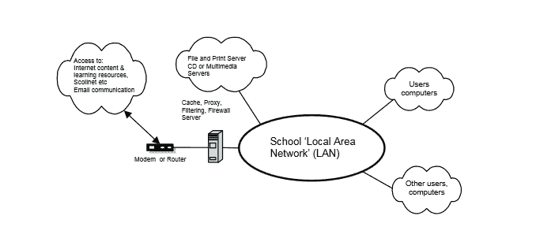
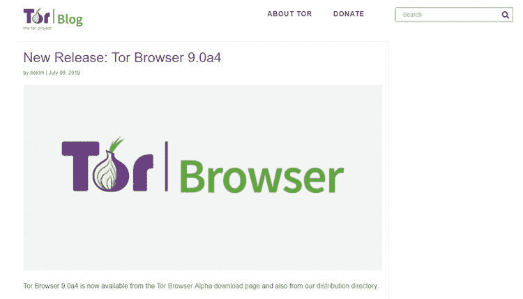
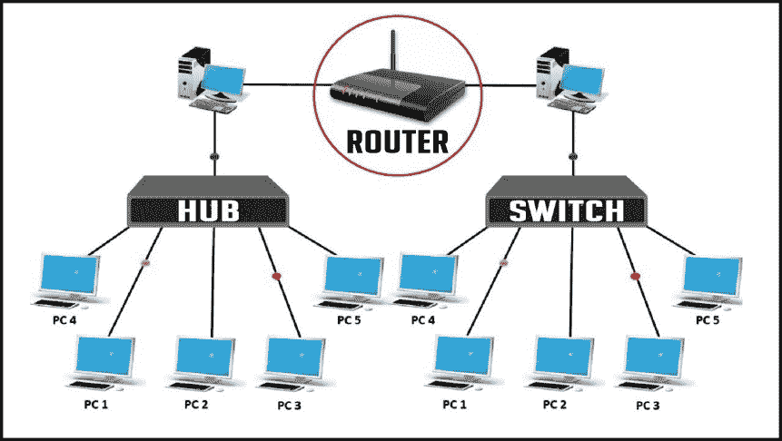
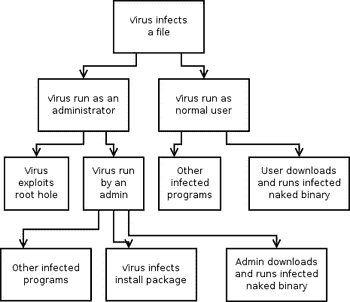

# 网络黑客：计算机无线网络技术、连接与通信系统完整工具指南。通过服务和硬件进行网络实用渗透。


# 引言

恭喜你下载《网络黑客》（Networking Hacking）。我很高兴你选择通过我们的手册学习网络黑客知识。在手手册中，重点将放在网络黑客上。你将学习更多不同的黑客技术，这些技术可以用来访问特定的网络。我们还将讨论如何发现某些安全漏洞，以及如何修复网络中存在的某些缺陷。

黑客分为两种：白帽黑客和黑帽黑客。白帽黑客从事道德黑客。本文的重点将是道德黑客。计算机和网络安全是一个非常复杂的学科。你应该始终领先一步，以确保你的网络没有被外部攻击者非法访问。本文还将概述一些用于确保网络安全的工具和技术。确保网络安全的最好方法是理解外部攻击者的思维模式。你可以利用你所得的知识来保护你的网络。

本文中的道德黑客行为还将更多地关注白帽黑客或安全专家使用的某些渗透技术。我们还把更多地关注漏洞测试。其中一些测试可以帮助你识别网络中存在的某些安全缺陷。这些漏洞也可以被封堵，以确保外部攻击者无法访问网络并获取他们用于获利的各种类型的信息。有时，你不需要对预算非常严苛，而是要看它对你生活的影响。

# 第 1 章：计算机网络基础

网络黑客是指不断操纵特定网络连接行为的技术努力。负责网络黑客的人被称为黑客。黑客被视为一种建设性的技术工作，并不完全基于计算机系统的基础。黑客通常与恶意程序相关，这些程序被用于通过互联网攻击不同的网络。

## 关于黑客的起源

“Hacking”一词起源于 20 世纪 50 年代和 60 年代在麻省理工学院（M.I.T.）的一些工程师。这些黑客甚至会破解大型机计算机。麻省理工学院以外的人也开始黑客。后来，互联网和计算机网络获得了一定的普及，从事黑客活动的人数剧增。大多数从事黑客活动的人从小就开始此类活动。

## 常见的网络黑客技术

在执行网络黑客操作时，人们利用脚本和不同的网络软件。网络软件是专门设计的，用于操纵通过特定网络的各种形式的数据。黑客可以获取一些信息，让他们能够更多地了解特定系统是如何运行的。网上发布了许多脚本，任何人都可以访问。寻找预包脚本的人是初级黑客。大多数高级黑客都会努力研究每一个脚本，并可以根据自己的意愿修改它们。有很多技能丰富的黑客，他们被商业公司聘佣以保护公司内部的软件使其无法被未经授权的人员访问。

除了黑客，还有其他渗透技术，包括创建 `DoS`（拒绝服务）攻击和蠕虫。采取了不同的措施，以确保计算机和网络不受网络钓鱼、恶意软件和特洛马的影响。

## 黑客技能

要成为一名专业的黑客，你应该具备某些性格特质和技术技能：

- 你必须能够处理数字。黑客活动涉及阅读大量的代码、数据和各种算法。
- 你必须具备逻辑推理和记忆力，因为在策划攻击时，必须整合细小的细节和事实。
- 你必须有耐心。黑客过程非常复杂，你可能花费大量时间尝试制定一个可执行的计划。

网络指南重要的主要原因是：
- 学生可以更多地了解网络的优势。
- 它有助于学生在进入网络开发阶段阶段时地进行规划。
- 它还提供了一个标准的网络 `model`。

# 网络基础

计算机网络由一组连接在一起的计算机和其他设备组成，它们还相互通信。下图展示了一个网络示例，由一个连接计算机到互联网以及各种服务器的局域网组成。



网络有两种类型，如下：

1. **点对点网络 (Peer-To-Peer Networks)**：它们通常实现在少于 10 台计算机的区域，不一定采用严格的安全措施。每台计算机具有相同的状态，它们很容易相互通信。共享不同的文件，包括电子表格和文字处理文档可以在整个网络共享。此外，网络上的每台计算机都共享相同的设备，包括扫描仪和打印机。
2. **客户端/服务器网络 (Client/Server Networks)**：它们非常适合较大的网络。有一台中心计算机作为 `server`。它存储整个网络共享的所有应用程序和文件。与普通计算机相比，服务器拥有更多的功能。它可以控制连接到网络的计算机的访问。普通计算机通常供学校的老师和学生使用，而网络管理员可以访问整个服务器。

## 网络组件

网络由以下组件组成：

- 至少两台计算机。
- 用于连接计算机彼此的电缆。
- 每台计算机都将有一个网络接口设备。
- 一个用于将数据从一个点切换到另一个点的 `Switch`。
- 一种网络操作系统软件。


# 结构化布线
最流行的布线技术包括同轴电和双绞线。

## 集线器与交换机
这些是用于将计算机连接到网络的设备。集线器通常在网络中引导信息，并促进所有连接设备之间的通信。交换机被分类为“智能集线器”。交换机和集线器连接了所有设备。

在使用`switches` 时，你可以确保自己获得了“专用带宽”，同时以全速运行。集线器通常在不同的连接之间共享带宽，一台 PC 的活动可能会降低集线器上的网络连接。

## 关于无线网络
“无线网络”一词通常指的是许多计算机使用标准网络协议进行相互通信，且没有物理布线存在。计算机在从一个网络发送信息到另一个网络时，也可以使用无线电波信号。

### 无线局域网 (WLAN)
该网络由两个主要部分组成，包括无线卡和接入点。只要两台计算机距离较近，就可以在它们之间传输信息。

#### 无线局域网的优点：
* 易于添加工作站。
* 可以确保无法布线的区域也能访问网络。
**过程快速且简单。不需要穿过天花板和墙壁的布线。
* 只要人在接入点范围内，就可以从任何地方访问网络。
* 在确保便携式网络接入网络时特别方便。
* 安装成本更低。
* 具有长期成本效益。

#### 无线局域网的缺点：
* 数据传输速度总是较慢，取决于连接到网络的计算机数量。
* 标准经常变化，无线卡在一段时间后也可能需要更换。
* 降低无线带宽会降低网络的有效性。
* 网络安全性无法保证，必须进行某些配置。
* 设备只能在特定接入点的有限距离内运行。
* 有线局域网也为无线局域网提供骨干。
* 在静态环境中，较难实现长期成本效益。

## 无线网络的组成部分
配置无线局域网需要许多许多组件。其中一些组件也用于配置有线局域网。在无线局域网和有线局域网中，都使用了网络适配器卡。`wireless LAN PC card` 通常包含内置天线。它被用于将计算机连接到周围的无线网络。计算机上有一个插入它的插槽。也可以将台式计算机连接到无线网络。

在无线网络中，有一个“接入点”，它的功能与有线网络中的集线器类似。它通常通过适配器卡接收和广播信号。无线网络和有线网络的主要区别在于，在无线网络中，计算机是通过电缆连接的。而无线网络，不需要电缆来建立不同计算机之间的连接。网络由两个主要部分组成，包括无线卡和接入点。只要两台计算机距离较近，就可以在它们之间传输信息。

## 无线网络的配置
无线网络可以使用局域网或对点安排进行配置。`Peer-to-peer configuration` 被称为最基本的无线网络配置。它通常依赖于安装在计算机内部的无线网络适配器，它们可以轻松相互通信。为了让计算机连接，它们应该在传输范围内。如果有许多计算机连接，它们应该彼此靠近。对于这种类型的网络配置，没有网络管理开销。该配置最适用于小型安装。

## 无线配置的优势
在有线局域网中，人们需要花费更多时间进行布线。对于无线配置，它具有以下优点：
1. 所需的工作量较少。
2. 无线配置可以确保无法布线的区域也能访问网络。
3. 安装过程快速且简单。不需要穿过天花板和墙壁的布线。
4. 只要人在接入点范围内，就可以从任何地方访问网络。
5. 在确保便携式网络接入网络时特别方便。
6. 安装成本更低。
7. 具有长期成本效益。

### 无线网络的额外优点：
1. **速度**：数据传输速度取决于连接到网络的计算机数量。
2. **成本**：标准经常变化，无线卡在一段时间后也可能需要更换。
3. **集中化软件管理**：在安装网络时，可以将软件安装在服务器上，所有连接的计算机都可以使用。
4. **资源共享**：可以在连接的计算机上共享资源。
5. **灵活访问**：人们可以在连接到网络的任何计算机上访问文件。
6. **安全性**：网络安全性无法保证，必须进行某些配置。

### 安装网络时面临的主要挑战包括：
1. **带宽**：降低无线带宽会降低网络的有效性。
2. **管理**：需要某些配置。
3. **故障**：文件服务器可能会故障。
4. **距离**：设备只能在特定接入点的有限距离内运行。

## 关于 CISCO
CISCO 是一家为互联网提供服务的公司。公司自 1984 年以来一直运营。该网络由两个在斯坦福大学学习的科学家建立的。CISCO 提供的网络解决方案被不同的服务提供商以及许多中小型企业利用。公司的网络解决方案通常连接计算设备、人类和网络。人们现在可以与他人联系，同时共享不同的信息。很大一部分互联网流量也通过 CISCO 系统传输。公司一直在利用互联网来运行自己的在线业务，从管理库存到产品订单。


# 第二章：黑客技术简介

黑客技术和黑客分类有多种。在本书中，重点将放在伦理黑客上。准确地说，我们还将研究网络黑客技术。这将讨论一些用于测试计算机及其网络是否存在安全问题的方法。我们将概述所有这些漏洞，因为黑客会利用其中的一些漏洞来获取对网络的访问权限。

至于伦理黑客，它主要涉及利用一些经过专业证明的安全技术，以确保网络安全。这些测试由 IT 专业人员执行，并且他们在获得网络系统所有者的授权后履行此类职责。

## 黑客使用的不同术语

-   **黑客 (Hackers)**：这些人是试图破解他们非法获取的敏感信息的人。某些黑客通常针对他们认为保护得良好的系统，因为他们希望在自己的圈子里提高地位。
-   **恶意内部用户 (Malicious Internal Users)**：他们也被称为内部攻击者。他们通常试图破解敏感信息，因为他们可以在组织内部轻松地访问这些信息。
-   **伦理黑客 (Ethical Hackers)**：他们是好人。他们可以进入系统，并确保已通知用户当前的漏洞。随后，网络所有者可以采取必要措施，确保恶意人员无法访问计算机系统和敏感信息。

`hacker` 一词有两种定义方式。传统上，这个术语表示这类个人喜欢篡改不同的电子和软件系统，他们还喜欢研究计算机是如何运行的。目前，`hacker`是指为了个人利益而恶意入侵系统的人；这些人通常获取关键形式的信息，并利用这些信息从他人。

## 黑客的类型

1.  **黑帽黑客 (Black-Hat Hackers)**：通常怀有有用目的的黑客。
2.  **白帽黑客 (White-Hat Hackers)**：他们是好人，通常执行伦理黑客活动。


# 黑客的思维

你需要评估自己系统的安全性，以便更清晰地了解你所面临的对手。大多数经营安全产品的供应商总是会提供咨询服务，指导人们如何保护其网络和计算机系统免受内部和外部可能恶意用户的攻击。理解如何保护你系统的最好方法是研究黑客的思维。在此背景下，人们由于黑客而面临的一些挑战也将在此进行概述。此外，了解黑客的动机也是有益的。

许多黑客一直认为，公众通常无法理解他们，这句话在某种程度上是事实。评判很容易，但要理解现实非常困难。主要问题在于，大多数关于黑客的刻板印象都是由于人们对现实的误解而形成的。黑客还根据其能力以及他们从事此类行为的动机被分为不同的类别。有些黑客非常有技巧，他们始终在追求知识。根结底，显而易见，每个黑客都是为了自己的利益。值得注意的是，黑客既有负面方面也有积极方面。在整个历史上，黑客一直在追求不同形式的知识。他们也享受每个到自己的每种挑战带来的快感。

然而，一些渴望成为黑客的人技能有限。另一方面，黑客也被证明具有创新性，并且他们喜欢冒险。他们总是寻找新方法来利用不同的网络和计算机系统。他们总是研究人们忽视的某些领域。在某些情况下，他们还会问自己一些问题，即如果执行某些活动（包括更改已安装程序中的某些代码）会发生什么。有些黑客还认为可以对当前使用的机械和电子设备进行一些改进。

各种形式的证据表明，黑客可以为了不同的利益而入侵。例如，他们可能有政治动机。其他公司也可能会雇他们来消除竞争对手。在某些情况下，他们入侵不同的网络是为了获取财务利益。某些恶意行为已被证明对许多个人产生了负面影响。值得注意的是，其中一些黑客并不关心那些本应确保网络安全的防火墙后的个人会发生什么。他们总是进行攻击，因为他们将在过程中获益良多。这些攻击产生的一些负面问题包括危及负责系统安全的某些人员的职业。

在某些情况下，公司内部的一些人员可能会针对各种形式的信息，并意图将其用于自己的利益。这些人被称为内部黑客。他们通常在不同的服务器上根文件，同时共享他们设法访问每一条信息。有时，他们还会删除敏感信息。要识别某些怀有恶意动机的个人是非常困难的。在某些情况下，他们还会对组织内的某些员工产生负面影响。

某些恶意用户具有犯罪背景。建议在雇佣人员时进行某些检查。他们过去的行为可能会以不同的方式影响他们，并可能损害你组织的完整性。虽然一个人可能有清白的记录，并不意味着他们不能参与犯罪活动。每个罪犯总是从某个地方开始。尽管黑客是非常糟糕的，但这些人通常在技术进步中起着关键作用。

## 黑客的分类

黑客可以根据其技能分为以下几类：

### 脚本小子 (Script Kiddies)
他们通常是初学者，利用不同的黑客工具、文档和漏洞扫描器。其中一些工具可以在网上免费获得。虽然他们并不精通黑客知识，但他们非常粗心，并且在参与不同活动后不知道如何掩盖自己的踪迹。

### 犯罪黑客 (Criminal Hackers)
这些是拥有大量知识和技能的黑客，他们还会编写供道德黑客和脚本小子使用的程序。在大多数情况下，他们通常以蠕虫和其他恶意软件的形式编写病毒。他们可以轻松访问任何系统，并且知道如何掩盖自己的踪迹。他们从不留下任何数字足迹。

高级黑客非常守密。在与他人分享任何信息之前，他们必须被认为有访问此类信息的价值。有些黑客的排名并不高；然而，为了表现得，他们必须拥有一些独特的信息，可以用这些信息来向知名黑客证明自己。这些黑客是信息安全领域最可怕的敌人。尽管他们可能被视为专业人士，但他们与脚本小子并没有太大区别。

### 安全研究人员 (Security Researchers)
这些是广为人知的 IT 专业人员。他们通常跟踪计算机系统、网络和不同应用程序的活动。他们的主要关注点是存在的漏洞。他们开发出不同的工具和脚本，用来利用其中的某些漏洞。如果不存在这些专家，那么可以作为开源访问的安全工具将变得更少。一些安全研究人员总会在博客和其他媒体平台上发布他们的发现。当你关注他们通常产生的内容时，你可以了解更多可能影响你的网络或计算机系统的当前漏洞。最重要的是黑客的技能水平。此外，他们动机的来源也同等重要。

### 行动黑客 (Hacktivists)
他们总是试图通过他们的黑客活动传播和社会政治信息。他们的主要重点是提高公众对特定问题的意识。有时，黑客可能关注于提高对大麻合法化以及当前世界其他重大问题的意识，他们还可能出于特定原因发起 `DDoS (direct denial of service)` 攻击。

### 网络恐怖分子 (Cyberterrorists)
他们通常攻击政府或任何其他公共实体，并出于不同的动机入侵他们的计算机系统和网络。例如，他们可能针对电网或其他领域。他们还会窃取政府机密信息并将其转化为优势。一些国家非常地对待来自网络恐怖分子的威胁，这就是为什么他们使用不同的安全协议，以确保黑客无法访问政府系统。

### 雇佣黑客 (Hackers for Hire)
这些黑客总是参与有组织犯罪。一些黑客形成了组织，并一直合作执行可能针对政府和其他机构的各种攻击。雇佣黑客的人并不多。在大多数情况下，大多数黑客倾向于为了乐趣而访问不同的网络，同时寻求扩展他们所拥有的知识。有时，对组织最大的威胁可能就在建筑内部，他们可能拥有一个有效的网络账户。因此，他们获取网络不会有太大困难。

## 什么驱动着黑客

在大多数情况下，他们入侵是因为他们可以。对于某些人来说，黑客更多像是一种爱好。他们中的一些人会研究进入系统的不同方法，以及在尝试访问特定系统时存在的某些不可能的情况。尽管有许多类型的黑客，但本文背景下的重点是那些试图访问计算机系统网络黑客。当他们胜过政府和其他知名机构时，他们他们受益匪浅。由于他们从事非法活动，通常登上头条。当他们访问拥有价值和敏感信息的实体网络时，他们总是感觉良好。


1. 有巨大的人口正在使用互联网。
2. 计算机网络提供了某种形式的匿名性。
3. 目前有大量的黑客工具。
4. 有许多无线网络确保了黑客可以轻松隐藏他们的数字足迹。
5. 在目前开发的某些数据库中，代码库已经变得复杂。
6. 大多数儿童都拥有计算机知识。
7. 黑客在被捕后不太可能受到调查。

某些攻击很少被报道，而且当黑客被捕获时，他们不会被起诉。当黑客被捕获时，他们主要会谈论他们的服务对社会有何益。他们还会说明他们正在研究目前的一些漏洞。无论黑客是否被捕获，他们关心的是获得了“名声和荣誉”。当他们被当局捕获时，他们通常赖生存的奖励机制就会受到威胁。当黑客未被捕时，他们的恶意活动将不会被察觉。有时，为了股东保持沉默是好事，因为他们在获得此类负面消息时可能会恐慌。目前的隐私和安全法律正在快速变化，因为必须提供泄露通知。内部泄露案例也变得越来越常见，它们有助于展示某些机构内部发生发生的情况。当发生内部泄露时，责任方被迫辞职。目前，当发生泄露时，联邦州和国际法律法规规定此类活动应向相关部门报告。无论泄露是内部还是外部，还是备份带丢失，都应该报告，因为它们会以这种或其他方式影响你的业务。

# 计划与执行攻击
黑客使用不同的攻击风格。某些黑客通常会提前为大型攻击做准备。他们总是先收集各种信息。他们收集信息的技巧是有方法论的。追踪使用这种技术的黑客也很困难。其他黑客，主要是“脚本小子”（script kiddies），总是在尝试考虑其行为后果之前采取行动。这样的黑客可能会尝试在甚至不隐藏身份的情况下访问特定的网络。要捕获这样的黑客很容易，因为他们总是在没有计划的情况下行动。恶意用户是众所周知的，他们拥有关于组织内部计算机网络的知识。有时，此类黑客会尝试对他们非法访问的网络进行试探和刺探。他们有时也会做一些愚蠢事，网络管理员也可以追踪到他们。尽管黑客已经形成了地下社区，但大多数黑客都克制与他人分享信息。他们大多数时候都是独立工作。当黑客进行通信时，他们通常利用私密留言板、黑客网站、匿名邮箱地址和互联网中聊天（`IRC`）。你可以登录这些网站之一，并了解更多关于黑客正在做什么；这些网站可以在暗网上找到。

# 关于暗网以及如何使用 Tor 浏览器访问
万维网非常庞大。它包含了大量信息，为了浏览所有信息，你可能花费大量时间。有表面网和暗网/深层网。一些常见的网站包括 `Wikipedia` 和 `Google`。暗网属于那些避免公开曝光的政府和公司。在暗网中，你可以找到政府报告、医疗记录和财务记录。此类信息无法通过搜索引擎访问，并且受到强大的防火墙保护。在暗网中，你将暴露在各种形式的危险之中。

## 暗网被隐藏的主要原因
存储在暗网上的某些信息并不是公众查看的；这就是暗网被隐藏的原因。只要这些信息被隐藏，它们推测就是安全的。主要问题是这些信息存在于网上，因为它们是以表面网应用程序的形式存在的。至于暗网，它有点复杂。尽管它是万维网的一部分，但它运行在私有服务器上，且只能通过特定方式访问信息。

## 如何访问暗网网站
在表达对访问暗网的兴趣之前，你应该了解该平台上存在许多非法活动。你可以采取必要的措施；然而，完全匿名是不可能的。请自担访问该平台。

*   下载并安装 Tor 浏览器。Tor 浏览器允许你访问暗网。该平台的创建是为了保护美国的情报信息。通过浏览器，你可以访问位于暗网的 `.onion` 网站。在使用 `Tor` 时，你可以匿名浏览。该浏览器还会让用户了解可能暴露其身份的不同情况。


*   使用虚拟专用网络 (`VPN`）。虚拟专用网络确保你可以匿名浏览互联网。你的当前位置会被掩盖，并将处于一个假设的位置。要注意 `Tor` 只掩盖身份，但该平台不掩盖你的位置。有很多 VPN 服务，可以使用 `NordVPN` 或 `ExpressVPN`。

*   `DuckDuckGo`。在导航暗网时，`DuckDuckGo` 是你的朋友。它是一个帮助你操作暗网的搜索引擎。你可以通过 DuckDuckGo 搜索引擎轻松访问暗网索引网站。

*   始终注册安全的邮箱地址。某些邮箱地址是安全的且不可追溯的。你可以使用这些邮箱地址注册 `.onion` 网站。你可能会考虑的一些安全邮箱平台包括：
    *   `TORbox`
    *   `ProtonMail`
    *   `Mail2Tor`


所有列出的选项都有 `.onion` 域名，你可以使用 `TOR browser` 访问它们。普通浏览器在这些情况下无法工作。

### 关于暗网搜索引擎
`.onion` 域名只能在暗网上使用。它们与普通域名有些相似，且无法通过普通浏览器访问。存在一些无害的 `.onion` 地址。暗网上有很多网站，你必须花费一些精力才能找到它们。你还应该注意，你可能会在暗网上无意中遇到非法活动。

### 在暗网上玩耍（上网）安全吗？
尝试探索未知可能很令人兴奋；然而，接受暗网上现有的某些危险是明智之举。坏人总是会时刻寻找机会以获取各种信息。执法人员也会出现在暗网上，试图捕获一些参与非法活动的个人。

### 访问暗网的安全指南
我们注意到，暗网上正在发生许多可怕的事情。你可以采取一些必要的预防措施来避免它们。为了保持安全，请利用以下指南：

1. 确保 `Tor browser` 是最新版本。访问暗网上的 `.onion` 域名站点时，请使用 `Tor browser`。此外，你的 `Tor Browser` 也应该保持更新，以便在访问某些站点时确保安全。



2. 使用信誉良好的 `VPN`。之前讨论过使用 `VPN` 的重要性。`VPN` 隐藏你的位置，而 `Tor browser` 有助于隐藏你的身份。你使用的 `VPN` 应该是信誉良好的。文中还强调了一些示例，包括 `ExpressVPN`。

3. 不要使用宏。宏通常运行包括 `JavaScript` 在内的脚本。使用宏可能会打开蠕虫，风险水平将很高。如果你在暗网上浏览时被要求启用脚本，你应该反复考虑，因为你将暴露在不同形式的恶意软件之下。

4. 小心你下载的内容。首要任务是避免恶意软件和病毒。一些黑客会在不同的文件中植入恶意代码，人们在太晚之前无法轻易得知。你可以使用虚拟机来保持安全。

5. 始终改变你的心态。许多人可能认为暗网是安全的，因为网络安全专家可能致力于确保互联网免受网络犯罪。要始终改变你的心态，因为暗网并不安全。你应该保持警惕，绝不要信任在平台上遇到的任何。。

有些人胆子较小。他们可能选择在暗网上充当游客。如果你曾经访问过暗网，你会发现关于平台的大部分信息都是真实的，并非传言。平台上发生了许多非法活动，这就是为什么你应该确保自己安全。你还应该保持警惕，因为暗网上的某些总是试图利用某些无知的人。黑客喜欢暗网，因为他们可以轻松在平台上讨论任何内容。他们利用了具有 `.onion` 域名的留言板和社交媒体网站。大多数恶意用户利用了一些人的无知。他们对现实世界安全的某些方面也了解得更多。黑客通常采取以下不同方法：

1. 大多数计算机网络没有得到妥善管理；某些计算机系统没有经过适当的补丁、监控或加固。即使有防火墙和访问控制系统，攻击者也可以轻松访问此类网络。某些恶意用户的行为可能无法以任何方式被追踪。此外，他们可能拥有网络的完全访问权限，这意味着他们可以利用它来牟利。

2. 大多数的安全和网络管理员可能跟不上系统内部某些攻击方法和新漏洞。在某些情况下，网络管理员可能忙到无法跟踪网络上的每项活动。此外，他们可能没有注意到网络上的某些异常活动，因为他们可能未能设定目标，且时间管理能力也较差。

3. 信息系统随时间推移变得越来越复杂。由于信息系统随时间推移变得复杂，网络和安全管理员可能无法跟踪网络上发生的一切。攻击者总是会利用这种信息为自己获利。他们总会在网络和安全管理员未察到的期间进行攻击。

4. 攻击通常缓慢进行，无法被轻易检测。

5. 攻击也可能在下班后进行，这意味着网络和安全管理员可能不在场跟踪网络内发生的活动。

要了解更多关于黑客如何渗透这些网络的信息，你可以关注讨论黑客的杂志，这些杂志每月至少出版一、两次。大多数黑客都从错误中学习。当他们犯错时，他们总是知道自己离进入特定网络又近了一步。他们总是利用所获得的知识来规划未来的攻击。作为一名道德黑客，你也必须从自己的错误中学习。

### 管理匿名性
聪明的黑客想要确保他们的身份被隐藏。黑客优先考虑隐藏踪迹。黑客的成功取决于他们是否被察觉。他们不应该引起任何形式的怀疑，以便未来能够随心访问系统。黑客使用的一些资源包括：

1. 雇主或朋友拥有的 `VPN` 账户
2. 商场、学校或图书馆的公共计算机
3. 代理服务器
4. 开放无线网络
5. 匿名电子邮件账户
6. 不安全的计算机
7. 开放的电子邮件中继

如果黑客制定了一份良好的计划，他们就不会被轻易追踪。

## 第 3 章：制定黑客计划
本章将关注以下领域：

作为黑客，在开始黑客过程之前必须制定计划。计划将确保你能够轻松渗透网络，并对你所做的充满信心。由于执行黑客非常严肃，制定一份良好的计划是好的。你可以从在计算机上测试程序开始，同时概述、记录并定义你的目标。确保你已经确定了测试标准，并识别和收集有助于促进整个黑客过程的工具。在本章中，你将获得一个指南，介绍如何创建一个良好的黑客环境以增强你进入网络时的成功率。作为一名道德黑客，在实施你制定的攻击计划之前，应该获得客户和管理的批准。

### 建立你的目标
作为黑客，你的目标应该相应概述。作为道德黑客，你可能的主要目标包括研究网络中存在的漏洞，因为重点是确保它变得更安全。帮助你概述目标的一些步骤包括：

1. 定义一些特定目标。将你的所有目标与业务目标对齐。查看管理层在整个过程结束时想要什么。


## 2. 制定一个在特定时刻开始并结束的计划。黑客攻击时间线也应该以具体的和日期的形式列出。

建立所有目标可能需要一些时间；尽管如此，这一切都是值得的。目标将提供一些指导。如果你有任何疑虑，应该始终参考你所制定的所有目标，以便保持在正轨。

## 如何确定要破解的特定系统

你可能拥有许多计算机网络，但你无法同时评估所有的网络。确保黑客项目已拆分成若干部分，以便使整个过程易于管理。你可以根据已进行的分析来决定你想要测试的特定系统。在此过程中，你应该回答的一些问题包括：

1. 哪些系统是最关键的？某些系统在没有相应授权的情况下被访问会导致某些麻烦，你还可能遭受巨大损失。
2. 哪些系统看起来容易被破解？
3. 哪些系统没有相应的文档记录？

在制定完所有目标后，你现在可以决定想要测试的特定系统。制定目标的主要原因是它们能帮助你勾勒预期，你还可以对整个过程中将使用的时间和资源做出更好的估算。你可能需要测试的一些设备包括：

1. 路由器和交换机 - 交换机连接网络上的计算机，而路由器将许多网络连接在一起。
2. 防火墙
3. Web 服务器、应用程序和数据库服务器
4. 无线访问点和桥器
5. 电子邮件和文件
6. 工作站、平板电脑和笔记本电脑
7. 用于存储机密的移动设备
8. 客户端和服务器操作系统

当你处理一个小型网络时，可能测试所有内容。应该测试一些面向公众的主机，它们包括 Web 服务器和电子邮件。此外，道德黑客过程也是灵活的，这很好。始终从看起来脆弱的网络开始。此外，还要考虑以下因素：

1. 运行网络使用的特定操作系统
2. 网络中存在的应用程序
3. 存储在网络上的关键信息数量

## 攻击树分析

攻击树分析是黑客创建一个流程图的过程，概述他们将如何攻击某个网络。攻击树分析通常由安全团队在进行高级风险分析时使用。在大多数情况下，这种分析是在规划新网络项目时进行的。如果你想提高自己的黑客技巧，你应该有方法论地计划每种攻击方法。主要问题是绘制攻击树所需的时间。此外，在这种情况下需要大量的专业知识。现在，也可以使用计算机来生成攻击树。你可能使用的工具包括 `SecurITree`。攻击树分析的示例所示所示

与漏洞评估相比，道德黑客更加详细。作为一名道德黑客，你应该寻找关于不同系统的大量信息。例如，你应该寻找有关组织及其网络的信息。由于道德黑客是灵活的；你可以利用不同的黑客技术。如果你不确定从哪里开始，应该评估一个可见性高的系统。你也可以更多地关注特定网络的防火墙。

## 制定测试标准

当沟通不畅时，执行道德黑客测试时系统很容易崩溃。为了避免此类挑战，你应该制定文档测试标准。标准应该包括：

1. 正在进行的特定测试
2. 测试执行的时间以及总测试时间
3. 你对特定系统的了解程度
4. 每项测试将如何执行以及将使用的 `IP address`
5. 发现不同漏洞后采取的最优步骤


执行伦理黑客攻击时，一些合适的实践包括：

### 时机
关键在于时机。时机概念适用于伦理黑客攻击等活动。在进行某些测试时，你应该确保组织内部的业务流程不受影响。应该避免的有害情况包括沟通误解。此外，避免对高流量的电子商务网站造成 `Dos` 攻击也是好的，特别是在白天。如果许多人正在进行某个特定项目，他们应该对时机达成一致，以便实现最终目标。有时，始终通知 `ISP`（互联网服务提供商）是有益的。在他们意识到你将要测试系统以寻找某些漏洞后，他们就不会阻止你的任何流量，以防他们怀疑防火墙上出现了通常的任何恶意行为。测试时间线应该包含执行不同测试的某些短期日期。还应该概述里程碑。你可以制定一个时间表并将数据输入电子表格，以便为其提供某种适当形式的指导。

### 特定测试
你可能被要求执行渗透测试。此外，你可能想进行某些特定测试，包括破解密码和尝试访问不同的 Web 应用程序。有时，人们在评估网络时还会进行社会工程测试。无论进行什么种测试，你可能都不想泄露有关测试细节的某些信息。记录重要的主要原因是它有助于消除未来可能出现的任何形式的误解。有时，人们还会利用屏幕操作。你可能对本应执行的通用测试一无知；然而，如果你使用自动化工具，可能无法更多地了解你所执行的测试。

### 盲测与已知评估
对你将要测试的系统拥有大量知识是有益的。虽然这种知识可能并非必须，但你至少应该对你要攻击的系统有基本的了解，以便通过确保你没有留下任何可以追溯到你的数字足迹来轻松地保护自己。获取此类信息并不困难，你只需要调查，以便对你想要访问的系统有更好的理解。当你进行一些背景研究时，你将不会盲目地攻击系统。在进行评估时，你使用的技术始终取决于你的需求。最合适的方法是计划进行无限攻击。具有恶意意图的黑客在使用有限范围时不会攻击系统。此外，确认你是否想要执行测试，以及这些测试不应被网络管理员以及安全提供商检测也是好的。你还必须执行物理安全测试和社会工程测试。如果有太多人知道你正要测试系统，他们可能会改变习惯，导致测试结果不准确。然而，这并不意味着你不应该通知任何人。你应该组织内有一个主要联系人，并且他们应该具有权威。

### 位置
你正在执行的测试决定了你应该从哪里运行它们。主要目标是从恶意黑客可以轻松访问的位置对网络进行测试。你也可以确定网络是否会被组织内部的人黑入；因此，确保所有基础都已覆盖是好的。你可以结合不同的测试，并可以在内部和外部执行它们。你可以执行的某些测试包括破解密码和评估网络基础设施。有时，寻求可能了解如何黑入网络的外部人员的服务是明智的，因为他们可以对防火墙、路由器和不同的 Web 应用程序等设备进行测试。对于外部攻击，你应该有一个稳定的互联网连接。在某些情况下，你可能还必须使用外部代理服务器。你也可以为你的电脑分配一个无法追溯到你的适当 `IP address`。为了获得更好的网络视图，你应该将其插入到防火墙外的网络中。内部测试相当简单，因为你只需要对网络和组织的服务器拥有某些物理访问权限。你还可以使用 `DLS` 线路或电缆调制解调器。

### 如何应对网络中漏洞
涉及到漏洞时，你需要一种合理的技术来封堵组织内部存在的安全漏洞。你不一定需要一直黑入系统，因为这最终会导致系统崩溃。你需要遵循你概述的路径进行，直到你无法再访问网络为止。如果你有任何疑问，你应该已经概述了目标，并在确保每个目标都已实现后停止。如果你发现了某个漏洞，你应该联系合适的人，以便他们能够快速修复问题。如果你不及时修复问题，某些人可能会利用当前的漏洞，并造成一些不可逆转的损害。员工也应该尝试确保他们没有违反他们的雇佣协议。

### 愚蠢的假设
当你假设某些事情时，你可能无法实现你的目标。以下是人们在应该黑入网络时产生的一些假设：

1. 网络在测试过程中是可用的。
2. 你可以假设你拥有所有必要的测试工具。
3. 你利用的测试工具可能会尽量减少网络崩溃的可能性。
4. 你可能知道每项测试的所有风险。

你应该记录你所拥的所有假设。

### 选择工具执行安全评估
你使用的安全评估工具取决于根据你将运行的测试而的不同因素。你可以使用电话或网络进行一些伦理黑客测试。在进行全面测试时，你必须具备必要的工具。如果你不知道应该使用的特定工具，你将在前面的章节中学习更多关于黑入系统时使用的某些工具。这些工具有些是免费的，有些是商业的；你可以相应地使用它们来实现目标。你必须了解你所掌握的所有黑客工具的应用。某些工具还附有说明书，而某些工具的说明书编写得不好，这可能令人沮丧。你可以搜索一些新闻组和留言板，以更多地了解某些工具的运行方式。某些工具可能证明是有害的，因为它们可能会影响网络的健康。在使用某些工具时，你应该小心。你应该对所有可用选项有深入的了解。如果你对某些工具没有深入的了解，在测试过程中就不应使用任何工具。这些预防措施可以确保你不会受到 `Dos` 条件的影响。此外，你不会在过程中丢失任何数据。你可能还不理解某些开源工具的重要性。如果某些免费软件工具证明不值当，你可以去购买商业版本，因为它们可能证明是有效的。某些工具可能很贵；但最重要的是它们的功能。始终确保你的钱物有所值。


# 第 4 章：黑客攻击方法论

在本章中，重点将放在：

在专注于成为伦理黑客之前，你需要具备如何制定有效方法的基础知识。伦理黑客不仅包括渗透网络，还包括对其进行修复。一些经过证明的技巧也可以在你专注于学习更多黑客攻击知识时，为你提供指导。当你使用特定的方法论时，你可以轻松实现目标。此外，你将能够以专业的方式操作，并从你的时间和精力中获得丰厚回报。

## 为测试做好准备

在过去，黑客过程主要是手动操作的。如今，人们可以利用不同的工具来完成各种目标。其中一些工具可以确保你执行测试，并减少测试过程中涉及的步骤。尽管这些工具非常方便，但更多地了解背后发生的情况也是好的。

伦理黑客也可以比作软件测试过程。你必须能够逻辑性地思考，以便在与系统组件进行交互的同时，也更多地了解它们是如何工作的。你应该收集碎片化的信息。此外，当你开始测试网络时，你会有许多目标和测试要运行。你将不断接近，直到发现所有现有的安全漏洞。

伦理黑客过程中使用的流程与恶意黑客使用的流程大体相同。主要区别在于恶意黑客和伦理黑客的目标和动机。此外，每个人的实现目标的方式也不同。主要的区别还在于，伦理黑客会尝试查看系统中存在的漏洞，并解决这些每一个问题。而对于恶意黑客来说，他们会利用现有的漏洞，并访问不同的信息来为自己谋利。

如今，恶意人员的攻击可能从不同的角度进行。建议测试每一个可能的点，包括客户端网络、合作伙伴和供应商。其他可以测试的区域还包括笔记本电脑、无线局域网（LAN）和家庭用户。当你开始作为伦理黑客测试你的技能时，你应该跟踪你所进行的所有测试。此外，还要留意你一直在使用的工具以及你获得的结果。

你记录的信息可以从以下方式帮助你：
1. 跟踪以前执行测试时哪些方法是有效的。
2. 这些信息有助于证明你没有出于恶意意图攻击系统。
3. 在出现任何问题时，将测试与入侵检测系统以及其他日志文件进行关联。
4. 你还应该记录最终报告。

删除记一些通用笔记外，你还可以对结果进行截图，因为它们可能也很有用。截图可以在以后使用，因为它们证明了某些情况的发生。此外，在编制财务报告时，它们也会很有用。根据你所使用的特定工具 set，截图将作为你的证据。这种证据在尝试展示网络中存在不同的利用程序和漏洞时也很有用。

你的主要焦点应该是模拟和收集可能损害系统的信息。在执行测试时，你可以对网络中的其中一台计算机进行部分攻击。在某些情况下，你也可以继续攻击整个网络。你主要在寻找可以被恶意用户利用的弱点。还还应该对内部系统进行全面评估。在寻找漏洞时，检查每个系统是如何相互互连的，以及一些私有系统是如何运行的。你应该研究那些未免受恶意用户侵害的信息。

在执行伦理黑客攻击时，你可能会进行盲测，并从公司名称等基础信息开始。这种方法确保了你是从零基础开始的，你也将能够获取黑客也可以轻松访问的敏感信息。主要问题是，这种技术可能会花费更长时间，你可能无法注意到网络中存在的某些安全漏洞。伦理黑客不应该总是担心他们的数字足迹被追踪，因为他们正在合法地执行每项任务。虽然这样的黑客可能在合法地行动，但建议采取隐蔽的工作。黑客用来隐藏每项行动的某些技巧将在后续章节中详细讨论。

## 观察他人所见

你获得了大量关于公司及其计算机系统的信息。这些信息也可以被轻松地访问，这是通过一种被称为“足迹探测”（foot printing）的技术实现的。还可以通过以下方式收集信息：
1. 使用网络浏览器搜索有关特定组织的信息。在这种情况下，某些如 `Google` 这样的搜索引擎非常有用。
2. 执行网络扫描、评估漏洞并探测开放端口，以确定关于网络的各种信息。如果你是从内部访问网络，可以使用包括 `GFI LanGuard` 在内的端口扫描器，这样你也可以看到哪些是可访问的。无论你使用何种探测技术，都应该限制你对特定组织 supposed 收集的信息。你花费的时间也重要。需要考虑的一些主要因素还包括组织的大小以及组织内部信息的复杂性。

## 收集公开信息

有关特定组织及其网络的大量信息可以在互联网上轻松获取。你的主要任务是找到这些信息。此类信息确保黑客可以轻松针对组织内的特定区域。他们可能更多地关注特定的个人，例如公司的高管。用于收集目标组织信息的一些技术包括：

1. **网络搜索**：当你对一个组织进行网络搜索时，你可以获取以下信息：
    - 员工姓名及其联系方式
    - 一些相关的公司日期
    - 注册文件
    - SEC 文件
    - 合并与收购
    - 关于组织变更、重大行动和新产品的新闻稿
    - 专利和商标
    - 演示文稿、网络直播文章

微软正在确保他们在搜索领域取得进展。`Bing` 是一个搜索引擎，该公司位居第二。对于许多黑客来说，他们倾向于使用 `Google`。该搜索引擎免费且易于访问，大多数黑客都知道如何利用这个工具为自己谋利。在使用 `Google` 时，可以使用以下技术：
- 输入关键词。你可以找到存在于数百万页面中的相关信息。也可以访问电话号码、文件和地址。


### 1. 高级网页搜索
* 执行高级网页搜索。`Google` 提供了一些高级搜索选项，你也可以找到一些可以链接回特定公司网站的站点。此类搜索将确保你获取了有关目标公司内部的供应商、合作伙伴和客户的相关信息。
* 通过使用某些开关，你可以对公司网站进行深层次的挖掘。

### 2. 网页爬取
网页爬取工具包括网站复制器 `HTTrack`，你也可以通过下载一些公开访问的文件来镜像一个公司。你还可以在离线状态下检查网站。你可以深入研究以下领域：
* 网站的布局和配置。
* 可能较难访问的文件和目录。
* 脚本源代码以及 HTML 代码，也可以被轻松访问。
* 命令字段。

某些注释字段还包含某些可能证明有用的信息，包括电子邮件地址、内部 IT 人员姓名、开发者、软件版本、服务器名称、关于代码运行方式的注释以及 IP 划分方案。

### 3. 网站
有些网站可以提供有关各种组织及其员工的各种信息。

### 4. 网络映射
当你对网络进行映射时，可以去搜索一些公共资源和数据库，并查看人们对你的网络了解多少。其中一些网站包含了互联网上随处可见的 `Whois` 工具，这些工具也可用于检查互联网上某些域名。在启动社会工程学攻击或扫描网络时，这种工具会非常有用。

### 5. Google Groups
`Google Groups` 可以帮助揭示有关组织的一些网络信息。通过此类平台可以访问的一些信息包括 IP 地址、域名和用户名。你还可以获取其他形式的私有信息，包括：
* 显示了过多关于当前网络和计算机系统信息的留言板。有许多人在此类平台上发布信息，但他们并没有意识到这些信息正在分享给全世界。
* 关于公司的机密信息，这些可能由客户和员工发布。

在发现某些机密信息已分享在某些在线平台上后，你应该将其删除。

### 6. 隐私政策
务必始终检查你网站上的隐私政策。你的所有用户都需要知道他们在访问你的网站时被收集的信息。此外，他们应该知道自己的信息是如何受到保护的。隐私政策通常由律师编写，他们通常不会深入研究有关你安全基础设施的信息。

### 7. 系统扫描
通过参与主动信息收集，你可能获得有关你网络的更详细的信息，你还可以从黑客的角度来看待问题。例如，你可以执行以下操作：
* 利用通过 `Whois` 搜索收集到的信息，测试每个密切相关的主机和 IP 地址。这些信息包括主机名的确定、IP 地址、运行的协议、可用共享、开放端口、应用程序和正在运行的服务。
* 扫描内部主机并遵守你的测试范围。某些外部人员无法查看这些主机中的某些；尽管如此，你仍需要测试它们，以便查看某些违规人员可能访问哪些内容。

在某些情况下，黑客可能已经访问了系统，并且可以从内部操纵一切。为了安全起见，你应该检查整个系统以寻找任何漏洞。如果你不相信你的扫描系统是可靠的，可以使用不同的系统并在虚拟机软件上运行它们。

### 8. 主机
在扫描过程中，也要记录一些内部网络内可以访问的主机。始终从使用这些工具 ping 一些主机开始：
* 位于操作系统中的基本 `ping` 工具。
* 第三方工具允许人们 ping 多个地址，包括 `SuperScan` 和 `NetScanTools Pro`。你还可以使用如 `whatisipaddress.com` 等站点，向你展示你在浏览互联网时网关 IP 地址的呈现方式。该网站将让你看到外部人员可以看到的 IP 地址。

### 9. 开放端口
你可以使用不同的工具扫描开放端口，包括：
* `Nmap` 和 `Superscan` 可以帮助扫描网络端口。
* 你可以使用网络分析器监听网络流量。你可以包含的一些工具包括 `Wireshark` 和 `OmniPeek`。

在内部执行扫描很容易。你应该将计算机连接到网络并加载不同形式的软件。你也可以在网络外部进行扫描，在插入路由器之前，你应该先为你的计算机分配公网 IP 地址。在这种情况下，你的计算机没有连接到互联网。无论你是否连接到互联网，连接都将有效。此外，你需要确定开放端口上运行着什么。作为一名伦理黑客，你应该获取此类信息信息：
* 正在使用的协议
* 在主机上运行的服务，可能包括数据库应用程序、Web 服务器和电子邮件
* 可用的远程访问服务，可能包括远程桌面
* VPN 服务
* 网络共享所需的身份认证

### 漏洞评估
在找到所有安全漏洞后，你应该继续研究你的网络中存在的某些漏洞。在测试过程之前，你还应该进行手动搜索。你可以对黑客使用的留言板、漏洞数据库和网站进行一些研究。某些分类网站有助于列出不同的漏洞。在寻找这些漏洞时，你会发现某些漏洞是通用的。有时，你可能被迫查看某些厂商的网站，以便了解更多关于当前漏洞的信息。可以帮助展示不同漏洞的站点包括 [`www.sans.org/top20](http://www.sans.org/top20)。该网站帮助展示超过 20 种漏洞。漏洞列表由 SANS 组织编制。

1. **手动评估**：通过与端口建立连接，你可以评估一些潜在的漏洞。某些系统也可以手动评估，包括一些 Web 应用程序。如果你有充足的时间，可以手动执行这些测试。


## 2. 自动化评估

手动评估在您想要学习时特别适用，然而，主要问题是大多数人没有时间处理所有这些手动步骤。你可以自动扫描漏洞。还有许多漏洞评估工具可以使用可以使用，它们在 `UNIX` 和 `Windows` 等平台上可用。你也可以在无线和有线网络上使用这些评估工具中的某一个。在使用这些工具时，你还可以绘制一张业务逻辑图。软件人员也可以使用其中一些工具来测试他们的代码行是否存在不同的缺陷。使用这些工具的主要问题是，它们只扫描单个漏洞。

如今，某些工具支持事件关联，可以一次性扫描多个漏洞。你可以用来扫描漏洞的工具包括 `QualysGuard Suite`。这些工具可以用于扫描端口，同时寻找任何存在的漏洞。此外，如果你使用 `QualysGuard Suite`，则不需要电脑，因为该工具以 `SaaS`（软件服务）的形式提供。你可以随时登录 `Qualys` 网站并注册账户。你需要支付一定的费用，因为该工具是用于商业目的。然后你输入需要测试的特定 `IP` 地址。你也可以将 `QualysGuard Suite` 安装到你的网络中，它随后将扫描所有内部系统。评估可以进行计划，系统将在运行测试的同时生成一些详细报告。报告将包含一些有关扫描的通用信息。现有漏洞的细节也将列出。当使用如 `QualysGuard Suite` 等工具评估网络中存在的漏洞时，你必须具备一些后续专业知识，因为你不能仅仅依靠扫描结果。漏洞报告应该经过验证。你应该全面研究这些报告，并对系统进行批判性测试。

### 渗透系统

你可以通过以下方式识别你网络中的某些安全漏洞：

1. 确保你已经获取了关于宿主机和当前存在数据的足够信息。
2. 确保存在远程命令提示符。
3. 启动或停止某些应用程序。
4. 访问不同的系统。
5. 禁用不同的安全控制。
6. 截屏。
7. 访问某些敏感文件。
8. 以管理员身份发送电子邮件。
9. 执行一些 `SQL` 注入攻击。
10. 发起 `DoS` 攻击。
11. 上传文件以证明你的胜利。

你可以使用 `Metasploit` 框架利用某些漏洞。这些漏洞中的某些允许你完全渗透系统。你需要决定是否想要完全渗透你的系统，并确保你已经证明了某些漏洞。

## 第 5 章：社会工程学

在本章中，重点将放在以下领域：
- 如何保护你的组织免受社会工程学的攻击

社会工程学是一种利用组织内部某些弱环节的技巧。重点通常在安全防御上。社会工程学可以比作“人肉破解”。它涉及对人类拥有的信任性的恶意利用。黑客确保他们可以获取一些个人信息，并将其用于利。社会工程学的主要问题是它需要大量时间，而且人必须熟练，因为他们面对的是完全陌生的人。在本章中，重点将社会工程学的后果。我们还将介绍一些保护你的组织免受社会工程攻击的方法。

## 关于社会工程学

恶意用户通常伪装成其他人，以便获取通过其他手段无法的个人信息。他们可以使用已访问的信息来入侵特定网络。他们访问的信息允许他们偷取和删除不同的文件。恶意用户还可以进行其他形式的欺诈。社会工程学与物理实施的各种利用也不同。一些众知的物理利用包括翻垃圾桶（dumpster diving）和窥视屏幕（shoulder surfing）。不同的社会工程学示例包括：

- **虚假支持人员**：他们通常声称必须在目标计算机上安装某些新软件版本。他们通常诱导用户以便他们可以下载软件。之后，恶意用户就可以远程访问网络。
- **虚假供应商**：他们声称需要更新特定系统，并向你要管理员密码以便他们也能获得完全访问权限。
- **钓鱼邮件**：此类邮件通常由外部黑客发送。他们主要收集各种形式的信息，包括目标用户的 ID 和密码。密码随后可以被用于访问目标的银行账户等。有时，外部攻击者可以执行跨站脚本。关于 Web 应用安全的讨论也将在后续章节中出现。
- **虚假员工**：在大多数情况下，他们通常联系保安台并编造各种谎言。他们可能会说他们落了钥匙，无法进入机房。随后他们将获得一把钥匙并进入机房。之后，他们可以获取有关组织的一系列电子和物理信息，网络就会变得脆弱。


有时，社会工程师会伪装成知识渊博的员工。例如，他们可以充当经理甚至高管。他们甚至可能伪装成天真的员工。他们可以承担的角色包括充当维护人员和 IT 顾问。社会工程师还适应不同的角色。他们总是会根据他们所接触的人切换不同的模式。

有效的信息安全涉及确保组织不会受到社交工程攻击。为了确保你的组织不会易受此类攻击的侵害，你需要跟踪所有的用户。可以部署的某些措施包括确保有防火墙、加密和入侵检测系统。组织可以通过上述技术来保障其信息安全。如果外部攻击者成功绕过所有这些防御系统，你所在组织内部的网络将变得脆弱。

社会工程需要高超的技巧，而且它高度取决于一个人的性格以及他们对目标组织的了解。如果社交工程对你来说并不自然而然，你首先需要学习更多关于这种艺术。你也可以聘请第三方来帮助收集有关目标组织的信息。在进一步了解社交工程之后，你可以设计出某些技术，这些技术在确保组织网络安全时将派上用场。

社交工程还会损害某些个人的声誉，因为它涉及了人的个人信息的收集。由于外部黑客将更多地关注获取有关这些人的机密信息，不同人的声誉可能会面临风险。谨慎行事是好事，在采取行动之前你应该考虑到你行为的后果。

有许多方法可以进行社交工程攻击。在本书中，我们不会侧重于培训人们如何执行社交工程攻击。主要重点将放在某些被证明是有成的社交工程技术上，例如不同外部攻击者的案例。你也可以使用这些技术中的某些，以便根据你的需求适用于你的情况。

如果你想在组织内部执行这些技术中的，你可能希望采取局外人的身份，但主要问题可能是公司内部的大多数人都认识你。身份识别是一个主要风险。在某些情况下，从信任的人员那里外包某些服务是明智的，让他们可以代表你进行这些测试。处理测试过程的人员也应该是值得信任的。如果你正在寻求外部人员的服务，可以从寻求参考介绍开始。之后，背景检查可能会派上用场。

## 外部攻击者使用社交工程的原因

大多数外部黑客使用社交工程攻击是因为他们可以这样做做。他们想要确保网络黑客攻击过程尽可能简单。当一个社会工程师下心要黑入网络时，他们将绕过访问控制、防火墙以及每一个现有的身份验证设备。在大多数情况下，社会工程师行动缓慢，因为他们想避免被捕获。此外，他们不想引起任何形式的怀疑。社会工程师总是会渐进地收集少量碎片信息，并会根据他们计划的攻击类型使用所有这些信息来构建一个更大的蓝图。

通过电子邮件或电话进行个人攻击是可能的。社交工程攻击期间使用的方法通常取决于攻击者的能力。社会工程师也熟悉事实，某些组织没有正式的数据分类、事件响应计划、访问控制系统和安全意识计划。他们总是会利用此类弱点，并利用它们来为自己谋利。

社会工程师还拥有关于该组织内部和外部的一些信息。他们所拥有的知识有助于他们促进这些攻击中的每一个环节。当一个社会工程师收集了大量关于组织的信息时，他们可以轻松伪装成员工或组织内的任何其他信任的人员。社会工程师拥有的知识将使他们处于优势地位，并对组织内员工的运作方式有深入理解。

## 理解社交工程的后果

许多组织都有竞争对手。其中某些竞争对手在某一点可能会变成敌人；这些敌人也可能认为通过社交工程制造麻烦是合适的。除了竞争对手，敌人也可能是前员工或在组织内工作的人。有时，黑客可能会发动社交工程攻击因为他们想证明自己的专业水平。无论制造问题的人是谁，主要的的因素是每个组织始终处于风险之中。

互联网可以促进信息收集过程同时也促进不同类型的攻击。最脆弱的公司是那些大型公司；然而，小型网络也可能受到攻击。组织中的每个员工都可能成为社交工程攻击的受害者。对于帮助台员工，由于他们负责发布不同的信息，他们是非常脆弱的。

所有的社交工程攻击都有不同的后果。攻击的主要目标是收集将用于攻击网络的信息。社会工程师可以有效地收集以下信息：

* 用户密码
* 可用于进入机房的安全证
* 知识产权
* 机密财务报告
* 客户名单和销售意向

如果列出的任何信息发生泄露，公司可能会遭受财务损失，员工可能会情绪低落，会出现监管和法律合规问题，客户也可能失去对特定组织的信任。

社交工程攻击不容易被记录，因此无法被轻易防止。社交工程攻击的主要问题可以使用很多方法。防火墙也营造了一种虚假的安全感。对于社交工程，你永远无法预测攻击者将使用的特定方法。采取最好的步骤是确保保持警惕，同时努力理解外部黑客使用的方法。通过，你可以提高组织内的安全意识。

## 执行社交工程攻击

执行社交工程攻击的过程相当简单。社会工程师需要在执行攻击之前，研究组织的一些流程以及信息系统。当攻击者拥有了此类信息时，他们就可以着制定他们的目标，因为他们将拥有方向感。社会工程师在攻击过程中使用的步骤如下： 

1. 进行一些研究
2. 建立信任
3. 利用某些关系来获取不同的信息
4. 使用收集到的信息进行某些恶意攻击


这些步骤中的某些还包含许多子步骤，并且在过程中需要使用不同的技术。这一切取决于正在执行的特定攻击。在外部攻击者执行社会工程攻击之前，他们必须制定不同的目标。这些目标确保了他们正在朝着特定的目标努力。在目标形成过程中，攻击者应该问自己他们想要实现什么，以及他们正试图黑入什么。有时，重点可能放在安全胸章和服务器密码上。在某些情况下，黑客可能试图证明自己的实力。

## 钓鱼信息
在社会工程工程师想出一些目标后，他们就可以从容地开始攻击。他们将开始收集有关受害者的信息。为了避免引起任何警觉，社会工程工程师总是行动得非常缓慢。由于信息收集是社会工程中的一个重要步骤，因此加强某些可能阻碍此类过程的安全措施是可行的。无论黑客使用何种研究方法，黑客过程中需要的重要信息包括内部电话号码、员工列表和公司日历。

### 使用互联网
互联网被用作基础研究媒介。通过搜索引擎可以访问大量信息。最重要的是你需要收集正确的关键词。通过收集不同的信息片段，你可以进行社会工程攻击。有时，人们会向某些专业人士支付一定的费用，让他们进行全面的背景调查。搜索可以让你获取有关特定人员的私人信息和公共信息。

### 翻垃圾桶
翻垃圾桶在某种程度上具有风险，而且很杂乱；尽管如此，在寻找特定信息时它是非常有效的。当使用这种方法时，你必须翻遍垃圾桶来寻找有关特定公司的信息。翻垃圾桶还可以让你获取一些机密信息，因为员工可能会认为，当某些信息被扔进垃圾桶时，其他人无法访问的。你丢弃的一切都可能隐藏着一些重要的信息片段。社会工程工程师总是寻找以下类型的文档：

* 组织结构图
* 内部电话列表
* 重点是安全政策的员工手册
* 密码列表
* 网络拓扑图
* 电子表格和报告
* 会议记录
* 包含敏感信息的电子邮件打印件

然而，碎纸机派用场，但只有在纸张被碎成无法重新组装的小碎片时才适用。有些碎纸机会将纸张碎成长条。社会工程工程师总是重新组合这些纸张，从而获取一些机密信息。他们只需要花一些时间并使用透明胶带，文档就会拼在一起。黑客还可以从咖啡馆或餐厅等场所发生的对话中收集一些机密信息。敏感信息也可以从那些通话时说话大大的人那里收集。在某些情况下，外部攻击者还会寻找放在垃圾桶里的 DVD 和 CD-ROM。

### 电话系统
攻击者可以使用语音信箱系统中内置的按名称拨号功能获取不同的信息。在通过某人的信箱联系公司后，按 `0` 即可访问此类功能。这种技巧在下班时间尤为有用。在这些时间，没有人会接你的电话。攻击者还会使用某些技术来确保他们的身份被隐藏。黑客使用的一些技术包括：

* 住宅电话：此类电话可以帮助隐藏用户的来电显示。你只需要在拨想要打的特定号码之前拨 `*67` 即可。
* 办公电话：在任何业务中，使用电话交换机可能很难伪造。攻击者需要组织内部电话交换机软件的用户指南以及管理员密码。在某些交换机中，可以输入源号码。号码也可以被伪造。
* VoIP 服务器：可以找到许多开源服务器，它们也可以用于配置任何号码。社会工程工程师在使用此类技术时可以发现一些重要信息。攻击者可以通过播客和语音信箱监听不同的信息。他们还可以研究受害者的声音，当需要物理访问该机构时，他们将能够完美地伪装。

## 建立信任
信任无法轻易获得，也可以轻易失去。社会工程高度依赖信任。除非情况危急，否则人们彼此是信任的。在大多数情况下，人们是善良的，如果他们之间建立了一些信任，某些请求可能看起来是合理的。人们在工作场所喜欢团队合作。主要问题是，其中一些人并不理解在向“信任”的源源发布大量信息时可能产生的后果。社会工程工程师利用这种信任，他们将确保无论如何都能实现目标。一些社会工程工程师可以轻松获得组织内某些员工的信任。社会工程工程师使用以下技术来赢得人们的信任：

* 亲和力：与好的人很容易产生共鸣，这就是为什么社会工程工程师非常友好。他们在任何情况下都不会表现过头，因此可以轻松地获取他们所需的信息。社会工程工程师还会花时间与有共同兴趣的人建立关系。他们可以利用获得的信息来确定受害者的喜好。
* 可信度：社会工程工程师倾向于知道自己是否具有亲和力。社会工程工程师总是利用伪装来让自己有利。他们可以装成新员工，并总是接触组织内那些物理上不认识他们的人。他们非常有影响力，并且可以做一些好事，以此相应地引诱他们的目标。有时，他们可能也装成团队合作者，试图与组织内的某些员工建立关系。

### 利用关系
在获得某些员工的信任后，社会工程工程师可以轻易胁迫他们提供不同的信息，这些信息在网络黑客过程中可能很有用。

## 言语和行为的欺骗
社会工程工程师将通过不同的技术从他们的每个受害者那里获取一些内部信息。他们会发起对话并确保受害者不会怀疑任何事情。如果社会工程工程师在执行社会工程攻击时动作粗留，很容易被发现。一些警觉信号包括：

* 提到公司内知名员工的名字
* 表现得很急切
* 吹嘘自己在组织内的权威性
* 发出某些威胁
* 表现得紧张（肢体语言传达了很多信息，并且很容易让他们露马脚）
* 经历不同的心理变化
* 对某些细节进行强调
* 看起来可能像是在被催促
* 拒绝提供某些信息
* 在回答未被问到的问题的同时，主动提供不同的信息


*   获取外部人员无法获取的某些信息
*   提出一些奇怪的问题
*   使用组织内部的俚语
*   拼写某些单词

一名专业的社会工程师会确保自己行不粗率，并隐藏自己的动机。他们会先给受害者一个人情，然后反过来向他们帮助过的人员请求一些协助。这种技巧已被证明是极其有效的。有时，这些人还会实施“反向社会工程”。当在处理特定问题时，他们会提供帮助。在解决问题后，他们会被称为英雄。社会工程师主要针对一些毫无防备的员工，并会向他们寻求帮助。许多人掉入了这个陷阱。对于社会工程师来说，伪装是轻而易举的。他们拥有伪证和 `ID`，这样就可以轻松地融入目标组织。

## 利用技术进行欺骗

技术使得某些事情变得更容易，特别是对于社会工程师来说。某些恶意请求是通过计算机或任何电子设备发出的。伪造电子邮件地址、计算机名称、网络地址和传真号码等细节也很容易。黑客可以利用技术轻易欺骗他们的目标。他们可以使用电子邮件向受害者索取一些关键信息。社会工程师通常会在这些电子邮件中附加链接，受害者会被重定向到一个看起来合法且体面的网站。使用上述技术可以访问的一些信息包括密码、`user IDs` 和社会安全号码。外部攻击者可能还会在 `Myspace` 和 `Facebook` 等平台上使用这种技术。一些网络钓鱼和垃圾邮件信息利用了这种技术。用户被迫使用不同的技术降低警惕，他们最终可能会打开某些附件。电子邮件也呈现得非常专业。受害者被骗泄露不同的信息。黑客在访问网络后总是会部署一些此类社会工程技术，以便他们轻松地发送一些消息并创建一些弹出窗口。在进行手机短信时也可以使用这些技巧。在某些情况下，外部攻击者会伪装成 `Microsoft` 员工或供应商。在受害者安装了“补丁”后，他们的计算机将被 `Trojans` 和 `worms` 等不同程序感染。攻击者随后可以在网络内部创建一个后门来获取不同的信息。后门将允许攻击者利用受害者的计算机自由访问不同的信息，他们还可以发起不同的攻击。`worms` 和 `Trojans` 在执行社会工程攻击时会非常好用。`worms` 有不同的类型。在受害者打开某些垃圾邮件后，一切都太迟了。计算机已经被感染，他们将无法实现最初想要的目标。使用技术进行的某些社会工程攻击是匿名进行的。攻击者将利用 `Internet proxy server`、`remailers`、`anonymizers` 和一些 `SMTP servers` 来确保存在开放中继。当人们成为本应提供某些机密个人信息的受害者时，他们应该知道自己无法追踪社会工程攻击的来源。

## 如何反击社会工程攻击

有多种方法可以保护你的网络免受社会工程攻击。虽然安全系统可能也很强大，但某些天真的网络管理员可能会被社会工程师操纵。某些安全策略可以确保社会工程师无法访问网络，这些包括：

*   数据分类
*   为所有员工和承包商设置 `user IDs`
*   删除不再组织内工作的员工的 `IDs`
*   建立可接受计算机使用规范
*   重置并设置密码
*   妥善处理机密信息
*   相应响应某些安全事件
*   护同客人

这些政策中的一些可以在组织内的所有员工中执行。政策还应对组织内的所有个人保持更新。还应通知终端用户某些政策的变化。在试图防止社会工程攻击时，最佳防线是拥有经过良好的员工，他们知道如何应对不同的社会工程攻击。通过确保你已经提高了意识，社会工程攻击可能就不会发生。在培训过程中，重点应更多放在某些安全策略上。你也可以外包安全培训服务。员工也应该认真对待安全培训。帮助你从长期来看消除社会工程攻击的一些提示包括：

*   安全意识和培训应被视为业务投资。
*   用户也应接受培训随时意识到某些安全策略。
*   确保员工负责公司内部的一些隐私和安全任务。
*   确保培训内容根据你的组织需求量身定制。
*   制定与你的业务功能相一致的社会工程意识计划。
*   确保你的信息是非技术性的。
*   为报告和防止某些事件制定激励计划。
*   始终以身作则。

还有一些你可以与公司员工分享的提示：

*   除非你能验证他们确实是他们声称的身份，否则你不能与其他分享某些机密信息。有时，可以通过电话提出请求，在这种情况下，你应该先验证拨打者的身份。
*   不要点击任何将你重定向到需要更新的网站的电子邮件链接。某些此类邮件通常来自不可信的来源。
*   在 `LinkedIn` 和 `Facebook` 等不同网站上共享某些机密信息要始终谨慎。时刻留意那些声称是你的“朋友”的人，他们中的某些可能有恶意意图。
*   永远不要打开完全陌生人的电子邮件附件。
*   护同建筑内的每一位客人。
*   不要泄露你的任何密码。

其他合适的建议包括：

*   无论是有线还是无线网络，陌生人都不应轻易访问你的网络。攻击者在访问网络几秒钟后，可以在网络中放置一些 `malware` 和 `network analyzer`。
*   所有信息都应该进行分类。员工还应接受有关如何处理不同信息的培训。
*   制定一些旨在对计算机上的媒体和文档执行的政策。这些政策将确保数据可以被仔细处理，并留在它们应该待在的地方。
*   首选的碎纸机应执行交叉粉碎。有些公司提供碎纸服务，并且他们提供高质量的服务。在强化正式培训内容时，一些有效的技巧包括：

*   培训启动和员工入职培训
*   包含有关如何生存社会工程攻击信息的手册
*   可以作为鼠标垫、屏幕保护程序和便利签的小物品


# 第 6 章：物理安全

在本章中，重点将是：
- 学习物理安全的重要性
- 寻找不同的漏洞
- 针对可能的攻击实施某些应对措施

物理安全涉及保护物理形式的财产。重点应放在非技术性的组件和技术性组件上。在某些情况下，物理安全会被忽视，但它是信息安全计划中的重要组成部分。如果你能从物理上保护你的场所，你也能轻松地保护不同的信息。

在本章中，我们将讨论一些目前的物理安全缺陷及其与信息和计算机网络安全的关系。我们还将概述一些合适的应对措施，它们将帮助减少你业务中的物理漏洞。在进行物理安全测试时，你应该尝试入侵系统。从局外者的视角来看很好。在测试阶段，你还可以发现一些需要封堵的安全漏洞。

## 物理漏洞

无论你的计算机网络使用什么技术，它都可能通过不同的技术被黑入，这就是为什么我们正在研究一些物理安全漏洞以及如何修复它们，以便外部攻击者无法利用这些漏洞。在某些小型公司中，某些物理漏洞可能不是主要问题。影响不同物理漏洞的因素包括：

- 建筑的数量
- 建筑的大小
- 员工人数
- 出口点的位置
- 机密信息的放置

存在许多物理安全漏洞。外部攻击者将时刻监视这些物理漏洞。为了保持安全，你应该首先寻找这些物理漏洞。之后，你可以为这些安全问题寻找合适的解决方案。组织内部存在的一些物理漏洞包括：

- 缺乏前台接待员
- 未能在建筑内护送访客
- 某些员工可能会信任某些访客，因为他们可能穿着供应商的制服，并可能声称是为了处理机房的某些问题。
- 门可能缺乏访问控制。
- 安全录像可能可以通过网络访问。
- 机房可能被公众轻易进入。
- 门被敞敞着。
- 备份媒体可能存储得非常随意。
- 可能存在不安全的笔记本电脑和其他计算机硬件。
- 包含敏感信息的 `DVDs` 和 `CDs` 可能被轻率地丢进垃圾桶。

当某些物理安全漏洞被利用时，最终可能会发生一些坏事。主要问题是未经授权的人员可能会进入建筑。入侵者进入建筑后，可以进入机房，在此过程中组织的网络将受到破坏。未经授权的用户可能还会窃取某些信息，并利用这些信息来获利。外部攻击者还将利用所有的物理漏洞，包括办公室布局、建筑基础设施和机房设计中可能存在的弱点。

在某些情况下，你还应该考虑某些因素，例如建筑与警察局和消防站等设施的距离。地区的犯罪统计数据也重要，因为它们能确保你理解你所理解的内容。如果某些物理漏洞被利用，最终可能会发生一些坏事。外部攻击者还会考虑建筑中可能存在的某些弱点。

## 建筑基础设施

建筑的一些关键组件包括 `windows`、`doors` 和 `walls`。外部攻击者将利用这些基础设施。一些攻击点包括：

- `doors` 是开着的吗？
- `sensors` 位于哪里？
- 施工过程中使用了哪些 `materials`？
- `walls` 是否足够坚固？
- `hinges` 位于哪里？
- 施工过程中使用了哪种类型的 `glass`？
- `windows` 是 `glass` 做的吗？
- 是否有 `drop ceilings`（吊顶）？
- 是否有可以推开的 `tiles`？

## 应对措施

某些应对措施可能需要进行一些维护。你可以聘请一些专家在建筑设计过程中协助你。确保你的建筑内部安全达到顶尖水平的技术包括：

- 使用坚固的 `doors` 和 `locks`。
- 确保 `alarm system` 受到持续监控。在所有访问点还应放置一些基于网络的 `CCTV cameras`。
- `computer room` 应该有没有 `windows` 的 `walls`。
- `exit points` 应有适当照明。
- 在建筑内的某些点还应放置 `Mantrap`（人笼）。
- `fence` 可以由 `barbed wire` 制成。

## 设施

考虑 `computer room` 中使用的某些设施是好的。这些设施包括 `power`、`fire suppression` 和 `water`。在物理安全评估过程中应始终考虑这些因素。这些设施在应对火灾事故时非常有用。

### 攻击点（与设施相关）

入侵者可以利用一些与设施相关的漏洞。通常被忽视的一些常见攻击点包括：

- `power-protection equipment`，包括 `generators` 和 `surge protectors`。有时，它们很容易触及，外部攻击者可以轻易地开启和关闭它们。
- 当发生停电时，采取了哪些物理安全机制？始终评估物理安全机制是否运行良好，因为在停电时，人们可以轻易进入 `computer room`。
- 正在使用哪些 `fire suppression` 和 `detection devices`，它们位于哪里？这些设备包括 `fire extinguishers`、`alarm sensors` 和 `sprinkler systems`。始终确定外部攻击者是否可以操纵这些设备每一个。
- `gas` 和 `water shutoff valves` 位于何处？可以轻易访问吗？


*   建筑外的当地电信线是位于地面以上还是地面以下？根据它们的位置，是否有人可以接入电信线？任何挖掘活动是否会损坏电信线？如果电信线位于电线杆上，它们是否容易受到交通事故的影响而发生位移？

**应对措施**：在物理脆弱性评估期间，邀请一些专家参与是有益的。他们在设计过程中也能提供帮助。主要的布局位置包括：

*   主要公用控制设备的位置。它们应该位于带锁的闭门区域内。
*   建筑内的任何人是否都能方便地访问这些控制设备？开关的盖罩可以作为有效的防御机制。

### 办公室布局与用途
办公室的设计和使用在确保物理安全时可以大大用用场。

**攻击点**：外部攻击者将利用办公室的一些漏洞。应该考虑的某些攻击点包括：

*   查看保安员或接待员是否监控建筑内的人流量。
*   员工的桌上是否放置了任何机密信息？他们的邮件和不同的包裹是否遗落在四周，以至于其他外部人员可以轻易访问？
*   垃圾桶的位置也很。垃圾箱不应让外部人员轻易访问。此外，办公内是否有碎纸机？

外部攻击者在寻找可能被轻率处理的信息时，总是会进行翻垃圾。他们总是会寻找备忘录和电话列表。翻垃圾是非常危险的，因为它可能会让你的公司陷入非常不利的地地。

*   复印室和邮件室安全吗？如果外部攻击者可以轻松进入这些房间，他们就可以窃取一些重要信息并以此对付你。✓
*   摄像头（CCTV）是否处于全天候监控状态？✓
*   门窗存在哪些访问控制？部署了哪些安全措施？如果是普通钥匙，谁可以访问？不同的用户通常会共享一些信息，包括可编程键盘的组合。这需要问责制。始终确保你记录了使用某些钥匙和组合的人数。

**应对措施**：可以实施一些措施来减少组织的暴露风险，其包括：

*   保安和接待员应该记录出入建筑的人。这种应对措施至关重要。确保每位访客都签了到。此外，对一些不可信任的人也应该进行护送。执行某些政策，让员工始终质问陌生人，同时报告建筑内发生的任何异常行为。还应该放置一些显示“员工专用”的标牌。✓
*   建筑内应该有一个唯一的出入口。✓
*   摄像头 ✓
*   垃圾箱应放置在安全区域。✓
*   在处理包含敏感信息的纸质文档时，建议使用断孔碎纸机。✓
*   组合的数量也应该受到限制。✓
*   生物识别系统应该是有效的。

### 网络组件与用途
在外部攻击者进入建筑后，他们将从**机房**开始：

*   防火墙和交换机是否安装在可锁的机架中？
*   笔记本电脑是否储存在安全的办公桌内？
*   密码是否写在桌面的便利签上？
*   备份媒体是否在保险箱内？保险箱是否防火？谁可以访问保险箱？
*   计算机媒体是否容易被盗？

**攻击点**：进入机房后，他们将寻找以下设备：

*   路由器。
*   防火墙。
*   集线器。
*   交换机。
*   可移动存储设备。
*   硬盘。
*   网线。
*   USB 端口。

这些设备中的某些没有受到组织内部某些安全协议的保护。这些设备中的某些使得外部攻击者很难尝试访问这些设备中的信息。需要考虑的一些主要因素：

*   无线访问点的信号是否可以被轻易访问？如果不安全，请确保你已经配置了必要的安全协议。✓
*   路由器、防火墙、集线器和交换机是否可以被轻易访问？这些考虑是非常重要的，以便网络不会被外部攻击者轻易访问。✓

**应对措施**：上述某些应对措施很容易实施；尽管如此，执行起来可能困难，因为需要人员频繁进行跟进。

*   这要求你在离开电脑后锁定屏幕。✓
*   始终使用强密码。✓
*   笔记本电脑用户应该妥善存放他们的电脑，以免被第三方访问。✓
*   整台笔记本电脑都需要你使用加密技术。✓
*   机房应该关闭并受到监控。✓
*   应该保留一份组织内使用的软件和硬件清单。✓
*   应使用适当的技术确保计算机媒体的安全。✓
*   确保网络内所有的安全漏洞都已修补。✓


# 第 7 章：密码

在本章中，讨论将围绕以下领域展开：
- 深入密码漏洞
- 检查密码破解技术和工具
- 破解受密码保护的文件
- 如何保护系统免受密码破解攻击

黑客可以通密码破解轻松获取网络访问权限。他们会更关注用户管理员密码，以便轻松访问整个网络。有些人会使用强密码；而一个下决心破解密码的黑客，无论花费多少时间都会破釜沉舟。在安全链中，密码是最脆弱的链节点。在大多数情况下，密码依赖于保密性。一旦密码泄露，许多人就可以轻松访问网络。确保你对所有的密码负责是良好的做法。

外部攻击者可以使用不同的技术破解你的密码。他们可以通过索要密码来获取密码，也可以进行侧旁窥视。在某些情况下，攻击者还可以使用密码破解软件。为了获取密码，外部攻击者会利用键盘记录器和网络分析仪。在本章中，你将发现外部攻击者如何通过渗透你的网络轻松获取你的密码。还将提到一些密码漏洞，并概述相应的应对措施。这些应对措施将确保外部攻击者无法轻易利用你的系统。如果你进行一些漏洞测试并实施了上述应对措施，你将能够保护用于访问网络的密码。

## 密码漏洞

在平衡了安全成本和公司内部信息的价值之后，公司内部使用的密码将是足够的。密码会提供一种虚假的安全感。攻击者在试图渗透网络时，总是会尝试破解密码。依赖密码来保护贵贵信息的主要问题是，许多人都能接触到密码。主要问题在于你无法完全了解一个人。此外，尽管某人可能知道密码，他们可能并非授权用户。密码漏洞还分为两类，包括：

1. **用户漏洞**：此类分类意味着缺乏旨在保护密码的策略。此外，缺乏安全意识也是不可不可取的的。
2. **技术漏洞**：这涉及使用薄弱的加密方法。此外，密码也可能被存储在不安全的地方。

保护物理环境也是保护网络密码的最佳方法之一。这种技术曾效果良好。主要问题是，现在的计算机也具有网络连接，物理安全已不复存在。

## 组织密码漏洞

便利性非常重要，特别是当一个人一次需要记住许多密码时。密码很难管理，外部攻击者在密码破解过程中面临许多挑战。攻击者拥有的主要优势是，人们通常会想出容易记住的密码。他们总是尝试不同的组合，直到遇到正确的密码。之后，他们就可以轻松访问网络。

用户应该受到教育，并提醒他们使用强密码的重要性。主要问题是，某些用户想出的密码非常容易猜到。用户很少更改密码。密码被重复使用以保护网络中的许多点。在攻击者获取了被重复使用的密码后，他们就可以访问系统中的许多点。这些密码可能被写在不安全的地方。复杂的密码无法被轻易破解。主要问题是，当一个人想出一个复杂的密码时，他们很有可能会将其写下来。当攻击者获取了这些密码时，他们将利用这些信息来对你。

## 技术密码漏洞

在利用了一些组织密码漏洞后，你可能还会发现一些技术漏洞，它们包括：

- **弱的密码加密方案**：黑客可以使用一些强大的机制来破解弱密码。在本章中，我们还将进一步讨论外部攻击者用于破解密码的一些技术。许多供应商认为，只要他们没有发布在制定加密算法期间使用的源代码，密码通常就是安全的。一些有耐心且执着的黑客会花时间尽可能快地破解每种安全协议。破解代码后，他们将利用薄弱的加密。
- **通常将密码存储在易于访问的不安全文件和数据库中的程序。**
- **在人员打字时通常在屏幕上显示密码的用户应用程序。**


## 破解密码

外部攻击者非常热衷于密码破解的过程。他们主要享受的是密码破解过程中存在的探索感。虽然你可能对探索许多人的密码不感兴趣，但用这种心态来对待黑客攻击过程是有益的。在获取一个密码后，很容易获取其他多个密码，从而让你能够轻松地访问网络。大多数攻击者会以根用户（root）和管理员（administrator）密码为主要目标。管理员密码非常重要，因为它们将赋予外部攻击者更多对网络的访问权限。只要你拥有管理员权限，就可以操纵并访问网络上的任何内容。当你寻找组织内的密码漏洞时，务必从高访问访问级别（如网络管理员）开始测试。大多数攻击者都会使用这种战术。你可以通过不同的方式利用系统。你可以使用高科技和低科技方法。以下是一些低科技方法：

## 低科技方法

### 社会工程
这是一种低科技方法，在收集密码方面也非常流行。社会工程主题在之前的章节中已经介绍过。至于社会工程，它侧重于利用人类的信任本性。在获取密码和其他信息后，攻击者可以继续利用这些信息来获取个人利益。

**技术：** 使用社会工程学获取密码时，你只需要索要即可。由于该技术涉及操纵，你只需装成组织内部的员工，使用电子邮件或其他任何技术索要密码。有时，用户会将密码交给负责安全测试过程的人员。测试阶段结束后应重置密码。重置密码后，你将对之后网络中可能丢失的任何信息负责。

**防御措施：** 确保你已通过安全培训计划提高意识；这样，你就可以轻松确保攻击者无法通过社会工程学收集任何信息。对网络有访问的人员应接受如何识别攻击者的培训。例如，他们应该知道攻击者会利用虚假电话和垃圾邮件。他们应该忽略这些邮件。在发现任何可疑活动（如出现可疑电话）时通知安全管理员也是好的。

### 窥视攻击（Shoulder Surfing）
这是一种涉及从他人背后窥视的技术。攻击者这样做主要是为了获取用于访问网络的密码。

**技术：** 为了协调这种攻击，攻击者应该靠近目标，并试图隐藏他们的真实意图。他们将通过监控用户登录网络时的键盘和屏幕操作来收集密码。眼力良好的外部攻击者可以轻易获取密码。窥视攻击非常简单，你也可以自己尝试。

**防御措施：** 始终鼓励用户保持警惕，以免外部攻击者获取他们的密码。每当他们在环境中发现任何奇怪活动时，都不应输入密码。如果有人在你的背后窥视，你应该礼貌地请他们离开。确保你在输入密码时他们看不到你的密码。

### 推断（Inference）
这是一种攻击者根据收集到的关于用户的信息来猜测密码的情况。一些细节包括出生日期、电话号码，甚至是喜欢的电视节目。外部攻击者的主要问题是他们非常坚定要实现目标。最佳的防御机制是适当地教育用户创建安全的密码，这些密码不应与出生日期等某些个人信息相关。还应该不断提醒用户创建安全密码的重要性。

## 弱身份验证
恶意用户和外部攻击者会尝试通过不同手段获取密码。他们还可能利用某些旧的操作系统，因为这些系统在登录过程中不需要任何密码。某些手机没有使用密码保护。

## 高科技方法

### 高科技密码破解
高科技密码破解涉及使用不同的程序来猜测用于访问网络的密码。这些工具确保能够产生不同的密码组合。一些高科技技术用于访问受密码保护的数据库文件。主要的密码破解技术包括暴力破解攻击、字典攻击和彩虹表攻击。

### 破解 WPA2 Wi-Fi
破解 `WPA2` 网络的技巧多年来没有变化。与以前的一些技术相比，最新的技术要求你的交互更少，并确保你拥有充分的信息。你也可以访问各种网络，尽管它们可能没有连接可以使用`PMKID` 访问 `WPA2` 网络。你可以使用的一些工具包括 `Hashcat`。该工具将使能够破解 `WPA2` Wi-Fi 密码。此外，在使用此类工具时，你可以轻松识别出一些弱密码的网络。

#### 用于破解 WPA2 密码的旧技术
旧技术已使用多年，你应该暂时从想要破解的访问点断开已连接的设备。作为黑客，你必须理解一些基本要点。主要的挑战是必须有人连接到网络，你才能发起攻击。使用的密码也应该是弱密码，这样攻击者才能破解。如果没有连接的设备，将很难连接网络，因为你缺乏捕获握手（handshake）的机会，这就是你无法破解网络的原因。这种技术的另一个挑战是法律上存在麻烦且干扰性大。你将被强制发送一些数据包，这可能会导致授权用户从网络断开。你将发起 `DoS` 攻击，结果网络将被拥堵。你还可能遇到麻烦，因为你很容易被抓到。

#### 用于破解 WPA2 的新方法
破解 WPA2 的新方法不是尝试截获 Wi-Fi 设备之间的双向通信来破解密码，攻击者可以使用新技术直接与访问点通信。攻击者可以使用的一些工具包括 `Hashcat`。该工具可用于发起暴力破解攻击并收集信息。此外，你可以轻松识别出具有弱密码的网络。始终，攻击者需要靠近计划攻击的 Wi-Fi 网络。主要目标是使用兼容的无线适配器，并将获取某些信息。无线攻击已被证明比 `aircrack-ng` 和 `aireplay-ng` 更高效。

#### 使用 hcxtools 和 Hashcat
`hcxpcaptool` 和 `hcxdumptool` 是用于对 Wi-Fi 网络进行渗透测试和审计的工具。在使用这些工具时可以轻松捕获握手和 `PMKID` 哈希。在使用命令行启动攻击时需要少量的参数。可以使用树莓派（Raspberry Pi）等方便的设备，尽管它们没有屏幕。捕获 `PMKID` 后，应将哈希加载到 `Hashcat` 中破解 WPA2 密码。`hcxpcaptool` 用于将 `PCAPNG` 文件转换为 `Hashcat` 兼容的版本。使用这种技术时，成功率取决于目标 `WPA2` 网络密码的复杂度。

## 你需要什么
执行此类攻击时，你必须使用 `Kali Linux`。此外，你应该能够访问无线适配器并支持数据包注入和监控模式。尝试选择兼容的无线适配器时，许多指南非常有帮助。除了 `Kali Linux` 提供的网络适配器外，系统应完全更新。否则你会发现软件包过时的问题。

### 步骤 1：安装 Hashcat 和 hcxtools
首先，你应该安装所需的工具。下载必要的工具后，在终端输入以下内容：
```bash
sudo apt install hashcat hcxtools
```
安装完成后，你将安装 `hcxtools`。为此，打开终端窗口并逐行粘贴。如果发生错误，在内容前输入 `sudo`。确保你已经安装了最新版本的 `Hashcat`。

### 步骤 2：准备无线适配器
接入无线适配器后，你可以通过输入 `ip a` 或 `ipconfig` 找到 `WPA2` 网络名称。网络名称通常不同。首先确保网卡已进入无线监控模式。你就可以监听 Wi-Fi 流量。你应该在终端窗口输入以下命令并替换无线适配器的名称：
```bash
hcxdumptool -i wlan1 -o galleria.pcapng --enable_status=1
```
无线适配器的名称也可能是 `wlan1`。这有助于将捕获的 PMKID 保存到名为 `galleria.pcapng` 的文件中。可以指定状态：
`warning: Network Manager is running with pid 555`
`warning: wpa_supplicant is running with pid 611`
`warning: wlanmon is probably a monitor interface`
`start capturing (stop with ctrl+c)`
`INTERFACE: wlanmon`
`FILTERLIST: 0 entries`
无线网络适配器也应该是监控模式。

### 步骤 3：使用 hcxdump 捕获本地网络的 PMKID
你可以捕获想要攻击的设备的 PMKID。你可以执行的命令包括：
```bash
hcxdump --i wlan1
```
收集足够信息后，你可以结束攻击。将产生一个 `PCAPNG` 文件，它包含了方便暴力破解攻击所需的所有信息。信息还应转换为 `Hashcat` 工具于理解的格式。

### 步骤 4：使用 hcxpcaptool 将 Dump 转换为 Hashcat
`hcxpcaptool` 用于转换 `PCAPNG` 文件。还指定了一些参数。在保存 `PCAPNG` 文件的相同文件夹中，在终端窗口输入以下命令：
```bash
hcxpcaptool -r galleria.pcapng -o galleriaHC.16800
```
运行命令后，终端窗口将显示以下信息：上下文显示短时间内收集了至少 21 个 PMKID。现在可以使用 `galleriaHC.16800` 文件破解网络密码。

### 步骤 5：选择密码列表并使用 Hashcat 进行暴力破解
当你开始攻击捕获到的 Wi-Fi 网络时，必须从选择一个良好的密码列表开始。选择好密码列表后，在转换完成后，你可以将所有密码与 `.16800` 文件放在类似的文件夹中。然后你应该在终端窗口运行以下命令：
```bash
hashcat -m 27000 galleriaHC.16800 wordlist.txt
```
`Hashcat` 应在 `16800` 模式下启动。`Hashcat` 启动后可以看到 `galleria.status`。状态值可以指定。在使用这种技术时，成功率取决于目标 `WPA2` 网络密码的复杂度。

## 破解密码的工具

## 弱身份验证
恶意用户和外部攻击者会尝试通过不同手段获取密码。他们还可能利用某些旧的操作系统，因为这些系统在登录过程中不需要任何密码。某些手机没有使用密码保护。


# 结

感谢阅读《网络黑客攻击》（Networking Hacking）到最后。希望这本书能为你提供丰富的信息，并让你能够获得实现所有目标所需的所有工具，无论这些目标是什么。

尽管你可能已经完成了阅读，但我们尚未穷尽该主题的所有现有信息。你可以通过对该主题进行更多研究，来扩展你在该特定领域的知识。下一步是确保你能够实战中应用你所掌握的信息。

你还可以制定一个计划，学习更多关于网络黑客的知识。你可以利用上文中提到的一些网络黑客工具。其中一些工具是免费的，并且附带了用户手册。

研究表明，网络是脆弱的。外部攻击者开发出不同的技术来渗透网络。他们还会编写脚本来帮助他们攻击特定的网络。黑客的技能水平也至关重要。此外，黑客必须拥有目标，这些目标也将成为他们在黑客过程中的动力。

虽然可以通过不同的方式访问网络，但你仍然可以通过某些方法评估漏洞并封堵任何存在的安全漏洞。最后，如果你觉得这本书确实很有启发性，也可以撰写好评。你的积极反馈我们将不胜感激。
