# 神经网络与深度学习


# 制作者注

- 1, 本书网络采用授权：Creative Commons Attribution-NonCommercial 3.0 Unported License。因此我在授权范围内制作了这个 PDF 版本，方便学习。在这个授权下，请不要利用本书网络版以及 PDF 版教程进行盈利。

- 2, 网络版教程部分交互在 PDF 文件中不受支持。

# 神经网络与深度学习

神经网络与深度学习是一本免费的在线图书。本书将教你关于：

- 神经网络，一种受生物启发的优美编程范式，使计算机能够从观测数据中学习
- 深度学习，一组用于神经网络学习的强大技术

神经网络和深度学习目前为图像识别、语音识别和自然语言处理中的许多问题提供了最佳解决方案。本书将教你神经网络和深度学习背后的许多核心概念。

关于本书所采用方法的更多详情，请参见这里。或者你可以直接跳转到第 1 章开始学习。

如果本书对你有所帮助，请进行小额捐赠。我建议捐赠 3 美元，但你可以自行选择金额。


## 赞助商


感谢所有使本书得以出版的支持者，特别感谢 Pavel Dudrenov。同时也感谢所有为 Bugfinder 名人堂做出贡献的人。

## 资源

- 图书常见问题解答
- 代码仓库
- Michael Nielsen 的项目宣布邮件列表
- 深度学习，Yoshua Bengio、Ian Goodfellow 和 Aaron Courville 正在撰写的草稿图书


Michael Nielsen / 2016 年 1 月撰写

在学术作品中，请引用本书为：Michael A. Nielsen，《神经网络与深度学习》，Determination Press，2015

最后更新：2016 年 1 月 22 日 星期五 14:09:50


## 本书内容概述

神经网络是有史以来最优美的编程范式之一。在传统的编程方法中，我们告诉计算机要做什么，将大问题分解为许多计算机可以轻松执行的小而精确定义的任务。相比之下，在神经网络中，我们不告诉计算机如何解决问题。相反，它从观测数据中学习，为手头的问题找出自己的解决方案。

从数据中自动学习听起来很有希望。然而，直到 2006 年，我们才知道如何训练神经网络以超越更传统的方法，除了少数专门的问题。2006 年的变化在于发现了所谓深度神经网络中的学习技术。这些技术现在被称为深度学习。它们得到了进一步发展，如今深度神经网络和深度学习在计算机视觉、语音识别和自然语言处理中的许多重要问题上实现了出色性能。它们正被 Google、Microsoft 和 Facebook 等公司大规模部署。

本书的目的是帮助你掌握神经网络的核心概念，包括现代深度学习技术。学完本书后，你将编写使用神经网络和深度学习来解决复杂模式识别问题的代码。你还将具备使用神经网络和深度学习来攻克自己构思的问题的基础。

## 原则导向的方法

本书背后的一个信念是，最好能够扎实理解神经网络和深度学习的核心原则，而不是对长长的想法清单有模糊的理解。如果你很好地理解了核心思想，就能快速理解其他新材料。从编程语言的角度来看，可以将其视为掌握一种新语言的核心语法、库和数据结构。你可能仍然只“了解”一小


如果本书对你有所帮助，请进行小额捐赠。我建议捐赠 3 美元，但你可以自行选择金额。

[捐赠]

## 赞助商

- ersatz
- G SQUARED CAPITAL
- TinEye
- VisionSmarts

感谢所有使本书得以出版的支持者，特别感谢 Pavel Dudrenov。同时也感谢所有为 Bugfinder 名人堂做出贡献的人。

## 资源

- 图书常见问题解答
- 代码仓库
- Michael Nielsen 的项目宣布邮件列表
- 深度学习，Yoshua Bengio、Ian Goodfellow 和 Aaron Courville 正在撰写的草稿图书

语言的很小一部分 - 许多语言拥有庞大的标准库 - 但新的库和数据结构可以快速而轻松地理解。

这意味着本书绝非教你如何使用某个特定神经网络库的教程。如果你主要想学习如何使用某个库，请不要读这本书！找到你想要学习的库，然后学习其教程和文档。但请注意。虽然这种方法能立即带来解决问题的回报，但如果你想理解神经网络中真正发生的事情，如果你想获得多年后仍然相关的洞见，那么仅仅学习某个热门库是不够的。你需要理解神经网络工作原理背后那些持久、长久的洞见。技术更迭，但洞见永恒。


Michael Nielsen / 2016 年 1 月撰写

## 动手实践的方法

我们将通过攻克一个具体问题来学习神经网络和深度学习背后的核心原理：教计算机识别手写数字的问题。使用传统的编程方法，这个问题极难解决。然而，正如我们将看到的，使用一个简单的神经网络，只需几十行代码，无需特殊库，就可以相当不错地解决它。而且，我们将通过多次迭代改进程序，逐步融入越来越多的关于神经网络和深度学习的核心思想。

这种动手实践的方法意味着你需要一些编程经验才能阅读本书。但你不需要是专业程序员。我用 Python（2.7 版）编写了代码，即使你不使用 Python 编程，只要稍加努力也应该容易理解。在本书的过程中，我们将开发一个小型神经网络库，你可以使用它进行实验和构建理解。所有代码都可在此处下载。读完本书或在阅读过程中，你可以轻松上手其中一个更功能完整的、用于生产环境的神经网络库。

相关地说，阅读本书所需的数学基础适中。大多数章节中都有一些数学内容，但


通常只是初等代数和函数图像，我预计大多数读者都能接受。我偶尔会使用更高级的数学，但已经对材料进行了结构化，即使某些数学细节你难以理解，也能跟上。使用更复杂数学的唯一章节是第 2 章，它需要一点多变量微积分和线性代数。如果这些不熟悉，我在第 2 章开头讨论如何驾驭数学。如果你觉得真的很吃力，可以直接跳到本章主要结果的摘要。无论如何，一开始不必担心这个。

一本书既要侧重原理又要动手实践是很罕见的。但我相信，如果我们构建神经网络的基本思想，你将学得最好。我们将开发活生生的代码，而不仅仅是抽象理论，你可以探索和扩展的代码。这样你就能在理论和实践上理解基础，并为进一步扩展知识做好充分准备。

## 关于练习和问题

技术书籍中包含作者告诫读者必须做练习和问题并不罕见。我读到这样的警告时总觉得有点奇怪。如果我不做练习和问题，会发生什么坏事吗？当然不会。我会节省一些时间，但代价是牺牲理解的深度。有时候这值得。有时候不值得。

那么在这本书里什么值得做呢？我的建议是，你真的应该尝试大部分练习，并且应该努力不做大部分问题。

你应该做大部分练习，因为它们是你已理解材料的基本检查。如果你不能相对轻松地解决一个练习，那你可能漏掉了某些基本内容。当然，如果你偶尔在某个练习上卡住了，就继续前进——很可能只是你的一点小误解，或者是我表述得不够好。但如果大多数练习都很吃力，那你可能需要重新阅读一些早先的材料。

问题则是另一回事。它们比练习更难，你可能会发现解决一些问题很困难。这令人恼火，但当然，面对这种挫折的耐心是真正理解和内化一个学科的唯一方式。

话虽如此，我不建议你把所有问题都做一遍。更好的做法是找到你自己的项目。也许你想使用神经网络来分类你的音乐集。或者预测股票价格。或者做其他任何事情。但要找一个你在意的项目。然后你可以忽略书中的问题，或者仅仅把它们作为你自己项目工作的灵感。与一个你在意的项目搏斗，将比做任何数量的设定问题教会你更多。情感投入是掌握技能的关键。

当然，你一开始可能没有这样的项目。没关系。做那些你有动力去做的问题。并利用书中的材料来帮助你搜索创意个人项目的想法。

- 神经网络与深度学习
- 本书内容概述
- 关于练习和问题
- 使用神经网络识别手写数字
- 反向传播算法的工作原理
- 改进神经网络的学习方式
- 神经网络可以计算任何函数的视觉证明
- 为什么深度神经网络难以训练？
- 深度学习
- 附录：是否存在一种简单的智能算法？
- 致谢
- 常见问题解答

如果你从本书中受益，请进行少量捐赠。我建议捐赠 3 美元，但你可以自行选择金额。


## 赞助商

- ersatz
- G SQUARED CAPITAL
- TinEye
- VisionSmarts

感谢所有使本书得以出版的支持者，特别感谢 Pavel Dudrenov。同时也感谢所有为 Bugfinder 名人堂做出贡献的人。

## 资源

- 图书常见问题解答
- 代码仓库
- Michael Nielsen 的项目公告邮件列表
- 深度学习，Yoshua Bengio、Ian 正在准备的草稿书籍


By Michael Nielsen / Jan 2016

在学术作品中，请引用本书为：Michael A. Nielsen, "Neural Networks and Deep Learning", Determination Press, 2015

最后更新：Fri Jan 22 14:09:50 2016

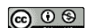

# 第 1 章

# 使用神经网络识别手写数字

人类的视觉系统是世界上的奇迹之一。请看下面这组手写数字：

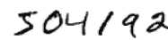

大多数人轻而易举地认出这些数字是 504192。这种轻松是具有欺骗性的。在我们大脑的每个半球中，人类都有一个初级视觉皮层，也称为 V1，包含 1.4 亿个神经元，它们之间有数十亿个连接。然而，人类的视觉不仅涉及 V1，还涉及一整套视觉皮层——V2、V3、V4 和 V5——它们进行越来越复杂的图像处理。我们脑中装备着一台超级计算机，经过数亿年的进化调制，并完美地适应于理解视觉世界。识别手写数字并不容易。相反，我们人类在理解眼睛所呈现的内容方面极其、惊人地擅长。但几乎所有这些工作都是在无意识中完成的。因此，我们通常不会意识到我们的视觉系统解决了多么困难的问题。

如果你尝试编写一个计算机程序来识别如上所示的数字，视觉模式识别的困难就会变得显而易见。当我们亲自去做时，看似简单的事情，突然之间变得极其困难。关于我们如何识别形状的简单直觉——"一个 9 顶部有个环，右下角有一竖"——结果很难以算法形式表达出来。当你试图将这些规则精确化时，你很快就会迷失在一片例外、注意事项和特殊情况的泥潭中。这似乎是绝望的。

神经网络以不同的方式处理问题。其思路是采集大量手写数字，即训练示例，


如果你从本书中受益，请进行少量捐赠。我建议捐赠 3 美元，但你可以自行选择金额。

## 赞助商


感谢所有使本书得以出版的支持者，特别感谢 Pavel Dudrenov。同时也感谢所有为 Bugfinder 名人堂做出贡献的人。

## 资源

- 图书常见问题解答
- 代码仓库
- Michael Nielsen 的项目公告邮件列表
- 深度学习，Yoshua Bengio、Ian 正在准备的草稿书籍

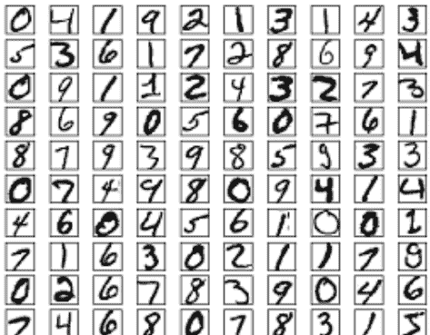


By Michael Nielsen / Jan 2016

然后开发一个系统，可以从这些训练示例中学习。换句话说，神经网络利用示例自动推断识别手写数字的规则。而且，通过增加训练示例的数量，网络可以更多地了解手写体，从而提高准确性。因此，虽然我上面只展示了 100 个训练数字，也许我们可以使用数千个甚至数百万或数十亿个训练示例来构建一个更好的手写识别器。

在本章中，我们将编写一个计算机程序，实现一个能够学习识别手写数字的神经网络。该程序只有 74 行长，并且不使用任何特殊的神经网络库。但这个短小的程序可以在没有人工干预的情况下，以超过 96% 的准确率识别数字。而且，在后续章节中，我们将开发可以将准确率提高到 99% 以上的想法。事实上，目前最好的商业神经网络已经非常出色，以至于银行使用它们来处理支票，邮局使用它们来识别地址。

我们专注于手写识别，因为这是学习神经网络的一个绝佳原型问题。作为一个原型，它正好处于一个甜蜜点：它具有挑战性——识别手写数字绝非易事——但又不难到需要极其复杂的解决方案或巨大的计算能力。而且，它是开发更高级技术（如深度学习）的绝佳方式。因此，在整本书中，我们将反复回到手写识别的问题。在本书后面，我们将讨论这些想法如何应用于其他


计算机视觉、语音、自然语言处理及其他领域的问题。

当然，如果本章的目的仅仅是编写一个识别手写数字的计算机程序，那么本章会短得多！但在此过程中，我们将阐述关于神经网络的许多关键思想，包括两种重要的人工神经元类型（感知机和 sigmoid 神经元），以及神经网络的标准学习算法，即随机梯度下降。贯穿始终，我专注于解释*为什么*事情是以这种方式完成的，并建立你的神经网络直觉。这需要比仅仅展示正在发生的基本机制更长的讨论，但为了你将获得的更深层次的理解，这是值得的。其中的回报之一是，到本章结束时，我们将能够理解什么是深度学习，以及为什么它很重要。

## 感知机

什么是神经网络？要开始，我将解释一种称为*感知机*的人工神经元。感知机是由科学家弗兰克·罗森布拉特在 1950 年代和 1960 年代开发的，受到沃伦·麦卡洛克和沃尔特·皮茨早期工作的启发。如今，使用其他人工神经元模型更为常见——在本书以及大量现代神经网络研究中，主要使用的神经元模型被称为*sigmoid 神经元*。我们很快就会介绍 sigmoid 神经元。但为了理解 sigmoid 神经元为何如此定义，值得花时间先理解感知机。

那么感知机是如何工作的？感知机接收多个二进制输入，$x_1, x_2, ...$，并产生一个单一的二进制输出：

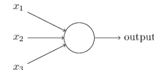

在所示示例中，感知机有三个输入，$x_1, x_2, x_3$。一般来说，它可以有更多或更少的输入。罗森布拉特提出了一条简单的规则来计算输出。他引入了*权重*，$w_1, w_2, ...$，这些是表达各输入对输出重要性的实数。神经元的输出（0 或 1）由加权和 \(\sum_j w_j x_j\) 是小于还是大于某个*阈值*来确定。与权重一样，阈值是神经元的一个参数，也是实数。用更精确的代数术语来说：

$$
\text{output} = \begin{cases} 0 & \text{if } \sum_j w_j x_j \leq \text{threshold} \\ 1 & \text{if } \sum_j w_j x_j > \text{threshold} \end{cases} (1)
$$

感知机的工作原理就这么多！

这是基本的数学模型。你可以这样理解感知机：它是一种通过权衡证据来做出决策的装置。让我举个例子。这个例子并不十分现实，但易于理解，我们很快就会遇到更现实的例子。假设周末快到了，你听说你所在的城市将举办一奶酪节。你喜欢奶酪，正在犹豫是否去参加这个节日。你可以通过权衡三个因素来做出决定：

- 1. 天气好吗？
- 2. 你的男朋友或女朋友想陪你一起去吗？
- 3. 节日靠近公共交通吗？（你没有自己的车）。

我们可以用相应的二进制变量 \(x_1, x_2\) 和 \(x_3\) 来表示这三个因素。例如，如果天气好，则 \(x_1 = 1\)；如果天气不好，则 \(x_1 = 0\)。同样，如果你的男朋友或女朋友想去，则 \(x_2 = 1\)；否则 \(x_2 = 0\)。对于 \(x_3\) 和公共交通也是如此。

现在，假设你非常喜欢奶酪，喜欢到即使你的男朋友或女朋友不感兴趣，而且节日很难到达，你也乐意去参加。但也许你非常讨厌恶劣天气，如果天气不好，你绝对不会去参加节日。你可以使用感知机来模拟这种决策。一种方法是为天气选择权重 \(w_1 = 6\)，为其他条件选择 \(w_2 = 2\) 和 \(w_3 = 2\)。\(w_1\) 的较大值表明天气对你非常重要，远比你的男朋友或女朋友是否陪同，或公共交通是否方便更重要。最后，假设你为感知机选择阈值为 5。有了这些选择，感知机实现了所需的决策模型：每当天气好时输出 1，每当天气不好时输出 0。无论你的男朋友或女朋友是否想去，或者公共交通是否附近，对输出都没有影响。

通过改变权重和阈值，我们可以得到不同的决策模型。例如，假设我们改为选择阈值为 3。那么感知机将决定：每当天气好 _或_ 当节日靠近公共交通 _且_ 你的男朋友或女朋友愿意陪同时，你就应该去参加节日。换句话说，这是一个不同的决策模型。降低阈值意味着你更愿意去参加节日。

显然，感知机并不是人类决策的完整模型！但这个例子说明了感知机如何权衡不同类型的证据以做出决策。而且，一个由感知机组成的复杂网络似乎能够做出相当微妙的决策：

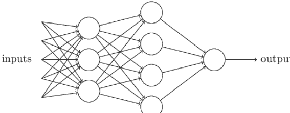

在这个网络中，第一列感知机 - 我们将称之为第一个 _层_ 的感知机 - 正在通过权衡输入证据来做出三个非常简单的决策。第二层的感知机呢？这些感知机中的每一个都在通过权衡第一层决策的结果来做出决策。这样一来，第二层的感知机可以在比第一层感知机更复杂、更抽象的层面上做出决策。而第三层的感知机可以做出更复杂的决策。这样一来，由多层感知机组成的网络可以进行复杂的决策制定。

顺便说一句，当我定义感知机时，我说过感知机只有一个输出。在上面的网络中，感知机看起来像是有多个输出。事实上，它们仍然是单个输出。多个输出箭头只是一种有用的方式，用来表示感知机的输出被用作其他几个感知机的输入。这比画一条输出线然后分叉要不那么麻烦。

让我们简化描述感知机的方式。条件 \(\sum_j w_j x_j >\) 阈值很繁琐，我们可以做两个符号上的改变来简化它。第一个改变是将 \(\sum_j w_j x_j\) 写成点积，\(w \cdot x \equiv \sum_j w_j x_j\)，其中 \(w\) 和 \(x\) 是向量，它们的分量分别是权重和输入。第二个改变是将阈值移到不等式的另一侧，并用称为感知机的 _偏置_、\(b \equiv -\text{阈值}\) 的东西来替换它。使用偏置而不是阈值，感知机规则可以重写为：

\(\text{output} = \begin{cases} 0 & \text{if } w \cdot x + b \le 0 \\ 1 & \text{if } w \cdot x + b > 0 \end{cases}\)

你可以把偏置看作是一个衡量让感知机输出 1 有多容易的指标。或者用更生物学的术语来说，偏置是衡量让感知机 _发火_ 有多容易的指标。对于偏置非常大的感知机，让它输出 1 非常容易。但如果偏置非常负，那么让感知机输出 1 就很困难。显然，引入偏置只是我们描述感知机方式上的一个小改变，但我们稍后会看到，这会导致进一步的符号简化。因此，在本书的其余部分，我们不会使用阈值，而将始终使用偏置。

我已将感知机描述为一种用于权衡证据以做出决策的方法。感知机的另一种用途是计算我们通常认为是计算基础的基本逻辑函数，例如 AND、OR 和 NAND。例如，假设我们有一个具有两个输入的感知机，每个输入的权重为 \(-2\)，总偏置为 3。下面是我们的感知机：

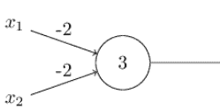

然后我们看到，输入 00 产生输出 1，因为 \((-2) * 0 + (-2) * 0 + 3 = 3\) 是正数。在这里，我引入了 * 符号来使乘法明确化。类似计算表明，输入 01 和 10 产生输出 1。但是输入 11

产出 0，因为 (-2) * 1 + (-2) * 1 + 3 = -1 为负数。因此，我们的感知器实现了一个 NAND 门！

NAND 的例子表明，我们可以使用感知器来计算简单的逻辑函数。事实上，我们可以使用感知器网络来计算任何逻辑函数。其原因是 NAND 门对计算具有普遍性，也就是说，我们可以用 NAND 门构建任何计算。例如，我们可以使用 NAND 门来构建一个电路，用于相加两个比特 x1 和 x2。这需要计算按位和 x1 ⊕ x2，以及一个进位比特，当 x1 和 x2 都为 1 时该比特设置为 1，也就是说，进位比特就是按位积 x1x2：

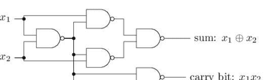

要得到等效的感知器网络，我们将所有 NAND 门替换为具有两个输入的感知器，每个权重为 -2，总偏置为 3。下面是结果网络。请注意，我稍微移动了对应于右下角 NAND 门的感知器，只是为了更容易在图中绘制箭头：

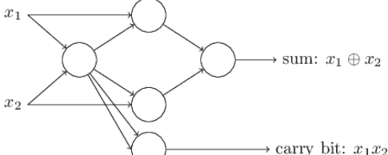

这个感知器网络的一个显著特点是，最左侧感知器的输出被用作最底层感知器的两个输入。当我定义感知器模型时，我没有说明是否允许这种同一位置的双重输出。实际上，这不太重要。如果我们不希望允许这种情况，那么可以简单地将两条线合并为一条连接，其权重为 -4，而不是两条权重为 -2 的连接。（如果你不觉得这很明显，应该停下来证明给自己看，这两者是等价的。）经过该更改后，网络如下所示，所有未标记的权重都等于 -2，所有偏置都等于 3，并且只有一个标记的 -4 权重：

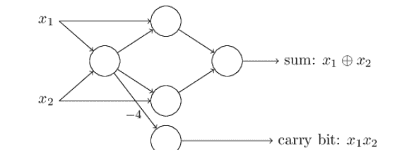

到目前为止，我一直将 $x_1$ 和 $x_2$ 等输入绘制为漂浮在感知器网络左侧的变量。事实上，惯例是绘制一个额外的感知器层——即 *输入层*——来对输入进行编码：

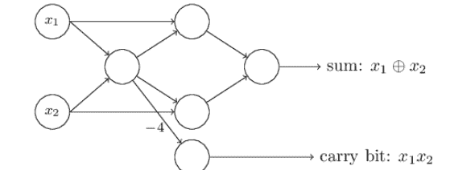

这种输入感知器的表示法，即具有输出但没有输入，

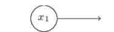

是一种简写。它实际上并不意味着一个没有输入的感知器。要了解这一点，假设我们确实有一个没有输入的感知器。那么加权和 $\sum_j w_j x_j$ 将始终为零，因此感知器将在 $b > 0$ 时输出 1，在 $b \le 0$ 时输出 0。也就是说，感知器将只是输出一个固定值，而不是所需的值（如上面的示例中的 $x_1$）。更好的理解方式是，输入感知器根本不算真正的感知器，而是特殊单元，它们被简单地定义为输出所需的值，$x_1, x_2, ...$

加法器示例演示了如何使用感知器网络来模拟包含许多 NAND 门的电路。由于 NAND 门对计算具有普遍性，因此感知器也对计算具有普遍性。

感知器的计算普遍性既令人欣慰又令人失望。它令人欣慰，因为它告诉我们感知器网络可以和其他任何计算设备一样强大。但它也令人失望，因为它让人感觉感知器只是一种新型的 NAND 门。这根本算不上什么重大新闻！

然而，情况比这种观点所暗示的要好。事实证明，我们可以设计出学习算法，能够自动调整人工神经元网络的权重和偏置。这种调整是对外部刺激的响应，无需程序员直接干预。这些学习算法使我们能够以一种与传统逻辑门截然不同的方式使用人工神经元。我们的神经网络不再需要明确地布线 NAND 和其他门的电路，而可以简单地学习解决问题，有时是那些直接设计传统电路会极其困难的问题。

## Sigmoid 神经元

学习算法听起来很棒。但是，我们如何为神经网络设计这样的算法呢？假设我们有一个感知器网络，希望用它来学习解决某个问题。例如，网络的输入可能是扫描的手写数字图像的原始像素数据。我们希望网络学习权重和偏置，使网络的输出能正确地对数字进行分类。为了了解学习可能如何工作，假设我们对网络中的某个权重（或偏置）进行了微小的更改。我们希望的是，权重的微小变化只会导致网络输出相应的微小变化。如我们稍后将看到，这种属性将使学习成为可能。概略地，这里就是我们想要的（显然这个网络太简单，无法进行手写识别！）：

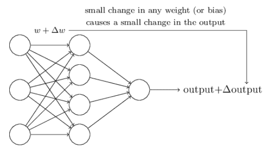

如果权重（或偏置）的微小变化只会导致输出的微小变化这一说法是正确的，那么我们就可以利用这一事实来修改权重和偏置，使网络的行为更符合我们的意图。例如，假设网络错误地将一张图像归类为“8”，而它应该是“9”。我们可以想办法对权重和偏置进行微小的更改，使网络稍微更接近于将图像归类为“9”。然后我们就会重复这个过程，一次又一次地更改权重和偏置，以产生越来越好的输出。网络就会在学习。

问题在于，当我们的网络包含感知器时，情况并非如此。事实上，网络中任何单个感知器的权重或偏置的微小变化，有时会导致该感知器的输出完全翻转，比如从 0 变为 1。这种翻转可能导致网络其余部分的行为以非常复杂的方式完全改变。因此，虽然你的“9”现在可能被正确分类，但网络对所有其他图像的行为很可能以难以控制的方式完全改变了。这使得很难看出如何逐步修改权重和偏置，使网络越来越接近所需的行为。也许有某种巧妙的方法可以绕过这个问题。但如何让感知器网络学习还并不明显。

我们可以通过引入一种称为 Sigmoid 神经元的新型人工神经元来克服这个问题。Sigmoid 神经元与感知器相似，但经过修改，使得它们权重和偏置的微小变化只会导致输出的微小变化。这是至关重要的事实，将使 Sigmoid 神经元网络能够学习。

好吧，让我来描述一下 Sigmoid 神经元。我们将以描绘感知器的同样方式来描绘 Sigmoid 神经元：

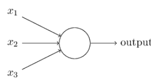

与感知器一样，Sigmoid 神经元有输入 x1、x2 等。但是，这些输入不只是 0 或 1，还可以取 0 到 1 之间的任何值。例如，0.638 ... 是 Sigmoid 神经元的有效输入。与感知器一样，Sigmoid 神经元为每个输入配备权重 w1、w2 等，以及一个总偏置 b。但是输出不是 0 或 1。相反，它是 σ(w · x + b)，其中 σ 被称为 Sigmoid 函数*，定义如下：

\(\sigma(z) \equiv \frac{1}{1+e^{-z}}.\)

> *顺便说一句，σ 有时也被称为 *逻辑函数*，而这种新类神经元被称为 *逻辑神经元*。记住这些术语很有用，因为许多从事神经网络工作的人都会使用这些术语。不过，我们将继续使用 Sigmoid 术语。

为了更明确地说明，带有输入 x1、x2 等、权重 w1、w2 等以及偏置 b 的 Sigmoid 神经元的输出是

\(\frac{1}{1 + \exp(-\sum_j w_j x_j - b)}.\)

乍一看，Sigmoid 神经元与感知器非常不同。如果你不熟悉 Sigmoid 函数的代数形式，它可能会显得晦涩难懂。事实上，感知器和 Sigmoid 神经元之间有许多相似之处，Sigmoid 函数的代数形式更多是一个技术细节，而非理解的真正障碍。

为了理解与感知器模型的相似性，假设 z ≡ w · x + b 是一个很大的正数。那么 e^-z ≈ 0，因此 σ(z) ≈ 1。换句话说，当 z = w · x + b 很大且为正时，Sigmoid 神经元的输出大约为 1，这与感知器的情况相同。另一方面，假设 z = w · x + b 为很大的负数。那么 e^-z → ∞，σ(z) ≈ 0。因此，当 z = w · x + b 为很大的负数时，Sigmoid 神经元的行为也非常接近感知器。只有当 w · x + b 适中时，才会与感知器模型出现较大偏差。

σ 的代数形式呢？我们如何理解它？事实上，σ 的精确形式并不那么重要——真正重要的是该函数绘制出的形状。下面是形状：


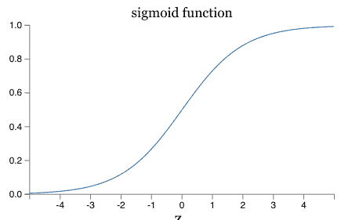

这种形状是阶梯函数的平滑版本：

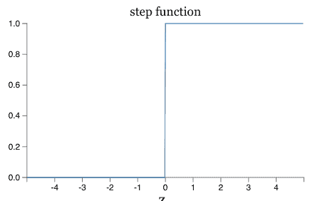

如果 \(\sigma\) 实际上是一个阶梯函数，那么 Sigmoid 神经元将是一个感知器，因为输出将是 1 或 0，具体取决于 \(w \cdot x + b\) 是正还是负*。通过使用实际的 \(\sigma\) 函数，我们得到，如上文已经暗示的那样，一个平滑的感知器。确实，关键事实是 \(\sigma\) 函数的平滑性，而不是其详细形式。 \(\sigma\) 的平滑性意味着，权重的微小变化 \(\Delta w_j\) 和偏置的微小变化 \(\Delta b\) 将产生神经元输出的微小变化 \(\Delta \text{output}\)。事实上，微积分告诉我们，\(\Delta \text{output}\) 可以很好地用以下公式近似：

> *实际上，当 \(w \cdot x + b = 0\) 时，感知器输出 0，而阶梯函数输出 1。因此，严格来说，我们需要在那个点修改阶梯函数。但你明白意思。

```
\(\Delta \text{output} \approx \sum_j \frac{\partial \text{output}}{\partial w_j} \Delta w_j + \frac{\partial \text{output}}{\partial b} \Delta b, \quad (5)\)
```

求和是对所有权重 \(w_j\) 进行，\(\partial \text{output}/\partial w_j\) 和 \(\partial \text{output}/\partial b\) 分别表示输出对 \(w_j\) 和 \(b\) 的偏导数。如果你对偏导数不太熟悉，不要惊慌！虽然上面的表达式看起来很复杂，包含了所有偏导数，但它实际上在说一件非常简单的事情（而且是非常好的消息）：\(\Delta \text{output}\) 是权重和偏置变化 \(\Delta w_j\) 和 \(\Delta b\) 的 *线性函数*。这种线性使得选择权重和偏置的微小变化以实现输出中任何所需的微小变化变得容易。因此，虽然 Sigmoid 神经元与感知器具有大部分相同的定性行为，但它们使得弄清楚改变权重和偏置将如何改变输出变得容易得多。

如果真正重要的 \(\sigma\) 的形状，而不是其精确形式，那么为什么要在公式 (3) 中使用特定形式的 \(\sigma\) 呢？事实上，书中后面我们偶尔会考虑输出为 \(f(w \cdot x + b)\) 的神经元，其中 \(f(\cdot)\) 是其他激活函数。当我们使用不同的激活函数时，主要变化的是公式 (5) 中偏导数的特定值。事实证明，当我们稍后计算这些偏导数时，使用 \(\sigma\) 将简化代数，仅仅是因为指数函数在求导时具有可爱的特性。无论如何，\(\sigma\) 在神经网络工作中被广泛使用，也是本书中我们最常使用的激活函数。

我们应该如何解释 Sigmoid 神经元的输出？显然，感知器和 Sigmoid 神经元之间的一个巨大区别是，Sigmoid 神经元不仅输出 0 或 1。它们可以输出 0 和 1 之间的任何实数，因此 0.173 ... 和 0.689 ... 等值是合法的输出。例如，如果我们想使用输出值来表示输入神经网络的图像中像素的平均强度，这很有用。但有时这也可能令人困扰。假设我们希望网络的输出指示“输入图像是 9”或“输入图像不是 9”。显然，如果输出像感知器一样是 0 或 1，那么这样做最容易。但在实践中，我们可以建立一种约定来处理这个问题，例如，决定将任何至少 0.5 的输出解释为表示“9”，将任何小于 0.5 的输出解释为表示“不是 9”。我将始终明确说明我们何时使用这种约定，因此不应该引起任何混淆。

## 练习

- Sigmoid 神经元模拟感知器，部分 I
- 假设我们取感知器网络中所有权重和偏置，并将它们乘以一个正常数 \(c > 0\)。
- 证明网络的行为没有改变。

### Sigmoid 神经元模拟感知机，部分 II

假设我们有与上一个问题相同的设置——一个感知器网络。假设还选择了感知器网络的整体输入。我们不需要实际的输入值，只需要输入已经固定。假设权重和偏置使得 \( w \cdot x + b \neq 0 \) 对于网络中任何特定感知器的输入 \( x \) 成立。现在用 Sigmoid 神经元替换网络中的所有感知器，并将权重和偏置乘以一个正常数 \( c > 0 \)。证明当 \( c \to \infty \) 时，这个 Sigmoid 神经元网络的行为与感知器网络的行为完全相同。当其中一个感知器的 \( w \cdot x + b = 0 \) 时，这种情况如何会失败？

## 神经网络的架构

在下一节中，我将介绍一个能够很好地对手写数字进行分类的神经网络。为此，有必要解释一些术语，以便我们为网络的不同部分命名。假设我们有以下网络：

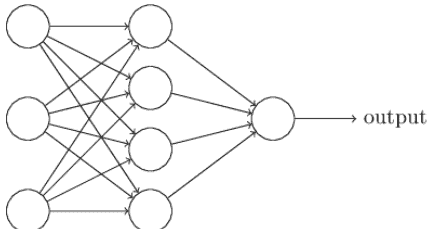

如前所述，此网络中最左侧的层称为输入层，层内的神经元称为输入神经元。最右侧或输出层包含输出神经元，或者，如本例中，一个输出神经元。中间层称为隐藏层，因为该层中的神经元既不是输入也不是输出。“隐藏”这个词也许听起来有点神秘——我第一次听到这个词时，以为它一定有什么深刻的哲学或数学意义——但实际上它只不过意味着“不是输入或输出”。上述网络只有一个隐藏层，但有些网络有多个隐藏层。例如，下面的四层网络有两个隐藏层：

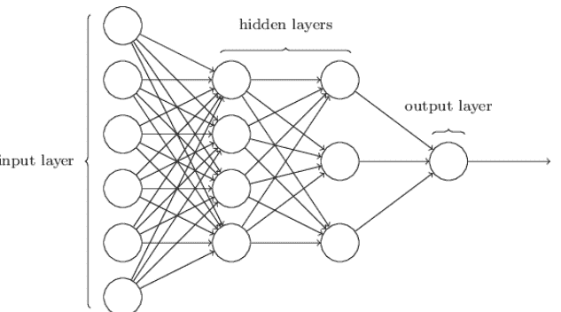

令人有些困惑的是，出于历史原因，这种多层网络有时被称为 *多层感知器* 或 *MLPs*，尽管它们由 Sigmoid 神经元组成，而不是感知器。本书不会使用 MLP 术语，因为我认为它令人困惑，但想提醒你注意它的存在。

网络中输入层和输出层的设计通常很简单。例如，假设我们试图确定手写图像是否描绘的是“9”。一种自然的设计网络的方法是将图像像素的强度编码到输入神经元中。如果图像是 64×64 的灰度图像，那么我们将有 4,096 = 64 × 64 个输入神经元，强度适当地在 0 和 1 之间缩放。输出层将只包含一个神经元，输出值小于 0.5 表示“输入图像不是 9”，输出值大于 0.5 表示“输入图像是 9”。

虽然神经网络中输入层和输出层的设计通常很简单，但隐藏层的设计可能颇具技巧。特别是，无法用几条简单的经验法则来概括隐藏层的设计过程。相反，神经网络研究人员为隐藏层开发了许多设计启发式，帮助人们从网络中获得所需的行为。例如，可以使用这些启发式来帮助确定如何权衡隐藏层的数量与训练网络所需的时间。我们将在本书后面遇到几种这样的设计启发式。

到目前为止，我们一直在讨论一种神经网络，其中一层的输出用作下一层的输入。这种网络称为 *前馈* 神经网络。这意味着网络中没有循环——信息始终向前传递，从不反馈。

如果我们确实有循环，我们最终会得到 \(\sigma\) 函数的输入取决于输出的情况。这很难理解，因此我们不允许这种循环。

然而，还有其他人工神经网络模型，其中反馈循环是可能的。这些模型称为循环神经网络。这些模型的思路是让神经元在有限持续时间内发射，然后变得安静。这种发射可以刺激其他神经元，这些神经元可能稍后发射，同样持续有限时间。这会导致更多神经元发射，随着时间的推移，我们得到一连串神经元发射。在这种模型中，循环不会引起问题，因为神经元的输出只在某个时间点影响其输入，而不是即时影响。

循环神经网络不如前馈网络有影响力，部分原因是循环网络的学习算法（至少到目前为止）不那么强大。但循环网络仍然非常有趣。它们在精神上更接近于我们大脑的工作方式，而不是前馈网络。而且，循环网络可能解决重要问题，而这些问题前馈网络只能以极大困难解决。然而，为了限制范围，在本书中我们将专注于更广泛使用的前馈网络。

## 用于分类手写数字的简单网络

在定义了神经网络后，让我们回到手写识别。我们可以将识别手写数字的问题分解为两个子问题。首先，我们希望有一种方法，将包含许多数字的图像分解为一系列独立图像，每个图像包含一个数字。例如，我们希望将图像

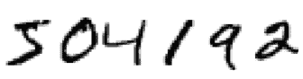

分解为六个独立图像，


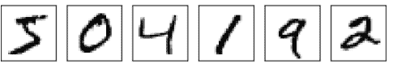

我们人类可以轻松解决这个 _分割问题_，但对于计算机程序来说，要正确地分割图像却颇具挑战。图像分割完成后，程序还需要对每个单独的数字进行分类。因此，例如，我们希望程序能识别上面的第一个数字，

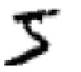

是 5。

我们将专注于编写程序来解决第二个问题，即对单个数字进行分类。之所以这么做，是因为一旦有了良好的单个数字分类方法，分割问题就不那么难解决了。解决分割问题有很多方法。一种方法是尝试多种不同的图像分割方式，使用单个数字分类器为每个试验分割打分。如果单个数字分类器对所有段的分类都有把握，则试验分割会获得高分；如果分类器在一个或多个段上遇到很多困难，则会获得低分。其思想是，如果分类器在某处遇到困难，那很可能是因为所选的分割不正确。这种思想及其他变体可以很好地解决分割问题。因此，与其担心分割问题，不如专注于开发一个神经网络，来解决更有趣、更困难的问题，即识别单个手写数字。

要识别单个数字，我们将使用一个三层神经网络：

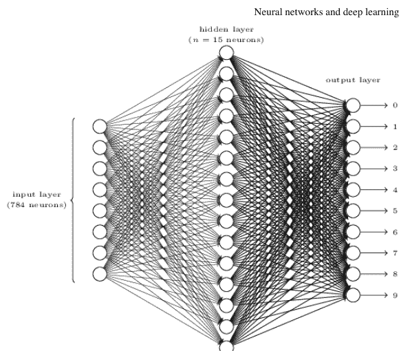

网络的输入层包含编码输入像素值的神经元。正如下一节所讨论的，我们网络的训练数据将包含许多扫描的手写数字图像，尺寸为 28×28 像素，因此输入层包含 784 = 28 × 28 个神经元。为简化起见，上图中我省略了大部分 784 个输入神经元。输入像素是灰度图，值为 0.0 表示白色，值为 1.0 表示黑色，中间值则表示逐渐变暗的灰色色调。

网络的第二层是隐藏层。我们用 n 表示该隐藏层中神经元的数量，并将尝试 n 的不同取值。所示示例说明了一个小隐藏层，仅包含 n = 15 个神经元。

网络的输出层包含 10 个神经元。如果第一个神经元放电，即输出 ≈ 1，则这将表明网络认为该数字是 0。如果第二个神经元放电，则表明网络认为该数字是 1。以此类推。更准确地说，我们将输出神经元编号为 0 到 9，并找出哪个神经元的激活值最高。如果该神经元是，例如，编号 6 的神经元，那么我们的网络将推测输入数字是 6。其他输出神经元亦是如此。

你可能会好奇，为什么我们要使用 10 个输出神经元。毕竟，网络的目的是告诉我们输入图像对应哪个数字（0、1、2、...、9）。一种看似自然的做法是只使用 4 个输出神经元，将每个神经元视为采取二进制值，取决于该神经元的输出更接近 0 还是 1。四个神经元足以对答案进行编码，因为 2^4 = 16 大于输入数字的 10 个可能值。为什么我们的网络应该使用 10 个神经元？这难道不低效吗？最终的依据是经验性的：我们可以尝试这两种网络设计，结果表明，对于这个特定问题，具有 10 个输出神经元的网络比具有 4 个输出神经元的网络更能学会识别数字。但这让我们想知道，为什么使用 10 个输出神经元效果更好。是否有某种启发式方法可以预先告诉我们，应该使用 10 输出编码而不是 4 输出编码？

要理解我们这样做的原因，有助于从头开始思考神经网络在做什么。先考虑使用 10 个输出神经元的情况。让我们关注第一个输出神经元，即试图判断该数字是否为 0 的神经元。它通过权衡来自隐藏层神经元的证据来做到这一点。这些隐藏神经元在做什么？嗯，为了论证，我们假设隐藏层中的第一个神经元检测类似下面的图像是否存在：

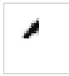

它可以通过对与图像重叠的输入像素赋予较大权重，只对其他输入赋予较小权重来做到这一点。类似地，为了论证，我们假设隐藏层中的第二、第三和第四个神经元检测以下图像是否存在：

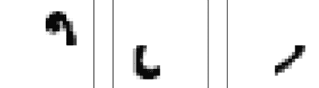

你可能已经猜到，这四幅图像合在一起构成了我们在前面所示的数字序列中看到的 0 的图像：

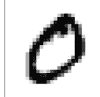

因此，如果这四个隐藏神经元都放电，我们可以得出结论该数字是 0。当然，这并不是我们用来得出图像为 0 的结论的 _唯一_ 证据类型 - 我们可以通过许多其他合法方式得到 0（例如，通过上述图像的平移或轻微畸变）。但至少在这种情况下，我们可以说，我们会得出输入为 0 的结论。

假设神经网络以这种方式工作，我们可以给出一个合理的解释，说明为什么网络有 10 个输出比 4 个更好。如果只有 4 个输出，那么第一个输出神经元将试图判断数字的最高有效位是什么。并且，没有简单的方法将该最高有效位与上述简单形状相关联。很难想象，数字的组件形状与（例如）输出中的最高有效位之间会有任何良好的历史原因。

话虽如此，这都只是一种启发式方法。没有什么规定三层神经网络必须按照我描述的方式运行，即隐藏神经元检测简单的组件形状。也许一个聪明的学习算法会找到一些权重分配，让我们只能使用 4 个输出神经元。但作为一种启发式方法，我描述的思考方式效果相当不错，并且在设计良好的神经网络架构时可以为你节省大量时间。

## 练习

- 有一种方法可以通过在上述三层网络中添加额外层来确定数字的按位表示。额外层将前一层的输出转换为二进制表示，如下图所示。为新的输出层找一组权重和偏置。假设前 3 层神经元的正确输出在第三层（即旧输出层）中激活值至少为 0.99，而错误输出的激活值小于 0.01。

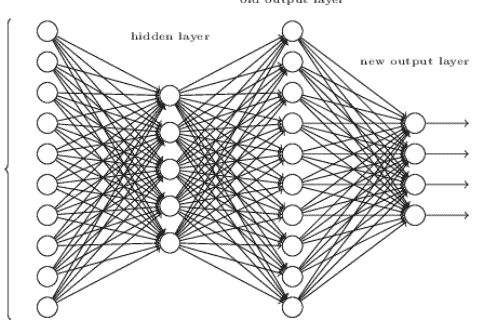

## 使用梯度下降进行学习

既然我们有了神经网络的设计，它如何学习识别数字呢？我们首先需要一个用于学习的数据集，即所谓的训练数据集。我们将使用 MNIST 数据集，该数据集包含数以万计的手写数字扫描图像，以及它们的正确分类。MNIST 之所以得名，是因为它是由 NIST（美国国家标准与技术研究院）收集的两个数据集的修改子集。以下是 MNIST 中的几幅图像：

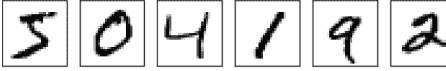

如你所见，这些数字实际上与本章开头展示的用于挑战识别的数字相同。当然，在测试我们的网络时，我们会要求它识别训练集中不包含的图像！

MNIST 数据分为两部分。第一部分包含 60,000 幅用作训练数据的图像。这些图像来自 250 人的扫描手写样本，其中一半是美国人口普查局的员工，另一半是高中学生。图像为灰度图，尺寸为 28×28 像素。MNIST 数据集的第二部分是 10,000 幅用作测试数据的图像。同样，这些是 28×28 的灰度图像。我们将使用测试数据来评估我们的神经网络识别数字的效果如何。为了使这成为良好的性能测试，测试


数据来自与原始训练数据不同的 250 人集合（尽管仍是人口普查局员工和高中生组成的群体）。这让我们有信心，我们的系统可以识别训练期间未见过其书写的人的手写数字。

我们将使用符号 x 表示训练输入。将每个训练输入 x 视为 28 x 28 = 784 维向量会很方便。向量中的每个条目表示图像中单个像素的灰度值。我们将相应的期望输出表示为 y = y(x)，其中 y 是 10 维向量。例如，如果某个训练图像 x 描绘的是 6，那么 y(x) = (0, 0, 0, 0, 0, 0, 1, 0, 0, 0)^T 就是网络的期望输出。请注意，这里的 T 是转置操作，将行向量转换为普通（列）向量。

我们想要的是一种算法，可以让我们找到权重和偏置，使网络输出对所有训练输入 x 都近似 y(x)。为了量化我们实现这一目标的程度，我们定义一个代价函数*：

```
C(w, b) ≡ 1/2n Σ_x ||y(x) - a||².
(6)
```

> *有时也称为损失函数或目标函数。本书中我们使用“代价函数”这一术语，但你应该注意其他术语，因为它们经常出现在研究论文和其他关于神经网络的讨论中。

这里，w 表示网络中所有权重的集合，b 表示所有偏置，n 是训练输入的总数，a 是输入 x 时网络输出的向量，求和是对所有训练输入 x 进行的。当然，输出 a 依赖于 x、w 和 b，但为了保持符号简洁，我没有明确指出这种依赖关系。符号 ||v|| 仅表示向量 v 的常规长度函数。我们将 C 称为二次代价函数；它有时也被称为均方误差或简称为 MSE。

检查二次代价函数的形式，我们发现 C(w, b) 是非负的，因为求和中的每一项都是非负的。此外，当且仅当所有训练输入 x 的 y(x) 都近似等于输出 a 时，代价 C(w, b) 才会变小，即 C(w, b) ≈ 0。因此，如果我们的训练算法能找到使 C(w, b) ≈ 0 的权重和偏置，那么它就做得很好。相比之下，当 C(w, b) 很大时，表现就不太好——这意味着对于大量输入，y(x) 与输出 a 不接近。因此，我们的训练算法的目标是将代价 C(w, b) 作为权重和偏置的函数最小化。换句话说，我们想要找到一组权重和偏置，使代价尽可能小。我们将使用一种称为 *梯度下降* 的算法来做到这一点。

为什么要引入二次代价？毕竟，我们主要关心的不是网络正确分类的图像数量吗？为什么不直接尝试最大化这个数量，而不是最小化像二次代价这样的替代度量呢？问题在于，正确分类的图像数量不是网络权重和偏置的平滑函数。在大多数情况下，对权重和偏置进行微小更改不会对正确分类的训练图像数量产生任何变化。这使得很难弄清楚如何更改权重和偏置以获得性能改进。如果我们改用像二次代价这样的平滑代价函数，那么弄清楚如何对权重和偏置进行微小更改以改善代价就很容易了。这就是为什么我们首先专注于最小化二次代价，而只有在那之后才会研究分类准确率。

即便如此，即使我们想使用平滑代价函数，你可能仍然会好奇为什么我们选择公式 (6) 中使用的二次函数。这不是一种相当 *临时性的* 选择吗？也许如果我们选择了不同的代价函数，我们就会得到一组完全不同的最小化权重和偏置？这是一个合理的担忧，稍后我们将重新审视代价函数并进行一些修改。然而，公式 (6) 的二次代价函数对于理解神经网络学习的基础知识非常有效，所以我们暂时将继续使用它。

回顾一下，训练神经网络的目标是找到最小化二次代价函数 \(C(w, b)\) 的权重和偏置。这是一个良设问题，但当前表述下它有大量令人分心的结构——将 \(w\) 和 \(b\) 解释为权重和偏置，潜伏在背景中的 \(\sigma\) 函数，网络架构的选择，MNIST 等等。事实证明，通过忽略其中的大部分结构，只专注于最小化方面，我们可以理解大量内容。所以现在我们将暂时忘记代价函数的具体形式、与神经网络的联系等等。相反，我们将想象自己只是得到了一个多变量函数，并希望最小化该函数。我们将开发一种称为 _梯度下降_ 的技术，可用于求解此类最小化问题。然后我们将回到神经网络中我们想要最小化的特定函数。

好的，让我们假设我们正在尝试最小化某个函数 \(C(v)\)。这可以是多变量的任何实值函数，\(v = v_1, v_2, ...\) 。请注意，我已将 \(w\) 和 \(b\) 的符号替换为 \(v\) 以强调这可以是任何函数——我们不再特指神经网络的上下文。要最小化 \(C(v)\)，将 \(C\) 想象成只有两个变量（我们将其称为 \(v_1\) 和 \(v_2`）的函数会有所帮助：

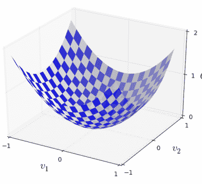

我们想要找到 \(C\) 达到全局最小值的位置。当然，对于上面绘制的函数，我们可以肉眼观察图像并找到最小值。从这个意义上说，我可能展示了一个稍微 _太简单_ 的函数！一般函数 \(C\) 可能是多变量的复杂函数，通常不可能仅通过肉眼观察图像来找到最小值。

解决此问题的一种方法是使用微积分来尝试解析地找到最小值。我们可以计算导数，然后尝试使用它们来找到 \(C\) 为极值的地方。当 \(C\) 是仅一个或少数几个变量的函数时，也许这样做会有运气。但当我们有更多变量时，这将变成一场噩梦。而对于神经网络，我们通常需要 _远_ 更多的变量——最大的神经网络具有依赖于数十亿个权重和偏差的代价函数，以极其复杂的方式。使用微积分来最小化它根本行不通！

（在断言通过将 C 想象为仅两个变量的函数来获得洞察之后，我在两段中两次转弯并说：“嘿，但如果它是两个以上变量的函数呢？”对此抱歉。请相信我，当我说想象 C 作为两个变量的函数确实很有帮助时。只是有时这个图景会失效，而最后两段正在处理此类失效情况。关于数学的良好思考通常涉及权衡多个直观图景，学习何时适合使用每个图景，以及何时不适合。）

好吧，所以微积分行不通。幸运的是，有一个优美的类比暗示了一个效果相当好的算法。我们首先将我们的函数视为一种山谷。如果你稍微眯起眼睛看上面的图，那不应该太难。我们想象一个球沿着山谷的斜坡滚下。我们的日常经验告诉我们，球最终会滚到山谷底部。也许我们可以利用这个想法来寻找函数的最小值？我们会为（想象中的）球随机选择一个起点，然后模拟球滚到山谷底部的运动。我们可以通过计算 C 的导数（以及可能的一些二阶导数）来完成此模拟——这些导数将告诉我们关于山谷局部“形状”所需知道的一切，因此也告诉我们球应该如何滚动。

根据我刚才写的内容，你可能会认为我们将尝试为球写出牛顿运动方程，考虑摩擦力和重力的影响等等。实际上，我们不会把滚球类比当真得那么过分——我们正在制定一个最小化 C 的算法，而不是开发物理定律的准确模拟！球的视角旨在激发我们的想象力，而不是约束我们的思维。所以，与其陷入物理学的所有混乱细节，不如简单地问自己：如果我们被宣布为一天之神，可以制定我们自己的物理定律，规定球应该如何滚动，我们可以选取什么运动定律或定律，以使球总是滚到山谷底部？

为了使这个问题更加精确，让我们思考当我们沿 v₁ 方向移动球一个小量 Δv₁，和


沿 \(v_2\) 方向的一个小量 \(\Delta v_2\)。微积分告诉我们，\(C\) 的变化如下：

\(\Delta C \approx \frac{\partial C}{\partial v_1} \Delta v_1 + \frac{\partial C}{\partial v_2} \Delta v_2.\) (7)

我们将寻找一种选择 \(\Delta v_1\) 和 \(\Delta v_2\) 的方法，使 \(\Delta C\) 为负值；也就是说，我们会选择它们，使球沿着山谷向下滚动。为了找出如何做出这样的选择，定义 \(\Delta v\) 为 \(v\) 的变化向量会有所帮助，\(\Delta v \equiv (\Delta v_1, \Delta v_2)^T\)，其中 \(T\) 又是转置操作，将行向量转换为列向量。我们还将把 \(C\) 的 *梯度* 定义为偏导数向量，\(\left( \frac{\partial C}{\partial v_1}, \frac{\partial C}{\partial v_2} \right)^T\)。我们用 \(\nabla C\) 表示梯度向量，即：

\(\nabla C \equiv \left( \frac{\partial C}{\partial v_1}, \frac{\partial C}{\partial v_2} \right)^T.\) (8)

稍后我们将用 \(\Delta v\) 和梯度 \(\nabla C\) 重写变化量 \(\Delta C\)。不过，在此之前，我想澄清一些有时会让人对梯度感到困惑的问题。初次接触 \(\nabla C\) 记号时，人们有时会不知道该如何理解 \(\nabla\) 符号。\(\nabla\) 到底是什么意思？事实上，把 \(\nabla C\) 看作一个单一的数学对象——即上面定义的向量——完全没问题，只是碰巧用了两个符号来书写。从这个角度看，\(\nabla\) 只是一种记号上的花哨做法，告诉你“嘿，\(\nabla C\) 是一个梯度向量”。还有更高级的观点，其中 \(\nabla\) 可以被视为一个独立的数学实体（例如，作为微分算子），但我们不需要这样的观点。

有了这些定义，\(\Delta C\) 的表达式 (7) 可以重写为

\(\Delta C \approx \nabla C \cdot \Delta v.\) (9)

这个方程有助于解释为什么 \(\nabla C\) 被称为梯度向量：\(\nabla C\) 将 \(v\) 的变化与 \(C\) 的变化联系起来，正如我们对梯度所期望的那样。但关于这个方程真正令人兴奋的是，它让我们看到如何选择 \(\Delta v\) 来使 \(\Delta C\) 为负值。特别是，假设我们选择

\(\Delta v = -\eta \nabla C,\) (10)

其中 \(\eta\) 是一个小的正参数（称为 *学习率*）。那么方程 (9) 告诉我们 \(\Delta C \approx -\eta \nabla C \cdot \nabla C = -\eta \|\nabla C\|^2\)。由于 \(\|\nabla C\|^2 \ge 0\)，这保证了 \(\Delta C \le 0\)，也就是说，如果我们按照 (10) 中的规定改变 v，\(C\) 将始终减小，永远不会增加。（当然，这是在方程 (9) 的近似范围内。）这就是我们想要的性质！因此，我们将把方程 (10) 当作梯度下降算法中球的“运动定律”。也就是说，我们将使用方程 (10) 计算一个 \(\Delta v\) 的值，然后将球的位置 \(v\) 移动该量：

v → v' = v - η∇C. (11)

然后我们将再次使用此更新规则，进行另一次移动。如果我们反复这样做，我们将不断减小 \(C\)，直到——我们希望——达到全局最小值。

总结一下，梯度下降算法的工作方式是反复计算梯度 \(\nabla C\)，然后向相反方向移动，即“沿着山谷的斜坡向下落”。我们可以这样可视化：

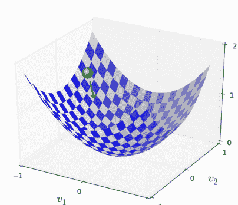

请注意，根据此规则，梯度下降并不再现真实的物理运动。在现实中，球具有动量，该动量可能使它横过斜坡滚动，甚至（暂时）向上滚动。只有在摩擦力作用发生后，球才保证会滚入山谷。相比之下，我们选择 \(\Delta v\) 的规则只是说“现在就往下走”。这仍然是一个寻找最小值的相当不错的规则！

为了使梯度下降正确工作，我们需要选择足够小的学习率 \(\eta\)，使方程 (9) 成为良好的近似。如果不这样做，我们可能会得到 \(\Delta C > 0\)，这显然不好！同时，我们不希望 \(\eta\) 太小，因为这会使变化 \(\Delta v\) 变得非常小，从而导致梯度下降算法运行非常缓慢。在实际实现中，\(\eta\) 经常被调整，以使方程 (9) 仍然是良好的近似，但算法不会太慢。我们稍后将看到这是如何工作的。

我已经解释了当 \(C\) 仅是两个变量的函数时的梯度下降。但实际上，即使 \(C\) 是更多变量的函数，一切也同样适用。特别是，假设 \(C\) 是 \(m\) 个变量 \(v_1, ..., v_m\) 的函数。那么由微小变化 \(\Delta v = (\Delta v_1, ..., \Delta v_m)^T\) 产生的 \(C\) 的变化 \(\Delta C\) 为

\(\Delta C \approx \nabla C \cdot \Delta v, \quad (12)\)

其中梯度 \(\nabla C\) 是向量

\(\nabla C \equiv \left( \frac{\partial C}{\partial v_1}, ..., \frac{\partial C}{\partial v_m} \right)^T. \quad (13)\)

就像两个变量的情况一样，我们可以选择

\(\Delta v = -\eta \nabla C, \quad (14)\)

并且我们保证我们对 \(\Delta C\) 的（近似）表达式 (12) 将为负值。这为我们提供了一种沿着梯度寻找最小值的方法，即使 \(C\) 是多个变量的函数，也可以通过反复应用更新规则

\(v \to v' = v - \eta \nabla C. \quad (15)\)

你可以把这个更新规则视为 _定义_ 梯度下降算法。它给我们提供了一种反复改变位置 \(v\) 以找到函数 \(C\) 最小值的方法。该规则并非总是有效——有几种事情可能出错并阻止梯度下降找到 \(C\) 的全局最小值，我们将在后续章节中回头探讨这一点。但在实践中，梯度下降通常效果极佳，在神经网络中我们会发现它是最小化代价函数的一种强大方法，从而帮助网络学习。

事实上，梯度下降甚至在某种意义上是寻找最小值的最优策略。假设我们试图做一个位置移动 \(\Delta v\) 以尽可能地减小 \(C\)。这相当于最小化 \(\Delta C \approx \nabla C \cdot \Delta v\)。我们将限制移动的大小，使 \(\|\Delta v\| = \epsilon\) 对于某个小的固定 \(\epsilon > 0\)。换句话说，我们想要一个固定大小的小步移动，并试图找到能尽可能减小 \(C\) 的移动方向。可以证明，最小化 \(\nabla C \cdot \Delta v\) 的 \(\Delta v\) 的选择是 \(\Delta v = -\eta \nabla C\)，其中 \(\eta = \epsilon / \|\nabla C\|\) 由大小约束 \(\|\Delta v\| = \epsilon\) 决定。因此，梯度下降可以被视为一种沿着最能立即减小 \(C\) 的方向迈小步的方法。

## 练习

- 证明上一段的断言。*提示*：如果你不熟悉柯西-施瓦茨不等式，了解它可能会对你有所帮助。

- 我解释了当 \(C\) 是两个变量的函数以及多于两个变量的函数时的梯度下降。当 \(C\) 只有一个变量时会发生什么？你能提供一维情况下梯度下降正在做什么的几何解释吗？

人们研究了许多梯度下降的变体，包括那些更紧密模仿真实物理球的变体。这些模仿球的变体有一些优势，但也有一个主要缺点：事实证明有必要计算 \(C\) 的二阶偏导数，而且这可能非常昂贵。要了解为什么昂贵，假设我们想要计算所有的二阶偏导数 \(\partial^2 C / \partial v_j \partial v_k\)。如果有百万个这样的 \(v_j\) 变量，那么我们需要计算大约一万亿个（即百万个平方）二阶偏导数*！这在计算上将很昂贵。话虽如此，有避免此类问题的技巧，寻找梯度下降的替代方案是一个活跃的研究领域。但在这本书中，我们将使用梯度下降（及其变体）作为神经网络学习的主要方法。

*实际上，更接近半万亿个，因为 \(\partial^2 C / \partial v_j \partial v_k = \partial^2 C / \partial v_k \partial v_j\)。不过，你明白我的意思。

我们如何将梯度下降应用于神经网络的学习？其想法是使用梯度下降来找到最小化方程 (6) 中代价的权重 \(w_k\) 和偏置 \(b_l\)。为了了解这是如何工作的，让我们重述带有权重和


用偏置取代变量 $v_j$。换句话说，我们的"位置"现在具有分量 $w_k$ 和 $b_l$，梯度向量 $\nabla C$ 具有相应的分量 $\partial C/\partial w_k$ 和 $\partial C/\partial b_l$。以分量形式写出梯度下降更新规则，我们有

```
w_k \to w'_k = w_k - \eta \frac{\partial C}{\partial w_k} \qquad (16)
b_l \to b'_l = b_l - \eta \frac{\partial C}{\partial b_l}. \qquad (17)
```

反复应用此更新规则，我们可以"沿山丘向下滚动"，并希望找到代价函数的最小值。换句话说，这是一条可用于神经网络学习的规则。

应用梯度下降规则存在若干挑战。我们将在后面的章节中深入探讨这些挑战。但目前，我只想提及一个问题。为了理解问题所在，让我们回顾一下公式 (6) 中的平方代价。请注意，该代价函数的形式为 $C = \frac{1}{n} \sum_x C_x$，也就是说，它是针对单个训练样本的代价 $C_x \equiv \frac{||y(x)-a||^2}{2}$ 的平均值。在实践中，为了计算梯度 $\nabla C$，我们需要分别为每个训练输入 $x$ 计算梯度 $\nabla C_x$，然后对其求平均，$\nabla C = \frac{1}{n} \sum_x \nabla C_x$。不幸的是，当训练输入数量非常大时，这可能需要很长时间，因此学习过程会变得缓慢。

一种叫做*随机梯度下降*的想法可用于加速学习。其思想是通过对少量随机选择的训练输入计算 $\nabla C_x$ 来估计梯度 $\nabla C$。通过对这个小样本求平均，我们发现可以快速获得真实梯度 $\nabla C$ 的良好估计，这有助于加速梯度下降，从而加速学习。

为了使这些想法更加精确，随机梯度下降的工作方式是随机选取少量 $m$ 个随机选择的训练输入。我们将这些随机训练输入标记为 $X_1, X_2, ..., X_m$，并将其称为一个*小批量*。只要样本大小 $m$ 足够大，我们就预期 $\nabla C_{X_j}$ 的平均值大约等于所有 $\nabla C_x$ 的平均值，即，

```
\frac{\sum_{j=1}^m \nabla C_{X_j}}{m} \approx \frac{\sum_x \nabla C_x}{n} = \nabla C, \qquad (18)
```

其中第二个求和是对整个训练数据集进行的。

交换两边，我们得到

```
\nabla C \approx \frac{1}{m} \sum_{j=1}^m \nabla C_{X_j},
```

这表明，我们可以通过仅对随机选定的小批量计算梯度来估计整体梯度。

为了将此明确地与神经网络学习联系起来，假设 $w_k$ 和 $b_l$ 表示我们神经网络中的权重和偏置。那么，随机梯度下降的工作方式是选取一组随机选择的训练输入小批量，并使用这些输入进行训练，

```
w_k \rightarrow w'_k = w_k - \frac{\eta}{m} \sum_j \frac{\partial C_{X_j}}{\partial w_k}
b_l \rightarrow b'_l = b_l - \frac{\eta}{m} \sum_j \frac{\partial C_{X_j}}{\partial b_l},
```

其中求和是对当前小批量中所有训练样本 $X_j$ 进行的。然后我们选取另一组随机选择的小批量并使用这些输入进行训练。如此反复，直到耗尽所有训练输入，这时我们说完成了一个*训练时期*。此时，我们重新开始一个新的训练时期。

顺便说一下，值得注意的是，关于代价函数的缩放以及小批量对权重和偏置的更新，存在不同的惯例。在公式 (6) 中，我们以 $\frac{1}{n}$ 的因子对整体代价函数进行了缩放。有时人们会省略 $\frac{1}{n}$，而是对单个训练样本的代价求和而非求平均。当预先不知道训练样本总数时，这尤其有用。例如，如果训练数据正在实时生成，就可能发生这种情况。同样，小批量更新规则（20）和（21）有时会省略求和前面的 $\frac{1}{m}$ 项。从概念上讲，这几乎没有区别，因为这相当于重新缩放学习率 $\eta$。但是，在详细比较不同工作时，这点值得注意。

我们可以把随机梯度下降比作政治民意调查：对小批量进行采样比对整个批量应用梯度下降要容易得多，就像进行民意调查比举行全面选举要容易一样。例如，如果我们有一个大小为 $n = 60,000$ 的训练集（如 MNIST 中所示），并选择（假设）大小为 $m = 10$ 的小批量，这意味着在估计梯度时我们将获得 6,000 倍的加速！当然，该估计并不完美——会存在统计波动——但它不需要完美：我们真正关心的是朝着有助于减小 $C$ 的大致方向移动，这意味着我们不需要对梯度进行精确计算。在实践中，随机梯度下降是神经网络学习中一种常用且强大的技术，也是本书中我们将开发的大多数学习技术的基础。

## 练习

- 梯度下降的一种极端形式是使用大小为 1 的小批量。也就是说，给定一个训练输入 $x$，我们根据规则 $w_k \rightarrow w'_k = w_k - \eta \partial C_x / \partial w_k$ 和 $b_l \rightarrow b'_l = b_l - \eta \partial C_x / \partial b_l$ 更新权重和偏置。然后我们选择另一个训练输入，再次更新权重和偏置。如此反复。这种程序被称为*在线、逐样本或增量学习*。在在线学习中，神经网络一次只从一个训练输入中学习（就像人类所做的那样）。与使用（例如）大小为 20 的小批量的随机梯度下降相比，请说出在线学习的一个优点和一个缺点。

为了结束本节，让我们讨论一个有时会让初次接触梯度下降的人感到困扰的问题。在神经网络中，代价 $C$ 当然是许多变量（即所有权重和偏置）的函数，因此在某种意义上它定义了一个在非常高维空间中的曲面。有些人会陷入这样的想法："嘿，我必须能够可视化所有这些额外维度"。他们可能开始担心："我连四维都无法思考，更不用说五维（或五百万维）了"。他们是否缺乏某种特殊能力，某种"真正的"超级数学家所拥有的能力？当然，答案是否定的。即使是大多数专业数学家，也无法很好地可视化四维，甚至根本无法可视化。他们使用的技巧，相反，是开发其他方式来表示正在发生的事情。这正是我们上面所做的：我们使用了代数（而非可视化）表示 $\Delta C$ 来弄清楚如何移动以减小 $C$。擅长在高维中思考的人拥有一个心智库，其中包含许多不同的这类技术；我们的代数技巧只是其中一个示例。这些技术可能不像我们在可视化三维时习惯的那样简单，但一旦你建立起这样的技术库，你就可以相当擅长在高维中思考。我这里不再赘述，但如果你感兴趣，可能会喜欢阅读这篇讨论专业数学家用来在高维中思考的一些技术的文章。虽然讨论的一些技术相当复杂，但最好的内容大部分是直观且易于理解的，任何人都可以掌握。

## 使用我们的网络对数字进行分类

好了，让我们编写一个程序，学习如何识别手写数字，使用随机梯度下降和 MNIST 训练数据。我们将使用一个短小的 Python (2.7) 程序，仅 74 行代码！我们需要做的第一件事是获取 MNIST 数据。如果你是 git 用户，可以通过克隆本书的代码仓库来获取数据，

```
git clone https://github.com/mnielsen/neural-networks-and-deep-learning.git
```

如果你不使用 git，可以在这里下载数据和代码。

顺便说一下，当我之前描述 MNIST 数据时，我说它被分为 60,000 个训练图像和 10,000 个测试图像。这是 MNIST 的官方描述。实际上，我们将以略有不同的方式分割数据。我们将保持测试图像不变，但将 60,000 图像的 MNIST 训练集分为两部分：一组 50,000 个图像，我们将用它来训练神经网络，以及一个独立的 10,000 图像验证集。我们不会在本章中使用验证数据，但本书后面我们会发现它在设置神经网络的某些超参数（例如学习率等，这些超参数不是由我们的学习算法直接选择的）时很有用。虽然验证数据不是原始 MNIST 规范的一部分，但许多人以这种方式使用 MNIST，并且在神经网络中使用验证数据是常见的。从现在起，当我提到"MNIST 训练数据"时，我将指的是我们的 50,000 图像数据集，而不是原始的 60,000 图像数据集*。

*除了 MNIST 数据外，我们还需要一个名为 NumPy 的 Python 库，用于进行快速线性代数运算。如果你还没有

*如前所述，MNIST 数据集基于由 NIST（即美国国家标准与技术研究院）收集的两个数据集。为了构建 MNIST，NIST 数据集由 Yann LeCun、Corinna

Numpy 已安装，您可以在此处获取。

在下方给出完整代码之前，让我先解释神经网络代码的核心特性。重点是 Network 类，我们用它来表示神经网络。以下是用于初始化 Network 对象的代码：

```python
class Network(object):
    def __init__(self, sizes):
        self.num_layers = len(sizes)
        self.sizes = sizes
        self.biases = [np.random.randn(y, 1) for y in sizes[1:]]
        self.weights = [np.random.randn(y, x)
                        for x, y in zip(sizes[:-1], sizes[1:])]
```

在这段代码中，列表 sizes 包含各层的神经元数量。例如，如果我们想要创建一个包含 2 个神经元的第一层、3 个神经元的第二层和 1 个神经元的最终层的 Network 对象，可以使用以下代码：

```python
net = Network([2, 3, 1])
```

Network 对象中的偏置和权重全部随机初始化，使用 Numpy 的 np.random.randn 函数生成均值为 0、标准差为 1 的高斯分布。这种随机初始化为我们的随机梯度下降算法提供了一个起点。在后面的章节中，我们将找到更好的初始化权重和偏置的方法，但目前这已经足够了。请注意，Network 初始化代码假设第一层神经元是输入层，并且未为这些神经元设置任何偏置，因为偏置仅用于计算后续层的输出。

还要注意，偏置和权重存储为 Numpy 矩阵的列表。例如，net.weights[1] 是一个存储连接第二层和第三层神经元权重的 Numpy 矩阵。（不是第一层和第二层，因为 Python 的列表索引从 0 开始。）由于 net.weights[1] 相当冗长，我们将该矩阵简记为 w。这是一个这样的矩阵，其中 \(w_{jk}\) 是连接第二层第 \(k^{th}\) 个神经元和第三层第 \(j^{th}\) 个神经元的权重。这种 \(j\) 和 \(k\) 索引的顺序看起来可能很奇怪——难道交换 \(j\) 和 \(k\) 索引不是更合理吗？使用这种顺序的巨大优势在于，这意味着第三层神经元的激活向量是：

\(a' = \sigma(wa + b). \quad (22)\)

这个方程中包含不少内容，让我们逐一拆解。$a$ 是第二层神经元的激活向量。要获得 $a'$，我们将 $a$ 与权重矩阵 $w$ 相乘，然后加上偏置向量 $b$。接着，我们将函数 $\sigma$ 逐元素地应用到向量 $wa+b$ 的每个元素上。（这称为将函数 $\sigma$ *向量化*。）很容易验证，方程 (22) 对于计算 sigmoid 神经元的输出，给出的结果与我们之前的规则（方程 (4)）相同。

## 练习

- 将方程 (22) 写成分量形式，并验证它对于计算 sigmoid 神经元的输出，给出的结果与规则 (4) 相同。

有了这些基础，编写计算 Network 实例输出的代码就很容易了。我们从定义 sigmoid 函数开始：

```python
def sigmoid(z):
    return 1.0/(1.0+np.exp(-z))
```

请注意，当输入 z 是向量或 Numpy 数组时，Numpy 会自动将 sigmoid 函数逐元素应用，即以向量化形式应用。

我们然后向 Network 类添加一个 *前馈* 方法，给定网络的输入 a，该方法返回相应的输出*。该方法所做的只是对每一层应用方程 (22)：

```python
def feedforward(self, a):
    """Return the output of the network if "a" is input."""
    for b, w in zip(self.biases, self.weights):
        a = sigmoid(np.dot(w, a)+b)
    return a
```

当然，我们希望 Network 对象能做的主要事情是学习。为此，我们将给它们添加一个实现随机梯度下降的 SGD 方法。以下是代码。它在几个地方有点神秘，但我会在下面代码清单之后将其拆解开来。

```python
def SGD(self, training_data, epochs, mini_batch_size, eta,
            test_data=None):
    """Train the neural network using mini-batch stochastic
    gradient descent.  The "training_data" is a list of tuples
    "(x, y)" representing the training inputs and the desired
    outputs.  The other non-optional parameters are
    self-explanatory.  If "test_data" is provided then the
    network will be evaluated against the test data after each
    epoch, and partial progress printed out.  This is useful for
    tracking progress, but slows things down substantially."""
    if test_data: n_test = len(test_data)
    n = len(training_data)
    for j in xrange(epochs):
        random.shuffle(training_data)
        mini_batches = [
            training_data[k:k+mini_batch_size]
            for k in xrange(0, n, mini_batch_size)]
        for mini_batch in mini_batches:
            self.update_mini_batch(mini_batch, eta)
        if test_data:
            print "Epoch {0}: {1} / {2}".format(
                j, self.evaluate(test_data), n_test)
        else:
            print "Epoch {0} complete".format(j)
```

> *假设输入 a 是 (n, 1) Numpy ndarray，而不是 (n, ) 向量。这里，n 是网络的输入数量。如果你尝试使用 (n, ) 向量作为输入，你会得到奇怪的结果。虽然使用 (n, ) 向量看起来是更自然的选择，但使用 (n, 1) ndarray 使得修改代码以一次前馈多个输入变得特别容易，有时这很方便。

`training_data` 是表示训练输入和相应期望输出的元组 `(x, y)` 的列表。变量 `epochs` 和 `mini_batch_size` 是你所期望的——训练的 epoch 数量，以及采样时使用的小型批量大小。`eta` 是学习率，$\eta$。如果提供了可选参数 `test_data`，则程序将在每个训练 epoch 后评估网络，并打印部分进度。这对于跟踪进度很有用，但会显著减慢速度。

代码的工作方式如下。在每个 epoch 中，它首先随机打乱训练数据，然后将其分成适当大小的 mini-batches。这是从训练数据中随机采样的一种简单方法。然后，对每个 `mini_batch`，我们应用一次梯度下降步骤。这是通过代码 `self.update_mini_batch(mini_batch, eta)` 完成的，该代码仅使用 `mini_batch` 中的训练数据，根据一次梯度下降迭代更新网络权重和偏置。以下是 `update_mini_batch` 方法的代码：

```python
def update_mini_batch(self, mini_batch, eta):
    """Update the network's weights and biases by applying
    gradient descent using backpropagation to a single mini batch.
    The "mini_batch" is a list of tuples "(x, y)", and "eta"
    is the learning rate."""
    nabla_b = [np.zeros(b.shape) for b in self.biases]
    nabla_w = [np.zeros(w.shape) for w in self.weights]
    for x, y in mini_batch:
        delta_nabla_b, delta_nabla_w = self.backprop(x, y)
        nabla_b = [nb+dnb for nb, dnb in zip(nabla_b, delta_nabla_b)]
        nabla_w = [nw+dnw for nw, dnw in zip(nabla_w, delta_nabla_w)]
    self.weights = [w-(eta/len(mini_batch))*nw
                    for w, nw in zip(self.weights, nabla_w)]
    self.biases = [b-(eta/len(mini_batch))*nb
                   for b, nb in zip(self.biases, nabla_b)]
```

大部分工作由以下行完成：

```python
delta_nabla_b, delta_nabla_w = self.backprop(x, y)
```

这调用了一个称为 *反向传播* 算法，这是一种快速计算代价函数梯度的方法。因此，`update_mini_batch` 的工作原理简单地是为 `mini_batch` 中的每个训练示例计算这些梯度，然后适当地更新 `self.weights` 和 `self.biases`。

我现在不会展示 `self.backprop` 的代码。我们将在下一章学习反向传播的工作原理，包括 `self.backprop` 的代码。目前，只需假设它按声明的那样运行，为与训练示例 x 相关的代价返回适当的梯度。

让我们来看看完整的程序，包括我上面省略的文档字符串。除了 `self.backprop`，程序是自解释的——所有繁重的工作都在 `self.SGD` 和 `self.update_mini_batch` 中完成，我们已经讨论过它们。`self.backprop` 方法使用了几个额外的函数来帮助计算梯度，即 `sigmoid_prime`（计算 σ 函数的导数）和 `self.cost_derivative`（我这里不再描述）。你只需查看代码和文档字符串，就能了解这些函数的要点（也许还有细节）。我们将在下一章详细介绍它们。请注意，尽管程序看起来冗长，但其中大部分代码是旨在使代码易于理解的文档字符串。事实上，该程序仅包含 74 行非空白、非注释代码。所有代码均可在 GitHub 上找到。

```python
"""
network.py
''''''''''''
"""
A module to implement the stochastic gradient descent learning
algorithm for a feedforward neural network. Gradients are calculated
using backpropagation. Note that I have focused on making the code
simple, easily readable, and easily modifiable. It is not optimized,
and omits many desirable features.
"""
### Libraries
#### Standard library
import random
#### Third-party libraries
import numpy as np
class Network(object):
    def __init__(self, sizes):
        """The list ``sizes`` contains the number of neurons in the
        respective layers of the network. For example, if the list
        was [2, 3, 1] then it would be a three-layer network, with the
```

```python
first layer containing 2 neurons, the second layer 3 neurons,
and the third layer 1 neuron. The biases and weights for the
network are initialized randomly, using a Gaussian
distribution with mean 0, and variance 1. Note that the first
layer is assumed to be an input layer, and by convention we
won't set any biases for those neurons, since biases are only
ever used in computing the outputs from later layers."""
self.num_layers = len(sizes)
self.sizes = sizes
self.biases = [np.random.randn(y, 1) for y in sizes[1:]]
self.weights = [np.random.randn(y, x)
for x, y in zip(sizes[:-1], sizes[1:])]
```

```python
def feedforward(self, a):
    """Return the output of the network if "a" is input."""
    for b, w in zip(self.biases, self.weights):
        a = sigmoid(np.dot(w, a)+b)
    return a
```

```python
def SGD(self, training_data, epochs, mini_batch_size, eta,
        test_data=None):
    """Train the neural network using mini-batch stochastic
    gradient descent. The "training_data" is a list of tuples
    "(x, y)" representing the training inputs and the desired
    outputs. The other non-optional parameters are
    self-explanatory. If "test_data" is provided then the
    network will be evaluated against the test data after each
    epoch, and partial progress printed out. This is useful for
    tracking progress, but slows things down substantially."""
    if test_data: n_test = len(test_data)
    n = len(training_data)
    for j in xrange(epochs):
        random.shuffle(training_data)
        mini_batches = [
            training_data[k:k+mini_batch_size]
            for k in xrange(0, n, mini_batch_size)]
        for mini_batch in mini_batches:
            self.update_mini_batch(mini_batch, eta)
        if test_data:
            print "Epoch {0}: {1} / {2}".format(
                j, self.evaluate(test_data), n_test)
        else:
            print "Epoch {0} complete".format(j)
```

```python
def update_mini_batch(self, mini_batch, eta):
    """Update the network's weights and biases by applying
    gradient descent using backpropagation to a single mini batch.
    The "mini_batch" is a list of tuples "(x, y)", and "eta"
    is the learning rate."""
    nabla_b = [np.zeros(b.shape) for b in self.biases]
    nabla_w = [np.zeros(w.shape) for w in self.weights]
    for x, y in mini_batch:
        delta_nabla_b, delta_nabla_w = self.backprop(x, y)
        nabla_b = [nb+dnb for nb, dnb in zip(nabla_b, delta_nabla_b)]
        nabla_w = [nw+dnw for nw, dnw in zip(nabla_w, delta_nabla_w)]
    self.weights = [w-(eta/len(mini_batch))*nw
                    for w, nw in zip(self.weights, nabla_w)]
    self.biases = [b-(eta/len(mini_batch))*nb
                   for b, nb in zip(self.biases, nabla_b)]
```

```python
def backprop(self, x, y):
    """Return a tuple "(nabla_b, nabla_w)" representing the
    gradient for the cost function C_x. "nabla_b" and
    "nabla_w" are layer-by-layer lists of numpy arrays, similar
    to "self.biases" and "self.weights".
    """
    nabla_b = [np.zeros(b.shape) for b in self.biases]
    nabla_w = [np.zeros(w.shape) for w in self.weights]
    # feedforward
    activation = x
    activations = [x] # list to store all the activations, layer by layer
    zs = [] # list to store all the z vectors, layer by layer
    for b, w in zip(self.biases, self.weights):
        z = np.dot(w, activation)+b
        zs.append(z)
        activation = sigmoid(z)
        activations.append(activation)

    # backward pass
    delta = self.cost_derivative(activations[-1], y) * \
        sigmoid_prime(zs[-1])
    nabla_b[-1] = delta
    nabla_w[-1] = np.dot(delta, activations[-2].transpose())
    # Note that the variable l in the loop below is used a little
    # differently to the notation in Chapter 2 of the book.  Here,
    # l = 1 means the last layer of neurons, l = 2 is the
    # second-last layer, and so on.  It's a renumbering of the
    # scheme in the book, used here to take advantage of the fact
    # that Python can use negative indices in lists.
    for l in xrange(2, self.num_layers):
        z = zs[-l]
        sp = sigmoid_prime(z)
        delta = np.dot(self.weights[-l+1].transpose(), delta) * sp
        nabla_b[-l] = delta
        nabla_w[-l] = np.dot(delta, activations[-l-1].transpose())
    return (nabla_b, nabla_w)
```

```python
def evaluate(self, test_data):
    """Return the number of test inputs for which the neural
    network outputs the correct result. Note that the neural
    network's output is assumed to be the index of whichever
    neuron in the final layer has the highest activation."""
    test_results = [(np.argmax(self.feedforward(x)), y)
                    for (x, y) in test_data]
    return sum(int(x == y) for (x, y) in test_results)
```

```python
def cost_derivative(self, output_activations, y):
    """Return the vector of partial derivatives \partial C_x /
    \partial a for the output activations."""
    return (output_activations-y)
```

### 其他函数

```python
def sigmoid(z):
    """The sigmoid function."""
    return 1.0/(1.0+np.exp(-z))

def sigmoid_prime(z):
    """Derivative of the sigmoid function."""
    return sigmoid(z)*(1-sigmoid(z))
```

该程序对手写数字的识别效果如何？好吧，让我们先加载MNIST数据。我将使用下面将要介绍的小助手程序mnist_loader.py来完成。我们在Python shell中执行以下命令，

```python
>>> import mnist_loader
>>> training_data, validation_data, test_data = \
... mnist_loader.load_data_wrapper()
```

当然，这也可以在单独的Python程序中完成，但如果你是跟着教程操作，在Python shell中操作可能最简单。

加载MNIST数据后，我们将构建一个包含30个隐藏神经元的`Network`。我们在导入上面列出的名为network的Python程序后执行此操作，

```python
>>> import network
>>> net = network.Network([784, 30, 10])
```

最后，我们将使用随机梯度下降在MNIST `training_data`上进行30个epoch的学习，小批量大小为10，学习率为\(\eta = 3.0\)，

```python
>>> net.SGD(training_data, 30, 10, 3.0, test_data=test_data)
```

请注意，如果你边读边运行代码，执行需要一些时间 - 对于典型机器（截至2015年）可能需要几分钟才能运行。我建议你先让程序运行起来，继续阅读，并定期检查代码的输出。如果你赶时间，可以通过减少epoch数量、减少隐藏神经元数量或只使用部分训练数据来加速。请注意，生产代码会快得多：这些Python脚本旨在帮助你理解神经网络的工作原理，而不是用于高性能代码！而且，当然，一旦训练好了网络，它在几乎任何计算平台上都可以非常快速地运行。例如，一旦我们为网络学习到了一组合适的权重和偏置，就可以轻松地将其移植到网页浏览器中的Javascript运行，或作为移动设备上的原生应用运行。无论如何，下面是神经网络一次训练运行的部分输出记录。该记录显示了神经网络在每个训练epoch后正确识别的测试图像数量。如你所见，仅经过一个epoch，正确识别数量就已达到10,000中的9,129个，并且数量仍在增长，

```
Epoch 0: 9129 / 10000
Epoch 1: 9295 / 10000
Epoch 2: 9348 / 10000
...
Epoch 27: 9528 / 10000
Epoch 28: 9542 / 10000
Epoch 29: 9534 / 10000
```

也就是说，训练好的网络为我们提供了约95%的分类率 - 峰值（"Epoch 28"）达到95.42%！作为第一次尝试，这相当令人鼓舞。不过，我应该提醒你，如果你运行代码，结果未必与我的完全相同，因为我们将使用不同的随机权重和偏置来初始化网络。为了生成本章的结果，我进行了三次运行并取最佳结果。

让我们重新运行上述实验，将隐藏神经元数量改为100。和之前一样，如果你边读边运行代码，应该注意执行需要相当长的时间（在我机器上，这个实验每个训练epoch需要几十秒），所以最好在代码运行的同时继续阅读。

```python
>>> net = network.Network([784, 100, 10])
>>> net.SGD(training_data, 30, 10, 3.0, test_data=test_data)
```

果然，这将结果提高到96.59%。至少在此例中，使用更多隐藏神经元有助于获得更好的结果*。

> *读者反馈表明，这个实验的结果变化相当大，有些训练运行的结果要差得多。使用第3章介绍的技术，将大大减少不同训练运行中我们网络性能的差异。

当然，要获得这些准确率，我必须对训练epoch数量、小批量大小和学习率\(\eta\)做出特定选择。正如我上面提到的，这些被称为我们神经网络的超参数，以便将它们与学习算法学习到的参数（权重和偏置）区分开来。如果我们选择不当的超参数，可能会得到糟糕的结果。例如，假设我们将学习率设为\(\eta = 0.001\)，

```python
>>> net = network.Network([784, 100, 10])
>>> net.SGD(training_data, 30, 10, 0.001, test_data=test_data)
```

结果就不那么令人鼓舞了，

```
Epoch 0: 1139 / 10000
Epoch 1: 1136 / 10000
Epoch 2: 1135 / 10000
...
Epoch 27: 2101 / 10000
Epoch 28: 2123 / 10000
Epoch 29: 2142 / 10000
```

然而，你可以看到网络性能随时间在慢慢改善。这表明应该提高学习率，比如提高到\(\eta = 0.01\)。如果我们这样做，会得到更好的结果，这表明应再次提高学习率。（如果某个改变带来了改进，那就多做几次！）如果我们多次这样做，最终学习率会达到类似\(\eta = 1.0\)的水平（或许再精确调整到3.0），这与我们之前的实验很接近。所以，尽管我们最初选择了不理想的超参数，但至少获得了足够的信息来帮助我们改进超参数的选择。


通常，调试神经网络可能具有挑战性。当最初选择的超参数产生的结果不比随机噪声更好时，情况尤其如此。假设我们尝试之前的成功30个隐藏神经元网络架构，但将学习率更改为 η = 100.0：

```
>>> net = network.Network([784, 30, 10])
>>> net.SGD(training_data, 30, 10, 100.0, test_data=test_data)
```

此时我们实际上已经走得太远了，学习率过高：

```
Epoch 0: 1009 / 10000
Epoch 1: 1009 / 10000
Epoch 2: 1009 / 10000
Epoch 3: 1009 / 10000
...
Epoch 27: 982 / 10000
Epoch 28: 982 / 10000
Epoch 29: 982 / 10000
```

现在想象一下，我们第一次遇到这个问题。当然，根据我们之前的实验，我们知道正确的做法是降低学习率。但是，如果我们第一次遇到这个问题，输出中就没有太多内容来指导我们该怎么做。我们可能不仅担心学习率，还会担心神经网络的其他各个方面。我们可能会想知道，我们初始化权重和偏置的方式是否使得网络难以学习？或者，也许我们没有足够的训练数据来获得有意义的学习？也许我们没有运行足够的epochs？或者，也许具有这种架构的神经网络不可能学会识别手写数字？也许学习率太低？或者，也许，学习率太高？当你第一次遇到一个问题时，你并不总是确定。

从中汲取的教训是，调试神经网络并非易事，和普通编程一样，这其中有一门技艺。你需要学习这门调试技艺，才能从神经网络中获得良好的结果。更广泛地说，我们需要为选择良好的超参数和良好的架构制定启发式方法。我们将在书中详细讨论所有这些内容，包括我是如何选择上述超参数的。

## 练习

- 尝试创建仅有两个层的网络——一个输入层和一个输出层，没有隐藏层——分别拥有784和10个神经元。使用随机梯度下降训练网络。你能达到多少分类准确率？

之前，我跳过了加载MNIST数据的细节。这相当简单。为了完整起见，这里是代码。用于存储MNIST数据的数据结构在文档字符串中有所描述——这很简单，是Numpy ndarray对象的元组和列表（如果你不熟悉ndarrays，可以将它们视为向量）：

```
"""
mnist_loader
..........
"""

A library to load the MNIST image data.  For details of the data structures that are returned, see the doc strings for `"load_data"` and `"load_data_wrapper"`.  In practice, `"load_data_wrapper"` is the function usually called by our neural network code.
"""

### Libraries
#### Standard library
import cPickle
import gzip

#### Third-party libraries
import numpy as np

def load_data():
"""Return the MNIST data as a tuple containing the training data,
the validation data, and the test data.

The `"training_data"` is returned as a tuple with two entries.
The first entry contains the actual training images.  This is a
numpy ndarray with 50,000 entries.  Each entry is, in turn, a
numpy ndarray with 784 values, representing the 28 * 28 = 784
pixels in a single MNIST image.

The second entry in the `"training_data"` tuple is a numpy ndarray
containing 50,000 entries.  Those entries are just the digit
values (0...9) for the corresponding images contained in the first
entry of the tuple.

The `"validation_data"` and `"test_data"` are similar, except
each contains only 10,000 images.

This is a nice data format, but for use in neural networks it's
helpful to modify the format of the `"training_data"` a little.
That's done in the wrapper function `"load_data_wrapper()"`, see
below.
"""
f = gzip.open('../data/mnist.pkl.gz', 'rb')
training_data, validation_data, test_data = cPickle.load(f)
f.close()
return (training_data, validation_data, test_data)

def load_data_wrapper():
"""Return a tuple containing `"(training_data, validation_data,`
`test_data)"`. Based on `"load_data"`, but the format is more

convenient for use in our implementation of neural networks.

In particular, `training_data` is a list containing 50,000 2-tuples `(x, y)`. `x` is a 784-dimensional numpy.ndarray containing the input image. `y` is a 10-dimensional numpy.ndarray representing the unit vector corresponding to the correct digit for `x`.

`validation_data` and `test_data` are lists containing 10,000 2-tuples `(x, y)`. In each case, `x` is a 784-dimensional numpy.ndarray containing the input image, and `y` is the corresponding classification, i.e., the digit values (integers) corresponding to `x`.

Obviously, this means we're using slightly different formats for the training data and the validation/ test data. These formats turn out to be the most convenient for use in our neural network code.

```python
tr_d, va_d, te_d = load_data()
training_inputs = [np.reshape(x, (784, 1)) for x in tr_d[0]]
training_results = [vectorized_result(y) for y in tr_d[1]]
training_data = zip(training_inputs, training_results)
validation_inputs = [np.reshape(x, (784, 1)) for x in va_d[0]]
validation_data = zip(validation_inputs, va_d[1])
test_inputs = [np.reshape(x, (784, 1)) for x in te_d[0]]
test_data = zip(test_inputs, te_d[1])
return (training_data, validation_data, test_data)
```

```python
def vectorized_result(j):
    """Return a 10-dimensional unit vector with a 1.0 in the jth position and zeroes elsewhere. This is used to convert a digit (0...9) into a corresponding desired output from the neural network."""
    e = np.zeros((10, 1))
    e[j] = 1.0
    return e
```

我上面说过，我们的程序取得了相当不错的结果。这意味着什么？与什么相比算好？拥有一些简单的（非神经网络）基准测试来进行对比是很有启发性的，以便了解什么是表现良好。当然，最简单的基准就是随机猜测数字。大约有百分之十的时间是对的。我们做得比这好得多！

那一个不那么平凡的基准呢？让我们尝试一个极其简单的想法：我们来看看图片有多*深*。例如，一张数字2的图片通常会比一张数字1的图片深不少，仅仅是因为更多的像素被涂黑了，如以下示例所示：

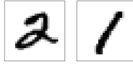

这表明可以使用训练数据来计算每个数字（0、1、2、...、9）的平均深度。当呈现一张新图片时，我们计算图片有多深，然后猜测它是平均深度最接近的那个数字。这是一个简单的过程，很容易编写代码，因此我不会明确写出代码——如果你感兴趣，它在GitHub仓库中。但这比随机猜测有很大的改进，在10,000张测试图片中有2,225张正确，即22.25%的准确率。

找到其他能够达到20%到50%准确率的想法并不困难。如果你再努力一点，可以超过50%。但要获得更高的准确率，使用成熟的机器学习算法会有所帮助。让我们尝试使用最著名的算法之一，即支持向量机或SVM。如果你不熟悉SVM，不用担心，我们不需要了解SVM工作原理的细节。相反，我们将使用一个名为scikit-learn的Python库，它为名为LIBSVM的快速C库提供了简单的Python接口。

如果使用默认设置运行scikit-learn的SVM分类器，则在10,000张测试图片中有9,435张正确。（代码可在此处获取。）这比我们根据图片深度进行分类的天真方法有很大改进。确实，这意味着SVM的表现大约与我们的神经网络相当，只是稍差一些。在后面的章节中，我们将介绍新技术，使我们能够改进神经网络，使其表现远优于SVM。

然而，故事并未结束。10,000张中有9,435张正确的结果是针对scikit-learn对SVM的默认设置。SVM有许多可调参数，可以搜索能够改善这种开箱即用性能的参数。我不会明确执行此搜索，而是如果你想了解更多，请参阅Andreas Mueller的这篇博客文章。Mueller表明，通过一些优化SVM参数的工作，可以将性能提高到98.5%以上的准确率。换句话说，一个调校良好的SVM大约每70个数字才会出错。这相当不错！神经网络能做得更好吗？

事实上，它们可以。目前，设计良好的神经网络在解决MNIST问题上优于所有其他技术，包括


SVM。目前（2013年）的记录是正确分类 10,000 张图像中的 9,979 张。这是由 Li Wan、Matthew Zeiler、Sixin Zhang、Yann LeCun 和 Rob Fergus 完成的。我们将在本书后面看到他们使用的大多数技术。在那个水平上，性能接近人类水平，并且可以说甚至更好，因为 MNIST 数据集中有不少图像甚至对人类来说也难以有把握地识别，例如：

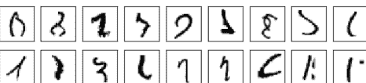

我相信你会同意这些很难分类！在 MNIST 数据集中有这样一些图像的情况下，神经网络能够准确分类除 21 张以外的全部 10,000 张测试图像，这真是了不起。通常，在编程时我们相信，解决像识别 MNIST 数字这样的复杂问题需要一个复杂的算法。但即使是刚才提到的 Wan 等人论文中的神经网络，也涉及相当简单的算法，是我们在本章中看到的算法的变体。所有的复杂性都会自动从训练数据中学习得来。从某种意义上讲，我们的结果和更复杂论文中的结果的启示是，对于某些问题：

> 复杂算法 ≤ 简单学习算法 + 优质训练数据。

## 迈向深度学习

虽然我们的神经网络表现出色，但这种表现有些神秘。网络中的权重和偏置是自动发现的。这意味着我们并不立即就能解释网络是如何工作的。我们能否找到某种方法来理解网络分类手写数字的原理？而且，有了这样的原理，我们能做得更好吗？

为了更直白地提出这些问题，假设几十年后神经网络导致了人工智能（AI）。我们将理解这些智能网络的工作原理吗？也许这些网络对我们来说是不透明的，其权重和偏置我们也不理解，因为它们是自动学习的。在 AI 研究的早期，人们希望构建 AI 的努力也能帮助我们理解智能背后的原理，也许还有人脑的运作。但也许结果是，我们最终既不理解大脑，也不理解人工智能是如何工作的！

为了解决这些问题，让我们回顾一下我本章开头对人工神经元的解释，将其视为一种权衡证据的手段。假设我们想要确定一张图像是否显示人脸：

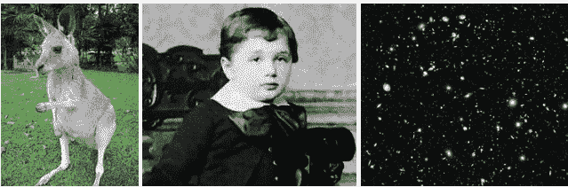

图片来源：1. Ester Inbar。2. 未知。3. NASA、ESA、G. Illingworth、D. Magee 和 P. Oesch（加州大学圣克鲁兹分校，R. Bouwens（莱顿大学），以及 HUDF09 团队。点击图片了解更多详情。

我们可以用攻克手写体识别的同样方式来攻克这个问题——将图像中的像素作为输入到神经网络，网络的输出是一个单个神经元，指示“是的，是一张人脸”或“不，这不是一张人脸”。

假设我们这样做，但不使用学习算法。相反，我们将尝试手动设计网络，选择合适的权重和偏置。我们该如何着手呢？暂时完全忘记神经网络，我们可以使用的一种启发式方法是将问题分解为子问题：图像左上角是否有一只眼睛？右上角是否有一只眼睛？中间是否有一个鼻子？底部中间是否有一张嘴？顶部是否有头发？等等。

如果其中几个问题的答案是“是的”，甚至只是“可能是”，那么我们会得出结论：该图像很可能是一张人脸。相反，如果大多数问题的答案是“不”，那么该图像可能不是一张人脸。

当然，这只是一个粗略的启发式方法，并且存在许多缺陷。也许那个人是秃头，所以没有头发。也许我们只能看到部分面孔，或者面孔是侧脸，因此一些面部特征被遮挡。尽管如此，启发式方法表明，如果我们能使用神经网络解决子问题，那么也许可以通过组合子问题的网络来构建一个人脸检测神经网络。下面是一种可能的架构，矩形表示子网络。请注意，这不旨在作为解决人脸检测问题的现实方法；而是为了帮助我们建立关于网络如何工作的直觉。下面是该架构：

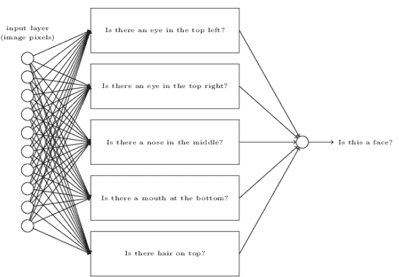

子网络也可以分解，这也是合理的。假设我们正在考虑这个问题：“左上角是否有一只眼睛？”这可以分解为诸如“是否有眉毛？”；“是否有睫毛？”；“是否有虹膜？”等等的问题。当然，这些问题实际上还应包含位置信息——“眉毛是否在左上角，并且在虹膜上方？”之类的问题——但让我们保持简单。回答“左上角是否有一只眼睛？”这个问题的网络现在可以分解为：

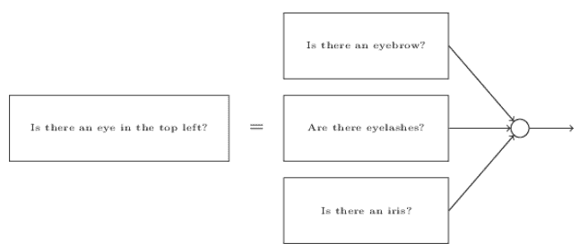

那些问题也可以进一步分解，通过多层不断分解。最终，我们将使用回答非常简单问题的子网络，这些问题可以轻松在单个像素级别上回答。这些问题可能，例如，关于图像中特定点处非常简单形状的存在或不存在。这类问题可以由连接到图像原始像素的单个神经元来回答。

最终结果是一个网络，它将一个非常复杂的问题——这张图像是否显示人脸——分解为可以在单个像素级别回答的非常简单的问题。它通过一系列多层来实现这一点，早期层回答关于输入图像的非常简单和具体的问题，后期层构建起越来越复杂和抽象的概念层次结构。具有这种多层结构的网络——两个或更多隐藏层——被称为深度神经网络。

当然，我还没有说明如何进行这种递归分解为子网络。手动设计网络中的权重和偏置肯定不切实际。相反，我们希望使用学习算法，使网络能够自动从训练数据中学习权重和偏置——从而也学习概念层次结构。20 世纪 80 年代和 90 年代的研究人员尝试使用随机梯度下降和反向传播来训练深度网络。不幸的是，除了少数特殊架构外，他们运气不佳。网络会学习，但速度非常慢，在实际中往往太慢而无法使用。

自 2006 年以来，已开发出一组技术，使深度神经网络的学习成为可能。这些深度学习技术基于随机梯度下降和反向传播，但也引入了新思想。这些技术使得可以训练出更深层（也更大）的网络——人们现在经常训练具有 5 到 10 个隐藏层的网络。而且，事实证明，这些网络在许多问题上的表现远好于浅层神经网络，即只有一个隐藏层的网络。原因当然是深度网络能够构建复杂的概念层次结构。这有点像传统编程语言使用模块化设计和抽象思想来实现复杂计算机程序的创建。将深度网络与浅层网络进行比较，有点像比较支持函数调用的编程语言和不支持此类调用的精简语言。

## 在神经网络中，抽象的形式与传统编程不同，但同样重要。

在学术作品中，请引用本书为：Michael A. Nielsen，《神经网络与深度学习》，Determination Press，2015 年

本作品根据 Creative Commons Attribution-NonCommercial 3.0 Unported License 授权。这意味着您可以自由复制、分享和基于本书进行创作，但不得出售。如果您有兴趣进行商业用途，请联系我。


# CHAPTER 2

# 反向传播算法如何工作

在上一章中，我们了解到神经网络如何使用梯度下降算法来学习其权重和偏差。然而，我们的解释中存在一个空白：我们没有讨论如何计算代价函数的梯度。这可真是一个空白！在本章中，我将解释一种快速计算此类梯度的算法，该算法称为反向传播。

反向传播算法最初是在 20 世纪 70 年代引入的，但直到 David Rumelhart、Geoffrey Hinton 和 Ronald Williams 著名的 1986 年论文发表后，其重要性才得到充分认可。该论文描述了多个神经网络，其中反向传播的速度远快于早期的学习方法，从而使使用神经网络解决此前无法解决的问题成为可能。今天，反向传播算法是神经网络学习中的主力算法。

本章比本书其余部分更加注重数学。如果你不热衷于数学，可能会想跳过本章，把反向传播当作一个黑箱，其细节你愿意忽略。为什么要花时间研究这些细节？

原因当然是为了理解。反向传播的核心是一个关于代价函数 C 对网络中任何权重 w（或偏差 b）的偏导数 ∂C/∂w 的表达式。该表达式告诉我们，当我们改变权重和偏差时，代价变化的速度有多快。虽然这个表达式有些复杂，但它也有其美感，每个元素都有一个自然、直观的解释。因此，反向传播不仅仅是一种快速的学习算法。它实际上为我们提供了关于改变权重和偏差如何影响网络整体行为的详细洞察。这值得详细研究。

话虽如此，如果你想浏览本章，或直接跳到下一章，那也没关系。我编写本书的其余部分，即使你把反向传播当作一个黑箱，也能让人理解。那里

- 神经网络与深度学习
- 本书内容概述
- 关于习题和问题
- 使用神经网络识别手写数字
- 反向传播算法如何工作
- 改进神经网络的学习方式
- 神经网络可以计算任何函数的直观证明
- 为什么深度神经网络难以训练？
- 深度学习
- 附录：是否存在一种简单的智能算法？
- 致谢
- 常见问题解答

如果你从本书中受益，请捐赠少量金额。我建议 3 美元，但你可以选择金额。

## 赞助商

- ersatz
- g² G SQUARED CAPITAL
- TinEye
- VisionSmarts

感谢所有使本书成为可能的支持者，特别感谢 Pavel Dudrenov。同时感谢所有为 Bugfinder Hall of Fame 做出贡献的人。

## 资源

- 图书常见问题解答
- 代码仓库
- Michael Nielsen 的项目公告邮件列表
- 深度学习，Yoshua Bengio、Ian 正在撰写的草稿书籍

存在一些地方，本书后面的部分会引用本章的结果。但是在那些地方，即使你不完全理解所有推理过程，你仍然应该能够理解主要结论。

## 热身：一种基于矩阵的快速计算神经网络输出的方法

在讨论反向传播之前，让我们先用一种基于矩阵的快速算法来计算神经网络的输出，作为热身。我们实际上在上一章末尾简要地见过这个算法，但我当时描述得很快，因此值得详细回顾。特别是，这是一种在熟悉的背景下熟悉反向传播中使用的记号的好方法。

让我们先从一种记号开始，这种记号让我们能够以无歧义的方式引用网络中的权重。我们将使用 \(w^l_{jk}\) 来表示从第 (l-1) 层的第 k 个神经元到第 l 层的第 j 个神经元的连接的权重。例如，下图显示了一个网络中从第二层的第四个神经元到第三层的第二个神经元的连接上的权重：

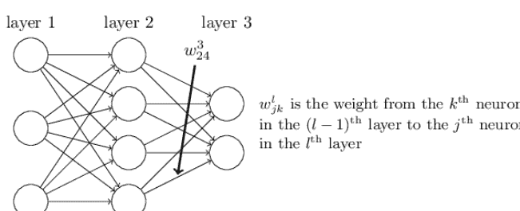

这种记号最初看起来很笨拙，掌握它确实需要一些努力。但只要稍加努力，你就会发现这种记号变得容易且自然。这种记号的一个怪癖是 j 和 k 索引的顺序。你可能会认为使用 j 指代输入神经元，k 指代输出神经元更合理，而不是反过来，但实际上正是如此。我将在下面解释这种怪癖的原因。

我们对网络的偏差和激活使用类似的记号。明确地说，我们使用 \(b^l_j\) 表示第 l 层第 j 个神经元的偏差。

我们使用 \(a_j^l\) 表示第 l 层第 j 个神经元的激活。下图展示了这些记号的使用示例：

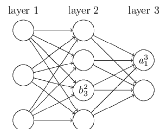

有了这些记号，第 l 层第 j 个神经元的激活 \(a_j^l\) 与第 (l-1) 层的激活通过以下方程相关联（参阅上一章中方程 (4) 及其周围讨论）

\(a_j^l = \sigma \left( \sum_k w_{jk}^l a_k^{l-1} + b_j^l \right),\) (23)

其中求和是对第 (l-1) 层的所有神经元 k 进行。要将此表达式改写为矩阵形式，我们为每一层 l 定义一个权重矩阵 \(w^l\)。权重矩阵 \(w^l\) 的元素就是连接到第 l 层神经元的权重，即第 j 行第 k 列的元素是 \(w_{jk}^l\)。同样，对于每一层 l，我们定义一个偏差向量 \(b^l\)。你可能可以猜到这是如何工作的——偏差向量的分量就是值 \(b_j^l\)，第 l 层的每个神经元对应一个分量。最后，我们定义一个激活向量 \(a^l\)，其分量是激活 \(a_j^l\)。

我们需要改写 (23) 为矩阵形式的最后一个要素是将像 \(\sigma\) 这样的函数向量化的概念。我们在上一章中简要地见过向量化，但为了回顾，其思想是我们想要将像 \(\sigma\) 这样的函数应用到向量 v 的每个元素上。我们使用明显的记号 \(\sigma(v)\) 来表示这种函数的逐元素应用。也就是说，\(\sigma(v)\) 的分量就是 \(\sigma(v)_j = \sigma(v_j)\)。例如，如果我们有函数 \(f(x) = x^2\)，那么 f 的向量化形式的效果是

\(f \left( \begin{bmatrix} 2 \\ 3 \end{bmatrix} \right) = \begin{bmatrix} f(2) \\ f(3) \end{bmatrix} = \begin{bmatrix} 4 \\ 9 \end{bmatrix},\) (24)

也就是说，向量化的 f 只是对向量的每个元素进行平方。

有了这些记号，方程 (23) 可以改写为优美而紧凑的向量化形式

\(a^l = \sigma(w^la^{l-1} + b^l). \quad (25)\)

这个表达式为我们提供了一种更全局的思考方式，来思考一层的激活如何与前一层的激活相关联：我们只需将权重矩阵应用到激活上，然后加上偏差向量，最后应用 \(\sigma\) 函数*。这种全局观点通常比我们迄今采用的神经元一神经元的观点更容易、更简洁（并且涉及更少的索引！）。你可以把它看作是一种逃离索引地狱的方法，同时仍然对正在发生的事情保持精确。这个表达式在实践中也很有用，因为大多数矩阵库都提供了实现矩阵乘法、向量加法和向量化的快速方法。事实上，上一章中的代码隐含地使用了这个表达式来计算网络的行为。

*顺便说一句，正是这个表达式激励了前面提到的 \(w_{jk}^l\) 记号中的怪癖。如果我们使用 j 来索引输入神经元，使用 k 来索引输出神经元，那么我们就需要将方程 (25) 中的权重矩阵替换为权重矩阵的转置。这是一个小变化，但很烦人，而且我们会失去说出（和思考）“将权重矩阵应用到激活上”的简单便捷性。

当使用方程 (25) 来计算 \(a^l\) 时，我们在过程中计算中间量 \(z^l \equiv w^la^{l-1} + b^l\)。这个量结果证明足够有用，值得命名：我们称 \(z^l\) 为第 l 层神经元的*加权输入*。我们将在本章后面大量使用加权输入 \(z^l\)。方程 (25) 有时也写成关于加权输入的形式，即 \(a^l = \sigma(z^l)\)。还值得注意的是，\(z^l\) 有分量 \(z_j^l = \sum_k w_{jk}^l a_k^{l-1} + b_j^l\)，也就是说，\(z_j^l\) 只是第 l 层第 j 个神经元的激活函数的加权输入。

## 关于代价函数需要做出的两个假设

反向传播的目标是计算代价函数 C 对网络中任何权重 w 或偏差 b 的偏导数 \(\partial C/\partial w\) 和 \(\partial C/\partial b\)。为了使反向传播工作，我们需要对代价函数的形式做出两个主要假设。不过，在陈述这些假设之前，心中有一个示例代价函数是有用的。我们将使用上一章的二次代价函数（参见方程 (6)）。在上一节的记号中，二次代价的形式为

\(C = \frac{1}{2n} \sum_x ||y(x) - a^L(x)||^2, \quad (26)\)


其中：$n$ 是训练样本的总数；求和针对单个训练样本 $x$；$y = y(x)$ 是相应的期望输出；$L$ 表示网络中的层数；而 $a^L = a^L(x)$ 是在输入 $x$ 时网络输出的激活向量。

好吧，为了应用反向传播，我们需要对代价函数 $C$ 做出什么假设呢？我们需要的第一个假设是，代价函数可以写成关于单个训练样本 $x$ 的代价函数 $C_x$ 的平均值 $C = \frac{1}{n} \sum_x C_x$。二次代价函数就是这种情况，其中单个训练样本的代价为 $C_x = \frac{1}{2} \|y - a^L\|^2$。这个假设对于本书中将遇到的所有其他代价函数也都成立。

之所以需要这个假设，是因为反向传播实际允许我们计算单个训练样本的偏导数 $\partial C_x/\partial w$ 和 $\partial C_x/\partial b$。然后我们通过对训练样本求平均来恢复 $\partial C/\partial w$ 和 $\partial C/\partial b$。实际上，考虑到这个假设，我们将假设训练样本 $x$ 已被固定，并省略 $x$ 下标，将代价 $C_x$ 写作 $C$。我们最终会把 $x$ 放回去，但目前它只是一个最好保持隐含的记号小麻烦。

我们对代价的第二个假设是，它可以写成神经网络输出的函数：

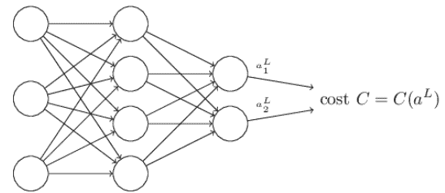

例如，二次代价函数满足这一要求，因为单个训练样本 $x$ 的二次代价可以写成

$C = \frac{1}{2} \|y - a^L\|^2 = \frac{1}{2} \sum_j (y_j - a_j^L)^2, \quad \text{(27)}$

因此它是输出激活的函数。当然，这个代价函数也依赖于期望输出 $y$，你可能会疑惑为什么我们不将代价也视为 $y$ 的函数。不过要记住，输入训练样本 $x$ 是固定的，因此输出 $y$ 也是一个固定参数。具体来说，它不是我们可以通过以任何方式更改权重和偏置来修改的东西，也就是说，它不是神经网络学习的内容。因此，将 $C$ 视为仅依赖于输出激活 $a^L$ 的函数是有道理的，其中 $y$ 只是帮助定义该函数的一个参数。

## Hadamard 积，s ⊙ t

反向传播算法基于常见的线性代数运算——例如向量加法、向量与矩阵相乘等等。但其中一种运算使用得稍少一些。具体来说，假设 $s$ 和 $t$ 是两个维度相同的向量。那么我们用 $s \odot t$ 表示这两个向量的逐元素乘积。因此 $s \odot t$ 的分量即 $(s \odot t)_j = s_j t_j$。例如，

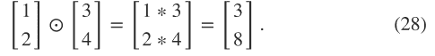

这种逐元素乘法有时被称为 Hadamard 积或 Schur 积。我们将称之为 Hadamard 积。优秀的矩阵库通常提供 Hadamard 积的快速实现，在实现反向传播时非常有用。

## 反向传播背后的四个基本方程

反向传播关乎理解网络中权重和偏置的变化如何影响代价函数。最终，这意味着计算偏导数 ∂C/∂w^l_jk 和 ∂C/∂b^l_j。但要计算这些，我们首先引入一个中间量 δ^l_j，我们称其为第 $l$ 层第 $j$ 个神经元中的误差。反向传播将为我们提供计算误差 δ^l_j 的过程，然后将 δ^l_j 与 ∂C/∂w^l_jk 和 ∂C/∂b^l_j 联系起来。

要理解误差是如何定义的，想象我们的神经网络中有一个恶魔：

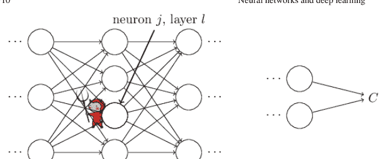

恶魔位于第 $l$ 层第 $j$ 个神经元处。当神经元的输入进来时，恶魔会干扰神经元的运算。它在神经元的加权输入上添加一个小的变化 \(\Delta z_j^l\)，因此神经元不再输出 \(\sigma(z_j^l)\)，而是输出 \(\sigma(z_j^l + \Delta z_j^l)\)。这种变化通过网络中后面的层传播，最终导致整体代价变化量为 \(\frac{\partial C}{\partial z_j^l} \Delta z_j^l\)。

现在，这个恶魔是个好恶魔，试图帮助你改进代价，也就是说，他们试图找到一个使代价减小的 \(\Delta z_j^l\)。假设 \(\frac{\partial C}{\partial z_j^l}\) 有一个较大的值（无论是正还是负）。那么 \(\Delta z_j^l\) 可以通过选择与 \(\frac{\partial C}{\partial z_j^l}\) 符号相反的 \(\Delta z_j^l\) 来大幅降低代价。相比之下，如果 \(\frac{\partial C}{\partial z_j^l}\) 接近于零，那么恶魔通过扰动加权输入 \(z_j^l\) 几乎无法改进代价。就恶魔所能判断，该神经元已经非常接近最优*。因此，从启发学的意义上说，\(\frac{\partial C}{\partial z_j^l}\) 是神经元中误差的一种度量。

> *当然，这仅适用于小的变化 \(\Delta z_j^l\)。我们假设恶魔受限于做出这种小的变化。

受这个故事的启发，我们定义第 $l$ 层第 $j$ 个神经元的误差 \(\delta_j^l\) 为

```
\(\delta_j^l \equiv \frac{\partial C}{\partial z_j^l}.\) (29)
```

按照我们惯用的约定，我们用 \(\delta^l\) 表示与第 $l$ 层相关的误差向量。反向传播将为我们提供计算每一层 \(\delta^l\) 的方法，然后将这些误差与真正感兴趣的量 \(\partial C / \partial w_{jk}^l\) 和 \(\partial C / \partial b_j^l\) 联系起来。

你可能会好奇，为什么恶魔要改变加权输入 \(z_j^l\)。当然，想象恶魔改变输出激活 \(a_j^l\) 会更自然，那样我们就会使用 \(\frac{\partial C}{\partial a_j^l}\) 作为误差的度量。事实上，如果你这样做，事情的进展与下面的讨论非常相似。但事实证明，这会使反向传播的表述在代数上稍微复杂一些。因此，我们将继续将 $\delta^l_j = \frac{\partial C}{\partial z^l_j}$ 作为我们误差的度量*。

* 在像 MNIST 这样的分类问题中，“错误”一词有时用于指代分类失败率。例如，如果神经网络正确分类了 96.0% 的数字，那么错误率为 4.0%。显然，这与我们的 $\delta$ 向量具有截然不同的含义。在实际操作中，你不应该在分辨任何给定用法中意指哪种含义时遇到困难。

**攻击计划：** 反向传播基于四个基本方程。这些方程共同为我们提供了一种计算误差 $\delta^l$ 和代价函数梯度的方法。我下面列出这四个方程。不过要提醒你：不要指望能瞬间掌握这些方程。这种期望会导致失望。事实上，反向传播方程非常丰富，要好好理解它们，需要在你逐步深入方程的过程中投入相当多的时间和耐心。好消息是，这种耐心会得到百倍的回报。因此，本节的讨论仅仅是一个开始，帮助你踏上彻底理解这些方程的道路。

以下是我们将在本章后续部分深入研究方程的几种方式预览：我会给出方程的简短证明，这有助于解释它们为何成立；我们将以伪代码的算法形式重述方程，并看看伪代码如何实现为真正可运行的 Python 代码；最后，在本章的最后一节中，我们将形成对反向传播方程含义的直观认识，以及某人如何从零开始发现它们。在此过程中，我们将反复回到这四个基本方程，随着你对它们的理解不断加深，这些方程将变得自然而然，或许甚至显得优美自然。

### 输出层误差的方程，$\delta^l$

$\delta^l$ 的分量由以下给出

```
$\delta^l_j = \frac{\partial C}{\partial a^l_j} \sigma'(z^l_j)$. (BP1)
```

这是一个非常自然的表达式。右边的第一项 $\partial C/\partial a^l_j$ 只是衡量代价作为第 $j$ 个输出激活的函数变化的速度。例如，如果 $C$ 对某个特定的输出神经元 $j$ 不是很敏感，那么 $\delta^l_j$ 会很小，这正是我们所期望的。右边的第二项 $\sigma'(z^l_j)$ 衡量激活函数 $\sigma$ 在 $z^l_j$ 处变化的速度。


请注意，(BP1) 中的所有内容都易于计算。具体来说，我们在计算网络行为时计算 \( z_j^l \)，并且计算 \( \sigma'(z_j^l) \) 只需很小的额外开销。当然，\( \partial C/\partial a_j^l \) 的精确形式将取决于代价函数的形式。

但是，只要代价函数已知，计算 \( \partial C/\partial a_j^l \) 应该不麻烦。例如，如果我们使用二次代价函数，则 \( C = \frac{1}{2} \sum_j (y_j - a_j)^2 \)，因此 \( \partial C/\partial a_j^l = (a_j - y_j) \)，这显然很容易计算。

方程 (BP1) 是 \( \delta^L \) 的分量式表达式。这是一个很好的表达式，但不是我们希望用于反向传播的基于矩阵的形式。不过，很容易将该方程改写为基于矩阵的形式，如下所示：

```
\(\delta^L = \nabla_a C \odot \sigma'(z^L).\) (BP1a)
```

这里，\( \nabla_a C \) 被定义为一个向量，其分量为偏导数 \( \partial C/\partial a_j^L \)。你可以把 \( \nabla_a C \) 视为表达 C 相对于输出激活值的变化率。很容易看出方程 (BP1a) 和 (BP1) 是等价的，因此从现在起我们将互换使用 (BP1) 来指代这两个方程。例如，对于二次代价，我们有 \( \nabla_a C = (a^L - y) \)，因此 (BP1) 的完整基于矩阵的形式变为

```
\(\delta^L = (a^L - y) \odot \sigma'(z^L).\) (30)
```

正如你所见，这个表达式中的所有内容都有很好的向量形式，并且可以使用 Numpy 等库轻松计算。

### 以下一层的误差 \( \delta^{l+1} \) 表示误差 \( \delta^l \) 的方程：特别是

```
\(\delta^l = ((w^{l+1})^T \delta^{l+1}) \odot \sigma'(z^l),\) (BP2)
```

其中，\( (w^{l+1})^T \) 是第 \( (l+1) \) 层权重矩阵 \( w^{l+1} \) 的转置。这个方程看起来很复杂，但每个元素都有很好的解释。假设我们知道 \( l+1 \) 层的误差 \( \delta^{l+1} \)。当我们应用转置权重矩阵 \( (w^{l+1})^T \) 时，我们可以直观地将其视为将误差 *向后* 通过网络传递，从而给出第 \( l \) 层输出处误差的某种度量。然后我们取 Hadamard 乘积 \( \odot \sigma'(z^l) \)。这将误差通过第 \( l \) 层的激活函数向后传递，从而给出第 \( l \) 层加权输入中的误差 \(\delta^l\)。

通过结合 (BP2) 和 (BP1)，我们可以计算网络中任何层的误差 \(\delta^l\)。我们首先使用 (BP1) 计算 \(\delta^L\)，然后应用方程 (BP2) 计算 \(\delta^{L-1}\)，再次应用方程 (BP2) 计算 \(\delta^{L-2}\)，以此类推，一直回传到网络的前面。

### 网络中任何偏置相对于代价的变化率方程：特别是

\(\frac{\partial C}{\partial b^l_j} = \delta^l_j. \tag{BP3}\)

也就是说，误差 \(\delta^l_j\) *恰好等于* 变化率 \(\partial C/\partial b^l_j\)。这是个好消息，因为 (BP1) 和 (BP2) 已经告诉我们如何计算 \(\delta^l_j\)。我们可以将 (BP3) 用简写形式改写为

\(\frac{\partial C}{\partial b} = \delta, \tag{31}\)

这里默认 \(\delta\) 与偏置 \(b\) 在同一神经元上求值。

### 网络中任何权重相对于代价的变化率方程：特别是

\(\frac{\partial C}{\partial w^l_{jk}} = a^{l-1}_k \delta^l_j. \tag{BP4}\)

这告诉我们如何用我们已知如何计算的量 \(\delta^l\) 和 \(a^{l-1}\) 来计算偏导数 \(\partial C/\partial w^l_{jk}\)。该方程可以用较少下标的记法改写为

\(\frac{\partial C}{\partial w} = a_{in} \delta_{out}, \tag{32}\)

这里默认 \(a_{in}\) 是输入到权重 \(w\) 的神经元的激活值，而 \(\delta_{out}\) 是从权重 \(w\) 输出的神经元的误差。放大来看仅权重 \(w\) 和由该权重连接的两个神经元，我们可以这样描绘：

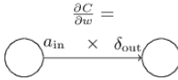

方程 (32) 的一个良好结果是，当激活值 \(a_{in}\) 很小，\(a_{in} \approx 0\) 时，梯度项 \(\partial C/\partial w\) 也倾向于很小。在这种情况下，我们会说权重 *学习缓慢*，意味着它在梯度下降过程中变化不大。换句话说，(BP4) 的一个结果是，来自低激活神经元的输出权重学习缓慢。

从 (BP1)-(BP4) 还可以获得其他此类见解。让我们先看看输出层。考虑 (BP1) 中的项 \(\sigma'(z_j^L)\)。回顾上一章中 sigmoid 函数的图像，当 \(\sigma(z_j^L)\) 约为 0 或 1 时，\(\sigma\) 函数变得非常平坦。发生这种情况时，我们将有 \(\sigma'(z_j^L) \approx 0\)。因此，结论是，如果输出神经元要么是低激活（\(\approx 0\)）要么是高激活（\(\approx 1\)），则最终层中的权重将学习缓慢。在这种情况下，通常说输出神经元已 *饱和*，因此，权重停止了学习（或学习缓慢）。类似的论述也适用于输出神经元的偏置。

对于更早的层，我们也可以获得类似的见解。特别是，注意 (BP2) 中的 \(\sigma'(z^l)\) 项。这意味着如果神经元接近饱和，\(\delta_j^l\) 很可能会变小。而这反过来意味着，输入到饱和神经元的任何权重都将学习缓慢*。

*如果 \(w_{jk}^{l+1}\delta_j^{l+1}\) 有足够大的项来补偿 \(\sigma'(z_j^l)\) 的小值，那么这个推理就不成立了。但我所说的是一般趋势。

总而言之，我们了解到，如果输入神经元是低激活，或者输出神经元已饱和（即要么是高激活，要么是低激活），权重就会学习缓慢。

这些观察中没有哪一项过于令人惊讶。尽管如此，它们有助于改进我们对神经网络学习过程中发生的事情的心理模型。此外，我们可以反过来进行此类推理。四个基本方程被证明适用于任何激活函数，而不仅仅是标准 sigmoid 函数（这是因为，稍后我们将看到，证明并未使用 \(\sigma\) 的任何特殊性质）。因此，我们可以使用这些方程来 *设计* 具有特定所需学习特性的激活函数。为了让你了解这一点，假设我们选择一个（非 sigmoid）激活函数 \(\sigma\)，使得 \(\sigma'\) 始终为正且永远不接近零。这将防止当普通 sigmoid 神经元饱和时发生的学习减速。在本书后面，我们将看到对激活函数进行此类修改的示例。牢记四个方程 (BP1)-(BP4) 可以帮助解释为什么尝试此类修改，以及它们可能产生的影响。

## 总结：反向传播的方程

\(\delta^L = \nabla_a C \odot \sigma'(z^L)\)   (BP1)
\(\delta^l = ((w^{l+1})^T \delta^{l+1}) \odot \sigma'(z^l)\)   (BP2)
\(\frac{\partial C}{\partial b^l_j} = \delta^l_j\)   (BP3)
\(\frac{\partial C}{\partial w^l_{jk}} = a^{l-1}_k \delta^l_j\)   (BP4)

## 问题

- 反向传播方程的替代表示：我已使用 Hadamard 乘积给出了反向传播方程（特别是 (BP1) 和 (BP2)）。如果你不习惯 Hadamard 乘积，这种表示可能会让你感到困惑。有一种基于常规矩阵乘法的替代方法，一些读者可能会发现很有启发。（1）证明 (BP1) 可以重写为

```
\(\delta^l = \Sigma'(z^l)\nabla_a C,\)   (33)
```

其中，\(\Sigma'(z^l)\) 是一个平方矩阵，其对角线元素为 \(\sigma'(z^l_j)\) 的值，非对角线元素为零。请注意，该矩阵通过常规矩阵乘法作用于 \(\nabla_a C\)。（2）证明 (BP2) 可以重写为

```
\(\delta^l = \Sigma'(z^l)(w^{l+1})^T \delta^{l+1}.\)   (34)
```

（3）通过结合观察 (1) 和 (2) 证明

```
\(\delta^l = \Sigma'(z^l)(w^{l+1})^T ... \Sigma'(z^{L-1})(w^L)^T \Sigma'(z^L) \nabla_a C\)   (35)
```

对于习惯矩阵乘法的读者来说，这个方程可能比 (BP1) 和 (BP2) 更容易理解。我之所以专注于 (BP1) 和 (BP2)，是因为这种方法在数值实现时证明更快。


## 四个基本方程的证明（可选）

我们现在来证明四个基本方程 (BP1)-(BP4)。这四个方程都是多元微积分中链式法则的推论。如果你对链式法则很熟悉，那么我强烈建议你在继续阅读之前先尝试自己推导一遍。

让我们从方程 (BP1) 开始，它给出了输出误差 \(\delta^L\) 的表达式。要证明这个方程，请回顾，按定义

\(\delta_j^L = \frac{\partial C}{\partial z_j^L}.\) (36)

应用链式法则，我们可以将上面的偏导数用关于输出激活值的偏导数来重新表示，

\(\delta_j^L = \sum_k \frac{\partial C}{\partial a_k^L} \frac{da_k^L}{dz_j^L},\) (37)

其中求和是对输出层中所有神经元 \(k\) 进行。当然，第 \(k\) 个神经元的输出激活值 \(a_k^L\) 仅在第 \(j\) 个神经元的输入权重 \(z_j^L\) 为 \(k=j\) 时才依赖于它。因此，当 \(k \neq j\) 时，\(da_k^L/dz_j^L\) 消失。结果，我们可以将前一个方程简化为

\(\delta_j^L = \frac{\partial C}{\partial a_j^L} \frac{da_j^L}{dz_j^L}.\) (38)

回顾 \(a_j^L = \sigma(z_j^L)\)，右边的第二项可以写为 \(\sigma'(z_j^L)\)，方程变为

\(\delta_j^L = \frac{\partial C}{\partial a_j^L} \sigma'(z_j^L),\) (39)

这正是 (BP1) 的分量形式。

接下来，我们将证明 (BP2)，它给出了误差 \(\delta^l\) 关于下一层误差 \(\delta^{l+1}\) 的方程。为此，我们希望将 \(\delta_j^l = \partial C/\partial z_j^l\) 重新表示为关于 \(\delta_k^{l+1} = \partial C/\partial z_k^{l+1}\) 的形式。我们可以使用链式法则来做到这一点，

\d
elta_j^l = \frac{\partial C}{\partial z_j^l} \tag{40}
= \sum_k \frac{\partial C}{\partial z_k^{l+1}} \frac{\partial z_k^{l+1}}{\partial z_j^l} \tag{41}
= \sum_k \frac{\partial z_k^{l+1}}{\partial z_j^l} \delta_k^{l+1}, \tag{42}

在最后一行中，我们交换了右边两项的顺序，并代入了 \(\delta_k^{l+1}\) 的定义。要计算最后一行的第一项，请注意

\(z_k^{l+1} = \sum_j w_{kj}^{l+1} a_j^l + b_k^{l+1} = \sum_j w_{kj}^{l+1} \sigma(z_j^l) + b_k^{l+1}.\) \tag{43}

对两边求导，我们得到

\(\frac{\partial z_k^{l+1}}{\partial z_j^l} = w_{kj}^{l+1} \sigma'(z_j^l).\) \tag{44}

将其代回 (42) 中，我们得到

\(\delta_j^l = \sum_k w_{kj}^{l+1} \delta_k^{l+1} \sigma'(z_j^l).\) \tag{45}

这正是 (BP2) 的分量形式。

我们想证明的最后两个方程是 (BP3) 和 (BP4)。它们也遵循链式法则，其证明方式与上面两个方程类似。我将它们作为练习留给你。

## 练习

- 证明方程 (BP3) 和 (BP4)。

这就完成了反向传播四个基本方程的证明。证明看起来可能很复杂。但实际上，它只是仔细应用链式法则的结果。不那么简洁地说，我们可以把反向传播看作一种通过系统地应用多元微积分中的链式法则来计算代价函数梯度的方法。反向传播的全部内容就是这样——其余都是细节。

## 反向传播算法

反向传播方程为我们提供了一种计算代价函数梯度的方法。让我们将其显式地写成算法形式：

- 1. **输入 x：** 为输入层设置相应的激活值 \(a^l\)。

- 2. **前向传播：** 对每个 \(l = 2, 3, ..., L\)，计算 \(z^l = w^l a^{l-1} + b^l\) 和 \(a^l = \sigma(z^l)\)。

- 3. **输出误差** \(\delta^L\)：计算向量 \(\delta^L = \nabla_a C \odot \sigma'(z^L)\)。

- 4. **误差回传：** 对每个 \(l = L - 1, L - 2, ..., 2\)，计算 \(\delta^l = ((w^{l+1})^T \delta^{l+1}) \odot \sigma'(z^l)\)。

- 5. **输出：** 代价函数的梯度由 \(\frac{\partial C}{\partial w_{jk}^l} = a_k^{l-1} \delta_j^l\) 和 \(\frac{\partial C}{\partial b_j^l} = \delta_j^l\) 给出。

审视这个算法，你就能明白为什么它被称为反向传播。我们从最后一层开始，逆向计算误差向量 \(\delta^l\)。逆向遍历网络看起来可能很奇怪。但如果你思考反向传播的证明，逆向移动是代价函数是网络输出函数这一事实的结果。要理解代价函数如何随更早的权重和偏置而变化，我们需要反复应用链式法则，逆向通过各层来得到可用的表达式。

## 练习

- **带单个修改神经元的反向传播** 假设我们修改前馈网络中的单个神经元，使得该神经元的输出由 \(f(\sum_j w_j x_j + b)\) 给出，其中 \(f\) 是除 Sigmoid 以外的某个函数。在这种情况下，我们应该如何修改反向传播算法？

- **带线性神经元的反向传播** 假设我们在整个网络中将通常的非线性 \(\sigma\) 函数替换为 \(\sigma(z) = z\)。请针对这种情况重写反向传播算法。

正如我上面描述的，反向传播算法计算单个训练样本的代价函数梯度，$C = C_x$。在实际中，通常将反向传播与随机梯度下降等学习算法相结合，我们会对许多训练样本计算梯度。特别是，给定一个包含 \(m\) 个训练样本的小批量，下面的算法基于该小批量执行一次梯度下降学习步骤：

- 1. **输入一组训练样本**

- 2. **对每个训练样本** \(x\)：设置相应的输入激活值 \(a^{x,1}\)，并执行以下步骤：

  - **前向传播**：对每个 \(l = 2, 3, ..., L\)，计算 \(z^{x,l} = w^l a^{x,l-1} + b^l\) 和 \(a^{x,l} = \sigma(z^{x,l})\)。
  - **输出误差** \(\delta^{x,L}\)：计算向量 \(\delta^{x,L} = \nabla_a C_x \odot \sigma'(z^{x,L})\)。
  - **误差回传**：对每个 \(l = L-1, L-2, ..., 2\)，计算 \(\delta^{x,l} = ((w^{l+1})^T \delta^{x,l+1}) \odot \sigma'(z^{x,l})\)。

- 3. **梯度下降**：对每个 \(l = L, L-1, ..., 2\)，根据规则 \(w^l \to w^l - \frac{\eta}{m} \sum_x \delta^{x,l} (a^{x,l-1})^T\) 更新权重，并根据规则 \(b^l \to b^l - \frac{\eta}{m} \sum_x \delta^{x,l}\) 更新偏置。

当然，在实际中实现随机梯度下降，你还需要一个生成训练样本小批量的外层循环，以及一个遍历多个训练轮次的外层循环。为了简洁，我已省略这些内容。

## 反向传播的代码

抽象地理解了反向传播后，我们现在可以理解上一章中用于实现反向传播的代码。回顾上一章，代码包含在 Network 类的 update_mini_batch 和 backprop 方法中。这些方法的代码是上述算法的直接翻译。特别是，update_mini_batch 方法通过计算当前 mini_batch 训练样本的梯度来更新 Network 的权重和偏置：

```
class Network(object):
    ...
    def update_mini_batch(self, mini_batch, eta):
        """Update the network's weights and biases by applying
gradient descent using backpropagation to a single mini batch.
The "mini_batch" is a list of tuples "(x, y)", and "eta"
is the learning rate."""
nabla_b = [np.zeros(b.shape) for b in self.biases]
nabla_w = [np.zeros(w.shape) for w in self.weights]
for x, y in mini_batch:
    delta_nabla_b, delta_nabla_w = self.backprop(x, y)
    nabla_b = [nb+dnb for nb, dnb in zip(nabla_b, delta_nabla_b)]
    nabla_w = [nw+dnw for nw, dnw in zip(nabla_w, delta_nabla_w)]
self.weights = [w-(eta/len(mini_batch))*nw
    for w, nw in zip(self.weights, nabla_w)]
self.biases = [b-(eta/len(mini_batch))*nb
    for b, nb in zip(self.biases, nabla_b)]
```

大部分工作由这一行 `delta_nabla_b, delta_nabla_w = self.backprop(x, y)` 完成，它使用 `backprop` 方法来计算偏导数 \(\partial C_x / \partial b^l_j\) 和 \(\partial C_x / \partial w^l_{jk}\)。`backprop` 方法密切遵循上一节的算法。有一处小变化——我们使用略有不同的层索引方式。此变化是为了利用 Python 的一个特性，即使用负列表索引从列表末尾开始倒数，例如，`l[-3]` 是列表中倒数第三个条目。`backprop` 的代码如下，连同几个辅助函数，这些函数用于计算 \(\sigma\) 函数、其导数 \(\sigma'\) 以及代价函数的导数。包含这些内容后，你应该能够以自包含的方式理解代码。如果有什么让你困惑，查阅代码的原始描述（和完整清单）可能会有所帮助。

```
class Network(object):
    ...
    def backprop(self, x, y):
        """Return a tuple "(nabla_b, nabla_w)" representing the
gradient for the cost function C_x.  "nabla_b" and
"nabla_w" are layer-by-layer lists of numpy arrays, similar
to "self.biases" and "self.weights."""
        nabla_b = [np.zeros(b.shape) for b in self.biases]
        nabla_w = [np.zeros(w.shape) for w in self.weights]
        # feedforward
        activation = x
        activations = [x] # list to store all the activations, layer by layer
        zs = [] # list to store all the z vectors, layer by layer
        for b, w in zip(self.biases, self.weights):
            z = np.dot(w, activation)+b
            zs.append(z)
            activation = sigmoid(z)
            activations.append(activation)
        # backward pass
        delta = self.cost_derivative(activations[-1], y) * \
            sigmoid_prime(zs[-1])
        nabla_b[-1] = delta
        nabla_w[-1] = np.dot(delta, activations[-2].transpose())
        # Note that the variable l in the loop below is used a little
        # differently to the notation in Chapter 2 of the book.  Here,
        # l = 1 means the last layer of neurons, l = 2 is the
        # second-last layer, and so on.  It's a renumbering of the
        # scheme in the book, used here to take advantage of the fact
        # that Python can use negative indices in lists.
        for l in xrange(2, self.num_layers):
```


```python
z = zs[-1]
sp = sigmoid_prime(z)
delta = np.dot(self.weights[-l+1].transpose(), delta) * sp
nabla_b[-l] = delta
nabla_w[-l] = np.dot(delta, activations[-l-1].transpose())
return (nabla_b, nabla_w)
```

```python
def cost_derivative(self, output_activations, y):
    """Return the vector of partial derivatives \partial C_x /
    \partial a for the output activations."""
    return (output_activations-y)
```

```python
def sigmoid(z):
    """The sigmoid function."""
    return 1.0/(1.0+np.exp(-z))
```

```python
def sigmoid_prime(z):
    """Derivative of the sigmoid function."""
    return sigmoid(z)*(1-sigmoid(z))
```

## Problem

- **Fully matrix-based approach to backpropagation over a mini-batch** 我们对随机梯度下降的实现会遍历小批量中的训练样本。有可能修改反向传播算法，使其能同时计算小批量中所有训练样本的梯度。其思路是：不再从单个输入向量 \(x\) 开始，而是从一个矩阵 \(X = [x_1 x_2 ... x_m]\) 开始，其列为小批量中的向量。前向传播时，通过乘以权重矩阵、添加适合的偏置项矩阵，并到处应用Sigmoid函数来实现。反向传播沿着类似的思路进行。请明确写出这种反向传播算法方法的伪代码。修改 `network.py`，使其采用这种完全基于矩阵的方法。这种方法的优势在于能充分利用现代线性代数库。因此，它比遍历小批量快得多。（例如，在我的笔记本电脑上，运行类似于上一章中考虑的MNIST分类问题时，速度提升约为两倍。）在实践中，所有严肃的反向传播库都采用这种完全基于矩阵的方法或其变体。

## In what sense is backpropagation a fast algorithm?

要回答这个问题，让我们考虑另一种计算梯度的方法。想象一下，那是神经网络研究的早期。也许是20世纪50年代或60年代，你是世界上第一个想到使用梯度下降进行学习的人！但要使这个想法奏效，你需要一种计算代价函数梯度的方法。你回想起微积分知识，决定看看能否使用链式法则来计算梯度。但折腾了一番后，代数看起来很复杂，你感到沮丧。所以你尝试寻找另一种方法。你决定将代价仅视为权重的函数 \( C = C(w) \)（我们稍后再回到偏置问题）。你给权重编号 \( w_1, w_2, ... \)，并想要为某个特定权重 \( w_j \) 计算 \( \partial C/\partial w_j \)。做到这一点的明显方法是使用近似

\(\frac{\partial C}{\partial w_j} \approx \frac{C(w + \epsilon e_j) - C(w)}{\epsilon}, \quad (46)\)

其中 \( \epsilon > 0 \) 是一个小的正数，\( e_j \) 是第 \( j \) 个方向的单位向量。换言之，我们可以通过计算两个略有不同的 \( w_j \) 值下的代价 \( C \)，然后应用公式 (46) 来估计 \( \partial C/\partial w_j \)。同样的思路也能让我们计算相对于偏置的偏导数 \( \partial C/\partial b \)。

这种方法看起来非常有希望。从概念上讲很简单，实现起来也极其容易，只需几行代码。当然，这看起来比使用链式法则计算梯度的想法有希望得多！

不幸的是，虽然这种方法看起来有希望，但实现代码后发现它极其缓慢。要理解原因，想象我们的网络中有100万个权重。那么，为了计算 \( \partial C/\partial w_j \)，我们需要为每个不同的权重 \( w_j \) 计算 \( C(w + \epsilon e_j) \)。这意味着要计算梯度，我们需要计算100万次代价函数，需要对网络进行100万次前向传播（每个训练样本）。我们还需要计算 \( C(w) \)，因此总共需要对网络进行100万零1次传递。

反向传播的巧妙之处在于，它使我们能够通过一次前向传播，接着一次反向传播，同时计算所有偏导数 \( \partial C/\partial w_j \)。粗略地说，反向传播的计算成本大约与前向传播相同*。因此，反向传播的总成本大约相当于对网络进行两次前向传播。将其与基于(46)的方法所需的100万零1次前向传播相比！因此，尽管反向传播表面上看起来比基于(46)的方法更复杂，但实际上它快得多，快得多。

这种加速首先在1986年得到充分认识，大大扩展了神经网络能够解决的问题范围。这反过来又导致人们蜂拥使用神经网络。当然，反向传播不是万能药。即使在20世纪80年代末，人们也遇到了限制，特别是在尝试使用反向传播训练深度神经网络（即具有许多隐藏层的网络）时。本书稍后将看到，现代计算机和一些巧妙的新想法现在使得可以使用反向传播来训练这种深度神经网络。

*这看起来应该是合理的，但要得出严谨的结论需要一些分析。之所以看起来合理，是因为前向传播的主要计算成本是乘以权重矩阵，而反向传播中则是乘以权重矩阵的转置。这些操作显然具有相似的计算成本。

## Backpropagation: the big picture

正如我所解释的，反向传播存在两个谜团。首先，该算法到底在做什么？我们已经形成了错误从输出端反向传播的图景。但我们能否深入一步，在执行所有这些矩阵和向量乘法时，建立起更多关于发生了什么的直觉？第二个谜团是：有人究竟是如何首次发现反向传播的？遵循算法中的步骤，甚至遵循算法有效性的证明，是一回事。但这并不意味着你理解得足够透彻，以至于能够首先发现该算法。是否有一条合理的推理路径，可能会引导你发现反向传播算法？在本节中，我将解决这两个谜团。

为了提高我们对算法正在做什么的直觉，让我们想象我们对网络中的某个权重 \( w^l_{jk} \) 做了一个小改动 \( \Delta w^l_{jk} \)：

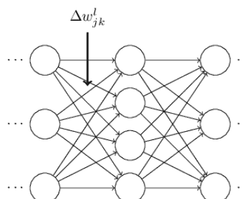

权重的这种变化会导致相应神经元的输出激活发生变化：

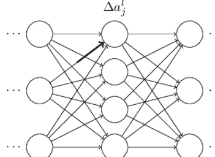

这，反过来，会导致下一层所有激活发生变化：

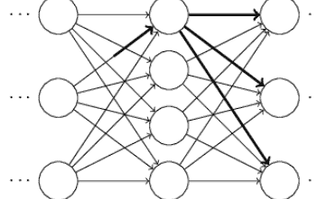

这些变化又会引起下一层，再下一层的变化，一直到导致最终层，然后是代价函数的变化：

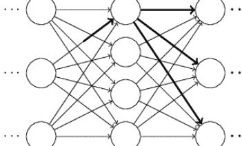

代价的变化 \( \Delta C \) 与权重的变化 \( \Delta w^l_{jk} \) 通过下式相关

\(\Delta C \approx \frac{\partial C}{\partial w^l_{jk}} \Delta w^l_{jk}.\) (47)

这表明，计算 \(\frac{\partial C}{\partial w_{jk}^l}\) 的一种可能方法是仔细追踪 \( w_{jk}^l \) 的微小变化如何传播并导致 \( C \) 的微小变化。如果我们能做到这一点，并在过程中谨慎地将所有内容都用容易计算的量来表示，那么我们应该能够计算出 \( \partial C / \partial w_{jk}^l \)。

让我们尝试执行此操作。变化 \( \Delta w_{jk}^l \) 导致第 \( l \) 层第 \( j \) 个神经元的激活发生微小变化 \( \Delta a_j^l \)。这种变化由以下公式给出：

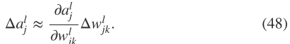

激活的变化 \( \Delta a_j^l \) 会导致下一层（即第 \( l+1 \) 层）中 *所有* 激活发生变化。我们将集中关注其中只有一个激活受到影响的情况，假设是 \( a_q^{l+1} \)，

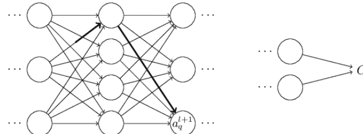

事实上，它会引起以下变化：

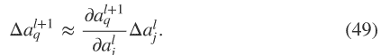

代入公式 (48) 的表达式，我们得到：

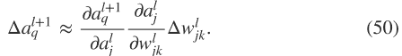

当然，变化 \( \Delta a_q^{l+1} \) 又会引起下一层激活的变化。事实上，我们可以想象一条从 \( w_{jk}^l \) 到 \( C \) 贯穿整个网络的路径，每次激活的变化都会导致下一次激活的变化，最后导致输出端代价的变化。如果路径经过激活 \( a_j^l, a_q^{l+1}, \dots, a_m^{L-1}, a_m^L \)，那么得到的表达式是

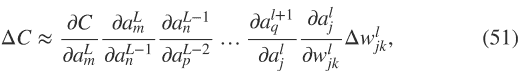


也就是说，我们每通过一个额外的神经元，就得到一项 $\partial a/\partial a$ 类型的项，并在末尾得到一项 $\partial C/\partial a_m^L$。这表示沿网络中这条特定路径的激活值变化而导致的 $C$ 的变化。当然，对 $w_{jk}^l$ 的变化有许多传播路径可以影响代价，而我们一直只考虑一条路径。为了计算 $C$ 的总变化，合理的做法是对权重和最终代价之间的所有可能路径求和，即，

$$\Delta C \approx \sum_{mnp...q} \frac{\partial C}{\partial a_m^L} \frac{\partial a_m^L}{\partial a_n^{L-1}} \frac{\partial a_n^{L-1}}{\partial a_p^{L-2}} \dots \frac{\partial a_q^{l+1}}{\partial a_j^l} \frac{\partial a_j^l}{\partial w_{jk}^l} \Delta w_{jk}^l, \quad (52)$$

其中我们对路径上的中间神经元的所有可能选择进行了求和。与 (47) 对比可知

$$\frac{\partial C}{\partial w_{jk}^l} = \sum_{mnp...q} \frac{\partial C}{\partial a_m^L} \frac{\partial a_m^L}{\partial a_n^{L-1}} \frac{\partial a_n^{L-1}}{\partial a_p^{L-2}} \dots \frac{\partial a_q^{l+1}}{\partial a_j^l} \frac{\partial a_j^l}{\partial w_{jk}^l}. \quad (53)$$

不过，公式 (53) 看起来很复杂。不过，它有一个很好的直观解释。我们正在计算 $C$ 相对于网络中某个权重的变化率。该公式告诉我们，网络中每两个神经元之间的连接都关联着一个速率因子，它只是一个神经元的激活值相对于另一个神经元激活值的偏导数。从第一个权重到第一个神经元的连接具有一个速率因子 $\partial a_j^l / \partial w_{jk}^l$。一条路径的速率因子就是路径上速率因子的乘积。而总变化率 $\partial C/\partial w_{jk}^l$ 就是从初始权重到最终代价的所有路径的速率因子之和。下面我们通过一条路径来举例说明这一过程：

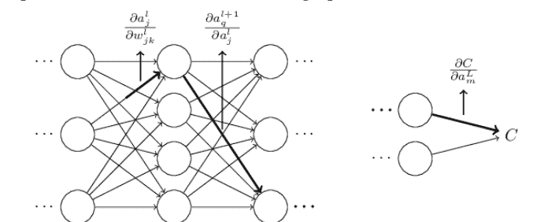

目前为止我一直在提供一个启发式论证，一种思考当你扰动网络中的权重时会发生什么的方式。让我概述一下你可以用来进一步发展这一论证的思路。首先，你可以为公式 (53) 中的所有单独偏导数推导出显式表达式。借助一点微积分知识，这很容易做到。做完之后，你可以尝试找出如何将所有索引求和写成矩阵乘法。这过程确实枯燥，需要一些毅力，但并非需要非凡的洞察力。在完成所有这些并尽可能简化后，你会发现自己最终得到了反向传播算法！因此，你可以把反向传播算法看作一种计算所有这些路径速率因子之和的方法。或者说，稍微不同一点地说，反向传播算法是一种巧妙的方法，用于跟踪权重（和偏置）在通过网络传播、到达输出并影响代价时的微小扰动。

不过，我不会在这里逐一演示所有这些内容。这很混乱，处理所有细节需要非常小心。如果你愿意接受挑战，或许会喜欢尝试一下。即使不愿意，我也希望这种思路能让你对反向传播算法在做什么有一些了解。

另一个谜团是什么呢——反向传播算法最初是如何被发现的？事实上，如果你跟随我刚才概述的方法，你会发现反向传播的一个证明。不幸的是，这个证明比我前面在本章中描述的证明要长得多且复杂得多。那么，那个简短（但更神秘）的证明是如何被发现的？当你把长证明的所有细节都写出来时，你会发现，事后看来，有几个显而易见的简化方法摆在你面前。你进行这些简化，得到一个更短的证明并将其写下来。接着，又有几个显而易见的简化方法会跳出来。于是你再重复一次。经过几次迭代后的结果就是我们之前看到的证明*——简短，但有些晦涩，因为所有指向其构建过程的路标都被移除了！当然，我让你相信我这一点，但早前证明的起源其实并没有什么巨大的谜团。这只是对本节中我概述的证明进行大量艰苦简化的结果。

> "需要一个巧妙的步骤。在公式 (53) 中，中间变量是像 \(a_j^{l+1}\) 这样的激活值。巧妙的想法是改为使用加权输入，比如 \(z_j^{l+1}\)，作为中间变量。如果你不喜欢这个想法，而是继续使用激活值 \(a_j^{l+1}\)，那么你得到的证明将比本章前面给出的证明稍微复杂一些。"

Determination Press, 2015

本作品根据知识共享署名-非商业性使用 3.0 未移植版许可协议（Creative Commons Attribution-NonCommercial 3.0 Unported License）授权。这意味着你可以自由复制、共享和基于本书进行创作，但不得出售。如果你有商业使用需求，请联系我。


# 第 3 章

# 改进神经网络的学习方式

当高尔夫球手刚开始学习打高尔夫球时，他们通常会花大部分时间来培养基本挥杆。只有逐渐地，他们才会发展出其他击球方式，学习切削球、弯曲球和推淡球，在基本挥杆的基础上进行构建和修改。类似地，到目前为止，我们一直专注于理解反向传播算法。它是我们的“基本挥杆”，是大多数神经网络学习工作的基础。在本章中，我将解释一套可用于改进我们基础版反向传播算法实现的技术，从而改进我们网络的学习方式。

本章将要介绍的技术包括：一种更好的代价函数选择，即交叉熵代价函数；四种所谓的“正则化”方法（L1 和 L2 正则化、dropout 以及训练数据的人工扩充），这些方法能让我们的网络在训练数据之外进行泛化时表现更好；一种更好的网络权重初始化方法；以及一套启发式方法，帮助为网络选择合适的超参数。

我也会以较少的深度概述其他几种技术。这些讨论在很大程度上相互独立，因此你如果愿意可以跳过。我们还将在可运行的代码中实现许多技术，并使用它们来改进在第 1 章中研究的手写数字分类问题的结果。

当然，我们只涵盖了为神经网络开发的众多技术中的少数几种。其理念是，掌握大量可用技术的最佳途径是深入研究其中几种最重要的技术。掌握这些重要技术不仅本身很有用，而且还能加深你对使用神经网络时可能出现的问题的理解。这样，当你需要时，你就能很好地快速掌握其他技术。

## 交叉熵代价函数

- 神经网络与深度学习
- 本书内容概述
- 关于练习和问题
- 使用神经网络识别手写数字
- 反向传播算法的工作原理
- 改进神经网络的学习方式
- 神经网络可以计算任何函数的直观证明
- 为什么深度神经网络难以训练？
- 深度学习
- 附录：是否存在一种简单的智能算法？
- 致谢
- 常见问题解答

如果本书对你有帮助，请考虑捐赠一小笔款项。我建议 3 美元，但你可以选择金额。


## 赞助商


感谢所有使本书成为可能的支持者，特别感谢 Pavel Dudrenov。还要感谢所有为“Bugfinder 名人堂”做出贡献的贡献者。

## 资源

- 图书常见问题解答
- 代码仓库
- Michael Nielsen 的项目公告邮件列表
- 深度学习，Yoshua Bengio、Ian 正在准备的草稿书


大多数人发现自己错了会感到不快。刚开始学钢琴不久，我就在观众面前进行了第一场演出。我很紧张，开始把曲子低弹了一个八度。我弄混了，直到有人指出我的错误才能继续。我很尴尬。然而，虽然令人不快，但在我们彻底犯错时，学习速度也很快。你可以打赌，下次我再在观众面前弹奏时，我就弹对了八度！相比之下，当我们的错误定义不清时，我们学习得更慢。

理想情况下，我们希望并期望神经网络能从错误中快速学习。实际情况会是这样吗？为了回答这个问题，让我们看一个玩具示例。该示例涉及只有一个输入的神经元：

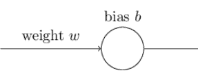

我们将训练这个神经元做一件极其简单的事情：将输入 1 映射到输出 0。当然，这是一项非常琐碎的任务，我们可以很容易地手动找出合适的权重和偏置，而无需使用学习算法。然而，使用梯度下降来尝试学习权重和偏置似乎很有启发性。那么，让我们来看看神经元是如何学习的。

为了明确具体数值，我将初始权重设为 0.6，初始偏置设为 0.9。这些是用作学习起点的通用选择，我并没有刻意挑选任何特殊值。神经元的初始输出是 0.82，因此在神经元接近所需输出 0.0 之前，需要进行大量学习。点击右下角的 "Run" 来查看神经元如何学习得到一个更接近 0.0 的输出。请注意，这不是预录的动画，你的浏览器实际上正在计算梯度，然后使用梯度更新权重和偏置，并显示结果。学习率是 η = 0.15，它足够慢，以便我们可以跟上发生的事情，但又足够快，只需几秒钟就能获得实质性学习。代价是第 1 章介绍过的二次代价函数 C。我稍后会提醒你代价函数的具体形式，因此无需去查找定义。请注意，你可以通过再次点击 "Run" 多次运行动画。


你可以看到，神经元迅速学会了一个降低代价的权重和偏置，并使神经元的输出约为 0.09。这并不完全是所需输出 0.0，但已经相当不错了。然而，假设我们将初始权重和初始偏置都设为 2.0。在这种情况下，初始输出是 0.98，这非常错误。让我们看看在这种情况下神经元如何学习输出 0。再次点击 "Run"：


虽然这个示例使用相同的学习率（η = 0.15），但我们可以看到学习开始时要慢得多。事实上，在最初大约 150 个学习周期中，权重和偏置几乎没有变化。然后学习开始起作用，和我们的第一个示例一样，神经元的输出迅速接近 0.0。

这种行为与人类学习形成鲜明对比。正如我在本节开头所说，当我们对某事非常错误时，我们往往学习得最快。但我们刚刚看到，当我们的人工神经元非常错误时，它很难学习——比仅仅是稍微错误时困难得多。不仅如此，事实证明这种行为不仅发生在这个玩具模型中，还发生在更一般的网络中。为什么学习这么慢？我们能找到避免这种减速的方法吗？

为了理解问题的根源，请考虑我们的神经元通过改变权重和偏置来学习，其变化速率由代价函数的偏导数决定，即 ∂C/∂w 和 ∂C/∂b。因此，说“学习很慢”实际上等同于说这些偏导数很小。挑战在于理解它们为什么很小。为了理解这一点，让我们计算偏导数。回顾我们使用的是二次代价函数，根据方程 (6)，它由以下公式给出：

```
$$C = \frac{(y-a)^2}{2},$$ (54)
```

其中 a 是当训练输入 x = 1 时神经元的输出，y = 0 是相应的期望输出。为了更明确地用权重和偏置表示这一点，回顾 a = σ(z)，其中 z = wx + b。使用链式法则对权重和偏置进行求导，我们得到

```
$$\frac{\partial C}{\partial w} = (a-y)\sigma'(z)x = a\sigma'(z)$$ (55)
$$\frac{\partial C}{\partial b} = (a-y)\sigma'(z) = a\sigma'(z),$$ (56)
```

其中我已代入 x = 1 和 y = 0。为了理解这些表达式的行为，让我们更仔细地看看右边的 σ'(z) 项。回顾 σ 函数的形状：


从这张图中可以看出，当神经元的输出接近 1 时，曲线变得非常平坦，因此 σ'(z) 变得非常小。方程 (55) 和 (56) 然后告诉我们 ∂C/∂w 和 ∂C/∂b 变得非常小。这就是学习减速的起源。不仅如此，正如我们稍后将看到的，在更一般的神经网络中，学习减速也是出于基本相同的原因，而不仅仅是我们一直玩耍的那个玩具示例。

## 引入交叉熵代价函数

我们如何解决学习减速问题？事实证明，我们可以通过用另一种代价函数（称为交叉熵）替代二次代价来解决这个问题。为了理解交叉熵，让我们稍微远离我们的超级简单玩具模型。我们假设，我们要训练一个具有多个输入变量 $x_1, x_2, \ldots$、相应权重 $w_1, w_2, \ldots$ 和偏置 $b$ 的神经元：


神经元的输出当然是 $a = \sigma(z)$，其中 $z = \sum_j w_j x_j + b$ 是输入的加权和。我们为这个神经元定义交叉熵代价函数为

```
$$C = -\frac{1}{n} \sum_x [y \ln a + (1 - y) \ln(1 - a)], \qquad (57)$$
```

其中 $n$ 是训练数据的总项数，求和是对所有训练输入 $x$ 进行的，$y$ 是相应的期望输出。

表达式 (57) 是否解决了学习减速问题并不明显。事实上，坦率地说，甚至不清楚将此称为代价函数是否合理！在解决学习减速问题之前，让我们看看交叉熵在什么意义上可以被解释为代价函数。

有两个特性使得将交叉熵解释为代价函数是合理的。首先，它是非负的，即 $C > 0$。要看到这一点，请注意：(a) (57) 求和中的所有单独项都是负数，因为两个对数都是 0 到 1 范围内的数的对数；(b) 求和前面有一个负号。

其次，如果对于所有训练输入 $x$，神经元的实际输出都接近期望输出，那么交叉熵将接近零*。要看到这一点，假设例如对于某个输入 $x$，$y=0$ 且 $a \approx 0$。这是神经元在该输入上做得不错的情况。我们看到，代价表达式 (57) 中的第一项消失，因为 $y=0$，而第二项只是 $-\ln(1-a) \approx 0$。当 $y=1$ 且 $a \approx 1$ 时，类似的分析成立。因此，只要实际输出接近期望输出，对代价的贡献就会很低。

> "要证明这一点，我需要假设期望输出 $y$ 全部为 0 或 1。这通常是解决分类问题（例如）或计算布尔函数时的情况。要了解当不做此假设时会发生什么，请参见本节末尾的练习。

总结起来，交叉熵是正的，并且随着神经元在所有训练输入 $x$ 上计算期望输出 $y$ 变得更好，交叉熵倾向于零。这两个特性都是我们直觉上期望代价函数具有的特性。实际上，二次代价也满足这两个特性。所以这是对交叉熵的好消息。但是，交叉熵代价函数的好处在于，与二次代价不同，它避免了学习减速的问题。要看到这一点，让我们计算交叉熵代价相对于权重的偏导数。我们将 $a = \sigma(z)$ 代入 (57)，并应用链式法则两次，得到：

```
\frac{\partial C}{\partial w_j} = -\frac{1}{n} \sum_x \left( \frac{y}{\sigma(z)} - \frac{(1-y)}{1-\sigma(z)} \right) \frac{\partial \sigma}{\partial w_j} \tag{58}
= -\frac{1}{n} \sum_x \left( \frac{y}{\sigma(z)} - \frac{(1-y)}{1-\sigma(z)} \right) \sigma'(z)x_j \tag{59}
```

将所有内容通分并简化后，这变为：

```
\frac{\partial C}{\partial w_j} = \frac{1}{n} \sum_x \frac{\sigma'(z)x_j}{\sigma(z)(1-\sigma(z))}(\sigma(z)-y). \tag{60}
```

使用 sigmoid 函数的定义 $\sigma(z) = 1/(1 + e^{-z})$，并经过一点代数运算，我们可以证明 $\sigma'(z) = \sigma(z)(1 - \sigma(z))$。我会请你在下面的练习中验证这一点，但目前让我们将其视为已知。我们看到，上面的方程中 $\sigma'(z)$ 和 $\sigma(z)(1 - \sigma(z))$ 项相消，并简化为：

```
\frac{\partial C}{\partial w_j} = \frac{1}{n} \sum_x x_j(\sigma(z) - y). \tag{61}
```

这是一个优美的表达式。它告诉我们，权重学习的速率由 $\sigma(z) - y$ 控制，即由输出误差控制。误差越大，神经元学习得越快。这


正如我们直觉上所期望的那样。特别是，它避免了由二次代价的类似方程（公式 55）中的 \(\sigma'(z)\) 项引起的学习减速问题。当我们使用交叉熵时，\(\sigma'(z)\) 项会被抵消，我们不再需要担心它很小。这种抵消是交叉熵代价函数所确保的特殊“奇迹”。其实，这并非真正的奇迹。正如我们稍后将看到的，交叉熵被特别选中以具备这一属性。

以类似的方式，我们可以计算偏置的偏导数。我就不再赘述所有细节，但你可以轻松验证

\(\frac{\partial C}{\partial b} = \frac{1}{n} \sum_x (\sigma(z) - y).\) (62)

同样，这避免了由二次代价的类似方程（公式 56）中的 \(\sigma'(z)\) 项引起的学习减速问题。

## Exercise

- 验证 \(\sigma'(z) = \sigma(z)(1 - \sigma(z))\)。

让我们回到之前玩过的那个玩具示例，探索当我们使用交叉熵而非二次代价时会发生什么。为了重新定位，我们从二次代价表现良好的情况开始，初始权重为 0.6，初始偏置为 0.9。点击“Run”查看将二次代价替换为交叉熵后会发生什么：


毫不奇怪，此示例中神经元学习得非常好，与之前一样。现在让我们看看之前神经元卡住的情况（链接，供比较），权重和偏置均从 2.0 开始：


成功！这次神经元学习得很快，正如我们所希望的。如果你仔细观察，会发现代价曲线的初始斜率比二次代价对应曲线上的初始平坦区域要陡峭得多。正是这种陡峭程度让交叉熵为我们带来了好处，防止了我们在期望神经元学习最快的时候卡住，即当神经元一开始就非常错误时。

我刚才给出的示例中并没有说明使用了什么学习率。之前，使用二次代价时，我们使用了 \(\eta = 0.15\)。在新示例中，我们应该使用相同的学习率吗？实际上，随着代价函数的改变，无法精确地说明使用“相同”学习率意味着什么；这就像是在比较苹果和橘子。对于两种代价函数，我只是通过实验找到了一个学习率，使我们能够了解正在发生的事情。如果你尽管我已经否认，但仍然好奇，那么具体情况如下：我在刚才给出的示例中使用了 \(\eta = 0.005\)。

你可能会反驳，说学习率的变化使上述图表毫无意义。当初始学习率选择是任意的时候，谁还关心神经元学习得有多快？！这种反驳抓不住重点。图表的目的不是关于学习的绝对速度，而是关于学习速度如何变化。特别是，当我们使用二次代价时，当神经元明确错误时，学习速度比后来神经元接近正确输出时要慢；而使用交叉熵时，当神经元明确错误时，学习速度更快。这些说法不取决于学习率如何设置。

我们一直在研究单个神经元的交叉熵。然而，将交叉熵推广到多神经元多层网络很容易。特别是，假设 \(y = y_1, y_2, \dots\) 是输出神经元（即最后一层的神经元）的期望值，而 \(a_1^L, a_2^L, \dots\) 是实际输出值。那么我们通过以下方式定义交叉熵：

\(C = -\frac{1}{n} \sum_x \sum_j \left[ y_j \ln a_j^L + (1 - y_j) \ln(1 - a_j^L) \right].\) (63)

这与我们之前的表达式（公式 57）相同，只是现在我们有了对所有输出神经元求和的 \(\sum_j\)。我不会明确地逐步推导，但使用表达式 (63) 避免多神经元网络中的学习减速应该是合理的。如果你感兴趣，可以在下面的问题中自行推导。

我们何时应该使用交叉熵而非二次代价？实际上，只要输出神经元是 Sigmoid 神经元，交叉熵几乎总是更好的选择。要理解原因，请考虑在设置网络时，我们通常使用某种随机化方式初始化权重和偏置。可能会出现这种情况：这些初始选择导致网络对某些训练输入来说决定性错误——即，当输出神经元应该为 0 时，它却饱和在接近 1 的地方，或者反之亦然。如果我们使用二次代价，这会减慢学习速度。它不会完全停止学习，因为权重会继续从其他训练输入中学习，但这显然是不可取的。

## Exercises

- 使用交叉熵的一个陷阱是，起初难以记住 \(y\) 和 \(a\) 各自的角色。很容易弄混正确形式是 \(-[y \ln a + (1 - y) \ln(1 - a)]\) 还是 \(-[a \ln y + (1 - a) \ln(1 - y)]\)。当 \(y = 0\) 或 \(1\) 时，第二个表达式会发生什么？第一个表达式会存在这个问题吗？为什么或为什么不？

- 在本节开头关于单个神经元的讨论中，我主张如果对于所有训练输入都有 \(\sigma(z) \approx y\)，则交叉熵很小。该论证依赖于 \(y\) 等于 0 或 1。这在分类问题中通常成立，但对于其他问题（例如回归问题），\(y\) 有时可以取 0 和 1 之间的中间值。请证明，当对于所有训练输入都有 \(\sigma(z) = y\) 时，交叉熵仍然被最小化。在这种情况下，交叉熵的值为：

\(C = -\frac{1}{n} \sum_x [y \ln y + (1 - y) \ln(1 - y)].\) (64)

量 \(-[y \ln y + (1 - y) \ln(1 - y)]\) 有时被称为二元熵。

## Problems

- **多层多神经元网络** 在上一章引入的记法中，证明对于二次代价，输出层权重的偏导数为

\(\frac{\partial C}{\partial w_{jk}^L} = \frac{1}{n} \sum_x a_k^{L-1} (a_j^L - y_j) \sigma'(z_j^L).\) (65)

项 \(\sigma'(z_j^L)\) 会导致学习减速，每当输出神经元在错误值上饱和时。请证明，对于交叉熵代价，单个训练示例 \(x\) 的输出误差 \(\delta^L\) 由以下给出：

\(\delta^L = a^L - y.\) (66)

使用此表达式证明，输出层权重的偏导数由以下给出：

\(\frac{\partial C}{\partial w_{jk}^L} = \frac{1}{n} \sum_x a_k^{L-1} (a_j^L - y_j).\) (67)

\(\sigma'(z_j^L)\) 项已经消失，因此交叉熵避免了学习减速问题，不仅适用于单个神经元（正如我们之前看到的），也适用于多层多神经元网络。对偏置的类似分析也成立。如果这对你不明显，那么你也应该自行完成该分析。

- **在输出层具有线性神经元时使用二次代价** 假设我们有一个多层多神经元网络。假设最后一层的所有神经元都是*线性神经元*，即未应用 Sigmoid 激活函数，输出仅为 \(a_j^L = z_j^L\)。证明如果我们使用二次代价函数，则单个训练示例 \(x\) 的输出误差 \(\delta^L\) 由以下给出：

\(\delta^L = a^L - y.\) (68)

与前一个问题类似，使用此表达式证明，输出层权重和偏置的偏导数由以下给出：

\(\frac{\partial C}{\partial w_{jk}^L} = \frac{1}{n} \sum_x a_k^{L-1}(a_j^L - y_j)\) (69)
\(\frac{\partial C}{\partial b_j^L} = \frac{1}{n} \sum_x (a_j^L - y_j).\) (70)

这表明，如果输出神经元是线性神经元，那么二次代价不会产生任何学习减速问题。在这种情况下，二次代价实际上是一个合适的代价函数。

## 使用交叉熵对 MNIST 数字进行分类

交叉熵作为使用梯度下降和反向传播学习的程序的一部分，很容易实现。我们将在本章稍后进行，开发一个改进版的早期 MNIST 手写数字分类程序 network.py。新程序称为 network2.py，它不仅包含交叉熵，还包含本章开发的几种其他技术*。目前，让我们看看我们的新程序对 MNIST 数字分类得如何。与第 1 章一样，我们将使用一个具有 30 个隐藏神经元的网络，并将小批量大小设置为 10。我们将学习率设置为 \(\eta = 0.5*\)，并训练 30 个 epoch。network2.py 的接口与 network.py 略有不同，但仍然应该清楚正在发生什么。顺便说一句，你可以在 Python shell 中使用 help(network2.Network.SGD) 等命令获取有关 network2.py 接口的文档。

> *代码可在 GitHub 上找到。

> *在第 1 章中，我们使用了二次代价和学习率 \(\eta = 3.0\)。如上文所述，当代价函数改变时，无法精确地说明使用“相同”学习率意味着什么。对于两种代价函数，我都进行了实验，找到了一个学习率，在给定的其他超参数选择下，能够提供接近最优的性能。

> 顺便说一句，有一个非常粗略的经验法则来关联交叉熵和二次代价的学习率。如前所述，二次代价的梯度项中包含一个额外的 \(\sigma' = \sigma(1 - \sigma)\) 项。假设我们对 \(\sigma\) 的值进行平均。\(\int_0^1 d\sigma \sigma(1 - \sigma) = 1/6\)。我们看到，（非常粗略地）二次代价平均学习速度快 6 倍

```
>>> import mnist_loader
>>> training_data, validation_data, test_data = \
... mnist_loader.load_data_wrapper()
>>> import network2
>>> net = network2.Network([784, 30, 10], cost=network2.CrossEntropyCost)
>>> net.large_weight_initializer()
```


>>> net.SGD(training_data, 30, 10, 0.5, evaluation_data=test_data,
 ... monitor_evaluation_accuracy=True)

同样的学习率下会更慢。这表明一个合理的起点是将二次代价的学习率除以 6。当然，这个论点远非严谨，也不应太过认真对待。尽管如此，它有时可以作为一个有用的起点。

顺便提一下，`net.large_weight_initializer()` 命令用于以与第 1 章中描述相同的方式初始化权重和偏置。我们需要运行这个命令，因为本章稍后我们将更改网络中的默认权重初始化。运行上述命令序列的结果是一个准确率为 95.49% 的网络。这与我们在第 1 章中使用二次代价获得的 95.42% 的结果非常接近。

让我们也来看看使用 100 个隐藏神经元、交叉熵且其他参数保持不变的情况。在这种情况下，我们获得了 96.82% 的准确率。这与第 1 章的结果相比是一个显著的改进，在第 1 章中，我们使用二次代价获得了 96.59% 的分类准确率。这看起来可能是一个很小的变化，但请考虑，错误率已从 3.41% 降至 3.18%。也就是说，我们消除了大约十四分之一的原始错误。这是一个相当实用的改进。

令人鼓舞的是，交叉熵代价函数给出的结果与二次代价函数相似或更好。然而，这些结果并不能结论性地证明交叉熵是更好的选择。原因在于，我在选择学习率、小批量大小等超参数时只投入了很少精力。要使改进真正具有说服力，我们需要对这些超参数进行彻底优化。尽管如此，这些结果是令人鼓舞的，并加强了我们早先的理论论证，即交叉熵优于二次代价。

顺便说一句，这是我们在本章乃至本书其余大部分内容中将看到的一种普遍模式。我们将开发一种新技术，尝试它，并获得“改进”的结果。当然，看到这样的改进是件好事。但对这种改进的解释总是有问题的。只有在为优化所有其他超参数付出巨大努力后才看到改进时，它们才真正具有说服力。这需要大量工作，需要大量计算能力，我们通常不会进行如此详尽的调查。相反，我们将基于像上面那样的非正式测试来进行。尽管如此，你应该牢记，这样的测试不足以构成确凿的证明，并保持警惕，留意论证失效的迹象。

到目前为止，我们已经详细讨论了交叉熵。当它对我们的 MNIST 结果只有很小改进时，为什么要费这么大劲？本章稍后我们将看到其他技术——特别是正则化——它们能带来更大的改进。那么，为什么如此关注交叉熵呢？部分原因是交叉熵是一种广泛使用的代价函数，因此值得深入理解。但更重要的是，神经元饱和是神经网络中的一个重要问题，我们将在整本书中反复讨论这个问题。因此，我详细讨论了交叉熵，因为它是开始理解神经元饱和及如何解决它的一个很好的实验场。

## 交叉熵的含义是什么？它来自何处？

我们对交叉熵的讨论主要集中在代数分析和实际实现上。这很有用，但留下了更广泛的概念性问题没有回答，例如：交叉熵意味着什么？有没有一种直观的方式来思考交叉熵？我们最初又是如何构思出交叉熵的？

让我们从最后一个问题开始：是什么促使我们最初构思出交叉熵？假设我们发现了前面描述的学习速度减慢现象，并理解其根源在于方程 (55) 和 (56) 中的 \(\sigma'(z)\) 项。盯着这些方程看了一会儿后，我们可能会想知道，是否可以选择一个代价函数，使得 \(\sigma'(z)\) 项消失。在这种情况下，单个训练样本 \(x\) 的代价 \(C = C_x\) 将满足

```
\frac{\partial C}{\partial w_j} = x_j(a - y) \qquad (71)
\frac{\partial C}{\partial b} = (a - y). \qquad (72)
```

消除学习速度减慢的问题。事实上，从这些方程出发，我们现在将展示，仅仅遵循数学直觉，就可以推导出交叉熵的形式。要看清这一点，请注意，根据链式法则，我们有

\(\frac{\partial C}{\partial b} = \frac{\partial C}{\partial a}\sigma'(z).\) (73)

使用 \(\sigma'(z) = \sigma(z)(1 - \sigma(z)) = a(1 - a)\)，最后一个方程变为

\(\frac{\partial C}{\partial b} = \frac{\partial C}{\partial a}a(1 - a).\) (74)

与方程 (72) 比较，我们得到

\(\frac{\partial C}{\partial a} = \frac{a - y}{a(1 - a)}.\) (75)

对这个表达式关于 \(a\) 进行积分得到

\(C = -[y \ln a + (1 - y) \ln(1 - a)] + \text{constant},\) (76)

其中是某个积分常数。这是来自单个训练样本 \(x\) 对代价的贡献。为了得到完整的代价函数，我们必须对训练样本求平均，得到

\(C = -\frac{1}{n} \sum_x [y \ln a + (1 - y) \ln(1 - a)] + \text{constant},\) (77)

这里的常数是每个训练样本的各自常数的平均值。因此，我们看到方程 (71) 和 (72) 唯一确定了交叉熵的形式，只差一个总体常数项。交叉熵并不是凭空神奇地想出来的。相反，它是我们可以以简单自然的方式发现的东西。

那么交叉熵的直观含义是什么？我们应该如何思考它？深入解释这会超出我想讨论的范围。然而，值得提及的是，有一种来自信息论领域的标准解释方式来诠释交叉熵。大致来说，其思想是交叉熵是惊讶度的一种度量。具体来说，我们的神经元试图计算函数 \(x \rightarrow y = y(x)\)。但相反，它计算的是函数 \(x \rightarrow a = a(x)\)。假设我们将 \(a\) 视为神经元对 \(y\) 为 1 的概率估计，并将 \(1 - a\) 视为 \(y\) 正确值为 0 的概率估计。那么，当我们得知 y 的真实值时，交叉熵衡量我们平均有多“惊讶”。如果输出是我们预期的，惊讶度低；如果输出是意外的，惊讶度高。当然，我没有确切说明“惊讶”是什么意思，所以这似乎像是空话。但实际上，有一种精确的信息论方式来说明惊讶的含义。不幸的是，我不知道网上有什么好、简短、自包含的关于这个主题的讨论。但如果你想深入挖掘，维基百科包含一个简要摘要，能让你走上正轨。而细节可以通过研读 Cover 和 Thomas 所著的信息论教材第 5 章中关于 Kraft 不等式的材料来填补。

## 问题

- 我们已经详细讨论了在使用二次代价训练的网络中，当输出神经元饱和时可能出现的学习速度减慢问题。另一种可能阻碍学习的因素是方程 (61) 中 \(x_j\) 项的存在。由于这个项，当输入 \(x_j\) 接近零时，相应的权重 \(w_j\) 将学习缓慢。解释为什么不可能通过巧妙选择代价函数来消除 \(x_j\) 项。

## Softmax

在本章中，我们将主要使用交叉熵代价来解决学习速度减慢的问题。然而，我想简要描述另一种解决此问题的方法，它基于所谓的软最大值神经元层。我们实际上不会在本章余下部分使用软最大值层，所以如果你很赶时间，可以跳到下一节。然而，软最大值仍然值得理解，部分原因是它本身很有趣，部分原因是我们将在第 6 章讨论深度神经网络时使用软最大值层。

软最大值的思想是为我们的神经网络定义一种新的输出层。它以与 sigmoid 层相同的方式开始，通过形成加权输入* \(z_j^l = \sum_k w_{jk}^l a_k^{l-1} + b_j^l\)。然而，我们不应用 sigmoid 函数来得到输出。相反，在软最大值层中，我们对 \(z_j^l\) 应用所谓的软最大值函数。根据这个函数，第 j 个输出神经元的激活 \(a_j^l\) 为

*在描述软最大值时，我们将频繁使用上一章中引入的符号。如果你需要刷新记忆关于符号的含义，你可能希望重新阅读那一章。


a_j^L = \frac{e^{z_j^L}}{\sum_k e^{z_k^L}},\tag{78}

其中分母对所有输出神经元求和。

如果你不熟悉 softmax 函数，方程 (78) 可能看起来非常晦涩。我们当然不明白为什么要使用这个函数。而且也并不明显，使用这个函数是否能帮助我们解决学习变慢的问题。为了更好地理解方程 (78)，假设我们有一个具有四个输出神经元以及四个对应加权输入的网络，我们将其记作 \(z_1^L, z_2^L, z_3^L,\) 和 \(z_4^L\)。下面显示了可调滑块，展示加权输入的可能取值，以及对应输出激活值的图表。开始探索的好方法是使用底部滑块来增加 \(z_4^L\)：


当你增加 \(z_4^L\) 时，你会看到对应的输出激活值 \(a_4^L\) 增加，而其他输出激活值减少。同样，如果你减小 \(z_4^L\)，那么 \(a_4^L\) 将减小，而所有其他输出激活值都会增加。事实上，如果你仔细观察，你会看到在两种情况下，其他激活值的总变化正好补偿了 \(a_4^L\) 的变化。原因是输出激活值保证始终总和为 1，我们可以利用方程 (78) 和一点代数知识来证明：

\sum_j a_j^L = \frac{\sum_j e^{z_j^L}}{\sum_k e^{z_k^L}} = 1.\tag{79}

因此，如果 \(a_4^L\) 增加，则其他输出激活值必须减少相同的总量，以确保所有激活值的总和保持为 1。当然，类似的结论对所有其他激活值也成立。

方程 (78) 还暗示输出激活值均为正数，因为指数函数为正。将这一点与上一段的观察结合起来，我们可以看到 softmax 层的输出是一组正数且总和为 1。换句话说，softmax 层的输出可以被视为一个概率分布。

softmax 层输出概率分布这一事实非常令人欣慰。在许多问题中，将输出激活值 \(a_j^L\) 解释为网络认为正确输出为 \(j\) 的概率估计是非常方便的。例如，在 MNIST 分类问题中，我们可以将 \(a_j^L\) 解释为网络估计的正确数字分类为 \(j\) 的概率。

相比之下，如果输出层是 sigmoid 层，那么我们当然不能假设激活值构成概率分布。我不会明确证明这一点，但可以合理地认为 sigmoid 层的激活值通常不会构成概率分布。因此，使用 sigmoid 输出层时，我们没有对输出激活值这样简单的解释。

## 练习

- 构造一个例子，明确表明在带有 sigmoid 输出层的网络中，输出激活值 \(a_j^L\) 不总是等于 1。

我们开始对 softmax 函数及其层的行为有了些感觉。先回顾一下我们目前的状况：方程 (78) 中的指数确保所有输出激活值为正数。而方程 (78) 分母中的求和确保 softmax 输出总和为 1。因此，这种特定的形式不再显得那么神秘：相反，它是确保输出激活值构成概率分布的一种自然方式。你可以把 softmax 看作是对 \(z_j^L\) 进行重新缩放，然后将它们挤压在一起以形成概率分布。

## 练习

- **Softmax 的单调性** 证明 \(\partial a_j^L / \partial z_k^L\) 在 \(j = k\) 时为正，在 \(j \neq k\) 时为负。结果，增加 \(z_j^L\) 保证会增加相应的输出激活值 \(a_j^L\)，并减少所有其他输出激活值。我们之前已经通过滑块观察到了这一点，但这是一个严格的证明。

- **Softmax 的非局部性** sigmoid 层的一个好处是输出 \(a_j^l\) 是对应加权输入的函数，\(a_j^l = \sigma(z_j^l)\)。解释为什么 softmax 层不是这样：任何特定的输出激活值 \(a_j^l\) 都依赖于 _所有_ 加权输入。

## 问题

- **反演 softmax 层** 假设我们有一个带有 softmax 输出层的神经网络，且已知激活值 \(a_j^L\)。证明相应的加权输入形式为 \(z_j^L = \ln a_j^L + C\)，其中 _C_ 是一个与 _j_ 无关的常数。

**学习变慢问题：** 我们现在已经对 softmax 神经元层非常熟悉了。但我们还没有看到 softmax 层如何让我们解决学习变慢的问题。为了理解这一点，让我们定义 _对数似然_ 代价函数。我们将用 _x_ 表示网络的训练输入，用 _y_ 表示相应的期望输出。那么与此训练输入关联的对数似然代价为

C \equiv -\ln a_y^L.\tag{80}

例如，如果我们使用 MNIST 图像进行训练，并输入一张 7 的图像，那么对数似然代价是 \(-\ln a_7^L\)。为了看出这符合直觉，考虑网络工作良好的情况，即它确信输入是 7。在这种情况下，它会估计相应的概率 \(a_7^L\) 为接近 1 的值，因此代价 \(-\ln a_7^L\) 会很小。相比之下，当网络工作不够好时，概率 \(a_7^L\) 会较小，代价 \(-\ln a_7^L\) 会较大。所以对数似然代价的表现符合我们对代价函数的预期。

学习变慢问题呢？为了分析这一点，请回顾学习变慢的关键在于数量 \(\partial C / \partial w_{jk}^l\) 和 \(\partial C / \partial b_j^l\) 的行为。我不会明确进行推导——我会让你在下面的问题中自行完成——但通过一点代数运算，你可以表明*

\frac{\partial C}{\partial b_j^L} = a_j^L - y_j \tag{81}
\frac{\partial C}{\partial w_{jk}^L} = a_k^{L-1}(a_j^L - y_j) \tag{82}

*Note that I'm abusing notation here, using y in a slightly different way to last paragraph. In the last paragraph we used y to denote the desired output from the network - e.g., output a "7" if an image of a 7 was input. But in the equations which follow I'm using y to denote the vector of output activations which corresponds to 7, that is, a vector which is all 0s, except for a 1 in the 7th location.

这些方程与我们之前对交叉熵分析中得到的类似表达式相同。例如，将方程 (82) 与方程 (67) 进行比较。这是同一个方程，尽管在后者中我对训练实例进行了平均。而且，与之前的分析一样，这些表达式确保我们不会遇到学习变慢。事实上，将带有对数似然代价的 softmax 输出层视为与带有交叉熵代价的 sigmoid 输出层非常相似是有用的。

考虑到这种相似性，你应该使用 sigmoid 输出层和交叉熵，还是 softmax 输出层和对数似然？事实上，在许多情况下，两种方法都效果良好。在本章余下的内容中，我们将使用 sigmoid 输出层和交叉熵代价。后来，在第 6 章中，我们有时会使用 softmax 输出层和对数似然代价。切换的原因是使我们的一些后续网络更类似于某些有影响力的学术论文中发现的网络。作为一个更一般的原则，当你希望将输出激活值解释为概率时，softmax 加上对数似然是值得使用的。这并非总是关注的问题，但在涉及不相交类的分类问题（如 MNIST）中可能很有用。

## 问题

- 推导方程 (81) 和 (82)。

- "softmax" 名称从何而来？假设我们修改 softmax 函数，使输出激活值由下式给出

a_j^L = \frac{e^{c z_j^L}}{\sum_k e^{c z_k^L}}, \tag{83}

其中 c 是一个正常数。请注意 c = 1 对应标准 softmax 函数。但如果我们使用不同的 c 值，我们会得到一个不同的函数，它在质量上仍然


与 softmax 很相似。特别是，证明输出激活构成一个概率分布，就像通常的 softmax 一样。假设我们允许 \( c \) 变得很大，即 \( c \to \infty \)。输出激活 \( a_j^l \) 的极限值是多少？解决这个问题后，你应该清楚为什么我们把 \( c = 1 \) 函数视为最大函数的“软化”版本。这就是“softmax”一词的由来。

- **带 softmax 和对数似然代价的反向传播** 在上一章中，我们为包含 sigmoid 层的网络推导了反向传播算法。要将该算法应用于带有 softmax 层的网络，我们需要找出最终层中误差 \(\delta_j^l \equiv \partial C / \partial z_j^l\) 的表达式。证明一个合适的表达式是：

\(\delta_j^L = a_j^L - y_j.\) (84)

使用这个表达式，我们可以将反向传播算法应用于使用 softmax 输出层和对数似然代价的网络。

## 过拟合与正则化

诺贝尔奖获得者恩里科·费米曾被问及他对一些同事提出的一个数学模型的看法，该模型被提议作为解决一个重要未解决物理问题的方案。该模型与实验吻合良好，但费米持怀疑态度。他问模型中可以设置多少个自由参数。“四个”是答案。费米回答说*：“我记得我的朋友约翰·冯·诺伊曼常说，用四个参数我就能拟合大象，用五个我就能让他动动鼻子.”。

> *这句话出自弗里曼·戴森的一篇迷人文章，他正是提出该有缺陷模型的人之一。一个四参数大象可以在这里找到。

当然，关键在于，拥有大量自由参数的模型可以描述惊人广泛的现象。即使这样的模型与现有数据吻合良好，也不能使其成为一个好模型。这可能只是意味着模型中有足够的自由度，可以描述给定大小的几乎任何数据集，而不捕捉对底层现象的任何真实洞察。当这种情况发生时，模型在现有数据上表现良好，但无法推广到新情况。检验模型的真正标准是其在未接触过的情况下进行预测的能力。

费米和冯·诺伊曼对拥有四个参数的模型持怀疑态度。我们用于分类 MNIST 数字的 30 个隐藏神经元网络拥有近 24,000 个参数！这是很多参数。我们 100 个隐藏神经元的网络拥有近 80,000 个参数，而最先进的深度神经网络有时包含数百万甚至数十亿个参数。我们应该信任这些结果吗？

让我们通过构建一个网络在推广到新情况时表现不佳的场景来细化这个问题。我们将使用拥有 23,860 个参数的 30 隐藏神经元网络。但我们不会使用全部 50,000 张 MNIST 训练图像来训练网络。相反，我们将仅使用前 1,000 张训练图像。使用这个受限的集合将使推广问题更加明显。我们将以类似之前的方式进行训练，使用交叉熵代价函数，学习率为 η = 0.5，小型批量大小为 10。然而，我们将训练 400 个时代，这比之前稍多一些，因为我们没有使用那么多训练样本。让我们使用 network2 来查看代价函数的变化情况：

```
>>> import mnist_loader
>>> training_data, validation_data, test_data = \
... mnist_loader.load_data_wrapper()
>>> import network2
>>> net = network2.Network([784, 30, 10], cost=network2.CrossEntropyCost)
>>> net.large_weight_initializer()
>>> net.SGD(training_data[:1000], 400, 10, 0.5, evaluation_data=test_data,
... monitor_evaluation_accuracy=True, monitor_training_cost=True)
```

使用这些结果，我们可以绘制网络学习过程中代价的变化情况*：

*这幅图和接下来的四幅图是由程序 overfitting.py 生成的。


这看起来很鼓舞人心，显示代价平滑下降，正如我们所期望的。请注意，我只展示了训练时代 200 到 399。这让我们得以近距离查看学习的后期阶段，正如我们将看到的，这正是有趣的事情发生的地方。


同样，我进行了相当大的放大。在前 200 个时代（未显示）中，准确率上升到略低于 82 百分比。学习随后逐渐放慢。最后，在大约第 280 个时代，分类准确率基本上不再提高。后来的时代仅在第 280 个时代的准确率附近出现微小的随机波动。将此与之前的图表形成对比，在之前的图表中，与训练数据相关的代价继续平滑下降。如果我们只看那个代价，似乎我们的模型仍在变“更好”。但测试准确率结果表明改进是一种幻觉。就像费米不喜欢的模型一样，我们的网络在第 280 个时代后学到的内容不再推广到测试数据。因此这不是有用的学习。我们说网络在第 280 个时代之后过拟合或过度训练。

你可能会想，这里的问题是否在于我查看的是训练数据上的代价，而不是测试数据上的分类准确率。换句话说，也许问题在于我们进行的是苹果和橘子的比较。如果我们将训练数据上的代价与测试数据上的代价进行比较，以便比较相似的指标，会发生什么呢？或者我们或许可以同时比较训练数据和测试数据上的分类准确率？事实上，无论我们如何进行比较，基本上都会出现同样的现象。但是，细节会有所变化。例如，让我们看看测试数据上的代价：


我们可以看到，测试数据上的代价在大约第 15 个时代之前有所改善，但之后实际上开始变差，尽管训练数据上的代价继续改善。这是模型过拟合的另一个迹象。然而，这提出了一个谜题：我们是否应该将第 15 个时代或第 280 个时代视为过拟合开始主导学习的点？从实际角度来看，我们真正关心的是提高测试数据上的分类准确率，而测试数据上的代价只不过是分类准确率的代理。因此，最合理的是将第 280 个时代视为过拟合在我们的神经网络中开始主导学习的点。


训练数据上的分类准确率中也可以看到过拟合的另一个迹象：

准确率一直上升到 100 百分比。也就是说，我们的网络正确分类了全部 1,000 张训练图像！与此同时，我们的测试准确率最高仅为 82.27 百分比。所以我们的网络确实在学习训练集的特殊性，而不仅仅是一般性地识别数字。这几乎就像我们的网络只是在记忆训练集，而不足以理解数字以便推广到测试集。

过拟合是神经网络中的一个主要问题。这在现代网络中尤其真现，因为它们通常拥有非常大量的权重和偏置。为了有效地训练，我们需要一种检测过拟合何时发生的方法，以免进行过度训练。并且我们希望拥有减轻过拟合影响的技术。

检测过拟合的明显方法是使用上述方法，即在网络训练过程中跟踪测试数据上的准确率。如果我们发现测试数据上的准确率不再提高，那么我们应该停止训练。当然，严格来说，这不一定是过拟合的迹象。可能是测试数据和训练数据上的准确率同时停止提高。尽管如此，采用这种策略将防止过拟合。

事实上，我们将使用这种策略的变体。回顾加载 MNIST 数据时，我们加载了三个数据集：

```
>>> import mnist_loader
>>> training_data, validation_data, test_data = \
... mnist_loader.load_data_wrapper()
```


到目前为止，我们一直在使用 `training_data` 和 `test_data`，而忽略了 `validation_data`。`validation_data` 包含 10,000 张数字图像，这些图像与 MNIST 训练集中的 50,000 张图像以及 MNIST 测试集中的 10,000 张图像都不同。我们不再使用 `test_data` 来防止过拟合，而是使用 `validation_data`。为此，我们将采用与上面针对 `test_data` 所述基本相同的策略。也就是说，我们会在每个 epoch 结束时计算 `validation_data` 上的分类准确率。一旦 `validation_data` 上的分类准确率饱和，我们就停止训练。这种策略称为 _早停_。

当然，在实际操作中，我们不会立即知道准确率何时饱和。相反，我们继续训练，直到确信准确率已饱和*。

为什么使用 `validation_data` 来防止过拟合，而不是 `test_data`？实际上，这是更一般策略的一部分，即使用 `validation_data` 来评估不同的超参数尝试选择，例如训练的 epoch 数量、学习率、最佳网络架构等等。我们使用这些评估来找到并设置超参数的良好值。确实，虽然我直到现在才提到，但这部分也是我之前在这本书中做出超参数选择的方式。（后文将详细说明。）

当然，这丝毫没有回答为什么我们使用 `validation_data` 而不是 `test_data` 来防止过拟合的问题。相反，它将其替换为一个更一般的问题，即为什么我们使用 `validation_data` 而不是 `test_data` 来设置良好的超参数？要理解为什么，请考虑在设置超参数时，我们可能会尝试许多不同的超参数选择。如果我们根据对 `test_data` 的评估来设置超参数，那么我们最终可能会将超参数过拟合到 `test_data` 上。也就是说，我们可能会找到适合 `test_data` 特定特性的超参数，但网络的性能无法推广到其他数据集。我们通过使用 `validation_data` 来确定超参数，从而防止这种情况。然后，一旦我们得到了想要的超参数，就使用 `test_data` 进行最终的准确率评估。这让我们相信，我们在 `test_data` 上的结果真实反映了我们的神经网络推广得有多好。换一种说法，

> *判断何时停止需要一定的经验。在我的早期图表中，我将第 280 个 epoch 确定为准确率饱和的位置。这可能过于悲观了。神经网络在训练过程中有时会停滞一段时间，然后才继续改进。即使在第 400 个 epoch 之后仍可能有进一步的学习发生，我也不会感到惊讶，尽管任何进一步改进的幅度可能都很小。因此，可以采取更或少激进的早停策略。*

另一种说法是，你可以将验证数据视为一种训练数据，它帮助我们学习良好的超参数。寻找良好超参数的这种方法有时被称为留出法，因为 `validation_data` 被隔离开或“保留”在 `training_data` 之外。

现在，在实践中，即使在对 `test_data` 评估性能后，我们也可能改变主意并想尝试另一种方法——也许是不同的网络架构——这将涉及找到一组新的超参数。如果我们这样做，难道不存在我们最终也会过拟合到 `test_data` 上的危险吗？我们是否需要一个潜在的无限数据集回归，才能相信我们的结果会推广？充分解决这一顾虑是一个深奥且困难的问题。但就我们的实际目的而言，我们不会过多担心这个问题。相反，我们将继续前进，使用上述基于 `training_data`、`validation_data` 和 `test_data` 的基本留出法。

到目前为止，我们一直在研究只使用 1,000 张训练图像时的过拟合情况。如果我们使用完整的 50,000 张图像训练集会怎样？我们将保持所有其他参数相同（30 个隐藏神经元，学习率 0.5，小批量大小 10），但使用所有 50,000 张图像训练 30 个 epoch。下面是一张显示训练数据和测试数据分类准确率结果的图表。请注意，我在这里使用了测试数据，而不是验证数据，以便使结果与早期图表更具可比性。


可以看出，测试数据和训练数据上的准确率比使用 1,000 个训练示例时要接近得多。特别是，训练数据上的最佳分类准确率 97.86% 仅比测试数据上的 95.33% 高 1.53%。而这与我们之前的 17.73% 差距相比！过拟合仍在发生，但已大大降低。我们的网络从训练数据推广到测试数据的效果好得多。一般来说，减少过拟合的最佳方法之一是增加训练数据的规模。有足够的训练数据时，即使是非常大的网络也难以过拟合。不幸的是，训练数据可能昂贵或难以获取，因此这并不总是一个实际可行的选择。

## 正则化

增加训练数据量是减少过拟合的一种方法。还有其他方法可以减少过拟合的程度吗？一种可能的方法是减小我们的网络规模。然而，大网络有潜力比小网络更强大，因此我们只会不情愿地采用这种选择。

幸运的是，还有其他技术可以减少过拟合，即使我们拥有固定的网络和固定的训练数据。这些技术被称为 *正则化技术*。在本节中，我将介绍一种最常用的正则化技术，一种有时称为 *权重衰减* 或 *L2 正则化* 的技术。L2 正则化的思路是在代价函数中添加一个额外项，该项称为 *正则化项*。以下是正则化交叉熵：

```
C = -\(\frac{1}{n}\) \(\sum_x [y_j \ln a_j^L + (1 - y_j) \ln(1 - a_j^L)]\) + \(\frac{\lambda}{2n} \sum_w w^2\). (85)
```

第一项只是交叉熵的通常表达式。但我们添加了第二项，即网络中所有权重平方的和。这一项由因子 \(\lambda/2n\) 缩放，其中 \(\lambda > 0\) 称为 *正则化参数*，而 \(n\) 如前所述，是我们训练集的大小。我将稍后讨论如何选择 \(\lambda\)。还值得注意的是，正则化项 *不包括* 偏差。我将在下面再次提到这一点。

当然，可以对其他代价函数进行正则化，例如二次代价。可以以类似的方式完成：

```
C = \frac{1}{2n} \sum_x ||y - a^L||^2 + \frac{\lambda}{2n} \sum_w w^2.
```

在这两种情况下，我们可以将正则化代价函数写成

```
C = C_0 + \frac{\lambda}{2n} \sum_w w^2,
```

其中 $C_0$ 是原始的、未正则化的代价函数。

直观地说，正则化的效果是使网络在其他条件相同的情况下倾向于学习小权重。只有当大权重能显著改善代价函数的第一部分时，才会被允许。换一种说法，正则化可以被视为在寻找小权重和最小化原始代价函数之间进行权衡的一种方式。权衡中两个元素的相对重要性取决于 $\lambda$ 的值：当 $\lambda$ 很小时，我们倾向于最小化原始代价函数，但当 $\lambda$ 很大时，我们倾向于小权重。

现在，做出这种权衡为什么能帮助减少过拟合完全不明显！但事实证明，它确实有帮助。我们将在下一节中解决为什么有帮助的问题。但首先，让我们通过一个示例来证明正则化确实能减少过拟合。

要构建这样的示例，我们首先需要弄清楚如何在正则化神经网络中应用我们的随机梯度下降学习算法。特别是，我们需要知道如何计算网络中所有权重和偏差的偏导数 $\partial C/\partial w$ 和 $\partial C/\partial b$。对等式 (87) 求偏导数得到

```
\frac{\partial C}{\partial w} = \frac{\partial C_0}{\partial w} + \frac{\lambda}{n} w
\frac{\partial C}{\partial b} = \frac{\partial C_0}{\partial b}.
```

$\partial C_0/\partial w$ 和 $\partial C_0/\partial b$ 项可以使用反向传播来计算，如上一章所述。因此我们可以看到，计算正则化代价函数的梯度很容易：像往常一样使用反向传播，然后将 $\frac{\lambda}{n}w$ 添加到所有权重项的偏导数中。偏导数


与偏置相关的梯度下降学习规则保持不变，因此偏置的梯度下降学习规则与通常规则相同：

```
$b \to b - \eta \frac{\partial C_0}{\partial b}.$ (90)
```

权重的学习规则变为：

```
$w \to w - \eta \frac{\partial C_0}{\partial w} - \frac{\eta \lambda}{n} w$ (91)
```

```
$= \left( 1 - \frac{\eta \lambda}{n} \right) w - \eta \frac{\partial C_0}{\partial w}.$ (92)
```

这与通常的梯度下降学习规则完全相同，只是我们首先按因子 \( 1 - \frac{\eta \lambda}{n} \) 对权重 \( w \) 进行重新缩放。这种重新缩放有时被称为 *权重衰减*，因为它会使权重变小。乍一看，这似乎意味着权重正在不断地被驱向零。但这并不正确，因为另一项可能导致权重增加，如果这样做能导致未正则化代价函数降低的话。

好了，这就是梯度下降的工作原理。那么随机梯度下降呢？嗯，就像在未正则化的随机梯度下降中一样，我们可以通过对 \( m \) 个训练样本的小批量求平均来估计 \(\partial C_0 / \partial w\)。因此，随机梯度下降的正则化学习规则变为（参见公式 (20)）

```
$w \to \left( 1 - \frac{\eta \lambda}{n} \right) w - \frac{\eta}{m} \sum_x \frac{\partial C_x}{\partial w},$ (93)
```

其中求和是针对小批量中的训练样本 \( x \)，\( C_x \) 是每个训练样本的（未正则化）代价。这与随机梯度下降的通常规则完全相同，除了 \( 1 - \frac{\eta \lambda}{n} \) 权重衰减因子。最后，为了完整起见，让我陈述偏置的正则化学习规则。这当然与未正则化情况完全相同（参见公式 (21）），

```
$b \to b - \frac{\eta}{m} \sum_x \frac{\partial C_x}{\partial b},$ (94)
```

其中求和是针对小批量中的训练样本 \( x \)。

让我们看看正则化如何改变我们神经网络的性能。我们将使用一个包含 30 个隐藏神经元、小批量大小为 10、学习率为 0.5 且使用交叉熵代价函数的网络。但这次我们将使用正则化参数 \(\lambda = 0.1\)。

请注意，在代码中，我们使用变量名 `lmbda`，因为 `lambda` 是 Python 中的保留字，具有不相关的含义。我还再次使用了 `test_data`，而不是 `validation_data`。严格来说，出于我们之前讨论的所有原因，我们应该使用 `validation_data`。但我决定使用 `test_data`，因为它使结果与我们之前未正则化的结果更可直接比较。你可以轻松修改代码以改用 `validation_data`，你会发现它会给出相似的结果。

```
>>> import mnist_loader
>>> training_data, validation_data, test_data = \
... mnist_loader.load_data_wrapper()
>>> import network2
>>> net = network2.Network([784, 30, 10], cost=network2.CrossEntropyCost)
>>> net.large_weight_initializer()
>>> net.SGD(training_data[:1000], 400, 10, 0.5,
... evaluation_data=test_data, lmbda = 0.1,
... monitor_evaluation_cost=True, monitor_evaluation_accuracy=True,
... monitor_training_cost=True, monitor_training_accuracy=True)
```

训练数据上的代价在整个过程中都在降低，情况与之前的未正则化情况类似*：

*这张图和接下来两张图都是用程序 overfitting.py 生成的。


但这次 `test_data` 上的准确率在整个 400 个时代期间都在增加：


显然，使用正则化已经抑制了过拟合。不仅如此，准确率也显著提高，峰值分类准确率达到 87.1%，而未正则化情况下的峰值为 82.27%。事实上，如果我们继续训练超过 400 个时代，几乎可以肯定能获得显著更好的结果。从经验上看，正则化使我们的网络泛化性能更好，并显著减少了过拟合的影响。

如果我们离开只有 1000 张训练图像的人工环境，回到完整的 50000 张图像训练集会发生什么？当然，我们已经看到，使用完整的 50000 张图像时，过拟合问题小得多。正则化还能进一步帮助吗？让我们保持超参数与之前相同——30 个时代，学习率 0.5，小批量大小 10。但是，我们需要修改正则化参数。原因是训练集的大小 n 从 1000 变为 50000，这改变了权重衰减因子 \( 1 - \frac{\eta\lambda}{n} \)。如果我们继续使用 \(\lambda = 0.1\)，那将意味着权重衰减要小得多，因此正则化效果也小得多。我们通过将其改为 \(\lambda = 5.0\) 来补偿。

好吧，让我们训练我们的网络，先停下来重新初始化权重：

```
>>> net.large_weight_initializer()
>>> net.SGD(training_data, 30, 10, 0.5,
... evaluation_data=test_data, lmbda = 5.0,
... monitor_evaluation_accuracy=True, monitor_training_accuracy=True)
```

### 我们得到的结果：


这里有很多好消息。首先，我们在测试数据上的分类准确率提高了，从未正则化运行时的 95.49% 提高到 96.49%。这是一个巨大的改进。其次，我们可以看到训练数据和测试数据结果之间的差距比以前小得多，不到 1%。这仍然是一个显著的差距，但我们在减少过拟合方面显然取得了实质性进展。

最后，让我们看看当我们使用 100 个隐藏神经元和正则化参数 \(\lambda = 5.0\) 时，测试分类准确率是多少。我不会在这里详细分析过拟合，这纯粹是为了好玩，只是为了看看当我们使用我们的新技巧：交叉熵代价函数和 L2 正则化时，能得到多高的准确率。

```
>>> net = network2.Network([784, 100, 10], cost=network2.CrossEntropyCost)
>>> net.large_weight_initializer()
>>> net.SGD(training_data, 30, 10, 0.5, lmbda=5.0,
... evaluation_data=validation_data,
... monitor_evaluation_accuracy=True)
```

最终结果是验证数据上的分类准确率为 97.92%。这比 30 个隐藏神经元的情况有巨大的飞跃。事实上，稍微再调优一下，在 \(\eta = 0.1\) 和 \(\lambda = 5.0\) 下运行 60 个时代，我们突破了 98% 的障碍，在验证数据上实现了 98.04% 的分类准确率。对于最终只有 152 行代码的东西来说，这还不赖！

我将正则化描述为一种减少过拟合和提高分类准确率的方法。事实上，这不是唯一的好处。从经验上看，当对我们的 MNIST 网络进行多次运行，但使用不同的（随机）权重初始化时，我发现未正则化的运行有时会“卡住”，似乎陷入了代价函数的局部最小值。结果是，不同运行有时会提供截然不同的结果。相比之下，正则化的运行提供了更容易复制的结果。

### 为什么会这样？

从启发式角度看，如果代价函数未正则化，那么在其他条件相同的情况下，权重向量的长度很可能会增长。随着时间的推移，这可能导致权重向量变得非常大。这会导致权重向量卡在大致相同的方向上，因为当长度很大时，梯度下降引起的变化只会对方向产生很小的改变。我认为这种现象使得我们的学习算法难以正确地探索权重空间，因此也更难找到代价函数的良好最小值。

### 为什么正则化有助于减少过拟合？

我们从经验上看到，正则化有助于减少过拟合。这令人鼓舞，但不幸的是，正则化为什么有帮助并不明显！人们讲述的一个标准故事来解释发生了什么，大致如下：较小的权重在某种意义上复杂度较低，因此为数据提供了更简单、更有力的解释，因此应予以优先。不过，这是一个相当简略的故事，其中包含几个可能看起来可疑或神秘的元素。让我们拆解这个故事并进行批判性审查。为此，让我们假设我们有一个简单的数据集，希望为其构建一个模型：


这里，我们隐含地在研究某个现实世界的现象，其中 x 和 y 代表现实世界的数据。我们的目标是构建一个模型，使我们能够将 y 作为 x 的函数来预测。我们可以尝试使用神经网络来构建这样的模型，但我打算做更简单的事情：我会尝试将 y 建模为 x 的多项式。之所以不使用神经网络，而是采用这种方法，是因为使用多项式会使事情变得特别透明。一旦我们理解了多项式的情况，我们就会将其转换为神经网络。现在，上面的图中有十个点，这意味着我们可以找到一个独特的 9 阶多项式 y = a0x^9 + a1x^8 + ... + a9，它能精确拟合数据。该多项式的图如下：*：

> * 我不会显式地给出系数，尽管使用类似于 Numpy 的 polyfit 这样的例程可以轻松找到它们。如果你好奇，可以查看图表源代码中多项式的确切形式。它是生成图表的程序中从第 14 行开始定义的函数 p (x)。


这提供了精确拟合。但我们也可以使用线性模型 y = 2x 得到良好的拟合：


哪一个是更好的模型？哪一个更可能是真的？哪个模型更有可能很好地推广到同一底层现实世界现象的其他示例中？

这些是难题。事实上，如果没有更多关于底层现实世界现象的信息，我们无法确定上述任何问题的答案。但让我们考虑两种可能性：(1) 9 阶多项式实际上就是真正描述现实世界现象的模型，因此该模型将完美推广；(2) 正确的模型是 y = 2x，但由于例如测量误差等原因存在一些额外噪声，这就是模型不是精确拟合的原因。

事先不可能说出这两种可能性中哪一种是正确的。（或者说，是否存在第三种可能性）。从逻辑上讲，两者都可能是正确的。而且这不是一个微不足道的差别。确实，在提供的数据上，两个模型之间只有很小的差异。但假设我们想要预测某个很大的 x 值对应的 y 值，这个 x 值远大于上面图中显示的任何值。如果我们尝试这样做，两个模型的预测将会有巨大差异，因为 9 阶多项式模型将由 x^9 项主导，而线性模型保持，嗯，线性。

一种观点是，在科学中，除非被迫否则应该采用更简单的解释。当我们发现一个似乎能解释许多数据点的简单模型时，我们很想喊道：“埃雷卡！”毕竟，简单的解释仅仅是巧合出现，这似乎不太可能。相反，我们怀疑该模型一定表达了关于该现象的一些底层真理。在本例中，模型 y = 2x + noise 看起来比 y = a0x^9 + a1x^8 + .... 简单得多。如果这种简单性是偶然发生的，那将令人惊讶，因此我们怀疑 y = 2x + noise 表达了一些底层真理。在这种观点下，9 阶模型实际上只是在学习局部噪声的影响。因此，虽然 9 阶模型对这些特定数据点完美工作，但该模型将无法推广到其他数据点，而带噪声的线性模型将具有更大的预测能力。

让我们看看这种观点对神经网络意味着什么。假设我们的网络大部分权重都很小，这在正则化网络中往往会发生。权重较小意味着如果我们随意更改一些随机输入，网络的行为不会改变太多。这使得正则化网络难以学习数据中局部噪声的影响。你可以把它看作一种方法，使得单个证据对网络输出的影响不太大。相反，正则化网络学习对训练集中经常出现的证据类型做出反应。相比之下，具有大权重的网络可能会对输入的小变化做出相当大的行为改变。因此，未正则化的网络可以使用大权重来学习一个复杂模型，该模型包含关于训练数据中噪声的大量信息。简而言之，正则化网络受到限制，只能基于训练数据中经常出现的模式构建相对简单的模型，并且不愿学习训练数据中噪声的特殊性。希望这能迫使我们的网络对手头的现象进行真正的学习，并从所学的内容中更好地推广。

话虽如此，偏好简单解释的想法应该会让你感到不安。人们有时将此想法称为“奥卡姆剃刀”，并热切地应用它，仿佛它具有一般科学原则的地位。但是，当然，它不是一般科学原则。没有事先的逻辑理由去偏好简单解释而非更复杂的解释。事实上，有时更复杂的解释结果被证明是正确的。

让我描述两个例子，其中更复杂的解释结果被证明是正确的。在 20 世纪 40 年代，物理学家马塞尔·舍因（Marcel Schein）宣布发现了一种新的自然粒子。他工作的公司通用电气（General Electric）兴奋不已，并广泛宣传了这一发现。但物理学家汉斯·贝特（Hans Bethe）持怀疑态度。贝特拜访了舍因，查看了显示舍因新粒子轨迹的胶片。舍因给贝特看了一块又一块的胶片，但在每一块胶片上，贝特都发现了一些问题，表明数据应该被丢弃。最后，舍因给贝特看了一块看起来不错的胶片。贝特说这可能只是统计上的偶然。舍因说：“是的，但即使根据你自己的公式，这会是统计结果的概率也是五分之一。”贝特说：“但我们已经看了五块胶片了。”最后，舍因说：“但是，在我的胶片上，每一块好的胶片，每一张好的照片，你都用不同的理论来解释，而我却有一个假设可以解释所有的胶片，即它们都是[新粒子]。”贝特回答说：“你的解释和我的解释之间唯一的区别在于，你的解释是错的，而我的所有解释都是对的。你的单一解释是错的，而我的多重解释都是对的。”后续工作证实大自然同意贝特的看法，舍因的粒子已不复存在*。

*这个故事是由物理学家理查德·费曼在与历史学家查尔斯·韦纳的采访中讲述的。

第二个例子是，在 1859 年，天文学家乌班·勒维耶（Urbain Le Verrier）观察到行星水星的轨道并不完全符合牛顿引力理论所说的形状。这是对牛顿理论的一个极小、极小的偏差，当时提出的几种解释归结为牛顿的多少是对的，但需要微小的修改。1916 年，爱因斯坦表明，可以使用他的广义相对论非常好地解释这一偏差，该理论与牛顿引力截然不同，并基于更复杂的数学。尽管存在这种额外的复杂性，今天人们接受爱因斯坦的解释是正确的，而牛顿引力（即使在其修正形式中）是错误的。部分原因是我们现在知道爱因斯坦的理论解释了牛顿理论难以处理的许多其他现象。此外，更令人印象深刻的是，爱因斯坦的理论准确预测了几种牛顿引力完全未预测的现象。但这些令人印象深刻的特点在早期并不完全明显。如果仅仅基于简单性来评判，那么牛顿理论的某种修正形式可能更有吸引力。

从这些故事中可以得出三个教训。第一，决定哪个解释真正更“简单”可能是一件相当微妙的事情。第二，即使我们能做出这样的判断，简单性也是一条必须非常谨慎使用的指导原则！第三，对模型的真正检验不是简单性，而是它在预测新现象、在新行为模式方面的表现如何。

话虽如此，并且牢记需要谨慎的事实是，经验表明正则化神经网络通常比未正则化网络推广得更好。因此，在本书剩余部分中，我们将经常使用正则化。我包含上面的故事仅仅是为了帮助传达为什么至今还没有人提出完全令人信服的理论解释来说明正则化如何帮助网络推广。确实，研究人员继续撰写论文，尝试不同的正则化方法，比较它们以查看哪种效果更好，并试图理解为什么不同的方法效果更好或更差。因此，你可以将正则化视为一种权宜之计。虽然它通常有帮助，但我们对正在发生的事情没有完全令人满意的系统理解，只是不完整的启发式方法和经验法则。

这里还有一个更深层次的问题集，这些问题触及科学的核心。这是关于我们如何推广的问题。正则化可能给我们一根计算魔杖，帮助我们的网络更好地推广，但它并没有提供关于推广如何工作的原则性理解，也没有提供关于最佳方法是什么的理解*。

> “这些问题可以追溯到归纳问题，这一问题由苏格兰哲学家大卫·休谟在《人类理解探究》（1748年）中著名地讨论过。归纳问题已被赋予现代机器学习形式，即大卫·沃尔珀特和威廉·麦克雷迪（1997年）的不点心定理（no free lunch theorem）（link）。”

这一点尤其令人恼火，因为在日常生活中，我们人类推广得非常出色。给孩子看几张大象的图片，孩子就会很快学会识别其他大象。当然，他们偶尔可能会犯错，也许会把犀牛误认为大象，但总的来说，这一过程运作得非常准确。因此，我们有一个系统——人脑——拥有大量自由参数。在只展示一张或几张训练图像后，该系统就能学会推广到其他图像。在某种意义上，我们的大脑正在进行惊人的正则化！我们是如何做到的？到目前为止，我们还不知道。我预计，在


在未来的岁月中，我们将为人工神经网络开发出更强大的正则化技术，这些技术最终将使神经网络即使在小数据集上也能很好地泛化。

事实上，我们的网络已经比人们 _先验_ 所期望的泛化得更好。一个拥有 100 个隐藏神经元的网络有近 80,000 个参数。我们的训练数据中只有 50,000 张图像。这就像试图将 80,000 次多项式拟合到 50,000 个数据点上。按理说，我们的网络应该严重过拟合。然而，如前面所见，这样的网络实际上泛化效果相当好。为什么呢？这尚未被充分理解。有人推测*：“多层网络中梯度下降学习的动态具有 `self-regularization' 效应”。这极为幸运，但我们不明白原因，这也有些令人不安。与此同时，我们将采取务实的方法，在可能的时候尽可能使用正则化。我们的神经网络因此将受益。

> *基于梯度的文档识别学习，作者：Yann LeCun、Léon Bottou、Yoshua Bengio 和 Patrick Haffner（1998 年）。

让我通过回到此前未解释的一个细节来结束本节：即 L2 正则化 _并不_ 约束偏置这一事实。当然，修改正则化程序以对偏置进行正则化很容易。从经验上看，这样做通常不会显著改变结果，因此在某种程度上，是否对偏置进行正则化仅仅是一种惯例。然而，值得注意的是，较大的偏置并不像较大的权重那样使神经元对其输入敏感。因此，我们不必担心较大的偏置会使我们的网络学习训练数据中的噪声。同时，允许较大的偏置会使网络在行为上更具灵活性——特别是，较大的偏置使神经元更容易饱和，这有时是可取的。出于这些原因，我们在正则化时通常不包括偏置项。

## 其他正则化技术

除了 L2 正则化之外，还有许多正则化技术。事实上，开发出的技术如此之多，我无法全部概括。在本节中，我将简要介绍三种减少过拟合的其他方法：L1 正则化、丢弃法（dropout）以及人为增加训练集大小。我们不会像之前那样深入研究这些技术。相反，目的是熟悉主要思想，并感受一下可用的正则化技术的多样性。

### L1 正则化

在这种方法中，我们通过添加权重绝对值之和来修改未正则化的代价函数：

$C = C_0 + \frac{\lambda}{n} \sum_w |w|.$

直观地讲，这与 L2 正则化相似，会惩罚较大的权重，并倾向于让网络偏好较小的权重。当然，L1 正则化项与 L2 正则化项不同，因此我们不应期望得到完全相同的行为。让我们试着理解一下，使用 L1 正则化训练的网络的行为与使用 L2 正则化训练的网络有何不同。

为此，我们将研究代价函数的偏导数。对 (95) 求导，我们得到：

$\frac{\partial C}{\partial w} = \frac{\partial C_0}{\partial w} + \frac{\lambda}{n} \text{sgn}(w),$

其中，sgn(w) 是 w 的符号，即当 w 为正时为 +1，当 w 为负时为 -1。使用这个表达式，我们可以轻松修改反向传播，以使用 L1 正则化进行随机梯度下降。L1 正则化网络的更新规则如下：

$w \rightarrow w' = w - \frac{\eta \lambda}{n} \text{sgn}(w) - \eta \frac{\partial C_0}{\partial w},$

其中，和往常一样，如果需要，我们可以使用小批量平均值来估计 $\partial C_0 / \partial w$。将其与 L2 正则化的更新规则（参见方程 (93)）进行比较：

$w \rightarrow w' = w \left( 1 - \frac{\eta \lambda}{n} \right) - \eta \frac{\partial C_0}{\partial w}.$

在两个表达式中，正则化的效果都是收缩权重。这与我们的直觉一致，即两种正则化都会惩罚较大的权重。但权重收缩的方式不同。在 L1 正则化中，权重以固定量向 0 收缩。在 L2 正则化中，权重收缩的量与 $w$ 成正比。因此，当某个权重的幅值 $|w|$ 较大时，L1 正则化对权重的收缩远小于 L2 正则化。相比之下，当 $|w|$ 较小时，L1 正则化对权重的收缩远大于 L2 正则化。总体结果是，L1 正则化倾向于将网络的权重集中在相对较少的高重要性连接上，而其他权重则被趋向于零。

我在上述讨论中回避了一个问题，即当 $w = 0$ 时，偏导数 $\partial C/\partial w$ 未定义。原因是函数 $|w|$ 在 $w = 0$ 处有一个尖锐的“拐点”，因此在该点不可导。不过，这没有关系。我们将采取的做法是：在 $w = 0$ 时，直接应用随机梯度下降的常规（未正则化）规则。这应该没问题——直观地讲，正则化的效果是收缩权重，而显然它无法收缩一个已经是 0 的权重。更准确地说，我们将使用方程 (96) 和 (97)，并采用 sgn(0) = 0 的约定。这给出了一条简洁紧凑的规则，用于执行带有 L1 正则化的随机梯度下降。

### 丢弃法（Dropout）

丢弃法（Dropout）是一种截然不同的正则化技术。与 L1 和 L2 正则化不同，丢弃法并不依赖于修改代价函数。相反，在丢弃法中，我们修改的是网络本身。在解释为什么它有效以及结果如何之前，让我先描述一下丢弃法的基本工作原理。

假设我们正在尝试训练一个网络：


具体来说，假设我们有一个训练输入 x 和相应的期望输出 y。通常，我们会通过向前传播 x 通过网络，然后进行反向传播来确定对梯度的贡献。使用丢弃法时，此过程会被修改。我们首先随机（且暂时）删除网络中一半的隐藏神经元，同时保持输入和输出神经元不变。这样做之后，我们会得到如下所示的网络。请注意，丢弃神经元（即暂时被删除的神经元）仍以幽灵形式显示：


我们通过修改后的网络向前传播输入 x，然后通过修改后的网络对结果进行反向传播。在对一小批示例执行此操作后，我们更新相应的权重和偏差。然后我们重复该过程：先恢复丢弃的神经元，然后选择新的随机隐藏神经元子集进行删除，为另一小批数据估计梯度，并更新网络中的权重和偏差。

通过反复执行此过程，我们的网络将学习到一组权重和偏差。当然，这些权重和偏差是在一半隐藏神经元被丢弃的条件下学习到的。当我们实际运行完整网络时，这意味着将有两倍数量的隐藏神经元处于活动状态。为了补偿这一点，我们将从隐藏神经元发出的权重减半。

这种丢弃法程序可能看起来奇怪且即兴。我们为什么会期望它有助于正则化呢？为了解释发生了什么，我希望你暂时停止思考丢弃法，而是想象以标准方式（不使用丢弃法）训练神经网络。具体来说，想象我们训练了多个不同的神经网络，它们都使用相同的训练数据。当然，这些网络可能一开始并不相同，因此训练后有时可能会给出不同的结果。在这种情况下，我们可以使用某种平均或投票方案来决定接受哪个输出。例如，如果我们训练了五个网络，其中三个将一位数字分类为 "3"，那么它很可能确实是 "3"。另外两个网络可能只是犯了错误。这种平均方案常被认为是一种强大（虽然代价高昂）的减少过拟合的方法。原因是不同的网络可能以不同的方式过拟合，而平均可能有助于消除这种过拟合。

这与丢弃法有什么关系？从启发式角度来看，当我们丢弃不同的神经元集合时，这就像是在训练不同的神经网络。因此，丢弃法程序就像是在对非常大量的不同网络的效果进行平均。不同的网络会以不同的方式过拟合，因此，希望丢弃法的净效果是减少过拟合。

一种相关的丢弃法启发式解释见于使用该技术的最早论文之一*：“这种技术减少了神经元之间的复杂协同适应，因为一个神经元不能依赖于特定其他神经元的存在。因此，它被迫学习更鲁棒的特征，这些特征与许多其他神经元的不同随机子集结合使用时很有用。”换句话说，如果我们将网络视为一个进行预测的模型，那么可以将丢弃法视为一种确保模型对任何单个证据的丢失具有鲁棒性的方法。在这方面，它与 L1 和 L2 正则化有些相似，后者倾向于减小权重，从而使网络对丢失网络中任何单个连接更具鲁棒性。

当然，衡量丢弃法的真正标准是，它在提高神经网络性能方面非常成功。介绍该技术的原始论文*将其应用于许多不同的任务。对我们来说，特别有趣的是，他们将丢弃法应用于 MNIST 数字分类，使用了一个与我们一直在考虑的网络类似的标准前馈神经网络。该论文指出，直到那时，使用此类架构任何人取得的最佳测试集分类准确率为 98.4%。他们将其提高到了 98.7%。

*使用深度卷积神经网络的 ImageNet 分类，作者：Alex Krizhevsky、Ilya Sutskever 和 Geoffrey Hinton（2012 年）。

*通过防止特征检测器的协同适应来改进神经网络，作者：Geoffrey Hinton、Nitish Srivastava、Alex Krizhevsky、Ilya Sutskever 和 Ruslan Salakhutdinov（2012 年）。请注意，该论文讨论了许多我在本简要介绍中回避的细微之处。


使用 dropout 和一种修正形式的 L2 正则化相结合来提高准确率。许多其他任务（包括图像和语音识别以及自然语言处理问题）也取得了同样出色的结果。Dropout 在训练大型深度网络时尤其有用，因为在这些网络中，过拟合问题往往很严重。

**人为扩充训练数据：** 我们前面看到，当仅使用 1,000 张训练图像时，我们的 MNIST 分类准确率会降至 80% 多。这并不奇怪，因为训练数据减少意味着我们的网络将接触到更少的书写数字方式的变化。让我们尝试用各种不同大小的训练数据集来训练我们的 30 个隐藏神经元网络，以查看性能如何变化。我们使用 mini-batch 大小为 10，学习率 η = 0.5，正则化参数 λ = 5.0，以及交叉熵代价函数进行训练。当使用完整训练数据集时，我们将训练 30 个 epoch，当使用较小的训练集时，将按比例增加 epoch 的数量。为了确保各训练集的权重衰减因子保持不变，当使用完整训练数据集时我们将使用 λ = 5.0 的正则化参数，当使用较小的训练集时，将按比例缩小 λ。

*本图和接下来两个图均使用 more_data.py 程序生成。


如你所见，随着使用更多训练数据，分类准确率显著提高。推测如果有更多数据可用，这种改进还会继续。当然，从上面的图来看，我们似乎正趋近于饱和。

不过，假设我们用对数坐标重新绘制训练集大小的图：


可以清楚地看出，图表在末尾仍在上升。这表明，如果我们使用大量更多的训练数据——比如数百万甚至数十亿个手写样本，而不仅仅是 50,000 个——那么即使是这个非常小的网络，也很可能获得显著更好的性能。

获取更多训练数据是个好主意。不幸的是，这可能代价高昂，因此在实践中并不总是可行。然而，还有一个几乎同样有效的想法，那就是人为扩充训练数据。例如，假设我们取一张 MNIST 训练图像，图像中的数字是 5，


并对其进行少量旋转，比如说 15 度：


它仍然可以辨认出是同一个数字。然而，在像素级别，它与 MNIST 训练数据中任何现有图像都截然不同。将这张图像添加到训练数据中，可能有助于我们的网络更多地了解如何分类数字。而且，显然我们不局限于仅添加这一张图像。我们可以通过对 *所有* MNIST 训练图像进行 *许多* 小角度旋转来扩充训练数据，然后使用扩充后的训练数据来提高网络的性能。

这个想法非常强大且已被广泛使用。让我们看看一篇论文*的一些结果，该论文将该想法的多种变体应用于 MNIST。他们考虑的神经网络架构之一与我们一直在使用的类似，是一个包含 800 个隐藏神经元并使用交叉熵代价函数的前馈网络。使用标准 MNIST 训练数据运行网络时，他们在测试集上达到了 98.4% 的分类准确率。但随后他们扩充了训练数据，不仅使用了我上面描述的旋转，还对图像进行了平移和倾斜。通过在扩充的数据集上训练，他们将网络的准确率提高到 98.9%。他们还尝试了所谓的“弹性扭曲”，这是一种旨在模拟手部肌肉中随机振动的特殊图像扭曲类型。通过使用弹性扭曲来扩充数据，他们实现了更高的准确率，99.3%。实际上，他们是通过让网络接触到真实书写中存在的那种变化来拓宽网络的经验。

*《应用于视觉文档分析的卷积神经网络最佳实践》，作者：Patrice Simard、Dave Steinkraus 和 John Platt (2003)。

该想法的变体可用于提高许多学习任务的性能，而不仅仅是手写识别。一般原则是通过应用反映现实世界变化的操作来扩充训练数据。想出这种方法并不困难。例如，假设你正在构建一个用于语音识别的神经网络。即使存在背景噪声等扭曲，人类也能识别语音。因此，你可以通过添加背景噪声来扩充数据。我们也能识别加速或减速后的语音。所以这是扩充训练数据的另一种方式。这些技术并非总是被使用——例如，与其通过添加噪声来扩充训练数据，不如先应用降噪滤波器来清理网络输入可能更高效。尽管如此，牢记扩充训练数据的想法并寻找应用机会仍然是有价值的。

## Exercise

- 如上文所述，扩充 MNIST 训练数据的一种方法是使用训练图像的小角度旋转。如果我们允许对训练图像进行任意大角度的旋转，可能会出现什么问题？

## **关于大数据及比较分类准确率含义的旁注**：

让我们再看看我们的神经网络准确率如何随训练集大小而变化：


假设我们不使用神经网络，而是使用其他机器学习技术来分类数字。例如，让我们尝试使用支持向量机（SVM），我们在第 1 章中简要介绍过。和第 1 章一样，如果你不熟悉 SVM 也不用担心，我们不需要了解其细节。相反，我们将使用 scikit-learn 库提供的 SVM。以下是 SVM 性能随训练集大小变化的情况。我也绘制了神经网络的结果，以便于比较*：

*本图及最近几个图均使用 more_data.py 程序生成。


关于这个图，你可能首先注意到的是，对于每个训练集大小，我们的神经网络都优于 SVM。这很好，但你不应该过度解读，因为我只是使用了 scikit-learn 的默认 SVM 设置，而我们花了不少精力来改进神经网络。关于这个图，一个更微妙但更有趣的事实是，如果我们使用 50,000 张图像训练 SVM，那么它的性能（94.48% 的准确率）实际上比我们的神经网络使用 5,000 张图像训练时的性能（93.24% 的准确率）更好。换句话说，更多的训练数据有时可以弥补所使用机器学习算法的差异。

更有趣的事情也可能发生。假设我们试图使用两种机器学习算法（算法 A 和算法 B）来解决问题。有时会出现这种情况：算法 A 在某一组训练数据上优于算法 B，而算法 B 在另一组训练数据上优于算法 A。我们上面没有看到这一点——那需要两条图线相交——但这种情况确实发生*。对“算法 A 是否比算法 B 更好？”这个问题的正确回答其实是：“你使用什么训练数据集？”

> *在《为自然语言消歧扩展到极大规模语料库》一文中可以发现显著的例子，作者：Michele Banko 和 Eric Brill (2001)。

在开发和阅读研究论文时，都应该牢记这一点作为警示。许多论文都集中在寻找新技巧，以在标准基准数据集上榨取性能提升。“我们的绝妙技术在标准基准 Y 上带来了 X% 的改进”是研究主张的典型形式。这类主张通常确实很有趣，


但必须理解为仅适用于所使用的特定训练数据集上下文。想象一个替代历史，即最初创建基准数据集的人拥有更大的研究经费。他们可能会用额外的资金来收集更多训练数据。这种“改进”归功于花哨技术的可能性完全存在，即在更大的数据集上可能会消失。换句话说，所谓的改进可能只是历史的偶然。要带走的信息，尤其是在实际应用中，是我们既想要更好的算法，*也*想要更好的训练数据。寻找更好的算法没问题，但要确保你没有过分关注更好的算法而忽略了通过获取更多或更好的训练数据所能实现的轻松改进。

## 问题

- **(研究问题)** 我们的机器学习算法在非常大数据集的极限情况下表现如何？对于任何给定算法，尝试定义在真正大数据极限下的渐近性能概念是很自然的。解决这个问题的一种快速且粗糙的方法是简单地尝试将曲线拟合到如上图所示的图表，然后将拟合曲线外推到无穷大。对这种方法的一个反对意见是，不同的曲线拟合方法会给出不同的渐近性能概念。你能找到针对某特定曲线类进行拟合的原则性依据吗？如果可以，请比较几种不同机器学习算法的渐近性能。

**总结：** 我们现在已经完成了对过拟合和正则化的深入探讨。当然，我们还会再次回到这个问题。正如我多次提到的，过拟合是神经网络中的一个主要问题，尤其是在计算机变得更加强大，并且我们有能力训练更大网络的情况下。因此，迫切需要开发强大的正则化技术来减少过拟合，这也是当前一个极其活跃的工作领域。

## 权重初始化

当我们创建神经网络时，必须为初始权重和偏置做出选择。到目前为止，我们一直根据我在第 1 章中只简要讨论过的一种规定来选择它们。提醒一下，该规定是使用独立高斯随机变量来选择权重和偏置，并将其归一化为均值 0 和标准差 1。虽然这种方法效果不错，但它相当 *临时性的*，值得重新审视，以看看我们是否能找到更好的设置初始权重和偏置的方法，并或许帮助我们的神经网络学习得更快。

事实证明，我们可以比使用归一化高斯初始化做得好得多。为了理解原因，假设我们正在处理一个具有大量（比如说 1,000 个）输入神经元的网络。并且假设我们已经使用归一化高斯来初始化连接到第一个隐藏层的权重。现在，我将专门集中在连接输入神经元与隐藏层中第一个神经元的权重上，并忽略网络的其余部分：


为简单起见，我们假设正在使用训练输入 x 进行训练，其中一半输入神经元处于开启状态（即设置为 1），另一半输入神经元处于关闭状态（即设置为 0）。以下论点更通用，但你可以从这个特殊情况中了解大意。让我们考虑输入到隐藏神经元的加权和 $z = \sum_j w_j x_j + b$。这个求和中的 500 个项会消失，因为相应的输入 $x_j$ 为零。因此，$z$ 是总共 501 个归一化高斯随机变量的和，对应于 500 个权重项和 1 个额外的偏置项。因此，$z$ 本身服从均值为零、标准差为 $\sqrt{501} \approx 22.4$ 的高斯分布。也就是说，$z$ 具有非常宽的高斯分布，根本不是尖峰状：


特别是，我们可以从这个图中看到，|z| 很可能会非常大，即要么 z >> 1，要么 z << -1。如果是这种情况，那么来自隐藏神经元的输出 σ(z) 将非常接近 1 或 0。这意味着我们的隐藏神经元将会饱和。当这种情况发生时，正如我们所知，对权重进行微小更改只会对隐藏神经元的激活产生极其微小的变化。隐藏神经元激活中的这种微小变化，反过来，几乎根本不会影响网络中的其他神经元，我们将在代价函数中看到相应的微小变化。因此，当我们使用梯度下降算法*时，这些权重只会学习得非常慢。这与我们在本章前面讨论过的问题类似，当时输出神经元在错误值上饱和导致学习减慢。我们通过巧妙选择代价函数解决了那个前面的问题。不幸的是，虽然这有助于解决饱和输出神经元的问题，但对饱和隐藏神经元的问题却毫无作用。

> *我们在第 2 章中更详细地讨论过这个问题，当时我们使用反向传播方程来表明，输入到饱和神经元的权重学习得很慢。

我一直在讨论输入到第一个隐藏层的权重。当然，类似的论点也适用于后续的隐藏层：如果后续隐藏层中的权重是使用归一化高斯初始化的，那么激活通常会非常接近 0 或 1，学习将进行得非常缓慢。

是否有某种方法可以为权重和偏置选择更好的初始化，以避免这种饱和，从而避免学习减慢？假设我们有一个具有 n_in 个输入权重的神经元。那么我们将把这些权重初始化为均值为 0、标准差为 1/√n_in 的高斯随机变量。也就是说，我们将压缩高斯分布，使我们的神经元不太可能饱和。我们将继续将偏置选择为均值为 0、标准差为 1 的高斯分布，原因我稍后会解释。有了这些选择，加权和 z = Σj wj xj + b 又将是均值为 0 的高斯随机变量，但它将比之前更尖锐地峰值。假设，如我们之前所做的那样，500 个输入为 0，500 个输入为 1。那么很容易证明（见下面的练习），$z$ 服从均值为 0、标准差为 $\sqrt{3/2} = 1.22 \dots$ 的高斯分布。这比之前更尖锐地峰值，以至于即使下面的图也低估了情况，因为与先前的图相比，我不得不重新缩放纵轴：


这样的神经元不太可能饱和，相应地也不太可能出现学习减慢的问题。

## 练习

- 验证上述段落中 $z = \sum_j w_j x_j + b$ 的标准差为 $\sqrt{3/2}$。有助于知道：(a) 独立随机变量之和的方差等于各个独立随机变量方差之和；(b) 方差是标准差的平方。

我上面说过，我们将继续像以前一样初始化偏置，即均值为 0、标准差为 1 的高斯随机变量。这是可以的，因为这不会让我们的神经元更有可能饱和。事实上，偏置如何初始化并不太重要，只要我们避免饱和问题即可。有些人甚至将所有偏置初始化为 0，并依赖梯度下降来学习适当的偏置。但由于不太可能产生很大影响，我们将继续使用与以前相同的初始化程序。

让我们使用 MNIST 手写数字分类任务来比较我们旧的和新的权重初始化方法的结果。和以前一样，我们将使用 30 个隐藏神经元、小批量大小为 10、正则化参数 $\lambda = 5.0$ 以及交叉熵代价函数。我们将把学习率略微从 $\eta = 0.5$ 降低到 0.1，因为这使得结果在图表中更容易看到。我们可以使用旧的权重初始化方法进行训练：

```
>>> import mnist_loader
>>> training_data, validation_data, test_data = \
... mnist_loader.load_data_wrapper()
>>> import network2
>>> net = network2.Network([784, 30, 10], cost=network2.CrossEntropyCost)
>>> net.large_weight_initializer()
>>> net.SGD(training_data, 30, 10, 0.1, lmbda = 5.0,
... evaluation_data=validation_data,
... monitor_evaluation_accuracy=True)
```

我们也可以使用新的权重初始化方法进行训练。这实际上更容易，因为 network2 初始化权重的默认方式就是使用这种新方法。这意味着我们可以省略上面的 net.large_weight_initializer() 调用：

```
>>> net = network2.Network([784, 30, 10], cost=network2.CrossEntropyCost)
>>> net.SGD(training_data, 30, 10, 0.1, lmbda = 5.0,
... evaluation_data=validation_data,
... monitor_evaluation_accuracy=True)
```

绘制结果*，我们得到：


*用于生成此图和下一张图的程序是 weight_initialization.py。

在两种情况下，我们最终得到的分类精度都略高于 96%。两种情况下的最终分类精度几乎完全相同。但是，新的初始化技术让我们快得多、快得多地到达那里。在第一个训练时代结束时，旧的权重初始化方法的分类精度低于 87%，而新方法已经接近 93%。似乎正在发生的是，我们的新


权重初始化方法让我们起步就处于一个更好的区间，这使得我们能够更快地获得良好的结果。如果用100个隐藏神经元来绘制结果，也会观察到同样的现象：


在这种情况下，两条曲线并没有完全相交。不过，我的实验表明，只需多训练几个epoch（未显示），准确率就几乎完全一样了。基于这些实验，看起来改进的权重初始化只是加快了学习速度，并没有改变我们网络的最终性能。不过，在第4章中，我们会看到一些神经网络的例子，使用1/√n_in权重初始化后，长期行为会显著更好。因此，不仅是学习速度得到了提升，有时最终性能也会更好。

1/√n_in权重初始化方法有助于改进我们神经网络的学习方式。也有人提出了其他权重初始化技术，其中许多都基于这个基本思想。这里我不会回顾其他方法，因为1/√n_in对我们的目的来说已经足够好。如果你有兴趣进一步了解，我建议查看Yoshua Bengio*2012年论文第14和15页上的讨论，以及其中的参考文献。

> *基于梯度训练深层架构的实用建议，作者：Yoshua Bengio (2012)。

## 问题

- 将正则化与改进的权重初始化方法相关联 L2正则化有时会自动给我们提供一种类似于新权重初始化方法的东西。假设我们使用旧的权重初始化方法。勾勒一个启发式论证：(1) 假设\(\lambda\)不太小，训练的最初几个epoch几乎完全由权重衰减主导；(2) 前提是\(\eta\lambda \ll n\)，权重每个epoch会以\(\exp(-\eta\lambda/m)\)的因子衰减；以及(3) 假设\(\lambda\)不太大，当权重衰减到大约\(1/\sqrt{n}\)的大小时，权重衰减就会趋于平缓，其中\(n\)是网络中权重的总数。论证这些条件在本节绘制的示例中都得到满足。

## 重新审视手写识别：代码

让我们实现本章讨论的想法。我们将开发一个新程序network2.py，它是我们在第1章中开发的程序network.py的改进版本。如果你已经有一段时间没有看network.py了，那么花几分钟快速浏览一下之前的讨论可能会有所帮助。它只有74行代码，而且很容易理解。

与network.py的情况一样，network2.py的明星是Network类，我们使用它来表示神经网络。我们使用网络中各层的大小列表以及要使用的代价函数的选择来初始化Network的一个实例，默认使用交叉熵：

```python
class Network(object):
    def __init__(self, sizes, cost=CrossEntropyCost):
        self.num_layers = len(sizes)
        self.sizes = sizes
        self.default_weight_initializer()
        self.cost=cost
```

__init__方法的前几行与network.py中的相同，而且不言自明。但接下来的两行是新的，我们需要详细了解它们在做什么。

让我们先来看看default_weight_initializer方法。这个方法采用了我们新的改进的权重初始化方法。正如我们所看到的，在这种方法中，输入到神经元的权重被初始化为均值为0、标准差为1除以输入到该神经元的连接数的平方根的高斯随机变量。在该方法中，我们还将使用均值为0、标准差为1的高斯随机变量来初始化偏置。代码如下：

```python
def default_weight_initializer(self):
    self.biases = [np.random.randn(y, 1) for y in self.sizes[1:]]
    self.weights = [np.random.randn(y, x)/np.sqrt(x)
                    for x, y in zip(self.sizes[:-1], self.sizes[1:])]
```

要理解这段代码，回顾一下np是用于线性代数的NumPy库可能会有所帮助。我们将在程序开头导入NumPy。另外，请注意，我们不会为第一层神经元初始化任何偏置。我们避免这样做是因为第一层是输入层，因此任何偏置都不会被使用。在network.py中我们也做了完全相同的事情。

为了补充default_weight_initializer，我们还将包含一个large_weight_initializer方法。该方法使用第1章中的旧方法初始化权重和偏置，权重和偏置都被初始化为均值为0、标准差为1的高斯随机变量。当然，这段代码与default_weight_initializer只有很小的区别：

```python
def large_weight_initializer(self):
    self.biases = [np.random.randn(y, 1) for y in self.sizes[1:]]
    self.weights = [np.random.randn(y, x)
                    for x, y in zip(self.sizes[:-1], self.sizes[1:])]
```

我包含large_weight_initializer方法主要是为了方便，以便更容易地将本章的结果与第1章的结果进行比较！我想不出有多少实际情况会推荐使用它！

Network.__init__方法中的第二个新内容是，我们现在初始化一个cost属性。要了解它的工作原理，让我们看看我们用来表示交叉熵代价*：

```python
class CrossEntropyCost(object):

    @staticmethod
    def fn(a, y):
        return np.sum(np.nan_to_num(-y*np.log(a)-(1-y)*np.log(1-a)))

    @staticmethod
    def delta(z, a, y):
        return (a-y)
```

*如果您不熟悉Python的静态方法装饰器，并且只是将fn和delta视为普通方法。如果您对细节感兴趣，@staticmethod所做的只是告诉Python解释器，随后的方法不以任何方式依赖于对象。这就是为什么self不是作为参数传递给fn和delta方法的原因。*

让我们来拆解一下。首先要注意的是，尽管从数学上讲交叉熵是一个函数，但我们将其实现为一个Python类，而不是Python函数。我之所以这样做是什么原因呢？原因是代价在我们的网络中扮演两个不同的角色。明显的角色是，它是衡量输出激活a与所需输出y匹配程度的指标。这个角色由CrossEntropyCost.fn方法捕获。（顺便说一句，CrossEntropyCost.fn内部的np.nan_to_num调用确保NumPy能正确处理非常接近零的数字的对数。）但代价函数进入我们网络的还有第二种方式。回顾第2章，在运行反向传播算法时，我们需要计算网络的输出误差$\delta^L$。输出误差的形式取决于代价函数的选择：不同的代价函数，输出误差的形式也不同。对于交叉熵，输出误差是，如我们在公式(66)中看到的，

$\delta^L = a^L - y. \quad (99)$

出于这个原因，我们定义了第二个方法CrossEntropyCost.delta，其目的是告诉我们的网络如何计算输出误差。然后，我们将这两个方法打包到一个单一的类中，该类包含我们网络需要知道的关于代价函数的一切内容。

类似地，network2.py还包含一个用于表示二次代价函数的类。这是为了与第1章的结果进行比较而包含的，因为往后我们将主要使用交叉熵。代码如下。QuadraticCost.fn方法是对实际输出a和所需输出y相关的二次代价进行直接计算。QuadraticCost.delta返回的值基于我们在第2章中推导出的二次代价输出误差的表达式(30)。

```python
class QuadraticCost(object):

    @staticmethod
    def fn(a, y):
        return 0.5*np.linalg.norm(a-y)**2

    @staticmethod
    def delta(z, a, y):
        return (a-y) * sigmoid_prime(z)
```

我们现在已经了解了network2.py和network.py之间的主要区别。所有这些都很简单。还有一些较小的更改，我将在下面讨论，包括L2正则化的实现。在讨论那个之前，让我们看看network2.py的完整代码。您不需要详细阅读所有代码，但了解大致情况是值得的。


结构，尤其是阅读文档字符串，以便理解程序中每个部分的作用。当然，你也欢迎深入探究！如果你迷路了，可以继续阅读下面的说明文字，稍后再回到代码。总而言之，代码如下：

## network2.py

```python
"""network2.py
====================

An improved version of network.py, implementing the stochastic
gradient descent learning algorithm for a feedforward neural network.
Improvements include the addition of the cross-entropy cost function,
regularization, and better initialization of network weights.  Note
that I have focused on making the code simple, easily readable, and
easily modifiable.  It is not optimized, and omits many desirable
features.
"""
### Libraries
#### Standard library
import json
import random
import sys

#### Third-party libraries
import numpy as np

### Define the quadratic and cross-entropy cost functions

class QuadraticCost(object):

    @staticmethod
    def fn(a, y):
        """Return the cost associated with an output ``a`` and desired output
        ``y``.
        """
        return 0.5*np.linalg.norm(a-y)**2

    @staticmethod
    def delta(z, a, y):
        """Return the error delta from the output layer."""
        return (a-y) * sigmoid_prime(z)

class CrossEntropyCost(object):

    @staticmethod
    def fn(a, y):
        """Return the cost associated with an output ``a`` and desired output
        ``y``.  Note that np.nan_to_num is used to ensure numerical
        stability.  In particular, if both ``a`` and ``y`` have a 1.0
        in the same slot, then the expression (1-y)*np.log(1-a)
        returns nan.  The np.nan_to_num ensures that that is converted
        to the correct value (0.0).
        """
        return np.sum(np.nan_to_num(-y*np.log(a)-(1-y)*np.log(1-a)))

    @staticmethod
    def delta(z, a, y):
        """Return the error delta from the output layer.  Note that the
        parameter ``z`` is not used by the method. It is included in
        the method's parameters in order to make the interface
        consistent with the delta method for other cost classes.
        """
        return (a-y)
```

### 主网络类

```python
class Network(object):

    def __init__(self, sizes, cost=CrossEntropyCost):
        """The list ``sizes`` contains the number of neurons in the respective
        layers of the network. For example, if the list was [2, 3, 1]
        then it would be a three-layer network, with the first layer
        containing 2 neurons, the second layer 3 neurons, and the
        third layer 1 neuron.  The biases and weights for the network
        are initialized randomly, using
        ``self.default_weight_initializer`` (see docstring for that
        method).
        """
        self.num_layers = len(sizes)
        self.sizes = sizes
        self.default_weight_initializer()
        self.cost = cost

    def default_weight_initializer(self):
        """Initialize each weight using a Gaussian distribution with mean 0
        and standard deviation 1 over the square root of the number of
        weights connecting to the same neuron.  Initialize the biases
        using a Gaussian distribution with mean 0 and standard
        deviation 1.

        Note that the first layer is assumed to be an input layer, and
        by convention we won't set any biases for those neurons, since
        biases are only ever used in computing the outputs from later
        layers.
        """
        self.biases = [np.random.randn(y, 1) for y in self.sizes[1:]]
        self.weights = [np.random.randn(y, x)/np.sqrt(x)
                        for x, y in zip(self.sizes[:-1], self.sizes[1:])]

    def large_weight_initializer(self):
        """Initialize the weights using a Gaussian distribution with mean 0
        and standard deviation 1.  Initialize the biases using a
        Gaussian distribution with mean 0 and standard deviation 1.

        Note that the first layer is assumed to be an input layer, and
        by convention we won't set any biases for those neurons, since
        biases are only ever used in computing the outputs from later
        layers.

        This weight and bias initializer uses the same approach as in
        Chapter 1, and is included for purposes of comparison.  It
        will usually be better to use the default weight initializer
        instead.
        """
        self.biases = [np.random.randn(y, 1) for y in self.sizes[1:]]
        self.weights = [np.random.randn(y, x)
                        for x, y in zip(self.sizes[:-1], self.sizes[1:])]

    def feedforward(self, a):
        """Return the output of the network if ``a`` is input. """
        for b, w in zip(self.biases, self.weights):
            a = sigmoid(np.dot(w, a)+b)
        return a

    def SGD(self, training_data, epochs, mini_batch_size, eta,
            lmbda=0.0,
            evaluation_data=None,
            monitor_evaluation_cost=False,
            monitor_evaluation_accuracy=False,
            monitor_training_cost=False,
            monitor_training_accuracy=False):
        """Train the neural network using mini-batch stochastic gradient
        descent. The ``training_data`` is a list of tuples ``(x, y)`` representing the training inputs and the desired outputs. The other non-optional parameters are self-explanatory, as is the regularization parameter ``lmbda``. The method also accepts ``evaluation_data``, usually either the validation or test data. We can monitor the cost and accuracy on either the evaluation data or the training data, by setting the appropriate flags. The method returns a tuple containing four lists: the ``(per-epoch`` costs on the evaluation data, the accuracies on the evaluation data, the costs on the training data, and the accuracies on the training data. All values are evaluated at the end of each training epoch. So, for example, if we train for 30 epochs, then the first element of the tuple will be a 30-element list containing the cost on the evaluation data at the end of each epoch. Note that the lists are empty if the corresponding flag is not set.
        """
        if evaluation_data: n_data = len(evaluation_data)
        n = len(training_data)
        evaluation_cost, evaluation_accuracy = [], []
        training_cost, training_accuracy = [], []
        for j in xrange(epochs):
            random.shuffle(training_data)
            mini_batches = [
                training_data[k:k+mini_batch_size]
                for k in xrange(0, n, mini_batch_size)]
            for mini_batch in mini_batches:
                self.update_mini_batch(
                    mini_batch, eta, lmbda, len(training_data))
            print "Epoch %s training complete" % j
            if monitor_training_cost:
                cost = self.total_cost(training_data, lmbda)
                training_cost.append(cost)
                print "Cost on training data: {}".format(cost)
            if monitor_training_accuracy:
                accuracy = self.accuracy(training_data, convert=True)
                training_accuracy.append(accuracy)
                print "Accuracy on training data: {} / {}".format(accuracy, n)
            if monitor_evaluation_cost:
                cost = self.total_cost(evaluation_data, lmbda, convert=True)
                evaluation_cost.append(cost)
                print "Cost on evaluation data: {}".format(cost)
            if monitor_evaluation_accuracy:
                accuracy = self.accuracy(evaluation_data)
                evaluation_accuracy.append(accuracy)
                print "Accuracy on evaluation data: {} / {}".format(
                    self.accuracy(evaluation_data), n_data)
        print
        return evaluation_cost, evaluation_accuracy, \
            training_cost, training_accuracy

    def update_mini_batch(self, mini_batch, eta, lmbda, n):
        """Update the network's weights and biases by applying gradient
        descent using backpropagation to a single mini batch. The
        ``mini_batch`` is a list of tuples ``(x, y)``, ``eta`` is the
        learning rate, ``lmbda`` is the regularization parameter, and
        ``n`` is the total size of the training data set.
        """
        nabla_b = [np.zeros(b.shape) for b in self.biases]
        nabla_w = [np.zeros(w.shape) for w in self.weights]
        for x, y in mini_batch:
            delta_nabla_b, delta_nabla_w = self.backprop(x, y)
            nabla_b = [nb+dnb for nb, dnb in zip(nabla_b, delta_nabla_b)]
            nabla_w = [nw+dnw for nw, dnw in zip(nabla_w, delta_nabla_w)]
        self.weights = [(1-eta*lmbda/n)*w - (eta/len(mini_batch))*nw
                        for w, nw in zip(self.weights, nabla_w)]
        self.biases = [b-(eta/len(mini_batch))*nb
                       for b, nb in zip(self.biases, nabla_b)]

    def backprop(self, x, y):
        """Return a tuple ``(nabla_b, nabla_w)`` representing the
        gradient for the cost function C_x.  ``nabla_b`` and
        ``nabla_w`` are layer-by-layer lists of numpy arrays, similar
        to ``self.biases`` and ``self.weights``."""
        nabla_b = [np.zeros(b.shape) for b in self.biases]
        nabla_w = [np.zeros(w.shape) for w in self.weights]
        # feedforward
        activation = x
        activations = [x] # list to store all the activations, layer by layer
        zs = [] # list to store all the z vectors, layer by layer
        for b, w in zip(self.biases, self.weights):
            z = np.dot(w, activation)+b
            zs.append(z)
            activation = sigmoid(z)
            activations.append(activation)
        # backward pass
        delta = (self.cost).delta(zs[-1], activations[-1], y)
        nabla_b[-1] = delta
        nabla_w[-1] = np.dot(delta, activations[-2].transpose())
        # Note that the variable l in the loop below is used a little
        # differently to the notation in Chapter 2 of the book. Here,
        # l = 1 means the last layer of neurons, l = 2 is the
        # second-last layer, and so on. It's a renumbering of the
        # scheme in the book, used here to take advantage of the fact
        # that Python can use negative indices in lists.
        for l in xrange(2, self.num_layers):
            z = zs[-l]
            sp = sigmoid_prime(z)
            delta = np.dot(self.weights[-l+1].transpose(), delta) * sp
            nabla_b[-l] = delta
            nabla_w[-l] = np.dot(delta, activations[-l-1].transpose())
        return nabla_b, nabla_w

    def accuracy(self, data, convert=False):
        """Return the number of inputs in ``data`` for which the neural
        network outputs the correct result. The neural network's
        output is assumed to be the index of whichever neuron in the
        final layer has the highest activation.

        The flag ``convert`` should be set to False if the data set is validation or test data (the usual case), and to True if the data set is the training data. The need for this flag arises due to differences in the way the results ``y`` are represented in the different data sets. In particular, it flags whether we need to convert between the different representations. It may seem strange to use different representations for the different data sets. Why not use the same representation for all three data sets? It's done for efficiency reasons -- the program usually evaluates the cost on the training data and the accuracy on other data sets. These are different types of computations, and using different representations speeds things up. More details on the representations can be found in
        """
```

mnist_loader.load_data_wrapper.

"""

if convert:
    results = [(np.argmax(self.feedforward(x)), np.argmax(y))
               for (x, y) in data]
else:
    results = [(np.argmax(self.feedforward(x)), y)
               for (x, y) in data]
return sum(int(x == y) for (x, y) in results)
```

```python
def total_cost(self, data, lmbda, convert=False):
    """Return the total cost for the data set ``data``.  The flag
    ``convert`` should be set to False if the data set is the
    training data (the usual case), and to True if the data set is
    the validation or test data.  See comments on the similar (but
    reversed) convention for the ``accuracy`` method, above.
    """
    cost = 0.0
    for x, y in data:
        a = self.feedforward(x)
        if convert: y = vectorized_result(y)
        cost += self.cost.fn(a, y)/len(data)
    cost += 0.5*(lmbda/len(data))*sum(
        np.linalg.norm(w)**2 for w in self.weights)
    return cost
```

```python
def save(self, filename):
    """Save the neural network to the file ``filename``."""
    data = {"sizes": self.sizes,
            "weights": [w.tolist() for w in self.weights],
            "biases": [b.tolist() for b in self.biases],
            "cost": str(self.cost.__name__)}
    f = open(filename, "w")
    json.dump(data, f)
    f.close()
```

### 加载网络

```python
def load(filename):
    """Load a neural network from the file ``filename``.  Returns an
    instance of Network.
    """

    f = open(filename, "r")
    data = json.load(f)
    f.close()
    cost = getattr(sys.modules[__name__], data["cost"])
    net = Network(data["sizes"], cost=cost)
    net.weights = [np.array(w) for w in data["weights"]]
    net.biases = [np.array(b) for b in data["biases"]]
    return net
```

### 杂项函数

```python
def vectorized_result(j):
    """Return a 10-dimensional unit vector with a 1.0 in the j'th position
    and zeroes elsewhere.  This is used to convert a digit (0...9)
    into a corresponding desired output from the neural network.
    """
    e = np.zeros((10, 1))
    e[j] = 1.0
    return e
```

```python
def sigmoid(z):
    """The sigmoid function."""
    return 1.0/(1.0+np.exp(-z))
```

```python
def sigmoid_prime(z):
    """Derivative of the sigmoid function."""
    return sigmoid(z)*(1-sigmoid(z))
```

代码中更有趣的变化之一是引入 L2 正则化。虽然这是一个重大的概念性变化，但其实现非常简单，以至于在代码中容易被忽略。大部分情况下，这只是将参数 `lmbda` 传递给各种方法，尤其是 `Network.SGD` 方法。真正的工作是在程序的一行中完成的，即 `Network.update_mini_batch` 方法的倒数第四行。正是在那里，我们修改梯度下降更新规则以加入权重衰减。但虽然修改很小，它对结果却有重大影响！

顺便说一句，在实现神经网络的新技术时，这种情况很常见。我们用了成千上万个字来讨论正则化。它在概念上相当微妙，难以理解。然而，将它添加到我们的程序中却微不足道！令人惊讶的是，复杂的技术常常可以通过对代码进行小幅更改来实现。

对我们代码的另一个小而重要的改进是，向随机梯度下降方法 `Network.SGD` 添加了几个可选标志。这些标志使得可以在 `training_data` 或一组可传递给 `Network.SGD` 的 `evaluation_data` 上监控代价和准确率。我们在本章前面经常使用这些标志，但让我举例说明其工作原理，以便提醒您：

```
>>> import mnist_loader
>>> training_data, validation_data, test_data = \
... mnist_loader.load_data_wrapper()
>>> import network2
>>> net = network2.Network([784, 30, 10], cost=network2.CrossEntropyCost)
>>> net.SGD(training_data, 30, 10, 0.5,
... lmbda = 5.0,
... evaluation_data=validation_data,
... monitor_evaluation_accuracy=True,
... monitor_evaluation_cost=True,
... monitor_training_accuracy=True,
... monitor_training_cost=True)
```

在此，我们将 `evaluation_data` 设置为 `validation_data`。但我们也可以监控 `test_data` 或任何其他数据集上的性能。我们还有四个标志，告诉程序同时在 `evaluation_data` 和 `training_data` 上监控代价和准确率。这些标志默认是 `False`，但在此已打开，以便监控我们 `Network` 的性能。

此外，`network2.py` 的 `Network.SGD` 方法返回一个四元组，表示监控结果。我们可以这样使用：

```
>>> evaluation_cost, evaluation_accuracy,
... training_cost, training_accuracy = net.SGD(training_data, 30, 10, 0.5,
... lmbda = 5.0,
... evaluation_data=validation_data,
... monitor_evaluation_accuracy=True,
... monitor_evaluation_cost=True,
... monitor_training_accuracy=True,
... monitor_training_cost=True)
```

例如，evaluation_cost 将是一个 30 元素的列表，包含每个 epoch 结束时评估数据上的代价。这种信息在理解网络行为方面非常有用。例如，可以用来绘制图表，显示网络随时间的学习过程。事实上，这正是我本章前面构建所有图表的方式。但是，请注意，如果未设置任何监控标志，则元组中对应的元素将是空列表。

对代码的其他改进包括 Network.save 方法，用于将 Network 对象保存到磁盘，以及一个用于稍后重新加载它们的函数。请注意，保存和加载是使用 JSON 完成的，而不是 Python 的 pickle 或 cPickle 模块，这些模块通常是我们在 Python 中保存和加载对象的常用方式。使用 JSON 比使用 pickle 或 cPickle 需要更多代码。要了解我为何使用 JSON，请想象，在未来的某个时候，我们决定修改 Network 类以允许非 sigmoid 神经元。实现该更改时，我们很可能会修改 Network.__init__ 方法中定义的属性。如果我们只是对对象进行了 pickle，那将导致加载函数失败。使用 JSON 进行显式序列化，可以轻松确保旧的 Network 仍可加载。

network2.py 的代码中还有许多其他小的更改，但它们都是 network.py 的简单变体。最终结果是将我们 74 行的程序扩展为功能强大得多的 152 行。

## 问题

- 修改上述代码以实现 L1 正则化，并使用带有 30 个隐藏神经元的网络对 MNIST 数字进行 L1 正则化分类。你能找到一个正则化参数，使其优于不使用正则化的运行吗？

- 查看 `network.py` 中的 `Network.cost_derivative` 方法。该方法是为二次代价编写的。

- 你将如何为交叉熵代价重写该方法？

- 你能想到交叉熵版本中可能出现的问题吗？在 `network2.py` 中，我们完全删除了 `Network.cost_derivative` 方法，而是将其功能合并到 `CrossEntropyCost.delta` 方法中。这如何解决你刚刚识别的问题？

## 如何选择神经网络的超参数？

到目前为止，我还没有解释我是如何为学习率 η、正则化参数 λ 等超参数选择值的。我只是提供了一些效果不错的值。在实践中，使用神经网络解决问题时，找到合适的超参数可能很困难。例如，假设我们刚刚接触 MNIST 问题并开始着手解决，对要使用的超参数一无所知。假设在最初的实验中，我们幸运地选择了与本章前面相同的许多超参数：30 个隐藏神经元，小批量大小为 10，使用交叉熵进行 30 个 epoch 的训练。但我们选择了学习率 η = 10.0 和正则化参数 λ = 1000.0。以下是我一次运行中看到的情况：

```
>>> import mnist_loader
>>> training_data, validation_data, test_data = \
... mnist_loader.load_data_wrapper()
>>> import network2
>>> net = network2.Network([784, 30, 10])
>>> net.SGD(training_data, 30, 10, 10.0, lmbda = 1000.0,
... evaluation_data=validation_data, monitor_evaluation_accuracy=True)
Epoch 0 training complete
Accuracy on evaluation data: 1030 / 10000
Epoch 1 training complete
Accuracy on evaluation data: 990 / 10000
Epoch 2 training complete
Accuracy on evaluation data: 1009 / 10000
...
Epoch 27 training complete
Accuracy on evaluation data: 1009 / 10000
```


```
Epoch 28 training complete
Accuracy on evaluation data: 983 / 10000

Epoch 29 training complete
Accuracy on evaluation data: 967 / 10000
```

我们的分类准确率甚至不如随机猜测！我们的网络就像一个随机噪声发生器！

“ Well，这很容易解决，”你可能会说，“只需降低学习率和正则化超参数”。不幸的是，你并不 *先验地* 知道需要调整的就是这些超参数。也许真正的问题是，无论其他超参数如何选择，我们的30个隐藏神经元的网络都无法正常工作？也许我们真的至少需要100个隐藏神经元？或者300个隐藏神经元？或者多个隐藏层？或者采用不同的输出编码方法？也许我们的网络在学习，但我们需要训练更多的epoch？也许小批量太小了？也许我们重新切换到二次代价函数会更好？也许我们需要尝试不同的权重初始化方法？如此这般，没完没了。很容易在超参数空间中迷失方向。如果你的网络非常大，或者使用了大量训练数据，这尤其令人沮丧，因为你可能会训练数小时、数天或数周，却一无所获。如果情况持续，这会损害你的信心。也许神经网络不是解决你问题的正确方法？也许你应该辞职去养蜂？

在本节中，我将解释一些可用于设置神经网络超参数的启发式方法。目标是帮助你开发出一种工作流程，使你能够较好地设置超参数。当然，我不会涵盖超参数优化的所有内容。这是一个庞大的主题，而且无论如何，这都不是一个能被完全解决的问题，实践者之间也未能就应采用的正确策略达成普遍一致。总有另一个技巧你可以尝试，从网络中榨取更多性能。但本节中的启发式方法应该能让你入门。

## 广义策略：

使用神经网络攻克新问题时，首要挑战是获得 *任何* 非平凡的学习效果，即网络达到的结果要优于随机猜测。这可能出人意料地困难，尤其是面对新类问题时。如果你遇到这类问题，可以看看下面一些可尝试的策略。

举例来说，假设你第一次尝试攻克MNIST。你一开始充满热情，但当第一个网络彻底失败时（如上面的示例所示），你可能会有些气馁。解决办法是简化问题。去掉所有训练图像和验证图像，只保留数字为0或1的图像。然后尝试训练一个网络来区分0和1。这不仅本质上比区分所有十个数字更容易，还能将训练数据量减少80%，将训练速度提高5倍。这使得实验速度大大加快，从而更快地了解如何构建一个好的网络。

你还可以通过将网络简化为可能进行有意义学习的最简单网络，进一步加快实验速度。如果你相信[784, 10]网络可能能够对MNIST数字进行优于随机猜测的分类，那么就从这样的网络开始实验。它比训练[784, 30, 10]网络要快得多，之后你可以逐步构建成后者。

你还可以通过提高监控频率来加快实验速度。在 network2.py 中，我们会在每个训练epoch结束时监控性能。每个epoch有50,000张图像，这意味着需要等待一小会儿——在我的笔记本电脑上，训练[784, 30, 10]网络时大约需要每个epoch十秒钟——才能获得关于网络学习效果的反馈。当然，十秒钟并不算长，但如果你想尝试几十种超参数选项，这很烦人；如果你想尝试几百甚至几千种选项，这就会变得令人疲惫不堪。我们可以通过更频繁地监控验证准确率（例如，每训练1,000张图像后）来更快地获得反馈。此外，与其使用全部10,000张图像的验证集来监控性能，不如只使用100张验证图像来获得更快的估计。重要的是，网络要看到足够多的图像以进行真正的学习，并获得性能的一个相当不错的粗略估计。当然，我们的程序 network2.py 目前并不进行这种监控。但为了说明目的，我们采用一种权宜之计来达到类似的效果：将训练数据缩减为仅包含前1,000张MNIST训练图像。让我们试试看会发生什么。（为了让下面的代码保持简单，我没有实现仅使用0和1图像的想法。当然，只需多做一点工作就可以实现。）

```
>>> net = network2.Network([784, 10])
>>> net.SGD(training_data[:1000], 30, 10, 10.0, lmbda = 1000.0, \
... evaluation_data=validation_data[:100], \
... monitor_evaluation_accuracy=True)
Epoch 0 training complete
Accuracy on evaluation data: 10 / 100
Epoch 1 training complete
Accuracy on evaluation data: 10 / 100
Epoch 2 training complete
Accuracy on evaluation data: 10 / 100
...
```

我们仍然得到的是纯粹的噪声！但有一个大收获：我们现在不到一秒钟就能获得反馈，而不是每隔十秒钟左右才一次。这意味着你可以更快地尝试其他超参数选项，甚至可以近乎同时地进行许多不同超参数选项的实验。

在上面的示例中，我将 $\lambda$ 保留为 $\lambda = 1000.0$，与之前使用的一样。但由于我们改变了训练样本的数量，我们应该真正地改变 $\lambda$ 以保持权重衰减不变。这意味着将 $\lambda$ 改为 20.0。如果我们这样做，则会发生以下情况：

```
>>> net = network2.Network([784, 10])
>>> net.SGD(training_data[:1000], 30, 10, 10.0, lmbda = 20.0, \
... evaluation_data=validation_data[:100], \
... monitor_evaluation_accuracy=True)
Epoch 0 training complete
Accuracy on evaluation data: 12 / 100
Epoch 1 training complete
Accuracy on evaluation data: 14 / 100
Epoch 2 training complete
Accuracy on evaluation data: 25 / 100
Epoch 3 training complete
Accuracy on evaluation data: 18 / 100
...
```

啊哈！我们有了信号。不是一个非常好的信号，但终归是一个信号。这是我们可以在此基础上改进的东西，通过修改超参数来尝试获得进一步的提升。也许我们猜测学习率需要更高。（也许你意识到，这是个愚蠢的猜测，原因我们稍后会讨论，但请耐心听我说。）所以为了验证我们的猜测，我们尝试将 $\eta$ 调高到 100.0 :

```
>>> net = network2.Network([784, 10])
>>> net.SGD(training_data[:1000], 30, 10, 100.0, lmbda = 20.0, \
... evaluation_data=validation_data[:100], \
... monitor_evaluation_accuracy=True)
Epoch 0 training complete
Accuracy on evaluation data: 10 / 100

Epoch 1 training complete
Accuracy on evaluation data: 10 / 100

Epoch 2 training complete
Accuracy on evaluation data: 10 / 100

Epoch 3 training complete
Accuracy on evaluation data: 10 / 100

...
```

那没用！这表明我们的猜测是错的，问题并不在于学习率太低。所以我们改为尝试将 $\eta$ 调低到 $\eta = 1.0`:

```
>>> net = network2.Network([784, 10])
>>> net.SGD(training_data[:1000], 30, 10, 1.0, lmbda = 20.0, \
... evaluation_data=validation_data[:100], \
... monitor_evaluation_accuracy=True)
Epoch 0 training complete
Accuracy on evaluation data: 62 / 100

Epoch 1 training complete
Accuracy on evaluation data: 42 / 100

Epoch 2 training complete
Accuracy on evaluation data: 43 / 100

Epoch 3 training complete
Accuracy on evaluation data: 61 / 100

...
```

这更好了！于是我们可以继续，逐个调整每个超参数，逐步提升性能。一旦我们探索出 $\eta$ 的一个更优值，就接着去寻找 $\lambda$ 的一个合适值。然后尝试更复杂的架构，比如说一个拥有10个隐藏神经元的网络。然后再次调整 $\eta$ 和 $\lambda$ 的值。接着增加到20个隐藏神经元。然后再进一步调整其他超参数。如此这般，在每个阶段都使用我们留出的验证数据来评估性能，并利用这些评估结果来寻找越来越好的超参数。在这样做的过程中，通常需要更长时间才能见证超参数修改的影响，因此我们可以逐渐降低监控频率。


这看起来作为一种广义策略非常有前景。然而，我要回到那个寻找能使网络学到任何东西的超参数的初始阶段。事实上，即使上面的讨论也给出了过于乐观的前景。使用一个根本学不到东西的网络会让人极度沮丧。你可能会调整超参数好几天，却仍然得不到任何有意义的响应。因此，我想再次强调，在早期阶段，你应该确保能从实验中获得快速反馈。直觉上，简化问题和架构似乎只会拖慢你的速度。事实上，这反而能加快进程，因为你会更快找到一个具有有意义信号的网络。一旦获得这样的信号，你通常可以通过调整超参数来快速取得改进。与生活中许多事情一样，开始往往是最难的。

好吧，这就是广义策略。现在让我们看看一些设置超参数的具体建议。我将重点介绍学习率 \(\eta\)、L2 正则化参数 \(\lambda\) 和小批量大小。但是，许多评论也适用于其他超参数，包括与网络架构相关的超参数、其他形式的正则化，以及我们在本书后面将遇到的一些超参数，例如动量系数。

### 学习率

假设我们用三个不同的学习率 \(\eta = 0.025\)、\(\eta = 0.25\) 和 \(\eta = 2.5\) 分别运行三个 MNIST 网络。我们将像早期章节中的实验那样设置其他超参数：运行 30 个时代，小批量大小为 10，并且 \(\lambda = 5.0\)。我们还将恢复使用全部 50,000 张训练图像。下面是一张图表，展示了训练过程中训练代价的变化情况*：

*图表由 `multiple_eta.py` 生成。


当 \(\eta = 0.025\) 时，代价会平滑地下降直到最后一个时代。当 \(\eta = 0.25\) 时，代价起初会下降，但在大约 20 个时代后趋于饱和，此后大部分变化只是微小且看似随机的振荡。最后，当 \(\eta = 2.5\) 时，代价从一开始就出现大幅振荡。要理解振荡的原因，请回顾随机梯度下降应该使我们逐渐下降到代价函数的一个谷底，


但是，如果 \(\eta\) 太大，步长就会非常大，以至于可能实际上越过最小值，导致算法反而爬出谷底。很可能*正是这种原因导致当 \(\eta = 2.5\) 时代价出现振荡。当我们选择 \(\eta = 0.25\) 时，初始步骤确实会使我们走向代价函数的一个最小值，只有当我们接近该最小值时，才开始遭受越过最小值的问题。而当我们选择 \(\eta = 0.025\) 时，在最初的 30 个时代中根本不会遇到这个问题。当然，选择如此小的 \(\eta\) 会带来另一个问题，即它会减慢随机梯度下降。更好的方法可能是先用 \(\eta = 0.25\) 训练 20 个时代，然后切换到 \(\eta = 0.025\)。我们将在以后讨论这种可变学习率策略。不过现在，让我们先专注于如何找到学习率 \(\eta\) 的一个良好单一值。

> “这张图很有帮助，但它旨在作为直觉建构的示例，说明可能发生的情况，而不是一个完整、详尽的解释。简言之，更完整的解释如下：梯度下降使用代价函数的一阶近似作为降低代价的指南。对于较大的 \(\eta\)，代价函数中的高阶项变得更加重要，并可能主导行为，导致梯度下降失效。这在我们接近代价函数的极小值和准极小值时尤其可能，因为在附近梯度变得很小，使得高阶项更容易主导行为。

心中有了这幅图，我们可以这样设置 \(\eta\)。首先，我们估计 \(\eta\) 的阈值，在此阈值下训练数据上的代价会立即开始下降，而不是振荡或增加。这个估计不需要太精确。你可以从 \(\eta = 0.01\) 开始，估计数量级。如果在最初几个时代中代价下降，那么你应当依次尝试 \(\eta = 0.1, 1.0, \dots\)，直到找到一个 \(\eta\) 值，使得在最初几个时代中代价振荡或增加。反之，如果当 \(\eta = 0.01\) 时在最初几个时代中代价振荡或增加，那么尝试 \(\eta = 0.001, 0.0001, \dots\)，直到找到一个 \(\eta\) 值，使得在最初几个时代中代价下降。按照此步骤，我们可以得到 \(\eta\) 阈值的数量级估计。你可以选择进一步细化估计，找出使得在最初几个时代中代价下降的最大 \(\eta\) 值，例如 \(\eta = 0.5\) 或 \(\eta = 0.2\)（这不需要非常精确）。这给出了 \(\eta\) 阈值的一个估计。

显然，你实际使用的 \(\eta\) 值不应大于阈值。事实上，如果 \(\eta\) 的值要在多个时代中保持可用，你可能希望使用一个更小的值，例如低于阈值两倍的值。这样的选择通常允许你训练多个时代，而不会导致学习速度过度减慢。

对于 MNIST 数据，遵循此策略会得到 \(\eta\) 阈值数量级估计为 0.1。经过进一步细化，我们得到阈值 \(\eta = 0.5\)。根据上述建议，这表明应将 \(\eta = 0.25\) 用作学习率。事实上，我发现使用 \(\eta = 0.5\) 在 30 个时代中效果足够好，大部分情况下我都不必担心使用较低的 \(\eta\) 值。

这一切看起来都很直接。然而，使用训练代价来选择 \(\eta\) 似乎与我前面在本节中说的相矛盾，即我们应当通过使用留出验证数据来评估性能从而选择超参数。事实上，我们将使用验证准确率来选择正则化超参数、小批量大小以及层数和隐藏神经元数量等网络参数。为什么要对学习率采取不同的做法？坦率地说，这只是我个人的审美偏好，可能有些独特。其理由是，其他超参数旨在提高测试集上的最终分类准确率，因此根据验证准确率来选择它们是合理的。然而，学习率只是偶然地影响最终分类准确率。它的主要目的实际上是控制梯度下降中的步长，而监控训练代价是检测步长是否过大的最佳方法。话虽说如此，这只是一种个人审美偏好。在学习早期，训练代价通常只有在验证准确率提高时才会下降，因此在实践中，无论你使用哪个标准，可能都不会有太大区别。

### 使用早期停止来确定训练时代数

正如我们在本章前面讨论的，早期停止意味着在每个时代结束时，我们应当计算验证数据上的分类准确率。当准确率不再提高时，终止训练。这使得设置时代数变得非常简单。具体来说，这意味着我们不必担心明确地计算时代数如何依赖于其他超参数。相反，这会自动处理。此外，早期停止还会自动防止过拟合。这当然是件好事，尽管在实验早期，关闭早期停止可能会有所帮助，这样你可以看到任何过拟合的迹象，并利用它来指导你的正则化方法。

要实现早期停止，我们需要更精确地说明“分类准确率不再提高”意味着什么。正如我们所见，即使整体趋势是提高，准确率也可能会有很大的波动。如果在准确率第一次下降时就停止，我们几乎肯定会在还有进一步提升空间时就停止。更好的规则是，如果最佳


分类准确率长时间不再提升。例如，假设我们正在处理 MNIST。那么我们可以选择在最近十个时代内分类准确率未提升时终止训练。这样做可以确保我们不会因训练中的运气不好而过早停止，同时也不会永远等待一个永远不会到来的提升。

这个“不提升十个时代”规则适合 MNIST 的初步探索。然而，网络有时可能会在某个特定的分类准确率附近停滞很长时间，随后又开始提升。如果你想获得非常好的性能，“不提升十个时代”规则在停止训练方面可能过于激进。在这种情况下，我建议先用“不提升十个时代”规则进行初步实验，随着你更好地理解网络的训练方式，再逐渐采用更宽松的规则，例如：不提升二十个时代、不提升五十个时代，等等。当然，这引入了一个需要优化的新超参数！不过在实践中，设置这个超参数以获得相当不错的结果通常很简单。同样，对于 MNIST 以外的问题，“不提升十个时代”规则可能过于激进，或者远远不够激进，这取决于问题的具体细节。不过，经过少量实验，通常很容易找到一个相当不错的早停策略。

到目前为止，我们在 MNIST 实验中尚未使用早停。其原因是我们一直在进行不同学习方法之间的大量比较。对于这类比较，每次使用相同的时代数很有帮助。不过，修改 `network2.py` 以实现早停是非常值得的：

### 问题

- 修改 `network2.py`，使其实现基于“不提升 $n$ 个时代”策略的早停，其中 $n$ 是一个可设置的参数。

- 你能想出一种不同于“不提升 $n$ 个时代”的早停规则吗？理想情况下，该规则应在获得高验证准确率和不训练太久之间取得平衡。将你的规则添加到 `network2.py` 中，并运行三个实验，比较验证准确率和训练时代数与“不提升十个时代”的情况。

### 学习率调度

我们一直将学习率 \(\eta\) 保持不变。然而，改变学习率通常是有益的。在学习过程的早期，权重很可能是完全错误的。因此，最好使用一个较大的学习率，使权重快速变化。之后，随着我们对权重进行更精细的调整，可以降低学习率。

我们应该如何设置学习率调度？有多种方法可选。一种自然的方法是借用早停的基本思想。即：在验证准确率开始变差之前保持学习率不变。然后将学习率降低一定比例，比如减小到原来的一半或十分之一。我们重复这个过程多次，直到学习率降低到初始值的 1,024（或 1,000）分之一左右，然后终止。

可变的学习率调度可以提高性能，但也为学习率调度打开了无数可能的选择之门。这些选择可能会让人头疼——你可以花无数时间来优化学习率调度。对于最初的实验，我的建议是为学习率使用单一的固定值。这能让你得到一个良好的初始近似。之后，如果你希望从网络中获得最佳性能，尝试按照我描述的思路进行学习率调度实验是值得的*。

> *一篇可读性较好的近期论文，展示了在攻克 MNIST 时使用可变学习率的好处，即 Dan Claudiu Cireșan、Ueli Meier、Luca Maria Gambardella 和 Jürgen Schmidhuber (2010) 撰写的《Deep, Big, Simple Neural Nets Excel on Handwritten Digit Recognition》。

### 练习

- 修改 `network2.py`，使其实现一个学习率调度：每次验证准确率满足“不提升十个时代”规则时将学习率减半；当学习率降至原始值的 1/128 时终止。

### 正则化参数，λ

我建议最初不进行正则化（\(\lambda = 0.0\)），并像上面一样确定 \(\eta\) 的值。使用该 \(\eta\) 选择后，我们可以使用验证数据来选择一个较好的 \(\lambda\) 值。先尝试 \(\lambda = 1.0*\)，然后根据需要以 10 倍的因子增加或减小，以提高验证数据上的性能。一旦找到一个良好数量级，就可以对 \(\lambda\) 的值进行微调。完成后，你应该回去再次重新优化 \(\eta\)。

> *我没有很好的原则性理由来使用这个作为起始值。如果有人知道关于从何处开始选择 \(\lambda\) 的优秀原则性讨论，我将不胜感激（mn@michaelnielsen.org）。

### 练习

- 很诱人使用梯度下降来尝试学习超参数（如 λ 和 η）的良好值。你能想到使用梯度下降来确定 λ 时的障碍吗？你能想到使用梯度下降来确定 η 时的障碍吗？

### 本书前部分我如何选择超参数

如果你使用本节中的建议，你会发现得到的 η 和 λ 值并不总是与我之前在书中使用的值完全一致。其原因是本书存在叙事约束，有时使得优化超参数不切实际。想想我们所做的所有不同学习方法之间的比较，例如，比较二次代价函数与交叉熵代价函数，比较旧权重初始化方法与新方法，运行有正则化与无正则化的情况，等等。为了使这样的比较有意义，我通常尝试在被比较的方法之间保持超参数不变（或以适当的方式缩放它们）。当然，同一组超参数对所有不同的学习方法都最优没有任何理由，因此我使用的超参数某种程度上是一种折中。

作为这种折中的替代方案，我本可以尝试针对每种单独的学习方法极度优化超参数。原则上这是一种更好、更公平的方法，因为这样我们就能看到每种学习方法的最佳效果。然而，我们在这方面做了几十次比较，在实际操作中，我认为计算开销太大。这就是为什么我采用了这种折中方案：使用相当不错（但不一定是最优）的超参数选择。

### 小批量大小

我们应该如何设置小批量大小？要回答这个问题，让我们先假设我们正在进行在线学习，即使用大小为 1 的小批量。

关于在线学习，一个显而易见的担忧是，使用仅包含一个训练样本的小批量会导致我们对梯度估计产生显著误差。不过，实际上这些误差并非如此令人担忧。其原因是，单个梯度估计不需要非常精确。我们只需要一个足够准确的估计，使代价函数倾向于不断减少。这就好像你试图到达北磁极，但有一个指南针每次你看它时都会偏离 10-20 度。只要你经常停下来检查指南针，并且指南针平均方向正确，你最终就能顺利到达北磁极。

基于这个论点，听起来我们似乎应该使用在线学习。但实际上，情况比这更复杂。在上一章的一个问题中，我指出可以使用矩阵技术同时计算小批量中 *所有* 样本的梯度更新，而不是遍历它们。取决于你的硬件和线性代数库的细节，这可以使计算大小为（例如）100 的小批量的梯度估计比分别遍历 100 个训练样本来计算小批量梯度估计快得多。它可能只需要（比如说）50 倍的时间，而不是 100 倍。

乍一看，这似乎对我们帮助不大。对于大小为 100 的小批量，权重的学习规则看起来像这样：

```
$$ w \rightarrow w' = w - \eta \frac{1}{100} \sum_x \nabla C_x, \quad (100) $$
```

其中求和是针对小批量中的训练样本。这与

```
$$ w \rightarrow w' = w - \eta \nabla C_x \quad (101) $$
```

（用于在线学习）相反。即使进行小批量更新只需要 50 倍的时间，进行在线学习似乎仍然更好，因为我们可以更新得频繁得多。然而，假设在小批量情况下我们将学习率提高 100 倍，使更新规则变为

```
$$ w \rightarrow w' = w - \eta \sum_x \nabla C_x. \quad (102) $$
```

这很像是使用学习率 \(\eta\) 进行 100 个独立的在线学习实例。但它只需要进行一次在线学习所需时间的 50 倍。当然，它不真正等同于 100 个在线学习实例，因为在小批量中，所有的 \(\nabla C_x\) 都是针对同一组权重进行评估的，而这与在线学习中发生的累积学习不同。尽管如此，似乎


使用更大的小批量很有可能会加快速度。

考虑到这些因素，选择最佳的小批量大小是一种权衡。太小，你就无法充分利用针对快速硬件优化的优秀矩阵库的优势。太大，你只是更新权重的频率不够高。你需要选择一个折中值，以最大化学习速度。幸运的是，使速度最大化的小批量大小的选择与其他超参数（总体架构除外）相对独立，因此你不需要先优化那些超参数就能找到一个良好的小批量大小。因此，做法是先为其他超参数使用一些可接受（但不一定是最优）的值，然后尝试多种不同的小批量大小，按上述方式缩放 η。绘制验证准确率随时间（即实际经过的时间，而不是 epoch！）变化的图表，并选择性能提升最快的小批量大小。选定小批量大小后，你就可以继续优化其他超参数了。

当然，你无疑已经意识到，我在这项工作中并没有进行这种优化。事实上，我们的实现根本没有使用更快的小批量更新方法。我在几乎所有示例中都只是简单地使用了大小为 10 的小批量，没有加注释或解释。正因为如此，我们本可以通过减小小批量大小来加快学习速度。我没有这样做，部分原因是我想展示大小超过 1 的小批量的用法，部分原因是我的初步实验表明加速效果会相当有限。然而，在实际实现中，我们肯定会实现更快的小批量更新方法，然后努力优化小批量大小，以最大化我们的整体速度。

**自动化技术：**我一直在描述这些启发式方法，仿佛你是手动优化超参数。手动优化是建立对神经网络行为直觉的好方法。然而，不出所料，已有大量工作致力于自动化这一过程。一种常见的技术是*网格搜索*，它在超参数空间中系统地搜索一个网格。关于网格搜索的成就和局限性的回顾（附带易于实现的替代方案建议）可参见 James Bergstra 和 Yoshua Bengio 2012 年的一篇论文*。还提出了许多更复杂的方法。我这里不会回顾所有这些工作，但想提到一篇特别有前景的 2012 年论文，它使用了贝叶斯方法来自动优化超参数*。该论文的代码是公开可用的，并已被其他研究人员取得了一些成功。

> *超参数优化的随机搜索，James Bergstra 和 Yoshua Bengio 著 (2012)。

> *机器学习算法的实用贝叶斯优化，Jasper Snoek、Hugo Larochelle 和 Ryan Adams 著。

**总结**：遵循我描述的经验法则不会让你从神经网络中得到绝对最佳的结果。但它很可能会给你一个良好的开端和进一步改进的基础。特别是，我基本上是独立地讨论超参数的。在实践中，超参数之间存在关系。你可能会尝试 η，觉得调得刚刚好，然后开始优化 λ，却发现它搞乱了你对 η 的优化。在实践中，来回反复、逐渐逼近良好值会很有帮助。最重要的是，请记住我描述的启发式方法是经验法则，而不是一成不变的规则。你应该留意事物不按预期工作的迹象，并愿意进行实验。特别是，这意味着要仔细监控你的网络行为，尤其是验证准确率。

选择超参数的难度因关于如何选择超参数的经验知识广泛散布在众多研究论文和软件程序中，并且通常只存在于个别实践者的脑海中而变得更加严峻。有大量论文阐述了（有时是相互矛盾的）如何进行的建议。然而，有一些特别有用的论文综合并提炼了其中的大部分经验。Yoshua Bengio 有一篇 2012 年的论文*，其中为使用反向传播和梯度下降训练神经网络（包括深度神经网络）提供了一些实用建议。Bengio 讨论的许多问题比我详细得多，包括如何进行更系统的超参数搜索。另一篇好论文是 Yann LeCun、Léon Bottou、Genevieve Orr 和 Klaus-Robert Müller 于 1998 年发表的论文*。这两篇论文都收录在一本极其有用的 2012 年书籍中，该书收集了神经网络中常用的许多技巧*。这本书很贵，但许多文章已被各自的作者放在网上。

> *基于梯度的深度架构训练实用建议，Yoshua Bengio 著 (2012)。

> *高效的反向传播，Yann LeCun、Léon Bottou、Genevieve Orr 和 Klaus-Robert Müller 著 (1998)

> *神经网络：技巧与窍门，由 Grégoire Montavon、Geneviève Orr 和 Klaus-

with, one presumes, the blessing of the publisher, and may be located using a search engine.

据推测，已获得出版社的许可，可以通过搜索引擎找到。

当你阅读这些文章，尤其是当你进行自己的实验时，会清楚地认识到，超参数优化从来不是一个可以完全解决的问题。总有其他技巧可以尝试来提高性能。作家中有一句常见的说法：书永远不会写完，只会被搁置。神经网络优化也是如此：超参数空间非常大，以至于你永远不会真正完成优化，只是把网络留给后人。因此，你的目标应该是开发一种工作流程，使你能够快速做出相当不错的优化工作，同时保留尝试更详细优化的灵活性（如果这很重要的话）。

设置超参数的挑战导致有些人抱怨，与其他机器学习技术相比，神经网络需要大量工作。我听过许多关于以下抱怨的变体：“是的，调优良好的神经网络在该问题上可能获得最佳性能。另一方面，我可以尝试随机森林 [或 SVM 或 ... 插入你自己喜欢的技术]，它就能工作。我没有时间去弄清楚哪个神经网络才是正确的。” 当然，从实际角度来看，拥有易于应用的技术是好事。这在你刚开始解决一个问题时尤其真实，而且可能并不明显机器学习是否能帮助解决这个问题。另一方面，如果获得最优性能很重要，那么你可能需要尝试需要更多专业知识的方法。虽然机器学习总是轻而易举固然好，但并没有先验理由认为它应该微不足道地简单。

## 其他技术

本章中开发的每种技术本身都值得了解，但这并非我解释它们的唯一原因。更大的目的是让你熟悉神经网络中可能出现的一些问题，以及一种可以帮助克服这些问题的分析风格。从某种意义上说，我们一直在学习如何思考神经网络。在本章余下的部分，我将简要勾画一些其他技术。这些勾画比早期的讨论不够深入，但应该能传达神经网络中可用技术多样性的感觉。

## 随机梯度下降的变体

基于反向传播的随机梯度下降在攻克 MNIST 手写数字分类问题上为我们提供了很好的帮助。然而，优化成本函数还有许多其他方法，有时这些其他方法的性能优于小批量随机梯度下降。在本节中，我将勾画两种这样的方法，即海森法和动量法。

**海森法：** 为了开始我们的讨论，暂时搁置神经网络有所帮助。相反，我们将考虑最小化成本函数 C 的抽象问题，C 是许多变量 w = w1, w2, ... 的函数，因此 C = C(w)。根据泰勒定理，成本函数可以在点 w 附近近似为

```
C(w + \Delta w) = C(w) + \sum_j \frac{\partial C}{\partial w_j} \Delta w_j
+ \frac{1}{2} \sum_{jk} \Delta w_j \frac{\partial^2 C}{\partial w_j \partial w_k} \Delta w_k + ... \qquad (103)
```

我们可以将其更紧凑地重写为

```
C(w + \Delta w) = C(w) + \nabla C \cdot \Delta w + \frac{1}{2} \Delta w^T H \Delta w + ..., \qquad (104)
```

其中 $\nabla C$ 是通常的梯度向量，H 是一个被称为海森矩阵的矩阵，其第 jk 项为 \(\partial^2 C / \partial w_j \partial w_k\)。假设我们通过丢弃上面表示的高阶项 ... 来近似 C，

```
C(w + \Delta w) \approx C(w) + \nabla C \cdot \Delta w + \frac{1}{2} \Delta w^T H \Delta w. \qquad (105)
```

使用微积分我们可以证明，通过选择右侧表达式可以被最小化*

```
\(\Delta w = -H^{-1} \nabla C. \qquad (106)\)
```

只要 (105) 是成本函数的良好近似表达式，我们就期望从点 w 移动到 \(w + \Delta w = w - H^{-1} \nabla C\) 应该会显著降低成本

> **严格来说**，为了使这是一个极小值，而不仅仅是极值，我们需要假设海森矩阵是正定的。直觉上，这意味着函数 C 在局部看起来像一个山谷，而不是山峰或鞍点。


function。这暗示了一种最小化代价的可能算法：

- 选择一个起点 w。
- 将 $w$ 更新为新点 $w' = w - H^{-1} \nabla C$，其中黑塞矩阵 $H$ 和 $\nabla C$ 在 $w$ 处计算。
- 将 $w'$ 更新为新点 $w'' = w' - H'^{-1} \nabla' C$，其中黑塞矩阵 $H'$ 和 $\nabla' C$ 在 $w'$ 处计算。
- ...

在实践中，(105) 只是一个近似，采取更小的步长更好。我们通过反复以量 \(\Delta w = -\eta H^{-1} \nabla C\) 改变 $w$ 来实现这一点，其中 \(\eta\) 被称为学习率。

这种最小化代价函数的方法被称为黑塞技术或黑塞优化。理论和实证结果表明，黑塞方法比标准梯度下降法用更少的步数收敛于极小值。特别是，通过结合代价函数二阶变化的信息，黑塞方法可以避免梯度下降中可能出现的许多病理问题。此外，存在可用于计算黑塞矩阵的反向传播算法版本。

如果黑塞优化这么好，为什么我们不在神经网络中使用它呢？不幸的是，虽然它具有许多理想的属性，但它有一个非常不理想的属性：在实践中非常难以应用。问题的一部分在于黑塞矩阵的巨大尺寸。假设你有一个拥有 \(10^7\) 个权重和偏置的神经网络。那么相应的黑塞矩阵将包含 \(10^7 \times 10^7 = 10^{14}\) 个条目。这是大量的条目！这使得在实践中计算 \(H^{-1} \nabla C\) 变得极其困难。不过，这并不意味着理解它没有用。事实上，有许多受黑塞优化启发的梯度下降变体，但它们避免了过大矩阵的问题。让我们来看看其中一种技术：基于动量的梯度下降。

**基于动量的梯度下降：** 直观地说，黑塞优化的优势在于它不仅结合了梯度信息，还结合了梯度如何变化的信息。基于动量的梯度下降基于类似的直觉，但避免了二阶导数的大矩阵。要理解动量技术，请回想我们最初的梯度下降图景，其中我们考虑了一个球滚入山谷。当时，我们观察到，尽管名字如此，梯度下降只是与球落到山谷底部松散相似。动量技术以两种方式修改梯度下降，使其更类似于物理图景。首先，它为我们试图优化的参数引入了“速度”的概念。梯度起改变速度的作用，而不是（直接）改变“位置”，这很大程度上类似于物理力改变速度，并且仅间接影响位置。其次，动量方法引入了一种摩擦项，它倾向于逐渐降低速度。

让我们给出更精确的数学描述。我们引入速度变量 \(v = v_1, v_2, ...\)，每个对应的 \(w_j\) 变量都有一个*。然后我们用以下内容替换梯度下降更新规则 \(w \rightarrow w' = w - \eta \nabla C\)：

```
\( v \rightarrow v' = \mu v - \eta \nabla C \quad (107) \)
\( w \rightarrow w' = w + v'. \quad (108) \)
```

在这些方程中，\(\mu\) 是一个控制系统中阻尼或摩擦量的超参数。为了理解方程的含义，首先考虑 \(\mu = 1\) 的情况会很有帮助，这对应于无摩擦。在这种情况下，检查方程表明，“力” \(\nabla C\) 现在正在修改速度 \(v\)，而速度正在控制 \(w\) 的变化率。直观地说，我们通过反复向其中添加梯度项来积累速度。这意味着，如果梯度在几轮学习中大致指向同一方向，我们可以朝那个方向积累相当大的速度。例如，考虑一下如果我们沿着斜坡直直向下移动会发生什么：

*在神经网络中，\(w_j\) 变量当然将包括所有权重和偏置。*


每走一步，沿斜坡的速度就会变得更大，因此我们会越来越快地移动到山谷底部。这可以使动量技术比标准梯度下降工作快得多。当然，问题是一旦我们到达山谷底部，就会过冲。或者，如果梯度变化太快，我们可能会发现自己朝错误的方向移动。这就是 (107) 中 \(\mu\) 超参数的原因。我此前说过，\(\mu\) 控制系统中的摩擦量；更精确地说，你应该把 \(1 - \mu\) 视为系统中的摩擦量。当 \(\mu = 1\) 时，如我们所见，没有摩擦，速度完全由梯度 \(\nabla C\) 驱动。相比之下，当 \(\mu = 0\) 时，摩擦很大，速度无法积累，方程 (107) 和 (108) 退化为通常的梯度下降方程，\(w \rightarrow w' = w - \eta \nabla C\)。在实践中，使用 0 和 1 之间的 \(\mu\) 值可以让我们在不造成过冲的情况下获得大部分积累速度的好处。我们可以使用留出的验证数据为 \(\mu\) 选择这样的值，方式与我们选择 \(\eta\) 和 \(\lambda\) 非常相似。

到目前为止，我一直避免命名超参数 \(\mu\)。原因是 \(\mu\) 的标准名称选择不当：它被称为 *动量系数*。这可能会造成混淆，因为 \(\mu\) 与物理学中的动量概念完全不同。相反，它与摩擦关系密切得多。然而，动量系数这个术语被广泛使用，因此我们将继续使用它。

动量技术的一个好处是，修改梯度下降的实现以加入动量几乎不需要任何工作。我们仍然可以像以前一样使用反向传播来计算梯度，并使用诸如对随机选择的小批量进行采样等想法。这样，我们就可以获得黑塞技术的一些优势，利用关于梯度如何变化的信息。但这样做没有缺点，并且只需对代码进行微小修改。在实践中，动量技术被广泛使用，并且通常会加快学习速度。

## 练习

- 如果在动量技术中使用 \(\mu > 1\)，会出什么问题？
- 如果在动量技术中使用 \(\mu < 0\)，会出什么问题？

## 问题

- 向 network2.py 添加基于动量的随机梯度下降。

最小化代价函数的其他方法：已开发出许多其他最小化代价函数的方法，对哪种方法最好并没有普遍共识。随着你深入神经网络，深入研究其他技术、了解它们的工作原理、优缺点以及如何在实践中应用它们是有价值的。我此前提到的一篇论文* 介绍并比较了其中几种技术，包括共轭梯度下降法和 BFGS 方法（另请参阅密切相关的有限内存 BFGS 方法，即 L-BFGS）。另一种最近显示出有希望结果的技术* 是 Nesterov 加速梯度技术，它改进了动量技术。然而，对于许多问题，普通随机梯度下降效果很好，尤其是使用动量时，因此我们将在本书剩余部分继续使用随机梯度下降。

> *高效反向传播，作者：Yann LeCun、Léon Bottou、Genevieve Orr 和 Klaus-Robert Müller（1998）。
> *另见，例如：Ilya Sutskever、James Martens、George Dahl 和 Geoffrey Hinton 撰写的《深度学习中初始化和动量的重要性》（2012）。

## 其他人工神经元模型

到目前为止，我们一直使用 sigmoid 神经元构建神经网络。原则上，由 sigmoid 神经元构成的网络可以计算


任何函数。然而，在实践中，使用其他模型神经元构建的网络有时会优于 sigmoid 网络。根据应用场景，基于此类替代模型的网络可能学习更快、在测试数据上泛化得更好，或者两者兼而有之。让我提到几种替代模型神经元，让你了解一些常用变体的风味。

也许最简单的变体是 tanh（发音为 "tanh"）神经元，它用双曲正切函数替换了 sigmoid 函数。输入为 x、权重向量 w 和偏置 b 的 tanh 神经元的输出由

```
tanh(w · x + b),
(109)
```

给出。

其中 tanh 自然就是双曲正切函数。事实证明，这与 sigmoid 神经元关系非常密切。要看清这一点，请回顾 tanh 函数定义为

```
tanh(z) ≡ \frac{e^z - e^{-z}}{e^z + e^{-z}}.
(110)
```

通过简单的代数运算，可以轻松验证

```
σ(z) = \frac{1 + tanh(z/2)}{2},
(111)
```

也就是说，tanh 只是 sigmoid 函数的一个重新缩放版本。我们也可以从图形上看到，tanh 函数与 sigmoid 函数具有相同的形状，


tanh 神经元与 sigmoid 神经元的一个区别是，tanh 神经元的输出范围是 -1 到 1，而不是 0 到 1。这意味着，如果你要构建基于 tanh 神经元的网络，可能需要以与 sigmoid 网络略有不同的方式对输出（以及，取决于应用的具体细节，可能还有输入）进行归一化。

与 sigmoid 神经元类似，原则上，tanh 神经元网络可以计算将输入映射到 -1 到 1 范围的任何函数*。此外，反向传播和随机梯度下降等思想可以同样容易地应用于 tanh 神经元网络，如同应用于 sigmoid 神经元网络。

## 练习

- 证明方程 (111) 中的恒等式。

你应该在网络中使用哪种类型的神经元，tanh 还是 sigmoid？按理说，答案并不明显，轻描淡写地说！然而，有些理论论证和经验证据表明，tanh 有时表现更好*。让我简要地介绍一下支持 tanh 神经元的一个理论论证的大致内容。

假设我们使用 sigmoid 神经元，因此网络中所有激活值都为正。让我们考虑输入到第 \(l+1\) 层第 \(j\) 个神经元的权重 \(w_{jk}^{l+1}\)。反向传播规则（见这里）告诉我们，相关的梯度将是 \(a_k^l \delta_j^{l+1}\)。由于激活值为正，该梯度的符号将与 \(\delta_j^{l+1}\) 的符号相同。这意味着，如果 \(\delta_j^{l+1}\) 为正，那么在梯度下降期间 _所有_ 权重 \(w_{jk}^{l+1}\) 都会减小，而如果 \(\delta_j^{l+1}\) 为负，那么在梯度下降期间 _所有_ 权重 \(w_{jk}^{l+1}\) 都会增大。换句话说，连接到同一神经元的所有权重必须要么一起增加，要么一起减小。这是一个问题，因为有些权重可能需要增加，而其他权重需要减小。只有当一些输入激活值具有不同符号时，才有可能发生这种情况。这表明应将 sigmoid 替换为允许正负激活值的激活函数，例如 tanh。确实，因为 tanh 关于零对称，tanh(-z) = - tanh(z)，我们甚至可能期望，粗略地说，隐藏层中的激活值在正负之间大致平衡。这有助于确保权重更新没有系统性的向某一方向偏倚。

我们应该多么认真地对待这个论证？虽然这个论证很有启发性，但它只是一种启发式方法，而不是 tanh 神经元优于 sigmoid 神经元的严格证明。也许 sigmoid 神经元具有其他可以补偿此问题的特性？确实，对于许多任务，经验表明 tanh 相对于 sigmoid 神经元只能提供很小或没有性能改进。不幸的是，我们还没有一套通用的规则来知道哪种神经元类型对于任何特定应用都能学习最快或提供最佳泛化性能。

> > *对于 tanh 和 sigmoid 神经元以及下文讨论的整流线性神经元，这一说法存在一些技术性注意事项。然而，非正式地认为神经网络可以以任意精度逼近任何函数，通常是可以的。

> > *例如，参见 Yann LeCun, Léon Bottou, Genevieve Orr 和 Klaus-Robert Müller (1998) 的《Efficient BackProp》，以及 Xavier Glorot 和 Yoshua Bengio (2010) 的《Understanding the difficulty of training deep feedforward networks》。

对 sigmoid 神经元的另一种变体是整流线性神经元或整流线性单元。输入为 x、权重向量 w 和偏置 b 的整流线性单元的输出由

```
max(0, w · x + b). (112)
```

给出。

从图形上看，整流函数 max(0, z) 如下所示：


显然，这样的神经元与 sigmoid 和 tanh 神经元相当不同。然而，如同 sigmoid 和 tanh 神经元一样，整流线性单元可以用于计算任何函数，并且可以使用反向传播和随机梯度下降等思想进行训练。

你应该在什么时候使用整流线性单元而不是 sigmoid 或 tanh 神经元？关于图像识别*的一些近期工作发现，在网络的大部分中使用整流线性单元有相当大的好处。然而，与 tanh 神经元一样，我们还不清楚到底在什么情况下、为什么整流线性单元更可取。为了让你了解一些问题，请回顾，当 sigmoid 神经元饱和时，即当其输出接近 0 或 1 时，就会停止学习。如本章一再所见，问题是 σ' 项会减小梯度，从而减慢学习速度。当 tanh 神经元饱和时，也会遇到类似的问题。相比之下，增加输入到整流线性单元的加权值永远不会导致其饱和，因此不会有相应的学习减慢。另一方面，当输入到整流线性单元的加权值为负时，梯度会消失，神经元将完全停止学习。这只是众多问题中的两个，这些问题使得理解何时以及为什么整流线性单元优于 sigmoid 或 tanh 神经元并非易事。

> *例如，参见 Kevin Jarrett, Koray Kavukcuoglu, Marc'Aurelio Ranzato 和 Yann LeCun (2009) 的《用于对象识别的最佳多阶段架构是什么？》，Xavier Glorot, Antoine Bordes 和 Yoshua Bengio (2011) 的《深度稀疏整流器神经网络》，以及 Alex Krizhevsky, Ilya Sutskever 和 Geoffrey Hinton (2012) 的《带有深度卷积神经网络的 ImageNet 分类》。请注意，这些论文补充了关于在使用整流线性单元的网络中设置输出层、代价函数和正则化的重要细节。我在本简要说明中跳过了所有这些细节。这些论文还更详细地讨论了使用整流线性单元的优缺点。

在这里，我描绘了一幅不确定的图景，强调我们还没有关于如何选择激活函数的坚实理论。事实上，问题比我描述的还要困难，因为存在无限多种可能的激活函数。对于任何给定的问题，哪种是最好的？哪种会导致网络学习最快？哪种会给出最高的测试准确率？我对这些问题进行的真正深入和系统的研究如此之少感到惊讶。理想情况下，我们应该有一套理论，详细告诉我们如何选择（或许还要即时修改）激活函数。另一方面，我们不应该让缺乏完整理论阻止我们！我们手头已经有了强大的工具，并可以用这些工具取得很大进展。在本书的剩余部分，我将继续将 sigmoid 神经元作为我们的首选神经元，因为它们功能强大，并提供了关于神经网络核心思想的具体说明。但请记住，这些相同的思想可以应用于其他类型的神经元，而且这样做有时也有优势。

## 关于神经网络中的故事

> **问题：** 你如何处理和研究几乎完全由经验而非数学支持的机器学习技术？此外，你在什么情况下注意到其中一些技术会失败？

> **答案：** 你必须意识到，我们的理论工具非常薄弱。有时，我们对某个特定技术为什么应该奏效有很好的数学直觉。有时我们的直觉最终会被证明是错误 [...] 问题变成了：我的方法在这个


特定问题，以及其工作良好的问题集有多大。

> - 与神经网络研究者 Yann LeCun 的问答

有一次，参加一场关于量子力学基础的会议，我注意到一个在我看来极其奇怪的口头禅：演讲结束后，观众的提问常常以“我非常赞同您的观点，但是[...]”开头。量子力学基础并非我常关注的领域，我之所以注意到这种提问风格，是因为在其他科学会议上，我很少或从未听到提问者对演讲者的观点表示同情。当时，我认为这种提问的普遍性暗示量子力学基础几乎没有取得真正的进展，人们只是在原地打转。后来，我意识到这种评估过于苛刻。演讲者们正在与人类头脑曾经面对的最艰巨的问题搏斗。当然，进展缓慢！但听听人们思路的最新进展仍有价值，即使他们并不总有无可争辩的新进展可报告。

你可能注意到本书中有一类类似“我非常赞同[...]”的口头禅。为了解释我们所看到的，我常常会求助于说“从启发式来看，[...]”，或者“粗略地说，[...]”，然后讲述一个故事来解释某种现象。这些故事看起来合理，但我所呈现的经验证据往往相当薄弱。如果你浏览研究文献，会发现类似风格的故事出现在许多关于神经网络的研究论文中，往往缺乏有力的支持证据。我们应该如何看待此类故事？

在科学的许多领域——尤其是那些处理简单现象的领域——可以为相当普遍的假设获得非常可靠、非常可信的证据。但在神经网络中，存在大量的参数和超参数，以及它们之间极其复杂的相互作用。在如此复杂的系统中，要建立可靠的一般性陈述极其困难。理解神经网络的全貌是一个问题，就像量子力学基础一样，考验着人类心智的极限。相反，我们常常只是针对一般性陈述的几个具体实例寻找支持或反对的证据。因此，当新证据浮出水面时，这些陈述有时后来需要被修改或抛弃。

看待这种情况的一种方式是，关于神经网络的任何启发式故事都带有隐含的挑战。例如，考虑我之前引用的关于丢弃法（dropout）为何有效的陈述：“这种技术减少了神经元的复杂共适应，因为一个神经元不能依赖于特定其他神经元的存在。因此，它被迫学习更稳健的特征，这些特征与许多其他神经元的不同随机子集结合时很有用。”这是一个丰富且发人深省的陈述，可以完全围绕拆解该陈述、弄清其中哪些是真实的、哪些是虚假的、哪些需要变化和完善来建立富有成果的研究方案。确实，现在有一小批研究人员正在研究丢弃法（及其许多变体），试图了解其工作原理和局限性。我们讨论过的许多启发式方法也是如此。每个启发式方法不仅仅是（潜在的）解释，它也是一个需要更深入研究和理解的挑战。

*源自《使用深度卷积神经网络进行图像分类》，作者：Alex Krizhevsky、Ilya Sutskever、Geoffrey Hinton（2012）。

当然，没有哪一个人有时间深入研究所有这些启发式解释。神经网络研究者社区可能需要数十年（或更久）才能发展出一套关于神经网络如何学习的真正强大的、基于证据的理论。这是否意味着你应该因为启发式解释不严谨、证据不足而拒绝它们？不！事实上，我们需要这些启发式方法来激发和指导我们的思维。这就像大航海时代：早期的探险家有时基于在重要方面是错误的信念进行探索（并做出新发现）。后来，随着我们对地理知识的不断丰富，这些错误得到了纠正。当你对某事物理解不深时——就像早期探险家理解地理、如今我们理解神经网络一样——大胆探索比确保思维的每一步都严格正确更重要。因此，你应该把这些故事视为思考神经网络的有用指南，同时保持对这些故事局限性的健康认识，并仔细跟踪任何给定推理线索的证据有多强。换句话说，我们需要好的故事来激励和鼓舞我们，也需要严格的深入调查来揭示真相。

在学术作品中，请引用本书为：Michael A. Nielsen，《神经网络与深度学习》，Determination Press，2015年

Last update: Fri Jan 22 14:09:50 2016

本作品采用知识共享署名-非商业性使用 3.0 未移植版许可协议授权。这意味着您可以自由复制、共享并基于本书进行创作，但不得出售。如果您有商业使用需求，请联系我。


# 第 4 章

# 神经网络可以计算任何函数的视觉证明

关于神经网络最引人注目的事实之一是，它们可以计算任何函数。也就是说，假设有人给你一个复杂的、起伏不定的函数 f(x)：


无论函数是什么，都可以保证存在一个神经网络，使得对于每一个可能的输入 x，网络都会输出 f(x)（或其某个近似值），例如：


即使函数有多个输入 f = f(x1, ..., xm) 和多个输出，此结果仍然成立。例如，这是一个具有 m = 3 个输入和 n = 2 个输出的函数的网络：


这一结果告诉我们，神经网络具有一种*普遍性*。无论我们想要计算什么函数，我们知道都存在一个能够完成这项工作的神经网络。

不仅如此，即使我们将网络限制为仅在输入神经元和输出神经元之间有一个中间层——即所谓的单隐藏层——这一普遍性定理仍然成立。因此，即使是非常简单的网络架构也可以非常强大。

使用神经网络的人们都很熟悉普遍性定理。但是，为什么它成立并不为广泛理解。现有的大多数解释都相当技术性。例如，证明该结果的原始论文之一*使用了 Hahn-Banach 定理、Riesz Representation 定理和一些傅里叶分析。如果你是数学家，该论证并不难理解，但对大多数人来说并不容易。这很可惜，因为普遍性背后的原因简单而优美。

> *由 Sigmoid 函数叠加逼近，George Cybenko 著（1989）。当时此结果已司空见惯，多个研究小组证明了密切相关的结果。Cybenko 的论文对其中大部分工作进行了有益的讨论。另一篇重要的早期论文是《多层前馈网络是通用逼近器》，作者：Kurt Hornik、Maxwell Stinchcombe、Halbert White（1989）。该论文使用 Stone-Weierstrass 定理得出了类似结果。

在本章中，我将对普遍性定理给出一个简单且主要是直观的解释。我们将逐步了解其中的基本思想。你将理解神经网络为什么可以计算任何函数。你将理解该结果的一些局限性。你还将理解该结果与深度神经网络的关系。

要跟上本章内容，你不需要阅读本书的前面章节。相反，本章的结构旨在作为一篇自包含的随笔令人愉快。只要你对神经网络有少许基本了解，就应该能够跟上


解释。不过，我会偶尔提供指向早期材料的链接，以帮助填补你知识上的任何空白。

Universality theorems are a commonplace in computer science, so much so that we sometimes forget how astonishing they are. But it's worth reminding ourselves: the ability to compute an arbitrary function is truly remarkable. Almost any process you can imagine can be thought of as function computation. Consider the problem of naming a piece of music based on a short sample of the piece. That can be thought of as computing a function. Or consider the problem of translating a Chinese text into English. Again, that can be thought of as computing a function*. Or consider the problem of taking an mp4 movie file and generating a description of the plot of the movie, and a discussion of the quality of the acting. Again, that can be thought of as a kind of function computation*. Universality means that, in principle, neural networks can do all these things and many more.

> *Actually, computing one of many functions, since there are often many acceptable translations of a given piece of text.

> *Ditto the remark about translation and there being many possible functions.

Of course, just because we know a neural network exists that can (say) translate Chinese text into English, that doesn't mean we have good techniques for constructing or even recognizing such a network. This limitation applies also to traditional universality theorems for models such as Boolean circuits. But, as we've seen earlier in the book, neural networks have powerful algorithms for learning functions. That combination of learning algorithms + universality is an attractive mix. Up to now, the book has focused on the learning algorithms. In this chapter, we focus on universality, and what it means.

## Two caveats

Before explaining why the universality theorem is true, I want to mention two caveats to the informal statement "a neural network can compute any function".

First, this doesn't mean that a network can be used to *exactly* compute any function. Rather, we can get an *approximation* that is as good as we want. By increasing the number of hidden neurons we can improve the approximation. For instance, earlier I illustrated a network computing some function *f(x)* using three hidden neurons. For most functions only a low-quality approximation will be possible using three hidden neurons. By increasing the number of hidden neurons (say, to five) we can typically get a better approximation:


And we can do still better by further increasing the number of hidden neurons.

To make this statement more precise, suppose we're given a function f(x) which we'd like to compute to within some desired accuracy ε > 0. The guarantee is that by using enough hidden neurons we can always find a neural network whose output g(x) satisfies |g(x) − f(x)| < ε, for all inputs x. In other words, the approximation will be good to within the desired accuracy for every possible input.

The second caveat is that the class of functions which can be approximated in the way described are the continuous functions. If a function is discontinuous, i.e., makes sudden, sharp jumps, then it won't in general be possible to approximate using a neural net. This is not surprising, since our neural networks compute continuous functions of their input. However, even if the function we'd really like to compute is discontinuous, it's often the case that a continuous approximation is good enough. If that's so, then we can use a neural network. In practice, this is not usually an important limitation.

Summing up, a more precise statement of the universality theorem is that neural networks with a single hidden layer can be used to approximate any continuous function to any desired precision. In this chapter we'll actually prove a slightly weaker version of this result, using two hidden layers instead of one. In the problems I'll briefly outline how the explanation can, with a few tweaks, be adapted to give a proof which uses only a single hidden layer.

## Universality with one input and one output

To understand why the universality theorem is true, let's start by understanding how to construct a neural network which approximates a function with just one input and one output:


It turns out that this is the core of the problem of universality. Once we've understood this special case it's actually pretty easy to extend to functions with many inputs and many outputs.

To build insight into how to construct a network to compute f, let's start with a network containing just a single hidden layer, with two hidden neurons, and an output layer containing a single output neuron:


To get a feel for how components in the network work, let's focus on the top hidden neuron. In the diagram below, click on the weight, w, and drag the mouse a little ways to the right to increase w. You can immediately see how the function computed by the top hidden neuron changes:


As we learnt earlier in the book, what's being computed by the hidden neuron is \(\sigma(wx + b)\), where \(\sigma(z) \equiv 1/(1 + e^{-z})\) is the sigmoid function. Up to now, we've made frequent use of this algebraic form. But for the proof of universality we will obtain more insight by ignoring the algebra entirely, and instead manipulating and observing the shape shown in the graph. This won't just give us a better feel for what's going on, it will also give us a proof* of universality that applies to activation functions other than the sigmoid function.

> *Strictly speaking, the visual approach I'm taking isn't what's traditionally thought of as a proof. But I believe the visual approach gives more insight into why the result is true than a traditional proof. And, of course, that kind of insight is the real purpose behind a proof. Occasionally, there will be small gaps in the reasoning I present: places where I make a visual argument that is plausible, but not quite rigorous. If this bothers you, then consider it a challenge to fill in the missing steps. But don't lose sight of the real purpose: to understand why the universality theorem is true.

To get started on this proof, try clicking on the bias, b, in the diagram above, and dragging to the right to increase it. You'll see that as the bias increases the graph moves to the left, but its shape doesn't change.

Next, click and drag to the left in order to decrease the bias. You'll see that as the bias decreases the graph moves to the right, but, again, its shape doesn't change.

Next, decrease the weight to around 2 or 3. You'll see that as you decrease the weight, the curve broadens out. You might need to change the bias as well, in order to keep the curve in-frame.

Finally, increase the weight up past w = 100. As you do, the curve gets steeper, until eventually it begins to look like a step function. Try to adjust the bias so the step occurs near x = 0.3. The following short clip shows what your result should look like. Click on the play button to play (or replay) the video:


We can simplify our analysis quite a bit by increasing the weight so much that the output really is a step function, to a very good approximation. Below I've plotted the output from the top hidden neuron when the weight is $w = 999$. Note that this plot is static, and you can't change parameters such as the weight.


It's actually quite a bit easier to work with step functions than general sigmoid functions. The reason is that in the output layer we add up contributions from all the hidden neurons. It's easy to analyze the sum of a bunch of step functions, but rather more difficult to reason about what happens when you add up a bunch of sigmoid shaped curves. And so it makes things much easier to assume that our hidden neurons are outputting step functions. More concretely, we do this by fixing the weight $w$ to be some very large value, and then setting the position of the step by modifying the bias. Of course, treating the output as a step function is an approximation, but it's a very good approximation, and for now we'll treat it as exact. I'll come back later to discuss the impact of deviations from this approximation.

At what value of $x$ does the step occur? Put another way, how does the position of the step depend upon the weight and bias?


要回答这个问题，请尝试修改上图中的权重和偏置（你可能需要向上滚动一点）。你能明白阶跃位置如何取决于 w 和 b 吗？经过一点努力，你应该能够说服自己，阶跃位置与 b 成正比，与 w 成反比。

事实上，阶跃位于 s = -b/w 处，你可以通过修改下图中的权重和偏置来验证：


使用单个参数 s（即阶跃位置，s = -b/w）来描述隐藏神经元，将极大地简化我们的工作。尝试在下图中修改 s，以熟悉这种新的参数化方式：


如上所述，我们已将输入上的权重 w 隐式地设为某个较大的值——足够大，以至于阶跃函数是一个非常好的近似。我们可以通过选择偏置 b = -ws，轻松地将以这种方式参数化的神经元转换回常规模型。

到目前为止，我们一直只关注顶部隐藏神经元的输出。让我们来看看整个网络的行为。特别是，我们假设隐藏神经元正在计算由阶跃点 \( s_1 \)（顶部神经元）和 \( s_2 \)（底部神经元）参数化的阶跃函数。它们分别具有输出权重 \( w_1 \) 和 \( w_2 \)。网络如下：


右侧绘制的是隐藏层的 _加权输出_ \( w_1 a_1 + w_2 a_2 \)。在这里，\( a_1 \) 和 \( a_2 \) 分别是顶部和底部隐藏神经元的输出*。这些输出记为 _a_，因为它们通常被称为神经元的 _激活值_。

> *顺便说一句，整个网络的输出是 \(\sigma(w_1 a_1 + w_2 a_2 + b)\)，其中 \( b \) 是输出神经元上的偏置。显然，这与我们在此绘制的隐藏层加权输出不同。我们现在将专注于隐藏层的加权输出，只有稍后才会考虑它与整个网络输出的关系。

尝试增加和减少顶部隐藏神经元的阶跃点 \( s_1 \)。感受一下这如何改变隐藏层的加权输出。当 \( s_1 \) 超过 \( s_2 \) 时发生的情况尤其值得理解。你会看到，当这种情况发生时，图形会改变形状，因为我们已经从顶部隐藏神经元首先被激活的情况，转移到底部隐藏神经元首先被激活的情况。

同样，尝试操纵底部隐藏神经元的阶跃点 \( s_2 \)，感受一下这如何改变隐藏神经元的综合输出。

尝试增加和减少每个输出权重。注意这如何重新缩放相应隐藏神经元的贡献。当某个权重为零时会发生什么？

最后，尝试将 \( w_1 \) 设为 0.8，将 \( w_2 \) 设为 -0.8。你会得到一个 "bump" 函数，它从点 \( s_1 \) 开始，到点 \( s_2 \) 结束，高度为 0.8。例如，加权输出可能如下所示：


当然，我们可以将 bump 重新缩放到任何高度。让我们使用单个参数 h 来表示高度。为了减少杂乱，我也将删除 "s1 = ..." 和 "w1 = ..." 等表示法。


尝试上下更改 h 的值，看看 bump 的高度如何变化。尝试将高度设为负值，观察会发生什么。并且尝试更改阶跃点，看看这如何改变 bump 的形状。

顺便说一句，你会注意到，我们使用神经元的方式不仅可以从图形角度思考，还可以从更常规的编程角度思考，作为一种 if-then-else 语句，例如：

```
if input >= step point:
    add 1 to the weighted output
else:
    add 0 to the weighted output
```

在大部分时间里，我将坚持使用图形观点。但在接下来的内容中，你有时可能会发现切换观点、用 if-then-else 的术语思考问题是有帮助的。

我们可以使用 bump 制作技巧，通过将两对隐藏神经元粘合到同一个网络中，来得到两个 bumps：


这里我隐去了权重，只是为每对隐藏神经元写出 h 值。尝试增加和减少两个 h 值，观察这如何改变图形。通过更改阶跃点来移动 bumps。

更一般地，我们可以使用这个想法来获得任意多个峰值，且高度任意。具体来说，我们可以将区间 [0, 1] 分成大量 N 个子区间，并使用 N 对隐藏神经元来设置任意所需高度的峰值。让我们看看当 N = 5 时这是如何工作的。这涉及相当多的神经元，所以我将把内容稍微压缩一下。为图表的复杂性道歉：我可以通过进一步抽象来隐藏复杂性，但我认为为更具体地了解这些网络的工作原理，忍受一点复杂性是值得的。


你可以看到，这里有五对隐藏神经元。相应神经元对的阶跃点是 0、1/5，然后是 1/5、2/5，依此类推，一直到 4/5、5/5。这些值是固定的——它们使我们在图上得到五个均匀间隔的 bumps。

每对神经元都有一个关联的 h 值。请记住，从神经元输出的连接具有权重 h 和 -h（未标记）。单击其中一个 h 值，并将鼠标向左或向右拖动以更改值。在此过程中，观察函数的变化。通过更改输出权重，我们实际上是在设计函数！

相反，尝试单击图表，并向上或向下拖动以更改任何 bump 函数的高度。当你更改高度时，可以看到 h 值的相应变化。而且，虽然未显示，相应的输出权重（即 +h 和 -h）也会发生变化。

换句话说，我们可以直接操纵右侧图表中出现的函数，并看到其在左侧 h 值中的反映。一件有趣的事是按住鼠标按钮并将鼠标从图表的一侧拖到另一侧。在此过程中，你会描绘出一个函数，并观察神经网络中的参数如何适应。

### 挑战时间。

让我们回顾一下本章开头我绘制的函数：


当时我没有说明，但我绘制的实际上是函数

$f(x) = 0.2 + 0.4x^2 + 0.3x \sin(15x) + 0.05 \cos(50x), \quad (113)$

在 $x$ 从 0 到 1 范围内绘制，且 $y$ 轴取值从 0 到 1。

那显然不是一个平凡的函数。

你将要想出如何使用神经网络来计算它。

在上面的网络中，我们一直在分析隐藏神经元输出的加权组合 $\sum_j w_j a_j$。我们现在知道如何对这个量获得大量控制。但是，正如我之前指出的，这个量并不是网络输出的内容。网络输出的是 $\sigma(\sum_j w_j a_j + b)$，其中 \( b \) 是输出神经元上的偏置。有没有什么方法可以控制网络的实际输出呢？

解决方案是设计一个神经网络，其隐藏层的加权输出为 \(\sigma^{-1} \circ f(x)\)，其中 \(\sigma^{-1}\) 只是 \(\sigma\) 函数的反函数。也就是说，我们希望隐藏层的加权输出为：


如果我们能做到这一点，那么整个网络的输出将很好地近似 \( f(x)^* \)。

> *注意，我已将输出神经元上的偏置设为 0。

因此，你的挑战是设计一个神经网络来近似上面所示的目标函数。为了尽可能多地学习，我希望你解决两次这个问题。第一次，请单击图表，直接调整不同 bump 函数的高度。你应该会发现，要很好地匹配目标函数相当容易。你做得如何是根据目标函数与网络实际计算的函数之间的平均偏差来衡量的。你的挑战是将平均偏差降得尽可能低。当你将平均偏差降至 0.40 或以下时，即完成挑战。

完成后，单击 "Reset" 以随机重新初始化 bumps。第二次解决问题时，抵制单击图表的冲动。相反，修改左侧的 h 值，并再次尝试将平均偏差降至 0.40 或以下。


你现在已经掌握了网络近似计算函数 f(x) 所需的所有元素！这只是一个粗略的近似，但我们可以通过增加隐藏神经元对的数量来轻松做得更好，从而产生更多的 bump。

特别是，可以轻松地将我们找到的所有数据转换回神经网络中使用的标准参数化。让我快速回顾一下其工作原理。

第一层权重都有一个较大的恒定值，例如 w = 1000。

隐藏神经元的偏差就是 b = -ws。例如，对于第二个隐藏神经元，s = 0.2 变为 b = -1000 x 0.2 = -200。

最终层权重由 h 值决定。例如，你之前为第一个 h 选择的值 h = -1.4，意味着来自顶部两个隐藏神经元的输出权重分别为 -1.4 和 1.4。其余层的输出权重亦是如此。

最后，输出神经元的偏差为 0。

就是这些：我们现在有了一个神经网络的完整描述，它能够很好地计算我们最初的目标函数。而且我们明白如何通过增加隐藏神经元的数量来提高近似的质量。

## 多个输入变量

让我们将结果扩展到多个输入变量的情况。这听起来很复杂，但我们需要的所有想法都可以在只有两个输入的情况下理解。所以让我们先讨论两个输入的情况。

我们首先考虑当神经元有两个输入时会发生什么：


这里，我们有输入 x 和 y，对应的权重为 w1 和 w2，神经元上有一个偏差 b。让我们将权重 w2 设为 0，然后调整第一个权重 w1 和偏差 b，以查看它们如何影响神经元的输出：


如你所见，当 \(w_2 = 0\) 时，输入 \(y\) 对神经元的输出没有影响。这就像 \(x\) 是唯一的输入一样。

鉴于此，当我们将权重 \(w_1\) 增加到 \(w_1 = 100\)，而 \(w_2\) 保持为 0 时，你认为会发生什么？如果你没有立即看出答案，花点时间思考这个问题，看看能否弄清楚发生了什么。然后试一下，看看你是否正确。我在下面的视频中展示了发生的情况：


正如我们之前讨论的那样，随着输入权值增大，输出趋近于一个阶跃函数。不同之处在于，现在阶跃函数位于三维空间中。同样，我们可以通过修改偏差来移动阶跃点的位置。阶跃点的实际位置是 \(s_x \equiv -b/w_1\)。

让我们使用阶跃点的位置作为参数来重做上面的内容：


这里，我们假设 \(x\) 输入上的权重有一个较大的值——我使用了 \(w_1 = 1000\)——而权重 \(w_2 = 0\)。神经元上的数字是阶跃点，数字上方的小写 \(x\) 提醒我们阶跃是在 \(x\) 方向上。当然，也可以通过使 \(y\) 输入上的权重非常大（例如，\(w_2 = 1000\)），并将 \(x\) 输入上的权重设为 0，即 \(w_1 = 0\)，来获得 \(y\) 方向上的阶跃函数：


神经元上的数字再次是阶跃点，在此情况下，数字上方的小写 y 提醒我们阶跃是在 y 方向上。我本可以明确标记 x 和 y 输入上的权重，但决定不这么做，因为这会使图表相当杂乱。但请记住，小写 y 标记隐含地告诉我们 y 权重较大，而 x 权重为 0。

我们可以使用刚才构建的阶跃函数来计算一个三维 bump 函数。为此，我们使用两个神经元，每个都计算 x 方向上的一个阶跃函数。然后我们用权重 h 和 -h 分别组合这些阶跃函数，其中 h 是所需的 bump 高度。下图对此进行了说明：


尝试更改高度 h 的值。观察它与网络中权重的关系。并看看它如何改变右侧 bump 函数的高度。

另外，尝试更改与顶部隐藏神经元关联的阶跃点 0.30。观察它如何改变 bump 的形状。当你将其移动到与底部隐藏神经元关联的阶跃点 0.70 之后时，会发生什么？

我们已经弄清楚了如何制作 x 方向上的 bump 函数。当然，我们可以轻松地通过在 y 方向上使用两个阶跃函数来制作 y 方向上的 bump 函数。请记住，我们是通过在 $y$ 输入上设置较大的权重，并在 $x$ 输入上设置 0 权重来实现这一点的。结果如下：


这与之前的网络几乎完全相同！明确显示的唯一变化是，我们的隐藏神经元上现在有了小写 y 标记。这提醒我们，它们产生的是 y 阶跃函数，而不是 x 阶跃函数，因此 y 输入上的权重非常大，而 x 输入上的权重为 0，而不是反过来。和之前一样，我决定不明确显示这一点，以避免杂乱。

让我们考虑当我们将两个 bump 函数相加时会发生什么，一个在 x 方向，另一个在 y 方向，两者高度均为 h：


为了简化图表，我去掉了权重为零的连接。目前，我保留了隐藏神经元上的小写 x 和 y 标记，以提醒你 bump 函数正在计算的方向。稍后我们会去掉甚至那些标记，因为它们由输入变量隐含。

尝试改变参数 h。如你所见，这会导致输出权重发生变化，也会改变 x 和 y bump 函数的高度。

我们构建的东西有点像塔函数：


如果我们能构建这样的塔函数，就可以通过叠加许多不同高度、不同位置的塔来近似任意函数：


当然，我们尚未弄清楚如何构建塔函数。我们构建的东西看起来像是一个中央塔，高度为 2h，周围有一个高度为 h 的平台。

但我们可以制作一个塔函数。请记住，之前我们看到神经元可以用来实现一种 if-then-else 语句：

```
if input >= threshold:
    output 1
else:
    output 0
```

那仅适用于只有一个输入的神经元。我们想要将类似的想法应用到隐藏神经元的组合输出上：

```
if combined output from hidden neurons >= threshold:
    output 1
else:
    output 0
```

如果我们选择合适的阈值——例如，3h/2 的值，它夹在平台的高度和中央塔的高度之间——我们就可以将平台压扁到零，只剩下塔矗立。

你看到怎么做了吗？尝试使用下面的网络进行实验来弄清楚。请注意，我们现在绘制的是整个网络的输出，而不仅仅是隐藏层的加权输出。这意味着我们向隐藏层的加权输出添加一个偏差项，并应用 sigma 函数。你能找到 h 和 b 的值来产生一个塔吗？这有点棘手，所以如果你思考一段时间后仍然卡住，这里有两个提示：(1) 为了让输出神经元表现出正确的 if-then-else 行为，我们需要输入权重（全部为 h 或 -h）足够大；(2) b 的值决定了 if-then-else 阈值的尺度。


使用初始参数时，输出看起来像是之前图表的一个扁平化版本，带有塔和平台。为了获得所需的行为，我们增加参数 h，直到它变得足够大。这将产生 if-then-else 阈值行为。其次，为了使阈值正确，我们将选择 b ≈ -3h/2。试一下，看看它是如何工作的！

当我们使用 h = 10 时，它看起来像这样：


即使对于这个相对较小的 h 值，我们也能得到一个相当好的塔函数。当然，我们可以通过进一步增加 h，并保持偏差 b = -3h/2，使其尽可能好。


让我们尝试将两个这样的网络粘合在一起，以计算两个不同的塔函数。为了清楚地说明两个子网络的各自作用，我将它们放在下面的独立框中：每个框计算一个塔函数，使用上述技术。右侧的图显示了第二个隐藏层的加权输出，也就是说，它是塔函数的加权组合。


特别是，你可以看到，通过修改最终层的权重，你可以改变输出塔的高度。

同样的想法可以用来计算我们想要的任意数量的塔。我们也可以把它们做得任意薄，任意高度。结果，我们可以确保第二个隐藏层的加权输出逼近任何所需的双变量函数：

多个塔

特别是，通过将第一个隐藏层的权重设为阶梯函数的良好近似，我们网络的输出将对任何连续函数 f 进行良好近似。


对于超过三个变量的函数呢？让我们尝试三个变量 x₁, x₂, x₃。下面的网络可以用于计算四维塔函数：


这里，x₁、x₂、x₃表示网络的输入。s₁、t₁等等是神经元的步进点——也就是说，第一层的所有权重都很大，偏置设置为给出步进点 s₁、t₁、s₂，……。第二层的权重交替为 +h、-h，其中 h 是某个非常大的数字。输出偏置为 -5h/2。

这个网络计算一个函数，当满足三个条件时，其值为 1：x₁ 在 s₁ 和 t₁ 之间；x₂ 在 s₂ 和 t₂ 之间；并且 x₃ 在 s₃ 和 t₃ 之间。网络在其他所有地方都为 0。也就是说，这是一种在输入空间的小区域内为 1、在其他所有地方为 0 的塔。

通过粘合许多这样的网络，我们可以得到想要的任意数量的塔，从而逼近三个变量的任意函数。同样的想法在 m 维中也完全适用。唯一需要的改变是将输出偏置设为 (-m + 1/2)h，以便获得正确的三明治行为来平整高原。

好吧，现在我们知道如何使用神经网络来逼近多变量的实值函数。对于向量值函数 \(f(x_1, ..., x_m) \in R^n\) 呢？当然，这样的函数可以被视为 \(n\) 个单独的实值函数，\(f^1(x_1, ..., x_m), f^2(x_1, ..., x_m)\)，等等。所以我们创建一个逼近 \(f^1\) 的网络，另一个逼近 \(f^2\) 的网络，等等。然后我们只是把所有网络粘合在一起。所以这也很容易处理。

## 问题

- 我们已经看到如何使用具有两个隐藏层的网络来逼近任意函数。你能找到一个证明，表明只使用一个隐藏层也可行吗？作为提示，尝试处理只有两个输入变量的情况，并表明：(a) 可以得到不仅在 x 或 y 方向上，而且在任意方向上的阶梯函数；(b) 通过叠加部分 (a) 中的许多构造，可以逼近一个圆形而不是矩形的塔函数；(c) 使用这些圆形塔，可以逼近任意函数。为了完成部分 (c)，使用本章稍后的想法可能会有所帮助。

## 超越 Sigmoid 神经元的扩展

我们已经证明，由 Sigmoid 神经元组成的网络可以计算任何函数。回顾一下，在 Sigmoid 神经元中，输入 \(x_1, x_2, ...\) 会产生输出 \(\sigma(\sum_j w_j x_j + b)\)，其中 \(w_j\) 是权重，\(b\) 是偏置，\(\sigma\) 是 Sigmoid 函数：


如果我们考虑一种不同类型的神经元，它使用某种其他激活函数 \(s(z)\) 呢：


也就是说，我们假设如果我们的神经元有输入 x1、x2、...，权重 w1、w2、... 和偏置 b，那么输出是 s(∑j wjxj + b)。

我们可以使用这个激活函数来获得一个阶梯函数，就像我们对 Sigmoid 做的那样。尝试将下面的权重提高，比如到 w = 100：


就像 Sigmoid 一样，这会导致激活函数收缩，并最终成为阶梯函数的非常好的近似。尝试更改偏置，你会发现我们可以将阶梯的位置设置在我们选择的任何地方。因此，我们可以使用之前的所有相同技巧来计算任何所需的函数。

为了使这奏效，s(z) 需要满足什么属性？我们确实需要假设当 z → -∞ 和 z → ∞ 时，s(z) 有定义。这两个极限是阶梯函数取的两个值。我们还需要假设这两个极限彼此不同。如果它们相同，就不会有阶梯，只是一条平直的图线！但只要激活函数 s(z) 满足这些属性，基于这种激活函数的神经元对于计算就是通用的。

## 练习

- 在书中前面我们遇到了另一种称为整流线性单元的神经元。解释为什么这样的神经元不满足刚才给出的通用性条件。找到一个通用性证明，表明整流线性单元对于计算是通用的。

- 假设我们考虑线性神经元，即具有激活函数 s(z) = z 的神经元。解释为什么线性神经元不满足刚才给出的通用性条件。证明这样的神经元不能用于通用计算。

## 修复阶梯函数

到目前为止，我们一直假设我们的神经元可以精确地产生阶梯函数。这很好近似，但只是一个近似。事实上，下面的图说明，将会存在一个狭窄的失败窗口，在其中函数表现得与阶梯函数非常不同：


在这些失败窗口中，我给出的通用性解释将失效。

现在，这并不是一个糟糕的失败。通过使输入到神经元的权重足够大，我们可以将这些失败窗口做得尽可能小。当然，我们可以将窗口做得比上面所示的窄得多——实际上，比我们眼睛能看见的还要窄。所以，也许我们不必太担心这个问题。

尽管如此，拥有某种方法来解决这个问题会很不错。

事实上，这个问题结果很容易修复。让我们看看用于计算只有一个输入和一个输出的函数的神经网络的修复方法。当有更多输入和输出时，同样的想法也适用。

特别是，假设我们想要我们的网络计算某个函数 f。与之前一样，我们通过尝试设计网络，使得隐藏层神经元的加权输出为 \(\sigma^{-1} \cdot f(x)\)：


如果我们使用之前描述的技术来做这个，我们会使用隐藏神经元来产生一系列 bump 函数：


同样，我夸大了失败窗口的大小，以便更容易看到。很明显，如果我们把所有这些 bump 函数加起来，我们就会得到 \(\sigma^{-1} \cdot f(x)\) 的合理近似，除了在失败窗口内之外。

假设我们不使用刚才描述的近似，而是使用一组隐藏神经元来计算原始目标函数的一半的近似，即 \(\sigma^{-1} \cdot f(x)/2\)。当然，这看起来就像最后一张图的缩小版本：


并且假设我们使用另一组隐藏神经元来计算 \(\sigma^{-1} \cdot f(x)/2\) 的近似，但 bump 的基数移位了半个 bump 的宽度：


现在我们有两个对 \(\sigma^{-1} \cdot f(x)/2\) 的不同近似。如果我们将两个近似相加，我们就会得到 \(\sigma^{-1} \cdot f(x)\) 的整体近似。那个整体近似仍然会在小窗口中出现故障。但问题将比之前小得多。原因是一个近似的故障窗口中的点不会出现在另一个近似的故障窗口中。因此，在这些窗口中，近似效果大约会好 2 倍。

我们可以通过叠加大量 \(M\) 个重叠的 \(\sigma^{-1} \cdot f(x)/M\) 近似来做得更好。只要故障窗口足够窄，一个点永远只会出现在一个故障窗口中。并且只要我们使用足够大的 \(M\) 个重叠近似的数量，结果就会是一个极好的整体近似。

## 结论


我们讨论过的普适性解释当然不是使用神经网络进行计算的实用处方！在这方面，它很像 `nand` 门等的普适性证明。因此，我主要致力于让构建清晰且易于理解，而非优化构建的细节。不过，你可能会发现尝试改进构建是一件有趣且富有启发性的练习。

虽然该结果在构建网络时并非直接有用，但它很重要，因为它搁置了“特定函数是否可用神经网络计算”的问题。那个问题的答案总是“是”。所以正确的问题不是特定函数是否可计算，而是如何更好地计算该函数。

我们开发的普适性构建仅使用两个隐藏层即可计算任意函数。此外，正如我们讨论过的，只使用一个隐藏层也能得到相同结果。既然如此，你可能会问：为何要对深度网络（即具有许多隐藏层的网络）感兴趣？难道不能用浅层单隐藏层网络替换它们吗？

原则上这当然是可能的，但使用深度网络有很好的实用理由。正如第 1 章所论述，深度网络具有层次结构，这使它们特别适合学习解决现实问题时似乎有用的知识层次。更具体地说，在处理图像识别等问题时，使用一个不仅理解单个像素，还能理解越来越复杂的概念（从边缘到简单几何图形，一直到复杂的多物体场景）的系统是有帮助的。在后续章节中，我们将看到证据表明，深度网络在学习此类知识层次方面优于浅层网络。总结来说：普适性告诉我们神经网络可以计算任何函数；而经验证据表明，深度网络是最适合学习解决许多现实问题所需函数的网络。

### 章节致谢

Thanks to Jen Dodd and Chris Olah for many discussions about universality in neural networks. My thanks, in particular, to Chris for suggesting the use of a lookup table to prove universality. The interactive visual form of the chapter is inspired by the work of people such as Mike Bostock, Amit Patel, Bret Victor, and Steven Wittens.

Determination Press, 2015

This work is licensed under a Creative Commons Attribution-NonCommercial 3.0 Unported License. This means you're free to copy, share, and build on this book, but not to sell it. If you're interested in commercial use, please contact me.


# 第 5 章

# 为什么深度神经网络难以训练？

想象你是一名工程师，受邀从头开始设计一台计算机。有一天你正在办公室里埋头工作，设计逻辑电路，布置 AND 门、OR 门等等，这时你的老板带着坏消息走了进来。客户刚刚添加了一个令人惊讶的设计要求：整个计算机的电路必须只有两层深：


你目瞪口呆，对老板说：“客户疯了！”

你的老板回答说：“我也觉得他们疯了。但客户想要什么，就给什么。”

事实上，客户的要求在某种有限的意义上并不疯狂。假设你可以使用一种特殊的逻辑门，允许你对任意多个输入进行 AND 操作。你还可以使用一种多输入 NAND 门，即可以对多个输入进行 AND 操作然后取反输出的门。使用这些特殊门，事实证明可以用只有两层深的电路计算任何函数。

但仅仅因为某事是可能的，并不意味着它是个好主意。在实际解决电路设计问题（或几乎任何算法问题）时，我们通常先想出如何解决子问题，然后逐步集成解决方案。换句话说，我们通过多层抽象来构建解决方案。

- 神经网络与深度学习
- 本书概要
- 关于练习和问题
- 使用神经网络识别手写数字
- 反向传播算法的工作原理
- 改进神经网络学习的方式
- 神经网络可以计算任何函数的可视化证明
- 为什么深度神经网络难以训练？
- 深度学习
- 附录：是否存在简单的智能算法？
- 致谢
- 常见问题解答

如果本书对你有帮助，请考虑捐赠一点金额。我建议 3 美元，但你可以自行选择金额。


## 赞助商


感谢所有使本书得以出版的支持者，特别感谢 Pavel Dudrenov。同时感谢所有 Bugfinder 名人堂的贡献者。

## 资源

- 图书常见问题
- 代码仓库
- Michael Nielsen 的项目公告邮件列表
- 深度学习，Yoshua Bengio、Ian 正在准备的草稿书

例如，假设我们正在设计一个用于相乘两个数字的逻辑电路。我们很可能希望构建由执行如相加两个数字等操作的子电路组成的电路。相加两个数字的子电路，又会由执行相加两个比特的子子电路构成。粗略地说，我们的电路看起来像：


也就是说，最终电路至少包含三层电路元件。实际上，它可能包含超过三层，因为我们将子任务分解为比我描述的更小的单元。但你明白了大致思路。

因此，深层电路使设计过程更加容易。但它们不仅对设计有帮助。事实上，有数学证明表明，对于某些函数，非常浅层的电路所需的电路元件数量比深层电路多指数倍。例如，20 世纪 80 年代初*的一系列著名论文表明，如果使用浅层电路，计算一组比特的奇偶性需要指数数量的门。另一方面，如果使用更深的电路，用小电路计算奇偶性就很容易：你只需计算成对比特的奇偶性，然后利用这些结果计算成对成对的比特的奇偶性，如此循环，快速构建出整体奇偶性。因此，深层电路在本质上可能比浅层电路强大得多。

到目前为止，本书对待神经网络就像那个疯狂的客户一样。我们使用过的几乎所有网络都只有一个隐藏层的神经元（加上输入层和输出层）：


> *历史相当复杂，因此我不会提供详细参考。请参阅 Johan Håstad 2012 年的论文《On the correlation of parity and small-depth circuits》，了解早期历史和参考文献。


这些简单网络非常有用：在早期章节中，我们使用类似的网络对手写数字进行分类，准确率超过 98%！尽管如此，从直觉上讲，我们会期望具有更多隐藏层的网络更强大：


此类网络可以使用中间层来构建多层抽象，就像我们在布尔电路中所做的那样。例如，如果我们进行视觉模式识别，那么第一层的神经元可能学习识别边缘，第二层的神经元可以学习识别更复杂的图形，例如由边缘构成的三角形或矩形。第三层将识别更复杂的图形。依此类推。这些多层抽象似乎很可能使深度网络在学习解决复杂模式识别问题方面具有令人信服的优势。此外，就像电路的情况一样，也有理论结果表明，深度网络在本质上比浅层网络更强大*。

我们如何训练此类深度网络？在本章中，我们将尝试使用我们的主力学习算法——通过反向传播的随机梯度下降来训练深度网络。但我们会遇到

> *对于某些问题和网络架构，这在 Razvan Pascanu、Guido Montufar 和 Yoshua Bengio (2014) 的论文《On the number of response regions of deep feed forward networks with piece-wise linear activations》中得到证明。另请参见 Yoshua Bengio (2009) 的《Learning deep architectures for AI》第 2 节中更非正式的讨论。


trouble, with our deep networks not performing much (if at all) better than shallow networks.

考虑到上文的讨论，这一失败似乎令人惊讶。我们并不打算放弃深度网络，而是要深入探究，找出导致深度网络难以训练的原因。仔细观察，我们会发现深度网络中不同层的学习速度截然不同。特别是，当网络的后层学习得很好时，前层在训练过程中常常会陷入停滞，几乎学不到任何东西。这种停滞并非仅仅是运气不好。相反，我们会发现学习变慢是有根本原因的，这与我们使用基于梯度的学习技术有关。

当我们更深入地研究问题时，还会发现相反的现象也可能发生：前层可能学习得很好，但后层可能会陷入停滞。事实上，我们会发现，在深层多层神经网络中使用梯度下降法学习存在一种内在不稳定性。这种不稳定性往往会导致训练过程中前层或后层陷入停滞。

这一切听起来都像是坏消息。但通过深入研究这些困难，我们可以开始了解有效训练深度网络所需的条件。因此，这些调查为下一章做好了良好准备，在下一章中，我们将使用深度学习来解决图像识别问题。

## 梯度消失问题

那么，当我们尝试训练深度网络时，哪里出了问题呢？

要回答这个问题，我们先回顾一下只有一个隐藏层的网络。和往常一样，我们将使用 MNIST 数字分类问题作为学习和实验的操场*

* 我在这里和这里介绍了 MNIST 问题和数据。

如果你愿意，可以在自己的电脑上训练网络来跟进。当然，直接阅读也是可以的。如果你确实想实时跟进，那么你需要 Python 2.7、Numpy 以及一份代码副本，你可以通过从命令行克隆相关仓库来获取：

```
git clone https://github.com/mnielsen/neural-networks-and-deep-learning.git
```

如果你不使用 git，可以在这里下载数据和代码。你需要进入 src 子目录。

然后，在 Python shell 中我们加载 MNIST 数据：

```
>>> import mnist_loader
>>> training_data, validation_data, test_data = \
... mnist_loader.load_data_wrapper()
```

我们设置网络：

```
>>> import network2
>>> net = network2.Network([784, 30, 10])
```

该网络的输入层有 784 个神经元，对应输入图像中 28 × 28 = 784 个像素。我们使用 30 个隐藏神经元，以及 10 个输出神经元，对应 MNIST 数字的 10 种可能分类（“0”、“1”、“2”、…、“9”）。

让我们尝试训练网络 30 个完整的 epoch，每次使用 10 个训练样本的小批量，学习率 η = 0.1，正则化参数 λ = 5.0。在训练过程中，我们将监控 validation_data 上的分类准确率*：

```
>>> net.SGD(training_data, 30, 10, 0.1, lmbda=5.0,
... evaluation_data=validation_data, monitor_evaluation_accuracy=True)
```

> > *请注意，网络可能需要一些时间来训练，具体取决于你的
> 机器的速度。所以如果你正在运行代码，你可能
> 想继续阅读，稍后再回来，而不是
> 等待代码执行完毕。

我们得到的分类准确率为 96.48% 左右（不同运行之间会有少许差异），这与我们之前使用类似配置的结果相当。

现在，让我们再添加一个隐藏层，同样包含 30 个神经元，并使用相同的超参数进行训练：

```
>>> net = network2.Network([784, 30, 30, 10])
>>> net.SGD(training_data, 30, 10, 0.1, lmbda=5.0,
... evaluation_data=validation_data, monitor_evaluation_accuracy=True)
```

这得到了更高的分类准确率，96.90%。

这很鼓舞人心：稍微增加一点深度有帮助。让我们再添加一个
30 个神经元的隐藏层：

```
>>> net = network2.Network([784, 30, 30, 30, 10])
>>> net.SGD(training_data, 30, 10, 0.1, lmbda=5.0,
... evaluation_data=validation_data, monitor_evaluation_accuracy=True)
```

这完全没有帮助。事实上，结果又降回 96.57%
左右，接近我们最初的浅层网络。假设我们
再插入一个隐藏层：

```
>>> net = network2.Network([784, 30, 30, 30, 10])
>>> net.SGD(training_data, 30, 10, 0.1, lmbda=5.0,
... evaluation_data=validation_data, monitor_evaluation_accuracy=True)
```

分类准确率再次下降，到 96.53%。这可能不是统计上显著的下降，但也并不令人鼓舞。

这种行为似乎很奇怪。直觉上，额外的隐藏层应该使网络能够学习更复杂的分类函数，从而做出更好的分类。当然，情况不应该变得更糟，因为在最坏的情况下，额外的层根本什么都不做*。但事实并非如此。

*参见此处后续问题，了解如何构建一个什么都不做的隐藏层。

那究竟是怎么回事呢？让我们假设额外的隐藏层原则上确实有帮助，问题在于我们的学习算法没有找到正确的权重和偏置。我们想弄清楚学习算法哪里出了问题，以及如何改进。

为了了解哪里出了问题，让我们可视化网络是如何学习的。下面，我绘制了一个 [784, 30, 30, 10] 网络的部分，即一个包含两个隐藏层的网络，每层含有 30 个隐藏神经元。图中的每个神经元都有一个小条，表示该神经元在网络学习过程中变化的速度。大条表示神经元的权重和偏置正在快速变化，而小条表示权重和偏置正在缓慢变化。更准确地说，这些条表示每个神经元的梯度 $\partial C/\partial b$，即成本相对于神经元偏置的变化率。在第二章中，我们看到这个梯度量不仅控制偏置在学习过程中变化的速度，还控制输入到神经元的权重变化的速度。如果你不记得细节也不用担心：只需记住，这些条显示了每个神经元的权重和偏置在网络学习过程中变化的速度。

为了使图表简单，我只显示了两个隐藏层中最上面的六个神经元。我省略了输入神经元，因为它们没有需要学习的权重或偏置。我还省略了输出神经元，因为我们正在进行逐层比较，比较神经元数量相同的层最有意义。结果是在训练一开始就绘制的，即在网络初始化后立即绘制。如下*：

*绘制的数据是使用程序 generate_gradient.py 生成的。同一个程序也


网络是随机初始化的，因此神经元学习速度存在很大差异并不奇怪。然而，一个显而易见的事实是，第二个隐藏层中的条大多比第一个隐藏层中的条大得多。因此，第二个隐藏层中的神经元学习速度会比第一个隐藏层中的神经元快得多。这只是巧合吗，还是一般来说第二个隐藏层中的神经元比第一个隐藏层中的神经元更有可能学习得更快？

为了确定是否如此，拥有一个比较第一层和第二层隐藏层学习速度的全局方法很有帮助。为此，让我们将梯度表示为 $\delta^l_j = \partial C / \partial b^l_j$，即第 $l$ 层中第 $j$ 个神经元的梯度*。我们可以把梯度 $\delta^1$ 视为一个向量，其项决定第一个隐藏层学习的速度，把 $\delta^2$ 视为一个向量，其项决定第二个隐藏层学习的速度。然后，我们将使用这些向量的长度作为（大约！）衡量层学习速度的全局指标。例如，长度 $\|\delta^1\|$ 衡量第一个隐藏层学习的速度，而长度 $\|\delta^2\|$ 衡量第二个隐藏层学习的速度。

> *在第二章中，我们将其称为误差，但这里我们将采用非正式术语“梯度”。我说“非正式”是因为这当然不包括成本相对于权重的偏导数，$\partial C / \partial w$。


有了这些定义，并且在与上面绘制的相同配置下，我们发现 \(\|\delta^1\| = 0.07 \dots\) 和 \(\|\delta^2\| = 0.31 \dots\)。这证实了我们早先的怀疑：第二个隐藏层中的神经元确实比第一个隐藏层中的神经元学习得快得多。

如果我们添加更多隐藏层会怎样？如果我们有三个隐藏层，在一个 [784, 30, 30, 30, 10] 网络中，那么各自的学习速度分别为 0.012、0.060 和 0.283。再次说明，早期隐藏层的学习速度远慢于后期隐藏层。假设我们再添加一个包含 30 个隐藏神经元的层。在这种情况下，各自的学习速度为 0.003、0.017、0.070 和 0.285。规律成立：早期层的学习速度比后期层慢。

我们一直在研究训练开始时的学习速度，也就是说，网络初始化后立即的情况。在训练网络的过程中，学习速度如何变化？让我们回头看看只有两个隐藏层的网络。学习速度的变化如下：


为了生成这些结果，我仅使用了 1,000 张训练图像进行批量梯度下降，训练了 500 个时代。这与我们通常的训练方式略有不同——我没有使用小批量，只使用了 1,000 张训练图像，而不是完整的 50,000 张图像训练集。我不是想玩任何花招或欺骗您，但事实证明，使用小批量随机梯度下降会产生噪音大得多的（尽管在平均掉噪音后非常相似）结果。我选择的参数是平滑结果的一种简单方法，因此我们可以看到发生了什么。

无论如何，正如您所见，两个层开始时的学习速度截然不同（我们已经知道这一点）。两个层的速度随后迅速下降，然后反弹。但在整个过程中，第一个隐藏层的学习速度始终远慢于第二个隐藏层。

更复杂的网络呢？这里是类似实验的结果，但这次有三个隐藏层（一个 [784, 30, 30, 30, 10] 网络）：


再次说明，早期隐藏层的学习速度远慢于后期隐藏层。最后，让我们添加第四个隐藏层（一个 [784, 30, 30, 30, 30, 10] 网络），并看看训练时会发生什么：


再次说明，早期隐藏层的学习速度远慢于后期隐藏层。在这种情况下，第一个隐藏层的学习速度大约是最后一个隐藏层的 1/100。难怪我们早先在训练这些网络时遇到困难！

这里有一个重要的观察：在至少一些深度神经网络中，梯度在向后通过隐藏层时往往会变小。这意味着早期层的神经元学习速度远慢于后期层的神经元。虽然我们只是在单个网络中观察到了这一点，但许多神经网络中出现这种情况有根本原因。这种现象被称为梯度消失问题*。

> *参见《循环神经网络中的梯度流：学习长期依赖性的困难》，作者：Sepp Hochreiter、Yoshua Bengio、Paolo Frasconi 和 Jürgen Schmidhuber（2001）。该论文研究了循环神经网络，但本质现象与我们正在研究的前馈网络相同。另请参见 Sepp Hochreiter 早先的文凭论文《对动态神经网络的研究》（1991 年，德语）。

梯度消失问题为什么会发生？我们有办法避免它吗？在训练深度神经网络时，我们该如何应对？事实上，我们很快就会了解到，这并非不可避免，尽管替代方案也并不诱人：有时梯度在早期层会变得大得多！这是梯度爆炸问题，与梯度消失问题相比，也没什么好消息。更一般地说，深度神经网络中的梯度是不稳定的，倾向于在早期层要么爆炸要么消失。这种不稳定性是基于梯度的深度神经网络学习中的根本问题。我们需要理解它，并在可能的情况下采取措施加以解决。

对梯度消失（或不稳定）梯度的一种反应是怀疑它们是否真的那么成问题。暂时离开神经网络，想象我们正在尝试数值最小化一个单变量函数 f(x)。如果导数 f'(x) 很小，那难道不是好消息吗？这难道不意味着我们已经接近极值点了吗？类似地，深度网络早期层中较小的梯度是否意味着我们不需要对权重和偏差进行太多调整？

当然，事实并非如此。请记住，我们随机初始化了网络中的权重和偏差。最初的权重和偏差极不可能在我们希望网络完成的任何任务上表现良好。具体来说，考虑用于 MNIST 问题的 [784, 30, 30, 30, 10] 网络中的第一层权重。随机初始化意味着第一层丢弃了关于输入图像的大部分信息。即使后续层经过广泛训练，它们仍然会发现很难识别输入图像，仅仅是因为它们缺乏足够的信息。因此，不可能第一层不需要进行太多学习。如果我们要训练深层网络，就需要找出如何解决梯度消失问题。

## 梯度消失问题的成因是什么？深度神经网络中的不稳定梯度

为了了解梯度消失问题发生的原因，让我们考虑最简单的深度神经网络：每层只有一个神经元的网络。这里是一个具有三个隐藏层的网络：


这里，\(w_1, w_2, ...\) 是权重，\(b_1, b_2, ...\) 是偏差，\(C\) 是某种代价函数。提醒一下工作原理：第 \(j\) 个神经元的输出 \(a_j\) 是 \(\sigma(z_j)\)，其中 \(\sigma\) 是通常的 Sigmoid 激活函数，\(z_j = w_ja_{j-1} + b_j\) 是输入到神经元的加权输入。我在末尾绘制了代价 \(C\)，以强调代价是网络输出 \(a_4\) 的函数：如果网络的实际输出接近期望输出，代价就会很低；如果相差较远，代价就会很高。

我们将研究与第一个隐藏神经元相关的梯度 \(\partial C/\partial b_1\)。我们会找出 \(\partial C/\partial b_1\) 的表达式，并通过研究该表达式来理解梯度消失问题发生的原因。

我将先直接向您展示 \(\partial C/\partial b_1\) 的表达式。它看起来令人生畏，但实际上结构简单，我稍后会说明。以下是该表达式（暂时忽略网络，并注意 \(\sigma'\) 只是 \(\sigma\) 函数的导数）：

```
\(\frac{\partial C}{\partial b_1} = \sigma'(z_1) \times w_2 \times \sigma'(z_2) \times w_3 \times \sigma'(z_3) \times w_4 \times \sigma'(z_4) \times \frac{\partial C}{\partial a_4}\)
```


表达式中的结构如下：网络中每个神经元在乘积中都有一个 \(\sigma'(z_j)\) 项；网络中每个权重都有一个 \(w_j\) 项；最后还有一个 \(\partial C/\partial a_4\) 项，对应末尾的代价函数。请注意，我已将表达式中的每个项置于网络相应部分的上方。因此，网络本身就是该表达式的助记符。

您可以把这个表达式当作既定事实，直接跳到讨论它与梯度消失问题关系的部分。这样做无害，因为该表达式是我们早先讨论的反向传播的一个特例。但表达式成立也有简单的解释，因此看看那个解释既有趣，或许也会有所启发。

想象我们对偏差 \(b_1\) 进行一个微小的变化 \(\Delta b_1\)。这将在网络的其余部分引发一系列连锁变化。首先，它会导致第一个隐藏神经元输出的变化 \(\Delta a_1\)。接着，这将导致第二个隐藏神经元加权输入的变化 \(\Delta z_2\)。然后是第二个隐藏神经元输出的变化 \(\Delta a_2\)。以此类推，一直到输出处代价的变化 \(\Delta C\)。我们有

\(\frac{\partial C}{\partial b_1} \approx \frac{\Delta C}{\Delta b_1}.\) (114)

这表明，我们可以通过仔细跟踪该链中每个步骤的效应，来找出梯度 \(\partial C/\partial b_1\) 的表达式。

为此，让我们思考 \(\Delta b_1\) 如何导致第一个隐藏神经元输出 \(a_1\) 的变化。我们有 \(a_1 = \sigma(z_1) = \sigma(w_1 a_0 + b_1)\)，因此

\(\Delta a_1 \approx \frac{\partial \sigma(w_1 a_0 + b_1)}{\partial b_1} \Delta b_1\) (115)
\(= \sigma'(z_1) \Delta b_1.\) (116)

那个 \(\sigma'(z_1)\) 项应该很熟悉：它是我们声称的梯度 \(\partial C/\partial b_1\) 表达式中的第一项。直观地讲，这一项将偏差的变化 \(\Delta b_1\) 转换为输出激活的变化 \(\Delta a_1\)。该变化 \(\Delta a_1\) 又会导致第二个隐藏神经元加权输入 \(z_2 = w_2 a_1 + b_2\) 的变化：

\(\Delta z_2 \approx \frac{\partial z_2}{\partial a_1} \Delta a_1\) (117)
\(= w_2 \Delta a_1.\) (118)

结合我们对 \(\Delta z_2\) 和 \(\Delta a_1\) 的表达式，我们可以看到偏差 \(b_1\) 的变化如何沿网络传播以影响 \(z_2\):


\(\Delta z_2 \approx \sigma'(z_1)w_2\Delta b_1.\)

再次，这应该看起来很熟悉：我们现在已经得到了所声称的梯度 \(\partial C / \partial b_1\) 表达式中的前两项。

我们可以继续这样做，跟踪变化如何通过网络的其余部分传播。在每个神经元，我们会得到一个 \(\sigma'(z_j)\) 项，并通过每个权重得到一个 \(w_j\) 项。最终结果是将代价的最终变化 \(\Delta C\) 与偏置的初始变化 \(\Delta b_1\) 关联起来的表达式：

\(\Delta C \approx \sigma'(z_1)w_2\sigma'(z_2) ... \sigma'(z_4)\frac{\partial C}{\partial a_4}\Delta b_1.\)

除以 \(\Delta b_1\) 后，我们确实得到了梯度所需的表达式：

\(\frac{\partial C}{\partial b_1} = \sigma'(z_1)w_2\sigma'(z_2) ... \sigma'(z_4)\frac{\partial C}{\partial a_4}.\)

## 梯度消失问题的原因：

为了理解梯度消失问题的原因，让我们明确写出梯度的完整表达式：

\(\frac{\partial C}{\partial b_1} = \sigma'(z_1)w_2\sigma'(z_2)w_3\sigma'(z_3)w_4\sigma'(z_4)\frac{\partial C}{\partial a_4}.\)

除了最后一项外，这个表达式是形式为 \(w_j\sigma'(z_j)\) 的项的乘积。为了理解这些项的行为，让我们看看函数 \(\sigma'\) 的图像：


导数在 \(\sigma'(0) = 1/4\) 处达到最大值。现在，如果我们使用网络中权重的标准初始化方法，那么我们将使用均值为 0、标准差为 1 的高斯分布来选择权重。因此，权重通常会满足 \(|w_j| < 1\)。将这些观察结果结合起来，我们看到术语 \(w_j\sigma'(z_j)\) 通常会满足 \(|w_j\sigma'(z_j)| < 1/4\)。当我们取许多这样的项的乘积时，乘积往往会呈指数级下降：项越多，乘积就越小。这开始看起来像是梯度消失问题的一个可能解释。

为了更明确地说明这一点，让我们将 \(\partial C/\partial b_1\) 的表达式与关于较后偏置的梯度表达式（例如 \(\partial C/\partial b_3\)）进行比较。当然，我们没有明确推导出 \(\partial C/\partial b_3\) 的表达式，但它遵循上述针对 \(\partial C/\partial b_1\) 所描述的相同模式。下面是两个表达式的比较：

```
\(\frac{\partial C}{\partial b_1} = \sigma'(z_1) \underbrace{w_2\sigma'(z_2)}_{< \frac{1}{4}} \underbrace{w_3\sigma'(z_3)}_{< \frac{1}{4}} w_4\sigma'(z_4) \frac{\partial C}{\partial a_4}\)
\(\uparrow\)
common terms
\(\downarrow\)
\(\frac{\partial C}{\partial b_3} = \sigma'(z_3) \underbrace{w_4\sigma'(z_4)} \frac{\partial C}{\partial a_4}\)
```

这两个表达式共享许多术语。但是梯度 \(\partial C/\partial b_1\) 包含两个额外的项，每个项的形式都是 \(w_j\sigma'(z_j)\)。正如我们所看到的，这样的项通常在幅度上小于 1/4。因此，梯度 \(\partial C/\partial b_1\) 通常会比 \(\partial C/\partial b_3\) 小一个因子 16（或更多）。这就是梯度消失问题的根源。

当然，这是一个非正式的论证，而不是梯度消失问题将发生的严格证明。存在几种可能的例外情况。特别是，我们可能会想知道在训练期间权重 \(w_j\) 是否会增长。如果确实如此，乘积中的项 \(w_j\sigma'(z_j)\) 可能不再满足 \(|w_j\sigma'(z_j)| < 1/4\)。确实，如果这些项足够大 - 大于 1 - 那么我们将不再有梯度消失问题。相反，随着我们向后通过各层移动，梯度实际上会呈指数级增长。我们将不会有梯度消失问题，而是会有梯度爆炸问题。

### 梯度爆炸问题：

让我们看看梯度爆炸发生的一个明确示例。这个示例有些人为：我将以恰到好处的方式固定网络中的参数，以确保我们得到梯度爆炸。但是，尽管这个示例是人为的，它有力地确立了梯度爆炸不仅仅是一种假设的可能性，它们确实可能发生。

获得梯度爆炸有两个步骤。首先，我们选择网络中所有权重都很大，例如 \(w_1 = w_2 = w_3 = w_4 = 100\)。其次，我们将选择偏置，使得 \(\sigma'(z_j)\) 项不会太小。这实际上相当容易做到：我们只需要选择偏置，以确保每个神经元的加权输入为 \(z_j = 0\)（因此 \(\sigma'(z_j) = 1/4\)）。例如，我们希望 \(z_1 = w_1 a_0 + b_1 = 0\)。我们可以通过设置 \(b_1 = -100 * a_0\) 来实现这一点。我们可以使用相同的想法来选择其他偏置。当我们这样做时，我们会看到所有项 \(w_j\sigma'(z_j)\) 都等于 \(100 * \frac{1}{4} = 25\)。通过这些选择，我们得到了梯度爆炸。

### 梯度不稳定问题：

这里的根本问题与其说是梯度消失问题或梯度爆炸问题，不如说是前几层的梯度是所有后层项的乘积。当有很多层时，这是一种本质上不稳定的情况。所有层都能以接近相同的速度学习的唯一方式是，所有这些项的乘积都接近于相互平衡。如果没有某种机制或根本原因使这种平衡发生，那么仅凭偶然发生这种情况的可能性极低。简而言之，这里的真正问题是神经网络遭受了*梯度不稳定问题*。因此，如果我们使用标准的基于梯度的学习技术，网络中不同层的学习速度往往会大相径庭。

## 练习

- 在我们讨论梯度消失问题时，我们利用了 \(|\sigma'(z)| < 1/4\) 这一事实。假设我们使用了一个不同的激活函数，其导数可能大得多。那能否帮助我们避免梯度不稳定问题？

### 梯度消失问题的普遍性：

我们已经看到，在深度网络的早期层中，梯度可能会消失或爆炸。实际上，当使用 sigmoid 神经元时，梯度通常会消失。为了理解原因，让我们再次考虑表达式 \(|w\sigma'(z)|\)。为了避免梯度消失问题，我们需要 \(|w\sigma'(z)| \ge 1\)。你可能会认为，如果 \(w\) 非常大，这很容易实现。然而，情况比表面上看起来更困难。原因是 \(\sigma'(z)\) 项也依赖于 \(w\)：\(\sigma'(z) = \sigma'(wa + b)\)，其中 \(a\) 是输入激活值。因此，当我们使 \(w\) 变大时，我们需要小心不要同时使 \(\sigma'(wa + b)\) 变小。这最终是一个相当严格的约束。原因是，当我们使 \(w\) 变大时，我们往往会使 \(wa + b\) 变得非常大。查看 \(\sigma'\) 的图像，你可以看到这使我们进入了 \(\sigma'\) 函数的“尾部”区域，在那里它取值非常小。避免这种情况的唯一方法是输入激活值落在一个相当狭窄的范围内（这种定性解释在下面的第一个问题中被定量化）。有时候这会碰巧发生。但更多时候，它不会发生。因此，在一般情况下，我们会出现梯度消失。

## 问题

- 考虑乘积 \(|w\sigma'(wa + b)|\)。假设 \(|w\sigma'(wa + b)| \ge 1\)。（1）论证这只有在 \(|w| \ge 4\) 时才可能发生。（2）假设 \(|w| \ge 4\)，考虑满足 \(|w\sigma'(wa + b)| \ge 1\) 的输入激活 \(a\) 的集合。证明满足该约束的 \(a\) 集合可以位于一个宽度不超过

\[
\frac{2}{|w|} \ln \left( \frac{|w|(1 + \sqrt{1 - 4/|w|})}{2} - 1 \right). \quad (123)
\]

（3）通过数值证明，上述限制范围宽度的表达式在 \(|w| \approx 6.9\) 处取最大值，其值为 \(\approx 0.45\)。因此，即使一切完美配合，我们仍然只有一个相当狭窄的输入激活范围可以避免梯度消失问题。

- **恒等神经元：** 考虑一个具有单个输入 \(x\)、对应的权重 \(w_1\)、偏置 \(b\) 以及输出上的权重 \(w_2\) 的神经元。证明，通过适当选择权重和偏置，我们可以确保对于 \(x \in [0, 1]\)，\(w_2\sigma(w_1x + b) \approx x\)。这样的神经元可用作一种恒等神经元，即其输出与输入相同（在权重因子重新缩放后）的神经元。*提示：重写* \(x = 1/2 + \Delta\) *有所帮助，假设* \(w_1\) *很小，并在* \(w_1 \Delta\) *中使用泰勒级数展开。*

## 更复杂网络中的不稳定梯度


我们一直在研究玩具网络，每个隐藏层只有一个神经元。那么更复杂的深度网络呢，每个隐藏层有许多神经元？


实际上，这种网络中也会出现非常相似的行为。在之前关于反向传播的章节中，我们看到 L 层网络中第 l 层的梯度由以下公式给出：

\(\delta^l = \Sigma'(z^l)(w^{l+1})^T \Sigma'(z^{l+1})(w^{l+2})^T ... \Sigma'(z^L) \nabla_a C \quad (124)\)

这里，\(\Sigma'(z^l)\) 是一个对角矩阵，其对角线元素是第 l 层加权输入的 \(\sigma'(z)\) 值。\(w^l\) 是不同层的权重矩阵。\(\nabla_a C\) 是 \(C\) 相对于输出激活值的偏导数向量。

这比单个神经元的情况要复杂得多。尽管如此，如果仔细观察，其基本形式非常相似，包含大量形式为 \((w^j)^T \Sigma'(z^j)\) 的配对。此外，矩阵 \(\Sigma'(z^j)\) 的对角线元素都很小，所有元素都不大于 \(\frac{1}{4}\)。只要权重矩阵 \(w^j\) 不过大，每个额外项 \((w^j)^T \Sigma'(z^j)\) 都倾向于使梯度向量变小，从而导致梯度消失。更一般地说，乘积中包含大量项倾向于导致梯度不稳定，就像我们之前的示例一样。在实践中，经验上通常会发现，在 sigmoid 网络中，早期层的梯度会以指数速率迅速消失。因此，这些层的学习速度会减慢。这种减慢不仅仅是偶然或不便：它是我们采用的学习方法的根本后果。

## 深度学习的其他障碍

在本章中，我们一直关注梯度消失——以及更一般地说，梯度不稳定——作为深度学习的障碍。事实上，梯度不稳定只是深度学习的一个障碍，尽管是一个重要的根本障碍。大量正在进行的研究旨在更好地理解训练深度网络时可能出现的挑战。我不会在此全面总结这项工作，只是想简要提及几篇论文，以让你了解人们正在探讨的问题的一些情况。

作为第一个例子，2010 年，Glorot 和 Bengio* 发现证据表明，使用 sigmoid 激活函数会导致训练深度网络出现问题。特别是，他们发现证据表明，使用 sigmoid 会导致训练早期最后一个隐藏层的激活值趋近于 0 饱和，从而显著减慢学习速度。他们提出了一些替代激活函数，这些函数似乎不那么容易受到这种饱和问题的影响。

> *理解训练深度前馈神经网络的困难，作者 Xavier Glorot 和 Yoshua Bengio (2010)。另参见 Yann LeCun, Léon Bottou, Genevieve Orr 和 Klaus-Robert Müller (1998) 关于在《高效反向传播》中使用 sigmoid 的早期讨论。*

作为第二个例子，2013 年，Sutskever, Martens, Dahl 和 Hinton* 研究了随机权重初始化和基于动量的随机梯度下降中的动量调度对深度学习的影响。在这两种情况下，做出良好选择都会在训练深度网络的能力上产生重大影响。

> *关于深度学习中初始化和动量的重要性，作者 Ilya Sutskever, James Martens, George Dahl 和 Geoffrey Hinton (2013)。

这些例子表明，“是什么使深度网络难以训练？”是一个复杂的问题。在本章中，我们关注了深度网络中与基于梯度学习相关的不稳定性。最后两段的结果表明，激活函数的选择、权重的初始化方式，甚至梯度下降学习实现的细节也起着作用。当然，网络架构和其他超参数的选择也很重要。因此，许多因素都可能在使深度网络难以训练方面发挥作用，理解所有这些因素仍然是正在进行的研究课题。这一切似乎相当令人沮丧并引发悲观情绪。但好消息是，在下一章中，我们将扭转这一局面，并开发几种在一定程度上能够克服或绕过所有这些挑战的深度学习方法。

本作品根据知识共享署名-非商业性使用 3.0 未本地化许可协议授权。这意味着您可以自由复制、共享并基于此书进行创作，但不得出售。如果您有商业使用需求，请与我联系。


# 第 6 章

# 深度学习

在上一章中，我们了解到深度神经网络通常比浅层神经网络难以训练得多。这很不幸，因为我们有充分理由相信，*如果*我们能够训练深度网络，它们将比浅层网络强大得多。但尽管上一章的消息令人沮丧，我们不会让它阻止我们。在本章中，我们将开发可用于训练深度网络的技术，并在实践中应用它们。我们还将审视更广阔的图景，简要回顾使用深度网络进行图像识别、语音识别及其他应用的最新进展。并且，我们将简要、推测性地展望神经网络和人工智能的未来可能是什么样子。

本章篇幅较长。为了帮助你导航，让我们来概览一下。各部分之间仅有松散的耦合，因此只要你对神经网络有一些基本了解，就可以跳转到你最感兴趣的章节。

本章的*主要部分*是对最广泛使用的深度网络类型之一——深度卷积网络的介绍。我们将逐步讲解一个详细示例（包含代码），演示如何使用卷积网络解决从 MNIST 数据集中对手写数字进行分类的问题：


我们将从本书前面用于攻克此问题的浅层网络开始，介绍卷积网络。经过多次迭代，我们将构建越来越强大的网络。在此过程中，我们将探索许多强大的技术：卷积、池化、使用 GPU 进行远比浅层网络更多的训练、对训练数据进行算法扩展（以减少过拟合）、使用 dropout 技术（同样用于减少过拟合）、使用网络集成以及其他技术。结果将是一个性能接近人类的系统。在 10,000 张 MNIST 测试图像中——这些图像在训练中未出现过！——我们的系统将正确分类 9,967 张。以下是 33 张被错误分类的图片的预览。请注意，正确的分类

- 神经网络与深度学习
- 本书简介
- 关于练习和问题
- 使用神经网络识别手写数字
- 反向传播算法的工作原理
- 改进神经网络学习的方式
- 神经网络可以计算任何函数的可视化证明
- 为什么深度神经网络难以训练？
- 深度学习
- 附录：是否存在 *简单* 的智能算法？
- 致谢
- 常见问题

如果您从本书中获益，请捐赠一点善款。我建议 3 美元，但您可以选择金额。


## 赞助商


感谢所有使本书得以出版的支持者，特别感谢 Pavel Dudrenov。同时也感谢所有“Bugfinder 名人堂”的贡献者。

## 资源

- 图书常见问题
- 代码仓库
- Michael Nielsen 的项目公告邮件列表
- 深度学习，Yoshua Bengio, Ian 正在准备的草稿书


位于右上角；我们程序的分类位于右下角：


By Michael Nielsen / Jan 2016

即使对于人类来说，其中许多也很难分类。例如，考虑第一排中的第三张图片。在我看来，它更像是一个"9"，而不是"8"，而"8"是官方分类。我们的网络也认为它是一个"9"。这种"错误"至少是可以理解的，甚至可能值得称赞。我们以对使用网络（特别是卷积网络）进行图像识别的一些最近显著进展的调查来结束我们的图像识别讨论。

本章的其余部分从更广泛、较不详细的角度讨论了深度学习。我们将简要调查其他神经网络模型，例如循环神经网络和长短期记忆单元，以及这些模型如何应用于语音识别、自然语言处理和其他领域的问题。我们还将对神经网络和深度学习的未来进行猜测，范围从意图驱动的用户界面等想法，到深度学习在人工智能中的作用。

本章建立在本书前几章的基础上，使用并整合了诸如反向传播、正则化、softmax函数等概念。但是，要阅读本章，你不需要详细学习过前面所有章节。不过，阅读过第1章（关于神经网络基础）会有帮助。当我使用第2至第5章中的概念时，我会提供链接，以便你在必要时熟悉它们。

值得注意的是，本章不是什么。它不是关于最新最强大的神经网络库的教程。我们也不会训练拥有数十层的深度网络来解决最前沿的问题。相反，重点在于理解深度神经网络背后的一些核心原理，并在MNIST问题这个简单、易于理解的背景下应用它们。换句话说：本章不会把你直接带到前沿。相反，本章和前面章节的意图是专注于基础知识，从而让你准备好理解广泛的当前工作。

本章目前处于测试阶段。我欢迎您通知拼写错误、bug、小错误和重大误解。如果您发现此类错误，请发送电子邮件至 mn@michaelnielsen.org 告知我。

## 介绍卷积网络

在前面的章节中，我们教会我们的神经网络相当不错地识别手写数字图像：


我们使用的是相邻网络层彼此完全连接的网络来实现这一点。也就是说，网络中的每个神经元都连接到相邻层中的每个神经元：


具体来说，对于输入图像中的每个像素，我们将像素强度编码为输入层中相应神经元的值。对于我们一直在使用的28 × 28像素图像，这意味着我们的网络有784（= 28 × 28）个输入神经元。然后我们训练了网络的权重和偏差，以便网络的输出——我们希望！——能正确识别输入图像：'0'、'1'、'2'、...、'8'或'9'。

我们之前的网络效果相当不错：使用MNIST手写数字数据集的训练和测试数据，我们已经获得了超过98%的分类准确率。但仔细想来，使用带有完全连接层的网络来分类图像是很奇怪的。原因是这种网络架构没有考虑图像的空间结构。例如，它将远处和近处的输入像素完全一样地对待。空间结构的此类概念必须从训练数据中推断出来。但是，如果我们不是从一张白纸（tabula rasa）的网络架构开始，而是使用一种试图利用空间结构的架构，会怎么样呢？在本节中，我描述了卷积神经网络*。这些网络使用一种特殊的架构，特别适合分类图像。使用这种架构使卷积网络训练速度快。这反过来又帮助我们训练深度、多层网络，这些网络非常擅长分类图像。今天，深度卷积网络或其某种接近变体被用于大多数图像识别的神经网络。

卷积神经网络使用三个基本概念：局部感受野、共享权重和池化。让我们逐一探讨这些概念。

### 局部感受野

在前面展示的完全连接层中，输入被描绘为一条竖直的神经元线。在卷积网络中，将输入视为一个28 × 28的神经元正方形会更有帮助，其值对应于我们用作输入的28 × 28像素强度：


> “卷积神经网络的起源可以追溯到20世纪70年代。但确立现代卷积网络学科的奠基性论文是1998年的一篇论文，“基于梯度的学习应用于文档识别”，作者是Yann LeCun、Léon Bottou、Yoshua Bengio和Patrick Haffner。LeCun之后对卷积网络的术语发表了一条有趣的评论：“像卷积网络这样的模型中的[生物]神经灵感非常薄弱。这就是为什么我称它们为‘卷积网络’而不是‘卷积神经网络’，以及为什么我们将节点称为‘单元’而不是‘神经元’”。尽管如此，卷积网络使用了我们迄今为止研究的神经网络的许多相同理念：例如反向传播、梯度下降、正则化、非线性激活函数等等。因此，我们将遵循常见做法，将它们视为一种神经网络。我将交替使用“卷积神经网络”和“卷积网络(work)”这两个术语。我还将交替使用“[人工]神经元”和“单元”这两个术语。

与通常一样，我们将把输入像素连接到一层隐藏神经元。但我们不会将每个输入像素连接到每个隐藏神经元。相反，我们只在输入图像的小型局部区域中建立连接。

更准确地说，第一个隐藏层中的每个神经元将连接到输入神经元的一个小区域，例如，一个5 × 5区域，对应25个输入像素。因此，对于特定的隐藏神经元，我们可能会有这样的连接：


输入图像中的该区域称为隐藏神经元的局部感受野。它是输入像素上的一个小窗口。每个连接学习一个权重。隐藏神经元还学习一个总体偏差。你可以将该特定隐藏神经元视为学习分析其特定局部感受野。

然后我们将局部感受野滑过整个输入图像。对于每个局部感受野，第一个隐藏层中都有一个不同的隐藏神经元。为了具体说明这一点，让我们从左上角的一个局部感受野开始：


依此类推，构建出第一个隐藏层。请注意，如果我们有一个\(28 \times 28\)的输入图像和\(5 \times 5\)的局部感受野，那么隐藏层中将有\(24 \times 24\)个神经元。这是因为我们只能将局部感受野水平移动23个神经元（或垂直移动23个神经元），然后就会与输入图像的右侧（或底部）相碰。

我展示的是每次移动一个像素的局部感受野。实际上，有时会使用不同的步长。例如，我们可能将局部感受野向右（或向下）移动2个像素，在这种情况下，我们会说使用了步长2。在本章中，我们大多将坚持使用步长1，但值得知道的是，人们有时会尝试不同的步长*。

> *与前面章节所做的一样，如果我们有兴趣尝试不同的步长，则可以使用验证数据来选择性能最佳的步长。有关更多详细信息，请参阅前面关于如何在神经网络中选择超参数的讨论。同样的方法也可用于选择局部感受野的大小——当然，使用\(5 \times 5\)的局部感受野并没有什么特别之处。一般来说，当输入图像明显大于\(28 \times 28\)像素的MNIST图像时，较大的局部感受野往往会有所帮助。

### 共享权重和偏差

我说过，每个隐藏神经元都有一个偏差和连接到其局部感受野的\(5 \times 5\)个权重。我尚未提到的是，我们将为每个\(24 \times 24\)个隐藏神经元使用相同的权重和偏差。换句话说，对于第\(j\)、\(k\)个隐藏神经元，其输出为：

\(\sigma \left( b + \sum_{l=0}^4 \sum_{m=0}^4 w_{l,m} a_{j+l, k+m} \right).\) (125)

这里，\(\sigma\)是神经激活函数——可能是我们在前面章节中使用的sigmoid函数。\(b\)是偏差的共享值。\(w_{l,m}\)是一个\(5 \times 5\)的共享权重数组。最后，我们使用\(a_{x,y}\)来表示位置\(x, y\)处的输入激活。

这意味着第一个隐藏层中的所有神经元都检测完全相同的特征*，只是在输入图像的不同位置。为了理解为什么这样说得通，假设权重和偏差使得隐藏神经元能够提取出，例如，输入图像中的一个垂直边缘

> *我没有精确地定义特征的概念。非正式地，可以将隐藏神经元检测到的特征视为会导致神经元激活的那种输入模式：例如，可能是图像中的一个边缘，或者是其他某种形状。


某个特定的局部感受野。这种能力在图像的其他位置也很可能有用。因此，在图像的每个位置都应用相同的特征检测器很有用。用稍微抽象一点的话来说，卷积网络非常适合图像的平移不变性：把一只猫的图片（比如说）移动一点，它仍然是一张猫的图片*。

> *事实上，对于我们一直在研究的MNIST手写数字分类问题，图像是居中且尺寸归一化的。因此，可以说MNIST的平移不变性不如“野外”图像那么强。尽管如此，边缘和角落等特征很可能在大部分输入空间中都有用。

出于这个原因，我们有时将从输入层到隐藏层的映射称为特征图。我们将定义特征图的权重称为共享权重。我们还以这种方式定义特征图的偏差称为共享偏差。共享权重和偏差通常被认为定义了一个内核或滤波器。在文献中，人们有时以略有不同的方式使用这些术语，出于这个原因，我不会更精确；相反，稍后，我们将看一些具体示例。

迄今为止我描述的网络结构只能检测一种局部特征。要进行图像识别，我们需要不止一个特征图。因此，一个完整的卷积层由多个不同的特征图组成：


在所示示例中，有3个特征图。每个特征图由一组5 x 5共享权重和一个共享偏差定义。结果是，网络可以检测3种不同的特征，每个特征都可以在整个图像中检测到。

我只展示了3个特征图，是为了让上面的图表保持简单。然而，在实践中，卷积网络可能使用更多（也许是更多）特征图。早期卷积网络之一LeNet-5使用了6个特征图，每个与5 x 5局部感受野相关联，用于识别MNIST手写数字。因此，上面的示例实际上非常接近LeNet-5。在本章后面我们将开发的示例中，我们将使用具有20个和40个特征图的卷积层。让我们快速看一下学习到的一些特征*：


*图示的特征图来自我们训练的最终卷积网络，请参阅此处。

这20张图片对应20个不同的特征图（或滤波器，或内核）。每个图表示为一个5 x 5块图像，对应于局部感受野中的5 x 5权重。更白的块表示更小的（通常是更负的）权重，因此特征图对相应的输入像素的响应较少。更暗的块表示更大的权重，因此特征图对相应的输入像素的响应更多。非常粗略地说，上面的图片显示了卷积层响应的特征类型。

那么，我们可以从这些特征图中得出什么结论呢？很清楚，这里存在超出随机预期的空间结构：许多特征都有明亮和暗区域的明显子区域。这表明我们的网络确实在学习与空间结构相关的东西。然而，除此之外，很难看出这些特征检测器在学习什么。当然，我们并没有学习（比如说）许多传统图像识别方法中使用的Gabor滤波器。事实上，现在有很多关于更好地理解卷积网络所学特征的工作。如果你有兴趣继续研究这项工作，我建议从Matthew Zeiler和Rob Fergus（2013）的论文Visualizing and Understanding Convolutional Networks开始。

共享权重和偏差的一大优势是，它大大减少了卷积网络中涉及的参数数量。对于每个特征图，我们需要25 = 5 x 5个共享权重，加上一个共享偏差。因此，每个特征图需要26个参数。如果有20个特征图，那么定义卷积层的总参数数为20 x 26 = 520个。相比之下，假设我们有一个完全连接的第一层，具有784 = 28 × 28个输入神经元和相对适度的30个隐藏神经元，就像我们在书中前面的许多示例中使用的那样。总共有784 × 30个权重，加上额外的30个偏差，总共23,550个参数。换句话说，完全连接层的参数数量将比卷积层多40多倍。

当然，我们不能真正直接比较参数数量，因为两种模型在本质上是不同的。但是，直觉上，卷积层利用平移不变性很可能会减少其达到与完全连接模型相同性能所需的参数数量。这反过来又将导致卷积模型训练更快，并最终帮助我们使用卷积层构建深度网络。

顺便说一句，*卷积*这个名称来自方程(125)中的操作有时被称为*卷积*。更精确地说，人们有时将该方程写为 $a^1 = \sigma(b + w * a^0)$，其中 $a^1$ 表示来自一个特征图的输出激活集合，$a^0$ 是输入激活集合，而 $*$ 被称为卷积操作。我们不会深入使用卷积的数学，因此你不必太担心这种联系。但了解名称的来源至少是值得的。

### 池化层

除了刚才描述的卷积层之外，卷积神经网络还包含 *池化层*。池化层通常紧跟在卷积层之后使用。池化层的作用是简化卷积层输出中的信息。

详细地说，池化层接收卷积层输出的每个特征图*，并准备一个压缩特征图。例如，池化层中的每个单元可以总结前一层中（比如说）$2 \times 2$ 神经元的区域。作为一个具体示例，池化的一种常见程序称为 *最大池化*。在最大池化中，池化单元只输出 $2 \times 2$ 输入区域中的最大激活，如下图所示：

*这里的术语使用比较宽松。特别是，我使用“特征图”并不是指卷积层计算的函数，而是指从该层输出的隐藏神经元的激活。这种术语的轻微滥用在研究文献中非常常见。


请注意，由于卷积层输出有24 × 24个神经元，池化后我们有12 × 12个神经元。

如上所述，卷积层通常涉及不止一个特征图。我们分别对每个特征图应用最大池化。因此，如果有三个特征图，组合的卷积层和最大池化层看起来如下：


我们可以将最大池化视为网络询问给定特征是否出现在图像某个区域的一种方式。然后它丢弃了确切的位置信息。其直觉是，一旦找到某个特征，其确切位置不如其相对于其他特征的粗略位置重要。一个很大的好处是，池化后的特征要少得多，因此这有助于减少后续层所需的参数数量。

最大池化不是池化中使用的唯一技术。另一种常见方法称为L2池化。在这里，我们不是取2 × 2神经元区域的最大激活，而是取2 × 2区域中激活平方和的平方根。尽管细节不同，但直觉与最大池化类似：L2池化是压缩卷积层信息的一种方式。在实践中，这两种技术都被广泛使用。有时人们也使用其他类型的池化操作。如果你真的在尝试优化性能，可以使用验证数据来比较几种不同的方法


pooling, and choose the approach which works best. But we're not going to worry about that kind of detailed optimization.

### 把所有内容结合起来：

We can now put all these ideas together to form a complete convolutional neural network. It's similar to the architecture we were just looking at, but has the addition of a layer of 10 output neurons, corresponding to the 10 possible values for MNIST digits ('0', '1', '2', etc):


The network begins with 28 × 28 input neurons, which are used to encode the pixel intensities for the MNIST image. This is then followed by a convolutional layer using a 5 × 5 local receptive field and 3 feature maps. The result is a layer of 3 × 24 × 24 hidden feature neurons. The next step is a max-pooling layer, applied to 2 × 2 regions, across each of the 3 feature maps. The result is a layer of 3 × 12 × 12 hidden feature neurons.

The final layer of connections in the network is a fully-connected layer. That is, this layer connects *every* neuron from the max-pooled layer to every one of the 10 output neurons. This fully-connected architecture is the same as we used in earlier chapters. Note, however, that in the diagram above, I've used a single arrow, for simplicity, rather than showing all the connections. Of course, you can easily imagine the connections.

This convolutional architecture is quite different to the architectures used in earlier chapters. But the overall picture is similar: a network made of many simple units, whose behaviors are determined by their weights and biases. And the overall goal is still the same: to use training data to train the network's weights and biases so that the network does a good job classifying input digits.

In particular, just as earlier in the book, we will train our network using stochastic gradient descent and backpropagation. This mostly proceeds in exactly the same way as in earlier chapters. However, we do need to make few modifications to the backpropagation procedure. The reason is that our earlier derivation of backpropagation was for networks with fully-connected layers. Fortunately, it's straightforward to modify the derivation for convolutional and max-pooling layers. If you'd like to understand the details, then I invite you to work through the following problem. Be warned that the problem will take some time to work through, unless you've really internalized the earlier derivation of backpropagation (in which case it's easy).

## 问题

- 卷积网络中的反向传播 具有全连接层的网络中反向传播的核心方程是 (BP1)-(BP4)（链接）。Suppose we have a network containing a convolutional layer, a max-pooling layer, and a fully-connected output layer, as in the network discussed above. How are the equations of backpropagation modified?

## 实践中的卷积神经网络

We've now seen the core ideas behind convolutional neural networks. Let's look at how they work in practice, by implementing some convolutional networks, and applying them to the MNIST digit classification problem. The program we'll use to do this is called `network3.py`, and it's an improved version of the programs `network.py` and `network2.py` developed in earlier chapters*. If you wish to follow along, the code is available on GitHub. Note that we'll work through the code for `network3.py` itself in the next section. In this section, we'll use `network3.py` as a library to build convolutional networks.

*Note also that network3.py incorporates ideas from the Theano library's documentation on convolutional neural nets (notably the implementation of LeNet-5), from Misha Denil's implementation of dropout, and from Chris Olah.

The programs `network.py` and `network2.py` were implemented using Python and the matrix library Numpy. Those programs worked from first principles, and got right down into the details of backpropagation, stochastic gradient descent, and so on. But now that we understand those details, for `network3.py` we're going to use a machine learning library known as Theano*. Using Theano makes it easy to implement backpropagation for convolutional neural networks, since it automatically computes all the mappings involved. Theano is also quite a bit faster than our earlier code (which was written to be easy to understand, not fast), and this makes it practical to train more complex networks. In particular, one great feature of Theano is that it can run code on either a CPU or, if available, a GPU. Running on a GPU provides a substantial speedup and, again, helps make it practical to train more complex networks.

If you wish to follow along, then you'll need to get Theano running on your system. To install Theano, follow the instructions at the project's homepage. The examples which follow were run using Theano 0.6*. Some were run under Mac OS X Yosemite, with no GPU. Some were run on Ubuntu 14.04, with an NVIDIA GPU. And some of the experiments were run under both. To get network3.py running you'll need to set the GPU flag to either True OR False (as appropriate) in the network3.py source. Beyond that, to get Theano up and running on a GPU you may find the instructions here helpful. There are also tutorials on the web, easily found using Google, which can help you get things working. If you don't have a GPU available locally, then you may wish to look into Amazon Web Services EC2 G2 spot instances. Note that even with a GPU the code will take some time to execute. Many of the experiments take from minutes to hours to run. On a CPU it may take days to run the most complex of the experiments. As in earlier chapters, I suggest setting things running, and continuing to read, occasionally coming back to check the output from the code. If you're using a CPU, you may wish to reduce the number of training epochs for the more complex experiments, or perhaps omit them entirely.

To get a baseline, we'll start with a shallow architecture using just a single hidden layer, containing 100 hidden neurons. We'll train for 60 epochs, using a learning rate of \(\eta = 0.1\), a mini-batch size of 10, and no regularization. Here we go*:

```
>>> import network3
>>> from network3 import Network
>>> from network3 import ConvPoolLayer, FullyConnectedLayer, SoftmaxLayer
>>> training_data, validation_data, test_data = network3.load_data_shared()
>>> mini_batch_size = 10
>>> net = Network([
     FullyConnectedLayer(n_in=784, n_out=100),
     SoftmaxLayer(n_in=100, n_out=10)], mini_batch_size)
>>> net.SGD(training_data, 60, mini_batch_size, 0.1,
     validation_data, test_data)
```

*See Theano: A CPU and GPU Math Expression Compiler in Python, by James Bergstra, Olivier Breuleux, Frederic Bastien, Pascal Lamblin, Razvan Pascanu, Guillaume Desjardins, Joseph Turian, David Warde-Farley, and Yoshua Bengio (2010). Theano is also the basis for the popular Pylearn2 and Keras neural networks libraries. Other popular neural nets libraries at the time of this writing include Caffe and Torch.

> *As I release this chapter, the current version of Theano has changed to version 0.7. I've actually rerun the examples under Theano 0.7 and get extremely similar results to those reported in the text.

> *Code for the experiments in this section may be found in this script. Note that the code in the script simply duplicates and parallels the discussion in this section.

> Note also that throughout the section I've explicitly specified the number of training epochs. I've done this for clarity about how we're training. In practice, it's worth using early stopping, that is, tracking accuracy on the validation set, and stopping training when we are confident the validation accuracy has stopped improving.

I obtained a best classification accuracy of 97.80 percent. This is the classification accuracy on the test_data, evaluated at the training epoch where we get the best classification accuracy on the validation_data. Using the validation data to decide when to evaluate the test accuracy helps avoid overfitting to the test data (see this earlier discussion of the use of validation data). We will follow this practice below. Your results may vary slightly, since the network's weights and biases are randomly initialized*.

This 97.80 percent accuracy is close to the 98.04 percent accuracy obtained back in Chapter 3, using a similar network architecture and learning hyper-parameters. In particular, both examples used a shallow network, with a single hidden layer containing 100 hidden neurons. Both also trained for 60 epochs, used a mini-batch size of 10, and a learning rate of η = 0.1.

> * In fact, in this experiment I actually did three separate runs training a network with this architecture. I then reported the test accuracy which corresponded to the best validation accuracy from any of the three runs. Using multiple runs helps reduce variation in results, which is useful when comparing many architectures, as we are doing. I've followed this procedure below, except where noted. In practice, it made little difference to the results obtained.

There were, however, two differences in the earlier network. First, we regularized the earlier network, to help reduce the effects of overfitting. Regularizing the current network does improve the accuracies, but the gain is only small, and so we'll hold off worrying about regularization until later. Second, while the final layer in the earlier network used sigmoid activations and the cross-entropy cost function, the current network uses a softmax final layer, and the log-likelihood cost function. As explained in Chapter 3 this isn't a big change. I haven't made this switch for any particularly deep reason - mostly, I've done it because softmax plus log-likelihood cost is more common in modern image classification networks.

Can we do better than these results using a deeper network architecture?

Let's begin by inserting a convolutional layer, right at the beginning of the network. We'll use 5 by 5 local receptive fields, a stride length of 1, and 20 feature maps. We'll also insert a max-pooling layer, which combines the features using 2 by 2 pooling windows. So the overall network architecture looks much like the architecture discussed in the last section, but with an extra fully-connected layer:


在这种架构中，我们可以把卷积层和池化层看作是在学习输入训练图像中的局部空间结构，而稍后的全连接层则在更抽象的层面上学习，整合来自整个图像的全局信息。这是卷积神经网络中常见的模式。

让我们训练这样的网络，看看它表现*：

```
>>> net = Network([
    ConvPoolLayer(image_shape=(mini_batch_size, 1, 28, 28),
                  filter_shape=(20, 1, 5, 5),
                  poolsize=(2, 2)),
    FullyConnectedLayer(n_in=20*12*12, n_out=100),
    SoftmaxLayer(n_in=100, n_out=10))
>>> net.SGD(training_data, 60, mini_batch_size, 0.1,
             validation_data, test_data)
```

> *我在这里继续使用了大小为 10 的小批量。事实上，如前所述，使用更大的小批量可能会加快训练。我继续使用相同的小批量大小，主要是为了与早期章节中的实验保持一致。

这使我们达到了 98.78 的准确率，与任何以前的结果相比都是相当大的改进。确实，我们将错误率降低了三分之一以上，这是一个巨大的改进。

在指定网络结构时，我将卷积层和池化层视为一个单一层。无论它们被视为独立层还是单一层，在某种程度上都是个人喜好的问题。network3.py 将它们视为一个单一层，因为这使得 network3.py 的代码更加紧凑。但是，如果需要，很容易修改 network3.py 以便分别指定各层。

## 练习

- 如果省略全连接层，仅使用卷积-池化层和 softmax 层，你能得到多少分类准确率？加入全连接层是否有帮助？

我们能改进 98.78 的分类准确率吗？

让我们尝试插入第二个卷积-池化层。我们将在现有的卷积-池化层和全连接隐藏层之间进行插入。同样，我们将使用 5 × 5 的局部感受野，并对 2 × 2 区域进行池化。让我们看看使用类似的超参数进行训练时会发生什么：

```
>>> net = Network([
ConvPoolLayer(image_shape=(mini_batch_size, 1, 28, 28),
              filter_shape=(20, 1, 5, 5),
              poolsize=(2, 2)),
ConvPoolLayer(image_shape=(mini_batch_size, 20, 12, 12),
              filter_shape=(40, 20, 5, 5),
              poolsize=(2, 2)),
FullyConnectedLayer(n_in=40*4*4, n_out=100),
SoftmaxLayer(n_in=100, n_out=10)], mini_batch_size)
>>> net.SGD(training_data, 60, mini_batch_size, 0.1,
            validation_data, test_data)
```

再次，我们得到了改进：现在的分类准确率达到了 99.06！

此时有两个自然的问题需要提出。第一个问题是：应用第二个卷积-池化层究竟意味着什么？事实上，你可以把第二个卷积-池化层的输入看作是 12 × 12 的“图像”，其“像素”表示原始输入图像中特定局部特征的存在（或不存在）。因此，你可以把这一层的输入看作是原始输入图像的一个版本。该版本经过抽象和浓缩，但仍然具有大量空间结构，因此使用第二个卷积-池化层是合理的。

这是一个令人满意的观点，但引出了第二个问题。前一层的输出涉及 20 个独立的特征图，因此第二个卷积-池化层有 20 × 12 × 12 个输入。这就像是我们有 20 张独立的图像输入到卷积-池化层，而不是像第一个卷积-池化层那样只有一张图像。第二个卷积-池化层中的神经元应该如何响应这些多输入图像？事实上，我们将允许这一层中的每个神经元从其局部感受野中的所有 20 × 5 × 5 个输入神经元学习。更通俗地说：第二个卷积-池化层中的特征检测器可以访问前一层的所有特征，但仅限于其特定的局部感受野*。

> *如果输入图像是彩色的，这个问题在第一层也会出现。在这种情况下，每个像素将有 3 个输入特征，对应输入图像中的红、绿、蓝通道。因此，我们将允许特征检测器访问所有颜色信息，但仅限于给定的局部感受野。

- **使用 tanh 激活函数** 书中前面多次提到，tanh 函数可能比 sigmoid 函数更好的激活函数。我们从未采纳过这些建议，因为使用 sigmoid 已经取得了很大进展。但现在让我们尝试用 tanh 作为激活函数进行一些实验。尝试在卷积层和全连接层中使用 tanh 激活进行训练*。先使用与 sigmoid 网络相同的超参数，但训练 20 个 epoch 而不是 60 个。你的网络表现如何？如果继续训练到 60 个 epoch 呢？尝试绘制基于 tanh 和 sigmoid 的网络在每个 epoch 的验证准确率，一直画到 60 个 epoch。如果你的结果与我相似，你会发现 tanh 网络训练速度稍快，但最终准确率非常相似。你能解释一下为什么 tanh 网络可能训练得更快吗？你能用 sigmoid 达到类似的训练速度吗，也许通过更改学习率或进行一些重新缩放*？尝试对学习超参数或网络架构进行半打迭代，寻找 tanh 可能优于 sigmoid 的方法。注意：这是一个开放性问题。就我个人而言，我没有发现切换到 tanh 有太大优势，尽管我没有进行穷尽实验，也许你能找到一种方法。无论如何，稍后我们会发现切换到整流线性激活函数有优势，因此我们不会深入探讨 tanh 的使用。

### 使用整流线性单元：

我们此时开发的网络实际上是 1998 年那篇开创性论文*中引入 MNIST 问题的网络的一个变体，该网络称为 LeNet-5。它是进一步实验和建立理解与直觉的良好基础。特别是，有许多方法可以改变网络，以尝试改善我们的结果。

作为起点，让我们改变神经元，不再使用 sigmoid 激活函数，而是使用整流线性单元。也就是说，我们将使用激活函数 f(z) ≡ max(0, z)。我们将训练 60 个 epoch，学习率为 η = 0.03。我还发现使用一些 l2 正则化有点帮助，正则化参数为 λ = 0.1：

> *请注意，可以将 activation_fn=tanh
> 作为参数传递给 ConvPoolLayer 和
> FullyConnectedLayer 类。

> *你或许可以从回忆中获得启发，
> σ(z) = (1 + tanh(z/2))/2。

> *《基于梯度的学习应用于文档识别》，作者：Yann LeCun、Léon Bottou、Yoshua Bengio 和 Patrick Haffner（1998）。
> 细节上有许多差异，但大体上讲，我们的网络与论文中描述的网络非常相似。*

```
>>> from network3 import ReLU
>>> net = Network([
    ConvPoolLayer(image_shape=(mini_batch_size, 1, 28, 28),
                  filter_shape=(20, 1, 5, 5),
                  poolsize=(2, 2),
                  activation_fn=ReLU),
    ConvPoolLayer(image_shape=(mini_batch_size, 20, 12, 12),
                  filter_shape=(40, 20, 5, 5),
                  poolsize=(2, 2),
                  activation_fn=ReLU),
    FullyConnectedLayer(n_in=40*4*4, n_out=100, activation_fn=ReLU),
    SoftmaxLayer(n_in=100, n_out=10))
>>> net.SGD(training_data, 60, mini_batch_size, 0.03,
          validation_data, test_data, lmbda=0.1)
```

我得到了 99.23 的分类准确率。相对于 sigmoid 的结果（99.06），这是一个适度的改进。然而，在我的所有实验中，我发现基于整流线性单元的网络始终优于基于 sigmoid 激活函数的网络。对于这个问题，转向整流线性单元似乎确实带来了收益。

是什么让整流线性激活函数比 sigmoid 或 tanh 函数更好？目前，我们对这个问题的答案理解不足。确实，整流线性单元直到过去几年才开始广泛使用。最近采用它的原因是经验性的：少数人尝试了整流线性单元，通常基于直觉或启发式论证*。他们在对基准数据集进行分类时取得了良好结果，这种做法随之传播开来。在理想世界中，我们会有一个理论告诉我们针对哪种应用选择哪种激活函数。但目前我们离这样的世界还很远。如果通过更好的激活函数选择获得进一步重大改进，我一点也不感到惊讶。我也预计，在未来几十年中，将会发展出一套强大的激活函数理论。今天，我们仍然不得不依赖于理解不佳的经验法则和经验。

> *一个常见的理由是，max(0, z) 在 z 趋向于很大时不会饱和，不像 sigmoid 神经元，这有助于整流线性单元继续学习。这个论点在所能及的范围内是可以的，但它远非详细的理由，更多是一种凭空编造的故事。请注意，我们在第 2 章讨论过饱和的问题。*

## 扩展训练数据：

我们希望改进结果的另一种方法是算法地扩展训练数据。扩展训练数据的简单方法是将每个训练图像平移一个像素，即向上、向下、向左或向右平移一个像素。我们可以通过从 shell 提示符运行程序 `expand_mnist.py` 来做到这一点*：

> *expand_mnist.py 的代码可在此处获取。*

```
$ python expand_mnist.py
```


运行此程序会读取50,000张MNIST训练图像，并准备一个包含250,000张训练图像的扩展训练集。然后我们可以使用这些训练图像来训练我们的网络。我们将使用与上面相同的网络，采用整流线性单元。在我的初始实验中，我减少了训练时代数——这很合理，因为我们使用了5倍的数据量。但事实上，扩展数据被证明能显著减轻过拟合的影响。经过一些实验后，我最终又回到了训练60个时代。无论如何，让我们来训练：

```
>>> expanded_training_data, _, _ = network3.load_data_shared(
"../data/mnist_expanded.pkl.gz")
>>> net = Network([
ConvPoolLayer(image_shape=(mini_batch_size, 1, 28, 28),
filter_shape=(20, 1, 5, 5),
poolsize=(2, 2),
activation_fn=ReLU),
ConvPoolLayer(image_shape=(mini_batch_size, 20, 12, 12),
filter_shape=(40, 20, 5, 5),
poolsize=(2, 2),
activation_fn=ReLU),
FullyConnectedLayer(n_in=40*4*4, n_out=100, activation_fn=ReLU),
SoftmaxLayer(n_in=100, n_out=10))
>>> net.SGD(expanded_training_data, 60, mini_batch_size, 0.03,
validation_data, test_data, lmbda=0.1)
```

使用扩展训练数据，我获得了99.37%的训练准确率。因此，这个几乎微不足道的改变在分类准确率上带来了实质性的提升。确实，如前面讨论过的，通过算法扩展数据的想法可以进一步深入。为了提醒你之前讨论中的一些结果风格：2003年，Simard、Steinkraus和Platt*使用了一个与我们网络非常相似的神经网络（包含两个卷积-池化层，接着是一个拥有100个神经元的隐藏全连接层），将其MNIST性能提升到了99.6%。他们的架构存在一些细节差异——例如，他们没有使用整流线性单元的优势——但性能提升的关键在于扩展训练数据。他们通过旋转、平移和倾斜MNIST训练图像来实现这一点。他们还开发了一种“弹性失真”过程，用于模拟人书写时手部肌肉所经历的随机震荡。通过结合所有这些过程，他们大幅增加了训练数据的有效规模，从而达到了99.6%的准确率。

> *应用于可视文档分析的卷积神经网络最佳实践，作者：Patrice Simard, Dave Steinkraus, 和 John Platt (2003)*

## 问题

- 卷积层的理念是跨图像以不变方式行为。因此，当我们所做的只是翻译输入数据时，网络能学到更多似乎令人惊讶。你能解释一下为什么这实际上很合理吗？

插入一个额外的全连接层：我们能做得更好吗？一种可能性是使用与上面完全相同的程序，但扩展全连接层的大小。我尝试了300个和1,000个神经元，分别获得了99.46%和99.43%的结果。这很有趣，但并不真正构成对先前结果（99.37%）的令人信服的胜利。

添加一个额外的全连接层呢？让我们尝试插入一个额外的全连接层，这样我们就有两个拥有100个隐藏神经元的全连接层了：

```
>>> net = Network([
    ConvPoolLayer(image_shape=(mini_batch_size, 1, 28, 28),
                  filter_shape=(20, 1, 5, 5),
                  poolsize=(2, 2),
                  activation_fn=ReLU),
    ConvPoolLayer(image_shape=(mini_batch_size, 20, 12, 12),
                  filter_shape=(40, 20, 5, 5),
                  poolsize=(2, 2),
                  activation_fn=ReLU),
    FullyConnectedLayer(n_in=40*4*4, n_out=100, activation_fn=ReLU),
    FullyConnectedLayer(n_in=100, n_out=100, activation_fn=ReLU),
    SoftmaxLayer(n_in=100, n_out=10)], mini_batch_size)
>>> net.SGD(expanded_training_data, 60, mini_batch_size, 0.03,
           validation_data, test_data, lmbda=0.1)
```

这样做后，我获得了99.43%的测试准确率。同样，扩展的网络帮助不大。使用包含300和1,000个神经元的全连接层运行类似实验，结果分别为99.48%和99.47%。这令人鼓舞，但仍未达到真正决定性的胜利。

这里发生了什么？是扩展或额外的全连接层对MNIST确实没有帮助吗？还是可能我们的网络有能力做得更好，但我们学习的方式不对？例如，也许我们可以使用更强的正则化技术来减少过拟合的倾向。一种可能性是第3章中介绍的dropout技术。回顾一下，dropout的基本理念是在训练网络时随机移除单个激活值。这使得模型对单个证据片段的丢失更具鲁棒性，因此不太可能依赖于训练数据的特定特性。让我们尝试将dropout应用到最后的全连接层：

```
>>> net = Network([
    ConvPoolLayer(image_shape=(mini_batch_size, 1, 28, 28),
    filter_shape=(20, 1, 5, 5),
    pool_size=(2, 2),
    activation_fn=ReLU),
    ConvPoolLayer(image_shape=(mini_batch_size, 20, 12, 12),
    filter_shape=(40, 20, 5, 5),
    pool_size=(2, 2),
    activation_fn=ReLU),
    FullyConnectedLayer(
    n_in=40*4*4, n_out=1000, activation_fn=ReLU, p_dropout=0.5),
    FullyConnectedLayer(
    n_in=1000, n_out=1000, activation_fn=ReLU, p_dropout=0.5),
    SoftmaxLayer(n_in=1000, n_out=10, p_dropout=0.5)],
    mini_batch_size)
>>> net.SGD(expanded_training_data, 40, mini_batch_size, 0.03,
    validation_data, test_data)
```

使用此方法，我们获得了99.60%的准确率，与之前的结果相比是实质性的改进，尤其是与我们的主要基准——拥有100个隐藏神经元的网络（我们达到了99.37%）相比。

有两个变化值得注意。

第一，我将训练时代数减少到40：dropout减少了过拟合，因此我们学习得更快。

第二，全连接隐藏层拥有1,000个神经元，而不是之前使用的100个。当然，dropout在训练期间有效地省略了许多神经元，因此进行一些扩展是可以预期的。事实上，我尝试了300和1,000个隐藏神经元的实验，并用1,000个隐藏神经元获得了（非常略微）更好的验证性能。

### 使用网络集成

进一步提高性能的简便方法是创建多个神经网络，然后让它们投票以确定最佳分类。例如，假设我们使用上面的方法训练了5个不同的神经网络，每个网络的准确率都接近99.6%。尽管这些网络的准确率都相似，但由于随机初始化的不同，它们很可能会犯不同的错误。让我们5个网络进行投票，可能会得出比任何单个网络都更好的分类结果，这似乎是合理的。

这听起来好得令人难以置信，但这种集成方法在神经网络和其他机器学习技术中都是常见的技巧。并且它确实带来了进一步的改进：我们最终达到了99.67%的准确率。换句话说，我们的网络集成在10,000张测试图像中只有33张分类错误。

测试集中剩余的错误如下所示。右上角的标签是根据MNIST数据的正确分类，而右下角则是我们的网络集成输出的标签：


详细查看这些错误是值得的。前两个数字，6和5，是我们集成网络的真实错误。然而，它们也是可以理解的错误，是人类可能合理犯下的错误。那个6确实很像0，而5看起来很像3。第三张图像，本应是8，但在我看来更像9。因此，我这里支持网络集成：我认为它比最初画出该数字的人做得更好。另一方面，第四张图像，那个6，似乎确实被我们的网络分类错误了。

依此类推。在大多数情况下，我们网络的选择看起来至少是合理的，在某些情况下，它们对数字的分类比最初书写该数字的人做得更好。总体而言，我们的网络提供了卓越的性能，尤其是考虑到它们正确分类了未显示的9,967张图像。在那


context，这里少数几个明显的错误看起来相当可以理解。即使是细心的人也会偶尔犯错。因此，我预计只有极其细心和有条理的人才能做得更好。我们的网络正在接近人类的性能。

### 为什么我们只将 dropout 应用于全连接层：

如果仔细查看上面的代码，你会注意到我们只对网络的全连接部分应用了 dropout，而没有应用于卷积层。原则上，我们可以对卷积层应用类似的过程。但实际上，没有必要：卷积层具有相当强的内在抗过拟合能力。原因在于，共享权重意味着卷积滤波器被迫从整个图像中学习。这使得它们不太可能捕捉训练数据中的局部特性。因此，不太需要应用其他正则化器，例如 dropout。

### 更进一步：

有可能进一步提高 MNIST 上的性能。Rodrigo Benenson 编译了一个信息丰富的摘要页面，展示了多年来的进展，并附带论文链接。这些论文中的许多使用了与我们一直在使用的网络类似的深度卷积网络。如果你仔细阅读这些论文，你会发现许多有趣的技术，并且可能会享受实现其中一些技术的过程。如果你这么做，明智的做法是从一个可以快速训练的简单网络开始实现，这将帮助你更快速地理解正在发生的事情。

大部分情况下，我不会试图调查这些近期工作。但我忍不住要例外提及一篇。这是 Cireşan, Meier, Gambardella, 和 Schmidhuber* 在 2010 年发表的一篇论文。我喜欢这篇论文的地方在于它有多简单。该网络是一个多层神经网络，仅使用全连接层（无卷积）。他们最成功的网络的隐藏层分别包含 2,500、2,000、1,500、1,000 和 500 个神经元。他们使用了与 Simard et al 类似的想法来扩展训练数据。但除此之外，他们使用了很少其他技巧，包括没有卷积层：这是一个普通的、原始的网络，类似于在 1980 年代（如果 MNIST 数据集存在的话），只要有足够的耐心和足够的计算能力，就可以训练的那种网络(!) 他们达到了 99.65% 的分类准确率，与我们的大致相同。关键在于使用一个非常大、非常深的网络，并使用 GPU 来加快训练速度。这使他们能够训练许多个 epoch。他们还利用长时间的训练，逐渐将学习率从 $10^{-3}$ 降低到 $10^{-6}$。尝试使用类似的架构来匹配这些结果是一个有趣的练习。

> *深度、大型、简单的神经网络在手写数字识别中表现出色，作者：Dan Claudiu Cireșan、Ueli Meier、Luca Maria Gambardella 和 Jürgen Schmidhuber（2010年）。*

### 我们为何能够训练？

我们在上一章中看到，在深层多层神经网络中训练存在根本障碍。特别是，我们看到梯度往往相当不稳定：当我们从输出层移向更早的层时，梯度往往要么消失（消失梯度问题），要么爆炸（爆炸梯度问题）。由于梯度是我们用于训练的信号，这会导致问题。

我们是如何避免这些结果的？

当然，答案是我们并没有避免这些结果。相反，我们做了一些帮助我们继续前进的事情。特别是：(1) 使用卷积层大大减少了这些层中的参数数量，使学习问题容易得多；(2) 使用更强大的正则化技术（特别是 dropout 和卷积层）来减少过拟合，这在更复杂的网络中否则会更成问题；(3) 使用整流线性单元代替 Sigmoid 神经元，以加快训练速度——经验上，通常快 3-5 倍；(4) 使用 GPU 并愿意训练一段较长的时间。特别是，在我们的最终实验中，我们使用了比原始 MNIST 训练数据大 5 倍的数据集训练了 40 个 epoch。在书的前面部分，我们大多数情况下仅使用原始训练数据训练了 30 个 epoch。结合因素 (3) 和 (4)，就好像我们训练的时间比以前长了大约 30 倍。

你的反应可能是“就这些吗？训练深层网络我们只需要做这些吗？大家都在大惊小怪什么？”

当然，我们也使用了其他想法：使用足够大的数据集（以帮助避免过拟合）；使用合适的代价函数（以避免学习减慢）；使用良好的权重初始化（也为了避免因神经元饱和导致的学习减慢）；从算法上扩展训练数据。我们在早些章节中讨论了这些和其他想法，并且大部分情况下能够在本章中重复使用这些想法而无需多加评论。

话虽如此，这确实是一组相当简单的想法。简单，但在协同使用时却很有力量。入门深度学习结果证明相当容易！

### 这些网络到底有多深？

将卷积-池化层视为单个层，我们的最终架构有 4 个隐藏层。这样的网络真的值得被称为 *深层* 网络吗？当然，4 个隐藏层比我们之前研究的浅层网络多得多。这些网络大多数只有一个隐藏层，或者偶尔有 2 个隐藏层。另一方面，截至 2015 年，最先进的深层网络有时有几十个隐藏层。我偶尔听到人们持有一种“比谁都深”的态度，认为如果你在隐藏层数量上不与时俱进，那就不算真正在做深度学习。我不同意这种态度，部分原因在于它使深度学习的定义变成了取决于当时结果的东西。深度学习的真正突破在于意识到超越在 2000 年代中期之前主导研究的浅层 1- 和 2-隐藏层网络是可行的。那确实是一个重大突破，为探索更具表现力的模型打开了大门。但除此之外，层数不是主要的根本兴趣。相反，使用更深的网络是一种帮助实现其他目标（如更好的分类准确率）的工具。

### 关于流程的一句话：

在本节中，我们从单隐藏层浅层网络平稳过渡到多层卷积网络。一切似乎都那么容易！我们做出一个更改，大部分情况下都会得到改进。如果你开始实验，我可以保证事情并不总是如此顺利。原因在于，我呈现了一个经过清理的叙述，省略了许多实验——包括许多失败的实验。这个经过清理的叙述希望能帮助你厘清基本思想。但它也存在传递不完整印象的风险。获得一个好的、可工作的网络可能涉及大量的试错和偶尔的挫败感。在实践中，你应该期望进行大量的实验。为了加快这一过程，你可能会发现重新审视第 3 章关于如何选择神经网络超参数的讨论很有帮助，并且也许可以查看该部分建议的一些进一步阅读材料。

## 我们卷积网络的代码

好了，让我们来看看我们的程序 network3.py 的代码。在结构上，它类似于 network2.py，即我们在第 3 章中开发的程序，但由于使用了 Theano，细节有所不同。我们将从 FullyConnectedLayer 类开始查看，它与书中之前研究的层类似。以下是代码（下方有讨论）：

```python
class FullyConnectedLayer(object):
    def __init__(self, n_in, n_out, activation_fn=sigmoid, p_dropout=0.0):
        self.n_in = n_in
        self.n_out = n_out
        self.activation_fn = activation_fn
        self.p_dropout = p_dropout
        # Initialize weights and biases
        self.w = theano.shared(
            np.asarray(
                np.random.normal(loc=0.0, scale=np.sqrt(1.0/n_out), size=(n_in, n_out)),
                dtype=theano.config.floatX),
            name='w', borrow=True)
        self.b = theano.shared(
            np.asarray(
                np.random.normal(loc=0.0, scale=1.0, size=(n_out,)),
                dtype=theano.config.floatX),
            name='b', borrow=True)
        self.params = [self.w, self.b]
    def set_input(self, input, n_input, mini_batch_size):
        self.input = input.reshape((mini_batch_size, self.n_in))
        self.output = self.activation_fn(
            (1-self.p_dropout)*T.dot(self.input, self.w)+self.b)
        self.y_out = T.argmax(self.output, axis=1)
        self.input_dropout = dropout_layer(
            input_dropout.reshape((mini_batch_size, self.n_in)), self.p_dropout)
        self.output_dropout = self.activation_fn(
            T.dot(self.input_dropout, self.w) + self.b)
    def accuracy(self, y):
        "Return the accuracy for the mini-batch."
        return T.mean(T.eq(y, self.y_out))
```

`__init__` 方法的大部分内容都不言自明，但几点说明可能有助于澄清代码。像往常一样，我们将权重和偏差随机初始化为具有合适标准差的正态随机变量。执行此操作的行看起来有点令人生畏。然而，大部分复杂性只是将权重和偏差加载到 Theano 所谓的共享变量中。这确保了如果有 GPU 可用，这些变量可以在 GPU 上处理。我们不会深入讨论这些细节。如果你感兴趣，可以深入研究 Theano 文档。还要注意，这种权重和偏差初始化是为 Sigmoid 激活函数设计的

函数（如前所述）。理想情况下，对于 tanh 和整流线性函数等激活函数，我们应该以略有不同的方式初始化权重和偏置。此问题将在下方的问题中进一步讨论。__init__ 方法以 self.params = [self.w, self.b] 结束。这是一种将与该层相关的所有可学习参数打包在一起的便捷方式。稍后，Network.SGD 方法将使用 params 属性来确定 Network 实例中哪些变量可以学习。

set_input 方法用于设置层的输入并计算相应的输出。我使用 inpt 而不是 input，因为 input 是 Python 的内置函数，而干扰内置函数往往会导致不可预测的行为和难以诊断的 bug。请注意，我们实际上以两种不同的方式设置输入：作为 self.inpt 和 self.inpt_dropout。这样做是因为在训练期间我们可能希望使用丢弃法（dropout）。如果是这种情况，我们希望移除比例为 self.p_dropout 的神经元。这就是 set_input 方法中倒数第二行的函数 dropout_layer 所做的事情。因此，self.inpt_dropout 和 self.output_dropout 在训练期间使用，而 self.inpt 和 self.output 用于所有其他目的，例如，在验证和测试数据上评估准确率。

ConvPoolLayer 和 SoftmaxLayer 类的定义与 FullyConnectedLayer 类似。事实上，它们非常接近，因此我不会在此处摘录代码。如果您感兴趣，可以在本节稍后部分查看 network3.py 的完整清单。

不过，有几个值得一提的细微差别。最明显的是，在 ConvPoolLayer 和 SoftmaxLayer 中，我们都以适合该层类型的方式计算输出激活值。幸运的是，Theano 使这变得容易，提供了用于计算卷积、最大池化和 softmax 函数的内置操作。

不太明显的是，当我们介绍 softmax 层时，从未讨论过如何初始化权重和偏置。在其他地方我们曾认为，对于 sigmoid 层，我们应该使用适当参数化的正态随机变量来初始化权重。但该启发式论证特定于 sigmoid 神经元（并且，经过一些修改，也适用于 tanh 神经元）。然而，没有特别理由该论证应适用于 softmax 层。因此，没有 *先验* 的理由再次应用该初始化。与其那样做，不如我将所有权重和偏置初始化为 0。这是一种相当 *即兴* 的程序，但在实践中效果足够好。

好了，我们已经查看了所有层类。那么 `Network` 类呢？让我们先看看 `__init__` 方法：

```python
class Network(object):

    def __init__(self, layers, mini_batch_size):
        """Takes a list of `layers`, describing the network architecture, and
        a value for the `mini_batch_size` to be used during training
        by stochastic gradient descent.

        ...
        """
        self.layers = layers
        self.mini_batch_size = mini_batch_size
        self.params = [param for layer in self.layers for param in layer.params]
        self.x = T.matrix("x")
        self.y = T.ivector("y")
        init_layer = self.layers[0]
        init_layer.set_input(self.x, self.x, self.mini_batch_size)
        for j in xrange(1, len(self.layers)):
            prev_layer, layer = self.layers[j-1], self.layers[j]
            layer.set_input(
                prev_layer.output, prev_layer.output_dropout, self.mini_batch_size)
        self.output = self.layers[-1].output
        self.output_dropout = self.layers[-1].output_dropout
```

这大部分不言自明，或几乎如此。代码行 `self.params = [param for layer in ...]` 将每层的参数打包到一个列表中。如前所述，`Network.SGD` 方法将使用 `self.params` 来确定 `Network` 中哪些变量可以学习。代码行 `self.x = T.matrix("x")` 和 `self.y = T.ivector("y")` 定义了名为 `x` 和 `y` 的 Theano 符号变量。这些将用于表示网络的输入和所需输出。

现在，这不是一个 Theano 教程，因此我们不会过于深入地探讨这些是符号变量*意味着什么。但大致意思是，这些代表数学变量，*而非* 显式值。我们可以对这些变量做所有通常的事情：相加、相减、相乘，应用函数，等等。事实上，Theano 提供了操作此类符号变量的许多方法，做诸如卷积、最大池化等事情。但最大的好处是能够使用反向传播算法的一种非常通用的形式进行快速符号微分。这对于将随机梯度下降应用于各种网络架构非常有用。特别是，the

> *Theano 文档提供了 Theano 的良好介绍。如果您卡住了，查看网上可用的其他教程之一可能会有所帮助。例如，本教程涵盖了许多基础知识。

接下来的几行代码定义了网络的符号输出。我们首先通过以下行设置初始层的输入：

```
init_layer.set_input(self.x, self.x, self.mini_batch_size)
```

请注意，输入是一次一个小批量地设置的，这就是为什么那里有小批量大小的原因。另请注意，我们传入了两次输入 self.x：这是因为我们可能以两种不同的方式使用网络（使用或不使用 dropout）。然后 for 循环将符号变量 self.x 通过 Network 的各层向前传播。这使我们能够定义最终的 output 和 output_dropout 属性，它们在符号上表示网络的输出。

既然我们了解了如何初始化 Network，现在让我们看看如何使用 SGD 方法进行训练。代码看起来很长，但其实结构相当简单。代码后面有解释性注释。

```python
def SGD(self, training_data, epochs, mini_batch_size, eta,
    validation_data, test_data, lmbda=0.0):
    """Train the network using mini-batch stochastic gradient descent."""
    training_x, training_y = training_data
    validation_x, validation_y = validation_data
    test_x, test_y = test_data

    # compute number of minibatches for training, validation and testing
    num_training_batches = size(training_data)/mini_batch_size
    num_validation_batches = size(validation_data)/mini_batch_size
    num_test_batches = size(test_data)/mini_batch_size

    # define the (regularized) cost function, symbolic gradients, and updates
    l2_norm_squared = sum([(layer.w**2).sum() for layer in self.layers])
    cost = self.layers[-1].cost(self)+
    0.5*lmbda*l2_norm_squared/num_training_batches
    grads = T.grad(cost, self.params)
    updates = [(param, param-eta*grad)
               for param, grad in zip(self.params, grads)]

    # define functions to train a mini-batch, and to compute the
    # accuracy in validation and test mini-batches.
    i = T.lscalar() # mini-batch index
    train_mb = theano.function(
        [i], cost, updates=updates,
        givens={
        self.x:
        training_x[i*self.mini_batch_size: (i+1)*self.mini_batch_size],
        self.y:
        training_y[i*self.mini_batch_size: (i+1)*self.mini_batch_size]
        })
    validate_mb_accuracy = theano.function(
        [i], self.layers[-1].accuracy(self.y),
        givens={
        self.x:
        validation_x[i*self.mini_batch_size: (i+1)*self.mini_batch_size],
        self.y:
        validation_y[i*self.mini_batch_size: (i+1)*self.mini_batch_size]
        })
test_mb_accuracy = theano.function(
    [i], self.layers[-1].accuracy(self.y),
    givens={
        self.x:
        test_x[i*self.mini_batch_size: (i+1)*self.mini_batch_size],
        self.y:
        test_y[i*self.mini_batch_size: (i+1)*self.mini_batch_size]
    })

self.test_mb_predictions = theano.function(
    [i], self.layers[-1].y_out,
    givens={
        self.x:
        test_x[i*self.mini_batch_size: (i+1)*self.mini_batch_size]
    })

### Do the actual training
best_validation_accuracy = 0.0
for epoch in xrange(epochs):
    for minibatch_index in xrange(num_training_batches):
        iteration = num_training_batches*epoch+minibatch_index
        if iteration
        print("Training mini-batch number {0}".format(iteration))
        cost_ij = train_mb(minibatch_index)
        if (iteration+1)
        validation_accuracy = np.mean(
            [validation_mb_accuracy(j) for j in xrange(num_validation_batches)])
        print("Epoch {0}: validation accuracy {1:2.2"
        epoch, validation_accuracy))
        if validation_accuracy > best_validation_accuracy:
        print("This is the best validation accuracy to date.")
        best_validation_accuracy = validation_accuracy
        best_iteration = iteration
        if test_data:
        test_accuracy = np.mean(
            [test_mb_accuracy(j) for j in xrange(num_test_batches)])
        print("The corresponding test accuracy is {0:2.2"
        test_accuracy))
print("Finished training network.")
print("Best validation accuracy of {0:2.2"
best_validation_accuracy, best_iteration))
print("Corresponding test accuracy of {0:2.2"
```

前几行很直接，将数据集分为 x 和 y 组件，并计算每个数据集中使用的小批量数量。接下来的几行更有趣，展示了使用 Theano 的一些乐趣。让我们明确地摘录这些行：

```python
### define the (regularized) cost function, symbolic gradients, and updates
l2_norm_squared = sum([(layer.w**2).sum() for layer in self.layers])
cost = self.layers[-1].cost(self)+
0.5*lmbda*l2_norm_squared/num_training_batches
grads = T.grad(cost, self.params)
updates = [(param, param-eta*grad)
for param, grad in zip(self.params, grads)]
```

在这几行中，我们在符号上设置了正则化对数似然代价函数，在梯度函数中计算相应的导数以及相应的参数更新。Theano 让我们只需几行就能完成所有这些。唯一隐藏的是，计算代价涉及对 cost 的调用。


输出层的方法；那段代码在 network3.py 的其他地方。但那段代码简短且简单。定义好所有这些内容后，就可以定义 train_mini_batch 函数了，这是一个 Theano 符号函数，它使用更新来更新网络参数，给定一个小批量索引。同样，validate_mb_accuracy 和 test_mb_accuracy 计算网络在给定的任何验证或测试数据小批量上的准确率。通过对这些函数求平均，我们将能够计算整个验证和测试数据集上的准确率。

SGD 方法的其余部分不言自明 - 我们只需遍历各个 epoch，反复在训练数据的小批量上训练网络，并计算验证和测试准确率。

好了，我们现在已经理解了 network3.py 中最重要的代码片段。让我们简要看一下整个程序。你不需要仔细阅读，但可以浏览一下，或许还会深入研究任何让你感兴趣的部分。当然，真正理解它的最佳方式是修改它、添加额外功能，或重构任何你认为可以做得更优雅的部分。代码之后有一些问题，其中包含一些入门建议，告诉你可以做什么。代码如下*：

```
"""network3.py
~~~~~~~~~~~~~~~~

A Theano-based program for training and running simple neural networks.

Supports several layer types (fully connected, convolutional, max pooling, softmax), and activation functions (sigmoid, tanh, and rectified linear units, with more easily added).

When run on a CPU, this program is much faster than network.py and network2.py. However, unlike network.py and network2.py it can also be run on a GPU, which makes it faster still.

Because the code is based on Theano, the code is different in many ways from network.py and network2.py. However, where possible I have tried to maintain consistency with the earlier programs. In particular, the API is similar to network2.py. Note that I have focused on making the code simple, easily readable, and easily modifiable. It is not optimized, and omits many desirable features.

This program incorporates ideas from the Theano documentation on convolutional neural nets (notably, http://deeplearning.net/tutorial/lenet.html ), from Misha Denil's implementation of dropout (https://github.com/mdenil/dropout ), and from Chris Olah (http://colah.github.io ).

"""
```

> *在 GPU 上使用 Theano 可能有点棘手。特别是，很容易犯将数据从 GPU 移出的错误，这会大大降低速度。我已尽量避免这种情况，但如果这段代码还能进一步加速，我也不会感到惊讶。欢迎就进一步改进提出任何建议 (mnn@michaielsen.org)。

```python
### Libraries
#### Standard library
import cPickle
import gzip

#### Third-party libraries
import numpy as np
import theano
import theano.tensor as T
from theano.tensor.nnet import conv
from theano.tensor.nnet import softmax
from theano.tensor import shared_randomstreams
from theano.tensor.signal import downsample
```

```python
### Activation functions for neurons
def linear(z): return z
def ReLU(z): return T.maximum(0.0, z)
from theano.tensor.nnet import sigmoid
from theano.tensor import tanh
```

```python
### Constants
GPU = True
if GPU:
    print "Trying to run under a GPU. If this is not desired, then modify "+\\
        "network3.py\\nto set the GPU flag to False."
    try: theano.config.device = 'gpu'
    except: pass # it's already set
    theano.config.floatX = 'float32'
else:
    print "Running with a CPU. If this is not desired, then the modify "+\\
        "network3.py to set\\nthe GPU flag to True."
```

```python
### Load the MNIST data
def load_data_shared(filename="../data/mnist.pkl.gz"):
    f = gzip.open(filename, 'rb')
    training_data, validation_data, test_data = cPickle.load(f)
    f.close()
    def shared(data):
        """Place the data into shared variables.  This allows Theano to copy
        the data to the GPU, if one is available.
        """
        shared_x = theano.shared(
            np.asarray(data[0], dtype=theano.config.floatX), borrow=True)
        shared_y = theano.shared(
            np.asarray(data[1], dtype=theano.config.floatX), borrow=True)
        return shared_x, T.cast(shared_y, "int32")
    return [shared(training_data), shared(validation_data), shared(test_data)]
```

```python
### Main class used to construct and train networks
class Network(object):
    def __init__(self, layers, mini_batch_size):
        """Takes a list of `layers`, describing the network architecture, and
        a value for the `mini_batch_size` to be used during training
        by stochastic gradient descent.
        """
        self.layers = layers
        self.mini_batch_size = mini_batch_size
        self.params = [param for layer in self.layers for param in layer.params]
        self.x = T.matrix("x")
        self.y = T.ivector("y")
        init_layer = self.layers[0]
        init_layer.set_input(self.x, self.x, self.mini_batch_size)
        for j in xrange(1, len(self.layers)):
            prev_layer, layer = self.layers[j-1], self.layers[j]
            layer.set_input(
                prev_layer.output, prev_layer.output_dropout, self.mini_batch_size)
        self.output = self.layers[-1].output
        self.output_dropout = self.layers[-1].output_dropout

    def SGD(self, training_data, epochs, mini_batch_size, eta,
        validation_data, test_data, lmbda=0.0):
        """Train the network using mini-batch stochastic gradient descent."""
        training_x, training_y = training_data
        validation_x, validation_y = validation_data
        test_x, test_y = test_data

        # compute number of minibatches for training, validation and testing
        num_training_batches = size(training_data)/mini_batch_size
        num_validation_batches = size(validation_data)/mini_batch_size
        num_test_batches = size(test_data)/mini_batch_size

        # define the (regularized) cost function, symbolic gradients, and updates
        l2_norm_squared = sum([(layer.w**2).sum() for layer in self.layers])
        cost = self.layers[-1].cost(self)+\
            0.5*lmbda*l2_norm_squared/num_training_batches
        grads = T.grad(cost, self.params)
        updates = [(param, param-eta*grad)
            for param, grad in zip(self.params, grads)]

        # define functions to train a mini-batch, and to compute the
        # accuracy in validation and test mini-batches.
        i = T.lscalar() # mini-batch index
        train_mb = theano.function(
            [i], cost, updates=updates,
            givens={
                self.x:
                training_x[i*self.mini_batch_size: (i+1)*self.mini_batch_size],
                self.y:
                training_y[i*self.mini_batch_size: (i+1)*self.mini_batch_size]
            })
        validate_mb_accuracy = theano.function(
            [i], self.layers[-1].accuracy(self.y),
            givens={
                self.x:
                validation_x[i*self.mini_batch_size: (i+1)*self.mini_batch_size],
                self.y:
                validation_y[i*self.mini_batch_size: (i+1)*self.mini_batch_size]
            })
        test_mb_accuracy = theano.function(
            [i], self.layers[-1].accuracy(self.y),
            givens={
                self.x:
                test_x[i*self.mini_batch_size: (i+1)*self.mini_batch_size],
                self.y:
                test_y[i*self.mini_batch_size: (i+1)*self.mini_batch_size]
            })
        self.test_mb_predictions = theano.function(
            [i], self.layers[-1].y_out,
            givens={
                self.x:
                test_x[i*self.mini_batch_size: (i+1)*self.mini_batch_size]
            })

        # Do the actual training
        best_validation_accuracy = 0.0
        for epoch in xrange(epochs):
            for minibatch_index in xrange(num_training_batches):
                iteration = num_training_batches*epoch+minibatch_index
                if iteration % 1000 == 0:
                    print("Training mini-batch number {0}".format(iteration))
                cost_ij = train_mb(minibatch_index)
                if (iteration+1) % num_training_batches == 0:
                    validation_accuracy = np.mean(
```


```python
[validate_mb_accuracy(j) for j in xrange(num_validation_batches))]
print("Epoch {0}: validation accuracy {1:.2%}".format(
    epoch, validation_accuracy))
if validation_accuracy >= best_validation_accuracy:
    print("This is the best validation accuracy to date.")
    best_validation_accuracy = validation_accuracy
    best_iteration = iteration
    if test_data:
        test_accuracy = np.mean(
            [test_mb_accuracy(j) for j in xrange(num_test_batches)])
        print('The corresponding test accuracy is {:0.2%}'.format(
            test_accuracy))
print("Finished training network.")
print("Best validation accuracy of {0:.2%} obtained at iteration {1}".format(
    best_validation_accuracy, best_iteration))
print("Corresponding test accuracy of {:0.2%}".format(test_accuracy))
```

### 定义层类型

```python
class ConvPoolLayer(object):
    '''Used to create a combination of a convolutional and a max-pooling
    layer.  A more sophisticated implementation would separate the
    two, but for our purposes we'll always use them together, and it
    simplifies the code, so it makes sense to combine them.
    '''

    def __init__(self, filter_shape, image_shape, poolsize=(2, 2),
                 activation_fn=sigmoid):
        """filter_shape` is a tuple of length 4, whose entries are the number
        of filters, the number of input feature maps, the filter height,
        and the filter width.
        'image_shape' is a tuple of length 4, whose entries are the
        mini-batch size, the number of input feature maps, the image
        height, and the image width.
        'poolsize' is a tuple of length 2, whose entries are the y and
        x pooling sizes.
        """
        self.filter_shape = filter_shape
        self.image_shape = image_shape
        self.poolsize = poolsize
        self.activation_fn=activation_fn
        # initialize weights and biases
        n_out = (filter_shape[0]*np.prod(filter_shape[2:])/np.prod(poolsize))
        self.w = theano.shared(
            np.random.normal(loc=0, scale=np.sqrt(1.0/n_out), size=filter_shape),
            dtype=theano.config.floatX,
            borrow=True)
        self.b = theano.shared(
            np.random.normal(loc=0, scale=1.0, size=(filter_shape[0],)),
            dtype=theano.config.floatX,
            borrow=True)
        self.params = [self.w, self.b]
    def set_input(self, inpt, inpt_dropout, mini_batch_size):
        self.inpt = inpt.reshape(self.image_shape)
        conv_out = conv.conv2d(
            input=self.inpt, filters=self.w, filter_shape=self.filter_shape,
            image_shape=self.image_shape)
        pooled_out = downsample.max_pool_2d(
            input=conv_out, ds=poolsize, ignore_border=True)
        self.output = self.activation_fn(
            pooled_out + self.b.dimshuffle('x', 0, 'x', 'x'))
        self.output_dropout = self.output # no dropout in the convolutional layers
```

```python
class FullyConnectedLayer(object):
    def __init__(self, n_in, n_out, activation_fn=sigmoid, p_dropout=0.0):
        self.n_in = n_in
        self.n_out = n_out
        self.activation_fn = activation_fn
        self.p_dropout = p_dropout
        # Initialize weights and biases
        self.w = theano.shared(
            np.asarray(
                np.random.normal(
                    loc=0.0, scale=np.sqrt(1.0/n_out), size=(n_in, n_out)),
                dtype=theano.config.floatX),
            name='w', borrow=True)
        self.b = theano.shared(
            np.asarray(np.random.normal(loc=0.0, scale=1.0, size=(n_out,)),
                dtype=theano.config.floatX),
            name='b', borrow=True)
        self.params = [self.w, self.b]

    def set_input(self, inpt, inpt_dropout, mini_batch_size):
        self.inpt = inpt.reshape((mini_batch_size, self.n_in))
        self.output = self.activation_fn(
            (1-self.p_dropout)*T.dot(self.inpt, self.w) + self.b)
        self.y_out = T.argmax(self.output, axis=1)
        self.inpt_dropout = dropout_layer(
        inpt_dropout.reshape((mini_batch_size, self.n_in)), self.p_dropout)
        self.output_dropout = self.activation_fn(
            T.dot(self.inpt_dropout, self.w) + self.b)

    def accuracy(self, y):
        "Return the accuracy for the mini-batch."
        return T.mean(T.eq(y, self.y_out))
```

```python
class SoftmaxLayer(object):
    def __init__(self, n_in, n_out, p_dropout=0.0):
        self.n_in = n_in
        self.n_out = n_out
        self.p_dropout = p_dropout
        # Initialize weights and biases
        self.w = theano.shared(
            np.zeros((n_in, n_out), dtype=theano.config.floatX),
            name='w', borrow=True)
        self.b = theano.shared(
            np.zeros((n_out,), dtype=theano.config.floatX),
            name='b', borrow=True)
        self.params = [self.w, self.b]

    def set_input(self, inpt, inpt_dropout, mini_batch_size):
        self.inpt = inpt.reshape((mini_batch_size, self.n_in))
        self.output = softmax((1-self.p_dropout)*T.dot(self.inpt, self.w) + self.b)
        self.y_out = T.argmax(self.output, axis=1)
        self.inpt_dropout = dropout_layer(
        inpt_dropout.reshape((mini_batch_size, self.n_in)), self.p_dropout)
        self.output_dropout = softmax(T.dot(self.inpt_dropout, self.w) + self.b)

    def cost(self, net):
        "Return the log-likelihood cost."
        return -T.mean(T.log(self.output_dropout)[T.arange(net.y.shape[0]), net.y])

    def accuracy(self, y):
        "Return the accuracy for the mini-batch."
        return T.mean(T.eq(y, self.y_out))
```

### 杂项

```python
def size(data):
    "Return the size of the dataset `data`."
    return data[0].get_value(borrow=True).shape[0]
```

```python
def dropout_layer(layer, p_dropout):
    srng = shared_randomstreams.RandomStreams(
    np.random.RandomState(0).randint(999999))
    mask = srng.binomial(n=1, p=1-p_dropout, size=layer.shape)
    return layer*T.cast(mask, theano.config.floatX)
```

## 问题

- 目前，SGD方法要求用户手动选择训练的epoch数量。书中前面我们讨论了一种自动选择训练epoch数量的方法，称为早停法。修改network3.py以实现早停法。

- 添加一个Network方法，用于返回任意数据集上的准确率。

- 修改SGD方法，使学习率η成为epoch数量的函数。提示：在这个问题上工作一段时间后，你可能会发现查看该链接的讨论很有用。

- 本章前面我描述了一种通过应用（小）旋转、倾斜和平移来扩展训练数据的技术。修改network3.py以包含所有这些技术。注意：除非你有大量内存，否则显式生成整个扩展数据集是不切实际的。因此，你应该考虑替代方法。

- 添加加载和保存网络到network3.py的功能。

- 当前代码的一个缺点是它提供的诊断工具很少。你能想到添加哪些诊断工具，使得更容易了解网络在多大程度上过拟合？添加它们。

- 我们对整流线性单元使用了与sigmoid（和tanh）神经元相同的初始化程序。我们为该初始化提出的论点特定于sigmoid函数。考虑一个完全由整流线性单元（包括输出）组成的网络。证明将网络中所有权重按常数因子c > 0重新缩放，只是将输出按因子c重新缩放。如果最终层是softmax，这会如何改变？你认为对整流线性单元使用sigmoid初始化程序怎么样？你能想到更好的初始化程序吗？注意：这是一个非常开放的问题，不在于有一个简单的、自包含的答案。不过，思考这个问题将帮助你更好地理解包含整流线性单元的网络。

- 我们对不稳定梯度问题的分析是针对sigmoid神经元的。对于由整流线性单元组成的网络，分析会如何变化？你能想到一种好的方法来修改这样的网络，使其不受不稳定梯度问题的影响吗？注意：这句话第二部分中的“good”一词使得这个问题成为一个研究问题。实际上，想出进行此类修改的方法很容易。但我还没有深入研究到足以知道一种真正好的技术。

## 图像识别的最新进展

1998年，MNIST推出那一年，训练一台最先进的工作站需要数周时间才能达到远低于我们使用GPU且不到一小时训练所能达到的准确率。因此，MNIST不再是推动可用技术极限的问题；相反，训练速度快意味着它是一个适合教学和学习的好问题。同时，研究的重点已转移，现代工作涉及更具挑战性的图像识别问题。在本节中，我简要描述了一些使用神经网络进行图像识别的近期工作。

本节与书中大部分章节不同。在整本书中，我专注于可能具有持久兴趣的想法——例如反向传播、正则化和卷积网络。我尽量避免在我撰写时时尚但其长期价值未知的结果。在科学中，此类结果往往更多是转瞬即逝的昙花一现，影响不大。鉴于此，怀疑论者可能会说：“嗯，图像识别的最近进展肯定就是这样的转瞬即逝的事物的例子吗？再过两三年，事情就会有所进展。所以当然这些结果是


是否仅对少数希望在绝对前沿竞争的专家有意义？何必讨论它？

持有这种怀疑态度是正确的：近期论文中的一些细节会逐渐在人们的感知中变得不那么重要。话虽如此，过去几年中，使用深度网络攻克极其困难的图像识别任务取得了非凡的进步。想象一位科学史家在2100年撰写关于计算机视觉的文章。他们会将2011年至2015年（以及可能之后的几年）确定为重大突破的时代，这一突破由深度卷积网络推动。这并不意味着深度卷积网络在2100年仍会被使用，更不用说dropout、整流线性单元等详细想法了。但这确实意味着，在思想史上，一场重要的转变正在发生，就在此刻。这有点像在见证原子的发现或抗生素的发明：具有历史意义的发明与发现。因此，虽然我们不会深入细节，但了解目前正在进行的激动人心的发现是有价值的。

### 2012年LRMD论文：

让我先介绍一份由斯坦福大学和谷歌的一组研究人员于2012年发表的论文*。我将根据前四位作者的姓氏，把这篇论文称为LRMD。LRMD使用神经网络对ImageNet中的图像进行分类，ImageNet是一个非常具有挑战性的图像识别问题。他们使用的2011年ImageNet数据包含了1600万张全彩色图像，涵盖两万个类别。这些图像从公开网络上抓取，并由Amazon Mechanical Turk服务的工人进行分类。以下是几张ImageNet图像*:


分别属于珠饰刨床、褐根腐菌、煮沸牛奶和蛔虫类别。如果你想找个挑战，我建议你访问ImageNet的手动工具列表，该列表区分了珠饰刨床、块刨床、倒角刨床以及大约十几种其他类型的刨床，以及其他类别。我不知道你的情况，但我无法自信地区分所有这些工具类型。这显然是一个比

MNIST！LRMD的网络在正确分类ImageNet图像方面获得了15.8%的不错准确率。这听起来可能不算出色，但它比之前的最佳结果9.3%的准确率有了巨大的提升。这一飞跃表明，神经网络可能为ImageNet等极具挑战性的图像识别任务提供一种强大的方法。

### 2012年KSH论文：

LRMD的工作之后，出现了Krizhevsky、Sutskever和Hinton（KSH）于2012年发表的论文*。KSH使用ImageNet数据的受限子集训练和测试了一个深度卷积神经网络。他们使用的子集来自一个流行的机器学习竞赛——ImageNet大规模视觉识别挑战赛（ILSVRC）。使用竞赛数据集让他们有了一个很好的方式，将自己的方法与其他领先技术进行比较。ILSVRC-2012训练集包含约120万张ImageNet图像，涵盖1000个类别。验证集和测试集分别包含50,000张和150,000张图像，均来自相同的1000个类别。

> *ImageNet classification with deep convolutional neural networks, by Alex Krizhevsky, Ilya Sutskever, and Geoffrey E. Hinton (2012).

> *《使用深度卷积神经网络进行ImageNet分类》，作者：Alex Krizhevsky、Ilya Sutskever和Geoffrey E. Hinton（2012年）。

运行ILSVRC竞赛的一个困难在于，许多ImageNet图像包含多个对象。假设一张图片显示一只拉布拉多寻回犬在追逐足球。该图像所谓的“正确”ImageNet分类可能是拉布拉多寻回犬。如果算法将图像标记为足球，应该受到惩罚吗？由于这种歧义性，如果实际的ImageNet分类在算法认为最可能的5个分类之中，则该算法被视为正确。按照这个top-5标准，KSH的深度卷积网络达到了84.7%的准确率，远好于次佳参赛作品，后者的准确率为73.8%。使用更严格的“完全正确”指标，KSH的网络达到了63.3%的准确率。

值得简要描述一下KSH的网络，因为它启发了大量后续工作。此外，正如我们将看到的，它与本章前面训练的网络密切相关，尽管更为复杂。KSH使用了一个在两个GPU上训练的深度卷积神经网络。他们使用两个GPU是因为他们使用的特定类型的GPU（NVIDIA GeForce GTX 580）没有足够的片上内存来存储整个网络。因此，他们将网络分成两部分，分布在两个GPU上。

KSH网络有7个隐藏神经元层。前5个隐藏层是卷积层（部分带有最大池化），接下来的2层是全连接层。输出层是一个1,000单元的softmax层，对应1,000个图像类别。以下是取自KSH论文*的网络草图。详情将在下面解释。请注意，许多层被分成2个部分，分别对应2个GPU。

> *Thanks to Ilya Sutskever.

> *感谢Ilya Sutskever。


输入层包含3 x 224 x 224个神经元，表示224 x 224图像的RGB值。回顾前面提到的，ImageNet包含分辨率各异的图像。这造成了一个问题，因为神经网络的输入层通常具有固定大小。KSH通过对每个图像进行重采样，使较短边长为256来解决这个问题。然后，他们在重采样图像的中心裁剪出一个256 x 256的区域。最后，KSH从256 x 256图像中提取了随机的224 x 224子图像（及其水平反射）。他们进行这种随机裁剪是为了扩充训练数据，从而减少过拟合。这在KSH这样的大型网络中尤其有用。这些224 x 224图像被用作网络的输入。在大多数情况下，裁剪后的图像仍然包含未裁剪图像中的主要对象。

接下来介绍KSH网络中的隐藏层，第一个隐藏层是一个卷积层，带有一个最大池化步骤。它使用大小为11 x 11的局部感受野，步长为4个像素。总共有96个特征图。特征图被分成两组，每组48个，前48个特征图位于一个GPU上，后48个特征图位于另一个GPU上。这一层及后续层中的最大池化在3 x 3区域中进行，但池化区域允许重叠，且相距仅2个像素。

第二个隐藏层也是一个卷积层，带有一个最大池化步骤。它使用5 × 5的局部感受野，总共有256个特征图，分别在每个GPU上分配128个。请注意，特征图仅使用48个输入通道，而不是前一层的完整96个输出（通常情况下是这样）。这是因为任何单个特征图仅使用来自同一GPU的输入。从这个意义上说，该网络与我们在本章前面描述的卷积架构有所不同，尽管基本思想显然仍然相同。

第三、第四和第五个隐藏层是卷积层，但与前面的层不同，它们不涉及最大池化。各自的参数为：(3) 384个特征图，带有3 × 3局部感受野和256个输入通道；(4) 384个特征图，带有3 × 3局部感受野和192个输入通道；以及(5) 256个特征图，带有3 × 3局部感受野和192个输入通道。请注意，第三层涉及一些GPU间通信（如图所示），以便特征图使用所有256个输入通道。

第六和第七个隐藏层是全连接层，每层有4,096个神经元。

输出层是一个1,000单元的softmax层。

KSH网络利用了许多技术。KSH没有使用sigmoid或tanh激活函数，而是使用了整流线性单元，这显著加快了训练速度。KSH的网络有大约6000万个学习参数，因此即使有大量训练集，也容易发生过拟合。为了克服这个问题，他们使用上面讨论过的随机裁剪策略扩充了训练集。他们还使用了l2正则化的一种变体和dropout来进一步解决过拟合问题。该网络本身是使用基于动量的小批量随机梯度下降进行训练的。

这是对KSH论文中许多核心思想的概述。我省略了一些细节，你应该查阅论文。你也可以查看Alex Krizhevsky的cuda-convnet（及其后续版本），其中包含实现许多想法的代码。还开发了一个基于Theano的实现*，代码可在此处获取。该代码显然沿着相似的思路


developed in this chapter, although the use of multiple GPUs complicates things somewhat. The Caffe neural nets framework also includes a version of the KSH network, see their Model Zoo for details.

## 2014 年 ILSVRC 竞赛

Since 2012, rapid progress continues to be made. Consider the 2014 ILSVRC competition. As in 2012, it involved a training set of 1.2 million images, in 1,000 categories, and the figure of merit was whether the top 5 predictions included the correct category. The winning team, based primarily at Google*, used a deep convolutional network with 22 layers of neurons. They called their network GoogLeNet, as a homage to LeNet-5. GoogLeNet achieved a top-5 accuracy of 93.33 percent, a giant improvement over the 2013 winner (Clarifai, with 88.3 percent), and the 2012 winner (KSH, with 84.7 percent).

> *Going deeper with convolutions, by Christian Szegedy, Wei Liu, Yangqing Jia, Pierre Sermanet, Scott Reed, Dragomir Anguelov, Dumitru Erhan, Vincent Vanhoucke, and Andrew Rabinovich (2014).

Just how good is GoogLeNet's 93.33 percent accuracy? In 2014 a team of researchers wrote a survey paper about the ILSVRC competition*. One of the questions they address is how well humans perform on ILSVRC. To do this, they built a system which lets humans classify ILSVRC images. As one of the authors, Andrej Karpathy, explains in an informative blog post, it was a lot of trouble to get the humans up to GoogLeNet's performance:

> *ImageNet large scale visual recognition challenge, by Olga Russakovsky, Jia Deng, Hao Su, Jonathan Krause, Sanjeev Satheesh, Sean Ma, Zhiheng Huang, Andrej Karpathy, Aditya Khosla, Michael Bernstein, Alexander C. Berg, and Li Fei-Fei (2014).

> ...the task of labeling images with 5 out of 1000 categories quickly turned out to be extremely challenging, even for some friends in the lab who have been working on ILSVRC and its classes for a while. First we thought we would put it up on [Amazon Mechanical Turk]. Then we thought we could recruit paid undergrads. Then I organized a labeling party of intense labeling effort only among the (expert labelers) in our lab. Then I developed a modified interface that used GoogLeNet predictions to prune the number of categories from 1000 to only about 100. It was still too hard - people kept missing categories and getting up to ranges of 13-15% error rates. In the end I realized that to get anywhere competitively close to GoogLeNet, it was most efficient if I sat down and went through the painfully long training process and the subsequent careful annotation process myself... The labeling happened at a rate of about 1 per minute, but this decreased over time...

Some images are easily recognized, while some images (such as those of fine-grained breeds of dogs, birds, or monkeys) can require multiple minutes of concentrated effort. I became very good at identifying breeds of dogs... Based on the sample of images I worked on, the GoogLeNet classification error turned out to be 6.8%... My own error in the end turned out to be 5.1%, approximately 1.7% better.

In other words, an expert human, working painstakingly, was with great effort able to narrowly beat the deep neural network. In fact, Karpathy reports that a second human expert, trained on a smaller sample of images, was only able to attain a 12.0 percent top-5 error rate, significantly below GoogLeNet's performance. About half the errors were due to the expert "failing to spot and consider the ground truth label as an option".

These are astonishing results. Indeed, since this work, several teams have reported systems whose top-5 error rate is actually better than 5.1%. This has sometimes been reported in the media as the systems having better-than-human vision. While the results are genuinely exciting, there are many caveats that make it misleading to think of the systems as having better-than-human vision. The ILSVRC challenge is in many ways a rather limited problem - a crawl of the open web is not necessarily representative of images found in applications! And, of course, the top-5 criterion is quite artificial. We are still a long way from solving the problem of image recognition or, more broadly, computer vision. Still, it's extremely encouraging to see so much progress made on such a challenging problem, over just a few years.

## Other activity

I've focused on ImageNet, but there's a considerable amount of other activity using neural nets to do image recognition. Let me briefly describe a few interesting recent results, just to give the flavour of some current work.

One encouraging practical set of results comes from a team at Google, who applied deep convolutional networks to the problem of recognizing street numbers in Google's Street View imagery*. In their paper, they report detecting and automatically transcribing nearly 100 million street numbers at an accuracy similar to that of a human operator. The system is fast: their system transcribed all of Street View's images of street numbers in France in less than an hour! They say: "Having this new dataset significantly increased the geocoding quality of Google Maps in several countries especially the ones that did not already have other sources of good geocoding." And they go on to make the broader claim: "We believe with this model we have solved [optical character recognition] for short sequences [of characters] for many applications."

*Multi-digit Number Recognition from Street View Imagery using Deep Convolutional Neural Networks, by Ian J. Goodfellow, Yaroslav Bulatov, Julian Ibarz, Sacha Arnoud, and Vinay Shet (2013).

I've perhaps given the impression that it's all a parade of encouraging results. Of course, some of the most interesting work reports on fundamental things we don't yet understand. For instance, a 2013 paper* showed that deep networks may suffer from what are effectively blind spots. Consider the lines of images below. On the left is an ImageNet image classified correctly by their network. On the right is a slightly perturbed image (the perturbation is in the middle) which is classified incorrectly by the network. The authors found that there are such "adversarial" images for every sample image, not just a few special ones.

> *Intriguing properties of neural networks, by Christian Szegedy, Wojciech Zaremba, Ilya Sutskever, Joan Bruna, Dumitru Erhan, Ian Goodfellow, and Rob Fergus (2013)


This is a disturbing result. The paper used a network based on the same code as KSH's network - that is, just the type of network that is being increasingly widely used. While such neural networks compute functions which are, in principle, continuous, results like this suggest that in practice they're likely to compute functions which are very nearly discontinuous. Worse, they'll be discontinuous in ways that violate our intuition about what is reasonable behavior. That's concerning. Furthermore, it's not yet well understood what's causing the discontinuity: is it something about the loss function? The activation functions used? The architecture of the network? Something else? We don't yet know.

Now, these results are not quite as bad as they sound. Although such adversarial images are common, they're also unlikely in practice. As the paper notes:

> The existence of the adversarial negatives appears to be in contradiction with the network's ability to achieve high generalization performance. Indeed, if the network can generalize well, how can it be confused by these adversarial negatives, which are indistinguishable from the regular examples? The explanation is that the set of adversarial negatives is of extremely low probability, and thus is never (or rarely) observed in the test set, yet it is dense (much like the rational numbers), and so it is found near virtually every test case.

Nonetheless, it is distressing that we understand neural nets so poorly that this kind of result should be a recent discovery. Of course, a major benefit of the results is that they have stimulated much followup work. For example, one recent paper* shows that given a trained network it's possible to generate images which look to a human like white noise, but which the network classifies as being in a known category with a very high degree of confidence. This is another demonstration that we have a long way to go in understanding neural networks and their use in image recognition.

> *Deep Neural Networks are Easily Fooled: High Confidence Predictions for Unrecognizable Images, by Anh Nguyen, Jason Yosinski, and Jeff Clune (2014).

Despite results like this, the overall picture is encouraging. We're seeing rapid progress on extremely difficult benchmarks, like ImageNet. We're also seeing rapid progress in the solution of real-world problems, like recognizing street numbers in StreetView. But while this is encouraging it's not enough just to see improvements on benchmarks, or even real-world applications. There are fundamental phenomena which we still understand poorly, such as the existence of adversarial images. When such fundamental problems are still being discovered (never mind solved), it is premature to say that we're near solving the problem of image


## 其他深度神经网络方法

贯穿本书，我们一直专注于一个问题：分类 MNIST 数字。这是一个引人入胜的问题，迫使我们去理解许多强大的思想：随机梯度下降、反向传播、卷积网络、正则化等等。但它也是一个狭窄的问题。如果你阅读神经网络文献，你会遇到许多我们未曾讨论的思想：循环神经网络、玻尔兹曼机、生成模型、迁移学习、强化学习，等等，等等……还有等等！神经网络是一个广阔的领域。然而，许多重要思想是我们已讨论过的思想的变体，只需付出少许努力即可理解。在本节中，我将一睹这些尚未见过的广阔景象。讨论不详尽，也不全面——那会极大地扩充本书。相反，它具有印象派色彩，试图唤起该领域的概念丰富性，并将其中的一些丰富性与我们已看到的内容联系起来。贯穿本节，我将提供一些指向其他来源的链接，作为深入了解的入门。当然，其中许多链接很快将被取代，你可能希望搜索更近期的文献。尽管如此，我预计许多底层思想将具有持久的兴趣。

### 循环神经网络（RNNs）：

在我们一直使用的前馈网络中，有一个单一输入完全决定了其余层中所有神经元的激活。这是一幅非常静态的图景：网络中的一切都固定不变，具有冰封、晶体般的特质。但假设我们允许网络中的元素以动态方式不断变化。例如，隐藏神经元的行为可能不仅由先前隐藏层的激活决定，还可能由更早时间的激活决定。事实上，神经元的激活可能部分由其在更早时间点的激活决定。这当然不是前馈网络中发生的情况。或者，隐藏和输出神经元的激活可能不仅由网络的当前输入决定，还受到更早输入的影响。

具有这种随时间变化行为的神经网络被称为 *循环神经网络* 或 *RNNs*。有许多不同的方法来对上一段中给出的循环网络的非正式描述进行数学形式化。你可以浏览关于 RNNs 的维基百科文章，了解这些数学模型的一些风貌。撰写本文时，该页面列出了不少于 13 种不同的模型。但不论数学细节如何，广义观点是，RNNs 是存在随时间动态变化概念的神经网络。而且，不出所料，它们在分析随时间变化的数据或过程时特别有用。此类数据和过程在语音或自然语言等问题中自然出现，例如。

目前 RNNs 的一种用途是将神经网络与传统的算法思维方式更紧密地联系起来，这种思维方式基于图灵机和（传统）编程语言等概念。2014 年的一篇论文开发了一种 RNN，它可以将（非常、非常简单的！）Python 程序的逐字符描述作为输入，并使用该描述来预测输出。非正式地说，该网络正在学习“理解”某些 Python 程序。另一篇同样来自 2014 年的论文，以 RNNs 为起点开发了他们所谓的神经图灵机（NTM）。这是一种通用计算机，其整个结构都可以使用梯度下降进行训练。他们训练自己的 NTM 来推断几个简单问题（如排序和复制）的算法。

目前，这些极其简单的玩具模型。学习执行 Python 程序 `print(398345+42598)` 并不能使网络成为功能齐全的 Python 解释器！尚不清楚这些思想还能推进多远。然而，结果引人入胜。从历史上看，神经网络在模式识别问题上表现良好，而传统算法方法则会遇到困难。反过来，传统算法方法擅长解决神经网络不太擅长的问题。当今没有人会使用神经网络来实现 Web 服务器或数据库程序！能够开发整合神经网络和更传统算法方法优势的统一模型将非常出色。RNNs 及受 RNNs 启发的思想可能有助于实现这一目标。

近年来，RNNs 也被用于攻克许多其他问题。它们在语音识别方面特别有用。例如，基于 RNNs 的方法在音素识别准确率方面创下了记录。它们还被用于开发人们说话时所用语言的改进模型。更好的语言模型有助于消除听起来相似的表述之间的歧义。例如，一个好的语言模型会告诉我们，“to infinity and beyond”的可能性远大于“two infinity and beyond”，尽管这两个短语听起来完全相同。RNNs 也被用于在某些语言基准测试中创下新纪录。

顺便提一下，这项工作是语音识别中深度神经网络（所有类型，而不仅仅是 RNNs）更广泛应用的一部分。例如，基于深度网络的方法在大词汇量连续语音识别方面取得了出色成绩。另一个基于深度网络的系统已部署在 Google 的 Android 操作系统中（相关技术工作，请参阅 Vincent Vanhoucke 2012-2015 年的论文）。

我稍微说了 RNNs 能做什么，但没有详细说明它们的工作原理。也许你不会惊讶地发现，前馈网络中使用的许多思想也可以用于 RNNs。特别是，我们可以通过对梯度下降和反向传播进行简单的修改来训练 RNNs。前馈网络中使用的许多其他思想，从正则化技术到卷积，再到所使用的激活和成本函数，在循环网络中也很有用。因此，本书中开发的许多技术都可以调整以用于 RNNs。

### 长短期记忆单元（LSTMs）：

影响 RNNs 的一个挑战是，早期模型被证明非常难以训练，甚至比深层前馈网络更难。原因是在第 5 章中讨论的不稳定梯度问题。请回想一下，该问题的通常表现是梯度在向后通过层传播时变得越来越小。这使得早期层的学习极其缓慢。在 RNNs 中，问题实际上会变得更糟，因为梯度不仅向后通过层传播，还向后通过时间传播。如果网络运行时间较长，这会使梯度变得极不稳定且难以学习。幸运的是，可以将长短期记忆单元（LSTMs）这一思想纳入 RNNs。该单元由 Hochreiter 和 Schmidhuber 在 1997 年引入，明确目的是帮助解决不稳定梯度问题。LSTMs 使得训练 RNNs 时取得良好结果变得容易得多，许多最近的论文（包括我上面链接的许多论文）都使用了 LSTMs 或相关思想。

### 深度置信网络、生成模型和玻尔兹曼机：

现代对深度学习的兴趣始于 2006 年，当时有论文解释如何训练一种称为深度置信网络（DBN）*的神经网络。DBN 有影响力多年，但后来受欢迎程度有所下降，而前馈网络和循环神经网络等模型变得流行。尽管如此，DBN 具有几个使其值得关注的属性。

*参见 Geoffrey Hinton、Simon Osindero 和 Yee-Whye Teh（2006 年）的《深度置信网络快速学习算法》，以及 Geoffrey Hinton 和 Ruslan Salakhutdinov（2006 年）的《使用神经网络降低数据维度》等相关工作。

DBN 之所以值得关注，原因之一是它们是所谓的生成模型的一个例子。在前馈网络中，我们指定输入激活，它们决定网络稍后特征神经元的激活。像 DBN 这样的生成模型可以以类似的方式使用，但也可以指定一些特征神经元的值，然后“反向运行网络”，为输入激活生成值。

更具体地说，一个在手写数字图像上训练的 DBN 也可以（潜在地，并经过一些处理）用于生成看起来像手写数字的图像。换句话说，DBN 在某种意义上将学习书写。在这方面，生成模型很像人类大脑：它不仅可以读取数字，还可以书写数字。正如 Geoffrey Hinton 的一句令人难忘的话所说：要识别形状，首先学会生成图像。

DBN 之所以值得关注，第二个原因是它们可以进行无监督和半监督学习。例如，当使用图像数据进行训练时，DBN 可以学习有助于理解其他图像的有用特征，即使训练图像未贴标签。并且，能够进行无监督学习既极具基础科学意义，也极具实际应用价值（如果能够做到足够好的话）。


鉴于这些吸引人的特性，为什么 DBNs 作为深度学习模型的受欢迎程度有所下降？部分原因是，诸如前馈网络和循环网络等模型取得了许多引人注目的成果，例如在图像和语音识别基准测试方面的突破。现在对这些模型给予如此多的关注，这并不奇怪，也很正确。

然而，有一个不幸的推论。思想市场的运作方式往往是赢家通吃，几乎所有关注都集中在任何特定领域当下的时髦事物上。对于那些想要研究一时不被看好的想法的人来说，这可能变得极其困难，即使这些想法显然具有真正的长期价值。我个人认为，DBNs 和其他生成模型很可能值得比目前得到的更多关注。而且，如果 DBNs 或相关模型有朝一日超越当前时髦的模型，我也不会感到惊讶。如需了解 DBNs 简介，请参阅此概述。我也发现这篇文章很有帮助。它并非主要关于深度置信网络本身，但确实包含关于受限玻尔兹曼机的许多有用信息，而受限玻尔兹曼机是 DBNs 的关键组成部分。

### 其他想法：神经网络和深度学习领域还有哪些动态？嗯，还有大量其他引人入胜的工作。活跃的研究领域包括使用神经网络进行自然语言处理（另请参阅这篇信息丰富的综述论文）、机器翻译，以及也许更令人惊讶的应用，例如音乐信息学。当然，还有许多其他领域。在许多情况下，读完本书后，你应该能够开始跟进最近的工作，尽管（当然）你需要补充假定的背景知识中的缺失部分。

让我以介绍一篇特别有趣的论文来结束本节。它将深度卷积网络与一种称为增强学习的技术相结合，以学习好好玩视频游戏（另请参阅此后续研究）。其想法是使用卷积网络来简化游戏屏幕中的像素数据，将其转化为一组更简单的特征，从而用于决定采取哪个动作：“向左”、“向下”、“开火”等等。特别有趣的是，单个网络学会了相当不错地玩七款不同的经典视频游戏，并在其中三款游戏中超越了人类专家。现在，这一切听起来都像是个噱头，而且毫无疑问这篇论文的营销做得很好，标题为“用增强学习玩Atari”。但抛开表面光鲜，请考虑一下：这个系统处理的是原始像素数据——它甚至不知道游戏规则！——然后从这些数据中学习，在几个截然不同且竞争激烈的环境中进行高质量的决策，每个环境都有自己复杂的规则集。这非常不错。

## 神经网络的未来

### 意图驱动的用户界面：

有一个老笑话：一位不耐烦的教授对一名困惑的学生说：“不要听我说什么，而要听我是什么意思。”历史上，计算机往往就像那个困惑的学生一样，对用户的意图一无所知。但这一切正在改变。我至今仍记得第一次拼写错误 Google 搜索查询时的惊讶，Google 竟然会说“你是否想查询 [更正后的查询]？”并提供相应的搜索结果。Google CEO 拉里·佩奇曾将完美的搜索引擎描述为：准确理解 [你的查询] 的含义，并给你准确想要的东西。

这是一种 *意图驱动的用户界面* 的愿景。在这种愿景中，搜索不再是回应用户的字面查询，而是将使用机器学习来处理模糊的用户输入，准确辨别其真正含义，并基于这些洞察采取行动。

意图驱动界面的理念可以远比搜索更广泛地应用。在未来几十年里，数千家公司将构建使用机器学习来制作能够容忍不精确性、同时辨别并采取用户真正意图行动的用户界面的产品。我们已经看到这类意图驱动界面的早期示例：Apple 的 Siri；Wolfram Alpha；IBM 的 Watson；能够对照片和视频进行注释的系统；以及更多。

这些产品中大多数会失败。出色的用户界面设计很难，我预计许多公司会采用强大的机器学习技术，用来构建乏味的用户界面。如果你的用户界面概念很差，世界上最好的机器学习也无济于事。但会有一部分产品成功。随着时间的推移，这将在我们与计算机的关系方面引起深刻的变化。不久以前——比方说，2005 年——用户理所当然地认为在与计算机的大多数交互中都需要精确性。的确，计算机素养在很大程度上意味着内化这样一种观念：计算机极其死板；一个放错位置的分号可能会完全改变与计算机交互的性质。但在未来几十年里，我预计我们将开发出许多成功的意图驱动用户界面，这将极大地改变我们与计算机交互时的期望。

### 机器学习、数据科学与创新的良性循环：

当然，机器学习不仅仅用于构建意图驱动的界面。另一个显著的应用是数据科学，其中机器学习用于发现数据中隐藏的“已知未知”。这已经是一个时尚的领域，关于它的文章很多，所以我不多说。但我确实想提及这一时尚的一个不常被注意到的后果：从长远来看，机器学习中最大的突破可能不会是任何单一的概念突破。相反，最大的突破将是机器学习研究变得有利可图，通过应用于数据科学和其他领域。如果一家公司可以投入 1 美元进行机器学习研究，并在合理短的时间内收回 1 美元 10 美分，那么大量资金将流入机器学习研究。换句话说，机器学习是推动技术领域多个主要新市场和增长领域创建的引擎。其结果将是拥有深厚学科专业知识并能够获得非凡资源的大型团队。这将进一步推动机器学习向前发展，创造更多市场和机会，形成创新的良性循环。

### 神经网络和深度学习的作用：

我一直在广泛地谈论机器学习作为技术新机遇的创造者。在所有这些中，神经网络和深度学习的具体作用将是什么？

要回答这个问题，回顾历史有所帮助。在 1980 年代，人们对神经网络充满了兴奋和乐观，尤其是在反向传播广为人知之后。那种兴奋渐渐消退，在 1990 年代，机器学习的接力棒传递给了其他技术，例如支持向量机。今天，神经网络再次风光无限，创下各种纪录，在许多问题上击败所有竞争者。但谁能说清楚，明天是否会出现某种新方法，再次将神经网络淘汰？或者，神经网络的进步可能会停滞，没有任何东西会立即出现来取代它们？

出于这个原因，要广泛思考机器学习的未来，比专门思考神经网络的未来容易得多。问题的一部分在于，我们对神经网络理解得太少。为什么神经网络能够如此出色地进行泛化？鉴于它们学习的参数数量非常多，它们是如何如此出色地避免过拟合的？为什么随机梯度下降效果这么好？随着数据集规模扩大，神经网络的表现会如何？例如，如果 ImageNet 扩大 10 倍，神经网络的性能改进会比其他机器学习技术更多还是更少？这些都是简单、基本的问题。而且，目前，我们对这些问题的答案理解得非常不好。只要情况如此，就很难说神经网络在机器学习的未来中会扮演什么角色。

我将做出一个预测：我相信深度学习将会长久存在。学习概念层次、构建多层抽象的能力，似乎是理解世界的根本。这并不意味着明天的深度学习者会与今天的大相径庭。我们可能会看到所使用的组成单元、架构或学习算法发生重大变化。这些变化可能足够戏剧化，以至于我们不再将产生的系统视为神经网络。但它们仍然在进行深度学习。

### 神经网络和深度学习是否很快就会导致人工智能？

在这本书中，我们一直专注于使用神经网络来执行特定任务，例如图像分类。让我们放宽雄心，提出这样一个问题：通用思考计算机呢？神经网络和深度学习能否帮助我们解决（通用）人工智能（AI）的问题？如果可以，考虑到深度学习最近的快速进展，我们能期待不久的将来实现通用 AI 吗？


全面解答这些问题需要一本单独的书。相反，让我提供一个观察。它基于一个称为康威定律（Conway's law）的想法：

> 任何设计系统的组织……都不可避免地产生一种设计，其结构是该组织沟通结构的副本。

因此，例如，康威定律表明，波音747飞机的设计将反映波音及其承包商在设计747时的扩展组织结构。或者举一个简单具体的例子，考虑一家正在构建复杂软件应用程序的公司。如果该应用程序的仪表板需要与某些机器学习算法集成，那么构建仪表板的人最好与公司的机器学习专家交谈。康威定律不过是这一观察的放大版。

初次听到康威定律时，许多人要么回答说：“嗯，这不是平淡无奇、显而易见吗？”要么回答说：“这不是错了吗？”让我先从认为它是错误的反对意见说起。作为这种反对意见的一个例子，请考虑这个问题：波音的会计部门在747的设计中体现在哪里？他们的清洁部门呢？他们的内部餐饮部门呢？答案是，这些组织部分可能在747的任何地方都没有明确体现。因此，我们应该理解康威定律仅指组织中明确关注设计和工程的部分。

另一个反对意见呢，即康威定律是平淡无奇且显而易见的？这也许是事实，但我不同意，因为组织常常无视康威定律行事。构建新产品的团队往往冗余地雇佣了老员工，或者恰恰相反，缺乏某个关键专长的人。想想所有那些具有无用复杂功能的产品吧。或者想想所有那些具有明显重大缺陷的产品——例如，糟糕的用户界面。这两类问题通常都是由制造好产品所需的团队与实际组建的团队之间的不匹配造成的。康威定律可能显而易见，但这并不意味着人们不会经常无视它。

康威定律适用于系统的设计与工程，此时我们对可能的组成部分以及如何构建它们有相当好的理解。它不能直接应用于人工智能的发展，因为AI（目前）还不是这样的问题：我们不知道组成部分是什么。事实上，我们甚至不确定应该问哪些基本问题。换句话说，目前AI更多是科学问题而非工程问题。想象一下，在不了解喷气发动机或空气动力学原理的情况下开始设计747。你不会知道应该雇佣什么样的专家加入你的组织。正如沃纳·冯·布劳恩所说：“基础研究就是我不知道自己在做什么时所做的事情。”是否存在适用于更多是科学而非工程问题的康威定律版本？

> 对于“deep”一词的多重用法，我表示歉意。我不会精确定义“深层思想”，但大致指的是作为丰富探究领域基础的那种思想。反向传播算法和疾病细菌理论都是很好的例子。

为了深入了解这个问题，请考虑医学的历史。在早期，医学是盖伦和希波克拉底等从业者的领域，他们研究整个身体。但随着我们知识的增长，人们被迫专业化。我们发现了许多深层的新思想：例如，疾病细菌理论，或者了解抗体如何工作，或者了解心脏、肺、静脉和动脉构成完整的心血管系统。这些深刻洞见构成了流行病学、免疫学以及围绕心血管系统的一系列相互关联领域等子领域的基础。因此，我们的知识结构塑造了医学的社会结构。在免疫学方面，这一点尤其显著：意识到免疫系统存在并且是一个值得研究的系统，是一个极其非平凡的洞见。因此，我们拥有一个完整的医学领域——拥有专家、会议、甚至奖项等等——围绕着某种不仅不可见，而且可以说根本不是一个独立事物的东西来组织。

这是许多成熟科学中反复出现的一种常见模式：不仅是医学，还有物理学、数学、化学和其他学科。这些领域起初是整体性的，只有少数几个深层思想。早期的专家可以掌握所有这些思想。但随着时间的推移，这种整体性特征发生了变化。我们发现了许多深层的新思想，多到任何一个人都无法真正掌握。因此，该领域的社会结构围绕这些思想重新组织和分化。不再是整体，而是领域中套领域中套领域，一种复杂的、递归的、自指的社会结构，其组织反映了我们最深刻洞见之间的联系。因此，我们的知识结构塑造了科学的社会组织。但这种社会形状反过来又制约并有助于决定我们能发现什么。这是康威定律的科学类比。

这与深度学习或人工智能有什么关系？

嗯，自人工智能早期以来，就一直有关于它的争论，一方说：“喂，这不会那么难，我们这边有[超级特殊武器]”，另一方反驳：“[超级特殊武器]是不够的”。深度学习是我听到在这样的争论中使用的最新超级特殊武器*；更早版本的争论使用逻辑、Prolog、专家系统，或者当天最强大的技术。此类争论的问题在于，它们无法给出一个好的方法来衡量任何给定的候选超级特殊武器究竟有多强大。当然，我们刚刚花了一章回顾证据，表明深度学习可以解决极具挑战性的问题。它当然看起来非常令人兴奋和有前景。但Prolog、Eurisko或专家系统等系统在其时代也是如此。因此，仅仅因为一组想法看起来非常有前景并不意味着什么。我们如何判断深度学习是否真的与这些早期想法不同？是否有某种方法来衡量一组想法有多强大和有前景？康威定律表明，作为一种粗略的启发式替代指标，我们可以评估与这些想法相关的社会结构的复杂性。

*有趣的是，这通常并非由深度学习领域的领先专家提出，他们一直相当克制。例如，请参见扬·勒缚（Yann LeCun）这篇深思熟虑的文章。这与该争论的许多早期版本不同。

因此，有两个问题需要提出。首先，根据这种社会复杂性指标，与深度学习相关的一组想法有多强大？其次，为了构建通用人工智能，我们需要一种多么强大的理论？

关于第一个问题：当我们看今天的深度学习时，这是一个令人兴奋且节奏快速，但也相对整体化的领域。有几个深层思想，以及几个主要会议，几个会议之间有大量重叠。而且，一篇又一篇论文利用同一组基本思想：使用随机梯度下降（或其近似变体）来优化代价函数。这些思想如此成功是很棒的。但我们目前还没有看到大量发展良好的子领域，每个子领域探索自己的一组深层思想，将深度学习推向许多方向。因此，根据社会复杂性指标，如果你原谅这个文字游戏，深度学习仍然是一个相当“浅层”的领域。一个人仍然有可能掌握该领域中大部分最深刻的思想。

关于第二个问题：要获得人工智能，需要多么复杂和强大的一组想法？当然，这个问题的答案是：没有人可以肯定知道。但在附录中，我对这个问题的一些现有证据进行了考察。我得出结论，即使相当乐观地估计，构建人工智能也需要许多、许多深层思想。因此，康威定律表明，要达到那个点，我们必然会看到许多相互关联的学科的出现，具有复杂且令人惊讶的结构，反映我们最深刻洞见的结构。我们目前在神经网络和深度学习的应用中还没有看到这种丰富的社会结构。因此，我相信，距离使用深度学习来开发通用人工智能，我们还有几十年（至少）。

我费了很大劲来构建一个论证，这个论证是暂定的，也许显得相当显而易见，并且结论不明确。这无疑会让渴望确定性的人感到沮丧。我在网上浏览时看到，许多人大声断言关于人工智能的非常明确、非常强烈的观点，通常基于脆弱的推理和不存在的证据。我坦率的看法是：现在说还为时过早。就像那句老笑话说的，如果你问一位科学家某项发现还有多远，他们说“10年”（或更久），他们的意思是“我不知道”。人工智能，就像可控核聚变和其他一些技术一样，已经“遥遥无期”60多年了。另一方面，我们在深度学习中确实拥有一种强大的技术，其界限尚未找到，还有许多悬而未决的基本问题。这是一个令人兴奋的创造性机会。


# 附录：智能是否存在简单算法？

在本书中，我们重点介绍了神经网络的基本原理和实践细节：它们如何工作，以及如何用于解决模式识别问题。这些内容有许多直接的实际应用。但是，当然，人们对神经网络感兴趣的一个原因，是希望有一天它们能远远超越此类基础模式识别问题。也许它们，或其他基于数字计算机的方法，最终将被用于构建智能机器——在完全和字面意义上具有心智的机器。如果这种观点正确，那么智能涉及相当大的不可简化复杂性，并且不存在智能的简单算法。

这两种观点中哪种是正确的？

要深入了解这个问题，让我们提出一个密切相关的问题，即是否存在对人脑如何工作的简单解释。特别是，让我们看看量化大脑复杂性的一些方法。我们的第一种方法是连接组学视角下的大脑。这全部关乎原始布线：大脑中有多少神经元，有多少神经胶质细胞，以及神经元之间有多少连接。你可能以前听过这些数字——大脑包含大约 1000 亿个神经元、1000 亿个神经胶质细胞，以及神经元之间 100 万亿个连接。这些数字令人震惊。它们也令人畏惧。如果我们需要了解所有这些连接（更不用说神经元和神经胶质细胞）的细节才能理解大脑如何工作，那么我们肯定得不出智能的简单算法。


By Michael Nielsen / 2016年1月

> 在本附录中，我假设，要使计算机被视为智能，其能力必须匹配或超过人类思维能力。因此，我将“是否存在智能的简单算法”这一问题视为等同于“是否存在一种简单算法，可以基本沿着与人脑相同的路线进行‘思考’”。不过，值得注意的是，可能存在不包含人类思维的智能形式，但它们仍然以有趣的方式超越了人类思维。

存在第二种更乐观的观点，即分子生物学视角下的大脑。其想法是询问描述大脑架构需要多少遗传信息。为了深入探讨这个问题，我们将首先考虑人类和黑猩猩之间的遗传差异。你可能听过“人类是 98% 黑猩猩”这样的说法。这个说法有时会有所不同——流行的变体也将数字定为 95% 或 99%。这些差异出现的原因是，这些数字最初是通过比较人类和黑猩猩基因组的样本，而不是整个基因组来估计的。然而，在 2007 年，整个黑猩猩基因组被测序（另见这里），我们现在知道人类和黑猩猩 DNA 在大约 1.25 亿个 DNA 碱基对上存在差异。这大约占每个基因组中总共 30 亿个 DNA 碱基对的一部分。因此，说人类是 98% 黑猩猩是不正确的——我们更像是 96% 黑猩猩。

那 1.25 亿个碱基对中包含多少信息？每个碱基对可以用四种可能性之一标记——即遗传密码的“字母”，腺嘌呤、胞嘧啶、鸟嘌呤和胸腺嘧啶。因此，每个碱基对可以使用两个比特的信息来描述——这足以指定其中四种标签之一。因此，1.25 亿个碱基对相当于 2.5 亿个比特的信息。这就是人类和黑猩猩之间的遗传差异！

当然，这 2.5 亿个比特解释了人类和黑猩猩之间的所有遗传差异。我们只关心与大脑相关的差异。不幸的是，没有人知道解释大脑差异所需的总遗传差异比例是多少。但为了论证起见，让我们假设这 2.5 亿个比特中大约有一半用于解释大脑差异。总共是 1.25 亿个比特。

- 神经网络与深度学习
- 本书概述
- 关于练习和问题
- 使用神经网络识别手写数字
- 反向传播算法如何工作
- 改进神经网络学习的方式
- 神经网络可以计算任何函数的直观证明
- 为什么深度神经网络难以训练？
- 深度学习
- 附录：智能是否存在简单算法？
- 致谢
- 常见问题解答

如果您从本书中受益，请捐赠一小笔款项。我建议 3 美元，但您可以选择金额。

## 赞助商

- ersatz
- G SQUARED CAPITAL
- TinEye
- VisionSmarts

感谢所有使本书得以出版的支持者，特别感谢 Pavel Dudrenov。还要感谢所有为 Bugfinder 名人堂做出贡献的人。

## 资源

- 图书常见问题解答
- 代码仓库
- Michael Nielsen 的项目公告邮件列表
- 深度学习，Yoshua Bengio、Ian Goodfellow 和 Aaron Courville 正在撰写的草稿书


1.25 亿比特是一个令人印象深刻的大数字。让我们把它翻译成更人性化的术语，以了解它有多大。特别是，相当多的英文文本是多少？事实证明，英文文本的信息内容大约是每个字母 1 个比特。这听起来很低 - 毕竟，字母表有 26 个字母 - 但英文文本中存在大量的冗余。当然，你可能会争辩说我们的基因组也是冗余的，因此每个碱基对 2 个比特是高估。但我们将忽略这一点，因为最坏的情况只是我们高估了大脑的遗传复杂性。根据这些假设，我们发现我们的大脑和黑猩猩大脑之间的遗传差异相当于大约 1.25 亿个字母，或大约 2500 万个英文单词。这大约是《钦定版圣经》的 30 倍。

这是大量信息。但它并不是难以理解的大。它处于人类尺度上。也许没有任何一个单独的人能完全理解那段代码中写的所有内容，但一群人也许可以通过适当的分工共同理解它。而且，虽然这是大量信息，但与描述我们大脑中 1000 亿个神经元、1000 亿个神经胶质细胞和 100 万亿个连接所需的信息相比，它微不足道。即使我们使用简单的粗略描述——比如说，用 10 个浮点数来描述每个连接——那也需要大约 70 千万亿比特。这意味着遗传描述比人脑完整连接组的复杂性低大约 5 亿倍。

由此我们了解到，我们的基因组不可能包含所有神经连接的详细描述。相反，它必须只指定大脑底层的广泛架构和基本原则。但这种架构和这些原则似乎足以保证我们人类长大后变得聪明。当然，也有例外情况 - 成长中的儿童需要健康、富有刺激性的环境和良好的营养才能实现其智力潜力。但是，只要我们在合理的环境中成长，健康的人将拥有非凡的智力。从某种意义上说，我们基因中的信息包含了我们思维的本质。而且，此外，该遗传信息中包含的原则似乎可能在我们集合理解的能力范围内。

上面的所有数字都只是非常粗略的估计。1.25 亿比特可能是巨大的高估，可能存在一套支撑人类思维的更紧凑的核心原则。也许那 1.25 亿比特中的大部分只是对相对次要细节的微调。或者，也许我们在计算数字时过于保守了。显然，如果这是真的，那将太棒了！就我们当前的目的而言，关键点是这样：大脑的架构很复杂，但根据大脑中连接的数量，你可能认为的复杂程度远没有那么高。分子生物学对大脑的看法表明，我们人类总有一天能够理解大脑架构背后的基本原则。

在过去的几段中，我忽略了这样一个事实：那 1.25 亿比特仅仅量化了人类和黑猩猩大脑之间的遗传差异。并非所有大脑功能都归因于那 1.25 亿比特。黑猩猩本身就是非凡的思想者。也许智力的关键主要在于黑猩猩和人类共有的精神能力（和遗传信息）。如果这是正确的，那么人类大脑可能只是黑猩猩大脑的一个小升级，至少就底层原则的复杂性而言。尽管关于我们独特能力的常规人类沙文主义存在，但这并非不可想象：黑猩猩和人类的基因谱系仅在 500 万年前分叉，在进化时间尺度上只是一瞬间。然而，在没有更有说服力的论据的情况下，我同情常规的人类沙文主义：我的猜测是，支撑人类思维的最有趣的原则在于那 1.25 亿比特中，而不是在于我们与黑猩猩共享的基因组部分。

采用分子生物学对大脑的看法，使我们的描述复杂性大约降低了九个数量级。虽然这令人鼓舞，但它并没有告诉我们是否真的可能存在一个简单的智能算法。我们能进一步降低复杂性吗？而且，更关键的是，我们能解决是否存在简单智能算法的问题吗？

不幸的是，目前还没有足够有力的证据来最终解决这个问题。让我描述一些可用的证据，但需注意，这只是一个非常简短且不完整的概述，旨在传达一些最近工作的风味，而不是全面审查已知的内容。

暗示可能存在简单智能算法的证据之一是 2000 年 4 月在《自然》杂志上报道的一项实验。由 Mriganka Sur 率领的一组科学家对新生雪貂的大脑进行了“重新布线”。通常，雪貂眼睛的信号会传送到大脑中称为视觉皮层的部分。但对于这些雪貂，科学家们取来眼睛的信号并将其重新布线，使其转而进入听觉皮层，即通常用于听觉的大脑区域。

为了理解他们这样做时发生了什么，我们需要了解一些关于视觉皮层的知识。视觉皮层包含许多取向柱。这些是微小的神经元板，每个都响应来自某个特定方向的视觉刺激。你可以把取向柱看作是微型方向传感器：当有人从某个特定方向照射强光时，相应的取向柱会被激活。如果光线移动，则会激活另一个取向柱。视觉皮层中最重要的高级结构之一是取向图，它描绘了取向柱的排列方式。

科学家们发现，当雪貂眼睛的视觉信号被重新布线到听觉皮层时，听觉皮层发生了变化。听觉皮层中开始出现取向柱和取向图。它比通常在视觉皮层中发现的取向图更加杂乱，但无疑相似。此外，科学家们还进行了一些关于雪貂如何响应视觉刺激的简单测试，训练它们在灯光从不同方向闪烁时做出不同反应。这些测试表明，雪貂仍然可以使用听觉皮层学习“看”，至少是以一种原始的方式。

这是一个惊人的结果。它表明，大脑的不同部分学习如何响应感觉数据背后存在着共同原则。这种共同性至少为智能背后存在一组简单原则的观点提供了一些支持。然而，我们不应对这些实验中雪貂的视觉有多好自欺欺人。行为测试只测试了视觉的非常粗略的方面。当然，我们无法问雪貂是否已经“学会了看”。因此，实验并不能证明重新布线的听觉皮层给了雪貂高保真度的视觉体验。因此，它们只为大脑不同部分学习背后存在共同原则的观点提供了有限的证据。

反对智能简单算法观点的证据是什么？一些证据来自进化心理学和神经解剖学领域。自 20 世纪 60 年代以来，进化心理学家发现了广泛的人类共性，即跨越文化和成长背景、所有人类共有的复杂行为。这些人类共性包括母子之间的乱伦禁忌、音乐和舞蹈的使用，以及许多复杂的语言结构，例如使用脏话（即禁忌词）、代词，甚至像动词这样基本的结构。作为这些结果的补充，神经解剖学的大量证据表明，许多人类行为受大脑特定局部区域控制，而且这些区域在所有人中似乎都是相似的。综合起来，这些发现表明，许多非常专门化的行为都硬连线到我们大脑的特定部分。

有些人根据这些结果得出结论，必须对这些众多大脑功能提供单独的解释，因此大脑的功能存在着不可简化的复杂性，这种复杂性使得对大脑运作（以及，也许，智能简单算法）的简单解释变得不可能。例如，持这种观点的一位著名人工智能研究员是 Marvin Minsky。在 20 世纪 70 年代和 80 年代，Minsky 发展了他的“心智社会”理论，其核心思想是：人类智能是由一个由个别简单（但截然不同）的计算过程组成的庞大社会的结果，Minsky 称这些过程为代理人。在描述该理论的书中，Minsky 总结了他认为这种观点的力量：

> 什么神奇的技巧让我们变得聪明？诀窍在于没有诀窍。智力的力量源于我们的巨大多样性，而非任何单一的完美原则。


针对他著作的评论，明斯基详细阐述了“心智社会”的动机，提出了一个与上述论证相似的论点，基于神经解剖学和进化心理学：

我们现在知道，大脑本身由数百个不同的区域和核团组成，每个区域的架构元素和布局都有显著差异，而且其中许多区域都参与了我们心智活动中截然不同的方面。
这大量现代知识表明，许多传统上由“智能”或“理解”等常识性术语描述的现象，实际上涉及复杂的机械装配体。

当然，明斯基并非唯一持有这种观点的人；我只是把他作为支持这种论证的一个例子。我认为这个论点很有趣，但不认为证据有说服力。诚然，大脑由大量不同功能的区域组成，但这并不意味着不可能对大脑的功能做出简单的解释。也许这些架构差异源于共同的底层原理，就像彗星、行星、太阳和恒星的运动都源于单一的引力一样。无论是明斯基还是其他人，都没有令人信服地反驳过这些底层原理。

我个人倾向于认为存在一种智能的简单算法。而且，我喜欢这个想法的主要原因，除了上述（尚无定论的）论点之外，是它是一个乐观的想法。在研究中，毫无根据的乐观往往比看似更有理由的悲观更富有成效，因为乐观者有勇气出发去尝试新事物。这就是发现之路，即使所发现的也许并非最初所期望的。悲观者在某些狭义上可能更“正确”，但其发现的会少于乐观者。

这种观点与我们通常评判想法的方式形成鲜明对比：即试图弄清楚它们是对是错。这是处理日常研究琐碎事务的明智策略。但评判一个宏大而大胆的想法（即定义整个研究方案的那种想法）时，这可能是错误的方式。有时，我们只有薄弱的证据来判断这样的想法是否正确。我们可以卑微地拒绝追随这个想法，而是把所有时间都花在盯着现有证据，试图辨别什么是真的。或者，我们可以接受目前还没人知道，而努力发展这个大胆的想法，明白虽然我们没有成功的保证，但只有这样，我们的理解才能推进。

话虽如此，以其*最*乐观的形式，我不相信我们会永远找到一种智能的简单算法。更具体地说，我不相信我们会永远找到一个非常短的 Python（或 C、Lisp 等）程序——比方说，任何一千行代码以内的程序——来实现人工智能。我也不认为我们会永远找到一个非常容易描述的神经网络来实现人工智能。但我确实相信，表现得好像能找到这样一个程序或网络是有价值的。这就是洞察之路，通过追求这条路，我们终有一天可能理解得足够多，从而编写一个更长的程序或构建一个更复杂的网络，真正表现出智能。因此，表现得好像存在一种极其简单的智能算法是有价值的。

20 世纪 80 年代，著名数学家和计算机科学家 *杰克·施瓦茨* 被邀请参加人工智能支持者与怀疑论者之间的一场辩论。辩论变得混乱不堪，支持者对即将出现的神奇事物夸大其词，而怀疑论者则对他们的悲观观点愈发坚定，声称人工智能根本不可能。Schwartz 是这场辩论的局外人，在讨论激烈时保持沉默。在一次暂停期间，他被要求发言并陈述他对所讨论问题的看法。他说：“嗯，这些发展中的一些可能还需要一百个诺贝尔奖才能实现”（ref，第 22 页）。在我看来，这是一个完美的回答。人工智能的关键在于简单而强大的思想，我们可以而且应该乐观地搜寻这些思想。但我们需要许多这样的思想，而且我们还有很长的路要走！

你可以自由地复制、分享并基于本书进行创作，但不得出售它。如果你有兴趣进行商业用途，请联系我。

# 常见问题

- **本书是否有可用或计划中的 PDF 或印刷版本？** 目前没有可用的 PDF 或印刷版本，也没有计划。有时有人建议将本书转换为 PDF 或印刷版应该很容易。然而，本书包含数十个交互式 JavaScript 元素，叙述往往依赖读者以某种方式与这些元素进行交互。进行“容易”的转换会导致低质量的产品。当然，这些交互部分可以重写以使其在静态形式中合理，但要做好则是一项大工程。

- **你能帮我解决数学问题或调试我的工作吗？** 不能。我建议你与朋友或同事讨论你的问题。如果没有帮助，尝试在适当的在线论坛上提问。

- **你有练习和问题的答案吗？** 抱歉，没有。

- **我想将本书翻译成另一种语言。可以吗？** 根据本书的许可条款（详情见页面底部），这是可以的，前提是：(1) 你不是为了以某种方式商业化的产品而进行翻译（例如，你打算出售它）；以及 (2) 你承认我是原作者。当然，我也感谢提供链接。如果你有商业兴趣，请联系我，以便我们讨论（mn@michaelnielsen.org）。

- 神经网络与深度学习
- 本书概要
- 关于练习和问题
- 使用神经网络识别手写数字
- 反向传播算法的工作原理
- 改进神经网络的学习方式
- 神经网络可以计算任何函数的视觉证明
- 为什么深度神经网络难以训练？
- 深度学习
- 附录：是否存在智能的简单算法？
- 致谢
- 常见问题

如果本书对你有帮助，请进行小额捐赠。我建议捐赠 3 美元，但你可以选择金额。


## 赞助商


感谢所有使本书成为可能的支持者，特别感谢 Pavel Dudrenov。还要感谢所有为“Bugfinder 名人堂”做出贡献的人。

## 资源

- 常见问题
- 代码仓库
- Michael Nielsen 的项目公告邮件列表
- 深度学习，Yoshua Bengio、Ian Goodfellow 和 Aaron Courville 正在撰写的草稿书


Michael Nielsen 著 / 2016 年 1 月

在学术著作中，请引用本书为：Michael A. Nielsen，《神经网络与深度学习》，Determination Press，2015 年

本作品采用知识共享署名-非商业性使用 3.0 未移植版许可协议授权。这意味着你可以自由地复制、分享并基于本书进行创作，但不得出售它。如果你有兴趣进行商业用途，请联系我。

最后更新：2016 年 1 月 22 日 星期五 14:09:50


