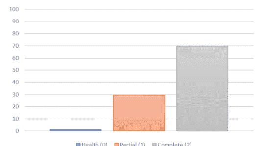
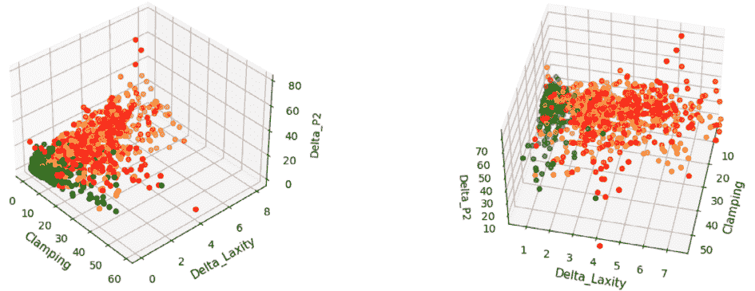

# 基于机器学习的ACL损伤诊断支持中GNRB®膝关节动力仪结果的新解读

## 摘要

目的：GNRB是一种关节动态仪，也是一种替代诊断方法，其成本低于MRI，在前十字韧带（ACL）撕裂检测中的准确性高于KT-1000。膝关节动态松弛度测试分析更为复杂，需要一种通用的解释新方案。假设是，使用基于人工智能（AI）的解决方案将使我们能够获得比目前三种松弛度阈值方案更准确、更稳健的非侵入性诊断方法。

方法：AI可以通过利用先进算法并纳入广泛的额外参数来增强该分析的可靠性，从而实现更精确的诊断。现有流程仅依赖设备获得的松弛度差值，忽略了夹持力等有影响因素。通过考虑更广泛的参数集并采用经过良好校准的模型，在不同机器学习（ML）模型和集成学习之间进行了比较研究，以获得最佳折中方案。校正过程将利用当前解决方案的统计分析。

结果：投票法、堆叠法与阈值松弛度方法的关联结果显示，与使用1384次GNRB®测量的当前方案相比，准确率提高了6%，撕裂检测率提高了约13%。预测诊断对模型未知患者的新数据也更具鲁棒性，并通过验证数据库得到证实。

结论：首次将机器学习模型引入使用GNRB设备的ACL撕裂检测中。GNRB与机器学习的结合令人鼓舞，其效果优于目前的静态诊断方法。它可以作为MRI的补充方案进行集成和推荐。

## 1. 引言

前十字韧带（ACL）断裂是一种常见的膝关节损伤，涉及变向和转体等复杂动作。该病理的诊断是一个公共卫生问题，因为患者平均需要咨询三位医生才能获得结果（Micheo et al., 2010）。目前，ACL撕裂诊断的可靠性取决于进行临床检查的医疗专业人员的经验，其中包括Lachman测试（Branch et al., 2010; Torg et al., 1976）。然而，在许多情况下，可能需要MRI等进一步检查来确诊。MRI是诊断ACL撕裂最常用的非侵入性检查，尽管部分断裂、扫描技术或膝痛会影响其准确性（Chang et al., 2013; Crawford et al., 2007; Ebrahimpour et al., 2014; Phelan et al., 2016）。因此，开发了成本更低、更易于操作且无辐射暴露的解决方案。此外，

MRI无法直接评估膝关节松弛度，主要用于评估相关撕裂。

1980年代，美国人引入了具有动态松弛度的KT1000（Balasch et al., 1999）。它测量胫骨相对于股骨的相对前向抽屉运动，利用关节动态仪提供胫骨平移的客观测量。由Roland Jacob开发的Rolimeter（Schuster et al., 2004）以及通过Telos（Pässler & März, 1986）进行的应力X线摄影已被引入作为补充诊断方法。然而，许多因素都可能影响结果质量，例如检查者经验、夹持力、定位或腿部旋转。因此，大量文献报告称这些设备存在固有的不准确性和可重复性差，导致结果主观且不可靠（Bouguennec et al., 2015; Collette et al., 2012; Jenny et al., 2017; Lefevre et al., 2014）。因此，开发了一种新的关节动态仪，即GNRB®。

| | GNRB® | | | | MRI | | | |
|---|---|---|---|---|---|---|---|---|
| | 完全 | | 部分 | | 完全 | | 部分 | |
| | Sn | Sp | Sn | Sp | Sn | Sp | Sn | Sp |
| Robert et al. (2009) | 70% | 99% | 80% | 87% | | | | |
| Klouche et al. (2015) | 92% | 96% | 92% | 98% | | | | |
| Di Iorio et al. (2014) | | | 72% | | 84% | 92% | | |
| Beauraain (2020) | 73% | | 62% | | 76% | | 30% | |
| Lefevre N | 84% | 81% | 87% | 87% | | | | |
| Beldame J | 62% | 75% | | | | | | |
| Phelan et al. (2016) | | | | | 87% | 93% | | |
| Bohu et al. (2012) | | | | | | | 32% | |

GNRB®设备（Genourob，法国拉瓦尔）代表了开创性的自动化动态松弛度测量（ADL）系统。它是最有效的非侵入性方法之一，其准确性和可重复性优于其他设备。Saravia et al. (2020)。然而，诊断仅基于制造商（Genourob，法国拉瓦尔）建议的三个阈值下，健康膝与病理膝在134 N处测得的松弛度绝对差值：0至1.5 mm（健康）；1.5至3.0 mm（部分撕裂）；超过3 mm（完全撕裂）。

这种静态方法并非通用，并解释了不同研究中获得的灵敏度和特异度存在较大差异，差异可超过20%（Beauraain, 2020）。其他人对这些阈值的相关性表示质疑，并要求重新评估（Mouarbes et al., 2018）。

假设是，仅依赖在134 N处测得的松弛度差值可能不足以在全球患者中获得可靠结果，考虑到推荐的阈值。因此，本研究提出了一种新方法，该方法使用机器学习（ML）模型纳入更广泛的参数范围，如年龄、性别、身高、体重、紧固度、顺应性及其他相关数据，以提高诊断准确性。因此可能出现以下问题：GNRB®进行的一组测量和患者数据是否能让我们使用机器学习获得更准确、更通用的解决方案？本研究汇集了来自健康和受伤患者的1384次GNRB®测量的最大数据库，以解决这一科学难题。

首先，将讨论GNRB®的局限性，以说明所提解决方案对医学领域的贡献。为此，将提出基于机器学习的补充方法，每种方法都有改进，以达到灵敏度和特异度的最佳比率。最后，将通过使用布雷斯特医院（法国）收集的新数据库进行交叉验证来确认最佳解决方案，以证实或反驳假设。

据我们所知，ACL撕裂检测的智能决策算法将是文献中的首次。然后，它可能允许获得比现有解决方案更可靠的补充诊断，这要归功于对大量数据和参数的考虑。探索AI的决定基于其“掌握一般医学原则并将其应用于新患者”的显著能力（Obermeyer & Emanuel, 2016）。

## 2. 材料与方法

使用非侵入性方法进行准确的临床检测对于确定最有效的治疗方法至关重要。因此，本文主要关注GNRB®，旨在提高其诊断准确性。尽管如此，由于其高可靠性，关节镜检查在众多研究中被视为“金标准”，因为它允许外科医生直接观察ACL的状况（Crawford et al., 2007）。手术报告将在整个研究中作为比较的基础，并为ML模型提供目标。

### 2.1. GNRB®及其结果的局限性

GNRB®基于Lachman测试（Torg et al., 1976），但以自动化方式进行，以保证高可重复性和最佳的20°膝关节屈曲（Collette et al., 2012）。虽然这解释了高可重复性和准确性，但GNRB®诊断的普遍性仍可受到质疑。表1显示结果存在显著异质性，可由以下原因解释：

- 表面上缺乏透明度，尤其是夹持力影响松弛度测量（Alqahtani et al., 2018; Bouguennec et al., 2015）。GNRB®文档建议两次测量之间的最大差异为20 N；
- 在134 N处测得的松弛度差值并非通用，并且使用其自身阈值。研究建议重新评估，尤其是1.5 mm阈值（Mouarbes et al., 2018）；
- GNRB®允许在67 N至200 N范围内进行多次测量（Robert et al., 2009），但并非所有数据都被利用。还可以考虑其他因素，包括患者性别，但此前未有报道；

由于结果更加一致和准确（表1），MRI至今仍是最佳方法。另一方面，动态松弛度测量可以带来经济和社会效益，同时避免辐射，需要得到改进，以便像MRI一样被推荐（Gustafsson et al., 2020）。

### 2.2. 数据库设计

第一步是获得平衡且现实的数据库，因为之后提出的所有模型都将取决于所做的选择。

#### 2.2.1. GNRB®数据选择

一个包含30,000次测量的GNRB®数据库，这些测量对象为1840名患者，时间跨度为2008年至2019年，损伤后2 ± 7个月，平均年龄为30 ± 12岁。MRI扫描也已在多个中心使用标准膝关节协议（Siemens或Philips 1.5 T MRI扫描仪）进行：矢状脂肪抑制（FS）T2加权、矢状质子密度（PD）加权、轴位FS PD加权、冠状T2和PD加权图像。该系列中未进行矢状或冠状斜位平面。

这使我们能够准备一批5000名健康患者和869名经关节镜确认ACL断裂的患者。每个患者包含在同一患者的一条健康膝和受伤膝（或两条健康膝）上，以不同力值（67 N至250 N之间）进行的一组独特测量。这些测量必须在同一天、相似条件下进行（夹持力小于20 N）。这一选择解释了为什么可用数据的数量被自愿减少。

训练和测试基础包含85%的患者，而理想情况下为33%，因为存在三个类别。一个具有优势的模型

训练集中某一组群的数据倾向于预测多数类，因此必须进行纠正。对健康患者进行任意选择后，样本减少至 515 例（36%），其中 492 例为完全撕裂（36%），377 例为部分撕裂（28%）。部分 ACL 断裂所占比例不到 30%，因为其手术率低于完全断裂。

#### 2.2.2. 输入参数选择

机器学习算法要求输入参数经过精心挑选，并且在所有样本中均存在。参数使模型能够建立训练数据与作为参考的关节镜诊断之间的关联。当力大于 150 N 时，只有少数患者有松弛度测量数据。为保持 1384 个样本，我们可以仅保留在 67 N、89 N 和 134 N 下进行的 GNRB® 测试。同样的问题也在 Klouche 的研究（Klouche et al., 2015）中被观察到，即当施加的力过大时，在具体病例中难以重现。使用松弛度测量值计算的斜率系数 P2 被保留。这与 Bercovy（Bercovy & Weber, 1995）的描述一致，即单靠松弛度不足以描述 ACL 的生物力学行为。夹紧力被接受为关键参数（Algahtani et al., 2018; Bouguennec et al., 2015），并可像患者的性别或年龄一样作为新的输入参数。Pearson 系数证实，夹紧力对测量质量有影响，得分分别高于 0.40（单膝）和 0.22（松弛度差值）。性别得分相似，而年龄（得分 < 0.10）则因此被忽略为输入参数。这些结果与最近的一项研究（Klasan et al., 2020）一致，该研究显示男性研究者测得的 mm 松弛度读数显著高于女性。输入参数包括三种平移力（67 N、89 N 和 134 N）下的松弛度测量值、P2 系数、夹紧力和性别。

#### 2.2.3. 相对于 GNRB 建议的面板验证

创建完整数据库后，检查数据一致性似乎很重要。GNRB® 文档建议仅在夹紧力差小于 20 N 时保留测量值。保留 5% 的不合格数据，通过强加更强的泛化能力来为模型增加偏差（图 2）。图 2 显示，基于三个阈值分析，数据具有一致性，特异度高于 95%。然而，部分和完全撕裂的若干样本的松弛度差小于 1.5 mm，印证了之前的技术现状。使用该数据集观察到的准确率为 70%，采用三个阈值诊断方法，因此具有一致性。当前解决方案对测量的随机选择似乎不够鲁棒，尽管其是可接受的。

### 2.3. 使用机器学习进行数据挖掘

第二阶段是建立机器学习算法，以最大限度地提高健康膝盖与 ACL 撕裂之间的区分度。

#### 2.3.1. 最常用技术

没有哪种机器学习算法比其他算法更好。选择取决于问题、输入变量数量（6）、样本数（1384）以及具体问题。我们的问题是预测三个类别中的诊断：健康（0）、部分撕裂（1）或完全撕裂（2）。像用于文本预测的朴素贝叶斯等算法不适用。回归、聚类和神经网络技术（Mahesh, 2020; Zhou, 2021）已在该数据库上实现。前两种方法不适用于此问题，因为数据之间不存在线性关系且量级不同。对于神经网络，可解释性较复杂，且数据量有限使得难以确保结果可靠且稳健。增加各种数据的量可能解决这个问题，但由于人工数据的风险（Hairy, 2021），我们决定不进行研究。因此，所有这些技术都被舍弃了。

支持向量机（SVM）（Zhou, 2021）技术将分类问题归约为超平面。训练了多种模型（例如，SVC — 支持向量机 或 BGD — 批量梯度下降），但由于其灵敏度高，仅保留了 SGD。使用 SVC 算法的结果似乎很有前景，因为分界可能是围绕 1.5 mm 且平行于 x 轴的直线。选择 SGD 是因为其性能更好（速度和准确率）以及能够实时适应新数据。这是首个使用 AI 诊断 ACL 撕裂的研究，且新数据可以定期添加，这是一个显著优势。3D 表示（图 2）显示每个患者至少有四个具有相同结果的邻居。k 近邻算法基于这一原理，根据参考集的相似性进行预测。kNN 除了实现简单且高度适应复杂数据外，对噪声数据也具有鲁棒性。它应该准确，特别是考虑到患者以 4-5 人一组具有相同诊断的情况。最终，其目标是通过将测量值与其他具有相似结果的患者的测量值进行比较来诊断，从而接近人类分析。因此，由于其优点和对问题的适应性，此模型应始终作为参考包含在内。

决策树基于与 GNRB® 分析相同的原理，具有更高的条件，可能值得利用。决策树因要求较浅的深度以避免过拟合而被排除。因此，诊断主要基于松弛度差异，导致结果较差。单棵树无法捕捉所有参数之间的关系。它会排除被认为不如松弛度等变量重要的变量。一种替代方法是使用随机森林而不是单棵树，这提供了一个包含所有变量的强健解决方案。

#### 2.3.2. 集成学习

集成学习技术基于这样一个假设：结合预测不同的方法将产生一个更准确的新解决方案（Learnia, 2022; Zhou, 2021）。然而，必须满足三个条件：

- 1. 任何模型的准确率均不应低于 50；
- 2. 各模型的预测必须足够不同；
- 3. 需要大量数据；

Bagging（Learnia, 2022; Zhou, 2021）包括在训练集的不同部分上训练算法，以获得尽可能多样化的预测。在所有标签中，出现最多的标签将对应预测的诊断。最流行的算法之一是 RandomForest（RF），即使在测量值有时非常接近的情况下，也应能有效检测 ACL 断裂。它结合多个决策树的预测，有助于减少单个决策树固有的偏差和方差。这使得对数据的稳健解释成为可能，即使在关系非线性且变量之间交互作用微妙的情况下也是如此。因此，此模型解决了之前决策树相关的问题，是一个绝佳的选择。

由于灵敏度—特异度权衡不佳，GradBoost 和 AdaBoost 等 Boosting 算法（Learnia, 2022; Zhou, 2021）被排除。其排除的主要标准是对异常值高度敏感以及过拟合的风险。数据库包含的测量值取决于夹紧力和患者（患者可能有关节过度活动症），具有异质性。尽管这些缺陷可以缓解，但早期实现被加强，因为诊断准确率下降是显而易见的。

由于具有诸多优势，Voting 和 Stacking 机器学习算法经过了更深入的研究。第一个优势是，结合多个个体模型应该产生一个更准确、更稳健且泛化能力更强的最终模型。第二个优势是能够建模单个模型无法实现的更复杂现象。在前一节提到的最准确模型中，必须做出明智的选择：

表 2
基于三种诊断（健康、部分撕裂、完全撕裂），对多种监督学习算法和阈值方法使用准确率、灵敏度和特异度进行比较。加入撕裂类型精确度突显了最准确的撕裂类型分类方法。采用交叉验证和 1384 次 GNRB 测量进行。

| | 阈值 | Knn | SGD | RForest | 投票 | 堆叠 | 新方法 |
|---|---|---|---|---|---|---|---|
| 准确率（所有诊断） | 69.49% | 69.56% | 67.80% | 68.62% | 69.72% | 69.35% | 75.64% |
| 灵敏度（所有诊断） | 80.71% | 91.50% | 84.26% | 92.70% | 91.80% | 92.77% | 93.32% |
| 特异度（所有诊断） | 97.30% | 91.55% | 96.28% | 89.18% | 91.52% | 90.01% | 94.50% |
| 部分 ACL 的精确率 | 40.95% | 38.62% | 15.48% | 38.63% | 37.89% | 36.32% | 56.02% |
| 完全 ACL 的精确率 | 62.40% | 70.24% | 77.97% | 60.92% | 71.58% | 73.00% | 70.67% |
| NPV | 74.79% | 86.39% | / | / | 86.81% | / | 89.06% |
| PPV | 98.07% | 94.84% | / | / | 94.84% | / | 96.72% |
| 部分 PPV | 56.30% | 52.16% | / | / | 52.39% | / | 62.82% |
| 完全 PPV | 69.66% | 61.88% | / | / | 61.77% | / | 69.05% |

- 投票法（Learnia, 2022; Zhou, 2021）使用在相同数据上训练的不同算法。难点在于它们的选择以及对其预测进行加权以作出最终决策。该技术的主要优势在于识别对最终预测有贡献的模式。多种配置表明，保留 KNN 模型（权重 = 2）是必不可少的。选择只关联 Forest 模型（权重 = 1）以强调病变检测（特异度）。未添加其他模型，如 SGD，因为它未提高准确率。最佳配置结合 2KNN + 1RForest，以实现健康患者和受影响患者之间的最佳区分。

- 堆叠法（Learnia, 2022; Zhou, 2021）用名为“MetaClassifier”的模型（例如 LogisticRegression）取代投票技术的多数标签选择。它将充当法官的角色，决定哪个预测最有可能有效。这次，将第三个模型添加到投票期间选定的模型中（Knn & RForest）。目的是添加显著不同的预测，以迫使元分类器泛化。选择 SGD 以最大化完全断裂的检测。将 ACL 归类为健康的低精确度应因 Knn & RForest 的高精确度而增强灵敏度。这是一种妥协，因为预计灵敏度会降低。因此，SGD、KNN 和 RandomForest 的配置可能不是最佳的。但是，这是在涉及多个模型的连续评估后获得的最佳配置。

### 2.4. 新诊断流程

该研究本可以在评估最后两个模型（投票法和堆叠法）后停止，因为这在缺乏诊断 ACL 断裂的研究方面已经代表了一项创新。假设可以找到对数据和机器学习模型的新诠释，以实现更准确的诊断。本节旨在通过结合当前的静态方法和 AI 模型（例如）来进行创新。假设是，使用最准确的模型（投票法），并辅以精确的断裂检测模型（堆叠法）和另一个用于健康患者的模型（三个阈值）来加强其决策，这将是相关的（表 2）。此外，还可以对数据进行新的诠释。

#### 2.4.1. 输入参数和诠释

第一项修改是基于 Klouche 的假设，将松弛度测量的影响增加到 134 N，该假设认为更高的平移力将导致更高的准确率。实验表明，没有收益但准确率下降。未观察到收益的事实仍然合理，因为它允许更大的测量多样性，并通过对数据的动态分析来泛化模型。

第二个假设是，健康患者的测量值接近零，而 ACL 撕裂为负值。改变松弛度的诠释可能提高准确率并改善健康患者与受损患者之间的区分。

图 1. 统计分析结果表明，基于所提 3 mm 阈值的诊断正确的概率。该阈值由 GNRB 设备制造商推荐。

因此，新实现的鉴别方法将使用相对差异。这是在实施新方法时的第一个关键区分因素，除了 AI 之外，应在对特异度影响有限的情况下提高灵敏度，以实现超过 90% 的速率。

#### 2.4.2. 提高灵敏度和 ACL 撕裂区分

这部分提出了一种不再涉及比较，而是关联三种诊断方法（投票法、堆叠法、阈值法）的解决方案，以利用每种方法的优势。确实，这种方法涉及通过组合多种诊断方法来创建一个元模型，类似于投票等集成学习方法。

第一项更改是基于统计分析支持或修改投票决策。该研究根据诊断分析测量值的分布，以证明基于 GNRB 设备制造商建议的阈值（图 1）诊断正确的比例。它允许在两个明确定义的情况下使用阈值来影响投票方法的预测结果：

- 超过此阈值，无撕裂的患者不到 1%。在这种情况下，完全撕裂将取代健康患者的 AI 预测；
- 超过 3 mm 时，有 30% 为部分撕裂，70% 为完全撕裂。如果结果是撕裂（部分、全部或 Δ > 3.0 mm），则会将概率表（[0; 0.30; 0.70]）添加到预测中，以加强支持完全断裂的诊断；

除了改变数值诠释这一新方法外，通过统计分析加强诊断是一个重要的补充。此修改影响了训练模型预测后诊断为真实的概率。这是改善部分断裂和完全断裂之间区分的有意选择。最后的修改涉及重用部分分析，通过将堆叠模型作为决策标准来关联（而非比较）解决方案（投票法和阈值法），目标是实现尽可能高准确率的模型。

图 2. 在 134 N 下，健康患者和撕裂患者的松弛度测量值，作为夹紧力的函数，P2 斜率系数与关节镜结果：健康（绿色）；部分撕裂（橙色）；完全撕裂（红色）。（关于本图例中对颜色引用的诠释，读者请参阅本文的网络版本。）

- 反之，如果松弛度差异小于 3 mm 和 1.5 mm，且第二个模型（堆叠法）未检测到完全断裂，则将其重新分类为部分撕裂。假设是，如果两种方法认为 ACL 健康或部分撕裂，则认为完全断裂可能是一种夸大。如果未满足条件（Δ < 1.5 mm + stack_label < 2），则使用最准确的方法（投票法）。

第二项修改涉及使用堆叠和阈值解决方案来改进投票法所做的诊断。堆叠集成学习方法已被证明是检测和将断裂分类为完全断裂的最准确技术（表 2）。因此，其与制造商定义的阈值相结合应在两种情况下提高断裂的灵敏度和资格：

- 如果松弛度差异超过 3 mm，则断言为完全断裂，忽略投票法的结果；
- 如果松弛度差异大于 1.5 mm 且 Stack 模型承认存在断裂，则纠正健康患者的诊断。诊断将为部分撕裂，因为投票法将患者定义为健康。
- 此外，在投票模型检测到病变的情况下，也可以提高部分病变的比率。如果松弛度差异小于 1.5 mm 且堆叠模型预测最多为部分断裂，则诊断为部分撕裂。否则，将保留投票模型的预测，因为它是最准确的，尤其是当松弛度差异在 1.5 mm 和 3.0 mm 之间时。

图的右侧部分旨在提高灵敏度和正确诊断的部分断裂比率：

- 第一个条件（Δ < 1.5 mm）确认了投票模型的预测，因为该诊断阈值准确地将患者识别为健康。
- 第二个条件（stack_label = 2）如果堆叠模型预测有断裂，则将初始诊断（vote_label=0）重新分类为具有部分病变。此修改应提高诊断率，因为堆叠法在检测断裂方面更精确，且 1.5 mm 阈值支持其选择。
- 最后一个条件遵循第 2.4.2 节的分析，表明当绝对松弛度差异超过 3 mm 时，ACL 撕裂应得到资格认定。为了支持支持断裂（部分或完全）的诊断，将应用决策概率表，而不强制做出决定。

#### 2.4.3. 带图示说明的新诊断流程

通过纳入前几小节的所有建议改进，可以实现新的诊断流程。该流程结合统计分析以加强所选集成机器学习模型的决策：投票法（2Knn + RForest）和堆叠法（Knn + SGD + RForest）。目标是提供灵敏度和特异度之间的更好权衡，同时改善将断裂定为部分或完全的资格。图 3 表示作为流程图建议的新诊断。

### 2.5. 统计分析

首先，左侧部分旨在改善定义为部分或完全断裂的资格。一旦 ACL 撕裂由投票法诊断，第一个条件（Δ < 3.0 mm）旨在与第 2.4.2 节进行的分析保持一致：

- 当超过 3 mm 且满足第二个条件（stack_label=2）时，无论第一个模型（投票法）预测的标签如何，都可以将断裂分类为完全断裂。否则，概率表将添加到投票决策提供的概率表中。目的是加强患者有完全断裂的观点，而不强行这样做。

同时，Matplotlib 可视化库为在同一数据集部分（训练和测试）上评估的五种不同方法绘制 ROC 曲线。它提供了机器学习模型性能的总体度量，并便于比较不同的方法。

所有超参数均自动选择，以在模型训练期间实现准确率和损失之间的最佳权衡。选择已手动检查以确保一致性，例如最佳邻居数 K 为 6，与图 2 的诠释一致。

## 3. 结果

所有方法使用相同的参数（性别、松弛度相对差值（67 N、89 N、134 N）和 P2 系数），通过逐次交叉验证比较相同的数据。其目的是确保预测诊断不会武断或过度针对训练数据。他们使用松弛度测量的相对差值，因为它使准确率提高了 4%，并使两种 ACL 撕裂类型的区分度提高了 2%。

### 3.1. AI 方法比较

决策树的准确率比 SGD 低约 5%，因此被排除。SGD 是第二好的方法，其灵敏度接近 90%（不包括集成学习算法）（表 2）。通过标准归一化以最大化准确率，KNN 算法实现了超过 85% 的检出率（特异度）和 90% 以上的灵敏度。

根据表 2 中呈现的实验结果，推荐用于诊断的 GNRB® 解决方案的准确率相当于另外三种方法的 70%。然而，人工智能算法优于三阈值解决方案，实现了 81% 的诊断断裂率和 69.50% 的准确率。尽管随机森林算法的表现不如 KNN，但它可以提高特异度。这解释了为什么结合多种算法的 Vote 方法可以正确区分健康的 ACL 和断裂的 ACL，其比率高于 91%（灵敏度 + 特异度），并且在该阶段似乎是最高效的解决方案。

ROC 曲线表明（图 4），使用三个阈值的解决方案明显不如 AI 解决方案有效，因为它始终低于其他模型。投票模型的曲线始终优于其他模型，表明该模型在所有决策阈值下都具有更好的分类性能。然而，表 2 显示，堆叠模型的面积为 0.87，而完全损伤的面积为 0.84，证实了其在判定此类断裂方面的有用性。独立的 KNN 模型表现不如投票模型和堆叠模型，这进一步加强了选择模型组合以实现更高精度的决定。

### 3.2. 拟议新基于 AI 的方法的评估

图 4. 机器学习模型（KNN、投票、堆叠）与使用三个松弛度阈值的参考方法的比较评估，通过分析曲线下面积（AUC）来评估新模型的改进情况。

新机器学习模型的结果至少略逊或略优于阈值方法，在特异度、PPV 和 PPV_Complete 上无显著差异（p > 0.244）。对于准确率、灵敏度、精确度（部分或完全）、NPV 和 PPV_Partial 等其他结果，它们更好且具有显著差异（p < 0.001）。这解释了将撕裂定性为部分撕裂的显著收益大于 56%（表 2），且全断裂的比率没有下降。表 2 还证实，对于阳性预测值和阴性预测值（PPV 和 NPV），我们的方法是最高效的，且误差率最优。最后，在健康 ACL 和撕裂 ACL 之间获得了最高的区分度和准确率，比率高于 93%，证明了验证第 2.4 部分所有决定和假设的选择是正确的。

将新机器学习方法与其他单个机器学习模型进行比较，结果也至少相当，灵敏度上无显著差异（p > 0.189），但 SGD 结果更好（p < 0.001）；特异度、完全 ACL 的精确度（除 SGD 结果更差外，p < 0.001）和随机森林结果更好（p < 0.001）、NPV 和 PPV 也是如此。与其他机器学习模型相比，准确率、部分 ACL 的精确度、PPV_Partial 和 PPV_Complete 的结果显著更好（p < 0.001）。

比较曲线下面积（图 4）时，拟议方案始终优于其他方案，尽管与第二准确的方法——投票模型相比，差异仍然很小。新模型是唯一实现完整断裂检测面积为 0.90 和近乎 1.0 的部分病变检测面积的模型（图 4）。这些结果展示了其准确分类所有三种可能诊断（健康、部分撕裂或完全撕裂）的能力。与传统机器学习解决方案相比，收益约为 0.05，而与使用三个阈值的松弛度差值静态分析相比，收益近三倍高（图 4）。

MRI 被推荐用于确定前交叉韧带撕裂，无论是部分还是完全。然而，只有 169 名患者同时拥有 MRI 结果和有效的 GNRB 测试。每个测量值都从训练集中移除，以将其诊断与 MRI 诊断进行比较。参考标准仍然是关节镜检查结果。比较表明，拟议方案检测断裂的能力优于 MRI（灵敏度），提高了 1% 以上（表 3）。差异不显著，因为部分 MRI 结果来自 2010 年代。此外，如果断裂为全断裂，MRI 能提供更好的诊断。另一方面，GNRB® 结合机器学习在区分部分撕裂和完全撕裂方面仍然更有效（表 3）。显著收益证明，该设备在 MRI 前、后或不进行 MRI 时都值得使用，因为它成本更低且实现更简单。只有勉强达到 70% 检出率的阈值方法较差，不应推荐。

### 3.3. 鲁棒性验证

布列斯特医院可以使用 88 份前患者的 GNRB® 测量值（遵循设备使用建议）来评估拟议模型。这是首项利用来自不同来源的第二个数据集来验证其解决方案质量和鲁棒性的研究。本研究中使用的医师和设备与训练数据集（包含 1384 个测量值）完全独立。

阈值方法的检出率为 87.80%，而我们的解决方案为 92.68%。与表 2 结果相比，灵敏度差异为 3%，而与三个阈值相比则超过 20%（表 1）。结果表明，拟议的基于 AI 的解决方案在面对新数据时表现出鲁棒性和高质量。最后，MRI 结果表明，在这项最终研究的 88 名患者中，有 2 名患者的断裂未被确诊。我们的解决方案也得出了同样的观察结果，但涉及两名不同的患者，这使我们得出结论：两种解决方案在 ACL 撕裂检测方面至少是等效的。

表 3
169 名同时拥有与手术报告关联的 GNRB 和 MRI 结果的患者检测和确定撕裂类型所获得的结果。特异度不存在，因为该数据库中未包含任何患者。纳入撕裂类型的准确率，突出了 MRI、三种单独阈值或基于集成学习的拟议解决方案中分类撕裂类型最准确的方法。

| | 阈值 | 新方法 | MRI |
|---|---|---|---|
| 准确率（所有诊断） | 37.56% | 62.64% | 54.91% |
| 灵敏度（所有诊断） | 68.84% | 93.21% | 92.92% |
| 特异度（所有诊断） | / | / | / |
| 部分 ACL 的精确度 | 39.79% | 50.27% | 28.38% |
| 完全 ACL 的精确度 | 35.87% | 71.83% | 74.95% |

## 4. 讨论

本研究最重要的发现是，尽管有以往研究结果，但不建议使用三个阈值。确实，我们的诊断建议优于 Beaurin F 和 Beldae J（Beaurain, 2020）。缺乏有利于诊断的数据预选以及数据的显著增加，根据表 2，证明了这种方法的局限性。该研究证实了以往的观察，特别是关于 1.5 mm 阈值，需要重新评估（Klouche et al., 2015; Mouarbes et al., 2018）。机器学习应用与松弛度测量统计相结合，可以实现更精确的方法（+5%）。所创建方法的主要优势是灵敏度和特异度比约为 94%，部分 ACL 撕裂的检出率超过 55%（表 2）。PPV（阳性预测值）和 NPV（阴性预测值）表明，仅依赖松弛度不足以确保患者的可靠诊断。

考虑性别、握力或不同牵引力下的松弛度等额外参数，证明了 GNRB® 比 MRI 提供更准确的解决方案（表 3）。一个解释是部分和完全 ACL 撕裂的区分度更好（+10%），断裂检测得到改善（+0.3%）。结果支持 2011 年（Van Dyck et al., 2011）的一项研究的发现，该研究表明，经验丰富的放射科医生执行的标准协议 1.5-T MRI 可能不足以可靠地诊断前交叉韧带断裂。相反，与更近期的研究比较表明，结果与 MRI 诊断相似（Zhao et al., 2020）。我们拟议方案的准确率为 92%，而 MRI 为 95%，后者更受青睐。ACL 撕裂（部分和全）的检测显示 MRI 为 95%，GNRB 为 93%（表 2）。区分两种断裂类型的结果远高于文献中报道的结果（表 1）。这种差异可以归因于更新的数据和可用数据点数量较少，其中只有 66 例病例有 MRI，而本研究中有 256 例（169/1384 + 88 来自布列斯特）。该研究（Zhao et al., 2020）不得不因为严格的选择标准（如膝部病理病史）而排除患者。此外，有些人无法进行 MRI，例如孕妇或有妨碍 MRI 的医疗设备的人。这进一步支持提供一种同样准确、更具成本效益且避免辐射暴露的替代诊断方案的价值。

该研究并不暗示 GNRB® 优于 MRI，因为 MRI 在临床实践中至关重要且无法替代。此外，使用 MRI 报告中的结论存在解释性，可能因放射科医生的经验水平等因素而异，这可能解释了观察到的结果差异。

最具争议的一点是本研究与现有研究之间的结果差异。在我们的情况中，多个数据集（测试集、MRI 集、验证集）的灵敏度和特异度最多变化 3%，与已发表研究中的 20% 相比较低（表 1）。数据选择过程不清楚或未说明，这可能解释了准确率的差异。此外，它仅依赖松弛度来建立诊断，牵引力在 134N 到 250N 之间变化（Jenny et al., 2013; Klouche et al., 2015; Mouarbes et al., 2018）。超过 134 N 的测量对大多数患者来说证明是不可能的，使得难以以普遍化的方式解释这些测量。松弛度是一个根据 GNRB® 配置可能大幅变化的参数（Bouguennec et al., 2015）。因此，只能基于我们的数据来证明所提议解决方案的有用性。

然而，应注意，所有结果都在 1384 个不同测量值上通过交叉验证进行了验证，并在 88 名新患者中得到了确认。由于 GNRB® 测量值的可用性有限，没有其他研究进行过如此深入的分析和比较。例如，49 名患者（Di Iorio et al., 2014）与 118 名患者（Klouche et al., 2015）之间的比较研究将因巨大的数据差距而无法得出结论。

基于该设备及相关分析的新诊断方法，从而证明了该解决方案在检测和表征 ACL 撕裂方面的鲁棒性和相关性。唯一可能值得讨论的决定是保留拧紧差值超过 40 N 的值，这比接受两个松弛度测量为有效的限值高出一倍（Théo Cojean et al., 2023）。其意图是避免在决策过程中出现占主导地位的参数，但排除它们可能会产生更好的结果。因此，所有研究在受监管的研究框架内共享数据以建立标准化测试基将是有益的。新数据库可以带来更一致的解决方案比较，并能够基于多样化且全面的数据集开发更有效的诊断方法。

两种具有明显优势的机器学习模型的关联是值得商榷的，尤其是因为三个阈值尚未重新评估。单一模型本可以足以展示 AI 在诊断中的贡献。然而，这种方法允许创建一个新模型，该模型似乎是利用 GNRB 等动态松弛度测量设备测量的最佳解决方案，收益约为 10%。尽管如此，通过动态确定三个松弛度阈值来修改用于加强诊断决策的阈值，仍有显著改进的可能性。

可能需要审查超参数的选择，这些超参数在训练和测试期间被自动选择以最大化精度与损失比。尽管这种选择允许快速添加新数据并评估新集，但手动或更统计的方法可能会提高诊断质量。探索 Scikit-Learn 建议的所有超参数的影响，而不仅仅是最重要的超参数（例如 KNN 的邻居数量），是进一步改进的一个领域。

训练数据集中，记录的 1384 条数据中不到 30% 的患者有断裂，这可能解释了为什么该模型对这种损伤的准确率约为 62%。因此，有必要获取更多由关节镜检查确诊的这种断裂患者的松弛度测量值。增加数据应该会产生更准确、更强大的模型，以便进行更全面的评估。其他试验的测量值未公布，这是一个局限，因为合作可能有助于改进此解决方案并找到新的解决方案。未来，我们需要找到一种方法，让每个研究都遵循伦理委员会的规则共享其数据。

一种替代方案是应用过采样来增加样本量，这可能提高准确率。由于担心在数据库中产生偏差且缺乏技术知识，目前排除了人工平衡数据选择。另一个可能的改进是动态确定三个松弛度阈值并修改用作诊断辅助的阈值。

最后，所有研究都缺乏可以进一步探索的“人性”维度，例如医生对膝关节不稳定的看法。添加其他由医生使用 Jerk、Lachman 或 MRI 结果评估的方法也可能提高准确率。存在各种诊断方法，但它们总是被比较而从未结合。

## 5. 结论

结论：本研究表明，仅包括基于松弛度差异测量的阈值参数，执行了

在134 N时可能不足并影响诊断准确性。所提方案通过在决策中使用鲁棒且准确的机器学习模型，抵消了这种偏差，并显著提高了健康前交叉韧带（ACL）与撕裂前交叉韧带之间的鉴别度，纳入了包括夹持力、性别、不同受力下松弛度结果在内的更多参数。通过对跨越多年的大型数据集进行全面分析，与静态松弛度解读相比，开发出了一种更鲁棒且更准确的方法（+6%）。选择不直接与现有方案或模型对抗，而是提出大胆的组合，从而获得最鲁棒且最准确的诊断方案。由于成本降低且精度高，这种动态松弛度设备应在与我们的新诊断流程配合使用时，作为MRI的替代方案予以推荐。结果表明，该方案与这一诊断标准相当，且因无辐射而在任何地方都可行。然而，不建议仅基于阳性的GNRB®或MRI检查结果且不考虑患者症状就进行手术，因为有可能带着ACL撕裂生活。因此，我们建议使用机器学习进行诊断，结合医生的专业知识和同理心——这是目前任何算法都无法复制的。

## 代码可用性

源代码严格私有并获得许可。

## 资助

本研究未获得资助。

## 伦理批准

符合伦理标准。

## CRediT 作者贡献声明

Jean Mouchotte：开发、设计、撰写文章。Matthieu LeBerré：编辑支持、知识交流。Théo Cojean：编辑支持。Henri Robert：与伦理委员会合作的数据库。

## 竞争利益声明

作者声明，他们没有已知的可能影响本文所报道工作的竞争性财务利益或个人关系。

## 数据可用性

作者无权共享数据。

## 致谢

感谢文章的所有评审者以及 ESIEA 和 Genourob 的支持。

## 参考文献

- Algahtani, Y., Murgier, J., Beaufils, P., Boisenoulut, P., Steltzen, C., & Pujol, N. (2018). 使用GNRB®设备评估健康膝关节的胫骨前向松弛度. Knee（膝关节）, 25(1), 34–39.
- Balasch, H., Schiller, M., Friebe, H., & Hoffmann, F. (1999). 使用罗利米评估前膝关节不稳定性：与手动评估及KT-1000关节仪测量的对比测试. 膝关节手术、运动创伤与关节镜, 7(4), 204–208.
- Beaurain, F. (2020). 前交叉韧带（ACL）撕裂：GNRB®（医疗器械）与MRI的对比，含关节镜验证. 医学与健康科学国际研究期刊, 21.
- Bercovy, M., & Weber, E. (1995). 正常与病理性膝关节松弛度、刚度和顺应性评估：韧带成形术存活曲线的应用. 运动器官矫正与修复外科评论, 81(2), 114–127.
- Bohu, Y., Steltzen, C., Lefevre, N., & Herman, S. (2012). 55例连续部分前交叉韧带成形术系列的临床评估：TLS®技术（短腘绳肌移植）. 骨科与创伤外科, 98(7), 5373.
- Bouguennec, N., Odri, G., Gravelieu, N., & Colombet, P. (2015). TELOS™与GNRB®在测量正常膝关节胫骨前移方面的可比重复性. 骨科与创伤外科：手术与研究, 101(3), 301–305.
- Branch, T. P., Mayr, H. O., Browne, J. E., Campbell, J. C., Stoehr, A., & Jacobs, C. A. (2010). 前交叉韧带损伤的仪器化检查：尽量减少手动临床检查的缺陷. 关节镜, 26(7), 997–1004.
- Chang, M. J., Chang, C. B., Choi, J.-Y., Won, H. H., & Kim, T. K. (2013). MRI在诊断单束前交叉韧带损伤中的实用性如何？临床骨科及相关研究®, 471, 3283–3290.
- Collette, M., Courville, J., Forton, M., & Gagnier, B. (2012). 前膝关节松弛度的客观评估：KT-1000与GNRB®关节仪的对比. 膝关节手术、运动创伤与关节镜, 20(11), 2232–2238.
- Crawford, R., Walley, G., Bridgman, S., & Maffulli, N. (2007). 膝部病变的磁共振成像与关节镜检查：以半月板病变和前交叉韧带撕裂为重点的系统综述. 英国医学通报, 84(1), 5–23.
- Di Iorio, A., Carnescchi, O., Philippot, R., & Farizon, F. (2014). 前交叉韧带断裂的多模态分析：49例前瞻性研究. 骨科与创伤外科评论, 100(7), 537–540.
- Ebrahimpour, H., Mirifezi, S. Z., Najar, A. V., Kachoee, A. R., Ariamanesh, A. S., Ganjali, R., Esmaeili, H., Salari, H., & Vejdani, M. (2014). 使用RAND适宜性方法（RAM）开发膝关节MRI的适宜性标准. 骨与关节外科档案, 2(1), 47.
- Gustafsson, T., Östenberg, A. H., & Alricsson, M. (2020). ACL诊断——罗利米与MRI的相关性. 运动骨科与创伤外科, 36(3), 278–283.
- Hairy, P. (2021). 神经网络与数据增强. MetalBlog.
- Jenny, J. Y., Arndt, J., & Surgery-France, C. A. O. (2013). 使用应力X线和GNRB®系统测量前膝关节松弛度，与术中导航的对比. 骨科与创伤外科：手术与研究, 99(6), S297–S300.
- Jenny, J. Y., Pulerio, B., Schockmel, G., Harnois, S., & Clavert, P. (2017). GNRB®测量胫骨前移的实验验证. 骨科与创伤外科：手术与研究, 103(3), 363–366.
- Klasan, A., Putnis, S. E., Kandhari, V., Oxsha, T., Fritsch, B. A., & Parker, D. A. (2020). 健康膝关节KT1000测量的胫骨前移存在显著差异. 膝关节手术、运动创伤与关节镜, 28(7), 2177–2183.
- Klouche, S., Lefevre, N., Cascua, S., Herman, S., Gerometta, A., & Bohu, Y. (2015). 完全前交叉韧带撕裂中GNRB®相对于压力负荷的诊断价值：118例受试者的前瞻性病例对照研究. 骨科与创伤外科：手术与研究, 101(3), 297–300.
- Learnia, M. (2022). 集成学习：Bagging、Boosting与堆叠（25/30）. URL https://www.youtube.com/watch?v=YpUdYtw8.
- Lefevre, N., Bohu, Y., Naouri, J., Klouche, S., & Herman, S. (2014). GNRB®关节仪与Telos™在部分前交叉韧带撕裂评估中的效度对比. 膝关节手术、运动创伤与关节镜, 22(2), 285–290.
- Maheh, B. (2020). 机器学习算法综述. JSR, 9, 381–386.
- Micheo, W., Hernández, L., & Seda, C. (2010). 前交叉韧带损伤的评估、管理与预防：当前概念. PM&R, 2(10), 935–944.
- Moursas, D., Cavaignac, E., Chiron, P., Bérard, E., & Murgier, J. (2018). 60例健康膝关节上机器人膝关节测试设备（GNRB）的可重复性评估. 骨科杂志, 15(1), 94–98.
- Obermeyer, Z., & Emanuel, E. J. (2016). 预测未来——大数据、机器学习与临床医学. 新英格兰医学杂志, 375(13), 1216.
- Pässler, H., & März, S. (1986). 放射学拉希曼测试——一种简单可靠的交叉韧带损伤检测方法. 欧洲创伤外科杂志, 12(6), 295–300.
- Phelan, N., Rowland, P., Galvin, R., & O'Byrne, J. M. (2016). MRI对可疑前交叉韧带和半月板撕裂的诊断准确性的系统综述与Meta分析. 膝关节手术、运动创伤与关节镜, 24(5), 1525–1539.
- Robert, H., Noureau, S., Gaget, S., & Gagniere, B. (2009). 一种新型膝关节仪GNRB®：在完全和部分前交叉韧带撕裂中的应用经验. 骨科与创伤外科：手术与研究, 95(3), 171–176.
- Saravia, A., Cabrera, S., Molina, R., Pacheco, L., & Muñoz, G. (2020). Genourob关节仪在评估前交叉韧带全厚度撕裂中的效度. 骨科杂志, 22, 203–206.
- Schuster, A. J., McNicholas, M. J., Wachtl, S. W., McGurty, D. W., & Jakob, R. P. (2004). 测量前后膝关节松弛度的一种新型机械测试装置. 美国运动医学杂志, 32(7), 1731–1735.
- Théo Cojean, Cécile Bataillon, Henri Robert, & Laurence Cheze (2023). 临床实践中用于完全和部分前交叉韧带撕裂检测的GNRB®松弛度计与磁共振成像：含关节镜验证的214例患者前瞻性诊断研究.
- Torg, J. S., Conrad, W., & Kalen, V. (1976). 运动员前交叉韧带不稳定性的临床诊断. 美国运动医学杂志, 4(2), 84–93.

- Van Dyck, P., Vanhoenacker, F. M., Gielen, J. L., Dosche, L., Van Gestel, J., Wouters, K., & Parizel, P. M. (2011). 膝前交叉韧带的3特斯拉磁共振成像：能否鉴别完全撕裂与部分撕裂？骨骼放射学, 40, 701–707.

- Zhao, M., Zhou, Y., Chang, J., Hu, J., Liu, H., Wang, S., Si, D., Yuan, Y., & Li, H. (2020). MRI在前交叉韧带损伤诊断中的准确性. 转化医学年鉴, 8(24).

- Zhou, Z. H. (2021). 机器学习. Springer Nature.
