# 下一代计算与信息系统：第2届国际下一代计算与信息系统会议论文集（ICNGCIS 2023），2023年12月18-19日，印度查谟和克什米尔查谟


**阿努尔·古普塔教授** 是印度查谟模尔工程技术学院院长，同时也是计算机科学与工程系教授。他在工业界和学术界拥有 25 年以上的经验。在加入 MIET 之前，他曾任惠普印度班加罗尔团队负责人。他在国际期刊/会议上发表了 85 篇研究论文。古普塔教授持有比尔拉理工学院皮兰尼校区（BITS, Pilani）的计算机科学荣誉工学学士和理学硕士学位，以及哈米尔普尔国家技术学院（NIT, Hamirpur）的博士学位。他拥有 11 项已授权专利和 34 项在印度专利局申请的专利。他是 Performance Insight 360 的发明者，这是一款面向高等教育的质量分析框架，已获得多项荣誉。他于 2012 年获得 DST-FIST 资助，是查谟-克什米尔地区私营部门中第一个获得该资助的，并从各种资助机构获得了超过 2500 万卢比的竞争性资助。他是 AICTE 职业奖、IBM 和 EMC 教师奖以及政府机构提供的 2000 万卢比资助的获得者。他还是 IEEE 和 ACM 高级会员，以及《下一代计算国际期刊》的创始人。他的研究兴趣包括云计算、P2P 网络、网络管理、人工智能和元宇宙。


本书的目录记录可从大英图书馆获取


## Taylor & Francis
Taylor & Francis Group
http://taylorandfrancis.com

## 前言

让我们能够将第 2 届下一代计算与信息系统国际会议（ICNGCIS 2023）的论文集呈现在大家面前，我们感到无比荣幸。本届会议在时隔六年后于 MIET，查谟举行。ICNGCIS 的第一届是一个里程碑，因为这是查谟首次举办以计算为重点的会议。ICNGCIS 2023 比以往更大、更好、更全面。

本次会议征集了包括人工智能、机器学习、深度学习、物联网、分布式计算、元宇宙、多媒体处理、网络、信息安全等在内的不同主题的论文。今年会议论文集由 CRC Press（Taylor and Francis）出版，并将提交至 Scopus 进行潜在检索。我们来自不同地域的投稿超过 117 篇，经过严格的评审过程，选出 38 篇论文最终收录于会议论文集，录用率为 32.4%。会议聚焦计算与信息系统的进步，我们原本希望会议规模较小，使参与者能与同行和专家进行更深入、更轻松的交流。

第一场主旨演讲由美国佛罗里达大学计算机与信息科学与工程杰出教授 Sartaj Sahni 教授发表。该环节强调了快速算法开发的重要性。随后，第二场主旨演讲由 Sitharama Iyengar 教授发表。Iyengar 教授目前是美国佛罗里达国际大学迈阿米分校杰出大学教授、发现实验室创始主任以及美国陆军资助的数字取证卓越中心主任。该环节强调了数字取证时代的到来。

第三场主旨演讲由美国阿灵顿分校德州大学计算机科学与工程系杰出教授 Chakravarthy 教授发表。Chakravarthy 教授关注多层网络开发对于建模复杂数据集的重要性。第四场主旨演讲由美国佛罗里达国际大学迈阿米分校电气与计算机工程系杰出讲座教授、太阳能研究设施及能源电力可持续性小组主任 Arif Sarwat 教授发表。该环节聚焦人工智能对高渗透率可再生能源物理基础设施的影响。

第五场主旨演讲由美国普渡大学计算机科学教授、IEEE 会士 Bharat Bhargava 教授发表。该环节聚焦对协作攻击所带来威胁的系统性理解，并制定智能且有效的防御措施。最后一场主旨演讲由查谟模型工程与技术学院院长 Ankur Gupta 教授发表。该环节聚焦构建安全可靠的元宇宙。

会议作为下一代计算与信息系统领域前沿研究与思想交流的平台。与会者有机会与演讲者分享的多元视角进行交流和学习，促进学者和专业人士之间的合作与知识传播。专家主席的积极参与进一步丰富了讨论，体现了会议推动新兴技术及其对计算与信息系统影响话语的承诺。

我们感谢作者、技术方案委员会成员和本次会议的协调员们，感谢他们为使本次会议取得成功所付出的巨大支持。我们相信，未来的会议将继续鼓励该地区的研究，并更有效地将查谟和克什米尔与该国其他地区及世界联系起来。会议的总主席深深致力于这一事业。

- 总主席
- ICNGCIS 2023
- Sartaj Sahni 教授
- Bharat Bhargava 教授
- Vijay Kumar 教授
- Ankur Gupta 教授
- Deepak Garg 教授

## 主旨演讲

## Taylor & Francis
Taylor & Francis Group
http://taylorandfrancis.com

## 快速强化学习


Sartaj Sahni

佛罗里达大学教授

### 摘要

强化学习（RL）是一种在具有挑战性且不断变化的环境中教导智能体做出决策的高效方法。随着 RL 在现实世界场景中的日益广泛应用，快速强化学习的需求也在增长，旨在提高效果、缩短训练时间，并在多个领域促进即时决策。快速强化学习可以通过多种方法实现，其中之一是并行化。这涉及将 RL 计算分散到众多处理器或 GPU 上，以利用并行处理能力，从而大幅减少训练时间。另一种方法是利用 GPU 和 TPU 等专用硬件，这些硬件能够比传统 CPU 更有效地执行并行计算，从而提高 RL 训练速度。开发和执行旨在更高效、计算复杂度更低的 RL 算法，能够加快学习速度。缓存内存通过最小化频繁使用数据的访问时间，在加速强化学习方面也至关重要。它通过存储和检索状态-动作对及 Q 值等关键信息来增强 RL 算法的性能。缓存内存的使用优化了数据访问模式，从而降低延迟并提高学习轮次的速度。快速强化学习的前景将由克服迁移学习和元学习、算法复杂性、处理复杂环境数据集的可扩展性、泛化等挑战所塑造。

### 简介

Sartaj Sahni 教授是美国佛罗里达大学计算机与信息科学与工程杰出教授。他还是欧洲科学院院士、IEEE、ACM、AAAS 及明尼苏达超级计算机研究所会士，以及印度理工学院坎普尔分校杰出校友。1997 年，他因在数据结构、算法和并行算法领域对计算机科学与工程教育的贡献而获得 IEEE 计算机学会 Taylor L. Booth 教育奖；2003 年，他因在 NP-hard 和 NP-complete 问题理论方面的贡献而获得 IEEE 计算机学会 W. Wallace McDowell 奖。Sahni 教授还获得了 2003 年 ACM Karl Karlstrom 杰出教育家奖，以表彰其在计算机教育方面的杰出贡献。2016 年，他获得了 IEEE 可扩展计算技术委员会（TCSC）可扩展计算卓越奖。Sahni 教授已发表超过 420 篇研究论文并撰写了 15 本教材。他拥有 15 项美国专利。他的研究论文和专利涉及高效算法的设计与分析、并行计算、互连网络、设计自动化和医疗算法。他曾担任 ACM Computing Surveys 主编以及 Journal of Parallel and Distributed Computing 共同主编。


泰勒与弗朗西斯集团
http://taylorandfrancis.com

## 人工智能时代的全球协作数字取证


S. Sitharama Iyengar
佛罗里达国际大学，迈阿密教授

摘要：随着人工智能（AI）不断重塑行业和社会，对其发展所涉及的伦理维度进行批判性审视变得势在必行。本次演讲深入探讨了人工智能领域内多方面的伦理考量，旨在引导开发者、研究人员和行业利益相关者迈向全球负责任的创新。讨论的第一部分探讨了关键的伦理挑战，包括算法偏见、数据隐私问题以及人工智能技术的社会影响。通过引用现实世界的例子和案例研究，本次演讲阐明了应对这些伦理难题的复杂性，并强调了采取整体性、包容性的人工智能开发方法的重要性。在第二部分，本次演讲提出了将伦理考量融入人工智能生命周期以促进全球发展的实用策略和框架。论述强调了跨学科合作、透明度和用户参与的重要性，为在人工智能社区中培养责任文化提供了可操作的见解。参会者将获得关于培养伦理意识、使人工智能倡议与社会价值观保持一致，以及为构建更具伦理健全性和可持续性的人工智能格局做出贡献的宝贵视角。

简介：Iyengar 教授目前是佛罗里达国际大学迈阿密分校的杰出大学教授、发现实验室创始主任以及美国陆军资助的数字取证卓越中心主任。他也是印度甘地纳格尔国家司法科学大学的杰任讲席教授。Iyengar 教授是欧洲科学院会员、电气和电子工程师学会（IEEE）终身会员、计算机协会（ACM）会员、美国科学促进会（AAAS）会员、设计与过程科学学会（SDPS）会员以及美国医学和生物工程学会（AIMBE）会员。他最近于2023年11月1日荣获2023年卡纳塔克邦拉乔茨瓦奖（卡纳塔克邦第二高平民奖）。除此之外，他还因其在数字取证领域的贡献获得了终身成就奖，并因其在创建 Brooks-Iyengar 算法及其对推进现代计算的影响方面的工作而获得 IEEE 赛博空间大会“经得起时间考验奖”。Iyengar 教授与历史黑人学院（HBCUs）合作，获得了225万美元资助，用于在5年（2021-2026年）期间设立数字取证卓越中心。他已发表600多篇研究论文，撰写/合著并编辑了32本书籍。他的远见、专业知识和奉献精神使他成为广大的学术界的一笔宝贵财富。


泰勒与弗朗西斯集团
http://taylorandfrancis.com

## 为什么复杂数据分析需要多层网络


Upendranatha Sharma Chakravarthy
德克萨斯大学阿灵顿分校教授

摘要：我们正处于全面分析生活各个领域以多种方式收集的各类数据的关键时刻。为此，当前的分析和科学正在扩展（大数据分析/科学），并结合新方法，以最佳方式造福全人类。这需要开发和/或使用新的方法、技术、科学和系统，同时在此基础上构建并整合迄今开发的系统。在演示的第一部分，我们将介绍多层网络（或 MLN），并说明其对来自知名应用（IMDb 和 DBLP）的复杂数据集进行建模的优雅性。分析的灵活性来源于这种建模方法。我们将展示为 MLN 分析开发的一个仪表板。在本次演讲的第二部分，我们将讨论使用一种新方法对视频进行情境分析。我们提取内容并应用流处理技术。这种方法有潜力实时处理视频，并为诸如南希·佩洛西住宅入室盗窃案和拉斯维加斯枪击案等情况发出警报。

简介：Chakravarthy 教授是德克萨斯大学阿灵顿分校计算机科学与工程系教授。他是 ACM 杰出科学家和 ACM 杰出演讲者。他也是 IEEE 高级会员，并在德克萨斯大学阿灵顿分校建立信息技术实验室方面发挥了关键作用。Chakravarthy 教授还在 UT Arlington 建立了由 NSF 资助的分布式与并行计算集群。他目前的研究包括使用多层网络进行大数据分析、针对不同领域（例如视频分析）的流数据处理、用于分析超大型社交和其他网络的图挖掘算法扩展、主动和实时数据库、分布式和异构数据库、查询优化（单一、多个、基于逻辑和基于图）以及多媒体数据库。他在经过同行评议的国际期刊和会议论文集上发表了 200 多篇论文/书籍章节。他指导了 15 个博士论文和 100 多个硕士论文。他在经过同行评议的国际期刊和会议论文集上发表了 200 多篇论文和书籍章节。他入选《南亚裔美国人名人录》和《美国教师名人录》。在加入 UTA 之前，他曾在佛罗里达大学盖恩斯维尔分校工作 10 年。在那之前，他曾在美国计算机公司担任计算机科学家 3 年，并在施乐高级信息技术公司（剑桥）担任一名技术人员一年。Chakravarthy 教授获得印度科学学院班加罗尔分校电气工程学士学位和印度印度理工学院孟买分校硕士学位。他在印度塔塔基础研究学院孟买分校工作了几年，并获得马里兰大学帕克分校的硕士和博士学位。


泰勒与弗朗西斯集团
http://taylorandfrancis.com

## 人工智能对高渗透率可再生能源物理基础设施的影响


Arif Sarwat
佛罗里达国际大学，迈阿密教授

摘要：将大量可再生能源高效并入电力网络对于确保可持续未来和推广环保型智慧城市至关重要。目前整合太阳能的方法依赖于不精确的天气预报和不足的负载分配，导致整体电网性能既不可靠又低效。因此，有必要采取更全面的视角来解决这些问题。人工智能（AI）就是一种应用于高渗透率可再生能源物理基础设施的技术。AI 驱动的智能电网可对可再生能源（如太阳能和风能）提供实时监控和控制，以确保能源的最高效利用。智能算法优化电池寿命，提高效率并降低维护成本。AI 驱动的预测性维护模型用于在系统故障前识别物理基础设施组件中的潜在问题。智能建筑利用 AI 通过分析人员占用趋势、天气预报和用户偏好来控制供暖、通风和空调（HVAC）系统。尽管人工智能对高渗透率可再生能源物理基础设施主要有积极影响，但它也带来了数据安全问题、伦理考量以及需要有经验的人员来处理和推进这些复杂系统等挑战。应对这些障碍对于充分发挥人工智能在增强广泛可再生能源解决方案的实施和有效性方面的能力至关重要。

简介：Arif Sarwat 教授是电气与计算机工程系的杰出学者讲席教授，也是 FIU 的 FPL-FIU 太阳能研究设施及能源动力可持续性（EPS）小组主任。他也是由 FPL 资助的最先进的并网 3MW/9MWh 基于人工智能的可再生能源（AIR）微电网长期项目的首席研究员。他的研究兴趣包括智能电网、电动汽车、高渗透率可再生能源系统、电池管理系统、电网韧性、大规模数据分析、人工智能、智慧城市基础设施和网络安全。他已发表 200 多篇经过同行评议的文章和多项专利。他目前有多个资助项目，资金来源包括国家科学基金会（NSF）、行业和能源部（DOE）。此列表包括 NSF CAREER 奖。此前，Sarwat 教授曾在西门斯工作超过九年，获得三项认可奖项。Sarwat 教授于 2016 年获得研究与创意活动卓越教师奖、2016 年工程与计算机学院 Worlds Ahead 绩效奖，以及 2015 年和 2019 年的 FIU TOP 学者奖。自 2012 年起，他一直担任 IEEE 迈阿密分会 VT 和通信委员会主席。他是 ACM Computing Surveys 和 IEEE IAS 期刊的副主编。


## 泰勒与弗朗西斯

泰勒与弗朗西斯集团

http://taylorandfrancis.com


## 协同攻击与防御

巴拉特·巴尔加瓦
普渡大学教授

摘要：自组织网络，尤其是飞行自组织网络（FANETs），在各种民用和军事应用中变得越来越关键，包括野火监测与扑救、危险场景下的搜救行动，以及向偏远地区运送物资或人员。超越保护网络免受单一形式攻击，正在进行的研究工作致力于解决这些网络中的协同攻击（CA）。协同攻击发生在攻击者针对目标网络同步其恶意行为时。协同可以同时发生，即多个攻击者试图在同一时间攻破系统，也可以按时间分割，即一个攻击者收集网络信息，随后另一个攻击者执行实际利用。有必要系统地了解协同攻击所带来的威胁，并制定智能且有效的防御。未来，机器学习算法可以用于分析大量数据，以检测高级威胁并减少误报/漏报。

简介：巴拉特·巴尔加瓦是普渡大学计算机科学教授，以及 IEEE 和 IETE 会士。他领导了一个由诺斯罗普·格鲁曼赞助的联盟，与 MIT、卡内基梅隆大学和斯坦福大学共同开展机器学习实际应用（REALM）项目。他为国防部的“开放世界新颖性的人工智能科学与学习”（SAIL-ON）项目做出了贡献。他与桑迪亚公司合作，维护美国太空企业的任务能力，与喷气推进实验室合作预测空间系统攻击，并与福特公司合作开展 V2V 通信的软件定义网络。巴尔加瓦教授是印度科学学院和 DAV 学院的杰出校友。他还获得了八项各国际计算机科学会议的最佳论文奖。他获得了 IEEE 技术成就奖，并因其杰出服务还获得了 IEEE 计算机学会授予的特许金核心会员荣誉。他是 2019 年 5 月普渡大学计算机科学系历史上第一位获得博士学位的非裔美国女性的主要论文导师。他曾在 IEEE 计算机学会技术成就奖和会士委员会任职。巴尔加瓦教授是 IEEE 可靠与分布式系统研讨会、IEEE 数字图书馆会议以及 ACM 信息与知识管理会议的创始人。


## 泰勒与弗朗西斯

泰勒与弗朗西斯集团

http://taylorandfrancis.com


## 构建安全可靠的元宇宙

昂库尔·古普塔
杰穆模范工程技术学院教授，印度杰穆

摘要：元宇宙是一个令人兴奋的领域，代表了计算与通信进步以及沉浸式技术（AR/VR/XR）的融合。因此，大型企业、研究组织及跨行业企业采用以元宇宙为中心的方法，并探索满足业务/个人需求的多样化用例，这很自然。然而，从传统应用向元宇宙原生应用的过渡不太可能是无缝的。元宇宙早期版本中存在隐私、安全和保障问题，多个危及个人用户安全的缺陷已被突出强调。此外，政府和监管机构对社交媒体、游戏和沉浸式环境的不良影响日益关注。因此，越来越清楚，元宇宙的最终迭代需要在应对复杂的法律和监管环境的同时，解决个人用户的关切。本主旨演讲探讨了未来元宇宙需要解决的不同方面和挑战。提出了一套“第一性原则”，用于构建一个包容、安全可靠的元宇宙。

简介：昂库尔·古普塔教授是印度杰穆模范工程技术学院（MIET）院长，同时也是计算机科学与工程系高级教授。他在工业界和学术界拥有 25 年的经验。在加入 MIET 之前，他曾担任惠普公司印度软件运营部（班加罗尔）的团队负责人。他已获授 5 项专利，在印度专利局有 35 项专利待审，并在国际期刊/会议上发表了 90 多篇研究论文。古普塔教授拥有比蒂斯·皮拉尼的计算机科学荣誉学士学位和硕士学位，以及哈米尔普尔国立技术学院的博士学位。他是 Performance Insight 360 的发明者，这是一种高等教育质量分析框架，已获得多项荣誉。他主要感兴趣的领域包括对等网络、网络管理、软件工程、云计算和高等技术教育。他获得了 AICTE 职业奖、IBM 和 EMC 的教师奖。他于 2012 年获得 DSFT-FIST 资助，是查谟和克什米尔私营部门的第一个，并从各种资助机构获得了超过 2.5 亿卢比的竞争性资助。他是《下一代计算国际期刊》的创始人，IEEE 高级会员、ACM 会员以及印度计算机学会终身会员。


## 泰勒与弗朗西斯

泰勒与弗朗西斯集团

http://taylorandfrancis.com

## 普通论文


## 泰勒与弗朗西斯

泰勒与弗朗西斯集团

http://taylorandfrancis.com

## 基于分布式计算的多用途医疗服务框架，用于诊断标志物

文塔·昌杜里
美国印第安纳州立大学数学与计算机科学系高级软件开发人员

巴尔加维·波西纳塞蒂
美国南密西西比大学公共卫生硕士，哈蒂斯堡，密西西比州

穆凯什·索尼
印度浦那，D. Y. 帕蒂尔教育集团，浦那，D. Y. 帕蒂尔科学与技术学院，塔特瓦瓦德

边 海元
大韩民国金海市，仁济大学数字抗衰老医疗保健系

摘要：最近，想象力医疗服务技术出现了爆发式增长，增强了医疗护理数据的传递。人与人之间以及设备与设备之间的网络对人们的生活至关重要，且每天 24 小时、每周 7 天运行。移动云计算在这方面成为关键工具。鉴于物联网的巨大进步，这种组合已成为一个主要担忧。本研究开发了一个包含两个基本应用组件的框架：灵活使用和服务器请求。服务器应用程序记录患者数据，而卷积神经网络（CNN）模块区分两种中风亚型。同样，作为中风患者的框架，我们的模型通过利用用于 CNN 计算的中风数据集和多层感知算法（MLP），确保可访问性、安全性和适应性，该算法在此扩展中首次用于处理大量数据。

### 1 引言

近年来，数据创新在医学领域的应用越来越广泛。同样，由于信息在短时间内来自多种来源，信息的数量和复杂性都有所增加。因此，处理大量信息难题成为一项职责，因为此类信息以多种格式存储并快速生成（Campbell 2009）。在医疗服务应用和管理领域，亟待解决的最重要问题之一是提供更有帮助的协助和医疗护理环境。电子健康记录（EHR）、生物信息库和一般福祉的可访问和可见元素已得到增强。开发分布式计算以提供注册设施将有助于适应性，并具备成为通过迫切的教育机构所需的潜在机会之一的能力，这是重点方向。撰写了一份类似评估，重点对可穿戴技术在临床培训和临床服务提供方面的前景与问题进行智能分析（Campbell 2010）。推荐了一种用于运动识别的新型卷积脑网络，带有来自人类的特定方向消息。该研究表明，脑组织可能与增强


作为新兴领域的现实主义（Yang et al. 2018）。我们希望提供一套成功且有益的中风诊断医疗保健系统，面向中风康复者，该系统可让中风康复者管理其感染预防及随访，确保个人能在日常生活中自行执行（Karan et al. 2012）。

### 2 策略

#### 2.1 医学细微差别

观察了约 1250 人。患者中发现了临床中风亚型。这项独立研究的信息集涵盖了 1250 种缺血性中风亚型，包括隐源性（560 例）和心源性栓塞性（690 例）（Karlik and Olgac 2011）。本文研究了已被诊断为缺血性中风的人群（图 1）。由于使用‘NIHSS’（美国国立卫生研究院中风量表）进行评估，赤道主导侧的缺血性中风导致的功能障碍大于行星另一侧（Kim et al. 2009）。患者相关变量用于确定中风诊断医疗保健系统中康复者所属的中风亚型（心源性栓塞性/隐源性）。

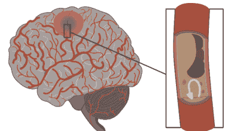

图 1. 缺血性中风示意图。

#### 2.2 技术

该论点依赖于与实用性注册相关的概念。信息可在“云”上获得，中风患者、主框架及临床人员亦可使用。MySQL 用于云计算环境，配合 PHP 编程存储数据（Li et al. 2013）。如表 1 所示，中风患者年龄分布。MySQL 是开源服务器系统的可信赖数据库管理架构。由于采用开源模式，Java 开发具有多项显著优势。因此，Android 被视为世界上最知名且最具适应性的操作系统（Lian et al. 2014）。

表 1. 中风患者年龄分布。

| 中风/年龄 | 1–25 | 25–35 | 36–45 | 46–65 | 66–85 | 86–100 |
|---|---|---|---|---|---|---|
| 隐源性 | 24 | 14 | 55 | 230 | 200 | 18 |
| 心源性栓塞性 | 20 | 6 | 22 | 196 | 394 | 60 |

我们的方法依赖于以下手段：

- (1) 将使用人口统计信息、临床病史、研究机构检验结果、治疗信息和处方信息框架。
- (2) 这些细节将用于区分不同的中风亚型以提供患者医疗服务，并将使用基于 Android 的手机收集必要数据。
- (3) 将向中风患者传输或生成关于其病情及生活方式的基于云的教育，提供 CNN 应用程序编程接口（API）。针对信息集大小、能量大小和强调大小，测试编程接口的准确率（Tatta et al. 2021）。
- (4) 已保证通过搭载 Android-OS 的智能手机获取、管理和基于患者信息做出决策的流程。

##### 2.2.1 框架搭建中 CNN 的应用

临床数据框架已扩展至涵盖日益多样化的临床和健康场景。然而，这种模式伴随着所有重大的复杂性和问题，包括为首选情感支持网络获取关键信息的困难（Sanobe et al. 2021）。旧式自动化信息调查已被证明无效，因此新方法（可能是使用 CNNs 进行有效的移动依赖性检查）对于识别疾病至关重要。反向传播计算及其重要步骤如下：

步骤 1. 开始：建立权重，并在小量的真实任意特征下修改偏差。

步骤 2. 信息及首选产出的演示。信息路径已按 y(1), y(2), y(3) .......y(M) 演示，同时理想反应为 i(1), i(2), i(3) .......i(M)，逐对进行，其中 M 为已准备设计的数量。

步骤 3. 计算实际结果，结果信号的计算可使用公式 1 完成。

```
z_j = \vartheta \left( \sum_{k=1}^{M_{N-1}} x_{kl}^{(N-1)} y_i^{(N-1)} + p_k^{(N-1)} \right) , k = 1 , ..... M_{N-1}
```

步骤 4. 偏差 p_k 和 x_kl 权重调整，为此有必要使用以下条件。

```
\Delta p_k^{(p-1)}(m) = \gamma . \delta_k^{(p-1)}(m)
```

```
\Delta x_{kl}^{(p-1)}(m) = \gamma . y_l(m). \delta_k^{(p-1)}(m)
```

此处 p 为某一层，r 是脑组织中结果节点的数量，N 是输出层，且为启动能力，y_l(m) = 强调 m 时节点 l 的结果。其净贡献利用一种称为激活能力的标量到标量能力，很可能是脑网络拓扑的核心组件。后续模块也被视为并执行了本研究的训练技术：用于在 MLP 原型中识别 2 种中风亚型，如图 2 所示。对于中风亚型诊断，有 22 个信息源和 2 个结果。

##### 2.2.2 基于云的医疗服务的灵活框架

从效率和可编程性等多方面来看，灵活性控制了易于学习的优秀且称职云的基础成本。因此，我们选择使用云，一种由 Open Handset Alliance 和 Google 开发的基于 Linux 的免费智能手机操作系统。归功于分布式计算管理的强大处理能力，信息查询非常迅速（Zhang et al. 2021）。中风医疗保健系统与使用 Android-OS 5.0（Lollipop）或更高版本的任何 Android 手机、iOS 操作系统或两者兼容。如所示，已使用 5G 网络或更高层级组织的基础类型。

### 3 探索结果

本评估部分涉及中风诊断医疗保健系统的创建和执行周期，随后阐述了假设和计算。作为结果，介绍了使用 CNN 对中风亚型进行表征的发现（Maadeed et al. 2019）。

#### 3.1 假设/计算

当中风患者缺乏关于其疾病及当前健康状况的充分信息时，他们无法与医生进行有意义的对话（Rida et al. 2019）。图 2 的主要循环中展示了相关合作伙伴关系。

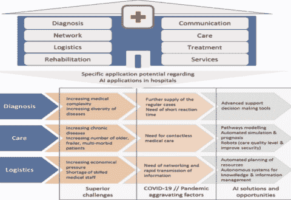

图 2. 中风诊断医疗保健系统协作流程，以解决出现的问题。

中风患者需要在日常活动中易于使用且便于获取的工具。这将受益于在可编程性和效率方面易于掌握的出色且熟练的云（Khan et al. 2022）。图 3 所示的以下高级别要求应使中风用例模型清晰。使用 Enterprise Architect，已获得用于中风诊断医疗保健系统利用的用例模型（Mehmood et al. 2022）。

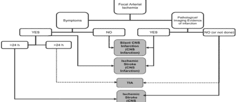

图 3. 作为场景的中风诊断医疗保健系统利用。

在中风诊断医疗保健系统用例模型中，关键参与者、需求、聚焦情景、可选情景及关键要求如下说明。中风诊断医疗保健系统用例模型的主要需求、聚焦情景、必要参与者及要求（Ullah et al. 2019）。

#### 3.2 中风诊断医疗保健系统的开发与实施之间的交互

客户端（康复者）移动应用程序和包含两个主要部分（模块）的服务器应用程序（即 CNN 模块与服务器模块）构成了为此项研究构建的中风诊断医疗保健系统。客户端和服务器的应用程序均依赖 CNN 模块的 CNN 计算（Rasheed et al. 2023）。本文使用了所示的基于 MLP 计算的概念验证。还应牢记，该方法可用于研究中风以外的疾病（Gupta et al. 2011）。

### 阶段 1：在虚拟专用服务器上计算 CNN 模型

本研究的以下部分对框架的操作系统提供了更多详细信息。测试平台由以下组件组成。对预期用于中风诊断医疗保健系统的技术方法进行了详尽解释。

- (a) 运行 Android 工作基础的移动设备提供用户界面。
- (b) 中风诊断医疗保健系统提供一项解决方案，包括通过概念验证与中风患者进行云依赖通信的、在 Windows 上运行的医疗设施。
- (c) 云医疗服务平台提供强大的系统管理、注册以及现实世界数据分析和健康演示的资源。

如图 4 所示，Android 是移动设备操作系统的主要控制器。Java 用于驱动程序开发、连接点实现和 CNN 计算植入。本地和远程客户均配备了带注册的手机，以便管理其中风信息（Sharma et al. 2022）。中风检测实施后，信息将存储在云中，然后在用户界面中使用。这可作为中风亚型治疗（心源性栓塞性、隐源性）的有用独立方向（Panchal et al. 2023）。

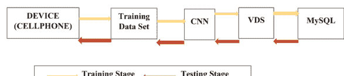

图 4. 使用建议的中风诊断医疗保健系统表示进行的概念计划验证。

### 阶段 2：客户（客户端）/中风患者的移动应用程序

一名注册（加入）的个人可以使用其智能手机应用程序连接到处理器。已登录的客户可以完全插入以下数据作为新测试结果：

- 出生日期信息已从处理器传送。用于计算年龄的该人出生日期，由服务器在招募交互期间作为框架的一部分记录。
- 在招募交互期间，定向数据也作为框架的一部分被包含。

服务器模块的若干规范如下：

- 如果已登录客户没有任何操作，系统将因此登出会议。对此持续时间可做出类似安排。
- 如有必要，可设计服务器模块的任何界限。
- 关联的端口数量也可进行规划。


- 任何新患者或客户也可纳入该框架，并且必须保存其信息（Soni et al. 2022）。

### 第 3 阶段：利用并保留用于 CNN 训练的数据知识

使用 CNN 模块准备信息。准备完成后，就可以使用针对已登记患者信息生成的模块了。在 CNN 模块中，使用 MLP 计算。对于该框架，可指定学习率等配置特征。

### 第 4 阶段：基于服务器-客户端的亚型识别与进展

中风诊断医疗保健系统中有 19 个患者信息属性。在服务器上，使用 CNN 交互来应用不同中风亚型的两个结果。Android 应用程序最终显示结果。

#### 3.3 使用 CNN 表征中风亚型的后遗症

这项研究是文献领域中首个使用 MLP 计算来验证概念的研究。该框架的总体目标和动机是提高健康通信的可用性、组织性、准确率和质量，同时通过降低医疗成本提供经济效益（Bhatt 和 Sharma 2023；Liu et al. 2022）。在中风诊断医疗保健系统中，准备阶段侧重于识别能量、信息大小和强调数量属性，这些属性能提供最显著的精确度来对中风亚型进行分类（表 2）。

| (i) 准确率 (%) | (i) 强调数量 | (ii) 准确率 (%) | (ii) 能量 | (iii) 准确率 (%) | (iii) 信息集大小 |
|---|---|---|---|---|---|
| 82 | 220 | 88 | 0.6 | 75 | 35 |
| 85 | 450 | 89 | 0.7 | 78 | 65 |
| 88 | 650 | 90 | 0.75 | 79 | 95 |
| 89 | 850 | 88 | 0.9 | 82 | 125 |
| 90 | 1050 | 88 | 1.0 | 89 | 350 |

如表 2 所示，MLP 计算在中风诊断医疗保健系统中达到的最显著精确率结果为 90%（训练率 0.002，存储层神经元数为 12），对应强调数量 = 1200，能量 = 0.7，信息集大小 = 320 个特征。中风诊断医疗保健系统的 MLP 计算是通过安装在云中创建的。

### 4 结果

本文对中风诊断医疗保健系统的理论原型确认主题进行了有趣的探讨。此外，MLP 计算（图 5）已被建议用于关键且具有挑战性的医疗情况，即为许多中风亚型提供区分性证据。持续评估使用带有 5 个 VCPU 和 32 GB 内存的 VDS（虚拟专用服务器）来解决该问题。
可使用以下流程来确定服务器限制：

Users = \(\frac{(P \times Q \times R \times S)}{52}\)

其中 P 表示必须查看的 CPU 利用率堆栈，Q 表示 GHz 单位的 CPU 速度，R 表示以 MHz 表示的主板前总线速度，S 表示 CPU 核心数量。

典型的框架配置识别到的服务器内存包括每个同步患者 32 MB，以及用于组织操作系统（OOS）内部维护的额外 4 GB。如有需要，服务器设置可被更新。

RAM = (Users x 0.032) + 4

此处 RAM 表示以千兆字节为单位的内存量；Users 由第一个条件选定；0.032 GB = 32 MB，即每个并发客户端；4 GB 是公司的操作系统。利用这些计算：

Users = ((1 x 3.2 x 1700 x 4) / 52)

Users = 418.46

RAM = (418.46 x 0.032) + 4

RAM = 17.390 GB

关于该特定主题，此示例用于展示中风诊断医疗保健系统如何让个人掌控自身疾病。我们的框架具有内置备份。我们的服务器是服务器场的一部分，可提供近乎 100% 的正常运行时间保证和 TIER 认证。因此，患者不会失去对服务的信任，并真希望继续获得框架的支持，这表明该框架可以同时为许多患者提供护理。

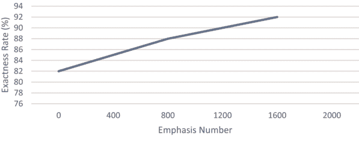

图 5. 中风诊断医疗保健系统中 MLP 计算的现实描绘。

### 5 结论

本文的主要目的是利用云基础设施，为分析移动电话使用与初级中风亚型特征之间的关系提供一种新方法。医疗保健中的中风分析一直是一种栓塞性隐源性选择工具，可提供 1242 名中风患者的信息。此外，中风分析医疗保健安排需要加强，例如，这使得在分析医疗保健安排的大旗下，能够同时对特征进行表征并确定多个问题。

### 参考文献

Bhatt, M.W. 和 Sharma, S., 2023. 基于对象识别的神经科学工程：未来实施研究. Electrica, 23(2).

Gupta, A., Kapoor, L. 和 Wattal, M., 2011. C2C（云到云）：用于动态资源配置的云服务提供商生态系统. 在《计算与通信进展：第一届国际会议，ACC 2011，印度科钦，2011 年 7 月 22–24 日。论文集，第二部分（第 501–510 页）》中。Springer Berlin Heidelberg.

Karan, O., Bayraktar, C., Gümüşkaya, H. 和 Karlıb, B., 2012. 在小型移动设备上使用神经网络诊断糖尿病. 专家系统与应用, 39(1): 54–60.

Karlik, B. 和 Olgac, A.V., 2011. 神经网络广义 MLP 架构中各种激活函数的性能分析. 人工智能与专家系统国际期刊, 1(4): 111–122.

Khan, M.A., Abbas, S., Raza, A., Khan, F. 和 Whangbo, T., 2022. 基于机器学习的多感官集成情感信号增强. Computers, Materials & Continua, 71(3).

Kim, D.K., Yoo, S.K., Park, I.C., Choa, M., Bae, K.Y., Kim, Y.D. 和 Heo, J.H., 2009. 用于急性中风远程会诊的移动远程医疗系统. 远程医疗与远程护理杂志, 15(2): 102–107.

Li, M., Yu, S., Zheng, Y., Ren, K. 和 Lou, W., 2012. 基于属性加密的云计算中个人健康记录的可扩展安全共享. IEEE 并行与分布式系统事务, 24(1): 131–143.

Lian, J.W., Yen, D.C. 和 Wang, Y.T., 2014. 了解影响台湾医院采用云计算决策的关键因素的探索性研究. 信息管理国际期刊, 34(1): 28–36.

Liu, Q., Zhang, W., Bhatt, M.W. 和 Kumar, A., 2022. 高层建筑非线性振动控制算法. 非线性工程, 10(1): 574–582.

Maaheed, S.A., Jiang, X., Rida, I. 和 Bouridane, A., 2019. 基于稀疏密集混合表示的掌纹识别. 多媒体工具与应用, 78: 5665–5679.

Mehmood, S., Ahmad, I., Khan, M.A., Khan, F. 和 Whangbo, T., 2022. 基于内容分析的竞争环境中社交媒体情感分析. Computers, Materials & Continua, 71(3).

Panchal, A.V., Patel, S.C., Bagyalakshmi, K., Kumar, P., Khan, I.R. 和 Soni, M., 2023. 基于深度学习的图像植物病害检测. 材料今日：会议录, 80: 3500–3506.

Rasheed, Z., Ma Y.K., Ullah, I., Ghadi, Y.Y., Khan, M.Z., Khan, M.A., Abdusalomov, A., Alqahtani, F. 和 Shehata, A.M., 2023. 基于图像增强和卷积神经网络技术的 MRI 脑肿瘤分类. 脑科学, 13(9): 1320.

Ratta, P., Kaur, A., Sharma, S., Shabaz, M. 和 Dhiman, G., 2021. 医疗保健和医疗领域中区块链和物联网的应用：应用、挑战和未来展望. 食品质量杂志, 2021: 1–20.

Rida, I., Herault, R., Marcialis, G.L. 和 Gasso, G., 2019. 基于高效数据驱动集成分类器的掌纹识别. 模式识别字母, 126: 21–30.

Sanobor, S., Alam, I., Pande, S., Arslan, F., Rane, K.P., Singh, B.K., Khampariya, A. 和 Shabaz, M., 2021. 用于无线通信欺诈检测的增强安全深度学习算法. 无线通信与移动计算, 2021: 1–14.

Sharma, V., Gupta, A., Hasan, N.U., Shabaz, M. 和 Ofori, I., 2022. 安全医疗系统中的区块链：现状、局限性和未来方向. 安全与通信网络, 2022.

Soni, M., Gomathi, S., Kumar, P., Churi, P.P., Mohammed, M.A. 和 Salman, A.O., 2022. 用于肺部疾病分类的卷积神经网络混合. 群体智能研究国际期刊 (IJSIR), 13(2): 1–15.

Sultan, N. 和 Van De Bunt-Kokhuis, S., 2012. 应对颠覆性创新中的组织文化与云计算. 技术分析与战略管理, 24(2): 167–179.

Sultan, N., 2010. 11 月。经济衰退中天作之合的云计算与中小企业. 在 ISBE（小企业与创业学院）会议（第 2–4 页）中。

Ullah, I., Shen, Y., Su, X., Esposito, C. 和 Choi, C., 2019. 基于无迹卡尔曼滤波和粒子滤波定位算法的定位. IEEE Access, 8: 2233–2246.

Yang, P., Kambakhsh, A., Bin, S. 和 Li, P., 2018. 用于增强解剖学习的深度手势交互. 信息管理国际期刊.

Zhang, X., Rane, K.P., Kakaravada, I. 和 Shabaz, M., 2021. 基于物联网技术的旋转机械振动监测和故障诊断研究. 非线性工程, 10(1): 245–254.


## 基于监督上下文感知的潜狄利克雷分配药物推荐模型

戈帕尔达斯·H·瓦格马雷  
机械工程系，YCCE，那格浦尔，马哈拉施特拉邦，印度  

巴尔加维·波西纳塞蒂  
公共卫生硕士，南密西西比大学，哈蒂斯堡，密西西比州，美国  

穆罕默德·沙巴兹  
工程技术模范学院，查谟，查谟-克什米尔，印度  

赛玛·艾哈迈德·拉欣  
联合国际大学，达卡，孟加拉国  

阿比舍克·乔杜里  
德里大学政治学系，印度  

西娜·K.  
圣玛丽学院，特里苏尔，印度  

### 摘要

电子病历的简便性和患者症状描述的模糊性使诊断模型易受高发病疾病和联合症状的干扰。同时，除病情描述之外的许多上下文信息，如患者的性别、年龄及其他个人信息、诊疗过程、检验结果以及当地天气、温差等外部信息等，也有助于细化患者的诊断。基于有效整合多源异构上下文信息，为疾病诊断和药物推荐提供可解释依据。然后，设计了一种基于LDA模型的上下文主题模型 Medicine-LDA，以解决上下文信息组合爆炸问题。通过基于大型三级医院电子病历数据集的对比实验，证明了该方法的有效性和鲁棒性。

### 1 引言

高质量医疗服务的需求与日俱增，由于人口扩张和老龄化加速，医疗系统压力日益增大。根据国家卫生健康委员会发布的全国医疗健康统计数据，2018年1月至11月，全国医院就诊人数达32.3亿人次，同比增长5.3%。相应地，截至2019年，每千人口医生数为2.592人，与发达国家相比仍存在较大差距，这也导致医务人员负担沉重，医疗资源存在巨大缺口。在此基础上，相关领域学者开展了一系列研究，在胜任指导、医学图像分析和慢性病随访等方面取得了良好成果（Al-Saffar and Baice 2022; Murad et al. 2022; Wang et al. 2013）。首先，电子病历推广相对较晚，导致可靠医疗数据来源较少，且存在数据积累少、无法关联各科室数据等问题。其次，药物推荐问题对数据质量更为敏感，主要体现在三个方面：

- 1) 大多数患者只有一条就诊记录，无法使用常规个性化推荐技术进行建模。
- 2) 疾病分布严重不均，常见疾病占据大部分病历，而小众人群和罕见疾病严重稀疏，难以保证其推荐质量。
- 3) 疾病症状之间存在高比例重叠。以此次新冠肺炎疫情为例，其早期症状与其他肺炎甚至普通感冒有许多相似之处，即使经验丰富的医生也存在误判风险。

然而，这些数据也带来新的困难：全面考虑这些上下文信息，以实现有效的诊断和治疗。为解决上述问题，本文提出一种基于多源上下文协同感知的药物推荐方法，名为 medicine-LDA（MLDA）。本文通过模拟现实中的医生来模拟诊断患者的过程。受此启发，本文通过四个步骤模拟这一过程：

- 1) 提取患者的主诉文本并检查数据中的异常，使用词袋模型将其合成为一个文档，并使用该文档表示患者，称为疾病文档；
- 2) 使用主题模型对疾病文档进行建模，假设该文档具有潜在主题，可能的主题代表患者的疾病，并具有相应的药物分布和词分布；
- 3) 将患者对应的所有上下文信息整合到一个文档中，称为上下文文档，并使用LDA模型对其建模以获取患者的上下文主题分布；
- 4) 假设上下文主题将影响患者的疾病及适合患者的药物，使用统一的概率模型框架整合药物主题和上下文主题，以全面建模上下文信息、疾病和药物信息。

### 2 相关工作

本节从三个方面介绍本文的相关工作：药物推荐系统、上下文感知推荐系统和主题模型。

#### 2.1 药物推荐系统

目前，药物推荐方面的研究并不十分广泛，大多数药物推荐主要使用用户与药物之间的交互记录，基于协同过滤技术进行推荐。例如，(Zitouni et al. 2020) 提出了一种基于用户相似性和信任的药物推荐算法，以解决协同过滤推荐准确率低的问题。该方法通过对药物聚类降低时间复杂度，引入了一种标准。

#### 2.2 上下文感知推荐系统

传统推荐系统，如基于内容的推荐和协同过滤，忽略了用户在不同情境下具有不同的偏好行为（Dwivedi and Rawat 2016）。因此，研究人员提出了“上下文感知”数据挖掘技术以改进推荐效果。由于同一用户在不同上下文中往往有不同偏好，上下文感知推荐系统可以根据用户的具体情况给出更相关的推荐结果。

#### 2.3 主题模型

主题模型是一种用于聚类语料库中隐含语义结构的统计模型，广泛应用于自然语言处理中的语义分析和文本挖掘。潜狄利克雷分配（LDA）是最常见的主题模型，它假设文档以一定概率选择一个潜在主题，然后以一定机会从该主题中选择一个词来生成整个语料库（Bose and Sohi 2006; Kluckner et al. 2013; Yu 2021）。LDA可以通过引入外部标签信息以多种方式进行扩展。

LDA模型获得的主题本质是隐式学习词语之间的共现关系。在统计短文本时，此类方法往往效果不佳，因为短文本中的词语共现频率不足。一些研究已探讨了这一问题。

#### 2.4 数据预处理

首先，通过模拟现实中医生诊断患者的过程来描述问题。在实际诊疗过程中，医生通常会在患者的病历文本中记录患者的主诉，以及医生对患者的体格检查（Jawarneh et al. 2023）。分词的基础包括以下内容：

- 1) 生活常识，如性别分为男性和女性，季节分为春、夏、秋、冬；
- 2) 数据特征，如麻醉类型分为全麻、局麻和无麻醉；
- 3) 外部知识，如根据标准年龄分段方法进行年龄分段，根据保险金额和条件进行保险状态分段；
- 4) 对于温差、温度等没有参考知识的情况，基于生活常识和数据分布，不同分段的数据分布相对均匀，分段方法接近人们的生活认知。

#### 2.5 正式描述

在本小节中，我们将本文研究的问题正式描述如下：在上下文感知药物推荐任务中，训练集包含疾病文档 V<sub>i</sub> = {v<sub>i,1</sub>, v<sub>i,2</sub>, v<sub>i,p</sub>}，其中 v<sub>i</sub> 是从医疗文本分词或单个异常项中获得的词。相应地，我们有上下文文档 U<sub>i</sub> = {u<sub>i,1</sub>, u<sub>i,2</sub>,...,u<sub>i,q</sub>}，其中 U<sub>i</sub> 是一个单一的上下文词。此外，我们有一组药物 E<sub>i</sub> = {e<sub>i,1</sub>, e<sub>i,2</sub>,..., e<sub>i,s</sub>}，其中 e<sub>i</sub> 是医生为患者开具的所有药物之一（Ahmed et al. 2022; Iqbal et al. 2022; Khan et al. 2020）。

### 3 上下文感知药物推荐方法

#### 3.1 模型概述

本文提出的模型的一般步骤如下：

- 1) 模型需要处理上下文信息。虽然在数据预处理部分已对上下文信息的值进行了分词，但如果假设有 K 种上下文信息，每个上下文有 N 个值分段，将产生 NK 种组合，导致模型（Rida et al. 2015）。
- 2) 本文使用概率框架对上下文信息、疾病文档和患者药物进行联合建模。建模思路来源于实际医疗场景中的诊疗过程；即，医生首先根据患者的症状和体格


检查、化验报告，然后根据患者对应的情境信息为疾病给出合适的药物。

#### 3.2 上下文信息建模方法

为解决患者上下文信息组合爆炸问题，有必要尝试降低上下文信息的维度（Rida et al. 2018）。聚类是解决此类问题的标准方法，可大致分为两类：硬聚类和软聚类。其中，硬聚类对数据进行精确分类。经过若干次迭代收敛后，每个文档被分配一个固定的上下文主题，因此可使用公式 (1) 计算每个上下文文档的主题分布。

\[
Q(a|e) = \frac{n_{e,a} + \alpha}{\sum_{i=1}^k n_{e,a_i} + L\alpha} \quad (1)
\]

其中，e 和 a 表示上下文文档 d 中分配给主题 a 的单词数，α 是狄里克莱先验参数，L 是上下文主题的数量。

#### 3.3 感知上下文的药物推荐方法

上下文信息的软聚类完成后，可以对所有数据进行综合建模。本文提出的建模方法基于对诊断治疗过程的两个假设：

- 1) 上下文主题是上下文信息的软聚类，每个上下文主题可能影响患者适用的药物和易患的疾病。
- 2) 每个患者的数据对应一个隐变量，表示患者的疾病，称为疾病主题。

图 1 显示了模型的概率图表示及符号说明。

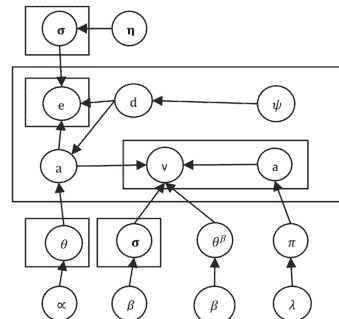

图 1. MLDA 模型的概率图表示。

#### 3.4 采样与推断算法

MLDA 需要推断隐变量 z、c 和 y。然而，由于精确推断算法无法求解，本文使用坍塌吉布斯采样（CGS）对隐变量进行采样并得到参数 $\theta, \varphi, f$；然后，利用训练得到的参数为新患者推荐药物。

首先，对训练集中的所有数据进行随机初始化：对于第 n 个数据，随机分配上下文主题隐变量 $d_n$ 和疾病主题隐变量 $a_n$，并对第 n 个数据中第 m 个疾病文档单词随机分配相应的标识符 [15]。隐变量 z 和 c 的条件概率分布为

\[
q(a_n = l, d_n = g \mid \psi_n, v, e, a, z, \alpha, \beta, \eta) = \psi_n^f \times \frac{m_f^k + \alpha}{\sum_{j=1}^k (m_f^j + \alpha)} \times \prod_{m=1}^{M_{a,n,z_{n,m}=1}} \frac{w_k^{v_{n,m}} + \beta}{\sum_{v=1}^W (m_k^v + \beta)} \times \prod_{e=1}^{N_{n,d}} \frac{m_f^{c_{n,e}} + \eta}{\sum_{e=1}^E (m_f^{c_{n,e}} + \eta)} \quad (2)
\]

其中，$\psi_n^f$ 是从 $\psi_n$ 采样 f 的概率 q(f|$\psi_n$)，$m_f^k$ 是单词 v 被分配到主题 k 的次数，上述两个计数均不包括文档 n。对于疾病文档中的每个单词，相应的标识变量 y 的条件概率分布为

\[
q(z_{n,m} = 0 \mid v, e, a, z, \alpha, \beta, \eta) = \frac{m_{(n,m)}^{z=0} + \lambda}{\sum_{z=1}^1 (m_{n,m}^z + \lambda)} \times \frac{m_{z=0,(n,m)}^{x_{n,m}} + \beta}{\sum_{x=0}^Z (m_{x=0,n,m}^y + \beta)} \quad (3)
\]

其中，$m_{n,m}^z$ 是标签 y 对应的单词数，$m_x^{z=0,(m,n)}$ 是标签 0 对应单词中 w 出现的次数，$m_{a,n,m,m}^x$ 是短语 v n,m 被分配给主题 a n,m 的次数，上述计数均不包括第 n 个文档中的第 m 个单词（Gupta and Awasthi 2010; Gupta et al. 2022; Khan et al. 2020）。

\[
\theta_{f,k} = \frac{m_f^k + \alpha}{\sum_{j=1}^M (m_f^j + \alpha)} \quad (4)
\]

其中，$m_f^l$ 是疾病主题 j 对应的情境主题 f 的文档数。

$\varphi_{k,w}$ 表示某个疾病主题生成某个单词的概率：

\[
\Phi_{k,w} = \frac{m_f^k + \beta}{\sum_{j=1}^M (m_f^j + \beta)} \quad (5)
\]

其中，$\varphi_{k,w}$ 是疾病主题 k 对应文档中单词 w 的出现次数。

#### 3.5 药物推荐

假设给定一组测试数据集，其中患者对应的药物未知。然后，可通过公式 (6) 得出患者对应任何药物 d 的条件概率。

\[
q(e|X, \psi) = \sum_{f=1}^F \sum_{l=1}^L \sigma_{f,l,e} \times \left( q_f \theta_{f,l} \prod_v (\pi_0 \theta_v^C + \pi_1 \varnothing_{l,e}) \right) \quad (6)
\]

### 4 实验与结果分析

本节详细介绍了本文实验中使用的数据集、指标、基准方法、参数设置及实验结果分析。

#### 4.1 实验数据集

本实验使用的数据来自2015年至2018年某大型三级医院住院部的电子病历数据库，且已脱敏。数据集经过清洗和去重，得到158,556条完整的电子病历，每条病历均包含患者从出院到入院的完整诊疗过程记录。药物频率统计的对数形式见表 1。

表 1. 药物频率统计的对数形式。

| 序号 | 药物ID |
|--------|-------------|
| 0 | 1400 |
| 200 | 1200 |
| 400 | 1000 |
| 600 | 800 |
| 800 | 600 |
| 1000 | 400 |
| 1200 | 200 |

#### 4.2 实验结果

表 2 显示了不同方法在该数据集上的性能，每个实验结果均通过 5 折交叉验证获得。LLDA 模型中的主题词先验设为 0.01；Tag-LDA 中的主题数设为 50；主题词先验设为 0.01，CF 中的向量维度设为 30，相似文档数设为 40。

表 2. 不同方法的性能比较。

| 指标 | Freq | LLDA | MLDT | MLP | NTM | MLDA | MLDA-pure | MLDA-z | MLDA-c |
|--------|------|------|------|-----|-----|------|-----------|--------|--------|
| NDCG@20 | 0.5116 | 0.3113 | 0.7206 | 0.7283 | 0.7333 | 0.707 | 0.7144 | 0.7155 | 0.8155 |
| NDCG@30 | 0.5492 | 0.3432 | 0.779 | 0.789 | 0.7961 | 0.7679 | 0.7757 | 0.7771 | 0.8771 |
| NDCG@40 | 0.5779 | 0.3631 | 0.8125 | 0.825 | 0.8334 | 0.8057 | 0.8135 | 0.8149 | 0.9149 |
| P@20 | 0.4137 | 0.2524 | 0.6084 | 0.611 | 0.6182 | 0.5925 | 0.6022 | 0.6103 | 0.7103 |
| P@30 | 0.3484 | 0.2252 | 0.5121 | 0.5147 | 0.5215 | 0.5006 | 0.5079 | 0.5156 | 0.6156 |
| P@40 | 0.3075 | 0.2032 | 0.4469 | 0.4481 | 0.4545 | 0.4369 | 0.4426 | 0.4486 | 0.5486 |
| R@20 | 0.4374 | 0.2661 | 0.667 | 0.6777 | 0.6829 | 0.6539 | 0.6616 | 0.6624 | 0.7624 |
| R@30 | 0.4962 | 0.3213 | 0.7635 | 0.7788 | 0.7878 | 0.756 | 0.7647 | 0.7654 | 0.8654 |
| R@40 | 0.5521 | 0.3587 | 0.8239 | 0.8444 | 0.8559 | 0.8259 | 0.8341 | 0.8354 | 0.9354 |
| F@20 | 0.3978 | 0.2432 | 0.5933 | 0.5982 | 0.605 | 0.5797 | 0.5893 | 0.591 | 0.691 |
| F@30 | 0.3837 | 0.2398 | 0.571 | 0.576 | 0.584 | 0.5595 | 0.568 | 0.5723 | 0.6723 |
| F@40 | 0.3663 | 0.2276 | 0.5374 | 0.5412 | 0.5494 | 0.5268 | 0.5341 | 0.539 | 0.639 |

接下来，对所提出模型的参数敏感性进行分析。图 2 显示了上下文主题数量对模型效果的影响，其中 K = 400，调整不同的 F 值（Limbasiya et al. 2018; Soni and Singh 2022）。图 3 与表 3 共同展示了疾病主题数量对模型性能的影响，其中 F = 10，并改变不同的 K 值。当参数在广泛范围内变化时，模型效果仅波动 0.01，这证实了所提出方法的优异性能（Bhatt and Sharma 2022; Liu et al. 2022）。

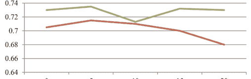

图 2. 上下文主题数量的影响。

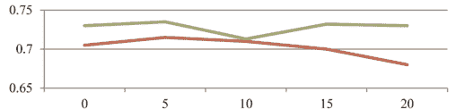

图 3. 情境主题数量和疾病主题数量对模型效果的影响。

### 表 3. 疾病主题数量的影响。

| 序号 | NDCG@40 | Recall@40 |
|--------|---------|-----------|
| 0 | 0.705 | 0.73 |
| 5 | 0.715 | 0.735 |
| 10 | 0.71 | 0.713 |
| 15 | 0.7 | 0.732 |
| 20 | 0.68 | 0.73 |

### 5 结论

本文提出了一种基于上下文感知的药物推荐模型 Medicine-LDA，利用通用概率框架描述现实场景中的诊断治疗过程。该模型基于由实验室异常和医学文本组成的患者文档推断患者可能的疾病，并提出使用疾病主题来描述患者患不同疾病的概率。最后，通过对某大型三级医院数据集的实验表明，本文提出的模型在准确性方面优于常用的传统机器学习模型、主题模型和协同过滤模型。结果分析可获得一系列有价值的信息，这证实了该模型的优异性能及其在实际应用中的价值。

### 参考文献

- Ahmed, T.I., Bhola, J., Shabaz, M., Singla, J., Rakhra, M., More, S. and Samori, I.A., 2022. 基于模糊逻辑的慢性肾脏病诊断系统. BioMed Research International, 2022.
- Al-Saffar, M. and Baiee, W., 2022, March. 基于 Yelp 数据集的协同过滤隐式反馈提取综述. 在 2022 年 Muthanna 国际工程科学与技术会议 (MICEST) 上 (第 125-130 页). IEEE.


Bhatt, M.W. 和 Sharma, S., 2023. 基于对象识别的神经科学工程：面向未来实现的研究. Electrica, 23(2).

Bose, S. 和 Sohi, S., 2006 年 6 月. 面向移动企业实现无缝上下文协作. 在第 15 届 IEEE 赋能技术国际研讨会：协作企业基础设施 (WETICE’06) (第 119–124 页). IEEE.

Dwivedi, S.K. 和 Rawat, B., 2016 年 3 月. 利用相关上下文信息提高推荐质量的综述. 在 2016 年第 3 届面向可持续全球发展的计算国际会议 (INDIACom) (第 244–248 页). IEEE.

Gupta, A. 和 Awasthi, L.K., 2010. 面向对等应用的服务质量框架. 分布式系统与技术国际期刊 (IJDST), 1(3): 1–23.

Gupta, A., Tripathi, M., Muhuri, S., Singal, G. 和 Kumar, N., 2022. 医疗物联网中可穿戴设备的安全轻量级匿名互认证方案. 信息安全与应用期刊, 68: 103259.

Iqbal, M.W., Naqvi, M.R., Khan, M.A., Khan, F. 和 Whangbo, T., 2022. 基于本体的移动设备接口自适应性. 计算机、材料与连续介质, 71(3).

Jawarneh, M., Arias-González, J.L., Gandhmal, D.P., Malik, R.Q., Rane, K.P., Omarov, B., Mahapatra, C. 和 Shabaz, M., 2023. 灰狼优化特征选择对梯度提升机器学习技术在肝肿瘤准确检测中的影响. SN 应用科学, 5(7): 178.

Khan, F., Khan, A.W., Khan, S., Qasim, I. 和 Habib, A., 2020. 移动自组网中安全核心辅助组播路由协议. 互联网技术期刊, 21(2): 375–383.

Khan, W., Wang, H., Anwar, M.S., Ayaz, M., Ahmad, S. 和 Ullah, I., 2019. 面向 UWSN 的多层集群节能路由方案. IEEE Access, 7: 77398–77410.

Kluckner, P.M., Buchner, R., Weiss, A. 和 Tscheligi, M., 2013 年 5 月. 协作报告工具：半导体工厂维护活动分析. 在 2013 年协作技术与系统国际会议 (CTS) (第 508–515 页). IEEE.

Limbasiya, T., Soni, M. 和 Mishra, S.K., 2018. 面向网络申请人的基于智能卡的高级形式认证协议. 计算机与电气工程, 66: 50–63.

Liu, Q., Zhang, W., Bhatt, M.W. 和 Kumar, A., 2022. 高层建筑抗震非线性振动控制算法. 非线性工程, 10(1): 574–582.

Murad, D.F., Hassan, R., Wijanarko, B.D., Leandros, R. 和 Murad, S.A., 2022 年 5 月. 具有上下文敏感推荐系统的混合协同过滤方法评估. 在 2022 年第 7 届商业与工业研究国际会议 (ICBIR) (第 7–12 页). IEEE.

Rida, I., Al-Maadeed, S., Mahmoud, A., Bouridane, A. 和 Bakshi, S., 2018. 基于稀疏表示集成的掌纹识别. IEEE Access, 6: 3241–3248.

Rida, I., Jiang, X. 和 Marcialis, G.L., 2015. 基于运动组 Lasso 的无模型步态识别人体部位选择. IEEE 信号处理字母, 23(1): 154–158.

Sadiq, M.T., Yu, X., Yuan, Z., Zeming, F., Rehman, A.U., Ullah, I., Li, G. 和 Xiao, G., 2019. 基于多变量经验小波变换框架的运动想象 EEG 信号解码，用于强健的脑机接口. IEEE Access, 7: 171431–171451.

Soni, M. 和 Singh, D.K., 2022. LAKA：面向基于物联网的无线体域网的轻量级认证与密钥协商协议. 无线个人通信, 127(2): 1067–1084.

Wang, J., Li, H. 和 Zhao, H., 2013 年 9 月. 上下文群组推荐. 在 2013 年第 5 届智能网络与协作系统国际会议 (第 127–131 页). IEEE.

Yu, Y., 2021 年 12 月. 基于协同过滤算法的学习资源智能推荐研究. 在 2021 年信息学、电子与教育进展国际研讨会 (ISAIEE) (第 326–329 页). IEEE.

Zitouni, H., Bouchelik, K., Saïdi, R. 和 Chekkai, N., 2020 年 11 月. 个性化菜单：一种新的上下文协作推荐系统. 在 2020 年软件工程高级方面国际会议 (ICAASE) (第 1–6 页). IEEE.

## 分布式环境中基于组合核支持向量机的数字孪生阅读障碍预测模型

H. Kareemullah
B.S.A 莘特科学技术学院电子与仪表工程系，
印度泰米尔纳德邦钦奈

Aadam Quraishi
美国得克萨斯州休斯顿介入治疗学院，美国得克萨斯州麦克阿伦

G.C. Prashant
Paycom 软件开发人员，美国大学，德克萨斯理工大学，得克萨斯州卢博克，美国

Mohammad Shabaz
印度查谟和克什米尔查谟工程技术学院

Archana Kollu
印度浦那拉维特皮姆里钦查瓦德工程与研究学院

Mukta Sandhu
印度哈里亚纳邦帕尔瓦尔什里维什瓦卡玛技能大学计算机科学与工程技能部

摘要：阅读障碍是一种普遍存在的学习障碍，其特征是单词识别和拼写方面存在持续性问题。它会影响一个人准确、流利地解读字母和单词的能力。阅读障碍已成为最普遍的学习障碍之一，尽管医学专家尚未阐明其核心原因。在本研究中，借助脑图像作为机器学习技术的输入，有效地进行了阅读障碍的预测和分类。所提出的阅读障碍预测模型采用了由鲸鱼算法优化的组合数字孪生核支持向量机 (KSVM)。与分布式环境中单核 SVM 相比，组合核 SVM 表现出更高的准确性和更少的计算时间。所提出的组合核比深度学习模型更不复杂。

### 1 引言

阅读障碍是一种与阅读障碍相关的综合征。阅读障碍不涉及儿童的认知发展和其他学习方面（如视力），它仅仅是一种阅读障碍。这种阅读不能在许多儿童中演变成发育性阅读障碍。发育性阅读障碍对儿童的影响是语音加工受损以及单词识别或阅读能力差（Sahoo et al. 2016）。全球有 5% 到 7% 的儿童因发育性阅读障碍而面临困难。在早期对儿童进行 MRI 脑成像等研究，以观察阅读技能，可以通过准确定位神经生物学缺陷来证明与阅读障碍成因相关的理论（Belle et al. 2015）。阅读障碍者在数字跨度能力测试中表现不佳。他们在单词排列方面能力较低，快速命名能力也较弱（Mohamad et al. 2013）。阅读障碍可能是一种多方面的疾病，因此包括语音因素在内的多种限制可能会触发阅读时遇到的问题。表面性阅读障碍是一种阅读困难，包括不可预测的单词阅读能力差和对非单词的辨别，这可能是典型的。这种阅读困难存在于英语、希伯来语、意大利语和西班牙语等多种语言中。表面性和语音性阅读障碍都已被证明会持续到成年（Frid 和 Breznitz 2012）。视觉性阅读障碍是由于光学视觉问题（生理原因）或视觉处理问题（心理/神经原因）引起的阅读困难。

### 2 相关工作

Sahoo 等人预测了患者的未来健康状况。本研究的输入包括放射学图像、生理数据、3D 成像和基因组测序（Prabha 和 Bhargavi 2020）。获得的输入进一步发送到基于 Map-Reduce 的相关性分析技术。相关性分析的结果发送到未来健康预测模型。FHCP 算法通过分析当前健康参数和状态来预测未来健康状况。准确度为 98%（Appadurai 和 Bhargavi 2021）。利用记录的脑电图 (EEG) 通道，构建了一种算法，根据阅读技能将参与者识别为对照组或阅读障碍组。集成支持向量机 (SVM) 用于分类。基于脑电图的分析用于预测阅读障碍 (EEG)。SVC 分类器模型用于提取特征并对阅读障碍者进行分类。已认识到 EEG 方法的优缺点，以及用于更好地预测阅读障碍的优化技术（Prabhi 等人 2019）。

### 3 问题定义

在本文中，通过 MRI 脑图像有效地进行了阅读障碍预测。研究还着重于利用适当的机器学习技术来识别阅读障碍。阅读障碍预测模型采用组合核支持向量机 (KSVM) 实现。通过结合图像处理技术和 AI 及机器学习算法，构建了一个分类模型，以将阅读障碍者与对照者区分开来。

- 在对阅读障碍者进行分类时，准确性起着至关重要的作用，而文献中现有方法的预测准确性较低。
- 现有预测系统的计算复杂度较高。
- 模糊、神经网络等现有预测算法在进行预测时需要较高的处理时间。

### 4 拟议方法论

是时候为精确、及时地识别阅读障碍给予应有的重视了，因为阅读障碍给学龄儿童的学习技能带来了无尽的痛苦。我们的方法是构建一个分类模型，以区分阅读障碍者和非阅读障碍者（Prabha、Bhargavi 和 Harish 2019）。通过使用图像中的 RGB 值来评估灰质体积 (GMV) 的数量（Jothi Prabha 和 Bhargavi 2019）。结果，图像中的白色病变和黑色病变被去除，从而为提取灰质体积 (GMV) 铺平了道路，对图像中白色病变的估计也已进行，然后结果作为分类阶段的输入。在这里，我们借助组合核 SVM 技术（Dhiman 等人 2021）设计了一个分类模型。分类后的图像进一步采用鲸鱼优化技术进行优化。


#### 4.1 预处理

在本研究中，使用中值滤波器对图像进行平滑处理。当与中值滤波器结合使用时，它可以处理高密度的脉冲噪声。使用此滤波器可以保留图像的细节。

#### 4.2 特征提取

中值滤波方法用于完成预处理，随后将预处理后的图像送入特征提取步骤（Soni et al. 2021）。使用 MRI 脑图像提取三个单独的参数，包括灰质体积和皮层厚度。

#### 4.3 支持向量机的组合核

最大边界分类器在存在线性边界（即，分离两个类的超平面）时效果良好。对于优化问题，当 M>0 且无解时，它不起作用。为了处理非线性数据，将主特征空间转换为高维特征空间。核的原始特征空间通过以下公式（1）进行说明。

```
K(U, V) = \varphi(U)^T \varphi(V)
```

下面是几种核的关系。

##### Linear Kernel

```
linear_k(U, V) = u^T v + c
```

其中，u 和 v 分别表征线性核的点积和常数 c。

##### Quadratic Kernel

```
quad_k(U, V) = 1 - \frac{\|u - v\|^2}{\|u - v\|^2 + c}
```

在此，u 和 v 表示原始输入空间中的向量。

##### Polynomial Kernel

```
poly_k(U, V) = (\lambda u^T v + c)^\theta, \lambda > 0
```

##### Sigmoid Kernel

```
sig_k(U, V) = tanh (\lambda u^T v + c), \lambda > 0
```

#### 4.4 鲸鱼优化

鲸鱼优化（WO）算法被采用用于权重优化。使用 WO 获得的最终分数取决于优化分数值（Gupta and Awasthi 2008）。

鲸鱼优化技术包含三个不同的阶段，即围捕猎物、气泡网攻击程序以及搜寻受害者/猎物。

##### 4.4.1 围捕猎物/受害者

肋鲸有能力辨别受害者的位置并将其包围。对于模糊的最受青睐位置（即其搜索区域），当前最佳竞争者阐释是目标受害者，或位于 WO 技术中最受青睐位置的附近（Sharma et al. 2022）。

##### 4.4.2 气泡网攻击方法（开发阶段）

基于肋鲸气泡网活动的数学说明，构思了两种改进技术，如下所示。

##### 4.4.3 收缩包围机制

公式（3）用于有效降低某个数值。具体来说，V 的变化数组也通过 a 进行缩减。通过规定介于 −1 和 1 之间的 A 的任意值。搜索标准的更新位置应通过在各位置与当前更新位置之间识别最佳位置来明确确定。

### 5 结果与讨论

所提系统在 Apache Spark（Ullah et al. 2019）中实现，系统配置为 i5 核心处理器、8GB 内存、Windows 10 操作系统。

#### 5.1 性能评估

##### 5.1.1 内存使用

Java 编程与 Cloud Sim 程序优雅地执行了内存的高效组织以供利用。最新对象在堆栈中生成并排列。该新颖技术的内存利用率以二进制数位（位）进行有效估算（图 1）。

##### 5.1.2 运行时间

基于内存属性，Java 编程与 Cloud Sim 程序中的运行时间被明确推导。所用运行时间的说明完全排除了系数。时间间隔以毫秒进行有效估算。表 1 显示基于测试的研究内存措施已采集。优化时间基于测试百分比为 60、70、80 和 90 计算得出。测试百分比为 60 时的优化时间为 6348 毫秒以完成一个过程（Shah et al. 2023）。

表 1. 基于测试百分比所采集的所提研究内存措施。

| 训练百分比 | 内存 |
|---|---|
| 60 | 1877527 |
| 70 | 1966548 |
| 80 | 2236584 |
| 90 | 2684484 |

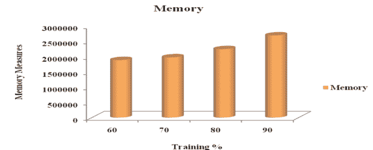

图 1. 所提内存措施的图形表示。

我们可以获得所提阅读障碍预测的内存措施值，它将随训练百分比 60、70、80 和 90 而变化。在所提技术中，测试百分比为 60 时完成一个过程需要少量内存，耗时 1877527 毫秒。

图 2 显示所提准确率措施的图形表示。

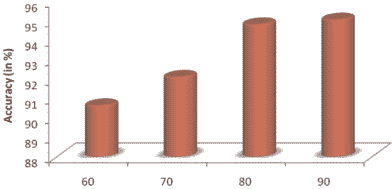

图 2. 所提准确率措施的图形表示。

在本研究中，我们已说明本研究的准确率措施，它将随测试百分比 60、70、80 和 90 而变化。图 3 显示所提精确率措施的图形表示。

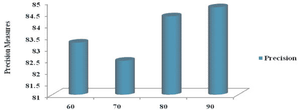

图 3. 所提精确率措施的图形表示。

我们可以获得所提阅读障碍预测的精确率措施值，它将随训练百分比 60、70、80 和 90 而变化。在所提技术中，测试 60% 时结束一个过程所需内存量最少，耗时 83.24% 以完成一项程序。图 4 显示所提研究回召率措施的图形表示。表 2 显示基于训练百分比的所提研究回召率措施。

表 2. 基于训练百分比的所提研究回召率措施。

| 训练百分比 | 回召率 |
|---|---|
| 60 | 73.28 |
| 70 | 72.61 |
| 80 | 74.16 |
| 90 | 75.22 |

所提基于组合核的阅读障碍检测方法采用基于 SVM 核及其变体的阅读障碍检测器进行评估。所提模型优于基于 ML 和 DL 的阅读障碍检测模型。所提模型的准确率高达 90.36%。

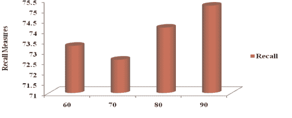

图 4. 所提研究回召率措施的图形表示。

#### 5.2 比较分析

在相关工作部分，通过考虑此类最新技术的局限性并解决相关问题，回顾了一些现有方法用于我们的研究。图 5 显示所提模型的准确率比较。

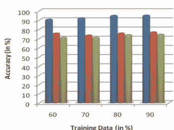

图 5. 准确率比较。

所提组合核 SVM 与现有 SVM 和模糊模型相比表现更好。利用此比较结果，我们可以评估所提工作的性能，看其是否具有非常好的分类效率（Khan et al. 2022）。表 3 显示所提模型与现有模型的比较研究，用于从不同类型数据（如 fMRI 图像、MRI 图像、心理评估、手写体、眼动和脑电图信号）中分类阅读障碍（Hosseinzadeh et al. 2022）。

表 3. 所提模型与其他现有模型用于阅读障碍检测的比较研究（Aski et al. 2023; Bhatt and Sharma 2023; Rahkra et al. 2021; Rida et al. 2016; Tharewal et al. 2022; Vyas et al. 2022; Yao et al. 2021）。

| 数据类型 | 特征 | 所提模型 | 准确率 % |
|---|---|---|---|
| 脑电图信号 | 最大峰值幅度、频谱平坦度和正区域 | 支持向量分类器集成 | 86.3% |
| 阅读和写作评估 | URAWSS 测试评估得分 | 决策树和随机森林 | 决策树和随机森林优于传统基于规则的方法 |
| 阅读 12 篇不同文本时的眼动 | 年龄、字体类型、平均注视次数、注视次数、注视总数、访问次数、平均访问次数、访问总和 | 二类 SVM 分类器 | 80.18 % |
| 教师和家长进行的阅读或写作评估 | 阅读和写作测试的评估得分 | 模糊无序规则诱导算法 | 报告称模糊模型优于传统基于规则的方法 |
| 阅读和写作表现 | 获得了三个不同范围的分数 | 人工神经网络 | 75% |
| 脑电图信号 | 通过使用达贝奇小波 2 阶的离散小波变换提取的特征（β频段功率） | 改进的 K 近邻分类器 | 建议在阅读障碍评估中使用 8 个最优电极位置 |
| 手写文本、图片和音频 | 从图片和音频文件中提取的特征 | 随机森林 | 90% |

### 6 结论

在本研究中，一种线性和二次核的组合核 SVM 使用脑图像在分布式环境中预测阅读障碍。实现了 Apache Spark MLlib，这是一种分布式方法，为大数据提供支持并解决大数据处理和执行问题。作为未来的改进，所提模型可以通过考虑更多输入参数进一步改进以更好地预测阅读障碍。未来，多模态定量 MRI 技术可用于更好地表征脑组织和发育性阅读障碍的发育曲线精细结构。现有系统的能力和性能将得到改进。

### 参考文献

- Appadurai, J.P. 和 Bhargavi, R., 2021. 阅读障碍的眼动特征集和预测模型：特征集和预测模型用于阅读障碍。*International Journal of Cognitive Informatics and Natural Intelligence (IJCINI)*, 15(4): 1–22.
- Aski, V.J., Dhaka, V.S., Parashar, A. 和 Rida, I., 2023. 医疗保健中的物联网：协议标准、赋能技术、WBAN 架构和开放问题的调查。*Physical Communication*: 102103.
- Belle, A., Thiagarajan, R., Soroushmehr, S.M., Navidi, F., Beard, D.A. 和 Najarian, K., 2015. 医疗保健中的大数据分析。*BioMed research international*, 2015.
- Bhatt, M.W. 和 Sharma, S., 2023. 基于对象识别的神经科学工程：未来实施研究。*Electrica*, 23(2).
- Dhiman, G., Soni, M., Pandey, H.M., Slowik, A. 和 Kaur, H., 2021. 一种基于新型混合超体积指标和参考向量自适应策略的多目标优化进化算法。*Engineering with Computers*, 37: 3017–3035.


Frid, A. and Breznitz, Z., 2012年11月. 基于SVM的利用ERPs分析和区分阅读障碍读者与普通读者的算法. In *2012 IEEE第27届以色列电气和电子工程师大会* (pp. 1–4). IEEE.

Gupta, A. and Awasthi, L.K., 2008年7月. 安全保护自身：在协作式点对点环境中保护单个对等体. In *GCA* (pp. 140–146).

Hosseinzadeh, M., Tanveer, J., Masoud Rahmani, A., Yousefpoor, E., Sadegh Yousefpoor, M., Khan, F. and Haider, A., 2022. 面向智慧农业物联网（IoT）的基于蜻蜓算法（DA）的簇树路由安全协议. *数学*, 11(1): 80.

Jothi Prabha, A. and Bhargavi, R., 2019. 利用机器学习预测阅读障碍——一次研究旅程. In *第三届微电子、计算和通信系统国际会议论文集：MCCS 2018* (pp. 23–34). 新加坡春洋出版社.

Khan, A.W., Yaseen, G., Khan, M.I. and Khan, F., 2022. 全球软件开发中软件外包人力资源成功因素的AHP优先级框架. *演进软件流程：趋势与未来方向*: 151–173.

Mohamad, S., Mansor, W. and Lee, K.Y., 2013年8月. 儿童阅读障碍诊断神经技术综述. In *2013 IEEE第3届系统工程与技术国际会议* (pp. 389–393). IEEE.

Prabha, A.J. and Bhargavi, R., 2020. 基于注视和跳跃眼动事件的阅读障碍预测模型. *生物医学计算机方法与程序*, 195: 105538.

Prabha, J.A., Bhargavi, R. and Harish, B., 2019. 基于眼动注视事件的阅读障碍预测模型. *国际工程先进技术杂志*, 9(IS3): 20.

Prabha, J.A., Bhargavi, R. and Ragala, R., 2019. 分布式环境下利用支持向量机预测阅读障碍. *国际工程技术杂志*, 20: 2795–2799.

Rakhra, M., Singh, R., Lohani, T.K. and Shabaz, M., 2021. 基于元启发式和机器学习的农业设备租赁与共享智能引擎. *工程中的数学问题，2021*: 1–13.

Rida, I., Boubchir, L., Al-Maadeed, N., Al-Maadeed, S. and Bouridane, A., 2016年6月. 基于统计依赖特征选择和全局-局部保持投影的稳健无模型步态识别. In *2016年第39届电信与信号处理国际会议(TSP)* (pp. 652–655). IEEE.

Sahoo, P.K., Mohapatra, S.K. and Wu, S.L., 2016. 带有未来健康状况预测的医疗大数据分析. *IEEE Access*, 4: 9786–9799.

Shah, A., Ali, B., Wahab, F., Ullah, I., Amesho, K.T. and Shafiq, M., 2023. 基于熵的网格异常值处理方法：环境监测数据案例研究. *环境科学与污染研究*: 1–20.

Sharma, M., Gupta, A. and Singh, J., 2022. 互云环境中的资源发现：综述. *先进智能范式国际期刊*, 23(1–2): 129–145.

Soni, M., Dhiman, G., Rajput, B.S., Patel, R. and Tejra, N.K., 2021. 智慧城市应用中移动节点的节能安全数据传输方案. *无线个人通信*: 1–21.

Tharewal, S., Ashfaque, M.W., Banu, S.S., Uma, P., Hassen, S.M. and Shabaz, M., 2022. 基于深度强化学习的工业物联网入侵检测系统. *无线通信与移动计算，2022*: 1–8.

Ullah, I., Liu, Y., Su, X. and Kim, P., 2019. 水下环境中高效精确的目标定位. *IEEE Access*, 7: 101415–10426.

Vyas, S., Shabaz, M., Pandit, P., Parvathy, L.R. and Ofori, I., 2022. 医疗和农业中人工智能与区块链技术的融合. *食品质量期刊，2022*.

Yao, Q., Shabaz, M., Lohani, T.K., Wasim Bhatt, M., Panesar, G.S. and Singh, R.K., 2021. 面向基于视觉的振动信号处理与测量的3D建模与可视化. *智能系统期刊，30*(1): 541–553.

## 利用遥感、GIS和FBProphet进行植被变化的时间序列分析

Pushpendra Kushwaha, Azra Nazir, Rishita Bansal & Faisal Rasheed Lone

计算机科学与工程学院，VIT博帕尔大学，印度中央邦

### 摘要

预测技术对任何从预测未来事件或趋势中受益的行业或领域都至关重要，有助于更好的规划、资源分配和决策。现代农业需要高效利用土地，并将荒地重新转化为生产性地带。本研究旨在利用针对时间序列数据量身定制的预测技术，检测适合转化为绿地的潜在荒地，以提高农业产量。对NDVI（归一化植被指数）的时间序列分析评估了植被覆盖随时间的变化，识别趋势和模式，并绘制具有潜在恢复价值的区域地图。时间序列数据利用季节分解和统计建模等先进技术进行处理和分析，以识别植被行为中的显著变化，特别是着重于引入FBProphet模型，以阐明影响植被动态的时间模式和潜在因素。在本研究中，该模型应用于印度比哈尔邦卡托里亚一个村庄9年（2013–2022）的数据，该村庄已从荒地恢复为绿地。研究结果展示了FBProphet模型在分析NDVI时间序列数据和理解植被动态方面的有效性。通过提供更准确的趋势分解和强大的预测能力，FBProphet模型为土地利用提供了一种可持续的方法，惠及当地社区和更广泛的环境。

### 1 引言

预测技术长期以来在从经济学到气象学的各个领域中一直至关重要。其在农业领域，尤其是在土地利用领域的应用仍相对处于起步阶段，但前景极其广阔。时间序列数据以其按时间排序的信息，为分析提供了丰富的来源（Mahalakshmi et al. 2016）。本研究致力于通过对这类数据应用预测技术，预测荒地的位置及其可被恢复的潜力。土地利用方式、森林砍伐和气候变化导致了当地生态系统的退化和关键生态系统服务的枯竭。为应对这一严峻局面，本研究寻求利用先进的遥感技术，并应用归一化植被指数（NDVI）的时间序列分析来监测和恢复植被动态，以提高农业产量。

本研究的核心方法涉及利用Google Earth Engine（GEE）的能力，这是一个专为分析大量卫星影像和地理空间数据而设计的强大的基于云的平台。利用NDVI时间序列分析的重要性在于其能够揭示植被覆盖的长期趋势和变化，这对于理解土地转变和恢复的动态至关重要。本研究旨在通过监测这些趋势来识别植被增长和衰退的模式，从而在实施有针对性的恢复工作时做出明智的决策。卡托里亚村被选为数据收集的案例研究。该村位于易受土地退化和荒漠化影响的地区。这些变化使该地区成为收集土壤健康和植被覆盖时间序列数据的理想场所。

遥感和GIS已被用于描述研究区的不同特征。Landsat 8，正式名为Landsat数据连续性任务（LDCM），是由美国地质调查局（USGS）和美国国家航空航天局（NASA）运营的卫星。Landsat携带两种主要仪器：运行地球成像仪（OLI）和热红外传感器（TIRS）。OLI传感器在九个光谱波段中捕获数据，包括可见光、近红外和短波红外。与其前身相比，OLI传感器具有改进的信噪比性能、辐射分辨率和空间分辨率。TIRS传感器测量地球的热红外辐射，提供温度数据以监测地表温度和热辐射。不过，主要焦点仍然放在OLI传感器上，用于查找NDVI参数。

传统的预测模型，如ARIMA，需要大量的参数调整以及分析和统计方面的专业知识（Newbold 1983）。FBProphet是Facebook创建的一个开源库，可以简单地集成到自动化生产系统中，并且只需要很少的领域知识（Montgomery et al. 2015）。已采用多方面的方法来增强植被覆盖的NDVI预测。该方法提高了预测准确性，并确保模型能够适应动态的环境条件。通过在卫星影像上实施云去除算法，减轻了云层遮挡造成的阻碍，从而增加了可用训练数据的频率。

此外，生成仅植被掩膜的分类算法通过隔离植被区域，允许更精确地计算NDVI。为了进一步提升模型性能，以最短的重访时间访问图像源，从而能够捕捉NDVI的快速变化，这对于实时监测尤为关键。该方法超越常规预测；它还包括识别和整合自然灾害、干旱或森林火灾等重大事件，这些事件可能引起NDVI的显著变化。通过将预测误差作为回归量纳入FBProphet模型，一个反馈循环不断改进预测并提高准确性。这种整体且数据驱动的策略确保了NDVI预测的全面改进，以适应不断变化的景观和环境影响。

### 2 相关工作

已利用时间序列分析在各种问题领域开展了大量NDVI分析研究。（Martinez and Gilbert 2009a）实现了一种基于小波变换（WT）的多分辨率分析（MRA），用于研究NDVI时间序列。（Waylen et al. 2014）提供了一项深入的调查，旨在从图像处理中寻找地球的植被和森林砍伐。（Martinez and Gilbert 2009b）讨论了遥感和归一化植被指数的各种技术。作者广泛涵盖了当前十年图像处理的理论和实证贡献。此外，（Zaidi et al. 2017）考察了利用各种深度学习技术生成NDVI的问题。（Gao et al. 2023）提出了一项包含NDVI预测模型的研究，该模型基于时间序列分解（TSD）、长短期记忆网络（LSTM）和卷积神经网络的组合。建立了两个基于历史信息的温度和降水预测模型，以及四个基于温度、降雨及其历史信息的NDVI预测模型，以验证TSD-CNN-LSTM模型的性能并探究NDVI对气候因素的响应。当结合相关性分析的结果时，可以得出结论：温度对NDVI变化的影响最为显著，其次是降水，其影响最小。（Khamchiangta and Dhakal 2020）对NDVI的不同预测模型进行了全面的比较分析，包括传统时间序列方法和深度学习


方法，以及 FBprophet。他们的工作为每个模型的优势和局限性提供了宝贵的见解。结果表明，FBprophet 在捕捉 NDVI 数据固有的季节性和趋势模式方面始终优于其他方法。（Kumar Jha and Pande 2021）探索了将机器学习模型（包括 FBprophet）应用于 NDVI 预报的可能性。他们的研究表明，FBprophet 在捕捉 NDVI 时间序列中的季节性和长期趋势方面具有潜力，这对于评估植被健康和土地利用管理至关重要。他们强调了该模型处理缺失数据点和异常值的能力，使其适用于现实世界的应用。

### 3 方法论

FBProphet 模型将任何时间序列数据分解为与趋势、季节性、事件或节假日相关的组成部分。它可以用方程 1 表示，其中 T(t) 是用于趋势分量建模的逻辑或分段线性增长曲线。时间序列中的周期（每日、每周、每月和每季度）用符号 S(t) 表示。H(t) 是非计划事件或节假日的影响，是一个无法在数学上建模的噪声项。

\(Y(t) = T(t) + S(t) + H(t) + \epsilon\)

重要的是要强调，FBProphet 将预测视为曲线拟合工作，而非典型的基于时间的相互依赖。这种新观点对 FBProphet 在域特定知识要求较低的情况下产生精确预测的能力至关重要。作为分解过程的一部分，时间序列数据被分为趋势、季节性和残差。趋势是时间序列的长期趋势或方向。季节性是时间序列中每日、每周或每年发生的周期性重复模式。在残差中，Prophet 允许将节假日和特殊事件作为附加组成部分纳入，这些部分可能会影响时间序列。必须强调根据数据特征选择正确类型（逻辑增长或分段线性）的重要性。例如，如果 NDVI 数据显示出饱和增长的迹象，则应选择逻辑增长模型。另一方面，如果 NDVI 数据显示出过去增长或收缩趋势的线性特征，则默认分段线性模型更可取。该模型可以容纳线性趋势，使其适用于各种业务和环境数据。该模型的数学表达式由方程 2 给出。这里，C 是承载能力，表示饱和增长模型能达到的最大上限。应将其设置为反映数据的增长能力。k 是影响数据趋近承载能力速率的增长率参数。它应与数据的实际增长率相匹配。另外，m 是模型的垂直偏移量参数。可以对其进行调整以使模型与数据对齐。

\(g(t) = \frac{C}{1 + e^{-k(t-m)}}\)

分段线性模型使用统计方程 3 进行拟合，其中 c 是趋势变点，可根据需要进行微调。

\(y = \begin{cases} \beta_0 + \beta_1 x & x \le c \\ \beta_0 - \beta_2 c + (\beta_1 + \beta_2)x & x > c \end{cases}\)

### 4 实验设置与数据集

本文研究区域位于比哈尔邦的外围地区。卡托利亚村靠近班卡县。该村曾是一片贫瘠之地，不适合耕作，因此 2015 年植被稀少。然而，凭借决心、社区参与和造林项目，绿色植被在 2021–2022 年得以恢复。这些年观察到的变化非常适合 AI/ML 模型所需的定量预测技术。本研究使用的数据集是标准的 Landsat-8 Collection 1 Tier 1 8 天 TOA 反射率合成产品[12]。Landsat 数据产品被组织为不同的集合。Collection 1 代表对 Landsat 8 数据的首次系统处理，遵循特定标准以确保一致性和准确性。USGS 提供不同处理层级的 Landsat 数据。Tier 1 产品是大气顶部（TOA）反射率，这意味着数据表示在任何大气校正之前，地球表面反射光量的原始测量值。数据经过 8 天合成。USGS 不是提供单张图像，而是通过合并 8 天时间窗口内获取的多个无云场景的数据来创建合成图像。大气顶部（TOA）反射率是地球表面反射的阳光量，在大气顶部进行测量。该指标对于比较不同地点和日期的地表反射率值非常有价值。这种 8 天合成对于监测土地覆盖和植被随时间的变化特别有用，因为它最大限度地减少了云层和大气影响对单个图像中地球表面的遮蔽。

图像提取使用 LANDSAT/LC08/C01/T1_SR 进行，云覆盖率为 20%，图像提取时间范围为 2013 年至 2023 年。这通常意味着图像是在云覆盖率低于 20% 的天数从卫星获取的，使用了 B4 和 B5 波段。图 1 对比了 2013 年（该村仍为贫瘠之地）和 2022 年（部分土地已恢复）的村庄影像。从每张图像中提取了 NDVI 值，并按月插值以获取该时期内更一致的数据。

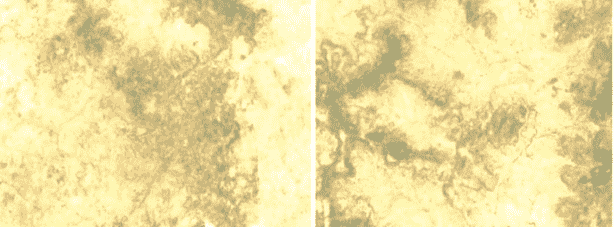

图 1. 2013 年（左）与 2022 年（右）卡托利亚卫星影像。

使用 NDVI 提取了卡托利亚地区 3 波段卫星图像中所见的不同特征。基于绿色植被独特的反射模式，植被指数使我们能够定义土壤和植被的分布。NDVI 是一个简单直接的数值指标，可用于评估遥感平台的数据，并确定被检查的目标或对象是否有活的绿色植被。NDVI 使用方程 4 确定，其中 NIR 代表近红外反射率，RED 代表可见红反射率。

```
RNDVI = (NIR - RED)/(NIR + RED)       where 0 < NDVI < 1          (4)
GNDVI = (NIR - GREEN)/(NIR + GREEN)   where 0 < NDVI < 1
```

岩石、沙地或雪覆盖的沙漠对应非常低的 NDVI 值（0.1 及以下）。高值代表温带和热带雨林（0.6 至 0.8），而中等值则意味着灌木和草地（0.2 至 0.3）。水体用负 NDVI 值表示，而裸地则用最接近 0 的 NDVI 值表示（Montgomery et al. 2015）。

### 5 性能分析与可视化

模型性能通过将预测值与测试数据进行比较来评估。比较采用均方误差（MSE）、平均绝对误差（MAE）和根均方误差（RMSE）。对这些指标取平均值并命名为 'average_score'，以了解预测与测试数据的整体拟合程度。图 2 显示每月插值数据。对数据的每月分析表明，由于云量和降雨量较大，7 月份可用数据较少，见图 3。另外，9 月是作物的开花期，黄花可能会降低 NDVI 值。6 月是该地区最热的月份，NDVI 最差，表明该地区不适合种植夏季作物。从 10 月到 1 月的所有冬季月份 NDVI 指数最高，表明该地区适合种植冬季作物。植物在 10 月开始形成谷粒。因此，NDVI 指数出现显著峰值。这是农民需要确保田地保持灌溉且有足够阳光供谷粒成熟的时期。后 COVID 年份 NDVI 指数增加，表明 COVID-19 之后作物生长更好，指数变化可能有多种原因。

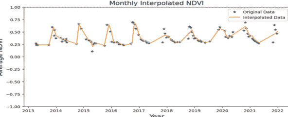

图 2. 多年平均 NDVI 与每月插值数据。

2015 年的 NDVI 指数最低，数据中异常值最多，见图 3。根据印度气象部门（IMD）的说法，比哈尔邦直至 2015 年中期都出现降雨不足，降雨量低于平均值 28%，宣布发生干旱。箱线图中的水平线代表中位数 NDVI，箱的下边缘和上边缘分别代表第一四分位数和第三四分位数，而须线代表数据的最小值和最大值。须线显示数据中有少数异常值，部分 NDVI 值低于 0.2 或高于 0.7。然而，这些异常值相对较少。

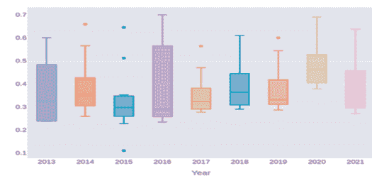

图 3. 带有数据异常值的年度 NDVI 指数。

图 4 可视化了作物健康状况。可以得出结论，在这些年份中，大多数作物处于不健康区域，只有少数作物处于适度


健康区域。健康区域内的作物数量显著较少，因为这些作物并非全年生长。某些特定月份的NDVI指数较高。如果已知影响植物健康的因素，NDVI分析可以指导在哪里进行进一步或更广泛的损害评估。记录的最大NDVI为0.69，最小为0.11。NDVI在0.27至0.359之间表示植物中等健康。

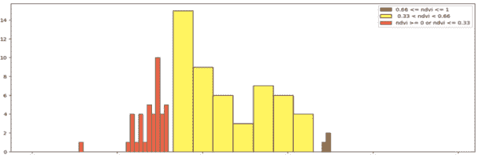

图4. 描绘耕作健康状况的NDVI指数。

2013年至2022年数据的趋势、季节性和残差如图5所示。本研究的建模练习仅限于基础模型结构。然而，增强的潜力巨大，包括纳入FBProphet的强大功能，例如容纳饱和式增长、检测趋势转变以及捕捉独特事件的影响。

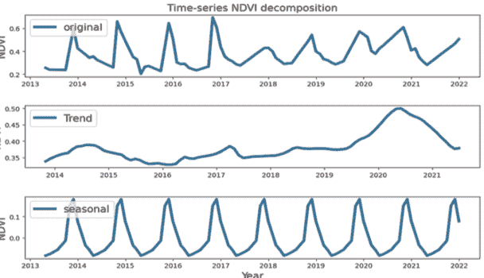

图5. 2013年至2022年NDVI的时间序列分解。

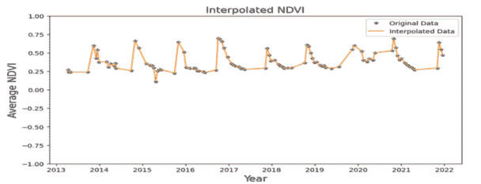

图6. 按日频率对数据进行上采样。

FBProphet被用于对收集数据的NDVI进行预测建模。与基于时间的依赖不同，FBProphet将预测视为曲线拟合问题。日期列通过每日插值上采样至日频率，以增加数据量以获得更准确的预测，且NDVI值已通过线性插值填充任何缺失值，如图6所示。

训练数据包含从时间序列开始到截止日期的所有NDVI值，而测试数据包含从截止日期到时间序列结束的所有NDVI值。图7中的图表显示了随时间变化的NDVI值，训练数据为绿色，测试数据为蓝色。y轴范围为-1到1，x轴显示年份。该图表展示了数据如何根据2020-01-01的截止日期划分为训练集和测试集。

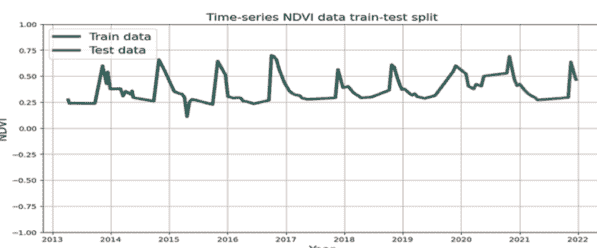

图7. 训练集和测试集划分。

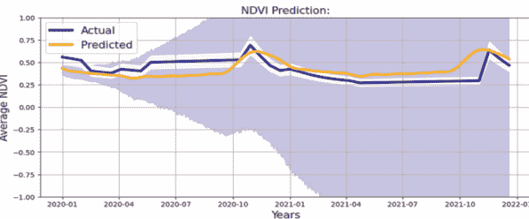

图8. 基于原始数据的预测结果。

将FBProphet模型应用于NDVI数据，每日季节性设置为false，预测频率设置为每日。从结果可以看出，实际NDVI数据不频繁，而模型基于每日观测进行训练。更频繁的数据预计将显著改善预测。训练模型的MSE为**0.0137**，MAE为**0.100**，RMSE为**0.11**，平均得分为**0.077**。图8中的阴影区域显示了未来时间轴预测的不确定性。阴影区域越宽，预测的不确定性越大，而较窄的部分则相对提供预测的确定性。我们的方法产生了有价值的结果，并可生成针对农业增强的潜在荒地列表。可以将触发NDVI数据变化的特殊事件（如自然灾害、干旱或森林火灾）纳入FBProphet模型，以实现更稳健的预测。可识别预测误差并将其作为回归器添加，以进一步增强模型。

### 6 结论

在现代技术与传统农业实践的交汇处，蕴含着提高产量和更可持续土地利用的承诺。本文提出了一项综合研究，通过将预测技术与时间序列分析相结合，将荒地转化为绿地。该研究利用Google Earth Engine和FBProphet模型来监测和恢复植被动态，为生态平衡和气候变化缓解作出贡献。该研究强调了解决如Katoria等地区土地退化和荒漠化的作用，并强调了NDVI作为植被健康指标的作用。值得注意的是，分析揭示了气候因素和特殊事件（如COVID-19大流行）对NDVI趋势的影响。将FBProphet模型集成到NDVI值预测和适应基于事件的变化方面显示出前景，将贫瘠土地转变为繁花似锦的田野。然而，未来的改进可能包括纳入更多变量并更深入地了解影响植被动态的本地因素。

### 参考文献

- Cohen, W.B., Healey, S.P., Yang, Z., Zhu, Z. 和 Gorelick, N. 2020. 多样化的算法和光谱波段输入可改善Landsat森林扰动监测。遥感 2020, Vol. 12, 第1673页 12(10), p. 1673. 可在以下网址查阅: https://www.mdpi.com/2072-4292/12/10/1673.htm.
- Gandhi, G.M., Parthiban, S., Thumalu, N. 和 Christy, A. 2015. NDVI：利用遥感和GIS进行植被变化检测——Vellore地区的案例研究。程序计算机科学 57, pp. 1199–1210. doi: 10.1016/J.PROCS.2015.07.415.
- Gao, P., Du, W., Lei, Q., Li, J., Zhang, S. 和 Li, N. 2023. 基于时间序列分解和CNN-LSTM组合的NDVI预测模型。水资源管理 37(4), pp. 1481–1497. 可在以下网址查阅: https://link.springer.com/article/10.1007/s11269-022-03419-3.
- Khamchiangta, D. 和 Dhakal, S. 2020. 与城市热岛强度相关的土地利用和土地覆盖变化时间序列分析：泰国曼谷都会区案例。城市管理杂志 9(4), pp. 383–395. doi: 10.1016/J.JUM.2020.09.001.
- Kumar Jha, B. 和 Pande, S. 2021. 基于FBProphet的超市销售预测时间序列模型。计算方法与通信国际会议论文集 – 第5届，ICCMC 2021, pp. 547–554. doi: 10.1109/ICCMC51019.2021.9418033.
- Mahalakshmi, G., Sridevi, S. 和 Rajaram, S. 2016. 时间序列数据预测综述。2016年计算技术与智能数据工程国际会议，ICCCTIDE 2016. doi: 10.1109/ICCTIDE.2016.7725358.
- Martinez, B. 和 Gilabert, M.A. 2009a. 利用小波变换对NDVI时间序列分析中的植被动态。环境遥感 113(9), pp. 1823–1842. doi: 10.1016/J.RSE.2009.04.016.
- Martinez, B. 和 Gilabert, M.A. 2009b. 利用小波变换对NDVI时间序列分析中的植被动态。环境遥感 113(9), pp. 1823–1842. doi: 10.1016/J.RSE.2009.04.016.
- Montgomery, D.C., Kulahci, M. 和 Jennings, C.L. 2015. 时间序列分析与预测导论。
- NDVI，在集合上映射函数，质量镶嵌 | Google Earth Engine | Google开发者。可在以下网址查阅: https://developers.google.com/earth-engine/tutorials/tutorial_api_06.
- Newbold, P. 1983. ARIMA模型构建与预测的时间序列分析方法。预测杂志 2(1), pp. 23–35. 可在以下网址查阅: https://onlinelibrary.wiley.com/doi/full/10.1002/for.3980020104.
- Waylen, P., Southworth, J., Gibbes, C. 和 Tsai, H. 2014. 土地覆盖变化时间序列分析：开发统计工具以确定持续性分析中土地覆盖变化的显著性。遥感 2014, 6(5), pp. 4473–4497. 可在以下网址查阅: https://www.mdpi.com/2072-4292/6/5/4473.htm.
- Zaidi, S.M., Akbari, A., Samah, A.A., Kong, N.S., Isabella J. 和 Gisen, A. 2017. 基于NDVI和半监督分类技术的Landsat-5时间序列分析用于土地利用/土地覆盖变化检测。波兰环境研究杂志，2017, 26(6), pp. 2833–2840. 可在以下网址查阅: http://umpir.ump.edu.my/19825/1/Pol.J.Environ.Stud.Vol.26.No.6.2833-2840.pdf.

## 精准农业智慧农业的进展：Green-IoT和机器学习作为解决方案

Monia Digra & Preeti Rajput
印度查谟和克什米尔地区查谟的工程技术模范学院

Pooja Sharma
印度查谟和克什米尔地区卡特拉的什里·玛塔·瓦伊希诺·德维大学计算机科学与工程学院

### 摘要

农业发展对于消除贫困和推动新兴国家经济增长至关重要。全球人口预计到2050年将达到97亿。智能精准农业必须在不牺牲质量、营养或自然资源的前提下提高农业生产力。由于互联网技术，物联网和AI/ML在农业中具有重要应用。尽管物联网有许多好处，但大量联网设备可能因能耗而增加碳排放和电子垃圾。受可持续智能农业目标的启发，本文探讨了基于物联网的智能农业中的主要成果和研究差距，并为农业中节能的Green-IoT（G-IoT）应用提供解决方案。我们从G-IoT的演变和智能农业应用入手。我们还考察了绿色架构如何在智能农业中高效应用AI/ML。我们提出了一个用于智能农业的AI/ML G-IoT框架，包含绿色传感器云和绿色AI。这一独特的G-IoT范式提供了可持续且节能的农业架构。我们调查了统计和实验数据，并强调了在农业中采用G-IoT和AI/ML架构的局限性。总之，G-IoT和AI/ML架构可以实现可持续、节能的智能精准农业。

### 1 引言

农业在任何国家的经济增长中都发挥着重要作用。2014年，全球农业约占国内生产总值（GDP）的三分之一（世界银行，2015）。例如，根据2018年印度经济调查，印度在农业产出方面排名第二，仅次于美利坚合众国。它贡献了印度17–18%的GDP，并雇佣了50%的劳动力（印度统计与方案实施部 | 印度政府）。像其他发展中国家一样，传统农业是印度经济的主要和主导活动。每年，全球新增数以百万计的食品消费者。农业生产将受到气候变化和全球变暖的影响。然而，像印度这样的所有发展中国家都面临与农业产出相关的多重风险和不确定性。无计划的灌溉、农作物和农药管理不善以及病原体和杂草的传播导致产量赤字。

然而，物联网设备和应用会产生碳排放，消耗大量能源，并产生电子垃圾和有毒污染物。这些也必须绿色化，以应对全球变暖和气候变化。解决这一问题的方案是智能农业中的Green-IoT（G-IoT）。G-IoT专注于绿色设计，使用低能耗设备、低数据传输能源和无碳材料，并促进可重用性和最小温室气体排放以应对气候变化（Arshad et al. 2017）。

从图1所示的谷歌网络搜索数据来看，过去一年中，“智能农业”、“物联网”和“绿色技术”等关键词的流行度正在上升。


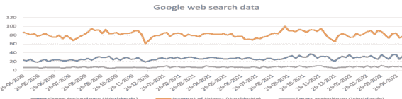

图 1. Google 趋势识别出过去 2 年的关键词“智慧农业”、“物联网”和“绿色技术”。

### 2 相关工作

#### 2.1 Green-IoT

物联网（IoT）的指数级增长带来了连接性的革命性转变，通过无缝连接设备、传感器和数据，彻底改变了各个行业和我们的日常生活。虽然物联网带来了显著的便利和效率，但人们对其对环境的影响日益关注。由于对能源消耗、资源利用和废物产生的担忧，人们对物联网与可持续性相结合的兴趣显著增加。这促成了“绿色物联网”的出现。

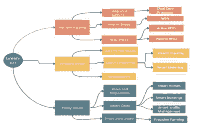

图 2. Green-IoT 分类体系。

本文旨在对绿色物联网进行广泛研究，探讨其基本原理、实际应用、障碍及可能的解决方案。我们的研究旨在探讨物联网与环境可持续性的融合，重点关注绿色物联网如何加速向更加环境友好的未来过渡。

#### 2.2 智慧农业 G-IoT 应用

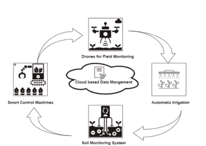

图 3. 农业中 G-IoT 的应用。

我们研究了智慧农业应用和 G-IoT 概念。图 3 显示了智慧农业的综合模型。绿色物联网在智慧农业的各种数据层级中有众多应用，包括数据过滤或清洗、数据处理、数据分类、数据上下文化和数据压缩（Maddikunta et al. 2021；Ruan et al. 2019）。上述模型表明，无人机比人类更能有效监测大面积土地。这些可以轻易识别养分缺乏、病虫害、杂草和温度，以确定植物胁迫。SP2F 框架提供安全限制、可扩展性、可追溯性和容错能力（Kumar et al. 2021）。可再生能源，如风能和太阳能，可以提高无人机电池续航能力（Adão et al. 2017；Maddikunta et al. 2021）。智能灌溉和农业管理系统可由 G-IoT 控制。

农民可以使用用户友好的软件界面随时随地监控农场活动，以控制节能且经济高效的自动灌溉系统。智能电网、预测性维护和可再生能源系统可以采用 G-IoT（Ku et al. 2016）。配备温度、湿度和水分传感器的太阳能智能灌溉系统解决了这一问题。像 Agbots 这样的自主智能控制机器人解决了作物管理

表 1. 基于 IoT 的智慧农业中以 G-IoT 作为解决方案的研究发现与缺口。

| Ref. | Year | Focus area | Research findings and gaps with G-IoT as a solution. |
| --- | --- | --- | --- |
| (Farooq et al. 2020) | 2020 | 精准农业 | 作者描述了使用物联网的农业中各种物联网传感器、协议和网络，但在提供节能协议、绿色网络技术、绿色处置和低碳排放的高效通信方面存在不足。 |
| (Khanna & Kaur 2019) | 2019 | 精准农业 | 作者讨论了基于物联网的智慧农业中的物联网通信协议、开放问题和挑战。作者未提供智慧农业的现有框架或架构。它缺乏提供使用 G-IoT 通信协议的解决方案。 |
| (Kour & Arora 2020) | 2020 | 智慧农业 | 作者解释了各种通信协议、目标、物联网操作系统、架构，并讨论了作物监测、灌溉、农场管理和病害检测等智慧农业应用及各种未来方向，但在为未来世界提供智慧农业中高效且可持续的绿色框架作为解决方案方面存在不足。 |
| (Saad et al. 2020) | 2020 | 水资源管理 | 作者专注于水资源管理问题，并提出了力求优化水资源消耗并提高农业整体质量的技术。强烈建议具备在流域管理系统中进行控制和决策的节能实时信息处理能力。 |
| (Farooq et al. 2019) | 2019 | 智慧农业 | 研究人员探讨了各个城市开放政策下智慧农业的众多物联网问题和安全要求。作者应提出绿色通信、绿色处置、降低能源消耗和改善可持续性的概念。 |
| (Ferrag et al. 2019) | 2019 | 雾计算支持的物联网 | 作者应在雾计算层配置代理服务器，并在智慧农业中使用匿名密钥协商协议。 |
| (Boursianis et al. 2022) | 2022 | 智慧农业中的无人机和物联网 | 作者分析了无人机在众多场景中的应用，如农药和杂草控制、植物生长监测、肥料和作物病害，以说明无人机在智慧农业中的重要性。作者应引入优化算法以提高能效的概念，还可以利用太阳能减少无人机设备的功耗。 |

机械。借助这些 Agbots，可以实现数据驱动的决策、土壤健康压实、自主杂草和病虫害分类等更多功能。AI 算法教导这些 Agbots 识别害虫、识别水果并对其进行计数（Agbots 2020）。为了在农业中做出正确的决策、预测、预报和预测模型，整个生命周期内必须处理大量数据（Mohannraj et al. 2016）。云计算或雾计算可以处理海量数据，以做出正确判断并利用 G-IoT 自动化农业流程（Bibri 2018）。

#### 2.3 精准农业中 AI/ML 的行业应用

本节展示了精准农业中 AI/ML 的工业应用。表 2 列出了精准农业中采用大数据分析、移动计算、云计算、物联网和 AI/ML 的软件平台。我们总结了这些应用的优势，并说明这些应用是否采用 G-IoT。

表 2. 智慧农业中 G-IoT 的软件应用。

| Applications | Adapted G-IoT Yes/No | Strength | Description |
| --- | --- | --- | --- |
| CropIn (CropIn, n.d.) | 是 | 所提出的框架提供病虫害监测与检测、风险管理和畜牧管理。 | 一个提供警报日志的应用，用于检测农药、卫星信息、可追溯性和产出生产力、地理标记。 |
| AgNext (AgNext – digitizing food quality 2019) | 是 | 它提供基于 AI 的技术来计算茶叶叶片并提供国际市场趋势。 | 该应用通过图像分析、光谱分析和传感器分析提供质量、可追溯性和数据倡议。 |
| CropX Technologies (CropX technologies 2022) | 是 | 通过优化土壤分析实现智能灌溉和优化氮管理。 | 智能灌溉解决方案，为各种豆类、水稻和小麦提供基于应用的平台。 |
| Biz4intellia (An End-to-End IoT Solutions provider n.d.) | 是 | 用于土壤分析和智能农业的一体化平台。 | 一个提供土壤和作物管理解决方案的框架。它使用 ML 和大数据提供土壤分析、疾病检测、能源管理、畜牧跟踪等。 |
| Semios (Know more, worry less.) TM 2020 | 是 | 使用大数据和 ML 提供预测分析解决方案。 | 一个拥有用于产量改进的工具的平台。它用于评估植物生长和检测疾病。该平台使用无人机提供监控系统。它通过收获前预测提供紧急和早期生长评估。 |
| Sensely (Agriculture 2022b) | 是 | 它仅使用无人机监测田地。 | |
| Farm Management Software (Farm-Logs.) | 否 | 该框架提供当前市场价格和价格波动。 | 该平台维护作物，便于规划和监测田地状况。 |
| Plantix (PEAT GmbH. n.d.) | 否 | 用于疾病检测。 | 智能手机应用程序，使用 ML 算法检测任何植物中存在的疾病。 |
| Farmapp (Farmapp. n.d.) | 否 | 该平台用于比较以前和当前的措施，并提供农场活动（如疾病、害虫等）的预测值。 | 一款软件应用程序，可快速将数据记录到服务器中，并以图表和图形的形式提供解决方案报告。 |


### 3 讨论

#### 3.1 统计与元分析

通过在SCOPUS、IEEE Xplore等各种数据库中进行筛选和资格审查，共识别出197篇文章。然后使用搜索查询“green AND IoT AND internet AND of AND things AND farming AND agriculture”对这些文章进行了进一步筛选。经此筛选，最终确定了36篇文章的数据库。这36篇文章被接受纳入元分析，如图4所示。

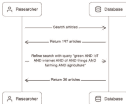

图4. 搜索数据库和元分析的序列图。

与大多数关于基于IoT的智能农业的文章一样，IoT通过控制灌溉、自动化农业生产并使日常工作变得轻松，迅速增长以提供高质量的收获，但它也产生碳排放、能源使用和电子废弃物。将基于IoT的应用转变为Green-IoT旨在减少碳足迹并增强模型。在图5中，它总结了使用AI/ML技术对基于IoT的智能农业研究文章进行的统计分析。如图6所示，预计未来几年G-IoT领域的文章范围将不断扩大，整个社区已将兴趣转向绿色通信，以实现可持续环境，这是大多数先进方法在各种应用中的趋势。通过统计分析，我们得出结论：基于G-IoT的应用仍处于早期阶段，并在未来的各种应用中拥有广阔的前景。

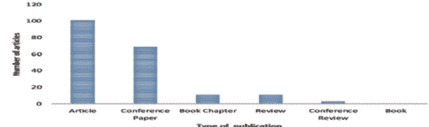

图5. 2013–2021年研究文章、会议和综述文章数量增加。

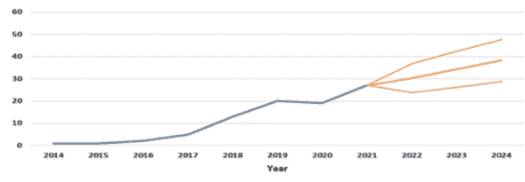

图6. 基于Green-IoT的应用预测。

#### 3.2 IoT与G-IoT应用的比较

基于IoT设备的智能设备的利用，这些设备需要强大的连接、可靠的接口以及实时分析和数据分析，被称为IoT的下一阶段（Neagu et al. 2019）。尖端的数字革命，以及5G技术、智能存储、智能农业、智能医疗等有效方法和策略，将改变我们未来的环境，使其更健康、更智能、更环保，同时保持高质量的服务。预计未来网络连接设备的数量将增长。因此，Green IoT架构必须适应。当前研究并未充分涉及智能农业政策和方法论，以实现更环保的智能农业。就作者所知，以往的研究尚未专注于分析基于G-IoT的智能农业中的技术和框架，例如启用ICT、降低能源消耗、降低CO2排放、尽量减少废弃物管理和增强可持续性。本文提出了为IoT设备供电的绿色能源方法。尽管有大量研究工作，但智能农业技术中的G-IoT仍处于初级阶段，如图7所示。

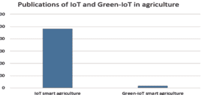

图7. 智能农业中IoT与G-IoT的比较。

表3. G-IoT中节能协议/算法的实验分析。

| 参考文献 | 关注领域 | 协议/算法 | 参数 | 能源效率 | 吞吐量 | 网络寿命 |
| :--- | :--- | :--- | :--- | :--- | :--- | :--- |
| (Abdul-Qawy & Srinivasulu, 2019) | Green IoT 启用的节能协议 | SEES | 剩余能量，最近中继节点。 | 62% | 114% | 42% |
| (Behera et al. 2019) | IoT应用中的剩余能量 | 增强型 – LEACH | 网络直径，节点总数，网络能量，能量耗散。 | + 64% | +60% | +66% |
| (Mahmud & Cho 2019) | Green UAVS中的FANET路由协议 | (EE-Hel-lo)节能方案。 | 移动模型，UAV数量，源/目的地对，丢失模型，信道容量，路由协议，仿真时间，数据包大小/速率。 | AODV (25%) 和 OLSR (23%) | +25% | – |
| (Shahid et al. 2020) | 使用缓存机制的雾计算 | 负载均衡算法 | 当前能量水平，计算节点容量，活动节点和计算可用性。 | 比基本缓存方法降低92.6%和82.7%的能耗。 | – | 增加。 |

#### 3.3 G-IoT中的关键问题和挑战

为使用G-IoT和AI/ML实现智能和精准农业应用的可靠准确系统，存在许多需要解决的挑战。这些挑战如下：

##### 3.3.1 实时数据和噪声干扰

基于G-IoT的智能农业使用实时传感器收集数据，从而实现明智决策和运营效率。然而，在大型网络中传输这些数据面临挑战。在大型云基础设施中实现实时数据处理可能会给架构设计带来复杂性。干扰和噪声可能会影响数据量和可靠性，可能导致数据丢失并降低G-IoT平台的整体可靠性。

##### 3.3.2 数据质量和准确性

传感器数据中存在数据噪声和不准确是常见现象，通常源于数据收集过程中的固有限制和潜在故障。在决策环境下，保持数据的准确性和可靠性至关重要。讨论主题涉及设备或系统的校准和维护。

##### 3.3.3 数据安全

(Turgut and Boloni 2017)的工作阐述了物联网(IoT)环境下的隐私和安全问题。(Asplund and Nadjm-Tehrani 2016)认为，实施IoT设备的主要障碍是安全性。在农业领域，G-IoT设备的实施面临盗窃、入侵或动物干扰造成的潜在篡改等挑战，因此在开放田间环境中部署这些设备面临困难。机器学习应用有可能引入伪造数据，从而破坏系统的可靠性和完整性。在智能农业环境中，保护隐私是一个重要的考虑因素，因为大量数据来自个人，他们可能担心其私人信息可能被泄露。

##### 3.3.4 优化方法

资源优化是各个领域需要考虑的关键方面。G-IoT资源优化平台能够识别各种类型的传感器。根据(Turgut and Boloni 2017)，农业系统的感知能力可用于监测作物和牲畜，需考虑诸如要传输的数据量、云存储容量以及物联网(IoT)传感器数量等因素，所有这些都可能取决于农田的规模。为了降低农民的开支并提高作物生产力和盈利能力，有必要实施一个复杂的物联网(IoT)框架。

### 4 结论

总之，在农业中使用G-IoT应用，结合AI/ML方法，可以促进精准农业并帮助解决世界饥饿问题。互联网向G-IoT的扩展使各种农业应用成为可能，使农业更智能、更高效。G-IoT允许农民远程监控农场活动，并使用可再生绿色能源高效管理农场。然而，在农业实践中大规模部署仍需解决一些关键问题和挑战。

未来在G-IoT方面的研究应着重于了解不同IoT应用的特征和服务需求、设计节能组件、考虑绿色IoT架构以在满足服务目标的同时优化能源使用，以及探索虚拟传感器即服务(SNaaS)的潜力，以供消费者访问和管理私有IoT。


### 参考文献

Abdul-Qawy, A.S.H. 和 Srinivasulu, T., 2019. SEES：一种面向绿色物联网异构无线节点的可扩展节能方案。环境智能与人性化计算期刊, 10(4), 第 1571–1596 页。

Adão T, Hruška J, Pádua L, Bessa J, Peres E, Morais R, Sousa J. 2017. 高光谱成像：基于无人机的农业和林业传感器、数据处理与应用综述。遥感. 9 (11):1110. https://doi.org/10.3390/rs9111110

AgNext – 数字化食品质量 | 基于人工智能的食品评估技术。Agnext [互联网]. https://agnext.com/

AgricultureAg Eagle Aerial Systems Inc [互联网]. [访问日期：2023年10月16日]. https://www.sensefly.com/industry/agricultural-drones-industry

AgriTech 故事、视频、文章、访谈、评论与新闻 | AgriTechTomorrow。www-agritechtomorrow.com [互联网]. https://www.agritechtomorrow.com/

端到端物联网解决方案提供商。Biz4Intellia [互联网]. [访问日期：2023年10月16日]. https://www.biz4intellia.com/

Arshad R, Zahoor S, Shah MA, Wahid A, Yu H. 2017. 绿色物联网：2020年及以后节能实践调查。IEEE Access. 5:15667–15681. https://doi.org/10.1109/access.2017.2686092

Asplund M, Nadjm-Tehrani S. 2016. 关键社会服务中物联网安全的态度与认知。IEEE Access. 4:2130–2138. https://doi.org/10.1109/access.2016.2560919

最佳农场管理软件。Bushel Farm [互联网]. [访问日期：2023年10月16日]. https://farmlogs.com

Bibri SE. 2018. 面向未来智能可持续城市的物联网：面向环境可持续性的传感器大数据应用分析框架。可持续城市与社会. 38:230–253. https://doi.org/10.1016/j.scs.2017.12.034

CropIn. 基于SaaS的农业科技 | 更智慧的农业技术解决方案。CropIn [互联网]. https://www.cropin.com/

CropX 农艺农场管理系统。CropX [互联网]. [访问日期：2023年10月16日]. https://www.cropx.com/

Farmapp.farmappwebcom [互联网]. [访问日期：2023年10月16日]. https://farmappweb.com

Farooq MS, Riaz S, Abid A, Abid K, Naeem MA. 2019. 物联网在智慧农业实施中的作用调查。IEEE Access [互联网]. [访问日期：2020年3月28日] 7:156237–156271. https://doi.org/10.1109/ACCESS.2019.2949703

Farooq MS, Riaz S, Abid A, Umer T, Zikria YB. 2020. 农业中物联网技术的作用：系统文献综述。电子学. 9(2):319. https://doi.org/10.3390/electronics9020319

Ferrag MA, Shu L, Yang X, Derhab A, Maglaras L. 2020. 基于绿色物联网的农业安全与隐私：综述、区块链解决方案与挑战。IEEE Access:1–1. https://doi.org/10.1109/access.2020.2973178

GmbH P. Plantix | 最佳农业应用。Plantix [互联网]. https://plantix.net/en/

GREENIQ.GREENIQ [互联网]. [访问日期：2023年10月16日]. https://greeniq.eu

Khanna A, Kaur S. 2019. 物联网的发展及其在精准农业领域的重大影响。农业计算机与电子学 [互联网]. [访问日期：2019年9月26日] 157:218–231. https://doi.org/10.1016/j.compag.2018.12.039

Kour VP, Arora S. 2020. 农业中物联网的最新进展：一项调查。IEEE Access. 8:129924–129957. https://doi.org/10.1109/access.2020.3009298

Ku M-L, Li W, Chen Y, Ray Liu KJ. 2016. 能量收集通信的进展：过去、现在与未来挑战。IEEE 通信概览与教程 [互联网]. [访问日期：2019年6月29日] 18 (2):1384–1412. https://doi.org/10.1109/comst.2015.2497324

Maddikunta PKR, Hakak S, Alazab M, Bhattacharya S, Gadekallu TR, Khan WZ, Pham Q-V. 2021. 智慧农业中的无人驾驶航空器：应用、要求与挑战。IEEE 传感器期刊.:1–1. https://doi.org/10.1109/jsen.2021.3049471

Neagu, G., Inculescu, M., Alexandru, A., Florian, V., & Rădulescu, C. Z. (2019). 下一代物联网及其对决策的影响：一个示例性案例研究。程序计算机科学, 162, 555–561.

Ruan J, Wang Y, Chan FTS, Hu X, Zhao M, Zhu F, Shi B, Shi Y, Lin F. 2019. 基于绿色物联网的农业及其财务、运营和管理问题的生命周期框架。IEEE 通信杂志 [互联网]. [访问日期：2020年1月16日] 57(3):90–96. https://doi.org/10.1109/mcom.2019.1800332

SemiosBIoTechnologies. Semios [互联网]. https://semios.com

世界银行. 2018. 农业与粮食。世界银行 [互联网]. https://www.worldbank.org/en/topic/agriculture.

Turgut D, Boloni L. 2017. 物联网中的信息价值与隐私成本。IEEE 通信杂志. 55(9):62–66. https://doi.org/10.1109/mcom.2017.1600625

## 面向个人物联网（PIIoT）的无服务器计算与边缘智能架构

Ankur Gupta & Surbhi Gupta

印度查谟-克什米尔查谟模范工程技术学院

摘要：无服务器计算已成为边缘部署应用的一个引人注目的范式，有助于提供高性能且轻量的服务。在边缘部署的服务通常消耗更少的计算和存储资源，同时提供相对较低的延迟。因此，无服务器架构非常适合个人物联网（PIIoT）的需求，PIIoT 是物联网的一个新兴子领域，其中数据采集、分析和计算在单个用户及其环境的背景下进行。对于此类环境，隐私保护、轻量级模型、紧急情况的快速检测以及服务的低响应时间至关重要。此外，用户要求超个性化服务交付，需要嵌入式智能以进行实时干预。本文提出了一种面向 PIIoT 的、在边缘嵌入智能的无服务器计算架构，该架构有效满足了上述要求。使用 AWS Lambda 和 tiny AI 实现了一个概念验证，并展示了初步结果，验证了所提出框架的有效性。

### 1 引言

个人物联网（PIIoT）（Gupta et al. 2022）是物联网的一个令人兴奋的子领域，涵盖传感器、数字工艺品、消费电子产品、数字助手、智能家居设备、互联网连接车辆等，这些设备在特定用户或家庭的背景下运行。这些传感器、设备和应用程序通常由良好的家庭网络和个人云支持，用于计算和存储。PIIoT（Sahoo et al. 2021）的主要要求是为个人用户或家庭提供隐私保护且高度个性化（Maayan, 2020）的技术驱动环境，从而实现智能自动化和按需服务消费。由于供应商/设备异质性、缺乏互操作性标准以及隐私意识的云服务交付模式，PIIoT 愿景的实现仍有相当距离。PIIoT 迎合了消费者行为和期望的主要新兴趋势（Ahmed et al. 2023; Zhang et al. 2023a）。用户开始高度重视自身隐私，包括数据的收集和管理方式。此外，他们期望高度的个性化，即超个性化（Jain et al. 2021）。这两个期望通常互补性不强，通常代表一种权衡。为了提供高度的个性化，需要跟踪和分析用户数据。因此，需要新的方法来应对这种权衡，同时满足两个要求。

物联网（IoT）及其众多子变体（包括 PIIoT）的特点是大量设备/传感器生成海量时间序列数据，处理这些数据需要大量计算能力。无服务器计算和边缘智能已成为解决可扩展性和性能问题、同时降低处理信息所需的中心计算能力成本的有希望的解决方案。无服务器计算，也称为功能即服务（FaaS），是云计算


一种模式，由第三方服务提供商管理基础设施，并根据需要自动分配计算资源，以离散函数的形式执行代码。通过将这些离散函数托管在边缘，可以进一步优化延迟。虽然过程中仍在使用服务器，但服务器及其管理的细节对开发者来说已被抽象化。由于其能够降低运营成本、提高可扩展性并提升开发者生产力，无服务器计算已广受青睐，尤其是在数据无需持久存储以供进一步处理的情况下。

因此，无服务器计算和边缘智能是构建可扩展、高效且敏捷的 IIoT 平台的宝贵工具 (Yao et al. 2023)。此外，本文探讨了这些部署模型在降低延迟、提高敏捷性以及改善 IIoT 环境中隐私保障方面的优势。因此，本文的主要贡献如下：

- 本研究突出了 IIoT 的特定需求，催生了超越传统 IoT 架构开发定制框架的必要性。
- 该研究提出了一种 IIoT 模型，利用边缘计算的能力，将其与无服务器计算范式相结合，以提供 IIoT 数据的实时处理和分析，同时确保隐私并降低延迟和存储需求。
- 所提框架通过实验进行评估，展示了延迟方面的显著改进、降低的数据存储需求以及增强的数据隐私，为未来开发高性能 IIoT 模型奠定了基础。

本文余部分组织如下：第 2 节概述了 IIoT 领域及智能家居等相关环境中的相关工作。第 3 节提出了一种基于无服务器计算和边缘智能的框架系统模型。第 4 节提供了自定义模拟器的实验结果，而第 5 节总结了全文。

### 2 背景与相关工作

近年来，消费电子、物联网、边缘计算、人工智能和云计算日益融合，以向最终用户提供增强体验并帮助提高人类生活质量。这导致智能家居环境中实现了高度的自动化和智能化，重点在于通过机器人和软件机器人实现健康、福祉以及日常琐事的自动化。因此，超个性化作为一种趋势将长期存在。这也意味着来自用户及其周围环境的数据收集将增加，从而引发隐私担忧。因此，将越来越多地构建以隐私保护方式提供超个性化的技术部署模型，以满足日益成熟的个体用户的需求。MarketsandResearch.com (Research and Markets 2018) 的一份重要行业报告通过深入报道，突出了 PIoT 市场的巨大潜力、参与者、潜在应用和使用场景以及新的市场机遇。该研究将连接的消费设备、可穿戴计算、智能家居、连接的车辆和 V2X 平台及相关服务、AR/VR/XR 技术、移动边缘计算和分析服务确定为 PIoT 生态系统的构建模块。

个人物联网（Personal-Internet-of-Things）的概念尚处于起步阶段，现有文献较少。PIoT 的早期提及之一可见于 Siow et al. 2016，其中作者使用廉价边缘节点在智能家居环境中创建用户关联数据存储库，展示了无服务器方法在该类环境中的可行性。最近的一项研究 (Gupta et al. 2022) 对个人物联网（PIoT）指出，必须确保用户隐私、数据安全和设备安全，才能实现 PIoT 愿景并实现激动人心的新应用。还提出了一种支持超个性化和智能自动化的安全、隐私保护 PIoT 交互架构。Ambe et al. 2019 展示了使用 DIY 模型构建个性化 IoT 环境的早期尝试。该研究提出了 IoT Un-Kit 体验，一种共同设计策略，吸引个人创建与个人相关的 IoT 应用程序和家庭解决方案。其他针对个性化医疗保健等个人方面的解决方案也已被提出。在 (Gupta et al. 2023) 中，作者提出了个性化事物健康（PHIoT）框架。该研究中提出的 PHIoT 架构自动化诊断和治疗过程，实时修改患者行为和健康状况，旨在提供更具个性化的医疗服务。Zhang et al. 2023b 讨论了在智能家居环境中处理用户个人数据的 AI 方法，该研究强调了处理个人数据的 AI 算法中隐私、信任和可解释性等问题。Jin et al. 2020 收录了一系列与 PIoT 及相关环境中网络和通信挑战的 AI 方法相关的文章。Hutchinson 2023 提出了一项利用个人 PIoT 数据进行数字取证中用户识别的有趣应用。该研究强调了在执法机构需要时确保数据可以关联以确定身份的同时，为用户提供更大隐私控制的必要性。最近，一项综合性研究 (Di Gangi et al. 2023) 凸显了个人物联网相关的风险，表明专家和最终用户对其周围 IoT 设备的普遍性抱有高风险感知。该研究进一步指出，恶意用户黑客攻击低成本传感器设备的潜力显著更高，这使他们能够访问用户的敏感个人数据。因此，风险感知已成为阻碍 PIoT 框架广泛采用的主要考虑因素。

因此，将 PIoT 作为一个领域来研究的相关工作有限，该术语尚未广受关注。然而，为实现 PIoT 愿景而汇总的单个方面（例如智能家居、可穿戴计算、连接车辆等）已得到研究。因此，需要更多全面解决 PIoT 生态系统端到端需求的研究。

### 3 MYIOT: 系统模型

为解决上述问题，本文提出了 MyIoT，这是一种面向超连接智能家居和个人计算环境中单个用户或家庭的高性能边缘服务系统模型。所提系统模型的示意图见图 1。

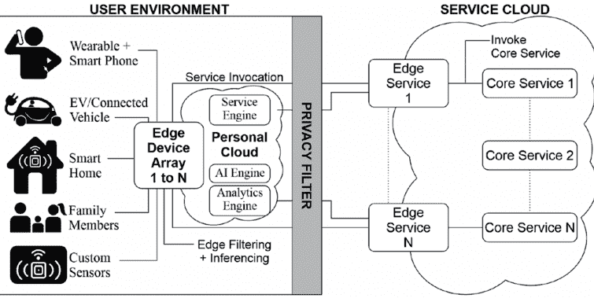

图 1. 提出的 MyIoT 框架示意图。

所提框架的主要子系统如下：

#### 3.1 用户环境

在个人物联网（PIoT）架构中，用户环境表征了针对单个用户及其直系家属的整个感知、分析和计算环境。该环境包含大量传感器，范围从可穿戴设备到智能设备、智能家居传感器、家电/小工具、连接车辆、连接设备、连接医疗和环境智能，如图 1 所示。因此，传感器多样性是 PIoT 环境的主要特征。在传感器互操作性和传感器数据开放标准在整个行业普及之前，需要制定针对特定传感器类型和数据格式的解决方案。所提 PIoT 架构通过部署一系列低成本边缘设备（其中一些具备 GPU 功能）来满足每种传感器类型的需求，从而应对这一需求。这些边缘设备接收、过滤、基于 TinyAI 算法进行推理，并将过滤后的数据发送到个人云以进行进一步处理。个人云是一组不存储任何持久数据的服务，因为数据存储由最终服务提供商管理。例如，智能手机数据由手机提供商的云或公有云管理，而连接车辆数据将由车辆提供商的服务器管理。在某些情况下，边缘设备可以直接调用托管在服务云上的边缘云服务，例如在紧急情况、作为应用逻辑的一部分，或不需要在个人云中存储数据时。例如，在 CCTV 监控和犯罪检测中，只有感兴趣的帧才会共享给云服务以进行存储和取证，而大部分无关帧可以在边缘设备上被过滤和丢弃。这消除了许多应用对持久存储的需求，在不久的将来完全有可能为 PIoT 实现完全无服务器模型。

#### 3.2 云服务环境

云服务环境提供 PIoT 的服务层面，并容纳边缘服务，通过优化服务延迟和响应时间，向多个 PIoT 用户提供高性能服务。仅在需要重大处理并需维护记录时，才会调用和配置核心云服务。显然，重点是在尽可能减少用户环境与核心云服务之间的流量流动的同时，将大部分计算和数据流量卸载到边缘。个人云托管了按需负责服务调用的引擎、用于将 AI 模型应用于数据以满足超个性化需求的 AI 引擎，以及用于理解数据并基于接收数据的分析采取行动的分析引擎。

### 4 仿真结果

使用 AWS IoT 平台模拟多个 IoT 设备并基于现实数据生成数据流，步骤如下：

- 用户场景：考虑了 3 个用户场景，需要根据配置规则与外部第三方服务交互，基于数据进行分析并采取进一步行动。
- IoT 设备：使用 AWS IoT 设备模拟器模拟了 25 个虚拟 IoT 设备，用于智能手表、手机、可穿戴设备以及火灾/烟雾探测器、智能设备、车库门、CCTV 摄像头等其他传感器，以基于现实世界传感器读数生成数据流。所有传感器均配置为每 5 分钟收集一次读数，但 CCTV 除外，它们会持续发送固定大小的数据流。


- 边缘设备：使用 AWS Greengrass 搭建了模拟边缘节点。这些设备在将数据发送到个人云/服务云之前，会在本地对数据进行处理和分析。
- 个人云：创建了一个 AWS 服务实例，用于实现 AI 模型和推理、分析及服务调用，此外，若边缘设备未执行此操作（针对特定传感器类型），则移除敏感或个人信息，以模拟隐私过滤器。
- 边缘服务：搭建了多个 AWS Lambda 函数来模拟边缘服务，这些服务要么由传感器供应商托管，要么通过调用外部云服务来代表用户执行特定任务。
- 云服务：最后，实例化了多个 AWS VM 实例来托管中央云服务，包括紧急响应或第三方服务，例如在线杂货订购等。

上述所有 AWS 元素均部署在 AWS Mumbai 区域。使用该设置，获得了多个参数和交互的测量数据：

- 传感器到边缘延迟
- 边缘处理/推理
- 云边缘服务延迟
- 云核心服务延迟
- 服务器存储优化

图 2(a) 提供了 25 个传感器按小时平均计算的传感器到边缘延迟测量数据，表明 24 小时期间内方差非常小。图 2(b) 显示了 3 个传感器、一款用户穿戴设备、一台 CCTV 摄像头和一个通用传感器的边缘处理/推理平均耗时，时间跨度为 1 小时期间（12 次实例，每 5 分钟一次）。边缘处理涉及三项操作，包括丢弃重复/相似读数，而推理包括执行任何 AI 模型或规则以根据规则发起操作。CCTV 数据流的推理量最大。

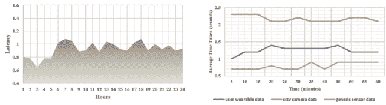

(a) 25 个传感器的平均传感器到边缘延迟测量 (b) 3 个传感器的平均边缘处理/推理耗时

图 2. 平均延迟和边缘处理时间。

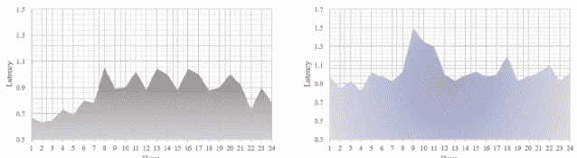

(a) 服务器到云边缘延迟 (b) 云边缘到云核心延迟

图 3. 平均延迟。

图 3(a) 封装了服务器到云边缘服务延迟（建模为 AWS Lambda 函数）的平均每小时延迟。在此，延迟在 24 小时期间内变化于 0.63 至 1.07 毫秒之间，表明开销可控。延迟的变化是由于 AWS 平台及其相关服务上的流量和负载不同时期所致。图 3(b) 描绘了边缘到核心云服务（托管于 AWS IoT Core）的平均每小时延迟，用于模拟第三方服务。在此，延迟范围为 0.82 至 1.35 毫秒。为简化起见，假设特定服务的实际服务处理时间是恒定的。图 4 显示了图 2 中使用的三个传感器所实现的流量优化。对于 CCTV 流，通过在边缘丢弃重复帧，实现了高达 60% 的服务器优化，而对于其他两个传感器（读数相似且变化微不足道），则分别仅实现了较为适中的 15% 和 19%。最后，图 5 比较了在本地边缘分析数据并发起操作与使用云服务时的服务配置时间。结果表明，边缘设备在用户语境下执行计算时表现非常好，当在边缘（用户家中）本地执行推理时，相比在云端边缘或通过第三方边缘服务执行，服务性能改进超过 50%。因此，仿真结果证实了所提系统模型的有效性，该模型在管理开销的同时提供性能。

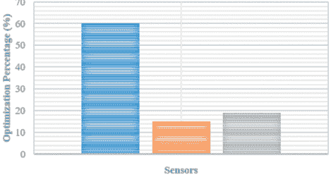

图 4. 边缘处 3 种不同传感器的流量优化（作为重复项丢弃的帧百分比）。

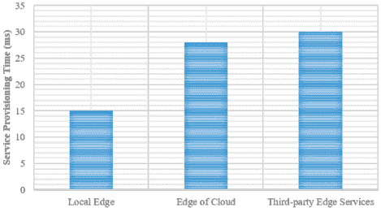

图 5. 服务配置时间的比较。

### 5 结论

MyIoT 包含一种无服务器计算和边缘智能模型，以实现 PIoT 的愿景，在未来几年，随着用户寻求技术驱动的环境以最佳地生活和运作，该愿景可能获得显著普及。无服务器模型确保用户数据不存储在第三方云服务器上，也不会以未经授权的方式使用，而具备 TinyAI 的边缘服务通过分析不含任何 PII 的用户数据来构建智能，确保隐私。用户数据在用户的个人云上内部存储，并根据用户要求进行管理。因此，用户获得了对其数据如何被收集、分析和消费的控制权，同时交付所需的个性化服务。本工作解决了交付兼具隐私的个性化的重大挑战，这是面向个人用户（如 PIoT）的系统未来需要解决的问题。该领域的未来工作需要关注：

- 在 PIoT 的背景下探索联邦学习、安全多方计算和差分隐私。
- 调查资源管理策略，以动态分配和优化计算资源，满足 PIoT 中边缘智能任务的不同需求。
- 开发上下文感知的个性化技术，利用捕获和利用上下文信息（如位置、用户行为和环境因素）的方法，为整个用户家庭乃至来宾提供实时个性化服务。
- 探索机器学习、深度学习和强化学习算法的集成，以实现 PIoT 中的自适应和上下文感知个性化。

### 参考文献

Abdurssalam Ali Ahmed, Mohamed Belrzaeq, Yasser Nassar, Hala J El-Khozondar, Mohamed Khaleel, and Abdulqader Alsharif. (2023). 面向可持续发展、概念和未来趋势的智能家居和城市综合综述. World J. Adv. Res. Rev., 19(1), 1482–1489.

Aloha Hufana Ambe, Margot Breteron, Alessandro Soro, Min Zhen Chai, Laurie Buys, and Paul Roe. (2019). 老年人使用 IoT un-kit 体验发明他们的个人物联网. 在 2019 年 CHI 人因计算系统会议论文集中，第 1–15 页.

Ankur Gupta, Purendu Prabhat, and Bisma Gulzar. (2022). 个人物联网（PIoT）：安全交付超个性化的愿景. 在 2022 年 IEEE 德里分会会议 (DELCON) 中，第 1–6 页. IEEE

Biswa PS Sahoo, Saraju P Mohanty, Deepak Putlath, and Prashant Pillai. (2021). 个人物联网（PIoT）：它究竟是什么？ IEEE 消费电子杂志, 10(6), 58–60.

Eugene Siow, Thanassis Tiropanis, and Wendy Hall. (2016). Piotre：个人物联网存储库.

Fengjiao Zhang, Zhao Pan, and Yaobin Lu. (2023). AIOT 启用的智能监控用于个人数据数字化：智能家庭中的情境个性化-隐私悖论. 信息与管理, 60 (2), 103736.

Geetika Jain, Justin Paul, and Archana Shrivastava. (2021). 超个性化、共创、数字客户关系管理和转型. 商业研究杂志, 124, 12–23.

Gilad Maayan. (2020). 超个性化：使用 AI 定制服务. Eylul, 18, 2020.

Paul M Di Gangi, Barbara A Wech, Jennifer D Hamrick, James L Worrell, and Samuel H Goh. (2023). 关于个人物联网的风险感知：来自多轮 Delphi 研究的研究方向. 网络安全教育、研究与实践杂志, 2022(2)

Research and Markets. 个人物联网 (IoT) 和连接设备：可穿戴和 IoT 设备、连接车辆、连接医疗、环境智能和量化自我的应用和服务 2018–2023.

Shinelle Hutchinson. (2023). 利用个人物联网技术促进数字取证调查中的用户识别. 博士论文，普渡大学研究生院.

Surbhi Gupta, Mohammad Shabaz, Ankur Gupta, Abdullah Alqahtani, Shtwai Alsubai, and Isaac Ofori. (2023). 个人医疗物联网：一种新颖范式和未来方法. CAAI 智能技术交易.

Xuyi Yao, Ningjiang Chen, Xuemei Yuan, and Pingjie Ou. (2023). 基于深度强化学习的无服务器边缘计算功能卸载性能优化. 未来生成计算机系统, 139, 74–86.

Yong Jin, Honghao Gao, Tao Hu, and Xinrong Li. (2020). 针对个人物联网的 AI 驱动智能网络和通信特刊：第二部分. 无线信息网络国际期刊, 27, 207–208.


## 基于 IoT 和深度学习的道路事故检测系统及社会知识管理

K.R. Ananth  
计算机科学（AI&DS）系，南达文理科学学院，埃罗德，泰米尔纳德邦，印度  

Sarfraz Fayaz Khan  
SAT – 阿尔贡昆学院，渥太华，加拿大  

Abhishek Agarwal  
佛蒙特州立大学，美国  

Mohammed Wasim Bhatt  
模范工程技术学院，查谟，查谟-克什米尔，印度  

Ahmad Murtaza Alvi  
沙特电子大学，金融学院，工商管理系，利雅得，沙特阿拉伯  

Sheshang Degadwala  
西格玛大学，计算机工程系，瓦多达拉，古吉拉特邦，印度  

### ABSTRACT

商业组织和研究社区努力精确检测事件并在灾难发生时提供协助。大多数开发的系统都是基于硬件的，这使得它们昂贵，且并非每辆车都能使用。车辆传感器可能以多种方式被破坏，包括轻微事故或固定交互。在某些情况下，传感器无法检测到事故。智能手机传感器是一个很好的替代方案，因为它们可靠且易于获得。该研究涉及创建一个智能手机应用程序，该应用程序持续读取传感器数据并将其发送到云端。通过阈值分析发现碰撞。本研究的关键创新是创建一种方案，在发生事故时向附近的医院和救护车发出警报。该系统将具有更少的不准确性，能精确识别事故，并利用四种感官输入优于早期技术。本文介绍了用于事故检测的新型深度学习方法。

### 1 INTRODUCTION

城市日益拥挤，充满了游客、居民和汽车。车辆使用量增加导致交通拥堵。根据世卫组织最近的估计，每年有 135 万人死于交通事故，5000 万人受伤（Khan et al. 2018）。道路事故现在是第九大死亡原因。然而，国际道路安全协会（ASIRT）预测，除非发生实质性改善，否则它们很快将上升为第五大死亡原因。此外，道路事故的社会成本巨大。国际道路安全协会预计，道路事故将占用每个国家年度预算的 1% 到 2%。即使在拥有道路安全措施的发达国家，全球每年驾驶死亡人数最近也有所上升。然而，问题依然在于，低收入和中等收入国家在道路收费和道路伤害方面承受着最大的压力（Arora et al. 2022）。物联网有多种含义。例如，将物联网定义为“每个都带有嵌入式传感器的产品网络”，并连接到互联网。根据互联网的含义，事物是一种物理-网络系统，将物理项目连接到网络领域。传感器的计算和存储能力有限，这可能会带来问题，尤其是关于安全性和可靠性。其中一些挑战已通过云计算得到解决（More and Raisinghani 2017; Shaikh and Zeadally 2016）。

### 2 REVIEW OF LITERATURE

文献中可以找到几种应对道路安全、车辆通信和事故后救援操作的概念和策略。本研究集中在最实用的方法和策略上：基于软件和硬件的解决方案。它主要关注利用各种感官输入的事故检测技术（Ali and Alwan 2015）。本部分对与交通危险和道路事故相关的当前系统进行了回顾，揭示了它们的优点、缺点和局限性。

#### 2.1 Part I) Smartphone-based systems

关于这个主题有大量研究，旨在解决基于移动技术的低成本、有弹性的解决方案来检测和通知汽车事故的挑战。它在（Rajkiran and Anusha 2014; Sane et al. 2016; Tushara and Vardhini 2016）中推出了一个碰撞报警系统，该系统使用移动设备的加速度计和 GPS 数据来识别事故。作者使用集成加速度计和陀螺仪，开发了一款基于智能手机的应用程序，用于检测意外事故并通知附近的紧急服务。该计划策略专注于缩短反应时间，不考虑车辆事故。

#### 2.2 Part II) Hardware-based Systems

如前所述，道路事故是导致死亡的主要原因；因此，需要更多研究来发现并迅速开始救援工作。如果碰撞与救援队出动之间的时间缩短，死亡的可能性就会降低，这激励了几位研究人员尽量减少反应时间。作者在（Fogue et al. 2014）中介绍了一个碰撞跟踪系统，该系统使用微控制器来调节所有过程。消息被发送到一个确定的手机号码。然后由紧急中心将响应团队派往现场。尽管该系统有很多好处，但它也有几个缺点。

### 3 PROPOSED METHOD

本研究提出了一种优化事故检测与报告系统，即 OADRS。新的 OADRS 碰撞跟踪和报告系统利用现代安卓智能手机功能，从而降低总成本，因为不需要特殊硬件。在建议的架构中，感知层的主要职责是与智能手机传感器交互，而从传感器收集数据是 OADRS 架构中感知层的主要目标（Chaturvedi and Srivastava 2018）。设有阈值；如果发生事故，传感器数据将优于阈值。当条件满足时，会生成警报并发送给车辆驾驶员。如果驾驶员忽略信号，将不会呼叫医院，以避免误报。云服务将在 10 秒内提醒最近的医院（Bhatt and Sharma 2023）。

拟议系统的主要目标是提供一个可以处理 5 种情况的架构：
- 车辆与基础设施的直接通信
- 事故数据的自动共享
- 提高事故检测的精度
- 减少虚假报告和消息
- 建立盈利系统

所提出架构的活动。本研究最重要的变量包括多智能手机传感器，例如加速度计和 GPS，用于碰撞检测。这些分布在几个不同的部分中。第一部分涉及事故检测组件。

#### 3.1 Phase one: Accident detection components (Deep learning inputs)

事故识别用于避免造成损坏或伤害的事件，并尽量减少交通事故死亡人数。检测过程确定事故的存在。如前所述，事故检测组件如图 1 所示。

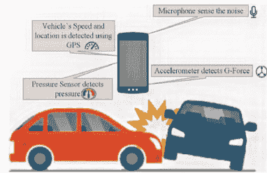

图 1. 事故检测组件。

#### 3.2 Phase two: Phase of the notification

检测到事故时，有效的通信和调度至关重要。当发现事故时，系统使用智能手机的 GPS 定位事故。云端拥有医院数据库，并使用映射工具来定位最近的医院。一条包含位置数据和车主信息的消息被发送到医院。获取的数据保存在当前数据库中。

#### 3.3 Phase three: Database

汽车数据库：汽车数据库提供关于注册车辆的所有重要信息。车主、姓名、地址和汽车数量的信息保存在云端，以解决任何事件。汽车数据库的样本在表 1 中给出。

Table 1. Samples of cars database.

| 车辆 ID | 车辆名称 | 车辆数量 | 车主姓名 | 车主 ID |
|---|---|---|---|---|
| C 1 | Suzuki | RAZ 3825 | Bilal Khaled | 36512-4530645-9 |
| C 2 | Landover | MP 3509 | Shahid Khalid | 33103-9963108-6 |
| C 3 | Toyota | LAL 76 4320 | Ali Hosseini | 12145-1519307-7 |

医院数据库：系统必须了解所有附近的医院，以便在紧急情况发生时通知它们。云端必须定位并将消息转发给最近的医院。表 2 显示了已保存的信息。

Table 2. Database of hospital.

| 医院 ID | 医院名称 | 医院地址 | 医院数量 |
|---|---|---|---|
| H 1 | Usmani Rd Panjab | Jahan | +92-42-95231543 |
| H 2 | Kohistan Rd Mumbai | Health | +92-51-2455613 |
| H 3 | Abid Majeed Rd Delhi | Soldierly | +92-51-9260376 |


聚类可以在这些网络中用于减轻这些有害后果。朝同一方向行驶的车辆被视为集群的一部分。它减轻了重复聚类的有害影响。本文考虑了集群大小、车辆速度、交通和 CW 大小之间的关联，以及它们对输出效率和关闭损失的影响。创建此类网络的另一个问题是选择适当的集群。

该过程用于基于加权方法选择集群。此外，根据 Friis 定律接收到的平均信号强度在前面的实验（1）中得到确认。

$$
E(p_{re}) = \frac{P_{tr}G_{tr}G_{re}\lambda_c^2}{16\pi^2 d^2} \tag{1}
$$

在此方面，d 表示发射器与接收器之间的距离，以及 Ptr、Gtr 和 Gre 为发射器和接收天线的参数（已指定）。该公式将用于计算无线信号的波长（2）。

$$
\lambda_c = \frac{c}{f} \tag{2}
$$

（2）表示 c 为光速，f 为无线信道频率（5.850 GHz 至 5.926 GHz），其中一个信道专门用于提升汽车安全，其他信道用于车辆专用应用。为简化起见，我们假设频率在 5.890 GHz 范围内。关于信道考虑，传递信号的概率密度函数可如下计算：

$$
F_{re}(p_{re}) = \frac{1}{E(p_{re})} e^{-\frac{p_{re}}{E(p_{re})}} \tag{3}
$$

如果接收信号强度高于最低灵敏度（P_{min}），则解密紧急消息。如果不这样做，紧急通信将丢失（Yao et al. 2021）。接收器在接收到紧急消息时计算信号强度。因此，在距离 L_{tr} 内接收紧急消息的可能性是使用公式（4）计算的。

$$
pr_{succ(d)} = pr\{p_{re} > p_{min} | l_{ir} = d\} = 1 - pr\{p_{re} \le p_{min} | l_{ir} = d\}
= 1 - \int_{0}^{p_{min}} \frac{1}{E(p_{re})} e^{-\frac{p_{re}}{E(p_{re})}} d(p_{re}) = \exp \left[ -\frac{p_{min}}{E(p_{re})} \right]
$$

尽管放置在汽车中的处理单元性能强大，但这无法消除车辆传播引起的延迟，因为无线网络的有限资源会产生这种延迟。因此，发射延迟（T_{tr}）是 MAC 层中退避与重传之间经过的时间。

根据公式，如果汽车计划发送紧急消息，则信道接入的未筛选申请者数量确定为 N_c。

$$
N_c = n\tau + 1 \tag{4}
$$

当汽车发出紧急通知时，退避旨在避免干扰。碰撞的转发概率。

在此公式中，w_{min} 表示最小可设想的 CW 大小，通常认为为 32。传输条目的平均数量将在关于最大传输值（l_{re}）的公式中指定。

$$
E(N) = \sum_{N=1}^{l_w} N \left(1 - Pr_{r_0}^N \right)^{N-1} Pr_{r_0} \tag{5}
$$

如果没有干扰信道，CW 将其最大值加倍为 \( w_{max} = 2^m w_{min} \)。假设一个系统参数，在此情况下推定为 5。当 \( w_{con} \) 趋近于其最大值 \( w_{max} m + 1 \) 时，CW 将在后续计算中作为最大值使用。因此，该公式定义了成功发帖的平均延迟，\( \eta \) 表示退避时隙的长度。数据传输长度（\( T_{data} \)）定义为数据包大小消息（\( L_{size} \)）与数据传输速率（\( M \)）的乘积，可按公式（9）计算。

$$
T_{data} = \frac{L_{size}}{M} \tag{6}
$$

综合各方程，形式如方程（7）。

$$
T_{trs} = T_{back} + \frac{L_{size}}{M} \tag{7}
$$

在此部分，将添加一个名为 M* 的参数，以定义集群中的中继节点，从而连接集群内部的各个节点。将充分利用邻居和节点中继功能。根据参考值，最大延迟 \( T_{max} \) 为 100 ms。此外，为了计算一步中的延迟因子，引入了参数 \( D^* \)，它与 \( T_{tr} \) 发射延迟变量具有对称关系。因此，如果 \( T_{tr} \) 为 0，\( D^* \) 将为 1，反之亦然。\( D^* \) 越小，延迟 \( T_n \) 释放越大。因此，一般而言，参数 \( D^* \) 将由公式（8）指定。

$$
D^* = \begin{cases} 0; T_{tr} > T_{max} \\ 1 - \frac{T_{tr}}{T_{max}}; else \end{cases} \tag{8}
$$

参数 \( D^* \) 的值将在 0 和 1 之间。此外，假设某一阶段中的 \( T_{tr} \) 扩散延迟大于 \( T_{max} \)，则 \( D^* \) 将为 0，即最坏情况。参数值 \( M*\alpha \) 和 \( \beta \) 表示传播的可靠性和延迟特性。参数 \( M* \) 的变化范围同样在 0 和 1 之间。

### 4 模拟与结果

必须解决在直线和陡峭山路颠簸上捕捉车辆距离和速度的问题（Jairath et al. 2022; Lei et al. 2022）。确定高海拔地形上的交通瓶颈、交通和任何事故很困难，因为似乎需要一系列放大器。需要指定带有物联网设置和基础设施的智慧城市的初始参数。表 3 描述了带有物联网设置和基础设施的智慧城市的起始参数，由本领域的参考论文（Rida et al. 2015）指定。

表 3. 物联网配置和基础设施参数的智慧城市。

| 网络尺寸 | 500 × 500 m² 或 1000 × 1000 m² |
| :--- | :--- |
| 每个数据包大小 | 1000 字节 |
| 车辆数量 | 300 |
| 最慢速度汽车（山路） | 30.0 km/h |
| 最慢速度汽车（隧道） | 25.0 km/h |
| 每辆车无线信号范围 | 20 m |
| 每辆车发送器能量 | 0.02 J |
| 每辆车接收能量 | 0.04 J |
| 每秒燃油使用量 | 2 sec |
| 网络端口数量 | 4000 |
| 路径长度 | 5.0 m |
| 调制方式 | OFDM |
| 数据传输功率 | 21 dB |
| 传输速度 | 6 MB/s |

OFDM 信道在道路和隧道中分别使用 QPSK 和 64QAM。首先将显示分组投递率（PDR）。PDR 按公式（9）计算。

```
PacketDrop_{Calculation} = \frac{SentPacket\_Number}{ReceivedPacket\_Number} \quad (9)
```

i 是根据上述两个关系的求和索引。当网络资源共享时，结果显示出高 PDR。PDR 在零间隔下评估，此时只有一辆车在覆盖区域内且资源（模拟开始）。这并不意味着 PDR 只会针对一辆汽车评估，即使一辆车填满区域（Abbas et al. 2021; Rida et al. 2014）。该公式计算平均端到端延迟。

```
n - to - n_{delay} = \frac{decrease\ in\ delay}{4}, \quad unit = ms \quad (10)
```

模拟的吞吐量取决于运行时间、输入条件和车辆无法进入网络覆盖区域的情况。平均吞吐量使用公式（4.4）计算。

```
Throughput_{Avg} = \left( \sum_{i=1}^{4} \frac{ReceivedPacket_{Number} \times PacketSize}{Total\ Simulation\ Time} \right) \times 100 \quad (11)
```

根据分析，ID 1 车辆在 1.1 秒内从信封中移除，而 ID 2 车辆开始在 20 秒内发送数据。两个时延结果显示比特率显著下降。结果如下：在推荐技术 SPA-(S, P) 实施以增强各段鲁棒性之前，该协议的投递率和数据丢失率与 AODV 和 AOMDV 进行了比较（Javed et al. 2018; Mazhar et al. 2023）。

所提议的技术比 AODV 和 AOMDV 协议具有更高的分组投递率，且更适合分组丢失率。因此，渗透性相对更高，数据传输和接收更快（Mazhar et al. 2023）。下图（2）展示了持续路由比较。

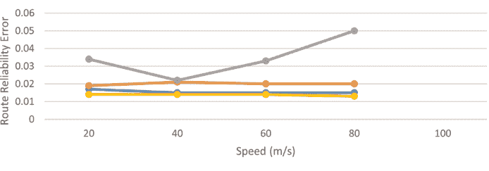

图 2. 路由稳定性比较。

本部分在 OFDM 信道中添加，调制类型分为两部分：图中显示了比特误率（图 3）。


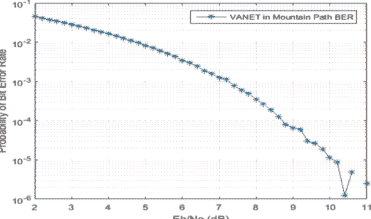

图 3. 提议方法的误码率。

误码率似乎在降低。图表呈下降趋势，表明在 $E_b/N_o$ 和 dB 下，丘陵路径上的误码率几率较低。较低并不意味着糟糕；相反，它表明数据不准确性较少，其中可能包括噪声等干扰（Soni 和 Jain 2018；Soni 等人 2021）。如图 4 所示，一旦误码率降低，延迟也会降低。

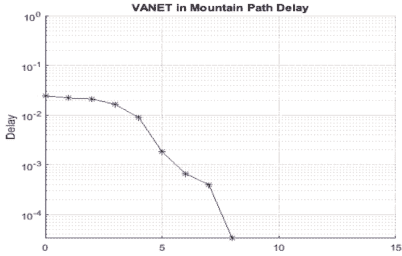

图 4. 延迟或延迟率。

延迟以 $E_b/N_o$ 单位表示，表明其已被最小化。误码率和延迟降低将导致更短的延迟。网络的主要能量总计为 200 焦耳。从开始到结束，能量利用为 100 焦耳。在仿真 #2 开始时，达到仿真结束时的 11。误码率开始于 4，结束于 2。延迟从仿真 1 开始就存在，最终降至零。尽管如此，高海拔接入和隧道的起伏有影响。

### 5 结论

近年来，都市地区的车辆数量大幅增加。由于交通量增加，事故也随之增多。尽管市场上推出了不同的事故检测设备，但仍有大量死亡事故发生。我们演示了如何使用各种传感器可以更精确地识别交通事件。所提系统可立即识别事故，定位最近的医院。然后，它将紧急救助消息转发到医院的相关部门。这项技术基于智能手机传感器获取的数据进行决策，这些传感器检测车辆状态周围的数据。我们证明了我们的建议方法可最大限度地减少误报。本研究的一个缺点是，我们在模拟环境中进行了系统的主要评估。我们正在努力在提高系统隐私和安全性的同时，使系统更加灵敏。即便如此，该方法仍需要全面调查。

### 参考文献

Abbas, S., Talib, M.A., Ahmed, A., Khan, F., Ahmad, S. 和 Kim, D.H., 2021. 车载物联网中基于区块链的身份验证：一项综述。Sensors, 21(23): 7927.

Ali, H.M. 和 Alwan, Z.S., 2017. 使用智能手机的车祸检测和通知系统。Saarbrucken: Lap Lambert Academic Publishing.

Arora, V.K., Sharma, V. 和 Sachdeva, M., 2022. 基于移动传感器节点的 ZigBee 集成无线传感器网络（IEEE 802.15.4）的 QoS 评估。沙特国王大学计算机与信息科学学报, 34(2): 27–35.

Bhatt, M.W. 和 Sharma, S., 2023. 基于对象识别的神经科学工程：未来实施研究。Electrica, 23(2).

Chaturvedi, N. 和 Srivastava, P., 2018. 使用 GSM 和 GPS 调制解调器的自动车辆事故检测和消息系统。Int. Res. J. Eng. Technol.(IRJET), 5(3): 252–254.

Fogue, M., Garrido, P., Martinez, F.J., Cano, J.C., Calafate, C.T. 和 Manzoni, P., 2013. 汽车事故自动通知和严重程度估计系统。IEEE Transactions on mobile computing, 13(5): 948–963.

Jairath, K., Singh, N., Shabaz, M., Jagota, V. 和 Singh, B.K., 2022. 用于窄距离无线通信的元材料启发结构负载天线的性能分析。scientific programming, 2022.

Javed, F., Khan, S., Khan, A., Javed, A., Tariq, R., Matullah 和 Khan, F., 2018. 无线传感器网络中精确路径规划算法。International journal of distributed sensor networks, 14(7): 1550147718783385.

Khan, A., Bibi, F., Dilsahd, M., Ahmed, S., Ullah, Z. 和 Ali, H., 2018. 使用具有实时位置跟踪功能的 Android 智能手机进行事故检测和智能救援系统。International Journal of Advanced Computer Science and Applications, 9(6): 341–355.

Lei, Y., Vyas, S., Gupta, S. 和 Shabaz, M., 2022. 基于 AI 的产品开发和工艺设计研究。International Journal of System Assurance Engineering and Management: 1–7.

Mazar, T., Irfan, H.M., Haq, I., Ullah, I., Ashraf, M., Shloul, T.A., Ghadi, Y.Y., Imran 和 Elkamchouchi, D.H., 2023. 基于 AI 和机器学习技术的智能电网中 IoT 的挑战与解决方案分析：综述。Electronics, 12(1): 242.

Mazhar, T., Irfan, H.M., Khan, S., Haq, I., Ullah, I., Iqbal, M. 和 Hamam, H., 2023. 使用机器学习和区块链方法分析智能电网中的网络安全攻击及其解决方案。Future Internet, 15(2): 83.

More, A. 和 Raisinghani, V., 2017. 无线传感器网络中节能覆盖协议综述。沙特国王大学计算机与信息科学学报, 29(4): 428–448.

Rajkiran, A. 和 Anusha, M., 2014. 使用无线通信的智能自动车辆事故检测系统。Int. J. Res. Stud. Sci. Eng. Technol, 1(8): 98–101.

Rida, I., Al Maadeed, S. 和 Bouridane, A., 2015, August. 用于改善人类步态识别的无监督特征选择方法。IEEE 第 23 届欧洲信号处理会议论文集 (EUSIPCO): 1128–1132.

Rida, I., Almaedeed, S. 和 Bouridane, A., 2014, December. 基于步态能量图像的改进步态识别。第 26 届微电子国际会议论文集 (ICM): 40–43.

Sane, N.H., Patil, D.S., Thakare, S.D. 和 Rokade, A.V., 2016. 使用 GPS 和 GSM 进行实时车辆事故检测和跟踪。Int. J. Recent Innov. Trends Comput. Commun, 4(4): 479–482.

Shaikh, F.K. 和 Zeadally, S., 2016. 无线传感器网络中的能量收集：全面综述。Renewable and Sustainable Energy Reviews, 55: 1041–1054.

Soni, M. 和 Jain, A., 2018, February. 车载自组网络中女巫攻击的安全通信和实现技术。计算方法和通信第二届国际会议论文集 (ICCMC): 539–543.

Soni, M., Rajput, B.S., Patel, T. 和 Parmar, N., 2021. VANET 中轻量车辆到基础设施消息验证方法。国际数据科学与智能应用会议论文集：ICDSIA 论文集 451–456. Springer: Singapore.

Tushara, D.B. 和 Vardhini, P.H., 2016, March. 使用 Atmel 微控制器设计无线车辆警报和碰撞预防系统。IEEE 电气、电子和优化技术国际会议论文集 (ICEEOOT): 2784–2787.

Yao, Q., Shabaz, M., Lohani, T.K., Wasim Bhatti, M., Panesar, G.S. 和 Singh, R.K., 2021. 基于视觉的振动信号处理和测量的 3D 建模与可视化。智能系统学报, 30(1): 541–553.

## 基于外科导航系统分层处理的医疗 CAD 模型

Niladri Maiti
塔什肯特中亚大学牙医学院，乌兹别克斯坦

Arun Kumar Maurya
德拉甘 Bit 药学院，印度

Shri Ganesh V. Manerkar
果阿工程学院信息技术系，农马古迪，蓬达 – 果阿，南果阿，印度

Mohammad Shabaz
查谟模型工程技术学院，查谟和克什米尔，印度

Sheshang Degadwala
瓦多达拉西格玛大学计算机工程系，古吉拉特邦，印度

Raj A. Varma
锡比劳法学院（SLS），锡比劳国际大学（被认可大学）（SIU），浦那维曼纳纳加尔，马哈拉施特拉邦，印度

### 摘要

为了避免因人机交互界面的冗余信息给医生带来“失控感”，基于医生在手术过程中的认知模型，提出了增强现实外科导航系统中的人机交互标准。针对 AR 导航界面的多感官信息融合问题，提出了基于 eGOMS 模型的人机交互范式。为了客观评估 AR 导航系统的人机交互可用性，采用层次分析法构建了人机交互可用性评价指标体系，并利用模糊理论对 AR 导航系统的人机交互可用性进行综合评估。该系统的评估结果良好，可实际应用。

### 1 引言

前十字韧带（ACL）断裂无法得到有效治疗，这将严重影响患者的生活质量（Saxena 等人 2013；Yang 等人 2020）。因此，关节镜 ACL 重建手术是最常见的手术程序。然而，由于保留 ACL 残留会增加骨痕迹定位的难度，传统关节镜 ACL 重建手术需要完全切除 ACL 残留（Liu 2020）。因此，带有残留残块的 ACL 重建是 ACL 重建手术的发展趋势（Soni 等人 2018；Yang 和 Chen 2009）。增强现实（AR）技术是增强微创手术环境感知的有效方法（Li 等人 2021）。它可以在保留残块的同时协助医生进行精确目标定位，改善术后康复效果和患者生活质量；还可以为医生提供丰富的解剖结构，扩大医生的手术视野，降低手术难度（Wang 和 Xu 2020）。


增强现实导航系统具有以下三个特征：（1）虚实融合；（2）精确“对齐”；（3）实时交互。尽管外科导航系统已使用超过 20 年，但当前的交互技术在稳定性、感知和反馈方面仍存在不足，受限于硬件技术（Lu et al. 2010）。因此，基于光学视角的增强现实导航系统与传统人机界面有很大不同。其信息渠道更加多样，因此交互模式与传统人机界面有很大不同（Zhao et al. 2013）。此外，在手术过程中，医生处于高压状态下。因此，流畅舒适的人机交互至关重要。另一方面，人机界面中的冗余信息可能会分散医生的注意力，使医生感到“失控”（Lee et al. 2011）。

### 2 基于光学透视的 ACL 重建外科导航系统

#### 2.1 外科导航系统

##### 2.1.1 系统结构

如图 1 所示，本文提出了一种基于 HoloLens 的增强现实导航系统。该系统包括 CT 机、C 型臂、PC、Micron Tracker 和 HoloLens。基于增强现实技术的 ACL 导航系统的九个模块之间的关系如下：

- 位置跟踪模块为整个系统提供每个跟踪目标（标定器、手术目标、标定块和 HoloLens）的位置信息。位置信息由 Micron Tracker 采集，并通过 UDP 协议传输到其他模块；
- C 型臂空间配准模块可实现 X 射线图像与手术空间的配准，配准结果可为 2D-3D 配准模块提供参数支持；2D-3D 配准模块可实现术前 CT 图像与术中 X 射线图像的配准；
- 虚实配准模块可识别虚拟空间与实际场景之间的空间配准；结果是，虚拟模型、路径规划等信息可与实际场景准确融合显示；
- 3D 重建模块可实现术前 CT 图像的 3D 重建，并为 2D-3D 配准、路径规划和可视化呈现提供 3D 数据模型。

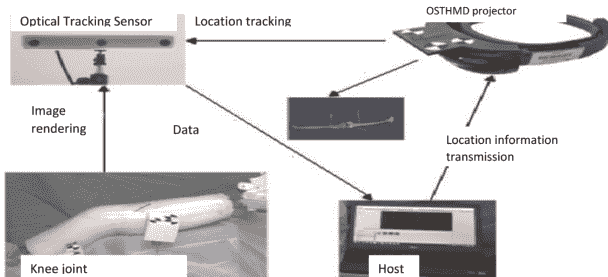

图 1. ACL 重建系统的增强现实系统结构。

##### 2.1.2 导航过程

基于增强现实技术的 ACL 导航系统的使用流程如下：

### 1) 术前处理

- HoloLens 工作空间离线标定。
- 对目标区域进行 CT 扫描。
- 对术前 CT 数据进行分割和重建，以获取股骨和胫骨的 STL 模型。
- 在分割的 STL 模型上，进行手术路径规划。

### 2) 术中导航

- 拍摄 X 光片，对 C 型臂进行空间标定，并将标定结果和 X 射线图像传输到 2D-3D 配准模块。
- 在 2D-3D 配准模块中，导入术前 CT 数据和分割的 STL 模型，调整 STL 模型和 X 光片的初始位置，执行 2D-3D 图像配准，并将配准结果传输到可视化模块。
- HoloLens 在线标定。
- 增强显示，导航跟踪。

#### 2.2 空间配准技术

##### 2.2.1 基于圆锥螺旋的 C 型臂标定器

如图 2 所示，为提高点对配准的空间配准精度，采用基于圆锥螺旋的 C 型臂标定器对 C 型臂进行标定。在手术目标附近，该标定器的标定精度高于传统的双平面标定器（Yu et al. 2012）。

##### 2.2.2 基于 Splat 的 2D-3D 图像配准

为实现术前 CT 图像与数字 X 光图像的空间统一，采用基于 DRR 投影的 2D/3D 自动配准方法策略。DRR 重建、相似性准则和参数优化算法是 2D/3D 配准过程的必要组成部分（Collazos and Merchan 2015）。

##### 2.2.3 基于空间补偿的虚实标定

为实现快速在线标定，通过分析 HoloLens 的工作空间，将标定过程分解为离线标定和在线标定。

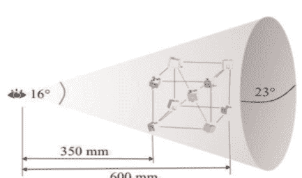

图 2. HoloLens 的工作空间。

#### 2.3 人机交互技术

##### 2.3.1 人机界面

在 Unity3D 中进行场景开发时，系统的人机交互界面如图 3 所示。导航跟踪方法的设置可以通过语音或手势来确认，这不涉及通道集成。

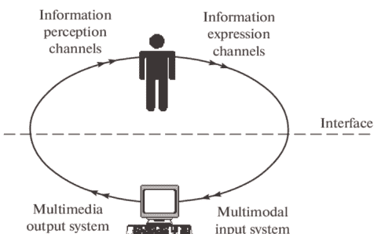

图 3. 人机交互界面。

##### 2.3.2 人机交互模型

本文采用 eGOMS 模型分析人机交互任务，实现多通道信息的集成。根据 eGOMS 模型，标定块的虚实对齐和虚实融合目标的可见性设置的交互模型（Looi and See 2010）。

### 3 基于认知模型的人机交互准则

#### 3.1 外科导航系统的人机交互准则

本文使用 Microsoft HoloLens 作为 AR 显示设备。Microsoft HoloLens 不仅可以基于光学视角完成虚实场景的重叠，还可以进行语音和手势交互（Lokhande et al. 2021）。因此，AR 外科导航系统的人机交互规则主要包括：

- 1) 虚实配准一致性：虚拟对象与自然场景应有效集成，以最大限度地减少虚拟对象的畸变、跟踪错误以及用户视角的参数错误。
- 2) 用户安全感：基于 VST-HMD 的外科导航系统最大的问题是医生无法直接透过眼镜查看实际场景，因此存在一定的恐惧感。
- 3) 信息有效性：应对信息进行分类和管理，避免冗余信息分散用户的注意力。

### 4 人机交互的可用性评估

#### 4.1 基于 AHP 的可用性评估指标

根据国际标准化组织提出的 ISO9241-11 标准，可用性是指特定用户在特定使用情境下使用产品实现特定目标的有效性、效率和满意度。一些研究人员已对虚拟现实系统进行了可用性评估。然而，目前尚无关于 AR 导航系统交互的可用性研究。因此，结合第 3.2 节提出的人机交互标准，参考虚拟现实界面可用性评估方法（Li et al. 2021; Silva and Medeiros 2021; Tao et al. 2018）。一致性检验指标 CR 和 CRi 分别为：0.0371、0、0、0.0061、0、0.0028。所有层级的一致性检验指标均小于 0.1，因此均通过了检验，其中 i = 1, 2, 3, 4, 5。若 λ 和 λi 分别对应矩阵 A 和 Bi 的最大特征根，x 和 xi 分别对应矩阵 A 和 Bi 的特征向量。分别对 ε 和 εi 进行归一化，得到向量 θ 和 θi。若 xi 表示向量 θ 的元素，yij 表示向量 θi 的元素，则各层权重合并计算，可得到各二级指标的总权重 xij = yij × θi。各指标的权重如表 1 和图 4 所示。

| 指标 | 权重 xi | 指标 | 权重 yij | 综合权重 xij |
|---|---|---|---|---|
| 任务性能 | 0.2345 | 错误率 | 1.00002 | 0.2339 |
| 适宜性 | 0.3608 | 关键信息率 | 0.6298 | 0.2265 |
| | | 提示性 | 0.3708 | 0.1336 |
| 易用性 | 0.1598 | 符号操作 | 0.5109 | 0.0818 |
| | | 复杂度 | 0.3359 | 0.0533 |
| | | 操作深度 | 0.1548 | 0.0243 |
| | | 总操作 | | |
| 可学性 | 0.1029 | 新知识率 | 0.5837 | 0.0597 |
| | | 学习时间 | 0.4165 | 0.0428 |
| 交互性 | 0.1452 | 自然性 | 0.2637 | 0.0384 |
| | | 即时性 | 0.2149 | 0.0313 |
| | | 结果可预测性 | 0.5223 | 0.0759 |

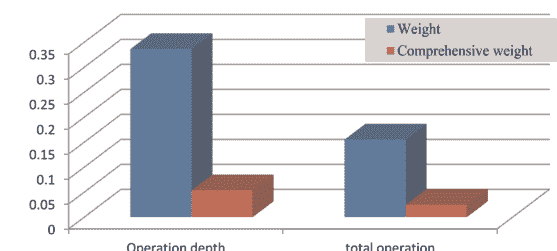

图 4. 操作深度比例。

#### 4.2 基于模糊理论的综合评价

模糊评价方法基于模糊数学，应用未定义关系的综合原则，对边界不清且难以量化的某些因素进行量化，并从多个方面全面评价所考虑对象的隶属状态（Wang et al. 2011; Yao et al. 2021; Zhou et al. 2021）。

- 1) 确定评价因素集和评价等级集。
- 人机交互性能分为五个等级，V = {优秀、良好、一般、差、较差}。

- 2) 单因素评价
- 在使用模糊理论进行综合评价时，需要通过隶属函数对模糊集进行量化。根据可用性评估特征的评价指标，本文采用梯形/半梯形隶属函数。基于专家经验给出，各指标的边界如表 2 所示。


表 2. 可用性评价指标边界值.

| Index | Very good | Better | Generally | Poor | Difference |
|:---|:---|:---|:---|:---|:---|
| 错误率/% | 95~100 | 90~95 | 81~90 | 71~80 | 0~71 |
| 关键信息率/% | 85~100 | 75~85 | 41~70 | 21~40 | 0~21 |
| 提示性 | 4.5~5 | 4~4.5 | 3~4 | 1.5~3 | 0~1.5 |
| 符号操作复杂度 | 0~75 | 71~100 | 101~120 | 121~150 | >150 |
| 操作深度/% | 1 | 1~3 | 3~5 | 5~7 | >7 |
| 总操作量 | 1~5 | 3~5 | 5~8 | 8~12 | >11 |
| 新知识率/% | 0~10 | 11~25 | 25~50 | 51~70 | 71~100 |
| 学习时间/h | 0~0.5 | 0.5~2 | 2~6 | 6~10 | >10 |
| 自然性 | 4.5~5 | 4~4.5 | 3~4 | 1.5~3 | 0~1.5 |
| 即时性 | 4.5~5 | 4~4.5 | 3~4 | 1.5~3 | 0~1.5 |
| 结果可预测性 | 4.5~5 | 4~4.5 | 3~4 | 1.5~3 | 0~1.5 |

新知识率、关键信息率、系统符号复杂度、操作深度和操作总量可根据定义进行计算，计算结果分别为 18%、85%、95%、3 和 4。根据隶属函数和评价结果，属于评价等级的可用性评价指标测量值如表 3 所示。

表 3. 属于评价等级的可用性评价指标测量值.

| Index | Index result | Very good | Better | Generally | Poor | Difference |
|:---|:---|:---|:---|:---|:---|:---|
| 错误率/% | 90 | 0.25 | 1 | 0.8 | 0 | 0 |
| 关键信息率/% | 86 | 1.02 | 1 | 0 | 0 | 0 |
| 提示性 | 4.75 | 1.02 | 0.45 | 0 | 0 | 0 |
| 符号操作复杂度/% | 96 | 0.18 | 1 | 0.85 | 0 | 0 |
| 操作深度 | 3 | 0 | 1 | 1 | 0 | 0 |
| 总操作量 | 4.5 | 0.52 | 1 | 0.52 | 0 | 0 |
| 新知识率/% | 17 | 0.48 | 1 | 0.53 | 0 | 0 |
| 学习时间/h | 1.25 | 0.52 | 1 | 0.48 | 0 | 0 |
| 自然性 | 3.82 | 0 | 0.85 | 1 | 0.21 | 0 |
| 即时性 | 3.45 | 0 | 0.45 | 1 | 0.61 | 0 |
| 结果可预测性 | 4.45 | 0.84 | 1 | 0.21 | 0 | 0 |

#### 4.3 综合评价结果

结合表 3 中的数据，得到相应的模糊综合评价矩阵。根据 4.1 节结果中各指标的权重向量，采用加权平均算子作为模糊合成算子进行模糊合成。

```
S_i = W_i \times R_i \tag{1}

W_i = y^i \tag{2}

R_i = \begin{bmatrix} r_i^0 \\ r_i^1 \\ \vdots \\ r_i^* \end{bmatrix} \tag{3}
```

首先，对二级指标进行模糊合成：其中 i = 1,2,3,4,5。$W_i$ 表示二级指标的权重，$R_i$ 表示评价等级测度值，S 表示 i-第一级指标中的二级指标数量（Ojha and Rajan 2019; Shajideen and Preetha 2018）。然后对一级指标进行模糊合成，模糊合成的综合评价向量为：

```
R = [S1, S2, S3, S4, S5]					(4)
S = W × R						(5)
```

模糊综合评价向量的结果为：
s = [0.1945, 0.3875, 0.2257, 0.00390]

根据最大隶属度原则，AR 导航系统人机交互的可用性评价等级为较好。这是因为它具有更好的任务绩效、适宜性、易学性、易用性和交互性。

### 5 结论

通过围手术期医生认知模型分析和虚拟现实系统人机交互标准调查，提出了基于 OST-AR 技术的手术导航系统人机交互设计标准。为了客观评价 AR 导航系统的人机交互可用性，本文利用层次分析法（AHP）展示了人机交互可用性评价指标体系，并提出了任务绩效、适宜性、易学性、易用性和交互性五个一级评价指标，以及错误率、关键信息率、提示性、符号操作复杂度、操作深度、总操作量、新知识率、学习时间、自然性、直接性和结果可预测性等 11 个二级指标。最后，利用模糊理论对 AR 导航系统的人机交互可用性进行了综合评价。

### 参考文献

- Collazos, C.A. and Merchan, L. 2015. 哥伦比亚的人机交互：缩小教育与产业之间的差距. IT Professional, 17(1): 5–9.
- De Medeiros, F.P.A. 2021 年 6 月. 数字遗产中的死后数据死亡作为数字生活的一部分：基于巴西人机交互研究视角的分析. In: 2021 16th Iberian Conference on Information Systems and Technologies (CISTI) (pp. 1–6). IEEE.
- En, L.Q. and Lan, S.S. 2010 年 4 月. 社交游戏：使用视频日志方法分析人机交互. In: 2010 2nd International Conference on Computer Engineering and Technology (Vol. 3, pp. V3-509). IEEE.
- Lee, M.K., Tang, K.P., Forlizzi, J. and Kiesler, S. 2011 年 3 月. 理解用户在人机交互中的隐私感知. In: Proceedings of the 6th International Conference on Human-Robot Interaction (pp. 181–182).
- Li, H., Shabaz, M. and Castillejo-Melgarejo, R. 2023. 撤稿文章：在线翻译爬虫网站设计中 Python 数据的实现. International Journal of System Assurance Engineering and Management, 14(1): 484–484.
- Li, Z., Shu, H., Song, W., Li, X., Yang, L. and Zhao, S. 2021 年 11 月. 基于人机交互和 WebAR 技术的传统风筝艺术平台设计与实现. In: 2021 2nd International Conference on Intelligent Computing and Human-Computer Interaction (ICHCI) (pp. 209–212). IEEE.
- Liu, Y. 2020 年 12 月. 基于设计心理学的人机交互界面设计. In: 2020 International Conference on Intelligent Computing and Human-Computer Interaction (ICHCI) (pp. 5–9). IEEE.
- Lokhande, M.P., Patil, D.D., Patil, L.V. and Shabaz, M. 2021. 安全远程机器人手术中设备识别与分类的机器对机器通信. Security and Communication Networks, 2021: 1–16.
- Ojha, D. and Rajan, R.G. 2019 年 6 月. 基于直方图的人机交互手势识别. In: 2019 3rd International Conference on Electronics, Communication and Aerospace Technology (ICECA) (pp. 263–266). IEEE.
- Saxena, S., Saxena, P. and Dubey, S.K. 2013 年 8 月. 各种人类压力水平及其对人机交互的影响. In: 2013 International Conference on Human Computer Interactions (ICHCI) (pp. 1–6). IEEE.
- Shajideen, S.M.S. and Preetha, V.H. 2018 年 12 月. 用于人机交互的手势虚拟鼠标. In: 2018 International Conference on Smart Systems and Inventive Technology (ICSSIT) (pp. 543–546). IEEE.
- Soni, M., Jain, A. and Patel, T. 2018 年 11 月. 使用 Wi-Fi 信号进行人体运动识别. In: 2018 3rd International Conference on Inventive Computation Technologies (ICICT) (pp. 422–427). IEEE.
- Tao, Y., Yao, Z. and Liang, B. 2018 年 12 月. 基于 Kinect 的指尖人机交互. In: 2018 IEEE 4th Information Technology and Mechatronics Engineering Conference (ITOEC) (pp. 888–893). IEEE.
- Wang, D. and Xu, Z. 2020 年 8 月. 人机交互交互设计研究核心文献系统的计量分析. In: 2020 International Conference on Big Data and Social Sciences (ICBDSS) (pp. 101–105). IEEE.
- Wang, X., Li, Z. and Bai, J. 2011 年 8 月. 基于手势识别的非接触式人机交互系统. In: Proceedings of 2011 International Conference on Electronic & Mechanical Engineering and Information Technology (Vol. 1, pp. 125–128). IEEE.
- Xiang Lu J., Wang, P., Huai Yu, S. and de Lu, C. 2010 年 8 月. 基于语音人机交互中听觉掩蔽的改进频谱减法算法. In: 2010 IEEE International Conference on Mechatronics and Automation (pp. 1938–1941). IEEE.
- Yang, S., Liu, W. and Xu, C. 2020 年 11 月. 大数据时代基于人机交互技术的时尚设计研究. In: 2020 5th International Conference on Information Science, Computer Technology and Transportation (ISCTT) (pp. 365–368). IEEE.
- Yang, X. and Chen, G. 2009 年 3 月. 产品设计中的人机交互设计. In: 2009 First International Workshop on Education Technology and Computer Science (Vol. 2, pp. 437–439). IEEE.
- Yao, Q., Shabaz, M., Lohani, T.K., Wasim Bhatti, M., Panesar, G.S. and Singh, R.K. 2021. 基于视觉的振动信号处理与测量的 3D 建模与可视化. Journal of Intelligent Systems, 30(1): 541–553.
- Yu, X., Yan-Ning, W., Bo-Tao, G., Hui-Hui, W. and Lu-Fen, T. 2012 年 12 月. 基于双眼视觉技术的人机交互系统研究. In: 2012 Second International Conference on Instrumentation, Measurement, Computer, Communication and Control (pp. 1541–1546). IEEE.
- Zhao, X., Zhou, C. and Huang, W. 2013 年 10 月. 基于人机交互模型的智能家居电源管理系统设计. In: Proceedings of 2013 3rd International Conference on Computer Science and Network Technology (pp. 1247–1250). IEEE.
- Zhou, Y., Hu, X. and Shabaz, M. 2021. 视觉设计中数字媒体技术的应用与创新. International Journal of System Assurance Engineering and Management: 1–11.


## 眼球追踪技术在人机交互虚拟键盘中的适用性

Heena Wadhwa, Keshvi Dhir & Lokesh Deswal
奇特卡拉大学工程与技术学院，奇特卡拉大学，旁遮普邦，印度

摘要：人机交互（HCI）这一广阔领域主要关注人与计算机之间的交互，过去曾仅侧重于科学测试。但如今，它也设计以用户为中心的界面，并有助于创建智能环境。我们已详细讨论了HCI的应用。然而，随着HCI的这些进步，在实施环保友好型解决方案时会出现许多困难。它与幸福主义相关，这是一种感到意义、实现个人潜能的概念。此外，几乎任何领域现在都可以应用HCI，包括工业设计、心理学、社会学和计算机科学。此外，我们分析了过去十年中HCI的发展。HCI研究的进步也促成了基于眼球追踪控制系统的发明。本研究还涵盖了使用眼球追踪系统来增强学习过程，并促进地理空间数据的准确高效视觉识别。此外，还进行了一项打字实验，让参与者使用虚拟键盘，以更好地了解这项技术如何提高用户打字的准确性和速度。本实验中使用的技术接受模型（TAM）使我们能够根据对TAM问卷的回答，确定消费者是否正在采用所提议的技术。根据实验结果和TAM问卷，大多数用户认为该系统有用、易于使用且易于理解。调查揭示，虽然女性参与者的平均准确率低于男性参与者，但男性参与者的平均速度更高。本文后文详细阐述了HCI的挑战，其中包括伦理、隐私、安全性、可访问性、学习和创造力等。

### 1 引言

HCI已从专注于单一专业领域（科学测试）转变为生成新的用户界面设计，其中包括技术专业人员、研究人员、设计师和创作者的社区，共同致力于更好的用户体验。HCI已涵盖几乎所有形式的信息技术。当今，在这个领域，我们注重设计交互式计算机界面和计算机，以便用户能够获得更好的体验、易于理解的软件、智能环境等。HCI最初的技术焦点是，并且始终是可用性的概念。像基于语音和物联网（IoT）认知交互这样的技术大幅增加，具备做一切事情的能力或技能是提升整体用户体验的主要组成部分之一。有各种与界面相关的功能，例如触摸、点击、语音、显示尺寸、颜色对比度和亮度。HCI中的主要职位包括可用性工程师、人因专家、设计师、研究人员等。HCI通过设计和实施关注不同界面方面的交互界面（如图1所示），使软件和小工具对我们更有用。所有这些方面都确保用户可以根据自己的需求调整事物，为他们创造更好的体验。

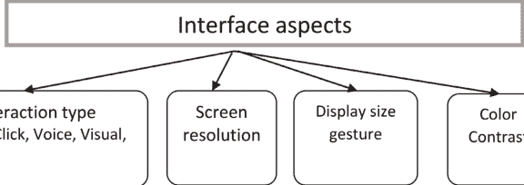

图1. 与用户交互的界面方面。

由于研究，HCI与早期相比已发生很大变化，一个很好的例子是万维网（WWW）（Keskin et al. 2023）。WWW是HCI研究的结果，通过它，我们可以将网页或网站存储在Web服务器中，并通过本地计算机连接到它。通过研究，我们开发了绘制、文本编辑、超文本、动画系统、手势识别系统、眼球追踪系统、生物识别追踪系统、云计算、语音识别等应用。

另一种方法是设计思维，这是一项源自设计学科并旨在通过以人为本的方法解决问题的实践（Culén et al. 2014）。这种实践关注现实世界问题，这些问题可以通过共情、优先考虑用户及其需求、创新解决方案和综合推理来解决。它还确保创新是有用的、现实的、可感知的，并且关注人类价值观。HCI设计师和从业者遵循关注用户需求的方法。深入探讨设计思维与HCI设计之间的相似性或差异，可以为从业者塑造未来创新技术揭示新途径。世界各地的少数研究所组织不同的研讨会，我们在其中讨论新想法、最近面临的问题、如何解决这些问题、新方法、HCI背后的理念、其历史等，面向研究人员、设计师、从业者、初学者以及其他对创新感兴趣的人，帮助他们理解设计和实施HCI所涉及的问题。

由于HCI的这种转变以及技术的快速增加，不同能力的人可以在日常生活中使用它。因此，缺乏知识和正式培训的人可以轻松地与计算机交互，无需担心学习任何计算机系统早期阶段出现的复杂问题。因此，我们可以说，用户友好的界面和计算机系统确保对每个人来说一切都容易且清晰。

### 2 HCI的应用

如今，互联网和先进技术已改变了我们生活的方方面面，从醒来到入睡，我们全天都在体验HCI技术，一个简单的例子是灯开关（McCormick et al. 1976）。一个人不需要拥有计算机系统、笔记本电脑或智能手机，HCI也会对他们的生活产生影响。我们日常生活中的HCI示例包括火车票售票机、健康追踪器、智能电视、可穿戴系统等。如今，依赖技术或计算机的公司或行业在日常运营中需要HCI。如果计算机设计良好、易于使用且易于理解，员工可以更高效、更快速地工作。HCI在安全控制系统及其他许多方面发挥着重要作用。

在这个世界上，许多人有残疾，因此他们很难理解计算机。在这种情况下，HCI发挥着非常重要的作用，因为HCI提供了一个非常安全、易于理解、高效且可用的环境。因此，通过专注于以用户为中心的技术和功能，残疾人也能舒适地使用计算机。在技术的早期，计算机非常昂贵，并非人人都能负担得起。但是，通过审视技术的益处，设计师、研究人员、制造商和提供商确保每个人都能在不牺牲质量的前提下，通过降低技术成本来获得智能设备。如今，很少有人阅读手册，因为手册冗长且初学者难以理解。在这种情况下，HCI让人们更轻松地学习和访问计算机系统（Majoranta et al. 2014）。HCI创建用户友好且易于使用的界面和计算机系统，以便初学者能在几分钟内理解一切。

### 3 HCI的发展

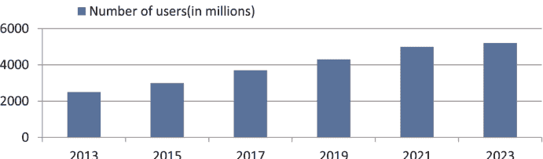

图2. 过去几年用户数量增加。

如图2所示，HCI在过去几十年中通过专注于图形用户界面（GUI），在设计新的交互式、高效、易于使用和易于理解的界面方面得到了很大发展。由于HCI的发展，使用互联网和技术的用户数量迅速增加。借助GUI，用户在处理技术时现在可以获得全新的体验，使用触摸屏现在已成为我们生活的一部分，通过台式机、智能手机和平板电脑（Murad et al. 2019）。现在，设计师们也正在专注于语音用户界面（VUI）以与用户交互，但我们的设计系统仍主要集中在GUI上，因此，目前可能无法完全设计、实现和专注于VUI（Murad et al. 2019）。为改进HCI，已进行了大量研究、调查和实验。从业者、研究人员、设计师和用户发表了关于各种问题及其解决方案的众多文章和研究论文，这些文章和研究论文对我们发展HCI大有帮助（Chen et al. 2006）。我们可以浏览它们，尝试几种有效的方法，然后实施它们。多年来，“活体实验室”已通过分析分析、统计、编码和数据假设生成，创造了尝试新方法和发展HCI的新途径（Alavi et al. 2020）。另一种方法是，我们可以使用设计模式作为设计工具来解决个别问题。我们还可以为不同的相关设计问题使用面向模式的设计，这有助于设计师创建富有远见的设计（Seffah et al. 2012）。设计模式的目标是模式如何被重用，并提供经过验证且有效的设计解决方案（Seffah et al. 2012）。随着技术和HCI的双重发展，引入了新的学习解决方案和技术，这些方案在各方面帮助人类，例如基于手势的交互、自闭症儿童的新学习解决方案等。

#### 3.1 基于手势的交互

这是一种交互类型，用户通过一组手势与计算机系统进行交互。在这种交互类型中，用户使用物理手势，例如滑动、点击、捏合和滚动，而不是使用键盘、鼠标等输入设备，


等等。HCI旨在使交互流畅，为此其最重要的技术是手势识别，该系统确保易于使用、提供移动性并需要更少的硬件（Kumar et al. 2018）。基于手势的应用对老年用户非常有用，因为随着年龄增长，他们会丧失感觉、运动和认知能力（Chen et al. 2013）。因此，他们可以通过手、脸和其他身体部位的移动轻松交互，因为有简单性的优势。借助HCI，我们可以为自闭症谱系障碍（ASD）儿童提供新的学习解决方案。研究得出结论，在自闭症儿童教育中结合使用计算机技术和HCI具有积极和有益的效果（Mullen et al. 2010）。增强现实（AR）技术可用于创建熟悉的环境，自闭症儿童可以通过音频和视频实时学习学习内容（Sharma et al. 2022）。然而，HCI社区一直没有太关注为自闭症儿童提供可用且高效的解决方案，但仍然存在一些解决方案，例如机器人支持的学习解决方案。这些解决方案伴随着许多挑战，研究人员正在努力克服这些问题。

### 4 眼球跟踪控制系统

眼球跟踪系统用于测量我们眼睛的活动，它测量眼球的位置、注视方向，眼睛的运动可以通过不同的技术进行测量（Zhang et al. 2017）。眼球追踪仪可以帮助HCI研究人员了解视觉和基于显示的信息，这些信息可用于改进可用性界面、各种产品、网站、应用程序等（Joseph et al. 2020）。眼球跟踪技术已有数百年历史，但在过去几年中，该领域的发展有了很大提升。Zhang et al. (2017) 提出了4种技术：红外眼电图（IROG）、巩膜搜索线圈法（SSC）、眼电图（EOG）和视频眼电图（VOG）。

该系统现在通常用于医学和心理学研究，以更有效地了解人类的视觉行为。这对残疾人也非常有帮助，在工作场所作为安全系统也很有用（Majoranta et al. 2014）。如今，用户更倾向于将生物识别系统作为其安全系统，并且随着该工具在医学、市场调研、网页设计、营销、安全、数字媒体、产品设计、国防等领域兴趣的增长，它比以前更加实惠了。几年前，眼球追踪仪曾经非常昂贵，不是每个人都买得起，但随着各个领域对眼球追踪仪需求的快速增长，低成本眼球追踪设备已在市场上可用，例如GazePoint (GP3) HD 150 Hz、HTC Vive Pro Eye、smart eye aurora – 60/120 Hz、EyeTech VT3 mini – 40/60 Hz、Smart Eye AI-X等。

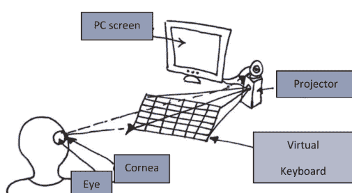

图 3. 眼球跟踪技术与虚拟键盘。

用户可以通过点击虚拟键盘上的按键图片来控制个人电脑（PC），该虚拟键盘可以投影并在桌面上进行交互。在这里，我们创建了一个虚拟键盘控制系统，除了跟踪用户的手指移动外，还跟踪他们的眼睛移动，并将其转换为按键（图 3）。用户可以同时使用手指和眼睛来操作虚拟键盘（Lin et al. 2008）。

该系统还可以通过交互式和革命化的教学方式帮助用户进行学习。McCormick et al. (1976) 在其工作中指出，超过80%的人类通过视觉表象学习事物更快。因此，学习的视觉能力远优于其他认知过程。HCI和眼球跟踪技术的用户体验可以以更有效的方式用于增强数字学习。在这个系统中，眼睛运动数据非常重要，但在过去，通过眼睛观察运动不够客观、准确性较低等。认知心理学的主要组成部分是信息加工模型（Kumar et al. 2021; Singh et al. 2021; Wu et al. 2012）。这是认知心理学家用来描述人类大脑过程的框架。

### 5 实验结果

进行了一项打字实验，我们评估参与者对视觉变化的反应或移动速度。为参与者提供了一个虚拟键盘。在这个实验中，我们使用由 Davis et al. (1989) 引入的 TAM，它是一个信息系统，告诉我们用户如何接受或拒绝任何提议的系统或技术。在 TAM 中，我们使用 TAM 问卷来获得结果，在其中我们需要根据 Davis et al. (1989) 和 Venkatesh et al. (2000) 采用的系统评估 5 个项目：PU、EOU、ATU、BI 和 PI。我们在实验结束时使用 TAM 问卷，以了解拟议的技术对参与者是否舒适、有益且易于使用。

在这个实验中，超过 1000 名参与者参与了实验和调查。其中 64.3% 为男性，35.7% 为女性，都有使用计算设备的经验。参与者是年龄在 17 至 25 岁之间的学生。首先，向参与者介绍了虚拟键盘，然后让他们独自与之相处 2–3 分钟以熟悉。之后，参与者被告知只需看着虚拟键盘，以避免任何错误并提高系统的准确性。实验结束后，参与者填写了拟议虚拟键盘系统的 TAM 问卷。本实验包括 5 个简单步骤。

- 访问网站链接：https://www.typing.com/student/tests。
- 点击按钮“开始1分钟测试”。
- 现在在屏幕上输入“蓝色”的字母，并确保尽可能快速，避免任何打字错误。
- 1分钟后，您可以查看速度和准确性。
- 之后，参与者完成了调查。

本实验结果如表 1 所示。速度以每分钟单词数（WPM）计算，准确率以百分比（%）表示。根据结果，男性参与者的平均速度（36.5 wpm）高于女性参与者（28.4 wpm），表明男性对视觉变化的反应速度比女性更快。男性的平均准确率为 91%，而女性为 96%，表明女性打字错误比男性更少。男性和女性在平均准确率和速度方面的差异如图 4 所示。

| 性别 | 平均速度（wpm） | 平均准确率（%） |
|---|---|---|
| 男性 | 36.5 | 91 |
| 女性 | 28.4 | 96 |

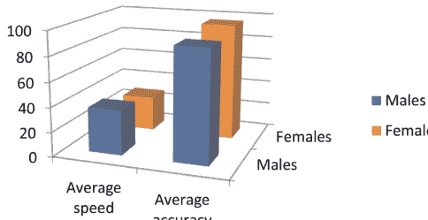

图 4. 平均速度和准确率结果。

根据 TAM 问卷的结果，44.6% 的参与者在日常生活或工作中使用此系统，而 42.9% 的参与者偶尔使用。91.1% 的参与者认为该系统易于使用且易于理解。66.1% 的参与者未来也希望使用该系统。73.2% 的参与者认为此虚拟键盘打字练习系统可以帮助他们提高工作表现。TAM 问卷结果如下表 2 所示。

| 决定 | 它是否能提高您的工作表现？ | 该系统是否易于使用且易于理解？ | 您是否在日常生活中使用它？ | 您未来是否希望使用它？ |
|---|---|---|---|---|
| 是 | 73.2 | 91.1 | 44.6 | 66.1 |
| 否 | 7.1 | 7.1 | 12.5 | 26.7 |
| 也许 | 19.6 | 1.7 | 42.9 | 7.1 |

### 6 HCI 的未来挑战

HCI 在多年中面临过各种挑战和问题，将在以下部分中提及。

#### 6.1 人机共生

随着 AI 发展的兴起，一切正在实现自动化，因此人类控制一切而非各种算法和计算机变得至关重要。因此，我们应该创造支持用户日常生活、尊重人类及其权利并建立信任的技术。为此，我们需要三个因素：透明度、可理解性和问责制，这些将在人类与机器之间建立公平的信任关系。在变化和智能环境中的交互已从传统模式转向关注用户的情感、触摸和手势，这意味着从 HCI 转向 HEI（人机环境交互）（Stephanidis et al.


2019）。这种方法的一个主要关注点是计算机的消失，因为它们在独特设备中变得可见，创造了一个智能环境，计算机成为家具的一部分（桌子、墙壁等）（Stephanidis 等人，2019）。随着技术不断发展，在我们的日常生活中适应这些变化也很重要，并且令人担忧的是，这些技术变化不应干扰我们的环境（Stern，1993）。

HCI 的重要作用是确保两个世界之间存在智能交互，创建一个由物理世界和数字世界组成的混合世界。让智能机器人与我们一起工作并为我们服务，计算机嵌入我们的环境中。

#### 6.2 伦理、隐私与安全

目标是将这些先进的 HCI 技术提供给大量人群以产生潜在影响，为此，关注人类隐私、伦理和安全变得非常重要。因此，问题随之而来：“我们如何为 HCI 和 AI 技术制定和实施普遍可接受且兼顾人权的指南、隐私、安全和标准？”（Kisselburg 等人，2020）。这个问题的答案是研究、实验和网络安全。当今万物数字化，网络犯罪有所上升，人们对隐私和安全也更加谨慎。如今，任何人都可以通过网络攻击追踪他人的每一项信息，因此保持网络安全变得非常重要。技术通过监控摄像头、物联网家居设备、智能门锁、人脸识别系统等各种系统为这一问题提供了解决方案。

#### 6.3 福祉、健康与幸福

技术进步为人类提供了多种机会，以拥有更先进、成本更低的健康生活方式并变得更强健。Eudaimonia 是一种感觉有意义、实现个人潜能、保持积极态度，并在技能与挑战之间取得平衡的概念。正因为这些各种先进技术，人类创造了“个人医疗设备”（PMDs），人们可以佩戴、交互、携带或附着它们，以监测健康并生成医疗数据。PMDs 不仅指可穿戴设备，智能手机中还有许多自我监测应用程序，可以改善用户的整体健康，因为它们易于使用、易于理解且成本低（Culén 等人，2014）。

### 7 结论

虚拟键盘打字练习系统对需要在工作或学习中打字的人非常有帮助。通过该系统，用户可以了解自己的不足之处，从而继续练习，大幅提高打字速度和准确性。快速且高度准确的打字可以节省个人大量时间，使他们在工作和学习中能以更少的错误更高产地工作。为了了解该应用程序对学生和在职专业人士是否真的有帮助，借助 TAM 模型进行了一项调查。为了了解用户对该应用程序的接受度，调查中使用了 TAM 问卷。TAM 问卷包含 5 个基本要点，告诉我们用户对拟议系统的感受，该系统对他们是否有用，是否有助于他们的日常生活，以及他们对拟议系统的看法。在上述打字实验和调查中，我们得出结论，参与者喜欢拟议系统，并希望继续使用它来在保持高度准确性的同时提高速度。根据结果，大多数参与者认为该系统有用、有益、易于使用且易于理解，因此他们希望未来使用它来提升自己的技能。

### 参考文献

Abascal, J., Barbosa, S.D., Nicolle, C. and Zaphiris, P., 2016. 重新思考普惠无障碍：一种考虑数字鸿沟的更广泛方法. Universal Access in the Information Society, 15(2), pp.179–182.

Alavi, H.S., Lalanne, D. and Rogers, Y., 2020. 生活实验室的五个维度：HCI 中生活实验室概念演变的文献研究. ACM Transactions on Computer-Human Interaction (TOCHI), 27(2), pp.1–26.

Chen, C., Panjwani, G., Proctor, J., Allendoerfer, K., Aluker, S., Sturtz, D., Vukovic, M. and Kuljis, J., 2006. 可视化 HCI 的演变. In 人与计算机 XIX——更大的图景：HCI 2005 论文集（第 233–250 页）. Springer London.

Chen, W., 2013. 基于手势的老年人应用. In 人机交互：交互方式与技术：第 15 届国际会议，HCI International 2013，美国内华达州拉斯维加斯，2013 年 7 月 21–26 日，论文集，第 IV 部分 15（第 186–195 页）. Springer Berlin Heidelberg.

Culen, A.L. and Folstad, A., 2014 年 10 月. HCI 中的创新：我们可以从设计思维中学到什么？. In 第 8 届北欧人机交互会议论文集：有趣、快速、基础（第 849–852 页）.

Davis, F.D., 1989. 感知有用性、感知易用性与信息技术用户接受度. MIS Quarterly, pp.319–340.

Joseph, A.W. and Murugesh, R., 2020. 用于测量人机交互研究中认知负荷的潜在眼动追踪指标和标准. J. Sci. Res, 64(1), pp.168–175.

Keskin, M. and Kettunen, P., 2023. 机器学习辅助的交互式地理可视化探索中眼动追踪的潜力. International Journal of Cartography, pp.1–23.

Kisselburgh, L., Beaudouin-Lafon, M., Cranor, L., Lazar, J. and Hanson, V.L., 2020 年 4 月. HCI 伦理、隐私、可访问性与环境：关于全球政策问题的市政厅论坛. In 2020 年 CHI 人机计算系统会议扩展摘要（第 1–6 页）.

Kumar, A., Kaur, A., Sharma, B. and Mantri, A., 2018. 混合现实系统的基于手势的人机交互模型.

Kumar, A., Sharma, S., Goyal, N., Singh, A., Cheng, X. and Singh, P., 2021. 基于新兴技术 IoT 的安全且节能的智能建筑架构. Computer Communications, 176, pp.207–217.

Lin, C.S., Lin, C.H., Lay, Y.L., Yeh, M.S. and Chang, H.C., 2008. 采用长窄区域新坐标变换的眼动控制虚拟键盘. Optica Applicata, 38(2).

Majoranta, P. and Bulling, A., 2014. 眼动追踪与基于眼动的人机交互. In 生理计算进展（第 39–65 页）. London: Springer London.

McCormick, E.J., 1976. 工程与设计中的人机工程学. (无标题).

Millen, L., Edlin-White, R. and Cobb, S., 2010 年 3 月. 自闭症儿童教育协作式虚拟环境的开发. In 第 5 届剑桥普惠无障碍与辅助技术研讨会论文集. 剑桥（第 1 卷，第 7 期）.

Murad, C., Munteanu, C., Cowan, B.R. and Clark, L., 2019. 革命还是演化？语音交互与 HCI 设计准则. IEEE Pervasive Computing, 18(2), pp.33–45.

Seffah, A. and Taleb, M., 2012. 作为交互设计工具追踪 HCI 模式的演变. Innovations in Systems and Software Engineering, 8, pp.93–109.

Sharma, B., Mantri, A., Singh, N.P., Sharma, D., Gupta, D. and Tuli, N., 2022 年 10 月. EduSense-AR：一种面向自闭症儿童的感官学习解决方案. In 2022 年第 10 届可靠性、信息通信技术与优化国际会议（趋势与未来方向）（ICRITO）（第 1–4 页）. IEEE.

Singh, G., Mantri, A., Sharma, O. and Kaur, R., 2021. 用于增强电子工程实验室体验的虚拟现实学习环境. Computer Applications in Engineering Education, 29(1), pp.229–243.

Stephanidis, C., Salvendy, G., Antona, M., Chen, J.Y., Dong, J., Duffy, V.G., Fang, X., Fidopastis, C., Fragomeni, G., Fu, L.P. and Guo, Y., 2019. 七大 HCI 重大挑战. International Journal of Human–Computer Interaction, 35(14), pp.1229–1269.

Stern, P.C., 1993. 第二环境科学：人类—环境交互. Science, 260(5116), pp.1897–1899.

Venkatesh, V. and Davis, F.D., 2000. 技术接受模型的理论扩展：四项纵向实地研究. Management Science, 46(2), pp.186–204.

Wu, C.I., 2012. 用于学习效果的 HCI 与眼动追踪技术. Procedia-Social and Behavioral Sciences, 64, pp.626–632.

Zhang, X., Liu, X., Yuan, S.M. and Lin, S.F., 2017. 基于眼动追踪的自然人机交互控制系统. Computational Intelligence and Neuroscience, 2017.


## 元宇宙中基于智能合约的 DeFi 应用的数字孪生框架：迈向互操作性、服务规模化与韧性

Ankur Gupta*、Surbhi Gupta* & Saurabh Sharma*

印度杰姆穆，查谟和克什米尔，模范工程技术学院计算机科学与工程系

ABSTRACT: 去中心化金融（DeFi）有望成为元宇宙的支柱，促进 B2B、B2C 和 C2C 规模化商业。区块链和智能合约是 DeFi 愿景的关键驱动力，可基于预定义条件的履行实现安全且不可否认的金融交易。然而，智能合约业务逻辑可能存在缺陷，导致交易错误和资本损失。测试智能合约并确保 100% 的正确性仍然是一项挑战。最后，为了实现元宇宙标准论坛（MSF）规定的元宇宙互操作性要求，服务提供商将需要快速扩展并在众多元宇宙平台和生态系统中提供类似服务。服务提供商还需要确保其 DeFi 服务的高可用性，并在面临攻击时保持韧性。本研究论文提出了一种用于元宇宙的基于智能合约的应用数字孪生框架，允许 DeFi 服务提供商在元宇宙平台上创建和维护其服务的多个主动和被动孪生体。服务的被动孪生体可由潜在合作伙伴用于测试其智能合约执行并验证结果。被动孪生体可以动态激活，以提高可用性、确保超大规模扩展或应对攻击。仿真结果证明了所提框架的有效性，为满足未来元宇宙的期望奠定了基础。

### 1 引言

元宇宙正在迅速成为切实可行的现实，实现其愿景所需的技术正在陆续出现（Gupta et al. 2023）。这个备受期待的数字宇宙是一个不断发展的生态系统，由高性能计算、低延迟网络和沉浸式 AR/VR/XR 技术（Chen et al. 2022; Singh et al. 2021）的融合所驱动，这些技术正迅速成为主流，并帮助各行各业想象和实验激动人心的用例场景。在这个变革性格局的核心，是去中心化金融（DeFi）（Auer et al. 2023）的承诺，这是一种金融范式转变，利用区块链技术和智能合约重塑我们在元宇宙中感知、互动和体验经济交易的方式。由 DeFi 驱动的元宇宙经济影响在未来 20 年内预计将达到数万亿美元。

元宇宙凭借其沉浸式虚拟环境、互联的数字经济和繁荣的虚拟社区，为金融系统的演进提供了前所未有的画布（Dincelli & Yayla 2022）。在这个领域，用户可以穿越广阔的虚拟景观，与各种头像互动，拥有和交易数字资产，并参与一系列镜像现实世界对应物的经济活动。元宇宙重新定义商业、娱乐和社会互动的固有潜力，由区块链技术（实现无需信任的交易和透明度的分布式账本）和智能合约（Gupta et al. 2023，自动化并强制执行互动规则的自执行协议）所支撑。

*Corresponding Authors: ankur.gupta@mietjammu.in, surbhi.cse@mietjammu.in and saurabh.cse@mietjammu.in

DeFi 已经颠覆了传统金融（Zhang et al. 2023），有望在元宇宙中占据中心舞台，呈现出一个以自主性、可访问性和包容性为特征的金融生态系统的引人注目的愿景。与由中介机构和中央机构管理的传统金融系统不同，DeFi 利用区块链和智能合约的力量，让个人直接控制自己的资产和金融活动。它还为经济参与开辟了新途径，使用户能够通过虚拟工作赚取收入、创建和交易虚拟商品和服务，甚至建立自己的去中心化自治组织（DAOs）（Taulli 2022）。元宇宙标准论坛（Metaverse Standards Forum）将所有元宇宙平台之间的互操作性定义为未来异构协作平台发展的关键要求，使用户能够无缝地在元宇宙中导航。因此，DeFi 也需要跨平台无缝工作，让用户随时随地自由参与金融交易，并内置安全和隐私保障。为满足这一基本要求，DeFi 或智能合约需要在元宇宙架构中无处不在（La Barrera 2023），易于测试、可扩展、具有韧性，并保证无论在何处、以何种方式调用，都能正确执行。这对智能合约开发者和 DeFi 服务提供商构成了技术挑战。本研究论文提供了一种基于数字孪生概念（Barricelli et al. 2020）的分布式智能合约框架，允许 DeFi 服务提供商通过复制和边缘部署轻松扩展其服务，为用户提供无缝的金融交易访问，同时确保安全性和透明度。本研究的主要贡献如下：

- 本研究提出了一种新颖的智能合约数字孪生概念，用于将复制的智能合约表示为不同元宇宙平台的边缘服务。
- 本研究提供了一个跨元宇宙扩展 DeFi 服务的新框架，确保安全性（作为边缘经过身份验证的服务端点提供）、互操作性（跨不同元宇宙平台运行）、韧性（通过复制扩展服务以应对攻击）和高性能（基于边缘，低延迟并提供负载均衡）。
- 本工作通过允许 DeFi 用户使用边缘服务的被动模式来测试智能合约执行的输出，解决了确保智能合约正确性的重要挑战。这确保最终输出不会提交到中心区块链。目前，还没有机制让最终用户验证智能合约业务逻辑的正确执行。
- 仿真结果还表明，该框架可行、易于扩展且高性能，从而解决了实现元宇宙跨平台 DeFi 用例的主要要求。

本稿余部分组织如下：第 2 节讨论该领域的相关工作。第 3 节介绍详细的系统模型及其功能元素和工作流，以及显著特性和优势，第 4 节介绍实验设置及所得仿真结果及其讨论。最后，第 5 节总结全文。

### 2 相关工作

自区块链、智能合约和去中心化预言机网络（DONs）出现以及 Web3 和元宇宙的兴起以来，去中心化金融（DeFi）已获得关注（Liew 2022）。事实上，DeFi 被视为实现元宇宙商业潜力的基础元素（Turi 2023）。元宇宙标准论坛（Metaverse Standards Forum）是由领先企业组成的联盟，旨在帮助制定元宇宙发展的公平包容性路线图。它将互操作性确定为未来元宇宙平台的主要要求。因此，元宇宙的所有核心元素理想上应能够跨越由不同组织构建和运营的多种多样的元宇宙平台无缝运行。这一要求也对 DeFi 服务提供商产生影响，因为他们需要在地理上多样化的元宇宙服务提供商之间高效地部署其服务，同时确保安全性、透明度、韧性、性能和可扩展性（Banaeian Far et al. 2023）。智能合约的挑战之一是准确且可预测的执行（Mense & Flatscher 2018）。最终用户在使用服务之前无法测试智能合约的执行，这使他们面临业务逻辑执行不正确的风险（Khan et al. 2021）。智能合约的其他挑战已在（Kaur et al. 2023）中阐述。（Gupta et al. 2023）早期建议通过使用代理智能合约来解决此问题，但该解决方案特定于一种区块链类型。目前，关于在元宇宙中实现无缝 DeFi 服务组合、发现和消费的研究最好可描述为处于起步阶段。

为克服上述要求及相关挑战，本研究论文提出了一种基于智能合约数字孪生、作为边缘服务托管的元宇宙 DeFi 框架，为元宇宙实体提供便捷访问，以使用封装在智能合约中的自定义或标准业务逻辑进行金融交易。此外，用户可以在使用实际 DeFi 服务之前测试智能合约逻辑。（Banaeian Far et al. 2023）讨论了在元宇宙环境中有效使用数字孪生的一些注意事项。所提框架除了解决这些安全问题外，还提供了额外功能以简化跨元宇宙操作。

### 3 系统模型

图 1 描绘了所提基于数字孪生的 DeFi 服务模型（DTDSM）的详细系统模型，该模型基于在元宇宙平台间提供服务访问端点（SEPs）。这些 SEPs 映射到托管在 DeFi 服务云（DSC）边缘的 DeFi 边缘服务（DES），旨在为不同元宇宙平台上的用户提供低延迟 DeFi 服务。

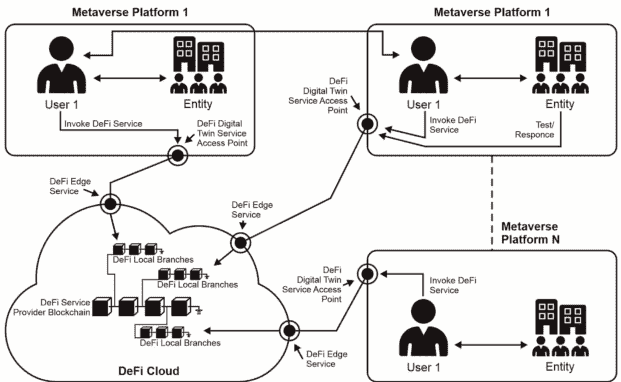

图 1. 所提基于数字孪生的 DeFi 服务模型（DTDSM）。


去中心化金融服务云（DSC）为跨多样元宇宙平台的用户托管了区块链，提供与服务消费和支付交易相关的不可篡改且不可否认的记录。区块链模型是分层的，在主区块链上有分叉，用于跟踪各个元宇宙平台的交易和智能合约执行。虽然主区块链的数据会定期与分叉链同步，但从分叉链到主链的数据仅在关联智能合约处于“活动模式”时才会提交。在“被动模式”下，智能合约在分叉链上执行虚拟交易，以向交易相关方返回指示性结果。这一特性从测试角度来看非常有用。由元宇宙平台托管的服务访问端点（SEP）经过身份验证并签发身份验证令牌，任何元宇宙实体均可按需验证。这确保了实体与托管的 DeFi 服务访问端点进行可信交互。所有托管的智能合约可在最终交易前由平台、实体和用户进行测试/验证。代理智能合约的概念在早期工作（Gupta et al. 2023）中已提出，并已证明能有效解决基于有缺陷业务逻辑执行导致的智能合约执行错误问题。根据服务负载，DeFi 服务提供商可以扩展 DeFi 服务云上的 DeFi 服务访问端点和相应的边缘服务，从而确保负载管理并提供确定性的服务质量保证。此外，面对针对 DeFi 服务或元宇宙平台的拒绝服务攻击，拥有多个实例将有助于分摊对最终用户的整体服务影响。基于数字孪生的提议 DeFi 服务模型的显著特征如下：

- **互联互通的元宇宙平台**：提议的框架有助于实现元宇宙标准论坛阐述的互操作性愿景，用户可在此进行互动、交易并参与各种协作活动。
- **服务访问点**：系统便于在多个元宇宙平台上建立服务访问点。这些访问点充当网关或接口，用于从元宇宙内外无缝访问 DeFi 服务。
- **DeFi 云基础设施**：DeFi 云作为系统的骨干。它托管了一系列 DeFi 服务、边缘服务和智能合约数字孪生，以提供安全、透明和可扩展的解决方案。
- **智能合约数字孪生**：智能合约数字孪生是远程托管在 DeFi 云上的智能合约副本，其交易记录在分叉分支上并支持自动前向同步。这些副本与原始合约同步，能够实现更快的执行、扩展和容错能力。
- **DeFi 服务提供商**：DeFi 服务提供商向元宇宙平台上的用户提供各种金融服务，如借贷、交易、收益耕作等。其实际使用前，其服务访问点可由潜在协作者进行身份验证和测试。
- **多区块链模型**：DeFi 服务提供商维护从主区块链分叉出的多个区块链，每个分叉分支用于来自单个元宇宙的交易，以便于报告。仅在实际交易进行时，最终交易才会从分叉分支提交到主区块链。

提议的模型在延迟、可扩展性和可靠性方面表现高效。用户可以在其元宇宙环境中，或在导航其他元宇宙平台时无缝访问 DeFi 服务。此外，DeFi 服务提供商可以将其服务扩展到新平台。该框架通过在 DeFi 云上将智能合约数字孪生托管为边缘服务，实现了更低的智能合约执行延迟。这对于时间敏感的 DeFi 活动（包括高频交易）至关重要。智能合约数字孪生可以水平扩展，以适应不断增长的用户基础和增加的交易量，确保系统能够处理更高的需求。DeFi 云上的复制智能合约实例提供了容错能力。如果某个实例发生故障或停机，其他实例将无缝接管，确保持续的服务可用性。该框架支持多个元宇宙平台之间的兼容性，使用户能够更轻松地在不同虚拟世界之间切换，同时使用熟悉的服务并保持上下文。

### 4 仿真结果

元宇宙平台通过在不同地理区域（美国、欧洲、亚洲、澳大利亚和新西兰）选择 AWS 实例及其关联区域、区域边缘缓存和边缘位置进行了仿真。表 1 捕捉了配置。

| 云区域（元宇宙平台位置） | 美国西部（美国） | 美国东部（美国） | 伦敦（欧洲） | 孟买（亚洲） | 悉尼（澳新） |
|---|---|---|---|---|---|
| 区域边缘缓存 | 加利福尼亚 | 俄亥俄 | 伦敦 | 孟买 | 悉尼 |
| 边缘位置（适用于 DeFi 边缘服务） | 洛杉矶 | 纽约 | 伦敦 | 孟买 | 悉尼 |
| DeFi 云位置 | 孟买 | 孟买 | 孟买 | 孟买 | 孟买 |

为模拟边缘服务，我们使用了 AWS CloudFront 边缘服务及其 Lambda 边缘函数，这些服务在多个地理分散的位置提供低延迟服务。就仿真目的而言，我们假设 DeFi 云托管在单个地理位置。然而，未来优化可能包括提供去中心化的 DeFi 服务，以进一步优化性能。

图 2 捕捉了来自同一元宇宙内实体在元宇宙平台内部发起的边缘服务调用的平均延迟时间。可以从图中看到，在 24 小时运行期间，边缘服务调用的平均延迟范围为 0.83 毫秒至 1.96 毫秒，在此期间，运行在 AWS 实例上的程序模拟了 10,000 笔交易，代表元宇宙中的用户-实体交互。

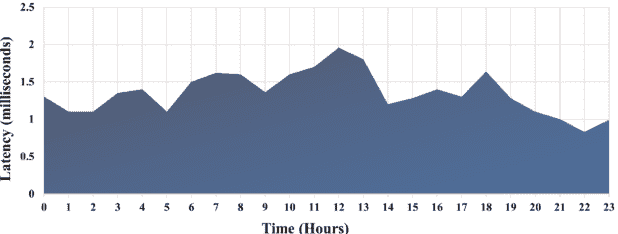

图 2. 边缘服务调用的平均延迟。

图 3 a 捕捉了同一 AWS 区域内边缘-DeFi 云通信的平均延迟，而图 3 b 捕捉了不同区域的边缘-DeFi 云延迟。DeFi 云托管在 Mumbai AWS 区域。可以看到，同区域通信的平均延迟在 1.7 至 2.8 毫秒之间，而边缘-DeFi 云延迟在 24 小时期间范围为 2.4 至 5.7 毫秒。

```
$T_{txn} = DeFi_{Invo-Time} + Edge_{Serv-Latency} + Edge_{Core-Latency} + SC_{Exe-Time} + Commit \quad (1)$
```

在上述公式中，$T_{txn}$ 表示系统中的总交易时间。$DeFi_{Invo-Time}$ 表示调用 DeFi 服务所需的时间。$Edge_{Serv-Latency}$ 和 $Edge_{Core-Latency}$ 分别表示边缘服务和边缘核心延迟。术语 $SC_{Exe-Time}$ 表示智能合约执行时间。此外，$Commit$ 表示区块链提交所需的时间，可能是在分叉区块链或主区块链中。

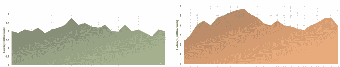

(a) 同一 AWS 区域内的平均延迟

(b) 不同 AWS 区域间的平均延迟

图 3. 同一区域和不同区域之间的边缘-DeFi 云通信平均延迟。

图 4 描绘了在跨越时区和地理位置的 24 小时运行窗口内平均交易时间随时间变化的情况。由于流量负载变化、跨区域通信以及数字孪生智能合约是以活动模式还是被动模式调用（随机分布）等变化因素，观察到交易时间最大方差为 78%。

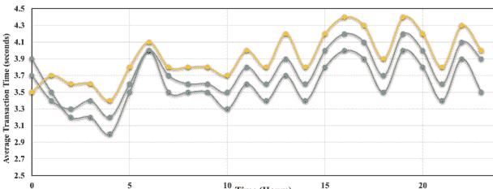

图 4. 跨越时区和地理位置的 24 小时运行窗口内的平均交易时间。

采用带有重复智能合约执行的两级区块链会给整体处理带来显著开销，但鉴于对正确智能合约执行存在不确定性，这些开销是合理的。

### 5 结论

本文提出了一种基于数字孪生概念的元宇宙 DeFi 服务设计新框架，本质上是智能合约及其他

金融服务。这些副本允许用户在实际使用前验证基于智能合约的 DeFi 服务的正确执行，从而克服传统智能合约中的挑战。此外，多实例边缘模型可快速扩展、具有抗攻击性，并因其位于元宇宙边缘而提供低延迟操作。分层区块链模型支持数字孪生 DeFi 服务模型，确保仅提交活跃交易，而用于测试的被动交易不作为实际交易记录的一部分。未来工作将涉及在大规模下对多种用例进行框架测试，并通过智能的全球边缘服务部署/再部署进一步优化性能。

### REFERENCES

- Auer, R., Haslhofer, B., Kitzler, S., Saggese, P., & Victor, F. (2023). *去中心化金融（DeFi）的生态*. 国际清算银行，货币和经济部。
- Banaecian Far, S., & Imani Rad, A. (2022). 在元宇宙中应用数字孪生：用户界面、安全和隐私挑战。*元宇宙期刊*，2(1)，8–16。2022。
- Banaecian Far, S., Imani Rad, A., & Rajabzadeh Asaar, M. (2023). 区块链及其衍生技术塑造未来数字商业：聚焦去中心化金融和元宇宙。*数据科学与管理*，6(3)，183–197。2023。
- Barricelli, B. R., Casiraghi, E., Gliozzo, J., Petrini, A., & Valtolina, S. (2020). 用于健身管理的人体数字孪生。*IEEE Access*，8，26637–26664。2020。
- Chen, Z., Wu, J., Gan, W., & Qi, Z. (2022). 元宇宙安全与隐私：概述。收录于：*2022 IEEE 大数据国际会议 (Big Data)* (第 2950–2959 页)。2022 年 12 月。
- Dincelli, E., & Yayla, A. (2022). 元宇宙时代的沉浸式虚拟现实：基于技术可负担性视角的混合叙事综述。*战略信息系统期刊*，31(2)，101717。2022。
- Gupta, A., Gupta, R., Jadav, D., Tanwar, S., Kumar, N., & Shabaz, M. (2023). 用于去中心化预言机网络中基于应用的零信任架构实现的代理智能合约。*计算机通信*，206，10–21。
- Gupta, H. U., Khan, S., Nazir, M., Shafiq, M., & Shabaz, M. (2023). 元宇宙安全：问题、挑战及可行的 ZTA 模型。*电子学*，12(2)，391。2023 年 1 月 12 日。
- Kaur, G., Lashkari, A. H., Sharafaldin, I., & Lashkari, Z. H. (2023). 智能合约与 DeFi 安全和威胁。收录于：*理解去中心化金融中的网络安全管理：挑战、策略与趋势* (第 91–111 页)。Springer，2023。
- Khan, S. N., Loukil, F., Ghedira-Guegan, C., Benkhelifa, E., & Bani-Hani, A. (2021). 区块链智能合约：应用、挑战和未来趋势。*对等网络与应用*，14，2901–2925。2021。
- La Barbera, S. (2023). 在虚拟前沿导航：去中心化金融与元宇宙的融合。
- Liew, V. K. (2022). Web3 简化：Web3 综合指南：关于 Web3、区块链、DeFi、元宇宙、NFT 和 GameFi 的所有你需要知道的内容。
- Mense, A., & Flatscher, M. (2018). 以太坊智能合约中的安全漏洞。收录于：*第 20 届信息集成与基于 Web 的应用与服务国际会议论文集* (第 37–380 页)。
- Metaverse Standards Forum. 元宇宙标准论坛。
- Singh, M., Singh, S. K., Kumar, S., Madan, U., & Maan, T. (2021). 元宇宙安全与隐私的可持续框架：机遇与挑战。收录于：*网络安全、隐私与网络国际会议* (第 329–340 页)。Cham，2021 年 9 月。
- Taulli, T. (2022). *面向 Web3 的去中心化自治组织（DAO）治理* (第 81–96 页)。Apress，加利福尼亚州伯克利，2022 年 10 月 29 日。
- Turi, A. N. (2023). *金融技术与 DeFi：对数字金融革命的回顾*. Springer Nature。
- Zhang, Y., Chan, S., Chu, J., & Shih, S.-h. (2023). 去中心化金融 (DeFi) 的自适应市场假说。*应用经济学*，55(42)，4975–4989。2023。

## 面向取证的基于集成学习的玻璃识别新方法

Priyansh Sanghavi, Mahir Mehta, Tarang Ghetia & Yogesh Kumar  
潘迪特·迪恩达亚尔能源大学技术学院，古吉拉特邦甘地纳加尔，印度

### 摘要

包括入室盗窃、抢劫、肇事逃逸、谋杀、袭击、撞车抢劫、刑事损毁和汽车盗窃在内的刑事案件，都可能将玻璃作为证据。当任何由玻璃制成的东西破碎时，碎片更有可能朝造成破碎的人或物体的方向飞去。为了进行有效的犯罪学调查，从包含刑事证据的数据库中获取信息非常重要。本文基于 KNN 算法对玻璃识别进行了详细研究。识别方法基于对多个特征列的检查，例如折射率 (RI)、钠 (Na)、镁 (Mg)、钾 (K) 及其他作为基本取证证据的物质。采用包含多种机器学习模型的集成策略来提高玻璃检测的准确性和可靠性。除 KNN 之外，SVM、逻辑回归、朴素贝叶斯和随机森林分类器已被集成到集成框架中。集成方法利用软投票来结合这些多样模型的预测，从而实现更强大、更有效的玻璃识别系统。所提集成技术通过广泛的实验和验证，展示了相较于单个模型的优越性能，从而提高了准确率、精确率和召回率。玻璃识别的这些进步对数字取证具有重要潜力，使取证专家能够在刑事调查中做出更明智的鉴定。

### 1 引言

犯罪学研究为研究玻璃分类问题奠定了基础。如果犯罪现场留下的玻璃得到正确识别，则可作为证据使用。在案例工作中，将犯罪现场发现的玻璃碎片与与嫌疑人相关的玻璃碎片进行比较是常见做法 (Mehta et al. 2022)。这些玻璃碎片有时可能小到难以察觉。必须识别和检查这些微小的玻璃片，以防它们与取证调查相关 (Colomban 2013a)。

通过玻璃的定量检测，提供了各种元素的氧化物浓度。然而，通常只有钙、硅、铝、镁、钠和钾的氧化物浓度足够高，可以进行测量 (Hickman 1981)。因此，本文将数据集中钠 (Na)、镁 (Mg)、铝 (Al)、钙 (Ca)、钡 (Ba) 等元素视为特征列。此外，折射率 (RI) 是区分不同类型玻璃及其用途的关键成分。该数据集根据功能将玻璃分为七个不同的类别：餐具、吊灯、窗户玻璃（浮法和非浮法）、顶灯和车辆（浮法和非浮法）(Mathur and Surana 2020)。

本研究的主要目的是通过主要成分测量来正确分类单个玻璃碎片。K-近邻分类器 (Mashael S. Aldayel 2012) 是用于模式检测和分类最流行的数据挖掘方法之一，是我们解决玻璃问题的基础。最近的研究将投票与其他单个分类器进行了比较，并发现其优于其余分类器 (Rincy and Gupta 2020)。在集成技术中，每个指定的分类算法都在数据集上进行训练。每个模型根据特征（例如折射率、化学成分）及其与玻璃类型的关系来学习进行预测。训练后，每个模型都用于从数据集中进行预测 (Dong et al. 2020; Rincy and Gupta 2020)。这些预测代表了模型对每个观测值玻璃类型的评估。随后，进行软投票，其中集成技术汇总来自所有单个模型的预测，并以加权方式组合预测。集成技术计算单个模型概率分数的加权平均值或组合。这种预测的加权组合决定了最终分类。对于给定的观测值，选择加权和最高或概率分数最高的类别作为最终分类。

### 2 相关工作

近年来，已进行大量研究，以探索不同算法方法来简化玻璃识别过程。本研究包含应用于同一玻璃检测数据集的机器学习技术，例如装袋法、核密度估计、AdaBoost 和模糊聚类 (Ruying and Rongcang 2009)。一位著名的研究者 (Pandey and Jain 2017) 使用 K-近邻 (KNN) 技术作为解决这一艰巨任务的方法。这些举措的主要目标是提高玻璃检测模型的准确性和精确度。在包括工业流程自动化质量控制和安全监控系统在内的各种应用中，准确检测玻璃至关重要。为了实现这一目标，学者们承认需要将额外的分类算法整合到玻璃检测模型的构建中 (Cholakova et al. 2016)。基于卡方统计检验原理，将 K-近邻 (KNN) 分类器与特征加权最近邻方法相结合，是提高其精度的成功策略 (Dino and Abdulrazzaq 2019)。作者 (Rincy and Gupta 2020) 提出了这一独特概念，它有可能显著提高基于 K-近邻方法的玻璃检测模型的性能。该策略根据特征的相关性和重要性对其赋予权重，使分类器能够优先考虑输入数据中最有价值的属性，从而提高玻璃检测的准确性。将特征加权纳入 K-近邻 (KNN) 方法在理论上是站得住脚的，并且具有实际应用价值。玻璃检测数据集有时包含大量信息，其中一些可能在区分不同玻璃类型或状态时并不那么相关。基于卡方检验等统计检验的特征加权，可以有效发现并优先考虑最具区别性的特征，从而增强模型的预测能力 (Oladipo et al. 2020)。此外，必须强调确保这些学术研究得出的结论的精确性和有效性的重要性。玻璃的精确分类对现实世界中的实际应用具有重大影响。在制造环境中，准确识别和分类各种类型的玻璃有助于优化质量控制流程，从而减少缺陷并降低生产成本。在安全和监控领域，精确检测玻璃可以显著提高识别潜在安全风险或犯罪活动的有效性 (El-Khatib, Abu-Nasser and Abu-Naser 2019)。


这些研究工作的主要目标是提高玻璃检测模型的整体精度和可靠性。因此，这些努力符合研究工作中常追求的总体目标：推进特定学科内的现有知识和理解。在此例中，主要目标是提高玻璃分类的精度，这项工作具有广泛的影响（Goswami and Wegman 2016）。

### 3 数据集描述

UCI机器学习库提供了大量可用于机器学习的其他数据集。玻璃可以根据其成分在玻璃识别数据集中被识别。该数据集包含214个数据点，包含十个输入特征和一个输出属性（玻璃类型）。属性是通过按重量计算的适当氧化物百分比来定义的（German 1987）。

#### 3.1 属性信息

该集中包含“S.NO.”、“RI（折射率）”、“Na”、“Mg”、“Al”、“Si”、“K”、“Ca”、“Ba”和“Fe”（钙、钡和铁）等属性。此类特征用作分类任务的输入。

表 1. 玻璃数据集

| S.No. | RI | Na | Mg | Al | Si | K | Ca | Ba | Fe | 玻璃类型 |
|---|---|---|---|---|---|---|---|---|---|---|
| 1 | 1.51761 | 12.81 | 3.54 | 1.23 | 73.24 | 0.58 | 8.39 | 0 | 0 | 一种 |
| 2 | 1.51761 | 13.89 | 3.6 | 1.36 | 72.73 | 0.48 | 7.83 | 0 | 0 | 一种 |
| 3 | 1.51618 | 13.53 | 3.55 | 1.54 | 72.99 | 0.39 | 7.78 | 0 | 0 | 一种 |
| 4 | 1.51766 | 13.21 | 3.69 | 1.29 | 72.61 | 0.57 | 8.22 | 0 | 0 | 一种 |
| 5 | 1.51742 | 13.27 | 3.62 | 1.24 | 73.08 | 0.55 | 8.07 | 0 | 0 | 一种 |
| 6 | 1.51596 | 12.79 | 3.61 | 1.62 | 72.97 | 0.64 | 8.07 | 0 | 0.26 | 一种 |
| 7 | 1.51743 | 13.3 | 3.6 | 1.14 | 73.09 | 0.58 | 8.17 | 0 | 0 | 一种 |
| 8 | 1.51756 | 13.15 | 3.61 | 1.05 | 73.24 | 0.57 | 8.24 | 0 | 0 | 一种 |
| 9 | 1.51918 | 14.04 | 3.58 | 1.37 | 72.08 | 0.56 | 8.3 | 0 | 0 | 一种 |
| 10 | 1.51755 | 13 | 3.6 | 1.36 | 72.99 | 0.57 | 8.4 | 0 | 0.11 | 一种 |

根据其输出特性，不同类型的玻璃分为七个类别之一。这些类别与玻璃的功能或生产方法相关，且未编号。这七个类别为：“浮法加工窗户”、“非浮法加工窗户”、“车辆窗户”、“未经过浮法加工的车辆窗户”、“车灯”、“容器”和“餐具”。

该数据集的主要目标是根据特征将每种玻璃分类到七个类别之一；因此，它包含广泛玻璃特性的详细信息。

输入和输出特征已在顶部讨论。输入变量的值将确定所使用的玻璃类型；模型将使用这些值进行训练，并将运行测试以确定记录的玻璃分类。此数据样本在表 1 中所示。

### 4 方法论

本研究的两个主要部分是数据准备和分类器应用。预处理阶段的目的是使数据集准备好进行分析。在第二阶段，我们使用单个和多个分类器来构建高度准确的预测模型以解决玻璃识别问题。将使用多个分类器来实现这一目标（Dong et al. 2020；Rincy和Gupta 2020）。用于解决此问题的流程图如下图 1 所示。

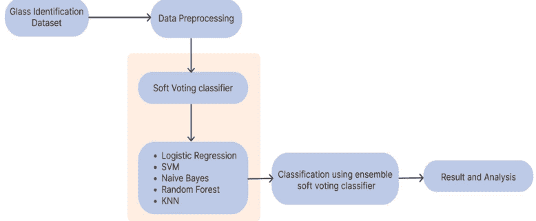

图 1. 解决此问题应遵循的流程图。

#### 4.1 数据预处理

尽管数据集符合适当的结构，但在使用数据挖掘方法之前，它可能仍然需要预处理。这将有助于基于研究进行更高质量的分析。数据准备有多种不同的方法。由于没有缺失值，玻璃数据处于相对干净的状态。

#### 4.2 特征选择

进行特征分析以确定影响玻璃类型的最相关化合物。可使用各种特征选择方法来确定分类所需的关键变量，包括相关性分析、递归特征消除以及从集成模型中得出的特征重要性。

#### 4.3 集成模型选择

已选择基于“集成学习”的方法。在此例中，将使用各种机器学习模型来形成集成。这些模型旨在提高玻璃识别的置信度。

#### 4.4 支持向量机算法

SVM方法具有核心和线性部分。SVM可以解决分类和回归问题。与其他方法相比，SVM更擅长在复杂数据集中发现深层模式。对于分类，我们计算基于特征的超平面以分隔两个类。超平面对决策边界进行分类。比较平面两侧的数据点可以揭示不同的类型（Colomban 2013b）。

支持向量机旨在最大化数据点与超平面之间的间隔（Rincy和Gupta 2020）。

线性方程：y = a + b。我们将 x 替换为 x1，将 y 替换为 x2，得到 ax1x2 + b = 0。可以证明，如果将 x 定义为 (x1,x2)，将 w 定义为 (a,1)，则 wx + b = 0。

该方程基于仅两个维度的向量。但是，这对任意数量的维度均成立。这是超平面的方程。

```
$$h(x_i) = \begin{cases} +1 if w \cdot x + b \ge 0 \\ -1 if w \cdot x + b < 0 \end{cases}$$ (1)
```

位于超平面上方或超平面上的点被分配到类 +1，而位于超平面下方的点被分配到类 -1。

#### 4.5 K-近邻算法

此方法可类似地用于解决回归和分类问题。这里我们使用分类。KNN通过测量数据中每个示例与查询之间的距离，选择最接近查询的所需数量的示例（K）。然后，它选择出现频率最高的标签，或者在回归的情况下对标签进行平均（Masael S. Aldayel 2012）。

将使用欧几里得度量作为首选距离度量。

```
$$d(x, x^1) = \sqrt{(x - x_1^i)^2 + ... (x_n - x_h^1)^2}$$ (2)
```

最后，输入 x 被分配到概率最高的类。

```
$$P(y = j|x = x) = \frac{1}{k} \sum_{i \in A} I(y^{(i)} = j)$$ (3)
```

#### 4.6 随机森林算法

随机森林，或称集成机器学习，连接多个分类器来解决难题。大多数投票预测数据结果。预测类投票发生在树之间。得票最多的类获胜。随机森林在对数据进行分类时，有时会使用基尼指数来决定决策树分支上节点的顺序。

```
$$Gini = 1 - \sum_{i=1}^{c} (p_i)^2$$ (4)
```

节点上每个分支的基尼值使用类和概率进行计算，以确定最可能的分支。熵也可以用于建立决策树中节点之间的关系（Dong et al. 2020）。

```
$$Entropy = \sum_{i=1}^{c} -p_i * \log_2(p_i)$$ (5)
```

#### 4.7 逻辑回归算法

这种受监督的机器学习方法与线性回归类似，但用于分类而非回归。它将自变量分类为二进制形式并显示其线性关系（Dong et al. 2020）。

基本逻辑模型使用以下公式：

```
$$ln(P) = ln(\frac{P}{1 - P})$$ (6)
```

因此，逻辑回归公式由以下给出：

ln ( P / 1 - P ) = b₀ + b₁x  (7)
=> P = e^(b₀+b₁x) / (1 + e^(b₀+b₁x))  (8)

#### 4.8 朴素贝叶斯算法

朴素贝叶斯技术是一种概率分类方法，常用于机器学习中的分类问题，例如文本分类、垃圾邮件检测、情感分析等（Rincy和Gupta 2020）。贝叶斯定理可以以简单的数学方式表示如下：

P(A|B) = P(B|A) * P(A) / P(B)  (9)

事件的边缘概率 P(A) 被称为先验概率，我们感兴趣的概率 P(A|B) 被称为后验概率。

#### 4.9 软投票集成

使用多个分类器投票技术来组合众多分类器的决策。这涉及为创建的较小且相等的训练数据集子集中的每个子集创建一个分类器。已采用软投票，其中各个模型的预测基于其置信度分数进行加权，最终预测是通过考虑这些加权贡献来做出的。当投票应用于分类算法时，这些分类器的准确性得到了提高（Rincy和Gupta 2020）。

### 5 结果与讨论

我们采用了集成学习方法，使用多个模型根据类别对玻璃进行分类。这项研究的结果表明，使用集成方法对玻璃数据集的准确率为 95.29%。

多项研究表明，在数据集上使用多个分类器可产生显著更好的结果。因此，分类决策基于众多模型的组合输出，这比使用单个分类器来识别玻璃类型更准确。

使用玻璃的元素组成和折射率数据，我们训练了多种机器学习算法以进行识别。我们使用了五种不同的机器学习方法。

下表 2 详细列出了集成方法中使用的各种机器学习模型的准确性。随机森林是此数据集中预测的最佳模型，准确率达到 96.92%。集成投票的准确率为 95.29%。

表 2. 玻璃数据集中分类准确率详情。

| 模型 | 准确率 | 精确率 | 召回率 | F1-Score |
| :--- | :--- | :--- | :--- | :--- |
| K-近邻 | 89.23% | 86% | 86% | 85% |
| 支持向量机 | 83.85% | 98% | 95% | 96% |
| 高斯朴素贝叶斯 | 72.31% | 78% | 72% | 72% |
| 逻辑回归 | 93.85% | 96% | 94% | 95% |
| **随机森林** | **96.92%** | **99%** | **98%** | **99%** |
| 集成投票 | 95.29% | 96% | 95% | 96% |


我们使用了不同的评估指标来评估不同模型的性能。这些指标对分类模型的性能进行了更全面的评估，而不仅仅依赖于准确率。预测准确率是指发生的正例情况所占的比例。F1-分数通过计算准确率和召回率的调和平均值得到。相比之下，召回率量化了模型正确检测到的真阳性病例所占的比例。通过确保召回率和准确率之间的平衡，可以有效解决类别分布不均的问题，这具有显著优势。

### 6 结论

必须访问犯罪证据数据库才能开展广泛且可靠的犯罪学研究。数据挖掘通过寻找明显且可信的模式，从数据集中提取相关信息。分类问题通常使用 k-近邻来解决。反复的研究表明，多个分类器的投票优于单独投票。KNN 首先帮助本文中的犯罪学家确定了玻璃类别。我们采用了集成方法。在玻璃数据集上结合最成功的分类器并加上软投票，得到了随机森林的最高准确率（96.92%）和集成投票的显著结果。

后续研究将提高模型的实用性和适用性。向模型中添加密度和耐热性等玻璃属性可能会提高系统准确率。新属性必须解决数据集的不平衡问题，这是其主要问题。对玻璃进行严格的分类验证表明准确率有所提高。本研究中，我们将训练数据和测试数据按 70:30 划分。然而，应用交叉验证可以改善结果。通过将数据集分割为 n 个箱，普通分类器的性能可能会更好。最后，未来可以使用非 ML 方法（如 ANN）来增强模型。

### 参考文献

- Cholakova, A., Rehren, T. and Freestone, I.C. (2016) '下多瑙河流域公元六世纪玻璃的成分鉴定', *考古学报告：报告*, 7, pp. 625–632. 可在以下网址查阅：https://doi.org/10.1016/j.jasrep.2015.08.009.
- Colomban, P. (2013a) '珐琅陶器、玻璃制品及相关颜料的破坏性/非破坏性鉴定——简要概述', *艺术*, 2(3), pp. 77–110. 可在以下网址查阅：https://doi.org/10.3390/arts2030077.
- Colomban, P. (2013b) '珐琅陶器、玻璃制品及相关颜料的破坏性/非破坏性鉴定——简要概述', *艺术*, 2(3), pp. 77–110. 可在以下网址查阅：https://doi.org/10.3390/arts2030077.
- Dino, H.I. and Abdulrazzaq, M.B. (2019) *基于 SVM、KNN 和 MLP 分类器的面部表情分类*.
- Dong, X. *et al.* (2020) '集成学习综述', *计算机科学前沿*. 高等教育出版社, pp. 241–258. 可在以下网址查阅：https://doi.org/10.1007/s11704-019-8208-z.
- El-Khatib, M.J., Abu-Nasser, B.S. and Abu-Naser, S.S. (2019) *使用人工神经网络的玻璃分类*, *国际学术教育研究杂志*. 可在以下网址查阅：www.ijeais.org/ijapr.
- German, B. (1987) *玻璃识别 – UCI 机器学习库*. 可在以下网址查阅：https://doi.org/10.24432/C5W92W.
- Goswami, S. and Wegman, E.J. (2016) '玻璃识别法医学研究中不同分类方法的比较', *统计科学与应用杂志*, 4(2). 可在以下网址查阅：https://doi.org/10.17265/2328-224x/2015.0304.001.
- Hickman, D.A. (1981) *玻璃分类方案*, *国际法医科学杂志*. Elsevier Sequoia S.A.
- Mashaal S. Aldayel (2012) *玻璃识别问题的 K-近邻分类*. [IEEE].
- Mathur, H. and Surana, A. (2020) '基于机器学习算法的玻璃分类', 国际创新技术与探索工程杂志 (IJITEE), (9), pp. 2278–3075. 可在以下网址查阅：https://doi.org/10.35940/ijitee.H6819.0991120.
- Mehta, N. et al. (2022) G20 国家网络立法比较研究, 计算机与信息科学通讯. 可在以下网址查阅：https://doi.org/10.1007/978-3-031-23095-0_1.
- Oladipo, F.O. et al. (2020) 基于机器学习的数字取证技术现状. 可在以下网址查阅：https://ssrn.com/abstract=3668687.
- Pandey, A. and Jain, A. (2017) '使用各种归一化技术的 KNN 算法比较分析', 计算机网络与信息安全国际杂志, 9(11), pp. 36–42. 可在以下网址查阅：https://doi.org/10.5815/ijcnis.2017.11.04.
- Rincy, T.N. and Gupta, R. (2020) 机器学习中的集成学习技术及其效率：一项调查. 第二届数据、工程与应用国际会议 (IDEA).
- Ruying, S. and Rongcang, H. (2009) 基于模糊粗糙集理论的数据挖掘及其在玻璃识别中的应用.

## 基于深度学习的腕脉诊断与分类认知数字孪生系统

Jitendra Kumar Chaudhary
副教授, 图形时代山地大学比姆塔尔校区计算机学院,
乌塔拉坎德邦, 印度

T. Parimallam
副教授兼系主任, 计算机科学系, 南达文理科学院,
泰米尔纳德邦埃罗德, 印度

Faisal Yousef Alghayadh & Ismail Keshta
应用科学学院计算机科学与信息系统系,
阿尔马里法大学, 利雅得, 沙特阿拉伯

Mukesh Soni
D. Y. Patil 智慧大学, 普纳, D. Y. Patil 科学与技术学院, 塔塔瓦德,
普纳, 印度

Sheshang Degadwala
西格玛大学计算机工程系,
古吉拉特邦瓦多达拉, 印度

摘要: 在分析和识别腕脉信号时，使用时间和频率等分析方法来挖掘腕脉信号的非线性信息并不容易。传统机器学习方法需要手动定义特征，无法进行特征的自学习。提出了一种基于无阈值递归图和 CNN 的脉冲分析与识别认知数字孪生技术。腕脉信号基于非线性动力学理论转换为无阈值递归图。VGG-16 CNN 自动提取递归图的非线性特征，并建立脉冲状态分类模型。实验结果表明，与现有脉冲分类方法相比，所提方法的分类准确率可达 98.14%。本研究为脉冲信号分类提供了一种新颖的概念和策略，可应用于脉诊的客观化。

### 1 引言

脉诊是中医的组成部分之一，具有重要的临床价值。此外，缺乏可靠的客观诊断指标（Jiangang et al. 2022）。因此，有必要运用现代计算机技术研究脉冲信号的定量识别方法，以实现脉诊的标准化和客观化。傅里叶变换提取频域特征；时间-频域分析方法可以同时描述信号的时频特性，常用方法包括小波变换、希尔伯特-黄变换等（Yifan and Li-Yun 2022）。研究表明，脉冲信号具有非线性特征，前三种方法在分析脉冲信号过程中不可避免地会丢失非线性信息。目前，脉冲信号的非线性分析方法主要包括近似熵（Viktor et al. 2022）、拉普诺夫指数（Gautam et al. 2021）。现有方法（如 BP 神经网络、线性判别分析、贝叶斯分类器、支持向量机 (SVM)、卷积神经网络 (CNN））主要用于脉冲信号模式识别的研究。传统机器学习方法需要手动定义和提取脉冲特征，由于脉冲类型与脉冲特征之间存在复杂的非线性关系，因此要识别出能区分各种脉冲情况的理想特征集极具挑战性（Kshirsagar and Londhe 2017）。CNN 通过模拟人类神经元结构逐层传递信息，以实现自动特征提取。许多研究表明，这些特征比传统的人工提取特征更具代表性，从而获得更好的分类和识别结果。本文提出了一种基于无阈值递归图和卷积神经网络的脉冲信号分析与识别方法（Yutao et al. 2022）。该方法通过非线性分析将脉冲信号转换为相应的无阈值递归图，从而将其非线性特征映射到二维平面。通过卷积神经网络的多层卷积计算，实现脉冲信号特征的自学习和分类，从而能够区分不同的脉冲类型（Liu 2022）。

### 2 研究方法

#### 2.1 系统概述

所提脉冲信号分析与识别方法的整体流程如图 1 所示。脉冲信号转换为无阈值递归图，然后利用 VGG-16 CNN 提取和分类脉冲信号递归图，并建立脉冲信号分类模型。


图 1. 脉冲信号分类流程图。

#### 2.2 脉冲信号的无阈值递归图

递归图是分析系统非线性动态特性的有用工具，因为它们可以展示信号的内部组织方式，并直观地传达信号的复杂性和不稳定性。该方法在 (Xuebin 2022) 中提出，第一步是在相空间中重构信号。根据嵌入理论，选择合适的嵌入维度 m 和延迟时间 $\tau$ 来重构相空间，然后重构向量为：

```
$X_i = (x_i, x_{i+\tau}, \cdots x_{i+(m-1)\tau}), \quad i = 1, 2, \cdots, N$ (1)
```


递归图可以直观地将信号在高维相空间中的运动状态映射到二维平面，从而反映其非线性动力学特性。当X<sub>i</sub>和X<sub>j</sub>之间的距离D<sub>ij</sub>小于ε时，意味着X<sub>i</sub>和X<sub>j</sub>之间的状态非常相似，即运动状态出现递归，R<sub>ij</sub>的值为1，并在图中用黑点表示；反之，当X<sub>i</sub>和X<sub>j</sub>之间的距离D<sub>ij</sub>大于ε时，意味着它们之间的运动状态差异很大。此时R<sub>ij</sub>的值为0，并在图中用白点表示（Herzberg et al. 2021）。脉搏信号的递归图和无阈值递归图。虽然递归图可以直观地表达脉搏的递归特性，但它缺乏详细特征；而无阈值递归图可以有效保留详细信息，并具有更丰富的非线性动力学特征（Ambaw et al. 2020）。因此，形成了更多的递归点和更大的圆形区域。图中有一条从左上角延伸到右下角的曲线，反映了脉搏信号从上升到下降的整体波形特征。

#### 2.3 CNN和VGG-16网络

CNN是一种具有卷积结构的深度神经网络，在语音识别和图像分割中具有广泛的应用。卷积神经网络通常由卷积层、下采样层和全连接层组成。

卷积层包含多个卷积核。通过局部连接和权值共享，卷积核对输入数据进行卷积运算以获取相关特征。第一个卷积层提取一些初步的数据特征，形成多个特征图，随后将其作为下一个卷积层的输入，以获取深层抽象特征。卷积层的数学表达式为：

```
x_j^{(l)} = f(x_i^{(l-1)} * W_{ij}^{(l)} + b_j^{(l)})
```

公式中："*"表示卷积运算；x_j^{(l)}表示第j个卷积核卷积运算后第l层的输出，即l+1层的输入；W_{ij}^{(l)}表示卷积核；b_j^{(l)}表示偏置值；f(\cdot)表示激活函数。

下采样层也称为池化层。卷积后得到的特征向量维度增加，如果直接用于训练，会增加网络的计算负载和复杂度。由于VGG-16中的3个全连接层参数众多，最初设计用于1000个分类类别，而本文仅针对二分类。因此，本文用2个全连接层替换了原来的3个全连接层，以减少全连接层的通道数量（Wen and Mario 2019）。在改进的VGG-16中，包含15个权重层，即13个卷积层和2个全连接层。在两个全连接层之后添加了Dropout，以抑制因卷积参数过大而引起的过拟合，使网络具有更好的泛化能力（Pengju et al. 2021）。

### 3 实验与结果分析

#### 3.1 实验数据

冠心病患者的脉诊数据主要来自上海中山医院仁济医院、市中医医院、曙光医院，共1612例；健康人的脉诊数据由上海大学中医信息研究（Chang et al. 2022）提供。

中医人员和学生四诊综合研究实验数据被收集和获得，共268例。脉搏信号由上海大学中医与亚太计算机信息有限公司（上海）合作研发的ZBOX I脉搏信号数字采集分析仪采集。选择最佳脉搏压力，并在此基础上采集脉搏信号。采集时间为60 s。

#### 3.2 数据处理

##### 3.2.1 脉搏信号预处理

脉搏信号是一种弱生理信号，容易受到其他信号的干扰，包括患者肢体颤抖、呼吸、设备机械振动和工频干扰。样本的采样频率为720 Hz（Mahajan et al. 2021）。根据采样定理，采集脉搏的频率范围为0~360 Hz。对滤波后的脉搏信号进行单周期划分，以获得脉搏的单周期波形（Wang et al. 2021）。

##### 3.2.2 平衡数据集

数据集中存在明显的不平衡，即健康脉搏远少于冠心病脉搏。如果使用不平衡样本训练模型，分类模型的泛化能力将较差，且容易发生过拟合。因此，本文采用合成少数类过抽样技术（SMOTE）（Deshmukh et al. 2021）来平衡数据集。假设k = 5，样本倍数N = 6，可生成1608个健康样本，结合1612例冠心病患者，平衡数据集总共包含3220个样本。

##### 3.2.3 脉搏信号无阈值递归图转换

在构建脉搏信号的无阈值递归图时，需要确定两个关键参数：延迟时间\(\tau\)和嵌入维度m。基于统计方法，C-C算法可以通过相关积分同时确定m和\(\tau\)的参数大小（Khan et al. 2022）。通过计算和分析，本文选择m = 3和\(\tau\) = 4来扩展脉搏信号的相空间。由于不同脉搏信号单周期的长度不同，对周期较短的脉搏信号末端进行零填充，以生成大小相同的递归图，如图2(a)和(b)所示。


图2(a). 健康脉搏信号。


图2(b). 冠心病脉搏信号。

#### 3.3 实验设置与分析

在实验过程中，脉搏健康的参与者被视为“正类”，而冠心病患者被视为“负类”。采用三个指标来评估分类模型：灵敏度（Sensitivity, SE）、特异性（SP）和准确率（Accuracy, ACC）（Khan et al. 2022）。在本研究中，改进的VGG-16 CNN变体通过Keras框架实现，并利用SGD优化算法设置以下参数：迭代次数为2000次，初始化学习率为0.001，网络训练动量为0.9，权重衰减为0.00001，Dropout参数为0.5，训练集：验证集：测试集 = 6:2:2。实验使用的GPU显卡为NVIDIA Tesla V100（Khan et al. 2022）。将VGG-16输入中的两个脉搏递归图作为输入，可获得CNN自动提取的一些特征图（如图3所示）（Asif et al. 2021）。递归图经过Conv1-1处理后，不同卷积核提取的特征不同，主要提取初级纹理特征。卷积核处理次数越多，获得的递归图纹理信息越全面，脉搏信号中的非线性动力学特征可以表达得更充分。


图3. 不同卷积的特征提取结果。

为验证无阈值递归图的有效性，将其与递归图进行对比。根据(Soni et al. 2021)提出的“经验法则”，阈值ε选择为相空间最大直径的10%。将两种递归图用作VGG-16的输入来训练模型，结果是


如表 1 所示。可以看出，使用无阈值递归图作为输入可以实现更高的分类精度，最高可达 97.94%，与递归图相比，灵敏度和特异性均有所提升。不同输入的结果如图 4 所示。与递归图相比，无阈值递归图保留了更多详细特征，结合 VGG-16 后，可获得更好的分类精度。

Table 1. 不同输入的分类结果

| 分类 | 灵敏度 | 特异性 | 准确率 |
| :--- | :--- | :--- | :--- |
| 递归图 + VGG-16 | 93.45 | 97.75 | 96.90 |
| 无阈值递归图 + VGG-16 | 95.64 | 98.42 | 97.94 |


图 4. 不同输入的分类结果。

为进一步验证所提方法的有效性，探讨了无阈值递归图的特征提取与分类，并将其与现有的脉搏信号分类研究（Yao et al. 2021）进行了比较。在准确率方面，LBP 和 HOG 分别比时域特征高 1.71% 和 1.24%；在灵敏度方面，LBP 比时域特征高 3.71%；在特异性方面，HOG 优于时域特征，小波特征分别提高了 2.20% 和 1.96%。这表明脉搏信号的无阈值递归图包含丰富的生理和病理信息，通过特征提取，其分类效果可与传统特征相媲美甚至更优（Liu et al. 2022）。

还可以从表 2 看出，无阈值递归图结合 VGG-16 具有最佳的分类效果，其准确率分别比时域特征、小波特征、HOG、LBP 和 DCNN 高 4.04%、2.95%、3.01%、2.33%，在灵敏度方面为 2.02%，所提方法比其他五种方法分别高 5.43%、2.57%、4.01%、0.61% 和 2.16%；在特异性方面，所提方法为 98.18，高于其他五种方法，比 LBP 高 4.06%。因此，与其他方法相比，本文提出的脉搏分类与识别方法具有更好的分类性能。

Table 2. 脉搏分类结果。

| 分类 | 灵敏度 | 特异性 | 准确率 |
| :--- | :--- | :--- | :--- |
| 时域特征 + SVM | 91.87 | 95.93 | 93.83 |
| 小波特征 + BP 神经网络 | 93.42 | 95.87 | 94.68 |
| HOG + SVM | 91.44 | 96.93 | 94.26 |
| LBP + SVM | 96.19 | 94.32 | 95.78 |
| DCNN | 95.52 | 96.54 | 95.91 |
| 无阈值递归图 + VGG-16 | 97.09 | 98.18 | 97.94 |

总而言之，通过将脉搏信号转换为无阈值递归图，可在不设置阈值的情况下将脉搏信号的非线性特征映射到二维图像中，从而保留脉搏信号中更多的非线性信息。构建了 VGG-16 CNN 来训练无阈值递归图数据，并建立了脉搏分类模型。该模型通过 3 × 3 卷积核的组合形成深层网络结构，能够在无阈值递归图上对更详细的特征进行自学习，并获得更好的分类效果。

### 4 结论

在当前的脉诊客体化研究中，大多采用时域和频域等分析方法，忽略了脉搏信号的非线性特征。考虑到脉搏信号的非线性，利用非线性动力学方法研究脉搏信号，与传统方法相比，能够更好地挖掘其固有的非线性信息。首先，将脉搏信号转换为无阈值递归图，以保留脉搏信号中更多详细特征。然后，搭建 CNN 对无阈值递归图进行特征自学习和训练，得到脉搏信号分类模型。最后，对脉搏信号进行分类和识别。实验结果表明，所提方法的脉搏信号识别有效，且可比当前的脉搏信号分类方法获得更高的分类准确率。在未来工作中，我们将进一步研究能够更好地表征脉搏信号特征的信号分析方法，并结合深度学习来提高脉搏信号的识别率。

### 参考文献

- Ambaaw, A.B., Bari, M. 和 Doroslovački, M., 2020 年 11 月。优化卷积神经网络以识别带 RRC 脉冲成型瞬时频率的失真 M-ary CPFSK 信号。在《2020 年第 54 届 Asilomar 信号、系统与计算机会议》（第 153–156 页）。IEEE。
- Asif, M., Khan, W.U., Afzal, H.R., Nebhen, J., Ullah, I., Rehman, A.U. 和 Kaabar, M.K., 2021。面向下一代 IoT 网络的低复杂度 LDPC 解码。*无线通信与移动计算*，2021: 1–10。
- Chang, S., Zhang, R., Ji, K., Huang, S. 和 Feng, Z., 2022。一种基于分层分类头的卷积门控深度神经网络用于自动调制分类。*IEEE 无线通信汇刊*，21(10): 8713–8728。
- Cheng, Y. 和 Fu, L.Y., 2022。基于物理信息 Caianiello 卷积神经网络的非线性地震反演，用于东中国近海西湖凹陷源岩超压预测。*石油科学与工程期刊*，215: 110654。
- Deshmukh, S., Thirupathi Rao, K. 和 Shabaz, M., 2021。基于协作学习的大规模分布式计算框架中的落后者防护。*安全与通信网络*，2021: 1–9。
- Gautam, N., Choudhary, A. 和 Lall, B., 2021 年 7 月。用于预测高非线性光纤中光脉冲传播的神经网络。在《2021 年全国通信会议 (NCC)》（第 1–6 页）。IEEE。
- Herzberg, W., Rowe, D.B., Hauptmann, A. 和 Hamilton, S.J., 2021。非线性反问题中基于模型学习的图卷积网络。*IEEE 计算成像汇刊*，7: 1341–1353。
- Khan, F., Tarimer, I., Alwaqeed, H.S., Karadağ, B.C., Fayaz, M., Abdusalomov, A.B. 和 Cho, Y.I., 2022。使用机器学习算法对音乐流行度分类中特征选择的影响。*电子学*，11(21): 3518。
- Khan, I., Wu, Q., Ullah, I., Rahman, S.U., Ullah, H. 和 Zhang, K., 2022。专为 WLAN 应用设计的圆极化双端口微带 MIMO 天线。*应用科学*，12(3): 1068。
- Khan, M.S., Khan, A.W., Khan, F., Khan, M.A. 和 Whangbo, T.K., 2022。软件组织采用 DevOps 文化的关键挑战：一项系统综述。*IEEE Access*，10: 14339–14349。
- Khirsagar, G.B. 和 Londhe, N.D., 2017 年 12 月。基于深度卷积神经网络的天城文输入基 P300 拼写器字符检测。在《2017 年电气、电子、通信、计算机与优化技术国际会议 (ICEECCOT)》（第 507–511 页）。IEEE。
- Leonhardt, V., Claus, F. 和 Garth, C., 2022。PEN：一种用于基于图卷积的根因分析的进程估计神经网络。*制造系统期刊*，62: 686–902。
- Liu, Q., Zhang, W., Bhatt, M.W. 和 Kumar, A., 2022。高层建筑非线性振动控制地震算法。*非线性工程*，10(1): 574–582。
- Liu, Z., 2022 年 4 月。基于 Hilbert-Huang 变换和卷积神经网络的叶绿素-a 分析。在《2022 年第 7 届云计算与大数据分析国际会议 (ICCCBDA)》（第 1–7 页）。IEEE。
- Mahajan, K., Garg, U. 和 Shabaz, M., 2021。CPIDM：一种基于聚类的深度迭代深度学习模型，用于高光谱图像分割。*无线通信与移动计算*，2021: 1–12。
- Qu, J., Cai, W. 和 Zhao, Y., 2022。基于线性与非线性分离卷积神经网络的时相关 PDE 学习。*计算物理学期刊*，453: 110928。
- Shou, Y., Meng, T., Ai, W., Yang, S. 和 Li, K., 2022。基于图卷积神经网络和依存句法分析的对话情感识别研究。*神经计算*，501: 629–639。
- Soni, M., Dhiman, G., Rajput, B.S., Patel, R. 和 Tejra, N.K., 2021。智慧城市应用中移动节点的节能安全数据传输方案。*无线个人通信*：1–21。
- Wang, B., Yao, X., Jiang, Y., Sun, C. 和 Shabaz, M., 2021。基于改进遗传算法的火电厂烟尘实时监测系统设计。*医疗工程期刊*，2021。
- Xing, P., Dong, J., Yu, P., Zheng, H., Liu, X., Hu, S. 和 Zhu, Z., 2021。基于卷积神经网络的卤水中锂元素激光诱导击穿光谱定量分析。*分析化学期刊*，1178: 338799。
- Xu, X., Ma, F., Zhou, J. 和 Du, C., 2022。基于少量光谱预处理的激光诱导击穿光谱土壤端到端分析中卷积神经网络 (CNN) 的应用。*农业计算机与电子学*，199: 107171。
- Yao, Q., Shabaz, M., Lohani, T.K., Wasim Bhatt, M., Panesar, G.S. 和 Singh, R.K., 2021。面向视觉振动信号处理与测量的 3D 建模与可视化。*智能系统期刊*，30(1): 541–553。
- Yu, W. 和 Pacheco, M., 2019。使用卷积神经网络进行非线性系统辨识中随机权重的影响。*信息科学*，477: 1–14。


## 使用修改版 mask RCNN 进行宫颈癌细胞检测的多类实例分割

Diksha Sambyal

查谟大学计算机科学与信息技术系，印度

Abid Sarwar

查谟大学巴德瓦分校计算机科学与信息技术系，印度

摘要：宫颈癌仍然是导致女性死亡的主要原因之一，强调了及时检测在降低死亡率中的重要作用。准确的细胞分割对于实现宫颈癌筛查自动化和实现早期诊断至关重要。本研究采用带有 ResNeXt101-FPN 和 ResNet101-FPN 的 Mask RCNN，对宫颈细胞分析中的高级多类实例分割进行了比较分析。独特的是，这是唯一实施 Mask R-CNN 的研究工作，将整个宫颈细胞图像分割为与 TBS 报告系统一致的七个不同类别。利用 SIPaKMeD 数据集，采用了 60% 用于训练、20% 用于 5 折交叉验证、20% 用于测试的分层数据分区方案。两种配置均实现了相似的平均平均精度（mAP）值，分别为 89% 和 88%，以及一致的准确率（87%）、灵敏度（89%）和特异度（88%）。结果证实了 ResNeXt101-FPN 和 ResNet101-FPN 的有效性，有可能实现医学宫颈细胞分析自动化，减轻医务工作量，并提高诊断准确性。未来的工作将集中于创新骨干网络结构。此外，还将同等强调扩大和多样化数据集，以涵盖更广泛的宫颈异常谱。

### 1 引言

宫颈癌是全球女性中第三常见的恶性肿瘤。绝大多数宫颈癌死亡病例（占病例的 85% 以上）发生在低收入或中等收入国家，在那里它是女性癌症相关死亡的主要原因（Cohen et al. 2019）。疾病负担的这种显著不平等主要归因于对筛查、早期诊断以及癌前病变和癌症有效治疗的有限获取。2020 年诊断出超过 604,000 例宫颈癌病例；在 342,000 例宫颈癌死亡病例中，近 90% 发生在中低收入国家（Sarwar et al. 2020）。这些统计数据强调了在资源有限地区亟需加强筛查方法和疫苗接种计划，以解决这一关键的全球医疗保健差距。理论上，通过确保高质量和广泛的筛查，宫颈癌的发生率可能降低高达 90%。常规妇科筛查（通常采用 Pap 测试）已被证明在检测大多数宫颈癌病例方面是有效的。贝塞斯达系统（TBS），也称为宫颈细胞学报告的贝塞斯达系统，是广泛采用的用于报告宫颈或阴道细胞学诊断中巴氏涂片结果的框架。TBS 根据既定标准将细胞分为七个不同的类别，包括浅层鳞状细胞、中间层鳞状细胞、近基底细胞、基底细胞、LSIL（低级别上皮内病变）、HSIL（高级别上皮内病变）和 CIS（原位癌）细胞（Nayar and Wilbur 2017）。

### 2 相关工作

实例分割是计算机视觉中的一项关键任务，它融合了目标检测和语义分割，使机器不仅能够识别和分类图像中的对象，还能够划定和区分每个对象实例。这一能力在医学图像分析领域有着显著的应用，在该领域，精确性至关重要。多年来，出现了大量实例分割技术，每一项都为该学科的进步做出了贡献。

一种特别杰出的方法是 Mask R-CNN（He et al. 2017b），它是著名的 Faster R-CNN 模型的增强版本，通过增加掩码预测分支来增强对象检测，从而便于精确划定对象边界。在医学图像分析领域，Mask R-CNN 被用于跨各种医学成像模式对解剖结构和病理异常进行细致的分割，从而增强诊断过程的准确性并改善医疗保健结果。例如，(Hsieh et al. 2020) 结合了 Mask R-CNN、Inception V3 和 VGG16 来识别乳腺微钙化团簇的恶性与良性。该方法的精确度、特异度和灵敏度分别达到 87%、89% 和 90%。

多位研究者已在宫颈癌细胞检测领域探索了 MASK-RCNN 方法的应用。例如，(Sagar et al. 2023) 采用了较小的类 VGG 网络结合使用 ResNet10 作为骨干网络的 MaskR-CNN，以实现有效的宫颈细胞分割。其方法在 Herlev Pap Smear 数据集上进行了测试，取得了令人印象深刻的单细胞分割结果：准确率 92.0%，召回率 91%，ZSI 81%。(Agustiansyah et al. 2022) 采用 mask-RCNN 架构对柱状区域和醋酸白斑病变进行同时分割、分类和检测。利用 262 张阳性和 222 张阴性宫颈图像，该模型取得了显著结果：柱状区域分割的 IoU 为 63.60%，醋酸白斑病变的 IoU 为 73.98%，柱状区域的 mAP 约为 86.90%，醋酸白斑病变的 mAP 为完美的 100%，用于检测宫颈癌前病变。达到 92% 的特异度和 100% 的灵敏度，凸显了该模型在识别宫颈异常方面的准确性。

同样，(Chen and Zhang 2021) 提出了一种基于 Mask RCNN 的方法，旨在解决细胞分割这一具有挑战性的任务，以区分细胞学图像中的异常细胞和正常细胞。其工作利用了来自 ISBI 2014 和 ISBI 2015 数据集的宫颈区域高分辨率细胞学图像及相关的基准真值细胞分割数据。值得注意的是，Mask RCNN 达到了出色的性能，在 DSC 阈值为 0.8 时，骰子相似系数（DSC）为 0.92，每像素假阳性率（FP/rp）为 0.0008。这些结果表明，在细胞学分析领域，利用 Mask RCNN 技术进行分割是有效的。

### 3 方法和方法论

#### 3.1 数据集

在本研究中，我们使用了公开可获取的 SIPaKMeD（Plissiti et al. 2018）数据集，该数据集包含来自巴氏涂片载玻片的 966 张簇状细胞图像。经验丰富的细胞病理学家已根据细胞外观和形态将这些细胞分为五个不同的组别：浅层-中间层、近基底、空泡细胞和角化不良细胞，以及化生细胞（Plissiti et al. 2018）。为了符合 TBS 分类系统，我们进一步将 SIPaKMeD 数据集分为七种特定的细胞类型，如图 1 所示：浅层鳞状细胞、中间层鳞状细胞、近基底鳞状细胞、基底鳞状细胞、低级别鳞状上皮内病变（LSIL）、高级别鳞状上皮内病变（HSIL）和 CIS。这种分类允许对数据集中的细胞组成进行全面且标准化的分析，促进细胞病理学领域的研究和数据解释。


图 1. 七种分类类别：1) 浅层鳞状细胞，2) 中间层鳞状细胞，3) 近基底细胞，4) 基底细胞，5) LSIL，6) HSIL。

这种系统性分割不仅强调了该数据集对研究和临床应用的适用性，还确保其符合 TBS 规定的标准。SIPaKMeD 数据集与 TBS 的兼容性凸显了其作为宫颈癌诊断宝贵资源的重要性，并推动了在此既定框架内诊断进步和分类模型的发展。

为了我们的实验目的，每类的 60% 数据集已分配用于训练，20% 用于交叉验证，剩余的 20% 用于测试，遵循科学调查中常用的标准数据分区方案。


#### 3.2 数据预处理

在数据预处理阶段，我们采用了一款 AI 工具，即专门的“MakeSense.AI”标注工具，该工具根据 TBS 系统定制用于标记宫颈癌细胞。该工具高效地简化了对象检测、图像分类和分割等活动，使用户能够勾勒边界框、分配标签或追踪对象。生成的标注信息存储在 JSON 文件中。在将其集成到我们的模型之前，我们执行了多个图像预处理步骤，以准备从巴氏涂片中获得的图像进行标注。这些预处理步骤包括调整大小、归一化、数据增强和背景移除。

我们的数据集总共包含 966 张图像，每张图像含有多个细胞。这些图像经过精心标注，共得到 4,136 张已标注图像。图 2 展示了标注过程的可视化表现，展示了带有标注标签的示例图像，并突出显示了鳞状柱状交界（SCJ）结构。这些标注涵盖七个不同的类别，包括表层鳞状细胞、中间层鳞状细胞、基底下层细胞、基底细胞、LSIL、HSIL 和 CIS。


图 2. 已标注图像示例：(a) 原始数据；(b) 标注标签；以及 (c) SCJ 结构。

### 4 改进的 Mask R-CNN 模型

遵循 TBS 分类系统的宫颈细胞实例分割，采用了 Facebook 人工智能研究院（FAIR）开发的成熟 Mask R-CNN（He 等人，2017b）来实施。该方法代表了语义分割和对象检测技术的融合，标志着相较于之前的 Faster R-CNN、Fast R-CNN 和 R-CNN 方法的进步。该框架的工作流程包含两个基本阶段：(a) 生成区域建议，以及 (b) 随后对生成的每个建议进行分类。图 3 提供了改进 Mask R-CNN 架构的可视化表现。


图 3. 改进的 Mask R-CNN 架构。

#### 4.1 模型实现与超参数配置

在我们的 Mask R-CNN 实现中，我们使用 FPN 作为主干网络。对于 FPN 的自底向上部分，我们采用了预训练的 ResNet-101 和 ResNeXt-101 模型，这些模型最初是在 ImageNet 数据集上训练的。在 RPN 中，我们引入了不同尺寸的锚点。具体而言，我们指定锚点的尺寸为 128、64、32、16 和 8 像素，而每个锚点的高度设置为相对于其宽度的比例，范围从 0.33 到 3。因此，平均锚点涵盖 25 种不同的尺寸，我们每张图像使用 512 个锚点进行 RPN 训练。

网络头包含三个关键分支：分类分支、掩码分支和检测分支。为了训练网络头，我们每张图像使用 512 个 RoI。分类分支产生 7 个输出，每个输出分别对应 TBS 分类系统定义的不同细胞类型或异常。另一方面，掩码分支通常生成二值掩码。对于多类实例分割，掩码分支扩展为包含七个并行子分支，每个子分支专门用于预测七个类别之一的掩码。对于检测分支，我们采用了默认的 Matterport 实现以支持我们的 Mask R-CNN 框架。

#### 4.2 损失函数

在我们的方法中，掩码分支的损失函数已针对多类实例分割的要求进行了定制。我们的任务旨在预测七个不同类别中的每个类别的掩码，我们指定了一个利用二元交叉熵的损失函数，并分别针对每个类别计算。对于给定的类别，该损失函数衡量预测掩码与相应实况掩码之间的差异。它量化了预测概率值与真实类别存在之间的一致性，从而便于跨不同类别的物体准确分割。

### 5 评估方法

通过基于 Mask R-CNN 达到的最高平均平均精度（mAP）的严格 5 折交叉验证过程选择的最优模型，随后用于对包含 190 张巴氏涂片图像的测试数据集进行评估。鑒于我们宫颈细胞分析多类实例分割任务固有的复杂性增加，我们仔细定制了评估指标，以确保全面评估。评估包括：

- (1) 类别特定的平均平均精度（mAP）：根据 TBS 系统的规定，独立计算七个类别中每个类别的 mAP。这种细粒度分析使我们能够评估模型分别分割和分类每个类别的效能。总的 mAP 分数通过所有七个类别的 mAP 值平均值来确定。

- (2) 每张图像的类别特定准确率、灵敏度和特异性：为了对模型性能进行详细评估，分别为每个类别计算了准确率、灵敏度和特异性等指标。这种方法提供了关于模型在各个类别上的准确率、灵敏度和特异性方面表现的见解。

### 6 实验结果

图 4 直观地展示了我们改编的 Mask R-CNN 模型的结果，并提供了关于模型性能的见解，证明了其有效识别和分类细胞类型或异常的能力。

表 1 中展示的评估展示了使用 ResNeXt-101-FPN 和 ResNet-101-FPN 作为主干模型的 Mask R-CNN 评估，取得了令人期待的结果。两种配置均表现出强健的性能，分别获得了相似的总体平均平均精度（mAP）值 89% 和 88%。值得注意的是，准确率和灵敏度分别达到令人满意的 87% 和 89%，而特异性在两种配置中均稳定在 88%。这些发现凸显了 ResNeXt-101-FPN 和 ResNet-101-FPN 主干在分析宫颈细胞图像的多类实例分割中的效能。


图 4. 我们改编的 Mask R-CNN 模型所得结果的可视化表现。(a) 由 Mask R-CNN 处理的原始输入图像。(b) 展示边界框和分类实例的模型结果的彩色编码描绘。

表 1. 使用 ResNeXt-101-FPN 和 ResNet-101-FPN 作为主干进行宫颈癌细胞检测的 Mask R-CNN 评估。

| 使用的模型 | 评估指标 | mAP | 准确率 | 灵敏度 | 特异性 |
|---|---|---|---|---|---|
| ResNeXt-101-FPN | 表层 | 0.87 | 0.85 | 0.88 | 0.86 |
| | 中间层 | 0.89 | 0.86 | 0.87 | 0.88 |
| | 基底下层 | 0.86 | 0.84 | 0.87 | 0.85 |
| | 基底 | 0.88 | 0.87 | 0.88 | 0.87 |
| | LSIL | 0.90 | 0.88 | 0.89 | 0.90 |
| | HSIL | 0.91 | 0.90 | 0.92 | 0.89 |
| | CIS | 0.92 | 0.91 | 0.93 | 0.90 |
| | 总体（平均） | 0.89 | 0.87 | 0.89 | 0.88 |
| ResNet-101-FPN | 表层 | 0.86 | 0.84 | 0.87 | 0.85 |
| | 中间层 | 0.87 | 0.85 | 0.86 | 0.88 |
| | 基底下层 | 0.88 | 0.87 | 0.89 | 0.87 |
| | 基底 | 0.89 | 0.88 | 0.90 | 0.88 |
| | LSIL | 0.90 | 0.89 | 0.91 | 0.89 |
| | HSIL | 0.91 | 0.90 | 0.92 | 0.89 |
| | CIS | 0.92 | 0.91 | 0.93 | 0.90 |
| | 总体（平均） | 0.88 | 0.87 | 0.89 | 0.88 |

| 作者 | 方法论 | 分割类别 | 使用的数据集 | 取得的性能 |
| :--- | :--- | :--- | :--- | :--- |
| (Sagar 等人，2023) | 带有 ResNet10 和 VGG-likeNet 主干的 Mask R-CNN | 两类（异常，正常） | Herlev 数据集 | Acc = 92.0%，Rec = 91%，且 ZSI = 81% |
| (Agustiansyah 等人，2022) | 以 ResNet-50 作为主干的 Mask R-CNN | 两类（异常，正常） | 私有数据集 | Acc = 96.29%，F1 分数 = 96.67%，Sens = 100%，Spec = 92.0%，Prec = 93.54%，mAP = 86.90% |
| (Hsieh 等人，2020) | 带有 Inception V3 和 VGG16 的 Mask R-CNN | 两类（良性和恶性） | 私有数据集 | Sens = 90%，Spec = 89%，Prec = 87% |
| (Chen & Zhang，2021) | 以 ResNet-50 作为主干的 Mask R-CNN | 两类（异常，正常） | ISBI 2014 和 ISBI 2015 数据集 | DSC = 92%，且在 DSC 阈值为 0.8 时 FPRp = 0.08% |
| 本工作 | 以 ResNeXt-101-FPN 或 ResNet-101-FPN 作为主干的 Mask R-CNN | 按 TBS 的七个类别 | SIPaKMeD 数据集 | Sens = 89%，Spec = 88%，Acc = 87%，mAP = 89% |

*Acc = 准确率，Prec = 精确率，Rec = 召回率，Sens = 灵敏度，Spec = 特异性，mAP = 平均平均精度

此外，如表 2 所示，我们提出的采用带有 ResNeXt-101-FPN 或 ResNet-101-FPN 作为主干模型的 Mask R-CNN 的方法用于宫颈癌细胞检测，在比较分析中概述的各种方法中脱颖而出。虽然其他研究在二元分类（异常/正常）方面表现出色，准确率范围从 92% 到 96.29%，但我们强调勾勒与 TBS 报告系统一致的七个不同类别，获得了 87% 的有竞争力的准确率。这种准确率的权衡通过更高的特异性 88% 和显著的灵敏度 89% 得到补偿，凸显了我们的模型在识别各种宫颈细胞类型方面的强健性。值得注意的是平均平均精度（mAP）为 89%，表明与报告较低 mAP 值的研究相比，我们的方法具有精确性和可靠性。灵敏度和特异性之间的这种平衡，加上有竞争力的 mAP，强调了我们提出的模型用于精确和全面的宫颈癌细胞检测的临床可行性，反映了我们对整体和微妙的多类分割方法的承诺，这对于宫颈癌筛查中的准确诊断和管理至关重要。

尽管我们提出的方法展示了有竞争力的性能，但它也面临与其他方法类似的局限性。需要更广泛、更多样化的数据集来代表更广泛的宫颈异常范围，这仍然是一个主要约束。此外，在不牺牲可解释性和资源效率的前提下实现更高的准确率面临挑战。通过协作努力、增强的数据集策展和优化模型可解释性来克服这些局限性，对于提高这些模型在临床环境中用于精确宫颈癌检测和管理的实际适用性至关重要。

### 7 结论与未来工作

本文介绍了一种基于改进的 Mask R-CNN 的技术，专门用于分割包含宫颈细胞的整个图像，并按照 TBS 报告系统将其分类为七个不同的类别。已实现的两个定制变体，采用带有 ResNeXt-101-FPN 和 ResNet-101-FPN 作为主干架构的 Mask R-CNN，


使用 SIPaKMeD 数据集进行了训练和评估。研究结果表明，两种配置都表现出强大且可比拟的性能，总体平均精度（mAP）值分别为 89% 和 88%。这些一致的结果强调了两种模型在提供高效分割和分类功能方面的可靠性。因此，这些模型有可能显著减轻医疗专业人员的工作量，并提高宫颈细胞图像分析的诊断准确性。

未来工作涵盖多个方向，旨在改进宫颈细胞分割并扩展其应用。主干结构的创新以及多类实例分割的调整，是增强模型适应性和提高对各类宫颈细胞描绘准确性的主要目标。该方法的通用性超出了宫颈细胞分割的范畴，有望应用于各种生物医学成像学科。努力构建大规模宫颈癌细胞数据库，将优化模型训练并提升整体性能。将算法集成到医疗设备中用于大规模宫颈筛查，并为阴道镜检查开发人工智能算法，可显著增强诊断能力并简化宫颈癌筛查流程。这些共同努力旨在提升宫颈癌筛查方法的精确性、可及性和实用性，促进医疗效果的改善。

### REFERENCES

- Agustiansyah, P., Nurmaini, S., Nuranna, L., Irfannuddin, I., Sanif, R., Legiran, L., Rachmatullah, M. N., Florina, G. O., Sapitri, A. I., & Darmawahyuni, A. (2022). 利用实例分割技术改进自动癌前病变筛查准确性. Sensors, 22(15).
- Chen, J., & Zhang, B. (2021). 基于掩码区域卷积神经网络的重叠宫颈细胞分割. Computational and Mathematical Methods in Medicine, 2021.
- Cohen, P. A., Jhingran, A., Oaknin, A., & Denny, L. (2019). 宫颈癌. Lancet (London, England), 393 (10167), 169–182.
- Dongyao Jia, A., Zhengyi Li, B., & Chuanwang Zhang, C. (2020). 基于强特征 CNN-SVM 网络的宫颈癌细胞检测. Neurocomputing, 411, 112-127.
- Girshick, R. (2015). Fast R-CNN. IEEE 国际计算机视觉会议论文集, 1440–1448.
- He, K., Gkioxari, G., Dollár, P., & Girshick, R. (2017a). Mask R-CNN. IEEE 国际计算机视觉会议论文集, 2961–2969.
- He, K., Gkioxari, G., Dollár, P., & Girshick, R. (2017b). Mask R-CNN. IEEE 国际计算机视觉会议论文集, 2961–2969.
- He, K., Zhang, X., Ren, S., & Sun, J. (2015). 图像识别的深度残差学习.
- Hsieh, Y.-C., Chin, C.-L., Wei, C.-S., Chen, I.-M., Yeh, P.-Y., & Tseng, R.-J. (2020). 结合 VGG16、Mask R-CNN 和 Inception V3 识别乳腺微钙化簇的良性与恶性. 2020 模糊理论及其应用国际会议 (IFUZZY), 1–4.
- Lin, T.-Y., Dollár, P., Girshick, R., He, K., Hariharan, B., & Belongie, S. (2016). 目标检测的特征金字塔网络.
- Nayar, R., & Wilbur, D. C. (2017). 宫颈细胞学报告的贝塞斯达系统：历史视角. Acta Cytologica, 61(4–5), 359–372.
- Plissiti, M. E., Dimitrakopoulos, P., Sfikas, G., Nikou, C., Krikoni, O., & Charchanti, A. (2018). Spikmed：巴氏涂片图像中正常和病理宫颈细胞的特征与图像分类新数据集. 图像处理国际会议论文集，ICIP, 3144–3148.
- Ren, S., He, K., Girshick, R., & Sun, J. (2015). Faster R-CNN：面向带区域建议网络的实时目标检测. 神经信息处理系统进展, 28.
- Sagar, C. V., Bhardwaj, H., & Bhan, A. (2023). 基于巴氏涂片的宫颈癌检测深度学习分割方法. In B. K. Murthy, B. V. R. Reddy, N. Hasteer, & J.-P. Van Belle (Eds.), Decision Intelligence (pp. 309–317). Springer Nature Singapore.
- Sarwar, A., Sheikh, A. A., Manhas, J., & Sharma, V. (2020). 宫颈细胞分割用于自动宫颈癌筛查：综述. Artificial Intelligence Review, 53(4), 2341–2379.
- Xie, S., Girshick, R., Dollár, P., Tu, Z., & He, K. (2016). 深度神经网络的聚合剩余变换.

## 用于轻量级神经网络的空洞卷积模型

Sachin Gupta
Department of CSE, Maharaja Agrasen Institute of Technology, India

Priya Goyal
Department of Computer Science and Engineering, Manipal University Jaipur, India

Bhuman Vyas
Credit Acceptance, Canton, USA

Mohammad Shabaz
Model Institute of Engineering and Technology, Jammu, J&K, India

Suchitra Bala
ICT & Cognitive Systems, Sri Krishna Arts And Science College, India

Aws Zuhair Sameen
College of Medical Techniques, Al-Farahidi University, Baghdad, Iraq

### 摘要

轻量卷积神经网络正在被进一步研究，以便更好地将深度卷积神经网络部署到边缘设备，减少深度神经网络中的模型参数数量，并降低网络复杂度。为了实现轻量化目标，对剩余网络结构执行全卷积。为了增强轻量化效果，将其与逐点卷积相结合，构建了一种改进的空洞卷积轻量化方法。增强的空洞卷积与传统卷积相耦合，以减轻准确率的衰减，并提出了一种轻量化融合空洞卷积。根据数据，改进的空洞卷积轻量化方法提供了最显著的轻量化收益。此外，轻量化融合空洞卷积方法减少了模型参数数量，并提供了最佳的速度-准确率权衡。

### 1 引言

近年来，卷积神经网络有两个发展趋势。一方面，它朝着大规模和深层级方向发展；另一方面，它朝着轻量化和高速度方向发展。随着移动互联网的快速增长，人们对移动边缘设备的需求越来越高，对轻量化卷积神经网络的需求也越来越多。在边缘设备上更流畅地运行深度学习算法已成为一项挑战。边缘设备存储空间小且缺乏计算资源，为卷积神经网络的轻量化方法提供了广阔的研究与开发平台。空洞卷积首次由（Zhu et al. 2020）系统研究。基础空洞卷积轻量化方法直接将空洞卷积应用于网络结构设计，具有出色的轻量化效果和略高的准确率损失；改进的空洞卷积轻量化方法将逐点卷积与空洞卷积相结合。

### 2 相关工作

为了实现轻量化神经网络，模型设计的优化通常通过使用小卷积核替代大卷积核、分解卷积以及处理卷积通道来实现（Yu et al. 2019）。现代深度神经网络通常在网络设计中使用小卷积核替代大卷积核（Zhang et al. 2018）。Squeeze Net 是最早公开的轻量化结构设计网络。一方面，使用 1 × 1 小卷积核替代 3 × 3。因此，该内核可将卷积操作参数量减少八倍，并减少大部分卷积操作（Zhang, Zhang and Wang 2019）。Shuffle Net 使用分组卷积的思想，并将不同组的特征信息进行重排，使分组后的卷积特征信息被打乱和混合，从而能够更好地传播（Risso et al. 2021）。上述模型优化方法通过重新设计模型的宏观结构和微观结构，实现了一种新的高效骨干网络，并从结构层面完成了神经网络的轻量化设计（Guo et al. 2021）。

### 3 基于空洞卷积的神经网络轻量化方法

#### 3.1 空洞卷积结构

空洞卷积是一种具有独特结构的卷积，引入了空洞的概念。通过在传统图像卷积中添加空洞，实现了扩大卷积感受野的目的。例如，设 H_i 为第 i 层的特征图，G_i 为第 i 层的卷积层。那么，特征图 H_i 中的点，b 是卷积层 G_i 中的点，

```
(H_i * G_i)(q) = \sum_{b+c=q} H_i(b)G_i(c)  \quad (1)
```

空洞卷积的计算公式如公式 (2) 所示，其中 m 为扩张率，空洞数比普通卷积多 1。当扩张率 m 为 1 时，空洞卷积变为普通卷积。

```
(H_i * G_i)(q) = \sum_{b+mc=q} H_i(b)G_i(c)  \quad (2)
```

从空洞卷积和普通卷积的计算公式可以看出，空洞卷积操作具有等间隔采样的特征，扩张率决定其采样程度。扩张率越大，空洞卷积的采样范围越广，单位范围内的点越少。感受野的计算公式为公式 (3)——第 i 层卷积的步幅。

```
sf_l = sf_{l-1} + (\eta_l - 1) * \prod_{i=1}^{l-1} t_i  \quad (3)
```

空洞卷积在不减小特征图尺寸的情况下扩大了感受野。因此，第 l 层空洞卷积的核心大小 em_l 的计算公式如公式 (4) 所示，其中 m_l 表示第 l 层原始普通卷积的核心大小。

```
em_l = m_l + (m_l - 1) * (n - 1)  \quad (4)
```

将公式 (4) 代入公式 (3)，第 l 层大小为 em_l 的空洞卷积核对标准卷积扩张的感受野


大小为 $m_l$ 的卷积核的 rf\_expend$_l$，如方程 (5) 所示：

$rf\_expend_l = (m_l - 1) * (n - 1) * \prod_{i=1}^{l-1} t_i$

#### 3.2 基本空洞卷积轻量化方法

现代卷积神经网络（如 VGG、ResNet、DLA 等）采用串联的两个卷积层构成卷积组，用于特征提取。然后，第一层的卷积核大小为 M1 x M1 x C1_in x D1_out，其中 M1 是卷积核大小，C1_in 是卷积核的输入通道数，D1_in = D_in，D1_out 是卷积核的输出通道数；第二层卷积的核大小为 M2 x M2 x D2_in x D2_out，其中 M2 是卷积核大小，D2_in 是卷积核的输入通道数，D2_out 是卷积核的输出通道数，D_out 是输出特征图的通道数，则 D1_out = D2_in = D2_out = D_out。令卷积操作的步长为 1，且不进行填充操作。然后，两个普通卷积层级联获得的特征图感受野 R1 为：

$S_1 = sf_{in} + M_1 + M_2 - 2$

其中，sf_in 表示输入特征图的感受野。令空洞卷积核大小为 EL x EL x D_in x D_out，则其感受野 S2 为：

$S_2 = sf_{in} + EL - 1$

基于第一层普通卷积设置整体卷积，并向其中加入空洞。则其扩张率 m = (M2 - 1)/(M1 - 1) + 1，且 S1 = S2，NT1 = NT2。
设置基本整体卷积轻量化方法。卷积核大小 EL 由大小为 M1 的普通卷积扩展而来，其计算量 V2 为：

$V_2 = H_{in} * X_{in} * M_1 * M_2 * D_{in} * D_{out}$

从公式 (2) 可以看出，整体卷积结构具有类似的等间隔采样特性。
为验证空洞卷积在轻量化方面的性能，本文将空洞卷积轻量化方法嵌入到几种典型的卷积神经网络结构中，即 VGG (Shin et al. 2021)、ResNet 和 DLA (Wang et al. 2021)。

#### 3.3 改进的空洞卷积轻量化方法

受轻量化神经网络 MobileNet 和 SqueezeNet 设计思路的启发，本文将空洞卷积与 1 x 1 逐点卷积相结合，进一步改进基本空洞卷积残差块，并提出一种增强型空洞卷积轻量化方法。


图 1. 1 x 1 卷积压缩特征图过程。

利用 1 × 1 逐点卷积的通道压缩特征，同时等效感受野，在逐点卷积之后串联一层卷积层，以确保残差块的感受野，从而进一步实现轻量化。改进的空洞卷积轻量化方法的具体结构如图 1 所示。改进的空洞卷积轻量化方法结合了逐点卷积和空洞卷积。

$V_{impr} = H_{in} * X_{in} * 1 * 1 * D_{in} * LP + H_{in} * X_{in} * 3 * 3 * D_{out} * LP   (9)$
$Q_{impr} = D_{in} * 1 * 1 * LP + 3 * 3 * D_{out} * LP   (10)$

公式 (16) 和 (17) 中的 D_in、D_out、H_in 和 X_in 与公式 (10) 中定义的相同；LP 表示压缩通道数，其值为 16。从公式计算可以看出，与基本空洞卷积轻量化方法相比，改进的空洞卷积轻量化方法在参数量和计算量上的减少主要归因于 1 × 1 逐点卷积的小卷积核 (Choi and Bajic 2020)。

#### 3.4 融合型空洞卷积轻量化方法

过度使用空洞卷积对网络进行轻量化操作会导致精度衰减。主要原因如下：(1) 从公式 (2) 可以看出，空洞卷积结构具有等间隔采样特性，频繁选择会丢失分级特征图中每一部分有价值的特征信息；(2) 深度神经网络的本质是在解空间中拟合一个最优目标函数，更深层的网络具有更广泛的解空间。融合型整体卷积轻量化方法如图 2 所示。


图 2. 融合型整体卷积轻量化方法。

### 4 实验与结果分析

#### 4.1 实验环境与评价准则

本文使用 PyTorch 框架进行编程，并应用 CUDA 进行 GPU 加速。实验在配备 Intel Core i5 CPU 和 NVIDIA GTX 1660TI GPU 的硬件平台上完成。数据集与评价准则：本研究将三种空洞卷积轻量化方法嵌入典型网络结构，在图像分类和目标检测任务上进行实验 (Zhao et al. 2021)。

#### 4.2 图像分类任务上的实验及结果分析

##### 4.2.1 图像分类任务中基本空洞卷积轻量化方法的实验及结果分析

本文使用 CIFAR10 数据集对基本空洞卷积轻量化方法进行图像分类实验。选择直连类型（VGG）和跳跃连接类型（ResNet、DLA）网络结构，将基本空洞卷积轻量化方法应用于 CIFAR10 数据集进行实验 (Wang et al. 2019)。实验结果如表 1 和图 3 所示。

表 1. 基本空洞卷积轻量化方法在 CIFAR10 数据集上的实验结果。

| 序号 | VGG19 | ResNet18 | ResNet34 | DLA18 | DLA34 |
|---|---|---|---|---|---|
| 原始网络 | 400 | 500 | 1100 | 600 | 900 |
| 应用基本空洞卷积轻量化方法 | 200 | 250 | 500 | 260 | 400 |


图 3. 基本空洞卷积轻量化方法在 CIFAR10 数据集上的实验结果。

##### 4.2.2 图像分类任务中改进型和融合型空洞卷积轻量化方法的实验及结果分析

图 4 显示了 CIFAR10 数据集图像分类的实验结果。图中横轴越靠左，模型所需的参数和计算量越少，模型越轻量；纵轴越靠上，模型精度越高，分类效果越好；模型越靠近左上角越好。


图 4. 改进型和融合型空洞卷积轻量化方法在 CIFAR10 数据集上的实验结果。

在 CIFAR100 上，应用融合整体卷积方法设计网络，与原始网络相比，Top1 和 Top5 准确率没有显著降低，降幅在 0.5% 以内。因此，如表 2 所示，该网络结构的准确率高于原始网络。

| 网络模型 | Top1/% | Top5/% | 参数量/10^6 | FLOPs/10^6 |
|---|---|---|---|---|
| ResNet18 | 76.61 | 94.05 | 12.22 | 557.706 |
| ResNet18+ 改进型 | 67.9 | 90.85 | 1.531 | 50.217 |
| ResNet18+ 融合型 | 76.11 | 93.63 | 5.321 | 230.948 |
| ResNet34 | 77.76 | 94.37 | 22.328 | 1162.505 |
| ResNet34+ 改进型 | 69.04 | 91.55 | 1.832 | 84.452 |
| ResNet34+ 融合型 | 77.84 | 93.99 | 9.278 | 476.135 |
| DLA18 | 77.94 | 94.16 | 13.08 | 586.895 |
| DLA18+ 改进型 | 75.23 | 94.04 | 2.409 | 97.755 |
| DLA18+ 融合型 | 77.84 | 94.15 | 6.189 | 269.5 |
| DLA34 | 78.44 | 94.51 | 16.32 | 918.834 |
| DLA34+ 改进型 | 76.79 | 94.34 | 2.826 | 143.995 |
| DLA34+ 融合型 | 78.18 | 94.55 | 7.653 | 420.819 |

本文选取了若干典型轻量化神经网络（MobileNet (Sun et al. 2022)、MobileNetv2 (Yao et al. 2021)、SqueezeNet (Dong et al. 2022)、ShuffleNet (Tandon et al. 2022) 和 ShuffleNetv2 (Deshmukh et al. 2021)），在 CIFAR100 上采用与前序实验相同的训练方法进行训练。改进的空洞卷积方法的轻量化特性与合适的宏观网络结构设计相结合，可以使其性能与典型轻量化神经网络无显著差异，如表 3 所示。

| 网络模型 | Top1/% | Top5/% | 参数量/10^6 | FLOPs/10^6 |
|---|---|---|---|---|
| MobileNet | 66.98 | 90.44 | 4.315 | 48.496 |
| MobileNetv2 | 69.08 | 91.98 | 3.369 | 68.593 |
| SqueezeNet | 70.41 | 92.64 | 1.781 | 55.381 |
| ShuffleNet | 71.06 | 92.65 | 2.012 | 45.456 |
| ShuffleNetv2 | 70.51 | 92.51 | 2.361 | 46.234 |
| ResNet18+ 改进型 | 67.9 | 90.85 | 1.531 | 50.217 |
| DLA18+ 改进型 | 75.23 | 94.04 | 2.409 | 97.755 |

#### 4.3 目标检测任务上的实验及结果分析

目标检测任务分为单阶段和双阶段。本文采用一种无锚点的单阶段目标检测方法 the internet 作为目标检测任务框架，并在 KITTI 数据集上将 ResNet34 和 DLA34 用作其骨干网络。进行目标检测任务实验 (Gupta 2006)。实验结果如表 4 所示。


| 主干网络 DLA34 | 易 | 中 | 难 | 易 | 中 | 难 | 易 | 中 | 难 | 参数/106 | FLOPs/109 |
|---|---|---|---|---|---|---|---|---|---|---|---|
| 原始网络 | 88.87 | 78.15 | 69.15 | 84.36 | 74.12 | 65.16 | 29.64 | 23.43 | 20.01 | 18.39 | 71.7 |
| 改进型 | 86.02 | 75.57 | 66.97 | 81.97 | 71.93 | 63.34 | 30.36 | 23.45 | 21.69 | 4.89 | 48.48 |
| 融合型 | 88.65 | 78.7 | 69.71 | 84.34 | 74.7 | 65.71 | 28.41 | 25.21 | 22.48 | 9.72 | 56.81 |

实验结果表明，由于某些其他操作占用了网络中的参数量和计算量，改进型和融合型空洞卷积轻量化方法不像简单图像分类任务那样轻量，但仍带来了可观的收益——轻量化效果。原始网络和应用融合型空洞卷积轻量化方法的网络均具有良好的检测效果，图中所有汽车均被检测出来，没有漏检和误检，与原始网络中采用融合型空洞卷积轻量化方法的相关轻量化工作（Dhiman _et al_. 2021; Limbasiya _et al_. 2018; Qureshi and Gupta 2014）相比。图 5 显示了使用 CenterNet 在 KITTI 数据集上的物体检测结果示例。


图 5. 使用采用空洞卷积轻量化方法的 CenterNet 框架在 KITTI 数据集上的物体检测结果示例。

### 5 结论

本文研究了空洞卷积应用于轻量化方法的特性。所提出的轻量化方法基于空洞卷积：基础空洞卷积轻量化方法、改进型空洞卷积轻量化方法和融合型空洞卷积轻量化方法量化方法。经过理论研究和实验分析，发现基础空洞卷积方法的轻量化会降低准确率及其降低程度。轻量化融合型整体卷积方法能够在获得更公平结果的同时较好地结合速度和准确率。它可以保持与原始网络相同甚至更高的准确率，并具有更好的通用性。

### 参考文献

- Choi, H. and Bajić, I.V., 2020年11月。面向视频编码的深度帧预测轻量模型。收录于 _2020年第54届Asilomar信号、系统与计算机会议_（第1122–1126页）。IEEE.
- Deshmukh, S., Thirupathi Rao, K. and Shabaz, M., 2021。基于协作学习的大规模分布式计算框架中滞后节点预防。*安全与通信网络*，2021：1–9.
- Dhiman, G., Singh, K.K., Soni, M., Nagar, A., Dehghani, M., Slowik, A., Kaur, A., Sharma, A., Houssein, E.H. and Cengiz, K., 2021。MOSOA：一种新的多目标海鸥优化算法。*专家系统与应用*，167：114150.
- Dong, N., Meng, F., Raffish, R., Shabaz, M., Neware, R., Krishnan, S. and Na, K., 2022。基于Open MV视觉的寻物多机械臂目标获取与排序优化。*非线性工程*，11(1)：471–477.
- Guo, H., Bai, H. and Qin, W., 2021。ClouDet：一种基于膨胀可分离CNN的遥感影像云检测框架。*IEEE应用地球观测与遥感选刊*，14：9743–9755.
- Gupta, A., 2006。网络管理：当前趋势与未来展望。*网络与系统管理杂志*，14(4)：483–491.
- Limbasiya, T., Soni, M. and Mishra, S.K., 2018。面向网络申请者的基于智能卡的先进正式认证协议。*计算机与电气工程*，66：50–63.
- Qureshi, S.R. and Gupta, A., 2014年3月。面向高效大数据与数据分析的综述。收录于2014年商业、工业与政府信息技术会议(CSIBIG)（第1–6页）。IEEE.
- Risso, M., Burrello, A., Pagliari, D.J., Conti, F., Lamberti, L., Macii, E., Benini, L. and Poncino, M., 2021年12月。时序卷积网络的时域剪枝(PIT)：一种轻量级网络架构优化器。收录于2021年第58届ACM/IEEE设计自动化会议(DAC)（第1015–1020页）。IEEE.
- Shin, Y.G., Sagong, M.C., Yeo, Y.J., Kim, S.W. and Ko, S.J., 2020。Pepsi++：面向图像修复的快速轻量级网络。*IEEE神经网络与学习系统杂志*，32(1)：252–265.
- Sun, G., Zhou, Y., Pan, H., Wu, B., Hu, Y. and Zhang, Y., 2022。面向货运列车实时视觉故障检测系统的轻量级无NMS框架。*IEEE仪器与测量杂志*，71：1–11.
- Tandon, A., Guha, S.K., Rashid, J., Kim, J., Gahlan, M., Shabaz, M. and Anjum, N., 2022。基于图的CNN算法用于检测社交媒体上的垃圾邮件活动。*IETE研究杂志*：1–11.
- Wang, L., Xu, Q., Xiong, Z., Huang, Y. and Yang, L., 2019年10月。面向实时语义分割的多级特征融合网络。收录于2019年第11届国际无线通信与信号处理会议(WCSP)（第1–6页）。IEEE.
- Wang, S., Pu, Z., Li, Q., Guo, Y. and Li, M., 2021年9月。基于轻量级卷积神经网络的边缘计算赋能人群密度估计。收录于2021年IEEE国际智慧城市会议(ISC2)（第1–7页）。IEEE.
- Yao, Q., Shabaz, M., Lohani, T.K., Wasim Bhatt, M., Panesar, G.S. and Singh, R.K., 2021。面向视觉振动信号处理与测量的3D建模与可视化。*智能系统杂志*，30(1)：541–553.
- Yu, R., Xu, X. and Shen, Y., 2019年7月。Rhnet：面向密集物体计数的轻量级空洞卷积网络。收录于2019年中国控制会议(CCC)（第8455–8459页）。IEEE.
- Zhang, B., Zhang, Y. and Wang, S., 2019。带有多膨胀池化模块的遥感场景分类轻量鉴别模型。*IEEE应用地球观测与遥感选刊*，12(8)：2636–2653.
- Zhang, X., Zou, Y. and Wang, W., 2018年8月。LD-CNN：一种用于环境声音分类的轻量级空洞卷积神经网络。收录于2018年第24届国际模式识别会议(ICPR)（第373–378页）。IEEE.
- Zhao, Y., Wang, R., Chen, Y., Jia, W., Liu, X. and Gao, W., 2020。更轻量但高效的位深度扩展网络。*IEEE电路与系统视频技术杂志*，31(5)：2063–2069.
- Zhu, H., Qiao, Y., Xu, G., Deng, L. and Yu, Y.F., 2019。Dspnet：一种带有自进度学习的光谱解卷积轻量级空洞卷积神经网络。*IEEE工业信息学杂志*，16(12)：7392–7401.

## 基于人工智能的社会层面疫情预测蒙特卡洛模型

M. Vijayakumar  
NANDHA艺术与科学学院计算机技术系，Erode，印度

Yana Batla  
UIET昌迪加尔电子与通信系，印度

Mukesh Soni  
Dr. D. Y. Patil Vidyapeeth，Pune，Dr. D. Y. Patil科学与技术学院，Tathawade，Pune，印度

Mohan Raparthi  
Alphabet Life Science软件工程师，达拉斯德克萨斯州，美国

Aws Zuhair Sameen  
Al-Farahidi大学医学技术学院，Baghdad，伊拉克

Sheshang Degadwala  
Sigma大学计算机工程系，Vadodara，古吉拉特邦，印度

摘要：在国内新冠肺炎（COVID-19）疫情稳定后，携带病毒的输入人员和货物可能导致国内疫情出现轻微反弹。使用该模型模拟了某城市的第二波疫情情况。分析了不同空间尺度（社区封闭与管控、区县封闭与管控）的封闭和管控措施对疫情空间传播和定量增长的影响。研究结果表明，出现感染者后的头3至5天是封控管控的最佳时机。两种模式的效果相似，因此适用于处理单点暴发模式。结合分析结果，为疫情反弹后制定封闭和管控措施提出了建议。

### 1 引言

新冠肺炎（COVID-19）是由新冠病毒SARS-COV-2引起的呼吸道传染病，具有传播性强和潜伏期长的特点（Cui et al. 2021）。2019年12月，中国武汉爆发大规模COVID-19疫情，随后席卷全球，造成重大人员伤亡和经济损失。随着国内疫情稳定，各城市已开始恢复生产和生活。目前，COVID-19疫情增长预测及防疫政策评估与分析主要通过建模分析（Tian et al. 2015）进行，这些模型基于群体或个体模型。其他统计模型或机器学习模型用于预测疫情增长并评估政策，例如（Claude, Perrin and Ruskin 2009）构建了SEIR模型以预测武汉COVID-19疫情的拐点，（Huang et al. 2007）创建了SIQR模型以评估深圳COVID-19疫情期间的防控政策。然后进行疫情预测和政策评估，例如在（Xie et al.


2021)，采用基于代理的仿真建模方法，对太原市医院和政府应对COVID-19的政策和措施进行了多场景仿真实验。（Oda et al. 2015）建立了城市空间网络模型，模拟了武汉情境下COVID-19的传播情况。由于多代理仿真过程中的计算量大，结果具有不确定性，且疫情传播过程具有马尔可夫特性（Chancay-García et al. 2018）；也就是说，疫情状态的未来状态仅与当前状态相关，而与之前的状态无关。因此，该模型采用马尔可夫链蒙特卡罗方法（MCMC）（Nair et al. 2022）来获取结果的稳定分布，然后动态校准模型中的关键参数。本文利用该模型分析城市封控规模在疫情反弹后对疫情传播的影响，并提出建议，为制定可能到来的新一轮疫情反弹的防控措施提供参考。

#### 1.1 研究区域与数据

本文选择一个具有典型城市特征的大城市作为研究区域。该城市人口众多，人员复杂，交通发达，人流密集区域众多。因此，该城市极易受到传染病威胁，并造成严重后果。以2020年COVID-19疫情为例，该城市经历了四个过程：湖北早期输入和本地传播、春季海外输入和传播、夏季市场聚集性疫情，以及秋冬季多点分布。本文收集了上述部分过程的疫情数据。同时，由于在空间代理模型的仿真过程中，构建虚拟地理环境和生成代理需要基本地理信息数据，且疫情传播与人们的出行活动密切相关，本文收集了该城市的基础地理信息数据和出行统计数据。

### 2 模型设计与实现

通过对现有数据的初步分析，本文将城市中的活跃居民作为代理进行设计，并实现代理模型，以模拟不同政策措施下城市人口流动和交互中病毒的传播。根据现有新闻报道、统计数据和研究论文，模型按出行群体将代理分为不同组别（学生、办公室职工、其他群体），按土地类型（住宅、学校、工作区等）划分人群活动场所，根据出行统计数据为代理分配出行轨迹，并构建虚拟地理环境，以模拟感染者在其所在场所（住所、医院、公共场所等）与其他代理的交互、病毒传播以及感染者的健康状况。

#### 2.1 模型框架

模型分为三层总体框架。第一层是基础数据层。该层主要提供模型所需的基本数据（如表1所示）。第二层是模型准备层。在此层中，通过GIS将数据层中的矢量数据进行空间连接，以获取每栋建筑的土地类型，生成环境实体数据（属性如表1所示），并提取和计算。计算每条街道的住宅总面积和人口密度，将每条道路的人口分配给每栋住宅楼的每一层，生成相同数量的人群代理数据，每个代理代表一名居民，并为智能代理设计出行规则，将出行轨迹记录分配给代理数据。

表1. 环境实体属性。

| 属性字段 | 说明 |
|---|---|
| Gid | 建筑编号 |
| Floor | 楼层编号 |
| Level | 建筑类型代码 |
| X | 经度 |
| Y | 纬度 |

#### 2.2 代理属性与出行规则

根据《新德里交通发展年度报告》（以下简称年度报告）中城市居民出行目的统计分析结果，本文将人群代理分为三种出行群体，即学生、办公室职工和其他群体。随后，为它们分配属性。然后，根据三种出行群体的出行时间统计结果和模型设定的步长，确定代理的出行规则，并将其保存在属性字段中。此外，本文还需要考虑代理移动规则的相关政策以及模型中的一些参数（出行比例、感染概率、返岗比例）。基于2020年1月至3月的相关新闻资料以及中国联通的出行比例统计结果，本文对模型对应时间的管理控制措施作出如下设置。

#### 2.3 感染者接触群体模拟

新冠肺炎的传播方式包括直接传播（飞沫、呼吸等）、气溶胶传播和接触传播（Soni et al. 2022）。因此，模拟感染者接触者的关系网络可以描述病毒的传播路径。复杂网络是一种可用于描述不同个体之间交互作用的模型，它可以分为随机网络、小世界网络、自相似网络、无标度网络等（Gupta and Awasthi 2011; Gupta et al. 2017）。当易感者和未接受治疗的感染者位于同一建筑物内时，根据不同建筑类型，以感染者为中心构建相应的小世界网络，以表示感染者及其接触者，并将接触后易感者的感染概率设置为完美，通过将随机数与完美概率进行比较来确定接触者是否被感染，从而实现病毒向感染者相邻节点的传播。

#### 2.4 感染者健康状态转移规则

在传染病模型中，人群通常可分为易感（S）、潜伏（E）、发病（I）、移除（康复（R）或死亡（D））四种状态（Javed et al. 2018）。潜伏期感染者（经过潜伏期后携带病毒，但尚未发病者，如Khan et al. 2020所述），以及感染者的诊断和治疗对疫情传播有更显著的影响。

#### 2.5 模型实现与参数校准

模型实现以该市疫情早期增长（1月20日至3月8日）为例。根据市卫生健康委员会发布的信息，模型将D区的两个代理设置为最初感染者（Mazhar et al. 2023）。仿真步长为8小时，仿真时间为50天。按照图1中的流程运行后，得到感染事件发生位置的分布图。


图1. 仿真实验中感染事件分布示例。

模型的数值结果以真实疫情确诊人数作为观测值，采用MCMC方法进行大规模采样和迭代，以获得模拟值的稳定分布（Ullah et al. 2023）。贝叶斯拟合探索适宜参数取值范围。经过1000次MCMC迭代后，在采样结果与实际值之间建立线性回归方程，通过测量方程中的系数来确定程序中的未知参数pInfect：

$y = \alpha\hat{y} + \beta$ (1)

公式中，y为模型实际值，\(\hat{y}\)为模型拟合值。当输出结果\(\alpha\)接近1且\(\beta\)接近0时，模型模拟值与实际值最为接近，模型参数为最优参数（Yao et al. 2021）。

同时，为验证参数校准结果的合理性，本文比较了MCMC采样、最小二乘法和人工粗略参数调整三种方法的结果。它使用拟合优度（\(R^2\)）和方程（1）的系数进行比较；\(R^2\)的计算公式如下：

$R^2 = \frac{\sum_{i=1}^n (\hat{y}_i - \bar{y})^2}{\sum_{i=1}^n (y_i - \bar{y})^2}$ (2)

公式中，\(\bar{y}\)为观测值的均值。未知参数的最佳估计值如表2所示。

表2. 参数设置对比。

| 参数 | 参数描述 | MCMC | 最小二乘法 | 人工粗略参数调整 |
| :--- | :--- | :--- | :--- | :--- |
| pInfect1 | 第1阶段感染率 | 0.236 | 0.252 | 0.241 |
| pInfect2 | 第2阶段感染率 | 0.097 | 0.101 | 0.101 |
| pInfect3 | 第3阶段感染率 | 0.008 | 0.011 | 0.012 |
| alpha | 拟合后的线性方程系数 | 1.125 | 1.042 | 0.67 |
| beta | 拟合后的线性方程系数 | 1.015 | 2.123 | 93.93 |
| R² | 模型的拟合优度 | 0.995 | 0.99 | 0.851 |

三个阶段的最优感染率MCMC拟合值分别为：第一阶段0.239，第二阶段0.099，第三阶段0.009。拟合系数\(\alpha = 1.126, \beta = 1.011\)（Bhatt and Sharma 2023）。由于MCMC采样结果为


相对稳定，拟合优度高于其他两种方法。采样与拟合后的结果取平均，并与真实值进行对比，如图 2 所示。

如图 2 所示，采样结果的拟合值与实际值较为接近。这表明参数校准后，该模型能够更真实地反映早期疫情的演变。


图 2. 拟合结果与真实值的对比。

### 3 不同规模封控措施的仿真实验分析

随着疫情防控常态化，一旦疫情反弹，如何开展封闭与控制以最大限度减少对城市运行的影响的问题开始出现（Rida et al. 2016）。设定不同规模封控措施对感染人数增长和感染区域扩散的影响。

#### 3.1 实验场景

实验场景的设计考虑了城市夏季聚集性疫情以及其他地区多点分布场景。系统分为两种类型：单点暴发和多点暴发。详细设置如下：

- 1) 单点暴发：假设城市 B 区某特定地点有 20 例聚集性病例（环境实体编号为 171911），初始状态设置为 E。
- 2) 多点零星暴发：假设城市 3 个区存在 20 例零星病例，病例发生地点在区内不固定，初始状态为 E。

在所有模型参数中，感染概率的数值（详情见第 2.5 节）通过基准参数与城市夏季聚集性疫情的多次仿真结果进行比较，并将该比率设置为 0.025（Rida et al. 2016）。三种规模场景描述如下：

- 1) 无封控措施：暴发开始后，政府未发布任何封控措施，仅及时治疗患者。
- 2) 社区封闭与控制：疫情开始后，政府封闭并控制出现患者的建筑物及患者地址和相邻建筑。
- 3) 区/县封闭与控制：暴发开始后，政府对出现患者的区和县开展封闭与控制。封控区域内人员不得外出，须居家待足，所有密接者均被隔离。

#### 3.2 实验结果分析

##### 3.2.1 不同规模封控措施对确诊诊断数增长的影响分析

针对 25 次仿真结果，本文统计了平均值、最大值和最小值。从仿真输出的感染人数不同统计结果（见表 3）看：在单点暴发情况下，采取社区封锁措施后的确诊病例数比未采取封锁措施时的感染人数减少了 19%。

表 3. 不同规模封控措施下模拟确诊病例数对比。

| 实验场景 | 控制措施 | 平均值 | 最大值 | 最小值 |
|---|---|---|---|---|
| 单点暴发 | 无封控措施 | 32 | 45 | 22 |
| | 社区封锁 | 24 | 37 | 21 |
| | 区/县封闭 | 28 | 39 | 24 |
| 多点零星暴发 | 无封控措施 | 52 | 78 | 39 |
| | 社区封锁 | 43 | 75 | 26 |
| | 区/县封闭 | 38 | 47 | 27 |

对仿真结果取平均以绘制增长曲线。在初始感染相同的情况下，多站点零星病例的增长率高于单站点暴发（Jagota et al. 2022）。两种流行病模型的主要增长期为 3–10 天，此后随着大多数感染者被收治，增长率减缓。在分布模式中，除了不采取封控措施外，其他实验组的增长率均逐渐减缓直至趋稳（Deshmukh et al. 2021）。然而，中期显著高于社区封锁，后期又低于社区封锁（Saini et al. 2021）。

##### 3.2.2 不同规模封控措施对感染事件数量的影响分析

本文收集了三种不同封控措施仿真实验期间感染事件的地点。随后，以单点暴发模式为例，在地图上展示部分实验结果，如图 3 所示。


图 3. 实验中三种封控规模下感染事件地点的分布。

从图 3 可以看出，在单点模式下，如果没有封控措施，感染事件已发生在多个区。因此，事件地点数量多于其他两种情况。在两种模式下，感染事件地点数量减少了 50% 至 55%，影响效果大致相同。在区/县封锁下，单点暴发模式的感染事件数量减少了 20%，多点零星方式的感染事件数量减少了 66%。在 20 天仿真期内，感染区域数量在早期大致呈线性增长。

##### 3.2.3 感染事件不确定性对实验结果的影响分析

由于该模型为概率模型，每次实验中感染者感染的智能体数量具有不确定性，一方面导致感染地点的不确定性，另一方面导致不同实验中确诊病例数的差异。仿真结果中显著的 P 值均大于或等于 0.2，服从正态分布。实验结果置信度为 95%。此外，它计算了 \(m_n\) 的总体标准差 \(\sigma\)、样本标准差 \(\sigma_n\) 和 95% 置信区间 c，以分析仿真结果均值的收敛与发散，其中 \(m_n\) 和 \(\sigma_n\) 的计算公式如下。

\[
m_n = \frac{1}{n} \sum_{i=1}^{n} y_i
\]

\[
\sigma_n = \sqrt{\frac{\sum_{i=1}^{n} (m_i - \overline{m_n})^2}{n - 1}}
\]

计算出置信区间范围 c 后，根据总体标准差结果，确定收敛区间范围为 \(\Delta y = c + \sigma = 0.64 + 1.56 = 2.20\)。对比仿真结果的样本标准差，均值在第 12 次后开始收敛，因此仿真次数可设置为 12 次以上。

### 4 结论

本文基于智能体建模和复杂网络模型，结合 GIS 技术，构建了针对城市疫情的新冠肺炎疫情传播模型。该模型采用 MCMC 方法确定模型中的关键参数。利用该模型，本文基于单点暴发和多点分布两种模式设计了实验场景。研究发现，在不同规模的封控措施下，社区封锁在两种流行病模式中的效果相似。基于该研究，建议定期组织高风险区域（如海鲜市场、海鲜加工厂、冷库、渔港等）的筛查。此外，还设计了更多场景，以帮助应对新一轮疫情反弹，并在境内病毒易发区及境外疫情缓解后评估其他传染病防控措施。

### 参考文献

- Bhatt, M.W. 和 Sharma, S., 2023. 基于对象识别的神经科学工程：面向未来实现的研究. Electrica, 23(2).
- Chancay-García, L., Hernandez-Orallo, E., Manzoni, P., Calafate, C.T. 和 Cano, J.C., 2018. 利用机会网络评估和提升城市感兴趣区域的信息传播. IEEE Access, 6: 32514–32531.
- Claude, B., Perrin, D. 和 Ruskin, H.J., 2009 年 6 月. 面向基于智能体流行病学的社会地理框架考量. 在 2009 年计算社会网络国际会议上（第 149–154 页）. IEEE.


Cui, C., Huang, C., Zhou, W., Ji, X., Zhang, F., Wang, L., Zhou, Y. and Cui, Q., 2020. AGTR2，人类细胞中SARS-CoV-2进入的一种可能新型关键基因。IEEE/ACM计算生物学与生物信息学汇刊，18(4): 1230–1233.

Deshmukh, S., Thirupathi Rao, K. and Shabaz, M., 2021. 基于协作学习的大规模分布式计算框架中滞后者预防。安全与通信网络，2021: 1–9.

Gupta, A. and Awasthi, L.K., 2011. Peers-for-peers (P4P)：面向周期窃取P2P应用的一种高效可靠容错策略。通信网络与分布式系统国际期刊，6(2): 202–228.

Gupta, A., Prabhat, P., Gupta, R., Pangotra, S. and Bajaj, S., 2017年12月。移动消息传递应用消息认证系统。载于2017年下一代计算与信息系统国际会议（ICNGCIS）（第147–152页）。IEEE.

Habib Ullah, K., Sohail, M., Ali, F., Nazir, S., Ghadi, Y.Y. and Ullah, I., 2023. 基于比较方法对IoT设备安全性增强的多关键特征进行优先级排序.

Huang, H.Y., Luo, P.E., Li, M., Li, D., Li, X., Shu, W. and Wu, M.Y., 2007. 基于实时交通数据的SUVnet性能评估。IEEE车辆技术汇刊，56(6): 3381–3396.

Jagota, V., Luthra, M., Bhola, J., Sharma, A. and Shabaz, M., 2022. 用于WSAN协调的安全能量意识博弈（SEGaT）机制。群智能研究国际期刊（IJSIR），13(2): 1–16.

Javed, F., Khan, S., Khan, A., Javed, A., Tariq, R., Matiullah and Khan, F., 2018. 关于无线传感器网络中精确路径规划算法。分布式传感器网络国际期刊，14(7): 1550147718783385.

Khan, F., Khan, A.W., Khan, S., Qasim, I. and Habib, A., 2020. 移动自组网中一种安全核心辅助组播路由协议。互联网技术期刊，21(2): 375–383.

Mazhar, T., Talpur, D.B., Sholul, T.A., Ghadi, Y.Y., Haq, I., Ullah, I., Ouahada, K. and Hamam, H., 2023. 基于人工智能的IoT安全挑战及其解决方案分析。脑科学，13(4): 683.

Nair, R., Soni, M., Bajpai, B., Dhiman, G. and Sagayam, K.M., 2022. 利用回归分析预测全球COVID-19死亡率。群智能研究国际期刊（IJSIR），13(2): 1–13.

Oda, T., Elmazi, D., Spaho, E., Kolici, V. and Barolli, L., 2015年9月。基于ONE和SUMO模拟器的仿真系统：直接传送、流行病和节能流行病DTN协议的性能评估。载于2015年第18届基于网络的信息系统国际会议（第418–423页）。IEEE.

Rida, I., Almaadeed, S. and Bouridane, A., 2016. 基于修正相位仅相关的步态识别。信号、图像与视频处理，10: 463–470.

Rida, I., Boubchir, L., Al-Maadeed, N., Al-Maadeed, S. and Bouridane, A., 2016年6月。基于统计依赖特征选择和全局-局部保持投影的稳健无模型步态识别。载于2016年第39届电信与信号处理国际会议（TSP）（第652–655页）。IEEE.

Saini, G.K., Chouhan, H., Kori, S., Gupta, A., Shabaz, M., Jagota, V. and Singh, B.K., 2021. 利用机器学习从图像中识别人类情感。罗马尼亚细胞生物学学会年刊：1802–1808.

Soni, M., Singh, A.K., Babu, K.S. and Kumar, S., 2022. 基于卷积神经网络的COVID-19检测验证CT扫描分类方法。智慧健康，25: 100296.

Tian, D., Yang, Y., Xia, H. and Zhang, G., 2015年8月。VANET中流行病路由评估模型。载于2015年IEEE第12届普适智能与计算国际会议、2015年IEEE第12届自主与可信计算国际会议和2015年IEEE第15届可扩展计算与通信及其相关研讨会（UIC-ATC-ScalCom）（第1661–1664页）。IEEE.

Xie, Z., Liu, X., Li, Y., Ye, X., Zheng, L. and Xiong, Y., 2021年10月。疫情防控阶段城市轨道交通车站基于BIM的客流组织优化。载于2021年中国自动化大会（CAC）（第4263–4268页）。IEEE.

Yao, Q., Shabaz, M., Lohani, T.K., Wasim Bhatt, M., Panesar, G.S. and Singh, R.K., 2021. 基于视觉的振动信号处理与测量的3D建模与可视化。智能系统期刊，30(1): 541–553.

## 基于新型循环神经网络的维度缩减的高效数据可视化

Saurabh Sharma, Shafalika Vijyal & Navin Mani Upadhyay

计算机科学与工程系，贾姆穆工程技术模范学院，印度查谟-克什米尔地区查谟

ABSTRACT: 数据可视化在我们的日常生活中可能是一项挑战性任务，尤其是在处理大型复杂数据集时。多位研究人员为此付出了努力，并提出了各种解决方案，如 t-SNE、UMAP 和 Tramp 技术。这些技术保持了整体结构，但不能准确描绘可视化中的局部结构。因此，其中许多技术不适合所有类型的数据集。由于这些问题，对其他新型数据可视化方法的需求将很高。本文所提出的工作基于一种新型循环神经网络（RNN）维度缩减技术，以正确可视化选定的现实世界数据集。RNN 模型可以可靠地可视化和预测通用机器架构的数值，但对于专用机器，RNN 架构的构建尚待制定。所提出的模型基于多个输入参数的试错迭代技术。选择此类输入参数的主要挑战在于：当有许多输入因素时，难以确定哪些因素会影响模型预测。这一问题体现为“维度灾难”。所提方法与所比较的三种模型（t-SNE、UMAP 和 Tramp）相比，性能最高可提升 3%。

## 1 引言

机器学习在人工智能时代扮演着重要角色。它会随着数据性质的变化而调整其模型（Townes et al. 2019）。在大量数据集中，最复杂的数据集被归类为高光谱图像数据集，有时使用紫外线（900 1700 nm）波段来表示图像，或使用超过 3 个维度。由于数据集具有超过 3 个维度，因此应用直接线性和非线性维度缩减方法来可视化此类数据集非常困难（Daneshfar et al. 2021）。因此，与线性和非线性维度缩减技术相关的可视化技术为 PCA、MDS 和 t-SNE（Mithilesh et al. 2022）。第二个主要问题是为此类图像的分类选择正确的分类器。因此，基于多篇选定的文献，本文使用 SVM 和 ELM 来分类和评级选定的图像。SVM 和 ELM 分类模型识别每个高光谱图像像素以创建预测图（Mazher et al. 2020）。

在分类问题中，在机器学习中，最终决定通常基于因素。这些因素称为特征，当它们很多时，可视化和处理可能会令人不知所措。偶尔，其中许多特征是不必要的重复项。这就是维度缩减算法发挥作用的地方。维度缩减涉及通过识别一组变量来减少正在检查的变量数量。它可以分为两类：特征选择和特征提取（Chen Li et al. 2023）。

#### 1.1 维度缩减中的特征选择

使用 PCA 和 t-SNE 进行维度缩减已与 RNN 算法一起用于训练目的，以提高模型预测精度（Mithilesh et al. 2022）。RNN 架构、预处理和任务类型影响了 MLP 和 RNN 预测精度。因此，需要一种能够处理多样化数据的可扩展方法。维度缩减策略要么保留所有数据样本之间的成对距离模式，要么保留全局距离上的局部长度（Chen Li et al. 2023）。

大多数机器学习问题涉及数千个特征，这会导致两个主要问题。它使训练变得极其缓慢，找到一个好解决方案将非常困难。本研究中使用和比较的训练模型基于 t-SNE、UMAP 和 Tramp 技术。

#### 1.2 维度缩减中的特征提取

用于维度缩减特征提取的两种主要方法是投影和流形学习。RNN 算法从 PCA 算法的输出中获取输入，后者具有相当降低的维度（Yaicharoen et al. 2023）。在本工作中，所提 RNN 方法基于两种策略。第一种是不进行维度缩减直接应用 RNN 建模。第二种是将 PCA 与 RNN 模型结合用于维度缩减。

本研究的主要贡献是引入一种在数据可视化中使用 RNN 进行维度缩减的方法。该方法旨在解决现有技术的局限性，并提高现实世界数据集可视化的准确性。该研究提出了一种用于优化 RNN 模型输入参数的试错技术。它还讨论了该方法如何应用于通常具有超过三个维度的光谱图像数据集。

### 2 文献综述

在过去几年中，已有大量关于有效数据可视化维度缩减技术的研究出版物发表。现有的特征选择方法单独使用时计算成本高。应用这些算法可以降低计算成本并提高预测性能。本文表明，多种维度缩减策略可以通过减少特征数量来提高机器学习模型性能（Sinha et al. 2021）。（Kumari et al. 2021）使用了一种技术，即 t-SNE。该方法将数据集分为六组，SVM 和 ELM 预测集分别产生 100% 和 96.35% 的精确正确输出。（Tingting et al. 2021）使用了 SVM 建模，并为同一选定的数据集发现了六个类别。我们的研究表明，t-SNE 可视化技术对此类数据集是最优的。（Zaaraoui et al.）提出了一种 HFRM 模型来寻找有效特征。HFRM 检测并识别从高光谱数据集中提取的局部特征。实验结果表明，所提 HFRM 方法在预测率和准确性方面优于（Kumari et al. 2021）的现有方法。另一位研究者（Tingting et al. 2021）发现了一个基于天气相关数据集的分类问题，该问题同时依赖湿度和降雨量，并可以合并为一个潜在特征。由于上述两者高度相关，因此他们减少了所选问题中的特征数量。（Kumari et al. 2021）发现了一个包含三个维度：2D、1D 图像分类问题的 3D 分类问题。

（Behera et al. 2022）提出了一种名为 EBRFE 算法的另一种重要方法。FBRFE 算法已被用于降低非线性维度。FBRFE 以比标准技术（Kumari et al. 2021）更少的重叠和 120.17% 的更好平均相关性，在较低维度下可视化信息。


现有文献无法准确表示可视化中的局部结构。虽然这些方法在保持数据的整体结构方面有效，但它们在准确表示局部关系时常常面临困难。在处理复杂数据集时尤其如此，此时数据项的精确特征可能无法得到准确保留。因此，这些策略失去了其有效性。这使得它们不适合某些类型的数据集。

### 3 方法论

本节展示了详细的方法学、问题表述以及用于视觉增强的图像数据准备实验。

#### 3.1 问题表述

如前一节第1节所述，RNN 通过为所有层提供相同的权重和偏置，将独立刺激转换为依赖刺激。它通过调整所选参数并将每个前序结果馈送到后续层来记忆这些结果，从而简化变量。因此，需要将所有这些层合并为一个具有相同权重和所有隐藏层偏置的循环层。在这种情况下，数据集仍然具有较大的维度。因此，让我们用简单的数学建模来定义问题。假设 \(d_t\) 为时间 \(t\) 的当前输入，前序单元状态 \(c_{t-1}\)，\(f, i, o\) 是时间 \(t\) 隐藏层的所选参数，则函数定义如下：

```
\(f, i, o = \sigma((Hy_t + Uh_{t-1}) + b)\) (1)
\(j = \tanh ((Hy_t + Uh_{t-1}) + b)\) (2)
\(c_t = f * c_{t-1} + i * j\) (3)
\(h_t = o * tanh(c_t)\) (4)
```

其中，\(b\) 是偏置因子，\(\sigma\) Sigmoid 函数可按公式 (5) 定义：

```
\(\sigma(x) = \frac{1}{1 + \exp(-x)}\) (5)
```

\(H\) 和 \(U\) 是应用于当前输入和先前隐藏状态的卷积线性变换函数。因此，本文提出了一种用于可视化 \(c_t, h_t\) 和 \(b\) 的 RNN 后接 PCA 的方法。特征被假定为某些符号化状态，且计算将数据分类为正常（\(N_D\)）和特殊（\(F_D\)）。

#### 3.2 实验设置

系统配置包含一个高性能集群，每个节点均配备最先进的硬件。每个节点都配备多核处理器，如 Intel Xeon E5 系列，并辅以大量内存，范围从 64 到 128 GB。选择处理器是基于其并行处理能力，这对于处理训练循环神经网络所涉及的复杂计算至关重要。集群设置允许任务并行化，从而加快所提出的降维技术的训练和评估。为了发挥深度学习的威力，我们使用了 GPU，具体为 NVIDIA Tesla V100，以加速神经网络计算中固有的矩阵运算。实验设置配置为在基于 Linux 的环境中运行，利用 TensorFlow 和 PyTorch 等流行的深度学习库。这种全面的系统配置确保了我们所提出的基于循环神经网络的新颖降维方法的高效执行，为增强数据可视化能力铺平了道路。

#### 3.3 数据预处理

所选数据集首先对所有特征进行了预处理并去除了噪声。然后应用 PCA 模型将其聚类，如图 1 所示。图 1 直观地描绘了采用 PCA 算法-2 的预处理和聚类方法。数据已被转换为三个不同的簇：簇 1（以子空间 2 为特征）；簇 2（与子空间 3 关联）；簇 3（表现出子空间 3）。


图 1. 高维空间中的预处理。

### 算法 1 主成分分析（PCA）

```
1: Input: Data matrix X, Number of principal components k
2: Subtract mean from each feature in X to center the data
3: Compute the covariance matrix C = 1/m X^T X
4: Perform eigen decomposition on C to obtain eigenvectors and eigenvalues
5: Select the top k eigenvectors corresponding to the largest eigenvalues
6: Project the data onto the subspace defined by the selected eigenvectors
7: Output: Transformed data matrix X_PCA
```

#### 3.4 循环 RNN

循环 RNN（算法 3.4）使用 PCA 算法前一步的输出作为输入。

### 算法 2 循环神经网络（RNN）算法

```
1: Input: Training data (X, Y), learning rate α, number of epochs N
2: Initialize: Randomly initialize weights W_ih and W_hh, biases b_ih and b_hh.
3: for epoch= 1 to N do
4:     for t= 1 to T do
5:         {Loop through time steps} Perform forward pass:
            h_t = σ(W_ih · X_t + W_hh · h_{t-1} + b_ih + b_hh) Compute loss: L_t = Loss(h_t, Y_t) Perform backward pass to update weights and biases using backpropagation through time (BPTT) Update weights and biases: W_ih, W_hh, b_ih, b_hh ← UpdateFunction( W_ih, W_hh, b_ih, b_hh, α, ∂L_t/∂W_ih, ∂L_t/∂W_hh, ∂L_t/∂b_ih, ∂L_t/∂b_hh )
9:     end for
10: end for
```

图 2 描绘了一种循环神经网络（RNN）架构，其中包含三个基本层：输入层、隐藏层和输出层。每一层通过权重相互连接，使网络在训练过程中能够迭代改进对序列模式的理解。这种循环架构在涉及时间序列数据、自然语言处理及其他序列数据领域的任务中尤其强大。


图 2. 循环 RNN 架构。

#### 3.5 主成分分析

PCA 是一种重要的降维方法。它为高维观测提供最佳线性近似。PCA 找到一个线性的低维子空间 p（p < d），以保留高维数据 a 中的最高方差。PCA 在减少数据维度的同时，尽量减少与变异相关的信息损失。数据矩阵定义为 $A = [a_1 - a_u, a_2 - a_u, ..., a_n - a_u] \in \mathbb{R}^{d \times n}$，使 $A$ 按行零均值，并定义方阵 $M = AA^T \in \mathbb{R}^{d \times d}$。按递减顺序，$M$ 的 $d$ 个特征值及其相关特征值向量（称为“主成分”）为 $v_1, v_2, ..., v_d$。然后，设定一个准则，仅保留主成分的某些部分，例如：

```
1.0 - \frac{\sum_{i=1}^p \Lambda_i}{\sum_{k=1}^d \Lambda_k} \le \sigma \quad \text{with} \quad p \le d \quad (6)
```

其中，$\sigma$ 是一个接近零的适度变量，决定降维精度。例如，如果设置 $\sigma = 0$，则 $p = d$ 或 $M$ 至少有一个零特征值，且 $p < d$。定义结束。

```
V = [v_1 \ v_2 \ \dots \ v_p]_{d \times p} \quad (7)
```

as

```
1.0 - \frac{\sum_{i=1}^p \Lambda_i}{\sum_{k=1}^d \Lambda_k} \le \sigma \quad \text{with} \quad p \le d \quad (8)
```

其中，$\sigma$ 是一个接近零的微小数字，影响降维精度。例如，如果设置 $\sigma = 0$，则 $p = d$ 或 $M$ 包含至少一个零特征值且 $p < d$。定义结束。

```
V = [v_1 \ v_2 \ \dots \ v_p]_{d \times p} \quad (9)
```

以及 B = V^T A，即降维后的数据矩阵。以下关系式重构数据。

```
\hat{A}_{d \times n} = VB \quad (10)
```

最后，将均值 \(\mu\) 添加到 \(A\) 的列中，得到近似数据 \([a_1, a_2, \dots, a_n]\)。PCA 的有效性受全局线性性限制。

Kernel PCA（又称 KPCA）是 PCA 的一种扩展，它融入了支持向量机中常用的核函数。它利用一种称为再生核希尔伯特空间的映射技术，即使数据不可线性分离，也允许对数据进行分区。在 KPCA 中，观测值通过以下方法转换为核矩阵：

```
\(K = k(x, y) = \phi(x)^T \phi(y)\) (11)
```

核函数（表示为 \(k(x, y)\)）用于评估观测值 \(x\) 和 \(y\) 之间的关系。再生核希尔伯特空间是这些观测值通过函数 \(\phi\) 映射到的空间。有趣的是，由于核技巧，无需显式计算此映射函数。相反，我们只需计算核函数。


图 3. 降维前的数据集。

#### 3.6 结果与讨论

如前文所述，在应用 RNN 模型之前已完成数据集的预处理。t-SNE 也已绘制并可视化了多维特征，如图 4 所示。


图 4. 降维前的数据集。


在上述图4中，5维图像的迭代以簇图和柱状图的形式展示。所选图像（Pine 数据集）包含5个阶段，基于其可见性，已绘制一个对数值以识别松树的正确可见区域。B(1) 和 D(1) 将可见性从40%显著提高到47%，比t-SNE算法（Kumari et al. 2021）高3%。为进行验证，表1和表2展示了在将PCA应用于所选数据集之前，再应用RNN后获得的最佳底层结果。在表1中，展示了三种所选方法（即PCA、t-SNE & RNN）获得的准确率。从这些表中可以看出，RNN相比于t-SNE和PCA算法，能够获得更好且更稳定的结果。t-SNE倾向于得出表明该方法在降低数据样本维度方面更有效的结果。这一特征也通过Kernel t-SNE获得的结果表现明显。

表1。图4中所示每次迭代（最多20次）中，各单独数据集的降维技术。

| 方法 | Pine-12 | Pine-13 | Pine-14 | Pine-16 | Pine-17 |
| :--- | :--- | :--- | :--- | :--- | :--- |
| PCA | 0.99 | 0.93 | 0.9972 | 0.92 | 0.90 |
| t-SNE | 0.96 | 0.97 | 0.93 | 0.97 | 0.91 |
| RNN | 0.98 | 0.97 | 0.99 | 0.94 | 0.96 |

表2。图4中所示每个簇（最多20个数据点）中，各单独数据集的降维技术。

| 方法 | TF 2012 | TF 2013 | TF 2014 | TF 2016 | TF 2017 |
| :--- | :--- | :--- | :--- | :--- | :--- |
| PCA | 0.9965 | 0.9944 | 0.9978 | 0.9912 | 0.9866 |
| t-SNE | 0.9966 | 0.9942 | 0.9910 | 0.9954 | 0.9926 |
| Kernel t-SNE | 0.9857 | 0.9539 | 0.9571 | 0.9852 | 0.9773 |

归根结底，RNN与PCA的组合在各方面均超过了所有其他方法。计算速度极佳，是第二快的。此外，它成功证明了预期的、分离良好的簇的存在。PCA用于在线性RNN训练之前对数据集进行预处理。仅有一个模型经历了PCA预处理。两个RNN都有25个第一层节点和两个第二层节点。表1凸显了PCA的优势，具有高准确率得分（例如，Pine-14：0.9972）。虽然t-SNE也表现良好，但并未始终超越PCA。我们的RNN模型（尤其是与PCA预处理相结合时）的有效性，在表1详细列出的具有竞争力的误差差异中显而易见。在表2中，我们可以看到PCA始终实现了98.65%至99.78%的准确率得分，超过了t-SNE和Kernel t-SNE的性能。尽管t-SNE和Kernel t-SNE在TF 2012和TF 2014数据集上也表现良好，但PCA仍保持其优势。这些发现凸显了PCA在降维过程中保持数据结构的可靠性。这强调了我们所提方法的计算效率和预测能力。

### 4 结论

PCA可能提升线性RNN问题的预测结果。本研究表明，经过PCA预处理的数据通常能得出更准确的预测发现。遗憾的是，RNN是为线性问题还是非线性问题设计的并不总是明确。MLP网络是使用记录的观测值进行训练的，而不是像本文所使用的确定性方程。如果问题的线性未知，可以在不进行PCA预处理的情况下进行RNN训练。如果使用PCA处理数据训练的MLP网络优于其准PCA问题，则该问题可能是线性的，PCA可能提高预测准确率。如果问题是非线性的，PCA预处理可能不会提高网络模型的预测准确率。非线性问题不需要输入数据集准备。RNN始终优于其他方法并展示了改进后的结果。在Pine 14数据集中，RNN获得的准确率为99.72%，而t-SNE达到97%，PCA达到93%。这些发现凸显了我们基于RNN的降维方法的性能，尤其是与PCA预处理结合使用时。RNN与PCA的组合在准确率和计算效率方面均超过了其他方法。

### 参考文献

(2020). 基于Flask的无监督机器学习技术基准数据集的聚类可视化与类别预测。创新技术与探索工程国际期刊。http://dx.doi.org/10.35940/ijitee.G5943.059720

Behera, A.P., Singh, J., Verma, S., & Kumar, M. (2022). 通过基于特征的Ricci流嵌入进行非线性降维的数据可视化。多媒体工具与应用，1–20。https://link.springer.com/article/10.1007

Chen, H. (2022). 机器学习与统计分析：社会经济和健康因素对国家人道主义承诺进展的影响。2022年计算机应用技术国际会议（CCAT），49–55。https://doi.org/10.1109/CCAT56798.2022.00016

Daneshfar, F., & Kabudian, S.J. (2021). 语音情感识别：使用具有新加权方案和时频特征的深度稀疏自编码器极端学习机，结合经典特征选择和一种新的量子灵感降维方法。ArXiv，abs/2111.07094。https://doi.org/10.48550/arXiv.2111.07094

Gan, S., & Yu, Z. (2020). 回归中条件均值的部分动态降维。系统科学与复杂性杂志，33，1585–1601。http://dx.doi.org/10.1007/s11424-020-8329-3

Ghosh, T., & Kirby, M.J. (2020). 使用质心编码器进行有监督降维与可视化。机器学习研究杂志，23，20:1–20:34。https://doi.org/10.48550/arXiv.2002.11934

Hisano, A., Iwasaki, M., Satake, I., Satoh, M., Nagahara, H., Takemura, N., Nakashima, Y., & Nakano, T. (2022). 使用机器学习进行Kek直线加速器调谐的研发。

Kumari, J., Patidar, K.C., Saxena, M.G., & Kushwaha, M.R. (2021). 一种使用带降维的机器学习方法的混合增强型实时人脸识别模型。印度人工智能与RNNing杂志。http://dx.doi.org/10.35940/ijainn.B1027.061321

Lafuente, D., Cohen, B., Fiorini, G., Garcia, A., Bringas, M., Morzán, E., & Onna, D. (2021). 面向化学家的机器学习导论：使用Python笔记本进行可视化、数据处理、数据分析和数据建模的本科课程。ChemRxiv。https://doi.org/10.1021/acs.jchemed.1c00142

Li, Y.-C. and Zhan, J. (2023). 降维对可信机器学习中不确定性量化的影响。载于2023年机器学习与控制论国际会议论文集（ICMLC），澳大利亚阿德莱德，第326–332页。doi：10.1109/ICMLC58545.2023.10327953。

Liles, C.A. (2014). 用于数据可视化的RNN机器学习与降维。http://dx.doi.org/10.7763/IJMLC.2015.V5.545

Mazher, A. (2020). 使用机器学习技术对高维时空水文栅格数据集的可视化框架。Water。http://dx.doi.org/10.3390/w12020590

P, M.K., & Supriya, M. (2022). 基于机器学习和深度学习模型的5G数据集降维吞吐量分析。2022年工业4.0技术国际会议（I4Tech），1–7。https://doi.org/10.1109/I4Tech55392.2022.9952579

Sinha, V., Dash, S., Nakstr, N., & Hossain, S.M. (2021). 癌症亚型预测特征选择与提取算法研究。2022年技术进步国际会议（ICONAT），1–6。https://doi.org/10.48550/arXiv.2109.14648

Tingting, F., Jiangming, L., Zhilong, K., Xinhuan, N., & Qingshuang, M. (2021). 基于高光谱成像技术的祁门红茶等级无损检测。https://doi.org/10.13386/j.issn1002-0306.2020090211

Towes, F.W., Hicks, S.C., Aryee, M.J., & Irizarry, R.A. (2019). 基于多项式模型的单细胞RNA-Seq特征选择与降维。Genome Biology，20。http://dx.doi.org/10.1101/574574

Yaicharoen, A., Hashikura, K., Kamal, M. A. S., Murakami, I., and Yamada, K. (2023). 降维对分类器训练时间和质量的影响。载于2023年第三届仪器、控制、人工智能与机器人国际研讨会论文集（ICA-SYMP），泰国曼谷，第53–56页。doi：10.1109/ICA-SYMP56348.2023.10044946。


## 基于 CNN 的优化肺炎检测模型

Samridhi Sharma, Suditi Seth, Faisal Rasheed Lone & Azra Nazir
VIT 博帕尔大学计算机科学与工程学院，中央邦，印度

摘要：卷积神经网络（CNN）在医学影像和诊断方法中是一种突破性的范式转变，可用于检测肺炎。研究表明，CNN 在从 CT 扫描和胸部 X 光片中自动提取复杂且微妙的图像特征方面非常有效，因此是这项任务的绝佳选择。借助深度学习，该项目旨在提高肺炎诊断的准确性和效率。创建自动化系统来检测肺炎对于及时治疗至关重要，尤其是在偏远地区。鑒于深度学习的有效性，卷积神经网络（CNN）被广泛认为能够准确地从医学图像中分类疾病。其结果是一种诊断工具，可提供快速且精确的评估，使医疗从业者能够做出明智的决策。本文采用迁移学习和 CNN 模型，通过胸部 X 光片分析确定个体中是否存在肺炎。目标是全面了解准确检测。我们从头构建了一个 CNN 模型，并对其应用了迁移学习。与我们使用的迁移学习模型相比，我们构建的 CNN 模型取得了更好的结果，准确性更高。

### 1 简介

五岁以下儿童和免疫系统减弱的老年人易患肺炎。2018 年，肺炎在全球导致超过一百万例儿童死亡，如果没有早期检测，仍然危及生命。肺炎链球菌是儿童患病的主要原因，由病毒、细菌和真菌引起。流感嗜血杆菌 b 型（Hib）是细菌性肺炎的第二大常见原因。

呼吸道合胞病毒是肺炎的主要病毒原因。在 HIV 感染的婴儿中，肺囊虫是一个普遍的促成因素，约占该人群所有肺炎相关死亡的四分之一（肺炎，n.d.）。

肺炎的常见诊断方法包括放射摄影、CT 扫描或 MRI。医疗专业人员评估胸部 X 光片以识别肺炎；病史和实验室结果是其他诊断方法（WO2003070102A3 – 肺结节检测与分类 – Google 专利，n.d.）。肺炎每年影响全球 7% 的人口（4.5 亿人），导致四百万人死亡。这是一种急性下呼吸道疾病，通常由微生物、细菌或病毒引起（Nazir 等人，2022）。世界卫生组织（WHO）将肺炎确定为儿童死亡的主要原因，每年导致约 120 万名五岁以下儿童死亡。肺炎是可能夺走五岁以下儿童生命的最致命感染之一。印度是 2016 年唯一记录 158,176 例死亡的国家，该国继续在婴儿肺炎死亡方面位居世界首位（Kumar 等人，2018）。根据世卫组织发布的评估，全球范围内，这种传染病夺走了人们的生命。如今，放射摄影是临床医生公认为检测肺炎最可靠的工具（Pingale 和 Patil，2017）。尽管如此，一些研究表明，当放射科医生解读胸部 CT 扫描时，经常会出现差异。基于人类观察的劣势推动了该领域的技术进步，如今机器可以区分异常胸部 X 光片和正常胸部 X 光片（Young 和 Marrie，1994）。

肺腔中较亮的颜色可能指示多种问题，包括癌细胞、肿胀的血管和心脏问题。胸部 X 光片是确认肺部感染位置和大小的最佳方法。使用这些方法时，疾病的表现可能不准确，或与另一种情况的发病混淆。因此，该项目令人满意，因为它改善了远程地区医疗情况下的肺炎诊断处理。使用多个分类器，研究人员可以训练和评估 CNN 模型，并区分显示无疾病和显示疾病的胸部 X 光片。近年来，计算机辅助设计（CAD）已成为人工智能和机器学习研究中最重要的领域。本项目的基本重点是对胸部 X 光图像进行二分类，即将其分为两组：患肺炎和未患肺炎。本文的核心重点在于神经网络在胸部 X 光数据集中肺炎检测方面的广泛应用。以视觉呈现的图像勾勒出肺炎受影响肺部与健康肺部之间的区别。本文旨在实现精确检测，诊断推断将根据获得的结果为患者评估提供依据。特别是，本研究利用深度学习模型对胸部 X 光片进行精确分类，以识别肺炎病例。基本方法是使用深度学习算法从这些图像中提取特征，以实现准确分类。

为此仔细设计了自定义卷积神经网络（CNN）架构。该 CNN 在包含正常 X 光图像和患肺炎 X 光图像的数据集上进行训练，为进一步的分类任务奠定基础。使用迁移学习技术，进行比较分析以评估自定义 CNN 模型的效果。有趣的是，使用知名的预训练模型来帮助分类。本研究评估了该迁移学习模型与自定义 CNN 的准确性。本文结构如下：第 1 部分介绍项目，同时提出主要概念。第 2 部分探讨相关工作。后续部分介绍方法、最大池化、归一化和深入过程。致谢部分和参考文献部分完本论文。

### 2 文献综述

在临床实践中，放射科医生会仔细检查 X 光图像中的特定指标，尤其是“浸润，其特征为肺部内显著的白色区域，表明感染[9]。认识到类似肺炎的模式也可能出现在肺结核和严重支气管炎病例中（WO2003070102A3 – 肺结节检测与分类 – Google 专利，n.d.）。通常还会进行其他诊断程序，例如全血细胞计数（CBC）、胸部计算机断层扫描（CT）和痰液检查，以得出确诊。然而，我们的工作只专注于区分胸部 X 光图像是否指示肺炎，或属于正常患者病例类别。这种判断是基于识别 X 光图像中的云斑模式。必须强调，确诊取决于病理学检测结果。在当代医学诊断领域，人工智能（AI）已经彻底改变了疾病检测，在乳腺癌和脑肿瘤识别方面取得了显著成功。卷积神经网络（CNN）作为 AI 驱动解决方案的一个子集，在分类任务中表现出卓越的前景，赢得了全球医疗从业者的信任。在考虑成本效益高且用户友好的成像模式时，深度学习和机器学习方法在胸部 X 光检查中获得了广泛青睐。用于训练各种机器学习模型的丰富数据进一步增强了它们的吸引力。值得注意的是，在对现有文献的调查中，我们观察到所达到的最高报告准确率为 98%（Sharma 等人，2017）。

因此，我们选择部署卷积神经网络（CNN）来分析我们的数据集，其依据是与其他深度学习方法相比实现更高的准确性。如今，基于人工智能的解决方案被用于诊断各种疾病，其中包括脑肿瘤、乳腺癌和其他疾病（Sharma 等人，2017）。全球医生接受这种基于人工智能（AI）的分类，因为基于卷积神经网络的检测已被证明非常有效且充满希望（Sirazitdinov 等人，2019）。在分析胸部 X 光片时，由于其成本低且易于使用，深度学习和机器学习技术越来越受欢迎。此外，大量数据可用于训练不同的机器学习模型。在我们审查的所有文章中，其准确率最高，达到 98%（Sharma 等人，2017）。

### 3 卷积神经网络（CNN）

如今，基于人工智能的解决方案被用于诊断各种疾病。其中包括脑肿瘤、乳腺癌和其他疾病（Bailer 等人，2018；胸部 X 光片（肺炎）| Kaggle，n.d.）。全球医生接受这种基于人工智能（AI）的分类，因为基于卷积神经网络的检测已被证明非常有效且充满希望。在分析胸部 X 光片时，由于其成本低且易于使用，深度学习和机器学习技术越来越受欢迎。此外，大量数据可用于训练不同的机器学习模型。在我们审查的所有文章中，其准确率最高，达到 98%（Bailer 等人，2018）。CNN 中有三个基本构建块用于保留空间结构：


图 1. CNN 的通用视图。

#### 3.1 归一化

归一化是为了标准化特征，确保它们具有相似的尺度。此过程增强了模型的性能和训练稳定性。对数据集进行归一化可以最大限度地减少冗余，并确保仅存储相关数据。在少数深度学习研究中，归一化一直是动态研究领域。让我们强调结合归一化的几个优势，包括显著减少训练时间（批量归一化：理论及如何在 Tensorflow 中使用 | 由 Federico Ceccia 撰写 | 面向数据科学，n.d.）。

偶尔，某个特征的值可能远高于其周围特征的值。在此过程中，我们对每个特征进行归一化以确保其保存。这样做，我们在网络中创建了客观性。归一化减少了内部协变量偏移。协变量偏移是指模型训练过程中网络参数变化引起的激活网络分布的变化。为了改善训练，我们必须减少内部协变量偏移。归一化保留特征但消除尖锐特征。归一化通过防止权重爆炸并将其限制在一定范围内来加速优化。归一化的一个意外好处是，它有助于 CNN 正则化，尽管幅度微乎其微，不显著。


#### 3.2 批量归一化

在神经网络中，对指定大小的小批量激活值进行归一化的常见方法之一是批量归一化。该技术涉及计算每个特征的小批量均值和方差。随后，通过减去均值并除以小批量的标准差来对特征进行归一化。通过重新中心化和重新缩放层的输入，批量归一化（也称为批量归一化，batch norm）使人工神经网络能够更快速、更稳定地训练。2015 年，Christian Szegedy 和 Sergey Ioffe 提出了这一建议。

#### 3.3 最大池化

卷积神经网络最常见的特征之一是池化（Sharma et al. 2020）。池化层的主要目标是利用通过对图像应用卷积滤波器而产生的归一化特征图的“累积/收集”特征。主要任务是不断减小特征图的空间尺寸和所需的网络计算量。最流行的池化类型是最大池化。从滤波器覆盖的特征图区域中选择最大元素的池化过程称为最大池化。因此，最大池化层之后的输出将是包含前一特征图中最显著特征的特征图。最大池化的主要优势如下：

- **降维**：它降低了输入数据的空间维度，有助于管理神经网络后层的参数数量和计算复杂性。这可以加快训练并避免过拟合。
- **平移不变性**：最大池化有助于一定程度的平移不变性，使模型能够独立于输入中特征的确切位置来识别特征。
- **特征选择**：最大池化通过突出每个区域中最重要的特征并选择最大值，有助于捕获独特模式并减少噪声。此外，最大池化也有缺点，例如因为只选择最大值而丢失细粒度空间信息。

最大池化的其他选项包括平均池化（确定每个区域的平均值）以及更复杂的池化方法，这些方法会根据输入大小进行调整，例如全局平均池化和自适应池化。卷积神经网络使用最大池化作为降维和特征提取的基本操作，尤其是在对象识别和图像分类等计算机视觉任务中。最大池化和平均池化分别使用公式 (1) 和 (2) 表示。

```
f(m) = [f1(m),...,fk(m),...,fK(m)]^T, fk(m) = max(x), x \in Xk       (1)
f(a) = [f1(a),...,fk(a),...,fK(a)]^T, fk(a) = 1/(|Xk|) \sum x, x \in Xk   (2)
```


图 2. CNN 中最大池化的表示。

### 4 拟议模型

本研究使用三个卷积神经网络模型探讨了深度学习在计算机视觉中检测肺炎的作用。获得了正常胸部 X 射线图像和感染肺炎的疾病数据集。我们的分析使我们能够确定三个模型中哪个最有效地检测肺炎。所有模型在识别肺炎和正常胸部 X 射线时都表现良好。我们展示了如何将 X 射线图像分类为阳性和阴性肺炎数据。与严重依赖迁移学习的其他方法不同，我们从零开始构建了我们的模型。我们还将迁移学习策略应用于该问题，与其他模型相比，结果有所改善。此外，我们采用迁移学习方法解决该问题，我们开发的 CNN 模型产生了良好的结果，并且比我们使用的迁移学习模型更准确。

#### 4.1 数据集

CNN 模型使用 Kaggle Chest X-Ray Images (Pneumonia) 数据集（_胸部 X 射线图像（肺炎）| Kaggle_, n.d.）进行实例化和训练。该数据集包含 5856 张 JPEG 图像，总计 1.16 GB，从 Kaggle 导入并组织为训练集、测试集和验证集。这些集合进一步分类为肺炎和正常，分布为 5216 张训练图像、624 张测试图像和 16 张验证图像。采用数据增强技术来改进结果，该数据集主要由广州妇女儿童医学中心 1 至 5 岁儿科患者获得的正面和背面胸部 X 射线图像组成。

表 1. 将数据集划分为测试、训练和验证图像。

| | | 图像数量 |
|---|---|---|
| 测试 | 正常 | 234 |
| | 肺炎 | 390 |
| 训练 | 正常 | 1341 |
| | 肺炎 | 3875 |
| 验证 | 正常 | 8 |
| | 肺炎 | 8 |

#### 4.2 图像增强

深度学习模型通常需要大量数据集才能进行有效训练。特别是 CNN，需要数千张图像，这在实践中构成了挑战。为了解决这个问题，采用了图像增强技术。图像增强通过标准化特征（像素值）、白化变换、随机旋转、平移、翻转、重新缩放、剪切、缩放等技术，显著扩展现有数据集。我们的方法在训练图像上实现重新缩放、剪切、缩放和水平翻转，以增强多样性并扩充训练数据集。

- 防止模型过拟合。
- 初始训练集太小。
- 提高模型准确性。
- 降低标记的操作成本并清理原始数据集。

##### 4.2.1 几何变换

随机翻转、裁剪、旋转、拉伸和缩放图像。需要小心在同一图像上应用多个变换，因为这可能会降低模型性能。

##### 4.2.2 颜色空间变换

随机更改 RGB 颜色通道、对比度和亮度。

##### 4.2.3 核滤波器

随机更改图像的锐度或模糊度。

##### 4.2.4 随机擦除

删除初始图像的一部分。

##### 4.2.5 图像混合

混合和融合多个图像。

#### 4.3 池化层

池化层位于卷积层之后。所有四个模型都使用最大池化层作为其池化层类型。2 × 2 最大池化层从内核当前覆盖的图像窗口中选择最高像素强度值。使用最大池化对图像进行下采样，从而降低图像的维度和复杂性。

#### 4.4 方法论

数据增强是扩展数据集和提高模型泛化能力的流行技术。它是使用旋转、翻转、裁剪、拉伸和镜头校正等变换来人为增加数据集大小的过程。图 3 表示图像分类过程。


图 3. 使用拟议模型对 X 射线图像进行分类的流程图。

##### 4.4.1 特征提取

网络将在此部分执行多个池化和卷积操作以识别特征。如果你有一张斑马的照片，网络就会在此识别斑马的条纹、两只耳朵和四条腿。

##### 4.4.2 分类

这些提取的特征将被分层到全连接层上，充当分类器。本部分介绍了实验的数据集以及预测 X 射线中肺炎的方法。本工作使用预训练特征提取器 VGG16 来提取特征。

##### 4.4.3 神经网络

神经网络被归类为图像分类的最佳模型架构之一。它之所以独特，是因为它使用 2x2 滤波器的最大池化和填充层以及 3x3 滤波器卷积，而不是许多超参数。最大池化层和卷积层在整个系统中具有相似的结构。

### 5 结果与讨论

模型经历了 20 个时代，准确率达到 91.667%，损失为 0.24128。评估涵盖了三个 CNN 模型：VGG16、VGG19 和自定义 CNN 模型。准确率、灵敏度和特异度等性能指标是使用真阳性（TP）、假阳性（FP）、真阴性（TN）和假阴性（FN）值来衡量的。TP 表示正确分类的阳性数据（肺炎），TN 表示准确分类的阴性数据（正常），FN 表示被错误分类的负标记数据，FP 表示被不准确分类的阳标记数据。评估涉及混淆矩阵，如图 4 所示。


图 4. CNN 模型获得的混淆矩阵。

模型共经历了 20 个时代，准确率为 91.667%，损失为 0.24128。如表 2 所示，在时代 14 达到最高准确率 96.55%，在时代 15 达到最低损失 0.0956。

表 2. 不同时代的 CNN 模型性能。

| 时代阶段 | 训练损失 | 训练准确率 | 验证损失 | 验证准确率 |
|---|---|---|---|---|
| 1 | 0.3632 | 0.8779 | 18.9482 | 0.5000 |
| 6 | 0.1321 | 0.9502 | 4.2739 | 0.5032 |
| 10 | 0.1099 | 0.9605 | 0.7861 | 0.6875 |
| 15 | 0.0956 | 0.9651 | 1.2604 | 0.5000 |
| 20 | 0.1008 | 0.9628 | 1.2310 | 0.6250 |

### 6 结论与未来工作

结果显示，CNN 22 层架构的准确率最高，为 91.667%。该模型的 F1 分数为 93.3161%，召回率为 93.556%，精确率为 93.0769%。计算机使用各种机器学习和深度学习技术识别疾病的能力在放射科医生短缺的地区非常有用


供应。尤其是在南亚和非洲国家，60–70% 的人居住在农村地区。由于成本低且对仪器要求少，这些工具在农村地区相对容易使用。这些工具在自动识别需要立即医疗关注的患者与可以等待的患者方面也将非常有用。我们的工作有效地提供了一种基于 CNN 的自主肺炎识别技术。

### 参考文献

- Bailer, C., De Tewodros, C. B., Habtegebrial, A., Varasani, K., & Stricker, D. (2018). 带池化层的 CNN 快速特征提取。https://arxiv.org/abs/1805.03096v1
- 批量归一化：理论及如何在 Tensorflow 中使用 | 由 Federico Ceccia 撰写 | 面向数据科学。(无日期). 2024 年 1 月 3 日检索，来自 https://towardsdatascience.com/batch-normalization-theory-and-how-to-use-it-with-tensorflow-1892ca0173ad
- 胸部 X 射线图像（肺炎）| Kaggle。(无日期). 2024 年 1 月 3 日检索，来自 https://www.kaggle.com/datasets/paultimothymooney/chest-xray-pneumonia
- Kumar, P., Grewal, M., & Srivastava, M. M. (2018). 用于胸部 X 射线中胸部疾病多标签分类的增强级联卷积网络。计算机科学讲义（包括人工智能与生物信息学子系列讲义），10882 LNCS，546–552。https://doi.org/10.1007/978-3-319-93900-8_62/COVER
- Nazir, A., Naaz, R., Qureshi, S., & Nazir, N. (2022). 使用卷积神经网络对 COVID-19 患者进行肺动脉高压检测的 HRCT 胸部分析。2022 年 IEEE 第 3 届技术进步全球会议，GCAT 2022。https://doi.org/10.1109/GCAT55367.2022.9972033
- Pingale, T. H., & Patil, H. T. (2017). 使用小波变换和统计参数分析肺炎疾病的咳嗽声音。2017 年国际计算、通信、控制与自动化会议，ICCUBEA 2017。https://doi.org/10.1109/ICCUBEA.2017.8463900
- 肺炎。(无日期). 2024 年 1 月 3 日检索，来自 https://www.who.int/health-topics/pneumonia#tab=tab_1
- Sharma, A., Raju, D., & Ranjan, S. (2017). 使用图像处理方法检测胸部 X 射线中的肺炎云。2017 年尼尔玛大学工程国际会议，NUiCONE 2017，2018 年 1 月，1–4。https://doi.org/10.1109/NUiCONE.2017.8325607
- Sharma, H., Jain, J. S., Bansal, P., & Gupta, S. (2020). 使用 CNN 进行胸部 X 射线图像特征提取与分类以检测肺炎。Confluence 2020 – 第 10 届云计算、数据科学与工程国际会议论文集，227–231。https://doi.org/10.1109/CONFLUENCE47617.2020.9057809
- Sirazitdinov, I., Kholiavchenko, M., Mustafaev, T., Yixuan, Y., Kuleev, R., & Ibragimov, B. (2019). 用于大规模胸部 X 射线数据库中肺炎定位的深度神经网络集成。计算机与电气工程，78，388–399。https://doi.org/10.1016/J.COMPELECENG.2019.08.004
- WO2003070102A3 – 肺结节检测与分类 – Google 专利。(无日期). 2024 年 1 月 3 日检索，来自 https://patents.google.com/patent/WO2003070102A3/en
- Young, M., & Marrie, T. J. (1994). 可能肺炎患者胸部 X 线片解读的观察者间差异。内科学档案，154(23)，2729–2732。https://doi.org/10.1001/ARCHINTE.1994.00420230122014

## 基于 EEG 的情绪识别：利用 CNN 实现精确度

Ayushi Kotwal
贾穆大学计算机科学与 IT 系，印度 Jammu, J&K

Vishal Gupta
工程技术模型学院，印度 Jammu, J&K

Meetal Verma, Jatinder Manhas & Vinod Sharma
贾穆大学计算机科学与 IT 系，印度 Jammu, J&K

摘要：理解人类情感对于识别认知和情感功能至关重要。在心理学研究以及人机交互中，情绪识别作为一个关键组成部分，已投入了大量精力。由于其非侵入性设计和出色的时间分辨率，脑电图 (EEG) 信号已成为情绪分类的有前途工具。所提出的情绪分类方法涵盖 EEG 数据预处理、提取显著特征以及设计 CNN 架构。CNN 倾向于自动学习关键特征，并在使用 EEG 信号进行情绪识别等任务中表现出色。它们非常适合处理 EEG 数据的空间和层次特性。实验结果证明了所提方法的有效性和可行性。CNN 模型在分类中实现了出色的准确性，展示了其在实时情绪识别应用中的前景。所提结构为人类情感状态和情绪分类提供了新视角。该研究所采用的方法可以扩展，其应用范围可从人机交互系统延伸至心理健康评估。

### 1 引言

情感计算主要解决计算机系统在正确处理、识别和理解人类如何展现其心理与情感智能方面的问题。这包括情感的感知（或识别）作为一项重大挑战。情绪是一种复杂的心理状态，与生理进程和身体动作相关 [Canon et al. 1927]。EEG 是获取人类情感信息的合适方法，可用于直接识别情感状态并探究情感认知过程。从潜在应用的角度来看，基于 EEG 的情感识别技术已扩展到多个行业，包括安全驾驶、医疗保健、教育机构、娱乐、零售和军事 [Suhaimi et al. 2020]。最近开发的深度学习技术可能提供一种以出色的准确性和更高级的领域不变表示来分类 EEG 状态数据的方法。各种深度学习模型，包括循环神经网络 [Chowdary et al. 2022]、受限玻尔兹曼机 (RBMs) [Gao et al. 2015]、卷积神经网络模型 [Yang et al. 2019]、长短期记忆模型 [Alhagry et al. 2017]、深度置信网络 [Zheng et al.]、卷积循环神经网络模型 [Chen et al. 2020]、迁移学习模型 [Demir et al. 2020] 等，均被用于利用 EEG 数据识别情绪。要使用 ResNet [Asghar et al. 2020] 和 VGG16 [Cheah et al. 2021] 进行基于 EEG 的情感识别，这些架构需要适应顺序数据的处理，并考虑 EEG 信号的独特特征。本文提出了一种用于在 DEAP 数据集上利用 EEG 信号检测情绪的卷积神经网络模型，该模型优于当前最先进的技术。本文其余部分的组织安排如下。第 2 节介绍相关工作。第 3 节描述材料以及所提方法。第 4 节涵盖结果和讨论。最后，第 5 节讨论结论和未来展望。

### 2 相关工作

本节讨论与本工作最相关的研究。基于 EEG 信号识别情绪涉及以下步骤：(1) EEG 信号采集；(2) 预处理；(3) 特征提取与选择；以及 (4) 分类。研究人员已使用各种深度学习算法利用 EEG 信号对情绪进行分类。

Li 等人 (2017) [13] 实现了一种卷积循环神经网络 (CRNN)，利用多通道通信 EEG 数据提取情绪。作者使用来自三十二人的公开可获取 EEG 记录数据集对该模型进行了训练和测试。结果表明，所提技术在处理唤醒度和效价的情感方面是有效的。Alhagry 等人 (2017) [1] 实现了一种使用长短期记忆 (LSTM) 网络的深度学习分类器，以从未经处理的 EEG 信息中识别情绪。唤醒度、效价和喜好被用来对 LSTM 网络学习的属性进行分类。在 DEAP 数据集上评估所提技术时，分别使用唤醒度、效价和喜好类别，平均准确率分别为 85.65%、85.45% 和 87.99%。Chao 等人 (2019) [4] 还引入了一种基于多通道脑电图信号的情感识别深度学习框架，该框架基于胶囊网络 (CapsNet 系统) 和多频带特征矩阵 (MFM)。在 DEAP 数据集上测试，所提方法的唤醒度、效价和支配类平均准确率分别为 70.3%、70.2% 和 70.5%。Pandey 等人 (2019) [14] 提供了一种深度学习模型用于分类，并将变分模态分解 (VMD) 作为特征提取策略，用于从 EEG 信号中进行受试者独立的情绪识别。使用卷积神经网络 (CNN) 分类器，所推荐方法在 DEAP 数据集上进行了测试，在识别四种情绪（即效价、唤醒度、支配性和喜好）时达到 70.89% 的准确率。Tripathi 等人 (2017) [16] 开发了 2 种不同的神经模型，利用从 DEAP 数据库获取的 EEG 数据来刻画用户情感。深度神经网络由 4 个全连接层组成，其中初始神经层包含 5000 个神经元，随后是 500 和 1000 节点的层。第二个模型使用一个 2 维卷积神经网络模型，旨在有效地对以 2D 形式呈现的预处理 EEG 数据进行分类。该研究还对 CNN 与深度神经网络进行了比较，并得出结论：CNN 表现更好。该模型在二类分类中达到的准确率为 81.41% 和 73.35%，在效价和唤醒度三类分类中达到 66.79% 和 57.58%，而深度神经网络在二类分类中的准确率为 75.78% 和 73.12%，在效价和唤醒度三类分类中分别为 58.44% 和 55.70%。Perceptual, behavioral, and F. M. 等人 (2015) [9] 的方法旨在使用在进行三级心理算术练习时获得的 EEG 信号，以区分压力和休息状态。该研究使用双样本 t 检验比较了任务（控制和压力）之间的差异，第一阶段的平均 p 值为 0.03，第二阶段为 0.042，第三阶段为 0.05。它使用支持向量机分类器来确定数学问题第一级、第二级和第三级的精神紧张程度，准确率分别为 94%、85% 和 80%。根据 Kotwal 等人 (2023) [12]，CNN 在用于评估人类大脑认知状态的任何方面时都优于其他任何深度学习方法，但 RNN 表现不佳。


在本研究中，我们使用基于深度学习的分类器对基于脑电信号（EEG）的情绪进行分类。唤醒度（Arousal）、效价（Valence）、喜好度（Liking）和主导度（Dominance）是本研究中将使用的情绪。卷积神经网络（CNN）模型使用编程语言 Python、Keras API 以及名为 TensorFlow 的框架开发而成。

### 3 材料与建议方法

本节将介绍我们建议的情绪识别方法以及研究中使用的数据集。

#### 3.1 数据集概述

本文讨论了一种尖端数据集 DEAP [Koelstra et al. 2012]，该数据集包含使用 32 个电极在头皮上捕获的脑电信号。脑电图（EEG）有助于测量大脑的电活动，从而提供关于情绪反应的信息。数据集还包含皮肤电导、呼吸、心率和体温等生理信号。这些信号可能会揭示关于参与者情绪的更多细节。向参与者展示了一组旨在引发不同情绪（如恐惧、愤怒、悲伤和幸福）的 40 个视频片段。每部电影放映结束后，参与者自行评价了自己的情绪体验。对于涉及情绪分类和回归的任务，这些评分充当真实值。在情感计算、情绪识别和脑机接口等领域，DEAP 数据集被广泛使用。图 1 展示了 DEAP 数据集的快照。


图 1. DEAP 数据集概要。

如图 2 所示，DEAP 数据集的脑电数据形状为 40 × 40 × 8064。其细分如下：

- 40：这通常是研究中的受试者或参与者总数。
- 40：这表示用于记录每位参与者脑电信号的电极或通道总数。
- 8064：这是每个通道中脑电信号的数据点总量，与脑电数据的捕获时长相关。

DEAP 数据集的标签形状为 40 × 4。数字 4 表示每部电影或刺激物具有四个维度。这些类别最可能与多种情绪特征相关，包括：

- 效价：衡量情绪反应的积极性或消极性。
- 唤醒度：用于描述生理和心理激活程度的术语。
- 主导度：衡量个人情绪控制或主导状态的指标。
- 喜好度：衡量个人对情绪事件喜好或厌恶程度的指标。


图 2. 数据表示。

#### 3.2 建议方法

利用脑电信息识别情绪涉及多个关键步骤。首先，在给个体呈现情绪刺激物的同时，将电极贴于其头皮以记录脑电数据。通过滤波和伪迹去除等预处理方法提高数据质量。特征提取的基本组成部分包括统计特征和谱分析。使用情绪标签为脑电数据赋予情绪状态。特征提取后，构建和训练神经网络通常是使用深度学习模型进行分类过程的下一阶段。在这种情况下，用于脑电数据的常见选择是卷积神经网络（CNN）和循环神经网络（RNN）。为了提高模型性能，对超参数（如学习率、批次大小和正则化策略）进行调优非常重要。图 3 显示了所提议程序的流程图。


图 3. 建议的方法。

##### 3.2.1 特征提取

特征提取的一种技术是快速傅里叶变换（FFT）。它通过将脑电数据从时域转换到频域，提供关于信号中所含各种频率成分的信息。它有助于提取相关的基于频率的特征，这些特征可以转换为图像，并由 CNN 进一步处理，用于分类或基于脑电图的情绪识别等应用。脑电信号包含一系列与不同类型大脑活动相对应的频率。可以使用 FFT 将脑电信号分解为其频率成分。较大的窗口大小（本例中为 256）使得 FFT 中的频率分辨率更高。这意味着我们将能够记录关于脑电信号频率成分的更精确数据。这对于精确描述与各种情绪相关的脑电信号的广泛内容可能至关重要。窗口的重叠量由步长决定（本例中为 16）。当窗口重叠时，可能记录下脑电信号中短暂的变化，这些变化否则可能被忽略。当步长为 16 时，表示连续窗口之间存在较大的重叠。快速傅里叶变换技术用于提取特征，将其从 (40,40,8064) 减少到最终维度 (58560,70)。这带来了更快的训练速度和更高的准确率。图 4 展示了特征提取技术。

### 步骤 1：使用 FFT 进行信号分解

- 窗口大小 = 256
- 采样率 = 128
- 步长 = 16

### 步骤 2：使用 CNN 过滤器提取深度特征。


**图 4.** 特征提取技术。

##### 3.2.2 使用 CNN 模型进行情绪分类

卷积神经网络（CNN）模型可用于处理脑电信号，以提取有意义的特征并执行各种任务，例如分类或特征提取。图 5 展示了 CNN 模型进行情绪分类的方法。我们的


**图 5.** CNN 模型的建议方法论。

神经网络结构是使用 DEAP 数据集创建的，包含三个 1D 卷积层，随后是三个全连接层。最终层使用 Softmax 激活函数将数据分类为 10 个不同的类别。在卷积神经网络模型中，主要任务是确定使用哪种激活函数和优化器的组合以获得更好的结果。Softmax 用作最终层的激活函数，Dropout 概率为 0.2。在进行大量超参数调整后，使用网格搜索确定过滤器的精确数量和维度。

### 4 结果

数据集分为两个阶段：第一阶段包括 80% 的数据集用于训练和 20% 用于测试，第二阶段包括 75% 的数据集用于训练和 25% 用于测试，以评估所提议方法的表现。对于 80-20 比例，训练集中有 46,848 个样本，测试集中有 11,712 个样本；而对于 75-25 比例，训练集中有 43,920 个数据，测试集中有 14,640 个数据。该建议的 CNN 模型经过 200 个时代的训练，以根据唤醒度、效价、主导度和喜好度对情绪进行分类。训练期间，权重通过使用 Adam 优化方法迭代更新。我们的 CNN 模型在数据泛化方面表现出色，在每种情绪分类中均获得了超过 80% 的准确率。图 6 和 7 显示了我们的模型在 80-20 数据划分下的训练和测试准确率得分。表 1 显示了我们的 CNN 模型在 75-25 比例和 80-20 比例下对每种情绪的表现。

表 1. CNN 模型性能。

| 情绪 | 75-25 比例 | 80-20 比例 |
|---|---|---|
| 唤醒度 | 85.67% | 85.94% |
| 效价 | 80.73% | 82.38% |
| 主导度 | 85.23% | 87.13% |
| 喜好度 | 88.12% | 88.33% |


图 6. 训练和测试准确率。


图 7. 训练和测试损失。

### 5 结论与未来展望

本研究采用 CNN 深度学习模型，基于公开数据集中 32 名受试者的脑电图 (EEG) 信号对情绪进行分类。本文使用了一个名为 DEAP 的公开数据集。采用 80-20 训练-测试比的卷积神经网络架构模型在“喜欢”情绪上达到了最高准确率 88.33%，而采用 75-25 训练-测试比的准确率为 88.12%。该模型在两种划分上的推广效果都相当不错，因此训练-测试划分的变化对其影响很小。图 6 展示了训练和验证的准确率，而图 7 显示了训练和验证的损失。很明显，我们提出的方法优于其他最近的方法。组合或串联的深度学习模型可能会改善分类结果。使用我们推荐的方法已经取得了更好的结果。然而，这种提议的方法只针对一种深度学习模型。在我们即将开展的研究中，混合 CNN 和 LSTM 模型可以各发所长，协作提升情绪识别系统的准确率。我们在未来的工作中还需要改进其性能。

### 参考文献

- Alhagry, S., Fahmy, A., & El-Khoribi, R. (2017). 基于 LSTM 循环神经网络的 EEG 情绪识别. *先进计算机科学与应用国际期刊, 8*. https://doi.org/10.14569/IJACSA.2017.081046.

- Asghar, M., F., Khan, M., Amin, Y., & Akram, A. (2020). 基于 VGG-16 的多通道快速经验模态分解的 EEG 情绪识别. *2020 年工程与新兴技术国际会议 (ICEET), 1–7*. https://doi.org/10.1109/ICEET48479.2020.9048217.

- Cannon, W. B. (1927). James-Lange 情绪理论：批判性审视与一种替代理论. *美国心理学杂志 39, 106–124*. doi: 10.2307/1415404

- Chao, H., Dong, L., Liu, Y., and Lu, B. (2019). 使用 CapsNet 从多频段 EEG 信号中进行情绪识别. *传感器 19:2212*. doi: 10.3390/s19092212.

- Cheah, K., Nisar, H., Yap, Y., Lee, C., & Sinha, G. (2021). 优化残差网络和 VGG 以对 EEG 信号进行分类：识别情绪识别的理想通道. *医学工程期刊, 2021*. https://doi.org/10.1155/2021/5599615.

- Chen, J., Jiang, D., Zhang, Y., & Zhang, P. (2020). 基于可穿戴多通道头戴设备的混合卷积循环神经网络时空 EEG 表示情绪识别. *计算机通信, 154, 58–65*. https://doi.org/10.1016/j.comcom.2020.02.051

- Chowdhury, M., Anitha, J., & Hemanth, D. (2022). 使用循环神经网络的 EEG 信号情绪识别. *电子学*. https://doi.org/10.3390/electronics11152387.

- Demir, F., Sobahi, N., Sıulý, S., & Şengur, A. (2020). 探索用于基于 EEG 节律自动人类情绪分类的深度学习特征. IEEE 传感器杂志, 21, 14923–14930. https://doi.org/10.1109/JSEN.2021.3070373.

- F. M. Al-shargie, T. B. Tang, N. Badruddin and M. Kiguchi. (2015) “使用 EEG 信号量化心理压力,” 生物医学工程与生命科学创新国际会议, vol. 56, pp. 15–19, doi: 10.1007/978-981-10-0266-3_4.

- Gao, Y., Lee, H., & Mehmood, R. (2015). 用于情绪识别的 EEG 信号深度学习. 2015 年 IEEE 多媒体与博览会研讨会 (ICMEW), 1–5. https://doi.org/10.1109/ICMEW.2015.7167996.

- Koelstra, S., Muhl, C., Soleymani, M., Jong-Seok Lee, Yazdani, A., Ebrahimi, T., et al. (2012). DEAP：一种用于情感分析的数据库；使用生理信号. IEEE 计算情感期刊 3, 18–31. doi: 10.1109/T-AFFC.2011.15.

- Kotwal, A., Sharma, V., Manhas, J. (2023). 基于人脑不同认知工作负载的空间、时域和频域维度的 EEG 特征深度神经网络学习：维度、方法论、研究挑战与未来展望. In: Rathore, V.S., Piuri, V., Babo, R., Ferreira, M.C. (eds) 专家应用与安全新兴趋势. ICETEAS 2023. 网络与系统讲义, vol 682. Springer, Singapore. https://doi.org/10.1007/978-981-99-1946-8_7.

- Li, X., Song, D., Zhang, P., Yu, Guangliang, Hou, Yuexian, and Hu, Bin (2017). 基于卷积循环神经网络的多通道 EEG 数据情绪识别. in IEEE 生物信息学与生物医学国际会议 (BIBM). pp. 352–359. IEEE.

- Pandey, P., & Seeja, K. R. (2019). 使用 VMD 和深度学习的基于 EEG 的主体独立情绪识别. 国王萨乌德大学计算机与信息科学杂志. 34, 1730–1738. doi:10.1016/j.jksuci.2019.11.003

- Suhaimi, N. S., Mountstephens, J., and Teo, J. (2020). 基于 EEG 的情绪识别：当前趋势与机遇的现状综述. 计算智能神经科学. 2020, 1–19. doi: 10.1155/2020/8875426

- Tripathi, S., Acharya, S., Sharma, R., Mittal, S., and Bhattacharya, S. (2017). “在 DEAP 数据集上使用深度和卷积神经网络进行精确情绪分类,” 第二十九届 IAAI 会议.

- Yang, H., Han, J., & Min, K. (2019). 用于基于 EEG 信号情绪识别的多列 CNN 模型. 传感器 (巴塞尔, 瑞士), 19. https://doi.org/10.3390/s19214736

- Zheng, W, L and Lu, B, L. (2015) “使用深度神经网络研究基于 EEG 的情绪识别的关键频段和通道,” IEEE 自主心智发展期刊, vol. 7, no. 3, pp. 162–175, Sept. doi: 10.1109/TAMD.2015.2431497.

## 社交媒体多级图像基础文本分类的七层 DNN 方法

Veena Tripathi, Navin Mani Upadhyay & Saurabh Sharma

印度查谟-克什米尔查谟模型工程技术学院

摘要：近年来，社交媒体平台在灾害管理中发挥了重要作用。为了提取有价值的见解并理解社交媒体文本内容背后的含义，使用传统机器学习方法创建了文本挖掘解决方案。通过这些技术，消息旨在被分类为若干主题，例如建议和警告。然而，这些方法经常专注于单一事件，在泛化到跨事件分类方面存在困难。使用历史数据训练的传统模型对未来事件社交媒体消息进行分类的有效性仍不清楚。我们的研究侧重于 CNN 模型在跨多样事件对 Twitter 主题进行分类方面的效能。本研究的对象是 COVID-19 大流行管理期间从 Twitter 收集的三个带地理标记的数据集。两种传统机器学习技术（LR 和 SVM）与 CNN 模型的性能进行了对比。我们的实验明确表明，无论评估是基于单个事件还是跨不同事件，CNN 模型在准确性方面均显著优于 SVM 和 LR 模型。这意味着 CNN 模型可以有效地对即将发生的事件的消息进行分类，并利用过去事件的 Twitter 数据进行预训练，从而提升情境意识。总之，本研究证明了与传统机器学习技术相比，CNN 模型在灾害管理方面的能力。

### 1 引言

自然语言处理领域在多标签文本分类方面取得了重大进展。各个实际领域高度依赖多标签文本分类来处理文本数据的多样性和复杂性。然而，仅依赖词向量表示的现有方法无法充分表达文本的语义，导致分类任务的准确率不佳。本研究引入了一种技术，使用户能够根据形式、颜色、行业、语义、通用属性或其组合等因素，对数据集中在视觉上相似的文本和图像进行分类和搜索 (Dao et al. 2023)。所提方法旨在通过整合多个多级深度神经网络的结果来提高查找视觉相似文本的效率，每个网络都经过训练，专注于特定特征以进行相似性搜索。然而，现有方法常常忽略标签与每个标签语义上下文之间的相关性。为了解决这一局限性，本文提出了一种基于神经网络的文本多标签学习方法，该方法能够有效建模文本与标签向量之间的相关性 (Wang et al. 2023)。通过捕捉文本与标签之间的语义相关性，所提方法优于现有方法，特别是在处理大型数据集时，一系列实验证明了这一点。框架如图 1 所示。


图 1. 社交媒体文本多标签识别框架。

### 2 文献综述

在过去几年中，关于社交媒体多标签识别的大量研究论文已被发表。大多数提出的工作基于混合神经网络模型，该模型结合了一个或多个算法（Dao et al. 2023; Gao et al. 2019; Hou et al. 2020; Tao et al. 2018; Nasersharif et al. 2021; Yang et al. 2022）。另一位研究者（Khan et al. 2020 和 Yuan et al. 2021）基于 Twitter 和异常文本活动进行了 DNN 方面的研究。他们的研究成果也不错，但在系统可扩展性或更多用户使用应用程序方面并不够用户友好。（Yang et al. 2022）使用了基于回归的标志文本提取方法，（Saeedi et al. 2013）通过使用基于 CNN 的回归算法改进了他们的概念。

在 DNN 领域，对高性能多标签分类方法的需求强劲，用途众多，包括基于 DNN 的社交媒体文本分类和检测（Miao et al. 2016）。主要挑战在于仅有少量人工标注的文本数据集（Jones et al. 2017），另一个挑战在于缺乏高质量的人工标注数据（Takruri et al. 2016）。

为解决上述问题，在本工作中，我们首先介绍了从 kaggle1 获取的数据集。它包含 7K 个实时案例，这些案例已被标注并划分为输入特征和结果。文本分类技术分为深度学习和机器学习两大类。深度学习是机器学习的一个分支，它省去了一些数据预处理。对文本分类有用的两种深度学习方法是 CNN 和 RNN。为了分析文本内容，该研究建议使用多通道 CNN 和 BiLSTM 进行特征融合。传统的 CNN 和 RNN 模型常常丢失重要的特征信息，导致分类结果不佳。

相比之下，多通道 CNN（Nasersharif et al. 2021）利用不同的卷积核提取局部语义特征。所提文本向量表示通过组合这两个组件获得，并使用 sigmoid 激活函数进行分类。然而，在探索对象连接、时间信息和底层视觉概念方面仍然存在困难。

为解决这些问题，该文章提出了一种基于 DNN 和 CNN 的相关二元相关性（CBR）分类方法。

### 3 问题定义

如今，不同社交媒体平台上的数据集日益增加，这导致在识别旧图像文本或实时新带文本图像时出现问题（Dao et al. 2023）。随着数据集规模的扩大，架构的细节层次也随之增加。这最终导致系统准确度饱和，此时准确度会降至某个点（记为 'E'）。这个问题的术语是降级问题（DE）。降级问题可以用数学方法表示如下：

E = $(y_1, y_2, y_3, \dots, y_k)^T$,

其中 E 是降级后的最终终点，y = {Y1 U Y2 U Y3 ... U Yk}。

\( D_E = x : ||x - \mu|| = \left[ \sum_{i=1}^n (x_n - \mu)^2 \right]^{\frac{1}{2}} = 1 \)

其中 D<sub>E</sub> 是特征选择的降级终点。x<sub>n</sub> 是所有特征（y1, y2, y3, ... , yk）的均值。\(\mu\) 是所有选定特征的均值，其距离为 1。

因此，主要工作是减少上述方程 D<sub>E</sub> 中的距离向量，以便可以轻松验证从预上传图像中选择的文本。

### 4 方法

本节详细介绍了三个子部分的方法，随后是实验设置、提议算法以及结果和讨论。

#### 4.1 实验设置

本研究工作中进行的所有实验均基于 GPU（NVIDIA GeForce GT 1650RTX）。1650 RTX 使用 16 个流处理器，频率为 2.8GHz。它拥有 1024 MB 缓存和约 128 位 L3 通道。所选 GPU 的数据传输速率约为 1000 GB/s。这完全启用了并行编程环境。

#### 4.2 数据集选择

在不同存储库中检测到了大量数据集，但针对本研究，我们选用了一个尺寸为 7000×3462 的最新数据集。这些数据集包含最近三个月期间的社交媒体公开评论，专门标记有“disaster”“natural disaster”“god curse”“calamity”等关键词。文献中有大量语音、噪声和含噪语音训练数据集。数据集在表 1 中进行了回顾。本研究使用的三个主要选定数据集为：Voice Bank 语料库、RassiaSpeech 语料库和 253_Asian 语料库。我们采用了各种噪声环境，包括 Noise 语料库和来自 NOISEX-92 语料库的 15 个样本，用于从预处理到模型选择的所有环节。图 2 显示了添加到所选数据集中的噪声频谱图。


图 2. 基于社交媒体帖子（已见和未见）向所选数据集添加噪声的频谱图。

表 1. 选定数据集语料库及其描述。

| 语料库 | 描述 |
| :--- | :--- |
| Voice Bank | 以 48 个特征采样 |
| RassiaSpeech | 以 16 个特征采样 |
| 253_Asian 语料库 | 以 48 个特征采样 |
| | 含噪社交媒体数据集 |
| AMI | 一百小时真实会议录音，使用个体和房间视图摄像机以及近讲话和远场麦克风在三个具有不同声学特性的房间中捕获 [90] |
| Reverberant Voice bank | 为 Voice Bank 干净语料库人工创建的文本。该语料库的含噪变体是通过向文本人工添加真实噪声创建的。 |
| | 噪声数据集 |
| NOISEX-92<br>UrbanSound8K | 军用、粉色、白色、HF 信道、制造和嘈杂等噪声。以下噪声由 8732,10 名城市评论者报告：空调、汽车喇叭、孩子们玩耍、吠叫的狗、钻孔、空载电机、枪声、气钻、警笛和街头音乐。 |

#### 4.3 训练设置

使用非线性 CNN 来训练模型。所有数据集均捕获了具有至少 8 个共同特征的常见相关特征。所有图像都使用 0dB 噪声插入技术损坏，以创建含噪训练模块。最初，我们选取了 256 个样本来验证所选数据集对所选模型 CNN 和 DNN 的水平。这些样本几乎有 56% 重叠（如图 2 所示）。CNN 架构如图 3 所示。特征根据其幅度和尺寸进行调整，以最佳匹配模型选择。


图 3. 所选数据集上的 CNN 架构和分层。

如前面第 3 节所讨论，还应用了七层 DNN 模型选择来测量和预测正确的距离向量。详细层如图 4 所示。图 4 中展示了一系列卷积层以调用深度神经网络。每一层都过滤并细化来自前一层的输入图像。这里 CNN 仅接受 2D 图像，以从所选图像中提取文本和字符集（Cao et al. 2023）。该功能由与 GPU 关联的一系列内核完成。最后 3 层仅基于部分固定的重叠输入相互连接。这样做仅为了提高系统的训练速度。所有层都巧妙地依赖于所选序列号、权重和测量偏差。


图 4. 用于字符识别的七层 DNN 架构。

通过使用架构的最后 3 层，本工作获得了特定于所选数据集的改进评估指标。评估指标显示了所选模型的分类准确率。所有这些准确率均使用以下著名公式计算：

$$Accuracy_{Model} = \frac{TruePositive + TrueNegative}{TruePositive + FalsePositive + FalseNegative + TrueNegative}$$

使用一批 128 个时代，共 14 次，以基于仅 10% 的测试数据集最终确定最小均方误差。误差比率仅为 1.99%，而每个时代的成功率约为 97.4%。


图 5. 数据预处理、验证、训练、模型选择架构的提议框架。

### 5 结果与讨论

在本文中，我们对所有选定的数据集进行了三种类型的实验。第一种是基于 2D 文本图像的客观评估，第二种是基于 2D 文本图像的主观评估，最后一种是基于混合比较（同时选择客观和主观）。如前一节所述，所有三种实验均根据 DNN 和 CNN 分为 2 部分。


#### 5.1 客观评估方法

表 2 所示结果基于三种标准测量技术：感知评估技术 (PET)、短时客观评估技术 (STOE) 和长时失真技术 (LTDT)。相应的条形图如图 6 所示。

### 表 2. 高系统噪声集成水平下的 PET、STOE 和 LTDT 结果：∼15 dB、∼10 dB 和 20 dB。

| 指标 | 噪声 | A1 | A2 | A3 | A4 | A5 | A6 | A7 |
|---|---|---|---|---|---|---|---|---|
| PET 高 | 1.62 | 1.34 | 2.14 | 2.88 | 2.06 | 2.92 | 1.32 | 1.84 |
| 低 | 1.18 | 1.95 | 1.69 | 2.18 | 2.42 | 2.64 | 2.86 | 1.22 |
| 平均 | 2.19 | 2.17 | 2.05 | 2.53 | 2.40 | 1.85 | 1.39 | 1.43 |
| STOE 高 | 1.71 | 0.80 | 0.84 | 0.86 | 0.83 | 1.36 | 1.59 | 0.68 |
| 低 | 1.65 | 0.71 | 0.98 | 1.51 | 0.73 | 0.69 | 0.04 | 0.67 |
| 平均 | 0.23 | 0.76 | 0.34 | 1.05 | 0.85 | 1.02 | 0.51 | 0.92 |
| LTDT 高 | 1.43 | 2.15 | 1.14 | 2.36 | 2.27 | 2.98 | 2.65 | 2.48 |
| 低 | 2.93 | 1.48 | 1.22 | 0.76 | 0.59 | 1.35 | 1.66 | 2.65 |
| 平均 | 1.02 | 2.21 | 2.53 | 1.50 | 2.47 | 1.21 | 0.55 | 0.52 |


### 图 6. 七个 DNN 层级的平均 PET 和 STOE 结果。

#### 5.2 主观评估方法

在所有数据集上进行了三种类型的实验，并在图 7 中发现了显著结果。实验的性能变化如下：0.1、0.001 和 0.0001。所有技术之间的性能比较也在该图中显示。DNN 层根据最高精度进行设置。表 3 显示了其他选定技术（LR、SVM 和 CNN 模型）基于精确率和召回率的比较。表 3 呈现了测试结果，统计了应用于测试集的 SVM、CNN 和 CSVM 算法。评估中包含总共 20,000 条文本，每个类别代表 2,000 条文本的数据量。根据表 2，文本分类的 CNN 算法和 CSVM 算法非常相似。这是因为，卷积神经网络提取形态特征后，利用 SVM 多类分类器解决非线性问题，并避免了维度灾难。在单个事件分类方面，CNN 优于 SVM 和 LR。Twitter 数据的复杂性主要源于其复杂的结构，因为推文通常包含错误、缩写、省略和单词的音节表述。训练集的制作涉及人工标注程序，可能包含不同程度的不确定性。另一方面，CNN 能够从推文中推导出高层抽象，而 SVM、LR 和其他高度依赖训练集有效性的机器学习算法则不然。CNN 在跨事件主题分类方面的能力表明，公司可以在新事件早期利用从以前飓风事件开发的现有知识库对 Twitter 主题进行分类。该知识库是根据以前的飓风事件构建的。在跨事件分类中，CNN 优于 SVM 和 LR，因为它可以提供一个通用解决方案，推断不同事件之间的相似性和不相似性模式。然而，由于 CNN 比 SVM 和 LR 需要训练更多参数，完成所需时间更长。由于社交媒体数据的持续流和快速积累，使用 CNN 进行在线学习变得具有挑战性。


### 图 7. PET、STOE、LTDT 与三种技术平均结果的比较。

### 表 3. LR、SVM 和 CNN 模型的精确率和召回率比较。

| 数据集 | LR 精确率 | LR 召回率 | SVM 精确率 | SVM 召回率 | CNN 精确率 | CNN 召回率 | CSVM 精确率 | CSVM 召回率 |
|---|---|---|---|---|---|---|---|---|
| 科学与技术 | 0.95 | 0.92 | 0.93 | 0.92 | 0.96 | 0.95 | 0.97 | 0.98 |
| 教育 | 0.75 | 0.91 | 0.88 | 0.90 | 0.87 | 0.93 | 0.94 | 0.98 |
| 时尚 | 0.70 | 0.88 | 0.78 | 0.85 | 0.95 | 0.96 | 0.99 | 0.98 |
| 娱乐 | 0.94 | 0.92 | 0.95 | 0.92 | 0.98 | 0.96 | 0.99 | 0.97 |
| 金融 | 0.92 | 0.87 | 0.94 | 0.90 | 0.98 | 0.97 | 0.98 | 0.99 |
| 家居家具 | 0.80 | 0.78 | 0.82 | 0.88 | 0.94 | 0.94 | 0.96 | 0.98 |
| 游戏 | 0.96 | 0.94 | 0.95 | 0.94 | 0.98 | 0.96 | 0.96 | 0.99 |
| 房地产 | 0.94 | 0.92 | 0.96 | 0.94 | 0.99 | 0.98 | 0.98 | 0.99 |
| 政治 | 0.77 | 0.83 | 0.83 | 0.91 | 0.93 | 0.95 | 0.95 | 0.97 |

### 6 结论

本工作旨在探讨在 COVID-19 管理背景下，基于 CNN 的深度学习模型在社交媒体主题分类方面的性能。根据本研究对 CNN 模型的规格说明，我们在三个人工标记的 Twitter 数据集上使用了该分类器。这些数据集分为五组：援助与捐赠、资源与基础设施、损害与伤亡、信息来源、以及警告与建议。尽管测试中使用的 CNN 是一个简单模型，并未针对当前任务进行进一步调整，但研究结果表明，与考虑的数据集上的传统技术直接对比时，其性能要优越得多。在单事件相关实验中，CNN 分类器始终优于两种流行的分类技术 SVM 和 LR，在各类别中精确率范围为 0.63 至 0.98，召回率范围为 0.60 至 0.99。与 SVM 相比，CNN 模型表现出更优越的性能，凸显了其在处理多样化社交媒体主题方面的有效性。

### 参考文献

- Cao, M., Bai, Y., Cao, Z., Nie, L., Zhang, M. (2023). “基于关键词引导的预筛选的高效图像-文本检索。” In IEEE Transactions on Circuits and Systems for Video Technology. doi: 10.1109/TCSVT.2023.3339489.
- Dao, S. D., Huynh, D., Zhao, H., Phung, D., Cai, J. (2023). “基于预训练视觉-语言模型的开放词汇多标签图像分类。” In Proceedings of the 2023 IEEE International Conference on Multimedia and Expo (ICME), Brisbane, Australia, pp. 2135–2140. doi: 10.1109/ICME55011.2023.00365.
- Gao, Q., & Lim, S. (2019). 用于高光谱图像分类的支持向量机与联合稀疏模型的概率融合。GIScience & Remote Sensing, 56, 1129–1147
- Hou, Q., Han, M., Qu, F., & He, J.S. (2020). 超越文本理解社交媒体：Twitter 上的可靠实践。Computational Social Networks, 8, 1–20.
- Jones, P., Sharma, S., Moon, C., & Samatova, N.F. (2017). 面向任务中心文档策展的网络融合引导型仪表板界面。Proceedings of the 22nd International Conference on Intelligent User Interfaces.
- Khan, M.A., Sarfraz, M.S., Alhaisoni, M.M., Albesher, A.A., Wang, S., & Ashraf, I. (2020). StomachNet: 用于胃部异常分类的最优深度学习特征融合。IEEE Access, 8, 197969–197981.
- Miao, J., Luo, Z., Wang, Y., & Li, G. (2016). 用于人参鉴别的电子鼻与近红外反射光谱的比较与数据融合。Analytical Methods, 8, 1265–1273.
- Nasersharif, B., & Yazdani, M. (2021). 基于线性预测特征训练的分类器用于重放攻击检测的进化融合。Expert Systems, 38.
- Saeedi, J., & Faeze, K. (2013). 数字多焦点图像融合的分类与模糊基础方法。Pattern Analysis and Applications, 16, 365–379.
- Takruri, M., Rashid, M.W., & Attia, H. (2016). 用于提升黑色素瘤识别精度的多分类器决策融合。2016 5th International Conference on Electronic Devices, Systems and Applications (ICEDSA), 1–5.
- Tao, Y., Cui, Z., & Wenjun, Z. (2018). 基于标签向量融合的多标签文本分类方法。2018 International Conference on Promising Electronic Technologies (ICPET), 80–85
- Wang, L., Chen, X., Ye, Z., Jiang, S. (2023). “基于双向 Transformer 的多模态多标签文本分类。” In Proceedings of the 2023 5th International Conference on Robotics and Computer Vision (ICRCV), Nanjing, China, pp. 119–123. doi: 10.1109/ICRCV59470.2023.10329110.
- Yang, F., & Bansal, M. (2015). 基于相似性回归的标志检索特征融合。2015 IEEE Winter Conference on Applications of Computer Vision, 959–959.
- Yang, Y., Hsu, J., Löfgren, K., & Cho, W. (2022). 更正：Twitter 和 Weibo 中框架主题的跨平台比较：社交媒体文本挖掘的机器学习方法。Social Network Analysis and Mining, 12
- Yuan, H., Su, H., Liu, H., Wang, Y., Yang, H., & Hou, J. (2021). PQA-Net: 基于多视图投影的深度无参考点云质量评估。IEEE Transactions on Circuits and Systems for Video Technology, 31, 4645–4660


## 基于CNN的跨模态食谱生成自注意力机制（食品行业）

Priya Goyal
计算机科学与工程系，马尼帕尔大学斋普尔分校，印度

Sachin Gupta
教授，CSE系，玛哈拉杰·阿格尔森技术学院，印度

Renato R. Mailiw III
工程学院，南吕赞州立大学，卢班，凯松，菲律宾

Mukesh Soni
德·D·Y·帕蒂德培德大学，浦那，德·D·Y·帕蒂德科学与技术学院，塔塔瓦德，
浦那，印度

Alikulov Azamat Tuygunovich
会计与审计系，卡尔希工程经济学院，卡尔希，乌兹别克斯坦

Aws Zuhair Sameen
医学技术学院，法拉希迪大学，巴格达，伊拉克

### 摘要

饮食管理需要记录您吃的食物。研究人员提出了一种基于食物照片的食谱检索技术，该技术可从拍摄的图像中检索相关食谱并相应生成营养信息，从而使记录更加便捷。食谱检索是跨模态检索挑战的一个示例。然而，与其他挑战相比，主要挑战在于食谱解释的是从原材料到成品的一系列修改，而非立即可见的特征。因此，模型必须彻底理解原材料加工过程。此外，该模型改进了先前技术的注意力机制，以更有效地挖掘食谱语义。根据实验数据，该方法相较于基线策略，将食谱检索任务的召回率提高了22%。

### 1 引言

人们的日常饮食习惯对健康有重大影响。随着生活水平的不断提高，人们越来越关注健康饮食。因此，作为饮食管理关键部分的日常膳食摄入记录越来越受到重视（Lokhande et al. 2021）。此外，对于某些慢性病患者（如慢性肾脏病患者），由于疾病治疗的需要，监测营养摄入量更为关键。传统膳食摄入记录工具的基本流程是通过用户食物图片预测食品类别和原材料类型，并进一步估算其营养含量。然而，由于人们自制食物的样式和外观各异，实际结果不足以支持从食物图片推断营养含量（Salvador et al. 2017；Yang et al. 2021）。语义并实现更高准确性（Ye et al. 2020）。与熟食图片相反，食谱解释的是原材料到成品的转化，而非明确表达成品的特性（Lohani et al. 2021）。

### 2 不同模态检索

#### 2.1 跨模态检索模型

跨模态检索问题的主要困难在于如何衡量不同模态数据之间的相似性。比较。跨模态检索领域的一种经典方法是典型相关分析（CCA）。随后，CCA发展出了许多变体，例如核CCA（kernel CCA）（Wu et al. 2021）。后来，随着深度神经网络的发展，许多研究也开始使用深度神经网络进行潜在空间映射（Li et al. 2022）。

#### 2.2 食品相关研究模型

食品相关研究一直是研究人员关注和重视的领域。常见的研究方向包括食品识别（Yang and Yang 2020）、原材料识别（Saini et al. 2021）和营养成分估算。作者率先将跨模态检索的经典潜在空间对齐思想引入食谱检索，并提出了其模型框架。这种结构使检索不受固定食品属性的限制，并且在训练期间需要较少的手动标签提取。

### 3 跨模态框架

#### 3.1 食谱文本的不同部分

文本和图片两种模态的数据分别通过各自的编码模块获得相应的特征表示。然后，两种模态的特征向量进入联合嵌入模块，在共享潜在空间中学习嵌入表示，以使匹配的文本和图像之间的相似性尽可能高。整个模型采用端到端训练。接下来，将分别介绍模型中的不同模块。

#### 3.2 跨模态的不同部分

##### 3.2.1 Transformer

Transformer模型是Google于2017年提出的一种模型（Phasinam et al. 2022）。其原始目的是取代循环神经网络，以解决自然语言处理中的seq2seq任务。与循环神经网络相比，Transformer解决了两个问题：一是摆脱串行计算顺序，提高其并行能力；二是解决循环神经网络处理长文本时，由于文本过长而出现“遗忘”现象的问题，这使得处理长距离依赖问题变得具有挑战性。模型框架如图1所示。

Transformer模型处理长距离依赖的能力主要取决于其采用的自注意力机制（Li et al. 2019）。与只能通过上一个时间片传递的隐层信息来学习先前信息的循环神经网络（RNN）不同，在自注意力机制的帮助下，Transformer模型可以“全局浏览”输入数据，并发现与之更高相关性的信息。


图1. 模型框架。

##### 3.2.2 主要烹饪方法

每个食谱包含一个标题。食谱标题通常是对食谱的高级概述。它通常包括食谱中使用的主要原材料和主要烹饪方法（例如西红柿炒鸡蛋），有些还包含风味或菜系（例如酸辣土豆丝、川式排骨等）。每个向量可以获得一个n维隐层表示ht：

```
y_u = word2vec(x_u), u \in [1, U]
```

然后，本文采用注意力机制来计算整个标题的编码。注意力机制的原理是为不同的隐层表示计算权重，并通过加权求和获得最终特征表示，以反映不同文本部分的重要性（Tharewal et al. 2022）。

```
v_u = tanh (X_{att} i_u + c_{att})
```

```
a_u = \frac{\exp(v_u^s v_d)}{\sum_u \exp(v_u^s v_d)}
```

其中，X_{att}和 c_{att}是感知层的参数，可以通过反向传播进行训练。注意力机制获得的最终权重a_u是通过v_u和v_d之间的相似度来衡量的。v_d被称为上下文向量，表示对隐层向量的偏好。环境向量的选择方法在3.2.5节中详细说明。

最后，标题的编码表示（64维）通过标题中每个单词的隐层表示的加权平均得到：

```
emb_{title} = \sum_t \alpha_u i_u
```

##### 3.2.3 原料编码

食谱通常有一个部分列出所使用的各种原材料，包括可见的（例如西红柿、土豆等）和不可见的（例如盐、糖等）。

原料编码emb$_{ingr}$与标题编码的方式相同。首先，通过公式(2)和公式(3)获得隐层表示。然后，通过公式(4)和公式(5)计算权重，最后通过过程(6)获得最终编码emb$_{ingr}$（64维）。

##### 3.2.4 不同操作步骤

操作步骤详细描述了食品制作过程，是食谱中语义信息最丰富但也最复杂的部分。本文不使用分层编码方法，而是使用单个Transformer模型直接从词向量获得最终的通用表示。

##### 3.2.5 环境向量

本文采用类似的注意力机制来改进注意力机制中v$_{d}$（环境向量）的选择方法。在这里，v$_{d}$随机初始化，在训练过程中持续调整，并在所有食谱之间共享。

##### 3.2.6 编码过程

食谱文本的整体编码是通过拼接三个部分的编码获得的：

emb$_{recipe}$ = [emb$_{title}$, emb$_{ingr}$, emb$_{instr}$] (5)

#### 3.3 图片处理

本文将50层残差网络版本ResNet50用作图像编码模块，并使用在ImageNet数据集上预训练的参数对网络参数进行初始化。将图片输入残差神经网络后，本文选择网络的倒数第二层（即移除最后一层SoftMax分类层）作为图片数据的编码图像，维度为2048维（Wawale et al. 2022）。

#### 3.4 神经网络编码

本文通过一层全连接神经网络编码，将文本和图片中的对应信息映射到同一潜在空间，分别表示为$\phi$R和$\phi$V。潜在空间维度为1024维。

\(\Theta_x = \tanh (X_x emb_{image} + c_x)\) (6)

#### 3.5 不同损失函数

本文采用与(Mehbodniya et al. 2022)相同的损失函数，包括检索损失M$_{retr}$和语义损失M$_{sem}$。总损失函数为：

M = M$_{retr}$ + $\lambda$M$_{sem}$ (7)

其中，$\lambda$是一个控制检索损失和语义损失相对大小的超参数。

检索损失的输入包含两个三元组$\phi_x$,$\phi_S$+,$\phi_S$-和($\phi_S$,$\phi_x$+,$\phi_x$)。三元组的第一个元素是图像（$\phi_x$）或文本（$\phi_S$）的特征表示，该样本称为锚样本；最后两个元素是另一模态中的匹配样本（正例）和未匹配样本的非表示（负例）。


#### 3.6 学习参数

由于整体模型较大且包含众多参数，同时学习文本和图片两个编码模块的参数可能导致训练结果出现波动。随后，在反向传播过程中，仅更新文本编码模块和联合表示学习模块的参数，直至验证集上的准确率收敛。在第二阶段，文本编码模块和联合表示学习模块的参数被固定。

### 4 训练的不同阶段

#### 4.1 国内饮食习惯

LCR数据集中的每个食谱包含三个部分：标题、原材料和操作步骤。根据统计，每个食谱的平均标题长度为6.83个词，每个食谱平均包含6.89种原材料和7.34个操作步骤。同时，本文中的(Saini et al. 2021)方法通过二元/三元匹配。

#### 4.2 不同模型

##### 4.2.1 PyTorch框架

本文中的代码使用PyTorch框架实现。模型采用Adam优化器进行训练，学习率为10^{-4}，间隔α为0.3，λ为0.1，批量大小为50。上述超参数在验证集上选择。在计算损失函数时，我们为每个批次中的锚样本选择正例和负例。

##### 4.2.2 中位排名

本实验中，选择了使用图像检索食谱（im2recipe）和使用食谱检索图像（recipe2im）两项任务来衡量模型的准确性。此外，它们在1 000/5 000/10 000大小的三个备选集上进行了测试。

#### 4.3 不同算法

本文选取近年来食谱检索领域提出的三个模型作为基准算法，并与所提算法进行准确性对比。它们分别是：(1) JNE联合神经嵌入（Rida, Almaadeed 和 Almaadeed 2019）；(2) ATTEN（Rida et al. 2016）；(3) Adamine（Khan et al. 2020）。实验结果如图2所示。可以从表1看出，本文模型的准确性在不同任务和不同候选集大小下均显著优于三个基准算法。

### 表1. 两种注意力方法的对比。

| 大小 | 方法 | MedR | R@1 | R@5 | R@10 | MedR | R@1 | R@5 | R@10 |
| :--- | :--- | :--- | :--- | :--- | :--- | :--- | :--- | :--- | :--- |
| 1000 | Uc_glob | 2 | 0.4 | 0.733 | 0.833 | 2 | 0.41 | 0.734 | 0.836 |
| | Uc_title | 2 | 0.407 | 0.733 | 0.828 | 2 | 0.413 | 0.739 | 0.834 |
| 5000 | Uc_glob | 6.8 | 0.193 | 0.46 | 0.592 | 6.4 | 0.202 | 0.469 | 0.597 |
| | Uc_title | 6.5 | 0.194 | 0.462 | 0.598 | 6.1 | 0.203 | 0.475 | 0.606 |
| 10000 | Uc_glob | 12.2 | 0.132 | 0.345 | 0.468 | 12 | 0.138 | 0.354 | 0.476 |
| | Uc_title | 12 | 0.133 | 0.344 | 0.471 | 11.5 | 0.139 | 0.358 | 0.483 |


图2. 两种注意力方法的对比。

#### 4.4 模型中的不同机制

在比较准确性的同时，本文还通过修改或删除模型中的某些模块并对比准确性，开展了一些对照实验，以验证本模型中各模块的有效性。

##### 4.4.1 环境向量

本文采用与(Khan et al. 2021; Kapoor et al. 2015; Soni and Jain, 2018)不同的机制来在注意力机制中选择环境向量（详情见第3.2.5节）。本文比较了两种选择方法。其中，Uc_glob是环境向量的选择方法，Uc_title是本文模型中的选择方法。(Bhatt and Sharma 2023)为所有食谱使用相同的端到端学习参数向量作为环境向量。

##### 4.4.2 训练模型

图3与表2展示了在食谱各部分数据及其组合上训练模型的结果（仅报告10,000大小候选集上im2recipe任务的准确性），这可以反映食谱中各部分的重要性。

### 表2. 使用不同食谱部分及其组合的实验结果。

| 大小 | 方法 | R@1 | R@5 | R@10 |
|---|---|---|---|---|
| 1000 | JNE | 0.239 | 0.546 | 0.674 |
| 1000 | ATTEN | 0.253 | 0.555 | 0.69 |
| 1000 | Adamine | 0.352 | 0.672 | 0.771 |
| 1000 | Proposed | 0.407 | 0.733 | 0.828 |
| 5000 | JNE | 0.097 | 0.277 | 0.393 |
| 5000 | ATTEN | 0.105 | 0.3 | 0.408 |
| 5000 | Adamine | 0.162 | 0.405 | 0.534 |
| 5000 | Proposed | 0.194 | 0.462 | 0.598 |
| 10000 | JNE | 0.064 | 0.194 | 0.286 |
| 10000 | ATTEN | 0.068 | 0.202 | 0.304 |
| 10000 | Adamine | 0.109 | 0.295 | 0.412 |
| 10000 | Proposed | 0.133 | 0.344 | 0.471 |


图3. 使用不同食谱部分及其组合的实验结果。

### 5 结论

如果你希望记录自己吃了什么以及摄入了多少，本研究提出了一种跨模态食谱检索模型，该模型使用自注意力机制自动检索与输入食物图像最相关的食谱。本文模型使用Transformer模型的自注意力机制，以更好地捕捉食谱中出现的长距离依赖关系，并提高模型的语义理解能力。本研究还改进了经典食谱检索模型中使用的注意力机制，该机制更好地捕捉了各种食谱之间的独特性，并进一步提高了模型的准确性。因此，当前方法仅在食谱文本编码模块中进行有针对性的考虑，而在图片编码模块中使用更常用的图像处理模型。未来，将针对食谱检索问题对图像编码模块进行调整和优化。

### 参考文献

- Bhatt, M.W. 和 Sharma, S., 2023. 基于物体识别的神经科学工程：未来实施研究。*Electrica*, 23(2).
- Kapoor, L., Bawa, S. 和 Gupta, A., 2015. 对等云：面向Intercloud的P2P资源发现机制。*International Journal of Next-Generation Computing*, 6(3): 153–164.
- Khan, F., Khan, A.W., Khan, S., Qasim, I. 和 Habib, A., 2020. 移动自组网中安全核心辅助组播路由协议。*Journal of Internet Technology*, 21(2): 375–383.
- Khan, S.U., Khan, A.W., Khan, F., Khan, M.A. 和 Whangbo, T.K., 2021. 从供应商视角看基于组件的软件外包开发的关键成功因素：系统文献综述。*IEEE Access*, 10: 1650–1658.
- Li, C., Niu, H., Shabaz, M. 和 Kajal, K., 2022. 基于无线通信技术和ML的平台安全门智能监控系统的设计与实现。*International Journal of System Assurance Engineering and Management*: 1–7.
- Li, T., Guo, Y. 和 Ju, A., 2019年12月. 基于自注意力的网络安全命名实体识别方法。收录于：*2019年第15届计算智能与安全国际会议（CIS）*（第147–150页）. IEEE.
- Lohani, T.K., Ayana, M.T., Mohammed, A.K., Shabaz, M., Dhiman, G. 和 Jagota, V., 2023. 基于GIS的印度教圣城迦雅地下水相关水文问题综合方法。*World Journal of Engineering*, 20(2): 283–288.
- Lohande, M.P., Patil, D.D., Patil, L.V. 和 Shabaz, M., 2021. 安全远程机器人手术中设备识别与分类的机器对机器通信。*Security and Communication Networks*, 2021: 1–16.
- Mehdobniya, A., Webber, J.L., Neware, R., Arslan, F., Pamba, R.V. 和 Shabaz, M., 2022. 面向物联网医疗数据认证的改进Lamport Merkle数字签名区块链框架.*Expert Systems*, 39(10): 12978.
- Phasinam, K., Kassanuk, T. 和 Shabaz, M., 2022. 智慧农业中物联网的适用性.*Journal of Food Quality*, 2022: 1-7.
- Rida, I., Almaadeed, N. 和 Almaadeed, S., 2019. 鲁棒步态识别：全面综述.*IET Biometrics*, 8(1): 14-28.
- Rida, I., Boubchir, L., Al-Maadeed, N., Al-Maadeed, S. 和 Bouridane, A., 2016年6月. 基于统计依赖特征选择和全局-局部保持投影的鲁棒无模型步态识别。收录于：2016年第39届电信与信号处理国际会议（TSP）（第652–655页）. IEEE.
- Saini, G.K., Chouhan, H., Kori, S., Gupta, A., Shabaz, M., Jagota, V. 和 Singh, B.K., 2021. 使用机器学习从图像中识别人类情感.*罗马尼亚细胞生物学学会年刊*, 第1802–1808页.
- Salvador, A., Hynes, N., Aytar, Y., Marin, J., Ofli, F., Weber, I. 和 Torralba, A., 2017. 烹饪食谱和食物图像的跨模态嵌入学习。收录于：IEEE计算机视觉与模式识别会议论文集（第3020–3028页）.
- Soni, M. 和 Jain, A., 2018年2月. 车载自组网中女巫攻击的安全通信与实现技术。收录于：2018年第二届计算方法与通信国际会议（ICCMC）（第539–543页）. IEEE.
- Tharewal, S., Ashfique, M.W., Banu, S.S., Uma, P., Hassen, S.M. 和 Shabaz, M., 2022. 基于深度强化学习的工业物联网入侵检测系统.*Wireless Communications and Mobile Computing*, 2022: 1-8.
- Wawale, S.G., Shabaz, M., Mehdobniya, A., Soni, M., Deb, N., Elashiri, M.A. 和 Naved, M., 2022. 使用IoT追踪和模糊分类集成技术的生物医学废物管理。*人本计算与信息科学*, 12(32).
- Wu, C., Lu, P., Xu, F., Duan, J., Hua, X. 和 Shabaz, M., 2021. 过敏性疾病预测模型。*医学信息学解锁*, 24: 100535.
- Yang, J. 和 Yang, J., 2020年10月. 基于自注意力和门控卷积网络的方面级情感分析。收录于：2020年IEEE第11届软件工程与服务科学国际会议（ICSESS）（第146–149页）. IEEE.
- Yang, M., Kumar, P., Bhola, J. 和 Shabaz, M., 2021. 基于人工智能算法的苹果高效分拣图像识别软件开发。*系统保证工程与管理国际杂志*: 1–9.
- Ye, R., Wang, W., Ren, Y. 和 Zhang, K., 2020年10月. 基于卷积自注意力机制的轴承故障检测。收录于：2020年IEEE第2届民航安全与信息技术国际会议（ICCASIT（第869–873页）. IEEE.


## 基于多类深度学习CNN模型的X射线图像分类重加权

Saurabh Dhanik  
计算机学院，Graphic Era Hill University Bhimtal Campus, 乌塔拉卡德邦，印度  

Bhargavi Posinasetty  
公共卫生硕士，南密西西比大学，哈蒂斯堡，美国  

Mohammed Wasim Bhatt  
工程与技术模型学院，查谟，查谟和克什米尔，印度  

Renato R. Maaliw III  
工程学院，南吕宋州立大学，卢克班，凯松，菲律宾  

Haewon Byeon  
数字抗老保健学院，仁济大学，金海，大韩民国  

Aws Zuhair Sameen  
医疗技术学院，法拉德大学，巴格达，伊拉克  

### 摘要

数据集中样本长尾分布的问题会由于数据集中各类样本数量不平衡，而显著影响医学图像识别中检测模型的性能。其目标是研究过拟合现象。在多类不平衡数据集上训练时，对网络进行重加权可改进初始损失函数。为强调图像的内在细节，采用CLAHE方法对其进行预处理。已选择ResNext50模型。作为特征提取网络的实验数据集，使用COVID胸部X光数据集。实验用于评估模型的准确率、精确率、召回率、F1值和效率。

### 1 引言

深度学习和神经网络已广泛应用于遥感图像识别、视频监控、医学图像检测等领域。然而，由于大多数医学图像数据集样本量小、样本获取成本高、人工标注成本高且类别不平衡严重，深度卷积神经网络模型需要大量标记的训练样本来确保其最终性能（Gudmundsson, El-Kwae and Kabuka 1998）。因此，在使用深度学习方法进行医学图像检测时，有必要在一定程度上对数据本身或神经网络本身进行处理，以弥补医学图像数据本身不足所造成的问题。（Nikolaev et al. 2021）提出了ChestXNet细粒度诊断网络，该网络通过引入注意力机制模块和通道间双向并行全局最大平均池化结构来优化神经网络（Islam and Mondal 2019）。DWSDenseNet是一种深度可分离稠密网络，它使用2905张COVID-19胸部X光图像作为实验数据集，用于二元检测实验（Singh and Dutta 2014）。在处理实际应用问题时，可收集的数据集通常存在类别不平衡问题（Ye et al. 2010）。

### 2 相关研究

#### 2.1 重加权

损失函数计算灵活且简便，能够更好地响应各种数据集中图像特征的变化趋势。因此，重加权是大多数研究和实验中解决长尾问题的最常用方案之一（Soni et al. 2022; Soni and Kumar 2020; Bharti et al. 2021）。可降低整个损失函数中头部分类损失函数的权重平衡，使网络在训练阶段能够对尾部进行分类，从而避免神经网络在学习数据集时因长尾分布导致的头部类别过拟合问题（Ajaz et al. 2022）。

#### 2.2 ResNext网络

ResNext（Mehbodiya et al. 2021）是一种特殊的残差网络，属于ResNet网络（Rida et al. 2020）和Inception网络（Ayvaz et al. 2022）的组合。其网络块结构由简化的Inception结构块加上ResNet中的跳跃层快捷方式（short-cut）组成，能够在保证网络性能的同时减少神经网络的超参数。该网络设计摆脱了通过加深和加宽网络层来提升网络性能的固定思维，以简单且可扩展的方式增加具有相同拓扑的路径数量，并利用分割-变换-合并策略对组卷积进行应用。

### 3 拟方法

为适应多类胸部X光图像的疾病检测任务，本文将ResNext50用作特征提取网络，采用重加权方法改进交叉熵损失函数，并使用CLAHE算法进行图像预处理。

#### 3.1 通过重加权方法改进损失函数

本研究建议添加重加权以改进原始损失函数，从而缓解由数据长尾分布引起的过拟合问题（Laila et al. 2022）。使用两种不同的权重计算算法计算两个权重，然后进行线性融合，并将所得权重值用于对损失函数进行加权。以下是重加权交叉熵损失函数的通用公式：

```
N_{ce} = weight \left( -ln \frac{\exp(A_j)}{\sum_{i=1}^O \exp(A_i)} \right) \qquad (1)
```

假设神经网络的输入为样本x，其中O为网络最终层生成的向量长度，即样本的类别数量，A_j和A_i为输出向量的第j个和第i个值，weight为损失函数。因此，基于重加权概念，本文提出了第一种权重设置方法，如下所示：

```
b_i = ln \frac{\sum_{j=1}^O OA_i}{O_j} \qquad (2)
```

其中，N_i为数据集中第i类的样本数量，a_i为第i类样本的权重值，n为模型中的类别数，a = [a1, a2, an]。当底数n大于1时，log_n X函数因其单调性为单调递增函数。另一方面，当X的值越大时，其变化趋势越平缓。因此，使用ln X函数来计算权重值。第二个权重的计算方法是通过充足样本量的定义得出的，（Tufail et al. 2021）中有其特定的推导过程。该权重的计算公式为：

\(c_i = \frac{1 - \Omega}{1 - \Omega^{n_i}}\) (3)

其中，b_i为第i类样本的权重值，n_i为第i类样本的样本数量，并根据（Ahmad et al. 2022）的参数设置\(\Omega = 0.99\)。将此权重应用于损失函数的公式为：

\(M_2 = b \left( -ln \frac{exp(A_j)}{\sum_{i=1}^O exp(A_i)} \right)\) (4)

公式（2）通过将每类样本数量除以总样本数来计算权重。这是一种使模型更稳定的权重。两种加权系统各有利弊。因此，将两个权重a和b进行线性融合。以下是改进后的交叉熵损失函数：

#### 3.2 将ResNext50用作特征提取网络

Wang et al.证明了神经网络在X射线胸部疾病检测中的可行性，并提出了COVID-Net网络。该网络模型在普通神经网络模型中添加了深度卷积层（depth wise convolution，DWConv）。接下来，本文分别对COVID-Net和ResNext50模型的准确性进行实验，检测X射线胸部图像，并将图像分为三类作为文献中准确率评估的目标，如图1所示。ResNext50在减少网络参数数量和计算量的同时，可以与COVID-Net具有相似的性能。总之，ResNext50被选为本模型的特征提取网络。


图1. 相同任务下网络的对比准确率。

#### 3.3 X射线图像预处理的CLAHE算法

CLAHE算法（也称为对比度受限自适应直方图均衡化，contrast limited adaptive histogram equalization）（Gupta and Awasthi 2009）采用此方法处理X射线图像，以突出图像的内部细节并抑制


noise，并更好地保留 X 射线图像中的病灶信息 (Islam and Mondal 2019)。该算法的实现步骤如下：

- 1) 将图像分为 R、G、B 三个层，将其转换为三个单通道图像，并将其分割为多个大小相等且不重叠的图像方块。
- 2) 计算每个图像方块的灰度直方图：

```
AVG(M) = \frac{M_x - M_y}{M_g} (5)
```

其中，AVG(M) 表示灰度级的平均像素数，M_x 和 M_y 分别表示 X 轴和 Y 轴方向的像素数，M_g 是图像块中的灰度级数。

- 3) 设置灰度像素数的剪切系数 O，并计算剪切阈值 O_k
- 4) 对每个图像方块的直方图进行均衡化。

从 covid-chest x-ray-dataset 数据集中随机选取两幅图像数据，并使用 CLAHE 算法进行预处理。结果如图 2 所示。左侧是胸部 X 光的原始图像，右侧是经过 CLAHE 算法预处理后的图像结果。可以看出，内部明暗对比更加明显，细节更加突出。


图 2. 使用 CLAHE 算法增强胸部 X 射线图像。

### 4 实验设置与结果分析

#### 4.1 实验平台

本实验在 Linux 系统中进行。系统的 Ubuntu 版本号为 18.04，代码在 Anaconda 中构建的 python3.6 环境下编写，算法模型统一使用 PyTorch 框架构建。

#### 4.2 算法模型评估指标

数据集本身在训练集和测试集中存在类别样本分布不平衡的问题。因此，本文使用四项指标来评估所提模型的性能，即准确率（Accuracy）、精确率（Precision rate）、召回率（Recall rate）和 F1 值（F1-measure）。如表 1 所示，为混淆矩阵。

### 表 1. 混淆矩阵。

| | 实际为正 | 实际为负 |
|---|---|---|
| 预测为正例 | TP，（正类被判断为正类） | FP，（负类被判断为正类） |
| 预测为负例 | FN，（正类被判断为负类） | TN，（负类被判断为负类） |

#### 4.3 数据准备

本文使用的数据集是 GitHub 上的开源数据集 covid chest xray dataset。该数据集的样本分布具有典型的长尾分布特征。在本实验之前，为了划分训练集和测试集，首先消除了原始数据集中样本数少于 5 的类别。其次，为了更好地构建长尾分布数据集，使数据分布符合“28 法则”，从 RSNA 肺炎数据集 Kaggle 竞赛中随机将 30 个标准类别样本划分到训练集中。

#### 4.4 结果分析

本文设计了八组实验，通过比较实验结果来评估模型性能以及重加权方法在不平衡医学影像数据集中的应用效果。

实验结果如表 2 所示。其中，“+a”表示检测模型使用公式 (3) 中的重加权损失函数，“+b”表示检测模型使用公式 (5) 中的损失函数，“+a+b”表示检测模型使用公式 (6) 中的损失函数。该表表明，重加权分类检测网络在四项分类评估指标上均有一定程度的改进。

### 表 2. 各实验的准确率、精确率、召回率和 F1 值。

| 实验 | 准确率 | 精确率 | 召回率 | F1 |
|---|---|---|---|---|
| ① ResNext50 | 71.03 | 46.89 | 43.47 | 43.93 |
| ② ResNext50+CLAHE | 72.9 | 48.91 | 43.3 | 44.66 |
| ③ ResNext50+CLAHE+a | 75.7 | 60.18 | 51.72 | 53.77 |
| ④ ResNext50+CLAHE+b | 74.77 | 59.02 | 47.11 | 51.5 |
| ⑤ ResNext50+CLAHE+focal loss | 71.96 | 55.79 | 50.63 | 52.21 |
| ⑥ ResNext50+CLAHE+ LDAM loss | 70.84 | 47.25 | 52.95 | 46.53 |
| ⑦ ResNext50+CLAHE+Seesaw loss | 42.59 | 7.68 | 10.59 | 8.16 |
| ⑧ ResNext50+CLAHE+a+b | 77.57 | 61.79 | 53.36 | 56.35 |

图 3 与表 3 显示了实验 ③、实验 ④ 和实验 ⑧ 在测试集上最后 100 个 epoch 的准确率变化，图 4 与表 4 显示了所有 epoch 的准确率变化。可以看出，尽管实验 ③ 的测试准确率高于实验 ②，但其稳定性较差，准确率波动严重。实验 ⑧ 的测试准确率趋势结合了前两者的优点。当准确率达到较高值时，准确率的收敛较为平缓，稳定性有所提高。

### 表 3. 实验 ③、④ 和 ⑥ 在最后 100 个 epoch 中的准确率变化。

| 序号 | 实验 ③ | 实验 ④ | 实验 ⑥ |
|---|---|---|---|
| 410 | 0.75 | 0.86 | 0.79 |
| 420 | 0.74 | 0.84 | 0.78 |
| 430 | 0.76 | 0.85 | 0.782 |
| 440 | 0.73 | 0.83 | 0.79 |
| 450 | 0.76 | 0.85 | 0.789 |
| 460 | 0.73 | 0.86 | 0.77 |
| 470 | 0.77 | 0.88 | 0.772 |
| 480 | 0.77 | 0.88 | 0.772 |


### 图 3. 实验 ③、④ 和 ⑥ 在最后 100 个 epoch 中的准确率变化。

### 表 4. 实验 ③、④ 和 ⑥ 在所有 epoch 中的准确率变化。

| 序号 | 实验 ③ | 实验 ④ | 实验 ⑥ |
|---|---|---|---|
| 410 | 0.65 | 0.76 | 0.69 |
| 420 | 0.64 | 0.74 | 0.68 |
| 430 | 0.66 | 0.75 | 0.682 |
| 440 | 0.63 | 0.73 | 0.69 |
| 450 | 0.66 | 0.75 | 0.689 |
| 460 | 0.63 | 0.76 | 0.67 |
| 470 | 0.67 | 0.78 | 0.672 |
| 480 | 0.67 | 0.78 | 0.672 |

同时，为了进一步证明本方法的先进性，本文在相同环境下将其与焦点损失算法 (Nair et al. 2022)、LDAM 损失算法 (Gomathi et al. 2020) 和跷跷板损失算法（Seesaw loss algorithm）进行了比较。实验结果分别对应实验 ⑤、实验 ⑥ 和实验 ⑦。这四组实验


### 图 4. 实验 ③、② 和 ⑧ 在所有 epoch 中的准确率变化。

这些评估是通过在 covid-chest x-ray-dataset 数据集上进行多类别检测实验来比较的。实验 ⑤ 与实验 ⑧ 的对比可以证明，本文的重加权方法比所提出的焦点损失算法更适合多类别 X 射线胸部检测任务。在实验 ⑤ 中，与实验 ② 的数据相比，使用焦点损失算法后模型的精确率、召回率和 F1 值分别提高了 6.88 个百分点、7.33 个百分点和 7.55 个百分点，这证明焦点损失在一定程度上可以解决长尾分布引起的过拟合问题，但其准确率不高，甚至呈下降趋势。结合 (Yao et al. 2021) 和 (Bhatt and Sharma 2023) 的分析，文献中使用焦点损失算法可以有效提高模型性能。

### 5 结论

本文使用深度学习方法对多类别不平衡 X 射线图像数据集中的疾病进行检测。针对数据集中样本数据的长尾分布问题，模型采用重加权损失函数来抵消数据类别不平衡的长尾分布对检测模型的影响。实验模型使用 ResNext50 作为检测网络，并使用 CLAHE 算法对数据集图像进行预处理。8 组实验的对比说明验证了本文提出的重加权方法在处理长尾问题时是可行且有效的，且效果优于其他损失函数。本文的实验结果受限于数据集的样本数量。为了进一步提高评估值并使模型更好地适应多类别 X 射线胸部疾病检测任务，仍需在神经网络训练阶段投入更多数据。在数据有限的情况下提高模型性能是未来研究的重点。

### 参考文献

Ahmad, S., Ullah, T., Ahmad, I., Al-Sharabi, A., Ullah, K., Khan, R.A., Rasheed, S., Ullah, I., Uddin, M.N. and Ali, M.S., 2022. A novel hybrid deep learning model for metastatic cancer detection. Computational Intelligence and Neuroscience, 2022.


- Ajaz, F., Naseem, M., Sharma, S., Shabaz, M. and Dhiman, G., 2022. COVID-19：挑战及其基于物联网的技术解决方案。Current Medical Imaging, 18(2): 113–123.
- Ayvaz, U., Gürüler, H., Khan, F., Ahmed, N., Whangbo, T. and Bobomirzaevich, A., 2022. 基于机器学习的梅尔频率倒谱系数自动扬声器识别。CMC-Computers Materials & Continua, 71(3).
- Bharti, R., Khampariya, A., Shabaz, M., Dhiman, G., Pande, S. and Singh, P., 2021. 基于机器学习和深度学习组合的心脏病预测。Computational intelligence and neuroscience, 2021.
- Bhatt, M.W. and Sharma, S., 2023. 基于对象识别的神经科学工程：未来实施研究。Electrica, 23(2).
- Gomathi, S., Kohli, R., Soni, M., Dhiman, G. and Nair, R., 2020. 模式分析：使用AutoML预测印度COVID-19大流行。World Journal of Engineering, 19(1): 21–28.
- Gudmundsson, M., El-Kwae, E.A. and Kabuka, M.R., 1998. 使用遗传算法进行医学图像边缘检测。IEEE transactions on medical imaging, 17(3): 469–474.
- Gupta, A. and Awasthi, L.K., 2009, December. 对等企业：云计算的可行替代方案？. In 2009 IEEE International Conference on Internet Multimedia Services Architecture and Applications (IMSAA) (pp. 1–6). IEEE.
- Islam, S.M. and Mondal, H.S., 2019, July. 基于图像增强的医学图像分析. In 2019 10th International Conference on Computing, Communication and Networking Technologies (ICCCNT) (pp. 1–5). IEEE.
- Laila, U.E., Mahboob, K., Khan, A.W., Khan, F. and Taekeun, W., 2022. 使用机器学习预测早期糖尿病风险的集成方法：一项实证研究。Sensors, 22(14): 5247.
- Mehbodniya, A., Alam, I., Pande, S., Neware, R., Rane, K.P., Shabaz, M. and Madhavan, M.V., 2021. 使用机器学习和深度学习技术进行医疗保健金融欺诈检测。Security and Communication Networks, 2021: pp.1–8.
- Nair, R., Vishwakarma, S., Soni, M., Patel, T. and Joshi, S., 2022. 使用混合深度神经网络通过X射线图像检测COVID-19病例。World Journal of Engineering, 19(1): 33–39.
- Nikolaev, A.V., De Jong, L., Weijers, G., Groenhuis, V., Mann, R.M., Siepel, F.J., Maris, B.M., Stramigioli, S., Hansen, H.H. and De Korte, C.L., 2021. 基于锥的自动乳腺超声扫描仪用于MRI-3D US图像融合的定量评估。IEEE transactions on medical imaging, 40(4): 1229–1239.
- Rida, I., Al-Maadeed, N., Al-Maadeed, S. and Bakshi, S., 2020. 生物特征识别特征表示的全面概述。Multimedia Tools and Applications, 79: 4867–4890.
- Singh, A. and Dutta, M.K., 2014, November. 用于医学图像篡改检测的保护ROI的盲且脆弱数字水印方案. In 2014 International Conference on Medical Imaging, m-Health and Emerging Communication Systems (MedCom) (pp. 230–234). IEEE.
- Soni, M. and Kumar, D., 2020, September. 基于小波的医学图像数字水印方案. In 2020 12th international conference on computational intelligence and communication networks (CICN) (pp. 403–407). IEEE.
- Soni, M., Gomathi, S., Kumar, P., Churi, P.P., Mohammed, M.A. and Salman, A.O., 2022. 用于肺部疾病分类的混合卷积神经网络。International Journal of Swarm Intelligence Research (IJSIR), 13(2): 1–15.
- Tufail, A.B., Ma, Y.K., Kaabar, M.K., Martínez, F., Junejo, A.R., Ullah, I. and Khan, R., 2021. 癌症诊断和预后预测中的深度学习：关于挑战、最近趋势和未来方向的小综述。Computational and Mathematical Methods in Medicine, 2021.
- Yao, Q., Shabaz, M., Lohani, T.K., Wasim Bhatt, M., Panesar, G.S. and Singh, R.K., 2021. 基于视觉的振动信号处理和测量的3D建模与可视化。Journal of Intelligent Systems, 30(1): 541–553.
- Ye, S., Zheng, S. and Hao, W., 2010, October. 基于自适应侧面模型的医学图像边缘检测方法. In 2010 international conference on computer application and system modeling (ICCASM 2010) (Vol. 3, pp. V3-574). IEEE.

## 基于机器学习的脑卒中诊断与检测方法

Trupti Panchal & Sugayaalini Ramasubramanian
机械工程系，Pandit Deendayal Energy University，甘地纳甘古吉拉特邦，印度

Yogesh Kumar
计算机科学与工程系，Pandit Deendayal Energy University，甘地纳甘古吉拉特邦，印度

ABSTRACT：本文对基于机器学习的脑卒中预测进行了深入分析，用于预测和分类。我们采用了广泛的数据来源，包括人口统计数据、医疗记录、生活方式条件和临床指标，用于构建预测模型。得益于本研究使用的数据集，我们设法确定了与卒中相关的重要模式和风险因素。利用特征选择技术识别最相关的预测因子，提高模型的效率和可解释性。此外，我们还研究了替代的数据准备方法，例如处理缺失值、异常值识别和特征缩放，以确保数据质量和模型的鲁棒性。

### 1 引言

大脑血液循环阻塞或大脑血管破裂导致渗漏，称为脑卒中。这是一种危及生命的疾病，因为一旦发生，再次发生的可能性很大。由于形成的血栓，血液和氧气无法进入大脑。通常，这些血栓起源于充满病变或被脂肪沉积物收窄的动脉。患有高血压（高血压）、高胆固醇（高脂血症）、2型糖尿病、心脏病史或心律不齐（如心房颤动）的人更容易中风。人工智能技术用于医疗保健中的疾病预测。人工智能努力模拟人类的认知过程。（Shah et al. 2022）随着健康相关数据的日益普及和分析工具的快速增长，医疗保健出现了标准化的发展。对于非结构化数据处理，首选的人工智能包括自然语言处理；对于结构化数据，已使用机器学习技术。利用人工智能方法的三种主要疾病类别是神经科学、肿瘤和心血管。（Jiang et al. 2017）

基于人工智能的学习方法用于预测和分类。这些方法应用于广泛疾病的诊断和预后，尤其是那些诊断依赖于信号分析或成像的疾病。人工智能还可用识别更容易患病或执行危险任务的人群或环境。得益于先进算法的改进，使用机器学习（ML）技术进行医学可视报告分析已得到提升，这些算法使自动获取更多特征成为可能。（Ghaffar Nia et al. 2023）

#### 1.1 关于本文

我们使用了“Brain_Stroke Data”数据集，其可用性为1.76。这是一个清洗过的数据集，没有重复值和不一致之处。在本文中，采用了多种基于机器学习的算法来预测由某些医疗问题引起的疾病，如脑卒中、高血压和心脏病，以及由吸烟引起的疾病。我们使用了两种替代缩放策略，Minmax和Standard，以增强预测并获得正确结果。使用了多种性能标准来考察结论，包括准确率、损失、精确率、召回率和F1分数。

#### 1.2 论文组织

本文其余部分的布局如下。第二部分解释了研究方法。本部分介绍了文献选择的方法。第三部分概述了癌症后果和临床应用。第四部分包括深度学习在肿瘤和恶性肿瘤领域的重要性和作用的报告研究。本部分还进一步探讨了比较分析，以及正在进行的任务的困难和使用多种其他指标的性能评估。第五部分以详细的推理涵盖了所有这些调查。最后一部分（第六部分）阐述了未来方向。

### 2 文献综述

本部分讨论了不同研究人员在医疗保健和使用机器学习与深度学习方法进行疾病预测领域所做的工作。

（Bentley et al. 2014）检验了这样一种假设：对于可能发生SICH的患者，可能可以使用机器学习对CT扫描进行识别，而不是在服用tPA后没有出血而表现出临床改善。科学家得出结论，CT图像可以通过在急性卒中中应用机器学习，用于溶解治疗后SICH的自动化和改进预测。他们提出，应使用更大的队列并纳入复杂成像来评估此类技术。

为了长期卒中风险预测有坚实的定制，（Dritsas and Trigka 2022）考察了一些使用机器学习开发和评估的模型。本研究最重要的贡献是一种堆叠方法，该方法效果良好，并由多种指标（如准确率、精确率、召回率、AUC和F值）支持。调查结果表明，堆叠分类优于其他方法，准确率、精确率、召回率和AUC均为99%，F值为98.9%。（Sailsaya & Aruna Kumari, n.d.）实现了五种不同的模型，使用各种心理参数来预测和检测个体中风的可能性。朴素贝叶斯方法准确率接近82%，是该分类中准确率最高的方法。

为了准确预测卒中，（Dev et al. 2022）详细研究了电子健康记录中的多个组成部分。他们确定了各种统计方法和主成分评估中用于卒中预测的关键变量。他们得出结论，卒中预测中最关键的原因是心脏病、年龄、高血压和平均血糖水平。此外，与使用所有输入特征和其他技术相比，由四个参数使用的感知神经元具有最高的准确率和最低的漏报率。

在他们的研究中，（Emon et al. 2020）建议实施多种机器学习技术，以早期检测表现出与年龄、吸烟、体重指数、平均血糖、心脏病、高血压和平均血糖水平相关症状的卒中问题。这些有效特征已被用于开发十种


高血压和中风预测的不同分类器使用了 XGBoost 分类器。基础分类器的输出通过加权投票方法组合，以获得最高的准确率。此外，本研究中的加权投票分类器超越了基础分类器，达到 97% 的准确率。

本文中，(Kaur et al. 2022) 进行了基于时间序列的预测，并得出了有益的结论。该调查提出了包括 FFNN、LSTM、GRU 和 biLSTM 在内的基于时间序列的技术。尽管本文中使用的所有计算算法都能高效检测与初始中风识别相关的局限性，但 GRU 达到了 95.6% 的最高准确率，其次是 FFNN 的 83%、LSTM 的 87%，然后是 biLSTM 的 91%。实验结果允许测量神经活动以识别中风症状。研究人员得出结论，这无疑可以帮助早期识别中风并挽救患者生命。

在本研究中，(Chang et al. 2019) 采用了一种方法，用于预测由体检中发现的高血压症状决定的结果。本研究将患者的结果预测分为两个部分。第一步是从患者广泛的体检体征中识别主要特征。

(AlKaabi et al. 2020) 旨在构建评估预测模型，以识别最有可能患高血压的个体，而无需进行侵入性临床检测。高血压预测模型的构建和评估涉及使用五折交叉验证和三种有监督机器学习算法。

(Sharma et al. 2020) 的研究试图开发心脏病的机器学习模型，并利用其研究中的适当输入。他们为这项研究使用了 UCI 的心脏病预测标准数据集，该数据集包含 14 个不同的心脏病相关参数。结果表明，在预测准确率方面，随机森林 (Random-Forest) 优于其他机器学习技术，且耗时更少。

### 3 拟议方法

图 1 展示了使用机器算法和数据科学预测脑中风所采用的方法。它涉及分析关键的医疗详细信息，并开发一个可以检测潜在中风风险的模型。


图 1. 脑中风预测的系统设计。

已使用了四个库——Pandas、NumPy、Seaborn 和 Matplotlib.pyplot。然后，使用 sklearn 预处理，我们将后续列中的所有文本值更改为浮点数值。

第一种方法包括数据处理和缩放，即清洗和预处理数据以删除任何不一致、缺失值或异常值。我们使用了 Minmax 和 Standard 缩放器，这是两种不同类型的缩放器。

由于机器学习算法能够识别数据中的相关性和模式，因此可以构建预测模型。这些模型可以通过考虑广泛的参数（包括病史、生活方式决策、人口统计数据和遗传易感性）来确定个人中风的概率。第二种方法涉及为脑中风预测选择合适的模型算法。在本文中，我们选择了 5 个模型，即：

- (1) 逻辑回归：它使用逻辑函数（也称为 Sigmoid 函数）来模拟二元结果的可能性。这是一种特殊的广义线性模型（GLM），可以扩展以解决涉及多个类的分类问题。

- (2) 支持向量机：SVM 在需要在高维空间中定位最优超平面以划分不同类别数据点的应用中尤其有效。最接近超平面的数据点被称为“支持向量”，因为它们对于建立决策边界至关重要。

- (3) K-最近邻：K-NN 是一种基于实例的非参数学习算法。这种简单而高效的方法根据特征空间中数据点之间的相似性生成预测。

- (4) 决策树：这是一个易于理解的模型，它根据输入特征的值将数据递归地划分为子集。这些分割的结果是一个类似树的结构，每个内部节点表示基于特征做出的决策，每个分支表示可能的选项，每个叶节点表示最终的预测类或值。

- (5) 随机森林：随机森林以其准确性和鲁棒性而闻名，其基本原理是训练多个决策树，然后组合它们的预测以获得更准确、更可靠的预测结果。

我们将数据分为训练集和测试集，并检索了与由高血压、中风和心脏病引起的脑中风相关的结果。

随后，使用准确率、损失、精确率、召回率和 F1 分数等评估标准检查了每个模型在测试集上的性能。然而，可用数据的质量和数量在很大程度上决定了这些模型预测未来的成功程度。必须牢记，这些模型的预期有效性在很大程度上取决于可用数据的质量和数量。所使用的参数选择、算法选择和模型训练方法直接影响算法的运行方式。为确保此类模型的实用性和泛化能力，必须使用各种有代表性的数据集定期对其进行验证和改进。

### 4 结果与讨论

本节探讨了在脑中风预测中应用机器学习的结果和成果。它深入探讨了这些模型的工作原理、其依赖的数据来源，以及对医疗保健和患者预后的影响。

表 1. 高血压预测。

| 模型 | 准确率 | 损失 | 精确率 | 召回率 | F1 分数 |
| :--- | :--- | :--- | :--- | :--- | :--- |
| 逻辑回归 | 0.899 | 0.0008 | 0.90 | 1.00 | 0.94 |
| 支持向量机 | 0.902 | 0 | 0.90 | 0.99 | 0.94 |
| K-最近邻 | 0.899 | 0.00089 | 0.90 | 1.00 | 0.94 |
| 决策树 | 0.900 | 0 | 0.90 | 1.00 | 0.94 |
| 随机森林 | 0.866 | 0.05 | 0.90 | 0.96 | 0.93 |

如表 1 和图 2 所示，在预测由高血压引起的脑中风时，支持向量机模型取得了最佳的准确率，在 Minmax 缩放中为 90.2%，在 Standard 缩放中为 90.1%，其次是决策树模型，准确率为 90.0%。逻辑回归和 K-NN 模型显示出相同的准确率，为 89.9%。准确率最低的是随机森林模型，为 86.6%。

Min-max 和 Standard 缩放器的模型准确率图


图 2. 高血压预测的模型准确率图。

如表 2 和图 3 所示，支持向量机模型预测中风的准确率最高，在 Minmax 缩放中为 90.1%，在 Standard 缩放中为 90.0%。决策树模型位居第二，准确率为 90.0%。逻辑回归和 K-NN 模型的精确率均为 89.9%，表现出相同的准确率。随机森林模型准确率最低，为 86.6%。

表 2. 中风预测。

| 模型 | 准确率 | 损失 | 精确率 | 召回率 | F1 分数 |
| :--- | :--- | :--- | :--- | :--- | :--- |
| 逻辑回归 | 0.899 | 0.00089 | 0.90 | 1.00 | 0.94 |
| 支持向量机 | 0.901 | 0 | 0.90 | 1.00 | 0.94 |
| K-最近邻 | 0.899 | 0.00089 | 0.90 | 0.99 | 0.94 |
| 决策树 | 0.900 | 0 | 0.90 | 1.00 | 0.94 |
| 随机森林 | 0.866 | 0.049 | 0.90 | 0.96 | 0.93 |


如表3和图4所示，支持向量机模型预测中风的准确率最高，在Minmax缩放中为90.2%，在Standard缩放中为90.1%。决策树模型以90.1%的准确率位居第二。逻辑回归的精确度为89.9%，其后是准确率为89.7%的K-NN模型。随机森林模型的准确率为86.5%，表现出最低的准确率。显然，在Minmax和Standard缩放中，支持向量机模型均达到其最优准确率。

### 表3. 心脏病预测.

| 模型 | 准确率 | 损失 | 精确率 | 召回率 | F1分数 |
|---|---|---|---|---|---|
| 逻辑回归 | 0.899 | 0.00089 | 0.90 | 1.00 | 0.94 |
| 支持向量机 | 0.902 | 0 | 0.90 | 0.99 | 0.94 |
| K-最近邻 | 0.897 | 0.00087 | 0.90 | 1.00 | 0.94 |
| 决策树 | 0.901 | 0 | 0.90 | 1.00 | 0.94 |
| 随机森林 | 0.865 | 0.05 | 0.90 | 0.96 | 0.93 |


### 图3. 中风预测的模型准确率图.


### 图4. 高血压预测的模型准确率图.

### 5 结论与未来工作

综上所述，利用数据科学和机器学习方法预测脑中风，改进了早期检测和预防策略。通过分析大型数据集并提取有价值的见解，这些技术有能力提升我们对与中风相关的风险因素和预警信号的理解。

在中风预测中应用数据科学和机器学习具有多项好处。首先，这使得可以识别可能从专业治疗和主动措施中受益的高危人群，从而实现及时的医疗保健、生活方式改变和药物调整，降低中风发病风险。

其次，这些方法可以帮助医疗专业人员做出更精确、更新的决策。机器学习模型可以通过分析海量数据并同时考虑多个变量，提供有益的见解和风险评估，从而辅助医疗专业人员的诊断和治疗方案。

最终，利用数据科学和机器学习预测脑中风有望改变中风预防并改善患者预后。利用数据科学和机器学习预测脑中风有可能彻底改变中风预防并提升患者预后。这些方法可能有助于发现处于危险中的患者，提供主动用药，并为医疗专业人员提供有益的决策辅助。未来研究可能包括实时数据流和强大的深度学习算法，以提高中风风险预测的精度和及时性。

### 参考文献

- AlKaabi, L. A., Ahmed, L. S. Al Attiyah, M. F., & Abdel-Rahman, M. E. (2020). 使用机器学习预测高血压：卡塔尔生物库研究的发现. PLoS ONE, 15(2020年10月). https://doi.org/10.1371/journal.pone.0240370
- Bentley, P., Ganesalingam, J., Carlton Jones, A. L., Mahady, K., Epton, S., Rinne, P., Sharma, P., Halse, O., Mehta, A., & Ruckeck, D. (2014). 使用CT脑机器学习预测中风溶栓结果. Neuroimage: Clinical, 4, 635–640. https://doi.org/10.1016/j.nicl.2014.02.003
- Chang, W., Liu, Y., Xiao, Y., Yuan, X., Xu, X., Zhang, S., & Zhou, S. (2019). 基于医疗数据的高血压预后机器学习预测方法. Diagnostics, 9(4). https://doi.org/10.3390/diagnostics9040178
- Dev, S., Wang, H., Nwosu, C. S., Jain, N., Veeravalli, B., & John, D. (2022). 使用机器学习和神经网络进行中风预测的预测分析方法. Healthcare Analytics, 2. https://doi.org/10.1016/j.health.2022.100032
- Dritsa, E., & Trigka, M. (2022). 使用机器学习技术进行中风风险预测. Sensors, 22(13). https://doi.org/10.3390/s22134670
- Emon, M. U., Keya, M. S., Meghla, T. I., Rahman, M. M., Mamun, M. S. Al, & Kaiser, M. S. (2020). 中风预测中机器学习方法的性能分析. 第4届电子、通信与航空航天技术国际会议论文集, ICECA 2020, 1464–1469. https://doi.org/10.1109/ICECA49313.2020.9297525
- Ghaffar Nia, N., Kaplanoglu, E., & Nasab, A. (2023). 疾病诊断和预测中人工智能技术的评估. Discover Artificial Intelligence, 3(1). https://doi.org/10.1007/s44163-023-00049-5
- Jiang, F., Jiang, Y., Zhi, H., Dong, Y., Li, H., Ma, S., Wang, Y., Dong, Q., Shen, H., & Wang, Y. (2017). 医疗保健中的人工智能：过去、现在和未来. 《脑血管病神经学》(第2卷, 第4期, 第230–243页). BMJ Publishing Group. https://doi.org/10.1136/svn-2017-000101
- Kaur, M., Sakhare, S. R., Wanjale, K., & Akter, F. (2022). 中风预防的早期中风预测方法. Behavioural Neurology, 2022. https://doi.org/10.1155/2022/7725597
- Sailasya, G., & Aruna Kumari, G. L. (n.d.). 使用ML分类算法分析中风预测性能. 《IJACSA先进计算机科学与应用国际期刊》(第12卷, 第6期). www.ijacsa.thesai.org
- Shah, H. A., Saeed, F., Yun, S., Park, J. H., Paul, A., & Kang, J. M. (2022). 使用微调EfficientNet进行磁共振图像脑肿瘤检测的稳健方法. IEEE Access, 10, 65426–65438. https://doi.org/10.1109/ACCESS.2022.3184113
- Sharma, V., Yadav, S., & Gupta, M. (2020). 使用机器学习技术预测心脏病. IEEE 2020年第2届计算、通信控制与网络进步国际会议论文集, ICACCCN 2020, 177–181. https://doi.org/10.1109/ICACCCN51052.2020.9362842

## 使用机器学习回归模型预测哮喘控制测试得分

Krishna Modi
Department of CSE, Indus Institute of Technology and Engineering, Indus University, Ahmedabad, India

Ishbir Singh
Department of ME, Indus Institute of Technology and Engineering, Indus University, Ahmedabad, India

Yogesh Kumar
Department of CSE, School of Technology, Pandit Deendayal Energy University, Gandhinagar, Gujarat, India

### 摘要

哮喘是一种慢性呼吸道疾病，影响着全球数百万人。准确预测哮喘控制测试（ACT）得分对个性化医疗干预具有巨大价值。本研究致力于利用气象和人口学特征来预测ACT得分。通过采用先进的特征工程和严格的数据预处理，我们考察了八种回归模型：K-最近邻、逻辑回归、决策树、支持向量机（SVM）、随机森林、深度神经网络（DNN）、ADA Boost和XGBoost。我们的主要目标有两个：评估这些模型在哮喘语境下的预测能力，并进行全面的比较分析。结果揭示了每种模型在估计ACT得分时的效果和局限性，为其实际应用铺平了道路。在我们的发现中，我们观察到模型性能存在显著差异，随机森林和XGBoost因其在最小化预测误差方面的熟练程度而脱颖而出，成为表现最好的模型。此外，我们的研究阐明了气象和人口学特征与ACT得分之间的深刻相关性，强调了环境数据在优化哮喘管理和控制方面的潜力。这项研究为基于气象和生活方式特征预测哮喘控制测试得分提供了有价值的见解。通过全面的实验，我们改变了关键超参数，如KNN中的邻居数、DT中的最大树深、RF中的估计器数量、SVM中的核函数以及DNN中的迭代次数等。我们的研究结果，结合为未来研究提出的方法，为改善哮喘管理和个性化医疗提供了有前景的前景。

### 1 引言

全球哮喘是一种巨大的健康和经济负担。由于哮喘病例增加，对有效预测哮喘控制的策略的需求日益增长，从而实现量身定制的干预并改善患者预后。在此过程中，机器学习已被证明是早期诊断和管理生活方式疾病的有前途工具。

本研究的主要目标是确定ML模型在哮喘诊断中的效率，并对多个ML模型的性能进行全面比较。具体而言，我们的重点在于利用气象和生活方式特征的组合来预测ACT得分，这是哮喘控制的关键指标。这种方法不仅


不仅有助于哮喘管理领域，还为 ML 在医疗诊断中的更广泛应用奠定了基础。

哮喘诊断和管理历来依赖传统的临床评估和专家判断。然而，这些方法的局限性（包括主观性以及无法捕捉微妙模式的能力）使得向数据驱动方法的范式转变势在必行。ML 凭借其在海量数据集中识别复杂关系的能力，为改善哮喘护理提供了一条有希望的途径。

我们的研究采用了多样化的 ML 模型，从传统的回归技术到高级集成方法，每种模型都与特征工程和数据预处理相结合。这种方法不仅评估了这些模型的预测能力，还揭示了它们在估算 ACT 分数时的相对优势和局限性。我们的评估标准包括平均绝对误差（MAE）、平均平方误差（MSE）、平均绝对百分比误差（MAPE）、均方根误差（RMSE）和方差，从而实现全面评估。

### 2 背景

哮喘是一个全球医疗挑战，影响了 2019 年约 2.62 亿人的生活。(Vos, T. et al. 2020) 悲剧的是，同年该病还导致了近 450 万人死亡 (Vos, T. et al. 2020)，凸显了对有效哮喘管理策略的迫切需求。

世界卫生组织（WHO）强调了避免哮喘诱因作为减少哮喘症状和增强整体控制的基本方法的重要性。这凸显了主动哮喘管理的重要性。为回应这一迫切需求，我们的研究旨在早期预测 ACT 分数，将生活方式和天气条件作为预测因素。总体目标是赋予个人所需的知识和工具，以便主动避免哮喘诱因，最终降低哮喘病例的发病率。

哮喘控制测试（ACT）是哮喘管理领域中一个成熟且广泛认可的工具。ACT 旨在评估和量化哮喘患者的哮喘控制水平。Nathan, R. A et al. (Nathan et al. 2004) 讨论了 ACT 的开发及其作为可靠哮喘控制指标的验证。ACT 分数通常在 5 到 25 之间，数值越高表示哮喘控制越好。这些分数有助于将个人分类为控制良好、部分控制或未控制的哮喘类别。

通过根据生活方式选择和天气条件预测 ACT 分数，我们的研究与全球减轻哮喘负担的努力保持一致。它旨在为个人提供可操作的洞察，为他们的决策提供信息并使他们能够做出生活方式调整以避免已知诱因。以这种方式，我们的研究不仅有助于推进哮喘管理，还具有积极影响公共卫生的潜力。

近年来，研究人员越来越多地利用机器学习（ML）的力量来推进我们的医疗系统。(Amaral JLM et al.) 已有许多研究提出利用 EHR 数据检测哮喘。(Bose S. et al.) Katsuyuki 等人探讨了用于成人哮喘诊断的深度学习模型，得出结论认为深度神经网络（DNN）优于经典机器学习。(Tomita K et al.) 他们声称达到了 0.98 的准确率。Radiiah H. 和 Sin-Ban 利用 DNN 模型预测哮喘加重。(Haque et al. 2021) 他们的方法认识到环境因素对哮喘控制的显著影响。他们使用 ADAM 优化器达到了 0.94 的准确率。值得注意的是，我们研究中使用的数据集源自他们的研究工作，是我们调查的基石。

### 3 方法论

在本节中，我们讨论了使用机器学习回归模型预测 ACT 分数所进行实验的概述。图 1 直观地展示了我们在整个实验过程中遵循的全面工作流程。该工作流程涵盖了我们研究的关键阶段，包括数据预处理、模型训练和评估。这个过程中的每个步骤对于准确预测 ACT 分数都至关重要。通过可视化我们的工作流程，我们旨在清晰而富有洞察力地了解我们研究的系统性方法。


图 1. 研究工作流程。

#### 3.1 数据收集与可视化

本实验使用的数据集包含 1010 个样本，最初包含 14 个属性。该数据集是 Radiiah H. 和 Sin-Ban 进行的研究的一部分收集的。(Haque et al. 2021) 数据集的属性包括：用户编号、用户 ID、位置、年龄、性别、户外工作、户外活动、吸烟习惯、湿度、气压、温度、紫外线指数、风速和 ACT 分数。图 2 描绘了数据集中每个属性的频率分布。这将有助于更好地理解每个属性的特征。

#### 3.2 数据预处理

我们删除了 "UserNo" 和 "UserID" 属性，因为它们对我们的预测模型没有贡献。几个属性，包括 "Age"、"Gender"、"OutdoorJob"、"OutdoorActivities"、"SmokingHabit" 和 "UVIndex" 是分类属性。为了将这些属性转换为数值形式，我们应用了标签编码，确保模型能够有效利用这些信息。

在我们的分析中，我们使用了 scikit-learn 的 feature_selection 模块中的 SelectKBest 方法。这项技术使我们能够评估每个属性相对于目标变量的重要性。SelectKBest 方法采用卡方（$\chi^2$）评分函数，根据属性与目标变量的相关性对属性进行排名。该方法支持选择与目标变量展现出最强关系的前 'k' 个属性。

从图 3 可以得出结论，湿度、风速、年龄和性别等属性对我们模型的预测准确性具有强烈影响。相比之下，位置、户外工作和气压在 ACT 分数预测的背景下关联性极低。因此，我们决定从数据集中消除这些影响较小的属性。结果，我们的最终数据集包含八个关键属性：湿度、风速、年龄、性别、户外活动、温度、吸烟习惯和紫外线指数。这个精炼的数据集使我们的机器学习模型能够专注于最相关的特征，从而增强模型的整体预测性能和可解释性。


图 2. 每个属性的频率分布。


图 3. 每个特征的重要性。

#### 3.3 数据划分

我们使用 70–30% 的划分将数据集分为训练集和测试集，其中 70% 的数据用于训练模型，30% 用于测试其性能。将数据划分为这些子集使我们能够评估模型推广到新的、未见数据的能力。在总共 1010 条记录中，707 条用于训练模型，其余 303 条用于测试。

#### 3.4 属性缩放

为了加快算法计算速度并将数据缩放到特定范围，执行了标准缩放。划分数据后，我们使用 Scikit-Learn 的 StandardScaler 对数值属性进行了标准化。

#### 3.5 用于训练的机器学习回归模型

随后，我们应用了一套全面的回归模型，基于预处理数据集预测哮喘控制测试（ACT）分数。这些特定于模型的实验使我们能够全面了解每个模型的行为以及超参数调整对其预测性能的影响。K-近邻（KNN）算法经过了不同邻居值范围的检验，使其在附近数据点对预测有显著影响的应用中特别有价值。逻辑回归是一种广泛使用的线性模型。它提供了简单性和可解释性，使其成为需要模型内部工作原理透明的场景的绝佳选择。决策树，通过调整树深度和应用基尼不纯度方法，证明了其稳健性和直观性，展示了在决策过程应易于解释的环境中的适用性。支持向量机（SVM）回归凭借其在内核选择上的灵活性，非常适合属性之间的复杂非线性关系。随机森林（RF）作为一种稳健的选择，有助于缓解过拟合，非常适合预测需要抵抗噪声和变化的情况。深度神经网络（DNN）为复杂的数据驱动模式提供了宝贵的洞察，使其成为需要捕捉数据中复杂关系的应用的有力选择。ADA Boost 的集成方法结合多个弱学习器并形成强预测器。当预测准确性至关重要时，这很有益。最后，XGBoost 以其高效性著称，为模型准确性至关重要的案例提供了一个有力的解决方案，兼具预测能力和计算速度。这种彻底的检查使我们能够展示每个模型的优势，从而在实际应用中做出更明智的选择。

#### 3.6 模型评估

为了评估这些机器学习回归模型的性能，我们使用了一系列评估指标。每个指标都提供模型的预测能力，我们使用它们来比较和评估每个算法的性能。表 1 代表了我们在这项研究中考虑的各种性能指标。在公式中，n 表示样本总数，$Y_i$ 表示第 i 个样本的实际值，$\hat{Y}_i$ 表示第 i 个样本的预测值。

### 4 结果

在本节中，我们展示了使用一系列机器学习回归模型预测哮喘控制测试（ACT）分数的实验结果。这些结果通过表 2 到表 10 进行说明，突出了模型的性能。我们的研究旨在对模型的预测能力及其在估算 ACT 分数方面的有效性提供详细分析。


表 2 至表 9 展示了上述算法在不同超参数下的性能，而表 10 提供了各学习算法所取得最佳结果的比较分析。

## 表 1. 评估指标。

| 指标 | 公式 |
| :--- | :--- |
| 平均绝对误差 (MAE) | \(\frac{1}{n} \sum_{i=1}^n |Y_i - \hat{Y}_i|\) |
| 均方误差 (MSE) | \(\frac{1}{n} \sum_{i=1}^n \left( Y_i - \hat{Y}_i \right)^2\) |
| 平均绝对百分比误差 (MAPE) | \(\frac{1}{n} \sum_{i=1}^n \left| \frac{Y_i - \hat{Y}_i}{Y_i} \right| \times 100\) |
| 均方根误差 (RMSE) | \(\sqrt{\frac{1}{n} \sum_{i=1}^n \left( Y_i - \hat{Y}_i \right)^2}\) |
| 方差 | \(\frac{1}{n} \sum_{i=1}^n \left( Y_i - \bar{Y} \right)^2\) |

## 表 2. 不同 k 值下 kNN 的性能分析。

| k 值 | MAE | MAPE | MSE | RMSE | 方差 |
| :--- | :--- | :--- | :--- | :--- | :--- |
| 2 | 0.83 | 0.05 | 2.66 | 1.63 | 0.88 |
| 3 | 0.90 | 0.06 | 2.65 | 1.63 | 0.88 |
| 4 | 0.91 | 0.06 | 2.37 | 1.54 | 0.89 |
| 5 | 0.93 | 0.06 | 2.36 | 1.54 | 0.89 |
| 6 | 1.05 | 0.07 | 2.58 | 1.61 | 0.88 |
| 7 | 1.13 | 0.08 | 2.78 | 1.67 | 0.87 |

## 表 3. 逻辑回归的性能分析。

| 数据 | MAE | MAPE | MSE | RMSE | 方差 |
| :--- | :--- | :--- | :--- | :--- | :--- |
| 训练数据 | 1.95 | 0.14 | 8.17 | 2.86 | 0.63 |
| 测试数据 | 1.96 | 0.15 | 7.56 | 2.75 | 0.66 |

## 表 4. 不同最大深度下决策树的性能分析。

| 最大深度 | MAE | MAPE | MSE | RMSE | 方差 |
| :--- | :--- | :--- | :--- | :--- | :--- |
| 3 | 1.90 | 0.13 | 6.80 | 2.61 | 0.69 |
| 4 | 1.60 | 0.11 | 5.20 | 2.28 | 0.76 |
| 5 | 1.49 | 0.10 | 4.58 | 2.14 | 0.79 |
| 6 | 1.23 | 0.08 | 3.72 | 1.93 | 0.83 |

## 表 5. 不同估计器数量下随机森林的性能分析。

| 估计器数量 | MAE | MAPE | MSE | RMSE | 方差 |
| :--- | :--- | :--- | :--- | :--- | :--- |
| 100 | 0.74 | 0.05 | 1.62 | 1.27 | 0.93 |
| 125 | 0.74 | 0.05 | 1.57 | 1.25 | 0.93 |
| 150 | 0.73 | 0.05 | 1.51 | 1.23 | 0.93 |
| 175 | 0.73 | 0.05 | 1.54 | 1.24 | 0.93 |

## 表 6. 不同核函数下支持向量回归器的性能分析。

| 核函数 | MAE | MAPE | MSE | RMSE | 方差 |
| :--- | :--- | :--- | :--- | :--- | :--- |
| 线性 | 1.95 | 0.15 | 7.02 | 2.65 | 0.69 |
| RBF | 1.65 | 0.13 | 5.27 | 2.30 | 0.77 |
| 多项式 (degree = 3) | 2.08 | 0.16 | 8.30 | 2.88 | 0.62 |

## 表 7. 不同迭代次数下 DNN 的性能分析。

| 迭代次数 | MAE | MAPE | MSE | RMSE | 方差 |
| :--- | :--- | :--- | :--- | :--- | :--- |
| 100 | 2.38 | 0.17 | 8.93 | 2.99 | 0.59 |
| 150 | 2.21 | 0.16 | 7.61 | 2.76 | 0.65 |
| 200 | 2.11 | 0.15 | 7.05 | 2.66 | 0.68 |
| 250 | 2.03 | 0.15 | 6.66 | 2.58 | 0.69 |

## 表 8. 不同估计器数量下 ADABoost 的性能分析。

| 估计器数量 | MAE | MAPE | MSE | RMSE | 方差 |
| :--- | :--- | :--- | :--- | :--- | :--- |
| 50 | 1.72 | 0.12 | 4.20 | 2.05 | 0.81 |
| 75 | 1.68 | 0.12 | 4.02 | 2.01 | 0.81 |
| 100 | 1.70 | 0.12 | 4.10 | 2.02 | 0.81 |
| 125 | 1.70 | 0.12 | 4.13 | 2.03 | 0.81 |

## 表 9. 不同估计器数量下 XGBoost 的性能分析。

| 估计器数量 | MAE | MAPE | MSE | RMSE | 方差 |
| :--- | :--- | :--- | :--- | :--- | :--- |
| 100 | 1.17 | 0.08 | 2.45 | 1.57 | 0.89 |
| 125 | 1.13 | 0.08 | 2.33 | 1.52 | 0.89 |
| 150 | 1.10 | 0.07 | 2.26 | 1.50 | 0.90 |
| 175 | 1.06 | 0.07 | 2.17 | 1.47 | 0.90 |

## 表 10. 不同模型的比较分析。

| 结果 | MAE | MAPE | MSE | RMSE | 方差 |
| :--- | :--- | :--- | :--- | :--- | :--- |
| kNN | 0.83 | 0.05 | 2.66 | 1.63 | 0.88 |
| LR | 1.96 | 0.15 | 7.56 | 2.75 | 0.66 |
| DT | 1.23 | 0.08 | 3.72 | 1.93 | 0.83 |
| RF | 0.73 | 0.05 | 1.51 | 1.23 | 0.93 |
| SVM | 1.65 | 0.13 | 5.27 | 2.30 | 0.77 |
| DNN | 2.03 | 0.15 | 6.66 | 2.58 | 0.69 |
| ADABOOST | 1.68 | 0.12 | 4.02 | 2.01 | 0.81 |
| XGBOOST | 1.06 | 0.07 | 2.17 | 1.47 | 0.90 |

表 10 明确表明，根据各项指标衡量的误差在 kNN、随机森林和 XGBoost 模型中被最小化。kNN 方法使模型能够辨别局部关系，在某些人口统计或环境因素对哮喘控制表现出局部效应时尤其有用。集成方法（随机森林和 XGBoost）正在捕捉数据集中的复杂模式。XGBoost 和 ADABoost 通过组合弱学习器来构建强预测器。通过迭代调整误分类样本的权重，XGBoost 和 ADABoost 有助于改进模型的整体预测准确性。这些模型展示了提供准确可靠的 ACT 评分估计的能力。

### 5 结论

我们的研究基于天气和生活方式特征，对 ACT 评分预测提供了有价值的见解。随机森林和 XGBoost 模型的卓越性能凸显了集成方法在捕捉数据中复杂模式方面的潜力。本研究提出的发现有助于持续优化哮喘管理和个性化医疗保健。这些启示超越了哮喘控制的局限性，并为在生活方式疾病管理中利用机器学习潜力提供了一个模板。在不断演变的医疗保健和数据驱动解决方案领域中，本文所呈现的研究有助于改善患者预后并提高医疗服务质量。我们希望我们的工作能激发该领域的进一步研究和创新，最终带来更有效的哮喘管理、降低医疗成本并改善患者福祉。

### 参考文献

- Amaral JLM, Lopes AJ, Veiga J, Faria ACD, Melo PL (2017) 基于机器学习算法和强制振荡测量的哮喘气道阻塞高精度检测. Comput Methods Programs Biomed 144:113–125.
- Bansal, K., Bathla, R. K., Kumar, Y. (2022). 具有混合优化的深度迁移学习技术在不同类型口腔癌早期预测和诊断中的应用. Soft Computing 26(21), 11153–11184.
- Bhardwaj, P., Bhandari, G., Kumar, Y., Gupta, S. (2022). 基于人工智能技术的胃癌预测研究方法：系统综述. Archives of Computational Methods in Engineering 1–22.
- Bose S, Kenyon CC, Masino AJ (2021) 儿童早期哮喘持续性的个性化预测：一种机器学习方法. PLoS ONE 16(3):e0247784.
- Haque, R., Ho, S. B., Chai, I., Abdullah, A. (2021). 基于个性化天气触发因素预测哮喘急性发作的优化深度神经网络模型. F1000Research. 10:911.
- Kaur, I., Sandhu, A. K., Kumar, Y. (2022). 基于人工智能技术的虫媒疾病及其病原体预测建模：系统综述. Archives of Computational Methods in Engineering 1–31.
- Kaur, K., Singh, C., Kumar, Y. (2023). 基于人工智能技术的新生儿或胎儿先天性疾病诊断与检测：系统综述. Archives of Computational Methods in Engineering.
- Koul, A., Bawa, R. K., Kumar, Y. (2022). 预测气道疾病的人工智能技术：系统综述. Archives of Computational Methods in Engineering 1–34.
- Kumar, Y., Kaur, I., Mishra, S. (2023). 基于人工智能学习方法的食源性疾病症状、诊断和预测：系统综述. Archives of Computational Methods in Engineering 0123456789.
- Modi, K., Singh, I., Kumar, Y. (2023). 生活方式疾病预测和预后的人工智能技术综合分析. Archives of Computational Methods in Engineering 0123456789.
- Nathan, R. A., Sorkness, C. A., Kosinski, M., Schatz, M., Li, J. T., Marcus, P., Murray, J. J., Pendergraft, T. B. (2004). 哮喘控制测试的开发：一种评估哮喘控制的调查. The Journal of allergy and clinical immunology 113(1), 59–65.
- Singh, J., Sandhu, J. K., Kumar, Y. (2023). 具有超参数的人工智能学习方法在不同类别皮肤疾病检测和诊断中的分析. Archives of Computational Methods in Engineering 0123456789.
- Sisodia, P. S., Ameta, G. K., Kumar, Y., Chaplot, N. (2023). 基于MRI图像的阿尔茨海默病分类预测深度迁移学习方法综述. Archives of Computational Methods in Engineering 1–21.
- Tomita K, Nagao R, Touge H, Ikeuchi T, Sano H, Yamasaki A, Tohda Y (2019). 深度学习有助于成人哮喘的诊断. Allergol Int 68(4):456–461.
- Vos, T. (2020). 1990–2019 年 204 个国家和地区 369 种疾病和伤害的全球负担：2019 年全球疾病负担研究的系统分析. Lancet. 396(10258):1204–22.


## 使用 ML 技术进行多疾病早期预测的方法

Vani Malagar, Mekhla Sharma & Navin Mani Upadhyay

Model Institute of Engineering and Technology，印度查谟-克什米尔查谟

### 摘要

利用包括患者病史、电子健康记录和医学影像在内的医疗数据爆炸，将机器学习技术与医疗保健相结合以进行多疾病预测，已经取得了长足的进步。许多研究人员已经提出了几种算法，但它们无法一次性适合所有解决方案。因此，本研究论文使用机器学习（ML）技术，在融合的背景下研究多疾病预后中涉及的复杂性。它探讨了三种著名的 ML 算法（决策树、随机森林分类器和梯度提升），以研究和比较识别和诊断预测问题的最佳方法。进一步与现有算法的详细比较显示，结果有所改善，从 70%–77% 提高。所用算法的准确率显示：决策树为 78.57%，随机森林分类器为 77.92%，梯度提升为 95.38%。同样，F1 分数也提高了高达 3%。本文还重新定义了几种由多位研究人员用于解决预测问题的机器学习算法，强调将梯度提升作为一种成功策略的重要性。这项工作还基于统计分析“方差分析（ANOVA）和卡方检验（Chi-square）”验证了所用模型。

### 1 引言

医疗保健和医学科学中的多疾病分类和识别，专注于使用基于先进人工智能的技术，同时诊断、检测和分类多种疾病或医学状况（Khurana et al. 2019 和 Sagaro et al. 2020）。该方法旨在提高使用基于先进 AI 的机器学习算法进行疾病检测和分类的准确性和效率，主要针对患者可能表现出与多种健康状况相关的症状或风险因素的情况。这是一个跨学科领域，涉及医学、数据科学和技术等各个领域，以改善医疗保健并提升患者预后（Shirsath et al. 2018 和 Ardabili et al. 2020），多疾病识别和分类的一些关键方面如下：

- 不同类型的医疗或健康记录数据的收集与分析。
- 将先进的机器学习算法应用于收集的数据，以开发能够识别和分类多种疾病的模型。
- 自动化诊断流程，以减轻医疗保健专业人员的工作量。
- 提高疾病预后的速度和准确性。
- 早期检测疾病，以获得更好的治疗效果并最大限度地降低医疗成本。
- 优先处理和管理慢性疾病，以帮助医疗保健提供者。
- 为研究和药物开发提供关于疾病模式、患者人群等方面的洞察。

传统的疾病识别和分类方法通常基于既定的医疗指南、手动解释，并主要关注医疗保健专业人员的经验（Polsterl et al. 2016）。其他挑战包括诊断的差异性、时间限制、准确性受损、大量手动审查以及处理大量患者数据的挑战。相比之下，基于机器学习的技术相比于传统的疾病识别和分类方法，提供了提高准确性、效率、可扩展性和适应性的可能性（Anitha et al. 2016 和 Alotaibi et al. 2019）。

#### 1.1 多疾病识别与分类的步骤

图 1 说明了疾病识别和分类中涉及的各个步骤，包括下面将解释的一些机器学习算法：

- 收集包含患者数据、诊断信息等医疗记录的数据。
- 预处理，涉及为分析清洗和归一化数据。
- 数据划分，包括用于评估模型性能的训练集、验证集和测试集。
- 使用领域特定知识进行特征工程，以提取用于区分疾病的特征。
- 选择用于多疾病识别与分类的模型。
- 使用合适的评估指标评估模型。
- 测试模型的实际性能。
- 可解释性，确保模型可解释并做出正确预测。
- 在医疗环境中表现满意后部署模型。
- 监控医疗模型以确保准确性和可靠性。
- 反馈循环，以获取关于模型性能的持续输入以及未来的改进空间。


图 1. 多疾病识别/分类的步骤。

已有多篇研究论文发表，详细介绍了将机器学习技术集成到疾病识别和分类工作中的相关内容。表 1 列出了该领域的一些研究论文。

#### 1.2 挑战

多疾病识别和分类中涉及的挑战可能对医疗诊断中使用的合适模型的正确性和可靠性产生不利影响。一些挑战包括：

- 数据质量差，包括有限或不平衡的数据集、缺失值、错误/异常值或不一致。
- 互操作性问题，数据格式和标准的差异性。
- 与机器学习模型可解释性相关的担忧。
- 维护患者敏感信息的隐私与安全问题。
- 错误或标错标签的数据影响模型训练。
- 从医疗数据中提取相关特征的复杂性。
- 不同来源数据集成中涉及的复杂性问题。
- 处理分类数据中涉及的问题。
- 复杂且计算成本高昂的预处理技术。

#### 1.3 贡献

在多疾病识别与分类的医疗保健领域，基于症状检测疾病对于改善患者护理和维持医疗资源分配至关重要。本文提出的研究利用该领域的各种机器学习技术，并专注于以下贡献：

- 应用合适的机器学习算法，根据识别出的症状预测疾病。
- 考虑数据复杂性的数据集统计分析。
- 跟踪获得的预测准确率，以确保其超过传统的预后方法。
- 在所用医疗数据集上无缝集成机器学习算法。

因此，本文是一项变革性举措，在医疗保健领域，利用合适的机器学习算法基于症状进行疾病预测和分类。第 2 部分介绍了拟议的工作；第 3 部分侧重于结果；最后，第 4 部分总结了全文。

## 表 1. 现有工作。

| 研究工作 | ML 算法 | 关注领域/已完成工作 |
|---|---|---|
| 使用机器学习和 Streamlit 的多疾病预测系统 [Gopisetti et al. 2023] | K-Nearest Neighbor<br>SVM<br>Decision Tree<br>Random Forest<br>Logistic Regression<br>Gaussian Naive Bayes | 论文中提出的模型可以预测糖尿病、心脏病、慢性肾脏病和癌症等多种疾病<br>各算法准确率的比较分析<br>多个数据集<br>创建用于疾病预测的 Web 应用程序 |
| 使用机器学习方法识别和预测慢性疾病 [Alanazi et al. 2022] | Naive Bayes<br>Decision tree<br>Logistic regression (KNN) | 识别和预测患有更常见慢性疾病的患者<br>收集疾病症状并准备数据集<br>拟议工作的比较分析<br>拟议框架用于预测糖尿病患者患心脏病的可能性 |
| 使用 ML 算法进行多疾病预测 [Arumugam et al. 2021] | SVM<br>Naive Bayes<br>Decision Tree | |
| 使用 ML 算法检测多种疾病的方法 [Mohit et al. 2021] | SVM<br>Logistic Regression<br>KNN | 构建了一个医疗测试 Web 应用程序，用于预测乳腺癌、糖尿病和心脏病等多种疾病。 |
| 使用机器学习从各种症状进行疾病预测 [R et al. 2022] | Weighted KNN | 基于症状、年龄、性别并使用多种 ML 算法的疾病预测系统 |


| 研究工作 | 机器学习算法 | 关注领域/已完成工作 |
| :--- | :--- | :--- |
| 基于不同机器学习算法的多疾病比较预测 [Godse et al. 2019] | • 朴素贝叶斯算法<br>• K-最近邻算法<br>• 决策树算法<br>• 随机森林算法<br>• SVM | • 使用加权KNN实现高准确率<br>• 拟议系统旨在弥合医生与患者之间的差距<br>• 支持多种疾病预测<br>• 构建医生推荐系统<br>• 为用户部署Web/安卓应用程序 |
| 用于多种疾病早期预测以拯救生命的机器学习模型 [Kumar et al. 2021] | • 决策树<br>• 随机森林<br>• 朴素贝叶斯<br>• KNN算法 | • 模型根据患者输入的症状预测疾病<br>• 基于GUI的用户交互系统 |

### 2 拟议工作

本文使用的方法涉及多个步骤，利用机器学习算法从症状预测疾病。数据集包含特征及其对应的疾病标签。其目的是利用应用于数据集的机器学习算法，基于二分类的两个主要规范（一基于真正例 [TP]，另一基于假负例 [FN]）来从症状预测疾病。

#### 2.1 方法学

本文使用的方法基于决策树、随机分类器和梯度提升算法，随后包括数据预处理、探索性数据分析、模型选择与评估、交叉验证和模型测试等多个步骤。算法-1所示的决策树算法正确分类了表2中讨论的数据集。

```
Algorithm 1:Decision-Tree with TP-FN
INPUT: Datasets including features, F {itching, skin-rash, nodal-eruption,
continuous_sneezing, ... , yellow_crust_ooze}
OUTPUT: Chosen Decision Tree D_TP-FN
if F is null then return (failure) end if
for all i = 1 to n do
set Fm = List of features (Fi ) in
DFS order set Fbm = { } , //
Selected Nodes
call update (F, Fm) set Fi = Fbm
end for choosing the tree procedure
for all i = 1 to n do
set D_Fm= ∑n D_Fm // compute the average distance to select the node.
Distance
Fm = argmin,D_Fm // choose the representative decision tree model D_TP-FN
Return Fm End Procedure
```

### 表2. 所选特征模型的分类报告

| 类别 | 决策树精确率 | 决策树召回率 | 决策树F1-Score | 随机森林分类器精确率 | 随机森林分类器召回率 | 随机森林分类器F1-Score | 梯度提升精确率 | 梯度提升召回率 | 梯度提升F1-Score |
| :--- | :--- | :--- | :--- | :--- | :--- | :--- | :--- | :--- | :--- |
| 阵发性位置性眩晕 | 1 | 0.95 | 0.97 | 1 | 0.89 | 0.94 | 1 | 0.95 | 0.97 |
| 艾滋病 | 1 | 0.93 | 0.96 | 1 | 1 | 1 | 1 | 0.83 | 0.91 |
| 关节炎 | 1 | 0.9 | 0.95 | 1 | 1 | 1 | 1 | 0.9 | 0.95 |
| 糖尿病 | 1 | 1 | 1 | 1 | 1 | 1 | 1 | 1 | 1 |
| 肺结核 | 1 | 1 | 1 | 1 | 1 | 1 | 1 | 1 | 1 |
| 甲型肝炎 | 1 | 0.02 | 0.04 | 0 | 0 | 0 | 1 | 1 | 1 |

根据算法-1，首先从给定数据集中选择定义为‘F’的特征并将其命名为‘Fm’，它是基于DFS算法的一个成员。如果所选特征是所选决策组的成员，则创建一个名为‘Fbm’的单独函数。将‘Fi’设置为从给定数据集中选择下一个特征。最后，计算所选特征与决策树节点之间的平均距离并返回Fm。此外，利用以下方程计算唯一疾病及其发生次数的数量：

```
\( F_E = - \sum_{i=1}^{n} P_i * log P_i \) (1)
```

FBM的选择利用以下方程计算：

```
\( F_{BM} = 1 - \sum_{i=1}^{n} P_i^2 \) (2)
```

此外，为了更好地理解数据，图2展示了包含详细步骤的框架。


### 图2. 多疾病预测的拟议框架。

在上述图2中，第一步是数据集获取，然后选择包含基于症状的全面疾病信息的适当数据特征。在执行此任务时，主要考虑的因素包括：

- 数据集可随时从信誉良好的来源获得并访问。
- 数据集包括与各种疾病相关的症状信息。
- 数据集足够大，包含4920个样本和133个特征，为每个疾病类别提供足够的实例。

#### 2.2 数据集描述

所使用的数据集¹包含4920个样本和133个特征，涉及41种不同疾病分类的广泛医学数据。每个样本由133个特征区分，使其成为疾病预测的宝贵数据来源。

#### 2.3 数据预处理

在数据预处理技术方面，遵循缺失数据处理（插补、删除等）、异常值检测与处理、特征缩放与归一化以及特征选择与降维。

#### 2.4 训练与模型选择

为评估模型性能，使用train test split()函数将数据分为训练集和验证集。模型使用训练集进行训练，并在验证集上使用准确率、混淆矩阵和表2所示的分类报告等指标进行评估。

### 3 结果与讨论

本文对决策树、随机森林分类器和梯度提升三种潜在分类器进行了彻底的比较分析，用于真正例（TP）和假负例（FN）场景的二分类。根据分类器的性能和结果对其进行评估。对分类器的性能进行了彻底的检查，其中包含混淆矩阵、训练和验证准确率，以及包括疾病类别的精确率、召回率、F1-Score和支持值在内的分类报告。

#### 3.1 决策树模型性能分析

在疾病预测方面，决策树模型表现出色。该模型能够很好地泛化到新数据而不出现过拟合，因为训练准确率和验证准确率均为78.57%。值得指出的是，“糖尿病”和“肺结核”等类别表现出色，在精确率、召回率和性能的F1-Score测试中获得满分。另一方面，“艾滋病”和“阵发性位置性眩晕”等类别也表现良好，准确率和召回率较高。然而，如“甲型肝炎”等分类显示出困难，召回率非常低，表明模型可能难以检测这些病例。所有类别的总加权平均F1-Score约为0.77，对模型性能进行了全面评估。表1列出了少数类别的准确率、召回率和F1-Score等分类报告数值。

#### 3.2 随机森林分类器性能分析

当实现参数值（criterion=’entropy’，max depth=10，max features=’sqrt’）时，随机森林分类器在疾病分类方面表现良好。训练准确率和验证准确率均可观，约为83.37%，表明模型在训练集上几乎没有或没有过拟合，泛化效果良好。在分析特定类别时，该模型在诊断“艾滋病”、“关节炎”、“糖尿病”和“肺结核”等疾病方面表现出色，获得了最高可能的准确率、召回率和F1-Score值。这表明模型在识别特定疾病方面具有令人难以置信的准确性。模型对“阵发性位置性眩晕”等类别保持了较高的精确率和适当的召回率，表明其在各种疾病情况下都很有用。如图3所示，考虑总体模型性能的加权平均F1-Score接近0.82。随机森林模型在疾病预测方面显示出潜力，特别是对于性能指标较高的疾病，具有启示和建议的价值。

#### 3.3 梯度提升分类器性能分析

当参数设置为（criterion='entropy', max depth=10, 和 max features='sqrt'）时，梯度提升分类器在疾病分类方面表现良好。训练期间，模型的训练损失不断降低。这表明模型成功捕捉了复杂的数据模式而没有过拟合。训练和验证的准确率均为95.38%，表明它能够有效地泛化到新获取的数据。模型在检测“糖尿病”、“肺结核”和“甲型肝炎”等疾病方面表现出色，获得了接近完美的准确率、召回率和F1-Score值。模型对“艾滋病”等分类保持了极高的准确率，但对某些疾病的召回率较低。如图3所示，当所选特征基于整体模型性能时，F1-Score约为0.96%。

#### 3.4 所选模型统计分析

如图4所示，统计检验表明决策树、随机森林和梯度提升有显著改进。从图4可以清楚地看出，梯度提升方法适用于对疾病分类准确性要求较高的应用，因为其结果更佳。ANOVA和卡方检验已用于对三种算法进行评估。因此，未来工作将利用包含特征重要性分析和领域特定洞察的模型性能知识。下方的图3a提供了模型性能分析，展示了基于FN和TP病例的不同算法下的高低准确率。统计中的点字段数量表明，我们的数据集中有9个数据点或观测值。在回归分析的背景下，自由度通常指数据点数减去估计模型参数的数量。

在此情况下，我们有八个自由度。残差平方和（RSS）计算回归模型中观测值与残差值的平方和之差。在此示例中，RSS为13921.33。本文中，皮尔逊相关系数（通常简写为“r”）为0.70，表明变量之间存在中等强度的正线性关系。R平方衡量模型中由自变量定义的因变量（C）所解释的方差量。此外，调整R平方值是R平方的修正形式。


调整后的 R-squared 值为 0.67，它表示在考虑模型复杂度和自由度后解释的方差百分比，如图 3b 和 4a 所示。根据图 4(a, b) 所示的统计分析，通过考虑截距、斜率值、标准误差、t 值等参数（如图 4b 所示），对用“C”表示的单个模型的百分比准确率应用线性拟合。这些统计数据提供了关于因变量的变异性在多大程度上被解释的重要洞见，如第 3 节所述。

### 4 结论

本研究工作专注于使用三种分类器：决策树、随机森林分类器和梯度提升，从症状预测疾病。这些分类器基于验证准确率、训练准确率、混淆矩阵和分类报告进行评估。总体而言，三种分类器在疾病预测方面均展现出合理的性能。梯度提升实现了最高的训练和验证准确率，为 95.38%。混淆矩阵提供了不同疾病类别中预测和实际预后分布的详细信息。分类报告展示了每个疾病类别的精确率、召回率、F1-得分和支持度指标，进一步评估了分类器的性能。基于结果，梯度提升在本研究中成为从症状预测疾病的最佳模型。总体而言，该研究工作通过展示基于疾病症状使用机器学习算法的可行性和可行性，为医学预后领域做出了贡献。因此，研究结果突出了这些分类器帮助医疗专业人员做出正确且高效的疾病预后的潜力。

### 参考文献

- Alanazi, R. 2022. 基于机器学习方法的慢性疾病识别与预测. Journal of Healthcare Engineering, 2022: Article ID 2826127. DOI: 10.1155/2022/2826127.
- Alotaibi, F.S. 2019. 用于预测心力衰竭疾病的机器学习模型实现. International Journal of Advanced Computer Science and Applications, 10(6): 261–268.
- Anitha, S., & Sridevi, N. 2019. 基于数据挖掘技术的心脏病预测. Journal of Analysis and Computation, 13(2): 48–55.
- Ardabili, S.F., Mosavi, A., Khamosi, P., Ferdinand, F., Varkonyi-Koczy, A.R., Reuter, U., Rabczuk, T., & Atkinson, P.M. 2020. 基于机器学习的 COVID-19 爆发预测. Journal of Algorithms, 13 (249): 1–36.
- Arumugam, K. et al. 2021. 使用机器学习算法的多种疾病预测. Materials Today: Proceedings, 2021.
- Battineni, G., Sagaro, G.G., Chinatalapudi, N., & Amenta, F. 2020. 慢性病诊断中机器学习预测模型的应用. Journal of Personalized Medicine, 10(2): 21.
- Godse, R.A. et al. 2019. 使用不同机器学习算法进行多种疾病预测的比较. International Journal of Advanced Research in Computer and Communication Engineering, 8(12): 50–52.
- Gopisetti, L.D., Lambavai Kummera, S.K., Pattamsetti, S.R., Kuna, S., & Niha. 2023. 第五届智能系统与创新技术国际会议 (ICSSIT). IEEE DOI: 10.1109/ICSSIT55814.2023.10060903.
- Keniya, R.R. et al. 2022. 使用机器学习从各种症状预测疾病.
- Khurana, S., Jain, A., Kataria, S., Bhasin, K., Arora, S., & Gupta, A.D. 2019. 疾病预测系统. International Research Journal of Engineering and Technology, 6(5): 5178–5184.
- Kumar A., A., & Pathak B., A. 2021. 用于早期预测多种疾病以拯救生命的机器学习模型. Turkish Journal of Computer and Mathematics Education, 12(6): 4013–4023.
- Mohit, I. et al. 2021. 使用机器学习算法检测多种疾病的方法. Journal of Physics: Conference Series, 2089(1).
- Polsterl, S., Conjeti, S., Navab, N., & Katouzian, A. 2016. 高维异质医学数据的生存分析：探索特征提取作为特征选择的替代方案. Artificial Intelligence in Medicine, 72: 1–11.
- Rathee, P.A. 2023. 使用机器学习的多种疾病预测. Iconic Research and Engineering Journals, 6(12).
- Shirsath, S.S., & Patil, S. 2018. 基于大数据的机器学习疾病预测. International Journal of Innovative Research in Science and Technology, 7(6): 6752–6757.

## 基于深度迁移学习方法的唐氏综合征早期预测

Nirmit Patel, Tarang Ghetia, Devraj Jhala, Shubh Kapadia & Yogesh Kumar

印度庞迪特·迪纳亚伊能源大学技术学院计算机科学与工程系 (CSE)

### 摘要：

唐氏综合征是一种由第 21 号染色体多出一份拷贝引起的遗传疾病。大约每 700 名新生儿中就有 1 名受其影响，它仍然是最普遍的染色体疾病之一。患有唐氏综合征的儿童通常有身体和智力残疾，但通过早期干预和支持，他们可以过上长久而充实的生活。本研究调查了使用卷积神经网络 (CNNs) 和迁移学习进行唐氏综合征早期检测的方法。本研究使用的数据集来自 Kaggle，包含约 3000 张患有和未患唐氏综合征的儿童面部图像。本研究达到的最高准确率超过 95%，并进一步表明迁移学习对于更可靠地检测唐氏综合征的有效性。

### 1 引言

来自英格兰康沃尔的医生 John Langdon Down 被认为是第一个在 1866 年描述该疾病的人 (Ropper and Bull 2020)。唐氏综合征是印度最常见的染色体疾病之一，影响大约每 600 名婴儿中有 1 名。在美国，它影响大约每 700 名婴儿中有 1 名。唐氏综合征是由于多出一份第 21 号染色体而引起的，导致一种遗传状况。唐氏综合征无法治愈，但存在可帮助患有该疾病的个体过上健康而充实生活的治疗和疗法 (NIH 2017)。

大约 80% 的唐氏综合征患者有中度智力障碍，而有些人受损严重，另一些人的发育则与典型发育者相似 (Sideropoulos et al. 2023)。唐氏综合征患者在艺术、音乐和商业等许多不同领域为社会做出重要贡献。几十年来，由于其独特的身体和智力特征，唐氏综合征一直引起研究人员的兴趣。一项最近的研究发现，在他们研究的约 44.9% 的唐氏综合征患者中，患有以下皮肤疾病之一：毛囊炎、角化病、寻常痤疮、汗腺炎、疖肿 (Firsowicz et al. 2020)。此外，与一般人群相比，患有 21-三体综合征（唐氏综合征的遗传成因）的个体更容易出现症状加重、住院率更高、重症监护可能性增加、继发性细菌感染以及 SARS-CoV-2 感染导致的死亡率升高 (Espinosa 2020)。

被诊断患有唐氏综合征的人的一些常见身体特征包括面部扁平、向上斜的杏仁形眼睛、短脖子、小耳朵、手和足、肌肉张力和关节张力差，以及成人和儿童的身高较矮 (Centers for Disease Control and Prevention [CDC] 2021)。利用深度卷积神经网络模型挖掘这些特征，可以为唐氏综合征分类任务创建一个有效的模型。

本文通过患有该疾病的儿童的面部图像，对唐氏综合征的检测进行了阐述。所提方法使用迁移学习来准确分类数据集中的图像。我们使用了 DenseNet121、Inception 和 XceptionNet 作为基础模型，并对其进行微调，以在该分类任务上实现可接受的性能。

在接下来的章节中，我们将深入探讨此前提出的文献。之后，我们将深入了解数据集准备、所提算法、结果与讨论以及结论的细节。

### 2 相关工作

在使用机器学习和深度学习模型检测唐氏综合征方面，已有大量研究和活动。以下是近期发表的一些文献作品：

在 (Qin et al. 2020) 中，作者提出了一种新的面部识别方法，该方法利用深度 CNN 从面部图像中检测唐氏综合征。该方法采用迁移学习和图像预处理技术来训练用于唐氏综合征检测的二元模型。该 DCNN 达到了高准确率、召回率和特异性，分别为 95.87%、93.18% 和 97.40%。

在 (Thomas & Arjunan 2022) 中，作者提出了一种基于视觉几何组 (VGG-16) 的 SegNet 架构模型，用于 NT 区域的分割。分割后的 NT 图像使用 AlexNet 模型进行训练，用于唐氏综合征分类。该模型在 100 张胎儿图像的数据上进行了训练和测试。SegNet 模型在分割 NT 区域时达到了 98.18% 的准确率和 0.96 的 Jaccard 指数。基于 AlexNet 的分类模型达到了 91.7% 的总体准确率、85.7% 的灵敏度和 95% 的 ROC 值。

在 (Wang et al. 2023) 中，作者提出了一种集成过程 (DSD)，使用现代 Transformer 技术和迁移学习策略，从初始期中期核显微图中预测唐氏综合征病例。该研究使用了包括 faster、mrcnn、retina、defor、spar 和 swin 在内的多种模型。Swin Transformer 模型脱颖而出，因为它始终在多个指标上超越竞争对手，证明了其可靠性和有效性。

在 (Zhao et al. 2014) 中，所提方法使用 Gabor 小波变换和局部二值模式 (LBP) 来提取形态和结构变化信息。在特征融合和选择后，训练了多个分类器模型，包括支持向量机 (SVM)、随机森林 (RF)、线性判别分析 (LDA) 和 K 最近邻，以检测唐氏综合征病例。通过将几何特征和 Gabor 射流特征与 LDA 相结合，组合特征具有最高的准确率 (0.967) 和 F1 分数 (0.956)。

在 (Mishima et al. 2019) 中，该研究评估了面部识别软件 Face2Gene 的性能，用于为日本先天性畸形综合征患者提出候选综合征。该软件在包含所有病例的第 1 组中，达到了 42.9% 的 top 1 灵敏度和 60.0% 的 top 10 灵敏度。在仅考虑 Face2Gene 训练过的综合征时，top 1 灵敏度提高到 61.2%。在第 2 组（专注于唐氏综合征 (DS) 病例）中，该软件对最年轻和最年长的面部图像均达到了 100% 的 top 1 灵敏度。

在 (Vk & Rajesh 2022) 中，描述了一种在面部图像中识别 DS 的方法，该方法包括特征提取、面部标志点检测、特征降维和分类。使用反向传播算法开发的系统


展示出有助于唐氏综合征（DS）有效诊断的检出率和准确性。系统的整体效率为93.58%。

在(Seyati et al. 2021)中，该论文提出了两种用于识别唐氏综合征、威廉姆斯综合征和正常人群的CNN架构。第一个CNN架构经过六次训练和评估，平均准确率达到91%。第二个包含15层的架构，平均准确率为89%。

在(Pooch et al. 2020)中，作者提出了两种通过图像自动识别唐氏综合征的算法：一种是准确率为0.84的SVM，另一种是准确率为0.94的深度CNN。结果采用10折交叉验证进行了验证。此处使用的数据集是一个包含170张图像的自定义数据集，其中50%为健康儿童，其余图像为被诊断患有唐氏综合征的儿童。

### 3 方法论

#### 3.1 数据集描述

此处选用的数据集是Kaggle上公开可用的数据集(Kaggle, n.d.)。该数据集包含两个目录，分别存放健康儿童图像和被诊断患有唐氏综合征的儿童图像。它包含约1500张健康儿童图像和1500张被诊断患有唐氏综合征的儿童图像。通常，儿童年龄范围为0–18岁，但大部分儿童图像的年龄在0到15岁之间。下图1展示了应用于该数据集的拟议框架。


图1. 拟议框架的流程图。

#### 3.2 库

本研究利用了多种Python库，以便于进行数据的处理、分析和可视化，以及神经网络模型的开发和训练。os库用于管理图像路径，实现对图像文件和目录的无缝访问。OpenCV用于图像加载和预处理，允许高效地操作和处理图像数据。NumPy是Python中用于数值计算的基本包，被用于高效处理和操作图像数组。TensorFlow及其高级API Keras被用于多种目的，包括创建神经网络层和架构、实现优化算法、为迁移学习选择预训练模型、使用ImageDataGenerator进行数据增强。scikit-learn库用于提供准确率、精确率、召回率等关键指标并生成混淆矩阵，以评估模型性能。Matplotlib和Seaborn用于数据可视化，帮助在模型训练期间清晰地表示训练损失和验证损失，以及训练准确率和验证准确率。Kaggle的带有GPU的集成笔记本（CPU内存为13 GB，GPU P100显存为15.9 GB）被用于训练神经网络模型，为高效的模型训练和实验提供所需的计算资源。

#### 3.3 数据预处理

在将图像数据输入神经网络进行分类之前，采用了一系列预处理步骤以确保数据的一致性并提高数据质量。首先，所有图像都调整为标准尺寸。随后，图像中的像素值被归一化到[0, 1]范围内。归一化通过确保每个像素的强度与网络学习成正比地做出贡献，从而增强模型的收敛性和性能。此外，将随机旋转、水平和垂直平移、缩放以及水平翻转等数据增强技术应用于训练数据集。数据增强使数据集多样化，通过让模型接触更广泛的图像变化来增强学习过程，并帮助模型更好地泛化。当你拥有较小的数据集时，这一步骤可能至关重要，就像在此案例中，我们总共只有约3000张图像，同时结合数据增强，我们也倾向于使用迁移学习来完成此分类任务。然后，数据集按3:1的比例划分为训练集和测试集。对Inception、Xception、EfficientNetB0和DenseNet121等不同CNN算法的结果进行了比较，以了解哪种网络架构在该数据集上表现最佳。

#### 3.4 模型架构

迁移学习包括将预训练神经网络作为起点，并修改其层以适应新任务。预训练模型的早期层保留通用特征，而后期层则被微调以专注于新任务的特定特征。预训练神经网络需要微调的顶层数量取决于预训练模型设计所针对的任务与当前任务之间的相似性。这种方法加快了训练速度并提升了性能，尤其是在新任务拥有有限数据集时。图2展示了本论文中使用的迁移学习模型架构。最初，我们冻结了早期层以保留预训练权重，然后有选择地解冻特定层进行重新训练，以增强模型学习。在考虑数据集大小和复杂性以进行微调的同时，调整学习率、批量大小以及Adam和Adagrad等优化器。此外，还对dropout率、核大小等进行了实验，并细化了Inception或Xception等模型中模块配置和层数等架构特定的超参数，以提升模型从面部图像中提取判别性特征的能力，进而通过迁移学习增强其在唐氏综合征检测中的性能。


图2. 迁移学习模型架构

#### 3.5 算法

下文提到的架构代表了卷积神经网络设计中的不同设计理念和创新，涵盖了深度可分离卷积（Xception）、Inception模块（Inception）、高效缩放（EfficientNet）和密集连接层（DenseNet）等领域。这种多样性使得在检测唐氏综合征时能够对各种架构方法进行全面比较。

##### 3.5.1 DenseNet121

DenseNet（Densely Connected Convolutional Networks的缩写）是一种前沿的卷积神经网络架构，其特征在于层与层之间具有独特的连接模式。这种密集的互连有助于特征复用，鼓励梯度流动，并促进深层特征传播。DenseNet的架构缓解了梯度消失问题，并在保持模型紧凑性的同时提高了参数效率。

##### 3.5.2 Inception

Inception（也称为GoogLeNet）是一种开创性的深度学习架构，因其创新的Inception模块而闻名。该模块在单个层中使用不同滤波器大小的多个并行卷积操作，使网络能够捕获不同尺度的特征。该架构以精心设计且计算高效的方式集成这些Inception模块，从而在计算成本没有大幅上升的情况下增加了模型的深度和宽度。

##### 3.5.3 Xception

Xception（“Extreme Inception”的缩写）是一种先进的卷积神经网络架构，它通过使用深度可分离卷积偏离了传统的CNN设计。在此架构中，每个卷积操作被分为两个独立的层：负责空间滤波的深度卷积，随后是负责跨通道合并信息的逐点卷积。

##### 3.5.4 EfficientNetB0

EfficientNetB0由一系列卷积层组成，包括深度可分离卷积，随后是全局平均池化层和全连接层。它采用类似ResNet的跳跃连接，以促进梯度流动并帮助高效训练更深层的网络。

### 4 结果与讨论

如图3所示的训练和验证损失曲线，DenseNet和Inception在后期具有相对更平滑的学习曲线，表明模型正在稳定且有效地学习。这表明模型复杂度与数据集拟合之间存在良好的平衡，可能会在未见数据上实现更好的泛化性能和稳定性。


图 3. 不同模型的训练和验证损失曲线。


图 4. 不同模型的训练和验证准确率曲线。


图 5. 可训练参数与训练时间。

观察图 4（即各模型的训练和验证准确率曲线）可以发现，Inception 和 Xception 的验证准确率曲线相比 DenseNet 和 EfficientNet 更为平滑，表明该模型能够有效捕捉训练数据中的模式，并将这些模式泛化到未见的验证数据上。

正如图 5 所示，Xception 模型拥有约 1800 万个可训练参数，训练时间约为 1760 秒，表现优异，与拥有约 690 万个参数的 DenseNet 接近；相比之下，拥有近 2250 万个参数的 InceptionV3 训练时间最长，为 3116.6 秒。

在通过面部图像分析进行唐氏综合征检测的临床背景下，精确率、召回率和 F1 度量至关重要。这些指标体现了识别唐氏综合征患者的准确性和可靠性。高精确率可确保标记的病例准确，从而减少不必要的压力和误诊。高召回率可确保不会遗漏受影响个体，从而便于及时干预。F1 度量提供了准确性的整体衡量标准，为优化检测系统、改善临床结局并支持受影响个体及其家庭提供了指导。

表 1. 在测试数据集上测得的不同模型的评估指标。

| 模型 | 类别标签 | 精确率 | 召回率 | F1-Score | 准确率 |
|---|---|---|---|---|---|
| Xception | 阳性 | 0.95 | 0.95 | 0.95 | 95% |
| | 阴性 | 0.94 | 0.94 | 0.94 | |
| Inception | 阳性 | 0.93 | 0.96 | 0.94 | 94% |
| | 阴性 | 0.96 | 0.92 | 0.94 | |
| DenseNet121 | 阳性 | 0.96 | 0.91 | 0.94 | 93.6% |
| | 阴性 | 0.91 | 0.96 | 0.94 | |
| EfficientNetB0 | 阳性 | 0.90 | 0.96 | 0.93 | 92.5% |
| | 阴性 | 0.96 | 0.88 | 0.92 | |

上述表 1 展示了两类模型的整体性能指标，其中 Xception 的准确率最高，达到 95%。Xception 使用深度可分离卷积（Depthwise Separable Convolutions），能够高效地从图像中捕捉复杂特征，这对于区分与唐氏综合征相关的特征和非相关特征可能至关重要。其从图像中提取特征层级表示的能力，对于识别各组间的微妙差异至关重要。

### 5 结论与未来工作

总之，本研究探讨了利用多种神经网络架构（Inception、Xception、DenseNet 和 EfficientNet）作为基础模型进行迁移学习，以实现基于图像分析的唐氏综合征检测的性能。研究揭示，使用预训练模型可大幅提升分类性能，Xception 在准确率、精确率、召回率和 F1-score 方面优于其他模型。迁移学习方法可实现预训练模型的高效知识迁移，帮助提取判别特征，并克服小型数据集带来的挑战。此外，比较分析还深入揭示了每种架构的优势和局限（包括训练时间），从而允许针对这一关键医学影像应用，对最佳模型做出明智的选择和优化。未来工作应聚焦于对这些架构进行更细致的微调和定制，以优化其在唐氏综合征检测中的性能，并可能加入更新且更复杂的神经网络架构（如 NasNetLarge 或 ResNeXt），从而为更有效的早期诊断和改善患者预后做出贡献。

### 参考文献

Centers for Disease Control and Prevention (CDC) 2021, 关于唐氏综合征的事实 | CDC, online, Available at: https://www.cdc.gov/ncbddd/birthdefects/downsyndrome.html#:~:text=People%20with%20Down%20syndrome%20usually.

Espinosa, J.M., 2020. 唐氏综合征与 COVID-19：完美风暴？. Cell Reports Medicine, 1(2).

Firsowicz, M., Boyd, M. and Jacks, S.K., 2020. 唐氏综合征患者的毛囊闭塞性疾病. Pediatric Dermatology, 37(1), pp.219–221.

Kaggle. (n.d.). 儿童唐氏综合征检测. [online] Available at: https://www.kaggle.com/datasets/mervecayli/detection-of-down-syndrome-in-children [Accessed 7 Oct. 2023].

Mishima, H., Suzuki, H., Doi, M., Miyazaki, M., Watanabe, S., Matsumoto, T., Morifuji, K., Moriuchi, H., Yoshihara, K.I., Kondoh, T. and Kosaki, K., 2019. 使用日本招募的先天性畸形综合征患者面部图像评估 Face2Gene. Journal of human genetics, 64(8), pp.789–794.

NIH, 2017, ‘唐氏综合征的常见治疗方法有哪些？’, National Institute of Child Health and Human Development, [online] Available at: https://www.nichd.nih.gov/health/topics/down/conditioninfo/treatments [Accessed 10 Oct. 2023].

Pooch, E.H.P., Alva, T.A.P. and Becker, C.D.L., 2020. 使用面部图像自动检测遗传综合征的计算工具. In Intelligent Systems: 9th Brazilian Conference, BRACIS 2020, Rio Grande, Brazil, October 20–23, 2020, Proceedings, Part I 9 (pp. 361–370). Springer International Publishing.

Qin, B., Liang, L., Wu, J., Quan, Q., Wang, Z. and Li, D., 2020. 使用深度卷积神经网络和面部图像自动识别唐氏综合征. Diagnostics, 10(7), p.487.

Ropper, A.H. and Bull, M.J., 2020. 唐氏综合征. NEJM, 382(24), pp.2344–2352.

Setyati, E., Az, S., Hudiono, S.P. and Kurniawan, F., 2021. 基于 CNN 的唐氏和威廉姆斯综合征患者面部识别系统. Knowledge Engineering and Data Science (KEDS), 4(2), pp.138–144.

Sideropoulos, V., Kye, H., Dukes, D., Samson, A.C., Palikara, O. and Van Herwegen, J., 2023. COVID-19 大流行期间唐氏综合征个体的焦虑与担忧：英国的一项比较研究. Journal of Autism and Developmental Disorders, 53(5), pp.2021–2036.

Thomas, M.C. and Arjunan, S.P., 2022. 用于早期识别唐氏综合征的颈项透明带区域分割深度学习测量模型. Measurement Science Review, 22(4), pp.187–192.

VK, V.D. and Rajesh, R., 2022. 使用神经网络和面部特征进行唐氏综合征识别与分类. Global Journal of Engineering and Technology Advances, 12(1), pp.001–011.

Wang, C., Yu, L., Su, J., Mahy, T., Selis, V., Yang, C. and Ma, F., 2023. 基于 Swin Transformer 架构的唐氏综合征检测. Biomedical Signal Processing and Control, 86, p.105199.

Zhao, Q., Okada, K., Rosenbaum, K., Kehoe, L., Zand, D.J., Sze, R., Summar, M. and Linguraru, M.G., 2014. 遗传筛查的数字面部畸形学：使用 ICA 的分层受限局部模型. Medical image analysis, 18(5), pp.699–710.

## 使用机器学习进行自动糖尿病诊断和风险评估

Deep Mathukiya & Yogesh Kumar
潘迪特·迪纳亚伊能源大学，甘地纳加尔，印度，技术学院，计算机科学与工程系
Apeksha Koul
旁遮普大学，旁遮普邦帕蒂亚拉，印度

### 摘要

目前，糖尿病是全球普遍存在的问题，影响着数百万人。该疾病的检测设备仅在医疗中心提供，因此糖尿病患者只有在就诊并接受检查时才知道自己的病情。长期糖尿病可能导致多种并发症，如心脏病、肾脏疾病、神经损伤和糖尿病视网膜病变。但是，如果在疾病早期预测出病情，风险可以降低。通过利用深度学习方法，该模型可以轻松确定个体是否患有糖尿病。该研究旨在开发一种基于临床数据识别糖尿病患者的机器学习模型。本研究使用的机器学习算法包括朴素贝叶斯 (NB)、k-近邻 (KNN)、随机梯度下降 (SGD)、决策树 (DT)、支持向量机 (SVM)、随机森林 (RF) 和逻辑回归 (LR)。我们实施了高效的预处理技术来检测和处理缺失/NaN 及重复值，随后使用清洗后的数据集训练了我们的模型。在执行过程中，我们发现随机森林和决策树在糖尿病和非糖尿病类别上均表现良好，分别计算出 100% 和 99% 的准确率。

### 1 引言

糖尿病的患病率，这一以血糖水平升高为特征的稳定代谢问题，已普遍达到令人不安的程度，使其成为 21 世纪最严峻的医疗挑战之一。根据世界卫生组织 (WHO)，估计 2019 年有 4.63 亿人患有糖尿病，如果当前趋势持续，到 2045 年这一数字预计将增加到 7 亿 (Saeedi et al. 2019)。合理管理和及时干预对于预防并发症、改善糖尿病患者的生活质量至关重要 (Parimala et al. 2023)。人工智能 (ML) 策略已成为糖尿病预测、收集和管理的关键资源，因为它们能够研究复杂的数据模型并提取重大洞察。全球范围内糖尿病的患病率已达到流行病级别，迫切需要用于及时发现和有效管理的创新方法。在此背景下，AI (ML) 算法已成为基于大量特征预测和分类糖尿病的关键工具 (Kaur et al. 2022)。本研究聚焦于一套全面的指标，包括高血压、性别、年龄、心血管疾病史、吸烟倾向、BMI、糖化血红蛋白水平和血糖水平。这些特征共同构成一个大型数据集，有望显著提高糖尿病预测和分类的准确性。通过利用机器学习计算的力量，医疗服务专家和专科医生可以利用这些因素之间复杂的关联，构建能够识别面临……风险的人群的预测模型。


糖尿病，或将其表征为糖尿病或非糖尿病。引入方向、年龄和生活方式习惯等不同边界，识别出糖尿病作为一种受遗传、生态和行为因素影响的疾病的复杂性。这种方法不仅有助于精确的个体化预测，还为更细致地理解糖尿病以及全球范围内的疾病流行病学奠定了基础。

### 2 文献工作

Zhou 等人（2020）强调，糖尿病作为一种普遍且持续的疾病，在全球范围内普遍存在，由于潜在并发症而带来重大风险。早期发现糖尿病对于及时干预和阻止疾病进展至关重要。他们的方法不仅能预测未来的糖尿病发病情况，还能识别具体的糖尿病类型，这对于制定个体化治疗方案至关重要。该方法将挑战转化为分类任务，利用深度神经网络层级中的模型，并通过丢弃正则化（dropout regularization）来减轻过拟合。通过精细的参数调整和二元交叉熵损失，所提出的 DLPD（用于预测糖尿病的深度学习）模型实现了卓越的准确性。值得指出的是，在糖尿病类型数据集上，其训练准确率达到 94.02174%，在 Pima 印第安人糖尿病数据集上，准确率高达 99.4112%，证明了所提出的深度学习模型的有效性。

Fregoso-Aparicio 等人（2021）提到，当血糖水平超过某些阈值时，就会发展成称为糖尿病的病症。近年来，学习模型已被用于预测糖尿病及其相关问题。然而，在构建 2 型糖尿病预测模型的领域中，研究人员和开发者仍然面临两个主要障碍。Lu 等人的系统综述旨在全面解决上述挑战。该综述主要遵循 PRISMA 方法，并辅以 Keele 和 Durham 大学倡导的方法。

Butt 等人（2021）指出，由于生物技术的重大进步和公共医疗基础设施的发展，产生了大量关键且敏感的医疗数据。智能数据分析方法已被用于揭示有趣的模式，从而更容易识别和阻止多种严重疾病的发病。由于在心脏、肾脏和神经损伤等潜在致命疾病中起作用，糖尿病处于特别严峻的地位。Nadeem 等人（2021）提到，开发用于诊断和分类危重疾病的信息驱动应用程序和服务面临困难，原因是用于准备和验证计算的逻辑信息不足且低于平均水平。在国际上，与管理糖尿病（一种以长期血糖升高为特征的广泛持续性疾病）相关的不断上升的成本，对医疗服务提供者施加了巨大压力。所提议的方案有望通过提供个体化治疗建议，提高糖尿病患者（PwD）的生存率。同样，Tasin 等人（2023）讨论了，全球范围内，糖尿病影响约 5.37 亿人，使其成为最普遍且最致命的非传染性疾病。多种因素，如超重、胆固醇水平异常、缺乏任何体力活动、有家族成员患糖尿病史以及不健康的饮食习惯，都会增加患糖尿病的风险。

一篇论文介绍了一种用于预测糖尿病的自动化系统，其中机器学习模型使用从孟加拉国女性患者收集的私有数据集进行训练。Ahmed 等人（2021）在其论文中提到，糖尿病是一种普遍的疾病，可能与肾衰竭和心脏病等严重并发症相关联。早期发现糖尿病可以带来更长久、更健康的生活。使用在合适数据上训练的各种监督机器学习模型，可以在早期诊断糖尿病。应用包括标签编码和归一化在内的预处理技术，以提高模型准确性。此外，还使用不同的特征选择方法来识别和确定关键风险因素。严格的实验评估了模型在不同数据集上的性能。

Birjais 等人（2019）指出，当与数据挖掘技术相结合时，机器学习具有巨大的潜力，特别是在预测领域。今天，数据生成在不断增长，但如果不将其转化为有用的信息，其价值仍然未被开发。医疗保健领域也是如此，那里有大量需要收集的信息，以改善预后、诊断、治疗、药物开发以及医疗保健的整体进步。在该研究中，他们主要关注糖尿病的诊断，这是一种由世界卫生组织在 2014 年定义的、在全球范围内迅速传播的慢性疾病。

Shafi & Ansari（2021）将糖尿病视为影响所有年龄段的持续性全球健康问题。利用技术进步，他们强调在患者整个生命周期中进行准确糖尿病预测的潜力。该研究提出了一种范式，利用 DT、SVM 和 NB 等机器学习技术进行早期糖尿病识别。该研究旨在通过这些技术最大限度地提高糖尿病检测的精度和有效性，为应对这一全球健康问题的持续努力做出贡献。

Aslan & Sabanci（2023）提出了一种用于早期糖尿病检测的创新深度学习方法，解决了 PIMA 数据集的数值特性。由于无法应用传统的 CNN 模型，该研究将数值数据转换为可视化，利用特征的重要性。采用了三种分类策略：将糖尿病图像输入 CNN 模型（ResNet18 或 ResNet50）、将深度特征与 SVM 相结合，以及使用 SVM 对融合特征进行分类。该方法旨在通过利用 CNN 模型在转换后的糖尿病图像数据上的强大性能，改进早期诊断过程。

Awasthi 等人（2022）开展了对多种糖尿病预测模型的评估，源于定位、批判性评估并整合相关且高质量的个体研究结果的需求。该研究的目的是确定选择和综合高质量研究的最佳方法。医疗数据主要是非线性的，其特征是复杂的相关结构，这构成了重大的分析挑战。值得注意的是，医疗保健和医学影像中机器学习的应用已被排除在考虑之外。

上述研究突出了糖尿病的全球普遍性，并强调了早期发现的重要性。已提出各种方法，包括像 DLPD 这样的深度学习模型、机器学习技术，以及诸如为早期诊断可视化数值数据等创新方法。这些研究强调了构建 2 型糖尿病预测模型的挑战以及智能数据分析在医疗保健中的潜力。目标是提高糖尿病预测的准确性，并为应对这一普遍健康问题做出贡献。

### 3 糖尿病检测框架

根据图 1，系统设计全面可视化了使用机器学习预测糖尿病的端到端流程。它从介绍数据集开始，经过数据分析和预处理等关键阶段，确保数据准备就绪，然后进行数据分割。已应用各种机器学习模型，随后对糖尿病和非糖尿病类别的性能进行了检验。


图 1. 糖尿病预测的系统设计。


#### 3.1 数据集描述

本研究的数据收集自糖尿病预测数据集，该数据集涵盖了从患者处获取的医疗和人口统计信息，并附带其糖尿病状态（阳性或阴性）。该数据集包含性别、年龄、高血压、体重指数（BMI）、心脏病、HbA1c 水平、吸烟史和血糖水平等属性。它作为构建机器学习模型的基础资源，旨在根据患者的医疗记录和人口统计细节预测糖尿病。该数据集对医疗专业人员识别可能易患糖尿病的个体具有潜在实用价值，有助于制定定制化的治疗策略。表 1 展示了数据集的少量属性 [https://www.kaggle.com/datasets/iammustafatz/diabetes-prediction-dataset]。

表 1. 糖尿病数据集及其描述的属性。

| 属性 | 描述 |
|---|---|
| 性别 | 它定义个体的性别，并也影响患糖尿病的易感性 |
| 年龄 | 它也起着重要作用，因为糖尿病多见于成年一代。 |
| 高血压 | 它是心脏动脉中持续升高的血压。 |
| 心脏病 | 这种疾病也与患糖尿病风险增加相关。 |
| 体重指数 | 它用于通过考虑身高和体重来计算人体脂肪。在此数据集中，体重指数值范围为 10.16 至 71.55，其中 <18.5 表示体重过轻，18.5 至 24.9 表示超重，超过 30 表示肥胖。 |

#### 3.2 数据预处理

对数据集进行预处理是提取有意义洞察并构建准确预测模型的重要步骤。最初，使用 Pandas DataFrame 加载数据，从而实现高效的数据操作和探索。它提供强大的功能来识别任何列中的缺失值，以及识别重复记录并对其进行处理，以确保数据集的准确性。这种彻底的数据预处理方法为稳健的分析和建模奠定了坚实基础。

#### 3.3 训练-测试划分

对数据集进行训练-测试划分对于评估机器学习模型检测糖尿病患者和非糖尿病患者的性能至关重要。在本研究论文中，我们使用 Scikit 库按 80:20 的比例将数据集分为训练集和测试集。划分后，训练集用于训练模型的参数，而测试集用于评估其预测准确性。这种方法有助于防止过拟合，即模型在训练数据上表现良好但无法推广到新数据。

#### 3.4 应用的机器学习分类器

逻辑回归是一种基本的二分类算法，由于其可解释性和高效性，常被用于糖尿病和非糖尿病检测。通过对输入属于特定类别的概率进行建模，它能高效地将数据分类为两个不同的组别 (Awasthi et al. 2022)。对于二分类，可以使用公式 (1) 进行计算：

```
ln\left(\frac{p}{1-p}\right) = \beta_0 + \beta_1 x_1 + \beta_2 x_2 + ..... + \beta_3 x_3 \quad (1)
```

这里，p 是概率，ln 是自然对数，β0 是方程的截距，其余的是与预测变量 x1、x2 ... xn 相关的系数。尽管朴素贝叶斯具有过于简化的独立性假设，但在糖尿病预测等任务中出人意料地有效，尤其是在医疗记录等基于文本的场景中 (Awasthi et al. 2022)。它通过公式 (2) 计算

```
Posterior Prob of class A = \frac{Prior Prob of class A \times Likelihood prob of class A}{Prior prob without any specific class} (2)
```

随机梯度下降是一种优化技术，对于训练在糖尿病检测中至关重要的大规模模型具有不可估量的价值。其主要目标是通过更新模型参数迭代最小化损失函数。它对于训练大型模型特别有价值，并常与许多机器学习方法一起使用 (Kaur et al. 2022)。K-最近邻的多功能性使其适用于糖尿病和非糖尿病分类，因为它根据最近邻的多数类别进行预测，这一特性在处理各种与糖尿病相关的特征时很有用 (Thakur et al. 2022)。它通过公式 (3) 计算。

```
Distance(X_{new}, X_i) = \sqrt{\sum_{j=1}^{n} (X_{new j} - X_{i j})^2} (3)
```

决策树凭借其直观的树状结构，在糖尿病预测场景中帮助做出基于特征的决策。它们是分类和回归任务的常用模型。它们创建一种树状结构，根据属性值对特征空间进行划分。每个内部节点和叶节点分别代表基于特征的决策和预测类别或数值，而随机森林作为一种集成方法，合并多个决策树的预测，提高准确性并减轻过拟合，使其在糖尿病预后中至关重要 (Koul et al. 2022)。支持向量机在高维数据中非常有效，擅长识别糖尿病类和非糖尿病类之间的清晰边界，这是精确糖尿病检测和管理的重要方面 (Bhardwaj et al. 2022)。

#### 3.5 评估参数

如表 2 所示，已使用各种参数来检查应用学习模型在使用糖尿病数据集训练时的性能 (Kumar et al. 2022)。

表 2. 评估参数。

| 参数 | 定义 |
|---|---|
| 准确率 | 准确预测的比例计数 |
| 损失 | 模型预测不准确的程度。 |
| 召回率 | 针对真正例做出的准确预测的比例。 |
| 精确率 | 证明准确的正预测的比例。 |
| F1 分数 | 将召回率和精确率整合为一个指标的单一值。 |

### 4 结果

不同机器学习模型在涉及非糖尿病和糖尿病病例的二分类任务中的评估结果如表 3 所示。

对每个模型的准确率值及其相应的“损失”值进行了评估。例如，逻辑回归在非糖尿病病例中达到了 0.99 的高准确率，在糖尿病病例中达到了 0.63，相应的“损失”值分别为 0.011 和 0.37。同样，朴素贝叶斯模型在非糖尿病病例中表现出 0.93 的准确率，在糖尿病病例中为 0.65，相应的“损失”值为 0.073 和 0.35。随机梯度下降在非糖尿病病例中达到了 0.97 的准确率，在糖尿病病例中达到了 0.71，相应类别的“损失”值分别为 0.025 和 0.29。K-最近邻模型在非糖尿病病例中获得了完美准确率 (1)，在糖尿病病例中为 0.6，导致“损失”值分别为 0.0039 和 0.4。值得注意的是，随机森林和决策树模型在非糖尿病和糖尿病病例中均达到了完美准确率 (1)，两类的“损失”值极低，分别为 1.4e-05 和 2.7e-05。虽然支持向量机 (SVM) 在非糖尿病病例中达到了完美准确率 (1)，但其在糖尿病病例中的准确率为 0.39。这种差异导致非糖尿病病例的“损失”值为 1.4e-05，糖尿病病例的“损失”值为 0.61。


图 2. 模型的图形分析。

图 2 的说明表明，决策树和随机森林模型通过在两个类别中均获得完美得分，展现了卓越的准确性。其他模型也显示了不同准确率水平的良好表现。选择最合适的模型应基于特定任务要求和权衡。

使用召回率、精确率和 F1 分数指标评估了各种机器学习模型预测糖尿病和非糖尿病病例的性能，如表 4 所示。

表 4. 糖尿病和非糖尿病的评估参数。

| 模型 | 糖尿病精确率 | 糖尿病召回率 | 糖尿病 F1 分数 | 非糖尿病精确率 | 非糖尿病召回率 | 非糖尿病 F1 分数 |
|---|---|---|---|---|---|---|
| SVM | 1 | 0.39 | 0.56 | 0.95 | 1 | 0.97 |
| Random Forest | 1 | 1 | 1 | 1 | 0.99 | 1 |
| Logistic Regression | 0.84 | 0.63 | 0.72 | 0.97 | 0.99 | 0.98 |
| SGD | 0.62 | 0.76 | 0.68 | 0.98 | 0.96 | 0.97 |
| Naive Bayes | 0.45 | 0.65 | 0.53 | 0.97 | 0.93 | 0.95 |
| Decision Tree | 1 | 0.99 | 1 | 1 | 1 | 1 |
| KNN | 0.94 | 0.60 | 0.73 | 0.96 | 1 | 0.98 |


在所评估的模型中，逻辑回归对糖尿病病例分别计算出0.84、0.63和0.72，在精确率、召回率和F1分数之间表现出相当好的平衡。相比之下，它在非糖尿病病例中实现了最高的召回率0.99、精确率0.97和F1分数0.98。朴素贝叶斯虽然在糖尿病病例上的精确率较低（0.45），但表现出相对较高的召回率（0.65）。然而，其总体F1分数（0.53）表明还有改进空间。SGD在糖尿病病例上表现尚可，精确率为0.62，召回率为0.76，F1分数也相当不错，为0.68。KNN在糖尿病病例上展现了较高的精确率（0.94），但召回率相对较低（0.60），导致F1分数为0.73。决策树和随机森林模型表现出色，对糖尿病和非糖尿病病例均实现了完美的精确率、召回率和F1分数。最后，SVM对糖尿病病例展示了完美的精确率（1），但召回率仅为0.39，F1分数为0.56，表明在识别所有糖尿病病例方面存在挑战。总结而言，决策树和随机森林模型优于其他模型，表现出完美的准确性，而逻辑回归在分类糖尿病和非糖尿病病例方面也表现出了值得称赞的整体性能。相同参数也在图3中以图形形式呈现。


图3. 糖尿病和非糖尿病类别的模型评估。

### 5 结论

本文对多种机器学习模型进行了全面评估，并将结果总结在附带的图表中。这些模型包括朴素贝叶斯、随机森林、随机梯度下降、逻辑回归、决策树、K近邻以及支持向量机，采用三项基本性能指标进行评估：精确率、召回率以及F1分数。这些指标是模型在各种分类任务中性能的关键指标。特别是，决策树和随机森林在召回率和精确率方面均获得了完美分数，突显了它们在需要实现最高精确率和召回率的应用场景中的潜在适用性。相比之下，朴素贝叶斯在精确率和召回率之间存在权衡，因此在主要考量在假阳性和假阴性之间取舍时，它是一个值得选择的模型。

这些发现为基于特定应用需求选择最合适或最佳的机器学习模型提供了有价值的信息。尽管如此，认识到我们研究的局限性至关重要。机器学习模型的成功在很大程度上依赖于数据的质量以及数量。随着机器学习算法和医疗数据收集的不断进步，未来研究有可能深入探索更先进的算法和多样化的数据集。这可能会带来更准确、适用性更广的结果。

### 参考文献

- Awasthi, A., Gangwal, I., and Jain, M., 2022. 使用机器学习进行糖尿病预测：综述. International Journal for Research: 1–12.
- Ahmed, N., Ahammad, R., Islam, M.M., Uddin, M.A., Akhter, A., Talukder, M.A. and Paul, B.K., 2021. 基于机器学习的糖尿病预测及智能Web应用开发. International Journal of Cognitive Computing in Engineering, 2, pp.229–241.
- Aslan, M.F. and Sabancı, K., 2023. 基于深度学习的糖尿病预测新方案：将临床数据转换为图像数据. Diagnostics, 13(4) : 796.
- Bhardwaj, P., Kumar, S. and Kumar, Y., 2022, May. 胃癌预测与诊断中的深度学习技术. In 2022 International Conference on Machine Learning, Big Data, Cloud and Parallel Computing (COM-IT-CON): 1: 843–850. IEEE.
- Birjais, R., Mourya, A.K., Chauhan, R. and Kaur, H., 2019. 未来糖尿病风险的预测与诊断：一种机器学习方法. SN Applied Sciences, 1:1–8.
- Butt, U.M., Letchmunan, S., Ali, M., Hassan, F.H., Baqir, A. and Sherazi, H.H.R., 2021. 基于机器学习的医疗应用糖尿病分类与预测. Journal of healthcare engineering, 2021:1–17.
- Fregoso-Aparicio, L., Noguez, J., Monteses, L. and García-García, J.A., 2021. 2型糖尿病的机器学习与深度学习预测模型：系统综述. Diabetology & metabolic syndrome, 13(1):1–22.
- Kaur, K., Singh, C. and Kumar, Y., 2022, December. 先天性疾病检测的人工智能技术：挑战与研究视角. In 2022 5th International Conference on Contemporary Computing and Informatics (IC3I) (pp. 888–893). IEEE.
- Kaur, S., Bansal, K. and Kumar, Y., 2022, December. 高血压疾病预测的人工智能方法：开放挑战与研究问题. In 2022 5th International Conference on Contemporary Computing and Informatics (IC3I): 338–343. IEEE.
- Koul, A., Kumar, Y. and Gupta, A., 2022, October. 基于AI学习技术的膀胱癌检测研究. In 2022 2nd International Conference on Technological Advancements in Computational Sciences (ICTACS): 600–604. IEEE.
- Kumar, Y., Patel, N.P., Koul, A. and Gupta, A., 2022, February. 使用人工智能技术进行新生儿黄疸早期预测. In 2022 2nd international conference on innovative practices in technology and management (ICIPTM) : 2: 222–226. IEEE.
- Nadeem, M.W., Goh, H.G., Ponnusamy, V., Andonovic, I., Khan, M.A. and Hussain, M., 2021, October. 基于融合的机器学习方法用于糖尿病发病预测. In Healthcare, 9(10): 1393 MDPI.
- Parimala, G., Kayalvizhi, R. and Nithiya, S., 2023, January. 使用机器学习进行糖尿病预测. In 2023 International Conference on Computer Communication and Informatics (ICCCI) (pp. 1–10). IEEE.
- Saeedi, P., Petersohn, I., Salpea, P., Malanda, B., Karuranga, S., Unwin, N., Colagiuri, S., Guariguata, L., Motala, A.A., Ogurtsova, K. and Shaw, J.E., 2019. 2019年全球及地区糖尿病患病率估计及2030年和2045年预测：来自国际糖尿病联盟糖尿病图谱的结果. Diabetes research and clinical practice, 157, p.107843.
- Shafi, S. and Ansari, G.A., 2021. 使用机器学习方法进行糖尿病疾病早期预测及分类算法. In Proceedings of the International Conference on Smart Data Intelligence (ICSMDI 2021): 1–6.
- Tasin, I., Nabil, T.U., Islam, S. and Khan, R., 2023. 使用机器学习和可解释AI技术进行糖尿病预测. Healthcare Technology Letters, 10(1–2) : 1–10.
- Thakur, K., Kaur, M. and Kumar, Y., 2022, October. 预测传染病的人工智能技术：开放挑战与研究问题. In 2022 2nd International Conference on Technological Advancements in Computational Sciences (ICTACS): 109–114. IEEE.
- Zhou, H., Myrzashova, R. and Zheng, R., 2020. 基于增强深度神经网络的糖尿病预测模型. EURASIP Journal on Wireless Communications and Networking, 2020, pp.1–13.

## 基于机器学习的自动高血压检测方法

Simranjit Kaur  
研究学者，Desh Bhagat University, Mandi Gobindgarh, Punjab, India  

Khushboo Bansal  
CSE系，Desh Bhagat University, Mandi Gobindgarh, Punjab, India  

Yogesh Kumar  
CSE系，技术学院，Pandit Deendayal Energy University, Gandhinagar, Gujarat, India  

### 摘要

早期发现和及时干预高血压至关重要，因为高血压是心脏病的主要诱因之一。传统上，高血压检测依赖于多种临床因素，例如血压测量、病史评估等，但这些方法也存在一定的局限性，例如人为错误、耗时以及漏诊的可能性。因此，使用AI技术可以识别数据中的复杂关系，并超越传统诊断方法的局限性。本文的目的是创建一个能够利用各种AI学习模型识别高血压患者和非患者的模型。使用包含14个属性的数据集，预处理用于识别缺失数据，而可视化和相关性分析则分别用于检测异常值和特征选择。此外，应用了七种不同的分类器，包括梯度提升、投票分类器、轻量梯度提升机、多层感知机、CatBoost、eXtreme梯度提升分类器和Adaboost。对这些分类器的性能进行了评估，结果表明CatBoost、XGBoost和LGBM表现出惊人的100%准确率，以及出色的召回率、精确率和F1分数1.00。这展示了AI驱动模型彻底改变高血压检测的能力。

### 1 引言

在这个先进技术时代，AI学习模型与医疗保健的融合为彻底改变医疗领域带来了巨大希望。通过结合数据驱动洞察力，医疗专业人员有能力做出明智决策，从而改善患者预后并降低医疗成本，打造更健康的群体。事实上，探索这项技术用于疾病检测，标志着迈向一个未来的重要一步，在这个未来中，医疗不仅仅是被动应对，而是主动、个性化且高效，能够应对世界上最普遍的健康挑战（Bohr and Memarzadeh 2020）。

高血压是一种由动脉中血压升高引起的危及生命的医疗状况。它会导致多种心血管疾病，包括心脏病发作/中风以及肾脏问题。早期发现和高血压管理对于预防并发症并改善受影响个体的整体健康预后至关重要（Raji et al. 2017）。近年来，人工智能技术正在医疗保健领域成为一种强大的工具，能够高效地检测和诊断高血压。基于AI的算法，如机器学习和深度学习，能够分析大量数据，识别其中的模式，并做出预测或


分类 (Koul et al. 2023). 在应用这些学习模型检测高血压时，它们处理多样化的患者信息，如病史、人口统计数据、生活方式因素和心理测量，并基于此预测个体患高血压的可能性。此外，这种方法还可为可能有高血压风险的个体提供早期干预和生活方式调整。随着更多数据的收集，它还可以随时间适应和改进，确保预测的准确性和可靠性不断提升 (Kaur et al. 2022).

在此背景下，本文介绍了一种AI学习模型的开发，该模型使用多种算法，如投票分类器、Gradient Boosting、AdaBoost、XGBoost、CatBoost、Light Gradient Boosting和多层感知机，来检测和评估个体中的高血压。这些算法使用患者的历史数据进行训练，以学习不同风险因素之间复杂的关系，从而发现高血压的存在。

### 2 文献综述

本部分介绍了研究人员利用机器学习和深度学习模型检测高血压方面的工作。Martinez-Rios et al. (2022) 提出了小波散射变换，以从 PPG 数据中提取特征。分析表明，将支持向量机与 PPG 特征相结合，分别以 71.42% 的准确率和 76% 的 F1 分数对前高血压和正常血压进行了分类。Aras et al. (2023) 评估了深度学习方法在使用 EEG 数据检测肺动脉高压并分类其亚型方面的影响。研究人员通过收集加州大学的数据开展工作，其中右心导管检查患者被回顾性地识别为非 PH 或 PH。使用 12 导联 ECG 电压数据训练了一个 CNN 模型，在 21470 名患者中，它计算出检测 PH 亚型的最高准确率，AUC-ROC 为 0.79-0.91。该模型在应用于 PH 诊断前最多 2 年获得的 ECG 时也表现良好，显示出 0.79 或更高的曲线下面积。Fang et al. (2023) 提到，在中国，患有高血压的患者的知晓率、治疗率和控制率分别显著提高至 51.6%、45.8% 和 16.8%，但仍不尽令人满意。他们还提到了临床研究的观点，认为有效的药物治疗或生活方式改变可显著降低危险人群疾病进展。基于此，研究人员提出了一种融合 KNN 和 LightGBM 的模型，用于预测未来五年的高血压，计算出 86% 的准确率和 92% 的召回率。Silva et al. (2022) 进行了一项系统综述，以分析现有技术在预测高血压方面的贡献。作者使用 ASRview 算法，基于变量选择、数据平衡、训练-测试划分、性能指标等，筛选并比较了 2018 年 1 月至 2021 年 5 月的 21 篇文章。经审查的文章表明，极端梯度提升（XGBoost）、支持向量机（SVM）和随机森林是预测高血压风险最有效的算法。LaFreniere et al. (2016) 基于患者当前的健康状况、人口统计学和医疗记录识别了各种风险因素。这些因素用于预测个体中高血压的存在并评估未来高血压发生的可能性，从而作为早期预警系统。研究人员使用了一个神经网络模型，针对包含 185,371 名患者和 193,656 名对照组的数据集，结果准确率为 82%。此外，还进行了一项文献综述，以突出这些风险因素在其他研究中的应用，并附带了其开发模型获得的实验结果。

### 3 方法论

本部分介绍了所提系统的框架（图 1），其中包括数据收集、数据预处理、探索性数据分析、特征选择、应用分类器以及性能指标等不同阶段，用于识别和分类患有高血压和未患高血压的个体。


图 1. 预测高血压和非高血压的系统设计。

#### 3.1 数据集

高血压数据集以 .csv 文件形式从糖尿病、高血压和中风预测数据集中获取。该数据集包含 13 个特征变量，如 age、oldpeak、cp、chol、trestbps、fbs、restecg、ca、sex、thalach、exang、slope 和 thal。此外，数据集中包含一个标记为 'target' 的二元目标变量，表示由 0 和 1 表示的两个类。目标列中这些类的分布是平衡的，确保了两种结果的等效表示。类分布中的这种平衡对于无偏模型训练和准确预测至关重要。图 2 表示每个特征变量的二元类分布。
[https://www.kaggle.com/datasets/prosperchuks/health-dataset?select=hypertension_data.csv]


图 2. 高血压数据集中目标类的分布。

#### 3.2 数据预处理

这是一个关键步骤，因为它处理缺失值，将分类变量转换为数值形式，并删除噪声数据。在此研究中，最初识别了缺失值，其中 'Sex' 列检测到 25 个 NaN 值。随后，通过用整个列的均值填充它们来解决了该问题，实现方式为 data['sex'].fillna(data['sex'].mean())。这种对缺失数据的仔细处理确保了数据集的完整性，并提高了后续分析和建模工作的可靠性。

#### 3.3 探索性数据分析

使用可视化技术了解数据集中的模式和特征起着重要作用。通过 EDA，人们不仅可以发现数据的有意义的见解，还可以检测异常值、识别趋势并了解数据的分布。在此研究中，已研究并展示了数据集特征变量的模式，如图 3 所示。


图 3. 用于检测异常值的特征变量柱状图。

此处，每个特征变量的值以箱线图的形式显示，其中矩形框是四分位距（IQR）并包含中间 50% 的数据。它还包含从下四分位数（Q1）到上四分位数（Q3）的跨度。还有一条水平线表示中位数（Q2），即该特征的中间值，以及从箱体延伸到分别来自 Q1 和 Q3 的最小值和最大值的 whiskers，sex 除外。除此之外，还有少数单独的数据点落在 whiskers 之外，例如 trestbps、chol、thalach、fbs、oldpeak、slope、ca 和 thal 的情况，这些点被绘制为异常值。为了处理这些异常值，使用了 Z 分数，并通过方程 (1) 求解：

```
Z = \frac{X - \mu}{\sigma} (1)
```

并且只有当 |z| > threshold × 标准差时才能删除异常值。其中 X 是数据点，μ 是均值，σ 是标准差。

#### 3.4 特征选择

在 CSV 数据集中，特征选择对于优化 AI 学习模型的分类是必要的。对于高血压数据集，已使用相关系数（r）技术来了解数据集中每个特征变量与目标变量之间的相关程度。在相关系数中，数值范围从 -1 到 1，其中 1 表示正相关，-1 表示负相关，0 表示无相关。如果相关系数值接近 -1 和 1，则意味着特征与目标之间存在强关系，这使得特征变量对预测目标变量至关重要（Saha et al. 2020）。相关系数通过方程 (2) 计算：

```
r = \frac{\sum_{i=1}^n (X_i - \overline{X})(Y_i - \overline{Y})}{\sqrt{\sum_{i=1}^n (X_i - \overline{X})^2} \sqrt{\sum_{i=1}^n (Y_i - \overline{Y})^2}} (2)
```

其中 Xi 和 Yi 是数据点，X̄ 和 Ȳ 分别是变量 X 和 Y 的均值。


#### 3.5 应用分类器

各种机器学习和深度学习算法已被用作分类器，用于检测个体中的高血压。

##### 3.5.1 投票分类器

这是一种机器学习方法，其中将众多独立分类器的结果组合起来以提供最终预测。集成中的各个分类器在相同的数据集上进行训练。每个分类器解释这些特征，并输出关于高血压是否存在的二进制预测。投票分类器随后使用多种技术（如多数投票或加权投票）将这些个体预测合并，并作出最终决策（Angayarkanni 和 Hemalatha 2023）。令 LR(x) 和 RF(x) 分别表示逻辑回归和随机森林分类器的预测概率。软投票集成结合所有这些概率，并基于最高平均概率预测类别。给定输入 x 的集成预测 \(\widehat{y}\) 可通过方程 (3) 计算：

\[
\widehat{y} = \arg\max_i \left( \frac{1}{2} \sum_{j=1}^2 p_i(x) \right)
\]

其中 i 表示类别标签 0 和 1，\(p_i(x)\) 表示输入 x 属于类别 i 的概率估计，由各个分类器预测得出，如方程 (4) 和 (5) 所示：

\[
p_0(x) = \frac{1}{1 + e^{-LR(x)}}
\]

\[
p_1(x) = RF(x)
\]

##### 3.5.2 梯度提升：LGBM/XGBoost/CatBoost/AdaBoost

在高血压检测领域，这些机器学习技术在从复杂医疗数据中提取有意义模式方面表现良好。梯度提升构建决策树，其中每个后续树专注于纠正前一棵树的错误，并提高模型的准确性。CatBoost 代表类别提升，能高效处理通常富含类别变量的医疗数据（Chaplot 等人 2023）。LGBM 以叶子优先的方式优化决策树的构建，显著提高训练速度，使其适用于大型医疗数据集。XGBoost 是梯度提升的优化版本，融入了正则化技术，防止过拟合，从而提高对未见数据的泛化能力。另一方面，AdaBoost 通过给误分类样本分配更高权重来强调难以分类的实例，并增强了算法在识别微妙模式至关重要的场景（如高血压检测）中的性能（Singh 等人 2023）。在多类分类的上下文中，AdaBoost 最终预测 F(x) 的数学方程（其中 \(\alpha\) 为权重，\(h_m^k(x)\) 为弱学习器的预测）在方程 (6) 中给出。

\[
F(x) = \arg\max_k \left( \sum_{m=1}^M a_m h_m^k(x) \right)
\]

这些算法共同赋能医疗专业人员，通过准确识别患者数据中复杂的关系，帮助早期高血压诊断和定制治疗策略。

##### 3.5.3 MLP

这是一种受人脑启发的计算模型，擅长在庞大的数据集中识别复杂模式。MLP 的输入层接收年龄、胆固醇水平、restbps 等关键特征。通过隐藏层，这些输入使用一系列加权计算和非线性变换，使网络能够捕捉这些变量之间的复杂关系。输出层在采用 sigmoid 激活函数后，产生 0 到 1 之间的预测值，表示个体患高血压的可能性（Koul 等人 2022）。从数学上讲，它可以如方程 (7) 所示计算：

\[
y = f(Wx^T + b)
\]

其中激活函数为 f，W 定义参数集，x 为输入向量，b 为偏置向量。

#### 3.6 评估指标

精确度、准确率、召回率以及 F1 分数是用于评估分类器性能的基本指标（Kumar 等人 2021）（表 1）。

表 1. 评估参数公式。

| 指标 | 公式 |
|---|---|
| 准确率 | $\frac{真阳性 + 真阴性}{真阳性 + 真阴性 + 假阳性 + 假阴性}$ |
| 精确度 | $\frac{真阳性}{真阳性 + 假阳性}$ |
| 召回率 | $\frac{真阳性}{真阳性 + 假阴性}$ |
| F1 分数 | $2 \times \frac{精确度 \times 召回率}{召回率 + 精确度}$ |

### 4 结果

在本节中，已使用第 3.6 节列出的参数评估了所应用学习方法的性能。图 4 显示了一个大小为 2x2 的混淆矩阵，该矩阵用于计算不同方法下高血压数据集二进制类别的预测值和实际值。


图 4. 应用分类器的混淆矩阵。

首先，根据混淆矩阵值，已生成整个数据集的准确率、召回率、精确度以及 F1 分数等参数值，以评估所采用算法的性能（表 2）。

表 2. 使用高血压数据集的分类器分析。

| 分类器 | 准确率 | 精确度 | 召回率 | F1 分数 |
| :--- | :--- | :--- | :--- | :--- |
| Voting Classifier | 95.39 | 0.96 | 0.95 | 0.95 |
| Gradient Boosting | 98.43 | 0.99 | 0.98 | 0.98 |
| Adaboost | 91.56 | 0.92 | 0.91 | 0.91 |
| XGBoost | 100 | 1.00 | 1.00 | 1.00 |
| CatBoost | 100 | 1.00 | 1.00 | 1.00 |
| LGBM | 100 | 1.00 | 1.00 | 1.00 |
| MLP | 89.86 | 0.92 | 0.89 | 0.89 |

投票分类器表现出 95.39% 的准确率，精确度、召回率和 F1 分数值分别为 0.96、0.95 和 0.95，比较平衡。梯度提升以 98.43% 的出色准确率以及 0.99 的卓越精确度、0.98 的召回率和 0.98 的 F1 分数超越其他方法。AdaBoost 虽然准确率相对较低，为 91.56%，但仍保持了 0.92 的良好精确度、0.91 的 F1 分数和召回率。CatBoost、XGBoost 和 LGBM 展现出无瑕的性能，拥有 100% 的完美准确率以及 1.00 的完美精确度、召回率和 F1 分数。最后，MLP 模型落后于其他方法，准确率为 89.86%，精确度、召回率和 F1 分数略低，分别为 0.92、0.89 和 0.89。总之，梯度提升、XGBoost、CatBoost 和 LGBM 凭借完美的准确率以及最优的精确度、召回率和 F1 分数脱颖而出，成为表现最好的方法。此外，已针对数据集的两个不同类别（即高血压（类别 1）和非高血压（类别 0））评估了算法的执行情况，结果列于表 3 中。

表 3. 检查高血压数据集不同类别的分类器性能。

| 分类器 | 精确度 | 召回率 | F1 分数 | 精确度 | 召回率 | F1 分数 |
| :--- | :---: | :---: | :---: | :---: | :---: | :---: |
| | \multicolumn{3}{c}{高血压} | \multicolumn{3}{c}{非高血压} |
| Voting Classifier | 0.96 | 0.93 | 0.94 | 0.94 | 0.97 | 0.95 |
| Gradient Boosting | 1.00 | 0.96 | 0.98 | 0.97 | 1.00 | 0.99 |
| Adaboost | 0.91 | 0.90 | 0.91 | 0.92 | 0.93 | 0.92 |
| XGBoost | 1.00 | 1.00 | 1.00 | 1.00 | 1.00 | 1.00 |
| CatBoost | 1.00 | 1.00 | 1.00 | 1.00 | 1.00 | 1.00 |
| LGBM | 1.00 | 1.00 | 1.00 | 1.00 | 1.00 | 1.00 |
| MLP | 0.99 | 0.78 | 0.87 | 0.85 | 0.99 | 0.92 |

投票分类器在高血压和非高血压类别上表现良好，分别计算出 0.96 和 0.97 作为精确度，0.93 和 0.97 作为召回率，从而分别得到 0.94 和 0.95 的 F1 分数。同样，梯度提升对高血压病例实现了完美的精确度（1.00）和较高的召回率（0.96），从而获得了 0.98 的强劲 F1 分数。对于非高血压病例，它表现出完美的召回率和略低的精确度，导致 F1 分数为 0.99。AdaBoost 对两个类别都表现得相当不错，精确度和召回率平衡，高血压病例的 F1 分数为 0.91，非高血压病例的 F1 分数为 0.92。XGBoost、CatBoost 和 LGBM 在两个类别上都实现了完美的精确度、召回率和 F1 分数，这表明它们在分类两类


hypertensive and non-hypertensive cases. MLP computed high precision (0.99) for hypertensive cases but relatively lower recall (0.78) that results in an F1 score of 0.87. For non-hypertensive cases, the model performs better with a precision of 0.85, recall of 0.99, and an F1 score of 0.92. In summary, XGBoost, CatBoost, and LGBM performed extremely well for both the classes while MLP performs decently and it indicates room for improvement in classifying the hypertensive and non-hypertensive class. In addition, a comparison table (Table 4) has been created to assess the accuracy of the existing techniques with the techniques discussed in this paper for hypertension detection and classification.

| Author's Name | Dataset | Techniques | Accuracy |
| :--- | :--- | :--- | :--- |
| Martinez-Rios et al. (2022) | PPG数据 | 支持向量机 | 71.42% |
| Fang et al. (2023) | 30k条记录的数据 | KNN+LGBM | 86% |
| LaFreniere et al. (2016) | 185,371名患者的数据 | 神经网络模型 | 82% |
| Soh et al. (2020) | 原始ECG数据 | CNN | 99.99% |
| **本文** | **高血压数据集** | **XGBoost, CatBoost, LGBM** | **100%** |

### 5 结论

在高血压检测领域，AI学习技术的应用已显示出显著的进步和前景。值得提及的是，XGBoost、CatBoost和LGBM等分类器在区分高血压和非高血压病例方面表现出了卓越的精确度、召回率、F1得分和准确率。尽管取得了这些成就，但仍存在一些挑战，尤其是多层感知机（MLP）模型。该模型在实现高准确率方面面临困难。这强调了需要持续优化和改进神经网络模型，以提高其在全面高血压检测中的性能。

遇到的挑战涉及复杂的数据模式，以及持续研究和开发模型架构的需求。理解和驾驭这些复杂性对于推动机器学习和深度学习技术的融合至关重要，这在高血压检测方面具有巨大潜力。未来工作应优先深入探索数据模式、精调模型架构并探索创新的优化策略。这种迭代过程将有助于推动更可靠、准确且易于获取的高血压检测诊断工具的发展，进一步加强计算机科学与医疗保健之间的协作。

### 参考文献

- Angayarkanni, G. 和 Hemalatha, S., 2023年3月. 监督机器学习算法在多种疾病预测中的性能评估：一项比较研究. 在 *2023年第9届先进计算与通信系统国际会议（ICACCS）* (第1卷，第1–7页). IEEE.
- Aras, M.A., Abreau, S., Mills, H., Radhakrishnan, L., Klein, L., Mantri, N., Rubin, B., Barrios, J., Chehoud, C., Kogan, E. 和 Gitton, X., 2023. 使用深度学习进行肺动脉高压心电图检测. *心脏衰竭杂志*.
- Bohr, A. 和 Memarzadeh, K., 2020. 医疗保健应用中人工智能的兴起. 在 *医疗保健中的人工智能* (第25–60页). Academic Press.
- Chaplot, N., Pandey, D., Kumar, Y. 和 Sisodia, P.S., 2023. 利用各种基因疾病进行遗传疾病预测和预后的人工智能技术综合分析. Archives of Computational Methods in Engineering, 30(5), 第3301–3323页.
- Fang, M., Chen, Y., Xue, R., Wang, H., Chakraborty, N., Su, T. 和 Dai, Y., 2023. 高血压风险预测的混合机器学习方法. Neural Computing and Applications, 35(20), 第14487–14497页.
- Kaur, S., Bansal, K. 和 Kumar, Y., 2022年12月. 预测高血压疾病的人工智能方法：开放挑战与研究问题. 在 2022年第5届当代计算与信息学国际会议（IC3I） (第338–343页). IEEE.
- Koul, A., Bawa, R.K. 和 Kumar, Y., 2022. 气道疾病医学图像处理中的人工智能. 在 连接式电子健康：集成物联网与云计算 (第217–254页). Cham：Springer International Publishing.
- Koul, A., Bawa, R.K. 和 Kumar, Y., 2023. 预测气道疾病的人工智能技术：系统综述. Archives of Computational Methods in Engineering, 30(2), 第831–864页.
- Kumar, Y., Gupta, S., Singla, R. 和 Hu, Y.C., 2022. 癌症预测和诊断中人工智能技术的系统综述. Archives of Computational Methods in Engineering, 29(4), 第2043–2070页.
- LaFreniere, D., Zulkernine, F., Barber, D. 和 Martin, K., 2016年12月. 使用机器学习从临床数据集中预测高血压. 在 2016年IEEE计算智能研讨会系列（SSCI） (第1–7页). IEEE.
- Martinez-Rios, E., Montesinos, L. 和 Alfaro-Ponce, M., 2022. 基于光电容积描记法和临床数据的高血压检测机器学习方法. Computers in Biology and Medicine, 145, 第105479页.
- Raju, Y.R., Abiona, T. 和 Gureje, O., 2017. 老年尼日利亚人中高血压认知及其对血压控制的影响：来自伊巴丹老龄化研究的报告. The Pan African Medical Journal, 27.
- Saha, P., Patikar, S. 和 Neogy, S., 2020年10月. 基于相关系列前向选择的医疗保健数据分析特征选择方法. 在 2020年IEEE计算、电力和通信技术国际会议（GUCON） (第69–72页). IEEE.
- Silva, G.F., Fagundes, T.P., Teixeira, B.C. 和 Chiavegatto Filho, A.D., 2022. 高血压预测机器学习：系统综述. Current Hypertension Reports, 24(11), 第523–533页.
- Singh, J., Sandhu, J.K. 和 Kumar, Y., 2023. 使用基于人工智能的学习方法和超参数对不同类别皮肤病的检测和诊断分析. Archives of Computational Methods in Engineering, 第1–28页.
- Soh, D.C.K., Ng, E.Y.K., Jahmunah, V., Oh, S.L., San Tan, R. 和 Acharya, U.R., 2020. 使用卷积神经网络的高血压自动诊断工具. Computers in Biology and Medicine, 126, 第103999页.

## 基于深度学习的多元回归分析方法用于设计医学图像识别系统

Shweta Singh  
电子与通信系，IES技术学院，博帕尔，印度

A.N. Jagadish  
计算机科学系，巴普吉工程技术学院，达瓦纳格雷  
卡纳塔克邦，印度

Bhuman Vyas  
信用接受，坎顿，美国

Mohammed Wasim Bhatt  
模型工程技术学院，查谟，查谟和克什米尔，印度

Aws Zuhair Sameen  
医疗技术学院，法拉德大学，巴格达，伊拉克

Sheshang Degadwala  
计算机工程系，西格玛大学，瓦多达拉，古吉拉特邦，印度

摘要：机器学习模型是优化模型，能够收集数据、评估数据，并为专家和管理层提供其做出最佳决策所需的报告。本研究采用定量研究，因为它旨在收集信息并利用回归分析和方差分析等统计模型进行分析。研究人员希望使用描述性分析、回归分析和方差分析（ANOVA）等统计技术来分析假设。作者使用目的抽样技术来选择在医疗保健领域工作的受访者。使用了一种名为目的抽样的非概率抽样技术。根据分析，R平方值为0.744，即74.4%。根据调查，改进的图像质量与基于机器学习的数字图像识别技术之间存在强相关性。

### 1 引言

像人工智能、机器学习和深度学习这样的新技术的出现正在改变商业的不同领域及其相关流程。机器学习在图像处理领域的应用，主要在与大规模图像分析和提供清晰输出相关的领域，与机器学习相关的技术一直非常有帮助，因为它可以处理复杂信息并提供更好的输出。机器学习支持用户分离图像以便以更清晰的形式识别图像，应当注意的是，基于机器学习的图像处理技术在现代世界日益普及，因为用户需要更好的图像分类、分割和整体识别（Kim et al. 2017）。例如，在医疗保健行业，医疗从业者和护士希望分割图像以识别疾病和其他问题，以便可以提供适当的医疗


提供给患者。机器学习算法支持处理信号到工程领域，并专注于增强视频图像处理，以便可应用于工程、医疗、道路事故预防等各个领域。图 1 表示数字图像处理。

#### 1.1 块图

以下是通过机器学习进行数字图像处理的基本块图


图 1. 数字图像处理的块图。

初始步骤通常需要预处理，例如缩放，称为图像采集。图像增强，是数字图像处理中最容易且最具视觉吸引力的方面之一，是该过程的下一步。增强技术的目的是揭示隐藏的细节，或仅仅强调图像中某些吸引人的方面。增强的一个常见示例是通过提高对比度来改善图像的外观（Bishop 2015）。在表示和描述中，图像使用多种技术表示，例如边界表示（强调角点和拐点等外部形状元素）和区域表示（强调纹理和骨骼结构等内部特征）（Adadi and Berrada 2018）。

#### 1.2 可用工具、技术和方法的简史

最古老的现存关于现实世界方面的照片创建于 1827 年，然而卢米埃尔兄弟在 1900 年代末期创造了电影胶片，并向公众放映。然而，在与整体发展相关的 20 多年中，最近的增强始于 20 世纪后期，这使得新技术能够以高效方式发展，并为数字革命铺平了道路（Jain et al. 2019）。关键成像的出现使得超越胶片相机使用成为可能，成像行业的数字革命始于 1990 年。1992 年初，JPEG 格式（联合图像专家组）被创建，作为静态图像的标准，MPEG（动态图像专家组）也被创建用于编码动态图像和相关音频。本研究的主要目的是分析影响医疗从业者及其他人士使用 K 近邻算法进行更好图像处理（主要是医疗行业的 X 射线）的主要因素。

#### 1.3 拟议模型

拟议模型是使用新型机器学习算法，如混合特征提取、卷积神经网络、K 最近邻和支持向量机制。图 2 展示了拟议模型。机器学习在医疗行业分析 X 射线方面的应用在当前场景中日益受到重视，因为医疗从业者需要专注于有效分析数字图像、估计模式并为患者提供更好的医疗支持。


图 2. 拟议模型。

### 2 文献综述

文本识别、数字编辑、图像识别和目标识别都是图像识别发展过程中的阶段。通常，如果一个行业有本土技术无法满足的需求，就会开发新技术来满足该需求。图像识别软件也是如此（Jain and Pandey 2019）。这项技术的开发旨在让计算机在个体层面生成更多事实数据，并解决未知或不完整数据的问题。计算机图像是身体图像的一种变体，源是身体图像。结构分析在任何图像分析中都是必不可少的。它是源。预处理通常是指图像处理中的干燥、沐浴和旋转步骤，这改善了图像的基本特征。不同密集网络的应用使其更易于管理。这些方面通常包括介绍总体信息，以便模型能够有效预测输出，支持理解模式，并提供更好的清晰度和信息。文献如表 1 所示。

表 1. 数字成像中机器学习相关文献综述（Geirhos et al. 2019; Jain and Pandey 2019; Mahony et al. 2020; Panwar et al. 2021; Yang et al. 2017）。

| 混合特征提取 | 从可用信息中提取各种数据，包括字母、符号、特征等。应用神经网络来分类信息并提取适当的模式。对个人和用户进行培训，以便应用适当的工具，从而获得清晰图像，并可确定图像分区以获得更好的清晰度和分析 |
| --- | --- |
| 神经网络 | 该方法在分析数学模型方面非常有用，支持更清晰地分析图像以实现有效诊断。该模型应用了两个不同的层，支持参数共享、增强交互和更好的表示 |
| K 近邻 | 它基于类别的最近距离，KNN 能够计算最佳权重以分析正确点，从而提高图像质量。KNN 图像分类器在通过常规来源生成的图像存在可疑时，支持用户提供更好的图像。通过应用归一化，用户可以增加分解图像的像素方面，并以更好的方式生成增强的数字图像 |
| 支持向量机制 | SVM 用于通过回归问题对数据进行分类，SVM 还能够有效识别模式、识别数据并增强特征提取以获得更好的质量 |
| 光场和体积成像 | 在这种方法中，应用 7D 方法，它支持光场放大，因为它能够汇集来自不同方向的辐射。因此，与传统的 2D 成像模型相比，它具有更好的图像清晰度 |

### 3 研究方法

本研究旨在分析影响医疗从业者及其他人士使用 KNN 进行更好图像处理（主要是医疗行业的 X 射线）的主要因素。机器学习在 X 射线等诊断过程中的应用正在改变医疗行业，因为从业者可以更轻松地快速映射图像，支持快速分析报告，并为患者提供更好的指导以实现快速康复（Ke et al 2019）。因此，本研究采用定量研究，旨在收集信息并使用回归分析、方差分析（Tang and Shabaz 2021）等统计模型对其进行分析。机器学习在数字成像（主要是医疗行业）中的应用，有助于提高图像质量、形成模式、作出适当诊断，并以有效方式满足患者需求。研究人员打算应用描述性分析、回归分析和方差分析（ANOVA）等统计技术来分析假设（Sharma et al 2022）。

### 4 结果与讨论

本部分基于受访者收集的数据，展示详细的数据分析。分析包括描述性分析、回归分析和卡方检验。

表 2. 描述性分析。

| 描述性统计 | 性别 | 年龄 | 资格 | 当前职称 | 经验 |
| --- | --- | --- | --- | --- | --- |
| 均值 | 1.46 | 2.24 | 1.90 | 1.93 | 2.67 |
| 标准差 | 0.50 | 0.90 | 0.67 | 0.75 | 1.47 |
| 偏度 | 0.16 | 0.41 | 0.11 | 0.12 | 0.40 |
| 峰度 | -2.00 | -0.53 | -0.74 | -1.19 | -1.23 |

从表 2 的描述性统计可以看出，样本人口统计变量处于较好的范围内，人口统计变量的标准差较小，表明数据接近均值，此外，大多数人口统计变量的偏度接近 0，因此可以认为呈正态分布（Shabaz and Soni 2023）。

此外，54.9% 的受访者完成了专业医学学位，27.5% 的受访者完成了护理研究生课程，17.6% 的受访者完成了放射学认证及相关课程。其中，44% 目前担任医生和医疗从业者，31.6% 担任护士，24.4% 在医疗行业担任放射科医师（Al-Kahtani et al 2022; Aski et al. 2023; Parasher et al. 2023）。28% 的受访者拥有不到 5 年的经验，25.9% 的受访者拥有 5–10 年的经验，18.7% 拥有超过 20 年的经验，15.5% 拥有 10–15 年的经验，其余拥有 15–20 年的经验（Farooqi et al. 2019）。

表 3. 机器学习在 X 射线成像中的作用。

| 成像中的机器学习 | 数值（%） |
| --- | --- |
| 强烈不同意的受访者 | 7.3 |
| 不同意的受访者 | 9.3 |
| 中立的受访者 | 16.6 |
| 同意的受访者 | 37.3 |
| 强烈同意的受访者 | 29.5 |


基于表3的分析，有29.5%的受访者表示强烈同意机器学习在医疗领域的X射线成像中发挥着至关重要的作用；此外，37.3%的受访者同意该声明（Gupta et al. 2023; Mazhar et al. 2023）。图3展示了机器学习在X射线成像中的作用。因此，近66.3%的人高度肯定机器学习在X射线成像中发挥着关键作用；然而，16.6%的受访者对该声明持中立态度，9.3%不同意该声明，7.3%的受访者强烈不同意。


图3. 表示机器学习在X射线成像中作用的图表。

#### 3.1 回归分析

表4. 回归权重。

| 回归 | B | 标准误 | T | 显著性 |
|---|---|---|---|---|
| (常数) | 0.078 | 0.17 | 0.47 | 0.64 |
| 更好的图像质量 | 0.319 | 0.10 | 3.18 | 0.001 |
| 模式识别 | 0.329 | 0.09 | 3.53 | 0.001 |
| 有效满足患者需求 | 0.016 | 0.08 | 0.19 | 0.85 |
| 有助于做出正确诊断 | 0.247 | 0.09 | 2.73 | 0.01 |
| R平方 | 0.744 | | | |
| F数据 | 140.480 | | | |
| 显著性 | 0.000 | | | |

通用回归模型为：
Y = 常数 + a × 第1个变量 + b × 第2个变量 + c × 第3个变量 + d × 第4个变量

基于表4的分析，回归权重如下：
更好的图像质量为0.319；模式识别为0.329；有效满足患者需求为0.016；有助于做出正确诊断为0.247。因此，回归方程如下：
Y（机器学习在数字图像识别中的应用）= 0.078 + 0.319 × 更好的图像质量 + 0.329 × 模式识别 + 0.016 × 有效满足患者需求 + 0.247 × 有助于做出正确诊断。该分析进一步指出，R平方值为0.744或74.4%，因此除了有效满足患者需求外，所有变量的显著性值均小于0.05，因此它们在统计上具有显著性（Sharma et al. 2019）。

### 使用方差分析检验假设

- 第1次检验
原假设：更好的图像质量与数字图像识别中机器学习应用之间没有主要关联。方差分析见表5和表6。
分析表明，更好的图像质量与基于机器学习的数字图像识别方法之间存在显著关联。

表5. 更好的图像质量与数字图像识别中机器学习应用之间的方差分析。

| 方差分析 | 数据值 | 总体显著性 |
|---|---|---|
| 组间 | 288.01 | 0.001 |
| F数据 | 151.84 | |

- 第2次检验
原假设：模式识别与数字图像识别中机器学习应用之间没有主要关联

表6. 模式识别与数字图像识别中机器学习应用之间的方差分析。

| 方差分析 | 数据值 | 总体显著性 |
|---|---|---|
| 组间 | 288.01 | 0.001 |
| F数据 | 150.45 | |

分析表明，模式识别与数字图像识别中机器学习应用之间存在主要关联。

- 第3次检验
原假设：辅助正确诊断与数字图像识别中机器学习应用之间没有主要关联（Soni et al. 2022）。分析表明，辅助正确诊断与数字图像识别中机器学习应用之间存在主要关联。

- 第4次检验
原假设：有效满足患者需求与数字图像识别中机器学习应用之间没有主要关联。有效满足患者需求与数字图像识别中机器学习应用之间的方差分析表明，分析显示有效满足患者需求与数字图像识别中机器学习应用之间存在显著关联。本部分详细汇总了数据分析结果，回归方程指出，更好的图像质量；模式识别；辅助做出正确诊断等主要变量对机器学习在医疗领域提升数字图像处理的应用具有高度影响（Soni and Jain 2018; Yao et al. 2021）

### 5 结论

在医疗保健领域，医生和护士共享图像以识别疾病和其他问题，以便患者能够接受适当的医疗救治。另一方面，由于图像分发的复杂性不断增加，实施了各种应用程序，帮助用户获取必要图像的清晰度并做出正确决策。而方差分析是一种统计方法，用于检验不相关组之间是否存在共同均值。本部分详细收集了数据分析结果，以回归方程作为主要变量的参考，例如最佳图像质量。样本识别和正确诊断支持强烈影响机器学习在改善医疗保健数字图像处理中的应用。医生表示，机器学习在确定X射线模式方面具有重大影响，从而实现了清晰诊断。

### 参考文献

- Adadi, A. 和 Berrada, M., 2018. 窥探黑盒：可解释人工智能（XAI）综述. IEEE Access, 6: 52138–52160.
- Al-Kahtani, M.S., Khan, F. 和 Takeun, W., 2022. 医疗保健中物联网和传感器的应用. Sensors, 22(15): 5738.
- Aski, V.J., Dhaka, V.S., Parashar, A. 和 Rida, I., 2023. 医疗保健中的物联网：协议标准、赋能技术、WBAN架构和开放问题调查. Physical Communication: 102103.
- Farooqi, M.M., Shah, M.A., Wahid, A., Akhunzada, A., Khan, F., ul Amin, N. 和 Ali, I., 2019. 医疗保健中的大数据：一项调查. 智能技术在医疗保健中的应用: 143–152.
- Geirhos, R., Rubisch, P., Michaelis, C., Bethge, M., Wichmann, F.A. 和 Brendel, W., 2018. 在ImageNet上训练的CNN倾向于纹理；增加形状偏差可提高准确性和鲁棒性. arXiv预印本 arXiv:1811.12231.
- Gupta, S., Shabaz, M., Gupta, A., Alqahtani, A., Alsabai, S. 和 Ofori, I., 2023. 事物个人医疗：一种新范式和未来方法. CAAI智能技术事报.
- Jain, A. 和 Pandey, A.K., 2017. 低碳钢板电放电钻孔的多质量优化. Materials Today: Proceedings, 4(8): 7252–7261.
- Jain, A. 和 Pandey, A.K., 2019. 钛合金（5级）板电放电钻孔中不同质量特性的建模与优化. Materials Today: Proceedings, 18: 182–191.
- Jain, A., Yadav, A.K. 和 Shrivastava, Y., 2020. 钛合金板电放电钻孔中不同质量特性的建模与优化. Materials Today: Proceedings, 21: 1680–1684.
- Ke, Q., Zhang, J., Wei, W., Polap, D., Woźniak, M., Kośmider, L. 和 Dameševičius, R., 2019. 基于X射线图像的肺病识别神经启发方法. 专家系统与应用, 126: 218–232.
- Kim, H., Sefcik, J.S. 和 Bradway, C., 2017. 定性描述性研究的特点：一项系统综述. 护理与健康研究, 40(1): 23–42.
- Mazhar, T., Irfan, H.M., Haq, I., Ullah, I., Ashraf, M., Shloul, T.A., Ghadi, Y.Y., Imran 和 Elkamchouchi, D.H., 2023. 基于AI和机器学习技术的智能电网中IoT挑战与解决方案分析：一篇综述. Electronics, 12(1): 242.
- Mazhar, T., Nasir, Q., Haq, I., Kamal, M.M., Ullah, I., Kim, T., Mohamed, H.G. 和 Alwadai, N., 2022. 一种心脏病诊断与治疗的新型专家系统. Electronics, 11(23): 3989.
- O’Mahony, N., Campbell, S., Carvalho, A., Harapanahalli, S., Hernandez, G.V., Krpalkova, L., Riordan, D. 和 Walsh, J., 2020. 深度学习与传统计算机视觉. 收录于《计算机视觉进展：2019年计算机视觉会议（CVC）论文集》，第1卷（第128–144页）. Springer International Publishing.
- Panwar, V., Sharma, D.K., Kumar, K.P., Jain, A. 和 Thakar, C., 2021. 基于响应面法和遗传算法的EN 36合金钢车削表面粗糙度实验研究与优化. Materials Today: Proceedings, 46: 6474–6481.
- Parashar, A., Rishi, R., Parashar, A. 和 Rida, I., 2023. 类风湿性关节炎中的医学影像：基于深度学习方法的综述. Open Life Sciences, 18(1): 20220611.
- Shabaz, M. 和 Soni, M., 2023. 基于迁移学习模型的高光谱图像分类认知数字建模. 土耳其电气工程与计算机科学杂志, 31(6): 1039–1060.
- Sharma, M., Singh, J. 和 Gupta, A., 2019年8月. 基于区块链的云间智能资源发现. 收录于《2019年IEEE SmartWorld、无处不在智能与计算、先进与可信计算、可扩展计算与通信、云与大数据计算、人际网络与智慧城市创新大会（SmartWorld/SCALCOM/UIC/ATC/CBDCom/IOP/SCI）》（第1333–1338页）. IEEE.


- Sharma, S., Rattan, P., Sharma, A. 和 Shabaz, M., 2022. 基于最优窗口重叠的语音活动检测，尤其适用于医疗基础设施。*世界工程杂志*, 19(1): 118–123.

- Soni, M. 和 Jain, A., 2018 年 2 月. 车辆自组织网络中 Sybil 攻击的安全通信与实现技术. 载于 *2018 年计算方法与通信第二届国际会议 (ICCMC)* (第 539–543 页). IEEE.

- Soni, M., Khan, I.R., Babu, K.S., Nasrullah, S., Madduri, A. 和 Rahin, S.A., 2022. 用于多参数 MRI 前列腺癌检测的轻量级医疗 CNN 模型.*计算智能与神经科学*, 2022.

- Tang, S. 和 Shabaz, M., 2021. 基于小脑-基底节机制的新面部图像识别算法.*医疗工程杂志*, 2021.

- Yang, L., Zhang, Y., Chen, J., Zhang, S. 和 Chen, D.Z., 2017. 提示性标注：用于生物医学图像分割的深度主动学习框架. 载于 *医学图像计算与计算机辅助干预 – MICCAI 2017：第 20 届国际会议，魁北克市，魁北克省，加拿大，2017 年 9 月 11–13 日，论文集，第 III 部分* 20 (第 399–407 页). Springer International Publishing.

- Yao, Q., Shabaz, M., Lohani, T.K., Wasim Bhatti, M., Panesar, G.S. 和 Singh, R.K., 2021. 基于视觉的振动信号处理与测量的 3D 建模与可视化.*智能系统杂志*, 30(1): 541–553.

- Yardley, L. 和 Bishop, F.L., 2015. 健康研究中混合方法的使用：益处与挑战.*英国健康心理学杂志*, 20(1): 1–4.

## 基于深度学习技术的骨癌检测综述

Harshit Vora & Seema Mahajan
印度艾哈迈达巴德 Indus University

Yogesh Kumar
印度甘地纳加尔 Pandit Deendayal Energy University

摘要：骨癌的早期检测和精确诊断对于高效的治疗规划至关重要，因为这是一种严重且可能致命的疾病。在各种疾病类型中，癌症可能是最危险的之一。传统骨癌检测方法中使用的医学影像扫描的人工解读既耗时又容易出现人为错误。深度学习技术最近显示出作为自动检测骨癌的工具的前景。在所有癌症中，骨癌可能是导致死亡的主要原因。基于本综述，研究人员正在使用一些不同的技术来预测骨癌。当怀疑可能存在骨肿瘤时，首先进行的检查是骨 X 光。确定骨骼中的骨肉瘤的最佳方法是使用影像学检查和 X 光。获得确诊的建议程序是活检。这是一种困难且费力的技术，可以自动完成。我们介绍了多种受监督的深度学习方法，并选择最佳模型。这些决策是通过分析用户数据来检测骨癌做出的。我们表明，所选模型在使用残差神经网络 (ResNet101) 算法的预测测试中获得了最高 90.36% 的准确率和 89.51% 的最高精确率。

### 1 引言

骨肉瘤是一种常见的骨癌类型，也称为骨生成肉瘤。这种癌症有三种分级：危急、中度和基础。分级表明癌细胞会迅速扩散到身体其他部位。骨肉瘤通常发生在 10 至 25 岁之间，尤其是在青春期，并在大约 60 岁的晚年复发。该肿瘤会损伤健康骨组织并导致恶性肿瘤，因为畸形的骨细胞会导致骨折、伤口感染和恢复缓慢。检测方法之一是寻找骨肉瘤（Shukla 和 Patel，2020）。大约每 100 名骨癌初诊患者中有 20 人存在感染。众多研究人员已尝试使用深度学习技术来识别人体中的骨癌，并发现这种方法相当有效。本研究开发了一种模型，用于在骨癌非常早期的阶段进行识别。因此，骨癌需要自动检测。预测癌症、预防癌症和控制癌症是医疗领域的主要难点。本文拟利用受监督的深度学习算法自动预测患病可能性。在构建此概念框架时使用了四种方法：残差网络 101 (ResNet101)、稠密卷积网络 201 (DenseNet201)、视觉几何组 19 (VGG19) 和视觉几何组 16（Shukla 和 Patel，2020）。

#### 1.1 动机

这项研究的主要驱动力是每年大量的癌症病例和死亡病例。图 1 显示了 2020 年男性癌症新病例的预计数量（Sharma _等人_，2021）。应利用深度学习来诊断骨癌，原因有很多，包括早期检测对于成功治疗和更好患者预后的必要性。传统骨癌检测技术通常依赖放射科医生手动评估医学图像，这是一个费力且容易出现人为错误的过程。通过自动评估和从大量医学影像数据中提取相关特征，深度学习系统可以自动化此过程。在骨癌筛查领域，深度学习算法使个性化治疗成为可能。深度学习系统可以通过在多种患者人群上训练模型并结合临床数据、遗传信息和治疗结果，识别出可以学习识别生物标志物的深度学习算法（Sharma _等人_，2021）。

#### 1.2 相关工作

##### 1.2.1 VGG16

视觉几何组-16 的卷积神经网络 (CNN) 架构，同时保持相同的填充和 2*2 过滤器的步长为 2 的最大池化层。VGG16 是一种具有 16 个不同层的 CNN 架构。（Sharma _等人_，2021）。

##### 1.2.2 VGG19

卷积神经网络（如 VGG19 架构）广泛用于图像分类。该架构简单但有效，许多创新模型都围绕它构建（Shukla 和 Patel，2020）。

##### 1.2.3 DenseNet201

在 DenseNet 基础上，DenseNet201 是卷积神经网络 (CNN) 架构的一部分。2017 年，Gao Huang 及其同事创建了它。前馈连接，即将每层连接到每一层，是 DenseNet 的主要思想。这导致创建了一个密集连接网络，改进了特征重用并缓解了梯度消失问题。DenseNet201 是具有 201 层的 DenseNet 架构版本。它通常用于计算机视觉应用，例如目标检测和图像分类（Gawade _等人_，2023）。

##### 1.2.4 Resnet101

2015 年的卷积神经网络系统 ResNet101 架构。ResNet 模型是这种范式的一个变体，称为“残差网络”模型。因此，现在可以训练非常深的系统（152 个不同层或更多），而不会遇到梯度减小的问题。ResNet101 是 ResNet 的一个版本，具有 101 层。它广泛用于目标识别和图像排列应用，并在数据集的图像排列性能中打破了之前的记录（Gawade _等人_，2023）。

#### 1.3 骨癌类型与挑战

骨癌有几种类型，每种都源于骨骼内的不同细胞。骨肿瘤的基本差异如下。

##### 1.3.1 骨肉瘤

骨肉瘤是最常见的骨癌类型，通常影响年轻成人和儿童。它生长在产生新骨的细胞中。它可能扩散到其他身体部位，并倾向于快速生长。

##### 1.3.2 艾明肉瘤

艾明肉瘤主要影响儿童和年轻成人。它源于骨骼中的原始神经组织，最常见于骨盆、大腿骨或胫骨。艾明肉瘤可以扩散到其他骨骼或遥远器官，并以其侵略性著称。

##### 1.3.3 软骨肉瘤

软骨肉瘤发生在软骨细胞中，软骨细胞位于骨骼末端或关节之间。它可以发生在任何年龄的人身上，但在成人中更常见。软骨肉瘤倾向于缓慢生长，并且更有可能发生在骨盆、大腿骨或肩部。

##### 1.3.4 巨细胞骨癌

巨细胞癌是一种相对不常见的骨癌，主要影响 20 至 40 岁的成年人。它通常发生在长骨末端附近，例如膝盖或手腕。虽然大多数巨细胞肿瘤是良性的，但有些可能局部侵袭性或在治疗后复发。

##### 1.3.5 索弦瘤

索弦瘤是一种罕见的骨癌类型，源于胎儿发育期间存在的脊索残留物。它通常发生在颅底或脊柱骨骼中。索弦瘤生长缓慢且倾向于局部侵袭，使得完全手术切除具有挑战性。

##### 1.3.6 纤维肉瘤

纤维肉瘤是一种罕见的恶性骨肿瘤，源于纤维组织。它可以发生在任何骨骼中，但更常见于腿部、手臂或下颌。纤维肉瘤倾向于快速生长，并有可能转移到身体的其他部位。

### 2 骨癌识别的执行顺序

使用深度学习进行骨肿瘤识别的执行通常涉及几个关键步骤。图 2 讨论了骨癌检测的工作方法。

#### 2.1 输入数据收集

研究人员从给定数据库中收集 X 光照片，然后开始对给定的输入 X 光照片进行预处理。

#### 2.2 预处理

在医学影像数据中，图像可能需要调整大小，强度可能需要归一化，并可能使用图像增强技术。

#### 2.3 数据增强

通过对图像进行各种变换（例如旋转、缩放、翻转和噪声添加）来扩充数据集。借助数据增强，模型的泛化能力和多样性得到了提高。

#### 2.4 模型架构设计

为检测骨癌选择最佳的深度学习架构。卷积神经网络 (CNN) 的使用非常普遍，因为对象处理系统会从图像中去除噪声和杂乱。


#### 2.5 模型验证与评估

在单独的验证集上评估训练好的模型，以评估其性能。准确率、精确率、召回率、F1-score 和接收者操作特征曲线下面积（AUC-ROC）是常见评估指标的示例。


图 1. 骨癌检测的系统设计 (Gawade et al. 2023)。

### 3 结果与文献综述

建议的架构旨在采用监督深度学习技术进行模型构建。其架构更适合骨肉瘤检测。DenseNet201 模型的 F1-score 为 85.5%，准确率为 87.15%。v score，准确率为 84.38%，召回率为 87.15%，AUC 为 0.9093 的 1.907，意味着这些指标是所有测试模型中最低的。与 VGG16 相比，不过，时间因素导致 v-score 较低。F1-score 为 89.35%，准确率为 90.36%，ResNet101 模型 v score，准确率为 89.51%，召回率为 89.59%，AUC 为 0.9461 的 2.72，是其他模型中最大的值，残差 在与不同副本相比时，神经系统 (ResNet101) 表现出色，训练时间最短且准确率最高 (Gawade et al. 2023)。


图 2. 所有模型的准确率验证 (Gawade et al. 2023)。


图 3. 所有模型的验证损失 (Gawade et al. 2023)。

表 1. 使用数据集的算法性能 (Gawade et al. 2023)。

| 参数 | VGG16 | VGG19 | DenseNet201 | ResNet101 |
| :--- | :--- | :--- | :--- | :--- |
| 准确率结果 | 86.6% | 89.4% | 87.2% | 90.6% |
| F1 分数结果 | 85.5% | 88.3% | 85.5% | 89.3% |
| 精确率结果 | 84.3% | 87.7% | 84.3% | 89.5% |
| 召回率得分 | 87.2% | 88.9% | 87.2% | 89.5% |
| AUC 结果 | 0.90 | 0.932 | 0.0 | 0.94 |

表 2. 骨癌文献综述。

| 序号 | 作者 | 疾病类型 | 使用的技术 | 数据集 | 结果 |
| :--- | :--- | :--- | :--- | :--- | :--- |
| 1 | Gawade, S.Bhansali, A. Patil, K. (2023) | 骨癌 | CNN((ResNet101, VGG16, VGG19) | X 光图像 | ResNet101 最高准确率 90.36%)。 |
| 2 | Anisuzzaman, D. Hosein, B. Ling, T. Jake, L. (2021) | 骨肉瘤 | CNN (卷积神经网络) VGG-19, Inception V3. | 组织学图像(骨肉瘤数据集) | 在多类和二分类中，准确率分别为 93.91% 和 95.65%，VGG19 模型表现最佳。 |
| 3 | Vandana, B. Sathyavathi, A. (2021) | 骨癌 | 卷积神经网络 (CNN) | 组织病学图像。 | 威胁性、无害和普通，成就率为 92%。 |
| 4 | Madhuri, A. Narasimha, P. (2014) | 骨癌 | K 均值聚类 | MRI 图像 | 骨癌检测准确率为 95%。 |
| 5 | Nikita, J. Deepak, K. Ayush, K. (2020) | 白血病 | 卷积神经网络 (CNN) | 骨髓-显微图像。 | 确定骨髓中发现的各种类型的癌症。 |
| 6 | Sharma, A. Yadav, D. Garg, H. (2021) | 骨癌 | 随机森林 & SVM | X 光片。 | 对恶性骨骼的分类，F1-score 0.94 优于该工作中的 F1-score 0.88。RF 89% & SVM 92%。 |
| 7 | Abhilash, S. Atul, P. (2020) | 骨癌 | 图像分割 | X 光 & MRI。 | 检测骨骼中存在的骨肉瘤癌症。 |
| 8 | Satheesh, B. Sathiyaprasad N. (2021) | 骨癌 | KNN 分类器。 | X 光和 MRI。 | 识别输入 MRI 中肿瘤的存在或不存在，以及诊断后是否为良性或恶性 |
| 9 | Jabber, J. Shankar, M. Rao, V. (2020) | 良性和恶性。 | SVM & PNN | MRI 图像 | 达到 92% 准确率的 SVM。PNN 准确率 84%。 |

因此，我们目前正在利用机器学习和深度学习技术对骨癌预测进行包容性研究。涵盖了九篇关于不同类型骨癌（包括原发性和继发性骨癌）的独立出版物。预测有多种方法。

### 4 数据集

一种在骨骼中发展的恶性肿瘤称为骨肉瘤。尽管任何骨骼都可能发生，但长骨更可能发生。骨肉瘤最常见于 10 至 25 岁的人群，尤其是青少年，并在 60 岁以上的老年人中复发。该数据集包含用苏木精和伊红（H 和 E）染色的骨肉瘤微解剖图像。得克萨斯大学达拉斯分校的一支临床专业人员团队监督了数据收集过程。在达拉斯儿童医疗中心接受治疗的五十名患者被选为创建该数据集的可接受样本。医学检查员根据临床手术后肿瘤样本的差异，从 50 名患者中选出了 4 名。图像标记了三种最常见的癌症类型：坏死、可行肿瘤和非肿瘤。澄清工作由两名临床科学家完成。该数据集包含 1144 张 1024 × 1024 的图像，分辨率是原来的十倍。

### 5 结论与未来展望

根据研究结果，癌性肿瘤是通过基于深度学习的模型进行识别的。使用迁移学习，(DenseNet201) 组和 (ResNet101) 组在 (VGG16) 之上链接了修改后的 ANN 层。(ResNet101) 模型在本研究中表现优于先前使用的 ImageNet 模型，准确率为 90.36%。未来的癌症识别可能会利用其他可用的深度学习模型，因为它们可能能够更准确地识别癌症。

### 参考文献

A. A. 等，2018. 使用图像处理检测骨癌的特征提取。制药、生物和化学研究杂志, 8(3), 第 434-442 页。

Avula, M., Lakkakula, N. P. & Raja, M. P., 2014. 使用平均像素强度从 MRI 扫描图像中检测骨癌。台北, 台湾, IEEE。

Bhukya, J. 等，2020. 基于 SVM 模型的计算机骨癌检测。科伊姆巴托尔, 印度, IEEE。

Gawade, S., Bhansali, A., Patil, K. & Shaikh, D., 2023. 卷积神经网络和监督学习的应用。Elsevier, 2023(3), 第 2772–4425 页。

Hela, B., Hela, M. & Kamel, H., 2018. 使用 GGD 分析诊断骨癌。雅斯明·哈马梅特, 突尼斯, IEEE。

K, S. 等，2018. 使用图像处理筛选和识别骨癌/肿瘤。科伊姆巴托尔, 印度, IEEE。

Kumar, S. & B, S., 2021. 使用特征提取和 k-近邻及决策树算法分类进行骨癌检测。智能智能计算与通信技术, 4(10), 第 347–353 页。

Papandrianos, N., Papageorgiou, E. & Anagnostis, A., 2020. 使用快速卷积神经网络架构在骨扫描中高效诊断骨转移。多学科数字出版研究所, 10(8), 第 532 页。

S, P. 等，2021. 一种使用快速且强健的方法检测和分类骨肿瘤的方法。罗马尼亚细胞生物学学会年刊, 25(6), 第 13736–13741 页。

Sharma, A. 等，2021. 基于特征提取的机器学习骨癌检测。医学计算与数学方法, 第 2021 卷。

Shrivastava, D., Sanyal, S., Maji, A. K. & Kandar, D., 2020. 使用机器学习技术进行骨癌检测。收录于: S. P. 和 D. Bhatia (编). 疾病诊断与预防的智能医疗保健。印度: Academic Press, 第 175–183 页。

Shukla, A. 和 Patel, D., 2020 年 3 月 30 日. 通过图像分割技术从 X 光和 MRI 图像中检测骨癌。最近技术与工程国际期刊 (IJRTE), 8(6), 第 273–278 页。

基于社交媒体识别医疗谣言的优化深度学习模型情感分析方法

普拉莫德·库马尔
计算机科学与技术, 恒加技术与管理学院, 卡布拉纳, 贾贾尔, 哈里亚纳邦, 印度

埃拉·瓦什什塔
首席分析师, 得克萨斯州卫生资源, 得克萨斯州, 美国

法萨尔·尤瑟夫·阿尔加亚德
计算机科学与信息系统系, 阿尔马雷法大学应用科学学院, 利雅德, 沙特阿拉伯

穆罕默德·瓦西姆·巴特
模型工程与技术学院, 詹穆, 查谟和克什米尔, 印度

斯丘特拉·巴拉
ICT 与认知系统, 斯里克里希纳文理科自治学院, 印度

斯里吉塔·T.S.
特里苏尔圣玛丽学院, 印度

摘要: 研究在真实社交网络环境中辟谣假新闻的机制。提出评估辟谣效果的方法，并探讨影响辟谣效果的因素。基于当前的研究结果和假设，总结了影响辟谣效果的八个因素，例如原始假新闻内容的比例。实验基于辟谣微博数据进行。实验分析表明，辟谣信息中原始假新闻的比例与辟谣效果呈负相关，而解释与辟谣效果呈正相关。关于辟谣的建议，包括解释原始假新闻为何错误，以指导社交网络假新闻的辟谣。

### 1 引言

必要的便利性、高传播率和低社交网络门槛促进了假新闻的广泛传播 (Shrivastava et al. 2020)。与可信信息一致，假新闻具有传播快、影响大和传播广泛的特点。网络拓扑等特征造成了重大的社会问题——负面影响。自 2020 年 1 月底以来，关于肺炎的假新闻在社交网络上广泛传播，给疫情防控人员的有序发展带来了重大障碍。社交网络假新闻 (Matsumoto et al. 2021)。基于准确数据构建虚假信息传播模型，但大多数这些研究忽略了辟谣机制和受众认知机制。在心理学和社会学中，对辟谣工具的研究更深入。(Yang 2021) 的分析揭示了假新闻难以辟谣的感知原因。其中一个因素是动机推理；(Alkawaz et al. 2021) 发现有针对性的辟谣会对人们产生负面影响；这种效应称为辟谣的回火效应。此外，


(Ramezani et al. 2019)基于心理学理论，提出了一种有效的反驳谣言和虚假新闻的形式。挑战在于缺乏关于谣言因素数据集影响的完整且可用的研究。大多数现有数据集用于假新闻检测。然而，所测量的数据集不包含假新闻及其影响。因此，目前基于分析大量数据的、可靠且实用的社交网络辟谣效果定量评估方法尚不存在。

## 2 相关工作

假新闻的传播主要分为假新闻节点消除、竞争级联和网络监控。假新闻节点消除是指通过辟谣方法联系联系人。消除假新闻不良影响的策略，例如基于作者提出的贪心方法。在模拟网络模型中，贪心算法选择辟谣。可信新闻的传播和虚假信息的级联竞争，减少了小规模假新闻负面影响的策略。(Syrovatkova and Pavlicek 2021)计算了影响阻断最大化的目标函数的最优策略，增强了谣言传播。(Assaf and Saheb 2021)提出了第一种结合强化学习和点过程网络活动模型的多阶段干预框架。对假新闻传播和外部干预行为进行建模，干预策略根据人工新闻传播动态略作调整，将干预活动效果作为奖励函数。互联网监控是指使用半自动化社交账号或人员作为干预策略，阻断来自可疑来源的假新闻。网络监控位点具有跨站传播的最高概率，用于可疑来源，是一个站点或分区，其附近最多有k个用户(Garg and Jeevaraj 2021)；另一种寻找网络监控位点的方案基于攻击者和防御者之间的Stackelberg博弈(Ren et al. 2020)。结合人工和机器检查方法可以提高假新闻检测的鲁棒性。当机器漏掉一些假新闻时，人类可以检测并阻断其信息传播；当人类检测失败时，机器可以弥补这些错误。

## 3 数据获取拟议模型

### 3.1 研究问题定义

假新闻通常指虚假或不准确的信息，随着社交网络的发展，假新闻已逐渐以各种形式出现。例如，谣言、假新闻、标题党等，如表1所示。

### 3.2 社交网络数据获取

- 1) 重要假新闻事件的收集。由于社交网络上大量低可信度信息的传播，2020年2月7日，微博推出了微博小秘书“微博谣言信息交流总览”功能，该功能汇总了近期发生的影响重大、强大虚假信息和辟谣情况。

- 2) 微博和用户评论收集。使用收集到的假新闻关键词匹配相关的微博及其评论。博文数据和评论格式如表2所示。

- 3) 发布者数据收集。用于评估辟谣微博发布者影响力的后续数据主要包括粉丝数、关注数、互粉关系数、昨日微博数、昨日阅读数和昨日互动数等。

| 数据名称 | 描述 | 类型 | 数据示例 |
|---|---|---|---|
| 微博ID | 微博的唯一标识符 | 字符串 | IvZBqpH55 |
| 发布者 | 发布微博的用户名 | 文本 | 辟谣微博 |
| 微博文本 | 微博文本评论 | 文本 | 略 |
| 发布时间 | 微博发布时间 | 时间 | 2022/8/30 20:09 |
| 点赞数 | 微博点赞数 | 整数 | 4325 |
| 转发数 | 被转发的推文数 | 整数 | 1190 |
| 评论数 | 微博评论数 | 整数 | 1667 |

| 数据名称 | 描述 | 类型 | 数据示例 |
|---|---|---|---|
| 用户ID | 发表评论的用户及其唯一标识符 | 数字字符串 | 2643842897 |
| 发布时间 | 评论发布时间 | 时间 | 2022/8/30 21:09 |
| 评论 | 评论内容 | 文本 | 湖南日报报道未 |
| 点赞数 | 评论点赞数 | 整数 | 3 |

## 4 辟谣效果评估

问题定义：利用社交背景评估假新闻辟谣效果，其中社交背景包括点赞、转发、用户评论行为等。(Kaliyar et al. 2020)发现，社交媒体上对点赞、转发和正面评论的信息接受行为具有显著的正向影响，即用户认为某条信息越有可能产生社交互动行为。使用以下社交指标可以部分反映人们对信息的信任程度，根据点赞数、转发数、正面评论数、无效评论数以及查看的用户数来评估一条微博的辟谣效果。辟谣效果评估定义为点赞数、转发数以及活跃、正面评论数的加权。

```
E_i = \alpha L_i + \beta T_i + \gamma M_i P_i 
(1)
```

根据(Alkawaz and Khan 2020)中信息接受程度与点赞、转发和表达支持性意见行为之间的相关性，设置 \alpha = 0.5, \beta = 0.4, \gamma = 0.2。

评论情感分析是辟谣效果评估中需要用到的辟谣帖子评论的情感分析结果。使用SnowNLP对评论进行情感分析。所用训练集的分布如下：正面:负面为 5,497:4,503，测试集的情感分布为 7:3。语料库数据格式。模型训练前需要对数据进行预处理。预处理过程如下。1) 数据清洗：去除英语、数字、表情、URL、特殊字符等杂质信息，但不删除话题标签，因为它包含可辅助情感分析的相关语义信息。2) 分词：将中文文本分解为最小的具有语义信息单位——词；本文使用结巴分词，具有高性能、高准确性和可扩展性的优势。3) 词向量模型训练：使用训练集和测试集通过Python的gensim包训练词向量模型。数据预处理前两步中的共现特征和上下文特征。下一步是模型训练。基于语料库和预训练的word2vec模型，使用SnowNLP贝叶斯分类器、SVM和LSTM训练情感二分类模型。训练模型的指标对比如图1所示。


## 图1. 模型指标对比。

## 表3. 不相关评论示例。

| 评论用户ID | 评论 | 描述 |
|---|---|---|
| 6094950087 | 这些诽谤者在想什么？ | 未对假新闻发表观点，仅是对传播谣言者的批评 |
| 3896912225 | 以色列可能已经在路上 | 提到与当前假新闻无关 |
| 5133431256 | 一名在中国的伊拉克人在谈论伊拉克缺失 | 提及与当前假新闻取消无关，而是其他假新闻 |

在正式分析微博评论之前，由于微博评论包含与原微博内容关联度不高的内容，有必要清理与微博内容无关的评论，然后进行情感分析(Yanagi et al. 2020)。以“武汉”微博下的一千条无关评论为例。不相关评论示例如表3所示。

使用word2vec生成词向量，因为与经典向量空间模型相比，word2vec考虑了上下文语义信息，并将高维信息映射到低维细节，以解决维度灾难问题(Kumar, Jagota and Shabaz 2021)。步骤如下。1) 语料处理和word2vec模型训练：对获得的疫情评论数据集进行数据预处理；2) 文本向量构建：使用开源Python库Jieba对文本进行分词，并对词向量加权，以获得文本向量 v(d)。

```
v(d) = \frac{v(t_1)w_1 + v(t_2)w_2 + v(t_3)w_3 + \cdots + v(t_n)w_n}{w_1 + w_2 + w_3 + \cdots + w_n}
```

公式中：\(t_i\) 表示单词，\(w_i\) 是单词对应的权重，\(\mathbf{v}(t_i)\) 是 \(t_i\) 的词向量。

3) 相似度计算：使用余弦距离计算向量之间的相似度：

```
sim(d_i, d_j) = \frac{\sum_{k=1}^n x_{ki}x_{kj}}{\sqrt{\sum_{k=1}^n x_{ki}^2} \sqrt{\sum_{k=1}^n x_{kj}^2}}
```

注：\(\chi_{ki}\) 是文本向量 \(\mathbf{v}(d_i)\) 第 k 维对应的值。清理无关评论后，使用贝叶斯 SnowNLP 进行情感分类；流程图。详细步骤如下。1) 评论杂质清洗：去除英语、数字、


网站，以及特殊字符等杂质信息。

- 删除无关评论：选择阈值，如果值为 0.15，将删除小于 0.15 的评论。
- 分词 & 删除停用词：对保留的评论进行分词，并使用 SnowNLP 的停用词表删除停用词。
- 贝叶斯情感评分类：输出情感评论得分，得分 ≥ 0.6 为正面；否则为负面。评论情感分析完成，并根据公式 (1) 完成谣言辟谣。效果评估。

## 5 实验设置与结果分析

### 5.1 实验方法设置

为了研究可能影响辟谣效果的预设因素及其辟谣情况，使用 SPSS 软件进行相关性分析和差异分析。SPSS 的数据分类方法如下。定量数据：数字大小具有比较意义，例如问卷。调查选项为“不喜欢” = 0，“一般” = 1，“喜欢” = 2。根据 SPSS 数据分类方法，谣言可以被辟谣。影响辟谣效果的因素和辟谣效果决定数据分类，如表 4 所示。正态性检验不符合正态分布（显著性 < 0.05）；所有方法均只能选择非参数检验。

### 5.2 实验结果

当显著性水平小于 0.05，且不同分析结果如表 4 所示时，认为该因素对辟谣效果有不同的影响。文本警告和图片警告在辟谣方面无差异。是否包含准确图片以及用户是否经过身份验证对辟谣有效（Chaudhury et al. 2021; Chaitra et al. 2023）。只有是否解释原因才能对谣言产生差异化影响，若无影响则不然。Spearman 相关性分析结果如表 5 所示。当相关性小于 0.001 时，相关性非常显著，相关系数表示相关性是强是弱；相关系数绝对值越接近 1，相关性越强。

| 因素 | 显著性 |
|---|---|
| 是否包含谣言文本警告 | 0.678 |
| 是否包含谣言图像警告 | 0.61 |
| 是否包含真相图片 | 0.58 |
| 是否解释原因 | 0.02 |
| 是否为认证用户 | 0.425 |

| 因素 | 相关系数 | 显著性 |
|---|---|---|
| 原始假新闻内容比例 | −0.321 | 0.002 |
| 帖子字数 | 0.035 | 0.498 |
| 来源影响力 | 0.275 | 0 |

### 5.3 实验讨论

分析文本警告、图片警告以及包含图片或文本的警报的词频分布，如表 6 所示。

从表 7 可以发现，74% 的辟谣微博包含文本警告或图片警告，且至少包含文本警告的辟谣微博占 72%，这表明媒体非常重视通过文本警告来吸引人们的注意，但这对谣言增强没有显著影响（Mazhar et al. 2023; Tufail et al. 2022）。

是否包含真相图片这一影响因素是因为辟谣会使人们之前的心智模式留出空白。充分的解释填补了这一空白，图形描述胜过文本，字面解释也是有效的。它们都是其他辟谣微博的截图，模糊的网页。没有令人信服的真相解释的图片或聊天截图将显著降低谣言（Sharma et al. 2019）。希望相关媒体在社交网络假新闻中添加简洁明确的事实。解释与不解释的帖子效果对比见表 8。

用户是否经过身份验证这一影响因素的设置假设，信息来源的可信度会对谣言辟谣效果产生影响；然而，本文的实验否定了这一假设，这可能是由于数据分布不均造成的。由平衡导致的无关性，即大多数辟谣的微博发布者都是认证用户。用户是否经过身份验证的分布如图 2 所示。实验表明，是否解释原因对谣言有显著影响，图 3 展示了解释原因的帖子与未解释原因的帖子在辟谣方面的差异。E 是图中取对数后的谣言辟谣影响（Gupta et al. 2023）。未解释原因的谣言辟谣效果集合在 [0, 1.4] 范围内，效果较差，微博上对谣言的解释是原因。辟谣的影响主要集中在较高区域，解释原因有助于提升辟谣效果，在否认谣言领域需要付出更多努力，在原始假新闻内容比例相同的情况下，来源的影响力。

表 6. 帖子是否包含文本、图形或任一格式的虚假信息警告的频率分布。

| 变量名 | 是 | 否 |
|---|---|---|
| 是否包含谣言文本警告 | 0.75 | 0.3 |
| 是否包含谣言图片警告 | 0.32 | 0.72 |
| 是否包含谣言警告 | 0.75 | 0.25 |

表 7. 认证用户分布。

| 频率 | 是 | 否 |
|---|---|---|
| 0 | 0 | 0 |
| 0.2 | 0.01 | 0.2 |
| 0.4 | 0.02 | 0.4 |
| 0.6 | 0.03 | 0.6 |
| 0.8 | 0.04 | 0.8 |
| 1 | 0.05 | 0.9 |


图 2. 认证用户分布。

表 8. 解释与不解释的帖子效果对比。

| 分布密度 | 未解释原因 | 解释原因 |
|---|---|---|
| 0 | 0 | 0 |
| 0.1 | 1 | 1.2 |
| 0.2 | 0.45 | 0.54 |
| 0.3 | 0.2 | 0.24 |
| 0.4 | 0.1 | 0.12 |
| 0.5 | 0.04 | 0.048 |
| 0.6 | 0 | 0 |


图 3. 解释与不解释的帖子效果对比。

为了探究及时性对辟谣发展的影响，选择了两件事例。第一个假新闻事件是“钟南山院士”建议用盐水漱口以预防病毒，就此事件在微博上进行辟谣。接下来，可视化了随时间变化的辟谣效果、辟谣数量和来源影响力。最后，解释“假新闻为何错误”，或者说明假新闻传播的原因，而非仅声明该信息错误（Dhiman et al. 2021; Soni and Kumar 2020）。

## 6 结论

本文基于微博上与疫情相关的假新闻数据集。评估辟谣效果并探讨影响因素。通过实验分析，总结了针对社交网络虚假信息辟谣的 6 条具体建议，参考假新闻的有效治理。本文工作存在诸多不足：先前的辟谣影响因素可基于其他心理理论进一步扩展；此外，还需对不同类型假新闻消除中辟谣效果进行更细致的研究。受众的先前认知会影响辟谣接受度，并产生强烈影响，但评估受众的先前认知是一项小挑战，因此需要进一步研究受众的先前认知对辟谣的影响，以及接受度的影响和根除顽固认知错误的方法。

## 参考文献

Alkawaz, M.H. 和 Khan, S.A., 2020 年 2 月. 印度主流新闻频道中假新闻和社交媒体的使用. 在 2020 年第 16 届 IEEE 信号处理及其应用国际研讨会 (CSPA) (第 93–97 页). IEEE.

Alkawaz, M.H., Khan, S.A. 和 Abdullah, M.I., 2021 年 4 月. 社交媒体用户的困境：社交媒体上的假新闻问题. 在 2021 年第 11 届 IEEE 计算机应用与工业电子学研讨会 (ISCAIE) (第 289–293 页). IEEE.

Assaf, R. 和 Saheb, M., 2021 年 10 月. 阿拉伯假新闻数据集. 在 2021 年第 15 届 IEEE 信息与通信技术应用国际会议 (AICT) (第 1–4 页). IEEE.

Chaitra, H.V., Manjula, G., Shabaz, M., Martinez-Valencia, A.B., Vikhyath, K.B., Verma, S. 和 Arias-Gonzáles, J.L., 2023. 用于改进固定无线传感器网络网络寿命的延迟优化与能量平衡算法. 物理通信, 58: 102038.

Chaudhury, S., Shelke, N., Saut, K., Prasanlakshmi, B. 和 Shabaz, M., 2021. 基于双向知识蒸馏和标签平滑正则化的乳腺癌组织病理学活检图像分类新方法. 计算与医学数学方法, 2021: 1–11.

Dhiman, G., Soni, M., Pandey, H.M., Slowik, A. 和 Kaur, H., 2021. 一种基于超量指标和参考向量自适应策略的混合进化算法用于多目标优化. 计算机辅助工程, 37: 3017–3035.

Garg, R. 和 Jeevaraj, S., 2021 年 11 月. 有效的假新闻分类器及其在 COVID-19 中的应用. 在 2021 年 IEEE 孟买分会旗舰会议 (IBSSC) (第 1–6 页). IEEE.

Gupta, S., Shabaz, M., Gupta, A., Alqahtani, A., Alsulbi, S. 和 Ofori, I., 2023. 个人医疗物联网：一种新范式与面向未来的方法. CAAI 智能技术交易.

Kaliyar, R.K., Kumar, P., Kumar, M., Narhcede, M., Nambodiri, S. 和 Mishra, S., 2020 年 10 月. DeepNet：一种基于新闻-用户互动的高效假新闻检测神经网络. 在 2020 年第 5 届计算、通信与安全国际会议 (ICCCS) (第 1–6 页). IEEE.

Kumar, M.N., Jagota, V. 和 Shabaz, M., 2021. 公式学生赛车动力总成设计优化模型回顾. 科学编程, 2021: 1–9.

Matsumoto, H., Yoshida, S. 和 Muneyasu, M., 2021 年 10 月. 基于带 Transformer 的图神经网络的传播式假新闻检测. 在 2021 年第 10 届 IEEE 全球消费电子会议 (GCCE) (第 19–20 页). IEEE.

Mazhar, T., Irfan, H.M., Khan, S., Haq, I., Ullah, I., Iqbal, M. 和 Hamam, H., 2023. 基于机器学习和区块链方法的智能电网网络安全攻击及其解决方案分析. 未来互联网, 15(2): 83.

Ramezani, M., Rafiee, M., Omranpour, S. 和 Rabiee, H.R., 2019 年 8 月. 尽早进行新闻标注：真实还是假新闻？. 在 2019 年 IEEE/ACM 社交网络分析与挖掘国际会议论文集 (第 536–537 页).

Ren, Y., Wang, B., Zhang, J. 和 Chang, Y., 2020 年 11 月. 基于对抗主动学习的异构图神经网络用于假新闻检测. 在 2020 年 IEEE 数据挖掘国际会议 (ICDM) (第 452–461 页). IEEE.

Sharma, M., Singh, J. 和 Gupta, A., 2019 年 8 月. 基于区块链的云间智能资源发现. 在 2019 年 IEEE SmartWorld、泛在智能与计算、先进与可信计算、可扩展计算与通信、云与大数据计算、物联网与智慧城市创新会议 (SmartWorld/SCALCOM/UIC/ATC/CBDCom/IOP/SCI) (第 1333–1338 页). IEEE.

Shrivastava, G., Kumar, P., Ojha, R.P., Srivastava, P.K., Mohan, S. 和 Srivastava, G., 2020. 通过在线社交网络对假新闻进行防御性建模. IEEE 计算社会系统交易, 7(5): 1159–1167.

Soni, M. 和 Kumar, D., 2020 年 9 月. 基于小波的医学图像数字水印方案. 在 2020 年第 12 届计算智能与通信网络国际会议 (CICN) (第 403–407 页). IEEE.

Syrovatkova, J. 和 Pavlicek, A., 2021 年 10 月. 捷克共和国与南非学生新闻分享对比. 在 2021 年通信与技术工程管理国际会议 (EMCTECH) (第 1–4 页). IEEE.

Tufail, A.B., Ullah, I., Rehman, A.U., Khan, R.A., Khan, M.A., Ma, Y.K., Hussain Khokhar, N., Sadiq, M.T., Khan, R., Shafiq, M. 和 Eldin, E.T., 2022. 关于阿尔茨海默病早期分类中批量归一化与丢弃方法的不协调性. 可持续性, 14(22): 14695.

Yanagi, Y., Orihara, R., Sei, Y., Tahara, Y. 和 Ohsuga, A., 2020 年 7 月. 基于新闻文章生成评论的假新闻检测. 在 2020 年第 24 届 IEEE 智能工程系统国际会议 (INES) (第 85–90 页). IEEE.

Yang, Y., 2021 年 12 月. 基于社交媒体图神经网络的 COVID-19 假新闻检测. 在 2021 年 IEEE 生物信息学与生物医学国际会议 (BIBM) (第 3178–3180 页). IEEE.


## 作者索引

- Agarwal, A. 64
- Alghayadh, F.Y. 103, 247
- Alvi, A.M. 64
- Ananth, K.R. 64
- Bala, S. 119, 247
- Bansal, K. 223
- Bansal, R. 41
- Batla, Y. 127
- Bhargava, B. 11
- Bhatt, M.W. 64, 175, 232, 247
- Byeon, H. 17, 175
- Chakravarthy, U.S. 7
- Chaudhary, J.K. 103
- Choudhary, A. 25
- Chunduri, V. 17
- Degadwala, S. 64, 72, 103, 127, 232
- Deswal, L. 80
- Dhanik, S. 175
- Dhir, K. 80
- Digra, M. 49
- Ghetia, T. 95, 207
- Goyal, P. 119, 167
- Gupta, A. 13, 57, 88
- Gupta, S. 57, 88, 119, 167
- Gupta, V. 151
- Jagadish, A.N. 232
- Jhala, D. 207
- K., Seena 25
- Kapadia, S. 207
- Kareemullah, H. 33
- Kaur, S. 223
- Keshta, I. 103
- Khan, S.F. 64
- Kollu, A. 33
- Kotwal, A. 151
- Koul, A. 215
- Kumar, P. 247
- Kumar, Y. 95, 183, 190, 207, 215, 223, 240
- Kushwaha, P. 41
- Lone, F.R. 41, 143
- Maaliw, R.R. 167, 175
- Mahajan, S. 240
- Maiti, N. 72
- Malagar, V. 198
- Manerkar, S.G.V. 72
- Manhas, J. 151
- Mathukiya, D. 215
- Maurya, A.K. 72
- Mehta, M. 95
- Modi, K. 190
- Nazir, A. 41, 143
- Panchal, T. 183
- Parimelam, T. 103
- Patel, N. 207
- Posinasetty, B. 17, 25, 175
- Prashant, G.C. 33
- Quraishi, A. 33
- Rahin, S.A. 25
- Rajput, P. 49
- Ramasubramanian, S. 183
- Raparthi, M. 127
- Sahni, S. 3
- Sambyal, D. 111
- Sameen, A.Z. 119, 127, 167, 175, 232
- Sandhu, M. 33
- Sanghavi, P. 95
- Sarwar, A. 111
- Sarwat, A. 9
- Seth, S. 143
- Shabaz, M. 25, 33, 72, 119
- Sharma, M. 198
- Sharma, P. 49
- Sharma, S. 88, 135, 143, 159
- Sharma, V. 151
- Singh, I. 190
- Singh, S. 232
- Sitharama Iyengar, S. 5
- Soni, M. 17, 103, 127, 167
- T.S., Sreejitha 247
- Tripathi, V. 159
- Tuygunovich, A.A. 167
- Upadhyay, N.M. 135, 159, 198
- Varma, R.A. 72
- Vashishtha, E. 247
- Verma, M. 151
- Vijayakumar, M. 127
- Vijyal, S. 135
- Vora, H. 240
- Vyas, B. 119, 232
- Wadhwa, H. 80
- Waghmare, G.H. 25


## 泰勒与弗朗西斯

泰和弗兰西斯集团
http://taylorandfrancis.com
