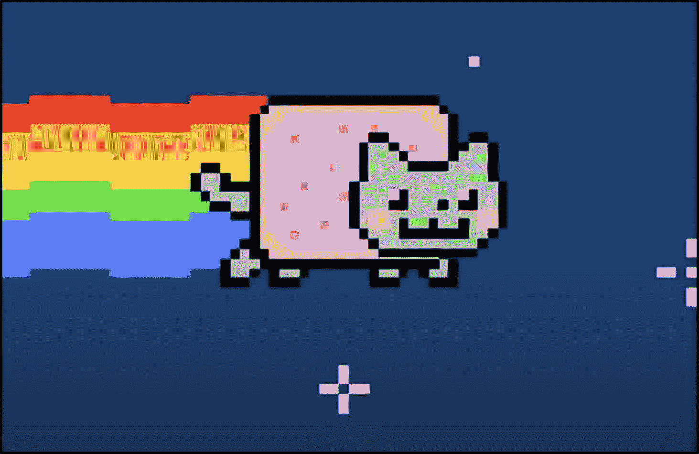
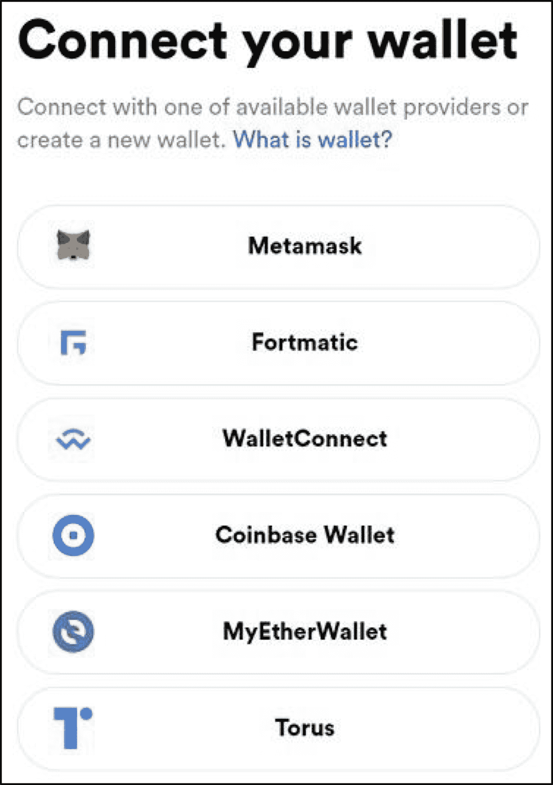
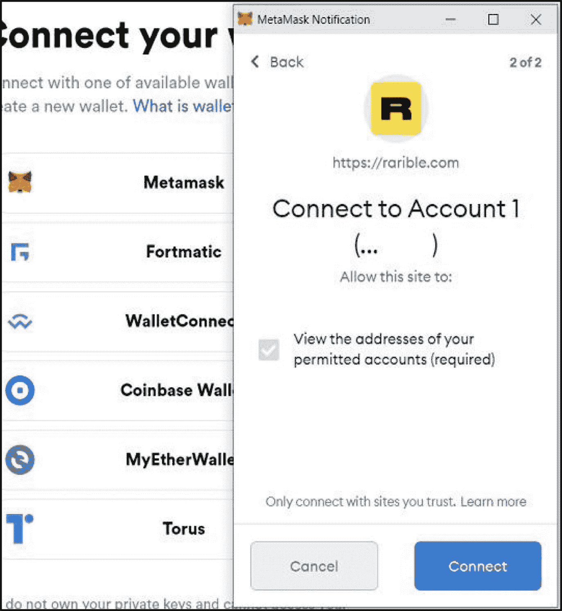
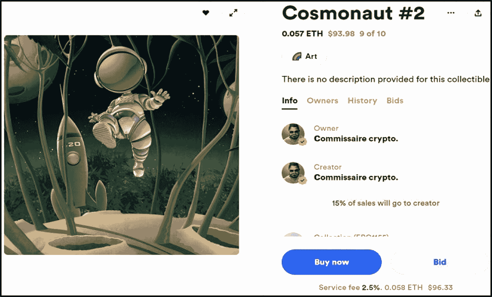
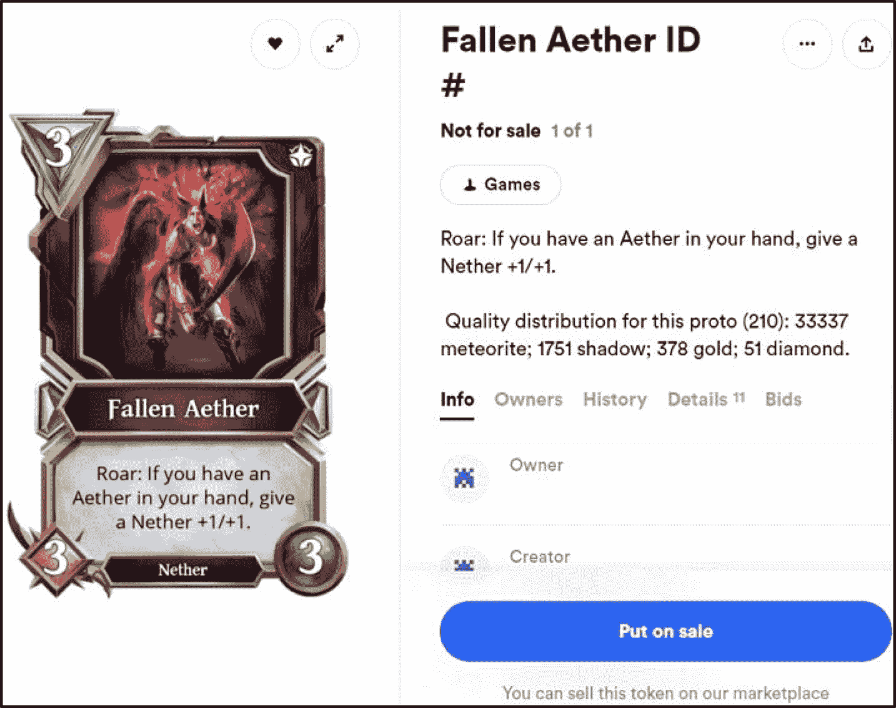
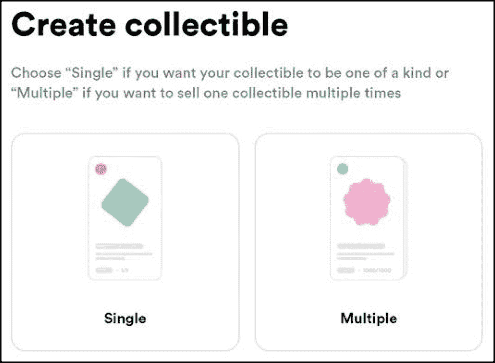
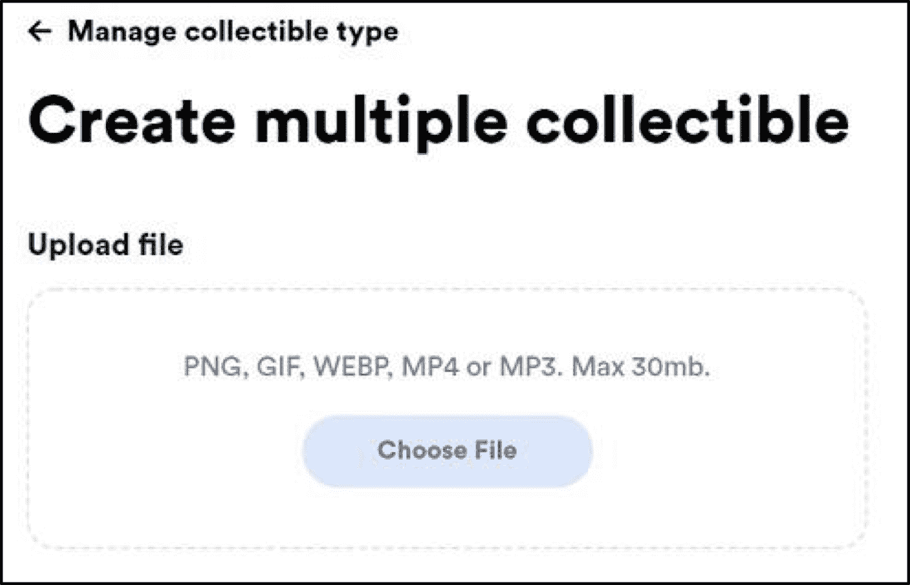
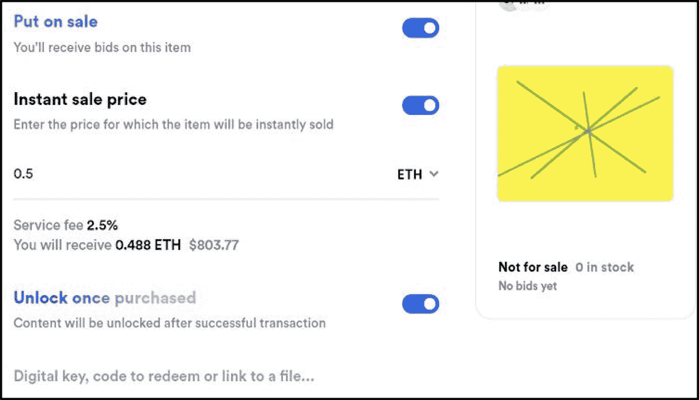
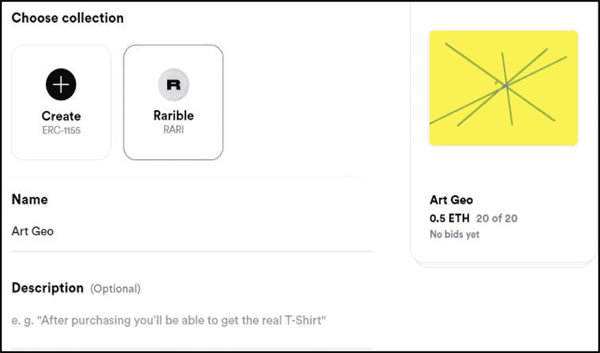
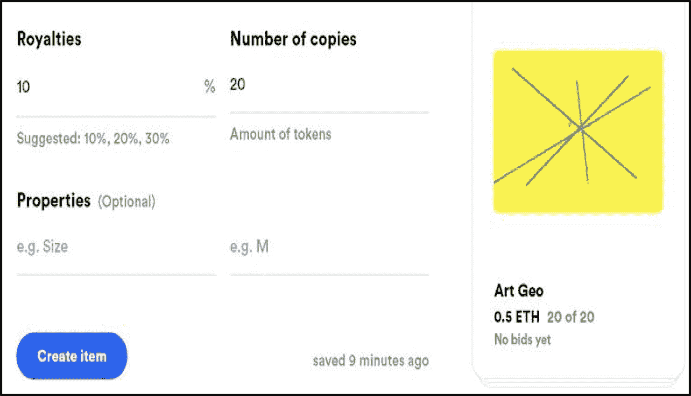

## NFT 蓝图——加密货币投资初学者指南：非同质化代币详解、其背后的区块链技术及 NFT 如何与比特币、以太坊和山寨币协同工作

## 前言

非同质化代币（NFT）在加密货币和加密艺术市场引起了轰动。人人都想学习区块链并参与其中。举个例子，艺术家 Beeple 创作的一幅数字艺术品以 6900 万美元拍卖成交。不，这不是笔误。它确实以 6900 万美元成交。

得益于埃隆·马斯克等亿万富翁的背书，NFT 变得越来越流行。但这并非其日益流行的唯一原因。在亿万富翁们支持之前，NFT 已经变得重要起来。2017 年其市值为 3000 万美元，尽管 2018 年经历了熊市，市值仍增至 1.8 亿美元。到了 2021 年，其市值已超过 10 亿美元。

鉴于不断增长的市值和日益增长的兴趣，一个明确的信号是：NFT 将长久存在。既然它们会长久存在，我们了解其用例和运作机制就变得至关重要。这正是本指南的目的——让您清晰地理解 NFT 及其其他重要方面。让我们开始吧。

---

### 第一部分：什么是非同质化代币？

#### 1.1 NFT 的定义

##### NFT：非同质化代币

缩写 **NFT** 代表 **non-fungible tokens**，德语意为：不可替代的代币。NFT 是独特数字对象的证书。它们证明你拥有特定文件的所有权。**Fungible**（同质化）本身意味着某物可以被等价物替代。例如，你钱包里有 20 美元，无论是一张 20 美元纸币、四张 5 美元纸币，还是二十张 1 美元纸币，都无关紧要。

然而，具有特定属性而独一无二的物体是 **非同质化的**。此类物体可以是实体的，也可以是数字的。对于实体物体，如绘画或汽车，很容易设定价值。这取决于艺术品的独特性以及人们愿意为其支付多少。

对于数字物体，情况则更为复杂。毕竟，尽管有版权和使用权，但每张图片、歌曲和视频都只需点击鼠标即可复制和重新分发。很难确定文件的确切价值或所有者。NFT 的构想由此开始：数字代币包含有关特定文件的信息，这些信息既独特又可验证。使用 **区块链** 技术来验证文件的真实性。

##### NFT 与区块链

**区块链** 本质上是一种数据库，其中数字商品（如加密货币）的交易以区块形式存储，并分布在全球许多计算机上。例如，**比特币** 就基于区块链。其架构使区块链具有防篡改性。

与加密货币不同，区块链中的 **NFT** 不代表可互换并从一个人转移到另一个人的资产，而是代表具体资产——如与所有者和价值相关联的独特数字艺术品。简单来说，通过将 NFT 存储在区块链中，数字商品变成了真正属于你的东西。

目前，开放的 **以太坊** 区块链是 NFT 交易最重要的平台。因此，虚拟商品的购买通常以 **以太币** 处理，这是仅次于比特币的第二大加密货币。

##### 同质化与非同质化有何区别？

要理解 NFT 的独特之处，首先需要了解 **同质化** 与 **非同质化** 的区别。如果某物是 **同质化的**，意味着它是均质可互换的。现实世界的例子包括纸币或贵金属：一克纯金的价值等同于另一克纯金。如果你给某人一张 10 美元纸币，对方归还的不是完全同一张纸币也无关紧要。

当某物是 **非同质化的** 时，一切都变了。尽管两件物品乍看之下可能相同，但两者都包含独特的信息或特征，使其不可替代或不可互换。

**非同质化** 商品的一个例子是机票。机票乍看之下相同，但每张票包含不同的乘客姓名、不同的目的地和不同的座位号。因此，将一张机票换成另一张可能会产生严重后果。NFT 在数字空间中也是如此。另一个例子是互联网域名，因为每个域名只能存在一次。

**非同质化代币** 可以限制数字空间中的事物并使其独特呈现。许多其他代币或加密货币（如 **比特币** 或 **以太币**）是 **同质化的**。如果你发送一个以太币给某人并收回一个以太币，你不会察觉任何差别。

代币也是如此：迄今为止，大多数代币基于 **以太坊的 ERC-20 标准**。为简化理解，可以想象每个此类代币代表一张 10 美元纸币。如果你发送这个代币给某人，一周后收回另一个，它与之前的是一样的。

所有这些随 **非同质化代币** 而改变。目前，**以太坊** 区块链上的大多数 NFT 使用所谓的 **ERC-721 标准**。使用此标准的代币可比作宝可梦或游戏王集换式卡牌。每个代币包含独特信息和不同稀有度。

还有一个严重差异需要考虑。**同质化代币** 是 **可分割的**，意味着可以发送或拥有 **比特币** 或其他 **ERC-20 代币** 的一部分。类似于现金，你可以用一张 10 美元纸币付款并找零。

**非同质化代币** 无法分割，必须整体购买或出售。就像集换式卡牌，没人会想买半张卡。

以下是 **同质化** 事物（如现金或加密货币）的独特属性，它们与 NFT 不同。

##### NFT 的属性

NFT 具有多项独特功能。其中一些包括：

###### 不可互操作

这意味着一个 NFT 不能替代另一个 NFT。因为每个 NFT 都是独特的，并拥有自己的特征和信息。一个例子是游戏 **CryptoKitties**。用户无法在另一款游戏中使用该游戏的资产。

###### 可验证

所有 NFT 数据存储在 **区块链** 中，因此可以轻松追溯到原始所有者。这使得 NFT 易于认证。

###### 不可销毁

NFT 不可销毁，因为它们由 **区块链** 技术和 **智能合约** 提供支持。区块链固有的透明性和不可变性确保 NFT 无法被销毁或复制。

###### 不可分割

**同质化代币** 是 **可分割的**，意味着可以发送或拥有 **比特币** 或其他 **ERC-20 代币** 的一部分。类似于现金，你可以用一张 10 美元纸币付款并找零。**非同质化代币** 无法分割，必须整体购买或出售。就像集换式卡牌，没人会想买半张卡。

##### NFT 的崛起

始于加密货币和游戏爱好者小众话题的事物，如今已在圈外引起极大关注。尤其是在艺术界，NFT 交易活跃。加拿大艺术家兼歌手 **Grimes** 在 **Nifty Gateway** 平台拍卖数字艺术，20 分钟内收入约 600 万美元。

著名的英国拍卖行 **Christie's** 也加入了 NFT 热潮。与加密艺术销售平台 **Markerspace** 合作，Christie's 正拍卖艺术家 **Mike Winkelmann**（即 **Beeple**）的首个全数字 NFT 作品，截止至 3 月 11 日。拍卖结束前一天，“Everydays: The First 5,000 Days” 的最高出价为 975 万美元。

越来越多的音乐人和网红也抓住 NFT 机遇。美国乐队 **Kings of Leon** 宣布将以限量 **NFT 版** 发行新专辑。在德国，艺术家 **Fynn Kliemann** 通过区块链拍卖了 100 个 NFT 制作的广告歌，收入约 25 万美元。

*动画 GIF "Nyan Cat" 现在也作为 NFT 发布*

##### NFT 在收藏家和游戏玩家中也很受欢迎

除了加密艺术，`Open Sea` 等 NFT 平台还交易收藏品，如表情包或卡片，所谓的收藏品，或电脑游戏内容。例如，最近一位不知名人士为“Nyan Cat”动画 GIF 的修订版支付了 300 枚以太币（购买时约合 60 万美元），该 GIF 已在互联网上“游荡”近十年，是最著名的 GIF 之一。

另一个例子是幻想足球平台 `Sorare`，其运作方式有点像数字版帕尼尼贴纸册。足球爱好者可以购买他们喜爱球员的限量版收藏卡。迄今为止售出的最昂贵卡片成交价为 5.7 万美元。游戏玩家则可以在 NFT 市场上购买虚拟角色、资源或道具。目前的纪录保持者是基于区块链的收藏类怪兽游戏 `Axie` 中的一块虚拟土地，有人为此支付了约 150 万美元。

##### NFT 是下一个风口吗？

观察 NFT 的繁荣景象，人们不禁要追问其意义。一方面，正如艺术界惯例，**理想价值**往往比物质价值发挥更大作用。既保证真实性又限制复制数量的数字证书，也让虚拟物品成为了身份象征。

另一方面，NFT 也是依赖供需关系的投资和投机对象。因为加密物品可以像古典艺术品一样买入，并有可能转手获利。然而，与所有加密资产投资一样，存在高风险：NFT 价格以及加密货币价格都可能剧烈波动。

燃烧的艺术品“Morons”：艺术家班克斯的原作版画被艺术团体“Burnt Banksy”烧毁，并以数字复制品形式“复活”。该 NFT 作品可于 5 月 9 日前在 `Open Sea` 平台竞拍。

对于加密艺术创作者而言，NFT 提供了一种新的潜在收入来源。他们不再通过互联网传统方式出售作品，而是利用少量副本的稀缺性吸引收藏家、投机者和粉丝。艺术家还可以参与 NFT 的二次销售分成。例如，如果原始购买者转售 `Fynn Kliemann` 的短曲，他将获得购买价格的 10%。特别是那些在传统市场举步维艰的艺术家，通过 NFT 获得了出售作品的新机会。

##### NFT 面临的批评

但也存在逆风——不仅仅是因为巨大的加密货币价格波动。批评之一涉及可能的版权侵犯。例如，如果未经核实区块链上的卖家是否真正拥有权利，就会出现问题。此外，所有者仅在购买时所在的区块链上拥有该加密物品。在大多数情况下，这是 `Ethereum` 区块链。然而理论上，任何支持 NFT 的其他区块链上的物品都可能被重新发行。

NFT 也耗能巨大。由于 `Ethereum` 区块链的单笔交易需要许多计算机的算力，因此耗电量极高。NFT 不仅包含一笔交易，而是视拍卖出价数量而定包含多笔交易。因此，能源需求随之增加。数字艺术家 `Memo Akten` 分析了单笔 NFT 销售的能耗。平均每笔销售消耗 340 千瓦时。相比之下，一笔普通 `Ethereum` 交易仅占其十分之一左右。

#### 1.2 NFT 的历史与重要里程碑

正如 `DeFi`（去中心化金融）协议模仿银行的金融产品，NFT 模仿艺术画廊、商店和博物馆的世界。但省去了昂贵且有风险的中介。

这得益于最初诞生于 `Ethereum` 的 `Smart Contracts`（智能合约/dApps）。这种可编程区块链可服务于各种去中心化应用。换句话说，NFT 市场是连接 NFT 创作者直接面向买家的 dApps，从而支撑起整个 NFT 经济。这极大地降低了双方的准入门槛，从而消除了常见的进入壁垒。

NFT 本身是一种代币——`ERC-721`——不可分割或非同质化，因此得名。其价值基于区块链技术的保证：没有任何 NFT 可以被伪造。此外，作为完全数字化的资产（无论是图形、音乐、视频、动画、游戏资产等），其完整交易历史均可追溯和验证。

从 `Google Trends` 可以看出，全球对 NFT 的兴趣自 2 月以来激增。随着越来越多的人看重数字资产胜过实物资产，这一 NFT 趋势几乎是可以预见的。通过以下最昂贵的 11 个 NFT 排行榜，让我们深入了解这个新世界。

既然我们已经解释了什么是 NFT，现在可以深入探讨这些资产的详尽历史。

##### 2012–2013：彩色币

可以说，彩色币是最早存在的 NFT。彩色币由 `BTC` 的小额面值组成，通常小至 1 `Satoshi`（聪）。彩色币可用于代表大量资产，并拥有多种用例，包括：

- 房地产
- 优惠券
- 发行自有加密货币的能力
- 发行公司股份
- 订阅
- 访问令牌
- 数字收藏品

彩色币是比特币能力大跃进的一个例子。缺点是只有在所有人都认同其价值时，它才能代表特定价值。`Bitcoin` 的编码语言从未设计为在其自身网络内实现此类行为，因此彩色货币的效力仅取决于其最弱的参与者。例如，3 个人同意 100 个彩色币代表 100 股公司股份。如果某参与者决定不再同步彩色币以代表公司股份，整个系统就会崩溃。

关于彩色币的首次提及似乎来自 `Yoni Assia` 于 2012 年初发表的博客文章“bitcoin 2.X (aka Colour Bitcoin) – first features”。文中讨论了彩色币，但未提及各种资产或其用例。相反，他主张彩色币因属于“创世过程”中的比特币，而独特且可与普通比特币交易区分。这些新资产的潜力显然直到 2012 年 12 月 4 日 `Meni Rosenfeld` 发表“Overview of Coloured Coins”一文时才被探索。几个月后，即 2013 年，又发表了题为“Coloured Coins – BitcoinX”的文章。

彩色币的缺陷显而易见；该系统在许可环境中效果最好，这意味着在某些情况下直接使用数据库更好。然而，彩色币为更多实验打开了大门，并为 NFT 奠定了大部分基础。将现实资产放入分布式账本的巨大潜力显而易见，但实施需要更灵活的区块链。

##### 2014 – 对立面

彩色币的创造让许多人意识到将资产导出区块链的巨大潜力。然而，人们也明白 `Bitcoin` 本身在当前迭代中并不意味着启用这些额外功能。对立面拥有一个去中心化交易所，允许资产创建，甚至拥有带有 `XCP` 的加密代币。它拥有众多项目和资产，包括集换式卡牌游戏和胸部交易。

##### 2015 年 4 月 – 对立面上的创世魔法

##### Spells of Genesis：区块链游戏与 ICO 的先驱

Spells of Genesis 的创作者不仅是先驱，也是最早通过 Counterparty 发起 ICO 将游戏内资产发布到区块链的人之一。时间之早，以至于 ICO 后来被称为众筹。Spells of Genesis 通过发行一种名为 `BitCrystals` 的代币为开发提供资金，该代币用作游戏内货币。

##### 2016 年 8 月 —— 另一侧的更多交易卡牌

2016 年 8 月，Counterparty 与热门交易卡牌游戏 Force of Will 合作，在 Counterparty 平台上发行其卡牌。Force of Will 是北美销量第 4 位的卡牌游戏；仅次于宝可梦、游戏王和万智牌。它们进入该生态系统，表明了将此类资产放入区块链的价值。

##### 2016 年 10 月 —— 另一侧的稀有佩佩

2016 年 10 月，人们开始在 Counterparty 平台上将“稀有佩佩”作为资产发行。稀有佩佩是一种以青蛙角色为特色的梗图。这些拥有庞大的粉丝群。甚至有一个名为稀有佩佩钱包的目录（通常被称为索引）。

仿佛在比特币区块链上还不够，稀有佩佩钱包还有“专家”认证佩佩梗图的稀有度。怪诞之余，这个例子展示了人们开始渴望独特数字元素的节点。如今，Counterparty 平台上构建了大量项目，其中许多包含类 NFT 资产。请在此查看 Counterparty 上的各种项目。

##### 2017 年 3 月 —— 以太坊上的稀有佩佩

随着以太坊在 2017 年初崭露头角，梗图开始在那里交易。2017 年 3 月，宣布了一个名为 Peperium 的项目，定义为“一个去中心化的梗图市场和交易卡牌游戏 (TCG)”，允许每个人创建永久存在于 IPFS 和以太坊上的梗图。与 Counterparty 类似，Peperium 也有与之关联的代币（代号 `RARE`），用于支付梗图创建和上架费用。

##### 2017 年 6 月 —— CryptoPunks

直到以太坊区块链出现，NFT 才真正加速发展。首批以太坊 NFT 于 2017 年夏季以 CryptoPunks 形式出现。CryptoPunks 是由 [Larva Labs](https://www.larvalabs.com/cryptopunks) 创建的 10,000 个独特的数字角色。所有权记录以独特代币的形式存储在以太坊区块链上。每个 CryptoPunk 都有独特的属性，因此没有任何两个是相同的。CryptoPunks 启发了数字艺术市场，并成为后续标准的先驱。由于供应有限和早期用户的狂热地位，它们已被视为数字古董。它们仍可交易，并可与以太坊上大多数 NFT 应用程序互操作。

随着以太坊上稀有佩佩交易的快速增长，两位“创意技术专家”决定创建自己的 NFT 项目，并加入了一点新意。John Watkinson 和 Matt Hall 意识到他们可以在以太坊区块链上生成独特的角色。角色数量限制为 10,000 个，且没有任何两个角色是相同的。为了致敬 1990 年代尝试比特币前身的密码朋克，他们将项目命名为 CryptoPunks。

令人惊讶的是，Watkinson 和 Hall 选择允许任何拥有以太坊钱包的人免费领取一个 CryptoPunk。所有 10,000 个 CryptoPunk 迅速被领取一空，催生了一个繁荣的二级市场，人们在其中买卖它们。有趣的是，CryptoPunks 并不遵循 ERC721 标准，因为该标准当时尚未发明，但由于其实现方式，它们也并非完全符合 ERC20。因此，CryptoPunks 可以被描述为 ERC721 和 ERC20 的混合体。

##### 2017 年 10 月 —— CryptoKitties 诞生

随着 CryptoKitties 的出现，NFT 走向主流。CryptoKitties 是一款基于区块链的虚拟游戏，允许玩家领养、繁殖和交易虚拟猫咪。区块链上的猫咪！

尽管 CryptoPunks 正式是以太坊区块链上的首个 NFT，但 CryptoKitties 通常被认为是将 NFT 带入大众视野的功臣。2017 年底，它们成为 NFT 的首个主流应用。

2017 年已经是加密货币炒作之年，由以太坊平台上的 ICO 泡沫驱动。在短时间内，无数新的 ICO 项目启动，每个项目都提供新的、所谓稀缺的代币。这引发了真正的淘金热情绪。越来越多的新代币在以太坊区块链上诞生。网络很快变得日益拥堵，导致交易费用大幅上涨。然而，高使用率的原因之一，除其他因素外，就是 CryptoKitties 的创建和交易。

CryptoKitties 是由 Dapper Labs 为区块链电脑游戏创建的卡通猫咪数字图像。每只猫都是独一无二的，因此在区块链上仅存在一次。它们的特别之处在于，在链上电脑游戏中，通过配对不同的猫咪可以繁殖出新的独特 CryptoKitties。这些新猫咪随后可以在公开市场上拍卖或出售。

###### CryptoKitties 泡沫

繁殖机制吸引了许多投机者。想法很简单：你购买一些稀有的 CryptoKitties，用它们繁殖出更稀有的新猫，以高价出售，然后重复这一过程。在 2017 年的高峰期，交易量约为 5,000 ETH，CryptoKitties 的销售价格超过 100,000 美元。

为数字猫咪支付如此高价几乎是荒谬的。但其背后令人难以置信的故事，加上加密货币周围巨大的炒作，在短时间内吸引了许多新买家进入市场。当时以太坊的网络容量无法应对这种涌入，导致 CryptoKitties 的交易和繁殖产生了惊人的费用和数小时的等待。

这种炒作、投机和病毒式传播故事的混合物，最终形成了一个也引起媒体关注的泡沫。但正如预期的那样，泡沫很快破裂。2017 年 12 月中旬，对 CryptoKitties 的需求瞬间下降，价格暴跌。整个加密货币泡沫随即开始破裂，随后迎来了长达数年的熊市。

CryptoKitties 是 NFT 收藏品的绝佳例子。CryptoKitties 是以太坊区块链上的数字猫咪。该 NFT 背后的理念是让购买者像现实生活中一样培育和繁殖这些小猫。在 2017 年推出几周内，人们在它们身上花费了约 2000 万美元。但收藏品市场绝不局限于此，因为它向不同方向延伸。NFT 实用性的另一个绝佳例子涉及艺术品收藏。专家可以在为每件艺术品创建非同质化代币之前，对绘画和雕塑进行验证和认证。

这个令人难以置信的项目显然出现在了从 CoinDesk 到 CNN 的每个新闻台上。这或许是因为游戏拥堵并拖慢了以太坊区块链，又或许是因为人们在交易中获得了疯狂的利润。一些虚拟猫咪甚至以超过 100,000 美元的价格售出。

##### 2018–2019 年 —— NFT 寒武纪大爆发

2018 年和 2019 年，NFT 生态系统经历了巨大增长。现在该领域已有 100 多个项目，更多正在进行中。由 OpenSea 和 SuperRare 领衔的 NFT 市场正在增长。与其他加密货币市场相比，交易量较小，但增长迅速，已取得长足进步。随着 MetaMask 等 Web3 钱包的不断发展，参与 NFT 生态系统变得更加容易。Dapper Labs 最近推出了 Dapper 钱包，无需支付 Gas 费（通过元交易）。此外，现在还有 nonfungible.com 和 nftcryptonews.com 等网站追踪 NFT 市场指标、游戏指南，并提供该领域的一般信息。

CryptoKitties 追踪了 NFT，但如果没有之前的项目通过创建独特的数字资产奠定基础，他们就无法做到这一点。Nonfungible.com 发布的这张有趣的图表展示了 CryptoKitties 对现有 NFT 生态系统的重要性。

该表格显示，拥有 CryptoKitties 的人倾向于玩其他 NFT 游戏，而玩其他 NFT 游戏的人通常不会扩展去玩其他的。CryptoKitties 是通往 NFT 世界的完美入口。

CryptoKitties 之所以可能经历了巨大的增长，也归功于繁育不同猫咪以生成全新猫咪或 `ERC721` 代币的功能。现在 NFT 拥有无尽的功能，包括角色名称（类似于域名）、虚拟土地规划、虚拟服装、活动入场券、小行星挖矿资源等。

###### 2020 年 12 月：虚拟 F1 赛道创纪录的 223,000 美元成交

NFT 热潮已达到新高度。虚拟赛道的仅一个路段就以 223,000 美元的价格成交。

一款基于区块链游戏的赛道部分以 900 万 `REVV` 代币的价格被拍卖。由 Animoca Brands 开发的游戏 `F1 Delta Time` 中的摩纳哥赛道对一级方程式赛车粉丝来说尤为熟悉。该公司确认部分赛道已以 NFT 形式售出。

拍卖获胜者用 Animoca 公司的代币 `REVV` 支付了部分摩纳哥赛道的费用。9,081,752 个 `REVV` 代币约合 375.56 个以太坊。价值约 223,000 美元。

与许多加密货币不同，NFT 的凭证存储在智能合约中。该信息证明了每个 NFT 都是不同且独一无二的。这使它们成为“独特代币-NFT”。NFT 可以代表任何可数字化的事物。从艺术品到游戏内产品，可以创建许多 NFT。因此，由于这些产品独特、不可篡改且不可复制的特性，价格可能达到高额。

赛道的虚拟道路被划分为 330 个路段并出售

`F1 Delta Time` 使用 NFT 代表游戏的所有关键资产。摩纳哥赛道的虚拟道路被划分为 330 个路段并出售。从弯道最常用的顶点区域到最罕见的使用区域，许多点位均被挂牌出售。

以 223,000 美元售出的 NFT 位于顶点区域，将赋予所有者每场游戏中 5% 的交易费分成，以及玩家投资资金获得的质押收益 4.2% 的分成。付款将以 Animoca 的 `REVV` 代币进行：

据了解，在 `OpenSea` 上以创纪录价格购买该赛道路段的人，正是 2019 年在同一游戏中花费 111 万美元购买独特虚拟赛车的同一个人。他在上个月的采访中说：“NFT 的价值隐藏在它们自己的故事里。”“有价值的资产总有一个故事。显然，赛车底下的神秘感吸引了其他人，”他说。

##### 当前的 NFT 形势

NFT 的用例几乎是无限的。事实上，非同质化代币可以作为基于区块链技术的新数字经济的基础。在 NFT 的帮助下，现实世界可以与数字世界融合。除了在纯数字空间中描绘稀缺性和独特性外，这还极大地促进了现实世界中的物体和资产数字化为虚拟世界的过程。

#### 1.3 当今 NFT 最大的应用是什么？

我们将在本书后面详细介绍 NFT 的应用。虽然 NFT 的起源可以追溯到 2012 年，但它们直到 2021 年初才爆发进入主流视野。这在一定程度上要归功于 DeFi 的兴起以及 NFT 的多种潜在应用。2020 年的一大挑战是向祖父母解释如何使用社交平台，现在我们需要找到一种方法来解释另一个日益流行的话题：NFT 和其他“加密现象”，它们在动摇金融界之后，也影响着品牌和营销世界。

但让我们退一步来定义 NFT：非同质化代币。非同质化本质上意味着它是独一无二的东西——简而言之，就是艺术品的数字等价物。NFT 指的是任何可以数字化的内容类型：视频、音乐、GIF、3D 物体、图像、游戏、文本、表情包，甚至是一条推文，你还记得吗？

这些数字内容被收集在区块链上，区块链凭其本质允许任何人查看谁拥有该代币（或展示藏品，例如，就像你邀请某人参观你的艺术收藏（如果你有的话））。

事实上，存在许多市场，选择正确的市场来寻找或出售特定物品非常重要。例如，有些非常独家，只有受邀出售作品的人才能进入；然后有“开放市场”，每个人都可以尝试出售他们的数字内容。还有一些平台由策展人挑选出售的作品——就像“传统艺术”世界一样。

一些最著名的市场是 `SuperRare`、`Nifty` 和 `OpenSea`。

显然，与任何现象一样，有些品牌与之的关系更自然，而对其他品牌而言，乍看之下与这个世界的联系可能似乎不那么直接。以下是三个可能非常有趣的场景，我们认为它们代表了品牌不容小觑的机会。

##### 体育：先行者

体育品牌是最早——也是最快——进入 NFT 世界的品牌之一。

NBA 过去曾表明它能够识别和预判各种趋势，这一次也不例外：通过一个特殊平台——`NBAtopshot`——收藏家们花费了超过 3.3 亿美元购买他们喜爱球员最佳动作的短视频片段。

每个人都有独特的特征——从外貌到教育资历和病历。非同质化代币使得将这种身份代币化成为可能。因此，关于一个人的所有数据都可以以 NFT 的形式呈现，人们可以重新掌控自己的数据。每个 NFT 的独特性正是体育产业试图利用的。

Nike 也迅速加入了 NFT 阵营，通过 `CryptoKicks` 切入活跃度极高的球鞋收藏家社区。这本质上是将每双鞋与一个独特的数字身份关联（因此球鞋的真伪可以通过区块链验证——考虑到限量版球鞋市场的价值，这是一个日益热门的话题）。

##### 收藏品

正如你在 `CryptoKitties`、幻想足球游戏 `Sorare` 或 Dapper Labs 的 `NBA Top Shot` 中所见，NFT 已被用于创建全新类型的收藏品。例如，`Sorare` 允许你购买你喜爱球员的代币化版本。其原理与许多人童年记忆中的帕尼尼收藏贴图非常相似。同样的原理现在以数字收藏品的形式应用于数字世界，以数字方式代表收藏卡的所有权。

##### 音乐与艺术

在数字世界中，艺术家保护版权和赚钱往往是一场噩梦。通过 NFT，有人可以购买一件艺术品并在虚拟空间中展示，区块链证明所有权。艺术家因此可以保护版权，并确保获得销售产生的更大份额利润。此外，可以配置 NFT 以创造经常性收入来源，从而参与 NFT 的每一次后续销售分成。最近，一些 NFT 已以数十万美元的价格售出，许多人预计艺术 NFT 领域未来将大幅增长。

###### Beeple 的成功与加密艺术的崛起

Beeple 的成功可能是独一无二的——至少目前如此——但有许多艺术家通过出售加密艺术取得了巨大成果：艺术家组合**Hackatao**，意大利 NFT 先驱之一，或**DotPigeon**，其在 Nifty 上的虚拟展览在一周内售罄。

在乐队中，**Kings of Leon**是首个将专辑作为 NFT 发行的乐队，推出了三种不同的代币，提供独家资产的访问权限（从专辑特别版到在其演唱会前排拥有终身座位的可能性）。

##### 游戏

在**魔兽世界**、**堡垒之夜**、**CS:GO**或**英雄联盟**等热门游戏中，目前禁止出售稀有武器或皮肤。也无法将某个游戏中的物品或皮肤用于另一个游戏。借助 NFT，可以转移物品并明确分配所有权，解决了狂热玩家面临的一些最大痛点。

这些可能是最肥沃的市场，因为购买虚拟产品是视频游戏用户的常态——例如**堡垒之夜**中的皮肤（包括商标授权皮肤），或时尚品牌在游戏中为虚拟化身出售服装，如**Gucci**在**网球大赛**中。

NFT 在这些市场中的一个绝佳例子是德国足球运动员**梅苏特·厄齐尔**，他与**Boss Logic**和**Genies**共同开发了虚拟化身服装系列；出售这些资产的收益将捐赠给**BigShoe**，一个支持生活在贫困中的儿童的非营利组织。

对于品牌而言，了解哪种市场和行动能最好地与与此世界相关的营销活动相结合非常重要：对某些品牌来说这很自然，而对其他品牌可能需要采用非传统的方式来使用 NFT。

“方式”指的是要创建的内容类型（例如 3D 物体、视频或生成艺术）以及拍卖作品的平台类型，具体取决于你想触达的受众和想要传达的信息。

##### 资产

NFT 虚拟资产市场庞大。在**Decentraland**和**Cryptovoxels**等平台上，可以购买虚拟土地地块。这些地块拥有独特属性，就像现实世界的地块一样。在虚拟世界中，这些地块已以数万美元的价格进行交易。此外，**Unstoppable Domains**网站已将网站域名代币化。因此，每个域名都可以转换为 NFT，任何人都可以自由交易。

NFT 的这一领域仍处于早期阶段，但可以将艺术品或唱片合同等现实资产代币化为 NFT。NFT 用于证明某人拥有艺术品（按比例）或用于解决版税索赔。

任何发生在未来几周的事情无疑都将催生新一代 NFT 相关平台：市场将越来越像艺术画廊，数字艺术品可以像传统艺术品一样展出和出售。艺术就是艺术，无论是数字还是实体。

同样的情况也适用于虚拟 T 台上化身穿着的服装，这些服装可以被数字化查看，并被想要装扮自己数字分身的人购买。

但有一点需要牢记，NFT 可能对碳足迹产生巨大影响（加密货币生产需要大量能源，这显然会影响二氧化碳排放水平），因此品牌必须意识到这一点，并了解如何负责任地行动。

### 第 2 课：解读几个概念以更好地理解 NFT

#### 2.1 标准化

多年来，加密开发者在公共区块链上创建了通用、可复用的代币标准。这些标准确立了所有权、转移和简单访问控制等基本原则。

这些策略或协议类似于`HTTP`协议在两台不同计算机之间以`JPEG`或`PNG`格式显示图像时发送请求的方式。

区块链增加了原始元素和一个允许存储元数据的层，为开发者提供了一套全新的状态信息，以便在此基础上开发应用程序。这一领域被称为**区块链标准**（支持有状态数据存储和逻辑操作）。

以太坊上的代币是以太坊或其他区块链上任何资产的虚拟存储或表示。

`ERC-721`是一个标准，解释了如何在以太坊区块链上创建唯一代币。与使用`ERC-20`标准创建的代币不同，每个使用`ERC-721`创建的代币都是唯一的。

使用`ERC-721`标准创建的非同质化代币是唯一的，这与其他代币不同。由于每个`ERC-721`代币都与其他代币不同且价值不等，因此相互之间更难兑换。

`Bitcoin`和`Ethereum`等加密货币，以及`USD`等法定货币，都是同质化的，意味着每个单位等价。因此，此类加密货币和法定货币的每个单位具有相同价值，可以直接相互兑换。

此外，同质化代币和币可以分割成小单位（例如`0.5 bitcoin`和`0.0002 bitcoin`），而非同质化代币是单一单位，无法分割成更小的单位。

`ERC-721`标准定义了智能合约必须实现的最小接口，以允许管理和交换唯一代币等功能，同时不要求也不限制为代币元数据添加额外功能。

**CryptoKitties**（一个繁殖和出售独特猫咪的游戏）是使用`ERC-721`标准的非同质化代币创建的最知名项目。

目前，非同质化代币被用于许多项目，如**Decentraland**和**EnjinCoin**。

非同质化代币的用途不限于游戏行业；它们提供许多不同的用例，如艺术品和房地产等现实资产的代币化。

另一个使用`ERC-721`代币的热门区块链游戏是**Blockchain Cuties**。

要浏览非同质化代币的交易或游戏，请查看**OpenSea**，这是区块链上最大的数字物品市场。

##### 什么是 ERC-721？

这是非同质化代币标准。目前，大多数 NFT 作为`ERC-721`代币实现于以太坊平台之上。你可以在 NFT 范畴下找到具有不同标准、其他协议和区块链的其他代币（例如在`NEO`或`EOS`上），但`ERC-721`目前是最流行的 NFT 标准。`ERC-721`拥有一组标准功能和属性，以智能合约的形式定义了它。你需要遵循这些属性和功能来拥有、交易和管理`ERC-721`代币。简单来说，`ERC-721`为创建和交换 NFT 提供了标准。每个`ERC-721`代币都是独特的，因为它不属于`ERC-20`代币。

**通用定义：** 一种为 NFT 提供标准的代币类型。换句话说，此类代币是唯一的，其价值可能与同一智能合约中的另一个代币不同。`ERC-721`代币可能因其年龄、稀有度甚至视觉外观而有所不同。

**技术定义：** `ERC-721`（以太坊征求意见 721）是一种非同质化代币标准，在智能合约上实现了代币的 API。

当`ERC-721`功能最初构想于以太币诞生之前时，旨在将其添加到`Bitcoin`世界中，用于房地产和除`Bitcoin`以外资产的认证，但并不成功或稳定，因此随着`Ethereum`诞生了。

例如，两张欧冠决赛门票中的一张是普通座位，另一张是 VIP/贵宾厅门票。

##### ERC-721 对比 ERC-20 对比 ERC-1155

`ERC-721` 和 `ERC-20` 代币之间还有另一个关键区别。`ERC-20` 代币是可分割的，就像你可以将一张 10 美元的纸币拆成两张 5 美元的纸币一样。然而，`ERC-721` 代币是不可分割的。有谁会理智地分享一张门票或一张棒球卡呢？不会，就像 NFT 一样。

`ERC-721` 目前是数字艺术和区块链游戏最常用的标准。此后已有数百个 Dapp 使用了它，并创建了超过一百万个独特的代币。

##### ERC-721 对比 ERC-1155

`ERC-1155` 是一种多代币标准。尽管 `ERC-721` 瞬间获得成功并被用于创建数百万个 NFT，但它也存在一些局限性。例如，部署大型物品数据库的成本很高。

`ERC-1155` 多代币标准由 Witek Radomski、Andrew Cooke、Philippe Castonguay、James Therien、Eric Binet 和 Ronan Sandford 于 2018 年 6 月 17 日创建。它们也被称为半同质化代币。

简而言之，`ERC-1155` 允许在单个智能合约中交易无限数量的同质化和非同质化代币。它旨在通过允许管理同质化、半同质化和非同质化代币来避免未来转账中的瓶颈。

因此，不同类型的代币在一次交易中即可完成收集，而非多次交易，从而允许不同类型的物品以更快、更便宜、更轻量的方式进行转移（在区块所覆盖的数据大小范围内）。例如，当你在区块链和 NFT 游戏平台上使用 `ERC-20` 和 `ERC-721` 购买游戏内购买的单个物品时，这就是 `ERC-1155` 的一个例子，但你不再是在单个标准的单笔 `ERC-1155` 交易中购买它们。

为了克服这些缺点，Witek Radomski 决定创建自己的标准——`ERC-1155`。这意味着 `ERC-1155` 是 `ERC-721` 的进阶和改进版本，提供了许多创建 NFT 的新功能。

例如，使用新的 `ERC-1155` 标准，你可以在一个已部署的智能合约中同时使用无限数量的非同质化和同质化资产。根据 Witek Radomski 的说法，它也易于与区块链网络协作。他还认为，这套新标准利于基于区块链的游戏行业，也是为所有形式的所有权（无论是数字还是物理）创建代币的良好选择。

##### 什么是代币？

在经济学中，除“代币”、硬币和纸币外，我们将数值对象命名为筹码。所有筹码都存在于赌场、优惠券、礼品卡和代金券中。

访问代币是一把钥匙——一种访问权限的加密证明——一种授权密码。我们可以在计算机网络中遇到它。在这里，代币化用于确保数据安全，这在区块链代币的使用中非常常见。

有时刷新一个需要登录的网页后，我们可能会看到“代币超时”的消息。在这个意义上，代币是会话 ID。代币也被称为生成一次性代码的设备——例如用于保护网上银行账户的 Google Authenticator 的旧式物理对应物。

##### 代币对比加密货币

是的，既然比特币或莱特币是虚拟货币、数字货币，是的，代币是虚拟代币。

代币可以扮演货币的角色。你可以用它们支付通常严格规定的某种服务。最常见的代币与某个项目、公司或个人相关。例如，你可以通过公司的服务和应用程序用其代币付费。它取代了传统货币。利用区块链技术，它们基于智能合约实现了快速、去中心化的解决方案。

代币也可以用作加密所有权凭证，例如某些公司的股份。这些代币被称为证券型代币，它们属于某种证券。

代币通常在 ICO 下发行。区块链初创公司发行数字代币，然后将其作为融资项目的基石出售。

代币可用于追踪或拥有产品供应链中的资产。

对于普通用户来说，代币和加密货币的区别并不重要，两者在实践中几乎没有区别。简单来说，加密货币拥有自己的区块链；它是为加密货币需求而创建的。那是区块链的基础货币。顺便说一句，代币使用加密货币的区块链。最常见的是，代币转账费用以这种加密货币收取。

例如，以太坊网络允许你创建自己的代币。代币使用以太坊区块链。仅在应用程序（dApps）中具有特定功能的代币用于支付或基于以太坊网络创建。

许多项目为 ICO 需求创建了代币。筹集资金后，代币可在交易所获得，团队通常致力于项目的实施，承诺创建自己的区块链。一旦实现，外部区块链代币就会转换为原生区块链的币。

在许多平台上，你可以创建代币（例如以太坊、EOS、NEO）。每个平台都有自己的标准。以太坊是最流行的平台，大多数代币都基于此。与指定、移动或标记独特证券项目的需求相对应的新标准正在动态开发（例如 `ERC-721`）。

#### 2.2. 互操作性

非同质化代币标准允许 NFT 轻松传输并参与多个生态系统。因此，NFT 证明了它们具备互操作能力。`ERC-1155` 通过允许单个合约包含同质化和独特代币，创造了全新的机会。NFT 的标准化使更高层级的互操作性成为可能，这最终对用户有利。此外，互操作性意味着独特资产可以在不同应用程序之间相当容易地转移。

NFT 可以在 OpenSea 等开放市场上买卖。这些市场允许买家和卖家连接，每个代币的价值都是独特的。NFT 可能会根据市场供需自然显示价格变化。

建立在 Polkadot 上的“Efinity”等平台专为游戏、应用程序、组织和创作者设计。NFT 是一条区块链。在这个平台上，来自任何链的任何 NFT 都可以移动到 Efinity。这样，项目之间的协作成为可能，因为创作者和开发者将不再局限于单一区块链和平台。据报道，新的 NFT 区块链 Efinity 将具备每六秒执行一次交易的能力，并在该领域雄心勃勃。

#### 2.3. 可交易性

请注意，NFT 不能像比特币或其他加密货币那样以 0.50 BTC 或 0.333 ETH 的形式进行交易，并且可以按 1:1 的比例出售或购买，因为 NFT 产品在互惠转账交易中是不可分割的。你不能用一个 NFT 交换另一个 NFT。无论它们是收藏品、游戏道具还是任何其他类型的 NFT，都无法互换。对于加密货币，你总是可以用一种加密货币兑换其等值的另一种加密货币——例如，你可以用 1 BTC 兑换等值的 ETH 或任何其他加密货币。

然而，有几个市场可以买卖 NFT。请记住，NFT 无法分割成更小的组成单位。与加密货币或法定货币不同，NFT 仅作为一个完整的整体存在。

NFT 还具有可变性（就价值、受欢迎程度和时间性而言）。想想一个乐队。我们也可以看到，它们在某些时期制造了很大声势，但可能会随着时间的推移而失去人气。NFT 也是如此。例如，一件物品的价值可能在 2021 年为 0.1 ETH，而在 2024 年达到 670 ETH。

以下是一些领先的 NFT 市场。我们将在本书后面更详细地介绍它们。

- Enjin

##### Enjin

Enjin 是提供多种数字产品生态系统的领先公司之一，使得任何人都能相对轻松地将游戏产品变现。这意味着游戏开发者可以通过以太坊将游戏内物品代币化——由 Enjin 的 ERC-20 代币提供支持。Enjin Coin 是市场上最便宜的山寨币之一——撰写时为 2.5 美元——并在山寨币中为投资者提供了最高的增长潜力。截至发稿时，Enjin 的市值超过 7.5 亿美元。

##### Decentraland (MANA)

MANA 构建于以太坊之上，允许用户创建、体验内容和应用程序并将其变现。有了 MANA，他们可以购买虚拟地产以供探索、开发，并以任何他们想要的方式变现。

截至 2021 年 4 月，MANA 的市值超过 4.7135 亿美元。它于 2020 年 2 月推出，ICO 融资 2400 万美元。该平台使用一种 ERC-20 代币（`MANA`）和一种 ERC-721 代币（`LAND`）。要获取地产，必须销毁 `MANA`。

##### OpenSea NFT 市场

OpenSea 市场允许任何 NFT 在平台上进行拍卖。OpenSea 作为一个去中心化市场，交易在智能合约下进行。CryptoKitties 允许您交易超过 200 种 NFT 类型，包括 SuperRare 艺术品、Gods Unchained 等。

#### 2.4. 流动性

得益于 NFT 市场数量的不断增加，NFT 的流动性正在提高。然而，考虑到 NFT 在设计上稀有且独一无二，这意味着特定 NFT 的流动性将始终较低。这是因为 NFT 创作者人为地维持其 NFT 的有限供应。NFT 市场将基于拍卖创建流动性池，这与 DeFi 流动性池几乎相似，作为回报，个人可以通过捐赠 NFT 代币购买同质化代币，反之亦然。

假设你去参加一场体育赛事，或者有一个你喜爱的摇滚乐队，你想买票去听他的演唱会。正如为这两种场合购买的门票在特性上各自独一无二一样，NFT 也是独一无二的，意味着它们不能相互交换。

每个 NFT 都彼此不同，这或许是 NFT 最显著的特征。正如我们上面提到的，由于其独特性，NFT 无法相互互换。除了拥有相同代币编号的相同智能合约外，无法制造出另一个完全相同的 NFT。这意味着制造出的代币是单一且孤独的，无法以任何其他方式生产或复制。这类似于毕加索亲手绘制的《格尔尼卡》油画无价，尽管存在数千幅复制品。这一点由区块链确认，且人人可见。

#### 2.5. 不可篡改性与可证明的稀缺性

得益于区块链技术和智能合约的不可变本质，NFT 是不可销毁的，无法被篡改、复制或销毁。这意味着购买 NFT 的人拥有它，而非 NFT 的创作者。如果所有者出售 NFT，他们无法伪造所有权记录，因为这在区块链技术下是不可能的。NFT 的这一特性使其在音乐行业的潜力无价。我们将在后面的章节讨论这一点。

它们具有抗后续篡改性，且在创建期间其供应量可被精确确定。NFT 所有者的身份是区块链网络上的永久记录。当 NFT 易手时，后续所有者可以得到验证。这确保了视频片段、音乐等数字艺术品可以追溯到其原始所有者。由于不需要第三方参与流程，这使得认证变得更加容易和高效。

此外，如果制造商愿意，NFT 在生产时可附带版税。这项版权也意味着买家通过相关区块链拥有产品的所有商业权利，如推广和广告。这意味着它也将提升各类产品的商业价值。

智能合约允许 NFT 创作者设定独特代币发行的固定上限，并实现发布后无法更改的持久特性。两个同类型的 ERC-721 代币无法互换。这一过程在理论上是可能的，但在实践中，它们无法完全相互替代。因为它们的元数据不会相同。2017 年推出的 ERC-721 代币与 ERC-20 代币的区别在于，它们不能作为加密货币使用，因此无法在交易所兑换其他加密货币。ERC-721 主要用作收藏品。

然而，这并非首次出现这种情况，例如，开发者可以通过编程方式使更常见物品的供应无限，同时要求仅创建特定数量的特定稀有物品。得益于区块链“不可变”特性，开发者无法随时间改变产品特性和预定供应量，这使其特别适合原创艺术品等物品。

#### 2.6. 稀有性

NFT 的稀有不应与稀缺性混淆，后者是大多数加密货币的主要特征之一。NFT 之所以稀有，是因为它们是与音乐等稀有物品绑定的独特代币。此外，它们也具有稀缺性，这正是其价值来源。尽管 NFT 开发者可以创建任意数量的 NFT，但他们通常会限制代币数量。

NFT 之所以稀有，是因为它们独一无二且不可复制。除了稀有事物通常有价值这一认知外，目前拥有 NFT 的艺术家和制作人数量非常有限。这在一个不断演变、难以预测未来的虚拟世界中是一个良机。如果我们做一个非常简单的假设：最初上架销售的产品价值将低于未来价值，这也可能意味着我们未来可能拥有售价高得多的产品。

NFT 没有寿命限制，且随时可供买卖，因此可以保留多年。换句话说，将一个你不想让其终结的产品转化为 NFT，也意味着赋予它一种部分的永恒性。

#### 2.7. 可编程性

与传统数字资产一样，NFT 具有完全的可编程性。例如，在 NFT 的鼻祖 CryptoKitties 中，你可以通过喂食烤饼干等设计机制来培育和成长数字猫咪。如今大多数 NFT 拥有更复杂的机制，如锻造、加工、兑现、随机生成。在我看来，NFT 的设计领域在可能性上是无限的。有各种平台可供创建 NFT。

它们利用元数据使对象或实体能够从合约外部的外部位置获取属性。

这些是 `JSON` 格式的编码数据，使数字存储的资产能在平台上以视觉形式呈现给我们，并通过这些元素获得获取途径，且获得 ERC-721 NFT 的决定性特征。

`JSON` 不存储在以太坊协议中。因为成本非常高昂。取而代之的是，它以 `URI`（统一资源标识符）字符串的类型存储，指示用户的代币元数据在哪里可以找到 `JSON` 描述。

这些信息通过 `API` 获取，我们在 NFT 平台上获得关于产品特性的信息。

当你实现你的合约时，我们需要一种方法来确保每个项目都能正确显示，例如在 OpenSea 上（以及其他支持非同质化代币的网站上）。

#### 2.8. 如何使用 Rarible 编程 NFT？

[Rarible](https://rarible.com/) 是一个可用于买卖非同质化代币并将您的作品转化为 NFT 的平台。Rarible 是一个被称为非同质化代币 (NFT) 的数字市场，您可以在其中在以太坊区块链上买卖数字资产。使用 Rarible，您可以买卖 NFT，并为自己创建和推广 NFT。

Rarible 充当独特作品作为非同质化代币进行买卖的中介。您还可以将自己的作品转化为 NFT 并在平台上挂牌出售。在本指南中，您可以找到关于 Rarible 使用方法、在 Rarible 中交易 NFT 以及在 Rarible 中创建 NFT 的所有详细信息。

我们还涉及了您应该了解的其他细节，例如 Rarible 佣金率和加密货币钱包的使用。

#### 2.9. 买卖 Rarible NFT

要使用 Rarible，您首先需要一个可用于去中心化应用程序 (dApps) 的加密货币钱包。

当您点击 Rarible 中的“连接钱包”按钮时，您可以看到可以连接到 Rarible 的加密货币钱包，如下所示。

要使 MetaMask 出现在列表中，您首先需要在浏览器中登录 MetaMask，然后访问 Rarible。

用于去中心化应用程序的最流行且最实用的加密货币钱包是 MetaMask。请查看下面的指南，在浏览器中设置 MetaMask 钱包并使用 MetaMask：

安装 MetaMask 后，您可以将以太坊从您使用的任何加密货币交易所转账到您 MetaMask 钱包中的以太坊地址。

您需要 ETH 来在 Rarible 买卖 NFT 并支付转账费用。在这方面，您应根据将要进行的交易向钱包发送足量的 ETH。

您可以使用 Binance 或 Binance TR 购买以太坊。您可以通过以下指南在 Binance 和 Binance TR 开设享有佣金折扣的账户：

##### 将 MetaMask 连接到 Rarible

要将您的 MetaMask 钱包连接到 Rarible，请先在浏览器中登录您的 MetaMask 钱包。然后访问 Rarible 以连接您的钱包。

您可以通过点击网站右上角的“连接钱包”按钮，将您的 MetaMask 钱包连接到该平台。

点击 MetaMask 后，您可以选择弹窗通知中的地址，并通过“下一步”和“连接”按钮完成连接。

通过“Connect”按钮将您的 MetaMask 钱包连接到 Rarible 后，您必须同意 Rarible 的使用条款，如下所示。

您可以在必要处打勾，然后点击“继续”按钮以继续操作。

##### 如何购买 Rarible 非同质化代币 (NFT)？

将您的 MetaMask 钱包连接到 Rarible 后，您可以从“浏览”页面发现平台上可用的不同数字资产。此外，如果您的钱包中有任何非同质化资产，即 ERC721 代币，您可以在“我的物品”部分看到它们。

在“浏览”部分，例如，如果您点击以下任意数字资产，您可以查看与该 NFT 相关的价格和其他信息，并通过“立即购买”和“出价”按钮进行购买。

您可以使用“出价”按钮以任意价格出价。或者，您也可以通过点击“立即购买”按钮，直接以卖家设定的价格购买 NFT。

点击“立即购买”按钮，将出现如下购买页面。在这里，您可以在“数量”栏中输入您想要接收的数量。NFT 的价格是 0.057 ETH。此外，Rarible 收取 2.5% 的佣金。因此，应付总额为 0.058 ETH。点击“继续支付”按钮后，您将在 MetaMask 钱包中收到如下通知。您可以直接点击“确认”按钮进行购买。视网络拥堵情况而定，如下例所示，转账费可能非常高。

##### Rarible 竞价

在 Rarible，您也可以使用“出价”按钮以任意价格对数字资产进行竞价。

点击出价按钮后，您需要输入出价金额，如下所示。在此过程中，您钱包中的 ETH 将通过智能合约转换为 WETH。

您还可以在“服务费”部分看到在您的出价金额之上增加的 Rarible 佣金金额。

点击“下单出价”按钮后，您需要在钱包中完成以下三个步骤以完成竞价过程。

第一笔交易将把您钱包中的 ETH 转换为 WETH。第二笔交易将授权智能合约使用您钱包中的金额。

对于前两笔交易，您需要支付 Gas 费，即转账费。完成这些交易后，您就可以对感兴趣的 NFT 进行竞价。

##### 如何出售 Rarible 非同质化代币 (NFT)？

如果您的钱包中已有非同质化代币，您可以在 Rarible 上将其挂牌出售。

为此，您首先需要在浏览器中登录 MetaMask，然后访问 Rarible。您也可以使用其他受支持的浏览器和移动端加密货币钱包来使用该平台。

将钱包连接到平台后，您可以从“我的物品”页面或右上角用户图标下方的“我的物品”部分查看钱包中的数字资产。

要将您的资产挂牌出售，您首先需要在“我的物品”中点击您想要出售的资产。然后您可以点击“挂牌出售”按钮。

点击“挂牌出售”按钮后，您可以通过设定销售价格或不设定价格，将您的 NFT 挂牌出售，如下所示。

无论哪种方式，人们都可以对您挂牌出售的 NFT 进行出价。点击“下一步”按钮以不设定价格挂牌出售。

然后您可以通过“授权”并在 MetaMask 或您正在使用的钱包上签名销售流程，以便智能合约访问 NFT，从而将您的 NFT 挂牌出售。

您仍需为授权交易支付转账费，就像其他交易一样。

您也可以通过将“即时销售价格”对面的开关向右拨动，以特定价格将 NFT 挂牌出售。即使您设定了价格，人们仍可以以任意价格对该 NFT 进行出价。

在下面的示例中，我将价格设定为 2 ETH。如果成交，我的钱包将收到 1.95 ETH。Rarible 向卖方和买方各收取 2.5% 的佣金。

点击“下一步”按钮后，您可以通过在 MetaMask 或您正在使用的钱包上执行“授权”和“签名”操作，将 NFT 挂牌出售。

##### Rarible NFT 创建：如何创建非同质化代币

除了在 Rarible 买卖非同质化代币外，您还可以创建非同质化代币。

通过这种方式，您可以将您的作品转化为非同质化代币并在 Rarible 上挂牌出售。

要在 Rarible 创建非同质化代币，您首先需要做的是登录您的 MetaMask 钱包并访问 Rarible 网站。

然后您需要点击右上角的“创建”按钮来创建 NFT。

点击创建按钮后，您需要决定将要转化为 NFT 的作品是只出售一次还是出售多次。

如果你只想创建并出售一个非同质化代币，可以选择“单个”。

如果你想向更多人出售多个副本，可以继续点击显示“多个”的地方。

**单个**资产采用以太坊的 `ERC721` 代币标准创建，而多个资产则采用 `ERC1155` 代币标准创建。

在本指南中，我们将继续选择“多个”。在交易方面没有区别。当你选择“多个”时，只需确定副本数量即可。

然后你需要通过点击“选择文件”按钮，按以下方式将你的作品以 `PNG`、`GIF` 或 `MP4` 等格式上传到平台。

如果文件的原始大小超过 30mb，你也可以在“购买后解锁”部分为文件添加额外信息，例如可供下载的链接和密码。

上传文件后，你需要将“上架出售”选项向右拨动，如下所示。你也可以在“即时售价”部分为作品设置售价。

无论你是否为作品设置了售价，人们都可以出价。但是，如果你设置了价格，销售流程可以立即进行。

你还可以通过打开“购买后解锁”部分，添加赠予接收者的链接、代码和数字密钥等信息。

如果你不打算添加任何内容，可以通过关闭“购买后解锁”选项继续填写其他信息。

在“选择集合”部分，你可以直接使用默认的 Rarible 选项。或者你可以点击“创建”，通过视觉素材、代币名称和其他信息创建属于你自己的集合，而不使用 Rarible。

你需要在“名称”部分为稍后将创建的 NFT 指定一个名称。你也可以在“描述”中输入描述，或留空。

最后，在“版税”部分，你需要确定版税比率。例如，当你出售的资产被买家转卖给他人时，你将获得后续销售的一定份额。

在“副本数量”部分，你需要确定基于同一作品创建并作为代币上架出售的数量。

在“属性”部分，你可以输入关于作品的属性信息，或留空。

在 Rarible 中输入创建非同质化代币所需的必要信息后，你可以点击“创建条目”按钮，通过在钱包中确认交易来完成 NFT 创建流程。

如下所示，你可以通过在 MetaMask 或你使用的钱包中按顺序完成三项操作，将作品转换为 NFT 并上架出售。

前两笔交易你需要支付转账费。在最后一笔交易中，你可以通过签名销售流程来完成 NFT 的创建和上架出售。

完成此流程后，你可以在 Rarible 的“我的条目”部分看到你创建并上架出售的 NFT。

##### Rarible 佣金

Rarible 对非同质化代币交易收取 2.5% 的佣金。

正如你在上述 NFT 交易中所见，2.5% 的佣金同时向卖方和买方收取。

因此，在任何 NFT 的交易中，买方和卖方各支付 2.5% 的佣金，而 Rarible 总共获得 5% 的佣金。

### 第三节：NFT 是如何工作的？

#### 3.1 区块链基础

区块链技术无疑是过去十年中影响最深远的技术创新。

区块链是一种利用加密科学（密码学）在数字环境中创建数据记录的方法。可能存在不同的区块链应用，但它们的共同特点是数据无法被追溯删除或修改。数据的副本存储在去中心化的分布式结构中，该分布式结构中的数据所有权和控制权也通过密钥进行保护。有了这个系统，我们现在可以开始按意愿塑造其上的数据。整个区块链领域实际上是由建立在这一基本逻辑之上的平台、产品、服务和服务组成的。

完成上述工作的第一人是中本聪，其身份至今仍是个谜。中本聪通过设计的比特币网络发展了区块链理念，并随后将称为比特币的数据记录定位为该系统上的一种金融工具。

你可以将比特币网络想象成历史上被发现并转化为工具的第一个轮子。轮子（区块链）及其组件已被发现，但中本聪首次将其转化为了一种有用的载体。然而，区块链的概念之所以出现并被接受，是因为如何保存数据的方法用“链式区块”来表达。

随着技术的发展，我们不再必须将数据保存到中心化系统中。我们可以通过制作和分发任意数量的副本，来存储每个数据集。由于我们拥有高速通信网络，数据大小不再是复制和分发到多个位置的障碍。事实上，这为我们进入区块链世界提供了必要的第一阶段。

请记住，区块链是一个由称为区块的记录组成的不可变、有序链。它们可以包含交易、文件或任何你想要的数据。但重要的是它们通过哈希方法链接在一起。

##### “什么是区块链”的历史答案：拜占庭将军困境

以上我们尝试用技术概念解释区块链技术。区块链的概念也可以通过一个历史问题来解释：拜占庭将军困境。

在拜占庭帝国时期，四位相互竞争的将军率军出征，意图攻占一座被坚固城墙包围的城市。每位将军指挥四支不同的军队。当每支军队逼近城市时，会在四个不同地点停下并开始准备进攻。城市居民尚未察觉逼近的危险。拜占庭军队必须同时进攻城市，才能以胜利者的姿态结束围困。但有一个将决定战争命运的重要问题。这是一个通信问题。

将军们因相互竞争而不愿看到对方成功。因此，第一军指挥官会想：“当我进攻时，如果另一方不进攻，我就会战败。”其他军队指挥官也有相同的顾虑。

第一军指挥官可以通过派遣信使去其他军队来解决传递问题，但信使可能被其他军队将领说服并被迫背叛。或者被围困的城市居民可能通过抓捕信使来破译他们的计划。因此，拜占庭将军们需要一种机制，使他们能够同时做出决策，并让他人能够验证这些决策。此外，该机制不应受到外部干扰。这只有通过区块链技术才能实现。

基于区块链技术创建的通信网络上的数据传输，只有经过每个节点的确认才能进行。此外，区块链网络受到近乎无法破解的密码学保护。至少需要控制 51% 的节点，网络才可能被操纵。

##### 区块链系统的技术运作

##### 理解区块链：核心概念与架构

为了在技术上理解“什么是区块链”这一问题，我们需要在脑海中建立一些概念。每个区块都通过哈希值与前一个区块混合在一起，就像一条经典的链条。区块链包含从第一个用户到最后一个用户的用户地址和整个区块的完整信息。这里的重要一点是，所有记录的数据都受到保护，防止加密复制和篡改。

我们上面提到的唯一例子是一幅画。假设这有很多份，且包含的数据完整得多。检查和更新它们非常困难。特别是当有太多人想要进行新记录时。

这时出现了一个新想法。区块链形式的变更现在由参与者的计算机创建。从个人电脑获得的处理能力通过执行计算和验证交易来帮助组织“表格”。

加快速度并保持唯一性的最简单方法是检查每个文档的数学唯一值。这引出了哈希和哈希值。

每个表格都有一个所有者的唯一数字 ID。你可以把它想象成指纹。如果我们输入所有必要的数据，这将作为第一笔交易条目的哈希值存储。该值由源自表格列的公式维护。相同的公式用于进行中的数据条目。结果，生成的区块形成了一条由实际生成的哈希值组成的链。

再次记住，如果有人试图更改表格中的先前条目，将会失败。因为为此，需要更改现有链中的所有记录，这是不可能的。

##### 什么是节点？

作为一个过程，节点是区块链不可或缺的一部分。

节点使用客户端来执行验证和执行交易的任务。它们一连接到区块链网络，就会自动接收该区块链的一个副本。与我们所知的互联网网络相比，所有节点都受到完全不同的网络结构对待。作为一种功能，每个节点自愿加入网络，并担任其参与的那个区块链网络的管理员角色。

补充一点，加入网络的节点有机会赢取或挖掘比特币。所有节点都尝试解决数学难题并因此获得报酬。结果，新区块开始在 5-10 分钟内形成。

##### 区块链与去中心化

区块链作为一项创新技术，被设计为去中心化且独立于政府。在这种情况下，这意味着去中心化网络直接从用户到用户工作。

中心化系统有一个权威：所有节点必须遵循单一个人的命令。然而，在去中心化系统中不存在单一权威。有多个终端节点（蓝色）。这些依赖于相互连接的次级节点（黄色）。

区块链最常见的用途是代表加密货币。迄今为止，没有任何代币和加密货币是由中央权威创建或控制的。这有助于加密货币在基于价格的金融模型中领先几步，并保持去中心化。

##### 第一阶段：数字记录的演变

同样，我认为这不会发生。首先，我们有一份记录的单一副本，然后我们将这份记录分发到几台计算机，接着将这份记录的许多副本分发到许多计算机，最后每台计算机——现在计算机的概念包括智能手机和其他可以连接互联网的电子设备——都能够保存一份过程记录。这样做的主要原因是成本随时间大幅下降。

被称为摩尔定律、梅特卡夫定律、里德定律甚至贝佐斯定律的方法基本上告诉我们同一件事：数字技术的发展过程如此之快，以至于成本每隔几年就与技术进步成反比下降。

这一发展达到了我们在上图中看到的最终阶段；也就是说，它基本上使得通过更廉价的通信网络将数据分发到大量计算机成为切实可行。此时，我们的记录被复制到所有系统中。

这种方法称为分布式账本。我们解释过这个概念并非新概念，过去曾用于 eDonkey 或 BitTorrent 等网络。然而，这些网络的共同问题是，它们持有的数据通常是未加密的。因此，任何人都可以访问这些数据。此时，虽然可以通过加密（密码学）将数据传输到分布式注册表，但在这种情况下，除了加密数据的个人/方之外，没人能从这些数据中受益。此外，如果网络中任何一点的数据发生变化，即使我们的数据已加密，也可能出现不一致的情况。这引出了第二阶段。

##### 第二步：分布式注册表中的资格与流程

在一个多方参与的系统中，请求添加到系统中的任何数据都应具有有效的标准。这样才能维护系统的完整性。然而，由于分布式结构可能由互不相识的各方组成，因此需要建立一个受系统普遍接受的规则约束的结构。这些规则在服务于特定目的的系统设计阶段确定，并可能根据不同需求而变化。我们称这些规则的结构和工作流程为“协调结构”，它特定于每个应用程序本身。

在具有特定共识结构构建的系统中，我们也将处理所有利益相关者遵守的规则的过程称为“协调过程”。

当有限数量的个人聚在一起时，他们可以握手并通过口头或书面记录达成协议。为了在数字系统上实现共识结构，这必须通过软件代码来保证。这就是区块链技术出现并宣称“我要解决所有这些问题。我将让你按照一开始设定的协调结构（规则）保存数据。然后我将把这些记录分发到网络上的许多位置。同时，我将提供一个可信的协调过程，确保数据在所有节点保持一致。事实上，我不仅会提供一个所有用户都加密其数据的解决方案。”

此时，区块链技术为我们在数字世界中现在可以轻松创建、更新甚至删除数据的使用方式带来了不同的视角；“我是一个分布式数据记录系统”，它说道，并补充道：“在我提供的解决方案中保存的数据永远无法被更改，从而创建了一个可靠的结构。”

##### 区块链注册结构

在区块链技术中，数据总是以特定的排序方法记录。为了更好地理解这一点，让我们举一个虚构但简单的例子。

手里拿着 5 个带孔的小纸板标签和一根足够长的绳子。你将和 5 个朋友在聚会上玩一个游戏。你先在一个标签上签上你的名字开始游戏。然后你把这个标签套在绳子上并打个结。一位密友随后在另一个标签上签上他的名字，并把它套在同一根绳子上打结。你的 5 个朋友都在重复这个过程。你现在有一根按特定顺序移动的绳子，每个结上都系着一个写有姓名和签名的标签。

区块链注册系统基本类似于此示例。我们编写标签所用的名称指向数据。每个按照特定规则写入数据的标签都指向称为**区块**的结构。每个区块都有其专属的特殊签名。区块链应用中的签名是通过一种特殊的数学应用生成的，我们将在本书的第二部分详细讨论。区块链系统中相当于我们绳子的是**时间线**，每创建一个区块，包含日期和时间信息的信息就会被添加到该区块中（即我们绳子上的节点）。因此，在特定时间记录的、各自带有签名的数据区块依次排序，形成一条区块链。因为这是该结构中的第一个记录启动区块，所以这个区块专门被称为**创世区块**。

##### 区块链队列结构

让我们继续讨论标签和绳子。要移除绳子上的任意标签，你需要撕毁该标签，或者解开直到该标签为止的所有节点，移除该标签，然后再按顺序打结其他标签。我们甚至可以移动被移除的标签。这个过程可能有点费力，但可以实现。一旦我们注意到这种危险，为了消除它，让我们重新创建“共识结构”，并通过向标签链添加一条新规则来重玩我们的游戏。

和上次一样，我们在标签上写上名字，签名，把它放在绳子上并打结。这一次，在另一位朋友写并签了自己名字的标签下方，我们将作为第一个标签的拥有者签上自己的名，并以这种方式打结。在第三个位置，在第二个标签上写并签了自己名字的朋友应该签上自己的名字。当这个过程以这种方式继续时，除了第一个标签外，每个新标签在创建时都会添加前一个标签拥有者的签名（在该标签上写并签名的朋友除外）。

现在在这个新结构中，即使我们费尽心机地解开绳子上的结，移除或移动一个标签，每个标签在创建时也会拥有前一个标签的签名，因此当我们仔细检查标签链时，很容易就能发现顺序被打破了。

区块链结构采用了类似的方法。由于第一个创建的区块之前没有区块，**创世区块**即启动区块，仅携带自己的数字签名；但每个后续区块将携带自己的签名，以及前一个区块的唯一签名。因此，在数字世界中成为可能了一种顺序记录结构。

##### 区块链分布式结构

在我们的标签示例中，朋友们可以安心回家，认为我们独特的作品将永远作为记忆保留。但掉到最后一位的朋友脱离了这种局面，可能会有不同的看法，因为他知道我们是非常擅长伪造签名的。

理论上，这种可能性并非不存在。特别是在数字世界中，如果考虑到记录可以很容易地被制作，更改这个序列会容易得多。因此，我们创建的记录需要一种新的“共识过程”结构。

幸运的是，在开始我们的标签游戏时，另一位了解我们复制签名能力的朋友提出了这个问题，并提出了一个建议，使我们的“共识过程”变得独一无二。

在新方法中，空白标签和绳子片段现在将不仅分发给我们，还分发给所有朋友。在我们在标签上写上名字、签名、系在绳子上并打结后，每个人都会在手中的另一张空白标签上写上我们的名字，并请我们签名。然后他会把它放在自己的绳子上并打结。在我们的第二位朋友在自己的标签上写并签上自己的名字后，他会让我们签名，并通过将其放在绳子上来打结。其他所有人都会把第二位朋友的名字写在空白标签上，因为我们和这位朋友一起创建了第一个标签，所以请我们签名，然后打结。通过这种方式，5 个人会在同一时间，遵循我们从一开始设定的规则，按顺序形成一条标签链。

我们现在拥有了一个特定的记录“共识结构”和队列中的“共识过程”，制造出来的链的副本分发给每个人。在这种情况下，任何人对排名进行的任何操纵或欺骗将不再有意义，因为大多数人能够相互比较他们的记录，并继续依赖大多数人同意的结构，将试图作弊的人踢出游戏。

区块链技术为我们提供了完全相同的结构。数据不仅由一个中心或中心群体记录，而是由所有参与系统的各方记录。在这里，各方不需要相互认识，提供信任的不是个人之间的关系，而是系统的规则以及在这些规则下产生的记录链分发给每个人。

所有区块链记录分发的节点彼此保持通信，确认系统完好无损。如果数据链结构中的某个环节断裂或发生变化，链就会断裂，整个系统会将具有断裂/损坏环节的节点从分布式账本网络中移除。因此，其余节点通过同意链继续保持未断裂状态来继续使用系统。

然而，通过区块链分叉，可以升级并增加区块链的容量和潜力。这可以是硬分叉，也可以是软分叉。

##### 区块链分叉

硬分叉和软分叉是区块链技术的重要组成部分。比特币的区块链已达到其容量极限。大约每十分钟创建一个新区块，承载着无数交易的大量数据。区块可用于验证交易是否有效。在比特币的区块链上，这些区块的大小最多为一兆字节。为了绕过这一限制，可以进行硬分叉或软分叉。硬分叉和软分叉各有什么优缺点？

###### 区块链的基本问题

区块链的后续更改是不可能的。添加新区块也是一种算力行为，只能通过各种计算机的算力来完成。然而，一旦数据被存储在区块链中，该信息可被视为正确。在这个系统中，平均每十分钟产生一个新区块。为了保持稳定和平衡，计算区块的难度会定期增加。当达到可能的交易限制时，可能会出现剧烈的价格下跌。比特币已经发生过这种情况，这就是为什么计划扩大区块。

###### 硬分叉会发生什么？

与软分叉不同，硬分叉是一种对区块链进行更改的方式，它与旧区块不兼容。旧客户端不理解日志中的这一更改，如果有疑问，会丢弃单个交易或整个区块。硬分叉的典型例子是区块大小的更改。在比特币的区块链上，大于一兆字节的区块会被当前客户端视为故障并因此被丢弃。新区块大小的支持者不能简单地将大区块发送给所有客户端，而必须确保它们被接受。只有找到足够多的参与者使用相应调整过的挖矿软件，这才成为可能。

###### 改变协议的大小

从技术上讲，改变协议的大小相对容易实施。问题在于说服社区的大部分成员接受新的区块大小，以便在实现层面获得认可。在硬分叉的情况下，新系统会在预先定义的特定区块之后引入。这会创建两条不同的区块链：第一条区块链继续沿用旧系统，并拒绝接受变更后的区块。而第二条区块链则只接受新区块，不再允许旧区块。这两条区块链拥有共同的过去，但在分裂后各自走向不同的未来。

###### 硬分叉的可能后果

硬分叉是一项艰巨的任务，因为它需要社区的支持。如果缺乏矿工支持，硬分叉就会失败，因为没有矿工就没有交易被转发。缺乏用户支持也会导致失败：在这种情况下，所有用户、交易所和交易者都使用旧版本，这将使矿工的奖励系统不再盈利。因此，矿工们心知肚明，许多用户必须支持新系统。如果只有少数矿工支持，“被清洗”的币只会在支持者的小圈子内兑换法币，这会降低需求和新生成代币的价格。

最坏的情况是两种协议都被积极使用，从而并行运行。这将例如在比特币之外创造出第二种货币。这种情况已经发生过两次，分别诞生了与比特币并存的比特币现金和比特币黄金。为了避免分裂，矿工和用户之间必须达成共识。然而，在实践中这很难实现，因为所有区块链参与者都只顾自身的经济利益，并希望硬分叉能让他们在市场竞争中占据优势。

###### 硬分叉的缺点

- 可能的价格波动
- 投资者的不确定性
- 经济损失

###### 什么是软分叉？

与硬分叉相比，软分叉导致分离的风险要低得多。软分叉方法常用于升级区块链。比特币区块链两个著名且成功的软分叉案例是 BIP 66（修订了签名验证）和 P2SH（改变了钱包地址的格式）。软分叉会拒绝所有仍具有旧属性的区块。然而，这只有在社区和矿工支持该变更时才有效。否则，异议将导致分离，即产生第二种加密货币。

###### 如果分叉区块链会发生什么？

比特币在过去一年中已经分裂了两次。在第一次分裂前，投资者的恐惧情绪浓厚：出现了巨大的价格波动。然而，投资者的担忧被证明是多余的，因为比特币与比特币现金的分叉让所有市场参与者都获利了。分叉期间，新货币按 1:1 的比例提供给所有投资者。因此，如果用户投资组合中有两个比特币，他们将获得等量的新货币。然而，即使经历了两次硬分叉，比特币的未来依然充满看点：下一次硬分叉预计在 2017 年 11 月进行，但这不应导致区块链分裂，因为该扩容方案得到了所有主要矿工和用户的支持。

##### 区块链技术的用例

提到区块链，其潜在用例令人惊叹。我们正处于数字时代，数字世界的技术正在飞速发展。我们正在见证的这场数字革命最有趣的地方之一，在于它直接或间接地影响着我们每一个人。

例如，智能手机技术的进步将最终改变信息流动的方式。我们进行银行业务、存储资金或消费资金的方式，都可以随着在线安全技术的进步而轻松实现变革。

这些技术进步大多始于解决单一问题，随着我们对这项技术的深入了解，我们开始意识到它具有增长的潜力。分布式账本技术就是其中之一。它最初作为数字货币的底层技术，现在被用于智能合约，一个全新的用例世界已经涌现。

这或许正是数字货币不仅会长期存在，而且将改变我们看待、使用和处理金钱方式的唯一原因。让我们看看几个令人兴奋的区块链用例。

###### 供应链管理与区块链技术

管理供应链（涉及商品的创建和分销）的过程极其复杂。事实上，视产品而定，它可能要经过多个地理位置、数百个阶段、涉及多个个人和实体，并产生大量发票和付款。

所有这些需要数月才能完成。供应链和物流行业对区块链技术日益增长的兴趣，源于传统供应链的复杂性和缺乏透明度。要清晰理解分布式账本技术能提供的解决方案，关键在于审视行业当前的问题，以及区块链的大多数独特属性如何提供帮助。

####### 供应链面临的挑战

一百年前甚至更早，供应链相当简单，这是因为商业仅限于本地。但多年来，尽管有过几次创新（如从铁路运输货物转变为卡车运输），供应链变得更加复杂。20 世纪 80 年代个人电脑的出现是导致供应链管理发生重大变化的另一个因素。

随着制造业全球化（很大一部分转移到中国），供应链的复杂性进一步增加。全球化是供应链管理面临的挑战之一，因为大多数公司现在必须通过多个国家运行供应链，以采购其产品的各个零部件。

腐败问题进一步加剧了这一情况，因为运营供应链的人被迫信任所有参与者公平地履行职责。当然，在某些情况下，人是不可信的。由于现有系统缺乏透明度，客户现在很难估算他们购买产品的真实价值。调查涉嫌从事非法或不道德行为的供应链也存在困难。

####### 那么，区块链如何影响供应链？

除了区块链技术在比特币和加密货币中最流行的用途外，区块链之所以能长盛不衰，原因之一是它有多种应用。请记住，区块链技术的特性之一是透明性，且所有交易都记录在存储于不同位置的多台计算机上的区块中，这使其成为解决供应链挑战的绝佳方案。

区块链安全且去中心化的特性使其具有可扩展性和高效性。由于区块链能够与物联网以及基于移动设备的技术配对，这种组合可以提供交付实时监控系统。专注于供应链管理的区块链项目示例包括：

1.  **VeChain**：这个基于供应链管理的区块链项目为以多种方式变革供应链管理生命周期提供了绝佳机会。该项目拥有许多跨行业的用例，涵盖医疗、物流、冷链物流、农业、汽车、酒类等多个领域。

1.  **Waltonchain (沃顿链)**：这实际上是第一个专注于供应链管理的加密项目，结合了数字世界和物理世界的优势，提供高效的系统。

###### 区块链与供应链管理

1.  **Tael**（最初称为 WaBi）：该项目致力于通过在每个产品上使用防伪标签来防止产品造假。其原生代币称为 Tael。

1.  **Origin Trail**：该项目不仅仅是一个区块链——它是一个用于供应链管理的区块链协议，具有中立性。Origin Trail 专注于解决数据中心化和数据碎片化问题。

###### 区块链与房地产

另一个区块链将要变革的行业是房地产。通过互联网，个人可以在没有中介的情况下廉价且快速地传输信息。区块链技术在提供类似优势的同时，还能让人们传输价值。因此，虽然我们可以通过互联网传输图片和文字，但区块链平台让我们有机会传输资产、货币以及任何具有重要价值的事物。

在传统房地产交易中，流程通常成本高昂、耗时且复杂。审视房地产行业的管理流程（包括融资和管理、租赁、购买和出售）会发现，它们通常效率低下且繁琐。

目前，这些流程主要基于纸质文件，并需要公用事业部门、土地注册办公室、物业经理、律师、公证人和经纪人等中介机构的服务。区块链将从五个主要方面改变这一流程及整个房地产行业。

####### 1. 防欺诈

房地产欺诈问题猖獗，通常发生在低端市场，如由小偷实施的 500 美元转租诈骗，而银行和抵押贷款机构则通过误导性的次级租赁给人们制造麻烦。

分布式账本技术可以通过提供一个不可篡改的数据库来防止房地产欺诈，该数据库仅可由选定的参与者更新，而不依赖于对单方的信任。它没有单点故障，也没有存储房产数字证书或记录资金收发方的中心化服务器。

区块链技术能够根除伪造所有权文件和虚假房源等问题。英国实际上计划在 2022 年前采用基于区块链的土地注册系统，而瑞典是最早考虑在房地产领域使用区块链技术的国家之一。

####### 2. 去中介化

大多数房地产从业者都会同意，由于需要物业数据库、产权公司、托管公司、公证人等众多中介，房地产交易通常繁琐、昂贵且不透明。这些中介持有的信息往往难以获取，这进一步保证了其过大的重要性。

他们仍被需要的另一个原因是，他们拥有在当前房地产生态系统中运营所需的执照和技能。然而，通过“无许可”或“公共”区块链，任何人都可以在不被审查或无需许可的情况下查看信息。移除中介可以降低所有相关成本。

借助分布式账本技术和智能合约，我们可以自动化大部分流程，从而节省资金和时间。这最终将为买卖双方带来高效且改进的体验。

####### 3. 可编程货币

使用法币时，我们需要银行和人工来完成交易，但数字货币实际上可以被编程为自我托管和分配。租公寓时，房东通常会收取押金，以防租客损坏房产。这些资金本应存放在单独的托管账户中，不得挪用。租客必须依赖房东的诚信在租约结束时退还押金。

不幸的是，由于基于人类信任的系统失效，这已成为小额索赔法庭最常见的案件之一。利用比特币的多重签名（`multi-signature`）功能，我们可以创建一个可编程的托管账户，房东和租客可以创建一个多重签名交易，而非将美元汇入银行账户。

如果租客损坏了房产，房东只需将证据发送给仲裁员，租客也可以回应。听取双方陈述后，仲裁员只需使用私钥将资金发送给胜诉方。

####### 4. 资产代币化

由于数字证券也可以代表持有者在房地产等有形资产中的所有权份额，它们可以让投资者在可验证的区块链网络上查看所有权结构，这将显著提高透明度。

当我们有能力购买代表一小部分房地产的数字代币时，可以降低房地产投资的门槛。通过购买房地产的一小部分，投资者无需担心自行管理房产相关的行政事务。

####### 5. 智能合约

智能合约主要有助于大幅降低我们处理、信任和验证协议的需求。由于智能合约是自动化的，一旦满足特定条件，它就能有效执行操作。这就是以太坊等区块链平台发挥作用的地方，因为它们具备执行智能合约的能力。有了智能合约，一旦收到资金，房产所有权的转移就会发生。

这将创建一份可验证且公开可用的转移记录。智能合约还有助于降低欺诈可能性，且不需要外部措施来强制执行协议履行。

我们将在后续章节深入介绍智能合约。

###### 区块链与数字身份

事实是，现有的身份系统不安全、排他且碎片化。让我们看看传统身份系统在企业中是如何运作的。大多数公司获取用户的敏感信息，并将其与不那么敏感的日常业务数据一起存储。这最终导致新的业务风险，即敏感数据被视为同等重要的非敏感信息。

现有中心化数据管理面临的另一个挑战是日益增加的以用户为中心的隐私法规，以及对企业 IT 责任的更多关注。这些新的隐私法规促使许多组织将用户数据存储在严加看管的数据保险库中。这意味着用户将不再提供促进产品改进和更好地了解客户需求所必需的信息。

此外，当我们审视物联网设备时，有超过 70 亿个此类联网设备，预计到 2025 年这一数字将增加到 220 亿。在这个新兴行业中，大多数物联网技术未能融入正确的身份和访问管理能力。

相互连接的物联网设备和物体需要识别传感器、监视器和设备，并安全地管理对敏感和非敏感数据的访问。但该行业经历了跨设备标准不匹配的问题，结果安全往往成为事后诸葛亮。

对大多数人来说，身份对于在社会和经济中良好运作至关重要。当我们有适当的方式来识别自己和我们的财产时，我们就能创建繁荣的社会和全球市场。关于我们身份的大多数数据，如国籍、名和姓、社会安全号码以及其他一些信息，都是由中心化政府实体签发并存储在中心化数据库中的。

但并非所有人类都拥有实体形式的身份证明；事实上，全球约有 11 亿人缺乏主张其身份所有权的方式。这也意味着他们处于弱势地位，可能无法在选举中投票、开设银行账户、获得就业或拥有财产。他们也可能无法接入现有的金融体系，这最终限制了他们的自由。

###### 区块链能提供什么？

借助区块链身份管理系统，我们可以轻松根除现有的身份问题，以及与欺诈性身份、不可访问性和数据不安全相关的类似问题。例如，27 亿无银行账户人群中约有 60% 拥有手机，这使得基于区块链的移动身份解决方案成为可能，能够满足弱势群体的需求。

目前，我们将宝贵的身份识别数据存储在具有单点故障的中心化数据库中。这对黑客极具吸引力，根据最近的一项研究，2018 年发生的所有数据泄露中，97% 的目标都是个人身份信息。相比之下，区块链技术是去中心化的，消除了单点故障问题。

还有假身份问题，它为伪造交互创造了条件。假身份助长了欺诈行为，还导致数据虚高和收入损失。我们已经具备构建新型身份管理系统所需的条件（例如密码学进步、智能手机和区块链技术）。这些数字框架基于去中心化标识符（DID）的概念。

分布式账本技术在身份管理中的另一个用例是数据货币化（即利用个人数据获取实实在在的经济利益）。之所以成为可能，是因为用户现在对其数据拥有更多控制权，从而拥有了一条可行的数据货币化路径。

另一个用例涉及自主身份，这是一种企业和个人将身份数据存储在自己的设备上，并选择想要与验证者共享的特定信息，而无需中央身份数据存储库的概念。

####### 区块链与医疗行业

区块链技术将在多个方面改变医疗行业。根据 IBM 研究“Healthcare Rallies for Blockchain” 的数据，约 56% 的受访医疗高管预计将在 2020 年制定可靠的商业区块链解决方案实施计划。

目前，技术创新者、医疗公司和医疗领域的其他关键参与者正在探索区块链的可能性，并预测该技术未来能解决哪些问题。然而，区块链要想在未来颠覆医疗行业，唯一的途径是解决当前困扰该行业的各种挑战。

区块链有助于创建一个通用的健康数据数据库，无论医护人员和提供者使用哪种电子医疗系统，都能轻松访问。分布式账本技术还能提供更快的信息访问速度，这将减少医生的行政工作时间，同时仍能保持更高的安全性和隐私性。

######## 区块链在医疗领域的潜在用例

事实是，区块链不会成为该行业目前面临的每一个挑战的灵丹妙药；然而，它将显著增强医疗运营。医疗行业目前面临着数据量不断增加的挑战——复杂的账单、临床试验、医学研究、患者病历以及其他多种数据类型。

随着区块链应用目前正在被审视和开发以适应各种用途，其采用和实施将是渐进的。以下是区块链技术可以应用的一些关键领域：

1.  **医疗数据管理**

    例如，一个名为 `MedRec` 的区块链项目专注于改善电子病历，并向任何需要的提供者授予对患者记录的安全访问权限。这不仅有助于解决时间浪费问题，还能防止浪费性支出、内部混乱、程序冗余，以及在某些情况下因记录分散在各个机构和提供者手中而导致的危及生命案例中的记录处理不当。

2.  **药品溯源/安全与医疗供应链管理**

    大多数时候，当我们服用药物时，我们面临着多种风险。例如，我们对所服用的药物了解多少？我们有多大把握确定它们没有被篡改？药物的来源是什么？是来自合法供应商吗？这些问题实际上是医疗供应链的主要关注点，涉及实验室和市场。

    分布式账本技术能以积极的方式显著影响药品供应链管理，其去中心化结构确保了运输过程的高度透明。当为一种药物创建账本时，它会即时记录起源点，即实验室。

    这还不是全部；账本将沿途记录每一步的数据，以及所有处理过该药物的人员和其到达消费者手中前经过的地点。这是监测废弃物排放和劳动力成本的绝佳方式。

3.  **保护患者数据**

    如前所述，保护重要医疗数据至关重要，而区块链技术提供了最佳安全性。安全问题是医疗行业面临的主要挑战。记录显示，2009 年至 2017 年间，数据泄露导致超过 1.76 亿份患者记录暴露。

    事实上，记录显示，数据泄露的责任人窃取了信用卡详情、健康和基因组检测记录以及其他银行信息。区块链技术之所以成为解决这一问题的最佳方案，是因为它能够维护一个去中心化、不可篡改且透明的患者数据日志。

    虽然区块链是公开的，但也可以是许可制或私有的，这一功能可用于通过足以保护敏感医疗数据的安全代码来隐藏所有患者的身份。该领域活跃的公司示例包括 `Factom` 和 `Medicalchain`。

4.  **医疗记录**

    每年，医疗专业人员之间的沟通不畅给医疗行业造成约 110 亿美元的损失。这是由于获取患者医疗记录所需的耗时流程造成的。归根结底，这导致患者护理严重延误，员工资源耗尽。

    区块链的去中心化特性有助于解决这一问题，因为它创建了一个患者数据的单一生态系统，医生、药剂师、医院和所有相关人员都可以在需要时访问。`Patientory Inc.` 是目前利用区块链技术创建共享数据库和个性化健康计划的公司之一。

####### 区块链在食品行业的应用

如果结合新的数据采集技术，分布式账本技术在食品行业具有巨大潜力。当我们发挥区块链和物联网各自的优势时，两者可以彻底改变食品行业。

虽然区块链为我们提供了一个安全且不可变的平台，用于存储数据并让食品供应链中的所有参与者访问，但物联网解决方案将通过采集关键数据（如运输或储存农产品时的湿度和温度）来连接物理世界和数字世界。

######## 区块链在食品供应链中的应用

根据 Juniper Research 发布的最新报告《关键垂直领域机遇、趋势与挑战 2019-2030》显示，当我们将区块链技术与物联网传感器及追踪器结合使用时，将获得以下诸多益处：

- 更简单的监管合规
- 到 2024 年，全球食品欺诈损失将节省约 310 亿美元
- 供应链流程更加精简，从而降低零售商成本
- 食品召回流程得到增强和加速

此外，联合国粮农组织（FAO）在 2018 年的一份政策文件中透露，区块链有能力改变印度的食品供应链。通过使用智能合约，本地运营可以降低交易成本，提高效率和利润率。这将使合理的利润部分转移给农民和生产者。

正如供应链管理一样，食品行业供应链中有多个参与者——农民、供应商、零售商、消费者等。这解释了为什么从农场到餐桌追踪农产品和食品通常相当复杂。借助区块链技术，零售商和供应商将获得更清晰的数据视图。

目前，已有多家公司为食品行业提供区块链解决方案，其中之一是 **IBM Food Trust（IBM 食品信任）**。该公司被视为食品行业最主流的分布式账本技术驱动的追踪解决方案。该项目基于 **Hyperledger Fabric（超级账本 Fabric）** 区块链协议。

2016 年，在中国，**Walmart（沃尔玛）** 实际上主导了首批产品试验，此后拥抱 **IBM** 食品追踪生态系统的其他行业巨头包括 **Kroger（克罗格）**、**Dole Food（都乐食品）**、**Unilever（联合利华）**、**Carrefour（家乐福）** 和 **Nestle（雀巢）**。事实上，报告显示，**U.S. National Fisheries Institute（美国国家渔业协会）** 已经在与 **Big Blue（蓝色巨人，IBM 昵称）** 的 Food Trust 项目合作，以追踪海产品，旨在追踪多个海产品物种。

然而，区块链技术在食品行业的大规模采用面临严重障碍，其中之一是从各个公司收集数据，主要归因于全球化。另一个挑战是互操作性，但正如我们之前讨论的，包括 **Chainlink** 和 **Polkadot** 在内的多个区块链项目已经在处理这个问题。

大多数区块链解决方案现在符合现有的 **GS1** 标准——这些是食品行业依赖的标准，用于格式化数据以便在供应链间进行共享通信。目前的结果强烈表明，食品公司愿意探索分布式账本技术所提供的潜在解决方案。

#### 3.2 NFT 与加密货币有何不同？

**NFT** 与加密货币拥有许多相似属性。请注意，加密货币和 **NFT** 均构建于区块链之上。这意味着它们有许多相似之处。以下是 **NFT** 与加密货币之间最显著的几个差异。

##### 不可分割性

像加密货币这样的 **同质化代币** 是可分割的，这意味着可以发送或拥有 **Bitcoin（比特币）** 或其他 **ERC-20 代币** 的一小部分。这类似于现金，你可以用一张十美元纸币支付并找零。**非同质化代币** 无法拆分，必须整体购买或出售。这就像收藏卡牌，没人会想买半张卡。

当一种资产是同质化时，意味着它可以轻松地与另一种资产互换，就像以物易物，或者可以兑换成货币。这意味着你可以用同质化资产获取商品或服务。此外，同质化资产可以细分为更小的单位。例如，**bitcoin（比特币）** 是一种同质化资产。以 **BTC** 为例。**1 BTC** 可以细分到小数点后八位，最小单位称为 **Satoshi（聪）**。

因此，`1 Satoshi = 0.00000001 BTC`，即百万分之一比特币。

##### NFT 不具备互操作性

这意味着一个 **NFT** 不能替代另一个 **NFT** 使用。这是因为每个 **NFT** 都是独一无二的，拥有自己的特征和信息。一个例子是游戏 **CryptoKitties（加密猫）**。用户无法将该游戏中的资产用于另一个游戏。这是由于每个 **NFT** 的独特性，这与可以相互交换和交易的加密货币不同。

例如，无论构建于何种区块链之上，你都可以用 **1 BTC** 兑换等值的 **ETH** 或任何其他加密货币。而对于 **NFT**，你无法用 **CryptoKitties** 交换或兑换 **NBA Top Shot NFT**。

##### 关于 NFT 你需要知道的一切

###### 什么是 NFT？

**NFT**，即 **Non-Fungible Token（非同质化代币）**，可被识别为一种包含图像、音频文件、视频或实体数字等价物证明的独特数字实体。2017 年诞生于 **Ethereum（以太坊）**，**NFT** 在 2021 年成为加密货币世界最热门的话题之一。如今，**NFT** 广泛用于数字艺术品，同时也有不同用途，如互动游戏道具和体育收藏卡。

###### NFT 与其他加密货币有何不同？

**Non-Fungible Token（非同质化代币）** 意味着无法分割、无法从同一来源再次生成的代币。与 **Bitcoin（比特币）** 和 **Ether（以太币）** 等同质化加密货币不同，**NFT** 是独特的数字资产。举例说明，今天你可以通过将 **Bitcoin** 或 **Ether** 拆分成碎片来购买，并以其自身单位交换相同的加密货币。然而，**NFT** 作为一种独特的私有数字资产，无法兑换为另一种代币。其内在价值由其制造者或投资者决定。

#### NFT 是如何生产的？

**NFT** 是按照 **Ethereum（以太坊）** 开发者制定的 **ERC-721** 代币标准制造的。有些平台使交易变得简单易行，让用户无需深陷区块链的技术细节。生产 **NFT** 你只需要一个数字加密货币钱包。当你通过这些平台将想要生产为 **NFT** 的文件上传到 **IPFS** 系统后，必须指定 **NFT** 不可更改的参数。在确定了诸如 **NFT** 生产数量、价格、下次销售你将获得多少分成等特征后，支付区块链网络的交易费，**NFT** 即可生产完成。交易完成后，**NFT** 将转入你的钱包，并记录在生产所在的整个区块链上。

###### 我如何获得 NFT？

也有展示和购买 **NFT** 的平台。在这些平台上，你可以通过拍卖或直接购买的方式，按制造商设定的条件获得你喜欢的 **NFT**。购买完成后，**NFT** 将从制造商的钱包转移到你的钱包。

#### NFT 是投资工具吗？

**NFT** 在设计上与其他加密货币不同，其价值由制作作品的个人或投资者决定，而非由棋盘（注：原文 "checkboard" 此处或为 "market/board" 之误，意指市场行情板）决定。如果我们从数字艺术投资的角度来诠释，这与投资实体艺术品并无二致。同样，该资产的稀有程度、年龄和品相等参数，决定了你作为收藏一部分所购买资产的价值。

#### NFT 将产生什么影响？

##### 理解 NFT 与智能合约

###### NFT：解决知识产权问题

如果考虑到 NFT 当前的用例，我们可以认为它们首先解决了知识产权问题。虽然在数字环境中复制作品非常容易，但 NFT 通过揭示谁拥有作品的权利来解决这一问题。因为它们是可编程的数字资产，艺术家在下一次销售中的分成也可以被编码进 NFT 内部。因此，一旦发生销售，相应金额会自动转入艺术家的钱包。数字化特性让各类用户都能从世界各地购买它们。随着数字化带来的客户群扩大，能够接触到作品并想要投资的人数增加，需求增加，价格随之上涨。随着需求增加，供给也随之增加。更多作品和不同价位的作品涌入市场。这增加了投资者和艺术爱好者的可及性，并使更多作品得以售出。生态系统正在扩张。

####### 我如何确信 NFT 的真实性？

在加密货币生态系统中，个人声誉备受重视。制作 NFT 并想将其上架销售的艺术家，会通过 NFT 市场应用使用的已验证个人资料流程，来证明其作品是原创的。如果你拥有相关艺术家公开共享以接收付款的钱包地址信息，你就有机会确认作品的真实性。此外，通过区块链监控应用追踪 NFT 的流转记录，你可以确信艺术家及其作品的真实性。

####### NFT 内部的文件存储在哪里？

NFT 包含图片、音频、短视频和文档等多种文件格式的凭证。因为这些文件在链上存储既困难又昂贵，所以它们被存储在一个名为 `IPFS` 的分布式文件存储协议上。上传的文件被加密、分割成小片段，并分发到 `IPFS` 的节点上。相关文件已上传至 `IPFS` 的证明连同 NFT 一起保存在区块链上。

####### 有哪些著名的 NFT 销售案例？

如果谈论最近最引人注目的销售案例：美国艺术家 Beeple (Mike Winkelmann) 在佳士得拍卖行以 6940 万美元拍卖了其作品拼贴画。通过 `NBA Top Shot` 应用售出的勒布朗·詹姆斯扣篮视频 NFT 售价 7.7 万美元。Twitter CEO Jack Dorsey 的一条推文被一位土耳其裔人士以 290 万美元买下，而 Elon Musk 将其包含 GIF 和音乐的推文作为 NFT 进行拍卖。近期，Cüneyt Özdemir 的一条推文以 1 万美元售出。

####### 未来的 NFT 用例有哪些？

随着 NFT 经验的积累，我们看到正在构建富有创意的新商业模式。首先，实物资产的数字化（即代币化）可以适应广泛的领域。例如，上周美国一套设计于 3D 虚拟世界的房屋以 50 万美元售出。我们也知道，在一些游戏中，土地销售是以 NFT 形式进行的。NFT 将产生影响的另一个领域是社交媒体。创作者变现的粉丝数、浏览量和互动率等指标，将因 NFT 而不再受中心化社交媒体公司的控制。实物资产的数字化似乎将导致我们重新设计许多习以为常的流程。我们可以设想这样一个场景：未来政府发行 NFT 形式的债券，并可在全球范围内交易。显然，NFT 世界的商业模式仅受限于你的想象力。

#### 3.3. 理解智能合约

想象一下你要卖房子。这是一个相当复杂且令人生畏的过程。涉及大量文件、与不同公司和人员的沟通，以及高水平的各类风险。因此，绝大多数卖房者都想找一位房地产经纪人，由其处理所有文书工作、推广房产，并在谈判开始时充当中介，监督交易直到成交。

此外，托管服务在此类交易中特别有用，它提供了保障，因为涉及金额通常很大，且你无法真正信任交易对手。然而，交易成功后，买卖双方的经纪人将分走约百分之十的售价作为佣金。这意味着卖方或买方将遭受相当大的经济损失。

所有这些都是智能合约能以便捷高效的方式彻底变革整个行业的场景。或许最重要的是，信任问题将得到解决。智能合约基于“如果-那么”原则运行。换句话说，只有当约定金额汇入系统时，房屋所有权才会转移给买方。

它们也充当托管角色；即资金和产权都存储在系统中，并同时分配给参与双方。此外，由于交易已被数百人见证和验证，因此保证了无差错交付。既然双方间的信任不再是问题，中介也就不再需要。房地产经纪人执行的所有功能都可以预编程进智能合约，从而同时为买卖双方节省大量资金。

在深入探讨智能合约如何工作之前，我们首先需要理解去中心化金融是如何运作的。因为 DeFi 和智能合约是相互依存的。

###### 去中心化金融

DeFi 可被定义为运行在区块链上的金融应用生态系统。

加密货币的承诺是让货币和支付普遍且民主地为世界上每个人所用，无论你身在何处。

去中心化金融或开放金融运动旨在将这一承诺推进一步。所以请想象一下，你今天使用的所有传统金融服务（存款、贷款、贸易、保险等）都成为一种全球性的开放基础设施，任何拥有智能手机和互联网连接的人都可以在全球范围内访问。

在过去 4 年中，去中心化金融已成为区块链和加密货币世界中增长最快的领域之一，无论是在用户数量还是投资资金量方面。绝大多数这种增长是建立在 `Ethereum` 区块链之上的。

###### 中心化结构的问题

DeFi 并非一个全新的概念；这一定义源于个人和机构多年来对当今传统金融结构的分析，旨在识别传统体系中的问题并采取措施寻求解决方案。

*   **中心化结构的“容错率”低**（去中心化的需求）
*   **获取国家及国际另类金融工具的准入门槛高**（技术与个人理财要求）
*   **中介和第三方机构对我们的金融资产拥有无休止的控制权**（金融自由的需求）

自 2016-2017 年以来，DeFi 产品一直在公开地使经济和金融工具在中心化权威和企业治理体系之外变得可及。首先，我们想在不深入探讨 DeFi 更多细节的情况下，打破几个常见的误区。

###### 中心化金融 与 去中心化金融 对比

有许多基于区块链的项目正在革新金融市场。该技术相较于传统银行业提供了许多优势。其中，客户可以避免高昂成本，尽管回报往往很高。然而，中心化项目与去中心化项目存在显著差异，因此应详细区分。

###### 去中心化金融

###### 比特币与去中心化金融

比特币被认为是第一种加密货币，除其他因素外，凭借去中心化的概念令人信服。最重要的特性在于，没有单一实体能够决定项目的发展方向。相反，每个人都可以为项目的成功做出贡献，社区将对提案进行投票。这降低了个人造成损害的风险（单点故障）。

去中心化金融也遵循这一原则，创造了新的机遇。要协同管理项目，所有行动必须透明沟通。这要求参与者投票依据的条件清晰且明确。需求被定义在智能合约中，因此事后变更只能通过协商进行。

参与者通常可以通过实用代币的形式进行投票。这为这些代币创造了需求，价格受市场规律制约。因此，项目越成功、越创新，其代币的需求就越高，价格上涨的潜力也就越大。

###### 中心化金融

中心化金融描述的是以往的金融业务，其中中央权威机构必须始终充当信任中介。这可以是银行或其他机构，作为回报，它们会收取交易佣金。因此，客户拥有直接的联系人，后者在法律上有义务信守承诺。因此，如有争议，它们也必须为自己的行为承担责任。

逐渐地，成熟的金融机构也认识到了区块链技术的潜力，并推出了自己的产品。这些服务的开发完全由公司及其员工执行。与去中心化金融不同，CeFi 并非投资者参与项目的机会。

然而，CeFi 应用也具有巨大潜力并提供诸多优势。法律法规在此也发挥着重要作用，确保了更高的安全性。成功的 CeFi 产品提供商的一个例子是总部位于伦敦的 Nexo。客户可以基于加密货币发放即时贷款，从而获得被动收入。所有存款均有保险，因此投资者的风险较低。

###### 将应用视为“DeFi”所需的条件

DeFi 不代表任何加密货币或价值。DeFi 代表一种趋势，如“开放银行”或“开源代码”。基于中心化区块链的项目或平台可以将自己作为 DeFi 应用进行营销。它们可以访问 DeFi 上提供的金融工具，如赚取利息或借贷。然而，它们提供这些服务的事实绝不保证它们属于 DeFi 领域，也不保证它们是安全的。中心化金融 = CeFi（Celsius、Nexo、BlockFi）。

为了使一个应用被视为“DeFi”，理想情况下，你应该能对以下大多数或所有问题回答“是”：

1.  该应用是否提供金融服务，就像你在传统市场看到的那样？（清算、利息、债务、基金等）
2.  我是否需要一个非托管钱包来连接该应用？（MetaMask、Argent、Trust 等）
3.  使用该钱包，我是否拥有资金的 100% 控制权？（个人财务）
4.  连接应用时，我是否仅通过智能合约交易，从而避免与任何中介人/机构接触？
5.  我是否可以在无需执行 KYC（了解你的客户）程序的情况下使用该应用？
6.  使用是否没有地域限制？
7.  参与是否没有最低门槛？

###### dApps 与中心化应用的区别

“智能合约”是运行在区块链上的程序，当满足特定条件时可自动执行。在去中心化金融世界中，这些智能合约使开发者能够开发功能，其先进程度远超单纯的发送和购买加密货币。这些程序现在被称为去中心化应用，即我们称之为 dApps 的程序。

dApps 与中心化应用的最大区别在于：

1.  始终将资金控制权掌握在你自己手中，并通过非托管钱包请求你的许可，以投资任何应用。
2.  该应用（平台/协议）运行在完全去中心化的区块链上，即不受任何中心化组织控制。在此示例中，我们在传统金融中称为管理者的行政任务被转移给了智能合约，即代码。
3.  所有交易均已最终确定，即任何人都无法更改，且任何人都可以透明地追踪。

去中心化应用，即 DeFi 世界中的应用，允许我们用户投资完全由我们控制且无需任何经纪商的金融工具（赚取利息、借贷、保险）。

该生态系统的发展，是因为我们习惯的基于银行的金融系统容易出现人为错误和腐败。金融民主与自由是 DeFi 最流行的用例，它为金融世界带来了消除中介和中心化系统风险、以及大幅降低成本等优势。

##### 智能合约如何工作？

简单来说，智能合约的工作原理类似于自动售货机。在智能合约中，你可以将所需数量的加密货币、托管资产、托管权、ID 或账户视为你拥有的金额。所有规则和惩罚措施不仅由智能合约预先定义，还由其强制执行。

智能合约可以独立工作，也可以与其他智能合约协同工作。它们可以被设置为相互依赖。例如，特定智能合约的成功完成可以触发另一个智能合约的启动，以此类推。理论上，所有系统和组织都可以完全依赖智能合约。在某种程度上，这已在各种加密货币系统中得到应用，在这些系统中所有法律均被预先定义，因此网络可以自发且独立地运行。

过程始于预定义合约：此时，所有参与方确立所有约定条款。这可能是用于支付的特定货币、浮动利率或汇率。此外，在预定义合约时也会设定执行条款，这可能是日期、时间或其他若干标准。

- **事件**：这是事件（如接收到的信息和交易的启动）即时触发合约执行的节点。
- **执行与交付**：决定价值转移的是合约条款，这基于设定条件的履行情况。
- **合约结算**：这是流程的最后阶段，可通过两种方式进行。第一种是链下资产，即法币和股票等实物资产。在这种情况下，分布式账本上的账户变更必须与链下结算指令相匹配。第二种合约结算类型是链上结算，涉及数字资产。对于数字货币等虚拟资产，账户会自动结算。要获得你想要的特定产品，你只需存入所需的加密货币。整个过程是自动化的，因此如果买方或卖方未能履行其义务，交易将不会完成。以太坊智能合约将秉承“若不合规，即取消”的精神，即时取消交易。

##### 智能合约的对象

从本质上讲，每个智能合约都有三个组成部分，也称为对象。第一个是智能合约的签署方。

第二个对象是协议的标的。这只能是存在于智能合约环境中的对象。或者，智能合约应当能够无障碍且直接地访问该对象。尽管智能合约最早在 1996 年被讨论，但正是这个特定的对象阻碍了它们的发展。直到 2009 年第一种[加密货币](https://www.coinkolik.com/kripto-para-nedir/)出现后，这个问题才得到部分解决。

最后，任何智能合约都必须包含特定的条款和条件。这些条款需要在数学上完全定义，并应使用适合特定智能合约环境的编程语言。这包括所有参与方预期的条款，以及针对这些条款的所有规则、奖励和惩罚。

智能合约需要在特定的适当环境中工作，以便存在并正常运行。首先，环境需要支持公钥加密的使用，这允许它们使用独特的、专门生成的加密代码登录到流程中。这正是绝大多数现有加密货币所使用的系统。

其次，需要一个开放且去中心化的数据库，合同所有方都能完全信任且完全自动化。此外，整个环境需要与中心分离，以便实施智能合约。区块链，特别是以太坊区块链，是智能合约的绝佳环境。

最后，智能合约使用的数字数据来源必须完全可靠。这要求使用根 SSL 安全证书、HTTPS 以及其他安全连接协议，这些协议已经被广泛使用，并在当今大多数软件中自动应用。

##### 智能合约的优势

智能合约提供：

- **自主性** – 你是制定合同的人；无需依赖中介、律师或其他调解人来批准。顺便说一句，这也消除了第三方操纵的危险，因为执行是由网络自动管理的，而不是由一个或多个可能有偏见、可能犯错的人管理。
- **信任** – 你的文档加密存储在共享账本中。没有任何人会说他们丢失了文档。
- **备份** – 想象一下你的银行弄丢了你的储蓄账户。在区块链上，你的每个朋友都在为你兜底。你的文档被反复复制多份。
- **安全性** – 用于加密网站的密码学保护你的文档安全。无法被黑客攻击。事实上，你必须是一个异常聪明的黑客才能破解代码并渗透进去。
- **速度** – 你通常不得不花费时间和纸张手动处理文档。智能合约使用软件代码自动化任务，在各种业务流程中节省时间。
- **节省** – 智能合约让你免受中介和调解人的困扰。例如，你必须支付公证人费用来见证你的交易，但多亏了智能合约，你不需要公证人。
- **准确性** – 自动化合约不仅快速且廉价，而且准确，因为它们防止了手动填写大量表格导致的错误。
- **结果有保障** – 大多数参与交易的人去法院的原因之一是因为一方或多方未能遵守协议的规则和条款。但智能合约可以显著降低甚至消除诉讼的必要性。当使用自执行合同时，各方将始终致力于按照底层代码的规则运作。

##### 智能合约的开发者与用户

智能合约最早由计算机科学家兼密码学家尼克·萨博于 1996 年提出。在随后的几年里，萨博重新审视该概念并发表了各种出版物；通过设计概念定义了与合同法相关的商业实践。

然而，智能合约的实施直到 2009 年才发生；第一种加密货币比特币最终连同区块链一起出现，为智能合约提供了合适的环境。有趣的是，尼克·萨博在 1998 年设计了一种名为 Bit Gold 的去中心化数字货币机制。这从未被实施，但比特币在 10 年后拥有了许多值得夸耀的特性。

如今，智能合约主要与加密货币联系在一起。说去中心化加密货币协议离不开智能合约也是正确的，主要是因为它们是具有去中心化安全性和加密功能的智能合约。它们广泛应用于大多数现有的加密网络中，也是以太坊最重要且最受推荐的功能之一。

##### 智能合约 2.0

2018 年，一些类型的区块链同意应支持一种新型合约。现有智能合约在理念上很强，但在实践中很弱。当 Block.One 宣布支持 EOS 里卡德合约时，兴趣迅速升温。

###### 什么是里卡德合约？第二代智能合约！

里卡德合约是一种法律合约，最早由著名程序员伊恩·格里格于 1995 年发起。该概念现在已成为区块链的一部分。以下是基本定义：

> “它是双方同意的一种数字文档，包含双方交互的条款。”

其独特之处在于它经过签名、验证和加密。即使它是数字文档，也是易于阅读的纯文本（不仅供律师阅读）。它是一种独特的法律合约，既可供计算机程序阅读，也可供人类阅读。

简单来说，它有两个部分或服务于两个目的。首先，它是两方或多方之间易于阅读的法律合约。你的律师可以轻松理解，甚至你自己也能阅读并理解合同的基本条款。

后者也是机器可读的合约。借助区块链平台，这些协议现在可以轻松地被收集、签名并保存在区块链上。

###### 里卡德合约：历史背景

虽然里卡德合约对区块链来说是新事物，但它是一个有三十年历史的概念。里卡德合约并不是 1990 年代引入区块链的唯一现代术语。许多近期的想法，如智能合约和工作量证明，也在同一时期出现，但直到区块链成为主流后才得以实施。

###### 伊恩·格里格：里卡德合约背后的男人

里卡德合约最早于 1995 年作为里卡德支付系统的一部分开发。这位新型法律文档的缔造者伊恩·格里格被认为是金融加密领域的先驱之一。有趣的是，他在开发里卡德合约时还是一名学生。这就是为什么人们称之为伊恩·格里格里卡德合约。

1998 年，他以《7 层金融加密》为名发表了关于里卡德合约的详细著作。在发表的文章中，他用以下词语描述了里卡德合约：

> “两个或多个配偶之间的数字合约，经双方共同以密码学方式签名和验证，定义交互条件。重要的是它既可被人阅读，也可被机器阅读，并经过数字签名。”

任何阅读过他著作的人都能理解，他的思想远超他的时代。毕竟，他开发了一个有趣的概念，用于量化法律合约或任何金融工具或实体。然而，在 90 年代，没有适合按其价值应用这些想法的技术。但在区块链技术出现后，这一限制不复存在。

##### 智能合约的用例

IBM 区块链技术副总裁杰里·库奥莫认为，智能合约可贯穿整个链条使用，从金融服务到健康保险。以下是一些示例：

###### 政府

##### 智能合约：应用与未来

项目内容证实，我们的投票系统极难被篡改，但智能合约通过提供一个极其安全的系统，消除了所有顾虑。受账本保护的选票需要解码，且访问它们需要过大的计算能力。没人拥有那么强的计算能力，所以我们需要神力干预才能攻破该系统！其次，智能合约可以提高低投票率。一个涉及排队、出示身份证和填写表格的投票系统会带来惯性和懒惰。有了智能合约，志愿者可以在线投票，成千上万的人蜂拥而至为国家元首投票。

虽然世界各国政府、金融监管机构和银行对加密货币的立场从极度审慎到谨慎接受不等，但其背后的技术——区块链和智能合约——却被广泛接受并在各个层面实施。

例如，最近，存管信托清算公司（DTCC）和四大银行——美国银行美林、花旗、瑞信和摩根大通——成功利用智能合约处理了由 Axoni 开发的区块链信用违约互换。根据新闻稿，智能合作为合作伙伴和监管机构提供了新层级的透明度，涵盖个别交易详情和等值风险衡量等信息。

这正在到处发生。一个由 61 家日本和韩国银行组成的财团正在测试 Ripple 的区块链和智能合约，以提供两国之间的跨境资金转账。新系统将于今年投入使用。由俄罗斯政府控制的俄罗斯联邦储蓄银行正在测试以太坊的区块链及其提供的智能合约，即使是在以“黑客无处不在”著称的俄罗斯。

测试始于加入企业以太坊联盟，该组织汇聚了 100 多家企业，包括思科、英国石油、荷兰国际集团、微软等顶级玩家。该联盟旨在为商业用途开发一个微调的区块链，以便为特定公司开发和实施所需的智能合约。

随着智能合约随加密货币共同发展，它们主要实施于金融和银行业领域。尽管如此，这项技术可被世界各国政府用于使投票系统更易访问、更透明。供应链可用于追踪货物，并自动化所有相关任务和付款。房地产、医疗、税务、保险及无数其他行业均可从智能合约的实施及其提供的优势中受益。

###### 管理

区块链不仅提供单一账本作为信任来源，还因其准确性、透明度和自动化系统，削减了沟通和工作流中的潜在瓶颈。通常，业务运营常因等待批准和解决内外部问题而延误。区块链账本将解决此问题。它还消除了独立处理中常出现的不一致性，后者可能导致代价高昂的诉讼和结算延迟。

2015 年，存管信托清算公司（DTCC）使用区块链账本处理了 1.5 千万亿英镑的证券，代表 3.45 亿笔交易。

###### 供应链

智能合约基于“若-则”前提运行。用 Jeff Garzik 的话说：“通常，供应链会被基于纸质的系统阻塞；表格须经多个渠道审批，这增加了损失和欺诈的风险。区块链通过为链上所有方提供安全、可访问的数字版本，并自动化任务和付款，解决了这一问题。”巴克莱企业银行利用智能合约记录财产变更，并在货物到达时自动向其他金融机构转账。

###### 汽车

毫无疑问，我们正从尊贵的人类脊椎动物迈向超级智能机器人。想象一个几乎一切都自动化的未来。Google 带来了智能手机、时尚眼镜，甚至智能汽车。这就是智能合约大显身手的地方。例如，智能合约可融入一种“预言机”游戏，以确定事故责任归属。配备传感器的自动驾驶或自动泊车车辆，以及无数其他变量，都是很好的例子。利用智能合约，汽车保险公司可根据客户驾驶车辆的地点和条件收取不同费用。

###### 房地产

您可以通过智能合约赚更多钱。通常，若想将房屋出租，您需支付中介商（如 sahibinden.com 或报纸）广告费。不仅如此，您可能还需支付房产中介费。数字账本降低了您的成本。您只需用比特币支付，并将合约编码进账本。人人可见，且您能自动执行。经纪人、房地产代理、资金紧张的放贷人，以及与房地产相关的任何人都能获利。

###### 医疗保健

个人健康记录只能用私钥编码并存储在区块链中，该私钥将向特定个人提供访问权限。同一策略可用于确保依据 HIPAA 法律（安全且机密地）开展研究。手术发票可存储在区块链中，并作为交付文件自动发送给保险提供方。账本还可用于一般健康管理，如药品检验、合规、检测结果和医疗物资管理。

###### 问题所在

智能合约并不完美。如果代码出现漏洞会怎样？政府将如何监管这些合约？政府将如何征收智能合约交易的税？此时，让我们考虑上述租房示例。

如果我发送了错误的代码，或发送了正确的代码，但我的公寓在租赁日期到来前未经我同意就公开了怎么办？如果是传统合约，我本可在法院撤销它，但区块链另当别论。无论发生什么，合约都将被执行。

挑战清单还在继续。专家们正试图解决它们，但这些关键问题让潜在采用者犹豫不决。

###### 智能合约的未来

智能合约的未来部分在于解决上述问题。例如，一些认为智能合约未来将走进我们日常生活的律师，正致力于研究这些担忧。

实际上，提到智能合约，我们正步入科幻领域。有人认为智能合约能影响某些行业的变革，如法律业。届时，律师将转向通过撰写传统合约来生产标准智能合约模板，类似于您在 LegalZoom 等平台上找到的标准化传统合约。其他领域，如商业买家、信贷公司和会计师，可实施智能合约用于实时审计和风险评估等任务。还有人预见智能合约将转化为纸质与数字内容的混合体，合约经区块链验证并由实体副本提供支持。

### 第 4 课：NFT 的应用

正如区块链技术整体一样，NFT 为各种事物开启了新颖概念。因此，NFT 不仅适用于收藏品，还适用于金融产品（衍生品）、平台代币（第 1 层和第 2 层平台代币）、治理代币和社交代币。看到 NFT 流动性挖矿特别是如何流行将令人兴奋。

#### 4.1 NFT 需求旺盛的热门行业

以下是 NFT 应用广泛使用的主要领域。

##### 区块链上的收藏品

##### NFT：收藏品、游戏、门票、身份与艺术的未来

区块链上的非同质化代币收藏品的一个很好的例子已经在 CryptoKitties（加密猫）中被提及。当然，收藏品的市场要大得多，不仅仅包括有趣的猫，尽管它们仍是该领域的典型代表。

NFT 对所有收藏品都很有用。特别是在涉及真实性而不仅仅是所有权的情况下，例如珍贵的绘画或雕塑。这些可以在创建 NFT 之前由专家进行验证和认证，NFT 的持有同时反映了收藏品的所有权和真实性。因此，艺术界的两个核心问题——珍贵作品的伪造和赃物的欺诈性交易——可以得到遏制。

##### 在线游戏

在许多在线游戏中，角色可以收集游戏内货币，通常以皮肤（服装、武器）的形式存在，并与其他玩家进行交换。如果将这些游戏内货币制成 NFT，玩家也可以在现实世界中交换和交易它们。

这样，虚构商品的全新经济体系就可以涌现。一个例子是 Decentraland 项目，它以交互方式创建了一个自己的世界，玩家可以在其中以 NFT 的形式购买一块土地。然而，我们目前仍处于非常早期的阶段。可以预见，特别是在线游戏将在未来几年投入越来越多的时间用于非同质化代币及其融入游戏概念中。

##### 门票

门票是另一个很可能最先真正受到 NFT 影响的领域。门票交易，无论是在线还是线下，自互联网和相应交易平台推出以来就蓬勃发展。一个常见问题是用于欺诈买家的假票。随着 NFT 介入该领域，这些问题可以得到避免。

##### 身份与认证

当我们将焦点从实物转移到更抽象的事物时，事情变得真正有趣起来，例如利用 NFT 进行身份控制。无论是出生证明、护照还是驾驶执照——作为 NFT，你可以与需要个人数据的机构更高效地沟通。当然，这只是关于确保个人数据的正确使用，而非驾驶执照的交易，这当然是不可能的。

##### 体育

传统上，体育行业在收藏品方面一直处于领先地位——尤其是交易卡。而在 NFT 方面，该行业也没有落后。体育领域的两大顶级 NFT 项目是 NBA Top Shot 和 Sorare。

###### 什么是体育迷的 NFT？

除了数字艺术品，早已有面向体育迷的 NFT。例如，法国公司 Sorare 将交易卡的原则转移到了互联网上。如果你在该平台注册，就可以在那里购买卡片，其数量是有限的。凭借你的卡片，你可以参加联赛并赢得金钱或其他交易卡，这些卡片稍后可以再次使用或出售。

当然，许多粉丝仍在疑惑：什么是 NFT，这一新趋势真的站稳脚跟了吗？数据显示，到目前为止，这确实仍是一个小众市场。在 Sorare，截至三月底，全球仅有不到 14,000 名用户决定用自己的钱至少购买一张卡片。然而，在一个月内，这个数字翻了一倍多。这家自 2019 年初才可用的公司的增长率巨大。此外，全球庞大的足球迷数量意味着巨大的潜力。

NBA 已通过 NFT 产生的收入也印证了这一点。尽管与电视或广告合同的收入相比，这些收入仍相当微小，但这里的增长目前也非常迅速。

还有另一个方面表明，体育领域的 NFT 并非典型的泡沫。粉丝观看体育的方式正在改变。特别是对于年轻粉丝来说，完整的比赛不再像精彩集锦总结那样受欢迎。统计数据也扮演着越来越重要的角色——这一趋势几乎可见于所有流行的电视体育项目。因此，管理者寻找与粉丝互动的新方式变得至关重要。

##### 为什么 NFT 是艺术世界的未来？

关于 NFT 存在真正的热情。“最近几周具有开创性的事件终于证明了数字艺术的进步，”专家表示。加密艺术是当今可能性的艺术表达。“对于主题上或作为工具对新技术感兴趣的艺术家来说，这是一种自然的发展。”技术的美学是独特的——让人联想到头像和游戏。

自 1960 年代末以来，允许数字世界融入其作品的艺术家一直是当代艺术的一部分。一切始于第一台计算机创建的绘图——那时它们还是巨大的机器。计算机艺术的先驱包括 Manfred Mohr、Frieder Nake 和 Vera Molnár 等艺术家。第一批计算机动画随即诞生。

数字艺术由混合作品组成，例如包含软件或音频组件的交互式装置。如果视频是数字生成的，视频装置也是其中的一部分。摄像机视频艺术是一个单独的板块。一个平行宇宙已经开启。这一领域有许多令人惊叹的艺术家。一个值得记住的名字是 Yucef Merhi。他的作品之一《诗意时钟》是一台将时间转化为抒情诗的机器，每天生成 86,400 首不同的诗歌。

###### NFT 与艺术

“EVERYDAYS: THE FIRST 5000 DAYS”（每一天：前 5000 天）是数字艺术家 Beeple 的作品名称，该作品在伦敦著名拍卖行佳士得的拍卖中以 6900 万美元的骄人成交价售出。此次拍卖的特别之处在于，该图像并不实体存在，仅以数字形式可用。从 2007 年 5 月 1 日起，创作者每天创作一幅与他的生活或我们所有人的生活相关的数字图像——持续了 5000 天。所有这些图片的汇编构成了现在拍卖的艺术品。

但不仅纯数字产品的拍卖对佳士得来说很特别。这家成立于 1766 年的历史悠久的拍卖行在 Beeple 拍卖中也大胆踏入了加密领域。这幅分辨率为 21,069 x 21,069 像素、约 319 兆字节的 Jpeg 格式杰作，被艺术家与一种所谓的非同质化代币（NFT）关联起来。凭借该代币，新所有者可以利用区块链证明其对数字创作的所有权。作为新所有者，他现在在以太坊网络上为人所知。

Beeple 的杰作“EVERYDAYS: THE FIRST 5000 DAYS”是“EVERYDAYS”系列中的一幅画作。该艺术家已经通过 Winklevoss 兄弟的 NFT 艺术交易平台 Nifty Gateway 售出了该系列的 21 件艺术品。他获得了 350 万美元的收益。

这件艺术品的创作耗时 13 年多，艺术家每天拍摄一张数字照片。他的 Instagram 账号拥有约 200 万关注者，这证实了公众对数字艺术的兴趣非常高。

这 5000 张单独的图片让艺术家暴富，他显然对通过 NFT 出售数字艺术产生了兴趣。随后是“The Complete MF Collection”，包含 20 件作品，售价 350 万美元。

###### NFT 如何彻底改变艺术市场？

###### 如果我们主要通过智能手机而非画廊和博物馆体验艺术，世界会是什么样子？

不再能欣赏真迹画作和雕塑，不再能在博物馆和画廊中漫步，并从各个角度观赏它们？这在规模、年代或题材吸引眼球的艺术品上尤为有趣。然而，疫情期间博物馆的数字化导览展示了如何在线体验艺术。

疫情期间，全球艺术市场销售额下降了 20%。然而，艺术品和古董的在线销售额却翻了一番。

拍卖行佳士得于 3 月首次以 6900 万美元拍卖了一件数字艺术品。这是一件数字作品：由 NFT（非同质化代币）加密，具有防伪特性。加拿大艺术家 Grimes（特斯拉老板埃隆·马斯克的朋友）于 2 月底以 580 万美元售出了 NFT。

对许多人来说，艺术也伴随着轰动性作品和天价交易的传闻而增长。2020 年，全球艺术市场营业额为 501 亿美元（约 419 亿欧元）。受疫情影响，销售额下降 22%——但艺术品和古董的在线销售额达到创纪录的 124 亿美元。根据 Art Basel 和 UBS 的全球艺术市场报告，这比 2019 年翻了一番。

###### NFT 攻占当代艺术

传统市场由加密艺术驱动。该作品因一次性拍卖以数字形式售出而震惊艺术界。密码学与数字艺术于此结合。来自查尔斯顿的平面设计师、计算机科学家兼导演 Beeple，为他在线创作并上传的 6000 张图像中的每一张都赋予了一个数字真实性证书——即“非同质化代币”（NFT）。例如，NFT 将 JPEG 转换为签名加密文件，使其成为区块链中防欺诈的数据记录。

真实性在艺术中至关重要。它不仅在理想层面提升价值，也增加了实际价值。“从数字角度看，‘数字稀缺性’将艺术品变成稀有之物并赋予其价值，”迈阿密艺术市场专家 Betty Briceño 表示。伦敦苏富比艺术学院课程讲师 Briceño 看到了新一代艺术爱好者。“加密艺术与区块链技术在金融领域之外的部分相关联，”他说。他们的首个项目是 Dada.nyc 或 CryptoKitties。

据艺术史学家称，“Beeple 的 NFT 作品拍卖震动了艺术界，”这位为收藏家提供建议的专家说。“存在巨大争议，但一些画廊和艺术家已开始提供 NFT 作品。”加密艺术作为数字艺术的一个子领域，与动画、互动装置、AI Art 和 KI Art 并列。Doms 表示：“作为验证和认证手段，区块链将非常迅速地在传统艺术市场占据一席之地。”

结果是一种艺术民主化。多年来在屏幕上创作艺术的艺术家获得了不靠投机也能赚大钱的机会。收藏和投资者同样如此。在数字艺术博物馆和画廊之后，自 2018 年以来存在的 NFT 艺术数字市场持续确立地位。这些平台被称为 Nifty Gateway、Foundation、OpenSea 或 SuperRare。任何人都可在此交易数字艺术。市场价值目前由需求决定，且需求巨大。

佳士得 CEO Guillaume Cerutti 在 Beeple 拍卖活动的新闻稿中表示：“我们很高兴在恰当的时机将传统和数字两类收藏家聚集在一起：为数字艺术创作者、区块链技术和加密货币。该细分领域等待我们的下一个机会令人振奋。”

加拿大艺术家 Grimes（特斯拉老板埃隆·马斯克的朋友）于 2 月底在 Nifty Gateway 以 580 万美元（约 480 万欧元）售出了 NFT——数字图片、动画和视频片段。

###### 案例研究：2021 年精选艺术 NFT

在此案例中，艺术不仅指摄影展示；还包括音乐和视频等表演艺术。以下是 2021 年上半年发行 NFT 的部分顶级艺术家。

####### Paris Hilton：以 110 万美元求价的《Legend of Love》

Paris Hilton 与设计师 Blake Kathryn 合作创作了新的 NFT 销售系列。该系列包含三件不同艺术品。前两件分别是“Hummingbird in my metaverse”和“Legend of love”。这两款产品各准备了 11 份。尽管每件产品在数字上都是原创，但制作多份副本导致这些作品价格下降。产品以每件 1 万美元的价格发售并全部售罄。最终作品“Legend of Love”仅准备了单一副本。因此，这件极具价值的拍卖产品未设定固定价格，而是接受竞价。最高出价达 110 万美元。Hilton 将凭借这件产品缔造最昂贵的 NFT 销售记录之一。

####### Eminem

15 次格莱美奖得主 Marshall Bruce Mathers（即 Eminem）进军 NFT 领域。该系列名为 Shady Con，将与 Nifty Gateway 合作推出。NFT 将包含定制收藏单品。带有各种器乐节奏的 NFT 将限量发行。粉丝们需要抓紧时间。

Eminem 表示他在筹备该系列时受到童年经历的启发。小时候收集漫画书、棒球卡和玩具的 Eminem，因此对收藏品有特殊兴趣。

“成年后我没什么变化。我试图重现那段生活中的一些收藏，我知道我并不孤单。”Nifty Gateway 高级制作人 Ashley Ramon 欢迎 Eminem 入驻平台，并强调了各界名人对 NFT 的浓厚兴趣。

####### Pelé 的传奇将通过 NFT 延续

足球史上最重要人物之一 Pelé 加入 NFT 潮流。职业生涯中三夺 FIFA 世界杯冠军的 Pelé 将以 NFT 形式呈现其职业生涯的难忘时刻。Pelé 宣布将捐赠 NFT 销售收益的 90% 给慈善机构。

独特代币热潮已在全球广泛采用。巴西足球活着的传奇 Pelé 最终宣布将发行自己的 NFT。这位巴西巨星职业生涯的传奇时刻将汇集成 NFT 系列，于 2021 年 5 月 2 日在热门 NFT 平台 Ethernity Chain 上线。销售收益的 90% 将捐赠给 Pelé Foundation。

足球界更熟知的 Edson Arantes do Nascimento（即 Pelé）成为拥抱快速增长的独特代币（NFT）世界的最新名人。根据与 CryptoPotato 分享的新闻稿，这位三届 FIFA 世界杯冠军将于 2021 年 5 月 2 日在基于区块链的 NFT 平台 Ethernity Chain 上将其成功职业生涯永久记录在链上。

过去深受许多收藏家喜爱的实体经典 Pelé 足球卡，成为 NFT 灵感来源，在球迷中广受欢迎。Ethernity Chain 计划在 5 月 2 日首批 NFT 系列发布后，于年内稍晚推出新卡。

需特别指出的是，NFT 销售收益的高达 90% 将用于资助慈善机构 Pelé Foundation。Pelé Foundation 旨在赋能并教育全球深受贫困困扰的儿童。

在宣布将 20 世纪最伟大足球运动员之一 Pelé 职业生涯的传奇时刻制成 3D 收藏品之前，Ethernity Chain 已与众多重大项目合作。

####### 人工智能机器人：Sophia

######## 索菲亚，这款 AI 驱动的类人机器人，以 688,888 美元售出 NFT 肖像

汉森机器人公司旗下的 AI 驱动类人机器人索菲亚，最近以 688,888 美元的价格售出了一幅 NFT 肖像。索菲亚与 31 岁的意大利数字艺术家安德烈亚·博纳塞托共同创作了这件作品。博纳塞托从自己的作品中汲取灵感，将艺术史元素与他在各种表面上的实体绘画或素描相结合，这一过程被多次描述为“进化的迭代循环”。该作品包含一个名为“索菲亚实例化”的 12 秒 MP4 文件，展示了博纳塞托肖像向索菲亚数字绘画的转变过程，以及一幅由索菲亚绘制的实体艺术品。

###### 千禧一代正日益增加对艺术的投资

这对传统艺术意味着什么？只是当代艺术史上充满变革的一个瞬间。艺术生意现在是否比以往任何时候都更以资本为导向？数字艺术是否正在取代传统艺术？作为一种验证和认证工具，它将非常迅速地在传统艺术市场中占据一席之地。

专注于比特币和数字资产的美国投资人安东尼·庞普利亚诺本人也投资 NFT。他将其描述为“艺术的下一次进化”。他说，数字不是艺术的中心，也不是静态的。“传统艺术挂在墙上，”庞普利亚诺在新闻发布播客《The Pomp》中表示。“它很容易被毁坏。它不是数字艺术。只需点击几下，就能发送给世界上任何人。”

加密艺术的内容与其美学一样新颖。这对年轻的数字目标群体尤其有吸引力。在 3 月 11 日 Beeple 的拍卖会上，58%的竞拍者属于 Y 世代（即 1981 年至 1996 年间出生的人）。91%的出价来自新手，而非传统拍卖行的常客。

根据 UBS 投资者观察和艺术经济学调查，Art Basel 和 UBS 2019 年的一项分析显示，来自千禧一代的收藏家正在引领艺术市场的销售。

归根结底，艺术界对新事物的炒作仅仅意味着艺术迎合所有品味，并支持无论身在何处的实验。每个时代都有其表达自我的方式。新的世界观和新技术在艺术创作中始终扮演着重要角色。不同的世界和市场可以共存。我预期地区间会有大量的交叉推广。

#### 4.3. NFT 在艺术以外的应用

除了艺术，NFT 最流行的用途是在在线游戏和体育领域。

##### 游戏行业中的 NFT

游戏行业已准备好创新且发展迅速，是最适合开发新商业模式和功能的高效领域。而资产的价值，尤其是在游戏行业中，等同于其体验。NFT 为玩家提供了一种创造自己体验并从中获利的新方式。直到现在，所有权力都掌握在游戏公司手中，但有了 NFT，权力可以落入玩家手中。简而言之，所有以玩家为中心的经济都可以通过加密货币和 NFT 来创建。

想知道 NFT 将如何融入游戏行业？好吧，如果我们说，“你不想拥有游戏中只有极少数人能获得的物品吗？”独特且极度稀有的物品可以由玩家保留。物品的稀有性及其在游戏中的可获得性是一个非常令人印象深刻的想法（当然，随着时间的推移，代币成本会增加）。你在游戏中付费购买的所有游戏内物品，在游戏期间都归你所有。如果你选择删除游戏，你的购买也将结束，你将一无所有！

想象一下，游戏内货币已经演变成具有现实世界转移功能的 NFT。让玩家以真实和真诚的方式拥有自己的商品，会为下一款游戏或消费创造额外的兴奋感。它作为收藏品之所以有价值，是因为它是一种情感和文化记忆。有些东西对别人可能不那么有价值，但它们是你的梦想。NFT 正给他们一个机会将其永存。

另一个例子：参与游戏活动的 10,000 人获得一个特殊奖励物品。游戏中不会再包含该物品的任何其他副本。这是什么概念？目前，为每个游戏内物品创建 NFT 可能成本高昂，且理论上具有难度，但 3A 级开发商需要了解这一点并熟悉数字加密货币系统。我认为这将是一个对玩家和发行商都非常有利的应用。独家签名的电竞物品可以分发给玩家和粉丝。从开发商和游戏粉丝的双重角度来看，这对双方都是有利的态度！

目前，大多数在线游戏使用中心化模型。这意味着所有相关数据都存储在完全由游戏开发商控制的中心化服务器中。

通常，数据由账户信息和服务器历史记录组成。过去，所有活动和玩家收集的游戏内资产（如收藏品、物品和虚拟货币）都被保存和存储。

因为单一公司拥有数据库，玩家不拥有自己的账户和物品。此外，中心化服务器可能存在许多限制和漏洞。例如：

- 因技术问题导致的服务器故障
- 黑客渗透系统
- 游戏停运
- 不公平地封禁账户
- 关于游戏运作原则和概率缺乏透明度
- 开发商和管理员操纵游戏经济

这意味着发生什么事的所有权力都掌握在游戏公司手中。然而，得益于区块链和 NFT，这种情况可以避免。

###### 它是如何工作的？

作为一个基于区块链的分布式数据库系统，它可用于验证和保护所有类型的数字数据，如游戏历史记录、数字物品和代币化资产。核心理念是从游戏公司手中夺回权力，还给玩家。

这样，每个玩家都可以完全控制自己的账户和数字资产，并拥有随时买卖这些资产的自由。

###### NFT 如何影响在线游戏？

####### 真实所有权

正如我们之前提到的，基于区块链的游戏使用户能够对其游戏内资产拥有持久的所有权和完全控制权。每个实体通常由唯一的、可互换的代币（非同质化代币-NFT）表示，例如`ERC-721`代币。

游戏内卡牌、皮肤、装备和角色可以是这些资产。然而，无论类型如何，所有资产都可以链接到由分布式网络管理的区块链代币。

####### 去中心化市场

游戏公司有权操纵掉落率和其游戏的经济系统。它们还可以使游戏内物品解锁或绑定，使其不可交易。

相比之下，构建在区块链网络之上的游戏允许去中心化市场。这消除了玩家之间对信任的需求，同时抗审查能力也增强了。所有玩家都可以点对点地买卖和交易他们的游戏内资产。

####### 促进游戏内购买

NFT 可以显著降低交易成本并加快金融交易速度。它们不仅可以让玩家之间（点对点）的交易更容易，还可以让玩家和开发商之间的各种支付更容易。

####### 游戏多元宇宙

通过将游戏内数据和物品链接到 NFT，玩家可以在不同游戏之间转移资产。这使玩家能够在体验不同游戏的同时重复使用他们的数字资产。

因为游戏物品使用数字代币表示，玩家可以在同一区块链上的其他游戏市场中交易它们。

####### 公平的竞技场

视应用情况而定，区块链支持开源、分布式和透明的游戏服务器。在这种情况下，游戏的运作原则只有在网络绝大多数投票赞成时才能更改。区块链还能阻止黑客和欺诈者破坏游戏，因为不存在单点故障。

####### 无限游戏

##### 区块链游戏与 NFT：优势、局限与案例

当游戏存在于中心化服务器时，开发者可以随时退出项目或关闭游戏。而有了区块链，即使开发者离开项目，玩家仍可继续游戏。只要区块链持续运行，游戏就依然存活。在某些情况下，新开发者会接手项目并进行改进。

##### NFT 在游戏中的局限性

尽管区块链技术为游戏世界开辟了全新的视野，但仍存在一些必须克服的局限性。这些局限性包括：

*   **可扩展性**。区块链通常比中心化网络慢得多，这可能阻碍游戏在全球范围内的采用。
*   **缺乏使用**。尽管有数百款区块链游戏可用，但需求仍然非常低。许多游戏用户寥寥无几。
*   **中心化**。并非所有基于区块链的游戏都是完全去中心化的。有些游戏使用 `ERC-721` 或其他区块链代币，但实际上通过中心化服务器运行。
*   **过于简单**。虽然有一些例外，但大多数区块链游戏过于简单，无法吸引那些关注高质量画面或高端游戏体验的玩家。
*   **竞争劣势**。区块链游戏通常由小型独立团队（独立游戏）开发。这些团队可能难以与世界级游戏巨头竞争。

幸运的是，针对这些局限性的各种解决方案正在开发中。多个团队已在与 `Ethereum Plasma`、`Lightning Network` 及其他第二层团队合作，以解决可扩展性问题。他们正在致力于第二层解决方案。

##### NFT 游戏平台案例

###### [TradeStars](https://tradestars.app/)

这是一个出色的幻想体育交易平台，同时兼容 `Ethereum` 区块链和 `Matic Layer 2` 协议。在 TradeStars 中，用户交易反映真实赛事统计数据的数字资产。体验一个去中心化的社交游戏，用户在此表达热情、展示赛车与体育知识的价值。该平台为体育爱好者提供了一种将体育知识用于娱乐并获益的新方式。TradeStars 的使命是将体育爱好者、玩家和博彩者聚集在一个革命性平台上，让他们能以透明且去中心化的方式交流与竞争。

TradeStars 是一个前沿的 NFT 去中心化交易所（DEX），用户的经济激励份额与现实生活统计数据相关联。分片 NFT 的理念源于大多数 NFT 普通投资者无法持有这一事实。因此，TradeStars 采用了 NFT 的部分所有权概念，利用 `ERC-20` 标准代表 NFT 的份额，以确保 NFT 的定价和流通维持能力。

在平台上，真实统计数据由 TradeStars 分片 NFT 标记，用户可购买智能代币。他们可以从平台上任意开放的 NFT 分片市场即时买入或赎回智能代币。用户还可质押平台代币 `TSX` 以解锁独家 NFT 市场、参与治理投票并获取部分协议费收益。

TradeStars 引入了 DeFi 和 DEX 中常见的传统功能新特性，如分片 NFT 和智能代币。NFT 市场由象征体育运动员真实表现的分片 NFT 和优质智能代币提案组成。

##### NBA Top Shot

NBA Top Shot 是由 Dapper Labs 开发的项目，实为一个授权收藏品发行平台。该公司此前曾开展过 `Crypto Kitties`、`Hello Dapper`、`Flow Blockchain` 等诸多项目。

这些作为 NFT 代币创建的数字产品，均为独特代币。这些与区块链关联的收藏品价值极高，无外部干扰，可作为虚拟结算单位。购买其中一件收藏品即获得一枚独特代币。当然，不同收藏品形态各异，但目前最常用的收藏类型是“时刻”。

著名 NBA 球星的数据与动作，以最精美的“时刻”形式及三个不同摄像机角度呈现在该数字代币中。同时，相关代币图像中包含诸多数值，如得分者、助攻者、时间等。这样您便将一件具有数字价值的收藏品添加到了区块链钱包。这便是 NBA Top Shot 的核心逻辑。那么它的逻辑是什么？如何运作？如何获取 NBA Top Shot？

####### NBA Top Shot 的逻辑是什么？

其实逻辑非常简单，关乎供需关系。如前所述，NBA Top Shot 平台获得 NBA 官方授权。因此，其发行的产品确实具有收藏价值。对您毫无意义的奖杯，对收藏家可能意义重大。同理，对您毫无意义的数字代币，对收藏家可能价值连城。于是便产生了供需关系。

####### 如何运作？

通常可观察到收藏品通过相关网页拍卖。也存在一些鼓励收集和购买收藏品的交易机制。可将 NBA Top Shot 类比为集换式卡牌。正如集换式卡牌，集齐某一系列的所有收藏品即可赢得独特奖励。这些奖励代币无法在其他任何地方找到或出售。因此，当前收藏家的主要目标是集齐某一系列的所有碎片。于是出现了旨在赢得独特 NBA Top Shot 卡牌（即其代币）的收藏家。收藏家可保留该卡牌，或在拍卖会上以高价出售。

####### 如何获取 NBA Top Shot？

在“NBA Top Shot 是什么”之后，最常见的问题便是如何获取。您只需浏览 NBA Top Shot 官网。官网提供众多拍卖和交易机会，利用这些机会即可收集藏品。

显然，在不久的将来，实物收藏与数字收藏均极有可能获得严肃的市场地位。通过 NFT 系统处理的代币碎片绝无法以任何方式复制或仿制。

NBA Top Shot 官方为国家篮球联盟授权的区块链产品。它由 Dapper Labs 合作创建，构建于 `Flow` 区块链之上。NBA Top Shot 收藏品作为 NFT 存在，聚焦于包含特定信息的游戏短视频，如当前比赛球员统计数据和罕见的赛季平均数据。游戏时刻可以是扣篮、压哨声、致胜盖帽等形式。作为官方授权 NBA 产品，平台大幅增值，许多收藏品售价数千美元，部分甚至达六位数。收藏品以每周限量包形式出售，并按等级分类。

大多数游戏运行在 `Ethereum` 区块链上，但基于 `EOS`、`Enjin`、`Loom`、`TRON`、`ONT`、`NEO`、`VeChain` 和 `IOST` 等其他网络开发的项目数量正在增加。基于区块链的游戏示例包括：

*   `Decentraland`（虚拟现实平台）
*   `Gods Unchained`
*   `My Crypto Heroes`
*   `Cheeze Wizards`
*   `Crypto Space Commander`
*   `Mythereum`
*   `Axie Infinity`
*   `HyperSnakes`
*   `EOS Dynasty`
*   `EOS Knights`
*   `Beyond the Void`
*   `CryptoZombies`
*   `Relentless`
*   `HyperDragons Go`
*   `CryptoWars`

不可否认，区块链技术对游戏行业具有巨大潜力。它为玩家和开发者带来了显著改进，特别是在去中心化、透明度和互操作性方面。

如果开发者能够克服主要限制，区块链极有可能让游戏世界变得更美好，并被视为一个全新的娱乐空间，它提供了

##### Decentraland

Decentraland 是一款基于区块链的虚拟现实游戏。玩家可以开发和出售 `LAND`，这是一种由 `ERC-721` 代币代表的虚拟地块。每一块 `LAND` 都是独一无二的，`LAND` 所有者可以自行决定用什么内容填充自己的土地。内容可以从简单的景观到互动游戏不等。

用户可以用 `MANA`（平台的本地代币）购买 `LAND`。从某种意义上说，Decentraland 拥有自己的经济体系。用户有多种方式进行互动并从活动中获利。但与 Second Life 等其他类似的虚拟现实游戏不同，Decentraland 完全由一群去中心化的人控制。用户开发并拥有土地、艺术品和 `NFT`。成员也是平台去中心化自治组织（`DAO`）的参与者。

Decentraland 是一个 `DAO`，赋予其社区参与项目治理的权力。Decentraland 的本地货币是 `MANA`，所有游戏内资产都在以太坊区块链上。

如果你以前玩过 Second Life，并买卖过加密货币，那么 Decentraland 可能会引起你的兴趣。在不到五年的时间里，Decentraland 从一个简单的 2D 实验进化成了一个更大的 3D 世界。Decentraland 的开发者 Esteban Ordano 和 Ari Meilich 创建了一个包含数字房地产地块、物品和其他可定制资产的虚拟世界。所有这些都可以用 Decentraland 的 `ERC-20` 代币 `MANA` 来购买。

Decentraland 用户可以用加密货币或法币从各大交易所购买 `MANA`。`Erc-721` 独特代币代表 Decentraland 的独特资产，例如 `LAND` 房产和其他收藏品。

####### Decentraland 如何运作

Decentraland 是一个将虚拟现实与区块链技术相结合的在线世界。与许多其他在线游戏不同，玩家直接控制在线世界的规则。`DAO` 代币赋予持有者关于平台组织政策和游戏内功能的投票权。组织政策影响 Decentraland 的方方面面，范围涵盖从允许的物品类型到 `DAO` 国库将进行的投资。

`NFT`；衣服、物品和游戏的虚拟房地产代表游戏内收藏品，包括 `LAND`。用户将这些代币保存在他们的加密钱包中，并在 Decentraland 市场上出售给其他用户。例如，你需要 Decentraland 的本地货币 `MANA` 为自己买一个新面具。

除了买卖物品和房产，玩家还可以用游戏、活动和艺术品填充他们的个人空间，并在那里与他人互动。也可以将 `LAND` 变现。只有玩家自己决定如何处置他们的土地。

你的命运、成功，最终你的旅程取决于你自己、你的努力和你的想象力。

Decentraland 有许多用例，如广告和内容创作。然而，对于想要开始使用 `NFT` 的新玩家来说，准入门槛相当高。由于以太坊 Gas 费，购买某些装饰性产品的成本几乎翻倍。土地费用也高达数千美元，使得拥有房产对一些玩家来说太昂贵了。

####### 什么是 LAND 和 MANA？

正如我们之前提到的，`MANA` 是 Decentraland 的本地货币。它不仅具有数字货币功能，还赋予每个拥有 `MANA` 的人在 Decentraland `DAO` 中投票的权力。

用户需要将他们的 `MANA` 转换为封装 `MANA`（`wMANA`）并将其锁定在 `DAO` 中，以参与 `DAO` 治理。每个 `wMANA` 代表治理动议中的一票。你可以从交易所获取 `MANA`，或通过在 Decentraland 市场上出售收藏品来获得。`DAO` 中的 `MANA` 用于资助其决策和运营。

`LAND` 是一种代表玩家在社区中拥有的土地的独特代币。与 `MANA` 类似，Decentraland 的治理协议提供投票权。

但 `LAND` 不需要锁定在 `DAO` 中，且每个 `LAND` 代币每枚提供 2,000 票。拥有多块土地的玩家可以将它们合并到一个 `Estate` 代币下。`Estate` 代币提供的投票权等于其包含的土地数量。

####### 什么是 Decentraland DAO？

Decentraland 有趣的功能之一是其对去中心化的关注。正如我们之前提到的，Decentraland 的土地、数字资产和开发由玩家社区控制。

该项目作为一个去中心化自治组织，使用开源代码来制定规则。任何拥有 `MANA` 或拥有 `LAND` 的人都可以提出动议并对其进行投票。Decentraland `DAO` 运行在 `DAO` 软件解决方案 Aragon 上，并使用一个可以与以太坊智能合约交互的 Agent。

####### Decentraland 的用途

Decentraland 的开发者从设计阶段就考虑了该平台在基于区块链的社区中的新用例潜力。白皮书提到了前五大用途：

- **应用**：用户可以使用 Decentraland 的命令语言创建应用和 3D 场景，从而实现更丰富的互动。
- **内容创作**：Decentraland 中出现的社区聚集了志同道合的人，并促成了有机社区的形成。
- **广告**：社区中的玩家流量吸引了品牌购买空间并放置广告牌进行宣传。
- **数字收藏**：在 Decentraland 市场上积累、创建、买卖的 `NFT` 赋予用户所有权。
- **社交**：社交媒体平台上的社区，甚至线下团体，都可以体验与朋友社交的更多互动方式。

像大多数涉及区块链经济的游戏一样，你在这里也有机会赚钱。投机现象普遍存在，一些高需求的 `LAND` 价格可以飙升到非常高的水平。

####### 如何存储 MANA 和 LAND？

要充分与 Decentraland 互动，你需要一个集成到浏览器中的加密钱包。开发团队建议将你的 `MANA`（`ERC-20`）和 `LAND`（`ERC-721`）代币存储在 MetaMask 中。

在区块链虚拟现实平台中，Decentraland 相当独特。探索这个平台完全免费，所以你可以通过浏览这个世界轻松做出自己的决定。在五年的时间里，该项目的开发团队使一个小项目相比其他加密项目变得相当成熟。

###### Axie Infinity (AXS)

要理解 Axie Infinity，你可以想象一款结合了宝可梦和 CryptoKitties 的区块链游戏。Axie Infinity 是一款建立在以太坊区块链上的 `NFT` 游戏和生态系统。本地货币是一种名为 Axie Infinity Shard（`AXS`）的 `ERC-20` 代币。

继承 CryptoKitties 开创的概念，Axie Infinity 是一种基于以太坊的收藏品，自 2018 年以来一直在增长。由越南初创公司 Sky Mavis 开发，该游戏最初是一个雄心勃勃的项目，后来成为了一款流行的以太坊游戏。

Axie Infinity 生态系统的代币是 Axie Infinity Shard（`AXS`）。`AXS` 是一种于 2020 年 11 月推出的 `ERC-20` 治理代币。`AXS` 代币可以通过购买、交易或玩游戏来获得。

与 Axie Infinity 相关的其他代币包括以 `ERC-721` 代币形式存在的游戏资产（例如，你的 Axie 角色）和小爱神药水（`SLP`），一种 `ERC-20` 代币。

####### 什么是 Axie Infinity？

在 Axie Infinity 生态系统中，游戏角色被称为 Axies。这些是你拥有和管理的独特代币（`NFT`）。你可以将 `NFT` 保存在个人钱包中，将其转移到其他以太坊地址，或使用基于区块链的市场与其他玩家交易。除了 Axies，游戏还包括以 `ERC-721` 代币形式存在的虚拟地形和物品。

####### Axie Infinity 生态系统

在生态系统中，玩家可以在冒险模式（PvE – 玩家对环境）中组建团队和群组，在 Axie Infinity 的 Lunacia 王国中与怪物战斗。玩家也可以通过选择竞技场模式（PvP – 玩家对战玩家）与其他 Axie 训练师对战。如果获胜，你将从名为小爱药水（SLP）的实体中获得收益，SLP 用于繁殖 Axies。SLP 也是一种 ERC-20 代币，可在币安等交易所买卖。

由于 Axie 的高价和以太坊的高额 Gas 费，新玩家加入游戏变得困难。繁殖 Axie 需要 Gas，这可能需要花费大量以太坊。专门为 Axie Infinity 开发的 Ronin 以太坊侧链旨在解决这一问题。

####### 什么是 Axie Infinity Shard (AXS)？

AXS 代币（Axie Infinity Shard）在 Axie Infinity 世界中相对较新 – 于 2020 年 11 月推出。AXS 持有者将能够使用他们的代币进行质押，通过投票和玩游戏赚取 AXS。这些奖励来自社区金库，后者由游戏内购买填充。然而，截至 2021 年 1 月，这些社区金库和质押功能尚不可用。

AXS 总供应量将为 270,000,000。部分代币保留用于公开销售，部分用于玩赢奖励，部分代币保留给 Sky Mavis 和项目顾问。首次公开募股（IPO）的初始发行量略低于 60,000,000。预计流通代币数量将每年增加，直到 2026 年。

####### AXS 使用领域

Axie Infinity 旨在成为一款成熟的游戏，玩家之间相互连接，拥有强大的社区和充满活力的生态系统。Axie Infinity 提供了有趣的游戏体验，宝可梦或最终幻想的粉丝会沉醉其中。如果游戏能获得更大的用户群，无疑将为生态系统增加更多价值。正如我们之前提到的，Ronin 侧链以及免费游戏版本也可用于鼓励进一步增长。

玩家可以通过玩 Axie Infinity 以多种方式赚取 AXS 和 SLP 代币。这些代币随后可以兑换为其他加密货币。已经可以找到通过玩 Axie Infinity 赚钱的玩家。

AXS 代币的未来取决于 Axie Infinity 的可玩性和受欢迎程度。这是一款能提供有趣体验、开发细致且具有巨大增长潜力的游戏。Axie Infinity 在过去两年中已证明了自己，并将加入新功能，鼓励更多玩家加入生态系统。

###### Sorare

[Sorare 平台](https://sorare.com/)在极短时间内成为真正的趋势。足球迷交易球星卡，组建自己的球队，从而在许多联赛中相互竞争。无论是通过转会自己的球员还是在联赛中，你都可以赚取真钱。唯一的前提是：作为经理，你应该战术敏锐，做好球探工作，低价买入球员。

基本上，Sorare 是一款幻想经理游戏。在这类游戏中，你组建一支真实球员组成的球队，并根据球员在现实生活中的表现收集积分。就像在其他国家一样，幻想足球在德国已经存在了几年。特别知名的有，例如，行业期刊 "kicker" 的经理游戏或德甲官方幻想经理。

####### Sorare 提供独特概念

在经典变体中，用户通常获得一定的预算来组建球队。通常，这不足以只买最大牌的球星。

这是 Sorare 通过创新概念脱颖而出的地方。用户必须首先在转会市场上购买球员。这需要支付真钱 – 对于巨星，所需金额比年轻的新星高得多。然而，这笔支出是值得的。所有球员都可以在转会市场上再次出售。如果你设法事先提升球员等级，也可以指望获得可观的利润。

另一个特殊功能：每个球员的交易卡数量有限。因此，如果你想组建一支特别的球队，首先必须在市场上找到这些球员。给自己设定少量预算的人可能不得不做出一两个妥协。然而，投资更多钱可能很值得。如果你用你的球员在联赛中收集足够的积分，你不仅可以赢得更多交易卡，还可以赢得真钱。因此，如果你在市场上有正确的把握，Sorare 的账户会很快充值。

幻想体育有许多侧面，是全球蓬勃发展的业务。早在 2019 年，全球销售额就达到了 150 亿欧元以上。预计到 2027 年，销售额甚至将上升到约 400 亿欧元。在传统幻想足球中，用户在赛季开始时从现实生活中活跃的职业球员中组建球队。这支球队随后成为每周阵容的基础，根据球员在真实赛场上的行动授予积分。当然，目标是收集尽可能多的积分 – 为此通常有奖金或其他奖金。

在 Sorare 中，事情的运作方式略有不同。基本上，它仍然是幻想足球，但球员不是简单地从列表中选择。相反，用户购买标记在以太坊区块链上的数字交易卡。你拥有这些卡片，它们也被称为 NFT 或非同质化代币。这些可以随时出售，或用于不断增长的 Sorare 宇宙中的更多游戏。简而言之，Panini 集换卡收藏的原则被带入了数字世界。此外，还可以赢得奖品 – 以加密货币的形式，也可以是其他有价值的卡片。类似的概念在最近几个月迅速获得了重要性。主要原因是授权体育 NFT 价值的增加，例如美国篮球的 NBA Top Shot。

Sorare 已经获得了全球约 130 支球队球员的授权。这些包括皇家马德里、利物浦 FC、巴黎圣日耳曼或尤文图斯图林等欧洲顶级球队。来自德甲的拜仁慕尼黑等已经加入，此外还有来自日本、韩国、美国或阿根廷顶级联赛的代表。

####### 游戏如何运作？

在 Sorare 中，有各种联赛，用户可以在其中运营一支球队。对于新手，有一个特殊的新秀联赛，注册后可以玩几周。此外，还有区域联赛，甚至还有一个只允许 23 岁以下职业球员参赛的联赛。

如果你拥有合适的球员卡，你可以在每个游戏周加入联赛。为了收集积分，你必须注意个别球员是否实际上活跃。如果你有轮空，你可以成为 Sorare 阵容的一部分，但积分保持为零。然而，这仍然可能值得 – 即使不上场，也能通过阵容获得一点经验。这后来确保单张卡片获得额外积分，从而变得更有价值。

在游戏周结束时，所有球员凭借场上表现收集的积分相加。如果你收集了足够的积分，你可以期待稀有卡片，在最好的情况下甚至获得奖金 – 以加密货币以太坊支付。

####### 特殊功能 – Sorare 与其他 NFT 的比较？

Sorare 结合了几件不仅让真正粉丝热血沸腾的事物 – 足球、幻想体育、交易卡和加密 NFT。所有这些造就了一种目前绝对独特的体验。

###### NBA Top Shot 对比 Sorare

目前 NBA Top Shot 被认为是收集 NFT 的最大平台。然而，除了个人挑战和基于收藏的挑战外，那里并没有真正的游戏。相比之下 Sorare 是什么？该平台提供真正的竞争，旨在达到特定分数并与其他玩家竞争。如果你也想花真钱组建最强阵容，你不仅能赢，还能收获奖励。

####### 如何开始？

为了了解 Sorare，玩家可以先免费参与。在网站注册的人将为此获得一些免费球员卡。这些卡无法出售，因此本身没有价值。不过，凭借一点运气，你在首届锦标赛中就能赢得“真正的”卡牌，这些卡牌实际上可以在转会市场上出售。此外，通过这种方式也能轻松搞清“Sorare 是什么？”这个问题。

总的来说，探索游戏基本规则并进入市场非常容易。在那里你可以决定购买交易卡。虽然价格基于加密货币以太坊，但你当然也可以直接用信用卡支付。如果你在拍卖会上买到了一张卡，它就会作为代币被记入以太坊区块链。新卡会被挂牌出售，或者如果其他用户挂牌出售，你也可以从他们那里购买。

####### 未来展望如何？

从投资者角度来看，Sorare 是什么？简而言之：极具吸引力。2021 年 2 月，一轮融资筹集了超过 4000 万欧元。资金来自知名人士，包括 Reddit 联合创始人 Alexis Ohanian 和美国企业家 Gary Vaynerchuk。此外，前职业足球运动员 Oliver Bierhoff 和法国国脚 Antoine Griezmann 也参与了投资。André Schürrle 和 Gerard Piqué 此前已进行过投资。

Sorare 的增长在未来几个月很可能会真正提速。其中包括将有更多球队和联赛、推出自有 App，以及最重要的是来自世界各地的更多用户。毕竟，足球是一项全球性运动——所以 Sorare 的潜力几乎是无限的。

#### 4.4. 可收藏 NFT

##### NFT 为收藏家创造新激励

在本节中，我们将分析目前市场上一些顶级的可收藏 NFT（截至 2021 年 6 月）。

非同质化代币有趣之处在于其多样化的用例。例如，对于一剧集的季度大结局，可以提供仅一次且短时间内可获得的数字物品。甚至在电竞赛事期间，动作或使用过的物品等事件也可以作为代币提供。此外，对于乐队、主播或运动队的周边商品，也出现了全新的可能性。除了服装或品牌产品等经典物品外，还可以提供代币化物品。

##### 什么赋予了 NFT 价值？

虽然这个问题有很多答案，但我们可以概括 NFT 普遍具有价值的原因如下。

###### 唯一性

每个独立的 NFT 都是独一无二的。除了拥有相同代币编号的相同智能合约外，无法制作出另一个相同的 NFT。这意味着铸造的代币是单一且孤独的，无法以任何其他方式生产或复制。这类似于毕加索亲手绘制的《格尔尼卡》画作无价，尽管存在数千个复制品。这由区块链确认，且人人可见。

如果制造商愿意，NFT 可以带版税生产。该版权也意味着买家通过相关区块链拥有产品的所有商业权利，如推广和广告。这意味着也将提升各类产品的商业价值。

###### 稀缺性

NFT 因其独特且不可复制而稀缺。除了稀有事物通常有价值这一常识外，目前只有极少数艺术家和制作者拥有 NFT。这在一个不断演变、我们难以轻易预测未来的虚拟世界中是一个良机。如果我们做一个简单假设：最初上架销售的产品价值将低于未来价值，这也可能意味着我们手中可能握有未来能以高得多价格售出的产品。

NFT 没有寿命限制，且随时可买卖，因此可以保存多年。换句话说，将一个你不想让其生命终结的产品转化为 NFT，也意味着赋予它一种部分的永恒性。

###### 可售性

因为所有 NFT 都可买卖，它们让你能将所有产品用于商业用途。如果你使用某些经纪平台，也可以下载产品。这可以使 NFT 成为纯虚拟产品。

以下是 2021 年一些最受欢迎的可收藏 NFT：

###### CryptoKitties（加密猫）

[CryptoKitties](https://www.cryptokitties.co/) 于 2017 年 11 月 28 日推出。区块链技术通过去中心化网络实现玩家间的交换。CryptoKitties 是一款在线游戏，用户可以在其中收集和繁育虚拟猫咪。平台交易使用加密货币以太币 (ETH)。

这款区块链游戏的开发商是风险工作室 Axiom Zen。这家屡获殊荣的公司总部位于加拿大温哥华，专注于新兴技术。开发团队由区块链专家和加密货币领域专家组成。Adobe 和 Microsoft 等知名公司都在使用 Axiom Zen 的产品。美国宇航局喷气推进实验室也使用 Axiom Zen 的开发成果。

该概念于 2017 年 10 月在 ETH Waterloo（全球最大的以太坊黑客马拉松）上首次展示。早在 11 月 23 日，测试版就向约 200 名早期用户展示。该游戏的 dApp（去中心化应用）在几小时内就成为了整个以太坊网络中智能合约活跃度第三高的应用。以太坊区块链上约 2% 的交易由 CryptoKitties 产生。

####### CryptoKitties：概念

CryptoKitties 为连接在区块链网络中的玩家提供了一个多功能的游戏概念，拥有众多可能性。核心在于猫咪繁育，猫咪在外观和性格特征上拥有极大多样性。虚拟猫咪父母的基因组基于 256 位，因此繁育可产生约 40 亿种基因变异。

由于去中心化结构，游戏玩法完全取决于用户，开发团队无法影响。知晓繁育算法的团队成员不得参与游戏。以太坊创始人 Vitalik Buterin 参与了特别独家 CryptoKitty 的设计。

####### 特色与展望

早在 ETHWaterloo 展示时，CryptoKitties 就获得了极高关注度。新手也对该概念和底层区块链技术充满热情。

公司早期支持者之一是 Dmitry Buterin。BlockGeeks 创始人兼以太坊创始人 Vitalik Buterin 的父亲参与了特别独家 CryptoKitty 的设计。玩家可以在游戏过程中解锁这只虚拟猫。

CryptoKitties 与其他区块链概念的区别在于没有首次代币发行 (ICO)。这种众筹式融资形式，CryptoKitties 采用的是可持续的收入模式。CryptoKitties 市场上每笔交易的一小部分比例将用于资助项目。不过，玩家可以选择在常规市场之外互动，从而绕过这笔小额费用。

正如市场总监 Elsa Wilk 指出的，这种融资形式是对其他基于加密货币网络常见 ICO 的一种讽刺性批判。她在区块链技术中看到了革命性潜力，而这种潜力尚待通过 CryptoKitties 等项目真正带入消费者内心。

###### CryptoKitties

CryptoKitties 自 2017 年 11 月起面世。它们很快成为一种现象，与此同时，特别稀有的猫咪出价已达约 20 万美元。交易总额已达数百万美元。官方网站粗略地将这些猫咪称为加密交易商品。网站还称，每一只被交易的数字猫咪都是独一无二的，且 100% 属于所有者。它无法被复制、窃取或销毁。

####### 如何购买 CryptoKitties？

CryptoKitties 通过数字钱包购买。根据网站介绍，接受所有数字钱包，例如 `MetaMask`、`Coinbase` 和 `Trust`。您可以在我们的[钱包概览页面](https://www.bitcoinmag.de/x-wallet)上阅读关于钱包的所有必要信息。要购买一只 CryptoKitty，钱包中必须有资金。如果想要繁育猫咪，可以通过猫咪名字旁边的按钮进行。后续步骤将详细解释。繁育需收取 `0.008 ETH` 的手续费。

####### 类似游戏

还有基于区块链的类似游戏。其中包括 `CryptoFighters`，这是一款可以在以太坊区块链上收集稀有数字战斗角色的游戏。该游戏允许进行战斗并赚取新战士。另一款区块链游戏是 `CryptoCelebrity`，玩家可以通过以太坊买卖智能合约。每位名人仅对应一个智能合约。

####### CryptoKitties 首次亮相博物馆

此次展览由拥有 CryptoKitties 的公司 `Dapper Labs`、数字展览空间 `Meural` 以及 `ZKM` 博物馆共同举办。`Meural` 首席执行官 `Vladimir Vukicevic` 表示，公司“非常荣幸能协助 CryptoKitties 完成首次博物馆亮相，并为这些猫咪提供一个实体归宿”。

他继续说道：“我们的产品是加密艺术爱好者展示收藏品的理想方式，能够充分体现其价值。这让展示和欣赏变得轻而易举。通过为此次活动与 CryptoKitties 合作，我们希望向公众展示收藏加密资产如何融入他们的日常生活。”

##### CryptoPunks

[CryptoPunks](http://cryptopunks/) 是收藏级加密艺术品，以 NFT 形式存在于以太坊区块链上。该系列包含 10,000 个小型、8 位风格的“朋克”，每个都拥有独特特征。该项目启发了许多加密艺术家，甚至推动了用于数字收藏品的 `ERC-721` 代币标准的开发。2021 年，随着部分 CryptoPunks 以数百万美元成交，成为最昂贵的 NFT 之一，该项目声名大噪。

乍一看，这些小巧、方形、像素化的面孔可能并不特别。有些叼着烟斗。有些戴着帽子。甚至有些是外星人。但谈到 NFT，外表可能具有欺骗性。拥有其中一个滑稽外表的朋克，就能让你购买从小公寓到大豪宅的一切。限量 10,000 件，这些 8 位 CryptoPunks 是目前需求极高的 NFT 收藏品。它们无法用于战斗或质押，除了“存在”本身外没有其他特性。CryptoPunks 也是最早的 NFT 项目之一。

####### 谁创造了 CryptoPunks？

CryptoPunks 由总部位于纽约的 `Larva Labs` 创建，该公司由 `Matt Hall` 和 `John Watkinson` 创立。该项目始于 2017 年，作为对 NFT 及艺术价值的一次实验，并最终帮助普及了我们现在所知的加密艺术。

它们不仅是一种加密货币，而且与 `Bitcoin` 或 `BNB` 有很大不同。这 10,000 个朋克中的每一个都是以太坊区块链上的唯一 NFT。其中，3,840 个是女性，6,039 个是男性。该系列还包含少量猿猴、外星人和僵尸。不同特征的组合确保了这 10,000 件作品每一个都完全独一无二。

早期，朋克是免费分发的。当时，想拥有这些朋克之一，只需支付相应的以太坊交易费即可。

从那时起，随着 NFT 的普及，这些艺术品的人气也大幅飙升。事实上，`Christie's` 佳士得拍卖行正在拍卖价值数亿美元的收藏品。

头戴头带的苍白外星人朋克保持着 CryptoPunk 最高成交价纪录，于 2021 年 3 月以 `4,200 ETH` 成交，价值约 758 万美元。第二名是 `CryptoPunk #7804`，以相同数量的 ETH 成交（上市时价值约 757 万美元）。

一般来说，这两枚代币在迄今为止单一代币最高成交价排名中位居第二和第三。榜首是 `Beeple's EVERYDAYS: THE FIRST 5000 DAYS`，成交价 69,346,250 美元。

####### CryptoPunks 如何运作？

项目启动时，如今用于 NFT 的 `ERC-721` 代币协议甚至尚未面世。在这种情况下，`Larva Labs` 只能利用手头现有的 `erc-20` 进行开发。

秉承朋克文化，团队对 `CODE ERC-20` 进行了足够长时间的修改以生成独特产品，这也启发了随后开发出的 `ERC-721` 标准。

如果我们查看 `Etherscan`，可以看到最大总供应量为 10,000。虽然朋克显示为 `ERC-20` 代币，但它们实际上并不相同。

###### Gods Unchained

[Gods Unchained](https://godsunchained.com/) 是一款去中心化竞技卡牌游戏。玩家可以在以太坊区块链上自由交易卡牌，无需任何第三方，就像现实生活中一样。

游戏尚未全面上线，预计将于 2019 年第一季度全面发布，但目前玩家已可在 Gods Unchained 举办的预售中购买创世卡牌。

####### Gods Unchained – 热爱 NFT 的 Magic 粉丝的正确选择

Gods Unchained 是一款秉承 `Magic The Gathering` 精神的集换式卡牌游戏。凭借相当不错的画面和精心设计的玩法，它是一款相当迷人的游戏，因此对于那些在求学时代因交换集换卡而在额头上盖上“极客”印章的人来说，这款游戏绝对值得推荐。游戏中的画面无疑令人信服。如果你熟悉 `Hearthstone` 或 `Magic the Gathering` 这类游戏，玩法也同样令人信服。

与之前关于 NFT 投资的文章一样，可以使用 `MetaMask` 钱包管理您的 Gods Unchained 账户。通过它，您不仅可以游戏，还能参与卡牌交易。值得强调的是，您最初获得的卡牌无法出售。世上没有免费的午餐，您必须先购买门票（卡包/卡牌）。您可以购买单张卡牌——或者在新扩展包上线后购买卡包。集换卡牌玩家对入门包和补充包的感觉，依然会让人联想到 `Magic the Gathering` 等游戏。

根据创世阶段售出的卡包，这些卡包将以不同变体提供。在创世阶段，它们被称为 `Rare`（稀有）、`Epic`（史诗）、`Legendary`（传说）和 `Shiny Legendary`（闪金传说）。它们的区别在于可能包含的稀有卡牌不同。

目前，投资者若想获取单张卡牌，仍依赖于二级市场。这可以直接在 Gods Unchained 或合作伙伴平台（如 [Open Sea](https://opensea.io/assets/gods-unchained)）上进行。在这两种情况下，购买的卡牌，或从技术上讲购买的 NFT 代币，都通过钱包管理。同样，得益于良好的浏览器连接，可使用 `MetaMask` 钱包。

仅在预售中创建的创世卡牌销售将持续到今年年底，直到游戏开始日期或达到 1500 万美元的目标销售额。因此，预售结束后，Gods Unchained 将永不再出售相同的卡牌。

####### 创世卡牌与游戏玩法

创世卡牌目前通过浏览器购买，但游戏可作为桌面应用程序运行。开发者也在考虑随着时间推移将游戏集成到移动设备和平板电脑中。卡包也将可通过 `Coinbase Wallet` 购买，这是 `Coinbase`（`Gods Unchained` 的投资方）推出的移动端浏览器和钱包服务。

目前每个售出的卡包包含 5 张创世卡，总计 380 张卡牌。在预售期间购买卡牌的用户还将获得测试版的早期访问权。这些创世卡中的每一张实际上都是使用 `ERC-721` 协议创建的非同质化代币。

####### 区块链技术给游戏带来了什么不同？

正如我们大多数人所知，传统游戏完全由创建它们的公司驱动。尽管玩家认为他们拥有在游戏中花费大量时间获得的有价值资产（角色、物品等），但这种所有权状态和资产价值可能会因开发者的单一决定而改变。

凭借区块链带来的诸多优势，如交易的不可篡改记录、所有权验证和过往交易追踪，玩家将能够像在现实生活中一样拥有资产。

####### 如何玩《Gods Unchained》？

在 `Gods Unchained` 中，你将与另一名玩家或电脑进行一对一对战。游戏目标是将对方的生命值降至零以获胜。每场对战开始时，玩家从自己的收藏中选择 30 张卡牌和一位神明共同作战。

游戏完全免费，用户在输掉游戏时不会失去任何卡牌。卡牌可分为生物、武器、法术或特殊神明卡牌等类别，玩家还拥有神力，可在自己的回合使用一次。

####### 投资视角：集换式卡牌游戏与 NFT

`Gods Unchained` 背后的整个理念是：游戏不必只是愚蠢的消遣，也可以成为一种投资标的。像 `Magic the Gathering` 这样门票能卖到数万美元的游戏，就是实现这一目标的途径。而此类数字游戏也以 NFT 形式存在。

集换式卡牌游戏（TCG）吸引着许多人。推测这是因为游戏与投资标的的诱人混合体：你真的应该用 Alpha 版的[黑莲花](https://www.cardmarket.com/en/Magic/Products/Singles/Alpha/Black-Lotus)去换 International 版的[祖先的回忆](https://www.cardmarket.com/en/Magic/Products/Singles/International-Edition/Ancestral-Recall)吗？这很大程度上取决于你是从投资角度还是战略角度来看待此事。尽管黑莲花的价值几乎是它的百倍，但对于你自己的蓝色套牌来说，拥有一张祖先的回忆可能更合理。如果你仍然意识到 `Magic` 等游戏难以置信的复杂性，那么这类游戏要么被移植到了数字时代——见 `Hearthstone`——要么被完全重新创造，也就不足为奇了。

此类集换式卡牌游戏也能搭建通往加密货币的桥梁：`MTGox`（现已倒闭）最初计划作为集换卡牌的交易所。直到 `MTGox` 倒闭，这座桥梁暂时被拆毁，但后来随着 `CryptoKitties` 等项目重建了起来。

当然，关于 `CryptoKitties` 已经可以讨论投资标的，但我们希望在本期通过非同质化代币这一投资标的来审视其他游戏。相反，我们将 `Gods Unchained` 作为基于 NFT 游戏的一个例子。该游戏已在我们的区块链游戏系列中简要介绍过，但在这里我们更关注投资标的而非游戏本身。

####### 投资者应关注什么？

一旦卡包再次可用，你应该密切关注公告：创世阶段发布的神话卡牌是否会再次出现？其中一些极其稀有的卡牌曾在市场上取得非常好的价格。如果有此类卡牌，你应该仔细研究它们在新卡包中的分布方式。神话卡牌的分发与卡包类型无关。所以机会是均等的；无论你购买稀有卡包还是闪金传说卡包。然而，由于稀有卡包的价格只是闪金传说卡包价格的一小部分，你可以购买更多的卡包——从而增加抽到神话卡牌的概率。

为什么这很重要？因为这些卡牌可能价值连城。[Hyperion](https://blog.godsunchained.com/2019/02/11/the-62000-card/) 卡牌在拍卖会上以超过 60,000 美元的价格售出。这使其成为 `Gods Unchained` 中第二昂贵的卡牌，也是集换式卡牌游戏中第二昂贵的卡牌。

######## 没有新卡包可用？卡牌可在二级市场获得

没有卡包的情况下，`Gods Unchained` 投资者只能转而购买单张卡牌。该如何操作？无论是在 `Open Sea` 还是直接在 `Gods Unchained` 平台上，市场都是可见的。卡牌可按稀有度、价格和技术细节排序。投资者现在可以查看是否有卡牌因其极高的稀有度和/或游戏实用性而成为捡漏良机。

因此，深入研究目前哪些卡种在套牌中流行也是值得的。如果你及时囤积战略上合适的卡牌，可以在市场上获得不错的回报。

不幸的是，目前仍没有来自独立来源的可靠市场统计数据。一方面，人们依赖 `Gods Unchained` 的博客。在这里关注社区动态也很有意义。

另一个相当新的赚钱方式是所谓的“锻造”。这是一种对现有卡牌进行“镀银”处理的过程。通过游戏活动，玩家可以获得所谓的“通量”。这现在可用于将拥有两张的普通卡牌升级为更好的变体。

####### Gods Unchained：有趣的小众投资

以上就是关于投资这款集换式卡牌游戏的一些指导方针。如果你看像 [Nonfungible.com](https://nonfungible.com/market/history) 这样的网站，你会发现毫无疑问存在着此类基于区块链游戏的市场。它仍处于起步阶段，有些人可能会怀疑此类游戏是否真的需要区块链。

### 第 5 课：投资 NFT

在投资 NFT 之前，你需要理解两个主要概念——`dApps` 和 `MetaMask`。

#### 5.1 我需要使用哪个钱包来使用 NFT？

这取决于你想在哪个网络上创建代币。幸运的是，目前大多数钱包都支持 `Ethereum` 和 `Binance Smart Chain`，这两条是用于 NFT 最常用的区块链。

弄清楚你的代币所在的区块链网络需要哪个钱包。如果是 `Ethereum` 代币，你需要支持 `Ethereum` 的钱包。如果网络是 `Tezos`，你需要支持 `Tezos` 的钱包。

我们建议使用 `MetaMask` 或 `Trust Wallet`。这两个加密钱包支持多种区块链。不过，仍请再次确认你的钱包是否支持你持有代币的那条区块链。

##### 什么是 MetaMask 钱包？

`MetaMask` 是一款面向 `Ethereum` 的开源钱包，自 2014 年上市以来。该钱包可作为浏览器插件用于 `Google Chrome`、`Firefox`、`Edge` 和 `Brave`，也适用于 `iOS` 和 `Android`。除了存储和管理基于 `Ethereum` 的代币外，即使是初学者也能轻松使用质押或访问去中心化交易所（`DEX`）等高级功能。

丰富的应用结合直观的用户界面，是 `MetaMask` 钱包至 2021 年仍是最受欢迎的 `Ethereum` 钱包之一的原因。仅 `Android` 端就拥有超过 100 万用户，该平台是最常用的 `Ethereum` 钱包之一。即使硬件钱包是所有替代方案中最安全的，`MetaMask` 钱包对于积极参与 `Ethereum` 网络并真正想要使用代币的用户来说，尤其值得拥有。

##### MetaMask 钱包：功能、设置与安全

使用 MetaMask 可以轻松存储代币、发送代币，并将它们相互兑换。通过 Swaps 功能，MetaMask 用户在交易时可获得市场上当时可用的最优价格——交易费相对较低，最高仅为交易量的 `0.875%`。同时，MetaMask 以提供最安全且最简便的服务为荣，让用户能轻松使用其他基于区块链的去中心化应用（dApps）——即使没有任何先验知识。

因此，提供方将自己定义为“加密钱包及通往区块链应用的门户”：用户可在此获得大量创新且去中心化的应用选择。具体而言，这意味着 MetaMask 不仅仅是一个市面上常见的钱包。因此，MetaMask 的功能大致可分为三大领域：

*   用于存储、发送、接收和兑换代币的以太坊钱包
*   访问创新 dApps 的途径
*   提供更多安全性和匿名性的应用

##### 如何设置 MetaMask 钱包？

如果您已经迫不及待想使用 MetaMask 钱包，只需几分钟即可登录。下面我们将分三步说明如何快速轻松地为所有操作系统下载并设置钱包。虽然接下来的章节将更多地关注浏览器版本，但我们将在下文详细说明不同操作系统之间的差异。

###### 步骤 1：下载 MetaMask

第一步，访问[提供方的网站](https://metamask.io/)是明智之举。这里提供了使用 MetaMask 的所有可能方式。当然，也可以直接从 Google Play 等外部应用商店下载应用或插件。但对于插件，必须绝对确保在相应商店中下载的是真正的原版。例如，如果您在浏览器中寻找 MetaMask Firefox 插件，只需在菜单栏点击“附加组件”，然后在搜索栏输入提供方名称。如果决定添加 MetaMask，插件将开始下载。

###### 步骤 2：MetaMask 登录

成功下载后，只需接受隐私政策并创建一个所谓的**秘密备份短语**（Secret Backup Phrase）。该备份短语应记录下来并妥善保管。这确保了在设备丢失或发生其他意外时，您的货币资产可以恢复。因此，此步骤应严谨细致地完成，切实确保顺序无误。

###### 步骤 3：集成钱包并购买以太坊

在下一步确认短语后，大部分流程已完成。建立钱包后，现在可以购买以太坊或其他 ERC-20 代币。当然，也只需点击几下，即可轻松将现有的以太坊钱包导入 MetaMask 钱包。为此，只需点击“导入钱包”，并在随后的窗口中导入钱包。使用 MetaMask 浏览器版本，甚至可以连接硬件钱包。只需点击“连接硬件钱包”，然后按照说明操作即可。

##### MetaMask 功能

###### 兼容性

MetaMask 钱包跨平台支持多种浏览器和操作系统。桌面用户可在 MetaMask Firefox、Google Chrome、Edge 和 Brave 的浏览器插件中任意选择，而移动用户可下载适用于 iOS 和 Android 的 MetaMask 钱包。当然，也可以将用户账户与多个应用和浏览器连接，以便无论身在家中还是外出，都能舒适地访问账户，用户始终拥有完整的概览。

###### 移动端与桌面端安装

如前所述，使用 MetaMask 钱包的方式多种多样。用户可以在多种浏览器插件或移动版本之间进行选择。所有版本的安装都非常简单，彼此差异仅微乎其微。因此，下文我们将详细介绍各版本设置的具体差异。

####### 使用 MetaMask Firefox、Google Chrome、Edge 和 Brave 进行桌面端安装

在桌面端，MetaMask 不作为独立程序提供，而是作为 MetaMask Chrome、MetaMask Firefox、Edge 和 Brave 的浏览器插件提供。要进行设置，用户只需访问 MetaMask 网站，然后进入下载区域。在这里可以在不同版本中选择，并将被重定向到相应的商店，只需点击一下即可下载插件。或者，也可以直接在浏览器商店中搜索插件。此处必须绝对确认是官方原版钱包——因此，通过提供方官网下载是最安全的途径。

####### 使用 iOS 和 Android 进行移动端安装

MetaMask Android 和 iOS 版已推出一段时间，这意味着智能手机用户现在也能享受 MetaMask 钱包。要下载应用，用户也可以访问网站的下载区域。或者，用户也可以在 Google Play 或 Apple Store 中搜索该钱包。随后，钱包可与浏览器插件同步。

##### MetaMask 钱包类型

###### 桌面/在线钱包

MetaMask 仅作为在线钱包提供。用户可在多个选项中选择。原始版本由浏览器插件组成，目前已适用于 Google Chrome、Firefox、Edge 和 Brave。根据系统不同，版本功能可能有所差异。例如，我们将在下文详细讨论的硬件钱包使用，仅适用于浏览器插件，而不适用于移动应用。

###### 在哪里下载 MetaMask 钱包？

MetaMask 钱包可轻松从提供方网站下载。网站上提供了适用于所有浏览器版本和操作系统的钱包供用户选择。当然，也可以直接从外部商店下载相应版本。根据我们的 Firefox 账户经验：如果在 Firefox 中搜索相应插件，可以在菜单栏点击“附加组件”，在搜索栏输入“MetaMask”。用户随后即可添加 MetaMask 钱包。

##### MetaMask 钱包费用

在详细说明费用之前，有必要预先区分 MetaMask 的网络费用和钱包费用。以太坊网络对交易收取费用，以所谓的“Gas”单位支付：费用以“Gas”支付，而 Gas 由 ETH 支付。还应注意，无论交易是否成功执行，交易发起方都必须支付费用。

MetaMask 钱包允许用户从预设选项中选择 Gas 价格。规则是：价格越便宜，相应交易耗时越长。或者，甚至可以手动设置自定义交易费用和限额。然而，对于尚不熟悉定价机制的新手，建议选择预设费用。用户随后可点击“保存”以发起交易。MetaMask 交易费为交易量的 `0.3% – 0.875%`，已在报价中标明。

##### 安全性

MetaMask 建立了高标准的安全体系，使其成为最优秀的热钱包之一。提供方 ConsenSys 保证，例如种子短语、密码和私钥均经过加密，仅存储在终端设备上。此外，还引入了指纹或面部识别等其他安全功能，使未经授权的访问变得更加困难。

当然，归根结底，每个用户都有责任以最佳方式保护自己的账户。就像银行账户一样，重要的是不要将助记词或密码等数据透露给第三方，并将助记词存放在仅用户本人可访问的地方。因此，每个人都可以为使自己的账户尽可能安全做出贡献。

MetaMask 钱包在其长期运行期间从未成为黑客攻击的目标。即使在相关论坛中，也从未提及提供方有任何不公平手段——且这拥有数百万活跃用户为背景。这些都是表明 ConsenSys 和 MetaMask 钱包是值得信赖的提供方的充分理由。

##### MetaMask 客户服务

MetaMask 客户服务友好、专业，并及时回复了我们发起的所有咨询。不过，也存在一些局限性，我们将在本节中详细讨论。

首先，有几种方式可以在甚至需要使用客户服务之前，独立了解 MetaMask 的信息。除了丰富的常见问题解答（FAQ）部分，还有 MetaMask 文档，这是一种提供方的“维基百科”，感兴趣的各方可以深入了解并学习关于提供方的一切值得知道的信息。作为另一种选择，您可以在社区论坛中搜索相应的答案。

此外，用户当然也可以直接联系提供方。但遗憾的是，这里只能通过注册表单联系 MetaMask 钱包的客户服务。对于大多数问题这不是问题，但我们至少希望有一个实时聊天支持，以便在遇到燃眉之急的问题时能立即有联系人。我们希望这些问题将来能得到解决，以便用户能获得钱包所能提供的最好、最快的客户服务。

##### MetaMask 的优缺点

如果您正在寻找一个值得信赖的以太坊钱包，则无需再继续寻找。MetaMask 提供许多优势，使该钱包区别于其他提供方并脱颖而出。首先，除了高安全标准外，还有低成本，除了可变的 Gas 费外，费用位于交易金额的 0.3% 到 0.875% 之间。此外，MetaMask 还可以访问许多其他 dApp。

功能的丰富性以及 MetaMask 因直观的菜单导航不仅为专业人士，也为初学者提供了进入以太坊生态系统的绝佳入口，这正是 MetaMask 如此特别的原因。该钱包之所以成为以太坊钱包的“黄金标准”组成部分，绝非偶然。来自世界各地的数百万用户信服于其优势。

除了优势外，当然也必须注意到 MetaMask 钱包不能用于所有代币。因为它是一个纯以太坊钱包，所以支持存储的代币选择范围相对有限。MetaMask 支持的代币包括：

- 以太坊 (ETH)
- 以太坊经典 (ETC)
- 泰达币 (USDT)
- 基本关注代币 (BAT)
- USD Coin (USDC)
- 所有其他 ERC-20 代币

###### 优势

- 适用于浏览器和智能手机的以太坊钱包
- 低且可变的费用
- 高安全标准
- 可访问其他去中心化应用 (dApp)
- 许多高级功能
- 简单直观的菜单导航

###### 劣势

- 代币选择范围有限

##### 有比 MetaMask 钱包更好的替代品吗？

凭借高安全标准、低成本和丰富的高级功能，MetaMask 钱包无疑是市场上最好的以太坊钱包之一，在这种形式下几乎没有可比的替代品。

尽管如此，我们建议所有持有大量以太坊且近期不打算花费的用户改用硬件钱包，因为那里的安全措施最强。对于所有其他用户，像 MetaMask 这样的热钱包完全足够，并能以高安全标准和直观的用户界面令人信服。

##### 什么是 DApp？

DApp 无非是一种特殊形式的应用程序。它们基于区块链，是开源且去中心化的，并且必须能够生成自己的代币。这种代币例如是比特币，其背后的 DApp 是比特币网络。最大的优势在于没有单一公司控制所有功能，而是开源社区持续改进 DApp。

存在三种不同类型的 DApp。一方面，有运行自己区块链的类型 1 DApp，例如比特币网络。现在还有其他 DApp 依赖于这个比特币网络的区块链。此类 DApp 称为类型 2。第三种类型又基于类型 2 DApp。例如，Microsoft Azure 是一个基于以太坊区块链的类型 2 DApp。该公司提供被类型 3 DApp 使用的基础设施，在这种情况下，例如 Absolut 或 Heineken。

因此，您可以看到，即使类型 1 DApp 是去中心化且基于区块链的，拥有类型 2 或类型 3 DApp 的公司也能从中受益。这创造了完整的网络，这解释了为什么加密货币背后的系统变得越来越重要。

##### App 和 DApp —— 差异

乍一看，App 和 DApp 对新手来说可能看起来相对相似。尽管如此，这里存在显著差异，将在下文详细讨论。App 大多由拥有相应 App 所有功能完全控制权的公司发布。例如，作为用户，您无法影响 Google 更改其 YouTube App 以使广告拦截器不再工作。

另一方面，DApp 是开源的。这意味着源代码对所有人可见，因此可以随意更改。如果您想根据自己的意愿重新设计 DApp 并具备必要的专业知识，您可以更改源代码并创建自己的 DApp 变体。

另一个区别是 DApp 始终基于区块链并存储在去中心化位置。因此，几乎不可能攻破 DApp，因为必须同时攻击其背后的整个区块链（包括所有联网计算机）才能更改 DApp 的结构。而 App 通常由相应公司自己的服务器支持。在这里，您“只需”攻破一个数据中心即可将相应 App 置于控制之下。

总之，可以说 DApp 在开发上既更安全又更自由，因为没有公司对其进行集中控制。而 App 显然归一家公司所有，该公司拥有完全控制权。此外，源代码在这里不公开可见，因此您无法轻易看到相应 App 的结构。

##### DApp 如何定义？

社区已就 DApp 的明确定义达成一致。首先，DApp 不是由单一提供方发布和维护的。DApp 通过点对点网络分布式、去中心化地运行。此外，必须满足四项标准，应用程序才能被称为 DApp。首先，DApp 的源代码必须是开源的。此外，它必须基于区块链，具有加密加密，并能够生成自己的代币。只有满足所有这些标准，我们才能称其为 DApp。

###### 开源

DApp 是开源的这一事实，并不意味着每个程序员都可以简单地自行决定在自己更改后 DApp 未来应该是什么样子。相反，社区决定接受哪些修改，不接受哪些修改。尽管如此，源代码对所有人保持可见，以便每个开发者都确切了解当前状况。DApp 的开源特性确保了持续发展。没有单个管理员甚至公司设定未来方向，而是 DApp 的进一步发展由整个开发者社区共同控制。

当然，作为程序员，你也有可能轻松地根据自己的需求重新设计相应的源代码，从而获得一个非常个性化的 DAPP。当然，你应该掌握底层编程语言并理解源代码的细微之处。然而，你自己的更改是否真正会被应用，将由所有开发者共同决定。

###### 区块链

每个 DAPP 必须满足的第二个标准是它基于区块链。区块链使 DAPP 去中心化，并同时存储在许多不同的计算机上。因此，删除 DAPP 或罪犯入侵 DAPP 几乎变得不可能。著名的区块链包括比特币网络或以太坊网络。在这里，所有数据都存储在用户的电脑上，而不是像应用程序那样集中存储在专用服务器上。此类数据包括源代码、加密货币的所有交易以及 DAPP 顺利运行所需的其他信息。区块链始终是 DAPP 的核心。Type1 DAPP 拥有自己的区块链，而 Type2 和 Type3 DAPP 则基于它。每个区块在一段时间后完成并加密。

###### 加密加密

每个区块的加密加密用于获取和验证一定时期内的所有信息。例如，查看比特币网络，这里花费了巨大的算力来验证和存储所有交易。所谓的比特币矿工接管了这部分算力，作为回报，他们以比特币的形式获得奖励，以及交易费。如果一个区块完成，这是通过生成哈希来完成的。哈希是一种校验和，确保前一个区块中进行的所有交易和信息都是真实且可追溯的。

然而，个别交易事后将难以识别，因为从哈希中再次使前一个信息可见非常耗时。因此，加密加密既用于确保所有信息的真实性，也用于个别用户的匿名化。因此，如果你使用 DAPP 而不是将数据提供给应用程序提供商，你自己的数据会安全得多。

###### 代币生成

DAPP 必须满足的最后一个标准是代币生成。在比特币网络中，这种代币就是比特币本身。提供算力创建哈希的矿工必须获得奖励，以便他们愿意履行这项任务。一旦找到哈希，就会使用比特币奖励来实现这一点。投机加密货币的投资者知道今天比特币价格有多高。因此，每个代币都有真实货币的等值价值。

代币生成仅用于使矿工提供算力变得值得。哈希生成对任何区块链都很重要，因为没有它区块链将无法工作。因此，代币生成确保了矿工保持区块链运行仍然具有吸引力。如果满足所有这四个标准，就可以称之为 DAPP。

###### DAPP 网络

市场上现在有大量的 DAPP。其中最著名的无疑是基于工作量证明算法的大型加密货币。然而，它们背后的网络也被无数 Type 2 和 Type 3 DAPP 使用。例如，Microsoft Azure 将以太坊网络作为 Type 2 DAPP 使用，为第三方用户提供专用基础设施。你可以看到，在加密货币背后有一个网络，它提供了各种各样的数字可能性。

然而，也有一些 DAPP 不需要实际的加密货币。例如，制作的游戏不是作为应用程序设计的，而是作为 DAPP 设计的。虽然开发者无法直接通过这些赚钱，但他们可以启动项目，由于开源标准，这些项目会不断得到进一步开发。这创造了创造以前不存在事物的新可能性。

如果进一步观察以太坊网络，所谓的智能合约的使用将变得越来越重要。这些允许开发者使用以太坊网络创建去中心化交易平台、社交网络（例如 Landmark）或社交媒体平台（例如 Leeroy）。

毫不奇怪，人们常说区块链技术是未来。这使得绕过应用程序制造商的市场力量成为可能，从而使用一种替代互联网，其中所有信息都是自由可用的，不受个别大玩家控制。通过 DAPP，你有可能创造一个更自由的互联网。

###### 区块链网络作为 DAPP 的来源

所有 DAPP 的鼻祖可能是比特币网络。绝大多数投机加密货币的投资者当然关注比特币本身。然而，其背后的网络同样有趣，因为区块链技术首先使新颖的系统成为可能。

以太坊也基于区块链。今天，无数 Type 2 DAPP 使用相关网络。在比特币之后，以太坊可能是第二大 DAPP 来源。

当然，其他区块链也被各种 DAPP 使用，最终选择哪个网络完全取决于开发者。

今天，你已经可以以各种变体使用 DAPP。以这种方式，创建了社交媒体平台、建立了社交网络、为 IT 公司创建了基础设施、开发了游戏，或以 DAPP 形式设计了交易平台。可以假设未来越来越多的开发者将编写 DAPP 而不是应用程序，以受益于区块链及其去中心化设计的优势。然而，应该注意到这种划分仍处于起步阶段。该行业依赖于追求自由互联网意识形态、不想仅靠开发赚钱的开发者。DAPP 的开源设计使得在某些项目上能够快速取得进展，因为从事开发的不是单个公司，而是一个自由开发者的整个社区。

##### 最流行的 DAPP

如果你在网上寻找 DAPP，应该很快就能找到。例如，有一个名为 Decentraland 的虚拟现实平台采用 DAPP 格式。在这里你可以与其他用户交流想法。一个专门从事市场预测的平台叫做 Gnosis。它将自己视为希望尽早识别特定趋势的投资者的联系点。Gnosis 基于以太坊网络。

[CryptoKitties](https://www.cryptokitties.co/) 在游戏玩家中特别受欢迎。这款在线游戏包含虚拟猫咪，是以 DAPP 格式开发游戏的首批尝试之一。

体育博彩现在也有 DAPP。最好的例子可能是 [SportCrypt](https://www.sportcrypt.com/)。在这里，像普通在线博彩店一样，可以对各种体育赛事进行投注。加密货币被用作赌注。如果你喜欢在社交媒体平台上，DAPP Leeroy 可能是一个有趣的替代选择。这里也使用了以太坊网络。

[Funfair Technologies](https://funfair.io/) 被设计为 DAPP 格式的游戏平台。因此，你应该有机会在不同的赌场进行去中心化投注。

如果你在寻找基于区块链的去中心化商店，你会在 Shop 找到。这里可以购买各种各样的商品。已经表明 DAPP 扩展到了各种各样的领域。未来可能很快会有更多方法将 DAPP 用于各种目的。

##### DAPPs：未来潜力与优势

DAPPs 拥有巨大潜力，未来将吸引越来越多的用户。其优势显而易见。开发不依赖大公司，而是去中心化的，社区决定各自 DAPP 中包含哪些功能、不包含哪些功能。由于去中心化，DAPPs 永远无法被删除。这意味着，只要联网计算机在线，DAPP 就始终可用。加密技术和点对点网络也使其非常安全，能抵御黑客攻击。使用 DAPP 时提供的所有数据，也因底层区块链而得到快速加密。像 `Waves` 或 `Elrond` 这样的新加密货币从一开始就依赖这一概念。因此，匿名性也在很大程度上得到了保障。

即使目前还没有真正大量的不同 DAPPs 可供选择，但可以预期这种情况将在不久的将来发生改变。无论你是在寻找社交媒体渠道、想要使用社交网络、想要进行体育博彩，还是仅仅想玩游戏，针对这些不同的可能性，已经有相应的 DAPP 存在。如果区块链技术继续成熟，仅在几年内，大多数用户就会弃用中心化应用，转而选择 DAPPs，这并非不可能。

#### 5.2. 你可以在哪里购买热门 NFT？

尽管 NFT 只是最近才爆发式地进入主流 DeFi 领域，但 NFT 市场已经存在相当长一段时间了。自然地，考虑到以太坊在 DeFi 领域的主导地位，所有顶级 NFT 市场都建立在以太坊上。

目前有两种用于 NFT 的以太坊代币标准。首先是应用最广泛的 `ERC-721` 标准，它使创建单个代币成为可能。为此，该代币标准为每个 NFT 使用一个新的智能合约。

此外，还有 `ERC-1155` 标准，它允许 NFT 的打包交易，并使得理论上可以通过单个智能合约创建无限数量的代币。`ERC-1155` 标准也被称为多代币标准，因为它在单个智能合约中处理各种 NFT 的存储和创建。它优于其他 ERC 标准，因为它更便宜、更高效。

如果你想交易 NFT，可以从不断增长的市场中进行选择。以下是一些最受欢迎的 NFT 市场：

- `OpenSea`
- `SuperRare`
- `Nifty Gateway`
- `Foundation`
- `VIV3`
- `NBA Top Shot`
- `BakerySwap`
- `Axie Marketplace`
- `Rarible`
- `NFT ShowRoom`

我们在本书中已经介绍了这些市场。但这里有一个快速回顾。

##### NBA Top Shot

[NBA Top Shot](https://nbatopshot.com/) 是由温哥华区块链公司 Dapper Labs 推出、并获得 NBA 支持的在线公司。它允许用户购买数字篮球精彩集锦收藏品，并向他人展示。NBA Top Shot 的概念是发布和销售数字篮球交易卡。然而，NBA Top Shot 卡片包含的不是球员的静态图片，而是过往比赛的视频片段。每个片段都是一个独特的代币。要获得这些所谓的“时刻”，必须花费真钱购买包含这些时刻随机变体的数字包，或在市场上花钱购买。

购买这些包的过程类似于在任何商店排队购买商品。根据你点击购买链接的时间，你在数字队列中拥有一个专属位置，当轮到你时如果产品仍有库存，你就会买到一个包。包售罄后，将无限期消失。

如果这一切读起来像天书，有两点需要注意：第一，你并不孤单。加密社区之外的人初次听说时，常见的困惑合唱往往基于困惑，会说类似“我觉得我太老了，无法理解这个”的话。第二，这一新趋势肯定会变得更加复杂，因为它与区块链技术和投机性投资相关联。

##### OpenSea：NFT 通用市场

[OpenSea](https://opensea.io/) 是迄今为止最大的 NFT 交易场所，允许交易所有类型的 NFT。因此，在 OpenSea 上，用户可以交换、购买和出售艺术品、游戏道具、收藏品、域名等。其产品的多样性超越了所有其他市场。此外，该平台拥有多种拍卖功能，并完全集成到加密基础设施中。

尽管 OpenSea 是加密领域最大的 NFT 市场，但该平台没有自己的代币，目前仅作为 NFT 交易的接口。例如，在 OpenSea 上可以交易来自 `Decentraland`、`SuperRare` 和 `Enjin` 的 NFT。

##### Decentraland：虚拟世界中的市场

[Decentraland](https://decentraland.org/) 可以被描述为一个类似《我的世界》的虚拟世界，你可以在其中交易 NFT。此外，用户可以获取独特的土地地块并自由开发。你还可以在虚拟世界中玩各种游戏。目前有一个万圣节特别活动，你可以赢取包含各种物品的箱子。

在 Decentraland 中，`MANA` 持有者可以使用该代币作为支付各种 NFT 的手段。此外，`MANA` 赋予用户在 Decentraland 中的治理权。这使得社区自身能够对合格的 NFT 合约、市场规则和 Decentraland 中的其他运营进行投票。

##### SuperRare：艺术家市场

[SuperRare](https://www.superrare.co/) 顾名思义，专营超稀有艺术品。因此，它是一个专门处理数字艺术品的 NFT 市场。该平台通过社交资料、移动应用、现场拍卖和高级支付选项，从其他 NFT 市场中脱颖而出。

通过 SuperRare，艺术家们已经售出了价值超过 300 万美元的艺术品。

##### Rarible：交易 NFT 获取 RARI 代币

[Rarible](https://rarible.com/) 支持 NFT 的创建和交易。此外，该平台拥有自己的治理代币 `RARI`。该代币使持有者能够参与重要事项的投票。用户可以保留生成的 NFT、赠送它们，或在市场上出售和购买它们。此外，Rarible 平台的用户通过交易 NFT 可获得 `RARI` 代币作为奖励。

该界面允许 NFT 创作者设定规则。这意味着，例如，他们可以在每次后续所有权转让时获得一部分售价。此外，市场提供清晰的用户界面，且在不断演进。

##### Enjin Marketplace：游戏玩家市场

[Enjin Marketplace](https://enjin.io/) 是基于 Enjin 的 NFT 官方市场。用户可以通过网站轻松快速地交易非同质化代币。此外，Enjin 作为最早的 NFT 交易场所之一发布，也被认为是 `ERC-1155` 标准的发明者。购买 NFT 需要 `ENJ` 代币。此外，还需要以太坊以便处理交易。

Enjin 平台专门面向游戏玩家，不同物品可在多个游戏中使用。Enjin 市场拥有相当大的交易量，上架数千种物品，并提供清晰的网页界面。根据 DappReview 数据，有超过 10 亿个 `ERC-1155` 物品，已有超过 100 万美元存入 `ENJ`。

##### NFT 投资：案例研究

###### A. 区块链上的房地产：使用 Cryptovoxels 和 Decentraland 进行投资

NFT（非同质化代币）正在寻找越来越多的用例。随之而来的，是投资机会的增加。其中一种可能性是在虚拟现实中购买土地。

世界正变得更加网络化。物理空间不再覆盖整个世界，越来越多的事物转移到虚拟现实中。越来越多的人想要交流想法，这意味着整个世界正在形成。世界形成之处，人类便想要定居。而他人也从中获益。虚拟房地产市场应运而生。

这并非幻想，而是已在各大平台成为现实。`Decentraland` 和 [Cryptovoxels](http://www.cryptovoxels.com/) 现已拥有土地市场。

####### 以不同方式代币化房地产

资产代币化是 STO 领域熟知的话题。`BTC-ECHO` 曾多次报道以代币化形式出售房产的公司。优势在于：投资者用相对较小的资金即可购买房产的一部分份额。

就虚拟世界中的房地产而言，这意味着独特的土地地块即便在 VR 中也是真正独一无二的资产。所有者可通过发送代币转让所有权。这正是正在发生的事情。可追踪此类交易的网站之一是 `Open Sea`。这是一个面向不同 NFT 项目的浏览器。总的来说，若想深入观察 NFT 市场，该网站大有裨益。该网站证明了虚拟房地产市场的存在。

`Decentraland` 也有类似情况：此处最昂贵的地块售价约为 16,000 美元。`Cryptovoxels` 的交易以 `Ether` 进行，而 `Decentraland` 则以 `MANA` 为默认货币。特别之处在于：这甚至不是一栋建筑，而仅是对特定地块的所有权主张。

####### 通往虚拟经济的桥梁

有意向的投资者如何购买或再次出售土地？一个好的核心联系点是前文提到的平台 `Open Sea`。在此，相关方可买卖 `Decentraland` 和 `Cryptovoxels` 房产等。类似于上周提到的 `SuperRare`，许多交易以拍卖形式进行。一如既往，任何连接了以太坊钱包至 `Open Sea` 的人均可参与。

若您对拍卖感兴趣，请选择心仪标的，并通过 `Open Sea` 平台出价。

提交出价后，您可设定出价有效期。随后便是等待，直到出价被接受或他人中标。当然，您也可撤回出价。操作路径为“Account”视图下的“Offers”菜单项：

想要出售房产的业主采取类似方式。您可选择定价出售，或通过拍卖竞价出售。

####### 购买虚拟房地产应关注的要点

以上为大致流程。虚拟房主应关注什么？可考量以下几点：

- 选定地点的人流量如何？
- 建筑/地块的独特性何在？
- 距离用户初始生成区域有多远？
- 建筑的能见度如何？

`Open Sea` 尝试通过将不同指标聚合为 `Area`、`Depth`、`Height` 和 `Width` 等维度来创建对比依据。`Cryptovoxels` 本身在此提供了更多细节。在其网站查看上述建筑，不仅可详细研究建筑的 3D 视图，还能分析不同指标。

从这些细节可获取大量信息：房产规模大小、访问频次、使用色彩数量、所在社区等。此外，“Parcel content” 部分显示该地块上的其他对象。所有这些均可纳入 `Cryptovoxels` 房产的估值体系。

`Decentraland` 遗憾的是未提供如此多数据辅助购买决策，但可查到以下数据：

- 距离新用户初始生成点的距离
- 地块接触的街道数量
- 该对象是否属于某个 `district`（行政区）

最后一点尤为有趣。`district` 是处于特定治理下的区域。因此，这些地方预期会有一定的活跃度。

####### 新奇的吸引力抑或潜在的广告空间？

以上为在 `Cryptovoxels` 和 `Decentraland` 评估房产的入门指南。投资者为何愿为虚拟世界中的一块闲置土地支付荒谬巨资？目前坦白说尚难窥见端倪。但若观察 `Cryptovoxels` 世界中的该建筑，一个投资案例浮现：建设艺术画廊。一个易于到达、供艺术家展售作品的建筑，可成为希望为作品变现的艺术品持有者的吸引之地。由此，另一种经济可在虚拟现实中萌发。

若 `Cryptovoxels` 和 `Decentraland` 的虚拟现实被更多人发掘，其他投资案例可能涌现。公司可购买易达建筑用于广告宣传。可能性不仅局限于房地产买卖或建设。在 `Cryptovoxels` 世界中，具备编程才华的房产所有者可拓展世界。`Cryptovoxels` 中一个著名例子是（听起来虽平淡）彩色方块。2019 年开发者大赛中，开发者 `Conlan` 展示了一台色彩 ATM：

同样，对于想要建立虚拟形象的公司而言，购买色彩可赋予其房产独特卖点。`Cryptovoxels` 许多地方让人联想到柏林墙倒塌后的预制板楼区。因此，色彩丰富的事物定能吸引关注。

可能性不止于此。原则上可以设想，`Decentraland` 或 `Cryptovoxels` 的开发者开发自己的游戏或其他平台，使用需付费。这两个世界均在建设中，未来将带来什么，唯有时间知晓。

###### B. 成为自己的艺术赞助人：SuperRare 上的艺术品交易

无论是 `Rembrandt` 等古典大师的画作，还是 `Banksy` 等现代艺术家的作品，艺术品市场蓬勃发展。据 `Art Basel` 统计，2019 年艺术品交易额超 600 亿美元。除纯粹审美原因外，货币价值对私人买家不可或缺。艺术品估值逻辑类似于 `Bitcoin` 等价值存储手段。甚至更为激进：原作全球仅此一件。若持续有人对艺术感兴趣，投资者便拥有一件居家的价值存储品。

当代艺术家的案例更有趣：`Banksy` 等艺术家并非一成名便享誉全球。早期发掘潜力艺术家并购买其作品，长期来看可能是极具利润的投资。

这对区块链领域的我们而言愈发有趣。我们生活在日益数字化的时代。尽管 VR 技术仍处于起步阶段，各公司已在构想虚拟现实经济。越来越多艺术家利用数字世界的可能性。毫不奇怪：艺术家可充分发挥数字格式的优势。小型动画可快速植入。得益于区块链技术，这些艺术品如同经典藏品般实现绝对限量。

这非未来梦想。通过 `SuperRare`，数字艺术品交易商当下即可买卖艺术品。多件艺术品已多次易手。著名案例是 [AI Generated Nude Portrait #1](https://superrare.co/artwork/ai-generated-nude-portrait-1)。该作品两年前以 0.46 `Ether` 首售，今年早些时候以 75 `Ether` 易手。折合美元：2018 年以 175 美元成交的艺术品，2020 年初以 13,000 美元售出。收益率堪比牛市行情，而恰逢 `Ether` 价格减半之时。

####### SuperRare 入门指南

####### 如何成为一名数字艺术品交易商？

与 DeFi 生态系统类似，`MetaMask` 钱包在此也能派上用场。同样，将您自己的钱包连接到艺术品交易所 `SuperRare`，其流程让人联想到您从 `Compound` 或其他 DeFi 平台了解的程序：您必须通过菜单项 **Activity（动态）** 和 **Marketplace（市场）** 允许您自己的钱包与 dApp 之间建立连接，数字艺术品投资者现在可以投资一件艺术品。虽然后者提供其作品的常规展览，但 **Activity（动态）** 可能更有趣，以便尽快对捡漏机会做出反应。

为什么这很重要？因为很大一部分艺术品是通过拍卖出售的。也有可以立即购买的艺术品。例如，上述作品“AI Generated Nude Portrait #1”以高达 850 ETH 的价格出售。

由于在这些艺术品拍卖中部分存在捡漏良机，我们在此重点关注出价功能。直接购买立即出售的艺术品原理类似——您只需点击“Buy Now（立即购买）”。如果艺术品鉴赏家想要出价，他必须点击“Place a Bid（出价）”并指定他愿意为该艺术品支付的金额。

您愿意支付的金额实际上会被转移到一个充当受托人的智能合约中。然而，资金并未丢失（必要的 Gas 费除外）。只要卖家尚未接受出价，投资者就可以再次撤回出价。这在您自己的用户资料中的“Offers（出价）”下完成。此功能对于增加您的出价供给也很重要。

之后，等待游戏开始：艺术品交易商必须等待出价被接受。

####### 大海捞针：如何找到值得投资的标的？

艺术品交易商的梦想是通过这些艺术品获得可观的利润。在这方面您可以关注的几个要点，除了您自己的品味之外：

- 艺术家的作品有多稀有？一个不断创作新作品的人，当然也会增加供给。这本身不一定是坏事，但可能会反映在其作品的质量上。
- 平均售价是多少？这个指标很重要，因为您可以从中看出艺术家的作品在社区中的反响如何。

`SuperRare` 的优点在于：所有这些都可以通过平台快速查明。上述两个页面——**Activity（动态）** 和 **Marketplace（市场）**——是一个切入点。特别是第一个页面，还提供关于社区活跃度的有趣信息。您可以在网站上找到上周的顶级收藏家和热门艺术家。如果一位艺术家在这些板块连续几周都能被看到，您应该更仔细地研究它。同样，您可以通过顶级收藏家看到他们是否有共同的偏好。是否有艺术家出现在不同顶级收藏家的收藏中？如果是，您应该更仔细地研究这位艺术家。

个别艺术家页面也非常有启发性。它们可以帮助您对艺术品的货币价值建立直觉。他发布了多少艺术品，它们彼此有多相似以及平均售价是多少，所有这些都可以在此页面上找到。

####### 打造您自己的艺术画廊

随着时间的推移，公司自己的数字艺术品收藏将不断增长。无论是为了再次出售还是“仅仅”为了展示美丽的艺术，问题在于如何继续。当然，在 `SuperRare` 上您自己的收藏页面可以看到所有购买的艺术品，但这有点单薄。因此，许多数字艺术品交易商在虚拟世界中展示他们的数字画作。在 `Cryptovoxels` 和 `Decentraland` 中，艺术家和艺术品交易商都向公众展示了他们的作品。

###### C. 币安智能链上的 NFT 项目

对 NFT 的需求在 `Binance Smart Chain (BSC)` 上持续增长。其速度和低交易费使该区块链对用户和开发者极具吸引力。

在最近几个月中，智能合约和独特代币的世界见证了众多发展和创新，特别是在 `Binance Smart Chain` 和 `Ethereum` 区块链上。NFT 现在提供的远不止数字艺术和财产权，并广泛应用于其他应用中。

在 `BSC` 上，`Battle Pets`、`PancakeSwap` 和 `BakerySwap` 持续推动 NFT 能力的边界。`Battle Pets` 和 `BakerySwap` 都将收藏品与其自有项目代币的去中心化金融 (DeFi) 质押相结合。`PancakeSwap` 也在使用结合了收藏性、金融服务和游戏化的 NFT。

自 `CryptoKitties` 以来已走过漫长道路，`BSC` 已成为项目受益于其高性能和低费用以创新 NFT 的场所。

从艺术界的 `CryptoPunks` 到 `Axie Infinity` 中的可收藏生物，有许多 NFT 可供您买卖和交易。迄今为止，`Ethereum` 一直是这些活动最常见的场所，但现在成千上万的用户和项目正因其高性能和低费用而转向 `Binance Smart Chain`。

无论是 NFT 交易所、游戏还是金融产品，`BSC` 都在 NFT 能力领域孵化着开创性的新项目。让我们谈谈每个领域最成功的去中心化应用 (DApp) 并探讨 NFT 为何在 `BSC` 上如此成功。

####### BakerySwap：收藏类 NFT

NFT 市场长期以来一直被人们用来买卖加密艺术品和收藏品。将 NFT 存储在兼容钱包（如 `Trust Wallet`）后，您只需设定价格并等待买家上门。

虽然许多交易所用户友好，但说它们孵化着令人兴奋的 NFT 发展不太可能。另一方面，`BakerySwap` 的运作方式略有不同。

正如您所想象的，该 DApp 的市场包含其标准艺术收藏和长着羽毛的加密怪物。这些 NFT 的价值取决于需求和可能的用途。强大怪物的价值高于弱小怪物。稀有且需求旺盛的艺术品价格也更高。您可以在下面看到 `BakerySwap` 中艺术 NFT 的示例。

如果您仔细查看 `BakerySwap` 中的 NFT 类别，可以看到提供了一些有趣的 NFT。这些代币提供的远不止一张 PNG 图片或一首歌的权利。

此外，`BakerySwap` 允许创建 NFT Bakery Combos（烘焙组合）。这些美味的零食型 NFT 不仅是收藏品，还可以用于挖掘 `BAKE`，即平台的原生代币。虽然这些 NFT 拥有可爱的图片，但它们的真实价值来自它们提供的金融优势。

每个 NFT 组合都提供质押权重，并可被质押以获取 `BAKE` 代币。组合的质押权重部分是随机的。目前，从这个 NFT 超市出售的商品中，可以获得远超几张桌子（注：原文 "a few tables" 疑为 "a few tokens" 或类似词汇之误译，此处直译原文）的收益。

####### Battle Pets：游戏类 NFT

NFT 与游戏的结合是另一个经典的 NFT 使用领域。自 `CryptoKitties` 早期以来，游戏化一直是推动 NFT 采用的主要因素之一。目前在 `BSC` 中有许多可战斗的长羽毛 NFT 生物，您可以对它们做的远不止买卖和战斗。

`Battle Pets` 提供了一种宝可梦风格的体验，包含可购买租赁的 NFT 动物。这是一个经过验证的公式，但这一次也包含了金融和游戏元素。

当我们研究战斗机制时，可以看到 `Battle Pets` 走出了寻常路。锦标赛和围攻涉及直接质押 NFT 以赢取 `FRUIT` 代币（平台原生加密货币之一）的耕作奖励。

您还可以创造提供真实质押权重的武器，因此您可以在提升游戏属性的同时获得金融优势。

您创造的武器和宠物很容易在 `BakerySwap` 等 NFT 市场上出售，因此现有 NFT 的多样性也在增加。NFT 可以兑换一定数量的代币，但在该过程中您也需要销毁您拥有的物品。

####### PancakeSwap：金融 NFT

币安智能链上的 DeFi 平台部分归功于智能 NFT 应用而取得成功。包含金融属性而非纯粹用于收藏的 NFT，目前正引领 NFT 销售潮流。

币安智能链上最可爱的、以兔子为主题的 DeFi 项目 PancakeSwap 为收藏创建了自己专属的 NFT 角色系列。每只兔子都可以兑换项目本地代币 `CAKE` 的一定数量。与其他买入出租资产类似，收藏家可以随着 `CAKE` 价格波动对这些 NFT 的价值进行投机。

正如我们之前提到的，币安智能链上的收藏品在为投资者提供除艺术价值之外的功能方面正逐渐成熟。如果您之前参与过 PancakeSwap 抽奖，您的彩票实际上是一张 `BEP-721` NFT。

用户用于购买彩票的 `MEBs` 被收集在一个池中以形成奖金池。每张 NFT 彩票包含四个数字，必须按正确顺序与抽奖中的数字匹配。部分奖金池会被销毁，剩余金额在获奖者中分配。这是 NFT 远不止是收藏品的绝佳例证。

######## 为何选择币安智能链作为 NFT 平台？

与以太坊不同，币安智能链拥有大量使用、创建和销售 NFT 的项目。网络的可扩展性和低交易费用使币安智能链成为其他区块链的有吸引力的替代方案。由于币安智能链网络与以太坊虚拟机 (`EVM`) 兼容，开发者可以轻松将在以太坊上创建的 DApp 迁移到币安智能链。

从用户角度来看，使用币安智能链买卖 NFT 更具成本效益。以太坊的高额交易费用使得 NFT 对小型投资者和收藏家而言过于昂贵。

随着越来越多的项目继续受益于该网络的速度和经济性，币安智能链正在迅速发展 NFT 生态系统。无论您想加入 NFT 浪潮还是仅想交易您的收藏，都能在币安智能链上找到您想要的一切。

#### 5.3. 市场上的顶级 NFT 代币

##### Beeple NFT

您可能听说过这笔 NFT 交易。Beeple NFT 是加密世界事件吸引广泛受众的为数不多的案例之一。数字艺术家 Mike Winkelmann（更广为人知的名字是 Beeple）以价值 6900 万美元的 `ETH` 售出一件 NFT，彻底颠覆了艺术界。该拍卖由佳士得拍卖行促成。Beeple 此前从未卖出过价值超过 100 美元的印刷品，一夜之间成为了世界上身价最高的在世艺术家。

是什么支撑了其作品如此高的估值？Beeple 凭借其每天创作并上传的一系列作品，早已拥有庞大的粉丝群。在过去的 14 年里，没有一天他中断过创作。售出的作品名为“Everydays - The First 5000 Days”（每一天——前 5000 天），是其项目前 5000 天创作的艺术作品拼贴而成。

Beeple 的拍卖标志着数字艺术未来的关键里程碑，并表明 NFT 并非会随时间消退的炒作。

##### NBA Top Shot

截至 2021 年 3 月，NBA Top Shot 是最成功的 NFT 项目之一。根据 Block 数据仪表盘，NBA Top Shot 拥有所有 NFT 项目中最多的用户。虽然该数据未考虑规模较小和边缘的 NFT 项目，但对 NBA Top Shot 而言，这已是一项巨大成就。

在 Dapper Labs 的 NBA Top Shot 项目中，用户可以购买包含著名 NBA 时刻的独特数字艺术品包，形式为 NFT。

项目成功的来源何在？NBA 品牌的影响力毋庸置疑。创作与许多人已感兴趣的比赛相关的收藏品，比出售数字宠物要容易得多。另一个因素可能是用户体验。NBA Top Shot 淡化区块链产品特性，降低了大多数人的准入门槛。

您是否尝试过向朋友介绍 DeFi 或收益耕作的世界，却发现这些产品对新手来说非常难用？虽然我们为 `MetaMask` 等产品提供了实用指南，但在用户体验变得连您奶奶都能轻松使用之前，还有很长的路要走。

NBA Top Shot 通过弱化去中心化元素来改善用户体验，从而避开了这一问题。许多用户甚至可能没有意识到自己正在使用基于区块链的产品，这本身就可算作一种成功。

##### CryptoPunks

CryptoPunks 是以太坊上最早的 NFT 之一。它已运行多年，在 2021 年 NFT 爆发前仅受到适度关注。

CryptoPunks 是 Larva Labs 的项目。以太坊上提供 10,000 个独特的“角色”收藏系列，且每个都各不相同。

项目启动时，这些角色对任何拥有以太坊钱包的人免费开放。2018 年，平均 50-100 美元即可购买一个角色。但 2021 年价格大幅飙升。截至 2021 年 3 月，迄今最贵的一件以 4,200 `ETH` 售出。

免费获取并以数百万英镑售出，似乎是一笔不错的投资。尽管成为任何事物的“首批”购买者通常具有价格优势，但未来很难再遇到带来如此高利润的产品。

##### Axie Infinity

Axie Infinity 是一款区块链游戏，用户可以在其中饲养名为 Axie 的虚拟宠物。您可以将 Axie Infinity 视为宝可梦和 CryptoKitties 的结合体。玩家拥有、控制这些宠物，并与其他玩家交易。玩家可在冒险模式下合作对抗怪物，或在 PvP（玩家对战）比赛中相互竞技。

从技术架构来看，Axies 在以太坊上使用 `ERC-721` 标准。游戏还包含道具和地形，这些均为 NFT。

Axie Infinity 是以太坊上最受欢迎的 NFT 游戏之一。随着 Ronin 侧链的推出，高额 Gas 费预计也不再会困扰玩家。想了解更多关于这款游戏的信息？您可以阅读我们关于 Axie Infinity 的详细文章。

##### Decentraland

Decentraland 是一款基于区块链的虚拟现实游戏。玩家可以开发和出售 `LAND`，即由 `ERC-721` 代币代表的虚拟土地。每块 `LAND` 都是独一无二的，`LAND` 所有者可自行决定用何种内容填充土地。内容可以从简单的景观到互动游戏不等。

用户可使用平台本地代币 `MANA` 购买 `LAND`。从某种意义上说，Decentraland 拥有自己的经济系统。用户可通过多种方式互动，并从活动中获利。但与 Second Life 等其他类似虚拟现实游戏不同，Decentraland 完全由一个去中心化群体控制。

NFT 协议为其如何处理定价或交换活动提供了透明系统。它创造了一个无摩擦环境，让交易者可以无忧交易。

以下是截至 2021 年 6 月 CoinMarketCap 列出的顶级 NFT 协议。

| 名称 | 价格 | 市值 | 流通供应量 |
| :--- | :--- | :--- | :--- |
| THETA | 8.88 | $8,876,885,580 | 1,000,000,000 `THETA` |
| Tezos (`XTZ`) | 3.28 | $2,776,676,775 | 848,572,685 `XTZ` |
| Chiliz (`CHZ`) | 0.2903 | $1,679,891,949 | 5,799,953,862 `CHZ` |
| Enjin Coin (`ENJ`) | 1.31 | $1,091,747,638 | 834,331,121 `ENJ` |
| Decentraland (`MANA`) | 0.688 | $1,087,374,449 | 1,580,424,221 `MANA` |
| DigiByte (`DGB`) | 0.05893 | $848,665,453 | 14,398,300,094 `DGB` |
| BakeryToken (`BAKE`) | 3.21 | $813,338,581 | 253,012,119 `BAKE` |
| Flow (`FLOW`) | 12.73 | $540,174,864 | 42,429,369 `FLOW` |
| Origin Protocol (`OGN`) | 0.7881 | $248,164,140 | 314,895,294 `OGN` |
| WAX (`WAXP`) | 0.1507 | $245,818,029 | 1,632,906,822 `WAXP` |
| The Sandbox (`SAND`) | 0.2712 | $190,354,382 | 701,888,415 `SAND` |
| ECOMI (`OMI`) | 0.002097 | $348,707,391 | 166,285,821,196 `OMI` |

| | | 3.92 | $238,373,170 | 60,907,500 AXS |
|---|---|---|---|---|
| | Axie Infinity | | | |
| | AXS | | | |
| | | 0.1486 | $135,809,388 | 914,030,370 TLM |
| | Alien Worlds | | | |
| | TLM | | | |
| | | 0.3791 | $107,218,275 | 282,789,762 UOS |
| | Ultra | | | |
| | UOS | | | |
| | | 6.02 | $104,922,763 | 17,400,000 ALICE |
| | MyNeighborAlice | | | |
| | ALICE | | | |
| | | 0.07499 | $101,454,209 | 1,350,230,643 CUMMIES |
| | CUMROCKET | | | |
| | CUMMIES | | | |
| | | 0.1591 | $97,683,761 | 613,989,746 SYS |
| | Syscoin | | | |
| | SYS | | | |
| | | 0.07129 | $93,529,672 | 1,312,000,760 RFOX |
| | RedFOX Labs | | | |
| | RFOX | | | |
| | | 9.1 | $89,736,853 | 9,860,469 ERN |
| | Ethernity Chain | | | |
| | ERN | | | |
| | | 5.5 | $82,148,097 | 14,945,916 LYXe |
| | LUKSO | | | |
| | LYXe | | | |
| | | 0.1913 | $82,017,412 | 429,822,250 CHR |
| | Chromia | | | |
| | CHR | | | |
| | | 0.1251 | $79,148,374 | 631,371,390 ATRI |
| | Atari Token | | | |
| | ATRI | | | |
| | | 0.3474 | $72,302,856 | 208,096,290 DVI |
| | Dvision Network | | | |
| | DVI | | | |
| | | 0.009921 | $69,133,648 | 6,977,205,436 GALA |
| | Gala | | | |
| | GALA | | | |
| | | 0.6369 | $64,805,967 | 101,909,750 SUPER |
| | SuperFarm | | | |
| | SUPER | | | |
| | | 10.62 | $62,276,044 | 5,862,482 WHALE |
| | WHALE | | | |
| | WHALE | | | |
| | | 7.04 | $60,244,694 | 8,607,383 DEGO |
| | Dego Finance | | | |
| | DEGO | | | |
| | | 0.2419 | $58,437,130 | 242,104,204 FIO |
| | FIO Protocol | | | |
| | FIO | | | |
| | | 0.143 | $57,577,713 | 404,090,637 SLP |
| | Small Love Potion | | | |
| | SLP | | | |
| | | 0.01602 | $52,880,208 | 3,301,394,753 VEE |
| | BLOCKv | | | |
| | VEE | | | |

#### 5.3. 可信可靠的 NFT 信息来源

贯穿全书，我们讨论了顶级 NFT 和顶级 NFT 市场。我们还附上了这些网站的官方链接。

我们再怎么强调这一点都不为过。说到 NFT，在网上收到夸大其词的信息并不罕见——即使来自声誉良好的媒体机构。为了稳妥起见，请*仅*信任来自官方 NFT 网站或官方市场的信息。

### 第 6 章：NFT 与主流区块链集成

对于 NFT 铸造，您有不同的区块链可供选择。`Ethereum` 网络是第一个实现我们今天所知的 NFT 创建的主要区块链。后来，其他区块链相继加入，包括 `Binance Smart Chain`、`Polkadot`、`Tron` 和 `Tezos`。

如今，大多数 NFT 要么在 `Ethereum` 上，要么在 `BSC` 上。然而，`Ethereum` 上的 Gas 费用使得 NFT 的创建和处理相对昂贵。

#### 6.1. NFT 与 Ethereum

说到 NFT，`Ethereum` 远超几乎所有其他区块链网络。在最近几个月里，NFT 在媒体中的曝光度大大提高。杰克·多西以 290 万美元拍卖 NFT 推文、Beeple NFT 以 6900 万美元售出等头条新闻，让 NFT 走向了更广泛的受众。

这往往给人一种 NFT 是全新现象的印象。但基于区块链的 NFT 历史已有数年。首批 NFT 实验早在 2012 年就已在 `Bitcoin` 区块链上通过彩色币运行。

`Ethereum` 目前是最大的智能合约区块链。即使在 NFT 领域，`Ethereum` 从 2017 年至今也明显处于领先地位。无论是加密朋克还是 `CryptoKitties`，第一条杰克·多西推文还是 Beeple 拼贴画，它们以及大多数市场都是 `Ethereum` 庞大 NFT 世界的一部分。

##### 代币标准

`Ethereum` 上的所有代币，无论是加密货币还是 NFT，都可以归属于独特的标准。标准是代币运作方式的重要基石。只有合适的标准，才能保证所有权、访问权和可转移性等基本特征。标准对于软件开发也至关重要。这样，基本功能和行为对所有相关方都清晰明了。

三种最常见的 `Ethereum` 代币标准是用于同质化代币（可交换代币，如加密货币）的 `ERC20`，以及用于非同质化代币（不可交换代币 = NFT）的 `ERC721` 和 `ERC1155`。

`ERC20` 标准将数量分配给地址。因此，每个 `Ethereum` 地址持有的加密货币确切数量始终可被识别。

随着 `CryptoKitties` 的诞生，重要的 NFT 标准 `ERC721` 被创建出来，迄今为止大多数 NFT 仍基于此标准。`ERC1155` 是由 `Enjin` 开发的另一种 NFT 标准。`ERC1155` 是同质化和非同质化代币的混合体。`ERC721` 将唯一 ID 映射给所有者，而 `ERC1155` 则拥有 ID 到所有者再到集合的嵌套映射。

##### Ethereum 上的 NFT 首秀：Crypto Punks

直到 `Ethereum` 区块链出现，NFT 才真正提速。首批 `Ethereum` NFT 于 2017 年夏季作为 `Crypto Punks` 出现。

`Crypto Punks` 是由 [Larva Labs.](https://www.larvalabs.com/cryptopunks) 创建的 10,000 个独特的数字角色。它们的数字所有权证明以独特代币的形式存储在 `Ethereum` 区块链上。每个 `Crypto Punk` 都具有独特的光学特征，因此没有任何两个是相同的。`Crypto Punks` 启发了数字艺术市场，并成为后续标准的先驱。由于供应有限且在早期用户中拥有崇拜地位，它们已被视为数字古董。它们仍可交易，并可与 `Ethereum` 上的大多数 NFT 应用互操作。

###### 2017 年：CryptoKitties 诞生

尽管 `Crypto Punks` 官方是 `Ethereum` 区块链上的首批 NFT，但 `CryptoKitties` 仍留在大多数人的记忆中。2017 年底，它们成为 NFT 的首个主流应用。

无论如何，2017 年是加密货币炒作颇多的一年，由 `Ethereum` 平台上的 ICO 泡沫驱动。在短时间内，无数新 ICO 项目启动，每个项目都提供新的、所谓稀缺的代币。这引发了真正的淘金热。越来越多的新加密货币在 `Ethereum` 区块链的数字世界中诞生。网络拥堵随之而来，导致交易费用大幅上涨。但高使用率的原因之一是 `CryptoKitties` 的创建和交易。[CryptoKitties](https://www.cryptokitties.co/) 是由 `Dapper Labs` 为区块链电脑游戏创建的数字漫画猫图像。每只猫都是独一无二的，因此在区块链上仅存在一次。特别之处在于，在链上电脑游戏中，通过不同猫咪的俱乐部可以繁育出新的独特 `CryptoKitties`。这些新猫随后可被拍卖或在公开市场出售。

###### CryptoKitties 泡沫

繁育吸引了许多投机者。想法很简单——你买几只稀有的 `CryptoKitties`，用它们繁育出几只更稀有的新猫，以高价卖出，然后重复整个过程。在 2017 年的高峰期，交易量约为 5000 `ETH`，`CryptoKitties` 的销售价格超过 100,000 美元。

为数字猫支付如此高价近乎荒谬。但其背后不可思议的故事，加上对加密货币的巨大炒作，在短时间内吸引了许多新买家入市。当时 `Ethereum` 的网络容量无法应对这一冲击，导致 `CryptoKitties` 的交易和繁育产生了巨额费用和数小时的等待。

这种炒作、投机和病毒式传播故事的混合，最终导致了一个也受到媒体适当关注的泡沫。但正如预期的那样，泡沫很快破裂。2017 年 12 月中旬，对 `CryptoKitties` 的需求突然下降，价格暴跌。整个加密泡沫随即开始破裂，开启了长达数年的熊市。

###### 2018 – 2020 年：持续熊市中的发展

在这波炒作之后，人们对 NFT 的兴趣和媒体报道趋于平缓。但这并不意味着此后没有开发出令人兴奋的 NFT 概念。相反，`CryptoKitties` 为新想法奠定了基础。

##### NFT：从早期基础到 Flow 区块链

##### NFT 作为数字艺术

这就是艺术市场为何自发发现 NFT 的原因。清晰的所有权证明属性以及透明展示这一证明的可能性，几乎是数字艺术的理想选择。一些艺术家开始尝试 NFT。用于数字艺术交易的平台，如 [OpenSea](https://opensea.io/)、[SuperRare](https://superrare.co/)、[MakersPlace](https://makersplace.com/) 或 [Known Origin](https://knownorigin.io/) 相继成立并持续扩展。所谓的铸造平台，如 [Digital Art](https://digitalartchain.com/)、[Mintbase](https://mintbase.io/) 和 [Mintable](https://mintable.app/) 集成了解决方案，使得任何人无需编程知识也能轻松快速地创建 NFT。

###### 游戏与虚拟世界

围绕基于区块链的虚拟现实的游戏行业也很早就认识到了 NFT 的巨大潜力。首当其冲的是 Decentraland 和 Cryptovoxels 项目，它们支持以 NFT 形式购买和拥有虚拟土地。在这些虚拟游戏世界中，诞生了拥有虚拟城市和景观的新型数字生态系统。

基于区块链的虚拟现实领域的另一先驱是 [Enjin](https://enjin.io/)。该项目允许以 NFT 形式将游戏道具轻松地从一个游戏转移到另一个游戏。

###### 域名

除了艺术和游戏，域名市场也早早采用了 NFT，利用去中心化区块链技术提供类似于“.com”的域名。最知名的服务提供商以太坊域名服务（Ethereum Name Service）成立于 2017 年 5 月，并于 2019 年接入最主流的 NFT 市场。注册的“.eth”域名数量稳步增长。

另一个知名服务提供商是 Unstoppable Domains，它除其他外还发行了“.crypto”域名。

在 2018 年至 2020 年间，为未来的 NFT 大规模应用奠定了许多重要基础。与此同时，NFT 已渗透到经济的许多其他领域。这些领域包括体育、电影、音乐、休闲、金融和收藏品。这些新的 NFT 生态系统稍后将再次讨论。

##### 以太坊对 NFT 的劣势

尽管以太坊是最大的 NFT 平台，但它并不总是每种类型 NFT 的首选。以太坊仍在应对容量限制增加的挑战。因此，NFT 的创建和交易有时会产生极高的费用。对于像 Beeple 艺术品这样非常有价值的 NFT，100 美元的费用可能微不足道。但对于许多想以 100 到 200 美元出售作品的小型艺术家来说，如此大笔金额是一个明显的障碍。

在此背景下，几条替代区块链挺身而出，巧妙地填补了这一市场空白。根据 NFT 的用例，也存在适合的 NFT 区块链，承诺提供更快、更具成本效益的 NFT 交易。

###### 当前区块链的问题

已知区块链反复出现三个问题：

*   用户成本
*   交易时长
*   新手和开发者的用户体验

为了解决这些问题，区块链需要押注于更好的可扩展性。这要么以牺牲开发者为代价，因为编程难度大得多。要么以放弃去中心化为代价，例如 Libra 或 EOS。这两种解决方案都不是最优的。

##### FLOW：为 NFT 而生的区块链

当 CryptoKitties 于 2017 年末因巨大过载导致以太坊区块链陷入停滞时，开发商 Dapper Labs 亲身体会到，当前一代区块链并非为这种需求而构建。

Dapper 没有简单地为去中心化应用另觅栖身之地，也没有等待以太坊扩容解决方案成熟，而是决定创建一条公司和其他开发者都可以依赖的区块链。

结果就是 Flow，一条专门设计用于支持 NFT 收藏品和大规模加密游戏等事物的区块链。Flow 是一条为全面扩容而设计的区块链，它不使用分片技术，却能实现快速且具成本效益的交易，这对 NFT 市场和加密视频游戏等 dApp 来说非常合理。

如前所述，Flow 来自 Dapper Labs，后者决定通过开发一条为游戏和其他交互式体验而设计的区块链，直接解决区块链拥堵问题。Dapper 现在将 Flow 用于其所有自有项目，包括 NBA Top Shot，同时也向其他开发者开放。

###### Flow 如何工作？

Flow 使用质押验证模型，验证者必须部署一定数量的 `FLOW` 代币才能参与网络。

然而，验证的工作方式在区块链中是独一无二的，因为 Flow 将验证任务拆分为四种独立的节点类型：共识、验证、执行和收集。所有四种节点类型都参与每笔交易的验证。

根据 Dapper 说法，拆分任务使得交易处理比竞争对手区块链更高效。这是分片或将区块链的存储和计算需求分发到众多节点的一种替代方案。Flow 不使用分片。通过这种方式，根据 Dapper 说法，Flow 保持交易的原子性、一致性、隔离性和持久性（ACID），并允许开发者在彼此的工作基础上进行构建。

Flow 还具有可升级智能合约，允许智能合约以测试版部署，然后在完成并变为不可变之前进行扩展或修复。

Dapper Labs 拥有一个多元化的网络，令人信服。知名投资者早早加入并共同资助了 Flow 区块链的开发。其中包括华纳音乐集团和明星投资人 Andreessen Horowitz。同时，他们已与美国篮球联赛 NBA 密集合作。UFC 或游戏开发商育碧也位列合作伙伴之中，合作伙伴还包括 Coinbase 和三星。

####### 高可扩展性

在专家眼中，其编程语言被认为对开发者特别友好。因此，越来越多的开发者转向 Flow 区块链并致力于优化。同时，网络中的指令被分解为单个任务，随后可并行处理。这提高了计算能力的效率；网络变得更具可扩展性。

Dapper Wallet 的用户可以同时使用以太坊和 Flow，并获得对两个网络的访问权限。Dapper 当前的用户将首批获得对现已发布的 Flow 网络的访问权限，并能在那里测试应用和使用最新应用。

####### SpoCKs 技术而非共识

Flow 使用一种新的加密方法：专用机密知识证明（Specialized Proof of Confidential Knowledge，SpoCKs）。该技术由 Flow 团队开发并发表在一份特殊的技术文档中。通过 SpoCK，任意数量的第三方观察实例开发者可以证明他们各自拥有对同一机密知识的访问权。证据中不包含关于机密内容的信息，且它们具有交互性。

每个 SpoCKs 都单独专门针对开发者量身定制，网络上的任何其他开发者都无法复制或伪造。基本上，该技术要求执行节点和验证节点证明其知识。这些知识只能通过执行分配给它们的所有交易来获得。只有在澄清这一点后，它们才能获得奖励。

####### 具有 ACID 保证的智能合约

所有智能合约的单一通用状态确保每笔交易符合以下保证：

###### ACID 属性

1.  **原子性** = 原子性代表事务中的隔离性。
1.  **一致性** = 一致性意味着事务使持久数据库保持一种状态。
1.  **隔离性** = 隔离性防止或限制事务在执行过程中相互影响。
1.  **持久性** = 持久性保证事务在数据库中的永久存储。

在德语中也称为 ACID 属性，这四个标准被认为是系统可靠性的先决条件。

这使得每个区块链开发者都能在彼此的代码基础上构建，从而以快速的速度开发全新的产品和服务。从技术上讲，这就是可组合性。

可组合性方法类似于开源社区，开发者可以快速掌握创新，因为他们最终可以访问更广泛的可能性。当现有资源被用作构建模块并可在高阶应用中编程时，平台就采用了可组合性（可组合性/兼容性）这一方面。

与竞争对手相比，Flow 区块链几乎不具备去中心化特性。20% 的代币归 Dapper Labs 所有，而开发团队持有的代币数量也几乎相同。此外，还有近 30% 的储备用于 Flow 生态系统的进一步扩展。Dapper Labs 承诺长期持有（HODL）代币。然而，如果这些代币被抛售，很可能会打压币价。不过，由于持有承诺，从长远来看，Flow 代币的波动性可能比加密货币竞争对手更小。

###### Flow 是以太坊的更好替代品吗？

Flow 的开发者希望让区块链走向大众。你不应当需要具备深厚的专业知识就能使用创新的区块链技术。同时，Dapper Labs 及其合作伙伴是经验丰富的联系人，能够有针对性地改进区块链。同时，这也确保了来自主流领域的商业合作伙伴能够轻松接入。最后，他们可以直接联系负责的初创公司以探讨合作事宜。

目前，在可扩展性方面，Flow 远远领先于其最大竞争对手以太坊。然而，问题在于以太坊通过升级到 2.0 版本并引入权益证明，是否能解决当前的问题。如果可以，Flow 将更难赶上领头羊。然而，如果以太坊仍存在问题，Flow 将成为争夺主流区块链竞争中的有力替代者。

#### 6.3 NFT 与币安智能链

你可能听说过 `Binance Chain`，它是 `BNB` 货币的原生链。`Binance Chain` 为超快交易进行了优化。为实现这一目标，它在某些方面做出了让步——其中之一就是在可编程性方面不如其他区块链灵活。

`Binance Smart Chain` 是一条拥有完备的高性能去中心化应用开发环境的新区块链，旨在改变这一现状。它为与 `Binance Chain` 的跨链兼容性而构建，以便用户能同时享受两个世界的最佳特性。

`Binance Chain` 由币安于 2019 年 4 月推出。其主要目标是支持快速且去中心化（或非托管）交易。毫不奇怪，`Binance Chain` 上最大的去中心化应用（DApp）是 `Binance DEX`，这是最用户友好的去中心化交易所之一。`Binance Chain` 可通过 `binance.org` 的网页界面使用，或通过其与 `Trust Wallet` 的本地集成使用。

然而，由于区块链系统的内在局限性，该链缺乏灵活性——在一个为快速交易优化的系统中引入智能合约，会严重拥堵网络。你还记得 `CryptoKitties` 吗？该应用在其巅峰时期曾让以太坊区块链陷入停滞。

可扩展性仍然是区块链开发中最难克服的障碍之一。而这正是 `Binance Smart Chain` 登场的地方。

##### 什么是币安智能链？

`Binance Smart Chain` (BSC) 可以被定义为一条与 `Binance Chain` 并行运行的区块链。与 `Binance Chain` 不同，BSC 具备智能合约功能，并兼容 `以太坊虚拟机` (EVM)。此设计旨在将智能合约纳入生态系统，同时保持 `Binance Chain` 原有的高效率。

从根本上说，这两条区块链并肩运行。还有一点很重要：BSC 不是第二层或链下扩容方案。BSC 是一条独立的区块链，即使 `Binance Chain` 下线，它也能继续运行。不过，两条链在设计上非常相似。

由于兼容 EVM，BSC 可支持丰富的以太坊工具和 DApp 世界。理论上，这使得开发者能轻松将项目从以太坊迁移至此。对用户而言，这意味着像 `MetaMask` 这样的应用可配置为与 BSC 协作。事实上，只需更改几项设置即可实现。要了解具体操作，可阅读 `MetaMask 使用指南：币安智能链版`。

##### 币安智能链如何工作？

###### 共识机制

`Binance Smart Chain` 采用权益证明共识算法，实现约 3 秒的出块时间。所用算法为 `权益授权证明` (PoSA)，参与者质押其 `BNB` 成为验证者。如果用户提出有效的区块建议，他们将获得该区块中交易的手续费。

由于 `BNB` 非通胀，应注意到与许多协议不同，没有新发行 `BNB` 的区块奖励。相反，随着币安团队定期进行销毁，`BNB` 供应量会随时间减少。

###### 跨链兼容性

`Binance Smart Chain` 设计为独立但现有的 `Binance Chain` 的互补系统。采用双链架构，使用户能无缝地将资产从一条区块链转移到另一条。这样，用户既能在 `Binance Chain` 上快速交易，又能在 BSC 上构建强大的去中心化应用。通过这种互操作性，用户可访问一个能满足多种用途的广阔生态系统。

`Binance Chain` 上的 `BEP-2` 和 `BEP-8` 代币可兑换为为 `Binance Smart Chain` 创建的新代币标准 `BEP-20`。如果你读过我们的 ERC-20 代币简介文章，你已经熟悉 `BEP-20` 格式。`BEP-20` 具有与以太坊 `ERC-20` 相同的功能。

在不同链之间转移代币（例如，可能最简单的方法是使用 `Binance Chain Wallet` 进行 `BEP-2` 到 `BEP-20` 或反之的转换），该钱包可在 Chrome 和 Firefox 上使用。你可以查看我们的 `Binance Chain 扩展钱包` 指南，了解如何使用该钱包。

#### 6.4 NFT 与 TRON 区块链

`TRON 区块链` 为非同质化代币 (NFT) 推出了新的 `TRC-721` 标准。这将赋能开发者。

`TRC-721` 是一组用于在 `TRON` 网络发布 NFT 的标准接口，完全兼容以太坊区块链上用于创建 NFT 的基础标准 `ERC-721`。

根据描述，借助 Chrome 浏览器的 `TronLink` 插件，可在 `TRON` 区块链上使用 NFT。用户账户中还需持有至少 `TRX 350`（按当前价格约合 18.3 美元）才能发布 NFT。另一方面，交易过程中可自定义代币的名称和符号。

`TRON` 的 NFT 标准旨在为基于区块链构建的应用提供新能力。从长远来看，预计这也会增加来自 Flow 等竞争对手 NFT 平台对以太坊的压力。NFT 标准常用于区块链应用的各个领域。然而，大多数 NFT 基于以太坊（`ERC-721` 标准及其改进版）。

对与 NFT 集成以改善其生态系统感兴趣的去中心化金融项目（DeFi）数量正在稳步增长。因此，Tron 开发者认为 `TRC-721` 标准将为构建新的基于区块链应用程序的开发者打开许多可能性。

每个基于 `TRC-721` 的代币都有一个唯一的 ID，可用于在不损害其价值的情况下将现实元素数字化移动。基于 `TRC-721` 标准创建的代币代表现实世界中所有有形资产的数字类型。个人可以拥有并管理与特定物质对象或文档相关联的数据。这保护了易受欺诈、剽窃或伪造侵害的行业。

得益于 Tron 高效的基础设施，开发者可以更有效地将 `TRC-721` 应用于其产品和应用程序。`TRC-721` 标准未来将在各个领域找到应用，这将加强加密经济并使区块链技术更加独特。

TRON 声称将低交易费用与即时支付便利性相结合。根据 Tron 基金会的说法，尽管在 2020 年 11 月成为恶意攻击的目标，导致新区块生产暂时停止，但该协议已“无重大损失地运行”了近三年。

### 第 7 章：打破 NFT 迷思

#### 谁创建 NFT，在哪里购买？

在 [OpenSea](https://opensea.io/) 或 [Rarible](https://rarible.com/) 等各种在线市场上，你可以买卖 NFT；它们存储在数字钱包中——类似于加密货币钱包。凭借敏锐的嗅觉，你可以用它赚真钱：最初免费的 CryptoPunks，实际上只是用于收藏的像素肖像，目前在虚拟柜台上的成交价约为 50,000 欧元。你不必将 NFT 作为独一无二的单件出售；对于每件作品，你可以创建任意数量的代币——当然会相应地影响市场价值。

任何人都可以自己创建和出售 NFT。前提是你拥有相应的数字作品并找到买家。在交易平台上，你上传 `MP3`、`GIF` 或 `PNG` 等文件，支付一小笔费用（以加密货币形式），然后就可以将你的 NFT 存储在钱包中。因为代币随后成为区块链的一部分，所以你不必在创建它们的同一平台上出售。完全没有出售的义务；任何人都可以通过 NFT 成为自己艺术品的收藏家。

#### NFT 是如何生产的？

NFT 是根据以太坊开发者制定的 `ERC-721` 代币标准制造的。有些平台使交易能够轻松执行，这样用户就不会被区块链复杂的技术世界难住。生产 NFT 所需的只是一个数字加密货币钱包。将要作为 NFT 生产的文件通过这些平台上传到 `IPFS` 系统后，确定 NFT 不可更改的参数。在确定将生产多少 NFT、其价格、下次出售需支付多少分成后，通过支付区块链网络的交易费来生产 NFT。交易完成后，NFT 被转移到加密货币钱包，并记录在生产所在的整个区块链上。

#### NFT 是投资工具吗？

从设计上讲，NFT 与其他加密货币不同，其价值由制作作品的个人或投资者决定，而非由棋盘（指交易所/市场机制）决定。如果通过数字艺术来诠释投资标的，这与投资实体艺术并无二致。同样，该资产有多稀有、年龄和品相等参数决定了作为收藏品购买的资产的价值。

#### NFT 与加密货币有何不同？

“非同质化代意”意指不可分割且永远无法再次生产的数字资产（代币）。与 `Bitcoin` 和 `Ether` 等“同质化”加密货币不同，NFT 是独特的数字资产。举例说明，今天你可以将 `Bitcoin` 或 `Ether` 拆分成碎片买卖，并用其自身单位交换相同的加密货币。然而，作为私有数字实体的 NFT，因其独特性无法与另一个代币进行交易。其内在价值由其制造者或投资者决定。

#### NFT 与以太坊有何关联？

目前大多数 NFT 作为以太坊区块链的一部分存储。以太坊像 `Bitcoin` 一样是加密货币之一，并在其区块链中为 NFT 所依赖的额外信息提供空间。然而理论上，其他区块链也可用于 NFT。在加密货币 Tron 中，采用 `TRC-721` 标准的相应代币已于去年 12 月推出——这很可能也是对 `ERC-721`（以太坊的 NFT 协议）繁荣的回应。

#### NFT 与艺术有何关系？

艺术行业的一些人已将 NFT 奉为游戏规则改变者；事实上，相关的艺术市场数字化打开了几扇生锈的大门。一方面，越来越多的艺术作品在虚拟空间中创作，无论是表情包、图形还是电脑游戏中的物品。NFT 允许明确确定所有权主张，并实现新的变现模式。同时，艺术市场普遍存在需求问题，而炒作恰逢其时：例如，当 Beeple 的 6900 万美元作品售出时，拍卖行几乎全是新客户。

NFT 还为艺术品投资开辟了新机会。所有者可以通过 NFT 出售作品的百分比份额，而无需放弃自己的所有权。博物馆也可以开发新的融资形式：伟大艺术家作品的份额可以通过 NFT 按比例出售，而相关实物仍留在原地。所有者还可以利用 NFT 为其数字作品设定版税，然后在每次转售时获得销售价格的一部分份额。

#### NFT 将产生什么影响？

考虑到 NFT 目前的用途，可以说它首先解决了知识产权问题。虽然数字复制作品非常容易；但 NFT 通过揭示谁拥有作品的权利来解决这一问题。因为它们是可编程的数字资产，艺术家在下次销售中的分成也可以编码在 NFT 内部。因此，在发生销售时，相关金额会自动转入艺术家的钱包。NFT 的数字属性允许各类用户从世界各地购买它们。随着数字化扩大客户群，能够接触到作品并想要投资的人数增加，从而需求增加，随着需求增加，价格上涨。随着需求增加，供给也增加。不同价位的更多 NFT 进入市场。这增加了投资者和艺术爱好者的可及性，并通过使更多作品得以售出来扩大生态系统。

#### 你能复制构成 NFT 的数字对象吗？

当然，这是可能的。图像、视频或表情包等数字商品任何人都可以轻松复制。即使所有者、版权或此类文件的独特性由 NFT 记录和证明，只需简单的右键点击即可复制。然而，NFT 给所有者提供了无法复制的东西：对数字作品的所有权及所有相关主张。举个实际例子：任何人都可以订购《蒙娜丽莎》的艺术复制品或在家用复印机复印它，但原作仍然只挂在巴黎卢浮宫一幅。

#### 如何确信 NFT 的真实性？

### NFT 深度解析

#### NFT 生态系统中的声誉与真实性

在加密货币生态系统中，人们的声誉备受重视。制作 NFT 并希望将其上架销售的艺术家，会经过一系列经过验证的个人资料，这些资料被 NFT 市场应用用于证明其作品的原创性。如果您拥有相关艺术家的钱包地址信息（该地址为公开共享以接收付款），您就有机会确认作品的原创性。此外，通过区块链监控应用追踪 NFT 的流转记录，可以确保艺术家及其作品的真实性。

#### NFT 防盗吗？

**是也不是。**

有了 NFT，简单的“盗版”行为（就像常见加密货币一样）几乎是不可能的。这由以太坊区块链保障。每笔交易中买家和卖家的信息、购买日期都透明地存储在区块链中，类似于账户管理中的文档记录。所有权、唯一性和真实性因此几乎被“钉死”在石头上。为了欺诈性地操纵区块链的一部分，作恶者必须掌握挖矿网络中至少 51% 的算力。在业内，这种场景被认为是极端的超级灾难（super-GAU），但其实际发生的风险微乎其微。

然而，NFT 可能会像比特币或以太坊一样被盗：通过潜在窃贼获取存储代币的钱包访问权限。因此，仅靠复制粘贴是不够的，需要犯罪动机和手段。

#### 为什么 NFT 有时价值数百万？

这变得令人兴奋且潜在风险巨大。就像比特币等一样，人们对 NFT 的看法差异巨大。有人认为代币是艺术行业不可避免的革命，对另一些人来说，它充其量只是一个噱头，且具有巨大的亏损潜力。虽然您无法将 NFT 挂在墙上，但这些代币经常以惊人的价格售出：Jack Dorsey 的第一条推文带来了 250 万美元，Rick and Morty 创作者 Justin Roiland 的一个系列以 230 万美元易手，“Disaster Girl”Zoë Roth 以至少 50 万美元出售了她的表情包 NFT。

看看近期一些最引人入胜的销售案例：美国艺术家 Beeple (Mike Winkelmann) 在佳士得拍卖行以 6940 万美元拍卖了其作品拼贴画。Lebron James 的扣篮视频 NFT 通过 NBA Top Shot 应用售出，零售价 77,000 美元。Twitter CEO Jack Dorsey 的推文被一位土耳其裔人士以 290 万美元买下，而 Elon Musk 将其包含 GIF 和音乐的推文作为 NFT 进行拍卖。近期，Cüneyt Özdemir 的推文以 10,000 美元售出。

如此高的金额只有在建立相应需求的情况下才会汇聚——目前由于 NFT 的炒作，这种需求特别大。这吸引了投机者和收藏家。此外，数字艺术肯定是一个强大的未来市场，因此 NFT 肯定会在艺术行业掀起一些波澜。当然，这并不保证能快速致富，即使有 NFT，泡沫也可能形成并导致巨额亏损——但也可能带来巨额利润。

#### NFT 对气候有害吗？

目前，答案很可能是肯定的。NFT 也遭受许多加密货币面临的能源困境：每笔交易消耗超过 80 千瓦时的电力，从而排放约 33 千克二氧化碳。然而，曙光在望：资源消耗型的共识机制“工作量证明”(`PoW`) 计划在今年年底前被“权益证明”(`PoS`) 取代。这不仅预期将大幅降低能耗，还能提高交易速度：从目前每秒约 15 笔交易提升到每秒数千笔。

#### NFT 艺术有未来吗？

对此只能推测，但目前一切迹象表明前景乐观。如果数字艺术是可持续的，那么 NFT 很可能也是。理论上，许多其他应用领域也是可能的。除了作为真品证书的功能外，代币还可设想为从音乐会到探险乐园等活动的防伪门票。甚至非数字物品将来也可能被验证，它们也适用于人员：例如，用于向政府部门或办事处进行身份识别。

已经有一些电脑游戏，其中 NFT 以物品、角色或虚拟区域的形式出现。全球最大的加密交易平台 Binance 也正在进军该业务：2021 年 6 月，它想要开设自己的加密艺术市场。重点是高价优质商品的交易以及面向普通消费者：第二个面向大众的市场也应交易平价商品。Binance 至少最初只想收取 1% 的佣金，所以他们显然是在押注一个不断增长的市场。

随着 NFT 经验的增加，似乎正在构建创造性的新商业模式。首先，实物资产的数字化，即“代币化”，可以适应广泛的行业。例如，上周美国一个 3D 虚拟世界设计的房屋以 50 万美元售出。似乎一些游戏也将土地作为 NFT 进行销售。NFT 预计将产生影响的另一个领域是社交媒体。创作者变现的关注数、浏览量等指标，有可能因 NFT 而不再被中心化社交媒体公司操纵。实物资产的数字化似乎导致我们重新设计许多习惯流程。甚至出现了这样的场景：政府发行 NFT 形式的债券并能在全球范围内交易。

我们真诚希望您喜欢阅读这本书，并觉得它内容丰富、信息量大。有了这些知识，您现在可以继续尝试投资 NFT，甚至通过获取额外知识找到创建自己 NFT 的方法。祝您一切顺利！

