# NFT 傻瓜指南 (商业与个人理财傻瓜指南)

## 要查看本书的速查表
只需访问 [`www.dummies.com`](http://www.dummies.com)，然后在搜索框中搜索 "NFTs For Dummies Cheat Sheet"。

## 章节图示

### 第 2 章
1. 图 2-1：在买卖可爱猫咪的过程中了解加密货币。

### 第 3 章

### 第 7 章
1. 图 7-1：MetaMask 上显示的账户名称和公共地址。

### 第 8 章
1. 图 8-1：框架和预制技术栈。

### 第 10 章
1. 图 10-1：来自 EIP-1 的 EIP 工作流程图。

### 第 11 章
1. 图 11-1：Remix 上的 NFTFD 和基础合约编译详情。

# 简介

欢迎阅读《NFTs For Dummies》（NFT 入门指南）！如果您对 NFT 感兴趣——包括它们的起源、用例和底层技术——那么这本书非常适合您。

在本书中，您可以找到探索 NFT 世界的有用信息和建议。您还可以找到实用的分步指南，教您如何设置热钱包来存储 NFT、如何浏览 NFT 市场，甚至如何编写您自己的 NFT 代码。

# NFT 入门指南

## 关于本书

本书自然会解释 NFT 的基础知识，但我们也会涉及智能合约和区块链技术，以解释 NFT 是如何得到保护以及如何运作的。此外，我们还将涉及各种经济和法律主题，以传达 NFT 可能实现的丰富可能性。

本书旨在满足各种不同的兴趣——从轻松愉快的游戏到未来 NFT 用例的思想领导力，再到涵盖为 NFT 提供动力的智能合约内部运作以及保护它们的区块链技术的更多技术性解释。

您无需通读全书即可理解各个单独的主题。本书旨在为所有受众提供可定制的阅读旅程——无论您只是好奇想了解 NFT 术语，对买卖 NFT 感兴趣，还是迫切渴望编写并部署您自己的 `ERC-721` 非同质化代币。

## 基本假设

我们对您最大的假设是您对学习 NFT 感兴趣。我们是认真的！

在撰写贯穿全书的操作指南时，我们确实做了一些额外的假设。虽然我们假设您没有编程、区块链技术或加密货币交易的先验知识或经验，但我们假设您：

*   拥有一台电脑并能访问互联网。
*   了解浏览电脑和互联网的基础知识，并知道如何下载、安装和运行程序。
*   认识到某些网址或长哈希值可能会跨两行文本显示。请记住，这些网址和大数字应原样复制，就好像换行不存在一样。
*   理解事物发展迅速，尤其是在加密货币领域，因此当您阅读本书时，我们提供的图解指南可能不再代表实地的持续状况。

最后，我们假设您知道我们不是受托人，也不提供投资建议。我们描述的市场以及提供的买卖 NFT 分步指南旨在用于演示和提供信息。

## 本书使用的图标

全书中，我们使用以下图标来引导您的预期，并将您的注意力引向特定信息。

 **提示**：提示图标用于引起您对潜在捷径或简单调整的关注，这些方法可以在不破坏整个系统的情况下实现。（是的，您将了解我们的含义！）

 **请记住**：请记住图标用于强调特别重要的信息，或有助于消除日后可能出现的困惑。

 **技术内容**：技术内容图标用于引导非技术人员跳过（或吸引有志成为技术人员的人阅读）那些理解要点并不需要的更多技术性信息。

 **警告**：警告图标提醒您小心！它标记可能节省您时间、精力、代币，甚至友谊的重要信息。

## 书外内容

除了您正在阅读的印刷版或电子书中的内容外，本书还附赠一份免费的随时随地可访问的“速查表”，其中包含一些额外的提示供您学习参考，以及可复制粘贴的代码，这些代码在您探索加入 NFT 奇妙世界的过程中将大有裨益。要获取这份速查表，只需访问 [`www.dummies.com`](http://www.dummies.com/) 并在搜索框中输入 **NFTs For Dummies Cheat Sheet**。

## 后续阅读建议

听起来显而易见，但我们建议您从 第 1 章 开始阅读。从那里开始，您可以根据自己对交易、铸造还是构思 NFT 想象力用例更感兴趣，来选择自己的探险路径。

您无需通读全书即可理解特定主题。如果某些章节或章节需要书中前面章节的知识，我们会在适当的时候引导您。

让我们开始吧！

# 认识非同质化代币

## 本章内容

*   **定义非同质化代币**
*   **介绍 NFT 用例**
*   **理解 NFT 如何工作**
*   **了解 NFT 作为一种投资**

一切始于 *比特币*：最初的基于区块链的加密资产。随着比特币价格的最新飙升（见图 1-1），互联网上再次掀起了关于加密货币的热议。事实上，美国的谷歌搜索趋势显示，谷歌用户现在对比特币的好奇程度与对该国新总统的好奇程度不相上下（见图 1-2），而对 NFT 的兴趣也自然随比特币浪潮而激增（见图 1-3）。

伴随着焚烧艺术品仪式和百万美元 NFT 的狂野而激动人心的传闻，惊叹、困惑甚至鄙视交织在一起，围绕着这种大多“正常”但被误解的数字生物。

在本章中，我们将带您了解 NFT 的基础知识——它们是什么、如何工作以及用途何在。目的是为您提供一份路线图，以便决定您想深入了解 NFT 的哪些方面，从而定制后续章节的阅读选择。

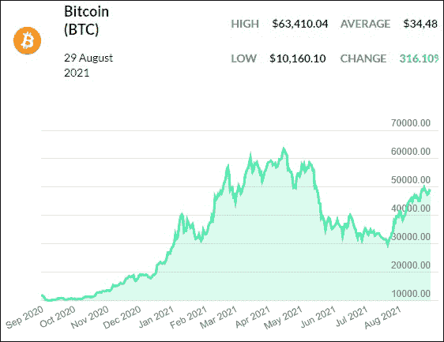

来自 [`https://coincap.io/assets/bitcoin`](https://coincap.io/assets/bitcoin)。 ¶ 图 1-1： 比特币价格图表。

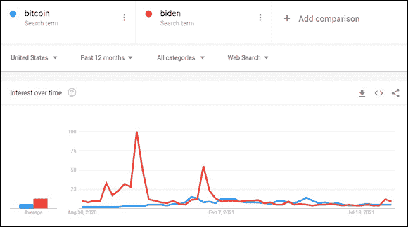

图 1-2： *比特币* 与 *拜登* 搜索量的谷歌趋势对比。

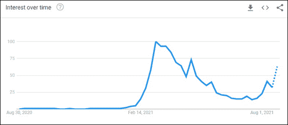

图 1-3： *NFT* 随时间搜索量的谷歌趋势对比。

## 从头开始：什么是非同质化商品？

正如您在购买本书之前可能已从朋友或谷歌搜索中了解到的，NFT 代表 *非同质化代币*。虽然代币本身是相对较新的发展，但将商品分为同质化和非同质化的概念并非新事物。

请想一想美元纸币、微软股票和比特币——每一种都代表一个定义明确的集合，其中集合内的项目是 *同质化* 的。简单来说，我们不在乎收到哪张美元纸币，只要数量正确即可，因为每张美元纸币履行的目的和义务都与其他纸币相同。

*非同质化商品* 也是我们生活中常见且更为普遍的一部分。杂货店的苹果、花店的兰花、即将到来的音乐会门票——我们会挑选水果和鲜花，挑选那些不那么枯萎或碰伤的。至于音乐会，每张票代表不同的座位，前排座位不会愉快地换成离得很远的座位。

就其本质而言，非同质化商品更难以系统地记录和追踪。首先，它们需要存储更多信息来标示其独特差异。虽然我们无法将世界数字化，但在许多场景中，我们将极大受益于一种可靠、透明且自动化的系统，该系统旨在对对我们重要的非同质化事物进行分组、组织和数字化追踪。NFT 由此登场！

 **非同质化代币（NFT）** 是一种受保护并存储在公共区块链上的唯一数字标识符。一个代币不能与另一个代币互换，也不能进一步分割。

NFT 实际代表的内容取决于开发者的意图。正如加密货币——或**同质化代币**——可以代表全球交换媒介（比特币）、用于为智能合约提供燃料的实用代币（以太币），或与基金份额挂钩的金融证券（BCAP）一样，NFT 在其当前和潜在用途上也各不相同。

尽管直到最近，大众对 NFT 的兴趣微乎其微甚至不存在，但开发社区多年来一直**同质化代币**活动频繁。继比特币（2009 年）、莱特币（2011 年）和狗狗币（2013 年）成功推出后，大量项目随之涌现，每个项目都衍生出自己的**同质化代币**。在这股加密浪潮中，开发者开始设想一个数字收藏品的世界——即比尼宝贝和棒球卡的加密版本。这些项目需要一种不同类型的代币标准，以确保每个加密宝贝或加密卡片的唯一性和不可分割性。

最终，随着**CryptoKitties** 的巨大成功，这是一种于 2017 年首次亮相的**以太坊**上的**非同质化代币**，**ERC-721 非同质化代币标准**随即出现，为开发社区提供了蓝图。（在第 2 章中阅读更多关于**CryptoKitties** 的内容。）从那时起，NFT 项目呈爆发式增长，仅在**以太坊**上就部署了超过 15,000 个 NFT。（参见图 1-4。）

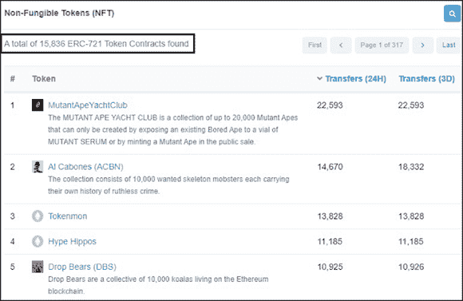

图 1-4： 活跃度最高的五个 NFT。

## 探索 NFT 的用例

NFT 领域仍处于起步阶段，但开发社区已经涌现出大量关于如何善用它们的想法。最自然的用例——目前主导市场的用例——是追踪数字收藏品。由此延伸，游戏道具和数字媒体也是自然的应用方向。然而，尽管 NFT 最近呈爆发式增长，目前的实现范围仍相当有限，主要集中在收藏品的变现上。该行业也受到“快速致富”心态的阻碍，这种心态困扰着整个加密领域，并吸引了许多不择手段的投机者。

尽管如此，我们仍看到 NFT 有一系列有趣的潜在用例。其中一些可能真正颠覆我们验证、追踪和分配独特及晦涩物品所有权的方式，或致力于有效实现内容创作和分发的民主化。想象一下，省去了验证稀有收藏品所有权历史的昂贵侦查工作。又或者想象一个世界，昂贵的 eBay 拍卖包含**以太坊区块链**上的所有权证明。目前关注点多集中在投机上，但这些令人兴奋的可能性带来的潜在价值，远远超过了宣称最新 NFT 百万富翁和 NFT 骗子的头条新闻。

加密货币世界也遭遇了类似广泛的反应，从深度怀疑到热情接受不一而足。但随着政府和主要金融机构开始接受**比特币**和**以太币**，底层技术的前景成为讨论的焦点。虽然 NFT 受益于其加密先行者（它们本身仍相当年轻）的铺垫，但我们需要更多时间来观察 NFT 生态系统将如何演变，以及它将催生出什么。

## 了解 NFT 的工作原理

人们经常将 NFT 本身与 NFT 所代表的内容混淆。*NFT* 是一份经过加密保护的数字记录，用于验证你对某件数字艺术品的所有权或访问权——这有点像你的车辆登记证书验证你对车辆的所有权。没有登记证书，你并不真正拥有你占有的汽车；没有相应的 NFT，你也不真正拥有你 JPEG 图片收藏中的**CryptoKitty**。

例如，考虑名为**Mutant Ape Yacht Club (MAYC)** 的加密收藏品。这一系列奇特的变异猿（它们可能属于游艇俱乐部，也可能不属于？）是 NFT 收藏家中的最新狂欢，现在是最活跃的 **ERC-721 代币**。（参见图 1-5。）但拥有特定的 **MAYC** 究竟意味着什么？

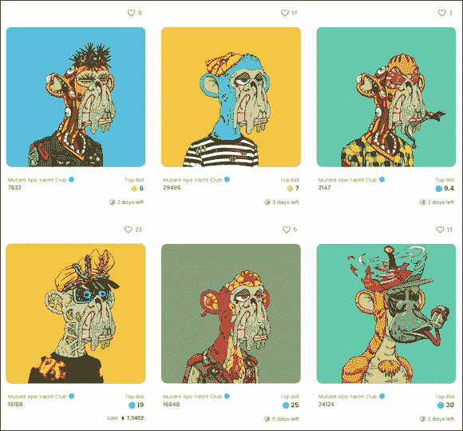

图 1-5： 在 OpenSea 上公开出售的 MAYC。

当在 **OpenSea**（你可以在第 4 章和第 12 章中发现的 NFT 市场之一）上浏览待售的 **MAYC** 时，你会注意到市场平台上展示了挑衅性的图形和特征。（参考图 1-5。）你看到的是每个 **MAYC** 的视觉呈现——但 NFT 本身是受保护在**以太坊区块链**上的唯一数字代码。

例如，考虑 图 1-5 左上角的 **MAYC #7632**。购买此 NFT 意味着你现在是 **TokenID 7632** 的合法记录所有者，该代币存储在**以太坊区块链**上合约账户 `0x60e4d786628fea6478f785a6d7e704777c86a7c6` 中。所有权的所有转让都将被记录在区块链上，以便始终可知 **MAYC #7632** 的来源及其当前的合法所有者，如图 1-6 所示。

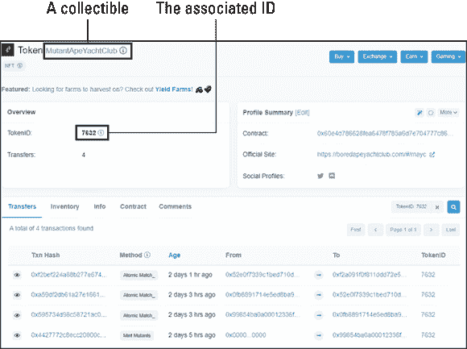

图 1-6： MAYC #7632。

截至撰写本文时，共有 14,688 个 **MAYC** 分布在 7,709 个持有者手中。你可以在 [`https://etherscan.io/token/0x60e4d786628fea6478f785a6d7e704777c86a7c6`](https://etherscan.io/token/0x60e4d786628fea6478f785a6d7e704777c86a7c6) 查看每个独特 **MAYC** 的个别详情和所有权。

 你购买的数字艺术品很容易复制。（按键盘上的 PrintScreen 键几乎不需要任何培训。）然而，因为 NFT 受保护在公共区块链上，非法转让、复制或以其他方式攻击它要困难得多。NFT 的美妙之处在于其底层技术——**智能合约**与验证者分布式网络的连接点——它允许你可靠且自动地验证谁真正拥有这 14,688 个变异猿 NFT 中的每一个。

因此，我们的变异猿是一个更大去中心化生态系统的一部分，记录以公开且无需信任的方式保存，这意味着我们不需要受信任的中心化方（如**美国银行**）来为我们维护一个可靠安全的系统来追踪我们的变异猿。以其独特的方式，这些变异猿进一步提高了人们对蓬勃发展的**去中心化金融（DeFi）**和**去中心化自治组织（DAO）**格局的认知。（要阅读更多关于 **DAO** 的内容，请查看第 4 章和第 6 章。）

大多数 NFT 作为 **ERC-721 代币** 在**以太坊**上铸造。因此，如图 1-6 所示，每个代币的来源都被记录在公共**以太坊区块链**上。每笔后续交易都由分布式矿工网络验证并执行——这与保护**比特币区块链**的系统非常相似。


因为 NFT 受到强大且经过测试的区块链保护（迄今为止，以太坊区块链从未被黑客攻破），新兴项目的开发者可以利用现有系统来保障正在开发的最新子经济体系中的所有权记录和奖励系统。不过我们提醒，虽然以太坊区块链本身尚未被攻破，但部署在以太坊上的个别智能合约却曾被攻破。因此，推荐的做法是使用经过验证的库，这些库提供预构建的智能合约，实现了由核心开发者社区审查并最终确定的开发标准。

我们承诺，在深入阅读本书第 3 部分的技术章节后，前面的段落会更容易理解。

## 购买 NFT

如果你想知道如何购买 NFT，应该知道这非常容易。现在有许多市场可以购买 NFT，`OpenSea` 只是其中之一。从第 2 章开始，我们将指导你如何设置钱包以持有 NFT 以及如何购买你的第一个 NFT。

如果你想了解更多细节，请跳转到第 4 章和第 5 章，它们将让你熟悉购买（和出售）NFT 的实际考量，并参阅第 12 章了解十个 NFT 市场的指南。

但在你跳转之前，我们想强调两个主要考量因素。

### 为什么要购买 NFT

首先，你应该购买 NFT 吗？也许。这取决于你的动机。

如果你计划实际*使用* NFT，那么是的——你应该购买它！例如，NFT 可能为你提供进入某个场所的资格，或赋予你在网站上发布特定数字媒体的合法权利。在这些情况下，购买 NFT 是你唯一合法的行动方案。

我们还建议出于教育甚至娱乐目的查看 NFT 市场。也许你只是想了解购买 NFT 的流程。或者，如果你从购买 NFT 开始，可能更有可能学习底层技术并探索更多用例。

在任何这些情况下，最大的问题是：“你花的钱是你会严重后悔失去的吗？”如果是，那你肯定不应该购买 NFT。

### NFT 作为投资

我们从传统投资管理原则的角度来看待投资。要点是你应该充分分散投资，并随时间重新平衡，以便在接近退休时承担更少的风险。

我们不提倡选股作为稳健的投资实践，也不提倡挑选 NFT 作为投资实践。但正如我们之前提到的，我们不反对留出一些你*不会介意损失*的钱来寻求一点乐趣。这种乐趣可能意味着去墨西哥旅行，在纳帕谷的法式洗衣房餐厅享用晚餐，或者购买变异猿 NFT。

当然，随着 NFT 资产类别的成熟，你会更好地了解各种 NFT 的风险回报权衡及其在充分分散的投资组合中的适当配置（如果有）。毕竟，随着比特币市值接近 1 万亿美元，我们都应该考虑在任何真正广泛分散的投资组合中分配一小部分给比特币。当然，这与将相对大量资金投入个别“投资”（无论是个股、NFT 还是比尼宝贝）以期一夜暴富截然不同。

## 开启你的 NFT 之旅

首先，我们希望本书能成为你了解这一新兴资产类别的愉快方式。除此之外，我们希望激发创造力，鼓励新的实现，并劝阻你不要屈服于想要一夜暴富的欲望。

祝你在选择下一章的旅程中收获满满。干杯！

# 第 2 章 拥有你自己的 NFT

## 本章内容

- 将 NFT 置于 `CryptoKitties` 的背景下
- 设置 `MetaMask` 钱包以进行购买
- 创建 `Coinbase` 账户以向钱包转账
- 在市场中买卖 NFT
- 通过繁殖 `CryptoKitties` 创建 NFT

在本章中，你将深入非同质化代币（NFT）令人兴奋的世界，这发生在 `Dapper Labs` 的 `CryptoKitty` 平台内。玩 `CryptoKitties` 可以帮助你深入了解 NFT 是如何创建和交易的。

我们将向你展示如何设置 NFT 钱包和交易所，以便你可以购买（最终创建和）出售你的第一个 NFT，并有信心探索 NFT 引入的新市场以及不断变化的商业模式。

`Dapper Labs` 正努力使其平台对所有人都易于访问，无论其技术背景如何。本章还将帮助你访问其他 NFT 市场，我们将在第 2 部分中介绍这些市场。

## 起源：非同质化小猫


NFT 的存在要归功于 `CryptoKitties`（[`www.cryptokitties.com`](http://www.cryptokitties.com)），这是一款由 `Dapper Labs` 于 2017 年秋季推出的新颖游戏。`Dapper Labs` 还创建了大热的 `Top Shot`，该平台允许用户购买他们最喜爱的 NBA 球员的 NFT。创始团队认为，大众不理解什么是加密货币，也不明白它为何重要，更不用说其技术如何运作了。同样，公众对区块链应用的认知依然狭隘，聚焦于一夜暴富骗局、暗网效用和新金融工具。创始团队希望改变市场上的这种短视认知，揭示其潜力和长期影响，而这些在最好的情况下也一直晦涩难懂。

## 面向大众的区块链

`CryptoKitties` 为大众提供了一个观察区块链的新视角。作为世界上最早的区块链游戏之一，`CryptoKitties` 可以利用使 `Bitcoin` 成为可能的所有相同区块链技术。`CryptoKitties` 不是数字货币；它是加密收藏品（一种独特的、非同质化的数字资产），并拥有与加密货币相同的安全性。

每个 `CryptoKitty`（见图 2-1）都是独一无二的，无法被复制、移除或销毁。玩游戏有时需要大量资源，但用户在娱乐中能深入了解加密货币和区块链的工作原理。（这款游戏有点让人上瘾，至少可以说是这样。）


图 2-1：在买卖可爱猫咪的过程中了解加密货币。

`CryptoKitties` 不仅向世界介绍了 NFT，还引入了能够创造自己 NFT 的 NFT。他们将区块链那些更难理解的特性——如对数字永久性的启示、以及无法伪造的数据可追溯来源——构建到了游戏机制中。

`Dapper Labs` 也了解早期区块链项目的局限性。许多区块链解决方案是在寻找问题，并不得不通过首次代币发行（`ICO`）这种加密货币的一次性筹款活动来融资。`CryptoKitties` 是 2017 年少数没有举办 `ICO` 的区块链项目之一。但它们太受欢迎了，以至于小猫的销售拥堵了它们的区块链，拖慢了其他用户的交易速度——这是 `Dapper Labs` 可能忽视的一个限制。

这些独特数字猫的销售，通过一种名为 `ERC-721` 的新代币进行保护，导致 `Ethereum` 陷入瘫痪。系统难以跟上对这些可爱小猫的需求。

以太坊是一种新型区块链，其设计包含内部编程语言，允许开发者构建区块链应用程序——这些应用能够利用分布式网络以及用于清算和结算交易的内置系统。代币是区块链的“杀手级应用”，让几乎任何人都能发行各种稀有数字物品——股权、货币、优惠券等。

`ERC-721` 在早期代币的基础上增加了功能，引入了一个开放标准，描述了如何在以太坊区块链上构建非同质化或唯一的代币。Kitties（加密猫）完美展示了区块链技术的功能与局限性，同时让这项技术变得有趣且平易近人。

这款游戏在全球范围内引起轰动，甚至登上了《纽约时报》《连线》《福布斯》《CNN Money》等主流媒体。看到这款古怪且设计精良的游戏永远改变区块链，令人着迷。

`CryptoKitty` 开发团队建立了一个可持续的基于收入的模式，使他们能在获取新用户的同时持续增长。在 `CryptoKitties` 出现之前，区块链在可持续商业模式方面举步维艰。通常，代币经济学与用户利益和市场需求不一致。`CryptoKitties` 向世界证明，区块链技术可用于任何事物——甚至是让你繁育数字猫咪的傻萌游戏。

## 不仅仅是昙花一现

曾认为加密游戏只是无聊千禧一代昙花一现的潮流的怀疑论者已被证明是错的。`CryptoKitties` 证明了只要拥有足够的代币经济学，任何事物都能在区块链之上创造价值，它让用户以一种引人入胜的方式接触区块链技术。代币经济学扎实，实用性显而易见。最重要的是，用户无需打开终端或懂得编程。他们只需玩游戏即可。

支持非同质化代币的分布式账本技术（我将在下一节详述此主题）有潜力成为信息时代最大的革命。其潜在应用远不止数字猫咪，尽管 NFT 正是从这里起步的。

## NFT 的影响

自 2009 年区块链诞生以来，它一直在颠覆众多行业。然而，区块链技术的总体概念，尤其是在大众消费者心中，仍超出了大多数人的理解范畴。（互联网在早期，对大多数人来说也似乎是一个不可思议的谜团。）

### 让区块链普及化

NFT 让区块链普及化，使其对各类人群变得易于获取且极具价值。NFT 将一种曾经昂贵且耗时的活动——出售收藏品——变得即时且可验证，这类似于电子邮件给寄信带来的范式转变，后者可能需要数天或数周才能送达。有了电子邮件，你可以瞬间向世界任何地方收发书面信息。NFT 对独特数字物品的所有权也是如此，未来或许有一天，它们还能代表有形资产。

区块链是驱动 NFT 的底层技术。（你可能听说过区块链，但可能不了解其诸多层面。）区块链是一种分布式账本系统，信息可在其中安全可靠地存储，且对该存储信息的任何修改均受严格规则管控。例如，单方无法在整个系统不知情的情况下更改数据。（你可能觉得这策略不吸引人，但在区块链出现前，数据由拥有记录“神一般权力”的管理员保管。）

NFT 的价值源于其作为可信溯源记录的属性。你可以在系统的区块链上高效且可验证地记录你与另一方之间的交易。你的 NFT 转让记录将成为一份不可篡改的共享记忆，分布在全球各地，并具备严格的内置问责功能。

### 代表所有权

NFT 可以代表各类物品的所有权，包括数字艺术品和游戏内元素，而不仅仅是数字猫咪。这些 NFT 通常在中心化交易所上用以太坊或比特币购买——这是一种促成交易的平台（如 NBA Top Shot）。

### 用户间交易

NFT 可以在点对点基础上交易，无需中介。在此模式下，交易直接在两人或两个群体之间进行，而非由一人（或一公司）作为中介来促成和监管所有交易。这意味着无需依赖 eBay 或 Amazon 等第三方从他人处购买商品；你只需用手机即可自行完成。

允许用户在无中介情况下自行交易的内部交易机制称为去中心化交易所（`DEX`），它们让你能独立于第三方出售资产——之所以流行，是因为中心化交易所易遭窃取。由公司运营的交易所要求系统由单方控制，这抵消了区块链的力量并将其反用于用户。若物品从公司交易所被盗，几乎不可能追回。

### 赋能智能合约

NFT 通过智能合约——运行在账本节点上、可访问 NFT 数据的计算机脚本——赋能去中心化交易所。例如，当你购买一只 `CryptoKitty` 时，你购买的是一件编码了所有权的独特数字艺术品，付款后所有权自动变更——全程无需第三方代理。该系统通过消除中介降低风险并加快交易。类似于我们前面提到的电子邮件示例，现在可以与世界上任何人即时交换所有权。

### 创造数字稀缺性

`CryptoKitties` 团队通过其数字收藏品解决了单一物品数字稀缺性的概念。没有两只相同的 `CryptoKitty`——每只都是独一无二的。数字商品并非新概念，已具有现实估值。例如，《魔兽世界》的金币农场利用 Steam 平台的在线市场，用户可在其 PC 视频游戏库中买卖游戏内物品。然而，这个局限于视频游戏的小众领域，缺乏区块链提供的特性。你能找到大量黑客攻击、作弊或开发者操纵生态系统的案例。

数字收藏品蕴藏巨大潜力，起始于数字猫咪，现已扩展至各类收藏品和艺术品。

### 解决问题

加入 NFT 元素改变了人们对数字收藏品的认知，这从人们对 `CryptoPunks` 等数字收藏品和其他 NFT 表现出的浓厚兴趣可见一斑。一位数字艺术爱好者为名为 *EVERYDAYS: THE FIRST 5000 DAYS* 的 NFT 支付了高达 6930 万美元。*Genesis* `CryptoKitty` NFT（现存最稀有者）以 246.926 枚以太币售出。

这些 NFT 的规模、范围和长期血统消除了与加密货币相关的恐惧，如下列表所示：

*   **中央发行机构问题：** 当数字收藏品被创建发行，且市场识别出最稀有或最受欢迎的收藏品时，没有任何东西能阻止创作者直接再创建更多。一旦发生这种情况，原始收藏品的价值就会贬损，甚至可能变得一文不值。

## 供应商依赖问题

数字收藏品的存在依赖于发行机构的存在。如果创建了一个数字收藏品，而最初的创作者不复存在，你的数字收藏品也将随之消失。另一方面，NFT 存在于会复制自身的分布式账本上。如果区块链的代币经济学与网络节点保持一致，你的 NFT 就是安全的。大多数 NFT 仅包含智能合约，在许多情况下，智能合约指向一个 `URL`（这是巨大的风险，因为托管方可能会关闭，或其端的内容可能发生变更）。图像可能太大，或者集成起来可能太繁琐。

## 数字收藏品的目的与功能

实体收藏品之所以流行，是因为其预期用途。例如，如果你收藏艺术品，它可能价值连城，并通过挂在墙上作为美丽和身份地位的物品而发挥作用。

借助区块链技术，这些问题已得到解决，这使得人们更愿意投资视频游戏小众领域之外的数字收藏品。如果 NFT 数字收藏品能像实体收藏品一样保值，一个全新的收藏世界将诞生。

### CryptoKitties 的游戏机制

`Dapper Labs` 的 `CryptoKitties` 是建立在以太坊区块链上的数字收藏猫。它们可以使用 `ether`（以太坊的原生加密货币）进行买卖。你可以繁育你的猫咪，创造出具有令人兴奋特征和不同可爱程度的新猫咪。

在 2017 年发布时，通过以太坊区块链上的智能合约创建了 50,000 只第 0 代猫，称为“时钟猫”（Gen 0 意味着它们是首批创建的猫）。作为存储在区块链上的程序，`smart contracts`（智能合约）具有预设条件，并将买卖双方的合同条款直接以代码形式编写。有关智能合约的更多信息，请参见第 9 章。时钟猫通过智能合约以每 15 分钟一只的速度自动分发。每只猫都通过拍卖出售。

每只 `CryptoKitty` 的外观都是独一无二的，拥有独特的特征。其表型由存储在智能合约中不可变的基因（基因型）决定。事实上，`CryptoKitties` 所有基本游戏机制都与智能合约挂钩。通过将区块链技术游戏化，`CryptoKitties` 团队使原本晦涩难懂的概念变得通俗易懂，并赋予用户区块链技术的基本流利度。现在你也有机会获得同样的知识。

通过赋予你繁育专属猫咪的能力，这些猫咪不仅仅是数字收藏品。它们变得个性化。请参阅后文“收集、繁育和出售你专属的非同质化（加密）猫咪”一节，了解更多关于这些有趣的数字猫咪的信息。`CryptoKitties` 团队还创建了一个自我维持的社区，用户可以在其中创建新的收藏品并在以太坊区块链上进行交易。

## 钱包里有什么？设置 MetaMask

`MetaMask` 是一款免费的浏览器扩展程序和智能手机应用，允许你与以太坊区块链进行交互。它让你能使用钱包密钥登录 `dApp` 网站，并从加密货币钱包发送和接收代币。要了解其他钱包并决定哪个最适合你，请参阅第 4 章。

要设置 `MetaMask` 钱包，请按以下步骤操作：

1.  **访问 MetaMask 网站** [`https://metamask.io`](https://metamask.io/)。

    你可以看到 `MetaMask` 提供的支持。它适用于 Chrome、Firefox、Brave 和 Edge 浏览器。撰写本文时，它不支持 Safari，但提供 iPhone 应用和 Android 应用。本例中我们使用 Chrome。

2.  **点击“立即下载”按钮，然后点击“为 Chrome 安装 MetaMask”。**

3.  **在 Chrome 网上应用店，点击“添加至 Chrome”。**

    当浏览器下载完 `MetaMask` 后，你会看到导入现有钱包或设置新 `MetaMask` 钱包的选项。

4.  **点击“添加新钱包”链接。**

    `MetaMask` 会请求发送一些数据给他们。这不会泄露你的身份，而是用于改进服务。如果你愿意，可以选择退出。

5.  **创建密码。**

    这只是 `MetaMask` 的密码。它不是钱包的恢复短语或私钥。密码是次要安全措施。

    你将被带到安全短语屏幕，系统会提示你记下恢复短语。**请勿**跳过此部分。

6.  **清晰地记下这些单词，并将纸张妥善保管。**

    你甚至可能想给纸张覆膜并存放在保险箱中。如果你丢失密码或设备，将需要恢复短语。

7.  **在下一屏幕上，确认恢复短语，以便 MetaMask 知道你已正确记下。**

    正确输入恢复短语后，你就可以进入 `MetaMask` 钱包了。

     `MetaMask` 团队一直在进行更新。请经常回来查看他们添加了什么新功能。

8.  **在你的钱包中导航至“设置”，点击“常规”选项卡以更改货币换算并选择主要货币。**

    这是对你 `MetaMask` 钱包中所有资产进行估值的方式。

9.  **选择语言。**

    如果你导航至“高级”部分，可以重置账户并清除全部交易记录。你还可以找到其他一些控制选项，包括高级 `Gas` 费控制。

10. **导航至主页，点击钱包右侧的三个点。**

     在那里你可以查看账户详情，包括你的以太坊地址。你需要以太坊地址来接收基于以太坊的代币。这就像用智能手机扫描二维码一样简单。如果你已经有加密货币交易所应用，可以跳过下面的“设置 Coinbase”部分。

 `cryptocurrency wallet`（加密货币钱包），如 `MetaMask` 等，允许你存储加密货币，如以太币 (`ETH`)。你需要使用 `exchange platform`（交易平台），如 `Coinbase.com`，将美元（或任何法定货币）兑换为加密货币，然后存储在你的钱包中。交易服务通常提供钱包，但你可以将任何钱包与任何交易所搭配使用。例如，`Coinbase Wallet` 是一款可与 `Coinbase.com` 账户配合使用的独立应用。但是，你不必拥有 `Coinbase.com` 账户即可使用 `Coinbase Wallet`，反之亦然。

## 设置 Coinbase

`Coinbase.com` 是一个流行的交易服务，允许你将银行账户连接到加密钱包，并从不断增长的资产列表中购买。

 你必须年满 18 岁并持有政府签发的带照片身份证件才能设置 `Coinbase`。护照卡不被接受。你还需要一台连接互联网的电脑或智能手机。`Coinbase` 会通过短信验证你的电话号码。

### 创建你的 Coinbase 账户

`Coinbase` 创建或维护账户不收取任何费用，但会收取交易费。请按以下步骤创建你的 `Coinbase` 账户：

1.  **从电脑浏览器访问** [`www.coinbase.com`](https://www.coinbase.com) **，或在 Android 或 iOS 手机上下载并打开 Coinbase 应用。**

2.  **点击或轻触“开始使用”。**

3.  **输入你的法定姓名、电子邮件地址和密码。**

    务必记下你的密码和为你生成的种子短语，并将两者都存放在安全的地方。`seed phrase`（种子短语）是一组随机单词，用于恢复你的钱包。可将其视为特殊密码。

4.  **提供你的居住州/省。**

5.  **勾选复选框，然后在电脑上点击“创建账户”，或在手机上轻触“注册”。**

    `Coinbase` 会向你的电子邮件地址发送一封验证邮件。

6.  **导航至该邮件并选择“Verify Email Address”（验证电子邮件地址）以验证您的 Coinbase 账户。**

    确保该邮件来自 `no-reply@coinbase.com`。

    您将被重定向回 `Coinbase.com`。

7.  **使用您最初创建的电子邮件和密码登录，以完成电子邮件验证流程。**

### 验证您的电话号码

创建 `Coinbase` 账户并验证电子邮件地址后，您还需要验证电话号码。只需遵循以下步骤：

1.  **登录 Coinbase。**

2.  **出现提示时，选择您的国家/地区并添加手机号码。**

3.  **在电脑上点击“Send Code”（发送代码）弹窗，或在手机上点击“Continue”（继续）。**

4.  **输入 Coinbase 发送到您手机号码的 7 位数代码，然后点击“Submit”（提交，在电脑上）或“Continue”（继续，在手机上）。**

### 添加您的个人信息

您需要添加您有效政府颁发的带照片身份证件上显示的信息，因此在完成这些步骤时请准备好证件：

1.  **留在您的 Coinbase 应用中。**

    验证完电话号码后，`Coinbase` 会要求您提交身份证照片。

2.  **输入您的名、姓、出生日期和地址，并回答以下问题：**

    *   您使用 Coinbase 的用途是什么？
    *   您的资金来源是什么？
    *   您目前的职业是什么？
    *   您的雇主是谁？
    *   您的社会安全号码 (`SSN`) 最后四位数字是多少？

3.  **点击“Continue”（继续）以完成流程。**

此步骤完成了申请流程。您需要等待，直到收到进一步的电子邮件说明以了解您的账户已获批准。届时，您可以完成下一节的内容。

### 验证您的身份并添加银行账户

当您收到上一节提到的额外说明时，请执行以下操作：

1.  **登录您的 Coinbase 账户。**

2.  **完成身份验证流程。**

 设置双重验证，例如基于时间的一次性密码 (`TOTP`)，以帮助防止未经授权的账户访问。Google 提供了一个名为 `Authenticator` 的应用，您可以在 Apple App Store 或 Google Play Store 中找到它。

### 向您的钱包添加资金

如果您尚未这样做，请向您的 `MetaMask` 钱包发送一些 `ETH`。只需登录您的钱包并遵循以下步骤：

1.  **在钱包的主页上，点击“Buy”（购买）按钮。**

    从那里，您可以选择通过您已有的钱包添加代币，或使用 `Wyre`。

2.  **选择“Directly Deposit Ether”（直接存入以太币）并复制您的 MetaMask 钱包地址。**


### 3. 返回您的 Coinbase 钱包并使用它向自己发送足够的 ETH，以购买一只 CryptoKitty 并支付交易手续费。

 处理您购买的价格每天都在变化 —— 在处理交易前请查看手续费。

### 4. 资金到达您的 MetaMask 钱包后，您可以导航回 *CryptoKitties* 网站 [`www.cryptokitties.com`](http://www.cryptokitties.com) 以购买您的第一只小猫。

如果您在设置钱包或交易所应用方面需要更多帮助，请查看 Tiana Laurence 编写的《区块链入门》（第 2 版）或 Michael G. Solomon 编写的《以太坊入门》。这两本书都更详细地涵盖了这一主题。

## 收集、繁育和出售您专属的非同质化（加密）小猫

*CryptoKitties* 游戏有四大核心功能：购买、繁育、出借繁育和交易。购买是一个简单的过程，您只需购买一只数字猫的 NFT。

一旦您拥有了这只猫的 NFT，您就可以通过繁育您自己的 CryptoKitty 来创建一个新的 NFT。您还可以将您的 CryptoKitty 出借作为“种猫”供其他想要繁育其 CryptoKitties 的用户使用。“出价”功能允许用户对未上架出售的猫咪进行竞价，并且您可以与任何愿意进行交易的人用一只猫交换另一只猫。

### 购买您的第一只 CryptoKitty

购买功能非常简单。在您设置好 MetaMask 后（请参阅前面章节“钱包里有什么？设置 MetaMask”中的步骤），您就可以前往市场为自己找一只可爱的小猫。

您可以先在 *CryptoKitties* 市场上浏览寻找一些 CryptoKitties。它们不是免费的（除非有人送您一只，这种交易仍然要求您拥有一个钱包），价格可能在 3 美元到 100,000 美元之间 —— 但您需要使用钱包中的 ETH 来支付。

要寻找并购买一只 CryptoKitty，请遵循以下步骤：

1.  **导航至** [`www.cryptokitties.co/search`](https://www.cryptokitties.co/search)。

2.  **浏览页面上的小猫，在顶部输入搜索词，或选择 Kitty Type（猫咪类型）、Generation（代数）和 Cooldown（冷却时间）。**

3.  **点击底部的“Next”（下一页）以查看更多页面的小猫。**

4.  **当您找到想购买的小猫时，点击“Buy Now”（立即购买）按钮。**

    将打开一个新页面。

5.  **双击您即将购买的小猫。**

6.  **如果一切看起来都没问题，点击“OK, Buy This Kitty”（好的，购买这只小猫）按钮。**

    您将看到一个 Dapper Labs 交易窗口。如果您没有钱包，它会提示您在 [`www.meetdapper.com`](https://www.meetdapper.com/) 设置一个。如果您决定不使用 MetaMask 钱包，请按照 Dapper Labs 页面上的说明操作，然后返回订购您的小猫。

7.  **点击“Submit”（提交）按钮购买小猫。**

    购买小猫后，可能需要几分钟才会显示在您的个人资料上。以太坊区块链需要记录交易并使用您的新所有权转让更新区块链，这完全取决于以太坊网络。

### 使用“出价”功能

出价是购买猫咪的另一种方式。使用游戏的出价系统，玩家可以对任何未上架出售的小猫出以太币 (ETH) 价。出价后，所有者有三天时间接受或拒绝，之后出价将过期。

### 繁育您的小猫

在 *CryptoKitties* 中，您可以通过繁育产生一只新猫，它是其父母基因的组合。如果您打算繁育一只您想购买的猫，请务必查看其谱系。结果是未知的，CryptoKitty 独特而稀有的基因构成可能性是无限的。每只猫都有独特的可见 *Cattributes*（猫属性），但某些特征可以通过繁育解锁。了解繁育猫咪的 Cattributes 可以帮助您确定繁育的可能结果。

在每对繁育组合中，一只猫充当种猫，繁育后将有一个恢复期才能再次繁育。第二只猫，即母猫，会孵化小猫，在此期间它无法参与另一次配对。您可以通过两种方式繁育您的小猫：

*   繁育您自己的两只猫。
*   将您的一只猫与公共种猫或母猫繁育。如果您的猫是种猫，您将获得母猫主人支付的费用。

 繁育涉及费用，即使您繁育的是自己的两只猫：撰写时为 0.015 ETH，但这会随市场条件变化。

虽然一只 CryptoKitty 可以繁育任意次数，但恢复期和孵育期会随着交配次数增加而变长，因此请注意繁育时间（在您小猫图片下方时钟图标旁边）。您准备繁育的猫被用于繁育的次数越多，产生后代的速度就越慢。

繁育两只相同代数的小猫。它们产生的小猫将获得一个代数编号，该编号为父母双方最高代数加一。例如，如果您繁育一只 4 代小猫和一只 5 代小猫，您将得到一只 6 代猫。另一方面，如果您繁育两只 10 代猫，您将得到一只 11 代猫。

# 第 3 章：NFT 的未来

## 本章内容

 **考察 Beeple 的 6900 万美元 NFT**

 **定义现代世界中的所有权和所有权转让**

## 探索 NFT 的重要用例

如果你恰好是按章节顺序阅读本书，那么到现在为止，你应该已经对 NFT 是什么有了一定了解（定义见第 1 章），甚至可能已经购买了一个（操作方法见第 2 章）。但在 `CryptoKitties` 的可爱形象与 6900 万美元 NFT 的光鲜亮丽之间，NFT 的实际本质很容易被遗忘。`非同质化代币（NFT）` 仅仅是一段经过加密保护的数字代码，用于验证非同质化（即独一无二）物品的所有权。

本章涵盖 NFT 的未来潜力以及 NFT 对财产权可能意味着什么。然而，在深入这些主题之前，我们先带你深入了解那枚在佳士得拍卖行以 69,346,250 美元成交的臭名昭著的 NFT，透过现象看本质，剖析这枚天价 NFT 的实际内部运作机制。如果这枚 Beeple NFT 不是艺术品本身，那它究竟是什么？

## 剖析一枚 6900 万美元 NFT 的解剖结构

艺术家 Beeple 以每天创作一幅新的数字艺术品、持续 5000 天的承诺，开启了其 `EVERYDAYS` 系列。那幅著名的作品 `EVERYDAYS — THE FIRST 5000 DAYS` 标志着这段艺术旅程的终点，旅程始于 2007 年 5 月，终于 2021 年 2 月 16 日对应 NFT 的铸造。最终的 `EVERYDAYS` 作品本身如图 3-1 所示，但 Beeple 到底在出售什么？

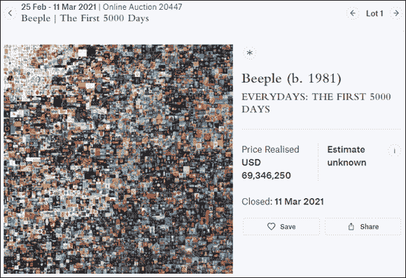

图 3-1： Beeple 的著名数字艺术品，`EVERYDAYS — THE FIRST 5000 DAYS`。

由于数字图像是像素值的矩阵，Beeple 将其约 300 兆字节的创作浓缩为图形机器级表示的数字浓缩形式（称为 `哈希码`）。然后，该哈希码连同附加元数据再次进行哈希处理，并作为 Beeple NFT 元数据的一部分存储，同时存储的还有 tokenURI `ipfs://ipfs/QmPAg1mjxcEQPPtqsLoEcauVedaeMH81WXDPvPx3VC5zUz`，它提供了一条路线图，可在 IPFS 点对点网络上找到 Beeple 的 `EVERYDAYS — THE FIRST 5000 DAYS` 数字艺术品。就这样，Beeple 的数字艺术被传播开来，`token ID 49013`（在智能合约地址：`0x2a46f2ffd99e19a89476e2f62270e0a35bbf0756` 中）诞生了！（有关 IPFS 网络的更多信息，请参阅附近的侧边栏“深入暗网”。）

这些细节出现在 Beeple 铸造其 6900 万美元 NFT 的交易事件日志中，如图 3-2 所示。该 NFT 的相应识别详情在佳士得拍卖网站上，如图 3-3 所示。（如果你好奇，可在此查看完整交易详情：[`https://etherscan.io/tx/0x84760768c527794ede901f97973385bfc1bf2e297f7ed16f523f75412ae772b3`](https://etherscan.io/tx/0x84760768c527794ede901f97973385bfc1bf2e297f7ed16f523f75412ae772b3)。）

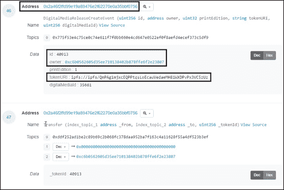

图 3-2： 创建 Beeple NFT 的交易事件日志摘录。

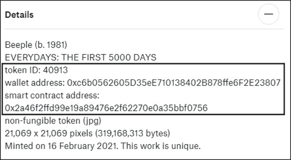

图 3-3： 佳士得在线拍卖网站上的 Beeple NFT 详情。

最终，拍卖赢家实际上购买了什么？在该特定案例中，该 NFT 并不赋予数字艺术品的独家合法访问权（该数字艺术品本身已作为公共产品自由分发）；也不代表其使用产生的版税收入索赔权。我们拥有的是一段令人难以置信的金融科技（FinTech）历史 —— 我们拥有一条去中介化且安全的所有权记录，永久铭刻在以太坊区块链上，现在我们可以可靠地追溯这一独特数字物品的历史，以验证当前是谁拥有它，以及过去是谁拥有过它。

通过让大众认知这项充满希望的技术，Beeple 和他的最高出价者为 NFT 的未来奠定了基础。你可以在第 13 章中阅读更多关于 `THE FIRST 5000 DAYS` 的内容，以及其他九个以惊人价格售出的 NFT（包括 Beeple 的另外两幅作品）。

## 重新定义财产权（NFT 不仅仅关乎数字艺术和猫咪！）

追踪 `CryptoKitties`（或 Beeple 的 NFT）的所有权和血统，仅仅是 NFT 所能实现的冰山一角。运行良好的市场需要定义清晰且可强制执行的财产权。人们往往理所当然地依赖扮演这一重要角色的可信中介 —— 例如，他们依赖县书记官维护房产所有权记录，信任车管所（DMV）维护车辆所有权记录。如今，NFT 提供了一种去中介化的方式来永久记录交易并验证所有权。

NFT 的意义不仅在于其在区块链上加密安全的地位，Beeple NFT 便是一例。在现代，转移所有权意味着转移使用特定资产的合法权利，无论是汽车、房屋还是数字图像。（“拾得者拥有”并非针对汽车盗窃指控的合法抗辩理由。）这一框架与 NFT 完美契合，NFT 可被创建用于合法地代表所有权证书、契据或许可证。

总体而言，NFT 有潜力在无需可信第三方验证交易完整性的前提下，可靠地追踪点对点的所有权记录转移。其即时追踪和验证每件独特物品所有权的能力，使其特别适合颠覆那些独特物品溯源验证机制失效或不足的市场。

## NFT 与数字财产

追踪数字财产是 NFT 的自然切入点。从数字收藏品到游戏道具和数字媒体，NFT 有潜力真正实现创作者经济的民主化。

### 音乐、电影和书籍

直到最近，消费者必须拥有音乐才能随点随听。从唱片到磁带，从 CD 到 mp3，拥有物理或数字媒体被视为理所当然的现状。

尽管数字音乐很方便，但购买和出售实体媒体让人感到踏实 —— 艺术家知道同一时间只能播放一个实例，一旦转手，消费者就不再拥有访问权。因此，首售原则得以确立，规定购买者无需作品版权持有者许可即可转售实体副本。

现在，拥有音乐似乎已成往事 —— 流媒体服务远超音乐的购买和下载。考虑到数字副本质量不退化，美国版权局一直不愿将首售原则应用于数字传输，这种情况顺理成章。任何人都可以轻松出售购买的数字音乐，同时在个人设备上保留副本。

如果数字媒体的真实所有权和访问权得到确立且易于验证，数字领域的销售和转让应与物理领域无异。因此，NFT 可在数字时代带回“拥有媒体”（以及首售原则！）的概念，不仅适用于音乐，还适用于电影和书籍。

### 照片和其他数字艺术

数字图像市场也为 NFT 提供了天然的栖息地，NFT 可用于可靠地证明对特定数字照片或艺术品的合法权利。想象一下，在你拥有的数字图像旁创建一个 NFT（该图像的元数据中可包含 NFT 的识别信息），以记录其合法所有者和授权用户。对于通常作为 Shutterstock 和 Getty Images 贡献者的数字艺术家和摄影师而言，潜在的经济优势巨大。

随着图像搜索引擎准确度的提高（参见图 3-4），内容创作者可以自动化地定位并交叉核对其数字内容的未授权用户，而授权用户则可以通过使用相应的 NFT 和图像元数据来验证其合法权利。


图 3-4： Google 图片搜索示例。

公众人物也可以利用 NFT 来缓解 `deepfake`（利用深度学习技术添加或替换人物肖像的视频或图像）的制作。设想一下奥巴马 NFT，每一份合法的奥巴马数字媒体作品都会创建一个新代币。消费者可以通过将图像、音频文件或视频的哈希值与不同的奥巴马媒体代币进行核对，来验证其是否被篡改。当然，在一个基于信任的国家，你可以依赖中央权威机构发布有效媒体哈希列表。但在动荡的政权下，一个不可篡改且去中介化的有效内容哈希记录，对于确保公众所见即所信至关重要。

### 游戏资产

随着 `EverQuest` 和 `League of Legends` 等在线角色扮演游戏的流行，游戏内的资产开始从渴望更快积累游戏财富、或通过炫耀独特游戏物品来获取地位的玩家手中赚取真金白银。

玩家在 eBay 或 PlayerAuctions 等市场上挂售资产（参见图 3-5），承诺收到款项后在游戏内转移资产（这一过程固有风险）。NFT 提供了一种自然的方式，可靠地代表游戏资产和虚拟形象的所有权，并通过智能合约促成自动的点对点转移。想象一个游戏世界，资产的所有权和交易真正实现了民主化——资深玩家保留更大比例的销售收入，新手玩家以更低成本购买游戏声望，点对点交易即时完成且几乎零风险。

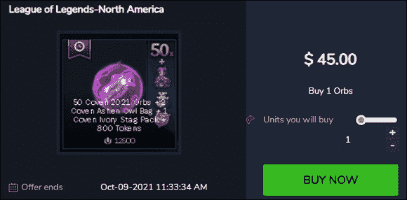

图 3-5： PlayerAuctions 上出售的 `League of Legends` 游戏内资产。

## NFT 与实物资产

现实世界中的许多场景也将极大地受益于一种可靠、透明且自动化的系统，该系统旨在对非同质化商品进行分组、组织和数字化追踪。

### 房屋、汽车和非数字宠物

想象一个世界，房屋的所有权和销售记录在公共区块链上，从而消除了对权属保险和托管服务的需求。

还想象一下用非同质化代币取代汽车所有权证书。正如图 3-6 所示，你无需花费 39.99 美元在 CARFAX 上购买车辆历史报告，只需查阅开源区块链即可追溯特定车辆的来源。你将能免费（或仅需支付少量交易费）查看所有权变更、事故时间线、维修记录和跨州记录。

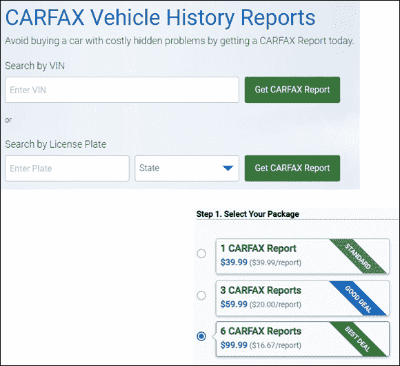

图 3-6： CARFAX 界面和定价方案。

当然，`CryptoKitties` 为追踪非数字宠物的所有权和血统提供了可靠的测试案例。相比之下，如图 3-7 所示，美国养犬俱乐部（AKC）认证的血统证明售价 36 美元，且仅提供（最多）四代祖先信息。

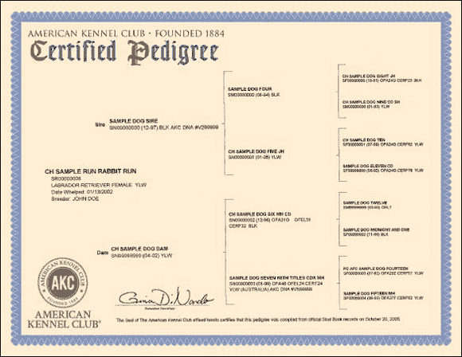

图 3-7： AKC 血统证明书。

### 艺术品、珠宝、葡萄酒和其他收藏品

名酒、高级珠宝和其他杰作——这些难得一见的昂贵物品充斥着欺诈行为。Rudy Kurniawan 臭名昭著地售出了数百万美元的假酒，将廉价混酿冒充为罗曼尼·康帝（Domaine de la Romanée-Conti）和木桐酒庄（Château Mouton Rothschild）等名庄的佳酿。

 虽然 NFT 无法检测或解决造假问题，但专家鉴定结合物品全程来源的可靠记录，能提供保障——如果这能让人宽慰的话，原始藏品仅可能发生一次造假销售。

## 畅想可能性

从出租车牌照到音乐会门票，任何独特且可转让的权利都适合建立去中介化的点对点市场。将区块链和原生代币的概念引入既有理念和实践中，在去中心化金融（`de`centralized `fi`nance，即 DeFi）领域催生了极具价值和意义的颠覆性创新（如 Uniswap、Chainlink 和 Compound），足以掩盖那些毫无意义的改名炒作和笑料。（还有人记得 Long Blockchain 吗？）

 如果你有兴趣深入了解这些 DeFi 颠覆性创新，请访问以下网站：

*   **Uniswap（去中心化交易所）：** [`https://uniswap.org/about`](https://uniswap.org/about/)
*   **Chainlink（去中心化预言机）：** [`https://blog.chain.link`](https://blog.chain.link)
*   **Compound（去中心化借贷池）：** [`https://compound.finance`](https://compound.finance)

总的来说，可能性是巨大的。未来还会有什么被 `NFT 化` 呢？

# 第 2 部分：NFT 的买卖

本部分内容……

*   探索购买第一个 NFT 的方方面面。
*   发掘最热门的 NFT 买卖市场。
*   从零开始免费创建你自己的 NFT。
*   探索在顶级 NFT 市场上挂单出售你的 NFT。
*   构建你自己的 NFT 投资策略。
*   为你的 NFT 投资制定税务计划。

# 第 4 章：入局 NFT 游戏

## 本章内容

 **设置你的热钱包**


 **保护钱包防盗**

 **创作原创数字艺术品**

 **免费创建你自己的 NFT**

 **拍卖你的 NFT 收藏**

本章将助你自信地探索非同质化代币世界，以便你在互联网上最热门的几个平台上买入、创建和出售 NFT。NFT 允许创建新型数字资产，赋能创作者。艺术家和收藏家钟爱 NFT，因为它们拥有特定属性，使其无法被伪造。NFT 使创建数字收藏卡和其他新型数字资产成为可能。

在本章中，你将深入了解 `MetaMask` 热钱包，学习如何保护钱包安全，以及如何浏览和使用包括 `OpenSea`、`Nifty Gateway` 和 `Rarible` 在内的多个最热门 NFT 市场。你还将从零开始免费创建并挂单你的第一个 NFT。最后，你将了解 NFT 作为一种投资形式，以及在未来几年里利用非同质化代币的最佳方式。

## 了解购买 NFT 的方方面面

`NFT`，即 `non-fungible token`（非同质化代币），是资产从一个人转移到另一个人的数字表示——它通常代表一个独特的数字物品。这项新兴技术已被在线游戏公司采用，并可能很快成为收藏品的标准。

## 非同质化代币不同于其他形式的数字内容

非同质化代币不同于其他形式的数字内容。它们拥有由区块链支持的证书，声明照片、视频或其他在线媒体形式的所有权归属。每个代币都是独一无二的，并作为收藏品发挥作用，这意味着它无法被复制——从设计上使其稀缺。自 2020 年以来，非同质化代币变得极其流行，昂贵的艺术品现在正以这种方式出售。

## 审视早期 NFT 的成功

最早的非同质化代币之一是 `CryptoKitties` 游戏中的数字收藏猫咪，我们将在 **第 2 章** 中更详细地介绍。`CryptoKitties` 是以太坊网络上的一个区块链游戏，由加拿大工作室 Dapper Labs 开发。它开创了 `ERC-721` 代币标准，允许玩家购买、收藏、繁育和出售独特的虚拟猫咪。

自推出以来，`ERC-721` 代币标准不断扩展，并被用于促进各类数字媒体的交易。

### NBA 的 Top Shot

非同质化代币的主流流行与美国国家篮球协会 (NBA) 推出 Top Shot 网站有关。该网站允许用户购买或交易他们喜爱的 NBA 球员的 NFT。NBA 球迷热情高涨——Top Shot 推出五个月后，已拥有超过 100,000 名买家，销售额近 2.5 亿美元。这些交易大多数在其点对点市场进行，每笔销售的版税归 NBA 所有。

勒布朗·詹姆斯的扣篮，篮球史上最具标志性的时刻之一，被制成 NFT 并以 20 万美元售出。球迷们喜欢购买 NBA 纪念品，以铭记他们生命中重要的球员和比赛。NFT 以一种全新的方式利用了这种热爱。

### 音乐艺术家

NFT 也已扩展至音乐行业。备受瞩目多年的艺术家 Grimes 在 `Nifty Gateway` 网站上以 600 万美元售出了一系列十件作品。售价最高的是独一无二的音乐视频“旧世界的终结”，拍卖价达 388,938 美元。Grimes 还以每个 NFT 7,500 美元的价格售出了数百个名为“地球”和“火星”的短音乐视频版本。

### 网络迷因

Nyan Cat 网络迷因只是被制成 NFT 的著名迷因之一。如果你不记得这个特定的迷因，它基于 2011 年的一个 YouTube 视频。动画展示了一只肚子是烤馅饼的猫飞越太空，身后拖着彩虹轨迹，配以一首日本流行歌曲。在一场 24 小时的拍卖中，创作者 Chris Torres 以 59 万美元售出了他重制的 Nyan Cat 周年纪念版。

### 不寻常的 NFT

不一定符合艺术形式的物品也被制成了非同质化代币。例如，你可能不认为推文是艺术。然而，Twitter 创始人兼 CEO Jack Dorsey 以 290 万美元将他的第一条推文作为 NFT 售出。该推文（发布于 2006 年 3 月 21 日）内容为“just setting up my twttr”。购买者、富商 Sina Estavi 将购买第一条推文比作购买 `Mona Lisa`（蒙娜丽莎）画作。艺术与美感确实在于观察者的眼中。

## 将 NFT 视为一种投资

与所有投资一样，你需要运用自己的最佳判断来确定你购买的 NFT 艺术品的价值。

 我们不是财务顾问，这不构成投资建议。

NFT 可以通过主观和客观的方式进行估值。在本节中，我们整理了几个与有价值的 NFT `drop`（借用自音乐行业的术语，意为“发布/发行”）相关的注意事项。

 NFT 是一种新型数字资产，其市场特征将在未来几年继续发展。简而言之，始终运用你的最佳判断，购买你真心喜爱的物品，永远不要投资你承担不起损失的资金。祝你寻宝愉快！

### 艺术家知名度

发行前艺术家的知名度是价值最大的决定因素。如果你听说过这个名字，其他人也有可能听说过，并可能想拥有该艺术家创作的数字艺术品。

`CryptoPunks` 在一定程度上削弱了这一观点，因为没人会声称它们在 NFT 之前有任何知名度。NFT 收藏家在 `OpenSea` 或 `Rarible` 等市场上以数千美元的以太币 (ETH) 出售它们。`CryptoPunks` 的活跃交易创造了价格底线，并能让你很好地了解市场在任何特定时刻如何确定其价值。

`CryptoPunks` 也是一个早期的 NFT 项目。NFT 可以因年代久远和稀有而增值。许多 2017 年的 NFT，如 `CryptoKitties` 和 `CryptoPunks`，在拍卖会上拍出了令人印象深刻的高价。

### 区块链安全性

每当有人谈论 NFT 时，安全性问题总会被提及。NFT 之所以获得追踪功能，正是因为它们声称不可篡改且防欺诈。它们还允许你拥有主权，无需依赖单一中心化方来维护其存在和安全性。（这就是区块链的作用。）以太坊已成为保护 NFT 较流行的网络之一，因为它是创建和保护 NFT 最古老、最安全的方式之一。在评估 NFT 的区块链时，你需要考虑该区块链的去中心化程度，并判断该区块链是否有持久力——换句话说，它是否能在未来保持其流行度。

 并非所有 NFT 都完全在链上。在链上意味着用于渲染数字艺术的数据存储在区块链上。因为在去中心化的工作量证明网络上数据存储成本高昂，艺术家通常会将 NFT 记录引用的图像存储在 `AWS` 等第三方云服务上。少数 NFT，如 `Avastars`、`Aavegotchis` 和 `Art Blocks` 的发行，完全托管在以太坊上。

 链下 NFT 是一种代表所有权但不保护数字艺术的代币。如果 NFT 在链上，那么该代币所代表的底层艺术品就拥有了分布式数据结构固有的冗余性。

## 了解 MetaMask 等热钱包的风险

`MetaMask` 是一个 `hot wallet`（热钱包），一种连接互联网的工具，使你能够存储、接收和发送 `ETH` 及其他代币。所有基于网页的钱包都是热钱包，是所有加密货币钱包中最不安全的。相比之下，`cold wallet`（冷钱包，有时称为 `hardware wallet` 硬件钱包或 `offline wallet` 离线钱包）不连接互联网。鉴于 `MetaMask` 是热钱包，它不是存储价值的安全方式。仅将其用于你立即执行的小额交易。

截至撰写本文时，`MetaMask` 未遭受重大黑客攻击。`MetaMask` 是一个 `hierarchical deterministic wallet`（分层确定性钱包，HD 钱包），可自动生成私钥和公钥地址的分层树状结构以备份你的钱包。这样你就无需手动生成这些密钥对进行备份。`MetaMask` 还拥有活跃的开发者社区，定期更新其代码库。使用 `MetaMask` 面临的主要风险来自 `phishing`（网络钓鱼）攻击，骗子会发送欺诈信息诱骗你透露密码和用户名。

 网络钓鱼攻击很常见，你的钱包密码和恢复短语是攻击目标。在 **任何** 情况下，切勿让任何人获取你的密码或助记词。你可以通过严格避免打开以下项目来防止网络钓鱼攻击：

*   弹窗广告
*   可疑邮件
*   可疑广告或邮件中的链接

`MetaMask` 还允许你管理你的在线身份。当 dApp 想要运行交易并写入以太坊区块链时，`MetaMask` 充当你的安全界面。

 话虽如此，`MetaMask` 钱包的安全性不足以存放大额资金。我的经验法则是：存放的金额相当于你愿意放在自己钱包或手提包里的现金数额。如果你需要存储更多代币，请考虑使用硬件钱包，例如 `Trezor` 或 `Ledger` 硬件钱包。此外，请直接从制造商处购买硬件钱包。近期曾发生过一些亚马逊诈骗案例，设备在发货给买家前已被植入后门。

## 对比热钱包

`MetaMask` 并非唯一的热钱包。我们选择在全书中使用它，是因为它经过多年的开发和测试。还有许多其他钱包值得你探索，例如 `Exodus` 和 `Jaxx`。它们免费且同样好用。

## 权衡热钱包的优缺点

`MetaMask` 这一实用的发明让你无需运行完整的区块链节点即可使用以太坊区块链。（运行完整的区块链节点工作量巨大，且会占用硬盘的大量空间。）对于刚开始接触区块链和 NFT 的新手来说，`MetaMask` 非常有帮助。

以下列表重点介绍了 `MetaMask` 的优点：

*   **开源：** 它是不断更新的开源软件。为 `MetaMask` 做出贡献的庞大开发社区持续改进软件，使其更易用、更安全。
*   **设置：** `MetaMask` 使用分层确定性设置，允许你备份钱包。
*   **集成：** 它已与其他实用应用集成，如 `ShapeShift` 和 `Coinbase`，这些都是加密货币交易和管理平台。我们将在 **第 2 章** 介绍 `Coinbase`。

以下是缺点：

*   **安全性不足：** 与所有热钱包一样，`MetaMask` 永远无法做到完全安全。
*   **对你的信息有限访问权限：** `MetaMask` 确实拥有对你信息的有限访问权限，这让一些人感到不安。

自 2016 年产品发布以来，`MetaMask` 团队已经走了很长一段路，他们的工作使得访问以太坊区块链变得简单、可靠且安全。

 `MetaMask` 最大的问题也是它如此好用的原因：它是一个基于网页的钱包。它永远不会像硬件钱包或纸钱包那样安全。

 当你向浏览器添加 `MetaMask` 时，系统会要求你通过批准一条消息来更新设置，消息内容大致如下：“读取并更改您访问的网站上的所有数据。”分布式应用（或 dApps），如你稍后在本章中将访问的 NFT 网站，需要访问区块链。`MetaMask` 需要向每个页面注入 `web3 JavaScript`。这不会更改网站，但允许你同时访问网站和区块链。

## 揭秘你的 MetaMask 钱包

`MetaMask` 是一款流行的加密钱包，你可以将其安装在多种主流浏览器中。在本节中，我们将向你展示如何设置新钱包、防范盗窃以及为其添加资金。

`MetaMask` 的创建者希望打造一款既易用又安全的钱包。此外，他们希望该钱包能让新用户与 `Web 3.0` 网站（如 `OpenSea`）进行交互。（我们将在本章后面更详细地讨论 `OpenSea`。）你可以将 `Web 3.0` 视为让互联网变得更智能、更互联的持续努力，而 `MetaMask` 是你通往这个新网络的界面。

`MetaMask` 处理账户管理并将用户连接到以太坊区块链。作为以太币和 `ERC20` 代币的钱包，`MetaMask` 允许你通过网页浏览器管理以太坊私钥。它还允许用户登录集成了 `MetaMask` 的网站。这非常酷，因为它使你能够在喜爱的浏览器中运行以太坊 dApps，而无需运行完整的以太坊节点。在 `MetaMask` 出现之前，你需要在设备上下载并同步完整的区块链，这对于普通人来说是一项难得多的任务。

### 安装 MetaMask

开始使用 `MetaMask` *很简单。* 在本节中，我们将展示通过以下三款热门浏览器安装 `MetaMask` 的说明：Chrome、Firefox 和（Tiana 个人最爱的）Brave。

 如果你不使用这些浏览器但想尝试，我们建议从其官方网站下载 Brave，网址为 [`https://brave.com`](https://brave.com)。

#### Chrome 版 MetaMask

要下载 Chrome 版 `MetaMask`，请打开 Chrome 并按以下步骤操作：

1.  **访问** [`https://metamask.io`](https://metamask.io/)**。**
2.  **点击“立即下载”按钮。**
    你将被跳转到 Chrome 网上应用店。
3.  **在 Chrome 网上应用店的 MetaMask 页面上，点击“添加至 Chrome”。**
4.  **在出现的弹出菜单中，选择“添加扩展程序”。**

基本就这些了。浏览器右上角会出现一个小的 Chrome 图标。你只需点击该图标即可打开 `MetaMask`。跳至后面的“保护 Chrome 和 Firefox 版 MetaMask 钱包”部分，查看如何保护你的钱包。

#### Firefox 版 MetaMask

要下载 Firefox 版 `MetaMask`，请打开 Firefox 并按以下步骤操作：

1.  **访问** [`https://metamask.io`](https://metamask.io/)**。**
2.  **点击“立即下载”按钮。**
    此步骤将带你进入 Firefox 附加组件页面。
3.  **点击“添加至 Firefox”按钮。**
4.  **在出现的弹窗中，点击“添加”。**

你现在拥有一个全新的 `MetaMask` 钱包。浏览器右上角会添加一个小狐狸图标 —— 只需点击该图标即可打开 `MetaMask`。跳至本章后面的“保护 Chrome 和 Firefox 版 MetaMask 钱包”部分，查看如何保护你的钱包。

#### Brave 版 MetaMask

Brave 浏览器已内置 `MetaMask`，因此访问起来 *非常方便*，你只需将其开启即可。打开 Brave 并按以下步骤操作：

1.  **访问** [`https://metamask.io`](https://metamask.io/)**。**
2.  **点击“立即下载”按钮。**
3.  **点击“为 Brave 安装 MetaMask”按钮。**
    你将被引导至 Brave 应用商店网站。
4.  **点击“添加至 Brave”按钮。**
5.  **点击“添加扩展程序”。**
6.  **点击“开始使用”按钮。**
7.  **点击“创建钱包”按钮。**
8.  **点击“不了，谢谢”按钮。**
    你也可以点击“我同意”按钮，同意与 `MetaMask` 开发团队共享你的数据。
9.  **出现提示时，创建一个唯一密码并将其记在安全的地方。**
    *请勿跳过此步骤。*
    你将获得一个由 12 个单词组成的主助记词。
     区块链没有客服部门 —— *你* 负责自己的账户恢复。主助记词中给出的 12 个单词允许你恢复账户。
    `MetaMask` 会提示你按照下一页给出的相同顺序输入这 12 个单词。在此步骤之前，你有几种选择来保护你的密码和助记词：你可以将其记在不联网、不在电脑上的安全地方。将其抄写在多张纸上，并分别存放在两三个安全的位置（如保险箱或可上锁的文件柜）是个不错的选择。如果你能给密码和备份短语覆膜，现在就做吧。
10. **按指示输入单词，然后点击“全部完成”。**

### 保护 Chrome 和 Firefox 版 MetaMask 钱包

如果你已安装 Chrome 或 Firefox 版 `MetaMask`，请按以下步骤保护你的钱包：

1.  **在打开的 Chrome 或 Firefox 浏览器中，点击右上角的狐狸图标。**
2.  **点击出现的新页面中间的“开始使用”按钮。**
3.  **点击“创建钱包”按钮。**
4.  **在“帮助我们改进 MetaMask”页面上，点击“我同意”。**
5.  **出现提示时，创建一个唯一密码并将其记在安全的地方。**
    *请勿跳过此步骤。*

创建完自己的密码后，你会获得一个由 12 个单词组成的主助记词。

 这 12 个单词可用于恢复你的账户。区块链没有客服部门。你需自行负责账户恢复。

`MetaMask` 会提示你在下一页按生成顺序输入这 12 个单词。在此步骤之前，你有几种选择来保护你的密码和助记词。请勿使用密码管理器。最好将助记词手写在多张纸上，并分别存放在两三个不同的位置。保险箱或可上锁的文件柜都是不错的选择。如果你能给密码和备份助记词覆膜，现在也请一并做好。

6. **按指示输入单词，然后点击“全部完成”。**

### 为你的 MetaMask 钱包购买以太币

如果你还没有 `ETH`（以太坊的原生加密货币），可以在 `MetaMask` 钱包应用内直接购买少量。如果你通过以太坊支付供应商 `Wyre` 的客户身份验证要求，则允许购买更大数量。

 `Wyre` 支付流程让你能通过 Apple Pay 或信用卡直接购买加密货币。别忘了仅在 `MetaMask` 等热钱包中存放少量加密货币。

要获取一些 `ETH`，请按以下步骤操作：

1. **在之前安装 MetaMask 的浏览器中，点击右上角的狐狸图标打开你的 MetaMask 钱包。**
2. **使用用户名和密码登录钱包，然后点击“购买”按钮。**
3. **点击“继续前往 Wyre”按钮。**
    此时会打开一个新窗口并加载 Wyre 支付页面：[`https://pay.sendwyre.com/purchase`](https://pay.sendwyre.com/purchase)。


4. **选择你想购买的数量和支付方式（Apple Pay 或信用卡）。**

如果 Wyre 应用对你不起作用，你也可以通过 Coinbase 账户购买 `ETH`，你可以在 [`www.coinbase.com`](https://www.coinbase.com/) 设置该账户。如果你需要更多关于设置 Coinbase 的支持，请参阅第 2 章；如需钱包间转账的帮助，请参阅 Tiana Laurence 所著的 *Blockchain For Dummies*（Wiley Publishing 出版）。

购买或从其他钱包转账后，新代币将很快出现在你的 MetaMask 钱包中。等待时间取决于网络速度。到账后，你就可以购买你的第一个 NFT 了。

## 探索 NFT 市场

你很容易迷失在各种允许你购买、出售和创建 NFT 的变体和平台中。在本节中，我们将介绍三个可让你购买、出售甚至创建 NFT 的平台。

### 遨游 NFT 的 OpenSea

这个面向用户拥有的数字商品的大型点对点市场 OpenSea，提供收藏品、域名、数字艺术、游戏道具和其他资产——所有资产均由区块链提供支持。OpenSea 让你能在一个易于使用的市场中购买、出售、创建、转移和浏览 NFT，并拥有一个庞大的热情用户、开发者和创作者社区。

Devin Finzer 于 2017 年与联合创始人 Alex Atallah 共同创立了 OpenSea。Finzer 此前刚将其创办的公司 Claimdog 出售给 Credit Karma。他在 Google 等大型科技巨头的工作经历，以及在布朗大学学习计算机科学和数学的背景，帮助他看到了区块链技术所赋能的新兴数字经济的潜力。

OpenSea 市场迅速被所有基于区块链构建的新型数字物品的创作者采纳，并迅速发展成为一个十亿美元级的市场。平台构建的工具让开发者能够创建丰富、集成的数字资产并将其出售。

#### OpenSea 上常见的代币类型

OpenSea 上提供了几种重要的代币类型。这些包括代币标准，如 `ERC20`、`ERC1155` 和 `ERC721`。这些不同的标准允许用户以独特的方式对其资产进行编程，值得了解：

*   **`ERC20` 是一种通过智能合约创建的同质化代币。** `ERC20` 代币合约用于追踪同质化代币。在此语境下，*同质化* 意味着任何单个代币都精确等同于任何其他代币。`ERC20` 代币没有关联的特殊权利或行为。`ERC20` 代币适用于创建加密货币和保障投票权等任务。

*   **`ERC1155` 是一种用于创建同质化和非同质化（独特）资产的代币标准，例如数字卡牌、宠物和游戏皮肤。** 它比 `ERC20` 更复杂，允许开发者使用单个智能合约一次性代表多种代币。

*   **`ERC721` 代表代币的所有权——`ERC721` 代币用于追踪物品，每个物品都具有独特的属性。** `ERC721` 是非同质化数字资产的一个较早标准。虽然与 `ERC1155` 相似，但 `ERC721` 的不同之处在于它没有余额的概念。每个作为 `ERC721` 创建的代币都是独特且非同质化的，它要么存在，要么不存在。

    开发者创建 `ERC1155` 是为了帮助他们管理代币在区块链上产生的费用。这种代币标准为需要多种代币的项目带来了巨大的 Gas 费节省。与其使用 `ERC721` 为每种代币类型部署一个新合约，不如用单个 `ERC1155` 代币合约代表多种代币，从而降低部署成本和复杂性。

#### 在 OpenSea 上购买 NFT

在 OpenSea 上购买 NFT 非常简单，特别是如果你已经拥有比特币或 `ETH` 并设置了 MetaMask 钱包。在安装了 MetaMask 的浏览器中，访问 OpenSea 网站 ([`https://opensea.io`](https://opensea.io))，点击狐狸图标，并登录你的 MetaMask 钱包。

你可以通过点击“市场”浏览 OpenSea 的分类。每个分类都显示热门系列、近期上架的物品和新铸造的物品。要在 OpenSea 上查找和购买 NFT，请按以下步骤操作：

1. **在顶部导航栏的“市场”下，选择“艺术”。**

    此步骤将带你进入“探索艺术”页面，该页面列出了最新的 NFT 艺术品。你可以使用搜索栏查找你喜欢的艺术家，或浏览可用的作品。

    为进行此练习，我们将搜索我们最喜欢的 NFT 创作者之一：Artificial Intelligence Art V2。它基于古典名画创作独特的艺术品。该 AI 模型通过分析毕加索、马克·罗斯科和克劳德·莫奈等著名艺术家的数百万幅图像进行训练。它生成了一个限量系列，包含有趣的艺术品，既独特又似曾相识。

2. **在搜索栏中输入** `The Aftermath of Uncertainty 1583`**。

3. **点击 *The Aftermath of Uncertainty* 的图片进入其页面，你可以在其中查看其详细信息，包括交易历史。**

    交易历史（向下滚动查看）显示了谁拥有过该 NFT 以及支付的价格。每个 NFT 都有一个所有者、一个创作者和一段历史，这些信息均可验证。每个物品的页面还有一个“详情”部分，你可以在其中验证创建它所用的合约详情及其他重要信息，例如哪个区块链保护该 NFT，以及图像是存储在一个中心位置还是分布在多个位置。

4. **如果你找到想购买的艺术品，点击“立即购买”按钮。**

    你的 MetaMask 钱包会弹出一个交易页面，允许你将 NFT 添加到钱包中。

    购买 NFT 后，它将与你用于购买的 MetaMask 钱包关联。

请确保你的钱包安全。如果不确定，请参阅本章前面的“安装 MetaMask”部分。

#### 在 OpenSea 上创建你自己的 NFT

### 在 OpenSea 上设置您的第一个合集

在 OpenSea 上设置您的第一个合集非常简单。本节介绍如何创建 OpenSea 合集并向其中添加您自己的 NFT。

您可以使用任何绘图软件来创作数字艺术品，因此请使用您喜欢的任何数字艺术创作工具。在本示例中，我们将上传一幅抽象艺术品，这是 Tiana 使用免费绘图软件 [`https://sketch.io`](https://sketch.io/) 创作的。

OpenSea 接受多种图像、视频、音频和 3D 模型的文件格式。尽管该网站建议将文件大小保持在 20MB 以下，但撰写本文时，它仍可支持高达 40MB 的文件大小。OpenSea 支持以下文件类型：GIF、GLB、GLTF、JPG、MP3、MP4、OGG、PNG、SVG、WAV 和 WEBM。（如果您选择 40MB 的上限，可能会遇到一些速度问题。）

撰写本文时，sketch.io 网站上有一些较旧的图标，但图 4-1 显示了选择以下选项后的下载页面：

*   **格式：** JPEG，OpenSea 可接受的文件类型之一
*   **DPI：** 300 — 分辨率越高，图像质量越高
*   **大小调整为：** 缩放
*   **大小：** 2.0x

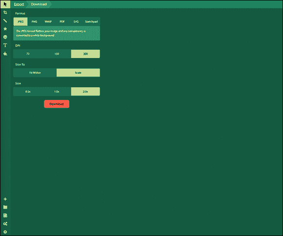

图 4-1： sketch.io 下载页面。

下载您的艺术品时，请务必给它起一个有创意的名字，并将其保存到一个您稍后可以轻松找到的文件夹中。干得好！您现在拥有一件原创艺术品，可以将其转变为 NFT。（图 4-2 显示了本章中在 sketch.io 上创作的 Tiana Laurence 抽象原作。）


图 4-2： Tiana Laurence 原作，在 sketch.io 上创作。

完成艺术品创作后，现在是时候在 OpenSea 上设置您的第一个合集了。具体步骤如下：

1.  **访问 `opensea.io`。**

2.  **点击个人资料图标并选择“我的合集”。**

    安装了 MetaMask 钱包的浏览器应会自动登录 OpenSea。否则请执行步骤 3。

3.  **如果提示，请使用您的钱包登录。**

    您的钱包将成为您在 OpenSea 上的身份。

    如果您尚未设置钱包，请参阅本章前面的“安装 MetaMask”一节。

4.  **点击“我的合集”页面顶部的“创建合集”链接。**

5.  **为您的合集输入名称和描述。**

您现在在 OpenSea 市场上拥有了一个专属空间！要向合集中添加一件供他人查看的艺术品，只需执行以下步骤：

1.  **在您的合集页面上，点击页面顶部的“添加条目”。**

    您将被引导至一个新页面，提示您上传艺术品。

    “创建新条目”下方有一个框，您可以将图像、视频、音频或 3D 模型文件拖放到其中。

2.  **将图像文件拖动到页面顶部指示的框中。**

3.  **使用页面上的文本框，添加简短描述和其他详细信息。**

4.  **向下滚动至页面底部，然后点击“创建”按钮。**

恭喜！您已创建了您的第一个 NFT。您现在可以在社交媒体上分享它。（如果您在这个过程中玩得很开心，请在推特上 @LaurenceTiana 艾特我，并附上您的新 NFT。）

### Nifty Gateway

Nifty Gateway 是一个面向非同质化代币的高端数字艺术拍卖平台。著名的 Winklevoss 双胞胎兄弟从创始人 Griffin 和 Duncan Cock Foster 手中收购了它——后者也是一对双胞胎。Nifty Gateway 曾售出 Beeple、Grimes、Billelis 等国际知名艺术家创作的 NFT。Nifty Gateway 与拍卖行苏富比建立了合作伙伴关系，将自己定位为 NFT 收藏家的高端平台。

#### 发现 Nifties 和发售

Nifty Gateway 将其稀有数字物品称为 *Nifties*，但不要因此感到困惑 —— *Nifty* 只是 NFT 的另一个（更时髦的）称呼。Nifties 遵循与其他代币相同的流行 ERC-721 标准。每个 Nifty 都是独一无二的数字物品。和其他平台一样，Nifty Gateway 也是寻找加密收藏品和加密艺术的好去处。

Nifty Gateway 提供了一种简单的方式，让您使用信用卡或借记卡购买 NFT。撰写本文时，大多数其他平台要求您使用像 ETH 这样的加密货币。该平台还允许您从流行的加密游戏和应用程序购买 NFT，例如 *CryptoKitties*、OpenSea 和 *Gods Unchained*。

Nifty Gateway 的一个有趣功能是 *发售*，即艺术家在特定时间发布限量版新数字艺术品。艺术家 Grimes 就是通过这种方式与合作者 Mac Boucher 发布了她的 NFT *WarNymph*。几分钟内，他们售罄了所有艺术品。

发售深受收藏家欢迎，因为它们不仅能让您欣赏到杰出艺术家的新作，还能让您通过在 NFT 市场上转售来从购买中获利。这种策略很像购买热门演唱会门票，然后在 StubHub 等票务转售网站上转售。不同之处在于，Nifties 发售是由艺术家直接出售的。您可以在设定的时间内购买这些 NFT，或在二级市场上从其原始所有者手中购买。

#### 设置 Nifty 账户并进行购买

要设置您的 Nifty 账户，请执行以下步骤：

1.  **访问 [`https://niftygateway.com`](https://niftygateway.com)。**

2.  **点击“注册/登录”按钮。**

3.  **在注册页面填写账户信息以创建新账户。**

    Nifty Gateway 会发送一封包含验证码的确认邮件。

4.  **查看您的邮箱，将收到的验证码复制粘贴到验证框中。**

在研究和购买 NFT 时，操作非常简单。只需执行以下操作：

1.  **返回 Nifty Gateway 主页：[`https://niftygateway.com`](https://niftygateway.com/)。**

2.  **点击右上角的“发售”按钮。**

    此步骤将引导您进入一个新的发售页面，列出所有即将举行的活动（含日期）。

3.  **点击当天的特邀艺术家。**

    此步骤将引导您进入一个包含待售 NFT 信息描述的页面。

    第一部分显示关于艺术家及其公开合集的信息。

    可供出售的 NFT 显示在“探索开放合集”标题下。

4.  **点击其中一个 NFT，以打开另一个页面，查看有关该艺术品允许发行多少版本的更多信息。**

    当您找到心仪的 NFT 时，可以通过点击 NFT 图片下方描述中的“出价”按钮对其进行竞价。在 Nifty Gateway 网站上，您可以像在普通网购网站一样使用信用卡购买 NFT。

NFT 首先是艺术品，因此它们可能不是高产的投资。它们的人气（从而其价值）可能会随时间下降。不要在 NFT 上花费超出您承受损失范围的资金，只购买您真正喜欢的东西。

### Rarible 的去中心化治理

Rarible 是一个非同质化代币的去中心化市场，由来自俄罗斯的 Alexei Falin 和 Alexander Salnikov 于 2017 年创立。Rarible 于三年后的 2020 年面向公众推出。与其他 NFT 平台一样，您可以创建和出售您的代币化艺术品。与其他平台不同的是，它提供了一套多样化且对艺术家非常友好的服务。Rarible 支持高分辨率文件和隐藏信息。您还可以设置智能合约，从而从您的艺术品中收取版税。例如，每当您的艺术品易手时，您都可以收取费用。Rarible 是艺术家创收的绝佳方式。但是，如果 NFT 在不支持相同版税系统的平台上转售，这种机制可能会被规避。

### Rarible 的 NFT 市场

Rarible 的 NFT 市场差异甚至更深。从一开始，它就通过一种新型公司——称为**去中心化自治组织 (DAO)**——由社区参与驱动。与中心化服务不同，**DAO** 是一个非托管的 NFT 铸造平台和市场。非托管意味着没有中央方负责管理。Rarible 的 DAO 创建了一个强大的艺术家和 NFT 爱好者社区，他们共同管理该平台。

作为社区成员，您可以使用其原生治理代币 **RARI** 决定平台的未来。（**治理代币** 是一种加密货币，它在区块链上赋予持有者投票权，给所有加密货币新手们科普一下。）**RARI** 让 Rarible 上最活跃的创作者和收藏家能够就平台升级进行投票，并参与策展和审核。

需要明确的是，您无法购买 **RARI**，它也没有市场价值——您只能通过积极参与平台活动来获得它。Rarible 市场上的创作者、卖家和买家根据其每周活跃度（如购买和销售量）通过每周分发获得 **RARI**。

在 Rarible 上创建 NFT 只需几分钟。该平台拥有简单的界面，允许您发布 NFT 并为您的艺术品设置带有版税百分比和拍卖功能的智能合约。

Rarible 平台致力于通过赋予艺术家将其艺术作品代币化并保证其来源和所有权的能力，来解决知识产权支付问题、欺诈和许可文书工作问题。

Rarible 并不完美——它有一些需要克服的问题。例如，创作者可以通过**洗盘交易**其 NFT 来利用 Rarible 的 **DAO** 系统牟利；这是一种骗局，用户购买自己的艺术品以获取 **RARI** 代币。还请记住，在撰写本文时，Rarible 尚未成为一个完整的 **DAO**。这意味着您的投票更多是对 Rarible 团队的建议。公司仍然决定开发重点——考虑到该项目仍相当新，这可能是最好的安排。

#### 在 Rarible 上和运行

您可以通过将钱包连接到网站来设置 Rarible 账户。为此，请访问 [`https://rarible.com`](https://rarible.com/) 并点击屏幕右上角的 **Connect Wallet（连接钱包）**。选择 **MetaMask** 或您正在使用的任何钱包服务的名称。

当您登录钱包时，您也就登录了 Rarible。然后您可以按照以下步骤调整您的管理员设置：

1.  点击页面顶部的 **My Items（我的物品）** 按钮或导航至 [`https://rarible.com/settings`](https://rarible.com/settings)。

2.  在此页面上，更新您的显示名称，并根据需要连接您的社交媒体账户。

3.  点击 **Update Profile（更新个人资料）** 按钮以保存更改。

    如果此步骤从您的 **MetaMask** 钱包弹出新窗口，请继续点击提示。当网站确认您的身份时，可能会发生这种情况。例如，如果您的钱包中有待处理的交易，它将阻止您在 Rarible 上更新用户信息。您需要通过添加资金或取消交易来清除钱包中的待处理交易。清除钱包中的待处理交易后，它便可以为您在 Rarible 上进行身份验证。

#### 创建带有版税结构的拍卖

在深入了解进行 Rarible 拍卖所需的步骤之前，您首先需要使用 **Sketchpad** 或其他绘图软件创作一件数字艺术品。

准备好您的艺术品后，请按照以下步骤操作：

1.  导航至 Rarible 网站 [`https://rarible.com/`](https://rarible.com/)。

2.  点击 **Sign in with Metamask（使用 Metamask 登录）**。

    如果您尚未设置 **MetaMask** 钱包，请返回本章前面的部分，按照说明设置您的钱包。

3.  点击页面顶部的 **Create（创建）** 按钮。

4.  在 **Create Collectible（创建收藏品）** 部分下，点击 **Multiple（多份）**。

5.  点击 **Choose a File（选择文件）** 按钮。

    此按钮将打开一个新窗口，允许您在计算机上搜索艺术品文件。

6.  使用搜索栏搜索您的艺术品文件名。


随着您输入名称，您的文件将出现在窗口中。

7. 通过在窗口中点击文件来选择该艺术品文件。

8. 点击窗口右下角的 **Open（打开）** 按钮。

您的艺术品将出现在 Rarible 页面上，您将继续在浏览器中完成其余说明。

9. 点击 **Open for bids（开放竞价）** 按钮。

此步骤允许市场对您的新 NFT 进行竞价。

10. 在 **Choose Collection（选择集合）** 部分下，点击 **Rari**。

11. 添加标题、描述，以及您希望在作品每次易手时获得的版税百分比。

12. 添加您想要制作的副本数量。

13. 点击 **Create Item（创建物品）** 按钮。

14. 导航至您的 **MetaMask** 钱包并点击 **Approve（批准）**。

如果您尚未向 **MetaMask** 钱包添加资金，可以在本章前面找到说明。将您的 NFT 保护在以太坊区块链上需要支付 Gas 费。费用价格不是固定的，而是动态变化的。（有关 Gas 费的更多信息，请参见 第 6 章。）

15. 返回 Rarible 网站并点击 **Start（开始）**。

您可能需要刷新页面才能看到您的 NFT。

恭喜！您已成功为同一作品的多个副本创建了自己的 NFT 拍卖，并设置了版税结构，以便每次您的 NFT 被交易时您都能获得报酬。

# 第 5 章：投资 NFT

## 本章内容

 **了解加密货币和 NFT 之间的区别**

 **遵循管辖投资的规则**

 **深入研究表现最佳的 NFT**

 **制定投资 NFT 的策略**

 **理解 NFT 的税收**

本章涵盖了 NFT 投资的新世界。在这里，您可以探索投资策略，包括研究可以投资哪些类型的 NFT。您还将了解管辖所有类型投资（包括 NFT）的规则和监管机构。

无论您是考虑认真投资、享受收藏乐趣，还是想站在投资前沿（或者您只是单纯好奇），NFT 都能提供很多机会。有时，真正了解这样一个新市场的唯一途径就是去探索它。探索市场能让您了解各种可用的代币。您还可以感受定价情况，以及不同市场如何策展、上架和出售其资产。

与任何投资一样，您应该尽可能多地进行研究，并且永远不要投入超出您承受损失范围的资金。我们还建议您关注不断变化的市场，因为供需、技术和法规的变化可能会让市场在一段时间内保持动荡状态。

我们不是金融专家，本章中的信息不构成投资或税务建议。本章不能替代专业投资顾问和会计师的指导。

## 理解 NFT 不是加密货币

从技术层面来看，NFT 与加密货币相似，因为它们都作为区块链上的数字记录存在。NFT 与加密货币的区别在于每个 NFT 都是独一无二的。例如，如果您拥有一个比特币，您可以用它兑换另一个比特币，两者将具有相同的市场价值。这通常被称为**同质性**——即一种资产能够与同类型的另一种单个资产进行交换，并意味着资产之间具有同等价值。

## NFT 投资概述

在区块链上，任何一枚比特币都与其他比特币相同。以太坊区块链上的以太币、莱特币，甚至各自网络上的狗狗币也是如此。全球每天都在交换数百万美元此类资产，并吸引了大量买家。

NFT 不同。每个非同质化代币都具有独特的价值，虽然它们可以交易，但不能简单地互相替换。尽管加密货币市场波动剧烈，但在任何给定时刻，一枚比特币的价值都与其他比特币相同。每个 NFT 都有自己的价值，且可能随时变化，与其他 NFT 的价值毫无关联。

只有当有愿意且有能力的买方和卖方时，NFT 才具有价值。它可能只有一个买家的市场，或者无论价格如何，无人愿购买。有观点推测 NFT 市场可能会崩盘，就像 1990 年代的 TY Beanie Babies（泰迪熊玩偶）一样。

### NFT 投资简介

随着加密货币和新型数字资产（如 `equity tokens`（权益代币，运作方式类似传统股票资产的证券型代币）和 NFT）的发明，投资世界正在迅速变化。该领域的监管尚未完全跟上全球对这些新型资产的热情。

传统投资对普通大众一直存在限制。通常你需要与投资经纪人或财务顾问合作——这些人帮助你驾驭股票、债券和投资基金的复杂世界。这类投资回报缓慢但相对可靠，协助你的投资专业人士受政府机构监管。

情况并非一直如此。1920 年代出现了疯狂的投机和欺诈，导致数百万人陷入危险的经济境地。证券交易委员会（SEC）于 1934 年作为美国独立联邦监管机构成立，旨在保护投资者并执行联邦证券法。它是美国为应对大萧条经济后果而制定的“新政”的一部分，旨在防止欺诈或盲目自信引发的未来金融灾难。

为进一步保护公众，美国国会通过了 1933 年《证券法》，要求在美国进行的大多数证券销售或面向美国公民发行的证券必须注册。该法案通过要求投资者获得关于公开证券的真实财务数据，有助于防止证券欺诈。它还赋予联邦贸易委员会（FTC）叫停证券销售并将违法者绳之以法的权力。

新型 `financial instruments`（金融工具）——指通过区块链技术创建的、代表涉及货币价值的法律协议的真实或虚拟文档——受 FTC 和 SEC 监管。在探索 NFT 时请牢记这一点，因为它们可能属于金融工具，并根据你的国籍、国家，以及——如果你选择出售它们——买方的国籍和国家，受相关法规和法律约束。

SEC 评估 NFT 等数字资产的方式与评估传统资产类似，以确定其是否属于证券。在我们撰写本章时，NFT 尚未成为 SEC 解释性指导的主题，也未针对 NFT 创作者采取执法行动。然而，NFT 可被用于欺诈投资者或洗钱，美国或其他政府极有可能介入并监管该领域。有时这需要数年，执法行动可能需要更长时间。

简单来说，如果你购买的 NFT 与现有资产相关，作为收藏品出售，并在区块链上有公开的真实性记录，它很可能不属于金融证券。你的购买行为就像购买一幅画或其他艺术品一样。然而，NFT 可能具有多种属性，很容易使其成为金融工具。如果你购买的 NFT 承诺给你投资回报，它可能属于证券——例如，作为 NFT 出售并承诺分红的房地产投资，或来自数字艺术的版税流，也可能属于证券，因为它很可能无法通过豪伊测试。（豪伊测试用于判断美国何为“投资合同”以及何种资产受美国证券法管辖。）当你在审视投资机会且不确定其是否为投资合同时，可以寻找以下四个标准：

* 涉及资金投入。
* 属于共同企业。
* 预期获利。
* 此类利润源于他人的努力。

### 决定 NFT 投资是否适合你

在制定 NFT 投资策略之前，首先问问自己这种投资类型是否适合你。你可以选择许多其他拥有更多历史、可预测性和可用市场研究的投资机会。与所有高波动性和投机性投资一样，**切勿** `not` 孤注一掷投资 NFT。

仅投资你承担得起永远收不回的金额。此策略有助于保障你的财务安全，避免不必要的压力。

当且仅当你看到你拥有的资产需求增加、价格上涨时，这才是有趣且令人兴奋的。如果没人认为你拥有的东西有趣或有价值，那对你也不是损失，因为你量力而行，并且希望你喜欢自己买的东西。

人们通常投资 NFT 主要有两个原因：

* **抢占新资产的先机：** 拥有同类首批 NFT 之一绝对带有一定的声望。
* **赚钱：** 目前，一些人通过买卖 NFT 赚得盆满钵满。遗憾的是，二级市场鲜有可用数据。尽管如此，你仍能找到许多人一夜暴富的故事。

NFT 似乎正享受着类似加密货币早期的时刻。一些人通过早期购买比特币和其他代币赚了大钱，导致大家都想入场。一些人赚了，但其他人投资了未能获得甚至保持价值的新币种。他们在市场波动中损失了大量资金。

### 新手 NFT 投资策略

NFT 让投资者因巨大的未开发全球机会而兴奋不已。NFT 也可能是一个即将破裂的泡沫，很像 1990 年代的 TY Beanie Baby 狂热。真相很可能介于两者之间。

一些 NFT 可能提供绝佳的投资机会，而另一些可能迅速变得一文不值。在某些方面，投资 NFT 与其他任何投资一样，无疑伴随着风险。充分了解信息是你的最佳策略。

你可能决定收藏 NFT 以求乐趣。许多人收藏硬币或邮票只为收藏的乐趣。是的，有时收藏品价值极高，但许多收藏家从未出售过收藏品，对此感到很满意。另一方面，如果你想尝试通过 NFT 建立价值或财富，你需要做些功课。

在缺乏足够知识的情况下贸然涉足 NFT，就像在不懂艺术或艺术价值的情况下投资传统艺术品。你可能会手握一件毫无财务价值的物品。如果你在这样的投资上过度透支，可能导致财务崩溃。

#### 为你的 NFT 估值

在许多方面，NFT 只是传统收藏品或数字现代艺术品的数字版本。棒球卡、硬币、艺术品、文件甚至汽车都可以是收藏品。赋予它们价值的是稀缺性和吸引力。某物越受追捧且供应量越低，其价值越高。你仍然需要有愿意且有能力的买家，否则无论物品多稀有，市场都不存在。

NFT 与所有这些物品相似，但同时也有所不同。NFT 本身只是一条记录在区块链上的记录，用于验证所有权和来源；NFT 通常也不包含底层的数字内容。区块链的容量有限，而在大多数传统区块链上，数字媒体文件体积庞大，以这种方式存储成本高昂。

NFT 背后的技术确实有助于创造部分价值。由于稀缺性与收藏品的价值相关，数字创作变得难以收藏。数字作品通常可以无损复制——这可能使得“拥有”数字资产变得困难。NFT 通过允许艺术家创建限量版，甚至为原创作品创建代币并将权利出售给收藏家，解决了这一问题。这些物品可以代表资产的价值；换句话说，它们代表了某人愿意为该资产支付的价格。

您可以从多种方法中选择来确定 NFT 的价值。对任何资产价值的共识可以基于品牌、稀缺性或市场。如果您熟悉其他收藏品，可能会发现这些因素似曾相识。

#### 品牌

在此语境下，品牌基本上是指谁创建了 NFT 资产或与其相关。在 NBA Top Shot ([`https://nbatopshot.com`](https://nbatopshot.com)) 上售出的最昂贵收藏品之一是勒布朗·詹姆斯的视频片段，我们将在后面的“发现表现最佳的 NFT”一节中进一步讨论。勒布朗的品牌具有价值——尽管收藏家可能会对片段中展示的精准动作印象深刻，但最大的价值在于人物本身。NFT 世界目前已经吸引了一些大牌，如 Coors、可口可乐、NBA，以及 Beeple 和 Grimes 等艺术家。虽然找到与知名艺术家品牌无关但有价值的 NFT 是可能的，但建立长期价值要困难得多。

#### 稀缺性

稀缺性是决定 NFT 价值最关键的因素之一。如果艺术家发布单一副本的作品，其价值高于发布 10,000 个副本。幸运的是，由于稀缺性是如此重要的因素，大多数市场都会明确标明每件作品的可用数量。因此，创作者和市场可以通过控制发布副本的数量，利用稀缺性快速影响价值。

#### 市场

决定 NFT 价值的最后一环是出售它们的市场，即 NFT 市场。投资者可以查看市场以确定早期销售的价格、类似物品的销售情况，以及在某些情况下的估价。

#### 选择您的策略

如果您决定准备好进入这个动荡的 NFT 世界，第一步是进行研究。搜索 NFT 投资机会会让您发现，该行业的现状酷似西部荒野。成千上万的 NFT 可从几十个 NFT 市场获得。（我们将在第 12 章中探讨其中十个市场。）

在购买前请**务必**确认，您打交道的是合法市场，且底层资产是真实的——任何人都可以创建 NFT 并称其为原创。由于 NFT 及其背后区块链的去中心化性质，没有官方来源审核这些市场的质量和声誉。

从您喜爱的 NFT 领域的小额投资开始，因为投资您理解且享受研究过程的标的，是一条良好的路径。购买资产后，您将花费大量时间阅读相关资料并关注市场动态。

随着知识和信心的增长，您很可能会开始投入更多资金。作为投资者，Tiana 设定投资目标，这使她即使在市场火热时也能做出经过计算的决策。拥有投资计划——并坚持执行——可以帮助您做出理性决策，无论资产类别如何。

Tiana 关注的一个关键指标是**交易量**，即在任一时刻活跃的买家和卖家数量。对于 NFT 来说，这有点棘手，因为它们处于**稀薄市场**中，买家和卖家寥寥无几。

骗子使用的一个伎俩是在他们控制的账户之间反复买卖资产，以抬高价值并制造虚假的交易量信号。在 NFT 的情况下，您需要利用 Reddit 和 Twitter 等非常规来源进行研究。然而，任何人都可以在那里发帖，所以要警惕试图抬高资产价值的**拉高出货者**。不幸的是，这个问题在加密货币领域极其普遍。

作为投资者，Tiana 会设定一个任意的保守**目标回报率**，指您预期在投资中看到的未来价值或利润，例如 10%。您需要自行研究并选择一个您满意的目标回报率数字，因为它可以帮助您知道何时卖出。传奇投资者沃伦·巴菲特建议投资者在别人抛售时买入，在别人买入时卖出。Tiana 采用这种方法。

Tiana 使用的另一种做法是以低于她感知的市场顶部的价格卖出。同样，她会选择一个任意数字，比如低于她认为的市场顶部 10%，这有助于她退出资产，而不是随着崩盘一路下跌。在市场最高点交易极难判断。

## 发现表现最佳的 NFT

买家看重 NFT 的原因多种多样。对一些投资者来说，NFT 是一种艺术形式。对其他人来说，购买 NFT 可能向他们的社交群体发出信号，彰显他们的权力和归属感。**社交信号**是指您因拥有特定物品而成为某个群体的一员并拥有较高地位的概念。

为了了解 NFT 并明确投资的收益与风险，请回顾一些表现最佳的 NFT。

以下是几个独特 NFT 的清单及推动其价格的一些因素：

* **勒布朗·詹姆斯，“Cosmic”扣篮视频（创作于 2019 年；售价 208,000 美元）：** 该 NFT 是 NBA Top Shot NFT 交易所的一部分。对一些人来说，Top Shot 唤起了收集交易卡的回忆——其运作方式也类似。收藏家购买卡包，有时会发现收藏中那张特别珍贵的**卡牌**（记录 NBA 比赛精彩时刻的单个视频片段）。“Cosmic”来自一个包含 49 张卡牌的卡包。卡包价格区间跨度大，普通卡包起价 9 美元，而可能包含稀有卡的卡包价格接近 1,000 美元。

* **《瑞克和莫蒂》，“The Best I Could Do”艺术品（创作于 2021 年；售价 100 万美元）：** 这是 Cartoon Network 成人游泳时段的招牌动画《瑞克和莫蒂》由 Justin Roland 创作。Roland 在 NFT 拍卖平台 Nifty Gateway 上以 100 万美元售出了该剧 18 件原创艺术品的收藏。这是该平台迄今为止最大的成交。《瑞克和莫蒂》拥有庞大的粉丝群和狂热的追随者。

* **CryptoPunk #7523（创作于 2017 年的像素艺术角色；售价 1,180 万美元）：** 它是 Larva Labs 制作的 10,000 个像素艺术角色之一，该项目最初是 Google 的一个小型内部项目。**CryptoPunks** 是 NFT 世界的标志性存在，拥有权创造了社交信号。更多关于 CryptoPunk #7523 和其他 CryptoPunks 的信息，请参见第 13 章。

* **Axie Infinity 的虚拟游戏 Genesis Estate（创作于 2021 年；售价 150 万美元）：** 它是加密游戏 Axie 内部的虚拟土地。与现实土地一样，其价值归结为位置。这块地产位于黄金地段，提供独特的美学体验。

* **Twitter CEO Jack Dorsey 的第一条推文（最初创建于 2006 年；2021 年转为 NFT 并以 290 万美元售出）：** Twitter 在文化和历史层面变得极其重要。尽管这条推文本身最初创建于第一条区块链诞生之前很久，但该 NFT 的创建旨在代表有史以来的第一条推文，这绝对具有收藏吸引力。

* **2021 年 Doge 表情包（转为 NFT；以高达 440 万美元售出）：** 表情包是以多种形式出现的文化触点，拥有表情包的所有权是终极社交信号。Doge 表情包以一只可爱的柴犬为主角，在加密货币领域极受欢迎，因为它传达了一个内部梗：任何人都可以创建一种加密货币。

* **Beeple：《EVERYDAYS — FIRST 5000 DAYS》（2021 年创作的数字艺术品；以 6930 万美元售出）：** 这件纯数字艺术品（更接近现代美术）是由一家大型拍卖行（佳士得）首次售出的此类作品，由 13 年间拍摄的 5000 张图片组成。它被售予总部位于新加坡的 NFT 收藏家 MetaKovan 和 Twobadour。更多关于这件作品及 Beeple 其他艺术作品的信息，请参见第 13 章。

## 探索流行的 NFT 类型

存在多种类型的 NFT，且新的代币标准正在不断开发中。在本节中，我们将向您展示几种最流行的 NFT 类型。

### 数字艺术

数字艺术是 NFT 的一个广泛类别，拥有最高的售价记录之一。它也是最古老的 NFT 类型。Kevin McCoy 的《Quantum》是有史以来第一个被铸造的 NFT。在此类别中创建和销售极其容易，许多平台允许*任何人*创作 NFT 数字艺术。

### 收藏品

收藏品也是 NFT 市场中的一个大类。这些类型的 NFT 很像传统的棒球卡和邮票。NBA Top Shot 作为最大的体育收藏品平台，已实现数百万美元的销售额，并赋能了新一代爱好者。

### 游戏

游戏也从区块链中受益。游戏内资产与 NFT 完美契合，拥有所有细分领域中最高的销售量：2020 年售出了超过 60 万件游戏内资产。这个数字包括数字土地、皮肤和角色。

NFT 让玩家对其游戏内的数字资产拥有更多权力和控制权，这对偏向游戏开发商而非玩家的传统游戏经济构成了颠覆。

### 音乐


作为 NFT 出售的音乐也变得流行起来。它允许艺术家直接向粉丝出售音乐，并让粉丝获得传统上难以实现的额外福利。音乐行业仍在适应向流媒体大规模转变的趋势。艺术家不再受制于唱片公司来录制和推广实体专辑销售，独立艺术家正在寻找新的方式来变现和分享他们的内容。音乐人现在可以将音乐代币化并直接卖给粉丝。在许多情况下，粉丝可以获得其他地方找不到的独家内容和艺术品。

音乐领域的 NFT 可能带来一些重大交易。2021 年 2 月，DJ 和制作人 3LAU 出售了价值 1200 万美元的 NFT。发售内容包括一首定制歌曲、从未发布过的音乐的访问权、定制艺术品以及现有歌曲的新版本。

### 流行表情包

这是最奇怪的类别之一：被转为 NFT 的表情包。Disaster Girl（灾难女孩）、Nylon Cat（尼龙猫）和 Overly Attached Girlfriend（过度依恋女友）等早期流行表情包已以数十万美元的价格售出。表情包具有普遍性等特征——它们属于某个特定的文化时刻，也属于参与了催生并推广该亚文化的人群。表情包的所有权似乎与稀缺性的概念相悖，因此这是一个独特的领域。

## 报告 NFT 收益并为 NFT 缴税

如果您深入 NFT 投资领域，您需要为税务影响做好准备。如果您以为 NFT 的去中心化、数字化特性能让您在 IRS（美国国税局）那里逃脱责任，那就大错特错了。NFT 收入主要有两类：

*   NFT 创作者出售 NFT 时获得的收入
*   投资者通过出售 NFT 赚取的资金

大多数投资者无需担心创作者如何纳税，但仅供参考，这很简单：NFT 创作者将出售收入视为普通收入。对于自由创作者而言，这是需缴纳自雇税的自雇收入。

对于美国投资者，根据《国内税收法典》第 408(m)(2) 条，NFT 被视为任何其他收藏品，这意味着出售 NFT 所得收益需缴纳资本利得税。高收入者预计需为 NFT 收益支付更高的税率。

正如预期的那样，IRS 仍在追赶这个全新的 NFT 现象。目前尚无报告机制，因此买卖双方都需要为税务目的保留自己的详细记录。您如何向 IRS 报告 NFT 收益，再次取决于您与资产的关系。创作者只需在其商业损益（P&L）表中报告。他们可以扣除与创建 NFT 相关的任何费用或开支。

为确保您遵守税务和其他监管法律，请聘请一位税务专业人士，他们可以帮助您处理您的特定情况。

# 第 3 部分：发展您的知识：编程您自己的 NFT 分步指南

本部分内容……

*   探索以太坊虚拟机及其工作原理。
*   学习如何设置开发环境。
*   遵循分步指南启动您自己的非同质化 `ERC-721` 代币。

# 第 6 章：什么是以太坊？

本章内容

 **了解以太坊虚拟机 (EVM)**

 **认识以太币 (ETH) 和智能合约的作用**

 **了解区块链、交易如何验证以及信息如何保障安全**

 **描述局限性并访问 EVM 外部的信息**

在本章中，我们将提供以太坊的高层概览：许多代币（无论是同质化还是非同质化）诞生的平台。

您无需本章信息即可实施我们在以太坊平台上铸造您自己的非同质化 `ERC-721` 代币的分步指南。（这些实用细节和说明从第 7 章开始，并在第 11 章创建您自己的 NFT 时达到高潮。）然而，本章提供了有用的信息，帮助您更好地理解您的 NFT 的基本特性以及它如何与以太坊宇宙的其他部分交互。

## 揭秘以太坊虚拟机

想象一台单一的、全能的计算机，它根据一个无领导者社区（也称为*去中心化自治组织 (DAO)*）的共识来存储和执行代码。处理请求的算力由同质化代币支付（这是这个无领导者社区的原生货币），提供计算资源的社区成员将获得这些代币作为补偿。任何人都可以自由加入和退出社区——无需请求许可——社区成员可以按其意愿参与。

社区的任何成员都可以向系统提交请求，尽管每个请求都必须付费。为了使请求被接受，社区整体必须就该请求是否有效达成共识。为了确定有效性，社区可能会问以下问题：

*   相关成员是否拥有支付请求所需的代币数量？
*   鉴于社区超级计算机的资源，该请求是否可行？
*   该成员是否有权限提出此类请求？

## 以太坊：世界计算机

为了实现完全透明，所有信息（例如代码、交易和代币持仓）都将永久记录并供所有人访问。为了维护这台计算机状态的完整性，社区中的每个成员都会单独且持续地维护系统的更新副本。

在以太坊的世界里，这台计算机是 `Ethereum Virtual Machine`（以太坊虚拟机，EVM），而这个无领导者的社区是由（字面意义上的！）任何希望参与者运营的计算机网络组成。这些计算机（也称为 `nodes`，节点）中的每一个都存储着 EVM 的更新副本。此外，任何人都可以选择作为 `mining node`（挖矿节点）或 `miner`（矿工）参与，通过验证和处理执行计算请求来获得报酬。软件本身是开源且免费的，但所需的硬件和电力并非免费。

要发起计算请求（称为 `transaction`，交易），你需要一个能够接收、存储和发送以太币（`ETH`，以太坊的原生加密货币）的账户。（这些账户还可以部署智能合约并与已部署的智能合约进行交互。）在以太坊上，这种类型的账户正式称为 `externally owned account`（外部拥有账户）。当你听到有人提到账户时，他们很可能指的就是外部拥有账户。

在 第 7 章 中，我们将更详细地解释账户类型、账户创建和账户管理。

 EVM 上的所有交易都必须用 ETH 支付。交易可能包含以下操作：

*   将 ETH 从一个账户转移到另一个账户
*   在 EVM 上存储数据
*   操作现有数据

在请求的交易经过验证和执行后——这一过程需要网络共识——EVM 的新状态将被广播并在节点网络中复制。完整的交易历史被保存在基于区块链的分布式账本上，供任何人访问。

要了解这个公共账本在实践中是如何运作的，请执行以下步骤，查看以太坊区块链创世以来 EVM 上的所有交易数据：

1.  **前往** [`https://etherscan.io`](https://etherscan.io) **。**
2.  **从区块链下拉菜单中选择“查看交易”选项，如** **图 6-1** **所示。**

    在那里，全世界都能看到从亘古以来 EVM 上的所有交易数据。

     `Txns` 是以太坊指代 transactions（交易）的奇特方式。

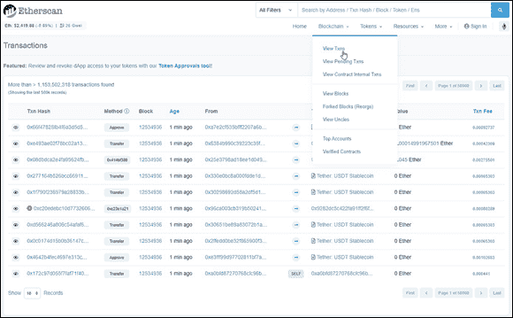

## 以太币：为你的交易提供动力的燃料

在以太坊中，`gas`（燃料/汽油）是用于表示在 EVM 上处理交易所需计算工作量的计量单位。

当你向以太坊网络提交交易时，必须指定两个与成本相关的输入：

*   **燃料价格：** 你愿意为交易消耗的每单位燃料支付的价格（以 ETH 计价）。较高的燃料价格会让你的交易对矿工更具吸引力，矿工通过验证和执行交易获得报酬。
*   **燃料限额：** 你愿意为完整执行交易而消耗的最大燃料总单位。较高的燃料限额可确保交易的计算需求得到充分满足以完成执行。

一般来说，你请求的速度和成功执行取决于你指定的燃料价格和燃料限额。

 取决于你的钱包服务和设置，你可能会注意到燃料以 `gwei` 为单位，其中 100 万 gwei 等于 1 ETH。

### 交易的旅程

为了帮助你更好地理解执行交易的总体可能性及相关成本，以下是当你从账户发起请求时会发生的情况：

1.  你的交易将被分配一个称为交易哈希的唯一代码（缩写为 `TxnHash`、`TxHash` 或 `TXID`）。

    为了演示，这里有一个 `TxnHash` 的示例：

    ```
    0x7b91d4f49ccafdb93f2ca89fd57649301331bd691cfe26478822afb468ac9589
    ```

2.  交易被广播到更大的以太坊节点网络中。
3.  如果有效，交易将被添加到等待执行的其他待处理交易池中。

    这个池（如 图 6-2 所示）称为 `mempool`（内存池/交易池）。要查看待处理交易的详细信息，请点击 `TxnHash`。（见 图 6-3。）

    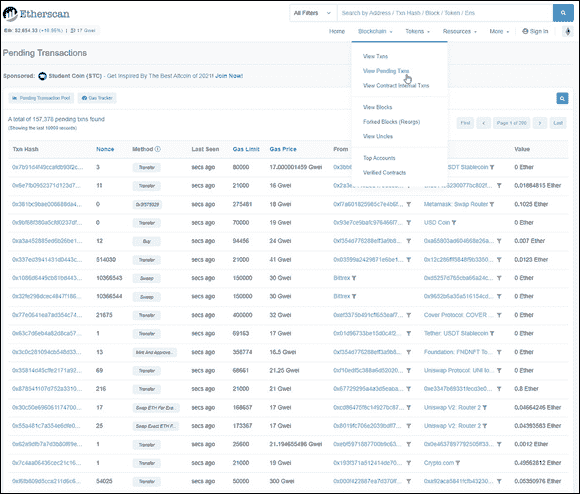

    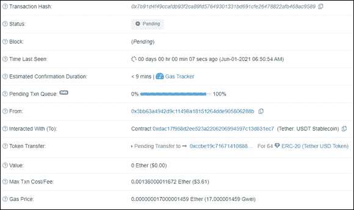

4.  挖矿节点从该池中选择待处理交易，组成一个（尚未确认的）交易区块。

    （基于我们将在下文进一步讨论的原因，矿工倾向于选择燃料价格较高的待处理交易。）

5.  矿工竞相解决一个复杂的方程——`proof-of-work (PoW) puzzle`（工作量证明谜题），这需要巨大的算力——以赢得添加并确认新区块到以太坊区块链的权利。
6.  找到解决方案后，获胜的矿工（获得区块奖励作为补偿）将其区块广播到网络中，为该区块选中的交易得到执行（只要它们没有耗尽各自的燃料限额），新一轮挖矿竞赛随即开始。

    图 6-4 显示了前面提到的待处理交易（在上述步骤 1 中介绍），及其对应的区块号，已成功确认。该交易现在已成为以太坊区块链永久的一部分。

    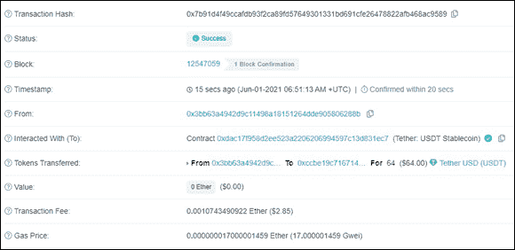

总的来说，成功完成交易需要满足以下条件：

*   **你的交易必须有效。** 例如，你必须拥有足够的资金和执行交易所需的适当权限。
*   **你的交易必须被确认并排队等待执行。** 你的交易必须被一个成功的挖矿节点选中，该节点赢得了将新区块追加并确认到以太坊区块链的权利。
*   **你的交易的总计算复杂度不得超过其指定的燃料限额。**（作为请求交易的人，你设定燃料限额。）

### 补偿（工作量证明）工作者：矿工能得到什么？

对于添加的每个新区块，获胜的矿工将获得区块奖励，奖励分为两部分：

*   **固定报酬：** 在撰写本文时，这部分固定报酬为 2 ETH。
*   **个人费用：** 这些费用附加在该区块选中的每笔交易上。

例如，区块 #12546760 的矿工（见 图 6-5）获得了约 2.32175 ETH 的报酬。总区块奖励细分如下：

*   **2 ETH：** 区块奖励的固定部分
*   **0.32175 ETH：** 该区块选中的 236 笔交易各自的个人费用之和

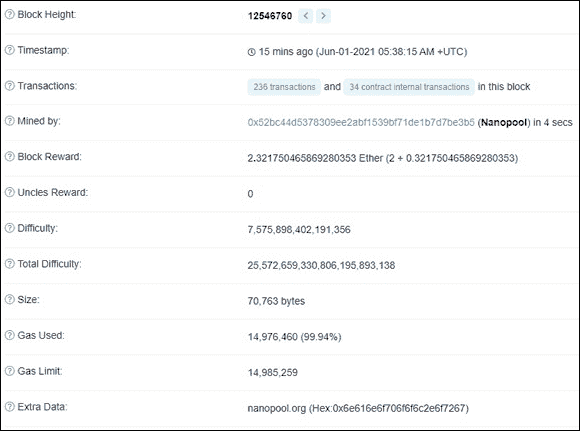

自然地，矿工希望在给定工作量下最大化其潜在报酬：即他们为尝试解决计算成本高昂的工作量证明谜题所消耗的算力。

这些谜题的难度等级不受矿工正在努力确认的最新区块的大小或内容的影响。因此，在为区块选择交易时，矿工通常有动力选择：

*   尽可能多的交易，遵守以太坊在区块层面施加的总 Gas 限制
*   单位 Gas 价格最高的交易

反过来，你可以利用这种激励机制来决定向网络提交交易时如何设置 Gas 价格。

### 从欢乐时光到涨价定价：确定合理的 Gas 价格

当矿工为其下一个区块选择交易时，较高的 Gas 价格对他们更具吸引力。如图 6-6 所示，设置较高的 Gas 价格可以提高交易被选中、确认和执行的预期速度。

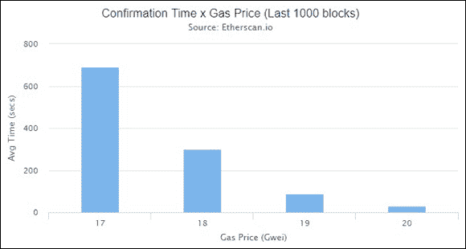

你应该出多少价？毕竟，如果你不着急，可能更倾向于少付点钱并等待。在绝望时刻，你可能会乐意在死亡谷花 100 美元买一瓶水，但如果听到另一个没那么绝望的顾客将价格砍到 50 美元，你会后悔这笔购买。

问题在于，矿工很乐意享受更高的 Gas 价格，并在提供时收取更高的费用。如果他们愿意以更低的价格选择你的交易，他们不会告诉你，当然也不会退还差价。那么，考虑到紧迫程度或缺乏紧迫程度，你应该承诺支付多少？当网络空闲与极度拥堵时，这个金额应有何不同？

幸运的是，许多服务（包括 `MetaMask`，我们将在第 2 章和第 4 章中介绍）为新手用户提供指导，他们只需选择“慢”、“平均”或“快”，即可根据钱包的内部算法自动填充交易的 Gas 价格。更高级的用户仍然可以选择根据最近确认区块中获取的信息，使用自己的预测分析来设置自定义 Gas 价格。

想要以一种快速有趣的方式全天监控推荐的 Gas 价格，请查看 ETH Gas Station：[`https://ethgasstation.info`](https://ethgasstation.info/)。图 6-7 显示了以 10 分钟为间隔捕获的 Gas 价格。

Etherscan 拥有自己的以太坊 Gas 追踪器，如图 6-8 所示，可在 [`https://etherscan.io/gastracker`](https://etherscan.io/gastracker) 访问。

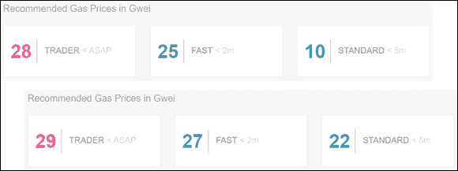

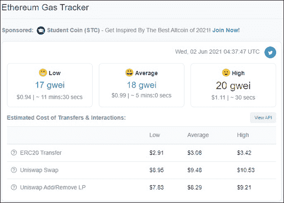

### 设定你的预算：天空是（Gas）极限吗？

虽然交易的 Gas 价格影响其预期执行速度，但 Gas 限制决定了交易是否会被执行。这意味着资金不足的交易最终无法完成执行。

由于为交易分配足够的 Gas 很重要，你可能自然会问自己以下两个问题：

*   **将 Gas 限制简单设置为任意高的数值有什么问题？**
*   **你能否提前计算所需的 Gas 单位，以设置合适的 Gas 限制？**

针对第一个问题，你不能依赖简单地为 Gas 限制选择一个大数字，原因有多种。可行性是一个主要原因，因为：

*   **你可以为交易设置的 Gas 限制受你账户中 ETH 数量的制约。** 你必须拥有高于交易 Gas 价格乘以 Gas 限制的余额，才能提交交易。
*   **你交易上的 Gas 限制也受当前区块级 Gas 限制的制约。** 如果交易的 Gas 限制超过现有的区块级 Gas 限制，则无法将其包含在区块中。

此外，矿工不太可能选择 Gas 限制大得离谱的交易：

*   **区块级 Gas 限制限制了矿工可以为新区块选择的交易数量。**
*   **矿工仅因执行交易实际所需的 Gas 而获得补偿。** 每笔交易分配限制内未使用的 Gas 将退还给发起账户。
*   **Gas 限制似乎严重超出实际需求的交易对矿工来说不那么理想。** 原因是它们占用了宝贵的区块空间，却没有提供相应的补偿。

针对第二个问题，你可以提前计算所需的 Gas 单位，为某些类型的交易设置合理的 Gas 限制。对于简单交易（如将 ETH 从一个账户转移到另一个账户），执行前所需的总 Gas 很明确。考虑一个成本为 21,000 单位 Gas 的简单转账。对于此请求，不要过度思考交易的 Gas 限制。只需将 Gas 限制设置为 21,000。

然而，执行更复杂请求所需的总计算成本，通常难以在交易完成前评估。交易可能包含有缺陷但昂贵的循环，或在其他方面无意中变得复杂。

提交涉及更复杂任务的交易（如参与首次代币发行 (ICO)）时，你最好的选择是参考发行方的指导。如果你是被调用的更复杂函数的作者，最佳实践是向最终用户提供关于如何设置 Gas 限制的指导。

我们将在第 9 章和第 11 章中通过实际示例和技巧更详细地讨论 Gas 用法，在那里我们将向你展示如何在以太坊上编写自己的 NFT 代码。

### 交易费用

交易确认并执行后，你产生的总交易费用（以 ETH 计）等于交易实际使用的 Gas 量乘以你指定的 Gas 价格。

在执行过程中，如果交易的计算复杂度超过其指定的 Gas 限制，交易将无法成功完成。然而，你仍必须支付等于 Gas 限制乘以你指定的 Gas 价格的费用，因为尝试执行仍会消耗 EVM 上的算力。

为了演示这一概念，我们将查看两种不同场景的交易费用：一笔成功的交易和一笔 Gas 耗尽的交易。

#### 场景 1：交易成功执行

考虑一笔提交了以下输入的交易：

*   **Gas 价格：** 0.000000018 ETH
*   **Gas 限制：** 437,603

完成后，该交易实际使用的总 Gas 为 307,804 单位，低于 437,603 的 Gas 限制。交易成功执行，如图 6-9 所示，产生的总交易费用为：

> 307,804（已用 Gas）* 0.000000018 ETH（Gas 价格）= **0.005540472 ETH**

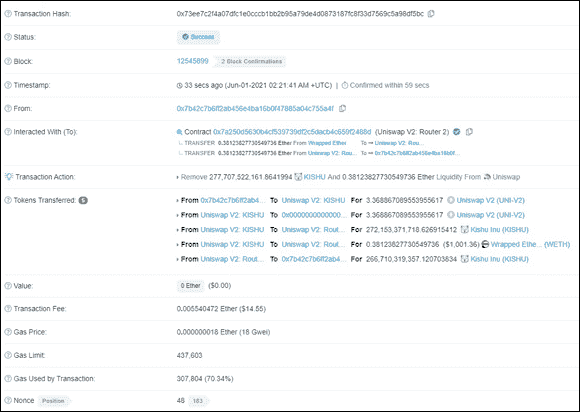

因为这笔交易完成时不需要整个 Gas 限制，剩余资金将退还给发起账户 —— 以下列表解释了事件顺序：


首先，从发起账户收取 `437,603 (gas limit) * 0.000000018 ETH (gas price) = 0.007876854 ETH`，以预付执行此交易所需的算力费用。

根据交易实际消耗的 gas，矿工获得的交易费用为 `0.005540472 ETH`。

发起账户将获得未使用部分的退款：`0.007876854 - 0.005540472 = 0.002336382 ETH`。

因为交易已成功执行，EVM 的状态已被更改，并重新广播到网络中。

### 场景 2：交易耗尽 Gas

考虑另一笔提交的交易，其输入如下：

*   **Gas 价格：** `0.000025 ETH`
*   **Gas 限制：** `25,000`

在这种情况下，执行过程中，矿工发现该交易的计算复杂度超过了其指定的 `25,000` gas 限制，导致交易耗尽 gas（参见图 6-10）。交易不会被执行，但产生的总交易费用为：

> `25,000 (gas limit) * 0.000025 ETH (gas price) = 0.625 ETH`

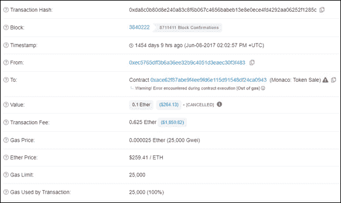

图 6-10： 不成功交易的 Gas 消耗和费用。

尽管该交易未能执行，矿工仍必须因提供的计算工作获得补偿：

*   首先，从发起账户收取 `25,000 (gas limit) * 0.000025 ETH (gas price) = 0.625 ETH`。
*   根据矿工在（未成功）尝试执行此交易时使用的算力，矿工获得的交易费用为 `0.625 ETH`。
*   因为交易未被执行，EVM 的状态保持在尝试执行前的样子。
*   没有剩余资金退还给发起账户。

花费 `0.625 ETH` 却什么也没发生，真遗憾！

 你可能为交易支付的总金额，上限由你指定的 gas 价格乘以 gas 限制决定。如果交易以较低成本执行，gas 价格乘以未使用的 gas 将退还到你的账户。

## 区块链：所有数据的存储与安全之地

EVM 上所有已确认的交易都永久记录在以太坊区块链上——一种基于区块链的分布式账本，充当着无许可且共享的数据库，跨多个节点同步。任意节点均可访问该账本，且更新（几乎）会同时复制到所有节点。区块链包含一套记录保存系统，将信息按时间顺序组织成数据区块——换句话说，交易记录被分组成区块，定期确认并追加到现有链上。

每个区块通过包含前一个区块信息的哈希值与其前驱区块相链接，形成*区块链*。区块常通过区块高度引用，区块高度代表区块在区块链中的位置——或者说等同于它之前的区块数量。*创世*区块被称为区块 `0`。

每个新形成的区块在被添加到不断增长的确认区块链之前，都需要网络共识。一如既往，矿工们疯狂竞争解决一个计算量巨大的难题，以赢得将其区块追加到现有区块链的权利。该难题的解决方案，称为工作量证明，难以生成但易于验证。例如，猜测某人的电话号码是项艰巨任务，但当电话号码给出时，你可以轻松确认你拥有正确的解决方案。

当矿工找到解决方案时，他们完成待定区块的打包并将结果广播给网络其余部分，区块链随之更新，随后新一轮竞赛开始以确认下一个区块。

### Ethash 与工作量证明：是什么让以太坊防篡改？

以太坊和比特币等公共区块链需要一种共识机制，以确保系统：

*   **容错：** 即使存在故障、失效或恶意节点，系统仍应继续运行。
*   **安全：** 网络共同确认和就账本状态达成一致所遵循的规则，应确保即使存在一群不诚实节点，记录仍防篡改。

保障以太坊区块链安全的共识机制，基于一种称为 `Ethash` 的工作量证明算法（尽管开发者正致力于将系统迁移至权益证明共识机制）。因为工作量证明要求解决一个漫长且艰巨的问题来确认和执行交易，已封存的信息区块难以篡改，因为不诚实节点必须基于篡改后的信息，艰难且辛苦地寻找新难题的解决方案。

由于工作量证明系统在设计上计算繁重，参与者对依赖工作量证明作为安全协议的加密货币的能源消耗和环境不友好性表示出日益增长的担忧。公司（参见图 6-11）以及国家（参见图 6-12）正在改变对加密货币支付和加密挖矿的态度。作为回应，基于权益证明（PoS）协议的共识机制日益流行。与工作量证明相反，*权益证明*要求在系统中拥有足够的权益——通过账户余额或账户年龄等因素衡量——来确认交易。

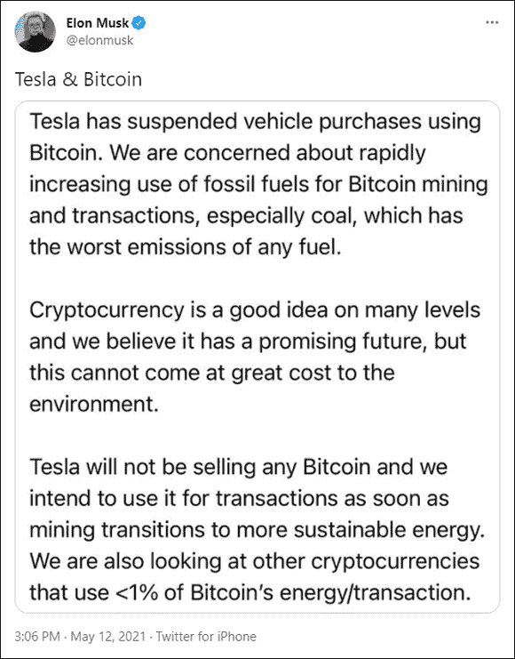

图 6-11： 埃隆·马斯克发推文表达对加密挖矿可持续性的担忧。

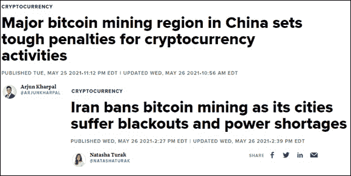

图 6-12： 新闻中关于打击加密挖矿活动的报道。

多年来，以太坊社区一直期待以太坊 2.0，即从基于工作量证明的当前系统转向基于权益证明的系统。尽管关于近期可能转向以太坊 2.0 的猜测很多，但截至撰写本文时，工作量证明仍是主导机制。

### 矿工、Nonce 与熊——哦，我的天！

成功矿工工作量证明的“证明”，在于区块头中包含的区块 nonce。（区块头包含每个已确认区块的重要信息。）

这个名字奇特的*区块 nonce*，是一个只能通过计算密集型的试错过程找到的数字。在此过程中，矿工不断尝试任意值，直到找到那个特殊的数字——nonce——它与当前区块的其他重要元素结合时，能满足 `Ethash` 协议要求的数学条件。因此，这个 nonce 难以寻找，但在解决方案公布后易于验证。

所需的数学条件是一个基于当前区块难度级别的移动目标。区块难度根据前一个区块的难度级别和最近的出块时间动态调整。新难度级别可能高于或低于前一个区块的级别，这种动态调整确保了随着矿工进出网络，区块不会在较长时期内形成得过快或过慢。

 不要将区块 nonce 与*交易 nonce* 混淆，后者是表示从给定账户发送的交易按时间顺序排序的数字。

### 需要多少个“确认”我才算真正确认？

最近的区块最容易受到攻击，因为它后面没有后续区块，从而消除了求解大量工作量证明谜题的需求。一群恶意节点可以串通发起所谓的 `51% 攻击`，集结至少一半的网络算力。他们的最终目标是花费两次相同的资金（称为 `双重支付`）。该群体可能采用以下策略：

1.  提交一笔交易，将 ETH 发送至加密货币交易所的一个账户。
2.  在区块确认并执行后，立即将 ETH 兑换为 USD 并提取资金。
3.  同时，通过利用该群体的集体算力迅速找到一个与现已修改的区块相匹配的新工作量证明解，来撤销第 1 步的交易。
4.  重复上述过程。

然而，即使拥有足以重新求解并修改最近关闭区块内容的算力，该群体也难以足够快地重新求解并修改 50 个区块，以推翻之前确认这些区块的网络共识。

为了应对这类攻击，供应商和钱包服务通常要求已确认的交易达到一定的区块深度，才将其视为真正确认。在将待处理资金记入您的账户前所需的确认数量因加密货币而异，也因不同的供应商和钱包服务而异。图 6-13 显示了主要美国加密货币交易所 Kraken 上部分精选加密货币所需的确认数量及预计等待时间。

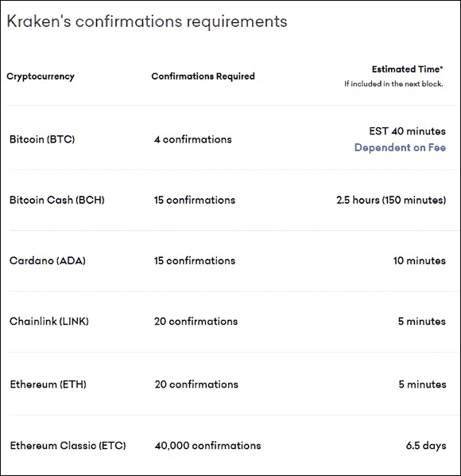

图 6-13： Kraken 所需的确认数量及预计等待时间。

Kraken 现在要求以太坊交易达到 20 个区块深度（即 20 个确认），才能使资金可用于交易或提取。相比之下，Coinbase 需要 35 个确认，而 Gemini 仅需 12 个。

### 叔块与孤块

鉴于竞争形成新区块的挖矿节点组成的庞大网络，您最终会遇到同时或近乎同时出现的工作量证明解。在这种情况下，网络会看到两个新区块在同一区块高度（也称为 `区块编号`）被创建并追加，导致区块链暂时分叉。更准确地说，当争夺的结果被广播到网络时，一个结果会先到达某些节点，而另一个结果先到达其他节点。在短暂的一段时间内，不同节点对区块链状态拥有不同的版本。

随着下一轮速度竞争的展开，随着后续区块被确认并追加，其中一条链最终胜出。这意味着网络最终接受累积工作量更大的链（通常是更长的链），两个争夺区块中只有一个保持被网络确认，而另一个变为过时区块。

在此场景下，该过时区块在以太坊术语中称为 `叔块`（如图 6-14 以图形方式所示）。叔块也被称为 `ommer 区块`，这是一个性别中立的称呼。在比特币领域，这些区块被称为 `孤块`。

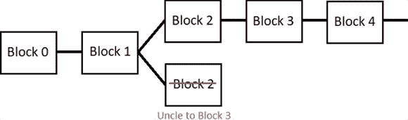

图 6-14： 区块链的暂时分叉导致叔块的产生。

### 硬分叉：底层协议的更新

在以太坊等 DAO 中，参与者可以随时自由加入或退出网络，并按其意愿参与，因此任何人都可以选择执行以下任意操作：

*   查看完整的交易历史。
*   维护 EVM 状态的副本。
*   作为矿工参与，致力于确认并向链上添加新区块。

此外，以太坊社区共同管理底层 `网络协议` 的补丁和更新——即管理以太坊的代码和规则体系。社区中的任何人均可通过提交 `以太坊改进提案` (EIP) 来提议更新底层协议。最终，一群对协议开发贡献最大、参与度最高的核心贡献者，即 `以太坊核心开发者`，共同决定实施哪些 EIP。

重大变更需要对底层共识协议进行 `分叉`，强制区块链永久分裂，使得沿分叉路径追加的所有后续区块必须遵循新的共识协议。通常，以太坊区块链的硬分叉并未产生新的（可替代）代币，因为社区通常遵循核心开发者的方向。因此，运行在旧协议下的分支通常仅因缺乏活动而悄然消亡。

这一普遍和谐分叉趋势中最著名且最具争议的例外，是 2016 年以太坊区块链的一次硬分叉，它导致社区出现重大分裂，并随之产生了两个独立的代币：ETH 和 ETC（以太经典）。

## 智能合约让 EVM 运转起来

`智能合约` 是一种软件程序，一经部署，即驻留在一个特殊的合约账户中，该账户在 EVM 上拥有自己独特的地址。部署智能合约的行为本身就是一笔交易，并需要消耗 Gas。（我们在第 2 章介绍智能合约，并在第 9 章展示如何编写和部署您自己的智能合约。）

一经部署，智能合约处于休眠状态，直到被交易触发。以太坊区块链上的许多交易旨在调用各个智能合约中存放的函数，这反过来可能触发对其他智能合约函数的调用。（参见图 6-15。）此处的 `函数` 是指为完成特定任务而编写的独立代码片段。`调用` 引用位于别处的函数——在本例中，即其他智能合约中的函数。

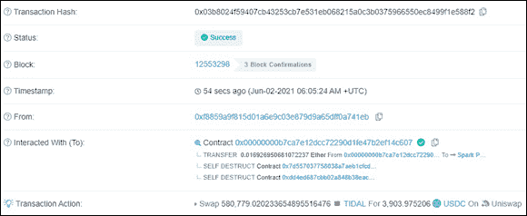

图 6-15： 一笔示例交易，发起对智能合约函数的调用。

智能合约旨在强制执行一组规则，这些规则在被调用时会自动执行。精心设计的智能合约通过 EVM，通过验证期望条件并据此发起后续计算请求或数据更新，来强制执行协议。而且这一切无需可信中介即可完成！

与来自未知或不可信来源的任何应用程序一样，您在使用以太坊上的智能合约应用程序时应保持谨慎。

### 智能合约的初始生命周期

假设您想部署一个智能合约来为新基金筹集 ETH。例如，区块链资本（旧金山的一家风险投资公司）通过 BCAP 代币发行筹集了 1000 万美元，该发行是作为以太坊上的智能合约实现的。该过程如下所示：

1.  **您提交一笔包含已编译代码的交易，指定执行所需的适当 Gas 价格和 Gas 限制。**
2.  **当您的交易被确认并执行后，您的合约账户被创建并分配一个地址。**
3.  **不久之后，一位潜在投资者提交一笔交易，以发起对您智能合约 `deposit` 函数的调用。**
4.  **一旦矿工选中该交易并确认了区块，交易开始执行，您的智能合约的 `deposit` 函数被调用。**
5.  **`deposit` 函数随即调用另一个内部函数，以确认潜在投资者是否符合您基金的投资者标准——例如，最低 ETH 存款额和账户最低存在时间。**

#### 部署验证

如果满足这些条件，`deposit` 函数将接受 ETH 存款。

假设投资者指定了足够的燃气限额，交易将被完全执行，EVM 的状态也将随之更新。

恭喜！您已成功部署了一个应用程序，它能让您以自动化的方式为基金筹集资金，并拥有一个既去中心化又自主的安全验证流程！

在第 9 章中，我们提供了编写、编译和部署您自己的以太坊智能合约的实际分步指南。

### 令人兴奋的可能性

区块链世界里一个日益流行的新成员是去中心化应用程序——即运行在区块链上的应用程序。它们的魅力源于人们对金融民主化和去除中介的渴望。它们的吸引力也归功于加密货币的流行及其价值的飙升。如果您把以太坊想象成一个去中心化的互联网——许多人称之为 Web3 或 Web 3.0，那么 dApps 就是这个系统中的去中心化网站。

EVM 上构建了许多用于不同目的的 dApps。例如，智能合约可以被设计为执行以下任何操作（尽管单个合约不一定会做所有这些事）：

*   执行 ICO。
*   生成和支持同质化代币（即加密货币）。
*   创建和交易非同质化收藏品（即 NFT）。
*   提供去中心化社交媒体渠道。
*   进行去中心化交易。
*   托管去中心化博彩市场。

### 显著局限性

EVM 是一个**封闭系统**，这意味着以太坊上的所有内容都是完全自包含的，从而确保关于 EVM 真实状态的共识永远不会受到威胁。以太坊网络中的每个节点都必须能够线性执行所有已确认的交易——从创世区块到最近的区块——并就每个区块依赖的 EVM 状态得出相同的结论，直到其最近的状态（例如，活跃账户、账户余额、活跃智能合约和存储的数据）。

依赖该系统外部的信息可能会导致故障，从而导致合约无法成功完成。假设智能合约的后续步骤取决于账户 ETH 余额的美元价值，而不是 ETH 余额本身。获取链下 USD/ETH 汇率固有的随机性违背了智能合约必须执行订单的方式。根据节点查询链下信息以确定从一种 EVM 状态过渡到下一种状态的时间不同，结果可能会有所不同。

归根结底，这意味着智能合约只能向合约本身或 EVM 上的其他智能合约中的函数发出调用。它们无法发送 HTTP 请求来传输数据（例如您在互联网上访问信息时的情况），也无法与外部（链下）应用程序编程接口（API）交互，因为这可能会危及节点间的共识。

### 预言机：如何连接“外部”世界

假设您想在 EVM 上开发一个博彩应用，旨在如果旧金山温度在 2025 年 1 月 1 日任何时候超过 100 华氏度（据 [`www.weather.com`](http://www.weather.com) 报道），则向特定账户发送 ETH。因为您无法编程让智能合约发送消息请求以获取以太坊区块链外部的信息，所以您需要一种巧妙的方法，以可靠且自动化的方式将这些链下信息传递给您的智能合约。这就是预言机的用武之地。

预言机提供了一种向 EVM 发送结构化、最新信息的方法。在天气博彩示例中，您可以开发一个单独的链下应用程序来执行以下操作：

1.  从 2025 年 1 月 1 日凌晨 12:00:00 开始向 [`www.weather.com`](http://www.weather.com) 提交 HTTP 请求。
2.  如果旧金山报告的温度超过 100 度，让您的链下应用程序向以太坊网络提交一笔交易，请求将此信息发送到托管您的链上博彩应用的智能合约地址。
3.  一旦这笔交易被挖出并执行，确认的超过 100 度的状态就会触发您的链上博彩应用向相应账户发起 ETH 资金转账。

任何预言机的可靠性和安全性仅取决于其数据源和编程逻辑。随着更复杂的区块链应用程序数量和受欢迎程度的增加，对预言机服务的需求也随之增加。此类服务提供了访问常见链下数据和计算的基础设施，例如：

*   **区块链游戏的随机数生成：** *CryptoKitties* 是第一个广泛使用的区块链游戏，尽管现在您可以找到其他几个。详见第 2 章了解更多关于 *CryptoKitties* 的信息。
*   **博彩或 DeFi 应用的价格源：** DeFi 代表去中心化金融，这是一个在公共、去中心化区块链网络上提供金融服务的系统。
*   **来自其他公共区块链的数据源：** 比特币和莱特币是其他公共区块链的例子。

以下是几个流行的预言机服务：

*   **Chainlink：** [`https://chain.link`](https://chain.link)
*   **Provable：** [`https://provable.xyz`](https://provable.xyz)
*   **Witnet：** [`https://witnet.io`](https://witnet.io)

## 深入剖析以太坊的基本结构

本节重温本章讨论的术语和概念，并展示它们之间的相互依存关系。

### 整体概览

这些关键词是您以太坊知识储备的重要组成部分。任何关于以太坊特别是加密货币的一般对话，不可避免地都会涉及这些术语：

*   **以太坊虚拟机 (EVM)：** 一个分布式计算平台，参与节点在其中存储 EVM 状态的更新副本。
*   **以太币 (ETH)：** 以太坊的原生代币。
    在 EVM 上的所有计算请求都需要足够的 ETH 来执行。
*   **区块链：** 一种记录保存系统，其中交易记录被分组到按时间顺序排列的区块中，每个区块通过加密方式链接到其前一个区块。
*   **分布式账本：** 一种公开且无需许可的记录保存系统，任何想要参与的人都可以访问，无需中央权限机构的许可。
*   **去中心化自治组织 (DAO)：** 一个无领导者的组织，基于一套规则和开源智能合约的核心网络自主运行并维护共识。

### 区块链的核心机制

讨论以下技术概念是展示您加密货币专业知识的好方法：

*   **矿工（挖矿节点）：** 一种专门的节点，通过解决计算成本高昂的工作量证明谜题来验证和处理计算请求，并获得报酬。
*   **共识机制：** 为确保去中心化网络能够就正确信息达成一致，并在面对网络中不诚实的参与者时拒绝虚假信息而制定的规则。


*   **以太坊改进提案 (EIP)：** 一项更新以太坊底层协议各方面的提案。
*   **工作量证明：** 一种安全协议，要求参与者解决漫长且繁琐的谜题以确认和执行交易。
*   **权益证明：** 一种安全协议，要求参与者证明在系统中拥有足够的权益以确认和执行交易。
*   **区块高度（区块编号）：** 表示区块在区块链中的位置，更准确地说，是它之前的区块数量。

    创世（或起源）区块编号为 0。
*   **区块随机数：** 显示成功矿工的工作量证明，满足以太坊基于 PoW 的共识协议所要求的数学条件，并允许矿工确认并将区块追加到不断增长的区块链上。
*   **51% 攻击：** 当一群串通的矿工积累了超过网络一半的算力并试图操纵系统时发生。
*   **叔块（也称为中性术语 ommer block）：** 一个与有效区块同时被挖出但现已过时的区块，以太坊链从该有效区块继续增长。

    叔块在比特币区块链中被称为 `orphans`（孤儿块）。
*   **硬分叉：** 涉及底层共识协议的重大变更，导致区块链永久分裂。

    以太坊区块链的硬分叉通常不会导致独立代币的产生。

## Gas 要点

本节列出的术语可能不算传统意义上的“趣味”词汇，但了解它们在交易执行速度和成功率中的作用，对于建立终极“街头信誉”至关重要：

*   **交易：** 代表 EVM 上的一个计算请求。
*   **交易哈希：** 分配给每笔交易的唯一代码。
*   **Gas 价格：** 代表某人愿意为提交交易所消耗的每单位 gas 支付多少 ETH。
*   **Gas 限制：** 代表某人愿意为完整执行提交的交易而使用的最大 gas 单位数。
*   **交易费：** 执行交易实际使用的 gas 量乘以该交易指定的 gas 价格。

## 让 EVM 成为一个有趣地方的事物

能够聊聊以下话题会为你的以太坊对话增添光彩：

*   **智能合约：** 一组代码和数据，旨在强制执行确定性规则，在被调用时自动执行。
*   **去中心化应用：** 运行在 EVM 上的程序。
*   **预言机：** 提供一种将链下信息发送到 EVM 的方式。

# 第 7 章：创建以太坊账户

## 本章内容

*   **深入了解外部拥有账户和合约账户的细节**
*   **识别主网和测试网之间的区别**
*   **区分钱包和账户**
*   **设置你的账户**

本章将指导你在以太坊上设置不同类型的账户，并解释如何为每个账户正确注资。因为本章涵盖了构建你自己的 ERC-721 非同质化代币之旅的第一个关键步骤，我们建议你阅读全章以了解我们在此过程中使用的基本功能和做出的选择。然而，你*只需*阅读本章的最后一节“准备你的账户（在 MetaMask 上）”，所以如果你很赶时间，可以直接跳到最后。

> **请记住：** 在深入阅读本章的实操说明之前，你必须安装并设置好 MetaMask 钱包。你的账户中也需要有一些 ETH 资金（特别是如果你打算在以太坊网络上铸造实际的 NFT）。我们在第 2 章和第 4 章中向你展示如何完成这两项任务。

## 理解外部拥有账户

*外部拥有账户*（EOAs）用于在以太坊网络上提交计算请求。EOA 可以接收、存储和发送以太币（以太坊平台的原生加密货币），以及与已部署的智能合约进行交互。请求可能是将资金从一个 EOA 转移到另一个 EOA，或者是在 EVM（以太坊虚拟机，我们在第 6 章中介绍）上调用各种智能合约中的函数。

> **请记住：** EOA 通常简称为*账户*，我们也遵循这一惯例。事实上，你在以太坊上创建账户的第一次尝试——使用 MetaMask（我们在第 2 章和第 4 章中介绍）——确实是正式创建所谓的外部拥有账户。全书中，我们交替使用*账户*和*外部拥有账户*这两个术语。

请记住以下几点：

*   你需要一个账户才能在以太坊网络上提交交易。
*   账户可以发起交易以与智能合约或其他账户进行交互。
*   账户之间的交易只能是转账（ETH）请求。
*   账户不是钱包，钱包也不是账户。

> **请记住：** 钱包服务（如 MetaMask）旨在帮助你管理以太坊账户。就像你可以使用不同的电子邮件客户端访问发送到你电子邮件地址的邮件一样，你可以使用不同的钱包服务访问你的以太坊账户。

创建账户简单且免费。创建账户不需要任何 ETH，尽管你需要为账户注资后才能提交交易——正如我们在第 6 章中讨论的——交易并不总是简单，当然也不是免费的。

### 创建账户意味着什么

许多钱包服务可以为你创建账户。这些服务（如 MetaMask）只是在生成密钥对：

*   **私钥：** 你使用私钥访问账户中的资金，因此你绝不应共享你的私钥。
*   **对应的公共地址：** 你可以与他人共享你的公共地址，以便从其他账户接收资金。

当然，你不需要钱包服务为你生成密钥对。事实上，选择私钥就像在 0 和 2²⁵⁶ 之间选择一个随机数一样简单，这个数字大于 1 万亿的 6 次方——即 1 万亿 × 1 万亿 × 1 万亿 × 1 万亿 × 1 万亿 × 1 万亿。

由于可能的私钥数量极多，即使地球上所有 80 亿人每人创建 1000 个账户，在这种情况下活跃账户的总数——8 万亿——也远少于可能的账户总数。猜测或生成一个正在被使用的私钥的可能性极低。

> **技术细节：** 尽管如此，让钱包服务承担繁重的工作仍有其好处，特别是如果你不擅长数学的话。从技术上讲，你必须选择一个大于 0 且小于 `FFFFFFFFFFFFFFFFFFFFFFFFFFFFFFFEBAAEDCE6AF48A03BBFD25E8CD0364141`（小于 2²⁵⁶ 的值）的私钥值。

私钥以 64 位十六进制数表示，这是一种基数 16 的计数系统，其中每个数字由以下 16 个字符之一表示：0、1、2、3、4、5、6、7、8、9、A、B、C、D、E 或 F。例如：

*   十六进制 `412` 等于 (4 × 16³) + (1 × 16²) + (2 × 16⁰) = 十进制 16,642，这是我们更熟悉的数字。
*   十六进制 `F9C3` 等于 (15 × 16³) + (9 × 16²) + (12 × 16¹) + (3 × 16⁰) = 十进制 63,939。

> **提示：** 在处理上述计算时，请记住任何数字的零次幂都等于一。

随机生成私钥后，你需要通过椭圆曲线数字签名算法 (ECDSA) 生成对应的公钥。（比特币和以太坊都使用 `secp256k1` ECDSA 作为其公钥生成算法。）之后，你仍需使用 `keccak256` 哈希函数对生成的公钥进行哈希运算，取最后 40 个十六进制数字（或最后 20 字节），然后在开头加上“0x”以得到你的公共账户地址。请参阅后面的“数字签名”一节，了解更多用于身份验证的数学算法。

### 私钥与公钥

## 管理账户密钥与理解合约账户

### 在 MetaMask 上访问私钥和公共地址

您使用私钥从账户提取资金；您的公共地址是您可以公开展示以接收资金到账户的地址。当然，如果您想从尚未用于访问这些特定账户的其他钱包服务访问您的账户，您必须知道您账户的私钥。

要在 MetaMask 上访问您账户的私钥和公共地址，请遵循以下步骤：

1.  **登录 MetaMask。**

    您的账户名称及其下方的公共地址将显示出来，如图 7-1 所示。在本例中，账户名称为 NFTs For Dummies，公共地址为 `0xf77a3cE366E32645ffC78B9a88B7e90583646df9`。

2.  **点击账户名称以复制您的公共地址。**

    公共地址采用十六进制表示法，共 42 位（或 40 位十六进制数字，前缀添加 "0x"）。

    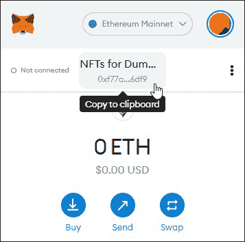

    图 7-1： MetaMask 上显示的账户名称和公共地址。

3.  **点击账户名称右侧的垂直省略号，并从下拉菜单中选择“账户详情”，如图 7-2 所示。**

    将出现“账户详情”选项卡，如图 7-3 所示。

    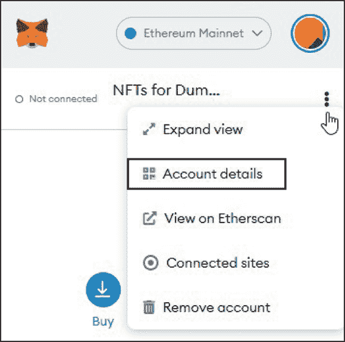

    图 7-2： 在 MetaMask 上访问其他账户详情。

4.  **点击“导出私钥”按钮。**

5.  **输入您的 MetaMask 钱包密码并点击“确认”，如图 7-4 所示。**

    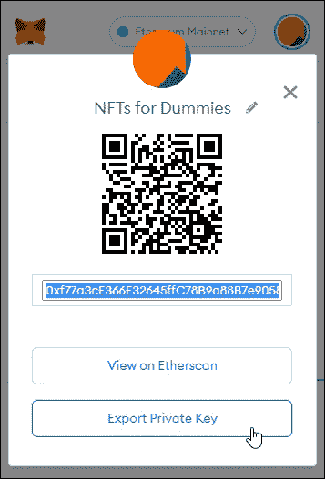

    图 7-3： MetaMask 上的“账户详情”选项卡。

    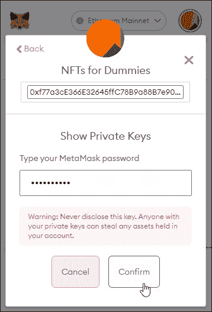

    图 7-4： 在 MetaMask 上访问账户私钥的密码提示。

6.  **现在您只需点击即可复制账户的私钥。**

    对于图 7-5 中显示的 NFTs For Dummies 账户，我们获得了以下私钥，它采用十六进制表示法，共 64 位：

    `0bf71f18f67efa95140d5fe4c68afe06f9c9e475b0dde035d06a83d8026f441c`

    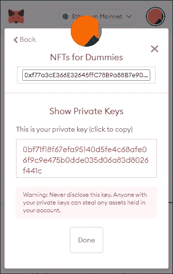

    图 7-5： MetaMask 上显示的账户私钥。

 当然，**切勿**向全世界公布您的私钥（正如我们此处为演示所做的那样）。

总的来说，私钥和公钥配合使用，共同形成数字签名以验证交易。此过程确保只有合法的账户所有者才能从给定账户提交交易。

### 数字签名

私钥/公钥对如何工作以确保只有您可以花费账户中的 ETH？通过使用*数字签名*，它们是验证数字消息或文档真实性的数学算法。在此，我们提供一个简单的示例来说明数字签名的工作原理。基本要素如下：

*   每个私钥对应一个公钥。
*   公开您的公钥不会泄露关于您私钥的任何信息。
*   您的私钥与您的公钥及交易信息相结合以形成签名。
*   该签名连同您请求的交易一起广播至整个网络。
*   当验证者将您的公钥应用于公开广播的签名时，应能还原出原始的交易信息。

 假设您拥有一个只有您知道的私钥 `Kpriv = {7}` 和一个与所有人共享的对应公钥 `Kpub = {3, 33}`。还假设您想从此账户发送 16 ETH。

以下步骤以简化方式展示了数字签名如何工作，以证明您是相关账户的合法所有者：

1.  **将数字 16（您想要发送的金额）乘以 7 次方（您的私钥），然后除以 33（公钥的一部分）。**

    换句话说，将 `16⁷` 除以 33。该除法的余数等于 25。这个数字 25 就是该交易的数字签名，它证明您是合法的账户所有者，且无需透露您的私钥。

2.  **提交您的 16 ETH 转账请求连同您的数字签名 25。**

    即广播数字对 `{16, 25}` 以供验证。

3.  **为了验证您是合法所有者，验证者应用您已知的公钥 `Kpub = {3, 33}`，将 25 乘以 3 次方，然后除以 33。**

    该除法的余数正好等于 16，证明您是合法所有者。

    从此，您的交易被添加到待处理交易的内存池中，等待被添加到区块链 —— 所有这些过程都未泄露您的私钥 `Kpriv = {7}`！

 如果恶意用户试图从您的账户提取资金，没有您的私钥他们无法做到。假设恶意用户错误地猜测您的私钥等于 `{8}`（而不是真实的 `Kpriv = {7}`）。会发生以下情况：

1.  为了对 16 ETH 转账请求签名，恶意用户现在将 16 乘以 8 次方（而不是 7），然后除以 33（使用您公钥 `Kpub = {3, 33}` 中的信息）。

    此处的余数变为 4，这就是广播到网络的数字签名。

2.  恶意用户提交交易请求连同数字签名 `{16, 4}`，声称他们是合法所有者并请求提取 16 ETH，数字签名证明为 4。

3.  为了验证，验证者将 4 乘以 3 次方，然后除以 33（再次使用已知公钥 `Kpub = {3, 33}`）。

    除法的余数为 31，不等于 16 ETH 转账请求。

    因此，该欺诈交易被拒绝，展示了数字签名的精妙之处。

当然，这个简单的示例并未完全传达以太坊所使用的数字签名和验证过程。尽管如此，它展示了密钥对和数字签名如何运作，以可信地证明您是账户的合法所有者，且从未泄露您的私钥。

### 发现合约账户

 **合约账户**，通常简称为合约或智能合约，旨在在 EVM 上的指定合约地址存储数据和代码。本质上，当您将软件程序部署到 EVM 时，您就创建了一个容纳该程序的合约账户。

合约账户（合约）在几个关键方面与外部拥有账户（账户）不同：

*   **合约会消耗您的 ETH。** 创建合约账户本身就是一笔交易，必须由外部拥有账户发起。
*   **合约无法发起交易。** 一旦创建，合约账户处于休眠状态，直到被交易触发。合约账户可以被另一个合约账户调用，但这一调用链最终必须源自外部拥有账户。
*   **合约没有私钥。** 合约账户只有公共地址，与外部拥有账户一样，也由一个 42 位十六进制数字表示。

    自然地，因为交易无法从合约账户发起，所以合约账户不需要私钥。

合约部署到 EVM 后，它就变成公开的，任何人都可以访问。任何人都可以自由使用合约中嵌入的函数，甚至可以访问其所有源代码，这些代码可以在公共区块链上通过以下方式找到：

1.  **前往** [`https://etherscan.io`](https://etherscan.io/)**。**
2.  **在右上角基于文本的搜索栏中，输入您要查找的合约地址。**
3.  **点击屏幕顶部标签行上的“Contract（合约）”标签，以查看合约的源代码，如** **图 7-6** **所示。**

    合约地址为 `0x1A79E50064C012639fB6fB6761E332Acf5Ba15d1`

虽然创建合约账户需要消耗 Gas，但一旦该合约账户创建完毕，创建者无需支付任何持续的维护费用来保持合约账户运行。相反，任何想要使用合约中嵌入函数的人都必须从外部拥有账户发起请求，并为该交易支付相应数量的 Gas。

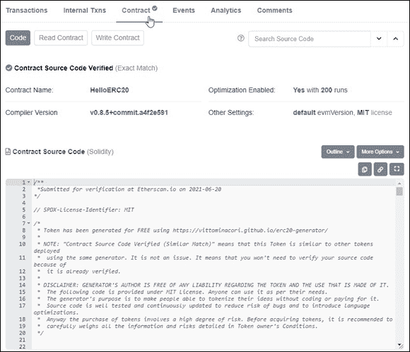

图 7-6： 查找合约的源代码。

创建合约账户意味着提交一笔包含您代码但未指定目标地址的交易。换句话说，您不能像创建外部拥有账户那样（即使您暂时还没有使用它的理由）无目的地创建一个合约账户。

以下列表重点介绍了关于合约账户的重要要点（尽管您目前还无法执行其中的许多操作）：

*   要创建合约账户，您的智能合约代码应该已经准备就绪。
*   从外部拥有账户，向网络提交一笔包含您编译后代码且未指定任何接收者的以太坊交易。
*   一经验证和挖出，您的智能合约就在以太坊区块链上拥有了自己的公共地址，供网络中任何人将来参考。

在创建合约账户之前，您首先需要遵循后面章节“准备您的账户（在 MetaMask 上）”中的步骤，为不同用途设置您的各种（外部拥有）账户。之后，您必须完成设置开发环境的步骤（请参阅 第 8 章），然后才能继续部署您的第一个智能合约（请参阅 第 9 章）。

## 了解公共网络与私有环境的区别

公共网络是无许可的，任何想要参与的人都可以加入，无需中央机构的许可。以太坊生态系统中有两类重要的公共网络：

*   **主网：** 这个主要的以太坊网络是发生并记录实际价值交易的主要区块链。当有人谈论以太坊时，通常指的就是主网。您需要使用真正的 ETH 来为主网上的交易提供燃料。
*   **测试网：** 测试网络可供开发者在主网上交易前测试各种功能。您可以使用测试 ETH（而非真 ETH）来为测试网上的交易提供燃料。

即使在测试网上尝试之前，开发者通常会先在本地开发环境中测试他们的代码，这样做的优势是更快、更简单。

### 本地开发环境

本地开发环境是私有的，提供了一个简单安全的沙箱，您可以在其中观察智能合约部署后的行为。*沙箱*之所以安全，是因为它们是为实验而构建的隔离测试环境——沙箱中的代码不是实时运行的，因此错误不会造成真正的损害或网络拥堵。

这些本地环境（如 `Ganache`，我们将在 第 8 章 中介绍）通过提供带有预置测试账户的私有区块链来模拟以太坊区块链。与公共网络不同，您的交易会自动执行，以便于调试合约，而无需等待区块通过繁琐的工作量证明流程被挖出。（有关工作量证明的解释，请参阅 第 6 章。）

### 测试网络

公共测试网提供了另一个更接近主以太坊网络运作方式的练习环境。与本地开发环境不同，测试网提供公共区块链，主要遵循主以太坊区块链的规则。

测试网为以太坊提供了一个入口，让您无需浪费实际 ETH 来部署尚未完全调试的测试合约。您不使用真实 ETH 为测试网上的交易提供燃料——而是使用相应测试网原生的测试 ETH。

测试网主要有两种类型：

*   **工作量证明：** 只有一个测试网——Ropsten 测试网络——基于工作量证明共识协议，这使其成为主以太坊网络的最接近代表。

    我们在分步指南中使用 Ropsten 测试网络，因为它依赖工作量证明，正如我们在 第 6 章 中所解释的，这是以太坊的主流共识机制。
*   **权威证明：** 其他测试网——Kovan、Rinkeby 和 Gӧrli/Goerli——基于权威证明共识协议。通过该协议，一组选定的节点被授权验证交易并向相应的测试网区块链添加新区块。

### 主网络

主以太坊网络 *Mainnet* 是真正的行动——以及任何实际价值——发生的地方。您在新闻中看到或考虑购买的任何基于以太坊的 NFT（例如 第 2 章 中的 *CryptoKitties*）都存在于主以太坊网络上。


每当有人简单地提到以太坊时，他们指的是主以太坊网络，而不是各种测试网或私有开发环境。

## 准备您的账户（在 MetaMask 上）

首先登录您的 MetaMask 钱包。（有关设置 MetaMask 的信息，请参阅 第 2 章 和 第 4 章。）您的 MetaMask 钱包可以容纳多个账户，您可以创建任意数量的账户，如 图 7-7 所示。拥有独立的账户可以让您将主网账户（包含真实 ETH）与测试网和本地账户分开，在后者中您可以存储测试 ETH 并在尝试主网交易前运行练习交易。

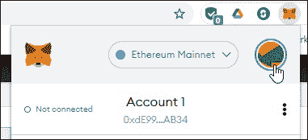

图 7-7： 在 MetaMask 应用中创建独立账户。

要创建新账户，请点击 MetaMask 应用右上角的彩色圆圈（参考 图 7-7），然后从下拉菜单中选择“Create Account（创建账户）”。您创建的每个独立账户都将拥有自己唯一的私钥和公共地址。我们建议至少创建三个独立账户，并按如下标签命名：

*   主网账户
*   测试网账户
*   本地账户

在后续章节中，我们将向您展示如何设置开发环境（第 8 章）并准备部署您自己的智能合约（第 9 章）。相信我们：当您达到那个阶段时，您会庆幸自己拥有独立的账户。

随着我们在本节中继续设置指南，以及在 第 8 章 到 第 11 章 中继续构建您自己的非同质化 ERC-721 代币的说明，我们将引用这些账户名称。

### 在 MetaMask 上重命名账户

如果您已经创建了想要重命名的账户（这不会改变账户的任何其他方面），可以按照以下步骤操作：

1.  **选择您要重命名的账户。**
2.  点击账户名称右侧的垂直省略号，如图 7-8 所示。

    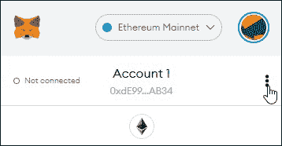

    图 7-8： 在 MetaMask 上导航账户选项。

3.  在出现的下拉菜单中，选择“Account Details”（账户详情）。

    此时会显示一个新窗口，账户名称位于二维码上方，如图 7-9 所示。

    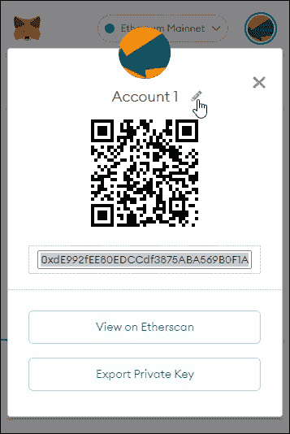

    图 7-9： MetaMask 上的特定账户详情。

4.  点击账户名称旁边的铅笔图标。
5.  重命名账户，然后选中文本输入框右侧的复选框以确认更改，如图 7-10 所示。

    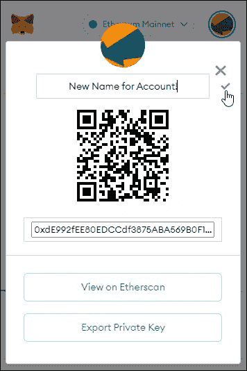

    图 7-10： 在 MetaMask 上重命名账户。

完成！账户现在显示其新名称。

在 MetaMask 上更改账户名称不会改变提交交易所需的私钥，也不会改变用于接收资金的公共账户地址。这些账户名称纯粹是一个外观功能，旨在帮助您在心理上为不同用途组织不同的账户。

### 向不同账户添加不同的 ETH

在您设置好三个账户并为其命名以便于组织管理后，您需要向每个账户注入一些 ETH。以下列表重点介绍了在为每种类型的账户注资时需要牢记的重要差异：

*   **Mainnet account（主网账户）**：您需要在此账户中拥有真实的 ETH，以便在主网上为以太坊交易提供燃料。（有关如何用实际 ETH 为您的主网账户注资的详细信息，请参阅第 2 章和第 4 章。）

*   **Local account（本地账户）**：为本地账户注资要简单且廉价得多，因为测试环境仅局限于您的个人系统，且 ETH 在此本地测试环境之外没有实际价值。（您无法在该本地环境之外花费这些 ETH。）

    当您启动一个私有的练习区块链时，您的本地开发环境也会启动预先注入了本地测试 ETH 的本地账户。我们将在第 8 章中解释如何将这些本地账户及其测试资金导入 MetaMask，届时我们将向您展示如何设置您的以太坊技术栈。

*   **Testnet account（测试网账户）**：为了在公共测试网上为您的测试交易提供燃料，您需要特定网络的测试 ETH。这就是水龙头的用武之地。测试 ETH *水龙头* 会定期提供测试 ETH，但在给定时间段内您只能请求有限数量的测试 ETH。（有关测试水龙头的更多信息，请查看下一节。）

### 为您的测试网账户注资

您可以从各种测试网络获取测试 ETH 为您的测试网账户注资。MetaMask 很贴心地提供了一个列表供您选择，然后您可以去获取您的测试 ETH。我们使用 Ropsten 以太坊水龙头为我们的测试网账户注资，因为我们稍后将使用 Ropsten 测试网络来练习部署智能合约。

要为您的测试网账户注资，请执行以下步骤：

1.  前往 Ropsten 以太坊水龙头页面 [`https://faucet.ropsten.be`](https://faucet.ropsten.be)，如图 7-11 所示。

    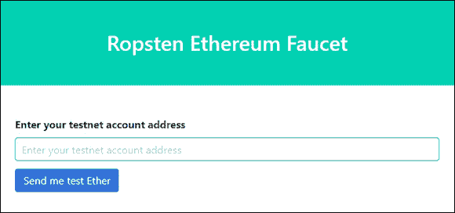

    图 7-11： Ropsten 以太坊水龙头。

2.  登录您的 MetaMask 钱包。
3.  点击中间的下拉菜单，将网络从以太坊主网切换到 Ropsten 测试网络，如图 7-12 所示。
4.  选择您的测试网账户，然后点击复制公共账户地址，如图 7-13 所示。

    在我们的示例中，该账户地址为 `0x43371B75585785D62e3a50533aa15ee8D350273F`。

5.  将此账户地址粘贴到 Ropsten 以太坊水龙头中，然后点击“Send Me Test Ether”按钮，如图 7-14 所示。
6.  等待约 1 分钟。

    请耐心等待——可能需要稍长一点时间。

7.  仔细检查您现在是否在 MetaMask 上拥有测试网账户余额，如图 7-15 所示。

    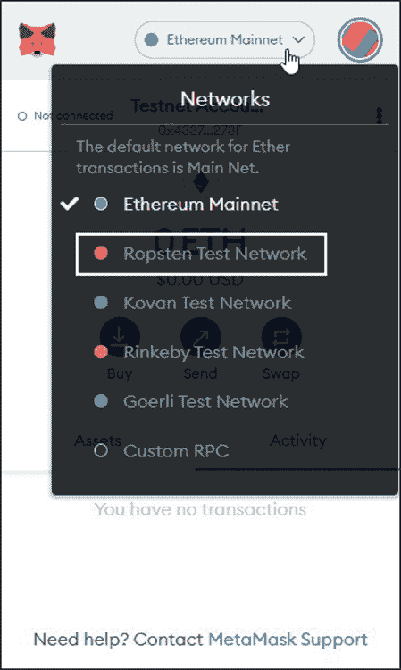

    图 7-12： 在 MetaMask 钱包中切换网络。

    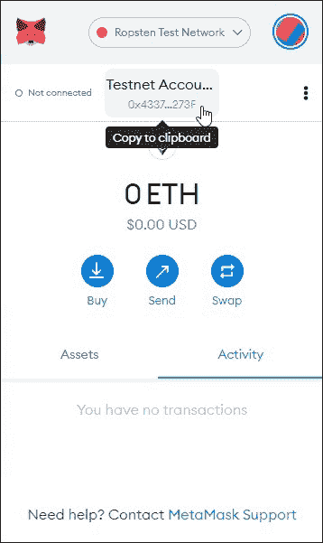

    图 7-13： 从 MetaMask 钱包复制公共账户地址。

    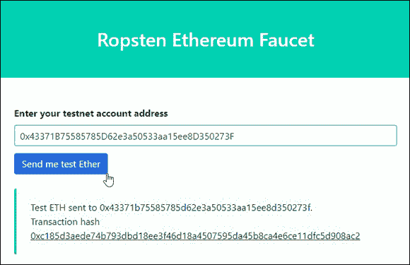

    图 7-14： 从 Ropsten 以太坊水龙头请求测试 ETH。

    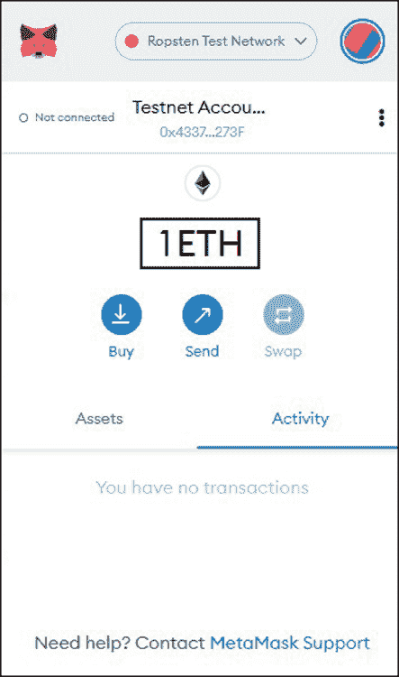

    图 7-15： 请求测试 ETH 后更新的测试网账户余额。

恭喜！您的测试网账户现在有 1 个测试 ETH 了。

如果您等待超过 10 分钟仍未在测试网账户中看到测试 ETH，请确保您已按照前面步骤列表中的步骤 3 所述，将网络切换到 Ropsten 测试网络。

测试网水龙头并不提供无限量的测试 ETH，如果您在收到测试 ETH（亲切地称为“一滴”）后过早再次请求，您将被加入灰名单。Ropsten 以太坊水龙头甚至要求两次请求之间有 24 小时的冷却期。如果您在该期限结束前提出另一个请求，您将被*加入灰名单*，并且必须再等待 24 小时才能请求更多测试 ETH。(图 7-16 展示了此类警告的样子。)

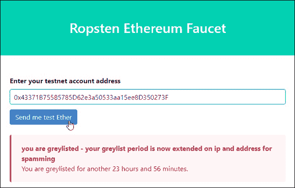

图 7-16： 灰名单，当您过早请求更多测试 ETH 时发出警告。

### 探索 Ropsten 测试网区块链

与以太坊主网上的交易一样，您可以在 Ropsten 测试网区块链上查看您的测试网交易，以及所有其他测试网交易区块。具体方法如下：

1.  前往 [`https://ropsten.etherscan.io`](https://ropsten.etherscan.io/)。
2.  输入特定的交易哈希、区块号或账户地址进行探索，如图 7-17 所示，然后点击搜索按钮（带有放大镜图标的按钮）。

    让我们粘贴上一个示例中的测试网账户地址：

    `0x43371B75585785D62e3a50533aa15ee8D350273F`

    此搜索显示了向我们在第 2 步中输入的测试网账户转账单个测试 ETH 的交易，如图 7-18 所示。

    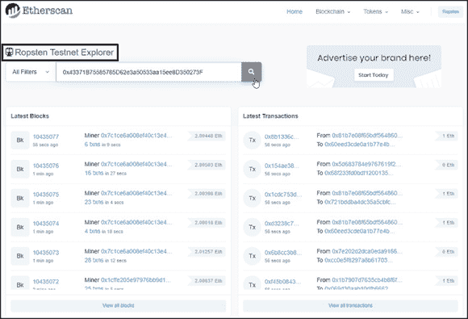

    图 7-17： 在 Ropsten 测试网上探索交易。

    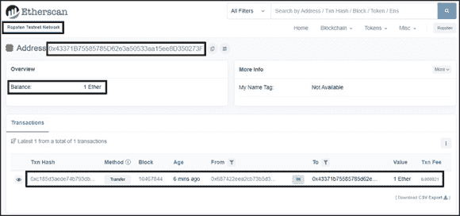

    图 7-18： 在 Ropsten 测试网上查找交易和账户余额。

    当然，与该测试网账户关联的交易和 ETH 不会被转移到以太坊主网，主网可通过 [`https://etherscan.io`](https://etherscan.io) 访问，如图 7-19 所示。

### “消失”的余额

# 设置开发环境

## 本章内容

- 介绍解决方案栈和集成开发环境
- 使用 Ganache 启动本地区块链测试环境
- 配置 MetaMask 以连接到自定义网络
- 将 Remix-IDE 与您的 MetaMask 钱包同步

在本章中，我们将介绍以太坊解决方案栈的要素，并指导您完成在 Ganache 中设置本地开发环境的步骤。我们还将向您展示如何配置 MetaMask 钱包以连接到您的本地测试环境并导入至少一个本地账户。最后，我们将介绍将 Remix-IDE 与您的 MetaMask 钱包同步。

> **提示：** 第 7 章 向您展示了构建您自己的非同质化 ERC-721 代币之旅中的第一个关键步骤（设置您的账户），而本章涵盖了第二个关键步骤（设置您的开发环境）。我们强烈建议您阅读完整章节，以便了解我们在过程中所做的基本功能和选择。不过，如果您急于求成，可以直接跳到最后一节“戴上安全帽：构建您的环境。”

> **请记住：** 要遵循本章中的步骤列表，您需要提前完成以下步骤：

1.  安装 MetaMask 钱包（请参阅 第 2 章 和 第 4 章）。
2.  创建至少三个独立的外部拥有账户（请参阅 第 7 章）：
    *   `Mainnet`（主网）
    *   `Testnet`（测试网）
    *   `Local`（本地）

这些账户需要资金 —— 您的主网账户中需要真实的 ETH（请参阅 第 2 章 和 第 4 章），您的测试网账户中需要测试 ETH（请参阅 第 7 章）。

## 探索您的以太坊解决方案栈

*解决方案栈* 是指一组软件组件，它们创建了一个完整的环境，无需额外的子系统即可支持应用程序的开发、部署和执行。您可以自行构建自己的栈，也可以选择预制栈。我们将在本节中解释全栈的必要组件，并指导您构建自己的栈。

### 以太坊栈的要素

从宏观角度来看，以下列表描述了基于以太坊的解决方案栈的典型要素：

*   **最终用户应用程序：** 当然，栈的最顶层是最终用户应用程序本身！

    *CryptoKitties* ([`www.cryptokitties.co`](http://www.cryptokitties.co)) —— 在 第 2 章 中介绍过 —— 是一个基于以太坊的最终用户应用程序示例。

*   **以太坊客户端 API：** 应用程序编程接口 (API) 是应用程序之间的桥梁，使它们能够相互通信。以太坊客户端 API 允许最终用户应用程序连接到以太坊节点，以便应用程序可以访问以太坊区块链上的信息（如账户余额、过往交易数据和智能合约）。以太坊客户端 API 还允许应用程序向以太坊网络提交交易，以便转移资金、部署新智能合约或执行现有智能合约中的代码。

    MetaMask 浏览器扩展嵌入的 API 是以太坊客户端 API 的一个示例。

*   **节点和客户端：** 以太坊*节点* 是充当以太坊*客户端* 的计算机，这意味着它们运行特殊的客户端软件，遵守以太坊验证、执行和记录交易的规则。

*   **智能合约：** 智能合约包含最终用户应用程序依赖的可执行代码，用于执行各种任务。您可以在 第 9 章 中了解更多关于智能合约的信息，包括如何部署您自己的智能合约。

*   **以太坊虚拟机：** 任何以太坊栈的基础都是以太坊虚拟机 (EVM)。EVM 在 第 6 章 中介绍，它体现了维护以太坊区块链更新副本的节点分布式计算系统。

在以太坊栈的各层中，以下项目与您构建自己的非同质化 ERC-721 代币的探索直接相关：

*   以太坊客户端 API
*   开发、测试和部署智能合约所需的要素 —— 即源代码编译器和测试环境

### 这里有个栈，那里有个栈：预制栈

您有许多开发栈可供选择 —— 每个栈在复杂性和雄心上都有所不同 —— 如 [`https://ethereum.org/en/developers/local-environment`](https://ethereum.org/en/developers/local-environment/) 的选项菜单所示。（请参阅 图 8-1。）

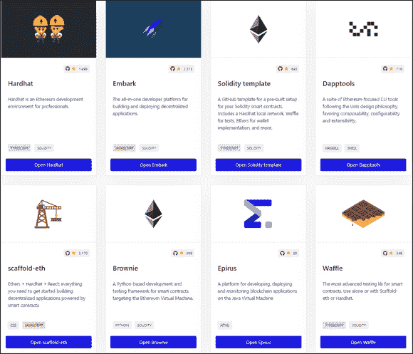

图 8-1： 框架和预制栈。

不幸的是，没有任何单一包包含现成的、全包的开发栈。不过值得庆幸的是，有许多蓝图可供参考，指导您安装完成适合您需求的开发环境所需的组件。

对于本书，我们选择了最简单的组件组合，它们提供了足够的灵活性来自定义您的 NFT 功能，但不需要使用命令行界面 (CLI)，这在以太坊核心开发者中很常见。

> **技术资料：** 图形用户界面 (GUI) 提供了一个更用户友好的可视化工作区，比基于 CLI 的工作区更易于导航，后者具有基于文本的用户界面，要求您输入命令。

具体来说，我们的分步指南使用以下要素：

*   MetaMask，用于以太坊客户端 API
*   Ganache GUI，用于本地测试区块链
*   Remix IDE，用于源代码编译器

## 戴上安全帽：构建您的环境

在本节中，我们将解释如何在您的个人计算机上实现本地区块链。然后我们将向您展示如何配置您的 MetaMask 钱包以用于您的本地开发环境以及 Remix IDE。

### 设置您的本地区块链测试环境

> **请记住：** 正如我们在 第 7 章 中所解释的，本地开发环境是一个私密且安全的地方，供您练习部署和测试智能合约。

要设置您的本地开发环境，请按照以下步骤安装 Ganache 桌面应用程序 (Ganache GUI)，它是 Truffle Suite 为智能合约开发者提供的工具包的一部分。

## 设置本地区块链测试环境

1.  访问 [`www.trufflesuite.com/ganache`](http://www.trufflesuite.com/ganache) 并点击 **Download** 按钮（如图 8-2 所示），下载 Ganache 桌面应用程序。

    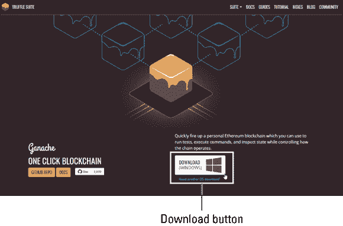

    图 8-2： 下载 Ganache 桌面应用程序。

2.  下载完成后，双击安装包并按照提示安装 Ganache（如图 8-3 所示）。

    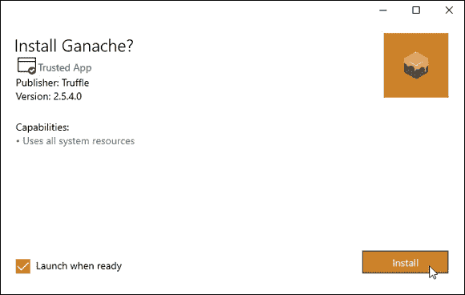

    图 8-3： Ganache 安装程序。

3.  安装完成后，启动 Ganache，然后在起始页面点击 **Quickstart Ethereum** 选项（如图 8-4 所示）。

    Ganache 会启动一个本地区块链，其中包含模拟以太坊外部拥有账户的测试账户（如图 8-5 所示）。

    Ganache 的默认设置是启动十个测试账户，每个账户拥有 100 个测试 ETH 余额，仅可在当前工作区中使用。

    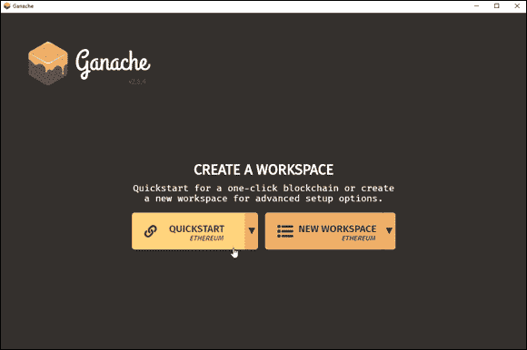

    图 8-4： Ganache 起始屏幕。

    

    图 8-5： Ganache 账户屏幕。

4.  点击 **Blocks** 标签页（位于屏幕顶部菜单栏 **Accounts** 标签页右侧），查看当前工作区的完整区块链账本。

    初始化时，你只有一个区块：区块 0（**创世**区块），如图 8-6 所示。

    

    图 8-6： 初始化时的 Ganache 创世区块。

5.  点击 Ganache 应用程序窗口右上角的 **Save** 按钮保存工作区（参考图 8-6）。

    Ganache 会自动（随机）为你的工作区命名。在本例中，Ganache 将我们的工作区命名为 `Handsomely-Vessel`（如图 8-7 所示）。

    

    图 8-7： 在 Ganache 上保存工作区。


6. 关闭并重新打开 Ganache，在起始页面查看已保存的工作区（如图 8-8 所示），以便轻松继续之前的工作。

恭喜！你已准备好在私有开发环境中开始工作！

 如果要更改工作区名称，请点击工作区名称右侧的 **Settings**（齿轮）图标（参考图 8-7）。将出现一个新屏幕，你可以在其中编辑工作区名称（如图 8-9 所示）。

我们将保留 Ganache 为我们随机生成的这个宏伟工作区名称：`Handsomely-Vessel`！

![图 8-8：重新初始化后的 Ganache 起始页面。]

图 8-8： 重新初始化后的 Ganache 起始页面。

![图 8-9：在 Ganache 上编辑工作区。]

图 8-9： 在 Ganache 上编辑工作区。

### 将自定义（Ganache）网络连接到 MetaMask 钱包

启动本地区块链后，你可以将这个自定义“网络”及其关联账户添加到 MetaMask 钱包。请按以下步骤操作：

1. 打开 Ganache 并加载前一节创建的工作区。

2. 找到你的 RPC URL，默认为 [`http://127.0.0.1:7545`](http://127.0.0.1:7545)（如图 8-10 所示）。

    ![图 8-10：从 Ganache 界面定位 RPC URL。]

    图 8-10： 从 Ganache 界面定位 RPC URL。

3. 登录你的 MetaMask 钱包。

4. 要在 MetaMask 中切换网络，请从下拉菜单中选择 **Custom RPC** 选项（如图 8-11 所示）。

    ![图 8-11：MetaMask 钱包中的网络下拉菜单。]

    图 8-11： MetaMask 钱包中的网络下拉菜单。

5. 在出现的新页面中（如图 8-12 所示），填写网络名称、新 RPC URL 和链 ID，如下所示：

    * **Network name:** `HANDSOMELY-VESSEL`

         你可以选择任何网络名称。为保持一致性并避免混淆，建议使用 Ganache 工作区中所选网络的名称。

    * **New RPC URL:** [`http://127.0.0.1:7545`](http://127.0.0.1:7545) —— 默认 RPC URL

    * **Chain ID:** `1337` —— 默认链 ID

6. 点击 **Save** 按钮。

干得好！你已成功将新网络添加到 MetaMask 网络选项中（如图 8-13 所示)。

![图 8-12：向 MetaMask 钱包添加新网络。]

图 8-12： 向 MetaMask 钱包添加新网络。

![图 8-13：HANDSOMELY-VESSEL 现已出现在 MetaMask 网络选项中。]

图 8-13： HANDSOMELY-VESSEL 现已出现在 MetaMask 网络选项中。

### 将本地（Ganache）账户添加到 MetaMask 钱包

安装 Ganache 并在 MetaMask 中添加相应的自定义网络后，你需要将 Ganache 工作区中的一些账户导入 MetaMask。

要导入本地账户，你需要它们的私钥。请按以下步骤获取密钥：

1. 打开 Ganache 并加载本章前面“设置本地区块链测试环境”一节中创建的工作区。

2. 在 **Accounts** 页面，选择一个账户，然后点击最右侧的 **Key** 图标（如图 8-14 所示）。

    接下来的弹出屏幕将提供该账户的私钥（如图 8-15 所示)。

![图 8-14：在 Ganache 工作区中访问账户私钥。]

图 8-14： 在 Ganache 工作区中访问账户私钥。

![图 8-15：Ganache 中的示例账户地址和私钥。]

图 8-15： Ganache 中的示例账户地址和私钥。

有了私钥，按以下步骤将这些账户导入 MetaMask 钱包：

1. 登录 MetaMask 钱包并切换到 `Handsomely-Vessel` 网络。

     我们的自定义网络名称为 `Handsomely-Vessel`，这可能与你在前面“设置本地区块链测试环境”一节中创建的自定义网络名称不同。

2. 点击 MetaMask 应用右上角的彩色圆圈，从下拉菜单中选择 **Import Account** 选项（如图 8-16 所示)。

    ![图 8-16：MetaMask 中的导入账户选项。]

    图 8-16： MetaMask 中的导入账户选项。

#### 将 Ganache 账户导入 MetaMask

在出现的新对话框中，粘贴来自 Ganache 工作区某个账户的私钥，然后单击 **Import（导入）** 按钮，如 图 8-17 所示。

图 8-18 显示了 MetaMask 中导入的账户。请注意，我们重命名了该账户。

> **Tip（提示）：** 重命名导入的账户，以便于记忆它是一个本地 Ganache 账户。我们将导入的账户重命名为 "Ganache HV 1"，因为它与原始账户名称相关。要在 MetaMask 中重命名账户，请单击账户名称右侧的垂直省略号，然后选择 **Account Details（账户详情）**。接着单击账户名称旁边的 **Pencil（铅笔）** 图标，重命名账户，最后单击复选框以完成名称更改。（有关更多详细信息，请参阅 第 7 章。）

Ta-da！你现已成功将本地 Ganache 账户导入 MetaMask 钱包。


图 8-17： 将账户导入 MetaMask 钱包。


图 8-18： MetaMask 中成功导入并重命名的账户。

> **Warning（警告）：** 如果在新导入的 Ganache 账户中看到奇怪的余额，请不要惊慌。图 8-18 显示，即使连接到适当的网络，我们的余额也是 196163 ETH (!)，这远远超过了 Ganache 工作区中显示的 100 个测试 ETH 余额。（请参阅 图 8-14。）

> **Remember（请记住）：** 正如我们在 第 7 章 中所解释的，你必须在 MetaMask 中处于正确的网络，才能在每个账户中看到相应的测试 ETH 或实际 ETH。例如，图 8-19 显示，当我们将网络切换到以太坊主网时，Ganache HV 1 账户显示的余额为 0 ETH。


图 8-19： 在主网上查看时，Ganache HV 1 账户的 0 ETH 余额。

现在，你可以通过 MetaMask 从这个本地 Ganache 账户发送交易，就像使用 MetaMask 钱包中加载的其他账户一样。你还无法提交生成新合约账户的交易，但可以按照以下步骤在本地 Ganache 工作区中跨账户转账：

1. **在 Accounts（账户）选项卡上，突出显示 Ganache 工作区中的另一个账户，然后右键单击以复制公共账户地址，如 图 8-20 所示。**

    

    图 8-20： 在 Ganache 工作区中复制账户地址。

2. **按照此处列出的通过 MetaMask 发送交易的典型步骤操作，如 图 8-21 所示：**

    1. *选择合适的账户：* 在我们的例子中，是 Ganache HV 1 账户。

    2. *确保你处于正确的网络：* 我们处于 Handsomely-Vessel 自定义网络。

    3. *单击 **Send（发送）** 按钮。*

3. **粘贴你在第 1 步中从 Ganache 工作区复制的地址，如 图 8-22 所示，然后选择转账金额。（我们选择了 5 个测试 ETH。）**

4. **单击 **Next（下一步）** 按钮，然后在随后的页面上单击 **Confirm（确认）** 按钮。**

    > **Remember（请记住）：** 正如我们之前的警告所述，由于 MetaMask 和本地 Ganache 环境之间未协调的问题，你在此阶段看到的数字可能看起来很奇怪。

    因为交易和区块在本地 Ganache 区块链上会自动挖掘，所以该提交交易的状态会迅速从 `pending`（待处理）变为完成，如 图 8-23 所示。

    

    图 8-21： 准备从本地 Ganache 账户转账。

    

    图 8-22： 从一个本地 Ganache 账户向另一个转账。

    

    图 8-23： MetaMask 中的交易确认。

5. **检查 Ganache 工作区中的账户余额。**

    请注意，5 个测试 ETH 已从第一个账户转移到第二个账户，如 图 8-24 所示。


图 8-24： Ganache 工作区中的更新后账户余额。

#### 将 Remix IDE 与 MetaMask 钱包同步

在本节中，你将探索 Remix，以便最终编译和部署智能合约——无论是在本地环境、测试网还是主网上。

要熟悉 Remix 的操作，请执行以下步骤：

1. **前往 [`http://remix.ethereum.org`](https://remix.ethereum.org/)。**

    > **Warning（警告）：** 务必输入 `http://`（不带 *s*），而不是 `https://`（带 *s*），否则 Remix 无法访问 MetaMask。

2. **单击左侧工具栏上的以太坊图标，如 图 8-25 所示。**

    

    图 8-25： Remix 主页。

3. **在 **Deploy & Run Transactions（部署并运行交易）** 对话框的 **Environment（环境）** 下拉菜单中选择 **Injected Web3**，如 图 8-26 所示。**

4. **登录你的 MetaMask 钱包。**

    > **Warning（警告）：** 如果你安装了其他钱包浏览器扩展（如 Dapper），可能会出现问题。我们建议在继续我们的分步指南时，禁用这些其他扩展，仅保留 MetaMask。

    

    图 8-26： Deploy & Run Transactions 对话框。

5. **(可选) 要关闭可能有问题的浏览器扩展，请执行以下步骤：**

    1. *右键单击浏览器工具栏上要禁用的扩展图标。*

    2. *选择 **Manage Extensions（管理扩展）**。*

    3. *在下一页中，使用切换开关（见 图 8-27）关闭有问题的浏览器扩展。*

6. **在 MetaMask 中，选择要使用的网络和账户。**

    图 8-28 显示了我们在选择 Ropsten 测试网络以及我们在 第 7 章 中向你展示如何创建和注资的测试网账户时的 Remix 环境。

    图 8-29 显示了我们在选择 Handsomely-Vessel 自定义网络以及本章前面导入并重命名的 Ganache HV 1 账户时的 Remix 环境。

恭喜！你现在拥有了一个功能齐全且独立的解决方案栈，可以开始开发和部署智能合约。


图 8-27： 禁用特定的浏览器扩展。


图 8-28： Ropsten 测试网络上的测试网账户。


图 8-29： Handsomely-Vessel 自定义网络上的 Ganache HV 1 账户。

# 第 9 章：部署您的第一个智能合约

## 本章内容

* **智能合约语言简介**

* **解释智能合约模板的基本元素**

* **介绍预构建智能合约库**

* **开发、编译和部署您的第一个以太坊智能合约**

本章将引导您完成开发、编译和部署第一个智能合约的步骤。但在进入这些步骤之前，我们想快速介绍一下智能合约语言，并描述智能合约的元素。我们还想涉及智能合约库，这在第 10 章和第 11 章中变得更加重要。

 本章代表了您在尝试构建自己的非同质化 ERC-721 代币之前所需的最后一步实操准备。（有关该主题的更多信息，请参阅第 11 章。）我们强烈建议阅读完整章节，以便更充分地了解智能合约的基本特性，以及我们在过程中做出选择背后的理由。如果您急于求成，可以直接跳到最后一节“准备起飞：启动您的智能合约。”

 要学习本章，您首先需要安装并设置好 MetaMask 钱包。（请参阅第 2 章和第 4 章。）您还需要设置好主网、测试网和本地账户，并设置好本地 Ganache 环境，在 MetaMask 上配置相应的自定义网络。（请参阅第 7 章和第 8 章。）最后，您需要设置好 Remix-IDE 浏览器 ([`http://remix.ethereum.org`](https://remix.ethereum.org/)) 以与您的 MetaMask 钱包同步。（同样，第 8 章可以帮助您完成该任务。）

## 使用智能合约语言

要创建一个功能性的智能合约，您本质上是通过将字节码作为交易（不带目标地址）提交给以太坊网络来创建一个合约账户。因为 `bytecode`（字节码）是一种以十六进制格式编写的机器级代码，难以学习和解读，所以您需要使用一种受支持的、更接近人类语言的语言——一种现有编译器可以将其翻译成字节码的语言——来编写智能合约源代码。

值得庆幸的是，您可以从多种活跃维护的语言中进行选择。在我们为分步指南选择的 Remix IDE 中，内置的编译器旨在轻松在 `Solidity` 和 `Yul` 语言之间切换：

* **Solidity：** Solidity 编程语言专门设计用于在以太坊虚拟机 (EVM) 上实现智能合约。它仍然是以太坊上智能合约开发者使用的主要语言，其用途甚至已扩展到其他竞争平台。

    在编程语言分类中，Solidity 被视为*高级语言*：它更容易被人类理解和调试，但内存效率较低，并且需要编译才能翻译成执行机器可理解的指令。

* **Yul：** 较新的编程语言 Yul 需要更深入地掌握和理解 `opcodes`（操作码，即低级机器语言指令）才能有效使用。Yul 被视为中级语言。

选择语言并为合约编写源代码后，您需要编译代码以生成以下元素：

* **字节码：** 字节码完全由一组以十六进制格式规定的指令组成，可在 EVM 上运行。字节码是机器码，在编程语言分类中处于最低层，是最难直接被人类解读的。

* **操作码：** 当您更精通智能合约开发领域时，您会注意到许多程序员引用操作码中的命令，操作码是一种汇编语言。操作码指令等同于字节码所传达的内容，但为处理器应执行的操作提供了可读的操作代码。在编程语言分类中，汇编语言被视为仅比机器码高一层的低级语言。

* **ABI：** 编译器还会创建相应的应用程序二进制接口 (ABI)，最终用户应用程序需要它来导航合约的数据和函数。

我们选择 Solidity，因为它是更常用、也更易上手的语言。使用 Solidity 时，您还可以访问更多预构建库，这些库为您提供了经过精心开发和审核的代码以供构建。（我们将在本章后面的“无需重复造轮子：使用智能合约库”一节中更详细地讨论预构建库。）

### 从 Solidity 版本编译指令开始

为确保您的 Solidity 源代码不会在不兼容的编译器版本下编译，您应始终将 Solidity 版本编译指令作为代码的第一行。*版本编译指令*指定编译时允许使用的 Solidity 编译器版本，如下所示：

```
pragma solidity 0.8.6;
```


在本例中，版本编译指令仅允许在 `0.8.6` 版本下编译源代码，确保代码不会在可能引入与代码不兼容更新的更新版本下编译。

版本编译指令语法可修改以获得更大灵活性。以下列举几个示例：

*   `<=0.8.6` 允许包括 `0.8.6` 版本在内及之前的编译器版本。
*   `>=0.8.6` 允许包括 `0.8.6` 版本在内及之后的编译器版本。
*   `^0.8.6` 允许包括 `0.8.6` 版本在内及之后的编译器版本，但严格限制在 `0.9.0` 版本之前（“^”指定不应使用 `0.8.X` 以外的编译器版本）。

在版本编译指令语法中，`<=` 和 `>=` 修饰符可组合使用，形成比严格指定的 `^` 修饰符更定制化的允许范围。此外，`<` 和 `>` 也是可接受的修饰符。

### 从源代码到字节码

请看这个用 Solidity 编写的简单智能合约代码：

```solidity
pragma solidity 0.8.6;
contract LittleBear {
    string public msg = "Hello Little Bear (a.k.a. Maddie)!";
}
```

当这段特定的 Solidity 源代码被编译时，您将得到以下机器级字节码块：

```
608060405234801561001057600080fd5b506004361061002b5760003560e01c80636b473fca14610030575b600080fd5b61003861004e565b6040516100459190610115565b60405180910390f35b6000805461005b90610186565b80601f016020809104026020016040519081016040528092919081815260200182805461008790610186565b80156100d45780601f106100a9576101008083540402835291602001916100d4565b820191906000526020600020905b8154815290600101906020018083116100b757829003601f168201915b505050505081565b60006100e782610137565b6100f18185610142565b9350610101818560208601610153565b61010a816101e7565b840191505092915050565b6000602082019050818103600083015261012f81846100dc565b905092915050565b600081519050919050565b600082825260208201905092915050565b60005b83811015610171578082015181840152602081019050610156565b83811115610180576000848401525b50505050565b6000600282049050600182168061019e57607f821691505b602082108114156101b2576101b16101b8565b5b50919050565b7f4e487b7100000000000000000000000000000000000000000000000000000000600052602260045260246000fd5b6000601f19601f830116905091905056fea264697066735822122067b6da38f6dde0621c9c49d1785ec9d01d5d423d6d5f4aca74e7b3f8ffa4c18f64736f6c63430008060033
```

相应的操作码片段如下所示：

```
PUSH1 0x80 PUSH1 0x40 MSTORE CALLVALUE DUP1 ISZERO PUSH2 0x10 JUMPI PUSH1 0x0 DUP1 REVERT JUMPDEST POP PUSH1 0x4 CALLDATASIZE LT PUSH2 0x2B JUMPI PUSH1 0x0 CALLDATALOAD PUSH1 0xE0 SHR DUP1 PUSH4 0x6B473FCA EQ PUSH2 0x30 JUMPI JUMPDEST PUSH1 0x0 DUP1 REVERT JUMPDEST PUSH2 0x38 PUSH2 0x4E JUMP JUMPDEST PUSH1 0x40 MLOAD PUSH2 0x45 SWAP2 SWAP1 PUSH2 0x115 JUMP JUMPDEST PUSH1 0x40 MLOAD DUP1 SWAP2 SUB SWAP1 RETURN JUMPDEST PUSH1 0x0 DUP1 SLOAD PUSH2 0x5B SWAP1 PUSH2 0x186 JUMP JUMPDEST DUP1 PUSH1 0x1F ADD PUSH1 […]
```

最后，以下是相应的 ABI，它为想要与该智能合约交互的最终用户应用程序提供了路线图：

```json
{ "inputs": [], "name": "msg", "outputs": [ { "internalType": "string", "name": "", "type": "string" } ], "stateMutability": "view", "type": "function"}
```

现在你大概能明白为什么我们更倾向于用高级的、更接近人类语言的语言来编写智能合约代码了！

## 智能合约的关键要素

从本质上讲，智能合约由函数和数据组成，它们驻留在以太坊区块链上的合约账户地址处。此外，当执行交易以访问智能合约中的函数时，状态变更可以记录到区块链上，而无需存储在合约账户中，因为后者成本更高。在本节中，我们将剖析智能合约这些关键要素的含义——即其数据、其函数及其事件日志。

### 数据

Solidity 是一种静态类型编程语言，这意味着变量的类型（通常还有大小）必须在编译前于源代码中指定。

变量可以作为合约数据的一部分放在存储区中；这些变量被定义为 `state variables`（状态变量）。另一方面，你可能也会用到仅用于临时计算、不需要在迭代之间保留的瞬态变量；这些变量被称为 `memory variables`（内存变量）。

如果状态变量被声明为 `public`（公共），则存储在其中的信息也可以被其他智能合约访问。否则，该信息被视为 `private`（私有），仅可在存储它的智能合约内部访问（尽管任何人仍可查看，因为私有状态变量存储在公共区块链上）。

无论存储的数据是公共还是私有，只有存储数据的合约才能更改其状态变量的值。

### 函数

智能合约函数是核心所在。例如，函数可用于执行计算、为状态变量设置新值、从区块链上的其他位置检索数据、向其他地址发送 ETH 或调用其他函数。函数大致分为以下三类：

*   **内置函数：** Solidity 提供了一系列内置函数来执行常见任务，例如用于接收 ETH 的 `receive()` 和用于向指定地址发送 ETH 的 `address.send()`。另一个常用的内置函数是 `selfdestruct(address)`，它将合约账户中剩余的 ETH 发送到指定地址，然后删除该合约。
*   **构造函数：** 每个合约可以指定一个 `constructor()` 函数，该函数仅在智能合约首次部署到 EVM 上时执行一次。
*   **自定义函数：** 当然，你也可以编写自己的函数！

编写自己的函数时，你需要使用以下关键字声明每个函数对其他函数、合约或交易的可访问性：

*   **Public/External（公共/外部）：**
    *   *Public* 函数是默认选项，提供最大的灵活性。它们可以被合约内的其他函数、其他合约以及外部拥有账户提交的交易调用。
    *   *External* 函数提供与公共函数相同程度的可访问性，不同之处在于合约内部的函数调用被视为外部调用，且必须带有关键字 `this` 作为前缀。
*   **Private/Internal（私有/内部）：**
    *   *Private* 函数只能从其所在的合约内部调用。
    *   Solidity 还有一项功能，允许程序员将合约组合成一个新的*派生合约*，即继承自另一个合约代码的合约。被馈送到派生合约中的合约称为*基础合约*。*Internal* 函数类似于私有函数，不同之处在于它们也可以被其派生合约调用。

### 事件日志

事件日志为你提供了一种便捷的方式，可将历史信息实例存储在区块链上，而无需在合约账户中声明额外的存储空间。其他智能合约（或人员）可以查看这些日志，以了解发生的变更。可以使用关键字 `event` 在合约中声明事件。当调用时（使用关键字 `emit`），参数会存储在与合约地址关联的日志中。

你将在本章后面的“准备起飞：启动你的智能合约”一节中部署的示例智能合约，提供了一个事件如何被声明和触发的例子。

## 无需重复造轮子：使用智能合约库

有大量的智能合约库可供使用，它们为你提供预构建的函数和以太坊开发标准的实现。（有关此主题的更多信息，请参见第 10 章。）除了为你省去基础工作外，预先开发和预先审核的开源库还为不太精通智能合约开发和运营细节的开发者提供了额外的安全保障。

下一节中我们将向你展示如何部署的智能合约足够简单，以至于你暂时还不需要担心使用智能合约库。在第 11 章中，我们将向你展示如何构建你自己的 ERC-721 代币，你可以学习如何加载预构建库并导入你想要的基础合约。

## 准备起飞：启动你的智能合约

以下步骤将指导你将第一个智能合约部署到 EVM 上（如果你还不想花费真实的 ETH，也可以部署到 Ropsten 测试网）：

1.  **前往** [`http://remix.ethereum.org`](https://remix.ethereum.org/)**。**

    你必须输入 `http://`（不带 *s*），而*不能*输入 `https://`（带 *s*），否则 Remix 无法访问 MetaMask。

2.  **单击主页上“File”（文件）标题下的“New File”（新建文件）链接，如**图 9-1**所示。**

    页面左侧的 File Explorers（文件浏览器）窗格中将打开一个新文件。

    随时可以点击最左侧导航栏上的 Double Page（双页）图标，返回 File Explorers（文件浏览器）窗格，如图 9-2 所示。

    

    图 9-1： Remix Ethereum 主页。

    

    图 9-2： Remix 文件浏览器窗格。

3.  **用光标点击空白文本框，输入** `LittleBear.sol`**，然后按 Enter 键。**

    如图 9-3 所示，将弹出一个带有文件名的新标签页。

太棒了。你现在准备好输入 Solidity 代码了！


图 9-3： Remix 上的 LittleBear.sol 打开标签页。

### 从简单模板开始

在 `LittleBear.sol` 文件中输入以下代码：

```solidity
pragma solidity 0.8.6;
contract LittleBear {
    event LogMsg(string message);
    string public storedMsg;
    constructor() {
        storedMsg = "Hello Little Bear (a.k.a. Maddie)!";
        emit LogMsg(storedMsg);
    }
    function updateMsg(string memory newMsg) public {
        storedMsg = newMsg;
        emit LogMsg(storedMsg);
    }
}
```

 为避免拼写错误，你可以直接从 [`www.seoyoungkim.com/nftfdcode.html`](http://www.seoyoungkim.com/nftfdcode.html) 复制并粘贴此代码片段。

 Solidity 区分大小写，因此在编译时 `LogMsg` 和 `logmsg` 不会被视为相同标识符。

本节剩余部分将逐块解释代码。

第一行代码是 Solidity 版本编译指令，它指定了编译时允许使用的 Solidity 编译器版本。在本例中，版本编译指令仅允许在 `0.8.6` 版本下编译源代码：

`pragma solidity 0.8.6;`

接下来，你定义合约 `LittleBear` —— Solidity 是一门*花括号*语言，意味着它使用花括号来开启和关闭代码块：

`contract LittleBear {`

下一行声明了一个事件 `LogMsg`，它接受一个类型为 `string` 的单个参数：

`event LogMsg(string message);`

下一行声明了一个类型为 `string` 的公共状态变量 `storedMsg`。`storedMsg` 的最新内容将保留在合约存储中，即使合约及其函数在调用间隙处于休眠状态：

`string public storedMsg;`

下面的代码块声明了特殊的 `constructor()` 函数，该函数仅在合约初始化时执行一次。该函数的第一行初始化存储在 `storedMsg` 状态变量中的文本；第二行触发 `LogMsg` 事件，将 `storedMsg` 的内容传递给合约的事件日志进行记录：

```solidity
constructor() {
    storedMsg = "Hello Little Bear (a.k.a. Maddie)!";
    emit LogMsg(storedMsg);
}
```

下面的代码块声明了一个公共函数 `updateMsg()`，它接受一个类型为 `string` 的单个参数。该参数在此函数内以 `newMsg` 为名进行定义，并声明为内存变量，这意味着其内容在该函数执行完毕后不会被保留。如果不显式声明关键字 `memory`，函数参数默认为内存变量而非状态变量：

```solidity
function updateMsg(string memory newMsg) public {
    storedMsg = newMsg;
    emit LogMsg(storedMsg);
}
```

此 `updateMsg()` 函数的第一行用调用该函数时传入的文本替换存储在 `storedMsg` 状态变量中的文本。第二行触发 `LogMsg` 事件，以便将 `storedMsg` 的最新内容写入合约的事件日志。

最后，我们用一个右花括号结束合约代码块：

`}`

### 起飞前编译

准备好 `LittleBear.sol` 文件并添加必要代码后，你可以按照以下步骤编译代码：

1.  **单击左侧导航窗格中的编译器图标，如** 图 9-4 **所示。**
2.  **在出现的 Solidity 编译器窗格中，单击“Compile LittleBear.sol”按钮，如** 图 9-5 **所示。**

    该合约的编译详细信息将出现在编译按钮下方，如 图 9-6 所示。

太棒了！你现在已准备好部署智能合约。

 部署智能合约后，你无法回头修改任何代码。如果想要更正，必须使用更新后的代码部署一个新的智能合约。


图 9-4： LittleBear.sol 源代码，在 Remix 上准备编译。


图 9-5： Remix 上的 Solidity 编译器。

### 部署

在正式部署之前，请先在本地 Ganache 环境中练习部署此合约（我们在 第 8 章 中讨论过）。

1.  **单击左侧导航窗格中的以太坊图标（编译器图标下方的那个图标）。**

    此步骤将打开“部署与运行交易”窗格，如 图 9-7 所示。

    

    图 9-6： 在 Remix 上访问编译详细信息。

    

    图 9-7： Remix 上的部署与运行交易。

2.  **从 Environment 下拉菜单中选择 Injected Web3 选项。**

    请务必同时

    1.  单击浏览器工具栏上的狐狸图标，登录 MetaMask 浏览器扩展。（见 图 9-8。）
    2.  连接到 Handsomely-Vessel 自定义网络。
    3.  选择你导入的本地 Ganache 账户之一。在本例中，我们选择 Ganache HV1。

     你还必须打开并运行 Ganache 桌面应用程序，且运行的是相应的工作区——在本例中为 Handsomely-Vessel 工作区。


### 3. 从 Contract 下拉菜单中选择 `LittleBear–LittleBear.sol` 合约，然后单击 Deploy 按钮。（见图 9-8。）


图 9-8：将 LittleBear 合约部署到 Ganache 的 Handsomely-Vessel 工作区。

### 4. 在出现的 MetaMask 通知弹窗中（见图 9-9），查看交易详情并单击 Confirm。

单击 Confirm 将提交一笔包含已编译字节码的交易（不指定目标地址），这将生成一个拥有自己地址的合约账户以供未来访问。如果你意识到尚未准备好部署合约，只需单击 Reject 即可。


图 9-9：在 Handsomely-Vessel 工作区上确认合约账户创建。

现在你可以在“Deployed Contracts”标题下查看并与该合约交互，如图 9-10 所示：

*   单击 `storedMsg` 按钮查看当前存储在此状态变量中的内容。
*   单击 `updateMsg` 按钮调用更新 `storedMsg` 中存储文本的函数，如图 9-11 所示。


图 9-10：在 Remix 上查看已部署合约。


图 9-11：在 Remix 上与已部署合约交互。

 执行 `updateMsg` 函数是在 EVM 上的一笔交易，需要消耗 gas，而仅查看 `storedMsg` 变量的内容则不需要 gas。你会注意到每次尝试执行 `updateMsg` 函数时都会弹出 MetaMask 通知窗口，要求确认。

既然你已在本地 Ganache 环境中初体验，现在是时候将我们的 `LittleBear` 合约部署到 Ropsten 测试网了。请遵循以下步骤：

#### 1. 单击浏览器工具栏上的狐狸图标以打开 MetaMask。

#### 2. 将网络切换到 Ropsten 测试网络，然后选择你的测试网账户

你可以在第 7 章中看到如何创建账户并使用 Ropsten 测试 ETH 进行资助。

Remix 的“部署与运行交易”面板上的账户信息会随之相应变化，如图 9-12 所示。


图 9-12：将 LittleBear 合约部署到 Ropsten 测试网络。

#### 3. 点击 Deploy（部署）按钮，并在弹出的 MetaMask 通知中确认交易

如图 9-13 所示。

 这一次交易挖矿所需时间更长，因为 Ropsten 测试网络上的区块不会像 Ganache 环境中的本地区块链实例那样自动挖出。


图 9-13：在 Ropsten 测试网络上确认合约账户创建。

#### 4. 访问 `updateMsg` 函数以更新存储的文本

我们要进行两次更新：第一次改为“Hello Mama Kim!”，第二次改为“Hello Papa Kim!”这两次更改稍后都会显示在图 9-17 的事件日志中。

#### 5. 要在 Ropsten 区块链上查看这个新部署的 `LittleBear` 合约

首先点击双页图标（位于 `LittleBear` 标题右侧）以复制合约账户地址，如图 9-14 所示。

在我们的例子中，该地址为 `0x1F922670Ce8bC699e780b9b12960Fb80F998573e`。

#### 6. 在浏览器中访问 `https://ropsten.etherscan.io`

将合约账户地址粘贴到搜索栏中，如图 9-15 所示，然后点击 Search（搜索）按钮。

图 9-16 显示，我们的合约有三笔关联交易：创建合约的交易，以及两笔调用 `updateMsg` 函数的交易。请注意，最新的交易显示在顶部。

#### 7. 点击 Events（事件）选项卡以查看我们合约创建的事件日志

*提示：* 为了方便阅读，请使用下拉选项卡将日志输出从 `Hex` 转换为 `Text`，如图 9-17 所示。


图 9-14：通过 Remix 部署后复制合约地址。


图 9-15：Etherscan 上的 Ropsten 测试网浏览器。


图 9-16：Etherscan 上显示的 Ropsten 测试网络上的 LittleBear 智能合约。


图 9-17：我们的 LittleBear 事件日志。

太棒了！你现在已经成功将第一个智能合约部署到了公共区块链上。此时，你可以重复前面的步骤，将该合约部署到以太坊主网。至于我们，我们选择节省宝贵的（真金白银的！）ETH，并避免给 EVM 增加不必要的负担，因为我们不打算将 `LittleBear` 合约用于演示如何部署智能合约之外的其他用途。

# 第 10 章：探索代币标准

## 本章内容

- 了解以太坊开发标准
- 查看代币接口
- 探索 ERC-20（同质化）代币
- 深入了解 ERC-721 非同质化代币

本章暂停动手实践，介绍以太坊开发标准以及两种广泛使用的代币标准：ERC-20 和 ERC-721。一如既往，我们强烈建议阅读完整章节，让你沉浸在代币术语中，并更深入地理解我们实操指南中的说明。

也就是说，本章包含的知识并非继续创建你自己的 NFT 所必需。所以，如果你迫不及待，可以直接跳到第 11 章。

## 介绍以太坊开发标准

鉴于构成以太坊生态系统的合约、客户端和钱包服务之间存在复杂的相互依赖关系，以太坊社区制定了一套程序，用于在为常见用例编写智能合约时提出并确立应遵循的开发标准。开发你自己的代币或 dApp 时，你无须遵守这些标准，但遵循既定准则肯定会让你的生活更轻松。

### 确保互操作性和可组合性

那么标准化如何影响开发？

首先，标准化确保了**互操作性**。以太坊客户端和钱包经过编程可执行合约调用或接受代币，遵守公认的开发标准可确保这一去中心化的参与者枢纽保持兼容。你可以将其比作各发卡机构信用卡尺寸和形状的标准化，这确保了在各种信用卡处理器上的可读性，以及钱包中信用卡槽的一致性。

其次，标准化促进了*可组合性*，这指的是系统允许开发者混合和匹配现有合约的组合，以组成一个功能性的定制解决方案的能力。例如，想想乐高积木：积木上凸柱和防滑柱的标准化让你能够构建许多不同且富有创意的产品。是的，乐高世界设计了一个高度可组合的系统！

### 学习 EIP 和 ERC 的基础知识

为了解释常见的术语 ERC-20 和 ERC-721，我们首先定义并描述以太坊改进提案（EIP），因为以太坊征求意见（ERC）是 EIP 的一种特殊类型。

想要提出新开发标准的开发者必须首先提交 EIP 草案，供以太坊核心开发者社区审议。事实上，第一个 EIP（编号为 EIP-1）概述了 EIP 的目的、EIP 应包含内容的指南，以及从构想到定稿或撤回的工作流程。（见图 10-1。）此流程基于 Python 和比特币社区采用的流程，它们分别建立了 Python 增强提案（PEP）和比特币改进提案（BIP）。


访问 [`https://eips.ethereum.org/EIPS/eip-1`](https://eips.ethereum.org/EIPS/eip-1)。 ¶ 图 10-1：来自 EIP-1 的 EIP 工作流程图。

每个新的 EIP 不仅改进了系统，还增强了开发社区对以太坊虚拟机（EVM）优缺点的理解。EIP 还能激发关于以太坊平台更多用例的创造性思考。

以下列表描述了三种类型的 EIP 并给出了各自的示例：

*   **标准跟踪 EIP** 规定了影响以太坊网络上大多数（如果不是全部）活动的标准变更。标准跟踪类别包含以下四个重要的子分类，它们在系统范围影响程度和对互操作性的影响方面各不相同：

### EIP 类别

#### 核心 EIP

**核心 EIP** 与共识层相关，该层规定了交易结算的规则，并最终决定了网络如何就 EVM 的特定状态和历史记录达成一致。

示例包括 **EIP-2929**，它增加了某些操作码执行所需的 gas；以及最近敲定的核心 **EIP-3554**，它减缓了区块难度呈指数级增长的速度（这一功能被称为 *难度炸弹*）。

 操作码（我们将在第 9 章中介绍）是机器语言指令，提供可读的操作代码以供处理。

#### 网络 EIP

**网络 EIP** 与网络层相关，该层规定了信息如何在以太坊网络的节点之间交换和传播。

例如，最近敲定的网络 **EIP-2124**，标题为“用于链兼容性检查的分叉标识符”，提供了一种记录保存和验证机制，以高效识别兼容的对等节点。

#### 接口 EIP

**接口 EIP** 与应用程序编程接口 (API) / 远程过程调用 (RPC) 层相关，该层规定了应用程序之间的连接以及应用程序如何跨分布式网络执行。接口 EIP 还涉及语言级标准 —— 即那些管理由代码中的方法名称以及计算如何提交给操作系统的标准。

示例包括 **EIP-6**，它引入了 `SELFDESTRUCT` 操作码以取代 `SUICIDE` 操作码，以正视心理健康问题的现实；以及 **EIP-1193**，它为 JavaScript API 引入了标准化格式，以确保以太坊钱包服务和 Web 应用程序之间的兼容性。

#### 以太坊征求意见 (ERC) EIP

**ERC EIP** 与应用层相关，该层规定了标准，以确保以太坊生态系统中的不同应用程序能够无缝交互和共享信息。例如，这些标准确保了代币与钱包服务之间的兼容性，并通过为智能合约库和包提出约定来增强可组合性。

示例包括著名的 **EIP-20 (ERC-20)**，它引入了实现同质化代币的标准；以及 **EIP-721 (ERC-721)**，它引入了实现非同质化代币的标准。

#### 元 EIP

**元 EIP** 总结了以太坊的重大变更，并规定了以太坊社区提议现有流程变更的程序。**EIP-1** 就是一个元 EIP 的例子。**EIP-4** 将标准跟踪 EIP 细分为更细的子类别，也是一个元 EIP 的例子。其他元 EIP 的例子包括一系列硬分叉元 EIP，它们总结了共识层的重大更新。

#### 信息类 EIP

**信息类 EIP** 向以太坊社区提供一般信息或建议性指南。

例如，**EIP-2228**，标题为“规范化网络 ID 1 和链 ID 1 的名称”，建议将对以太坊主网的引用标准化为专有名词：Ethereum Mainnet 或简称 Mainnet。

## 理解标准代币接口

了解了 EIP 背后的基本理念后，你可以更深入地探究提供以太坊代币发行主流标准的特定 ERC。

代币接口提供了一个大纲，声明了在特定代币合约中必须实现的函数和事件。采用标准接口使代币能够轻松符合那些反过来又被编程为与实现该特定接口的代币进行交互的钱包服务和交易所。接口在 Solidity 中声明（一种我们将在第 9 章中介绍的编程语言），如下所示：

```
interface InterfaceName { }
```

接口看起来很像合约的骨架大纲，其中声明了函数和事件但未实现它们。

**EIP-20** 创建于 2015 年 11 月 19 日，提供了以太坊上第一个广泛使用的代币标准：ERC-20 代币。该提案为以太坊上的同质化代币提供了标准接口，随后出现了更多标准以增强这一同质化代币标准的功能。

许多知名加密货币，如 Tether (USDT) 和 Chainlink (LINK)，都是基于该标准铸造的，并继续在以太坊区块链上作为 ERC-20（或增强版）代币进行交易。其他代币，如 EOS 和 Binance Coin (BNB)，最初作为 ERC-20 代币启动，在各自的独立区块链平台构建完成后，被兑换为其各自项目的原生代币。截至 2021 年 8 月，以太坊拥有超过 445,000 个未结算的 ERC-20 代币合约。

受 ERC-20 代币标准的启发，**EIP-721** 被创建出来，为以太坊上的非同质化代币提供标准接口。（是的，我们在说 NFT！）ERC-20 代币标准将其代币视为相同的（因此是同质化的）。ERC-721 非同质化代币标准将每个代币视为独特的资产，每个代币都有其自己可区分的 `tokenID`。因此，*CryptoKitties* 和 Art Blocks 等数字收藏品应运而生！截至 2021 年 8 月，以太坊拥有近 15,000 个未结算的 ERC-721 代币合约。

以下部分将更详细地介绍这些代币标准各自的接口。

## ERC-20 代币标准

为了符合 ERC-20 标准，代币合约必须实现 ERC-20 标准接口中包含的许多元素。所有函数和事件必须按照接口规定的相同命名约定进行声明。

让我们首先看看所需的函数：

*   `totalSupply()`、`name()`、`symbol()` 和 `decimals()`：这些函数返回存储在其同名状态变量中的值。（在该接口中，`name()`、`symbol()` 和 `decimals()` 函数是可选的）。
*   `balanceOf(address _owner)`：此函数返回地址为 `_owner` 的账户的余额。
*   `transfer(address _to, uint256 _value)`：此函数从调用者的账户向地址为 `_to` 的账户转移 `_value` 个代币。
*   `transferFrom(address _from, address _to, uint256 _value)`：此函数从一个指定账户 (`_from`) 向另一个账户 (`_to`) 转移 `_value` 个代币。
*   `approve(address _spender, uint256 _value)`：此函数允许指定账户 (`_spender`) 从调用者的账户中提取最多 `_value` 个代币。
*   `allowance(address _owner, address _spender)`：此函数返回账户 `_spender` 当前被允许从账户 `_owner` 提取的金额。

现在让我们看看 ERC-20 接口中声明的事件：

*   `Transfer(address indexed _from, address indexed _to, uint256 _value)`：当代币从一个账户转移到另一个账户时，必须触发此事件。
*   `Approval(address indexed _owner, address indexed _spender, uint256 _value)`：每当一个账户批准另一个账户提取一定金额时，必须触发此事件。

在实现 ERC-20 接口时，一些状态变量也必须存储在代币合约中。虽然所需函数和事件的名称必须按照接口的规定保留，但以下状态变量可以在你对该接口的特定实现中按你认为合适的方式声明和定义。

*   `balances[]`：此变量存储每个账户的代币余额。（注意该变量是一个数组。）
*   `allowances[][]`：此变量存储一个账户当前被允许从另一个账户提取的金额。（注意该变量是一个矩阵。）
*   `totalSupply`：此变量存储代币总供应量。
*   `name` (*可选*)：此变量存储代币的名称（如 Tether）。
*   `symbol` (*可选*)：此变量存储代币的符号（如 USDT，即 Tether 的符号）。
*   `decimals` (可选)：此变量存储代币使用的小数位数（即代币的可分割性）。


不同的实现可能需要额外的函数或变量，但你至少必须按照接口规范，命名并实现 ERC-20 接口中声明的函数和事件。你在 ERC-20 接口实现中声明的变量名称不会影响你的代币合约与任何其他预期与 ERC-20 代币交互的合约的互操作性。

### ERC-721 非同质化代币标准

要符合 ERC-721 标准，代币合约必须实现 ERC-721 接口和 ERC-165 接口的以下要素。所有函数和事件必须按照这些接口规定的命名约定进行声明。

首先让我们看看所需的函数：

*   `name()` 和 `symbol()`：这些可选函数返回存储在其同名状态变量中的值。
*   `balanceOf(address _owner)`：此函数返回地址为 `_owner` 的账户中 NFT 的数量。
*   `ownerOf(uint256 _tokenId)`：此函数返回拥有指定 NFT `_tokenId` 的账户地址。


*   `safeTransferFrom(address _from, address _to, uint256 _tokenId, bytes data)`：此函数将指定的 NFT `_tokenId` 从一个指定账户 (`_from`) 转移到另一个账户 (`_to`)，并将 `data` 传递给接收账户 (`_to`)。

*   `safeTransferFrom(address _from, address _to, uint256 _tokenId)`：此函数将指定的 NFT `_tokenId` 从一个指定账户 (`_from`) 转移到另一个账户 (`_to`)。

*   `transferFrom(address _from, address _to, uint256 _tokenId)`：此函数类似于 `safeTransferFrom`，但不验证接收账户 (`_to`) 是否可以接收 NFT。

*   `approve(address _approved, uint256 _tokenId)`：此函数允许指定账户 (`_approved`) 转移指定的 NFT (`_tokenID`)。

*   `setApprovalForAll(address _operator, bool _approved)`：此函数切换权限设置，以确定指定账户 (`_operator`) 是否拥有你账户中所有 NFT 的转移权。

*   `getApproved(uint256 _tokenId)`：此函数返回拥有指定 NFT (`_tokenID`) 转移权的账户地址。

*   `isApprovedForAll(address _owner, address _operator)`：此函数检查一个账户 (`_operator`) 是否拥有另一个账户 (`_owner`) 所有 NFT 的转移权。

*   `supportsInterface(bytes4 interfaceID)`：此函数包含自必需的 ERC-165 接口，用于标准接口检测。

现在让我们看看 ERC-721 接口中声明的事件：

*   `Transfer(address indexed _from, address indexed _to, uint256 indexed _tokenId)`：当 NFT 从一个账户转移到另一个账户时，必须触发此事件。

*   `Approval(address indexed _owner, address indexed _approved, uint256 indexed _tokenId)`：每当一个账户批准另一个账户的 NFT 转移权时，必须触发此事件。

*   `ApprovalForAll(address indexed _owner, address indexed _operator, bool _approved)`：每当一个账户允许或禁止另一个账户访问其所有 NFT 时，必须触发此事件。

在实现 ERC-721 接口时，某些状态变量也必须存储在代币合约中。和之前一样，以下状态变量可以根据你对接口的特定实现，以你认为合适的方式声明和定义。

*   `owners[]` 存储与每个单独 NFT 关联的所有者账户地址（此变量为数组）。

*   `balances[]` 存储每个账户中的 NFT 数量（此变量为数组）。

*   `tokenApprovals[]` 存储当前被允许拥有每个单独 NFT 转移权的账户地址（此变量为数组）。

*   `operatorApprovals[][]` 跟踪一个账户当前是否被允许转移另一个账户的 NFT（此变量为矩阵）。

*   `name`（可选）存储 NFT 的统一组名（例如 `CryptoKitties`）。

*   `symbol`（可选）存储 NFT 的符号（例如 CryptoKitties 的 `CK`）。

同样，不同的实现可能需要额外的函数或变量，可以根据需要声明和定义。然而，要符合 ERC-721 标准，ERC-721 接口和 ERC-165 接口中声明的所有函数和事件必须按照接口规范进行命名和实现。

### 以太坊上的其他代币标准

随着同质化和非同质化代币的大量涌现，不同的实现持续提供额外的功能和增强。其中一些功能已被正式确立为额外的代币标准，以提供全新的标准（如多代币标准）或原始同质化或非同质化代币接口改进的标准接口。

以下是一些已定稿标准的示例：

*   **ERC-777 代币标准：** 该标准引入了一个接口，用于具有高级功能的 ERC-20 向后兼容同质化代币，其中一些功能由 ERC-721 非同质化代币标准推广。

    例如，ERC-777 接口指定了一个函数，用于授予账户代表另一个账户转移代币的权利。

*   **ERC-1363 可支付代币标准：** 该标准引入了一个接口，使 ERC-20 代币能够在成功调用 `transfer`、`transferFrom` 或 `approve` 函数时自动执行代码。

*   **ERC-2981 NFT 版税标准：** ERC-2981 标准引入了一个接口，用于 ERC-721 和 ERC-1155 非同质化代币，以指定每次相关 NFT 售出时应支付的版税金额和接收者。

*   **ERC-1155 多代币标准：** 该标准引入了一个统一接口，用于管理同质化、非同质化和半同质化代币（类似于限量版发行）。

随着采用的持续扩展和更多用例的出现，你肯定会看到更多有趣且令人兴奋的代币标准问世！

# 第 11 章：构建 ERC-721 代币

## 本章内容

 **启动你自己的 NFT**

 **追踪你的 NFT**

 **与你的 NFT 交互**

本章将指导你完成开发、编译和部署你的第一个非同质化代币合约的步骤。

要成功遵循本章中的分步指南，你需要提前完成一些关键步骤。我们假设你已忠实地遵循了第 7、8 和 9 章中的先决实操指导部分。

## 编写和编译你的 NFT

因为代币合约是一种特殊类型的智能合约，所以你可以从第 9 章中展示的启动第一个智能合约的步骤开始你的 NFT 之旅。如果有疑问，请参考该章以获取关于文件创建和编译的图解指南。

### 代码

构建代币合约时，始终从启动 Remix 环境开始 —— 只需遵循以下步骤即可开始：

1.  **访问** [`http://remix.ethereum.org`](http://remix.ethereum.org/)**。**

     你必须输入 `http://`（不带 *s*），而不是 `https://`（带 *s*），否则 Remix 无法访问 MetaMask。

2.  **点击主页上“File”标题下的“New File”链接。（或者，你可以在页面左侧的“File Explorers”窗格中找到“New File”图标。）**

    一个新文件会出现在“File Explorers”窗格中，等待你输入新名称。

3.  **使用光标点击空白文本框，输入** `NFTFD.sol`，**然后按 Enter 键。**

    一个新标签页会弹出，标签上显示文件名。

 `.sol` 扩展名用于表示 Solidity 源文件。有关 Solidity 的更多信息，请参阅 第 9 章。

 随时单击窗口左侧工具栏上垂直排列的“双页”图标，即可返回到“文件浏览器”浏览器窗格。

### 4. 将以下代码输入到新创建的 `NFTFD.sol` 文件中：

```
pragma solidity ^0.8.0;
import "https://github.com/OpenZeppelin/openzeppelin-contracts/blob/master/contracts/token/ERC721/extensions/ERC721URIStorage.sol";
contract NFTFD is ERC721URIStorage {
    address public founder;
    constructor() ERC721("NFTs For Dummies", "NFTFD") {
        founder = msg.sender;
        for (uint tokenID = 1; tokenID <= 5; tokenID++) {
            _mint(founder, tokenID);
            _setTokenURI(tokenID, "NFTFD Limited Edition Initial Release");
        }
    }
    function mintNFT(
        address to,
        uint256 tokenID,
        string memory tokenURI
    ) public {
        require(msg.sender == founder, "not an authorized minter");
        _mint(to, tokenID);
        _setTokenURI(tokenID, tokenURI);
    }
}
```

 `import "[...]/ERC721URIStorage.sol";` 这行代码必须包含在单行中，不能有换行。

 直接从 [`www.seoyoungkim.com/nftfdcode.html`](http://www.seoyoungkim.com/nftfdcode.html) 复制并粘贴此代码，以避免拼写错误。

 Solidity 区分大小写，因此在编译时 `ERC721URIStorage` 和 `erc721uristorage` 不会被视为相同。

### 5. 要编译刚才输入的源代码，请单击最左侧导航窗格中的 Solidity 编译器图标。

 你可以在“文件浏览器”双页图标的正下方找到 Solidity 编译器图标。

### 6. 在 Solidity 编译器浏览器窗格中，单击“编译 NFTFD.sol”按钮。

 该合约的编译详细信息显示在“编译 NFTFD.sol”按钮下方。这一次，当你单击出现的“合约”下拉菜单（如图 11-1 所示）时，除了 `NFTFD` 之外，还会出现以下合约名称：

*   `ERC721URIStorage`
*   `ERC721`
*   `IERC721`
*   `IERC721Receiver`
*   `IERC721Metadata`
*   `Address`
*   `Context`
*   `Strings`
*   `ERC165`
*   `IERC165`


图 11-1： Remix 上的 NFTFD 和基础合约编译详情。

 如果你仔细查看第 4 步中让你输入的源代码，会注意到这一行：`contract NFTFD is ERC721URIStorage {`。它告诉你 `NFTFD` 合约直接*派生*自预构建的基础合约 `ERC721URIStorage`（从 [`https://github.com/OpenZeppelin/openzeppelin-contracts/blob/master/contracts/token/ERC721/extensions/ERC721URIStorage.sol`](https://github.com/OpenZeppelin/openzeppelin-contracts/blob/master/contracts/token/ERC721/extensions/ERC721URIStorage.sol) 导入），而后者又派生自 `ERC721` 基础合约，后者本身又派生自前面列表中的其他接口和合约。

### 逐步解析

以下是你用于代币合约的 `NFTFD.sol` 代码的分块解释。我们还提供了一些提示，说明你是否可以轻松自定义代码元素，而不会意外破坏某些功能。

`pragma solidity ^0.8.0;`

**I.** 此 Solidity 版本编译指令仅允许在 0.8.x 版本下编译源代码（包括 0.8.0 及后续版本，但严格早于 0.9.0 版本）。

`import "https://github.com/OpenZeppelin/openzeppelin-contracts/blob/master/contracts/token/ERC721/extensions/ERC721URIStorage.sol";`

**II.** 下一行代码指示编译器从 OpenZeppelin 的智能合约库导入 `ERC721URIStorage` 合约。该合约作为基础合约，我们从中派生出自己的代币合约。

如果你访问这个特定的 URL 查看 `ERC721URIStorage.sol` 文件中的代码，你会注意到 `ERC721URIStorage` 本身派生自 OpenZeppelin 的 `ERC721` 实现，后者从 [`https://github.com/OpenZeppelin/openzeppelin-contracts/blob/master/contracts/token/ERC721/ERC721.sol`](https://github.com/OpenZeppelin/openzeppelin-contracts/blob/master/contracts/token/ERC721/ERC721.sol) 导入。`ERC721URIStorage` 合约通过增加一种为每个代币设置和存储额外代币特定信息 (`tokenURI`) 的方式，增强了 `ERC721` 的功能。

`contract NFTFD is ERC721URIStorage {`

**III.** 接下来，我们定义自己的合约 `NFTFD`。此处的代码通过关键字 `is` 指定我们的新合约派生自一个基础合约 `ERC721URIStorage`，该合约包含在上一行代码导入的 `.sol` 文件中。此功能称为*继承*。Solidity 允许多重继承。一个合约可以间接或直接继承多个其他合约：

*   **间接继承：** 如果我们自己的 `NFTFD` 合约直接继承自 `ERC721URIStorage`，它也会间接继承自 `ERC721`，后者是 `ERC721URIStorage` 的“父级”。

*   **直接继承：** 你可以通过提供一个逗号分隔的列表，列出你想让你的合约继承的所有基础合约，来指定直接继承。

 你可以为你的代币合约输入一个不同于 NFTFD 的名称（这是我们选择的），而无需更改说明或代码的其他元素以符合你选择的合约名称。

`address public founder;`

**IV.** 此行声明了一个类型为 `address` 的公共状态变量 `founder`。在后续代码中，该变量被赋值为代币创始人的账户地址，并用于确保只有创始人的账户有能力铸造新代币。

`constructor() ERC721("NFTs For Dummies", "NFTFD") {`

**V.** 此代码块声明了特殊的 `constructor()` 函数，该函数仅在合约初始化时执行一次。请注意声明中的附加语句：`ERC721("NFTs For Dummies", "NFTFD")`。此部分指定了分别用于 `ERC721` 的 `constructor` 函数中的名称和代号。

 你可以将代币的名称和代号自定义为任何你想要的内容，而无需担心与代码的其他部分保持兼容。只需在前面的 `constructor()` 声明中用字符串替换 "NFTs For Dummies" 和 "NFTFD" 即可。

`founder = msg.sender;`

**VI.** 转到 `constructor()` 函数的内容，函数定义花括号内的第一行代码将存储在 `founder` 状态变量中的地址初始化为 `msg.sender`，后者包含发起交易的账户地址。具体来说，`msg` 是一个包含当前交易信息的全局变量，而 `sender` 是该对象的一个成员（在 Solidity 中称为*结构体*）。因为这段代码是 `constructor()` 函数的一部分，所以这行代码本质上将部署代币合约的账户地址存储在 `founder` 状态变量中。

```
for (uint tokenID = 1; tokenID <= 5; tokenID++) {
    _mint(founder, tokenID);
    _setTokenURI(tokenID, "NFTFD Limited Edition Initial Release");
}
```

**VII.** 下一个代码块实现了一个 `for` 循环，迭代创建编号为 1、2、3、4 和 5 的新代币。

 你可以通过简单地更改定义 `for` 循环的代码中 `tokenID <= 5` 部分的数字“5”来自定义创建多少个代币。*小心！* 选择一个大数字会显著增加部署代币合约所需的时间和 Gas 费。


在此`for`循环中，`_mint(founder, tokenID)`函数调用会创建一个新代币，其数字标识符为`tokenID`，并将`founder`地址指定为拥有该新代币的账户。`_setTokenURI(tokenID, "NFTFD Limited Edition Initial Release")`函数调用会将字符串“NFTFD Limited Edition Initial Release”存储为代币特定信息的一部分，稍后可通过数字标识符`tokenID`访问该代币的信息。`_mint`和`_setTokenURI`函数最初分别定义在基础合约`ERC721`和`ERC721URIStorage`中。

您可以通过在“NFTFD Limited Edition Initial Release”位置输入自己的字符串，来自定义要存储的字符串。

```
}
```

**VIII.** 接下来，您需要在`constructor()`函数中添加一个右大括号以结束该函数，然后继续定义下一个函数。

```
function mintNFT(
    address to,
    uint256 tokenID,
    string memory tokenURI
)
public
```

**IX.** 这段代码声明了一个公共函数`mintNFT()`，它接受三个参数：`to`、`tokenID`和`tokenURI`，它们的类型分别为`address`、`uint256`和`string`。

```
{
    require(msg.sender == founder, "not an authorized minter");
    _mint(to, tokenID);
    _setTokenURI(tokenID, tokenURI);
}
```

**X.** 这段代码实现了`mintNFT()`函数。

第一行指定了一个必须满足的要求，以便执行后续代码。这里，这个内置的Solidity函数`require`用于判断发起`mintNFT(to, tokenID, tokenURI)`函数调用的账户是否为授权的创始人。如果不满足此条件，未授权的函数调用者将收到消息“not an authorized minter”，且函数调用将终止，不再执行后续操作。

假设满足此条件，`_mint(to, tokenID)`函数调用会创建一个新代币，其数字标识符为`tokenID`，并将`to`地址指定为拥有该新代币的账户。然后，`_setTokenURI(tokenID, tokenURI)`函数调用会将`tokenURI`中的字符串存储为代币特定信息的一部分，稍后可通过数字标识符`tokenID`访问该代币的信息。

```
}
```

**XI.** 当然，您还需要用一个右大括号来结束这块合约代码。

## 部署您的 NFT

输入并编译源代码后，您就可以让字节码运行起来了！

在继续之前，参考第7章和第8章中关于在MetaMask上切换网络和切换账户的图解回顾可能会有所帮助。您可能还想参考第9章中关于部署智能合约的图解回顾。

### 在 Ganache 上部署

我们首先在本地Ganache环境中部署代币合约。

请打开并运行Ganache桌面应用程序，加载合适的工作区——在本例中为Handsomely-Vessel工作区（参见第8章），这是我们在分步指南中一直使用的工作区：

1.  **登录您的MetaMask浏览器扩展。**

2.  **连接到Handsomely-Vessel自定义网络，并通过点击MetaMask界面右上角的彩色圆圈选择您导入的本地Ganache账户之一。**

    在本例中，我们继续使用Ganache HV1，其账户地址以`0x655E[…]`开头，如图11-2所示。

3.  **在Remix浏览器页面上，点击最左侧导航栏上的以太坊图标，导航至“部署与运行交易”浏览器面板。** 

    图11-2：MetaMask上显示的Handsomely-Vessel网络上的Ganache HV1账户。

4.  **从“环境”下拉菜单中选择“Injected Web3”选项。**

    您选择的账户将出现在“账户”下拉菜单中（在本例中，以账户地址“0x655E[…]”开头），如图11-3所示。

5.  **从“合约”下拉菜单中选择已编译的`NFTFD`合约，然后点击“部署”按钮。**

6.  **点击MetaMask弹出通知上的“确认”按钮以继续。**


图11-3：Remix上选定的Ganache环境和账户。

太棒了！您现已成功将NFTFD部署到本地Handsomely-Vessel区块链上。当然，这发生得相当快，因为Ganache会自动挖掘区块，以便进行快速测试和探索。

在“部署与运行交易”浏览器面板上的“部署”按钮下方，显示了您部署的合约`NFTFD`及其公共函数和数据，如图11-4所示。


图11-4：`NFTFD`合约的公共函数和数据。

除了`mintNFT`函数和`founder`状态变量（我们在本章前面的“逐步解析”一节中进行了描述）之外，其余合约功能均属于标准ERC-721接口的一部分。（参见第10章。）

此菜单允许您与新部署的代币合约进行交互。有些交互是免费的，而其他的则需要Gas。请随意尝试，看看能发现什么。当您进阶到Ropsten测试网时，我们将更详细地介绍——并提供更多插图！

### 在 Ropsten 上部署

现在您需要切换环境，以便进入Ropsten测试网络。

首先从您的MetaMask钱包连接到Ropsten测试网络，然后选择一个拥有Ropsten测试ETH的账户（我们在第7章中向您展示了如何创建和注资）。在本例中，我们继续使用我们的测试网账户，其账户地址为`0x43371B75585785D62e3a50533aa15ee8D350273F`，如图11-5所示。


图11-5：MetaMask上显示的Ropsten测试网络上的测试网账户。

切换回Remix浏览器页面上的“部署与运行交易”面板，执行以下步骤：

1.  **从“环境”下拉菜单中选择“Injected Web3”选项。**

    您在MetaMask上选择的账户将出现在“账户”下拉菜单中（在本例中为`0x43371B75585785D62e3a50533aa15ee8D350273F`），如图11-6所示。

2.  **从“合约”下拉菜单中选择已编译的`NFTFD`合约，然后点击“部署”按钮。**

3.  **点击MetaMask弹出通知上的“确认”按钮以继续，如图11-7所示。**


图11-6：Remix上选定的Ropsten环境和账户。


图11-7：在Ropsten测试网络上确认合约部署。

太棒了！一旦您的交易在Ropsten上执行完毕，“部署与运行交易”页面上的“已部署合约”列表下将出现另一个合约。点击合约名称右侧的“双页”图标，如图11-8所示，以保存合约地址。

## 合约部署与交互验证

我们合约的地址是`0xd4139A846b5561c31df03FbbCE3583f1A7d8A814`。稍后，我们将讨论如何使用该地址继续追踪您的合约并与之交互。


图11-8：复制您新部署合约的地址。

执行等待时间通常少于一分钟，但执行时间可能会有很大差异。请耐心等待！如果网络在十分钟以上仍无响应，请稍作休息后重试。

与之前一样，当您在本章早些时候将`NFTFD`合约部署到本地Ganache区块链上时，请注意您刚刚在Ropsten上部署的`NFTFD`合约下显示着相同的公共函数和数据列表。

例如，如果您点击Founder（创始人）按钮，您将看到部署代币合约的账户地址。您也可以将此地址粘贴到`balanceOf`输入框中，该框将显示该账户中有五个代币，如图11-9所示。（回想一下，我们的代码在初始化时生成了五个代币。）这些数据调用不需要Gas。


图11-9：与部署在Ropsten上的`NFTFD`进行交互。

如果您继续从创始人账户与该合约交互，可以使用`mintNFT`按钮创建一个新的NFTFD代币。（请注意，创建新代币确实需要Gas。）具体操作如下：

1.  **点击`mintNFT`按钮右侧的向下箭头，如**图11-10**所示。** 

    图11-10：展开我们`NFTFD`合约中存放的函数参数。

2.  **按如下方式填写函数参数，如**图11-11**所示：**

    1.  `to: 0x885b0F6065B2cD6655eDcc2F7A12062b1ca79d97`

        该地址链接到我们通过MetaMask创建的另一个测试账户。您可以在此处使用任何您想要的账户地址。不过，为防止混淆，我们强烈建议您避免在同一账户中混合不同网络的数字资产（正如我们在第7章中讨论的那样）。

    2.  `tokenID: 17760704`

    3.  `tokenURI: https://en.wikipedia.org/wiki/Independence_Day_(United_States)`

3.  **点击Transact（交易）按钮，然后在MetaMask弹出的通知中点击Confirm（确认）按钮。**


图11-11：您的`mintNFT`函数参数。

太棒了！您现在已经创建并赠送了一个新的NFTFD代币。

您可以通过在`ownerOf`和`tokenURI`按钮旁边的输入框中输入**17760704**（即前面示例步骤2中输入的`tokenID`）来验证该代币的所有者和URI，如图11-12所示。如果您输入**1**或**5**而不是**17760704**，这些信息会发生变化，因为那些代币属于创始人账户。尝试检查不存在的代币编号的所有者会在Remix控制台中产生一条错误消息，如图11-13所示。


图11-12：访问代币`17760704`的信息。


图11-13：尝试验证不存在代币的所有者时产生的错误消息。

您还可以通过MetaMask钱包追踪您新的NFTFD代币持仓。请确保您在MetaMask钱包中处于正确的账户和Ropsten测试网络。我们从用于部署`NFTFD`合约的测试网账户(`0x43371B75585785D62e3a50533aa15ee8D350273F`)开始，在MetaMask上按如下步骤操作：

1.  **点击Assets（资产）选项卡（位于账户屏幕底部附近），然后点击Add Token（添加代币）按钮，如**图11-14**所示。** 

    图11-14：在您的MetaMask钱包上添加新代币类型。

2.  **在出现的Add Tokens（添加代币）页面上（见**图11-15**），输入适当的Token contract address（代币合约地址）。**

    在我们的例子中，它是`0xd4139A846b5561c31df03FbbCE3583f1A7d8A814`。

    输入合约地址后，Token Symbol（代币符号）字段会自动显示NFTFD。

3.  **在Token Decimal（代币精度）处输入**0**，然后点击Next（下一步）按钮。**

    下一页将显示正在添加的代币(NFTFD)以及该特定账户的代币余额。

    与同质化代币不同，每个NFT都是独一无二且不可再分割的（见第1章）。因此，NFT的“Token Decimal”字段设置为“0”。

4.  **点击Add Tokens（添加代币）按钮，如**图11-16**所示。**

    现在，每当您切换查看账户中的资产时，除了测试ETH之外，您还将看到五个NFTFD，如图11-17所示。


图11-15：在您的MetaMask钱包上为新代币类型指定自定义详细信息。


图11-16：在您的MetaMask钱包上确定新代币类型及其账户余额。


图11-17：我们在Ropsten测试网络上的新测试网账户余额。

正如我们在第7章中关于“消失”余额的讨论所述，我们测试网账户中的NFTFD余额仅在我们连接到Ropsten测试网络时才会出现，因为这个NFTFD代币合约(`0xd4139A846b5561c31df03FbbCE3583f1A7d8A814`)是部署在Ropsten上的，不存在于其他网络上。

例如，当您在连接到以太坊主网的情况下查看我们的测试网账户时，测试ETH余额和NFTFD余额会完全消失，如图11-18所示。

为了完整起见，我们重新执行前面的步骤，将NFTFD代币余额添加到我们的第二个测试账户`0x885b0F6065B2cD6655eDcc2F7A12062b1ca79d97`，该账户获得了我们在合约初始化后铸造的特殊`17760704`代币。正如预期的那样，MetaMask显示该账户的NFTFD余额为1，如图11-19所示。


图11-18：我们在以太坊主网上的测试网账户余额。


图11-19：`0x885b0F6065B2cD6655eDcc2F7A12062b1ca79d97`在Ropsten测试网络上的账户余额。

为了理清头绪，以下是所引用的各种地址和创建的代币的摘要：

*   **我们在Ropsten上部署NFTFD合约所用的账户：**`0x43371B75585785D62e3a50533aa15ee8D350273F`

*   **第二个账户：**`0x885b0F6065B2cD6655eDcc2F7A12062b1ca79d97`，该账户获赠了特制铸造的代币，tokenID为`17760704`

*   **Ropsten测试网上的NFTFD合约账户：**`0xd4139A846b5561c31df03FbbCE3583f1A7d8A814`

*   **共六个NFTFD：**`1`、`2`、`3`、`4`、`5`和`17760704`


其中，代币 `1`、`2`、`3`、`4` 和 `5` 在合约初始化时创建，URI 为 NFTFD Limited Edition Initial Release，由创始人持有：`0x43371B75585785D62e3a50533aa15ee8D350273F`

第六个代币 `17760704` 由创始人账户在合约初始化后铸造，并由另一个账户持有：`0x885b0F6065B2cD6655eDcc2F7A12062b1ca79d97`

最重要的信息是合约账户地址，如果您想稍后追踪或不时继续与该合约交互，则需要该地址。

### 在主网上部署

如果您有 ETH 可供消耗，也可以将代币合约部署在以太坊主网上。

在主网上部署的步骤与我们之前介绍的在 Ropsten 上部署的步骤几乎相同。主要区别在于，您需要连接到以太坊主网，并使用一个拥有实际 ETH 的账户。

此外，当您尝试在主网上部署合约时，Remix 会显示一个弹出警告，如图 11-20 所示，以确保您知晓正在主网上创建一笔交易。


图 11-20： 在 Remix 中尝试在主网上创建交易时的警告。

如果您点击“确认”按钮，将出现一个 MetaMask 通知，列出合约部署的预估 Gas 费，如图 11-21 所示。此通知与在 Ropsten 上部署合约时提供的通知类似（请参阅图 11-7），不同之处在于 MetaMask 现在还提供了所花费 ETH 的预估美元等值。此处，在主网上部署我们的 `NFTFD` 合约的建议 Gas 费为 0.202058 ETH（642.44 美元）。（遗憾的是，我们没有足够的资金部署到主网。）


图 11-21： 在主网上部署我们的 `NFTFD` 合约的预估 Gas 费及美元等值。

### 培育您的 NFT

一旦您部署了第一个 NFT，就可以继续追踪该合约并与其交互。

为简单起见，我们概述了追踪我们在 Ropsten 测试网上部署的 `NFTFD` 合约的步骤（合约地址为 `0xd4139A846b5561c31df03FbbCE3583f1A7d8A814`）。

追踪和与主网上部署的合约交互的步骤几乎相同，我们将在下一节的演示过程中指出这些差异。

#### 在区块链上追踪您的 NFT

请遵循以下步骤查看与您的 NFT 相关的所有信息和活动：

1.  **前往** [`https://ropsten.etherscan.io`](https://ropsten.etherscan.io/)**。**

    **注意：** 要查看部署在主网上的合约，请前往 [`https://etherscan.io`](https://etherscan.io/)。

2.  **将合约地址粘贴到搜索栏中，如图 11-22 所示，然后按 Enter 键。**

    或者，您可以直接将合约地址附加到 [`https://ropsten.etherscan.io/address`](https://ropsten.etherscan.io/address) 后面。在我们的例子中，得到的链接为：[`https://ropsten.etherscan.io/address/0xd4139A846b5561c31df03FbbCE3583f1A7d8A814`](https://ropsten.etherscan.io/address/0xd4139A846b5561c31df03FbbCE3583f1A7d8A814)。

    将出现一个页面，显示关于合约创建者、与该合约关联的交易以及已记录的合约事件的信息。

    

    图 11-22： 在 Ropsten 上查找您的合约。

3.  **点击右上角“More Info”框下“Token Tracker”字段中的链接，如图 11-23 所示。**

    或者，您可以直接将合约地址附加到 [`https://ropsten.etherscan.io/token`](https://ropsten.etherscan.io/token) 后面。在我们的例子中，得到的链接为：[`https://ropsten.etherscan.io/token/0xd4139A846b5561c31df03FbbCE3583f1A7d8A814`](https://ropsten.etherscan.io/token/0xd4139A846b5561c31df03FbbCE3583f1A7d8A814)。

    将出现一个页面，显示关于代币转移和持有情况的信息。

    

    图 11-23： Etherscan 提供的基本合约概况。

    例如，您可以在“Transfers”信息标签页中看到总共六笔交易，如图 11-24 所示。请注意，代币 `1`、`2`、`3`、`4` 和 `5` 分配给了创始人账户（`0x43371B75585785D62e3a50533aa15ee8D350273F`），随后铸造的代币 `17760704` 分配给了一个单独的账户（`0x885b0F6065B2cD6655eDcc2F7A12062b1ca79d97`）。

    在“Holders”标签页下，如图 11-25 所示，您可以看到该特定代币经济中的所有代币持有者及其各自的代币余额。


图 11-24： Etherscan 提供的 NFTFD 代币转移信息。

这意味着您可以随着代币经济的增长，追踪所有交易和变化！


图 11-25： Etherscan 提供的 NFTFD 代币持有者信息。

#### 与您的 NFT 交互

如果您稍后想再次与您的 NFT 交互（也许是为了铸造更多代币），您需要重新编译合约代码并返回 Remix 的“Deploy & Run Transactions”页面：

1.  **登录您的 MetaMask 钱包，选择合适的账户和网络。**

2.  **前往** [`http://remix.ethereum.org`](http://remix.ethereum.org)**。**

3.  **双击** `NFTFD.sol` **文件以打开之前创建的合约代码，并从“Solidity Compiler”面板编译源代码。**

4.  **点击最左侧导航栏上的以太坊图标以访问“Deploy & Run Transactions”页面。**

5.  **选择“Injected Web3”以更改环境，并确保您已连接到合适的网络和账户。**

    如图 11-26 所示，我们位于 Ropsten 测试网，因为那是我们部署 `NFTFD` 合约的地方。

    **注意：** 要与部署在主网上的合约交互，请在 MetaMask 上相应地更改网络设置。

6.  **不要部署另一个** `NFTFD` **合约，而是在“Deploy & Run Transactions”页面底部附近的“At Address”提示处粘贴您的合约地址，如图 11-26 所示，然后按 Enter 键。**

    在我们的例子中，我们继续查找我们的合约：`0xd4139A846b5561c31df03FbbCE3583f1A7d8A814`

    该合约出现在已部署合约列表中，如图 11-27 所示。

大功告成！您现在可以继续铸造额外的代币、转移现有代币，或仅访问存储在 `NFTFD` 合约中的基本数据。


图 11-26： 定位之前部署的 `NFTFD` 合约。


图 11-27： 与 `NFTFD` 交互（再次）。

# 第 4 部分：十大榜单

本部分内容……

*   发现十大增长最快的 NFT 平台。

*   探索有史以来十大最昂贵的 NFT。

# 第 12 章：适合您 NFT 的十大市场

本章内容

*   **考察十大顶级 NFT 市场**

*   **在这些市场上购买、创建和出售 NFT**

*   **权衡每个市场的利弊**

NFT 风靡全球，NFT 领域正在*快速*演变。本章揭晓了创建和收藏 NFT 的十大最令人兴奋的平台。您可以评估此处描述的每个平台的功能和缺点，以便更好地准备创建、交易和收藏 NFT。

NFT 是一项巨大的经济发明——它允许世界各地的创作者创作并分享他们的作品，同时仍能为其辛勤劳动获得报酬。这一经济机遇之所以腾飞，部分归功于 2020 年 COVID 疫情造成的经济状况，但现在艺术家和收藏家已获得这项新技术的赋能，这种趋势不太可能消退。

## OpenSea 市场

OpenSea 市场 ([`https://opensea.io`](https://opensea.io/)) 是首个且最大的加密收藏品点对点平台。自 2018 年上线以来，它是世界上最受欢迎的 NFT 市场之一。（点对点平台由生态系统的贡献者控制，很像合作社。）

OpenSea 拥有许多工具，允许：

*   消费者自由交易其资产
*   创作者发布新的数字作品
*   开发者为其数字资产构建功能丰富、集成的市场

该平台用户友好——您只需指定几个类别并上传您的作品，即可将自己的 NFT 添加到其中。代币的所有权在创建后即被分配，使您能够立即在此市场上出售或转让。OpenSea 兼容开放区块链标准，这意味着您可以在另一个平台上创建作品，然后在 OpenSea 上挂售。您可以做所有这些，而无需支付挂售费或经历繁琐的挂售流程——尽管 OpenSea 会在您出售时抽成。

抽成多少？每当有人在 OpenSea 上购买 NFT 时，公司会抽取 NFT 售价的 2.5% 作为佣金。NFT 的原始创作者也可以选择在其作品的后续销售中收取费用。实际上，他们可以为自己创造一条版税收入流。

OpenSea 的缺点是不支持信用卡或 PayPal 购买。您需要已拥有加密货币，或购买一些，才能使用该市场。

优点是 OpenSea 拥有推荐联盟计划：如果您推荐朋友到 OpenSea 并进行购买，您可以获得 OpenSea 从该笔交易中获得的费用的 40% 到 100%。

## Axie Infinity 市场

Axie Infinity 市场 ([`https://axieinfinity.com`](https://axieinfinity.com/)) 支持由越南工作室 Sky Mavis 开发的 Axie Infinity 在线视频游戏。该市场仅出售来自 Axie Infinity 生态系统的角色和物品，但它仍然是世界上最受欢迎的 NFT 市场之一。

在 Axie Infinity 中（该游戏灵感源自《宝可梦》），您通过游戏玩法和对生态系统的贡献赚取代币。它有两种加密货币：Axie Infinity Shards (AXS) 和 Small Love Potion (SLP)。游戏货币用于在游戏中对战、收集、培育并为您的 Axie 宠物建立一个基于土地的王国。

Axie Infinity 与传统游戏的关键区别在于它拥有以玩家为中心的经济体系。该系统奖励玩家对生态系统的贡献。（如果您是小说《头号玩家》的粉丝，您就知道我们在说什么。）这种被称为*玩赚*的新游戏模式，已被假设为后稀缺世界中可行的经济体系。在 COVID 疫情期间，Axie 吸引了数千名来自发展中国家的玩家，他们正在寻找新的收入来源。

当您在 Axie Infinity 市场交易时，卖方支付 4.25% 的费用。Sky Mavis 团队已利用这些费用资助进一步开发。然而，市场费用将流向社区金库，通过质押奖励 AXS 代币持有者——将您的代币锁定在智能合约中，然后以同种加密货币向您支付股息。其运作方式类似于定期存单 (CD) 或储蓄账户。

与 OpenSea 一样，Axie Infinity 市场不支持 PayPal 或信用卡支付。您可以对小额交易使用 MetaMask 钱包（参见第 2 章），或对大额交易使用 Coinbase ([`www.coinbase.com`](https://www.coinbase.com/)) 等交易所。大额和小额交易对不同的人意味着不同的事情。这取决于您对便利性与安全性的取舍。当我提到小额交易时，指的是我愿意随身携带的现金等值金额。大额交易很少见，如果我需要通过更多安全关卡来保护资金，那是可以接受的。

## CryptoPunks 市场

*CryptoPunks* ([`www.larvalabs.com/cryptopunks`](https://www.larvalabs.com/cryptopunks)) 于 2017 年 6 月推出，是最早的非同质化代币市场之一。由 Larva Labs 开发（总部位于纽约市），*CryptoPunks* 构建在以太坊区块链网络上，包含 10,000 个独特的 24x24 像素艺术图像——让人联想到早期电子游戏艺术——这些图像由算法生成。每件作品都有自己的资料页面，列出其属性和所有权状态。

起初，拥有以太坊钱包的任何人都可以免费领取 *CryptoPunks*。然而，现在它们以数百万美元的价格出售。例如，“CryptoPunk #7523” 作为苏富比在线拍卖“原生数字：精选 NFT 拍卖”的一部分，以 11,754,000 美元售出。

*CryptoPunks* 的图像太大，无法在以太坊上经济地存储。NFT 所代表的图像经过哈希处理。是哈希值被写入区块链。

 加密哈希函数（见第 6 章介绍）是一种算法，它使用任意数量的数据——例如一张 *CryptoPunks* 图片——来创建一个小的、固定大小的、唯一的字符串。数据科学家多年来一直使用哈希来管理大量数字信息，如 10,000 个独特的 *CryptoPunks*。

 您可以通过检查以太坊智能合约，对 *s* 图像计算 SHA-256 哈希，并将其与合约中存储的哈希进行比较，来验证您的 *CryptoPunks*。

您可以按照以下步骤获得自己的 *CryptoPunks*：

1.  **如果您尚未这样做，请下载并安装 MetaMask，这是一个 Chrome 浏览器插件。**

    关于 MetaMask 的更多信息，请参见第 2 章。

2.  **购买一些以太币或从另一个账户转入一些。**

3.  **将您的 Chrome 浏览器指向** [`www.larvalabs.com/cryptopunks/forsale`](http://www.larvalabs.com/cryptopunks/forsale) **。**

4.  **使用您的 MetaMask 插件登录。**

在识别您的钱包后，Larva Labs 网站会向界面添加按钮，允许您直接从浏览器对 *CryptoPunks* 进行出价、购买和出售。

## NBA Top Shot 市场

2019 年，NBA 与 *CryptoKitties* 的创造者 Dapper Labs 合作，创建了 Top Shot 市场 ([`https://nbatopshot.com`](https://nbatopshot.com/))。随后与 NBA 及其球员工会达成的许可协议大获成功，仅在第一年就产生了数亿美元的销售额。

 数字时代的一个显著特征是信息可以无限复制和共享。在互联网上，稀缺性一直难以管控。盗版信息触手可及且免费。区块链技术的革命性在于它能以极低的成本创造数字稀缺性和真实性。现在，体育纪念品等行业可以在数字世界中重塑自我。

复制 NFT 所代表的媒体文件是可能的，但很难更改 NFT 的所有权记录 —— 前提是使用了足够的安全措施。这是因为该项目已在区块链的分布式网络中得到保护。投资者正在抢购体育 NFT，因为他们相信这种新型体育纪念品将继续拥有收藏家 —— 其行为方式与老派的篮球、棒球和橄榄球卡非常相似。

Top Shot 提供四个层级的收藏品，允许你购买从普通版（1/10,000）一直到终极版（1/1）的藏品。Top Shot 收取 5.00% 的费用，由 Dapper 和 NBA 在购买时分摊。在 NBA Top Shot 购买 NFT 简单直接，因为该市场允许使用信用卡和加密货币购买，且拥有用户友好的网站。

## Rarible 市场

Rarible（[`https://rarible.com`](https://rarible.com/)）于 2020 年推出，迅速崛起成为最大的 NFT 市场之一，在 18 个月内销售额达 1.5 亿美元。你能想象到的每种类型的 NFT 都可供购买，因为 Rarible 允许任何人购买和拍卖数字艺术。Rarible 还拥有治理代币，使用户能够就平台功能和费用提出建议并进行投票。（有关治理代币的更多信息，请参见第 4 章。）

自助上架流程创造了大量 NFT 供应多样性，刚开始时可能会让人有点不知所措。作为 Rarible 上的内容创作者，你可以决定通过以下两种方式之一出售你的 NFT：立即购买选项或拍卖。

作为买家，你可以使用各种类别对 NFT 进行排序和筛选，确保找到你喜爱的利基市场。在 Rarible，你需向市场支付 2.50% 的佣金，但艺术家或投资者无需支付上架费。NFT 的原始创作者还可以选择在其作品未来的销售中收取额外费用。Rarible 不支持信用卡或 PayPal。如果你想购买物品，必须使用我们在第 2 章中展示如何安装的 MetaMask 钱包，或从另一个钱包转入加密货币。


与大多数加密网站一样，你可以通过网络浏览器上的以太坊钱包插件与网站互动。截至撰写本文时，MetaMask（一款 Chrome 浏览器插件）提供了最佳用户体验。在你获得以太坊钱包访问权限后，将其连接到 Rarible，然后按以下步骤完善你的个人资料：

1. 导航至 [`https://rarible.com/`](https://rarible.com/)。
2. 点击 **Sign In** 按钮。
3. 在出现的新页面中，点击 **Sign In with MetaMask** 按钮。
4. 在下拉菜单中点击 **My Profile** 按钮。
5. 点击 **Edit Profile** 按钮。
6. 添加个人资料图片和封面图片。
7. 输入你的账户信息。
8. （可选）关联你的社交媒体账户以分享你的收藏。
9. （可选）设置自定义 URL。

完成这些后，你就可以创建新的 NFT 或开始收藏你喜爱的藏品了。

## SuperRare 市场

在 SuperRare 市场（[`https://superrare.com/market`](https://superrare.com/market)），你可以收藏和交易由 `ERC-721` 代币在以太坊区块链上保护的单版数字艺术品。该市场展示了美丽且往往令人费解的收藏。SuperRare 成立于 2018 年，总部位于美国，使用以太坊网络，其 NFT 为通用的 `ERC-721` 代币类型。

SuperRare 对谁可以在其平台上出售 NFT 更为挑剔，将自己定位为 NFT 世界的佳士得拍卖行。每个 NFT 都对应其网络艺术家创作的一件官方数字艺术品。你需要加密货币在 SuperRare 购买物品，所有交易均使用以太坊的原生代币 Ether 进行。（[`Coinbase.com`](https://www.coinbase.com/) 是使用银行账户购买 Ether 的简便渠道。）

以下是 SuperRare 交易运作方式的细分：

* **所有购买：** 买家支付 3% 的交易费。
* **一级销售：** 买家支付 15% 的佣金；二级销售收取 10% 的版税。
* **Beta 发布艺术品：** 代币 ID 低于 4,000 的 NFT 来自 Beta 发布阶段，拥有不同的锁定费率。这些早期作品的一级销售无交易费或佣金，二级销售收取 3% 佣金。

SuperRare 将二级费用视为支持艺术家的最佳方式，也是艺术家社区最好的创新之一。

## Alcor NFT 市场

Alcor（[`https://greymass.com/en`](https://greymass.com/en/)）远不止是另一个 NFT 市场。Alcor 于 2020 年推出，其去中心化交易所（DEX）作为点对点（P2P）市场连接 NFT 买卖双方。去中心化平台是**非托管**的，这意味着用户始终掌控自己的私钥 —— 这对高级用户更有利，但对初学者来说管理起来可能稍难。无论如何，Alcor 灵活的平台允许**自助上架**，即艺术家免费自行上架，并可直接出售作品。Alcor 还提供零费用 NFT 交易。

Alcor 是互联网上增长最快的 DEX 之一。与大多数 NFT 市场不同，Alcor 构建于 EOSIO 区块链上，并与 BOS、EOS、Proton、TELOS 和 WAX 区块链集成。使用 Alcor 你可以做很多超出 NFT 创建和上架范围的事情。例如，你还可以创建：

* **代币流动性池：** 代币被锁定在提供去中心化交易所流动性的智能合约中。
* **加密货币限价/市价交易：** 这是一种帮助应对市场波动的交易策略。
* **代币：** 可用于发行股权或代表其他类型的资产。
* **交易对：** 这是一种市场中性交易策略，允许你从几乎任何市场状况中获利。

Alcor 不允许使用信用卡或 PayPal 进行提款或存款，且 MetaMask 在 Alcor 网站上无法使用。要使用 Alcor，你需要一个 Anchor 钱包（[`https://greymass.com/en/anchor/download`](https://greymass.com/en/anchor/download)），提供移动版和桌面版，可让你登录、签署文件并执行分布式智能合约。

如果你选择手机版 Anchor 钱包，它会使用与智能手机生物识别信息绑定的安全飞地，以军用级加密存储你的私钥。

**飞地** 是一个与主处理器隔离的区域，提供额外的安全层。它旨在保护敏感用户数据的安全。

## 币安 NFT 市场

中国加密货币交易所币安（[`www.binance.com`](http://www.binance.com)）于 2021 年创建了 NFT 交易平台，首发藏品包括传奇艺术家安迪·沃霍尔和萨尔瓦多·达利的作品。币安上架各类 NFT，包括体育和电竞项目、收藏品、娱乐项目和数字艺术。该市场运行在币安智能链上，使用 `BEP-721` 代币（币安的代币标准）。币安 NFT 市场还支持以太坊网络上的 NFT。

在币安智能链或以太坊上创建的 NFT 都需缴纳区块链网络费用。除了这些费用外，在币安 NFT 市场上创建的 NFT 还需缴纳 1% 的上架费，以币安币（`BNB`）支付。作为艺术家，您可以选择拍卖或固定价格模式，并可接受多种不同加密货币中的一种作为付款。艺术家可获得其 NFT 在平台上后续交易的 1% 版税。如果您转入一件您拥有的 NFT，在它售出时也可获得 1% 的版税。目前，尚无通用公认的代币标准能保证在发行平台之外获得版税。不过，这种情况在不久的将来很可能会改变。

在币安上制作 NFT 很简单。输入您的 NFT 基本详情以及销售类型和时长后，币安团队会在上架前审核您的提交内容。

币安 NFT 市场与其交易所相连，这使得获取 NFT 变得更容易一些。您可以通过电汇或借记卡将资金存入您的交易所账户，然后使用这些资金购买 NFT。

**切勿**在交易所存放大量资金——它们容易遭受攻击。

## Foundation NFT 市场

Foundation NFT 市场（[`https://foundation.app`](https://foundation.app)）正在为艺术家、创作者和收藏家构建一个新的创意经济。与其他 NFT 市场一样，使用 Foundation 平台的创作者可因其作品获得报酬，并与支持者建立更紧密的联系。Foundation 于 2021 年推出，几个月内销售额达数亿美元。

要开始收藏 NFT，请访问 Foundation 主页，点击“连接钱包”，然后从出现的菜单中选择 MetaMask。关联 MetaMask 后，您即可登录 Foundation 网站的市场区域。

Foundation 市场上的 NFT 通过设有保留价的拍卖方式出售。NFT 收到首个出价后，将开始 24 小时倒计时，在此期间其他收藏家可继续出价。若在拍卖结束前 15 分钟内有新出价，拍卖将延长 15 分钟。

要以艺术家身份在 Foundation 起步，需要另一位社区成员邀请您。收到邀请后，您可使用 MetaMask 钱包创建艺术家档案。除了您作品的 JPG 或 PNG 文件外，您还需要一些 ETH 来发布上架信息，以支付在以太坊区块链上上架的费用（市场需求会导致每次费用不同）。

Foundation 会将您的文件上传至星际文件系统（`IPFS`），这是一种用于在分布式系统中存储和共享大数据的协议和点对点网络。随后，您以 ETH 设定价格并在 Foundation 市场上架拍卖。您将获得最终售价的 85%，以及如果在 Foundation、OpenSea 或 Rarible 上转售，可获得 10% 的版税。

## Crypto.com NFT 平台

Crypto.com NFT 平台（[`https://crypto.com/nft`](https://crypto.com/nft/)）是新加入的成员。该公司总部位于香港，将其 NFT 市场作为交易平台的一部分运营，这使得将资金转入钱包购买 NFT 变得很容易。

该市场于 2021 年推出，使用 Crypto.org Chain 区块链，这是一个公共、开源且无需许可的区块链，专为支付、去中心化金融（`DeFi`）和 NFT 而设计。

Crypto.com NFT 平台凭借阿斯顿·马丁·科格尼赞特一级方程式车队发行的 F1 Collectibles 独家协议上线。他们的首批 NFT 包括车手塞巴斯蒂安·维特尔和兰斯·斯特罗尔驾驶阿斯顿·马丁赛车的形象。Snoop Dogg 也在 Crypto.com 推出了多款 NFT。

截至撰写本文时，Crypto.com 向艺术家或买家收取零费用。您可以轻松设置账户并向钱包添加资金。艺术家可设置高达转售购买价 10% 的版税。该平台接受信用卡，您无需加密货币即可在此平台购买 NFT。

# 第 13 章：十大最昂贵 NFT

## 本章内容

- 探索十大最昂贵 NFT
- 发掘最受欢迎的 NFT 艺术家
- 深入了解这些 NFT 背后的创作灵感

在本章中，您将探索有史以来最昂贵的 NFT（截至撰写本文时）及其创作者。在当今技术飞速发展的世界里，艺术家创作和分享作品的方式也在迅速变化。

由于 NFT 代表了一种有利于艺术家和收藏家的新权力转移，了解最受追捧的 NFT 及其创作过程中投入的工作和思考是很有用的。本章将帮助您更好地理解 NFT 现象以及从这一新趋势中获益最多的艺术家。您也能更好地了解那些准备好并愿意购买这种新型艺术的买家。

## EVERYDAYS: THE FIRST 5000 DAYS

[`https://onlineonly.christies.com/s/beeple-first-5000-days/beeple-b-1981-1/112924`](https://onlineonly.christies.com/s/beeple-first-5000-days/beeple-b-1981-1/112924)

迄今为止售出和购买的最昂贵 NFT 是 *EVERYDAYS: THE FIRST 5000 DAYS*，这是一件由数字艺术家迈克·温克尔曼创作的作品，他也以昵称 Beeple 闻名。这位总部位于南卡罗来纳州的平面设计师和动态艺术家在 Instagram 上拥有超过 180 万粉丝，并与路易威登和耐克等知名品牌合作。他甚至曾与凯蒂·佩里和 Childish Gambino 等表演艺术家合作。

从 2007 年 5 月开始，Beeple 开始每天在线创作并发布一件新艺术品。*EVERYDAYS* 由 Beeple 在连续 5000 天里每天在线发布的 5000 张数字图片组成。该 NFT 因成为首件由大型拍卖行——佳士得——售出的纯 NFT 艺术品而著称。

Beeple 创作 *EVERYDAYS* 不仅仅是将 5000 张无关图片拼凑在一起。他创作了一个包含反复出现的主题和配色方案的拼贴画，大致按时间顺序排列图片，赋予作品美学上的连贯性。如果您放大作品中的单个图像，可以看到艺术家如何从基础绘画演变为 3D 数字图片。作品包含许多反复出现的主题，如社会与技术的关系、财富以及美国的政治动荡。

Beeple 为拼贴画创作的第一张数字图片是一幅他舅舅吉姆的手绘画像，他给吉姆起了个绰号叫“Uber Jay”。他的作品后来演变为 3D 作品，例如他在副总统辩论后立即完成的、一只苍蝇停在彭斯头顶且他站在白宫之上的画作。这是他较具时效性的作品之一，旨在作为对特朗普政府的政治评论。整体来看，作品无法展示每个单独图像的具体细节，但 NFT 的 JPEG 版本非常大，所有者可以放大研究每个单独的部分。

Beeple 将其作为艺术家的演变解释为越来越多地围绕对当前事件做出反应。他表示希望在艺术中使用 3D 工具，以便在事件发生时对其发表评论。

*EVERYDAYS* 于 2021 年 3 月 11 日以惊人的 6930 万美元售出。尽管竞价最初仅从 100 美元开始，但在拍卖最后几秒钟涨到了近 3000 万美元。随后最后时刻的一连串竞价导致拍卖延长两分钟，将最终成交价推高至 6930 万美元。据售出该 NFT 的拍卖行称，这个价格使该作品成为在世艺术家拍卖价格第三高的作品，仅次于杰夫·昆斯和大卫·霍克尼。

## Vignesh Sundaresan (MetaKovan)

Vignesh Sundaresan，在加密货币社区也被称为 MetaKovan，购买了该 NFT。Sundaresan 是 Metapurse NFT 项目的创始人，这是世界上最大的 NFT 基金。*EVERYDAYS* 是在以太坊区块链上创建的，因此除了获得一张巨大的 NFT JPEG 图片外，Sundaresan 还将获得一个存在于以太坊区块链上的唯一代码。

## CryptoPunk #7523

[`www.larvalabs.com/cryptopunks/details/7523`](https://www.larvalabs.com/cryptopunks/details/7523)

第二昂贵的 NFT 是 *CryptoPunk #7523*，这是由 Matt Hall 和 John Watkinson（Larva Labs 工作室的创始人）创建的几个外星朋克之一。*CryptoPunks* 是一组 10,000 个像素艺术角色，当 Larva Labs 于 2017 年首次创建它们时，它们最初是在以太坊区块链上免费赠送的。作为激发 `ERC-721` 标准的项目（该标准为几乎所有的数字艺术品和收藏品提供支持），*CryptoPunks* 是以太坊上最早的 NFT 示例之一。

*CryptoPunks* 以其独特的特征而闻名，没有两个朋克是完全相同的，区块链上共有 10,000 个朋克。9 个外星 *CryptoPunks* 是最稀有的朋克类型，相比之下，猿猴类有 24 个，僵尸类有 88 个，女性类有 3,840 个，男性类有 6,039 个。许多 *CryptoPunks* 共享相似的配饰，如烟斗、墨镜、帽子和眼罩，但它们混合搭配不同的配饰、肤色和类型以创建独特的图像。

所有 *CryptoPunks* 都以其极简主义美学而闻名，因为它们都是 24x24 像素、8 位风格的 NFT。这个特定的 CryptoPunk 拥有蓝绿色的皮肤，右耳戴着一个小金耳环，头戴一顶棕色的无檐便帽——还有一个医用口罩，尽管创建时并非有意如此，但它却成为了 COVID-19 大流行的象征。这或许是它成为有史以来售价最高的 CryptoPunk NFT 的最大原因之一。

创建 *CryptoPunk #7523* 的 Hall 和 Watkinson 是创意技术专家，他们几乎涉足过各种软件，从大规模 Web 基础设施到基因组分析软件。除了 *CryptoPunks*，他们还创作了 *Autoglyphs*，这是以太坊区块链上的首个链上生成艺术。（这里的*链上*意味着艺术品本身也存储在区块链上。）他们曾与 Google 和 Microsoft 等知名公司合作，甚至为 Android 创建了一个名为 AppChat 的应用程序，可为手机上安装的每个应用创建一个聊天室。

*CryptoPunk #7523* 于 2021 年 6 月 10 日以 1,175 万美元的价格售出，这是苏富比在线拍卖“原生数字：精选 NFT 拍卖”的一部分。该 NFT 能以如此高价售出，部分原因在于 Punks 在 NFT 和加密生态系统核心地位。*CryptoPunks* 已成为在线身份的独特象征，拥有它们的人能获得现存最受追捧的 NFT 之一的访问权。

以色列企业家 Shalom Meckenzie，数字体育博彩公司 DraftKings 的最大股东，购买了 *CryptoPunk #7523*。Meckenzie 还于 2007 年创立了博彩技术提供商 SBTech，并担任其董事直到 2014 年 5 月。

## CryptoPunk #3100

[`www.larvalabs.com/cryptopunks/details/3100`](https://www.larvalabs.com/cryptopunks/details/3100)

列表中的下一个 NFT 是另一个 *CryptoPunks*，名为 *CryptoPunk #3100*。有史以来售价最高的 NFT 中有许多是 *CryptoPunks*，本列表中一半的 NFT 都属于 *CryptoPunks* 类别。*CryptoPunk #3100* 是另一个外星 CryptoPunk，呈现蓝绿色皮肤、无头发，并戴着一条蓝白相间的条纹发带。虽然有 406 个 *CryptoPunks* 戴着发带，但没有一个完全像这个特定的外星 CryptoPunk。

所有 *CryptoPunks* 的售价都相对较高，目前待售的最便宜 CryptoPunk 价格略低于 38,000 美元。截至 2021 年 7 月，CryptoPunk 的平均售价略低于 200,000 美元。总的来说，*CryptoPunks* 的销售总额已超过 5,500 万美元。

*CryptoPunk #3100* 于 2021 年 3 月 11 日以 758 万美元（或 4,200 ETH）的价格售出。它在以太坊区块链上出售给了一位买家，该买家除了其 Etherscan 账户号码外未透露姓名。然而，*CryptoPunk 3100* 的所有者最近开始以 35,000 ETH 的价格出售该 NFT，相当于 9,050 万美元。如果买家以这个价格收购，它将成为有史以来最昂贵的 NFT。

## CryptoPunk #7804

[`www.larvalabs.com/cryptopunks/details/7804`](https://www.larvalabs.com/cryptopunks/details/7804)

*CryptoPunk #7804* 是有史以来第四昂贵的 NFT，是九个外星 *CryptoPunks* 中的另一个。这只外星朋克以其深灰色帽子和黑色墨镜脱颖而出，但它还叼着一个棕色烟斗，类似于*福尔摩斯*风格的烟斗。尽管有 378 个朋克配有烟斗，317 个朋克配有墨镜，但这是唯一一只同时拥有这两件物品的外星 CryptoPunk。


# Figma CEO Dylan Field 曾拥有 `CryptoPunk #7804`

Figma CEO Dylan Field 曾拥有 `CryptoPunk #7804`，但于 2021 年 3 月 10 日将其售出。当 Field 首次获得它时，他告诉人们他拥有“数字版《蒙娜丽莎》。”这张戴着帽子、叼着烟斗的蓝色外星人低分辨率图片最初并不被认为有多大价值，但随着 `CryptoPunks` 在 NFT 领域变得越来越受重视，这个特定的 NFT 价值飙升。Field 以 757 万美元的价格售出了 `CryptoPunk #7804`。

有趣的是，他以 4,200 ETH 的价格出售了该 NFT，这与 `CryptoPunk #3100` 的售价相同。然而，由于两次销售之间 ETH 价格的波动，在换算成美元时，`CryptoPunk #7804` 在售出时的价值略低。

`CryptoPunk #7804` 的新主人除了其 Etherscan 账户号码外不为人知，但该账户显示还拥有其他五个 `CryptoPunks`。撰写本文时，`CryptoPunk #7804` 挂牌出售价格为 3.8386 亿美元，远高于任何其他 NFT。

# CROSSROAD

[`https://niftygateway.com/itemdetail/secondary/0x12f28e2106ce8fd8464885b80ea865e98b465149/100010001`](https://niftygateway.com/itemdetail/secondary/0x12f28e2106ce8fd8464885b80ea865e98b465149/100010001)

有史以来售出的最昂贵 NFT 列表中第五位是 Beeple 的另一件作品，名为 `CROSSROAD`。它最初在 2020 年大选前售出，与大多数 NFT 不同，它被设计为根据大选结果而改变。该 NFT 目前呈现为一个 10 秒的视频，描绘前总统唐纳德·特朗普赤身裸体躺在公园地上，身上覆盖着与其竞选活动和媒体形象相关的文字。视频中，行人在人行道上经过，一只类似 Twitter 吉祥物的蓝鸟落在特朗普身上，并发布了一张小丑表情符号的图片。

然而，如果唐纳德·特朗普赢得了大选，NFT 将会改变，呈现他拥有肌肉发达的身体、穿越火焰、头戴王冠的形象。第一个购买该 NFT 的人不知道最终艺术品会是什么样子，Beeple 意在以此评论时代的不确定性。虽然最初的买家在不知晓最终形态的情况下购买了 NFT，但最新的买家——于 2021 年 2 月购买，即大选结果确定几个月后——是知情的。

`CROSSROAD` 是 Beeple 在 Nifty Gateway 上首次 NFT 销售的一部分，Nifty Gateway 是由加密货币交易所 Gemini 拥有的数字艺术平台和市场。最初购买它的 Twitter 用户 Pablorfraile 将该作品转售——于 2021 年 2 月 22 日以 660 万美元的价格，是其初始价格的 100 多倍——给了一位名为 Delphina Leucas 的匿名买家账户。这是 Beeple 第二昂贵的 NFT，也是有史以来第五昂贵的 NFT。

## 十字路口

就像组成 `EVERYDAYS` 的单张数字图片一样，`CROSSROAD` 以一种挑衅的方式展示了 Beeple 标志性的政治评论。该 NFT 同样存在于以太坊区块链上。在该 NFT 售出时，它以有史以来最昂贵 NFT 的身份打破了纪录，直到几周后 `EVERYDAYS` 将其超越。

# 海滨

[`https://niftygateway.com/itemdetail/primary/0x0151834a6997f89eb8372ac54ac077d79bb4d1e0/7`](https://niftygateway.com/itemdetail/primary/0x0151834a6997f89eb8372ac54ac077d79bb4d1e0/7)

艺术家 Beeple 又有一件艺术品入选世界上最昂贵 NFT 榜单。他的作品 `OCEAN FRONT` 排名第六，旨在呼吁关注气候变化挑战。这幅数字艺术作品呈现了一棵树从一系列拖车和集装箱中生长出来，这些拖车和集装箱位于一个伸出海面的平台上。在画面中，树木鲜亮的绿色树叶和天空的蓝色色调，与底部油罐肮脏的铁锈形成鲜明对比。天空同样被乌云和烟雾笼罩，电力线横跨画面，鸟儿在背景中飞过。

Beeple 表示，他的作品代表了如果我们不采取任何行动应对气候变化将会发生的后果。`OCEAN FRONT` 最初是 Beeple `EVERYDAYS` 系列的一部分，发布时配文“我们齐心协力定能解决此问题”。它在 Nifty Gateway 上拍卖，并收到了三位 Twitter 用户的三次连续出价：`@3fmusic`、`@BabyBelugaNFT`，以及波场基金会创始人兼 CEO Justin Sun。起拍价为 277 万美元，但 Sun 最终以恰好 600 万美元的价格竞得。

Sun 因对加密领域的兴趣而闻名，过去曾为许多 NFT 艺术品出价。他还参与了 `EVERYDAYS` 的佳士得拍卖，出价 6000 万美元，但败给了 6900 万美元的中标价。Sun 表示，购买 `OCEAN FRONT` 的初衷是帮助波场基金会进军 NFT 行业。他计划很快成立一个 NFT 基金会，并聘请 NFT 艺术家和顾问创作更多 NFT。尽管该 NFT 创建于以太坊区块链，但 Sun 计划将其永久存储在波场区块链和去中心化存储系统 BTFS 上。

秉承 `OCEAN FRONT` 的气候变化主题，Beeple 承诺捐赠全部 600 万美元收益用于应对气候变化。Beeple 将收益捐赠给了开放地球基金会 ([`https://openearth.org`](https://openearth.org))，这是一个致力于开发开放数字基础设施以帮助应对气候变化的非营利组织。

# CryptoPunk #5217

[`www.larvalabs.com/cryptopunks/details/5217`](https://www.larvalabs.com/cryptopunks/details/5217)

`CryptoPunk #5217` 位列有史以来第七昂贵的 NFT。这枚 CryptoPunk 是 24 枚猿猴 Punk 之一，佩戴着金链子和橙色针织帽。恰好有 169 枚 Punk 拥有金链子配饰，419 枚 Punk 拥有针织帽配饰。`CryptoPunk #5217` 之所以以这个价格售出，很可能是因为它作为极少数待售猿猴 Punk 之一的稀有性，猿猴 Punk 是 `CryptoPunks` 中第二稀有的类型，仅次于外星人类型。

持有者 Snowfro 于 2021 年 7 月 30 日以 545 万美元（或 2,250 ETH）的价格将 `CryptoPunk #5217` 售予一位匿名买家，仅知其 EtherScan 账户号码。在售出时，`CryptoPunk #5217` 是当月成交价最高的 NFT。与 Larva Labs 创建的所有 `CryptoPunks` 一样，`CryptoPunk #5217` 创建于以太坊区块链上。

# 万维网源代码

[`www.sothebys.com/en/press/the-original-files-for-the-source-code-of-the-world-wide-web-sell-as-an-nft`](https://www.sothebys.com/en/press/the-original-files-for-the-source-code-of-the-world-wide-web-sell-as-an-nft)

榜单上的第八个 NFT 将带您回到互联网的起点，因为这个基于区块链的代币代表了原始的万维网源代码。万维网发明者蒂姆·伯纳斯-李爵士宣布，他将在苏富比拍卖会上出售一个代表网络原始源代码的 NFT。

NFT 本身描绘了一系列黑底白字的代码，这幅朴素的图像将互联网的巨大复杂性还原到了最简单的根源。虽然 NFT 代表了网络的源代码，但它本身并不是源代码 —— 网络的实际源代码是开源且属于公共领域的，因此任何想查看或复制它的人都可以随意进行。

作为一种呈现源代码的艺术方式，该 NFT 以《This Changes Everything》（这改变了一切）为标题，其包含的内容包有：源代码档案、完整代码的数字海报、伯纳斯-李的一封信，以及一段长达半小时的代码在屏幕上被敲入的视频。

有趣的是，NFT 中的视频包含一个编码错误，这可能会增加其价值。计算语言 C 中的若干字符被误替换为 HTML 语言，而 HTML 之所以存在，归功于网络的创建。去中心化投资集合 PleasrDAO 的 Scott Burke 发现了这个错误。

伯纳斯-李，也被称为 TimBL，是一位英国计算机科学家，被广泛认为于 1989 年发明了万维网，其初衷是帮助科学家通过互联网相互共享数据。当他决定免费发布源代码时，最终使网络向所有人开放。自创建万维网以来，伯纳斯-李受伊丽莎白女王封为爵士，并被《时代》杂志评为“20 世纪最重要的 100 位人物”之一。

该 NFT 创建于以太坊区块链，于 2021 年 6 月 30 日以 540 万美元售予一位匿名买家。在纽约苏富比拍卖一周后，起拍价 1000 美元，但在最后 15 分钟的一阵竞价狂潮将价格推高至 540 万美元。

# 保持自由

[`https://foundation.app/@Snowden/stay-free-edward-snowden-2021-24437`](https://foundation.app/@Snowden/stay-free-edward-snowden-2021-24437)

十大最昂贵 NFT 榜单上的第九名是 `Stay Free`，这是一个创建于以太坊区块链、由美国国家安全局（NSA）举报人爱德华·斯诺登拍卖的 NFT。这件作品复刻了 2015 年美国第二巡回上诉法院在 ACLU 诉 Clapper 案中的判决，该判决裁定 NSA 的大规模监控项目违法。这幅数字艺术作品将斯诺登的肖像叠加在详细记录法院判决的文件阵列之上。这张肖像由英国摄影师 Platon 拍摄，他在莫斯科采访斯诺登后拍下了这张照片。斯诺登在右下角签名。

斯诺登因美国政治史上最大规模泄密事件之一而闻名。他在作为外包承包商员工为 NSA 工作四年期间，发现 NSA 正在对美国公众实施大规模监控项目。他在逃离该国前向公众披露了许多绝密文件。这些文件泄露引发的揭露，引发了关于国家安全和个人隐私本质的文化讨论。

斯诺登于 2021 年 4 月 16 日以 540 万美元（或 2,224 ETH）的价格售出了他的 NFT `Stay Free`。他没有保留利润，而是将其捐赠给了新闻自由基金会，他担任该基金会主席。新闻自由基金会由一个董事会运营，成员包括举报人丹尼尔·埃尔斯伯格、作家格伦·格林沃尔德和演员约翰·库萨克等知名人士。

## 斯诺登谈加密学与 NFT

斯诺登在“新闻自由基金会”声明中表示：“[加密学的]新兴应用能在维护我们的权利方面发挥重要作用。”他认为，其 NFT 的拍卖将有助于推动保护隐私的加密用例的发展，从而帮助保障新闻自由。

`Stay Free`（保持自由）的得主是 PleasrDAO，这个 DAO（“去中心化自治组织”）正是那个在万维网源代码 NFT 中发现错误的组织。PleasrDAO 现在拥有 `Stay Free` 以及 NFT `x*y=k`，后者由台湾数字艺术家 pplpleasr 创作，她最近作为荣誉成员加入了该组织。PleasrDAO 的大多数成员从未谋面，其中一些人仍保持匿名。然而，他们共享一种共同理念，坚持 DAO 应用于造福社会。他们购买斯诺登的 NFT 是因为他们认同斯诺登关于“全民透明”的理想，他们认为区块链也有助于提供这种透明度。

# CryptoPunk #7252

[`www.larvalabs.com/cryptopunks/details/7252`](https://www.larvalabs.com/cryptopunks/details/7252)

最后，榜单上的最后一个 NFT，也是有史以来第十贵的 NFT，是 `CryptoPunk #7252`，它是上榜的第五个 CryptoPunk，也是唯一一个上榜的僵尸朋克。该 CryptoPunk 是 88 个僵尸朋克之一，这是第三稀有的 CryptoPunk 类型，仅次于外星人 `CryptoPunks` 和猿人 `CryptoPunks`。

这个绿皮僵尸留着棕色的络腮胡、戴着金耳环，拥有一头疯狂的红发和发光的红眼睛。在 10,000 个 `CryptoPunks` 及其配饰中，有 282 个留有络腮胡，414 个拥有疯狂发型，2,459 个戴有耳环。

该 CryptoPunk 虽位列十大最贵 NFT 榜单末尾，但却是其中最近成交的一笔。冯波于 2021 年 8 月 24 日以 533 万美元（1,600 ETH）购得 `CryptoPunk #7252` —— 价格是前买家支付的 253 万美元的两倍多。与所有其他 `CryptoPunks` 一样，该 NFT 也是在以太坊区块链上创建的。

冯波是一位中国投资者，还拥有其他八个 `CryptoPunks`，全是人类 `CryptoPunks`。冯波的投资是中国互联网投资者通过购买 NFT 进军加密经济的整体趋势的一部分。中国科技公司美图的创始人蔡文胜是另一位中国投资者，最近购买了另一个名为 `CryptoPunk #8236` 的朋克。美图是最早大举投资加密货币的中国上市公司之一，于 2021 年初购买了 1 亿美元的以太币和比特币。

# 索引

## A

*   Aavegotchis, 49
*   ABI (`application binary interface`), 165
*   `Aftermath of Uncertainty`, `The` (数字艺术品), 59
*   Alcor NFT 市场, 234–235
*   美国养犬俱乐部 (AKC) 认证血统书, 40–41
*   Anchor 钱包, 234
*   Android 智能手机, 24–26
*   `application binary interface` (ABI), 165
*   Art Blocks, 49
*   Artificial Intelligence Art V2, 58
*   艺术家, 45, 49. *另见具体艺术家*
*   艺术品, 36–38, 41. *另见具体艺术品*
*   汇编语言, 164–165
*   阿斯顿·马丁·科格尼赞特一级方程式车队, 237
*   Atallah, Alex, 57
*   验证器, 29
*   `Autoglyphs` (数字艺术品), 242
*   Avastars, 49
*   Axie Infinity 市场, 229

## B

*   BCAP 基金, 9
*   Beeple
    *   `CROSSROAD` 数字艺术品, 244–245
    *   `EVERYDAYS` 数字艺术品
        *   拍卖, 33–36
        *   最贵 NFT, 240–241
        *   概览, 22, 79
    *   `OCEAN FRONT` 数字艺术品, 245–246
*   BEP-721 代币, 235
*   Berners-Lee, Tim, 247
*   `Best I Could Do, The` (数字艺术品), 165
*   Biden, Joe, 7–8
*   币安币 (BNB) 加密货币, 190
*   币安市场, 235
*   比特币
    *   讨论, 7–9, 21
    *   美元市值, 15
    *   孤儿区块, 104, 113
    *   成功推出, 10
*   比特币改进提案 (BIPs), 187
*   区块高度, 99, 112
*   区块随机数, 102, 112
*   区块链应用, 19
*   `Blockchain For Dummies` (Laurence 著), 29, 56
*   区块链游戏
    *   NFT 与, 79–80
    *   预言机与, 110
*   区块链技术
    *   区块高度, 99, 112
    *   区块随机数, 102, 112
    *   区块编号, 104
    *   链上 NFT, 49
    *   已确认交易, 102–104, 113
    *   共识机制, 99, 112
    *   CryptoKitties 与, 19–20
    *   民主化与, 20–21
    *   讨论, 1–3, 111
    *   Ethash PoW 算法, 100–101
    *   创世区块, 99
    *   硬分叉, 105–106, 113
    *   叔块, 104, 113
    *   孤儿区块, 104, 113
    *   解决的问题, 22–23
    *   所有权证明与, 11–13
    *   叔块, 104, 113
*   BNB (币安币) 加密货币, 190
*   书籍, 37–38
*   Boucher, Mac, 63
*   Brave 浏览器, 24–26
*   Buffett, Warren, 77
*   字节码, 164–165

## C

*   蔡文胜, 250
*   车辆所有权证书, 40
*   磁带, 37
*   CD (光盘), 37
*   中心化交易所, 21–22
*   Chainlink (LINK) 加密货币, 190
*   Chainlink 服务, 41–42, 111
*   备忘单, 3
*   Childish Gambino, 240
*   Chrome 浏览器, 24–26, 53, 55
*   Claimdog, 57
*   CLI (`命令行界面`), 142–143
*   Coinbase, 26–29, 56
*   冷钱包, 49
*   收藏品, 79, 81
*   收藏家, 45
*   命令行界面 (CLI), 142–143
*   光盘 (CD), 37
*   编译器, 164–165


# 索引

## C

*   可组合性标准，186
*   Compound 去中心化借贷池，41–42
*   确认的交易，102–104，113
*   共识机制
    *   讨论，99，112
    *   Ethash PoW 算法，100–101
*   版权局，37
*   核心以太坊改进提案 (EIP)，187
*   伪造，39–41
*   COVID 大流行，227，229
*   Credit Karma，57
*   *CROSSROAD* 数字艺术品，244–245
*   加密收藏品。另请参阅 CryptoKitties
    *   讨论，10–11
    *   MAYC，11–14
    *   OpenSea 市场，228
    *   价值，22
*   Crypto.com NFT 平台，237
*   加密货币。另请参阅 CryptoKitties；*特定加密货币*
    *   ERC-20 代币标准，57，189–192
    *   相关担忧，23
    *   NFT 与加密货币的对比，70
    *   安全性，18，22–23
*   加密货币钱包
    *   添加资金，29
    *   优缺点，50–51
    *   对比，50
    *   讨论，14，24–26，45
    *   风险，49–50
*   加密货币交易所应用，26–29
*   加密游戏。请参阅*特定游戏*
*   密码学哈希函数，34，230
*   密码学安全数字代码，33
*   CryptoKitties
    *   繁育，23，31–32
    *   购买，30–31
    *   Cattributes（猫属性），31–32
    *   特征，24
    *   Clock Cats（时钟猫），24
    *   Coinbase 设置，26–29
    *   数字稀缺性，22，75
    *   讨论，10，17–20
    *   早期成功，46
    *   游戏机制，23–24
    *   MetaMask 设置，24–26
    *   出价系统，30–31
    *   宠物所有权测试案例，40
*   加密挖矿
    *   区块 Nonce，102，112
    *   区块奖励，91–92
    *   补偿，91–94
    *   共识机制，99，112
    *   讨论，86–88
    *   Gas 限制，94–96
    *   PoW 协议，90
    *   交易 Gas 定价，92–94
*   CryptoPunk #3100（数字艺术品），242–243
*   CryptoPunk #5217（数字艺术品），246
*   CryptoPunk #7285（数字艺术品），249–250
*   CryptoPunk #7523（数字艺术品），78，230，241–242
*   CryptoPunk #7804（数字艺术品），243–244
*   CryptoPunks 市场，22，230–231
*   加密交易，1–3，21–22

## D

*   达利，萨尔瓦多，235
*   DAO。请参阅 去中心化自治组织
*   Dapper Labs
    *   CryptoKitties
        *   繁育，31–32
        *   购买，30–31
        *   Cattributes（猫属性），31–32
        *   Coinbase 设置，26–29
        *   数字稀缺性，22，75
        *   早期成功，46
        *   游戏机制，23–24
        *   MetaMask 设置，24–26
        *   概述，10，17–20
    *   NBA Top Shot 平台
        *   早期成功，46–47
        *   勒布朗·詹姆斯“Cosmic”扣篮 NFT，47，75，77–78
        *   概述，18，79，231
*   暗网，18，34–35
*   “Death of the Old”（Grimes 作品），47
*   去中心化应用 (dApps)，108–109，114
*   去中心化自治组织 (DAO)
    *   讨论，13，86，112
    *   硬分叉，105
    *   挖矿节点，86–87
    *   Rarible，64–67
*   去中心化交易所 (DEX)，21–22，234
*   去中心化文件共享网络，34–35
*   去中心化金融 (DeFi)，13，41–42，110
*   去中心化工作量证明网络，49
*   Deepfake（深度伪造），38
*   开发环境
    *   构建
        *   向钱包添加本地账户，150–154
        *   将网络连接到钱包，147–150
        *   概述，143–147
        *   发送交易，154–157
        *   将 Remix IDE 与钱包同步，158–161
    *   讨论，139–140
    *   解决方案栈，140–143
*   DEX（去中心化交易所），21–22，234
*   数字艺术品，36–38，79。另请参阅*特定艺术品*
*   数字收藏品，10–11，22，45
*   数字媒体，10，37–39
*   数字资产，37–39
*   数字稀缺性，22，75
*   数字签名，121–123
*   Disaster Girl 表情包，80
*   去中介化的点对点市场，41–42
*   去中介化且安全的所有权记录，33–36
*   分布式账本技术
    *   区块链，99–100
    *   讨论，20–21，111
    *   解决的问题，22–23
    *   上的交易，87
*   Doge 表情包 NFT，78
*   狗狗币，10，70
*   多尔西，杰克，47，78
*   双重支付攻击，102–104，106
*   空投/首发，48，63

## E

*   Edge 浏览器，24–26
*   EIP。请参阅 以太坊改进提案
*   椭圆曲线数字签名算法 (ECDSA)，118
*   环境担忧，100–101
*   EOA。请参阅 外部拥有账户；MetaMask 钱包
*   EOS 加密货币，190
*   权益代币，71

## ERC (Ethereum Request for Comment)

186–187

## ERC-20 代币标准

57, 189–192

## ERC-721 非同质化代币 (NFT)

*   构建，140–143
*   CryptoKitties 与，19
*   讨论，192–194

## ERC-777 代币标准

195

## ERC-1155 多代币标准

195

## ERC-1155 代币

58

## ERC-1363 可支付代币标准

195

## ERC-2981 版税标准

195

## Estavi, Sina

47

## ETC (Ethereum Classic)

105–106

## ETH Gas Station

93–94

## Ethash 工作量证明 (PoW)

100–101

## 以太币 (ETH)

*   购买，55–56
*   讨论，23, 70, 85, 111
*   Gas Station，93–94
*   在主网上，126
*   智能合约
    *   概述，9, 106, 109, 114
    *   示例，107–108
*   在测试网上，126–127
*   交易，87

## 以太坊

*   核心开发者，105
*   CryptoKitties 与，19
*   讨论，10, 21, 85
*   EOA 创建
    *   数字签名，121–123
    *   概述，87, 115–118
    *   私有网络，126–128
    *   公私钥对，118–121
    *   公共网络，126–128
    *   智能合约，123–126
*   *EVERYDAYS* 数字艺术品，33–36, 79
*   被黑，14
*   本地开发环境
    *   向钱包添加本地账户，150–154
    *   将网络连接到钱包，147–150
    *   基于以太坊的技术栈，140–141
    *   概述，139–140
    *   发送交易，154–157
    *   解决方案栈，140–143
    *   将 Remix IDE 与钱包同步，158–161
    *   测试环境，143–147
*   MAYC 加密收藏品，11–14
*   流行度，48
*   防篡改特性，100–101
*   代币标准
    *   可组合性，186
    *   EIP，186–189
    *   ERC-20，57, 189–192
    *   ERC-721，192–194
    *   解释，189–190
    *   互操作性，186
    *   其他标准代币接口，194–195
    *   标准代币接口，185–186

## 以太坊经典 (ETC)

105–106

## *Ethereum For Dummies* (Solomon)

29

## 以太坊改进提案 (EIP)

*   讨论，105, 112, 186–187
*   类型，187–189

## 以太坊征求意见 (ERC)

186–187

## 以太坊虚拟机 (EVM)

*   区块链
    *   区块随机数，102, 112
    *   已确认交易，102–104, 113
    *   Ethash PoW 算法，100–101
    *   硬分叉，105–106, 113
    *   孤儿区块，104, 113
    *   概述，99–100, 111
    *   叔块/旁系区块，104, 113
*   dApps，108–109, 114
*   讨论，86–87
*   EIP，186–187
*   Gas
    *   预算，94–96
    *   矿工补偿，91–94
    *   概述，88
    *   定价，92–94
    *   交易费，96–99, 113
    *   交易，89–91, 113
*   局限性，109
*   预言机，109–111, 114
*   智能合约
    *   编译，175–176
    *   部署，181–184
    *   概述，9, 106, 109, 114
    *   实战部署，176–180
    *   示例，107–108
    *   简单模板，173–175
    *   测试网，171–173

## *EverQuest*

38

## *EVERYDAYS* 数字艺术品

*   讨论，22, 33–36, 79
*   价值，240–241

## EVM

*请参阅* 以太坊虚拟机

## 交易平台

26–29. *另请参阅具体交易平台*

## Exodus 钱包

50

## 外部拥有账户 (EOA)

*另请参阅* MetaMask 钱包

*   数字签名，121–123
*   讨论，87, 115–118
*   私有网络，126–128
*   公私钥对，118–121
*   公共网络，126–128
*   智能合约，123–126

## F

*   Falin, Alexei，64
*   联邦贸易委员会 (FTC)，71
*   冯波，250
*   Field, Dylan，243–244
*   51% 攻击，102–104, 106, 113
*   金融工具，71–72
*   Finzer, Devin，57
*   Firefox 浏览器，24–26
*   首售原则，37
*   分叉，105–106，113
*   Foundation NFT 市场，236
*   欺诈，72
*   新闻自由基金会，248–249
*   FTC (联邦贸易委员会)，71
*   同质性，70
*   同质化代币
    *   讨论，9
    *   ERC-1155 多代币标准，195
    *   标准，190–191

## G

*   游戏，10, 39, 79–80, 110. *另请参阅具体游戏*
*   Ganache 图形用户界面 (GUI)
    *   在其上部署开发的 NFT，205–207
    *   讨论，139–140

## I

*   **安装**，143–147
*   **MetaMask 钱包**
    *   添加账户，150–154
    *   连接，147–150
    *   发送交易，154–157
    *   与 Remix IDE 同步，158–161
*   **创世区块**，99
*   **创世 CryptoKitty 非同质化代币 (NFT)**，22
*   **创世庄园**，78
*   **Getty Images**，38
*   **Gods Unchained**，62
*   **Google Authenticator**，29
*   **Google Trends**，7–8
*   **治理代币**，65
*   **图形用户界面 (GUI)**，143。*另请参阅* Ganache 图形用户界面
*   **Grimes**，47，63

## H

*   **黑客攻击**，14，49
*   **Hall, Matt**，241–242
*   **硬分叉**，105–106，113
*   **硬件钱包**，49
*   **哈希码**，34，230
*   **分层确定性 (HD) 钱包**，49
*   **高级编程语言**，164
*   **热钱包**
    *   向其中添加资金，29
    *   优缺点，50–51
    *   对比，50
    *   讨论，14，24–26，45
    *   风险，49–50
*   **豪威测试**，72

## I

*   **图标**，2–3
*   **图片搜索引擎**，38
*   **信息类以太坊改进提案 (EIP)**，189
*   **首次代币发行 (ICO)**，19
*   **接口类以太坊改进提案 (EIP)**，188
*   **国内税收法典第 408(m)(2) 条**，81
*   **网络迷因**，47，78，80
*   **互操作性标准**，186
*   **星际文件系统 (IPFS)**，34–35，236
*   **投资**
    *   最适合投资的 NFT，77–80
    *   考量因素
        *   艺术家知名度，48
        *   区块链安全性，48–49
        *   价值下跌，64
        *   投资理由，72–73
        *   税收，81
    *   讨论，47–49，69–70
    *   策略
        *   品牌，75
        *   选择，76–77
        *   市场，75
        *   概述，73–74
        *   稀缺性，22，75
        *   NFT 估值，74–75
    *   传统投资，71–72
*   **IPFS (星际文件系统)**，34–35，236
*   **iPhone 智能手机**，24–26

## J

*   **Jaxx 钱包**，50
*   **珠宝**，41

## K

*   **密钥对**
    *   数字签名与，121–123
    *   讨论，118–121
    *   ECDSA 与，118
    *   EOA 创建，117–118
    *   MetaMask 对其的访问，118–121
*   **Kovan 测试网**
    *   余额差异，136–137
    *   讨论，127
    *   获取测试币，132–135
    *   智能合约
        *   部署，181–184
        *   概述，171–173
        *   练习部署，176–180
        *   简单模板，173–175
    *   在其上查看交易，135–136
*   **Kraken 加密货币交易所**，103–104，106
*   **Kurniawan, Rudy**，41

## L

*   **Larva Labs**，230，241。*另请参阅* CryptoPunks 市场
*   **Laurence, Tiana**，29
*   **英雄联盟**，38
*   **LeBron James “Cosmic” Dunk 非同质化代币 (NFT)**，47，75，77–78
*   **法律考量**，37–41
*   **库**，14，171
*   **LINK (Chainlink) 加密货币**，190
*   **莱特币**，10
*   **本地开发环境**
    *   讨论，126–127
    *   以太坊
        *   向钱包添加本地账户，150–154
        *   将网络连接到钱包，147–150
        *   基于以太坊的技术栈，140–141


* 概述，139–140
* 发送交易，154–157
* 解决方案栈，140–143
* 将 Remix IDE 与钱包同步，158–161
* 测试环境，143–147

## M

* **主网**
    * 向账户添加 ETH，131
    * 在其上部署开发的 NFT，217–219
    * 讨论，126–128

* **市场**
    * Alcor NFT，234–235
    * Axie Infinity，229
    * Binance，235
    * Crypto.com NFT 平台，237
    * CryptoPunks，230–231
    * 讨论，14、56、227
    * 去中介化点对点，41–42
    * Foundation NFT，236
    * NBA Top Shop 平台
        * 早期成功，46–47
        * LeBron James “Cosmic” Dunk NFT，47、75、77–78
        * 概述，18、79、231
    * Nifty Gateway，62–64
    * OpenSea
        * 购买 NFT，58–59
        * 常见代币类型，57–58
        * 创建 NFT，59–62
        * MAYC 加密收藏品，11–14
        * 概述，228
    * P2P，234
    * Rarible
        * 拍卖设置，66–67
        * 概述，64–65、232–233
    * SuperRare，233
    * 贴士，76–77

* **MAYC (Mutant Ape Yacht Club) 加密收藏品**，11–14
* **McCoy, Kevin**，79
* **Meckenzie, Shalom**，242

# 索引

## M

* memes（模因），47、78、80
* memory variables（内存变量），169
* mempool（内存池），89–90
* Meta Ethereum Improvement Proposal (EIP)（Meta 以太坊改进提案），189
* MetaKovan，241
* MetaMask wallet（MetaMask 钱包）
    * advantages/disadvantages（优缺点），50–51
    * buying Ether（购买以太币），55–56
    * discussion（讨论），45
    * Ethereum account creation（以太坊账户创建）
        * adding ETH（添加 ETH），131
        * balance discrepancies（余额差异），136–137
        * funding testnet account（为测试网账户注资），132–135
        * overview（概述），87、128–129
        * private networks（私有网络），126–128
        * private/public key pair（私钥/公钥对），118–121
        * public networks（公共网络），126–128
        * renaming accounts（重命名账户），129–131
        * Ropsten testnet blockchain（Ropsten 测试网区块链），135–136
    * Ganache GUI
        * adding accounts（添加账户），150–154
        * connecting（连接），147–150
        * sending transactions（发送交易），154–157
        * synching Remix IDE（同步 Remix IDE），158–161
    * hacking and（黑客攻击与），49
    * installing（安装）
        * Brave browser（Brave 浏览器），52、54
        * Chrome browser（Chrome 浏览器），24–26、53、55
        * Edge browser（Edge 浏览器），24–26
        * Firefox browser（Firefox 浏览器），53、55
        * overview（概述），52
    * interacting with NFTs via（通过……与 NFT 交互），222–223
    * private/public key pair access（私钥/公钥对访问），118–121
    * risks（风险），49–51
    * security（安全性），50、55
    * setup（设置），24–26
    * tracking NFTs via（通过……追踪 NFT），212–216

* Metapurse NFT project（Metapurse NFT 项目），241
* miners（矿工）
    * block nonce and（区块 nonce 与），102、112
    * block rewards（区块奖励），91–92
    * compensation（补偿），91–94
    * consensus mechanism and（共识机制与），99、112
    * discussion（讨论），86–88
    * gas limits and（Gas 限制与），94–96
    * PoW puzzle（PoW 谜题），90
    * transaction gas pricing and（交易 Gas 定价与），92–94

* money laundering（洗钱），72
* movies（电影），37–38
* mp3s，37
* music（音乐），37–38、47、80
* Musk, Elon（马斯克，埃隆），101
* Mutant Ape Yacht Club (MAYC) cryptocollectible（变异猿游艇俱乐部 (MAYC) 加密收藏品），11–14

## N

* NBA Top Shop platform（NBA Top Shop 平台）
    * discussion（讨论），18、79、231
    * early success（早期成功），46–47
    * LeBron James “Cosmic” Dunk NFT（勒布朗·詹姆斯“宇宙”扣篮 NFT），47、75、77–78

* network protocol（网络协议），105
* Networking Ethereum Improvement Proposal (EIP)（网络以太坊改进提案），188
* new financial instruments（新金融工具），18
* NFT marketplaces. *See* non-fungible tokens marketplaces（NFT 市场。*参见* 非同质化代币市场）
* NFTs. *See* non-fungible tokens（NFT。*参见* 非同质化代币）
* NFTs development. *See* non-fungible tokens development（NFT 开发。*参见* 非同质化代币开发）
* Nifty Gateway，45、48、62–64
* non-custodial non-fungible token (NFT) minting（非托管非同质化代币 (NFT) 铸造），65
* nondigital pets（非数字宠物），40
* non-fungible goods（非同质化商品），9–10
* non-fungible tokens (NFT) marketplaces（非同质化代币 (NFT) 市场）
    * Alcor NFT，234–235
    * Axie Infinity，229
    * Binance，235
    * Crypto.com NFT platform（Crypto.com NFT 平台），237
    * CryptoPunks，230–231
    * discussion（讨论），14、56、227
    * Foundation NFT，236
    * NBA Top Shop platform（NBA Top Shop 平台）
        * early success（早期成功），46–47
        * LeBron James “Cosmic” Dunk NFT（勒布朗·詹姆斯“宇宙”扣篮 NFT），47、75、77–78
        * overview（概述），18、79、231
    * Nifty Gateway，62–64
    * OpenSea
        * buying NFTs（购买 NFT），58–59
        * common token types（常见代币类型），57–58
        * creating NFTs（创建 NFT），59–62
        * MAYC cryptocollectible（MAYC 加密收藏品），11–14
        * overview（概述），57、228
    * Rarible
        * auction setup（拍卖设置），66–67
        * overview（概述），64–65、232–233
    * SuperRare，233
    * tips（提示），76–77

* non-fungible tokens (NFTs)（非同质化代币 (NFT)）
    * blockchain technology and（区块链技术与），22–23
    * buying（购买），14–16
    * caution with（谨慎对待），72
    * on-chain/off-chain（链上/链下），49
    * Coinbase setup（Coinbase 设置），26–29
    * collecting（收藏），74
    * cryptocurrencies versus（加密货币与……对比），70
    * CryptoKitties（加密猫）
        * breeding（繁育），31–32
        * buying（购买），31–32
        * Coinbase setup（Coinbase 设置），26–29
        * digital scarcity（数字稀缺性），22、75
        * game mechanics（游戏机制），23–24
        * MetaMask setup（MetaMask 设置），24–26
        * overview（概述），10、17–20
    * current interest in（当前对……的兴趣），7–8、15
    * democratization and（民主化与），20–21
    * desirability（吸引力），45
    * discussion（讨论），1–3、20、33
    * early successes（早期成功），46–47
    * five most active（五大最活跃），10
    * functioning of（运作原理），11–14
    * future potential（未来潜力），33、41–42
    * investing in（投资）
        * best NFTs for（最适合投资的 NFT），77–79
        * considerations（考量因素），48–49、64、81
        * cryptocurrencies versus NFTs（加密货币与 NFT 对比），70
        * overview（概述），47–49、69–70
        * popular NFTs（热门 NFT），79–80
        * strategies（策略），73–77
        * traditional（传统），71–72
    * MetaMask
        * buying Ether（购买以太币），55–56
        * installing（安装），52–54
        * overview（概述），45
        * risks（风险），49–51
        * security（安全性），55
        * setup（设置），24–26
    * proof of ownership and（所有权证明与），21
    * property rights and（财产权与）
        * books（书籍），37–38
        * digital artwork（数字艺术品），33–36、38
        * game assets（游戏资产），39
        * media（媒体），37–38

## 非同质化代币 (NFTs)

* 概览，33、36–37
* 照片，38
* 房地产，37–41
* 监管，71–72、81
* 风险，11、15、70、73
* 智能合约与，22
* 十大最昂贵
    * *CROSSROAD* 数字艺术品，244–245
    * CryptoPunk #3100 数字艺术品，242–243
    * CryptoPunk #5217 数字艺术品，246
    * CryptoPunk #7285 数字艺术品，249–250
    * CryptoPunk #7523 数字艺术品，241–242
    * CryptoPunk #7804 数字艺术品，243–244
    * *EVERYDAYS* 数字艺术品，240–241
    * *OCEAN FRONT* 数字艺术品，245–246
    * 概览，239
    * *Stay Free* 数字艺术品，248–249
    * 万维网源代码，247–248

* 交易，1–3、21–22
* 收入类型，81
* 独特性质，47、70
* 用途，10–11
* 洗盘交易，65

### 非同质化代币 (NFTs) 开发

* 编码与编译
    * 解释，201–205
    * 概览，198–201

* 在 Ganache 上部署，205–207
* 在主网上部署，217–219
* 在 Ropsten 上部署
    * 余额差异，215–216
    * 创建新的 NFTFD 代币，210–212
    * 概览，208–210
    * 总结，217
    * 追踪新的 NFTFD 代币，212–215

* 讨论，197
* 与 NFT 交互，222–223
* 追踪 NFT，219–222
* Nyan Cat 网络迷因，47、80

## O

* 奥巴马，巴拉克，38
* *OCEAN FRONT* 数字艺术品，245–246
* 链下非同质化代币 (NFTs)，49
* 离线钱包，49
* 叔块，104、113
* 链上非同质化代币 (NFTs)，49
* 一次性筹款活动，19
* 在线角色扮演游戏，39
* 操作码，165
* OpenSea 市场
    * 在其上购买 NFT，58–59
    * 常见代币类型，57–58
    * 在其上创建 NFT，59–62
    * 讨论，14、45、228
    * MAYC 加密收藏品在其上，11–14

* 预言机，109–111、114
* 孤块，104、113
* Overly Attached Girlfriend 迷因，80
* 所有权。*另请参阅* 所有权证明
    * 讨论，22、36–37
    * 去中介化且安全的，33–36

## P

* 点对点 (P2P) 市场，234
* 点对点网络
    * 讨论，37、39
    * 去中介化，41–42
    * IPFS，34–35
    * OpenSea 与，228

* 彭斯，迈克，240


# 索引

## P

*   **PEPs** (`Python 增强建议`)，187
*   **佩里，凯蒂**，240
*   **宠物**，40
*   **钓鱼攻击**，49–50
*   **照片**，38
*   **像素艺术角色**
    *   `CryptoPunk #3100`，242–243
    *   `CryptoPunk #5217`，246
    *   `CryptoPunk #7285`，249–250
    *   `CryptoPunk #7523`，241–242
    *   `CryptoPunk #7804`，243–244
    *   讨论，241
*   **玩家拍卖**，38
*   **玩赚游戏模式**，229
*   **PoS** (`权益证明` 协议)，100–101，112
*   **PoW** (`工作量证明` 协议)，90，100–101，112，127
*   **预构建智能库**，171
*   **预制解决方案栈**，142–143
*   **私有环境**，126–128
*   **私有状态变量**，169
*   **私钥/公钥对**
    *   数字签名与，121–123
    *   讨论，118–121
    *   `ECDSA` 与，118
    *   `EOA` 创建，117–118
    *   `MetaMask` 访问，118–121
*   **编程语言**，164–168
*   **权威证明**，127
*   **所有权证明** *另请参阅* 所有权
    *   基于区块链的加密资产与，11–13
    *   讨论，20–21，36–37
    *   去中介化且安全的所有权记录与，33–36
*   **权益证明** (`PoS`) 协议，100–101，112
*   **工作量证明** (`PoW`) 协议，90，100–101，112，127
*   **财产权**
    *   数字艺术品，38
    *   去中介化且安全的所有权记录与，33–36
    *   游戏资产，39
    *   媒体，37–38
    *   房地产，37–41
*   **Provable** 去中心化预言机服务，111
*   **公共区块链**
    *   共识机制，100–101
    *   公共链上的合约账户，123–126
    *   讨论，110
    *   公共链上的私有状态变量，169
    *   房地产与，37–41
    *   测试网与，127
*   **公钥**，118 *另请参阅* 私钥/公钥对
*   **公共网络**，126
*   **公共状态变量**，169
*   **拉高出货者**，76
*   **Python 增强建议** (`PEPs`)，187

## Q

*   **Quantum** NFT (McCoy)，79

## R

*   **RARI 代币**，65
*   **Rarible 市场**
    *   拍卖，66–67
    *   去中心化治理，64–65
    *   讨论，45，232–233
    *   设置，66
*   **房地产**，37–41
*   **现实世界货币**，26
*   **Reddit**，76
*   **监管**，71，81
*   **Remix IDE**
    *   讨论，139–140

## R (续)

*   **智能合约语言**，164–165
*   **同步**，158–161
*   **《瑞克和莫蒂》“The Best I Could Do”艺术品**，78
*   **Rinkeby 测试网**
    *   讨论，127
    *   获取资金，132–135
    *   智能合约
        *   部署，181–184
        *   概览，171–173
        *   实战部署，176–180
        *   简单模板，173–175
    *   在其上查看交易，135–137
*   **Roland, Justin**，78
*   **Ropsten 测试网络**
    *   在其上部署开发的 NFT
        *   余额差异，215–216
        *   创建新的 `NFTFD` 代币，210–212
        *   概览，208–210
        *   总结，217
        *   追踪新的 `NFTFD` 代币，212–215
    *   讨论，127
    *   智能合约
        *   编译，175–176
        *   部署，181–184
        *   概览，171–173
        *   实战部署，176–180
        *   简单模板，173–175
    *   在其上查看交易，135–136
*   **版税**
    *   收取，64–67
    *   讨论，36，72
    *   `ERC-2981` 标准，195
    *   市场，228，233，235，237

## S

*   **Safari 网页浏览器**，24
*   **Salnikov, Alexander**，64
*   **沙箱**，126–127
*   **骗子**，76
*   **1933 年证券法**，71
*   **证券交易委员会** (`SEC`)，71–72
*   **安全性**
    *   加密货币，18，22–23
    *   `MetaMask` 钱包，50，55
    *   经过验证的库，14
*   **助记词**，27
*   **半同质化代币**，195
*   **Shutterstock**，38
*   **草图软件**，59–60
*   **Sky Mavis 工作室**，229
*   **智能合约**
    *   `Clock Cats`，24
    *   部署，163–164
    *   发现，123–126
    *   讨论，1–3，9，141
    *   `EVM`
        *   编译，175–176
        *   部署，181–184
        *   概览，106，109，114
        *   实战，176–180
        *   示例，107–108
        *   简单模板，173–175
        *   测试网，171–173
    *   黑客攻击，14
    *   关键要素
        *   数据，168–170
        *   事件日志，170
        *   函数，169–170
    *   语言，164–168
    *   库，171
    *   NFT 与智能合约，13，22
*   **Snoop Dogg**，237
*   **Snowden, Edward**，248–249
*   **社交信号**，77
*   **Solidity 编程语言**
    *   讨论，164–166
    *   智能合约
        *   数据，168–169
        *   事件日志，170
        *   函数，169–170
    *   智能合约示例，166–168
*   **Solomon, Michael G.**，29
*   **解决方案栈**，140–143
*   **源代码**，164–168
*   **投机**，11
*   **标准化**
    *   可组合性，186
    *   讨论，185–186
    *   `EIP`，186–189
    *   互操作性，186
    *   标准代币接口
        *   `ERC-20` 代币标准，57，189–192
        *   `ERC-721` NFT 标准，192–194
        *   其他标准，194–195
        *   概览，189–190
*   **标准跟踪以太坊改进提案** (`EIP`)，187–188
*   **状态变量**，169
*   **静态类型编程语言**，168–169
*   **《Stay Free》数字艺术品**，248–249
*   **Steam 平台在线市场**，22
*   **流媒体服务**，37
*   **Stroll, Lance**，237
*   **Sun, Justin**，245–246
*   **Sundaresan, Vignesh**，241
*   **SuperRare 市场**，233

## T

*   **目标回报**，77
*   **税收**，81
*   **测试网**
    *   添加 `ETH`，131
    *   讨论，126–127
    *   获取资金，132–135
    *   智能合约
        *   编译，175–176
        *   部署，181–184
        *   概览，171–173
        *   实战部署，176–180
        *   简单模板，173–175
    *   在其上查看交易，135–137
*   **Tether** (`USDT`) 加密货币，190
*   **盗窃**，21–22
*   **薄弱市场**，76
*   **3LAU**，80
*   **基于时间的一次性密码** (`TOTP`)，29
*   **提示**，2–3，76–77
*   **代币经济学**，19–20
*   **代币标准**
    *   可组合性，186
    *   讨论，185–186
    *   `EIP`，186–189
    *   互操作性，186
    *   标准代币接口
        *   `ERC-20`，57，189–192
        *   `ERC-721`，192–194
        *   其他标准，194–195
        *   概览，189–190
*   **tokenURI**，34–35
*   **Top Shot 平台**
    *   讨论，18，79，231
    *   早期成功，46–47
    *   勒布朗·詹姆斯“Cosmic”扣篮 NFT，47，75，77–78
*   **TOTP** (`基于时间的一次性密码`)，29
*   **交易**，1–3，21–22
*   **交易量**，76
*   **传统投资**，71–72
*   **交易哈希**，89，113
*   **交易**
    *   计算成本，94–96
    *   已确认，102–104，113
    *   讨论，87，113
    *   费用，96–99

## T (续)

*   **Trump, Donald**，240，244–245
*   **Twitter**，76
*   **2-step verification**，29
*   **TxnHash** (`transaction hash`)，89，113
*   **TY Beanie Baby craze**，70，73

## U

*   **uncle blocks**，104，113
*   **Uniswap decentralized exchange**，41–42
*   **US Copyright Office**，37
*   **US dollars**，26
*   **USDT** (`Tether`) cryptocurrency，190
*   **utility token**，9

## V

*   **validators**，13
*   **version pragma**，165–166
*   **Vettel, Sebastian**，237

## W

*   **wallet services**，116–118
*   **Warhol, Andy**，235
*   **WarNymph** (digital artwork)，63
*   **Watkinson, John**，241–242
*   **web-based wallets**，49 *See also* hot wallets
*   **Winkelmann, Mike**，240 *See also* Beeple
*   **Witnet decentralized oracle service**，111
*   **World of Warcraft**，22
*   **World Wide Web Source Code**，247–248
*   **Wyre payment process**，56

## Y

*   **Yul programming language**，165

# 作者简介

**Tiana (T) and Seoyoung (Soy)** 多年来一直是好友，并很高兴以“投资人”和“教授”的身份合作撰写他们的第一本书。T 和 Soy 都热爱美食、美酒和有趣的对话，这本书便诞生于他们共同兴趣的交汇处。

# 献词

本书献给我们的家人——T 的姐妹 Alea 和 McKella，以及 Soy 的父母 Mama Kim 和 Papa Kim、挚友 Celi 和干女儿 Maddie。我们有幸被爱包围，也深爱你们。❤

# 作者致谢

如果没有许多才华横溢之人的想法、工作和支持，这本书就不可能完成。排名不分先后；我们首先要感谢编辑团队。感谢 Steve Hayes（我们的执行编辑）促成此事，Paul Levesque 和 Nicole Sholly（我们的项目编辑）让我们按部就班，以及 Becky Whitney（我们的责任编辑）确保我们表述清晰，没有让《For Dummies》丢脸。我们也欠技术编辑——Philip Lee、Andre Nash 和 Alex Cracraft——一份人情，感谢他们出于热爱的辛勤付出和专业的细致关注。

Tiana 还要感待开放包容的区块链和 NFT 社区多年来在她写作、建设和投资该领域时给予的支持和指导。具体来说，她的朋友 Scott Robinson、Casey Lawlor、Alyse Killeen、Jeremy Kandah、Anthony Shook、Tom Bollich、Bram Cohen、Brian Behlendorf 等人帮助塑造了她对区块链技术和创新未来的理解。Tiana 还想感谢她的研究团队——Joe Leonard 和 Will Rice。

Seoyoung 还要额外感谢 Sanjiv Das，这位老友兼同事用极客思想“洗脑”了她并将她带到了硅谷；Atulya Sarin，她的朋友兼人生教练，她的学术生涯归功于他；以及 George Chacko，她的朋友兼导师，最先建议她开设 FinTech 课程。Seoyoung 的所有想法和著作都是在他们的专家指导和思想领袖作用下诞生的。

# 出版社致谢

**采购编辑：** Steve Hayes

**高级项目编辑：** Paul Levesque 和 Nicole Sholly

**责任编辑：** Becky Whitney

**技术编辑：** Philip Lee、Andre Nash 和 Alex Cracraft

**制作编辑：** Mohammed Zafar Ali

**封面图片：** © Oculo/Adobe Stock Photos

---

随身携带 Dummies 丛书！


访问我们的[网站](http://www.dummies.com)


在 [Facebook](http://www.facebook.com/fordummies) 关注我们


在 [Twitter](http://www.twitter.com/fordummies) 关注我们


在 [YouTube](http://www.youtube.com/user/fordummies) 观看我们


在 [LinkedIn](http://www.linkedin.com/groups?home=&gid=3229946&trk=anet_ug_hm) 加入我们


在 [Pinterest](http://pinterest.com/fordummies/) 关注我们


订阅我们的[时事通讯](http://www.dummies.com/go/newsletter)


创建你自己的 [Dummies 书籍封面](http://covers.dummies.com/)


# WILEY 最终用户许可协议

访问 [www.wiley.com/go/eula](http://www.wiley.com/go/eula) 查阅 Wiley 的电子书最终用户许可协议 (EULA)。
