# 
Dummies 的 NFT


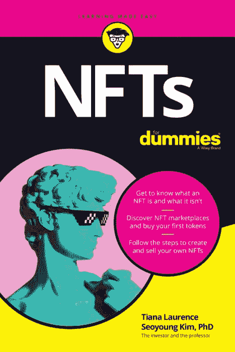


by Tiana Laurence 

and Seoyoung Kim, PhD


[www.wiley.com](http://www.wiley.com)


Published simultaneously in Canada

No part of this publication may be reproduced, stored in a retrieval system or transmitted in any form or by any means, electronic, mechanical, photocopying, recording, scanning or otherwise, except as permitted under Sections 107 or 108 of the 1976 United States Copyright Act, without the prior written permission of the Publisher. Requests to the Publisher for permission should be addressed to the Permissions Department, John Wiley & Sons, Inc., 111 River Street, Hoboken, NJ 07030, (201) 748-6011, fax (201) 748-6008, or online at [`www.wiley.com/go/permissions.`](http://www.wiley.com/go/permissions)

Trademarks: Wiley, For Dummies, the Dummies Man logo, Dummies.com, Making Everything Easier, and related trade dress are trademarks or registered trademarks of John Wiley & Sons, Inc. and may not be used without written permission. All other trademarks are the property of their respective owners. John Wiley & Sons, Inc. is not associated with any product or vendor mentioned in this book.

LIMIT OF LIABILITY/DISCLAIMER OF WARRANTY: WHILE THE PUBLISHER AND AUTHORS HAVE USED THEIR BEST EFFORTS IN PREPARING THIS WORK, THEY MAKE NO REPRESENTATIONS OR WARRANTIES WITH RESPECT TO THE ACCURACY OR COMPLETENESS OF THE CONTENTS OF THIS WORK AND SPECIFICALLY DISCLAIM ALL WARRANTIES, INCLUDING WITHOUT LIMITATION ANY IMPLIED WARRANTIES OF MERCHANTABILITY OR FITNESS FOR A PARTICULAR PURPOSE. NO WARRANTY MAY BE CREATED OR EXTENDED BY SALES REPRESENTATIVES, WRITTEN SALES MATERIALS OR PROMOTIONAL STATEMENTS FOR THIS WORK. THE FACT THAT AN ORGANIZATION, WEBSITE, OR PRODUCT IS REFERRED TO IN THIS WORK AS A CITATION AND/OR POTENTIAL SOURCE OF FURTHER INFORMATION DOES NOT MEAN THAT THE PUBLISHER AND AUTHORS ENDORSE THE INFORMATION OR SERVICES THE ORGANIZATION, WEBSITE, OR PRODUCT MAY PROVIDE OR RECOMMENDATIONS IT MAY MAKE. THIS WORK IS SOLD WITH THE UNDERSTANDING THAT THE PUBLISHER IS NOT ENGAGED IN RENDERING PROFESSIONAL SERVICES.

THE ADVICE AND STRATEGIES CONTAINED HEREIN MAY NOT BE SUITABLE FOR YOUR SITUATION. YOU SHOULD CONSULT WITH A SPECIALIST WHERE APPROPRIATE.

FURTHER, READERS SHOULD BE AWARE THAT WEBSITES LISTED IN THIS WORK MAY HAVE CHANGED OR DISAPPEARED BETWEEN WHEN THIS WORK WAS WRITTEN AND WHEN IT IS READ. NEITHER THE PUBLISHER NOR AUTHORS SHALL BE LIABLE FOR ANY LOSS OF PROFIT OR ANY OTHER COMMERCIAL DAMAGES, INCLUDING BUT NOT LIMITED TO SPECIAL, INCIDENTAL, CONSEQUENTIAL, OR OTHER DAMAGES.

For general information on our other products and services, please contact our Customer Care Department within the U.S. at 877-762-2974, outside the U.S. at 317-572-3993, or fax 317-572-4002. For technical support, please visit [`hub.wiley.com/`](https://hub.wiley.com/community/support/dummies)

[community/support/dummies](https://hub.wiley.com/community/support/dummies).

Wiley publishes in a variety of print and electronic formats and by print-on-demand.

Some material included with standard print versions of this book may not be included in e-books or in print-on-demand. If this book refers to media such as a CD or DVD that is not included in the version you purchased, you may download this material at [`booksupport.wiley.com`](http://booksupport.wiley.com). For more information about Wiley products, visit [www.wiley.com.](http://www.wiley.com)

Library of Congress Control Number: 2021948877

ISBN: 978-1-119-84331-3; 978-1-119-84332-0 (ebk); 978-1-119-84333-7 (ebk)
欢迎阅读《NFTs For Dummies》！如果你对 NFTs（它们的起源、用例和底层技术）感到好奇，这本书就是为你准备的。

在这本书中，你可以找到有用的信息和建议，帮助你探索 NFTs 世界。你还可以获得实用的逐步指南，教你如何设置热钱包来存储 NFT、如何在 NFT 市场平台上导航，甚至如何编写自己的 NFT。

你不需要在编程、数学、合同理论或经济学方面有背景知识才能理解本书。我们会在其中融合这些元素，以展现 NFTs 的多学科特性及其所代表的意义。


数字领域的买卖和转让应该和实体领域的买卖和转让没有区别。因此，NFTs 可以在数字时代复兴拥有媒体（以及第一 sale 教义）的概念，而不仅仅是音乐，还包括电影和书籍。

照片和其他数字艺术

数字图像的市场也为 NFTs 提供了天然的生态环境，NFTs 可以可靠地证明对特定数字照片或艺术品的法律权利。想象在数字图像旁创建一个 NFT（可以包含 NFT 的标识信息在图像元数据中），以记录其合法所有者和授权用户。这对数字艺术家和摄影师（通常是 Shutterstock 和 Getty Images 的贡献者）具有巨大的经济优势。

随着图像搜索引擎的精度提高（参见 Figure 3-4），内容创作者可以自动定位和核查其数字内容的未经授权使用情况，授权用户则可以通过使用相应的 NFT 和图像元数据来验证其法律权利。

FIGURE 3-4：

Google 上的一个示例图像搜索。

公众人物也可以利用 NFT 来减少 deepfake（使用深度学习技术在图像或视频中添加或替换人物形象）的创作。想象 Obama NFTs，为每个合法的数字 Obama 媒体创建一个新的代币。消费者可以通过检查其哈希值与不同的 Obama 媒体代币来验证图像、音频文件或视频是否被篡改。当然，在基于信任的国家，你可以依赖中央当局发布有效媒体哈希列表。但在不稳定的政权中，不可篡改且去中心化的有效内容哈希记录对于确保公众相信他们看到的内容至关重要。

38 PART 1 Getting Started with NFTs

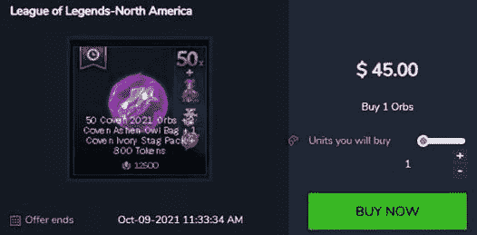

游戏资产

随着在线角色扮演游戏（如 EverQuest 和 League of Legends）的流行，游戏内的资产开始从玩家手中获得真实世界的美元，玩家渴望通过积累在-game 财富更快或通过展示独特的游戏内物品来获得地位。

玩家在 eBay 或 Player-Auctions 等市场上列出资产，承诺在付款后将资产在游戏内转移（这一过程本身充满风险）。NFTs 提供了可靠地代表游戏资产和头像的所有权的方式，并通过智能合约实现自动化的点对点转移。想象一个游戏世界，拥有真正民主化的资产所有权和交换——经验丰富的玩家保留更多销售收入，新手玩家以更低的价格购买游戏声望，点对点交易即时且几乎无风险。

FIGURE 3-5：

在 Player Auctions 上出售的 League of Legends 游戏内资产。

NFTs 和实体资产

实体世界中的许多情况也将极大受益于一种可靠、透明且自动化的系统，该系统设计用于分组、组织并数字化跟踪非同质化资产。

CHAPTER 3 The Future of NFTs 39

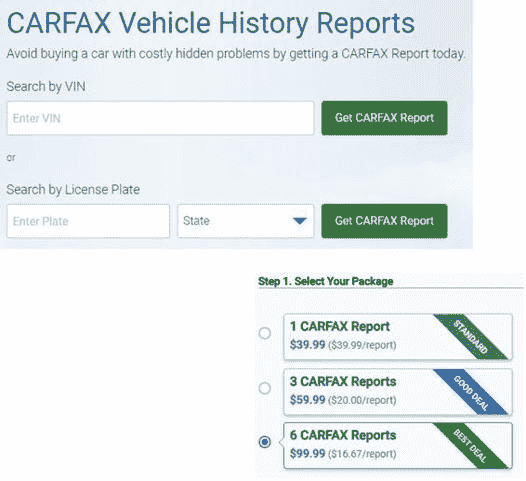

住房、汽车和非数字化宠物

想象一个世界，房产所有权和销售记录在公共区块链上铭记，从而消除对产权保险和托管服务的需求。

此外，想象用非同质化代币取代汽车产权。


与支付 $39.99 购买 CARFAX 车辆历史报告相比，如图 3-6 所示，你可以直接查询开源区块链来追溯特定汽车的来源。你将能够查看所有权变更、事故时间线、保养记录以及跨州行驶记录——全部免费（或仅需少量交易费用）。

FIGURE 3-6:

CARFAX

界面

和定价方案。

而且，CryptoKitties 也为追踪非数字宠物的所有权和血统提供了可靠的测试案例。相比之下，美国养犬俱乐部（AKC）认证的血统证明，如图 3-7 所示，费用为 $36，仅提供（最多）四代的族谱信息。

40  PART 1  Getting Started with NFTs

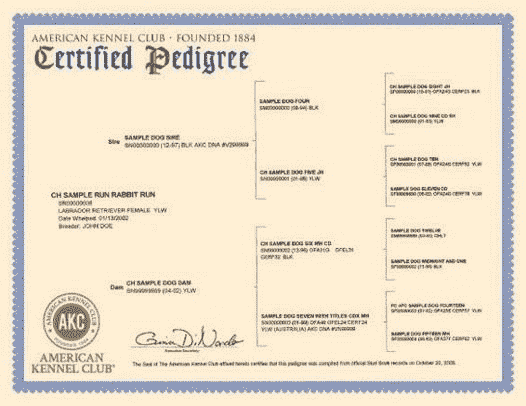

FIGURE 3-7:

AKC

血统证明书。

艺术品、珠宝、葡萄酒和其他收藏品——昂贵且稀有的物品充斥着欺诈。Rudy Kur­niawan 曾著名地出售数百万美元的假酒，冒充来自 Domaine de la Romanée-Conti 和 Château Mouton Rothschild 等权威酒庄的瓶子。

尽管 NFT 无法检测或解决假冒问题，但专业鉴定结合可靠的完整溯源记录可提供保障——即便为了安心，原始作品的假冒销售也仅可能发生一次。

Imagining the Possibilities

从出租车牌照到演唱会门票，任何独特且可转让的权利都适合去中心化的点对点市场。

将区块链及原生代币概念引入既有想法和实践，已催生了巨大的价值和意义重大的颠覆性变革——在去中心化金融（DeFi）领域（如 Uniswap、Chainlink 和 Compound），这些变革足以掩盖无意义的名称更改和调侃素材。

（还有人记得 Long Blockchain 吗？）

如果你想进一步了解这些 DeFi 颠覆者，请查阅以下网站：

» Uniswap（去中心化交易所）：[`uniswap.org/about/`](https://uniswap.org/about/)

[org/about](https://uniswap.org/about/)

» Chainlink（去中心化预言机）：[`blog.chain.link`](https://blog.chain.link)

[link](https://blog.chain.link)

» Compound（去中心化借贷池）：[`compound.finance`](https://compound.finance)

[compound.finance](https://compound.finance)

总体而言，可能性非常广阔。未来还有什么可以“NFT 化”？

42  PART 1  Getting Started with NFTs


2Buying and 

Selling NFTs

IN THIS PART … 

发现购买你的第一个 NFT 的方方面面。

揭示最流行的 NFT 市场平台以买卖 NFT。

从零开始创建自己的 NFT，且免费。

探索在顶级 NFT 市场上列出你的 NFT。

构建自己的 NFT 投资策略。

为你的 NFT 投资制定税务计划。


IN THIS CHAPTER

» 设置你的热钱包

» 保护钱包免受盗窃

» 创作原创数字艺术作品

» 免费创建你自己的 NFT

» 拍卖你的 NFT 系列

Chapter 4

Getting In on the 

NFT Game

本章将帮助你自信地探索非同质化代币（NFT）世界，以便你能够在互联网上最受欢迎的多个平台上购买、创建和出售 NFT。NFT 使得创作者能够打造新类型的数字资产，赋予其所有权。艺术家和收藏家喜爱 NFT，因为它们具备防伪特性。NFT 让你能够创建数字收藏卡片等新型数字资产。

在本章中，你将了解 MetaMask 热钱包的方方面面、如何保护钱包安全，以及如何使用包括 OpenSea、Nifty Gateway 和 Rarible 在内的多个热门 NFT 市场。你还将免费从零开始创建并上架你的第一个 NFT。最后，你将学习 NFT 作为投资工具的概念，以及在未来几年如何抓住非同质化代币的增值机会。

CHAPTER 4 Getting In on the NFT Game  45

Knowing the Ins and Outs of 

Buying NFTs

NFT，即 non- f ungible t oken，是一种数字资产的表示，可在个人之间进行转移——通常代表独特的数字项目。这项新兴技术已被在线游戏公司使用，未来可能成为收藏品的标准。

非同质化代币与其他数字内容的不同之处在于，它们拥有区块链-backed 证书，明确指出谁拥有一张照片、视频或其他形式的在线媒体。

每个代币都是唯一的，作为收藏品，意味着它无法复制——由设计决定，它稀缺。自 2020 年以来，非同质化代币的 popularity 急剧上升，昂贵的艺术作品也因此被以此方式出售。

Examining the success of 

early NFTs

早期非同质化代币的成功案例包括 CryptoKitties 游戏中的数字收藏猫，后续将在第二章中详细说明。CryptoKitties 是一款基于以太坊网络的区块链游戏，由加拿大工作室 Dapper Labs 开发。它率先采用了 ERC-721 代币标准，使玩家能够购买、收藏、繁殖并出售独特的虚拟猫。

自问世以来，ERC-721 标准已扩展，并被用于促进各类数字媒体的交易。

The NBA’s Top Shot

非同质化代币的主流普及与美国国家篮球协会（NBA）推出 Top Shot 网站相关联。该站点让用户购买或交易他们喜爱的 NBA 运动员的 NFT。NBA 粉丝群体热情洋溢——Top Shot 上线五个月后便已有超过 10 万买家，交易额达到近 $250 百万美元。大多数交易均在其点对点市场上完成，每笔交易都会向 NBA 支付版税。

46  PART 2  Buying and Selling NFTs

勒布朗·詹姆斯的扣篮是篮球中最具标志性的时刻之一，它被制成 NFT 并随后以 $200,000 的价格售出。

粉丝热衷于购买 NBA 纪念品以纪念重要的球员和比赛。NFT 以全新方式利用了这种热爱。

音乐艺术家

NFT 也扩展到了音乐行业。Grimes，这位长期受关注的艺术家，在 Nifty Gateway 网站上出售了十件作品，总计 $6 百万美元。她最高价的作品是独一无二的音乐视频《Death of the Old》，拍出了 $388,938。

Grimes 还以每件 $7,500 的价格出售了数百份名为《Earth》和《Mars》的短音乐视频。

Internet memes

Nyan Cat 网络迷因是其中之一，已被制成 NFT。如果你不记得这个特定的迷因，它基于 2011 年的 YouTube 视频。动画展示了一只猫，其腹部像 Pop-Tart，在太空中飞行并留下彩虹轨迹，配以一首日本流行歌曲。创作者 Chris Torres 在 24 小时内的拍卖中，以 $590,000 的价格售出了他修复后的纪念版 Nyan Cat。

Unusual NFTs

并非所有能够转化为 NFT 的物品都必然属于艺术类。例如，你可能不认为一条推文是艺术。然而，Twitter 创始人兼首席执行官 Jack Dorsey 将他第一条推文作为 NFT 售出，成交价为 $2.9 百万美元。

该推文（发布于 2006 年 3 月 21 日）内容为：“just setting up my twttr.” 富有的商人 Sina Estavi 购买了它，并将购买这条推文比作购买《蒙娜丽莎》画作。艺术与美感始终在观者的眼中。

Thinking about NFTs as an 

investment

与所有投资一样，你需要凭自己的判断来决定你购买的 NFT 作品的价值。

CHAPTER 4 Getting In on the NFT Game  47


我们并非财务顾问，这也不是投资建议。

NFT 可以以主观和客观的方式进行估值。在本节中，我们整理了一些需要牢记的要点，这些要点与有价值的 NFT 发布（a term borrowed from the music industry that means “release”）相关。

NFT 是一种新型的数字资产，其市场特性将在未来几年持续演进。简而言之，始终使用你最好的判断力，购买你内在热爱的项目，并且永远不要投资你不愿损失的金额。祝你狩猎愉快！

艺术家人气

艺术家在发布前的人气是价值的最大决定因素。如果你听说过这个名字，那么其他人也可能听说过，并希望拥有该艺术家创作的数字艺术品。

CryptoPunks 稍微动摇了这一观点，因为没有人会声称自己在 NFT 出现之前就有知名度。NFT 收藏者会在 OpenSea 或 Rarible 等市场以数千美元的以太币（ETH）出售它们。CryptoPunks 的活跃交易形成了价格底线，并能在任何时刻让你大致了解市场对其价值的判断。

CryptoPunks 也是早期的 NFT 项目。NFT 可以随着年龄的增长和稀缺性的提升而获得价值。诸如 CryptoKitties 和 CryptoPunks 等 2017 年的 NFT 在拍卖中已获得惊人的价格。

区块链安全

提及 NFT 时，安全问题始终会被提出。NFT 之所以能够追踪，是因为它们声称不可篡改且防欺诈。它们还允许你主权拥有它们，无需依赖单一中心化方来维护其存在和安全。（这正是区块链的作用。）以太坊因其作为最古老且最安全的创建和保护 NFT 的网络之一而脱颖而出。在评估 NFT 的区块链时，你需要考虑区块链的去中心化程度，以及判断其是否具备持久性——即能否在未来保持其受欢迎程度。

并非所有 NFT 都完全在链上。所谓“在链上”（on chain）是指用于渲染数字艺术的数据已存储在区块链上。由于去中心化的工作量证明网络上数据存储成本高昂，艺术家通常会将 NFT 记录的图像存储在 AWS 等第三方云服务上。少数 NFT（如 Avastars、Aavegotchis 和 Art Blocks 发布）则完全在以太坊上托管。

离链 NFT 是一种代表所有权的代币，但不保障数字艺术本身的安全。如果 NFT 在链上，则其所代表的底层艺术品拥有分布式数据结构的内置冗余。

理解热钱包（如 MetaMask）的风险

MetaMask 是一个热钱包，即一种连接互联网的工具，用于存储、接收和发送 ETH 及其他代币。所有基于网页的钱包都是热钱包，且是加密货币钱包中最不安全的。相比之下，冷钱包（有时称为硬件钱包或离线钱包）不连接互联网。鉴于 MetaMask 是热钱包，它并不是安全存储价值的方式。仅用于立即执行的小额交易才适合使用它。

截至本文撰写时，MetaMask 尚未遭遇重大黑客攻击。MetaMask 是一种层次化确定性钱包（HD 钱包），能够自动生成层级树状的私钥和公钥结构，帮助你备份钱包，而无需手动创建和保存每一对钥匙。MetaMask 还拥有一个活跃的开发者社区，定期更新其代码基座。使用 MetaMask 面临的主要风险来自钓鱼攻击：诈骗者会发送欺诈信息，诱骗你泄露密码和用户名。

第 4 章 进入 NFT 世界 49

钓鱼攻击非常普遍，你的钱包密码和恢复短语是攻击的目标。无论如何，切勿让任何人获得你的密码或口令短语。你可以通过始终避免打开以下项目来预防钓鱼攻击：

» 弹出广告

» 可疑邮件

» 在可疑广告或邮件中的链接

MetaMask 还能够管理你在线身份。当去中心化应用（dApp）需要执行交易并写入以太坊区块链时，MetaMask 充当安全的接口。

不过，MetaMask 的安全性不足以保存大额资金。我的经验法则是：这里存储的金额应相当于你愿意在自己的钱包或手提包里拥有的金额。如果你需要存储更多代币，请考虑使用硬件钱包，如 Trezor 或 Ledger 硬件钱包。并且直接从制造商处购买硬件钱包。近期在亚马逊的诈骗中，设备在发送给买家之前就已被篡改。

比较热钱包

MetaMask 并非唯一的热钱包。我们在本书中使用它是因为它经过了多年开发和测试。你还可以探索 Exodus、Jaxx 等其他钱包，它们同样免费且使用良好。

权衡热钱包的利弊

MetaMask 的便利之处在于你无需运行完整的区块链节点即可使用以太坊区块链。（运行完整节点工作量巨大，并占用大量硬盘空间。）MetaMask 对初学者而言非常有帮助，帮助他们入门区块链和 NFT。

下面列出了 MetaMask 的优点：

» 开源：它是持续更新的开源软件。庞大的开发者社区不断改进软件，使其更易用且更安全。

» 设置：MetaMask 采用层次化确定性设置，方便钱包备份。

» 集成：它已与 ShapeShift、Coinbase 等有用应用集成，这类平台是加密货币交易所和管理工具。我们在第 2 章中会详细介绍 Coinbase。

下面列出了缺点：

» 安全性不足：与所有热钱包一样，MetaMask 永远不会完全安全。

» 信息访问受限：MetaMask 对你的信息拥有某些限制访问，这让部分人感到不安。

自 2016 年推出以来，MetaMask 团队已取得长足进步，其工作使得访问以太坊区块链变得简便、可靠且安全。

MetaMask 的最大问题也是其最大优势：它是基于网页的钱包。它永远无法像硬件钱包或纸质钱包那样安全。

当你在浏览器中添加 MetaMask 时，系统会要求你确认一条信息，内容大致为：“阅读并更改你访问的所有网站的数据。”

分布式应用（dApp），如本章后面提到的 NFT 网站，会访问区块链。MetaMask 会在每个页面注入 web3 JavaScript，这不会修改网站本身，但让你能够同时访问网站和区块链。

揭开你的 MetaMask 钱包

MetaMask 是一款流行的加密钱包，可在多种主流浏览器中安装。本节将向你展示如何设置全新钱包、防范盗窃并向其充值。

MetaMask 的创建者希望打造一款既易用又安全的钱包，并且让新用户能够与 Web 3.0 网站（如 OpenSea）进行交互。（我们稍后在本章中对 OpenSea 进行更详细说明。）

你可以把 Web 3.0 视为让互联网更智能、更连接的持续性努力，而 MetaMask 是你的入口。


面对这个新网页。

MetaMask 处理账户管理并将用户连接到以太坊区块链。MetaMask 是一个专为以太币（Ether）以及 ERC20 代币设计的钱包，让你可以通过浏览器管理以太坊私钥。它还允许用户登录已集成 MetaMask 的网站。这点很酷，因为它让你可以在自己喜欢的浏览器中运行以太坊去中心化应用（dApp），而无需运行完整的以太坊节点。在此之前，你需要在设备上下载并同步完整的区块链，这对普通用户来说相当困难。

安装 MetaMask

使用 MetaMask 很简单。本节向你展示如何在以下三款流行浏览器——Chrome、Firefox 和（蒂亚娜的最爱）——Brave 中安装 MetaMask。

如果你不使用上述任一浏览器，但仍想使用，我们建议从其官方站点下载 Brave，网址为 [`brave.com`](https://brave.com) [brave.com.].

52  PART 2  Buying and Selling NFTs

MetaMask for Chrome

要下载 Chrome 版的 MetaMask，请打开 Chrome 并按以下步骤操作：

1\. 访问 [`metamask.io`](https://metamask.io/)。 

2\. 点击 “Download Now” 按钮。 

你会被导向 Chrome 商店。

3\. 在 Chrome 商店的 MetaMask 页面，点击 “Add to Chrome”。 

4\. 在弹出菜单中选择 “Add Extension”。 

这就完成了。浏览器右上角会出现一个小图标。要打开 MetaMask，只需点击该图标。稍后在 “Securing your MetaMask wallet for Chrome and Firefox” 章节中看到如何保护钱包。

MetaMask for Firefox

要下载 Firefox 版的 MetaMask，请打开 Firefox 并按以下步骤操作：

1\. 访问 [`metamask.io`](https://metamask.io/)。 

2\. 点击 “Download Now” 按钮。 

这一步会将你导向 Firefox 添加程序的页面。

3\. 点击 “Add to Firefox” 按钮。 

4\. 在弹出窗口中点击 “Add”。 

你现在拥有一个全新的 MetaMask 钱包。浏览器右上角会出现一个小狐狸图标——点击它即可打开 MetaMask。稍后在 “Securing your MetaMask wallet for Chrome and Firefox” 章节中看到如何保护钱包。

CHAPTER 4 Getting In on the NFT Game  53

MetaMask for Brave

Brave 浏览器自带 MetaMask，使用非常方便，只需打开即可。打开 Brave 并按以下步骤操作：

1\. 访问 [`metamask.io`](https://metamask.io/)。 

2\. 点击 “Download now” 按钮。 

3\. 点击 “Install MetaMask for Brave” 按钮。 

你会被导向 Brave 应用商店网站。

4\. 点击 “Add to Brave” 按钮。 

5\. 点击 “Add Extension”。 

6\. 点击 “Get Started” 按钮。 

7\. 点击 “Create a Wallet” 按钮。 

8\. 点击 “No Thanks” 按钮。 

你也可以点击 “I Agree” 按钮以向 Metamask 发展团队共享数据。

9\. 在提示出现时，创建唯一密码并妥善保存。 

不要跳过此步骤。 

你会获得一串由 12 个单词组成的主密码短语。

区块链没有客服部门——你需自行负责账户恢复。这 12 个单词的主密码短语让你能够恢复账户。

MetaMask 会提示你在下一页将这 12 个单词按相同顺序输入。在此之前，你有几种保护密码和密码短语的方法：可以在不上网或不在电脑上的安全位置手写它们；将它们写在多张纸上并分别放在两三个安全地点（如保险箱或可锁存的文件柜）也是不错的选择。如果可以，现在就对密码和备份短语进行覆膜处理。

10\. 按提示输入单词并点击 “All Done”。 

54  PART 2  Buying and Selling NFTs

Securing your MetaMask wallet for Chrome and Firefox

如果你已在 Chrome 或 Firefox 浏览器中安装了 MetaMask，请按以下步骤保护钱包：

1\. 在打开的 Chrome 或 Firefox 浏览器中，点击右上角的狐狸图标。 

2\. 在新出现页面的中间位置，点击 “Get Started” 按钮。 

3\. 点击 “Create a Wallet” 按钮。 

4\. 在 “Help Us Improve MetaMask” 页面，点击 “I Agree”。 

5\. 在提示出现时，创建唯一密码并妥善保存。 

不要跳过此步骤。 

创建密码后，你会得到一串由 12 个单词组成的主密码短语。

这 12 个单词用于恢复账户。区块链没有客服部门。

你需自行负责账户恢复。

MetaMask 会提示你在下一页将这 12 个单词按相同顺序输入。在此之前，你有几种保护密码和密码短语的方法：不要使用密码管理器。最好手写这段短语并分多份纸张存放在不同安全地点，如保险箱或可锁存的文件柜。如果可以，现在就对密码和备份短语进行覆膜处理。

6\. 按提示输入单词并点击 “All Done”。 

Buying Ether for Your MetaMask Wallet

如果你目前还不拥有 ETH（以太坊原生加密货币），可以在 MetaMask 钱包应用内购买少量。大额交易需要通过 CHAPTER 4 Getting In on the NFT Game  55 与 Wyre（以太坊支付供应商）完成身份验证要求。

Wyre 支付流程提供了简单直接的方式，使用 Apple Pay 或信用卡购买加密货币。

记住，只在像 MetaMask 这类热钱包中保留少量加密货币。

要获得一些 ETH，请按以下步骤操作：

1\. 在你之前安装 MetaMask 的浏览器中，打开 MetaMask 钱包，点击右上角的狐狸图标。 

2\. 使用用户名和密码登录钱包，然后点击 “Buy” 按钮。 

3\. 点击 “Continue to Wyre” 按钮。 

一个新窗口会打开并加载 Wyre 支付页面：

[`pay.sendwyre.com/purchase`](https://pay.sendwyre.com/purchase)。

4\. 选择想要购买的数量以及支付方式（Apple Pay 或信用卡）。 

如果 Wyre 应用对你不友好，你也可以通过 Coinbase 账户购买 ETH，Coinbase 账户可以在 [`www.coinbase.com/`](https://www.coinbase.com/) 设置。若需更多帮助，请参考第 2 章；若需帮助进行钱包到钱包的转账，请参考 Tiana Laurence 的《Blockchain For Dummies》（Wiley 出版） 。

购买后，新代币会在几秒钟内出现在你的 MetaMask 钱包中，或从其他钱包转入。等待时间取决于网络速度。到达后，你即可购买第一个 NFT。

Exploring NFT Marketplaces

你可以在各种不同的平台和变体中轻易迷失，这些平台允许你购买、出售和创建 NFT。本节介绍三个可以购买、出售甚至创建 NFT 的平台。

56  PART 2  Buying and Selling NFTs

Navigating the OpenSea of NFTs

大型的点对点市场 OpenSea 是用户拥有的数字资产（包括收藏品、域名、数字艺术、游戏道具等）的所在地，所有资产均由区块链支撑。

OpenSea 让你在一个简便易用的市场中买卖、创建、转移和浏览 NFT，并且拥有庞大的热情用户、开发者和创作者社区。

Devin Finzer 于 2017 年与他的合伙人 Alex Atallah 一起创立了 OpenSea。Finzer 最近将之前的公司 Claim-dog 出售给 Credit Karma。他曾在像 Google 这类大型科技公司工作，并学习计算机科学和数学。


matics at Brown University helped him see the potential of new emerging digital economies enabled by blockchain technology.

The OpenSea marketplace was quickly adopted by the creators of all the new digital items built with blockchains and evolved rapidly into a billion-dollar marketplace. The tools that were built allow developers to create rich, integrated digital assets and sell them.

Common token types on OpenSea

Several important token types are available on OpenSea. These include token standards, such as `ERC20`, `ERC1155`, and `ERC721`.

These different standards allow users to program their assets in distinct ways that are worth knowing:

» `ERC20` is a fungible token that’s created with a smart contract. An `ERC20` token contract keeps track of fungible tokens. Fungible in this context means that any single token is precisely equal to any other token. The `ERC20` tokens have no special rights or behaviors associated with them.

`ERC20` tokens are useful for tasks such as creating a cryptocurrency and securing voting rights.

» The `ERC1155` is a token standard used to create fungible and non-fungible (unique) assets, such as digital cards, pets, and in-game skins. A more complex standard than `ERC20`, it allows developers to use a single smart contract to represent multiple tokens at once.

CHAPTER 4 Getting In on the NFT Game  57

» `ERC721` represents ownership of tokens — `ERC721` tokens are used to track items, each of which has unique attributes. `ERC721` is an older standard for non-fungible digital assets. Though similar to `ERC1155`, `ERC721` does differ in that it has no concept of a balance.

Each token created as an `ERC721` is unique and non-fungible, and it either exists or it doesn’t.

Developers created the `ERC1155` to help them manage the fees tokens incurred on their blockchain. This token standard leads to massive gas savings for projects that require multiple tokens. Rather than deploy a new contract for each token type using an `ERC721`, a single `ERC1155` token contract can represent multiple tokens, reducing deployment costs and complexity.

Buying NFTs on OpenSea

Buying an NFT is pretty easy on OpenSea, especially if you already own some bitcoin or ETH and have a MetaMask wallet set up. In the browser where you installed MetaMask, go to the OpenSea website (`https://opensea.io`), click the fox icon, and log in to your MetaMask wallet.

You can browse OpenSea categories by clicking Marketplace.

Each category shows trending collections, recently listed items, and newly minted items. To find and buy NFTs on OpenSea, follow these steps:

1. Under Marketplace in the top navigation, select Art. This step takes you to the Explore Art page, which lists the latest NFT art. You can use the search bar to look for artists you enjoy or browse what’s available.

For this exercise, we’re searching for one of our favorite NFT creators: Artificial Intelligence Art V2. It creates unique pieces of art based on classical paintings. The AI model was trained by analyzing millions of images from famous artists such as Pablo Picasso, Mark Rothko, and Claude Monet. It produces a limited collection of interesting artworks that are unique yet familiar.

58 PART 2 Buying and Selling NFTs

2. Type The Aftermath of Uncertainty 1583 in the search bar.

3. Click the image of The Aftermath of Uncertainty to go to its page, where you see its details, including trading history. The trading history (scroll down to see it) shows who has owned the NFT and the price that was paid. Every NFT has an owner, a creator, and a history, and this information is verifiable. Each item’s page also has a Details section, where you can verify details about the contract used to create it and other important information, such as which blockchain secures the NFT and whether the image is stored in one central location or across multiple locations.

4. If you locate a piece of art you want to buy, click the Buy Now button.

Your MetaMask wallet pulls up a transaction page that allows you to add the NFT to your wallet.

After you buy the NFT, it is associated with the MetaMask wallet that you used to buy it.

Make sure that your wallet is secure. If you’re unsure, refer to the “Installing MetaMask” section, earlier in this chapter.

Creating your own NFT on OpenSea

Setting up your first collection on OpenSea is simple. This section covers creating an OpenSea collection and adding your very own NFTs to it.

You can use any sketching software to create a digital piece of art, so use whichever digital art creation tool you like. In this example, we’re uploading an abstract piece of art Tiana created with the free sketching software on `https://sketch.io.`

OpenSea accepts a variety of file formats for images, videos, audio, and 3D models. Though the site suggests keeping the file size at smaller than 20MB, it nevertheless can support file sizes up to 40MB, at the time of writing. These file types are supported by OpenSea: `GIF`, `GLB`, `GLTF`, `JPG`, `MP3`, `MP4`, `OGG`, `PNG`, `SVG`, `WAV`, and `WEBM`. (If you go for the upper limit of 40MB, you may encounter some speed issues.)

CHAPTER 4 Getting In on the NFT Game  59

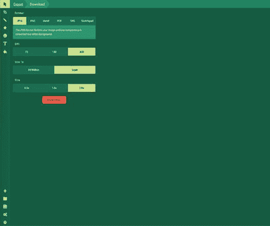

The sketch.io website has some older icons at the time of writing, but Figure 4-1 shows the download page with these options selected:

» Format: JPEG, one of OpenSea’s acceptable file types

» DPI: 300 — the higher the resolution, the higher the quality of the image

» Size To: Scale

» Size: 2.0x

FIGURE 4-1:

The sketch.io download page.

When you download your artwork, be sure to name it something creative and save it to a folder you can easily navigate to later.

Nice job! You now have an original piece of art that you can turn into an NFT. (Figure 4-2 shows a Tiana Laurence abstract original created on sketch.io for this chapter.)

60 PART 2 Buying and Selling NFTs


FIGURE 4-2:

A Tiana Laurence original, created on sketch.io.

With your artwork completed, it’s now time to set up your first collection on OpenSea. Here’s how:

1. Go to opensea.io.

2. Click the Profile icon and choose My Collections.

With your MetaMask wallet installed on your browser, it should log you into OpenSea automatically. Otherwise follow Step 3.

3. If prompted, log in with your wallet.

Your wallet will be your identity on OpenSea.

If you haven’t yet set up a wallet, see the “Installing MetaMask” section, earlier in this chapter.

4. Click the Create a Collection link at the top of the My Collections page.

5. Enter a name for your collection as well as a description.

You now have a space on the OpenSea marketplace! To add a piece of art to your collection for others to view, just follow these steps:

1. From your collection page, click Add Item at the top of the page.

You’re sent to a new page, prompting you to upload your artwork.

2. Drag the image file to the indicated box at the top of the page.

3. Using the page’s text boxes, add a short description and other details.

4. Scroll to the bottom of the page and click the Create button.

Congratulations! You have created your first NFT. You can now share it on social media. (If you had a great time doing this, tag me in a tweet at @LaurenceTiana with your new NFT.)

The Nifty Gateway

Nifty Gateway is a premium digital art auction platform for non-fungible tokens. The famous Winklevoss twins purchased it from founders Griffin and Duncan Cock Foster — another set of twins. Nifty Gateway has sold NFTs created by popular artists such as Beeple, Grimes, Billelis, and other internationally regarded artists. Nifty Gateway, which has a partnership with


the auction house Sotheby’s, has positioned itself as a premium platform for NFT collectors.

Discovering Nifties and drops

Nifty Gateway calls its rare digital items Nifties, but don’t let that confuse you — Nifty is just another (hipper) name for NFTs. Nifties follow the same popular ERC-721 standard as other tokens.

Each Nifty is its own one-of-a-kind digital item. And, like other platforms, Nifty Gateway is a helpful place to find cryptocollectibles and crypto art.

Nifty Gateway offers an easy way to buy NFTs with your credit card or debit card. Most other platforms at the time of this writing require you to use a cryptocurrency like ETH. The platform also allows you to buy NFTs from popular cryptogames and applications, such as CryptoKitties, OpenSea, and Gods Unchained.

62 PART 2 Buying and Selling NFTs

An interesting feature of Nifty Gateway involves drops, a specific time when an artist releases a limited number of new digital art pieces. This is how the artist Grimes released her NFT WarNymph, with her collaborator, Mac Boucher. Within a few minutes, they sold all their artwork.

Drops have become popular with collectors because they allow you to not only see new work from amazing artists but also capitalize on your purchase by reselling them on an NFT marketplace. This strategy works a lot like buying popular concert tickets and then reselling them on ticket reseller websites, like StubHub. The difference is that Nifties drops are sold directly by the artists. You can buy these NFTs during a set time or purchase them from their original owners on secondary marketplaces.

Setting up a Nifty account and making a purchase

To set up your Nifty account, follow these steps:

1. Navigate to `https://niftygateway.com`.

2. Click the Sign Up / Sign In button.

3. On the sign up page fill in account information to create a new account for yourself.

Nifty Gateway sends you a confirmation email with a code.

4. Check your email and copy-paste into the validation box the code you receive.

When it comes to researching and buying an NFT, it’s easy. Just do the following:

1. Navigate back to the Nifty Gateway home page: `https://niftygateway.com/`.

2. Click the Drops button in the upper-right corner.

This step directs you to a new drops page, listing all the upcoming events (with dates).

CHAPTER 4 Getting In on the NFT Game 63

3. Click the artist who’s featured for the day.

This step directs you to a page with information describing the NFT that’s up for sale.

The first section shows information about the artist and the collection that the artist has publicized.

The NFTs that are available for sale appear under the Explore Open Collection heading.

4. Click on one of the NFTs to bring up another page with more information about how many editions have been allowed for that piece of art.

When you find an NFT you love, you can bid on it by clicking the Bid button that is in the description below the image of the NFT. From within the Nifty Gateway website, you buy NFTs with your credit card, just like normal online shopping websites.

NFTs are artwork first, so they might not be a productive investment. Their popularity (and therefore their value) may decrease over time. Don’t spend more money on NFTs than you have to lose, and buy only what you truly like.

Rarible’s decentralized governance

Rarible, a decentralized marketplace for non-fungible tokens, was founded in 2017 by Alexei Falin and Alexander Salnikov, both from Russia. Rarible launched to the public three years later, in 2020. As on other NFT platforms, you can create and sell your tokenized art. Unlike on other platforms, it provides a diverse suite of services that are quite artist-friendly. Rarible enables hi-resolution files and hidden messages. You can also set up smart contracts, which allow you to collect royalties on your artwork. For example, you can receive a fee whenever your artwork changes hands. Rarible is a great way of generating income for artists. However, this can be circumvented if the NFT is resold on a platform that doesn’t support the same royalty system.

64 PART 2 Buying and Selling NFTs

Rarible’s NFT marketplace differences go even deeper. From the beginning, it has been driven by community engagement through a new type of company, called a decentralized autonomous organization (DAO). Unlike centralized services, a DAO is a non-custodial NFT minting platform and marketplace. Noncustodial means that there is not a central party in charge. Rarible’s DAO has created a strong community of artists and NFT lovers that manage the platform collectively.

As a community member, you can decide on the platform’s future using its native governance token, RARI. (A governance token, for all you cryptocurrency newbies out there, is a type of cryptocurrency that grants voting power on a blockchain.) RARI enables the most active creators and collectors on Rarible to vote on platform upgrades and participate in curation and moderation.

To be clear, you can’t purchase RARI, and it has no market value — you earn it by actively participating on the platform.

Creators, sellers, and buyers on the Rarible marketplace receive RARI through weekly distributions according to their weekly activity level, like purchases and sales volumes.

Creating an NFT on Rarible takes only a few minutes. The platform has a simple interface that allows you to publish an NFT and set up smart contracts with royalty percentages and auctions for your art.

The Rarible platform works to solve intellectual property payment problems, fraud, and licensing paperwork issues by offering artists the ability to tokenize their works of art and guarantee their origin and ownership.

Rarible isn’t perfect — it has some issues it needs to overcome.

For example, creators can game Rarible’s DAO system by washing their NFTs, this is a scam where a user buys their own artwork to gain RARI tokens. Keep in mind as well that Rarible at the time of this writing isn’t yet a complete DAO. This means your vote is more of a suggestion to the Rarible team. The company still decides what to work on — which is probably for the best, given that the project is still quite new.

CHAPTER 4 Getting In on the NFT Game 65

Getting up and running on Rarible

You set up an account with Rarible by connecting your wallet to the site. To do so, go to `https://rarible.com` and click Connect Wallet in the upper-right corner of the screen. Select MetaMask or the name of whichever wallet service you’re using.

When you’re signed into your wallet, you’re also logged in to Rarible. You can then adjust your admin settings by following these steps:

1. Click the My Items button at the top of the page or navigate to `https://rarible.com/settings`.

2. From this page, update your display name and connect your social media accounts, if you want.

3. Click the Update Profile button to save your changes.

If this step creates a new pop-up from your MetaMask wallet, go ahead and click through the prompts. This can happen when the website is confirming your identity. If you have a pending transaction in your wallet for example, it will prevent you from updating your user information on Rarible. You will need to clear the transaction from your wallet by adding funds or canceling the transaction. After you clear your wallet of pending transaction, it can then authenticate you for Rarible.

Creating an auction with a royalty structure

Before diving into the steps needed to conduct a Rarible auction, you first need to create a piece of digital artwork, using Sketch-pad or another sketching software.

With your artwork in hand, follow these steps:


1. 导航到 Rarible 网站 `https://rarible.com/`。

2. 点击使用 Metamask 登录。

如果您尚未设置 Metamask 钱包，请返回本章的早期部分并按照说明设置钱包。

66 部分 2 购买和出售 NFT

3. 点击页面顶部的“创建”按钮。

4. 在“创建可收藏品”部分，点击“多个”。

5. 点击“选择文件”按钮。

此按钮将打开一个新窗口，允许您在计算机上搜索您的艺术品的文件。

6. 使用搜索栏搜索您的艺术品文件的名称。

您在输入文件名时，文件将在窗口中出现。

7. 在窗口内点击选中您的艺术品文件。

8. 点击窗口右下角的“打开”按钮。

您的艺术品将在 Rarible 页面上显示，您将在浏览器内继续后续操作。

9. 点击“开始竞价”按钮。

此步骤允许市场对您的新 NFT 进行竞价。

10. 在“选择收藏集”部分，点击“Rari”。

11. 添加标题、描述以及您希望每次您的作品转手时收取的版税百分比。

12. 添加您想制作的复制件数量。

13. 点击“创建项目”按钮。

14. 导航到您的 MetaMask 钱包并点击“批准”。

如果您尚未向 MetaMask 钱包添加资金，可以在本章早期部分找到相关说明。在以太坊区块链上保护您的 NFT 需要支付燃气费。

燃气费价格并非固定，会随市场动态变化。（关于燃气费的更多信息，请参阅第 6 章。）

15. 返回 Rarible 网站并点击“开始”。

您可能需要刷新页面才能看到您的 NFT。

恭喜！您已成功为同一件作品的多个复制品创建了 NFT 拍卖，并设置了版税结构，以便每次您的 NFT 被交易时都能获得付款。

第 4 章 加入 NFT 游戏 67


» 了解加密货币和 NFT 的区别

» 遵循投资规则

» 挖掘表现最佳的 NFT

» 制定 NFT 投资策略

» 了解 NFT 的税务

第 5 章

投资 NFT

本章介绍了 NFT 投资的新世界。您可以在此处探索投资策略，包括查看可以投资的 NFT 类型。您还将了解所有类型投资（包括 NFT）的规则和监管机构。

无论您是考虑认真投资、享受收藏，还是想走在投资的前沿（或者您只是好奇），NFT 都有很多可提供。有时唯一真正理解如此新兴市场的方式是去探索它。

探索市场将让您了解可用的代币种类。您还可以感受定价情况，以及不同市场如何策划、列出和出售其资产。

与任何投资一样，您应尽可能进行研究，且切勿投入超过承受能力的金额。我们也建议您关注市场的变化，因为供需、技术和监管的变化可能会使市场长期保持波动。

第 5 章 投资 NFT 69

我们并非金融专家，本章内容不构成投资或税务建议。本章不替代专业投资顾问和会计师的指导。

理解 NFT 不是加密货币

在技术层面上，NFT 与加密货币相似，它们以数字记录的形式存在于区块链上。NFT 与加密货币的区别在于每个 NFT 都是唯一的。例如，如果您拥有一枚比特币，您可以将其交换为另一枚比特币，且它们的市场价值相同。这通常被称为可互换性——资产被交换为另一类型资产的能力，意味着资产之间具有平等价值。

在区块链上，任何比特币都与其他比特币相同。以太坊区块链上的以太币也是如此，同样适用于莱特币和狗狗币在其各自网络上的情况。全球数百万美元通过这类资产进行交易，并吸引大量买家。

NFT 则不同。每个非同质化代币拥有唯一的价值，虽然可以进行交易，但不能简单地相互替换。尽管加密货币市场波动剧烈，但在任何时刻，一枚比特币的价值与其他任何比特币的价值是相同的。每个 NFT 的价值各自独立，随时可能变化，与其他 NFT 的价值无关。

NFT 具有价值，当有意愿且能够的买家和卖家时。

它可能有一个单一的市场，或者无论价格如何，没有人愿意购买。人们猜测 NFT 市场可能会崩盘，就像 1990 年代的 TY Beanie Babies 一样。

70 部分 2 购买和出售 NFT

介绍 NFT 投资

随着加密货币的发明和新型数字资产的出现（如股权代币——作为传统股票资产的安全代币），投资领域正在快速变化。该领域的监管尚未完全跟上这些新资产的全球热情。

传统投资对普通人群的准入受限。您通常需要与投资经纪人或财务顾问合作——他们帮助您在复杂的股票、债券和投资基金世界中导航。这类投资的回报较为缓慢且可靠，且协助您的专业人士受政府机构监管。

这情况并非一直如此。20 世纪 20 年代出现了疯狂的投机和欺诈，导致数百万人陷入经济困境。

美国证券交易委员会（SEC），于 1934 年成立，是一家独立的美国联邦监管机构，旨在保护投资者并执行联邦证券法。它是新政（New Deal）的一部分，美国在经历大萧条的经济后果并防止因欺诈或傲慢导致的未来财务灾难。

为了进一步保护公众，美国国会通过了 1933 年《证券法》，要求美国大多数证券的销售必须注册，或向美国公民提供。该法案通过要求投资者获得公开证券的真实财务数据来防止证券欺诈，同时赋予联邦贸易委员会（FTC）停止证券销售并将人士监禁的权力。

基于区块链技术创建的真实或虚拟文件——代表具有金融价值的法律协议——受 FTC 和 SEC 监管。请牢记此声明，因为 NFT 可能是一种金融工具，受您国籍、国家以及（若您选择出售）买家的国籍和国家法律和法规的约束。


-   [购买 NFT 就像购买一幅画或其他艺术品一样。然而，NFT 可能拥有多种属性，很容易使它们成为金融工具。](https://nbatopshot.com)

-   如果你购买的 NFT 承诺给你带来投资回报，那可能是一项证券 —  — 例如，以房地产投资的形式出售的 NFT 并承诺分红，或数字艺术的版税流也可能是证券，因为它很可能不通过 Howey Test。（Howey Test 用于判断在美国什么是“投资合同”以及受美国证券法约束的资产类型。）当你在审查投资机会且不确定它是否属于投资合同时，可以寻找以下四个标准：

    » 它涉及金钱投资。

    » 它是一个共同企业。

    » 预期获利。

    » 该获利来源于他人的努力。

-   **决定 NFT 投资是否适合你**

    在制定 NFT 投资策略之前，先问自己这种投资是否适合你。你可以选择许多其他拥有更多历史、可预测性和可查阅市场研究的投资机会。与所有高度波动且投机性强的投资一样，不要把全部家当押在 NFT 上。

    只投入你可以承受从未看到的金额。这种策略能帮助你在财务上保持安全，避免不必要的压力。

    当你看到自己拥有的资产需求增加、价格上涨时，会感到愉快和兴奋。即使没有人认为你拥有的东西有趣或有价值，这也不构成损失，因为你 stayed within your means（保持在自己的承受范围内），并且希望你喜欢自己购买的东西。

-   **人们投资 NFT 的两个主要原因**

    » **抢在新资产的起点上**：拥有同类 NFT 中最早的那一个肯定带有一种声望。

    » **赚取金钱**：目前，有些人通过买卖 NFT 致富。虽然二级市场数据很少，但你会发现许多关于人们暴富的故事。

-   **NFT 正处于类似加密货币早期的热潮期**

    有些人通过早期购买比特币和其他代币致富，导致大家都想参与其中。有些人赚了钱，但也有许多人投资于后来未能保持价值的新代币，导致资本大幅损失。

-   **NFT 投资入门策略**

    NFT 让投资者感到兴奋，因为全球存在巨大的未开发机会。NFT 也可能是一场即将破裂的泡沫，类似 1990 年代 Ty Beanie Baby 的疯狂。真相可能介于两者之间。

-   **第 5 章 投资 NFT 73**

    有些 NFT 可能提供黄金投资机会，而另一些则可能迅速失去价值。在某种程度上，投资 NFT 与其他任何投资一样，必然伴随风险。保持充分了解是你最好的策略。

    你可能会出于兴趣收藏 NFT。很多人收集硬币或邮票是出于收藏的乐趣。虽然有时收藏品极其有价值，但许多收藏者并不介意永不出售他们拥有的东西。如果你想通过 NFT 建立价值或财富，需要先做好功课。

    在没有足够知识的情况下盲目进入 NFT，就像在不了解艺术或艺术价值的情况下投资传统艺术品。你可能会被迫持有一件没有金融价值的作品。如果你在这类投资上投入过多，可能导致财务崩溃。

-   **估值你的 NFT**

    从很多方面来看，NFT 只是传统收藏品或数字现代艺术的数字版本。棒球卡、硬币、艺术品、文件甚至汽车都可以是收藏品。它们的价值来源于稀缺性和 desirability（受欢迎程度）。某事物越受欢迎、供应越少，其价值就越高。

    如果没有愿意且有能力的买家，就不存在市场，无论该物品有多稀有。

    NFT 与上述物品相似，但也有区别。NFT 本身只是一条记录，已在区块链上记录并验证所有权和来源；NFT 通常不包含底层的数字内容。区块链存储容量有限，数字媒体文件体积大且在传统区块链上存储成本高昂。

    NFT 背后的技术有助于创造部分价值。

    因为稀缺性与收藏品的价值相关，数字创作的收藏变得困难。数字作品可以无损复制，这使得“拥有”数字资产变得困难。NFT 通过让艺术家能够推出限量版或为原创作品发行代币并出售给收藏者的权利来解决这一问题。这些项目可以代表资产的价值；换句话说，它们代表有人愿意为该资产支付的金额。

    你可以选择多种方法来确定 NFT 的价值。对任何资产的价值共识可能基于品牌、稀缺性或市场。如果你熟悉其他收藏品，可能会发现这些因素很熟悉。

    **品牌**

    这里的品牌基本上是指创作或与 NFT 资产相关的人物或实体。NBA Top Shot 上最贵的收藏品之一是勒布朗·詹姆斯的视频片段（[`nbatopshot.com`](https://nbatopshot.com)），我们将在后文“发现表现最佳 NFT”部分进一步讨论。勒布朗的品牌拥有价值 —  — 尽管收藏者可能会被该片段中具体的动作吸引，但最重要的价值在于人物本身。NFT 空间目前吸引了许多大牌，如 Coors、Coca‑Cola、NBA 以及艺术家 Beeple 和 Grimes。虽然找到一件与知名艺术家品牌无关的有价值 NFT 是可能的，但要长期建立价值却要困难得多。

    **稀缺性**

    稀缺性是决定 NFT 价值的最关键因素之一。如果艺术家只发行一份作品，它的价值高于发行 10,000 份的情况。正因如此，大多数市场平台都会明确显示每种作品的可供数量，创作者和市场可以通过控制发行的复制数量来快速影响价值。

    **市场**

    决定 NFT 价值的最后一环是市场，即 NFT 市场 places，它们是 NFT 被买卖的地方。投资者可以通过查看早期销售价格、类似项目的销售以及在必要时的估值来判断价格。

-   **选择你的策略**

    如果你已经决定进入 NFT 这个不稳定的世界，第一步是进行研究。搜索 NFT 投资机会会显示行业目前的状态类似“野西”。数十万甚至数百万的 NFT 来自数十个 NFT 市场平台。（我们将在第十二章中探讨其中的十个市场。）

    在购买之前，务必确认你正在使用合法的市场，且底层资产是真实的 —  — 任何人都可以创建 NFT 并称之为原创。

    由于 NFT 的去中心化特性以及其背后的区块链，没有官方机构会审核这些市场的质量和声誉。

    先从你热爱、了解的 NFT 类别中进行小额投资，因为投资你理解并乐于研究的资产是一条安全的路线。购买资产后，你会花大量时间阅读关于它的内容并观察市场走势。

    随着知识和自信的提升，你可能会投入更多资金。作为投资者，Tiana 会设定投资目标，这


enable her to make calculated decisions even when a market is hot. Having an investment plan — and sticking to it — can help you make reasoned decisions, no matter the asset class.

A key metric Tiana looks for is trading volume, the number of buyers and sellers that are active at any one time. This is a bit tricky with NFTs because they are in a thin market, which has few buyers and sellers.

A trick used by scam artists involves selling an asset repeatedly between accounts they own to inflate the value and create false volume signals. In the cases of NFTs, you need to research using unconventional sources like Reddit and Twitter. Anyone can post there, however, so be wary of pump and dumpers who are trying to inflate the value of an asset. This problem is, unfortunately, extremely common in the crypto space.

76 PART 2 Buying and Selling NFTs

As an investor, Tiana picks an arbitrarily conservative target return, which refers to the future value, or profit, you can expect to see on your investment, such as 10 percent. You need to do your own research and pick a target return number you’d be happy with, because it can help you know when to sell. The legendary investor Warren Buffett advises investors to buy when everyone else is selling and to sell when everyone else is buying.

Tiana uses this method.

Another practice Tiana uses is to sell below what she perceives is the top of the market. Again, she picks an arbitrary number like 10 percent below what she believes the top of the market will be, which helps her to exit an asset instead of riding a crash down.

Trading at the height of a market is extremely difficult to judge.

Discovering the Best-Performing NFTs

Buyers value NFTs for many different reasons. For some investors, NFTs are a form of art. For others, buying an NFT may signal to their social group their power and inclusion. Social signaling is the idea that you’re part of a group and have a high status by way of ownership of a particular object.

To understand NFTs and clarify the benefits and risks of investing, review some of the best-performing NFTs.

Here’s a list of several unique NFTs and some of the factors that drove their price:

» LeBron James, “Cosmic” dunk video (created in 2019; sold for $208,000): This NFT is part of the NBA Top Shot NFT exchange. For some, Top Shot brings back memories of collecting trading cards — and it works in a similar way.

Collectors buy packs and sometimes find that one card (an individual clip documenting moments from NBA games) in the collection that’s especially valuable. “Cosmic” came from a pack of 49 cards. The collections range in price, starting at $9 for common cards to close to $1,000 for packs likely to contain rare cards.

» Rick and Morty, “The Best I Could Do” artwork (created in 2021; sold for $1 million): A staple of Cartoon Network’s Adult Swim, Rick and Morty was created by Justin Roland.

Roland sold off a collection of 18 original art pieces from the show for a million dollars. It was the biggest sale to date on the NFT auction house Nifty Gateway. Rick and Morty enjoy a large fan base and have a cult-like following.

» CryptoPunk #7523 (a pixel-art character created in 2017; sold for $11.8 million): It’s part of 10,000 pixel-art characters made by Larva Labs, which started initially as a small, internal project at Google. CryptoPunks are a fixture in the NFT world, and ownership has created social signaling. See Chapter 13 for more about CryptoPunk #7523 and other CryptoPunks.

» Axie Infinity’s virtual game Genesis Estate (created in 2021; sold for $1.5 million): It’s virtual land inside the cryptogame Axie. As with real land, its value boiled down to location. The estate, which is in a prime location, offers a unique aesthetic.

» The first tweet from Twitter CEO Jack Dorsey (originally created in 2006; turned into an NFT and sold for $2.9 million in 2021): Twitter has become incredibly important, culturally and historically. Although the tweet itself was originally created way before the creation of the first blockchain, the NFT was created to represent the first tweet ever, which definitely has collector appeal.

» The 2021 Doge meme (turned into an NFT; sold for a whopping $4.4 million): Memes are cultural touchpoints that show up in many forms, and ownership of a meme is the ultimate social signal. The Doge meme, starring an adorable Shiba Inu, was extremely popular within the crypto space because it conveys the inside joke that anyone can make a cryptocurrency.

78 PART 2 Buying and Selling NFTs

» Beeple: EVERYDAYS — FIRST 5000 DAYS (digital artwork created in 2021; sold for $69.3 million): This piece of purely digital artwork (it’s more akin to fine modern art), which was the first one sold by a major auction house (Christie’s), is made up of 5,000 images taken over 13 years. It was sold to Singapore-based NFT collectors MetaKovan and Twobadour. See Chapter 13 for more about this piece, and other pieces, of Beeple’s art.

Exploring Popular NFT Types

Many types of NFTs exist, and new token standards are being developed all the time. In this section, we show you several of the most popular types of NFTs.

Digital art

Digital art is a broad category for NFTs, which has enjoyed some of the highest selling prices. It’s also the oldest type of NFT. Kevin McCoy’s Quantum was the first NFT ever minted. Creating and selling within this category is extremely easy, and many platforms exist that allow anyone to create NFT digital art.

Collectibles

Collectibles are also a large category within the NFT market. These types of NFTs are a lot like traditional baseball cards and stamps. NBA Top Shot, the largest sports collectibles platform, has enabled millions of dollars of sales and empowered a new generation of enthusiasts.

Games

Games have also benefited from blockchain. In-game assets are a perfect match for NFTs, having the highest sales volume of any segment: In 2020, more than 600,000 in-game assets were sold. This number included digital land, skins, and characters.

NFTs, which allow players to have more power and control over their digital assets in-game, are disruptive to the normal game economics that favor the game makers over the players.

Music

Music sold as an NFT has also become popular. It allows artists to sell music directly to their fans, and for their fans to have extra perks that were traditionally hard to facilitate. The music industry is still adjusting to the massive shift toward streaming.

Artists are no longer at the mercy of record companies to record and promote physical album sales, and independent artists are finding new ways to monetize and share their content. Musicians can now tokenize their music and sell it directly to fans. In many cases, fans can receive exclusive content and artwork that can’t be found anywhere else.

NFTs in the music segment can lead to some significant transactions. In February of 2021, the DJ and producer 3LAU sold $12 million of NFTs. The offerings included a custom song, access to never-before-heard music, custom artwork, and new versions of existing songs.

Popular memes

It’s one of the strangest categories: memes that have been turned into NFTs. Older popular memes such as Disaster Girl, Nylon Cat, and Overly Attached Girlfriend have sold for hundreds of thousands of dollars. Memes have characteristics like universality — they belong to a cultural moment in time and to the people that participated within the subculture that spawned its creation and popularization. Ownership of a meme seems to be in opposition to the idea of scarcity, so this is a unique space.

80 PART 2 Buying and Selling NFTs

Reporting NFT Gains and Paying Taxes on NFTs

If you delve into the world of NFT investing, you want to be pre-


为了税务考虑。如果你认为 NFT 的去中心化、数字化特性能让你在报税时轻松应付美国国税局（IRS），请再想一想。NFT 收入主要有两种：

» NFT 创作者出售 NFT 时获得的收入

» 投资者出售 NFT 时获得的钱

大多数投资者不必担心创作者的税务处理，但为了信息起见，情况很简单：NFT 创作者将出售收入视为普通收入。对于自由职业创作者，这属于需缴纳自雇税的自雇收入。

对于美国投资者，NFT 被视为《内部收益法》第 408(m)(2) 节下的任何其他收藏品，这意味着出售 NFT 产生的收益需缴纳资本利得税。高收入者预计需缴纳更高的税率。

如预期，美国国税局仍在追赶这一全新的 NFT 现象。目前尚不存在报告机制，因此买卖双方必须自行保存详细的税务记录。你如何向 IRS 申报 NFT 收益，取决于你与资产的关系。创作者只需在其业务利润和亏损（P&L）表中申报。他们可以扣除与 NFT 创建相关的任何费用或支出。

为了确保遵守税务及其他监管法律，请聘请税务专业人士，协助你处理具体情况。

CHAPTER 5 投资 NFT  81


3 发展你的知识：一步步指南 编程你自己的 NFT

IN THIS PART … 

发现以太坊虚拟机及其工作原理。

学习如何设置你的开发环境。

遵循一步步指南，发布你自己的非同质化 ERC-721 代币。


IN THIS CHAPTER

» 了解以太坊虚拟机（EVM）

» 认识以太币（ETH）和智能合约的作用

» 学习区块链、交易验证以及信息安全的原理

» 描述 EVM 的局限性以及访问 EVM 之外的信息

Chapter 6

什么是以太坊？ 85

本章为你提供以太坊的高层次概述：一个从哪里衍生出大量代币（包括可互换和不可互换）的平台。

你无需本章的内容即可实施本手册中关于如何在以太坊平台上铸造自己非同质化 ERC-721 代币的逐步指南。（这些实用细节和指示从第 7 章开始，并在第 11 章完成，即为你创建自己的 NFT。）

然而，本章提供有价值的信息，帮助你更好地理解 NFT 的基本特性以及它与以太坊生态系统的交互方式。

CHAPTER 6 什么是以太坊？ 85

揭示以太坊虚拟机

想象一台单一、功能强大的计算机，它基于无领导社区的共识来存储和执行代码，也称为去中心化自治组织（DAO）。处理请求的计算能力由该无领导社区的原生可互换代币（即其本币）支付，提供计算资源的社区成员会以这些代币获得补偿。任何人都可以自由加入或退出该社区——无需申请许可——成员可以根据个人意愿参与程度。

任何社区成员都可以向系统提交请求，但每个请求都必须付费。要使请求被接受，整个社区必须达成共识，认为该请求是否有效。为了判断有效性，社区可能会提出以下问题：

» 该成员是否拥有足够的代币来支付请求费用？

» 在社区超级计算机的资源下，该请求是否可行？

» 该成员是否有权限发出此类请求？

为了透明度，所有信息（代码、交易、代币持有量等）永久铭记并对所有人可见。为维护这台计算机状态的完整性，社区的每个成员都会单独并持续地保持系统的最新副本。

在以太坊宇宙中，这台计算机是以太坊虚拟机（EVM），而无领导社区是由任何愿意参与的个人运营的计算机网络。每台这些计算机（也称为节点）都会存储 EVM 的最新复制品。任何人还可以选择成为挖矿节点（矿工），并获得验证和处理交易请求的补偿。软件本身是开源且免费的，但所需的硬件和电力则不是。

要发起一个计算请求（即交易），你需要一个能够接收、存储并发送以太币（ETH）的账户——它是以太坊的原生加密货币。此类账户在以太坊上正式称为外部拥有账户（externally owned account）。当你听到别人提到“账户”时，通常指的就是这种外部拥有账户。

在第 7 章中，我们将更详细地说明账户类型、创建和管理的细节。

所有在 EVM 上的交易都必须使用 ETH 支付。交易可能包含以下操作：

» 将 ETH 从一个账户转移到另一个账户

» 在 EVM 上存储数据

»  manipulation 现有数据

在交易经网络共识验证并执行后，新的 EVM 状态会广播并复制到节点网络的所有节点中。整个交易历史存储在基于区块链的分布式账本中，任何人都可以访问。

为了实际观察公共账本的工作方式，请执行以下步骤查看自以太坊 blockchain genesis（创世）以来所有交易数据：

1\. 访问 [`https://etherscan.io`](https://etherscan.io)

2\. 从区块链下拉菜单中选择“View Txns”选项，如图 6-1 所示。

在那里，向全世界展示的，是自以太坊创世以来所有交易数据。

Txns 是以太坊对交易的一种奇怪称呼。


For 示例 目的，以下是一个 TxnHash 的示例：

`0x7b91d4f49ccafdb93f2ca89fd57649301331b-`

`d691cfe26478822afb468ac9589`

2\. 该交易会广播到以太坊网络的更大节点。

3\. 如果有效，该交易将被添加到其他待处理交易的池中，等待执行。

这个池（如图 6-2 所示）称为 mempool。要查看待处理交易的详情，点击 TxnHash。（参见图 6-3。）

FIGURE 6-2:

`Unconfirmed`

`transactions`

`waiting in`

`the`

`mempool.`

CHAPTER 6 What Is Ethereum? 89

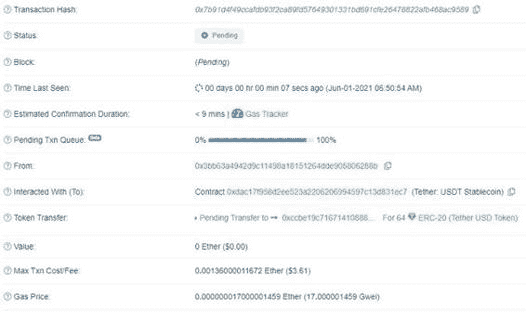

FIGURE 6-3:

A pending

transaction,

awaiting

confirmation

and

execution.

4\. 矿工节点从该池中选择待处理交易，形成一个（尚未确认）事务块。

（原因在下文进一步说明，矿工倾向于选择 gas price 较高的待处理交易。）

5\. 矿工竞争解决一个复杂的方程——工作量证明（PoW）谜题，需要大量计算能力，以获得在以太坊区块链中添加并确认新区块的权利。

找到解决方案后，获胜矿工（获得区块奖励）将其区块广播到网络，选定的交易被执行（只要它们不耗尽各自的 gas 限额），并开始新的采矿竞争。

Figure 6-4 显示前面提到的待处理交易（如步骤 1 中所述），以及其对应的区块号，该交易已成功确认。该交易现在成为以太坊区块链的永久部分。

总体而言，完成交易成功需要满足以下条件：

» 交易必须有效。例如，你必须拥有足够的余额和适当的权限来执行交易。

90  PART 3  Developing Your Knowledge: A Step-by-Step Guide to Programming Your Own NFT

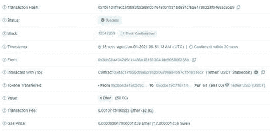

FIGURE 6-4:

Confirmation

of the

pending

transaction

from

Figure 6-3.

» 交易必须已确认并排队等待执行。你的交易必须被一个成功挖矿的节点选择，该节点获得在以太坊区块链中追加并确认新区块的权利。

» 交易的总计算复杂度不能超过其指定的 gas 限额。（你，即发起交易的人，设置 gas 限额。）

补偿（证明-of-）工作者：矿工有什么利益？

每添加一个新区块，获胜矿工将获得区块奖励，奖励由以下两部分组成：

» 固定支付：截至本 writing 时，固定部分为 `2 ETH`。

» 个人费用：这些费用附加在被选入该区块的每个交易中。

例如，矿工矿 Block #12546760（见图 6-5）获得了约 `2.32175 ETH` 的总区块奖励。该总奖励如下拆分：

» `2 ETH`：区块奖励的固定部分

» `0.32175 ETH`：此区块中为 236 个交易选择的每个交易的个人费用之和

CHAPTER 6 What Is Ethereum? 91

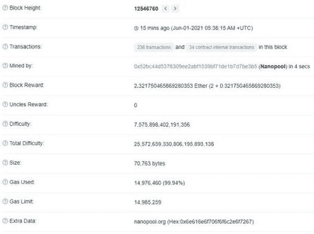

FIGURE 6-5:

Metadata

for Block

`#12546760`.

矿工自然希望在完成一定工作量（即消耗的计算能力）后，最大化其报酬：即解决计算困难的工作量证明（PoW）谜题。

这些谜题的难度不受最新区块的大小或内容影响。因此，在选择区块事务时，矿工通常会倾向于选择

» 尽可能多的交易，同时遵守以太坊在区块级别设定的总 gas 限额

» 每单位 gas 的最高 gas price 的交易

因此，你可以利用这种激励机制来决定在网络中如何设置 gas price。

从 happy hour 到 surge pricing：确定合理的 gas price

当矿工选择交易时，更高的 gas price 更具吸引力。设置更高的 gas price（如图 6-6 所示）可以提高交易被选择、确认和执行的预期速度。

92  PART 3  Developing Your Knowledge: A Step-by-Step Guide to Programming Your Own NFT

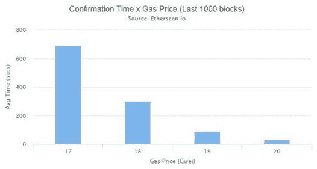

FIGURE 6-6:

Average

confirmation

times for a

given gas

price.

你应该付多少费用？毕竟，如果你不着急，可能更愿意支付较少并等待。在绝望时刻，你可能会欣然支付 $100 购买 Death Valley 的一瓶水，然后听到更不急迫的客户议价降至 $50 后后悔自己的购买。

问题是，矿工乐于享受更高的 gas price 并收取更大的费用，他们不会告诉你如果以更低的价格他们是否愿意选择你的交易，也绝不会退还差额。那么，考虑到紧迫程度或缺乏紧迫感，你应该承诺支付多少？

当网络安静时，这笔费用应如何与网络极度拥堵时有所不同？

好在，许多服务（包括 MetaMask，我们在 Chapter 2 和 Chapter 4 中覆盖）为新手用户提供指导，他们可以简单选择 Slow、Average 或 Fast 来自动设置钱包内部算法根据的交易 gas price。

更高级的用户仍可使用自己的预测分析，基于最近确认区块的信息自行设置自定义 gas price。

为了快速且有趣地全天监控推荐的 gas price，请查看 ETH Gas Station 在 [`ethgasstation.info/`](https://ethgasstation.info/) [ethgasstation.info](https://ethgasstation.info/)。图 6-7 显示了每 10 分钟捕获的 gas price 快照。

Etherscan 拥有自己的以太坊 Gas Tracker，如图 6-8 所示，可在 [`etherscan.io/`](https://etherscan.io/gastracker) [gastracker](https://etherscan.io/gastracker) 访问。

CHAPTER 6 What Is Ethereum? 93

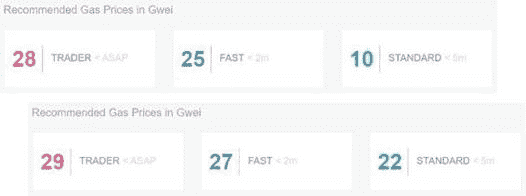

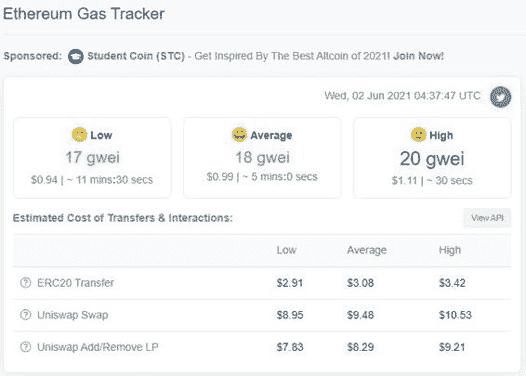

FIGURE 6-7:

Snapshots

of

recom-

mended gas

prices from

ETH Gas

Station.

FIGURE 6-8:

Etherscan’s

Ethereum

Gas

Tracker.

设定预算：天际线是（gas）限额吗？

尽管交易的 gas price 影响其预期执行速度，gas limit 决定交易是否会被执行。也就是说，资金不足的交易最终会失败执行。

由于为交易分配足够的 gas 很重要，你可能会自然地问自己以下两个问题：

» 简单地设置一个任意高的 gas limit 有什么问题？

» 你能提前计算所需的 gas 单位，以设置适当的 gas limit 吗？

针对第一个问题，你不能仅仅选择一个大数作为 gas limit，原因包括：

» 你能为交易设置的 gas limit 受你账户中的 ETH 数量限制。你必须拥有高于交易的 gas price 乘以 gas limit 的余额，才能提交交易。

» 交易的 gas limit 也受当前区块级 gas limit 限制。如果你的交易 gas limit 超过现有区块级 gas limit，它无法被包含在区块中。

此外，矿工不太可能选择 gas limit 异常大的交易：

» 区块级 gas limit 限制矿工在新区块中可选择的交易数量。

» 矿工仅为执行交易所需的实际 gas 进行补偿。交易中未使用的 gas 会返回给发起方。

» 看起来 gas limit 远超实际需求的交易对矿工来说不太受欢迎。原因是：


他们占用有价值的区块空间而未提供相应的补偿。

为了解决第二个问题，你可以提前计算所需的燃气单位数，以设定某些交易类型的合理燃气上限。对于简单交易，例如从一个账户向另一个账户转账 ETH，在执行前就能明确所需的总燃气量。考虑一个简单的转账，费用为 21,000 个燃气单位。对于此请求，无需过度思考交易的燃气上限，只需将燃气上限设置为 21,000。

执行更复杂请求时所需的总计算成本往往在交易完成后才难以评估。交易可能包含有缺陷但昂贵的循环，或者以其他方式意外复杂。

CHAPTER 6 What Is Ethereum?  95

当提交包含更复杂任务的交易时，例如参与初始代币发行（ICO），最佳做法是先参考发行方的指导。如果你是被调用的更复杂函数的作者，最佳实践是向终端用户提供设置燃气上限的指导。

我们在第三章 9 和第 11 章中以更详细的方式讨论燃气使用，并附带实用示例和技巧，展示如何在以太坊上编码你自己的 NFT。

交易费用

交易确认并执行后，你支付的总交易费用（以 ETH 计）等于交易实际使用的燃气量乘以你设定的燃气价格。

在执行过程中，如果交易的计算复杂度超过了设定的燃气上限，交易将无法成功完成。但你仍需支付等于燃气上限乘以你设定的燃气价格的费用，因为即使尝试执行也会消耗 EVM 的计算能力。

为了直观理解这一概念，我们分别查看两种情况：成功交易和耗尽燃气的交易。

场景 1：交易成功执行

假设提交了以下输入的交易：

» 燃气价格：0.000000018 ETH

» 燃气上限：437,603

完成后，实际消耗的燃气量为 307,804 单位，低于燃气上限 437,603。

96  PART 3  Developing Your Knowledge: A Step-by-Step Guide to Programming Your Own NFT

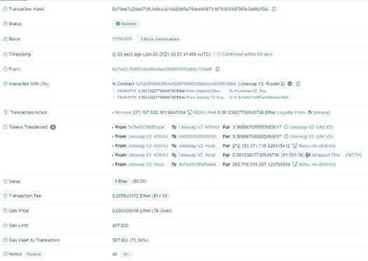

交易成功执行，如图 6-9 所示，总交易费用为 307,804（消耗燃气） * 0.000000018 ETH（燃气价格） = 0.005540472 ETH

FIGURE 6-9：

成功交易的燃气消耗和费用。

由于该交易未使用全部燃气上限即完成，剩余资金会退还给发起账户——下面列出了事件顺序：

» 初始时，437,603（燃气上限） * 0.000000018 ETH（燃气价格） = 0.007876854 ETH 从发起账户收取，以预先支付执行所需的计算能力费用。

» 基于交易实际消耗的燃气，矿工获得交易费用 0.005540472 ETH。

» 发起账户退还未使用的部分：0.007876854 - 0.005540472 = 0.002336382 ETH。

» 由于交易成功执行，EVM 的状态被修改并广播到网络。

CHAPTER 6 What Is Ethereum?  97

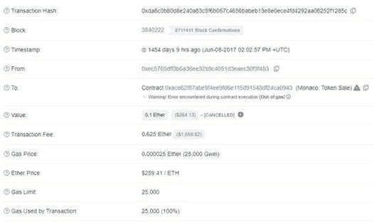

场景 2：交易耗尽燃气

假设提交了以下输入的交易：

» 燃气价格：0.000025 ETH

» 燃气上限：25,000

在此情况下，执行过程中矿工发现交易的计算复杂度超过了设定的燃气上限 25,000，导致交易耗尽燃气（见图 6-10）。交易未被执行，但产生的总交易费用为 25,000（燃气上限） * 0.000025 ETH（燃气价格） = 0.625 ETH

FIGURE 6-10：

耗尽燃气的交易的燃气消耗和费用。

尽管交易未成功执行，矿工仍需为提供的计算工作进行补偿：

» 初始时，25,000（燃气上限） * 0.000025 ETH（燃气价格） = 0.625 ETH 从发起账户收取。

» 基于矿工在（失败）尝试执行交易时消耗的计算能力，矿工获得交易费用 0.625 ETH。

98  PART 3  Developing Your Knowledge: A Step-by-Step Guide to Programming Your Own NFT

» 由于交易未执行，EVM 的状态保持在尝试前的状态。

» 发起账户没有剩余资金可退回。

何其悲哀，竟要支付 0.625 ETH 却什么也没发生！

你为交易可能产生的费用上限（燃气价格 × 燃气上限）进行上限，若交易实际消耗更低成本，则燃气价格 × 未使用燃气会退还至你的账户。

区块链：所有数据的存储与保障

所有经确认的 EVM 交易永远铭刻在以太坊区块链上——一种基于区块链的分布式账本，它是一个无需许可且共享的数据库，由多个节点同步。任何节点都可以访问账本，更新几乎同时复制到所有节点。区块链提供了一个记账系统，将信息组织为按时间顺序的数据块——换言之，交易记录被分组到块中，并定期确认后追加到已有链中。

每个块通过包含前一个块信息的哈希来链接到前一个块，形成区块链。块常以块高（block height）引用，表示其在区块链中的位置——即前置块的数量。创世块被引用为块 0。

每个新块在得到网络共识后才能加入不断增长的已确认块链。始终如一，矿工竭尽全力解决一个计算困难的谜题，以获得将块追加到现有区块链的权利。该谜题的解被称为工作证明（proof of work），它难以生成但容易验证。例如，猜测某人的电话号码是一项繁琐的任务，但当给出电话号码时，你可以轻松确认自己拥有正确的解。

CHAPTER 6 What Is Ethereum?  99

当矿工找到解时，他们会关闭待确认块，向网络广播结果，区块链更新，随后开始新一轮竞赛以确认下一个块。

Ethash 和工作证明：什么使以太坊防篡改？

公共区块链（如以太坊和比特币）需要共识机制，以确保系统运行：

» 容错性：即使存在故障、失败或恶意节点，系统也应继续运行。

» 安全性：网络集体确认和同意账本状态的规则应确保，即使存在一群不诚实节点，记录仍保持不可篡改。

保障以太坊区块链的共识机制基于工作证明算法（Ethash），尽管开发者正在努力将系统迁移至权益证明共识机制。由于工作证明需要解决一个漫长且繁琐的问题来确认和执行交易，已封闭的信息块难以篡改，因为 dishonest node（不诚实节点）必须费力查找基于修改信息的新谜题的解。

由于工作证明系统由设计上具有计算负担，参与者日益表达关注


过能源消耗和环境不友好性

的依赖于工作证明（proof of work）安全协议的加密货币。

公司（见 `Figure 6-11`）以及国家（见

`Figure 6-12`）正在改变对加密货币支付和加密矿业的态度。

基于工作证明（PoS）协议的共识机制正日益流行。

与工作证明不同，工作证明（PoS）需要系统中有足够的质押——由余额或账户年龄等因素衡量——来确认交易。

100 PART 3 Developing Your Knowledge: A Step-by-Step Guide to Programming Your Own NFT

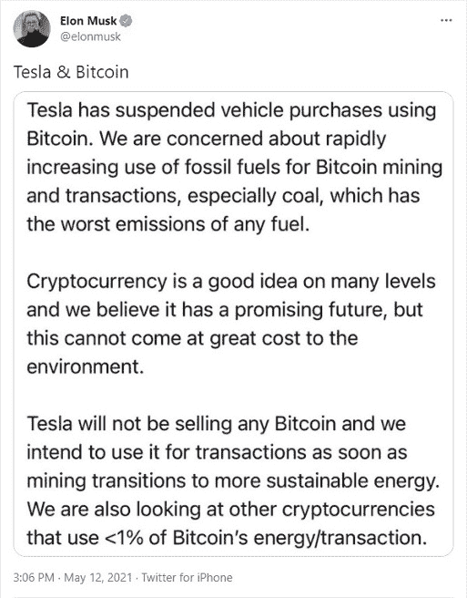

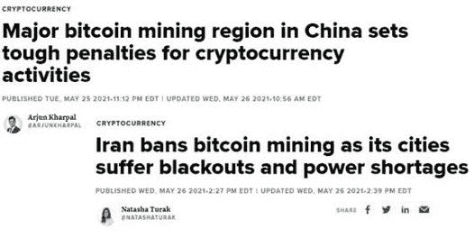

`FIGURE 6-11:`

`Elon Musk`

`tweets`

`concerns`

`about the`

`sustainability`

`of crypto-`

`mining.`

`FIGURE 6-12:`

`Crackdowns`

`on crypto-`

`mining`

`activity in`

`the news.`

多年来，以太坊社区一直期待 `Ethereum 2.0`，即从当前基于工作证明的系统转变为基于工作证明（proof of stake）的系统。虽然关于未来可能转向 `Ethereum 2.0` 的猜测层出不穷，但截至本文撰写时，工作证明仍是主导权威。

`CHAPTER 6 What Is Ethereum?  101`

`Miners and nonces and bears —`

`oh, my!`

矿工的“证明”体现在区块头（block header）中包含的块 nonce。 （区块头包含每个已确认区块的重要信息。）

块 nonce 是一个通过试错的计算密集过程才能找到的数字。在此过程中，矿工不断尝试随机值，直到找到特殊数字—— nonce —— 该数字与当前区块的其他重要元素组合在一起，满足 `Ethash` 协议所要求的数学条件。因此，该 nonce 很难找到，但一旦公布解决方案后，验证就很容易。

所需的数学条件是基于当前区块难度级别的可变目标。区块难度会根据前一个区块的难度级别和最近区块的时间动态调整。新的难度级别可能高于或低于前一个区块的水平，这种动态调整确保在矿工进入和退出网络的持续期间，区块不会形成过快或过慢。

不要混淆块 nonce 与交易 nonce，后者是表示从给定账户发送事务的时间顺序编号的数字。

多少个“确认”才算真正确认？

最新的区块最容易受到攻击，因为它后面没有区块，这消除了解决大量工作证明谜题的需要。恶意节点群组可以合谋发起所谓的 `51% attack`，动用至少一半网络算力。其目标是双花同一笔资金（即 double-spending）。该群组可能采用以下策略：

1\. 提交交易，将 ETH 发送到加密交易所账户。

102 PART 3 Developing Your Knowledge: A Step-by-Step Guide to Programming Your Own NFT

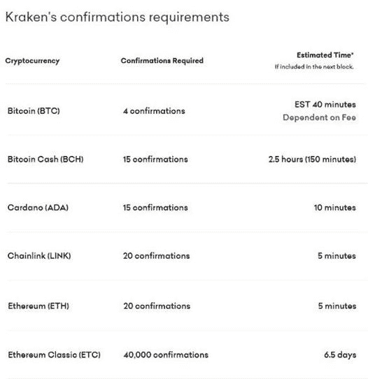

2\. 当区块确认并执行后，立即将 ETH 转换为美元并提取资金。

3\. 同时，利用群组的集体算力快速找到符合当前已更改区块的新工作证明解决方案，从而逆转步骤 1 中的交易。

4\. 重复。

然而，即使拥有足够的计算能力重新解和修改最新封闭的区块内容，该群组也很难在足够短的时间内重新解和修改 50 个区块，以此覆盖之前网络共识确认的那些区块。

为了对抗此类攻击，供应商和钱包服务通常要求已确认的交易在若干区块深度后才视为真正确认。资金在账户中可用的确认次数要求因加密货币以及不同供应商和钱包服务而异。

`Figure 6-13` 展示了各加密货币在 Kraken（一家主要的美国加密货币交易所）所需的确认次数以及估计的等待时间。

`FIGURE 6-13:`

`Kraken’s`

`confirmations`

`required`

`and`

`estimated`

`wait times.`

`CHAPTER 6 What Is Ethereum?  103`

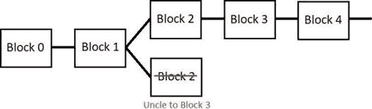

`Kraken` 现在要求以太坊交易至少 20 个区块深（即 20 个确认）才能让资金用于交易或提现。相比之下，`Coinbase` 需要 35 个确认，而 `Gemini` 只需 12 个。

`Uncles and orphans`

由于矿工节点庞大且竞争形成新区块，你会出现同时或近同时的工作证明解。在这种情况下，网络会看到两个新区块在同一区块高度（即块号）上创建并追加，导致区块链出现临时分叉。更准确地说，当竞争结果广播到网络时，一条结果先到达部分节点，另一条结果则到达其他节点。短暂内，不同节点拥有不同的区块链状态版本。

随着下一次“竞速”进行，其中一条链因后续区块的确认和追加而占优势。这意味着网络最终接受包含更多工作（通常是更长的链）的那条链，而仅有一个对抗区块被网络确认，另一个变成僵尸块。

在这种情形下，以太坊语境下的僵尸块称为 `uncle block`（在 `Figure 6-14` 中以图形方式展示）。`Uncle` 块也被称为 `ommer` 块，这是性别中性的同义词。在比特币宇宙中，这些块被称为 `orphan` blocks。

`FIGURE 6-14:`

`A temporary`

`split in the`

`blockchain`

`results in an`

`uncle block.`

硬分叉：底层协议的更新

在类似 DAO 的以太坊，参与者可以随时加入或退出网络，并以他们想要的程度参与，因此任何人都可以选择以下任一操作：

» 查看完整的交易历史。

» 维护 EVM 状态的副本。

» 参与矿工工作，负责确认并添加新区块到链中。

此外，一般的以太坊社区负责管理底层网络协议（即代码和规则体系）的补丁和更新。任何社区成员都可以通过提交以太坊改进提案（EIP）来提出底层协议的更新。最终，最积极且贡献显著的协议开发者群体——即 `Ethereum core developers`——集体决定实施哪些 EIP。

需要对底层共识协议进行硬分叉（fork），这会导致区块链发生永久性分裂，之后所有沿分叉路径追加的区块必须遵循新的共识协议。以太坊区块链的硬分叉通常不会产生新的（可互换）代币，因为社区普遍遵循核心开发者的方向。因此，遵循旧协议的分支通常因活动不足而悄然消失。

2016 年最著名且争议最大的例外是对 `Ethereum` 区块链的硬分叉，这导致社区内部出现重大裂痕，并相应地产生了两个独立的代币：`ETH` 和 `ETC`（以太坊经典）。


theft of roughly $50 million worth of Ether in mid-2016. In an unprecedented turn of events, the Ethereum community created a forked chain to alter the history of the main chain to a point prior to the hacking of the DAO.

Though most members of the Ethereum community followed the forked path with the altered history, a substantial minority was adamantly opposed to this change. As a result, the original chain with the unaltered history was assigned a separate fungi-ble token, Ethereum Classic (ETC). ETC is still around today, though at a much lower valuation and following compared to ETH. The ETC blockchain has also suffered numerous double-spend attacks, and accordingly, exchanges require far more confirmations before released ETC funds. For instance, Kraken requires 40,000 confirmation for ETC while requiring just 20 confirmation for ETH.

Smart Contracts Make the EVM Go Round

A smart contract is a software program that, once deployed, is housed in a special contract account with its own, unique address on the EVM. The act of deploying a smart contract is itself a transaction and requires gas. (We introduce smart contracts in Chapter 2, and we show you how to code and deploy your own smart contract in Chapter 9.)

Once deployed, smart contracts lie dormant until triggered by a transaction. Many transactions on the Ethereum blockchain are designed to call functions housed in various smart contracts, which may in turn trigger calls to other smart contract functions. (See Figure 6-15.) A function in this context is a self-contained piece of code written to accomplish a specific task. A call references a function located elsewhere — in this case, in other smart contracts.

106 PART 3 Developing Your Knowledge: A Step-by-Step Guide to Programming Your Own NFT

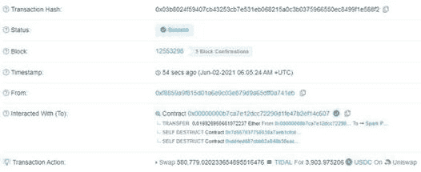

FIGURE 6-15:

A sample transaction, initiating a call to a smart contract function.

Smart contracts are designed to enforce a set of rules that are automatically executed when called. A carefully designed smart contract, by way of the EVM, is programmed to enforce agreements by verifying desired conditions and initiating subsequent computing requests or data updates accordingly. And it all happens without needing a trusted intermediary!

As with any application coming from an unknown or untrusted source, you should exercise caution when engaging with smart-contract applications on Ethereum.

The nascent life of a smart contract

Suppose you want to deploy a smart contract to raise ETH for a new fund. For instance, Blockchain Capital (a venture capital firm in San Francisco) raised $10 million through a BCAP token offering, which was implemented as a smart contract on Ethereum. Here’s what that process looks like:

1. You submit a transaction containing your compiled code, specifying the appropriate gas price and gas limit for execution.

2. When your transaction has been confirmed and executed, your contract account is created and assigned an address.

3. Shortly thereafter, a potential investor submits a transaction to initiate a call to your smart contract’s deposit function.

4. Once a miner has selected this transaction and confirmed the block, the transaction begins execution and your smart contract’s deposit function is called.

CHAPTER 6 What Is Ethereum? 107

5. The deposit function, in turn, calls another internal function to confirm whether the potential investor meets your fund’s investor criteria — say, minimum ETH deposit and minimum age of account.

6. If these conditions are satisfied, the deposit function accepts the ETH deposit.

7. Assuming that the investor has designated an adequate gas limit, the transaction is fully executed and the state of the EVM is updated.

Take a bow! You’ve managed to deploy an application that enables you to raise capital for your fund in an automated fashion with a secure validation process that is both decentralized and autonomous!

In Chapter 9, we provide the actual step-by-step guide to write, compile, and deploy your own Ethereum smart contract.

Exciting possibilities

A new kid on the block(chain) that’s increasingly in vogue comes in the form of d ecentralized app lication s ( dApps) — or apps that run on aa blockchain. Their allure stems from a desire to both democratize finance and cut out the middlemen. Their attrac-

tiveness is also due to the popularity of cryptocurrencies and their skyrocketing value. If you think of Ethereum as a decen-

tralized Internet – what many refer to as Web3 or Web 3.0, then dApps are the decentralized websites in this system.

Numerous dApps on the EVM are built for many different pur-

poses. For instance, smart contracts can be designed to do any of the following (although one contract wouldn’t necessarily do all of these things):

» Execute an ICO.

» Generate and support fungible tokens (that is, cryptocurrencies).

» Create and trade non-fungible collectibles (that is, NFTs).

» Provide a decentralized social media outlet.

» Conduct a decentralized exchange.

» Host a decentralized betting market.

Notable limitations

The EVM is a closed system, meaning everything on Ethereum is entirely self-contained, which ensures that consensus about the true state of the EVM is never jeopardized. Every node in the Ethereum network must be able to linearly execute all confirmed transactions — from the originating block to the most recent block — and reach the same conclusion regarding each block-dependent state of the EVM up through its most recent state (for example, live accounts, account balances, active smart contracts, and data stored).

Depending on information outside of this system could lead to glitches that can short-circuit a contract’s successful completion. Suppose that a smart contract’s next steps depend on the dollar value of an account’s ETH balance rather than on the ETH balance itself. The randomness inherent in obtaining the off-chain USD/ETH exchange rate violates how smart contracts must execute orders. The results might be different based on when a node queries the off-chain information to determine the transition from one state of the EVM to the next.

Ultimately, this means that smart contracts can issue calls to other functions only within the contract itself or in other smart contracts on the EVM. They cannot send HTTP requests to transfer data (such as when you access information on the Internet) or interact with external (off-chain) application programming interfaces (APIs), which could compromise consensus across nodes.

Oracles: How to Connect to the “Outside” World

Suppose you want to develop a betting app on the EVM that is designed to send ETH to certain accounts if the temperature in San Francisco exceeds 100 degrees at any time on January 1, 2025, as reported by [www.weather.com](http://www.weather.com). Because you can’t program smart contracts to send message requests for information outside of the Ethereum blockchain, you need a clever way to get this off-chain information to your smart contract in a reliable and automated fashion. Enter oracles.

Oracles provide a way to send structured, up-to-date information to the EVM. In the weather-betting example, you can develop a separate off-chain application to do the following:

1. Submit HTTP requests to [www.weather.com](http://www.weather.com) beginning at 12:00:00 A.M. on January 1, 2025.

2. If the reported temperature in San Francisco exceeds 100 degrees, have your off-chain application submit a transaction to the Ethereum network, requesting to send this information to the smart contract address housing your on-chain betting app.

3. Once this transaction is mined and executed, the confirmed


over-100-degree status triggers your on-chain betting app

to initiate `ETH` fund transfers to the appropriate accounts.

Any oracle is only as reliable and secure as its data sources and

programming logic. As more complex blockchain apps increase

in number and popularity, so has the demand for oracle services.

Such services provide the infrastructure to access common off-

chain data and computations, such as in these examples:

» Random-number generation for blockchain games:

CryptoKitties was the first widely used blockchain game,

though now you can find several others. See Chapter 2 for

more about CryptoKitties. 

» Price feeds for betting, or DeFi, apps: DeFi stands for

de centralized fi nance, a system offering financial services on a public, decentralized blockchain network.

» Data feeds from other public blockchains: Bitcoin and

Litecoin are examples of other public blockchains.

110  PART 3  Developing Your Knowledge: A Step-by-Step Guide to Programming Your Own NFT

Here are a few popular oracle services:

» `Chainlink`: [`chain.link`](https://chain.link)

» `Provable`: [`provable.xyz`](https://provable.xyz)

» `Witnet`: [`witnet.io`](https://witnet.io)

Shining a Light on Ethereum’s 

Fundamental Structure

This section revisits terms and concepts discussed throughout

this chapter, presented here with their interdependent

relations.

The big picture

These keywords are an essential part of your Ethereum reper-

toire. Any conversation about Ethereum in particular, and crypto

in general, invariably involves these terms:

» `Ethereum Virtual Machine (EVM)`: A distributed comput-

ing platform where participating nodes store updated

duplicates of the state of the EVM

» `Ether (ETH)`: Ethereum’s native token

All computing requests on the EVM require sufficient ETH

to execute.

» `Blockchain`: A recordkeeping system in which transaction

records are grouped into chronologically ordered blocks,

with each block cryptographically linked to the block

preceding it

» `Distributed ledger`: A public and permissionless record-

keeping system that’s accessible to anyone who wants to

participate without requiring permission from a central

authority

CHAPTER 6 What Is Ethereum?  111

» `Decentralized autonomous organization (DAO)`:

A leaderless organization that operates autonomously

and maintains consensus based on a nexus of rules and

open-source smart contracts

Nuts-and-bolts of the blockchain

Discussing the following technical concepts is a great way to flex

your crypto-prowess:

» `Miner (mining node)`: A specialized node that is compen-

sated to validate and process computing requests by

solving computationally taxing proof-of-work puzzles

» `Consensus mechanism`: Provides the rules in place to

ensure that a decentralized network continues to operate

by being able to agree on correct information and to reject

false information in the face of dishonest participants in

the network

» `Ethereum Improvement Proposal (EIP)`: A proposal to

update aspects of the underlying protocol that governs

Ethereum

» `Proof of work (PoW)`: A security protocol that requires

participants to solve long and onerous puzzles to confirm

and execute transactions

» `Proof of stake (PoS)`: A security protocol that requires

participants to demonstrate sufficient stake in the system

to confirm and execute transactions

» `Block height (block number)`: Indicates a block’s location

in the blockchain or, more accurately, the number of blocks

preceding it

The originating (or genesis) block is numbered as block 0.

» `Block nonce`: Shows the successful miner’s proof of work,

which satisfies a mathematical condition required by

Ethereum’s PoW-based consensus protocol and allows the

miner to confirm and append the block to the growing

blockchain

112  PART 3  Developing Your Knowledge: A Step-by-Step Guide to Programming Your Own NFT

» 51% attack: Occurs whenever a colluding group of miners

amasses more than half the network’s computing power in

an attempt to game the system

» `Uncle (ommer) block (also known by the gender- 

neutral term ommer block)`: A now-stale block that was

simultaneously mined alongside a valid block from which

the Ethereum chain continues to grow

Uncle blocks are known as orphans in the Bitcoin

blockchain.

» `Hard fork`: Entails a major change to the underlying

consensus protocol, which forces a permanent split to the

blockchain

Hard forks to the Ethereum blockchain don’t typically result

in separate tokens.

Gas essentials

The words listed in this section might not be conventionally fun,

but knowing their roles in a transaction’s execution speed and

success is essential for ultimate street cred:

» `Transaction`: Represents a computing request on the EVM.

» `Transaction hash (TxnHash)`: The unique code assigned

to each transaction.

» `Gas price`: Represents how much ETH someone is willing to

pay per unit of gas consumed by the submitted

transaction.

» `Gas limit`: Represents the maximum units of gas one is

willing to use to fully execute the submitted transaction.

» `Transaction fee`: The actual amount of gas used to

execute the transaction times the gas price designated for

the transaction.

CHAPTER 6 What Is Ethereum?  113

Things that make the EVM 

an interesting place

Being able to chat about the following topics will bring added

sparkle to your Ethereum conversations:

» `Smart contract`: A set of code and data designed to

enforce deterministic rules that are automatically executed

when called.

» `Decentralized application (dApps)`: The programs

running on the EVM.

» `Oracle`: Provides a way to send off-chain information to

the EVM.

114  PART 3  Developing Your Knowledge: A Step-by-Step Guide to Programming Your Own NFT


IN THIS CHAPTER

» Digging into the details of externally 

owned and contract accounts

» Recognizing the distinction between 

Mainnet and testnets

» Distinguishing between wallets and 

accounts

» Setting up your accounts

Chapter 7

Creating an 

Ethereum Account

This chapter walks you through setting up different types

of accounts on Ethereum and explains how to properly

fund each one. Because this chapter covers the first criti-

cal step in the journey toward building your own ERC-721 non-

fungible token, we recommend that you read the full chapter to

understand the basic features we use and selections we make

along the way. However, you need to read only the final section of this chapter, “Preparing Your Accounts (on MetaMask),” so

feel free to skip straight to the end if you’re in a rush.

Before you dive into the hands-on instructions in this chapter,

you must install and set up a MetaMask wallet. You also need

some ETH funds in your account (especially if you plan to mint

an actual NFT on the Ethereum network). We show you how to

do both of these tasks in Chapter 2 and Chapter 4.

CHAPTER 7 Creating an Ethereum Account  115

Understanding Externally 

Owned Accounts

Externally owned accounts (EOAs) are used to submit computing

requests on the Ethereum network. An EOA can receive, store,

and send ether (the native cryptocurrency of the Ethereum plat-

form) as well as interact with deployed smart contracts. A

request might be made to transfer funds from one EOA to

another or to call functions in various smart contracts on the

EVM — the Ethereum Virtual Machine, which we introduce in

Chapter 6.

EOAs are often simply referred to as accounts,  and we follow the

same convention. In fact, your first foray into creating an

account on Ethereum — using MetaMask, which we cover in

Chapters 2 and 4 — was indeed to create what’s formally known

as an externally owned account. Throughout this book, we use

the terms account and externally owned account interchangeably.

Here are a few things to keep in mind:

» You need an account to submit transactions on the

Ethereum network.

» Accounts can initiate transactions to interact with smart


contracts or with other accounts.

`»` Transactions between accounts can only be requests to

`transfer` funds (ETH).

`»` An account is not a wallet, and a wallet is not an account.

Wallet services, such as MetaMask, are designed to help you

manage your Ethereum accounts. Much like you can use differ-

ent email clients to access emails sent to your email address, you

can use different wallet services to access your Ethereum

accounts.

Creating an account is simple and free. It doesn’t cost any ETH

to create an account, though you do need to fund your account

before you can submit transactions, which — as we discuss in

Chapter 6 — aren’t always simple and certainly aren’t free.

116  PART 3  Developing Your Knowledge: A Step-by-Step Guide to Programming Your Own NFT

What it means to create 

an account

Many wallet services can create accounts for you. These services,

such as MetaMask, are just generating key pairs:

`»` A private key: You use your private key to access funds in

your account, so you should never share your private key.

`»` A corresponding public address: You can share your

public address with other, so that you can receive funds

from other accounts.

Of course, you don’t need a wallet service to generate your key

pairs for you. In fact, selecting a private key is as simple as pick-

ing a random number between 0 and 2256, which is greater than

1 trillion to the power of 6 — or 1 trillion × 1 trillion × 1 trillion ×

1 trillion × 1 trillion × 1 trillion ×

1 trillion × 1 trillion × 1 trillion.

Because there are so many possible private keys, even if all

8 billion people on Earth each created 1,000 accounts, the total

number of active accounts — 8 trillion, in this scenario — would

be far less than the total number of possible accounts. Guessing

or generating a private key that’s already being used is unlikely.

Still, having a wallet service do the heavy lifting has its benefits,

especially if you aren’t mathematically adept. Technically, you

must pick a private key value greater than 0 and less than

FFFFFFFFFFFFFFFFFFFFFFFFFFFFFFFEBAAEDCE6AF48A03BBF

D25E8CD0364141 (which is less than the value of 2256).

Private keys are expressed as 64-digit hexadecimal numbers,

which is a base 16 notional system where each digit is repre-

sented by one of the following 16 characters: 0, 1, 2, 3, 4, 5, 6, 7,

8, 9, A, B, C, D, E, or F. For example:

`»` 412 in hexadecimal is equal to (4 × 163) + (1 × 162) + (2 × 160)

= 16,642 in decimal numbers, with which we’re

more familiar.

`»` F9C3 in hexadecimal is equal to (15 × 164) + (9 × 163) +

(12 × 162) + (3 × 160) = 1,022,979 in decimal numbers.

CHAPTER 7 Creating an Ethereum Account  117

As you process the calculations above, keep in mind that any number to the power of zero is equal to one.

After you randomly generate a private key, you need to generate

a corresponding public key via an Elliptic Curve Digital Signature

Algorithm (ECDSA). (Both Bitcoin and Ethereum use the

secp256k1 ECDSA as their algorithm for public key generation.)

After that, you still need to hash the resulting public key using

the keccak256 hash function, take the last 40 hexadecimal dig-

its (or last 20 bytes), and then add “0x” to the beginning to

arrive at your public account address. See the later section “Dig-

ital signatures” to find out more about the mathematical algo-

rithms used for authentication.

Private versus public keys

You use your private key to withdraw funds from your account;

your public address is what you can publicly display to receive

funds to your account. Of course, you must know your account’s

private keys if you want to access your accounts from a different

wallet service that you haven’t yet used to access those particu-

larly accounts.

To access your account’s private key and public address on

MetaMask, follow these steps:

1`\.` Log in to MetaMask. 

Your account’s name appears with its public address

beneath it, as shown in Figure 7-1. In this case, the account

name is NFTs For Dummies, and the public address is

`0xf77a3cE366E32645ffC78B9a88B7e90583646df9`

2`\.` Click the account name to copy your public address. 

The public address has 42 digits in hexadecimal notation (or

40 hexadecimal digits with a “0x” prefix added.

118  PART 3  Developing Your Knowledge: A Step-by-Step Guide to Programming Your Own NFT

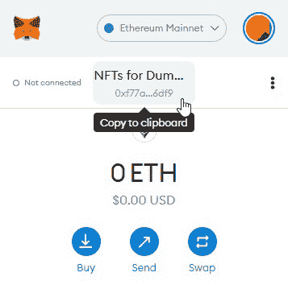

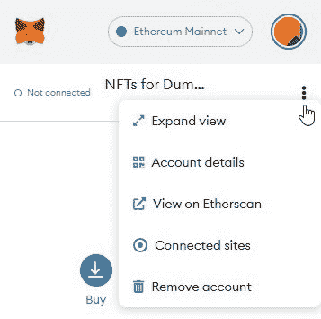

FIGURE 7-1:

The account

name and

public

address

displayed

on

MetaMask.

3`\.` Click the vertical ellipses to the right of the account name 

and choose Account Details from the drop-down menu, as 

shown in Figure 7-2. 

The Account Details tab, shown in Figure 7-3, appears.

FIGURE 7-2:

Accessing

additional

account

details on

MetaMask.

4`\.` Click the Export Private Key button. 

5`\.` Enter your MetaMask wallet password and click Confirm, 

as shown in Figure 7-4. 

CHAPTER 7 Creating an Ethereum Account  119

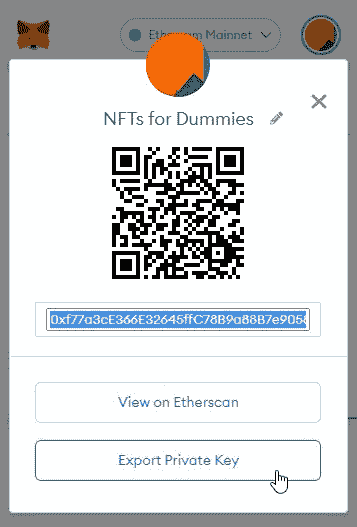

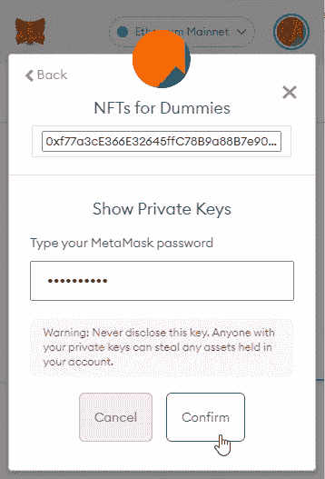

FIGURE 7-3:

The Account

Details

tab on

MetaMask.

FIGURE 7-4:

Password

prompt to

access an

account’s

private

key on

MetaMask.

120  PART 3  Developing Your Knowledge: A Step-by-Step Guide to Programming Your Own NFT

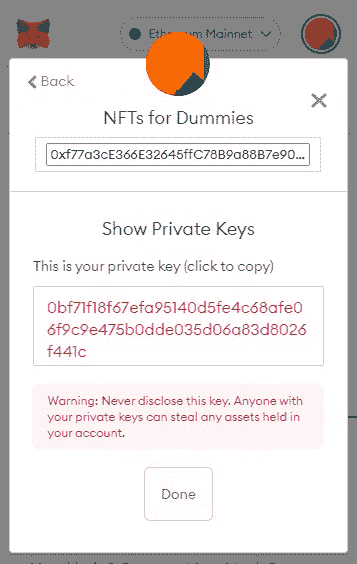

6`\.` Now you can simply click to copy the account’s private key. 

For the NFTs For Dummies account shown in Figure 7-5, we

get the following private key, which is 64 digits in hexadeci-

mal notation:

`0bf71f18f67efa95140d5fe4c68afe06f9c9e475b0dde`

`035d06a83d8026f441c`

FIGURE 7-5:

An

account’s

private key,

displayed

on

MetaMask.

Of course, do not announce your private key to the world (as we

have just done here).

Overall, private and public keys are used together to form a digi-

tal signature to validate a transaction. This process ensures that

only the rightful account owner can submit transactions from a

given account.

Digital signatures

How does the private/public key pair work to ensure that only

you can spend the ETH in your account? By using digital signa-

tures,  which are mathematical algorithms that validate the

authenticity of a digital message or document. Here, we provide

CHAPTER 7 Creating an Ethereum Account  121

a simple example of how digital signatures work. The basic elements are listed here:

`»` A single public key corresponds to each private key.

`»` Revealing your public key doesn’t provide information

about your private key.

`»` Your private key is combined with your public key and your

transaction information to form a signature.

`»` This signature, along with your requested transaction, is

broadcasted throughout the network.

`»` When validators apply your public key to the publicly

broadcasted signature, they should get back the original

transaction information.

Suppose that you have a private key, Kpriv = {7}, that only you

know and a corresponding public key, Kpub = {3, 33}, that is

shared with everyone. Also suppose that you want to send 16

ETH from this account.

The following steps show, in a simplified way, how digital sig-

natures can work to prove that you’re the rightful owner of the

account in question:

1`\.` Take the number 16 (the amount you wish to send) to 

the power of 7 (your private key) and then divide by 33 

(which is part of the public key). 

In other words, divide 167 by 33. The remainder of this

division is equal to 25. This number, 25, which is your digital

signature for this transaction, proves that you’re the rightful

account owner without revealing your private key.

2`\.` Submit your 16 ETH transfer request along with your digital 

signature of 25. 

That is, broadcast the pair of numbers {16, 25} for

verification.

3`\.` To verify that you’re the rightful owner, validators apply 

your known public key K  \= {3, 33} by taking 25 to the 

pub

power of 3 and then dividing by 33. 

The remainder of this division is exactly equal to 16, proving

that you’re the rightful owner.

122  PART 3  Developing Your Knowledge: A Step-by-Step Guide to Programming Your Own NFT


From here, your transaction is added to a memory pool of pending transactions waiting to be added to the blockchain — all without disclosing your private key `K` \= {7}!

priv

If a malicious user tries to withdraw funds from your account, they can’t do so without your private key. Suppose that the malicious user wrongly guesses that your private key is equal to {8} (instead of the true K \= {7}). Here’s what would happen:

1\. To sign the 16 ETH transfer request, the malicious user now takes 16 to the power of 8 (instead of 7) and then divides by 33 (using the information in your public key K = {3, 33}).

pub

The remainder here is now 4, which is the digital signature that is broadcast to the network.

2\. The malicious user submits the transaction request along with the digital signature {16, 4}, claiming that they’re the rightful owner and requesting to withdraw 16 ETH, with a digital signature proof of 4.

3\. To verify, validators take 4 to the power of 3 and then divide by 33 (again, using the known public key K = {3, 33}).

pub

The remainder of the division is 31, which doesn’t equal the 16 ETH transfer request.

Thus, this fraudulent transaction is rejected, demonstrating the beauty of digital signatures.

Of course, this simple example doesn’t fully convey the digital signing and verification process that Ethereum uses. Still, it shows how key pairs and digital signatures operate to credibly demonstrate that you’re the rightful owner of an account without ever disclosing your private keys.

Discovering Contract Accounts

Contract accounts, which are often simply referred to as contracts or smart contracts, are designed to store data and code at a designated contract address on the EVM. In essence, when you deploy a software program to the EVM, you create a contract account that houses this program.

CHAPTER 7 Creating an Ethereum Account  123

Contract accounts (contracts) differ from externally owned accounts (accounts) in several key ways:

» Contracts will cost you ETH. The creation of a contract account is itself a transaction that must be initiated from an externally owned account.

» Contracts cannot initiate transactions. Once created, contract accounts lie dormant until triggered by a transaction. A contract account can be called by another contract account, but this string of calls must ultimately originate from an externally owned account.

» Contracts have no private keys. Contract accounts have only public addresses, which — like those of externally owned accounts — are also represented by a 42-digit hexadecimal number.

Naturally, because transactions cannot be initiated from a contract account, there’s no need for contract accounts to have private keys.

After a contract has been deployed to the EVM, it is public and anyone can access it. Anyone is free to use the functions embedded in the contract or to even access all its source code, which can be found on the public blockchain as follows:

1\. Go to [`etherscan.io. `](https://etherscan.io/)

2\. In the text-based search bar in the upper-right corner, type the address of the contract you want to find.

3\. Click the Contract tab on the tab row across the top of the screen to see the contract’s source code, as shown in Figure 7-6.

The contract address is 0x1A79E50064C012639fB6fB6761E332Acf5Ba15d1

Although creating a contract account costs gas, after that contract account has been created, the creator pays no ongoing maintenance fees to keep the contract account up and running.

Instead, anyone who wants to use functions embedded in the contract must initiate a request from an externally owned account and pay for the appropriate amount of gas for that transaction.

124  PART 3  Developing Your Knowledge: A Step-by-Step Guide to Programming Your Own NFT

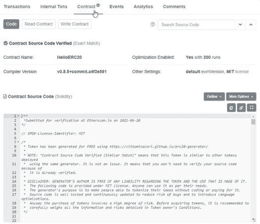

FIGURE 7-6:

Finding a

contract’s

source

code.

Creating a contract account entails submitting a transaction that contains your code without specifying a destination address. In other words, you don’t simply create a contract account without purpose in the way that you might simply create an externally owned account, even if you don’t yet have a reason to use it.

The following list highlights important points about contract accounts (even though you aren’t ready to do a lot of these things just yet):

» To create a contract account, your smart-contract code should already be ready to go.

» From an externally owned account, submit an Ethereum transaction to the network containing your compiled code without specifying any recipients.

» Once validated and mined, your smart contract has its own public address on the Ethereum blockchain for future reference by anyone in the network.

Before you can create a contract account, you first need to follow the steps in the later section “Preparing Your Accounts (on MetaMask)” to set up your various (externally owned) accounts for different uses. After that, you must complete the steps of CHAPTER 7 Creating an Ethereum Account 125 setting up your development environment (see Chapter 8) before proceeding to finally deploying your first smart contract (see Chapter 9).

Knowing the Difference Between Public Networks and Private Environments

Public networks are permissionless and open to anyone who wants to participate without requiring permission from a central authority. Two categories of public networks are important to the Ethereum ecosystem:

» Mainnet: This main Ethereum network is the primary blockchain on which transactions of actual value occur and are memorialized. When someone talks about Ethereum, Mainnet is generally what they’re talking about. You need to use real, honest-to-goodness ETH to fuel transactions on Mainnet.

» Testnets: Test networks are available for developers to test various features before transacting on Mainnet. You get to use test-ETH — rather than the real thing — to fuel transactions on a testnet.

Even before playing around on a testnet, developers often test their code on a local development environment, which has the advantages of being faster and simpler.

Local development environments are private and provide an easy-and-safe sandbox where you can observe how your smart contracts might behave after they’re deployed. Sandboxes are safe because they’re isolated testing environments built for experimentation — the code in a sandbox isn’t live, so errors don’t cause real damage or network congestion.

126 PART 3 Developing Your Knowledge: A Step-by-Step Guide to Programming Your Own NFT

These local environments, such as Ganache (which we introduce in Chapter 8), simulate the Ethereum blockchain by providing a private blockchain with preseeded test accounts. Unlike in a public network, your transactions are automatically executed in order to make it easier to debug your contracts without having to wait for blocks to be mined via an onerous proof-of-work process. (See Chapter 6 for an explanation of proof of work.)

Test networks

Public testnets provide another practice environment closer to how the main Ethereum network functions. Unlike local development environments, testnets provide public blockchains that mostly follow the rules of the main Ethereum blockchain.

Testnets provide a gateway to Ethereum without the pain of wasting actual ETH to deploy test contracts that haven’t yet been fully debugged. You don’t use real ETH to fuel transactions on testnets — you use the respective test ETH native to the testnet in question.

Testnets come in two flavors:

» Proof of work: Only one testnet — the Ropsten Test Network — is based on a proof-of-work consensus protocol, making it the closest representation of the main Ethereum network.

We use the Ropsten Test Network in our step-by-step guide because it relies on proof of work, which, as we explain in


第 6 章，是以太坊的主流权威。

> 证明权威性：其他测试网——Kovan、Rinkeby、 
> 
> 和 Gӧrli/Goerli——基于证明权威性 
> 
> 共识协议。通过该协议，一组受信任的节点被授权 
> 
> 验证交易并向相应的测试网区块链添加新块。
> 
> 主网
> 
> 主以太坊网络（Mainnet）是真正发生—— 
> 
> 以及任何具有实际价值的事情——的地方。 
> 
> 任何基于以太坊的 CHAPTER 7 创建以太坊账户 127 
> 
> 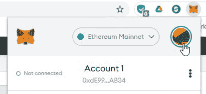
> 
> NFT 你在新闻中看到或考虑购买的（例如 
> 
> 第 2 章提到的 CryptoKitties）都运行在主以太坊 
> 
> 网络上。
> 
> 任何人只提到以太坊时，指的都是主以太坊网络， 
> 
> 而不是各种测试网或私有开发环境。
> 
> 为您的账户准备（在 
> 
> MetaMask）
> 
> 首先登录您的 MetaMask 钱包。（关于设置 MetaMask 
> 
> 的信息，请参见第 2 章和第 4 章。）您的 MetaMask 
> 
> 钱包可以包含多个账户，您可以创建任意数量的账户， 
> 
> 如图 7-7 所示。拥有独立账户可以让您将主网账户 
> 
> （包含真实 ETH）与测试网和本地账户分开，后者 
> 
> 用于存储测试 ETH 并进行练习交易，以便在主网 
> 
> 使用前进行测试。
> 
> 图 7-7：
> 
> 在 MetaMask 应用中创建 
> 
> 独立账户。
> 
> 要创建新账户，点击 MetaMask 应用右上角 
> 
> 的彩色圆圈，然后在下拉菜单中选择“创建账户”。 
> 
> 每个独立账户都有其唯一的私钥和公开地址。我们建议 
> 
> 至少创建三个独立账户，并使用以下标签：
> 
> 128  第 3 部分 开发您的知识：编程自己 NFT 的 
> 
> 逐步指南
> 
> 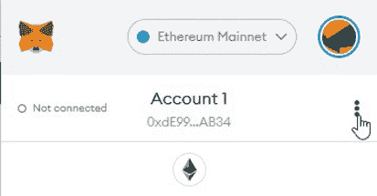
> 
> » 主网账户
> 
> » 测试网账户
> 
> » 本地账户
> 
> 在后续章节中，我们会展示如何设置开发环境 
> 
> (第 8 章) 并部署自己的智能合约 (第 9 章)。相信我： 
> 
> 当你达到那个阶段，你会庆幸自己拥有独立账户。
> 
> 在本节的后续指南中，我们会使用这些账户名称 
> 
> 进行设置，并在后续关于构建自己的非同质化 
> 
> ERC-721 代币的章节 (第 8 至 11 章) 中继续使用。
> 
> 在 MetaMask 中重命名账户
> 
> 如果您已经创建了想要重命名的账户（重命名 
> 
> 不会改变账户的其他任何属性），您可以按照 
> 
> 以下步骤操作：
> 
> 1\. 选择想要重命名的账户。 
> 
> 2\. 点击账户名称右侧的垂直省略号， 
> 
> 如图 7-8 所示。 
> 
> FIGURE 7-8：
> 
> 在 MetaMask 中导航账户选项。
> 
> 3\. 从出现的下拉菜单中选择“账户详情”。 
> 
> 一个新窗口会显示，账户名称位于二维码上方， 
> 
> 如图 7-9 所示。
> 
> CHAPTER 7 创建以太坊账户 129 
> 
> 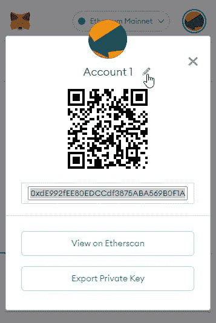
> 
> 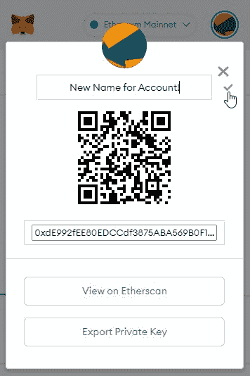
> 
> FIGURE 7-9：
> 
> MetaMask 中的具体账户详情。
> 
> 4\. 在账户名称旁边点击铅笔图标。 
> 
> 5\. 重命名账户，然后在文本框右侧的复选框 
> 
> 中选中，确认更改，如图 7-10 所示。
> 
> FIGURE 7-10：
> 
> 在 MetaMask 中重命名账户。
> 
> 130  第 3 部分 开发您的知识：编程自己 NFT 的 
> 
> 逐步指南
> 
> Ta-da! 账户现在显示其新名称。
> 
> 在 MetaMask 中更改账户名称不会影响提交交易所需的 
> 
> 私钥，也不会影响用于接收资金的公开地址。这些 
> 
> 账户名称纯粹是装饰性的，帮助您在心理上组织 
> 
> 用途不同的账户。
> 
> 为不同账户添加不同的 ETH
> 
> 在您设置好三个账户并为其命名以便组织 
> 
> 后，需要向每个账户添加 ETH。
> 
> 下面的列表列出了在为每种账户充值时需要注意的 
> 
> 重要差异：
> 
> » 主网账户：您希望在该账户中拥有真实 ETH， 
> 
> 以便在主网上为以太坊交易提供动力。（详见 
> 
> 第 2 章和第 4 章，了解如何用真实 ETH 充值主网 
> 
> 账户。）
> 
> » 本地账户：充值本地账户更简单、更便宜， 
> 
> 因为测试环境局限于您的个人系统，且该 ETH 
> 
> 无实际价值，仅限于本地测试环境使用。（您 
> 
> 不能在该环境之外花费此 ETH。）
> 
> 当您启动私有的练习区块链时，本地开发环境也会 
> 
> 自动创建本地账户，并预充本地测试 ETH。我们在第 8 
> 
> 章中解释如何将这些本地账户及其测试资金导入 
> 
> MetaMask，并设置您的以太坊栈。
> 
> » 测试网账户：要为公共测试网的测试交易 
> 
> 提供动力，您需要网络特定的测试 ETH。这里 
> 
> 发水龙头（faucet）发挥作用。测试 ETH 发水龙头 
> 
> 会在固定间隔内提供测试 ETH，但您在一定时间 
> 
> 内只能请求有限量的测试 ETH。（更多关于测试 
> 
> 发水龙头的信息，请参阅下一节。）
> 
> CHAPTER 7 创建以太坊账户 131 
> 
> 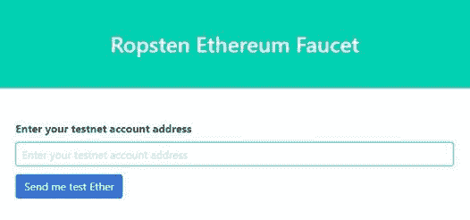
> 
> 为测试网账户充值
> 
> 您可以从各种测试网络为测试网账户充值。 
> 
> MetaMask 方便地提供一个列表——您选择想要的 
> 
> 网络，然后前往获取测试 ETH。我们选择 Ropsten 
> 
> 以太坊发水龙头为例，因为我们后续会使用 
> 
> Ropsten 测试网络来部署智能合约。
> 
> 为测试网账户充值，请按照以下步骤操作：
> 
> 1\. 前往 Ropsten 以太坊发水龙头页面 https://faucet.ropsten.be， 
> 
> 如图 7-11 所示。
> 
> 2\. 登录您的 MetaMask 钱包。 
> 
> 3\. 点击中央下拉菜单，将网络从以太坊主网切换 
> 
> 到 Ropsten 测试网络，如图 7-12 所示。
> 
> 4\. 选择您的测试网账户，点击复制公开地址， 
> 
> 如图 7-13 所示。 
> 
> 在我们的示例中，该地址为 0x43371B75585785 
> 
> D62e3a50533aa15ee8D350273F。
> 
> 5\. 将该地址粘贴到 Ropsten 以太坊发水龙头， 
> 
> 点击“发送测试以太币”按钮，如图 7-14 所示。
> 
> 6\. 等待约 1 分钟。 
> 
> 请耐心等待——可能需要更长时间。
> 
> 7\. 确认您在 MetaMask 中现在拥有测试网账户 
> 
> 余额，如图 7-15 所示。
> 
> 132  第 3 部分 开发您的知识：编程自己 NFT 的 
> 
> 逐步指南
> 
> 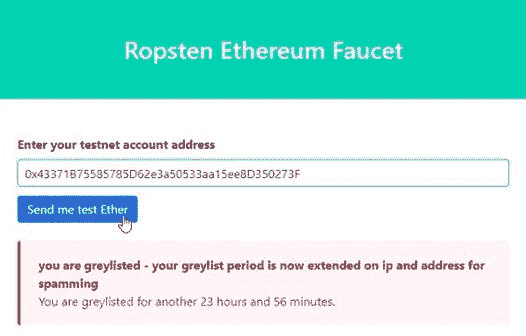
> 
> 测试网发水龙头不会提供无限的测试 ETH， 
> 
> 如果您在收到所谓的“滴水”（drip）后 
> 
> 过快请求测试 ETH，您将被灰名单（greylisted）。 
> 
> Ropsten 以太坊发水龙头甚至要求在两次请求 
> 
> 之间有 24 小时的冷却期。如果在冷却期结束前 
> 
> 再次请求，您会被灰名单，需要额外 24 小时后 
> 
> 才能再次请求测试 ETH。（图 7-16 展示了 
> 
> 此类警告的样子。）
> 
> FIGURE 7-16：
> 
> 被灰名单的警告——请求过快的情况。


# 探索 Ropsten 测试网

区块链

与以太坊主网上的交易类似，你可以在 Ropsten 测试网区块链上查看

你的测试网交易，以及所有其他测试网交易的区块。以下是操作方法：

1. 访问 [`https://ropsten.etherscan.io`](https://ropsten.etherscan.io/)。

2. 输入特定的交易哈希、区块号或账户地址以进行探索，如图 7-17 所示，然后点击搜索按钮（带放大镜图标的按钮）。

让我们粘贴上一步骤中使用的测试网账户地址：

`0x43371B75585785D62e3a50533aa15ee8D350273F`

此搜索显示将 1 个测试 ETH 转入步骤 2 中输入的测试网账户，如图 7-18 所示。

第 7 章 创建以太坊账户 135

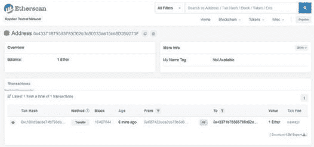

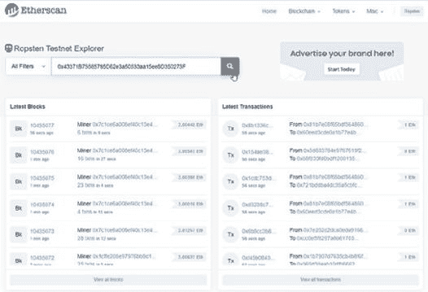

**图 7-17：**

在 Ropsten 测试网上探索交易。

**图 7-18：**

在 Ropsten 测试网上查找交易和账户余额。

当然，此测试网账户的交易和 ETH 不会转到以太坊主网，通过 [`etherscan.io`](https://etherscan.io) 访问（如图 7-19 所示）。

“消失的余额”

如果你突然看到账户余额与你预期的差异很大，请不要慌张。相反，请检查你正在使用的网络，因为 MetaMask 会在选定网络内反映你的账户余额。

如果在 MetaMask 中将网络从 Ropsten 测试网切换到以太坊主网，如图 7-20 所示，你的测试网账户余额将相应显示为 0 ETH（假设你在这个账户中没有真实 ETH）。

136  第 3 部分  Developing Your Knowledge: A Step-by-Step Guide to Programming Your Own NFT

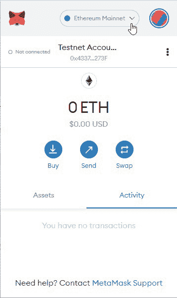

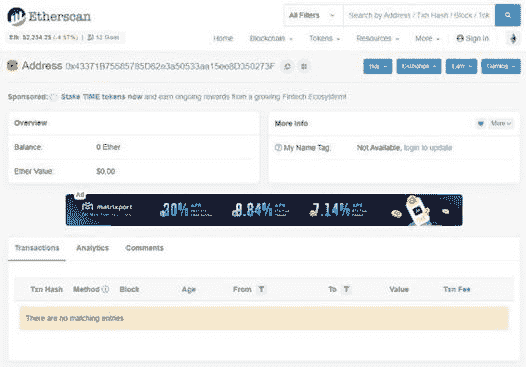

**图 7-19：**

以太坊主网不显示测试 ETH 余额。

**图 7-20：**

在以太坊主网上查看时，此测试网账户包含 0 ETH。

同样，如果你在主网账户中有真实 ETH，切换到 Ropsten 测试网后，余额将突然显示为 0 ETH（假设该账户中没有测试 ETH）。

第 7 章 创建以太坊账户 137


## 本章内容

- 介绍解决方案栈和集成开发环境
- 使用 Ganache 初始化本地区块链测试环境
- 配置 MetaMask 以连接自定义网络
- 同步 Remix-IDE 与 MetaMask 钱包

第 8 章 设置开发环境 139

不过，如果你很着急，你可以直接跳到本节最后部分“戴上安全帽：构建你的环境”。

要遵循本章中的步骤列表，你需要先完成以下步骤：

1. 安装 MetaMask 钱包（参见第 2 章和第 4 章）。

2. 创建至少三个独立的外部拥有账户（参见第 7 章）：

- 主网
- 测试网
- 本地

这些账户需要资金——你的主网账户需要真实 ETH（参见第 2 章和第 4 章），测试网账户需要测试 ETH（参见第 7 章）。

## 你的以太坊解决方案栈

解决方案栈指的是一组软件组件，它们共同创建一个完整的环境，无需额外子系统即可支持你的应用的开发、部署和执行。你可以自定义构建自己的栈，或选择预先构建的栈。本节解释构建完整栈所需的必要组件，并向你展示如何构建自己的栈。

### 以太坊栈的组成部分

从宏观视角来看，以下列表描述了以太坊解决方案栈的典型组成部分：

- 终端用户应用：栈顶部是终端用户应用本身！

  CryptoKitties [(www.cryptokitties.co](http://www.cryptokitties.co)) — 如第 2 章所述 — 是一个以太坊基础的终端用户应用示例。

- 以太坊客户端 API：应用编程接口（API）是应用之间的桥梁，使它们能够相互通信。以太坊客户端 API 允许终端用户应用连接到以太坊节点，从而访问区块链上的信息（如账户余额、历史交易数据和智能合约）。以太坊客户端 API 还允许应用向以太坊网络提交交易，以便转移资金、部署新智能合约或执行现有智能合约中的代码。

  MetaMask 浏览器扩展内置的以太坊客户端 API 是一个示例。

- 节点和客户端：以太坊节点是作为以太坊客户端的计算机，这意味着它们运行特殊的客户端软件，遵循以太坊验证、执行和记录交易的规则。

- 智能合约：智能合约包含可执行的代码，终端用户应用依赖于它们来执行各种任务。你可以在第 9 章了解更多关于智能合约的知识，包括如何部署自己的智能合约。

- 以太坊虚拟机：任何以太坊栈的基础是以太坊虚拟机（EVM）。EVM 如第 6 章所述，代表节点维护以太坊区块链更新副本的分布式计算系统。

在以太坊栈的各层中，以下项目直接关系到你构建自己的非同质化 ERC-721 代币的任务：

- 以太坊客户端 API
- 开发、测试和部署智能合约所需的组件，即源代码编译器和测试环境


-   [MetaMask, 用于以太坊客户端 API]
-   [Ganache GUI, 用于本地测试区块链]
-   [Remix IDE, 用于源代码编译器]

Put On Your Hard Hat: 

# 构建你的环境

在本节中，我们解释如何在个人电脑上实现一个本地区块链。然后我们展示如何配置你的 MetaMask 钱包，以便在你的本地开发环境以及 Remix IDE 中使用。

## 设置你的本地区块链测试环境

如在第 7 章中解释，本地开发环境是一个私有且安全的地方，供你练习部署和测试智能合约。

要设置你的本地开发环境，请按照下面的步骤安装 Ganache 桌面应用（Ganache GUI），它是 Truffle Suite 为智能合约开发者提供的工具包的一部分。

1\. 访问 [www.trufflesuite.com/ganache](http://www.trufflesuite.com/ganache) 并点击下载按钮，如图 8-2 所示，下载 Ganache 桌面应用。

2\. 下载完成后，双击安装包并按照提示安装 Ganache，如图 8-3 所示。

3\. 安装完成后，启动 Ganache 并点击启动页上的 "Quickstart Ethereum" 选项，如图 8-4 所示。Ganache 会启动一个本地区块链，包含模拟以太坊外部账户的测试账户，如图 8-5 所示。

Ganache 的默认设置是启动十个测试账户，每个账户余额为 100 个测试 ETH，仅可在当前工作区使用。

144  PART 3  Developing Your Knowledge: A Step-by-Step Guide to Programming Your Own NFT

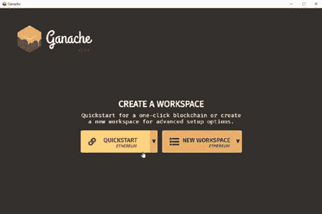

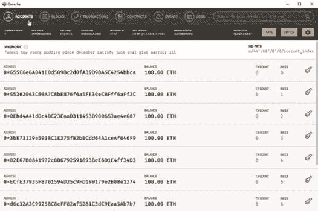

FIGURE 8-4:

The

Ganache

start

screen.

FIGURE 8-5:

Ganache

Accounts

screen.

4\. 点击 "Blocks" 标签（位于顶部菜单栏的 "Accounts" 标签右侧）查看当前工作区的完整区块链账本。初始化时，你只有 Block 0（创世块）这一个块，如图 8-6 所示。

CHAPTER 8 Setting Up a Development Environment  145


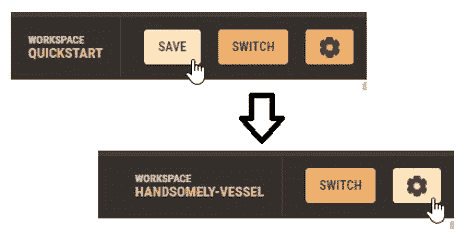

FIGURE 8-6:

The

Ganache

genesis

block at

initiation.

5\. 点击 Ganache 应用窗口右上角的 "Save" 按钮保存工作区。Ganache 会自动（并随机）为你命名工作区。在我们的例子中，Ganache 命名为 "Handsomely-Vessel"。 (参见图 8-7。)

FIGURE 8-7:

Saving your

workspace

on

Ganache.

6\. 关闭并重新打开 Ganache，查看已保存的工作区，如图 8-8 所示，这样你就可以继续之前的工作。恭喜！你已准备好在你的私有开发环境中工作！

如果想更改工作区名称，点击工作区名称右侧的齿轮图标（Set-settings）。 (参见图 8-7。) 会出现一个新界面，你可以编辑工作区名称，如图 8-9 所示。

我们保留 Ganache 为我们随机生成的壮观工作区名称：Handsomely-Vessel！

146  PART 3  Developing Your Knowledge: A Step-by-Step Guide to Programming Your Own NFT

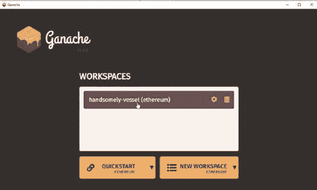

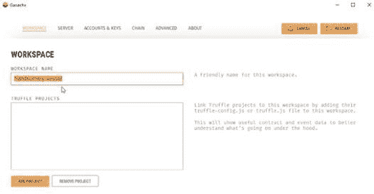

FIGURE 8-8:

The

Ganache

start page,

after

reinitiation.

FIGURE 8-9:

Editing your

workspace

on

Ganache.

## 连接自定义（Ganache）网络到你的 MetaMask 钱包

在启动本地区块链后，你已准备好在 MetaMask 钱包中添加这个自定义“网络”及其关联账户。请按照以下步骤操作：

1\. 打开 Ganache 并加载你在前面章节中创建的工作区。

2\. 在 Ganache 界面中找到你的 RPC URL，默认是 [`127.0.0.1:7545`](http://127.0.0.1:7545)，如图 8-10 所示。

CHAPTER 8 Setting Up a Development Environment  147

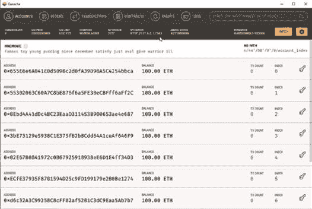

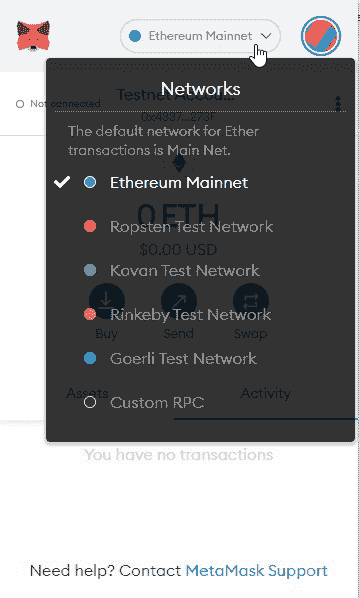

FIGURE 8-10:

Locating the

RPC URL

from the

Ganache

interface.

3\. 登录你的 MetaMask 钱包。

4\. 在 MetaMask 中，从下拉菜单中选择 "Custom RPC" 选项，如图 8-11 所示。

FIGURE 8-11:

The

Network

drop-down

menu in the

MetaMask

wallet.

5\. 在出现的新页面中（如图 8-12 所示），填写网络名称、新 RPC URL 和链 ID，例如：

•  网络名称：HANDSOMELY-VESSEL

你可以使用任何你想要的网络名称。为了保持一致并避免混淆，我们建议使用你在 Ganache 工作区中选择的网络名称。

•  新 RPC URL：[`127.0.0.1:7545`](http://127.0.0.1:7545) — 默认 RPC URL

•  链 ID：1337 — 默认链 ID

6\. 点击 "Save" 按钮。恭喜！你已成功将新网络添加到 MetaMask 网络选项中，如图 8-13 所示。

FIGURE 8-12:

Adding a

new

network to

MetaMask

wallet.

CHAPTER 8 Setting Up a Development Environment  149

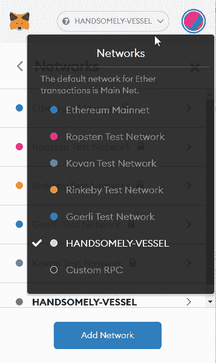

FIGURE 8-13:

HAND-

SOMELY-

VESSEL now

appears in

the

MetaMask

network

options.

## 向你的 MetaMask 钱包添加本地（Ganache）账户

安装 Ganache 并向 MetaMask 添加对应的自定义网络后，你会想要将 Ganache 工作区中的一些账户导入 MetaMask。

要导入本地账户，你需要它们的私钥。

要获取私钥，请按照以下步骤操作：

1\. 打开 Ganache 并加载你在本章前面“设置本地区块链测试环境”部分中创建的工作区。

2\. 在账户页面，选择一个账户并点击最右侧的钥匙图标，如图 8-14 所示。弹出的下一个屏幕会显示该账户的私钥，如图 15 所示。

150  PART 3  Developing Your Knowledge: A Step-by-Step Guide to Programming Your Own NFT

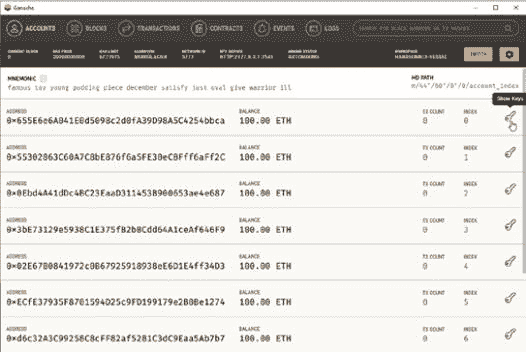

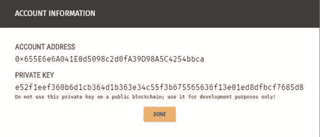

FIGURE 8-14:

Accessing

account

private keys

in your

Ganache

workspace.

FIGURE 8-15:

Sample

account

address and

private key

in Ganache.

有了私钥，以下是如何将这些账户导入 MetaMask 的方法：

1\. 登录 MetaMask 钱包，并切换到 Handsomely-Vessel 网络。

我们的自定义网络名称是 Handsomely-Vessel，可能与你在前面章节“设置本地区块链测试环境”中的自定义网络名称不同。

2\. 点击 MetaMask 应用右上角的彩色圆圈，从下拉菜单中选择 "Import Account" 选项，如图 8-16 所示。

CHAPTER 8 Setting Up a Development Environment  151

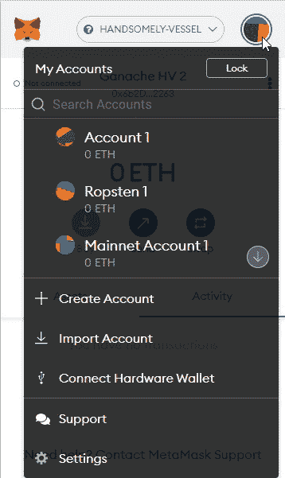

FIGURE 8-16:

The Import

Account

option in

MetaMask.

3\. 在新出现的对话框中，粘贴 Ganache 工作区中账户的私钥，然后点击 "Import" 按钮，如图 8-17 所示。图 8-18 显示已导入的账户在 MetaMask 中。注意我们重命名了该账户。

重命名你的导入账户，以便记住它是本地 Ganache 账户。我们将导入账户重命名为 "Ganache HV 1"，因为它与原始账户名称相关。要在 MetaMask 中重命名账户，点击账户名称右侧的垂直省略号，选择 "Account Details"，然后点击账户名称旁的铅笔图标，重命名账户，最后点击复选框确认更改。 (更多详情请参见第 7 章。)

恭喜！你已成功将本地 Ganache 账户导入 MetaMask 钱包。


# 152 部分 3 开发你的知识：编程你自己的 NFT 的一步步指南

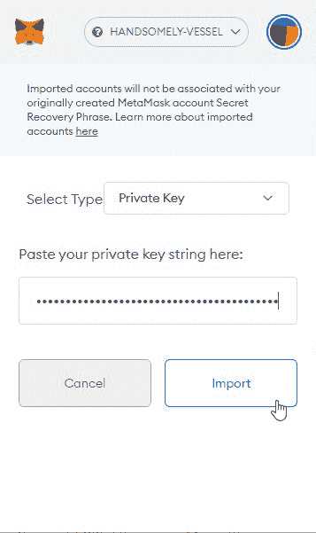

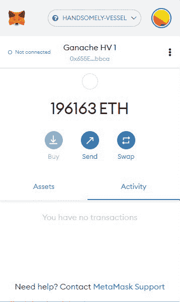

图 8-17：

导入

一个账户

到你的

MetaMask

钱包。

图 8-18：

在 MetaMask 中成功导入并重命名的账户。

## 第 8 章 设置开发环境 153

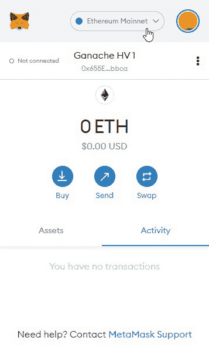

如果你在新导入的 Ganache 账户中看到一个奇怪的余额，别慌。图 8-18 显示，即使已连接到正确的网络，我们仍然拥有 196163 ETH 的余额（！），这远超 Ganache 工作区中显示的 100 测试 ETH 余额。（参见图 8-14。）

如第 7 章所述，你必须在 MetaMask 中处于正确的网络，才能在你的每个账户中看到相应的测试 ETH 或真实 ETH。例如，图 8-19 显示，当我们切换到以太坊主网时，我们的 Ganache HV 1 账户显示 0 ETH 的余额。

图 8-19：

在主网查看我们的 Ganache HV 1 账户时的 0 ETH 余额。

你现在可以像处理钱包中加载的其他账户一样，通过 MetaMask 发送交易。你尚未准备好提交一个能创建新合约账户的交易，但你可以按照以下步骤在本地 Ganache 工作区中转移资金：

## 154 部分 3 开发你的知识：编程你自己的 NFT 的一步步指南

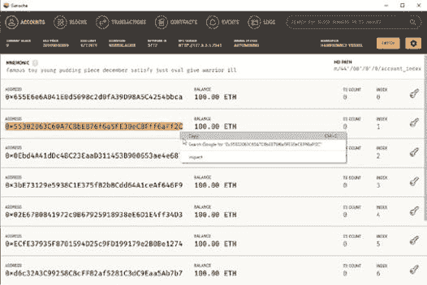

1. 在“账户”选项卡中，高亮显示 Ganache 工作区中的一个不同账户，然后右键单击以复制公共账户地址，如图 8-20 所示。

图 8-20：

在 Ganache 工作区中复制账户地址。

2. 按照下面列出的常规步骤，通过 MetaMask 发送交易（如图 8-21 所示）：

a. 选择合适的账户：我们这里使用 Ganache HV 1 账户。

b. 确保你处于正确的网络：我们使用名为 Handsomely-Vessel 的自定义网络。

c. 点击“发送”按钮。

3. 粘贴你在步骤 1 中从 Ganache 工作区复制的地址（如图 8-22 所示），然后选择要转移的数量。（我们选择了 5 测试 ETH。）

4. 点击“下一步”按钮，然后在随后的页面上点击“确认”按钮。正如我们在早前的警告中所述，这里显示的数字可能看起来很奇怪，这是因为 MetaMask 与本地 Ganache 环境之间存在未同步的问题。

由于交易和区块会在本地 Ganache 区块链上自动挖掘，提交的交易状态会迅速从“待处理”变为“已完成”，如图 8-23 所示。

图 8-23：

MetaMask 中的交易确认。

5. 检查 Ganache 工作区中的账户余额。注意到 5 测试 ETH 已从第一个账户转移到第二个账户，如图 8-24 所示。

图 8-24：

Ganache 工作区中更新后的账户余额。

## 156 部分 3 开发你的知识：编程你自己的 NFT 的一步步指南

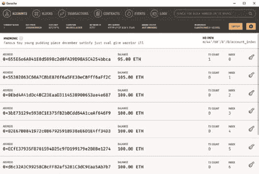


图 8-25：

交易确认在 MetaMask 中。

5. 检查 Ganache 工作区中的账户余额。注意到 5 测试 ETH 已从第一个账户转移到第二个账户，如图 8-24 所示。

图 8-24：

Ganache 工作区中更新后的账户余额。

## 第 8 章 设置开发环境 157


在 Remix IDE 与 MetaMask 钱包之间同步

在本节中，你将探索 Remix，以便最终能够编译和部署智能合约——无论是在此本地环境、测试网络还是主网。

要在 Remix 中导航，请按照以下步骤：

1. 访问 [`remix.ethereum.org`](https://remix.ethereum.org/)。确保输入 http://（不带 s），而不是 https://（带 s），否则 Remix 无法访问 MetaMask。

2. 点击左侧工具栏上的以太坊图标，如图 8-25 所示。

图 8-25：

Remix 主页。

3. 在“部署与运行交易”对话框的环境下拉菜单中选择“注入的 Web3”，如图 8-26 所示。

4. 登录你的 MetaMask 钱包。如果你已安装其他钱包浏览器扩展程序（如 Dapper），可能会出现问题。我们建议在继续本分步指南时，禁用其他扩展程序，只保留 MetaMask。

## 158 部分 3 开发你的知识：编程你自己的 NFT 的一步步指南


图 8-26：

部署与运行交易对话框。

5. （可选）若要关闭可能导致问题的浏览器扩展程序，请执行以下操作：

a. 在浏览器工具栏上右键单击想要禁用的扩展程序图标。

b. 选择“管理扩展”。

c. 在随后的页面上，使用图 8-27 中所示的切换按钮关闭所需的浏览器扩展程序。

6. 在 MetaMask 中，选择你想用的网络和账户。图 8-28 显示我们在选择 Ropsten 测试网络以及在第 7 章中演示如何创建和资助测试账户时使用的测试账户。

图 8-29 显示我们在选择我们的 Handsomely-Vessel 自定义网络以及本章前面已导入并重命名的 Ganache HV 1 账户时的 Remix 环境。

恭喜！你现在拥有一个完全功能且自包含的解决方案栈，可以开始开发和部署智能合约。

## 第 8 章 设置开发环境 161


图 8-27：

禁用特定浏览器扩展。

图 8-28：

在 Ropsten 测试网络上的我们的测试账户。

图 8-29：

在 Handsomely-Vessel 自定义网络上的 Ganache HV 1 账户。

## 第 9 章 部署你的第一个智能合约 163

本章将带你逐步完成开发、编译和部署你的第一个智能合约的过程。在此之前，我们想快速介绍智能合约语言，描述智能合约的组成部分。我们还想提及智能合约库，这些在第 10 章和第 11 章中将变得更加重要。

本章代表了你在构建自己的非同质化 ERC-721 代币之前需要的最后实践准备。我们强烈建议你按顺序阅读整个章节，以便更全面地理解智能合约的基本特性以及我们在选择过程中所依据的逻辑。如果你感到急躁，也可以直接跳到最后部分“准备起飞：发射你的智能合约”。

要完成本章，你需要先安装并设置好 MetaMask 钱包。（参见第 2 章和第 4 章。）你还需要设置主网、测试网和本地账户，并需要设置本地 Ganache 环境并在此基础上在 MetaMask 中配置对应的自定义网络。（参见第 7 章和第 8 章。）最后，你需要设置 Remix-IDE 浏览器（[`remix.ethereum.org`](https://remix.ethereum.org/)）并将其与 MetaMask 钱包同步。（第 8 章可帮助你完成此任务。）

### 使用智能合约语言

要创建一个功能性的智能合约，你本质上是在向以太坊网络提交字节码的交易（不带目标地址），从而创建一个合约账户。由于


-   [字节码](https://en.wikipedia.org/wiki/Bytecode) 是以十六进制格式编写的机器级代码，学习和解释它很困难，你需要使用一种受支持且更像人类的语言——一种现有编译器可以将其翻译成字节码的语言——来编写你的智能合约源代码。

    好在，你可以从几种正在积极维护的语言中进行选择。在 Remix IDE 中，我们选择它作为分步指南，其中包含的编译器设计用于轻松切换 Solidity 和 Yul 语言：

    » `Solidity`: Solidity 编程语言是专门用于在以太坊虚拟机 (EVM) 上实现智能合约而设计的。它仍然是以太坊上智能合约开发者主要使用的语言，其使用已扩展到其他竞争平台。

    在编程语言的分类中，Solidity 被视为高级语言：它更易于人类理解和调试，但记忆效率较低，需要编译才能转换为执行机器可以理解的指令。

    164  PART 3 Developing Your Knowledge: A Step-by-Step Guide to Programming Your Own NFT

    » `Yul`: 新的编程语言 Yul 需要更深入地掌握和理解操作码（低级、机器语言指令）才能有效使用。Yul 被视为中级语言。

    在你选择一种语言并编写合约源代码后，你需要将代码编译，生成以下元素：

    » `字节码`: 字节码是一组完全以十六进制格式指定的指令，可在 EVM 上运行。字节码是机器代码，在编程语言的分类中位于最低层，对人类直接解释最为困难。

    » `操作码`: 当你更深入了解智能合约开发领域时，你会发现许多程序员引用操作码（即组装语言中的命令）。操作码指令对应于字节码所传达的内容，但提供可读的操作代码，告诉处理器应执行什么。在编程语言的分类中，组装语言被视为低级语言，它仅比机器码高一层。

    » `ABI`: 编译器还会创建相应的应用二进制接口 (ABI)，这是终端应用程序与合约数据和函数进行交互所必需的。

    我们选择 Solidity，因为它是使用最广泛且最易上手的语言。使用 Solidity 时，你还可以访问许多预建库，这些库提供经过精心开发和验证的代码，供你构建。我们在本章后面的“使用智能合约库：无需重新发明轮子”一节中会对预建库进行更详细说明。

    从源代码到字节码

    考虑以下用 Solidity 编写的简单智能合约代码：

    pragma solidity 0.8.6;

    contract LittleBear {

    string public msg = “Hello Little Bear (a.k.a.

    Maddie)!”;

    }

    当这段 Solidity 源代码被编译时，你会得到以下机器级字节码块：

    608060405234801561001057600080fd5b506004361061002b5760003560e01c80636b473fca14610030575b600080fd5b61003861004e565b6040516100459190610115565b60405180910390f35b6000805461005b90610186565b80601f016020809104026020016040519081016040528092919081815260200182805461008790610186565b80156100d45780601f106100a9576101008083540402835291602001916100d4565b820191906000526020600020905b8154815290600101906020018083116100b757829003601f168201915b505050505081565b60006100e782610137565b6100f18185610142565b935061010181856020860161015365b61010a816101e7565b840191505092915050565b6000602082019050818103600083015261012f81846100dc565b905092915050565b600081519050919050565b600082825260208201905092915050565b60005b83811015610171578082082015181840152602081019050610156565b83811115610180576000848401525b50505050565b6000600282049050600182168061019e57607f821691505b602082108114156101b2576101b16101b8565b5b50919050565b7f4e487b7100000000000000000000000000000000000000000600052602260045260246000fd5b6000601f19601f830116905091905056fea264697066735822122067b6da38f6dde0621c9c49d1785ec9d01d5d423d6d5f4aca74e7b3f8ffa4c18f64736f6c63430008060033

    以下是对应的操作码片段：

    PUSH1 0x80 PUSH1 0x40 MSTORE CALLVALUE DUP1 ISZERO PUSH2 0x10 JUMPI PUSH1 0x0 DUP1 REVERT JUMPDEST POP PUSH1 0x4 CALLDATASIZE LT PUSH2 0x2B JUMPI PUSH1 0x0 CALLDATALOAD PUSH1 0xE0 SHR DUP1 PUSH4 0x6B473FCA EQ PUSH2 0x30 JUMPI JUMPDEST PUSH1 0x0 DUP1 REVERT JUMPDEST PUSH2 0x38 PUSH2 0x4E JUMP JUMPDEST PUSH1 0x40 MLOAD PUSH2 0x45 SWAP2 SWAP1 PUSH2 0x115 JUMP JUMPDEST PUSH1 0x40 MLOAD DUP1 SWAP2 SUB SWAP1 RETURN JUMPDEST PUSH1 0x0 DUP1 SLOAD PUSH2 0x5B SWAP1 PUSH2 0x186 JUMP JUMPDEST DUP1 PUSH1 0x1F ADD PUSH1 […]

    CHAPTER 9 Deploying Your First Smart Contract  167

    最后，以下是对应的 ABI，为想要与该智能合约交互的终端应用程序提供路线图：

    {
    “inputs”: [],
    “name”: “msg”,
    “outputs”: [
    {
    “internalType”: “string”,
    “name”: ””,
    “type”: “string”
    }
    ],
    “stateMutability”: “view”,
    “type”: “function”
    }

    你现在可能已经明白，为什么我们更倾向于使用高级且更像人类的语言来编写智能合约代码！

    智能合约的关键要素

    智能合约的核心由存储在以太坊区块链上合约账户地址的函数和数据组成。此外，当执行交易以访问智能合约中的函数时，状态变更可以记录到区块链上，而无需存储在合约账户中（存储在合约账户中成本更高）。本节将解析智能合约的关键要素——即其数据、函数和事件日志。

    数据

    Solidity 是一种静态类型编程语言，这意味着在编译前必须在源代码中明确指定变量的类型（以及通常大小）。

    变量可以作为合约数据存储在存储区（storage），这些变量被称为状态变量。另一方面，你可能还会有临时变量，仅用于中间计算，在迭代之间无需保留；这些变量称为内存变量。


The information stored in `state variables` can also be accessed by other smart contracts if they’re declared as public `state variables`.

Otherwise, the information is considered private and is accessible only within the smart contract in which it is stored (though it can still be viewed by anyone because private `state variables` are stored on the public blockchain).

Whether the stored data is public or private, only the contract in which the data is stored can alter the value of its `state variables`.

Functions

Smart-contract functions are where the action is. For instance, functions can be used to perform calculations, set new values for state variables, retrieve data from elsewhere on the blockchain, send ETH to other addresses, or call other functions. Functions fall into these three broad categories:

» Built-in functions: Solidity has a menu of built-in functions that perform common tasks, such as `receive()` to receive ETH and `address.send()` to send ETH to a specified address. Another popular built-in function is `selfdestruct(address)`, which sends any remaining ETH in the contract account to the specified address then deletes the contract.

» Constructor functions: Each contract can specify a `constructor()` function, which is executed only once when the smart contract is first deployed on the EVM.

» Custom functions: And, of course, you can write your own functions!

CHAPTER 9 Deploying Your First Smart Contract  169

When writing your own functions, you need to declare each function’s accessibility by other functions, contracts, or transactions using the following keywords:

» Public/External:

Public functions, which are the default, provide the most flexibility. They can be called by other functions within the contract, by other contracts, and by transactions submitted from externally owned accounts.

External functions provide the same degree of accessibility as public functions except that function calls within the contract are treated as though they are external calls and must be accompanied by the keyword `this` as a prefix.

» Private/Internal:

Private functions can be called only from within the contract in which they’re housed.

Solidity also has a feature that allows programmers to combine contracts into a new derived contract, one that inherits code from another contract. The contract being fed into the derived contract is the base contract. Internal functions are like private functions, except that they can also be called by their derived contracts.

Event logs

Event logs provide a convenient way for you to store historical instances of information on the blockchain without declaring additional storage space in your contract account. Other smart contracts (or people) can view these logs for an account of changes that have occurred. Events can be declared in a contract using the keyword `event`. When called (using the keyword `emit`), the arguments are stored on the blockchain in a log associated with the contract address.

The sample smart contract that you deploy later in this chapter, in the section “Ready for Takeoff: Launching Your Smart Contract,” provides an example of how an event is declared and emitted.

170  PART 3  Developing Your Knowledge: A Step-by-Step Guide to Programming Your Own NFT

No Need to Reinvent the Wheel: 

Using Smart Contract Libraries

A plethora of smart-contract libraries are available to provide you prebuilt functions and implementations of Ethereum development standards. (For more on this topic, see Chapter 10.) In addition to saving you the foundational work, pre-developed and prevetted open source libraries provide added security for less-expert developers who aren’t intimately familiar with the finer considerations when it comes to smart-contract development and operations.

The smart contract we show you how to deploy in the following section is simple enough that you needn’t worry about using smart-contract libraries quite yet. In Chapter 11, where we show you how to build your own ERC-721 Token, you can learn how to load prebuilt libraries and import your desired base contracts.

Ready for Takeoff: Launching 

Your Smart Contract

The following steps walk you through deploying your first smart contract onto the EVM (or the Ropsten Testnet, if you’re not ready to spend any real ETH yet):

1\. Go to [`http://remix.ethereum.org`](http://remix.ethereum.org/). 

You must type `http://` (without the `s`) and not `https://` (with the `s`) or else Remix cannot access MetaMask.

2\. Click the New File link under the File heading on the main 

page, as shown in Figure 9-1. 

A new file opens in the File Explorers pane, located on the left side of the page.

At any time, the Double Page icon, located on the navigation pane on the far left, brings you back to the File Explorers pane, as shown in Figure 9-2.

CHAPTER 9 Deploying Your First Smart Contract  171


FIGURE 9-1:

The Remix

Ethereum

main page.

FIGURE 9-2:

The Remix

File

Explorers

pane.

3\. Using the cursor, click into the blank text box, type `LittleBear.sol`, and then press Enter. 

A new tab pops up with the name of the file, as shown in Figure 9-3.

Excellent. You’re now ready to enter your Solidity code!

172  PART 3  Developing Your Knowledge: A Step-by-Step Guide to Programming Your Own NFT


FIGURE 9-3:

The

LittleBear.

sol open

tab on

Remix.

Beginning with a simple template

Enter the following code into the LittleBear.sol file:

pragma solidity 0.8.6;

contract LittleBear {

event LogMsg(string message);

string public storedMsg;

constructor() {

storedMsg = “Hello Little Bear (a.k.a.

Maddie)!”;

emit LogMsg(storedMsg);

}

function updateMsg(string memory newMsg)

public {

storedMsg = newMsg;

emit LogMsg(storedMsg);

}

}

To avoid typos, you can copy-and-paste this snippet directly

[from www.seoyoungkim.com/nftfdcode.html](http://www.seoyoungkim.com/nftfdcode.html).

CHAPTER 9 Deploying Your First Smart Contract  173

Solidity is case sensitive, so `LogMsg` and `logmsg` aren’t treated identically at compilation.

The remainder of this section explains the code, chunk by chunk.

This first line of code is the Solidity version pragma, which speci-

fies the allowable version(s) of the Solidity compiler to be used at

compilation. In this case, the version pragma allows the source

code to be compiled only under version 0.8.6:

pragma solidity 0.8.6; 

Next, you define the contract, LittleBear — Solidity is a curly-

bracket language, which means it uses curly brackets to open and

close blocks of code:

contract LittleBear {

The following line declares an event, LogMsg, that accepts a single

argument of type string:

event LogMsg(string message); 

The next line declares a public state variable, storedMsg, of type

string. The latest content of storedMsg is retained in contract

storage, even as the contract and its functions lie dormant

between calls:

string public storedMsg; 

The following block of code declares the special constructor()

function, which is executed just once, at contract initiation. The

first line of this function initializes the text being stored in the

storedMsg state variable; the second line triggers the LogMsg

event, passing the contents of storedMsg to be written to the

contract’s event log:

constructor() {

storedMsg = “Hello Little Bear (a.k.a. 

Maddie)!”; 

emit LogMsg(storedMsg); 

}


by default, memory variables as opposed to state variables:

function updateMsg(string memory newMsg) public {
    storedMsg = newMsg; 
    emit LogMsg(storedMsg); 
}

The first line of this updateMsg() function replaces the text being stored in the storedMsg state variable with the text that was passed to this function when it was called. The second line triggers the LogMsg event so that the latest contents of storedMsg can be written to the contract’s event log.

Finally, we complete the block of contract code with a closing curly bracket:

}

Compiling before takeoff

After you prepare your LittleBear.sol file and add the neces- sary code, you can compile that code by following these steps:

1\. Click the Compiler icon located in the navigation pane on the left, as shown in Figure 9-4. 

2\. In the Solidity Compiler pane that appears, click the Compile LittleBear.sol button, as shown in Figure 9-5. 

The compilation details for this contract appear underneath the Compile button, as shown in Figure 9-6.

Excellent! You’re now ready to deploy your smart contract.

After you deploy your smart contract, you can’t go back and change any of the code. If you want to make corrections, you have to deploy a new smart contract with the updated code.

CHAPTER 9 Deploying Your First Smart Contract  175


FIGURE 9-4:

LittleBear.

sol source

code, ready

for

compilation

on Remix.

FIGURE 9-5:

Solidity

Compiler on

Remix.

Deploying

Before you get to the real thing, practice deploying this contract on your local Ganache environment (which we discuss in Chapter 8).

1\. Click the Ethereum icon in the navigation pane on the left (the icon beneath the Compiler icon). 

This step opens the Deploy & Run Transactions pane, shown in Figure 9-7.

176  PART 3  Developing Your Knowledge: A Step-by-Step Guide to Programming Your Own NFT


FIGURE 9-6:

Accessing

compilation

details on

Remix.

FIGURE 9-7:

Deploy &

Run

Transactions

on Remix.

CHAPTER 9 Deploying Your First Smart Contract  181


FIGURE 9-12:

Deploying

the

LittleBear

contract to

the Ropsten

test

network.

3\. Click the Deploy button and confirm the transaction in the 

MetaMask notification that pops up, as shown in Figure 9-13. 

The transaction takes longer to mine this time because

blocks on the Ropsten test network aren’t automatically

mined, as they are on local blockchain instances in the

Ganache environment.

CHAPTER 9 Deploying Your First Smart Contract  181


FIGURE 9-13:

Confirming

contract

account

creation on

the Ropsten

test

network.

4\. Access the updateMsg function to update the text that’s 

being stored. 

We’re making two updates: first to say, “Hello Mama Kim!”

and next to say, “Hello Papa Kim!” Both changes appear in

the event logs shown a bit later, in Figure 9-17.

5\. To view this newly deployed LittleBear contract on the 

Ropsten blockchain, start by clicking the double-page icon 

(to the right of the LittleBear heading) to copy the 

contract account address, as shown in Figure 9-14. 

In our case, this address is 0x1F922670Ce8bC699e780b9b

12960Fb80F998573e

6\. [Point your browser to https://ropsten.etherscan.io](https://ropsten.etherscan.io/), paste the contract account address into the search bar, as 

shown in Figure 9-15, and then click the Search button. 

Figure 9-16 shows that our contract has three transactions

associated with it: the transaction that created the contract

followed by two transactions to call the updateMsg function.

Note that the newest transactions appear on top.

182  PART 3  Developing Your Knowledge: A Step-by-Step Guide to Programming Your Own NFT


7\. Click the Events tab to view the event logs created by 

our contract. Hint: For the sake of readability, use the 

drop-down tabs to convert the log outputs from Hex to

Text, as shown in Figure 9-17. 

FIGURE 9-14:

Copying a

contract

address

after

deployment

via Remix.

FIGURE 9-15:

The

Ropsten

Testnet

Explorer on

Etherscan.

FIGURE 9-16:

Our

LittleBear

smart

contract on

the Ropsten

test

network, as

shown on

Etherscan.

CHAPTER 9 Deploying Your First Smart Contract  183


FIGURE 9-17:

Our

LittleBear

event logs.

Ta-da! You have now successfully deployed your first smart con-

tract onto a public blockchain. At this point, you can repeat the

preceding steps to deploy this contract on the Ethereum Mainnet.

As for us, we’re opting to save our valuable (real!) ETH and to

avoid adding unnecessary baggage to the EVM because we don’t

plan to use our LittleBear contract other than to demonstrate

how to deploy a smart contract.

184  PART 3  Developing Your Knowledge: A Step-by-Step Guide to Programming Your Own NFT


IN THIS CHAPTER

» Getting to know Ethereum 

development standards

» Looking at token interfaces

» Exploring ERC-20 (fungible) tokens

» Diving into ERC-721 non-fungible 

tokens

Chapter 10


# 发现代币标准

## 标准

本章节暂时脱离实际实现，介绍以太坊开发标准，以及两个广泛使用的代币标准：ERC-20 和 ERC-721。

如常，我们强烈建议阅读完整章节，以便熟悉代币术语，并对我们的实践实现中的指示产生更大的认同感。

不过，本章节中的知识对于继续创建自己的 NFT 并不是必须的。因此，如果你感到急躁，可以直接跳到第 11 章。

## 介绍以太坊开发标准

鉴于以太坊生态系统中合约、客户端和钱包服务之间的复杂依赖关系，以太坊社区建立了一个程序，用于提议和确定在编写智能合约时应遵循的开发标准。你在开发自己的代币或 dApp 时并不需要遵循这些标准，但遵循已确立的指南无疑会让你的工作更加轻松。

### 确保互操作性和可组合性

那么标准化对开发有什么影响？

首先，标准化确保互操作性。以太坊客户端和钱包被编程为执行合约调用或接受代币，遵循公认的开发标准可以确保这些分散的参与者保持兼容。你可以将其类比为信用卡的尺寸和形状在不同发卡方之间保持一致，这保证了在各种信用卡处理器上的可读性以及钱包中信用卡插槽的兼容性。

其次，标准化促进可组合性，可组合性指的是系统允许开发者混合匹配已有的合约，以组合出功能化的定制解决方案。例如，把 LEGO 积木想象一下：积木之间的凸起和凹槽标准化，使你能够构建许多不同且富有创意的产品。是的，LEGO 世界设计了一个高度可组合的系统！

## 学习 EIP 和 ERC 的 ABC

为了解释常见的 ERC-20 和 ERC-721 术语，我们先定义并描述以太坊改进提案（EIP），因为以太坊请求评论（ERC）是一种特殊的 EIP。

想要提出新的开发标准的开发者首先需要提交一个 EIP 草案，供以太坊核心开发者社区考虑。事实上，第一个 EIP（编号为 EIP-1）阐述了 EIP 的目的、应包含的内容指南以及从构想到最终确定或撤回的工作流程。（参见第 186 部分 3：构建你的知识：一步步编程你的 NFT 图 10-1。）该流程借鉴了 Python 和 Bitcoin 社区采用的做法，分别制定了 Python 增强提案（PEPs）和 Bitcoin 改进提案（BIPs）。

### 图 10-1：

来自 EIP-1 的 EIP 工作流程图。

链接至 [`eips.ethereum.org/EIPS/eip-1. `](https://eips.ethereum.org/EIPS/eip-1)

每个新的 EIP 不仅改进系统，还增强了开发者对以太坊虚拟机（EVM）的优势和劣势的理解。EIP 还能激发对以太坊平台的额外使用场景的创造性思考。

下面的列表描述了三类 EIP，并分别给出了每类的示例：

» 标准跟踪 EIP（Standards Track EIPs）设定了影响以太坊网络上几乎所有活动的标准变更。

标准跟踪类别包含以下四个重要子分类，它们涉及系统范围影响的程度以及对互操作性的影响：

- 核心 EIP（Core EIPs）涉及共识层，规定了交易结算的规则，以及网络如何达成 EVM 状态和历史的一致。例如，EIP-2929 提高了某些 opcodes 执行所需的燃气费，而最近最终确定的 Core EIP-3554 减缓了难度炸弹（即块难度指数的指数级上升）的增长速度。

- 字节码（Opcodes）在本章第 9 章中介绍，是提供可读的操作码的机器语言指令，用于处理具体操作。

- 网络 EIP（Networking EIPs）涉及网络层，规定了信息在以太坊网络节点之间如何交换和传播。例如，最近最终确定的 Networking EIP-2124，标题为“链兼容性检查的分叉标识符”，提供了一种记录和验证机制，以高效地识别兼容的对等节点。

- 接口 EIP（Interface EIPs）涉及应用编程接口（API）/远程过程调用（RPC）层，规定了应用之间的连接以及在分布式网络中如何执行应用。接口 EIP 还涉及语言级别标准，即代码中方法名称的规范以及计算提交给操作系统的方式。例如，EIP-6 将 SUICIDE opcode 替换为 SELFDESTRUCT opcode，以承认心理健康问题的现实，而 EIP-1193 则引入了标准化的 JavaScript API 格式，确保 Ethereum 钱包服务和 Web 应用之间的兼容性。

- 以太坊请求评论（ERC）EIPs 涉及应用层，规定了不同以太坊生态系统中的应用如何无缝交互并共享信息。例如，这些标准确保代币与钱包服务的兼容性，并通过提出智能合约库和包的约定来增强可组合性。著名的例子包括 EIP-20（ERC-20），它定义了可替换（fungible）代币的实现标准，以及 EIP-721（ERC-721），它定义了非可替换（non-fungible）代币的实现标准。

188 部分 3 构建你的知识：一步步编程你的 NFT

» 元 EIP（Meta EIPs）总结以太坊的重大变更，并制定了社区提出修改现有流程的程序。EIP-1 是一个元 EIP 的示例。EIP-4 将标准跟踪 EIP 细分为更细的子类别，也是一个元 EIP 的示例。其他元 EIP 的例子包括一系列硬分叉元 EIP，它们总结了共识层的重大更新。

» 信息性 EIP（Informational EIPs）提供一般性信息或建议性指南。例如，EIP-2228，标题为“标准化网络 ID 1 和链 ID 1 的名称”，建议将对主以太坊网络的引用统一为专有名词：以太坊主网或简称为主网。

在基本的 EIP 思想之后，你可以更深入地了解提供以太坊代币发行主流标准的具体 ERC。

## 理解标准代币接口

代币接口声明了在特定代币合约中需要实现的函数和事件的概要。采用标准接口可以让代币轻松符合钱包服务和交易所的要求，这些服务和交易所被编程为与实现该接口的代币进行交互。接口在 Solidity（本章将在第 9 章介绍的编程语言）中声明如下：

`interface InterfaceName { }`

接口看起来像是合约的骨架轮廓，其中声明了函数和事件，但并未实现。

EIP-20 于 2015 年 11 月 19 日创建，提供了以太坊上最广泛使用的代币标准：ERC-20 代币。该提案为可替换（fungible）代币提供了标准接口。


在以太坊上，以及其他增强该可替代代币标准功能的附加标准。

许多著名的加密货币，如泰泰（USDT）和链链（LINK），都是基于此标准铸造的，并继续在以太坊区块链上作为 ERC-20（或增强版）代币进行交易。其他代币，如 EOS 和二元币（BNB），最初是 ERC-20 代币，随后在其各自区块链平台构建后被交换为项目原生代币。截至 2021 年 8 月，以太坊已有超过 445,000 个 ERC-20 代币合约在流通。

受 ERC-20 代币标准启发，EIP-721 为以太坊上的非同质化代币（NFT）提供了标准化的接口。（是的，我们在说 NFTs！）ERC-20 标准将其代币视为相同的（即可替代），而 ERC-721 非同质化代币标准将每个代币视为唯一的资产，拥有独立的可辨识代币 ID。因此，数字收藏品如 CryptoKitties 和 Art Blocks 应运而生！截至 2021 年 8 月，以太坊已有接近 15,000 个 ERC-721 代币合约在流通。

下面的章节将更详细地探讨这两种代币标准的接口。

ERC-20 代币标准

要符合 ERC-20 标准，代币合约必须实现标准接口中包含的各种元素。所有函数和事件都必须使用接口规定的相同命名约定进行声明。

让我们先来看看必需的函数：

totalSupply()、name()、symbol() 和 decimals()：

这些函数返回其对应状态变量中存储的值。（name()、symbol() 和 decimals() 函数在该接口中是可选的）。

balanceOf(address \_owner)：此函数返回指定地址 \_owner 的账户余额。

transfer(address \_to, uint256 \_value)：此函数将 \_value 个代币从调用者的账户转移到地址为 \_to 的账户。

transferFrom(address \_from, address \_to, uint256 \_value)：此函数将 \_value 个代币从指定账户 \_from 转移到另一个指定账户 \_to。

approve(address \_spender, uint256 \_value)：此函数允许指定账户 \_spender 最多可以从调用者的账户中提取 \_value 个代币。

allowance(address \_owner, address \_spender)：此函数返回账户 \_spender 目前被允许从账户 \_owner 中提取的数量。

接下来，我们来查看 ERC-20 接口中声明的事件：

Transfer(address indexed \_from, address indexed \_to, uint256 \_value)：当代币从一个账户转移到另一个账户时，必须触发此事件。

Approval(address indexed \_owner, address indexed \_spender, uint256 \_value)：每当一个账户批准另一个账户提取一定数量的代币时，必须触发此事件。

在实现 ERC-20 接口时，还需要在代币合约中存储一些状态变量。虽然函数和事件的名称必须遵循接口规定，但以下状态变量可以按你的具体实现方式来声明和定义：

» balances[]：此变量存储每个账户的代币余额。（注意：这是一个数组。）

» allowances[][]：此变量存储一个账户当前被允许从另一个账户提取的数量。（注意：这是一个二维数组。）

» totalSupply：此变量存储代币的总供应量。

» name（可选）：此变量存储代币的名称（如泰泰）。

CHAPTER 10 Discovering Token Standards  191

» symbol（可选）：此变量存储代币的符号（如 USDT，在泰泰的情况下）。

» decimals（可选）：此变量存储代币的小数位数，即代币的可分割性。

不同的实现可能需要额外的函数或变量，但你必须至少按照接口规定声明和实现所需的函数和事件。你实现的 ERC-20 接口中的变量名不会影响你的代币合约与任何期望与 ERC-20 代币交互的其他合约的互操作性。

ERC-721 非同质化代币标准

要符合 ERC-721 标准，代币合约必须实现 ERC-721 接口和 ERC-165 接口中的以下元素。所有函数和事件都必须使用这些接口规定的相同命名约定进行声明。

让我们先来看看必需的函数：

name() 和 symbol()：这些可选函数返回其对应状态变量中存储的值。

balanceOf(address \_owner)：此函数返回指定地址 \_owner 的账户中拥有的 NFT 数量。

ownerOf(uint256 \_tokenId)：此函数返回指定 NFT \_tokenId 的所有者地址。

safeTransferFrom(address \_from, address \_to, uint256 \_tokenId, bytes data)：此函数将指定 NFT \_tokenId 从一个指定账户 \_from 转移到另一个账户 \_to，并向接收账户 \_to 传递 data 数据。

safeTransferFrom(address \_from, address \_to, uint256 \_tokenId)：此函数将指定 NFT \_tokenId 从一个指定账户 \_from 转移到另一个账户 \_to。

transferFrom(address \_from, address \_to, uint256 \_tokenId)：此函数与 safeTransferFrom 功能类似，但不验证接收账户 \_to 是否能够接收 NFT。

approve(address \_approved, uint256 \_tokenId)：此函数允许指定账户 \_approved 转移指定 NFT \_tokenId。

setApprovalForAll(address \_operator, bool \_approved)：此函数切换指定账户 \_operator 是否拥有所有 NFT 的转移权限。

getApproved(uint256 \_tokenId)：此函数返回拥有指定 NFT \_tokenId 转移权限的账户地址。

isApprovedForAll(address \_owner, address \_operator)：此函数检查一个账户 \_operator 是否拥有另一个账户 \_owner 的所有 NFT 的转移权限。

supportsInterface(bytes4 interfaceID)：此函数是 ERC-165 标准接口检测所必需的，用于标准接口检测。

接下来，我们来查看 ERC-721 接口中声明的事件：

Transfer(address indexed \_from, address indexed \_to, uint256 indexed \_tokenId)：当 NFT 从一个账户转移到另一个账户时，必须触发此事件。

Approval(address indexed \_owner, address indexed \_approved, uint256 indexed \_tokenId)：每当一个账户批准另一个账户转移 NFT 时，必须触发此事件。

ApprovalForAll(address indexed \_owner, address indexed \_operator, bool \_approved)：每当一个账户允许或禁止另一个账户访问其所有 NFT 时，必须触发此事件。

在实现 ERC-721 接口时，还需要在代币合约中存储一些状态变量。与之前一样，以下状态变量可以按你的具体实现方式来声明和定义：

owners[]：此变量存储每个单个 NFT 的所有者账户地址（此变量是一个数组）。

balances[]：此变量存储每个账户中的 NFT 数量（此变量是一个数组）。

tokenApprovals[]：此变量存储每个单个 NFT 当前被允许转移权限的账户地址（此变量是一个数组）。

operatorApprovals[][]：跟踪一个账户是否拥有另一个账户的转移权限（此变量是一个二维数组）。


currently allowed to transfer the NFTs from the other account

(this variable is a matrix).

name (optional) stores the unifying group name for the NFTs

(such as CryptoKitties).

symbol (optional) stores the symbol for the NFTs (such as CK in

the case of CryptoKitties).

Again, different implementations may require additional `funcName()` or variables, which can be declared and defined as you see fit. To be ERC-721 compliant, however, all functions and events declared in the ERC-721 interface and ERC-165 interface must be named and implemented as specified by the interfaces.

Other token standards

on Ethereum

With the proliferation of fungible and non-fungible tokens alike, varying implementations continue to provide added functionality and enhancements. Some of these features have been formalized as additional token standards, to provide either a new standard altogether (such as the multi-token standard) or a standard interface for improvements to the original fungible or non-fungible token interfaces.

194 PART 3 Developing Your Knowledge: A Step-by-Step Guide to Programming Your Own NFT

Here are some examples of finalized standards:

» The ERC-777 Token Standard: This standard introduced an interface for an ERC-20 backward-compatible fungible token with advanced features, some of which were popularized by the ERC-721 Non-Fungible Token Standard. For instance, the ERC-777 interface specifies a function to grant an account the right to transfer tokens on behalf of another account.

» The ERC-1363 Payable Token Standard: This standard introduced an interface for ERC-20 tokens to enable automatic code execution upon a successful call to the transfer, transferFrom, or approve functions.

» The ERC-2981 NFT Royalty Standard: The ERC-2981 standard introduced an interface for ERC-721 and ERC-1155 non-fungible tokens to designate a royalty amount and recipient to be paid each time the NFT in question is sold.

» The ERC-1155 Multi-Token Standard: This standard introduced a consolidated interface to manage fungible, non-fungible, and semi-fungible tokens (similar to limited-edition releases).

As adoption continues to spread and additional use cases materialize, you’re sure to see more interesting and exciting token standards to come!

CHAPTER 10 Discovering Token Standards 195


IN THIS CHAPTER

» Launching your own NFT

» Tracking your NFT

» Interacting with your NFT

Chapter 11

Building an ERC-721 Token

This chapter walks you through the steps in developing, compiling, and deploying your first non-fungible token contract.

To successfully follow the step-by-step guide in this chapter, you need to have completed some key steps in advance. We assume that you have faithfully followed the prerequisite hands-on instructional portions of Chapters 7, 8, and 9.

Writing and Compiling Your NFT

Because a token contract is a special type of smart contract, you begin your NFT journey with the steps for launching your first smart contract that we show you in Chapter 9. When in doubt, refer to that chapter for an illustrated guide on file creation and compilation.

CHAPTER 11 Building an ERC-721 Token 197

The code

When building a token contract, always start by firing up the Remix environment — just follow these steps to get the ball rolling:

1\. Go to [`remix.ethereum.org`](http://remix.ethereum.org/). You must type http:// (without the s) and not https:// (with the s), or else Remix can’t access MetaMask.

2\. Click the New File link under the File heading on the main page. (Alternatively, you can find the New File icon in the File Explorers pane, located on the left side of the page.)

A new file appears in the File Explorers pane, waiting for you to type a new name.

3\. Using the cursor, click into the blank text box, type NFTFD. sol, and then press Enter. A new tab pops up, labeled with the name of the file.

The .sol extension is used to indicate a Solidity source file.

For more on Solidity, see Chapter 9.

At any time, click the Double Page icon, located on the toolbar running down the left side of the window, to return to the File Explorer browser pane.

4\. Type the following code into the newly created NFTFD. sol file:

```solidity
pragma solidity ⁰.8.0;

import “https://github.com/OpenZeppelin/openzeppelin-contracts/blob/master/contracts/token/ERC721/extensions/ERC721URIStorage.sol”;

contract NFTFD is ERC721URIStorage {
address public founder;
constructor() ERC721(“NFTs For Dummies”,
“NFTFD”) {
founder = msg.sender;
for (uint tokenID=1; tokenID<=5;
tokenID++) {
_mint(founder, tokenID);
_setTokenURI(tokenID, “NFTFD
Limited Edition Initial Release”);
}
}
}
function mintNFT(
address to,
uint256 tokenID,
string memory tokenURI
)
public
{
require(msg.sender == founder, “not
an authorized minter”);
_mint(to, tokenID);
_setTokenURI(tokenID, tokenURI);
}
```
```

5\. To compile the source code you just typed, click the Solidity-Compiler icon, located in the Navigation pane to the far left.

You can find the Solidity Compiler icon just below the File Explorers Double Page icon.

6\. From the Solidity Compiler browser pane, click the Compile NFTFD. sol button.

CHAPTER 11 Building an ERC-721 Token 199


The compilation details for this contract appear underneath the Compile NFTFD. sol button. This time, when you click the Contract drop-down menu that appears (as shown in Figure 11-1), the following contract names appear in addition to NFTFD:

» ERC721URIStorage

» ERC721

» IERC721

» IERC721Receiver

» IERC721Metadata

» Address

» Context

» Strings

» ERC165

» IERC165

FIGURE 11-1:

NFTFD and base contract compilation details on Remix.

If you take a closer look at the source code we have you type in Step 4, you notice the line contract NFTFD is ERC721URI Storage {. It tells you that the NFTFD contract is directly derived from the prebuilt base contract — ERC721URIStorage (imported from [`github.com/OpenZeppelin/openzeppelin-contracts/blob/master/contracts/token/ERC721/extensions/ERC721URIStorage.sol`](https://github.com/OpenZeppelin/openzeppelin-contracts/blob/master/contracts/token/ERC721/extensions/ERC721URIStorage.sol)) — which is derived from the ERC721 base contract, which itself is derived from the other interfaces and contracts in the preceding list.

The play-by-play

The following is a chunk-by-chunk explanation of the NFTFD. sol code you use for your token contract. We also provide tips for whether you can easily customize elements of the code and not accidentally break something.

```solidity
pragma solidity ⁰.8.0;

I.  This Solidity version pragma allows the source code to be compiled only under versions 0.8.x (including and following version 0.8.0 but strictly preceding version 0.9.0).

import “https://github.com/OpenZeppelin/openzeppelin-contracts/blob/master/contracts/token/ERC721/extensions/ERC721URIStorage.sol”;

II.  The next line of code directs the compiler to import the ERC721URIStorage contract from OpenZeppelin’s smart-contract library. This contract serves as the base from which we derive our own token contract.
```


如果您访问此特定 URL 来查看 `ERC721URIStorage.sol` 文件中的代码，您会发现 `ERC721URIStorage` 本身是从 OpenZeppelin 的 `ERC721` 实现派生的，而该实现是从 [`github.com/OpenZeppelin/`](https://github.com/OpenZeppelin/openzeppelin-contracts/blob/master/contracts/token/ERC721/ERC721.sol) [openzeppelin-contracts/blob/master/contracts/token/](https://github.com/OpenZeppelin/openzeppelin-contracts/blob/master/contracts/token/ERC721/ERC721.sol) [ERC721/ERC721.sol. The](https://github.com/OpenZeppelin/openzeppelin-contracts/blob/master/contracts/token/ERC721/ERC721.sol) `ERC721URIStorage` 合约通过添加一种方式来设置并存储每个 token 的 `tokenURI`（token 专用信息）来增强 `ERC721` 的功能。

contract `NFTFD` 是 `ERC721URIStorage` {
III. 接下来，我们定义合同 `NFTFD`。这里的代码通过关键字 `is` 指明我们的新合同是从基础合同 `ERC721URIStorage` 派生的，该基础合同在上一行代码中通过 `.sol` 文件引入。这一特性称为继承。Solidity 允许多重继承。一个 CHAPTER 11 Building an ERC-721 Token 201 合同可以直接或间接继承多个其他合同：
» 间接：如果我们的 `NFTFD` 合同直接继承自 `ERC721URIStorage`，它也间接继承自 `ERC721`，即 `ERC721URIStorage` 的“父合同”。
» 直接：可以通过提供逗号分隔的所有基础合同列表来指定直接继承。
您可以为您的 token 合同命名，而不必改动其他代码，例如将 `NFTFD` 改为您想要的名称。
address public founder;

IV. 这一行声明了一个 public 状态变量 `founder`，类型为 `address`。随后的代码会将该变量赋值为 token 的创始人账户地址，并确保只有创始人账户能够铸造新 token。
constructor() ERC721(`"NFTs For Dummies"`, `"NFTFD"`) {
V. 这一块声明了特殊的构造函数 `constructor()`，在合约初始化时仅执行一次。注意额外的语句 `ERC721(`"NFTs For Dummies"`, `"NFTFD"`)：这部分指定了 ERC721 构造函数中的名称和简称。
您可以随意自定义名称和简称，而无需担心破坏代码的兼容性。只需在构造函数声明中替换字符串 “NFTs For Dummies” 和 “NFTFD” 为您想要的名称和简称即可。
founder = msg.sender;
202 PART 3 Developing Your Knowledge: A Step-by-Step Guide to Programming Your Own NFT
VI. 在 `constructor()` 函数内部，第一行代码（在花括号内）将 `founder` 状态变量中存储的地址初始化为 `msg.sender`，即发起交易的账户地址。`msg` 是全局变量，包含当前交易的信息，`sender` 是其成员（在 Solidity 中称为 struct）。
由于此代码位于构造函数内部，它实际上是将部署该 token 合约的账户地址存储到 `founder` 变量中。
for (uint tokenID=1; tokenID<=5; tokenID++) {
    \_mint(founder, tokenID);
    \_setTokenURI(tokenID, "NFTFD Limited Edition Initial Release");
}
VII. 下面的代码块实现了一个 for 循环，用于逐个创建新 token，编号为：1、2、3、4、5。
您可以通过修改 for 循环中 `tokenID<=5` 部分的数字 “5” 来自定义创建的 token 数量。请注意！选择过大的数字会显著增加部署合约所需的时间和燃气费用。
在循环内部，`\_mint(founder, tokenID)` 函数调用会创建一个编号为 `tokenID` 的新 token，并将 `founder` 地址设为该 token 的所有者。`\_setTokenURI(tokenID, "NFTFD Limited Edition Initial Release")` 函数调用将字符串 “NFTFD Limited Edition Initial Release” 存储为该 token（编号为 `tokenID`）的专用信息，以便后续访问。
`\_mint` 和 `\_setTokenURI` 函数最初分别定义在基础合同 `ERC721` 和 `ERC721URIStorage` 中。
您可以自行替换 “NFTFD Limited Edition Initial Release” 中的字符串，以自定义想要存储的内容。
}

CHAPTER 11 Building an ERC-721 Token 203
VIII. 接下来，您在 `constructor()` 函数中加入闭合的大括号，完成该函数，然后转到定义下一个函数。
function mintNFT(
address to,
uint256 tokenID,
string memory tokenURI
)
public
IX. 这一块声明了一个 public 函数 `mintNFT()`，接受三个参数：`to`、`tokenID` 和 `tokenURI`，其类型分别为 `address`、`uint256` 和 `string`。
{
    require(msg.sender == founder, "not an authorized minter");
    \_mint(to, tokenID);
    \_setTokenURI(tokenID, tokenURI);
}
X. 这一块实现了 `mintNFT()` 函数。
第一行使用 Solidity 内置函数 `require` 指定执行剩余代码的前提条件：调用方必须是授权的创始人。如果条件不满足，未授权的调用者会收到 “not an authorized minter” 消息，函数调用即终止，不会继续执行。
假设条件满足，`\_mint(to, tokenID)` 函数会创建一个编号为 `tokenID` 的新 token，并将 `to` 地址设为该 token 的所有者。随后 `\_setTokenURI(tokenID, tokenURI)` 函数会将 `tokenURI` 字符串存储为该 token（编号为 `tokenID`）的专用信息，以便后续访问。
}

204 PART 3 Developing Your Knowledge: A Step-by-Step Guide to Programming Your Own NFT
XI. 最后，用闭合的大括号完成合约代码块。
Deploying Your NFT
在编译完源代码后，您可以将字节码投入使用！
在此之前，您可能需要参考第 7 章和第 8 章，了解在 MetaMask 中切换网络和切换账户的示例；也可以参考第 9 章，了解如何部署智能合约的示例。
Deploying on Ganache
我们先在本地 Ganache 环境中部署合约。
确保 Ganache 桌面应用已打开并运行相应的工作区——本例使用 Handsomely-Vessel 工作区（见第 8 章），在本步骤指南中一直在使用该工作区：
1\. 登录您的 MetaMask 浏览器扩展。
2\. 连接到 Handsomely-Vessel 自定义网络，并点击 MetaMask 界面右上角彩色圆圈，选择已导入的本地 Ganache 账户（本例使用 Ganache HV1，起始账户地址 0x655E[…]），如图 11-2 所示。
3\. 在 Remix 浏览器页面，点击左侧导航栏最左侧的 Ethereum 图标，进入 Deploy & Run Transactions 面板。
[FIGURE 11-2: MetaMask 显示在 Handsomely-Vessel 网络上的 Ganache HV1 账户。]
4\. 从 Environment 下拉菜单中选择 Injected Web3 选项。


-   [你的选定账户](https://example.org)在下拉菜单中显示（在我们的情况，以账户地址“0x655E[…]”开头），如图 11-3 所示。

5\. 从合约下拉菜单中选择已编译的 NFTFD 合约，然后点击 Deploy 按钮。

6\. 在 MetaMask 弹出通知中点击 Confirm 按钮以继续。

FIGURE 11-3:

选定的 Ganache 环境和账户在 Remix 中。

206 章节 3：构建你的知识——编程自定义 NFT 的逐步指南


太棒了！你已成功在本地 Handsomely-Vessel 区块链上部署了 NFTFD。当然，由于 Ganache 会自动挖块以实现快速测试和探索，这过程相当迅速。

在 Deploy & Run Transactions 浏览器面板的 Deploy 按钮下方，你的已部署合约 NFTFD 以及其公开函数和数据如图 11-4 所示。

FIGURE 11-4:

NFTFD 合约的公开函数和数据。

除 mintNFT 函数和 founder 状态变量（我们在本章节前面的“逐步解析”部分已对其进行说明）之外，剩余的合约特性均属于标准 ERC-721 接口的一部分。（见第 10 章。）

此菜单让你可以与新部署的代币合约进行交互。部分交互是免费的，部分则需要消耗气体。随意尝试，看看你能发现什么。随着你升级到 Ropsten 测试网，我们会提供更详细的说明和更多示例！

第 11 章：构建 ERC-721 代币 207


FIGURE 11-6:

在 Remix 中选定的 Ropsten 环境和账户。

FIGURE 11-7:

在 Ropsten 测试网上确认合约部署。

太棒了！当你的交易在 Ropsten 上执行后，你的已部署合约会在 Deploy & Run Transactions 页面的 Deployed Contracts 列表下出现。点击合约名称右侧的双页图标（如图 11-8 所示），即可保存合约地址。

我们的合约地址是 0xd4139A846b5561c31df03FbbCE3583f1A7d8A814。稍后我们会讨论如何使用该地址来跟踪和与你的合约进行交互。

第 11 章：构建 ERC-721 代币 209


FIGURE 11-8:

复制你新部署合约的地址。

执行时间通常小于一分钟，但执行时间可能会有较大差异。请保持耐心！如果网络在十分钟内未响应，请稍作休息后再尝试。

如前所述，你在本章节前面的本地 Ganache 区块链上部署 NFTFD 合约时，会看到与在 Ropsten 上新部署的合约相同的公开函数和数据列表。

例如，点击 Founder 按钮，你会看到部署该代币合约的账户地址。你也可以将该地址粘贴到 balanceOf 输入框中，显示该账户拥有五个代币，如图 11-9 所示。

（回顾：我们的代码在初始化时生成了五个代币。）这些数据调用不消耗气体。

FIGURE 11-9:

在 Ropsten 上与 NFTFD 合约进行交互。

如果你继续使用创始人账户与该合约交互，可以使用 mintNFT 按钮创建一个新的 NFTFD 代币。（注意：创建新代币需要消耗气体。）操作步骤如下：

1\. 点击 mintNFT 按钮右侧的下拉箭头，如图 11-10 所示。

210 章节 3：构建你的知识——编程自定义 NFT 的逐步指南


FIGURE 11-10:

展开 NFTFD 合约中函数参数。

2\. 按照图 11-11 所示填写函数参数：

a. to: 0x885b0F6065B2cD6655eDcc2F7A12062b1ca79d97

该地址指向我们通过 MetaMask 创建的另一个测试账户。你可以使用任何账户地址。但为避免混淆，我们强烈建议在同一账户中不要跨不同网络混用数字资产（如第 7 章所讨论）。

b. tokenID: 17760704

c. tokenURI: https://en.wikipedia.org/wiki/Independence_Day_(United_States)

3\. 点击 Transact 按钮，然后在 MetaMask 弹出通知中点击 Confirm 按钮。

FIGURE 11-11:

mintNFT 函数的参数。

太棒了！你已成功创建并赠送了一个新的 NFTFD 代币。

你可以通过在 ownerOf 和 tokenURI 按钮旁边的输入框中输入 17760704（上一示例步骤 2 中输入的 tokenID）来验证该代币的所有者和 URI，如图 11-12 所示。输入 1 或 5 时，信息会变化，因为这些代币属于创始人账户。尝试验证不存在的代币编号会在 Remix 控制台报错，如图 11-13 所示。

FIGURE 11-12:

获取代币 17760704 的信息。

FIGURE 11-13:

验证不存在代币编号时的错误信息。

你还可以通过 MetaMask 钱包跟踪你的新 NFTFD 代币所有权。确保你在正确的账户和 Ropsten 测试网络中登录 MetaMask。我们先使用本章节中用于部署 NFTFD 合约的测试账户（0x43371B75585785D62e3a50533aa15ee8D350273F），然后在 MetaMask 中按以下步骤操作：

1\. 点击账户界面底部的 Assets 标签页，然后点击 Add Token 按钮，如图 11-14 所示。

212 章节 3：构建你的知识——编程自定义 NFT 的逐步指南


FIGURE 11-14:

在 MetaMask 钱包中添加新代币类型。

2\. 在出现的 Add Tokens 页面（如图 11-15 所示），输入相应的代币合约地址。我们的情况是 0xd4139A846b5561c31df03FbbCE-3583f1A7d8A814。

输入代币地址后，Token Symbol 字段会自动显示 NFTFD。

3\. 在 Token Decimal 字段中输入 0，然后点击 Next 按钮。下一页显示代币（NFTFD）的添加以及该账户的代币余额。

与可替代代币不同，每个 NFT 都是唯一的，不能进一步分割（见第 1 章）。因此，NFT 的“Token Decimal”字段设为“0”。

4\. 点击 Add Tokens 按钮，如图 11-16 所示。现在，切换到查看账户资产时，你会看到除了测试 ETH 之外，还有五个 NFTFD。

第 11 章：构建 ERC-721 代币 213


FIGURE 11-15:

指定自定义代币合约地址。


details for a

new token

type on your

`MetaMask`

wallet.

`FIGURE 11-16`:

Finalizing a

new token

type and its

account

balance on

your

`MetaMask`

wallet.

214  `PART 3  Developing Your Knowledge: A Step-by-Step Guide to Programming Your Own NFT`


`FIGURE 11-17`:

Our new

`Testnet`

account

balance on

the `Ropsten`

Test Network.

In line with our discussion on “disappearing” balances in

Chapter 7, the NFTFD balance in our Testnet Account appears

only when we’re connected to the `Ropsten` Test Network, because

this NFTFD token contract (`0xd4139A846b5561c31df03FbbCE3583f1A7d8A814`) was deployed on `Ropsten` and doesn’t exist

on other networks.

For instance, both the test ETH balance and the NFTFD balance

entirely disappear when you view our Testnet account while

connected to the Ethereum Mainnet, as shown in Figure 11-18.

For the sake of completeness, we reexecute the previous steps to

add the NFTFD token balance to our second test account,

`0x885b0F6065B2cD6655eDcc2F7A12062b1ca79d97`, which was

given the special 17760704 token that we minted after contract

initiation. As expected, MetaMask displays an NFTFD balance of

1 on this account, as shown in Figure 11-19.

`CHAPTER 11 Building an ERC-721 Token  215`


`FIGURE 11-18`:

Our Testnet

account

balance on

the Ethereum

Mainnet.

`FIGURE 11-19`:

The account

balance on the

`Ropsten` Test

Network for

`0x885b0F`

6065B2cD6

655eDcc2F7

A12062b1

ca79d97.

216  `PART 3  Developing Your Knowledge: A Step-by-Step Guide to Programming Your Own NFT`


`FIGURE 11-23`:

A basic

contract

profile provided by

Etherscan.

For instance, you can see a total of six transactions on the

Transfers information tab, as shown in Figure 11-24. Here,

notice tokens 1, 2, 3, 4, and 5, which were assigned to the

founder account (`0x43371B75585785D62e3a50533aa15ee8D350273F`), and the subsequently minted token 17760704,

which was assigned to a separate account

(`0x885b0F6065B2cD6655eDcc2F7A12062b1ca79d97`).

Under the Holders tab, as shown in Figure 11-25, you can

see all token holders in this particular token economy, along

with their respective token balances.

`FIGURE 11-24`:

NFTFD token-

transfer

information provided by

Etherscan.

That means you can track all transactions and changes as your

token economy grows!

`CHAPTER 11 Building an ERC-721 Token  221`


`FIGURE 11-25`:

NFTFD token-

holder

information provided by

Etherscan.

Interacting with your NFT

If you want to interact with your NFT again later (perhaps to

mint additional tokens), you need to recompile your contract

code and return to the Deploy & Run Transactions page on Remix:

1\. Log in to your MetaMask wallet, with the appropriate 

account and network. 

2\. Go to [`remix.ethereum.org`](http://remix.ethereum.org). 

3\. Double-click the NFTFD.sol file to open the contract code 

created earlier and compile the source code from the 

“Solidity Compiler” pane. 

4\. Click the Ethereum icon located on the navigation pane to 

the far left to access the Deploy & Run Transactions page.


5. 选择 `Injected Web3` 以更改您的环境，并确保您已连接到合适的网络和账户。如图 11-26 所示，我们正在使用 Ropsten 测试网，因为我们在此部署了 NFTFD 合约。注意：若要与已在 Mainnet 部署的合约交互，请在 MetaMask 中相应更改网络设置。

6. 与其再部署一个 NFTFD 合约不同，请在 Deploy & Run Transactions 页面底部的 “At Address” 提示框中粘贴您的合约地址（如图 11-26 所示），然后按 Enter。在我们的例子中，我们查找合约地址 `0xd4139A846b5561c31df03FbbCE3583f1A7d8A814`。该合约出现在已部署合约列表中（如图 11-27 所示）。恭喜！您现在可以铸造更多代币、转移已有代币，或直接查看 NFTFD 合约中存储的基本数据。

222  PART 3  Developing Your Knowledge: A Step-by-Step Guide to Programming Your Own NFT


FIGURE 11-26:

Locating the previously deployed NFTFD contract.

FIGURE 11-27:

Interacting with NFTFD (again).

CHAPTER 11 Building an ERC-721 Token  223


4The Part of Tens IN THIS PART … Discover the ten fastest-growing NFT platforms. Explore the ten most expensive NFTs of all time.


IN THIS CHAPTER

» Examining the ten top NFT markets

» Buying, creating, and selling NFTs on these markets

» Weighing the benefits and drawbacks of each market

Chapter 12 Ten Marketplaces for Your NFTs 227

The OpenSea Marketplace

The OpenSea marketplace (https://opensea.io) is the first and largest peer-to-peer platform for cryptocollectibles. Active since 2018, it’s one of the world’s most popular NFT markets. (Peer-to-peer platforms are controlled by the contributors to the ecosystem, much like a co-op.)

OpenSea has many tools that allow

» Consumers to trade their assets freely

» Creators to launch new digital works

» Developers to build rich, integrated marketplaces for their digital assets

The platform is user-friendly — all you have to do to add your own NFT to the mix is specify a few categories and upload your artwork. The ownership of the token is assigned after creation, enabling you to immediately sell or transfer on this marketplace.

OpenSea is compatible with open blockchain standards, which means you can create your work on another platform and then list it on OpenSea. You can do all this without paying listing fees or enduring an exhaustive listing process — though OpenSea does make money when you sell.

How much money? Well, whenever someone buys an NFT on OpenSea, the company gets a cut of 2.5 percent of the NFT’s sale price. The original creator of the NFT can also choose to take a fee on subsequent sales of their artwork. In effect, they can create a royalty stream for themselves.

The downside of OpenSea is that it doesn’t allow purchases by credit card or PayPal. You need to own crypto already, or purchase some, to be able to use the marketplace.

The upside is that OpenSea has a referral affiliate program: If you refer a friend to OpenSea who makes a purchase, you can earn between 40 percent and 100 percent of the fee that OpenSea receives for that sale.

228  PART 4  The Part of Tens

The Axie Infinity Marketplace

The Axie Infinity marketplace (https://axieinfinity.com/) supports the Axie Infinity online video game, developed by Viet-namese studio Sky Mavis. This marketplace sells characters and items only from the Axie Infinity ecosystem, but it’s still one of the most popular NFT marketplaces in the world.

In Axie Infinity, which was inspired by Pokémon, you earn tokens via gameplay and contributions to the ecosystem. It has two cryp- tocurrencies: Axie Infinity Shards (AXS) and Small Love Potion (SLP). The game currencies are used to battle, collect, raise, and build a land-based kingdom for your Axie pets in gameplay.

The critical difference between Axie Infinity and a traditional game is that it has player-centric economics. The system rewards players for their contributions to the ecosystem. (If you’re a fan of the novel Ready Player One, you know what we’re talking about.)

This new gaming model, called Play-to-Earn, has been hypothesized as a viable economic system in a post-scarcity world. Axie has attracted thousands of players from developing countries who are looking for new income streams during the COVID pandemic.

When you trade on the Axie Infinity marketplace, the seller pays a 4.25 percent fee. The Sky Mavis team has used these fees to fund further development. However, the marketplace fees will go to a community treasury that rewards AXS token holders via staking — taking your tokens and locking them in a smart contract that then pays you a dividend in the same cryptocurrency.

It works similar to a CD or savings account.

Like OpenSea, the Axie Infinity Marketplace doesn’t support PayPal or credit card payments. You can use your MetaMask wallet (see Chapter 2) for smaller transactions or exchanges like Coinbase (www.coinbase.com) for larger transactions. Large and small transaction will mean different things to different people. It has to do with your desire for convenience versus security. When I refer to a small transaction, it would be equivalent to what I would be willing have in cash on me at any time. Large transac- tion are rare and its ok if I need to go through a few more security hurtles in order to protect my funds.

CHAPTER 12 Ten Marketplaces for Your NFTs  229

The CryptoPunks Marketplace

Launched in June 2017, CryptoPunks [(www.larvalabs.com/](https://www.larvalabs.com/cryptopunks) [cryptopunks](https://www.larvalabs.com/cryptopunks)) is one of the earliest non-fungible token marketplaces. Developed by Larva Labs (based in New York City), Crypto- Punks was built on the Ethereum blockchain network and features 10,000 unique 24-x-24 pixel art images — reminiscent of early video game art — which are generated algorithmically. Every piece has its own profile page stating its attributes and ownership status.

In the beginning, CryptoPunks could be claimable by anyone with an Ethereum wallet. However, now they’re sold for millions of dollars. For example, “CryptoPunk #7523” sold for $11,754,000 as part of Sotheby’s online auction “Natively Digital: A Curated NFT Sale.”

The images of the CryptoPunks are too big to store economically on Ethereum. The image that the NFT represents is hashed. It’s the hash that’s written to the blockchain.

A cryptographic hash function (introduced in Chapter 6) is an algorithm that uses an arbitrary amount of data — a CryptoPunks picture, for example — to create a small, fixed-size, unique string of characters. Data scientists have used hashes for years to manage large amounts of digital information, like the 10,000 unique CryptoPunks.

You can verify your CryptoPunks by checking the Ethereum smart


contract and calculating an SHA-256 hash on the s image and comparing it to the hash stored in the contract.

You can get your own CryptoPunks by following these steps:

1. If you haven’t done so already, download and install MetaMask, a plugin for the Chrome browser.

For more on MetaMask, see Chapter 2.

2. Buy some Ether or transfer some from another account.

3. [Point your Chrome browser to www.larvalabs.com/](http://www.larvalabs.com/cryptopunks/forsale)

[cryptopunks/forsale. ](http://www.larvalabs.com/cryptopunks/forsale)

4. Log in with your MetaMask plugin.

230 PART 4 The Part of Tens

After recognizing your wallet, the Larva Labs website adds buttons to the interface that allow you to bid on, buy, and sell CryptoPunks directly from your browser.

The NBA Top Shot Marketplace

In 2019, the NBA partnered with Dapperlabs, the creators of CryptoKitties, to create the Top Shot marketplace (https://nbatopshot.com/) [nbatopshot.com).](https://nbatopshot.com/) The subsequent licensing agreement with the NBA and its players’ union has been wildly popular and produced hundreds of millions in sales in just the first year.

A significant characteristic of the digital era is that information can be endlessly replicated and shared. Scarcity has been difficult to regulate on the Internet. Pirated information is easily accessible and free. The revolution of blockchain technology was its ability to create digital scarcity and authenticity at a negligible cost.

Now industries like sports memorabilia can reinvent themselves in a digital world.

Replicating the media file an NFT represents is possible, but it’s difficult to change the ownership record of the NFT — as long as adequate security has been used, to be clear. This is because the item has been secured within the blockchain’s distributed network. Investors are buying up sports NFTs because they believe this new type of sports memorabilia will continue to have collectors — acting in ways much like old school basketball, baseball, and football cards.

Top Shot offers four tiers of collectibles that allow you to purchase common editions (1 in 10,000) all the way up to an ultimate edition (1 of 1). Top Shot charges a 5.00 percent fee, which is split between Dapper and the NBA at purchase. Buying NFTs on NBA Top Shot is straightforward and easy because the marketplace allows purchases by credit card as well as cryptocurrency, and it has a user-friendly website.

CHAPTER 12 Ten Marketplaces for Your NFTs 231

The Rarible Marketplace

Rarible ([`rarible.com`](https://rarible.com)) launched in 2020 and quickly rose in popularity to become one of the largest NFT marketplaces, raking in some $150 million in sales in 18 months. Every type of NFT you can imagine is available for purchase because Rarible allows anyone to buy and auction off digital art. Rarible also has a governance token that enables users to make and vote on proposals around the platform’s features and fees. (For more on governance tokens, see Chapter 4.)

The self-listing process has created a lot of diversity in the supply of NFTs, which can be a bit overwhelming when you’re just starting. As a content creator on Rarible, you can decide to sell your NFTs in one of two ways: the Buy Now option or the auction.

As a buyer, you can sort and filter the NFTs using a wide assortment of categories, ensuring that you find a niche you love. At Rarible, you pay 2.50 percent to the marketplace as a commission, but no listing fees are involved for artists or investors. The original creator of the NFT can also choose to take additional fees on the future sale of their creations. Rarible doesn’t work with credit cards or PayPal. If you want to purchase items, you have to use the MetaMask wallet we show you how to install in Chapter 2 or transfer crypto from another wallet.

As on most crypto websites, you can engage with the website by way of an Ethereum wallet plugin on your web browser. As of this writing, MetaMask (a Chrome browser plugin) provides you with the best user experience. After you have access to your Ethereum wallet, connect it to Rarible and then follow these steps to fill out your profile:

1. Navigate to [`rarible.com/`](https://rarible.com/).

2. Click the Sign In button.

3. In the new page that appears, click the Sign In with MetaMask button.

4. Click the My Profile button in the pull-down menu.

5. Click the Edit Profile button.

6. Add a profile picture and a cover image.

7. Enter your account information.

8. (Optional) Link your social media accounts to share your collection.

9. (Optional) Set a custom URL.

After all that, you’re able to create new NFTs or start collecting ones you love.

SuperRare Marketplace

At the SuperRare marketplace ([`superrare.com/market`](https://superrare.com/market)), you can collect and trade single-edition digital artworks that have been secured on the Ethereum blockchain with an ER721 token. This marketplace features beautiful and often head-scratching collections. Active since 2018, the US-based SuperRare uses the Ethereum Network, and its NFTs are the common ERC-721 token type.

SuperRare is more selective about who’s allowed to sell NFTs on its platform, positioning itself as the Christie’s auction house of the NFT world. Each NFT backs an official piece of digital art created by an artist from its network. You need cryptocurrency to buy items on SuperRare, and all transactions are made using Ether, Ethereum’s native token. ([Coinbase.com](https://www.coinbase.com/) is an easy place to buy ether using a bank account.)

Here’s a breakdown of how transactions work on SuperRare:

- All purchases: The buyer pays a 3 percent transaction fee.

- Primary sales: The buyer pays a 15 percent commission;

- secondary sales carry a 10 percent royalty.

- Beta Launch Artwork: NFTs with a token ID lower than 4,000 are from the beta launch and have a different locked-in fee rate. These early works have no transaction fee or commission on primary sales, and a 3% commission on secondary sales.

SuperRare sees secondary fees as the best way to support artists and one of the artist community’s best innovations.

CHAPTER 12 Ten Marketplaces for Your NFTs 233

The Alcor NFT Marketplace

Alcor [(https://greymass.com/en)](https://greymass.com/en/) is much more than just another NFT marketplace. Launched in 2020, its decentralized exchanges (DEX) act as peer-to-peer (P2P) marketplaces connecting NFT buyers and sellers. Decentralized platforms are noncustodial, which means users remain in control of their private keys — better for power users and maybe a bit harder to manage as a beginner. Regardless, Alcor’s flexible platform allows self-listing, or letting artists list themselves for free, and they can sell their artwork directly. Alcor also offers zero-fee NFT trading.

Alcor has been one fast-growing DEX on the Internet. Unlike most NFT marketplaces, Alcor was built on EOSIO blockchain and has integrations with BOS, EOS, Proton, TELOS, and WAX blockchains. You can do a ton of things using Alcor that extend way beyond NFT creation and listing. For example, you can also create:

- Liquidity pools for tokens: This is where tokens are locked in smart contracts that provide liquidity in decentralized exchanges.

- Limit/market trading for cryptocurrencies: This is a trading strategy to help with market volatility.

- Tokens: These can be used to issue equity or represent other types of assets.

- Market pairs: This is a market neutral trading strategy that allows you to profit from virtually any market condition.

Alcor doesn’t allow withdrawals or deposits with a credit card or PayPal, and MetaMask doesn’t work on the Alcor website. To use


Alcor，你需要一个 Anchor 钱包（`https://greymass.com/en/anchor/download`）

`https://greymass.com/en/anchor/download`，它既有移动版也有桌面版，让你可以登录、签署文档并执行分布式智能合约。

如果你使用手机上的 Anchor 钱包，它会使用与智能手机生物识别信息绑定的安全可信环境（secure enclave）进行军用级加密，安全存储你的私钥。

234  PART 4  The Part of Tens

Enclave 是一个与主处理器隔离的区域，用于提供额外的安全层。它的设计初衷是保持敏感用户数据的安全。

The Binance NFT Marketplace

The Chinese cryptocurrency exchange Binance (`www.binance.com`)

`com`) 在 2021 年创建了 NFT 交易所，并以传奇艺术家安迪·沃霍尔（Andy Warhol）和萨尔瓦多·达利（Salvador Dali）的作品作为首发。币安列出所有类型的 NFT，包括体育和电子竞技物品、收藏品、娱乐物品和数字艺术。该市场运行在币安智能链（Binance Smart Chain），使用 BEP-721 代币（一种币安代币标准）。币安 NFT 市场还支持以太坊网络上的 NFT。

在币安智能链或以太坊上创建的 NFT 都需要支付区块链网络费用。除此之外，在币安 NFT 市场上铸造的 NFT 需要支付 1% 的挂单费用，费用以币安币（BNB）支付。作为艺术家，你可以选择拍卖或固定价格格式，并可以使用多种加密货币接收付款。艺术家在其 NFT 在平台上交易的每次后续交易中可获得 1% 的版税。如果你转入你拥有的 NFT，也可以在其出售时获得 1% 的版税。目前，尚不存在一个被公认的代币标准能够保证跨平台的版税，但这很可能在不久的将来发生改变。

在币安上铸造 NFT 非常简单。你只需输入 NFT 的基本信息以及销售类型和时长，币安团队会在上架前审查你的提交。

币安 NFT 市场与其交易所相连，使得获取 NFT 更加便捷。你可以通过电汇或借记卡向交易所账户存入资金，然后使用这些资金购买 NFT。

不要在交易所上存放大量资金——它们容易受到攻击。

CHAPTER 12 Ten Marketplaces for Your NFTs  235

The Foundation NFT Marketplace

The Foundation NFT marketplace (`https://foundation.app`) 正在构建艺术家、创作者和收藏者的新创作经济。与其他 NFT 市场一样，使用 Foundation 平台的创作者会得到他们的作品的报酬，并与支持者建立更紧密的联系。Foundation 于 2021 年成立，几个月内即产生了数亿美元的销售额。

要开始收藏 NFT，请访问 Foundation 主页，点击 **Connect Wallet**，然后在出现的菜单中选择 **MetaMask**。链接 MetaMask 后，你可以登录到 Foundation 网站的市场区域。

Foundation 市场上的 NFT 通过拍卖出售，并设有保留价。NFT 收到首次出价后，会开始一个 24 小时的倒计时，在此期间其他收藏者可以出价。当出价在拍卖结束前 15 分钟内出现时，拍卖会再延长 15 分钟。

要在 Foundation 上作为艺术家开始，另一位社区成员必须邀请你。你收到邀请后，可以使用 MetaMask 钱包创建艺术家个人资料。除了 JPG 或 PNG 格式的作品文件外，你还需要一些 ETH 来支付以太坊区块链上列出的费用（每次列出的费用会因市场需求而变化）。

Foundation 会将你的文件上传到 InterPlanetary File System（IPFS），这是一种用于在分布式系统中存储和共享大型数据的协议和点对点网络。随后，你可以以 ETH 设定价格并将作品放在 Foundation 市场上的拍卖中。

你将获得最终售价的 85%，并在 Foundation、OpenSea 或 Rarible 上销售时获得 10% 的版税。

236  PART 4  The Part of Tens

The Crypto.com NFT Platform

The Crypto.com NFT platform (`https://crypto.com/nft`) 是新近加入的成员。公司总部位于香港，其 NFT 市场作为交易所的一部分运行，这使得你可以轻松将资金转入钱包以购买 NFT。

该平台于 2021 年推出，使用 Crypto.org 链区块链，这是一个面向支付、去中心化金融（DeFi）和 NFT 的公共、开源且无需许可的区块链。

Crypto.com NFT 平台上线时，与 F1 Collectibles（由 Aston Martin Cognizant 赛车队发行）的独家协议相配，首批 NFT 包含了赛车手塞巴斯蒂安·维特尔（Sebastian Vettel）和兰斯·斯特洛（Lance Stroll）在 Aston Martin 车上的赛车纪念品。Snoop Dogg 也在 Crypto.com 上发布了多个 NFT。

截至本文撰写时，Crypto.com 对艺术家和买家不收取任何费用。

你可以轻松创建账户并向钱包添加资金。

艺术家可以设置最高 10% 的版税，销售价格的百分比。平台接受信用卡支付，购买 NFT 无需持有加密货币。

CHAPTER 12 Ten Marketplaces for Your NFTs  237


IN THIS CHAPTER

» Exploring the ten most expensive NFTs

» Discovering the most popular NFT artists

» Delving into the underlying inspiration behind these NFTs

Chapter 13

The Ten Most Expensive NFTs

In this chapter, you explore the most expensive NFTs of all time (at the time of writing) and the artists who created them.

In today’s world of rapidly developing technology, how artists create and share their work is also changing rapidly.

Because NFTs represent a new power shift that favors artists and collectors, learning about the most desirable NFTs and the work and thought that went into their creation is useful. This chapter helps you to gain a better understanding of the NFT phenomenon and the artists that are benefiting the most from this new trend.

You can also gain a better understanding of the buyers who have been ready and willing to purchase this new type of art.

You can also gain a better understanding of the buyers who have been ready and willing to purchase this new type of art.

CHAPTER 13 The Ten Most Expensive NFTs  239

EVERYDAYS: THE FIRST 5000 DAYS

`https://onlineonly.christies.com/s/beeple-first-5000-days/beeple-b-1981-1/112924`

`days/beeple-b-1981-1/112924`

The most expensive NFT sold and bought to date is EVERYDAYS: THE FIRST 5000 DAYS, an artwork created by digital artist Mike Winkelmann, also known by his nickname, Beeple. This South Carolina-based graphical designer and motion artist has amassed over 1.8 million Instagram followers and collaborates with well-known brands such as Louis Vuitton and Nike. He has even worked with performing artists like Katy Perry and Childish Gambino.

Beginning in May 2007, Beeple began to create and post a new piece of art online every single day. EVERYDAYS is composed of the 5,000 digital pictures that Beeple posted online in a steady stream for each of those 5,000 days. This NFT is notable for being the first piece of purely NFT artwork to be sold by a major auction house — Christie’s.

Beeple does more than just throw together 5,000 unrelated pictures to create EVERYDAYS. He creates a collage of recurring themes and color schemes, loosely organizing the pictures in chronological order to give the piece an aesthetic coherence.

If you can see how the artist evolves from basic drawings to 3D digital pictures. The piece includes many recurring themes, such as soci-


-   [Ethereum 的关系](https://en.wikipedia.org/wiki/Ethereum) 与技术、财富以及美国政治动荡的关系。

    Beeple 创作的第一幅数字图像是一幅手绘的他叔叔 Jim 的肖像画，他昵称他为 Uber Jay。他的作品后来发展成 3D 作品，例如他绘制的迈克·彭斯（Mike Pence）戴着一只苍蝇站在白宫顶端的画作。这是他更具时事性的艺术作品之一，完成于 2020 年副总统辩论后，旨在作为对特朗普政府的政治评论。

    当整体观察这幅作品时，无法展示每个单独图像的具体细节，但 NFT 的 JPEG 版本非常大，拥有者可以放大查看每个部分并单独研究。

240 PART 4 The Part of Tens

Beeple 解释说，他作为艺术家的演变是越来越多地围绕当前事件展开。他表示希望在创作中使用 3D 工具，以便在事件发生时即时对时事进行评论。

EVERYDAYS 于 2021 年 3 月 11 日以惊人的 6930 万美元售出。

尽管最初的出价仅为 100 美元，但在拍卖最后几秒，出价已飙升至接近 3000 万美元。随后，最后-minute 的竞价导致拍卖延长两分钟，最终售价达到 6930 万美元。根据拍卖行的说法，这一价格使这件作品成为仅次于艺术家杰夫·库恩（Jeff Koons）和大卫·霍克尼（David Hockney）的第三高拍卖价格。

Vignesh Sundaresan，也被称为 MetaKovan，是加密货币社区中的知名人物，也是 Metapurse NFT 项目的创始人，该项目是全球最大的 NFT 基金。EVERYDAYS 创建于以太坊区块链上，因此 Sundaresan 除了获得该 NFT 巨大的 JPEG 图像外，还会在以太坊区块链上获得一个唯一的代码。

CryptoPunk #7523

[www.larvalabs.com/cryptopunks/details/7523](https://www.larvalabs.com/cryptopunks/details/7523)

第二昂贵的 NFT 是 CryptoPunk #7523，它是 Matt Hall 和 John Watkinson（Larva Labs 创始人）创作的几个外星 Punk 之一。CryptoPunks 是一套 10,000 个像素艺术角色，最初于 2017 年由 Larva Labs 免费发放在以太坊区块链上。

它启发了 ERC-721 标准，该标准支撑几乎所有数字艺术和收藏品，是以太坊上最早的 NFT 示例之一。

由于其独特特征，没有两个 Punk 完全相同，区块链上共有 10,000 个 Punk。9 只外星 Punk 是最稀有的类型，相比之下，有 24 只猿、88 只僵尸、3,840 只女性和 6,039 只男性。许多 CryptoPunks 会携带相似的配饰，如管子、太阳镜、帽子和眼罩，但它们会组合不同的配饰、肤色和类型，从而创造出独特的图像。

CHAPTER 13 The Ten Most Expensive NFTs  241

所有 CryptoPunks 都以审美极简著称，因为它们都是 24×24 像素、8 位风格的 NFT。这幅特定的 CryptoPunk 有蓝绿色皮肤、右耳一枚小金环，以及头顶一顶棕色针织帽——此外还有一只医疗口罩，这只口罩在创作时并未被设计为象征新冠疫情，但如今因其象征意义而成为重要标志。

这可能是它成为历史上最畅销的 CryptoPunk NFT 的最大原因之一。

Hall 和 Watkinson，即 CryptoPunk #7523 的创作者，是创意技术人员，他们几乎涉足了所有类型的软件，从大规模的 Web 基础设施到基因组分析软件。除了 CryptoPunks，他们还创作了 Autoglyphs，这是以太坊区块链上首个在链上生成的艺术作品。（在此，on-chain 表示艺术品本身也存储在区块链上。）他们曾与 Google 和 Microsoft 等知名公司合作，并甚至开发了一个 Android 应用，名为 AppChat，该应用为手机上安装的每个应用创建一个聊天室。

CryptoPunk #7523 于 2021 年 6 月 10 日以 1175 万美元的价格在 Sotheby’s 在线拍卖 “Natively Digital: A Curated NFT Sale” 中售出。该 NFT 以如此高的价格售出部分原因是 Punks 在 NFT 和加密生态系统中的核心地位。

CryptoPunks 已成为在线身份的独特象征，拥有它们的用户可以获得世界上最受追捧的 NFT 之一的访问权。

以色列企业家舒洛姆·梅肯齐（Shalom Meckenzie），DraftKings 数字体育博彩公司的最大股东，购买了 CryptoPunk #7523。梅肯齐还于 2007 年创立了 SBTech，这是一家赌博技术提供商，他在 2014 年 5 月卸任其董事长职务。

CryptoPunk #3100

[www.larvalabs.com/cryptopunks/details/3100](https://www.larvalabs.com/cryptopunks/details/3100)

列表中的下一个 NFT 是另一幅 CryptoPunk，名为 CryptoPunk #3100。所有历史上最昂贵的 NFT 中，一半以上都属于 CryptoPunks 类别。CryptoPunk #3100 是另一只外星 Punk，其特征包括蓝绿色皮肤、无头发以及蓝白相间的头带。虽然 406 只 CryptoPunks 带有头带，但没有一只与这只特定的外星 Punk 完全相同。

所有 CryptoPunks 都以相对高的价格出售，目前最便宜的可购买的 CryptoPunk 价格略低于 38,000 美元。截至 2021 年 7 月，CryptoPunk 的平均售价略低于 200,000 美元。总体而言，CryptoPunks 的销售额已超过 5500 万美元。

CryptoPunk #3100 于 2021 年 3 月 11 日以 758 万美元（即 4200 ETH）售出，购买者身份未披露，仅在 Etherscan 上留下了其钱包地址。


第五位是另一件贝普勒（Beeple）的作品，名为 `CROSSROAD`。它在 2020 年选举前首次出售，与大多数 NFT 不同，它的设计会根据选举结果而变化。当前的 NFT 是一段 10 秒的视频，画面中前总统唐纳德·特朗普赤裸裸地躺在公园地面上，周身布满与其竞选及媒体形象相关的文字。视频中，行人在人行道上经过，一只蓝色的鸟（类似于 Twitter 的标志）停在特朗普身上，并发推一张小丑表情包的图片。

然而，如果特朗普赢得了选举，NFT 将会变成他拥有强壮体格、穿过火焰并戴上王冠的形象。第一个购买该 NFT 的人并不知道最终作品的样子——这正是贝普勒用来评论时代不确定性的点。虽然最初的购买者在不知晓最终形态的情况下购买了 NFT，但 2021 年 2 月（选举已定论）购买它的最新买家却清楚其最终形态。

`CROSSROAD` 是贝普勒在 Nifty Gateway（由加密交易所 Gemini 所有的数字艺术平台和市场）的首次 NFT 售卖中的一部分。最初购买该作品的 Twitter 用户 Pablorfraile 在 2021 年 2 月 22 日以 600 万美元（比初始价格高出 100 倍）将其转售给匿名账户 Delphina Leucas。它是贝普勒第二贵的 NFT，也是历史上第五贵的 NFT。

与 `EVERYDAYS` 中每一张数字图片一样，`CROSSROAD` 以一种挑衅的方式展示贝普勒标志性的政治评论。该 NFT 也运行在以太坊区块链上。该 NFT 售出时创下了历史最贵 NFT 的纪录，但在几周后 `EVERYDAYS` 超过了它。

OCEAN FRONT

[`niftygateway.com/itemdetail/primary/0x0151834a6997f89eb8372ac54ac077d79bb4d1e0/7`](https://niftygateway.com/itemdetail/primary/0x0151834a6997f89eb8372ac54ac077d79bb4d1e0/7)

[6997f89eb8372ac54ac077d79bb4d1e0/7](https://niftygateway.com/itemdetail/primary/0x0151834a6997f89eb8372ac54ac077d79bb4d1e0/7)

艺术家贝普勒在全球最贵 NFT 列表中又有新作 `OCEAN FRONT`，排第六，这件作品旨在表达气候变化的挑战。数字艺术作品展示了一棵树从一系列停放在平台上的拖车和货柜中生长出来，平台从海中伸出。画面中，树的明亮绿色叶 foliage 与下方锈蚀的油箱形成鲜明对比，天空呈蓝色且被黑云和烟雾笼罩，画面中还有穿过的电力线和背景飞鸟。

贝普勒表示，这件作品描绘了如果我们不采取任何应对气候变化的措施会发生的情形。`OCEAN FRONT` 最初是 `EVERYDAYS` 系列的一部分，配文 “Together we can solve this”。它在 Nifty Gateway 上拍卖，经过三次竞价，分别来自 Twitter 用户 @3fmusic、@BabyBelugaNFT 以及 TRON 基金会创始人兼 CEO 杰克逊·孙（Justin Sun）。起始出价为 277 万美元，孙最终以恰好 600 万美元的价格购得。

第 13 章 第十名最贵 NFT 245

孙长期以来对加密空间感兴趣，曾多次竞拍 NFT 艺术品，也参加了佳士得对 `EVERYDAYS` 的拍卖，出价 6000 万美元，但输给最终以 6900 万美元成交的竞标者。孙表示，购买 `OCEAN FRONT` 的目的在于帮助 TRON 基金会进入 NFT 行业。他计划不久成立 NFT 基金会，并聘请 NFT 艺术家和顾问来创作更多 NFT。

尽管该 NFT 是在以太坊区块链上创建的，孙计划永久将其存储在 TRON 区块链及去中心化存储系统 BTFS 上。

为了呼应 `OCEAN FRONT` 的气候变化主题，贝普勒承诺将全部 600 万美元收益捐赠给对抗气候变化的组织。他将收益捐给 Open Earth Foundation（https://openearth.org），这是一个非营利组织，致力于构建开放的数字基础设施以帮助应对气候变化。

CryptoPunk #5217

[www.larvalabs.com/cryptopunks/details/5217](https://www.larvalabs.com/cryptopunks/details/5217)

CryptoPunk #5217 位列历史上第七名最贵的 NFT。该 CryptoPunk 属于 24 只猿猩（Ape Punks）之一，佩戴金链和橙色针织帽。正好有 169 只 Punks 佩戴金链，419 只 Punks 佩戴针织帽。CryptoPunk #5217 之所以能达到此价格，可能是因为其稀有性——它是少数几只可出售的猿猩（第二稀有的类型，仅次于外星人物种）。

所有者 Snowfro 于 2021 年 7 月 30 日以 545 万美元（2250 ETH）将其出售给一位仅以其 EtherScan 账号数字识别的匿名买家。当时，CryptoPunk #5217 是当月最高售价的 NFT。和所有由 Larva Labs 创作的 CryptoPunk 一样，它也是在以太坊区块链上创建的。

246  PART 4  The Part of Tens World Wide Web Source Code

[www.sothebys.com/en/press/the-original-files-for-the](https://www.sothebys.com/en/press/the-original-files-for-the-source-code-of-the-world-wide-web-sell-as-an-nft)

[source-code-of-the-world-wide-web-sell-as-an-nft](https://www.sothebys.com/en/press/the-original-files-for-the-source-code-of-the-world-wide-web-sell-as-an-nft)

第八名 NFT 将你带回互联网的起始阶段，因为这枚区块链代币代表万维网的原始源代码。万维网的发明者蒂姆·伯纳斯-李（Sir Tim Berners-Lee）宣布，他将在佳士得拍卖会上出售一枚代表网页原始源代码的 NFT。

该 NFT 本身展示为白色代码在黑色背景上，这是一种 stark（鲜明）的图像，将互联网的庞大复杂性简化为最基础的根源。虽然该 NFT 代表网页的源代码，但它本身并不是源代码——实际的网页源代码是开源且公共领域的，任何想查看或复制它的人都可以自由做到。

以 “This Changes Everything” 为标题的艺术性呈现方式，该 NFT 包含一个包，里面有源代码存档、完整代码的数字海报、伯纳斯-李的一封信以及一段半小时的视频，视频展示代码在屏幕上被输入的过程。

有趣的是，该 NFT 的视频中出现了一个编程错误，可能会提升其价值。视频中，C 语言的若干字符被错误地替换成了 HTML 语言，而 HTML 之所以存在正是因为万维网的创建。PleasrDAO（一个去中心化的投资集体，专门收购 NFT）的 Scott Burke 发现了这一错误。

伯纳斯-李（也称 TimBL）是一位英国计算机科学家，被广泛认为在 1989 年发明了万维网，最初的设想是帮助科学家在互联网上共享数据。当他决定免费发布源代码时，结果让万维网对所有人开放。自创建万维网以来，他被女王伊丽莎白二世授勋，并被《时代》杂志评为 “20 世纪 100 位最重要人物”之一。

第 13 章 第十名最贵 NFT 247

该 NFT 在以太坊区块链上创建，并于 2021 年 6 月 30 日以 540 万美元售给一位匿名买家。该 NFT 在纽约佳士得为期一周的拍卖会上进行，起始出价为 1000 美元，但在拍卖结束前最后 15 分钟的竞拍高潮推动价格达到 540 万美元。

Stay Free


[`foundation.app/@Snowden/stay-free-edward-`](https://foundation.app/@Snowden/stay-free-edward-snowden-2021-24437)

[snowden-2021-24437](https://foundation.app/@Snowden/stay-free-edward-snowden-2021-24437)

第十名最贵的 NFT 是 Stay Free，这是一件由以太坊区块链创建并由国家安全局（NSA）泄密者爱德华·斯诺登拍卖的 NFT。

这件作品复制了美国公民自由联盟诉联邦调查局（ACLU v. Clapper）2015 年第二巡回上诉法院的裁决，该裁决认定国家安全局通过其大规模监控计划违法。数字艺术品在描绘法院裁决文件的文档阵列之上叠加了斯诺登的肖像。这幅肖像由英国摄影师普朗（Platon）在莫斯科一次采访后拍摄，斯诺登在作品右下角签名。

斯诺登因参与美国政治史上最大规模的泄密事件而闻名。他曾在一家外包公司担任国家安全局（NSA）员工四年后，发现国家安全局正对美国公众进行大规模监控，随后向公众泄露了大量机密文件并逃离美国。这些文件的泄露引发了公众对国家安全和个人隐私性质的文化讨论。

斯诺登于 2021 年 4 月 16 日以 540 万美元（2,224 ETH）的价格将其 NFT Stay Free 拍出，并将所得捐给自由新闻基金会（Freedom of the Press Foundation），该基金会的主席正是他本人。自由新闻基金会的董事会成员包括泄密者丹尼尔·艾尔斯伯格（Daniel Ellsberg）、作家格伦·格林伯德（Glenn Greenwald）以及演员约翰·库西克（John Cusack）。

248  PART 4  The Part of Tens

斯诺登在自由新闻基金会的声明中表示：“[E]merging applications of cryptography can play an important role in supporting our rights”，他认为其 NFT 拍卖将推动加密技术在保护隐私方面的应用，从而维护新闻自由。

Stay Free 的购买者是 PleasrDAO，与曾纠正区块链源代码 NFT 错误的同一去中心化自治组织（DAO）。PleasrDAO 现在拥有 Stay Free 以及由台湾数字艺术家 pplpleasr 创作的 NFT x\*y=k，后者近期加入该组织成为荣誉成员。

PleasrDAO 的大多数成员从未见面，部分成员保持匿名。他们共享一个理念：DAO 应该服务于社会大众。他们购买斯诺登 NFT 是因为认同其关于全民透明的理念，并相信区块链技术也能提供这种透明。

CryptoPunk #7252

[www.larvalabs.com/cryptopunks/details/7252](https://www.larvalabs.com/cryptopunks/details/7252)

最后，列表中排名第十、历史上最贵的 NFT 是 CryptoPunk #7252，它是第五个 CryptoPunk，也是唯一一个在列表中的 Zombie Punk。该 CryptoPunk 是 88 只 Zombie Punk 中的一员，Zombie Punk 是除 Alien CryptoPunks 和 Ape CryptoPunks 之外最稀有的 CryptoPunk 类型之一。

这只绿皮肤的僵尸拥有棕色下巴带、金色耳环以及狂野的红发和发光的红色眼睛。在 10,000 只 CryptoPunk 及其配件中，282 只配有下巴带，414 只拥有狂野发型，2,459 只佩戴耳环。

尽管它在前十名最贵 NFT 中排名靠后，但它是最近一次售出的 NFT。2021 年 8 月 24 日，冯·博（Feng Bo）以 533 万美元（1,600 ETH）的价格购入 CryptoPunk #7252，这一价格是上一次买家支付价格的两倍多。

CHAPTER 13 The Ten Most Expensive NFTs  249

at $2.53 million。与其他所有 CryptoPunk 一样，该 NFT 也在以太坊区块链上创建。

冯·博是一位中国投资者，他还拥有另外八只 CryptoPunk，全部为人类型 CryptoPunk。他的投资是中国互联网投资者进入加密经济、通过购买 NFT 的整体趋势的一部分。中国技术公司 Meitu 的创始人蔡文胜（Cai Wensheng）也是中国投资者，他近期购买了另一只名为 CryptoPunk #8236 的 Punk。

Meitu 是最早在公开市场大规模投资加密货币的中国公司之一，早在 2021 年初就购入了 1 亿美元的以太币和比特币。

250  PART 4  The Part of Tens

Index

A

Binance Coin (BNB) cryptocurrency, 190

Binance marketplace, 235

Aavegotchis, 49

Bitcoin

ABI (application binary interface), 165

discussion, 7–9, 21

Aftermath of Uncertainty, The (digital artwork), 59](#index_split_000.html#filepos175056)

dollar market cap, 15

Alcor NFT marketplace, 234–235

orphan blocks, 104, 113

American Kennel Club (AKC) certified

successful launch of, 10

pedigree, 40–41

Bitcoin Improvement Proposals (BIPs), 187

Anchor wallet, 234

block height, 99, 112

Android smartphone, 24–26

block nonce, 102, 112

application binary interface (ABI), 165

blockchain applications, 19

Art Blocks, 49

Blockchain For Dummies (Laurence), 29, 56

Artificial Intelligence Art V2, 58

blockchain games

artists, 45, 49. See also specific artists

NFTs and, 79–80

artwork, 36–38, 41. See also specific artwork

oracles and, 110

assembly language, 164–165

blockchain technology

Aston Martin Cognizant Formula 1 racing

block height, 99, 112

team, 237

block nonce, 102, 112

Atallah, Alex, 57

block number, 104

Authenticator, 29

on-chain NFTs, 49

Autoglyphs (digital artwork), 242

confirmed transactions, 102–104, 113

Avastars, 49

consensus mechanism, 99, 112

Axie Infinity marketplace, 229

CryptoKitties and, 19–20

democratization and, 20–21

B

discussion, 1–3, 111

Ethash PoW algorithm, 100–101

BCAP fund, 9

genesis block, 99

Beeple

hard forks, 105–106, 113

CROSSROAD digital artwork, 244–245

ommer blocks, 104, 113

EVERYDAYS digital artwork

orphan blocks, 104, 113

auction, 33–36

problems solved by, 22–23


### 索引

最贵的 NFT, 240–241

所有权证明, 11–13

概述, 22, 79

叔叔区块, 104, 113

OCEAN FRONT 数字艺术品, 245–246

BNB (币安币) 加密货币, 190

BEP-721 代币, 235

书籍, 37–38

伯纳斯-李, 247

鲍彻, 63

“最佳我所能做” (数字艺术品), 165

Brave 浏览器, 24–26

拜登, 乔, 7–8

Index 251

巴菲特, 77

ERC-20 代币标准, 57, 189–192

字节码, 164–165

fears 相关, 23

NFTs 对比, 70

C

安全, 18, 22–23

cryptocurrency wallets

蔡文胜, 250

添加资金, 29

车辆标题, 40

优势/劣势, 50–51

磁带, 37

比较, 50

CDs (紧凑光盘), 37

讨论, 14, 24–26, 45

中心化交易所, 21–22

风险, 49–50

Chainlink (LINK) 加密货币, 190

crypto-exchange 应用, 26–29

Chainlink 服务, 41–42, 111

cryptogames. See specific games

作弊表, 3

cryptographic hash function, 34, 230

Childish Gambino, 240

cryptographically secure digital codes, 33

Chrome 浏览器, 24–26, 53, 55

CryptoKitties

Claimdog, 57

繁殖, 23, 31–32

CLIs (命令行界面), 142–143

购买, 30–31

Coinbase, 26–29, 56

Cattributes, 31–32

cold wallets, 49

特征, 24

collectibles, 79, 81

Clock Cats, 24

collectors, 45

Coinbase 设置, 26–29

command-line interfaces (CLIs), 142–143

digital scarcity and, 22, 75

compact discs (CDs), 37

discussion, 10, 17–20

compilers, 164–165

early success, 46

composability standard, 186

game mechanics, 23–24

Compound decentralized lending pool,

MetaMask 设置, 24–26

41–42

Offers system, 30–31

confirmed transactions, 102–104, 113

pet ownership test case, 40

consensus mechanism

cryptomining

discussion, 99, 112

block nonce and, 102, 112

Ethash PoW algorithm, 100–101

block rewards, 91–92

Copyright Office, 37

compensation, 91–94

Core Ethereum Improvement Proposal

(EIP), 187

consensus mechanism and, 99, 112

counterfeiting, 39–41

discussion, 86–88

COVID pandemic, 227, 229

gas limits and, 94–96

Credit Karma, 57

PoW protocol, 90

CROSSROAD digital artwork, 244–245

transaction gas pricing and, 92–94

cryptocollectibles. See also CryptoKitties

CryptoPunk #3100 (digital artwork),

242–243

discussion, 10–11

CryptoPunk #5217 (digital artwork), 246

MAYC, 11–14

CryptoPunk #7285 (digital artwork),

OpenSea marketplace, 228

249–250

value, 22

CryptoPunk #7523 (digital artwork), 78,

Crypto.com NFT platform, 237

230, 241–242

cryptocurrencies. See also CryptoKitties;

CryptoPunk #7804 (digital artwork),

specific cryptocurrencies

243–244

252  NFTs For Dummies

CryptoPunks marketplace, 22, 230–231

discussion, 139–140

cryptotrading, 1–3, 21–22

solution stacks, 140–143

DEX (decentralized exchanges), 21–22, 234

D

digital artwork, 36–38, 79. See also specific 

artwork

Dali, Salvador, 235

digital collectibles, 10–11, 22, 45

DAOs. See decentralized autonomous

digital media, 10, 37–39

organizations

digital property, 37–39

Dapper Labs

digital scarcity, 22, 75

CryptoKitties

digital signatures, 121–123

breeding, 31–32

Disaster Girl meme, 80

buying, 30–31

disintermediated peer-to-peer markets,

Cattributes, 31–32

41–42

Coinbase setup, 26–29

disintermediated-yet-secure ownership

digital scarcity, 22, 75

records, 33–36

early success, 46

distributed ledger technology

game mechanics, 23–24

blockchain and, 99–100

MetaMask setup, 24–26

discussion, 20–21, 111

overview, 10, 17–20


-   解决问题，22–23 NBA Top Shop 平台和
-   交易，87
-   早期成功，46–47
-   狗狗表情符号 NFT，78
-   勒布朗詹姆斯“宇宙”扣篮 NFT，47，
-   狗狗币，10，70
-   75，77–78
-   多西，杰克，47，78
-   概述，18，79，231
-   双重支出攻击，102–104，106
-   暗网，18，34–35
-   空投，48，63
-   “旧时代之死”（Grimes），47
-   分布式应用（dApps），108–109，114
-   E
-   分布式自治组织
-   Edge 浏览器，24–26
-   (DAOs)
-   EIP。参见以太坊改进
-   讨论，13，86，112
-   提案
-   硬分叉，105
-   椭圆曲线数字签名算法
-   矿工节点，86–87
-   (ECDSA)，118
-   Rarible，64–67
-   环境问题，100–101
-   分布式交换（DEX），21–22，234
-   EOAs。参见外部拥有账户；
-   MetaMask 钱包
-   分布式文件共享网络，34–35
-   EOS 加密货币，190
-   分布式金融（DeFi），13， 41–42， 110
-   权益代币，71
-   分布式工作量证明网络，49
-   ERC（以太坊请求评论），186–187
-   深伪造，38
-   186–187
-   开发环境
-   ERC-20 代币标准，57，189–192
-   构建
-   ERC-721 非同质化代币（NFTs）
-   向钱包添加本地账户，
-   构建，140–143
-   150–154
-   CryptoKitties 和，19
-   连接网络到钱包，147–150
-   讨论，192–194
-   概述，143–147
-   ERC-777 代币标准，195
-   发送交易，154–157
-   ERC-1155 多代币标准，195
-   同步 Remix IDE 到钱包，158–161
-   Index 253
-   ERC-1155 代币，58
-   ERC-20，57，189–192
-   ERC-1363 可支付代币标准，195
-   ERC-721，192–194
-   ERC-2981 版税标准，195
-   解释，189–190
-   Estavi，Sina，47
-   互操作性，186
-   ETC（以太坊经典），105–106
-   其他标准代币接口，194–195
-   ETH 气体站，93–94
-   标准代币接口，185–186
-   Ethash 工作量证明（PoW），100–101
-   以太坊经典（ETC），105–106
-   Ether（ETH）
-   Ethereum For Dummies (Solomon)，29
-   购买，55–56
-   Ethereum Improvement Proposal（EIP）
-   讨论，23，70，85，111
-   讨论，105，112，186–187
-   气体站，93–94
-   类型，187–189
-   在主网，126
-   Ethereum Request for Comment（ERC），智能合约
-   186–187
-   概述，9，106，109，114
-   Ethereum Virtual Machine（EVM）
-   样本，107–108
-   区块链
-   在测试网，126–127
-   区块 nonce，102，112
-   交易，87
-   已确认交易，102–104，113
-   Ethereum
-   Ethash PoW 算法，100–101
-   核心开发者，105
-   硬分叉，105–106，113
-   CryptoKitties 和，19
-   孤块，104，113
-   讨论，10，21，85
-   概述，99–100，111
-   EOA 创建
-    uncle/ommer 块，104，113
-   数字签名，121–123
-   dApps，108–109，114
-   概述，87，115–118
-   讨论，86–87
-   私有网络，126–128
-   EIPs，186–187
-   私钥/公钥对，118–121
-   gas
-   公有网络，126–128
-   预算，94–96
-   智能合约，123–126
-   矿工补偿，91–94
-   EVERYDAYS 数字艺术品，33–36，79
-   概述，88
-   被黑客攻击，14
-   定价，92–94
-   本地开发环境
-   交易费用，96–99，113
-   向钱包添加本地账户，150–154
-   交易，89–91，113
-   连接网络到钱包，147–150
-   限制，109
-   以太坊基础栈，140–141
-   或 acles，109–111，114
-   概述，139–140
-   智能合约
-   发送交易，154–157
-   编译，175–176
-   解决方案栈，140–143
-   部署，181–184
-   同步 Remix IDE 到钱包，158–161
-   概述，9，106，109，114
-   测试环境，143–147
-   实践部署，176–180
-   MAYC 加密收藏，11–14
-   样本，107–108
-   流行度，48
-   简单模板，173–175
-   防篡改性质，100–101


-   testnets, 171–173

# token standards

EverQuest, 38

composability, 186

EVERYDAYS digital artwork

EIP, 186–189

discussion, 22, 33–36, 79

value, 240–241

254  NFTs For Dummies

EVM. See Ethereum Virtual Machine

sending transactions, 154–157

exchange platforms, 26–29. See also 

synching Remix IDE, 158–161

specific exchange platforms

genesis block, 99

Exodus wallet, 50

Genesis CryptoKitty non-fungible token

externally owned accounts (EOAs). See also

(NFT), 22

MetaMask wallet

Genesis Estate, 78

digital signatures, 121–123

Getty Images, 38

discussion, 87, 115–118

Gods Unchained, 62

private networks, 126–128

Google Authenticator, 29

private/public key pair, 118–121

Google Trends, 7–8

public networks, 126–128

governance tokens, 65

smart contracts, 123–126

graphical user interfaces (GUIs), 143.

See also Ganache graphical user

F

interfaces

Grimes, 47, 63

Falin, Alexei, 64

Gӧrli/Goerli testnet

Federal Trade Commission (FTC), 71

compiling, 175–176

Feng Bo, 250

deploying, 181–184

Field, Dylan, 243–244

discussion, 127, 171–173

51% attack, 102–104, 106, 113

funding, 132–135

financial instruments, 71–72

practice deployment, 176–180

Finzer, Devin, 57

simple template, 173–175

Firefox browser, 24–26

viewing transactions on, 135–137

first-sale doctrine, 37

forks, 105–106, 113

H

Foundation NFT marketplace, 236

fraud, 72

hacking, 14, 49

Freedom of the Press Foundation, 248–249

Hall, Matt, 241–242

FTC (Federal Trade Commission), 71

hard forks, 105–106, 113

fungibility, 70

hardware wallets, 49

fungible tokens

hash codes, 34, 230

discussion, 9

hierarchical deterministic (HD) wallet, 49

ERC-1155 multi-token standard, 195

high-level programming language, 164

standards, 190–191

hot wallets

adding funds to, 29

G

advantages/disadvantages, 50–51

comparing, 50

games, 10, 39, 79–80, 110. See also specific 

discussion, 14, 24–26, 45

games

risks, 49–50

Ganache graphical user interfaces (GUIs)

Howey Test, 72

deploying developed NFTs on, 205–207

discussion, 139–140

installation, 143–147

I

MetaMask wallet

icons, 2–3

adding accounts, 150–154

image search engines, 38

connecting, 147–150

Index  255

Informational Ethereum Improvement

funding, 132–135

Proposal (EIP), 189

smart contracts

initial coin offerings (ICOs), 19

deploying, 181–184

Interface Ethereum Improvement Proposal

overview, 171–173

(EIP), 188

practice deployment, 176–180

Internal Revenue Code Section 408(m)(2), 81

simple template, 173–175

internet memes, 47, 78, 80

viewing transactions on, 135–136

interoperability standard, 186

Kraken cryptoexchange, 103–104, 106

InterPlanetary File System (IPFS), 34–35, 236

Kurniawan, Rudy, 41

investments

best NFTs for, 77–80

considerations

L

artist popularity, 48

Larva Labs, 230, 241. See also CryptoPunks

blockchain security, 48–49

marketplace

decreasing value, 64

Laurence, Tiana, 29

reasons for investing, 72–73

League of Legends, 38

taxes, 81

LeBron James “Cosmic” Dunk non-fungible

discussion, 47–49, 69–70

token (NFT), 47, 75, 77–78

strategies

legal considerations, 37–41

brand, 75

libraries, 14, 171

choosing, 76–77

LINK (Chainlink) cryptocurrency, 190

market, 75

Litecoin, 10

overview, 73–74

local development environments

scarcity, 22, 75

discussion, 126–127

valuing NFT, 74–75

Ethereum

traditional, 71–72

adding local accounts to wallet,

150–154

IPFS (InterPlanetary File System), 34–35,

236

connecting network to wallet, 147–150


-   iPhone 智能手机，24–26
-   基于 Ethereum 的堆栈，140–141
-   概览，139–140
-   发送交易，154–157
-   解决方案堆栈，140–143
-   Jaxx 钱包，50
-   同步 Remix IDE 到钱包，
-   珠宝，41
-   158–161
-   测试环境，143–147
-   J
-   M
-   密钥对
-   数字签名及，121–123
-   主网
-   讨论，118–121
-   在主网上向账户添加 ETH，131
-   ECDSA 与，118
-   在主网上部署已开发的 NFT，217–219
-   EOA 创建，117–118
-   讨论，126–128
-   MetaMask 访问，118–121
-   市场平台
-   Kovan 测试网
-   Alcor NFT，234–235
-   余额差异，136–137
-   Axie Infinity，229
-   讨论，127
-   Binance，235
-   256 个 NFT 入门指南
-   Crypto.com NFT 平台，237
-   重命名账户，129–131
-   CryptoPunks，230–231
-   Ropsten 测试网区块链，135–136
-   讨论，14，56，227
-   Ganache GUI
-   去中心化点对点，41–42
-   添加账户，150–154
-   Foundation NFT，236
-   连接，147–150
-   NBA Top Shop 平台
-   发送交易，154–157
-   早期成功，46–47
-   同步 Remix IDE，158–161
-   勒布朗詹姆斯“宇宙”灌篮 NFT，47，
-   黑客攻击，49
-   75，77–78
-   安装
-   概览，18，79，231
-   Brave 浏览器，52，54
-   Nifty Gateway，62–64
-   Chrome 浏览器，24–26，53，55
-   OpenSea
-   Edge 浏览器，24–26
-   购买 NFT，58–59
-   Firefox 浏览器，53，55
-   常见代币类型，57–58
-   概览，52
-   创建 NFT，59–62
-   通过（某平台）交互 NFT，222–223
-   MAYC 加密收藏品，11–14
-   私钥/公钥对访问，118–121
-   概览，228
-   风险，49–51
-   P2P，234
-   安全性，50，55
-   Rarible
-   设置，24–26
-   拍卖设置，66–67
-   通过 Rarible 追踪 NFT，212–216
-   概览，64–65，232–233
-   Metapurse NFT 项目，241
-   SuperRare，233
-   矿工
-   小费，76–77
-   块高 nonce 与，102，112
-   MAYC（Mutant Ape Yacht Club）
-   块奖励，91–92
-   加密收藏品，11–14
-   补偿，91–94
-   McCoy，Kevin，79
-   共识机制与，99，112
-   Meckenzie，Shalom，242
-   讨论，86–88
-   梗图，47，78，80
-   气限与，94–96
-   内存变量，169
-   PoW 谜题，90
-   记忆池，89–90
-   交易气价与，92–94
-   Meta Ethereum Improvement Proposal（EIP），189
-   资金洗钱，72
-   MetaKovan，241
-   电影，37–38
-   MetaMask 钱包
-   mp3s，37
-   优缺点，50–51
-   音乐，37–38，47，80
-   购买以太币，55–56
-   马斯克，Elon，101
-   讨论，45
-   Mutant Ape Yacht Club（MAYC）
-   加密收藏品，11–14
-   Ethereum 账户创建
-   添加 ETH，131
-   余额差异，136–137
-   为测试网账户充值，132–135
-   NBA Top Shop 平台
-   概览，87，128–129
-   讨论，18，79，231
-   私有网络，126–128
-   早期成功，46–47
-   私钥/公钥对，118–121
-   勒布朗詹姆斯“宇宙”灌篮 NFT，47，
-   公有网络，126–128
-   75，77–78
-   索引 [257]
-   网络协议，105
-   收集，74
-   网络化 Ethereum Improvement（加密货币与，70）
-   提案（EIP），188
-   CryptoKitties
-   新的金融工具，18
-   繁殖，31–32
-   NFT 市场平台。参见非同质化代币
-   购买，31–32
-   市场平台
-   Coinbase 设置，26–29
-   NFT。参见非同质化代币
-   数字稀缺性，22，75
-   NFT 开发。参见非同质化代币开发
-   游戏机制，23–24
-   Nifty Gateway，45，48，62–64
-   MetaMask 设置，24–26
-   非托管非同质化代币（NFT）
-   概览，10，17–20
-   铸造，65
<think></think>


# Alcor NFT，234–235
# 早期成功，46–47
# Axie Infinity，229
# 五个最活跃，10
# Binance，235
# 运作方式，11–14
# Crypto.com NFT 平台，237
# 未来潜力，33，41–42
# CryptoPunks，230–231
# 投资
# 讨论，14，56，227
# 最佳 NFTs，77–79
# Foundation NFT，236
# 考量，48–49，64，81
# NBA Top Shop 平台
# 加密货币与 NFT，70
# 早期成功，46–47
# 概览，47–49，69–70
# 勒布朗·詹姆斯“宇宙”扣篮 NFT，47，
# 热门 NFTs，79–80
# 75，77–78
# 策略，73–77
# 概览，18，79，231
# 传统，71–72
# Nifty Gateway，62–64
# MetaMask
# OpenSea
# 购买以太坊，55–56
# 购买 NFTs，58–59
# 安装，52–54
# 常见代币类型，57–58
# 概览，45
# 创建 NFTs，59–62
# 风险，49–51
# MAYC 加密收藏品，11–14
# 安全，55
# 概览，57，228
# 设置，24–26
# Rarible
# 所有权证明及，21
# 拍卖设置，66–67
# 财产权利及
# 概览，64–65，232–233
# 书籍，37–38
# SuperRare，233
# 数字艺术品，33–36，38
# 建议，76–77
# 游戏资产，39
# 非同质化代币（NFTs）
# 媒体，37–38
# 区块链技术及，22–23
# 概览，33，36–37
# 购买，14–16
# 照片，38
# 谨慎对待，72
# 真实房产，37–41
# 链上/链下，49
# 监管，71–72，81
# Coinbase 设置，26–29
# 风险，11，15，70，73
# 258 个 NFT 入门
# 智能合约及，22
# 链上非同质化代币（NFTs），49
# 十个最贵
# 一次性筹款活动，19
# CROSSROAD [数字艺术品，244–245]
# 在线角色扮演游戏，39
# CryptoPunk #3100 数字艺术品， opcode，165
# 242–243
### OpenSea 市场
# CryptoPunk #5217 数字艺术品，246
# 在 OpenSea 上购买 NFTs，58–59
# CryptoPunk #7285 数字艺术品，
# 常见代币类型，57–58
# 249–250
# 在 OpenSea 上创建 NFTs，59–62
# CryptoPunk #7523 数字艺术品，
# 241–242
# 讨论，14，45，228
# CryptoPunk #7804 数字艺术品，
# MAYC 加密收藏品在 OpenSea 上，11–14
# 243–244
# 预言机，109–111，114
# EVERYDAYS [数字艺术品，240–241]
# 孤儿区块，104，113
# OCEAN FRONT [数字艺术品，245–246]
# 过度粘着女朋友表情包，80
# 概览，239
# 所有权。参见 所有权证明
# Stay Free [数字艺术品，248–249]
# 讨论，22，36–37
# 万维网源代码，247–248
# 去中心化-安全，33–36
# 交易，1–3，21–22
# 收入类型，81
# 独特性，47，70
# 用途，10–11
# 点对点（P2P）市场，234
# 洗钱，65
# 点对点网络
# 非同质化代币（NFTs）开发
# 讨论，37，39
# 编码和编译
# 去中心化，41–42
# 解释，201–205
# IPFS，34–35
# 概览，198–201
# OpenSea 及，228
# 在 Ganache 上部署，205–207
# Pence，Mike，240
# 在主网上部署，217–219
# PEPs（Python Enhancement Proposals），187
# 在 Ropsten 部署
# Perry，Katy，240
# 余额差异，215–216
# 宠物，40
# 创建新的 NFTFD 代币，210–212
# 钓鱼攻击，49–50
# 概览，208–210
# 照片，38
# 总结，217
# 像素艺术角色
# 追踪新的 NFTFD 代币，212–215
# CryptoPunk #3100，242–243
# 讨论，197
# CryptoPunk #5217，246
# 与 NFTs 交互，222–223
# CryptoPunk #7285，249–250
# 追踪 NFTs，219–222
# CryptoPunk #7523，241–242
# Nyan Cat 互联网表情包，47，80
# CryptoPunk #7804，243–244
# 讨论，241
# 基于玩家的拍卖，38
# 奥巴马，巴拉克，38
# 赚取游戏模式，229
# OCEAN FRONT [数字艺术品，245–246]
# PoS（权益证明）协议，
# 100–101，112


### 索引

### 索引

### 索引

- off-chain non-fungible tokens (NFTs), 49
- PoW (proof of work) protocols, 90
- offline wallets, 49
- 100–101, 112, 127
- ommer blocks, 104, 113
- Index 259
- prebuilt smart libraries, 171
- pre-made solution stacks, 142–143
- Quantum NFT (McCoy), 79
- private environments, 126–128
- private state variables, 169
- private/public key pair
- digital signatures and, 121–123
- RARI token, 65
- discussion, 118–121
- Rarible marketplace
- ECDSA and, 118
- auction, 66–67
- EOA creation, 117–118
- decentralized governance, 64–65
- MetaMask access to, 118–121
- discussion, 45, 232–233
- programming languages, 164–168
- setup, 66
- proof of authority, 127
- real property, 37–41
- proof of ownership. See also
- real-world currency, 26
- ownership
- Reddit, 76
- blockchain-based cryptoassets and,
- 11–13
- regulation, 71, 81
- discussion, 20–21, 36–37
- Remix IDE
- disintermediated-yet-secure ownership
- discussion, 139–140
- records and, 33–36
- smart contract languages, 164–165
- proof of stake (PoS) protocols,
- syncing, 158–161
- 100–101, 112
- Rick and Morty “The Best I Could Do”
- proof of work (PoW) protocols, 90
- artwork, 78
- 100–101, 112, 127
- Rinkeby testnet
- property rights
- discussion, 127
- digital artwork, 38
- funding, 132–135
- disintermediated-yet-secure ownership
- smart contracts
- records and, 33–36
- deploying, 181–184
- game assets, 39
- overview, 171–173
- media, 37–38
- practice deployment, 176–180
- real property, 37–41
- simple template, 173–175
- Provable decentralized oracle service, 111
- viewing transactions on, 135–137
- public blockchains
- Roland, Justin, 78
- consensus mechanism, 100–101
- Ropsten Test Network
- contract accounts on, 123–126
- discussion, 110
- balance discrepancies, 215–216
- private state variables on, 169
- creating new NFTFD tokens,
- real property and, 37–41
- 210–212
- testnets and, 127
- overview, 208–210
- public keys, 118. See also private/public
- summary, 217
- key pair
- tracking new NFTFD tokens,
- public networks, 126
- 212–215
- public state variables, 169
- discussion, 127
- pump and dumpers, 76
- smart contracts
- Python Enhancement Proposals
- compiling, 175–176
- (PEPs), 187
- deploying, 181–184
- overview, 171–173
- 260  NFTs For Dummies
- practice deployment, 176–180
- functions, 169–170
- simple template, 173–175
- languages, 164–168
- viewing transactions on, 135–136
- libraries, 171
- royalties
- NFTs and, 13, 22
- collecting, 64–67
- Snoop Dogg, 237
- discussion, 36, 72
- Snowden, Edward, 248–249
- ERC-2981 standard, 195
- social signaling, 77
- marketplace, 228, 233, 235, 237
- Solidity programming language
- discussion, 164–166
- S
- smart contract
- data, 168–169
- Safari web browser, 24
- event logs, 170
- Salnikov, Alexander, 64
- functions, 169–170
- sandboxes, 126–127
- smart contract sample, 166–168
- scam artists, 76
- Solomon, Michael G., 29
- Securities Act of 1933, 71
- solution stacks, 140–143
- Securities and Exchange Commission
- source code, 164–168
- (SEC), 71–72
- speculation, 11
- security
- standardization
- cryptocurrencies, 18, 22–23
- composability, 186
- MetaMask wallet, 50, 55
- discussion, 185–186
- vetted libraries, 14
- EIP, 186–189
- seed phrase, 27
- interoperability, 186
- semi-fungible tokens, 195
- standard token interfaces
- Shutterstock, 38
- ERC-20 token standard, 57, 189–192
- sketching software, 59–60
- ERC-721 NFT standard, 192–194
- Sky Mavis studio, 229
- other standards, 194–195
- smart contracts
- overview, 189–190
- Clock Cats, 24


# Standards Track Ethereum Improvement

deploying, 163–164

Proposal (EIP), 187–188

discovering, 123–126

state variables, 169

discussion, 1–3, 9, 141

statically typed programming language,

EVM

168–169

compiling, 175–176

Stay Free digital artwork, 248–249

deploying, 181–184

Steam platform online marketplace, 22

overview, 106, 109, 114

streaming services, 37

practice, 176–180

Stroll, Lance, 237

sample, 107–108

Sun, Justin, 245–246

simple template, 173–175

Sundaresan, Vignesh, 241

testnets, 171–173

SuperRare marketplace, 233

hacking, 14

key elements

T

data, 168–170

event logs, 170

target returns, 77

taxes, 81

Index  261

testnets

discussion, 87, 113

adding ETH, 131

fees, 96–99

discussion, 126–127

Trump, Donald, 240, 244–245

funding, 132–135

Twitter, 76

smart contracts

2-step verification, 29

compiling, 175–176

TxnHash (transaction hash), 89, 113

deploying, 181–184

TY Beanie Baby craze, 70, 73

overview, 171–173

practice deployment, 176–180

U

simple template, 173–175

viewing transactions on, 135–137

uncle blocks, 104, 113

Tether (USDT) cryptocurrency, 190

Uniswap decentralized exchange, 41–42

theft, 21–22

US Copyright Office, 37

thin markets, 76

US dollars, 26

3LAU, 80

USDT (Tether) cryptocurrency, 190

time-based one-time password (TOTP), 29

utility token, 9

tips, 2–3, 76–77

token economics, 19–20

V

token standards

validators, 13

composability, 186

version pragma, 165–166

discussion, 185–186

Vettel, Sebastian, 237

EIP, 186–189

interoperability, 186

standard token interfaces

W

ERC-20, 57, 189–192

wallet services, 116–118

ERC-721, 192–194

Warhol, Andy, 235

other standards, 194–195

WarNymph (digital artwork), 63

overview, 189–190

Watkinson, John, 241–242

tokenURI, 34–35

web-based wallets, 49. See also hot

Top Shop platform

wallets

discussion, 18, 79, 231

Winkelmann, Mike, 240. See also Beeple

early success, 46–47

Witnet decentralized oracle service, 111

LeBron James “Cosmic” Dunk NFT, 47,

World of Warcraft, 22

75, 77–78

World Wide Web Source Code, 247–248

TOTP (time-based one-time password), 29

Wyre payment process, 56

trading, 1–3, 21–22

trading volume, 76

traditional investments, 71–72

Y

transaction hash (TxnHash), 89, 113

Yul programming language, 165

transactions

computational costs of, 94–96

confirmed, 102–104, 113

262  NFTs For Dummies

About the Authors

Tiana (T) and Seoyoung (Soy) have been friends for years and are

excited to write their first book together as The Investor and The

Professor. T and Soy both love food, wine, and interesting con-

versations, and this book has materialized at the intersection of

their shared interests.

Dedication

This book is for our families — T’s sisters, Alea and McKella, and

Soy’s parents, Mama Kim and Papa Kim, sister friend Celi, and

fairy goddaughter Maddie. We are blessed to be loved, and we love

you guys. ❤

Authors’ Acknowledgments

This book would not have been possible without the ideas, work,

and support of many talented people. Prefacing that order doesn’t

convey relative importance; we’d first like to thank the editorial

team. Thank you to Steve Hayes (our executive editor) for

making this happen, Paul Levesque and Nicole Sholly (our project

editors) for keeping us on track, and Becky Whitney (our copy

editor) for making sure we were intelligible and didn’t make For 

Dummies fools of ourselves. We’re also indebted to our technical

editors — Philip Lee, Andre Nash, and Alex Cracraft — for their

labor of love and expert attention to detail.

Tiana is also grateful to the open and welcoming blockchain-

and-NFT community for the support and guidance they have

provided her over the many years that she has been writing,

building, and investing in the space. Specifically, her friends Scott

Robinson, Casey Lawlor, Alyse Killeen, Jeremy Kandah, Anthony

Shook, Tom Bollich, Bram Cohen, Brian Behlendorf, and others

have helped shape her understanding of blockchain technology

and the future of innovation. Tiana would also like to thank her

research team — Joe Leonard and Will Rice.

Seoyoung is additionally grateful to Sanjiv Das, her longtime friend and colleague who indoctrinated her with techie ideology

and brought her to Silicon Valley; Atulya Sarin, her friend and life

coach, to whom she owes her academic career; and George

Chacko, her friend and mentor who first suggested she create a

FinTech course. All of Seoyoung’s ideas and writings are a


产品由其专家指导和思想领袖的指导和领导力所构成。

Publisher’s Acknowledgments

Acquisitions Editor: `Steve Hayes`

Production Editor:

Senior Project Editors:

`Mohammed Zafar Ali`

`Paul Levesque` and `Nicole Sholly`

Cover Image: © Oculo/Adobe Stock

Copy Editor: `Becky Whitney`

Photos

Technical Editors: `Philip Lee`, `Andre Nash`, and `Alex Cracraft`

WILEY END USER LICENSE AGREEMENT

Go to www.wiley.com/go/eula to access Wiley’s ebook EULA.

Document Outline

*   `Title Page`

*   `Copyright Page`

*   `Table of Contents`

*   `Introduction` 

    *   `About This Book`

    *   `Foolish Assumptions`

    *   `Icons Used in This Book`

    *   `Beyond the Book`

    *   `Where to Go from Here`

*   `Part 1 Getting Started with NFTs` 

    *   `Chapter 1 Introducing Non-Fungible Tokens` 

        *   `Beginning at the Beginning: What Is a Non-Fungible Good?`

        *   `Exploring Uses for NFTs`

        *   `Finding Out How an NFT Works`

        *   `Buying NFTs` 

            *   `Why buy NFTs`

            *   `NFTs as investments`

        *   `Proceeding on Your NFT Journey`

    *   `Chapter 2 Owning Your Own NFT` 

        *   `Where It All Began: Non-Fungible Kitties` 

            *   `Blockchain for the masses`

            *   `Not just a passing fad`

            *   `The impact of NFTs`

            *   `The game mechanics of CryptoKitties`

        *   `What’s In Your Wallet? Setting Up MetaMask`

        *   `Setting Up Coinbase` 

            *   `Creating your Coinbase account`

            *   `Verifying your phone number`

            *   `Adding your personal information`

            *   `Verifying your identity and adding your bank account`

            *   `Adding funds to your wallet`

        *   `Collecting, Breeding, and Selling Your Very Own Non-Fungible (Crypto)Kitties` 

            *   `Buying your first CryptoKitty`

            *   `Using the Offer function`

            *   `Breeding your kitties`

    *   `Chapter 3 The Future of NFTs` 

        *   `Dissecting the Anatomy of a $69 Million NFT`

        *   `Redefining Property Rights (NFTs Are Not Just about Digital Art and Kitties!)`

        *   `NFTs and Digital Property` 

            *   `Music, movies, and books`

            *   `Photos and other digital art`

            *   `Game assets`

        *   `NFTs and Real Property` 

            *   `Homes, cars, and nondigital pets`

            *   `Art, jewelry, wine, and other collectibles`

        *   `Imagining the Possibilities`

*   `Part 2 Buying and Selling NFTs` 

    *   `Chapter 4 Getting In on the NFT Game` 

        *   `Knowing the Ins and Outs of Buying NFTs` 

            *   `Examining the success of early NFTs`

            *   `Thinking about NFTs as an investment`

        *   `Understanding the Risks of Hot Wallets like MetaMask` 

            *   `Comparing hot wallets`

            *   `Weighing the pros and cons of hot wallets`

        *   `Uncovering Your MetaMask Wallet` 

            *   `Installing MetaMask`

            *   `Securing your MetaMask wallet for Chrome and Firefox`

        *   `Buying Ether for Your MetaMask Wallet`

        *   `Exploring NFT Marketplaces` 

            *   `Navigating the OpenSea of NFTs`

            *   `The Nifty Gateway`

            *   `Rarible’s decentralized governance`

    *   `Chapter 5 Investing In NFTs` 

        *   `Understanding NFTs Are Not Cryptocurrency`

        *   `Introducing NFT Investing`

        *   `Deciding Whether NFT Investing Is for You`

        *   `NFT Investing Strategies for Beginners` 

            *   `Valuing your NFT`

            *   `Choosing your strategy`

        *   `Discovering the Best-Performing NFTs`

        *   `Exploring Popular NFT Types` 

            *   `Digital art`

            *   `Collectibles`

            *   `Games`

            *   `Music`

            *   `Popular memes`

        *   `Reporting NFT Gains and Paying Taxes on NFTs`

*   `Part 3 Developing Your Knowledge: A Step-by-Step Guide to Programming Your Own NFT` 

    *   `Chapter 6 What Is Ethereum?` 

        *   `Revealing the Ethereum Virtual Machine`

        *   `Ether: The Gas That Fuels Your Transactions` 

            *   `The journey of a transaction`

            *   `Compensating the (proof-of-) workers: What’s in it for the miners?`

            *   `From happy hour to surge pricing: Determining a reasonable gas price`

            *   `Setting your budget: Is the sky the (gas) limit?`

            *   `Transaction fees`

        *   `The Blockchain: Where It’s All Stored and Secured` 

            *   `Ethash and proof of work: What makes Ethereum tamper-proof?`


# 第七章 创建以太坊账户
## 理解外部拥有账户
### 创建账户的含义
### 私钥与公钥
### 数字签名

## 发现合约账户
## 了解公共网络与私有环境的区别
### 本地开发环境
### 测试网络
### 主网络

## 准备您的账户（在 MetaMask）
### 在 MetaMask 中重命名账户
### 为不同账户添加不同数量的 ETH
### 为测试网络账户充值
### 探索 Ropsten 测试网区块链
### “消失”余额

# 第八章 设置开发环境
## 探索您的以太坊解决方案栈
### 以太坊栈的组成部分
### 这里一个栈，那里一个栈：预构建栈

## 戴安全帽：构建您的环境
### 设置本地区块链测试环境
### 将自定义（Ganache）网络连接到 MetaMask 钱包
### 将本地（Ganache）账户添加到 MetaMask 钱包
### 同步 Remix IDE 与 MetaMask 钱包

# 第九章 部署您的第一个智能合约
### 使用智能合约语言
### 从 Solidity 版本 pragma 开始
### 从源代码到字节码

## 智能合约的关键元素
### 数据
### 函数
### 事件日志

## 不用重新发明轮子：使用智能合约库
## 起飞准备：发布您的智能合约
### 使用简单模板开始
### 起飞前编译
### 部署

# 第十章 发现代币标准
## 介绍以太坊开发标准
### 确保互操作性和可组合性
### 学习 EIPs 和 ERCs 的 ABC

## 理解标准代币接口
### ERC-20 代币标准
### ERC-721 非同质化代币标准
### 以太坊上的其他代币标准

# 第十一章 构建 ERC-721 代币
## 编写和编译您的 NFT
### 代码
### 逐行解析

## 部署您的 NFT
### 在 Ganache 上部署
### 在 Ropsten 上部署
### 在主网络上部署

## 培育您的 NFT
### 在区块链上跟踪您的 NFT
### 与您的 NFT 交互

# 第四部分 十的部分
## 第 12 章 十个 NFT 市场
### OpenSea 市场
### Axie Infinity 市场
### CryptoPunks 市场
### NBA Top Shot 市场
### Rarible 市场
### SuperRare 市场
### Alcor NFT 市场
### Binance NFT 市场
### Foundation NFT 市场
### Crypto.com NFT 平台

## 第 13 章 十个最昂贵的 NFT
### EVERYDAYS: THE FIRST 5000 DAYS
### CryptoPunk #7523
### CryptoPunk #3100
### CryptoPunk #7804
### CROSSROAD
### OCEAN FRONT
### CryptoPunk #5217
### World Wide Web Source Code
### Stay Free


# CryptoPunk #7252

# Index

# EULA

# 目录

# 封面

# 版权页

# 目录

# 导言

> > 关于本书

> > 愚蠢的假设

> > 本书使用的图标

> > 超越本书

> > 从这里开始

# 第 1 部分：开始使用 NFT

> > 第 1 章：介绍非同质化代币

> > > > > > 从头开始：什么是非同质化商品？

> > > > > > 探索 NFT 的用途

> > > > > > 了解 NFT 的工作原理

> > > > > > 购买 NFT

> > > > > > > > > > 为什么购买 NFT

> > > > > > > > > > NFT 作为投资

> > > > > > 继续你的 NFT 之旅

> > 第 2 章：拥有你自己的 NFT

> > > > > > 起源：非同质化小猫

> > > > > > > > > > 大众区块链

> > > > > > > > > > 不只是短暂的潮流

> > > > > > > > > > NFT 的影响

> > > > > > > > > > CryptoKitties 的游戏机制

> > > > > > 钱包是什么？设置 MetaMask

> > > > > > 设置 Coinbase

> > > > > > > > > > 创建 Coinbase 账户

> > > > > > > > > > 验证手机号码

> > > > > > > > > > 添加个人信息

> > > > > > > > > > 验证身份并添加银行账户

> > > > > > > > > > 向钱包添加资金

> > > > > > 收藏、繁殖和出售你自己的（加密）小猫

> > > > > > > > > > 购买你的第一只 CryptoKitty

> > > > > > > > > > 使用报价功能

> > > > > > > > > > 繁殖你的小猫

> > 第 3 章：NFT 的未来

> > > > > > 拆解$69 百万美元 NFT 的结构

> > > > > > 重新定义所有权（NFT 不只是数字艺术和小猫！）

> > > > > > NFT 与数字资产

> > > > > > > > > > 音乐、电影和书籍

> > > > > > > > > > 照片和其他数字艺术

> > > > > > > > > > 游戏资产

> > > > > > NFT 与实物资产

> > > > > > > > > > 房屋、汽车和非数字宠物

> > > > > > > > > > 艺术、珠宝、酒和其他收藏品

> > > > > > 想象可能性

# 第 2 部分：购买和出售 NFT

> > 第 4 章：加入 NFT 游戏

> > > > > > 了解购买 NFT 的内与外

> > > > > > > > > > 审视早期 NFT 的成功

> > > > > > > > > > 将 NFT 视为投资

> > > > > > > > > > 了解热钱包如 MetaMask 的风险

> > > > > > > > > > 比较热钱包

> > > > > > > > > > 权衡热钱包的利弊

> > > > > > 揭示你的 MetaMask 钱包

> > > > > > > > > > 安装 MetaMask

> > > > > > > > > > 保护 Chrome 和 Firefox 上的 MetaMask 钱包

> > > > > > 为 MetaMask 钱包购买以太币

> > > > > > 探索 NFT 市场平台

> > > > > > > > > > 在 OpenSea 中导航 NFT

> > > > > > > > > > Nifty Gateway

> > > > > > > > > > Rarible 的去中心化治理

> > 第 5 章：投资 NFT

> > > > > > 理解 NFT 不是加密货币

> > > > > > 介绍 NFT 投资

> > > > > > 决定 NFT 投资是否适合你

> > > > > > 初学者 NFT 投资策略

> > > > > > > > > > 估值你的 NFT

> > > > > > > > > > 选择你的策略

> > > > > > 发现表现最好的 NFT

> > > > > > 探索流行的 NFT 类型

> > > > > > > > > > 数字艺术

> > > > > > > > > > 收藏品

> > > > > > > > > > 游戏

> > > > > > > > > > 音乐

> > > > > > > > > > 流行表情符号

> > > > > > 报告 NFT 收益并为 NFT 纳税

# 第 3 部分：发展你的知识：编程你自己的 NFT 的分步指南

> > 第 6 章：什么是 Ethereum？

> > > > > > 揭示以太坊虚拟机

> > > > > > 以太坊：支撑你交易的燃料

> > > > > > > > > > 交易的旅程

> > > > > > > > > > 补偿（证明‑）工作者：矿工有什么好处？

> > > > > > > > > > 从快乐时光到激增定价：确定合理的燃气价格

> > > > > > > > > > 设定预算：燃气上限是天际线吗？

> > > > > > 交易费用

> > > > > > 区块链：所有数据的存储和保护场所

> > > > > > > > > > Ethash 和工作量证明：什么使以太坊防篡改？

> > > > > > > > > > 矿工、非 ces 和熊——哦，我的！

> > > > > > > > > > 多少次“确认”才算真正确认？


> > > > > > > > > > 叔叔和孤儿

> > > > > > > > > > 硬分叉：底层协议的更新

> > > > > > > > > > 智能合约让 EVM 运转

> > > > > > > > > > 智能合约的初生

> > > > > > > > > > 令人期待的可能性

> > > > > > > > > > 显著限制

> > > > > > > > > > 橄榄：如何与“外部”世界连接

> > > > > > > > > > 照亮以太坊的基本结构

> > > > > > > > > > 整体大局

> > > > > > > > > > 区块链的细节

> > > > > > > > > > 燃气费基础

> > > > > > > > > > 让 EVM 变得有趣的因素

> > 第 7 章 创建以太坊账户

> > > > > > 理解外部拥有账户

> > > > > > > > > > 创建账户的含义

> > > > > > > > > > 私钥与公钥

> > > > > > > > > > 数字签名

> > > > > > 发现合约账户

> > > > > > 区分公共网络与私有环境

> > > > > > > > > > 本地开发环境

> > > > > > > > > > 测试网络

> > > > > > > > > > 主网

> > > > > > > > > > 在 MetaMask 上准备账户

> > > > > > > > > > 在 MetaMask 上重命名账户

> > > > > > > > > > 为不同账户添加不同 ETH

> > > > > > > > > > 为测试网账户充值

> > > > > > > > > > 探索 Ropsten 测试网区块链

> > > > > > > > > > "消失"余额

> > 第 8 章 设置开发环境

> > > > > > 探索您的以太坊解决方案栈

> > > > > > > > > > 以太坊栈的组成部分

> > > > > > > > > > 这里一个栈，那里一个栈：预先构建的栈

> > > > > > 戴上安全帽：构建您的环境

> > > > > > > > > > 设置本地区块链测试环境

> > > > > > > > > > 将自定义（Ganache）网络连接到 MetaMask 钱包

> > > > > > > > > > 向 MetaMask 钱包添加本地（Ganache）账户

> > > > > > > > > > 同步 Remix IDE 与 MetaMask 钱包

> > 第 9 章 部署您的第一个智能合约

> > > > > > 使用智能合约语言工作

> > > > > > > > > > 从源码到字节码的转换

> > > > > > 智能合约的关键元素

> > > > > > > > > > 数据

> > > > > > > > > > 函数

> > > > > > > > > > 事件日志

> > > > > > 使用智能合约库：无需重新发明轮子

> > > > > > 准备起飞：发布您的智能合约

> > > > > > > > > > 使用简单模板开始

> > > > > > > > > > 起飞前编译

> > > > > > > > > > 部署

> > 第 10 章 发现代币标准

> > > > > > 介绍以太坊开发标准

> > > > > > > > > > 确保互操作性和可组合性

> > > > > > > > > > 学习 EIP 和 ERC 的 ABCs

> > > > > > 理解标准代币接口

> > > > > > > > > > ERC-20 代币标准

> > > > > > > > > > ERC-721 非同质化代币标准

> > > > > > > > > > 以太坊上的其他代币标准

> > 第 11 章 构建一个 ERC-721 代币

> > > > > > 编写并编译您的 NFT

> > > > > > > > > > 代码

> > > > > > > > > > 逐步操作指南

> > > > > > 部署您的 NFT

> > > > > > > > > > 在 Ganache 上部署

> > > > > > > > > > 在 Ropsten 上部署

> > > > > > > > > > 在主网上部署

> > > > > > 培育您的 NFT

> > > > > > > > > > 在区块链上追踪您的 NFT

> > > > > > > > > > 与您的 NFT 交互

Part 4 The Part of Tens

> > 第 12 章 您的 NFT 十大市场 places

> > > > > > OpenSea 市场 places

> > > > > > Axie Infinity 市场 places

> > > > > > CryptoPunks 市场 places

> > > > > > NBA Top Shot 市场 places

> > > > > > Rarible 市场 places

> > > > > > SuperRare 市场 places

> > > > > > Alcor NFT 市场 places

> > > > > > Binance NFT 市场 places

> > > > > > Foundation NFT 市场 places

> > > > > > Crypto.com NFT Platform 市场 places

> > 第 13 章 您的 NFT 十大最贵作品

> > > > > > EVERYDAYS: THE FIRST 5000 DAYS

> > > > > > CryptoPunk #7523

> > > > > > CryptoPunk #3100

> > > > > > CryptoPunk #7804

> > > > > > CROSSROAD

> > > > > > OCEAN FRONT

> > > > > > CryptoPunk #5217

> > > > > > World Wide Web Source Code

> > > > > > Stay Free


> > > > > > CryptoPunk #7252 

Index

EULA

