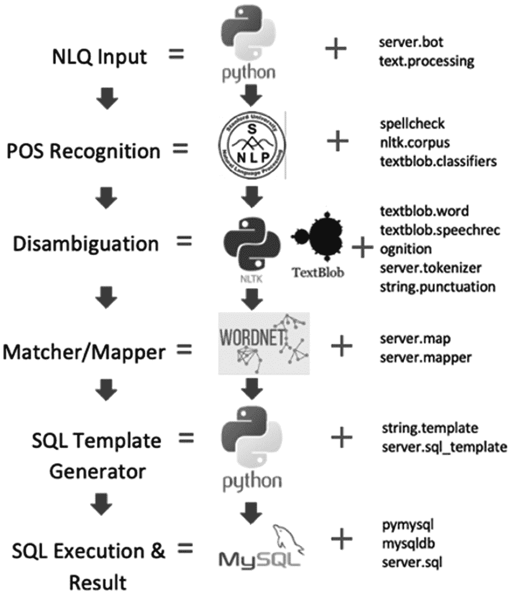
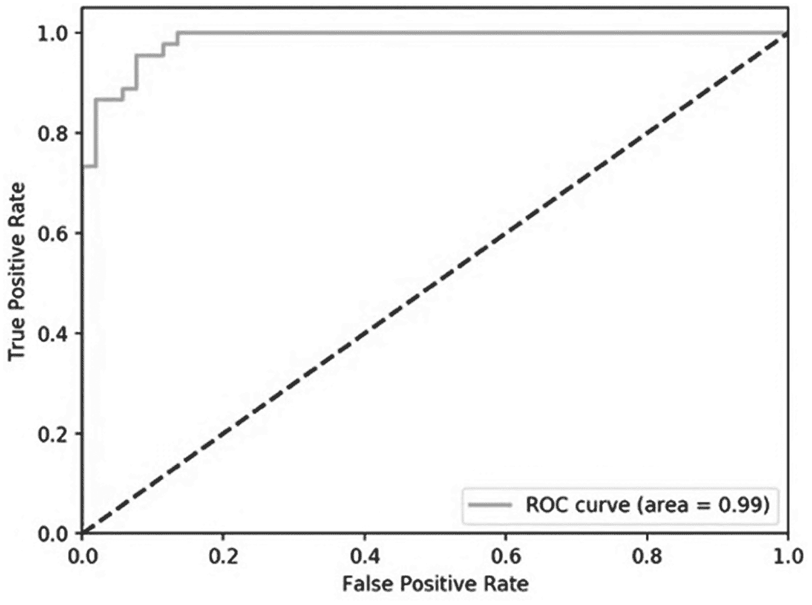
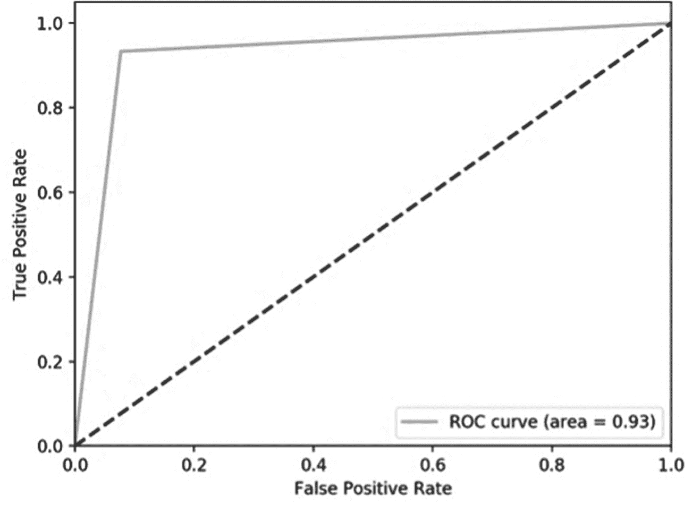
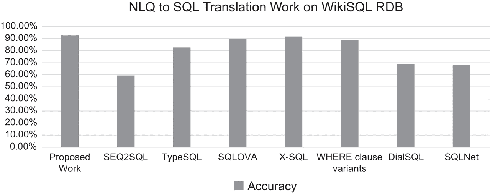
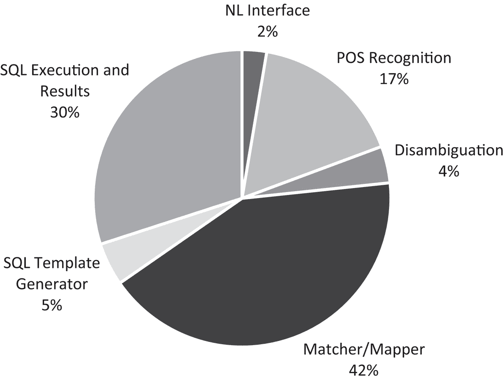

# NLP 应用：使用计算语言学的自然语言问题与 SQL


封面图片来源：Shutterstock.com


# 前言

本书将自然语言处理（NLP）概念应用于帮助人类日常生活。它讨论了如何将非结构化的自然语言问题（NLQ）自动翻译为结构化查询语言（SQL）语句。SQL 作为一种关系数据库（RDB）交互语言，具有特殊的查询语法和计算机可执行的人工语言。通过这种方式，数据库（DB）管理员或几乎或完全没有 SQL 查询能力的普通用户可以以交互的方式对关系数据库进行查询。人机交互（HCI）通过用户的 NLQ 实现，在拟议的研究中这些 NLQ 为英语。用户不需要了解 SQL。（注：原文存在大量重复循环，此处已根据核心含义进行了去重处理。）

# 引言

自然语言处理（NLP）是人工智能的一个领域，专注于计算机与人类语言之间的交互。其目标是使计算机以有用且有意义的方式理解、解释和生成人类语言。NLP 的任务包括：

- 文本分析
- 情感分析
- 机器翻译
- 语音识别
- 语音生成

NLP 是人工智能（AI）的一个分支。常见应用包括虚拟助手、聊天机器人、搜索引擎以及语言工具。


图 2 创伤后应激障碍 (PTSD) RDB 的 ERD

1976 年，Chen \[13\] 首次使用 ERD 对 RDB 架构实体进行图形化建模，以表示 NLQ 结构。在 \[14\] 中，通过分析 NLQ 结构与 ERD 甚至与类图概念模式之间的关系 \[15\]，利用 ERD 来表示 NLQ 结构。然而，以前的工作并未研究将 NLQ 结构的内部关系映射到 RDB 查询语言（如 `SQL`）中的方法，而这种映射将在本研究工作中实现。内部关系是指句子结构（即单词）之间的词法依赖关系，例如动词与其宾语之间的关系。这种关系支持将标记映射到词汇。

此外，RDB 允许通过 RDB 架构元表 `MetaTables` 将 NLQ 映射到 `SQL`，如表 1 和 2 所示（参见第 2 章）。`MetaTables` 是数据仓库，充当数据字典，通过数据注解、跨标签和同义词关联来描述 RDB 元素及其之间的关系。除了使用的 RDB `MetaTables` 之外，NLQ 上文以及存储在多个连接 RDB 表中的基于场景的知识都有助于提高数据检索的准确性。在所提研究范围内，重点将放在解决这样一个问题：我们如何利用 RDB 架构 `MetaTables` 将非结构化的全文本 NLQ 表达式翻译为 `SQL` 语句，从而产生准确的结果？这种翻译机制及其框架设计（从 NLQ 接口到识别等效 `SQL` 子句）旨在实现其他次要任务，例如：

*   缩写支持；例如，如果用户使用缩写“kg”询问患者体重，它会被识别为“kilogram”。
*   支持 `SQL` 语法结构（如 `SELECT`、`FROM` 等关键字）的同义词，或处理 NLQ 中缺失这些结构的情况。
*   多列 `SELECT`；识别多个 NLQ 的主名词或名词短语。
*   将操作符和数字（例如 `Equal`、`Three`）转换为数值形式和符号（例如 `=`、`3`）。
*   从 NLQ 中提到的字面值中推导出表名或属性名。
*   支持命题术语（例如：上方、下方、之间）。
*   考虑 NLQ 中的所有条件项并将其转换为多个 `WHERE` 条件。无论所有条件是应用于相同还是不同的 RDB 元素，均适用。
*   支持聚合函数（例如：将‘highest’转换为 `MAX(Hight)` 或将‘youngest’转换为 `MIN(Age)`）。

表 1 是 NLQ `MetaTable` 的一个示例，它将输入的 NLQ 拆分为后续的标记。表 2 是 RDB 元素 `MetaTable` 的一个示例，它从性质、类别、语法角色等方面解释了每个 RDB 元素。这两个表将在整个研究文档中频繁被引用和详细阐述。

访问任何类型的数据库都必须使用机器可读指令。这强调了在 NLQ 与 RDB 查询语言（如 `SQL`）之间寻找映射机制的必要性。通过分析语言的语义和语法角色，可以发现 NLQ 与人工语言之间的通用语义。本研究工作通过在词处理层面手动编写基于规则的自动映射算法，解决了 NLQ 到 `SQL` 的翻译问题。手动工作在于创建基于规则的算法。算法开发完成后，映射过程将是自动的。

本工作的目标是在保持简单算法配置的同时具有高性能的输出结果。除了简单的算法规则外，避免依赖巨大的标注语料库或编写的翻译示例模式也非常重要。这一研究思路克服了任何底层语言工具（如命名实体标记器、分词器或依赖解析器）性能不足的问题。本研究贡献是一种基于规则的算法，它在 NLQ 的语义/语法信息、SQL 的语法信息以及 RDB 元素的语义角色之间应用了映射关联，并提供了一种将 NLQ 转换为 `SQL` 的有效翻译机制。

## 基础研究框架结构

在所提算法的实现过程中，如图 3 所示，用户的 NLQ 作为输入到给定的 `NLIDB` 中，并配有相应的 RDB 架构。接下来，通过底层多层 NLP 框架执行 NLQ 到 `SQL` 的翻译。之后，系统基本上可以理解 NLQ 并用等效的 `SQL` 查询做出响应。


在接下来的章节中，第 2 章是对研究工作流水线组件的背景研究，作为第 4 章中描述的实际研究实施计划的引言。第 3 章是对主要研究贡献的文献综述，即两种映射算法。第 5 章是一个使用实现用例场景的运行示例，用于说明每个组件的作用。本章还对算法过程进行了完整总结。第 6 章概述了算法的实现测试和验证方法，以及用于说明所提研究成功因素的性能测量。第 7 章展示了框架实现结果和讨论，最后第 8 章提出了研究结论并概述了未来研究范围。

# 2 背景研究


为了解释术语，图 4 解释了自然语言查询 (NLQ) 单词到标记到词汇的轨迹，这些过程在箭头上进行了总结。


## NLQ 输入处理接口 NLIDB

这一步是与用户交互的点。用户界面可以是简单的代码输入界面，也可以基于 Web 的图形用户界面 (GUI)。GUI 使用 `HTML`、`CSS` 和 `PHP` 等网页设计语言。该接口用于 NLQ 表单输入问题。通常，`NLIDB` 可以是以下选项之一：


1. 简单直接的问题，其语言结构简单，包含一个疑问词，语义完整且无歧义表达；或
2. 复杂的通用问题，包含许多歧义表达和模糊谓词。这种歧义可能源于省略了必要的词、添加了无关的词、包含多个疑问词或缺少了疑问词。

此外，`NLQ` 问题可以进一步分类为询问特定实体、数量、实体列表排名或比例关系的问题。它们也可以是疑问句，并以祈使句或陈述句的否定或肯定形式存在。NLP 语言学工具经过训练，可以捕捉这些问题结构和类型。

在所提的研究中，选择基于 `NLQ` 的接口作为自然语言接口数据库（`NLIDB`）系统的接口。这是这是与计算机通信的最自然方式。对于作为所提研究目标受众的决策者来说，这也是他们最理想的通信方式。此外，在尝试将其翻译为任何其他查询语言之前，系统对 `NLQ` 的完整语义理解是最核心的部分。

关于所采用的 `NLQ` 类型，仅考虑了简单直接的问题，即前文解释的第一种 `NLQ` 问题类型。这是因为所提研究的主要重点和贡献是映射机制，而不是解决或消除结构错误或不完整 `NLQs` 的歧义。尽管针对简单的 `NLQ` 问题实现了一个简单的消歧模块。然而，处理复杂的通用问题（即带有聚合或否定的问题）是未来研究的主要建议之一。

## 词性 (POS) 识别

为了识别 `NLQs` 的词性 (`POS`)，必须首先明确以下后续层级。

### 语言组件层

在所提系统中，形态学分析在词法分析期间进行，以便识别关键词的属性并将其拆解为基本组件。形态学分析和词法分析的一个很好的例子是 `WordNet` [[19]]。它追踪关键词之间的连接，并将单词与其后缀或派生词离开来（例如，将 `Client’s` 分离为‘client’和‘s’）。此外，`WordNet` 还将单词与其标点符号（即非词标记）隔离开来。

其他语言组件也是当前研究框架中 NLP 工具的一部分，包括分词器（`tokenizer`）、词性标注器（`POS tagger`）、依存句法解析器（`dependency tree parser`）、命名实体识别（`NER`）以及语法和语义分析器，例如 `Link Grammar Parser` [[20]] 和 `Stanford Parser` [[21]]。这些 NLP 工具主要用于将 `NLQ` 标记转换为解析树结构，然后将它们映射到相应的 `SQL` 查询模板。语用分析（`Discourse Analysis` [[22]]）和语用（`Pragmatics` [[23]]）属于后一种 `NLQ` 翻译方法。`SQL` 语法解析树通常是 100% 准确的。`NLQ` 解析树也是准确的，但通常会引入影响整体 `NLQ` 特征表示准确性的噪声 [[24]]。

`NLQ` 语法分布在不同的语言学领域，包括语用、语用和文本理论 [[23]]。具体来说，包含的语言领域包括认知设计（`Cognitive Designs` [[25]]）和描述模块（`Descriptive Modules` [[26]]）。

#### 语法解析器（基于规则）

语法是研究单词如何组合的科学。它包含了语义、形态学、语音学，并且在句法解析之前需要 `POS` 标签。语法解析器通过其排除和包含来分析 `POS` 的范围 [[27]]。

在句法解析下，有以下子任务：

1. **文本结构**：这是研究单词如何构建的科学 [[28]]。
2. **词形还原器（Lemmatizer）**：该模块推导出每个 `NLQ` 单词的原始形式（根节点），这发生在分词之前。
3. **分词器（Tokenizer）**：输入的 `NLQ` 通过分离标记被分词化。这些标记将传递给下一个模块。
4. **词性标注器（POS Tagger）**：也称为词类消歧。`POS 标注` 同时考虑了单词的定义和其语境。

#### 语义解析器（基于规则）

语义是研究单词实际含义的科学，将句法成分与谓语联系起来 [[29]]。这是因为由句法分析器创建的所有结构都有含义。当句法结构没有语义表示时，整个句子将由语义解析器拒绝并忽略。

`NLQs` 根据其准确的语义属性进行处理，这些属性由语义解析器等底层 NLP 工具指明。在 `NLQ` 中定义超出词法属性的信息的语境是非常关重要的。

在语义分析和解析下，有以下定义：

1. **语用（Pragmatics）** [[23]]：研究文本上下文如何影响表达的含义。它利用句子当前的结构表示来探索表达的隐含含义。接下来，对表达进行重新解释以确定其特定的隐含含义。
2. **形态学（Morphology）** [[30]]：研究特定语言中的意义或功能单位（称为词素）。一个词素可以是单词、词缀、前缀或其他单词结构。
3. **音学（Phonology）** [[31]]：研究特定语言的声音模式，以确定哪些音是有意义且显著的（音位）。音学还研究音节结构以及描述句子离散单元（段）所需的特征。
4. **语音学（Phonetics）** [[32]]：研究口语语言的声音。语音学研究音位是如何产生和感知的。

#### 词汇（Lexicon）

词汇旨在研究语言词汇，即单词和短语。在当前的研究工作中，`RDB` 词汇存储在 `RDB MetaTable` 中，它用于将 `NLQ` 单词映射到 `RDB` 中的正式表示（例如表名、属性名等）。词汇由句法和语义解析器共同分析。

### 中间语言表示层


这些层使用知识库来辅助自然语言查询（NLQ）的 SQL 翻译过程。这方面的一个很好的例子是话语表示结构。这种结构使用基于本体的语义解释器作为中间语言表示层，将 NLQ 转换为 SQL。话语整合分析 [22] 是对信息交换的研究，例如在对话中，句子的含义可能会根据前句或后句而改变。一个例子是句子中使用代词（如“他”），它取决于前一个句子中的主语或执行者。为了使话语分析过程足够彻底，必须对 NLQ 标记进行标注。因此，标注者在这种方法中是至关重要的。

### 标注者

标注是提供特定数据附加信息的元数据。自然语言数据集被称为语料库（corpus 的复数）。当一个语料库被标注时，它被称为被标注语料库。语料库用于训练机器学习算法（MLA）。标注类型包括：

*   POS 标注（词性标注）。
*   短语结构标注。
*   依存法结构标注。

在目前的研究工作中，上述所有的底层 NLP 层都被考虑并实现为 POS 识别模块的一部分，但中间语言表示层除外。使用的 POS 识别 Python 库是 `speech_recognition`。该模块对于彻底理解给定的 NLQ 以实现正确准确的翻译至关重要。

## 消歧

在目前的研究工作中，只有当映射器发现某个 NLQ 标记对应多个匹配的 RDB 元素时，才需要进行消歧。通常，词语含义的消歧有特殊的技巧和算法。一个例子是使用 N-Gram 向量的统计关键词含义消歧过程 [33]，其中 N 的范围从 1 到文本长度。N-Gram 向量的统计数据使用英语训练语料库收集，而自定义语料库则在系统使用期间收集统计。后者语料库要求用户在提交执行之前，检查所提供的 NLQ 解释并进行任何必要的更改。N-Gram 向量主要用于捕捉词汇上下文。它被认为是衡量给定标记在特定用户 NLQ 输入中具有特定含义概率的指标。这是因为每个标记的含义都取决于它所处的上下文。这种含义比较程序遵循向量相似性排名方法，含义排名越高，越接近真实含义。

其他词语含义的消歧研究涉及计算语言学和统计语言理解。此类研究侧重于大型语料库中的词义消歧。另一种消歧词义的方法是使用词汇搭配。词汇搭配方法衡量了当多个词存在于同一个 NLQ 中时，它们含义的概率。Iftikhar [34] 通过解析特定领域的英语 NLQ，并使用 Stanford 解析器 [21] 生成 SQL 查询，提出了一种解决消歧问题的方案。这种方法广泛应用于非结构化查询语言（NoSQL）数据库的自动查询和设计。

Rajender [35] 使用受控的 NLIDB 接口并推荐了 SQL 查询功能，以减少 NLQ 输入中的歧义。这是因为领域歧义越小，系统产生的结果就越准确。同样可以帮助解决这种歧义的是 RDB 元素之间的加权关系或链接 [36]。在这种方法中，每使用一次该特定关系，关系的权重就会增加一。因此可以确定关系权重越大，相关的 RDB 元素被查询得越频繁。这有助于 NLIDB 系统为用户提供更智能的排序选项供其选择，其中最顶部的选项是概率最大的。

在目前的研究工作中，NLQ 消歧不是重点。因此，通过应用 Stanford CoreNLP [21] 和 `nltk.corpus` Python 库 [37] 使用了一个简单的 NLQ 消歧模块。这些工具仅用于检查 NLQ 的有效性。句法规则检查器也用于检查任何 NLQ 语法错误。采用的程序是交互式的，错误消息会弹出给用户，要求他们重新表述单词或从几个可能的拼写纠正中进行选择。实现了一个朴素贝叶分类器 [38]，简单地将用户的响应分类为正面或否定（即是或否）。

## 匹配器/映射器

匹配器/映射器模块被认为是 NLP 科学中最复杂的部分 [14]。因此，基于关键词的搜索吸引了许多研究者的关注，作为最简单的映射方法，因为关键词是可以显式识别的。研究人员利用它改进从数据库检索信息，并解决（或避免）理解 NLQ 标记将其映射到底层数据库或模式模型的挑战 [39]。映射器可以是实体-属性-值（EAV）映射器 [40]、实体关系（ER）映射器 [13]，或可扩展标记语言（XML）文档映射器 [41]。如果使用的数据库或模式模型是 EAV 或 ER，则 NLQ 被翻译为 SQL 查询。只有当使用的系统在底层信息系统中基于文档的数据模型时，NLQ 才能转换为 XML 文档。

在目前的研究工作中，采用的映射器除了 RDB 关系外是 EAV 映射器。NLQ 标记分别通过 NLQ 和 RDB 元表 `表 1](#2.xhtml#table1)` 和 `2](#2.xhtml#table2)` 映射到 RDB 词汇表中。匹配的词汇随后将与 SQL 子句映射。这种映射使用了提的基于规则的算法，该算法基于稍后在 `表 4](#4.xhtml#table4)`（位于第 4 章](#4.xhtml））中讨论的观测表。关于该模块的更多背景信息在第 3 章](#3.xhtml) 文献综述中给出。


该层利用之前层的输入，结合可用的 MetaTables 数据，将自然语言查询（NLQ）翻译为 SQL。SQL 查询的复杂性可能非常高，因为某些查询可能需要聚合、嵌套或涉及多表选择和连接的否定。因此，可能需要进行逻辑表达式拼接来解决潜在的 NLQ 复杂性（例如否定连词、从句、最高级等）。基础的 `WHERE` 条件通过 `AND`、`OR` 和 `NOT` 操作符组合，落到嵌套的 `WHERE` 子句中，其中第二个 `SELECT` 子句嵌套在 `WHERE` 子句内部。

SQL 模板及其复杂度分类决定了特定的 NLQ 属于哪种 SQL 类别。所选 SQL 模板的子由匹配的 RDB 词汇填充。此外，不同的翻译系统支持不同的 SQL 模板。因此，必须识别被接受和认可的模板，以及它们的似然率和出现频率。

### SQL 语句类型

- 数据查询语言 (DQL): `SELECT`
- 数据操作语言 (DML): `INSERT`, `UPDATE`, `DELETE`
- 数据定义语言 (DDL): `CREATE`, `ALTER`, `DROP`
- 数据控制语言 (DCL): `GRANT`, `REVOKE`
- 事务控制语言 (TCL): `BEGIN TRAN`, `COMMIT TRAN`, `ROLLBACK`
- 数据管理命令 (DAC): `START AUDIT`, `STOP AUDIT`

在所提出的研究工作中，重点是 DQL，它除了其他辅助子句（如 `WHERE`、`AS`、`FROM`）外还有一个命令短语（`SELECT`）。DQL 虽然只有一个主命令短语，但它是 SQL 其他短语中最常用的短语，特别是在涉及其他短语时。`SELECT` 是主命令短语，用于在 RDB 中执行特定查询。`SELECT` 关键字用于查询。通过命令行（`Terminal`）或应用程序接口（`API`）使用 `SELECT` 算法将 NLQ 翻译成 SQL。

## SQL 执行与结果

在这一阶段，用户必须与 RDB 建立连接，以执行数据库管理系统（DBMS）功能。一旦翻译过程完成并生成 SQL 语句，将在 RDB 中执行。查询结果以列的形式呈现给用户。查询结果可能以自然语言的形式返回给用户，这是 SQL 语句的输出。这需要一个基于本体的解释器来将 NLQ 翻译成 SQL。

# 文献综述


## 相关工作

- [UNAR](https://wiki.example.org/UNAR) 开发于 **1971** 年，使用增强转换网络（ATN）处理 NLQ。
- [NLP](https://wiki.example.org/NLP) 开发于 **1977** 年，作为句法解析器处理 NLQ，但存在局限性。
- [Semantic Language](https://wiki.example.org/Semantic Language) 开发于 **1978** 年，作为语义解析器使用。
- [LIFER/ADDER](https://wiki.example.org/LIFER_ADDER) 开发于 **1978** 年，支持基于关键词的 RDB 结果。
- [ASK](https://wiki.example.org/ASK) 开发于 **1983** 年，作为学习系统与 RDB 交互。
- [TEAM](https://wiki.example.org/TEAM) 开发于 **1987** 年，作为 NLIDB 的核心功能。
- [Syntactic Analysis](https://wiki.example.org/Syntactic_Analysis) 开发于 **1997** 年，通过句法分析识别 NLQ。
- [Clinical Data Analytics (CliniDAL)](https://wiki.example.org/CliniDAL) 开发于 **2002** 年，使用基于相似度的 Top-k 算法进行 SQL 查询。
- [Vietnamese NLIDB](https://wiki.example.org/Vietnamese_NLIDB) 开发于 **2002** 年，用于 RDB 调查。
- [DBXplorer](https://wiki.example.org/DBXplorer) 开发于 **2002** 年，采用 `PUBLISH` 和 `SEARCH` 实现基于关键词的搜索。
- [PRECISE](https://wiki.example.org/PRECISE) 开发于 **2004** 年，使用语义可处理句子的概念。
- [question answering system](https://wiki.example.org/question_answering_system) 开发于 **2005** 年，基于 RDB 进行问答。
- [NUITS](https://wiki.example.org/NUITS) 实现于 **2006** 年，使用 DB 架构结构和内容级聚类进行搜索。


梅奥医学中心信息提取系统 `[50`]` 从自由文本字段（如临床笔记）中提取信息，包括命名实体（如疾病、体征、症状等）以及相关属性（如上下文、状态、与患者的相关性等）。该系统通过实现简单的 NLP 任务工作，如分词、词形还原、词典验证和词性标记。

English Wizard 开发于 2009 年，是一种使用 `SQL` 查询关系数据库的英语查询翻译工具。English Wizard 的功能包括具有图形用户界面（GUI），用于发布自然查询，或通过客户端/服务器应用程序或其他数据库报告工具 `[51`]`。

GINLIDB 在 2009 年采用了两种类型的语义语法来支持广泛的自然查询。第一类型是用于非终结词的单词典语义语法，第二类型是使用复合语法形成终结词短语或句子。此外，GINLIDB 使用 `ATN` 进行句法分析，以确保标记结构与允许的语法结构兼容 `[52`]`。

在 2010 年，CHAT-80 系统使用 `Prolog` 将自然查询处理为三个阶段表示。首先，系统将自然查询词表示为逻辑常量，然后将自然查询的动词、名词和形容词表示为谓词。对于复杂的自然查询短语或句子，系统通过在数据库上形成谓词的结合来表示。CHAT-80 集成了 `WordNet` 作为词典，并将本体作为语义解释器的知识库。CHAT-80 被认为是领域无关且可移植的数据库。它还使用 `OWL 本体` 定义关系关系模型，以增加自然查询句子的准确性 `[53`]`。

在 2012 年，一种名为自然语言应用程序接口（LANLI）的关系数据库自然语言接口系统被开发 `[54`]`。LANLI 利用 `Local Appropriator` 上定义的语义和句法树进行查询执行。在使用查询构建树之前，LANLI 通过匹配算法将自然查询词与语料库标记进行匹配。LANLI 是一种有效的数据库检索系统，因为它对自然查询和内置数据库使用了准确的树形成算法，此外还使用了类似字典的表来解释自然查询可能拥有的知识。

在 2014 年，自然查询到 SQL 的翻译算法通过 `CliniDAL` `[55`]` 被提出，专注于管理从实体-属性-值（EAV）设计模型提取数据的复杂性。该算法始于 `Controller` 接收带有主要参数数量的自然查询以执行高级搜索。查询通过 `Query Processor` 使用查询树和存储在数据源上下文模型中的信息（一种元数据）进行解析、分类和优化，以产生包括实体、比较级及其类别（如患者、医疗、时间等）的查询或解析树。CliniDAL 的语法解析器通过自由文本解析机制识别自然查询的部分，还有用于深度分析的数据分析后处理步骤。第三步是 `Query Translator` 识别树中的自然查询标记，以便 `Mapper` 将它们映射到临床信息系统（CIS）中的内部概念表示。此映射过程使用基于相似性的 Top-k 算法，以及嵌入的 NLP 工具（如分词、缩写扩展和词形还原）。映射结果存储在通用上下文模型中，像索引一样为翻译过程提供必要信息。因此，自然查询标记对应的表和字段从数据源上下文模型中提取并输入 `SQL SELECT` 子句，值表从 `SELECT` 子句中提取以生成 `SQL FROM` 子句。查询解析树的叶节点表示查询约束类别，通过对临床属性及其值进行代数计算反映结合或取或。CliniDAL 使用唯一的统一术语 `TERM_ID` 及其同义词作为软件处理目的的内部标识符，例如组合 SQL 语句。

在 2017 年，引入了特殊的 `CliniDAL` `[42`]`，将基于概念的自由文本搜索集成到其底解析、映射、翻译和时间表达式识别结构中。这些结构独立于 CIS 运行，能够查询结构化和非结构化的模式字段（如患者笔记），以便从 CIS 中进行彻底的知识检索。这种翻译通过通过计算连接事实表的“枢接法”来实现，而不是使用 DBMS 功能。聚合或统计函数需要进一步的后处理来应用和计算。

在 2018 年，开发了一种名为 `QUEST` 的自然语言到关系数据库接口 `[56`]`，基于 IBM Watson UIMA 管道和 Cognos。QUEST 强调关注嵌套查询而非简单查询，而不限制用户使用自然查询。QUEST 工作流由两个主要组件组成 `QUEST Engine Box` 和 `Cognos Engine Box`。`Quest Engine Box` 包含了模式独立的规则模板，通过从在线部分的模式文件中提取词典规则来工作，此外还有基于规则的语义模块。`Quest Engine Box` 还包括构建在许多 Watson 组件上的语义解析器，包括英语槽语法（ESG）、谓词参数结构（PAS）和子树模式匹配（SPMF）。该框最终产生一个 SQL 子查询列表，随后输入 QUEST 的另一个框 `Cognos Engine Box`。后者专注于在 IBM DB2 服务器上生成和执行 SQL 语句。与之前的类似尝试相比，QUEST 被证明是非常准确的。

尽管上述尝试（基于标记的 `[57`]`、基于表的 `[58`]`、基于菜单的 `[59`]` 或受控自然语言搜索）在数据库上取得了成功，但简单的方法需要更多努力，因为翻译过程的准确性取决于映射过程的准确性。

### 机器学习算法

NLP 工具和机器学习技术是目前信息提取最先进的实践之一。在机器学习技术方面，可以是基于规则或混合方法，用于特征识别和选择以及规则分类过程。


ML 算法在降维、聚类、分类和多线性子空间学习中具有广泛的应用[61, 62]]。在自然语言处理（NLP）中，ML 被用于提取查询模式，通过在 NLP 输入源之间建立链接，并将预测的`SQL` 模板集预取到临时缓存内存中，从而提高响应时间[63]]。ML 算法通常封装在库中，并与查询和分析系统集成。主要的 ML 属性包括可扩展性、分布式执行和轻量级算法[62]]。

自 20 世纪 80 年代以来，NLP 和基于知识的 ML 算法就一直用于知识处理和检索[64]]。Boyan 等人[65]通过对纯文本文档建立索引优化了网络搜索引擎，并使用强化学习技术通过图传播奖励来调整文档排名。Chen 等人[66]使用了归纳学习技术，包括符号化`ID3`学习、遗传算法和模拟退火，以增强信息处理、检索和知识表示。类似地，Hazlehurst 等人[67]在在其查询引擎系统中使用了 ML，通过开发智能查询引擎（`IQE`）系统，实现了基于查询相似性度量的自动信息检索。

基于概率隐性语义分析的无监督学习被用于信息检索、NLP 和 ML[68]。Hofmann 利用文本和语言数据集，使用受温度控制的期望最大化算法进行模型拟合，开发了一种自动文档索引技术[68]。此外，Popov 等人引入了知识与信息管理框架，用于基于语义查询从`RDF`存储库中对文档进行标注、索引、提取和检索[69]。

Rukshan 等人[70]开发了一种基于规则的数据库自然语言 Web 接口（`NLWIDB`）。他们通过教系统如何识别`NLWIDB`系统中代表多个不同表和属性的规则、识别什么是转义词并忽略它们、以及数据库数据字典、聚合函数`MAX`的规则，以及表示“和”或“以及”概念或区间“等于”概念的多种表示方式的规则，从而构建了这些规则。数据字典通常用于定义已知属性之间的关系，例如，在比较操作中哪个属性在前，哪个属性在比较结构中在后。这个`NLWIDB`与目前的研究思路相似，但我们打算构建一种更简单、更通用的算法，适用于各种领域的系统。我们的算法不使用数据库元素作为规则识别的基础（如 Rukshan 等人的研究那样），而是使用通用的句子结构模式识别来形成等效的`SQL`语句。

`SPARK`[71]将查询关键词映射到本体论资源。翻译结果是基于`RDF`的查询语言（`QL`）格式的查询排序列表，由`SPARK`使用概率模型生成的`SPARQL`。`SPARK`使用的本体论资源被映射为用于提供`SPARQL`数据的图中的项。

`SPARK`类似，`PANTO`[60]将基于关键词的查询翻译为`SPARQL`，但`PANTO`可以处理复杂的查询关键词（如否定、最高级）。此外，`PANTO`使用解析树而非图表示来表示生成`SPARQL`查询的中间结果。

i2b2 药物提取挑战[60]提出使用命名实体识别方法，通过纯 ML 方法或 ML 与基于规则系统的混合方法进行概念识别，从临床笔记中进行高精度的药物概念信息提取。

`Keyword++`框架[43]改进了`NLIDB`，并解决了搜索数据库时`NLQs`不完整和不精确的问题。`Keyword++`通过将关键词映射到其谓词，将基于关键词的查询翻译为`SQL`来工作。评分过程使用差异查询对完成。

`Keymantic`系统[72]利用模式数据类型和其他意图知识手段，结合基于 Web 的词汇资源或本体论，处理 RDB 上基于关键词的查询。`Keymantic`生成关键词到其相应数据库术语的映射配置，以确定用于`SQL`生成的最佳配置。

`HeidelTime`[73, 74]是一种时间标记器，使用基于规则和 ML 的混合方法提取和分类临床文本报告中的时间表达式，同时也成功解决了 i2b2 NLP 挑战。

`CliniDAL`[27]组合受限自然语言查询（`RNLQs`），从临床信息系统（CISs）中提取知识用于分析。`CliniDAL`的 RNLQ 到`SQL`映射和翻译算法通过采用时间分析器组件得到了增强，该组件采用双层规则方法解释查询中的时间表达式，无论是绝对时间还是相对时间/事件。时间分析器会自动查找并将这些表达式映射到 CIS 不同数据设计模型底层数据元素的对应时间实体。

`TimeText`[75]是一种时间系统架构，用于从临床文本报告（如出院摘要）中提取、表示和推理时间信息。然而，它只能回答非常简单的`NLQs`。


Giordani 和 Moschitti [76]] 设计了一种自然语言查询（NLQ）翻译系统，该系统利用自然语言语言和句法依赖关系构建潜在的 `SELECT` 和 `WHERE` 子句，通过产生基础表达式并与连接词或否定表达式结合，以及利用元数据构建 `FROM` 子句；`FROM` 子句包含了 `S` 和 `W` 子句所引用的所有数据库表，并由最高权重的语义连接提供支持，后端使用 `MySQL` 框架。然而，系统倾向于选择连接较少且 SQL 嵌入了最具意义引用表的查询。随后，这些子句通过智能算法组合，形成最终的可能 SQL 语句列表，这些语句的结构和子句组件与数据库元数据、NLQ 标记及其语法依赖相关，而这些标记通过映射算法映射到 NLQ 标记。生成的 SQL 具有有一套权重方案，根据找到的结果数量来基于正确性概率对它们进行排序。

NLQ 标记的文本关系通过称为斯坦福依赖关系折叠（Stanford Dependencies Collapsed, SDC）的类型依赖关系来表示。`SDC` 的工作原理是通过其类型 `SDCq` 列表来表示 `NLQq`，该列表的准备过程首先是裁剪掉无用停用词/转义字的 NLQ 关系，然后对剩余 NLQ 的语法关系进行词干提取/还原化，以获得用于构建子句 `SELECT S` 和 `WHERE W` 的优化列表 `SDCopt`，最后将关系的同义词添加到 `SDCopt` 列表中。之后，应用迭代算法 `q`，将修改后的词根添加到 `Π` 和/或 `Σ`（例如主语或宾语）类别中，以在数据库元文中搜索具有加权投影型词根的匹配字段，并生成 SQL 子句 `S`、`F`、`W` 或嵌套查询，使得结果集 `A = SELECT S × FROM F × WHERE W` 包含所有与 `q` 相关的潜在 SQL。最后，系统将从 `A` 集中选出一个使正确回答查询 `Q` 概率最大的单个 SQL。该 NLIDB 系统在选择正确 SQL 方面的有效性和准确性取决于 SQL 在生成列表中的顺序。列表顶部（前 10 条）的 SQL 的正确数据检索率为 81%，前 5 条 SQL 为 92%。尽管如此，作者认为这些准确性可以通过学习一个重排序器来重新排列前 10 条 SQL 以进行提高。然而，这种 NLIDB 被认为是新颖的，因为它独立于专家，因为所有所需的知识都已存储在数据库元数据存储中 [76]。

类似的 NLIDB 系统由 [77]] 设计，尽管使用了不同的方法（即使用指定了语义语法的专家用户来丰富数据库元数据，并在语义解析器中实现了即时规则 [77]]），但其性能相当。其他类似的工作是 `KRISP` [78]] 系统，它实现了正确检索 SQL 答案的 94% 准确率和 78% 召回率。

Giordani 和 Moschitti [24]] 通过在两种语言之间的句法层上进行映射，为自然语言语义自动映射到 SQL 类语言创新了一种新颖的模型设计。随后，在映射结果上应用支持向量机（`SVM`）机器学习算法，推导出共同的高层语义，从而自动将 NLQ 翻译为 SQL。为了实现这一点，使用了句法解析器通过统计和浅层模型利用机器学习算法定义 NLQ 和 SQL 树。`SVM` 在此处用于构建训练和测试集，其中机器学习模型的输入是问题及其正确答案的语料库。`SVM` 随后自动生成所有可能的正确和错误关系型问/答（`Q/A`）对的标注和标记集。这些关系对使用核函数（`Kernel Functions`）编码在 `SVM` 中，以计算两个树之间公共子结构的数量，并产生 NLQ 和 SQL 浅层特征空间的并集。此外，`Kernel Functions` 还是应用于句法树的树内核（例如句法树内核 `STK` 及其带有叶子特征的扩展 `STKe`）与应用于词袋的线性内核（`Linear Kernels`）的结合，两者都应用于 NLQ 和 SQL 的句法树，以便在这些对上训练分类器，从而为 NLQ 选择正确的 SQL。然后，将此新 NLQ 映射到可用 SQL 集，并根据分类器评分对所有可用 SQL 进行排序，且仅使用分较高的 NLQ。对给定 NLQ 的潜在 SQL 排序通过 `SVM` 使用高级内核完成的，用于生成一组可能的 NLQ/SQL 对，并通过在 NLQ 上应用 Charniak 句法解析器以及对 SQL 查询使用即时解析器修改 SQL 推导树，在它们的句法树上使用自动分类器将它们分类为正确或错误。然后，根据自动分类器输出的概率评分选择排名靠前的对。作者使用标准的 10 折交叉验证测试了 NLQ 到 SQL 的映射算法，并记录了标准差、学习曲线以及每个 NLQ 正确 SQL 选择的平均准确率。这种方法证明能够捕捉 NLQ 和 SQL 之间的共享语义。交叉验证实验也证明，实现的内核通过为某个特定的 NLQ 选择正确的 SQL，改进了基准模型（32%）。然而，词袋上的 3 次多项式内核（`POLY`）比 `STK` 更好，因为它包含了 `STK` 中不存在的单个标记。总而言，核方法通过简单的构建块可靠地描述关系型问题 [24]。

Tseng 和 Chen [79]] 旨在验证 NLIDB 领域的概念数据建模能力，通过扩展统一建模语言（`UML`）[80, 81]] 概念，使用扩展的 UML 类图表示来捕捉并将具有模糊语义的 NLQ 转换为 SQL 的逻辑形式以访问数据库，这有助于结构化对象模型（`SOM`）表示 [82]]，该表示用于将类图转换为用于执行的 SQL [50]]。这种方法将语义角色映射到类图模式 [80, 81, 83]] 及其应用概念，该模式是 UML 九种图之一，用于演示一组类之间的关系（例如泛化和关联）。Carlson 描述了在英语句子中构建语义角色的若干约束 [84]。


`[79]` 的作者旨在探索自然语言查询（NLQ）结构与面向对象（OO）世界之间的关系，目的是将包含模糊修饰符指定的模糊术语（例如“好”或“坏”）的 NLQ 结构通过自然语言接口（NLI）映射到相应的类图中，最终形成一个 SQL 语句，在执行后提供答案以及相应的模糊程度。作者关注了模糊集理论 `[49]\]`，因为它是一种使用不精确术语或语言变量来表示模糊数据的方法 `[85, 86]\]`。语言变量由自然语言单词或句子（例如“老的”或“年轻的”）组成，不包括数字（例如 20 或 30），但通过对不精确概念和值指定自然且简单的规范和刻画描述，可以使用这些语言变量对不精确的 NLQ 术语和概念进行精确建模。

在 `[79]\]` 中，真实世界对象的连接路径在 NLQ 执行期间被映射为 SQL，其方法是从 NLQ 中提取类图，其形式为 SOM 图的子图/树（一个验证子树），该图包含了连接源和目标的相关对象，这些对象在之前已由用户以对象和属性的形式被识别。源是具有值属性的对象及其关联，用以说明感兴趣的对象和属性之间的关系，而最终目的地是目标对象。然后将结果发送到连接矩阵，寻找源和目标之间是否存在任何逻辑路径，最终将逻辑路径映射到等效的 QL 语句，该语句可以通过内连接（inner joins）进行简化。类图中表示的 和成员函数用于将每个模糊修饰符与其相应的模糊类连接起来。

Isoda `[87]\]` 发现，通过识别这些真实对象对应的类，基于面向对象的分析应用程序能够实现直观且自然的真实建模。

Moreno 和 Van `[88]\]` 证明了 NLQ 结构的概念建模形式化可以自然地映射到面向对象的概念模型，正如 Metais `[89]\]` 提到的 NLQ 和 DB 概念模式那样，以及它们在表示真实世界的概念化特征方面的高效。

Yager 等人 `[90]\]` 证明了模糊集（包含如“年轻”和“很少”等模糊术语）理论提供了一种基于语言的 NLQ 建模应用。此外，模糊 NLQ 允许允许通过包含更多元组的模糊谓词更直观地描述真实世界对象。

基于 `[79]\]`，带有语言术语和模糊术语的模糊 NLQ 比精确的 NLQ 更灵活，因为在没有直接答案的情况下，它们可以提供更多潜在答案。关于与 DB 架构的语言关系，通过使用链接字典和预定义的基于语法的规则对 NLQ 进行语言分析，以减少歧性和复杂性，而 DB 架构充当 DB 概念设计蓝图。

同样，Owei `[91]\]` 提出了一种基于概念的 QL，通过数据库查询的概念抽象来促进查询制定，以利用语义数据模型并将 NLQ 结构映射到等效的特定对象中。

### L2S 函数与步骤

L2S 功能分布在三个步骤 `[92]\]`。在第一个预处理步骤中，对 NLQ 和 DB 进行分析并提取所有 ML 特征。这一步由三个预处理组件支持：语言组件，用于分析 NLQ 以生成词汇表列表并发现任何条件标记（例如大于/小于）。该组件包含了工具，如命名实体识别器 (NER) `[97]\]` 和 GATE 中的 Coltech-parser `[98]\]`，用于提取位于 NLQ 中的语义信息。此外，该组件使用 Java 模式引擎 (JAPE) 语法处理 NLQ 的分词和命名实体标记。第一步的输出是附加约束。第二个组件是词典，用于分析 DB 元素及其附加约束。第三个组件是歧义消除，用于修正 NLQ 输入以确保无歧义的 NLQ。在此组件中，L2S 将所有 NLQ 标记与 DB 元素进行比较，通过省略法或最高概率选择找出匹配两个或多个 DB 元素的歧义标记。接下来的 L2S 步骤是匹配步骤，包含两个主要组件：语义匹配和基于图的匹配。这一步处理跨语言映射，产生与第一步输出等效的 SQL 元素。第三步是生成完整准确的 SQL 语句。

### 技术方法与建模

大多数语言转换依赖于语法。通常，基于规则的方法 `[93]\]` 需要大量的手动定制，并常用于工业系统 `[94]\]`。

统计模型主要用于学术研究，它们通过构建正确和错误的 NLQ 对训练集来工作 `[24]\]`。语言转换随后变为一个二分类任务，ML 特征从标记和标签中提取 `[95]\]`。


根据 [99]，自然语言处理（NLP）如今是人机交互的一项活跃技术，特别是在社交媒体时代 [99]，开发了一种结构化设计方法，通过 NLQ 的语义提取和优化的 SQL 生成，将带有标准连接条件的简单 DDL 和 DML 查询从 NLQ 格式自动转换并翻译为 SQL。这项工作还为终端用户提供了一个用户型的 NLI，使其能够通过任何网络源轻松访问社交网络数据库。作者使用 Java 编程语言及其技术工具构建了 NLIBD 系统的前端，并使用 R 工具作为数据收集器，从社交网络源收集数据。对于系统的后端数据存储，作者使用了 Oracle 数据库 SQL Server。他们还使用了一个有限的数据字典来存储所有与系统相关的词汇。系统将接收 NLQ，对其进行处理，使用 R 工具接口收集数据，从社交网络源中提取语义知识，并生成相关的 SQL 语句。

在 [99] 中，提出了一种简单的架构布局框架。它包含四个处理阶段模块：形态分析模块、语义分析模块、映射表模块和检索模块。在第一阶段模块中，接收 NLQ 并对其进行分词处理，从社交网络源中提取语义知识，并通过提取器剔除不需要的词汇。然后，提取器使用 Porter 词干算法对分词后的词进行词干提取，并传递到第二个阶段模块。在第二个阶段模块中，使用语法无关上下文文文法将分词后的 NLQ 标记映射到数据库元素（即列名或表名）。

语义分析模块基于提取的关键词生成语法表示树，并将其传递给第三阶段模块。映射表模块拥有所有潜在的 SQL 模板，并根据 NLQ 的语义分析生成相应的 SQL，然后将其传递给第四个也是最后一个阶段的检索模块，向用户交付报告。该工作的显著努力在于通过语法检查器将 NLQ 转换为 SQL，此外，语义分析用于将 NLQ 标记映射到 SQL 对象。SQL+ 系统通过定义了 NLQ 的含义，以供用户选择潜在的 SQL 查询列表。

Akshay [100] 提出了一种用于 SQL 的 NLP 搜索接口，支持 SQL 的生成，并提高了准确性。

Kaur [101] 阐述了正则表达式（regexps）在 NLP 中的有效用法，用于 SQL 搜索、文本形态学和语音识别。然而，NLQ 句子中的正则表达式形式尚未明确规范。

Avinash [102] 在 NLDB 中对 NLQ 进行语义分析，并利用领域本体知识来增强查询的精确度。

Kaur 和 Bali [45] 通过对 NLQ 进行语法分析和语义分析，在 SQL 转换接口中将 NLQ 转换为 SQL，但该模块无法处理复杂的 NLQ。

Arati [103] 使用概率上下文无关文法（PCFG）在 NLDB 系统设计中对 NLQ 进行语法分析，并将其转换为内部表示形式，再转换为 SQL。然而，在该系统设计中，寻找正确的语法具有挑战性。

Dshish [104] 使用 NLP 进行查询优化，将 NLQ 翻译为 SQL，并采用了 LIFER/LADDER 方法。由于 LIFER/LADDER 系统仅支持简单的 SQL 构建，该翻译架构受到了很大限制。

对于关系型数据库管理系统（RDBMS），Gage [105] 提出了一种 AI 应用方法，通过模糊逻辑、语音识别和替换将 NLQ 转换为 SQL。

Alessandra [24] 使用 SVM 算法实现了 NLQ 和 SQL 之间的语义映射，设计了用于 RDB 的语法树，并使用核函数对这些映射进行编码。

Gauri [106] 也使用了语义语法将 NLQ 翻译为 SQL。在语义分析阶段，作者使用词典存储了所有语法词汇，并通过后处理器将 NLQ 的语义表示转换为 SQL。然而，该架构只能翻译简单的 NLQ，灵活性不足。

Karande 和 Patil [51] 在 NLDB 系统中使用语法和解析，通过在数据库上执行简单 SQL（即带有连接操作或少量约束的 SQL）来实现数据的选择和提取。该架构使用了 ATN 解析器生成语法树。

Ott [107] 解释了通过 NLDB 自动生成 SQL 的过程，使用基于 NLQ 形式逻辑的内部中间表示语言，然后映射到 SQL+。这种方法基于类似于数据库面向逻辑形式（DBLF）的一阶谓词逻辑，包含了某些 SQL 运算符（如否定、聚合、范围和 SQL SELECT 的集合运算符）。

这种称为 SQL+ 方法旨在解决 SQL 的限制，例如通过循环操作处理序数（如第六小、第三大）。为了替换循环操作，将 SQL+ 表达式输入到带有光标管理的 SQL 编程接口中。

SQL+ 通过增强 SQL，使得每个 NLQ 标记都能通过 SQL 表达式进行表示和回答，从而保留 NLQ 的最终力量。实验结果证明，即使是复杂的查询，也可以遵循三种策略（连接策略、临时关系策略和否定策略）进行生成。


对于连接策略，在 `DBLF` 公式中，对于每个新的关系引用，在 SQL 的 `FROM` 子句中以自上而下的方向递归地构建连接操作。全称量词通常通过使用双嵌套结构创建计数器来实现，例如 `(NOT EXISTS [sub-SQL])`，这已被用于 `TQA` 系统 [108]。然而，[107] 使用临时关系创建策略来处理全称量词和数值量词，并处理序数以及聚合函数的混合。临时关系使用 `join-strategy` 创建，以便将其轻松嵌入任何 SQL 表达式中。因此，每当存在量词时，就会递归地为其构建一个临时关系。对于否定策略，在 `DBLF` 中，否定处理是通过：如果否定出现在句首，则为是/否问题设置“反转”标记；在动词否定和其他位置的否定量词的情况下，则使用 `(NOT IN [subquery])` 结构来处理。如果否定出现在简单谓词之前，这两种否定处理方法都是可行的，在这种情况下，否定粒子的数量和位置不受限制。对于混合策略，上述三种策略中的任何一种都可以任意混合，例如在出现聚合函数或序数时构建临时关系。

`TQA` [108] 是一种自然语言接口（NLI），它使用语义语法和深结构语法直接将自然语言查询（NLQ）转换为 SQL，以获得更高的性能以及更好的省略和指代处理。然而，`TQA` 和类似的系统几乎不可迁移，且难以适应于其他数据库领域。

`PHLIQAl` [4]、`ASK` [46] 和 `TEAM` [16] 采用了与概念模式（`CS`）连接的中间语义表示语言，提供高效的 NLQ 到 SQL 转换工具。`CS` 有助于将 NLQ 标记映射到其数据库词表表示，因为它存储了所有 NLQ 标记、关系和属性的数据库术语及其分类法，此外数据库的层级结构和元数据。

`USL` 系统 [109] 是可适应且可迁移的，因为它有一个自定义设备。然而，它的中间语义结构语言是语法导向的，而不是基于谓词逻辑。因此，某些语义意义通过树结构的形式表示。

`TQA` 和 `USL` 技术共同构成了 `LanguageAccess` 系统 [107]，该系统具有独特的 SQL 生成组件，使用 `DBLF` 和概念逻辑形式（`CLF`）作为两种不同的中间语义表示语言。

`LanguageAccess` 系统通过许多步骤工作。首先，短句结构语法解析 NLQ 生成解析树，然后通过 `CS` 将其映射到 `CLF`。生成的 `CLF` 公式在自然语言（NL）中重述，然后呈现给终端用户进行歧义标记的解释和含义验证。一旦终端用户选择了一个 `CLF` 公式，就会使用 `CS` 将其转换为 `DBLF`（SQL 生成的源），然后将其转换为 SQL。`DBLF` 考虑了数据库值的内部表示（例如字符串、数字）、临时关系的顺序以及生成的表达式交付到数据库的机制。

[7, 110, 111] 的作者使用了 NLQ 语义解析来建模将 NLQ 映射到 SQL 的算法。[112] 使用特定的语义语法完成了类似的研究。[7, 110, 113] 的作者使用了 lambda 演算，并将其应用于 NLQ 含义表示用于 NLQ 到 SQL 的映射过程。此外，[114] 使用 ILP 框架定义的规则和约束通过其语义解析来映射 NLQ。为了相同的目的，[7, 110, 111] 采用了一种耗时且昂贵的方法，通过手动生成 NLQ 标记的含义表示。类似地，[112] 通过在语义语法规范上投入大量的专家时间和精力开发了一个编写系统。[7, 110, 113] 的作者开发了一个强化监督的系统，使用 lambda 演算将 NLQ 映射到其相应的含义表示。

与 `KRISP` [78] ，Giordani 和 Moschitti [115] 开发了一个仅使用语法树的问答对构建的模型，因为 SQL 编译器提供了所需的 NLQ 派生树，该模型通过生成式解析器将事实型 NLQ 转换为结构化 RDB SQL，并使用基于字符串树核的先进 ML SVM 排序器通过重排序器对其进行判别性重排序。重排序器重新排列了潜在的 NLQ/SQL 对列表，该列表召回率为 94%，在该系统中召回了正确答案。

[115] 中的系统不依赖于 NLQ 释义资源（例如 Prolog 数据、Lambda 演算、MR 或 SQL），除了 WordNet 中缺失的某些同义关系以外的任何手动语义表示。第一阶段是生成阶段，在该阶段使用 NLQ 标记的词法依赖和数据库元数据引发的词表（加上 WordNet），而不是对整个 NLQ 进行语义解释，并在规则和启发式权重方案的帮助下递归构建 SQL 子句（即 `SELECT`、`WHERE`、`FROM`、连接等）。数据库元数据负责关系消歧任务，并在数据库数据类型、主键（`PKs`）、外键（`FKs`）和其他约束、根据领域语义的实体、列和表名称，它通常也被称为存储在数据库 `INFO_SCHEMA`（`IS`）中的数据库目录。生成阶段的输出是由生成式解析器创建的排序后的潜在 SQL 列表。

依存句法分析被用于提取 NLQ 标记的词法关系和依赖。根据 [19]，WordNet 在将谓词参数扩展到其含义解释和同义词方面高效；然而，WordNet 通用了关系参数，但不能保证 NLQ 没有歧义和噪声，这会显著影响其含义解释。因此，该系统根据 Stanford Dependencies Parser [116] 提取的 NLQ 词法和语法关系依赖匹配，以及 SQL 子句的逻辑和句法公式结构，生成所有可能的 SQL（包括歧义的 SQL）。


在 GEOQUERIES 语料库上执行的第一关系是 `[115]` 算法中的 `FROM` 子句关系，它在考虑 `WHERE` 子句中可选条件的情况下寻找对应的数据库元组，然后将结果与 `SELECT` 子句属性进行匹配。如果出现任何空子句或嵌套查询不匹配，该算法将不产生结果；否则，在使用标准的 10 折交叉验证性能衡量下，在 93% 的情况下前三个 SQL 中生成正确的 SQL。这种高准确率和召回率得于鲁棒且基于启发式的权重重排序器，该重排序器使用 `SVM-Light-TK6` 构建，它通过扩展 `SVM-Light` 优化器 `[117]` 并采用树核 `[118, 119]` 来使用加法 `STKn + STKs` 或乘法 `STKn × STKs`。使用了默认的重排序器参数，例如归一化核中的 `λ = 0.4` 以及代价和权衡参数 = 1。然而，这种方法要求预先存在可能的 SQL，因为算法无法生成新的 SQL，它只验证输入的自然语言查询（NLQ）是否有对应的 SQL 来产生正确答案。

在概念上与 `[115]` 相似，Lu 等人的 `[120]` 映射系统也不依赖 NLQ 标注，而是依赖于生成模型和 `(MODELIII+R)`，这是一个判别性重排序技术。同样，`DCS` 系统 `[121]` 也不依赖数据库标注，并且作为一个增强了原型触发器的映射系统（`DCS+`）一样工作。此外，从问答对中，SEMRESP 采用了一种语义解析器学习器 `[122]`，它在标注的逻辑形式（SQL）上表现最好。Kwiatkowski 等人 `[123]` 开发了 `UBL` 系统，在 SQL 和问答对上训练后，它能够利用受限的词项结合一些 CCG 组合规则来学习新输入的 NLQ 词汇。

## 当前研究工作的合理性

本工作提出的主要目标是在 NLQ 和机器可读指令（如关系数据库查询语言 `SQL`）之间寻找一种简单但准确的映射机制。到为止，还没有一种既不因复杂性而牺牲准确性和精度，又不因过度简化而导致无法运行的 NLQ 到 SQL 翻译机制。此类翻译机制在应用于其他关系数据库时会产生大量的规则异常和错误。因此，所提的研究利用了一种简单的手动编写基于规则的映射约束算法，设计了一种独特且准确的 NLQ 到 SQL 翻译机制。该算法将 NLQ 标记的语义和语法信息映射到关系数据库元素类别（如值、属性等），然后一致地映射到 SQL 子句。该算法通过 `MetaTables` 使用计算语言分析配对和匹配机制。将 NLQ 翻译为类 SQL 语言的研究有悠久的历史，从 1971 年一直延续至今 `[2, 2013, 4, 12, 16, 2013, 18, 35, 39, 40, 41, 46, 47, 48, 49, 52, 53, 57, 59, 60, 65, 66, 67, 68, 69, 70, 71, 72, 73, 99, 100, 124, 125, 126, 127, 128, 129, 130]`。根据文献 `[57, 74]`，将 NLQ 映射为 SQL 通过以下任何方法实现：

### 基于接口的系统
通过 `[131]` 使用基于关键字的接口 `[131]` 设计关系数据库元素。

### 增强 NLQ/SQL 对
通过在 NLQ/SQL 对中添加额外特征 `[132]` 来寻找语义表示（例如，归纳逻辑编程 `ILP` `[75]`）。

### 使用算法
通过使用 `[33]` 通过训练支持向量机 (`SVM`) `[33]` 将 NLQ 映射为 SQL。

### 受限的 NLQ 输入
通过 `[128]` 使用基于模板的自然语言接口 (`NLI`) `[52]`。

### 树核模型
核函数 `[110, 113, 133]` 是树核 `[134]` 的组合，例如多项式核 (`POLY`) `[135]`、语法树核 (`STK`) `[33]` 以及其带有叶子特征的扩展 (`STKe`) `[132]`。它们可以应用于 NLQ/SQL 对的语法树，而线性核 `[136]` 则应用于“词袋”。它们用于对这些对训练分类器，以为给定的 NLQ 选择正确的 SQL。

### 统一建模语言 (UML) `[34, 118]`
一种面向对象建模 `[137]` 的标准图形化表示和信息系统设计工具。UML 是 Rumbaugh 的对象建模技术 (`OMT`) `[119]`、Booch 的面向对象分析与设计 `[74]` 以及 Jacobson 的对象构造的组合。UML 类图用于通过引用数据库的概念模式来建模数据库的静态关系和静态数据模型（数据库模式）。

### 加权链接 `[81]`
是一种映射系统，通过配对关系数据库词汇与 SQL 子句之间权重最大的意义连接来工作。

下文是对上述所有映射方法的解释，并说明为何选择第二种方法（增强 NLQ/SQL 对）作为最有效的方法，从而排除其他方法。


在当前的研究中，采用了第二种方法，因为它没有限制用户使用某些领域特定的关键词[[40, 72]]，这与限制性自然语言查询（NLQ）输入方法的情况不同。这是因为本工作的目标是在用户无需预先了解 RDB Schema、系统基础设施、底层 NLP 语言工具或任何特定查询语言的情况下促进人机交互（HCI）。

此外，自然语言查询是人类最自然的交流方式。第一种方法（基于基于界面的系统）高度依赖终端用户通过他们必须经过的所有界面屏幕进行输入，以指定和修改所使用的关键词或短语。因此，对于用户来说，如果他们有编程知识并直接输入 SQL 语句而不使用自然语言界面（NLI）屏幕，似乎会更简单。因此，本工作仅在出现拼写错误或歧义短语时才涉及终端用户。在这方面，在[[40, 52, 68, 69, 87]]中，作者将基于菜单或基于限制关键词的 NLQ 方法描述为映射方法。在他们的论文中，他们解释了在准确性和召回率方面，限制性 NLQ 输入系统是多么不足。此外，即使对于诸如比较字典 k 记录与 NLQ 标记之间相似性的基于相似性的 Top-k 算法[79]]等先进算法，也存在迁移性问题。该算法的准确率仅为 84% [100]]，而当前的研究系统准确率高达 95%。

大多数语言翻译方法或问答系统（QAS）依赖于丰富的标注训练数据（语料库），并采用统计模型或非统计的规则方法。因此，依赖 MLA 算法的第三种方法需要大量的领域特定（NLQ 中使用的特定关键词）NLQ/SQL 翻译对语料库。这种语料库很难创建，因为它是一项非常耗时且需要领域专家完成的繁琐任务。NLQ/SQL 对语料库需要由领域专家手动编写并检查数百对数据，以训练和测试系统[70, 76, 138]]。

Avinash [102]] 使用领域特定本体进行 NLQ 的语义分析。结果是，Avinash 的算法会陷入过度定制问题，导致系统在任何其他领域都无法运行。除非进行大量的重新定制，否则它无法迁移也无法适应其他 DB 环境。这种领域特定系统假设用户熟悉 DB Schema、数据和内容。另一方面，当前的研究工作使用简单的算法规则且与领域无关。因此，它不假设对采用的 RDB Schema 有先知识，也不需要任何标注语料库来训练系统。相反，它使用语言工具来理解和翻译输入的 NLQ。然而，所使用的 NLQ/SQL 对仅用于算法测试和验证目的。此外，事实证明过度依赖 MLA 对于降低翻译错误率或提高准确率并不有效[139]]。即使为 MLA 算法提供了专门的错误处理模块[77]]，情况依然如此。在这方面，当前的研究工作采取了积极措施，使用 NLP 语言技术来确保 NLQ 被完全理解和很好解释。这种完全解释在进行任何进一步处理之前，通过中间语言层和 RDB MetaTable 完成；以避免未来潜在的错误或损害准确性。计算语言学在此处的应用形式是通过手动编写的基于规则的算法进行基于语言的映射约束。这些手动编写的算法主要是总结在表 4（第 4 章）中的观察假设。表 4]]在 DB 发生变化时需要大量的人工规则定义和定制以维持准确性[140]]。然而，当前研究工作中实现的基于规则的观察算法是完全领域无关的，并且可以迁移到任何 NLQ 翻译框架。通常，映射是一门复杂的科学[14]]，因为低映射准确性的系统会因为缺乏系统可靠性和信任而被用户立即抛弃。因此，本研究工作提出了一种使用计算语言学的尖端翻译机制。然而，所提研究贡献的几个方面将结合图 8（第 4 章）中的两种映射算法进行讨论。

## 将 NLQ 标记映射到 RDB 词汇

### NLQ 标记提取

在研究工作中，NLQ 标记提取及其类型识别通过深度计算语言学过程完成。这些过程通过底层 NLP 语言工具完成，这些工具使用了英语词典（WordNet）、RDB MetaTable（用于映射算法）以及用于唯一值（即主键 PK 和外键 FK）的映射表。所采用的语言方法证明比其他标记提取方法更准确、有效，例如：

*   用于标记提取的形态和词组分析器[35]]
*   用于识别关键词及其类型的模式匹配[141]]
*   配合 GATE[94]] 中的 Coltech 解析器使用 NER 识别器[93]]来分词并提取 NLQ 的语义信息
*   用于 NLQ 分词和命名实体标记的 Java 模式引擎（JAPE）语法[88]]
*   用于提取标记词根的 Porter 算法[97]]
*   使用受限词项和组合范畴语法（CCG）规则[98]]的基于统一的学习（UBL）算法来学习和提取 NLQ 标记
*   用于提取标记及其词汇关系的依赖句法分析[134]]
*   富了原型触发器[92]]的依赖关系组合语义（DCS）系统[92]]，或
*   独立的值和表提取接口[29]]，这是一种折中方案，因为它不支持 RDB Schema 元素的元数据和同义词。

### RDB 词汇映射


尽管该领域的近期研究 [142]]使用了最先进的工具和技术，但在标记映射算法或处理复杂 SQL 方面仍然未能获得高准确率。2018 年的一项近期工作示例是 Spider [142]]，它使用一个海量的人工标注 NLQ/SQL 对语料库作为训练和测试数据集来执行映射。此类数据集是使用复杂的跨领域语义解析和 SQL 模式覆盖来创建的。然而，Spider 的表现出乎意料地导致其匹配和映射准确率非常低。因此，目前的研究工作与大多数之前的语言翻译机制尝试不同，因为这里的重点是将算法匹配结果的简单性和准确性视为最高优先级。

目前的研究工作利用 `NLQ MetaTable`（表 1）将 NLQ 标记映射到 RDB 词表。`NLQ MetaTable` 涵盖了 NLQ 单词、其语言学或句法角色（名词、动词等）、匹配的 RDB 类别（表、值等）、通用数据类型（单词、数字、混合等）、作为 PK 或 FK 的唯一性，以及它们的同义词和所属源（即表或属性）。`MetaTables` 用于作为首要目标检查标记是否存在，然后将它们映射为作为关系、表、属性或值的逻辑角色。通用英语语言本体（`WordNet`）被用于支持 `MetaTables` 单词的同义词、语义含义和词汇分析。

所实现的 `MetaTables` 弥补了未使用任何深度 DB 架构数据字典（如 [81, 123]]）或有限数据字典（如 [43]]）的语言翻译算法准确率低的。根据 [19]]，`WordNet` 能有效地将 NLQ 谓词参数扩展到它们的含义解释和同义词。然而，`WordNet` 泛化了关系参数，不能保证 NLQ 不存在歧义和噪声，这显著影响了它的含义解释。因此，当前的研究工作中采用了支持性技术，如消歧模块。此外，为了避免围绕 RDB 唯一值的混淆，对大型 RDB 的统计进行了数据画像分析 [121]]，以自动编译唯一值、PK 和 FK 的映射表，并此查询频率更高的 RDB 元素。较小的 RDB 映射表是手动构建的，而较大的 RDB 则使用数据画像技术来构建。唯一值通过指定它们的宿主源存储在映射表中，同时使用 `hashing function` 来立即访问它们。

### RDB 词表关系

NLQ 解析和依赖树（即增强转换网络 (ATN) 词汇关系解析器 [143]]）作为 NLP 语义和句法解析的一部分用于当前的研究工作中。这些解析器生成语法解析树来解释 NLQ 标记的依赖和关系 [144]]。此外，在任何两个单词或值之间还发现了 RDB 词汇连接条件。这种连接基于单词或值之间的连通状态，或在依赖树中具有共同的父节点。解析有助于 NLQ 语义提取和 RDB 词汇数据选择。RDB 元素的关系通过仅使用动词来表示 RDB 架构中的任何连接进行控制。动词的参数（主语或对象）映射到 RDB 关系的对应元素：表、属性或值。如果 NLQ 动词未被识别或缺失，将通过分析匹配的 RDB 词表相互关系来寻找 NLQ 标记之间的关系。

文献中还有其他方法识别词汇依赖和语法关系，例如 Stanford Dependencies Parser [145]]、依赖句法解析器 [134]] 和基于依赖的组合语义 (DCS) 解析器 [92]]。当前的研究工作使用了一种简单的方法表示 RDB 元素的内部/内部关系。这种表示将 RDB 架构关系限制为动词形式，以便在 NLQ 动词和 RDB 关系之间进行映射。

### NLP 句法和语义定义

当前的研究通过分析两种语言的句法角色，发现了 NLQ 和 SQL 结构之间的共同语义。同样，通过找到其标记含义的组合来理解 NLQ，是语言映射和翻译过程中最核心的部分。因此，采用了词汇处理层面的计算语言学研究，而不是上述第五和第六种映射方法提到的类似于 Lambda 演算术或树内核模型的方法。

当前的研究框架克服了用于分析 NLQ 句法和语义的底层语言工具性能不佳的问题。通过使用支持性的 RDB 架构知识和语义数据模型（`MetaTables`）以及 `WordNet` 本体，克服了这些缺陷。此外，除了基于句法的分析知识 [52] 外，还使用了 NLP 工具（如 NER 标记器、分词器或依赖解析器），从识别出的标记生成解析树，以便与 RDB 元素进行正确映射。然而，仅依赖 NLQ 的句法和语义分析来进行映射过程是不够的，并且会产生很低的精确率、假阳性率 (FPR) 和真阴性率 (TNR)，如 [1]], 7]], 46]], 51]], 57]], 76]], 115]], 116]], 131]] 所示。此类系统包括 [45]] 中的 LIFER/LADDER 方法、SVM 算法或 SVM-Light 优化器 [146]]、通过核函数编码的 NLQ/SQL 语法树 [24]] 或概率上下文无关文法 (PCFG) 方法 [111]]，后者在寻找优化语法方面被证明具有挑战性。因此，目前的工作通过 RDB 和 NLQ MetaTables 的形式，利用计算语言学支持 NLQ 的句法和语义语法分析。

## 将 RDB 词表映射到 SQL 子句

### SQL 子句映射


虽然当前的工作使用计算语言映射约束将 RDB 词汇转换为 SQL 子句和关键字，但 [119] 使用了扩展的 UML 类图表示 [34, 104, 118]。这些表示被用于提取模糊标记的语义角色，这些角色是不精确的术语或语言变量，由“年轻”、“很少”、“好”或“坏”等模糊术语组成 [60, 83, 86, 103, 117, 137, 141]。模糊标记的语义角色是以自组织映射（SOM）图表示的验证子图或树的形式提取的 [147]。SOM 图利用模糊集理论 [49] 将 UML 类图转换为 SQL 子句 [148]。根据 [119]，与精确的 NLQ 相比，带有模糊术语的模糊 NLQ 更加灵活，因为在没有直接答案的情况下，它们提供了更多的潜在答案。然而，尽管这可能提供更高的召回率衡量，但它显著损害了假阳性率（FPR）。因此，当前研究未考虑模糊 NLQ。

在 [119] 中，实现了与当前工作类似的方法，用于将 RDB 词汇映射到 SQL 子句。[119] 的工作利用 RDB 关系将词汇映射到 NLQ 语言语义角色类，作为概念数据模型。然而，由于当前工作使用了支持性的 NLP 语言工具，它在将 NLQ 语句翻译成 SQL 查询之前更有能力“理解”该语句，这极大地有助于翻译准确性的提高。关于当前工作中 RDB 模式中的语言间关系，不仅使用了 WordNet，还使用了自然语言包（NLTK）和 NLP 语言工具。此外，还使用了基于人工规则的算法来定义 NLQ 语言角色如何与 RDB 元素匹配，这在 [119] 中是不存在的，也解释了两者翻译准确率和精确率的差异。

关于 [119] 中使用的语言分析，用户必须识别模糊 NLQ 源（对象）、其关联或关系以及目标（属性），并将它们连接起来以用于 UML 类图提取阶段。结果源自连通性矩阵，通过搜索源和目标之间任何存在的逻辑路径，最终将它们映射到等效的 SQL 模板。相比之下，由于当前研究旨在实现看似自然的 HCI 交互，用户不需要在他们的 NLQ 中识别任何语义角色。这是因为底层的 NLP 工具为他们完成了这一工作。此外，关系是通过 NLQ 动词识别的，因此与其他文献工作相比，用户在使用当前研究算法通过 NLQ 中通信了更多信息。因此，它被认为比 [119] 更先进且友好。此外，不仅从 NLQ 中提取了对象和属性；所提出的研究还提取了更低层的语言和语义角色（例如动名词和介词），这有助于以更高的准确性和精确度选择匹配的 RDB 词汇。

### 复杂度 vs 性能

当前的研究工作被认为比大多数复杂的映射方法（如 [29]）要简单得多，因为它依赖于更少但更有效的底层 NLP 语言工具和映射规则。复杂语言翻译模型的一个例子是 2020 年 5 月推出的生成式预训练 Transformer 3 (GPT-3) [30]。GPT-3 是由 OpenAI 开发的 AI 深度学习语言翻译模型 [31]。GPT-3 是一个巨大的人工神经网络模型，拥有 1750 亿机器学习参数 [32]。因此， GPT-3 语言翻译和问答模型的性能非常高 [2]。GPT-3 用于生成 NLP 应用、将 NLQ 转换为 SQL、生成类人文本以及设计机器学习模型。

然而，GPT-3 预训练语言表示的 NLP 系统必须在文本、上下文信息和大数据（即包含所有互联网内容的数据库、大量的书籍和整个维基百科）上进行训练，以做出任何预测 [31]。此外，对于模型训练，GPT-3 在每个矩阵乘法中使用模型并行来训练巨大的 GPT-3 模型 [30]。模型训练在微软的高带宽 V100 GPU 集群上执行。

在此类先进计算资源上进行训练将极大有助于 GPT-3 的卓越性能。该模型最大的缺点是其极高的复杂度、对技术的高要求，以及只有在训练后才有效，因为 GPT-3 无法访问表模式。

对于此类基于语言的应用程序，算法简化是必要的。复杂系统的一个例子是 L2S [92]，它将所有现有的 NLQ 标记与现有的数据库元素进行比较。这种方法需要大量时间遍历所有数据库元素并将其与 NLQ 标记比较。L2S 使用 NLP 工具、标记语义映射器和基于图的匹配器，因此，简单性是当前工作的关键。其他复杂系统的示例位于 [29] 和 [24] 中，这些系统使用了二分树形图结构处理模型 [89]、省略法 [82] 和最高概率选择算法 [50] 实现的混合方法。这些方法需要领域背景知识和充分的训练数据集。因此，当前研究未考虑这些方法。文献中从 RDB 词汇到 SQL 子句的映射算法从简单到复杂的方法不等。

通过深入的研究，已经很清楚，当前研究工作中提出的算法在性能、简单性、易用性以及对不同框架环境和 RDB 领域的适应性方面都是最好的。两个实现的映射器都可以访问嵌入的语言语义角色框架模式（WordNet 和 Stanford CoreNLP Toolkit）、元数据以及 RDB 模式和元数据。这些资源对于 SQL 模板的形成和生成至关重要。


大多数从自然语言查询（NLQ）到 SQL 的映射过程对输入的 NLQ 采用了复杂的语义和语法分析程序[24, 79, 149, 2013 和 151]]。然而，这些分析的计算成本很高。因此，目前的研究针对这类查询翻译采用了一种轻量级的方法。特别是使用 `MetaTables` 来定义词汇语义角色（如名词、动词等）及其相邻的 SQL 槽位，将准确性置于复杂度之上。复杂的算法（例如加权链接方法）为了复杂度而牺牲了准确性。例如 [76] 中的一个示例，它使用 `Weighted Neural Networks` [39] 和 `Stanford Dependencies Collapsed (SDC)` [152] 作为 NLQ 标记之间的语法依赖关系，生成了有序且加权的 SQL 方案。该系统实现成本高昂，且对于较大的关系数据库（RDB）缺乏扩展性。它还根据正确概率而非准确性和精确率对 SQL 进行排序。

然而，[76] 中有趣之处在于他们在算法中使用了语言学，通过识别 NLQ 的主语或宾语在数据库中搜索匹配属性。这种匹配使用 `Weighted Projection-Oriented Stems` [127] 来生成相应的 SQL 子句。然而，该算法的翻译准确性仍然落后于当前研究中提出的算法。这是因为当前的工作除了使用动词寻找属性和值的内部关系外，还使用了进一步的语言类别（如形容词、代词等），而不是使用 [76] 中像 `Weighted Projection-Oriented Stems` 那样重量级的工具。

`Photon` [153] 是另一种基于神经网络的 NLQ 到 SQL 翻译方法，它通过将 NLQ 解析为可执行的 SQL 查询来完成翻译。`Photon` 是 2020 年 6 月向推出的的最先进自然语言交互数据库（NLIDB）。它采用多个模块作为子层，例如基于深度学习的神经语义解析模块、NLQ 纠正模块、数据库引擎和响应生成模块。对于神经语义解析层，使用了 `BERT` 和双向长短期记忆（LSTM）机器学习算法来生成隐藏表示，将 NLQ 标记与表名及属性名相匹配。NLQ 纠正模块通过高亮显示标记周围的歧义或混淆范围来检测不可翻译的 NLQ，然后要求用户相应重新表述 NLQ。尽管 `Photon` 代表了先进的 NLIDB 和 NLQ 翻译机制，但它仍然属于复杂的翻译模型，而人们正在寻求更轻量级的翻译算法。此外，`Photon` 模型依赖训练数据集来训练其翻译算法、表值增强模块、静态 SQL 正确性检查模块和神经可翻译检测模块。此外，总而言之，深度学习和神经网络方法倾向于作为黑箱，很难解释其预测结果。

简单映射算法的一个示例是 `SAVVY` [154]，它使用数据库语言的模式匹配作为映射算法。`SAVVY` 没有应用任何 NLQ 解释模块或解析，因此其翻译准确性和整体性能受到了严重影响。

### SQL 构建与 SQL 模板

当前的研究工作通过使用现成的 SQL 模板简化了 SQL 生成。然而，映射算法中使用了 SQL 构建约束来确保 SQL 的准确选择。尽管存在 SQL 模板，但最近的一些工作 [52, 91, 105, 107, 120] 仍然使用其他方法从零构建 SQL，这为语言系统增加了额外的计算复杂度。例如 [91]，它定义了一种基于概念的语言通过 `Conceptual Abstraction` [88] 来促进 SQL 构建。这项工作在原始架构之上增加了一个不必要的复杂层。

此外，[103, 106] 使用语义语法分析来存储所有用于将 NLQ 中间表示映射为 SQL 的语法单词。由于该系统的复杂性，该架构只能翻译简单的 NLQ，对于嵌套或级联的 SQL 并不灵活。相比之下，当前提出的系统并没有将整个 NLQ 映射到现有的 SQL，而是将 NLQ 词汇映射到 SQL 子句和关键词。这是为了使翻译算法能够独立于领域并在任何其他环境中配置，而无需为每个新领域开发 NLQ/SQL 对的训练和测试数据集，如 [24]所示。

在 [24] 中，生成了标记的 NLQ/SQL 对训练和测试数据集，并使用 `Kernel Functions` 和 `SVM` 分类器分类为正确或错误。该映射算法处于语法层面，利用 NLQ 语义构建语法树，并根据概率评分选择 SQL。Giordani 和 Moschitti [24] 应用了统计和浅层的 `Charniak’s Syntactic Parser` [126] 来计算两个树之间共享的高层语义和共同语法子结构的数量，并产生浅层特征空间的并集 [24]。因此，`KRISP` 系统 [78] 实现了 78% 的正确检索 SQL 回答召回率，而当前研究由于使用了映射到现成 SQL 模板的轻量级映射算法，在小型 RDB (2.5 MB) 上实现了 96% 的召回率，在大型数据库 (200.5 MB) 上实现了 93% 的召回率。


另一个生成自身 SQL 的近期示例是 [115]，它使用 NLQ/SQL 对的句法树作为 SQL 编译器来推导 NLQ 解析树。在 [115] 中，NLQ token 的词法依赖关系、数据库架构（DB schema）以及某些同义关系被用于通过启发式权重方案 [41] 将数据库词汇映射到 SQL 子句。由于 [115] 没有使用任何 NLQ 注释含义资源（即 Prolog 数据 [155] 或 Lambda 演算法 Lambda Calculus [129]）或任何其他手动语义解释和表示来完全理解 NLQ，导致 SQL 生成器的性能相当低。因此，[115] 的作者应用了重排序器 [120]，尝试使用基于字符串树核（String Tree Kernels） [128] 的高级基于启发式权重的 SVM 排序器 [36] 来提高准确性。重排序器确实将正确答案的召回率提高到高达 94%，但这仍低于所提研究工作的召回率。这是因为在当前工作中，RDB 词汇 MetaTable 被用于词法关系消歧。此外还使用了映射表，其中包含了 RDB 数据类型、主键（PK）、外键（FK）和实体名称（唯一值），以及其他基于规则的映射约束。因此，在语言翻译领域构建 SQL 生成器更为复杂，从而增加了翻译算法的复杂性。这是当前研究工作使用 SQL 模板，并将额外重点放在将准确的 RDB 词汇传递到 SQL 模板生成器以获得更好性能和输出的主要原因。

当前研究工作中没有使用神经网络，在任何映射机制中也是如此。原因通过一些近期的工作示例更加清晰，例如 [124]、156]。`SEQ2SQL` [124] 是一种用于从 NLQ 语义树生成 SQL 的深度序列序列神经网络算法 [157]。`SEQ2SQL` 使用强化学习算法 [124] 和来自循环执行的奖励来学习 SQL 生成。它使用一个包含 80,654 个手工标注 NLQ/SQL 对的数据集来生成 SQL 条件，这与交叉熵优化（Cross Entropy Optimization） [158] 训练任务不兼容。该 Seq2SQL 的执行准确率为 59.4%，逻辑形式准确率为 48.3%。

`SEQ2SQL` 没有使用任何类似于当前研究工作中实现的手动基于规则的句法。在 2019 年的另一项近期工作 [156] 中，序列到序列神经网络模型被证明在大型 RDB 上效率低下且不可扩展。此外，`SQLNet` [124] 是一种没有使用强化学习的映射算法。`SQLNet` 通过训练一个 MLA 序列到序列风格模型在顺序不重要时生成 SQL，显示了微小的改进。Xu 等人 [124] 使用依赖图（Dependency Graphs） [116] 和列注意力机制（Column Attention Mechanism） [159] 来提高性能。当前工作使用了 RDB 词汇 MetaTable 用于词法关系消歧。此外还使用了映射表，其中包含了 RDB 数据类型、主键、外键和实体名称，以及其他基于规则的映射约束。因此，构建 SQL 生成器更为复杂，增加了翻译算法的复杂性。这是当前研究工作使用 SQL 模板，并将额外重点放在将准确的 RDB 词汇传递到 SQL 模板生成器以获得更好性能和输出的主要原因。

### 中间表示

当前工作尝试保存由 NLQ 提供的每一个信息，以便它们被使用并表示在 SQL 子句中。因此，多个 NLP 工具、MetaTable 和映射表用于完全理解 NLQ 并将其映射到相应的 RDB 元素。然后，识别出的属性被馈入 `SELECT` 子句，而表从 `SELECT` 子句提取以生成 `FROM` 子句，并在 `WHERE` 子句中使用条件语句。为了这种简单的映射目的，文献中的其他工作使用额外的中间层来表示 NLQ，结果发现效果不如 NLP 工具、映射表。

NLQ 中间语义表示的一个示例是使用正则表达式 (`regexps`) [101] 来表示 NLP 音位和形态。这种表示通过应用一阶谓词逻辑 [162]、使用面向数据库的逻辑（DBLF）和概念逻辑（CLF）以及某些 SQL 操作符和函数来构建并生成 SQL。然而，在 NLQ 句子中使用正则表达式集合在文献中尚未阐述。

另一个示例是 [27]，它使用 EAV 类型的数据库元数据和语法解析树来处理 NLQ token，然后通过基于相似性的 Top-K 算法 [138] 将其映射到内部概念层。中间层的更多示例包括 `PHLIQAl` [4]、`ASK` [46]、`USL` [109] 以及 `SEMRESP` [7]、129]、111]、122]，它们手动定义了中间 token 的含义表示。

此外，强化系统 [7]、113]、126] 使用 Lambda 演算将 token 映射到相应的含义表示。`TEAM` [16] 采用了与数据库概念架构连接的中间语义表示层。此外，`L2S` [92] 将数据库词汇转换为中间树形图，然后通过最大二分图算法 [163] 提取 SQL。


表 17 (附录 9) 突出了文献中主要的相似工作，并与本研究提出的工作相比，总结了它们的优缺点。

接下来按时间顺序排列了相似工作的布局。该部分也在表 17、附录 9 (图 5) 中进行了总结。


# 4 实施计划


当前的研究框架组件从 `NLIDB` 接口开始，用户通过它输入 `NLQ` 句子。为了理解输入的 `NLQ`，`NLQ` 必须通过底层 NLP 任务（如 `lemmatizing`、`tokenizing`、`annotating` 和基于规则的解析）进行 `POS` 识别。下一步 `disambiguation` 是一个条件步骤，只有当 `NLQ` 存在模糊的 `POS` 词时才会经过该步骤（例如：“content”是名词还是形容词？“separate”是动词还是形容词？）。之后，识别出的 `NLQ` 标记将被交付到 `matcher/mapper` 步骤，将这些标记映射到 `RDB` 模式模式的 `MetaTables` 元素中，并将识别出的词汇映射到 `SQL` 子句中。匹配到的词汇将用于接下来的 `SQL` 生成步骤，该步骤将随后执行。

## NLQ 输入接口

在运行任何脚本之前，必须下载所需的依赖项和包（这些包都是开源且可用的），并通过 Python 终端进行下载和导入。然后，用户将在数据输入接口中插入一个 `NLQ`。用户将返回来自 `MySQL` 数据库生成的 `SQL` 结果或错误提示。错误提示可能涉及输入的 `NLQ` 语言问题，或者由于 `RDB` `MetaTable` 中的 `NLQ` 参数存在多个匹配或完全无匹配的错误。

`NLQ` 和 `RDB` 的 `MetaTables` 是通过向 `RDB` 元素或 `NLQ` 标记添加跨度标签创建的，以便将其与其语法和语义角色关联。它们还使用 `WordNet` 本体论函数对其同义词进行标注。添加 `MetaTables` 数据的成本相对于 `RDB` 本身的大小是极小的。对于小型 `RDB`，它可以在原始 `RDB` 大小的基础上额外增加 3%。对于较大的 `RDB`（例如 `WikiSQL`），它可能会增加高达 10%的额外存储空间。当 `RDB` 变化时，翻译处理不受更新的影响，因为添加的条记录都将由框架自动注释，包含必要的注释和元数据。

`NLQ` 通过 `NLI` 屏幕作为输入数据插入，长度最多 200 个字符，这得益于两个 Python 库：“server.bot”（接受输入的 `NLQ`）和 `text_processing.text_nlp”（后者通过分离单词并将其作为参数传递给下一个模块来初始处理 `NLQ`）。`NLI` 将 `NLQ` 单词识别为参数，这将在以后帮助准备以识别它们的语义和语法角色。图 6 简要总结了将 `NLQ` 转换为 `SQL` 语句的步骤。这些步骤将在本章中进一步明确。


## POS 识别

多层翻译算法框架将 `NLQ` 拆分为其组成标记。然后，这些标记与 `RDB` `MetaTables` 的内容进行比较，以提取出 `NLQ` 句子中的关键词。通过标记匹配模式数据（即词汇），`NLQ` 能够进行语义解析，以识别标记的语义角色框架（如名词、动词等），这有助于翻译过程。语义解析是通过使用 `Stanford CoreNLP` 库生成解析树完成的，输入来自英语本体 `WordNet`，它为系统提供 `NLQ` 单词含义（语义）。

对 `NLQ` 字符串执行的第一个过程是 `lemmatizing` 并将其单词还原为分解后的原始词根形式。这是通过删除单词的词变化后缀并返回其基础形式来实现的，例如将‘entries’转换为‘entry’。词性还原简化了等效 `RDB` 元素的选择和映射过程。它也有助于标记的语法和语义意义的识别。然后是根据预定义的语法规则和内置语法角色对单词词根进行解析和 `tokenizing` 分为标记的步骤。这些语法角色将映射到特定的 `RDB` 元素，例如 `NLQ` 动词将映射为 `RDB` 关系。

对于任何 `NLQ` 翻译过程，解析后的标记及其随后的 `POS` 标签都必须被清晰、准确地识别。这是通过底层的多层流水线完成的，该流水线从标记 `NLQ` `POS` 开始。然后，应用分词器、标注、语义和语法（基于规则）解析器，并移除任何标点符号。此步骤的一部分是从 `NLQ` 词组中省略系统定义的无意义冗余词（例如 a, an, to, of, in, at, are, whose, for 等）。解析后，生成解析树并将标记的名称、语法角色和同义词维护在 `NLQ` `MetaTable` 中。此外，还会识别 `NLQ` 的主语、宾语、动词和其他语言角色。因此，每个标记单词由语法分析器注册到 `NLQ` `MetaTable` 中。标记随后传递给语义分析器进行处理。

语义分析器使用语言词典或本体（如 `WordNet`）采用类型识别器。类型识别器（如 `WordNet`）识别单词或短语（如普通名词）在句子中扮演什么样的语义角色，以及赋值者。此外，语义分析器能够识别条件或符号词，并将其映射为语言本体中的相应表示。例如，“bigger than”短语将被替换为运算符 `>`。换句话说，语义分析器的实体标注器检测 `NLQ` 实体中的条件或符号词。然后，它将其替换为之前由模式标注器识别的等效语义类型。实体替换创建了 `NLQ` 的新形式，便于 `SQL` 生成器或模式匹配器检测。

实体标注器不是 `NLQ` 处理的唯一标注器。还有其他 `NLQ` 经过的标注器，例如数值标注器、日期标注器、比较标注器等。在未来的工作中，此步骤可以进一步改进，以搜索之前的标注结果，以检查任何存储的词汇化规则模式。这将有助于更快地确定合适的 `SQL` 模板类型或其进一步子查询划分。

`NLQ` 被转换为标记流，并为 `NLQ` 的每个单词提供标记 ID。标记被归类为相应的语言类别，如名词、代词、动词或字面值（字符串/整数变量）。算法根据其语言类别和语义角色将标记映射到表、属性、值或关系。获取的其他信息将根据标记的标记形成 `SQL` 查询子句（即比较或操作表达式）。


Python NLP 轻量级库（`TextBlob`）被用作 NLQ POS（词性）识别器（即“speech_recognition”库）。实现了 NLQ 标记器和词形还原器，以便于等效的 RDB 元素选择。此外，还考虑了其他库，包括限于：“string_punctuation”、“Stanford CoreNLPspellcheck”、`nltk.corpus`（使用 WordNet）、`textblob.word`、`wordNetLemmatizer`、`nltk.stem`、`sentence_tokenize`、`word_tokenize`、`nltk.tokenize`、`unicodedata`（用于数学运算和符号）、`textt_processing`、`text_nlp` 和 `server.tokenizer`。这些库的使用和分布在图 7 和 16（6 章）中进行了解释。


系统检查每个 NLQ 单词的语义角色并将其添加到注册表中以传递给下一步，如伪代码 2（附录 1）所示。例如，如果列表中的第一个元素（`index[0]`）是一个普通名词，代码将检查 NLQ 单词是否为表。此外，如果值有对应的属性，则将该单词添加到值列表中，依此类推。算法应用了“最大长度算法”（如伪代码 3 所示。

在分词器和标记器阶段（如伪代码 5（附录 2）所示），NLQ POS、语义分析和语法表示通过标记进行表达和提取。这有助于提取标记的语言子部分（即形容词和名词/动词短语），以便后续进行准确映射。POS 标记器将标记每个 NLQ 标记以定义其语法角色。分词器分析在表 4 中讨论的 NLQ 标记类型，并返回 NLQ 中提到的提取出的句子结构部分（即动词、名词短语），以及带有标记的词形还原标记。此外，SQL 范围内的标记语义角色（即值、属性、表或关系）也将被返回。

表 4 主要基于规则的假设

| NLQ 标记类型 || 示例 || Schema 类别 | SQL 槽 |
| --- | --- | --- | --- |
| 实例（专有名词） | Sarah | 值 | WHERE 条件 |
| --- | --- | --- | --- |
| 形容词、副词、动名词 | Strongly | 属性 | SELECT 或 WHERE 子句（如果伴随一个值） |
| 数字（字面量值） | 100 | 值 | WHERE 条件 |
| 普通名词 | Patient | 属性/表 | SELECT/FROM 选择操作子句 |
| 比较表达式 | Most | 条件值 | MAX, MIN, AVG 等子句，或带有 WHERE 子句 |
| 比较操作 | Equal | 条件值 | WHERE 子句中的 =, >, <, <>, ><, >=, <=, 等 |
| 动词 | has | 关系 | WHERE 条件, JOIN, AS 或 IN |
| 疑问词组 | What | 值的属性指示器 | N/A |
| 介词 | With | N/A | N/A |
| 连词/并列词 | And | N/A | WHERE 条件 AND, OR 等. |

不仅 RDB 元素被标记了同义词，SQL 关键字也被标记了同义词和语义信息。这种标记使用语义字典（WordNet）和 `nltk.tokenize` 库，即 `sentence_tokenize` 和 `word_tokenize` 完成，如伪代码 6 所示（附录 3）。

在所有 NLQ 和 SQL 单词都标记了同义词后，算法将启动测试模块，验证 RDB 词典与 NLQ 标记的相似性。如果相似性大于等于 75%，则认为是匹配同义词。

## 消歧

NLQ 输入消歧是一个中间过程，通过上下文分析完成。当系统由于歧义无法做出决策时，它会要求用户进一步输入。这发生在特定 NLQ 标记存在多个匹配项时（例如，“Adam 是病人还是医生？”）。然而，引导用户完全是为了从词典中提供的建议列表中澄清 NLQ 输入中的某些歧义。

在未来的工作中，作为确保 SQL 准确性的进一步消歧步骤，可以在 NLQ 分析后应用反馈系统。该反馈系统通过询问用户“这是所需的 SQL 吗？”来确认翻译后的 SQL。然而，由于我们假设用户没有任何编程能力（包括 SQL），该反馈系统未应用于本文。

同名的 RDB 元素根据 NLQ 元表（表 1）所示。

## 匹配器/映射器


在此阶段，NLQ 标记的同义词将被替换为嵌入词表列表中的对应名称。然后，SQL 关键字将被映射并附加其对应的 RDB 词表。Matcher/Mapper 模块将应用在表 4 中列出的所有映射条件，涵盖了 NLQ 标记、其关联 RDB 词表、SQL 子句、条件或操作表达式或数学符号。

该模块可以访问所有属性、关系、表和唯一值的 `MetaTables`（数据字典）（映射表）。图 8 中的两个映射器都可以引用嵌入的语言学语义角色框架架构、数据或语言词典，或者底层的 RDB 架构。此层利用 RDB 架构知识（语义数据模型、`MetaTables`）和相关的语法知识，将 NLQ 标记正确地映射到相关的 RDB 结构和内容。


图 8 两个嵌入映射器。

对于唯一的 RDB 值，由于将所有 RDB 值存储在 RAM 或 CACHE 内存中会导致存储危机，因此只有唯一值以及 `PKs` 和 `FKs` 将存储在映射表中。唯一值的宿主属性和表将被指定，并使用哈希函数来访问它们。

对于较小的 RDB（例如 Zomato），正如表 3 所示，映射表是使用 Python 字典 `server.map` 构建的，该字典寻找 NLQ 标记与经常被一起查询的 RDB 元素之间的关联。对于较大的 RDB（例如 WikiSQL），则对 RDB 元素的统计数据进行数据概览分析，以自动编译映射表。这种编译基于哪些 RDB 元素的查询频率更高，然后以哈希函数的形式存储在映射表中。映射表表示为 `mapping_table[unique_value] = corresponding_attribute`。

表 3 映射表设计选项

| RDB 大小 | 示例 | 采用的技术 | 使用的数据 |
| --- | --- | --- | --- |
| 小 | Zomato | Python 字典 `server.map` | NLQ 标记与 RDB 元素之间的关联 |
| 大 | WikiSQL | 数据概览 | RDB 元素的统计数据 |

与映射表为算法准确性带来的巨大价值相比，集成映射表不会增加任何显著开销。是的，RDB 越大，映射表就越大，这会影响存储容量方面的资源使用。

字体 将 NLQ 标记映射到 RDB 元素

此单元将 NLQ 标记与 RDB 架构 `MetaTables`（词表列表）进行匹配以检查其是否存在。该单元还会检查通用英语语言本体（WordNet）以获取 NLQ 标记的同义词和含义。在讨论映射算法本身之前，必须定义 RDB 架构关系、其词表（表和属性名称）以及条件和操作表达式。

首先，将定义并注册 RDB 架构中的关系。然后，将它们与 NLQ 动词进行匹配。如果 NLQ 动词未识别或缺失，则将通过分析词表内部结构找到 NLQ 标记之间的关系。

```
# (基于文本的算法逻辑占位符)
```

现在必须定义 RDB 架构关系、其词表（表和属性名称）以及条件和操作表达式。

RDB 架构中的关系将被定义并注册。然后，将它们与 NLQ 动词进行匹配。如果 NLQ 动词未识别或缺失，则将通过分析词表内部结构找到 NLQ 标记之间的关系。


# 将 RDB 词汇映射到 SQL 子句

该映射使用了基于假设表的建议规则算法（`表 4`）。

第一步是构建主要的 SQL 子句，即 `SELECT`、`FROM` 和 `WHERE` 子句。属性名称将被输入 `SELECT` 子句。因此，`SELECT` 关键字后附加表属性。属性通过对 Wh 疑问词的主名词短语或中心名词（名词短语中的主名词）进行语义分析来识别。`WHERE` 关键字映射为从自然语言查询（NLQ）语义中出的属性-值对。`FROM` 关键字映射为 `SELECT` 和 `WHERE` 子句中引用的所有表名。如果存在多个表，会将表进行连接并添加到 `FROM` 子句。如果存在数据检索条件，将添加 `WHERE` 子句，并如 `伪代码 13`（附录 6`）所示连接条件。

在此阶段，关键映射函数是将 SQL 子句和关键字与 NLQ 识别的词汇进行映射，然后构建 SQL 查询。必须识别应该从哪些表中选择表名的列表。关系、属性和值及其关联属性的列表也应以（属性，值）的形式被识别。

## SQL 模板生成器

SQL 的形成在此阶段完成。SQL 组件（即表名、Fica 托管源、属性-值对、数据检索条件和关系）从输入的 NLQ 中被识别，并按适当顺序进行排列。然后，将识别出的 NLQ 词汇、模式匹配元素以及识别出的操作符（如果有）输入到 SQL 模板生成器，以生成正确的 SQL 语句。将根据识别出的表、属性和属性-值对的数量选择 SQL 模板。之后，系统与 RDB 建立连接，将 SQL 传输到 RDBMS 执行。

RDB 模式包含存储在依赖表（映射表）中的唯一标识符列表（例如 `PKs` 和 `FKs`）。该表唯一地标识每个属性的每个实例，以及它们是否通过关系与任何其他 RDB 元素相连。每个属性的唯一标识符被添加到 SQL 查询约束中，以确保只返回感兴趣的特定信息。

SQL 模板的 `SELECT` 语句列表考虑了根据 NLQ 问题和所需答案（使用之前步骤的所有输入）可能的 SQL。对于具有显式 `SELECT` 参数的 NLQ，建议的基于假设的系统使用调查启发式程序来确定哪些参数属于哪个 SQL 槽位。这些参数可以作为查询约束（例如 `WHERE`、`IN` 等，如果它们已经有值），也可以作为 `SELECT` 语句的一部分（如果它们需要从 RDB 中检索其值）。之后，使用输入值和必要的操作符在适当的 SQL 模板中构建查询约束。为每个 `WHERE` 条件对（属性和值）分配合适操作符的示例是：将 NLQ 字符串“equal”转换为 SQL 关键字 `LIKE` 或操作符 `=`，或将“smaller or equal”转换为操作符 `<=`。

在这项工作中，除了其他辅助子句（例如 `AS`、`COUNT` 等）外，仅考虑了以下 SQL 主子句：

*   `SELECT`：根据 NLQ 处理器识别要检索的属性。
*   `FROM`：识别 `SELECT` 属性所属的表，或属性来源的表。
*   `WHERE`：识别条件。


| 32424 || ARTHROTEC 50 TABLET || M01AB55 |
| 37772 || AMITRIPTYLINE HCL 10MG TAB || N06AA09 |
| 42235 || NASONEX 50 MCG NASAL SPRAY || R01AD09 |

### 表 6 患者表

| P\_ID | P\_Sex | P\_BY | P\_Name |
| --- | --- | --- | --- |
| 43159 | 女性 | 1986 | Adam |
| 31896 | 男性 | 1989 | Sarah |
| 32424 | 女性 | 1989 | Ahmed |
| 37772 | 女性 | 1980 | Ted |
| 42235 | 男性 | 1955 | Lin |

### 表 7 医生表

| Ph\_ID | Ph\_Name | Ph\_BY |
| --- | --- | --- |
| 80702 | John | 1958 |
| 80701 | Sally | 1977 |
| 80702 | Tom | 1980 |
| 80703 | Matt | 1964 |
| 80701 | Abby | 1982 |

### 表 8 疾病表

| P\_ID | Ph\_ID | Disease\_Name |
| --- | --- | --- |
| 43159 | 80702 | PTSD（创伤后应激障碍） |
| 31896 | 80701 | 抑郁症 |
| 32424 | 80702 | 焦虑抑郁症 |
| 37772 | 80703 | 高血压 |
| 42235 | 80701 | PTSD（创伤后应激障碍） |

### 表 9 NLQ 元数据表

| 单词 | 性质 | 类别 | 同义词 |
| --- | --- | --- | --- |
| Sarah | 实例 | 值 | 人, 患者 |
| Has | 动词 | 关系 | 拥有, 获取, 有 |
| Physician | 名词 | 属性 | 医生 服务者, 精神科医生, 外科医生 |

### 表 10 唯一值映射表

| 唯一值 | 源 | PK/FK | 同义词 |
| --- | --- | --- | --- |
| Adam | PTSD.Patient.P\_Name | 无 | 人, 患者, 病人 |
| 43159 | PTSD.Patient.P\_ID | PK | 患者, 标识, 号 |
| John | PTSD.Physician.Ph\_BY |  | 人, 医生, 员工 |
| 80703 | PTSD.Disease.Ph\_ID | FK | 医生, 标识, 号 |
| AMITRIPTYLINE HCL 10MG TAB | PTSD.Medication.Med\_Name | 无 | AMITRIPTYLINE, HCL, 10, 毫克, 片剂, 药物, 药剂 |

所有 RDB 实体的定义都存储在表 10 中，用于描述表和属性。使用表 9 和表 10，当前的自动映射算法可以产生相当准确的映射结果。

与不同表和属性相关的 RDB 关键字存储在一起。因此，算法能够将 NLQ 标记映射到它们在 RDB 中源属性和表的内部表示。为了减少歧义，RDB 设计中属性之间的关系被控制为仅以动词的形式存在（图 10）。

图 10 PTSD RDB 架构图。

表 10 存储了所有 RDB 实体的定义。这描述了表、属性和唯一值。使用表 9，当前的自动映射算法可以产生更准确的映射结果，因为它能够将 NLQ 标记映射到它们在 RDB 中源属性和表的内部表示。这是因为所有与不同表和属性相关的 DB 关键字都存储在一起。为了减少歧义，RDB 设计中属性之间的关系被控制为仅是动词。

下方用例场景中讨论的示例如下：

#### Q1：Adam 的出生日期是几？（简单查询）*

RA1: `Π[P\_BY] (σ[P\_Name = “Adam”] Patients)`

SQL1:
```
SELECT P\_BY FROM Patients WHERE P\_Name = “Adam”;
```

#### Q2：Sarah 对应的医生是谁？（嵌套查询）*

RA2: `Π [Physician.Ph\_Name] (σ[Patient.P\_Name = “Sarah”] Physician ⋈ Patient)`

SQL2:
```sql
SELECT Physician.Ph\_Name FROM Physician INNER JOIN Patient
ON Patient.P\_ID = Physician.P\_ID WHERE Patient.P\_Name = “Sarah”;
```

#### Q3：最流行的疾病是什么？（简单查询）*

RA3: `Π [Disease\_Name] (σ[MAX (Disease\_Name)] Disease)`

SQL3:
```sql
SELECT MAX ( [ ALL | DISTINCT ] Disease\_Name) FROM Disease;
```

#### Q4：Ahmed 正在服用什么药？（嵌套查询）*

RA4: `Π [Medication.Med\_Name] (σ[Patient.P\_Name = “Ahmed”] Medication ⋈ Patient)`

SQL4:
```sql
SELECT Medication.Med\_Name FROM Medication INNER JOIN Patient
ON Patient.P\_ID = Medication.P\_ID WHERE Patient.P\_Name = “Ahmed”;
```

#### Q5：John 给他的患者开了哪些药？（级联查询）*

RA5: `Π [Medication.Med\_Name, Medication.Med\_Code] (σ[Physician.Ph\_Name = “John”] (Medication ⋈ Patient) ⋈ Physician)`

SQL5:
```sql
SELECT Med\_Name, Med\_Code FROM Medication WHERE P\_ID IN
(SELECT P\_ID FROM Patient WHERE P\_Name = “John”)
```


> Q2: Sarah 的医生是谁？

*NLQ 标记解析*：

* `Physician`（医生） = 普通名词 = 属性
* `Sarah` = 实例（专有名词） = 值
* `Has`（有） = 动词 = 关系

在这里，关系型数据库是必要的，因为 `Patient` 表和 `Physician` 两个表之间的关系很重要。这种关系有助于识别实例 `Sarah` 所在的表，以及 `Physician` 表中她的医生是谁。这是通过匹配两个表中的患者 ID 来识别的。在非关系型 DBMS 中，所有这些过程的计算开销都很大。这里的区别在于，两个表之间的关系上附有一个关键信息，该信息必须是一个动词，算法会自动将其翻译以匹配 NLQ 中的动词（或其同义词）。因此，获取的信息是：

* 表 1 = `Patient`
* 表 2 = `Physician`
* 属性 1 = `P_Name`
* 属性 2 = `Ph_Name`

对于 Sarah 的识别，与示例 1 类似。这个 NLQ 示例包含一个动词（`has`），它会自动翻译为模式模式关系。在匹配动词 `has`（或其同义词，如 have, obtain, acquire 等）的模式模式关系中进行搜索后，从 `Patient` 表中出现了 1 个多个匹配关系。因此，我们将使用已有的剩余信息（`Physician`）来缩小范围。将在 `Physician` 表中查找与患者名称 `Sarah` 相邻的医生名称。这是因为该算法完全依赖语言搜索工具，而其他匹配机制则涉及技术程序，例如统计相似性度量（如 `N-Grams Vectors’ Comparison Method`）。

在 RDB 中搜索实例 `Sarah` 后，在 `Patients.P_Name` 下找到了它，因此自动找到了属性名（`Patients`）。该属性名稍后将被输入 `WHERE` 子句。

第二个价值标记是 `Physician`。由于每个 RDB 元素（例如属性）都有一个同义词列表，在这里识别出的表是 `Physician`，属性是 (`Ph_Name`)，其同义词为 `Physician Name`。选择此属性是因为只有一个表包含 `Physician` 作为其元数据中存储的属性 `Ph_Name` 的同义词。

虽然单词 `Physician` 也存在于 `Ph_BD` 属性元数据中，但 NLQ 中的 `WH-Word`（`Who`）指的是人类姓名实例（值），而不是像 `Physician Birth Date (Ph_BD)` 属性那样的连续或数字。

因此，获取的信息是：

* 表 1 = `Patient`
* 表 2 = `Physician`
* 属性 1 = `P_Name`
* 属性 2 = `Ph_Name`

由于我们有多个表，合适的 SQL 模板是：

```sql
SELECT (Table2).(Attribute2) FROM (Table2) INNER JOIN (Table1) ON (Table1).(Attribute3) = (Table2).(Attribute4) WHERE (Table1).(Attribute1) = (Value);
```

`Unique Identifiers` 库包含所有 ID 的列表。SQL 模板将强制此函数从两个表中查找适当的 ID 以填充 SQL 模板。这将导致两个表中的 `P_ID` 属性。现在所有所需信息都已找到，算法准备好在两个表之间使用适当的连接子句执行查询，如下：

```sql
SELECT Physician.Ph_Name FROM Physician INNER JOIN Patient ON Patient.P_ID = Physician.P_ID WHERE Patient.P_Name = "Sarah";
```

### 示例 3
Q3: 最常见的疾病是什么？

*标记解析*：

* `What` = 值指示器
* `Most` = 比较表达式 = `MAX` 子句
* `Illness` = 普通名词 = 属性

基于我们的假设，比较表达式将帮助识别 `MAX` 子句。在匹配动词 `has`（或其同义词，如 have, obtain, acquire 等）的模式模式关系中进行搜索后，从 `Patient` 表中出现了 1 个多个匹配关系。因此，我们将使用已有的剩余信息（`Physician`）来缩小范围。将在 `Physician` 表中查找与患者名称 `Sarah` 相邻的医生名称。这是因为该算法完全依赖语言搜索工具，而其他匹配机制则涉及技术程序，例如统计相似性度量（如 `N-Grams Vectors’ Comparison Method`）。

在 RDB 中搜索实例 `Sarah` 后，在 `Patients.P_Name` 下找到了它，因此自动找到了属性名（`Patients`）。该属性名稍后将被输入 `WHERE` 子句。

第二个价值标记是 `Physician`。由于每个 RDB 元素（例如属性）都有一个同义词列表，在这里识别出的表是 `Physician`，属性是 (`Ph_Name`)，其同义词为 `Physician Name`。选择此属性是因为只有一个表包含 `Physician` 作为其元数据中存储的属性 `Ph_Name` 的同义词。

虽然单词 `Physician` 也存在于 `Ph_BD` 属性元数据中，但 NLQ 中的 `WH-Word`（`Who`）指的是人类姓名实例（值），而不是像 `Physician Birth Date (Ph_BD)` 属性那样的连续或数字。

因此，获取的信息是：

* 表 1 = `Patient`
* 表 2 = `Physician`
* 属性 1 = `P_Name`
* 属性 2 = `Ph_Name`

由于我们有多个表，合适的 SQL 模板是：

```sql
SELECT (Table2).(Attribute2) FROM (Table2) INNER JOIN (Table1) ON (Table1).(Attribute3) = (Table2).(Attribute4) WHERE (Table1).(Attribute1) = (Value);
```

（注：此处原文存在重复，已按要求处理）

* `What` = 值指示器
* `Most` = 比较表达式 = `MAX` 子句
* `Illness` = 普通名词 = 属性

基于我们的假设，比较表达式将帮助识别 `MAX` 子句。在匹配动词 `has`（或其同义词，如 have, obtain, acquire 等）的模式模式关系中进行搜索后，从 `Patient` 表中出现了 1 个多个匹配关系。因此，我们将使用已有的剩余信息（`Physician`）来缩小范围。将在 `Physician` 表中查找与患者名称 `Sarah` 相邻的医生名称。这是因为该算法完全依赖语言搜索工具，而其他匹配机制则涉及技术程序，例如统计相似性度量（如 `N-Grams Vectors’ Comparison Method`）。

在 RDB 中搜索实例 `Sarah` 后，在 `Patients.P_Name` 下找到了它，因此自动找到了属性名（`Patients`）。该属性名稍后将被输入 `WHERE` 子句。

第二个价值标记是 `Physician`。由于每个 RDB 元素（例如属性）都有一个同义词列表，在这里识别出的表是 `Physician`，属性是 (`Ph_Name`)，其同义词为 `Physician Name`。选择此属性是因为只有一个表包含 `Physician` 作为其元数据中存储的属性 `Ph_Name` 的同义词。

虽然单词 `Physician` 也存在于 `Ph_BD` 属性元数据中，但 NLQ 中的 `WH-Word`（`Who`）指的是人类姓名实例（值），而不是像 `Physician Birth Date (Ph_BD)` 属性那样的连续或数字。

因此，获取的信息是：

* 表 1 = `Patient`
* 表 2 = `Physician`
* 属性 1 = `P_Name`
* 属性 2 = `Ph_Name`

由于我们有多个表，合适的 SQL 模板是：

```sql
SELECT (Table2).(Attribute2) FROM (Table2) INNER JOIN (Table1) ON (Table1).(Attribute3) = (Table2).(Attribute4) WHERE (Table1).(Attribute1) = (Value);
```

（注：原文示例 3 部分似乎出现了逻辑混乱或重复，翻译时已根据“不要重复输出原文”原则，以下是基于逻辑的逻辑进行翻译）

*重新开始翻译示例 3 的逻辑部分：*

### 示例 3
Q3: 最常见的疾病是什么？

*标记解析*：

* `What` = 值指示器
* `Most` = 比较表达式 = `MAX` 子句
* `Illness` = 普通名词 = 属性

基于我们的假设，比较表达式将帮助识别 `MAX` 子句。在匹配动词 `has`（或其同义词，如 have, obtain, acquire 等）的模式模式关系中进行搜索后，从 `Patient` 表中出现了 1 个多个匹配关系。因此，我们将使用已有的剩余信息（`Physician`）来缩小范围。将在 `Physician` 表中查找与患者名称 `Sarah` 相邻的医生名称。这是因为该算法完全依赖语言搜索工具，而其他匹配机制则涉及技术程序，例如统计相似性度量（如 `N-Grams Vectors’ Comparison Method`）。

在 RDB 中搜索实例 `Sarah` 后，在 `Patients.P_Name` 下找到了它，因此自动找到了属性名（`Patients`）。该属性名稍后将被输入 `WHERE` 子句。

（此处省略原文中重复的段落，直接进入示例 4）

### 示例 4
Q4: Ahmed 正在服用什么药？

*标记解析*：

* `What` = 值指示器
* `Ahmed` = 实例 = 值
* `Drug` = 普通名词 = 属性
* `Taking` = 动词 = 关系

与之前的示例相同，除了 `drug` 词对应 `Medication` 表外，我们在 `Medication` 表中找到了 `Drug` 属性，即 `Med_Name` 和 `Code`。选择此属性是因为只有一个表包含 `Physician` 作为其元数据中存储的属性 `Ph_Name` 的同义词。

（注：原文示例 4 文本逻辑较为混乱，已按核心含义翻译）

### 示例 5
Q5: John 为他的患者开开了哪些药物？

*标记解析*：

* `What` = 值指示器
* `John` = 实例 = 值
* `Medications` = 普通名词 = 属性
* `Prescribe` = 动词 = 关系

使用 `prescribe` 词将帮助我们识别 `John`，这是一个非常常见的名字，可能在患者表中，也可能在医生表中。搜索 RDB 后，我们只会找到从医生指向患者的一个关系。因此，将在 `Physician` 表中查找单词值 `John`，并带有指向三个表的适当连接子句，遵循下面的 SQL 模板：

```sql
SELECT (Table1).(Attribute1) FROM ((Table1) INNER JOIN (Table2) ON (Table1).(Attribute2) = (Table2).(Attribute2) INNER JOIN (Table3) ON (Table3).(Attribute3) = (Table3).(Attribute3)) WHERE (Table3).(Attribute4) = (Value);
```

根据获取的信息：

* 表 1 = `Medication`
* 表 2 = `Patient`
* 表 3 = `Physician`
* 属性 1 = `Med_Name`
* 属性 2 = `P_ID`
* 属性 3 = `Ph_ID`
* 属性 4 = `Ph_Name`

我们得到以下 SQL 查询：

```sql
SELECT Medication.Med_Name FROM (Medication INNER JOIN Patient ON Medication.P_ID = Patient.P_ID) INNER JOIN Physician ON Physician.Ph_ID = Physician.Ph_ID) WHERE Physician.Ph_Name = "John";
```


DOI: [10.1201/b2367-6](https://dx.doi.org/10.1201/b2367-6)

## 实现环境和系统描述

用于此实验的机器是 `MacBook Pro`。它运行 `macOS Mojave` 版本 `10.14.2`。处理器速度为 `2.9 GHz` `Intel Core i7 (SATA Interconnect)`，架构为 `64bit`。内存为 8 GB RAM（分布在两个插槽中，每个支持 `1600 MHz` `Double Data Rate 3 (DDR3)` 类型），磁盘空间为 750 GB。该 MacBook 具有双核心，每个核心 `256 KB`。

对于实现编码和执行，选择了 `Python 3.7` [164]，因为它具有清晰的语法和用于 NLP 任务的任务库。集成开发环境（IDE）`PyCharm`、`Xcode` 和 `XQuartz` 用于开发和编译源码，它们拥有与 Python Foundation [130] 一致的单元测试框架。系统所需的依赖包括基础工具和支持工具。所有工具已本地安装在实验机器上。基础工具在图 16 中说明：

*   `Python 3.7` [164]: 一种简洁且轻级的编程语言，兼容大多数操作系统平台。
*   `MySQL Community Server 8.0.18` [165]: `MySQL` 数据库后端服务器。
*   `MySQL` [166]: 用于存储和查询数据的数据库工具。
*   `NLTK` [40]: 提供用于词形还原、分词、标记、解析、分类和语义推理的 Python 兼容库。除了 WordNet 语料库外，它还支持多个词汇资源的接口。
*   `TextBlob` [167]: 一个用于处理 NLP 任务（如 POS 标记、分类、名词短语提取和情感分析）的 Python 库。
*   `Stanford CoreNLP 3.9.2` [21]: 提供了一集成 NLP 工具，通过 Python 兼容 API 对输入进行语言分析。它提供句子结构情感分析以及句法依赖分析。此外，`Stanford CoreNLP` 提供词干提取、POS 标记器、日期时间标准化器、NER、标注器、解析器和引导模式学习。它还提供开放信息提取工具，例如提取 Token 之间的关系。
*   `WordNet` [19]: 一个大型英语数据库，包含名词、动词、形容词等，此外还有 `synsets` 库，这是一组认知同义词。



图 16 框架结构、工具和库。

系统的支持工具包括：

*   IDE `PyCharm` [168]: 用于代码开发和单元测试的 Python IDE。
*   `XQuartz 2.7.11` [169]: 为 Apple OS X 设计的开发环境，带有支持的库和应用程序。
*   `Xcode 11` [170]: Apple OSX 的应用程序开发工具，在此实现中用于检查代码的语法正确。
*   `MySQL Workbench` [171]: 一种 SQL 开发和管理工具，主要用于可视化建模。

## 数据库

当前实现使用 `MySQL DBMS` 作为后端环境。实现测试使用了两个数据库：`Zomato` [172] 用于测试，`WikiSQL` [173] 用于验证。使用小型数据库验证了框架的功能。通过 `Zomato` 和 `WikiSQL` 两个数据库的结果，在表 11 中比较了框架的准确性、效率和生成能力。

表 11

| | Zomato | WikiSQL |
| --- | --- | --- |
| 大小 | 2.5 MB | 200.5 MB |
| | | |
| NLQ/SQL 实例 | 9,552 | 80,654 |
| 数据源 | Kaggle | Wikipedia |

`Zomato` [172] 出于 2008 年，是一个大小为 `2.5 MB` 的小型数据库，包含 9,552 个 NLQ 对，存储在逗号分隔的 `csv` 文件系统中，如图 17 所示。


`WikiSQL` [174] 出于 2017 年，被选择是因为它是大型数据库，拥有 80,654 个手动标注的示例。此外，`WikiSQL` [175] 被认为是语义解析最大的数据库，用于开发多样化的查询。因此，它是泛化算法的理想数据库。


通过对来自 Zomato RDB 的 NLQ/SQL 对进行随机洗牌，对所提出的映射算法进行测试。此步骤使用了四个库函数，即 `random.shuffle`、`collections.defaultdict`、`tqdm` 和 `sql_parse.get_incorrect_sqls`。首先，通过向系统输入 NLQ 的词干还原标记来测试底层的 NLP 工具和 `Matcher/Mapper` 模块。然后，这些标记通过 `Matcher/Mapper` 模块，与其在 NLQ `MetaTable` 中内置的同义词进行匹配。之后，标记及其同义词将根据其句法角色映射到相邻的 RDB 值、属性、表或关系。为了测试 SQL 模板生成器模块，将一组 RDB 词汇传递给该模块，并对生成的 SQL 的正确性、准确性以及下一节中讨论的其他性能指标进行检查。

## 性能评估衡量标准

所提算法的目的是从 NLQ 自动生成 SQL。对于这种语言翻译算法，获得可靠的性能估计至关重要。然而，算法的准确性性能可能依赖于学习算法之外的其他因素。这些因素可能包括类别分布、分类错误（代价）的影响以及训练集和测试集的大小。因此，为了验证算法的性能和效率，使用了更详细的准确性指标通过以下方式测试生成的 SQL 的准确率、精确率和召回率：

* 假正率 (`FPR = C/(C+D)`)：被错误分类为正例的查询，但实际上是负例。
* 真负例率 (`TNR = D/(C+D)`)：正确分类为负例的查询。
* 假负率 (`FNR= B/ (A+B)`)：被错误分类为负例的查询，但实际上是正例。
* 真正例率 (`TPR = A/(A+B)`)：正确分类为正例的查询。

其中 `A` = 真正例，`B` = 真负例，`C` = 假正且 `D` = 假负。

此处的分类过程是将当前框架生成的 SQL 与测试 RDB 中原始存在的指定 SQL 进行比较。

召回率性能指标代表了正确生成的正例（正确）查询的比例，`Recall(R) = A/(A+B)`。它还衡量了系统呈现所有相关单词的比例。这里的单词代表从 RDB 中正确识别的派生词汇，并导致了正确的 SQL 生成。在这种情况下，`Recall = 从 RDB 检索到的相关单词（词汇）数量 / 未检索到的相关单词（词汇）数量`。

精确率代表生成的正例（正确）查询中被正确生成并被视为正确 SQL 构造的比例，`Precision (P) = A/(A+C)`。它还衡量了系统仅检索相关单词（词汇）的效率。在这种情况下，精确率衡量系统检索和呈现仅相关词汇的能力。`Precision = 检索到的相关词汇数量 / 检索到的词汇总数`。

此外，结果的正确性或准确性是所有生成的正例（正确）SQL 中被正确生成的比例。`Accuracy = (A+D)/(A+B+C+D)`。无序检索查询集可以通过精确率和召回率进行评估。对于排序集合，在每次查询检索后，应将精确率随召回率进行绘图。

还会使用受试者工作特征（ROC）曲线 `[176]`。ROC 是一种关于 `TPR`（也称为敏感性）相对于 `FPR`（也称为 1-特异性）的机器学习图表。它比较了当前工作中的两个翻译实验：一个是使用 Zomato RDB 的实验，另一个是使用 WikiSQL RDB 的实验。该分类测试考虑了当前框架生成的 SQL 以及已存在于测试 RDB 中的中的 SQL。ROC 曲线显示了两个实验集可能连接的地方。这是因为每一个 `TPR` 或 `FPR` 预测实例都是 ROC 空间上的一个点。ROC 曲线下方的面积越大，使用相关测试的益处就越大。换句话说，越靠近左上角的预测器曲线提供了越好的准确性性能。根据输出 SQL 与原始 NLQ 输入之间的匹配准确性，对所提算法进行了评估和记录。

在带有 Zomato RDB 的第一个实验中，系统上执行了 20 次迭代（epochs），其中执行了输入的 NLQ 并生成其相应的 SQL 作为输出。然后，实现结果在 `Table 13` 和 `Figure 18` 中声明了以下性能指标。

Table 13 带有 Zomato RDB 的第一个实验混淆矩阵

| F-Measure: 94.5 || 实际正例 || 实际负例 |
| --- | --- | --- |
| 预测正例 || 43 TPR (A) || 3 FPR (C)第一类错误 |
| --- | --- | --- |
| 预测负例 || 2 FNR (B)第二类错误 || 49 TNR (D) |
| Accuracy: 94.85% || Recall: 0.96 || Precision: 0.93 |



Figure 18 带有 Zomato RDB 的第一个实验的 ROC 曲线。

对于带有 WikiSQL RDB 的第二个实验，实现结果在 `Table 14` 和 `Figure 19` 中声明了以下性能指标。

Table 14 带有 WikiSQL RDB 的第二个实验混淆矩阵

| F-Measure: 92 || 实际正例 || 实际负例 |
| --- | --- | --- |
| 预测正例 || 42 TPR (A) || 4 FPR (C)第一类错误 |
| --- | --- | --- |
| 预测负例 || 3 FNR (B) || 48 TNR (D) |
| Accuracy: 92.78% || Recall: 0.93 || Precision: 0.91 |



Figure 19 带有 WikiSQL RDB 的第二个实验的 ROC 曲线。

与 WikiSQL 上的类似工作相比，所提工作在 `Table 15` 和 `Figure 20` 中展示了最高的准确性指标。

Table 15 WikiSQL 上的 NLQ 到 SQL 翻译工作

| # |  | 方法 | 准确率 (%) |
| --- | --- | --- | --- |
| 1 | 所提算法 | 计算语言学。 |
| 2 | SEQ2SQL `[177]` | 强化学习。 | 59.4 |
| 3 | TypeSQL `[174]` | NLQ 识别和双向 LSTM。 | 82.6 |
| 4 | SQLOVA `[178]` | 表上下文感知 NLQ 上下文化和表示。 | 89.6 |
| 5 | X-SQL `[179]` | 使用上下文强化模式表示。 | 91.8 |
| 6 | WHERE 子变体 `[180]` | 注意力循环神经网络 (RNN)。 | 88.6 |
| 7 | DialSQL `[181]` | 通过用户交互提升现有算法性能的对话框架。 | 69 |
| 8 | SQLNet `[182]` | 依赖图、序列到集合模型和列注意力机制。 | 68.3 |
| 9 | 问题模式 `[183]` | 包含依赖图的问题模式模型。 | 未测量 |
| 10 | ValueNet `[184]` | 基于编码器-解码器架构的神经模型，用于合成 SQL 查询。 | 67 |




虽然上述性能测量足以回答当前的研究问题，但翻译每个查询的平均时间仍为 1.5 分钟。这可能由于用于运行测试和验证过程的计算机系统性能较低。然而，通过进一步的性能分析分析延迟的准确原因，可以改进这一处理时间。例如，可以使用以下特定的性能指标对执行 NLQ 到 SQL 翻译请求的服务器进行检查：

*   停留时间，`RT = W/C`：系统的资源使用情况。这代表查询在服务器中花费的平均时间（实际服务时间 + 等时间）。
*   利用率，`U = B/T`：服务器忙时间的平均百分比。
*   吞吐量，`X = C/T`：服务器完成查询翻译请求的平均百分比。
*   队列长度，`N = W/T`：服务器上查询的平均数量，无论是在执行翻译还是等待服务。
*   平均服务时间，`S = B/C`：服务器忙于查询翻译过程的平均时间。
*   图表面积，`W = :`：服务器翻译所有查询的总时间。
    其中 `T = Total Period`（总周期），`C = Completed`（已完成），`B = Busy Time`（忙时间）。

运行分析程序后，根据图 21，结果耗时最长的阶段是匹配和映射阶段。这是预料之中的，因为该阶段执行了翻译算法大部分的任务。令人惊讶的发现是查询执行和从 MySQL RDB 检索结果所花费的时间如下：

*   NL 接口 = 0.04 秒
*   POS 识别 = 0.25 秒
*   消歧义 (Disambiguation) = 0.06 秒
*   匹配器/映射器 (Matcher/Mapper) = 0.63 秒
*   SQL 模板生成器 (SQL Template Generator) = 0.07 秒
*   SQL 执行与结果 = 0.45 秒



图 21 翻译 1.5 分钟平均时间分布。

该时间消耗明细代表了每个模块执行翻译任务所花费平均时间。这些是在运行一组翻译任务并计算它们消耗的平均时间后得出的。

当 SQL 传递给 DBMS 引擎进行查询处理时，它会被 MySQL 社区服务器编译器编译以检索结果。在处理较小的 RDB 时，此过程更快；但对于大型 RDB，查询执行时间要长得多。这主要是因为 MySQL RDB 并不是为大数据应用需求设计的。

消耗的额外翻译时间与 RDB 的大小成比例，因为匹配和映射过程必须检查整个 RDB 以寻找潜在的匹配项。例如，对于一个 2MB 的 RDB，翻译可能需要 5 秒完成，而对于大小为 1GB 的 RDB，翻译过程可能需要达 1.5 分钟才能完成。

影响 SQL 执行和结果阶段时间消耗的因素还包括查询优化器模块。由于同一个 SQL 查询可以用若干种方式编写，查询优化选择了查询在语法上表达的最优方式。格式不规范或未优化的查询执行时间更长，影响了整体流程性能。

最后，MySQL 社区服务器没有使用适当的临时缓存。因此，频繁访问的数据没有临时存储在缓存中以确保未来的访问更快。因此，每当有新的 SQL 查询到达准备执行时，MySQL 服务器都需要建立一个新的服务请求。

通常情况下，服务器的处理时间消耗取决于：

*   查询的数量。
*   每个查询所需的服务。
*   服务器处理单个查询所需的时间。
*   从队列中选择下一个查询的策略，即队列模型 [185]（例如，先来先服务 [186]、优先级调度 [187] 或队列模型 [188]）。

*注：此处原文逻辑似乎略有重复，翻译已按原意保留。*

*   ...（此处原文为多次 队列模型 [188] 

*   ...这些效应是基于相似的工作强度 [189]。

*   队列模型 [190] 考虑了相似 SQL 之间的关系。

*   任务流量平衡 [191]。

# 7 结果讨论

DOI: [10.1201/b2367-7](https://doi.org/10.1201/b2367-7)

在精确度方面，Zomato RDB 得分为 93%，而 WikiSQL 得分为 91%。这些是正确生成查询的比例。

从上述的精确度和召回率可以推导出 F 值，公式为 `F-measure = 2PR/(P + R)`。F 值是应用算法后匹配 RDB 的平均性能指标。Zomato RDB 的实现 F 值为 94.5%，而 WikiSQL 为 92%。在表 16 中，两个 RDB 实验的性能对比通过淆矩阵总结。表中的数字代表所有运行的平均值。

| 指标 | Zomato RDB | WikiSQL RDB |
| --- | --- | --- |
| 准确率 (Accuracy) | 94.85 | 92.78 |
| --- | --- | --- |
| 召回率 (Recall) | 96 | 93 |
| 真正性率 (TPR) | 43 | 42 |
| 假正率 (FPR) | 3 | 4 |
| 真负性率 (TNR) | 49 | 48 |
| 假负性率 (FNR) | 2 | 3 |
| 精确度 (Precision) | 93 | 91 |
| F 值 (F-Measure) | 94.5 | 92 |

图 22 展示并总结了所有上述性能测量指标。根据图 22 中准确率、召回率、精确度和 F 值的柱状图，结合错误率（FPR 和 FNR）的对比，可以得出所提算法运行正常且符合需求。因此，映射算法确实成功选择了正确的 RDB 元素，并使用新颖映射机制将其映射到正确的 SQL 子句中。这种映射是基于对句子结构的语言学研究，通过将句子拆分到单词级别并研究词与之间及内部的关系。


此外，ROC 曲线下的面积（称为 `AUC`）在图 18 和图 19 中显示，`Zomato RDB` 接近 100%，而 `WikiSQL` 的 `AUC` 面积为 93%。通过这一 `AUC` 比较，我们得出结论：所提算法对于较小的 `RDBs` 显示出准确的结果，但对于涵盖大数据的 `RDBs`准确性不足。

## 实现局限性

### 映射局限性

根据所提算法的实验，较大 `RDBs` 准确性的原因是系统在 `RDB MetaTable` 中的实际 `RDB` 元素名称与整个同义词表之间的混淆。因此，如果一个字段实际命名为 `Birth_Day`，而另一个字段命名为 `BD` 但具有同义词 `Birthday`，系统将优先考虑命名为 `Birth_Day` 的字段，这是混淆的主要来源。然而，`NLP` 中对同义词表的采用尚不成熟，可以使用适当的机器学习技术进行改进。这些技术包括同义词的分类以及识别实际列名。

所提框架中不准确的另一个原因是映射表。当使用 `NER` 或 `data profiling` 来导入 `RDB` 的唯一值、字段和表名时，算法将阻碍正确地将 `NLQ` 标记映射到 `RDB value`。当 `NLQ` 标记不是唯一值且因此未包含在映射表中时，就会发生这种情况。尽管算法本应该在整个 `RDB` 中搜索提到的 `NLQ` 值，但它仍然从 `RDB` 的唯一值表（映射表）开始，以最小化搜索时间。这种优先顺序优先考虑了存储在映射表中的 `RDB` 唯一值列表，而不是整个 `RDB` 元素，这增加了所包含的唯一值被误选为匹配词汇的可能性。然而，值检索的准确性仍无法保证，因为这很大程度上取决于数据录入员输入数据的清晰程度，以及是否附带了足够的同义词。

### SQL 生成局限性

其他细微的 `SQL` 生成错误（特别是在 `WikiSQL RDB` 中）是由于系统无法对 `NLQ` 建立彻底的语义理解造成的。例如，系统无法理解“king’s speech”等同于“speech of the king”。其他错误与由于 `NLQ` 未解决的歧义导致 `SELECT` 错误的字段有关。

此外，`WikiSQL RDB` 的巨大尺寸增加了同名字段和表存在的可能性，这些表甚至可能具有相同的标签和同义词。为了缓解这个问题，必须对 `RDBs` 进行预处理，以具有唯一的属性名和表名。根据所提系统和实验结果，`NLQ/SQL` 训练模式集越小，系统产生的结果越好。

较大的集合有更高的概率导致规则冲突或复杂化，而增加更多规则并不总是能解决这种冲突或提高结果的准确性。翻译失败也可能是由于缺少 `SQL` 子句以及由于模糊的 `NLQs` 未被检索，或者可能是由于嵌套 `SQLs` 中的不匹配导致的。

### 通用实现局限性

在所提系统中，目标是通过机器自动将 `NLQ` 翻译成人类可理解的语言，即 `SQL`。然而，`NLIDBs` 需要大量的后续工作来完成规则约束、语法规范和 `RDB MetaTables` 注释。此外，必须正确命名表和字段来组织 `RDB` 实体，将所有关系的名称转换为动词，定义唯一的表并识别存储的数据类型。在所有这些努力之后，不需要像大多数 `NLIDB` 问答系统那样定制数据字典。这是因为设计的 `MetaTables` 已经包含了 `NLQs` 翻译所需的所有知识事实。另一方面，算法确实需要大量的人工工作作为交换，如果系统在未来不需要沉重的维护或定制，那么这种交换是值得的。

这项工作中还有其他通用的实现局限性，例如：

*   将 `MetaTables` 作为知识库意味着系统是依赖域的。这要求在任何实现它的其他 `RDB` 系统上重新配置 `MetaTables`，以便供 `DBA` 使用。所需的人工工作是预处理新的 `RDB` 以具有唯一的属性名和表名。此外，任何缩写或缩略词都必须排除并更改为它们的正式名称，因为系统很难为缩写词注释同义词。重配置的其余部分是自动的，因为系统必须处理待注释和标记的 `RDB`，并带有如 `RDB MetaTable` 所示的元数据。

*   `Zomato RDB` 映射表涵盖了 5 个字段的唯一值，大小约为 12 KB，但对于更大的 `DB`，映射表将成为系统资源（即存储磁盘）的限制。因此，大型 `RDBS` 需要额外约 10%的存储空间来存储 `RDB MetaTable` 中存在的所有元数据。

*   执行 `SQL` 语句后，返回的结果是人类较难理解的格式；即列和行。因此，应对对结果进行处理以便以 `NLQ` 格式呈现。例如，是/否问题，如“5 号病房是否有住院患者？”，如果答案是“是”，将返回记录；如果实际结果为“否”，则不返回任何结果！

*   实现此类算法的编程语言必须具备连接 `RDBMS` 并处理 `NLP` 任务的能力，即 `Python` 或 `Java`。

*   某些查询是无法回答且无法转换为 `SQL` 的，因为它们太泛泛了，例如“谁活着？”另一个原因可能是由于 `RDB` 或其 `MetaTables` 中的 `NLQ` 等效标记无法由于 `NLQ` 句子中使用的模糊术语而映射，例如用“年轻”代替“年龄在 4 到 7 岁之间”，或用“重”代替“体重超过 100”。无法回答查询的直接原因是不存在与查询条件和约束的匹配记录。在这种情况下，采用 `Fuzzy Logic` 解决方案是必要的。

*   关于 `SQL` 语言本身的局限性。例如，`SQL` 中没有循环操作或游标管理。此外，在 `SQL` 中表示全称量词需要双重否定的 `EXIST` 结构。

*   复杂的或嵌套查询（即聚合函数）未包含在提算法中，因为模型仅在简单的 `SELECT` 语句上进行了测试。当前的方法可以扩展到更复杂的查询。然而，这可能需要一个 `SQL` 构建模块而不是 `SQL`模板生成器。

# 8 结论与未来工作

DOI: [10.1201/b23367-8](https://dx.doi.org/10.1201/b23367-8)

## 结论

几乎无法找到不需要某种形式数据存储和检索的技术应用。`HCI` 时代以及交互手段 `NLP` 正处于一种不断增长的模式中。总之，所提算法通过所提映射算法旨在解决文献中的语言翻译差距。该算法设计用于适用于任何 `RDB` 模式领域。


映射过程根据一个手动编写的基于规则的映射约束算法进行。开发了两个映射器（mapper）：一个将 `NLQ` 令牌映射到 `RDB` 元素，另一个将识别出的 `RDB` 词汇映射到 `SQL` 子句。该算法首先通过执行一系列 NLP 任务来分析输入的 `NLQ`。在每个分析阶段，数据都会被进一步处理，以形成并生成 `SQL`。最后，执行 `SQL` 并从 `RDB` 中获取数据并显示给用户。

所提出的算法通过以下解决方案涵盖了许多近期文献工作的不足：

1. 限制了与用户的人机交互（HCI），以确保最自然的沟通方式，即直接的问答。通过这种方式，用户不需要识别任何 `NLQ` 令牌的语义角色。
2. 不需要标注的 `NLQ`/`SQL` 对语库进行训练，使其具有领域无关性并能适应任何环境。
3. 使用基于计算语言学的简单算法规则来完全理解输入的 `NLQ`，以获得最佳的翻译准确性。
4. 发明了 `NLQ` 和 `RDB` 的元表（MetaTables），以增加 `NLQ` 令牌、`RDB` 词汇以及 `SQL` 子句之间的映射准确性。
5. 将 `NLQ` 动词与 `RDB` 关系映射，这是表示 `RDB` 元素关系最简单且有效的方法。
6. 通过使用支持性的元表和 `WordNet` 本体论，克服了任何底层语言工具性能不佳的问题。
7. 使用计算语言学算法（元表约束）支持 `NLQ` 的句法和语义语法分析。这些约束有助于 `NLQ` 令牌向到 `RDB` 词汇的映射，而无需使用高权重且复杂的技巧。
8. 提出了一种显著更简单的算法，因为它依赖于更少但更有效的语言工具和映射规则，且没有使用中间表征层。

据我们所知，这项关于 `NLQ` 到 `SQL` 映射和翻译的建议研究提出了一种新颖的机制。这项工作通过使用强大的底层 NLP 技术的简单语言翻译算法，弥补了 `RDBs` 与非技术数据库管理员之间的鸿沟。这项工作使没有 `RDB` 语义知识的非技术用户具备了从所使用的 `RDBs` 中检索信息的能力。

所提研究实验和结果的验证显示出优的 `NLQ` 到 `SQL` 转换和翻译性能。因此，较小的 `RDB` 实现了 95% 的准确率，高于较大的 `RDB`（后者得分约为 93%）。这一结论与应用的性能指标和衡量标准一致，如准确率、精确率、召回率和 `F-Measure`。

然而，实验中较大的 `RDBs` 显示了明确的改进领域，以将其语言转换准确性提高到 93% 以上。另一个较大的改进领域是进一步简化算法编码，并在更好的实现环境和技术资源上进行测试。目标是最小化翻译时间，因为在给定 `NLQ` 的情况下，返回格式良好的 `SQL` 平均需要 1.5 分钟。

## 未来工作

由于围绕 `NLIDBs` 的研究仅有几年，有许多未来的工作机会可以扩展这项工作，包括但不限于：

* 采用 `NoSQL` 查询。
* 扩展到分布式存储 `RDBs`。
* 采用社区检测算法。
* 领域无关的模式构建。
* 通过模糊约束解决 `NLQ` 的歧义和不确定性。
* 通过存储模糊属性值和模糊真值的模糊 `RDBs` 处理模糊和不精确的数据。
* 为 `NLQ` 输入附加一个设计良好的用户界面。
* 研究基于权重方案或错误/正确率的用于 `SQL` 排名和分类的神经网络学习方法。
* 处理带有 `NLQ` 修饰符（如几乎、接近、非常）的 `NLQs`。
* 处理用 `NLQ` 表达的 `NLQs`（例如：通过、期间、由于）。
* 输出并从 `SQL` 翻译结果转换为 `XML` 格式。

## 附录 1

## 附录 2

## 附录 3

## 附录 4

## 附录 5

## 附录 6

### 包含的 `SQL` 查询 类型

* **简单查询**：
    * 在表中选择 1 或多个列，不带条件显示所有数据。
* **嵌套查询（子查询）**：
    * 使用语义语法解析将 `NLQs` 映射到其 `SQLs`，在表中选择 1 或多个列。
* **级联查询**：
    * 在 `SQL` 语句中使用 `WHERE` 子句连接 2 或多个表，如果 `table-name1` 的主键（PK）等于 `table-name2` 的外键（FK），在 `table-name1` 中。
* **否定查询**：
    * 使用 `NOT` 操作符在 `WHERE` 子句中进行训练。
* **简单 WHERE 条件**：
    * 1 个操作条件（`=`、`<>`）。
    * 1 个聚合条件（`max`、`min`）。
    * 否定条件（`NOT`）。
* **复杂 WHERE 条件**：
    * 2 或多个操作条件（`=`、`<>`）。
    * 2 或多个聚合条件（`max`、`min`）。
    * 用户指定的连接。
    * 2 或多个否定条件（`NOT` `AND`）。
    * 包括从句和连词
* **排序/分组**：
    * 升序（`Asci.`）。
    * 降序（`Desc.`）。

## 附录 8

## 附录 9

### 表 17 文献比较

| # | 领域 | 现有解决方案 | 优点 | 缺点 | 本文不同之处 |
| :--- | :--- | :--- | :--- | :--- | :--- |
| 1 | `NLQ` 到 `SQL` 映射 | 基于接口的系统 | 使用语义语法规范，为语言表达式提供准确的规则。 | 高度依赖用户在界面上修改使用的关键词或短语。 | 需要大量的专家投入来识别和指定 `RDB` 元素和概念。 | 仅在 `NLQ` 单词拼写错误或歧义短语的情况下涉及用户。对于语言表达式的语义解析，使用了 NLP 工具进行词还原、分词、定义和标记每个 `NLQ` 令牌。 |
| 2 | 通过归归逻辑编程丰富 `NLQ`/`SQL` 对 | 广泛应用于机器学习问题。 | 提供逻辑知识和推理。 | 在数据库变化时需要大量的手动规则定义和自定义以保持准确性。 | 所实现的基于规则的观察算法完全与领域无关，并可以迁移到任何自然语言翻译框架。 | 为 `NLQ`/`SQL` 对添加额外的元数据，以便为 `NLQ` 的歧义短语找到语义解释以实现准确映射。 |
| 3 | 使用机器学习算法 | `NLQ`/`SQL` 对语库引导语义语法解析将 `NLQs` 映射到其 `SQLs`。 | 通过训练支持向量机 (`SVM`) 分类器，这是高维数据集的高效机器学习算法。 | 需要巨大的领域特定 `NLQ`/`SQL` 翻译对语库。数据准备耗时且枯燥。 | 需要领域专家来训练和测试系统。 | 系统过度定制，在任何其他领域均无法运行。 | 假设用户熟悉数据库模式、数据和内容。 | 过度依赖机器学习对于降低翻译错误率或提高准确性并不有效。 | `SVM` 算法需要大量的内存空间。 |


- `SVM` 无法扩展到更大的数据库。
- 使用简单的算法规则，且与领域无关。
- 它不假设对采用的 `RDB` 模式有先验知识，也不需要任何标注的语料库进行训练。
- `NLQ/SQL` 对仅用于算法的测试和验证。
- 重点在于理解 `NLQ` 以避免未来潜在的错误或损害准确性。

### 4. 限制性 NLQ 输入
- 使用简单的基于关键词的搜索结构。
- 使用用户友好的表单、模板或基于菜单的 `NLI` 来促进映射过程。
- 限制用户使用某些领域特定的关键词。
- 在准确率和召回率方面表现不佳。
- 即使使用基于相似性的 `Top-k` 算法等先进算法，也存在移植性问题。
- 当前的工作促进了人机交互，且不受 `NLQ` 限制。
- 与用户的交互有限，以确保最自然的通信方式，即直接问答，无需用户识别任何 `NLQ` 标记的语义角色。
- 提供了高准确率和高召回率。
- 兼容任何 `RDB` 领域和翻译环境。

## 5. Lambda 演算
- 使用 `NLQs` 语义表示进行映射过程。
- 一种简单的层层语言计算模型。
- 具有一些复杂的语言逻辑。
- 在许多情况下过于抽象。
- 执行非常慢。
- 很难用其逻辑表达式定义规则。
- 使用兼容的编程语言 `Python`，该语言可以通过语法解析树和语言编译器翻译成任何其他语言。
- 当前速度为平均每次查询 1.5 分钟。

### 6. 树核模型
- 在 `NLQ/SQL` 对的句法树上应用核函数以学习其语法。
- 在“词袋”上应用线性核来训练分类器，为给定的 `NLQ` 选择正确的 `SQLs`。
- 需要一个完全标注的 `NLQ/SQL` 对语料库。
- 无法识别 `NLQ` 中的结构相似性和句法关系。
- 在扩展到更大的数据库时性能较低。
- 开发时不需要 `NLQ/SQL` 对语料库。
- 用的 `NLP` 工具能仔细理解 `NLQ` 并识别其结构相似性和句法关系。
- 在较大的 `RDB`s 上性能略有下降，但仍可以接受。

### 7. 统一建模语言 (UML)
- 用于对 `DB` 的静态关系数据模型建模。
- 指向 `DB` 的概念模式。
- 限于少数类图概念（例如：类、属性、关联、聚合和泛化）。
- 终端用户必须识别类及其组成部分。
- `UML` 模型视觉化需要兼容的环境。
- 使用了 `MetaTables` 和映射表。它们可以容纳任何类型和种类的数据。
- 用户仅需 `NLQ` 输入。
- 基于规则的算法兼容所有计算环境。

### 8. 加权链接
- 使用权重最高的有意义连接进行 `NLQ` 标记、`RDB` 词汇和 `SQL` 子句之间的映射。
- 在准确性和复杂性之间进行权衡。
- 需要巨大的标注训练数据集。
- 计算开销大。
- 准确性和简单性都是当前工作的重点。
- 不需要训练数据集。

### 9. NLQ 标记到 RDB 词汇的映射（NLQ 标记提取） | 形态与词组分析器
- 用于标记提取。
- 分析单词的形态。
- 需要巨大的标注训练数据集。
- 映射准确率相当低。
- 英语单词的词词性。

### 10. 模式匹配
- 用于提取类型。
- 提取领域。
- 需要巨大的标注训练数据集。
- 解决 `NLQ/SQL` 对的匹配问题很困难。
- 通过 `NLP` 词词器来处理 `NLQ` 标记。
- 基于规则的算法解决 `NLQ/SQL` 对的匹配问题。

### 11. 命名实体识别 (NER)
- 结合 GATE 资源进行 `NLQ` 标记和分词。
- 提取语义信息。
- 仅支持 `NLQ` 标记。
- 整合外部数据的计算开销很大。
- `NLP` 工具主要处理 `NLQ` 标记的 `MetaTables`。
- 准确率相当低。
- 使用 `WordNet` 确保 `NLQ` 标记的关系、表或值。

### 12. Java 标注引擎 (JAPE)
- 用于 `NLQ` 标记和分词。
- 生成概率分布。
- 应用丰富的特征表示。
- 表达能力不如 SQL 类语言。
- 为每个 `DB` 元素创建结构化的源树。
- 分析 `NLQ` 标记的关系。

### 13. Porter 算法
- 用于提取标记词根。
- 不需要结构重处理。
- 仅支持少数语言。
- 需要大量内存处理，因此并不实用。
- 误报率高。
- 在其他语言中实现困难。
- 当前工作与语言无关。
- 需要 `RDB` 和 `MetaTables`。

### 14. 基于统一的学习 (UBL) 算法
- 使用限制词汇和组合范语法 (`CCG`) 提取 `NLQ`。
- 处理时间长。
- 词干器的复杂性。
- 在识别 `NLQ` 名词短语方面错误率高。
- 分析标记的关系。
- 平均每次查询处理时间为 1.5 分钟。
- `NLP` 工具可以轻松识别标记的语义角色及其词汇关系。

### 15. 依存句法分析
- 用于提取标记及其词汇关系。
- 用依赖结构取代解析树。
- 直接捕捉有意义的依赖关系。
- 在解析树生成和扩展过程中可能会丢失数据。
- 应用贪婪解析时会出现错误传播。
- 依赖语言。
- `NLTK` 解析器根据映射到特定 `RDB` 元素的内置语义角色解析 `NLQ` 标记。
- 生成解析树并维护表名、属性和标记的字典，并识别 `NLQ` 的主语、宾语和动词。

### 16. 值和表提取器接口
- 一种不支持模式元素 `MetaTables` 和同义词的折中方案。
- 适用于复杂的 `NLQ/SQL` 对。
- 需要大型标注训练数据集。
- 不提供 `NLQ` 标记语义关系的信息。
- 处理时间长时间。
- 支持 `RDB` 模式元素的 `MetaTables` 和同义词用于标记的语义信息。
- 不需要丰富的 `NLQ/SQL` 对标注语料库进行算法训练。
- 与领域无关，可在任何工作环境中进行配置。

### 17. NLQ 标记到 RDB 词汇的映射（RDB 词汇映射） | Spider 系统


### 方法概述与分析

- 使用了通过复杂的跨领域语义解析和 SQL 模式创建的丰富语料库。
- 一种增量方法，新的经验会影响处理过程。
- 使用巨大的人工标注 `NLQ/SQL` 语料库进行训练和测试。
- 映射准确率并不高。
- 优先考虑算法映射结果的简单性和准确性。
- 使用 `NLQ MetaTable` 将 `NLQ` 标记映射到 `RDB` 词汇。
- 实现的 `MetaTables` 弥补了语言翻译算法中未使用任何深层数据库架构数据字典或仅使用有限 `Data Dictionary` 的低准确率差距。

### 18 仅使用 WordNet

- 擅长将 `NLQ` 谓词参数扩展到其含义解释和同义词。
- 在没有本体论区分的情况下处理复杂的 `NLQ`。
- 对关系参数进行泛化，但无法保证 `NLQ` 无歧义和噪声，这会显著影响其含义解释。
- 当前研究工作采用了支持性技术，例如消歧模块。
- 为了避免 `RDB` 唯一值的混淆，对 `RDB` 的统计数据进行数据分析，自动编译唯一值、`PKs` 和 `FKs` 的映射表。
- 唯一值、`PKs` 和 `FKs` 通过指定其所属属性和表存储在映射表中，同时使用哈希函数进行快速访问。

### 19 NLQ 标记到 RDB 词汇的映射（RDB 词汇关系）Stanford 依赖解析器

- 可以解析任何自由语序的任何语言。
- 显示所有的句子结构和标记依赖关系。
- 使用解析树表示语法和语义。
- 这是一个过时的词汇化解析器，会导致不必要的错误。
- 句子必须遵循`乔姆斯基范范式` (`CNF`) 样式。
- 只要 `NLQ` 拼写正确且没有歧义标记，就可以可以是任何形式。

### 20 依存句法分析

- 简单且表达力强。
- 在高层显示 `NLQ` 中的每个标记。
- 不显示任何语义信息。
- 某些解析树是错误的，因为它们永远不会指向目标 `RDB` 元素。
- 潜在的错误过早剪枝。
- 最简单且有效的表示 `RDB` 元素关系的方法是将 `RDB` 架构关系限制为动词形式，以便在 `NLQ` 动词和 `RDB` 关系之间进行映射。

### 21 基于依存的组合语义 (DCS) 系统，由原型触发器增强

- 使用逻辑形式（树）进行解析和学习。
- 拥有一丰富的计算、统计和语言学属性集。
- 需要对逻辑形式和语义解析进行人工标注。
- 实现复杂。
- 一种简单的基于规则的算法，利用动词的语义角色将 `RDB` 词汇相互连接。
- 不需要人工标注。

### 22 NLQ 标记到 RDB 词汇的映射（NLP 语法和语义）命名实体标记器

- 识别命名实体或数值实体集的广泛字面量值。
- 不记得之前标记的实体集。
- 支持有限的语言。
- 不显示命名实体集之间的依赖关系。
- 之前标记的实体集保存（由于存储限制，临时保存）在 `NLQ MetaTable` 中。
- 使用以 `RDB` 和 `NLQ MetaTables` 形式存在的计算语言学算法支持 `NLQ` 的语法和语义分析，以辅助标记映射到 `RDB` 词汇。
- `NLP` 语法和语义工具显示每个标记的源表，解释了标记之间的关系。

### 23 依存解析器

- 生成并行的句法依存树。
- 直接构建依存树，无需经过任何解析树转换。
- 不识别复杂的语言现象。
- 认为通过寻找标记含义的组合来理解 `NLQ` 是映射和翻译过程中最核心的部分。
- 采用了单词处理级别的计算语言学研究。
- 当前研究通过分析语言语法角色，发现了 `NLQ` 和 `SQL` 之间的共同语义。

### 24 LIFER/LADDER 方法

- 仅使用 `NLQ` 语法和语义分析。
- 简单易于实现。
- 不充分，会产生相当低的精确率、`FPR` 和 `TNR`。
- 该研究框架通过使用支持性的 `MetaTables` 和 `WordNet` 本体，克服了用于分析 `NLQ` 语法和语义的底层语言工具性能不良的问题。此类 `NLP` 工具包括命名实体标记器、`tokenizer` 或依存解析器。

### 25 通过内核函数编码的 NLQ/SQL 语法树

- 学习多个 `NLQ` 语法特征。
- 表示领域特定知识的无限制特征。
- 受限于可用数据资源。
- 开发昂贵且耗时。
- 不显示命名实体集之间的依赖关系。
- 使用 `RDB` 架构知识、以 `MetaTables` 形式存在的语义数据模型以及基于语法的分析知识，从识别出的标记生成解析树，从而正确地将 `NLQ` 标记映射到相关的 `RDB` 元素。

### 26 概率上下文无关文法 (PCFG) 方法

- 使用带有估计概率的产生规则对 `NLQ` 特征建模。
- 使用重叠和相互依赖的特征构建其概率模型。
- 证明在寻找合适的语法进行优化方面具有挑战性。
- 迭代产生规则导致了继承的计算复杂度。
- 需要标注的训练和测试数据集。
- 当前研究通过分析语言语法角色，发现了 `NLQ` 和 `SQL` 之间的共同语义。
- 不需要标注的数据集。

### 27 RDB 词汇到 SQL 子句的映射（SQL 子句映射）扩展 UML 类图表示

- 以自组织映射 (`SOM`) 表示形式的验证子图或树，提取模糊标记的语义角色，该表示使用模糊集合理论将类图转换为 SQL 子句。
- 比 `MLA` 方法更灵活。
- 提供更高的召回率。
- 具有较高的假阳性率 (False Positive Ratio)。
- 使用计算语言学映射约束将词汇转换为 SQL 子句和关键字。
- 此处的计算语言学是以手动编写的基于规则的算法的映射约束的形式使用的。
- 这些算法主要基于观察的假设。
- MetaTable 指定 `RDB` 架构类别（值、关系、属性等），将识别出的 `RDB` 词汇映射到 SQL 子句和关键字。
- 提供高准确率和召回率。

### 28 RDB 关系与语言分析

- 关系用于将词汇映射到 `NLQ` 语言语义角色类，作为概念数据模型。
- 映射结果来自连通矩阵，通过搜索源（对象）和目标（属性）之间的任何逻辑路径，最终将逻辑路径映射到等效的 SQL。
- 用户必须在模糊 `NLQ` 中识别源、其关联或关系以及目标，以便连接它们提取 UML 类图。
- 提取并不彻底或详尽。
- 当前工作使用 `RDB` 关系和 `NLP` 工具，这些工具在翻译 SQL 查询之前能更好地“理解” `NLQ` 语句。
- 该方法对提高翻译准确率有很大贡献。


关于本工作中 RDB 架构中的语言间相互关系，不仅使用了 WordNet，还使用了 `NLTK` 和 `NLP` 工具。此外，还使用了一种基于规则的人工算法来定义 NLQ 语言角色如何与 RDB 元素匹配，这解释了翻译准确率和精确度对比中的差异。

- 确保了用户与计算机之间进行看似自然的交互。因此，用户无需在他们的 NLQ 中识别任何语义角色。底层的 `NLP` 工具会替他们完成工作。
- 关系是通过 NLQ 动词识别的，因此与其他文献工作相比，使用当前研究算法的用户可以在 NLQ 中传递更多信息。因此，它被认为更先进且用户友好。
- 不仅从 NLQ 中提取对象和属性，所提出的研究还提取了更底层的语言和语义角色（如动名词和介词），这有助于以更高的准确性和精确度匹配 RDB 词汇。

### 29. RDB 词汇到 SQL 子句映射（复杂度 vs 性能） - L2S 系统

- 使用 `NLP` 工具、标记的语义映射器和基于图的匹配器，将所有现有的 NLQ 标记与现有的 DB 元素进行比较。
- 一个复杂的系统，耗费大量时间遍历所有 DB 元素以与 NLQ 标记进行比较。
- 计算开销大。
- 被认为比大多数复杂的映射方法简单得多，因为它依赖于更少但更有效的底层语言工具和映射规则。

### 30. 基于二分树形图的处理模型

- 对输入的 NLQ 进行复杂的语义和句法分析。
- 一个复杂的系统，需要领域特定的背景知识以及彻底的训练和测试数据集。
- 当前工作在性能、简单性以及对不同框架环境和 RDB 领域的适应性方面是最好的。
- 使用 `MetaTables` 来定义词汇语义角色及其相邻的 SQL 槽位，以获得更好的映射准确性。

### 31. 省略法

- 处理省略实例（少于句子）。
- 使用了一种计算开销低且稳健的方法。
- 要求用户对 NLQ 进行解释。
- 一种基于记忆的学习方法。
- 会产生少量的不匹配的 SQL。
- 采用轻量级方法进行查询翻译，除了存储 `MetaTables` 和映射表外，不需要额外的存储空间。

### 32. 最高概率选择

- 自动丢弃任何非特征。
- 记忆并搜索之前的 NLQ 遭遇记录以找到相关的特征。
- 高度依赖标记的训练和测试数据，创建这些数据既昂贵又枯燥。
- 无法泛化到其他领域。
- 开发和执行不需要标记数据。
- 可以跨领域泛化。

### 33. 加权神经网络和斯坦福依存关系折叠 (SDC)

- 生成有序且加权的 SQL 架构。
- 在算法中使用语言学知识。
- 计算开销大。
- 无法扩展到更大的 RDB。
- 由于使用了更深层的语义角色和语言类别（如形容词、代词等），该算法的翻译准确性仍落后于提出的算法。
- 使用 NLQ 的主语或宾在 DB 中搜索具有加权投影导向根的匹配属性，并相应生成 SQL 子句。
- 根据正确性概率而非准确度和精确度对 SQL 进行优先级排序。
- 使用动词来寻找属性和值之间的关系，而不是使用加权投影导向根等重型加权工具。

### 34. SQL 模式匹配

- 作为映射算法使用。
- 于开发和执行。
- 处理 NLQ 标记的混合数据类型。
- 不应用任何 NLQ 解释模块或解析详述。
- 其翻译准确性和整体性能受到严重威胁。
- 两个实现的映射器都可以访问嵌入的语言语义角色框架架构（`WordNet` 和 `Stanford CoreNLP Toolkit`）、数据字典（`MetaTables`）和 RDB 架构。这些资源对于准确的 SQL 查询的形成和生成至关重要。

### 35. RDB 词汇到 SQL 子句映射（SQL 构建 vs SQL 模板） - NLQ 概念抽象

- 一种基于概念的查询语言，用于促进 SQL 构建。
- 可扩展到大型数据集。
- SQL 是从零构建的，这为语言翻译系统增加了额外的计算复杂度。
- 在原始系统架构之上增加了一个不必要的层。
- 通过使用现成的 SQL 模板简化了 SQL 查询的生成。
- 映射算法中使用 SQL 构建约束来保证准确的 SQL 模板选择。
- 该方法被认为是一种生成 SQL 的简单且准确的方法。

### 36. 语义语法分析

- 用于存储所有语法词，用于将 NLQ 的中间语义表示映射到 SQL 子句。
- 由于该系统的复杂性，此架构只能翻译简单的 NLQ。
- 对于嵌套或级联 SQL 不够灵活。
- 能够适应更复杂的 SQL 类型，如嵌套或级联 SQL。

### 37. 核函数、SVM 分类器和统计法 Charniak 句法解析器

- 用于将 NLQ/SQL 对分类为正确或错误。
- 映射算法处于句法层面。
- 使用 NLQ 语义构建句法树，根据其概率评分选择 SQL。
- 应用解析器来计算两棵树之间共享的高层语义和共同句法子结构的数量，以产生浅层特征空间的并集。
- 对于正确检索的 SQL 回答召回率较低。
- 需要标记的 NLQ/SQL 对训练和测试数据集。
- 此类特定的领域特定系统非常昂贵。
- 其性能取决于训练和测试数据集的准确性和正确性，这些数据由人类专家手动编写。
- 不需要为每个新领域开发 NLQ/SQL 对的训练和测试数据集。
- 由于使用了映射到现有 SQL 模板的准确映射算法，召回率较高。

### 38. 启发权重方案

- 使用 NLQ/SQL 对句法树作为 SQL 编译器导出 NLQ 解析树。
- NLQ 标记的词法依赖、DB 架构和某些同义关系用于映射 DB 词汇与 SQL 子句。
- 没有使用任何 NLQ 注释含义资源或手动语义解释表示来完全理解 NLQ。
- SQL 生成器性能相当低。
- SQL 生成器从零构建，为语言翻译算法增加了高复杂度。
- 使用基于计算语言学的简单算法规则完全理解输入的 NLQ，以确保最高的翻译准确性。
- RDB MetaTable 用于词法关系消歧。
- 还使用了映射表，包含 RDB 词汇数据类型、`PK`、`FK` 和实体集名称（唯一值），以及其他基于规则的映射约束。
- 使用 SQL 模板并重点将准确的 RDB 词汇传递到 SQL 模板生成器，以获得更好的性能和正确的输出。

### 39. 深度序列到序列神经网络

- 从 NLQ 语义解析生成 SQL。


- 使用强化学习和来自循环查询执行的奖励来学习一种 `SQL` 生成策略。

- 与交叉熵损失优化的训练任务不兼容。
- 需要手动标注的 `NLQ`/`SQL` 对来生成 `SQL` 条件。
- 执行准确率低至 59.4%，逻辑形式准确率为 48.3%。
- 经证明在大型 `RDBs` 上效率低下且不具扩展性。

- 使用手动编写的基于规则的语法进行映射。
- 产出高水平的准确率和召回率。
- 不需要训练和测试标记数据。

### 40 | MLA 序列到序列风格模型

- 采用了一种不含强化学习的映射算法。
- 在顺序不重要的情况下，对生成 `SQL` 查询的性能显示出微小改进。
- 解决了“顺序敏感”的设计问题。

- 性能指标非常低。
- 必须使用依赖图和列注意力机制来提高性能。
- 模型必须频繁且周期性地重新训练，以反映最新数据集的更新，这增加了系统的维护成本和计算复杂度。

- 将 `NLQs` 翻译为 `SQLs` 的同时保持了高度的简单高效。
- 系统不需要定期更新或维护。

### 41 | 基于深度学习的模型

- 针对任何给定的 `NLQ` 直接预测并生成 `SQL`。
- 使用注意力复制机制、一种恢复技术和特定任务的查找表，来编辑生成的 `SQL`。
- 克服了序列到序列模型的缺点。
- 证明了其灵活性和效率。

- `NLQ`/`SQL` 对是手动编写的用于模型训练和测试。
- 所使用的 `RDB` 专门针对所应用的框架和环境进行了定制。
- 在泛化性、适用性和对其他领域的自适应性方面非常可疑。

- 使用了公共来源的 `RDBs`（即 `Zomato` 和 `WikiSQL`），仅用于算法验证和测试。
- 开发不需要标记数据。
- 翻译器算法与领域无关，并可以在任何其他环境中进行配置。

### 42 | RDB 词典到 SQL 子句的映射（中间表示） | 正则表达式 (regexps)

- 表示 NLP 标记的音位和形态学。
- 使用 `NLQ` 中间语义表示层将 `NLQ` 词典表示为 `SQL` 子句。
- 标记表示通过应用一阶谓词逻辑逻辑实现的，类似于面向数据库的逻辑形式 (`DBLF`) 和概念逻辑形式 (`CLF`)，并结合一些 `SQL` 操作符和函数来构建和生成 `SQLs`。

- `NLQ` 句子中的 `regexps` 集合在文献中没有明确阐述。
- 证明在准确性和精确度方面不如 NLP 工具 `MetaTables` 和映射表有效。

- 使用 `NLQ` MetaTables 和 `RDB` MetaTables 来增加 `NLQ` 标记到 `RDB` 词典以及到 `SQL` 子句的映射准确性。
- 尝试保存 `NLQ` 提供的每一个可能信息，以便每个 `NLQ` 标记都能在 `SQL` 子句和表达式生成中使用并表示。
- 使用多种 NLP 工具、MetaTables 和针对唯一值的映射表来完全理解 `NLQ` 并将其标记映射到相应的 `RDB` 元素。

### 43 | 基于相似性的 Top-K 算法

- 处理 `NLQ` 标记将其映射到其内部概念表示层。
- 使用实体-属性-值 (`EAV`) 数据库元数据语法解析树。

- 经证明是无效，因为采用了高复杂且耗时长的方法。

- 映射不需要概念表示。
- 识别出的属性自动映射到 `SQL SELECT` 子句中，而表从 `SELECT` 子句中提取以生成 `SQL FROM` 子句，值被用作 `WHERE` 子句中的条件语句。

### 44 | Lambda 演算

- 使用 `lambda-calculus` 将标记映射到其对应的含义表示。

- 一个强化监督的系统。

- 映射不需要含义表示。
- 不需要任何人工监督即可正常运行。

### 45 | 一种中间树形图

- 将 DB 词典转换为中间树形图。
- 从最大二分匹配算法中提取 `SQL`。

- 计算开销大且处理过程耗时。

- 映射不需要内部图形表示。
- 映射处理的平均速度为 1.5 分钟。

# 术语表

- **AI**: 人工智能
- **API**: 应用程序接口
- **CSV**: 逗号分隔值
- **DAC**: 数据管理命令
- **DB**: 数据库
- **DBMS**: 数据库管理系统
- **DCL**: 数据控制语言
- **DDL**: 数据定义语言
- **DML**: 数据操作语言
- **DQL**: 数据查询语言
- **EAV**: 实体-属性-值
- **ERD**: 实体关系图
- **FKs**: 外键
- **FNR**: 假阴性率
- **FPR**: 假阳性率
- **IDE**: 开发环境
- **MLA**: 机器学习算法
- **NER**: 命名实体识别
- **NL**: 自然语言
- **NLI**: 自然语言接口
- **NLIDB**: 自然语言接口数据库
- **NLP**: 自然语言处理
- **NLQ**: 自然语言查询
- **NLTK**: 自然语言工具包
- **NLTSQL**: NL 到 SQL
- **NoSQL**: 非 SQL
- **OLTP**: 联事务处理
- **PKs**: 主键
- **POS**: 词性
- **PTSD**: 创伤后应激
- **QAS**: 问答系统
- **QL**: 查询
- **RA**: 关系代数
- **RDB**: 关系数据库
- **RDBMS**: 关系数据库管理系统
- **ROC**: 接收者特征
- **SQL**: 结构查询语言
- **TCL**: 事务控制语言
- **TNR**: 真阴性率
- **TPR**: 真阳性率

# 参考文献

1. `Nihalani, N.` (2010). 数据库智能接口。Human–Computer Interaction, *6*, 7.
2. Natural language processing (NLP), Wikipedia. 最后访问于 2020 年 3 月 29 日。https://en.wikipedia.org/wiki/Natural_processing
3. `Kaur, J., Chauhan, B., & Korepal, J.` (2013). 使用自动机自然语言处理实现的查询处理器。International Journal of Scientific and Research Publications, *3*(5), 1–5.
4. `Bronnenberg, W. J., Landsbergen, S., Scha, R., Schoenmakers, W., & van Utteren, E.` (1978). PHLIQA-1，一个自然英语问答系统。Philips Technical Review, *38*, 229–239.
5. `Aron, J.` (2011). 苹果的新助手 Siri 有有多创新？24.
6. `Saggion, H.` (2006, 五月). 多语言多文档摘要工具与评估。在 LREC (pp. 1312–1317)。
7. `Wong, Y. W., & Mooney, R. J.` (2006, 六月). 使用统计机器翻译学习语义解析。在计算语言协会北美分会人类语言技术会议论文集 (pp. 439–446)。计算语言协会。
8. `Patil, S., & Davies, P.` (2014). Google 翻译在医学交流中的应用：准确性评估。BMJ, *349*, g7392.
9. `Eckert, M., Bry, F., Brodt, S., Poppe, O., & Hausmann, S.` (2011). 一种 CEP BAB 鱼：复杂事件处理和查询语言综述。在基于事件的分布式系统推理中 (pp. 47–70)。Springer, 柏林, 海德堡。


10. Aggarwal, C. C., & Zhai, C. (2012). 文本分类算法综述。在*文本数据挖掘* (pp. 163–222)。Springer, Boston, MA.

11. Chorowski, J. K., Bahdanau, D., Serdyuk, D., Cho, K., & Bengio, Y. (2015). 基于注意力的语音识别模型。在*神经信息处理进展* (pp. 577–585)。

12. Sanjay Agrwal, S. C. D. (2002). `DBXplorer`: 一个用于关系型数据库关键词搜索的系统。在*第 18 届国际数据工程会议论文集*.IEEE。

13. Chen, P. P. S. (1976). 实体-关系模型——迈向统一的数据视图。ACM 数据库系统交易 (TODS), *1*(1), 9–36.

14. Tseng, F. S., Chen, A. L., & Yang, W. P. (1992). 论通过 ER 表示将自然语言结构映射到关系代数。数据与知识工程，*9*(1), 97–118。

15. Queralt, A., & Teniente, E. (2006,11 月). 使用`OCL`约束对 UML 类图进行推理。在*概念建模国际会议* (pp. 497–512)。Springer, Berlin, Heidelberg.

16. Grosz, B. J., Appelt, D. E., Martin, P. A., & Pereira, F. C. (1987). `TEAM`: 可传输自然语言接口设计的一项实验。人工智能，*32*(2), 173–243.

17. Owei, V., Rhee, H. S., & Navathe, S. (1997). 概念查询语言中的自然语言查询过滤。在第三十届夏威夷国际系统科学会议集 (Vol. 3, pp. 539–549)。IEEE。

18. Nguyen, D. T., Hoang, T. D., & Pham, S. B. (2002). 一种数据库的越南语自然语言接口。在*2012 IEEE 第六届国际语义计算会议* (pp. 130–133)。IEEE, 中国。

19. Miller, G. A. (1995). `WordNet`: 英语词汇数据库。ACM 通信，*38*(11), 39–41.

20. Sleator, D. D., & Temperley, D. (1995). 使用链接语法法解析英语。*arXiv preprint cmp-lg/9508004*.

21. Stanford CoreNLP. (2014). `Stanford CoreNLP` – 自然语言软件。最后访问于 2019 年 12 月 23 日。检索自：[`stanfordnlp.github.io/CoreNLP/`](https://stanfordnlp.github.io)

22. Johnstone, B. (2018). 语用分析。John Wiley & Sons.

23. Leech, G. N. (2016). 语用原理。Routledge。

24. Giordani, A., & Moschitti, A. (2009,6 月). 通过句法配对实现自然语言问题与`SQL`查询之间的语义映射。在*自然语言信息系统应用国际会议* (pp. 207–221)。Springer, Berlin, Heidelberg.

25. Zhang, J., Scardamalia, M., Reeve, R., & Messina, R. (2009). 知识构建社区中集体认知责任的设计。学习科学杂志，*18*(1), 7–44.

26. Gallè, F., Mancusi, C., Di Onofrio, V., Visciano, A., Alfano, V., Mastronuzzi, R., … & Liguori, G. (2011). 意大利那波斯青少年对身体艺术活动的健康风险意识。描述性样本研究。BMC 公共健康，*1*(1),625.

27. Safari, L., & Patrick, J. D. (2019). 通过自由文本搜索对临床数据分析语言(`CliniDAL`)进行增强。智能信息系统杂志，*52*(1), 33–55.

28. Kando, N. (1999,11 月). 文本结构分析作为使检索文档可用的工具。在*第四次亚洲语言信息检索国际会议* (pp. 126–135)。

29. Zhang, M., Zhang, J., & Su, J. (2006,6 月). 使用卷积树内核探索表格提取的句法特征。在*计算语言协会北美分会语言技术主会议论文集* (pp. 288–295)。计算语言协会。

30. Sagar, R. (1995). WordNet: 英语词汇数据库。ACM 通信，*38*(11), 39–41。（原文此处为 30，但内容与 19 匹配）。

31. Sleator, D. D., & Temperley, D. (1995). 使用链接语法解析英语。*arXiv preprint cmp-lg/9508004*.

32. Stanford CoreNLP. (2014). `Stanford CoreNLP` – 自然语言软件。最后访问于 2019 年 12 月 23 日。检索自：[`stanfordnlp.github.io/CoreNLP/`](https://stanfordnlp.github.io)

33. Johnstone, B. (2018). 语用分析。John Wiley & Sons.

34. Leech, G. N. (2016). 语用原理。Routledge。

35. Giordani, A., & Moschitti, A. (2009,6 月). 通过句法配对实现自然语言问题与`SQL`查询之间的语义映射。在*自然语言信息系统应用国际会议* (pp. 207–221)。Springer, Berlin, Heidelberg.

36. Zhang, J., Scardamalia, M., Reeve, R., & Messina, R. (2009). 知识构建社区中集体认知责任的设计。学习科学杂志，*18*(1), 7–44.

37. Gallè, F., Mancusi, C., Di Onofrio, V., Visciano, A., Alfano, V., Mastronuzzi, R., … & Liguori, G. (2011). 意大利那波斯青少年对身体艺术活动的健康风险意识。描述性样本研究。BMC 公共健康，*11*(1),625.

38. Safari, L., & Patrick, J. D. (2019). 通过自由文本搜索对临床数据分析语言(`CliniDAL`)进行增强。智能信息系统杂志，*52*(1), 33–55.

39. Kando, N. (1999,11 月). 文本结构分析作为使检索文档可用的工具。在*第四次亚洲语言信息检索国际会议* (pp. 126–135)。

40. Zhang, M., Zhang, J., & Su, J. (2006,6 月). 使用卷积树内核探索表格提取的句法特征。在*计算语言协会北美分会语言技术主会议论文集* (pp. 288–295)。计算语言协会。

41. Sagar, R. (1995). WordNet: 英语词汇数据库。ACM 通信，*38*(11), 39–41。（原文此处为 30，但内容与 19 匹配）。

42. Sleator, D. D., & Temperley, D. (1995). 使用链接语法解析英语。*arXiv preprint cmp-lg/9508004*.

43. Stanford CoreNLP. (2014). `Stanford CoreNLP` – 自然语言软件。最后访问于 2019 年 12 月 23 日。检索自：[`stanfordnlp.github.io/CoreNLP/`](https://stanfordnlp.github.io)

44. Johnstone, B. (2018). 语用分析。John Wiley & Sons.

45. Leech, G. N. (2016). 语用原理。Routledge。

46. Giordani, A., & Moschitti, A. (2009,6 月). 通过句法配对实现自然语言问题与`SQL`查询之间的语义映射。在*自然语言信息系统应用国际会议* (pp. 207–221)。Springer, Berlin, Heidelberg.

47. Zhang, J., Scardamalia, M., Reeve, R., & Messina, R. (2009). 知识构建社区中集体认知责任的设计。学习科学杂志，*18*(1), 7–44.


48. Parlikar, A., Shrivastava, N., Khullar, V., & Sanyal, S. (2005). NQML: 自然语言查询标记语言。发表于*2005 年自然语言处理与知识工程国际会议* (pp. 184–188)。IEEE。

49. Peng, Z., Zhang, J., Qin, L., Wang, S., Yu, J. X., & Ding, B. (2006, September). NUITS: 一种用于数据库高效关键词搜索的新型用户界面。发表于*第 32 届国际大型数据库会议集* (pp. 1143–1146)。VLDB Endowment。

50. Feijs, L. M. G. (2000). 用例的自然语言和消息序列图表示。信息与软件技术，*42*(9), 633–647。

51. Karande, N. D., & Patil, G. A. (2009). 使用语法和解析进行数据选择自然语言数据库接口。科学、工程与技术世界学院，*3*, 11–26。

52. El-Mouadib, F. A., Zubi, Z. S., & Almagrous, A. A. (2009). 数据库通用交互式自然语言接口 (GINLIDB)。国际计算机杂志，*3*(3)。

53. Li, H., & Shi, Y. (2010, February). 基于 WordNet 的关系型数据库自然语言接口。发表于*2010 年第 2 届计算机与自动化工程国际会议 (ICCAE)* (第 1 卷, pp. 514–518)。IEEE。

54. Enikuomehin, A. O., & Okwufulzeze, D. O. (2012). 求解关系型数据库自然语言查询执行问题的算法。高级计算机科学与应用杂志，3(10), 180–182。

55. Chen, P. P. S. (1983). 英语句子结构与实体关系图。信息科学，*29*(2–3), 127–149。

56. QUEST/一种用于关系型数据库的自然语言接口 (2018)。发表于*第 11 届语言资源与评估国际会议 (LREC)*。

57. Desai, B., & Stratica, N. (2004). 基于模式的自然语言语义映射。发表于*第 9 次自然语言在信息系统应用国际会议集*。

58. Becker, T. (2002, May). 基于标签的实用模板自然语言生成。发表于*第 6 次树附随语法及相关框架国际工作坊 (TAG+ 6)* (pp. 80–83)。

59. Androutsopoulos, I., Ritchie, G. D., & Thanisch, P. (1995). 数据库自然语言接口——导论。自然语言工程，*1*(1), 29–81。

60. Patrick, J., & Li, M. (2010). 从临床笔记中高精度信息提取：2009 i2b 挑战。美国医学协会杂志，*17*(5), 524–527。

61. Chaudhari, P. (2013). 自然语言语句到 SQL 的翻译器。国际计算机应用杂志，*82*(5), 18–22。

62. Gao, K., Mei, G., Piccialli, F., Cuomo, S., Tu, J., & Huo, Z. (2020). Julia 在机器学习中的应用及开放性问题。计算机科学评论，*37*, 10025。

63. Hasan, R., & Gandon, F. (2014, August). 一种 SPARQL 查询预测的机器学习方法。发表于*2014 IEEE/WIC/ACM 网页智能 (WI) 与智能体 (IAT) 联合会议* (第 1 卷, pp. 266–273)。

64. Wang, H., Ma, C., & Zhou, L. (2009, December). 机器学习及其应用简要回顾。发表于*2009 年信息工程与计算机科学国际会议* (pp. 1–4)。

65. Boyan, J., Freitag, D., & Joachims, T. (1996, August). 优化网络搜索引擎的机器学习架构。发表于*AAAI 互联网系统工作坊* (pp. 1–8)。

66. Chen, H., Shankarananan, G., She, L., & Iyer, A. (1998). 示例查询的归纳学习方法：使用相关性反馈、遗传算法和模拟退火。美国信息科学协会杂志，*49*(8), 693–705。

67. Hazlehurst, B., Burke, S. M., & Nybakken, K. E. (1999). 用于自动索引数据库信息和用户分类的智能查询系统。美国专利号 5,974,412。华盛顿特特区：美国专利和商标局。WebMD Inc.。

68. Hofmann, T. (2002, May). 基于语义分析的无监督学习。机器学习，*49*(8), 693–705。 (注：原文年份及卷码与 66 项重复，此处按样翻译)

69. Popov, B., Kiryakov, A., Ognyan, D., Manov, D., Kirilov, A. (2004). 用于提取的 KIM 平台。自然语言工程，*10*(3–4), 375–392。

70. Alexander, R., Rukshan, P., Mahesan, S. (2013). NLW：自然语言查询到 SQL。arXiv:1308.3830。

71. Zhou, Q., Wang, C., Xiong, M., Wang, H., Yu, Y. (2007). 扩展 UML 概念将模糊语义自然语言查询转换为 SQL。发表于*自然语言在信息系统应用国际会议* (pp. 694–707)。柏林，海德堡。

72. Bergamaschi, S., Domori, E., Guerra, F., Orsini, M., Lado, R. (2010). 语义搜索：基于关键词的系统集成。VLDB 会议，*3*(1–2), 1637–1640。

73. Strötgen, J., & Gertz, M. (2010, July). HeidelTime：时间表达式提取和归一化。发表于*第 5 届语义评估工作坊* (pp. 321–324)。计算语言协会。

74. Sohn, S., Wagholikar, K., Li, D., Jonnalagada, S., Tao, C., Liu, R. (2013). 临床文本中的时间信息检测：TLINK 识别。美国医学信息杂志，*20*(5), 836–442。

25. Zhou, L., Friedman, C., Parsons, S., Hripcsak, G. (2005). 临床叙述报告中时间信息的提取、表示和推理系统架构。发表于*AMIA 年度会议集* (2005, p. 869)。美国医学信息协会。

76. Giordani, A., & Moschitti, A. (2012, June). 使用自然语言句法依赖生成 SQL 查询。发表于*自然语言在信息系统应用国际会议* (pp. 164–170)。柏林，海德堡。


82. Higa, K., & Owei, V. (1991, 1 月). 一数据模型驱动的数据库查询工具。在*第 24 届夏威夷系统科学国际会议论文集*（第 3 卷，第 53–62 页）。IEEE。

83. Muller, R. J. (1999). 智能体的数据库设计：使用 UML 进行数据建模。Morgan Kaufmann。

84. Winston, P. H. (1992). 人工智能。Addison-Wesley Longman Publishing Co., Inc.。

85. Schmucker, K. J., & Zadeh, L. A. (1984). 模糊集、自然语言计算与风险分析。Rockville Md/ Computer Science Press。

86. Zadeh, L. A. (1975). 语言变量的概念及其在近似推理中的应用一。信息科学，*8*，199–249。

87. Isoda, S. (2001). 重新审视面向对象的真实世界建模。系统与软件期刊，*59*(2), 153–162。

88. Moreno, A. M., & Van De Riet, R. P. (1997, 6 月). 对象模型语言模式与概念模式等价性的证明。在*自然语言在信息系统中的应用国际研讨会论文集*，温哥华。

89. Métais, E. (2002). 利用自然语言处理技术增强信息系统管理。数据与知识工程，*41*(2–3), 247–272。

90. Yager, R. R., Reformat, M. Z., & To, N. D. (2019). 利用 iPad 输入模糊集及其在语言数据科学中的应用。信息科学，*479*，277–291。

91. Owei, V., Navathe, S. B., & Rhee, H. S. (2002). 一种简化的基于概念的查询语言及其探索性评估。系统与软件期刊，*63*(1), 45–67。

92. Hoang, D. T., Le Nguyen, M., & Pham, S. B. (2015, 10 月). L2S: 将自然语言问题转换为`SQL`查询。在*2015 年第 7 届知识与系统工程国际会议 (KSE)*（第 85–90 页）。IEEE。

93. Costa, P. D., Almeida, J. P. A., Pires, L. F., & van Sinderen, M. (2008, 11 月). 用于上下文感知服务的规则方法评估。在*IEEE GLOBECOM 2008* – *2008 IEEE 全球电信会议*（第 1–5 页）。IEEE。

94. Garcia, K. K., Lumain, M. A., Wong, J. A., Yap, J. G., & Cheng, C. (2008, 11 月). 基于社区的监控系统的自然语言数据库接口。在*第 22 届亚太语言、信息与计算会议论文集*（第 384–390 页）。

95. 自然语言在信息系统中的应用国际会议（第 13 届：2008: 英国伦敦）。(2008)。自然语言与信息系统第 13 届自然语言在信息系统中的应用国际会议，`NLDB 2008`英国伦敦，2008 年 6 月 24–27 日，论文集。柏林，海德堡：Springer Berlin Heidelberg：印记：Springer。

96. Waltz, D. L. (1978). 一种用于大型关系型数据库的英语问答系统。ACM 通报，*21*(7), 526–539。

97. Nguyen, D. B., Hoang, S. H., Pham, S. B., & Nguyen, T. P. (2010, 3 月). 越南语命名实体识别。在*亚洲智能信息与数据库系统会议*（第 205–214 页）。Springer，柏林，海德堡。

98. Cunningham, H., Maynard, D., Bontcheva, K., & Tablan, V. (2002, 7 月). `GATE`: 用于开发稳健 HLT 的架构。在*计算语言协会第 40 届年会论文集*（第 168–175 页）。

99. Sathick, K. J., & Jaya, A. (2015). 用于社交源语义知识提取的自然语言到`SQL` 生成。印度科学与技术杂志，*8*(1), 1–10。

100. Satav, A., Ausekar, A., Bihani, R. M., & Shaikh, A. (2014). 一种提议的自然语言查询处理系统。国际科学与应用技术期刊，*3*(2)。http://warse.org/pdfs/2014/ijs013214.pdf

101. Kaur, G. (2014). 正则表达式在`NLP`中的使用。工程与技术研究国际期刊 (IJERT)，*3*(1)。

102. Agrawal, A. J., & Kakde, O. G. (2013). 使用本体论进行自然语言查询的语义分析。智能系统与应用期刊，*5*(2)。

103. Deshpande, A. K., & Devale, P. (2012). 使用上下文无关文法进行自然语言查询的优化。智能系统与应用国际期刊，*3*(2)。

104. Michael, G., & Dubey, D. (2012). 用于自然语言处理的概率文法简化。计算机科学与工程国际期刊，*3*。

105. Wong, Y., R. (2012). 访问关系型数据库的自然语言交互方法。加利福尼亚州立大学，圣奥立博。

106. Rao, G., Agarwal, C., Chaudhry, S., Kulkarni, N., & Patil, D. (2010). 用于自然语言查询的处理。计算机科学与工程国际期刊，*2*，219–223。

107. Ott, N. (1992). 数据库的自然语言接口。信息系统，*17*(2),147–159。

108. Petrick, S. R. (1984). 自然语言查询系统。技术报告，`RC1058`，IBM Thomas Watson 实验室。

109. Lehmann, H., Ott, N., & Zoeppritz, M. (1985). 多语言数据库接口。数据库工程，*8*(3),7–13。

110. Wong, Y. W., & Mooney, R. (2007, 6 月). 使用`lambda` 演算法的语义解析同步学习。在*计算语言协会第 45 届年会*（第 960–967 页）。

111. Ge, R., & Mooney, R. (2005, 6 月). 集成语法与语义的统计解析器。在*第九届自然语言学习会议 (CoNLL)*（第 9–16 页）。

112. Minock, M., Olofsson, P., & Näslund, A. (2008, 6 月). 构建稳健自然语言接口。在*自然语言在信息系统中的应用国际会议*（第 187–198 页）。Springer，柏林，海德堡。

113. Zettlemoyer, L. S., & Collins, M. (2012). 将句子映射到逻辑：基于概率范文法的结构化分类。*arXiv 预印本:1207.1420*。

114. Tang, L. R., & Mooney, R. (2001, 9 月). 归纳逻辑编程语义解析中的多子句构造。在*欧洲机器学习会议*（第 466–477 页）。Springer，柏林，海德堡。

115. Giordani, A., & Moschitti, A. (2012, 12 月). 使用生成式解析器判别性地重排序转换为`SQL` 查询。在*COLING 2012 海报*（第 401–410 页）。

116. De Marneffe, M. C., MacCartney, B., & Manning, C. D. (2006, 5 月). 从短语结构解析生成类型依赖解析。在*LREC*（第 6 卷，第 449–454 页）。

117. Joachims, T. (1998). 使大规模 SVM 学习实用化（编号 1998, 28）。技术报告。


118. Moschitti, A. (2006, 9). 用于依存句和成分句法树的高效卷积核。在*European Conference on Machine Learning* (pp. 318–329). Springer, Berlin, Heidelberg。

119. Giordani, A., & Moschitti, A. (2009, 9). 用于数据库自然语言接口的句法结构核。在*Joint European Conference on Machine Learning and Knowledge Discovery in Databases* (pp. 391–406). Springer, Berlin, Heidelberg。

120. Lu, W., Ng, H. T., Lee, W. S., & Zettlemoyer, L. (2008, 10). 一种用于自然语言解析到语义表示的生成式模型。在*Proceedings of the 2008 Conference on Empirical Methods in Natural Language Processing* (pp. 783–792)。

121. Liang, P., Jordan, M. I., & Klein, D. (2013). 基于依存的组合语义学习。*Computational Linguistics*, 39(2), 389–446。

122. Clarke, J., Goldwasser, D., Chang, M. W., & Roth, D. (2010, 7). 从世界响应中驱动语义解析。在*Proceedings of the Fourteenth Conference on Computational Natural Language Learning* (pp. 18–27). Association for Computational Linguistics。

123. Kwiatkowski, T., Zettlemoyer, L., Goldwater, S., & Steedman, M. (2010, 10). 使用高阶统一化从逻辑形式诱导概率 CCG 句法。在*Proceedings of the 2010 Conference on Empirical Methods in Natural Language Processing* (pp. 1223–1233). Association for Computational Linguistics。

124. Xu, X., Liu, C., & Song, D. (2017). SQLnet: 无需强化学习从自然语言生成结构化查询。*arXiv preprint arXiv:1711.04436*。

125. Thompson, B. H., & Thompson, F. B. (1985). ASK 以六种方式是可以传输的。ACM Transactions on Information Systems, 3(2), 185–203。

126. Kudo, T., Suzuki, J., & Isozaki, H. (2005, 6). 基于子树特征的 Boosting 解析重排序。在*Proceedings of the 43rd Annual Meeting on Association for Computational Linguistics* (pp. 189–196). Association for Computational Linguistics。

127. Toutanova, K., Markova, P., & Manning, C. (2004). 句树的叶路径投影视图：探索用于 HPSG 解析选择的字符串核。在*Proceedings of the 2004 Conference on Empirical Methods in Natural Language Processing* (pp. 166–173)。

128. Kazama, J. I., & Torisawa, K. (2005, 10). 使用树核加速节点表标注的训练。在*Proceedings of the Conference on Human Language Technology and Empirical Methods in Natural Language Processing* (pp. 137–144). Association for Computational Linguistics。

129. Gaikwad Mahesh, P. (2013). 数据库的自然语言接口。International Journal of Engineering and Innovative Technology (IJEIT), *2*(8), 3–5。

130. Papalexakis, E., Faloutsos, C., & Sidiropoulos, N. (2012). ParCube: 稀疏并行化张量分解。在*Joint European Conference on Machine Learning and Knowledge Discovery in Databases* (pp. 521–536). Springer, Berlin, Heidelberg。

131. Safari, L., & Patrick, J. (2014). 基于限制自然语言的数据库查询。Journal of Biomedical Informatics, 52, 338–353。

132. Chandra, Y., & Mihalcea, R. (2006). 数据库的自然语言接口，北德克萨斯大学（博士论文，硕士）。

133. Shen, L., Sarkar, A., & Joshi, A. (2003, 7). 在解析重排序中使用基于 LTAG 的特征。在*Proceedings of the 2003 Conference on Empirical Methods in Natural Language Processing* (pp. 89–96)。

134. Collins, M., & Duffy, N. (2002, 7). 用于离散结构的新解析算法。在*40th Annual Meeting of Association for Computational Linguistics* (pp. 263–270)。

135. Kudo, T., & Matsumoto, Y. (2003). 基于核的文本分析。在*41st Annual Meeting of Association for Computational Linguistics* (pp. 24–31)。

136. Cumby, C., & Roth, D. (2003). 用于关系关系的核。在*20th International Conference on Machine Learning (Volume 1)* (pp. 107–114)。

137. Culotta, A., & Sorensen, J. (2004, 7). 句法树。在*42nd Annual Meeting of Association for Computational Linguistics* (pp. 423)。

138. Ghosal, D., Waghmare, T., & Satam, S. (2016). 自然语言生成 SQL 查询。International Journal of Advanced Research in Computer and Engineering, *5*,8887。

139. Zhang, J., Tang, J., Ma, C., Tong, H., Li, J., & … (2018). Spider: 大规模人类标注数据集。在*21st ACM Conference on Knowledge Discovery and Data Mining* (pp. 144–1454)。

140. Choudhary, N., & Gore, S. (2015). 智能感知对自然语言的影响。在*2015 4th International Conference on Reliability, Infocom Technologies and Optimization (Trends and Future Directions)* (pp. 1–5)。

141. Willett, P. (2006). Porter 词干算法。

142. Yu, T., Zhang, R., Yang, K., Yasunaga, M., Wang, D., Li, Z., & … Zhang, Z. (2018). 跨领域复杂文本到 SQL 任务。*arXiv preprint:1809.08887*。（注：此处原文序号有跳号）

143. Nelken, R., & Francez, N. (2000, 7). 使用受控自然语言的数据库查询。在*18th Conference on Computational Linguistics – Volume 2* (pp. 1076–1080)。

144. Naumann, F. (2014). 数据分析回顾。ACM SIGMOD Record, *42*(4), 40–49。

145. Singh, G., & Solanki, A. (2016). 将自然语言转换为关系型数据库查询的算法。Selforganizology, *3*(3), 100–116。

146. Zadeh, L. A. (1965). 模糊集。Information and Control, *8*(3), 338–353。

147. Zadeh, L. A. (1978). PRUF – 一种自然语言的表示语言。International Journal of Man-Machine Studies, *10*(4), 395–460。

148. Dalrymple, M., Shieber, S. M., & Pereira, F. C. (1991). 省略法与高阶统一化。Linguistics and Philosophy, *14*(4), 399–452。

149. Tanaka, H., & Guo, P. (1999). 基于上、下指数可能性分布的投资组合选择。European Journal of Operational Research, *114*(1), 115–126。

150. Kang, I.-S., Bae, J.-H., & Lee, J.-H. 自然语言访问的数据库语义表示。在*Proceedings of the First International Symposium on Cyber Worlds (CW ’02)*, ISBN:0-7695-1862-1。


152. De Marneffe, M. C., & Manning, C. D. (2008). 斯坦福依存句手册 (pp. 338–345). 斯坦福大学技术报告。

153. Zengng, J., Lin, X. V., Xiong, C., Socher, R., Lyu, M. R., King, I., & Hoi, S. C. H. (2020). Photon: 一种鲁棒的跨领域文本转 SQL 系统。*第 58 届计算语言协会年会论文集：系统演示* (pp. 204–214)。ACL。

154. Poole, D. L., & Mackworth, A. K. (2010). 人工智能：计算代理的基础。剑桥大学出版社。

155. Warren, D. H., Pereira, L. M., & Pereira, F. (1977). Prolog – 语言及其与 Lisp 的对比。ACM SIGPLAN Notices, *12*(8), 109–115。

156. Wang, P., Shi, T., & Reddy, C. K. (2019). 一种用于多关系医疗健康数据自然语言问题到 SQL 查询生成的翻译-编辑模型。*arXiv preprint arXiv:1908.01839*.

157. Yao, K., & Zweig, G. (2015). 用于字形到音素转换的序列到序列神经网络模型。*arXiv preprint arXiv:1506.00196*.

158. Zhang, Z., & Sabuncu, M. (2018). 用于带噪声标签训练深度神经网络的泛化交叉熵损失。*神经信息处理系统进展* (pp. 8778–8788)。

159. Seo, M., Kembhavi, A., Farhadi, A., & Hajishirzi, H. (2016). 用于机器理解的双向注意力流。*arXiv preprint arXiv:1611.01603*.。

160. Ke, N. R., Goyal, A. G. A. P., Bilaniuk, O., Binas, J., Mozer, M. C., Pal, C., & Bengio, Y. (2018). 稀疏注意力回溯：通过提醒进行时间信用分配。*神经信息处理系统进展* (pp. 7640–7651)。

161. Michaelsen, S. M., Dannenbaum, R., & Levin, M. F. (2006). 中风上肢恢复中带有躯干限制的任务特定训练：随机对照试验。中风，*37*(1), 186–192。

162. Löb, M. H. (1976). 在直觉逻辑片段中嵌入一阶谓词逻辑。符号逻辑杂志，*41*(4), 705–718。

163. Yu, B., Lin, X., & Wu, Y. (1991). 二进制图像处理中图的树表示表示。信息处理字母，*37*(1), 55–59。

164. Python (2018, 6). Python 3.7 主页。最后访问于 2019 年 12 月 23 日。获取自：`https://www.python.org/release/python-370/`

165. MySQL Community (2019). MySQL Community Server 8.0.18 主页。最后访问于 2019 年 12 月 23 日。获取自：`https://dev.mysql.com/downloads/mysql/`

166. MySQLdb (2012). 欢迎来到 MySQLdb 文档！最后访问于 2019 年 12 月 23 日。获取自：`https://mysqldb.readthedocs.io/en/latest/`

167. TextBlob (2015). TextBlob: 简单的文本处理。最后访问于 2019 年 12 月 23 日。获取自：`https://textblob.readthedocs.io/en/dev/`

168. JetBrains (2019). IDE PyCharm 主页。最后访问于 2019 年 12 月 23 日。获取自：`https://www.jetbrains.com/pycharm/`

169. XQuartz (2016, 10). Python 2.7。最后访问于 2019 年 12 月 23 日。获取自：`https://www.xquartz.org/`

170. Apple Developer (2019). Xcode 11 主页。最后访问于 2019 年 12 月 23 日。获取自：`https://developer.apple.com/xcode/`

171. MySQL (2019). MySQL Workbench。最后访问于 2019 年 12 月 23 日。获取自：`https://www.mysql.com/products/workbench/` 

172. Kaggle (2019). Zomato 数据。最后访问于 2019 年 12 月 23 日。获取自：`https://www.kaggle.com/shrutime/zomato`

173. GitHub (2017). WikiSQL。最后访问于 2019 年 12 月 23 日。获取自：`https://github.com/salesforce/wikis`

174. Zhong, V., Xiong, C., & Socher, R. (2017). Seq2SQL: 从自然语言生成结构化查询。*arXiv preprint arXiv:1709.0013*.

175. Zhong, V., Xiong, C., & Socher, R. (2017). Seq2SQL: 从自然语言生成结构化查询。*arXiv preprint arXiv:1709.0013*.

176. Streiner, D. L., & Cairney, J. (2007). 什么是 ROC？受试者工作曲线简介。加拿大医学杂志，*52*(2), 121–128。

177. Couder, B., & Ferrero, J. (2015, 6). fr2SQL: 扩展实现代码。

178. [Yu, T., Li, Z., Zhang, Z., Zhang, R., & Radev, D. (2018). TypeSQL: 基于知识的类型感知文本转 SQL。*arXiv preprint arXiv:1804.09769*.

179. Hwang, W., Yim, J., Park, S., & Seo, M. (2019). 工作强度的全面探索。*arXiv preprint arXiv:1902.04435*.

180. He, P., Mao, Y., Chakrabarti, K., & Chen, W. (2021). Valuenet: 一种从数据库中学习的自然语言转 SQL 系统。*2021 IEEE 第 37 届数据工程国际会议 (ICDE)* (pp. 2177–2182)。

181. Xu, X., Liu, C., & Song, D. (2017). SQLnet: 无需强化学习从自然语言生成结构化查询。*arXiv preprint arXiv:1711.04436*.

182. Talreja, R., & Whitt, W. (2018). 过载系统的流体模型。*第 56 届计算语言协会年会论文集* (卷 1: 长篇 pp. 1339–1349)。

183. Zhekova, M., & Totkov, G. (2021). 用于 SQL 翻译的查询模式。信息技术与安全国际杂志，*13*(2), 43–54。

184. Brunner, U., & Stockinger, K. (2019). DialSQL: 基于对话的结构化查询。*arXiv preprint arXiv:1902.08113*.


190. Robinson, W. N. (2003, 9). 监控 Web 服务需求。于 *第 11 届 IEEE 国际需求工程会议论文, 2003* (pp. 65–74)。IEEE。

191. Kim, C., & Kameda, H. (1990). 分布式计算机系统中多类作业的最优静态负载均衡。IEICE Transactions (1976–1990), *73*(7), 1207–1214。

# 索引

*斜体*数字指代图表，**粗体**指代表格。

## A

*   Agrawal, A. J., 28, 34
*   ASK, 17
*   增强转换网络 (ATN), 17, 37

## B

*   Bali, R. S., 28
*   Booch 的 OO 分析与设计, 34
*   Boyan, J., 21

## C

*   CHAT-80, 19
*   Chen, C. L., 25
*   Chen, H., 21
*   Chen, P. P. S., 2
*   临床数据分析语言 (CliniDAL), 18–20, 22–23, 45
*   临床信息系统 (CIS), 20
*   Coltech-parser, 27, 36, *46, **125**
*   概念逻辑形式 (CLF), 30, 45, **145**

## D

*   面向数据库的逻辑形式 (DBLF), 29–30, 45, **145**
*   DBXplorer, 18
*   基于依赖的组合语义 (DCS) 析器, 38
*   Deshpande, A. K., 28
*   消歧, 8, 10, 12–13, 31, 37, 43, 47, 54–55, 89, **129**, **142**

## E

*   英语槽位语法 (ESG), 20
*   English Wizard, 19
*   实体-属性-值 (EAV), 13, 19, **146**
*   实体关系图 (ERD), 2, 63
*   实体关系 (ER) 映射, 13
*   可扩展标记语言 (XML), 13, 18, 101

## F

*   误报性率 (FPR), 38, 84, **134**
*   外键 (FKs), 31, 36
*   Freitag, D., 21

## G

*   生成式预训练 Transformer 3 (GPT-3), 40
*   通用自然语言接口数据库 (GINLB), 19
*   Giordani, A., 23–24, 29, 31, 43
*   图形用户界面 (GUI), 7

## I

*   IDE PyCharm, 79, 81
*   集成开发环境 (IDE), 79
*   智能查询引擎 (IQE) 系统, 21
*   Isoda, S., 26
*   Iyer, A., 21

## J

*   Java 注释引擎 (JAPE), 27, 36, *46, **126**
*   Joachims, T., 21

## K

*   Karande, N., 29
*   Kaur, G., 28
*   Kaur, S., 28
*   Kirilov, A., 21
*   Kiryakov, A., 21

## L

*   Lambda 演算, 30–31, 33, 38, 43, 45, *46, **123**, **146**
*   LIFER/LADDER, 17, 28–29, 38, *46, **132**
*   Liu, C., 44
*   LUNAR, 17

## M

*   MacBook Pro, 79
*   机器学习算法 (MLA), 11, 21–23, 42
*   Manov, D., 21
*   映射表模块, 27–28
*   Matcher/Mapper 模块, 13–14, **14**, 48, 55, 83
*   最大二分图算法, 27, 45, **146**
*   最大流算法 (MFA), 18
*   梅奥诊所信息提取系统, 18
*   Métais, E., 26
*   MetaTables, 3, 11, 13, **14**, 32, 35–39, 41, 43, 45, 47, *48, 50, 54–57, 59, 63, **66**, 84, 95
*   Michael, G., 29
*   More, A., 26
*   形态学模块, 27
*   Mos, A., 23

## N

*   命名实体识别 (NER), 18, 25, 27
*   自然语言应用 (NLA), 19
*   自然语言接口 (LI), 18–20, 22–23, 45
*   自然语言查询 (NLQ), 8, 10, 12–13, 31, 37, 43, 47, 54–55, 89, **129**, **142**
*   自然语言数据库 (NIDB), 2, 7
*   自然语言接口 (NLI), 7
*   自然语言消歧, 54–55
*   基于规则的接口, 7
*   基于规则的假设, 54–55
*   SQL 映射, 48
*   SQL Server, 80
*   SQL Workbench, 81


* NLIDB 系统, 24
* NLQ 输入, 33
* NLQ 标记, 23
* 研究思路, 46
* 限制 NLQ 输入, 122
* SQL+, 29
* 统计模型, 26
* 字符串树内核, 31
* 支持向量机, 24
* 语法配对, 29
* 以及翻译, 100
* 树内核模型, 33, 123
* UML 类图, 25
* 统一建模语言, 34, 124
* 使用 MLA 算法, 120
* 权重链接, 34–35, 124
* 转换为 SQL , 100
* 标记提取, 36
* 标记到 RDB 词表的映射
    * 基于依赖的组合语义, 130
    * 依赖解析器, 131
    * 依赖语法解析, 127, 130
    * Java 注解模式引擎 (JAPE), 126
    * LIFER/LADDER 方法, 131
    * 命名实体标记器, 131
    * 命名实体识别器, 125
    * 模式匹配, 125
    * Porter 算法, 127
    * 概率上下文无关文法, 133
    * SPIDER 系统, 128
    * 斯坦福依赖解析器, 130
    * 基于统一的学习, 127
    * WordNet, 129
* 两个嵌入映射器, 55
* 自然语言工具包 (NLTK), 39, 80, 127, 135
* NLP 技巧, 100
* NLQ, 见 自然语言查询
* NUITS 系统, 18

## O
* 面对象 (OO) 建模, 25
* Ognyoff, D., 21
* 在线事务处理 (OLTP), 1
* Ott, N., 29
* Owei, V., 26

## P
* PANTO, 22
* 词性 (POS)
    * 中间语言表示, 11
        * 标注器, 11–12
    * 语言层, 9
        * 词汇表, 11
        * 语义解析器（基于规则）, 10–11
        * 语法解析器（基于规则）, 10–11, 9
    ** Patil, G., 29
* 自然语言问答 (NLQA), 17
* Photon, 32
* Popov, B., 21
* Porter 算法, 28, 36, 46, 127
* 识别
    * 标注器, 50–51
    * NLQ 字符串, 49
    * NLQ 翻译, 50
    * 组织, 52
        * 从 NLQ 输入构建 SQL 查询, 49–50
        * 最大长度, 51
        * SQL 同义词标记, 53
        * 与 RDB 元素的匹配, 53
    * Python 库, 51
* RDB 元数据, 48
* RDB 关系, 49
* 语义分析, 53
* 语义分析器, 50
* 创伤后应激障碍 (PTSD), 2, 6, 63, 65, 70, 75
* PRECISE, 18
* 谓词结构 (PAS), 20
* 主键 (PKs), 31, 36
* 概率上下文无关文法 (PCFG), 28, 39, 133
* 伪代码
    * 构建 SQL 子句, 113
    * 从 NLQ 输入构建 SQL 查询, 49–50
    * 查找 RDB 属性, 57–57
    * NLQ 标记到 RDB 元素的匹配, 111–112
    * 最大长度, 51
    * NLQ 关系, 56–57
    * NLQ 拼写检查函数, 109
    * NLQ 标记, 103
    * SQL 生成与执行, 62
    * SQL 同义词标记, 53
    * SQL 模板示例, 117–118
    * 与 RDB 元素的匹配, 53
    * SQL 比较操作同义词标记, 107–108
    * 标记类型定义, 105–106
* PyCharm C, 79
* Python 3.7, 7, 80
* Python 软件基金会, 79

## Q
* QUEST, 20
* 问答系统 (QAS), 1
* 队列模型, 90

## R
* Rao, G., 29
* RDB, 见 关系数据库
* 受试者工作特征 (ROC) 曲线, 85
* Reformat, M., 26
* 关系数据库 (RDB), 2
    * 比较, 82
    * 混淆矩阵, 94
    * 元素, 99
    * F 数, 93
    * 词汇表转换为 SQL 子句, 99


- `schema domain`, 99
- 报告检索模块 (Reports’ Retrieval Module), 28
- 受限自然语言查询 (RNLQs), 22
- Rukshan, P., 21

## S

- Satav, A. G., 28
- 自组织映射 (SOM), 39, 134
- 语义分析模块 (Semantic Analysis Module), 28
- Shankaranarayanan, G., 21
- She, L., 21
- Song, D., 44
- `SPARK`, 22
- `SQL`,  结构化查询语言
- Stanford CoreNLP 3.9.2, 80–81
- Stanford 依赖折叠 (SDC), 23
- 结构化对象模型 (SOM), 25
- 结构化查询语言 (SQL), 1
    - 类, 60, 64
    - 子句映射, 39–40
    - 复杂度与性能, 40–42
    - 示例 1
        - NLQ 单词拆分过程, 68
        - 模板, 69
        - 标记拆分分析, 69
    - 示例 2
        - NLQ 单词拆分过程, 71–72
        - SQL 模板, 72
        - 标记拆分分析, 70
    - 示例 3
        - 模板, 73
        - 标记拆分分析, 73
        - 标记拆分过程, 72–73
    - 示例 4
        - 查询, 74
        - 标记拆分分析, 75
        - 标记拆分过程, 74
    - 示例 5
        - 模板, 76
        - 标记拆分分析, 77
        - 标记拆分过程, 76
    - 执行与结果, 15, 62
    - 形成与模板, 42–44
    - 生成局限性, 95
    - 局限性, 97
    - 元表 (MetaTables), 96
    - NLQ 元表, 66
    - PTSD RDB 图表, 66
    - 查询, 67
    - 查询类型, 15
    - 模板, 14, 62
    - 子树模式框架 (SPMF), 20
    - 支持向量机 (SVM), 24

## T

- TEAM, 17
- TextBlob, 51, 54, 80
- To, N., 26
- 真阴性率 (TNR), 38, 84
- Tseng, F. S., 25

## U

- 统一建模语言 (UML), 25, 34–35, 46, 124

## V

- Van De Riet, R., 26

## W

- 权重链接, 34–35
- WikiSQL, 93
    - 混淆矩阵, 86
    - NLQ 到 SQL, 87–88
    - RDB, 81
    - ROC 曲线, 87
    - WikiSQL RDB 的 SQL 工作, 88
- WordNet, 81

## X

- Xcode, 11, 79, 81
- XQuartz, 79, 81
- Xu, X., 44

## Y

- Yager, R. R., 26

## Z

- Zomato RDB, 81, 85, 93
    - 混淆矩阵, 85
    - 映射表, 96
    - ROC 曲线, 86
    - 模式, 82

