# 不是 Bug，而是特性：机器学习系统攻击及应对之道

*拉姆·尚卡尔：*

*献给阿爸和阿妈，是他们让我明白，
书籍可以像那些神话中神奇的龙牙一样，
充满活力，生机勃勃，硕果累累。*

*海勒姆：*

*献给妮可，一位真挚而忠实的伴侣。*

## 前言
我们都知道，AI——尤其是机器学习——有潜力颠覆社会的许多方面，但细究细节是有益的。AI 是一种决策工具，可以取代人类决策者。它不是一种直接替代；它是一种带来一连串其他变化的替代。具体来说，AI 改变了这些决策的速度、规模、范围和复杂程度。

速度和复杂程度很容易理解：计算机比人快得多，而 AI 的前景是它们将（如果不是现在，最终）做出比人更好的决策，原因至少是它能在工作记忆中保留更多变量——如果我们要拟人化的话，就是“记在脑子里”——比人更多。但我想聚焦于规模。

机器学习的前景是规模化决策。无论是医学诊断、内容审核决策、个性化教育，还是逐向导航驾驶决策，机器学习系统都能以有人参与循环时不可能的方式扩展规模。根本不存在足够多的受过训练的医学技术人员、内容

不断演进的、深奥难解的软件——而我们在应对这方面甚至更糟。我们对机器学习安全知之甚少。如今，要让模型在训练中产生偏见、在用的时候被欺骗、从模型中提取私有数据，都太容易了。似乎每个月我们都会了解到新的漏洞和攻击，其中一些极其怪异而微妙。一切似乎都很重要，其方式就像模型本身一样难以理解。

这些漏洞和攻击并非理论上的。它们对当今使用的机器学习系统有效，这些系统正在做出影响真实人群的真实决策。虽然已发表的研究大多由专业人士在实验室环境中完成，但我们真的不知道现有系统正如何被攻击者利用。宣传者是否会通过选择性地使用逗号来绕过内容审核系统？语言模型的控制是否可以通过给它们看似无害的提示来绕过？潜在的大学生申请者是否会通过在申请文书中点缀一些精心挑选的词来绕过机器学习守门人？我们确实不知道。

我们必须做得更好。我们需要更好地理解攻击与防御的全貌。我们需要一些稳健的机器学习安全实践，以及关于机器学习模型的韧性和公平性的更好理论，以及实际的政策措施。这正是本书通过提出正确的问题并将我们推向答案所提供的。

——布鲁斯·施奈尔
马萨诸塞州剑桥

网站（www.ram-shankar.com/notwithabug）。我们断言科学结论明确之处；在没有共识的地方，我们也会指出。Hyrum 和我积极寻求该领域的专家——与数百名 AI 研究者、安全专业人士、政策制定者和商业领袖交谈。书中所引用的所有内容均来自直接来源。

这本书不仅仅是关于攻击 AI 系统的科学。只关注这一点，只会回答“什么是对抗性机器学习？”为了给你一个整体画面，本书旨在超越这一点。我们还希望为你提供*那又怎样？*所以，*攻击 AI 系统对国家安全意味着什么？*所以，*对商业决策者意味着什么？* *对政策制定者？* *对你？*并旨在提供从这里走向何方的草图，包括*现在该怎么办？*

为了达到这个目标，这本书不得不经历某种中断，这要感谢哈佛法学院的一起真实事件。让我解释一下。

我有一个直觉，伯克曼·克莱因中心（哈佛大学著名的跨学科研究中心）的每个人都处于两种模式之一：他们要么在写自己的第一本书，要么在写下一本书。所以，当我在微软担任“数据牛仔”期间休假，来到伯克曼研究对抗性机器学习时，我开始写这本书的早期版本，概述攻击 AI 系统的科学。

在伯克曼位于剑桥 Queen's Head 的欢乐时光中，我有幸遇到了科技法律学者明星 Kendra Albert。几天后，我来到 Kendra 在哈佛法学院网络法律诊所的办公室，Kendra 在那里除其他外，为那些出于善意进行安全研究的黑客提供法律指导。Kendra 手里拿着标志性的笔，以鹰的专注和海狮的俏皮听我讲述攻击 AI 系统的长篇大论。我清晰地记得当时想：鹰海狮 Kendra。在对话接近尾声时，Kendra 问：“那么，攻击 AI 系统对公民自由的影响呢？”

我目瞪口呆。在那之前，我——而且据我所知，没有其他 AI 研究者——没有考虑过政策、法律或伦理

## 第一章
## 你想成为未来的一部分吗？

“独一无二的西雅图”可能是这座城市马格努森公园的标语，这里有雷尼尔山的绝佳景色，还有太平洋西北地区的各种物产。一个允许狗不拴绳的公园、一个专供放风筝的小山丘、装饰艺术风格的雕塑、一面攀岩墙——所有这些都点缀在伸入华盛顿湖的广阔绿地上。

但伊万·埃夫蒂莫夫并不是来享受这些的。相反，他站在那里，紧张地举着一个停车标志，等待一辆汽车经过。

如果你那天在马格努森公园，你可能不会觉得埃夫蒂莫夫的停车标志有什么特别。那是一个标准的红色八角形，上面有白色字母“STOP”。标志上贴着两个奇怪的贴纸。也许是某种涂鸦？当然，没什么不寻常的。

然而，在人工智能系统的眼中，这个标志的外观讲述了一个完全不同的故事。这个故事将继续撼动人工智能社区，让科技媒体陷入狂热，引起美国政府的注意，并与两年前的另一幅标志性图像一起，成为整个研究领域的代名词。这个标志将会

车头灯。但卡车也有。也许我们说，汽车是有四个轮子的东西。但手推车和马车也有。你看这个问题：我们很难列出通往解决方案的步骤。这个问题超出了图像识别任务的范围。对一个模糊问题如“我附近最好的面包店在哪里？”给出有品味的推荐，有主观解释——最好由谁说了算？在每种情况下，都很难明确编码让计算机得出正确答案的过程。但你一看便知。Facebook 照片标记中的计算机视觉、Twitter 用于翻译推文的机器翻译，以及 Amazon 的 Alexa 或 Google 搜索使用的音频识别，都是成功 AI 应用的教科书式案例。

有时，一个 AI 成功故事代表了真正的突破。2016 年，AlphaGo AI 系统在策略棋盘游戏围棋中击败了一位专家棋手。这一事件通过时代精神三位一体抓住了公众的想象力：*《纽约时报》*的大幅报道、一部引人入胜的 Netflix 纪录片，以及一篇有见地的*《纽约客》*人物特写。

如今，该领域继续取得巨大飞跃——不是每年或每月，而是每天。2022 年 6 月 30 日，曾经引领 AlphaGo 的 Deepmind 公司构建了一个 AI 系统，可以像人类专家一样玩另一种游戏——*Stratego*。这尤其令人印象深刻，因为可能的 *Stratego* 游戏配置数量远远超过 *Go* 中的可能配置。大多少？嗯，大 10^175 倍。（作为参考，宇宙中只有 10^82 个原子。）就在同一天，仿佛一次突破还不够，谷歌宣布它开发了一个 AI 系统，在回答取自麻省理工学院课程材料（从化学到狭义相对论）的数学问题方面，打破了所有先前的基准。

当今 AI 系统的能力非常惊人。进步的速度也令人瞠目。你最近是否离开网络去露营或背包旅行了一个星期？如果是的话，那么像我们一样，你可能也错过了一个开创性的 AI 进步，或者在某个领域一个革命性 AI 系统的宣告。作为机器学习研究者，我们觉得这与其说是对着消防水带喝水，不如说是在暴风雨中用吸管啜饮。

与机器学习系统惊人的速度相匹敌的，只有它们的泛滥。在急于利用这些进步的热情下，我们的社会已将机器学习系统部署在诸如涵盖儿科到临终关怀的医疗保健、个性化金融、住房和国防等敏感领域。仅在2021年，美国食品药品监督管理局就批准了超过30种使用人工智能的医疗器械。随着俄罗斯2022年对乌克兰的战争展开，人工智能系统被用于自动转录、翻译和处理数小时的俄罗斯军事通信。即使核科学也未能幸免于人工智能的踌躇满志的承诺。2022年，研究人员使用人工智能系统操控聚变反应堆中的核等离子体，获得了前所未有的效率成果。

人工智能进步的惊人速度以及组织采用它们的快节奏，使得人工智能系统似乎无处不在、无所不包、一瞬间遍布一切。曾经对人工智能的着迷，已演变为对它所带来的自动化速度和便利性的依赖。

但这种普遍的依赖现在已濒临盲目信任的边缘。

一位参与使用人工智能改善聚变研究的科学家告诉新闻媒体，

> 其中一些[等离子体]形状让我们非常接近系统的极限，等离子体可能会坍塌并损坏系统，而如果没有人工智能的信心，我们不会冒这个险。

这种信任是否合理？

### 跟我走，跟我走

来自赫特福德大学的研究人员在假借与朋友共进午餐的幌子下邀请参与者到一所住宅。只有这所住宅有一台机器人助手——一台带轮子的白色塑料人形机器人，拥有大大的卡通式眼睛，胸前固定着一块平板显示屏。进入后，机器人显示出这段文字：“欢迎来到我们家。不幸的是，我的主人尚未回家。但请进来跟我到沙发上，让自己感到舒适。”在引导参与者到舒适的沙发后，机器人主动提出放些音乐。

接下来发生的是近乎普遍的行为。

首先，每位参与者——即使那些曾亲眼看到机器人引导人类前往会议室时出现明显导航错误的人——都等待机器人引领他们前往安全地带。即使在 staged 应急之前就*知道*机器人功能不正常，也没有阻止参与者遵循其指示。在其明显的导航失误后，实验的其中一位协调员明确告诉参与者，“我觉得机器人又坏了……对不起。”然而，后来当警报声响起时，被告知机器人已损坏的参与者仍继续跟随那台损坏的机器人。

其次，当机器人引导参与者脱离紧急情况时，有时会将其引向明显标示的出口标志之外，带入黑暗的房间，然后再折返，或只是原地打转。同样，这种行为并未触发人类冲向明亮出口标志的本能。事实上，95%的参与者仍继续按机器人指示行事——在机器人停下时停下，并跟随它在原地打转。

尽管实验存在一定的局限性——参与者在事后认为紧急情况的真实性仅属中等——结论仍然相当令人震惊。研究人员预计参与者需要被说服才愿意跟随机器人，即使他们不相信紧急情况是真实的。但事实恰恰相反：人类太愿意服从机器人的指示了。说服是多余的。

为什么人类智能如此容易被人工智能说服？人们通常不会把别人的邮件扔进垃圾桶，或把热带风光果汁倒在窗台的植物上。在火灾中，我们已被训练条件反射般冲向出口标志。那么，为什么“智能”系统的存在会如此剧烈地改变我们的行为呢？

### 在人工智能中，我们过度信任

如果人工智能系统有大放异彩的时机，那就是在疫情期间。研究人员迅速转向人工智能来筛选医生产生的大量数据，并使用了最先进的

“健康是作为催化剂来拯救和改善世界各地人们的生活，并通过认知计算降低成本，”时任IBM Watson Health副总裁的Kathy McGroddy于2016年告诉《福布斯》。然而，在收购了50亿美元、设在马萨诸塞州剑桥的豪华据点，以及从苹果到安德玛的一系列合作伙伴关系后，Watson Health失败了。

我们所谓的AI overlord是如何失败的？Watson Health的建议往往显而易见，例如建议癌症患者进行化疗作为一种选择。其他时候，补救措施缺乏背景，例如提供当地不可用的程序建议。有时，诊断完全错误。在试验中，医生感到更沮丧而非得到帮助。IBM饱受失望之苦，出售了Watson Health。

信任解决问题的日常例子比比皆是。Google Maps及相关服务极大地改变了我们的驾驶方式。我们信任它们在不熟悉的街区和城市中导航我们的车辆。那么，为什么不信任它进行登山呢？想要欣赏苏格兰本尼维斯峰4,500英尺高峰壮丽景色的徒步者，被地图服务引导驾车到最近的停车地点，然后沿着一条短短的虚线步行到山峰顶端。将虚线路径解读为推荐步道，许多徒步者被困在苏格兰登山慈善机构警告的“可能致命”的路线上。这些苏格兰登山慈善机构甚至补充说，“步道非常危险，仅适合高级徒步者。”导航软件中的信任解决问题的缺陷导致徒步者在新罕布什尔州到阿巴拉契亚步道等山区迷路。Google Maps事后修复了这些问题，但教训很明确：地图服务在道路上的导航能力——一种任务特定能力——不值得我们在系统级能力上给予信任，比如登山、步道奔跑或海上航行。

营销通过强调精致程度放大了信任解决问题的困境，描绘出实际而非人工的智能。经常，象征人工智能系统的宣传照片会展示人脑。组织为机器赋予类人特征。他们的产品“智能”，具有“智能”功能。他们的系统“阅读”、“聆听”和“看见”。Sophia，一台装在人偶里的炒作聊天机器人，被授予沙特阿拉伯公民身份，甚至出现在联合国。只有极少数有影响力的计算机科学研究人员推测当前的人工智能系统正处于意识边缘，但这些观点被大众媒体进一步放大。例如，《纽约时报》在报道AlphaGo胜利后的一篇文章开篇写道，“对人类来说前景不妙。”

问题在于，甄别真正突破与糟粕的负担被放在公众身上。而公众完全不具备这种资格。

艾伦人工智能研究所调查了超过1,500名美国人，以衡量他们对当前人工智能能力的理解。参与者被要求对诸如“ Siri 使用人工智能”之类的陈述作出真或假的回答。结果令人堪忧：研究人员得出结论，超过84%的美国人是“人工智能文盲”。大多数美国人错误地认为“人工智能可以理解因果关系（例如，如果我在炉子上加热水，那么它就会沸腾）在成年人类水平”。即使受过教育的工程师有时也会被误导。一名前谷歌软件工程师，拥有计算机科学研究生学位，错误地认为谷歌的先进聊天机器人“是一个甜美的小孩，只想让世界对我们所有人变得更美好”。

我们有时会为强大的AI工具赋予*智能*，但实际上，它们是*人工*的！但要赋予人工智能最基本的推理能力，就需要对人工智能技术进行彻底重构，图灵奖得主朱迪亚·皮尔在《为什么之书》中认为。大多数人工智能研究人员同意，虽然我们在这一领域取得了研究进展，但我们离让你的汽车具备直觉还相差甚远。“令人惊讶的是，尽管人工智能技术已经取得了如此大的进步，我们仍然没有具备人类常识的AI系统，”麻省理工学院教授约书亚·滕巴厄姆告诉《科学美国人》。

对人工智能的过度信任有严重的后果。对自动驾驶汽车的过度信任促使驾驶员在高速公路上以每小时90英里的速度睡觉、在汽车行驶时玩电子游戏，甚至

他们把婴儿放在驾驶座上，因为他们相信汽车会安全地自行驾驶。在其细则中，自动驾驶汽车制造商警告不要这样做，并已采取安全措施，例如要求驾驶员双手握住方向盘。然而，几乎没有什么能阻止拥有自动驾驶汽车的人在以每小时75英里的速度沿州际公路疾驰时用手机玩*Candy Crush*。这些安全措施如此微不足道，以至于深夜脱口秀主持人詹姆斯·考登向数百万观众透露了如何将重物放在方向盘上欺骗汽车，反应如此强烈，以至于他不得不因房间的消防规范而拒绝对数百人入场。虽然巴亚克塔里当时还不知道，他在国防部、白宫和国防大学学习人工智能的经历正在为他准备一个领导角色。

单独来看，美国政府领导人越来越担心人工智能缺乏战略方向，尤其是在人工智能采用率不断增加的情况下。2017年，加拿大成为世界上第一个发布国家人工智能战略的国家，其他国家纷纷效仿。随着2020年代的到来，如果美国不尽快行动，不仅会举步维艰，甚至可能不得不将人工智能创新的领先优势拱手让给其他国家。

例如，“Alexa for Artillery”，这是五角大楼一个团队想要构建的想法。乍一看，这个想法很简单：地面士兵应该能够使用语音命令发射炮兵。该团队（错误地）认为，近年来语音识别取得了巨大进步，适合用于国防。该团队没有考虑的是，虽然语音识别在理想条件下有效——例如当环境噪音很低时，像你的客厅一样——一旦置于雷鸣般的战争区域就会失效。（幸好，这个想法被扼杀了。）

美国政府担心人工智能进步的快速步伐以及无法跟上不可预见的后果是自然的。例如，当一家小型医疗公司的研究人员稍微调整了用于药物发现的机器学习系统时，结果出乎意料。在6小时内，研究人员发现，与其帮助人类寻找新药，机器学习系统反而生成了40,000种有毒化学化合物的配方，包括VX神经毒剂——一种大规模杀伤性武器。“现实是这不是科幻小说，”研究人员在他们的研究成果中写道。当研究成果发表在有影响力的*Nature*科学期刊上时，电子邮件在国家之间来回传递
它的使命。”虽然这看起来像是慷慨的预算，但一家四大咨询公司的一名刚从大学毕业、毫无经验的初级顾问的服务，通常以每年约100万美元的价格向商业实体收费。NSCAI最初估计有28名全职人员，代表人工智能和国家安全领域的精英——这很好地提醒人们，没有人为了钱而在政府工作。与硅谷风险投资家在听到“人工智能”一词时愿意拿出的数十亿美元相比，国会为NSCAI提供的资金还不足以播放一则60秒的超级碗广告。

巴亚克塔里的另一个障碍：物理定律。国会要求NSCAI承担的不止一份报告，而是三份报告——两份中期报告和一份最终报告，以提供人工智能的发现和路线图。美国政府已经或正在将人工智能系统纳入其使命。它不能等待事情在委员会（或工作流）中搁置。如果美国需要纠正航向，就必须尽快知道。因此，NSCAI在组建、审议和提供发现方面面临紧迫的截止日期。

巴亚克塔里做了历史上所有领导者在面对必须以卓越和迅速完成的不朽任务时会做的事：依靠他以前合作过的值得信赖的人。例如，他在白宫时期的同事塔拉·里格勒，已经是内政部联邦文职高级行政服务的一员。为了向里格勒推销他的NSCAI计划，巴亚克塔里——一位说服大师——问道：“你想成为未来的一部分吗？”里格勒心动了。她成为NSCAI的传播总监。一点一点地，巴亚克塔里组建了一个高效的团队，致力于这一事业，利用他在白宫和国防部的同事，并吸引来自商务部、国务院和美国国会的顶尖人才。

由于官僚程序不仅是卡夫卡式的噩梦，而且过时，使用几乎是狄更斯式的技术选择来完成文书工作，大多数政府委员会的组建需要数年时间。但巴亚克塔里在打破官僚作风方面毫不松懈。他煞费苦心地扩大了团队，在两年内有超过130名工作人员通过NSCAI的大门。

初步发现本身就很有冲击力。巴亚克塔里和两名委员会主席前往白宫向唐纳德·特朗普总统通报发现情况。椭圆形办公室会议原定15分钟，但持续了近一个小时。2020年12月，在他总统任期的暮色中，特朗普签署了一项题为“促进政府中使用值得信赖的人工智能”的行政命令。

即使政权更迭，NSCAI仍继续获得无保留的赞誉。NSCAI于2021年7月13日在华盛顿特区的梅花酒店舞厅举行峰会讨论最终报告——正值乔·拜登总统任期之内。在美国政治中充满苦涩怨恨的时代，众议院和参议院的民主党和共和党领导人都发出了肯定信息——这是一个罕见的kumbaya时刻。这是前所未有的两党合作。行政部门也全力以赴。国防部长、商务部长和国务卿、国家安全顾问以及科学技术政策办公室主任都亲自出席并向戴口罩且保持社交距离的观众发表讲话。让一名内阁成员进入一个房间已经够困难了——但要五名呢？在疫情期间？这是一种有力的方式，让美国政府向其盟友和对手发出信号，美国——从其最高层级的贸易、外交、国防、安全、科学和技术——准备认真对待人工智能和NSCAI的建议。

这是因为当NSCAI于2021年3月向总统和美国国会提交最终报告时，对国家现状的第一个现实评估出现在第一页——根据委员会自己的说法，这让人难以启齿。

### 对抗性攻击正在发生
史诗的前几行被称为序诗。它应该让你大致了解接下来数千行内容。
序诗需要令人难忘、简洁有力，就像弥尔顿的《失乐园》，它讲述了亚当和夏娃的堕落，以“人之初的悖逆”开头。令人难忘。简洁。有力。
你会注意到

DARPA 表示，这是“机器首次被允许参加历史上完全由人类参与的锦标赛”。尽管在 DARPA 网络大挑战赛中，AI 并未在任何团队中扮演主导角色，但这项挑战预示着未来的趋势——攻击者如何利用自动化和机器学习，将其与现有武器库相结合，以实现其目标和利益。

深度伪造是这一类别的典型例子，攻击者可以利用 AI 系统令人信服地生成虚假图像、音频、视频和文本。例如，在乌克兰战争期间，俄罗斯使用了一段经过重度剪辑（且相当业余）的弗拉基米尔·泽连斯基总统的深度伪造视频，要求乌克兰军队向俄罗斯投降。创建深度伪造的技术正在迅速改进，并且越来越容易获得。过去需要海量计算能力、耗时数天才能完成的事情，如今你可以通过下载 Wombo 或 Reface 等应用来实现；你也可以在 deepfakesweb.com 上创建自己的深度伪造。利用 AI 生成大规模杀伤性武器的配方是进攻性 AI 的另一个例子。这一类别的总体目标是让攻击者利用 AI 进一步磨砺其现有的攻击策略。

另一个类别——也是本书的主要关注点——是对抗性机器学习，在军事圈中有时被称为*反 AI*。与之前 AI 作为使能工具的情况不同，在对抗性机器学习中，AI 是目标。在这里，攻击者通过主动颠覆机器学习系统使其失败来推进其目标。例如，攻击者试图迷惑自动驾驶汽车中使用的 AI 系统，使其错误识别限速标志，或者欺骗银行的 AI 系统，将欺诈者开给受害者的 800 美元支票误认为只支付 100 美元。另一个例子是破坏恶意软件检测系统，使攻击者的恶意脚本被误判为良性。

对抗性机器学习不仅具有颠覆性，而且在我们的话语体系中也处于隐蔽状态。你可能听说过更多关于深度伪造而不是对抗性机器学习的内容，但对抗性机器学习攻击是更古老、更恶毒的威胁，已经开始影响机器学习系统。

> “*威胁并非假设性的，*”NSCAI 报告明确写道，并继续指出，“*对抗性攻击正在发生，并且已经影响到商业机器学习系统。*”

### 机器学习系统不会摇摆；它们会崩溃

要理解对抗性机器学习，我们首先必须理解 AI 系统是如何失败的。

机器学习系统可能在*《危险边缘》*中击败人类，解决*《Stratego》*，并轻松解决麻省理工学院的数学问题，但它们也可能以惊人的方式失败。借用纪录片制作人路易斯·塞鲁克斯（Louis Theroux）在 TikTok 上走红的歌曲中的措辞，只要轻轻一戳，ML 系统不会只是摇摆；它们会崩溃。

当 ML 系统失败时，即使没有蓄意挑衅，我们也称之为*非故意失败*。这种情况发生在系统产生形式上正确但往往毫无意义的结果时。换句话说，在非故意失败模式中，系统因其固有的怪异而失败，正如作者贾内尔·肖恩（Janelle Shane）在她关于 AI 的趣味书籍*《你看起来像一件东西，我爱你》*中所说。在这些情况下，异常行为通常表现为对其设计者目标的认真但笨拙且字面化的*《阿米莉亚·贝迪利亚》*式遵从。例如，一个被训练玩*《俄罗斯方块》*的算法学会了无限期暂停游戏以避免失败。该算法的设计目的是赢得*《俄罗斯方块》*游戏，并尽其所能不输。像这样的场景就像搞笑诺贝尔奖——先让你发笑，然后让你思考。

但这并不全是幽默。

美国空军训练了一个实验性 ML 系统来检测地对地导弹，该系统最初具有 90% 的惊人准确率。但空军学到的不是改变游戏规则的目标识别系统，而是一个发人深省的教训。“真让人意外：该算法表现不佳。实际上它的准确率大约只有 25%，”一位空军官员评论道。事实证明，该 ML 系统仅被训练用于检测以倾斜角度飞行的导弹。当系统试图检测垂直飞行的导弹时，其准确率急剧下降。幸运的是，该系统并未部署。

相反，*故意*失败模式的特点是有一个主动的对手，故意导致 ML 系统失败。机器可以被故意迫使其犯错，这应该不足为奇。

来自 Reddit 和 4Chan 的喷子涌向 Twitter，意图破坏 Tay。为什么？当然是为了好玩！他们很快发现 Tay 会抓住输入数据并用它来改进自己。于是，喷子们用种族主义推文淹没了 Tay。Tay 吸收了这些内容，并被自动重新训练以模仿互联网喷子。情况变得如此糟糕，以至于微软在推出 Tay 后 16 小时内就将其下架。

微软原本有一个应对 AI 系统面对个别恶意对话的计划，但被这种协调攻击打了个措手不及。这使得一群互联网陌生人成为了对手。这种通过破坏 AI 系统输入数据来进行的协调攻击被称为*投毒攻击*。就像你可以通过污染水源来毒害一个村庄一样，投毒攻击通过污染输入数据来破坏 AI 系统的功能。

然后在 2022 年，Facebook 的母公司 Meta 发布了一个名为 BlenderBot 3 的实验性聊天机器人。根据该公司的博客，BlenderBot 3 “能够通过自然对话和人们的反馈，搜索互联网来聊几乎任何话题……”。没过多久，用户发现该机器人开始鹦鹉学舌地重复选举阴谋论，称特朗普在输掉选举后仍然是总统，“并且将永远是”。它还变得公然反犹太，称控制经济的犹太阴谋集团“并非不可信”，并且他们“在美国超级富豪中占比过高”。

验证 NSCAI 的警告——即攻击正在发生并影响商业 ML 系统——至少需要两件事：这些故意失败的概率很高，并且有动机的对手愿意（根据他们的成本收益计算）利用它们。这两个条件都成立。

### 永远不要告诉我概率

当 NSCAI 报告发布时，简·皮内利斯（Jane Pinelis）得到了印证。

皮内利斯一直领导美国国防部（DoD）负责测试 AI 系统故障的部门，并深知这些系统是多么脆弱。她一直在试图说服五角大楼更认真地对待防御 AI 系统的问题。

因此，当一个两党专家小组对 AI 的困境及其对国家安全的影响发出警报时，这个问题得到了核心关注。但更重要的是，NSCAI 报告说服国会拨款，以便像皮内利斯这样的专家获得更好的资源来应对这一领域。2021 年，国会批准了 7.405 亿美元用于大量国防开支计划，以实现美国军队的现代化。该倡议的一个关键要素集中在可信 AI 上。如今，皮内利斯是美国国防部的 AI 保障负责人，她的工作围绕对按预期运行的 AI 系统（即使在存在对手的情况下）的合理信心展开。

皮内利斯更喜欢*合理信心*而不是*可信度*，因为信任很难衡量。另一方面，信心是一个在数学上更容易处理的概念。体育预测者可以提供一支足球队赢得超级碗的概率。气象学家可以告诉你明天下雨的概率。

那么，攻击者在攻击 ML 系统时成功的几率有多大？

为此，我们求助于大卫·埃文斯（David Evans），他是弗吉尼亚大学专门研究计算机安全的教授。埃文斯有一种不可思议的发现计算机漏洞的能力，并且在这一领域有着传奇般的专业知识。他从未考虑过入侵 AI 系统的可能性，直到他的一名研究生开始进行系统性地规避它们的实验。当他开始研究攻击 AI 系统时，让他印象深刻的是当前 AI 系统松懈的安全性。

当你使用加密形式的通信时——比如，你在 Messenger 中发送 Facebook 消息或使用现代网上银行——它建立在旨在提供强加密的方法之上。如果存在任何比尝试所有可能的密钥组合更高效地猜测密钥的方法，这些加密方案将被视为完全被攻破。你问，这有多难？通过暴力破解破坏现代加密的概率是 10 的 40 次方分之一。换句话说，攻击者仅靠猜测就能破解现代加密方案的可能性，就像你卧室里的每一个空气分子都移动到角落、让你窒息一样。如果发现了一种更高效的方法，加密方案

将被视为损坏且对任何系统都不可用。这些安全期望确实非常高！

在设计从你的笔记本电脑到手机等一切设备上运行的操作系统时，Evans 指出，要使安全保护被认为是可以接受的，攻击成功对其的几率应小于四亿分之一。这比你被封圣的几率还要罕见五倍。

在这两种情况下，对这些系统安全性的信心都来自于专家的分析、仔细的测试以及数学的底层基础。虽然看起来 IT 中的一切都不安全，但实际上，现代计算机比以往任何时候都更安全。信不信由你，这就是计算机安全的黄金时代。

但就 ML 模型的安全性而言，我们目前还处于石器时代。换句话说，攻击 AI 系统在技术上是极其简单的——它们糟糕到甚至在没有攻击者试图破坏的情况下也会经常失败！（参见表 1-2。）我们已经看到互联网喷子是如何做到的。

**表 1.2**  攻破 ML 系统的几率

|  | 攻破系统的成功几率 |
|---|---|
| 现代密码学 | 1 in 1,000,000,000,000,000,000,000,000,000,000,000,000 (1 in a duodecillion) |
| 系统安全 | 1 in 400,000,000 (1 in 400 million) |
| 现代机器学习 | 1 in 2 |

现代 ML 系统如此脆弱，以至于即使使用当今最先进的技术来使其更稳健而构建的系统，*仍然* 可以被付出很少努力的对手攻破，在大约一半的攻击尝试中取得成功。我们的 AI 鲁棒性容忍度真的比操作系统鲁棒性容忍度低 2 亿倍吗？的确，今天的机器学习系统并没有像你的操作系统或加密的 WhatsApp 或 Facebook 消息那样建立起相同的安全可靠性。如果攻击者选择出手，大多数 AI 系统都是待宰的鸭子。

这里的关键关键词是“如果攻击者选择出手”。幕后操纵者是谁？谁有动机破坏 AI 系统？

### AI 的阿喀琉斯之踵

在国防部长提名听证会上，退役的美国陆军将军劳埃德·奥斯汀称中国为“追赶威胁”，并补充说中国“在未来构成了最重大的威胁，因为中国正在崛起。”

没有比中国更大的威胁能动摇美国作为 AI 世界领导者的地位。NSCAI 报告对此很明确。这正是 NSCAI 领导层向特朗普总统重申的内容，然后向拜登政府中愿意倾听的每一个人重申：从国防部长劳埃德·奥斯汀将军和副国防部长凯瑟琳·希克斯到国家情报办公室。在每一次交锋中，他们都传达了在中国的 AI 崛起之前抓住时机紧迫性的连贯而有力的信息。

一方面，无论美国做什么，中国都紧跟其后。在美国政府 2016 年的网络大挑战之后，中国注意到了并举办了七次类似的竞赛。当美国宣布一个帮助战斗机飞行员的 AI 系统时，中国在不到一年时间内宣布了类似系统。当我们组织竞赛以帮助防御者获得针对 AI 系统攻击的经验时，中国在线市场公司阿里巴巴更进一步，举办了一整系列挑战。获胜者获得了包括 T 恤、眼部按摩器、精美的证书以及在阿里巴巴的红地毯式面试流程在内的各种奖励。组织者还将领奖台选手的奖金提高了十倍。对于那些能在同行评审的国际学术期刊上发表其作品的人，还额外授予了 10,000 元人民币（约 1,500 美元）。

中国似乎非常清楚如何攻击美国军方使用的 AI 系统。在中国军队使用的一本手册中，美国的 AI 系统被特别指出易受信息操纵和数据投毒的影响。乔治城大学安全与新兴技术中心（CSET）前研究分析师 Ryan Fedasiuk 指出，中国的传单称 AI 系统中的数据问题是美国陆军使用的 ML 系统的“阿喀琉斯之踵”。描述更直白——称中国军队可以用数据欺骗、操纵和耗尽来切断、操纵甚至压倒美国 AI 系统的“神经”。这不是理论上的猜测。中国人民解放军军事工程学院已参与 AI 安全挑战，以提升对 ML 系统的攻击能力。

中国还指出了另一个现实。“阿喀琉斯之踵”也指防御薄弱的目标。中国政府经常使用社交媒体——主要是 Facebook 和 Twitter——通过创建虚假账户并用反叙事淹没这些平台，有时使用完全相同的逐字信息，来助长其威权议程。毫不奇怪，社交媒体巨头开始使用 AI 来检测这些垃圾账户并将其关闭。《纽约时报》和 ProPublica 报道称，超过 300 个中国支持的机器人账户在 Twitter 上发布了一段视频，攻击时任国务卿迈克·蓬佩奥支持维吾尔人的立场。这就是三个 Twitter 机器人为视频配文的方式：

- *Twitter 账号 1:* The videos Pompeo most interested in (%
- *Twitter 账号 2:* The videos Pompeo most interested in ’) (
- *Twitter 账号 3:* The videos Pompeo most interested in ^ ¥ _

你注意到每条推文末尾有什么奇怪的东西吗？那些随机字符被附加上去是为了欺骗 Twitter 的垃圾信息算法，让它认为这些推文是不同的信息，从而逃避 AI 系统。如此简单的技巧甚至会让成熟且资源充足的公司中的 AI 系统感到困惑。

中国的 AI 阿喀琉斯之踵框架有一个推论。乔治城大学 CSET 的高级研究员 Andrew Lohn 简洁地指出，攻击 AI 系统的能力“可以为美国国家安全界的箭袋提供另一支宝贵的箭”。这可以阻止威权政权开发或部署 AI 系统。美国仍未完全将威慑延伸到网络领域。然而，如果行动迅速，它就可以利用对抗性机器学习作为该箭袋中的重要一箭，使威权政权从 AI 系统中获得的任何潜在收益归零。这似乎已经在展开。Lohn 的一个有趣假设是，俄罗斯在乌克兰战争中没有部署 AI 驱动的武器，因为它了解其 AI 驱动武器的脆弱性以及这些 AI 系统容易受到对抗性操纵的影响。

国土安全部下属的网络安全和基础设施安全局（CISA）成立于 2018 年，已成为处理网络威胁的事实上的政府机构。CISA 警告说，在可预见的未来，我们必须“提高警惕”以保护我们免受对手的侵害。但 CISA 和其他政府努力仍处于起步阶段，尚未找到为组织提供具体战术指导以专门保护关键基础设施中使用的 AI 系统的步伐。

政府机构并不是 ML 系统攻击的唯一脆弱对象。正如我们将看到的那样，公司对 ML 系统攻击并不了解——构建 AI 系统的大多数研究人员和开发人员也是如此。研究 COVID 诊断中使用的 AI 工具构建工作的科学家在他们的研究结果中指出，“为了快速创建模型，研究人员经常放宽开发安全、可靠和经过验证的算法的标准。”

中国的这个阿喀琉斯之踵的设定还有另一个原因很准确：多亏了像 Buolamwini 这样的学者，她创立了组织“Drag Vs AI”研讨会的非营利组织、Timnit Gebru 和 Deborah Raji，我们越来越意识到 AI 系统如何导致偏见或不公平的决定，对边缘化群体尤其有害。然而，由于保护 AI 系统尚未进入公共话语，攻击 AI 系统的问题在我们的集体对话中几乎是隐秘的。我们谈过的大多数组织都知道 ML 系统因偏见而失败，但他们不知道这些系统可能因为有主动的对手而失败。因此，当攻击者破坏一个 AI 系统时，这将是真正令人惊讶的，就像阿喀琉斯因自己不知道的弱点而被击败一样。

关于人工智能“阿喀琉斯之踵”的整体构建——尤其是来自一个美国视为“未来最重大威胁”的国家——将美国人工智能国家安全委员会（NSCAI）置于这样的背景之下：它为何诞生于美国众议院军事部门；为何委员会的研究结果具有迫在眉睫的紧迫性；以及为何英国、加拿大和欧盟等其他民主政府已开始严阵以待，采取积极措施保护其人工智能系统。

在提交给特朗普总统和美国国会的最终报告中，NSCAI 提出了措辞强硬的建议。委员会坦率地指出：“除了少数例外，保护人工智能系统的理念在工程设计和部署人工智能系统中一直被事后考虑。”它建议“至少”有七个组织对此予以关注，包括国土安全部、国防部、联邦调查局和国务院。

NSCAI 似乎在唤醒这些高风险组织，使其意识到人工智能系统可能遭受攻击的威胁。NSCAI 报告以德尔斐神谕般的神秘口吻，指示关键机构“关注并纳入有意和无意的机器学习故障方面的进展。”

NSCAI 如何为这一建议辩护？它引用了叶夫季莫夫（Evtimov）的研究——他举着一个贴有贴纸的停车标志站在马格努森公园。于是你就能让自动驾驶汽车将这一标志误认为限速标志。这样一来，汽车非但不会停下，反而会疾驰而过。

但这个听上去简单的结论其实暗藏玄机。那些贴纸是经过特殊设计并精确放置的。这个停车标志研究源于凯文·艾克霍尔特（Kevin Eykholt）在密歇根大学读博时的想法。艾克霍尔特提出了这一构想，最终促成与另外四所大学的合作，其中包括华盛顿大学——当时的叶夫季莫夫也是那里的博士生。因此，当叶夫季莫夫在马格努森公园举着贴有特定贴纸的停车标志时，该研究是与一批其他顶尖计算机科学家、博士和教授合作完成的。他们结合数学和编程，确定了能骗过负责识别物体的汽车人工智能系统的特定贴纸图案。（你可以翻到彩色插页查看贴有贴纸的停车标志。）

在虚构的米切尔一家的冒险中，那只哈巴狗并没有任何改变。没有贴纸，没有修改，也没有博士。仅仅看到这只狗，就让动画中的 AI 反派们失灵了。

但这部动画片并不脱离现实。让我们来探讨强大如歌利亚的人工智能系统是如何被击倒的——不仅是被技艺精湛的大卫们，也可能是业余爱好者、乌合之众和无名小卒。

### 接受挑战

它被称为“改变了人工智能研究、甚至可能改变世界的数据”。但最初，它只是迈阿密一次学术会议后厅里悬挂的一张普通海报，与你在中学科学竞赛中看到的海报并无太大区别。

当前大多数机器学习进步都可以追溯到那张展示 ImageNet 数据集的海报：这是斯坦福大学李飞飞教授及其团队整理的大规模标记图像集合。在 ImageNet 之前，一个大型数据集可能只包含 1 万张图像，但李飞飞及其团队费尽心血构建了一个包含超过 1500 万张图像的数据集，每张图像都经过精细标记和标注。

这个数据集之所以重要，是因为让 AI 系统更好地完成其任务的最佳（也当然是最简单的）方法之一，就是为它提供更多数据。这是因为一个传统共识：一个拥有大量数据的笨 AI 系统，永远胜过只有少量数据的聪明系统。一切归结为数据的规模、多样性和质量。

ImageNet 是一个里程碑式的贡献，不是因为它是第一个数据集，而是因为它是第一个真正*大规模*的数据集——比之前的数据集大 1000 倍。

李飞飞团队不仅拥有数量优势，ImageNet 的图像也具有足够的质量，能够捕捉人类可能看到的场景。团队搜索互联网，查询搜索引擎并抓取 Flickr 等照片托管网站，寻找对焦清晰、光线良好、不太杂乱或模糊的图像。然后团队使用人工来标注图片内容。最终成果是一个健壮、全分辨率、带标签的数据集，可供研究人员训练他们的计算机视觉算法。

有了这个数据集，李飞飞和她的团队推出了 ImageNet 大规模视觉识别挑战赛（ILSVRC），这是一项跟踪计算机视觉进展的年度竞赛。当时，赢得 ImageNet 竞赛对机器学习研究者来说相当于赢得奥运会。获胜者后来获得的回报从登上《*纽约时报*》到在微软、谷歌、百度和华为担任高级职位，不一而足。

当然，随之而来的还有金钱。DNNResearch 是由 2012 年竞赛的获奖研究者创立的公司，在太浩湖的一场秘密拍卖后被谷歌以 4400 万美元收购。2013 年获奖者创办的 Clarifai 则筹集了 3000 万美元，并在赛事结束后的三年内于纽约、华盛顿特区和旧金山开设了办公室。在当年达到与获胜参赛作品相当的成绩被视为质量标志。例如，2014 年 Metamind 的 800 万美元初始融资发布时，该公司的新闻稿特别指出其表现与 2014 年的获胜参赛作品一样好。几年后，Metamind 被 Salesforce 以 3300 万美元收购。

这项竞赛之所以受欢迎，是因为它有助于展示计算机视觉领域的飞速进展。事实上，在……的最后几年

后续层逐渐学会识别图像中突出的形状。最终的“输出”层将前几层的边缘、轮廓和形状整合起来，识别整个图像。因此，算法不是在一瞬间确定图像，而是通过一层层地推进形状和特征来锁定正确的身份。随着层数的增加，采用神经网络的机器学习系统每年的错误越来越少，如表 2-1 所示。

**表 2-1 — 按网络规模划分的错误率**

| ImageNet 竞赛年份 | 网络规模 | 错误率 |
|---|---|---|
| 2010（竞赛开始） | 1 层 | 28.2% |
| 2011 | 1 层 | 25.8% |
| 2012 | 8 层 | 16.4% |
| 2013 | 8 层 | 11.7% |
| 2014 | 22 层 | 6.7% |
| 2015 | 152 层 | 3.57%（低于人类 5% 的错误率） |

普遍的直觉是：更多层意味着识别图像的分辨率更高，因此能更好地完成手头的任务。

因此，2012 年，多伦多大学的研究人员利用这一直觉，承担起为 CNN 增加更多层的单一任务。

但额外的层是有代价的。首先，每增加一层都需要更多数据来训练更大的模型；其次，研究人员需要更多计算能力来处理额外数据。幸运的是，ImageNet 为第一个需求提供了解决方案：为深度神经网络提供更多数据。拥有 1500 万张标记图像的 ImageNet 数据库正是解决这一问题的完美良药。

但第二个问题——计算负担的增加——在当时普遍使用的计算机技术条件下，构成了一个几乎不可能完成的计算场景。于是，多伦多大学的研究人员从一套意想不到的剧本中撕下了一页——电脑游戏。

背景，我们并不受这些线索的约束。例如，如果你看到一条鱼出现在荒谬的场景中——客厅沙发上——你仍然能够认出它是一条鱼。

但机器并不具备这种分解和推理物体的能力。一个名为 @ResNextGuesser 的 Twitter 账号（这是对微软赢得 ImageNet 的 AI 系统 ResNet 的戏仿）可以让你观察这一现象。用户可以向 @ResNextGuesser 发布图片和梗图，发现 AI 系统如何识别它们。例如，一张黄色芝士片堆成的塔被自信地识别为菠萝。一个装满鸡蛋的冰箱被以 99% 的置信度归类为乒乓球。在另一处致敬《米切尔一家大战机器》的情节中，它把一只吉娃娃狗误认为是松饼。

机器学习存在的意义是对从未见过的数据进行预测。我们从 ImageNet 竞赛中看到的所有准确率数字，都来自理想条件下的模拟测试。ImageNet 数据是原始、耐心标注且高质量的。但在真实世界的考试中，我们的算法会表现不佳，因为数据可能是出人意料的。例如，如果一个人工智能系统是在栖息在花朵上的蝴蝶图片上训练的，那么展示一张蝴蝶栖息在狗或桌子上的图片——甚至是一种不同于训练中使用的花朵——都会让该系统崩溃。正如我们将看到的，AI 系统并不是真正地在泛化“在任何场景中识别物体”这个概念。对 AI 系统来说，泛化意味着在一个数据集之外也表现良好。它意味着在真实世界中表现良好。

在受控环境和真实世界测试之间，ML 算法表现的差距，没有比自动驾驶汽车更大的了。

MIT 的自动驾驶汽车衍生公司 nuTonomy 在成立仅 4 年后就以 4.5 亿美元被收购，而且它有证据显示自己物有所值。nuTonomy 与 Lyft、Grab、标致（Peugeot）达成了交易，并在新加坡开展了自动驾驶试点。在热带、阳光明媚的新加坡试点的同时，nuTonomy 也在其本土波士顿进行了分阶段试点。

2017年2月，nuTonomy获得了波士顿市的批准，扩大其自动驾驶汽车的测试范围。然而，波士顿的二月天气伴随着大量降雪。降雪改变了传感器对车辆周围环境的感知，给车辆带来了问题。事实证明，这不仅仅是传感器问题；这是数据缺乏问题。因为大部分自动驾驶汽车测试都在加州、德州、亚利桑那州和佛罗里达州等较温暖地区进行，所以在雪地行驶的汽车数据集并不多。

自动驾驶汽车测试不仅仅受到恶劣天气的影响。有时，驾驶中遇到的最平凡的物体，比如《米切尔一家》中那只贵宾犬，也会让自动驾驶汽车困惑。例如，根据世界经济论坛准备的一份报告，海鸥给nuTonomy带来了问题。每当海鸥站在路上时，汽车就会停下来。nuTonomy的传感器识别到路上有物体，直到被清除前拒绝移动。（后来，工程师让车辆缓慢地向前挪动以吓走海鸥。）

这并非一家汽车制造商独有的问题。美国非营利组织高速公路安全保险协会（IIHS），该组织负责整理商用车辆安全评级，在2018年测试各种汽车的自适应巡航控制时得出了类似的结论。例如，他们发现特斯拉Model 3在测试中遇到树影时减速了七次。

桥梁对大多数自动驾驶汽车来说也是个问题。当Uber在匹兹堡测试其自动驾驶汽车时，发现桥梁对其系统来说难以应对。这有点麻烦，因为匹兹堡——桥梁之城——拥有446座桥梁。

这种故障如今司空见惯，你可以在YouTube上找到许多此类视频。例如，特斯拉的AI系统将一轮升起的满月误认为是交通信号，月光或许被解读为交通信号灯的黄色灯光。在另一案例中，特斯拉用户报告称，汽车会在前方显示快餐店圆形标志、红色店名写在两片黄色面包之间的汉堡王广告牌前减速。

也许特斯拉的AI系统也将这些误认为是让路信号？只能推测。

汉堡王在此成为明显的赢家。它利用这一失误推出了#autopilotwhopper广告活动，当顾客光顾其餐厅时为智能汽车驾驶员提供免费汉堡。

好消息是，随着AI领域快速进步以及能够不断更新这些系统，自动驾驶汽车中的AI系统一直在不断改进。例如，特斯拉通过一次软件更新解决了汉堡王问题。

然而，自动驾驶汽车并非唯一遭受这种困扰的。响应学校枪击事件，美国各地的一些学校部署了使用AI检测书包内枪支的扫描仪。Vice进行的一项调查显示，这些AI扫描仪将许多日常物品误认为是枪支：水瓶、眼镜盒、雨伞、某些三环活页夹、Chromebook和笔记本电脑。就像训练于ImageNet的模型令人费解地将蝴蝶误认为洗衣机一样，对学校的计算机视觉系统而言，这些普通物体都显得非常像枪。

但这里的后果更为严重。在其中一所安装了AI枪支探测器的学校，扫描仪部署当天响起了许多误报。学校校长写道，“今天可能是最不安全的一天”，因为资源被重新调配去对孩子们进行人工搜查。整个AI枪支探测器丑闻最糟糕的部分？在某些情况下，AI扫描仪未能检测到它们本应检测到的东西：枪支。

这里的经验教训是，AI系统运作的基本假设是它们所测试的数据与训练数据相似。当这一断言失败时，AI系统的性能变得不可靠。但这是否意味着如果我们使用几乎与训练数据完全相同的图像来测试系统，AI系统就保证能工作？取决于情况。

### 色彩让我盲目

当你看图2-2时，你可能看不到国王企鹅、绿蛇和校车。如果你看到了，那你就是一个在ImageNet上训练的、最先进的ML模型。（对于这一张，你可能想翻到本书的跨页来以彩色查看图片。）

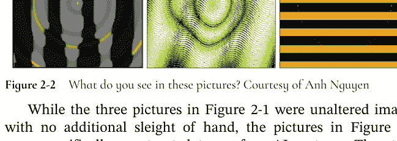

图2-2 这些图片中你看到了什么？鸣谢 Anh Nguyen

虽然图2-1中的三张图片是未经修改、没有额外手法处理的图像，但图2-2中的图片是专门构造来迷惑AI系统的。引人注目的是，一个在ImageNet甚至更广泛的图像分类上表现相当不错的特定模型非常确信——精确地说，有99.92%的信心——第一张图片中的圆环代表一只企鹅。

这是因为AI系统在训练阶段会抓住图像的颜色、形状和纹理，并利用这种虚假相关性来识别图像。

我们可以直观地看到这一点。例如，具有黑色垂直条纹和灰色同心圆的图像被分类为企鹅，也许是因为企鹅倾向于有黑灰色外套。

当我们去除颜色或修改图像的纹理时，AI系统往往会感到困惑。例如，研究人员在常规图像上训练神经网络，并在玻璃工艺品照片上测试它们。玻璃工艺品不具有常规图像中编码的颜色或纹理信息，因此分类起来困难得多，最先进的AI系统在面对这一任务时举步维艰。研究人员在常规彩色图像上训练AI系统，但在没有颜色或纹理线索的玻璃工艺品上测试它们。他们发现AI系统在识别玻璃工艺品方面表现不佳。例如，图2-3中所示的纵帆船模型被识别为开罐器。

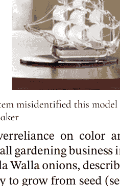

图2-3 AI系统将这艘纵帆船模型误识别为开罐器。鸣谢 Nicholas Baker

AI系统对颜色和形状的过度依赖具有现实世界的影响。加拿大一家小型园艺企业在Facebook上发布了其Walla Walla洋葱，描述它们为“甜、温和且大”，并且易于从种子种植（见图2-4）。Facebook的算法错误地将此帖子标记为性暗示，后来才承认失误并恢复了帖子。Facebook加拿大通讯主管告诉CBC新闻，Facebook使用自动化来识别裸露内容，但“有时候它分不清Walla Walla洋葱和……你懂的。”这很容易被当作失误一笑置之，但被标记的账户对小型企业有严重后果。它们可能因在信息流中被降权或被封禁而损失数千美元。即使恢复，也需要时间让算法重新开始推广该账户的内容。

像Facebook一样，博客平台Tumblr也使用AI检测色情内容，像Facebook一样，AI系统也犯了错误（见图2-4）。2018年，Tumblr决定不再在其平台上托管成人内容时也面临类似问题。困惑的Tumblr用户在Twitter上使用#toosexyfortumblr标签展示他们看似平常的图像被标记的情况。

AI系统大规模识别有问题的内容可以帮助人工审核员优先处理棘手内容，并可能减轻反复观看令人不安的内容带来的创伤。但正如我们所见，AI系统因其特质而容易出错，例如在识别图像时抓住颜色。部署AI系统进行内容审核的公司——Facebook、Tumblr、Instagram和Twitter——都承认其系统容易出错，必须不断努力改进它们。

1964年，美国最高法院大法官波特·斯图尔特著名地写道，他无法描述什么是淫秽，但“我看到时就知道”。50多年后，AI系统仍在将洋葱误认为……你懂的。

### 翻译失败

2017年8月4日，科技杂志*Verge*报道称，“Facebook的翻译现在完全由AI驱动。”Facebook通过采用机器学习大幅改进了其翻译系统。每天45亿次Facebook Translate翻译完全由神经网络驱动。宣布这一向完全算法自动化过渡的Facebook博文以乐观的语调结束：“我们将继续推动神经机器翻译技术的边界，目标是为Facebook上的每个人提供类人翻译。”

而像人类一样，这些翻译并不完美，正如2017年10月4日巴勒斯坦比塔尔定居点的一名建筑工人所发现的那样。靠在一台推土机旁，平衡着一杯咖啡和一支香烟，一名微笑的巴勒斯坦男子在Facebook上用阿拉伯语发布了“Good Morning”。不久，他就被以色列西岸警察以“煽动嫌疑”逮捕，依据是他的Facebook帖子。为什么？以色列警察部队中的某人使用了Facebook的翻译系统将阿拉伯语帖子翻译成希伯来语，错误地将其译为“hurt them”。当同一阿拉伯语帖子被翻译成英语时，Facebook将其错误翻译为“attack them”。Facebook的翻译系统未能可靠地

在一段时间内，如果你在谷歌的搜索引擎中搜索“烂编剧”，第一个出现的图片将是*《权力的游戏》*的创作者（见图 2-5）。这要感谢 Reddit 用户，他们对 HBO 改编自乔治·R·R·马丁的*《冰与火之歌》*系列丛书的电视剧的最后一季感到极度失望。正如其“互联网首页”的口号所言，Reddit 用户发布的帖子可能会被其他用户点赞。一位 Reddit 用户发起了一个题为“烂编剧。点赞这个帖子，让它成为你谷歌搜索‘烂编剧’时的第一个结果”的讨论帖，并附上了一张该剧编剧大卫·贝尼奥夫和 D.B.·韦斯的照片。该帖子获得了大量关注——超过 51,000 名用户为其点赞。由于 Reddit 是全球访问量排名前 20 的网站，它极大地促成了谷歌搜索引擎（暂时的）决定，将该图片与关键词“烂编剧”一同编入索引。

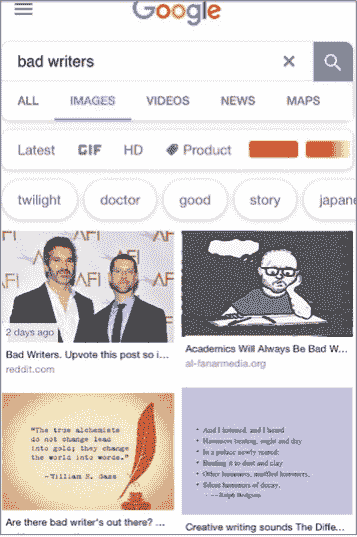

**图 2-5** 来自 Reddit 的失望粉丝们进行了一次短暂的“谷歌炸弹”，使“烂编剧”与*《权力的游戏》*电视剧编剧的照片关联起来。

来源：Reddit/bmcc9n

发现在谷歌返回的前 20 个结果中，有 13 个是伪装成水管工的虚假商家。在线广告专家估计，谷歌地图上随时都可能存在 1100 万个虚假地点。虽然酒店和餐馆不太可能是虚假的，但*《华尔街日报》*发现，水管工、电工、拖车和汽车维修服务以及律师事务所更有可能拥有虚假地点。尽管谷歌地图试图核实每一个地点，*《华尔街日报》*报道称，你可以通过雇佣可疑公司来获得自己的虚假列表。他们收费 99 美元…或者 8,599 美元买 100 个。

### 自动驾驶陷阱 001

不假思索，你在图 2-7 中看到了什么数字？

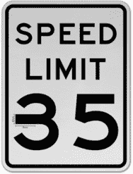

**图 2-7** 速度标志上简单的电工胶带让特斯拉的传感器误将限速识别为 85。

McAfee, LLC

好吧，到这个时候，你已经知道是怎么回事了。一切都不是表面看起来那样。在这种情况下，McAfee 的研究人员使用简单的胶带验证了他们的假设：只需拉长数字 3，就能迷惑特斯拉 Model X（2016）和特斯拉 Model S（2016）中用于从交通标志识别限速的 MobilEye 传感器。虽然他们发现精心放置的贴纸（如 Evtimov 的停车标志攻击）可以欺骗传感器，但一片黑色电工胶带也能做到。通过用胶带延伸数字 3 的中间部分，MobilEye 传感器将标志上的 35 英里/小时误认为 85，导致汽车加速。研究人员指出，当 GPS 标记与张贴标志之间存在差异时，此前的特斯拉车型会默认采用张贴标志，更相信其计算机视觉而不是 GPS 地图。

这个技巧之所以引人注目，是因为与 Evtimov 和博士团队贴在停车标志上的特殊贴纸不同，这只是你在家得宝就能找到的普通电工胶带。任何人都可以做到；不需要计算机科学学位。

自动驾驶的失败案例已成为一个重点研究领域，原因有二：汽车很容易成为被混淆的目标，因为其图像识别系统的输入包括整个周围环境的感官数据。你的 Alexa 只需要在一个 500 平方英尺、周围环境不变的房间里正常工作。你的自动驾驶汽车必须在动态条件下推理——从降雪到海鸥。自然而然，大自然会带来更多的故障模式。

此外，发现自动驾驶汽车的故障会引人关注。从报纸到政策简报，都在向这些攻击致敬，警告我们一个简单的技巧如何能骗过一辆复杂的汽车。这触动了我们内心深处的大卫与歌利亚情结——一个庞大如巨兽的人工智能系统如何被简单的贴纸弄糊涂。人工智能系统大多数时候表现良好，尽管我们已经看到桥梁和阴影等平庸的物体如何令它们困惑。那么，当一个有动机的对手积极试图使系统瘫痪时会发生什么？

破坏自动驾驶汽车的一种方法就是简单地在它周围画一个圆圈。詹姆斯·布里德尔自行搭建了一个神经网络视觉系统并将其安装在他的汽车上。为了展示他自己的计算机视觉系统的局限性，他画了两个同心圆：内圈是实线，外圈是虚线。当他驾驶着他自制的、装有摄像头和机器学习算法的自动驾驶汽车时，他可以驶入圆圈，但无法驶出（见图 2-8）。这是因为汽车将圆圈和车道标记混淆了。虚线是一种道路标记，告诉驾驶人（人类和自动驾驶）可以变道；实线表示不得变道。虽然是从虚线进入，但自动驾驶汽车拒绝从实线驶出，从而将汽车困住。（布里德尔恰如其分地将他的作品命名为“自动驾驶陷阱 001”。）他用盐画了这些圆圈，并称之为“盐圈”，指的是用盐来困住灵魂的异教仪式。

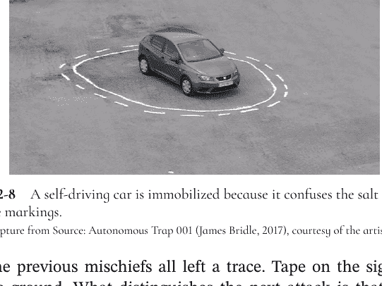

**图 2-8** 一辆自动驾驶汽车因将盐圈误认为车道标记而动弹不得。

截图来源：《自动驾驶陷阱 001》（詹姆斯·布里德尔，2017 年），由艺术家提供

此前的恶作剧都留下了痕迹。标志上的胶带。地上的盐。下一次攻击的不同之处在于它可以完全不被人类察觉。Ben-Gurion 大学的研究人员使用电影投影仪，将一个人体图像短暂地投影到路面上。这个幻影图像只存在了 125 毫秒——短到人类无法察觉，但长到特斯拉的传感器能够捕捉到。投影图像使特斯拉的计算机视觉系统误以为检测到一个行人偏偏走在车正前方。刹车！

研究人员觉得这个攻击很有趣。他们调皮地选择了埃隆·马斯克的图像投影到路上。接下来，他们在树上投影了停车标志，使汽车困惑。然后，他们在路上投影了车道，汽车便偏离了方向。与胶带或食盐技巧不同，幻影不会在现场留下任何证据——一场可以干净脱身的对抗性 AI 犯罪。

但一切并非都是厄运和阴霾。大多数情况下，你在自动驾驶汽车中是安全的。发动此类攻击需要几个条件同时满足。仅仅因为盐圈技巧在布里德尔的神经网络上有效，并不一定意味着它对你的自动驾驶汽车也有效。贴纸攻击附带以下条件：

- 胶带的颜色。（黑色似乎效果好；红色和反光的则不然。）
- 胶带的相对位置。（胶带与标志上数字 3 之间的间隙效果不佳。）
- 传感器观察标志的角度。

所有这些条件都必须满足，攻击才能成功——这很难实现。

此外，特斯拉汽车不再使用 MobilEye 传感器，该系统可以通过调用该地区的地图来补充限速识别。而且，未来版本的 MobilEye 据称将缓解这类攻击。尽管这已是事后，我们可以感到安慰的是，自动驾驶汽车通常能够定期更新软件，修复有缺陷的行为。

我们应该认识到的是，各种类型的自动驾驶汽车都需要预见到有动机的对手的存在，并积极投资以防止对抗性操纵。

### 常见的破坏

2018 年，研究人员发现，仅仅改变图像的色调（颜色）和饱和度（颜色强度），就能将之前在 ImageNet 挑战赛中获胜的一个人工智能系统的准确率从 90% 多降到只有 6%。每次色调和饱和度改变时，同一张鸟的图片被识别为飞机、狗和青蛙（见图 2-9）。（你可以翻到插页看到这张彩色图片。）

在该平台禁止其网站上的色情内容之后，Tumblr 的对抗者凭直觉利用了这一技巧。用户发现，通过将图片染成绿色并加入一张卡通猫头鹰的图片，过滤器就不会将图片识别为色情内容。因为人工智能系统显然是以颜色为线索（如肤色）来识别内容是否色情，它更有可能让绿色身体蒙混过关。

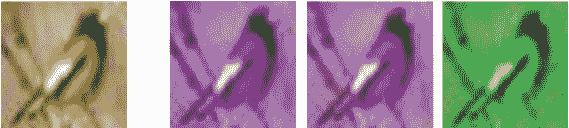

**图 2-9** 改变图像的色调和饱和度也会改变 AI 算法对其的感知。（彩色观看效果最佳。）鸣谢 Hossein Hosseini

*The Mitchells vs. the Machines* 用车前放一只贵宾犬来迷惑 AI 系统的技巧在题为“房间里的大象”的论文中有所解释。约克大学和多伦多大学的研究人员发现，当图像中出现意料之外的内容时，最先进的 AI 系统会在计算机视觉任务中失败。例如，在阳光明媚的后院露台上放一只北极熊会让 AI 系统将其误识别为汽车。当你放置看似格格不入的物体——比如车前的贵宾犬——AI 系统更有可能将其误识别。参见图 2-10。

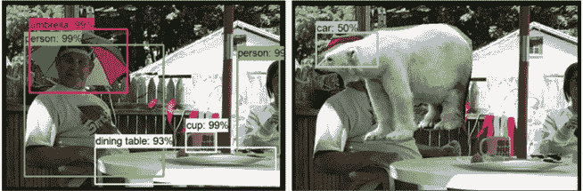

**图 2-10** 方框显示了 AI 算法如何识别物体。当在图片中添加一只随机的北极熊时，AI 系统会感到困惑——并且错误地检测到一辆汽车。鸣谢 Amir Rosenfeld

即使只是裁剪或旋转图像也可能让 AI 系统感到困惑。麻省理工学院的研究人员发现，旋转的图像会完全改变 AI 系统做出的判断。例如，仅仅旋转鸟的图片就会让 AI 系统错误地将其识别为猩猩（见图 2-11）。

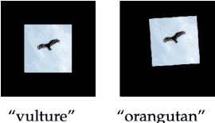

**图 2-11** 仅仅裁剪和旋转图像就会导致 AI 系统误识别图像。鸣谢 Logan Engstrom、Brandon Tran 和 Dimitris Tsipras

*你为什么要在乎？* 你问。

以医学 AI 为例。2018 年，时任 FDA 专员的 Scott Gottlieb 在批准一项 AI 医学诊断早期试验时写道，AI “对医学未来具有巨大前景”。但如果机器学习系统的脆弱性使其易受攻击，这一前景可能岌岌可危。

来自哈佛大学和麻省理工学院的研究人员表明，仅仅旋转病变图像就可能导致 AI 系统改变诊断——而且非常自信。不仅可能导致漏诊癌症，旋转图像还可能将诊断从良性翻转为恶性（见图 2-12）。谁会这么做？保险欺诈。想象一下，一名皮肤科医生以奇怪的角度拿着相机拍照来欺骗保险公司。这让“诊断在医生手中”这句话有了新的含义。

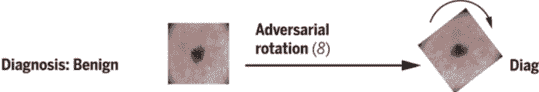

**图 2-12** 攻击最先进的 AI 医疗算法所需的一切就是旋转图像。鸣谢 Samuel G. Finlayson

问题的核心在于机器学习系统使用捷径来学习。它们抓住背景、依赖颜色、转向纹理——并且仅仅是基于线索进行条件反射。

使用捷径本身并不是问题。人也使用捷径。我们用缩写来回忆彩虹的颜色，用同事头发的颜色来记住同事，并用气味来联想记忆。对 AI 拥有超人能力的持续夸大宣传以及 AI 优越性的铺天盖地头条令人厌恶。这种过度信任使我们面临风险——从无用的色情过滤器到无辜者的监禁。

关键在于：攻击者要迷惑一个复杂的机器学习算法，只需识别并破解这些捷径即可。一个业余爱好者可以用装满手机的马车在 Google Maps 上制造交通堵塞，用盐和电工胶带诱捕自动驾驶汽车，并通过把图片涂成绿色来规避色情过滤器。

那么，如果业余爱好者都能做到这一点，熟练的研究人员或有动机的对手又能造成多大损害呢？

## 第三章
## 微妙、具体且无处不在

按任何标准衡量，那次利用精心设计的贴纸排列让自动驾驶汽车中的 AI 系统将停车标志误识别为限速标志的攻击都是臭名昭著的。它曾在伦敦著名的科学博物馆展出，与 Boaty McBoatface 并列——这是一艘由英国公众命名的无人水下航行器。最终，在 Magnuson Park 用于误导支撑自动驾驶汽车的 AI 系统的那块停车标志本身将成为博物馆的永久收藏品。

只有另一次对 AI 系统的攻击同样抓住了 AI 群体的想象力。事实上，如果你阅读有关 AI 系统安全的内容——无论是新闻文章、政策简报，甚至是高深的学术研究——你都无法逃避对其的提及。它已成为对抗性机器学习整个领域的象征，而产生它的工作已成为其他机器学习规避攻击的基础——包括停车标志贴纸攻击。

### 神经网络的迷人特性

题为“神经网络的迷人特性”的研究工作在 2014 年发布于名为 ICLR（常读作“eye-clear”）的著名机器学习会议上时，具备了里程碑论文的所有特征。主要作者 Cristian Szegedy 与 Google 有关联，已确立自己为深度学习巨头，并将帮助 Google 赢得 ImageNet 竞赛。共同作者 Ilya Sutskever 是原获胜团队的一员，该团队已赢得 ImageNet 竞赛并引发了深度学习革命。在其诱人的标题和（字面意义上）获奖作者的声望之间，有一件事是确定的：人们会关注这篇论文。

一直默默无闻的研究生 Ian Goodfellow 也在这些杰出作者名单之中。当 Goodfellow 收到 Google 的实习邀请时，他欣喜若狂。他是受人尊敬的 AI 先驱 Yoshua Bengio 运营的最著名且资源最丰富的实验室之一的研究生。但作为研究生与 Google 实习的无与伦比福利相比相形见绌，其中包括“Googley 额外福利”。除了丰厚的薪水和在数据和计算不受限制即可获得的真实世界问题上工作的机会外，Google 还为实习生提供免费住房、健身房会员、交通和按摩。当然，他们还获得了最著名的福利——免费食物。这不是普通的免费食物。你在想它能有多好？Serious Eats 杂志的一位美食评论员写道：“Google 总部的午餐就像你想的那样疯狂地棒。”评论员参观 Google 众多咖啡馆之一的那天——每家都有自己的主题——午餐包括自制烘焙面包和蜂蜜、羽衣甘蓝配南瓜沙拉、玉米饺子、当地采购的裹坚果的岩鱼，以及被描述为“轻盈且略带咸味，带有一丝枫糖的味道，并用鹰嘴豆粉使其无麸质”的山核桃棒。所有这些免费食物

但在整个实习期间，Goodfellow 真的并不认为 Szegedy 的研究方向很重要。像那些拒绝 Szegedy 观点的批评者一样，Goodfellow 也认为神经网络的失败没有什么新颖或有趣之处。他还认为让分类器混淆的扰动像素问题的解决方案是微不足道的。“我不认为摆脱它会很难，”他告诉我们。他在整个项目工作期间，只是认为自己是在为“大牌”Szegedy“做个顺水人情”。

除了优化 Szegedy 的代码外，Goodfellow 还做出了另一项贡献：将 Szegedy 对这一现象的命名从“有趣的扰动”改为“对抗样本”。这源于博弈论，其中扰动是对手可能用来迷惑模型的最坏情况输入。新名称还产生了一个意想不到的效果。对抗者——能够推翻系统的恶意攻击者——的概念为这种情况增添了一些严肃性。虽然人们可能将“有趣的扰动”视为客厅魔术的陈词滥调，但重新命名带来了急需的庄重和严肃性。*名字里有什么？* 你问。对抗样本这一名称现在定义了整个 AI 系统安全领域。

即使 Szegedy 在 2014 年发表了论文，Goodfellow 对这个想法仍持怀疑态度，但 Google 的免费午餐将再次在推动该领域发展中发挥作用。

到 2014 年，Goodfellow 已从实习生转为 Google Brain 的全职员工。他在研究如何防御对抗样本。他迅速编写了自己的想法，启动了计算机上的实验，然后去咖啡馆吃午餐。当他回来时，他发现实验打破了所有之前的防御记录。声称能抵御对抗样本的最先进技术都土崩瓦解。这一切都发生在他品尝 Google 咖啡馆美味佳肴的时间里。Goodfellow 第一次对该领域真正感到兴奋。他最终发表了包含如今著名的熊猫-长臂猿图片的研究成果。在那篇 2014 年的出版物之后，Goodfellow 接过了接力棒并在对抗

近六年来，这些样本一直在向世界阐明它们是如何微妙、特定且无处不在的。

### 它们无处不在

我们在第二章中看到的恶作剧——旋转图像或改变其颜色——已经足以让最先进的机器学习系统叫苦不迭。但如果说上一章的恶作剧是一把砍刀，那么对抗性样本就是手术刀。

首先要注意的是，对抗性样本是微妙的。在上一章中，我们看到了盐、贴纸或电工胶带如何欺骗机器学习系统。如果有人调查系统出错的原因，这种恶作剧是相当明显的。另一方面，对抗性样本有可能同时欺骗人类和机器学习系统。只审查系统输入的人类看不到任何异常，因此不太可能发现篡改。在关键场景中——比如确定你是否符合贷款条件、进行医学影像判读或自主防御——人类监督极其重要。但如果只检查输入，对抗性样本足够微妙，能够躲避人类监督。

对抗性样本之所以强大，另一个原因是发现它们的方式是特定的、可以自动化的。没有人会手动寻找熊猫照片中哪个像素必须被修改，才能欺骗图像识别系统将其误认为长臂猿。迷惑AI系统的搜索过程正是由训练机器学习模型所用的工具本身引导的。事实上，如果你随机改变像素，AI系统不太可能被迷惑。要使对抗性样本有效，这个过程需要是智能的、有条理的、算法化的——所有这一切都可以自动化。

这种算法引导的自动化搜索可以产生令人信服地欺骗AI系统的结果。对抗性AI服饰是一种特殊的对抗性样本。为了规避人脸识别系统而设计的对抗性样本可以印在日常衣物上：T恤变成对抗性T恤，眼镜变成

你会如何判断这两句话的情感？它们都唤起积极情感吗？还是都是消极的？

根据BERT（Bidirectional Encoder Representations from Transformers 的缩写，即来自Transformer的双向编码器表示）——谷歌2019年用于文本处理的最先进的机器学习系统——第一句话传达的是积极情感，而第二句话传达的是消极情感。对于第二句话，研究人员使用特定算法发现，用“一尘不染”替换“完美”——尽管在人类看来意义相同——却让文本处理系统感到困惑。这与第一章中推特机器人检测器使用的规避手段形成鲜明对比：检测器会在推文中附加随机字符。视觉检查本可以发现推文中的改动，但对抗性样本是隐蔽的，不易通过视觉检查发现。对我们人类来说，这两句话很相似，但对最先进的机器学习系统来说，差别可能天壤之别。

如今，对抗性样本是机器学习领域最热门的领域之一。一项对迄今该领域发表的所有论文的研究发现，Szegedy和Goodfellow的著作是AI安全领域被引用最多的两篇奠基之作。该领域的后续论文后来将2014年——Szegedy和Goodfellow著作发表的那一年——视为对抗性机器学习革命的开端。但和大多数革命一样，针对最坏情况对抗性输入以规避机器学习的基础工作，在近十年前就已奠定。

### 研究学科碰撞

如果你在1987年至2013年间去过不列颠哥伦比亚省惠斯勒的惠斯勒黑梳山滑雪度假村，你可能与一些世界上最负盛名的机器学习研究人员同乘过滑雪缆车。早期的神经信息处理系统（NeurIPS）会议组织者喜欢粉状白雪并不是什么秘密，他们甚至指出：“研讨会日程安排为非正式讨论、滑雪和其他冬季运动留出了时间。”

Goodfellow获得了更为尊崇的地位。他在蒙特利尔的Les Trois Brasseurs酒吧庆祝饮酒一夜之后，独立发现了一项名为*生成对抗网络*（GANs）的基础技术。（该论文感谢了这家酒吧“激发了创造力”。）他在GAN方面的工作如此重要，以至于为他带来了一系列荣誉——*《财富》*的“40位40岁以下精英”和麻省理工学院的“35岁以下创新者”。当他的导师Bengio获得图灵奖——计算机科学界的诺贝尔奖——时，评奖委员会特别强调了Bengio在由Goodfellow主导的生成系统方面的贡献。

由于Goodfellow对GAN和对抗性机器学习都做出了奠基性贡献，至今GAN有时仍被误认为是对抗性机器学习，而实际上这是两个关系松散的不同领域。由于Goodfellow无缝地跨越了这两个领域，并在两者中都取得了摇滚明星般的地位，他的工作变得越来越受欢迎。

基本上，对抗性样本开创性工作的作者们成为了AI界的名人。再加上对AI的炽热兴趣，来自机器学习分支的作者们比来自安全领域的作者们获得了更多关注。

但这并不是像牛顿与莱布尼茨那样相互争斗、争论谁先发现的案例。Biggio告诉我们，只需与Goodfellow进行简单的电子邮件通信，就能证明他们先前的工作。然后*瞧*，问题就解决了。没有大惊小怪。没有混乱。没有戏剧性。事实上，Biggio很感激Szegedy的论文获得了更多关注。这意味着更多人关注对抗性机器学习领域，更多人研究如何保障其安全性。

如今，Biggio在AI领域同样受到赞誉。他在对抗性机器学习方面的工作因其在过去十年对该领域的塑造，获得了2022年国际机器学习大会最高荣誉“时间检验奖”。

由Biggio、Szegedy和Goodfellow引入的对抗性样本，代表了对抗性机器学习中研究最深入的领域之一。

### 都怪加拿大

在每个领域，总有一些简单的问题没有直接答案。鳗鱼在哪里交配？荷马是谁？为什么自行车能保持直立？质数多久出现一次？

对于AI安全研究人员来说，那个问题是：“为什么存在对抗性机器学习样本？”

答案不计其数；我们*有点*知道，但*有点*不知道。

第一个要点是，机器学习模型中的对抗性样本更像是一种“特性”而非“缺陷”。研究人员已经证明，机器学习模型相当偷懒地学习一些概念，而这些概念只是它们所学标签或概念的脆弱指标。这种行为并非仅存在于某些AI系统应用中的边界情况。相反，对抗性样本是AI系统的默认属性。为什么？事实证明，AI的构建模块为被轻易欺骗创造了条件。

根源在于一个被误解的观点，即机器学习系统以某种方式“学习”如何完成任务。Goodfellow将许多机器学习系统比作波将金村——虚假的建筑。从远处看，它们令人印象深刻，但往往经不起细看。当向机器学习模型呈现与其训练数据完全不一致的数据时，模型构建的质量就会显现出来。例如，如果你构建了一个用于区分苹果和梨的机器学习系统，却让该系统识别橘子，那是不允许的。如果机器学习系统的训练集只包含红苹果，要求系统识别，比如说，一个青苹果，也是不允许的！即使是红苹果，如果你的机器学习系统只见过苹果的正面视图，要求系统从俯视角度识别水果也会导致系统出错。训练数据的微小偏差可能导致模型行为的巨大偏差。换句话说，当你从精心整理的数据的宽阔街道，徘徊到数据充满细微差别和边界情况的小巷时，幻象被驱散，而波将金村那临时拼凑的纸板支撑结构是

暴露出来。任何机器学习系统中都充斥着这些“角落案例”，而对手只需要找到它们。

对于任何机器学习学生来说，一个必经阶段是构建一个能够识别手写数字的模型，例如可用于读取信封上的邮政编码——或者说，银行支票上的数字。美国国家标准与技术研究院（NIST）为此提供了一个方便的数据集，称为“修改版”NIST或MNIST数据集。它收集了20世纪90年代末来自两类书写量很大的人群的手写数字的小型灰度图像：高中生和美国人口普查局雇员。MNIST中包含60,000张28x28像素的灰度图像，每个数字0到9大约有6,000张图像。

识别各种手写风格的数字对机器学习系统来说已经是一项相对容易的任务。例如，弗吉尼亚大学的研究人员表明，一个机器学习系统平均能在10,000次中正确识别9,979个数字（错误率为0.21%）。MNIST现在基本上被视为一个玩具数据集。

即使对于如此准确的系统，你也可以轻松生成对抗样本：它们在你我看来像数字5，但在机器学习系统看来却像数字1（见图3-3）。想象一下，有人递给你一张5美元的支票，但在人工智能系统眼中，它实际上只值1美元。

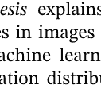

图3.3 这张图在人类看来是数字5，但在机器学习系统看来是数字1。

流形假说解释了这一有趣现象：图像中的微小变化如何使人工智能的感知产生巨大差异。在机器学习的术语中，流形有点像加拿大的人口分布。加拿大就是美国和加拿大。这为对手提供了一个可乘之机。

为了混淆分类器，对手只需要将一张5的图像移到边界的另一侧，在那里所有图像都被识别为1！例如，图3-4中显示的两张图像在人类看来可能都像5，但对于在MNIST数据上训练的深度学习模型来说，左边的是5，右边的则是1。

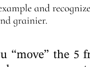

图3.4 左边的图像未经修改，被识别为5。右边的是对抗样本，被识别为1。如果你眯着眼看，可能会发现它有点模糊且颗粒感更强。

但你如何将5从边界的一侧“移动”到另一侧呢？对手生成一种特定的类噪声模式，并将其添加到原始的5字形图像上。由此产生的更粗糙、更具微妙扰动的图像（图3-5中最右边的图像）在人类看来仍然是数字5，但会因为附加的对抗模式而被分类为1。得到的图像就是“对抗样本”，因为我们添加的细微而特定的对抗噪声模式将5推向了1的区域。它不是任意噪声，而是非常特定的噪声，对应于穿越边界的最短路径。将特定的“对抗噪声”添加到原始图像中，会微妙地改变原始图像，但会彻底改变预测结果。

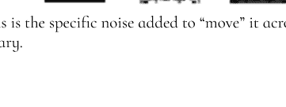

图3.5 这是为了将其“移动”到决策边界另一侧而添加的特定噪声。

同样的概念在任何地方都适用。

- 想要迷惑AI驱动的X射线系统，让恶性扫描被误认为良性（见图3-6）？添加对抗噪声。
- 想要迷惑AI驱动的音频转录服务，将“现在几点了？”误转录为“取消会议”？添加对抗噪声。

对抗样本存在于所有机器学习模型中。

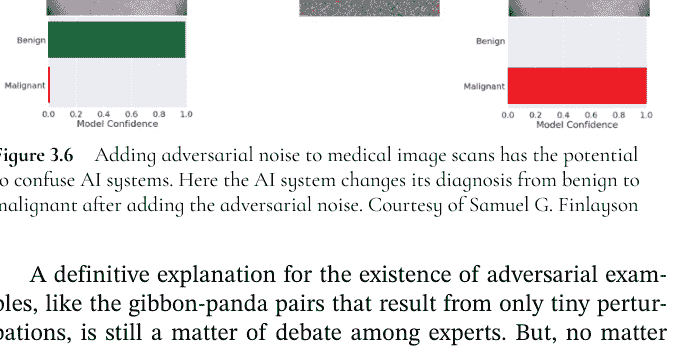

图3.6 向医学影像扫描中添加对抗噪声有可能迷惑AI系统。此处，AI系统在添加对抗噪声后将诊断从良性改为恶性。图片由Samuel G. Finlayson提供。

关于对抗样本存在的确切解释，例如仅由微小扰动导致的长臂猿-熊猫对，在专家中仍存在争议。但无论你支持哪种理论，一个关键问题是：对手是如何发现精确的像素模式来制定攻击的？

事实证明，有一个简单的方法。同样的方法也被用来教会机器学习系统变得更加智能。

### 智能的微调摆动

奈尔斯：氛围必须绝对完美。
弗雷泽：说得好。我们先从灯光开始。
奈尔斯：暖和点。[弗雷泽把开关稍微向右转。]
奈尔斯：再暖和点。[弗雷泽把旋钮再向右转。]
奈尔斯：稍微凉一点。[弗雷泽把旋钮向左转。]
奈尔斯：再暖和一点。[弗雷泽又把旋钮向右转。]
奈尔斯：往回一点。[弗雷泽放弃去倒酒，而奈尔斯仍专注于灯光，继续说话。]
奈尔斯：不，不，往另一边一点。不，再暖和一点。完美。

> —— 《欢乐一家亲》，第4季，第4集

机器学习系统由三部分组成：输入数据、输出标签，以及中间的参数。参数就像人工智能系统的旋钮和操纵杆，它们以特定的方式被调节，使得输入被映射到正确的输出。

假设你想训练一个能够区分苹果和梨的机器学习系统。首先，你会收集成百上千张苹果和梨的图像，然后为每张图像提供标签。你会将这些数据按对排列，这样每张图像都有一个对应的标签。例如，使用（图像-标签）对，我们可以整理苹果的图片并标注为“苹果”，整理梨的图片并标注为“梨”。机器的学习任务就是拟合模型参数，使其能够为每张输入图像重现正确的输出标签。许多现代机器学习系统依赖于一种叫做梯度下降的算法来将参数调整到恰到好处，从而实现目标。

在训练之前，参数并不能很好地定义一个表示数据的模型。当输入一张苹果的训练图像时，参数最初可能被设置为输出“梨”。因为我们已经在图像上标注了正确的标签“苹果”，所以我们可以衡量答案中的误差。这就是梯度下降发挥作用的地方。误差梯度就像金发姑娘喊出的“太热了！”一样，提示模型参数稍微调整其设置，使模型现在能输出“苹果”。

误差梯度与在淋浴时找到合适的水温设置非常相似。我们都在肌肉记忆中有一个理想的淋浴水温，它是热水和冷水的完美混合。现在想象你在一个陌生的浴室里试着找到那个组合。首先，你可能会把旋钮向右转（太烫！），然后向左转（太冷！）；几分钟后，经过几十次微调摆动，你找到了最适合你的温度。这就是使用梯度下降训练模型时发生的情况：误差梯度调整参数，增大或减小它们，直到大部分标注图像都被正确分类。

事实证明，梯度下降在训练机器学习系统时给研究人员提供指导，同时也是攻击者找到逃避系统的对抗样本的方法。但有一个重要的区别：攻击者不是使用误差梯度信号（“太烫了！”）来调整模型参数，而是使用误差信号来调整输入图像。

当攻击机器学习系统时，对手首先选择想要达到的输出，例如将苹果图像混淆为梨。对手让机器学习模型的参数保持在完美调优的状态。在没有修改的情况下，模型会将苹果图像正确标注为“苹果”。对对手而言，这实际上是一个错误！“太烫了！”误差梯度不变地流过这些旋钮和操纵杆（即机器学习模型参数），到达输入图像，并精确地建议如何修改像素的颜色和强度，以到达对手“恰到好处”的目标，使得机器学习系统能将其称为梨。

本质上，通过使用梯度下降，攻击者可以问机器学习模型：“我该如何改变这张苹果图像，让你这个机器学习模型把它标成梨？”攻击者可以不断微调摆动输入，直到得到恰好的输出。

哈佛法学院的科技律师巨星肯德拉·阿尔伯特（Kendra Albert），是研究法律影响的最早学者之一。

关于对抗性机器学习。阿尔伯特将对抗性机器学习比作纸牌游戏*钓鱼*。游戏规则是这样的：一名玩家向对手要一张牌，如果对手有这张牌，对手必须把它（或它们）交出来，或者告诉玩家从牌堆里“钓鱼”再拿一张。通过留意对手给出的回答，玩家可以逐步得知对手手中有什么牌。类似地，攻击者可以查询机器学习模型，以确定模型对攻击者构建的图像会如何响应。通过留意机器学习模型的回答，攻击者可以调整自己的策略——这与*钓鱼*游戏相似。

此刻，你可能会想：这些成为训练替代模型所需的输入输出对。替代模型可以是任意类型，但为了方便，攻击者会选择对基于梯度的白盒攻击最有效的那一种。训练该模型需要时间和计算资源。这已经构成了一次*模型窃取*攻击。

但攻击者还会更进一步。手头有了替代模型，攻击者现在就处于白盒环境下。由于替代模型由攻击者自己设计，攻击者知道模型类型和模型参数，并可以使用梯度下降技术自由地生成对抗样本。现在，攻击者已经拥有了能欺骗其窃取的副本——即替代模型——的对抗样本。

有趣的是，发起这些对抗性攻击的工具并没有被锁在秘密保险库里。它们对任何人都是可用的。这是一件好事，因为如果对手利用这些工具，防御者就知道该寻找什么。从 IBM 的 Adversarial Robustness Toolkit 到 Microsoft 的 Counterfit 再到 Baidu 的 PaddlePaddle，用于规避机器学习系统的工具已司空见惯。使用这些工具不需要博士学位或数学背景；只要具备基本的计算机理解即可。确实存在学习曲线，但它绝对没有从零开始自行设计攻击那么困难。

黑盒攻击机器学习系统的难度正变得越来越容易。你可以用不到一个大披萨的价格，制作一个大部分时间都能像原版一样工作的仿冒模型。

这种独特的组合——高影响力——微妙、具体且无处不在——以及低进入门槛，无论在成本还是技能方面，都可能令人担忧。但这对你，读者来说，不必担心。

好消息是，使用对抗样本的对手不太可能针对普通大众。为什么对手要费尽心思掌握机器学习，了解对抗机器学习的门道，生成贴纸，然后把它们贴在停车标志上希望导致汽车失灵呢？与其这样，攻击者为什么不直接租一个广告牌并闪烁一个让行标志呢？

实际上，你的 AI 驱动汽车更可能在没有任何对手干预的情况下失灵：恶劣天气、一群海鸥，甚至路边停放的一辆卡车。2021 年，涉及其 AI 驱动 Autopilot 系统的特斯拉事故报告有 273 起。虽然我们不知道这些事故的确切原因，但我们可以有根据地猜测，其中没有一起是由停车标志上的对抗性贴纸造成的。

同样，也不必担心智能音箱、Siri 或 Alexa 被音频对抗样本欺骗。这些攻击相当挑剔，在现实世界中很难实施，因为有背景噪音。欺骗你的智能音箱也有良性的方式。例如，说“Cocaine noodles”会触发 Google Home 扬声器，因为它听起来像“Okay, Google。”

这些操纵带来的变化可能产生深远的后果。在空军协会 2021 年空、天与网络大会上谈及机器学习生命周期中可能受对手影响的环节时，负责情报、监视、侦察和网络效应的副参谋长 Mary O’Brien 中将说，“如果我们的对手在该过程的任何部分注入不确定性，那么我们想要 AI 为我们做的事情就基本无从谈起了。”

这就是对抗样本的关键问题。那是一张大熊猫的照片还是长臂猿？它可以注入不确定性并动摇我们对 AI 系统的信任。如果被武器化，它就可以成为挫败对手 AI 系统的决定性优势。

但对抗样本远不是腐蚀 AI 系统的唯一方式。还有一种更易获取且影响更大的方式。

在一条 Twitter 评论中，一位发帖者提到 Frank 在 TikTok 上的最新视频，该视频现已走红。“这可能有些牵强，但考虑到时间点、视频的病毒式传播以及用户的粉丝人口统计数据...”值得注意的是，Frank 的 TikTok 视频包含了标签 #prolific。

Prolific 是一个供科学家招募调查参与者的市场。被从牛津到斯坦福的研究人员使用，Prolific 帮助学者从其全球超过 150,000 名参与者的池中收集高质量回复。作为对受访者时间的回报，Prolific 以每小时 6.50 美元的价格补偿他们。

Frank 关于副业热门技巧的 TikTok 视频中建议注册 Prolific 并填写调查问卷以赚取额外收入。随着超过 400 万次观看涌入，该视频因非常特定的群体而走红。大量青少年和年轻成年女性——Frank 的目标受众——涌向 Prolific 填写调查问卷，导致平台在数天内新增 30,000 名注册用户。它变得如此受欢迎，以至于许多人通过口碑推荐涌向该平台——2021 年 7 月 24 日的 Google 搜索活动显示，“prolific surveys”一词的搜索量出现积极上升。

注册人数激增，主要来自青少年和二十多岁的女性，扭曲了精心设计的调查问卷的预期人口统计。如果研究人员不注意谁会被期望回答他们的调查，他们的研究就会被女性突然激增所污染——这是一种非预期的捕获偏差。Prolific 的联合创始人兼 CTO Phelim Bradley 告诉 The Verge，这条病毒式 TikTok 视频扰乱了 4,600 项研究。Prolific 后来为受视频严重影响的研究退款，并部署了工具来处理这类激增情况。

正如一个青少年凭借 56 秒的视频就能通过腐蚀其研究中使用的数据来扰乱数千项科学研究一样，一个有动机的对手也可以通过腐蚀用于训练其模型的数据来扰乱最先进的 AI 系统。此外，由于这些 AI 系统背后大部分数据都可自由从互联网获取，使用开放数据用于关键 AI 系统的安全性影响是什么？

### 数据不良 = 大问题

组织最担心对 AI 系统的头号攻击并不是针对交通标志的贴纸攻击。

这正是我们在与使用机器学习的多个组织交谈时发现的：从初创公司到全球的财富 500 强公司再到政府。这是同类中的首次调查，我们吸纳了 AI 工程师和安全分析师，以从行业角度全面了解对抗性机器学习的状态。

我们发现，组织最担心的问题压倒性的是中毒攻击。这些攻击故意向 ML 系统投喂不良数据，以改变模型从构思开始的行为。其他研究人员的一项后续研究证实，在对 139 家组织的调查中，中毒是首要关注的问题，尤其在 IT 安全等对手猖獗的领域更为明显。

但即使没有主动的对手，投喂不良数据也会对 AI 系统造成相当大的损害并导致业务损失。例如，考虑 Unity，这款流行的游戏软件为 Pokémon Go、Call of Duty 等视频游戏提供动力，并驱动了超过一半的移动游戏。Unity 在各方面大力投资机器学习以改善游戏体验。但在 2022 年 5 月，它遭受了超过 1 亿美元的损失，部分原因是其其中一个 AI 系统摄入了“来自大型客户的不良数据”。

关键问题在于，一旦模型在数据上训练完成，命运就已注定。发现你的输入数据已损坏并想修复你的模型？今天，唯一可行的选择是从头开始——重新训练模型。这需要大量资源：昂贵的计算资源以及开发人员的时间和精力，远离创建新功能。事实上，Unity 的 CEO 告诉投资者，“由于重新优先安排团队工作以彻底解决弹性问题和数据训练问题，我们推迟了某些创收功能的发布。” Unity 在随后的季度修复了该问题。

数据质量管理问题进一步因对手试图主动向系统注入不良数据而变得复杂。

中毒攻击以微软的 Tay Twitter 机器人抓住了科技界的想象力，该机器人因互联网喷子通过与之互动污染其输入数据而在发布 24 小时内被停用。Tay 已成为中毒攻击的教科书案例——研究人员将其作为警示故事，说明对手如何通过注入不良数据来操纵最先进的 ML 系统。

在你深入本章之前快速提醒一下：在对抗性机器学习中，对手是指违反 ML 系统所建立假设的任何人。对手并不总是指戴兜帽的黑客，也不总是需要博士学位。它可能是一个想要欺骗广告追踪器或为了证明某点而欺骗公共组织的人。

### 你的 AI 由幽灵工人驱动

你可能认为构建实际的机器学习算法是开发机器学习系统最困难的部分。这在很大程度上是由于其宣传方式：“先进”、“智能”以及“由数学驱动”。

然而，对大多数组织而言，创建 AI 系统最困难的部分是将数据以正确的格式送到算法门口进行处理。良好的机器学习性能的关键是好的数据。有一个常见的说法“数据是新的石油”。但在数据上致富远不止于在西德克萨斯草原找到合适的钻探地点。找到可以一再利用的数据来源只是挑战的一部分。为了为你关心的应用提供燃料，数据还必须经过提炼。工程师必须采取许多步骤才能使数据处于正确的格式。数据需要被收集，然后清理、标注并正确格式化，以便算法可以摄入。

每个数据源和随后的精炼过程都会在产品开发中引入复杂性。事实上，来自 ML 工程师的

那些标注数据集的人，使得模型传播了原始标签中所包含的粗鄙谩骂。

ImageNet 曾点燃人工智能革命，并被视为质量的典范，但最终因一连串问题而跌落神坛：标签不当、图片不雅、许可不清。一度有超过 60 万张图片——占其数据库的一半——被剔除。

现实是，幽灵工人持续标注数据集，支撑着整个人工智能框架。这些错误标注的数据集会严重妨碍领导层的决策，如果用于金融、医疗或国防等关键领域，可能带来灾难性后果。试想一个计算机视觉系统因为错误标注而将宣礼塔误认为导弹，并将其作为攻击目标。

机器学习研究者已经开始思考，能否让机器学习摆脱对数据集标注这项繁重工作的依赖。如果人工标注数据已经如此昂贵且错误百出，为什么不教机器从无标注数据集中学习，并彻底将人从整个流程中移除呢？特斯拉就采纳了这一理念，解雇了数百名数据标注员，转而使用自动标注软件。

但事实证明，这个提议的解决方案很像试图斩杀九头蛇——砍掉一个头，就会在原处长出两个头。

### 你的 AI 靠吸血鬼小说驱动

自然语言处理（NLP）是机器学习的一个分支，专门训练算法理解口语或书面语言。例如，当你问 Alexa：“最近的沃尔玛在哪里？”你的设备首先需要理解这是一个问题。接着，它必须明白沃尔玛是一家零售店，“哪里”和“附近”指的是距离。然后，Alexa 必须将这些信息综合起来，计算从你所在位置到各家沃尔玛商店的距离，并选出最近的一家。

在 NLP 中，即使只针对英语这种单一语言，对完整文本语料进行标注也几乎是不可能的。例如，“We saw her duck”可能指看到一位女士养的宠物水禽，也可能指看到某人低下头。语言充满细微差别和上下文语境，无法客观地为每个句子打上标签。因此，在没有像 ImageNet 为计算机视觉提供的那种带标注文本语料的情况下，NLP 研究者不得不另辟蹊径。

NLP 研究者转而利用*无监督学习*的进展来重新解决这个问题。在这种 AI 范式中，机器学习系统不需要海量的标注数据。相反，研究者首先使用大量*未标注*数据来“预训练”系统，使其熟悉语言的基本概念。有了这一基础，通用预训练模型就可以随后针对特定定制任务进行微调，例如电影评论评分、理解互联网搜索查询，或者计算到最近的沃尔玛的距离。

微调是人类经常使用的一种捷径。想象你想要一把特定颜色的椅子。一种选择是买木材、买所需工具、自己做好椅子，然后漆成你想要的颜色。另一种选择是从宜家买一把白色椅子，然后给它上漆。第二种方式就是预训练/微调机制。本质上，研究者基于海量未标注数据构建一个通用任务；你只需要针对手头任务对它进行定制。

那么，哪里能找到大量未标注文本呢？当然是互联网。

仅英文文章就有近 600 万篇，维基百科是世界上最大的开放百科全书，包含 20 GB 压缩的开放领域知识，可供研究者喂养给饥渴的算法进行预训练。你可以访问 `dumps.wikimedia.org`，下载当时完整的维基百科，无需任何手续。维基百科不仅免费，而且质量相对较高。与困扰 ImageNet 的劣质标注不同，一支纪律严明的维基编辑大军保证了输入 NLP 算法的数据质量和一致性。

另一个额外优势是，同一篇维基百科文章经常被翻译成多种语言——例如，关于耶稣基督的文章已被翻译成 253 种语言——这也帮助机器学习算法学习语言翻译任务。

在线图书也提供了丰富的来源。在 BookCorpus 数据集中，研究者从名为 Smashwords.com 的网站下载了数千本书——从爱情中篇小说到青少年小说，再到吸血鬼故事，无所不包。

谁能想到，人工智能的部分动力竟然来自吸血鬼小说？维基百科上关于 UFO 的文章和在线吸血鬼小说，并不是驱动信息饥渴算法的唯一文本来源。几乎*整个*互联网都被使用了。Common Crawl 是一家非营利组织，定期抓取大片互联网的快照并公开发布。每次抓取都相当于一个冻结在时间中的互联网快照，包含数万亿个 URL，覆盖从 Reddit 帖子到餐厅菜单的一切。这个互联网时间胶囊既可直接用于训练模型，也可间接使用——其他流行的机器学习数据集就是从它之中提炼出来的。这些衍生数据集——名称如 LAION-5B、the Pile 和 CC-100，听起来就像汽车爱好者用来给改装车提升性能的定制零件——是那些强大的聊天机器人、文生图模型和翻译模型的关键成分，它们点燃了公众的想象力。

当然，并非所有机器学习都由开放数据集驱动。在许多领域，开源并非常态。医疗保健机构使用基于电子健康档案训练的机器学习模型，并保持模型私有。银行使用基于用户信用卡交易训练的机器学习模型——这些数据是不公开的。但总体而言，当今大多数尖端模型和引人注目的应用都建立在开源的互联网数据之上。

2018 年，谷歌开发了 BERT，这是一个通用文本处理模型，在理解、文本生成和情感分析等各种语言任务中取得了当时最先进的成果。它引起了所有人的注意，*《纽约时报》*写道：“BERT 的到来标志着人工智能领域的一项重大发展。”

对于这个恶作剧。事实上，源文章的标题是“家长注意——疯传的‘插座挑战’正让孩子们做出不可想象的事！”但这些对 Alexa AI 的系统都无关紧要。它漏掉了 Our Community Now 文章中的所有警告和负面信号，向一个 10 岁孩子给出了一个致命挑战。

在媒体大量关注之后，亚马逊修复了这个错误。Our Community Now 也在文章标题的括号中加上了“显然，千万不要尝试！”但从互联网上机械复述信息的习惯并非亚马逊 Alexa 独有。从某种意义上说，这正是行业标准。

一位 Twitter 用户发布了一张谷歌搜索“癫痫发作了，现在该怎么办？”时出现的问题截图。谷歌在网页顶部的精选摘要中显示了答案，其设计是在常规搜索结果上方提供快速、便捷且可操作的答案。在用手机搜索时，这尤其有用，因为你无需滚动就能找到最相关的信息。在通过智能音箱搜索并希望立即得到答案时，它也同样有用。

关于癫痫问题，谷歌摘取了犹他大学健康栏目一篇题为《癫痫发作期间和之后该怎么做》的文章中的答案。谷歌搜索结果顶部的精选摘要写道：“按住此人或试图阻止其活动。把东西塞进此人的嘴里（这可能导致牙齿或下颌受伤）。癫痫发作期间进行心肺复苏或其他口对口人工呼吸。在患者恢复清醒前给他食物或水。”

但正如医学专业人士会证实的那样，当有人癫痫发作时，这些恰恰是不该做的。谷歌确实呈现了一个相关的医疗网页，但它从标题为“不要做！”的项目符号列表中提取了答案。由于它们运行在同一个底层搜索引擎上，这个问题不仅存在于谷歌搜索，也存在于 Google Assistant 和谷歌智能设备——它们在回应危及生命的问题时，可能会给出危险的答案。

这个问题后来从多个角度得到了解决。犹他大学删除了那个项目符号列表。谷歌也不再为“癫痫发作时该怎么办”的搜索显示精选摘要。

2011年2月1日，当时担任微软搜索企业副总裁的 Harry Shum 在工作结束时，传来消息称 Google 指控微软搜索抄袭 Google 的搜索结果。Google 团队指控称，微软的搜索引擎 Bing  outright 抄袭 Google 的搜索结果。并且在“我们有证据”的时刻，Google 还补充说它拥有微软作弊的不可辩驳的证据。

因这些指控感到羞愧，Shum 下令深入调查此事。需要剥开公关、法律和技术层面的层层漩涡。由于他担任微软搜索引擎领导者的高调职位，Shum 将公司的尴尬视为自己的尴尬。*一场丑闻！* 因此，在 Shum 向其副手发送的众多邮件中，他还给儿子发了邮件，[content]
2011年2月1日，当时担任微软搜索企业副总裁的 Harry Shum 在工作结束时，传来消息称 Google 指控微软搜索抄袭 Google 的搜索结果。微软的搜索引擎 Bing outright 抄袭 Google 的搜索结果，Google 团队指控道。并且在“我们有证据”的时刻，Google 还补充说它拥有微软作弊的不可辩驳的证据。

因这些指控感到羞愧，Shum 下令深入调查此事。需要剥开公关、法律和技术层面的层层漩涡。由于他担任微软搜索引擎领导者的高调职位，Shum 将公司的尴尬视为自己的尴尬。*一场丑闻！* 因此，在 Shum 向其副手发送的众多邮件中，他还给儿子发了邮件，安慰他自己和 Bing 是正确的。

接下来发生的事情堪称戏剧性。微软坚决否认该指控。Google 否认了否认。从 *华尔街日报* 到 BBC，故事被刊登在媒体上，甚至出现在深夜电视节目主持人 Jimmy Fallon 和 Stephen Colbert 的独白中。

当微软于 2009 年将搜索业务 rebranded 为 Bing 以利用价值十亿美元的广告搜索市场时，它已经落后于时代。Google 以 60% 的市场份额主导市场，雅虎搜索以 20% 的份额稳居第二。微软名列第三，但其搜索业务开始获得关注并快速增长。

Google 作为竞争对手，一直在关注 Bing Search。在一次比较分析中，Google 发现有时 Bing 的顶级结果会与其自身镜像。Google 搜索工程师怀疑 Bing 和 Internet Explorer 的工具栏中发生了某种阴险的事情。因此，在 2010 年 10 月，Google 对微软的 Bing 发起了前所未有的诱捕行动。

直到那时，Google 从未故意将搜索词与特定网站关联。搜索列表是算法决定的，Google 采取的是不干预的方法。但当工程师怀疑微软抄袭其搜索结果时，Google 的领导层决定仅此一次打破其铁律。

将垃圾邮件作为非垃圾邮件。因为 Gmail 过滤器部分通过用户提供的标签学习垃圾邮件/非垃圾邮件——无论是合法账户还是虚假账户——垃圾邮件发送者都会训练过滤器为他们自己的垃圾邮件活动做好准备。

第二个收获：投毒攻击赋予对手潜伏的能力。在某些情况下，这对消费者是有益的。记住，我们用对手一词指代任何违反系统底层假设的人。例如，一个相关的技巧可用于帮助用户逃避在线广告机构的监视。由康奈尔科技教授 Helen Nissenbaum 提出的概念称为混淆，该技巧涉及“故意添加模糊、令人困惑或误导性的信息以干扰监视和数据收集”。

记得拨打客服热线时听到的录音消息“通话可能被录音以用于质量和培训目的”吗？在冲浪互联网时，每项活动都被记录并用于跟踪你的活动以提供更好的广告。对手可以劫持这一反馈路径进行投毒。这些广告跟踪算法不仅仅是烦恼；它是被许可的监视。

Mozilla 利用这种跟踪活动帮助客户在互联网中隐藏其活动。本质上，Mozilla 通过污染数据为其客户投毒广告跟踪算法。它构建了一个名为 Track THIS 的系统，你可以选择在互联网上表现为社交媒体影响者、末日准备者、一个对独家鞋子和街头服饰感兴趣的“hypebeast”，或是一个“filthy rich”的人。例如，当用户以“filthy rich”人设冲浪时，该工具会在你的网络浏览器中打开 100 个标签，迎合富人：像 YSL（奢侈服装）、Lancome（奢侈化妆品）、Rolex（奢侈手表）、Hakkasan（高端餐厅）和 Piaget（奢侈汽车）这样的网站。就是这样，你的广告瞬间被定制为真正的高 roller 生活——在广告跟踪器适应你中产阶级互联网冲浪行为之前的一段时间内，你可以享受为超级富豪准备的广告！

通过投毒进行的混淆已被在其他地方重复使用。想骗 Facebook 的算法认为你情绪平衡吗？每当你“点赞”一篇帖子时，网页浏览器扩展 GoRando 会随机选择帖子的情绪。担心隐私问题，当应用程序要求访问你手机通讯录中的联系人时？一个名为 Fake Contacts 2 的工具会 literally 在你的手机中创建数百个带假号码和假姓名的假联系人。类似地，为了逃避 Instagram 的窥探，一群青少年曾使用共享账户生成群体行为，从而隐藏特定个人的行为。但混淆的效果不会持续很久。就像魔药 Felix Felicis 的效果是暂时的，混淆的效果也是暂时的，因为现代机器学习系统会不断学习并从不同地方聚合信号。

这里的第三个教训是，投毒机器学习系统并不需要太多，无论是人数还是数据点。暂时投毒广告跟踪系统只需要一个人——你。仅有 20 人点击链接不到 2 周，Bing 就纳入了“诱饵”结果。将此与乌克兰对抗俄罗斯的 40 万名网络军志愿者相比，他们的人数是其物理军队人数的 2:1。乌克兰信息保护服务副主管 Victor Zhora 表示，网络军正在“尽一切可能保护我们在网络空间的土地、我们的网络，并让侵略者（俄罗斯）因其行为感到不舒服。”或者考虑由《纽约时报》的 Nicole Perlroth 报道的由 5 万人组成的中国网络军，构成“在中国的国家安全部的指示下在前沿公司和大学工作的精英卫星承包商网络”。任何网络军都可以轻松发起投毒人工智能系统的活动，这可能意味着其灭亡。

投毒人工智能系统所需的数据量也很低。研究人员发现，通过污染仅占数据集大小 0.1% 的示例，就能操纵在被投毒数据集上训练的机器学习模型。整个系统表现出类似的易受攻击性。来自大约 20 名 Google 工程师的那些“诱饵”词的强烈信号足以混淆整个 Bing 系统。Genius 只需破坏 100 首歌词就能抓住 Google 对其数据的依赖。

这种低人力投入和低样本数量的结合特别适合“诱捕”行动。2010 年，俄罗斯杀毒软件公司卡巴斯基公开抱怨竞争对手复制了他们在众包杀毒网站 VirusTotal 上发布的成果。为了说明这一点，卡巴斯基工程师上传了 20 个良性文件但将其标记为恶意。在不到 2 周的时间里，这些文件至少被同一网站上的另外 14 家安全公司标记为恶意。众包网站是投毒的脆弱向量，几乎不需要努力，只需几个示例。

今天，对抗机器学习研究人员已将投毒所需的样本数量推向极致：仅用一个数据点就破坏整个人工智能系统。斯坦福研究人员的一项惊人实验表明，即使在训练期间的单个数据点也可能对整个机器学习系统产生不利影响。在狗与鱼图像分类器中，在训练数据集中投毒一张狗图像并将其标记为鱼，最终导致分类器将其他狗图像误判为鱼（见图 4-2）。

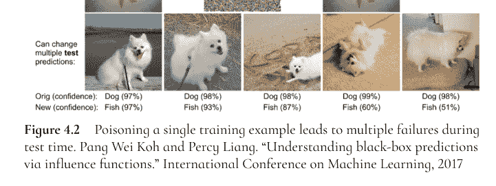

图 4.2 投毒单个训练示例导致测试期间出现多次失败。Pang Wei Koh 和 Percy Liang。“通过影响函数理解黑盒预测。”国际机器学习会议，2017 年

有趣的是，这项研究的作者使用对抗示例破坏了狗的训练图像。事实证明，这两种攻击之间存在密切联系。

### 越爬越高，摔得越重

阿丽娜·奥普雷亚很可能就是人工智能欺骗领域的领军人物。她早年展现出卓越的迹象——在臭名昭著的困难的罗马尼亚全国数学奥林匹克竞赛中获得领奖台名次、卡内基梅隆大学博士学位，并入选 MIT 35 Under 35——奥普雷亚目前是东北大学的教授。在那里，她和她的实验室坐落在波士顿建筑学会称之为该市最美丽建筑之一的建筑内，系统性地推动针对人工智能系统的投毒攻击的边界。

有些人工智能系统是否比其他系统更容易受到投毒攻击？为了解答这个问题，奥普雷亚与 Battista Biggio 合作，后者是我们之前看到的对抗性机器学习早期的先驱。一起，他们的实验室阐明了哪些算法容易受到投毒和对抗样本的攻击。这是同类中的首项工作，将这两种对人工智能系统的重要攻击结合在了一起。

首先，他们表明，正如对抗样本会迁移一样，投毒攻击也会在不同机器学习模型类型之间迁移。从理论上讲，这意味着如果攻击者发现了对 Alexa 使用的对话算法有效的投毒手段，那么 Google Assistant 很可能也会被其投毒，即使它使用完全不同的机器学习架构来识别语音。漏洞延伸到多个平台。也许不存在“防投毒”的机器学习。攻击者可能能够在不同模型之间重复使用恶意数据点——这是一个非常强大的攻击者优势！

其次，奥普雷亚和 Biggio 的联合工作还指出了另一种非直观的现象。他们发现，算法越复杂，就越容易受到投毒和对抗样本的攻击。这就是机器学习版的谚语，“The higher you are, the harder you fall。”脆弱的数据供应链加剧了人工智能系统的部署复杂性。因此，许多组织都警告不要不必要地开发人工智能。谈论的更多是复杂性和期望而非投毒，Google 在其机器学习工程师风格指南中写道：“Rule #1: Don’t be afraid to launch a product without machine learning. Machine learning is cool, but it requires data. Theoretically, you can take data from a different problem and then tweak the model for a new product, but this will likely underperform basic heuristics. If you think machine learning will give you a 100 percent boost, then a heuristic will get you 50 percent of the way there。”换句话说，不要低估简单的人类智慧在解决复杂问题中的作用。

是的，对抗样本往往是最有趣的——谁不想看到最先进的自动驾驶汽车在停车标志上贴上贴纸时手忙脚乱呢？但投毒攻击令人警惕——这就是让高管们夜不能寐的原因。投毒攻击直击人工智能系统的要害：直指数据来源本身。

## 第五章
## 你能保守秘密吗？

这是 2019 年知名播客主持人 Lex Fridman 与特斯拉 CEO Elon Musk 对话的摘录：

> Lex Fridman: Recently, there are a few hackers who tricked the autopilot to act in unexpected ways—adversarial examples. So, we all know that neural network systems are very sensitive to minor disturbances to these adversarial examples on input. Do you think it's possible to defend against something like this?
> Elon Musk: So, yeah.
> Lex Fridman: ... for long for the industry?
> (Elon Musk heard laughing)
> Lex Fridman: Can you elaborate on the confidence behind that answer?
> Elon Musk: Well, you know, a neural net is just like a bunch of matrix math. You have to be like a very sophisticated somebody who really has neural nets and like basically reverse engineer how the matrix is being built and then create a little thing that's just exactly what causes the matrix math to be slightly off.

机器学习工程师无法强迫模型 to *unlearn* 一个后门或投毒漏洞。从本质上讲，人工智能的 bug 无法被修补。

更糟糕的是，人工智能防御者必须担心人工智能漏洞的 *universality*。在传统网络安全中，攻击者通常针对过时且未修补软件中的特定漏洞。由于软件更新，某个软件版本中存在的某些漏洞在应用补丁后可能不再被利用。但是，由于第三章中提到的 *transferability* 属性，即针对模型 A 的对抗样本也非常可能对模型 B 有效，人工智能防御者无法躲在特定的实现或模型版本后面。相关模型 *share* 漏洞！因此，在对抗性不对称加剧的情况下，攻击者甚至不需要猜测你的机器学习模型版本。因此，赔率对防御者不利，尤其是在人工智能方面。

防御者如何修复这种信息不对称？一种策略始于长达十年的痴迷——将人工智能系统保密：企业研究人员试图模糊模型的细节，甚至将整个人工智能系统保密。这可能是基于善意假设，并善意地解读 Musk 当他说你首先需要访问神经网络时所暗示的。企业研究人员认为锁定系统的各个方面是让对手蒙在鼓里、防止易受攻击的办法。

但情况恰恰相反。正如本章将看到的那样，推翻人工智能系统所需的时间并未减少。保持隐秘不是一种可靠的策略，原因很简单：就像自然界一样，对手总会找到办法。

### 掩蔽很重要

回想一下，攻击者在对抗样本中的目标是提供一个精心构造的输入给机器学习模型，这个输入可能不会让人类感到困惑，但肯定会让机器学习系统感到困惑，从而给出错误输出。这里的典型例子是攻击者如何改变熊猫图像中的像素，使其对我们来说仍然看起来像熊猫，但最先进的机器学习系统会将其误识别为长臂猿。

虽然对抗性规避攻击会影响机器学习模型的完整性，但其他攻击仍可能影响模型或数据的保密性。如第三章简要讨论的那样，*model stealing*（或 *model extraction*）攻击被攻击者用来窃取模型的功能。这种攻击背后的想法很简单——用输入提示模型，用新收集的训练集记录输出，并创建一个旨在完全模仿受害者模型的模型。

存在更复杂的攻击，它们使用训练好的模型作为代理来攻击其训练数据的保密性。怎么做到？因为模型在某种程度上是其训练数据的总结，针对模型的攻击可以被设计成实际上攻击其训练集。*model inversion* 攻击试图通过观察模型输出的特性来近似重建私有训练数据（例如个人面部的图像）。*membership inference* 攻击旨在通过观察模型对其训练集中样本相对于其他样本的相对置信度来推断私有数据的属性。

这些强大的黑盒攻击利用了训练并部署的机器学习模型的特性，即使它早已与训练集分离。黑盒攻击究竟是如何可能的？

当提供一张图像时，大多数现实世界的机器学习系统会输出两条信息——图像的决策（panda or gibbon）和机器学习系统对其决策的相应置信度。假设你向熊猫/长臂猿分类器发送一张未被篡改的熊猫图像进行识别。我们可以期望机器学习系统给出类似决策（“panda”）和置信度（“100%”）的答案。

在黑盒规避威胁场景中，攻击者利用机器学习系统的方式与合法用户使用系统的方式非常相似——向机器学习系统发送图像并观察置信度分数。攻击者的第一次尝试可能还不会欺骗分类器。（图像可能仍然被识别为熊猫，置信度为“panda—99.8 percent confident; gibbon—0.2 percent confident”）。但这次尝试为攻击者提供了关键信息。

操纵技术肯定也在飞速发展，对吧？不幸的是，并非如此。MIT教授、著名对抗性机器学习专家Aleksander Madry在他的讲义中指出，攻击与防御的交替更迭仍然是一种“小作坊式产业”，并补充说，“这些防御手段一次又一次地被攻破，而且往往速度极快。”

Carlini的出众之处不仅在于他能攻破机器学习系统，更在于他以一种毫不掩饰的“潇洒自如”（sprezzatura）的方式做到这一点。“我感觉人们大大高估了攻破已发表防御的难度，”Carlini在一次现场演示攻破一项针对对抗性机器学习的最先进防御后总结道。在一篇攻破另一种防御的已发表论文中，他将其标题定为“AMI（攻击遇见可解释性）对对抗样本具有鲁棒性吗？”，并在摘要中用一句话概括了他的发现：“没有。”

但在2018年，有一个开创性时刻让这一点变得无比清晰。许多机器学习研究人员在日历上标注了2018年1月29日，因为届时著名的会议——国际学习表征会议（简称ICLR，发音为“eye-clear”）——将公布他们的论文是否被选中在该会议上展示。四年前，正是这个会议宣布了Szegedy及其合作者发现的对抗样本的存在。能在此会议上展示无疑会巩固一个人作为真正机器学习研究者的资历。当2018年1月29日公告发布时，毫不意外地，其中包括来自顶尖大学——斯坦福、伯克利、卡内基梅隆大学等——关于对抗样本的防御研究。

但就在公告发布三天后，Anish Athalye与Carlini和Wagner合作，建立了一个网站，展示了在这个享有盛誉的ICLR会议上刚刚宣布的九项防御中的七项是如何被攻破的。

问题不在于防御不完美——这是意料之中的，因为“大自然总会找到出路”——而是这个问题*不断*发生。首先，在2017年，Papernot在研究可迁移性和黑盒攻击时，展示了一系列使用梯度掩蔽的防御被攻破。接着，在2018年，Athalye和Carlini攻破了九项防御中的七项。然后，在2020年，差不多整整两年后，Carlini再次攻破了13项防御。

你可能会认为研究人员在2017年就该吸取教训了，但看到这个问题在2018年再次抬头，然后在2020年又一次出现，几乎让你停下来质问：这个领域只是在原地打转吗？为机器学习系统构建防御到底难在哪里？

### 仅靠掩蔽是不够的

作为对抗性机器学习领域的元老之一，Battista Biggio对Carlini 2018年ICLR会议攻破防御事件的消息传出并不太惊讶。他后来告诉《连线》杂志：“机器学习社区缺乏评估安全性的方法论。”

连接2017年至2020年这些事件的共同罪魁祸首是什么？梯度掩蔽。防御者一直试图天真地混淆梯度信息，对对手保密，但这些方法最终都被证明不足以构成牢不可破的防御。

例如，如前所述，研究人员尝试使用不包含置信度信息的硬标签，希望使对手难以通过梯度下降构造对抗样本。然而，像Papernot和Carlini这样的研究人员表明，对手只需与系统交互即可重建梯度。怎么做？本质上，对手首先利用目标模型的响应构建一个替代机器学习模型。这个替代模型由攻击者控制，同时输出标签和置信度。然后，攻击者可以利用最简单、最有效的白盒攻击，生成对抗样本，使其作用于替代模型。接着，凭借可迁移性，对手可以利用这些样本绕过受害模型。

留言板成员迅速给这个帖子点赞。有人逆向工程并分享了做法，让其他人也能如法炮制的消息很快开始传播到其他专注于计算机取证、网络安全和阴谋论的留言板。秘密已经泄露了。

我们用“他们”来指代AsuharietYgvar，因为我们对这个人了解不多——他们是谁，来自哪里，甚至AsuharietYgvar是否是他们的真名。AsuharietYgvar确实告诉*《注册》*杂志，他们只是“一个普通的关心此事的公民。”

在此之前，我们只听到苹果单方面宣称NeuralHash是稳健的，但由于整个系统对公众保密，我们无法验证苹果的说法。但当AsuharietYgvar对NeuralHash模型进行逆向工程并将其公之于众进行测试时，测试突然间变得大众化。你不必是世界知名的密码学家，也不必是苹果钦定小圈子的一员。现在任何人都可以给NeuralHash挑刺，评估苹果的说法。

而且他们确实挑了刺。AsuharietYgvar表明，NeuralHash只需通过裁剪图像并旋转就能被欺骗。实际来说，这意味着恶意分子可以裁剪一张儿童色情图片，而NeuralHash将无法将其与CSAM数据库中的图像匹配。我们在第2章已经看到——简单的裁剪或旋转图像行为如何干扰用于检测皮肤癌的AI系统；同样的现象似乎也适用于苹果的NeuralHash系统。

接下来，英特尔实验室的研究员Cory Cornelius又给了重重一击。在AsuharietYgvar发布逆向工程步骤的当天内，Cornelius证明一张狗的照片和一张静态灰色背景的图像具有完全相同的NeuralHash指纹。这进一步质疑了苹果关于NeuralHash效力的说法。

苹果试图将损害降到最低，称被逆向工程的NeuralHash算法是一个通用机器学习模型，并非最终版本。苹果还指出，人工审查流程可以尝试捕捉NeuralHash中的这类失败。但为时已晚。看到NeuralHash的真实性受到质疑，担忧的声音达到了高潮。尽管这项功能曾高调宣布，苹果还是悄悄删除了所有关于CSAM扫描的引用，并将其发布推迟到“未来”。

这些事件提出了一个根本性问题：如果那些抱着“因为有可能”的态度且假定意图良好的研究人员都能复制一个复杂系统，那么那些怀有恶意意图的人会做出什么呢？

### 隐匿式安全的好处有限

本章的一个重要教训是网络安全中一条反复出现的格言：“隐匿式安全”最终带来的好处微乎其微。对手如同大自然，总会找到办法。

更广泛地说，将AI模型像肯德基的秘制香料一样锁起来，可能无法提供你所认为的保密性或安全性。如果你的AI系统具有内在的经济、政治或社会价值，那么你可以假设你的AI系统最终会被攻击。

我们在谈论针对AI系统的攻击时，常听到的一种说法是“模型仅供内部使用”，外部人员无法与之交互。我们自己攻击AI系统的经验表明，这一假设是错误的——根本不存在所谓的“仅供内部”。如果你的产品中有AI系统，你可以放心地假设，无论你赋予它何种保护，它都可能被攻破。一个推论是：对手也是你系统的用户。

以青岛市抚顺路5号的于先生为例，他订购了2年期的诺顿安全杀毒软件、2年期的赛门铁克端点杀毒软件、2年期的卡巴斯基，最后还有2年期的迈克菲。一个人订购这么多杀毒产品本身就是一个危险信号。然后是订单的规模。于先生不只是为1台电脑下单；他为30台电脑下了订单。还有一个可疑的事实：抚顺路5号对应着一家酒店的前台。

世界很快就会了解到，这份情报根本站不住脚。前任国务卿科林·鲍威尔后来称他在联合国为美国入侵伊拉克辩护的讲话是其记录上的“污点”。

轻描淡写地说，美国发动战争的理由源于可疑的证据；这是一场价值2万亿美元的失误。国家安全专家普遍认为鲍威尔2003年的事件对美国在联合国的信誉造成了不可挽回的打击。这就是用错误情报试图说服世界时发生的事情。

9/11袭击是美国整合关于其对手情报方式的转折点。在那之前，政府的每个部门都收集自己的情报：中央情报局负责监视美国境外的对手；联邦调查局负责监视美国境内的对手。海军则监视经由海上而来的对手。问题在于，负责机场安全的联邦航空管理局（FAA）维护的禁止飞行名单并未根据中央情报局、联邦调查局、海军或其他机构收集的情报进行更新。

独立的9/11委员会发现，“责任和问责是分散的”。如果把美国政府比作一支打（美式）橄榄球的队伍，委员会补充说，没有“四分卫”来协调其他球员。

为了解决这个问题，美国政府成立了国家情报总监办公室（简称ODNI），该办公室基本上帮助协调来自约17个机构收集的情报，并为决策者汇编规范的“全貌”。由于需要整合所有这些数据片段并在它们之间建立联系，ODNI自然转向了机器学习。

美国政府收集信息的速度远远超过情报界的处理能力。从2004年到2005年，未翻译的音频积压量翻了一番。数千小时来自伊拉克的秘密录音情报对话积满了灰尘。当时担任联邦调查局局长的罗伯特·穆勒——他在领导调查唐纳德·特朗普总统的特别检察官时一举成名——作证说，精通阿拉伯语的人才严重不足，

### 这是标志，我的伙伴们
如果你在美国或加拿大，放下这本书，看看你的烤面包机底部、微波炉侧面，或厨房里任何电器。你会发现一个UL贴纸——代表Underwriters Laboratories，一个已有百年历史的独立第三方——证明你的厨房电器不会自燃。

现在，如果你在欧洲，你厨房用品上的标记可能有点不同。除了UL之外，你可能需要寻找CE（代表“conformité européenne”，法语意为“欧洲合格”）。在这里，制造商证明该电器符合一套规则。未能达到这些标准意味着该电器不能在欧盟（EU）交易。电器在哪里制造并不重要；如果缺少CE标志，就不能进口到欧盟。

UL式标志和CE式标记之间存在关键区别。CE认证是在产品的*制造商*符合所有相关性能和安全标准时授予的。然而，UL标签是通过将产品送交第三方测试机构粘贴的，该机构验证产品是否符合UL Solutions设定的标准。

UL或CE之类的标准和认证之所以有效，是因为它们促进了全面的测试。从多次掉落你的烤面包机到用球撞击它，再到借助按华夫饼或吐司划分的颜色图表确定早餐食物烧焦的程度，这些标准是详尽的，甚至苛刻的。

这种“标志”的概念已在传统网络安全中得到复制。例如，通过简单的Google搜索，你可以查阅你喜欢的云服务提供商遵守的不同安全标准。如果你想知道你的路由器通过了哪些安全检查，可以访问制造商的页面。你想知道你的银行移动应用如何保护你的数据安全吗？你也可以查到。如果一个组织遵守网络安全标准，它很可能会大肆宣扬。

因为机器学习系统在缺乏公平和正义感的情况下不公平地伤害了部分人群。用于训练系统的數據可能低估了某些群体，这种社会偏见随后反映在模型的性能中。由Joy Buolamwini、Timnit Gebru和Deborah Raji领导的一项里程碑研究表明，亚马逊、微软和IBM构建的商业面部识别系统 consistently 误识别有色人种。结果呢？多年来，美国使用面部识别证据做出了错误的逮捕。所有这些都是对黑人的错误逮捕，因为人工智能系统错误识别了他们。地方政府开始禁止使用该技术，亚马逊停止向执法部门销售这些工具，而微软最近完全停止销售面部分析工具。

因此，AIA希望减轻人工智能中的社会偏见是自然的。但同样，事情并非如此简单，因为偏见与安全以非直观的方式相互作用。请考虑第3章中的对抗攻击示例，其中精心制作的失真添加到图像中会导致最先进的人工智能系统将熊猫图像误识别为长臂猿。见图6-1。

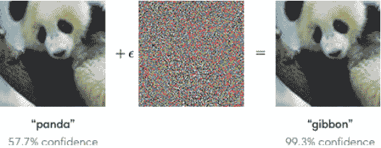

**图6.1** 当对抗性噪声添加到熊猫图像中时，机器学习系统会将其误认为是长臂猿。Courtesy of Ian Goodfellow14

当马里兰大学的研究人员在面部识别系统中使用多样化的面孔重复这种攻击方法时，攻击对面孔的影响并不一致。研究人员表明，微小的扰动改变了黑人女性面孔的标签，但白人男性面孔对该攻击更具鲁棒性

是否希望对一些更“脆弱”的数据点提供额外的保护层？

不充分的可解释性技术解决方案解决了我们探索中第四个问题的答案的一部分：为什么很难将这些推动措施付诸实践？答案是，没有免费的午餐。有越来越多的证据表明，其中一些属性彼此冲突。“Robust or Fair”是其中一篇详细说明这种权衡的研究论文的标题。你可以拥有可解释的人工智能系统或鲁棒的人工智能系统，但很可能两者兼得。你可以拥有在任务上准确的机器学习系统或对对抗样本鲁棒的系统，但不一定两者兼得。因此，你可以拥有对停车标志上贴纸具有鲁棒性的人工智能系统，但这可能会以降低识别行人的准确性为代价。如果我们仅依赖人工智能系统，这些就是我们可能被迫做出的权衡。

但标准与实践之间的差距仍然是鸿沟，还有其他原因。

### 你衡量什么就得到什么！
在我们将欧盟人工智能系统草案框架作为桌面演练应用的经验中——迄今为止最成熟的要求——我们遇到了几个障碍。拟议的欧盟框架中的检查清单项目之一包括这个问题：“您是否评估了人工智能系统可能容易受到的潜在攻击形式？”

这个问题对政策制定者来说似乎足够直接，但对机器学习工程师来说却过于模糊而无用。这就像要求房主“验证你的住宅防盗”。住宅是指田纳西州的联排别墅、公园大道上的顶层公寓，还是科罗拉多州的木屋？此外，指导方针并未告诉你*如何*使住宅防盗。是否应该测试窗户？在周围安装摄像头？还是安装鳄鱼护城河？选择的世界导致分析瘫痪。

实际上，没有一种简单的测试适用于每个人工智能系统。事实上，人工智能系统内部往往甚至没有单一的机器学习模型！相反，相互作用的机器学习模型网络在背后工作

像经过安全认证的产品差异化和更低的保险费这样的激励措施，可能是朝着正确方向的温和推动。但是，要完全惠及最终用户，全面的监管合规可能仍需要时间成熟。我们是否回到了原点？

我们认为没有。这段旅程让我们变得更加明智，也让我们摆脱了曾经蒙蔽双眼的天真。让我们进一步剖析。

二战期间，盟军占领了偏远的岛屿，将其作为战略军事基地。这些岛上的原住民此前与外部世界几乎没有接触，如今目睹了带着补给品降落的飞机：从笨重的坦克到衣物、药品、罐头食品，应有尽有。这些货物也兼作宝贵的交易商品。当军队招募岛民在岛屿偏远地区担任向导时，军队以货物支付岛民报酬。补给品让岛民们着迷不已，他们很快便将那些携带奇异货物的飞机视为丰饶的象征。但当战争结束时，各国收拾行囊离开了。飞机突然停止了降落，货物也随之停止了流入岛屿。

岛民们因珍贵货物的消失而沮丧不已，想要吸引飞机回来以恢复补给。他们的意图无疑是纯粹的。他们用木头、稻草、棍子和麻绳，模仿曾经给岛屿带来交通往来的塔台和跑道，尽其所能建造出最逼真的仿制品。在瓦努阿图，岛民们每年都向神话中的“约翰·弗鲁姆”祈求让飞机回来。被选中的岛民会穿上美国军装，拿着礼仪枪来回走动，希望飞机会载着货物降落。关于岛民所呼唤名字的一种理论是：二战军人可能在自我介绍时说“来自……的约翰”。

从岛民的角度来看，这些仿制品——木制塔台、稻草跑道和身穿军装——会带来他们梦寐以求的货物。诺贝尔奖得主物理学家理查德·费曼在1974年加州理工学院的毕业演讲中，将这种现象称为“货物崇拜科学”。

那么，解决方案是什么呢？李提出了一个：“必须消除的是人工智能问题上学术研究和政策制定的各自为政状态。”

监管者与构建防御体系的科学家一样，怀有良好的意图：促进对人工智能的信任。但不幸的是，与岛民相似，许多提案似乎都在追逐可能无法带来理想结果的仿制品。为此，我们必须首先接受，我们追求的“ilities”属性——可解释性、可靠性、安全性等——并不是可以独立启用或禁用的孤立特性。相反，它们彼此深度纠缠、相互制约。我们需要消除那种孤立地追求这些属性的学术各自为政状态；相反，我们应该以整体和务实的方式实现这些属性。

真正的问题不是我们是否需要一套带有测试规范和足够执行机制的框架，而是如何开发一套既能激发信任又能促进持续创新的框架。

这是一项值得开启的探索。

真正的重大威胁尚未到来。而在当今人工智能安全水平低下的状态下，重大威胁的早期候选者也可能通过“传统”的安全攻击载体被发起。

### 软件，一路到底

数十辆出租车涌入俄罗斯的菲利区，这是莫斯科繁忙的西部中心街区。攻击者入侵了Yandex出租车——俄罗斯最大的出租车服务——并发送了一条消息，要求所有可用的出租车前往市中心的同一地址。结果：一片混乱和交通拥堵。没有花哨的把戏。没有先进的对抗性机器学习。只是传统的黑客攻击。

然后是内部威胁的案例，即员工窃取人工智能商业机密，特斯拉和苹果的秘密自动驾驶汽车部门都深受其害。在这两起案件中，都是各自公司的工程师离职去了中国自动驾驶汽车初创公司——小鹏汽车，他们的直接竞争对手。尽管苹果以其严格的保密政策而闻名，一名工程师只是通过“AirDrop”将24GB的苹果自动驾驶汽车计划传输到了妻子的笔记本电脑上。在特斯拉的案例中，一名工程师在前往这家中国公司之前，将与自动驾驶技术相关的源代码上传到了自己的iCloud账户。再一次，没有花哨的机器学习攻击来重新创建算法。就是简单的偷窃。

甚至有组织的攻击团伙也加入了战局。NVIDIA和AMD——人工智能硬件制造商——都成为了勒索软件攻击的受害者。在NVIDIA的案例中，攻击者释放了大量信息：从详细的产品计划到原理图再到电路图。半导体分析师迪伦·帕特尔称其为“国家安全灾难”。他提出，这些文件的公开泄露意味着“有了这些数据，多家中国人工智能和GPU公司可以在GPU设计方面大规模起步并迎头赶上。”同样，这是普通的传统网络攻击，而不是花哨的机器学习攻击。

这三个实例很好地提醒我们，机器学习是用软件构建的。人工智能可能看起来像数学和魔法，但人工智能系统——被视为组织皇冠上的明珠、组织为其支付橄榄球大联盟级别高薪来建设的系统——是容易出错的，尤其是在对手手中。

但与我们交谈过的政府立刻明白了这一点。无需说服他们这是一个他们应该关注的新出现的问题。世界各国的政府对此话题有着研究生级别的理解深度，而大多数公司还在小孩桌上吃饭。一个理由是，政府的高水平人工智能系统会引来高水平的攻击者。政府需要为那种情况做好准备。

美国政府的人工智能系统面临的麻烦很可能源于中国。在攻击和保护人工智能系统的研究方面，中国与美国并驾齐驱。在我们的采访中，多位专家反复强调，将人工智能视为一场只有唯一赢家的军备竞赛是没有意义的。

然而，有一件事是确定的：保护其人工智能系统的国家将拥有两个明显的优势。第一，该国可以确保其关键人工智能系统——从国防到医疗——得到适当保护，免受对抗性操纵。此外，作为副产品，该国将收获免受意外故障影响的保护效益。这将使公民更广泛地信任人工智能系统能够按预期工作，从而实现更好的采用。第二，该国在攻击机器学习系统方面也将占据优势，因为针对这些攻击的防御加固工作自然也提供了关于这些系统如何被利用的洞察。

但能够保护自身人工智能系统的国家还将获得第三个优势：在外交上占据先机。乔治城大学安全与新兴技术中心战略总监海伦·托纳是中美人工智能事务的专家，尤其是在人工智能安全方面。2021年，托纳和她的同事指出：“防止人工智能事故甚至可能成为与中国接触的机会，中国面临着与其他人工智能强国相同的事故风险。”

保护自身的人工智能资产，利用对手国家的人工智能资产，并将人工智能安全作为外交工具加以部署。

### 快乐的故事

参议员格伦（1998年）：“你能侵入系统把联邦储备资金转移到某个地方吗？”马奇先生：“几乎一切皆有可能。”

那是一条废弃的机场跑道，气氛紧张而激烈。一辆2009款雪佛兰Impala试图到达跑道的尽头，但它做不到，不是因为不够努力，而是因为另一辆车正并排行驶并积极试图破坏它。但与《速度与激情》电影系列不同，这里没有物理干扰。没有正面冲撞。没有侧面撞击。干扰完全是数字化的。

当时还是华盛顿大学研究生的小野佳（Yoshi Kohno），与来自加州大学圣地亚哥分校的斯特凡·萨维奇（Stefan Savage）在2010年共同领导了首次关于远程黑客攻击汽车意味着什么的探索。

说服世界这是一个威胁是一场艰苦的战斗。当这项研究成果最终在著名的奥克兰安全会议上展示时——正是这个会议让罗斯·安德森开始思考安全经济学——Kohno和他的团队面对的是一群苛刻的听众。正如Papernot未来在尝试发表对抗性机器学习研究时将面临的那样，在座听众高度怀疑。批评者似乎不认为Kohno团队的工作具有相关性。批评者说汽车和计算机安全就像油和水；它们就是无法混合。更糟糕的是，他们不认为这是像密码学那样“纯粹”的安全工作。为什么要花时间在一个尚未出现的攻击载体上？他们的同行指出，没有人会通过接入汽车网络来黑客攻击汽车。这可能是一个威胁，但还不够严峻，不值得探索，批评者纷纷附和。压倒性的态度很明确：让我们专注于眼前的安全需求，优先保护互联网和传统台式机。

但机缘巧合，一群杂牌学术研究人员破解了Impala汽车的消息传到了汽车制造商通用汽车那里。这些研究人员受邀进行展示说明。

当这个学术团队出现在通用汽车时，他们做了所有学者做演示时都会做的事：详细讲解他们的方法论。想象一下白底幻灯片上满是文字。但随后，在演示接近尾声时，研究人员打开了挡风玻璃雨刷器，按响喇叭，播放音乐，并让停在路边的汽车移动起来——而这一切都发生在会议室里。通用汽车震惊了。这是一个真正的威胁。通用汽车以创纪录的速度任命了一位安全副总裁，认真对待汽车黑客问题。后来被视为转折点的是，其他汽车公司也纷纷效仿。

DARPA（美国国防高级研究计划局）是将登月计划等宏大项目付诸实现的先锋，它启动了一项工作，以确保网络物理系统值得信赖。NHTSA（美国国家公路交通安全管理局）负责车辆安全，目前正在调查特斯拉的故障，尽管它曾是质疑科诺工作的怀疑者之一，但它首次为汽车制造商增加了安全指南。

这对每个人来说都是一个圆满的故事。学术研究人员揭示了前所未有的威胁。汽车公司以集体、具体和明确的行动作出回应，美国政府则以投资和监管作出回应，这些共同遏制了这一安全威胁。对这些安全威胁可行性的怀疑是真实存在的，但没有人坐等第一次大规模汽车攻击出现在《纽约时报》头版。没有人坐等集体诉讼的威胁或诱导的威胁。没有人坐等因为汽车安全受到损害而失去生命。没有人是教条主义的否认者。

十年后，曾经对这项工作反应冷淡的奥克兰会议授予了科诺及其整个团队最负盛名的奖项：“时间考验”荣誉。科诺后来成为华盛顿大学的计算机科学教授，并最终指导学生伊万·叶夫季莫夫（Ivan Evtimov）提出了著名的针对自动驾驶汽车的“停车标志”攻击。

道理显而易见：如果我们重视学术研究人员的早期警告，就能在威胁造成广泛破坏之前加以预防。我们可以避免灾难。

### 直入主题（In Medias Res）

> 参议员利伯曼（1998年）：“参议员汤普森提到，有人称你们为新时代计算机领域的摇滚明星。这或许不是你们来此想听到的，但实际上，我认为你们正在履行一种非常良好的公民责任，我对此表示赞赏。希望你们不介意我不称你们为摇滚明星。我更愿意将你们比作蕾切尔·卡逊，她曾就环境污染对环境的影响发出过早期警告；而在国防领域，你们可能是当代的保罗·里维尔，只不过这一次，不是英国人来了。我们不知道来者是谁。”

> MUDGE先生：“没错，你说得对。”

> “愤怒——女神啊，请歌唱佩琉斯之子阿喀琉斯的愤怒，那愤怒毁灭了所有阿开亚人。”

荷马的《伊利亚特》就是这样开篇的。我们从未被告知阿喀琉斯为何愤怒，为何他的怒火带来灾难，也未曾得知阿喀琉斯的暴怒如何毁灭了一切。我们只是被抛入情节的中间，在史诗迅速掠过战场时，努力站稳脚跟。

但当我们读完这15,693行六音步长短短格的诗句时，我们得到了完整的图景。我们看到了阿喀琉斯的全部前史，以及导致那场毁灭性愤怒的事件和之后的事件。荷马将我们抛入诗篇中间时那种混乱的遗弃感，随着叙述展开而逐渐消散，优美地传达了过去、现在和未来。

这种从中间开始的文学技巧被称为“in medias res”，字面意思是“在中间”。一旦你学会识别“in medias res”，你会发现它无处不在，从弥尔顿到漫威电影，从但丁到日间电视连续剧。

“in medias res”作为一种手法之所以重要，还有另一个原因。不仅因为前史引人入胜，还因为未来的故事值得讲述。事实上，我们相信人工智能的未来充满希望和乐观。我们已经指出，确保人工智能系统的安全并不是一个新鲜话题。只要有计算机，就会有漏洞。我们越早了解它们，就有越多的时间准备。

幸运的是，数百名人工智能研究者的思想和目光正在照亮这些系统的局限性，而对手还没来得及向我们指出。这些人工智能研究者就是我们当代的保罗·里维尔和蕾切尔·卡逊，在我们于太多高风险应用中依赖有缺陷的技术之前，指出了迫在眉睫的挑战。他们的良好公民行为为我们提供了宝贵的时间和先见之明，让我们能够纠正方向、进行技术创新，并应对标准、规范和政策，这些共同将帮助我们以“合理的信心”信任这些系统。

为此，我们不做预测，而是以行动号召作为结尾。因为最好的结果需要技术专家、商业领袖、民权活动家、政策专家以及受过教育的消费者的说服力共同贡献，让我们齐心协力，以审慎而迅速的行动确保人工智能系统的安全。随着人工智能的应用渗透到我们生活的方方面面，我们都应有充分的动力。因此，我们必须采取相应的行动。

我们正处于了解人工智能系统攻击方式的“in medias res”之中。几乎可以肯定，由于机器学习系统的普遍性和关键性，针对它们的攻击将会蔓延。曾经被视为异常的情况将变得司空见惯。但眼下，我们幸运地拥有一段平静期来做好准备，以免铁匠铺中的余烬膨胀成一场恶意的全球大火，烧毁我们对人工智能系统的信任。

泰米尔诗人瓦卢瓦尔在公元500年写下了关于智慧的箴言，常被译为：“智者以警觉的灵魂预见迫近的灾祸；免于即将来临的邪恶之可怕冲击。”如果我们愿意清醒认识人工智能的脆弱性，就能减轻“大事件”带来的冲击和惊讶。人工智能的未来故事，是否取决于我们如何明智地利用这段时间，主动积累资源以保护高风险的人工智能系统——

## 附录A

### 宏观问题

10-701是卡内基梅隆大学机器学习课程的注册代码。我选修这门课纯粹是因为我的研究生导师的怂恿，他希望我“超越”计算机安全领域。我记得导师说：“汤姆写了机器学习的教科书，你会从他那里学到东西；给这门课一个机会。”于是，在2011年整个学期中，我每周两天走进总是寒冷的礼堂，与另外50名学生一起，在韦恩楼——CMU最丑陋的粗野主义建筑——聆听机器学习大师汤姆·米切尔的讲课。这门课开启了我长达十年将计算机安全与机器学习结合的痴迷。

在学期结束时，米切尔没有回顾所有讲座，而是分享了他脑海中关于机器学习的五个宏观问题。他的理由是，如果你知道在面对一个新的机器学习算法时该问什么问题，你基本上就能掌握其要点。每当我阅读机器学习领域的里程碑式论文时，这些宏观问题就像维吉尔对我的但丁一样，起到了引导作用。

本着这种精神，海勒姆和我提供了五个问题，我们鼓励企业高管、政策制定者和工程经理向构建和部署机器学习系统的团队提出这些问题。从表面上看，这些问题并不惊天动地。但它们是一个有用的工具，可以开启关于贵组织机器学习系统安全态势的重要对话。

| 要问的问题 | 需要关注什么 |
|---|---|
| 假设系统已被入侵。如果 ML 系统遭到攻击，你如何得知？ | ✓ 组织有专人负责 AI 安全。
✓ 团队已为其软件和数据摄取管道、训练管道、部署管道以及推理系统配备了日志记录和/或攻击检测能力。 |
| 当 ML 系统受到攻击时，我们的响应计划是什么？ | ✓ 当 ML 系统被攻陷时，团队有一套可行的备用方案，其中可能包括人工覆盖控制。 |

## 致谢

套用弥尔顿的话说，这本书的主题令我欣喜，我选择已久，动笔却迟。它是我疫情期间的酸面包，但如果没有这么多人的贡献，它仍不过是未发酵的面粉和水。

与海勒姆合著这本书是我做过的最轻松的决定。狄俄墨得斯说得最好，当他挑选全能的尤利西斯作为探险伙伴时：“两个人在一起时，其中一人可能会看到另一人未曾发现的机会；如果一个人单独行动，他的资源就会减少，智慧也会减弱。”海勒姆是一位无与伦比的对抗性机器学习研究者，能力超群，始终友善。我像狄俄墨得斯一样感激有海勒姆同行，并在此过程中让我变得更加睿智。

大卫·富盖特是文学界传奇般的人物。用我朋友那句不朽的话来说：“你和安迪·威尔怎么可能有同一个经纪人？”我确实不知道。我所知道的是，大卫的超能力是倾听。每当我们遇到问题，大卫都会倾听，深思熟虑地分析情况，进而提供一个从未见过的视角，然后像一个

随后，在众多专家的反馈和对话下，这本书经历了无数次重写和修订，这些专家涵盖人工智能研究者、网络安全专业人士、政策专家和商业领袖：肯德拉·阿尔伯特、罗斯·安德森、马尤兰·阿西穆兰、伊利·巴伊拉克塔里、约翰·班塞默、巴蒂斯塔·比焦、哈罗德·布思、迈尔斯·布伦戴奇、安德鲁·伯特、尼古拉斯·卡利尼、杰森·陈、卡马利卡·乔杜里、玛吉·德拉诺、埃里克·道格拉斯、奥伦·埃齐奥尼、大卫·埃文斯、伊万·埃夫蒂莫夫、凯文·艾克霍尔特、亚当·富克斯、瑞安·费达苏克、厄伦斯·费尔南德斯、内特·菲克、尼克·菲利厄姆、大卫·弗里曼、汤姆·戈尔茨坦、伊恩·古德费洛、凯瑟琳·格罗斯、玛雅·古普塔、丹·亨德里克斯、斯里尼瓦桑·艾耶、安·约翰逊、弗兰克·纳格尔、苏迪普托·拉克希特、吉·科诺、希马·拉卡拉朱、马克·麦戈文、尼古拉斯·帕佩诺特、威尔·皮尔斯、布莱恩·彭德尔顿、乔恩·彭尼、简·皮内利斯、阿斯法内·里戈、米克尔·罗德里格斯、阿比谢克·希瓦库马尔、瓦萨维·桑达拉姆（谢谢你，芝麻！）、保罗·沙尔、布鲁斯·施奈尔、乔治·塞韦里、马特·斯旺、克里斯蒂安·塞格迪、海伦·托纳、弗洛里安·特拉默、克里斯·维索帕尔。这本书站在他们的肩膀上。

我对马克·拉西诺维奇、埃里克·霍维茨和马特·斯旺的指导深怀感激。他们是各自领域的泰斗，每次互动都教导我要保持好奇心，并挑战我自己对世界运作方式的假设。没有他们的善意和慷慨，这本书不可能问世。

我还要感谢 PJ 梅基什、米克尔·罗德里格斯、莎伦·夏、海勒姆·安德森、瑞安·科瓦尔和尼古拉斯·帕佩诺特，他们为我的奥德修斯扮演了风神埃俄罗斯。他们的慷慨真的熠熠生辉。

疫情期间交织在一起的是我自己的*万恶之源*。但要感谢我的兄弟、我的依靠伊姆兰·卡德尔·马斯坦，以及我的*第一步*，我找到了纵身跃入深渊的勇气，结果发现那里是一张羽毛床。

这本书也是对太平洋西北地区的颂歌。它是在仍居住于此的土著人民未经割让的祖地上写成的。当写作灵感以令人羞惭的否定回应我的呼唤时，我在周围的美丽中找到了慰藉、帮助和独处。从阿纳科特斯群岛到高山荒野的湖泊；从斯诺夸尔米山脉到萨默兰草甸；从卢德洛港的日出到穆基尔特奥的日落；从库格山的山坡到艾达技术咖啡馆的扶手椅；从国王调频的“音乐浓缩咖啡”晨间节目到温思罗普的晨跑——这一切都奋力驱散了空白之页的暴政，又俏皮地倾泻出一个措辞浮夸的痴人的风采。我内心是马德拉斯，灵魂是常青。

拉姆·尚卡尔

## 索引

### A

“接受 Cookie”按钮，144–145
主动欺骗，114
对抗样本
  算法与，116–117
  攻击者目标，111
  特征，130
  服装上的，60–61，79–80
  成本，80
  防御挑战，108–111
  检测，130
  发现，60，63，77
  存在与功能，66–70
  影响，80
  军事中的，82
  神经网络与，107–108
数字作为，68–69
过度信任，80
概述，59–62
参数调整，72
应对威胁，113
相关工具，81
对抗机器学习
  内部调整，73
  其中的货物崇拜科学，156–157
  示例，44–45
  法律影响，72–73
  概述，ii，18，20
  安全与机器学习领域，63–64
对抗思维，132
对抗重训练，130–131
对手。另见攻击者
  特征，80，164
  集体，21
  定义，20，59，101，109
  示例，109
  博弈论与，64
  目标，63，81
  心态，132
  类型，88
  关于最坏情况的策略，128
广告，101，102
非裔美国人，监禁，148
阿尔伯特，肯德拉（学者），72–73
Alexa，81，82，91–92，94–95
“火炮版 Alexa”，13
AlexNet，34
算法
  对抗样本与，116–117
  广告，101
  构建，88
  用于计算机视觉，32–33
  数据格式，88–89
  数据集错误与，90–91
  谷歌的，97
  梯度下降，71–72
  k近邻，77–78
  投毒攻击，104–105
  随机森林，77–78
  搜索引擎故障，95–96
  支持向量机，77–78
  漏洞，104
算法剥离，157
算法正义联盟，20

Alpha G AI，3
Amazon Mechanical Turk，89
AMD，169
美国大学入学考试（ACT），77
美国医疗催收机构（AMCA），172
安德森，罗斯（教授），137–138
反恶意软件系统，投毒攻击，148
杀毒软件，订阅，124–125
苹果，119–124，169
阿拉伯语，42–43，126–127
第 52 区，10–12
陆军工程大学（中国），26
人工智能（AI）。另见机器学习（ML）
  阿喀琉斯之踵，25–28
  进步速度，3
  作为军备竞赛，174
  关于“重大问题”，166–169，172–173
  AI 速度下的商业，2–4
  信心，i–ii
  定义，2
  失败原因，29–30
  大加速，ii
  高转换成本，139
  人类理解，9
  文盲，9，164

### F

Facebook，21，40，42–44，89，101–102
人脸识别，20，61，77，149–151
虚假联系人 2，102
费达苏克，瑞安（研究分析师），26
美国联邦航空管理局（FAA），126
俄罗斯联邦安全局（FSB），168
费曼，理查德（物理学家），156
国际足联（FIFA），2
微调，92
逃跑或战斗情境，盲目依赖，5–6
弗卢努瓦，米歇尔（负责政策的国防部副部长），135
ForAllSecure，17
10-K 表格，154
弗兰克，莎拉（网红），85
弗里德曼，莱克斯（播客主播），107–108
全知攻击，76

### G

《权力的游戏》，45
博弈论，64
格布鲁，蒂姆尼特（学者），27，149
性别，相关实验，147–148

通用数据保护条例（GDPR），144–145，154
通用汽车，177
生成对抗网络（GAN），65
Genius，99–100，102
幽灵工人，88–91
眼镜，对抗样本，61，79–80
格伦，约翰（美国参议员），176
全球定位系统（GPS），46–47
Gmail，垃圾邮件，100–101
围棋，3
钓鱼游戏，73
戈德伯格，伊恩（教授），116
古德费洛，伊恩（作者），57–59，62，64，65，108
谷歌
  AI 系统，3
  算法，97
  BERT，93–94
  商业造假，47–48
  版权侵权案，99–100，102
  深度学习研究，76
  员工福利，57–58
  歌词搜索，99–100
  机器学习工程师风格指南，104–105
  抄袭案，97
  搜索失败，95
  文本处理系统，62
谷歌炸弹，46

- 多因素认证（MFA），142–143
- 芒罗，兰德尔（作者），170
- 墨菲定律，164
- 马斯克，埃隆（特斯拉首席执行官），107–108

### N
- 国防授权法案，164
- 国防大学，12–13
- 国家地理空间情报局（NGA），128
- 国家公路交通安全管理局（NHTSA），177
- 国家标准与技术研究院（NIST），67, 144
- 美国国家人工智能安全委员会（NSCAI），14–18, 22–23, 28, 82, 163
- 国家安全委员会，13–14
- 自然语言处理（NLP），91–92
- 导航，8, 46–48
- 神经信息处理系统（NeurIPS），62–63, 137
- 神经网络，57–60, 107–108, 135
- NeuralHash（苹果公司），120–124
- 噪声模式，69, 73–74, 149, 150
- 数字的机器识别，67–69
- nuTonomy，36–37
- 英伟达，154, 169

### O
- 混淆，101, 113
- 奥布赖恩，玛丽（副幕僚长），83
- 进攻性人工智能，17
- 国家情报总监办公室（ODNI），126–129
- 开源情报（OSINT），110
- 开源软件，170, 171
- 奥普雷亚，阿丽娜（教授），104, 148
- 组织结构的失败，165
- Our Community Now，94–95
- 输出，对抗目标相关，72
- 过度信任，6–10, 54, 80, 94–96, 155

### P
- 熊猫/长臂猿图像，56, 59–60, 64, 112–113, 149
- 帕佩尔诺特，尼古拉斯（研究员），75–79, 118, 135
- 机器学习（ML）的参数，71–72
- 珀尔，朱迪亚（图灵奖得主），9
- 便士挑战，94–95
- 五角大楼，11, 12, 13
- 有色人种的面部识别局限，149–150
- 感知与标准，142
- 珀尔罗斯，妮可（记者），102
- 许可行动链接（PAL），175
- 皮内利斯，简（国防部），22–23
- 像素的修改，58, 60
- 抄袭，97–99
- 投毒攻击，22, 87–88, 96–103, 104–105, 148
- 人工智能（AI）政策，iii–iv
- 蓬佩奥，迈克（国务卿），26
- 色情内容的社交媒体标记，40–41, 51
- 波特，斯图尔特（美国最高法院大法官），42
- 鲍威尔，科林（国务卿），126
- 预防导向型管理者，108
- 隐私，119–124
- 前言，16
- Prolific，86
- 晋升导向型管理者，108

### R
- 关于种族的实验，147–148
- 拉吉，黛博拉（学者），27, 149
- 随机森林算法，77–78
- 勒索软件攻击，169
- Recorded Future，125
- 红队，11, 163
- Reddit，45
- 研究调查，85–86
- ResNet，34
- @ResNextGuesser，36
- 里格勒，塔拉（内政部），15
- 风险的实际，128
- 风险管理框架（AI），144
- 机器人助手，4–6
- 罗德里格斯，米克尔（52区），10–11
- 俄罗斯，4, 18, 27, 134
- 俄罗斯国防部，82

### S
- 塞缪尔，阿瑟（人工智能先驱），2
- 饱和度（色彩强度）的变化，51, 52
- 萨维奇，斯蒂芬（学生），176
- ScanEagle，11
- 施密特，埃里克（谷歌首席执行官），12, 14
- 学术能力评估测试（SAT），77
- 学校中的人工智能扫描器，38
- 搜索引擎，45–46, 95, 97–99, 101
- 安全
  - 相关优势，174
  - 对抗机器学习与，63–64
  - 相关对抗心态，132
  - 苹果公司与，119–124
  - 安全意识，164
  - 相关“大问题”，166–169, 172–173
  - 黑盒攻击与，79
  - 反对理由，138
  - 需求，179–180
  - 重要性，136–140
  - 内部的信息不对称，109–110
  - 相关心态，167
  - 隐晦与，124–125
  - 相关准备统计，161–162
  - 相关舆论，173
  - 推诿，140
  - 竞赛，173–176
  - 内部的风险容忍度，153
  - 内部的安全/不安全思维，153
  - 相关标准，141–144
- 安全风险评估，132
- 扣押，95
- 自动驾驶汽车
  - 对抗机器学习相关，18
  - 失效，81
  - 输入，49
  - 内部威胁相关，169
  - 车道线解读，49–50
  - 在军事中的应用，135
  - 误识别，37–38
  - nuTonomy，36–37
  - 过度信任，9–10
  - 投影敏感性，50
  - 安全性，177
  - 速度操纵相关，48–51
  - 天气影响，37
- 沙恩，贾内尔（作者），19
- 共享创作，129
- 破碎梯度，114
- 沈向洋（微软搜索），97
- 辛格尔，阿密特（谷歌搜索），98
- 人工智能与皮肤的应用，2
- 智能音箱，81–82, 89–90, 94–96, 138–139
- 智能系统的对抗样本，61
- Smashwords，93
- 机器学习（ML）中的社会偏见，148–149
- 社交媒体，26
- 软件的挑战，169–171
- 宋晓冬（教授），132
- 苏联，175
- 垃圾信息，63, 100–101
- 语音识别，12
- 限速的操纵，48–51
- 斯夸尔斯，马拉科（开发者），170–171
- 安全标准，141–144, 152–153, 154
- 随机梯度，113–114
- 停车标志，1–2, 29–30, 55
- Stratego，3
- 支持向量机，77–78
- 地对地导弹，19
- 替代模型，78–79, 118
- 监视，134
- 研究调查，85–86
- 苏茨克维，伊尔亚（作者），57, 64
- 转换成本，139
- 叙利亚战争，134
- 系统方法型管理者，108
- 塞格迪，克里斯蒂安（作者），57, 58–59, 62, 64, 77

### T
- Tay（微软），21–22, 88, 110
- 特南鲍姆，约书亚（教授），9
- 特斯拉
  - 涉及的事故，81
  - 数据标注人员，89, 91
  - 夸大宣传，155
  - 内部威胁，169
  - 局限性，37–38
  - 安全评级，155
  - 速度操纵相关，48–51
- 测试，141–144, 145, 151–152
- 文本处理的对抗样本，61–62
- 文本系统的易错性，20–21
- 塞洛克斯，路易斯（纪录片导演），19
- 汤普森，弗雷德（美国参议员），159, 160, 161, 166, 173
- 汤普森，肯（图灵奖得主），170
- 托纳，海伦（乔治城大学），174
- Track THIS，101
- 迁移性，78–79
- 翻译的失败，42–44
- 特朗普，唐纳德（美国总统），16, 25
- 信任，7, 8–9, 23
- Tumblr，40–41, 51
- 推特，21–22, 26, 40–41
- 用于规避人工智能的错别字，21

### U
- 乌克兰/乌克兰战争，4, 18, 102
- 未标注数据，92
- 美国保险商实验室（UL），141
- 非故意失效，19
- 61398部队（中国），168
- Unity，87
- 赫特福德大学，4–6
- 马里兰大学，149–150
- 多伦多大学，32–33
- 无监督学习的进展，92
- 美国空军，19

### V
- 瓦卢瓦尔（诗人），179
- 吸血鬼小说对人工智能的赋能，93–94
- 瓦努阿图，156
- 瓦里安，哈尔（教授），137–138
- 电子游戏，115–118
- VirusTotal，103
- 漏洞，104, 111, 162

### W
- 瓦格纳，戴维（教授），116
- 沃尔德曼，阿里·埃兹拉（作者），164–165
- 沃克，迈克（ForAllSecure），17
- 沃拉沃拉洋葱被Facebook错误标记，40
- 沃森健康，7–8
- 武器，27, 38
- 天气与自动驾驶汽车，37
- 网站
  - deepfakesweb，18
  - Nicolas.Carlini，115
  - 《不是靠漏洞，而是靠贴纸》，iii
  - Smashwords，93
  - 维基百科，92
  - 微信，43–44
- 韦克特，西蒙（导航操纵者），46–47
- 白盒攻击，76, 78, 118
- 智能扰动，71–75
- 维基百科，92–93, 100
- 人工智能（AI）的赢家通吃动态，138–140
- 第二次世界大战，156
- 怀索帕尔，克里斯（黑客），172–173

### X
- 小鹏汽车，169

### Y
- Yandex Taxi（俄罗斯），169

### Z
- 扎伦巴，沃伊切赫“沃伊”（研究员），58
- 泽连斯基，弗拉基米尔（乌克兰总统），18
- 零知识攻击，76–77
- 佐拉，维克多，102

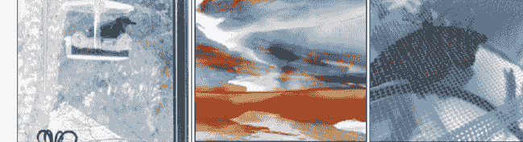

图2.1 无需深思，你在这些图像中看到了什么？如果你猜的是鸟、画和蝴蝶，那么恭喜你！你是100%的人类！
图片由丹·亨德里克斯提供

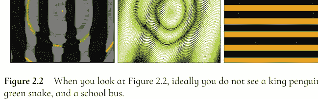

图2.2 当你看着图2.2时，理想情况下你不应该看到一只王企鹅、一条绿蛇和一辆校车。
图片由安·阮提供

鸟
飞机
狗
青蛙

图2.9 改变图像的色调和饱和度可以改变AI算法对它的感知。
图片由侯赛因·侯赛尼提供

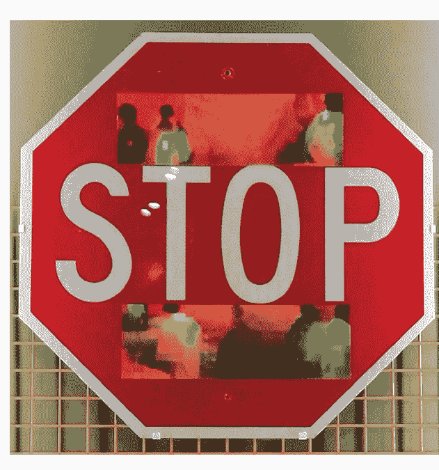

埃夫蒂莫夫制作的带有贴纸的停车标志之一，这些贴纸可以迷惑 AI 视觉，现于伦敦科学博物馆展出。
来源：Twitter/Earlence Fernandes
