# 深度学习用于 NLP 笔记

## 1 免责声明

撰写这些笔记是我学习过程的一部分，因此这是一份正在进行中的工作。为了编写本文档的当前版本，我主要整合了原始2D CNN论文 [16]、斯坦福大学CS231n CNN课程笔记 [1]、Zhang和Wallace关于NLP中CNN的实践指南 [26]、关于文本分类CNN的经典论文 [13, 14]、Denny Britz关于RNN的教程 [2]、Chris Olah关于理解LSTM单元的文章 [3]、以及关于GRU单元的经典论文 [2, 4]、编码器-解码器架构 [2, 24] 和注意力机制 [20, 1]。最后但同样重要的是，Yoav Goldberg关于用于NLP的神经网络的入门指南 [8] 和Luong、Cho以及Manning关于神经机器翻译的教程 [4] 证明非常有价值。

## 2 代码

我用Keras实现了本文档中描述的一些模型，并在IMDB影评数据集上进行了测试。代码可以在我的GitHub上找到：https://github.com/Tixierae/deep_learning_NLP。再次强调，这是一份正在进行中的工作。

## 3 IMDB影评数据集

### 3.1 概述

任务是对来自互联网电影数据库（IMDB）数据集 [5] 的影评进行二分类（正面/负面），这被称为情感分析或观点挖掘。该数据集包含5万条影评，按极性进行标注。数据被划分为50%用于训练，50%用于测试。我在GitHub上的 `imdb_preprocess.py` 脚本清理了影评，并将它们整理成适合传入神经网络的格式：每条评论是一个单词索引（整数）的列表，来自大小为 $V$ 的字典，其中最频繁的单词索引为1。

### 3.2 二分类目标函数

我们的模型将要学习最小化的目标函数是对数损失，也被称为交叉熵。更具体地说，在具有2个类别（假设为0和1）的二分类设置中，对数损失定义为：

$$
\text{logloss} = -\frac{1}{N} \sum_{i=1}^{N} \left( y_i \log p_i + (1-y_i) \log(1-p_i) \right) \quad (1)
$$

其中 $N$ 是观察值的数量，$p_i$ 是分配给类别1的概率，$(1-p_i)$ 是分配给类别0的概率，$y_i$ 是第 $i^{th}$ 个观察值的真实标签（0或1）。你可以看到，只有与每个观察值真实标签相关的项才贡献于整体得分。对于给定的观察值，假设真实标签是1，且模型分配给该类的概率是0.8（相当好的预测），那么对数损失将等于 $-\log(0.8) = 0.22$。如果预测稍差，但并非完全错误，例如 $p_i = 0.6$，对数损失将等于0.51，而对于0.1，对数损失将达到2.3。因此，模型与真相偏离得越远，其受到的惩罚就越大。显然，完美的预测（正确类别的概率为1）得分为零。

## 4 范式转变

### 4.1 特征嵌入

与传统机器学习模型将核心特征及其组合视为特征空间的独立维度不同，深度学习模型通常将核心特征（且仅限核心特征）*嵌入*到低维连续空间中的向量，其中的维度代表共享的潜在概念 [8]。嵌入可以是随机初始化的，也可以是从预训练 [6] 中获得的。然后，它们可以在训练过程中像其他模型参数一样被更新，或者保持静态。

### 4.2 特征嵌入的优势

将特征映射到稠密连续向量的主要优势在于能够捕捉特征之间的相似性，从而实现泛化。例如，如果模型在训练期间从未见过单词“Obama”，但遇到过单词“president”（总统），通过知道这两个单词是相关的，它就能将对于“president”学到的知识转移到涉及“Obama”的情况中。使用传统的独热向量（one-hot vectors），这两个特征将被视为正交的，预测能力无法在它们之间共享 [7]。此外，从巨大的稀疏空间转向稠密且紧凑的空间减少了计算成本和拟合模型所需的数据量，因为需要学习的参数更少。

### 4.3 组合核心特征

与传统机器学习不同，核心特征的组合作为被组合的核心特征向量的*和、平均值或拼接*来编码，而不是特征空间的新维度。求和或求平均值是一种简单的方法，无论训练示例的大小（例如，文档中的单词数量）如何，都能始终获得固定大小的输入向量。然而，这两种方法都完全忽略了特征的顺序。例如，在这种设置下，使用n-gram作为特征，句子“John is quicker than Mary”（约翰比玛丽快）和“Mary is quicker than John”（玛丽比约翰快）具有完全相同的表示。另一方面，使用拼接可以保留顺序，但每个训练示例需要*填充*和*截断* [8]，以确保拼接相同数量的向量。例如，无论其大小如何，集合中的每个文档都可以转换为具有相同的固定长度 $s$：较长的文档被截断为其前（或后、中间...）$s$ 个单词，而较短的文档则用特殊的零向量进行填充，以补齐缺失的单词 [26, 14]

---

[1] http://cs231n.github.io/convolutional-networks/
[2] http://www.wildml.com/2015/09/recurrent-neural-networks-tutorial-part-1-introduction-to-rnns/
[3] http://colah.github.io/posts/2015-08-Understanding-LSTMs/
[4] https://sites.google.com/site/acl16mnt/home
[5] http://ai.stanford.edu/~amaa/data/sentiment/
[6] 在NLP中，通常使用Word2vec或GloVe从非常语料库中获得的预训练词向量。例如，Google News的**word2vec**向量可以从 https://code.google.com/archive/p/word2vec/ 获得，在“Pre-trained word and phrase vectors”（预训练单词和短语向量）部分下
[7] 请注意，独热向量可以作为输入传入神经网络。但随后，网络会在其第一层隐式地学习特征嵌入
[8] https://keras.io/preprocessing/sequence/

## 5 卷积神经网络（CNNs）

### 5.1 局部不变性和组合性

卷积神经网络（CNNs）最初受猫视觉皮层研究 [12] 的启发，在计算机视觉领域被开发出来，用于处理如图像 [16] 等规则网格数据。它们是前馈神经网络，其中每一层的每个神经元都接收来自前一层神经元邻域的输入。这些邻域，即*局部感受野*，使得 CNN 能够以层次化的方式识别越来越复杂的模式，通过将较低层次的初级特征组合成较高层次的特征。这一特性被称为*组合性*。例如，可以从原始像素推断出边缘，边缘反过来可用于检测简单的形状，最后形状可用于识别物体。此外，特征在图像中的绝对位置并不重要。只有捕获它们的相对位置对于组合更高级的模式才有用。因此，模型应能够检测图像中任意位置的特征。这一特性被称为*局部不变性*。组合性和局部不变性是 CNN 的两个核心概念。

CNN 在计算机视觉中取得了很好的性能 [15]，但不难理解，得益于组合性和局部不变性，它们在自然语言处理（NLP）中也能表现优异。确实，在 NLP 中，可以从低阶特征构建高阶特征（*n*-gram），就像在计算机视觉中一样，且局部顺序至关重要（“不太好，挺好的”，“不好，挺坏的”，“不推荐”），但在文档级别则不然。事实上，在试图确定电影评论的情感极性时，我们并不真正关心“不太好，挺好的”出现在文档的开头还是结尾。我们只需要捕获“not”（不）在“bad”（坏/糟糕）之前这一事实，以此类推。需要注意的是，CNN 无法编码长距离依赖关系，因此，对于诸如语言建模等长距离依赖关系至关重要的任务，通常更偏好循环架构，如 LSTM。

### 5.2 卷积和池化

尽管最近的研究表明卷积层可以直接堆叠在一起 [23]，但 CNN 的基本结构是一个*卷积*层后接一个*池化*层。在接下来的部分中，我们将详细说明这两个层如何相互作用，以短文档分类这一 NLP 任务为例（见图 1）。

#### 5.2.1 输入

我们可以将文档表示为实数矩阵 $A \in \mathbb{R}^{s \times d}$，其中 $s$ 是文档长度，$d$ 是词嵌入向量的维度。由于在语料库级别 $s$ 必须固定，但文档的大小不同，我们将较长的文档截断为其前 $s$ 个词，并用特殊的零向量填充较短文档，直到达到所需长度。词向量可以是随机初始化的，也可以是预训练的。在后一种情况下，它们在训练过程中可以更新也可以不更新（“非静态”与“静态”方法 [14]）。

将 $A$ 视为图像可能会产生误导，因为只有一个空间维度。嵌入向量实际上并不是输入本身的一部分，它们只是表示输入元素在共享潜在空间中的坐标。在计算机视觉中，术语*通道*通常用于指代这个*深度*维度（不要将其与网络中隐藏层的数量混淆）。如果我们处理的是图像，我们将拥有两个空间维度，加上深度。输入将是一个维度为（宽度 × 高度 × n_channels）的张量，即一个 2D 矩阵，其中每个条目分别与长度为 3 或 1 的向量相关联，分别对应彩色（RGB）和灰度图像。

#### 5.2.2 卷积层

卷积层是一个线性操作，后接一个非线性变换。该线性操作包括将应用于输入文档的 1D 窗口的每个实例与一个滤波器相乘（逐元素），该滤波器表示为参数矩阵。滤波器，就像窗口一样，只有一个空间维度，但它贯穿整个输入深度（词嵌入空间的 $d$ 个维度）。如果 $h$ 是窗口大小，则与该滤波器关联的参数矩阵 $W$ 属于 $\mathbb{R}^{h \times d}$。$W$ 随机初始化，并在训练过程中学习。

窗口在输入上的实例化被称为区域或感受野。共有 $\lfloor(s-h)/\text{stride}\rfloor+1$ 个，其中 stride（步长）对应于我们在每一步中滑动窗口的词数。当步长为 1 时，因此有 $s-h+1$ 个感受野。因此，对于给定的滤波器，卷积层的输出是一个向量 $o \in \mathbb{R}^{s-h+1}$，其元素计算如下：

$$
o_i = W \cdot A[i:i+h-1,:] \quad (2)
$$

其中 $A[i:i+h-1,:] \in \mathbb{R}^{h \times d}$ 是第 $i^{th}$ 个区域矩阵，$\cdot$ 是一个返回两个矩阵逐行点积之和的运算符。请注意，对于给定的滤波器，无论窗口在文档中的位置如何，相同的 $W$ 都应用于窗口的所有实例化。换句话说，滤波器的参数在感受野之间共享。这正是赋予模型空间不变性特性的原因，因为滤波器被训练用于识别位于任何地方的模式。这也极大地减少了模型的总参数量。

然后，将非线性激活函数 $f$（例如 ReLU (max(0,x)) 或 $\tanh(x)$）逐元素应用于 $o$，返回与滤波器相关的特征图 $c \in \mathbb{R}^{s-h+1}$：

$$
c_i = f(o_i) + b \quad (3)
$$

其中 $b \in \mathbb{R}$ 是可学习的偏置。

对于短句子分类，最佳区域大小通常发现在 1 到 10 之间，在实践中，$n_f$ 个滤波器（其中 $n_f \in [100, 600]$）应用于每个区域，赋予模型为每个区域学习不同互补特征的能力 [26]。由于每个滤波器生成一个特征图，因此每个区域被嵌入到一个 $n_f$ 维空间中。此外，使用围绕最优值变化的区域大小可以提高性能 [26]。在这种情况下，会创建不同的并行分支（每个区域大小一个），并在池化后连接输出，如图 1 所示。随着 $n_f$ 的增加，性能和成本也会增加，直到达到某个点，之后模型开始过拟合。

#### 5.2.3 池化层

输入文档中特征的确切位置并不重要。重要的是某些特征是否存在。例如，要将评论分类为正面，无论“有史以来最好的电影”出现在文档的开头还是结尾并不重要。为了将这种鲁棒性注入模型，采用全局 $k$-max 池化。该方法从每个特征图中提取 $k$ 个最大值并将其连接，从而形成一个大小在训练期间始终保持不变的最终向量。对于短句子分类，[26] 发现 $k=1$ 远远优于高阶策略。他们还报告说，使用最大值比使用平均值要好得多，这是有道理的，因为我们只感兴趣于从每个特征图中提取最显著的（salient）特征。

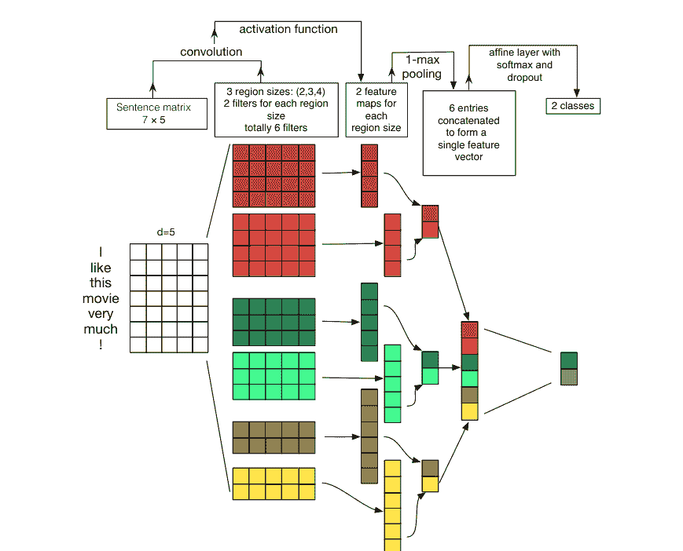

#### 5.2.4 文档编码

如图 1 所示，从高层角度来看，CNN 架构将输入的每个滤波版本连接到最终特征向量中的单个神经元。这个向量可以被视为输入文档的嵌入或编码。它是模型的主要贡献，也是我们要感兴趣的内容。架构的其余部分取决于任务。

#### 5.2.5 Softmax 层

由于这里的目标是分类文档，因此对文档编码应用 softmax 函数以输出类别概率。然而，不同的任务需要不同的架构：例如，确定两个句子是否为释义，需要两个共享权重的 CNN 编码器，以及一个最终的能函数和对比损失（类 Siamese 方法 [3]）；对于翻译或摘要，我们可以使用基于输入文档的 CNN 编码条件的 LSTM 语言模型解码器（类 seq-to-seq 方法 [24]）等等。

回到我们的分类设置，softmax 将向量 $x \in \mathbb{R}^K$ 转换为一个由正浮数组成的向量，其总和为 1，即转换为类别上的*概率分布*

**脚注：**
[^9]: 与 tanh 相比，ReLU 更经济实惠（由负区域的大量零值引起的稀疏性），并且在正区域中更好地对抗梯度消失问题，因为在正区域中梯度是常数，而在 tanh 中梯度变得越来越小。
[^10]: 池化也可以在局部小区域上应用，但对于短文本分类，全局池化效果更佳 [26]。

可预测：

$\operatorname{softmax}(x_i) = \frac{e^{x_i}}{\sum_{j=1}^{K} e^{x_j}}$ (4)

在二分类情况下，我们不必使用带有软最大值函数（softmax）且由两个神经元组成的最终输出层（每个神经元代表两类之一），而是可以使用仅包含一个神经元和 S 型函数（$\sigma(x) = \frac{1}{1 + e^{-x}}$）的输出层。在这种情况下，神经元输出属于这两类中某一类的概率，并基于 $\sigma(x)$ 是大于还是小于 0.5 来决定预测的类别（假设先验概率相等）。这两种方法是等效的。事实上，$\frac{1}{1+e^{-x}} = \frac{e^{x}}{e^{x} + e^{0}}$。因此，单神经元的 S 型层可以被视为双神经元的软最大值层，其中一个神经元从不激活，其输出始终为零。

## 5.3 参数数量

我们 CNN 的可训练参数总数是以下各项之和：

- **词嵌入矩阵**（仅在非静态模式下）：$(V+1) \times d$，其中 $V$ 是词汇表的大小。我们额外添加一行用于零填充向量。
- **卷积层：** $h \times d \times n_f + n_f$（每个滤波器中的条目数乘以滤波器数量，再加上偏置项）。
- **软最大值层：** $n_f \times 1 + 1$（输出维度为 1 的全连接层以及一个偏置项）。

## 5.4 可视化和理解内部表示及预测

### 5.4.1 文档嵌入

验证模型是否有效学习的一种快速简便方法，是检查其内部文档表示是否合理。回想一下，馈送到软最大值层的特征向量可以被视为输入文档的 $n_f$ 维编码。通过收集架构中该特定层级的中间输出（针对部分文档），并将这些向量投影到低维地图上，我们就可以可视化嵌入与标签之间是否存在相关性。图 2 和图 3 证明，我们的模型确实正在学习文档的有意义表示。

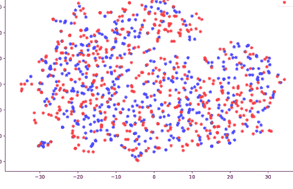

图 2：训练前的文档嵌入。

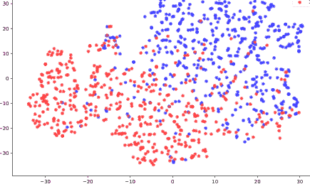

图 3：2 个周期训练后的文档嵌入。

### 5.4.2 预测区域识别

该方法在参考文献 [13] 的第 3.6 节（表 5 和表 6）中有介绍。回想一下，在应用池化（pooling）导致丢失位置信息之前，每个大小为 $h$ 的 $n_f$ 个滤波器都关联着一个大小为 $(s-h)/stride+1$ 的向量（特征图），其条目表示滤波器与输入中对应感受野进行卷积后的输出（应用非线性并加上偏置后）。因此，每个感受野都被嵌入到 $n_f$ 维空间中。因此，训练后，我们可以通过检查模型对应于感受野嵌入的中间输出（池化层之前紧邻处），并寻找范数最大的区域，来识别给定文档中最具预测性的区域。例如，一些对负面 IMDB 评论最具预测性的区域包括：“有史以来最烂的电影”、“别浪费你的钱”、“编写和表演都很糟糕”、“画质糟糕”。相反，一些非常指示正面评价的区域包括：“惊人的配乐”、“视觉美感”、“酷炫的旅程”、“结局相当令人满意”……

### 5.4.3 显著性图

理解模型如何做出预测的另一种方法由 [22] 描述，并由 [17] 应用于自然语言处理。其思想是根据输入文档 $A \in \mathbb{R}^{s \times d}$ 的元素对预测的影响对其进行排序。可以通过模型输出 $\text{CNN}: A \mapsto \text{CNN}(A)$ 关于 $A$ 的每一行 $a$ 的一阶偏导数的幅值来给出近似值： 

$$ \text{saliency}(a) = \left| \frac{\partial(\text{CNN})}{\partial a} \right|_a \tag{5} $$

其解释是，我们识别出在 $A$ 中哪些词*改变得最少却能最大程度改变类别得分*。这些导数可以通过执行一次反向传播（基于预测值，而不是像训练时那样基于损失值）来获得。图 4 和图 5 分别展示了负面和正面评论的显著性图示例。

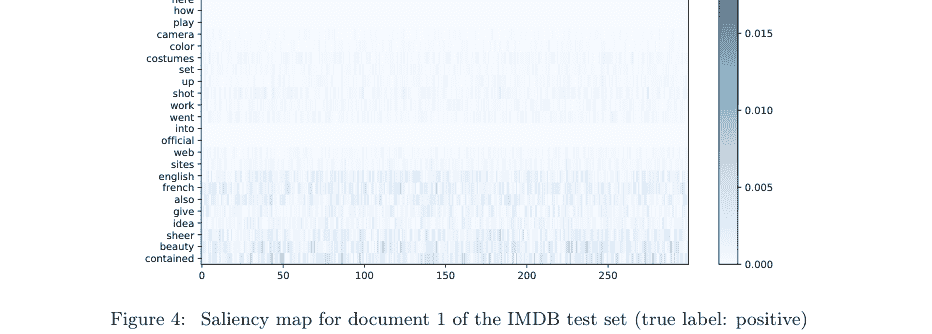

图 4：IMDB 测试集中文档 1 的显著性图（真实标签：正面）

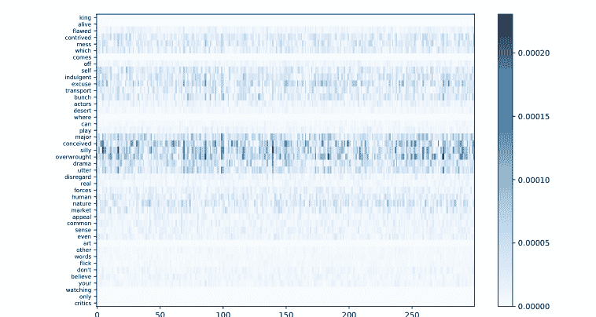

图 5：IMDB 测试集中文档 15 的显著性图（真实标签：负面）

## 6 循环神经网络（RNNs）

我们首先介绍整体 RNN 框架，然后介绍两种在实际中广泛使用的单元：LSTM 和 GRU。关于 RNN、LSTM 及其应用的良好综述可以在 [19] 中找到。

### 6.1 RNN 框架

虽然 CNN 天然擅长处理网格数据，但 RNN 是专门为处理*序列*而开发的 [6]。一些例子包括时间序列，或者在自然语言处理中的单词（字符序列）或句子（单词序列）。CNN 确实允许捕获一些顺序信息，但它局限于*局部*模式，而忽略了长距离依赖关系 [8]。如图 6 所示，RNN 可以被视为一系列共享相同参数的简单神经层链条。

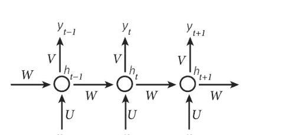

图 6：展开的 RNN 的 3 个步骤（改编自 Denny Britz 的博客。每个圆圈代表一个 RNN 单元（见公式 6 & 7）。

从高层次来看，RNN 接收有序输入向量列表 $\{x_{1},...,x_{T}\}$ 以及初始化为全零的初始隐藏状态 $h_{0}$，并返回有序隐藏状态列表 $\{h_{1},...,h_{T}\}$，以及有序输出向量列表 $\{y_{1},...,y_{T}\}$。当考虑深度架构（垂直堆叠的多个 RNN 层，如图 7 所示）时，输出向量可以作为其他 RNN 单元的输入。隐藏状态或多或少对应于网络的“短期”记忆。注意，每个训练样本都是其完整的 $\{x_{1},...,x_{T}\}$ 序列，并且根据任务的不同，可能与标签相关联。例如，对于短文档分类，序列将与标签相关联；而对于语言建模，我们只需解析所有序列，并反复预测下一个单词。

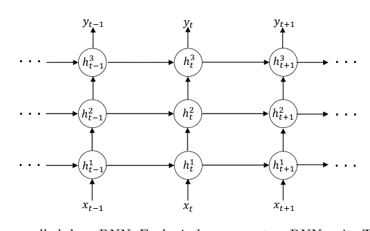

在序列的任何步骤 $t$，隐藏状态 $h_{t}$ 以前一个隐藏状态 $h_{t-1}$ 和当前输入向量 $x_{t}$ 的以下递归方式定义：

> $\displaystyle h_{t}=f(Ux_{t}+Wh_{t-1}+b)$

其中 $f$ 是一种非线性函数，如 $\mathbf{tanh}$（逐元素应用），$x_{t} \in \mathbb {R}^{d_{in}}$，$U \in \mathbb {R}^{H \times d_{in}}$ 和 $W \in \mathbb {R}^{H \times H}$ 是所有时间步共享的参数矩阵，且 $h_{t}$、$h_{t-1}$ 和 $b$ 属于 $\mathbb {R}^{H}$。如果输入是一热向量（one-hot vectors），$d_{in}$ 可以是词汇表的大小；当使用共享特征时，$d_{in}$ 是嵌入空间的维度。$H$ 是隐藏层的维度。通常，$H \sim 100$。该层越大，记忆容量越大，计算成本也越高。

输出向量 $y_{t} \in \mathbb {R}^{d_{out}}$ 以取决于最终任务的方式转换当前隐藏状态 $h_{t} \in \mathbb {R}^{H}$。对于分类，计算如下：

> $\displaystyle y_{t} = \text{softmax}(Vh_{t})$

其中 $V \in \mathbb {R}^{d_{out} \times H}$ 是所有时间步共享的参数矩阵。$d_{out}$ 取决于类别的数量。例如，对于 3 类文档分类，$d_{out}=3$；对于单词级别的语言模型，$d_{out}=|V|$。

注意，当垂直堆叠多个 RNN 层（深度 RNN 架构）时，下方单元的隐藏状态直接连接到上方的单元，即 $x_{t}^{above}=y_{t}^{below}$ 且 $y_{t}^{below}=h_{t}^{below}$。输出层（公式 7）位于堆栈顶部。

### 6.1.1 语言建模

语言建模是分类的一个特例，其中模型被训练用于预测句子中的下一个单词或字符。在每个时间步 $t$，输出向量给出序列中前文条件下，词汇表中所有单词/字符关于 $x_{t}$ 的概率分布，即 $P[x_{t}|x_{t-1},...,x_{1}]$。在测试时，完整序列 ${x_{1},...,x_{T}}$ 的概率由所有条件概率的乘积给出：

> $\displaystyle P[{x_{1},...,x_{T}}] = P[x_{1}] \times \prod_{t=2}^{T} P[x_{t}|x_{t-1},...,x_{1}]$

语言模型还可以通过重复采样字符（针对字符级别粒度）或直到

选用的特殊句末标记为 $^{11}$（针对词级别粒度）。例如，对于字符级别的语言模型，$T$ 很容易超过 20 或 25。这极大地加剧了著名的梯度消失和梯度爆炸问题的负面影响，导致长距离依赖无法被学习 $^{12}$。需要注意的是，前馈神经网络（如多层感知机）也会出现此问题，但由于 RNN 固有的深层结构倾向，该问题在 RNN 中会更为严重。

## 6.2 LSTM 单元

在实践中，每当人们使用 RNN 时，通常都会使用 LSTM 或 GRU 单元（见下一节），因为这些单元的设计使其能够规避梯度消失/爆炸问题，并在更长的时间范围内追踪信息 [11]。

如图 8 所示，与基本 RNN 单元相比，LSTM 单元有两个变化：(1) 引入了细胞状态 $c_{t}$，它充当显式记忆；(2) 隐藏状态的计算方式。在普通 RNN 中，隐藏状态通过单层计算得出：$h_{t} = \tanh( Ux_{t} + Wh_{t - 1} + b )$（见公式 6）。然而，在 LSTM 单元中，隐藏状态由四个相互作用的层计算得出，这使得网络能够记住或遗忘序列中先前元素的特定信息。

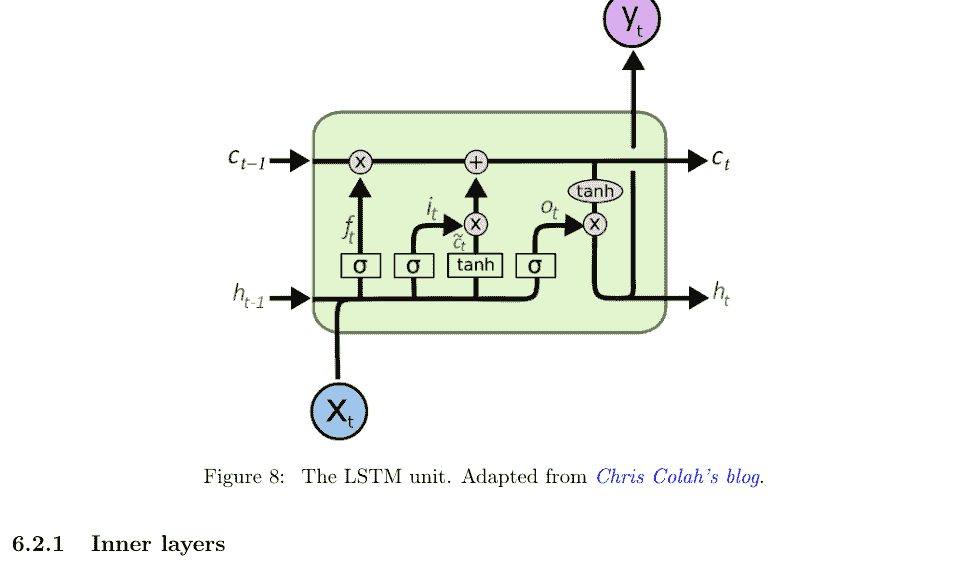

### 6.2.1 内部层

这四个层分别是：

- 1. 遗忘门层：$ f_{t} = \sigma(U_{f}x_{t} + W_{f}h_{t - 1} + b_{f}) $
- 2. 输入门层：$ i_{t} = \sigma(U_{i}x_{t} + W_{i}h_{t - 1} + b_{i}) $
- 3. 候选值计算层：$ \tilde{c}_{t} = \tanh(U_{c}x_{t} + W_{c}h_{t - 1} + b_{c}) $
- 4. 输出门层：$ o_{t} = \sigma(U_{o}x_{t} + W_{o}h_{t - 1} + b_{o}) $

由于逐元素应用了 Sigmoid 函数（$\sigma$），遗忘、输入和输出*门*层（即上述第 1、2、4 层）生成的向量其所有条目均介于 0 和 1 之间，且要么接近 0，要么接近 1。因此，当这些层与另一个向量相乘时，它们充当一种过滤器，仅选择该向量的一定比例。这正是这些层被称为“门”的原因。两种极端情况是所有条目等于 1——完整向量通过——或等于 0——无内容通过。需要注意的是，遗忘、输入和输出门以完全相同的方式计算，只是参数有所不同。然而，这些参数在所有时间步之间是共享的。

### 6.2.2 遗忘/学习

通过考虑新的训练样本 $x_t$ 和当前的隐藏状态 $h_{t-1}$，遗忘门层 $f_t$ 确定应遗忘多少之前的细胞状态 $c_{t-1}$（即释放多少记忆），而从相同的输入出发，输入门层 $i_t$ 决定应将多少候选值 $\tilde{c}_t$ 写入记忆，换句话说，即应学习多少新信息。将这两个过滤器的输出结合，即可*更新*细胞状态：

$c_t = f_t \circ c_{t-1} + i_t \circ \tilde{c}_t$ (9)

其中 $\circ$ 表示逐元素乘法（Hadamard 积）。通过这种方式，重要信息不会被新输入覆盖，并且能够与新信息一起保存很长时间。最后，激活值 $h_t$ 根据更新后的记忆并受输出门层 $o_t$ 的调节计算得出：

$h_t = \tanh(c_t) \circ o_t$ (10)

输出门允许该单元仅在记忆中的信息被认为对当前时间步相关时才激活。最后，与简单 RNN 一样，输出向量作为新隐藏状态的函数计算得出：

$y_t = \text{softmax}(Vh_t)$ (11)

### 6.2.3 与普通 RNN 的类比

如果我们决定遗忘关于之前状态的一切（$f_t$ 的所有元素为零），学习所有新信息（$i_t$ 的所有元素等于 1），并将整个细胞状态记忆并传递给下一个时间步（$o_t$ 的所有元素等于 1），那么我们就有 $c_t = \tilde{c}_t = \text{tanh}(U_c x_t + W_c h_{t-1} + b_c)$，从而回到普通 RNN 单元，唯一的区别是多了一个 **tanh**，因为最终得到的是 $h_t = \text{tanh}(\text{tanh}(U_c x_t + W_c h_{t-1} + b_c))$，而不是像经典 RNN 情况下的 $h_t = \text{tanh}(U_c x_t + W_c h_{t-1} + b_c)$。

## 6.3 门控循环单元 (GRU)

如图 9 所示，GRU 单元 [2] 是一种简化的 LSTM 单元，只有两个门（重置门和更新门），并且没有显式记忆 $c_t$。

- 1. 重置门层：$r_t = \sigma(U_r x_t + W_r h_{t-1} + b_r)$
- 2. 更新门层：$z_t = \sigma(U_z x_t + W_z h_{t-1} + b_z)$

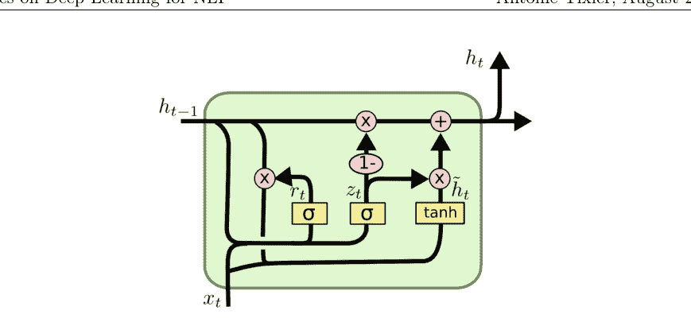

候选隐藏状态计算如下：

$\tilde{h}_t = \tanh(U_h x_t + W_h (r_t \circ h_{t-1}) + b_h)$ $^{13}$ (12)

当重置门的所有元素趋近于零时，来自之前时间步的信息（存储在 $h_{t-1}$ 中）被丢弃，因此候选隐藏状态仅基于当前输入 $x_t$。新的隐藏状态最终以类似于 LSTM 细胞状态的方式获得，即在之前隐藏状态和候选状态之间进行线性插值：

$h_t = z_t \circ h_{t-1} + (1 - z_t) \circ \tilde{h}_t$ (13)

唯一的区别是，这次更新门 $z_t$ 充当遗忘门，确定应遗忘之前隐藏状态中信息的比例，并且输入门与遗忘门耦合在一起。

## 6.4 RNN 与 LSTM 与 GRU 的对比

基本 RNN 单元在每个时间步都暴露其完整的隐藏状态（见公式 6），因此随着时间推移，较旧输入的影响很快被较新输入的影响所取代。因此，RNN 无法记住超过少数几个步骤的重要特征。确实，我们之前已经表明，RNN 类似于一种在所有 $t$ 时 $f_t = \overline{0}$，$i_t = \overline{1}$，且 $o_t = \overline{1}$ 的 LSTM（我们遗忘过去的一切，并学习当前的一切）。

另一方面，得益于显式记忆（细胞）和门控机制的使用，LSTM 单元能够控制过去信息的哪一部分应保留在记忆中（遗忘门 $f_t$），当前输入信息的哪一部分应写入记忆（输入门 $i_t$），以及多少记忆应暴露给下一个时间步及更高层单元（输出门 $o_t$）。

GRU 也具备门控机制，但没有显式记忆（无细胞状态）。因此，GRU 的门控机制更简单，没有输出门：旧信息与新信息之间的线性插值直接注入新的隐藏状态，无需过滤（见公式 13）。另一个区别在于，在计算候选值时，GRU 通过其重置门 $r_t$ 调节来自之前激活值 $h_{t-1}$ 的信息流（见公式 12），而在 LSTM 单元中，$\tilde{c}_t$ 基于原始的 $h_{t-1}$。最后但同样重要的是，在 GRU 中，旧信息与新信息之间的平衡仅由更新门 $z_t$ 完成（见公式 13），而 LSTM 单元则有两个*独立的*遗忘门和输入门。

虽然 LSTM 和 GRU 单元都明显优于基本 RNN 单元 [4]，但没有证据表明哪一种最好 [10, 4]。然而，由于 GRU 更简单，它更容易实现，效率更高，且参数更少，因此需要更少的训练数据。

## 7 注意力机制

注意力机制 [1] 是在神经机器翻译（NMT）的编码器-解码器架构背景下开发的 [2, 24]，并迅速应用于自然相关的任务，如图像描述（将图像转换为句子）[25] 和摘要（转换为更紧凑的语言形式）[21]。从高层次来看，通过允许解码器在多个向量中寻找其所需内容，注意力机制减轻了编码器将输入嵌入到单个固定长度向量的负担，从而允许保留更多信息 [1]。

如今，注意力机制在深度学习模型中无处不在，不仅限于编码器-解码器上下文。值得注意的是，已经提出了仅用于编码器的注意力设备，以解决如文档分类 [27] 或表示学习 [5] 等任务。这类机制被称为*自*注意力或*内部*注意力。

在接下来的内容中，我们将首先介绍在 NMT 原始编码器-解码器上下文中的注意力机制，使用由 [20] 引入的一般框架，然后介绍自注意力。

### 7.1 编码器-解码器注意力

#### 7.1.1 编码器-解码器概述

从非常高层次来看，如图 10 所示，编码器将输入嵌入到向量中，解码器从该向量生成一些输出。

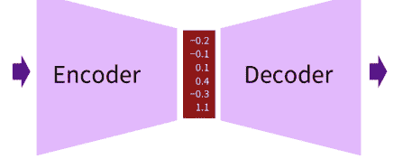

图 10：编码器-解码器架构概述。取自 https://sites.google.com/site/ac116nmt/home

在神经机器翻译（NMT）中，输入和输出分别是单词序列，即 $x = (x_1, \dots, x_{T_x})$ 和 $y = (y_1, \dots, y_{T_y})$。$x$ 和 $y$ 通常被称为*源*句和*目标*句。当输入和输出都是序列时，编码器-解码器架构有时被称为序列到序列（seq2seq）[24]。由于编码器-解码器架构在到处可微分，其参数 $\theta$ 可以通过在平行语料库上的最大似然估计（MLE）同时优化。这种训练方式被称为*端到端*。

$\operatorname{argmax}_{\theta} \bigg\{ \sum_{(x, y) \in \mathrm{corpus}} \log p(y|x; \theta) \bigg\} \quad\quad\quad\quad\quad (14)$

在这里，我们要最大化的函数是正确翻译的对数概率。

## 7.1.2 编码器

源句子可以通过任何模型（例如，CNN、全连接网络）进行嵌入。不过，对于机器翻译（MT）而言，编码器通常是一个深度循环神经网络（RNN）。Bahdanau等人[1]最初使用的是*双向*深度RNN。这种模型由两个深度单向RNN组成，除了词嵌入矩阵外，它们的参数不同。第一个*前向*RNN从左到右处理源句子，而第二个*后向*RNN则从右到左处理该句子。在每一个时间步 $t$，两个句子嵌入被连接起来，以获得双向RNN的内部表示：

$$h_t = [\vec{h}_t; \vec{h}_t] \tag{15}$$

双向RNN在编码源单词时会考虑整个上下文，而不仅仅是前文。结果是，$h_t$ 倾向于以单词 $x_t$ 为中心的一个小窗口，而单向RNN中的 $h_t$ 则倾向于 $x_t$ 及其紧挨着的前几个单词。关注围绕 $x_t$ 的小窗口可能是有利的，但似乎并非至关重要。事实上，Luong等人[20]使用普通的单向深度RNN编码器也取得了最先进（state-of-the-art）的结果。在后续内容中，编码器的隐藏状态将写作 $\hat{h}_t$。它们在文献中有时被称为*注释*（annotations）。

## 7.1.3 解码器

虽然不同的模型都可以作为编码器，但在神经机器翻译（NMT）中，解码器通常是一个单向RNN，因为该模型自然适应生成任务的序列特性，且通常是深度的（堆叠结构）。解码器每次生成目标句子的一个单词，一步一生成。

**核心思想。** 强制解码器仅使用编码器生成的最后一个注释 $h_{T_x}$ 来产生输出，这迫使编码器尽可能多的信息压缩进 $h_{T_x}$。由于 $h_{T_x}$ 是一个固定大小的单个向量，其容量有限，因此会丢失一些信息。另一方面，注意力机制允许解码器在生成过程的每一步都考虑编码器产生的整个注释序列 $(h_1, \ldots, h_{T_x})$。因此，编码器能够通过将所有注释中的信息进行分布来保留更多的信息，因为它知道解码器稍后能够决定应该关注哪些向量。

更具体地说，目标句子 $y = (y_1, \ldots, y_{T_y})$ 是基于以下分布，每次生成一个单词 $y_t$：

$$P[y_t | \{y_1, \ldots, y_{t-1}, c_t\}] = \text{softmax}(W_s \hat{h}_t) \tag{16}$$

其中，$\hat{h}_t$，即*注意力*隐藏状态，计算如下：

$$\hat{h}_t = \text{tanh}\big(W_c[c_t; h_t]\big) \tag{17}$$

$h_t$ 是解码器的隐藏状态（当解码器是堆叠RNN时，为顶层的隐藏状态），它提供了关于之前生成的目标单词 $\{y_1, \ldots, y_{t-1}\}$ 的信息；$c_t$ 是源上下文向量；$[;]$ 表示连接（concatenation）。$W_s$ 和 $W_c$ 是可训练参数矩阵。为了简洁，未显示偏置项。如图11所示，上下文向量 $c_t$ 可以通过两种方式计算：*全局*方式和*局部*方式。我们在接下来的两个小节中分别描述每种方法。

**关于束搜索（beam search）的说明。** 尝试词汇表中所有可能的单词组合以找到联合概率最高的目标句子是不可行的。但另一方面，以纯粹的贪婪方式生成 $y$（即每次都选择最可能的单词）是非常次优的。在实践中，使用*束*搜索（一种启发式搜索算法[7]）探索一定数量 $K$ 的候选翻译。较大的 K 值能生成更好的目标句子，但会降低解码速度。

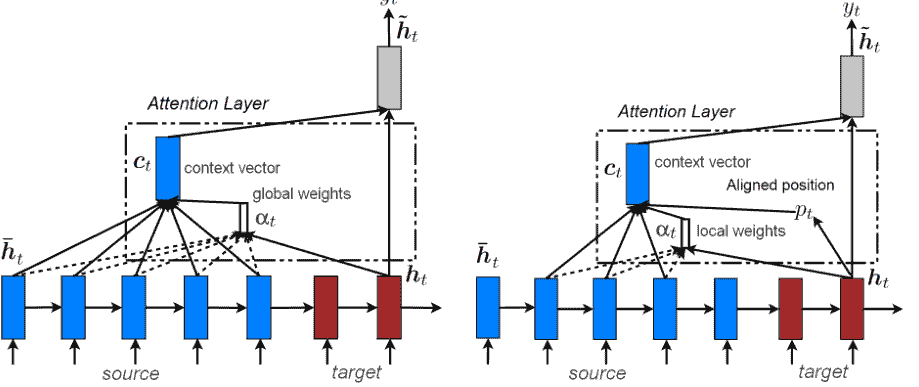

图 11：全局注意力（左）与局部注意力（右）。改编自 [20]。

### 7.1.4 全局注意力

在此，上下文向量 $c_t$ 计算为源句子*完整列表*注释 $\tilde{h}_i$（即编码器的隐藏状态）的加权和。共有 $T_x$ 个注释。每一个都是大小为编码器隐藏层单元数的向量。$c_t$ 的大小与任何注释相同。对齐向量 $\alpha_t$ 的大小等于源句子的大小 $T_x$，因此它是*可变*的。

$c_t = \sum_{i=1}^{T_x} \alpha_{t,i} \tilde{h}_i$ (18)

对齐向量 $\alpha_t$ 通过对当前的目标隐藏状态 $h_t$ 和所有源隐藏状态 $\tilde{h}_i$ 之间的*对齐*操作（$\textbf{score()}$）的输出应用 softmax 来计算：

$\alpha_{t,i} = \frac{\exp(\textbf{score}(h_t, \tilde{h}_i))}{\sum_{i'=1}^{T_x} \exp(\textbf{score}(h_t, \tilde{h}_{i'}))}$ (19)

换句话说，$\alpha_t$ 是所有源隐藏状态上的概率分布（其系数都在 0 和 1 之间，且总和为 1），并指示源句子中哪些单词最有可能有助于预测下一个单词。**score()** 在理论上可以是任何比较函数。Luong等人[20]实验了内积（$\textbf{score}(h_t, \tilde{h}_i) = h_t^\top \tilde{h}_i$）、带有参数矩阵的更通用形式（$\textbf{score}(h_t, \tilde{h}_i) = h_t^\top W_a \tilde{h}_i$）以及全连接层。他们发现*内积*在全局注意力中表现更好，而*通用*形式在局部注意力中更优越。图 12 提供了全局注意力的总结。

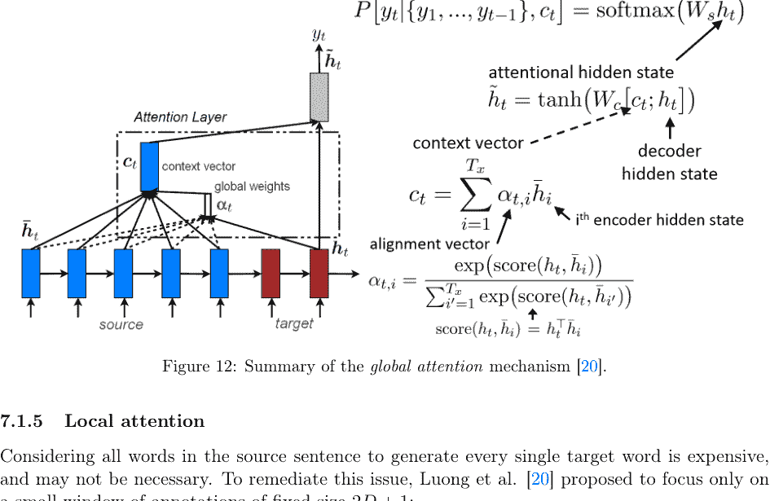

图 12：*全局注意力*机制的总结 [20]。

### 7.1.5 局部注意力

考虑源句子中的所有单词来生成每一个目标单词代价高昂，且可能并非必要。为了解决这个问题，Luong等人[20]提出仅关注固定大小 $2D + 1$ 的注释小窗口：

$$c_t = \sum_{i=p_t-D}^{p_t+D} \alpha_{t,i}\tilde{h}_i \quad\quad\quad\quad\quad\quad (20)$$

$D$ 由用户指定，窗口中心位置 $p_t$ 要么设置为 $t$（*单调对齐*），要么通过基于存储在 $h_t$ 中的之前生成的目标单词 $\{y_1,...,y_{t-1}\}$ 信息的可微分机制（*预测对齐*）确定：

$$p_t = T_x \cdot (v_p^{\top}\tanh(W_p h_t)) \quad\quad\quad\quad\quad\quad (21)$$

其中 $T_x$ 是源句子的长度，$\sigma$ 是 sigmoid 函数，$v_p$ 和 $W_p$ 是可训练参数。对齐权重的计算方式类似于全局注意力（公式 19），但增加了一个以 $p_t$ 为中心、标准差为 $D/2$ 的正态分布项：

$$\alpha_{t,i} = \frac{\exp(\text{score}(h_t, \tilde{h}_i))}{\sum_{i'=p_t-D}^{p_t+D} \exp(\text{score}(h_t, \tilde{h}_{i'}))} \exp\left(-\frac{(i-p_t)^2}{2(D/2)^2}\right) \quad\quad\quad (22)$$

注意 $p_t \in \mathbb{R} \cap [0, T_x]$ 且 $i \in \mathbb{N} \cap [p_t-D, p_t+D]$。高斯项的添加使得当 $i$ 远离窗口中心 $p_t$ 时，对齐权重会衰减，即给予靠近 $p_t$ 的注释更大的重要性。此外，与全局注意力不同，$\alpha_t$ 的大小是固定的且等于 $2D+1$，因为只考虑窗口内的注释。局部注意力实际上可以看作是全球注意力的一个变体，其中对齐权重乘以了一个截断的正态分布（即在窗口外返回零）。图 13 提供了局部注意力的总结。

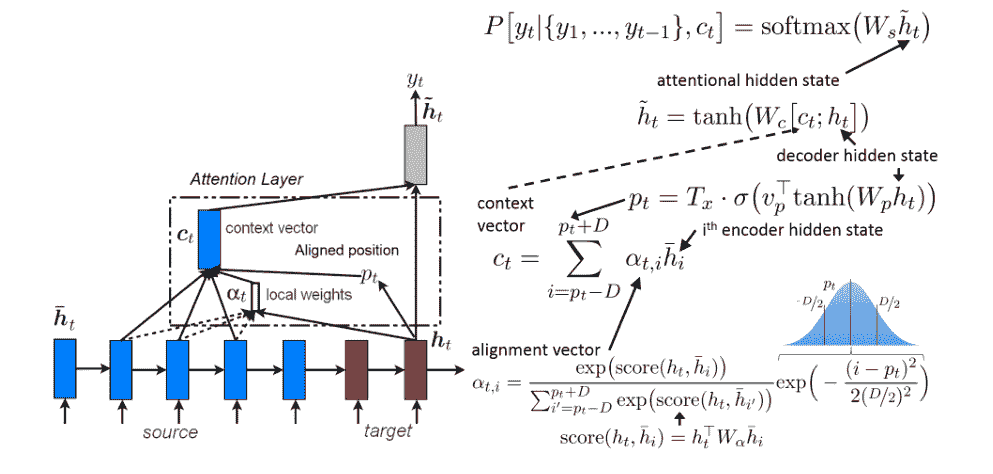

## 7.2 自注意力

我们这里处于一个更简单的设置中，单个RNN编码器接受长度为 $T$ 的序列 $(x_1, \dots, x_T)$ 作为输入。通常，RNN将输入序列映射到注释序列 $(h_1, \dots, h_T)$。目标与编码器-解码器上下文中的注意力机制完全相同：而不是将最后一个注释 $h_T$ 视为整个序列的综合摘要（这容易丢失信息），通过考虑*所有*时间步的注释来计算新的隐藏表示。为此目的，自注意力或内部注意力机制在 2016/2017 年出现在文献中，例如 [27, 18]。在后续中，我们使用 [27] 中的公式。

如公式 23 所示，注释 $h_t$ 首先通过一个密集层（dense layer）。然后通过将密集层的输出 $u_t$ 与可训练的上下文向量 $u$（随机初始化）进行比较，并通过对结果应用 softmax 归一化，推导得出对齐系数 $\alpha_t$。注意力向量 $s$ 最终作为注释的加权和获得。

$u_t = \tanh(W h_t)$

$\alpha_t = \frac{\exp(\text{score}(u_t, u))}{\sum_{t'=1}^T \exp(\text{score}(u_{t'}, u))} \qquad\qquad\qquad\qquad\qquad\qquad\qquad\qquad\qquad\qquad (23)$

$s = \sum_{t=1}^T \alpha_t h_t$

score 在理论上可以是任何对齐函数。一种直接的方法是使用 $\text{score}(u_t, u) = u_t^\top u$。上下文向量可以解释为平均意义上的理想单词表示。面对新样本时，模型利用这些知识来决定应该关注哪个单词。在训练过程中，通过反向传播，模型更新上下文向量，即调整其内部对理想单词的表示。

### 7.2.1 与 seq2seq 注意力的区别

上述自注意力定义中的上下文向量与 seq2seq 注意力中使用的上下文向量没有任何关系！在 seq2seq 注意力中，上下文向量 $c_t$ 等于加权和 $\sum_{i=1}^{T_s} \alpha_{t,i} \tilde{h}_i$，并用于计算注意力隐藏状态 $\tilde{h}_t = \tanh(W_c [c_t; h_t])$。在

然而，在自注意力机制中，由于没有解码器，上下文向量只是作为解码器隐藏状态的替代品，在执行与 `score()` 的对齐操作时使用。因此，在自注意力中，对齐向量 α 指示 *每个输入词相对于最优词（在平均意义上）的相似度*，而在序列到序列（seq2seq）注意力中，α 指示 *每个源词在生成目标句子下一个元素时的相关性*。

## 7.2.2 层次化注意力

自注意力机制在实践中如何有益的简单而良好的例子，由图 14 所示的架构提供。在此架构中，自注意力机制发挥了两次作用：一次在词级别，另一次在句子级别。这种方法之所以合理，有两个原因：首先，它符合文档的自然层次结构（词 → 句子 → 文档）。其次，在计算文档的编码时，它允许模型先确定每个句子中哪些词是重要的，然后确定整体上哪些句子是重要的。通过能够利用句子注意力系数重新加权词注意力系数，模型捕捉到了这样一个事实：某个给定的词实例在特定的句子中可能非常重要，而同一词的另一个实例在另一个句子中可能并不那么重要。

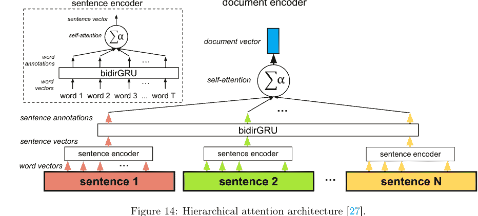

## 参考文献

- [1] Bahdanau, Dzmitry, Kyunghyun Cho, and Yoshua Bengio. "Neural machine translation by jointly learning to align and translate." arXiv preprint arXiv:1409.0473 (2014). 2, 14, 15
- [2] Cho, K., Van Merriënboer, B., Gulcehre, C., Bahdanau, D., Bougares, F., Schwenk, H., Bengio, Y. (2014). Learning phrase representations using RNN encoder-decoder for statistical machine translation. arXiv preprint arXiv:1406.1078. 2, 12, 13, 14
- [3] Chopra, Sumit, Raia Hadsell, and Yann LeCun. "Learning a similarity metric discriminatorily, with application to face verification." Computer Vision and Pattern Recognition, 2005. CVPR 2005. IEEE Computer Society Conference on. Vol. 1. IEEE, 2005. 6
- [4] Chung, J., Gulcehre, C., Cho, K., & Bengio, Y. (2014). Empirical evaluation of gated recurrent neural networks on sequence modeling. arXiv preprint arXiv:1412.3555. 2, 13, 14
- [5] Conneau, A., Kiela, D., Schwenk, H., Barrault, L., & Bordes, A. (2017). Supervised learning of universal sentence representations from natural language inference data. arXiv preprint arXiv:1705.02364. 14
- [6] Elman, J. L. (1990). Finding structure in time. Cognitive Science, 14:2, 179-211. 9
- [7] Freitag, Markus, and Yaser Al-Onaizan. "Beam search strategies for neural machine translation." arXiv preprint arXiv:1702.01806 (2017). 16
- [8] Goldberg, Y. (2015). A primer on neural network models for natural language processing. Journal of Artificial Intelligence Research, 57, 345-420. 2, 3, 9
- [9] Graves, A. (2013). Generating sequences with recurrent neural networks. arXiv preprint arXiv:1308.0850. 11
- [10] Greff, Klaus, et al. "LSTM: A search space odyssey." IEEE transactions on neural networks and learning systems 28.10 (2017): 2222-2232. 14
- [11] Hochreiter, S., Schmidhuber, J. (1997). Long short-term memory. Neural computation, 9(8), 1735-1780. 11
- [12] Hubel, David H., and Torsten N. Wiesel (1962). Receptive fields, binocular interaction and functional architecture in the cat's visual cortex. The Journal of physiology 160.1:106-154. 4
- [13] Johnson, R., Zhang, T. (2015). Effective Use of Word Order for Text Categorization with Convolutional Neural Networks. To Appear: NAACL-2015, (2011). 2, 8
- [14] Kim, Y. (2014). Convolutional Neural Networks for Sentence Classification. Proceedings of the 2014 Conference on Empirical Methods in Natural Language Processing (EMNLP 2014), 1746-1751. 2, 3, 4
- [15] Krizhevsky, Alex, Ilya Sutskever, and Geoffrey E. Hinton. "Imagenet classification with deep convolutional neural networks." Advances in neural information processing systems. 2012. 4
- [16] LeCun, Y., Bottou, L., Bengio, Y., and Haffner, P. (1998). Gradient-based learning applied to document recognition. Proceedings of the IEEE, 86(11), 2278-2324. 2, 4
- [17] Li, J., Chen, X., Hovy, E., and Jurafsky, D. (2015). Visualizing and understanding neural models in nlp. arXiv preprint arXiv:1506.01066. 8
- [18] Lin, Zhouhan, et al. "A structured self-attentive sentence embedding." arXiv preprint arXiv:1703.03130 (2017). 18
- [19] Lipton, Zachary C., John Berkowitz, and Charles Elkan. "A critical review of recurrent neural networks for sequence learning." arXiv preprint arXiv:1506.00019 (2015). 9
- [20] Luong, Minh-Thang, Hieu Pham, and Christopher D. Manning. "Effective approaches to attention-based neural machine translation." arXiv preprint arXiv:1508.04025 (2015). 2, 14, 15, 16, 17, 18
- [21] Rush, Alexander M., Sumit Chopra, and Jason Weston. "A neural attention model for abstractive sentence summarization." arXiv preprint arXiv:1509.00685 (2015). 14
- [22] Simonyan, K., Vedaldi, A., and Zisserman, A. (2013). Simonyan, Karen, Andrea Vedaldi, and Andrew Zisserman. "Deep inside convolutional networks: Visualising image classification models and saliency maps." arXiv preprint arXiv:1312.6034 (2013). arXiv preprint arXiv:1312.6034. 8
- [23] Springenberg, Jost Tobias, et al. "Striving for simplicity: The all convolutional net." arXiv preprint arXiv:1412.6806 (2014). 4
- [24] Sutskever, Ilya, Oriol Vinyals, and Quoc V. Le. "Sequence to sequence learning with neural networks." Advances in neural information processing systems. 2014. 2, 6, 14
- [25] Xu, K., Ba, J., Kiros, R., Cho, K., Courville, A., Salakhudinov, R., ... & Bengio, Y. (2015, June). Show, attend and tell: Neural image caption generation with visual attention. In International Conference on Machine Learning (pp. 2048-2057). 14
- [26] Zhang, Ye, and Byron Wallace. "A sensitivity analysis of (and practitioners' guide to) convolutional neural networks for sentence classification." arXiv preprint arXiv:1510.03820 (2015). 2, 3, 5, 6
- [27] Yang, Zichao, et al. "Hierarchical attention networks for document classification." Proceedings of the 2016 Conference of the North American Chapter of the Association for Computational Linguistics: Human Language Technologies. 2016. 14, 18, 19

