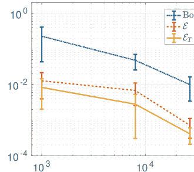
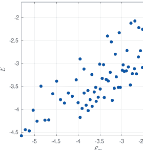
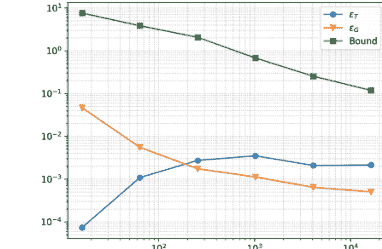
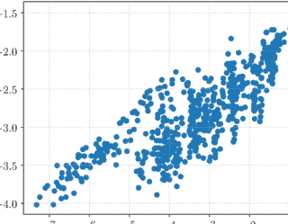
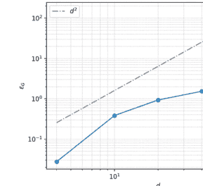
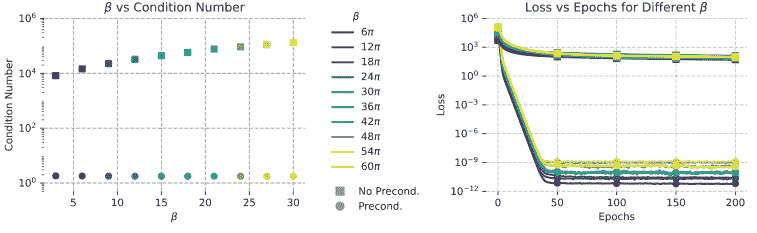
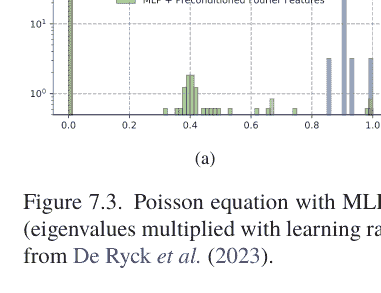
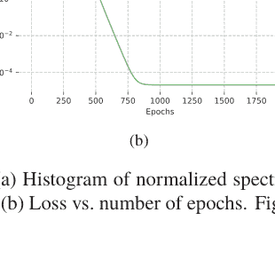

# 物理信息机器学习中物理信息神经网络及相关模型的数值分析

近年来，物理信息神经网络（PINNs）及其变体作为偏微分方程正问题和反问题数值模拟的算法已经非常流行。本文旨在全面回顾目前已有的关于PINNs及构成物理信息机器学习骨干的相关模型的数值分析结果。我们提供了一个统一框架，能够有效地分析PINNs在逼近偏微分方程时所产生的各个误差分量。我们详细回顾了关于逼近误差、泛化误差和训练误差的现有结果，以及它们随PDE类型和底层域维度的变化行为。特别是，我们阐明了解的正则性及其对扰动的稳定性在误差分析中的作用。我们还给出了数值结果以说明该理论。我们确定训练误差是一个关键的瓶颈，它会对物理信息机器学习中各种模型的整体性能产生不利影响。

2020年数学学科分类：主分类 65M15；次分类 68T07, 35A35

通过（随机）梯度下降获得一个逼近底层偏微分方程解的神经网络。这一框架在20世纪90年代已被考虑，见Dissanayake和Phan-Thien（1994）、Lagaris、Likas和Fotiadis（1998）、Lagaris、Likas和Papageorgiou（2000）及其参考文献；这些论文应被视为PINNs的先驱。然而，PINNs的现代版本是最近在Raissi和Karniadakis（2018）以及Raissi、Perdikaris和Karniadakis（2019）中引入并命名的。此后，关于PINNs的文献爆炸式增长，它们已被广泛应用于众多场景，用于求解PDE及相关方程（SDE、SPDE）的正问题和反问题；参见Karniadakis等人（2021）和Cuomo等人（2022）对PINNs现有文献的广泛综述。

然而，PINNs并不是物理信息机器学习框架内仅有的模型。人们可以考虑其他形式的PDE残差，例如产生VPINNs的变分形式（Kharazmi、Zhang和Karniadakis 2019）、产生wPINNs的弱形式（De Ryck、Mishra和Molinaro 2024c），或最小化底层能量从而产生DeepRitz方法（E和Yu 2018）。类似地，人们可以使用高斯过程（Rasmussen 2003）、DeepONets（Lu等人2021b）或神经算子（Kovachki等人2023）作为试解空间，以实现物理信息机器学习的替代模型。

鉴于物理信息机器学习中关于PINNs及相关模型的文献呈指数增长，有必要追问这些方法是否对其性能具有严格的数学保证，以及人们能否以类似于对传统数值方法（如有限差分、有限元、有限体积和谱方法）进行分析的大量文献的方式来分析这些方法。尽管研究的主要焦点一直是PINNs及其变体在科学和工程不同领域的广泛应用，但近年来出现了大量对PINNs进行严格分析的论文。本文旨在回顾物理信息机器学习中构成PINNs及相关模型数值分析的现有文献。我们的目标是批判性地分析PINNs及其变体，以确定它们何时可以被应用以及其适用性的限制是什么。为此，我们在第2节中首先介绍物理信息机器学习的公式，包括底层偏微分方程、其不同形式的残差和逼近的试解空间。在第3节中，我们概述了物理信息机器学习中底层误差的主要组成部分；相应的逼近、稳定性、泛化和训练误差将分别在第4、5、6和7节中分析。

## 2. 物理信息机器学习

在本节中，我们为文章的其余部分奠定基础。在第2.1节中，我们引入一个抽象的PDE设置，并考虑一些将在后续数值分析中使用的重要PDE示例。接下来，在第2.2节中介绍不同的模型类别。在第2.3节中，我们介绍基于PDE不同公式的物理信息学习变体，其产生的残差将通过离散化（第2.4节）和优化（第2.5节）构成物理信息损失函数。最后，在第2.6节中给出整个方法的总结。

### 2.1. 偏微分方程设置

在整篇文章中，我们考虑以下设置。设$X$、$Y$、$W$为可分Banach空间，范数分别为$\|\cdot\|_X$、$\|\cdot\|_Y$和$\|\cdot\|_W$；类似地，设$X^* \subset X$、$Y^* \subset Y$和$W^* \subset W$为闭子空间，范数分别为$\|\cdot\|_{X^*}$、$\|\cdot\|_{Y^*}$和$\|\cdot\|_{W^*}$。此类空间的典型例子包括$L^p$空间和Sobolev空间。我们考虑抽象形式的PDE

$$\mathcal{L}[u] = f, \qquad \mathcal{B}[u] = g, \tag{2.1}$$

其中$\mathcal{L}: X^* \to Y^*$是一个*微分算子*，$f \in Y^*$是一个*输入*或*源函数*。边界条件（包括时变PDE的初始条件）由*边界算子* $\mathcal{B}: X^* \to W^*$和边界数据$g \in W^*$规定。我们假设对于所有$f \in Y^*$，存在唯一的$u \in X^*$使得(2.1)成立。最后，我们假设对于所有$u \in X^*$和$f \in Y^*$，有

$$\|\mathcal{L}[u]\|_{Y^*} < +\infty, \qquad \|f\|_{Y^*} < +\infty, \qquad \|\mathcal{B}[u]\|_{W^*} < +\infty. \tag{2.2}$$

我们还将$u$的定义域记为$\Omega$，其中对于与时间无关的PDE，$\Omega = D \subset \mathbb{R}^d$；对于时变PDE，$\Omega = D \times [0,T] \subset \mathbb{R}^{d+1}$。

#### 2.1.1. 正问题

抽象PDE（2.1）的正问题相当于以下内容：给定源$f$和边界条件$g$（以及可能另一个参数函数$a$，使得$\mathcal{L} := \mathcal{L}_a$），求PDE的解$u$。这可以概括为寻找一个*算子*，它将输入函数$v \in \{f,g,a\} \subset \mathcal{X}$映射到PDE的相应解$u \in X^*$

$$\mathcal{G}: \mathcal{X} \to X^*: v \mapsto \mathcal{G}[v] = u. \tag{2.3}$$

注意，确定整个算子$\mathcal{G}$而不仅仅是函数$u$也可能是有意义的。找到$\mathcal{G}$的良好逼近被称为*算子学习*。算子的第一个具体示例是输入函数或源函数$f$与相应解$u$之间的映射，因此$\mathcal{X} = Y^*$且$v=f$：

$$\mathcal{G}: Y^* \to X^*: f \mapsto \mathcal{G}[f] = u. \tag{2.4}$$

对于时变PDE，另一个常见示例是$\mathcal{B}[u] = g$包含初始条件$u(\cdot,0) = u_0$的规定，即*解算子*将初始条件$u_0$映射到PDE的解

$$\mathcal{G}: W^* \to X^*: u_0 \mapsto \mathcal{G}[u_0] = u, \tag{2.5}$$

其中$\mathcal{X}=W^*$且$v = u_0$。或者，也可以考虑映射$u_0 \mapsto u(\cdot,T)$。

算子学习的最后一个示例可以在参数化PDE中找到，其中微分算子、源函数、初始条件或边界条件依赖于标量参数或参数函数。虽然求解参数化PDE通常不被称为算子学习，但很明显它可以被视为这样，唯一的区别是输入空间不一定是无限维的。

下面我们给出PDE（2.1）的示例，稍后我们将考虑这些示例的正问题。

### 示例 2.1（半线性热方程）。

我们首先考虑半线性热方程的设置。设$D \subset \mathbb{R}^d$是一个具有连续可微边界$\partial D$的开连通有界集。则半线性抛物方程由下式给出

$$\begin{cases} u_t = \Delta u + f(u) & \text{for all } x \in D,\ t \in (0,T), \\ u(x,0)=u_0(x) & \text{for all } x \in D, \\ u(x,t)=0 & \text{for all } x \in \partial D,\ t \in (0,T). \end{cases}\tag{2.6}$$

这里，$u_0 \in C^k(D)$，$k \ge 2$，是初始数据，$u \in C^k([0,T] \times D)$是经典解，$f : \mathbb{R} \times \mathbb{R}$是非线性源（反应）项。我们假设非线性是全局Lipschitz的，即存在常数$C_f > 0$使得

$$|f(v)-f(w)| \le C_f |v-w| \quad \text{for all } v,w \in \mathbb{R}.\tag{2.7}$$

特别地，具有$f(u) \equiv 0$的齐次线性热方程和线性源项$f(u)=\alpha u$是（2.6）的示例。具有全局Lipschitz非线性的半线性热方程出现在生物学和金融学的几个模型中（Beck等人2021）。具有如（2.6）的Lipschitz非线性的半线性抛物方程的存在性、唯一性和正则性可以在经典教科书中找到，例如Friedman（1964）的著作。

### 示例 2.2（Navier–Stokes方程）。

我们考虑著名的不可压缩Navier–Stokes方程（Temam 2001及其参考文献）

$$\begin{cases} u_t + u \cdot \nabla u + \nabla p = \nu \Delta u & \text{in } D \times [0,T], \\ \operatorname{div}(u)=0 & \text{in } D \times [0,T], \\ u(t=0)=u_0 & \text{in } D. \end{cases}\tag{2.8}$$

这里，$u: D \times [0,T] \to \mathbb{R}^d$是流体速度，$p: D \times [0,T] \to \mathbb{R}$是压力，$u_0: D \to \mathbb{R}^d$是初始流体速度。粘度用$\nu \ge 0$表示。在本文的其余部分，我们考虑在$d$维环面$D = \mathbb{T}^d = [0,1)^d$上带周期边界条件的Navier–Stokes方程（2.8）。

### 示例 2.3（黏性和无黏性标量守恒律）。

我们考虑如下*黏性标量守恒律*的一维形式，将其作为拟线性、对流占主导的扩散方程的模型问题：

$\begin{cases} u_t + f(u)_x = \nu u_{xx} & \text{for all } x \in (0,1),\ t \in [0,T], \\ u(x,0)=u_0(x) & \text{for all } x \in (0,1), \\ u(0,t)=u(1,t)\equiv 0 & \text{for all } t \in [0,T]. \end{cases}$ (2.9)

这里，$u_0 \in C^k([0,1])$，其中某个 $k \ge 1$，是初始数据；我们考虑零 Dirichlet 边界条件。注意，$0 < \nu \ll 1$ 是黏性系数。通量函数记为 $f \in C^k(\mathbb{R};\mathbb{R})$。按照 Godlewski 和 Raviart（1991）等标准教材中的方法，可以得出，只要 $\nu > 0$，黏性标量守恒律（2.9）就存在一个经典解 $u \in C^k([0,T)\times[0,1])$。

将 $\nu = 0$ 并考虑*无黏性标量守恒律*通常也很有意义：

$u_t + f(u)_x = 0.$ (2.10)

在这种情况下，即使初始数据是光滑的，解也可能不再连续，因为它可能会形成激波（Holden and Risebro 2015）。

### 示例 2.4（泊松方程）。

最后，我们考虑一个典型的椭圆型 PDE。设 $\Omega \subset \mathbb{R}^d$ 是满足外部球条件的有界开集，$f \in C^1(\Omega) \cap L^\infty(\Omega)$，且 $g \in C(\partial\Omega)$。那么存在 $u \in C^2(\Omega) \cap C(\overline{\Omega})$，使其满足泊松方程：

$\begin{cases} -\Delta u = f & \text{in } \Omega, \\ u = g & \text{on } \partial\Omega. \end{cases}$ (2.11)

此外，如果 $f$ 是光滑的，那么 $u$ 在 $\Omega$ 中也是光滑的。

#### 2.1.2. 逆问题

其次，我们考虑这样一类情形：我们并不完全知道 PDE（2.1）的输入（例如初始数据、边界条件和参数系数）。因此，无法唯一地求解正问题。然而，当我们能够获得关于底层解的（带噪声）数据，即某些可观测量的数据时，就可以尝试确定 PDE 的未知输入，进而确定其解。旨在基于数据恢复 PDE 输入的问题被称为*逆问题*。

我们主要考虑一种逆问题，即*唯一延拓问题*（对于时变问题，也称为*数据同化问题*）。回顾抽象 PDE $\mathcal{L}[u] = f$ in $\Omega$（2.1）。此外，我们采用本小节引言中的假设（2.2）。与正问题的区别在于，现在我们对边界条件只有不完整的信息。因此，PDE 不存在唯一解。相反，我们假设

可以获得某个可观测量的（可能带噪声的）测量值

$$\Psi(u) = g \quad \text{in } \Omega', \tag{2.12}$$

其中 $\Omega' \subset \Omega$ 是观测区域，$g$ 是测量数据，且 $\Psi: X^* \to Z^*$，其中 $Z^*$ 是某个 Banach 空间。我们作出如下假设：

$$\|\Psi(u)\|_{Z^*} < +\infty \quad \text{for all } u \in X^*, \text{ with } \|u\|_{X^*} < +\infty,$$
$$\|g\|_{Z^*} < +\infty. \tag{2.13}$$

如果 $\Omega'$ 包含 $\Omega$ 的边界，也就是说我们拥有边界上的测量数据，那么再次使用正问题的标准框架是可行的。然而，这通常是不可能的。例如，在传热问题中，最高温度将在边界处达到。因此，边界附近的温度可能过高，无法在那里放置传感器，我们只能获得距离边界足够远处的测量数据。幸运的是，我们可以调整物理信息框架，根据 $f$ 和 $g$ 恢复 $u$ 的一个近似。

类比于正问题中的算子学习，我们也可以尝试完全学习逆算子

$$\mathcal{G}^{-1}: Z^* \to X^*: \Psi[u] = g \mapsto \mathcal{G}^{-1}[g] = v, \tag{2.14}$$

其中，$v$ 例如可以是边界条件、参数函数 $a$ 或输入/源函数 $f$。

### 示例 2.5（热方程）。

我们重新考虑热方程 $u_t - \Delta u = f$，其中具有零 Dirichlet 边界条件，且 $f \in L^2(\Omega)$，其中 $\Omega = D \times (0,T)$。我们假设 $u \in H^1((0,T); H^{-1}(D)) \cap L^2((0,T); H^1(D))$，并且 $u$ 将以弱意义满足热方程。如果给定了初始条件，即指定了 $u_0 = u(x,0)$，那么热方程将是适定的。回顾一下，数据同化问题的目标是：根据对解在时间上的一些测量，推断初始条件以及之后时刻的完整解场。为对此进行建模，我们考虑如下*可观测量*：

$$\Psi[u] := u = g \quad \text{for all } (x,t) \in D' \times (0,T) := \Omega', \tag{2.15}$$

其中，$D' \subset D$ 是某个开且单连通的观测区域，$g \in L^2(\Omega')$。因此，求解热方程的数据同化问题，就是在观测子区域 $\Omega' = D' \times (0,T)$ 上给定数据的情况下，求出整个时空区域 $\Omega = D \times (0,T)$ 中的热方程解 $u$。

### 示例 2.6（泊松方程）。

我们重新考虑泊松方程（示例 2.4），但这次给定 $\Omega$ 的一个子区域上的数据：

$$- \Delta u = f \quad \text{in } \Omega \subset \mathbb{R}^d, \quad u|_{\Omega'} = g \quad \text{in } \Omega' \subset \Omega. \tag{2.16}$$

在这种情况下，式（2.12）中引入的可观测量 $\Psi$ 就是恒等映射 $\Psi[u] = u$。

### 示例 2.7（斯托克斯方程）。

最后，我们考虑 Navier–Stokes 方程的一个简化版本，即定常 Stokes 方程。设 $D \subset \mathbb{R}^d$ 是一个具有光滑边界的开、有界、单连通集合。我们将 Stokes 方程作为定常高黏性流体的模型：

$$\begin{cases} \Delta u + \nabla p = f & \text{for all } x \in D, \\ \operatorname{div}(u) = f_d & \text{for all } x \in D. \end{cases}$$ (2.17)

这里，$u: D \to \mathbb{R}^d$ 是速度场，$p: D \to \mathbb{R}$ 是压力，$f: D \to \mathbb{R}^d$ 和 $f_d: D \to \mathbb{R}$ 是源项。

注意，由于没有给出任何边界条件，Stokes 方程（2.17）不是适定的。在相应的数据同化问题中（Burman and Hansbo 2018 及其中的参考文献），我们给出如下数据：

$$\Psi[u] := u = g \quad \text{for all } x \in D',$$ (2.18)

其中 $D' \subset D$ 是某个开且单连通的集合。因此，Stokes 方程的数据同化逆问题就是：给定 $f$、$f_d$ 和 $g$，推断速度场 $u$（以及压力 $p$）。

### 2.2. Ansatz 空间

我们概述不同类别的参数函数 $\{u_\theta\}_{\theta \in \Theta}$，这些函数通常用于近似 PDE（2.1）的真实解 $u$。设 $n$ 为（实）参数的数量，因此参数空间 $\Theta$ 是 $\mathbb{R}^n$ 的一个子集。

#### 2.2.1. 线性模型

我们首先考虑关于参数 $\theta$ 线性依赖的模型，即由一组固定函数 $\{\phi_i : \Omega \to \mathbb{R}\}_{1 \le i \le n}$ 的线性组合构成的模型。对于任意 $\theta \in \mathbb{R}^n$，参数化线性模型 $u_\theta$ 定义为

$$u_\theta(x) = \sum_{i=1}^n \theta_i \phi_i(x).$$ (2.19)

这一通用模型类构成了许多现有 PDE 解近似数值方法的基础，下面我们将对此进行概述。

其形式为

$$\sum_{i=1}^n \theta_i \int_{\Omega} \psi_k \mathcal{L}(\phi_i) = \int_{\Omega} \psi_k f \quad \text{for } 1 \le k \le K, \tag{2.20}$$

其中，若 $\psi_k = \phi_k$，则得到*Galerkin 方法*；若 $\psi_k = \delta_{x_k}$ 且 $x_k \in \Omega$，则得到*配点法*；更一般地，当 $\psi_k$ 和 $\phi_k$ 不同（并且也不是 Dirac delta 函数）时，则称为*Petrov–Galerkin 方法*。在配点法中，所谓配点 $\{x_k\}_k$ 的选择取决于函数 $\phi_i$。边界条件可以通过选择函数 $\phi_i$ 来实现，也可以通过向上述线性系统中添加更多方程来实现。

与谱方法的全局基函数形成鲜明对比的是*有限元方法*（FEM），在该方法中我们考虑局部定义的多项式。更准确地说，我们首先将 $\Omega$ 划分为直径至多为 $h$ 的（通常相互重叠的）子区域 $\Omega_i$（一维情况下为子区间），然后在每个 $\Omega_i$ 上考虑一个分片定义的、次数至多为 $p$ 且在 $\Omega_i$ 外为零的多项式 $\phi_i$。与谱 Galerkin 方法非常类似，我们可以定义如（2.20）所示的线性方程组，并通过求解该方程组找到最优参数向量 $\theta^*$。由于 $\phi_i$ 在 $\Omega$ 上不再光滑，我们需要利用分部积分重写 $\int_{\Omega} \phi_k \mathcal{L}(\phi_i)$。与谱方法的另一个关键区别在于，由于函数 $\phi_i$ 具有局部支集，我们需要求解的线性系统将是稀疏的，并且具有与网格和多项式选择相关的结构性质。可以通过减小 $h$（$h$-FEM）、增大 $p$（$p$-FEM），或同时进行二者（$hp$-FEM）来提高近似精度。或者，有限元方法也可以与平方损失结合使用，从而得到*最小二乘有限元方法*（Bochev and Gunzburger 2009）。有限元方法在科学计算中无处不在，并且存在许多变体。

函数 $\phi_i$ 的另一种选择是*径向基函数*（RBF）；例如参见 Buhmann（2000）。RBF 的关键要素是一个径向函数 $\varphi : [0, \infty) \to \mathbb{R}$。对于节点 $\{x_i\}_{1 \le i \le n} \subset \Omega$ 的任意选择，该函数必须满足以下条件：(i) 函数 $x \mapsto \phi_i(x) := \varphi(\|x - x_i\|)$ 线性无关；(ii) 其元素为 $A_{ij} = \varphi(\|x_i - x_j\|)$ 的矩阵 $A$ 非奇异。径向函数可以具有全局支集（例如高斯函数、多调和样条），也可以具有紧支集（例如 bump 函数）。随后，可以通过 Galerkin、配点或最小二乘的方式确定最优参数 $\theta^*$。RBF 特别有优势，因为它们是无网格的（相对于 FEM 而言），这对于复杂几何形状很有用；同时它们也易于用于高维情形，因为我们可以使用随机生成的节点，而不必使用网格上的节点。

最后，具有随机生成节点的 RBF 可以看作更一般的*随机特征模型*（RFM）的一个示例。在随机特征模型中，函数 $\phi_i$ 从函数空间上的某个选定分布中随机抽取（例如 Rahimi and Recht 2008）。在实践中，我们通常选择的函数空间本身是参数化的，因此生成 $\phi_i$ 就简化为随机抽取有限维向量 $\alpha_i$，并设置 $\phi_i(x) := \phi(x; \alpha_i)$。其中 $\phi_i$ 是神经网络的随机特征模型，其

随机初始化的权重和偏置与仅训练外层的神经网络密切相关。当网络规模较大时，后一种模型通常被称为极限学习机（ELM）（Huang, Zhu and Siew 2006）。

#### 2.2.2. 非线性模型

神经网络。在对其参数呈非线性依赖的参数模型中，第一个但非常核心的例子是神经网络。神经网络最简单的形式是多层感知机（MLP）。MLP 因其被定义为仿射映射和激活函数的串联而得名。由于这一结构，MLP 的计算图按层组织。在第 k 层，激活函数被逐分量地应用以获得值

$$z^k = \sigma(C_{k-1}(z^{k-1})) = \sigma(W_{k-1}z^{k-1} + b_{k-1}), \tag{2.21}$$

其中 $z^0$ 是网络的输入，$W_k \in \mathbb{R}^{d_{k+1}\times d_k}$，$b_k \in \mathbb{R}^{d_{k+1}}$，且 $C_k: \mathbb{R}^{d_k} \to \mathbb{R}^{d_{k+1}}: x \mapsto W_k x + b_k$（$d_k \in \mathbb{N}$）是一个仿射映射。具有 L 层、激活函数 $\sigma$、输出函数 $\sigma_o$、输入维度 $d_{\mathrm{in}}$ 和输出维度 $d_{\mathrm{out}}$ 的多层感知机（MLP）则是如下形式的函数 $f_\theta: \mathbb{R}^{d_{\mathrm{in}}} \to \mathbb{R}^{d_{\mathrm{out}}}$：

$$f_\theta(x) = (\sigma_o \circ C_L \circ \sigma \circ \cdots \circ \sigma \circ C_0)(x) \quad \text{for all } x \in \mathbb{R}^{d_{\mathrm{in}}}, \tag{2.22}$$

其中 $\sigma$ 被逐元素地应用，且 $\theta = ((W_0, b_0), \ldots, (W_L, b_L))$。每一层的维度 $d_k$ 也称为该层的宽度。MLP 的宽度定义为 $\max_k d_k$。此外，矩阵 $W_k$ 称为 MLP 的权重，向量 $b_k$ 称为 MLP 的偏置。它们共同构成 MLP 的（可训练）参数，记为 $\theta = ((W_0, b_0), \ldots, (W_L, b_L))$。最后，可以使用输出函数 $\sigma_o$ 来提高输出的可解释性，但在函数逼近的场景中，它通常等于恒等函数。

## 注 2.8.

在一些文献中，层数 L 对应于 $f_\theta$ 定义中仿射映射的数量。在这 L 层中，前 L − 1 层称为隐藏层。因此，在这种替代定义下，L 层网络对应于我们定义中的 (L − 1) 层网络。

神经网络的许多性质取决于激活函数的选择。下面我们讨论最常见的激活函数。

- 赫维赛德函数是 McCulloch–Pitts 神经元中使用的激活函数，其定义为

  $$H(x) = \begin{cases} 0, & x < 0;\\ 1, & x \ge 0. \end{cases} \tag{2.23}$$

  由于梯度在存在处均为零，因此无法使用基于梯度的方法训练网络。因此，赫维赛德函数已不再使用。

受以下事实启发：在某些一般条件下，PDE (2.1) 的解 $u$ 可以表示为

$$u(x) = \int_D G(x,y) f(y) \mathrm{d}y, \tag{2.29}$$

其中 $G: D \times D \to \mathbb{R}$ 是格林函数。这种核表示促使 Li 等人 (2020) 提出用以下算子替换标准神经网络的隐藏层公式：

$$\mathcal{L}_\ell(v)(x) = \sigma\Big(W_\ell v(x) + \int_D \kappa_\phi(x,y,a(x),a(y)) v(y) \mathrm{d}\mu_x(y)\Big), \tag{2.30}$$

其中 $W_\ell$ 和 $\phi$ 需要从数据中学习，$\kappa_\phi$ 是一个核，且对于每个 $x \in D$，$\mu_x$ 是一个 Borel 测度。Li 等人 (2020) 将核 $\kappa_\phi$ 建模为神经网络。更一般地，神经算子是如下形式的映射（Li 等人 2020；Kovachki、Lanthaler 和 Mishra 2021）

$$\mathcal{N}: \mathcal{X} \to \mathcal{Y}: a \mapsto \mathcal{Q} \circ \mathcal{L}_L \circ \mathcal{L}_{L-1} \circ \cdots \circ \mathcal{L}_1 \circ \mathcal{R}(a), \tag{2.31}$$

对于给定的深度 $L \in \mathbb{N}$，其中 $\mathcal{R}: \mathcal{X}(D;\mathbb{R}^{d_x}) \to \mathcal{U}(D;\mathbb{R}^{d_v})$，$d_v \ge d_x$，是一个（局部作用的）提升算子，其形式为

$$\mathcal{R}(a)(x) = R a(x), \quad R \in \mathbb{R}^{d_v \times d_x}, \tag{2.32}$$

而 $\mathcal{Q}: \mathcal{U}(D;\mathbb{R}^{d_v}) \to \mathcal{Y}(D;\mathbb{R}^{d_y})$ 是一个局部投影算子，其形式为

$$\mathcal{Q}(v)(x) = Q v(x), \quad Q \in \mathbb{R}^{d_y \times d_v}. \tag{2.33}$$

与经典有限维神经网络类似，层 $\mathcal{L}_1, \dots, \mathcal{L}_L$ 是非线性算子层，$\mathcal{L}_\ell: \mathcal{U}(D;\mathbb{R}^{d_v}) \to \mathcal{U}(D;\mathbb{R}^{d_v})$，$v \mapsto \mathcal{L}_\ell(v)$，我们假设其形式为

$$\mathcal{L}_\ell(v)(x) = \sigma\big(W_\ell v(x) + b_\ell(x) + (\mathcal{K}(a;\theta_\ell)v)(x)\big) \quad \text{for all } x \in D. \tag{2.34}$$

这里，权重矩阵 $W_\ell \in \mathbb{R}^{d_v \times d_v}$ 和偏置 $b_\ell(x) \in \mathcal{U}(D;\mathbb{R}^{d_v})$ 定义了一个逐点仿射映射 $W_\ell v(x) + b_\ell(x)$。我们通过说明以下内容来结束神经算子的定义：$\sigma: \mathbb{R} \to \mathbb{R}$ 是一个逐分量应用的非线性激活函数，而 $\mathcal{K}$ 是一个非局部线性算子，

$$\mathcal{K}: \mathcal{X} \times \Theta \to L(\mathcal{U}(D;\mathbb{R}^{d_v}),\mathcal{U}(D;\mathbb{R}^{d_v})), \tag{2.35}$$

它将输入场 $a$ 和参数集 $\Theta$ 中的参数 $\theta \in \Theta$ 映射到有界线性算子 $\mathcal{K}(a,\theta): \mathcal{U}(D;\mathbb{R}^{d_v}) \to \mathcal{U}(D;\mathbb{R}^{d_v})$。当我们通过积分核定义线性算子 $\mathcal{K}(a,\theta)$ 时，(2.34) 又简化为 (2.30)。傅里叶神经算子（FNO）（Li 等人 2021）是此类一般神经算子的特例，其中积分核对应于卷积核，在周期域 $\mathbb{T}^d$ 上得到如下形式的非线性层 $\mathcal{L}_\ell$：

$$\mathcal{L}_\ell(v)(x) = \sigma\big(W_\ell v(x) + b_\ell(x) + \mathcal{F}^{-1}(P_\ell(k) \cdot \mathcal{F}(v)(k))(x)\big). \tag{2.36}$$

然而在实践中，这一定义无法使用，因为计算傅里叶变换需要精确计算积分。FNO 的实际实现（即离散化）在次数至多为 $N \in \mathbb{N}$ 的三角多项式空间（记为 $L_N^2$）之间进行映射，并可等同于一个有限维映射，该映射是仿射映射和如下形式非线性层的复合：

$$\mathcal{L}_\ell(z)_j = \sigma\left(W_\ell z_j + b_{\ell,j} + \mathcal{F}_N^{-1}\left(P_\ell(k)\cdot\mathcal{F}_N(z)_{k,j}\right)\right). \tag{2.37}$$

其中 $P_\ell(k)$ 是通过离散傅里叶变换 $\mathcal{F}_N$ 定义非局部卷积算子的系数；参见 Kovachki *等人* (2021)。

人们已经观察到，上述提出的算子学习模型在计算机上实现时可能不会像算子那样表现，这质疑了算子学习应该是什么的本质。Bartolucci *等人* (2023) 认为，除了在连续层面定义算子之外，某种形式的连续–离散等价性对于架构真正学习底层算子、而不仅仅是其离散化是必要的。为此，他们引入了*表示等价神经算子*（ReNO）的统一数学框架，以确保连续和离散层面的操作等价。缺乏这种等价性可以用混叠误差来量化。

## *高斯过程。*

深度神经网络及其算子版本只是真实解 $u$ 的一种可能的非线性替代模型。另一类流行的非线性模型是*高斯过程回归*（Rasmussen 2003），它属于更大的一类所谓贝叶斯模型。高斯过程回归（GPR）依赖于这样的假设：$u$ 来自某个合适函数空间上的高斯测度，其参数化为

$$u_\theta(x) \sim \mathrm{GP}\bigl(m_\theta(x), k_\theta(x,x')\bigr), \tag{2.38}$$

其中 $m_\theta(x)=\mathbb{E}[u_\theta(x)]$ 是均值，底层协方差函数由 $k_\theta(x,x')=\mathbb{E}[(u_\theta(x)-m_\theta(x))(u_\theta(x')-m_\theta(x'))]$ 给出。

(2.38) 中协方差函数的常见选择是平方指数核（与 RBF 一样是径向函数）和 Matérn 协方差函数：

$$k_{\mathrm{SE}}(x,x')=\exp\left(-\frac{\lVert x-x'\rVert^2}{2\ell^2}\right), \tag{2.39}$$

$$k_{\mathrm{Matern}}(x,x')=\frac{2^{1-\nu}}{\Gamma(\nu)}\left(\sqrt{2\nu}\frac{\lVert x-x'\rVert}{\ell}\right)^\nu K_\nu\left(\sqrt{2\nu}\frac{\lVert x-x'\rVert}{\ell}\right). \tag{2.40}$$

这里 $\lVert\cdot\rVert$ 表示标准欧几里得范数，$K_\nu$ 是第二类修正贝塞尔函数，$\ell$ 是*特征长度*，描述点 $x$ 和 $x'$ 之间相关性的长度尺度。参数向量随后由 $m_\theta$ 和 $k_\theta$ 的超参数组成，例如 $\nu$ 和 $\ell$。

对于时间相关偏微分方程，通常将其转化为如下极小化问题

$$
\min_{\theta\in\Theta}\mathcal{E}_{\text{PIL}}[u_\theta]^2,\tag{2.44}
$$

其中对于时间无关的偏微分方程，物理信息损失 \(\mathcal{E}_{\text{PIL}}\) 由下式给出

$$
\mathcal{E}_{\text{PIL}}[u_\theta]^2 = \int_{D} \mathcal{R}_{\text{PDE}}[u_\theta]^2 + \lambda_s \int_{\partial D} \mathcal{R}_s[u_\theta]^2,\tag{2.45}
$$

其中 \(\lambda_s > 0\) 是加权超参数；对于时间相关的偏微分方程，量 \(\mathcal{E}_{\text{PIL}}\) 由下式给出

$$
\mathcal{E}_{\text{PIL}}[u_\theta]^2 = \int_{D\times[0,T]} \mathcal{R}_{\text{PDE}}[u_\theta]^2 + \lambda_s \int_{\partial D\times[0,T]} \mathcal{R}_s[u_\theta]^2 + \lambda_t \int_D \mathcal{R}_t[u_\theta]^2,\tag{2.46}
$$

其中 \(\lambda_s, \lambda_t > 0\) 是加权超参数。由于边界条件（和初始条件）是通过损失函数中的一个额外项来施加的，我们允许最终模型只能近似满足边界条件。这通常被称为软边界条件。另一方面，如果我们选择的模型类使得所有 \(u_\theta\) 都精确满足边界条件（\(\mathcal{B}[u_\theta] = g\)），那么我们就实现了硬边界条件。

### 注 2.9

上述定义的残差和损失函数可以很方便地推广到偏微分方程组和更复杂的边界条件。若偏微分方程组由 \(\mathcal{L}^{(i)}[u] = f^{(i)}\) 给出，则我们可以方便地定义多个偏微分方程残差 \(\mathcal{R}_{\text{PDE}}^{(i)}\)，并在物理信息损失中考虑平方偏微分方程残差的积分和 \(\sum_i \int (\mathcal{R}_{\text{PDE}}^{(i)})^2\)。对于更复杂的边界条件（包括分段定义的边界条件）的推广，完全以类似方式进行。

极小化问题 (2.44) 仅基于 (2.45) 和 (2.46) 中定义的物理信息损失函数，是物理信息学习的最基本版本，可以通过在 (2.44) 的目标函数中添加额外项来进行扩展。例如，在某些情形下，我们或许可以在子域 \(\Omega'\) 上获得测量数据 \(\Psi(u) = g\)，其中 \(\Psi\) 是一个所谓的可观测量。这种情况对反问题（第2.1.2节）尤其重要。在这种情况下，在优化目标中添加一个数据项是有意义的，该数据项用数据残差 \(\mathcal{R}_d\) 定义：

$$
\mathcal{R}_d[u_\theta](x) = \Psi[u](x) - g(x) \quad \text{for all } x \in \Omega'.\tag{2.47}
$$

注意，边界残差可以看作是数据残差的一个特例，其中 \(\Psi = \mathcal{B}\) 且 \(\Omega' = \partial\Omega\)。此外，在实践中我们可能还会在损失函数中添加一个参数正则化项（通常是参数 \(\theta\) 的 \(L^q\) 范数），以帮助极小化过程或改善最终模型的（泛化）性质。因此，物理信息极小化问题 (2.44) 的一个推广形式可以是

$$
\min_{\theta\in\Theta}\left(\mathcal{E}_{\mathrm{PIL}}[u_\theta]^2+\lambda_d\int_{\Omega'}\mathcal{R}_d[u_\theta]^2+\lambda_r\|\theta\|_q^q\right). \tag{2.48}
$$

#### 2.3.2. 弱形式

在上一小节中，我们考虑了基于偏微分方程强形式的偏微分方程残差和物理信息损失函数。然而，对于多类偏微分方程，可能不存在光滑的经典解 \(u\) 使得它对于每个 \(x\in\Omega\) 都满足 \(\mathcal{L}[u](x)=f(x)\)。幸运的是，有时我们可以精确地推广“偏微分方程的解”的定义，使得毕竟存在一些函数满足这个推广后的定义。这样的函数被称为*弱解*。它们被称为满足偏微分方程的*弱形式*，弱形式可以通过将偏微分方程的强形式 (2.1) 乘以一个光滑且具有紧支撑的测试函数 \(\psi\)，然后进行分部积分得到：

$$
\int_{\Omega}u\mathcal{L}^*[\psi]=\int_{\Omega}f\psi, \tag{2.49}
$$

其中 \(\mathcal{L}^*\) 是 \(\mathcal{L}\) 的（形式）伴随算子（如果存在）。因此，如果函数 \(u\) 对于某个预定义函数集中的所有（紧支撑）测试函数 \(\psi\) 都满足 (2.49)，则称其为弱解。注意，\(u\) 不再需要可微，而只需要可积。

诸如 (2.49) 的弱形式是许多经典数值方法的基础，特别是有限元方法（FEM：第2.2.1节）。然而，通常并不需要一直分部积分到 \(u\) 完全没有导数为止。在有限元方法中，二阶椭圆方程的弱形式通常只通过一次分部积分得到。对于拉普拉斯算子 \(\mathcal{L}=\Delta\)，我们有

$$
\int_{\Omega}\Delta u\,\psi=-\int_{\Omega}\nabla u\cdot\nabla\psi
$$

（在合适的边界条件下），这是一个在实践中具有许多有用性质的形式。

除了使用谱方法（如第2.2.1节所述），现在有几种不同的途径可以获得基于 (2.49) 的*弱物理信息损失函数*。第一种方法借鉴了彼得罗夫–伽辽金方法（Petrov–Galerkin method，第2.2.1节），考虑一个由 \(K\) 个测试函数 \(\psi_k\) 组成的有限集，对这些函数 (2.49) 必须成立。相应的损失函数定义为

$$
\mathcal{E}_{\mathrm{VPIL}}[u_\theta]=\sum_{k=1}^{K}\left(\int_{\Omega}u_\theta\mathcal{L}^*[\psi_k]-\int_{\Omega}f\psi_k\right)^2. \tag{2.50}
$$

其中可以添加额外项来处理任何边界条件。该方法最初以*变分PINN*（VPINN）的名称被引入神经网络（Kharazmi *et al.* 2019），并使用正弦和余弦函数或多项式作为测试函数。与*hp*-FEM 类似，该方法后来被改进为使用局部测试函数，从而产生了*hp*-VPINN（Kharazmi, Zhang 和 Karniadakis，2021）。在这种情况下，模型 \(u\) 的正则性有限，其可微次数可能不足以使 \(\mathcal{L}[u]\) 被良好定义。

弱物理信息损失函数的第二个变体可以通过将 \(\psi\) 替换为参数化模型 \(\psi_\vartheta\) 来获得。特别地，我们选择 \(\psi_\vartheta\) 为最大化平方弱残差的函数，从而得到损失函数

$$
\mathcal{E}_{\mathrm{wPIL}}[u_\theta]^2 = \max_{\vartheta} \left( \int_{\Omega} u_\theta \mathcal{L}^*[\psi_\vartheta] - \int_{\Omega} f\psi_\vartheta \right)^2, \tag{2.51}
$$

其中同样可以添加额外项来处理任何边界条件。使用 \(\mathcal{E}_{\mathrm{wPIL}}\) 相对于 \(\mathcal{E}_{\mathrm{VPIL}}\) 的优势在于，我们不需要测试函数基 \(\{\psi_k\}_k\)，而这在高维情形和复杂几何情形下可能是不方便的。另一方面，极小化 \(\mathcal{E}_{\mathrm{wPIL}}\) 相当于求解一个 min-max 优化问题，其中最大值和最小值是相对于神经网络训练参数来取的，这比单纯的极小化问题要困难得多。

弱物理信息损失 \(\mathcal{E}_{\mathrm{wPIL}}\) 最初以*弱PINN*（wPINN）的名称被提出，用于借助神经网络近似标量守恒律（De Ryck *et al.* 2024c）。由于给定的标量守恒律可能存在无限多个弱解，除了 (2.49) 之外，我们还需要施加进一步的要求，以保证标量守恒律具有唯一解。这个额外的挑战将在下一个示例中讨论。

### 示例 2.10（用于标量守恒律的wPINN）

我们重新审视示例2.3，并回顾标量守恒律的弱解不一定是唯一的（Holden 和 Risebro，2015）。为了恢复唯一性，我们需要以*熵条件*的形式施加额外的可容许性准则。为此，我们考虑所谓的*Kružkov熵函数*，它由 \(|u-c|\) 给出，其中 \(c\in\mathbb{R}\) 可取任意值，以及由此得到的熵通量函数

$$
Q:\mathbb{R}^2\to\mathbb{R}: (u,c)\mapsto \operatorname{sgn}(u-c)\bigl(f(u)-f(c)\bigr). \tag{2.52}
$$

然后，如果函数 \(u\in L^\infty(\mathbb{R}\times\mathbb{R}_+)\) 是 (2.10) 的一个弱解，并且 \(u\) 满足

$$
\partial_t|u-c|+\partial_xQ[u;c]\le 0, \tag{2.53}
$$

（在分布意义下），或者更精确地满足

$$
\int_0^T\int_{\mathbb{R}}\bigl(|u-c|\varphi_t+Q[u;c]\varphi_x\bigr)\,dx\,dt
-\int_{\mathbb{R}}\bigl(|u(x,T)-c|\varphi(x,T)-|u_0(x)-c|\varphi(x,0)\bigr)\,dx\ge 0. \tag{2.54}
$$

则称 \(u\) 是 (2.10) 具有初始数据 \(u_0\in L^\infty(\mathbb{R})\) 的一个*熵解*。

条件。可以验证任意光滑极小元 $u$ of $I[\cdot]$ 必须满足非线性 PDE

$$ -\sum_{i=1}^{d} \partial_{x_i}(\partial_{p_i}L(\nabla u,u,x)) + \partial_z L(\nabla u,u,x)=0,\quad x\in\Omega. \tag{2.61} $$

该方程是与能量泛函 $I$ from (2.59) 相关的 *欧拉-拉格朗日方程*。回顾 Example 2.11，可以验证 Laplace 方程是与基于拉格朗日 $L(p,z,x)=\tfrac12|p|^2$ 的能量泛函相关的欧拉-拉格朗日方程。狄利克雷原理也可以进一步推广。

### Example 2.12 (generalized Dirichlet’s principle).

设 $a^{ij}:\Omega\to\mathbb{R}$ 为满足 $a^{ij}=a^{ji}$ 的函数并考虑椭圆 PDE

$$ -\sum_{i,j=1}^{d} \partial_{x_i}\big(a^{ij}\partial_{x_j}u\big)=f,\quad x\in\Omega. \tag{2.62} $$

上述 PDE 是与形式为 (2.59) 的泛函相关的欧拉-拉格朗日方程，其拉格朗日为

$$ L(p,z,x)=\frac12\sum_{i,j=1}^{d}a^{ij}(x)p_i p_j - z f(x). \tag{2.63} $$

更多例子以及 $I[\cdot]$ 具有（唯一）极小元的条件可参见 Evans (2022) 等。

在变分问题类中通过最小化其相关的能量泛函求解 PDE 在文献中被称为 *Ritz（-Galerkin）方法*，或在特征值问题中被称为 *Rayleigh–Ritz 方法*。近期，E 和 Yu (2018) 提出了 *深度 Ritz 方法*，其目标是在深度神经网络集合上最小化能量泛函：

$$ \min_{\theta}\mathcal{E}_{\mathrm{DRM}}[u_{\theta}]^{2},\quad \mathcal{E}_{\mathrm{DRM}}[u_{\theta}]^{2}:=I[u_{\theta}]+\lambda\int_{\partial\Omega}\big(\mathcal{B}[u_{\theta}]-g\big)^{2}, \tag{2.64} $$

其中第二项的加入是因为所使用的神经网络并不自动满足 PDE (2.1) 的边界条件。

### 2.4. Quadrature rules

所有在前几小节讨论的损失函数都以模型 $u_{\theta}$ 的积分形式表述。非常经常，精确地计算这些积分在可行性或计算上并不理想。相反，可以离散化积分并用求和来近似。我们回顾数值求积规则用于积分近似的一些基本结果。

对于映射 $g : \Omega \to \mathbb{R}^m$，$\Omega \subset \mathbb{R}^{\bar d}$，使得 $g \in L^1(\Omega)$，我们感兴趣于近似积分

$\bar g := \int_{\Omega} g(y) \, dy$

其中 $dy$ 表示 $\Omega$ 上的勒贝格测度。为了用求积规则近似上述积分，我们需要求积点 $y_i \in \Omega$，$1 \le i \le N$，其中 $N \in \mathbb{N}$，以及权重 $w_i$，其中 $w_i \in \mathbb{R}_+$。那么求积定义为

$\mathcal{Q}_N^{\Omega}[g] := \sum_{i=1}^{N} w_i g(y_i), \quad (2.65)$

对于权重 $w_i$ 和求积点 $y_i$。根据权重和求积点的选择，以及 $g$ 的正则性，求积误差被限制为

$\big|\bar g - \mathcal{Q}_N^{\Omega}[g]\big| \le C_{\text{quad}} N^{-\alpha}, \quad (2.66)$

对于某个 $\alpha > 0$，其中 $C_{\text{quad}}$ 依赖于 $g$ 及其性质。

作为一个初等例子，我们提到 *中点法则*。对于 $M \in \mathbb{N}$，我们将 $\Omega$ 分割成 $N \sim M^d$ 个边长为 $1/M$ 的立方体，并令 $\{y_i\}_{i=1}^N$ 表示这些立方体的中点。中点法则 $\mathcal{Q}_N^{\Omega}$ 的公式和精度则由下式给出

$\mathcal{Q}_N^{\Omega}[g] := \frac{1}{N} \sum_{i=1}^{N} g(y_i), \quad \big|\bar g - \mathcal{Q}_M^{\Omega}[g]\big| \le C_g N^{-2/d}, \quad (2.67)$

其中 $C_g \lesssim \|g\|_{C^2}$。

只要区域 $\Omega$ 的维度足够低，即 $\bar d \le 4$，我们就可以在底层网格上使用中点法则和更一般的标准（复合）高斯求积规则。在这种情况下，求积点和权重取决于求积规则的阶数（Stoer and Bulirsch 2002），而速率 $\alpha$ 取决于底层被积函数的正则性。另一方面，这些基于网格的求积规则不适用于高维区域。对于中等高维，即 $4 \le \bar d \le 20$，我们可以使用低差异序列，如 Sobol 和 Halton 序列，作为求积点。只要被积函数 $g$ 具有有界的 Hardy–Krause 变差，(2.66) 中的误差以速率 $(\log(N))^{\bar d} N^{-1}$ 收敛（Longo, Mishra, Rusch and Schwab 2021）。对于非常高维的问题，$d \gg 20$，蒙特卡洛求积是首选的数值积分方法。在这种情况下，求积点是随机选择的，独立同分布（相对于缩放的勒贝格测度）。作为例子，我们讨论如何离散化基于时变 PDE (2.46) 的经典形式的物理信息损失。由于损失函数 (2.46) 包含三个不同区域 ($D \times [0,T]$、$\partial D \times [0,T]$ 和 $D$) 上的积分，我们必须考虑三种不同的求积。我们考虑求积

(2.65) 其中权重为网格点数的倒数，如中点或蒙特卡洛求积的情况，并将求积点记为 $\mathcal{S}_i = \{(z_i)\}_{1 \le i \le N_i} \subset D \times [0,T]$，$\mathcal{S}_s = \{y_i\}_{1 \le i \le N_s} \subset \partial D \times [0,T]$ 和 $\mathcal{S}_t = \{x_i\}_{1 \le i \le N_t} \subset D$。遵循机器学习的术语，我们将所有求积点的集合 $\mathcal{S} = (\mathcal{S}_i, \mathcal{S}_s, \mathcal{S}_t)$ 称为 *训练集*。得到的损失函数 $\mathcal{J}$ 现在不仅依赖于 $u_\theta$，还依赖于 $\mathcal{S}$，由下式给出

$\mathcal{J}(\theta,\mathcal{S}) = \mathcal{Q}_{N_i}^{D\times[0,T]}[\mathcal{R}_{\mathrm{PDE}}^2] + \lambda_s \mathcal{Q}_{N_s}^{\partial D\times[0,T]}[\mathcal{R}_s^2] + \lambda_t \mathcal{Q}_{N_t}^{D}[\mathcal{R}_t^2]$
$= \frac{1}{N_i} \sum_{i=1}^{N_i} (\mathcal{L}[u_\theta](z_i) - f(z_i))^2 + \frac{\lambda_s}{N_s} \sum_{i=1}^{N_s} (u_\theta(y_i) - u(y_i))^2$
$+ \frac{\lambda_t}{N_t} \sum_{i=1}^{N_t} (u_\theta(x_i,0) - u(x_i,0))^2.$
(2.68)

对于第 2.3 节中定义的任何其他损失函数，都可以定义类似的离散化。实际上，物理信息学习归结为求解由下式给出的最小化问题

$\theta^*(\mathcal{S}) := \argmin_{\theta \in \Theta} \mathcal{J}(\theta,\mathcal{S}).$
(2.69)

最终优化的或 *训练好的* 模型则由 $u^* := u_{\theta^*(\mathcal{S})}$ 给出。

### 2.5. Optimization

由于 $\Theta$ 是高维的且映射 $\theta \mapsto \mathcal{J}(\theta,\mathcal{S})$ 通常是非凸的，求解最小化问题 (2.69) 可能非常具有挑战性。幸运的是，损失函数 $\mathcal{J}$ 在几乎处处可微，因此可以使用基于梯度的迭代优化方法。

这类算法最简单的例子是 *梯度下降*。从初始猜测 $\theta_0$ 开始，思想是在参数空间 $\Theta$ 中沿损失函数最陡下降的方向迈出小步以得到新的猜测 $\theta_1$。注意这相当于在 $\theta_0$ 处计算的梯度的反方向上迈出小步。重复此过程得到迭代公式

$\theta_{\ell+1} = \theta_{\ell} - \eta_{\ell} \nabla_{\theta} \mathcal{J}(\theta_{\ell}, \mathcal{S}) \quad \text{for all } \ell \in \mathbb{N},$
(2.70)

其中学习率 $\eta_{\ell}$ 控制步长的大小，通常相当小。梯度下降公式产生参数序列 $\{\theta_{\ell}\}_{\ell \in \mathbb{N}}$，在非常一般的条件下收敛到损失函数的局部最小值。由于损失函数是非凸的，无法保证收敛到全局最小值。另一个问题在于梯度 $\nabla_{\theta} \mathcal{J}(\theta_{\ell}, \mathcal{S})$ 的计算。该梯度定义的一个简单重写（忽略正则化项），

$\nabla_{\theta} \mathcal{J}(\theta_{\ell}, \mathcal{S}) = \frac{1}{N} \sum_{i=1}^{N} \nabla_{\theta} \mathcal{J}_i(\theta_{\ell}), \quad \text{where } \mathcal{J}_i(\theta_{\ell}) = \mathcal{J}(\theta_{\ell}, \{(x_i, f(x_i))\}),$
(2.71)

(Glorot & Bengio 2010)，意味着权重初始化为

$$
(W_k)_{ij} \sim N\left(0, \frac{2g^2}{d_{k-1}+d_k}\right)\quad\text{or}\quad (W_k)_{ij} \sim U\left(-g\sqrt{\frac{6}{d_{k-1}+d_k}}, g\sqrt{\frac{6}{d_{k-1}+d_k}}\right).\tag{2.78}
$$

其中 $N$ 表示正态分布，$U$ 为均匀分布，$d_k$ 是第 $k$ 层的输出维度，且值 $g$ 取决于激活函数。对于 ReLU 激活函数我们设 $g = \sqrt{2}$，而对于 tanh 激活函数 $g = 1$ 是一个有效选择。注意该初始化主要是在监督学习设定下提出的，例如在使用平方损失时 $\int_{\Omega}(u_\theta - u)^2$。对于第 2.3 节的不同损失函数，可能更适合不同的初始化方案。这将在第 7 节中讨论。

最后，通常会使用不同的初始值 $\theta_0$（从同一分布中抽取）重新训练神经网络，因为基于梯度的优化器可能对每个 $\theta_0$ 收敛到不同的局部最小值。然后可以根据某个合适的标准选择‘最佳’神经网络，或在设置允许的情况下组合不同的神经网络。另请注意，此任务可以并行执行。

### 2.6. 算法总结

我们总结物理信息学习算法如下。

- (1) 选择模型类 $\{u_\theta : \theta \in \Theta\}$（第 2.2 节）。
- (2) 根据 PDE 的经典、弱或变分形式选择损失函数（第 2.3 节）。
- (3) 基于合适的求积规则生成训练集 $\mathcal{S}$，以获得可可行计算的损失函数 $\mathcal{J}(\theta, \mathcal{S})$（第 2.4 节）。
- (4) 初始化模型参数并从第 2.5 节运行优化算法，直到达到近似局部最小值 $\theta^*(\mathcal{S})$。由此得到的函数 $u^* := u_{\theta^*(\mathcal{S})}$ 是用于逼近 PDE (2.1) 解 $u$ 的期望模型。

## 3. 分析

尽管第 2.6 节的物理信息学习框架看起来很直观，但先验地几乎没有理论保证它实际上会表现良好。因此，下几节的目标是对物理信息机器学习进行理论分析并概述可用的数学保证。

一个核心要素将是为物理信息机器学习开发误差估计。相关的误差概念是逼近 (2.1) 的解 $u$ 与模型 $u^* = u_{\theta^*(\mathcal{S})}$ 之间的误差：

$$
\mathcal{E}(\theta) := \|u - u_\theta\|_X, \quad \mathcal{E}^* := \mathcal{E}(\theta^*(\mathcal{S})).\tag{3.1}
$$

一般而言，我们将选择 $\|\cdot\|_{X}=\|\cdot\|_{L^{2}(\Omega)}$。请注意，在训练过程中无法计算 $\mathcal{E}$。另一方面，我们监控所谓的 *训练误差* 给出

$$
\mathcal{E}_{T}(\theta,\mathcal{S})^{2} := \mathcal{J}(\theta,\mathcal{S}),\quad \mathcal{E}_{T}^{*} := \mathcal{E}_{T}(\theta^{*}(\mathcal{S}),\mathcal{S}),\tag{3.2}
$$

其中 $\mathcal{J}$ 是第 2.4 节中定义的损失函数，是第 2.3 节中（积分形式）损失函数的离散化版本。因此，训练误差 $\mathcal{E}_{T}^{*}$ 在训练完成后可以从损失函数直接计算。我们还将第 2.3 节中物理信息损失函数的积分形式称为 *泛化误差* $\mathcal{E}_{G}$。

$$
\mathcal{E}_{G}(\theta) := \mathcal{E}_{\text{PDE}}[u_{\theta}],\quad \mathcal{E}_{G}^{*} := \mathcal{E}_{G}(\theta^{*}(\mathcal{S}),\mathcal{S}),\tag{3.3}
$$

它衡量模型性能从训练集 $\mathcal{S}$ 转移或 *泛化* 到整个域 $\Omega$ 的程度。

给定这些定义，一些基本的理论问题随即出现。

**Q1. _存在性._ ** 是否存在假设类中的模型 $\widehat{u}$，使得泛化误差 $\mathcal{E}_{G}(\widehat{\theta})$ 很小？更精确地说，给定选择的误差容限 $\epsilon > 0$，是否存在假设类中的模型 $\widehat{u}=u_{\widehat{\theta}}$，其中 $\widehat{\theta}\in\Theta$，使得对应的泛化误差 $\mathcal{E}_{G}(\widehat{\theta})$ 满足 $\mathcal{E}_{G}(\widehat{\theta}) < \epsilon$？由于最小化泛化误差（即物理信息损失）是物理信息学习的关键支柱，得到对此问题的肯定回答至关重要。此外，希望将参数空间 $\Theta$（或假设类）的大小与精度 $\epsilon$ 联系起来。例如，对于线性模型（第 2.2.1 节），我们希望知道需要多少个函数 $\phi_{i}$ 才能确保存在 $\widehat{\theta}\in\Theta$ 使得 $\mathcal{E}_{G}(\widehat{\theta}) < \epsilon$。同样，对于神经网络，我们希望找到神经网络应有多大（以深度、宽度和权重的模数衡量）（第 2.2.2 节）以确保这一点。我们将在第 4 节中通过考虑模型类的 *逼近误差* 来回答这个问题。

**Q2. _稳定性._ ** 给定模型 $u_{\theta}$ 的泛化误差 $\mathcal{E}_{G}(\theta)$ 很小，对应的总误差 $\mathcal{E}(\theta)$ 是否也会很小？换句话说，是否存在函数 $\delta:\mathbb{R}_{+}\to\mathbb{R}_{+}$ 满足 $\lim_{\epsilon\to0}\delta(\epsilon)=0$，使得 $\mathcal{E}_{G}(\theta) < \epsilon$ 蕴含 $\mathcal{E}(\theta) < \delta(\epsilon)$ 对任意 $\epsilon > 0$ 成立？在实践中，我们会更雄心勃勃，希望找到常数 $C,\alpha > 0$（与 $\theta$ 无关）使得

$$
\mathcal{E}(\theta) \leq C\,\mathcal{E}_{G}(\theta)^{\alpha}.\tag{3.4}
$$

这同样是一个必不可少的要素，因为获得小的泛化误差 $\mathcal{E}_{G}^{*}$ 先验地毫无意义，因为我们只关心总误差 $\mathcal{E}^{*}$。对此问题的回答首先取决于底层 PDE 的性质，而在较小的程度上取决于模型类。我们将在第 5 节讨论这个问题。

**Q3. _泛化._ ** 给定小的训练误差 $\mathcal{E}_T^*$ 和足够大的训练集 $\mathcal{S}$，对应的泛化误差 $\mathcal{E}_G^*$ 是否也会很小？这个问题与物理信息机器学习并非唯一相关，且与所选求积规则的精度密切相关（第 2.4 节）。我们将在第 6 节中使用标准论证来回答这个问题。

**Q4. _优化._ ** 能否使 $\mathcal{E}_T^*$ 足够接近 $\min_{\theta}\mathcal{J}(\theta,\mathcal{S})$？这个问题最后承认，即使近似地求解最小化问题 (2.69) 也可能非常困难。尤其是对于物理信息神经网络，关于优化问题难以求解甚至不可行的设定，以及如何可能克服这些训练问题的文献正在增长。我们在第 7 节中对这些现象进行理论分析。

上述问题至关重要，因为肯定的答案证明了最小化优化问题 (2.69) 的模型，记为 $u^*$，是 $u$ 的良好近似，即误差 $\mathcal{E}^*$ 很小。我们首先通过证明泛化误差 $\mathcal{E}_G^*$ 的误差分解来展示这一点，为此我们需要以下辅助结果。

**Lemma 3.1.** 对任意 $\theta_1,\theta_2\in\Theta$ 和训练集 $\mathcal{S}$，我们有

$$
\mathcal{E}_G(\theta_1)\leq \mathcal{E}_G(\theta_2)+2\sup_{\theta\in\Theta}\left|\mathcal{E}_T(\theta,\mathcal{S})-\mathcal{E}_G(\theta)\right|+\mathcal{E}_T(\theta_1,\mathcal{S})-\mathcal{E}_T(\theta_2,\mathcal{S}).\tag{3.5}
$$

**Proof.** 固定 $\theta_1,\theta_2\in\Theta$ 并生成随机训练集 $\mathcal{S}$。证明由重复添加、减去和移除项组成。我们有

$$
\begin{aligned}
\mathcal{E}_G(\theta_1) &= \mathcal{E}_G(\theta_2)+\mathcal{E}_G(\theta_1)-\mathcal{E}_G(\theta_2)\\
&= \mathcal{E}_G(\theta_2)-\bigl(\mathcal{E}_T(\theta_1,\mathcal{S})-\mathcal{E}_G(\theta_1)\bigr)+\bigl(\mathcal{E}_T(\theta_2,\mathcal{S})-\mathcal{E}_G(\theta_2)\bigr)\\
&\quad +\mathcal{E}_T(\theta_1,\mathcal{S})-\mathcal{E}_T(\theta_2,\mathcal{S})\\
&\leq \mathcal{E}_G(\theta_2)+2\max_{\theta\in\{\theta_2,\theta_1\}}\left|\mathcal{E}_T(\theta,\mathcal{S})-\mathcal{E}_G(\theta)\right|\\
&\quad +\mathcal{E}_T(\theta_1,\mathcal{S})-\mathcal{E}_T(\theta_2,\mathcal{S}).\tag{3.6}
\end{aligned}
$$

假设我们可以肯定地回答 Q1，现在我们可以取 $\theta_1=\theta^*(\mathcal{S})$ 和 $\theta_2=\hat{\theta}$（如 Q1 中）。此外，如果我们也能肯定地回答 Q2，或更强地找到常数 $C,\alpha>0$ 使得 (3.4) 成立，则我们得到以下误差分解：

$$
\mathcal{E}^*\leq C\left(\underbrace{\mathcal{E}_G(\hat{\theta})}_{\text{逼近误差}}+\underbrace{2\sup_{\theta\in\Theta}\left|\mathcal{E}_T(\theta,\mathcal{S})-\mathcal{E}_G(\theta)\right|}_{\text{泛化间隙}}+\underbrace{\mathcal{E}_T^*-\mathcal{E}_T(\hat{\theta})}_{\text{优化误差}}\right)^\alpha.\tag{3.7}
$$

应量化模型导数逼近函数导数的程度。

对于偏微分方程的解，满足这一准则的一个非常自然的范数是 Sobolev 范数。对于 $s \in \mathbb{N}$ 和 $q \in [1,\infty]$，Sobolev 空间 $W^{s,q}(\Omega;\mathbb{R}^m)$ 是所有函数 $f: \Omega \to \mathbb{R}^m$ 的集合，其中 $f$ 以及 $f$ 的 (弱) 导数直到阶数 $s$ 都属于 $L^q(\Omega;\mathbb{R}^m)$。当具有更高光滑性时，可以用 $s$ 次连续可微函数空间 $C^s(\Omega;\mathbb{R}^m)$ 替代空间 $W^{s,\infty}(\Omega;\mathbb{R}^m)$；更多信息请参见附录。

给定某个 Sobolev (半)范数下的逼近结果，如果以下假设成立，则可以推导出模型 $\mathcal{E}_{\mathrm{PIL}}(u_\theta)$ 的物理信息损失。

当物理信息损失基于 PDE 的强 (经典) 形式时 (参见第 2.3.1 节)，我们假设它可以用与所有相关偏导数相关的误差来界定，记为 $D^{(k,\alpha)} := D_t^k D_x^\alpha := \partial_t^k \partial_{x_1}^{\alpha_1} \cdots \partial_{x_d}^{\alpha_d}$，对于时变 PDE，$(k,\alpha) \in \mathbb{N}_0^{d+1}$。该假设对许多 PDE 的经典解是有效的。

## 假设 4.1.

设 $k, \ell \in \mathbb{N}$，$q \in [1,+\infty]$，$C > 0$ 与 $d$ 无关，且 $\mathcal{X} \subset \{u_\theta : \theta \in \Theta\}$ 且 $\Omega = [0,T] \times D$。对每个 $u_\theta \in \mathcal{X}$ 都有

$$
\|\mathcal{L}[u_\theta]\|_{L^q(\Omega)} \le C \cdot \mathrm{poly}(d) \cdot \sum_{\substack{(k',\alpha)\in\mathbb{N}_0^{d+1} \\ k' \le k,\ \|\alpha\|_1 \le \ell}} \|D^{(k',\alpha)}(u - u_\theta)\|_{L^q(\Omega)}. \tag{4.1}
$$

注意，对应于算子学习假设可以通过用算子 $\mathcal{G}$ 替换 $u$ 并用 $\mathcal{G}_\theta$ 替换 $u_\theta$ 得到。我们给出一个简短示例来说明该假设。

### 示例 4.2 (热方程)。

对于热方程我们有

$$
\|\mathcal{L}[u_\theta]\|_{L^q(\Omega)} = \|\mathcal{L}[u_\theta] - \mathcal{L}[u]\|_{L^q(\Omega)}
\le \|\Delta(u_\theta - u)\|_{L^q(\Omega)} + \|\partial_t(u_\theta - u)\|_{L^q(\Omega)}. \tag{4.2}
$$

### 4.1. 第一个一般结果

特别注意，当

$$
\|\mathcal{L}[u_\theta]\|_{L^q(\Omega)} \le C \cdot \mathrm{poly}(d) \cdot \|u - u_\theta\|_{W^{k,q}(\Omega)}. \tag{4.3}
$$

因此，只需证明存在 $\hat{\theta} \in \Theta$ 使得 $\|u - u_{\hat{\theta}}\|_{W^{k,q}(\Omega)}$ 可以变得很小即可。

对于许多线性模型，这样的逼近结果广泛存在。例如，当我们选择 $d$ 维傅里叶基作为函数 $\varphi_i$（默认枚举）时（参见第 2.2.1 节），则可以使用以下结果（Hesthaven et al. 2007）。

基于此结果可以证明 $u$ 是 Sobolev 正则的，即 $u \in H^k(D \times [0,T])$ 对于某个 $k \in \mathbb{N}$，前提是 $r$ 足够大（De Ryck, Jagtap and Mishra 2024a）。

### 推论 4.8.

如果 $k \in \mathbb{N}$ 且 $u_0 \in H^r(\mathbb{T}^d)$ 满足 $r > d/2 + 2k$ 且 $\operatorname{div} u_0 = 0$，则存在 $T > 0$ 和 Navier–Stokes 方程的经典解 $u$，使得 $u \in H^k(\mathbb{T}^d \times [0,T])$，$\nabla p \in H^{k-1}(\mathbb{T}^d \times [0,T])$ 且 $u(t = 0) = u_0$。

将该正则性结果与定理 4.4 结合起来，则得到 Navier–Stokes 方程的以下逼近结果（De Ryck et al. 2024a, Theorem 3.1）。

### 定理 4.9.

设 $n \ge 2$，$d, r, k \in \mathbb{N}$，且 $k \ge 3$，且 $u_0 \in H^r(\mathbb{T}^d)$ 满足 $r > d/2 + 2k$ 且 $\operatorname{div} u_0 = 0$。设 $T > 0$ 为推论 4.8 中的时间，使得经典解 $u$ 在 $\mathbb{T}^d \times [0,T]$ 上存在。则对于每个 $N > 5$，存在 tanh 神经网络 $\widehat{u}_j$，$1 \le j \le d$，和 $\widehat{p}$，每个有两个隐藏层，宽度为

$$
3\left\lceil (k + n - 2)/2 \right\rceil \binom{d + k - 1}{d} + \lceil TN \rceil + dN \quad \text{and} \quad 3\left\lceil (d + n)/2 \right\rceil \binom{2d + 1}{d} \lceil TN \rceil N^d,
$$

使得

$$
\|(\widehat{u}_j)_t + \widehat{u}\cdot\nabla\widehat{u}_j + (\nabla\widehat{p})_j - \nu\Delta\widehat{u}_j\|_{L^2(\Omega)} \le C_1 \ln^2(\beta N) N^{-k+2}, \tag{4.6}
$$

$$
\|\operatorname{div} \widehat{u}\|_{L^2(\Omega)} \le C_2 \ln(\beta N) N^{-k+1}, \tag{4.7}
$$

$$
\|(u_0)_j - \widehat{u}_j(t = 0)\|_{L^2(\mathbb{T}^d)} \le C_3 \ln(\beta N) N^{-k+1}, \tag{4.8}
$$

对每个 $1 \le j \le d$，其中常数 $\beta, C_1, C_2, C_3$ 在证明中明确定义，可以依赖于 $k, d, T, u$ 和 $p$ 但不依赖于 $N$。网络的权重可以被 $O(N^\gamma \ln(N))$ 界定，其中 $\gamma = \max\{1,\ d(2 + k^2 + d)/n\}$。

### 4.2. 第二个一般结果

将定理 4.3 或定理 4.4 等结果与假设 4.1 结合起来，从而可以证明泛化误差 $\mathcal{E}_G$ 可以任意变小，从而回答问题 1。然而，仍有改进的空间。

- 对于许多模型类，可用的主要结果仅说明误差 $\|u - u_\theta\|_{L^q}$ 可以变小。是否存在一种方法可以推断如果 $\|u - u_\theta\|_{L^q}$ 很小，则 $\|u - u_\theta\|_{W^{k,q}}$ 也很小（在某些假设下）？
- 定理 4.3 和定理 4.4 都受维度灾难（CoD）影响，这意味着达到精度 $\varepsilon$ 所需的参数数量随输入维度 $d$ 呈指数增长，即为 $\varepsilon^{-(s - k)/d}$。除非 $s \approx k + d$，这意味着需要不可行的庞大参数数量才能保证足够小的泛化误差。然而，实验上我们观察到对于许多 PDE，CoD 可以被克服。这提出了以下问题：我们能否改进本节所述的逼近结果？
- 定理 4.3 和定理 4.4 都要求 PDE 的真实解 $u$ 具有足够的（Sobolev）正则性。如果 $u$ 的正则性较差，例如无粘标量守恒律，是否仍有办法证明逼近误差很小？

事实证明，上述前两个问题可以用相同的方式回答，这就是下面的主题。

我们首先证明，在某些假设下，即使我们只有 $\|u - u_\theta\|_{L^q}$ 的逼近结果而没有 $\|u - u_\theta\|_{W^{k,q}}$ 的逼近结果，我们仍然可以回答问题 1。我们通过使用有限差分（FD）逼近来实现这一点。根据使用前向、后向还是中心差分，有限差分算子可能未在整个域 $D$ 上定义；例如，对于 $f \in C([0,1])$，(前向)算子 $\Delta_h^+[f] := f(x+h) - f(x)$ 对于 $x \in (1-h,1]$ 是未定义的。这可以通过使用分段定义的有限差分算子来解决，例如在 $[0,0.5]$ 上使用前向算子，在 $(0.5,1]$ 上使用后向算子。在一般域 $\Omega$ 中，如果 $\Omega$ 满足以下假设（许多域满足，例如矩形或光滑域），则可以找到一个定义良好的分段有限差分算子。

### 假设 4.10.

存在 $\Omega$ 的有限划分 $\mathcal{P}$，使得对所有 $P \in \mathcal{P}$ 都存在 $\epsilon_P > 0$，和 $v_P \in B_\infty^1 = \{x \in \mathbb{R}^{\mathrm{dim}(\Omega)} : \|x\|_\infty \le 1\}$，使得对所有 $x \in P$ 都有 $x + \epsilon_P(v_P + B_\infty^1) \subset \Omega$。

在该假设下，我们可以证明模型 $u_\theta$ 的 (强) PDE 残差的上界。

### 定理 4.11.

设 $q \in [1,\infty]$，$r, \ell \in \mathbb{N}$ 且 $\ell \le r$ 且 $u, u_\theta \in C^r(\Omega)$。如果假设 4.1 和 4.10 成立，则存在常数 $C(r) > 0$，使得对于任意 $\alpha \in \mathbb{N}_0^d$ 且 $\ell := \|\alpha\|_1$，对所有 $h > 0$ 都有

$$
\|\mathcal{L}(u_\theta)\|_{L^q} \le C\left(\|u - u_\theta\|_{L^q} h^{-\ell} + (|u|_{C^r} + |u_\theta|_{C^r}) h^{r-\ell}\right). \tag{4.9}
$$

**证明。** 证明是通过使用 $r$ 阶精度的有限差分公式逼近任意 $D^\alpha(u_\theta - u)$（这得益于假设 4.10）并将其与假设 4.1 结合而得到的。另见 De Ryck and Mishra (2022b, Lemma B.1)。

定理 4.11 表明，如果 $\|u - u_\theta\|_{L^q}$ 很小且 $|u_\theta|_{C^r}$ 随模型规模的增长不会过大，则 $\|\mathcal{L}(u_\theta)\|_{L^q}$ 很小。必须指出这些假设不一定是平凡满足的。事实上，假设 $\Theta \subset \mathbb{R}^n$，且 $\|u - u_\theta\|_{L^q} \sim n^{-\alpha}$ 且 $|u_\theta|_{C^r} \sim n^{\beta}$，最后 $n \sim h^{-\gamma}$ 对于 $\alpha,\beta,\gamma \ge 0$。在这种情况下，定理 4.11 的上界等价于

$$
\|\mathcal{L}(u_\theta)\|_{L^q} \lesssim h^{\alpha\gamma} h^{-\ell} + h^{-\beta\gamma} h^{r-\ell}. \tag{4.10}
$$

为了确保当 $h \to 0$ 时右端很小，应满足不等式 $\beta\ell < \alpha(r-\ell)$。因此，要么 $\|u - u_\theta\|_{L^q}$ 收敛很快（$\alpha$ 较大），$|u_\theta|_{C^r}$

寻找存在一个具有两层隐藏层且最多 $O(\epsilon^{-2})$ 个神经元的 tanh 神经网络 $\hat u$，使其满足提及的误差估计。

如果我们 additionally 知道 $u$ 是分片光滑的，例如在凸标量守恒律的解中（Holden and Risebro 2015），那么就可以利用 Petersen 和 Voigtlaender (2018) 的结果得到以下结果（De Ryck et al. 2024c, Lemma 3.4）。

## 引理 4.17.

设 $m,n\in\mathbb{N}$，$1\le q<\infty$ 且 $u:[0,1]\times[0,T]\to\mathbb{R}$ 是一个分片 $C^m$-光滑且具有 $C^n$-光滑不连续面的函数。则存在一个 tanh 神经网络 $\hat u$，其最多有三层隐藏层和 $O(\epsilon^{-2/m}+\epsilon^{-q/n})$ 个神经元，使得

$$
\|u-\hat u\|_{L^q([0,1]\times[0,T])}\le \epsilon. \tag{4.13}
$$

最后，De Ryck et al. (2024c) 发现我们必须考虑测试函数 $\varphi$，其可能增长为 $|\varphi|_{W^{1,p}}\sim\epsilon^{-3(1+2(p-1)/p)}$。因此，我们需要使用 $\epsilon\leftarrow\epsilon^{4+6(p-1)/p}$ 的引理 4.16，从而得到以下推论。

## 推论 4.18.

假设引理 4.17 的设定，假设 $mq>2n$，并且设 $p\in[1,\infty]$ 满足 $1/p+1/q=1$。存在一个固定深度的 tanh 神经网络 $\hat u$，其大小为 $O(\epsilon^{-(4q+6)n})$，使得

$$
\max_{c\in\mathcal{C}}\sup_{\varphi\in\Phi_\epsilon}\mathcal{R}(\hat u,\varphi,c)+\lambda_s\|\mathcal{R}_s[\hat u]\|_{L^2(\partial D\times[0,T])}^2+\lambda_t\|\mathcal{R}_t[\hat u]\|_{L^2(D)}^2\le\epsilon. \tag{4.14}
$$

其中

$$
\overline{\Phi}_\epsilon=\{\varphi:|\varphi|_{W^{1,p}}=O(\epsilon^{-3(1+2(p-1)/p)})\}.
$$

因此我们对标量守恒律肯定地回答了问题 1。

**证明.** 我们发现 $\hat u$ 需要具有大小 $O(\epsilon^{-(4q+6)/p})$ 才能使 $\max_{c\in\mathcal{C}}\sup_{\varphi\in\Phi_\epsilon}\mathcal{R}(\hat u,\varphi,c)\le\epsilon/3$ 成立，其中我们使用了 $q=p/(p-1)$。由于在引理 4.17 的证明中，网络 $\hat u$ 是作为分片泰勒多项式的近似构造的，空间和时间边界残差（$\mathcal{R}_s$ 和 $\mathcal{R}_t$）也会自动被最小化，因为泰勒多项式在 $C^0$-范数下提供近似。

### 4.3. 神经网络在逼近误差中克服维度灾难

我们研究（物理信息）神经网络是否能克服逼近误差的维度灾难（CoD）。具体来说，我们希望证明存在参数为 $\hat\theta$ 的神经网络，使得 $\mathcal{E}_G(\hat\theta)<\epsilon$，并且网络大小不会随输入维度 $d$ 指数增长。我们讨论了两种可以实现这一点的框架，两者都利用了 PDE 的性质。

- 第一个框架针对时变 PDE，并考虑 Sobolev 正则（或连续可微）的初始条件和 PDE 解。关键假设是必须能够用神经网络逼近初始条件 $u_0$，而不产生 CoD，即用大小为 $O(d^{\alpha} \epsilon^{-\beta})$ 的网络以精度 $\epsilon$ 逼近，其中 $\alpha,\beta > 0$ 与 $d$ 无关。该框架也可用于证明（物理信息）算子学习的结果。
- 第二个框架通过考虑属于更小空间的 PDE 解来规避这一假设，即所谓的 *Barron 空间*。可以证明该空间中的函数可以在不产生维度灾难的情况下被逼近。因此，在这种情况下，挑战在于证明 PDE 解确实是 *Barron 函数*。

#### 4.3.1. 基于 Sobolev- 和 $C^k$-正则性的结果

我们最初将注意力集中在第一个框架上。首先，我们特别关注已知神经网络能够有效地逼近固定时间下时变 PDE 解的情况。此类神经网络通常通过模仿经典数值方法获得。示例包括有限差分格式、有限体积格式、有限元方法、迭代方法和蒙特卡洛方法（例如 Jentzen, Salimova and Welti 2021, Opschoor, Petersen and Schwab 2020, Chen, Lu and Lu 2021, Marwah, Lipton and Risteski 2021）。在这些情况下定理 4.11 不能直接应用，因为 $\|u - u_\theta\|_{L^q(D\times[0,T])}$ 没有上界。为了进一步推广到算子学习，我们将以算子的形式写下以下假设（参见第 2.1.1 节）。

更精确地说，对于 $\epsilon > 0$，我们假设我们可以使用算子 $\mathcal{U}^\epsilon : \mathcal{X} \times [0,T] \to \mathcal{H}$，对于任意 $t \in [0,T]$，它将任意初始条件/参数函数 $v \in \mathcal{X}$ 映射到神经网络 $\mathcal{U}^\epsilon(v,t)$，该网络在时间 $t$ 时逼近 PDE 解 $\mathcal{G}(v)(\cdot,t) = u(\cdot,t) \in L^q(D), q \in \{2,\infty\}$，具体如下所述。此外，我们假设我们知道其大小如何依赖于精度 $\epsilon$。

**假设 4.19.** 设 $q \in \{2,\infty\}$。对于任意 $B, \epsilon > 0$，$\ell \in \mathbb{N}$，$t \in [0,T]$ 以及任意满足 $\|v\|_{C^\ell} \le B$ 的 $v \in \mathcal{X}$，存在神经网络 $\mathcal{U}^\epsilon(v,t): D \to \mathbb{R}$ 和常数 $C_{\epsilon,\ell}^B > 0$ 使得

$\|\mathcal{U}^\epsilon(v,t) - \mathcal{G}(v)(\cdot,t)\|_{L^q(D)} \le \epsilon \quad \text{and} \quad \max_{t \in [0,T]} \|\mathcal{U}^\epsilon(v,t)\|_{W^{\ell,q}(D)} \le C_{\epsilon,\ell}^B. \quad (4.15)$

对于普通神经网络和 PINNs，我们总可以设 $\mathcal{X} := \{v\}$，其中 $v := u_0$ 或 $v := a$ 且 $\mathcal{G}(v) := u$，如上假设 4.19 中所述。

在假设 4.19 下，最小化泛化误差 $\mathcal{E}_G$（即物理信息损失）的时空神经网络的存在性可以被证明（De Ryck and Mishra 2022b）。

## 定理 4.22.

设 s, r ∈ ℕ，T > 0，𝒜 ⊂ Cʳ(𝕋ᵈ) 且设 𝒢: 𝒜 → C⁽ˢ,ʳ⁾([0,T] × 𝕋ᵈ) 是一个算子，将函数 u₀ 映射为 PDE (2.1) 在初始条件 u₀ 下的解 u，设假设 4.1、4.10 和 4.21 成立，并且设 p* ∈ {2,∞} \ {p}。存在常数 C > 0 使得对于每个 Z, N, M ∈ ℕ，ε, ρ > 0 存在一个 DeepONet 𝒢θ: 𝒜 → L²([0,T] × 𝕋ᵈ)，具有 Zᵈ 个传感器，其精度为

‖ℒ(𝒢θ(v))‖_{L²([0,T]×𝕋ᵈ)} ≤ C M^{k+ρ} ‖u‖_{C⁽ˢ,ʳ⁾} M^{-s} + M^{s-1} N^{ℓ} (ε + C^{ε}_{stab} Z^{-r+d/p*} + C^{CB}_{ε,r} N^{-r}) , (4.19)

对于所有 v。此外，

width(β) = O(M(Zᵈ + Nᵈ width(ℒᵉ))), depth(β) = depth(ℒᵉ),
width(τ) = O(M Nᵈ (N + ln(N))), depth(τ) = 3, (4.20)
其中 width(ℒᵉ) = sup_{u₀∈𝒜} width(ℒᵉ)(u₀) 且 depth(ℒᵉ) 亦然。

最后，我们展示本节的结果如何应用于高维 PDE，对于这些 PDE，使用标准神经网络逼近理论（参见定理 4.4）无法获得有效的逼近结果，因为它们会导致受维度灾难（CoD）影响的收敛率，意味着神经网络大小随输入维度指数增长。在文献中，已证明对于某些 PDE，其在固定时间下的解可以用大小为 O(poly(d) ε^{-β}) 的网络以精度 ε > 0 逼近，其中 β > 0 与 d 无关，因此克服了 CoD。

## 示例 4.23（线性 Kolmogorov PDE）。

线性 Kolmogorov PDE 是一类线性时变 PDE，包括热方程和 Black–Scholes 方程，具有以下形式。设 s, r ∈ ℕ，u₀ ∈ C₀²(ℝᵈ) 且设 u ∈ C⁽ˢ,ʳ⁾([0,T] × ℝᵈ) 是

ℒ[u] = ∂ₜu - ½ Tr(σ(x)σ(x)ᵀ Δₓ[u]) - μᵀ∇ₓ[u] = 0, u(0,x) = u₀(x) (4.21)

对于所有 (x,t) ∈ D × [0,T]，其中 σ: ℝᵈ → ℝᵈˣᵈ 和 μ: ℝᵈ → ℝᵈ 是仿射函数。我们假设 ‖u‖_{C⁽ˢ,²⁾} 至多随 d 多项式增长，并且对于每个 ε > 0 存在宽度为 O(poly(d) ε^{-β}) 的神经网络 û₀ 使得 ‖u₀ - û₀‖_{L∞(ℝᵈ)} < ε。

在此设定下，Grohs, Hornung, Jentzen 和 von Wurstemberger (2018)、Berner, Grohs 和 Jentzen (2020) 以及 Jentzen et al. (2021) 构造了一个逼近 u(T) 并通过模仿基于 Feynman–Kac 公式 的蒙特卡洛方法克服 CoD 的神经网络。De Ryck 和 Mishra (2022a) 已证明 PINNs 也能克服 CoD，其含义是网络大小增长为 O(poly(d ρ_d) ε^{-β})，其中 ρ_d 是依赖于 PDE 的常数，对于 Kolmogorov PDE 的一个子类，其按 ρ_d = poly(d) 增长，从而完全克服 CoD。我们证明本节的通用界（定理 4.20）可以

用于提供该结果的（更简短的）证明（De Ryck and Mishra 2022b, Theorem 4.2）。

## Theorem 4.24

对任意 $\sigma,\,\varepsilon>0$ 和 $d\in\mathbb{N}$，存在一个深度为 $O(\operatorname{depth}(u_0))$ 且宽度为

$$O\left(\operatorname{poly}(d\rho_d)\varepsilon^{-(2+\beta)\frac{r+\sigma}{r-2}\frac{s+1}{s-1}\frac{1+\sigma}{s-1}}\right)$$

的 tanh 神经网络 $u_\theta$，使得

$$\|\mathcal{L}(u_\theta)\|_{L^2([0,T]\times[0,1]^d)}+\|u_\theta-u\|_{L^2(\partial([0,T]\times[0,1]^d))}\leq\varepsilon.\tag{4.22}$$

### Example 4.25 (nonlinear parabolic PDEs)

接下来，我们考虑如 (4.23) 中的非线性抛物型 PDE，它们通常出现在非线性扩散-反应方程的背景下，该方程描述了某些量的时空变化，例如在著名的 Allen–Cahn 方程中（Allen and Cahn 1979）。设 $s,r\in\mathbb{N}$，且对于 $u_0\in\mathcal{X}\subset C^r(\mathbb{T}^d)$ 令 $u\in C^{(s,r)}([0,T]\times\mathbb{T}^d)$ 为

$$\mathcal{L}(u)(x,t)=\partial_tu(t,x)-\Delta_xu(t,x)-F(u(t,x))=0,\qquad u(0,x)=u_0(x),\tag{4.23}$$

的解，对所有 $(t,x)\in[0,T]\times D$ 成立，带周期边界条件，其中 $F:\mathbb{R}\to\mathbb{R}$ 为多项式。如 Example 4.23 中所述，我们假设 $\|u\|_{C^{(s,2)}([0,T]\times\mathbb{T}^d)}$ 至多关于 $d$ 多项式增长，并且对于每个 $\varepsilon>0$ 存在宽度为 $O(\operatorname{poly}(d)\varepsilon^{-\beta})$ 的神经网络 $\hat u_0$ 使得 $\|u_0-\hat u_0\|_{L^\infty(\mathbb{T}^d)}<\varepsilon$。

Hutzenthaler, Jentzen, Kruse 和 Nguyen (2020) 已证明 ReLU 神经网络在逼近 $u(T)$ 时克服了 CoD。利用 Theorem 4.20，我们现在可以证明 PINNs 对于非线性抛物型 PDE 克服了 CoD（De Ryck and Mishra 2022b, Theorem 4.4）。

## Theorem 4.26

对任意 $\sigma,\,\varepsilon>0$ 和 $d\in\mathbb{N}$，存在一个深度为 $O(\operatorname{depth}(u_0)+\operatorname{poly}(d)\ln(1/\varepsilon))$ 且宽度为

$$O\left(\operatorname{poly}(d)\varepsilon^{-(2+\beta)\frac{r+\sigma}{r-2}\frac{s+1}{s-1}\frac{1+\sigma}{s-1}}\right)$$

的 tanh 神经网络 $u_\theta$，使得

$$\|\mathcal{L}(u_\theta)\|_{L^2([0,T]\times\mathbb{T}^d)}+\|u-u_\theta\|_{L^2(\partial([0,T]\times\mathbb{T}^d))}\leq\varepsilon.\tag{4.24}$$

类似地，可以利用本节的结果为非线性抛物型 PDE (4.23) 的（物理信息）DeepONets 获得估计，例如 Allen–Cahn 方程。特别地，如果解足够光滑，则可以获得与维度无关的收敛速率，这改进了 Lanthaler, Mishra 和 Karniadakis (2022) 的结果，后者产生了 CoD。为简单起见，我们给出 $C^{(2,r)}$ 函数的结果，而非 $C^{(s,r)}$ 函数，因为我们发现假设更高的正则性并不一定会进一步改善收敛速率（De Ryck and Mishra 2022b, Theorem 4.5）。

## Theorem 4.27

设 $\mathcal{G}:\mathcal{X}\to C^r(\mathbb{T}^d):u_0\mapsto u(T)$ 和 $\mathcal{G}^\star:\mathcal{X}\to C^{(2,r)}([0,T]\times\mathbb{T}^d):u_0\mapsto u$。对任意 $\sigma,\,\varepsilon>0$，存在一个 DeepONet $\mathcal{G}_\theta^\star$ 使得

$$\|\mathcal{L}(\mathcal{G}_\theta^\star)\|_{L^2([0,T]\times\mathbb{T}^d\times\mathcal{X})}\leq\varepsilon.\tag{4.25}$$

此外，对于 $\mathcal{G}_\theta^\star$ 我们有 $O\left(\varepsilon^{-\frac{(3+\sigma)d}{r-2}}\right)$ 个传感器和

$$\begin{aligned}
\text{width}(\beta) &= O\left(\varepsilon^{-1-\frac{(3+\sigma)(d+r+2\beta)}{r-2}}\right), & \text{depth}(\beta) &= O(\ln(1/\varepsilon)),\\
\text{width}(\tau) &= O\left(\varepsilon^{-1-\frac{(3+\sigma)(d+1)}{r-2}}\right), & \text{depth}(\tau) &= 3.
\end{aligned}\tag{4.26}$$

#### 4.3.2. Results based on Barron regularity

证明神经网络可以克服维度灾难的第二个框架是 Barron 空间。这些空间以 Barron (1993) 的开创性工作命名，他表明具有傅里叶变换 $\widehat{f}$ 的函数 $f$ 可以用具有 $m$ 个神经元的浅层神经网络以 $1/\sqrt{m}$ 的精度逼近，只要

$$\int_{\mathbb{R}^d} |\widehat{f}(\xi)| \cdot |\xi| \, d\xi < \infty.\tag{4.27}$$

后来，满足条件 (4.27) 的函数空间被命名为 Barron 空间，并且其定义被以多种不同的方式推广。一个值得注意的推广是谱 Barron 空间。

## Definition 4.28

谱 Barron 空间，其指标为 $s$，记作 $\mathcal{B}^s(\mathbb{R}^d)$，定义为谱 Barron 范数有限的函数 $f : \mathbb{R}^d \to \mathbb{R}$ 的集合：

$$\|f\|_{\mathcal{B}^s(\mathbb{R}^d)} := \int_{\mathbb{R}^d} |\widehat{f}(\xi)| \cdot (1 + |\xi|^2)^{s/2} \, d\xi < \infty.\tag{4.28}$$

首先，注意 Barron (1993) 的初始条件 (4.27) 对应于谱 Barron 空间 $\mathcal{B}^1(\mathbb{R}^d)$。其次，从该定义可以看出 Barron 空间与 Sobolev 空间之间的差异：而谱 Barron 范数是 $|\widehat{f}(\xi)| \cdot (1 + |\xi|^2)^{s/2}$ 的 $L^1$-范数，Sobolev $H^s(\mathbb{R}^d)$-范数定义为同一量的 $L^2$-范数。最后，可以得出 $\mathcal{B}^r(\mathbb{R}^d) \subset \mathcal{B}^s(\mathbb{R}^d)$ 对于 $r \ge s$ 成立，且 $\mathcal{B}^0(\mathbb{R}^d) \subset L^\infty(\mathbb{R}^d)$；参见例如 Chen, Lu, Lu 和 Zhou (2023)。

谱 Barron 空间中函数的一个逼近结果的例子可在 Lu, Lu 和 Wang (2021c) 中找到，用于具有 softplus 激活函数的函数。

## Theorem 4.29

设 $\Omega = [0,1]^d$。对于每个 $u \in \mathcal{B}^2(\Omega)$，存在一个具有 softplus 激活函数 $(\sigma(x) = \ln(1 + \exp(x)))$ 的浅层神经网络 $\widehat{u}$，其宽度至多为 $m$，使得

$$\|u - \widehat{u}\|_{H^1(\Omega)} \le \frac{\|u\|_{\mathcal{B}^2(\Omega)} (6 \log(m) + 30)}{\sqrt{m}}.\tag{4.29}$$

此外，权重上的精确界限在 Lu et al. (2021c, Theorem 2.2) 中给出。

在利用该定理论证神经网络可以在 PDE 解的逼近中克服 CoD 之前，必须回答两个关键问题。

- 在什么条件下有 $u \in \mathcal{B}^2(\Omega)$？
- $\|u\|_{\mathcal{B}^2(\Omega)}$ 如何依赖于 $d$？

回答这些问题需要我们为 Barron 空间建立正则性理论，这可能具有挑战性，因为它们不是像 Sobolev 空间 $H^s$ 那样的希尔伯特空间。对于高维椭圆方程，一个重要的贡献在 Lu et al. (2021c) 中做出。

### Example 4.30 (Poisson’s equation)

设 $s \ge 0$，设 $f \in \mathcal{B}^{s+2}(\Omega)$ 满足

$$\int_{\Omega} f(x)\,dx = 0$$

并且设 $u$ 是 Poisson 方程 $-\Delta u = f$ 在零 Neumann 边界条件下的唯一解。则我们有 $u \in \mathcal{B}^s(\Omega)$ 且 $\|u\|_{\mathcal{B}^s(\Omega)} \le d\|f\|_{\mathcal{B}^{s+2}(\Omega)}$（Lu et al. 2021c, Theorem 2.6）。

### Example 4.31 (static Schrödinger equation)

设 $s \ge 0$，设 $V \in \mathcal{B}^{s+2}(\Omega)$ 满足 $V(x) \ge V_{\min} > 0$ 对所有 $x \in \Omega$ 成立，并且设 $u$ 是静态 Schrödinger 方程 $-\Delta u + Vu = f$ 在零 Neumann 边界条件下的唯一解。则我们有 $u \in \mathcal{B}^s(\Omega)$ 且 $\|u\|_{\mathcal{B}^s(\Omega)} \le C\|f\|_{\mathcal{B}^{s+2}(\Omega)}$（Chen et al. 2023, Theorem 2.3）。

对于 Barron 空间的略有不同定义（E, Ma 和 Wu 2022）的类似结果，例如可在 E 和 Wojtowytsch (2022b) 中找到。E 等人还表明 Barron 空间是两层神经网络模型的正确空间，因为最优的直接和逆逼近定理成立。此外，E 和 Wojtowytsch (2020, 2022a) 探索了 Barron 空间与 Sobolev 空间之间的联系，并提供了是 Barron 函数的函数以及（有时令人惊讶地）不是 Barron 函数的函数的例子。

另一个略有不同的定义可在 Chen et al. (2021) 中找到，其中 Barron 函数 $g$ 定义为可以写成无限宽神经网络的函数，

$$g = \int a\sigma(w^{\top}x + b)\rho(da, dw, db),\qquad (4.30)$$

其中 $\rho$ 是在（现在无限的）参数空间 $\Theta$ 上的概率分布。特别地，神经网络

$$\frac{1}{k}\sum_{i=1}^{k} a_i\sigma(w_i^{\top}x + b_i)$$

是一个 Barron 函数。

## 定义 4.32。

固定 $\Omega \subset \mathbb{R}^d$ 和 $R \in [0,+\infty]$。对于如 (4.30) 中的函数 $g$，我们定义其在 $\Omega$ 上、指标为 $p \in [1,+\infty]$、支撑半径为 $R$ 的 Barron 范数为

$$\|g\|_{\mathcal{B}_R^p(\Omega)} := \inf_{\rho\in\mathcal{A}_g}\left\{\left(\int |a|^p\,\rho(da,dw,db)\right)^{1/p}\right\}, \tag{4.31}$$

其中 $\mathcal{A}_g$ 是支集在 $\mathbb{R}\times \overline{B}_R^d\times\mathbb{R}$ 上的概率测度 $\rho$ 的集合，其中

$$\overline{B}_R^d=\{x\in\mathbb{R}^d:\|x\|\le R\},$$

使得

$$g=\int a\sigma(w^\mathsf{T}x+b)\,\rho(da,dw,db).$$

相应的 Barron 空间由此定义为

$$\mathcal{B}_R^p(\Omega)=\{g:\|g\|_{\mathcal{B}_R^p(\Omega)}<\infty\}. \tag{4.32}$$

关于该空间，已经证明了若干有趣的事实，包括以下内容。

- 定义 4.32 中引入的 Barron 范数和空间与 $p$ 无关，即
  
  $$\|g\|_{\mathcal{B}_R^p(\Omega)}=\|g\|_{\mathcal{B}_R^q(\Omega)},$$
  
  因此
  
  $$\mathcal{B}_R^p(\Omega)=\mathcal{B}_R^q(\Omega)\quad\text{for any }p,q\in[1,+\infty].$$
  
  参见 Chen *等人* (2021, 命题 2.4) 以及 E *等人* (2022, 命题 1)。
- 在某些关于激活函数 $\sigma$ 的条件下，Barron 空间 $\mathcal{B}_R^p(\Omega)$ 是一个代数（Chen *等人* 2021，引理 3.3）。
- 神经网络可以在 Sobolev 范数下逼近 Barron 函数，而不会引发维数灾难。

我们通过对 Chen *等人* (2021) 的定理 2.5 稍作改编来证明最后一点。

## 定理 4.33。

设 $\sigma$ 是光滑激活函数，$\ell\in\mathbb{N}$，$R\ge 1$，设 $\Omega\subset\mathbb{R}^d$ 是开集，并设 $f\in\mathcal{B}_R^1(\Omega)$。设 $\mu$ 是 $\Omega$ 上的概率测度，令 $C_1:=\max_{m\le \ell}\|\sigma^{(m)}\|_\infty<\infty$。对任意 $k\in\mathbb{N}$，存在 $\{(a_i,w_i,b_i)\}_{i=1}^k$ 使得

$$\left\|\frac{1}{k}\sum_{i=1}^{k}a_i\sigma(w_i^\mathsf{T}x+b_i)-f(x)\right\|_{H_\mu^\ell(\Omega)}\le \frac{2C_1(R\sqrt{ed})^\ell\|f\|_{\mathcal{B}_R^1(\Omega)}}{\sqrt{k}}. \tag{4.33}$$

证明。

因为 $f \in \mathcal{B}_R^1(\Omega)$，所以必然存在支集在 $\mathbb{R} \times \overline{B}_R^d \times \mathbb{R}$ 上的概率测度 $\rho$，使得

$$f(x) = \int a\sigma(w^T x + b)\rho(da, dw, db), \quad \int |a|^2 d\rho \le \frac{4}{\sqrt{\pi}} \|f\|_{B^2(\Omega)}, \tag{4.34}$$

其中 $4/\sqrt{\pi}$ 是一个严格大于 $1$ 的常数，这在后面会很方便。定义误差

$$\mathcal{E}_k = \frac{1}{k} \sum_{i=1}^{k} a_i \sigma(w_i^T x + b_i) - f(x). \tag{4.35}$$

我们计算得到，对于 $\ell = |\alpha|_1$，

$$\mathbb{E}\big[\|D^{\alpha}\mathcal{E}_k\|_{L^2(\Omega_0)}^2\big]$$

$$= \iint_{\Omega_0}\Big(\frac{1}{k}\sum_{i=1}^{k} a_i \sigma^{\ell}(w_i^T x + b_i)\prod_{j=1}^{d} w_{ij}^{\alpha_j} - D^{\alpha} f(x)\Big)^2 d\mu d\rho^k$$

$$= \frac{1}{k} \iint_{\Omega_0}\Big(a\sigma^{\ell}(w^T x + b)\prod_{j=1}^{d} w_j^{\alpha_j} - D^{\alpha} f(x)\Big)^2 d\mu d\rho$$

$$= \frac{1}{k} \int_{\Omega_0} \operatorname{Var}\Big(a\sigma^{\ell}(w^T x + b)\prod_{j=1}^{d} w_j^{\alpha_j}\Big) d\mu$$

$$\le \frac{1}{k} \int_{\Omega_0} \mathbb{E}\Big[\Big(a\sigma^{\ell}(w^T x + b)\prod_{j=1}^{d} w_j^{\alpha_j}\Big)^2\Big] d\mu$$

$$\le \frac{(C_1 R^{\ell})^2}{k} \mathbb{E}[|a|^2] \le \frac{4(C_1 R^{\ell})^2 \|f\|_{B^2(\Omega)}^2}{k \sqrt{\pi}}. \tag{4.36}$$

然后，利用 De Ryck 等人 (2021) 的引理 2.1 以及前面的不等式，我们得到

$$\mathbb{E}\big[\|\mathcal{E}_k\|_{H^{\ell}(\Omega)}^2\big] \le \sqrt{\pi}(ed)^{\ell} \max_{\substack{\alpha \in \mathbb{N}_0^d \\ |\alpha|_1 \le \ell}} \mathbb{E}\big[\|D^{\alpha}\mathcal{E}_k\|^2\big] \le \frac{4C_1^2 (R^2 ed)^{\ell} \|f\|_{B^2(\Omega)}^2}{k}. \tag{4.37}$$

然后我们可以利用如下事实得出结论：若随机变量 $Y$ 对某个 $\epsilon > 0$ 满足 $\mathbb{E}[|Y|] \le \epsilon$，则必有 $\mathbb{P}(|Y| \le \epsilon) > 0$（Grohs 等人 2018，命题 3.3）。

如果我们知道 $\|f\|_{B^2(\Omega)}$ 如何随 $d$ 变化，那么在假设 4.1 下，并按照第 4.1 节的方法，我们就能证明存在能够针对物理信息损失函数克服 CoD（维数灾难）的神经网络。更多相关工作可见 Bach (2017)、Hong、Siegel 和 Xu (2021) 及其中的参考文献。

## 5. 稳定性

接下来，我们研究较小的物理信息损失是否意味着较小的总误差（通常是 $L^2$ 误差），如下面的问题所述。

**问题 2（Q2）。** 给定一个模型 $\mu_\theta$ 具有较小的泛化误差 $\mathcal{E}_G(\theta)$，相应的总误差 $\mathcal{E}(\theta)$ 是否也会较小？

在一般性结果中，我们将重点研究基于 PDE 强（经典）形式的物理信息损失函数，但也会给出一些损失基于弱解（例 5.8）或变分解（例 5.11）的例子。我们首先考察正问题的稳定性结果（第 5.1 节），之后再考察反问题的稳定性结果（第 5.2 节）。

### 5.1. 正问题的稳定性

我们研究小的 PDE 残差是否也意味着总误差 (3.1) 较小（问题 2）。这样的稳定性界可以表述为如下要求：对任意 $u,v\in X^*$，微分算子 $\mathcal{L}$ 满足

$$\|u-v\|_X \le C_{\mathrm{PDE}}\|\mathcal{L}(u)-\mathcal{L}(v)\|_Y, \tag{5.1}$$

其中常数 $C_{\mathrm{PDE}}>0$ 可以依赖于 $\|u\|_{X^*}$ 和 $\|v\|_{X^*}$。

作为满足 (5.1) 的 PDE 解的第一个例子，我们考虑线性微分算子 $\mathcal{L}:X\to Y$，即对任意 $\alpha,\beta\in\mathbb{R}$，有 $\mathcal{L}(\alpha u+\beta v)=\alpha\mathcal{L}(u)+\beta\mathcal{L}(v)$。为简单起见，令 $X^*=X$，$Y^*=Y$。由 (5.1) 以及底层线性 PDE (2.1) 解的存在唯一性，存在一个*逆*算子 $\mathcal{L}^{-1}:Y\to X$。注意，如果逆算子有界，即关于从 $Y$ 到 $X$ 的线性算子上的自然范数有 $\|\mathcal{L}^{-1}\|_{\mathrm{op}}\le C<+\infty$，则假设 (5.1) 成立。因此，对于线性 PDE，关于稳定性的假设 (5.1) 归结为逆算子的有界性。许多著名的线性 PDE 都具有这种有界逆算子（Dautray 和 Lions，1992）。

作为第二个例子，我们考虑非线性 PDE (2.1)，但其具有定义良好的线性化，即存在算子 $\overline{\mathcal{L}}:X^*\mapsto Y^*$，使得

$$\mathcal{L}(u)-\mathcal{L}(v)=\overline{\mathcal{L}}_{(u,v)}(u-v)\quad\text{for all }u,v\in X^*. \tag{5.2}$$

同样为简单起见，我们假设 $X^*=X$ 和 $Y^*=Y$。我们进一步假设 $\overline{\mathcal{L}}$ 的逆存在，并且按如下方式有界：

$$\|\overline{\mathcal{L}}^{-1}_{(u,v)}\|_{\mathrm{op}}\le C(\|u\|_X,\|v\|_X)<+\infty\quad\text{for all }u,v\in X, \tag{5.3}$$

其中 $\overline{\mathcal{L}}^{-1}$ 的范数是由从 $Y$ 到 $X$ 的线性算子诱导的算子范数。那么直接计算即可表明，(5.3) 足以建立稳定性界 (5.1)。

我们用下面的非形式化定理来总结上述发现。

## 定理 5.1。

设 $\mathcal{L}$ 是线性算子，或者是具有如 (5.3) 所示线性化的非线性算子。如果 $\mathcal{L}$ 具有有界逆算子，则式 (5.1) 成立，即小的物理信息损失将意味着小的总误差。

我们给出上述定理在以下方程中的例子，并带有显式的稳定性常数：半线性热方程（强形式）、Navier–Stokes 方程（强形式）、标量守恒律（强形式和弱形式）以及 Poisson 方程（变分形式）。更多例子可参见 Mishra 和 Molinaro (2023) 以及 Lu 等人 (2021c)。

## 例 5.2（半线性热方程）。

我们讨论半线性热方程（见例 2.1）的稳定性（问题 2）。下面的定理（Mishra 和 Molinaro 2023，定理 3.1）确保我们确实可以用泛化误差 $\mathcal{E}_G(\theta)$ 来界定总误差 $\mathcal{E}(\theta)$。关于线性 Kolmogorov 方程（包括 Black–Scholes 模型）的推广可见 De Ryck 和 Mishra (2022a，定理 3.7)。

## 定理 5.3。

设 $u \in C^k(\overline{D} \times [0,T])$ 是半线性抛物方程 (2.6) 的唯一经典解，其中源项 $f$ 满足 (2.7)，并设 $v \in C^2(\overline{D} \times [0,T])$。则总误差 (3.1) 可以估计为

$$\|u - v\|_{L^2(D\times[0,T])}^2 \le C_1 \big\|\mathcal{R}_{\text{PDE}}[v]\big\|_{L^2(D\times[0,T])}^2 + \big\|\mathcal{R}_t[v]\big\|_{L^2(D)}^2 \big) + C_2 \big\|\mathcal{R}_s[v]\big\|_{L^2(\partial D\times[0,T])}, \tag{5.4}$$

其中常数由下式给出

$$C_1 = \sqrt{T + (1 + 2C_f) T^2 e^{(1+2C_f)T}},$$ $$C_2 = \sqrt{T^{1/2} |\partial D|^{1/2} \big( \|u\|_{C^1([0,T]\times\partial D)} + \|v\|_{C^1([0,T]\times\partial D)} \big)}. \tag{5.5}$$

### 证明。

首先，注意到对于 $w = v - u$，我们有

$$\partial_t w = \Delta w + f(v) - f(u) + \mathcal{R}_{\text{PDE}}[v], \quad w(x,0) = \mathcal{R}_t[v](x), \quad v = \mathcal{R}_s[v]. \tag{5.6}$$

将该 PDE 乘以 $w$，在 $D$ 上积分，并进行分部积分，即可得到不等式

$$\frac{1}{2}\frac{d}{dt}\int_D |w|^2 \le \int_{\partial D} \mathcal{R}_s[v]\nabla w\cdot \hat{n}_D + \int_D w\big(f(v)-f(u)+\mathcal{R}_{\text{PDE}}[v]\big)$$ $$\lesssim \Big(\int_{\partial D} |\mathcal{R}_s[v]|^2\Big)^{1/2} + \int_D |w|^2 + \int_D |\mathcal{R}_{\text{PDE}}[v]|^2. \tag{5.7}$$

将上述不等式在 $[0,\tau] \subset [0,T]$ 上积分，应用 Grönwall 不等式，然后再次对时间积分，即得到所声称的结果。完整版本可见 Mishra 和 Molinaro (2023，定理 3.1)。

## 例 5.4（辐射传输方程）。

辐射传输的研究在科学和工程的许多领域中具有至关重要的意义，包括天体物理学、

这里常数定义为

$$\begin{aligned}
C_1 &= 1 + 2\left|f''\!\left(\max\{\|u\|_{L^\infty},\|u_\theta\|_{L^\infty}\}\right)\right|\|u_x\|_{L^\infty}, \tag{5.15}\\
C_2 &= \|\partial_xu\|_{C(\overline{\Omega})}+\|\partial_xu_\theta\|_{C(\overline{\Omega})}, \tag{5.16}\\
C_3 &= C_3\left(\|f'\|_\infty,\|u_\theta\|_{C^0(\Omega)}\right). \tag{5.17}
\end{aligned}$$

证明和进一步细节可在 *Mishra and Molinaro (2023)* 中找到。对估计式 (5.14) 的仔细检查表明，至少经典解 $u$ 需要属于 $L^\infty((0,T);W^{1,\infty}((0,1)))$，使得 (5.14) 右端有界。这只要 $\nu>0$ 就成立。然而众所周知（参见 *Godlewski and Raviart (1991)* 及其中参考文献），如果 $u^\nu$ 是粘性为 $\nu$ 时方程 (2.9) 的解，则对某些初值，

$$\|u^\nu\|_{L^\infty((0,T);W^{1,\infty}((0,1)))}\sim\frac{1}{\sqrt{\nu}}. \tag{5.18}$$

因此，在极限 $\nu\to 0$ 时，常数 $C_1$ 可能发散（随时间指数增长），而界 (5.14) 不再控制泛化误差。这并不令人意外，因为本文的整体策略依赖于残差的逐点实现。然而，(2.9) 的零粘性极限导致具有间断解（激波）的标量守恒律，且残差是测度，在逐点意义下没有意义。因此估计式 (5.14) 也指出了 PINN 近似间断解的局限性。

上述讨论也是对标量守恒律考虑弱残差而非强残差的完美动机。De Ryck *et al.* (2024c) 因此引入了标量守恒律的弱 PINN (wPINN) 形式化。wPINN 损失函数也反映了 *物理上可容许* 的弱解应满足熵条件这一事实，从而产生熵残差。该弱残差及其对应损失函数的细节已在例 2.10 中讨论过。利用 Kruzhkov 著名的变量倍增论证，可以证明关于 *wPINNs* 的 $L^1$ 误差的以下稳定性界 (De Ryck *et al.* 2024c, Theorem 3.7)。

**Theorem 5.10.** 假设 $u$ 是 (2.9) 在 $\nu=0$ 时的分片光滑熵解，本质范围为 $\mathcal{C}$ 且对所有 $t\in[0,T]$ 有 $u(0,t)=u(1,t)$。存在常数 $C>0$，使得对任意 $\epsilon>0$ 和 $u_\theta\in C^1(D\times[0,T])$，有

$$\begin{aligned}
\int_0^1 |u_\theta(x,T)-u(x,T)|\,dx
&\le C\Bigg(\int_0^1 |u_\theta(x,0)-u(x,0)|\,dx
+\max_{c\in\mathcal{C},\,\varphi\in\Phi_\epsilon}\mathcal{R}(u_\theta,\varphi,c)\\
&\qquad +(1+\|u_\theta\|_{C^1})\ln(1/\epsilon)\epsilon^3
+\int_0^T |u_\theta(1,t)-u_\theta(0,t)|\,dt\Bigg). \tag{5.19}
\end{aligned}$$

而定理 5.9 的界在低粘性情形（ν ≪ 1）下变得不可用，定理 5.10 的界在解包含激波时仍然有效。

因此我们可对标量守恒律给出问题 2 的肯定答案，既使用 PDE 残差（经典形式，仅适用于 ν > 0），也使用弱残差（适用于 ν = 0）。

### Example 5.11 (Poisson’s equation).

我们重新审视 Poisson 方程（例 2.4）对 Ω = [0,1]^d，但现在采用零 Neumann 条件，即 ∂u/∂ν = 0 在 ∂Ω 上，且 f ∈ L²(Ω) 且 ∫_Ω f dx = 0。遵循第 2.3.3 节，Poisson 方程的解是以下损失函数的极小化子，该损失函数等于 PDE 的能量泛函或变分形式

I[w] := ½ ∫_Ω |∇w|² dx + ½ (∫_Ω w dx)² − ∫_Ω f w dx. (5.20)

现在定义 ũ = argmin_{w ∈ H¹(Ω)} I[w] 并定义

ℰ_G(θ) := I[u_θ] − I[ũ]. (5.21)

其中我们对泛化误差的定义做了轻微调整，以反映 I[·] 只需被最小化而无需为零即可产生良好近似这一事实。在此设定下，可以证明以下稳定性结果 (Lu et al. 2021c)。

### Proposition 5.12.

对任意 w ∈ H¹(Ω)，

2(I[w] − I[ũ]) ≤ ‖w − ũ‖²_{H¹(Ω)} ≤ 2 max{2C_P + 1, 2}(I[w] − I[ũ]). (5.22)

其中 C_P 是域 Ω 上的 Poincaré 常数，即对任意 v ∈ H¹(Ω)，‖v − ∫_Ω v dx‖²_{L²(Ω)} ≤ C_P ‖∇v‖²_{L²(Ω)}。 (5.23)

特别地，令 w = u_θ 可得 ℰ(θ)² := ‖u_θ − ũ‖²_{H¹(Ω)} ≤ 2 max{2C_P + 1, 2} ℰ_G(θ)。 (5.24)

上述示例和定理可能给人留下稳定性对所有 PDE 和损失函数都成立的印象。必须强调这并非如此。下一个示例讨论了使用 L² 基损失函数时 Hamilton–Jacobi–Bellman (HJB) 方程对问题 2 的否定答案 (Wang, Li, He and Wang 2022a)。

### Example 5.13 (Hamilton–Jacobi–Bellman equation).

Wang et al. (2022a) 考虑一类 HJB 方程，其中成本率函数表述为 r(x,m)=a₁|m₁|^{α₁}+⋯+a_n|m_n|^{α_n}−f(x,t)，从而产生形式为

$$\left\{\begin{aligned}\mathcal{L}[u] &:= \partial_t u(x,t) + \frac{1}{2}\sigma^2 \Delta u(x,t) - \sum_{i=1}^n A_i |\partial_{x_i} u|^{c_i} = f(x,t),\\ \mathcal{B}[u] &:= u(x,T) = g(x),\end{aligned}\right.$$ (5.25)

的 HJB 方程

对 $x \in \mathbb{R}^d$ 和 $t \in [0,T]$，其中 $A_i = (a_i \alpha_i)^{-1/(\alpha_i -1)} - a_i (a_i \alpha_i)^{-\alpha_i/(\alpha_i -1)} \in (0,+\infty)$ 且 $c_i = \alpha_i/(\alpha_i - 1) \in (1,\infty)$。他们选择的成本函数形式在最优控制中相关，例如金融中的最优执行问题。Wang et al. (2022a) 的主要结果之一是稳定性只能在物理信息损失基于 PDE 残差的 $L^p$-范数且 $p \sim d$ 时实现。他们在以下定理中证明了这种对 $d$ 的线性依赖性不可放松 (Wang et al. 2022a, Theorem 4.3)。

### Theorem 5.14.

存在 HJB 方程 (5.25) 的一个实例，其精确解为 $u$，使得对任意 $\varepsilon > 0$，$A > 0$，$r \ge 1$，$m \in \mathbb{N} \cup \{0\}$ 和 $p \in [1, d/4]$，存在函数 $w \in C^{\infty}(\mathbb{R}^n \times (0,T])$ 使得 $\operatorname{supp}(w - u)$ 是紧的且

$$\|\mathcal{L}[w] - f\|_{L^p(\mathbb{R}^d \times [0,T])} < \varepsilon, \qquad \mathcal{B}[w] = \mathcal{B}[u],$$ (5.26)

同时

$$\|w - u\|_{W^{m,r}(\mathbb{R}^d \times [0,T])} > A.$$ (5.27)

这表明对于高维 HJB 方程，如果使用基于经典残差的 $L^2$ 基物理启发损失，则学习到的解可能与真实解 $u$ 任意远。

另一个表明物理信息学习的稳定性并非 guaranteed 的例子可以在以下两种物理信息神经网络变体中找到。

### Example 5.15 (XPINNs and cPINNs).

Jagtap and Karniadakis (2020) 和 Jagtap, Kharazmi and Karniadakis (2020) 提出了两种受域分解技术启发的 PINN 变体，其中在不同子域上训练单独的神经网络。为了确保不同子网络在子域边界上的连续性，两种方法都在损失函数中添加第一项以强制子网络的函数值在边界上（近似）相等。扩展 PINN (XPINNs) (Jagtap and Karniadakis 2020) 随后提出添加另一项以确保强 PDE 残差在子域边界上（近似）连续。相比之下，保守 PINN (cPINNs) (Jagtap et al. 2020) 关注形式为 $u_t + \nabla_x f(u) = 0$（即守恒律）的 PDE 并添加一项以确保基于 $f$ 的通量在边界上（近似）相等。De Ryck, Jagtap and Mishra (2024b) 已对 cPINNs 在 Navier–Stokes 方程、平流-扩散方程和标量守恒律上给出了问题 2 的肯定答案。另一方面，XPINNs 在 Poisson 方程和热方程等原型 PDE 上未被发现是稳定的（问题 2 的意义上）。

最后，我们强调一些已证明物理信息机器学习稳定性结果的其他工作。Shin (2020) 证明了 PINN 的一致性结果，针对线性椭圆和抛物 PDE，其中他们表明如果神经网络序列 $\{u_{\theta_m}\}_{m\in\mathbb{N}}$ 的 $\mathcal{E}_G(\theta_m) \to 0$，则 $\|u_{\theta_m} - u\|_{L^\infty} \to 0$，在假设我们向损失函数添加特定 $C^{k,\alpha}$ 正则化项的条件下，从而部分解决了这些 PDE 的问题 2。然而，该结果未提供底层误差的定量估计。对平流方程的更定量估计的类似结果由 Shin, Zhang and Karniadakis (2023) 给出。

### 5.2. Stability for inverse problems

接下来，我们将分析扩展到逆问题，如第 2.1.2 节所述。回答逆问题的问题 2 的关键要素将是假设由 (2.1) 和 (2.12) 定义的逆问题的解满足以下条件稳定性估计。设 $\widehat{X} \subset X^* \subset X = L^p(\Omega)$ 为 Banach 空间。对任意 $u, v \in \widehat{X}$，微分算子 $\mathcal{L}$ 和限制算子 $\Psi$ 满足

$$\|u - v\|_{L^p(E)} \le C_{\mathrm{pd}}\big(\|\mathcal{L}(u) - \mathcal{L}(v)\|_Y^{\tau_p} + \|\Psi(u) - \Psi(v)\|_Z^{\tau_d}\big)\tag{5.28}$$

对某些 $0 < \tau_p, \tau_d \le 1$，对任意子集 $\Omega' \subset E \subset \Omega$，其中 $C_{\mathrm{pd}}$ 可依赖于 $\|u\|_{\widehat{X}}$ 和 $\|v\|_{\widehat{X}}$。该界 (5.28) 被称为条件稳定性估计，因为它预设底层解具有足够的正则性 $\widehat{X} \subset X^* \subset X$。

### Remark 5.16. 我们可以按如下方式扩展逆问题的假设。

- 允许测量集 Ω' 与边界相交，即 ∂Ω' ∩ Ω ≠ ∅。
- 用较弱的界替换界 (5.28)
$$\|u - v\|_{L^p(E)} \le C_{\mathrm{pd}}\omega\big(\|\mathcal{L}(u) - \mathcal{L}(v)\|_Y + \|\Psi(u) - \Psi(v)\|_Z\big),\tag{5.29}$$
其中 ω: ℝ ↦ ℝ_+ 为连续模。

我们将证明模型 $u_\theta$ 在逼近 PDE (2.1) 逆问题解 $u$ 时误差的一般估计，该逆问题具有数据 (2.12)。遵循 Mishra and Molinaro (2023) 我们设 $\Omega' \subset E \subset \Omega$ 并定义总误差 (3.1) 为

$$\mathcal{E}(E; \theta) := \|u - u_\theta\|_{L^p(E)}.\tag{5.30}$$

我们将误差用 PDE 残差 (2.41) 和数据残差 (2.47) 限制 (Mishra and Molinaro 2022, Theorem 2.4)。

### Theorem 5.17. 设 $u \in \widehat{X}$ 为与 PDE (2.1) 和数据 (2.12) 相关的逆问题的解。假设稳定性假设 (5.28) 对

对于任意 \(\Omega'\subset E\subset\Omega\)，令 \(u_\theta\) 为任意足够光滑的函数。假设残差 \(\mathcal{R}_{\mathrm{PDE}}\) 和 \(\mathcal{R}_d\) 是平方可积的。则关于泛化误差 (5.30) 的以下估计成立：

\[
\|u-u_\theta\|_{L^2(E)}
\le C_{\mathrm{pd}}\left(\|\mathcal{R}_{\mathrm{PDE}}[u_\theta]\|_{L^2(\Omega)}^{\tau_p}
+\|\mathcal{R}_d[u_\theta]\|_{L^2(\Omega')}^{\tau_d}\right), \tag{5.31}
\]

其中常数 \(C_{\mathrm{pd}}=C_{\mathrm{pd}}(\|u\|_{\tilde X},\|u^*\|_{\tilde X})\) 如 (5.28) 中所示。

PINNs 用于寻找唯一延拓的 PDE 的许多具体例子可在 Mishra 和 Molinaro (2022) 中找到。下面的例子总结了他们对泊松方程和热方程的结果。

### Example 5.18 (泊松方程)。

我们考虑如 Example 2.6 中引入的泊松方程的逆问题。在这种情况下，条件稳定性（见 (5.28)）由三球不等式保证（Alessandrini, Rondi, Rosset and Vessella 2009）。因此像定理 5.17 这样的结果成立。请注意，该定理仅计算 \(E\subset\Omega\) 上的泛化误差。然而，可以保证泛化误差在整个区域 \(\Omega\) 上甚至在 Sobolev 范数下都很小，这由下述引理给出（Mishra and Molinaro 2022, Lemma 3.3）。

### Lemma 5.19.

对于 \(f\in C^{k-2}(\Omega)\) 和 \(g\in C^k(\Omega')\)，函数及其导数在底层集合边界上具有连续延拓且 \(k\ge 2\)，令 \(u\in H^1(\Omega)\) 为对应于泊松方程 (2.16) 的逆问题的弱解，且 \(u_\theta\) 为任意足够光滑的模型。则总误差被限制为

\[
\|u-u_\theta\|_{H^1(\Omega)}
\le C\left|\log\left(\|\mathcal{R}_{\mathrm{PDE}}[u_\theta]\|_{L^2(\Omega)}+\|\mathcal{R}_d[u_\theta]\|_{L^2(\Omega')}\right)\right|^{-\tau} \tag{5.32}
\]

对某个 \(\tau\in(0,1)\) 以及常数 \(C>0\)，该常数依赖于 \(u\)、\(u_\theta\) 和 \(\tau\)。

### Example 5.20 (热方程)。

我们考虑如 Example 2.5 中引入的热方程的数据同化问题，其等价于在整个时空域 \(\Omega=D\times(0,T)\) 中求解热方程，给定观测子域 \(\Omega'=D'\times(0,T)\) 上的数据。对于任意 \(0\le\tau<T\)，我们定义模型 \(u_\theta\) 的感兴趣误差为

\[
\mathcal{E}_\tau(\theta)=\|u-u_\theta\|_{C([\tau,T];L^2(D))}+\|u-u_\theta\|_{L^2((0,T);H^1(D))}. \tag{5.33}
\]

### Theorem 5.21.

对于 \(f\in C^{k-2}(\Omega)\) 和 \(g\in C^k(\Omega')\)，函数及其导数在底层集合边界上具有连续延拓且 \(k\ge2\)，令 \(u\in H^1((0,T);H^{-1}(D))\cap L^2((0,T);H^1(D))\) 为满足 (2.15) 的对应于热方程的逆问题的解。则对于任意 \(0\le\tau<T\)，足够光滑模型 \(u_\theta\) 对应的误差 (5.33) 被限制为

\[
\mathcal{E}_\tau(\theta)\le C\left(\|\mathcal{R}_{\mathrm{PDE}}[u_\theta]\|_{L^2(\Omega)}+\|\mathcal{R}_d[u_\theta]\|_{L^2(\Omega')}+\|\mathcal{R}_s[u_\theta]\|_{L^2(\partial D\times(0,T))}\right) \tag{5.34}
\]

对某个常数 \(C\)，该常数依赖于 \(\tau\)、\(u\) 和 \(u_\theta\)。

### Example 5.22 (斯托克斯方程)。

PINNs 在近似逆问题方面的有效性最近由 Raissi, Yazdani 和 Karniadakis (2018) 展示，他们提出了用于 Navier–Stokes 方程（Example 2.2）数据同化问题的 PINNs。作为严格分析此问题的第一步，我们遵循 Mishra 和 Molinaro (2022) 并聚焦于 Example 2.7 中引入的定常斯托克斯方程。

回顾一下，斯托克斯方程的数据同化逆问题等价于在给定 \(f\)、\(f_d\) 和 \(g\) 的情况下推断速度场 \(u\)（和压力 \(p\)）。特别地，我们希望找到解 \(u\in H_0^1(D;\mathbb{R}^d)\) 和 \(p\in L_0^2(D)\)（即零均值的平方可积函数），使得以下成立：

\[
\begin{aligned}
\int_D \nabla u\cdot\nabla v\,dx + \int_D p\,\operatorname{div}(v)\,dx &= \int_D f\cdot v\,dx,\\
\int_D \operatorname{div}(u)w\,dx &= \int_D f_d w\,dx,
\end{aligned} \tag{5.35}
\]

对于所有试验函数 \(v\in H_0^1(D;\mathbb{R}^d)\) 和 \(w\in L^2(D)\)。

设 \(B_{R_1}(x_0)\) 为观测域 \(D'\subset D\) 内部的最大球。我们将考虑满足 \(R>R_1\) 的球 \(B_R(x_0)\subset D\) 并估计模型 \(u_\theta\) 的以下误差：

\[
\mathcal{E}_R(\theta):=\|u-u_\theta\|_{L^2(B_R(x_0))}. \tag{5.36}
\]

斯托克斯方程 (2.17)–(2.18) 数据同化问题的适定性和条件稳定性估计已在 Lin, Uhlmann 和 Wang (2010) 及其参考文献中得到广泛研究。利用这些结果，我们可以给出 \(\mathcal{E}_R(\theta)\) 的以下估计（Mishra and Molinaro 2022, Lemma 6.2）。物理信息残差 \(\mathcal{R}_{\mathrm{PDE}}\) 和 \(\mathcal{R}_{\mathrm{div}}\) 的定义与 Example 5.6 中的类似。

### Theorem 5.23.

设 \(f\in C^{k-2}(D;\mathbb{R}^d)\)、\(f_d\in C^{k-1}(D)\) 且 \(g\in C^k(D')\)，其中 \(k\ge2\)。此外，设 \(u\in H^1(D;\mathbb{R}^d)\) 和 \(p\in H^1(D)\) 为对应于斯托克斯方程 (2.17) 的逆问题的解，即它们对所有试验函数 \(v\in H_0^1(D;\mathbb{R}^d)\)、\(w\in L^2(D)\) 满足 (5.35) 并满足数据 (2.18)。设 \(u_\theta\) 为足够光滑的模型，且 \(B_{R_1}(x_0)\) 为 \(D'\subset D\) 内部的最大球。则存在 \(\tau\in(0,1)\) 使得对于满足 \(R>R_1\) 的球 \(B_R(x_0)\subset D\)，泛化误差 (5.36) 被限制为

\[
\mathcal{E}_R(\theta)^2\le C\cdot\max_{\gamma\in\{1,\tau\}}\left(\|\mathcal{R}_{\mathrm{PDE}}[u_\theta]\|_{L^2(D)}^2+\|\mathcal{R}_{\mathrm{div}}[u_\theta]\|_{L^2(D)}^2\right)^\gamma\left(1+\|\mathcal{R}_d[u_\theta]\|_{L^2(D)}^{2\tau}\right), \tag{5.37}
\]

其中 \(C\) 依赖于 \(u\) 和 \(u_\theta\)。

进一步的例子可在 Mishra 和 Molinaro (2022) 中找到。

## 6. 泛化

现在我们将注意力转向问题 3。

**问题 3 (Q3).** 给定一个小的训练误差 \(\mathcal{E}_T^*\) 和一个足够大的训练集 \(\mathcal{S}\)，对应的泛化误差 \(\mathcal{E}_G^*\) 是否也会很小？

我们将通过证明对于任意模型 \(u_\theta\)，

\[
\mathcal{E}_G(\theta)\le\mathcal{E}_T(\theta)+\epsilon(\theta), \tag{6.1}
\]

对某个值 \(\epsilon(\theta)>0\)，该值依赖于模型类和训练集的大小。使用误差分解 (3.7) 的术语，这将意味着泛化差距很小：

\[
\sup_{\theta\in\Theta}|\mathcal{E}_T(\theta,\mathcal{S})-\mathcal{E}_G(\theta)|\le\sup_{\theta\in\Theta}\epsilon(\theta). \tag{6.2}
\]

由于 \(\epsilon(\theta)\) 可能依赖于 \(\theta\)，我们必须以合适的方式选择模型（参数）空间 \(\Theta\)，以避免 \(\sup_{\theta\in\Theta}\epsilon(\theta)\) 发散。

鉴于第 2.4 节，可以看出训练误差不过是对泛化误差中每一项应用合适的求积规则。显然，求积规则的误差界立即证明泛化误差可以用训练误差和训练集大小来限制，从而回答了问题 3，至少对于确定性求积规则而言。我们现在可以将该泛化结果与第 5 节中的稳定性界结合起来，证明优化模型 \(\mathcal{E}^*\) (3.1) 的总误差的上界（Mishra and Molinaro 2023, Theorem 2.6）。

### Theorem 6.1.

设 \(u\in X^*\) 为 PDE (2.1) 的唯一解，并假设稳定性假设 (5.1) 成立。设 \(u_\theta\in X^*\) 为模型，且 \(\mathcal{S}\) 为对应于阶数为 \(\alpha\) 的求积规则 (2.65) 的求积点的训练集，如 (2.66) 所示。则对于任意基于 \(L^2\) 的泛化误差 \(\mathcal{E}_G\)，例如 (2.45) 或 (2.46)，

\[
\mathcal{E}_G(\theta)^2\le\mathcal{E}_T(\theta)^2+C_{\mathrm{quad}}N^{-\alpha}, \tag{6.3}
\]

其中常数 \(C_{\mathrm{quad}}\) 来自 (2.66)，并且可能依赖于 \(u_\theta\)。

上述方法仅在低到中等维度 \(d<20\) 时才有意义，因为数值求积规则的收敛速度与

确定性求积随 \(d\) 的增大而下降。对于非常高维的问题，\(d \gg 20\)，蒙特卡洛求积是首选的数值积分方法。在这种情况下，求积点是随机选择的，独立同分布（i.i.d.）（相对于缩放的勒贝格测度）。由于在这种情况下优化的模型与所有训练点相关，我们在计算收敛速率时必须谨慎。然而，我们可以证明在一定概率下成立的误差界，或者在相同大小的所有可能训练集上平均成立的误差界。

在此设定下，我们证明了泛化误差的一个一般后验上界。考虑 \(\mathcal{F}:\mathcal{D}\to\mathbb{R}\)（一个算子或函数）及其对应的模型 \(\mathcal{F}_\theta:\mathcal{D}\to\mathbb{R}\)，\(\theta\in\Theta\)。给定训练集 \(\mathcal{S}=\{X_1,\dots,X_N\}\)，其中 \(\{X_i\}_{i=1}^N\) 是 \(\mathcal{D}\) 上的独立同分布随机变量（根据测度 \(\mu\)），训练误差 \(\mathcal{E}_T\) 和泛化误差 \(\mathcal{E}_G\) 为

\[
\mathcal{E}_T(\theta,\mathcal{S})^2 = \frac{1}{N}\sum_{i=1}^N |\mathcal{F}(X_i)-\mathcal{F}_\theta(X_i)|^2, \qquad \mathcal{E}_G(\theta)^2 = \int_{\mathcal{D}} |\mathcal{F}_\theta(z)-\mathcal{F}(z)|^2 \, \mathrm{d}\mu(z), \tag{6.4}
\]

其中 \(\mu\) 是 \(\mathcal{D}\) 上的概率测度。该设定使我们能够界定第 2.3 节中提到的所有可能的项和残差。

-   对于由 PDE 残差（2.41）产生的项，我们可以设 \(\mathcal{D}=\Omega\)，\(\mathcal{F}=0\) 且 \(\mathcal{F}_\theta=\mathcal{L}[u_\theta]-f\)。
-   对于数据项（2.47），我们可以设 \(\mathcal{D}=\Omega'\)，\(\mathcal{F}=u\) 且 \(\mathcal{F}_\theta=u_\theta\)。类似地，对于由空间边界条件产生的项，我们设 \(\mathcal{D}=\partial D\)（或 \(\mathcal{D}=\partial D \times [0,T]\)），对于由初始条件产生的项，我们设 \(\mathcal{D}=D\)。
-   对于具有输入函数空间 \(\mathcal{X}\) 的算子学习，我们可以设 \(\mathcal{D}=\Omega \times \mathcal{X}\)，\(\mathcal{F}=\mathcal{G}\) 且 \(\mathcal{F}_\theta=\mathcal{G}_\theta\)。
-   最后，对于物理信息算子学习，我们可以设 \(\mathcal{D}=\Omega \times \mathcal{X}\)，\(\mathcal{F}=0\) 且 \(\mathcal{F}_\theta=\mathcal{L}(\mathcal{G}_\theta)\)。

在上述定义的基础上，我们可以陈述以下定理（De Ryck and Mishra 2022b, Theorem 3.11），该定理为一类通用逼近器提供了泛化误差期望的可计算后验误差界。例如，关于 \(n\)、\(c\) 和 \(\mathfrak{L}\) 的界可参见 Beck, Jentzen and Kuckuck (2022) 和 De Ryck and Mishra (2022a)。

## Theorem 6.2

对于 \(R>0\) 和 \(N,n\in\mathbb{N}\)，令 \(\Theta=[-R,R]^n\) 为参数空间，且对于每个训练集 \(\mathcal{S}\)，令 \(\theta^*(\mathcal{S})\in\Theta\) 为 \(\theta\mapsto\mathcal{E}_T(\theta,\mathcal{S})^2\) 的（近似）极小化子。假设 \(\theta\mapsto\mathcal{E}_G(\theta)^2\) 和 \(\theta\mapsto\mathcal{E}_T(\theta,\mathcal{S})^2\) 被 \(c>0\) 所界定且关于 Lipschitz 连续，Lipschitz 常数为 \(\mathfrak{L}>0\)。若 \(N\geq \frac{2c^2 e^8}{(2R\mathfrak{L})^{n/2}}\)，则

\[
\mathbb{E}[\mathcal{E}_G(\theta^*(\mathcal{S}))^2]\le \mathbb{E}[\mathcal{E}_T(\theta^*(\mathcal{S}),\mathcal{S})^2]+\sqrt{\frac{2c^2(n+1)}{N}\ln(R\mathfrak{Q}\sqrt{N})}. \tag{6.5}
\]

**Proof.** 该证明结合了基于覆盖数和 Hoeffding’s inequality 的标准技术，以及来自 De Ryck and Mishra (2022a) 的误差分解。

由于其一般性，定理 6.2 在使用随机生成的训练集时为问题 3 提供了令人满意的答案。然而，两个核心假设，即常数 \(c>0\) 和 \(\mathfrak{Q}>0\) 的存在性，不应被忽视。特别是对于神经网络，这些常数有多大最初可能并不清楚。

对于深度为 \(L\)、宽度为 \(W\) 且权重被 \(R\) 所限制的任何类型的神经网络架构，我们发现 \(n \sim L W(W+d)\)。对于 tanh 神经网络和算子学习架构，我们有 \(\ln(\mathfrak{Q}) \sim L \ln(dRW)\)，而对于物理信息神经网络和 DeepONets 我们发现 \(\ln(\mathfrak{Q}) \sim (k+\ell)L \ln(dRW)\)，其中 \(k\) 和 \(\ell\) 如假设 4.1 中所述（Lanthaler et al. 2022, De Ryck and Mishra 2022a）。考虑到这一点，我们还发现对 \(N\)  imposed 的下界限制并不严格。此外，式 (6.5) 的右端最多关于 \(L, W, R, d, k, \ell\) 和 \(c\) 多项式依赖。然而，对于物理信息架构，\(c\) 的上界通常随 \(L\) 指数依赖（De Ryck and Mishra 2022a, De Ryck et al. 2024a）。

## Remark 6.3

由于定理 6.2 是一个后验误差估计，可以使用训练后网络的网络规模作为 \(L\)、\(W\) 和 \(R\)。前几节的逼近误差估计所产生的规模对于该结果可以忽略。此外，除了考虑式 (6.5) 中 \(\mathcal{E}_G\) 和 \(\mathcal{E}_T\) 的期望值外，还可以证明该不等式以一定概率成立（De Ryck and Mishra 2022b）。

接下来，我们展示定理 6.1 和 6.2 如何在实践中作为后验误差估计使用。

## Example 6.4 (Navier–Stokes)

我们首先给出 Navier–Stokes 方程（例 2.2）的后验估计。通过在集合 \(D \times [0,T]\) 上使用中点规则（2.67），其中有 \(N_{\mathrm{int}}\) 个求积点，\(D\) 上有 \(N_t\) 个求积点，以及 \(\partial D \times [0,T]\) 上有 \(N_s\) 个求积点，可以证明以下估计（De Ryck et al. 2024a, Theorem 3.10）。

## Theorem 6.5

设 \(T>0\)，\(d\in\mathbb{N}\)，设 \((u,p)\in C^4(\mathbb{T}^d\times[0,T])\) 为 Navier–Stokes 方程（2.8）的经典解，且 \((u_\theta,p_\theta)\in C^4(\mathbb{T}^d\times[0,T])\) 为模型。则以下误差界成立：

\[
\mathcal{E}(\theta)^2 := \int_{\Omega} \|u(x,t)-u_\theta(x,t)\|_2^2 \, dx \, dt \le \mathcal{O}\left(\mathcal{E}_T(\theta,\mathcal{S}) + N_{\mathrm{int}}^{-2/d} + N_{\mathrm{int}}^{-1/(d+1)} + N_s^{-1/d}\right). \tag{6.6}
\]

\(\mathcal{O}\)-记号中隐含的确切常数取决于 \((u_\theta,p_\theta)\) 和 \((u,p)\) 及其导数（De Ryck et al. 2024a, Theorem 3.10）。从式 (6.6) 可以得出两个有趣的观察。

-   当训练集足够大时，总误差随训练误差的平方根缩放，\(\mathcal{E}(\theta)\sim\sqrt{\mathcal{E}_T(\theta,\mathcal{S})}\)。这种次线性关系在实践中也有观察到；参见 Figure 6.1。
-   界 (6.6) 揭示了关于训练集大小 \(N_{\mathrm{int}}\)、\(N_t\) 和 \(N_s\) 的不同收敛速率。特别是，与其边界相比，我们需要在域内部使用相对较多的训练点。我们将看到这些比例对于其他 PDE 会有所不同。

De Ryck et al. (2024a) 通过训练 PINN 来逼近二维空间中的 Taylor–Green 涡旋来验证了上述结果，其精确解由下式给出

\[
u(t,x,y)=-\cos(\pi x)\sin(\pi y)\exp(-2\pi^2\nu t), \tag{6.7}
\]

\[
v(t,x,y)=\sin(\pi x)\cos(\pi y)\exp(-2\pi^2\nu t), \tag{6.8}
\]

\[
p(t,x,y)=-\frac{\rho}{4}[\cos(2\pi x)+\cos(2\pi y)]\exp(-4\pi^2\nu t). \tag{6.9}
\]

时空域为 \(x,y\in[0.5,4.5]^2\) 且 \(t\in[0,1]\)。结果报告在 Figure 6.1 中。如图所示，所有误差类型都随着求积点数量的增加而减小。特别是关系 \(\mathcal{E}(\theta)\sim\sqrt{\mathcal{E}_T(\theta,\mathcal{S})}\) 也（近似地）被观察到。

在下一个例子中，我们展示定理 6.2 可用于证明维度诅咒在训练集大小上也可以被克服。

## Example 6.6 (high-dimensional heat equation)

我们考虑高维（线性）热方程（例 2.1），它是线性 Kolmogorov 方程的一个例子，我们已在例 4.23 中证明其逼近误差中可以克服 CoD。在本例中，我们展示训练集大小只需在输入维度 \(d\) 上至多多项式增长即可达到一定的精度。将定理 6.2 应用于热方程稳定性结果（定理 5.3）右端每一项，然后得到以下结果。

## Theorem 6.7

在定理 6.2 的假设下，给定在 \(D \times [0,T]\) 上大小为 \(N_{\mathrm{int}}\) 的训练集，在 \(D\) 上大小为 \(N_t\) 的训练集以及在 \(\partial D \times [0,T]\) 上大小为 \(N_s\) 的训练集，我们发现存在

**图6.1.** 对于ν = 0.01的Navier–Stokes方程的实验结果。总误差\(\mathcal{E}\)和训练误差\(\mathcal{E}_T\)相对于残差点数量\(N_{\mathrm{int}}\)显示（a），并与定理6.5）的界限进行比较，同时也彼此比较（b）。经IMA许可，转载自De Ryck等人（2024a）。

存在与\(d\)无关的常数\(C, \alpha > 0\)，使得

\[
\mathbb{E}[\mathcal{E}(\theta^*(S))^2] \le C d^\alpha \left( \mathbb{E}[\mathcal{E}_T(\theta^*(S), S)] + \frac{\ln(N_{\mathrm{int}})}{N_{\mathrm{int}}^2} + \frac{\ln(N_t)}{N_t^2} + \frac{\ln(N_s)}{N_s^4} \right). \tag{6.10}
\]

关于线性Kolmogorov方程的一个更一般的结果，包括\(C\)和\(\alpha\)的更详细表达式，可以在De Ryck和Mishra（2022a）中找到。与Navier–Stokes方程的相应结果（定理6.5）进行比较可以揭示以下内容。

- 正如Navier–Stokes方程一样，当训练集足够大时，总误差与训练误差的平方根成比例，\(\mathcal{E}(\theta) \sim \sqrt{\mathcal{E}_T(\theta, S)}\)。
- 对于Navier–Stokes方程（其中\(d = 2\)或\(d = 3\)），我们发现需要选择\(N_{\mathrm{int}} \gg N_s \gg N_t\)。然而，在这种情况下，我们发现内部所需的训练点要少得多，因为\(N_s \gg N_t \approx N_{\mathrm{int}}\)就足够了。

作为第一个例子，Mishra和Molinaro（2022）考虑了区域\([-1, 1]\)上的一维热方程，初始条件为\(\sin(\pi x)\)，最终时间\(T = 1\)。结果见图6.2。可以看到，泛化误差和训练误差都随着求积点数量的增加而减小。特别是，也（近似）观察到了关系\(\mathcal{E}(\theta) \sim \sqrt{\mathcal{E}_T(\theta, S)}\)。

**图6.2.** 热方程的实验结果。泛化误差\(\mathcal{E}_G\)和训练误差\(\mathcal{E}_T\)相对于残差点数量\(N_{\mathrm{int}}\)显示（a），并与定理6.7）的界限进行比较，同时也彼此比较（b）。图来自Molinaro（2023）。

作为第二个例子，我们考虑具有参数化初始条件的一维热方程，其中参数空间是非常高维的。更详细地说，所考虑的初始条件由\(\mu\)参数化，并由下式给出

\[
u_0(x; \mu) = \sum_{i=1}^{d} \frac{-1}{d i^2} \sin(i\pi(x - \mu_i)). \tag{6.11}
\]

**图6.3.** 对于具有参数化初始条件的热方程，相对泛化百分比误差\(\mathcal{E}_G\)与参数维度\(d\)的关系。图来自Molinaro（2023）。

图6.3表明，泛化误差\(\mathcal{E}_G\)不会随参数维度\(d\)呈指数增长（而是呈亚二次增长），因此维数灾难得到了缓解。即使对于非常大的\(d\)，相对泛化误差也小于2%。

### 例 6.8（标量守恒律）。

我们再次考虑标量守恒律的弱PINN。回顾稳定性结果（定理5.8），泛化误差由下式给出

\[
\mathcal{E}(\theta,\varphi,c) = -\int_0^1\int_0^T\big(|u_{\theta^*(\mathcal{S})}(x,t)-c|\partial_t\varphi(x,t)+Q[u_{\theta^*(\mathcal{S})}(x,t);c]\partial_x\varphi(x,t)\big)\,dx\,dt + \int_0^1|u_\theta(x,0)-u(x,0)|\,dx + \int_0^T|u_\theta(0,t)-u_\theta(1,t)|\,dt. \tag{6.12}
\]

为此，我们考虑随机（蒙特卡洛）求积的最简单情况，并生成一组配置点

\[
\mathcal{S} = \{(x_i,t_i)\}_{i=1}^N \subset D \times [0,T],
\]

其中所有\((x_i,t_i)\)都是从\(D\times[0,T]\)上的均匀分布中独立同分布抽取的。对于固定的\(\theta\in\Theta\)，\(\varphi\in\Phi_\epsilon\)，\(c\in\mathcal{C}\)以及该数据集\(\mathcal{S}\)，我们可以定义训练误差

\[
\mathcal{E}_T(\theta,\mathcal{S},\varphi,c)= -\frac{T}{N}\sum_{i=1}^N\big(|u_\theta(x_i,t_i)-c|\partial_t\varphi(x_i,t_i)+Q[u_\theta(x_i,t_i);c]\partial_x\varphi(x_i,t_i)\big) + \frac{T}{N}\sum_{i=1}^N|u_\theta(x_i,0)-u(x_i,0)| + \frac{T}{N}\sum_{i=1}^N|u_\theta(0,t_i)-u_\theta(1,t_i)|. \tag{6.13}
\]

在训练过程中，我们旨在获得神经网络参数\(\theta^*_{\mathcal{S}}\)、测试函数\(\varphi^*_{\mathcal{S}}\)和标量\(c^*_{\mathcal{S}}\)，使得

\[
\mathcal{E}_T(\theta^*_{\mathcal{S}},\mathcal{S},\varphi^*_{\mathcal{S}},c^*_{\mathcal{S}})\approx\min_{\theta\in\Theta}\max_{\varphi\in\Phi_\epsilon}\max_{c\in\mathcal{C}}\mathcal{E}_T(\theta,\mathcal{S},\varphi,c) \tag{6.14}
\]

对于某个\(\epsilon>0\)。我们将得到的神经网络\(u^*:=u_{\theta^*_{\mathcal{S}}}\)称为弱PINN（wPINN）。如果网络宽度为\(W\)，深度为\(L\)，其权重以\(R\)为界，且参数\(\epsilon>0\)如定理5.10中所述，那么我们得到以下定理（De Ryck等人 2024c，定理3.9和推论3.10）。

**定理6.9.** 设\(\mathcal{C}\)为\(u\)的本质值域，设\(N,L,W\in\mathbb{N}\)，\(R\ge\max\{1,T,|\mathcal{C}|\}\)，其中\(L\ge2\)且\(N\ge3\)。此外，设\(u_\theta:D\times[0,T]\to\mathbb{R}\)，\(\theta\in\Theta\)，为tanh神经网络，其隐藏层至多\(L-1\)层，宽度至多\(W\)，权重和偏置以\(R\)为界。假设\(\mathcal{E}_G\)和\(\mathcal{E}_T\)以\(B\ge1\)为界。则以至少\(1-\delta\)的概率成立

\[
\mathcal{E}_G(\theta^*_{\mathcal{S}},\varphi^*_{\mathcal{S}},c^*_{\mathcal{S}})\le\mathcal{E}_T(\theta^*_{\mathcal{S}},\mathcal{S},\varphi^*_{\mathcal{S}},c^*_{\mathcal{S}})+\frac{3BLW}{\sqrt{N}}\sqrt{\ln\left(\frac{C\ln(1/\epsilon)WRN}{\epsilon^3\delta B}\right)}. \tag{6.15}
\]

## 7. 训练

尽管在前几节中对我们前三个问题（Q1–Q3）的回答总体上是肯定的，但物理信息机器学习中已经发现了重大问题。可以说，最首要的问题在于使用（变体的）梯度下降方法来*训练*这些框架。越来越多的观察表明，PINN及其变体即使在某些模型问题上也*训练缓慢，甚至不可行*，训练过程要么不收敛，要么收敛到不可接受的大损失值（Krishnapriyan *et al.* 2021, Moseley, Markham and Nissen-Meyer 2023, Wang, Teng and Perdikaris 2021a, Wang, Yu and Perdikaris 2022b）。这些观察凸显了我们的第四个问题的相关性。

### 问题 4（Q4）

能否使训练误差\(\mathcal{E}_T^*\)足够接近损失函数\(\min_\theta \mathcal{J}(\theta, \mathcal{S})\)的真正最小值？

为了回答这个问题，我们必须找出训练物理信息机器学习算法时观察到的问题背后的原因。经验研究如Krishnapriyan *et al.*（2021）将失败模式归因于非凸的损失景观，与监督学习的损失景观相比，它要复杂得多。其他人如Moseley *et al.*（2023）和Dolean、Heinlein、Mishra和Moseley（2023）则暗示神经网络的众所周知的谱偏差（Rahaman *et al.* 2019）是训练不佳的一个原因，而Wang *et al.*（2021a）和Wang、Wang和Perdikaris（2021b）利用无限宽NTK理论提出，损失函数中PDE残差与监督组件之间的微妙平衡可以解释并可能改善训练问题。尽管如此，可以公平地说，在物理信息机器学习的背景下，对梯度下降算法的训练过程仍然缺乏原则性的分析。

接下来，我们首先证明，当问题4有肯定回答（或假设如此）时，就有可能对通过最小化物理信息损失函数学习到的模型的误差提供*先验误差估计*（第7.1节）。其次，我们推导出物理信息损失函数的梯度下降可以被*简化梯度下降*算法逼近的精确条件，这相当于训练动力学的*线性化*形式的梯度下降更新（第7.2节）。然后我们会发现，梯度下降的收敛速度与一个算子的*条件数*有关，而该算子又由底层PDE的微分算子（\(\mathcal{L}\)）的*厄米平方*（\(\mathcal{L}^* \mathcal{L}\)）和与底层模型的切线核相关联的*核积分算子*组成（第7.3节）。这一分析自然表明，*预处理*所得到的算子对于缓解物理信息机器学习的训练问题是必要的（第7.4节）。最后，在第7.5节中，我们讨论了不同的预处理策略如何克服训练瓶颈，以及现有技术（在……中提出的）如何

关于改进训练的文献可以从这个算子预处理的角度来看待。

### 7.1. 损失函数的全局最小值是 PDE 解的良好近似

我们证明，只要能够找到物理信息损失函数 (2.69) 的全局最小值，前面各节的结果就可以用来证明物理信息学习的*先验误差估计*。

我们重新审视第 3 节中提出的误差分解 (3.7)。其中表明，如果能够对问题 2 作出肯定回答，那么对于任意 $\theta^*,\hat{\theta}\in\Theta$，

$$
\mathcal{E}(\theta^*) \le C\mathcal{E}_G(\theta^*)^\alpha
$$

$$
\le C\left(\mathcal{E}_G(\hat{\theta}) + 2\sup_{\theta\in\Theta}|\mathcal{E}_T(\theta,\mathcal{S}) - \mathcal{E}_G(\theta)| + \mathcal{E}_T(\theta^*,\mathcal{S}) - \mathcal{E}_T(\hat{\theta},\mathcal{S})\right)^\alpha. \tag{7.1}
$$

对于任意 $\varepsilon>0$，我们可以令 $\hat{\theta}$ 为与问题 1 中模型对应的参数，因此如果模型类具有足够的表达能力，我们会发现 $\mathcal{E}_G(\hat{\theta})<\varepsilon$。接下来，我们可以使用第 6 节的结果推断训练集 $\mathcal{S}$ 大小的一个下界（用 $\varepsilon$ 表示），使得也有 $\sup_{\theta\in\Theta}|\mathcal{E}_T(\theta,\mathcal{S}) - \mathcal{E}_G(\theta)|<\varepsilon$。最后，如果我们假设 $\theta^*=\theta^*(\mathcal{S})$ 是损失函数 $\theta\mapsto \mathcal{J}(\theta,\mathcal{S}) = \mathcal{E}_T(\theta,\mathcal{S})$ (2.69) 的全局最小值点，那么必然有 $\mathcal{E}_T(\theta^*,\mathcal{S}) \le \mathcal{E}_T(\hat{\theta},\mathcal{S})$，从而 $\mathcal{E}_T(\theta^*,\mathcal{S}) - \mathcal{E}_T(\hat{\theta},\mathcal{S}) \le 0$。因此，我们可从 (7.1) 推出

$$
\mathcal{E}^* \le C(3\varepsilon)^\alpha. \tag{7.2}
$$

另外，我们注意到第 6 节中的许多*后验误差界*具有如下形式

$$
\mathcal{E}(\theta^*) \le C(\mathcal{E}_T(\theta^*,\mathcal{S})+\varepsilon)^\alpha \tag{7.3}
$$

如果训练集足够大（取决于 $\varepsilon$）。如前所述，

$$
\mathcal{E}_T(\theta^*,\mathcal{S}) \le \mathcal{E}_T(\hat{\theta},\mathcal{S}) \le \mathcal{E}_G(\hat{\theta}) + \sup_{\theta\in\Theta}|\mathcal{E}_T(\theta,\mathcal{S}) - \mathcal{E}_G(\theta)| \le 2\varepsilon, \tag{7.4}
$$

因此，总体上我们再次得到 $\mathcal{E}^* \le C(3\varepsilon)^\alpha$，这与 (7.2) 一致。

我们首先对 Navier–Stokes 方程论证这一结论，然后展示一个类似的、克服了维数灾难的 Poisson 方程结果。

### 示例 7.1（Navier–Stokes 方程）

在第 4、5 和 6 节中，我们对问题 Q1–Q3 给出了肯定回答，因此在能够找到损失函数的精确全局最小值点的假设下，我们应该可以应用上述论证。

### 推论 7.2

设 $\varepsilon>0$，$T>0$，$d\in\mathbb{N}$，$k>6(3d+8)=:\gamma$，令 $(u,p)\in H^k(\mathbb{T}^d\times[0,T])$ 为 Navier–Stokes 方程 (2.8) 的经典解，设假设空间由这样的 PINN 组成：其权重上界至少为 $R\ge \varepsilon^{-1/(k-\gamma)}\ln(1/\varepsilon)$，宽度至少为 $W\ge \varepsilon^{-(d+1)/(k-\gamma)}$，深度至少为 $L\ge 3$，令 $(u_{\theta^*(\mathcal{S})},p_{\theta^*(\mathcal{S})})$ 为求解 (2.69) 的 PINN，并设训练集 $\mathcal{S}$ 满足 $N_t\ge \varepsilon^{-d(1+\gamma/(k-\gamma))}$、$N_{\mathrm{int}}\ge \varepsilon^{-2(d+1)(1+\gamma/(k-\gamma))}$ 和 $N_s\ge \varepsilon^{-2d(1+\gamma/(k-\gamma))}$。则有

$$
\|u-u_{\theta^*(\mathcal{S})}\|_{L^2(D\times[0,T])} = O(\varepsilon). \tag{7.5}
$$

*证明.* 这些结果由近似误差（定理 4.9）、稳定性（定理 5.7）和泛化误差（定理 6.5）的结果组合得出。

### 示例 7.3（Poisson 方程）

我们重新审视带变分残差的 Poisson 方程，此前已在示例 4.30（问题 1）和示例 5.11（问题 2）中考虑过。回顾一下，如果 $f\in\mathcal{B}^0(\Omega)$（见定义 4.28）满足 $\int_\Omega f(x)\,dx=0$，那么具有零 Neumann 边界条件的 Poisson 方程 $-\Delta u=f$ 的相应唯一解 $u$ 属于 $\mathcal{B}^2(\Omega)$。

现在，假设训练集 $\mathcal{S}$ 由 $\Omega$ 中 $N$ 个独立同分布（i.i.d.）随机生成的点组成，并且我们在宽度为 $m$ 的浅层 softplus 神经网络的一个子集上进行优化，该子集对应于参数空间 $\Theta^*\subset\Theta$；更精确的定义可参见 Lu 等人 (2021c, 式 (2.13))。和通常一样，我们将 $u_{\theta^*(\mathcal{S})}$ 定义为离散能量残差 $\mathcal{J}(\theta,\mathcal{S})$ 的最小值点。在此设定下，可以证明如下的*先验*泛化结果（Lu 等人 2021c, 注记 2.1）。

### 定理 7.4

假设上述设定成立。如果我们令 $m=N^{1/3}$，那么存在一个常数 $C>0$（与 $m$ 和 $N$ 无关），使得

$$
\mathbb{E}\left[\|u-u_{\theta^*(\mathcal{S})}\|_{H^1(\Omega)}^2\right] \le C\frac{(\log N)^2}{N^{1/3}}. \tag{7.6}
$$

在上述定理中，我们可以看到收敛速率与 $d$ 无关，因此缓解了维数灾难。常数 $C$ 可能依赖于 $u$ 的 Barron 范数，因此它对 $d$ 的依赖性可能并不完全清楚。

### 示例 7.5（标量守恒律）

利用定理 5.10 以及上述对泛化差距的界，我们可以证明弱 PINN 的总 $L^1$ 误差的如下严格上界（De Ryck 等人 2024c, 推论 3.10），我们将其记为

$$
\mathcal{E}(\theta) = \int_D |u_\theta(x,T)-u(x,T)|\,dx. \tag{7.7}
$$

因此，如果与 $u_\theta$ 和 $\mathcal{L}u_\theta$ 关联的正切核在优化路径上（近似）保持恒定，那么误差项 $\epsilon_k$ 将很小。

对于神经网络而言，这意味着神经正切核 (NTK) $\Theta[u_\theta]$ 和 $\Theta[\mathcal{L}u_\theta]$ 在优化路径上保持近似恒定。来自 De Ryck 等人 (2023)、基于 Wang 等人 (2022b) 的以下非正式引理证实，对于足够宽的神经网络确实如此。

### 引理 7.8

对于一个具有一个宽度为 $m$ 的隐藏层和线性微分算子 $\mathcal{L}$ 的神经网络 $u_\theta$，对所有 $k$，我们有 $\lim_{m\to\infty}\Theta[u_{\theta_k}] = \lim_{m\to\infty}\Theta[u_{\theta_0}]$ 和 $\lim_{m\to\infty}\Theta[\mathcal{L}u_{\theta_k}] = \lim_{m\to\infty}\Theta[\mathcal{L}u_{\theta_0}]$。因此，对于较宽的神经网络，误差项 $\epsilon_k$ (7.14) 很小，$\lim_{m\to\infty}\max_k\|\epsilon_k\|_2=0$。

现在，鉴于 (7.16) 与 (7.11) 相比结构简单得多，我们可以显式地研究相应的梯度下降动态，并得到以下收敛定理（De Ryck 等人 2023）。

### 定理 7.9

设 (7.16) 中的 $\mathbb{A}$ 可逆，其条件数为 $\kappa(\mathbb{A})$ (7.18)，并设 $0<c<1$。令 $\eta=c/\lambda_{\max}(\mathbb{A})$，$\vartheta=\theta_0+\mathbb{A}^{-1}\mathbb{C}$。则对任意 $k\in\mathbb{N}$ 有

$$
\|\widetilde{\theta}_k-\vartheta\|_2 \le \left(1-\frac{c}{\kappa(\mathbb{A})}\right)^k \|\theta_0-\vartheta\|_2. \tag{7.20}
$$

定量收敛速率 (7.20) 的一个直接后果如下：为了获得大小为 $\varepsilon$ 的误差，即 $\|\widetilde{\theta}_k-\vartheta\|_2\le\varepsilon$，我们可以直接计算出梯度下降（GD）步数 $N(\varepsilon)$ 为

$$
N(\varepsilon)=\frac{\ln(\varepsilon/\|\theta_0-\vartheta\|_2)}{\ln(1-c/\kappa(\mathbb{A}))} = O\left(\kappa(\mathbb{A})\ln\frac{1}{\varepsilon}\right). \tag{7.21}
$$

因此，对于固定的 $c$ 值，较大的条件数 $\kappa(\mathbb{A})$ 会因需要多得多的步数而严重阻碍简化梯度下降 (7.16) 的收敛。

### 7.3. 训练与算子预处理

到目前为止，我们已经证明，在适当的假设下，物理信息机器学习的梯度下降算法的收敛速率归结为矩阵 $\mathbb{A}$ (7.13) 的条件数。然而，乍一看，该矩阵并不十分直观，我们希望将其与底层 PDE (2.1) 中的微分算子 $\mathcal{L}$ 联系起来。为此，我们首先引入所谓的 Hermitian 平方 $\mathcal{A}$，其定义为

$$
\mathcal{A}=\mathcal{L}^*\mathcal{L}, \tag{7.22}
$$

在算子意义下，其中 $\mathcal{L}^*$ 是微分算子 $\mathcal{L}$ 的伴随算子。注意，这个定义隐含地假设伴随算子 $\mathcal{L}^*$ 存在，并且 Hermitian 平方算子 $\mathcal{A}$ 定义在适当的函数空间上。作为示例，考虑微分算子为拉普拉斯算子，即 $\mathcal{L}u=-\Delta u$，

例如，定义在 $u\in H^1(\Omega)$ 上；则相应的 Hermitian 平方为 $\mathcal{A}u=\Delta^2u$，可视为定义良好的 *双拉普拉斯算子*（bi-Laplacian），其定义域为 $u\in H^2(\Omega)$。

接下来，为了符号简洁，我们考虑一个仅包含 PDE 残差平方积分（2.41）的损失函数，并在下文中省略边界项。设 $\mathcal{H}$ 为函数 $\phi_k=\partial_{\theta_k}u(\cdot;\theta)$ 的张成空间。定义映射 $T:\mathbb{R}^n\to\mathcal{H}$，$v\mapsto\sum_{k=1}^n v_k\phi_k$，以及 $T^*:L^2(\Omega)\to\mathbb{R}^n$，$f\mapsto\{\langle\phi_k,f\rangle\}_{k=1,\ldots,n}$。我们在 $L^2(\Omega)$ 上定义如下内积：

$$\langle f,g\rangle_{\mathcal{H}}:=\langle f,TT^*g\rangle_{L^2(\Omega)}=\langle T^*f,T^*g\rangle_{\mathbb{R}^n}。 \tag{7.23}$$

注意，映射 $T,T^*$ 提供了连续空间 $(L^2)$ 与由函数 $\phi_k$ 张成的离散空间 $(\mathcal{H})$ 之间的对应关系。这种连续–离散对应使我们能够通过以下定理，将（7.13）中矩阵 $\mathbf{A}$ 的条件数与 Hermitian 平方算子 $\mathcal{A}=\mathcal{L}^*\mathcal{L}$ 的条件数联系起来（De Ryck *等人* 2023）。

**定理 7.10.** 对于算子 $\mathcal{A}\circ TT^*:L^2(\Omega)\to L^2(\Omega)$，有 $\kappa(\mathcal{A})\geq\kappa(\mathcal{A}\circ TT^*)$。此外，若 Gram 矩阵 $\langle\phi,\phi\rangle_{\mathcal{H}}$ 可逆，则等号成立，即 $\kappa(\mathbf{A})=\kappa(\mathcal{A}\circ TT^*)$。

因此，我们证明了决定基于物理信息的机器学习简化梯度下降算法（7.16）收敛速度的矩阵 $\mathbf{A}$ 的条件数，与算子 $\mathcal{A}\circ TT^*$ 的条件数密切相关。而该算子又由 PDE（2.1）底层微分算子的 Hermitian 平方，与所谓的 *核积分算子*（kernel integral operator）$TT^*$ 复合而成，后者与（神经）正切核 $\Theta[u_\theta]$ 相关联。定理 7.10 特别表明，如果算子 $\mathcal{A}\circ TT^*$ 是病态的，则矩阵 $\mathbf{A}$ 也是病态的，且基于物理信息的机器学习梯度下降算法（7.16）将收敛得非常缓慢。

**注 7.11.** 我们可以很容易地将定理 7.10 推广到带有边界条件的情形，即在损失（7.10）中取 $\lambda>0$。在这种情况下，可以证明对于算子 $\mathcal{A}=\mathbb{1}_{\Omega}\circ\mathcal{L}^*\mathcal{L}+\lambda\mathbb{1}_{\partial\Omega}\circ\mathrm{Id}$ 及其对应的矩阵 $\mathbf{A}$（如（7.13）所示），有 $\kappa(\mathbf{A})\geq\kappa(\mathcal{A}\circ TT^*)$，且当相关 Gram 矩阵可逆时等号成立。更多细节可参见 De Ryck *等人*（2023，附录 A.6）。

通过这里给出的分析视角来比较基于物理信息的机器学习与标准监督学习是很有启发性的。容易看出，对于监督学习，即通过简单设置 $\mathcal{L}=\mathrm{Id}$ 将基于物理信息的损失替换为监督损失 $\frac{1}{2}\|u-u_\theta\|_{L^2(\Omega)}^2$ 时，定理 7.10 中相应的算子就是核积分算子 $TT^*$，其与正切核相关联，因为 $\mathcal{A}=\mathrm{Id}$。因此，训练基于物理信息的机器学习模型的复杂性完全源于底层微分算子 $\mathcal{L}$ 的 Hermitian 平方 $\mathcal{A}$ 的谱性质。

此外，使用变换后的参数 $\hat{\theta}_k := \mathsf{P}\theta_k$ 执行梯度下降，可得

$$\hat{\theta}_{k+1}=\mathsf{P}\theta_{k+1}=\mathsf{P}\theta_k-\eta\mathsf{P}\mathsf{P}^{\mathsf T}\nabla_{\theta}L(\mathsf{P}\theta_k)=\hat{\theta}_k-\eta\mathsf{P}\mathsf{P}^{\mathsf T}\nabla_{\theta}L(\hat{\theta}_k)。 \tag{7.26}$$

鉴于任何正定矩阵都可以写成 $\mathsf{P}\mathsf{P}^{\mathsf T}$ 的形式，这表明对参数进行线性变换等价于通过乘以一个正定矩阵来对损失梯度进行预处理。因此，在此上下文中，参数变换就是我们所需的一切。

#### 7.4.2. *预处理线性基于物理信息的机器学习模型*

现在，我们严格分析对形如 $u_{\theta}(x)=\sum_k\theta_k\phi_k(x)$ 的线性参数化模型进行预处理的效果，其中 $\phi_1,\ldots,\phi_n$ 是任意光滑函数，如第 2.2.1 节所引入。如上所述，预处理后的模型形式为 $\tilde{u}_{\theta}(x)=\sum_k(\mathsf{P}\theta)_k\phi_k(x)$，其中 $\mathsf{P}\in\mathbb{R}^{n\times n}$ 是预处理器。我们用一个简单而广泛使用的例子来论证该预处理器的选择。

我们的微分算子是一维拉普拉斯算子 $\mathcal{L}=\mathrm{d}^2/\mathrm{d}x^2$，定义在区域 $(-\pi,\pi)$ 上，为简单起见采用周期零边界条件。因此，相应的 PDE 是泊松方程（例 2.4）。作为机器学习模型，我们选择 $u_{\theta}(x)=\sum_{k=-K}^{K}\theta_k\phi_k(x)$，其中

$$\phi_0(x)=\frac{1}{\sqrt{2\pi}},\qquad \phi_{-k}(x)=\frac{1}{\sqrt{\pi}}\cos(kx),\qquad \phi_k(x)=\frac{1}{\sqrt{\pi}}\sin(kx) \tag{7.27}$$

对于 $1\leq k\leq K$。该模型对应于机器学习文献中广泛使用的*可学习傅里叶特征*（Tancik *等人* 2020）或数值分析中的*谱方法*（Hesthaven *等人* 2007）。我们可以容易地验证，所得矩阵 $\mathsf{A}$（7.13）为

$$\mathsf{A}=\mathsf{D}+\lambda vv^{\mathsf T}, \tag{7.28}$$

其中 $\mathsf{D}$ 是对角矩阵，且 $\mathsf{D}_{kk}=k^4$，$v:=\phi(\pi)$，即 $v$ 是一个满足 $v_{-k}=(-1)^k/\sqrt{\pi}$、$v_0=1/\sqrt{2\pi}$、$v_k=0$（对于 $1\leq k\leq K$）的向量。仅基于 $\mathcal{L}^*\mathcal{L}$ 进行预处理将对应于寻找一个矩阵 $\mathsf{P}$，使得 $\mathsf{P}\mathsf{D}\mathsf{P}^{\mathsf T}=\mathsf{Id}$。然而，由于 $\mathsf{D}_{00}=0$，这不可能实现。因此我们设置 $\mathsf{P}_{kk}=1/k^2$（对于 $k\neq 0$）以及 $\mathsf{P}_{00}=\gamma\in\mathbb{R}$。因此预处理后的矩阵为

$$\widetilde{\mathsf{A}}(\lambda,\gamma)=\mathsf{P}\mathsf{D}\mathsf{P}^{\mathsf T}+\lambda\mathsf{P}v(\mathsf{P}v)^{\mathsf T}。 \tag{7.29}$$

上述未预处理和预处理矩阵的条件数总结在以下定理中（De Ryck *等人* 2023）。

## 定理 7.12.

以下陈述对所有 $K\in\mathbb{N}$ 成立。

- 1. 上述未预处理矩阵的条件数满足

$$\kappa(\mathsf{A}(\lambda))\geq K^4。 \tag{7.30}$$

图 7.2. 带有傅里叶特征的线性平流方程。(a) 最优条件数与 β 的关系。(b) 未预处理和预处理傅里叶特征的训练。图来自 De Ryck *等人*（2023）。

作为另一个例子，我们考虑一维空间域 $x \in [0, 2\pi]$ 上的线性平流方程 \(u_t + \beta u_x = 0\)，时间上具有 \(2\pi\)-周期解，且 \(t \in [0, 1]\)。如 Krishnapriyan *等人*（2021）所述，我们在此情形下的重点是研究当平流速度 \(\beta > 0\) 增大时，基于物理信息的机器学习模型如何训练。为了实证评估该示例，我们再次选择可学习的时间相关傅里叶特征作为模型，并对所得矩阵 $\mathsf{A}$（7.13）进行预处理。在图 7.2(a) 中，我们看到 $\mathsf{A}(\beta)$ 的条件数 \(\sim \beta^2\) 随平流速度呈二次方增长。另一方面，预处理模型的条件数保持不变。因此，如图 7.2(b) 所示，未预处理模型训练非常缓慢（尤其当平流速度 \(\beta\) 增大时），尽管训练了大量轮次，损失仍然很高。与此形成鲜明对比的是，无论平流速度 \(\beta\) 取何值，预处理模型都训练得非常快。

#### 7.4.3. *预处理非线性基于物理信息的机器学习模型*

接下来，De Ryck *等人*（2023）研究了非线性模型（第 2.2.2 节）的条件数，他们考虑 \((-\pi, \pi)\) 上的泊松方程，并用形如 \(u_\theta(x) = \Phi_\theta(x)\) 的神经网络学习其解。他们观察到，所得矩阵 $\mathsf{A}$（7.13）的大多数特征值都聚集在零附近。因此，很难单独分析条件数。然而，他们也观察到 $\mathsf{A}$ 只有少数几个大的非零特征值，这表明谱的分布非常不均匀。在经典数值分析中众所周知（Trefethen 和 Embree 2005），这种分散的谱条件性很差，将阻碍梯度下降的训练。这一点在图 7.3(b) 中得到证实，其中基于物理信息的 MLP 训练非常缓慢。此外，事实证明预处理也能使谱局部化（Trefethen 和 Embree 2005）。这由图 7.3(a) 证实，我们在图中看到

图7.3. 使用MLP的泊松方程。（a）归一化谱的直方图（特征值乘以学习率）。（b）损失与轮数的关系。图取自De Ryck等人（2023）。

先前考虑的预处理傅里叶特征模型的局部化谱，与其快速训练也相关（图7.1(b)）。

然而，对于神经网络等非线性模型，预处理A通常可能很困难。这里我们考虑一种简单的策略，将MLP与上述定义的傅里叶特征φ_k耦合，即设置

$u_\theta = \Phi_\theta\left(\sum_k \alpha_k \phi_k\right)$。

直观地说，我们必须仔细选择α_k来控制 (d^{2n}/dx^{2n}) u_θ(x)，因为它将包含以下各项

$\left(\sum_{k\neq0} \alpha_k (-k)^{2n} \phi_k\right) \Phi_\theta^{(2n)}\left(\sum_k \alpha_k \phi_k\right)$。

因此，这种重新缩放可以更好地调节微分算子的Hermitian平方。为了在泊松方程中测试这一点，我们在该FF-MLP模型中选择α_k = 1/k^2（对于k ≠ 0），并将特征值呈现在图7.3(a)中，这表明尽管仍有一些（接近）零特征值，但非零特征值的数量显著增加，与未预处理的MLP情况相比，谱的分布更加均匀。这可能是损失函数衰减得更快的原因，如图7.3(b)所示，与未预处理的MLP相比。

### 7.5. 改进物理信息机器学习训练的策略

鉴于训练物理信息机器学习模型遇到的困难，近期文献中提出了几种特设策略来改进训练。事实证明，其中许多策略也可以用预处理来解释。

#### 7.5.1. *$\lambda$ 的选择*

物理信息损失（如(2.46)）中的参数$\lambda$起着关键作用，因为它平衡了物理信息损失$R$与边界监督损失$B$的相对贡献。根据前几节的分析，自然建议该参数应选择为

$$\lambda^* := \underset{\lambda}{\min}\; \kappa(\mathbf{A}(\lambda)) \tag{7.33}$$

以获得$\mathbf{A}$的最小条件数并加速收敛。另一个策略由Wang等人 (2021a) 提出，他们建议使用学习率退火算法在训练过程中迭代更新$\lambda$，如下所示：

$$\lambda_a^* := \frac{\max_k\left|(\nabla_\theta R(\theta))_k\right|}{(2K+1)^{-1}\sum_k\left|(\nabla_\theta B(\theta))_k\right|}. \tag{7.34}$$

类似地，Wang等人 (2022b) 提出设置

$$\lambda_b^* := \frac{\operatorname{Tr}(K_{rr}(n))}{\operatorname{Tr}(K_{uu}(n))} \approx \frac{\int_\Omega \nabla_\theta\mathcal{L}u_\theta^\top\nabla_\theta\mathcal{L}u_\theta}{\int_{\partial\Omega}\nabla_\theta u_\theta^\top\nabla_\theta u_\theta}. \tag{7.35}$$

关于$K_{rr}$和$K_{uu}$的精确定义，我们参考Wang等人 (2022b)。

在下面的示例中，我们针对泊松方程比较了$\lambda^*$ (7.33)、$\lambda_a^*$ (7.34) 和$\lambda_b^*$ (7.35)。

**示例7.13（泊松方程）。** 我们针对一维泊松方程和使用频率至$K$的傅里叶特征的线性模型，比较上述三种策略。首先，De Ryck等人 (2023) 计算出$\lambda^* \sim K^2$。接下来，为了计算$\lambda_a^*$，我们观察到对于$k\ne \ell$，$(\nabla_\theta R(\theta))_k = k^4\theta_k$，且$(\nabla_\theta R(\theta))_\ell = \ell^4(\theta_\ell-1)$。我们发现初始化时$\max_k |(\nabla_\theta R(\theta))_k| \sim K^4$。接下来我们计算（给定初始化时$\theta_m\sim\mathcal{N}(0,1)$独立同分布）

$$\mathbb{E}\sum_k\left|(\nabla_\theta B(\theta))_k\right| = \sum_{k=0}^{K}\mathbb{E}\left|\sum_{m=0}^{K}\theta_m(-1)^{k+m}\right| = \sum_{k=0}^{K}\mathbb{E}\left|\sum_{m=0}^{K}\theta_m\right| = (K+1)^{3/2}. \tag{7.36}$$

由此我们得到粗略估计

$$(2K+1)^{-1}\sum_k\left|(\nabla_\theta B(\theta))_k\right|\sim\sqrt{K}.$$

因此总体上我们发现$\lambda_a^*\sim K^{3.5}$。最后，对于$\lambda_b^*$，可以做出估计

$$\lambda_b^*\approx \frac{2\pi\sum_{k=1}^{K}k^4}{K+1}\sim K^4. \tag{7.37}$$

因此，结果表明，对于傅里叶特征模型，应用这些不同策略会导致$\lambda$随$K$增加而具有不同的缩放比例。尽管存在这些差异，但观察到所得条件数$\kappa(\mathbf{A}(\lambda^*))$、$\kappa(\mathbf{A}(\lambda_a^*))$和$\kappa(\mathbf{A}(\lambda_b^*))$实际上非常相似。

#### 7.5.2. 硬边界条件

从PINNs（Lagaris等人 1998, 2000）问世起，一些作者就主张修改机器学习模型，使得PDE (2.1)中的边界条件被精确施加，且(2.46)中的边界损失为零。这种硬施加边界条件（BC）已被经验证明有助于训练；例如见Dong和Ni (2021)、Moseley等人 (2023)、Dolean等人 (2023) 及其参考文献。这可以通过以下方式解释：实现硬边界条件通过改变算子TT*，导致不同的矩阵A。

我们首先考虑一个玩具模型，以直接的方式展示这些现象。我们再次考虑具有零Dirichlet边界条件的泊松方程−Δu = − sin（见示例2.4）。我们选择模型

$$u_{\theta}(x) = \theta_{-1} \cos(x) + \theta_{0} + \theta_{1} \sin(x), \tag{7.38}$$

并报告De Ryck等人 (2023) 中各种软边界条件和硬边界条件变体之间的条件数比较。

- *软边界条件。* 如果我们使用(7.33)设置最优λ，我们发现最优λ*的条件数为3 + 2√2 ≈ 5.83。
- *硬边界条件：变体1。* 实现硬边界条件的第一种常用方法是将模型乘以一个函数η(x)，使得乘积精确满足边界条件，而不论uθ如何。在我们的设置中，我们可以考虑η(x)uθ(x)且η(±π) = 0。对于η = sin，总模型为

$$\eta(x)u_{\theta}(x) = -\frac{\theta_{-1}}{2}\cos(2x) + \frac{\theta_{-1}}{2} + \theta_{0} \sin(x) + \frac{\theta_{1}}{2} \sin(2x), \tag{7.39}$$

并产生条件数4。选择不同的η将不可避免地导致不同的条件数。
- *硬边界条件：变体2。* 另一个选择是从模型中减去uθ(π)，以便精确满足边界条件。这对应于模型

$$u_{\theta}(x) - u_{\theta}(\pi) = \theta_{-1}(\cos(x) + 1) + \theta_{1} \sin(x). \tag{7.40}$$

注意，这意味着可以丢弃θ0作为参数，仅留下两个可训练参数。相应的条件数为1。

因此，在本例中，硬边界条件的条件数严格小于软边界条件的条件数，即

$$\kappa(\mathbb{A}_{\text{hard BC}}) < \min_{\lambda} \kappa(\mathbb{A}_{\text{soft BC}}(\lambda)). \tag{7.41}$$

这种现象也可以在其他PDE中观察到，例如线性平流方程（De Ryck等人 2023）。

#### 7.5.3. 二阶优化器

大量实证研究表明，（随机）梯度下降或ADAM等一阶优化器不适用于物理信息机器学习，我们需要使用L-BFGS等二阶（拟）Newton型优化器，才能使物理信息机器学习模型的训练可行。事实证明，对于线性物理信息模型，损失函数的Hessian矩阵与矩阵$\mathbb{A}$ (7.13)相同。给定任何损失$\mathcal{J}(\theta)$，Newton方法的梯度流为

$$\frac{\mathrm{d}\theta(t)}{\mathrm{d}t} = -\gamma H[\mathcal{J}(\theta(t))]^{-1}\nabla_{\theta}\mathcal{J}(\theta(t)),\qquad (7.42)$$

其中$H$是Hessian矩阵。在我们的情况下，我们考虑物理信息损失$L(\theta) = R(\theta) + \lambda B(\theta)$，并考虑模型$u_\theta(x) = \sum_{\ell} \theta_\ell \phi_\ell(x)$，这对应于线性模型或NTK机制下的神经网络（例如引理7.8）。利用$\partial_{\theta_i}\partial_{\theta_j} u_\theta = 0$，我们计算

$$\begin{aligned}
\partial_{\theta_i}\partial_{\theta_j} L(\theta) &= \int_{\Omega} (\mathcal{L}\partial_{\theta_i} u_\theta(x)) \cdot \mathcal{L}\partial_{\theta_j} u_\theta(x)\,\mathrm{d}x + \lambda \int_{\partial\Omega} \partial_{\theta_i} u_{\theta}(x) \cdot \partial_{\theta_j} u_\theta(x)\,\mathrm{d}x \\
&= \int_{\Omega} \mathcal{L}\phi_i(x) \cdot \mathcal{L}\phi_j(x)\,\mathrm{d}x + \lambda \int_{\partial\Omega} \phi_i(x) \cdot \phi_j(x)\,\mathrm{d}x \\
&= \mathbb{A}_{i j}.
\end{aligned}\qquad (7.43)$$

因此，在这种情况下，（拟）Newton方法自动计算Hessian的（近似）逆，从而预处理矩阵$\mathbb{A}$，将（拟）Newton型优化器的使用与此处的预处理算子联系起来。有关此联系的进一步分析，参见Müller和Zeinhofer (2023)。

#### 7.5.4. 区域分解

区域分解（DD）是数值分析中广泛使用的技术，用于预处理由经典方法（如有限元）产生的线性系统（Dolean, Jolivet和Nataf 2015）。最近，有研究尝试将DD启发的算法用于物理信息机器学习（见Moseley等人 2023，Dolean等人 2023 及其参考文献），尽管尚未建立与模型预处理的显式联系。De Ryck等人 (2023) 在线性平流方程中建立了这种联系，他们计算出$\mathbb{A}$的条件数二次依赖于平流速度$\beta$。他们认为，在$[0, T]$的子区间上考虑$N$个相同的子模型，本质上等同于重新缩放$\beta$。由于条件数按$\beta^2$缩放，将时间域分成$N$部分将使每个子模型的条件数减少$N^2$倍。这也与基于因果学习的PINN训练（Wang, Sankaran和Perdikaris 2024）内在相关，因此也可以视为改善条件数的一种策略。

## 8. 结论

在本文中，我们对物理信息机器学习模型（如 PINNs 及其变体）的数值分析的可用理论结果进行了详细综述，这些模型用于求解大量偏微分方程的前向和逆问题。

我们将物理信息机器学习表述为在参数函数 Ansatz 空间的合适子空间内最小化底层偏微分方程残差的合适形式（强形式、弱形式、变分形式）。PINNs 是该一般表述的特例，对应于偏微分方程残差的强形式以及神经网络作为 Ansatz 空间。残差通过（随机）梯度下降算法的变体进行最小化。

我们的分析表明，只要偏微分方程的解在合适的意义下是稳定的，整体（总）误差——即精确偏微分方程解与物理信息机器学习模型（训练后）产生的近似之间的不匹配——就可以用以下组成部分来估计：（i）近似误差，它衡量 Ansatz 空间（或假设类）内偏微分方程残差的大小，（ii）泛化差距，它衡量求积误差，以及（iii）优化误差，它量化优化问题被解决得有多好。对误差的每个组成部分都提供了详细的分析，既有一般性的，也有针对许多典型偏微分方程的示例。尽管大部分分析是偏微分方程特定的，但我们可以在偏微分方程和模型之间辨识出许多共同特征，下面予以总结。

- 底层偏微分方程的（弱）稳定性在分析中起关键作用，这可能是偏微分方程特定的。一般而言，误差估计可能取决于底层偏微分方程的解相对于扰动的变化方式。这也与传统数值方法的分析一致。
- 分析中通常需要底层偏微分方程解的充分正则性，尽管通过改变偏微分方程的形式可以降低这种正则性要求。
- 物理信息机器学习中的关键瓶颈源于模型无法正确训练。一般而言，训练 PINNs 及其变体可能很困难，因为它取决于底层微分算子 Hermitian 平方的谱性质，尽管合适的预处理可能会改善训练问题。

最后，理论确实为从业者提供了关于如何以及何时使用 PINNs 及其变体的一些指导。简而言之，正则性决定了形式（强形式与弱形式），并且预计物理信息机器学习模型在高维问题上会优于传统方法（见 Mishra 和 Molinaro 2021 为例），或具有复杂几何的问题，其中网格生成成本过高，或逆问题，其中数据补充了物理信息。当物理信息机器学习与神经算子等算子学习模型相结合时将特别有吸引力，因为底层空间是无限维的。对物理信息算子学习模型的更多研究是高度期望的。

## 附录：Sobolev 空间

设 $d \in \mathbb{N}$, $k \in \mathbb{N}_0$, $1 \le p \le \infty$ 且 $\Omega \subseteq \mathbb{R}^d$ 为开集。对于函数 $f : \Omega \to \mathbb{R}$ 和（多）指标 $\alpha \in \mathbb{N}_0^d$，我们令

$$D^{\alpha} f = \frac{\partial^{|\alpha|} f}{\partial x_1^{\alpha_1} \cdots \partial x_d^{\alpha_d}}\tag{A.1}$$

表示 $f$ 的经典或分布（即弱）导数。我们令 $L^p(\Omega)$ 表示通常的 Lebesgue 空间，并将 Sobolev 空间 $W^{k,p}(\Omega)$ 定义为

$$W^{k,p}(\Omega) = \{f \in L^p(\Omega) : D^{\alpha} f \in L^p(\Omega) \text{ for all } \alpha \in \mathbb{N}_0^d \text{ with } |\alpha| \le k\}.\tag{A.2}$$

我们在 $W^{k,p}(\Omega)$ 上定义以下半范数：对于 $p < \infty$,

$$|f|_{W^{m,p}(\Omega)} = \left(\sum_{|\alpha|=m} \|D^{\alpha} f\|_{L^p(\Omega)}^p\right)^{1/p} \quad \text{for } m = 0,\dots,k,\tag{A.3}$$

对于 $p = \infty$,

$$|f|_{W^{m,\infty}(\Omega)} = \max_{|\alpha|=m} \|D^{\alpha} f\|_{L^{\infty}(\Omega)} \quad \text{for } m = 0,\dots,k.\tag{A.4}$$

基于这些半范数，我们可以定义以下范数：对于 $p < \infty$,

$$\|f\|_{W^{k,p}(\Omega)} = \left(\sum_{m=0}^{k} |f|_{W^{m,p}(\Omega)}^p\right)^{1/p},\tag{A.5}$$

对于 $p = \infty$,

$$\|f\|_{W^{k,\infty}(\Omega)} = \max_{0 \le m \le k} |f|_{W^{m,\infty}(\Omega)}.\tag{A.6}$$

赋予范数 $\|\cdot\|_{W^{k,p}(\Omega)}$ 的空间 $W^{k,p}(\Omega)$ 是一个 Banach 空间。

我们令 $C^k(\Omega)$ 表示 $k$ 次连续可微的函数空间，并用范数 $\|f\|_{C^k(\Omega)} = \|f\|_{W^{k,\infty}(\Omega)}$ 装备该空间。

## 参考文献

- G. Alessandrini, L. Rondi, E. Rosset and S. Vessella (2009), 椭圆方程柯西问题的稳定性, *Inverse Problems* **25**, art. 123004.
- S. M. Allen and J. W. Cahn (1979), 反相界运动的微观理论及其在反相畴粗化中的应用, *Acta Metallurg.* **27**, 1085–1095.
- F. Bach (2017), 用凸神经网络打破维度灾难, *J. Mach. Learn. Res.* **18**, 629–681.
- A. R. Barron (1993), 阈值函数叠加的通用逼近界, *IEEE Trans. Inform. Theory* **39**, 930–945.
- S. Bartels (2012), 有限元下的全变分最小化：收敛性和迭代求解, SIAM J. Numer. Anal. 50, 1162–1180.
- F. Bartolucci, E. de Bézenac, B. Raonić, R. Molinaro, S. Mishra and R. Alaifari (2023), 表示等价神经算子：无混叠算子学习的框架, in Advances in Neural Information Processing Systems 36 (A. Oh et al., eds), Curran Associates, pp. 69661–69672.
- C. Beck, S. Becker, P. Grohs, N. Jaafari and A. Jentzen (2021), 通过深度学习求解 Kolmogorov 偏微分方程, J. Sci. Comput. 88, 1–28.
- C. Beck, A. Jentzen and B. Kuckuck (2022), 深度神经网络训练的完整误差分析, Infin. Dimens. Anal. Quantum Probab. Relat. Top. 25, art. 2150020.
- J. Berner, P. Grohs and A. Jentzen (2020), 泛化误差分析：深度人工神经网络上的经验风险最小化克服了 Black–Scholes 偏微分方程数值逼近中的维度灾难, SIAM J. Math. Data Sci. 2, 631–657.
- P. B. Bochev and M. D. Gunzburger (2009), 最小二乘有限元方法, Vol. 166 of Applied Mathematical Sciences, Springer.
- M. D. Buhmann (2000), 径向基函数, Acta Numer. 9, 1–38.
- E. Burman and P. Hansbo (2018), 不可压缩流动数据同化中的稳定非协调有限元方法, Math. Comp. 87, 1029–1050.
- T. Chen and H. Chen (1995), 具有任意激活函数的神经网络对非线性算子的通用逼近及其在动力系统中的应用, IEEE Trans. Neural Netw. 6, 911–917.
- Z. Chen, J. Lu and Y. Lu (2021), Barron 空间中椭圆偏微分方程解的表示, in Advances in Neural Information Processing Systems 34 (M. Ranzato et al., eds), Curran Associates, pp. 6454–6465.
- Z. Chen, J. Lu, Y. Lu and S. Zhou (2023), 谱 Barron 空间中 ℝ^d 上静态 Schrödinger 方程的正则性理论, SIAM J. Math. Anal. 55, 557–570.
- S. Cuomo, V. S. di Cola, F. Giampaolo, G. Rozza, M. Raissi and F. Piccialli (2022), 通过物理信息神经网络进行科学机器学习：现状与未来, J. Sci. Comput. 92, art. 88.
- G. Cybenko (1989), 阈值函数叠加的逼近, Math. Control Signals Systems 2, 303–314.
- R. Dautray and J. L. Lions (1992), 科学技术中的数学分析和数值方法, Vol. 5, Evolution Equations I, Springer.
- T. De Ryck and S. Mishra (2022a), 逼近 Kolmogorov 偏微分方程的物理信息神经网络（PINNs）的误差分析, Adv. Comput. Math. 48, art. 79.
- T. De Ryck and S. Mishra (2022b), 物理信息（和）算子学习逼近误差的通用界, in Advances in Neural Information Processing Systems 35 (S. Koyejo et al., eds), Curran Associates, pp. 10945–10958.
- T. De Ryck and S. Mishra (2023), 参数双曲守恒律深度神经网络逼近的误差分析, Math. Comp. Available at https://doi.org/10.1090/mcom/3934.
- T. De Ryck, F. Bonnet, S. Mishra and E. de Bézenac (2023), 物理信息机器学习训练中的算子预处理视角. Available at arXiv:2310.05801.
- T. De Ryck, A. D. Jagtap and S. Mishra (2024a), 逼近 Navier–Stokes 方程的物理信息神经网络的误差估计, IMA J. Numer. Anal. 44, 83–119.

- T. De Ryck, A. D. Jagtap and S. Mishra (2024b), 关于 XPINNs 和 cPINNs 的稳定性. 在准备中.
- T. De Ryck, S. Lanthaler and S. Mishra (2021), 关于 tanh 神经网络对函数的逼近, Neural Networks 143, 732–750.
- T. De Ryck, S. Mishra and R. Molinaro (2024c), wPINNs: 用于逼近双曲守恒律熵解的弱物理信息神经网络, SIAM J. Numer. Anal. 62, 811–841.
- M. W. M. G. Dissanayake and N. Phan-Thien (1994), 基于神经网络的偏微分方程求解近似方法, Commun. Numer. Methods Engrg. 10, 195–201.
- V. Dolean, A. Heinlein, S. Mishra and B. Moseley (2023), 基于多层域分解的物理信息神经网络架构. 可在 arXiv:2306.05486 获取.
- V. Dolean, P. Jolivet and F. Nataf (2015), 域分解方法导论：算法、理论与并行实现, SIAM.
- S. Dong and N. Ni (2021), 一种用深度神经网络表示周期函数并严格施加周期边界条件的方法, J. Comput. Phys. 435, art. 110242.
- W. E and S. Wojtowytsch (2020), 关于多层 ReLU 网络相关的巴拿赫空间：函数表示、逼近理论与梯度下降动力学. 可在 arXiv:2007.15623 获取.
- W. E and S. Wojtowytsch (2022a), Barron 函数的表示公式与逐点性质, Calc. Var. Partial Differential Equations 61, 1–37.
- W. E and S. Wojtowytsch (2022b), 关于具有 Barron 数据的高维偏微分方程的一些观察, 载于第二届数学与科学机器学习会议论文集, Vol. 145 of Proceedings of Machine Learning Research, PMLR, pp. 253–269.
- W. E and B. Yu (2018), 深度 Ritz 方法：求解变分问题的基于深度学习的数值算法, Commun. Math. Statist. 6, 1–12.
- W. E, C. Ma and L. Wu (2022), 神经网络模型的 Barron 空间与流诱导函数空间, Constr. Approx. 55, 369–406.
- L. C. Evans (2022), 偏微分方程, Vol. 19 of Graduate Studies in Mathematics, American Mathematical Society.
- A. Friedman (1964), 抛物型偏微分方程, Prentice Hall.
- X. Glorot and Y. Bengio (2010), 理解训练深度前馈神经网络的困难, 载于第十三届国际人工智能与统计会议论文集, Vol. 9 of Proceedings of Machine Learning Research, PMLR, pp. 249–256.
- E. Godlewski and P. A. Raviart (1991), 守恒律双曲系统, Ellipses.
- I. Goodfellow, Y. Bengio and A. Courville (2016), 深度学习, MIT Press.
- P. Grohs, F. Hornung, A. Jentzen and P. von Wurstemberger (2018), 人工神经网络在 Black–Scholes 偏微分方程数值逼近中克服维度灾难的证明. 可在 arXiv:1809.02362 获取.
- I. Gühring and M. Raslan (2021), 平滑空间中具有可编码权重的神经网络的逼近率, Neural Networks 134, 107–130.
- J. Han, A. Jentzen and W. E (2018), 使用深度学习求解高维偏微分方程, Proc. Natl. Acad. Sci. 115, 8505–8510.
- J. S. Hesthaven, S. Gottlieb and D. Gottlieb (2007), 时变问题的谱方法, Vol. 21 of Cambridge Monographs on Applied and Computational Mathematics, Cambridge University Press.
- H. Holden and N. H. Risebro (2015), 双曲守恒律的前沿追踪, Vol. 152 of Applied Mathematical Sciences, Springer.
- Q. Hong, J. W. Siegel and J. Xu (2021), 数值 PDE 稳定神经网络解的先验分析. 可在 arXiv:2104.02903 获取.
- G.-B. Huang, Q.-Y. Zhu and C.-K. Siew (2006), 极限学习机：理论与应用, Neurocomput. 70, 489–501.
- M. Hutzenthaler, A. Jentzen, T. Kruse and T. A. Nguyen (2020), 修正深度神经网络在半线性热方程数值逼近中克服维度灾难的证明, SN Partial Differ. Equ. Appl. 1, 1–34.
- O. Y. Imanuvilov (1995), 抛物方程的可控性, Sb. Math. 186, 109–132.
- A. D. Jagtap and G. E. Karniadakis (2020), 扩展物理信息神经网络（XPINNs）：非线性偏微分方程的广义时空域分解深度学习框架, Commun. Comput. Phys. 28, 2002–2041.
- A. D. Jagtap, E. Kharazmi and G. E. Karniadakis (2020), 离散域上守恒律的保守物理信息神经网络：正问题与逆问题的应用, Comput. Methods Appl. Mech. Engrg. 365, art. 113028.
- A. Jentzen, D. Salimova and T. Welti (2021), 深度人工神经网络在具有常数扩散和非线性漂移系数的 Kolmogorov 偏微分方程数值逼近中克服维度灾难的证明, Commun. Math. Sci. 19, 1167–1205.
- G. E. Karniadakis, I. G. Kevrekidis, L. Lu, P. Perdikaris, S. Wang and L. Yang (2021), 物理信息机器学习, Nat. Rev. Phys. 3, 422–440.
- E. Kharazmi, Z. Zhang and G. E. Karniadakis (2019), 求解偏微分方程的变分物理信息神经网络. 可在 arXiv:1912.00873 获取.
- E. Kharazmi, Z. Zhang and G. E. Karniadakis (2021), hp-VPINNs：具有域分解的变分物理信息神经网络, Comput. Methods Appl. Mech. Engrg. 374, art. 113547.
- D. P. Kingma and J. Ba (2015), Adam：一种随机优化方法, 载于第 3 届国际学习表征会议论文集（ICLR 2015）。
- N. B. Kovachki, Z. Li, B. Liu, K. Azizzadenesheli, K. Bhattacharya, A. M. Stuart and A. Anandkumar (2023), 神经算子：函数空间间映射的学习及其在偏微分方程中的应用, J. Mach. Learn. Res. 24, 1–97.
- N. Kovachki, S. Lanthaler and S. Mishra (2021), 关于傅里叶神经算子的通用逼近与误差界, J. Mach. Learn. Res. 22, 13237–13312.
- A. S. Krishnapriyan, A. Gholami, S. Zhe, R. M. Kirby and M. W. Mahoney (2021), 刻画物理信息神经网络可能的失效模式, 载于《神经信息处理系统进展》第 34 卷（M. Ranzato et al., eds）, Curran Associates, pp. 26548–26560.
- G. Kutyniok, P. Petersen, M. Raslan and R. Schneider (2022), 深度神经网络与参数化偏微分方程的理论分析, Constr. Approx. 55, 73–125.
- I. E. Lagaris, A. Likas and D. I. Fotiadis (1998), 求解常微分方程和偏微分方程的人工神经网络, IEEE Trans. Neural Netw. 9, 987–1000.
- I. E. Lagaris, A. Likas and G. D. Papageorgiou (2000), 具有不规则边界的边值问题的神经网络方法, IEEE Trans. Neural Netw. 11, 1041–1049.
- S. Lanthaler, S. Mishra and G. E. Karniadakis (2022), DeepONets 的误差估计：无限维中的深度学习框架, Trans. Math. Appl. 6, tnac001.
- R. J. LeVeque (2002), 双曲问题的有限体积方法, Vol. 31 of Cambridge Texts in Applied Mathematics, Cambridge University Press.
- Z. Li, N. Kovachki, K. Azizzadenesheli, B. Liu, K. Bhattacharya, A. Stuart and A. Anandkumar (2020), 神经算子：偏微分方程的图核网络. 可在 arXiv:2003.03485 获取.
- Z. Li, N. B. Kovachki, K. Azizzadenesheli, B. Liu, K. Bhattacharya, A. Stuart and A. Anandkumar (2021), 参数化偏微分方程的傅里叶神经算子, 载于国际学习表征会议（ICLR 2021）。
- C.-L. Lin, G. Uhlmann and J.-N. Wang (2010), Stokes 系统的最优三球不等式与定量唯一性, Discrete Contin. Dyn. Syst. 28, 1273–1290.
- C. Liu, L. Zhu and M. Belkin (2020), 关于大非线性模型的线性性：切线核何时以及为何恒定, 载于《神经信息处理系统进展》第 33 卷（H. Larochelle et al., eds）, Curran Associates, pp. 15954–15964.
- D. C. Liu and J. Nocedal (1989), 大规模优化的有限内存 BFGS 方法, Math. Program. 45, 503–528.
- M. Longo, S. Mishra, T. K. Rusch and C. Schwab (2021), 深度神经网络的高阶拟蒙特卡洛训练, SIAM J. Sci. Comput. 43, A3938–A3966.
- L. Lu, P. Jin, G. Pang, Z. Zhang and G. E. Karniadakis (2021a), 基于算子通用逼近定理的 DeepONet 非线性算子学习, Nat. Mach. Intell. 3, 218–229.
- Y. Lu, H. Chen, J. Lu, L. Ying and J. Blanchet (2021b), 椭圆型 PDE 的机器学习：快速收敛泛化界、神经缩放定律与极小极大最优性, 载于国际学习表征会议（ICLR 2022）。
- Y. Lu, J. Lu and M. Wang (2021c), 求解高维椭圆型偏微分方程的深度 Ritz 方法的先验泛化分析, 载于第三十四届学习理论会议论文集, Vol. 134 of Proceedings of Machine Learning Research, PMLR, pp. 3196–3241.
- K. O. Lye, S. Mishra and D. Ray (2020), 计算流体动力学中的深度学习可观测量, J. Comput. Phys. 410, art. 109339.
- A. J. Majda and A. L. Bertozzi (2002), 涡度与不可压缩流动, Vol. 55 of Cambridge Texts in Applied Mathematics, Cambridge University Press.
- T. Marwah, Z. Lipton and A. Risteski (2021), 用神经网络逼近 PDE 的参数复杂度界, 载于《神经信息处理系统进展》第 34 卷（M. Ranzato et al., eds）, Curran Associates, pp. 15044–15055.
- S. Mishra and R. Molinaro (2021), 用于模拟辐射传输的物理信息神经网络, J. Quant. Spectrosc. Radiative Transfer 270, art. 107705.
- S. Mishra and R. Molinaro (2022), 用于逼近一类 PDE 逆问题的物理信息神经网络泛化误差估计, IMA J. Numer. Anal. 42, 981–1022.
- S. Mishra and R. Molinaro (2023), 用于逼近 PDE 的物理信息神经网络泛化误差估计, IMA J. Numer. Anal. 43, 1–43.
- M. F. Modest (2003), 辐射传热, Elsevier.

R. Molinaro（2023），深度学习在科学计算中的应用。博士论文，苏黎世联邦理工学院。

B. Moseley、A. Markham 和 T. Nissen-Meyer（2023），有限基物理信息神经网络（FBPINNs）：一种可扩展的求解微分方程的域分解方法，*计算数学进展* **49**，第62条。

J. Müller 和 M. Zeinhofer（2023），通过能量自然梯度下降实现PINNs的高精度，见《第40届国际机器学习会议论文集》（A. Krause 等，编），《机器学习研究论文集》第202卷，PMLR，第25471–25485页。

J. A. A. Opschoor、P. C. Petersen 和 C. Schwab（2020），深度ReLU网络与高阶有限元方法，*分析与应用* **18**，715–770页。

P. Petersen 和 F. Voigtlaender（2018），利用深度ReLU神经网络对分段光滑函数的最优逼近，*神经网络* **108**，296–330页。

N. Rahaman、A. Baratin、D. Arpit、F. Draxler、M. Lin、F. A. Hamprecht、Y. Bengio 和 A. Courville（2019），论神经网络的谱偏差，见《第36届国际机器学习会议论文集（ICML 2019）》，《机器学习研究论文集》第97卷，PMLR，第5301–5310页。

A. Rahimi 和 B. Recht（2008），用随机基函数对函数的一致逼近，见《2008年第46届阿勒顿通信、控制与计算年度会议》，IEEE，第555–561页。

M. Raissi 和 G. E. Karniadakis（2018），隐藏物理模型：非线性偏微分方程的机器学习，*计算物理学报* **357**，125–141页。

M. Raissi、P. Perdikaris 和 G. E. Karniadakis（2019），物理信息神经网络：求解涉及非线性偏微分方程的正问题和逆问题的深度学习框架，*计算物理学报* **378**，686–707页。

M. Raissi、A. Yazdani 和 G. E. Karniadakis（2018），隐藏流体力学：一个基于纳维-斯托克斯方程的深度学习框架，用于同化流动可视化数据。可在 arXiv:1808.04327 获取。

B. Raonić、R. Molinaro、T. D. Ryck、T. Rohner、F. Bartolucci、R. Alaifari、S. Mishra 和 E. de Bézenac（2023），用于PDE鲁棒且准确学习的卷积神经算子，见《神经信息处理系统进展》 **36**（A. Oh 等，编），Curran Associates，第77187–77200页。

C. E. Rasmussen（2003），机器学习中的高斯过程，见《机器学习暑期学校》，Springer，第63–71页。

C. Schwab 和 J. Zech（2019），高维深度学习：不确定性量化中广义多项式混沌展开的神经网络表达率，*分析与应用* **17**，19–55页。

Y. Shin（2020），关于线性二阶椭圆型和抛物型偏微分方程的物理信息神经网络的收敛性，*计算物理通讯* **28**，2042–2074页。

Y. Shin、Z. Zhang 和 G. E. Karniadakis（2023），使用神经网络进行线性偏微分方程残差最小化的误差估计，*机器学习与建模计算杂志* **4**，73–101页。

J. Stoer 和 R. Bulirsch（2002），*数值分析导论*，Springer。

M. Tancik、P. Srinivasan、B. Mildenhall、S. Fridovich-Keil、N. Raghavan、U. Singhal、R. Ramamoorthi、J. Barron 和 R. Ng（2020），傅里叶特征让网络在低维域中学习高频函数，见《神经信息处理系统进展》 **33**（H. Larochelle 等，编），Curran Associates，第7537–7547页。

R. Temam（2001），*纳维-斯托克斯方程：理论与数值分析*，美国数学学会。

- N. Trefethen 和 M. Embree（2005），*谱与伪谱*，普林斯顿大学出版社。
- R. Verfürth（1999），关于Sobolev空间中多项式逼近的注记，*ESAIM数学建模与数值分析* **33**，715–719页。
- C. Wang、S. Li、D. He 和 L. Wang（2022a），\(L^2\)物理信息损失是否始终适用于训练物理信息神经网络？见《神经信息处理系统进展35》（S. Koyejo 等，编），Curran Associates，第8278–8290页。
- S. Wang、S. Sankaran 和 P. Perdikaris（2024），尊重因果性以训练物理信息神经网络，*应用力学与工程中的计算方法* **421**，第116813条。
- S. Wang、Y. Teng 和 P. Perdikaris（2021a），理解并缓解物理信息神经网络中的梯度流病态，*SIAM科学计算杂志* **43**，A3055–A3081页。
- S. Wang、H. Wang 和 P. Perdikaris（2021b），利用物理信息DeepONet学习参数化偏微分方程的解算子，*科学进展* **7**，eabi8605。
- S. Wang、X. Yu 和 P. Perdikaris（2022b），PINNs何时以及为何训练失败：神经正切核视角，*计算物理学报* **449**，第110768条。
