# 数值机器学习

# 前言

近年来，机器学习变得日益流行和普及，其应用范围涵盖自动驾驶汽车、人脸识别、个性化网站推荐和股市预测等。数据的日益丰富和计算能力的进步使得将机器学习算法应用于各类问题并取得令人印象深刻的成果成为可能。机器学习目前广泛应用于银行、医疗、营销和制造等多个领域，预计未来将继续在新技术开发中发挥重要作用。因此，机器学习已成为对数据科学、人工智能及相关领域感兴趣人士的必修课程。随着机器学习的不断演进和应用范围的扩大，研究人员和从业者正持续开发新技术和算法，以应对特定挑战或改进现有方法。在这一瞬息万变的领域中，从业者必须紧跟最新进展和趋势。这不仅包括掌握基本概念和算法，还包括理解如何以新颖的方式调整和应用它们来解决现实问题。通过拥抱机器学习的跨学科本质，并与来自不同领域的专家合作，我们可以加速创新解决方案的开发，这些方案有潜力变革行业、提升生活质量，并为所有人创造一个更可持续的未来。

# 机器学习导论

**Zhiyuan Wang**, **Sayed Ameenuddin Irfan**, **Christopher Teoh**, **Priyanka Hriday Bhoyar**

## 摘要

机器学习作为计算机科学的一个快速发展的分支领域，已对许多行业和我们的生活产生了重大影响。本章讨论了机器学习的简要历史、其作为既定功能的广泛采用，以及监督学习与无监督学习、回归与分类、欠拟合与过拟合等基本概念。我们还强调了通过数值示例理解机器学习的重要性，这能够弥合抽象数学理论与机器学习算法实际应用之间的鸿沟。通过建立扎实的机器学习基础，读者/学生可以利用其潜力，应对各个不同领域的挑战与机遇。

**关键词：** 数值示例，机器学习历史，监督学习，无监督学习，回归，分类，欠拟合，过拟合。

## 1.1 机器学习简史

机器学习是计算机科学的一个子领域，涉及创建能够从数据中学习并进行预测的算法。它拥有悠久而丰富的历史 [[1]](#9789815136982-C1.html#r1)，其渊源可追溯至 20 世纪 50 年代人工智能领域的建立。该领域专注于开发能够执行通常需要类人智能的任务的机器，例如识别模式、从经验中学习和做出决策。首批机器学习算法开发于 20 世纪 60 年代，包括决策树和最近邻算法。20 世纪 80 年代，随着人工神经网络和支持向量机等算法的开发，该领域迎来了快速增长。这些算法在 20 世纪 90 年代被应用于广泛的应用场景，包括自然语言处理、计算机视觉和语音识别。2000 年代，随着梯度提升等新算法的开发，以及机器学习在金融和医疗等行业中的使用日益增加，该领域持续演变。2010 年代见证了机器学习的广泛采用，这得益于大数据的出现以及可用于训练大型复杂机器学习模型的强大图形处理单元（GPU）的开发。深度学习 [[2]](#9789815136982-C1.html#r2) 这一子领域（通常涉及多层神经网络的使用）变得尤为流行，并在多个不同领域找到了应用。如今，机器学习是一个快速发展的领域，目前正应用于各个行业。它有潜力彻底改变许多行业，并已产生了重大的社会影响。

## 1.2 机器学习作为既定功能

由于多种因素，预计机器学习将在未来二十年成为一项变革性技术。一个关键因素是数据可用性的不断增加，预计未来几年将继续大幅增长。由于机器学习算法特别适合分析和理解大量数据，这将为其在医疗、金融、交通、教育、制造等各个领域（不仅限于此）的应用创造新机遇。在这些及其他领域，机器学习已被采用来自动化一些目前由人类执行的任务，从而释放人力专注于更具创造性和高层次的工作 [[3]](#9789815136982-C1.html#r3)。

# 机器学习的优势与核心概念

除了自动化之外，机器学习算法还可以通过分析大量数据并基于这些数据进行预测或推荐来改进决策。这在金融领域尤为有用，机器学习可用于识别模式和趋势以辅助投资决策；在医疗保健领域，可用于预测患者结果并识别潜在健康风险；在半导体制造领域，可用于实时检测缺陷并分析其成因。通过基于数据分析提供有价值的见解和建议，机器学习有潜力提高广泛领域中决策的效率和有效性。

机器学习的另一个关键优势是其增强个性化的能力，即根据个人偏好和行为定制产品和服务。例如，机器学习可用于根据用户的过往行为推荐产品或内容，或针对特定受众定制广告。通过提供个性化体验，机器学习有潜力提高客户满意度和参与度。

总体而言，在未来二十年里，机器学习有望在广泛领域产生重大影响，影响我们生活的许多方面。其自动化任务、改进决策和增强个性化的能力，使其成为一项有潜力彻底改变行业并改变我们生活和工作方式的技术。

## 1.3 监督学习与无监督学习

监督学习和无监督学习是机器学习中两种主要的算法类型 [4]。

在**监督学习**中，模型使用带标签的数据进行训练，训练集中的每个实例都包含正确的输出。模型基于这些带标签的数据生成预测，从而能够对新的、未见过的示例做出准确预测。常见的监督学习任务包括：

*   **回归**：旨在预测连续值。
*   **分类**：侧重于预测分类标签。

相反，**无监督学习**涉及使用无标签数据训练模型，即不提供正确的输出。在这种情况下，模型必须独立识别数据中的模式和关系。无监督学习任务的例子包括：

*   **聚类**：目标是将相似的示例分组。
*   **降维**：目标是在保留尽可能多相关信息的同时减少数据中的特征数量。

## 1.4 回归与分类

在机器学习中，**回归**和**分类**是两种监督学习类型，模型在带标签的数据上训练，以对新的、未见过的示例进行预测。

*   **回归**：模型用于预测连续值，如价格或概率。例如，回归模型可用于根据大小、卧室数量和位置等特征预测房价。
*   **分类**：涉及预测分类值，如类别标签。例如，分类模型可用于预测邮件是否为垃圾邮件，或识别图像中的物体类型。

回归和分类均广泛应用于许多领域，应用范围广泛。除上述示例外，回归还可应用于金融领域预测股票价格、医疗保健领域预测患者结果、气象学预测天气模式，以及电动汽车行业预测充电需求 [5]。另一方面，分类用于广泛的应用，如自然语言处理（将文本分类为不同类别）和欺诈检测（将交易分类为合法或欺诈）。尽管存在差异，回归和分类有许多相似之处，都是机器学习领域的重要工具。通过理解两者，我们可以为特定问题选择最合适的方法，从而实现更准确的预测。

## 1.5 欠拟合与过拟合

在训练机器学习模型时，常会遇到**欠拟合**和**过拟合**等问题 [6]。

*   **欠拟合**：当模型过于简单，无法准确捕捉数据中的潜在模式时发生，导致在训练数据和新的未见示例上表现均不佳。
*   **过拟合**：当模型过于复杂，试图拟合训练数据中的噪声或随机波动而非泛化潜在模式时发生，导致在训练数据上表现良好，但在新的未见示例上表现不佳。

为避免这些问题，关键在于在模型复杂度和可用训练数据量之间找到恰当的平衡。这通常可以通过**交叉验证**和**正则化**等技术来实现。

## 1.6 通过数值示例理解机器学习的重要性

根据我们使用各种教材教授机器学习的经验，我们注意到在讨论机器学习算法理论时，往往过分强调抽象数学。而在机器学习的应用中，通常直接导入现成的库，如 `scikit-learn`、`TensorFlow`、`Keras` 和 `PyTorch`。抽象数学理论与实际应用之间的脱节造成了理解上的鸿沟。本书通过使用小数据集的数值示例和简单的 `Python` 代码，提供机器学习算法底层数学步骤的完整演示，从而弥合这一鸿沟。

通过数值示例理解机器学习有几个好处：

1.  它让读者看到算法在实践中如何工作，有助于更好地理解其背后的概念和思想。
2.  通过演练数值示例，读者可以培养对算法在不同情况下行为表现的直觉，以及输入参数如何影响输出。
3.  这对于培养解决问题的技能特别有用，因为机器学习通常涉及在给定数据集的情况下寻找问题的最佳解决方案。通过演练数值示例，读者可以学会以系统的方式处理不同类型的问题。
4.  看到机器学习算法在实际数据上的表现，有助于读者识别常见陷阱并在工作中避免它们。

总体而言，演练数值示例可以成为学习机器学习并开发应用所需技能和知识的有效途径。通过遵循数值示例的逐步过程，读者/学生可以获得对算法的切实理解，看到数学如何与实现和性能相关联，从而更好地装备自己将其应用于实际问题。

## 结论

总之，机器学习是一个快速发展的领域，拥有丰富的历史，且在各行各业中的应用范围不断扩大。作为一种变革性技术，它有潜力彻底改变我们生活的许多方面。本书通过通俗易懂的数值示例和简单的 Python 代码，架起了抽象数学理论与机器学习实际应用之间的桥梁。这种方法有助于读者对机器学习算法建立更切实的理解，培养对其行为的直觉，并提升解决问题的能力。通过研习数值示例，读者/学生可以学会系统地处理各类问题，并更好地装备自己，将这些算法应用于现实世界的挑战中。

随着机器学习在未来几年持续进步并变得更加普及，从业者、研究人员和学生建立扎实的基础概念和技术功底至关重要。通过获取这些知识并在此基础上深造，他们将处于更有利的位置，为机器学习的持续增长和发展做出贡献，并利用其变革潜力应对各领域广泛的挑战与机遇。

## 参考文献

| | |
| --- | --- |
| [1] | Fradkov A.L.. Early history of machine learning. IFAC-PapersOnLine 2020 53 2 1385 1390 10.1016/j.ifacol.2020.12.1888 |
| [2] | Goodfellow I., Bengio Y., Courville A.. Deep Learning. London, England MIT Press 2016 |
| [3] | Mueller J.P., Massaron L.. Machine Learning for Dummies. 2nd ed Nashville, TN John Wiley & Sons 2021 |
| [4] | Mueller A.C., Guido S.. Introduction to machine learning with python: A guide for data scientists. Sebastopol, CA O’Reilly Media 2016 |
| [5] | Park M., Wang Z., Li L., Wang X.. Multi-objective building energy system optimization considering EV infrastructure. Appl. Energy 2023 332 120504 10.1016/j.apenergy.2022.120504 |
| [6] | Raschka S.. Python Machine Learning. Birmingham, England Packt Publishing 2015 |

# 线性回归

**Zhiyuan Wang**、**Sayed Ameenuddin Irfan**、**Christopher Teoh**、**Priyanka Hriday Bhoyar**

## 摘要

在本章中，我们将深入探讨线性回归，这是一种用于预测数值的基础机器学习算法。在简明扼要地概述数学理论的同时，我们优先采用通俗易懂的方法，重点通过一个具体的数值示例，利用小型数据集进行房屋销售价格预测。通过分步演示，我们阐释了线性回归的内在运作机制，并展示了其实际实现过程。此外，我们还提供了示例代码，并与 `scikit-learn` 的线性回归模型进行了对比，以加深理解。学完本章后，读者将全面掌握线性回归的内在原理及其与算法实现和性能的关系，并做好更充分的准备将其应用于实际项目。

**关键词：** 线性回归、数值示例、小型数据集、房价预测、Scikit-Learn。

## 2.1 线性回归简介

线性回归是一种监督机器学习算法，旨在确定因变量与一个或多个自变量之间的最佳拟合线性关系。它通常执行回归任务。它是许多机器学习应用中最简单、理解最透彻、最流行的算法之一 [1, 2]。它可用于预测连续数值变量的值，例如薪资、销售收入、股息收益率、温室气体排放量和房价等。

尽管线性回归很简单，但它仍然是机器学习领域的一个强大工具，为理解变量之间潜在的输入-输出关系提供了坚实基础。它是该领域初学者的绝佳切入点，提供了一种直观且可解释的建模方法。此外，线性回归还可以作为评估更复杂算法性能的基准，使从业者能够衡量其所选模型的有效性。虽然线性回归并不总是针对每种情况最先进或最精确的方法，但其易用性、可解释性和通用性使其在各种实际应用和行业中继续保持着宝贵的资产地位。

线性回归有几个基本假设 [3, 4]。首先，假设因变量与自变量呈线性相关。其次，当存在多个自变量时，自变量之间不应存在相关性（即无多重共线性）。第三，真实值与线性回归模型预测值之间的误差应近似服从正态分布，大多数误差接近 0。第四，误差的分布（即误差的方差）应沿因变量的值保持恒定。这在技术上称为同方差性，可通过绘制误差与因变量的散点图来检验。

## 2.2 线性回归的数学原理

线性回归的数学原理始于一个简单的线性方程，如公式 (2.1) 和 (图 **2.1**) 所示，其中只有一个自变量 `X` 和一个因变量 `Y`。

```
Y = b + wX
```

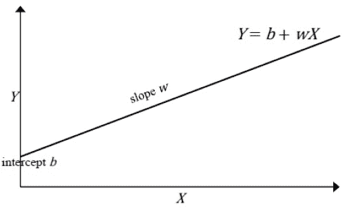

简单线性方程 Y=b+wX 的图示。

变量 `X` 有一个关联的系数 `w`，它常与以下术语交替使用：*权重*、*斜率* 或 *梯度*。在机器学习语境下，它最常被称为权重。

同理，`b` 代表与 *Y* 轴的截距，在机器学习中常称为 *偏置*。自变量 `X` 通常称为 *输入*，可与以下术语交替使用：*输入特征*、*属性*、*特征*、*字段* 和 *列*。因变量 `Y` 通常称为 *输出*、*目标、类别* 和 *标签*。

在现实中，我们往往不止有一个自变量，因此公式 (2.1) 必须更新为通用项公式 (2.2) 以适应这种情况。

```
Y = b + Σ(wj * Xj) for j=1 to n
```

其中，

- `Y` 是因变量
- `b` 是偏置
- `n` 是输入特征的数量
- `wj` 是第 j 个特征的权重
- `Xj` 是第 j 个特征的输入值

线性回归的目标是找到一个最佳拟合线性方程模型，该模型以公式 (2.2) 的形式映射输入 `X` 和输出 `Y` 之间的关系，并具有最优的权重和偏置，从而在已知真实输出 `Y` 值与模型预测输出 `Y` 值之间产生最小的误差（在机器学习中同义称为损失）。

让我们用小写 `xi` 表示第 i 个样本（来自训练数据集共 `m` 行样本）的特征值，则 `xij` 将是第 i 个样本中第 j 个特征（共 `n` 个输入特征）的值，如 图 (**2.2**) 所示。小写 `yi` 用于表示第 i 个样本的已知输出值（即真实输出值），`y^i` 用于表示线性方程模型对应的预测输出值。公式 (2.2) 随后更新为公式 (2.3)。

```
y^i = b + Σ(wj * xij) for j=1 to n
```

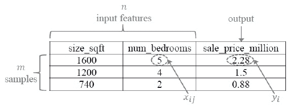

使用示例训练数据集的符号说明图示。

其中，

- `i ∈ {1, ..., m}` `m` 是训练样本数量
- `xij` 是第 i 个样本处第 j 个特征的值
- `b` 是偏置
- `n` 是输入特征的数量
- `wj` 是第 j 个特征的权重
- `y^i` 是第 i 个样本的预测值

### 均方误差 (MSE)

均方误差 (MSE) 函数（公式 2.4）通常用于量化预测输出值与真实输出值之间的平均损失 (`L`)。通俗地说，它表明了模型预测的效果如何。

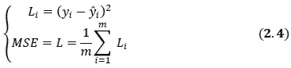

其中：

- `L` 是平均损失
- `m` 是训练样本的数量
- `yi` 是第 i 个样本的真实值
- `y^i` 是第 i 个样本的预测值

### 梯度下降优化

接下来，使用梯度下降优化算法，通过沿着减少损失的方向，每次微调偏置和权重的值，来寻找最优偏置和权重。

为了进行优化，我们首先需要求出平均损失 (`L`) 关于偏置和权重的偏导数，即 `∂L/∂b` 和 `∂L/∂wj`，它们表示偏置和各个权重对平均损失的贡献。这可以通过应用链式法则来完成，如公式 (2.5) 至 (2.9) 所示。

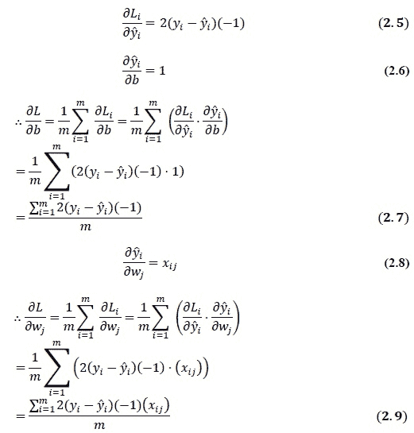

此处，`j ∈ [1, n]`，且 `n` 是特征的数量。

随后，使用梯度下降来更新偏置 `b`（公式 2.10）和权重 `w`（公式 2.11）。

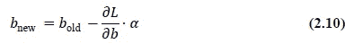

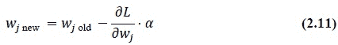

此处，`α` 是学习率（通常为较小值，例如 0.1、0.01、0.001）。

> **注意：** 本章中的数学符号和 Python 代码与本书第 3 章和第 4 章 [[5]](#9789815136982-C2.html#r5)、[[6]](#9789815136982-C2.html#r6) 中的内容有些相似。然而，第 3 章和第 4 章的重点分别在于正则化和逻辑回归，而本章的重点在于线性回归。

## 2.3 线性回归数值示例

假设我们有一个小型训练数据集（见表 2.1），仅包含 3 个样本（即 `m=3`），涉及基于 2 个输入特征（即 `n=2`）的房屋售价（以百万美元为单位，缩写为 `sale_price_million`），这两个特征分别是：房屋面积（平方英尺，缩写为 `size_sqft`）和房屋卧室总数（缩写为 `num_bedrooms`）。换句话说，对于本示例，`X` 是 `size_sqft` 和 `num_bedrooms`，`Y` 是 `sale_price_million`。我们的任务是构建一个将 `X` 和 `Y` 映射的最佳拟合线性回归模型。

**表 2.1：线性回归的小型数据集。**

| `size_sqft` | `num_bedrooms` | `sale_price_million` |
| :--- | :--- | :--- |
| 1600 | 5 | 2.28 |
| 1200 | 4 | 1.5 |
| 740 | 2 | 0.88 |


接下来，使用最大-最小归一化（如公式 2.12 所示）将特征值（即 `size_sqft` 和 `num_bedrooms` 列的值）归一化到 0 到 1 的通用尺度。如果不进行归一化，某些特征可能会主导机器学习过程。

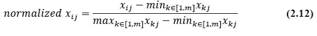

`size_sqft` 的最大值和最小值分别为 1600 和 740。同理，`num_bedrooms` 的最大值和最小值分别为 5 和 2。输出值（即 `sale_price_million`）保持原样，不进行任何归一化。对特征进行最大-最小归一化后的小型数据集见表 2.2。

**表 2.2：线性回归最大-最小归一化后的小型数据集。**

| `size_sqft` | `num_bedrooms` | `sale_price_million` |
| :--- | :--- | :--- |
| 1 | 1 | 2.28 |
| 0.5349 | 0.6667 | 1.5 |
| 0 | 0 | 0.88 |

现在，让我们开始机器学习过程以构建线性回归模型。

初始化偏置：

```
b = 0
```

初始化特征 `size_sqft` 的权重：

```
w1 = 0
```

初始化特征 `num_bedrooms` 的权重：

```
w2 = 0
```

设置学习率：

```
α = 0.01
```

> **注意：** 为便于书写和表达，除非另有说明，以下所有 `xij` 均默认指归一化后的 `xij`。

### 2.3.1 开始第一次学习迭代

取第一个训练样本的输入值并计算预测值 `ŷ1`：

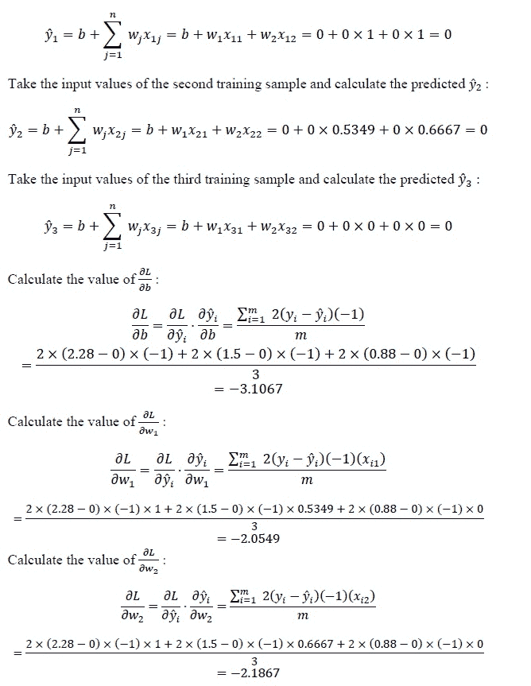
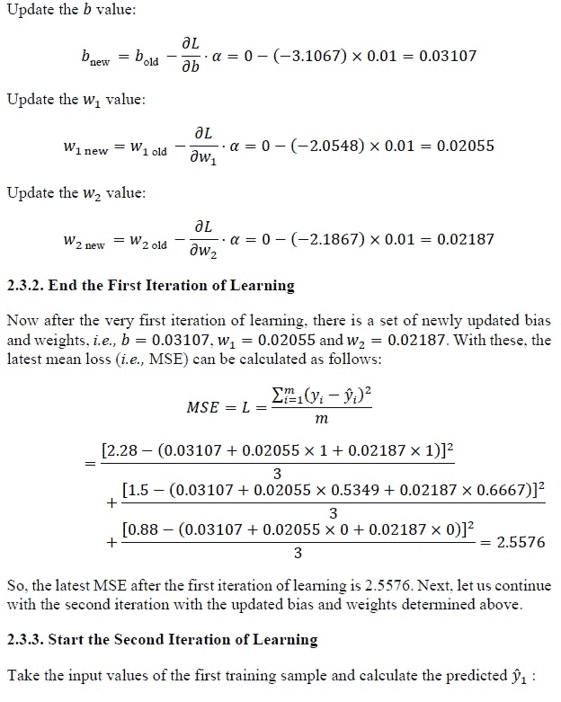
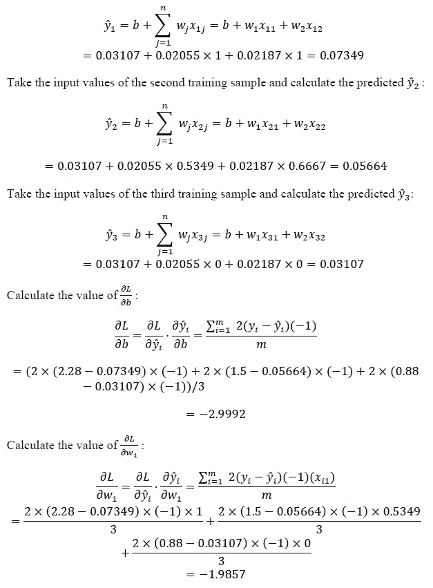
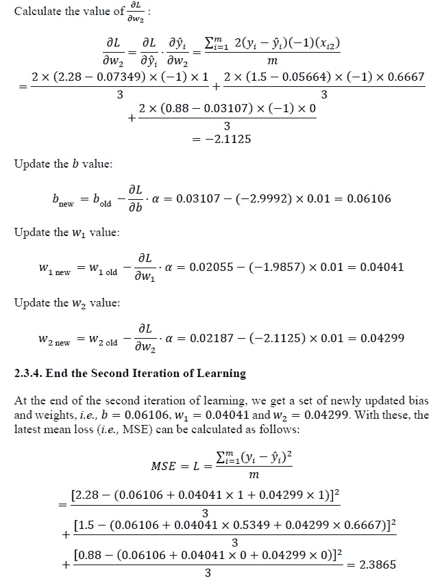

与第一次迭代后的 MSE = 2.5576 相比，可以注意到 MSE 现已降至 2.3865，表明线性回归模型的性能正在提升！

此外，将同一学习过程重复总共 500,000 次，以持续更新偏置和权重，直到真实输出值与预测输出值之间的平均损失稳定并达到最小值；只有那时，才说获得了最优偏置和权重。为简洁起见，本章不再展示从第三次迭代开始的详细计算，而是在表 2.3 中列出前五次和后五次迭代的偏置、权重和 MSE。如有必要，建议读者尝试按照上述详细计算再进行几次迭代，以更深入地理解训练线性回归模型的过程。此外，图 2.3 描绘了 MSE 随学习迭代次数增加而减小并最终稳定的过程。

**表 2.3：前五次和后五次迭代的偏置、权重和 MSE 值。**

| 迭代次数 | `b` | `w1` | `w2` | MSE |
| :--- | :--- | :--- | :--- | :--- |
| 1 | 0.03107 | 0.02055 | 0.02187 | 2.5576 |
| 2 | 0.06106 | 0.04041 | 0.04299 | 2.3865 |
| 3 | 0.09001 | 0.05959 | 0.06340 | 2.2270 |
| 4 | 0.11797 | 0.07814 | 0.08312 | 2.0782 |
| 5 | 0.14495 | 0.09606 | 0.10217 | 1.9394 |
| ... | ... | ... | ... | ... |
| 499,996 | 0.88000 | 2.37765 | -0.97765 | 3.272×10⁻¹⁹ |
| 499,997 | 0.88000 | 2.37765 | -0.97765 | 3.271×10⁻¹⁹ |
| 499,998 | 0.88000 | 2.37765 | -0.97765 | 3.271×10⁻¹⁹ |
| 499,999 | 0.88000 | 2.37765 | -0.97765 | 3.271×10⁻¹⁹ |
| 500,000 | 0.88000 | 2.37765 | -0.97765 | 3.271×10⁻¹⁹ |

如表 2.3 和图 2.3 所示，MSE 最终稳定在一个极小的值，表明我们已经训练出一个良好的模型，并确定了相应的最优偏置和权重。最终得到的线性回归模型可写为：

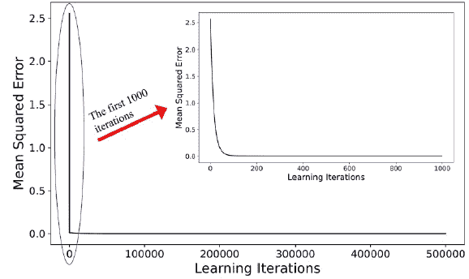

**图 2.3：均方误差 (MSE) 与学习迭代次数的关系。**

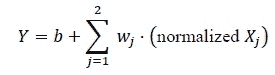
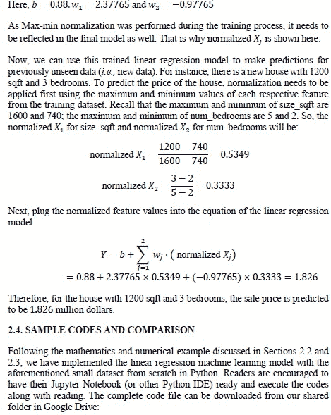

[`drive.google.com/drive/folders/1FqJvo4ZPazNbEH_GlHFoodqvegnQmHcn?usp=share_link`](https://drive.google.com/drive/folders/1FqJvo4ZPazNbEH_GlHFoodqvegnQmHcn?usp=share_link)

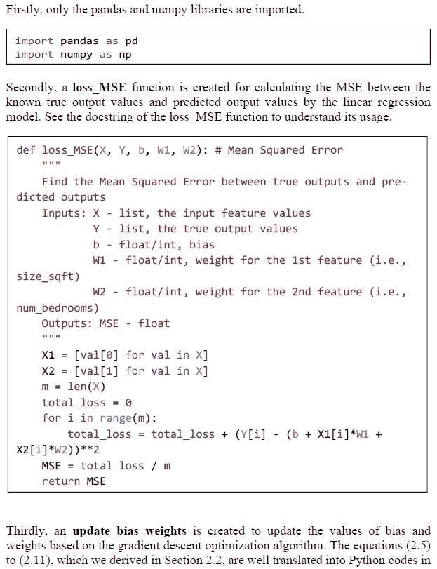
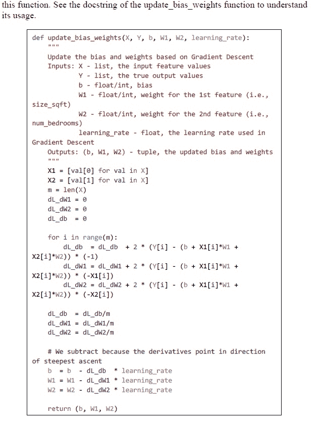
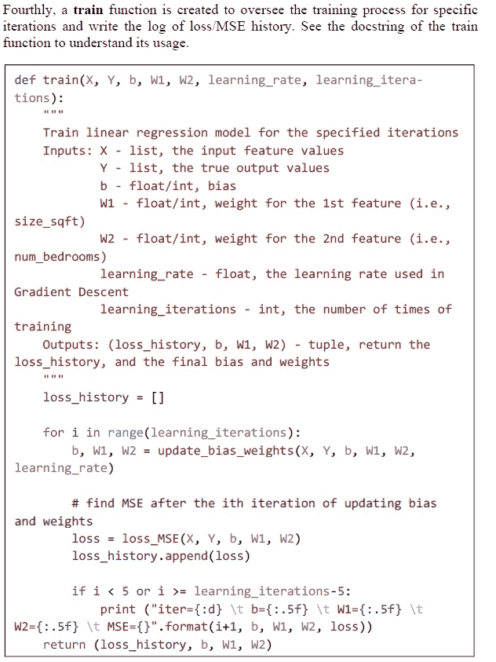
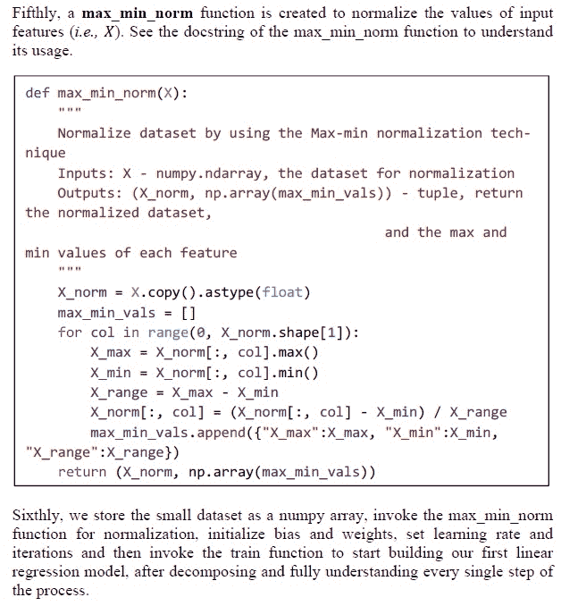
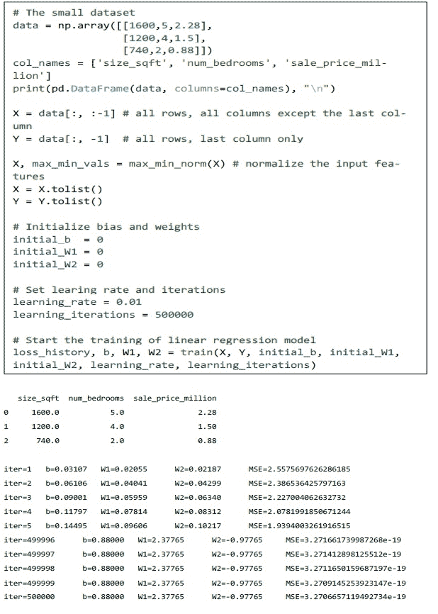
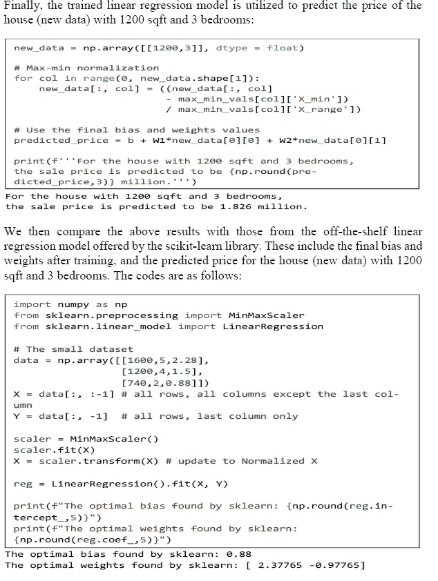
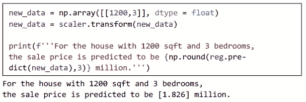

## 结论

在本章中，我们讨论了线性回归的概念，这是一种用于预测数值的流行机器学习算法。为了使内容更易懂，我们将抽象的数学理论降至最低。相反，我们专注于一个使用小型数据集预测房屋售价的具体数值示例，并逐步讲解。我们还提供了示例代码，并与现成的库 `scikit-learn` 中的线性回归模型进行了对比。读完本章后，读者应全面了解线性回归机器学习在幕后是如何工作的，数学原理如何与算法的实现和性能相关联，并能更好地将其应用于自己的项目中。

## 参考文献

| | |
| --- | --- |
| [1] | Yan X., Su X.G.. Linear regression analysis: Theory and computing. Singapore, Singapore: World Scientific Publishing; 2009. |
| [2] | Montgomery D.C., Peck E.A., Vining G.G.. Introduction to Linear Regression Analysis. 6th ed. Standards Information Network; 2021. |
| [3] | Casson R.J., Farmer L.D.M. Understanding and checking the assumptions of linear regression: a primer for medical researchers. *Clin. Exp. Ophthalmol.* **2014;** 42(6): 590-596. [CrossRef](http://dx.doi.org/10.1111/ceo.12358) [PubMed](http://www.ncbi.nlm.nih.gov/pubmed/24801277) |
| [4] | Kutner M.H., Neter J., Nachtsheim C.J., Wasserman W. Applied linear statistical models (int'l ed). 4th ed. Maidenhead; England: 2004. |
| [5] | Wang Z., Irfan S.A., Teoh C., Bhoyar P.H. "Regularization" in Numerical Machine Learning. Bentham Science; 2023. |
| [6] | Wang Z., Irfan S.A., Teoh C., Bhoyar P.H. "Logistic Regression" in Numerical Machine Learning. Bentham Science; 2023. |

# 正则化

**Zhiyuan Wang**, **Sayed Ameenuddin Irfan**, **Christopher Teoh**, **Priyanka Hriday Bhoyar**

## 摘要

本章深入探讨了线性回归背景下的 L1 和 L2 正则化技术，重点在于将过拟合风险降至最低，同时简明扼要地阐述数学理论。我们通过一个预测房屋销售价格的小型数据集具体数值示例来探讨这些技术，并提供分步演示。为进一步加深理解，我们提供了示例代码，并与 `scikit-learn` 库中实现的 Lasso 和 Ridge 模型进行了对比。读完本章后，读者将全面理解线性回归背景下的 L1 和 L2 正则化、它们对模型实现和性能的影响，并掌握在实际应用中使用这些方法的知识。

**关键词：** L1 正则化，L2 正则化，线性回归，数值示例，小型数据集，房价预测，Scikit-Learn，Lasso，Ridge。

## 3.1 L1 和 L2 正则化简介

正则化是指通过给权重值较大的更复杂模型增加额外惩罚项来防止过拟合的过程。过拟合是指机器学习模型专门针对训练数据集进行建模，导致其无法很好地泛化到先前未见过的数据集的问题。将正则化技术引入机器学习模型对于实现更好的泛化能力和在新数据上的性能提升至关重要。通过惩罚过于复杂的模型，正则化有助于得出更准确、更稳定的预测。常见的正则化方法包括 L1 和 L2 正则化，它们惩罚模型复杂度的方式不同。正则化已被证明是开发稳健可靠模型的关键组成部分，特别是在处理高维数据或含噪数据集时。它使从业者能够构建更高效的模型，这些模型能够适应新的多样化情况，同时降低过拟合风险并保持可解释性。

本章重点介绍 L1 和 L2 正则化，通过对第 2 章讨论的原始线性回归模型进行必要修改来详细演示。但请记住，L1 和 L2 正则化也可应用于其他机器学习模型（如逻辑回归）以及深度学习神经网络。

L1 和 L2 正则化的名称源自权重向量 `W` 对应的 L1 和 L2 范数。

L1 范数定义为：

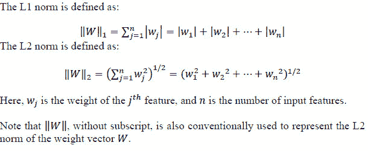

带有 L1 正则化的线性回归模型称为 Lasso（最小绝对收缩和选择算子）回归 [1, 2]，而带有 L2 正则化的线性回归模型称为 Ridge（岭）回归 [3, 4]。

## 3.2 线性回归 L1 正则化的数学原理

如果有一个以上的自变量 `X`（即输入特征），线性回归的通用方程如下：

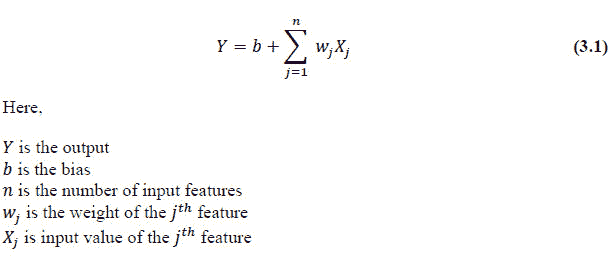

线性回归的目标是找到一个最佳拟合线性方程模型，该模型以公式 (3.1) 的形式映射输入 `X` 和输出 `Y` 之间的关系，具有最优的权重和偏置，使得已知真实输出 `Y` 值与模型预测输出 `Y` 值之间的误差（在机器学习中同义称为损失）最小。

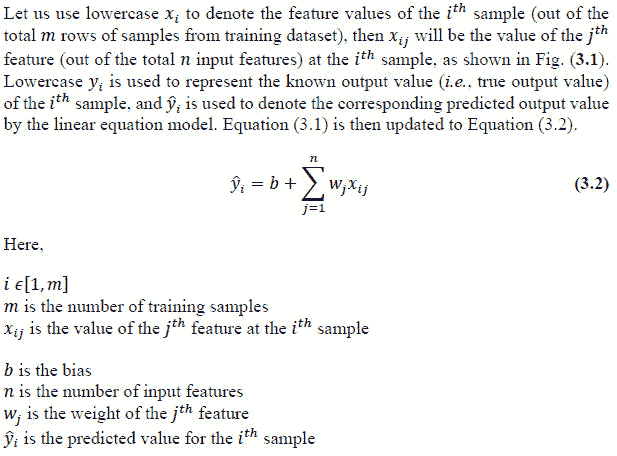

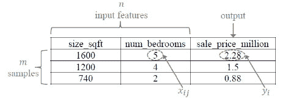
**图 (3.1)** 使用示例训练数据集的符号说明。

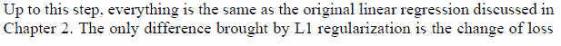
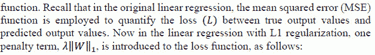
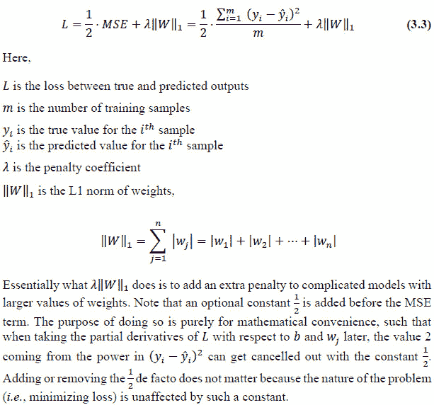

接下来，使用梯度下降优化算法，通过沿着减少损失的方向迭代地微调偏置和权重的值，来寻找最优偏置和权重。为了进行优化，我们首先需要求出平均损失（`L`）关于偏置和权重的偏导数，即 `∂L/∂b` 和 `∂L/∂wj`，它们分别表示偏置和各个权重对平均损失的贡献。这可以通过应用链式法则来完成，如公式 (3.4) 至 (3.9) 所示。

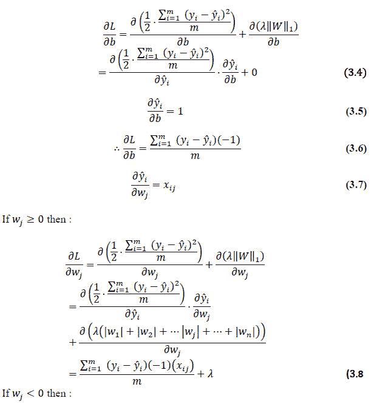
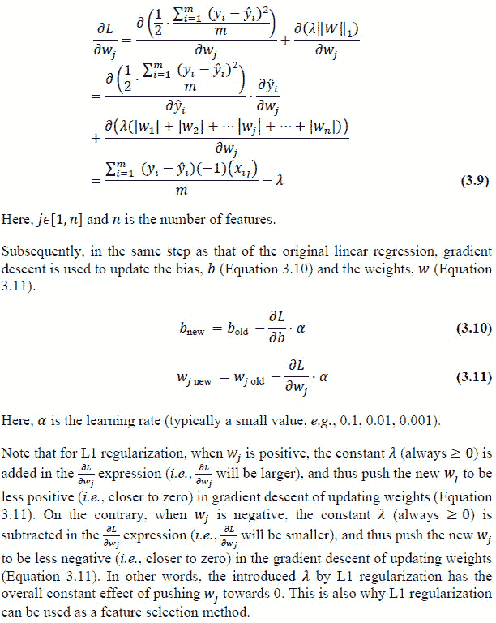

值得注意的是，本章中的数学符号和 Python 代码与本书第 2 章和第 4 章 [5, 6] 有些相似。然而，第 2 章和第 4 章的重点分别在于线性回归和逻辑回归，而本章的重点在于正则化。

## 3.3 线性回归 L1 正则化的数值示例

同第 2 章讨论的原始线性回归一样，假设我们有一个如（表 **3.1**）所示的小型训练数据集，仅包含 3 个样本（即 `m=3`），涉及基于 2 个输入特征（即 `n=2`）的房屋销售价格（以百万美元为单位，缩写为 `sale_price_million`），分别为：房屋面积（平方英尺，缩写为 `size_sqft`）和房屋卧室总数（缩写为 `num_bedrooms`）。换句话说，对于本示例，`X` 为 `size_sqft` 和 `num_bedrooms`，`Y` 为 `sale_price_million`。我们的任务是构建一个在 L1 正则化下映射 `X` 和 `Y` 的最佳拟合线性回归模型。

**表 3.1：正则化下线性回归的小型数据集。**

| **size_sqft** | **num_bedrooms** | **sale_price_million** |
| --- | --- | --- |
| 1600 | 5 | 2.28 |
| 1200 | 4 | 1.5 |
| 740 | 2 | 0.88 |

接下来，使用最大-最小归一化（如公式 (3.12) 所示）将特征值（即 `size_sqft` 和 `num_bedrooms` 列的值）归一化到 0 到 1 的通用尺度。如果不进行归一化，某些特征可能会主导机器学习过程。

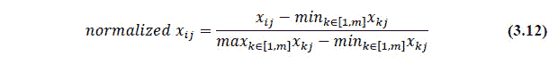

`size_sqft` 的最大值和最小值分别为 1600 和 740。同理，`num_bedrooms` 的最大值和最小值分别为 5 和 2。输出值（即 `sale_price_million`）保持原样，不进行任何归一化。对特征进行最大-最小归一化后的小型数据集如（表 **3.2**）所示。

**表 3.2：正则化下线性回归的最大-最小归一化后的小型数据集。**

| **size_sqft** | **num_bedrooms** | **sale_price_million** |
| --- | --- | --- |
| 1 | 1 | 2.28 |
| 0.5349 | 0.6667 | 1.5 |
| 0 | 0 | 0.88 |

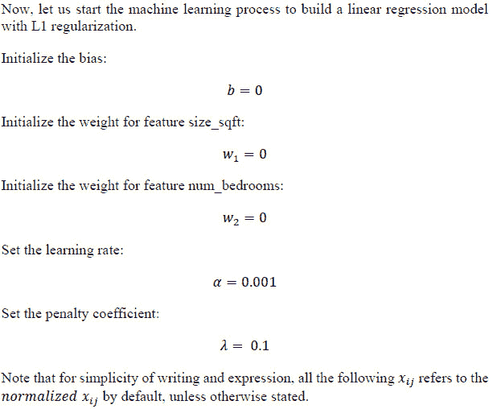

### 3.3.1 开始学习的第一次迭代

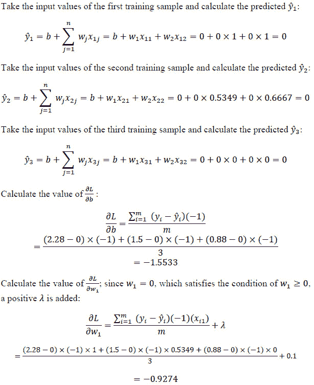
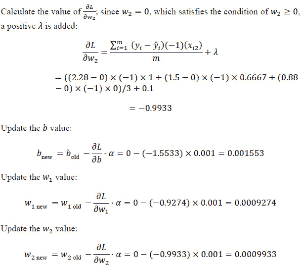

### 3.3.2 结束学习的第一次迭代

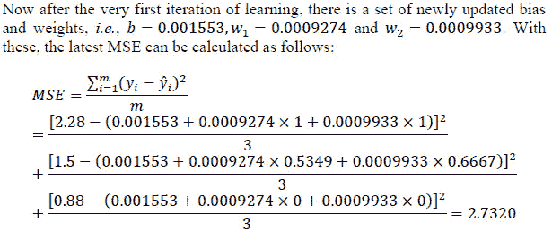

因此，使用 L1 正则化进行第一次学习迭代后的最新 MSE 为 2.7320。接下来，让我们继续进行第二次迭代，使用上述确定的更新后的偏置和权重。

### 3.3.3 开始学习的第二次迭代

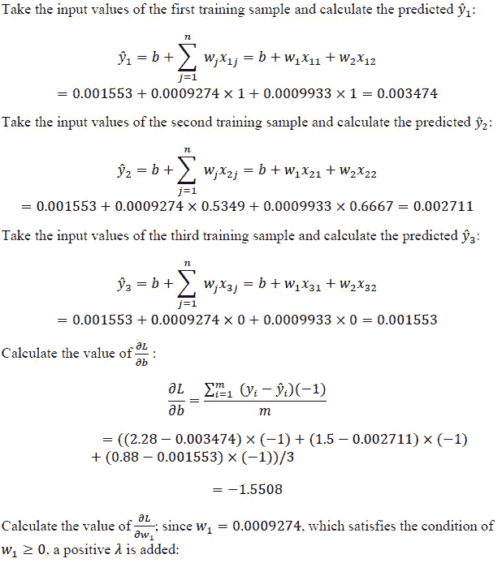
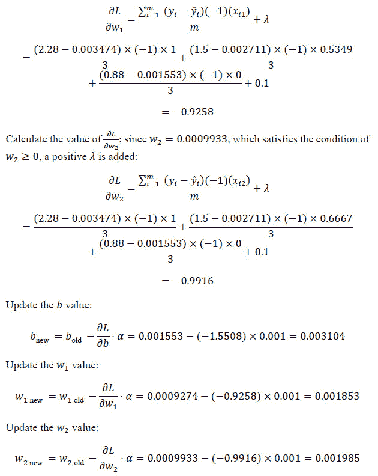

### 3.3.4 结束学习的第二次迭代

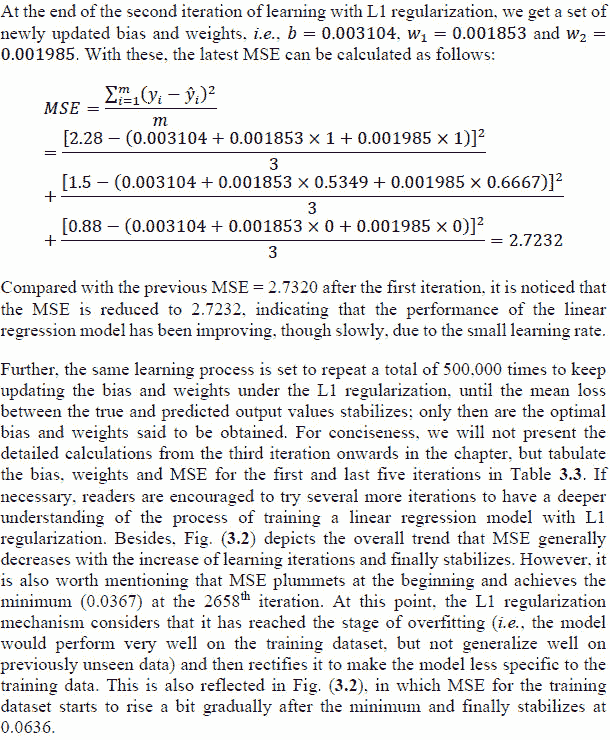

**表 3.3：训练 L1 正则化线性回归模型时，前五次和后五次迭代的偏置、权重及 MSE 值。**

| **迭代次数** | ***b*** | ***w[1]*** | ***w[2]*** | ***MSE*** |
| --- | --- | --- | --- | --- |
| 1 | 0.001553 | 0.0009274 | 0.0009933 | 2.7320 |
| 2 | 0.003104 | 0.001853 | 0.001985 | 2.7232 |
| 3 | 0.004652 | 0.002777 | 0.002975 | 2.7143 |
| 4 | 0.006198 | 0.003700 | 0.003963 | 2.7055 |
| 5 | 0.007741 | 0.004621 | 0.004949 | 2.6967 |
| ... | ... | ... | ... | ... |
| 499,996 | 1.1466 | 0.7949 | 0.00004110 | 0.0636 |
| 499,997 | 1.1466 | 0.7949 | 0.00003797 | 0.0636 |
| 499,998 | 1.1466 | 0.7949 | 0.00003485 | 0.0636 |
| 499,999 | 1.1466 | 0.7949 | 0.00003172 | 0.0636 |
| 500,000 | 1.1466 | 0.7949 | 0.00002860 | 0.0636 |

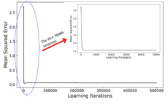

**图 3.2：训练 L1 正则化线性回归模型时的均方误差 (MSE) 对学习迭代次数。**

从**表 3.3**和**图 3.2**可以看出，MSE 最终稳定在 0.0636，这表明我们已在 L1 正则化下训练出一个良好的线性回归模型。最终得到的偏置和权重为 `b=1.1466`、`w1=0.7949` 和 `w2=0.00002860`。L1 正则化的一个重要亮点是，它会收缩模型认为不太重要的特征的权重，通常将其压缩为零，从而有效地充当特征选择的方法。然而，值得注意的是，这些“不太重要”的特征是由模型和数据决定的，可能与领域特定知识或更广泛的背景一致，也可能不一致。最终得到的线性回归模型可表示为：


## 线性回归模型预测示例

`Y = b + ∑(j=1 to 2) wj ⋅ normalized Xj`

此处，`b=1.1466`、`w1=0.7949` 和 `w2=0.00002860`。

由于在训练过程中执行了最大-最小归一化，因此最终模型中也需要体现这一点。这就是此处显示 `normalized Xj` 的原因。

现在，我们可以使用这个训练好的线性回归模型对先前未见过的数据（即新数据）进行预测。例如，有一栋面积为 1200 平方英尺、拥有 3 间卧室的新房子。为了预测房价，首先需要使用训练数据集中各自特征的最大值和最小值进行归一化。回顾一下，`size_sqft` 的最大值和最小值分别为 1600 和 740；`num_bedrooms` 的最大值和最小值分别为 5 和 2。因此，`size_sqft` 的 `normalized X1` 和 `num_bedrooms` 的 `normalized X2` 将为：

`normalized X1 = (1200 - 740) / (1600 - 740) = 0.5349`

`normalized X2 = (3 - 2) / (5 - 2) = 0.3333`

接下来，将归一化后的特征值代入线性回归模型方程：

`Y = b + ∑(j=1 to 2) wj ⋅ normalized Xj = 1.1466 + 0.7949 × 0.5349 + 0.00002860 × 0.3333 = 1.572`

因此，对于面积 1200 平方英尺、3 间卧室的房子，预测售价为 157.2 万美元。

## 3.4 线性回归 L1 正则化的示例代码与对比

继第 3.2 节和第 3.3 节讨论的数学原理和数值示例之后，我们已使用 Python 从头实现了前述小数据集的 L1 正则化线性回归机器学习模型。该代码与第 2 章讨论的原始线性回归代码相似。区别在于 `update_bias_weights()` 函数，这是由于损失函数中增加了 L1 正则化项（即 `λW1`）。建议读者准备好 Jupyter Notebook（或其他 Python IDE），并在阅读时尝试运行代码。完整代码文件可从我们的 Google Drive 共享文件夹下载：

<https://drive.google.com/drive/folders/1FqJvo4ZPazNbEH_GlHFoodqvegnQmHcn?usp=share_link>

首先，仅导入 `pandas` 和 `numpy` 库。

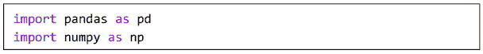

其次，创建 `loss_MSE()` 函数，用于计算已知真实输出值与线性回归模型预测输出值之间的 MSE。请参阅 `loss_MSE()` 函数的文档字符串以了解其用法。

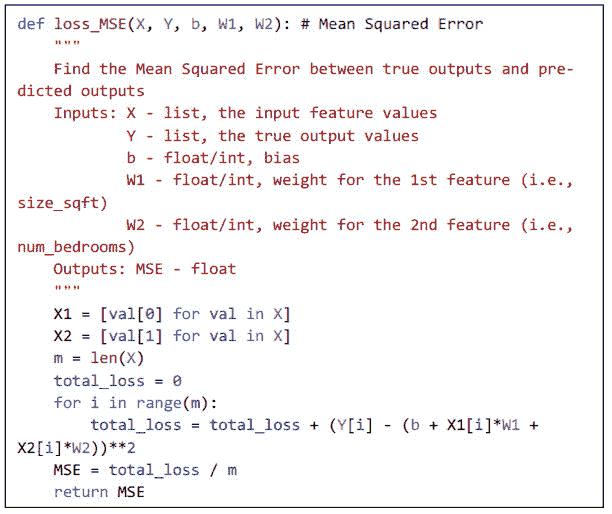

第三，创建 `update_bias_weights()` 函数，基于梯度下降优化算法更新偏置和权重的值。我们在第 3.2 节推导的公式 (3.4) 至 (3.11) 在该函数中已被很好地转化为 Python 代码。请参阅 `update_bias_weights()` 函数的文档字符串以了解其用法。

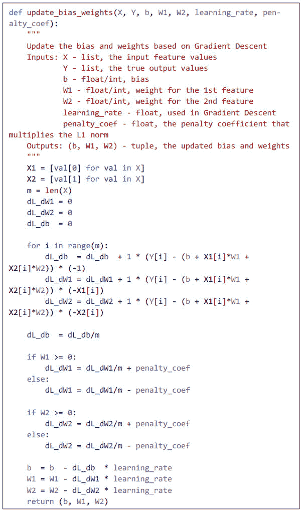

第四，创建 `train()` 函数，监督特定迭代次数的训练过程并记录损失/MSE 历史记录。请参阅 `train()` 函数的文档字符串以了解其用法。

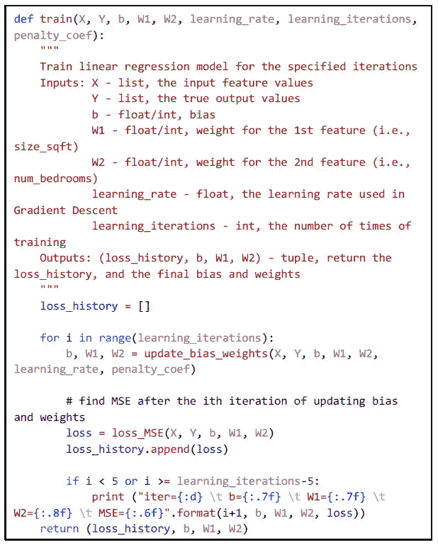

第五，创建 `max_min_norm()` 函数，用于归一化输入特征（即 `X`）的值。请参阅 `max_min_norm()` 函数的文档字符串以了解其用法。

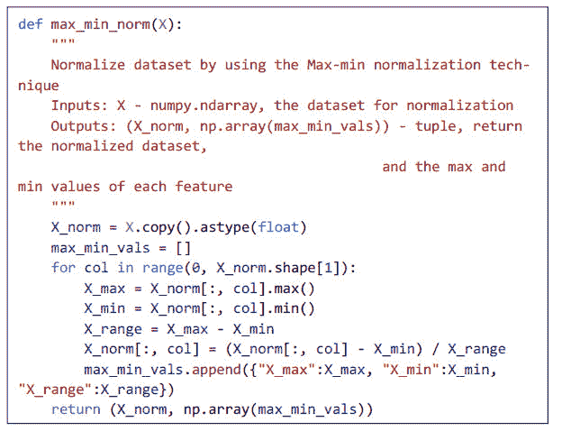

第六，我们将小数据集存储为 numpy 数组，调用 `max_min_norm()` 函数进行归一化，初始化偏置和权重，设置学习率、迭代次数和乘以 L1 正则化项的惩罚系数，然后调用 `train()` 函数开始构建我们的第一个 L1 正则化线性回归模型，此前已对每个步骤进行了分解和彻底理解。

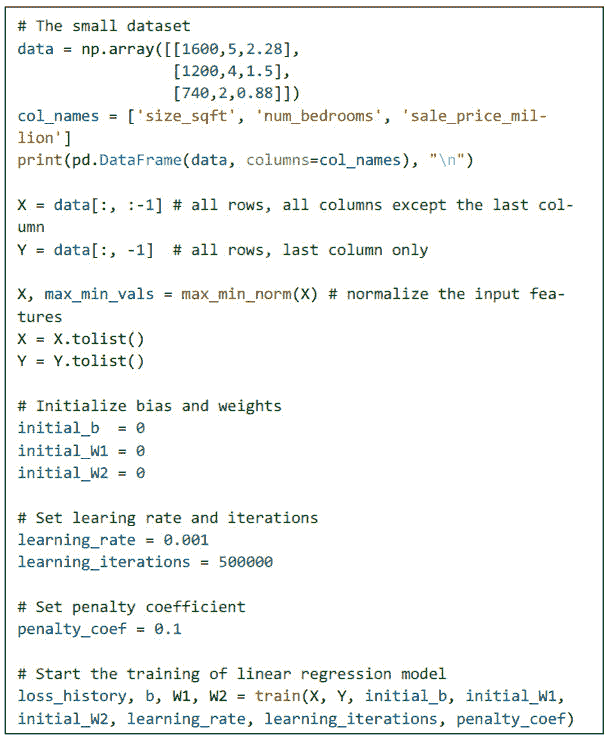

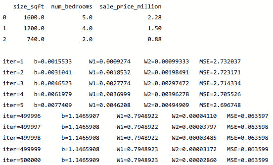

最后，利用训练好的线性回归模型预测面积 1200 平方英尺、3 间卧室的房子（新数据）的价格：

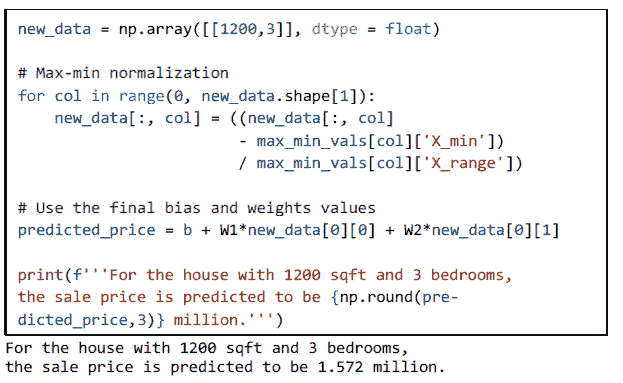

然后，我们将上述结果与 `scikit-learn` 库提供的现成 L1 正则化线性回归模型（即 Lasso）的结果进行对比。这些对比内容包括训练后的最终偏置和权重、最终 MSE，以及对面积 1200 平方英尺、3 间卧室的房子（新数据）的预测价格。代码如下：

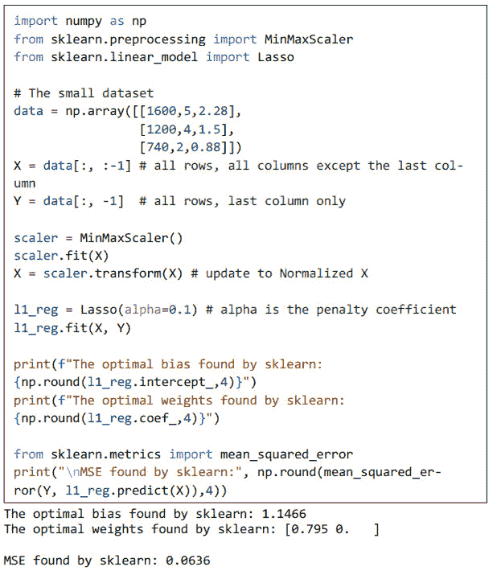

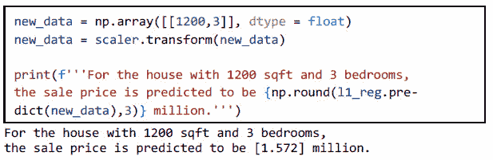

从使用 `scikit-learn` L1 正则化线性回归模型（即 Lasso）的结果可以看出，最终的偏置、权重和 MSE 值与我们自己的 L1 正则化线性回归模型给出的值相同或极其接近（即 `b=1.1466`、`w1=0.7949`、`w2=0.00002860` 和 `MSE=0.0636`）。此外，对于先前未见过的面积 1200 平方英尺、3 间卧室的房子，其预测价格也与我们自己的模型产生的结果相同（即 157.2 万美元）。

## 3.5 线性回归 L2 正则化的数学原理

L2 正则化线性回归再次从拥有多个自变量 `X`（即输入特征）时的线性回归通用方程开始，如下所示：

`Y = b + ∑(j=1 to n) wj Xj` (3.13)

此处，

- `Y` 是输出
- `b` 是偏置
- `n` 是输入特征的数量
- `wj` 是第 `j` 个特征的权重
- `Xj` 是第 `j` 个特征的输入值

让我们用小写 xi 来表示第 i 个样本的特征值（来自训练数据集总共 m 行样本），那么 xij 将是第 i 个样本处第 j 个特征的值（来自总共 n 个输入特征），如图 (3.1) 所示。小写 yi 用于表示第 i 个样本的已知输出值（即真实输出值），而 y^i 用于表示线性方程模型对应的预测输出值。因此，公式 (3.13) 更新为公式 (3.14)。

`y^i = b + ∑j=1n wj xij`   (3.14)

其中，

*   `i ∈ [1, m]`：`m` 是训练样本的数量
*   `xij`：第 i 个样本处第 j 个特征的值
*   `b`：偏置
*   `n`：输入特征的数量
*   `wj`：第 j 个特征的权重
*   `y^i`：第 i 个样本的预测值

到目前为止，一切与第 2 章讨论的原始线性回归相同。L2 正则化带来的关键差异是向损失函数引入了惩罚项 `λ||W||²₂`（即惩罚系数乘以权重的平方 L2 范数），如下所示：

`L = m⋅MSE + λ||W||²₂ = m⋅∑i=1m (yi - y^i)²/m + λ||W||²₂ = ∑i=1m (yi - y^i)² + λ||W||²₂`   (3.15)

其中，

*   `L`：真实输出与预测输出之间的损失
*   `m`：训练样本的数量
*   `yi`：第 i 个样本的真实值
*   `y^i`：第 i 个样本的预测值
*   `λ`：惩罚系数
*   `||W||²₂`：权重的平方 L2 范数，
    `||W||²₂ = ∑j=1n wj² = w1² + w2² + … + wn²`

利用梯度下降优化算法，通过沿着减少损失的方向每次微调极小的数值，迭代地寻找最优偏置和权重。在此之前，我们需要求出平均损失（`L`）关于偏置和权重的偏导数，即 `∂L/∂b` 和 `∂L/∂wj`，它们表示偏置和各个权重对平均损失的贡献。

```
∂L/∂b = ∂∑i=1m (yi - y^i)²/∂b + ∂λ||W||²₂/∂b
      = ∂∑i=1m (yi - y^i)²/∂y^i ⋅ ∂y^i/∂b + 0          (3.16)
```

`∂y^i/∂b = 1`   (3.17)

`∴ ∂L/∂b = ∑i=1m 2(yi - y^i)(-1)`   (3.18)

`∂y^i/∂wj = xij`   (3.19)

```
∂L/∂wj = ∂∑i=1m (yi - y^i)²/∂wj + ∂λ||W||²₂/∂wj
       = ∂∑i=1m (yi - y^i)²/∂y^i ⋅ ∂y^i/∂wj + ∂λ(w1²+w2²+…+wj²+…+wn²)/∂wj
       = ∑i=1m 2(yi - y^i)(-1)xij + 2λwj                (3.20)
```

这里，`j ∈ [1, n]`，且 `n` 是特征的数量。

随后，使用梯度下降来更新偏置 `b`（公式 3.21）和权重 `w`（公式 3.22）。

`b_new = b_old - ∂L/∂b ⋅ α`   (3.21)

`wj_new = wj_old - ∂L/∂wj ⋅ α`   (3.22)

这里，`α` 是学习率（通常为较小的值，例如 0.1、0.01、0.001）。

## 3.6 线性回归 L2 正则化的数值示例

与第 2 章讨论的原始线性回归以及本章 3.3 节讨论的 L1 正则化线性回归一样，我们采用一个小型训练数据集，如（表 3.1）所示，仅包含 3 个样本（即 `m=3`），涉及以百万美元为单位的房屋销售价格（简写为 `sale_price_million`），基于 2 个输入特征（即 `n=2`），分别为房屋面积（平方英尺，简写为 `size_sqft`）和房屋卧室总数（简写为 `num_bedrooms`）。换句话说，对于这个例子，`X` 是 `size_sqft` 和 `num_bedrooms`，`Y` 是 `sale_price_million`。我们的任务是构建一个在 L2 正则化下将 `X` 和 `Y` 映射的最佳拟合线性回归模型。

接下来，使用最大-最小归一化（如公式 (3.12) 所示）将特征值（即 `size_sqft` 和 `num_bedrooms` 列的值）归一化，使它们处于 0 到 1 的通用尺度上。特征经过最大-最小归一化后的小型数据集如（表 3.2）所示。

现在，让我们开始机器学习过程，构建一个带有 L2 正则化的线性回归模型。

初始化偏置：

`b = 0`

初始化特征 `size_sqft` 的权重：

`w1 = 0`

初始化特征 `num_bedrooms` 的权重：

`w2 = 0`

设置学习率：

`α = 0.001`

设置惩罚系数：

`λ = 0.1`

注意，为了书写和表达的简便，除非另有说明，以下所有 `xij` 默认均指归一化后的 `xij`。

### 3.6.1 开始学习的第一次迭代

取第一个训练样本的输入值并计算预测 `y¹`：

`y¹ = b + ∑j=1n wj x1j = b + w1 x11 + w2 x12 = 0 + 0×1 + 0×1 = 0`

取第二个训练样本的输入值并计算预测 `y²`：

`y² = b + ∑j=1n wj x2j = b + w1 x21 + w2 x22 = 0 + 0×0.5349 + 0×0.6667 = 0`

取第三个训练样本的输入值并计算预测 `y³`：

`y³ = b + ∑j=1n wj x3j = b + w1 x31 + w2 x32 = 0 + 0×0 + 0×0 = 0`

计算 `∂L/∂b` 的值：

```
∂L/∂b = ∑i=1m 2(yi - y^i)(-1)
      = 2×(2.28-0)×(-1) + 2×(1.5-0)×(-1) + 2×(0.88-0)×(-1)
      = -9.3200
```

计算 `∂L/∂w1` 的值：

```
∂L/∂w1 = ∑i=1m 2(yi - y^i)(-1)xi1 + 2λw1
       = 2×(2.28-0)×(-1)×1 + 2×(1.5-0)×(-1)×0.5349 + 2×(0.88-0)×(-1)×0 + 2×0.1×0
       = -6.1647
```

计算 `∂L/∂w2` 的值：

```
∂L/∂w2 = ∑i=1m 2(yi - y^i)(-1)xi2 + 2λw2
       = 2×(2.28-0)×(-1)×1 + 2×(1.5-0)×(-1)×0.6667 + 2×(0.88-0)×(-1)×0 + 2×0.1×0
       = -6.5601
```

更新 `b` 值：

`b_new = b_old - ∂L/∂b ⋅ α = 0 - (-9.3200)×0.001 = 0.009320`

更新 `w1` 值：

`w1_new = w1_old - ∂L/∂w1 ⋅ α = 0 - (-6.1647)×0.001 = 0.006165`

更新 `w2` 值：

`w2_new = w2_old - ∂L/∂w2 ⋅ α = 0 - (-6.5601)×0.001 = 0.006560`

### 3.6.2 结束学习的第一次迭代

现在，经过第一次学习迭代，我们得到一组新更新的偏置和权重，即 `b=0.009320`、`w1=0.006165` 和 `w2=0.006560`。利用这些，可以计算最新的 MSE，如下所示：

```
MSE = ∑i=1m (yi - y^i)²/m
    = [2.28 - (0.009320 + 0.006165×1 + 0.006560×1)]²/3
    + [1.5 - (0.009320 + 0.006165×0.5349 + 0.006560×0.6667)]²/3
    + [0.88 - (0.009320 + 0.006165×0 + 0.006560×0)]²/3
    = 2.6853
```

因此，带有 L2 正则化的第一次学习迭代后的最新 MSE 为 2.6853。接下来将继续进行第二次迭代。

### 3.6.3 开始学习的第二次迭代

取第一个训练样本的输入值并计算预测 `y¹`：

`y¹ = b + ∑j=1n wj x1j = b + w1 x11 + w2 x12 = 0.009320 + 0.006165×1 + 0.006560×1 = 0.02205`

取第二个训练样本的输入值并计算预测 `y²`：

`y² = b + ∑j=1n wj x2j = b + w1 x21 + w2 x22 = 0.009320 + 0.006165×0.5349 + 0.006560×0.6667 = 0.01699`

取第三个训练样本的输入值并计算预测 `y³`：

`y³ = b + ∑j=1n wj x3j = b + w1 x31 + w2 x32 = 0.009320 + 0.006165×0 + 0.006560×0 = 0.009320`

计算 `∂L/∂b` 的值：

```
∂L/∂b = ∑i=1m 2(yi - y^i)(-1)
      = 2×(2.28-0.02205)×(-1) + 2×(1.5-0.01699)×(-1) + 2×(0.88-0.009320)×(-1)
      = -9.2233
```

计算 `∂L/∂w1` 的值：

```
∂L/∂w1 = ∑i=1m 2(yi - y^i)(-1)xi1 + 2λw1
       = 2×(2.28-0.02205)×(-1)×1 + 2×(1.5-0.01699)×(-1)×0.5349 + 2×(0.88-0.009320)×(-1)×0 + 2×0.1×0.006165
       = -6.1012
```

计算 `∂L/∂w2` 的值：

```
∂L/∂w2 = ∑i=1m 2(yi - y^i)(-1)xi2 + 2λw2
       = 2×(2.28-0.02205)×(-1)×1 + 2×(1.5-0.01699)×(-1)×0.6667 + 2×(0.88-0.009320)×(-1)×0 + 2×0.1×0.006560
       = -6.4920
```

更新 `b` 值：

`b_new = b_old - ∂L/∂b ⋅ α = 0.009320 - (-9.2233)×0.001 = 0.01854`

更新 `w1` 值：

`w1_new = w1_old - ∂L/∂w1 ⋅ α = 0.006165 - (-6.1012)×0.001 = 0.01227`

更新 `w2` 值：

`w2_new = w2_old - ∂L/∂w2 ⋅ α = 0.006560 - (-6.4920)×0.001 = 0.01305`

### 3.6.4 结束学习的第二次迭代

在带有 L2 正则化的第二次学习迭代结束时，我们得到一组新更新的偏置和权重，即 `b=0.01854`、`w1=0.01227` 和 `w2=0.01305`。利用这些，可以计算最新的 MSE，如下所示：

```
MSE = ∑i=1m (yi - y^i)²/m
    = [2.28 - (0.01854 + 0.01227×1 + 0.01305×1)]²/3
    + [1.5 - (0.01854 + 0.01227×0.5349 + 0.01305×0.6667)]²/3
    + [0.88 - (0.01854 + 0.01227×0 + 0.01305×0)]²/3
    = 2.6307
```

与第一次迭代后的 MSE=2.6853 相比，可以注意到 MSE 降低到了 2.6307，表明线性回归模型的性能正在提升，尽管由于较小的学习率，提升速度较慢。

## 进一步训练与结果

此外，将相同的学习过程设置为总共重复 500,000 次，以便在 L2 正则化下持续更新偏置和权重，直到真实输出值与预测输出值之间的平均损失稳定下来；只有到那时，才说获得了最优的偏置和权重。为求简洁，本章将不再展示从第三次迭代开始的详细计算，而是在**表 3.4**中列出前五次和后五次迭代的偏置、权重和 MSE。如有必要，建议读者自行尝试更多次迭代，以更深入地理解带有 L2 正则化的线性回归模型训练过程。此外，**图 3.3** 描绘了 MSE 随学习迭代次数的增加而减小并最终稳定的情况。


> **图 3.3：** 训练 L2 正则化线性回归模型时的均方误差 (MSE) 与学习迭代次数的关系。

**表 3.4：** 训练 L2 正则化线性回归模型时前五次和后五次迭代的偏置、权重和 MSE 值。

| 迭代次数 | b | w[1] | w[2] | MSE |
| --- | --- | --- | --- | --- |
| 1 | 0.009320 | 0.006165 | 0.006560 | 2.6853 |
| 2 | 0.01854 | 0.01227 | 0.01305 | 2.6307 |
| 3 | 0.02767 | 0.01830 | 0.01948 | 2.5773 |
| 4 | 0.03670 | 0.02428 | 0.02583 | 2.5250 |
| 5 | 0.04564 | 0.03019 | 0.03213 | 2.4737 |
| ... | ... | ... | ... | ... |
| 499,996 | 0.8907 | 0.7100 | 0.5390 | 0.01222 |
| 499,997 | 0.8907 | 0.7100 | 0.5390 | 0.01222 |
| 499,998 | 0.8907 | 0.7100 | 0.5390 | 0.01222 |
| 499,999 | 0.8907 | 0.7100 | 0.5390 | 0.01222 |
| 500,000 | 0.8907 | 0.7100 | 0.5390 | 0.01222 |

从**表 3.4**和**图 3.3**可以看出，MSE 最终稳定在一个较小的值 0.01222，这表明我们已经训练出了一个良好的带有 L2 正则化的线性回归模型，其中最优偏置和权重为 `b=0.8907`、`w1=0.71` 和 `w2=0.539`。由此得到的线性回归模型可表示为：

`Y = b + ∑(j=1 to 2) wj ⋅ normalized Xj`

此处，`b=0.8907`、`w1=0.71` 和 `w2=0.539`。

由于在训练过程中执行了最大-最小归一化，因此最终模型也需要反映这一点。这就是此处显示 `normalized Xj` 的原因。

现在，我们可以使用这个训练好的线性回归模型对先前未见过的数据（即新数据）进行预测。例如，有一栋面积为 1200 平方英尺、拥有 3 间卧室的新房子。为了预测房价，首先需要使用训练数据集中各特征的最大值和最小值进行归一化。回顾一下，`size_sqft` 的最大值和最小值分别为 1600 和 740；`num_bedrooms` 的最大值和最小值分别为 5 和 2。因此，`size_sqft` 对应的归一化 `X1` 和 `num_bedrooms` 对应的归一化 `X2` 将为：

`normalized X1 = (1200 - 740) / (1600 - 740) = 0.5349`

`normalized X2 = (3 - 2) / (5 - 2) = 0.3333`

接下来，将归一化后的特征值代入线性回归模型方程：

`Y = b + ∑(j=1 to 2) wj ⋅ normalized Xj = 0.8907 + 0.71 × 0.5349 + 0.539 × 0.3333 = 1.45`

因此，对于这栋面积 1200 平方英尺、3 间卧室的房子，预测售价为 145 万美元。

# 3.7. 线性回归 L2 正则化的示例代码与对比

根据第 3.5 节和第 3.6 节讨论的数学原理和数值示例，我们使用 Python 从头实现了带有上述小数据集的 L2 正则化线性回归机器学习模型。该代码与第 2 章讨论的原始线性回归代码相似。区别在于 `update_bias_weights()` 函数，这是由于损失函数中增加了 L2 正则化项（即 `λW²/2`）。建议读者准备好 Jupyter Notebook（或其他 Python IDE），并在阅读时尝试运行代码。完整的代码文件可从我们的 Google Drive 共享文件夹下载：

<https://drive.google.com/drive/folders/1FqJvo4ZPazNbEH_GlHFoodqvegnQmHcn?usp=share_link>

首先，仅导入 `pandas` 和 `numpy` 库。

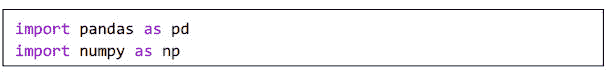

其次，创建 `loss_MSE()` 函数，用于计算线性回归模型的已知真实输出值与预测输出值之间的 MSE。请参阅 `loss_MSE()` 函数的文档字符串以了解其用法。


第三，创建 `update_bias_weights()` 函数，用于根据梯度下降优化算法更新偏置和权重的值。我们在第 3.5 节推导的公式 (3.16) 至 (3.22) 在此函数中已被很好地转化为 Python 代码。请参阅 `update_bias_weights()` 函数的文档字符串以了解其用法。


第四，创建 `train()` 函数，用于监督特定迭代次数的训练过程并记录损失/MSE 历史记录。请参阅 `train()` 函数的文档字符串以了解其用法。


第五，创建 `max_min_norm()` 函数，用于归一化输入特征（即 `X`）的值。请参阅 `max_min_norm()` 函数的文档字符串以了解其用法。


第六，我们将小数据集存储为 numpy 数组，调用 `max_min_norm()` 函数进行归一化，初始化偏置和权重，设置学习率、迭代次数和乘以 L2 正则化项的惩罚系数，然后调用 `train()` 函数开始构建我们的第一个 L2 正则化线性回归模型，这需要在分解并完全理解每一个步骤的过程后进行。


然后，我们将上述结果与 `scikit-learn` 库提供的现成 L2 正则化线性回归模型（即 `Ridge`）的结果进行对比。这些对比包括训练后的最终偏置和权重、最终 MSE，以及对那栋面积 1200 平方英尺、3 间卧室的房子（新数据）的预测价格。代码如下：


从使用 `scikit-learn` L2 正则化线性回归模型（即 `Ridge`）的结果可以看出，最终的偏置、权重和 MSE 值与我们自己实现的 L2 正则化线性回归模型给出的值相同（即 `b=0.8907`、`w1=0.71` 和 `w2=0.539`，以及 `MSE=0.01222`）。此外，对那栋先前未见过的、面积 1200 平方英尺、3 间卧室的房子的预测价格，也与我们自己模型产生的结果相同（即 145 万美元）。

## 结论

在本章中，我们在线性回归的背景下讨论了 L1 和 L2 正则化的概念。为了使内容更易懂，我们将抽象的数学理论降至最低。相反，我们专注于一个使用小数据集预测房屋售价的具体数值示例，并逐步进行了讲解。我们还提供了示例代码，并与现成库 `scikit-learn` 中的 `Lasso` 和 `Ridge` 模型进行了对比。读完本章后，读者应能全面理解 L1 和 L2 正则化如何在幕后工作以防止过拟合风险，数学原理如何与技术的实现和性能相关联，并能更好地在项目中应用它们。

## 参考文献

| | |
| --- | --- |
| [1] | Tibshirani R. Regression shrinkage and selection via the lasso. *J. R. Stat. Soc. B* 1996;58(1):267–288. doi:10.1111/j.2517-6161.1996.tb02080.x |
| [2] | James G., Witten D., Hastie T., Tibshirani R. *An introduction to statistical learning: With applications in R*. 1st ed. New York, NY: Springer; 2013. doi:10.1007/978-1-4614-7138-7 |
| [3] | Gruber M.H.J. *Improving efficiency by shrinkage: The James-stein and ridge regression estimators*. Routledge; 2017. doi:10.1201/9780203751220 |
| [4] | Bishop C.M.. Pattern Recognition and Machine Learning. New York, NY: Springer, 2006 |
| [5] | Wang Z., Irfan S.A., Teoh C., Bhoyar P.H.. "Linear Regression" in Numerical Machine Learning. Chapter 2. Bentham Science, 2023 |
| [6] | Wang Z., Irfan S.A., Teoh C., Bhoyar P.H.. "Logistic Regression" in Numerical Machine Learning. Chapter 4. Bentham Science, 2023 |

# 逻辑回归

**Zhiyuan Wang**, **Sayed Ameenuddin Irfan**, **Christopher Teoh**, **Priyanka Hriday Bhoyar**

## 摘要

本章深入探讨了逻辑回归，这是一种广泛用于分类任务的机器学习算法，重点在于通过最小化抽象数学概念来保持易读性。我们提供了一个具体的数值示例，利用小型数据集预测房地产市场中房屋的销售难易度，引导读者完成每一个步骤。此外，我们还提供了示例代码，并将其与 `scikit-learn` 库中可用的逻辑回归模型进行了对比。读完本章后，读者将全面了解逻辑回归的内部运作机制、其与算法实现和性能的关系，以及将其应用于实际应用所需的知识。

**关键词：** 逻辑回归、分类、数值示例、小型数据集、Scikit-Learn。

## 4.1. 逻辑回归简介

逻辑回归是一种监督机器学习算法，用于在给定输入特征的情况下对离散输出的概率进行建模 [[1]](#9789815136982-C4.html#r1)，[[2]](#9789815136982-C4.html#r2)。尽管名字里带有“回归”，但逻辑回归更多的是一种分类模型而非回归模型。它通常用于对二分（二元）输出进行建模，*即* 任何具有两个可能值/类别/标签的事物，例如真/假、是/否、1/0、开/关、好/坏、恶性/良性、通过/不通过等。逻辑回归的基础在于其利用逻辑函数（也称为 Sigmoid 函数）来模拟输入特征与分类结果之间关系的能力。该函数确保预测概率位于 0 和 1 之间，使其适用于分类任务。由于其简单性、可解释性以及在各种实际应用中的高效性，逻辑回归获得了极大的普及。其中一些应用包括垃圾邮件过滤、客户流失预测、医学诊断和信用风险评估。

与线性回归不同，逻辑回归不要求自变量（`X`）和因变量（`Y`）之间存在线性关系的假设。此外，真实输出与预测输出之间的误差不需要符合正态分布。而且，误差的分布（即误差的方差）不必沿因变量的值保持恒定；也就是说，不要求同方差性。然而，逻辑回归仍有几个基本假设 [[3]](#9789815136982-C4.html#r3)，[[4]](#9789815136982-C4.html#r4)。首先，当存在多个自变量（`X`）时，要求自变量之间几乎没有或没有相关性（*即* 几乎没有或没有多重共线性）。其次，它假设自变量与几率的对数存在线性关系；几率只是表达概率（`P`）的另一种方式，定义为事件发生的概率与事件不发生的概率之比（*即* `P/(1-P)`）。第三，默认情况下，逻辑回归用于解决二分类问题，要求因变量（`Y`）是二分的。另一方面，值得注意的是，通过一些修改和改进（如一对其余 [OvR] 方法），逻辑回归可以扩展用于解决多分类问题。然而，多分类不在本章范围内，因为本章专注于使用逻辑回归算法进行二分类。

## 4.2. 逻辑回归的数学原理

从数学上讲，第 2 章讨论的线性回归在引入 Sigmoid 函数将线性输出映射为概率并采用不同的损失函数后，可以升级为逻辑回归。

与第 2 章中线性回归的公式 (2.2) 相比，此处公式 (4.1) 唯一的变化是使用变量 `Z`（而不是 `Y`）来表示线性输出，这只是逻辑回归过程中的一个中间结果。

```
Z = b + Σ(wj * Xj)  (j=1 to n)
```

其中，

- `Z` 是中间线性输出
- `b` 是偏置
- `n` 是输入特征的数量
- `wj` 是第 j 个特征的权重
- `Xj` 是第 j 个特征的输入值

将中间线性输出映射为概率的 Sigmoid 函数定义为公式 (4.2)，并绘制在图 (1) 中。


```
Y = 1 / (1 + e^(-Z))
```

其中，

- `Z` 是来自线性公式 (4.1) 的中间线性输出
- `Y` 是映射后的概率

从图 (1) 可以看出，Sigmoid 函数将线性输出 `Z` 映射为范围在 0 到 1 之间的概率 `Y`。默认阈值为 0.5，意味着如果 `Y ≥ 0.5`，将向上取整为 1 并预测为类别 1；而如果 `Y < 0.5`，将向下取整为 0 并预测为类别 0。

与第 2 章线性回归中使用的符号类似，小写 `xi` 用于表示第 i 个样本（来自训练数据集总共 `m` 行样本）的特征值，则 `xij` 将是第 i 个样本处第 j 个特征（来自总共 `n` 个输入特征）的值，如图 (2) 所示。小写 `yi` 用于表示第 i 个样本的已知输出（*即* 真实输出），`ŷi` 用于表示逻辑回归模型对应的预测输出（*即* 经过 Sigmoid 函数映射后的概率）。通用项公式 (4.1) 和 (4.2) 分别更新为公式 (4.3) 和 (4.4)。


```
zi = b + Σ(wj * xij)  (j=1 to n)
```

其中，

- `i ∈ [1, m]`；`m` 是训练样本的数量
- `xij` 是第 i 个样本处第 j 个特征的值
- `b` 是偏置
- `n` 是输入特征的数量
- `wj` 是第 j 个特征的权重
- `zi` 是第 i 个样本的中间线性输出

```
ŷi = 1 / (1 + e^(-zi))
```

其中，

- `i ∈ [1, m]`；`m` 是训练样本的数量
- `zi` 是第 i 个样本的中间线性输出
- `ŷi` 是第 i 个样本的预测输出（*即* 映射后的概率）

交叉熵损失函数（也称为逻辑损失或对数损失函数）被用于逻辑回归中，以量化真实输出与预测输出之间的误差，其定义见公式 (4.5)。

```
Li = -[yi * log(ŷi) + (1 - yi) * log(1 - ŷi)]
```

其中，

- `i ∈ [1, m]`；`m` 是训练样本的数量
- `Li` 是第 i 个样本的损失
- `yi` 是第 i 个样本的真实输出
- `ŷi` 是第 i 个样本的预测输出（*即* 映射后的概率）
- 此处使用的 `log` 为自然对数（*即* 以 `e` 为底）

所有样本的平均损失定义见公式 (4.6)。

```
L = (1/m) * Σ(Li)  (i=1 to m)
```

其中，

- `Li` 是第 i 个样本的损失
- `L` 是平均损失
- `m` 是训练样本的数量

# 逻辑回归中的梯度下降优化

梯度下降优化算法被用于通过迭代地朝着减小损失的方向微调偏置和权重的值，从而找到最优的偏置和权重。在此之前，我们需要求出平均损失（`L`）关于偏置和权重的偏导数，即 `∂L/∂b` 和 `∂L/∂wj`，它们分别表示偏置和各个权重对平均损失的贡献。这可以通过应用链式法则来完成，如公式 (4.7) 至 (4.12) 所示：


此处，`j ∈ [1, n]`，且 `n` 为特征数量。

随后，利用梯度下降来更新偏置 `b`（公式 4.13）和权重 `w`（公式 4.14）。


此处，`α` 为学习率（通常为较小值，*例如* `0.1`、`0.01`、`0.001`）。


值得注意的是，本章中的数学符号和 Python 代码与本书第 2 章和第 3 章 [[5]](#9789815136982-C4.html#r5)、[[6]](#9789815136982-C4.html#r6) 中的有些相似。然而，第 2 章和第 3 章的重点分别在于线性回归和正则化，而本章的重点在于逻辑回归。

## 4.3 逻辑回归的数值示例

假设我们有一个如表 **1** 所示的小型训练数据集，仅包含 3 个样本（即 `m=3`），拥有两个特征，分别为房屋面积（平方英尺，缩写为 `size_sqft`）和房屋卧室总数（缩写为 `num_bedrooms`），以及一个关于房屋在房地产市场上是否容易出售（缩写为 `is_easy_sell`）的输出。该输出为二分类，仅有两个可能的值/类别/标签（即 `0` 和 `1`），其中 `0` 表示否（不容易出售），`1` 表示是（容易出售）。换句话说，对于本示例，`X` 为 `size_sqft` 和 `num_bedrooms`，`Y` 为 `is_easy_sell`。我们的任务是构建一个将 `X` 映射到 `Y` 的逻辑回归模型。

**表 1：用于逻辑回归的小型数据集。**

| **size_sqft** | **num_bedrooms** | **is_easy_sell** |
| --- | --- | --- |
| 1600 | 5 | 1 |
| 1200 | 4 | 1 |
| 740 | 2 | 0 |

接下来，使用最大-最小归一化（如公式 4.15 所示）将特征值（即 `size_sqft` 和 `num_bedrooms` 列的值）归一化，使其处于 0 到 1 的同一尺度上。若不进行归一化，某些特征可能会主导机器学习过程。


`size_sqft` 的最大值和最小值分别为 `1600` 和 `740`。同理，`num_bedrooms` 的最大值和最小值分别为 `5` 和 `2`。输出标签（即 `is_easy_sell`）保持原样，不进行任何归一化。对特征进行最大-最小归一化后的小型数据集如表 **2** 所示。

**表 2：逻辑回归最大-最小归一化后的小型数据集。**

| **size_sqft** | **num_bedrooms** | **is_easy_sell** |
| --- | --- | --- |
| 1 | 1 | 1 |
| 0.5349 | 0.6667 | 1 |
| 0 | 0 | 0 |

现在，让我们开始机器学习过程以构建逻辑回归模型。

初始化偏置：

```
b = 0
```

初始化特征 `size_sqft` 的权重：

```
w1 = 0
```

初始化特征 `num_bedrooms` 的权重：

```
w2 = 0
```

设置学习率：

```
α = 0.1
```

请注意，为便于书写和表达，除非另有说明，以下所有 `xij` 默认均指归一化后的 `xij`。

### 4.3.1 开始学习的第一次迭代

取第一个训练样本的输入值并计算预测值 `ŷ1`：


取第二个训练样本的输入值并计算预测值 `ŷ2`：


取第三个训练样本的输入值并计算预测值 `ŷ3`：


计算 `∂L/∂b` 的值：


计算 `∂L/∂w1` 的值：


计算 `∂L/∂w2` 的值：


更新 `b` 值：


更新 `w1` 值：


更新 `w2` 值：


### 4.3.2 结束学习的第一次迭代

现在，在第一次学习迭代之后，我们得到了一组新更新的偏置和权重，即 `b=0.01667`、`w1=0.02558` 和 `w2=0.02778`。利用这些值，可以计算最新的交叉熵损失，如下所示：


因此，第一次学习迭代后的最新交叉熵损失为 `0.6764`。接下来，让我们利用上述确定的更新后的偏置和权重继续进行第二次迭代。

### 4.3.3 开始学习的第二次迭代

取第一个训练样本的输入值并计算预测值 `ŷ1`：


取第二个训练样本的输入值并计算预测值 `ŷ2`：


取第三个训练样本的输入值并计算预测值 `ŷ3`：


计算 `∂L/∂b` 的值：


计算 `∂L/∂w1` 的值：


计算 `∂L/∂w2` 的值：


### 4.3.4 结束学习的第二次迭代

在第二次学习迭代结束时，我们得到一组新更新的偏置和权重，即 `b=0.03221`、`w1=0.05036` 和 `w2=0.05470`。利用这些值，可以计算最新的交叉熵损失，如下所示：


与第一次迭代后的交叉熵损失 `=0.6764` 相比，可以注意到损失现已降低至 `0.6609`，表明逻辑回归模型的性能正在提升！

此外，同一学习过程将重复总共 `500,000` 次，以持续更新偏置和权重，直到真实输出值与预测输出值之间的交叉熵损失稳定并达到最小值；只有那时，才说获得了最优偏置和权重。为简洁起见，本章将不再展示第三次迭代及之后的详细计算，而是在表 **3** 中列出前五次和最后五次迭代的偏置、权重及交叉熵损失。如有必要，建议读者尝试按照上述详细计算再进行几次迭代，以更深入地理解训练逻辑回归模型的过程。此外，**图 (3)** 描绘了交叉熵损失随学习迭代次数增加而减少并最终稳定的情况。


**图 (3)：交叉熵损失 vs. 学习迭代次数。**

**表 3：前五次和最后五次迭代的偏置、权重及交叉熵损失值。**

| **迭代次数** | **b** | **w[1]** | **w[2]** | **损失** |
| --- | --- | --- | --- | --- |
| 1 | 0.01667 | 0.02558 | 0.02778 | 0.6764 |
| 2 | 0.03221 | 0.05036 | 0.05470 | 0.6609 |
| 3 | 0.04666 | 0.07438 | 0.08081 | 0.6465 |
| 4 | 0.06010 | 0.09766 | 0.10613 | 0.6331 |
| 5 | 0.07256 | 0.12024 | 0.13071 | 0.6206 |
| ... | ... | ... | ... | ... |
| 499,996 | -8.40173 | 12.6909 | 15.4901 | 1.296×10^(-4) |
| 499,997 | -8.40174 | 12.6909 | 15.4901 | 1.296×10^(-4) |
| 499,998 | -8.40174 | 12.6909 | 15.4901 | 1.296×10^(-4) |
| 499,999 | -8.40174 | 12.6909 | 15.4901 | 1.296×10^(-4) |
| 500,000 | -8.40174 | 12.6909 | 15.4901 | 1.296×10^(-4) |

正如表 **3** 和图 **(3)** 所示，交叉熵损失最终稳定在一个非常微小的值 `1.296×10-4`，这表明我们已经训练了一个优秀的逻辑回归模型，并且确定了相应的最优偏置和权重。所得模型可写为：


此处，`b=-8.40174`，`w1=12.6909`，`w2=15.4901`。

由于在训练过程中执行了最大-最小归一化，因此最终模型也需要反映这一点。这就是此处显示归一化 `Xj` 的原因。

现在，我们可以使用这个训练好的逻辑回归模型对先前未见过的数据（即新数据）进行预测。例如，有一套面积为 1200 平方英尺、拥有 3 间卧室的新房子。为了预测该房子在房地产市场上是否容易出售，首先需要使用训练数据集中各特征的最大值和最小值进行归一化。回顾一下，`size_sqft` 的最大值和最小值分别为 1600 和 740；`num_bedrooms` 的最大值和最小值分别为 5 和 2。因此，`size_sqft` 的归一化 `X1` 和 `num_bedrooms` 的归一化 `X2` 将为：


接下来，将归一化的特征值代入逻辑回归模型的方程中：


由于 `0.9721≥0.5`，预测类别为 1，这意味着这套面积为 1200 平方英尺、拥有 3 间卧室的房子容易出售。

## 4.4 示例代码与对比

遵循第 4.2 节和第 4.3 节讨论的数学原理和数值示例，我们已使用 Python 从头实现了前述小数据集的逻辑回归机器学习模型。建议读者准备好 Jupyter Notebook（或其他 Python IDE），并在阅读的同时运行代码。完整的代码文件可从我们的 Google Drive 共享文件夹下载：

https://drive.google.com/drive/folders/1FqJvo4ZPazNbEH_GlHFoodqvegnQmHcn?usp=share_link

首先，仅导入 `pandas` 和 `numpy` 库。


其次，创建三个函数，分别为 `sigmoid_func`、`y_hat_calc` 和 `cross_entropy_loss`，用于计算 Sigmoid 函数映射的概率、预测概率输出以及交叉熵损失。请参阅函数的文档字符串以了解其用法。

第三，创建两个函数，分别为 `predict_class` 和 `predict_accuracy`，用于输出预测类别和计算子集准确率。请参阅函数的文档字符串以了解其用法。


第四，创建一个 `update_bias_weights` 函数，用于基于梯度下降优化算法更新偏置和权重的值。我们在第 4.2 节推导的公式 (4.7) 至 (4.14) 在此函数中已被很好地转化为 Python 代码。请参阅 `update_bias_weights` 函数的文档字符串以了解其用法。


第五，创建一个 `train` 函数，用于监督特定迭代次数的训练过程并记录交叉熵损失历史日志。请参阅 `train` 函数的文档字符串以了解其用法。


第六，创建一个 `max_min_norm` 函数，用于归一化输入特征（即 `X`）的值。请参阅 `max_min_norm` 函数的文档字符串以了解其用法。


第七，我们将小数据集存储为 numpy 数组，调用 `max_min_norm` 函数进行归一化，初始化偏置和权重，设置学习率和迭代次数，然后在彻底拆解并完全理解每一个步骤后，调用 `train` 函数开始构建我们的第一个逻辑回归模型。


第八，计算并打印出训练数据集的准确率，以及每个训练样本的预测概率和预测类别。


最后，利用训练好的逻辑回归模型预测面积为 1200 平方英尺、拥有 3 间卧室的房子（新数据）的输出（即类别）：


然后，我们将上述结果与 `scikit-learn` 库提供的现成逻辑回归模型的结果进行对比。这些对比内容包括训练数据集的准确率、每个训练样本的预测概率和预测类别，以及面积为 1200 平方英尺、拥有 3 间卧室的房子（新数据）的预测类别。代码如下：


从使用 `scikit-learn` 逻辑回归模型的结果可以看出，训练数据集的准确率、每个训练样本的预测概率和预测类别，均与我们自建模型给出的结果相同。此外，先前未见过的、面积为 1200 平方英尺、拥有 3 间卧室的房子的预测类别，也与我们自建模型产生的结果一致。

## 结论

在本章中，我们讨论了逻辑回归的概念，这是一种用于分类任务的流行机器学习算法。为了使内容更易懂，我们将抽象的数学理论降至最低。相反，我们专注于一个使用小数据集预测房子在房地产市场上是否容易出售的具体数值示例，并逐步进行了讲解。我们还提供了示例代码，并与现成库 `scikit-learn` 的逻辑回归模型进行了对比。读完本章后，读者应能全面了解逻辑回归机器学习在幕后是如何工作的，数学原理如何与算法的实现和性能相关联，并能更好地将其应用于自己的项目中。

## 参考文献

| | |
| --- | --- |
| [1] | Mandal J.K., Bhattacharya D.. , . Emerging technology in modelling and graphics; 2019. |
| [2] | Raschka S.. , . Python Machine Learning.. Birmingham, England: Packt Publishing; 2015. |
| [3] | Stoltzfus J.C.. Logistic regression: a brief primer., *Acad. Emerg. Med..* **2011;** 18(10): 1099-1104. [CrossRef](http://dx.doi.org/10.1111/j.1553-2712.2011.01185.x) [PubMed](http://www.ncbi.nlm.nih.gov/pubmed/21996075) |
| [4] | Mueller A.C., Guido S.. , . Introduction to machine learning with python: A guide for data scientists.. Sebastopol, CA: O'Reilly Media; 2016. |
| [5] | Wang Z., Irfan S.A., Teoh C., Bhoyar P.H.. , . Linear Regression" in Numerical Machine Learning.. Bentham Science; 2023. |
| [6] | Wang Z., Irfan S.A., Teoh C., Bhoyar P.H.. , . Regularization" in Numerical Machine Learning.. Bentham Science; 2023. |

# 决策树

## 摘要

在本章中，我们将探讨决策树的概念，通过尽量减少抽象数学理论来优先保证易读性。我们将利用一个小型数据集，通过一个具体的数值示例，根据天气状况预测打网球的适宜性，逐步引导读者完成整个过程。此外，我们还提供了示例代码，并将其与 `scikit-learn` 库中的决策树分类模型进行了对比。完成本章后，读者将全面了解决策树机器学习的内部运作机制、底层原理之间的关系，以及算法的实现与性能，从而做好将知识应用于实际场景的准备。

**关键词：** 决策树、分类、数值示例、小型数据集、Scikit-Learn。

## 5.1 决策树简介

决策树是一组选择及其结果的图示表示 [[1]](#9789815136982-C5.html#r1)。由于其固有的优势，决策树算法已成为机器学习中分类和回归任务的热门选择。这些优势包括：易于解释性，因为决策过程在树结构中显式呈现；以及高效的训练过程。决策树能够处理缺失值、自动选择相关特征，并轻松处理数值型和分类型数据。此外，它们对数据中的异常值和噪声具有鲁棒性。决策树的常见应用包括客户细分、欺诈检测、医学诊断和风险管理。由于其易于理解的特性以及可视化复杂决策过程的能力，决策树在各个行业和研究领域得到了广泛应用。决策树是一个图表，展示了在特定约束下做出选择的若干路径。每个分支象征着决策空间，其叶节点代表结果。一个称为根节点的节点是决策树的起点，随后延伸出更多分支，包括决策节点和叶节点。

例如，如图 5.1 所示，考虑一个需要决定是否去户外运动的情境。该问题的决策树可能如下所示：


**图 (5.1)** 简单决策树示例。

根节点：“我应该去户外运动吗？”


# 决策树

## 摘要

在本章中，我们讨论了决策树的概念。为了让内容更易理解，我们将抽象的数学理论降至最低。取而代之的是，我们专注于一个具体的数值示例，使用一个小型数据集根据天气条件预测是否适合打网球，并逐步进行讲解。我们还提供了示例代码，并将其与现成库 `scikit-learn` 中的决策树分类模型进行了对比。读完本章后，读者应能全面了解决策树机器学习在幕后是如何工作的，数学原理如何与算法的实现和性能相关联，并能更好地将其应用于自己的项目中。

**关键词：** 决策树，分类，数值示例，小型数据集，Scikit-Learn。

## 5.1 决策树简介

决策树是一种流行的机器学习算法，用于分类和回归任务。它通过基于输入特征对数据进行递归分区，将数据分割成越来越小的子集，同时构建一棵树结构。树的每个内部节点代表对某个输入特征的测试，每个分支代表测试的结果，每个叶节点代表类别标签或连续值。

决策树的一个简单示例是根据天气决定是否进行户外运动。决策节点为“室外天气是否适合户外运动？”。如果是，叶节点为“去玩”；如果否，叶节点为“不去玩”。

在该示例中，决策节点代表室外天气状况。如果满足条件（即天气好），树将引向“去玩”的结果。如果不满足条件（即天气不好），树将引向“不去玩”的结果。

现在的问题是如何决定选择哪个叶节点作为根节点和决策节点。为了做出更好的决策，我们使用 `Hunt` 算法，它有助于清晰地理解分裂以及为根节点选择重要参数。

## 5.2 决策树算法

在决策树学习的背景下，一种称为 `Hunt` 算法的启发式方法被用于确定树中每个节点的最佳分裂。这是一个迭代分析每个特征及其可能值作为候选分裂点的过程。然后选择能产生最大信息增益（稍后讨论）的那个分裂点。

以下是 `Hunt` 算法的一般过程：

* 计算当前节点的熵。熵是节点处数据不纯度或不确定性的度量。它基于数据中不同类别的频率计算。
* 将每个特征及该特征的每个可能值视为候选分裂点。通过比较当前节点的熵与分裂产生的子节点的熵，计算每个候选分裂点的信息增益。
* 选择导致信息增益最大的分裂点。
* 对每个子节点重复上述过程，直到达到期望的树深度，或所有节点均为纯净节点（即仅包含属于单一类别的数据）。

由于构建决策树的简洁性和高效性，`Hunt` 算法是决策树学习的热门选择。`Hunt` 算法还为其他决策树算法的发展奠定了基础，例如 `ID3`（迭代二分法 3）、`C4.5`（`ID3` 的扩展，可处理连续属性、缺失值和剪枝）以及 `CART`（分类与回归树）。

如前所述，决策树中节点的不纯度可以用熵来衡量，如公式 (5.1) 所示。熵是基于数据中不同类别的频率计算的。如果某节点的数据完全纯净，即所有数据均属于单一类别，则熵为零。另一方面，如果数据在所有类别中均匀分布，则熵达到最大值。

|  | | (1) |

| --- | --- |

此处，`Pi` 为节点中类别 *i* 的比例。

`Hunt` 算法递归地将数据分割成越来越小的子集，直到每个子集仅包含属于单一类别的数据。在每次分裂时，算法将每个特征及其每个可能值视为候选分裂点，并选择产生最大信息增益的分裂点。树构建完成后，可通过遵循树中的分裂路径到达叶节点（代表类别预测）来进行预测。

在决策树学习中，信息增益 (IG) 是一种度量指标，用于确定给定特征对训练样本的分裂效果。它用于决定在构建树的每一步中选择哪个特征进行分裂。计算信息增益常用的指标是熵，它衡量一组样本的“混乱”或“随机”程度。公式 (5.2) 给出了信息增益的数学表达式。

**信息增益 = 父节点熵 - 子节点熵的加权和** (5.2)

此处，使用公式 (5.1) 计算的父节点 `Entropy_parent` 是分裂前样本集的熵，使用公式 (5.1) 计算的子节点 `Entropy_children` 是分裂产生的两组样本的熵。分配给每个子节点的权重仅为 。

决策树具有多项优势，包括可解释性（决策过程在树结构中显式呈现）、训练高效、能够处理缺失值并自动选择相关特征，这就是它成为实践中流行的机器学习算法的原因。

## 5.3 决策树数值示例

让我们考虑一个包含 5 个训练样本的小型分类数据集，输入特征为天气展望和温度，输出标签指示在给定条件下是否适合打网球。数据集呈现于表 **5.1** 中。

**表 5.1** 决策树用小型数据集。

| | **展望** | **温度** | **打网球** |

| --- | --- | --- | --- |

| 第 1 个样本 | 雨天 | 炎热 | 否 |

| 第 2 个样本 | 雨天 | 凉爽 | 是 |

| 第 3 个样本 | 阴天 | 凉爽 | 是 |

| 第 4 个样本 | 晴天 | 炎热 | 是 |

| 第 5 个样本 | 晴天 | 凉爽 | 是 |

## 决策树模型构建与编码示例

输入特征和输出标签均使用数值 0、1、2 等进行编码。例如，在 `Outlook` 列中，0 代表阴天，1 代表雨天，2 代表晴天。同理，在 `Temperature` 列中，0 代表凉爽，1 代表炎热。在 `Play_Tennis` 列中，0 代表否，1 代表是。这种编码是必要的，因为决策树要求输入为数值型而非分类型。编码后的更新数据集见表 5.2。

**表 5.2 决策树编码后的小型数据集**

| 样本 | Outlook | Temperature | Play_Tennis |

| --- | --- | --- | --- |

| 第 1 个样本 | 1 | 1 | 0 |

| 第 2 个样本 | 1 | 0 | 1 |

| 第 3 个样本 | 0 | 0 | 1 |

| 第 4 个样本 | 2 | 1 | 1 |

| 第 5 个样本 | 2 | 0 | 1 |

### 构建决策树模型

首先，我们需要使用公式 (5.1) 计算包含所有 5 个训练样本的根节点的熵。从表 5.2 可知，5 个训练样本中有 4 个属于类别 1（即 yes），因此 $P_1 = 4/5$；有 1 个属于类别 0（即 no），因此 $P_0 = 1/5$。


其次，将每个特征及其每个可能的值视为候选分裂点，目标是找到产生最大信息增益的最优分裂。共有 2 个输入特征：`Outlook` 和 `Temperature`。

#### 特征 Outlook 的分裂分析

先考虑 `Outlook`，它包含 3 个唯一值：0、1、2（即阴天、雨天、晴天）。

**分裂 1：`Outlook ≤ 0.5`**

可在 0 和 1 之间进行公平分裂。满足条件的样本（阴天）分入左子节点，其余（雨天或晴天）分入右子节点。


仅第 3 个样本满足 `Outlook ≤ 0.5`，构成左子节点，其熵计算如下：


其余 4 个样本构成右子节点，其熵计算如下：


使用条件 `Outlook ≤ 0.5` 的信息增益 (IG) 计算如下：


**分裂 2：`Outlook ≤ 1.5`**

可在 1 和 2 之间进行公平分裂。满足条件的样本（阴天或雨天）分入左子节点，其余（晴天）分入右子节点。


第 1、2、3 个样本满足 `Outlook ≤ 1.5`，构成左子节点，其熵计算如下：


其余 2 个样本构成右子节点，其熵计算如下：


使用条件 `Outlook ≤ 1.5` 的信息增益 (IG) 计算如下：


> **注意**：不考虑 `Outlook ≤ 0` 或 `Outlook ≤ 2` 等条件，因为这些条件无法将 5 个样本分成独立的组，所有样本将保留在同一组中。

#### 特征 Temperature 的分裂分析

再考虑 `Temperature`，它包含 2 个唯一值：0 和 1（即凉爽和炎热）。

**分裂：`Temperature ≤ 0.5`**

可在 0 和 1 之间进行公平分裂。温度为凉爽的样本分入左子节点，温度为炎热的样本分入右子节点。


第 2、3、5 个样本满足 `Temperature ≤ 0.5`，构成左子节点，其熵计算如下：


其余 2 个样本构成右子节点，其熵计算如下：


使用条件 `Temperature ≤ 0.5` 的信息增益 (IG) 计算如下：


### 选择最优分裂

经过所有计算，`IG (Temperature ≤ 0.5)` 相比 `IG (Outlook ≤ 0.5)` 和 `IG (Outlook ≤ 1.5)` 提供了最大的信息增益。因此，使用分裂条件 `Temperature ≤ 0.5` 来分裂包含所有 5 个样本的根节点：


值得注意的是，右子节点包含来自 2 个类别的样本（即表 5.2 中的第 1 个和第 4 个样本）。默认情况下，决策树构建算法不会在此停止，而是继续分裂该节点。此时仅有一个可能的候选分裂：针对特征 `Outlook` 在 1（雨天）和 2（晴天）之间分裂，因为这两个样本的 `Temperature` 值均为 1（炎热）。更新后的分裂可视化如下：


至此，使用该小型数据集构建决策树模型的过程已完成。

## 5.4 示例代码与对比

现在，让我们使用 Python 代码从头构建决策树模型，并将上述结果与 `scikit-learn` 库提供的现成决策树分类器的结果进行对比。

完整代码文件可从我们的 Google Drive 共享文件夹下载：

[`drive.google.com/drive/folders/1FqJvo4ZPazNbEH_GlHFoodqvegnQmHcn?usp=share_link`](https://drive.google.com/drive/folders/1FqJvo4ZPazNbEH_GlHFoodqvegnQmHcn?usp=share_link)


随后，我们将上述结果及第 5.3 节手动计算的结果与 `scikit-learn` 库提供的现成决策树模型的结果进行对比。


从 `scikit-learn` 决策树分类器的结果可以看出，生成的决策树与我们手动计算的结果一致，所有节点的熵值也相同。

## 结论

在本章中，我们讨论了决策树的概念。为了让内容更易理解，我们将抽象的数学理论降至最低。取而代之的是，我们专注于一个具体的数值示例，使用一个小型数据集根据天气条件预测是否适合打网球，并逐步进行讲解。我们还提供了示例代码，并将其与现成库 `scikit-learn` 中的决策树分类模型进行了对比。读完本章后，读者应能全面了解决策树机器学习在幕后是如何工作的，数学原理如何与算法的实现和性能相关联，并能更好地将其应用于自己的项目中。

## 参考文献

| | |

| --- | --- |

| [1] | Tan P-N., Steinbach M., Karpatne A., Kumar V.. *Introduction to Data Mining*. 2nd ed. Upper Saddle River, NJ: Pearson; 2017. |

| [2] | Han J., Pei J., Tong H.. *Data Mining: Concepts and Techniques*. 4th ed. Oxford, England: Morgan Kaufmann; 2022. |

| [3] | Quinlan J.R.. *C4.5: Programs for Machine Learning*. Morgan Kaufmann; 2014. |

| [4] | Breiman L.. *Classification and Regression Trees*. 1st Edition. New York: Routledge; 2017. |

# 梯度提升

## 摘要

在本章中，我们探讨了梯度提升——一种强大的集成机器学习方法，用于回归和分类任务。为了注重易懂性，我们将抽象的数学理论降至最低，转而强调两个具体的数值示例，它们使用与预测房屋销售价格和房屋市场销售难易度相关的小型数据集。通过提供逐步演示，我们揭示了梯度提升的内部运作机制，并提供了示例代码以及与 `scikit-learn` 库中可用的梯度提升模型的对比。完成本章后，读者将全面掌握梯度提升的机制、其与算法实现和性能的关联，并做好充分准备将其应用于实际项目中。

**关键词：** 梯度提升，集成学习，回归，分类，数值示例，小型数据集，Scikit-Learn。

## 6.1 梯度提升简介

梯度提升是一种稳健的集成机器学习模型，它按顺序训练一系列弱学习器，最终生成一个更准确的模型。弱学习器通常是一个相当简单的决策树，是一种基础的机器学习模型，预测准确率较低，但仍优于随机猜测。如图 6.1 所示，随着每棵新决策树的加入并与所有先前的决策树集成，集成模型的预测误差逐渐减小。梯度提升是一种高效且准确的算法，已被应用于工程、医疗、自然语言处理和计算机视觉等众多领域的回归和分类问题。梯度提升的一个关键优势在于其能够利用多个弱学习器的集体知识，最终生成一个更稳健、更准确的模型。这是通过迭代地关注前几个弱学习器未能准确预测的区域，并随后改进这些区域来实现的。因此，梯度提升已成为解决复杂问题并在各种应用中实现最先进性能的热门选择，在某些情况下甚至优于其他集成方法（如随机森林）。其通用性和适应性使梯度提升成为机器学习从业者和研究人员工具箱中的宝贵工具。


本章其余部分安排如下。第 6.2 节介绍用于回归的梯度提升数学原理，随后第 6.3 节详细演示数值示例和代码对比。类似地，第 6.4 节介绍用于分类的梯度提升数学原理，随后第 6.5 节详细演示数值示例和代码对比。

## 6.2 用于回归的梯度提升数学原理

梯度提升的基本思想是通过拟合弱学习器来逼应损失函数关于前一个模型预测值的残差或梯度，从而迭代地改进整体模型。这一过程可视为一种数值优化技术，旨在最小化训练数据集上的损失函数。算法首先用一个常数值初始化模型。算法的主循环按预定的迭代次数（`M`）进行迭代，每次迭代执行以下四个步骤。首先，通过计算损失函数关于当前模型预测值的负梯度来得到伪残差。这些伪残差代表了模型为最小化损失函数所需移动的方向。其次，将一个弱学习器（通常是决策树）拟合到伪残差上。该树通过将输入特征空间划分为不同区域，并学习每个区域的最优值来最小化损失函数而构建。第三，通过最小化关于前一个模型预测值加上新弱学习器输出的损失函数，计算每个区域的最优值（记为 `ã`）。第四，通过将新弱学习器的加权输出添加到前一个模型的预测值中来更新模型；此处的权重（记为 `á`）是一个收缩参数，用于控制梯度提升的学习率。最后，重复这四个步骤 `M` 次迭代，最终模型是弱学习器的组合，能够通过集体最小化损失函数来做出准确预测。连同通用伪代码，用于回归的梯度提升数学原理见表 6.1。本章通用的符号包括：`xi` 表示第 `i` 个样本的特征值（来自训练数据集共 `n` 个样本）；`yi` 和 `Fxi` 分别表示第 `i` 个样本的真实输出和预测输出；`m` 和 `M` 分别表示决策树的索引和梯度提升模型中决策树的总数；`rim` 表示第 `m` 棵决策树中第 `i` 个样本的残差；`Rjm` 表示第 `m` 棵决策树的第 `j` 个叶节点；`á` 指构建模型时的学习率。

表 6.1 **用于回归的梯度提升伪代码与数学原理。**

|  |

| --- |

## 6.3 用于回归的梯度提升数值示例与代码对比

假设我们有一个如表 6.2 所示的小型训练数据集，仅包含 3 个样本（即 `n=3`），涉及以百万美元为单位的房屋销售价格（简写为 `sale_price_million`），基于 1 个输入特征：房屋卧室总数（简写为 `num_bedrooms`）。换句话说，对于此示例，自变量 `X` 为 `num_bedrooms`，因变量 `Y` 为 `sale_price_million`。我们的任务是构建一个梯度提升回归模型来映射 `X` 和 `Y`。

表 6.2 **用于梯度提升回归的小型数据集。**

| | `num_bedrooms` (`xi`) | `sale_price_million` (`yi`) |

| --- | --- | --- |

| i=1 | 5 | 2.28 |

| i=2 | 4 | 1.5 |

| i=3 | 2 | 0.88 |

使用这个小型训练数据集，我们将把伪代码分解成易于消化的小块，并逐步执行。

# 梯度提升算法演示

## 第一棵决策树 (m=1)


注意，之所以我们知道找到的是最小总损失而非最大总损失，是因为隐式地使用了二阶导数 `d2∑i=1n Lyi,ãdã2`，其值为正数 3。

将计算出的 `F0xi` 和 `ri1` 值追加到原始表格中：

| | **num_bedrooms (xi)** | **sale_price_million (yi)** | `F0xi` | `ri1` |
|---|---|---|---|---|
| i=1 | 5 | 2.28 | 1.553 | 0.727 |
| i=2 | 4 | 1.5 | 1.553 | −0.053 |
| i=3 | 2 | 0.88 | 1.553 | −0.673 |

可以看到，有趣的是，`ã` 值仅仅是第一个叶节点上残差值的平均值（即 `(r21+r31)/2 = (-0.053)+(-0.673) / 2 = -0.363`）。之所以出现这种情况，是因为我们策略性地选择了损失函数。

类似地，第 2 个叶节点遵循类似的计算：

对于 `j=2`，即第 2 个叶节点，`ã21 = argminã ∑xi∈R21 L(yi, F0xi + ã)`，即寻找使 `∑xi∈R21 L(yi, F0xi + ã)` 最小化的 `ã`。

∵ 只有第 1 个样本 (`x1`) 被分配到第 2 个叶节点 (`R21`)。

利用一阶导数寻找最小值：

```
d∑xi∈R21 L(yi, F0xi + ã) / dã = 0
0.727 - ã - 1 = 0
ã = 0.727
```

∴ `ã21 = 0.727`

同样，这里的 `ã` 值也可以看作是第二个叶节点上单个残差值的平均值（即 `r11 / 1 = 0.727 / 1 = 0.727`）。

至此，我们完成了步骤 2 的第一棵决策树（即 `m=1`）。

假设在这个简单的数值示例中，梯度提升模型总共要构建 2 棵决策树（即 `M=2`）。让我们继续进行第 2 棵决策树的计算。

## 第二棵决策树 (m=2)

`squared_error`（平方误差）是衡量分裂质量/纯度的指标。分裂后子节点的最优值为 0（即最纯的子节点）。例如，对于右侧的叶节点（即第 2 个叶节点），计算如下：

这里，`Rjm` 表示第 `m` 棵树的第 `j` 个叶节点。在第 2 棵决策树中（即 `m = 2`），如下所示，只有 2 个叶节点，`R12` 和 `R22`。

或者，基于我们在第一次迭代中发现的规律，每个叶节点的 `ã` 值仅仅是该叶节点上残差值的平均值。我们可以直接应用这一关系来简化计算：

注意到第二棵决策树之后的最终结果（即 `F2xi` 值）比 `F1xi` 值更接近真实的 `yi` 值，这表明梯度提升回归模型的性能正在提升，我们走在正确的道路上！

至此，我们完成了步骤 2 的第二棵决策树（即 `m=2`）。由于在本例中我们假设梯度提升模型仅包含 2 棵决策树，因此我们已完成整个步骤 2。

## 模型构建

回顾一下，当 `m=2` 时，我们在步骤 2(d) 中使用了以下表达式：

`F2(xi) = F1(xi) + á(ãj2 | xi ∈ Rj2)`

不要忘记，当 `m=1` 时，我们在步骤 2(d) 中应用了以下表达式：

`F1(xi) = F0(xi) + á(ãj1 | xi ∈ Rj1)`

如果将它们串联起来，可以得到以下表达式：

`F2(xi) = F0(xi) + á(ãj1 | xi ∈ Rj1) + á(ãj2 | xi ∈ Rj2)`

这将是我们针对这个简单示例训练出的梯度提升回归模型！

这里，`(ãj1 | xi ∈ Rj1)` 和 `(ãj2 | xi ∈ Rj2)` 分别是我们可以从第一棵和第二棵决策树中找到的值。`á` 是学习率，在本例中我们将其设为 `0.5`。

直观上，模型如下所示：

## 步骤 3：输出 Fm(x)

最后，我们来到算法的第 3 步，也是最后一步，使用训练好的梯度提升回归模型对先前未见过的数据（即新数据）进行预测。例如，如果有一栋有 3 间卧室的房子，模型预测的价格将是：

`F2(x) = 1.553 + 0.5 × (-0.363) + 0.5 × (-0.492) = 1.126`

因此，对于这栋有 3 间卧室的房子，预测售价为 112.6 万美元。正如预期的那样，此时预测效果并不理想，因为我们的模型仅包含 2 棵浅层决策树，且仅使用 3 个训练样本构建，仅用于演示。然而，这为构建更复杂、更准确的模型铺平了道路！我们现在对梯度提升算法在回归任务中每一步的工作原理有了清晰得多的理解。

现在，让我们将上述获得的结果与 `scikit-learn` 库提供的现成梯度提升回归器的结果进行比较。

完整的代码文件可以从我们在 Google Drive 上的共享文件夹下载：

<https://drive.google.com/drive/folders/1FqJvo4ZPazNbEH_GlHFoodqvegnQmHcn?usp=share_link>

从 `scikit-learn` 梯度提升回归器的结果可以看出，与我们手动计算的结果相比，生成了相同的决策树，决策树所有节点的 `squared_error` 相同，所有叶节点的 gamma 值也相同（注意 `scikit-learn` 在决策树图示中简单地用 "value" 来表示 "gamma value"）。此外，对于 3 个训练样本获得了相同的预测结果（即 `x1` 为 2.04，`x2` 为 1.495，`x3` 为 1.126）。最后，对于先前未见过的 3 卧室房子，也获得了相同的预测结果（即 1.126）。

# 6.4. 分类梯度提升的数学原理

要理解分类梯度提升，我们必须首先回顾两个基本的统计学术语，即概率和几率。概率 (`P`) 表示事件发生的机会。几率只是相对概率的一种表达，定义为事件发生的概率与事件不发生的概率之比（即 `odds = P / (1 - P)`）。例如，假设有 2 个蓝球和 1 个红球，

梯度提升分类的算法与梯度提升回归的算法相同，只是损失函数不同，如表 6.3 所示。

**表 6.3：分类梯度提升的伪代码与数学原理。**

乍一看，分类梯度提升采用的损失函数显得有些奇特。它本质上源自我们在第 4 章中见过的逻辑回归损失函数，即交叉熵损失函数！

`L = -yi log(Pi) + (1 - yi) log(1 - Pi)`

这里，`Pi` 是第 `i` 个样本的预测概率（∈ [0, 1]），`yi` 是第 `i` 个样本的真实标签（例如 0 或 1）。

然后，对交叉熵损失函数进行一系列变换：

我们设定 `Fxi = log(oddsi)` 来表示第 `i` 个样本在映射为预测概率之前的预测值，映射公式为：`P = 1 / (1 + e^(-log(odds))) = e^(log(odds)) / (1 + e^(log(odds)))`

注：这个 `P = 1 / (1 + e^(-log(odds)))` 是否让你想起了第 4 章逻辑回归中使用的 Sigmoid 函数？

最后，在损失函数中用 `Fxi` 替换所有的 `log(oddsi)`：

`L = -yi F(xi) + log(1 + e^(F(xi)))`

因此，`L` 变成了 `yi` 和 `Fxi` 的函数：

`L(yi, F(xi)) = -yi F(xi) + log(1 + e^(F(xi)))`

这里，`yi` 代表真实输出（例如 0 或 1）；`Fxi` 代表预测值（这不是 0 到 1 范围内的预测概率）。

## 6.5. 梯度提升分类的数值示例与代码对比

接下来，根据梯度提升算法的输入步骤，我们必须检查损失函数是否可对 `F(xi)` 求导：

```
∂L(yi, F(xi)) / ∂F(xi) = -yi + (1 / (1 + e^F(xi))) * e^F(xi)
                        = -yi + e^F(xi) / (1 + e^F(xi))
                        = -yi + e^log(odds_i) / (1 + e^log(odds_i))
                        = -yi + Pi
```

阅读本节梯度提升分类内容时，请始终牢记 `P = e^log(odds) / (1 + e^log(odds))`。

从 `L(yi, F(xi))` 对 `F(xi)` 的一阶导数可以看出，它最终得出一个非常简洁的表达式（即 `-yi + Pi`），其中 `Pi` 是第 i 个样本的预测概率（∈ [0, 1]），`yi` 是第 i 个样本的真实输出（0 或 1）。

假设我们有一个如表 6.4 所示的小型训练数据集，仅包含 3 个样本（即 n=3），该数据集有一个特征，即房屋的卧室总数（简写为 `num_bedrooms`），以及一个输出，即房屋在房地产市场上是否容易出售（简写为 `is_easy_sell`）。输出是二分的，只有两种可能的输出（即 0 和 1），其中 0 表示否（不容易出售），1 表示是（容易出售）。换句话说，对于这个例子，`X` 是 `num_bedrooms`，`Y` 是 `is_easy_sell`。我们的任务是构建一个梯度提升分类模型，将 `X` 映射到 `Y`。

**表 6.4 梯度提升分类的小型数据集。**

|  |

使用这个小型训练数据集，我们将把伪代码分解成小块并逐步执行。


利用一阶导数寻找最小值：

```
d(∑(i=1 to n) L(yi, ã)) / dã = 0

∴ -y1 + e^ã/(1+e^ã) - y2 + e^ã/(1+e^ã) - y3 + e^ã/(1+e^ã) = 0

3 * e^ã/(1+e^ã) = y1 + y2 + y3

e^ã/(1+e^ã) = (y1+y2+y3)/3 = (1+0+1)/3 = 2/3

3e^ã = 2(1+e^ã)

e^ã = 2

ã = log(2) = 0.693
```

请记住，`F0(x)` 是使总损失最小化的 `ã` 值，因此初始 `F0(x) = ã = 0.693`。

```
∵ F(x) = log(odds)
∴ F0(x) = 初始 log(odds) = 0.693，这是最初所有样本的常数值。
```

因此，

```
F0(x1) = 初始 log(odds1) = 0.693
F0(x2) = 初始 log(odds2) = 0.693
F0(x3) = 初始 log(odds3) = 0.693
```

根据计算出的初始 `log(odds_i)` 求预测概率 `Pi`：

```
∵ Pi = e^log(odds_i) / (1 + e^log(odds_i))

∴ P1 = e⁰.693 / (1 + e⁰.693) = 0.667
P2 = e⁰.693 / (1 + e⁰.693) = 0.667
P3 = e⁰.693 / (1 + e⁰.693) = 0.667
```

将 `F0(x) = 初始 log(odds)` 和 `Pi` 追加到表中：


这里，`m` 是决策树的索引；`rim` 是第 m 棵决策树中第 i 个样本的残差。

```
∵ ∂L(yi, F(xi)) / ∂F(xi) = -yi + Pi
∴ -∂L(yi, F(xi)) / ∂F(xi) = yi - Pi
```

当 `m=1` 时（即第一棵决策树）：

```
ri1 = yi - Pi
```

这里，`Pi` 必须对应 `F0(xi)`，因为我们正在处理第一棵决策树。

代入步骤 1 中确定的所有 `Pi` 值：

```
r11 = y1 - P1 = 1 - 0.667 = 0.333
r21 = y2 - P2 = 0 - 0.667 = -0.667
r31 = y3 - P3 = 1 - 0.667 = 0.333
```


`squared_error`（平方误差）被用作分裂质量/纯度的度量。分裂后子节点的最优值为 0（即最纯的子节点），例如，对于右侧的叶节点（即第 2 个叶节点），计算如下：

```
mean = (0.333 + (-0.667)) / 2 = -0.167

squared_error = ((0.333 - (-0.167))² + (-0.667 - (-0.167))²) / 2 = 0.25
```

接下来，在深入**步骤 2(c)** 之前，让我们快速回顾一下泰勒级数。

```
f(x) = f(a) + f'(a)/1! (x-a) + f''(a)/2! (x-a)² + f'''(a)/3! (x-a)³ + …
```

这里，`a` 是一个常数，`x` 代表自变量。

以简单函数 `f(x) = e^x` 为例进行演示：

```
f'(x) = e^x
f''(x) = e^x
f'''(x) = e^x
```

令 `a=0`，则 `f(a)=1`，`f'(a)=1`，`f''(a)=1`，`f'''(a)=1`。

应用泰勒级数公式：

```
∴ f(x) = 1 + 1/1! x + 1/2! x² + 1/3! x³ + …
```

可以对泰勒级数展开进行快速验证。如果使用原函数 `f(x)=e^x`，当 `x=0.5` 时，`e⁰.5=1.649`。如果使用泰勒级数展开：

```
1 + 1/1! x + 1/2! x² + 1/3! x³ = 1 + 0.5 + 1/2(0.5²) + 1/6(0.5³) = 1.646
```

可以看出，使用泰勒级数可以获得良好的近似。

现在，让我们继续进行梯度提升分类的**步骤 2(c)**。


这里，`Rjm` 表示第 m 棵树的第 j 个叶节点。在第一棵决策树中（即 `m = 1`），只有 2 个叶节点，如下所示的 `R11` 和 `R21`。


利用一阶导数寻找最小值：

```
dL(y3, F0(x3) + ã) / dã = 0

L'(y3, F0(x3)) + L''(y3, F0(x3)) * ã = 0

ã = -L'(y3, F0(x3)) / L''(y3, F0(x3))
```

如前所述，损失函数的一阶导数：

```
∵ ∂L(yi, F(xi)) / ∂F(xi) = -yi + Pi
∴ L'(yi, F(xi)) = -yi + Pi
∴ L'(yi, F0(xi)) = -yi + Pi = -ri1
```

这里，`Pi` 必须对应 `F0(xi)`，因为我们正在处理第一棵决策树。

```
L'(y3, F0(x3)) = -y3 + P3 = -r31
-L'(y3, F0(x3)) = y3 - P3 = r31
```

二阶导数无非是一阶导数的一阶导数。此外，阅读本节梯度提升分类内容时，请始终牢记 `Pi = e^log(odds_i) / (1 + e^log(odds_i))` 和 `F(xi) = log(odds_i)`。因此，对 `F(xi)` 求导等同于对 `log(odds_i)` 求导。


不要忘记上面推导出的一阶导数：

```
L'(yi, F0(xi)) = -yi + Pi = -ri1
```

因此，第 1 个叶节点 `R11` 的 gamma 值最终为：

```
ã = -L'(y3, F0(x3)) / L''(y3, F0(x3)) = r31 / (P3(1-P3)) = 0.333 / (0.667(1-0.667)) = 1.5
```

∴ `ã11 = 1.5`


让我们总结一下发现，并简化每个叶节点 `ã` 值的计算。从上面最终的 `ã` 表达式可以看出，分子只是分配给该叶节点的样本残差之和（例如 `r11 + r21`），分母只是分配给该叶节点的样本的 `Pi(1-Pi)` 之和（例如 `P1(1-P1) + P2(1-P2)`）。从下一棵决策树开始，我们可以直接应用这些关系。


到目前为止，我们已经完成了步骤 2 的第一棵决策树（即 `m=1`）。

假设在这个简单的数值示例中，梯度提升模型总共要构建 2 棵决策树（即 `M=2`）。让我们继续进行第 2 棵决策树的计算。


既然在这个例子中我们假设梯度提升分类器仅包含 2 棵决策树，那么我们就完成了整个步骤 2 和模型训练。最后，计算出的概率需要映射到类别/标签（即 0 或 1）。类似于第 4 章的逻辑回归，采用默认阈值 0.5。如果 `P ≥ 0.5`，则向上取整为 1 并预测为类别 1；而如果 `P < 0.5`，则向下取整为 0 并预测为类别 0。


回顾一下，我们在 `m=2` 的步骤 2(d) 中使用了以下表达式：

```
F2(xi) = F1(xi) + á(ãj2 | xi ∈ Rj2)
```

不要忘记我们在 `m=1` 的步骤 2(d) 中应用了这个表达式：

```
F1(xi) = F0(xi) + á(ãj1 | xi ∈ Rj1)
```

如果将它们串联起来，可以得到这个表达式：

```
F2(xi) = F0(xi) + á(ãj1 | xi ∈ Rj1) + á(ãj2 | xi ∈ Rj2)
```

然后，通过以下方式将 `F2(xi)` 转换为预测概率：

```
Pi = e^log(odds_i) / (1 + e^log(odds_i)) = e^F2(xi) / (1 + e^F2(xi))
```

这将成为我们针对这个简单示例训练好的梯度提升分类模型！


这里，`(ãj1 | xi ∈ Rj1)` 和 `(ãj2 | xi ∈ Rj2)` 是我们可以从第一棵和第二棵决策树中找到的值。`á` 是学习率，在本例中我们将其设为 0.5。

直观上，模型如下所示：

### 步骤 3. 输出 Fm(x)


最后，我们来到算法的第 3 步，也就是最后一步：使用训练好的梯度提升分类模型对先前未见过的数据（即新数据）进行预测。例如，如果有一栋有 3 间卧室的房子，模型预测的类别将是：

```
0.693 + 0.5 * 1.5 + 0.5 * -0.973 = 0.9565

P = e⁰.9565 / (1 + e⁰.9565) = 0.7224
```

因为 `P ≥ 0.5`，预测类别将为 1，这意味着这栋有 3 间卧室的房子容易出售。

# 比较结果

现在让我们将上述获得的结果与 scikit-learn 库提供的现成梯度提升分类器的结果进行比较。

完整的代码文件可以从我们在 Google Drive 中的共享文件夹下载：

[`drive.google.com/drive/folders/1FqJvo4ZPazNbEH_GlHFoodqvegnQmHcn?usp=share_link`](https://drive.google.com/drive/folders/1FqJvo4ZPazNbEH_GlHFoodqvegnQmHcn?usp=share_link)


从 scikit-learn 梯度提升分类器的结果可以看出，与我们手动计算的结果相比，生成了相同的决策树，所有决策树节点具有相同的 `squared_error`，所有决策树叶节点具有相同的 gamma 值（注意 scikit-learn 在决策树图中简单地使用 "value" 来表示 "gamma value"）。此外，获得了相同的 3 个训练样本的预测概率（即 3 个样本属于类别 1 的概率，x1 的 P1=0.7653，x2 的 P2=0.4579，x3 的 P3=0.7224）。然后，相应地获得了相同的预测类别（即 x1 预测为类别 1，x2 预测为类别 0，x3 预测为类别 1）。最后，获得了相同的先前未见过的 3 卧室房屋的预测概率和类别（即它属于类别 1 的概率是 0.7224，预测类别是 1）。

## 结论

在本章中，我们讨论了用于回归和分类的梯度提升概念。为了使材料更易懂，我们将抽象数学理论保持在最低限度。相反，我们专注于两个具体的数值示例，使用小数据集预测房屋销售价格和房屋在房地产市场是否容易出售，逐步演示它们。我们还提供了示例代码，并与现成库 scikit-learn 的梯度提升回归和分类模型进行了比较。在本章结束时，读者应该对梯度提升机器学习在幕后如何工作、数学如何与算法的实现和性能相关联有一个全面的理解，并能更好地将其应用于他们的项目中。

## 参考文献

| 引用 | 内容 |
| --- | --- |
| [1] | Friedman J.H.. Greedy function approximation: A gradient boosting machine., *Ann. Stat..* **2001;** 29(5): 1189-1232. [[CrossRef]](http://dx.doi.org/10.1214/aos/1013203451) |
| [2] | Wade C.. , . Hands-On Gradient Boosting with XGBoost and scikit-learn: Perform accessible machine learning and extreme gradient boosting with Python.. Birmingham, England: Packt Publishing; 2020. |
| [3] | Wang Z., Li J., Rangaiah G.P., Wu Z.. Machine learning aided multi-objective optimization and multi-criteria decision making: Framework and two applications in chemical engineering., *Comput. Chem. Eng..* **2022;** 165(107945): 107945. [[CrossRef]](http://dx.doi.org/10.1016/j.compchemeng.2022.107945) |
| [4] | Hastie T., Tibshirani R., Friedman J.. , . The elements of statistical learning: Data mining, inference, and prediction.. 2nd ed. New York, NY: Springer; 2009. |

# 支持向量机

**Zhiyuan Wang**, **Sayed Ameenuddin Irfan**, **Christopher Teoh**, **Priyanka Hriday Bhoyar**

## 摘要

在本章中，我们研究了线性可分和线性不可分情况下的支持向量机（`SVM`），通过最小化抽象数学理论来强调易懂性。我们提供了带有小数据集的具体数值示例，并提供逐步演示，说明 `SVM` 的内部工作原理。此外，我们提供了示例代码，并与 scikit-learn 库中可用的 `SVM` 模型进行了比较。完成本章后，读者将获得对 `SVM` 机制的全面理解，及其与算法实现和性能的联系，并做好充分准备将其应用于实际应用中。

**关键词：** 线性可分、线性不可分、数值示例、多项式核、径向基函数核、支持向量机、小数据集、Scikit-Learn。

## 7.1 支持向量机简介

支持向量机（缩写为 `SVM`）是一种强大且广泛适用的机器学习算法，已成功应用于各个领域，如图像和语音识别、自然语言处理、生物信息学和金融等。`SVM` 算法的目标是在 N 维空间（其中 N 是特征数量）中确定一个超平面，以清晰可辨的方式对数据点进行分类。其定义方式使得 N 维空间中不同类别数据点之间的边距距离最大化 [[1]](#9789815136982-C7.html#r1)[[2]](#9789815136982-C7.html#r2)。如果边距距离最大化，那么后续的新数据点（先前未见过的）将以更大的信心被分类。对于线性不可分数据集，`SVM` 主要采用核函数将原始数据映射到高维希尔伯特空间以实现线性可分，从而解决线性不可分问题 [[3]](#9789815136982-C7.html#r3)。此外，值得一提的是，支持向量只是更接近超平面的训练数据点。这些数据点对于构建 `SVM` 模型更为相关和关键，因为它们有助于确定分离超平面的方程 [[4]](#9789815136982-C7.html#r4)。图（**7.1**）说明了

使用来自 2 个类别（即正类（+）和负类（-））的 10 个样本的数据集，说明了超平面、支持向量和边距。


**图 (7.1)**

SVM 超平面、支持向量和边距的示意图。

## 7.2 支持向量机的数学原理：线性可分情况

图（**7.1**）中使用的数据集已简化以降低复杂性。因此，现在只有 2 个属于正类（+）的数据点，和 2 个属于负类（-）的数据点，如图（**7.2**）所示。目标是找到与最大边距相关的超平面。接下来，我们绘制一个向量 `w→`（任意长度），它从原点开始并垂直于假设的超平面。此外，假设我们还有先前未见过的数据 `u→`，我们想要预测 `u→` 的类别，无论它是 + 类还是 - 类。


**图 (7.2)**

2 个 + 类数据点、2 个 - 类数据点、垂直于假设边距的 `w→` 和先前未见过的 `u→` 的示意图。

将 `u→` 投影到垂直于边距的向量（即 `w→`）上，如果该投影大于或等于（≥）某个常数 `c`，该常数穿过中线，那么它必须是正（+）数据点。这可以用数学方式表示为：

`w→⋅u→≥c`，则 `u→` 标记为 +

执行简单变换：

`w→⋅u→-c≥0`

`w→⋅u→+bt≥0`，其中 `bt=-c`

边距的中线：

`w→⋅u→+bt=0`

边距的边缘线（靠近 +）：

`w→⋅u→+bt=ä`

此处，`ä` 为正常数

两边同时除以 `ä`：

`w→/ä⋅u→+bt/ä=1`

令 `W→=w→/ä` 和 `b=bt/ä`，

边距的边缘线（靠近 +）更新为：

`W→⋅u→+b=1`

边距的中线更新为：

`W→⋅u→+b=0`

对称地，如图（**7.3**）所示，边距的边缘线（靠近 -）更新为：


**图 (7.3)**

超平面、边缘线（靠近 +）和边缘线（靠近 -）的通用方程示意图。

`W→⋅u→+b=-1`

因此，现在可以将其表示为：

$\vec{W} \cdot \vec{u} + b \ge 1$ 适用于 $+$ 类数据点

$\vec{W} \cdot \vec{u} + b \le -1$ 适用于 $-$ 类数据点

对于目标输出 $y_i$，用 $+1$ 表示正类（$+$）数据点，用 $-1$ 表示负类（$-$）数据点：

$y_i = +1$ 适用于 $+$ 类数据点

$y_i = -1$ 适用于 $-$ 类数据点

因此，利用这些条件，我们可以得到：

$y_i(\vec{W} \cdot \vec{u} + b) \ge 1$ 适用于所有数据点。

$y_i(\vec{W} \cdot \vec{u} + b) = 1$ 适用于边界线上的数据点*（即，* 支持向量）。

接下来，为了表示间隔，取 2 个支持向量：来自 $+$ 类的 $\vec{x_+}$ 和来自 $-$ 类的 $\vec{x_-}$，这两个向量的差为 $\vec{x_+} - \vec{x_-}$，如图（**7.4**）所示。回顾一下，我们有一个法向量 $\vec{W}$，它垂直于间隔。对应的单位法向量为 $\frac{\vec{W}}{|\vec{W}|}$，其中分母 $|\vec{W}|$ 是 $\vec{W}$ 的模。因此，间隔可以表示为：


**图 (7.4)**

正类支持向量 $\vec{x_+}$、负类支持向量 $\vec{x_-}$ 及其差值 $\vec{x_+} - \vec{x_-}$ 的示意图。

$\text{间隔} = \frac{(\vec{x_+} - \vec{x_-}) \cdot \vec{W}}{|\vec{W}|}$

不要忘记之前为所有支持向量推导出的约束条件：

$y_i(\vec{W} \cdot \vec{u} + b) = 1$

因此，对于 $\vec{x_+}$，将会是：

$1(\vec{W} \cdot \vec{x_+} + b) = 1$

$\vec{W} \cdot \vec{x_+} = 1 - b$

对于 $\vec{x_-}$，将会是：

$-1(\vec{W} \cdot \vec{x_-} + b) = 1$

$-\vec{W} \cdot \vec{x_-} = 1 + b$

间隔的表达式更新为：

$\text{间隔} = \frac{\vec{x_+} - \vec{x_-} \cdot \vec{W}}{|\vec{W}|} = \frac{\vec{W} \cdot \vec{x_+} - \vec{W} \cdot \vec{x_-}}{|\vec{W}|} = \frac{1 - b + 1 + b}{|\vec{W}|} = \frac{2}{|\vec{W}|}$

请记住，目标是找到一个与最大间隔相关联的超平面。

$\text{间隔} = \frac{2}{|\vec{W}|}$，用于最大化

$\to$ 等价于最小化分母 $|\vec{W}|$

$\to$ 等价于最小化 $\frac{1}{2}|\vec{W}|²$

进行这种转换的原因纯粹是为了在后续推导中获得数学上的便利。

因此，单目标优化（SOO）问题已构建完成，如下所示：

最小化 $f = \frac{1}{2}|\vec{W}|²$

受以下约束条件限制：

$g_i = y_i(\vec{W} \cdot \vec{x_i} + b) - 1 = 0$ 适用于所有支持向量 $\vec{x_i}$

这个带有等式约束的 SOO 问题可以通过拉格朗日乘数法轻松求解，其定义为：

$L = f - \sum_i \alpha_i g_i$

$L$ 是拉格朗日函数

$f$ 是优化函数

$\alpha$ 是拉格朗日乘子

$g$ 是等式约束

所以，对于我们的 SOO 问题，使用拉格朗日乘数法：

$L = \frac{1}{2}|\vec{W}|² - \sum_i \alpha_i [y_i(\vec{W} \cdot \vec{x_i} + b) - 1]$

$\frac{\partial L}{\partial \vec{W}} = \vec{W} - \sum_i \alpha_i y_i \vec{x_i} = 0$

$\therefore \vec{W} = \sum_i \alpha_i y_i \vec{x_i}$

$\frac{\partial L}{\partial b} = -\sum_i \alpha_i y_i = 0$

$\therefore \sum_i \alpha_i y_i = 0$

然后，将求得的最新 $\vec{W} = \sum_i \alpha_i y_i \vec{x_i}$ 表达式代回间隔的中线（$\vec{W} \cdot \vec{u} + b = 0$）：

$\sum_i \alpha_i y_i \vec{x_i} \cdot \vec{u} + b = 0$

同样，间隔的两条边界线（$\vec{W} \cdot \vec{u} + b = 1$；$\vec{W} \cdot \vec{u} + b = -1$）也可以更新为：

$\sum_i \alpha_i y_i \vec{x_i} \cdot \vec{u} + b = 1$ 若 $\vec{u}$ 为 $+$ 类支持向量

$\sum_i \alpha_i y_i \vec{x_i} \cdot \vec{u} + b = -1$ 若 $\vec{u}$ 为 $-$ 类支持向量

SVM 的所有核心数学方程现已推导完毕。

## 7.3. 支持向量机的数值示例与代码对比：线性可分情况

如表 **7.1** 和图（**7.5**）所示，假设我们有一个仅包含 4 个样本（数据点）的小型训练数据集。前 2 个样本属于负类（$-$），后 2 个样本属于正类（$+$）。我们的任务是构建一个能清晰区分这两个类别的 SVM 分类器。


**图 (7.5)**

小型训练数据集中 4 个样本及支持向量的示意图。

**表 7.1** 用于支持向量机的小型线性可分数据集。

| X | y |
| --- | --- |
| (1, 2) | -1 |
| (2, 1) | -1 |
| (4, 4) | 1 |
| (5, 5) | 1 |

从上一节我们推导出了以下 3 个方程：

$\sum_i \alpha_i y_i \vec{x_i} \cdot \vec{u} + b = 1$ 若 $\vec{u}$ 为 $+$ 类支持向量

$\sum_i \alpha_i y_i \vec{x_i} \cdot \vec{u} + b = -1$ 若 $\vec{u}$ 为 $-$ 类支持向量

$\sum_i \alpha_i y_i = 0$

现在，令 $\hat{a}_i = \alpha_i y_i$，然后展开方程：

$\hat{a}_1 \vec{x_1} \cdot \vec{x_1} + \hat{a}_2 \vec{x_2} \cdot \vec{x_1} + \hat{a}_3 \vec{x_3} \cdot \vec{x_1} + b = -1$ 当 $\vec{u} = \vec{x_1}$ 时

$\hat{a}_1 \vec{x_1} \cdot \vec{x_2} + \hat{a}_2 \vec{x_2} \cdot \vec{x_2} + \hat{a}_3 \vec{x_3} \cdot \vec{x_2} + b = -1$ 当 $\vec{u} = \vec{x_2}$ 时

$\hat{a}_1 \vec{x_1} \cdot \vec{x_3} + \hat{a}_2 \vec{x_2} \cdot \vec{x_3} + \hat{a}_3 \vec{x_3} \cdot \vec{x_3} + b = 1$ 当 $\vec{u} = \vec{x_3}$ 时

$\hat{a}_1 + \hat{a}_2 + \hat{a}_3 = 0$

可以看出，解仅依赖于支持向量对的点积。然后，计算所有支持向量对的点积：

$\vec{x_1} \cdot \vec{x_1} = (1, 2) \cdot (1, 2) = 1 \cdot 1 + 2 \cdot 2 = 5$

$\vec{x_2} \cdot \vec{x_1} = (2, 1) \cdot (1, 2) = 2 \cdot 1 + 1 \cdot 2 = 4$

$\vec{x_3} \cdot \vec{x_1} = (4, 4) \cdot (1, 2) = 4 \cdot 1 + 4 \cdot 2 = 12$

$\vec{x_1} \cdot \vec{x_2} = (1, 2) \cdot (2, 1) = 1 \cdot 2 + 2 \cdot 1 = 4$


$\vec{x_2} \cdot \vec{x_2} = (2, 1) \cdot (2, 1) = 2 \cdot 2 + 1 \cdot 1 = 5$

$\vec{x_3} \cdot \vec{x_2} = (4, 4) \cdot (2, 1) = 4 \cdot 2 + 4 \cdot 1 = 12$

$\vec{x_1} \cdot \vec{x_3} = (1, 2) \cdot (4, 4) = 1 \cdot 4 + 2 \cdot 4 = 12$

$\vec{x_2} \cdot \vec{x_3} = (2, 1) \cdot (4, 4) = 2 \cdot 4 + 1 \cdot 4 = 12$

$\vec{x_3} \cdot \vec{x_3} = (4, 4) \cdot (4, 4) = 4 \cdot 4 + 4 \cdot 4 = 32$

然后，将数值代入方程：

$5\hat{a}_1 + 4\hat{a}_2 + 12\hat{a}_3 + b = -1$

$4\hat{a}_1 + 5\hat{a}_2 + 12\hat{a}_3 + b = -1$

$12\hat{a}_1 + 12\hat{a}_2 + 32\hat{a}_3 + b = 1$

$\hat{a}_1 + \hat{a}_2 + \hat{a}_3 = 0$

求解该线性方程组后，得到 $\hat{a}_1, \hat{a}_2, \hat{a}_3$ 和 $b$ 为：

$\hat{a}_1 = -0.08, \hat{a}_2 = -0.08, \hat{a}_3 = 0.16, b = -2.2$

利用求得的 $\hat{a}_1, \hat{a}_2, \hat{a}_3$ 值来求 $\vec{W}$：

$\vec{W} = \sum_i \alpha_i y_i \vec{x_i} = \sum_i \hat{a}_i \vec{x_i} = -0.08(1, 2) - 0.08(2, 1) + 0.16(4, 4) = (0.4, 0.4)$

更新间隔的中线（即，超平面，$\vec{W} \cdot \vec{u} + b = 0$）：

$(0.4, 0.4) \cdot \vec{u} - 2.2 = 0$

因此，超平面本质上是满足上述方程的那些 $\vec{u}$ 向量。让我们将向量 $\vec{u}$ 表示为二维空间中的坐标 $(u_1, u_2)$，其中 $u_1$ 是水平轴上的标量/大小，$u_2$ 是垂直轴上的标量/大小，如图（**7.6**）所示。


**图 (7.6)**

最优超平面、边界线（靠近 $+$）和边界线（靠近 $-$）的计算方程示意图。

$(0.4, 0.4) \cdot (u_1, u_2) - 2.2 = 0$

$0.4 \cdot u_1 + 0.4 \cdot u_2 = 2.2$

$u_1 + u_2 = 5.5$

同样地，对于间隔的边界线（靠近 $+$）（$\vec{W} \cdot \vec{u} + b = 1$）：

$(0.4, 0.4) \cdot (u_1, u_2) - 2.2 = 1$

$u_1 + u_2 = 8$

对于间隔的边界线（靠近 $-$）（$\vec{W} \cdot \vec{u} + b = -1$）：

$(0.4, 0.4) \cdot (u_1, u_2) - 2.2 = -1$

$u_1 + u_2 = 3$

现在让我们将上述获得的结果与 `scikit-learn` 库提供的现成 SVM 分类器的结果进行比较。

完整的代码文件可以从我们在 Google Drive 上的共享文件夹下载：

[`drive.google.com/drive/folders/1FqJvo4ZPazNbEH_GlHFoodqvegnQmHcn?usp=share_link`](https://drive.google.com/drive/folders/1FqJvo4ZPazNbEH_GlHFoodqvegnQmHcn?usp=share_link)

|  |

| --- |

|  |

| --- |

|  |

| --- |

|  |

| --- |

从 `scikit-learn` SVM 分类器的结果可以看出，与我们手动计算的结果相比，获得了相同的权重（即，$\vec{W} = (0.4, 0.4)$）、相同的支持向量对偶系数（即，$\hat{a}_1 = -0.08, \hat{a}_2 = -0.08, \hat{a}_3 = 0.16$）、相同的截距值（即，$b = -2.2$）以及相同的决策面（即，超平面 $u_1 + u_2 = 5.5$）。

## 7.4 支持向量机的数学原理：线性不可分情况

在前两节中，讨论的都是线性可分情况下的 SVM。如果问题不是线性可分的怎么办？例如，如图（**7.7**）所示，在一维空间中，2 个样本属于正类（$+$），2 个样本属于负类（$-$）。很明显，在这种情况下我们无法画一条单一的线性直线来分开这两个类别。


**图 (7.7)**

一维空间中 $+$ 类 2 个数据点和 $-$ 类 2 个数据点的示意图。

这就是**核函数**这一极其强大的思想发挥作用的地方。核函数将低维输入空间转换为高维空间，如图（**7.8**）所示。换句话说，我们可以认为它通过增加维度，将不可分问题转化为可分问题。


**图 (7.8)**

将低维输入空间转换为高维空间的示意图。

从前两节中，我们已经了解到 SVM 的解仅依赖于支持向量对的点积。然而，现在使用原始形式的支持向量，问题并非线性可分。我们需要相应地转换这些支持向量。

### 数学表示

数学上，用 `Ö(xi˙→)` 表示变换后的 `xi˙→`，其中 `xi˙→` 是支持向量。现在，我们不再计算 `xi˙→∙xj˙→`，而是计算 `Öxi˙→∙Öxj˙→`，它可以用符号 `K` 表示为 `xi˙→` 和 `xj˙→` 的函数（即核函数）。

```
K(xi˙→, xj˙→) = Öxi˙→ ∙ Öxj˙→
```

### 多项式核

首先，让我们讨论多项式核：

```
K(xi˙→, xj˙→) = [ã xi˙→ ∙ xj˙→ + r]^d
```

其中：

- `xi˙→` 和 `xj˙→` 是支持向量
- `d` 是多项式核函数的次数
- `ã` 是核系数，`r` 是独立项

使用图（**7.7**）中提到的示例来理解多项式核的工作原理。

由于它是一维的，向量可以仅表示为标量，即 `xi˙→ = xi`（根据定义，标量集是一维向量空间）。

对于多项式核：

```
K(xi˙→, xj˙→) = [ã xi˙→ ∙ xj˙→ + r]^d
```

设 `ã = 1`，`r = 2`，`d = 2`，则：

```
K(xi˙→, xj˙→) = [xi˙→ ∙ xj˙→ + 2]²
            = xi xj + 2²
            = 4 xi xj + xi² xj² + 4
            = (2, xi, xi², 2) ⋅ (2, xj, xj², 2)
```

注意 `(2, xi, xi², 2)` 就是变换后的 `xi˙→`（即 `Öxi˙→`），`(2, xj, xj², 2)` 就是变换后的 `xj˙→`（即 `Öxj˙→`），如表 **7.2** 所示。

#### 表 7.2 原始 (`xi˙→`) 和变换后 (`Öxi˙→`) 的支持向量

| i | xi˙→ | Öxi˙→ = (2, xi, xi², 2) |
|---|---|---|
| 1 | 1 | (2, 1, 2) |
| 2 | 2 | (4, 4, 2) |
| 3 | 0 | (0, 0, 2) |
| 4 | 3 | (6, 9, 2) |

如果省略 `Öxi˙→` 的第 3 个坐标（因为它们都具有相同的值 2），则可以在二维空间中绘图，如图（**7.9**）所示。


现在，正如观察到的，你可以大致画一条线性线来分离正负样本，这意味着一维空间中的线性不可分问题在二维空间中变成了线性可分的！

回顾多项式核表达式：

```
K(xi˙→, xj˙→) = [xi˙→ ∙ xj˙→ + 2]²
            = xi xj + 2²
            = 4 xi xj + xi² xj² + 4
            = (2, xi, xi², 2) ⋅ (2, xj, xj², 2)
```

使用核函数计算变换后支持向量点积的神奇之处在于，我们实际上不需要变换每个单独的支持向量（例如从 `xi` 到 `(2, xi, xi², 2)`）然后计算它们的点积。我们只需将原始支持向量代入核函数（例如 `K(xi˙→, xj˙→) = [xi˙→ ∙ xj˙→ + 2]²`），因为这实际上等于变换后支持向量的点积（例如 `Öxi˙→ ∙ Öxj˙→ = (2, xi, xi², 2) ⋅ (2, xj, xj², 2)`）。

回顾在线性可分情况一节中，我们推导出了以下方程：

```
∑i αi yi xi˙→ ⋅ u˙→ + b = 1  if u˙→ 是正支持向量
∑i αi yi xi˙→ ⋅ u˙→ + b = -1 if u˙→ 是负支持向量
超平面: ∑i αi yi xi˙→ ⋅ u˙→ + b = 0
∑i αi yi = 0
```

如前所述，在线性不可分情况下，我们不再基于原始支持向量计算 `xi˙→ ⋅ u˙→`，而是基于变换后的支持向量计算 `Öxi˙→ ∙ Öu˙→`，这可以用核函数 `K(xi˙→, u˙→)` 表示。

因此，上述 4 个方程都需要相应更新：

```
∑i αi yi K(xi˙→, u˙→) + b = 1  if u˙→ 是正支持向量
∑i αi yi K(xi˙→, u˙→) + b = -1 if u˙→ 是负支持向量
超平面: ∑i αi yi K(xi˙→, u˙→) + b = 0
∑i αi yi = 0
```

## 7.5 支持向量机数值示例与代码对比：使用多项式核的线性不可分情况

在本节中，我们将使用上一节末尾所示的更新方程，配合多项式核来求解上述线性不可分数据集。数据点如图（**7.10**）和表 **7.3** 所示。


### 表 7.3 用于带多项式核 SVM 的线性不可分数据集

| X | y |
|---|---|
| 1 | -1 |
| 2 | -1 |
| 0 | 1 |
| 3 | 1 |

```
∑i αi yi K(xi˙→, u˙→) + b = 1  if u˙→ 是正支持向量
∑i αi yi K(xi˙→, u˙→) + b = -1 if u˙→ 是负支持向量
∑i αi yi = 0
```

现在，令 `âi = αi yi`，然后展开方程：

```
â1 K(x1˙→, x1˙→) + â2 K(x2˙→, x1˙→) + â3 K(x3˙→, x1˙→) + â4 K(x4˙→, x1˙→) + b = -1  when u˙→ = x1˙→
â1 K(x1˙→, x2˙→) + â2 K(x2˙→, x2˙→) + â3 K(x3˙→, x2˙→) + â4 K(x4˙→, x2˙→) + b = -1  when u˙→ = x2˙→
â1 K(x1˙→, x3˙→) + â2 K(x2˙→, x3˙→) + â3 K(x3˙→, x3˙→) + â4 K(x4˙→, x3˙→) + b = 1   when u˙→ = x3˙→
â1 K(x1˙→, x4˙→) + â2 K(x2˙→, x4˙→) + â3 K(x3˙→, x4˙→) + â4 K(x4˙→, x4˙→) + b = 1   when u˙→ = x4˙→
â1 + â2 + â3 + â4 = 0
```

注意：由于它是一维的，`xi˙→ = xi`；`x1` 和 `x2` 是 2 个负样本；`x3` 和 `x4` 是 2 个正样本。

多项式核函数：

```
K(xi˙→, xj˙→) = [ã xi˙→ ∙ xj˙→ + r]^d
```

设 `ã = 1`，`r = 2`，`d = 2`，则：

```
K(xi˙→, xj˙→) = [xi˙→ ∙ xj˙→ + 2]²
```

所以：

```
K(x1˙→, x1˙→) = [1∙1+2]² = 9;   K(x2˙→, x1˙→) = [2∙1+2]² = 16
K(x3˙→, x1˙→) = [0∙1+2]² = 4;   K(x4˙→, x1˙→) = [3∙1+2]² = 25

K(x1˙→, x2˙→) = [1∙2+2]² = 16;  K(x2˙→, x2˙→) = [2∙2+2]² = 36
K(x3˙→, x2˙→) = [0∙2+2]² = 4;   K(x4˙→, x2˙→) = [3∙2+2]² = 64

K(x1˙→, x3˙→) = [1∙0+2]² = 4;   K(x2˙→, x3˙→) = [2∙0+2]² = 4
K(x3˙→, x3˙→) = [0∙0+2]² = 4;   K(x4˙→, x3˙→) = [3∙0+2]² = 4

K(x1˙→, x4˙→) = [1∙3+2]² = 25;  K(x2˙→, x4˙→) = [2∙3+2]² = 64
K(x3˙→, x4˙→) = [0∙3+2]² = 4;   K(x4˙→, x4˙→) = [3∙3+2]² = 121
```

然后，将值代入方程：

```
9â1 + 16â2 + 4â3 + 25â4 + b = -1
16â1 + 36â2 + 4â3 + 64â4 + b = -1
4â1 + 4â2 + 4â3 + 4â4 + b = 1
25â1 + 64â2 + 4â3 + 121â4 + b = 1
â1 + â2 + â3 + â4 = 0
```

求解这个线性方程组得到如下多组解：

```
â1 = 2.375 - 3â3
â2 = -4 + 3â3
â3 是自由变量
â4 = 1.625 - â3
b = 1
```

当取 `â3 = 1` 时：

```
â1 = -0.625
â2 = -1
â3 = 1
â4 = 0.625
b = 1
```

超平面：`∑i αi yi K(xi˙→, u˙→) + b = 0`

```
∴ â1 K(x1˙→, u˙→) + â2 K(x2˙→, u˙→) + â3 K(x3˙→, u˙→) + â4 K(x4˙→, u˙→) + b = 0
```

我们已经找到 `â1, â2, â3, â4, b`，且 `x1˙→, x2˙→, x3˙→, x4˙→` 已知。

核函数 `K(xi˙→, xj˙→) = [xi˙→ ∙ xj˙→ + 2]²` 也已知。

此外，由于一维，`u˙→ = u`。

所以，超平面本质上是满足以下方程的那些 `u˙→`（一个易解的二次方程）：

```
-0.625[u+2]² - 1[u+2]² + 4 + 0.625[3u+2]² + 1 = 0
-0.625u² - 2.5u - 2.5 - 4u² - 8u - 4 + 4 + 5.625u² + 7.5u + 2.5 + 1 = 0
-0.625u² - 4u² + 5.625u² - 2.5u - 8u + 7.5u - 2.5 - 4 + 4 + 2.5 + 1 = 0
u² - 3u + 1 = 0
```

```
u = 0.382 或 2.618
```

有了这些，正负类别清晰可辨，如图（**7.11**）所示。


现在让我们将上述获得的结果与 `scikit-learn` 库提供的现成 SVM 分类器使用多项式核的结果进行比较。

完整代码文件可以从我们的 Google Drive 共享文件夹下载：

[`drive.google.com/drive/folders/1FqJvo4ZPazNbEH_GlHFoodqvegnQmHcn?usp=share_link`](https://drive.google.com/drive/folders/1FqJvo4ZPazNbEH_GlHFoodqvegnQmHcn?usp=share_link)

|  |
|---|
|  |
|---|
|  |
|---|
|  |

从使用多项式核的 `scikit-learn` SVM 分类器的结果可以看出，与我们手动计算的结果相比，获得了相同的支持向量对偶系数（即 `â1 = -0.625`，`â2 = -1`，`â3 = 1`，`â4 = 0.625`），相同的截距值（即 `b = 1`），以及相同的决策面（即超平面 `u = 0.382` 或 `2.618`）。

## 7.6 支持向量机数值示例与代码对比：使用径向基函数核的线性不可分情况

使用径向基函数（RBF）核的概念与多项式核相同，只是用于将低维输入空间变换到高维空间的函数不同。

对于多项式核，它使用此函数：

```
K(xi˙→, xj˙→) = [ã xi˙→ ∙ xj˙→ + r]^d
```


然而，对于 RBF 核，函数将是：

```
K(xi˙→, xj˙→) = e^(-ã ||xi˙→ - xj˙→||²)
```

这里，`ã` 是核系数；`xi˙→` 和 `xj˙→` 是支持向量。

下表 **7.4** 和图（**7.12**）展示了另一个线性不可分数据集；让我们应用带 RBF 核的 SVM 来分离这 2 个类别。

# 带 RBF 核的 SVM：数值示例

**图 7.12**  

用于带 RBF 核 SVM 的线性不可分数据集绘图。

**表 7.4** 用于带 RBF 核 SVM 的线性不可分数据集。

| X | y |
| --- | --- |
| (1, 2) | -1 |
| (5, 5) | -1 |
| (2, 1) | 1 |
| (4, 4) | 1 |

注意 `x1→` 和 `x2→` 是 2 个负样本；`x3→` 和 `x4→` 是 2 个正样本。

```
∑i αi yi K(xi→, u→) + b = 1  if u→ is +ve support vector
∑i αi yi K(xi→, u→) + b = -1 if u→ is -ve support vector
∑i αi yi = 0
```

现在，令 `âi = αi yi`，然后展开：

```
â1 K(x1→, x1→) + â2 K(x2→, x1→) + â3 K(x3→, x1→) + â4 K(x4→, x1→) + b = -1  当 u→ = x1→
â1 K(x1→, x2→) + â2 K(x2→, x2→) + â3 K(x3→, x2→) + â4 K(x4→, x2→) + b = -1  当 u→ = x2→
â1 K(x1→, x3→) + â2 K(x2→, x3→) + â3 K(x3→, x3→) + â4 K(x4→, x3→) + b = 1   当 u→ = x3→
â1 K(x1→, x4→) + â2 K(x2→, x4→) + â3 K(x3→, x4→) + â4 K(x4→, x4→) + b = 1   当 u→ = x4→
â1 + â2 + â3 + â4 = 0
```

**RBF 核函数：**

```
K(xi→, xj→) = e^(-γ ||xi→ - xj→||²)
```

令 `γ = 0.2`，则：

```
K(xi→, xj→) = e^(-0.2 ||xi→ - xj→||²)
```

所以，

```
K(x1→, x1→) = e^(-0.2 ||(1, 2) - (1, 2)||²) = e^(-0.2 * 0) = e⁰ = 1
K(x2→, x1→) = e^(-0.2 ||(5, 5) - (1, 2)||²) = e^(-0.2 * 25) = e^(-5)
K(x3→, x1→) = e^(-0.2 ||(2, 1) - (1, 2)||²) = e^(-0.2 * 2) = e^(-0.4)
K(x4→, x1→) = e^(-0.2 ||(4, 4) - (1, 2)||²) = e^(-0.2 * 13) = e^(-2.6)

K(x1→, x2→) = e^(-0.2 ||(1, 2) - (5, 5)||²) = e^(-5)
K(x2→, x2→) = e^(-0.2 ||(5, 5) - (5, 5)||²) = 1
K(x3→, x2→) = e^(-0.2 ||(2, 1) - (5, 5)||²) = e^(-5)
K(x4→, x2→) = e^(-0.2 ||(4, 4) - (5, 5)||²) = e^(-0.4)

K(x1→, x3→) = e^(-0.2 ||(1, 2) - (2, 1)||²) = e^(-0.4)
K(x2→, x3→) = e^(-0.2 ||(5, 5) - (2, 1)||²) = e^(-5)
K(x3→, x3→) = e^(-0.2 ||(2, 1) - (2, 1)||²) = 1
K(x4→, x3→) = e^(-0.2 ||(4, 4) - (2, 1)||²) = e^(-2.6)

K(x1→, x4→) = e^(-0.2 ||(1, 2) - (4, 4)||²) = e^(-2.6)
K(x2→, x4→) = e^(-0.2 ||(5, 5) - (4, 4)||²) = e^(-0.4)
K(x3→, x4→) = e^(-0.2 ||(2, 1) - (4, 4)||²) = e^(-2.6)
K(x4→, x4→) = e^(-0.2 ||(4, 4) - (4, 4)||²) = 1
```

然后，将数值代入方程：

```
â1 + e^(-5)â2 + e^(-0.4)â3 + e^(-2.6)â4 + b = -1
e^(-5)â1 + â2 + e^(-5)â3 + e^(-0.4)â4 + b = -1
e^(-0.4)â1 + e^(-5)â2 + â3 + e^(-2.6)â4 + b = 1
e^(-2.6)â1 + e^(-0.4)â2 + e^(-2.6)â3 + â4 + b = 1
â1 + â2 + â3 + â4 = 0
```

求解该线性方程组得到唯一解如下：

```
â1 = -3, â2 = -3, â3 = 3, â4 = 3, b = -0.1
```

**超平面：** `∑i αi yi K(xi→, u→) + b = 0`

```
∴ â1 K(x1→, u→) + â2 K(x2→, u→) + â3 K(x3→, u→) + â4 K(x4→, u→) + b = 0
```

我们已求得 `â1, â2, â3, â4, b`，且 `x1→, x2→, x3→, x4→` 已知。RBF 核函数 `K(xi→, xj→) = e^(-0.2 ||xi→ - xj→||²)` 也已知。

因此，超平面本质上是满足以下方程的那些 `u→`：

```
-3 K(x1→, u→) - 3 K(x2→, u→) + 3 K(x3→, u→) + 3 K(x4→, u→) - 0.1 = 0
```

两边同时除以 3：

```
-K(x1→, u→) - K(x2→, u→) + K(x3→, u→) + K(x4→, u→) - 0.033 = 0
```

因此，能以最简形式表示超平面的 `âi` 和 `b` 值为：

```
â1 = -1
â2 = -1
â3 = 1
â4 = 1
b = -0.033
```

设向量 `u→` 在二维空间中表示为 `(u1, u2)`，其中 `u1` 是水平轴上的标量/大小，`u2` 是垂直轴上的标量/大小。

```
K(x1→, u→) = e^(-0.2 ||(1, 2) - (u1, u2)||²) = e^(-0.2 [(1-u1)² + (2-u2)²])
K(x2→, u→) = e^(-0.2 ||(5, 5) - (u1, u2)||²) = e^(-0.2 [(5-u1)² + (5-u2)²])
K(x3→, u→) = e^(-0.2 ||(2, 1) - (u1, u2)||²) = e^(-0.2 [(2-u1)² + (1-u2)²])
K(x4→, u→) = e^(-0.2 ||(4, 4) - (u1, u2)||²) = e^(-0.2 [(4-u1)² + (4-u2)²])
```

然后，

```
-e^(-0.2 [(1-u1)² + (2-u2)²]) - e^(-0.2 [(5-u1)² + (5-u2)²]) + e^(-0.2 [(2-u1)² + (1-u2)²]) + e^(-0.2 [(4-u1)² + (4-u2)²]) - 0.033 = 0
```

该方程的绘图如 **图 7.13** 所示，为分隔正负类的曲线。

**图 7.13.** 二维空间中带 RBF 核 SVM 确定的超平面（曲线）示意图。

现在让我们将上述获得的结果与 `scikit-learn` 库提供的现成 RBF 核 SVM 分类器的结果进行比较。

完整代码文件可从我们的 Google Drive 共享文件夹下载：

[`drive.google.com/drive/folders/1FqJvo4ZPazNbEH_GlHFoodqvegnQmHcn?usp=share_link`](https://drive.google.com/drive/folders/1FqJvo4ZPazNbEH_GlHFoodqvegnQmHcn?usp=share_link)

|  |
| --- |
|  |
|  |

从使用 RBF 核的 `scikit-learn` SVM 分类器的结果可以看出，与我们手动计算的结果相比，获得了相同的支持向量对偶系数（即 `â1 = -1, â2 = -1, â3 = 1, â4 = 1`）、相同的截距值（即 `b = -0.033`）以及相同的决策面（即超平面）。

## 结论

在本章中，我们讨论了线性可分和线性不可分情况下的 SVM 概念。为了使材料更易懂，我们将抽象数学理论降至最低。相反，我们专注于使用小数据集的具体数值示例，逐步讲解。我们还提供了示例代码，并与现成库 `scikit-learn` 的 SVM 模型进行了比较。读完本章后，读者应能全面了解 SVM 机器学习在幕后是如何工作的，数学原理如何与算法的实现和性能相关联，并能更好地将其应用于项目中。

## 参考文献

| | |
| --- | --- |
| [1] | Wang Z., Li J., Rangaiah G.P., Wu Z.. Machine learning aided multi-objective optimization and multi-criteria decision making: Framework and two applications in chemical engineering. *Comput. Chem. Eng.* 2022, 165, 107945. doi: 10.1016/j.compchemeng.2022.107945 |
| [2] | Geron A.. *Hands-on machine learning with scikit-learn, keras, and tensorflow*. 3rd ed. O'Reilly Media, 2022. |
| [3] | Vapnik V.N.. *Statistical learning theory*. Nashville, TN: John Wiley & Sons, 1998. |
| [4] | Raschka S.. *Python Machine Learning*. Birmingham, England: Packt Publishing, 2015. |

# K 均值聚类

**Zhiyuan Wang**、**Sayed Ameenuddin Irfan**、**Christopher Teoh**、**Priyanka Hriday Bhoyar**

## 摘要

在本章中，我们探讨 K 均值聚类算法，强调通过将抽象数学理论降至最低来采用易懂的方法。我们展示了一个使用小数据集的具体数值示例，说明如何使用 K 均值聚类算法形成簇。此外，我们提供了示例代码，并与 `scikit-learn` 库中可用的 K 均值模型进行了比较。完成本章后，读者将全面了解 K 均值聚类背后的机制、其与算法实现和性能的联系，并做好在实际应用中使用它的准备。

**关键词：** K-Means Clustering, Distance Metrics, Numerical Example, Small Dataset, Scikit-Learn.

## 8.1 聚类与距离度量简介

在无监督学习中，算法不提供带标签的训练数据。相反，它仅获得一组输入示例，无监督学习的主要目标是发掘数据中固有的结构或模式，使算法能够基于这些发现的模式进行预测、决策或推荐 [[1]](#9789815136982-C8.html#r1)。这与有监督学习形成对比，在有监督学习中，算法同时获得输入示例和相应的带标签输出，并能通过进行预测并将其与真实标签比较来学习。无监督学习算法无需依赖带标签示例即可发现数据中隐藏的结构和关系，这使得它们在获取带标签数据具有挑战性、耗时或昂贵的情况下特别有价值。

### 无监督学习应用与 K-means 聚类

无监督学习有多种应用，例如异常检测、聚类和降维。例如，无监督学习算法可用于根据客户对电子设备的使用情况对其进行聚类，目的是识别蓝光过滤镜片的潜在用户。一类客户可能在屏幕上花费大量时间并频繁使用多种设备，表明他们可能是蓝光过滤镜片的潜在用户。另一类客户可能很少使用电子设备，表明他们可能对购买蓝光过滤镜片不感兴趣。聚类信息可为营销工作提供有价值的见解，并实现对潜在客户的精准定位。

有许多无监督机器学习算法可用，包括 `K-means clustering`（K-means 聚类）、主成分分析和层次聚类。在本章中，我们将深入探讨 `K-means clustering` 的细节。在使用 `K-means clustering` 算法之前，重要的是要注意，距离度量对于准确测量二维到 n 维空间中数据点之间的距离并形成适当的聚类至关重要。有四种流行的距离度量，即欧几里得距离、曼哈顿距离、余弦相似度和切比雪夫距离。

### 8.1.1 欧几里得距离

欧几里得距离是一种常用的距离度量，通过确定两点之间的最短路径来计算它们之间的距离。计算欧几里得距离的公式是两点坐标平方差之和的平方根。该度量有助于理解多维空间中数据点之间的关系。

点 A 和点 B 之间的欧几里得距离定义为：

```
D_AB = sqrt((x2-x1)² + (y2-y1)² + ... + (z2-z1)²)      (8.1)
```

此处，点 A 的坐标为 `x1, y1, ..., z1`，点 B 的坐标为 `x2, y2, ..., z2`。

### 8.1.2 曼哈顿距离

曼哈顿距离，也称为出租车距离，是一种通过将坐标的绝对差值相加来计算两点之间距离的距离度量。之所以称之为出租车距离，是因为它代表了出租车从一个地点行驶到另一个地点所需的距离，前提是它只能水平或垂直移动。

点 A 和点 B 之间的曼哈顿距离定义为：

```
D_AB = |x2-x1| + |y2-y1| + ... + |z2-z1|      (8.2)
```

此处，点 A 的坐标为 `x1, y1, ..., z1`，点 B 的坐标为 `x2, y2, ..., z2`。

### 8.1.3 余弦相似度

余弦相似度是一种距离度量，通过计算两个向量夹角的余弦值来确定它们的相似程度。

向量 A 和 B 之间的余弦相似度定义为：

```
cos(θ) = (A ⋅ B) / (||A|| ||B||)      (8.3)
```

此处，`θ` 是向量 A 和 B 之间的夹角。

`A ⋅ B` 是向量 A 和 B 的点积。

`||A||` 和 `||B||` 分别是向量 A 和 B 的 L2 范数。

### 8.1.4 切比雪夫距离

切比雪夫距离，也称为棋盘距离，是另一种度量向量空间中两个向量之间距离的指标。它通过确定两个向量在任意坐标维度上的最大差值来计算。

点 A 和点 B 之间的切比雪夫距离定义为：

```
D_AB = max(|x2-x1|, |y2-y1|, ..., |z2-z1|)      (8.4)
```

此处，点 A 的坐标为 `x1, y1, ..., z1`，点 B 的坐标为 `x2, y2, ..., z2`。

## 8.2 K-means 聚类算法

`K-means clustering` 由 Stuart Lloyd 于 1957 年在贝尔实验室首创，用于脉冲编码调制。该想法直到 1982 年才在公司外部公开发表。由于 Edward W. Forgy 于 1965 年开发了一种几乎相同的方法，`K-means clustering` 算法也被称为 Lloyd-Forgy 算法 [[2]](#9789815136982-C8.html#r2)。此后，它已成为无监督机器学习领域中一种广泛使用的算法，用于将数据聚类为具有相似特征的组。

让我们了解 `K-means` 算法的工作原理及其形成聚类的方式。如果我们获得了一个无标签数据集的质心，则可以通过将每个样本分配给最近质心的聚类来轻松标记所有样本。另一方面，如果我们获得了所有样本的标签，则可以通过计算每个聚类中样本的均值来轻松找到所有质心。然而，由于标签和质心均未给出，我们不清楚如何着手。为了开始，我们可以简单地随机放置质心（例如，随机选择 `k` 个样本并使用它们的位置作为初始质心）。下一步是标记样本，然后更新质心，再次标记样本，再次更新质心，以此类推，直到质心不再移动。该方法不会无限期地继续振荡，因为它被设计为在一定步数后收敛 [[3]](#9789815136982-C8.html#r3)。

简而言之，`K-means clustering` 算法可分为以下 6 个步骤 [[4]](#9789815136982-C8.html#r4)：

1. 为 `k` 个聚类随机初始化 `k` 个质心（即随机选择 `k` 个样本并使用它们的位置作为初始质心）。
2. 计算每个样本到这 `k` 个质心的欧几里得距离。
3. 将数据集中的每个样本分配给最近的质心。
4. 计算每个聚类中样本的均值。
5. 将质心重新分配为每个聚类中样本的均值。
6. 重复步骤 2 到 5，直到收敛（即 `k` 个质心不再移动或直到达到预定的迭代次数）。最终的聚类和质心代表 `K-means` 算法的输出。


应用 `K-means clustering` 算法的一个关键挑战是为质心数量 `k` 选择一个合适的值。可以使用肘部法来确定 `k` 的最优值。它通过为一系列 `k` 值拟合模型，并选择导致最低聚类内平方和 (WCSS) 的 `k` 来实现这一点。WCSS 测量聚类中每个样本到该聚类质心的平方距离之和。较低的 WCSS 表示更好的拟合，因为这意味着样本更接近其质心。如图 8.1 所示的示例图表，肘部点对应于 WCSS 开始趋于平稳时的 `k` 值，表明增加额外的聚类不会显著改善拟合；该点随后被选为 `k` 的最优值。对于第 8.3 节的数值示例，我们将使用 `k = 3` 来演示 `K-means clustering` 算法的 6 个步骤。在第 8.4 节中，我们将解释为何为该数据集选择 `k = 3`。


**图 8.1** 聚类内平方和 (WCSS) 与聚类数量的示例图表。

## 8.3 K-means 聚类的数值示例

如表 8.1 所示，一个小型数据集包含 6 名学生 S1 至 S6 在数学和科学两门学科上的分数。我们的任务是使用 `K-means clustering` 算法根据他们的分数将这些学生聚类为不同的组。

**表 8.1** K-means 聚类的小型数据集。

| 学生编号 | 数学分数 | 科学分数 |
| :--- | :---: | :---: |
| S1 | 40 | 45 |
| S2 | 60 | 75 |
| S3 | 65 | 70 |
| S4 | 90 | 90 |
| S5 | 100 | 95 |
| S6 | 45 | 35 |

在第一次迭代中，随机选取学生 S6、S2 和 S3 的分数作为初始 3 个聚类的质心（即 `k = 3`）。将这 3 个质心分别表示为 `C1 (45, 35)`、`C2 (60, 75)` 和 `C3 (65, 70)`。然后我们将计算每个样本到质心的欧几里得距离。

计算 `C1` 到所有 6 个样本的距离：

```
Distance from C1 to S1 = sqrt((45-40)² + (35-45)²) = 11.18
```

# K-Means 聚类迭代

## 第一次迭代

### 从 C1 计算距离

C1 到 S2 的距离 `= sqrt((45-60)² + (35-75)²) = 42.72`

C1 到 S3 的距离 `= sqrt((45-65)² + (35-70)²) = 40.31`

C1 到 S4 的距离 `= sqrt((45-90)² + (35-90)²) = 71.06`

C1 到 S5 的距离 `= sqrt((45-100)² + (35-95)²) = 81.39`

C1 到 S6 的距离 `= sqrt((45-45)² + (35-35)²) = 0`

### 从 C2 计算距离

计算 C2 到所有 6 个样本的距离：

C2 到 S1 的距离 `= sqrt((60-40)² + (75-45)²) = 36.06`

C2 到 S2 的距离 `= sqrt((60-60)² + (75-75)²) = 0`

C2 到 S3 的距离 `= sqrt((60-65)² + (75-70)²) = 7.07`

C2 到 S4 的距离 `= sqrt((60-90)² + (75-90)²) = 33.54`

C2 到 S5 的距离 `= sqrt((60-100)² + (75-95)²) = 44.72`

C2 到 S6 的距离 `= sqrt((60-45)² + (75-35)²) = 42.72`

### 从 C3 计算距离

计算 C3 到所有 6 个样本的距离：

C3 到 S1 的距离 `= sqrt((65-40)² + (70-45)²) = 35.36`

C3 到 S2 的距离 `= sqrt((65-60)² + (70-75)²) = 7.07`

C3 到 S3 的距离 `= sqrt((65-65)² + (70-70)²) = 0`

C3 到 S4 的距离 `= sqrt((65-90)² + (70-90)²) = 32.02`

C3 到 S5 的距离 `= sqrt((65-100)² + (70-95)²) = 43.01`

C3 到 S6 的距离 `= sqrt((65-45)² + (70-35)²) = 40.31`

K-Means 算法第一次迭代中计算出的所有欧氏距离列于表 **8.2** 中。

**表 8.2** K-Means 聚类第一次迭代中每个样本到 3 个质心的计算欧氏距离。

| **\-** | **C1** | **C2** | **C3** |
| --- | --- | --- | --- |
| S1 | 11.18 | 36.06 | 35.36 |
| S2 | 42.72 | 0 | 7.07 |
| S3 | 40.31 | 7.07 | 0 |
| S4 | 71.06 | 33.54 | 32.02 |
| S5 | 81.39 | 44.72 | 43.01 |
| S6 | 0 | 42.72 | 40.31 |

利用表 **8.2** 中的数据，我们可以根据样本到 3 个质心的距离，确定在 K-Means 算法第一次迭代中每个样本被分配到哪个簇。如表 **8.3** 所示，样本被分配给最近的质心。例如，S1 比 C2 和 C3 更接近 C1，因此分配给 C1；S2 比 C1 和 C3 更接近 C2，因此分配给 C2；S3 比 C1 和 C2 更接近 C3，因此分配给 C3。

目前的聚类可视化表示如下：


对样本进行聚类后，我们需要通过计算分配给该簇的样本的均值，来重新计算每个簇的新质心。

**表 8.3** K-Means 聚类第一次迭代中每个样本的分配质心。

| **\-** | **C1** | **C2** | **C3** | **分配的质心** |
| --- | --- | --- | --- | --- |
| S1 | 11.18 | 36.06 | 35.36 | C1 |
| S2 | 42.72 | 0 | 7.07 | C2 |
| S3 | 40.31 | 7.07 | 0 | C3 |
| S4 | 71.06 | 33.54 | 32.02 | C3 |
| S5 | 81.39 | 44.72 | 43.01 | C3 |
| S6 | 0 | 42.72 | 40.31 | C1 |

新质心 C1 是 S1 和 S6 的均值：

`C1 = ((40+45)/2, (45+35)/2) = (42.5, 40)`

新质心 C2 是 S2 的均值：

`C2 = (60/1, 75/1) = (60, 75)`

新质心 C3 是 S3、S4 和 S5 的均值：

`C3 = ((65+90+100)/3, (70+90+95)/3) = (85, 85)`

现在，我们可以使用新更新的 C1、C2 和 C3 进行 K-Means 聚类算法的第二次迭代。

## 第二次迭代

### 从 C1 计算距离

计算 C1 到所有 6 个样本的距离：

C1 到 S1 的距离 `= sqrt((42.5-40)² + (40-45)²) = 5.59`

C1 到 S2 的距离 `= sqrt((42.5-60)² + (40-75)²) = 39.13`

C1 到 S3 的距离 `= sqrt((42.5-65)² + (40-70)²) = 37.5`

C1 到 S4 的距离 `= sqrt((42.5-90)² + (40-90)²) = 68.97`

C1 到 S5 的距离 `= sqrt((42.5-100)² + (40-95)²) = 79.57`

C1 到 S6 的距离 `= sqrt((42.5-45)² + (40-35)²) = 5.59`

### 从 C2 计算距离

计算 C2 到所有 6 个样本的距离：

C2 到 S1 的距离 `= sqrt((60-40)² + (75-45)²) = 36.06`

C2 到 S2 的距离 `= sqrt((60-60)² + (75-75)²) = 0`

C2 到 S3 的距离 `= sqrt((60-65)² + (75-70)²) = 7.07`

C2 到 S4 的距离 `= sqrt((60-90)² + (75-90)²) = 33.54`

C2 到 S5 的距离 `= sqrt((60-100)² + (75-95)²) = 44.72`

C2 到 S6 的距离 `= sqrt((60-45)² + (75-35)²) = 42.72`

### 从 C3 计算距离

计算 C3 到所有 6 个样本的距离：

C3 到 S1 的距离 `= sqrt((85-40)² + (85-45)²) = 60.21`

C3 到 S2 的距离 `= sqrt((85-60)² + (85-75)²) = 26.93`

C3 到 S3 的距离 `= sqrt((85-65)² + (85-70)²) = 25.0`

C3 到 S4 的距离 `= sqrt((85-90)² + (85-90)²) = 7.07`

C3 到 S5 的距离 `= sqrt((85-100)² + (85-95)²) = 18.03`

C3 到 S6 的距离 `= sqrt((85-45)² + (85-35)²) = 64.03`

K-Means 算法第二次迭代中计算出的所有欧氏距离列于表 **8.4** 中。

**表 8.4** K-Means 聚类第二次迭代中每个样本到 3 个质心的计算欧氏距离。

| **\-** | **C1** | **C2** | **C3** |
| --- | --- | --- | --- |
| S1 | 5.59 | 36.06 | 60.21 |
| S2 | 39.13 | 0 | 26.93 |
| S3 | 37.5 | 7.07 | 25 |
| S4 | 68.97 | 33.54 | 7.07 |
| S5 | 79.57 | 44.72 | 18.03 |
| S6 | 5.59 | 42.72 | 64.03 |

利用表 **8.4** 中的数据，我们可以根据样本到 3 个质心的距离，更新 K-Means 算法第二次迭代中每个样本被分配到哪个簇。例如，如表 **8.5** 所示，S3 最近的是 C2，现在被分配给 C2（注意 S3 在第一次迭代中被分配给了 C3）。

**表 8.5** K-Means 聚类第二次迭代中每个样本的分配质心。

| **\-** | **C1** | **C2** | **C3** | **分配的质心** |
| --- | --- | --- | --- | --- |
| S1 | 5.59 | 36.06 | 60.21 | C1 |
| S2 | 39.13 | 0 | 26.93 | C2 |
| S3 | 37.5 | 7.07 | 25 | C2 |
| S4 | 68.97 | 33.54 | 7.07 | C3 |
| S5 | 79.57 | 44.72 | 18.03 | C3 |
| S6 | 5.59 | 42.72 | 64.03 | C1 |

目前的聚类可视化表示如下：


对样本进行聚类后，我们需要通过计算分配给该簇的样本的均值，来重新计算每个簇的新质心。

新质心 C1 是 S1 和 S6 的均值：

`C1 = ((40+45)/2, (45+35)/2) = (42.5, 40)`

新质心 C2 是 S2 和 S3 的均值：

`C2 = ((60+65)/2, (75+70)/2) = (62.5, 72.5)`

新质心 C3 是 S4 和 S5 的均值：

`C3 = ((90+100)/2, (90+95)/2) = (95, 92.5)`

现在，我们可以使用新更新的 C1、C2 和 C3 进行 K-Means 聚类算法的第三次迭代。

## 第三次迭代

### 从 C1 计算距离

计算 C1 到所有 6 个样本的距离：

C1 到 S1 的距离 `= sqrt((42.5-40)² + (40-45)²) = 5.59`

C1 到 S2 的距离 `= sqrt((42.5-60)² + (40-75)²) = 39.13`

C1 到 S3 的距离 `= sqrt((42.5-65)² + (40-70)²) = 37.5`

C1 到 S4 的距离 `= sqrt((42.5-90)² + (40-90)²) = 68.97`

C1 到 S5 的距离 `= sqrt((42.5-100)² + (40-95)²) = 79.57`

C1 到 S6 的距离 `= sqrt((42.5-45)² + (40-35)²) = 5.59`

### 从 C2 计算距离

计算 C2 到所有 6 个样本的距离：

C2 到 S1 的距离 `= sqrt((62.5-40)² + (72.5-45)²) = 35.53`

C2 到 S2 的距离 `= sqrt((62.5-60)² + (72.5-75)²) = 3.54`

C2 到 S3 的距离 `= sqrt((62.5-65)² + (72.5-70)²) = 3.54`

C2 到 S4 的距离 `= sqrt((62.5-90)² + (72.5-90)²) = 32.6`

C2 到 S5 的距离 `= sqrt((62.5-100)² + (72.5-95)²) = 43.73`

C2 到 S6 的距离 `= sqrt((62.5-45)² + (72.5-35)²) = 41.38`

### 从 C3 计算距离

计算 C3 到所有 6 个样本的距离：

C3 到 S1 的距离 `= sqrt((95-40)² + (92.5-45)²) = 72.67`

C3 到 S2 的距离 `= sqrt((95-60)² + (92.5-75)²) = 39.13`

C3 到 S3 的距离 `= sqrt((95-65)² + (92.5-70)²) = 37.5`

C3 到 S4 的距离 `= sqrt((95-90)² + (92.5-90)²) = 5.59`

C3 到 S5 的距离 `= sqrt((95-100)² + (92.5-95)²) = 5.59`

C3 到 S6 的距离 `= sqrt((95-45)² + (92.5-35)²) = 76.2`

K-Means 算法第三次迭代中计算出的所有欧氏距离列于表 **8.6** 中。

**表 8.6** K-Means 聚类第三次迭代中每个样本到 3 个质心的计算欧氏距离。

| **\-** | **C1** | **C2** | **C3** |
| --- | --- | --- | --- |
| S1 | 5.59 | 35.53 | 72.67 |
| S2 | 39.13 | 3.54 | 39.13 |
| S3 | 37.5 | 3.54 | 37.5 |
| S4 | 68.97 | 32.6 | 5.59 |
| S5 | 79.57 | 43.73 | 5.59 |
| S6 | 5.59 | 41.38 | 76.2 |

利用表 **8.6** 中的数据，我们可以根据样本到 3 个质心的距离，更新 K-Means 算法第三次迭代中每个样本被分配到哪个簇。

**表 8.7** K-Means 聚类第三次迭代中每个样本的分配质心。

| **\-** | **C1** | **C2** | **C3** | **分配的质心** |
| --- | --- | --- | --- | --- |
| S1 | 5.59 | 35.53 | 72.67 | C1 |
| S2 | 39.13 | 3.54 | 39.13 | C2 |
| S3 | 37.5 | 3.54 | 37.5 | C2 |
| S4 | 68.97 | 32.6 | 5.59 | C3 |
| S5 | 79.57 | 43.73 | 5.59 | C3 |
| S6 | 5.59 | 41.38 | 76.2 | C1 |

聚类的可视化表示如下：


从**表 8.7**和上述可视化表示中，我们可以看到与第二次迭代相比，第三次迭代中所有样本的簇分配保持不变。因此，K-means 聚类算法收敛并停止于此。最终质心为 `C1 (42.5, 40)`、`C2 (62.5, 72.5)` 和 `C3 (95, 92.5)`。

## 8.4 示例代码与对比

现在，让我们将上述获得的结果与 `scikit-learn` 库提供的现成 K-means 模型的结果进行对比。

完整代码文件可从我们的 Google Drive 共享文件夹下载：

[`drive.google.com/drive/folders/1FqJvo4ZPazNbEH_GlHFoodqvegnQmHcn?usp=share_link`](https://drive.google.com/drive/folders/1FqJvo4ZPazNbEH_GlHFoodqvegnQmHcn?usp=share_link)

  

从 `scikit-learn` K-means 模型的结果可以看出，与我们手动计算的结果相比，获得了相同的簇和最终质心，即 `(42.5, 40)`、`(62.5, 72.5)` 和 `(95, 92.5)`。此外，簇内平方和（WCSS）被用于确定最佳簇数。在此我们选择了 3 个簇，因为 WCSS 从此点之后不再显著下降。

## 结论

在本章中，我们讨论了 K-means 聚类算法的概念。为了使材料更易懂，我们将抽象数学理论降至最低。相反，我们专注于一个具体的小数据集数值示例，展示如何使用 K-means 聚类算法形成簇。我们还提供了示例代码，并与现成库 `scikit-learn` 的 K-means 模型进行了对比。读完本章后，读者应全面了解 K-means 聚类的幕后工作原理、数学原理如何与算法的实现和性能相关联，并能更好地将其应用于项目中。

## 参考文献

| 引用 | 详情 |
|------|------|
| [1] | Murphy K.P. *Machine Learning: A Probabilistic Perspective*. London, England: MIT Press, 2012 |
| [2] | Lloyd S. "Least squares quantization in PCM." *IEEE Trans. Inf. Theory* 28.2 (1982): 129-137. doi:10.1109/TIT.1982.1056489 |
| [3] | Geron A. *Hands-on machine learning with scikit-learn, keras, and tensorflow*. 3rd ed. O'Reilly Media, 2022 |
| [4] | Alpaydin E. *Introduction to Machine Learning*. 4th ed. London, England: MIT Press, 2020 |
