# OCR A2 刑法（第三版）

## 致谢

出版商感谢以下各方允许使用其版权材料：

牛津、剑桥和RSA考试局提供OCR考试试题和原始材料。

《每日电讯报》提供第82页的摘录“对被迫杀死患有唐氏综合症儿子的母亲予以宽恕”。（© Telegraph Media Group Limited 2005）

肯特信使报集团（Kent Messenger Group）提供第121页的摘录“因踩踏警察面部而入狱的暴徒”。

信使报业集团（Courier Newspapers）提供第157页的摘录“现金诈骗案中失窃2,000英镑”以及第161页的“酒品外售店遭武装抢劫”。

《每日邮报》提供第184页的摘录“强奸案庭审陪审团接受梦游辩护”以及第62和63页的“检察官称房主刺死入室窃贼使用‘合理武力’后不再面临进一步诉讼”。

本书包含根据《开放政府许可v1.0》授权的公共部门信息。（皇家版权材料经英国皇家文书局主控官许可复制。）

我们已尽一切努力追查和确认版权所有权。出版商将乐意与任何未能联系到的版权所有者达成适当安排。

## 前言

本第三版已更新，涵盖了OCR考试局教学大纲中的所有主题。内容包括刑法的一般原则：行为要件（actus reus）、心理要件（mens rea）、严格责任、犯罪未遂和一般抗辩。它还涵盖了谋杀、自愿误杀、非自愿误杀、袭击、盗窃、抢劫和入室盗窃等罪行的法律。本教材在阐述现行法律的同时，还探讨了每个主题中的问题领域和改革建议。

正文通过许多小标题、图表和活动进行划分。还有关键事实图表和关键案例图表，帮助学生复习主题。本版新增了自测题。这些自测题有两种用法：第一，学生在首次学习某个主题时，可以通过做题并回顾材料来检查理解情况；第二，自测题可以在不看正文的情况下作答，用作复习工具。

在实体法各章之后，有四个附录。第一个附录包含法律委员会报告（Law Commission Reports）的摘录，这些材料扩展了某些章节的主题，并让学生获得阅读原始资料的经验。第二个附录解释了G153和G154单元的考试风格，还解释了评估目标以及用于评分的评估等级。第三个附录帮助学生如何回答G153单元的考试问题。第四个包含如何回答G154单元问题的提示。

本书所述法律以截至2011年12月1日我所认为的法律为准。

杰奎琳·马丁

## 议会法案目录

1920年外国人法令 ........................................ 36
2004年儿童法 ......................................... 112
1933年儿童与青少年法—  
    第1条 .................................................. 8, 10
2009年验尸官与司法法 .................. 64, 70, 72,  
    74–76, 79–81, 84, 85, 87  
    第54条 .................................................. 81  
    第54条第(3)款 .............................................. 85  
    第55条 .................................................. 83
公司过失杀人与公司杀人法  
    2007年 ................................ 211
1981年刑事未遂法 ..................... 49, 54,  
    56–58, 170, 211, 221, 222  
    第1条 .................................................. 57  
    第1条第(1)款 ........................................ 49, 55, 210, 211, 222  
    第1条第(2)款 ........................................ 54, 55, 222  
    第1条第(3)款 .............................................. 55, 222
1971年刑事损害法 .......................... 93  
    第1条 .................................................. 29  
    第1条第(2)款 ................................................ 29  
    第4条 .................................................. 29  
    第5条 ................................................ 188  
    第5条第(2)款(b)项 ........................................... 205
1967年刑事司法法—  
    第8条 ........................................... 22–24, 69  
    第8条(b)款 ................................................ 69
1988年刑事司法法—  
    第39条 .............................................. 107, 116
2003年刑事司法法 ........................ 71, 213
刑事司法与移民法  
    2008年 .................................. 62, 125, 127, 188  
    第76条 ......................................... 125–127, 188  
    第76条第(3)款 .............................................. 126  
第76条第(4)款 ................................................ 126  
第76条第(5)款 ...................................... 126, 188, 189
1967年刑法—  
    第3条第(1)款 ........................................... 61, 125
1885年刑法修正法 .................. 1
刑事诉讼法（精神失常与不适合  
    答辩）1991年 .............................. 176–178
家庭暴力、犯罪与受害者法  
    2004年 ............................................. 13  
    第5条 .................................................... 8
欧洲保护人权与基本自由公约  
    1950年—  
    第3条 ................................................ 112  
    第6条 ............................................. 46, 178  
    第6条第(1)款 .............................................. 46  
    第6条第(2)款 ........................................... 46, 80  
    第7条 ................................................ 100
1883年爆炸物法—  
    第4条第(10)款 ............................................. 127
2006年欺诈法 ........................................ 153
1957年杀人法 .................. 5, 69, 74, 75, 87, 211  
    第2条第(1)款 ........................................... 75, 81  
    第2条第(1A)款 .............................................. 76  
    第2条第(1B)款 ......................................... 76, 77, 81  
    第2条第(2)款 ............................................. 5, 81  
    第2条第(3)款 ................................................ 81
1960年猥亵儿童法—  
    第1条第(1)款 ................................................ 42

## 判例目录

A (Conjoined Twins), Re [2000] 4 All ER 961;  
    [2001] Crim LR 400; [2000] NLJ Law Reports,  
    6 October 2000 ................................ 24–26, 61, 203–205  
A v UK (human rights: punishment  
    of child) (Application 25599/94) (1998)  
    27 EHRR 611 ........................................ 112  
Abdul-Hussain and others [1999]  
    Crim LR 570 ................................ 195–197, 199  
Adomako [1994] 3 All ER 79, HL; Affirming  
    [1993] 4 All ER 935,  
    CA .... 30–32, 97–100, 102, 104, 215, 223  
Ahluwalia [1992] 4 All ER 889 ........................ 83  
Airedale NHS Trust v Bland [1993]  
    1 All ER 821 ................................ 11, 13, 72  
Aitken [1992] 4 All ER 541 ...................... 130, 132  
Alphacell Ltd v Woodward [1972]  
    2 All ER 475 ........................................ 42  
Anderton v Ryan [1985] 2 All ER 335; (1985) 81  
    Cr App R 166 .................................... 54, 55  
Atakpu and Abrahams [1994] QB 69; (1994) 98 Cr  
    App R 254 .................................. 139, 153  
Attorney-General for Hong Kong v Chan  
    Nai-Keung [1987] 1 WLR 1339 ................ 142  
Attorney-General for Jersey v Holley [2005]  
    UKPC 23 .............................................. 85  
Attorney-General for Northern Ireland v  
    Gallagher [1963] AC 349; (1961)  
    45 Cr App R 316 .......................... 186, 188  
Attorney-General’s References (Nos 1 and 2 of  
    1979) [1979] 3 All ER 143 .................. 53, 55  
Attorney-General’s Reference (No 6 of 1980)  
    [1981] 2 All ER 1057; (1981)  
    73 Cr App R 63 ........................ 129, 131, 134  
Attorney-General’s Reference (No 1 of 1983)  
    [1985] QB 182; [1984] 3 All ER 369; (1984) 79  
    Cr App R 288 ........................ 146, 148, 151  
Attorney-General’s Reference (No 2 of 1983)  
    [1984] 1 All ER 988 ............................ 127  
Attorney-General’s Reference (No 1 of 1992)  
[1993] 2 All ER 190; (1993)  
    96 Cr App R 298 ................................ 50, 52  
Attorney-General’s Reference (No 2 of 1992)  
    [1993] 4 All ER 683; (1993)  
    99 Cr App R 429 .............................. 181, 182  
Attorney-General’s Reference (No 3 of 1994)  
    [1994] 2 All ER 409 ................................ 54, 55  
Attorney-General’s Reference (No 3 of 1994)  
    [1997] 3 All ER 936; [1998]  
    1 Cr App R 91 ............................ 32, 60, 65, 67  
Attorney-General’s Reference (No 3 of 2003)  
    [2004] EWCA Crim 868 ............................ 30  
B (a minor) v DPP [2000] 1 All ER 833; [2000]  
    2 Cr App R 65 ................................ 42, 44  
B and R v DPP [2007] EWHC 739 (Admin) ........ 159  
B and S v Leathley [1979]  
    Crim LR 314 .......................... 164, 167, 170  
Bailey [1983] 2 All ER 503; (1983)  
    77 Cr App R 76 .................................. 182  
Baillie [1995] [1995] Crim LR 739 .................. 84  
Barker v R [1983] 153 CLR 338 ...................... 166  
Barnes [2004] EWCA Crim 3246 ................ 129, 131  
Bateman [1925] All ER 45; (1925)  
    19 Cr App R 8 ................................ 99, 100  
Beckford [1988] AC 130; [1987]  
    3 All ER 425 .................................. 62, 67  
Blake [1997] 1 All ER 963 ........................ 43, 44  
Blaue [1975] 3 All ER 446 ................ 15, 18, 19, 223  
Bollom [2004] 2 Cr App R 50 ........................ 117  
Bowen [1996] 4 All ER 83; [1996]  
    2 Cr App R 157 ................ 194, 197, 199, 201  
Boyle and Boyle [1987] Crim LR 547 ................ 52, 52  
Bratty v Attorney-General for Northern Ireland  
    [1963] AC 386; [1961] 3 All ER 523; (1961) 46  
    Cr App R 1 ........................................ 181  
Brown [1985] Crim LR 212 ................ 164, 167, 169, 170  
Brown [1994] 1 AC 212; [1993] 2 All ER 75; (1993)  
    97 Cr App R 44 .......................... 130–132, 134

- Buckoke v Greater London Council [1971] 2 All ER 254 ................................................ 203
- Burgess [1991] 2 All ER 769; (1991) 93 Cr App R 41...................175, 177, 179, 183
- Burstow [1997] 4 All ER 225; [1998] 1 Cr App R 177...................115, 117, 119, 123
- Byrne [1960] 3 All ER 1; (1960) 44 Cr App R 246...................74–76, 80, 81
- Cairns [1999] Crim LR 826; [1999] 2 Cr App R 137...................200, 201
- Cairns (2005) 未报告...................127
- Caldwell, 参见 Metropolitan Police Commissioner v Caldwell—
- Callow v Tillstone (1900) 64 JP 823...................37, 39, 42, 45
- Campbell (1990) 93 Cr App R 350...................50–52, 56, 57, 222
- Camplin [1978] AC 705; (1978) 67 Cr App R 14...................84, 85, 87
- Cato [1976] 1 All ER 260...................94, 102
- Chan Fook [1994] 2 All ER 552; (1994) 99 Cr App R 147...................115, 116, 123
- Cheshire [1991] 3 All ER 670; [1991] Crim LR 709...................16, 17, 19, 223
- Church [1966] 1 QB 59; [1965] 2 All ER 72; (1965) 49 Cr App R 206...................33, 91, 96, 223
- Clarence [1888–90] All ER Rep 133...................129
- Clarke [1972] 1 All ER 219...................173, 178, 179
- Clegg [1995] 1 All ER 334...................63, 64, 70, 72, 88, 127
- Clouden [1987] Crim LR 56...................159, 162, 169
- Cole [1994] Crim LR 582...................196
- Collins [1973] 1 QB 100; [1972] 2 All ER 1105; sub nom R v Collins (Stephen William George) (1972) 56 Cr App R 554...................163, 165, 167, 169, 170
- Collins v Wilcock [1984] 1 WLR 1172; [1984] 3 All ER 374; (1984) 79 Cr App R 229...................109, 112, 116
- Constanza [1997] Crim LR 576, CA...................108, 112, 116
- Conway [1988] 3 All ER 1025...................193, 200
- Corcoran v Anderton (1980) 71 Cr App R 104...................158, 159, 162
- Cundy v Le Cocq [1881–85] All ER Rep 412...................38, 39, 42
- Cunningham [1957] 2 All ER 412; (1957) 41 Cr App R 155...................28, 32, 118, 120, 123
- Cunningham [1981] 2 All ER 863...................65, 67, 69
- Dalby [1982] 1 All ER 916...................94, 96
- Davidge v Bunnett [1984] Crim LR 297...................145, 146, 148
- Dawson (1985) 81 Cr App R 150...................93, 96, 223, 224
- Dawson and James (1976) 64 Cr App R 170...................159, 162, 168
- Dear [1996] Crim LR 595...................19
- Di Duca (1959) 43 Cr App R 167...................77, 81
- Dias [2002] 2 Cr App R 5...................95, 98
- Dica [2004] EWCA Crim 1103...................117, 123, 124, 128
- Dietschmann [2003] UKHL 10...................77, 78, 81
- Donoghue v Stevenson [1932] AC 562; [1932] All ER Rep 1...................97
- Donovan [1934] All ER 207; (1934) 25 Cr App R 1...................128
- Doughty [1986] Crim LR 625...................83, 87
- DPP for Northern Ireland v Lynch [1975] 1 All ER 913; (1975) 61 Cr App R 6...................192
- DPP v Beard [1920] AC 479; (1920) 14 Cr App R 159...................185
- DPP v Gohil 和另一人 [2007] EWHC 239 (Admin); [2007] All ER (D) 39 (Feb)...................155
- DPP v H [1997] 1 WLR 1406...................173
- DPP v K [1990] 1 All ER 331...................111, 113
- DPP v Lavender [1994] Crim LR 297...................149, 151
- DPP v Majewski [1977] AC 443; [1976] 2 All ER 142; (1976) 62 Cr App R 262...................113, 114, 116, 182, 186–190
- DPP v Newbury and Jones [1976] 2 All ER 365; (1976) 62 Cr App R 291...................91, 93, 96
- DPP v Santa-Bermudez [2003] EWHC 2908 (Admin)...................10, 111, 113
- DPP v Smith [1961] AC 290; (1960) 44 Cr App R 261...................65, 117
- DPP v Smith (Michael Ross) [2006] EWHC 94 (Admin)...................114, 115
- DPP v Stonehouse [1977] 2 All ER 909...................209, 210
- Dudley and Stephens (1884) 14 QBD 273...................203, 205
- Dytham [1979] QB 722...................9, 10
- Ireland [1997] 4 All ER 225; [1998] 1 Cr App R 177 ........................................ 108, 116
- Jaggard v Dickinson [1981] QB 527; [1980] 3 All ER 716 ........................................ 188
- JJC (a minor) v Eisenhower [1983] 3 All ER 230, QBD ........................................ 117, 119
- Johnson [2007] All ER (D) 128 (Jul) ........................................ 176–180
- Jones [1990] 3 All ER 886; (1990) 91 Cr App R 351 ........................................ 52
- Jones 和其他人 (1986) 83 Cr App R 375 ........................................ 130, 132, 134
- Jordan (1956) 40 Cr App R 152, CA ........................................ 16, 17, 223, 224
- Kay v Butterworth (1945) 61 TLR 452 ........................................ 181
- Kelly and Lindsay [1998] 3 All ER 741 ........................................ 141
- Kemp [1957] 1 QB 339; [1956] 1 All ER 249; (1956) 40 Cr App R 121 ........................................ 174, 177–179
- Kennedy [2007] EWCA Crim 3242 ........................................ 94–96
- Khan and Khan [1998] Crim LR 830 ........................................ 12, 98
- Kimse [1996] Crim LR 35 ........................................ 14
- Kingston [1994] 3 All ER 353; [1994] Crim LR 846 ........................................ 186, 188–190
- Klineberg and Marsden [1999] Crim LR 419 ........................................ 145, 148, 151
- Lamb [1967] 2 QB 981 ........................................ 91, 93, 96, 108
- Larkin [1943] 1 All ER 217 ........................................ 91–93, 96, 223
- Larsonneur (1933) 24 Cr App R 74 ........................................ 6, 35, 36, 39
- Latimer (1886) 17 QBD 359 ........................................ 32, 223
- Lawrence (1971) 57 Cr App R 64 ........................................ 138, 139, 141, 151
- Lemon and Whitehouse v Gay News [1979] 1 All ER 898; (1979) 68 Cr App R 381 ........................................ 40
- Lewis [1974] Crim LR 647 ........................................ 117
- Lidar (2000) 未报告 ........................................ 30, 100, 105
- Light [1843–60] All ER 934 ........................................ 109
- Lim Chin Aik v The Queen [1963] 1 All ER 223 ........................................ 43, 44
- Lipman [1970] 1 QB 152 ........................................ 187
- Litchfield [1998] Crim LR 507 ........................................ 98
- Lloyd [1967] 1 QB 175 ........................................ 76, 81
- Lloyd [1985] 2 All ER 661; (1986) 81 Cr App R 182 ........................................ 150, 151, 156
- Lockley [1995] Crim LR 656 ........................................ 153, 160–162, 167
- Lowe [1973] 1 All ER 805; (1973) 57 Cr App R 365 ........................................ 11, 91, 93, 96
- M’Naghten’s Rules (1843) 10 Cl & F 200 ........................................ 172, 174–181, 184, 185
- Majewski, 参见 DPP v Majewski—
- Malcherk [1981] 2 All ER 422; (1981) 73 Cr App R 173 ........................................ 16, 17
- Marjoram [2000] Crim LR 372 ........................................ 17
- Martin (1881) 8 QBD 54 ........................................ 110, 119
- Martin (1989) 1 All ER 652; (1989) 88 Cr App R 343 ........................................ 193, 200
- Martin (Anthony) [2002] 1 Cr App R 323; [2002] 2 WLR 1 ........................................ 63, 64, 70–72, 83, 88, 127
- Martin (DP) [2000] 3 Times Law Report 05/01/2000 ........................................ 194, 197
- Matthews and Alleyne [2003] EWCA Crim 192 ........................................ 24–26, 69
- Metropolitan Police Commissioner v Caldwell [1981] 1 All ER 961; (1981) 73 Cr App R 13 ........................................ 29, 30, 214
- Millard and Vernon [1987] Crim LR 393 ........................................ 53, 55, 58
- Miller [1954] 2 All ER 529 ........................................ 114
- Miller [1983] 1 All ER 978; (1983) 77 Cr App R 17 ........................................ 3, 7, 9, 10, 111
- Misra 和另一人 [2004] EWCA Crim 2375; [2005] 1 Cr App R 21 ........................................ 99, 100, 104
- Mitchell [1983] 2 All ER 427 ........................................ 6, 92, 96, 102, 223, 224
- Mohan [1975] 2 All ER 193; (1975) 60 Cr App R 272 ........................................ 21, 28, 32, 211
- Moloney [1985] 1 All ER 1025; 81 Cr App R 93 ........................................ 22–26, 28, 65, 67, 69, 119
- Morhall [1995] 3 All ER 659; [1995] 2 Cr App R 502 ........................................ 87
- Morris [1983] 3 All ER 288 ........................................ 137, 138, 141, 153
- Morrison (1989) 89 Cr App R 17 ........................................ 119, 120, 123
- Nedrick [1986] 3 All ER 1; (1986) 83 Cr App R 267 ........................................ 23–27, 66, 119
- Newbury and Jones, 参见 DPP v Newbury and Jones—
- Norfolk Constabulary v Seekings and Gould [1986] Crim LR 166 ........................................ 164, 167, 170

- O'Grady [1987] 3 All ER 420; (1987) 85 Cr App R 315 ........................................ 187–189
- Olugboja [1982] QB 320 .............................................................. 128
- Oxford v Moss [1979] Crim LR 119; (1978) 68 Cr App R 183 ........................ 142, 154
- Pagett [1983] Crim LR 393; (1983) 76 Cr App R 279 ................................ 14, 15
- Parmenter，*参见* Savage and Parmenter—
- Pembliton (1874) LR 2 CCR 119 ..................................................... 32
- Pharmaceutical Society of Great Britain v Storkwain Ltd [1986] 2 All ER 635 ............................................................. 35, 39, 41, 42, 44
- Pitham and Hehl [1977] Crim LR 285; (1976) 65 Cr App R 45 ...................... 137, 141
- Pittwood (1902) 19 TLR 37 ......................................................... 8, 10
- Pommell [1995] 2 Cr App R 607 ..................................................... 200
- Prince [1874–80] All ER Rep 881 ............................................... 36, 37, 39
- Proprietary Articles Trade Association v Attorney-General for Canada [1931] All ER Rep 277 ........................................................................ 1
- Quick [1973] 3 All ER 347; (1973) 57 Cr App R 722 ........................ 175, 178, 179, 184
- R (on the application of Pretty) v DPP [2001] EWHC Admin 788 .................... 133
- R (on the application of T) v DPP [2003] Crim LR 622 .............................. 116
- R (on the application of Ricketts) v Basildon Magistrates' Court [2010] EWHC 2358 (Admin); [2011] 1 Cr App Rep 202 .................... 144
- R [1991] 4 All ER 481; (1991) 94 Cr App R 216 ..................................... 2
- Roberts (1896) 19 Cox CC 530 ....................................................... 209
- Roberts [1972] Crim LR 27; (1971) 56 Cr App R 95 ............................ 17, 115
- Robinson [1977] Crim LR 173 ............................................ 158, 162, 209
- Robson [2006] EWCA Crim 2749; [2006] 150 Sol Jo LB 1531 ......................................................................... 77
- Rogers [2003] 2 Cr App R 10 .................................................... 95, 100
- Ryan [1996] Crim LR 320 ............................................. 164, 167, 169, 170
- Santa-Bermudez，*参见* DPP v Santa-Bermudez—
- Saunders [1985] Crim LR 230 ......................................................... 117
- Savage and Parmenter [1992] 1 AC 699; [1991] 4 All ER 698; (1991) 94 Cr App R 193 ..................................................... 28, 115, 118, 119
- Sharp [1987] 3 All ER 103; (1987) 85 Cr App R 207 .......................... 198, 199
- Shaw v DPP [1962] AC 220; (1961) 45 Cr App R 113 ................................ 2
- Shayler [2002] 2 All ER 477, HL; *affirming* [2001] EWCA Crim 1977, CA .... 204, 205
- Sheehan and Moore [1975] 2 All ER 960 .......................................... 186
- Shepherd (1988) 86 Cr App R 47; [1987] Crim LR 686 .............................. 198
- Sherras v de Rutzen [1895] 1 QB 918 ............................................. 38
- Shivpuri [1987] AC 1; (1986) 83 Cr App R 178 .............................. 54, 55, 58
- Singh [1999] Crim LR 251 .................................................... 98, 100
- Slingsby [1995] Crim LR 570 ...................................................... 128
- Small [1988] RTR 32; [1987] Crim LR 777 .......................................... 147
- Smith [1959] 2 QB 35 (Courts Martial Appeal Court) ........................ 15, 17, 19, 223
- Smith v Chief Superintendent of Woking Police Station [1983] Crim LR 323 .... 108, 112
- Smith and Jones [1976] 3 All ER 54; (1976) 63 Cr App R 47 ............... 165–167, 171
- Stewart [2009] EWCA Crim 593 ...................................................... 79
- Stone and Dobinson [1977] QB 354; (1977) 64 Cr App R 186 ................. 8, 10–13, 99, 104, 215
- Storkwain，*参见* Pharmaceutical Society of Great Britain v Storkwain Ltd—
- Sullivan [1984] AC 156; (1983) 77 Cr App R 176 ........................ 174, 178, 179, 183
- Sweet v Parsley [1969] 1 All ER 347; (1969) 53 Cr App R 221 ............. 31, 32, 41, 44, 47
- T [1990] Crim LR 256 .............................................................. 181
- T v DPP [2003] EWHC 266 (Admin) ................................................... 114
- Tabassum [2000] Crim LR 686; [2000] 2 Cr App R 328 .............................. 128
- Tandy [1989] 1 All ER 267; (1989) 87 Cr App R 45 .................................. 78
- Thabo Meli v R [1954] 1 All ER 373 .................................................. 33
- Thomas [1985] Crim LR 677 .......................................................... 110
- Tosti [1997] Crim LR 746 ............................................................ 52
- Tuberville v Savage (1669) 1 Mod Rep 3 ..................................... 108, 112
- Turner (No 2) [1971] 2 All ER 441; (1971) 55 Cr App R 336 ............... 144, 148, 151, 154
- Valderrama-Vega [1985] Crim LR 220 ................................... 193, 197, 199
- van Dongen [2005] EWCA Crim 1728; [2005] 2 Cr App Rep 632 ................................ 86
- Velumyl [1989] Crim LR 299 ................................ 149
- Vickers [1957] 2 All ER 741; (1957) 41 Cr App R 189 ................................ 65, 67
- Wacker [2002] EWCA Crim 1944; [2003] 1 Cr App R 22 ................................ 98, 100
- Walkington [1979] 1 WLR 1169; [1979] 2 All ER 716; (1979) 63 Cr App R 427 .................... 164, 167, 169, 170
- Watson [1989] 2 All ER 865; (1989) 89 Cr App R 211 .................... 91, 93, 94, 223
- Webster [2006] All ER (D) 150 (Nov)...... 144, 148
- White [1910] 2 KB 124; (1910) 4 Cr App R 257 .................... 14, 49
- Willer (1986) 83 Cr App R 225 .................... 199
- Williams (Gladstone) [1987] 3 All ER 411; (1987) 78 Cr App R 276 .................... 125, 126
- Williams and Davis [1992] 2 All ER 183; (1992) 95 Cr App R 1 .................... 17
- Wilson [1997] QB 47; [1996] 3 WLR 125; [1996] 2 Cr App R 241 .................... 130–132, 134
- Wilson [2007] EWCA Crim 1251 ............ 192, 201
- Wilson v Pringle [1986] 2 All ER 440; [1987] QB 237 .................... 129, 134
- Windle [1952] 2 QB 826; (1952) 36 Cr App R 85 .................... 176–180
- Winzar v Chief Constable of Kent (1983) The Times, 28 March; Co/1111/82 (Lexis) QBD .................... 36, 39
- Wood (1830) 4 C & P 381 .................... 117
- Wood (2008) EWCA Crim 1305 .................... 78, 81
- Wood (Fraser) v DPP [2008] EWHC 1056 (Admin) .................... 109, 113
- Woodman [1974] 2 All ER 955 .................... 144, 148
- Woollin [1998] 4 All ER 103; [1998] UKHL 28; [1999] 1 Cr App R 8 ............ 22, 24–27, 66, 67, 69, 119, 210, 211
- Woolmington v DPP [1935] AC 462; (1935) 25 Cr App R 72 .................... 4, 5

## 第1章

## 刑法导论

## 谋杀、过失杀人、抢劫、强奸和盗窃

几乎每个人都能识别这些是刑事犯罪。但你还能说出多少其他的罪行？有数千种不同的罪行。它们从最严重的罪行（如谋杀和过失杀人）到轻微的违规行为（例如向未满16岁的人出售彩票）不一而足。

幸运的是，对于A level考试，你只需要学习少数几种罪行，但你必须理解刑法所涉及的一般原则。本章探讨了如何界定犯罪，并简要介绍了：

- 犯罪构成要素
- 抗辩理由
- 证明标准与举证责任。

### 1.1 犯罪的定义

由于犯罪种类繁多，很难给出一个涵盖所有罪行的通用定义。唯一可能界定犯罪的方式是将其描述为：

- 国家禁止的行为
- 并对此设有惩罚。

阿特金勋爵在“专卖物品贸易协会诉加拿大总检察长”一案（1931年）中支持这一定义，他表示：

> “一个行为是否具有犯罪性质，不能凭直觉（或“内心感觉”）来判断；也不能参照任何标准来发现，只有一个标准：该行为是否被禁止并附带刑事后果？”

这是唯一涵盖所有犯罪的定义。然而，也曾有其他定义。美国法律作家赫伯特·帕克认为，要成为犯罪：

- 该行为必须是错误的，并且
- 必须有必要谴责或防止此类行为。

然而，什么被视为犯罪会随着时间而改变。这可能是由社会观念的变化，或技术变革导致需要新的罪行来涵盖新情况所引起的。

关于自愿同性恋行为法律的变化可以说明对犯罪看法的转变。1885年《刑法修正案》将自愿的同性恋行为定为犯罪，即使是在私下进行也是如此。这一法律一直持续到1967年，当时《1967年性犯罪法》将21岁及以上人群之间的此类行为非刑事化。1994年年龄降至18岁，最终在2000年进一步降至16岁。这一年龄使法律与异性恋者之间自愿性行为的规定保持一致。

新技术可能带来刑法的新领域。例如，发明

一百多年前汽车的出现导致了新的道路交通法规的出台。这些法规在多年中不断增加，以至于我们现在有了诸如无证驾驶、酒后驾驶超过法定酒精限制、轮胎花纹不足以及危险驾驶致死等罪行。

计算机和互联网导致了新的罪行的创设，以保护人们免受网络诈骗并防止色情材料被观看或下载。

#### 1.1.1 国家的作用
刑事法律主要由国家制定。这可以通过议会通过法案，例如《1968年盗窃法》，或通过发布法规来实现。

违反刑事法律可能导致以国家名义对被告处以监禁或罚款等处罚。因此，对刑事犯罪提起诉讼通常被视为国家职能的一部分。

事实上，大多数刑事起诉是由皇家检察署（CPS）进行的，皇家检察署是负责刑事起诉的国家机构。

然而，私人组织也可以提起诉讼。例如，皇家防止虐待动物协会（RSPCA）经常对虐待动物或疏忽动物的人提起诉讼。从技术上讲，个人提起诉讼也是可能的，但这种情况很少发生。

即使组织或个人提起诉讼，国家仍对案件拥有控制权，因为总检察长可以随时中止（暂停）诉讼程序。这是通过总检察长提出所谓的nolle prosequi来完成的。这会阻止案件进行，即使原起诉人希望继续。

#### 1.1.2 由法官定罪的行为
尽管在绝大多数罪行中，国家决定何种行为被视为犯罪，但有些行为是由法官而非国家定为犯罪的。这发生在法官通过判例法创设新的刑事犯罪时。在现代，这只在极少数情况下发生，因为几乎所有法律都是由议会制定的。由法官定罪的行为的例子是腐化公共道德的共谋罪。该罪行从未由议会立法。然而，法官在Shaw v DPP（1962）案中承认其存在。

##### Shaw v DPP（1962）
被告出版了一本《女士名录》，广告中刊登了妓女的姓名、地址、照片以及她们愿意提供的“服务”详情。他被控腐化公共道德的共谋罪。House of Lords接受了腐化公共道德的共谋罪的存在，因为似乎没有罪行涵盖该情况。

现代法官创设的另一项罪行是婚内强奸。该罪在R v R（1991）案中被宣布为犯罪。在该案之前，法律认为丈夫不能因强奸妻子而有罪，因为根据婚姻事实，妻子被假定同意与其发生性关系。当House of Lords裁决R v R案时，他们指出社会对妇女地位的看法已经改变。House of Lords表示：

> ‘在我们的法律中，妇女的地位和已婚妇女的地位发生了相当大的变化。丈夫和妻子现在在实际意义上几乎是婚姻中的平等伙伴。’

House of Lords裁定，如果妻子不同意性交，则丈夫可能因强奸她而有罪。

### 1.2 犯罪的构成要件
针对不同“不当”行为存在许多罪行。你在OCR A2需要学习的罪行有谋杀、误杀、非致命人身犯罪、盗窃、入室盗窃和抢劫。然而，适用于所有罪行的一般原则也存在。

最重要的原则是，对于所有犯罪，除严格责任犯罪外（见第4章），检察机关必须证明的两个构成要件。这些是：
- actus reus 和
- mens rea。

这些术语源自拉丁格言（actus non facit reum nisi mens sit rea），其含义为“行为本身不构成有罪，除非出于有罪之心”。对于大多数刑事犯罪，必须证明行为（或不作为）和有罪之心。

#### 1.2.1 行为
‘Actus reus’的含义比‘an act’更广，因为它可以涵盖不作为或某种状态。‘Actus reus’一词因具有误导性而受到批评。Diplock勋爵在Miller（1983）案中更倾向于使用‘prohibited conduct’一词，而法律委员会在《1989年刑法草案》中使用了‘external element’一词。我们将在第2章详细探讨actus reus的概念。

#### 1.2.2 Mens rea
‘Mens rea’译为‘guilty mind’，但这也具有误导性。法律委员会在《1989年刑法草案》中使用了‘fault element’一词。不同罪行所需的‘guilty mind’程度从最高级别的特定意图到较轻罪行的疏忽或知晓某一事实等较低级别不等。Mens rea的程度将在第3章中详细解释。

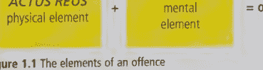

图 1.1 罪行的构成要件

#### 1.2.3 例证
不同犯罪的actus reus和mens rea会有所不同。例如，在谋杀罪中，actus reus是杀害人类，mens rea是‘with malice aforethought’造成死亡，这意味着凶手必须有杀人或造成严重身体伤害的意图。对于盗窃罪，actus reus是占有他人财产，而mens rea是不诚实地这样做并有永久剥夺他人财产的意图。

Actus reus和mens rea必须同时存在，但如果行为是持续性的，则在该行为期间任何时间点存在必要的mens rea就足够了。这在第3章中已完全解释。然而，即使actus reus和mens rea均存在，如果被告有抗辩理由（见第1.3节），他仍可能无罪。

#### 1.2.4 严格责任罪
有些犯罪是例外，不要求同时存在actus reus和mens rea。这些是严格责任罪，检察机关只需证明actus reus；定罪不需要心理要素。（有关严格责任的讨论见第4章。）

### 1.3 抗辩
尽管被告可能实施了所需的行为，但仍有若干一般抗辩理由可用，可能导致“无罪”判决。你需要学习的一般抗辩理由有：
- insanity
- automatism
- intoxication
- duress
- necessity.

自动行为可以是对任何罪行的抗辩。精神失常是对所有需要mens rea的犯罪的抗辩；它不是对严格责任罪的抗辩。胁迫和必要性不是对谋杀指控的抗辩。

酗酒只有在因其醉酒而被告不具备被控罪行所需的mens rea时才是抗辩理由。如果被告即使醉酒仍具备所需的mens rea，则不能以酗酒作为抗辩。此外，酗酒永远不是对mens rea以鲁莽即可满足的任何罪行的抗辩。这些抗辩理由将在第12章中详细讨论。

你还将学习与非致命人身犯罪相关的另外两种抗辩理由。这些是：
- self-defence/defence of another/prevention of crime
- consent.

事实上，正当防卫/防卫他人/预防犯罪可以是对包括谋杀在内的所有罪行的抗辩。还有两种仅适用于谋杀的特殊抗辩理由，即diminished responsibility和loss of control。两者均在第7章中解释。

### 1.4 证明标准和举证责任
检察机关必须证明对被告的指控。关于案件需要证明到何种程度有规则。这被称为“证明标准”。

#### 1.4.1 证明标准
刑事案件的证明标准是“排除合理怀疑”。这通常由法官向陪审团解释，他们只有在证据令其确信被告有罪时才应定罪。

这比民事案件使用的标准更高。民事案件只需“在可能性平衡上”证明即可。刑事案件要求更高的证明标准的原因是，如果被告被判有罪，其人身自由将受到威胁。

#### 1.4.2 无罪推定
被告人被推定为无罪，直到被证明有罪。举证责任在检察机关。这意味着它必须证明所需的actus reus和所需的mens rea。关于这些原则的重要案件是Woolmington（1935）。

> Woolmington v DPP（1935）
> 
> D的妻子离开了他并搬去与母亲同住。D前往母亲家并枪杀了妻子。他声称他决定要求妻子回他身边，如果她拒绝，他将自杀。因此，他在外套下携带了一支装有子弹的截短猎枪。当妻子表示不会回他身边时，他威胁要自杀并拿出枪以示决心。当他拿出枪时，枪不知何故走火，杀死了妻子。他声称这是一场纯粹的事故。
> 
> 审判法官告诉陪审团，检察机关必须排除合理怀疑地证明被告杀死了妻子。随后他又告诉他们，如果检察机关令他们信服这一点，被告必须证明存在使该杀人行为成为纯粹事故的情况。这将举证责任置于被告身上以证明抗辩理由。House of Lords裁定这是不正确的。

该案的判决提出了House of Lords认为英格兰法律上的若干固定事项。这些是：
- 检察机关必须证明案件
- 该规则适用于所有刑事案件
- 该规则必须在任何进行刑事审判的法院适用（目前为治安法院和皇家法院）
- 有罪必须排除合理怀疑地证明并且
- 合理怀疑可以由检察机关或辩方的证据提出。

#### 1.4.3 提出抗辩

如果被告提出抗辩，则控方需推翻该抗辩。在 Woolmington 诉 DPP（1935）一案中，被告声称枪支是意外走火，从而提出了意外抗辩。若要认定被告有罪，控方必须推翻这一抗辩。

对于所有普通法上的抗辩，除精神错乱外，审判中必须有某些证据证明该抗辩的要点。这些证据既可以由辩方提供，也可以由控方提供。如果在审判中出现了抗辩证据，那么即使被告并未明确提出该抗辩，控方也必须推翻该抗辩的至少一项要素。主审法官必须指示陪审团宣告被告无罪，除非陪审团确信控方已经推翻了该抗辩。

##### 举证责任倒置

对于某些抗辩，举证责任在被告一方。例如，如果被告声称自己在犯罪时精神错乱，则证明此事的责任在被告。这种将举证责任转移给被告的做法被称为“举证责任倒置”。除了适用于普通法上的精神错乱抗辩外，它还适用于一些由成文法创设的抗辩。其中之一是1957年《杀人法》中规定的减轻责任抗辩，该法第2条第2款规定：

> “在谋杀指控中，应由辩方证明，被指控的人依据本条不应被认定犯有谋杀罪。”

当成文法将证明抗辩的举证责任置于被告身上时，证明标准采用民事标准，即“盖然性权衡”。

### 如何使用自测题

本书所有章节均包含自测题。这些题目有两种使用方式。首先，当你第一次学习某个主题时，可以通过做题并回看本章材料来检查自己的理解。

其次，自测题可以用作复习工具。如果你想用它们进行复习，请尝试不查看本章材料直接作答，然后对照正文检查答案。

### 自测题

- 1. 给出一个公认的犯罪一般定义。
- 2. 为什么给犯罪下一般定义很困难？
- 3. 举例说明法律如何随着时间的推移而改变。
- 4. 在大多数刑事案件中，由哪个国家机构提起公诉？
- 5. 举一个由法官创设的犯罪例子。
- 6. 在大多数犯罪中，必须证明哪两个要素？
- 7. 说出三种一般抗辩。
- 8. 哪些抗辩与针对人身的非致命犯罪尤其相关？
- 9. 刑事案件要求何种证明标准？
- 10. 通常由谁来证明案情？

## 第2章：犯罪行为

### 2.1 什么是犯罪行为？

如第1章所述，犯罪行为（actus reus）是犯罪的客观要素。它可以是：

- 一个行为，或
- 不作为（omission），或
- 一种“事实状态”。

在大多数情况下，犯罪行为是被告所做的某件事，但有些情况下，不作为足以构成犯罪行为。这些情况在第2.2节中阐述。“事实状态”案件非常罕见，将在第2.1.3节中讨论。

#### 2.1.1 犯罪行为的自愿性

行为或不作为必须是被告自愿实施的。如果被告无法控制自己的行为，那么他就没有实施犯罪行为。在 Hill 诉 Baxter（1958）一案中，法院举例说明在哪些情况下不能认为车辆驾驶员是在自愿地实施驾驶行为。这些情况包括：驾驶员因被一群蜜蜂蜇伤而失去对车辆的控制，或者被石头击中头部，或者在驾驶时心脏病发作。

其他非自愿行为的例子包括：被告因反射动作或肌肉痉挛而击中他人。还有一种情况是：一人推了第二个人，导致第二个人撞到第三个人。在这种情况下，被推的第二个人的行为是非自愿的。即使他撞到了第三个人，他也没有实施任何攻击罪所需的犯罪行为。此事发生在 Mitchell（1983）一案中（见8.1.2节）。当然，最初的“推人者”可能要承担责任。

这些例子表明，刑法关注的是被告的过错。若不存在过错，被告通常不承担责任。

#### 2.1.2 “事实状态”案件

在极少数情况下，即使被告并非自愿行为，仍被判有罪。这些情况涉及所谓的“事实状态”案件。一个例子是 Larsonneur（1933）案。

**Larsonneur（1933）案**

被告已被命令离开英国。她决定前往爱尔兰，但爱尔兰警方将她驱逐出境并送回英国。她并不想回英国，也绝非自愿这样做。当她抵达英国时，立即被捕，并被指控作为“一个被拒绝入境英国的外国人”，在英国被发现。她被判有罪，因为她是一个被拒绝入境的外国人，并且她“在英国被发现”。即使是被爱尔兰警方违背其意愿带回，也没有关系。（另见关于严格责任的4.1节。）

#### 2.1.3 犯罪行为的结果

对于某些犯罪，犯罪行为还必须产生某种结果。这可以从“攻击造成实际身体伤害”罪（1861年《侵害人身罪法》第47条）中看出。必须存在犯罪行为（使用或威胁使用非法武力），而且还必须产生“实际身体伤害”这一后果，即对受害者造成某种伤害。这可能只是瘀伤，也可能是鼻骨或手臂骨折，甚至可能是精神伤害。没有这种后果，就不构成第47条之罪。

### 2.2 不作为作为犯罪行为

一般规则是，不作为不能使一个人构成犯罪。19世纪法官斯蒂芬（Stephen J）对此作出了如下解释。

> “A看到B溺水，并且能通过伸出手来救他。A没有这样做，目的是让B被淹死。A没有触犯任何罪行。”

### 活动

阅读以下情景，并讨论你认为Zoe是否应被判有罪。

**情景**

Zoe正坐在一家酒店庭院的游泳池旁。Jason正在游泳池里游泳。他是水里唯一的一个人，游泳池附近也没有其他人。Jason从游泳池出来，在池边走动时滑倒，跌入水中，撞得不省人事。Zoe看到了这一切，但什么也没做。Jason淹死了。

如果Zoe不会游泳，你的答案会有所不同吗？

### “好撒玛利亚人法”？

其他一些国家有一种被称为“好撒玛利亚人法”的法律。它使一个人有责任在“紧急情况”下帮助他人，即使对方是完全陌生的人。法国法律就有这种规定，戴安娜王妃1997年在巴黎发生车祸时就是一个例子。当时紧随其车的记者们拍摄了她受伤躺在车内的照片，却没有试图帮助她，尽管她伤势危急。法国当局曾威胁要根据法国的“好撒玛利亚人法”起诉这些记者。

执行这样一项法律存在一些问题。如果一个“恶徒”假装受重伤，引诱陌生人前来帮忙，然后抢劫这个陌生人，怎么办？还有风险是，未经训练的人介入可能会对伤者造成更大的伤害。另外，什么是“紧急情况”？由谁来认定存在紧急情况，从而触发“好撒玛利亚人法”的适用？

如果有多人目睹事件，也会产生问题。他们所有人都必须帮忙吗？还是只要有一个人帮忙就够了？如果一个人帮忙了，其他人是否仍然负有帮助义务？

最后还有一个问题：想要救助的人是否必须让自己陷入危险才能提供帮助。法律似乎不太可能要求这样做。在 Miller（1983）案中（见2.2.1节），上议院认为，制造风险的人只需要采取合理的步骤，而不需要让自己处于危险之中。如果对制造问题的人尚且如此，那么对无辜的过路人当然也应当如此。

#### 2.2.1 规则的例外

对于不作为不能使一个人构成犯罪这一规则，存在例外。在某些情况下，未能采取行动（不作为）可以构成犯罪行为。

An omission is only sufficient for the *actus reus* where there is a duty to act. There are six ways in which such a duty can exist.

- 1. 法定职责。
- 2. 合同职责。
- 3. 因关系而产生的职责。
- 4. 自愿承担的职责。
- 5. 因官方职位而产生的职责。
- 6. 因被告引发了一连串事件而产生的职责。

## 法定职责
议会法案可以对遗漏行为创设责任。示例包括未停车或未报告交通事故的罪行（s 170 Road Traffic Act 1988）以及未提供呼吸样本的罪行（s 6 Road Traffic Act 1988）。事实上，这些罪行只能通过不作为来实施。

议会法案创设义务的另一个例子见于1933年《儿童与青少年法》第1条。本条规定对子女负有法律责任的父母有提供食物、衣物、医疗救助和住宿的义务。如果父母未能（遗漏）履行此义务，他们可能犯有故意疏忽罪。

一个更近期的例子是根据2004年《家庭暴力、犯罪与受害者法》第5条允许儿童或弱势成年人死亡的罪行。这适用于同住的人未能采取其合理可被期望采取的保护受害者的措施的情况。

## 合同职责
在 *Pittwood*（1902）案中，铁路道口看守人遗漏关闭闸门，导致一名横穿铁轨的人被火车撞击致死。看守人犯有误杀罪。一个更现代的例子是游泳池救生员擅离岗位。如果游泳者因此受伤或溺亡，他的失职可能使他构成犯罪。

## 因关系而产生的职责
这通常是父母与子女的关系，因为父母有照顾年幼子女的义务。义务也可以反过来存在，即成年子女照顾年迈父母的情况。涉及父母子女义务的案例是 *Gibbins and Proctor*（1918）案。

### *Gibbins and Proctor (1918)*
一名七岁女孩的父亲与一名伴侣同居。父亲与前妻有几个孩子。他和他的伴侣将女孩与父亲的其他孩子隔离开来，并故意将其饿死。他们均被判谋杀罪。

父亲有喂养她的义务，因为他是她的父母，而情妇被认定已承担照顾包括女孩在内的孩子，因此她也有喂养孩子的义务。未喂养她的遗漏或失职是有意为之，意图杀害或对其造成严重伤害。在这种情况下他们犯有谋杀罪。未喂养女孩的行为足以构成谋杀的 *actus reus*。

## 自愿承担的职责
在上述 *Gibbins v Proctor*（1918）案中，伴侣自愿承担照顾女孩的责任。因此她对该儿童负有义务。当她未能喂养孩子时，她因该遗漏而犯有谋杀罪。自愿承担义务的另一个例子是 *Stone and Dobinson*（1977）案。

### *Stone and Dobinson (1977)*
斯通的年迈姐姐芬妮搬来与被告同住。芬妮行为古怪，经常在房间里待好几天。她也拒绝进食。最终她卧床不起，无法自理。至少有一次多宾森帮助洗澡芬妮，也偶尔为她准备食物。芬妮死于营养不良。两名被告均被判其误杀罪。

由于芬妮是斯通的姐姐，他对其负有照顾义务。多宾森已承担了对芬妮的部分照顾，因此也对其负有照顾义务。该义务是亲自帮助她或从其他来源寻求帮助。他们未能做到这两点中的任何一点，意味着他们违反了义务。

### Dytham (1979)
戴瑟姆（D）是一名在职警察。他看到一名男子（V）被扔出夜总会，距离他站立的地方约30码。被扔出后，发生了斗殴，三名男子将V踢死。D未采取任何干预或呼叫帮助的措施。斗殴结束后，D告诉一名旁观者他要下班并离开现场。他被定罪犯有公职不当行为。

由于戴瑟姆是警察，他被认定故意且无合理理由疏忽履行职责。

一起因不作为而被判误杀的母亲的较近期案例是 Evans（2009）案。

### Evans (2009)
V，16岁，吸食海洛因，与母亲和年长的同父异母姐姐同住。同父异母姐姐买了一些海洛因并交给V，V自行注射。后来明显V已过量用药。母亲和同父异母姐姐都没有尝试寻求医疗帮助。相反，他们让V上床睡觉，希望她能康复。V死亡。

母亲和D均被定罪犯有严重疏忽误杀罪。母亲显然对V负有照顾义务，因为她是她的女儿。D提出上诉，声称她不对姐妹负有照顾义务。上诉法院维持了定罪，理由是D制造了一种她知道或合理应知道会威胁V生命的状况。

## 因官方职位而产生的职责
这非常罕见，但在 Dytham（1979）案中确实发生过。

## 因被告引发一连串事件而产生的职责
欠下义务并因遗漏而承担责任这一概念是在 Miller（1983）案中创立的，该案中一名 squatter 意外引发火灾。

### Miller (1983)
D住在非法占用的房屋中。他吸烟时睡着了。他醒来发现床垫着火了。他没有尝试扑灭火灾或呼叫帮助，而是进入另一个房间并再次睡去。房屋起火。他被定罪犯有纵火罪。

在 Miller（1983）案中，使他有罪的并非点燃床垫。而是他在发现床垫着火时未能采取合理措施处理火灾的事实。这种失职或遗漏意味着他已实施了纵火的 actus reus。上议院指出 Miller 只需采取合理措施。他不必冒自身风险。因此，如果他醒来发现火灾时火势很小且易于扑灭，则他应予扑灭。然而，如果亲自处理过于危险，则他的义务是呼叫消防队。

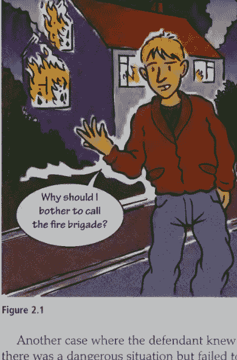

图 2.1

另一被告明知存在危险情况却未采取任何措施的案例是 Santa-Bermudez（2003）案。

### Santa-Bermudez (2003)
一名女警在搜查被告口袋前，问他身上是否有针或其他尖锐物品。被告说‘no’，但当警察把手伸进口袋时，她被针刺伤导致流血。被告根据1861年《侵害人身罪法》第47条被定罪犯有造成实际身体伤害的袭击罪。

在本案中，未告知警察针的存在使被告承担责任。他知道警察有危险却未警告她。这种失职足以构成造成实际身体伤害袭击的 actus reus。

Evans（2009）案（上文已述）也说明了被告在制造某种状况后不作为而承担责任的原则。在本案中，向V提供海洛因而V自行注射的同父异母姐姐被判误杀罪。她制造了一种她知道或合理应知道会威胁V生命的状况，但她对此无所作为。她本可以很容易地为V呼叫医疗救助。未这样做使她对V的死亡承担责任。

## 关键事实

| 来源 | 案例 |
|---|---|
| 法定职责。 | 未提供呼吸样本（s 6 Road Traffic Act 1988）。故意疏忽（s 1 Children and Young Persons Act 1933）。 |
| 根据合同，尤其是雇佣。 | Pittwood (1902) |
| 由于关系，如父母与子女。 | Gibbins and Proctor (1918) Evans (2009) |
| 自愿承担的职责，例如照顾年长亲属。 | Stone and Dobinson (1977) |
| 由于公职，例如警察。 | Dytham (1979) |
| 由于被告制造的危险情况所致。 | Miller (1983) Santa-Bermudez (2003) Evans (2009) |

图 2.2 遗漏可构成 actus reus 时的关键事实图表

#### 2.2.2 非故意杀人罪与不作为

非故意杀人罪可以以不同方式实施。主要有两种方式：

- 非法行为杀人，和
- 严重疏忽杀人。

非法行为杀人不能由不作为构成，必须存在一个“行为”。这一点在Lowe案（1973）中得以确立。

### Lowe案（1973）

D是一名九周大婴儿的父亲，该婴儿生病后死亡。D智力低下，他说他曾告诉婴儿的母亲带孩子去看医生，但除此之外他什么都没有做。婴儿的母亲智力低于正常水平。D被判对该婴儿犯有杀人罪。上诉法院撤销了这一判决，因为不存在非法的“行为”。未能做某事不能构成“行为”。

然而，严重疏忽杀人可以由不作为构成。可以说Lowe本应被判此罪，因为他对该婴儿负有注意义务，而且他未能寻求帮助。这一观点见Stone和Dobinson案（1977）（上文）。

对于严重疏忽杀人，被告人必须对被害人负有注意义务。如果存在注意义务，那么若被告人的不作为或未能采取行动导致被害人死亡，则被告人可能需要承担责任。

第8章对非故意杀人罪进行了全面讨论。

#### 2.2.3 医生的义务

在某些情况下，医生会决定停止治疗病人。如果停止治疗符合病人的最佳利益，则不构成可以形成犯罪行为要件的不作为。这一点在Airedale NHS信托诉Bland案（1993）中得以确立。

### Airedale NHS信托诉Bland案（1993）

Bland是一名年轻男子，他在1989年希尔斯堡足球场惨案中被人群挤压，导致氧气无法输送到大脑，留下严重脑损伤。他处于持续性植物状态（PVS），无法自理，对周围发生的事毫无知觉。他靠插管人工喂养。他处于这种状态已有三年，照顾他的医生请求法院允许他们停止喂食。

法院裁定，医生可以停止对Bland的人工喂食，即使明知他会因此死亡。这被认为是符合他的最佳利益的。

#### 2.2.4 对不作为法律的评论

第一点是，拉丁语短语actus reus并不是对足以使人承担罪行责任的行为的准确描述。Actus reus的意思是“行为”：然而法律明确承认，不作为也足以导致责任。法律委员会在1989年的《刑法草案》中更倾向于使用“外部要素”这一短语，这是一个更准确的描述。

还有其他几个问题，包括：

- 是否应对不作为规定更广泛的责任，例如在2.2节中讨论的好撒马利亚人法
- 决定何时应施加义务从而使不作为足以构成犯罪的行为要件时存在的问题
- 当一个人承担了义务后，是否应为不作为承担责任
- 医疗行为中的不作为
- 通过法定方式对不作为施加责任的正当性。

### 好撒马利亚人法

如前所述，其他国家的法律赋予人们提供帮助的义务。尽管设立这样的法律存在一些问题（见2.2节），但可以说，现代道德责任观是支持这种义务的。

那么，如果明显看到孩子快要靠近悬崖边缘，该怎么办？孩子的父母或监护人如果不警告孩子并试图将其带离危险，他们将因不作为而承担责任。然而，陌生人则不会承担责任。在当今社会，这是否可接受？

然而，也有人反对让人们对不作为承担刑事责任。普通人是否应被迫充当“救援者”？在发达国家，国家提供训练有素、装备精良的专业人员，如警察、消防队和救护车人员来应对紧急情况。这些服务通过税收支付，因此可以说每个纳税人已经尽了自己的一份力。

正如在2.2节中已经讨论过的，未经训练的人如果试图“救援”某人，可能弊大于利。或者，救援者可能会将自己的生命置于危险之中，从而给紧急服务部门带来更多工作，并可能导致两条生命丧生。

一个实际问题是，可能有多人对同一事件承担责任。如果在高峰时段，一名通勤者跌落到铁轨上，而站台上挤满了等车的人，情况会怎样？所有看到此人跌落的人，如果不设法救援（如果这样做是安全的），或不提醒车站工作人员（如果采取更直接的行动不安全），是否都要承担责任？起诉大量人员是不切实际的。

### 决定何时存在义务的问题

何时会存在作为义务并不完全确定。通常的决定方式是：

- 1. 由庭审法官确定是否有证据能够在法律上确立一项义务
- 2. 然后由陪审团决定义务是否确实存在
- 3. 最后，陪审团必须决定该义务是否已被违反。

这意味着法律能够扩展以涵盖更多情况。这一点在Khan和Khan案（1998）中有所说明。

> 被告人向一名新吸毒者提供了海洛因，该吸毒者当着他们的面吸食后倒地。他们留下她独自一人，等他们回到公寓时她已经死亡。他们对非法行为杀人的定罪被撤销，但上诉法院认为，在某些情况下可能存在召唤医疗援助的义务，因此被告人可能因未能这样做而承担责任。

在Evans案（2009）中，上诉法院认为，V的同母异父（或同父异母）姐妹向V提供海洛因，并且在V明显吸毒过量时未能召唤医疗援助，因此应承担责任。

法律能够扩展以涵盖新的义务情形这一观点在Khan和Khan案中得到了强调，上诉法院在附带意见中指出，义务情形可以扩展到其他领域。然而，这可能会被认为是使法律过于不确定。在哪些新的情形下，不作为将被认定足以构成犯罪的主观要件？

### 承担义务

有人将成年人收留在家中，却可能被认定对该成年人承担了义务，这看起来似乎很苛刻。Stone和Dobinson案就是这种情况，尽管该案中与受害者存在血缘关系。受害者也是一个脆弱的人，已经变得无法照顾自己。

成年人通常被认为对自己的生活负责。事实上，心智正常的成年人可以拒绝医疗，即使这可能导致其死亡。

如果该成年人脆弱不堪，那么施加义务的理由是，承担义务的人处于最佳位置，能够确保避免潜在伤害。在其他人不知道的情况下，他或她会知道受害者的脆弱。这就是让这样一个人承担作为义务并使其因不作为而承担责任的原因。

还有一个问题是，D需要做些什么来解除或履行其义务。通常，这种义务可以通过召唤帮助来履行。没有必要做得更多。在Stone和Dobinson案中，被告人因没有召唤帮助而被判有罪。

### 医疗处理

法律似乎矛盾的一个领域是医生的义务。如果医生决定撤除对病人的喂食符合病人的最佳利益，那么他们对病人的死亡不承担任何刑事责任。这是Airedale NHS信托诉Bland案判决的效果。即使医务人员知道对无意识的病人撤除喂食会导致该病人死亡，他们也不对不作为承担责任。关键问题在于，这种不喂食必须符合病人的最佳利益。

然而，上议院在Bland案中强调，通过积极行为结束病人生命的安乐死仍然是非法的。

### 法定义务

法规在各种各样的情况下施加义务，并将未能做某事规定为犯罪。其中许多与车辆和/或驾驶有关。这一领域的法律通常也施加严格责任。这意味着，不仅被告人因其未做某事而负有责任，而且检方无需证明其具有任何主观罪过。

这样做的理由是社会的更大利益。如果司机未能购买驾驶保险，那么被他伤害的人将难以获得伤害赔偿。被告人自己也不太可能能够支付。

一些法定义务是因为难以证明犯罪而施加的。这就是2004年《家庭暴力、犯罪与受害者法》引入“导致或允许儿童或脆弱成年人死亡”罪的原因。

在该法之前，如果儿童因家庭内的身体虐待而死亡，检方往往难以查明究竟是哪个家庭成员导致了死亡。例如，如果母亲和父亲都被指控谋杀该儿童，那么他们会互相指责，从而无法证明是谁干的。

根据2004年法案，所有家庭成员都有责任保护儿童，否则将承担相应责任。这使得起诉更容易成功。这一点很重要，因为法律应该为儿童和脆弱成年人提供尽可能多的保护。法律可能具有促使其他家庭成员举报虐待行为的效果。

## 自我测试题

- 1. 举一个不构成犯罪行为要件的非自愿行为的例子。
- 2. 什么是状态型犯罪？
- 3. 关于不作为能否构成犯罪的行为要件，通常的规则是什么？
- 4. “好撒马利亚人法”是什么意思？提出可能因这样的法律而产生的三个问题。
- 5. 说出由议会法案（成文法）创设的两项罪行，其中不作为是犯罪的行为要件。
- 6. 使用一个案例，解释在D自愿承担注意义务的情况下，不作为何时足以构成犯罪行为要件。
- 7. 使用一个案例，解释在D因启动了一系列事件而负有注意义务的情况下，不作为何时足以构成犯罪行为要件。

- 8. 在哪三种其他义务情形下，不作为足以构成 *actus reus*？
- 9. 哪种类型的过失杀人不能由不作为构成？
- 10. 给出对不作为承担责任的一个理由和一个反对不作为承担责任的一个论点。

### 2.3 因果关系

当必须证明后果时，检方必须证明：

- 被告的行为是该后果的事实原因，且
- 它是该后果的法律原因，且
- 没有中断因果链的介入行为。

#### 2.3.1 事实原因

被告只有在后果如果没有被告的行为就不会发生时才可能有罪。这个“若无则无”检验在 *Pagett* (1983) 案中可见其运作。

> **Pagett (1983)**
> 
> 被告强行带走怀孕的女友离开她的家。他随后将该女子扣为人质。警察要求他投降。D 出来时，手持该女子挡在身前并向警察开火。警察还击，女子被警察的子弹击中身亡。D 被判犯有过失杀人罪。

Pagett 有罪，因为如果他没有在枪战中把她当作盾牌使用，女孩本不会死亡。相反的情况见于 *White* (1910) 案，被告在母亲的饮料中放了氰化物，意图杀害她。她在喝下之前因心脏病发作而死亡。被告不是她死亡的事实原因。因此，他没有犯谋杀罪，尽管他犯有企图谋杀罪。

#### 2.3.2 法律原因

可能有不止一个行为导致后果。其中一些行为可能由被告以外的人实施。规则是，如果被告的行为是后果的“最小”原因以上，则被告可能有罪。但被告的行为不必是实质原因。在某些情况下，他们已表示该行为必须超过 *de minimis*。在 *Kimsey* (1996) 案中，上诉法院裁定，与其使用这个拉丁短语‘de minimis’，不如告诉陪审团该行为必须是‘超过轻微或琐碎的联系’是可以接受的。

> **Kimsey (1996)**
> 
> D 与朋友进行高速汽车追逐。她失控撞车，另一名司机在事故中丧生。关于 D 失控前立即发生的情况的证据并不十分清楚。审判法官指示陪审团，D 的驾驶不必是‘死亡的主要原因或实质原因，只要你确信它是原因并且存在超过轻微或琐碎的联系即可’。上诉法院维持了 D 因危险驾驶导致死亡的定罪。

可能有不止一个人，其行为导致了死亡。即使被告的行为不是死亡的唯一原因，被告仍可能有罪。在 *Kimsey* 案中，两名司机都高速驾驶，但其中一名司机仍可能被认定有罪。

### ‘薄颅’规则

被告还必须按其所见接受受害人。这被称为‘薄颅’规则。其含义是，如果受害人的身体或精神状态存在异常，使得伤害更为严重，则被告应对更严重的伤害负责。因此，如果受害人颅骨异常薄，以至于头部一击会造成严重伤害，则被告应对该伤害负责。即使该打击对‘正常’人只会造成瘀伤。Blaue (1975) 案就是一个例子。

### Blaue (1975)

一名年轻女子被被告刺伤。她被告知需要输血以保命，但她拒绝接受，因为她是耶和华见证人，其宗教禁止输血。她死亡，被告被判犯有她的谋杀罪。

受害人是耶和华见证人这一事实使伤口致命，但被告仍有罪，因为他必须按其所见接受受害人。

#### 2.3.3 介入行为

被告的行为与后果之间必须存在直接联系。这被称为因果链。在某些情况下，在被告的行为或不作为之后发生了其他事情，如果该事情与被告的行为足够分离，则可能中断因果链。

一个例子是被告刺伤受害人，受害人需要送往医院治疗。在前往医院途中，载着受害人的救护车发生事故并撞毁，导致受害人头部致命受伤。

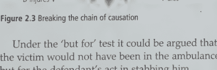

根据“若无则无”检验，可以认为如果不是被告刺伤他的行为，受害人本不会在救护车上。然而，事故是如此重大的介入行为，以至于被告不对受害人的死亡负责。

因果链可能被以下行为中断：

- 第三方的行为或
- 受害人自己的行为或
- 自然但不可预测的事件。

为了中断因果链使被告不对后果负责，介入行为必须与被告的行为足够独立且足够严重。

当被告的行为导致第三方可预见的行为时，被告很可能被认为造成了后果。这一原则在 Pagett (1983) 案中得到应用，当时他的女友在他把她当作抵挡警察子弹的盾牌时被射中（参见第 2.3.1 节）。

#### 2.3.4 医疗治疗

除非医疗治疗与被告的行为如此独立且‘本身足以导致死亡’以至于被告的行为变得无关紧要，否则医疗治疗不太可能中断因果链。以下三个案例说明了这一点。

### Smith (1959)

两名士兵发生争斗，其中一人被另一人刺中肺部。受害人被其他士兵抬到医疗中心，途中被摔倒。在医疗中心，工作人员通过按压胸部进行人工呼吸。这使伤势恶化，他死亡。糟糕的治疗可能使他康复的机会降低了多达 75%。然而，原袭击者仍被判犯有他的谋杀罪。

在本案中，裁定如果 D 造成的伤害仍是死亡的‘持续’且‘实质’原因，则被告将有罪。Smith 有罪，因为刺伤肺部的伤口仍在‘持续’（显然尚未愈合），并且是 V 死亡的实质原因。

### Cheshire (1991)

D 向受害人的大腿和腹部开枪。V 需要进行大手术。他出现呼吸问题并接受了气管切开术（即在喉咙插入一根管子帮助呼吸）。枪击事件大约两个月后，V 死于气管切开术留下的罕见并发症。这些并发症未被医生诊断出来。V 死亡时，原来的伤口几乎已愈合且不再危及生命。被告仍被认定对 V 的死亡负责。

在本案中，上诉法院裁定，即使对伤势的治疗‘未达到称职医疗从业者应有的标准’，D 仍可能对 V 的死亡承担刑事责任。检方只需证明 D 的行为导致了死亡。D 的行为不必是死亡的唯一原因甚至主要原因，只要其行为对死亡有显著贡献即可。

### Jordan (1956)

受害人被刺伤腹部。他在医院接受治疗，伤口愈合良好。他被给予抗生素但对其产生过敏反应。一名医生停止使用抗生素，但第二天另一名医生命令给予大量剂量。受害人死于对药物的过敏反应。在本案中，医生的行为被认定为导致死亡的介入行为。被告没有犯谋杀罪。

在前两起案件中，医生正在为伤势进行治疗以试图挽救受害人的生命。如果不是被告严重伤害他们，受害人本不需要治疗。在这种情况下，即使医疗治疗并不理想，袭击者仍需承担责任。Cheshire (1991) 案中 Beldam LJ 指出：

> ‘即使对受害人的治疗疏忽是死亡的直接原因，陪审团也不应认为它排除了被告的责任，除非疏忽的治疗与他的行为如此独立，并且本身如此足以导致死亡，以至于他们认为他的行为所作出的贡献微不足道。’

在第三起 Jordan (1956) 案中，当医生明知受害人对其过敏时仍给予大量药物，这一事实是足以中断因果链的足够独立的行为。然而，如果在紧急治疗中给予正常剂量的药物，而医生不知道受害人对其过敏，则给予药物不会中断因果链。

### 生命维持机器

当决定受害人脑死亡后，医生关闭生命维持机器不会中断因果链。这在 Malcherek (1981) 案中已决定。

### Malcherek (1981)

D 用刀刺伤妻子腹部。在医院，她被置于生命维持机器上。经过多次检查显示她脑死亡后，机器被关闭。D 被控其谋杀罪。审判法官拒绝允许因果关系问题提交陪审团。D 被定罪，上诉法院维持了他的定罪。

## 关键案例

| 案例 | 事实 | 法律 |
|---|---|---|
| *Smith (1959)* | 一名士兵刺伤了另一名士兵。被害人得到的医疗非常差，影响了康复的机会。 | 如果被告人造成的伤害仍然是持续起作用的实质性原因，则被告人应承担责任。 |
| *Cheshire (1991)* | 被告人开枪射伤被害人。被害人需要进行气管切开术。被害人死于气管切开术的并发症。他的伤口几乎已经愈合。 | 医疗行为只有在“如此独立于被告人的行为”并且“本身在导致死亡方面如此有力”时，才会中断因果关系链条。 |
| *Jordan (1956)* | 被害人被刺伤。当他的伤口几乎愈合时，他被给予了大剂量已知其过敏的药物。 | 本案中的因果关系链条被中断了。 |
| *Malcherek (1981)* | 被告人刺伤了他的妻子。她被安置在生命维持机上，但当检查显示她脑死亡后，机器被关闭。 | 关闭生命维持机并不会中断因果关系链条。 |

图2.4 医疗干预与因果关系的关键案例图

## 2.3.5 被害人自身的行为

如果被告人以可预见的方式导致被害人作出反应，那么被害人的任何伤害都将被视为由被告人造成。这发生在 Roberts (1971)案中。

### Roberts (1971)

一名女孩为了躲避罗伯茨（Roberts）的性骚扰而从汽车上跳下。汽车当时以每小时20至40英里的速度行驶，女孩因跳车而受伤。法院判定被告人对其伤害承担责任。

另一个案例是 Marjoram (2000)，该案同样认定，如果被害人的行为是合理可预见的，则被告人应当承担责任。

### Marjoram (2000)

包括被告人在内的几个人大声辱骂并踢踹被害人宿舍房间的门。他们最终强行打开了门。被害人随后从房间窗户坠落（或可能跳下），并受了重伤。上诉法院维持了对被告人造成严重身体伤害罪的定罪。

在这种情况下，合理可预见的是，被害人会担心这伙人将要对他使用暴力，而他唯一的逃生途径就是窗户。

### 不合理的反应

然而，如果被害人的反应不合理，则可能中断因果关系链条。在 Williams (1992)案中，一名搭便车者从威廉姆斯的汽车上跳下，头部撞击路面导致颅脑损伤而死亡。汽车当时以大约每小时30英里的速度行驶。控方声称曾有人试图偷走被害人的钱包，而这正是他跳车的原因。上诉法院指出，被害人的行为必须是可预见的，而且必须与威胁相称。需要回答的问题是，被害人的行为是否：

> “在合理范围内，且并非愚蠢到使其自身自愿行为构成一个新的介入行为（novus actus interveniens），从而中断了因果关系链条。”

因此，在判断被害人的行为是否中断了因果关系链条时，有必要考虑相关情况。如果对被害人的威胁严重，那么他从行驶中的汽车（或从窗户、或跳入河中）跳下就更有可能被认定为合理。如果威胁非常轻微，而被害人采取了极端行动，法院则更有可能认为该行为中断了因果关系链条。

因果关系的主要规则见图2.5中的流程图。

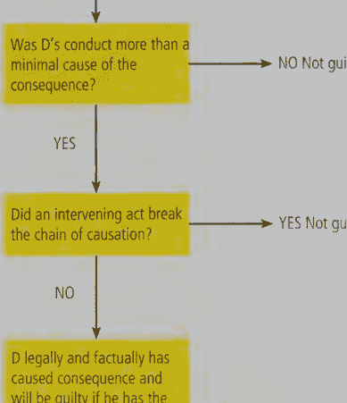

图2.5 因果关系规则流程图

## 2.3.6 对因果关系法律的评述

因果关系法律中的一个主要问题是：什么叫做“不仅仅是‘轻微且琐碎的联系’”？这一定义模糊且难以界定。因此，这可能导致陪审团在不同案件中适用不同的标准。

### 接受被害人本来的状况

如果被害人患有某种疾病，使伤害更加严重，被告人是否应对更严重的伤害负责？在被告人不知道该疾病的情况下，这可能被视为不公正。例如，如果被害人头骨异常薄弱，以致于一击便将其杀死，那么即使这一击不会杀死正常人，认定被告人应对谋杀罪负责也是合理的。被告人无意杀人，但如果他意图造成真正严重的伤害，则被告人犯有谋杀罪。（这也是对谋杀罪犯罪意图的批评——更多内容见第6章。）

### 被害人拒绝治疗

此外，当被害人拒绝治疗时，被告人是否应承担责任？在医疗非常原始的时代，尤其是在手术不得不在没有麻醉的情况下进行时，这种责任或许具有正当性。在 Holland (1841)案中，被告人故意割伤被害人的手指。伤口发生感染，被害人被建议截去手指。他一直拖延到太晚才接受截肢，最终死于感染。被告人对其死亡承担责任。1841年时外科手术非常原始，这一判决具有正当性；但同样的情形发生在今天，被告人是否仍应承担责任？被告人无论如何都构成殴打致实际身体伤害罪，但他是否应对死亡负责？

在 Blaue (1975)案中，被害人因其宗教信仰拒绝输血。如果她接受了输血，本可以保住性命。可以说，被告人不应为她的死亡负责。他本可以被控蓄意伤人罪（1961年《侵害人身罪法》第18条）。该罪最高可判处终身监禁，因此本可对被告人施加适当的惩罚。另一方面，刺伤显然是导致被害人死亡的原因，因此在此基础上可以说，他应当对她的死亡负责。

如果被害人因为担心通过输血会感染HIV而拒绝输血呢？这与 *Blaue* 案的情况有何不同？难道无论拒绝医疗的原因是什么，该规则都必然应以同样的方式适用吗？更极端的案例是 *Dear* (1996)。

> 被害人决定让伤口继续流血以自杀，伤口仍然是死亡的原因。
>
> 如果被害人确实进一步撕开了伤口，这是否应被视为中断了因果关系链条的介入行为？还是法院的观点——因为伤口是死亡原因，所以被告人应对死亡负责——是合理的？

### Dear (1996)

被告人用美工刀多次割伤被害人，切断了一条动脉。被害人没有去处理伤口，甚至可能进一步撕开伤口，使出血更加严重。被害人死于失血。上诉法院维持了对被告人谋杀罪的定罪。

法院认为，只要伤口是持续起作用的、重要的原因，陪审团就有权对被告人定罪。即使被害人实际上已经

### 过失医疗行为

在 *Smith* (1959)案中，法院采用了“持续起作用的实质性原因”标准。然而，这一标准在 *Cheshire* (1991)案中可能不会导致定罪。在 *Cheshire* 案中，被害人的伤口几乎已经愈合。这些伤口是导致被害人死亡的“持续起作用的实质性原因”吗？很可能不是。

然而，如果被害人没有被被告人枪伤，他就不需要进行气管切开术。因此，未能注意到气管切开术并发症的医疗过失并非“独立于被告人的行为”。被告人的行为是导致被害人死亡的一个重要因素。在 *Cheshire* 案中确立的标准更适合该案的情况。

## 练习

- 阅读以下情形，并解释因果关系是否成立。
- 1. 阿莱德过去曾受到本的威胁。当阿莱德在街上看到本朝他走来时，阿莱德没有看路就跑过马路，被一辆汽车撞倒受伤。本是否应对阿莱德的受伤承担责任？
- 2. 托雅刺伤了史蒂夫的手臂。他的伤势并不严重，但需要缝合，于是邻居开车送史蒂夫去医院。在去医院的路上，汽车发生碰撞，史蒂夫头部严重受伤。托雅是否应对头部受伤承担责任？
- 3. 刘易斯闯入了凯蒂位于三楼的公寓。他威胁要强奸她，为了逃脱，她从窗户跳下并受了重伤。刘易斯是否应对她的受伤承担责任？
- 4. 罗斯刺伤了潘吉特的胸部。潘吉特被送往医院后接受了紧急输血。不幸的是，他被输入了错误血型的血液并死亡。罗斯是否应对潘吉特的死亡承担责任？

## 自测题

- 1. 解释“若非”检验因果关系的含义。
- 2. 举一个案例，说明被告的行为并非被害人死亡的事实原因。
- 3. 被告的贡献必须达到什么程度才能被视为法律上的原因？
- 4. 结合一个案例，解释“薄颅骨原则”。
- 5. 举一个可能中断因果链的介入行为的例子。
- 6. 结合一个案例，说明医疗行为何时可能中断因果链。
- 7. 举两个医疗行为被认定不中断因果链的案例。
- 8. 关闭生命维持机时，法律立场是什么？
- 9. 被害人自己的行为何时会中断因果链？
- 10. 解释因果关系法律中的两个问题。

## 考题

> “现代法律若要公正，就必须解决犯罪构成要件中不作为所面临的当前困境，尽管这些困境不可避免。”

讨论这一陈述的准确性。
（OCR，G153，2011年1月）

## 犯罪意图（Mens rea）

犯罪意图是犯罪的心理要素。每种犯罪都有其自身的犯罪意图或心理要素。唯一的例外是严格责任犯罪。此类犯罪至少就部分犯罪行为而言，无须证明心理要素。在刑事案件中，控方必须证明所要求的犯罪意图。

犯罪意图有不同的层级。要被判定有罪，被告人必须至少具备该犯罪所要求的最低限度的犯罪意图。

最高层级的犯罪意图是故意（intention）。这也被称为“特定故意”。其他主要的犯罪意图类型包括轻率（recklessness）、过失（negligence）和明知（knowledge）。

### 3.1 故意（特定意图）

在Mohan案（1975）中，法院将“故意”定义为：

> “一种在被告人能力范围内促成（被禁止的结果）的决定，无论被告人是否希望其行为产生该结果。”

这清楚地表明，被告人的动机或实施该行为的原因并不相关。关键在于被告人决定促成被禁止的结果。

这可以通过1861年《侵害人身罪法》第18条规定的犯罪来说明。对于该罪行，被告人必须造成伤害或重伤。其犯罪意图是被告人必须意图造成伤害或重伤，或意图抗拒逮捕。如果被告人没有这些意图之一，他就不构成本罪。例如，如果一个人突然打开门，撞到了门另一边一个他不知道在那里的人并造成其重伤，那么他并不意图“促成”被禁止的结果。

### 动机

Mohan案（1975）也明确指出，动机不同于故意，并且在判断被告人是否具有故意时并不相关。例如，一个人可能强烈认为西方世界的银行体系正在导致较贫困国家的贫困。然后这个人从银行偷走数百万英镑，以便将其交给较贫困国家的人们。他的动机是确保穷人获得钱财。这在判断该人是否具备盗窃所需的犯罪意图时并不相关。

#### 3.1.1 直接故意与间接故意

在大多数案件中，被告人具有所谓的直接故意。这意味着他意图特定结果的发生。例如，D决定杀死V。他直接瞄准V的头部并扣动扳机。此时D具有杀死V的直接故意。

然而，也可能出现被告人意图一件事，但实际发生的后果却是另一件事的情况。这被称为间接故意或间接意图。

一个例子是：被告人意图吓唬某人以阻止其上班，但并不意图杀死或重伤该人。这发生在Hancock和Shankland案（1986）中。实际后果是载送该人上班的出租车司机死亡。如图3.1所示。

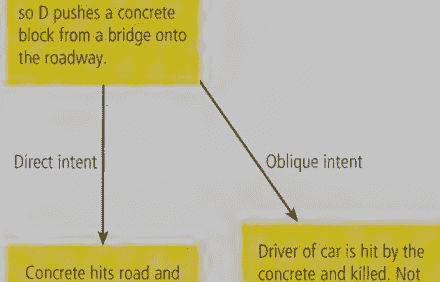

图3.1 直接故意/间接故意

#### 3.1.2 后果的预见

证明故意的主要问题，出现在被告人的主要目标并非被禁止的后果，而是意图其他事情的情形中。如果在实现其他目标的过程中，被告人预见到自己也会造成那些后果，那么他可能被认定有罪。这一概念被称为“后果的预见”。

此类情形的一个例子是：被告人决定放火烧毁自己的商店以骗取保险。他的主要目标是损坏商店并获得保险金。不幸的是，他在员工仍在店内时点火，其中一些员工受了重伤。该被告人是否具备第18条造成重伤罪所需的故意？

后果预见的起点是1967年《刑事司法法》第8条，该条规定：

> “法院或陪审团在确定某人是否犯罪时——
> (a) 不得仅因某结果是其行为的自然且可能的结果，而必须在法律上推断其意图或预见到该结果；但
> (b) 应当参照所有证据，并根据情况从证据中作出适当的推断，来判断其是否确实意图或预见到该结果。”

这一措辞在过去的20多年里成为多起案件的争议焦点。这些案件主要是被告人被指控谋杀的案例。关键点在于被告人必须意图或预见某一结果。在谋杀案件中，这意味着被告人必须预见到死亡或重伤将会发生。目前这方面的主要判例是Woollin案（1998），但要理解该法律及其问题，有必要考察Woollin案之前的案件。其中第一起是Moloney案（1985）。

### Moloney案（1985）

D和他的继父在家庭聚会上喝了大量的酒。聚会结束后，人们听到他们交谈大笑。接着传来一声枪响。D打电话报警，说自己刚谋杀了继父。D说他们当时在比试谁装弹和开枪更快。他装弹比继父快。继父随后说D没有“胆量”扣动扳机。D说：“我没有瞄准。我只是扣了扳机，他就死了。”D被判谋杀罪，但上诉后该定罪被撤销。

Moloney案（1985）的问题由斯卡曼勋爵（Lord Scarman）予以说明，他指出该案中的指引不可靠且具有误导性。他说：

> “依我之见，Moloney案的指引目前是不安全且误导性的。它们要求提及可能性。它们还要求解释：结果的可能性越大，该结果被预见到的可能性就越大；而如果该结果被预见到，则该结果也被意图的可能性就越大。”

在该案中，上议院裁定：后果的预见只是故意的证据，其本身并非故意。上议院判决的这一部分至今仍是法律。

然而，该判决的其他部分已被后来的案件推翻。这是因为布里奇勋爵（Lord Bridge）指出，应当告诉陪审员考虑两个问题：

- 1. 死亡或重伤是否是被告人行为的自然结果？
- 2. 被告人是否预见到该结果会成为其行为的自然结果？

这些问题（通常被称为Moloney指引）的缺陷在于没有提到“可能”一词。

如果回顾1967年《刑事司法法》第8条，你会发现该条使用了“自然且可能的结果”这一措辞。布里奇勋爵只提到了“自然”结果。在Hancock和Shankland案（1986）（见下文）中，法院认为省略“可能”一词使该指引存在缺陷。因此，该指引不再具有法律效力。

### Hancock和Shankland案（1986）

两名被告人是正在罢工的矿工。他们试图阻止另一名矿工上班，将一块混凝土块从桥上推落到一辆出租车行驶的道路上——那名矿工正乘坐出租车去上班。石块击中了出租车挡风玻璃，导致司机死亡。初审法官使用Moloney指引对陪审团作出指示，两名被告人被判定谋杀罪。上诉后，上诉法院撤销了他们的定罪。上议院维持了这一撤销。

下一个案件是Nedrick案（1986），上诉法院认为需要使早先两个案件——Moloney案（1985）和Hancock与Shankland案（1986）——中的判决更加清晰。

### Nedrick案（1986）

D对一名女子怀恨在心。他将石蜡倒入她家的信箱并点燃。一名儿童在火灾中丧生。D被判定谋杀罪，但上诉法院撤销了定罪，并以过失杀人罪代替。

为了使Moloney、Hancock和Nedrick案中确立的法律更容易被陪审员在谋杀审判中理解和适用，上诉法院表示，陪审员提出两个问题会有所帮助：

- 1. 由D的自愿行为导致的结果可能性有多大？
- 2. D是否预见到了该结果？

该结果必须是几乎确定的，并且D必须意识到这一点。如果是这样，那么就有证据表明……

陪审团可以推断 D 具有必要的意图。兰恩首席法官（Lord Lane CJ）是这样表述的：

> > “陪审团应被指示，除非他们确信死亡或严重身体伤害是被告行为的结果的虚拟必然性（排除某些不可预见的干预），并且被告认识到情况就是如此，否则他们无权推断必要的意图。”

这一直是法律，直到 1998 年和 *Woollin*（1998）案。该案上诉至上议院，上议院认为上诉法院在 *Nedrick*（1986）中的观点没有帮助。

### *Woollin* (1998)

D 将他三个月大的婴儿扔向靠墙的婴儿车，距离约三到四英尺。婴儿头部受伤并死亡。法院裁定后果必须是虚拟必然性，被告必须已意识到这一点。当陪审团对这两点都感到满意时，就有证据可供陪审团认定意图。

上议院法官认为 *Nedrick* 中的两个问题没有帮助。他们裁定应使用 *Nedrick* 的示范指示，但应使用‘find’一词而非‘infer’一词。因此，考虑后果预见的陪审团现在应被给予的示范指示应为：

> > ‘陪审团应被指示，除非他们确信死亡或严重身体伤害是被告行为的结果的虚拟必然性（排除某些不可预见的干预），并且被告认识到情况就是如此，否则他们无权*认定*必要的意图。’

### Problems with the decision in *Woollin*

*Woollin* 案的判决引起了一些问题。首先，‘infer’一词在 1967 年《刑事司法法》第 8 条中使用，这大概就是为什么在 *Nedrick* 中使用它的原因。用‘find’一词替代是否提高了对陪审团指示的清晰度？另一个问题是，使用‘find’一词是否意味着对后果的预见就是意图，而不仅仅是其证据。

在判决中，斯泰因勋爵还继续说，该指示的效果是‘被预见到几乎必然的结果就是被意图的结果’。他还指出，在 *Moloney* 案中，上议院曾说如果一个人预见到后果的概率几乎压倒性，则‘足以确立必要的意图’。斯泰因勋爵强调了‘establish’一词。这似乎表明上议院在 *Woollin* 案中认为对后果的预见与意图相同，而 *Moloney* 案已明确表示并非如此。

在后来的案件中，对此点存在冲突的判决。在 *Re A*（2000）民事案件中，医生询问法院是否可以在预见到这将导致较弱的双胞胎死亡的情况下进行手术以分离连体双胞胎。上诉法院（民事部门）显然认为 *Woollin* 确立了预见后果即为意图的规则。

在 *Matthews and Alleyne*（2003）刑事案件中，上诉法院裁定 *Woollin* 案的判决意味着对后果的预见不是意图：它是一条证据规则。如果陪审团认定被告预见到死亡或严重伤害的虚拟必然性，他们有权认定意图，但不必如此。

### *Matthews and Alleyne* (2003)

被告人从一座桥上将受害者扔下 25 英尺，落入深河中央。受害者曾告诉他们他不会游泳。他们看着他‘狗刨式’向岸边游去，但在看到他是否安全到达之前就离开了。受害者溺水身亡。

审判法官曾指示陪审团，被告人的杀人意图可以通过直接的杀人意图来证明，或通过被告人认识到 V 的死亡是虚拟必然性（排除营救尝试）以及被告人没有意图营救受害者这一事实来证明。

上诉法院指出，审判法官说对虚拟必然性的认识构成意图是错误的。

然而，他们维持了定罪，因为如果陪审团确信被告人认识到如果不尝试营救 V，死亡就是虚拟必然性，并且在将 V 从桥上扔下时他们没有营救他的意图，那么就无法看出陪审团如何不能认定被告人意图 V 死亡。

附有一张关于后果预见的案件图表，以帮助保持案件清晰。

## Activity

在以下每种情况下，解释被告是否具有谋杀所需的意图。谋杀的 mens rea 是杀人的意图或造成严重身体伤害的意图。

- 1. Geraint 不喜欢 Victor 并决定攻击他。Geraint 用铁棒击打 Victor 的头部。Victor 因此死亡。
- 2. Inderpal 把一块大石头扔进河里看看会溅起多大的水花。Jake 正在河里游泳，被石头击中头部并被杀死。
- 3. Kylie 从桥上向下方高速公路扔下一块大石头。此时是高峰时段，高速公路上有大量交通。石头砸碎了 Ashley 汽车的挡风玻璃并杀死了他的乘客。

## Key cases

| Case | Brief facts | Law |
|---|---|---|
| Moloney (1985) | D 在‘拔枪快’事件中开枪射击继父。 | 对后果的预见不是意图；它是意图的证据。 |
| Hancock and Shankland (1986) | 矿工把混凝土块掉到路上，杀死了一名出租车司机。 | 后果的概率越大，就越可能预见到该后果，如果预见到了该后果，则该后果也被意图的可能性就越大。 |
| Nedrick (1986) | 通过信箱倒入煤油，导致房屋起火，屋内一名儿童死亡。 | 除非陪审团确信死亡或严重身体伤害是虚拟必然性并且被告认识到这一点，否则无权推断必要的意图。 |
| Woollin (1998) | 把婴儿扔向婴儿车，导致其死亡。 | Nedrick 中的指示不应使用‘infer’一词。相反，应告知陪审团他们有权认定意图。 |
| Re A (2000) | 医生想对连体双胞胎进行手术，但知道这会导致其中一个死亡。 | 法院认为 Woollin 使预见后果即为意图成为法律。 |
| Matthews and Alleyne (2003) | 把 V 扔进河里导致其溺水。 | Woollin 意味着预见后果不是意图。它是一条证据规则。如果陪审团认定被告预见到死亡或严重伤害的虚拟必然性，则他们有权认定意图，但不必如此。 |

Figure 3.2 Case chart on foresight of consequences

## 3.1.3 Comment on foresight of consequences as intention

从以上内容可以看出，法院在涉及后果预见的意图概念上存在困难。例如：

- 自然且可能的后果
- Moloney 和 Hancock and Shankland 案后陪审员适用测试的困难
- Woollin 从推断意图到认定意图的变化
- Woollin 判决仍有两种解释的事实。

### Natural and probable consequences

在意图测试中必须包含这两个词。这是因为某事可能是自然后果而不可能是可能后果。例如，性交的自然后果是女孩怀孕。然而，这不是可能的后果。怀孕只发生在极少数情况下。

### The difficulty for jurors applying the law

在 Moloney 和 Hancock and Shankland 案之后，陪审员必须就概率水平接受指示，法律被置于一种使法官难以向陪审员解释以及陪审员难以适用法律的状态。上诉法院在 Nedrick 案中认为有必要尝试使法律更容易被陪审员理解和适用时，强调了它造成的困难。

### Infer or find

Nedrick 的两问测试使用了约 12 年，直到 Woollin 案。然后上议院表示他们认为 Nedrick 的两个问题没有帮助。他们还裁定对陪审团的指示应使用 find 一词而不是 infer。正如前一节所述，Woollin 的判决似乎制造了比解决更多的问题。

### Two interpretations of *Woollin*

意图法仍存在问题，正如上诉法院在两个不同案件中以不同方式解释上议院在 Woollin 案中的判决所示。

在 Re A 案中，上诉法院认为 Woollin 意味着预见后果即为意图，而在 Matthews and Alleyne 案中他们表示预见后果只是意图的证据。

由此可见，意图法仍未处于令人满意的状态。

## 3.1.4 Reform of the law on intention

'Intention' 在任何法规中都没有定义。

法律委员会过去曾建议对 'intention' 的定义。其中第一个是在 1989 年的《刑事法典草案》中。第 18(b) 条的定义是某人行为：

> > '就以下情况而言是有意地-
> > (a) 当他希望或知道该情况存在或将存在时：
> > (b) 就结果而言，当他为了使其发生而行动或意识到它将在正常情况下发生时。'

### Criticisms of this definition

该定义被著名学者约翰·史密斯爵士教授批评为有三个主要缺陷。他指出，使用‘being aware’这一短语会模糊‘intention’与‘recklessness’之间的界限。鲁莽要求 D 知道存在结果的风险。它是比意图低一级的 mens rea。因此，在它们之间保持明确区分很重要。

另一个问题是 D 必须意识到结果‘将发生’的要求

已成为成文法的一部分。《沃林》案中的定义仍然是关于故意的法律。

**注** 法律委员会报告《谋杀、过失杀人和杀婴》（第304号，2004年）的摘录载于附录1第213页。

> 一名妇女受到了影响。坎宁安被控违反1861年《侵害人身罪法》第23条，恶意投毒。法院认为他无罪，因为他没有意识到煤气泄漏到隔壁房屋的风险。他既没有意图造成伤害，也没有承担他所知的风险。

## 自测题

- 1. 在*莫汉*案中，故意是如何定义的？
- 2. 动机与*犯罪意图*有关吗？
- 3. 解释直接故意的含义。
- 4. 解释间接故意的含义。
- 5. “后果预见”的概念是什么？
- 6. *莫洛尼*案作出了什么判决？
- 7. *汉考克和香克兰*案作出了什么判决？
- 8. 现在用于后果预见的检验标准是什么？
- 9. 后果预见是故意吗？
- 10. 对后果预见法律提出三点批评。

## 3.2 轻率

与故意相比，这是较低层级的*犯罪意图*。轻率是指被告人知道发生后果的风险，但仍然冒该风险。

#### 3.2.1 *坎宁安*案

对轻率的解释源于*坎宁安*案（1957）。

> **坎宁安（1957）**
> 
> 被告D为偷取空屋内的钱，将煤气表从墙上扯下。这导致煤气渗入隔壁房屋，

*坎宁安*案所涉罪行使用“恶意”一词来表示所需的*犯罪意图*。法院认为，该词的意思是，要具备必要的*犯罪意图*，被告人必须要么意图造成后果，要么意识到后果发生的风险并决定冒该风险。知道风险并冒风险也可以称为“主观轻率”。之所以称为主观，是因为被告人本人意识到了风险。

*萨维奇*案（1992）确认，同样的原则适用于所有议会法案定义中使用“恶意”一词的罪行。上议院法官称，“恶意”是一个法律专业术语。换言之，它在议会法案中使用时具有特殊含义，而非其正常的词典定义。它意味着故意做某事，或对所涉风险持主观轻率态度。

不要忘记，如果被告人具有较高层级的故意，他当然是有罪的。例如，如果被告人意图击打受害人面部，该被告人具有较高层级的故意，构成殴击罪。只有当被告人不具有较高层级时，才需要考虑轻率。

以轻率作为*犯罪意图*即可成立的罪行包括：

- 袭击和殴击
- 造成实际身体伤害的袭击（1861年《侵害人身罪法》第47条）
- 恶意伤害（1861年《侵害人身罪法》第20条）
- 刑事损害

#### 3.2.2 法律过去的问题

过去存在两种层级的轻率，即：

- 主观的：被告人意识到风险，但决定冒风险
- 客观的：一个普通谨慎的人本会意识到风险：即使被告人没有意识到风险，他也有罪。

第一种轻率是法律现在承认的足以证明被告人有罪的唯一轻率（在轻率足以使被告人构成犯罪的情况下）。然而，在1982年至2003年期间，人们接受被告即使没有意识到风险，也可能犯下某些罪行。这一判决是在大都会警察局长诉考德威尔案（1981）中作出的。

### 大都会警察局长诉考德威尔案（1981）

被告D对一家酒店的老板心怀怨恨。他喝得酩酊大醉，决定放火烧酒店。火很快被扑灭，酒店没有受到严重损坏。D被控违反1971年《刑事损害法》第1条第2款犯有纵火罪。该罪要求D意图危害他人生命，或对生命是否受到危害持轻率态度。D声称他醉得太厉害，没有意识到人们的生命可能受到威胁。法院维持了他的定罪。

在考德威尔案中，上议院认为轻率涵盖两种情况。第一种是D已经意识到风险，第二种是D根本没有考虑过任何风险的可能性。

“轻率”的这第二种含义在某些案件中造成了问题，即D无法认识到其行为所涉及的风险，即使一个理性的人会意识到存在风险。这种情况出现在

埃利奥特诉C案（1983）中，D是一名有学习困难的14岁女孩。她没有意识到她的行为可能引燃棚屋的风险。但法院认定她有罪，因为普通成年人本会意识到该风险。

这看起来非常不公平。这个女孩并非应受谴责。如果以有学习困难的14岁少年的标准来评判她，她就不会被定罪。以普通成年人的标准来评判她是荒谬的。这一问题最终在上议院在G及另一人案（2003）中推翻考德威尔案时得到解决。

### G及另一人案（2003）

两名被告是11岁和12岁的男孩，他们在商店院子里点燃了几捆报纸。他们把报纸扔到一个大型有轮垃圾桶下，然后离开了。他们以为火会自行熄灭。实际上，垃圾桶着火了，火势蔓延到商店和其他建筑物，造成约100万英镑的损失。法官指示陪审团，他们必须判定普通成年人是否会意识到这种风险。这两个男孩根据1971年《刑事损害法》第1条和第3条被定罪。上诉时，上议院撤销了他们的定罪。

上议院认为，除非被告人意识到风险并决定冒该风险，否则不构成犯罪。上议院推翻了考德威尔案的判决，认为在该案中，上议院法官对1971年《刑事损害法》第1条的解释已经“超出了合理含义的范围”。

在G及另一人案中，上议院认可了《刑法典草案》中规定的轻率定义，该定义指出一个人行为：

> “就以下情形轻率行事：
> (a) 当他意识到某一情况存在或将会存在的风险时；
> (b) 当他意识到某一结果将会发生的风险，并且根据他所知的情况，冒该风险是不合理的。”

被告人冒风险的原因并不相关。无论是因为被告人发脾气，还是他选择无视风险，或者根本不在乎风险，都无关紧要。

重要的一点是，被告人必须意识到风险。这就是轻率的主观方面。

### 轻率法律的一般适用

起初，人们认为*G及另一人*案的判决只影响与刑事损害有关的轻率法律。然而，上诉法院已将*G及另一人*案版本的轻率适用于其他法律领域。例如，他们在*总检察长参考案（2003年第3号）*（2004）中适用了主观轻率标准。该案涉及一个非常不同的法律领域，因为它涉及担任公职期间故意不当行为的普通法罪行。

所以现在法律是明确的。当轻率足以构成一项罪行的*犯罪意图*时，它必须是主观的。控方必须证明被告人意识到了风险并决定冒该风险。

#### 3.2.3 过失杀人罪中的轻率

主观轻率被重新确立的一个领域是非自愿过失杀人。在*考德威尔*案判决之后，曾有一段时间认为主观和客观轻率都适用于过失杀人。

客观轻率对于如此严重的罪行来说是一个非常严苛的检验标准。其效果是，一个人即使完全没有亲自预见到任何风险，也可能被判犯有过失杀人罪。此外，需要由理性人预见的风险仅仅是一些伤害的风险。

1994年在*阿多马科*案（1994）中，法律被重新表述。该案重新引入了过失杀人罪中的严重疏忽检验标准（见第8.2节），而不是任何形式的轻率。在*阿多马科*案之后，人们最初认为轻率在过失杀人法中不再相关。

然而，在*莱达*案（2000）中，上诉法院确认非自愿过失杀人仍然可以基于主观轻率。

> *莱达（2000）*
> 
> D和其他人被要求离开莱斯特的一家酒吧。他们走进酒吧停车场，上了一辆路虎揽胜，由D驾驶。其中一名乘客向酒吧门卫V喊了些什么。V走近车辆，双臂伸进打开的前排乘客车窗。随后D驾车离开，V半个身子在窗内半个身子在窗外。大约225米后，V被拖到路虎揽胜的后轮下，受伤身亡。D被判犯有过失杀人罪。

要证明过失杀人罪，必须证明被告人预见到对受害人造成严重伤害（或死亡）的高度可能风险。这种高度可能风险的检验标准，与那些以轻率作为*犯罪意图*即可成立的罪行中的冒险检验标准不同。对于其他罪行，被告人需要预见到的风险程度仅仅是结果或情况有可能发生的风险。

必须预见的风险程度的差异，可以用过失杀人罪的严重性来证明其合理性。

#### 3.2.4 对轻率的评论

继*G及另一人*案（2003）的判决之后，轻率现在坚定地建立在主观基础上

该检验标准关注被告是否意识到风险（主观检验标准）。这明确了被告存在过错。它使人们在意识到后果可能发生的风险时承担责任。

该规则不再使未意识到风险的被告承担责任。这对被告是公平的。他或她只有在意识到风险时才构成犯罪。这是相对于*G及另一人*案（2003）之前法律的改进。在*埃利奥特诉C*案（1983）中，即使是一名有学习困难的14岁少年，也会因为“理性”成年人本会看到风险而被判承担责任。

### 问题

尽管法律如今对被告更为公平，但可以说法律对无辜受害者及其家庭并不那么公平。某人可能受到严重伤害甚至被杀害，然而，如果攻击者在主观上并未轻率，他可能不构成犯罪。可以说，法律没有给予无辜公众充分的保护。

公共政策与法律原则之间存在冲突。公共政策以保护公众和鼓励良好行为为基础。法律原则在有过错的地方施加责任。*G及另一人*案（2003）确认，必须证明被告意识到风险（即主观过错要素）。通常无法在保护公众与对被告公平之间取得平衡。

另有人指出，对轻率采用主观检验标准意味着被告可以过于轻易地逃避责任。控方必须证明被告意识到了风险。要证明被告当时的想法可能很困难。

关于轻率的法律还有一个问题：它在判断被告是否意识到风险时，允许考虑被告的个人特征。刑法的其他领域，例如失控抗辩和胁迫抗辩，不允许考虑被告的所有个人特征。这意味着不同法律领域之间存在相互冲突的法律原则。

## 3.3 过失

如果一个人未能达到理性人的标准，即构成过失。这意味着这是一种客观检验标准。被告将因未像理性人在当时情况下会采取的行动那样行事而被判有罪。被告的意图或想法无关紧要。这使得过失成为一种比我们之前讨论的两种过错程度——故意和轻率——低得多的过错程度。

过失使个人承担责任的概念在民法中广为人知，但在刑法中并未被广泛使用。它出现在某些法定罪行中，例如1988年《道路交通法》第3条，该条规定，驾驶时未尽应有的谨慎和注意即属犯罪。

与过失相关的主流罪行只有非预谋杀人罪。非预谋杀人罪的一种形式可因“重大过失”而构成。这意味着必须存在非常高度的过失。主要判例是*阿多马科*案（1994）。民事案件中使用的过失程度是不够的。非预谋杀人罪将在第8章中详述。

## 3.4 明知

这种*犯罪意图*类型是某些法定罪行要求的过错程度。在一些议会法案中，某一条款会规定，被告“明知地”实施某种行为即构成该罪。

即使法案并未明确规定被告必须具备明知，有时也会推断被告必须明知才能被定罪。*斯威特诉帕斯利*案（1969）即持此立场。

**斯威特诉帕斯利（1969）**

> 被告被指控“参与管理用于吸食大麻树脂的场所”。她拥有一座已出租的农舍。她不知道农舍里的承租人正在那里吸食大麻。上议院认为她无罪，因为她不知道有人在吸食大麻。

| *犯罪意图*的等级 | 解释 | 案例/示例 |
|---|---|---|
| 故意（特定意图） | 在被告人能力范围内决定造成被禁止的后果，无论被告人是否希望其行为造成该后果。 | *莫汉*（1975） |
| 轻率（基本意图） | 被告人必须意识到后果发生的风险，并决定冒该风险。 | *坎宁安*（1957） |
| 过失 | 未能达到理性人的标准。 | *阿多马科*（1994） |
| 明知 | 被告必须知悉某一事实，才能构成犯罪。 | *斯威特诉帕斯利*（1969） |

图3.3 *犯罪意图*等级关键事实图

## 3.5 犯意转移

这是一项原则：如果被告意图实施类似的犯罪，但针对的是另一名受害者，则其可能被定罪。例如，某人以造成实际身体伤害的袭击罪所需的*犯罪意图*瞄准一个人进行打击，却实际击中了另一个人。*拉蒂默*案（1886）即发生了此种情况。

> **拉蒂默（1886）**
>
> 被告在酒吧里用皮带朝一名男子挥击，因为该男子曾攻击他。皮带从该男子身上弹开，击中了女子的面部。拉蒂默被判犯有对女子的袭击罪，尽管他本无意打她。

然而，如果*犯罪意图*针对的是完全不同类型的罪行，那么被告可能不构成犯罪。*彭布利顿*案（1874）即属这种情况：被告扔出一块石头，意图击中与他打架的人。石头击中并打碎了一扇窗户。

打人的意图不能转移至窗户。

犯意转移原则在上议院对*总检察长提呈（1994年第3号）*案（1997）的附带意见中得到确认。（案件详情见第6.2.2节。）

#### 3.5.1 一般犯意

在某些案件中，被告可能没有特定的目标受害者：例如，恐怖分子在酒吧放置炸弹，意图杀死或伤害任何恰好出现在那里的人。在这种情况下，被告的*犯罪意图*被认为适用于实际受害者。

## 3.6 *犯罪行为*与*犯罪意图*重合

要使一项罪行成立，*犯罪行为*和*犯罪意图*必须同时存在。例如，如果你决定去隔壁邻居家，意图袭击对方，但到达他家时改变了主意，没有实际袭击对方，那么即使你当时具有*犯罪意图*，也不构成袭击罪。

如果两小时后，你驾车驶出车道，因没有看见邻居而将他撞倒，那么你所做的行为就可能构成袭击罪的*犯罪行为*。然而，你不构成任何刑事犯罪，因为在撞击邻居的那一刻，你并不具备必要的*犯罪意图*。*犯罪意图*和*犯罪行为*并未同时存在。

在*萨博·梅利诉R*案（1954）中，法院需要裁定*犯罪行为*和*犯罪意图*是否同时存在。

**萨博·梅利诉R（1954）**

被告们袭击了一名男子，并以为已将他杀死。随后他们将他的尸体推下低矮的悬崖。事实上，该男子在袭击中幸存下来，但在悬崖脚下昏迷时因暴露（严寒）而死亡。法院裁定，被告们构成谋杀罪。

**费根诉伦敦警察厅厅长（1986）**

一名警察让费根靠路边停车。费根在停车时把车开到了警察的脚上，却没有意识到自己这么做了。起初，费根拒绝移车。当警察指出发生了什么后，他多次要求费根把车从他的脚上移开。最后，费根移开了车。费根被判犯有在执行公务时袭击警察罪。

上诉法院认为，一旦费根知道汽车压在警察脚上，他便具备了所需的*犯罪意图*。由于*犯罪行为*（汽车对脚施压）仍在持续，两个要件便同时存在了。本案中的*犯罪行为*是一种持续行为，因此只要被告在该行为持续期间的某个时候产生了*犯罪意图*，他就可能构成犯罪。

本案中的被告构成犯罪，因为所需的*犯罪意图*和*犯罪行为*在一系列行为中相结合。*丘奇*案（1965）出现了类似情况。

**丘奇（1965）**

被告与一名女子打架，并将其打昏。他试图让她苏醒，但努力了约半小时仍未成功。他以为她死了，便把她放入河中。她淹死了。其对非预谋杀人罪的定罪被维持。

#### 3.6.1 持续行为

如果*犯罪行为*是一种持续行为，并且在该行为仍在进行期间的某一时刻，被告具备了必要的*犯罪意图*，那么两者确实重合，被告将被定罪。*费根诉伦敦警察厅厅长*案（1986）说明了这一点。

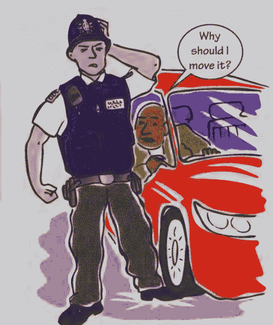

图3.4

## 自测问题

- 1. “鲁莽”一词意味着什么？
- 2. 列举三种以鲁莽足以构成犯罪的 mens rea 的犯罪。
- 3. 在 2003 年的 G 及另一案之前，鲁莽法的主要问题是什么？
- 4. G 及另一案决定了什么？
- 5. 举出一个判例，认定过失杀人可以由鲁莽构成。
- 6. 在判定被告是否疏忽时，按什么标准来评判被告？
- 7. 解释转移恶意的原则。
- 8. 举出一个 D 因转移恶意而被判有罪的案例。
- 9. 解释“actus reus 与 mens rea 的吻合”概念。
- 10. 举出一个案例，actus reus 开始时 D 不具备该犯罪的 mens rea，但因在 actus reus 持续期间获得了 mens rea 而被判有罪。

## 活动

在以下情况下说明是否存在 actus reus 和 mens rea。（不要忘记可能存在转移恶意。）

- 1. 巴特与卡拉发生争执。他朝卡拉头部挥拳，但卡拉躲开，巴特打中了站在卡拉身后的荷马。
- 2. 戴斯蒙坐在讲座上。他把椅子往后推，但没有意识到椅子的一条腿压在马克的脚上。马克要求戴斯蒙移动椅子，但戴斯蒙觉得这很有趣，没有移动而是坐在那里笑了好几分钟。
- 3. 希安朝一只猫扔石头。她的准头很差，石头击中了站在几英尺外的拉廷德。

## 考试题

‘Mens rea 要求被告有过错。当前关于故意和鲁莽的法律是不确定且不公正的。’

批判性地评估该陈述的准确性。
(OCR, G153, 2010 年 1 月)

## 第 4 章

## 严格责任

### 4.1 严格责任的概念

前一章解释了 *mens rea* 的不同类型。本章讨论那些在 *actus reus* 的至少一个方面不需要 *mens rea* 的犯罪。此类犯罪被称为严格责任犯罪。

证明严格责任的一个例子是 *Pharmaceutical Society of Great Britain v Storkwain Ltd (1986)。*

> **Pharmaceutical Society of Great Britain v Storkwain Ltd (1985)**
> 
> D 根据 s 58(2) of the Medicines Act 1968 被起诉，该条规定任何人不得在没有医生处方的情况下供应某些药物。D 已根据处方供应了药物，但后来发现处方是伪造的。没有认定 D 行为不诚实、不当甚至疏忽。伪造足以欺骗药剂师。尽管如此，上议院仍裁定初审法院指示治安法官定罪 D 是正确的。药剂师在没有真实处方的情况下供应了药物，这足以使他们对该犯罪负有罪责。

#### 4.1.1 *actus reus* 的要求

对于几乎所有严格责任犯罪，必须证明被告实施了相关的 *actus reus*。

对于 *Storkwain*，这意味着证明药剂师在没有真实处方的情况下供应了药物。还必须证明实施 *actus reus* 是自愿的。如果药剂师是在枪口威胁下被迫提供药物，则该行为不属于自愿。

然而，有少数罕见案例，被告即使没有自愿实施 *actus reus* 也被判有罪。这些被称为绝对责任犯罪。

### 4.2 绝对责任

绝对责任意味着该犯罪完全不需要 *mens rea*。它们涉及‘身份犯罪’，即 *actus reus* 是‘一种状态’的犯罪。被告之所以承担责任，是因为他们被‘发现’处于某种特定情况。此类犯罪非常罕见。要构成绝对责任犯罪，必须满足以下条件：

- 该犯罪不需要任何 *mens rea* 且
- 无需证明被告的 *actus reus* 是自愿的。

以下两个案例证明了这一点。

> **Larsonneur (1933)**
> 
> 被告来自外国（因此在当时的用语中被称为‘外国人’），已被命令离开英国。她决定前往爱尔兰，但爱尔兰警察将她驱逐并在警察看押下带回英国，她被关押在霍利黑德警察局的牢房里。她不想返回英国。她没有 mens rea。她返回的行为并非自愿。她被带回英国。尽管如此，她仍根据 Aliens Order 1920 被判有罪，罪名是‘被拒绝在英国登陆许可的外国人……被发现身在英国’。

医院，但后来被发现瘫倒在走廊的座位上。警察被叫来，他们把 D 带到医院外的道路上。他们认为他喝醉了，于是把他塞进警车，驾车带到警察局，并指控他违反 s 12 of the Licensing Act 1872 在公路上被发现醉酒。初审法院维持了他的定罪。

图 4.1

另一个案例是 Winzar v Chief Constable of Kent (1983)。

### Winzar v Chief Constable of Kent (1983)

D 被担架抬到医院，但医生检查后发现他并非生病而是喝醉了。D 被告知离开

如 Larsonneur 一案，被告并未自愿行为。他是被警察带到公路上的。在初审法院，Goff LJ 为定罪辩护，指出该特定犯罪旨在处理醉酒者在公共场所可能造成的滋扰。

不清楚 Winzar 是如何被担架抬到医院的，但他的行为中可能存在过错成分。他喝醉了（ presumably 自愿），并且必须是在救护车接他并送往医院时身处公共场所，或者他必须在并非生病而只是喝醉的情况下呼叫了医疗援助。

### 4.3 严格责任

对于所有犯罪，都存在 mens rea 的推定。法院总是从这一推定开始，但如果他们决定该犯罪对于 actus reus 的至少一部分不需要 mens rea，则该犯罪属于严格责任。这种不要求对犯罪部分要求 mens rea 的概念由两个案例说明：Prince (1875) 和 Hibbert (1869)。在这两起案件中，被告被指控将一名未满 16 岁的未婚女孩从其父亲的监管中带走，违背其意愿，违反 s 55 of the Offences Against the Person Act 1861。

### Prince (1875)

Prince 知道他带走的女孩在其父亲的监管之下，但基于合理理由相信她年满 18 岁。他被定罪，因为他有将女孩从其父亲监管中带走的意图。对于 actus reus 的这一部分需要 mens rea，而他具备必要的意图。然而，法院裁定不需要知道她的年龄。在该犯罪的这一方面存在严格责任。

### Hibbert (1869)

被告在街上遇到一个 14 岁的女孩。他把她带到另一个地方与她发生性关系。他被判无罪，因为没有证明他知道女孩在其父亲的监护之下。尽管该犯罪的年龄方面属于严格责任，但对于带走方面仍需要 mens rea，而在本案中，必要的意图未得到证明。

因为这是一项严格责任犯罪，屠夫有罪，即使他已采取合理注意以避免犯罪。屠夫在任何方面都没有过错。

#### 4.3.2 没有“尽职调查”抗辩

对于某些犯罪，法律规定了‘尽职调查’抗辩。换句话说，如果被告能够证明他已尽其所能避免犯罪，则不承担责任。

然而，似乎没有任何合理的模式来决定议会在何时包含‘尽职调查’抗辩、何时不包含。可以认为此类抗辩应始终适用于严格责任犯罪。如果这是抗辩，那么 Callow v Tillstone 案中的屠夫就不会有罪。通过请兽医检查肉类，他显然已尽一切可能确保自己不犯该罪。

另一个被告采取了所有合理措施防止犯罪但仍被判有罪，因为没有‘尽职调查’抗辩可用的例子是 Harrow London Borough Council v Shah and Shah (1999)。

#### 4.3.1 无过错

如前所述，必须证明 actus reus，并且被告实施 actus reus 的行为必须是自愿的。然而，如果被告的自愿行为无意中导致了被禁止的后果，则被告可能被定罪。即使被告对后果完全无可指责也是如此。一个例子是 Callow v Tillstone (1900) 案。

### Callow v Tillstone (1900)

一名屠夫请兽医检查一具尸体，看其是否适合人类食用。兽医向他保证可以食用，于是屠夫将其提供出售。事实上，它不适合食用，屠夫因暴露不健全肉类出售而被定罪。

### Harrow LBC v Shah and Shah (1999)

被告拥有一个售卖彩票的报刊亭业务。他们已告知员工不得向 16 岁以下的人出售彩票。他们经常提醒员工，如果对顾客年龄有任何疑问，员工应要求年龄证明，如果仍有疑问应将此事转交给被告。其中一名员工在未要求年龄证明的情况下向一名 13 岁男孩出售了彩票。售货员错误地认为该男孩已超过 16 岁。D1 当时在店内的后房：D2 并未

在该场所。被告被控向16岁以下的人出售彩票，违反1993年《国家彩票法》第13(1)(c)条。治安法官驳回了指控，但检方上诉至分庭，分庭裁定该罪属于严格责任。这意味着被告有罪。

分庭裁定该罪不要求任何 *mens rea*。向实际年龄不足16岁的人出售彩票的行为足以使被告有罪，即使他们已尽力在其商店内防止这种情况发生。

#### 4.3.3 无错误抗辩

严格责任罪的另一个特点是错误抗辩不可用。这很重要，因为如果错误抗辩可用，被告在作出诚实错误时将被宣告无罪。说明责任差异的两个案例是 *Cundy v Le Cocq* (1884) 和 *Sherras v De Rutzen* (1895)。两者均涉及1872年《许可法》下的罪行。

### *Sherras v De Rutzen* (1895)

> D 被定罪向正在执勤的警员供应酒精。当地警察在执勤时会在制服上佩戴臂章。一名正在执勤的警官在进入被告的酒馆前取下了臂章。该警官在被告在场的情况下由被告的女儿为其服务。D 认为该警员不在执勤，因为他没有佩戴臂章。D 被定罪，但分庭撤销了定罪。它裁定该罪不属于严格责任，因此真正的错误为被告提供了抗辩。
> 
> 法官指出，酒馆经营者无力防止犯罪的发生。即使酒馆经营者询问该警官，该警员否认自己正在执勤也和他进入酒馆前取下臂章一样容易。这解释了两个案例中不同的判决。一个人是否醉酒是一个可观察的事实，因此酒馆经营者应提高警惕并可避免犯下该罪。

### *Cundy v Le Cocq* (1884)

> D 被控向醉酒的人出售含酒精饮料。审理该案的治安法官认定被告及其雇员并未注意到该人已醉。治安法官还认定，在该人处于持牌场所期间，他在举止上‘安静，未做任何表示不省人事的行为；并且没有明显的醉酒迹象’。然而，治安法官认为，只要证明发生了销售并且被服务的人醉酒，该罪即告成立，并定罪被告。被告对此提出上诉，但分庭维持了定罪。

#### 4.3.4 严格责任概述

因此，当一项罪行被认定为严格责任时，适用以下几点：

- 被告必须被证明实施了 *actus reus*。
- 这必须是他本人的自愿行为。
- 对于至少 *actus reus* 的一部分，无需证明 *mens rea*。
- 不会有‘尽职调查’抗辩。
- 错误抗辩不可用。

这些因素已确立。问题在于决定哪些罪行属于严格责任。对于此，法院将首先推定 *mens rea* 应适用。这对普通法和成文法罪行均适用。

| 责任等级 | 法律 | 案例 |
|---|---|---|
| **绝对责任** | 这些罪行不需要证明 *mens rea* 或自愿的 *actus reus*。 | *Larsonneur* (1933) *Winzar* (1993) |
| **严格责任** | *Mens rea* 无需证明。 对于 *mens rea* 的某一方面无需证明，但可能需要对 *mens rea* 的另一方面进行证明。 | *Storkwain* (1986) *Prince* (1875) *Hibbert* (1869) |
| **无过错责任** | 如果 D 自愿实施了 *actus reus*（例如‘出售’），即使他没有应受谴责之处，仍需承担责任。 | *Callow v Tillstone* (1900) |
| **无‘尽职调查’抗辩** | 如果议会法案不允许‘尽职调查’抗辩，则即使 D 已尽一切可能注意，仍会有罪。 | *Harrow LBC v Shah and Shah* (1999) |
| **无错误抗辩** | 即使 D 作出了真正的错误，他仍会有罪。 | *Cundy v Le Cocq* (1884) |

图 4.2：严格责任的关键事实图表

## 自测问题

- 1. 就一项罪行而言，绝对责任意味着什么？
- 2. 给出绝对责任的案例示例。
- 3. 对于严格责任，以下两者中哪一个必须始终证明：*actus reus* 或 *mens rea*？
- 4. 解释 *Prince* 和 *Hibbert* 案例说明了什么。
- 5. 为了对严格责任罪定罪，是否有必要证明被告在任何方面有过错？
- 6. 什么是尽职调查抗辩？
- 7. 错误抗辩是否能为严格责任罪提供抗辩？

### 4.4 普通法中的严格责任

几乎所有严格责任罪都是由成文法创设的。严格责任在普通法罪行中非常罕见。仅有三种现存的普通法罪行属于严格责任。这些是：

- 公共妨害
- 刑事诽谤
- 冒犯公共道德

公共妨害和刑事诽谤可能不需要 *mens rea*，但没有现代案例。冒犯公共道德在 *Gibson and Sylvaire* (1991) 中被认定为严格责任罪。

### *Gibson and Sylvaire* (1991)

> Gibson 制作了一个艺术展品，即一个模型头部，其耳环由冷冻干燥的真实人类胎儿制成。他想突出人们对堕胎的轻率态度。该模型在 Sylvaire 的艺术画廊展出。两人都被定罪冒犯公共道德。这是一项严格责任罪，因为无需证明 D 有意冒犯公共道德，或 D 明知其行为会产生冒犯公共道德的效果。

### 4.5 成文法中的严格责任

令人惊讶的事实是，约有一半的成文法罪行属于严格责任。这相当于超过 3,500 项罪行。大多数严格责任罪具有监管性质。这可能涉及诸如规范食品、酒精和博彩票的销售、防止污染以及车辆的安全使用等事项。

由议会法案创设的严格责任罪在其定义中不会包含要求 *mens rea* 的词语。然而，在决定一项成文法罪行是否属于严格责任之前，法院仍会考虑若干因素。

### 4.6 法院的解释

议会法案的成文解释是法院的重要职能。你已学习过解释的不同规则和方法。严格责任是法院会使用成文解释的法律领域。起点是成文解释的推定之一——*mens rea* 推定。

#### 4.6.1 *mens rea* 推定

为了决定一项罪行是否属于严格责任，法院首先假定需要 *mens rea*，但如果议会在相关法案中明确或暗示性地表明这一点，他们准备将该罪行解释为严格责任。

法官在决定一项罪行是否属于严格责任时常常遇到困难。第一条规则是，如果议会法案包含表明 *mens rea* 的词语（例如‘明知地’、‘故意地’、‘恶意地’或‘允许’），该罪行需要 *mens rea*，且不属于严格责任。然而，如果议会法案明确表明不需要 *mens rea*，该罪行将属于严格责任。

然而，在许多情况下，议会法案中的某一条款对是否需要 *mens rea* 保持沉默。对此议会受到批评。如果它在所有创设刑事犯罪的条款中明确说明是否需要 *mens rea*，则不会有问题。实际情况是，在没有明确表明 *mens rea* 或严格责任的词语时，法院必须决定哪些罪行属于严格责任。

过去还存在两种其他普通法严格责任罪。其中之一是如 Lemon and Whitehouse v Gay News (1979) 所示的亵渎诽谤。

### *Lemon and Whitehouse v Gay News* (1979)

> 一首诗在《Gay News》上发表，描述了耶稣受难后对其身体实施的同性恋行为，并描述了他一生中据称的同性恋行为。编辑和出版商被定罪亵渎。上诉至上议院后，贵族法官裁定无需证明被告有意亵渎。

普通法上的亵渎诽谤罪已不复存在，因为已被议会废除。

刑事藐视法庭在普通法下也曾是严格责任罪。它现在已被制定为成文法罪行，议会已将该成文法罪行定为严格责任。

#### 4.6.2 *斯威特诉帕斯利案*中的原则

如果一项议会法案没有包含任何表明*犯罪意图*的词语，法官首先会推定所有刑事犯罪都要求具备*犯罪意图*。这一点在*斯威特诉帕斯利案*（1969）中得到了明确。

##### *斯威特诉帕斯利案*（1969）

> D 租了一间农舍并将其转租给学生。警方在农舍发现了大麻，D 被指控“参与管理用于吸食大麻树脂的场所”。D 并不知道那里有人吸食大麻。法院裁定她无罪，因为法院推定该罪行要求具备*犯罪意图*。
> 
> 在作出判决时，里德勋爵说：
> 
> > “几个世纪以来，一直存在一种推定：议会无意在成文法规范中将那些毫无过错的人定为罪犯。这意味着，每当某一条款对*犯罪意图*未作规定时，就可以推定……我们必须解读出要求具备*犯罪意图*的适当词语。”

尽管法院首先推定需要*犯罪意图*，但他们会考虑多个因素来决定该推定是应当维持还是应当被取代，从而使该罪行成为严格责任罪行。

#### 4.6.3 *加蒙*检验标准

在*加蒙（香港）有限公司诉香港律政司司长案*（1984）中，上诉人被指控以重大方式偏离经批准的建筑工程计划，违反了《香港建筑物条例》。必须确定的是，是否必须证明他们知道自己的偏离是重大的，还是说在此问题上该罪行属于严格责任罪行。

枢密院首先推定，在一个人被认定犯有刑事罪行之前必须具有*犯罪意图*，而且这种*犯罪意图*的推定适用于成文法罪行。

接着，他们提出了另外四个需要考虑的因素，即：

- 只有在法规的措辞明确或必然隐含地表明这种效果时，该推定才能被取代。
- 当罪行在性质上属于“真正犯罪”时，该推定尤其有力。
- 只有在法规涉及社会关注的问题（如公共安全）时，该推定才能被取代。
- 只有在这种严格责任有助于通过鼓励提高警惕以防止实施被禁止行为来执行法律时，才应适用严格责任。

#### 4.6.4 审查法案的措辞

如前所述，如果使用了表明*犯罪意图*的词语，则该罪行不属于严格责任罪行。如果特定条款对此未作规定，法院将查看法案中的其他条款。如果特定罪行没有意图性词语，而法案中的其他条款有，那么该罪行很可能是严格责任罪行。

在*斯托克温案*（1986）（见本章开头）中，相关条款即《1968年药品法》第58条第(2)款对*犯罪意图*未作规定。法院查看了该法案的其他条款，并认定由于其他条款中有关于*犯罪意图*的明确规定，议会意图使第58条第(2)款成为严格责任条款。

如果其他条款允许以“尽职调查”作为抗辩理由，而另一个条款不允许，那么这是法规内部另一个可能的指标，表明该罪行旨在成为严格责任罪行。

在*哈罗伦敦自治市议会诉沙阿和沙阿案*（1999）中，被告根据《1993年国家彩票法》第13条第(1)款(c)项受到指控。该款既不包含任何表明要求*犯罪意图*的词语，也没有包含任何这类词语。

由加蒙案（1984）所确立的是：该犯罪是否涉及社会关注的问题。枢密院裁定，只有在法规涉及社会关注的问题时，犯罪意图的推定才能被取代。

这使得严格责任在广泛罪行中具有合理性，因为社会关注的问题可以被视为涵盖任何“对公共健康、安全或道德构成潜在危险”的活动。

涉及食品、饮料、污染、建筑和道路使用等健康与安全事项的法规显然属于社会关注的问题，但其他问题如持有枪支也被视为公共安全事项。

即使是无照进行广播，也被认定属于社会关注的事项。这一点在*布莱克案*（1997）中有所裁定。

在*林金艾诉女王案*（1963）中，上诉人根据《新加坡移民条例》第6条第(2)款被定罪，理由是在部长根据同一条例第9条下达命令禁止其入境后，他（已经进入）仍留在新加坡。

该条例旨在防止非法移民。然而，上诉人对禁令毫不知情，也没有证据表明当局曾试图让他知悉该禁令。

枢密院认为，为了推断严格责任，仅确定该法规涉及一个严重的社会弊端是不够的。还必须考虑施加严格责任是否有助于执行这些规定。如果无助于执行，那么该罪行就不应成为严格责任罪行。

##### *布莱克案*（1997）

D 是一名唱片骑师，因未获得许可而使用无线电报电台，被认定违反《1949年无线电报法》第1条第(1)款，从而被定罪。他的辩护理由是他以为自己是在制作演示磁带，并不知道自己正在发射信号。他被定罪的基础是该罪行属于严格责任罪行。他向上诉法院提出上诉，但上诉被驳回。

#### 4.6.8 促进法律执行

在*加蒙案*（1984）中，考虑是否应施加严格责任的最后一点，即使法规涉及社会关注的问题，是看通过鼓励提高警惕以防止实施被禁止行为，是否有助于有效促进法规的目标。如果施加严格责任不能使法律更有效，那么就没有理由将罪行定为严格责任。

### 4.7 严格责任的正当性

#### 4.7.1 政策问题

议会设立的许多法定罪行旨在防止对公众造成危险或其他问题。这种危险的风险被认为超过了被告的个人权利。保护公众更为重要，尽管在某些情况下，这可能意味着已尽一切可能注意的被告仍会被定罪。

例如，许多法定罪行与汽车和其他交通工具相关。所有车辆处于安全状态并安全运行至关重要。如果做不到这一点，就会存在造成死亡或伤害的明显风险。人们认为，通过设立严格责任罪行，驾驶车辆的人会更加小心地进行定期安全检查。

罗斯科·庞德这样解释：

> ‘这类法规并非旨在惩罚恶人，而是向粗心大意和效率低下者施加压力，促使他们为了公共健康或安全而尽到全部职责。’

## 关键事实

|  | 法律 | 判例 |
|---|---|---|
| **犯罪意图的推定** | 除非措辞明确表明不需要*犯罪意图*，法院始终以需要*犯罪意图*的推定开始。 | *斯威特诉帕斯利案*（1969） |
| **审查法案的其余部分** | 如果其他条款规定需要*犯罪意图*，而所考虑的条款没有规定，则该罪行很可能被认定为严格责任罪行。 | *斯托克温案*（1986） |
| **准犯罪** | 监管性犯罪（并非真正犯罪）*更*可能被认定为严格责任罪行。 | *哈罗伦敦自治市议会诉沙阿和沙阿案*（1999） |
| **监禁刑罚** | 如果罪行可判处监禁，则被认定为严格责任罪行的可能性*较小*。 | *B 诉公诉署署长案*（2000） |
| **社会关注问题** | 如果罪行涉及对公共健康、安全或道德的潜在危险，则*更*可能被认定为严格责任罪行。 | *布莱克案*（1997） |
| **严格责任是否会促进法律执行？** | 如果将该罪行定为严格责任*无助于*执法，则没有理由将其定为严格责任罪行。 | *林金艾诉女王案*（1963） |

图4.3 法院如何决定是否适用严格责任的关键事实图

#### 4.7.2 社会效用

严格责任罪行的主要正当性在于其对整个公众的效用。严格责任罪行通过规范“涉及对公共健康、安全或道德潜在危险”的活动来帮助保护社会。将罪行定为严格责任，可通过鼓励在加工和销售食品的卫生或遵守建筑和运输法规等方面提高标准，促进对这些事项更加谨慎。这确保了企业得到妥善经营。

由于未能达到高标准可能对广大公众的生命和健康造成风险，因此有充分理由支持这一观点。然而，一些反对严格责任的人认为，没有证据表明严格责任会使企业采取更高的注意标准。有些人甚至认为严格责任可能适得其反。如果人们意识到即使尽其所能也可能会被起诉，他们可能会倾向于不采取任何预防措施。

#### 4.7.3 其他正当理由

施加严格责任的其他正当理由包括：

- 由于无需证明*犯罪意图*，因此更容易执行。
- 它节省了法庭时间，因为人们更可能认罪。

-   议会可在认为适当时提供“尽合理注意义务”抗辩。
-   缺乏可责性可在量刑时予以考虑。

-   没有证据表明其能提高标准
-   施加严格责任有违人权
-   某些严格责任罪行会带来社会污名。

由于无需证明犯罪意图（mens rea），显然执法更加直接。此外，对于轻微的监管违规行为，英国健康与安全执行局（Health and Safety Executive）和地方贸易标准官员更倾向于首先发出改进通知或禁止通知，而不是起诉。这有助于确保法律得到遵守，而无需法庭听证会。案件提交法庭时，只需证明行为本身这一事实既节省时间，也使许多人作出“认罪”答辩。

### 尽管无可责性仍需承担责任

反对严格责任的主要论点是，它使那些无论如何都不应受谴责的人被认定有罪。即使那些已采取一切可能谨慎措施的人也会被认定有罪并可能受到惩罚。

使用“尽合理注意义务”抗辩（或“无过失”抗辩）可以缓和严格责任法。在许多情况下，议会在设定该罪行的法规中规定了此类抗辩。如果这些抗辩的纳入方式保持一致，那么许多反对施加严格责任的人就会感到满意。

Harrow LBC v Shah and Shah (1999) 案就是如此，在该案中，被告已尽最大努力防止向任何16岁以下人士出售彩票。另一个已采取一切可能谨慎措施的案件是 Callow v Tillstone (1900)。在该案中，即使借助专家（兽医）也不足以避免承担责任。

然而，法律中“尽合理注意义务”条款的使用往往显得随意。例如，在 Harrow LBC v Shah and Shah (1999) 案中，相关条款允许彩票主办方提出“尽合理注意义务”抗辩，但不允许经营出售彩票业务的人提出（见第4.3.2节）。

### 即使未意识到风险也可能有罪

严格责任的最后一项理由是，量刑时可以针对可责性程度作出酌减。法官如果认为被告的可责性程度较低，可以判处非常宽大的刑罚。

即使被告未意识到任何风险，也可能被施加严格责任。

#### 4.7.4 反对严格责任的理由

在 Environment Agency v Empress Car Co (Abertillery) Ltd (1998) 案中，上议院审议了一部规定严格责任的法律中的“造成”一词。他们认为，被告只有能够证明其经营活动中发生的事件是“反常且非同寻常的”，而非日常生活中的正常事实，才能免除责任。

尽管施加严格责任有充分的理由，但也有同样有说服力的反对其使用的论点。反对严格责任的论点包括：

乍一看，这似乎为那些不知道事件可能发生的被告提供了抗辩。然而，上议院法官接着表示，即使无法预见具体被告会遇到这件事或以特定形式发生，如果该事项属于通常发生的情况，被告仍将承担责任。

-   它将责任施加于无可责性的人
-   那些未意识到风险的人也可能有罪

因此，被告可能因自己未意识到的风险所导致的事件而被判定有罪。Environment Agency v Brook plc (1998) 案就是一个例子。

### Environment Agency v Brook plc (1998)

泄漏是由密封件中的隐蔽缺陷造成的。泄漏导致了污染。有人指出，阀门缺陷是一种罕见但日常生活中正常的情况。该公司对泄漏负有责任。

### 并不能提高标准

尽管施加严格责任的一个重要理由是维持高标准，以免健康和安全受到威胁，但如前所述，没有证据表明它能提高标准。事实上，如果针对极小风险的预防措施过于昂贵，那么公司管理者可能会决定不为这些预防措施付费，而是冒这个风险。这就是“从风险中获利”的理念。公司利润比花费大笔资金防范小风险更重要。预防措施的成本甚至可能远超因其违法而被判处的任何罚款。

### 违背人权

另一个反对施加严格责任的论点是，当罪行可处以监禁时，严格责任违背了人权原则。这一点在 R v G (2008) 案中提出。

### R v G (2008)

G是一名15岁男孩，他与一个他以为15岁的女孩发生了合意性行为。事实上她只有12岁，但承认她曾告诉他自己15岁。G根据《2003年性犯罪法》第5条被起诉，罪名是强奸13岁以下儿童。他被告知这是一项严格责任罪行，他相信她15岁这一情况无关紧要。因此，他认罪。该案就两个争点被提交至上议院。第一个问题是，该罪行属于严格责任这一事实是否违反了《欧洲人权公约》第6(1)条（获得公平听审的权利）和/或第6(2)条（无罪推定）。

上议院法官一致裁定，第6条的任何部分均未违反。第6(1)条仅保障公平程序：它不涉及法律的内容。第6(2)条要求推定被告人无罪，但并未说明该罪行的主观要件或其他要件应是什么。

因此，在G案中，被告犯有一项非常严重的罪行，尽管他真诚地（并且基于合理理由）相信女孩与他同龄。

### 社会污名

R v G 案还表明，即使在造成严重社会污名的情况下，也可以施加严格责任。由于被定罪，G被列入性犯罪者名册。这对G来说是一个特别严重的后果。这是反对在确实导致严重社会污名的犯罪中施加严格责任的有力论据。

在监管性准刑事罪行中，这不是问题，因为这些罪行几乎没有或没有社会污名。

### 4.8 改革严格责任的建议

主要问题在于，无法知道议会是故意将某项罪行定为严格责任，还是没有意识到法律措辞会产生这种效果。

因此，有人建议，议会应始终明确说明某项罪行是否属于严格责任。这将意味着法院无需使用复杂的解释规则来确定某项罪行是否属于严格责任。这对所有人来说都会很清楚。

《刑法草案》提出，可以通过在法典中纳入*犯罪意图*推定来做到这一点。草案第20条规定：

> > “除非另有规定，每项罪行就其除过错要素以外的各项要素而言，均要求具有鲁莽的过错要素。”

另一种改革严格责任的方式是要求每项罪行都有“尽合理注意义务”抗辩。这将避免那些已采取一切可能谨慎措施的人被判有罪的不公正。这将与澳大利亚和加拿大的法律一致，这些国家的法官发展出一种普遍的“无过失”抗辩。

还有一种改革严格责任法的方式是规定：任何可判处监禁的罪行均不得为严格责任罪行。这项改革不如上述两个想法范围广泛，但它仍然促进正义，因为这将确保没有人会因违反严格责任而被监禁。

最后，改革严格责任法的另一种方式可能是将监管罪行从刑事体系中移除。这些可以改为作为行政问题处理。

然而，这种改革不能适用于严格责任的主流刑事罪行，例如《2003年性犯罪法》中的那些罪行。这些罪行必须保留在刑法中，并因此存在使被定罪者蒙受如*R v G*案那样不公正的风险。

## 自测题

-   1. 现有普通法罪行中有哪三项属于严格责任罪行？
-   2. 在考虑法定罪行是否属于严格责任罪行时，就*犯罪意图*而言，出发点是什么？
-   3. *Sweet v Parsley* 案作出了什么裁定？
-   4. 在 *Gammon (Hong Kong) v Attorney-General of Hong Kong* 案中提出的、在决定法定罪行是否属于严格责任时应考虑的五个要点是什么？
-   5. 举出三个“准刑事”罪行的例子。
-   6. 社会效用是设立严格责任罪行的主要理由。解释为什么如此。
-   7. 再给出三个设立严格责任罪行的其他理由。
-   8. 简要解释三个反对设立严格责任罪行的论点。
-   9. 《刑法草案》建议以何种方式改革严格责任法？
-   10. 再给出两种可以改革严格责任法的方式。

## 尝试

尝试是指某人试图实施犯罪，但由于某种原因未能完成。例如，D 向 V 开枪，意图杀害 V。正当 D 拉动扳机时，V 弯腰系鞋带。子弹错过了 V，飞过了他的头顶。D 意图杀害 V 但未成功，因此不能因谋杀罪起诉 D，因为 V 仍然活着。然而，显然 D 应当对某种犯罪承担刑事责任。如果让他逍遥法外是荒谬的。D 显然是一个危险的人，应受刑事法律约束。在这种情况下 D 可以被控企图谋杀。

企图谋杀的案例例如 White (1910)。

### White (1910)

D 将氰化物放入他母亲的饮料中，意图杀害她。她在喝下之前因心脏病发作死亡。他试图实施谋杀但并未实际杀死母亲。他被判犯有企图谋杀罪。

### 5.1 “尝试”的定义

“尝试”现由 s 1(1) of the Criminal Attempts Act 1981 定义。

### 定义

> ‘If, with intent to commit an offence to which this section applies, a person does an act which is more than merely preparatory to the commission of the offence, he is guilty of attempting to commit the offence.’

与所有犯罪一样，检方必须证明 actus reus 和 mens rea。上述定义已列出这些要件。它们是：

- Actus reus – a person does an act which is more than merely preparatory to the commission of the offence
- Mens rea – with intent to commit that offence.

### 5.2 尝试的行为要件

在 1981 年法案中“尝试”被定义之前，法院使用了几种不同的测试来判断被告是否已对主要犯罪实施了足够的行为以构成 actus reus。主要测试有：

- the ‘last act’ test: had D done the last act he could do before committing the main crime?
- the ‘proximity’ test: were the defendant’s acts so ‘immediately connected’ to the actus reus of the offence as to justify liability for attempt?

法院已裁定这些普通法测试无关紧要，重要的是被告是否实施了‘more than merely preparatory’ to the commission of the main offence 的行为。

#### 5.2.1 ‘More than merely preparatory’

被告实施的行为必须超过对主要犯罪的单纯准备。有些行为显然只是单纯的准备，但其他行为则更难归类。

让我们以 D 决定抢劫银行为例。首先，他买了一支霰弹枪并将其改造成截短霰弹枪。购买和改造都是‘merely preparatory’。接下来，他在该地区驾车绕行，检查逃跑路线。同样，这也是‘merely preparatory’。

在抢劫当天，D 偷了一辆车（‘merely preparatory’）并驾车前往银行（仍为‘merely preparatory’）。他站在银行外的人行道上，手提袋里装着截短霰弹枪。这已经更接近了，但根据 Campbell (1990) 案（见下文），仍只是‘merely preparatory’。然后他走进银行。现在他已超越单纯的准备，可以被控企图抢劫。

关于‘merely preparatory’的含义已有许多案例，很难从中得出任何一般性原则。在 Attorney-General’s Reference (No 1 of 1992) (1993) 中裁定 D 无需实施犯罪本身前的最后行为，也无需达到‘point of no return’。

> Attorney-General’s Reference
> (No 1 of 1992) (1993)
> 
> D 把一个女孩拖上几级台阶到一间棚屋。他放下裤子并触碰她的私处。他的阴茎保持疲软。他辩称因此不能企图强奸。他的企图强奸罪定罪得以维持。
> 
> 从 D 的全部行为来看，这似乎是一个合理的决定。然而，如果他在把女孩拖到棚屋后立即被制止，而在他放下裤子或触碰她之前，那么他可能不太可能被定罪。他拖拽女孩的行为很可能‘merely preparatory’。

在 Gullefer (1987) 中，上诉法院裁定‘more than merely preparatory’意味着被告必须超越纯粹的准备行为并‘embarked on the crime proper’。

> Gullefer (1987)
> 
> D 跳上赛道以使比赛被宣布无效，从而能够收回他为该比赛下注的钱。他的企图盗窃罪定罪被撤销，因为他的行为只是实施犯罪的准备性行为。

#### 5.2.2 显示单纯准备的案例

Gullefer 案（上文）说明了 D 的行为只是准备的情况。虽然 D 试图干扰比赛，但在盗窃（即他收回赌注的钱的时刻）之前他还有若干行为要做。他必须去一个投注点并要求退还他的钱。甚至只是走向该点也不足够。然而，要求退钱会使他的行为变为‘more than merely preparatory’。他将犯有企图盗窃罪。值得注意的是，当钱被交给他时，他随后将犯有主要的盗窃罪。

上诉法院指出，尝试开始于‘the merely preparatory acts have come to an end and the defendant embarks upon the crime proper’。它还指出，这一时刻何时发生将取决于任何特定案件中的事实。

Geddes (1996) 案也说明了仅为准备性的行为。

### Geddes (1996)

D 被发现在一所学校的男厕所内，持有大型厨房刀、绳子和胶带。他无权在学校内。他未联系任何学生。他的企图非法监禁罪定罪被撤销。

这一案例难以为继。D 无权在该处所逗留。他带着非法监禁学生的全部设备进入了学校。下一步将是他接近一名学生。如果尝试法要有效地保护人们免受主要犯罪的侵害，那么他难道不应该在那时就犯有企图罪吗？等到他接近学生才采取行动是明智的吗？

然而，上诉法院认为应通过提出两个问题来考虑尝试：

- 1. Had the accused moved from planning or preparation to execution or implementation?
- 2. Had the accused done an act showing that he was actually trying to commit the full offence, or had he got only as far as getting ready, or putting himself in a position, or equipping himself, to do so?

使用这两个问题，可以看出 Geddes 并未完全从计划或准备转向执行。此外，可以认为他仅做到准备就绪，或把自己置于能够实施完整犯罪的位置，或为此配备自己。

另一个或许更难以为继的案例是 Campbell (1990)。

### Campbell (1990)

D 口袋里有一把仿真枪、太阳镜和威胁字条，站在邮局外的街道上。他的企图抢劫罪定罪被撤销。

本案的下一步将是 D 进入邮局。同样，如果尝试法要有效地保护人们免受主要犯罪的侵害，他难道不应该在那时就犯有企图罪吗？等到他进入邮局才采取行动是明智的吗？如果枪是真的，邮局的顾客和工作人员就会面临风险。

图 5.1

#### 5.2.3 存在尝试的案例

以下三个案例显示了被告已超越单纯准备的情况。在每一起案件中，被告都被认定犯有企图实施完整犯罪的罪行。

## Boyle and Boyle (1987)

被告被发现站在锁和一个铰链损坏的门旁。他们因企图入室盗窃被定罪，上诉法院维持了定罪。

上诉法院认为应使用的测试标准是被告是否已着手实施犯罪本身。在本案中，一旦被告进入，他们就会实施入室盗窃，因此试图进入即构成未遂。

## Tosti (1997)

D 企图盗窃房产。他带了金属切割设备并将其藏在房产附近的灌木丛后面。然后他检查了门上的挂锁。他没有损坏挂锁。他被判企图入室盗窃罪成立。

对于这两个案件而言，与 Campbell 的区别在于，入室盗窃是在 D 作为非法侵入者怀有盗窃意图（或实施某些其他犯罪的意图）进入时即告成立。抢劫则要等到 D 为实施盗窃而使用武力时才成立。走进一栋建筑物仍使犯罪本身的实施留有另一步骤。

在下一个案件 Jones (1990) 中，被告在实施完整犯罪前已几乎做完了他能做的一切。

## Jones (1990)

D 的伴侣告诉他她想结束关系并且正在与另一名男子 V 约会。D 买了一支霰弹枪并缩短了枪管。D 然后找到了 V，V 正在他的车里。D 身穿戴着护目镜拉下的头盔，坐进了 V 的车并用枪指着 V。V 抓住枪并设法将其从车窗扔了出去。D 的企图谋杀罪名被维持。

## Key Cases

| Case | Facts | Offence attempted | Point of law |
|---|---|---|---|
| *存在足够构成未遂的案件* | | | |
| A-G's reference (No 1 of 1992)(1993) | D 试图强奸一名女孩但无法勃起。 | 强奸 | 无需实施最后行为。 |
| Boyle and Boyle (1987) | 站在一扇锁损坏的门旁。 | 入室盗窃 | 已实施一系列行为的一部分。 |
| Jones (1990) | 枪支保险仍处于开启状态。 | 谋杀 | 有足够证据将是否存在未遂的问题提交给陪审团。 |
| *仅属准备行为的案件* | | | |
| Guillefer (1987) | 打断比赛意图收回赌注。 | 盗窃 | D 是否已“着手实施犯罪本身”？ |
| Geddes (1996) | 在学校携带刀、绳子和胶带。 | 非法拘禁 | D 是否“实际试图实施所涉犯罪”？ |
| Campbell (1990) | 在邮局外持有仿真枪和威胁信件。 | 抢劫 | 仅属准备行为。 |

Figure 5.2 关于未遂中“仅属准备行为”的关键案例图表

D 试图争辩说，由于保险仍处于开启状态，他尚未实施犯罪本身之前的最后行为。上诉法院表示，购买枪支、缩短枪管、装填以及戴护目镜伪装都是准备行为。但一旦 D 进入 V 的车并用枪指着 V，就有足够证据将是否存在未遂的问题留给陪审团裁决。

### 5.3 *主观要件* 的未遂

对于未遂，被告通常必须具有与完整犯罪相同的意图。如果检方不能证明 D 具有该意图，则 D 不构成未遂。这在 *Easom* (1971) 案中得到体现。

### *Easom* (1971)

D 在电影院里拿起一个女人的手提包，翻找了一下，然后把包放回地板上，没有从中取出任何东西。他因盗窃包及其内容物被定罪，该定罪被撤销。上诉法院还拒绝将其定罪改为企图盗窃包和特定内容物（包括钱包和钢笔）的定罪，因为没有证据表明 D 企图盗窃这些物品。

在本案中，没有证据表明被告意图永久剥夺所有人对包或其中物品的所有权（盗窃所需的 *主观要件* 的一部分）。因此，他不能构成企图盗窃罪。

类似的决定在 *Hussey* (1977) 案中作出。

### *Hussey* (1977)

D 和另一名男子被看到在货车后方徘徊。当警察靠近时，他们跑开了。D 被定罪企图盗窃货车内的潜水设备。上诉法院撤销了他的定罪。

上诉法院在这两个案件中的决定可以受到批评。被告难道不打算偷点什么吗？*Easom* 未这样做（可能是因为没有什么真正值得偷的东西）不应使他不构成企图盗窃罪。同样，在 *Hussey* 案中，他因警察到来而逃跑并不意味着他没有试图偷窃。

这些问题在 *Attorney-General’s Reference* (Nos 1 and 2 of 1979) (1979) 中得到解决，上诉法院决定如果 D 具有条件性意图（即如果有值得偷的东西就打算偷任何东西），D 可以被控企图盗窃全部或部分内容物。这是对该问题的技术性程序性规避。

因此，*Easom* 现在将被控企图盗窃包内全部或部分内容物，而非包本身及其中的特定物品。*Hussey* 将被控企图盗窃货车内全部或部分内容物。这样他们就可以被认定为企图盗窃罪成立。

#### 5.3.1 对于 *主观要件* 来说，鲁莽是否足够？

如果能证明被告是鲁莽的，这是否足以使他构成未遂？在 *Millard and Vernon* (1987) 中判定不足够。

### *Millard and Vernon* (1987)

Ds 反复推撞足球场看台上的木制围栏。检方指控他们试图破坏它并被定罪企图刑事损害。上诉法院撤销了他们的定罪。

鲁莽通常不足以构成未遂的 *主观要件*。即使鲁莽足以构成已完成的犯罪也是如此。然而，有一个例外，即对犯罪某一部分的鲁莽可以足够。这由 *Attorney-General's Reference (No 3 of 1992)* (1994) 举例说明。

### *Attorney-General's Reference (No 3 of 1992) (1994)*

D 向一辆载有四名男子的汽车投掷汽油弹。炸弹未击中汽车，而是无害地撞到墙上。D 被控企图纵火并意图危及生命。审判法官裁定必须证明 D 意图损坏财产并危及生命。D 被判无罪。

上诉法院认为审判法官是错误的。必须证明 D 意图损坏财产，但只需证明他对生命是否会受到危害持鲁莽态度即可。

### 5.4 企图不可能之事

在某些情况下，一人可能意图实施犯罪并可能做了一切能做的事来实施它，但事实上该犯罪是不可能实施的。

一个例子是 D 进入 V 的房间并在 V 躺在床上时刺伤 V。事实上，V 在 D 刺伤他两小时前就因心脏病发作死亡。D 只是刺伤了一具尸体。谋杀 V 在物理上不可能，因此 D 不能因谋杀 V 而被定罪，但 D 能否因企图谋杀 V 而被定罪？

另一个例子是 D 认为他以很低的价格购买的商品是赃物。他愿意继续进行，认为自己在“处理赃物”。事实上，商品并非赃物，因此在这种情况下处理赃物罪在法律上不可能。D 是否应因企图处理赃物而被定罪？

在 1981 年之前，根据普通法，上议院曾裁定如果犯罪在法律上或物理上不可能实施，则被告不能因企图实施该犯罪而被定罪。当《1981 年刑事未遂法》通过时，其中包含第 1(2) 条，旨在堵住这一漏洞，即使完整犯罪不可能，也使被告因未遂而被定罪。

《1981 年刑事未遂法》第 1(2) 条规定：

> ‘一个人可能因企图实施犯罪而被定罪……即使事实是犯罪的实施是不可能的。’

该法案通过后，上议院不得不在 *Anderton v Ryan* (1985) 案中考虑这一条款和企图不可能之事的问题。

### *Anderton v Ryan (1985)*

Mrs Ryan 以很低的价格买了一台录像机。她认为它是被盗的。后来她在警察调查她家发生的入室盗窃时向警察承认了这一点。她的定罪被撤销，因为录像机事实上并未被盗。

上议院认为，即使 Mrs Ryan 已超出仅仅准备行为，事实上她所有的行为都是无辜的。录像机并未被盗。基于此，他们认为第 1(2) 条并未使她被定罪。

然而，不到一年后，上议院在 *Shivpuri* (1986) 中推翻了这一决定。

### *Shivpuri (1986)*

D 同意接收一个他认为装有违禁毒品的行李箱。行李箱被送给他，但里面只有鼻烟和

无害植物物质。D被定罪为企图故意参与交易违禁药品。

这次上议院认为第1(2)款和第1(3)款均相关。第1(3)款规定：

> “在任何情况下——
> (a) 除本款另有规定外，某人的意图原本不会被视作构成犯罪意图，但
> (b) 如果案件事实如他所相信的那样，其意图就会被如此认为，则就第(1)款而言，该人应被视为具有实施该犯罪的意图。”

《1981年刑事未遂法》第1(2)款和第1(3)款的共同效力意味着，即使完整犯罪不可能实施，一个人也可能构成未遂。在Shivpuri案中，他所相信的事实是手提箱内装有违禁药品。他意图交易毒品，因此根据第1(3)款，其意图被视为具有实施该犯罪的意图。

上议院承认其在Anderton v Ryan (1985)案中的裁决是错误的，并利用《实践声明》推翻了该裁决。

### 5.5 未遂的法律是否令人满意？

有几点可以说是不尽如人意的。

- 法院在划分“仅仅预备”与未遂之间的界限时并不十分明确。
- 该领域的一些判决并不能有效保护公众。
- 《刑事未遂法》的措辞规定，被告人必须实施一个超过仅仅预备的行为。这意味着未遂不能通过不作为实施。
- 该定义规定D必须“意图实施犯罪”而行为。这是否意味着只有直接故意才足以构成未遂的犯意？
- 早期关于犯意的判决留下了一个漏洞，即D意图在找到值得偷的东西时盗窃（见第5.3节）。
- 在D不可能实施完整犯罪的情况下，是否应因其意图而判定有罪？

### 关键事实

|   | 未遂 | 案例或法规 |
|---|---|---|
| “未遂”的定义 | 意图实施犯罪，而实施的行为超过犯罪的单纯预备行为。 | 《1981年刑事未遂法》第1(1)条 |
| “超过仅仅预备” | D必须已着手实施犯罪本身，或D必须正在试图实施完整犯罪。 | Gullefer (1987) Geddes (1996) |
| 未遂的犯意 | D必须具有实施完整犯罪的意图。有条件的意图即足够。  轻率通常不够，但对犯罪的某一部分的轻率可能足够。 | Easom (1971) Attorney-General’s Reference (Nos 1 and 2 of 1979) (1979) Millard and Vernon (1987)  Attorney-General’s Reference (No 3 of 1992) (1994) |
| 不可能完成的未遂 | 《1981年刑事未遂法》第1(2)款和第1(3)款规定，即使完整犯罪在法律上或事实上不可能，D也有罪。 | Shivpuri (1986) |

图5.3 关于未遂的关键事实表

#### 5.5.1 什么是“超过仅仅预备”？

我们在第5.2.1节中考察的Gullefer、Geddes和Campbell案表明，法院在决定什么才是“超过仅仅预备”时，并不总是准备采取宽泛的方法。这使得人们很难确切知道什么行为会被认为超过仅仅预备。

然而，可以说，“超过仅仅预备”这一检验标准相比《1981年刑事未遂法》通过之前的法律是一种改进。旧法使用了多种不同的检验标准，因此在任何特定案件中很难预测会使用哪种标准。（关于法律委员会《共谋与未遂》咨询文件第183号（2007年）中所述历史背景的摘要，见附录1第A.1.2节。）

“超过仅仅预备”检验标准有助于澄清和简化法律。这也使陪审团更容易适用法律，因为他们可以用常识来判断被告所做的事情是否“超过仅仅预备”。然而，它确实在法律中留下了漏洞，导致出现Gullefer、Geddes和Campbell等情形。

法律委员会在其咨询文件《共谋与未遂》第183号（2007年）中建议，法律应进行改革，设置两种犯罪而不是仅规定未遂。他们建议这两种犯罪是：

- 犯罪未遂
- 犯罪预备

委员会提议，“犯罪未遂”将限于D在完整犯罪实施前实施了最后行为的情形。根据法律委员会的观点，“犯罪预备”将是D从事了准备实施完整犯罪的行为。这将意味着像Gullefer、Geddes和Campbell这样的案件将归入这一类。

然而，经过咨询，法律委员会发现法官和律师并不赞成设置两种犯罪。在其报告《共谋与未遂》（2000年）（第218号报告）中，法律委员会放弃了设置两种犯罪的想法。

### 活动

请解释以下每种情形中是否存在犯罪未遂。

1. 阿米尔知道他的女朋友一直和布莱克约会。阿米尔计划毁掉布莱克的容貌。他买了一些酸，打算泼到布莱克的脸上，然后开车前往布莱克的家。当他正要下车时，看到附近有一辆警车。阿米尔立即开车离开。
2. 康纳在唐娜的饮料中放了毒药，意图杀死她。他放入饮料的剂量不足以致命，唐娜活了下来。
3. 菲伊在女洗手间看到一个手提包。她希望里面有一些钱，于是打开它。事实上，包里只有化妆品和纸巾。菲伊合上包并放回原处。
4. 格雷格和汉斯被发现在一栋房子的花园里，口袋里带着面具、手电筒和螺丝刀。他们承认他们意图入室盗窃。
5. 伊恩向贾尼开了一枪，但没有击中。他承认他意图杀死她。

#### 5.5.2 公众保护

在考虑这一点时，还必须问为什么实施未遂犯罪应使某人承担刑事责任。主要的理由是它可以防止完整犯罪的发生。如果警察必须等到D开枪杀死V，而不能以谋杀未遂逮捕D，那将是荒谬的。因此，考虑到预防犯罪和保护潜在受害者很重要，尤其是Geddes和Campbell案的判决难以与此相协调。

格迪斯实际上在学校里，带着绑架（非法监禁）一名学生所需的所有设备。当然，为了公众保护（本案中即学校的学生），格迪斯应构成未遂罪。

#### 5.5.3 未遂能否通过不作为实施？

《1981年刑事未遂法》的措辞意味着未遂只能通过行为实施。法律委员会在其第183号咨询文件（2007年）中指出，如果D故意饿死其婴儿，即使死亡是通过“什么都不做”而非积极的杀人行为实现的，这也构成谋杀。然而，根据该法的措辞，D不能以谋杀未遂被起诉。

为了弥补这一法律漏洞，法律委员会在2009年的报告中建议修改《1981年刑事未遂法》。该修正案意味着，如果D（怀着杀死V的意图）未能履行其对V的法律义务，且该不作为若不加以阻止可能导致V死亡，则D可被判谋杀未遂罪。

如果这一提议被采纳，将填补法律上的这一漏洞。

#### 5.5.4 未遂所需的犯意

《1981年刑事未遂法》第1条中的定义使用了“意图实施犯罪”这一短语。没有明确该定义中的“意图”仅指“直接”故意，还是包括直接和间接故意。换言之，D对后果的预见是否足以构成未遂的犯意。

法院普遍认为“意图”也包括对后果的预见。法律委员会决定不建议对该法律进行任何修改，因为法院对“意图”采取的宽泛方法正在发挥作用。他们不给出“意图”完整定义的主要原因是，没有任何其他犯罪对“意图”有法定定义。他们更希望在一个关于犯意的一般原则法典中给出意图的定义，以便适用于所有要求“意图”的犯罪。

### 犯意的程度

与未遂有关的另一个问题是，对于某些犯罪，未遂所需的犯意水平高于完整犯罪所需。

例如，在谋杀罪中，可以通过证明D意图杀死或意图造成极其严重的身体伤害来证明犯意。然而，对于谋杀未遂，必须证明D意图杀死。意图造成极其严重的身体伤害不足以构成谋杀未遂的犯意。

这使得法律看起来对那些被指控未遂的人比对被指控完整犯罪的人更有利。然而，一个意图造成极其严重的身体伤害但未实施完整犯罪的被告，可以被指控犯有违反《1861年侵害人身罪法》第18条的意图造成严重身体伤害的未遂罪，因此被告不会完全逃脱责任。

## 轻率

法律上还存在一个不一致之处：尽管轻率（recklessness）通常足以构成完整犯罪的犯罪意图（mens rea），但对于犯罪未遂的犯罪意图而言，通常并不足够。

在*Millard and Vernon*案中宣告无罪是否正当（见第5.3节）？他们反复推挤围栏而构成的轻率行为，是否应该让他们对犯罪未遂的刑事损害承担责任？

还是说，检方必须证明他们意图损坏围栏才更为正当？如果他们因轻率而对未遂承担责任，那将意味着即使他们并未形成任何*犯罪意图*，也会被判有罪。毕竟，刑法的一个关键原则是：除非一个人有犯罪意念，否则不应被判有罪。

有关未遂法中*犯罪意图*问题的进一步解释和讨论，见附录1 A.1.3节，其中引用了法律委员会的报告*《共谋与未遂》*（第304号，2009年）的节选。

## 5.5.5 有条件意图

有条件意图是指，被告人（D）仅在某些条件得到满足时才意图实施犯罪。正如在*Husseyn*案（第5.3节）中所述，这意味着被告人可能被认定未遂罪不成立。

绕过这一问题的唯一办法是确保起诉书的起草方式符合特定要求。然而，依赖正确的程序来解决问题并非令人满意的方式。

法律委员会建议修改《1981年刑事未遂法》中关于未遂的定义，使实施犯罪的意图包括有条件地实施该犯罪。如果这一建议被采纳，法律中的这一漏洞将得到填补。

## 5.5.6 仅凭意图是否就应判定被告人有罪？

相反的观点认为，被告人不应当仅因其意图而承担刑事责任。他必须为完成完整犯罪做出一些行为。这引发了一个问题：在事实表明完整犯罪不可能完成的情况下，议会是否应让被告人承担责任？

Shivpuri是否应该有罪？他实际上并没有交易毒品，也没有实施任何错误行为。他原本意图实施犯罪，这就足够了吗？

同样，可以论证的是，能够对像Shivpuri这样的人定罪是符合公共利益的。毒品交易给社会带来了许多问题。

## 自测题

- 1. 哪一部法律的哪一条款对‘未遂’作出了定义？
- 2. 请给出‘未遂’的定义。
- 3. 请举出两个案例，其中被告人（D）被认定实施了‘不仅仅是预备行为’的行为。
- 4. 请举出两个案例，其中被告人（D）的行为被认定仅为预备行为。
- 5. 解释‘有条件意图’的含义。有条件意图能否足以构成犯罪未遂的*犯罪意图*？
- 6. 轻率能否足以构成犯罪未遂的*犯罪意图*？
- 7. 该法就‘企图实施不可能之事’作了何种规定？
- 8. *Shivpuri*案就‘企图实施不可能之事’作出了何种判决？
- 9. 解释犯罪未遂的法定定义在哪些方面是对先前法律的一种改进（请举出一例）。
- 10. 解释当前关于犯罪未遂的法律在两个哪些方面不尽如人意。

## 考试题

思考：当前关于犯罪未遂的法律是否在保护社会与仅对有应受惩罚者定罪之间取得了恰当的平衡？

（OCR G153样卷）

## 第6章

## 谋杀罪

杀人罪是指非法杀害他人的行为。根据被告人的犯罪意图以及被告人是否享有特别抗辩，存在不同的罪名。最严重的杀人罪是谋杀罪。

### 6.1 ‘谋杀罪’的定义

谋杀罪是普通法上的犯罪。这意味着它并非由任何议会法案所定义，而是通过法官在不同案件中的判决来界定。公认的定义基于17世纪法官柯克勋爵（Lord Coke）所给出的定义。

### 定义

> ‘谋杀罪是指，在国王（或女王）的和平之下，非法杀害一名实际存在的理智之人，并怀有（明示或默示的）预谋恶意。’

该定义的不同要素将在下文第6.2节和第6.3节中，分别围绕谋杀罪的犯罪行为（actus reus）和犯罪意图（mens rea）详细讨论。

### 管辖权

显然，一个人可以因在英格兰和威尔士任何地方犯下的谋杀罪而被起诉。但谋杀罪的特殊之处在于，其管辖权还包括英国公民在任何一个国家实施的任何谋杀行为。这意味着，如果被告人是英国公民，他可能会因被指控在另一个国家犯下的谋杀罪而在英国法院受审。

### 6.2 谋杀罪的犯罪行为

谋杀罪的犯罪行为是指，在女王和平之下，非法杀害一名实际存在的理智之人。具体分解来看，必须证明：

- D（被告人）实施了杀害
- 一名实际存在的理智之人
- 在女王的和平之下，并且
- 该杀害是非法的。

#### 6.2.1 ‘杀害’

### 作为或不作为

杀害的犯罪行为可以通过作为或不作为实施，但必须导致被害人死亡。通常在谋杀案件中，犯罪行为是作为。但请记住，我们在第2章第2.2节中看到，不作为（未能采取行动）也可能使一个人对犯罪承担责任。

这一点同样适用于谋杀罪，正如Gibbins and Proctor案（1918）所示：一名七岁女孩的父亲和他的情妇把女孩与父亲的其他孩子隔离开来，并故意将其饿死。父亲有抚养她的义务，因为他是她的父亲；而情妇则被认定承担了照看包括女孩在内的孩子们的责任，因此她也有义务喂养这个孩子。这种不作为或未能喂养她的行为是故意的，且怀有杀死她或对她造成严重伤害的意图。在这些情况下，他们构成谋杀罪。未能喂养女孩这一行为足以构成谋杀罪的犯罪行为。

### 因果关系

谋杀罪是结果犯。除非被告人的作为或不作为造成了死亡，否则其不构成犯罪。在大多数情况下这并无问题。例如，D朝V的头部开枪，V当场死亡。然而，在某些案件中，可能有其他原因导致死亡，例如医疗不佳。这类情况就引发了因果关系问题。

关于因果关系的法律在第2章第2.3节中有全面论述，你需要了解那里所述的法律。

#### 6.2.2 ‘实际存在的理智之人’

这一短语意指‘人类’。因此，构成谋杀罪必须有人被杀害。通常，定义的这一部分不会造成任何困难。仅有的两个问题领域是：

- 子宫内的胎儿是否属于‘实际存在的理智之人’？
- 如果被害人‘脑死亡’但依靠生命维持机器维持生命，是否仍被视为活着（因而是‘实际存在的理智之人’）？

### 胎儿

杀害胎儿不能以杀人罪提起诉讼。儿童必须具有‘独立于母体的存在’才能被视为‘实际存在之人’。这意味着它必须已从母体中排出，并具有独立的循环。不过，连接母子的脐带未必需要剪断。此外，极有可能的是，儿童未必需要已经呼吸第一口气才能被视为‘实际存在的理智之人’。

此外，在总检察长参考意见（1994年第3号）（1997）案中，上议院指出，如果胎儿受到伤害，而儿童出生时存活，但之后因这些伤害而死亡，这可以构成谋杀罪或过失杀人罪的犯罪行为。

### 总检察长参考意见（1994年第3号）（1997）

被告人刺伤了他怀孕约23周的女友。女友从刀伤中康复，但这次刺伤导致她在被刺后约七周早产。婴儿出生时存活，但四个月大时因早产而死亡。被告人被指控谋杀该儿童。在审判中，法官指示，胎儿不属于‘实际存在的理智之人’，因此被告人在法律上不能构成谋杀或过失杀害该儿童。被告人被宣告无罪。

上议院同意，在胎儿出生前死亡的情况下，这一认定是正确的，但附带意见指出：

> ‘对胎儿实施暴力，导致婴儿存活出生后遭受伤害，可引发刑事责任。’

然而，他们认为，在这种情况下，由于缺乏谋杀罪的犯罪意图，该罪行属于过失杀人罪。

## 脑死亡

是否将处于“脑死亡”状态的人视为“合理存活的生物”尚不确定。医生可以关闭生命维持机器而不承担杀人罪的责任。这表明“脑死亡”是被认可的死亡判定标准，但对此点尚无案例。法院可能裁定，被告若非出于医疗决定而关闭生命维持机器，并意图杀害受害者，可能构成谋杀罪。

## 'Year and a day' rule

过去曾有一条规则，即死亡必须发生在袭击后一年零一天之内。该规则在过去几个世纪是合理的，当时医学知识不足以证明袭击在如此长的时间后导致了死亡。然而，随着医学技能的改进，该规则已过时。特别是，这意味着，如果受害者处于昏迷状态，并在袭击后一年多才死亡，袭击者就不能被指控谋杀。因此，“一年零一天”规则已被1996年的《法律改革（一年零一天规则）法》废除。现在对死亡发生在违法行为之后的时间没有限制，但如果死亡发生在袭击后超过三年，则需要总检察长的同意才能起诉。

#### 6.2.3 Queen’s Peace

“在女王的和平之下”意味着在战争过程中杀害敌人不构成谋杀。然而，杀害战俘足以构成谋杀的客观要件。

#### 6.2.4 ‘Unlawful’

杀人必须是违法的。如果杀人是在自卫或防卫他人或在防止犯罪的情况下，且被告在当时情况下使用了合理的武力，则杀人并非违法。

自卫和防卫他人的抗辩是普通法抗辩，可证明被告的行为正当。它们可以作为对任何犯罪的抗辩，包括谋杀，因为被告是在为使用武力辩护。此外，根据1967年《刑事法》第3(1)条，还有一项防止犯罪的成文法抗辩，该法规定：

> ‘a person may use such force as is reasonable in the circumstances in the prevention of crime.’

这也可以作为对任何犯罪的抗辩，包括谋杀。

一个被认为杀人行为正当的有趣案例是 Re A (Children) (Conjoined Twins) (2000)。

## Re A (Children) (Conjoined Twins) (2000)

双胞胎女孩在下腹部相连出生。其中一个双胞胎（J）能够单独存活，但另一个双胞胎（M）不能。M靠一条共同动脉存活，通过该动脉，J更强的心脏为两人循环输送足够的氧合血液。如果双胞胎不分离，两名女孩都会在六个月内死亡，因为J的心脏最终将无法再为血液泵送。如果双胞胎被分离，M必然会死亡。

双胞胎的父母拒绝允许分离，因此医院当局申请宣告分离是合法的。上诉法院裁定分离是合法的。作出此裁定的主要原因是必要性抗辩证明了分离的正当性（参见第12.5节关于必要性）。然而，其中一位法官（Ward LJ）认为，M依赖J心脏的血液相当于对J的潜在致命攻击。这使医生有权介入并使用武力拯救J。

对于这三种抗辩而言，关键点都是使用武力及其程度在当时情况下是否合理。

## Reasonable force

在判定所用武力是否合理时，被告仅做了他诚实且本能地认为在意外痛苦的一刻所必需的事情，这一事实是防御行为合理的非常有力的证据。

在审视情况时，被告必须根据他真诚相信的事实来评判。即使被告对真实事实存在错误，这种规则也适用。该规则由 Beckford (1988) 举例说明。

## Beckford (1988)

D是牙买加的一名警察。他和其他警察前往一所房屋调查有人报告称一名持枪男子正在 terrorize 他的家人。当D接近房屋时，他看到一名男子从中跑出。D开枪射杀了该男子。D声称他相信自己的生命处于危险之中，因为他认为该男子仍持有枪支。事实上，该男子被射杀时并没有枪。D被定罪并上诉至枢密院，枢密院撤销了他的定罪，因为陪审团应被允许考虑D是否真诚地相信自己的生命处于危险之中。

Lord Griffiths 在案件中作出判决时指出：

> 'a genuine belief in a fact which if true would justify self-defence [must] be a defence to a crime of personal violence because the belief negates the intent to act unlawfully.'

因此，被告真诚相信的事实是重要事实，即使该信念是错误的，甚至是不合理的。

在自卫、防卫他人或防止犯罪时可以使用多少武力，现已在2008年《刑事司法与移民法》中作出解释。该法规定，在判定所用武力在当时情况下是否合理时：

> 'that a person acting for a legitimate purpose may not be able to weigh to a nicety the exact measure of any necessary action; and that evidence of a person’s having only done what the person honestly and instinctively thought was necessary for a legitimate purpose constitutes strong evidence that only reasonable action was taken by that person for that purpose.'

这承认了面对他人攻击的人处于压力之下，不能期望其在当时情况下精确计算需要使用的武力。如果有证据表明该人“诚实且本能地”认为他为保护自己或他人或防止犯罪而使用的武力水平是合理的，则这提供了防御行为在当时情况下合理的有力证据。

《每日邮报》上的一篇文章摘录说明了自卫中合理武力的法律。请阅读并回答以下问题。

## Activity

## Householder who stabbed burglar to death faces no further action as prosecutor says he used ‘reasonable force’

一名被逮捕涉嫌谋杀入室盗窃者的房主将无罪释放。

59岁的Peter Flanagan在John Bennell，27岁，死于胸部刺伤后被拘留，原因是多名蒙面男子试图闯入他在索尔福德的家中。

西北地区首席王室检察官Nazir Afzal表示：“我今天已告知警方，我决定Peter Flanagan不应因2016年6月22日闯入其索尔福德家中的入侵者John Bennell之死而面临任何指控。”

Afzal先生补充说：“我确信Peter Flanagan是在自卫后采取行动的，他在午夜前不久被家中楼下的噪音吵醒。在调查骚乱时，他被入侵者 confront，其中一人手持马切特刀。

“在作出这一决定时，我仔细研究了警方在本案中提交的证据，并考虑了王室检察署关于房主和使用武力对抗入侵者的政策。

“人们有权在自卫中对自己、家人和财产使用合理武力。所有证据都表明，在他所面临的可怕情况下，Flanagan先生做了他诚实且本能地认为有必要保护自己和家园免受入侵者侵害的事情。”

Daily Mail online 22 July 2011

## Questions

- 1. Peter Flanagan 是否实施了可能构成谋杀客观要件的行为？
- 2. 谋杀所需的犯罪意图是什么？
- 3. 根据上述事实，你认为Peter Flanagan是否具有谋杀的犯罪意图？
- 4. 为什么他没有被控谋杀？
- 5. 1967年的一项议会法案允许自卫抗辩。该法案叫什么名字，哪一条规定了该抗辩？
- 6. 摘录最后一段中“诚实且本能地”（认为有必要）一词是引用哪部法律的哪一条？
- 7. 你是否同意王室检察署在本案中不予起诉的决定？

## Excessive force

为自卫或防卫他人而使用的武力必须在当时情况下是合理的。如果使用过度武力，抗辩将失败，正如 Clegg (1995) 案所示。

## Clegg (1995)

D是北爱尔兰一个检查站的值勤士兵。一辆汽车高速驶向检查站并打开大灯。士兵中的一人喊叫让其停车，但它没有停。Clegg向汽车挡风玻璃开了三枪，并在汽车经过他时又开了一枪。这最后一枪击中了车内乘客的后背并将其杀死。证据显示，汽车在最后一枪开出时已经驶过Clegg。因此裁定他不能以自卫作为抗辩，因为开枪时不存在危险。当时的武力是过度的，他的谋杀定罪得以维持。

请注意，1999年，Clegg案由刑事案件审查委员会发回上诉法院。在这次审理中，他的定罪被撤销，因为新的法医证据使致命枪击是否确实由Clegg开出产生了怀疑。
另一个被判定所用武力水平不合理的案例是 Martin (Anthony) (2002)。

## 马丁（安东尼）（2002）

D 枪杀了两名闯入其农舍的窃贼，其中一人死亡。证据显示窃贼在离开时被 D 枪击，而死亡的窃贼是被射中后背。D 被判谋杀罪成立。他以自卫抗辩提出上诉，理由是他患有偏执型人格障碍，这意味着他可能真实地但错误地认为自己处于极其危险的境地。

上诉法院以此为由驳回上诉，因为其认为人格障碍在考虑自卫抗辩时不得被考虑在内。然而，由于 D 存在责任能力减弱，定罪被降为误杀，见第 7.1 节，了解责任能力减弱的解释。

2009 年《验尸官与司法法》现已创设了对谋杀的“丧失控制”部分抗辩。该抗辩可在 D 因害怕严重暴力而丧失控制时杀人时使用。见第 7 章，了解该抗辩的更多细节。

有可能 Clegg 和 Martin 情况中的被告现在可能能够使用该抗辩，尽管他们必须证明自己丧失了控制。

因此，使用武力可以证明被告行为正当的规则如下：

- 自卫/防御他人/预防犯罪的抗辩是证明 D 的行为正当的抗辩，从而使其不被视为违法。
- 使用的武力必须在当时情况下是合理的。
- 情节包括 D 真实相信的情况。即使该信念是错误或不合理的，只要陪审团接受 D 真实相信这一点，就如此。
- 然而，影响 D 对情况感知的性格障碍不得被考虑在内。
- 武力的程度在 D 所相信的情况下不得过度。

## 活动

阅读以下情况并解释是否出现了谋杀的 actus reus。

- 1. Jane 因 Karina 由 Jane 的男友怀孕而愤怒。当 Karina 怀孕八个月时，Jane 刺伤她的腹部，意图杀死胎儿。Karina 被紧急送往医院，进行剖腹产。婴儿在从 Karina 子宫取出时还活着，但两小时后死亡。
- 2. Anya 由 Barnaby 搭车回家。几分钟后，她意识到他正开车远离她的家。他随后在开车时把手放在她的腿上并说他们可以尽情享受。Anya 如此害怕，以至于在车速约 40 英里/小时时跳车。她被另一辆车撞到并死亡。
- 3. Boris 过去曾被 Clint 威胁。他也知道 Clint 常常携带刀具。有一天 Clint 冲向 Boris 大喊，“你死定了”。Boris 捡起一块重重的混凝土扔向 Clint 的头部。Clint 遭受头部伤害并因此死亡。
- 4. Lily 决定杀死 Kevin。她拿走他的猎枪并装填。她等到他睡着后，进入他的卧室并朝头部开枪。不知情的是，Kevin 在她开枪前 20 分钟因药物过量死亡。
- 5. Martha 与丈夫 Desmond 争吵。Desmond 然后进入厨房，几分钟后出来对她大喊大叫。Martha 看到他手中似乎有一把刀，实际上是一件儿童玩具。Martha 相信他即将刺伤她，于是把一个烟灰缸扔向 Desmond 的头部。这击中他的太阳穴并致其死亡。

### 6.3 谋杀的 mens rea

谋杀的 mens rea 被表述为“预谋恶意，明确或推定”。这意味着有两种不同的意图，任何一种都可用于证明被告犯有谋杀罪：

- 明确的预谋恶意，即杀人的意图，或
- 推定的预谋恶意，即造成严重身体伤害的意图。

如果被告具有其中任一意图，则具有谋杀的 mens rea。这意味着一个人即使没有杀人意图也可能犯谋杀罪。这在 Vickers (1957) 案中已决定。

### Vickers (1957)

Vickers 闯入当地一家糖果店的地下室。他知道经营该店的老妇人是聋子。然而，老妇人进入地下室并看到了 Vickers。他随后用拳头多次击打她，并在头部踢了一脚。她因伤死亡。上诉法院维持了 Vickers 的谋杀定罪。它指出，当被告意图造成严重身体伤害且受害人死亡时，这在英国法律中一直足以推定预谋恶意。

上议院在 Cunningham (1981) 案中考虑了同一问题，当时其确认意图造成严重身体伤害足以构成谋杀的 mens rea。

### Cunningham (1981)

D 在酒吧袭击 V，反复用椅子攻击他。V 因伤死亡，D 被判谋杀罪。上议院驳回了他的上诉。其认为法律已确立。意图造成严重身体伤害足以构成谋杀的 mens rea。

另一个问题是“严重身体伤害”意味着什么？在 DPP v Smith (1961) 案中，上议院决定“严重身体伤害”具有“非常严重的伤害”的自然含义。然而，即使法官指示陪审团省略“非常”一词而仅说“严重伤害”，这也不是误导。

### 对胎儿的伤害意图

在 Attorney-General’s Reference (No 3 of 1994) (1997) 案中，裁定被告不可能对胎儿具有杀害或严重伤害的 mens rea。这是因为胎儿与母亲没有独立的存在。

#### 6.3.1 意图

意图的一般规则适用于谋杀。这些在第 3 章第 3.1 节讨论过，应回头参考。证明意图的主要问题在于被告的主要目的并非造成受害人死亡或严重伤害，而是完全不同的事情，但在实现该目的时造成了死亡。这被称为间接意图。被告除非预见到自己也会造成死亡或严重伤害，否则不具有谋杀的 mens rea。这被称为后果的预见，并在第 3.1.2 节详细讨论过。然而，由于该领域的法律复杂且重要，这里再次列出三个主要案例。

### 后果的预见

主要规则是后果的预见不等于意图。在 Moloney (1985) 案中，被告在醉酒的比快拔枪挑战中开枪杀死继父，法院认为后果的预见只是可从中推断意图的证据。

在 Nedrick (1986) 案中，被告为了吓唬住在那里的妇女，通过信箱倒入煤油。一名儿童在火灾中死亡。上诉法院建议陪审团自问两个问题：

- 被告自愿行为所导致后果的可能性有多大？以及
- 被告是否预见了该后果？

上诉法院还表示，陪审团应被指示，除非他们确信被告的行为导致死亡或严重伤害几乎是必然的，并且被告认识到情况如此，否则不得推断必要的意图。

在 Woollin (1998) 案中，上议院批准了该指示，但不赞成使用这两个问题。贵族院表示“重大风险”不是正确的测试。使用该短语模糊了意图与鲁莽之间的界限。他们批准了 Nedrick 案中的指示，前提是使用“认定”一词代替“推断”。因此，陪审团应被指示，除非他们确信被告的行为导致死亡或严重伤害几乎是必然的，并且被告认识到情况如此，否则不得认定必要的意图。

##### 6.3.2 转移的恶意

转移恶意的一般规则适用于谋杀。因此，如果 D 向 V1 开枪但未击中而击中并杀死 V2，D 即犯有谋杀罪。并不重要他没有意图杀死 V2。他的杀害或严重伤害 V1 的意图被转移。见第 3 章第 3.5 节，了解有关转移恶意的更多细节。

## 自测问题

- 1. 给出谋杀的定义。
- 2. 关于不作为是否足以构成谋杀的 actus reus 的一般规则是什么？
- 3. 给出两个不作为可能构成谋杀 actus reus 的案例示例。
- 4. 如果被告犯有谋杀的 actus reus：
  - (a) 他在子宫内杀死胎儿以致婴儿死产
  - (b) 伤害子宫内的胎儿，婴儿出生时活着但因伤死亡？
- 5. 谋杀的定义包括短语“在女王的和平之下”。该短语的效果是什么？
- 6. 解释“明确的预谋恶意”意味着什么。
- 7. 解释“推定的预谋恶意”意味着什么。
- 8. “后果的预见”是 (a) 谋杀的意图还是 (b) 可用于认定意图的证据？
- 9. 解释一个考虑了“后果的预见”的案例。
- 10. 解释转移恶意意味着什么。

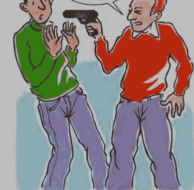

Figure 6.1

## 活动

在以下每种情况下，解释被告是否具有谋杀所需的故意。

- 1. Jamie 因为 Harry 一直试图追求 Jamie 的女朋友而感到恼怒。Jamie 在当地酒吧看到 Harry，走过去重重地打了他一拳在脸上说“也许这样会让你不再纠缠我的女朋友”。Harry 头骨薄弱，这次拳击导致脑出血而死亡。
- 2. Diana 打算杀死 Edward。她在 Edward 家的前门安装了一个爆炸性诡雷，这样当他打开门时爆炸物就会爆炸。Diana 不知情的是，Edward 已把他家的钥匙给了 Felix 并告诉他去那里取一些文件。Felix 打开门，被爆炸炸死。
- 3. Ravinder 的生意一直在亏损很多钱。他决定放火烧毁单位里的一栋较小的建筑，以便为其索赔保险。Ravinder 知道他的建筑里没有人，于是点燃了它。不幸的是，火势蔓延到该地点的另一栋建筑。Nancy 当时正在那栋建筑工作，被大火困住而死亡。

## 关键事实

|  | 法律 | 来源/案例 |
|---|---|---|
| 定义 | '在国王（或女王）治下和平状态中，对任何存活的人的不法杀害，并伴有明示或默示的恶意预谋' | Lord Coke (17th century) |
| 行为要件 | 必须非法杀害处于女王治下和平状态的人。可以是行为或不作为。胎儿不被视为谋杀目的中的人。如果杀人是为了自卫、防御他人或预防犯罪，且在当时情况下使用武力是合理的，则杀人行为不属于非法。 | Gibbins and Proctor (1918) Attorney-General’s Reference (No 3 of 1994) (1997) Beckford (1988) |
| 心理要件 | 杀人故意或造成严重身体伤害的故意。对后果的预见是故意的证据。如果陪审团认为被告的行为导致死亡或严重伤害几乎必然发生且被告认识到这一点，则可以认定故意。 | Vickers (1957) Cunningham (1981) Moloney (1985) Woollin (1998) |

### 6.4 法律改革的必要性

2006 年，法律委员会发布了一份报告，《谋杀、误杀和杀婴》（法律委员会报告第 304 号）。在该报告中，法律委员会指出谋杀法存在许多问题。

在其对谋杀法的一般评论中，报告说（第 1.8 段）：

> > ‘英格兰和威尔士的凶杀法是一个建立在摇摇欲坠基础上的破旧结构。其中的一些规则自十七世纪以来一直未作改变，尽管长期以来人们都承认它们亟需改革。其他规则内容不确定，往往是因为它们不断被修改，以至于无法以任何确定性或清晰度表述。’

在报告中，法律委员会列出了谋杀法现存的问题。他们列出以下几点：

- 谋杀法是在个别案件中逐点发展的，并非一个连贯的整体。
- 被告即使只打算造成严重伤害（严重伤害规则）也可被定罪谋杀。
- 如果在自卫中使用过度武力，则没有可用的抗辩。
- 胁迫抗辩不能作为谋杀的抗辩。
- 强制终身监禁和政府的量刑指南不允许在量刑上进行足够的区分，以涵盖现行谋杀法中广泛的责任程度差异。

以下各节将讨论这些问题。

法律委员会还指出，谋杀的特殊抗辩——减损责任和挑衅——存在问题。这些问题在第 7 章第 7.1.5 和 7.2.5 节中讨论。

#### 6.4.1 法律的逐案发展

法院逐案发展导致问题的其中一个主要领域是‘故意’的含义。故意是一个

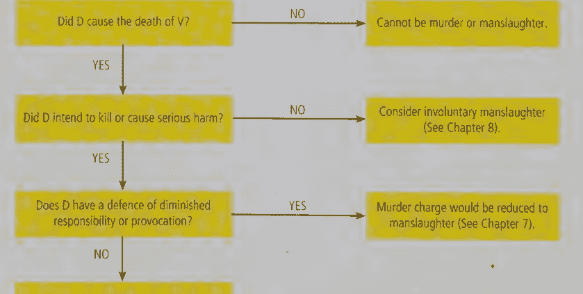

图 6.3 凶杀流程图

概念，影响所有特定故意犯罪，但上议院审理的大多数案件都涉及谋杀。1967 年《刑事司法法》第 8 条试图就此点明确法律。它规定：

> ‘法庭或陪审团在确定某人是否犯有罪行时——不得仅因该结果是其行为的自然且可能发生的后果，就在法律上推断他故意或预见了该结果；但应根据所有证据决定他是否确实故意或预见了该结果，并根据情况从证据中得出适当的推断。’

法律的主要问题在于对后果的预见。上议院多次试图解释对后果预见的影响。在 Moloney (1985) 案中裁定，对后果的预见不是故意；它只是根据上述第 8 条 b 款可以推断出故意的证据。然而，后来的 Woollin (1998) 案，上议院谈及从对后果的预见中得出故意，使得法律变得不确定。尚不清楚是否存在一项实体刑事法律规则，即对后果的预见就是故意，还是只有一项证据规则，即可以从对后果的预见中认定故意。在 Matthews and Alleyne (2003) 案中，上诉法院甚至说证据规则和实体法规则之间几乎没有区别，使其更加不明确（参见第 3.1.2 节）。

#### 6.4.2 严重伤害规则

法律委员会在其报告《谋杀、误杀和杀婴》中指出，议会在通过 1957 年《凶杀法》时，从未打算除非被告意识到其行为可能导致死亡，否则杀人行为构成谋杀。它认为现行谋杀罪过于宽泛。根据现行谋杀法，如果被告有造成严重身体伤害的故意并实际导致受害人死亡，则被告犯有谋杀罪。在这些案件中的一些，被告甚至可能没有意识到死亡可能发生。然而，他犯谋杀罪的程度与蓄意设下杀害受害人的男子一样。法律委员会在其报告中（第 1.17 段）给出了以下示例：

> ‘D 有意打 V 的脸。该拳击打破了 V 的鼻子并导致 V 跌倒在地。在跌倒时，V 撞到路缘，头部受到重创导致大量致命脑出血。’

它指出，如果陪审团决定 D 故意拳击所要造成的伤害可以被描述为‘严重’，则这将是谋杀。然而，大多数人都会同意，这不应是最严重的凶杀罪，D 不应因此被判处强制终身监禁。不仅法律委员会对这一规则极为批评，而且这一问题早在 1981 年 Cunningham (1981) 案中就已被法官指出。当法律由上议院审议时，Edmund Davies 勋爵表示他认为谋杀的 mens rea 应限于杀人故意。他说：

> ‘[It is] strange that a person can be convicted of murder if death results from, say, his intentional breaking of another’s arm, an action which, while undoubtedly involving the infliction of “really serious harm” and as such, calling for severe punishment, would in most cases be unlikely to kill.’

尽管他对法律极为批评，Edmund Davies 勋爵认为任何对法律的改变都必须由议会作出。这是因为法律已保持不变超过 200 年，因此法官改变这样一项根深蒂固的法律是不合适的。

目前尚未对法律进行改革，但法律委员会已就法律如何改革提出了非常具体的建议。

#### 6.4.3 使用过度武力时无抗辩

如果被告能证明他在实施杀人行为时使用了自卫或预防犯罪的合理武力，他不构成谋杀。然而，如果在自卫或预防犯罪时需要使用武力，但被告在当时情况下使用了过度武力，他将被判谋杀。这种抗辩的‘全有或全无’效果在谋杀案件中非常严厉，因为被告要么被无罪释放，要么被判处终身监禁。他有权使用一些武力，他的唯一‘过错’是他使用的武力超过了合理限度。这显然不能证明终身监禁的合理性。

*Clegg* (1995) 和 *Martin (Anthony)* (2002) 案凸显了这一问题（参见 6.2.4）。

这两个决定都受到批评。许多人认为，一个在杀人时对所需武力程度有诚实但不合理的信念的人，其应受谴责程度不如‘真正的’凶手。让这样的人被判犯有同样的谋杀罪并受到同样的惩罚是不公正的。

《验尸官和司法法》2009 年现在允许在 D 因害怕严重暴力而失去控制时杀人时的部分抗辩。但仍然怀疑 *Clegg* 或 *Martin* 是否能够证明‘失去控制’。

#### 6.4.4 无胁迫抗辩

胁迫是指被告受到死亡或严重伤害的威胁而参与犯罪。胁迫可作为几乎所有罪行的抗辩，但不能作为谋杀（或企图谋杀）的抗辩。参见第 12.4 节，了解胁迫抗辩的完整讨论。

法律委员会给出了以下示例：

> > ‘一名出租车司机被一名持枪者劫持，持枪者把枪抵住司机的头部并告诉他开车到持枪者说他可能在那里射杀某人的地方。出租车司机照持枪者的要求去做，持枪者随后开枪杀人。’

报告指出，根据现行法律，出租车司机是杀人行为的共犯，可能被定罪谋杀。他随后将像持枪者一样被判处强制终身监禁。这显然不公平。

法律委员会建议胁迫应成为谋杀的完全抗辩。然而，主张该抗辩的被告必须证明他或她受到死亡或危及生命的伤害威胁，并且没有现实的机会寻求警察保护。陪审团还必须认定，一个普通勇气的人可能会像 D 一样通过参与犯罪的实施作出同样的反应。

#### 6.4.5 强制终身监禁

如果 18 岁或以上的被告被定罪谋杀，法官必须判处终身监禁。对于被判谋杀的 10–17 岁罪犯，法官必须命令他们被羁押于陛下仁慈之下。由于法官在量刑上没有自由裁量权，这被称为 *强制性* 刑罚。即使法官认为被告的应受谴责程度不如蓄意杀人者，他也不能判处不同的刑罚。

对于其他罪行，包括企图谋杀，法官可以决定对罪行和罪犯最合适的刑罚。这使得法官在情况证明合理时甚至可以判处社区刑罚。这发生在 *Gotts* (1992) 案中，其中 16 岁男孩的父亲

威胁说，除非男孩刺伤他的母亲，否则就杀了他。男孩确实刺伤了她，使她受了重伤，但并未致死。他被判谋杀未遂，鉴于案情，法官判处他缓刑三年。如果刺伤导致母亲死亡，法官将不得不（由于其年龄）下令将该男孩拘留，听候女王陛下发落。

正是由于谋杀罪设有强制终身监禁，才存在减轻责任和失控的特别抗辩（见第7章）。这些抗辩可将指控减轻为过失杀人罪。这使法官在量刑时拥有自由裁量权，而被告被判谋杀罪时，法官没有这种自由裁量权。

## 最低刑期

在每起案件中，法官都会判处终身监禁，但随后会说明罪犯必须服满的最低年限，之后才能申请假释。

《2003年刑事司法法》中所载的政府关于这些最低刑期的指导方针加剧了量刑问题。该法为成年罪犯规定了三个量刑起点：

-   极其严重的案件，如预谋杀害两人或以上、性虐儿童谋杀或出于政治动机的谋杀，可判处终身监禁（不得假释）。
-   严重案件，如谋杀警察或监狱官员、涉及枪支的谋杀、性虐杀人或因种族或性取向加重的杀人，最低刑期三十年。
-   不属于上述两个更高类别的谋杀，最低刑期十五年。

根据这些规则，Martin（Anthony）（2002）案中开枪打死一名入室盗窃者的被告本应被判处最低30年刑期。这与受雇蓄意杀人的职业杀手将获得的刑期长度相同。这些指导方针未能在不同罪责程度之间作出充分区分。

法律委员会并未受命考虑量刑问题。然而，在其将谋杀罪分为两级罪行的建议中，他们表示，强制终身监禁和最低刑期指导方针只应适用于一级谋杀罪。这将形成更公平的量刑结构。

#### 6.4.6 法律委员会关于改革的建议

法律委员会提议将谋杀罪改为两种独立的罪行，以实现改革：

-   一级谋杀，以及
-   二级谋杀。

一级谋杀将涵盖被告意图杀人的案件。它还将涵盖被告意图造成严重伤害，并意识到自己的行为构成严重死亡风险的情况。

被告意图造成严重伤害，但未意识到存在严重死亡风险的案件，将属于二级谋杀。通过将谋杀罪划分为两个独立类别，强制终身监禁将仅适用于一级谋杀罪。二级谋杀最高可判处终身监禁，但允许法官量刑时行使自由裁量权。

注意：法律委员会的建议摘要全文载于附录1的A.1.4节。

#### 6.4.7 政府对法律委员会建议的回应

2008年7月，政府发布了一份咨询文件《谋杀、过失杀人与杀婴：法律改革建议》（CP 19/08）。该文件拒绝了法律委员会提出的将谋杀罪改为两级罪行以进行全面改革的建议。

政府唯一承认需要改革的领域是那些在自卫中使用过度武力的人缺乏抗辩理由。这项改革作为《2009年验尸官与司法法》的一部分实施。根据该法，如果被告因恐惧严重暴力而失控杀人，则可提出“失控”抗辩。如果该抗辩成立，谋杀指控即减轻为过失杀人罪（关于该抗辩的详情见第7章）。

该法可能允许Clegg（1995）和Martin（Anthony）（2002）等案件中的被告对谋杀指控提出部分抗辩，从而将罪名减轻为过失杀人。然而，他们必须证明“失控”，以及存在对严重暴力的恐惧。

《2009年验尸官与司法法》并未解决无杀人意图的问题、意图含义的难题、缺乏胁迫抗辩以及强制终身监禁等问题。这些问题将继续成为谋杀法中的难题。

#### 6.4.8 安乐死

还有安乐死问题。安乐死又称“怜悯杀人”，指D杀死V，因为V正因不治之症而遭受痛苦。通常情况下，D是V的配偶或伴侣，并且已经看着V痛苦了很长一段时间。

根据现行法律，如果D因无法再目睹V如此痛苦而杀死V，则D犯有谋杀罪。即使V曾恳求D杀死自己，也是如此。这意味着D将被判处终身监禁，且最低服刑15年后方可考虑假释。

这样的被告不太可能是危险人物，因此法院在量刑时无疑应有更多自由裁量权。

在一些国家，尤其是荷兰，医生被允许结束绝症患者的生命。当然，何时可以这样做受到严格管制。

在英国，虽然不允许安乐死，但根据Airedale NHS Trust v Bland（1993）案的判决，医生在某些情况下可以停止对患者的治疗。

### Airedale NHS Trust v Bland（1993）

Bland在1989年希尔斯堡球场惨剧中窒息。这使他的大脑严重缺氧，导致他住院长达三年多，一直处于持续性植物状态。他通过导管进食。医院申请允许停止给他喂食。

上议院指出，不存在不顾生活质量而延长患者生命的规则。生命神圣性是一项重要原则，但生活质量也可以加以考虑。如果停止生命支持符合患者的最佳利益，那么就可以这样做。

因此，尽管医生可以在患者处于持续性植物状态时停止治疗，但医生不得采取任何积极行为杀死患者。可以说，给这样的患者服用一种无痛致死的药物，比剥夺其食物和饮水使其最终饿死更好。

## 考试问题

-   1. 讨论以下观点：法院已经澄清了谋杀罪的犯罪意图（mens rea），因此议会无需再进一步立法。
-   (OCR, G153, June 2010)
-   2. Fiona属于SaveMe——一个反对动物实验的组织。SaveMe组织中的某个人告诉Fiona，如果她不阻止Wonderface用动物测试其化妆品，就有不好的事情会发生在她身上。Fiona带着板球棒闯入Wonderface，打算砸烂Wonderface主管Brian的办公室，她以为Brian已经回家了。Brian当时正在加班。Fiona看到Brian后，用板球棒打了他十下。Brian因颅骨骨折死亡。

讨论Fiona可能承担的刑事责任，包括任何相关抗辩。

(OCR, G153, January 2011)

注意：除了谋杀问题外，还有其他问题。现在只就谋杀问题回答这道题，但当你学完非自愿过失杀人、入室盗窃和胁迫抗辩后再回来回答此题。

## 第7章

## 自愿过失杀人

对谋杀指控有三种特别抗辩。这些抗辩适用于被告在以下状态下杀人：

-   减轻责任；
-   失控；或
-   自杀协议。

减轻责任和自杀协议规定于《1957年杀人法》中。失控规定于《2009年验尸官与司法法》中。这些抗辩仅适用于谋杀罪。而且它们只是部分抗辩，这意味着被告不会完全无罪释放。相反，当其中一种抗辩成立时，谋杀罪会减轻为过失杀人罪。

这一点很重要，因为它意味着法官在量刑时有自由裁量权。当一个人被判犯有谋杀罪时，法官必须判处终身监禁。然而，对于过失杀人罪，法官可以在适当时判处较轻的刑罚。这意味着，如果被告具有危险性且其精神问题无法治疗，那么法官可以判处终身监禁，如*Byrne*（1960）案所发生的那样（见2.1.2节）。但是，如果被告不具有危险性，那么他或她可能会被判处相对较短的监禁刑期，甚至社区刑罚。如果被告有可治疗的精神问题，那么最合适的判决是命令被告在医院或社区接受治疗。

对于OCR考试大纲，你只需学习减轻责任和失控作为谋杀罪的抗辩。自杀协议不在大纲范围内。

### 7.1 责任能力减弱

这项抗辩由1957年《凶杀法》引入。在此之前它在英国法律中并不存在。1957年之前，如果有精神问题的人杀人，其唯一的抗辩就是精神失常。精神失常的测试标准非常狭窄，许多明显患有精神疾病的被告并不总是符合该标准。（参见第12章，了解有关精神失常抗辩的进一步信息。）这就是责任能力减弱抗辩被创设的原因。

#### 7.1.1 责任能力减弱的定义

该抗辩载于经2009年《验尸官与司法法》修订后的《凶杀法》第2(1)条。该条款的效力如下：

**Definition**

> 杀害他人或参与他人被杀的人，如果其患有精神功能异常，则不得被判谋杀罪，如果该异常：
>
> - (a) 源于公认的医疗状况，
> - (b) 实质上损害了D的能力：
>   - 理解其行为的性质；或
>   - 形成理性判断；或
>   - 行使自我控制；且
> - (c) 对D在实施或参与杀害时的作为和不作为提供了解释。

举证责任由被告承担，但被告只需在盖然性平衡标准下证明即可。

#### 7.1.2 精神功能异常

“精神功能异常”指什么？在2009年《验尸官与司法法》修订责任能力减弱的定义之前，所使用的措辞是“心智异常”。在 *Byrne* (1960) 案中，上诉法院将其描述为“与普通人类如此不同的心智状态，以至于理性人会称其为异常”。

**Byrne (1960)**

> 被告是一名性心理变态者，他勒死了一名年轻女子然后 mutilated 她的尸体。医学证据表明，由于其状况，他无法控制其变态欲望。他被判谋杀罪，但上诉法院撤销了该判决并改判为 manslaughter。

尽管该案依据的是旧定义，但法院很可能仍会使用相同的异常标准。因此，测试很可能就是D的精神功能与普通人类如此不同，以至于理性人会称其为异常。

#### 7.1.3 精神功能异常的原因

根据1957年《凶杀法》第2(1)条，精神功能异常的原因必须源于“公认的医疗状况”。这足以涵盖心理和生理状况。它显然涵盖任何公认的精神障碍。这些范围很广，例如抑郁症、偏执狂或受虐妇女综合征。它还涵盖任何影响精神功能的身体状况，例如癫痫、睡眠障碍或糖尿病。必须在审判中提供医学证据，证明精神功能异常源于公认的医疗状况。

#### 7.1.4 实质性损害

精神功能异常必须实质性损害被告对其在实施或参与杀害时的作为或不作为的责任能力。

在 *Byrne* (1960) 案中，上诉法院表示，损害是否实质性是程度问题，由陪审团决定。

在 *Lloyd* (1967) 案中裁定，实质性并不意味着全部，也不意味着微不足道或极小。它介于两者之间，由陪审团决定被告的责任能力是否受损，以及如果受损是否实质性损害。然而，由于这是事实问题，如果没有证据使合理陪审团能够认定被告的责任能力受到实质性损害，法官可以从陪审团手中撤回该问题。

由于“实质性损害”这一措辞仍保留在新定义中，因此这些案件中的判决很可能适用于新定义。

#### 7.1.5 必须实质性损害什么？

被告的一项能力必须受到实质性损害。这三项能力载于1957年《凶杀法》第2(1A)条。它们是：

- 理解其行为的性质；
- 形成理性判断；
- 行使自我控制。

这三点在 *Byrne* (1960) 案中使用过（参见7.1.2了解该案详情）。在该案判决中，法院表示“心智异常”（当时责任能力减弱的测试标准）范围足够宽泛：

> “涵盖心智活动的各个方面，不仅包括对身体行为和事物的感知，以及形成关于行为是否正确或错误的理性判断的能力，还包括根据该理性判断行使意志力控制身体行为的能力。”

2009年《验尸官与司法法》对定义所做的修正实际上已将 *Byrne* 案的判决以成文形式确立。那么这三项分别意味着什么？

##### 理解其行为性质的能力

这涵盖了例如D处于自动状态且不知道自己在做什么的情况。它还涵盖D患有妄想的情况，例如他相信自己杀的是魔鬼，而事实上他杀的是一个人。在这种情况下，他不理解自己行为的性质。

它也可能涵盖严重学习困难的人，其精神年龄极低，以至于不理解自己行为的性质。

##### 形成理性判断的能力

即使D知道其行为的性质，他也可能无法对其作为或不作为形成理性判断。患有偏执狂或精神分裂症的人很可能无法形成理性判断。另一种D可能无法形成理性判断的公认医疗状况是受虐妇女综合征。

##### 行使自我控制的能力

这就是 *Byrne* (1960) 案的情况。Byrne是一名性心理变态者。医学证据表明，该状况使他无法控制其变态欲望。因此，责任能力减弱的抗辩对他可用。

#### 7.1.6 对D行为提供解释

为了适用责任能力减弱抗辩，D必须证明精神功能异常对其在实施或参与杀害时的作为和不作为提供了解释（第2(1B)条）。

这是由2009年《验尸官与司法法》修正案引入的责任能力减弱的新原则。现在必须在D的精神功能异常与杀害之间存在某种因果联系。

1957年《凶杀法》第2(1B)条进一步解释了这一原则，其规定：

> “...精神功能异常如果导致D实施该行为或是对导致D实施该行为的因素产生重大贡献，则可为D的行为提供解释。”

因此，精神功能异常不必是导致D实施或参与杀害的唯一因素。然而，它必须是重要因素。当D在杀害时处于醉酒状态时，这一点尤其重要。

#### 7.1.7 责任能力减弱与醉酒

当被告在杀害时也处于醉酒状态时，责任能力减弱抗辩变得更加复杂。

首先，有一条明确规则，即醉酒本身不能支持责任能力减弱抗辩。在 *Di Duca* (1959) 案中，上诉法院裁定，饮酒或吸毒的即时影响不是伤害（医疗状况），即使它确实影响了大脑。因此，“短暂的”醉酒状态不是精神功能异常。

责任能力减弱的定义现在加强了这一法律观点，因为它规定精神功能异常必须源于公认的医疗状况。

因此，如果陪审团认定被告没有患有精神功能异常，则责任能力减弱抗辩不可用。如果检方证明D实施了杀人行为并具有谋杀的主观要件，则他将被判谋杀罪，除非他有其他抗辩，例如正当防卫。

##### 醉酒与既存的精神功能异常

当被告存在某种精神功能异常，但实施杀害时又处于醉酒状态时，会出现困难。这发生在 *Dietschmann* (2003) 案中。

**Dietschmann (2003)**

> 被告因其认为受害者的行为是对被告姑姑刚去世记忆的不尊重而感到不安。他通过反复踢打并踩踏受害者将其杀害。控辩双方传唤的精神科医生均同意被告患有因姑姑去世而产生的抑郁性哀伤反应形式的适应障碍。然而，他们对这是否实质性损害了被告对杀害的责任能力存在分歧。被告在杀害前还喝了约一瓶威士忌的三分之一和两品脱半的苹果酒。他被定罪并提出上诉。

上议院依据旧定义裁定，如果被告说服陪审团其心智异常实质性损害了其实施杀害行为的责任能力，则即使他处于醉酒状态，陪审团也不应认定他有罪，而是应认定为 manslaughter。

上诉法院在 *Dietschmann* 案后的一系列案件中也考虑了该问题。这些包括：

- *Hendy* (2006) 案，D处于醉酒状态，但有证据显示其存在潜在脑损伤和精神病态障碍；以及
- *Robson* (2006) 案，D严重醉酒，但在杀害V时也患有急性应激障碍。

在这些案件中，上诉法院撤销了谋杀定罪并改判为 manslaughter。

这些判决很可能在新定义下的案件中被遵循。现代做法很可能要求陪审团决定：

- D是否患有源于公认医疗状况的精神功能异常；
- 该异常是否实质性损害了D理解其行为性质或形成理性判断和/或行使自我控制的能力；

- 该异常是否导致 D（被告人）杀死 V（被害人），或为导致 D 杀死 V 的重要因素？

如果所有这些问题的回答都是“是”，那么 D 应被认定不构成谋杀罪，而构成过失杀人罪。

如果陪审团认定 D 不存在精神功能异常，或该异常并非由公认的医学状况引起，或该异常并非导致 D 实施杀人行为的重要因素，则 D 不能利用减轻责任辩护，并且将被判谋杀罪。

## 因成瘾/依赖导致的醉酒

有一种公认的医学状况称为酒精依赖综合征（ADS）。这意味着患者无法控制自己的饮酒行为。

在旧法下，Tandy (1989) 案中，上诉法院认为，如果被告人无法抵制饮酒，以至于饮酒是非自愿的，这可能构成减轻责任。

## Tandy (1989)

坦迪夫人多年来一直酗酒，通常喝大麦酒或仙山露（Cinzano）。有一天，她喝了将近一整瓶伏特加。当晚，她告诉母亲，她（坦迪）的第二任丈夫曾对她11岁的女儿进行性侵犯。随后她勒死了自己的女儿。初审法官指示陪审团判断，坦迪是否因酗酒而直接导致精神异常，还是仅仅喝醉了。她被判有罪。上诉法院驳回了她的上诉，因为坦迪未能证明她的大脑受到损伤（这是旧法下的一项检验标准），也未能证明她的饮酒是非自愿的。

该案的判决受到了批评，因为它只关注被告人是否无法阻止自己饮酒，而没有考虑酗酒是否是一种疾病。

这一点在 Wood (2008) 案中再次得到考量，上诉法院指出：

“坦迪案中，在因酒精依赖综合征导致脑损伤与未导致脑损伤的案件之间所作的区分，其截然不同的后果已不再恰当。”

## Wood (2008)

被告人大量饮酒后，前往被害人的公寓。被告人声称他在那里睡着了，醒来时发现被害人正试图对他进行口交。被告人用一把切肉刀反复击打被害人，致其死亡。在审判中，医学专家一致认为被告人患有酒精依赖综合征，但对于这是否对其大脑造成损伤，意见不一。

法官指示陪审团：如果他们认为被告人因长期酗酒而导致脑损伤，那么他可以适用减轻责任辩护。但如果他们认为他没有遭受脑损伤，则必须判断其饮酒是自愿的还是非自愿的。如果是自愿的，则被告人不能援用减轻责任辩护。

被告人被判有罪。他提出上诉，上诉法院撤销了原判，认为法官指示陪审团必须认定被告人的所有饮酒行为均为非自愿，这是错误的。

在审理 Wood 案的上诉时，上诉法院考虑了 Dietschmann 案判决对 Tandy 案裁决的影响。他们认为，酒精依赖综合征可被视为精神异常（现为精神功能异常）的可能来源之一。这由陪审团决定。如果陪审团认定这属于精神异常，那么他们必须考虑被告人因其依赖而饮酒所产生的后果。

这涉及一些问题，例如被告人对酒精的渴望是否无法抗拒，以及他在实施杀人行为前一段时间内的饮酒是否出于自愿——如果是自愿的，其程度如何。

这一问题在 *Stewart* (2009) 案中再次得到考量，上诉法院为陪审团设定了在这种情况下应考虑的三阶段测试：

- 1. D 是否患有“精神异常”（现为精神功能异常）？他们指出，仅凭 D 患有 ADS 这一事实并不自动构成异常。必须考虑 ADS 的性质和程度。
- 2. 如果是，D 的异常是否由 ADS 引起？
- 3. 如果是，D 的精神责任能力是否受到严重损害？为决定这一点，应考虑所有证据，包括医学证据。这将涉及诸如 D 的依赖程度和严重性，以及他能在多大程度上控制自己的饮酒等问题。

尽管这些案件是在减轻责任定义变更之前裁决的，但很可能仍会采取同样的方法。此外，根据新法，陪审团还必须判断该异常是否导致 D 杀死 V，或是否为导致 D 杀死 V 的重要因素。

#### 7.1.8 法律的改革

关于减轻责任的法律由《2009年验尸官与司法法》进行了改革。法律委员会在其报告*《谋杀、过失杀人与杀婴》*(2006) 中曾建议，应使减轻责任的定义现代化，以考虑到不断变化的医学知识。

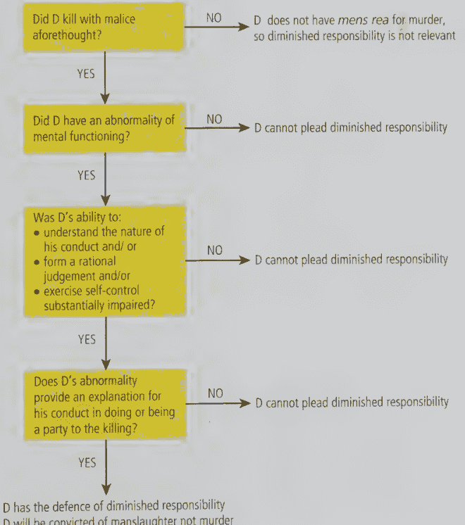

图7.1 减轻责任流程图

2009年法案所做的修改实现了这一目标。通过使用“公认的医学状况”这一表述，现在的定义应具有足够的灵活性，以适应医学知识未来的发展。

该定义现在还明确规定了被告人的精神功能必须在哪些方面受到严重损害，才能成功援用减轻责任这一部分辩护。这将 *Byrne* (1960) 案中的裁决纳入了减轻责任的法定定义。

#### 7.1.9 法律中仍存在的问题

尽管《验尸官与司法法》解决了此前法律中的许多问题，但仍有一些领域存在困难。

### 举证责任

一个主要观点是，举证责任不应由被告人承担；在大多数其他辩护中，被告人只需提出该问题，而由控方反驳。这也应适用于减轻责任。目前，主张减轻责任的被告人处于不利地位，而主张“失去控制”作为辩护理由的人则不会面临这一不利。

此外，将举证责任置于被告人身上可能违反《欧洲人权公约》第6条第2款，该款规定：“任何被指控刑事犯罪的人，在依法被证明有罪之前，都应被推定为无罪。” 让被告人证明减轻责任，可能被视为侵犯了这项无罪推定权。

### 发育不成熟

法律委员会在其2006年报告中还建议，将18岁以下者的发育不成熟纳入减轻责任的定义。其理由是，有证据表明，大脑的额叶在自我控制的发展和控制冲动行为方面发挥着重要作用，而额叶直到14岁才发育成熟。

政府认为没有必要将“发育不成熟”作为减轻责任的具体原因。他们认为，学习障碍和自闭症谱系障碍等状况属于公认的医学状况，而这些状况与少年犯尤其相关。这确实是事实，但“发育不成熟”不同于学习障碍。

如果没有这样的辩护，年仅10岁的儿童在发育不成熟的情况下也可能被判定犯有谋杀罪。根据现行法律，他们不能利用减轻责任辩护，因为他们并非患有精神功能异常。

## 自测题

- 1. 哪一部法案的哪一条规定了减轻责任辩护？
- 2. 在谋杀指控中成功援用减轻责任辩护的后果是什么？
- 3. D 必须患有哪一类型的异常才能落入该辩护的范围内？
- 4. 该异常的原因必须是什么？
- 5. D 做以下三件事中的一件或多件的能力必须受到严重损害。这三件事是什么？
- 6. “严重受损”被认定为何意？
- 7. 对大脑产生影响的醉酒能否被视为减轻责任？
- 8. 因酒精成瘾或依赖导致的醉酒能否在减轻责任中被考虑？
- 9. 请给出《2009年验尸官与司法法》中修订后的定义改进减轻责任法律的两种方式。
- 10. 请给出减轻责任法律中仍然存在的两个问题。

## 关键事实

| 用语 | 法律 | 法案/案例 |
|---|---|---|
| 定义 | 遭受精神功能异常，其：源于已确认的医疗状况，实质性损害了 D 对以下一项或多项的能力：理解行为的性质，形成理性判断，行使自控力；并且为 D 的行为提供了解释。 | s 2(1) Homicide Act 1957 (as amended by the Coroners and Justice Act 2009) |
| 精神功能异常 | 与普通人的心智状态如此不同，以至于常人会认为其异常 | Byrne (1960) |
| 实质性损害 | 属于程度问题，由陪审团决定。'Substantial' 不意味着 'total' 也不意味着 'trivial' 或 'minimal'，而是介于两者之间。 | Byrne (1960) Lloyd (1967) |
| 为 D 的行为提供解释 | 精神功能异常为 D 的行为提供解释，如果它导致，或是导致 D 实施该行为的重大促成因素。 | s 2(1B) Homicide Act 1957 |
| 饮酒/药物的影响 | 饮酒或药物对大脑的暂时性影响不是伤害。在被告存在既存精神障碍的情况下，醉酒并不妨碍其使用该抗辩；精神功能异常不一定是被告实施杀害行为的唯一原因。酒精依赖综合征可以是精神功能异常。 | Di Duca (1959) Dietschmann (2003) Wood (2008) |
| 举证责任 | 辩护方需在优势证据标准下证明。 | s 2(2) Homicide Act 1957 |
| 抗辩的效果 | 杀人罪指控被降为误杀罪。 | s 2(3) Homicide Act 1957 |

Figure 7.2 Key facts chart on diminished responsibility

### 7.2 失去控制

失去控制是对谋杀指控的部分抗辩。如果成功，D 将被判误杀罪而非谋杀罪。这使法官在量刑时拥有裁量权。

失去控制取代了原有的挑衅抗辩。法律规定在 s 54 of the Coroners and Justice Act 2009。该法规定：

### 定义

失去控制

'Where a person ("D") kills or is a party to the killing of another ("V"), D is not to be convicted of murder if–'

- (a) D’s acts and omissions in doing or being a party to the killing resulted from D’s loss of self-control;
- (b) the loss of self-control had a qualifying trigger; and
- (c) a person of D’s sex and age, with a normal degree of tolerance and self-restraint and in the circumstances of D, might have reacted in the same or in a similar way to D.’

因此，以下几点对该抗辩成功至关重要：

- D 必须已失去自控
- 必须存在合资格的触发因素（见下文 7.2.2）
- 与 D 同性别、同年龄的人在相同情况下可能会以相同或类似的方式作出反应。

请注意，根据旧挑衅法裁定的所有案件已不再是法律。然而，其中一些被列入，因为它们对讨论和比较很有用。

## 练习

阅读以下摘录，该摘录由 Stewart Payne 撰写，于 2005 年 11 月 3 日发表在《每日电讯报》上，并回答以下问题。

### 因被迫杀害唐氏综合征儿子而获怜悯的母亲

一名深爱母亲在照顾其唐氏综合征儿子 36 年后将其杀害的绝望处境，使法官昨日免于对其判处监禁。

67 岁的 Wendolyn Markcrow 被描述为过着‘圣洁’的生活，法庭获悉她终于达到了忍耐的极限。

在另一个不眠之夜，她‘情绪崩溃’，给儿子 Patrick 喂了 14 粒镇静剂并用塑料袋将其窒息。

随后她用厨房刀割伤了自己的颈部和手臂，并在花园棚屋坐下，希望死去。

她‘万念俱灰’，想要结束自己的生命。然而她担心如果自己不在，Patrick 会怎样。

牛津皇家法院获悉，她从未想过要把自己的需求置于儿子之上，最终‘陷入抑郁’。Markcrow 是四个孩子的母亲，在之前的听证会上承认因责任能力减弱而误杀，她幸存了自杀企图。她告诉警方：‘我感到悲伤、绝望、失败和羞愧。’

Mr Justice Gross 判处她两年监禁，缓刑 18 个月，并对她说：‘你所面临的压力是极端的。’

### 问题

- 1. Which section of which Act allows a defence of diminished responsibility?
- 2. What would Mrs Markcrow’s lawyers now have to prove to establish the defence of diminished responsibility?
- 3. What points in the extract support the defence?
- 4. The original charge against the defendant would have been murder. What effect does the defence of diminished responsibility have to that charge?
- 5. What sentence did the judge pass on the defendant?
- 6. The mandatory sentence for murder is life imprisonment. Why was the judge able to pass such a lenient sentence?

#### 7.2.1 失去自控

首先必须证明 D 在实施导致死亡的行为时已失去自控。失去自控不一定是突然的。这是原挑衅抗辩的一项规则。它导致一些被告因失去控制并非突然而无法使用该抗辩。这在 Ahluwalia (1992)一案中可见。

##### Ahluwalia (1992)

被告多年来一直被丈夫身体虐待。一个晚上，丈夫在睡觉前威胁她，如果第二天不付账单就会对她施暴。后来丈夫睡着后，被告往他身上倒汽油并点燃。他六天后死亡。她被判谋杀罪并提出上诉。上诉法院未允许她基于挑衅提出的上诉。他们指出，被告对挑衅的反应必须是‘突然’而非‘即时’，延迟越长，行为越可能是蓄意的，因此检方可以否定挑衅抗辩。然而，上诉法院基于责任能力减弱允许了她的上诉。

由于失去控制的抗辩并不要求失去自控是突然的，因此像 Mrs Ahluwalia 这样情况的人现在可能能够使用该抗辩。

#### 7.2.2 合资格触发因素

要使失去控制纳入抗辩范围，必须有合资格的触发因素。该法第 55 条列出了允许的合资格触发因素。这些是失去控制归因于以下情况时：

- D’s fear of serious violence from V against D or another identified person; or
- a thing or things done or said (or both) which–
  - (a) constituted circumstances of an extremely grave character, and
  - (b) caused D to have a justifiable sense of being seriously wronged.

或者，合资格触发因素可以是上述两者的结合。

##### 暴力恐惧

旧的挑衅法不允许因害怕暴力而失去控制的抗辩。这在 Martin (Anthony) (2002)一案中得到体现。见 6.2.4。

现在 Martin 可能能够使用失去控制的抗辩。可以说存在对入侵者的暴力恐惧。但是否因这种恐惧而失去控制的问题可能更困难。

像 Ahluwalia 这样的受虐妻子也可能使用此合资格触发因素，因为她们害怕伴侣的严重暴力。

D 不必害怕受害者的暴力：对另一人的暴力恐惧也可以是合资格触发因素。然而，那另一人必须被识别。它不能是一般的暴力恐惧。

##### 所说或所做之事

如果 D 依赖所说或所做之事，则必须证明两点：

- 它们属于‘极其严重的性质’；并且
- 它们使 D 产生正当的严重受辱感。

这些测试不在旧的挑衅法中。这意味着失去控制的抗辩比旧的挑衅抗辩更狭窄。许多被告能够使用挑衅抗辩的案件现在不会纳入失去控制的抗辩。

Doughty (1986)是一例被告能够使用挑衅抗辩但现在不太可能能够使用失去控制抗辩的案件。

##### Doughty (1986)

D 因婴儿儿子 19 天大时哭个不停而杀死了他。他被定罪，但上诉法院推翻了定罪，因为应由陪审团决定婴儿的哭泣是否构成‘所做之事’的挑衅。

本案中的被告不太可能获得“失控”抗辩。根据现行法律，他似乎不太可能证明自己有一种“合理的受严重委屈感”。

然而，根据旧法，如果存在突然丧失自我控制的情况，D 就能获得“挑衅”抗辩，即使其中也存在报复欲望的因素。*Baillie* (1995) 一案即体现了这一点。

## 排除事项

该法明确规定，性不忠永远不能构成限定性触发事由。在旧的挑衅抗辩法律下，性不忠可以作为挑衅的理由。事实上，挑衅抗辩的法律在数百年前发展起来，正是为了在性不忠案件中提供抗辩。

然而，政府认为，挑衅抗辩为因妻子或女友出轨而将其杀害的嫉妒男性提供了辩护。他们还认为，这种男性对女性的暴力在21世纪是不可接受的。

如果D的行为是出于“蓄意的复仇欲望”，也不允许使用该抗辩。在这一点上，该抗辩与挑衅抗辩相似。在挑衅抗辩中，必须存在突然丧失自我控制的情况。因此，如果D有时间考虑报复，则该抗辩不能成立。这一点见于 *Ibrams and Gregory* (1981) 案。

> **伊布拉姆斯与格雷戈里案（1981）**
> 
> 伊布拉姆斯当时女友的前男友一直前往伊布拉姆斯与女友合住的公寓，并对他们进行恐吓。10月7日，伊布拉姆斯报了警，但警方没有采取任何行动。10月10日，两名被告人制定了袭击该前男友的计划，并于10月12日实施计划将其杀害。他们被判谋杀罪成立。上诉法院维持了原判，因为没有证据表明10月7日之后存在任何挑衅行为，且这五天的间隔意味着不存在突然丧失自我控制。

> **贝利案（1995）**
> 
> D得知，他儿子的毒品贩子曾威胁说，如果儿子试图从其他毒贩那里购买毒品，就会“挨一巴掌”。D带着剃刀和一把猎枪，开车前往毒贩家。D用剃刀对毒贩造成重伤，并在其逃跑时用猎枪射击。毒贩被枪击溅起的铁丝网碎片击中身亡。初审法官拒绝将挑衅抗辩提交陪审团审理。上诉法院准许了D的上诉，因为存在挑衅的证据，而D在杀死毒贩时是否仍处于丧失自我控制的状态，应由陪审团裁定。

根据2009年法案，很难判断 *Baillie* 案是否属于失控抗辩的范畴，因为D杀害毒贩的行为中似乎存在报复因素。

#### 7.2.3 自我控制的标准

2009年法案要求，无论依赖哪种“限定性触发事由”，D都必须证明：

> “一名与D性别和年龄相同，具有正常程度的容忍和自我克制，并处于D的情境中的人，可能会以相同或类似的方式作出反应。”

这与旧的挑衅抗辩法律类似，在 *Camplin* (1978) 案中，法院认为在评估D应具有的自我控制能力时，应考虑D的性别和年龄。

## 坎普林案（1978）

D是一名15岁男孩，曾受到一名年长男子的性虐待，该男子事后还嘲笑他。D对此的反应是用薄饼锅击打该男子的头部。在审判中，法官指示陪审团无视男孩的年龄，考虑挑衅行为会对理性成年人产生何种影响。D被判定谋杀罪成立，但上议院准许了他的上诉，并改判为过失杀人罪。

陪审团不能考虑任何可能使D自我控制能力降低的情况。对于抗辩的这一部分，存在一个客观测试。

#### 7.2.4 被告人的情况

尽管在决定D应具备的自我控制水平时只能考虑年龄和性别，但在判断这样一个“正常”人是否会在此类情况下以与D相同或类似的方式作出反应时，可以考虑D的其他情况。

这也是挑衅抗辩下的规则。以下案例展示了被认为与挑衅相关的非常不同的情况。

在上议院的判决中，迪普洛克勋爵（Lord Diplock）说：

> “理性人是指具有与被告同性别和年龄的普通人所应具备的自我控制力，但在其他方面，与被告一样具有他们认为会影响挑衅对其严重性的特征。”

这一点在枢密院审理的泽西岛总检察长诉霍利案（A-G for Jersey v Holley, 2005）中得到确认，该案认定，在评估D行使自我控制的能力时，D的个人特征（除性别和年龄外）均不相关。

2009年法案将这一规则纳入成文法形式。D应表现出正常程度的容忍和自我克制。D特别暴躁这一事实，在考察其应具备的自我控制水平时不能予以考虑。

尽管该法案提到了被告人的情况，但第54(3)条强调，那些与D的行为唯一相关性在于其影响D的总体容忍或自我克制能力的情况，不应当被考虑。换言之，除性别和年龄外，陪审团

## 格雷格森案（2006）

D失业并患有抑郁症和癫痫。他很可能是因癫痫而失去了工作。V就他的失业、癫痫和抑郁症羞辱他。证据表明，由于癫痫和抑郁，D对有关其失业的嘲弄和辱骂更为敏感。D失去控制并杀死了V。D能够使用挑衅抗辩。在判断挑衅对他的严重性时，可以考虑他的失业、癫痫和抑郁症，尽管不能将之与对他应具备的自我控制标准联系起来考虑。

如果现在发生与格雷格森类似的案件，失业似乎可以构成失控抗辩目的下的一种情况。抑郁症和癫痫也可能属于这种情况。根据2009年法案，这些在判断“一个具有正常自我克制力的人是否可能以相同或类似方式作出反应”时将是相关的。

还有证据表明，由于癫痫和/或抑郁，格雷格森比“正常人”更难以保持自我控制。根据2009年法案，如果这些情况仅与D的容忍或自我克制能力相关，则不允许加以考虑。但既然这些情况与这样一个“正常人”是否可能以与D相同或类似的方式作出反应相关，则可以考虑。

> **希尔案（2008）**
> 
> D在童年时曾遭受性虐待。V试图对D实施性侵犯。D失去控制并杀死了V。D能够使用挑衅抗辩。

在 *Hill* 案的情况下，在判断“正常人”是否可能以与D相同或类似的方式作出反应时，必须将其视为有性虐待史。这仍然适用于失控抗辩。

## 可能以与D相同或类似的方式作出反应

陪审团随后必须考虑，处于D情况下的正常人是否会像D那样作出反应。如果陪审团认为“正常人”可能会失去控制，但不会以相同方式作出反应，则抗辩失败。

旧挑衅法下的 *Van Dongen* (2005) 案就是一个例子。陪审团认为，“理性人”（当时的测试标准）会失去自我控制，但他不会像D那样在V蜷缩在人行道上时反复踢踹其头部和身体。挑衅抗辩因此失败。

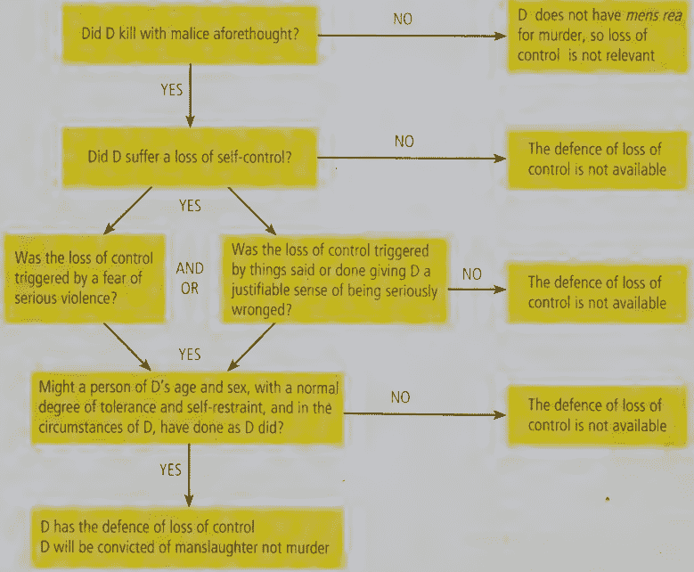

图7.3 失控抗辩流程图

#### 7.2.5 法律改革

《验尸官与司法法》2009年废除了旧的挑衅抗辩，并以丧失控制抗辩取而代之。这一改革是因为挑衅法存在许多问题。

### 挑衅的问题

挑衅抗辩是普通法抗辩，由法官很久以前创立。1957年《谋杀法》列出了挑衅的一些测试标准，但没有给出完整定义。没有给出完整定义造成了问题，因为在适用《谋杀法》中的测试时，还必须考虑之前案件中的法律。

挑衅的主要问题是《谋杀法》中测试的措辞。该法规定陪审团必须决定 D 是否被挑衅而丧失自我控制，如果是，则挑衅是否足以使一个理性的人像 D 那样做。

最初使用“理性人”一词造成了问题，因为被认为这意味着一个理性成年人。然而，在 *Camplin*（1978）案中，D 为 15 岁男孩，法院认为可以考虑 D 的年龄和性别。年龄和性别现在在丧失控制抗辩中被考虑。

在 *Camplin* 案中还裁定，可以考虑 D 的其他特征来判断对他而言挑衅的严重性。在丧失控制抗辩中，这已改为‘情况’。这比特征范围更广，尽管法院在解释特征时一直很宽松。这体现在法院在 *Hill*（2008）案中允许考虑 D 的性虐待历史（见第 7.2.4 节）。

事实上在 *Morhall* 案中，上议院甚至允许在决定对他而言挑衅的严重性时考虑 D 嗜胶水上瘾的事实。这很可能也是在丧失控制抗辩中会被考虑的‘情况’。

### 挑衅与丧失控制的比较

在某些方面，丧失控制抗辩比挑衅抗辩范围更广。特别是，丧失控制不必须是突然的。此外，对严重暴力的恐惧也是可以考虑的额外事项。

在其他方面，丧失控制抗辩比挑衅抗辩更窄。特别是，性不忠不再被允许作为符合条件的触发因素。

此外，如果 D 依赖于所说和/或所做的事，那么它们必须是极其严重的性质。在挑衅中并非如此，且一些曾被允许该抗辩的案件将不属于新的丧失控制抗辩。例如 *Doughty*（1986）案，法院裁定 19 天大婴儿的持续哭泣可以构成挑衅。

所说和/或所做的事还必须使 D 产生正当的严重受害感。*Doughty* 也无法通过这一测试。

#### 7.2.6 法律中仍然存在的问题

### 丧失自我控制

法律委员会曾提议完全取消丧失自我控制标准。这是因为人们认识到，处于虐待关系中的妇女可能因‘愤怒、恐惧、挫败感和绝望感的结合’而杀人。

政府决定不采纳这一提议。D 必须证明丧失自我控制。唯一的让步是丧失控制不必是突然的。很可能一些受虐妇女无法证明丧失控制，因此无法使用该抗辩。

### 性不忠

这不再被允许作为抗辩的符合条件触发因素。然而，挑衅抗辩很大程度上就是为此类情况而创设的。如果有人意外发现伴侣与他人发生性关系，他们很可能会丧失自我控制。但如果这导致他们杀害伴侣，他们将不再对谋杀指控拥有部分抗辩。

### 对严重暴力的恐惧

这一符合条件的触发因素很大程度上是由于 Clegg（1995）和 Martin（2002）案中缺乏抗辩而加入的（详见 6.2.4）。然而，D 必须丧失自我控制的要求可能使此类被告难以使用该抗辩。

## 自测问题

- 1. Which Act sets out the law on the defence of loss of control?
- 2. What is the effect of a successful defence of 'loss of control' to a charge of murder?
- 3. Does the loss of control have to be sudden?
- 4. If D is relying on 'things said or done' as a qualifying trigger, what must be proved about those things?
- 5. What other qualifying trigger could D rely on?
- 6. What does the Act specifically exclude as a qualifying trigger?
- 7. What standard of self-control is D judged against?
- 8. Give two problems in the old law on provocation.
- 9. Explain two ways in which the law has been improved by the defence of loss of control.
- 10. Give two problems that exist with the law of loss of control.

## 关键事实

| | 法律 |
|---|---|
| 抗辩的主要要点 | D 必须丧失自我控制。必须存在符合条件的触发因素。相同性别和年龄的人在相同情况下会像 D 一样反应。 |
| 丧失控制 | 这不必是突然的。 |
| 符合条件的触发因素 | 以下一项或两项均可：• 对严重暴力的恐惧 • 所做或所说的事或事情构成极其严重的性质的情况，并使 D 产生正当的严重受害感。 |
| 自我控制标准 | D 性别和年龄的人的自我控制标准，具有正常的容忍度和自我克制程度。 |
| D 的情况 | D 的情况（不影响自我控制能力）可以在判断一个正常人是否可能做出相同反应时予以考虑。 |
| 抗辩的效果 | 将谋杀指控降为误杀。 |

## 活动

解释在以下情况下是否可以适用谋杀的任何特殊抗辩。

- 1. Roscoe, aged 25, has a mental age of eight. In a fit of temper he attacks Max and kicks him to death.
- 2. Cameron and Jacob are working together on a building site. Cameron knows that Jacob's wife is having an affair with another man. He taunts Jacob about this. Jacob loses his temper and hits Cameron on the head with a brick, killing him.
- 3. Ellie's husband, Glen, is an alcoholic and when drunk is often violent to her. Ellie has recently been suffering from depression for which she takes medication. One evening Glen comes home drunk and hits Ellie several times. He then goes to bed. Ellie stays up and after about four hours, in a sudden burst of rage, she gets a knife and stabs Glen, killing him.
- 4. Brigid has a history of trying to commit suicide. Carol knows about this and continually taunts her about her failure to actually kill herself. One day when Carol again starts taunting her, Brigid loses control. She rushes at Carol and stabs her with the knife, killing her.

## 考试问题

Millie and Carl join an on-line dating agency. They chat, meet after two weeks and marry six weeks later. On their wedding night Carl gets drunk and hits Millie. Carl apologises. Carl is often romantic but gets violent when he has been drinking. On their wedding anniversary Carl and Millie drink a bottle of wine. Carl calls Millie “a useless bitch” and smashes the empty bottle over her head. Eventually Millie goes to the doctor and he puts her on anti-depressants.

A month later, Carl punches Millie again and goes to bed. After an hour, Millie hears Carl snoring and she stabs him with a kitchen knife, killing him immediately. Millie dials 999 and when the ambulance arrives she is holding Carl sobbing “I love you”.

Discuss the criminal liability, if any, of Millie.

(OCR, G153, June 2011)

## 第 8 章

## 非自愿误杀

非自愿误杀是指被告没有直接或间接意图杀人或造成严重身体伤害的非法杀人。缺乏这种意图是区分非自愿误杀与谋杀的区别。

同样重要的是不要将非自愿误杀与自愿误杀混淆。对于自愿误杀，被告有杀人或造成严重身体伤害的意图，但指控从谋杀降级是因为被告可以使用谋杀的特殊抗辩之一。那些特殊抗辩已在第 7 章解释。

### 非自愿误杀的范围

非自愿误杀涵盖广泛的情况。在范围的顶端，导致死亡的被告行为可能高度应受谴责，因为存在造成死亡或严重伤害的高风险。在范围的底端，被告的行为可能接近粗心大意，且仅勉强足以被视为应受谴责。有人批评同一罪行涵盖如此广泛的行为，改革建议见第 8.4 节。

非自愿误杀的最高刑罚是终身监禁，因此这给予法官根据该罪行的具体情况判处任何适当刑罚的自由裁量权。在某些情况下，法官甚至可能判处非监禁刑罚。

### 犯下非自愿误杀的方式

有三种犯下非自愿误杀的方式。这些是：

- 1. *unlawful act manslaughter*
- 2. *gross negligence manslaughter*
- 3. *reckless manslaughter*.

每个都必须分别考虑。

### 8.1 非法行为误杀

这也被称为 *constructive* 误杀，因为对死亡的责任是从被告实施了导致死亡的危险非法行为这一事实中建立或推导出来的。这使得被告即使没有意识到死亡或伤害可能发生也承担责任。

行为并且从客观观点来看存在某种伤害的风险。

## Larkin (1943)

D 用一把打开的剃喉刀威胁另一名男子，目的是吓唬他。该男子的情妇试图干预，并且由于她喝醉了，不小心倒在了打开的刀刃上，刀刃割断了她的喉咙并导致她死亡。在上诉中，D 的误杀罪定罪得到维持。用剃刀威胁另一名男子的行为构成技术性袭击。（参见第 9 章，了解袭击的解释。）这也是一种危险行为，因为它很可能伤害某人。

Humphries 法官在判决中解释了这一点时说：

> ‘如果某人正在从事的行为是非法的，那么如果同时这是一种危险行为，即很可能伤害他人的行为，并且他完全无意中通过该行为导致了他人死亡，那么他就有罪误杀。’

很明显，行为不必针对受害者。Larkin 案就是这种情况，袭击针对的是男子，但死者是女子。Mitchell (1983) 案也显示了这一点。

## Mitchell (1983)

D 试图在邮局排队时插队。一名 72 岁的男子因此责骂他。D 然后打了该男子，导致他踉跄后退撞到一名 89 岁的妇女。该妇女被撞倒受伤，几天后因伤势死亡。D 因非法行为误杀被定罪。他通过打男子实施了非法行为。该行为是危险的，因为它很可能伤害他人。最后，该行为无意中导致了妇女的死亡。

图 8.1

可以看出，Humphries 法官在 Larkin (1943) 案陈述中设定的所有要素都存在。Larkin 和 Mitchell 两案中的被告均犯有非法行为误杀，尽管在每种情况下被威胁（或被打）的人并不是死者。

## Act against property

行为甚至不必针对人；它可以针对财产，只要它是“所有清醒和理性的人必然会认识到必须使他人至少面临某种伤害的风险”。Goodfellow (1986) 案说明了这一点。

### Goodfellow (1986)

D 决定放火烧毁他的市政公寓，以便市政当局不得不重新安置他。大火失控，他的妻子、儿子和另一名妇女在大火中死亡。他因误杀被定罪并提出上诉。上诉法院维持了定罪，因为非法行为误杀的所有要素都存在。

如果你查看 Goodfellow 案的事实，你可以看到非法行为误杀的要素。这些是：

- 该行为是有意实施的：Goodfellow 打算放火烧毁公寓。
- 它是非法的：这是纵火，根据《1971 年刑事损害法》构成犯罪。
- 理性的人会认识到它可能对他人造成伤害：公寓内有人可能受伤存在明显风险。
- 该行为导致了死亡。

## Physical harm

“伤害风险”指的是身体伤害。引起恐惧和焦虑的东西是不够的。即使它导致受害者心脏病发作也是如此。这意味着在 Dawson (1985) 案中，误杀定罪被撤销。

> Dawson (1985)
> 
> 三名被告企图抢劫加油站。他们戴着面具，手持鹤嘴锄柄。加油站工作人员设法拉响了警报，但随后因心脏病发作倒地死亡。通过企图抢劫给他造成的恐惧不是“危险”行为，也不构成误杀。

然而，如果一个理性的人会意识到受害者的虚弱以及对他造成身体伤害的风险，那么被告将承担责任。Watson (1989) 案中对此作出了说明。

## Key Cases

| Case | Facts | Law |
|---|---|---|
| *Lamb (1967)* | D 向朋友开枪；双方都认为很安全，因为击发室里没有子弹。 | 必须存在非法行为。在本案中没有发生袭击，因为朋友没有害怕暴力。 |
| *Lowe (1973)* | 未能妥善照顾婴儿。 | 必须有行为——非法行为误杀不能通过不作为构成。 |
| *Larkin (1943)* | 用剃刀威胁一名男子——一名妇女倒在刀刃上死亡。 | 非法行为不必针对 V，但它必须在客观上是危险的，即很可能造成伤害。 |
| *Goodfellow (1986)* | 放火烧毁公寓，导致三人死亡。 | 非法行为可以针对财产。测试标准是它是否在客观上是危险的，即很可能造成伤害。 |
| *Dawson (1985)* | 加油站工作人员在加油站被抢劫时因心脏病发作死亡。 | 引起恐惧是不够的。非法行为必须使 V 面临身体伤害的风险。 |
| *Newbury and Jones (1976)* | 将一块铺路石推向驶过的火车，导致乘务员死亡。 | D 只需有实施非法行为的意图；D 无需预见到它可能造成伤害。 |

图 8.2 非法行为误杀的关键案例图表

## Watson (1989)

两名被告向房屋的窗户扔了一块砖并进入其中，意图偷窃财产。房主是一名虚弱的 87 岁男子，他听到了噪音并前来调查发生了什么。两名被告对其进行了身体虐待然后离开。该男子 90 分钟后因心脏病发作死亡。尽管上诉法院撤销了误杀定罪，但法院指出，入室盗窃行为可以是“危险的”，因为只要理性的人会注意到老人的状况，该行为就变得危险了。

#### 8.1.3 Causing the death

非法行为必须导致死亡。因果关系的规则与谋杀相同，载于第 2 章第 2.3 节。一个重要点是，如果存在中断因果链的介入行为，则被告不能对误杀负责。

这一点在被告向 V 提供非法毒品的案件中造成了问题。如果被告还将毒品注射到 V 体内，则因果链没有中断。这在 Cato (1976) 案中得到体现。

对此有几个案件。有两个问题：

- 被告是否实施了非法行为；以及
- 被告是否导致了受害者的死亡，或自注射是否构成介入行为。

对此问题的第一个案件是 Dalby (1982)。

### Dalby (1982)

D 供应了一种名为 Diconal 的药物，受害者随后自行注射并随后死亡。上诉法院撤销了被告的误杀定罪，因为上诉法院认为尽管供应药物是非法的，但导致死亡的并非供应行为。注射是导致死亡的原因，并且由于这是受害者的自愿行为，因果链已被打破。

### Cato (1976)

D 和 V 各自准备了一针海洛因和水的混合注射。他们随后互相注射。V 死亡。通过向 V 注射海洛因，D 实施了向 V 投放有毒物质的非法行为，违反了《1861 年人身伤害罪法》第 23 条。由于 V 死于注射的影响，D 被判犯有非法行为误杀。

问题在于被告准备了注射，将注射器交给 V，而 V 然后自行注射的情况。

然而，在后来的案件中有人提出，在类似情况下被告可能有罪，因为他被认为向 V 投放了有毒物质，违反了《1861 年人身伤害罪法》第 23 条。这是非法行为，如果 V 死亡，被告可能犯有非法行为误杀。这一想法受到批评，并未在所有案件中被遵循，从而导致法律混乱。

辩论最终在 Kennedy (2007) 中得到解决，当时上议院裁定被告根据第 23 条没有非法行为。被告没有通过装满注射器并交给 V 来投放有毒物质。自注射是 V 的自愿介入行为，打破了因果链。

### Kennedy (2007)

D 为 V 准备了一针海洛因和水的注射，让 V 自行注射。他将注射器交给 V，V 自行注射然后将注射器交还给 D。V 死亡。最初 Kennedy 被定罪，上诉法院维持了他的定罪。该案件随后由刑事案件

审查委员会。上诉法院再次维持了定罪，理由是填充注射器并将其交给V属于施用有毒物质，且属于非法行为。

该案随后上诉至上议院。上议院推翻了定罪，理由是D并未实施导致死亡的非法行为。D没有违反《1861年侵害人身罪法》第23条而施用有毒物质。V自行注射海洛因的行为是一种介入行为，打断了任何因果关系链。

如果因此导致死亡，他也构成过失杀人罪。

Rogers案并未上诉至上议院。然而，上议院法官在Kennedy（2007）案中明确指出，Rogers案判决错误。通过提供止血带来帮助V注射，并不构成施用有毒物质的非法行为。如果这不属于施用有毒物质，那么很难想象D和V可以被视为共同参与注射行为的情形。

## 替代方案：严重疏忽过失杀人

在被告人提供毒品的情况下，被告人可能需对严重疏忽过失杀人承担责任。这一观点在Dias（2002）案中被提出。

## 共同参与

在Kennedy案中，上议院指出，刑法通常假定自由意志的存在。被害人自行自愿注射，被告人只有在参与注射的情况下才可能有罪。在本案中，他并未参与。

上议院确实承认，可能存在可以视为被告人和被害人均参与注射的情形。然而，他们没有给出任何可视为这种情况的例子。事实上，他们特别指出Rogers（2003）案判决错误。

在Rogers案中，被告人参与了海洛因注射，他将自己的皮带缠绕在被害人手臂上作为止血带，以便被害人更容易找到静脉进行注射。上诉法院认为，导致死亡的行为是海洛因注射，将止血带与注射分开是“人为且不真实的”。通过使用并固定止血带，被告人在注射过程中发挥了一定作用。这使他构成《1861年侵害人身罪法》第23条规定的罪行，如果因此导致死亡，他也构成过失杀人罪。

## Dias（2002）案

D是一名海洛因成瘾者，过去经常注射海洛因。被害人也是吸毒者，但据知他并不注射海洛因。他们露宿街头，走进一栋公寓楼的楼梯间，D在那里准备好一针海洛因并交给被害人，被害人给自己注射。然后D给自己注射。当D从海洛因的影响中恢复过来后，他意识到被害人病得很重。他请路人叫救护车，然后离开了现场。被害人被送往医院但死亡。D基于非法行为的过失杀人定罪被撤销。

尽管非法行为过失杀人的定罪被撤销，上诉法院指出，在能够确立注意义务的情况下，可能可以判定严重疏忽过失杀人罪。这或许可以通过不提供和制备毒品的义务来实现。

在D与V之间存在密切关系的情况下，已有基于此理由的定罪。在这些案件中，可以证明D对V负有注意义务。（关于严重疏忽过失杀人的法律，见第8.2节。）如果吸毒者特别脆弱，例如初次吸毒的年轻人，或者被告人意识到V自行注射后出现问题，也可能依据严重疏忽过失杀人来指控。但根据上议院在Kennedy（2007）案中的裁决，如果被害人在自行注射毒品后死亡，则无法证明非法行为过失杀人。

行为必须是非法或危险的。这是Newbury and Jones（1976）案所明确的。

### Newbury and Jones（1976）案

被告人是两名十几岁的男孩，他们在火车接近时将一块铺路石从桥上推到铁路线上。石头击中火车并导致列车员死亡。他们被判定过失杀人罪，上议院被要求裁决：如果被告人未预见到其行为可能对他人造成伤害，是否仍可判定其构成非法行为过失杀人罪。上议院确认，没有必要证明被告人预见到其行为会造成任何伤害。

##### 8.1.4 犯罪意图

必须证明被告人具有非法行为的犯罪意图，但无需被告人意识到该行为可能造成伤害。

因此，只要非法行为是危险的，且被告人具备该行为所需的犯罪意图，就可以判定被告人有罪。

## 关键事实

| 要素 | 评注 | 案例 |
|---|---|---|
| 非法行为 | 必须是非法行为。 民事不法行为不足够。 必须是一种作为；不作为不足够。 | Lamb (1967) Franklin (1883) Lowe (1973) |
| 危险行为 | 判断标准是客观的——一个清醒且理性的人是否会意识到某种伤害的风险？ 风险只需是某种伤害，而非严重伤害。 行为不必针对最终被害人。 针对财产的行为仍然可能被一个清醒理性的人意识到某种伤害的风险。 必须有身体伤害的风险；仅恐惧不够。 | Church (1966) Larkin (1943) Mitchell (1983) Goodfellow (1986) Dawson (1985) |
| 导致死亡 | 适用正常因果关系规则；行为必须是死亡的身体原因和法律原因。 介入行为，例如被害人自行注射毒品，中断因果关系链。 但仅准备注射不构成死因。V的自行注射中断因果关系链。 | Dalby (1982) Kennedy (2007) |
| 犯罪意图 | D必须具有非法行为的犯罪意图，但无须证明D预见到其行为会造成任何伤害。 | Newbury and Jones (1976) |

图8.3 非法行为过失杀人关键事实图

## 自测问题

- 1. 证明非法行为过失杀人需要哪些要素？
- 2. 使用案例或示例解释，就非法行为过失杀人而言，民事不法行为是否可构成“非法行为”？
- 3. 使用案例或示例解释，不作为是否可以构成非法行为过失杀人的行为要件（actus reus）？
- 4. 解释非法行为过失杀人中“危险行为”的含义。
- 5. 非法行为是否必须针对被害人？
- 6. 举一个因因果关系链中断而判定被告人无罪的案例。
- 7. 就非法行为过失杀人的犯罪意图，控方需要证明什么？

## 定义

## 严重疏忽过失杀人

从Adomako（1994）案来看，严重疏忽过失杀人的要素是：

- 对被害人存在注意义务
- 违反该注意义务并导致死亡
- 陪审团认为构成刑事犯罪的严重疏忽

这些要素均需逐一考量。

## 8.2 严重疏忽过失杀人

严重疏忽过失杀人罪是实施过失杀人的另一种方式。它与非法行为过失杀人完全不同。当被告人对被害人负有注意义务，但以严重疏忽的方式违反该义务，导致被害人死亡时，即构成该罪。它可以由作为或不作为构成，两者均无须是非法的。严重疏忽过失杀人的主导判例是Adomako（1994）案。

## Adomako（1994）案

D是一名麻醉医生，为一位接受视网膜脱离手术的患者实施麻醉。手术过程中，向患者供氧的一根导管脱落。D未能及时发现，直到几分钟后患者因缺氧引发心脏病。患者脑部受损，六个月后因此死亡。出庭作证的医生表示，一名合格的麻醉医生会在15秒内发现导管脱落，而D未能作出反应是“糟糕透顶的”。初审法官就严重疏忽向陪审团作出指示，陪审团判定有罪。上议院维持了这一定罪。

### 8.2.1 注意义务

在刑法的目的下，注意义务已被认定存在于多种情形中。其中包括医生对患者的义务，如Adomako（1994）案。在该案中，麦凯勋爵指出，应适用民法中的普通过失原则，以确定是否存在注意义务以及该义务是否被违反。

民法原则来自Donoghue v Stevenson（1932）案，其中指出：

> “你必须采取合理的注意，避免那些你可以合理预见到可能伤害邻居的作为与不作为。那么，谁是我的邻居？答案似乎是——那些关系如此密切的人

> 而且直接受到我的行为影响，以至于我应当合理地将其视为受影响的对象，当我在考虑被质疑的行为或不作为时。

注意，行为或不作为都可构成疏忽的基础。

## 照顾义务的案例示例

自 *Adomako*（1994）案以来，刑事法院已裁定在非常不同的情况下存在照顾义务。下面列出了其中一些情况。

### Singh (1999)

D 是该房产的房东，该房产中的一台故障燃气炉导致租户死亡。人们承认 D 有义务妥善管理和维护房产。

### Litchfield (1998)

D 是帆船的所有者和船长。他明知发动机可能因燃油污染而故障仍出海。船被吹到岩石上，三名船员死亡。法院裁定 D 对船员负有义务。

在上述两起案件中都存在合同上的照顾义务。然而，并不需要合同义务。其他情况也可能导致照顾义务，如 *Khan and Khan*（1998）案（见第2.2.4节）和 *Dias*（2002）案（见第8.1.3节）所示。

在 *Khan and Khan*（1998）案中，上诉法院以 *obiter* 的方式指出义务情况可扩展到其他领域，而法院承认的义务类型的进一步扩展发生在 *Wacker*（2002）案中。

### Wacker (2002)

D 同意将60名非法移民带入英格兰。他们被放在他的货车后部进行跨海渡轮航行。货车内的唯一空气来源是通过一个小通风口，且双方同意在某些时候关闭该通风口以防止移民被发现。D 在登船前关闭了通风口。航行比平时多花了一个小时，在多佛，海关官员发现58名移民已死亡。上诉法院维持了 D 的过失杀人罪定罪。

被告辩称无法确定其义务的范围，但上诉法院认为根据事实这是一个简单的问题。被告知道移民的安全取决于他对通风口的处理，他显然承担了照顾义务。

*Wacker* 案中的一个有趣之处在于受害者参与了非法行为。在民事疏忽法中，这意味着受害者（或其受养人）不能向被告提出索赔。然而，上诉法院裁定在刑事法中，受害者参与非法行为是无关紧要的。它指出民事法和刑事法的目的不同，公共政策要求此类情况下的被告在刑事法下承担责任。

*Wacker* 案表明法律的这一领域未来可能会进一步扩展，很难预测可能会承认哪些义务。

## D 造成了一种状况

上诉法院还裁定，如果被告造成了一种他知道或应当合理地知道已变得危及生命的状况，则可能存在照顾义务。这在 *Evans*（2009）案中可见（见第2.2.1节）。

## 8.2.2 导致死亡的义务违反

一旦证明存在照顾义务，就必须证明被告违反了该照顾义务，并且该违反行为导致了受害者的死亡。

是否存在义务违反是一个事实问题。被告是否疏忽地做了或未做某事？因果关系很重要，因为必须证明违反行为导致了死亡。一般的因果关系规则适用；见第2章第2.3节。

## 8.2.3 严重疏忽

被告疏忽并不足以定其严重疏忽杀人罪。疏忽必须是“严重的”。这首先在 Bateman（1925）案中得到解释，该案涉及医生对患者的疏忽治疗。

### Bateman (1925)

D 是一名医生，在其家中为一名妇女接生。在分娩过程中，妇女子宫的一部分脱落。D 没有在五天内将 V 送往医院，她后来死亡。D 的定罪被撤销，理由是他执行了任何称职医生都会做的正常程序。他并未严重疏忽。

在判决中，Hewart 勋爵说：

> ‘事实必须足以使陪审团认为，被告的疏忽超出了当事人之间单纯的赔偿问题，并显示出对他人生命和安全如此漠视，以至于构成对国家的犯罪和应受惩罚的行为。’

在 Adomako（1994）案中，上议院批准了这一测试并强调这是陪审团的问题。陪审团必须决定，考虑到所涉及的死亡风险，被告的行为在所有情况下是否坏到足以构成刑事行为或不作为。

陪审团必须考虑在被告当时所处的各种情况下，义务违反的严重性。在 Adomako 案中，Mackay 勋爵说：

> ‘陪审团必须考虑被告的行为在多大程度上偏离了他应承担的适当照顾标准，鉴于这必然涉及对患者的死亡风险，是否应被视为刑事行为。’

这些测试受到批评，因为“严重”疏忽的适当标准由个别陪审团决定。这可能导致类似案件中判决不一致。此外，关于应如何认定“严重”疏忽也缺乏指导。

### 死亡风险

在 Adomako（1994）案中，并不完全清楚被告的行为是否必须存在死亡风险，或者风险是否仅限于受害者的“健康和福祉”。在 Stone and Dobinson（1977）案中，被告承担了 Stone 妹妹的照顾，测试被表述为对死亡的妹妹的“健康和福祉”的风险。当 Mackay 勋爵在 Adomako 案中作出判决时，他批准了这种解释方式。然而，Mackay 勋爵也批准了 Bateman（1925）案中的测试，其中测试是“对他人生命和安全的漠视”。此外，Mackay 勋爵在其判决中两次特别提到了“死亡风险”。

此事现已在 Misra and another（2004）案中得到解决。

### Misra and another (2004)

V 接受了膝盖手术。两名被告是负责 V 术后护理的主治医生。

他们未能识别并治疗 V 手术后发生的感染。V 因感染死亡。被告被定罪并上诉，理由是严重疏忽杀人罪的构成要件不确定，从而违反了《欧洲人权公约》第7条。

上诉法院裁定 Adomako（1994）案已明确规定了构成要件，因此未违反第7条。严重疏忽杀人罪的测试涉及对死亡风险的考虑。仅证明身体伤害或健康损害的风险是不够的。被告的过失杀人罪定罪得到维持。

### 关键事实

| 要件 | 说明 | 案例 |
|---|---|---|
| 照顾义务 | D 必须对 V 负有照顾义务。 民事疏忽概念适用。 涵盖广泛的情况，例如维护燃气炉。 甚至可能涵盖不供应毒品的义务。 V 参与非法行为的事实无关紧要。 | Adomako (1994) Adomako (1994) Singh (1999) Rogers (2003) Wacker (2002) |
| 义务违反 | 这可以是行为或不作为。 |  |
| 严重疏忽 | 超出单纯赔偿问题并显示出对他人生命和安全如此漠视，以至于构成犯罪。 在所有情况下行为恶劣到构成刑事行为或不作为。 | Bateman (1925) Adomako (1994) |
| 死亡风险 | D 的行为必须存在死亡风险。 | Adomako (1994) Misra and another (2004). |

*图8.4 严重疏忽杀人关键事实图表*

## 8.3 冒险杀人

在 Adomako（1994）案的判决后，人们认为冒险杀人罪已不再存在。然而，在 Lidar（2000）案中，上诉法院维持了被告的过失杀人罪定罪，尽管法官在向陪审团指示时提到了鲁莽（而非严重疏忽）。

### Lidar (2000)

D 等人被要求离开莱斯特的一家酒吧。他们进入酒吧停车场并进入一辆路虎揽胜，D 为司机。其中一名乘客对 V 大喊大叫，V 是酒吧的门卫。V 靠近车辆并将手臂伸入打开的前乘客车窗。D 然后驾车离开，V 半进半出车窗。行驶约225米后，V 被拖到路虎揽胜后轮下，受伤后死亡。D 被定过失杀人罪。

尽管审判法官基于鲁莽向陪审团指示，但从事实来看，被告本可以基于严重疏忽杀人罪被定罪。

The defendant clearly owed V a duty of care. In fact, all road users owe a duty of care to others on the road (whether as drivers, passengers or pedestrians). By driving off with V half in and half out of the window, the defendant was in breach of that duty of care. It was open to the jury to decide that the breach was gross negligence.

In view of this, it is difficult to see why it is necessary to have a separate category of reckless manslaughter.

- 5. Give a case (name and facts) in which it was decided that there was gross negligence.
- 6. Can gross negligence manslaughter be committed by an omission?
- 7. What risk to the victim must there be in a gross negligence manslaughter case?

## Self-test Questions

- 1. What are the elements of gross negligence manslaughter?
- 2. Explain the concept of ‘duty of care’ in gross negligence manslaughter.
- 3. Give a case where it was held that the defendant owed the victim a duty of care.
- 4. What is meant by ‘gross’ negligence?

## 8.4 Comment on the law of manslaughter

There have been many criticisms of manslaughter as an offence. The first general one is that the same offence covers such a wide range of behaviour. At the lowest level the conduct may be a relatively minor unlawful act such as pushing V where V then falls, hits his head and dies. At the other end of the spectrum the conduct may be only just short of murder. In addition manslaughter is also the charge (under gross negligence manslaughter) where a professional person has made a serious mistake which causes V’s death, as in the case of *Adomako* (1993). This is a very different scenario from unlawful act manslaughter. It would be better if there were different categories of offences.

## Activity

### Applying the law

Explain whether the following situations could be unlawful act manslaughter and/or gross negligence manslaughter.

- 1. Asif is throwing stones at passing cars. One of the stones goes through the open side window in Dawn’s car and hits her on the side of the head. She loses control of the car and hits a pedestrian, Keith, who is killed.
- 2. Justine and Oliver have spent the evening at Justine’s flat, drinking heavily. Oliver also knows that Justine has taken an Ecstasy tablet, although he has not taken any drugs. Justine passes out and Oliver, who is afraid he may get into trouble, decides to leave. The next morning, Justine is discovered dead.
- 3. Liam is very angry with Sam and kicks out at him. This causes Sam to trip and fall down some steps, breaking his neck and killing him.
- 4. Patsy has been caring for her elderly aunt who is very frail and unable to walk without assistance. Patsy goes away on a fortnight’s holiday, leaving her aunt on her own. The aunt dies through lack of food and cold.
- 5. Brett decides to rob a local post office. He puts a mask over his face and takes an imitation gun with him. He enters the post office and tells the two members of the staff who are there, Karina and Sven, to put their hands up. Karina is so shocked that she suffers a heart attack. When her colleague, Sven, tries to go to her assistance, Brett pushes him away. Sven falls, hitting his head, and dies. Karina dies two hours later.

## 8.4.1 Problems with unlawful act manslaughter

For unlawful act manslaughter the main criticisms are:

- It covers a very wide range of conduct.
- Death may be an unexpected result: if the same act resulted in minor injury, the defendant would only be liable for the offence of assault occasioning actual bodily harm.
- A defendant who did not realise there was risk of any injury is still guilty because of the objective nature of the test.

### Wide range of conduct

As already pointed out, unlawful act manslaughter covers a very wide range of conduct. The act can be as minor as pushing V or the conduct may be only just short of murder. The level of blameworthiness of the defendants can vary enormously. If there were different levels of offence, then it would be fairer to defendants. It would also aid judges when passing sentence. At the moment the maximum sentence for manslaughter is life imprisonment. There is no minimum sentence. So any sentence is available: a fine, a community sentence, a short prison sentence all the way up to life imprisonment. The judge has to make a decision on the seriousness of the level of blameworthiness. If there were separate categories of offence, each would have a narrower band of sentences available.

### Death an unexpected result

In many cases of unlawful act manslaughter death is an unexpected result of D’s conduct. This was the situation in *Mitchell* (1983). Mitchell punched another man, who staggered against an 89-year-old woman. She fell and was injured and some days later died of those injuries. Her death was an unexpected result of Mitchell’s conduct in punching another man.

Compare this with the case of *Cato* (1976) in which Cato injected another drug addict with heroin. The risk of death from injecting heroin is much less unexpected. Should both defendants have been found guilty of the same offence? Are their levels of blameworthiness sufficiently similar? Or should there be different categories of offence?

### Objective part of test

In 1996 the Law Commission in their report, *Legislating the Criminal Code: Involuntary Manslaughter*, No 237 recommended the abolition of unlawful act manslaughter. The Commission criticised the concept of unlawful act manslaughter, pointing out:

> ‘It … is inappropriate to convict a defendant for an offence of homicide where the most that can be said is that he or she ought to have realised that there was the risk of some, albeit not serious, harm to another resulting from his or her commission of an unlawful act.’

This highlights the problem with having an objective part to the law on unlawful act manslaughter. Why should a defendant be guilty of the serious offence of manslaughter when he did not even realise the risk of some harm occurring to the victim?

Having this rule for manslaughter is in conflict with the law on offences where recklessness is required for the *mens rea*. Under the law of recklessness D must be shown to have been aware of the risk. This was decided in *R v G and another* (2003) (see 3.2 for more detail on recklessness).

Recklessness applies to offences such as criminal damage, assaults occasioning actual bodily harm (s 47 Offences against the Person Act 1861) and malicious wounding (s 20 Offences Against the Person Act 1861). These are less serious offences than manslaughter and carry much lower maximum terms of imprisonment. For these it has to be shown that D was aware of the risk. Yet in manslaughter D can be convicted, even though he was unaware of the risk of any harm occurring.

Note that an extract from the Law Commission’s report, *Legislating the Criminal Code: Involuntary Manslaughter*, No 237 (1996) is set out in Appendix 1 at A1.5.

## 8.4.2 Reform of unlawful act manslaughter

Although in 1996 the Law Commission had recommended abolishing unlawful act manslaughter, they did not recommend abolition in their 2006 report, *Murder, Manslaughter and Infanticide*. Instead, they recommended a three-tier structure of homicide offences. These were:

- first degree murder;
- second degree murder; and
- manslaughter.

Under these proposals manslaughter would cover:

- 1. killing another person through gross negligence (this proposal is discussed at 8.4.4); or
- 2. killing another person:
  (a) through the commission of a criminal act intended by the defendant to cause injury, or
  (b) through the commission of a criminal act that the defendant was aware involved a serious risk of causing some injury.

This second category would be known as ‘criminal act manslaughter’. It would be different to the present unlawful act manslaughter as a defendant could only be convicted on a subjective test; that is he or she must either intend to cause injury or be aware that the act involved a serious risk of causing some injury. This would prevent defendants being convicted of the serious offence of manslaughter where they did not intend any injury and were unaware of the risk of injury.

In addition, more serious situations which at the moment are classed as manslaughter could become second degree murder under the Law Commission’s proposals. These are killings where the defendant intended to cause injury or fear or risk of injury and was aware that his or her conduct involved a serious risk of causing death. This allows greater differentiation between the blameworthiness of defendants.

NOTE The Law Commission’s summary of its proposals for murder and manslaughter is set out in Appendix 1 at A1.4.

## 8.4.3 Problems with gross negligence manslaughter

The main criticisms of gross negligence manslaughter are:

- The test is circular, as the jury is directed to convict of a crime if they think that the conduct was criminal.
- The test may lead to inconsistent verdicts, as it depends on what different juries think.
- The civil test for negligence should not be used in criminal cases: the purpose of the two branches of law is quite different.

### Circular test

The fact that the jury have to decide whether to convict the defendant of manslaughter (a criminal offence) by deciding whether his conduct was criminal is regarded as a circular test.

In other words, the starting point of ‘is the defendant’s conduct criminal?’ is almost the same as saying ‘has he committed a crime?’. There is no sequence of reasoning, instead the argument goes round in a circle. It’s a crime because it’s criminal!

### Inconsistency of decisions

The other problem with this test is that it leaves the jury to decide a question of law. Normally, in other offences, the judge decides if the conduct is capable of being a crime and the jury then decide on the facts whether the defendant has

犯下被指控的犯罪。在严重过失杀人罪中，陪审团决定该行为是否可能构成刑事犯罪。

由于每个案件都由不同的陪审团审理，这可能导致在非常相似的情况下作出不同的决定。如果法官来决定该行为是否可能构成严重过失杀人罪，法律将更公平。

## 民事过失还是刑事过失

在 Adomako（1993）案中，麦凯勋爵表示，在决定 D 是否违反了对 V 承担的注意义务时，适用的就是普通的过失原则。

这似乎表明民事法上的过失测试适用于刑事案件。然而，刑事法上的过失并未像民事法上的过失那样发展。这从 Stone and Dobinson（1977）案中可以看出，在该案中，被告因对 Stone 的成年姐姐提供非常有限的照顾且未寻求医疗帮助而被认定犯有严重过失杀人罪。

很可能此类情况不会产生民事过失责任。那么，如果民事过失测试适用于刑事案件，是否意味着在 Adomako 判决之后，处于相同情况的被告现在不会被认定犯有严重过失杀人罪？

法律委员会在其 1996 年关于杀人罪的报告中指出，这一法律领域是不确定的。

## 死亡风险

过去也有批评认为尚不明确风险必须是死亡风险，还是严重伤害的风险足以证明严重过失杀人罪。Misra（2004）案澄清了这一点，上诉法院裁定严重过失杀人罪的测试涉及对死亡风险的考量。仅证明身体伤害或健康损害的风险是不够的。

## 8.4.4 严重过失杀人罪的改革

1996 年，法律委员会建议用两种涉及过失的杀人类别取代严重过失杀人罪。这两种分别是鲁莽杀人和严重疏忽杀人。鲁莽杀人将是更严重的罪行，因为检方必须证明：

- 被告明知其行为会导致死亡或严重伤害，并且
- 在他所认为的情况下，对他而言承担该风险是不合理的。

这将回应目前的批评，即被告目前可能对非常严重的杀人罪承担责任，而对其行为的后果毫无意识。

严重疏忽杀人将是较低级别的罪行，涵盖在被告处境下的合理人会明显意识到死亡或严重伤害风险的情况，被告能够认识到该风险，并且：

- 其行为远低于在该情况下对他合理期望的标准，或
- 他通过其行为意图造成某种伤害，或不合理地承担可能造成伤害的风险，且造成（或意图造成）伤害的行为构成犯罪。

尽管政府在 2000 年发布了改革文件，但对 1996 年的建议未采取其他行动。然而，政府确实要求法律委员会审查整个凶杀法。法律委员会的报告《Murder, Manslaughter and Infanticide》于 2006 年出版。

## 2006 年法律委员会报告

在其 2006 年报告《Murder, Manslaughter and Infanticide》中，法律委员会并未建议在存在过失的情况下设立两种杀人类别。相反，他们建议仅保留严重过失杀人罪，该罪在以下情况下成立：

- 一人通过其行为导致他人死亡；
- 其行为会导致死亡的风险……对处于其处境的合理人而言是明显的；
- 他或她在相关时间能够认识到该风险；并且
- ……其行为远低于在该情况下对他或她合理期望的标准。

这在很大程度上重申了现行法律。它明确指出风险必须是导致死亡的风险。严重伤害的风险是不够的。

然而，法律委员会建议保留即使 D 不知其行为可能导致死亡时仍可构成严重过失杀人罪的规则。他们通过指出以下理由来为此辩护：

> ‘这是因为过失，无论多么严重，也不一定涉及对自己正在造成伤害风险的实际认识。这是一个问题，即该风险对一个合理人来说会有多么显而易见。’

但是，根据该建议，这一规则因检方必须证明被告在相关时间能够认识到该风险而得到缓和。这将防止那些因精神残疾或年轻被告无法认识到风险而被定罪的情况。

报告的摘录见附录 1 第 A1.5 条。

## 8.4.5 鲁莽杀人罪的改革

如果实施法律委员会 2006 年的建议，“鲁莽杀人罪”将成为一个非常狭窄的类别。在许多情况下，它几乎与严重过失杀人罪无法区分。因此，法律委员会认为设立单独类别会使法律过于复杂。相反，他们建议废除鲁莽杀人罪作为单独类别。

然而，法律委员会指出，最严重的鲁莽案件（即同时存在造成伤害的意图或对伤害的恐惧或风险的案件）将在二级谋杀中得到涵盖。

对于较不严重的案件，法律委员会认为大多数案件将被严重过失杀人罪所涵盖。这是因为 D 很难否认他或她完全清楚其行为导致他人死亡的风险。例如，在 Lidar（2000）案中，D 明知受害者悬挂在车窗外，身体一半在车内仍驾车离开的情况，将在法律委员会对严重过失杀人罪的建议下得到涵盖。

## 自测问题

1. 列出非法行为杀人罪现行法律的两个批评。
2. 2006 年法律委员会建议用两种罪行取代非法行为杀人罪。它们是什么？
3. 列出法律委员会的建议将如何以两种方式改善法律。
4. 列出严重过失杀人罪法律不令人满意的两种方式。
5. 1996 年法律委员会建议用两种新罪行取代严重过失杀人罪。它们是什么？
6. 2006 年法律委员会建议保留一个类别的严重过失杀人罪。他们对所提议的新严重过失杀人罪的测试标准是什么？
7. 在其 2006 年报告中，法律委员会建议对鲁莽杀人罪应如何处理？他们作出该建议的主要理由是什么？

## 考试题目

1. Emma 聘请合格电工 Fred 为她的房子重新布线。她在开关灯时注意到一些开关冒火花感到不满。Emma 向 Fred 投诉，Fred 回来检查。他向她保证一切正常且完全安全。第二天早上，Emma 去浴室洗澡。当她打开淋浴控制器时，受到电击，导致她摔倒并撞到头部，昏迷不醒。幸运的是，她的朋友 Gita 几乎立即到达并发现了 Emma。Gita 叫了救护车，Emma 被紧急送往医院。在 Emma 仍处于危重状态时，她感染了。

医院雇用的初级医生 Hugh 未能正确阅读 Emma 的病历。病历清楚显示 Emma 对青霉素过敏。Hugh 给 Emma 使用青霉素治疗感染。由于她的过敏，Emma 死亡。

讨论 Fred 和 Hugh 对 Emma 死亡的责任。

(OCR Specimen paper)

2. Rashid 患有糖尿病。他以前曾因高血糖而昏厥，每天必须注射两次胰岛素。他整整一天未注射胰岛素，当晚驾车时发生昏厥。Rashid 失控撞上人行道并撞到行人 Larissa。Larissa 当场死亡。

分别评估以下四个陈述 A、B、C 和 D 在上述事实中的准确性。

陈述 A：Rashid 不会被判犯非法行为杀人罪，因为他并未导致 Larissa 的死亡。

陈述 B：Rashid 将通过使用自动行为抗辩而获得无罪释放。

陈述 C：Rashid 将因精神失常而被裁定无罪。

陈述 D：如果被裁定“因精神失常而无罪”，Rashid 必须被送往精神病患者安全机构住院。

注意 陈述 B、C 和 D 涉及精神失常和自动行为抗辩，这些内容也在第 12 章末尾列出。

(OCR, G153, January 2011)

## 针对人身的非致命犯罪

主要犯罪规定在《1861年人身侵害罪法案》（OAPA）中。它们取决于受害人是否受伤；如果有受伤，则取决于伤害的严重程度；以及被告的意图。主要犯罪按严重程度递增排列：

- assault – common law but charged under s 39 Criminal Justice Act 1988
- battery – common law but charged under s 39 Criminal Justice Act 1988
- assault occasioning actual bodily harm – s 47 OAPA 1861
- malicious wounding or inflicting grievous bodily harm – s 20 OAPA 1861
- wounding or causing grievous bodily harm with intent – s 18 OAPA 1861.

### 9.1 普通袭击罪

犯此罪有两种方式：

- assault
- battery.

袭击和殴打是普通法犯罪。对于袭击或殴打均无成文法定义。然而，成文法承认其存在，因为这两种犯罪均依据 s 39 Criminal Justice Act 1988 起诉，该条规定其最高刑罚为六个月监禁或 £5,000 罚款，或两者并罚。

袭击和殴打所涉及的行为不同。对于袭击，没有接触，只有对即时、非法的武力的恐惧。对于殴打，必须有实际的武力。经常出现两者同时发生的情况。例如，被告走近受害者大喊要‘get him’，然后击打受害者面部。接近、喊叫以及出拳前抬起手臂构成袭击，而拳击本身则是殴打。由于两者行为不同，分开考虑袭击和殴打更为容易。下一节给出各自的定义，后续章节解释各个构成要件。

### 9.1.1 袭击和殴打的定义

> **定义**
>
> **袭击**
>
> 导致受害者预见到即时非法武力将被施加的行为，且行为人具有使他人恐惧即时非法人身暴力的故意，或对是否造成此类恐惧持放任态度。

> **定义**
>
> **殴打**
>
> 对他人施加非法武力，且行为人具有施加非法身体武力的故意，或对是否施加非法武力持放任态度。

### “预见到即时非法武力”

关键在于行为或言语必须使受害者预见到即时武力将对其使用。如果情况明显表明被告实际上无法使用武力，则不构成袭击。例如，被告从驶过的火车上喊出威胁时，他在即时未来不可能实施威胁。

在 *Lamb* (1967) 中裁定，向明知枪支未上膛的人指着未上膛的枪不能构成袭击。这是由于对方不会恐惧即时武力。然而，如果对方认为枪已上膛，则可能构成袭击。

恐惧即时武力是必要的；即时并不意味着瞬间，而是‘imminent’，所以袭击可以通过关闭的窗户实施，如 *Smith v Chief Superintendent of Woking Police Station* (1983)。

### 9.1.2 *行为要件* of assault

袭击也被称为技术性袭击或精神性袭击。必须具备：

- an act
- which causes the victim to apprehend the infliction of immediate, unlawful force.

### “行为”

袭击需要某种行为或言语。不作为不足以构成袭击。然而，言语足以构成袭击。这些可以是口头的或书面的。在 *Constanza* (1997) 中，上诉法院裁定信件可构成袭击。被告写了800封信并多次致电受害者。受害者将最后两封信解读为明确的威胁。上诉法院称存在袭击，因为存在‘fear of violence at some time, not excluding the immediate future’。

在 *Ireland* (1997) 中裁定，即使是沉默的电话也可能构成袭击。这取决于案件事实。

> **Smith v Chief Superintendent of Woking Police Station (1983)**
>
> D 在某晚约 11 pm 闯入花园并从地面层的卧室窗户向内窥视。V 感到极度恐惧，认为 D 即将进入房间。尽管 D 在房屋外且在当时即刻无法发动攻击，法院仍裁定 V 因其行为而感到恐惧。恐惧的基础在于她不知道他下一步会做什么，但很可能具有暴力性质。对他下一步可能行为的恐惧足以构成该罪的即时性。

表明不会有暴力的言语可能会阻止行为构成袭击。这一原则源自旧案 *Tuberville v Savage* (1669)，其中被告将一只手放在剑上并说，‘If it were not assize time, I would not take such language from you’。此案被裁定不构成袭击，因为他的话表明他不会采取任何行动。

然而，这将取决于所有情况。例如，在 Light (1857) 中，被告举起剑置于妻子头上并说，‘Were it not for the bloody policeman outside, I would split your head open.’ 法院裁定此构成袭击。妻子担心武力将被用于她身上，而在这些情况下，言语不足以消除该恐惧。

对任何不想要的触碰的恐惧已足够：所恐惧的武力或非法人身暴力不必严重。

袭击的例子很多：

- raising a fist as though about to hit the victim
- throwing a stone at the victim which just misses
- pointing a loaded gun at someone within range
- making a threat by saying ‘I am going to hit you’.

### 武力的非法性

被威胁的武力必须是非法。如果它是合法的，则不存在普通袭击罪。武力是否合法或非法将在下一节殴打的 actus reus 下详细讨论。

### 9.1.3 殴打的 Actus reus

殴打的 actus reus 是对他人施加非法武力。‘Force’ 一词略显误导，因为它可包括最轻微的触碰，正如 Collins v Wilcock (1984) 案所示。

**Collins v Wilcock (1984)**

两名警察看到两名妇女似乎在从事卖淫活动。他们要求上诉人进入警车接受讯问，但她拒绝并走开了。

由于她不为警方所知，一名警官跟随她以试图查明其身份。她拒绝与警官交谈并再次走开。随后警官抓住她的手臂以阻止她离开。她变得辱骂并抓伤警官的手臂。她被定罪为袭击正在执行公务的警察。她以警官并非在执行公务，而是非法抓住她的手臂——因为警官并未逮捕她——为由提出上诉。法院裁定警官实施了殴打，被告有权挣脱。

在本案中，法院指出，为引起某人注意而触碰是可接受的，前提是使用的身体接触程度不超过必要限度。然而，身体限制是不被接受的。

类似问题出现在 Wood v DPP (2008) 中，警察抓住 Wood 的手臂以核实其身份。

**Wood (Fraser) v DPP (2008)**

警方收到报告称，一名叫 Fraser 的男子在酒吧向另一人投掷烟灰缸。烟灰缸未击中该人但被砸碎。三名警察前往现场。他们看到一名男子（上诉人 W）符合 ‘Fraser’ 的描述离开酒吧。一名警察抓住 W 的手臂并询问他是否就是 Fraser。W 否认并挣扎，试图挣脱。此时另一名警官抓住 W 的另一只手臂。W 被控在警察执行公务时袭击两名警察。

最初抓住 W 手臂的警察称他这样做是为了

拘留了 W，但当时并未逮捕他。法院认为，由于警官没有逮捕 W，警察的行为构成了技术性的攻击（殴打）。这意味着 W 有权挣扎，并且不构成对警察的任何攻击罪。

即使触碰受害者的衣物也足以构成殴打。在 Thomas (1985) 一案中，被告触摸并揉搓了一名女子裙子的底边。上诉法院附带意见称：“如果你触碰一个人穿着时的衣物，就等同于触碰他本人，这一点无可争议。”

### 持续行为

殴打可以通过持续行为实施，如 Fagan v Metropolitan Police Commander (1968) 一案，被告停车时，一个轮胎压在警官脚上。停车时他并未意识到这一点，但当警官要求他移开车时，他拒绝了几分钟。法院认为，一开始存在一个可能构成殴打的行为，但由于缺乏故意要素，当时并未完全构成殴打罪。然而，从形成故意将车轮留在警官脚上的那一刻起，便构成了殴打罪。

### 间接行为

殴打也可以通德间接行为实施，例如设置陷阱。在这种情况下，被告导致外力施加于受害者，即使他本人并未接触受害者。这发生在 Martin (1881) 一案中，被告将一根铁条横放在剧院门口，然后关掉了灯。随后的恐慌中，几名观众被困无法开门而受伤。Martin 被判定犯有 1861 年《侵犯人身罪法》第 20 条规定的罪行。

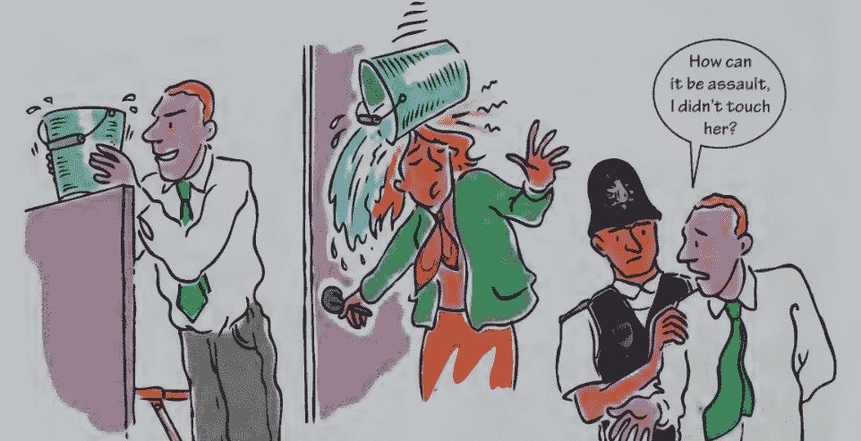

一个较新的例子是 DPP v K (1990)。

### DPP v K (1990)

D 是一名 15 岁的男学生，未经允许从科学课上拿走硫酸，想测试它在卫生纸上的反应。他在厕所时听到走廊里有脚步声，惊慌之下将硫酸放入热风干手机中隐藏。他回到教室打算稍后取出硫酸。但在此之前，另一名学生使用干手机，被硫酸喷到。D 被指控造成实际身体伤害的攻击罪（第 47 条）。治安法官判他无罪，因为他声称自己无意伤害任何人（关于第 47 条的心理要素见第 9.2.3 节）。检方以案件陈述的方式向王座法庭分庭上诉，该法院认为，普通攻击（包括攻击和殴打）可以通过间接行为实施。

### DPP v Santa-Bermudez (2003)

在该案中，一名女警官在搜查 D 的口袋前，问他身上是否有针或其他尖锐物体。D 说“没有”，但当警官将手伸进口袋时，她被一根针刺伤并出血。分庭法院认为，被告未告知她有针，这可以构成造成实际身体伤害的攻击罪的犯罪行为（actus reus）。

另一个间接暴力的例子发生在 Haystead v Chief Constable of Derbyshire (2000) 一案中，被告通过殴打抱着孩子的妇女，导致小孩摔倒在地。被告被判有罪，因为他对自己的行为是否会伤害孩子持轻率态度。值得注意的是，在该案中，定罪也可以由恶意转移原则来证明。

### 不作为

刑事责任可以通过不作为方式产生，但仅限于被告负有作为义务的情形。这种义务可以产生于合同、关系、对他人照顾的承担或危险情况的制造。由于殴打罪的犯罪行为是施加非法暴力，很难想象在这些义务情形下如何产生例子，但有一个已报告的案例，即 DPP v Santa-Bermudez (2003)。

其他可能使被告因不作为而承担责任的情形是，被告制造了可能导致暴力施加于受害者的危险情况。这可以通过 Miller (1983) 一案类推看出，在该案中，D 意外点燃了自己的床垫，但未能采取任何措施防止他睡觉所在的建筑受损。他被判犯有纵火罪。

该案中没有涉及其他人，但如果房间里还有另一个人在睡觉，而 Miller 未能叫醒他们并警告他们危险，那么如果出现任何问题，他可能要对殴打承担责任。例如，如果那个人因火灾而被天花板上掉落的灰泥击中，那么似乎没有理由不能以殴打那个人指控 Miller。

### 非法暴力

要构成殴打，暴力必须是非法的。如果受害者真正同意，则该暴力可能是合法的。（关于同意作为抗辩的进一步信息，见第 9.8 节。）在自卫或预防犯罪中使用暴力也可能是合法的。但只有在被告所相信的情况下使用的暴力是合理的，才能如此（见第 9.7 节关于

### DPP v Majewski (1976)

D 摄入了大量酒精和毒品，然后袭击了他正在喝酒的酒吧老板。老板报警后，D 又袭击了试图逮捕他的警察。上议院法官认为，饮酒和吸毒导致醉酒是一种轻率的行为过程，而在攻击案件中，轻率足以构成所需的心理要素（mens rea）。

这一裁决可能受到批评，因为喝酒或吸毒的时间点与实施犯罪行为的时点是相当分开的。很难看出两者如何一致。可以合理地说，被告在饮酒或服用其他麻醉物质时是轻率的，但这并不一定意味着他在三四个小时后实施攻击或殴打时，就该罪行而言是轻率的。该判决可以被视为一种公共政策决定。

## 9.2 造成实际身体伤害的攻击

我们现在来看造成伤害的攻击。最低级别的伤害在 1861 年《侵犯人身罪法》中被称为第 47 条下的“实际身体伤害”。这是一种可依任一种方式审理的罪行。该条规定：

> “凡被定罪为任何造成实际身体伤害的攻击者，应处……五年监禁。”

从这个非常简短的条款可以看出，它没有定义“攻击”或“实际身体伤害”，也没有提及所需的心理要素（mens rea）水平。关于所有这些要点，有必要参考判例法。

### 9.2.1 造成实际身体伤害的攻击的定义

### 定义

### 造成实际身体伤害的攻击

一种导致实际身体伤害的攻击或殴打，意图使受害者恐惧非法暴力，或使受害者遭受非法暴力，或对受害者是否恐惧或遭受非法暴力主观上轻率。

### 9.2.2 第 47 条的犯罪行为

有必要证明存在攻击或殴打，并且该行为造成了实际身体伤害。

### 实际身体伤害

在 Miller (1954) 一案中，法院认为实际身体伤害是“任何足以干扰受害者健康或舒适度的伤害或损伤”。在 T v DPP (2003) 一案中，意识丧失，即使是暂时的，也被认定为实际身体伤害。

### T v DPP (2003)

D 和一群其他年轻人追赶 V。V 摔倒在地，看到 D 朝他走来。V 用手臂护住头部，然后被踢。他短暂失去意识，直到被一名警察叫醒前什么都不记得。D 被判定犯有造成实际身体伤害的攻击罪。

因此，只要有伤害，就可以指控第 47 条。瘀伤、擦伤和划伤都属于该罪行。

在 T v DPP (2003) 一案中，法院认为意识丧失，即使时间很短，也可能构成实际身体伤害。在 DPP v Smith (Michael) (2006) 一案中，法院认为剪掉受害者的头发可以构成实际身体伤害。

### DPP诉史密斯（迈克尔）（2006）

被告与女友发生争吵。他在未经女友同意的情况下，剪掉了她的马尾辫以及头顶的部分头发。他被控违反1861年《侵害人身罪法》第47条的罪行。治安法官认为无案可答，因为他们认为剪头发不构成实际身体伤害。检方提出上诉，高等法院分庭裁定，剪掉大量头发可构成实际身体伤害。

在史密斯案中，法院认为身体疼痛并非实际身体伤害的必要成分。头发附着于头部，这使其成为身体的一部分，因此对头发的伤害属于“实际身体伤害”的含义范围。

然而，法院确实强调，必须剪掉大量的头发，伤害才属于“实际的”，而非琐碎或微不足道的伤害。

精神伤害也被归类为“实际身体伤害”。这是上诉法院在Chan Fook案（1994）中裁定的。然而，法院指出，实际身体伤害不包括“纯粹的恐惧、痛苦或惊慌等情绪”，也不包括“本身不构成某种可识别临床状况证据的精神状态”。

这一裁定得到了上议院在Burstow案（1997）中的认可，其中指出，1861年《侵害人身罪法》第18、20和47条中的“身体伤害”必须被解释为包括可识别的精神疾病。

### 9.2.3 第47条罪行的犯罪意图

该法条并未提及犯罪意图，但由于基本要素是普通攻击，法院认为，普通攻击的犯罪意图足以构成第47条罪行的犯罪意图。

这意味着被告必须意图或主观上罔顾受害人是否恐惧或遭受非法暴力。这与攻击或殴打的犯罪意图相同。需要注意的是，被告无需意图或罔顾是否造成实际身体伤害。这一点在Roberts案（1971）中得到体现。

### Roberts案（1971）

被告D驾驶汽车时，对副驾驶座上的女孩动手动脚，并试图脱掉她的外套。女孩担心他会实施更严重的攻击，于是在汽车以约每小时30英里的速度行驶时跳车，结果受了轻伤。D被判犯有攻击引致实际身体伤害罪，尽管他并未意图造成任何伤害，也未意识到有伤害风险。当他试图脱掉她的外套而触碰她时，他意图施加非法暴力。这满足了普通攻击的犯罪意图，因此他犯有第47条罪行。

这一裁定得到了上议院在Savage案（1991）和Parmenter案（1991）合并上诉中的确认。

### Savage案（1991）

D在酒吧将啤酒泼向另一名女子。在此过程中，玻璃杯从D手中滑落，V的手被玻璃割伤。D称她只是意图将啤酒泼向该女子。D并未意图伤害她，也未意识到有伤害风险。她被判犯有第20条罪行，但上诉法院撤销了该定罪，并改为判处第47条（攻击引致实际身体伤害）定罪。她对此向英国上议院提出上诉。上议院法官驳回了她的上诉。

她意图将啤酒泼向另一名女子，这意味着她具有施加非法暴力的意图，这足以构成第47条罪行的犯罪意图。

### 关键事实

| 罪行 | 犯罪行为 | 所需后果（伤害） | 犯罪意图 |
|---|---|---|---|
| 攻击 | 使V恐惧即将发生的非法暴力。需要行为，但可以是沉默的电话，Ireland案（1997），或信件，Constanza案（1997）。 | 无需。 | 意图或主观罔顾使V恐惧即将发生的非法暴力。 |
| 殴打 | 施加非法暴力，即使是最轻微的触碰，Collins诉Wilcock案（1984）。 | 无需。 | 意图或主观罔顾施加非法暴力，DPP诉Majewski案（1976）。 |
| 注意：攻击和殴打均根据1988年《刑事司法法》第39条起诉，统称普通攻击。 |  |  |  |
| 攻击引致实际身体伤害。1861年《侵害人身罪法》第47条 | 攻击，即攻击或殴打。 | 实际身体伤害（如挫伤）。包括：短暂失去意识，R（T）诉DPP案（2003）。精神伤害，Chan Fook案（1994）。 | 意图或主观罔顾导致恐惧非法暴力或施加非法暴力，即攻击或殴打的犯罪意图。 |

图9.3 关于攻击、殴打和第47条罪行的关键事实图表

## 9.3 恶意伤害/非法致伤严重身体伤害

这是严重程度排序的下一项罪行。它是1861年《侵害人身罪法》第20条规定的一项罪行，其定义如下。

### 定义

第20条《侵害人身罪法》

> “任何人非法且恶意地对他人造成或施加任何严重身体伤害，无论是否使用武器或工具，均属犯罪，应处……不超过五年的监禁。”

该罪行通常被称为“恶意伤害”。它属于混合审判罪行，最高刑期为五年。这与第47条罪行的最高刑期相同，尽管第20条被视为更严重的罪行，并且要求更高程度的伤害和针对伤害的犯罪意图。要证明该罪行成立，必须证明被告：

- 造成了伤害，或
- 施加了严重身体伤害
- 并且他这样做了：
  - 意图造成某种伤害（而非严重伤害），或
  - 罔顾是否造成了任何伤害。

### 9.3.1 伤口

“伤口”是指整个皮肤的连续性被割破或破裂。切割内部皮肤，如脸颊内部，是足够的，但未割破皮肤的内出血则不够。在*JJC诉Eisenhower*案（1983）中，受害者眼部被猎枪弹丸击中。弹丸未穿透眼睛，但导致表面下严重出血。由于没有割破，因此被认为不构成伤口。割破必须是整个皮肤，因此擦伤不被视为伤口。

即使是骨折也不被视为伤口，除非皮肤也破裂。在旧案例*Wood*案（1830）中，受害者的锁骨骨折，但由于皮肤完整，因此被认为没有伤口。

### 9.3.2 严重身体伤害

在*DPP诉Smith*案（1961）中裁定，严重身体伤害指“真正严重的伤害”。伤害不一定危及生命，在*Saunders*案（1985）中裁定，可以指示陪审团只需存在“严重伤害”即可，无需包含“真正”一词。

在*Bollom*案（2004）中裁定，伤害的严重程度应根据受害者的年龄和健康状况进行评估。

> *Bollom案（2004）*
>
> 一名17个月大的儿童腹部、双臂和左腿有挫伤。D被判犯有严重身体伤害罪。上诉法院撤销了定罪，并改为判处攻击引致实际身体伤害罪。然而，上诉法院指出，挫伤可以构成严重身体伤害。这种严重程度的挫伤，对健康的成年人而言，会比对于非常年幼的儿童而言不那么严重。

在*Burstow*案（1997）中，一名跟踪者的受害者因其行为而患上严重抑郁症，法院裁定严重的精神伤害可以构成严重身体伤害。

在*Dica*案（2004）中，首次通过使受害者感染HIV病毒而判定构成严重身体伤害罪。被告与两名女性发生无保护性行为，但未告知她们自己HIV阳性。结果两名女性均被感染。尽管在上诉中，被告的定罪因同意问题而被撤销，案件被发回重审，但毫无疑问，使他人感染HIV属于施加严重身体伤害。在重审中，被告被定罪。

### 9.3.3 施加严重身体伤害

第20条使用“施加”一词。最初，这被理解为必须存在技术上的攻击或殴打。即便如此，该条款仍可被相当宽泛地解释，如*Lewis*案（1974）所示，D在二楼公寓的紧闭门外对妻子喊叫威胁，并试图破门而入。妻子非常害怕，从窗户跳下，摔断了两条腿。D被判犯有第20条罪行。这些威胁可被视为技术性攻击。

在*Burstow*案（1997）中裁定，“施加”并不要求存在技术上的攻击或殴打。

> *Burstow案（1997）*
>
> D对一名大约三年前与他有过短暂关系的女子进行了为期八个月的骚扰活动。骚扰包括沉默和辱骂电话、憎恨邮件以及跟踪。这导致V患上严重抑郁症。D根据1861年《侵害人身罪法》第20条的定罪得到了上议院的维持。

这意味着只需证明被告的行为导致了受害者遭受严重身体伤害的后果。该裁定还意味着，目前第20条罪行与使用“造成”一词的第18条罪行在*犯罪行为*上的差异似乎已经很小（如果有的话）。事实上，在*Burstow*案（1997）中，霍普勋爵

据称，就所有实际目的而言，这两个词之间没有区别。

## 9.3.4 第20条的犯罪意图

该条所用的词是“恶意地”。在Cunningham案（1957年）（见第3.2.1节）中，法院认为“恶意地”并不要求对受伤害者怀有任何恶意。它仅仅指以下两种情况之一：

- 意图实施事实上已经发生的特定种类的伤害，或
- 对是否会发生这种伤害持轻率态度（即被告人已预见到特定种类的伤害可能发生，却仍继续冒险行事）。

| 罪行 | 犯罪意图 | 伤害 |
|---|---|---|
| 第18条 | 具体意图造成严重身体伤害或抗拒逮捕等。 | 伤口或严重身体伤害。 |
| 第20条 | 意图或轻率地造成某种伤害。 |  |
| 第47条 | 意图或轻率地使受害人恐惧非法暴力或实施非法暴力袭击。 | 实际身体伤害。 |
| 普通袭击 |  | 无伤害。 |

图9.4 攻击案件中不同程度的犯罪意图和伤害

在Parmenter案（1991年）中，上议院确认，Cunningham案中对“轻率”的解释适用于所有法规定义中使用“恶意地”一词的罪行。

因此，就第20条的犯罪意图而言，控方可以证明被告人意图对他人造成某种伤害，或者证明其主观上对他人是否遭受某种伤害持轻率态度。

这就留下了法院必须解决的另一个问题。“特定种类的伤害”是什么意思？被告人是否需要认识到伤口或严重身体伤害的风险？上议院在Parmenter案中裁定，尽管第20条的*犯罪行为*要求有伤口或严重身体伤害，但被告人无需预见到这一级别的严重伤害。

### Parmenter案（1991年）

D在将一个三个月大的婴儿抛向空中并接住时，导致婴儿受伤。D称，他经常对稍大一点的孩子这样做，并未意识到存在任何受伤风险。他被判定犯有第20条下的罪行。上议院撤销了这一定罪，因为没有证据表明他预见到了任何伤害，但改判其犯有第47条下的袭击导致实际身体伤害罪。

这一裁定意味着，尽管根据严重程度，这四种罪行似乎呈阶梯式排列，但在犯罪意图方面存在重叠。

## 9.4 意图造成伤口或严重身体伤害

这一罪行规定于1861年《侵害人身罪法》第18条，通常被称为“意图伤害罪”。事实上，它涵盖的罪行范围远比这一名称所暗示的广泛。

它被认为比第20条严重得多的罪行，这可以从最高刑罚的差异中看出。第20条最高可判处五年监禁，而第18条的最高刑罚是终身监禁。此外，第20条可按两种方式审理，而第18条则必须在刑事法院依公诉书审判。1861年《侵害人身罪法》中的定义如下：

### 定义

1861年《侵害人身罪法》第18条

> “任何人以任何方式非法且恶意地伤害任何人，或对任何人造成严重身体伤害，意图对任何人实施严重身体伤害，或意图抗拒或阻止任何人的合法逮捕或拘留，即属犯……罪。”

### 9.4.1 第18条的*犯罪行为*

该罪可以通过两种方式实施：

- 造成伤口，或
- 造成严重身体伤害。

“伤口”和“严重身体伤害”的含义与第20条相同。“造成”一词含义非常广泛，因此只需证明被告人的行为是伤口或严重身体伤害的实质性原因即可。

### 9.4.2 第18条的*犯罪意图*

这是一种特定意图犯罪。必须证明被告人意图：

- 实施严重身体伤害，或
- 抗拒或阻止任何人的合法逮捕或拘留。

### 意图实施严重身体伤害

尽管“恶意地”一词出现在第18条中，但法院认为，在意图造成严重身体伤害的情况下，该词对本条的*犯罪意图*没有任何额外要求。

重要的一点是，第18条是特定意图犯罪。必须证明存在意图；仅有轻率不足以构成第18条的*犯罪意图*。“意图”的含义与谋杀罪主要判例中阐明的含义相同。

因此，正如*Moloney*案（1985年）所裁定，对后果的预见并非意图；它只是可以从中推断或认定意图的证据。根据*Nedrick*案（1986年）和*Woollin*案（1998年）的判例，除非被告人的行为所造成的伤害是几乎确定的后果，且被告人意识到这一点，否则不能认定存在意图。（关于这些案例及意图含义的更全面讨论，见第3.1.2节。）

如果被告人试图抗拒或阻止逮捕或拘留，则其对伤害的意图程度较低。控方必须证明其具有抗拒或阻止逮捕的特定意图，但就伤害而言，只需证明其对自身行为是否会造成伤口或伤害持轻率态度即可。这一点在*Morrison*案（1989年）中得到裁定。

### 关键事实

| 罪行 | *犯罪行为* | 所需后果（伤害） | *犯罪意图* |
|---|---|---|---|
| **恶意造成伤口或严重身体伤害**  1861年《侵害人身罪法》第20条 | 直接或间接的行为或不作为：*Martin*案（1881年）。  无需证明存在袭击行为：*Burstow*案（1998年）。 | 要么是伤口——整个皮肤被割破：*JCC v Eisenhower*案（1984年）  要么  严重身体伤害（真正严重的伤害），包括精神伤害：*Burstow*案（1998年）。 | 意图或主观轻率地造成某种伤害（尽管不严重）：*Parmenter*案（1991年）。 |
| **意图造成伤口或严重身体伤害**  1861年《侵害人身罪法》第18条 | 导致受害人伤害的直接或间接行为或不作为。 | 伤口或严重身体伤害（同上）。 | 特定意图造成严重身体伤害，  或  特定意图抗拒或阻止逮捕，并对造成伤害持轻率态度：*Morrison*案（1989年）。 |

图9.5 第20条与第18条关键事实图

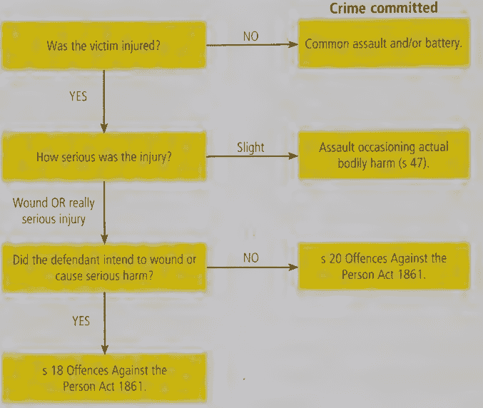

图9.6 侵害人身罪流程图

> **Morrison案（1989年）**
> 
> 一名警察抓住D，并告诉他她正在逮捕他。他纵身跃出一扇窗户，将她一路拖到窗口处，导致她的脸被玻璃严重划伤。上诉法院认为，由于本部分条文使用了“恶意地”一词，其含义必须与*Cunningham*案（1957年）中的含义相同。这意味着控方必须证明被告人要么意图伤害，要么意识到存在伤害风险并冒了该风险。

## 9.5 皇家检控署的指控标准

皇家检控官在决定以哪个级别的罪行提出指控时，会参考一份名为“指控标准”的文件，该文件已发放给所有皇家检控官。该文件列出了他们在决定指控级别时应考虑的事项。该文件并非关于该问题的法律，而且可以说，在某些情况下，检控官会选择比法律严格意义上可用的罪名更低级别的罪行。

然而，“指控标准”确实提供了一些有用的例子。例如，在决定以普通袭击罪还是第47条罪行指控被告人时，其中规定：

> “如果殴打造成伤害，则可选择多种指控。《皇家检控官守则》承认，可能存在一些因素，合理地导致不提出或不继续最严重指控的决定。因此，虽然任何超过短暂或轻微程度的伤害都可归类为实际身体伤害，但若伤害不超过以下程度，则适当的指控将是违反第39条[普通袭击]的罪行：”

- 擦伤；
- 抓伤；
- 擦破；
- 轻微瘀伤；

## 活动

阅读下面摘自《肯特信使报》的文章并回答下列问题。

## 恶徒踩踏警察面部被判入狱

‘一名暴徒因在新年前夜庆祝活动演变为暴力事件后对一名警察实施恶性袭击，被判入狱两年半。

K袭击了该警员，然后踩踏其面部，造成颧骨骨折，并踢其头部。

他的兄弟N因袭击另一名男子被判处240小时社区惩罚令，并被责令向受害人支付250英镑赔偿。

梅德斯通刑事法院在10月审理时获悉，在南伯勒一家工人俱乐部举行的派对正酣时，身为俱乐部成员的受害人介入了情侣之间激烈的争吵。当时发生了“言语攻击”，他要求其中一名男子离开。

不久之后，他被37岁的N拳击面部。警方接到报警，但麻烦仍在外面继续。

当那名警员和一名同事赶到时，一名少年向他们挥拳。36岁的K试图帮助该少年，抓住警员的喉咙并击打其头部。

K被判定犯有故意造成严重身体伤害罪。N被判定犯有造成实际身体伤害的袭击罪。’

> (《肯特信使报》，2003年12月5日)

## 问题

- 1. K被判犯了什么罪？
- 2. 这属于1861年《侵害人身罪法》的哪一条？
- 3. 该条款需要证明哪些要素？
- 4. 解释K做了什么以致犯下此罪。
- 5. N被判犯了什么罪？
- 6. 这属于1861年《侵害人身罪法》的哪一条？
- 7. 该条款需要证明哪些要素？
- 8. N做了什么以致犯下此罪？
- 9. 这两兄弟被判处了什么刑罚？
- 10. 解释为什么他们受到不同的刑罚。

- 肿胀；
- 皮肤发红；
- 表皮割伤；
- “黑眼圈”。

## 加重情节

人们也认识到，有些情节会使袭击行为更加严重，此时适宜提出最高级别的指控。例如，即使伤害程度属于上述清单范围内，以下情节也使其更适宜以第47条罪行提出指控：

- 袭击的性质，例如使用武器、咬伤或踢踹倒在地上的受害者；
- 受害者的脆弱性，例如受害者年迈、残疾或是儿童。

## 实际身体伤害

皇家检控署的指控指南规定，以下伤害通常应根据第47条提出起诉：

- 牙齿脱落或折断
- 暂时性感觉功能丧失，可能包括失去意识
- 大面积或多处瘀伤
- 鼻骨骨折移位
- 轻微骨折
- 轻微但不仅仅限于表皮的割伤，可能需要医疗处理（如缝针）
- 精神伤害，且不仅仅是恐惧、痛苦或惊慌等情绪反应。

- 复合骨折、颧骨碎裂、下颌骨骨折、肋骨骨折等
- 造成大量失血、通常需要输血的伤害
- 导致长期治疗或丧失行为能力的伤害
- 精神伤害。与实际身体伤害的袭击一样，必须有适当的专家证据来证明该伤害。

完整的指控标准可在互联网上查阅，网址为 www.cps.gov.uk/legal。

## 严重身体伤害

皇家检控署的指控指南强调，严重身体伤害指的是严重的身体伤害，是否严重由陪审团决定。不过，通常构成严重伤害的例子包括：

- 导致永久性残疾或永久性感觉功能丧失的伤害
- 造成超过轻微程度的永久性可见毁容的伤害；肢体或骨骼折断或移位，包括颅骨骨折

## 9.6 袭击法律改革的必要性

这一法律领域亟需改革。过去几年中，刑法修订委员会和法律委员会都曾提出改革建议。1998年，政府公布了其自身的法律改革提案，但这些提案从未成为法律。

2011年，法律委员会在其第十一次工作计划中宣布将再次审查这一法律领域并提出新的改革建议。该第十一次工作计划中，法律委员会简要指出了1861年法令存在的一些主要问题。包括：

- 该法令被普遍认为已过时
- 罪名之间没有清晰的等级，导致罪名之间存在不一致
- 所用语言需要现代化和简化。

## 活动

解释下列每种情形中可能构成的犯罪类型。

- 1. 在一场足球比赛中，里奥试图控球时踢到了比利，造成比利腿部瘀伤。比利对此感到恼怒，便一拳打在里奥脸上，导致其嘴唇破裂。
- 2. 阿尼什正沿着运河岸边行走。卡罗尔赶时间，从他身边挤过，将他撞入运河。阿尼什头部撞到岸边，造成颅骨骨折。
- 3. 一名警察看到杰森正在损坏一辆停放的车。警察把手放在杰森肩上说：“我以刑事毁坏罪逮捕你。”杰森朝警察面部猛击一拳，打碎其下巴，然后逃跑。
- 4. 卡尔向莉莉挥舞刀子，说道：“我要把你那傻笑割掉。”莉莉非常害怕，晕了过去。她倒向玛丽，玛丽被撞倒在地，造成瘀伤。

### 9.6.1 过时

1861年法令已有150多年历史，这造成了许多问题。例如，在制定该法令时，人们对精神健康问题的理解不如今天。因此，该法令在犯罪中仅提及“身体”伤害，未提及任何精神伤害。

一段时间内，人们不确定这些罪行是否能涵盖受害者遭受精神伤害的情形。为填补这一法律空白，法院在Chan Fook（1994）和Burstow（1997）案中裁定，“身体伤害”的含义确实包括对精神健康的伤害。自那以后，造成此类伤害的被告人可依据1861年法令被定罪。

另一个引发问题的领域是，造成身体伤害是否能够涵盖将疾病传染给他人的情形。在1861年，人们对某些疾病如何人际传播的认识有限。那时当然没有考虑到通过传染他人疾病可以构成刑事犯罪。法院再次填补了这一空白，在Dica（2004）案中裁定，将HIV传染给他人确实属于造成严重身体伤害的措辞范围。

### 9.6.2 罪名之间的不一致

该法令中存在不一致之处，尤其是在各罪行所需的犯罪意图方面。特别是，第47条与袭击或殴打具有相同的犯罪意图。它不要求被告人意图造成任何伤害，甚至不要求其意识到存在任何伤害风险。这似乎不公平，因为第47条最高可判处五年监禁，而袭击和殴打最高仅可判处六个月监禁。

同样不公平的是，造成小割伤的人可能被以更严重的第20条罪行起诉，而不是根据第47条以“造成实际身体伤害”的罪名起诉。这是因为第20条指的是“伤口或严重身体伤害”。然而，伤口显然有不同等级，其中许多并不等同于严重身体伤害。

另一个不一致之处是，第47条和第20条罪行的最高刑罚相同（五年监禁）。然而，第20条罪行显然比第47条更严重，因为它要求更严重的伤害。它还要求被告（D）意图或轻率地对受害人（V）造成某种伤害，而对于第47条，则无需证明被告意图或轻率地考虑过自己是否会对受害人造成某种伤害。当可责性程度差异如此之大时，这两种罪行却适用相同的最高刑罚，这似乎不公平。

1861年法令中的另一个不一致之处是，如果被告意图或预见到轻微伤害的风险，并且在其意图抗拒逮捕时随后发生了严重伤害，则可能被判处非常严重的第18条罪行。这是Morrison（1989）案判决的结果（见9.4.2节）。仅仅因为意图抗拒逮捕，被告就要与意图造成非常严重伤害的人承担相同的罪名，这合理吗？

### 9.6.3 需要现代化、简化的语言

第20条使用了“恶意地”（maliciously）一词。现代语言中，“恶意地”意味着故意并怀有恶意的行为。然而，在1861年法令中，该词的含义被认定为：被告要么意图实施实际发生的那类伤害，要么对该类伤害是否发生持轻率态度（见Cunningham（1957）案）。法律委员会已建议使用“轻率”（reckless）一词。

该法令并不一致：第20条使用“inflict”（施加）一词，而第18条使用“cause”（导致）一词。这引发了大量争议，即第20条中的“inflict”是否意味着必须发生技术意义上的袭击。这一争议由Burstow（1997）案解决（见9.3.3节），上议院在该案中裁定并非如此。

## 9.6.4 过去改革的提案

1993年，法律委员会提出了新的法律以取代现行法律，但政府对此未采取行动，直到1998年内政部发布了咨询文件，*暴力：改革《1861年人身伤害罪法案》*。该文件包含一份草案法案，其中列出了四项主要罪行。这些罪行旨在取代第18条、第20条、第47条以及殴打和袭击罪。按顺序排列，从最严重者开始（该条款在草案法案第1条中），它们是：

- 1. 故意造成严重伤害，若某人故意对他人造成严重伤害则构成有罪。
- 2. 鲁莽造成严重伤害，若某人鲁莽地对他人造成严重伤害则构成有罪。
- 3. 故意或鲁莽造成伤害，若某人故意或鲁莽地对他人造成伤害则构成有罪。
- 4. 袭击：若某人故意或鲁莽地
  - (a) 对他人身体施加力量或造成冲击，或
  - (b) 使他人相信任何此类力量或冲击即将发生。

在每一项中，伤害程度和所需的 *主观犯意* 都通过措辞得以明确。此外，草案法案还对“伤害”一词进行了定义，明确包括身体和精神伤害。“ wounding”一词未被使用。因此，这意味着严重的割伤将被视为严重伤害，而轻微的割伤则仅被视为伤害。这将解决现行法律中大部分问题。不幸的是，尽管该法案于1998年送出征求意见，但政府再无后续行动，因此法律仍然处于不令人满意的状态。

在草案法案中，法律委员会对伤害进行了定义。它表示伤害包括身体和精神疾病，并对两者都给出了定义：

- *身体* 伤害被定义为包括疼痛、失去意识以及对个人身体健康任何其他损害；
- *精神* 伤害被定义为对个人精神健康的任何损害。

他们还将疾病作为最严重罪行目的下的身体伤害。然而，这意味着几乎不可能定罪被告感染他人HIV，因为拟议的最严重罪行（上文列表中的第一项）只能在被告故意造成严重伤害时成立。这意味着像 *Dica*（2004年）案件（见第9.3.2节）中鲁莽传播HIV的定罪将不可能实现。

## 9.6.5 现行状况

第9.6.4节中列出的提案从未成为法律。法律委员会在其2011年的第十一工作计划中宣布，其打算重新考虑非致命人身伤害罪法的改革方式。该工作原定于2012年开始。如需了解进展，请访问法律委员会网站 www.justice.gov.uk/lawcommission/index.htm。

## 自测问题

- 1. 某人因造成实际身体伤害罪被起诉，应依据议会哪部法律的哪一条？
- 2. “实际身体伤害”是什么意思？
- 3. 造成实际身体伤害罪需要什么 *主观犯意*？
- 4. “wound”是什么意思？
- 5. “严重身体伤害”是什么意思？
- 6. 证明第20条罪行需要什么 *主观犯意*？
- 7. 证明第18条罪行需要什么 *主观犯意*？
- 8. 列出非致命人身伤害罪法三项批评。

## 9.7 正当防卫/防卫他人/预防犯罪

这不仅涵盖为抵御攻击而采取的必要行动，也包括为防卫他人而采取的行动。正当防卫和防卫他人的抗辩是普通法抗辩，可为被告的行为提供正当理由。此外，根据1967年《刑事法》第3(1)条，还存在一项法定预防犯罪抗辩，其中规定：

> ‘个人可在预防犯罪时使用在该情况下合理的力量。’

### 9.7.1 力量程度

可在正当防卫、防卫他人或预防犯罪中使用力量的程度现已在2008年《刑事司法与移民法》中作出解释。该法规定，在判断所用力量在该情况下是否合理时：

> (a) 为合法目的行事的人可能无法精确权衡任何必要行动的准确程度；并且
> 
> (b) 证据表明某人仅做了其诚实且本能地认为对合法目的所必需的事情，构成该人仅为该目的采取了合理行动的有力证据。

这承认了面对他人攻击的人处于压力之下，不能期望其在该情况下计算出需要使用的确切力量。如果有证据表明该人“诚实且本能地”认为其为保护自己或他人或预防犯罪而使用的力量程度是合理的，则这提供了强有力的证据，证明所采取的防御行动在该情况下是合理的。

然而，如果力量是在攻击者所有危险已过之后使用（即作为报复或复仇），则该抗辩不可用。

### 9.7.2 正当防卫中对力量的错误使用

在审视情况时，被告必须根据其真诚相信的事实来判断。在Williams（1987）案中裁定，被告应根据其对事实的真诚错误看法来判断，而不论该错误是否合理或不合理。这使Williams得以使用保护他人的抗辩。

### Williams（1987）

D在公交车上时，看到他认为有人正在袭击一名青年。事实上，那个人正试图因该青年抢劫老妇而将其逮捕。D下车询问发生了什么事。那个人说他是警察正在逮捕该青年，但当D要求他出示警察身份证件时，他无法做到。随后D与那个人之间发生了争斗，那个人受伤。法官指示陪审团D只有在其错误是合理的情况下才有抗辩，因此D被判袭击罪。

上诉法院撤销了其定罪，因为陪审团应被告知，如果他们认为错误是真诚的，则应根据被告对事实的真诚错误看法来判断被告，而不论该错误是否合理或不合理。

2008年《刑事司法与移民法》第76条将Williams案的决定置于成文法基础之上。该条规定：

> **s 76(3)** D所使用力量的程度是否在该情况下合理的问题，应根据D相信的情况来决定……
> 
> **76(4)** 如果D声称就任何情况的存在持有特定信念——
> 
> (a) 该信念是否合理与D是否真诚持有该信念的问题相关；但
> 
> (b) 如果确定D确实真诚持有该信念，D有权为第(3)款之目的依赖该信念，而不论——
> 
> (i) 其是否错误，或
> 
> (ii) （如果错误）该错误是否是可以合理犯下的。

因此，在每种情况下，重要的一点是确定被告真诚相信的事实。如果被告真诚犯了错误，则应根据其所相信的事实来判断他。即使该错误是不合理的，也如此。

### 醉酒错误

2008年《刑事司法与移民法》第76(5)条明确规定，如果该错误是由于被告自愿醉酒而产生，则被告不得依赖任何错误信念。

如果被告因自愿喝醉或吸毒而犯错误，并因其醉酒状态而犯错误，则他不能依赖其错误信念。一个例子是被告吸食了导致幻觉的毒品，使其相信自己正被蛇攻击。如果被告随后袭击某人，相信那个人是蛇，则被告不能使用正当防卫抗辩。他真诚地相信自己正被蛇攻击，但该错误是由被告自愿醉酒造成的。

### 9.7.3 正当防卫法中的问题

### 力量是否必要？

如果抗辩要成立，首先要决定的问题是力量是否必要。这是陪审团的问题。在许多情况下这是显而易见的。例如，如果事实是受害者手持刀具并向被告走来，说“我要把你砍成碎片”，在这种情况下显然需要自卫力量。

在其他情况下，判断力量是否必要则更困难，因为陪审团必须决定被告诚实相信存在的状况。例如，如果在黑暗中步行回家时，被告看到一个大男人威胁性地举着一根棍子朝他走来。D认为有必要自卫并重击那个人，将其击倒在地。然而实际上，“大男人”是一位年迈的妇女，而“挥舞棍子”则是妇女试图在头顶打开一把雨伞。

陪审团必须决定D是否诚实地相信自己正受到威胁。如果他们决定他确实相信，则他拥有正当防卫抗辩。他可以使用力量，即使实际上他并未受到威胁。在这种情况下，一个无辜的人（试图打开雨伞的妇女）被打了，但D的行为不是刑事犯罪。

2008年《刑事司法与移民法》第76条明确规定，只要该错误并非因醉酒而产生，D就可以依赖其错误。只要陪审团决定D确实相信有一个大男人挥舞棍子攻击他，D就拥有正当防卫抗辩。即使该错误不是可以合理犯下的，也如此。

### Pre-emptive strike

另一点是，是否必须等到某人被攻击后才能使用武力。法律似乎很明确，他们可以采取行动防止武力使用。攻击并不需要已经开始。在上面的例子中，并未开始攻击。D认为自己即将遭到攻击，并采取行动以免受攻击。这似乎是一条合理的规则，因为如果一个人必须等到被刺伤或枪击后才被允许自卫，那就荒谬了。

在 *Attorney-General’s Reference* (No 2 of 1983) (1984) 一案中，法院认为担心遭到攻击的人可以为自卫做准备。即使这些准备涉及违法行为也是如此。

> **_Attorney-General’s Reference (No 2 of 1983) (1984)_**
>
> D的商店曾被暴徒袭击并损坏。担心进一步的袭击，他制作了汽油弹。D被控持有爆炸物，情况足以合理怀疑其并非为合法目的持有（违反1883年《爆炸物法》第4(10)条）。D以自卫为抗辩，陪审团宣告他无罪。总检察长将该法律问题提交上诉法院，上诉法院裁定D为自卫做准备是正确的。

### Excessive force

一个主要问题是被告在自卫中使用过度武力时。如果是这样，他就不能以自卫作为抗辩。如果他被控任何袭击罪，法官在量刑时可以考虑任何自卫问题。然而，如果此类被告被控谋杀，他必须被判处终身监禁。

这在 *Clegg* (1995) 和 *Martin (Anthony)* (2002) 两案中可见。两案的事实在第6.2.4节中阐述。

### Relevance of D’s characteristics

另一点是，在决定D是否认为自己需要自卫时，是否可以考虑D的特征。

在 *Martin (Anthony)* (2002) 一案中，上诉法院裁定，证明D患有一种导致其感知危险远大于普通人的状况的精神病证据，与D是否使用了合理武力的问题无关。作出此裁定的原因之一是，自卫通常在轻微袭击案件中提出，在此类案件中鼓励医学争议将是“完全不成比例的”。

同样在 *Cairns* (2005) 一案中，上诉法院遵循了 *Martin* (2002) 的裁决，并裁定在决定D在自卫中使用武力是否合理时，不宜考虑D是否患有精神疾病（如偏执型精神分裂症），该疾病可能导致他产生即将被攻击的妄想。

在2008年《刑事司法与移民法》通过后，这些裁决是否仍然有效，很难确定。该法第76条明确规定，D所使用武力的程度在当时情况下是否合理，应参照D所相信的情况来决定。该条继续规定，如果陪审团（或治安法官）认定D确实相信特定情况的存在，则D有权依赖该信念。

如果D的精神状况使其真诚地相信需要使用武力，且法院接受他确实持有此信念，那么根据该法的措辞，D显然应能够主张自卫。然而，法院是否会采用这种解释仍存疑。如果该法能明确说明导致D相信情况存在的精神状况是否应予考虑，将会很有帮助。

## 9.8 Consent as a defence

同意可能是殴打和其他针对人身的犯罪的抗辩理由。然而，它绝不是谋杀或造成严重伤害情况的抗辩理由。

严格来说，同意并不是抗辩，因为当另一方同意时，就不存在犯罪。例如，当另一方同意被触摸时，就不存在殴打，因为没有非法武力。这由 Donovan (1934) 一案说明。

### Donovan (1934)

D为了性满足而鞭打一名17岁女孩。这导致瘀伤，他被定罪为猥亵袭击和普通袭击。D以V已同意该行为为由提出上诉。他的定罪被撤销。

说明同一观点的更极端案例是 Slingsby (1995)，被告被控过失杀人。

### Slingsby (1995)

D被控以非法行为导致非故意杀人。D和受害者参与了被描述为“激烈”的性活动，但该活动是在受害者同意的情况下进行的。在此期间，D佩戴的印章戒指导致受害者出现小伤口，进而导致败血症死亡。受害者的同意意味着不存在殴打或其他形式的袭击，因此D被认定不构成过失杀人，因为没有非法行为。

### Real consent

然而，必须存在真正的同意。在 Tabassum (2000) 一案中，被告说服妇女允许他测量她们的乳房，以便为出售给医生的数据库做准备。这些妇女完全了解他拟进行的性行为的性质，但表示她们之所以同意，只是因为她们认为D具有医学资格或医学培训。上诉法院认可了审判法官的指示，他说：

> ‘I should prefer myself to say that consent in such cases does not exist at all, because the act consented to is not the act done. Consent to a surgical operation or examination is not consent to sexual connection or indecent behaviour.’

受害者因恐惧而屈从于被告的行为，并不意味着同意是真实的。这由 Olugboja (1982) 一案显示。

### Olugboja (1982)

受害者已被D的同伴强奸，并目睹她的朋友被同一男子强奸。当D试图与她发生性关系时，她屈从了。D声称这意味着她已同意。上诉法院裁定真实同意与单纯屈从之间存在区别。是否真实同意由陪审团决定。

在 Dica (2004) 一案中，在不知被告为HIV阳性的情况下同意发生性关系，上诉法院裁定不存在对感染风险的同意。

### Dica (2004)

D明知自己HIV阳性，与两名妇女有关系。她们与他发生了无保护性行为，两人都被感染。她们声称自己不知道他是HIV阳性，如果知道就不会同意无保护性行为。D被控违反1861年《侵害人身罪法》第20条的罪行。在其审判中，法官不允许将同意问题提交陪审团，因此上诉法院撤销了定罪但下令重新审判。

本案的裁决明确表明，即使V已同意性行为，D仍可能犯下违反1861年《侵害人身罪法》第20条的罪行。这推翻了 Clarence (1888) 的裁决，当时丈夫患有性病而妻子不知情，妻子在性交时被感染。法院裁定，妻子同意与丈夫发生性关系意味着不存在袭击。

### 9.8.1 Implied consent

法院在某些情况下会推定对轻微触碰的同意，否则这些触碰将构成殴打。这些是日常情况，其中人群聚集，不可避免地会有一些接触。在 Wilson v Pringle (1987) 一案中，法院裁定日常生活中普通的“碰撞”不构成殴打。没有人可以抱怨在例如超市、地铁站或繁忙街道等场所因其在场而不可避免的碰撞；同样，参加聚会的人也不能抱怨如果他的手被友好地抓住，甚至如果他的背部（在合理范围内）被拍打。

这也适用于接触性运动。当一个人参加橄榄球或柔道等运动时，他同意该运动的一部分的接触。然而，如果接触超出了规则允许的范围，则可能构成犯罪。例如，橄榄球运动员同意在比赛规则内的擒抱，但他不同意对方球员踩踏他的头部。

违反运动规则的行为必须是严重的。上诉法院在 Barnes (2004) 中表示，当比赛中造成伤害时，刑事起诉应保留给那些行为严重到可被恰当地归类为犯罪的情况。

### Barnes (2004)

D在业余足球比赛中对V进行了晚来的铲球。V遭受了严重的腿部伤害。D因违反1861年《侵害人身罪法》第20条的罪行被定罪，后被撤销。

### 9.8.2 Consent to minor injuries

关于同意是否可以作为1861年《侵害人身罪法》第47条罪行的抗辩，存在争论。以前认为，如果伤害不严重，同意可以作为抗辩。然而，在 Attorney-General’s Reference (No 6 of 1980) (1981) 一案中，两名年轻男子同意在街头打斗以解决争吵后的分歧，上诉法院裁定同意不能作为此类行为的抗辩，因为这不符合公共利益。他们说：

> ‘It is not in the public interest that people should try to cause, or should cause, each other bodily harm for no good reason. Minor struggles are another matter. So, in our judgment, it is immaterial whether the act occurs in private or public; it is an assault if actual bodily harm is intended and/or caused. This means that most fights will be unlawful regardless of consent.’

因此，现在普遍接受同意不是第47条罪行的抗辩，除非情况属于法院已承认的例外情况。在 Attorney-General’s Reference (No 6 of 1980) 中，上诉法院列出了以下例外情况：

> ‘properly conducted games and sports, lawful chastisement or correction, reasonable surgical interference, dangerous exhibitions, etc.’

法院在名单末尾加上了‘etc’，以表明可能存在同意可被允许作为抗辩的其他情况。这是一个是否符合公共利益的问题。

在决定什么是公共利益时，法院做出了难以调和的判决。在 *Brown*（1993）案中，上议院裁定，同意不能作为同性恋者实施的施虐受虐行为的抗辩，即使所有参与者都是成年人且所造成的伤害是短暂且轻微的。

> **Brown (1993)**
> 
> 五名来自同意的成年施虐受虐者群体中的男子因造成实际身体伤害的袭击罪（s 47 OAPA 1861）和恶意伤害罪（s 20 OAPA 1861）被定罪。他们实施的行为包括用荨麻刺向生殖器区域以及互相在阴茎上插入地图图钉或鱼钩。所有受害者都已同意且没有人需要医疗救助。他们的定罪被上议院维持。

> 法律大臣们显然是基于公共政策做出了这一决定。特姆普尔曼勋爵实际上说：
> 
> > ‘是否应将同意抗辩扩展至施虐受虐相遇的后果，只能通过对政策和公共利益的考量来决定……社会有权并且有义务保护自己免受暴力崇拜的侵害。’

然而，在 *Wilson*（1996）案中，上诉法院裁定，被告应其妻子的要求用热刀在其臀部烙上自己的姓名缩写，这并非违法行为，即使她因此造成的烧伤需要寻求医疗救助。该法院认为，将此类合意的行为刑事化不符合公共利益。这是一种类似纹身的‘个人装饰’情况。

## 9.8.3 对同意的错误信念

如果被告真诚地但错误地认为受害者是同意的，则对袭击构成抗辩。

在这一领域，法院的判决与“不利于公众利益让人们无故尝试或造成彼此身体伤害”的一般原则相比更难以调和。在以下两个案件中，法院裁定对同意的错误信念是对所控罪行的抗辩。

> **Jonge (1936)**
> 
> 两名14岁和15岁的男学生被年长的青年抛向空中。其中一名受害者手臂骨折，另一名脾脏破裂。被告声称他们相信两名受害者同意该活动。上诉法院因法官未允许将对同意的错误信念问题提交陪审团而撤销了他们根据 s 20 OAPA 1861 的定罪。法院认为，对“粗暴且不守纪律的嬉戏”的真诚错误同意信念可以构成抗辩，即使该信念是不合理的。

在 *Aitken*（1992）案中做出了类似的判决，当时皇家空军军官向一名正在穿着防火飞行服但当时正在睡觉且醉酒的同事身上倒白油精。他遭受了35%的烧伤。他们根据 s 20 的定罪被撤销，因为对受害者同意的错误信念本应提交给陪审团。

## 9.8.4 需要同意抗辩

在某些情况下允许同意抗辩是很重要的。例如，如果没有同意抗辩，那么所有接触性运动都将是非法的。这就是为什么上诉法院在 *Attorney-General’s Reference (No 6 of 1980)*（1981）案中指出，虽然同意不是街头斗殴的抗辩，但存在同意可作为抗辩的例外情况。

该法院在该案中给出的例外清单是‘适当进行的游戏和体育、合法的惩戒或纠正、合理的手术干预、危险的表演等’。这些例外基于公共政策。

### 体育

如果在‘适当进行的游戏和体育’中没有同意抗辩，那么足球、橄榄球和曲棍球等团队运动就永远无法进行。还有大量个人运动将被禁止，例如柔道、空手道和拳击。

判决中的重要措辞是‘适当进行的游戏和体育’。必须在遵守规则的比赛行为与超出规则的行为之间做出区分。蓄意的‘场外’铲球瞄准另一名球员的腿部并意图造成严重伤害，显然应被视为刑事行为。以这种方式受伤的球员并未同意此类行为。

*Barnes*（2004）案列出了在决定比赛中袭击是否构成犯罪时应考虑的事项。法院表示，在决定体育运动中的行为是否构成犯罪时，应考虑以下因素：

- 故意造成伤害将始终构成犯罪。
- 对于鲁莽造成伤害，伤害是在实际比赛中发生的，还是在比赛已经停止的情绪化或过度兴奋的瞬间发生的？
- ‘场外’伤害更可能构成犯罪。
- 比赛在游戏的规则和惯例范围内进行且未超出范围的事实，将是该行为不构成犯罪的有力迹象。

通过应用这些因素，应在允许接触性运动在不对其规则施加不必要的限制的情况下进行与维护袭击的刑事法律之间取得良好平衡。只有那些故意造成伤害或超出游戏规则的人才应承担刑事法律责任。

### 医疗程序

同意被允许作为抗辩的另一个例外是‘合理的手术干预’。显然，如果手术是为了挽救患者的生命或以某种方式改善患者的健康，那么对手术的同意就是对任何袭击指控的抗辩。

精神健全的成年人可以同意合理的医疗治疗，也可以拒绝。如果他们拒绝同意，则如果进行手术或其他治疗将构成刑事行为。例如，如果一个人因宗教信仰拒绝输血，则不能给予此类治疗。

如果患者昏迷无法征求其同意，医务人员会尝试从亲属处获得同意。如果不可能，则在治疗必要且必须迅速进行的情况下，可以在没有实际同意的情况下进行此类手术。

## 9.8.5 对同意法的评述

法院在同意案件中的判决难以调和。例如比较 *Brown*（1994）案与 *Wilson*（1997）案。

在 *Brown* 案中，上议院裁定，由于涉及的残忍和堕落，同意不能作为同意的成年同性恋者之间的施虐受虐行为的抗辩。在 *Wilson* 案中，上诉法院裁定，在丈夫在其妻子的臀部烙上自己的姓名缩写的情况下，同意可以作为抗辩。这些判决是在 *Brown* 案中没有任何‘受害者’需要医疗救助而 *Wilson* 案中的妻子需要接受医疗救助的情况下做出的。

能够同意性交。该罪名也是严格责任罪。

自己的生命并且试图这样做并不构成犯罪。但在希望自杀的人身体上无法做到时，他们的愿望就会被剥夺，因为任何帮助他们的人都将构成犯罪。

这两个事实意味着，如果一名15岁的男孩与一名女孩发生合意性行为，他真诚地相信该女孩与自己同龄，但实际上只有12岁，他将被判犯有强奸13岁以下儿童罪。这一情况发生在 G（2008）案中。在上诉至上诉法院时，法院已表示同意仅与量刑有关。G 以其人权受到侵犯为由对定罪提出上诉。上议院以三名法官对两名法官的多数意见驳回了他的上诉。两名上议院法官本会支持被告的事实表明这一法律领域是多么困难。

请注意，在1961年之前，自杀是刑事犯罪，因此如果人没有成功，他们将被起诉企图自杀。

CPS 论文《Self-defence and the Prevention of Crime》（2011）值得一看。CPS 网站是 www.cps.gov.uk。

## 9.8.7 同意与安乐死

还有一个问题是，没有人可以同意自己的死亡。这意味着如果一名绝症患者希望死亡，他们必须自行了断。如果任何人杀死他们，就是谋杀。即使任何人协助他们自杀，该人也犯有协助自杀罪。这在 *R (on the application of Pretty) v DPP*（2001）案中被决定。

### R (on the application of Pretty) v DPP (2001)

Pretty 夫人患有运动神经元疾病。因此她变得越来越无法行动。她知道最终她会窒息而死。她希望她的丈夫在她觉得生活变得无法忍受时能够协助她自杀。

她向法院申请一项司法声明，即如果她的丈夫协助她自杀，他将不会被起诉。上议院以丈夫的任何协助都将是刑事行为为由拒绝了该声明。

这一决定导致了法律承认人们有权自行了断的

## 自测问题

1. 哪部法律的哪一条规定了“一个人‘可以在防止犯罪的情况下使用合理的情况所需的力量’”？
2. 在决定所使用力量的程度是否合理时使用哪些测试？
3. 当 D 对需要使用力量的情况产生错误认识时，在决定自卫抗辩是否适用于他时会考虑什么？
4. 如果 D 因醉酒而对需要使用力量的情况产生错误认识，他的错误认识可以被考虑吗？
5. 当 D 使用过度力量时会发生什么情况？
6. 列出同意袭击被允许作为抗辩的两个案件。
7. 列出两个案件，其中认定 V 的同意不是真实的，因此不能作为抗辩。
8. 哪个案件裁定对轻微伤害（例如打斗可能造成的伤害）的同意通常不被允许作为抗辩？并列出该案件中同意造成伤害可以作为抗辩的两个例外情况。
9. 为什么需要同意抗辩？
10. 在决定是否允许同意作为抗辩时考虑哪些政策因素？

## 关键事实

| 罪行 | 同意能否作为抗辩理由？ | 评论/案例 |
|---|---|---|
| 谋杀罪（1861年《侵犯人身罪法》第18条） | 对这些罪行从来不是抗辩理由。 | 不符合公共利益。 |
| 1861年《侵犯人身罪法》第20条 1861年《侵犯人身罪法》第47条 | 通常不是抗辩理由。 但存在同意可作为抗辩理由的例外。 | 不符合公共利益，例如斗殴（总检察长提交意见（1980年第6号）（1981））或施虐受虐行为（Brown案（1993））。 适当进行的体育运动、外科手术、危险表演（Jones案（1986））或个人装饰如纹身（Wilson案（1996））。 |
| 殴打罪 | 始终可以作为抗辩理由。 | 同意也可以被默示适用于日常生活中的“推挤”（Wilson诉Pringle案（1986））。 |

图9.7 关于同意作为抗辩理由的关键事实表

## 练习

解释在下列情形中是否存在可用的抗辩理由。

- 1. 安瓦尔听到本对卡莉喊道：“我要抓住你。”然后安瓦尔看见本手里拿着闪闪发光的东西跑向卡莉。安瓦尔以为那是刀，本正要刺卡莉。安瓦尔用橄榄球式擒抱将本扑倒在地，导致本下巴骨折。事实上，本并没有刀，而是手里拿着一部手机。
- 2. 埃拉想在她男朋友达米恩名字的首字母纹在手臂上。她从朋友那里得到纹身工具，并让达米恩用工具在她手臂上纹。达米恩照做了。埃拉因纹身而受到严重感染，手臂上留下难看的疤痕。
- 3. 弗雷娅正在参加曲棍球比赛。她用曲棍球杆试图从对方球员加琳娜那里抢球。不幸的是，这导致加琳娜绊倒摔跤，扭伤了手腕。
- 4. 汉斯喝了六品脱啤酒。在步行回家的路上，他踉跄了一下，差点摔倒。希万抓住了他，使他免于摔倒。汉斯认为希万想袭击他，便挥拳打了希万的嘴，造成瘀伤。
- 5. 尼克为他的大学橄榄球队打球。在一场比赛中，尼克被戴夫非常用力地擒抱。尼克对此很生气，并确保每次戴夫拿球时，他（尼克）都用力擒抱戴夫。当他们比赛结束离开球场时，尼克推了戴夫。如果尼克因这些擒抱和推搡而被指控犯有殴打罪，他可能享有哪些抗辩理由？

## 考试题

詹姆斯和布雷特决定用打斗来解决争吵。布雷特用力推了詹姆斯的胸口。詹姆斯挥拳打布雷特，但没打中，却打中了丹尼尔，导致丹尼尔下巴骨折。布雷特随后打了詹姆斯，造成轻微脑震荡。后来，布雷特的女友艾薇儿请布雷特在她手臂上纹上字母B，以示她爱他。布雷特同意了，但艾薇儿得了血液中毒。

分别评估陈述A、B、C和D在应用于上述事实时的准确性。

- 陈述 A：即使詹姆斯和布雷特同意打斗，布雷特推詹姆斯时仍要对殴打罪负责。
- 陈述 B：詹姆斯不应对造成严重身体伤害负责，因为他的目标是布雷特，而不是丹尼尔。
- 陈述 C：当詹姆斯遭受脑震荡时，布雷特不应对殴打造成实际身体伤害负责。
- 陈述 D：布雷特不对艾薇儿的血液中毒负责，因为她曾要求他给她纹身。

（OCR G153，2010年6月）

## 第十章

### 盗窃罪

盗窃罪定义见1968年《盗窃罪法》第1条。

**盗窃罪**

“如果一个人不诚实地占用属于另一个人的财产，并意图永久剥夺该另一个人的财产，则他犯有盗窃罪。”

该法接下来的五个条文有助于解释定义中词语或短语的含义。这是按照定义中词语或短语出现的顺序进行的，从而便于记住条文编号。它们是：

- 第2条——不诚实（*犯意*的一部分）
- 第3条——占用（*犯罪行为*的一部分）
- 第4条——财产（*犯罪行为*的一部分）
- 第5条——属于另一个人（*犯罪行为*的一部分）
- 第6条——意图永久剥夺该另一个人的财产（*犯意*的一部分）。

记住，罪行规定在第1条中。被控盗窃罪的人总是被指控“违反1968年《盗窃罪法》第1条”而偷窃。第2至6条是解释第1条的定义条文。它们本身并不构成任何罪行。

盗窃罪的*犯罪行为*由“占用属于另一个人的财产”这一短语中的三个要素组成。因此，要证明*犯罪行为*，必须表明被告占用了某物，该物属于该法定义范围内的财产，并且在占用时属于另一个人。盗窃罪的*犯意*必须证明两个要素。即财产的占用必须是“不诚实”的，并且必须具有永久剥夺另一个人财产的意图。

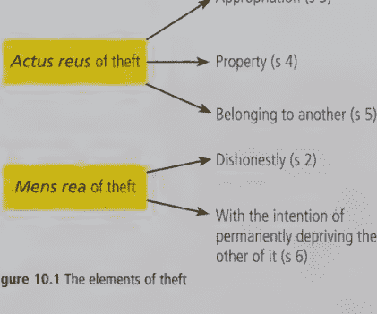

### 10.1 “占用”

更明显的盗窃情形涉及实际拿走，例如扒手从别人口袋里拿走钱包。但占用的范围比这广泛得多。

第3(1)条规定：

> “任何人假设拥有所有者的权利即构成占用，并且这包括，在他取得该财产的情况下……”

认为被告是在拿走欠他的东西？这一点在*Lawrence*案（1971）中得到了考虑。

*Lawrence*案（1971）

一个意大利学生，几乎不会说英语，到达维多利亚车站，向出租车司机劳伦斯展示了一个地址。行程本应花费50便士，但劳伦斯告诉他很贵。学生掏出一张1英镑纸币递给司机。劳伦斯说不够，于是学生打开钱包，让劳伦斯自己又拿了6英镑。劳伦斯提出抗辩说，他没有占用这笔钱，因为学生同意他拿走。上诉法院和上议院都驳回了这一论点，并认为在这种情况下存在占用。

对拿取行为的同意问题也在*Morris*案中得到了考虑。这个问题在商店案件中很重要，因为超市购物的整个体系依赖于顾客从货架上取下商品。这意味着，实行自助式购物的商店默示同意顾客从货架或挂架上取下商品。

在*Morris*案中，罗斯基尔勋爵在*附带意见*中表示，当存在以下情况时：

> “一个诚实的顾客从货架上取下商品放入购物车，然后带到结账处支付适当的价格，我看不出这些行为中的任何一项涉及到购物者对超市权利的占用。”

这似乎是一种常识性的观点。然而，这仅仅是*附带意见*，当这一点在*Gomez*案（1993）中再次被考虑时，上议院驳回了罗斯基尔勋爵的观点。

*Gomez*案判决的效果是，从商店货架上取下任何商品都构成占用。然而，只有在占用商品的人具备盗窃罪所需的*犯意*时，盗窃罪的完整罪行才会成立。

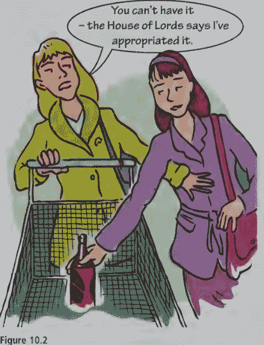

*Gomez*案（1993）

D是一家商店的助理经理。他说服经理将价值超过17,000英镑的电器商品卖给同伙，并接受两张支票付款，并告诉经理这些支票与现金一样好。这些支票是偷来的，毫无价值。D被指控并定罪为盗窃这些商品。

上诉法院撤销了定罪，依据*Morris*案（1983）的判决，即必须存在“不利干涉”才构成占用。他们认为，经理对交易的同意和授权意味着在取得商品时不存在占用。

该案上诉至上议院，上诉法院认证了一个具有普遍公共重要性的法律问题，具体如下：

> “当盗窃被指控，且被指控被盗的财产经所有者同意转移给被告，但该同意是通过虚假陈述获得的，那么：
>
> (a) 是否发生了1968年《盗窃罪法》第1(1)条意义上的占用，或者
>
> (b) 这种财产转移是否必然涉及对所有者某项权利的不利干涉或篡夺？”

上议院以四比一的多数裁决（a）“是”。占用已经发生。他们裁决（b）“否”。没有必要存在不利干涉或篡夺所有者的某项权利。换句话说，要构成盗窃罪，被告无需做任何违背所有者意愿的事情。他们指出，*Lawrence*案（1971）的判决裁定，即使行为得到所有者的同意，也可能构成占用。

### 10.1.2 未经欺骗的同意

那么，*Gomez*案（1993）的判决是否扩展到一个人在没有进行任何欺骗的情况下将财产给予另一个人的情形？这是*Hinks*案（2000）中提出的问题。

*Hinks*案（2000）

D是一名38岁的女性，她与一个非常天真、智商低下的男人交上了朋友。然而，他在精神上有能力理解所有权的概念，并能够作出有效的赠与。在大约八个月的时间里，D多次陪同该男子前往他的建房互助协会取钱。总额约为60,000英镑，这些钱都存入了D的账户。该男子还给了D一台电视机。法官指示陪审团考虑该男子是否精神上如此无能力，以至于D自己意识到普通正派人会认为接受他的赠与是不诚实的。D因盗窃这笔钱和电视机而被定罪。

在上诉中，辩方提出，如果赠与有效，接受赠与就不能构成盗窃。上议院以三名法官对两名法官的多数驳回了上诉。其中有四名法官裁定，即使财产是有效的赠与，也存在占用。霍布豪斯勋爵持异议，裁定在这些情况下不可能存在占用。赫顿勋爵虽然同意多数派的关于法律问题的意见，但对该行为是否表现出不诚实持异议。

反对*Hinks*案裁决的一个主要论点是，在民法上赠与有效，60,000英镑和电视机属于被告。斯泰恩勋爵在主要判决中承认情况确实如此，但他认为这与裁决无关。

### 10.1.3 某一时间点的占用

*Gomez*案判决的另一个效果是，占用被视为在某一时间点发生。这一点由*Atakpu and Abrahams*案（1994）说明。

*Atakpu and Abrahams*案（1994）

被告使用虚假驾照和护照在德国和比利时租车。他们在多佛被捕，并且

他们被控犯有盗窃罪。上诉法院撤销了他们的定罪，因为根据Gomez案所确立的法律，侵占行为发生的时间点是在他们取得汽车之时。因此，盗窃行为发生在英国法院的管辖权之外；而且由于被告已经在德国和比利时偷走了这些汽车，在英格兰保留并驾驶这些汽车并不构成侵占行为。

决定将其留下。他表现得好像自己是拥有保留录像带权利的所有人。

处置财产的情况可能发生在被告人借了一辆自行车（或其他财产），但随后将其出售或送人的情形中。这也可能发生在D租了一辆汽车时。如果他不是归还汽车而是将其出售，那么他就是以所有人的身份处置了该财产。

## 10.2 “财产”

要构成盗窃罪，被告人必须已经侵占“财产”。第4条对财产给出了非常宽泛的定义，这意味着几乎所有东西都可能被盗。该定义载于《1968年盗窃罪法》第4(1)条：

> “财产”包括金钱及所有其他不动产或动产财产，包括无形动产和其他无形财产。

### 10.1.4 事后行使权利

第3(1)条明确指出，如果被告人取得财产时并未盗取该财产，但之后决定以所有人的身份保留或处置该财产，也可能构成侵占。在此类情形中，侵占行为发生在“保留”或“处置”之时。

这种情况可能发生在被告人从商店租了一盘录像带，但没有归还

## 活动

## 法律适用

讨论以下每种情况中是否发生了侵占行为。

- 1. 杰克与邻居发生了争吵。趁邻居外出时，杰克为邻居的花园工具举办了一场拍卖会。在工具被拿走之前，邻居就回来了。
- 2. 萨斯基亚带着五岁的儿子汤姆去当地超市购物。在收银台结账时，汤姆拿了几块巧克力放进口袋。直到回家发现巧克力，萨斯基亚才意识到汤姆这么做了。萨斯基亚决定不把巧克力退回超市。
- 3. 一家商店的老板让卡车司机帕瓦蒂去提取一车电脑设备并送到仓库。帕瓦蒂同意了，但取到设备后，她决定不送去仓库，而是将其卖掉。
- 4. 18岁的奥托迷恋上了32岁的已婚女子哈丽雅特。奥托用学生贷款为哈丽雅特购买昂贵礼物。她知道他是学生，没什么钱，但还是接受了他的礼物。

## 关键案例

| 案例 | 法律 |
|---|---|
| Pitham and Hehl (1977) | 出售他人的财产即构成对该财产的侵占。 |
| Morris (1983) | 在商店中调换商品价格标签，即在此时点构成了对这些商品的侵占。上议院：侵占行为就是行使所有人的任何一项权利。 |
| Lawrence (1971) | 即使V表面上同意，但如果V并未有效同意该取走行为，仍可构成侵占。 |
| Gomez (1993) | 如果V允许D取走商品并相信D已付款，但D使用了空头支票，实际上并未付款，则仍可构成侵占。 |
| Hinks (2000) | 即使V已将财产赠与D，但只要V存在精神障碍且D对此知情，仍可构成侵占。 |

图10.3 侵占行为关键案例图

本节列出了包含在“财产”定义中的五类物。它们是：

- 金钱
- 不动产
- 动产
- 无形动产
- 其他无形财产。

在这份清单中，金钱不言自明。它指任何币种的硬币和纸币。动产也很直白，因为它涵盖所有可移动的物品。书籍、光盘、珠宝、衣物、汽车都是显而易见的例子，但它也包括飞机或坦克等非常大的物品。它也包括一张纸等非常小的琐碎物品。在Kelly和Lindsay案（1998）中，法院甚至裁定，就盗窃罪而言，尸体和身体部位可以构成动产。

> **Kelly和Lindsay案（1998）**
> 
> Kelly是一名雕塑家，他请Lindsay从皇家外科医师学院取走人体部位，Lindsay在那里担任实验室助理。Kelly
> 
> 用这些部位制作了模型。他们因盗窃罪被定罪，并以人体部位不属于财产这一法律问题为由提出上诉。上诉法院认为，虽然尸体通常不属于《1968年盗窃罪法》定义中的财产，但这些人体部位属于财产，因为它们已经凭借解剖或保存技术等技能的应用，出于展览或教学目的而获得了不同的属性。

### 10.2.1 不动产

不动产是法律上对土地和建筑物的称谓。根据第4(1)条，土地可以成为盗窃的对象，但第4(2)条规定，只有在三种情况下才能盗窃土地。这三种情况是：

- 受托人或遗产代理人违反其作为受托人或遗产代理人的职责而取走土地；
- 不占有该土地的人将组成土地一部分的任何物品从土地上分离；
- 承租人从租给他的土地上取走固定附着物或构筑物。

根据第二点，从他人草坪挖走草皮，或拆除墙壁并拿走砖块，均构成盗窃。1972年，一名男子因拆解并运走克莱克希顿火车站而受到盗窃起诉。事实上，他因声称自己是根据一项权利主张行事而被陪审团宣告无罪，但毫无疑问，根据《1968年盗窃罪法》的定义，该火车站可以构成财产。

## 牛津大学诉莫斯案（1979）

D是一名大学生，他拿到了自己即将参加的考试的试卷校样。法院认定，D并不打算永久剥夺大学对印有试题的纸张的所有权。但他被控盗窃保密信息（即试题内容）。他被判无罪。

### 10.2.2 无形动产

无形动产是一种可通过法律诉讼对他人强制执行的权利。根据第4条的定义，该权利本身即属于财产。银行账户就是一个例子。银行并不会将每个客户账户的钱币或纸币分别存放在单独的盒子里！相反，客户有权获得其账户金额的支付。因此，如果D促使银行从他人的账户中扣款，他就侵占了一项无形动产。如果他这样做时是不诚实的，并且意图永久剥夺他人的该项权利，那么D构成盗窃罪。

支票本身是一项无形动产，但它同时也是一张纸，属于可以被偷走的财产；而且它是一种“有价证券”，根据财产的定义同样可以被偷走。

### 10.2.3 其他无形财产

这是指其他没有实体形态、但根据《1968年盗窃罪法》可以被盗的权利。在“香港律政司司长诉陈乃强案（1987）”中，纺织品出口配额被认定为可被盗的无形财产。专利也是可被盗的无形财产。

然而，有些类型的无形财产被认定不属于《1968年盗窃罪法》定义下的财产。在“牛津大学诉莫斯案（1979）”中，考试试卷上的试题内容被认定不属于财产。

### 10.2.4 不能被盗窃的物

有些东西不能被盗窃。这些规定载于《1968年盗窃罪法》第4(3)条和第4(4)条。其中第一类涉及野生植物和真菌。

> “任何人采摘任何土地上的野生蘑菇，或采摘任何土地上野生植物的花、果实或树叶，即使不占有该土地，也不构成盗窃其所采摘之物，除非他这样做是为了报酬、出售或其他商业目的。
> 
> 就本款而言，“蘑菇”包括任何真菌，“植物”包括任何灌木或树木。”

这一规定仅适用于野生植物等，因此盗窃人工栽培的植物是可能的。从农民果园的树上摘苹果会构成盗窃，但采摘田地周围树篱中野生的黑莓则不构成盗窃，除非是为了出售、报酬或其他商业目的。同样，从别人花园里摘玫瑰会构成盗窃，但在田野里采摘野花则不构成盗窃（除非为了出售或报酬）。但应注意，根据《1981年野生动物与乡村法》，采摘、连根拔起或毁坏某些野生植物属于犯罪。

如果采摘真菌、花卉、果实或树叶是为了出售或为了

为奖励或任何商业目的，则它们被视为可以被盗的财产。这方面的例子是在圣诞节期间采摘冬青来出售。

个人财产的另一项例外，即不属于盗窃目的的“财产”，涉及野生动物。第4(4)条规定：

> ‘野生动物，无论驯养与否，均应视为财产；但任何人不得窃取未被驯养也不通常被圈养的野生动物，或此类动物的尸体，除非该动物已被另一人或代表另一人占有，且其后占有未被丧失或放弃，或另一人正在占有该动物。’

本款的效力在于，如果从大型庄园的范围内捕获如鹿之类的野生动物，则不构成盗窃（尽管有偷猎罪），但如果从动物园捕获鹿，则构成盗窃，因为在这种情况下它通常被圈养。

## 活动

说明在以下每种情况下的物品是否属于盗窃目的的财产。

- 1. 阿尼经营一个出售鲜花的市场摊位。圣诞节前夕，他从林地采摘大量冬青，意图在摊位上出售。然后他为自用挖起一棵小冷杉树。回家的路上，他看到花园里一些晚开的玫瑰，便摘下它们送给女朋友。
- 2. 黛拉在隔壁办公室发现了她下周要参加的考试试卷。她将第一份试卷上的题目抄写在自己的笔记本上。第二份试卷很长，所以她使用办公室的复印机复印，使用机器里已有的纸张。

## 电力

电力是另一种不能被盗的无形财产，但根据《1968年盗窃法》第11条，不诚实地使用电力而未经适当授权，或不诚实地导致其被浪费或转移，构成单独的犯罪。

## 10.3 ‘属于他人’

为了构成财产盗窃，该财产必须‘属于他人’。然而，《1968年盗窃法》第5(1)条对‘属于他人’的含义给出了非常宽泛的定义。

> ‘财产应被视为属于拥有其占有或控制权的人，或在其中拥有任何所有权或利益（不包括仅因转让或授予利益的协议而产生的衡平法利益）的人。’

由此可见，财产的占有或控制权，或对其的任何所有权利益就已足够。之所以将其范围扩大，其中一个原因是检察机关无需证明谁是合法所有人。

### 10.3.1 占有或控制

显然，财产所有人通常拥有其占有和控制权，但还有许多其他情况，一个人可以拥有财产的占有或控制权。租车的人在租用期间同时拥有占有和控制权。如果在此期间汽车被盗，窃贼可以被指控从租用人处偷窃。同样，由于租车公司仍然拥有汽车（一种所有权权利），窃贼也可以被指控从他们处偷窃。

对物品的占有或控制不必是合法的。B 从 A 处偷窃珠宝，随后 C 从 B 处偷窃，B 占有或控制该珠宝，C 可以被指控从 B 处偷窃。这在不知道原始所有人是谁时很有用，因为 C 仍可能构成盗窃。这种宽泛的‘属于’定义导致了所有人被定罪偷窃自己汽车的情况。

关于将案件提交审判的决定，因为没有证据表明财产处于任何人的占有之下。该申请被拒绝。案件事实在下面的框中给出。

### Turner (No 2) (1971)

D 将他的汽车留在修理厂维修。双方约定他在维修完成后取车时支付维修费。当维修几乎完成时，修理厂将汽车停放在其 premises 外的道路上。D 在夜间使用备用钥匙取走汽车而未支付维修费。上诉法院裁定修理厂占有或控制该汽车，因此 D 可能因偷窃自己的汽车而被定罪。

### R (on the application of Ricketts) v Basildon Magistrates’ Court (2010)

在第一项罪行中，里克茨从慈善商店外取走了装有财产物品的袋子。他辩称原始所有人已放弃财产，因此它不属于他人。高等法院裁定治安法官有权推断货物是出于赠予慈善机构的意图而遗留的。他们也有权推断货物未被放弃，赠予者已尝试将货物交付给慈善机构，而交付只有在慈善机构取得占有后才算完成。在此之前，它们是赠予者的财产。

在第二项罪行中，里克茨从另一家慈善商店后部的垃圾箱中取走了袋装货物。高等法院裁定这些货物在被里克茨侵占时处于慈善机构的占有之下。

即使某人不知道财产的存在，也可能对其拥有占有或控制权。这在 Woodman (1974) 案中发生。

### Woodman (1974)

一家公司，English China Clays，已将其场地上的所有废金属出售给另一家公司，该公司安排将其移除。English China Clays 不知少量废金属仍留在现场。毫无疑问他们控制着场地本身，因为他们在周围设置了带刺铁丝网并张贴警告擅入者不得入内的告示。D 取走了剩余的废金属。他被定盗窃罪，上诉法院维持了定罪。

### 10.3.2 所有权利益

被告拥有财产并占有和控制财产时，如果另一人对其拥有所有权利益，他仍可能因偷窃而被定罪。这是 Webster (2006) 案的关键问题。

关于财产占有的一個有趣案例是 R (on the application of Ricketts) v Basildon Magistrates’ Court (2010)。里克茨被控两项盗窃罪，Basildon 治安法庭将案件提交至皇家法院审理。里克茨申请司法审查

### Webster (2006)

D 是一名曾在伊拉克服役的陆军中士。他因在那里的服役而获奖章。防务部误将第二枚奖章副本寄给他。D 在互联网拍卖网站 eBay 上出售了这第二枚奖章。他被定盗窃奖章罪。上诉时，其定罪被维持，理由是防务部保留了对该奖章的衡平法利益。换句话说，部委仍对该奖章拥有所有权利益。

支付定金的人只期望它存入企业的银行账户，然后如果确实如此，就不会构成盗窃，即使账户中的所有钱都用于其他业务开支，客户也没有收到他支付定金的货物或服务。这就是 Hall (1972) 案发生的情况。

第5条明确指出，在某些情况下，被告即使财产可能不‘属于他人’也可能因盗窃被定罪。这些是被告不诚实行事并导致他人损失或获得利益的情况。这些是：

- 信托财产，信托人可以偷窃它
- 根据义务收到的财产
- 因他人错误而收到的财产。

### 10.3.3 根据义务收到的财产

在许多情况下，财产（通常是金钱）被交给 D，前提是 D 将为所有人保留它或以特定方式处理它。《1968年盗窃法》第5(3)款试图确保此类财产在盗窃法目的上仍被视为‘属于他人’。它规定：

> ‘当某人从另一人或代表另一人收到财产，且对另一人负有保留并以特定方式处理该财产或其收益的义务时，该财产应被视为（相对于他而言）属于他人。’

根据本款，必须有保留并以特定方式处理财产的义务。因此，当向企业支付定金时，检方必须证明有义务以特定方式保留和处理这些定金。如果

### Hall (1972)

D 是一名旅行社，收到客户前往美国的空中旅行的定金。D 将这些定金存入公司的一般账户，但从未安排任何机票，也无法退还钱款。他被定盗窃罪，但在上诉中其定罪被撤销，因为 D 收到定金时没有义务以特定方式处理它们。上诉法院强调每个案件都取决于其事实。

在 Klineberg and Marsden (1999) 案中，存在明确的以特定方式处理定金的义务。

### Klineberg and Marsden (1999)

两名被告经营一家公司，向英格兰的客户出售兰萨罗特岛的度假公寓。每位购买者支付购买价款，理解为款项将由独立信托公司持有，直至公寓准备好供购买者入住。超过 500,000 英镑支付给被告公司，但只有 233 英镑实际存入信托公司账户。被告犯有盗窃罪，因为很明显他们对购买者负有‘以特定方式保留和处理该财产或其收益’的义务，而他们并未做到这一点。

在不太正式的情况下也可能存在义务。这在 Davidge v Bunnett (1984) 案中得到体现。

## Davidge v Bunnett (1984)
D 被她的室友给了钱用于支付燃气账单，但她却用这笔钱购买了圣诞礼物。存在法律义务要求以特定方式处理这笔钱，而她并未这样做，因此她犯有盗窃罪。

## Attorney-General’s Reference (No 1 of 1983) (1985)
D 的工资通过转账支付到她的银行账户。有一次，她的雇主错误地多付了她 £74.74。她被控盗窃但被陪审团宣告无罪。检方要求上诉法院裁定，在这种情况下，若某人故意决定不偿还 £74.74 是否构成盗窃。上诉法院裁定 s 5(4) 明确规定了正是这种类型的情况。被告负有“恢复义务”，如果有故意不恢复的意图，则盗窃的所有构成要件均已具备。

在 Davidge v Bunnett 案中，根据合同法存在缔结法律关系的意图，因此义务是明确的。然而，如果这种情况发生在同一家庭成员之间，是否会存在法律义务从而构成盗窃尚不确定。这可能被视为一种家庭安排，没有缔结法律关系的意图，因此不构成盗窃。

必须存在恢复财产的法律义务。在某些情况下，没有恢复金钱的法律义务。这由 Gilks (1972) 案所说明。

## 10.3.4 Property received by a mistake
第 5 条还规定了因他人错误而将财产交给 D 且因此成为 D 财产的情况。如果法案中没有特别规定，则该财产就盗窃法而言不能被视为“属于他人”的财产。该条规定，在 s 5(4) 中：

## Gilks (1972)
D 在一场比赛中下注了一匹赛马。博彩公司弄错了 D 支持的马匹，并在他所下的赌注上多付了钱。D 意识到错误并决定不归还钱款。钱款的所有权已转移给 D，因此他唯一可能构成盗窃的方式是 s 5(4) 适用。法院裁定，由于赌博交易在法律上不可执行，s 5(4) 不适用，D 不构成有罪。

> ‘如果某人因他人错误而取得财产，并且有义务全部或部分返还该财产或其收益或其价值，则在该义务范围内，该财产或收益应被视为相对于他而言属于有权获得返还的人，而不返还的意图应相应地被视为剥夺该人财产或收益的意图。’

该条在 Attorney-General’s Reference (No 1 of 1983) (1985) 案中被考虑。

## Self-test Questions
- 1. 哪部法律的哪一条款定义了盗窃？
- 2. 证明盗窃的作为犯需要哪些要点？
- 3. 证明盗窃的心理犯需要哪些要点？
- 4. 给出‘侵占’的两种不同案例或例子。
- 5. 当财产所有人已同意侵占时，被告能否侵占财产？
- 6. 给出两个考虑了所有人同意影响的案例的名称和事实。
- 7. 当财产所有人已同意侵占且该同意未通过任何欺骗取得时，被告能否构成盗窃？

## 10.4 ‘Dishonestly’
证明盗窃心理犯需要证明的第一点是，被告在侵占财产时是出于不诚实。法案中并未对该含义作出定义，但 s 1(2) 规定：

> ‘……无关紧要的是侵占是否出于获利目的，或是否为了窃贼自身利益而作出。’

换句话说，如果盗窃的所有构成要件均已具备，被告的动机与此无关。这意味着现代版的罗宾汉为穷人偷窃也可能构成盗窃。被告不必从盗窃中获得任何利益。

### 10.4.1 Behaviour which is not dishonest
《1968 年盗窃法》并未定义不诚实，但确实列出了三种 D 的行为不被视为不诚实的情况。1968 年法案第 2(1) 条规定，如果某人基于以下信念侵占属于他人的财产，则其侵占不被视为不诚实：
- **S 2(1)(a)** 他在法律上有权代表自己或第三人剥夺他人对其的权利；或
- **S 2(1)(b)** 如果他人知晓侵占及其情况，他人会同意侵占；或
- **S 2(1)(c)** 财产所属人无法通过采取合理步骤找到。

这三种情况都取决于 D 的信念。无论该信念是否正确，甚至是否合理都不重要。如果 D 对这三种情况中的一种持有真实信念，则他不构成盗窃。

### Unreasonable belief
在 Small (1988) 和 Holden (1991) 两起案件中已裁定，信念的不合理性并不妨碍被告援引这些条款。如果陪审团认定被告确实持有真实信念，即使是不合理的信念，关于三种情况中的一种，则被告必须被判无罪。

### 10.4.2 Willing to pay
在某些情况下，D 可能会说他愿意为财产付款，或在取走财产时留下钱款用于付款。这并不能阻止 D 的行为被视为不诚实，因为 s 2(2) 规定“某人侵占属于他人的财产即使他愿意为该财产付款也可能是不诚实的”。

乍一看这似乎很严厉，但它防止了 D 不顾所有人意愿取走他喜欢的东西。例如，D 喜欢挂在朋友家中的一幅画。他问朋友它值多少钱，被告知那只是一幅复制品，价值不到 £100，但它是朋友祖母所绘，具有纪念意义。几天后，D 未经朋友同意取走了画作，但留下了 £200 现金作为付款。即使他留下的钱超过了画作的现金价值，D 取走画作的行为仍可能被视为不诚实。

### 10.4.3 The Ghosh test
Ghosh (1982) 案是关于“不诚实”含义的 leading case。在该案中，上诉法院列出了应使用的测试标准。

### Ghosh (1982)
Ghosh 是一名在医院担任临时顾问的医生。他为自己未进行的手术索取费用。他声称自己并不不诚实，因为他本应获得同等金额的咨询费。审判法官指示陪审团必须适用他们自己的标准来决定他的行为是否不诚实。他被定罪并对定罪提出上诉。

上诉法院裁定，不诚实的测试既有客观要素也有主观要素：
- 根据普通诚实人的一般标准，所做的事情是否不诚实？
- 被告是否意识到根据这些标准自己所做的事情是不诚实的？

Ghosh 测试意味着陪审团必须首先进行客观测试。根据普通诚实人的一般标准，所做的事情是否不诚实？如果根据这些标准并不不诚实，那么事情就到此为止，检方败诉。被告无罪。然而，如果陪审团认定根据这些标准是不诚实的，则他们必须考虑更主观的测试，即被告是否知道根据这些标准其行为是不诚实的。

第二个测试并非完全主观，因为被告是根据他对普通标准的认识来判断的。这防止了被告声称，虽然他知道普通人会认为他的行为不诚实，但他并不认为这些标准适用于他。

在审判中，法官只有在不诚实存在争议时才会使用 Ghosh 测试来指导陪审团。

### Velumyl (1989)
D 是一家公司经理，从办公室保险箱中取走 £1,050。他声称自己欠朋友钱，并会在朋友偿还他时归还钱款。上诉法院维持了他被盗窃定罪，因为他有永久剥夺公司所取钞票的意图，即使他打算稍后用同等价值的其他钞票替换它们。

## 10.5 ‘Intention of permanently depriving’
证明盗窃的最后要素是被告有永久剥夺他人财产的意图。在许多情况下，被告是否具有这种意图毫无疑问；例如，物品被取走并卖给他人，或现金被被告取走并花费。即使被告打算稍后归还钱款，最后一个例子也是如此，正如 Velumyl (1989) 案所示。

被告毁坏他人财产的另一种情况也存在明确的永久剥夺意图。这可以被控盗窃，尽管它也是刑事损害。

然而，也有情况并不那么明确，为帮助这些情况，《1968 年盗窃法》第 6 条解释并扩展了该短语的含义。它规定，即使侵占他人财产的人并不意味着他人永久失去该物本身，如果他的意图是将该物作为自己的处置，而不顾他人的权利，则可被视为具有永久剥夺他人的意图。

上诉法院已声明“处置”的含义应为《简明牛津词典》所给出的含义，即：“最终处理：摆脱；处理完毕，结束。 通过出售或交易或出售的方式转让”。

然而，在 DPP v Lavender (1994) 案中，地方法院裁定词典对“处置”的定义过于狭窄，因为处置可能包括“处理”财产。

### DPP v Lavender (1994)
D 从正在维修的市政财产中取走门，并用它们更换他女友市政公寓中受损的门。

门仍然由议会占有，但未经许可从一个议会财产转移到另一个议会财产。分庭认为问题在于他是否打算将门视为自己的财产，不顾议会的权利。对此的答案是肯定的，因此被告犯有盗窃罪。

## 10.5.1 Borrowing or lending

关于第6条的另一个困难是“借用或借出”何时纳入定义。通常借用不构成永久剥夺的意图。假设一名学生从同学的包里拿出一本教科书以阅读其中一小段然后归还书籍。这种情况显然不在第6条范围内，不能被视为永久剥夺的意图。但如果该学生还拿了一张有使用限额的复印卡，使用后又归还了呢。复印卡已被归还，但其价值已不再如前。那么就卡而言是否存在永久剥夺的意图？第6条规定，除非借用时间及情况使其等同于 outright taking or disposal，否则借用不构成盗窃。在 Lloyd (1985) 案中，法院认为这意味着借用财产并保留至‘the goodness, the virtue, the practical value ... has gone out of the article’。

### Lloyd (1985)

当地一家电影院的放映员将正在放映的影片交给 D，以便 D 制作非法拷贝。D 在电影院下一次放映前及时归还了影片。他的盗窃定罪被撤销，因为通过以原状归还影片，不可能证明其有永久剥夺的意图。

由此可见，在复印卡的例子中，如果卡的全部价值已被用完，则存在永久剥夺的意图，但如果卡仍具有合理价值，则不存在永久剥夺的意图。

### Proportion of value

在 Lloyd 案中，影片完好归还，因此很容易接受其‘goodness, the virtue, the practical value’并未消失。在价值部分丧失的其他情况下，很难判断物品的‘goodness’和‘practical value’是否已消失。

在复印卡的例子中，如果复印卡被拿走时剩余 £5，归还时剩余 £4.50，则其‘goodness’和‘practical value’可能并未消失。然而，如果卡归还时仅剩 50 pence，则其‘goodness’和‘practical value’很可能被认为已消失。这必须是一个比例问题。

### Conditional intent

另一个困难是被告检查财产以查看是否有值得偷的东西时。如果他决定不值得偷并将其归还，情况如何？这就是 Easom (1971) 案发生的情况。被告在电影院捡起一个手提包，翻找里面的东西，然后在未拿走任何东西的情况下归还了手提包。他因盗窃手提包及其内容物而被定罪，后被撤销。没有证据表明被告有永久剥夺所有者对包或其中物品的所有权的意图，因此他不能构成盗窃罪。（参见第5.3节，关于被告在此情况下是否可能构成企图盗窃的问题。）

## Self-test Questions

- 1. 列出三件被视为盗窃罪目的下‘property’的不同事物。
- 2. 列出两件不被视为盗窃目的下‘property’的事物。
- 3. 举出被告在义务下收到财产从而可能构成盗窃的案例或例子。
- 4. What is the Ghosh test for dishonesty? Ghosh 对不诚实的测试是什么？
- 5. 列出法案中规定的三种不会被视为不诚实的情况。
- 6. 哪起案件裁定从收银台取钱但打算稍后归还仍可能构成盗窃？
- 6. 哪起案件裁定从收银台取钱但打算稍后归还仍可能构成盗窃？为何裁定这可能构成盗窃？
- 7. 解释‘borrowing’财产在何种情况下可能构成盗窃。

## Key facts

| 1968年盗窃法第几条 | 定义 | 评注/案例 |
|---|---|---|
| **S 1** | 某人若不诚实地侵占属于他人的财产，并有永久剥夺该他人所有权的意图，则构成盗窃。 | 盗窃的完整定义。被告在此条款下被起诉。 |
| **S 2** | **不诚实** 1. 如果 D 相信： • 他在法律上有权利（s 2(1)(a)） • 他会得到他人的同意（s 2(1)(b)） • 所有者无法被发现（s 2(1)(c)）。 2. 即使打算付款也可能构成不诚实。 | 法案中没有‘dishonesty’的定义。  *Ghosh* (1982)：两步测试： • 按普通标准是否不诚实？ • 如果是，D 是否知道按这些标准是不诚实的？ |
| **S 3** | **侵占** ‘any assumption of the rights of an owner’ 包括后来的权利承担。 | 被认为是对所有者任何权利的承担：*Gomez* (1993)。  被赋予‘neutral’含义，因此同意无关紧要：*Lawrence* (1971)，*Hinks* (2000)。 |
| **S 4** | **财产** 包括金钱和所有其他动产或不动产，包括动产权利和其他无形财产。 土地除由受托人或承租人盗窃或从土地上分离财产外不得被盗。 野生蘑菇、水果、花卉和枝叶除为商业目的外不得被盗。 野生动物除被驯养或处于圈养状态外不得被盗。 |  |
| **S 5** | **属于他人** 财产被视为属于拥有占有或控制权或任何所有权的人。 财产在受义务保留并以特定方式处理的情况下收到时属于他人。 因错误收到的财产，如果有法律义务予以返还，则属于他人。 | 不限于所有者：*Turner (No 2)* (1972) 盗窃自己的汽车。 *Hall* (1972)，*Klineberg and Marsden* (1999)。  *A-G’s Reference (No 1 of 1983)* (1985)。 必须是法律义务：*Gilks* (1972)。 |
| **S 6** | **永久剥夺的意图** 将该物视为自己的处置物而不顾他人的权利。 处置包括‘dealing with’财产。 | ‘goodness’或实用价值必须已从财产中消失：*Lloyd* (1985)。  *DPP v Lavender* (1994)。 |

## Activity

在以下每种情况下，解释盗窃的所有构成要件是否齐备。

- 1. 罗兰在一家只有20名员工的小工厂工作。一天他在洗手间找到一个小钱包。他打开它。里面有一张£10纸币和一些硬币。里面没有名字或其他识别信息。罗兰决定把钱留下，因为他认为找不到失主。
- 2. 维纳斯来自一个将放在商店外的财产视为供人免费取走的国家。她看到人行道上商店外的一排衣服，从中拿了一条牛仔裤。
- 3. 娜塔莉收到一个密封信封里的圣诞奖金。她的老板告诉她奖金是£50。当她到家打开信封时，发现里面有£60。她认为雇主决定更慷慨，于是保留了钱。你的答案会不同吗，如果：
  - 娜塔莉意识到有错误但没有归还钱，或
  - 信封里的金额是£200？
- 4. 埃罗尔得到雇主许可借用一些装饰灯用于聚会。埃罗尔还未经许可拿了一些蜡烛。挂灯时埃罗尔打碎了一个。他点燃了两根蜡烛，到晚上结束时它们部分烧掉。一位客人欣赏剩下的灯并问是否可以在周末迪斯科时使用。埃罗尔同意让他拿走灯。
- 5. 约翰某天上班迟到，于是骑邻居的自行车准时上班。邻居不在，但约翰以前用过这辆自行车。他打算下班回家时当晚归还。约翰把自行车停在工作的商店后面。当他下班时发现灯和打气筒已被取走，自行车受损。他害怕以这种状态归还自行车，于是把它扔进当地运河。

## 10.6 Problems in the law of theft

当1968年盗窃法通过时，‘theft’的定义本意是用普通人能理解的简单日常语言。然而，关于盗窃构成要件的案件判决使理解法律变得更加困难。下面讨论每个构成要件的主要问题。

### 10.6.1 Appropriation

盗窃法中侵占概念存在若干问题。这些包括：

- 可被视为侵占的行为的范围
- 侵占被视为在某一时间点发生的难题
- 单点概念对抢劫的含义以及与抢劫案件判决的冲突
- 即使所有者已同意该行为仍可侵占的困难
- 民法与刑法在赠与问题上的冲突
- 依赖不诚实这一本身困难的概念来区分无辜侵占和构成盗窃的侵占
- 法律需要清晰和确定性。

## 侵占的范围

正如第10.1节所述，各种各样的行为都可以被视为侵占。其包括拿起物品、毁坏财产、丢弃物品、出售财产、在物品上调换价格标签、用无价值支票支付货物、接受礼物以及决定保留物品。

所有这些都被视为假设了所有者的权利。这种行为的广泛性源于 Morris 案的判决，即需要证明的是假设了所有者的任何一项权利。

这就引出了一个问题：这是否是正确的测试标准。《1968年盗窃法》使用了“任何对所有者权利的假设”这一表述。可以认为，通过将该短语解释为“对任何一项权利的假设”，法院已经超出了议会本意的范围。

## 在某一时间点的假设

Gomez 案的判决意味着侵占被认为是在整个盗窃过程中发生的某一时间点。如第10.1.3节所述，这导致了 Atakpu 和 Abrahams 案中被告被宣告无罪。然而该案中的被告正把汽车带入本国出售。这显然是盗窃的持续部分？为什么侵占应被视为仅在他们在德国租车时发生？

被告通过继续驾驶汽车并将其带入本国，仍在假设所有者的权利。更合理地说，侵占是持续的。这是抢劫案件中法官所持的观点。

只有在抢劫时或紧接抢劫之前发生了盗窃，抢劫罪才成立。人们会假设侵占的定义在抢劫和盗窃中是相同的。然而在两起案件 Hale（1979）和 Lockley（1995）中，已裁定盗窃是一个持续的过程（参见第11.1.3节）。

## 对侵占的同意

法律的一大批评是，即使货物所有者已同意被告对货物所为的行为，仍可能构成侵占。

这在商店的物品方面显得尤其奇怪。Lord Roskill 对此事的观点，即诚实的购物者只是在做商店所期望的事情，因此并未假设任何所有者的权利，这是一个非常有力的论点。

还有一种论点是，当所有者因虚假陈述而同意财产被取走时，更合适的做法是根据《2006年欺诈法》指控被告犯有欺诈罪。对于2006年之前的案件，被告本可根据《1968年盗窃法》第15条被指控犯有旧的以欺骗手段获取财产罪。

如果这样做，盗窃法的规定就不必变得如此复杂。

## 礼物的盗窃

Lawrence 和 Gomez 案的判决所造成的、即即使所有者同意取走仍可能构成侵占的问题，自上议院在 Hinks（2000）案中的判决以来变得更加严重（参见第10.1.2节）。

在 Hinks 案中，所有者已将财产赠予被告。当财产实际上已被赠予他们时，很难理解被告如何能假设所有者的权利。

## 民法与刑法冲突

Hinks 案的判决还意味着民法与刑法存在冲突。

本案法官之一的 Lord Hobhouse 表示，在他看来并不存在侵占。这是因为关于赠与的民法涉及所有者的行为，即将赠与物的所有权转移给受赠人（接受赠与的人）。一旦完成，赠与物即为受赠人的财产。受赠人无需做任何事情，赠与物就会成为其财产。甚至不需要受赠人知道该赠与。例如，钱可以未经受赠人知情就转入其银行账户。鉴于此，Lord Hobhouse 认为不可能说被告存在任何侵占。

## 依赖不诚实来证明盗窃

由于将侵占范围扩大所带来的问题，不诚实的证明现在已成为盗窃与诚实侵占之间唯一的区分点。这造成了进一步的困难，因为关于不诚实的法律也存在问题。这些问题在第10.6.3节中讨论。

## 法律需要清晰和确定性

所有法律都应尽可能清晰和确定，这一点很重要。这对刑法尤其重要。盗窃定罪会带来社会污名。它甚至可能导致一个人失业。然而，正如上述所述，盗窃法的规定并不清晰。

请记住，单独的侵占不足以构成盗窃。盗窃的其他所有要素都必须存在；特别是必须存在不诚实。存在许多侵占但没有不诚实的情况，因此不能构成盗窃。例如，所有将物品放入商店提供的篮子或购物车的诚实购物者都在侵占这些物品，但由于他们打算付款，因此不构成不诚实，所以没有盗窃罪。

## 10.6.2 属于他人的财产

“财产”一词并未造成任何真正的问题。法案中的定义非常宽泛，几乎包括一切。法案本身就详细规定了何时可以或不可以盗窃土地、动物和植物。*Oxford v Moss*（1979）案的判决，即获取考试问题的信息，知识不能被盗窃，通常不会造成任何问题，因为大多数情况都由其他罪行如版权法所涵盖。

## “属于他人”

法案规定，“属于他人”包括财产处于他人占有或控制下的情况，或他人对财产拥有任何所有权或利益的情况。“属于他人”的这一宽泛定义是必要的，因为在许多案件中，检方可能难以证明受害者是合法所有者。然而，这一表述导致了一些令人惊讶的判决，特别是 *Turner (No 2)*（1971）案的判决。

在本案中，汽车所有者未经支付维修费就将车从修理厂取走。修理厂显然拥有留置权（在付款前合法保留汽车的权利），并且可以认为这赋予了修理厂对汽车的控制权。然而，审判法官指示陪审团忽略任何关于留置权的问题。在上诉至上诉法院后，法官仅仅基于修理厂拥有占有和控制的事实维持了定罪。事实上，如果忽略留置权问题，Turner 有权取回汽车。

## 10.6.3 不诚实

对不诚实的 *Ghosh* 测试（1982）存在批评。主要批评是它把太多问题留给了陪审团，从而存在不一致判决的风险，不同陪审团在类似情况下可能做出不同决定。有人认为，由法官就是否存在不诚实作出法律上的裁决会更好，而不是将其作为事实问题留给陪审团。然而，这忽略了陪审团成员仍需决定是否相信被告陈述的事实。

对该测试的另一项批评是，它过于强调对什么是“不诚实”的客观看法，而非被告的意图。测试的第一阶段要求陪审团考虑所做的事情是否按照普通合理和诚实人的标准是不诚实的。这产生了一个奇怪的效果：如果陪审团认为这不构成不诚实，那么被告将被判无罪，即使他可能认为自己是不诚实的（并且有意为之）。

上述观点由 Griew 教授在其1985年撰写的文章中强调。他在 *Ghosh* 案判决后提出了对盗窃定义的一些问题。除上述观点外，他还指出：

- *Ghosh* 测试导致审判时间更长、更困难
- 普通合理和诚实人的标准这一概念是虚构的
- *Ghosh* 测试不适用于专业案件。

## 审判时间延长

*Ghosh* 测试的复杂性意味着审判时间更长。陪审团首先必须决定被告的行为是否按照普通合理和诚实人的标准是不诚实的。这并不总是简单明了的。

然后他们必须决定被告是否意识到自己所做的事情按照这些标准是不诚实的。这是另一个困难点，因为心态证据不易证明。

Griew 还认为，该测试的性质意味着更多的被告可能会选择不认罪，希望陪审团判定其行为不构成不诚实。

## 社区标准的虚构性

Griew 指出，使用普通合理和诚实人的标准测试假设存在共同标准。事实上社会非常多元化，社区的不同部分可能有略有不同的标准。

Griew 的观点得到了法律委员会在2002年关于欺诈法的报告中的支持，该报告中说：

> 有些证据表明，人们的道德标准出人意料地多样化。

这在陪审团必须决定普通标准时造成了问题。陪审员可能来自不同的背景，拥有不同的生活经历。他们的年龄也可能从18岁到70岁不等。所有这些因素都可能导致陪审团对什么是普通标准存在分歧。

*Ghosh* 不诚实测试的适用问题在 *DPP v Gohill and another*（2007）案中得到了体现。

### DPP v Gohill and another (2007)

被告是向客户出租设备和器械的门店经理和助理经理。Ds 允许一些客户在两小时内免费借用设备。这些租赁由 Ds 在电脑上记录。然而，当客户在两小时内归还物品时，Ds 要么记录该物品因故障或选错而归还（根据公司规定不收费），要么在某些情况下，Ds 修改电脑记录显示该物品仅被预订而未实际借出。

Ds 表示他们认为这是良好的客户服务，能让经常租借的客户满意。这不是为了个人利益而做，他们也没有为此向客户索取任何钱。有时客户会给他们5英镑或10英镑的小费，但有时客户并未给他们任何钱。

治安法官以以下理由宣告 Ds 盗窃和虚假记账罪名不成立：

‘他们不能排除合理怀疑地确信，按照普通合理和诚实人的标准，Ds 的行为是不诚实的’。

分庭允许检方对无罪判决提出上诉。法院裁定 Ds 的行为按照普通合理和诚实人的标准是不诚实的，并将案件发回由新的治安法官席重新审理。

3. 简要说明 Ghosh 不诚实测试造成的三个问题。

4. 要对盗窃罪负刑事责任，被告必须有永久剥夺他人财产的意图。解释通过删除“永久”一词来改变定义是否会有优势。

## 活动

阅读以下摘自《先驱报》2004年1月9日的文章改编内容并回答下面的问题。

### 现金诈骗中被盗 £2,000

‘一名通勤者在12月19日上班途中在 Paddock Wood 使用取款机后，她的银行账户几乎被盗走 £2,000，成为现金点诈骗的最新受害者。

当她于12月27日在网上查看余额时，发现包括她整个12月工资在内的钱已从她的账户中消失。

她说：“我很震惊。我想，‘我发誓我已经被付钱了’，然后我看到每天两三次 £150、£200 和 £250 的取款。

“它没有说明银行的位置，但使用了不同的银行，包括巴克莱、Alliance and Leicester、NatWest 和 HSBC。”

她并不是 Paddock Wood 卡‘侧录’的唯一受害者，侧录是指在机器上放置可拆卸扫描仪以复制卡片详细信息。

正如上周报道的那样，该镇一名50岁的男子在12月19日至12月22日期间使用 NatWest 机器后，其账户中的钱被盗。

### 问题

文章称钱已从受害者的账户中被盗。定义“盗窃”并解释盗窃的各个要素与本情况的关系。

## 考试问题

Yuri 和 Andrew 是合住的大学生。购物时，Yuri 从展示架上拿了一些太阳镜塞进口袋。他看到一件标价 £50 的衬衫，把价格标签换成标有 £30 的标签并支付较低的价格。Andrew 给 Yuri £50 用于煤气费。Yuri 用它购买彩票但一无所获。Yuri 买了一张 DVD 并用一张 £10 纸币支付。助理误将 £20 纸币的找零给了他。Yuri 在离开商店后才意识到这一点但保留了这笔钱。

Andrew 从 Yuri 的房间拿走他的足球俱乐部季票，并在只剩一场比赛时三个月后归还票。Andrew 在教授的办公桌上看到一份考卷。他复印了一份并把原件留在桌上。

讨论 Yuri 和 Andrew 盗窃的刑事责任。

(OCR G153 2010年6月)

## 第11章

### 抢劫和入室盗窃

### 11.1 抢劫

抢劫是1968年《盗窃法》第8条规定的犯罪。实质上它是被使用或威胁使用暴力所加重的一种盗窃。第8条规定：

> **定义**
>
> **抢劫**
>
> ‘如果某人实施盗窃，并且在实施盗窃时或紧接之前，为实施盗窃而对任何人使用暴力或使任何人害怕或企图使任何人害怕当时即刻遭受暴力，则该人犯有抢劫罪。’

因此，证明抢劫罪所需的要素在 *actus reus* 方面是：

- 盗窃
- 使用暴力或使他人害怕暴力或企图使他人害怕暴力。

此外，对暴力还有两个条件，即暴力必须在盗窃时或紧接之前发生，并且必须是为了盗窃。

对于抢劫的 *mens rea*，必须证明被告：

- 具有盗窃的 *mens rea* 且
- 有意使用暴力实施盗窃。

### 11.1.1 完成的盗窃

必须完成盗窃才能构成抢劫。这意味着盗窃的所有要素都必须存在。如果其中任何一个要素缺失，那么就像没有盗窃一样，也没有抢劫。例如，当 D 拿走一辆汽车，开一英里后弃车时，因为 D 没有永久剥夺的意图，就不存在盗窃。同样的，如果 D 使用暴力拿走那辆汽车，也没有抢劫。因为没有盗窃罪，所以使用暴力也不能使其成为抢劫。

*Robinson* (1977)一案表明，如果盗窃的要素不完整，则不能构成抢劫。

> **Robinson (1977)**
>
> D 经营一家服装俱乐部，V 的妻子欠他 £7。D 接近 V 并威胁他。在争斗中，该男子掉落了一张 £5 纸币，D 拿走它声称自己仍被欠 £2。D 的抢劫定罪被撤销，因为审判法官错误地指示陪审团 D 必须诚实地相信他有权以这种方式获得钱款。事实上，如果 D 真诚地相信他依法有权获得这笔钱，那么根据1968年《盗窃法》第2(1)(a)条，他的行为就不构成不诚实。

当使用暴力实施盗窃时，盗窃完成的瞬间就构成抢劫。这由 *Corcoran v Anderton* (1980) 一案证明。

### Corcoran v Anderton (1980)

被告之一从后面击打一名妇女并拉扯她的包。她松开了包，包掉到了地上。被告跑掉了，没有拿包（因为妇女在尖叫并引起注意）。法院认为盗窃已完成，因此被告犯有抢劫罪。

然而，如果盗窃未完成，例如如果 Corcoran v Anderton 案中的妇女没有松开包，那么就存在企图盗窃，被告可能被控企图抢劫。

### 11.1.2 暴力或暴力威胁

除了盗窃外，检方还必须证明暴力或暴力威胁。暴力的程度可以很小。这在 Dawson and James (1976) 一案中得到了清楚的体现。

### Dawson and James (1976)

被告之一推了受害者导致他失去平衡，从而使另一名被告能够拿走他的钱包。他们被判犯有抢劫罪。上诉法院认为‘force’是普通词汇，是否构成暴力由陪审团决定。

该决定在 Clouden (1987) 中得到确认。

### Clouden (1987)

上诉法院认为，当 D 从受害者手中夺走购物篮时，D 犯有抢劫罪。上诉法院认为审判法官将 D 是否对人使用暴力的问题留给陪审团是正确的。

可以认为对包使用暴力实际上是对受害者使用暴力，因为包是从她手中夺走的。然而，如果小偷拉扯一个肩包使其从受害者肩上滑落，这会被视为暴力吗？可能不会。如果小偷抢走放在公园长椅上坐着的人腿上（未被握住）的包，则肯定不构成暴力。

抢劫的定义明确指出，如果 D 使某人害怕暴力或企图使某人害怕暴力，则构成抢劫。暴力不必实际施加。使 V “害怕当时即刻遭受暴力”就足以构成抢劫。这涵盖了威胁性言语，例如“我有一把刀，除非你把钱包给我否则我会用它”，以及威胁性手势，例如在 V 面前举刀。

即使受害者实际上并未因 D 的行为或言语而感到害怕，也构成抢劫。如果 D 企图使 V 害怕当时即刻遭受暴力，则抢劫的这一要素就存在。因此，如果 V 是便衣警察被安排在那里诱捕 D 并且没有感到害怕，D 企图使 V 害怕这一事实就足够了。

一个说明受害者不必感到害怕并且暴力程度不必很大的案例是 B and R v DPP (2007)。

### B and R v DPP (2007)

受害者是一名16岁的男学生，被另外五名男学生拦住。他们要求他的手机和钱。在此期间，又有五六名男孩加入前五名并包围了受害者。受害者没有遭受严重暴力，但他被推搡并在被搜身时被抓住手臂。被告拿走了他的手机、钱包里的 £5、手表和旅行卡。受害者说他并没有特别感到受威胁或害怕，但有点震惊。

被告以没有为由对抢劫定罪提出上诉

曾使用武力，而受害者并未感到受威胁。巡回法院维持了抢劫罪的定罪，理由如下：

- 无需证明受害者感到受威胁；1968年《盗窃法》第8条规定，如果被告“寻求使任何人害怕当时即刻遭受武力”，则可构成抢劫罪；
- 可能存在武力的暗示威胁；本案中众多人包围受害者构成了暗示威胁；
- 无论如何，通过抓住受害者的手臂并推他，使用了一些有限的武力。

### “对任何人”

这意味着被威胁的人不一定是被盗窃的人。一个明显的例子是持械抢劫者进入银行，抓住一名顾客并威胁要射杀该顾客，除非银行职员从保险箱取出钱。这是在使某人害怕当时即刻遭受武力。被盗财产并非顾客的财产这一事实并不重要。

## 11.1.3 在盗窃之前或当时使用武力

武力必须在盗窃之前立即或在盗窃时使用。这引发了两个问题。首先，“立即之前”有多立即？考虑这样一种情况：一伙人袭击银行职员在其家中以便从他那里偷取钥匙和安全密码。然后该团伙驾车前往银行并偷走钱财。盗窃发生在动用武力后一小时。这算“立即之前”吗？似乎合理地认为该团伙应被定抢劫罪。但如果时间延迟更长，例如对经理的袭击发生在周六晚上，而偷钱却在24小时后才进行。这是否仍属于“立即之前”？对此尚无判决案例。第二个问题在于确定盗窃完成的时点，以便武力不属于“在盗窃时”。这在 Hale (1979) 案中被考虑过。

### Hale (1979)

两名被告敲响了一户人家的门。当一名女子开门时，他们强行闯入屋内。一名被告用手捂住她的嘴以阻止她尖叫，而另一名被告上楼去看能拿什么。他拿了一个首饰盒。在他们离开房子之前，他们把屋主绑了起来。

在上诉中，被告人辩称盗窃在第二名被告拿起首饰盒时即已完成，因此把屋主绑起来使用的武力并非在盗窃时。然而，上诉法院维持了他们的定罪。上诉法院认为陪审团可能认定当一名被告用手捂住屋主的嘴时存在盗窃前即刻的武力。此外，上诉法院认为把屋主绑起来也可以是为了抢劫的目的而使用的武力，因为他们认为盗窃仍在进行中。

Hale 案的判决在 Lockley (1995) 案中被遵循。

### Lockley (1995)

D 在一家酒铺被抓到偷啤酒罐。他对试图阻止他逃跑的店主使用了武力。D 以盗窃在他使用武力时即已完成为由提出上诉，但上诉法院遵循了 Hale (1979) 案的判决并维持了其抢劫罪定罪。

但盗窃必须有一个完成的时间点，因此在此点之后使用的任何武力都不会使其成为抢劫。如果在 Lockley 案中被告人已离开商店并在路上奔跑时，一名路人（被店主的喊叫提醒）试图阻止他；并且被告人随后对该路人使用武力以逃脱呢？显然盗窃在该武力使用之前就已完成。所使用的武力是与盗窃分开的行为，并不使该盗窃成为抢劫。该武力当然会构成单独的袭击罪。

## 11.1.4 为了盗窃而使用武力

武力必须是为了盗窃而使用。因此，如果武力并非出于此目的，则任何之后的盗窃都不会使其成为抢劫。假设 D 与 V 发生争执并将其打倒，使其昏迷。D 然后看到一些钱从 V 的口袋掉出并决定拿走它。该武力并非出于盗窃该财产的目的，D 不构成抢劫罪，但犯有两项单独的罪行：袭击和盗窃。

## 11.1.5 抢劫的 mens rea

D 必须具有盗窃的 mens rea，即他必须是不诚实的，并且他必须有意永久剥夺他人的财产。他还必须有意使用武力盗窃。

## Activity

阅读以下摘自 2004 年 1 月 15 日《Sevenoaks Chronicle》文章的摘录并回答下面的问题。

### 酒铺持械抢劫

> '一名持械抢劫者闯入村里的酒铺并要求现金。
> 
> 该男子于周日晚上约6点30分进入 Riverhead The Square 的 Unwins，并拿出了看似手枪的东西。'

> 他用武器威胁员工并要求钱，员工从收银台交出了钱。
> 
> 抢劫者随后沿着伦敦路步行逃离，前往 Dunton Green。
> 
> 攻击中没有员工受伤，员工身份未被公布。
> 
> 该事件发生在不到六个月前，两名男子曾用刀恐吓该店员工使其交出现金和香烟之后。'

### 问题

- 1. 在酒铺发生的罪行是什么。
- 2. 解释该罪行 actus reus 的要求并确定本次抢劫中构成 actus reus 的行为。
- 3. 解释该罪行的 mens rea 需要证明的内容。

## Activity

解释在以下每种情况下是否发生了抢劫。

- 1. Albert 把刀架在一岁三岁的女孩喉咙上并命令该女孩的母亲交出她的钱包，否则他会“割开孩子的喉咙”。母亲交出了钱包。
- 2. Brendan 用仿真手枪威胁邮局的员工。他要求他们交出收银台的钱。其中一名员工按下安全按钮，柜台前降下一道栅栏，使员工安全，Brendan 无法够到收银台。他什么也没拿就离开了。
- 3. Carla 从 Delia 手中抢走一个手袋。Delia 非常惊讶，放开了包，Carla 带着它跑开了。
- 4. Ellie 在停车场撬开一辆汽车并从中取出一个公文包。当她走开时，车主到来，意识到发生了什么并开始追赶 Ellie。车主抓住 Ellie，但她把他推倒并成功逃脱。
- 5. Freya 告诉 Harmid 交出他的劳力士手表，并且如果他不交出，Freya 会派她的男朋友 Grant 去殴打 Harmid。Harmid 知道 Grant 是一个非常暴力的人。Harmid 摘下手表交给 Freya。

## Key facts

| 要素 | 法律规定 | 案例 |
|---|---|---|
| 盗窃 | 必须有完成的盗窃；如果缺少任何要素则没有盗窃，因此也没有抢劫。盗窃一旦完成（伴随相关武力）即构成抢劫。 | Robinson (1977) Corcoran v Anderton (1980) |
| 武力或武力威胁 | 陪审团根据该词的普通含义决定行为是否构成武力。这包括从 V 手中夺走包。 | Dawson and James (1976) Clouden (1987) |
| 对任何人 | 武力可以针对任何人。不必针对盗窃的受害者。 |  |
| 在盗窃之前立即或在盗窃时 | 对于抢劫，盗窃被视为持续的行为。为逃脱而使用武力仍可能是在盗窃当时。 | Hale (1979) Lockley (1995) |
| 为了盗窃 | 武力必须是为了盗窃而使用。如果被告后来决定盗窃，为其他目的使用的武力不会变成抢劫。 | * |
| Mens rea | 盗窃的 mens rea 加上意图使用武力盗窃。 |  |

图 11 抢劫关键事实图表

## 自测题

- 1. 给出抢劫罪的定义。
- 2. 构成抢劫罪是否需要先有盗窃行为？
- 3. 抢劫罪需要什么程度的暴力？用案例或例子说明你的答案。
- 4. 暴力或暴力威胁是否必须针对被抢劫者本人？
- 5. 构成抢劫罪时，暴力必须在何时使用？
- 6. 使用暴力的原因是什么？
- 7. 必须证明D具备何种犯罪意图（mens rea）？

## 11.2 入室盗窃罪

这是1968年《盗窃法》第9条规定的一项罪行。第9条规定了实施入室盗窃罪的两种不同方式。根据第9条第(1)(a)款，如果一个人以侵入者身份进入任何建筑物或建筑物的一部分，意图盗窃、造成严重身体伤害或对建筑物或其内任何物品进行非法损坏，则构成入室盗窃罪。

根据第9条第(1)(b)款，如果一个人以侵入者身份进入建筑物或建筑物的一部分后，盗窃或企图盗窃建筑物内的任何物品，或对建筑物内的任何人造成或企图造成严重身体伤害，则构成入室盗窃罪。

下图展示了实施入室盗窃罪的不同方式。

尽管第9条第(1)(a)款和第9条第(1)(b)款规定了实施入室盗窃罪的不同方式，但它们确实有共同要素。必须有：

- 进入
- 进入建筑物或建筑物的一部分
- 以侵入者身份。

这两款之间的区别在于进入时的意图。对于第9条第(1)(a)款，被告在进入时必须意图实施所列三项罪行之一（称为“后续罪行”）。然而，无需该后续罪行实际发生或甚至被尝试。对于第9条第(1)(b)款，被告进入时的意图无关紧要，但控方必须证明他实际实施了或企图实施盗窃或严重身体伤害。

### 11.2.1 进入

1968年《盗窃法》未对“进入”作出定义，但关于该词的含义已有多个判例。关于这一点的第一个重要判例是Collins案（1972年）（案件事实见第11.2.3节）。

入室盗窃罪

| s 9(1)(a) | s 9(1)(b) |
|---|---|
| 以侵入者身份进入建筑物或建筑物的一部分。 | 已以侵入者身份进入建筑物或建筑物的一部分后。 |
| 意图实施以下行为： | 盗窃或企图盗窃，或造成或企图造成严重身体伤害。 |
| • 盗窃 | |
| • 造成严重身体伤害 | |
| • 进行非法损坏。 | |

图11.2 实施入室盗窃罪的不同方式

在该案中，上诉法院表示，陪审团必须确信D进行了“有效且实质性的进入”。

然而，在Brown案（1985年）中，“有效且实质性的进入”这一概念被修改为“有效的进入”。

### Brown案（1985年）

当时D站在外面的地面上，但通过商店窗户探身进去翻找商品。他的脚和下半身在商店外面，但上半身和手臂在商店内。上诉法院称，“实质性”一词对“进入”的定义没有实质帮助，并维持了其入室盗窃罪定罪，因为显然在这种情况下他的进入是有效的。

然而，在另一案例Ryan案（1996年）中，对“有效进入”的要求似乎未被遵循。

### Ryan案（1996年）

在该案中，被告于凌晨2点30分试图通过窗户进入一所房屋时被困住。他的头和右臂在屋内，但身体其余部分在屋外。不得不叫来消防队解救他。这很难说是一种“有效的”进入。然而，上诉法院维持了其入室盗窃罪定罪，称有证据使陪审团可以认定被告已进入。

### 11.2.2 建筑物或建筑物的一部分

1968年《盗窃法》对“建筑物”一词赋予了扩展含义，使之包括居住场所，如船屋或房车，否则这些场所不会包含在该罪行内。然而，该法并未对“建筑物”给出任何基本定义。通常没有问题。显然，房屋、公寓楼、办公室、工厂等都是建筑物。该词还包括附属建筑和棚屋。

法院遇到的主要问题出现在诸如活动房之类的结构被用于存储或办公的情况。关于大型存储容器是否属于建筑物，有两个判例。在这些判例中，法院在审查事实后作出了不同的裁决。

- 在B and S诉Leathley案（1979年）中，一个25英尺长的冷冻集装箱在农场院子里存放了两年多，用作存储设施。它搁在枕木上，装有带锁的门，并接通了电源。法院认定其属于建筑物。
- 在诺福克警方诉Seekings和Gould案（1986年）中，一辆带轮子的卡车拖车已用于存储一年以上，有台阶供出入，并接通了电源，法院认定其不属于建筑物。它有轮子这一事实意味着它仍是一辆车辆。

### “建筑物的一部分”

“建筑物的一部分”这一表述用于涵盖以下情况：被告可能获准进入建筑物的某一区域（因此在该区域并非侵入者），但不获准进入另一区域。

一个说明这一点的案例是Walkington案（1979年）。

### Walkington案（1979年）

D进入商店的一个柜台区域并打开了收银机。该区域由三面柜台明确隔开。D根据第9条第(1)(a)款被认定犯有入室盗窃罪，该定罪被维持，因为他以侵入者身份进入了建筑物的一部分（柜台区域）并意图盗窃。

Walkington案的关键在于柜台区域不是允许顾客进入的区域，而是供工作人员使用的区域，因此D是侵入者。

其他例子包括商店中店主无权进入的储藏室，或者宿舍中一名学生未经许可进入另一名学生的房间即成为侵入者。

### 11.2.3 “作为侵入者”

为了构成入室盗窃罪，D必须以侵入者身份进入。如果一个人获准进入，则他不是侵入者。这一点通过*Collins*案（1972年）这一不寻常的案例得以说明。

### *Collins*案（1972年）

> 被告喝了不少酒，决定想要发生性关系。他看到一扇开着的窗户，便爬上梯子往里看。他看到床上有一个裸体女孩在睡觉。然后他下了梯子，脱光衣服，只穿着袜子，又爬上梯子来到女孩的卧室。当他站在房间外面的窗台上时，她醒了，以为他是她的男朋友，便帮他进了房间，两人发生了性关系。
>
> Collins根据第9条第(1)(a)款被认定犯有入室盗窃罪，即他以侵入者身份进入并意图强奸。（注意：在2004年之前，以侵入者身份进入并意图强奸也包含在第9条第(1)(a)款中，但现在根据2003年《性犯罪法》属于罪行。另请注意，Collins不能被指控强奸，因为该女孩承认她是自愿发生性关系的。）他提出上诉，理由是他是被邀请进来的，因此不是侵入者。上诉法院撤销了他的定罪，因为没有证据表明他是侵入者；女孩邀请他进了房间。
>
> 法院表示，除非进入者知道自己是侵入者，或者对未经他人同意进入他人场所一事持主观轻率态度，否则不能以“作为侵入者”进入场所定罪。

因此，要使入室盗窃罪指控成立，控方必须证明被告知道自己在侵入，或者被告对是否侵入持主观轻率态度。

### “超越许可范围”

如果被告获准进入，但随后超越了该许可范围，他可能被视为侵入者。这一点在*Smith and Jones*案（1976年）中得到了确定。

### *Smith and Jones*案（1976年）

> Smith和他的朋友Jones在半夜来到Smith父亲的房子，在父亲不知情或未获许可的情况下拿走了两台电视机。父亲声称他的儿子在房子里不是侵入者；他有一般的进入许可。上诉法院维持了他们的入室盗窃罪定罪，裁定：

图11.3

> “根据《1968年盗窃罪法》第9条第(1)款(b)项，如果一个人进入他人的场所，明知自己进入时超出了被授予的进入许可，或者对是否超出该许可持轻率态度，则该人即为侵入者。”

如果一个人进入商店，那么他进入该商店时即为侵入者。如果此人意图偷窃商品（第9(1)(a)条），或者在进入后偷窃了商品（第9(1)(b)条），则其构成入室盗窃罪。

史密斯和琼斯案（1976）将这一问题进一步推进，因为这意味着任何进入商店意图偷窃的人，都超出了为购买商品而进入商店的许可范围，因此将根据第9(1)(a)条构成入室盗窃罪。然而，很少有人因此被起诉，因为除非被告（D）承认其进入时意图偷窃，否则控方难以证明该意图。

法律在被告通过欺诈手段进入的情况下也很明确，例如他谎称自己是煤气表读数员。此时不存在真正的进入许可，被告即为侵入者。

该判决与澳大利亚的巴克诉女王案（1983）一致。该案中，一位即将外出的人请求作为邻居的被告照看房屋，并告诉被告如果需要进入，钥匙藏在哪里。被告用钥匙进入房屋并偷窃财物，被认定犯有入室盗窃罪。

在许多情况下，一个人获得进入许可的目的有限。例如，有人购买门票去音乐厅听音乐会，或参观历史建筑或艺术藏品。这张门票是一种许可（或许可），允许其在特定原因和/或时间内在该建筑内。如果被告购买门票时意图从艺术藏品中偷走一幅画，根据这些判例，他可能构成入室盗窃罪。

购物者有权进入商店。显然，如果一个人已被禁止……

## 11.2.4 入室盗窃罪的犯罪意图

入室盗窃罪的犯罪意图由两部分组成。它们分别涉及：
- 作为侵入者进入，以及
- 后续的罪行。

首先，对于第9(1)(a)条和第9(1)(b)条，被告必须知道，或主观上轻率地，

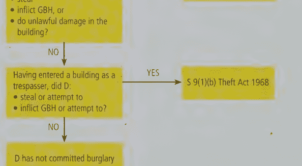

图11.4 实施入室盗窃罪的不同方式流程图

## 关键事实

| 要素 | 评注 | 案例/条款 |
|---|---|---|
| 进入 | 已从“有效且实质性的”进入改为“有效的”进入，改为由陪审团认定被告是否已进入。 | Collins (1972)
Brown (1985)
Ryan (1996) |
| 建筑物或建筑物的一部分 | 必须具有一定的永久性。
包括有人居住的车辆或船舶。
可以是进入建筑物的一部分。 | B and S v Leathley (1979)
Norfolk Constabulary v Seekings and Gould (1986)
《1968年盗窃罪法》第9(4)条
Walkington (1979) |
| 作为侵入者 | 如果被告获得许可，则其不是侵入者。
如果被告超出许可范围，则其可能是侵入者。 | Collins (1972)
Smith and Jones (1976) |
| 犯罪意图 | 被告必须知道或主观上轻率地对待其是否为侵入者
并且要么
在进入时意图实施：
盗窃或
严重身体伤害或
刑事毁损
要么
在一栋建筑内实施或企图实施这些罪行时，具备盗窃或严重身体伤害的犯罪意图。 | 《1968年盗窃罪法》第9(1)(a)条
《1968年盗窃罪法》第9(1)(b)条 |

图11.5 入室盗窃罪关键事实图

即他是否为侵入者。此外，对于第9(1)(a)条，被告在进入建筑物时必须有实施三种罪行之一的意图。如果被告进入时意图偷窃其能找到的任何值得拿走的东西，这被称为“附条件意图”。即使没有值得拿走的东西且他实际上没有偷窃任何东西，也足以使被告根据第9(1)(a)条获罪。

对于第9(1)(b)条，被告在实施（或试图实施）这些罪行之一的犯罪行为时，还必须具备盗窃或严重身体伤害的犯罪意图。

图11.4有助于确保你理解实施入室盗窃罪的不同方式。

## 11.3 抢劫罪和入室盗窃罪法律中的问题

### 11.3.1 抢劫罪中的盗窃要件

抢劫罪要求盗窃行为已经完成。然而，偷窃法律在抢劫罪中的适用方式与法院在盗窃案件中的适用方式有所不同。在盗窃案件中，法院认为“侵占”行为发生在一个时间点（见第10.1.3节）。

然而，在抢劫案件中，海尔案（1979）和洛克利案（1995）中，法院倾向于将“侵占”视为一种持续行为。在洛克利案中，被告在盗窃后使用武力逃跑。尽管盗窃的侵占行为发生在武力之前，上诉法院仍认定被告犯有抢劫罪。这与法院在盗窃案件中的处理方式相矛盾。

### 11.3.2 抢劫罪中的武力程度

盗窃必须已经完成，否则不构成抢劫。可以说，一个已经完成的盗窃并非必要。这将使法律与入室盗窃罪保持一致。在入室盗窃罪中，如果被告在作为侵入者进入的那一刻意图偷窃（或实施各种其他罪行），则根据第9(1)(a)条他有罪。同样，根据第9(1)(b)条，如果被告作为侵入者进入后企图偷窃，他也有罪。如果认为被告在意图或企图偷窃时就构成入室盗窃罪是公正的，那么似乎没有理由不将同样的规则适用于抢劫罪。为了使法律与入室盗窃罪保持一致，需要修改法律，规定如果一个人使用武力意图偷窃，或者为该目的使用武力企图偷窃，则其构成抢劫罪。

抢劫罪所要求的武力程度非常低。还有一个问题，在道森和詹姆斯案（1976）中，上诉法院认为“武力”是一个普通词语，是否使用了武力应由陪审团决定。在使用了较高程度武力的情形下，例如用枪指着受害者或对其进行殴打，判断是否使用了武力不太可能存在问题。问题出现在武力非常轻微的情况下，不同的陪审团可能就会否存在武力得出不同的决定。

事实上，一些关于武力程度的判决似乎与刑法修订委员会在提出该法律时的意图相矛盾。他们在报告中说，他们不会将“从一个不加抵抗的物主手中单纯抢夺财物，如抢走手提包，视为在[抢劫罪]的定义中使用武力，但如果物主抵抗，则可能构成使用武力”。尽管如此，法院……

## 活动

在以下每种情形中，说明是否发生了入室盗窃罪；如果发生了，它是否属于《1968年盗窃罪法》第9(1)(a)条或第9(1)(b)条规定的罪行。

1. 乔尼被禁止进入当地一家酒吧。一天晚上，他和一位朋友去那里喝酒。当他在吧台等朋友拿饮料时，乔尼看到一把椅子下面有一个手提包。他捡起手提包，从里面拿出一张10英镑的钞票，然后把包放回椅子下。

2. 肯和他的伴侣洛拉已经分手，肯搬出了他与洛拉合住的公寓，带走了大部分个人物品。一天晚上，他回去取剩余物品。洛拉不在家，他向邻居要备用钥匙，邻居把它留作紧急备用。当肯在整理衣服时，洛拉回来了。他们发生争执，肯殴打了洛拉，造成她重伤。

3. 尼亚沙在一家DIY商店做货架补货员。一天，当他正在把一包包电池放到货架上时，他将一包电池塞进口袋。他没打算付款。当天晚些时候，他看到经理离开办公室。尼亚沙走进去，从桌子上拿走了钱。办公室门上贴着“私人区域”的告示。

4. 奈杰拉是当地综合学校的学生。放学后，她在傍晚时分进入学校建筑。她打算破坏科学实验室，因为她讨厌那位老师。她通过窗户进入，但在造成任何破坏之前被管理员抓住了。

Clouden案（1987年）的上诉维持了对被告从受害人手中抢夺手提包的定罪。

## 11.3.3 入室盗窃中的意图

根据第9(1)(a)条和第9(1)(b)条，实施入室盗窃的不同方式之间存在不一致之处。根据第9(1)(a)条，被告在进入时必须有意图造成严重身体伤害、盗窃建筑物内的财物，或损坏建筑物或其内的任何物品。而根据第9(1)(b)条，则无需证明被告在进入时的意图，但必须表明其在进入建筑物后实施了盗窃（或企图盗窃）或造成了严重身体伤害（或企图造成）。

### 保护人身还是财产

第一点是，根据第9(1)(a)条，被告只需意图造成某种损坏（即使很轻微）即可构成犯罪。然而，就伤害他人而言，控方必须证明其意图造成严重身体伤害。这种差异似乎将财产的保护置于人身的保护之上。

### 第9(1)(a)条与第9(1)(b)条

然而，根据第9(1)(b)条，只有盗窃或造成严重身体伤害才会触发入室盗窃的必备要件。这样造成的结果是，根据第9(1)(a)条，被告作为侵入者进入建筑物并意图造成损坏的，构成入室盗窃罪；而根据第9(1)(b)条，被告作为侵入者进入建筑物时没有特定意图，进入后损坏建筑物或其他财产的，则不构成入室盗窃罪。

似乎没有理由不将损坏列为第9(1)(b)条的“触发”罪行之一。第9(1)(b)条的意义在于抓获机会型盗贼：即那些在进入后才决定偷窃或造成严重身体伤害的人。因此，将刑事损坏列为第9(1)(b)条下的“触发”罪行之一是合乎逻辑的。

这两个分条款之间的另一个比较是，证明第9(1)(b)条的入室盗窃比第9(1)(a)条更容易。这是因为对于第9(1)(a)条，必须证明被告的意图；而对于第9(1)(b)条，只需证明实施了某一“触发”罪行。证明事实比证明意图更容易。

### 附条件意图

如前所述，被告作为侵入者进入建筑物时，可依据其意图被认定犯有入室盗窃罪。法院将此解释为包括被告仅在发现值得偷窃的物品时才打算偷窃的情形，如Walkington案（1979年），该案中被告原本打算如果商店钱箱里有钱就偷走。这被称为附条件意图。可以说，基于附条件意图对既遂的入室盗窃罪定罪是不公正的。在其他情形下，附条件意图并不允许对完整罪行定罪。特别是在抢劫罪中，必须存在完成的盗窃行为，因为仅意图偷窃不足以构成该罪。

### 缺乏定义

1968年《盗窃法》未定义入室盗窃罪的关键要素。“进入”、“侵入者”或“建筑物的部分”均无定义。“建筑物”仅被扩展解释为包括有人居住的场所，如船屋和房车。除此之外再无其他“建筑物”定义。

缺乏定义意味着法院必须自行判断该法案意图涵盖的范围。这在某些案件中造成了困难，并导致裁判不一致，尤其是在“进入”的含义方面。

### 进入

关于“进入”的法律通过Collins案、Brown案和Ryan案发生了变化。在Collins案中，上诉法院明确指出必须构成“有效且实质性的进入”。然而，在*Brown*案中，上诉法院摒弃了“实质性”这一要素，并裁定*Brown*构成入室盗窃罪，因为其进入是“有效的”。

在*Ryan*案中，甚至“有效”进入的要求也被放弃。Ryan的定罪得以维持，理由是陪审团有证据可以认定被告已进入该房屋。

这些案件的裁判不一致，使法律处于不确定状态。如果《盗窃法》对“进入”给出了定义，这些问题或许可以避免。

### 建筑物

一般而言，“建筑物”的含义在案件中并未造成太多问题。只有在少数情况下，难以判断被告进入的场所是否属于建筑物。

主要问题出现在那些原本并非用作建筑物但后来被当作建筑物使用的场所。这在*B and S v Leathley*（1979年）和*Norfolk Constabulary v Seeking and Gould*（1986年）案中可见。从这两个案件来看，法院是否认定该场所为建筑物，将取决于案件的具体事实。这同样使法律处于不确定状态。

### 建筑物的部分

该法案使用此短语是因为在许多情况下，被告可以合法地处于建筑物的某个部分，但不能处于另一部分。大多数可能出现的情形都没有问题：例如，公寓楼的住户进入隔壁公寓并窃取财物，或有人进入明确标有“私人”或“员工专用”的房间。

唯一裁判值得批评的案件是*Walkington*案。该案将“建筑物的部分”扩展至一个三面有柜台、一面开放的区域。该区域没有墙壁或隔断将其与商店其余地面区域明确分隔。争议在于该区域由柜台界定得足够清晰，且柜台区域仅供员工使用。

问题之所以出现，是因为由于钱箱是空的，被告实际上没有偷到任何东西。这意味着他不能被指控盗窃。同时，当时的法律是：如果没有东西可偷，就不构成企图盗窃罪。

因此，Walkington当时也不可能构成企图盗窃罪。这意味着除非他能被指控入室盗窃，否则他不构成任何犯罪。然而，关于企图的法律已被1981年《刑事未遂法》修改，Walkington的行为如今会构成企图盗窃罪。因此，该裁判在今天实际上已无关紧要，因为现在可以用另一项、可以说更准确的罪名来指控此类行为。

### 侵入者

“侵入者”一词在法律上的最初使用源自民法。当《盗窃法》最初通过时，人们假定“侵入者”的含义与民法中相同，即未经建筑物合法占用人同意而进入。

然而，在*Collins*案中，上诉法院明确指出，所需的不止于此。被告必须“明知自己是侵入者，或对未经他人同意进入他人场所是否成立持轻率态度”。

这种明知自己侵入或对自己是否为侵入者持轻率态度的要素在刑法中十分重要。它是入室盗窃罪犯罪意图（*mens rea*）的一部分。

关于“侵入者”问题的主要争议出现在被告超越其获准进入建筑物的权限时。

### 超越许可权限

入室盗窃法中另一个可受批评的领域是，法官裁定本身并非侵入者的人，在超越给予他的许可权限后可能成为侵入者。在Smith and Jones案（1976年）中，上诉法院裁定，屋主的儿子在进入家中并偷走两台电视机时是侵入者，尽管父亲表示儿子在这所房子里不会被视为侵入者，因为他拥有一般进入许可。这一裁判可能意味着，参加他人住宅晚宴的客人如果未经邀请进入另一个房间（如卧室），也可能成为侵入者。如果随后在该房间内实施盗窃，则可能构成入室盗窃罪。

入室盗窃的概念最初是为了保护人们的住宅和其他建筑物免受意图（或实际）实施盗窃等行为的侵入者的侵害。没有必要将入室盗窃法扩展到包括获准留在屋内的人，即使他们超越了许可权限。像Smith and Jones案（1976年）中的小偷，仍然可以被指控盗窃。

这种超越许可权限的概念也被适用于商店扒手，理由是进入商店的许可仅限于正当购物目的。如果有人进入后实施盗窃，则可视为已超越进入时被给予的许可权限。

与Smith and Jones案一样，没有必要因此类行为指控入室盗窃罪。对此类行为明显且正确的指控是盗窃罪。

### 自测题

- 1. 使用判例或示例，解释就入室盗窃而言，“进入”的含义是什么。
- 2. 除建筑物外，1968年《盗窃法》明确规定某些其他场所就入室盗窃而言视为“建筑物”。这些场所是什么？
- 3. 法院认为，如果一个人超越了其进入建筑物的许可权限，则被视为侵入者。请使用一个判例或示例来说明发生这种情况的情形。
- 4. 根据1968年《盗窃法》第9(1)(a)条，如果一个人作为侵入者进入时意图在建筑物内实施以下三项罪行中的任何一项，即构成入室盗窃罪。这三项罪行是什么？
- 5. 根据第9(1)(b)条，如果被告作为侵入者进入建筑物后，实施或企图实施某些罪行，则可能构成入室盗窃罪。这些罪行是什么？
- 6. 简要解释抢劫罪法律中的两个问题。
- 7. 简要解释入室盗窃罪法律中的三个问题。

### 考题

约翰进入一家超市，打算偷一些食物。他在店里时注意到经理办公室的门开着。他走进去，希望能找到一些有价值的东西。房间里没有人，但正当他准备离开时，他注意到经理桌上有一个钱包。约翰拿起钱包，从里面抽出一张20英镑的纸币。经理苏看见他离开办公室并对他大喊。约翰把苏推开，跑出了商店。

针对上述情景中的事实，逐一评估陈述A、B、C和D的准确性。

陈述A：根据1968年《盗窃法》第9(1)(a)条，约翰犯有入室盗窃罪。

陈述B：根据1968年《盗窃法》第1条，约翰犯有盗窃罪。

陈述C：根据1968年《盗窃法》第8条，约翰犯有抢劫罪。

陈述D：根据1968年《盗窃法》第9(1)(b)条，约翰犯有入室盗窃罪。

（OCR，样题）

## 第12章
## 抗辩

当一个人被指控犯有某项罪行时，他可能有多种可用的抗辩理由。有些抗辩可适用于任何罪行；其他抗辩则只能适用于某些罪行。通常情况下，如果抗辩成功，被告将被判无罪并获得自由。例外情况是精神失常抗辩，此时法院会作出“因精神失常而无罪”的特别裁决。

可用的抗辩有多种。图12.1（见下一页）展示了这些抗辩，以及使用这些抗辩时的限制。

| 抗辩 | 适用范围 | 限制 |
|---|---|---|
| 精神失常 | 所有要求具备犯罪主观要件的罪行。 | 不适用于不要求具备主观心理要件的严格责任罪。 |
| 自动行为 | 所有罪行。 | 如果自动状态是被告通过饮酒或吸毒自行导致的，则不适用于基本故意罪。 |
| 醉态 | 特定故意罪，包括谋杀、《1861年侵害人身罪法》第18条规定的罪行，以及在醉态导致被告无法形成所要求的犯罪主观要件时的盗窃罪。 | 不适用于基本故意罪、过失杀人、《侵害人身罪法》第20条和第47条规定的罪行、袭击和殴打。 |
| 胁迫 | 大多数罪行。 | 不适用于谋杀、谋杀未遂，或者可能不适用于叛国罪。 |
| 必要性 | 可能适用于所有罪行，包括谋杀。 | 但是，该抗辩极少成功。 |

*图12.1 抗辩的适用范围*

### 12.1 精神失常

**12.1.1 《麦克诺顿规则》**

关于精神失常的规则以《麦克诺顿规则》（1843年）为基础。

**麦克诺顿案（1843年）**

D患有严重的偏执症。他认为自己正受到“托利党”（当时的政府）的迫害。他试图杀害政府成员罗伯特·皮尔爵士，但误杀了皮尔的秘书。由于其精神状态，D被判谋杀罪无罪。事实上，他因精神状态被送入精神病院，但这并不是该裁决的结果。D可以被判无罪且不必被送入精神病院这一事实引发了公众强烈抗议，促使上议院的法官回答一系列问题，以便明确有关精神失常的法律。对这些问题的回答形成了如今法律案件中所适用的精神失常规则。

上议院在麦克诺顿案（1843年）中给出的答复确立了精神失常规则。其主要规则是：

> “在所有案件中，每个人都被推定为神志正常，并具有足够程度的理智，从而应对自己的罪行负责。”

要确立精神失常抗辩，上议院给出了以下定义，说明被告若想使精神失常抗辩成功，必须证明其在实施行为时处于何种状态。

**定义：精神失常**

> 被告必须“因精神疾病而存在如此程度的理智缺陷，以至于不知道自己所实施行为的性质和后果；或者即使知道该行为的性质和后果，也不知道自己正在实施错误的行为”。

由此可见，需要证明三个要素。这些要素是：

1. 理智存在缺陷；
2. 该缺陷必须是精神疾病造成的；
3. 该缺陷导致被告不知道其行为的性质和后果，或者不知道自己正在实施错误的行为。

证明精神失常的举证责任在抗辩方，抗辩方必须按照优势证据标准证明精神失常。如果被告被认定为精神失常，裁决为“因精神失常而无罪”。

过去人们认为，精神失常可以作为对所有罪行的抗辩。然而，在DPP诉H案（1997年）中，被告被控酒精含量超标驾驶，法院裁定，精神失常不能作为严格责任罪的抗辩，因为严格责任罪不要求具备主观心理要件。

**12.1.2 理智缺陷**

这意味着被告的推理能力必须受到损害。如果被告具有推理能力，只是没有运用这些能力，那么这不构成理智缺陷。Clarke案（1972年）对此作出了裁定：理智缺陷必须超出心不在焉或思维混乱的程度。

**Clarke案（1972年）**

D走进一家超市，拿起三件商品，其中包括一罐肉馅，随后将它们放进自己的袋子里，未付款便离开了商店。她被控盗窃，但在抗辩中主张自己缺乏盗窃罪所要求的犯罪主观要件，因为她不记得曾将这些商品放进袋子里。事实上，她甚至并不想要那罐肉馅，因为她和丈夫都不吃肉馅。她说自己因糖尿病和抑郁症而心不在焉。审判法官裁定，这构成精神失常抗辩，因此她随后承认盗窃罪，但针对该裁定提起上诉。

上诉法院撤销了定罪。法院认为，《麦克诺顿规则》中的“理智缺陷”一词仅适用于“因‘精神疾病’而丧失推理能力的人”。上诉法院还指出，精神失常规则不适用于仅仅偶尔出现思维混乱或心不在焉的人。

**12.1.3 精神疾病**

理智缺陷必须是由精神疾病造成的。这是一个法律术语，而非医学术语。该疾病可以是精神疾病，也可以是影响心智的身体疾病。Kemp案（1956年）就是一个例子。

**Kemp案（1956年）**

D患有动脉硬化，导致脑部供血出现问题。这使D偶尔会暂时失去意识。在其中一次意识丧失期间，他用锤子袭击妻子，造成妻子严重受伤。他被控根据《1861年侵害人身罪法》第20条实施严重身体伤害罪。

审判期间，法院需要判断这种病情是否属于精神失常规则的适用范围。D承认自己存在“理智缺陷”，但称该缺陷并非由“精神疾病”造成，因为导致问题的是身体疾病而不是精神疾病。D被裁决“因精神失常而无罪”，随后针对该裁决提起上诉。上诉法院维持了该裁决，并指出法律关注的不是大脑，而是心智。Kemp的正常理智、记忆和理解能力受到影响，因此他的病情属于精神失常规则的适用范围。

在Sullivan案（1984年）中，上议院被要求裁定癫痫是否属于精神失常规则的适用范围。

**Sullivan案（1984年）**

D现年51岁，自幼患有癫痫。他已知会发作，并且在发作期间会对试图帮助他的人表现出攻击性。在一次友好拜访邻居公寓时，他使一名80岁的男子受伤。审判法官裁定，根据案件事实，他将指示陪审团作出“因精神失常而无罪”的裁决。因此，D承认犯有造成实际身体伤害的袭击罪（《侵害人身罪法》第47条）。随后，D提起上诉。上诉法院和上议院均确认了该定罪。

上议院裁定，疾病的来源无关紧要。疾病可以是“器质性的，例如癫痫，也可以是功能性的”；同样，只要被告实施行为时该损害确实存在，损害是“永久性的，还是暂时性、间歇性的”也并不重要。

这一裁决意味着，就《麦克诺顿规则》而言，疾病可以发生在身体的任何部位，只要其对心智产生影响即可。在Hennessy案（1989年）中，由糖尿病导致的高血糖水平被归类为精神失常，因为血糖水平会影响心智。

**Hennessy案（1989年）**

D患有糖尿病，连续三天未注射胰岛素。有人看到他进入一辆被报告为失窃的汽车并将车开走。他被控未经同意取得机动车以及在被吊销驾驶资格期间驾驶。他不记得自己取得或驾驶过该汽车。法官裁定，根据这些事实，D提出的是精神失常抗辩，而不是被告希望使用的非精神失常自动行为抗辩（见下文第12.2节）。随后，D选择认罪，而不是接受“因精神失常而无罪”的裁决。他以自己本应获准提出非精神失常自动行为抗辩为由提起上诉。

上诉法院认为，正确的辩护应是精神错乱，因为糖尿病这一疾病影响了他的心智。因此，糖尿病被纳入了精神错乱的定义范围：

另一个认定正确辩护为精神错乱的案例是Burgess案（1991年）。在该案中，法院判定，在某些情况下，梦游属于法律上精神错乱的定义范围。

### Burgess案（1991年）
D和他的女朋友一直在看录像。他们睡着了，D在睡梦中袭击了女孩。没有任何证据表明梦游有外部原因，庭审中一名医生作证称，在此案中梦游是由内部原因造成的：一种睡眠障碍。法官裁定这属于精神错乱的证据，被告被裁定“因精神错乱而无罪”。上诉法院维持了这一裁定。

然而，如果梦游是由外部原因引起的，例如头部受到撞击，那么这就不属于精神错乱，但允许被告以自动症进行辩护（见第12.2节）。

### 外部因素
如果被告处于不知道自己行为的状态，其原因是疾病以外的外部原因，则这不属于精神错乱。

### Quick案（1973年）
D是一名糖尿病患者，他服用了胰岛素，但之后没有吃足够的食物。这导致血糖水平过低，可能影响大脑。在这种状态下，D（精神病院的一名护士）袭击了一名病人。上诉法院裁定，他的状况不属于精神错乱的定义范围。该状况是由外部因素引起的，在本案中是药物胰岛素。这意味着D可以依据自动症进行辩护（见第12.2节），并有权被无罪释放。

Hennessy案（1989年）和Quick案（1973年）的判决突显了法律上的问题。糖尿病患者可能进入一种无意识状态，在那种状态下他们不知道自己在做什么。这种状态可能由以下原因引起：
- 疾病本身，导致血糖水平过高（高血糖症），或
- 用于控制血糖水平的药物胰岛素。如果服用胰岛素后D没有进食，血糖水平会变得过低（低血糖症）。

如果是疾病导致无意识状态，那么如Hennessy案（1989年）所示，被告被认为属于精神错乱规则的范围，因为这是内部原因。如果是药物导致无意识状态，那么如Quick案（1973年）所示，他们不属于精神错乱规则的范围，但可以依据自动症进行辩护。

将糖尿病这样的身体疾病归类为精神错乱似乎很荒谬，但更荒谬的是，糖尿病患者必须根据导致无意识状态的是药物还是疾病本身，来依赖不同的可用辩护。

## 12.1.4 不知道行为的性质和内容
性质和内容指的是行为的物理特征。被告可能不知道行为的性质和内容，有两种情形：
- 因为他处于无意识或意识受损的状态，或
- 当他有意识，但由于精神状况而不理解或不知道自己在做什么。

如果被告能够证明在实施行为时他处于其中任一状态，那么他就满足了麦克纳顿规则的这一部分。

一个不知道行为性质和内容的例子是，一名护士把婴儿扔进火里，以为那是一块木头。

如果被告知道行为的性质和内容，但仍然可以使用精神错乱辩护，前提是他不知道自己的行为是错误的。在这里，“错误”指的是法律上的错误，而非道德上的错误。如果被告知道行为的性质和内容，并且知道这在法律上是错误的，他就不能使用精神错乱辩护。即使被告患有精神疾病也是如此。

### Windle案（1952年）
> D的妻子经常说要自杀。一天，被告给她服用了100片阿司匹林，将她杀害。他向警方自首并说：“我想他们会为此绞死我。”他患有精神疾病，但这些话表明他知道自己所做的事在法律上是错误的。因此，他不能使用精神错乱辩护，被判犯有谋杀罪。

请注意，该案发生在1952年，当时针对谋杀指控的减轻责任特别辩护尚不存在。这一辩护直到1957年才设立，因此Windle无法使用它。Windle案在较近的Johnson案（2007年）中得到了遵循。

### Johnson案（2007年）
> D强行闯入邻居的公寓并刺伤了他。D被控故意伤害罪（1861年《侵犯人身罪法》第20条）。在庭审中，两名精神科医生作证称，他患有偏执型精神分裂症并出现幻觉。然而，两人都同意，尽管如此，D知道其行为的性质和内容，并且知道这些行为在法律上是错误的。其中一位精神科医生认为，D并不认为自己在道德意义上做错了。法官裁定，D不能使用精神错乱辩护，D被判犯有故意伤害罪。

> 上诉法院维持了法官的裁定，即D不能使用精神错乱辩护，因为他知道其行为的性质和内容，并且知道这些行为在法律上是错误的。他们遵循了Windle案（1952年）的判决，该判决认为“错误”一词指的是知道该行为违反法律。

在Johnson案的判决中，上诉法院指出，曾有一个澳大利亚案件，澳大利亚法院拒绝遵循Windle案（1952年）。澳大利亚法院的观点是，如果被告根据普通理性人的一般标准认为自己的行为是正确的，那么即使他知道这在法律上是错误的，他也有权被宣告无罪。

上诉法院认为他们有义务遵循Windle案（1952年），但他们确实表达了这样的观点：澳大利亚案件包含了“具有启发性的段落，指出了如果Windle案的判决是正确的，那么适用麦克纳顿规则可能产生的困难和内部不一致之处”。

## 12.1.5 特别裁决
当被告成功证明精神错乱时，陪审团必须作出“因精神错乱而无罪”的裁决。直到1991年，无论精神错乱的原因或所犯罪行如何，法官都必须将被告送往精神病院。这显然不适用于被告患有糖尿病、癫痫或动脉硬化的案件。因此，1991年通过了《刑事诉讼法（精神错乱和不适合答辩）法》，以扩大法官的选择范围。

法官现在可以作出以下命令：
- 住院令（可以附带或不附带关于被告何时可以获释的限制）
- 监管令
- 无条件释放。

如果被告被控谋杀罪，则法官必须作出无限期住院令。

这意味着，只有在内政大臣同意的情况下，医院才能让被告出院。

## 12.1.6 对精神错乱法律的评述
第一个主要问题在于，精神错乱的定义是由1843年的麦克纳顿规则确立的。当时关于精神障碍的医学知识非常有限。如今人们对精神障碍的了解要多得多，应当采用更现代的定义。

该定义需要根据现代对精神疾病的理解进行更新。议会唯一进行改革的领域，是法官在处理因精神错乱而被判无罪者时可以选择的方式。

至少，这一更广泛的选择范围结束了癫痫患者和糖尿病患者不得不被送往精神病院的不公正。在1991年《刑事诉讼法（精神错乱和不适合答辩）法》之前，法官唯一可采取的做法是将被告送往精神病院。现在，法官可以改为对被告发出监管令或给予无条件释放。

### 精神错乱的法律定义
另一个主要问题在于，该定义已经变成了法律定义而非医学定义。这造成了两个问题。
- 1. 患有某些精神障碍的人不被纳入该定义，例如那些患有不可抗拒冲动且属于精神病态者，如Byrne案（1960年）。他们不属于麦克纳顿规则的范围，因为他们知道自己在做什么以及那是错误的。然而，他们无法阻止自己采取行动，并且患有公认的精神障碍。
- 2. 另一方面，患有糖尿病（Hennessy案（1989年））、脑肿瘤或动脉硬化（Kemp案（1957年））等身体疾病的人，却被视为法律上的精神错乱者。甚至梦游者也被纳入该定义（Burgess案（1991年））。其理由是，他们的行为有内部原因：该行为可能再次发生，并且有可能进行治疗。

### 与自动症的重叠
精神错乱与自动症存在重叠。有必要判断被告的无意识状态是由精神疾病还是外部因素造成的。法院已裁定，患有任何影响心智或使其进入无意识状态的疾病（无论是精神疾病还是身体疾病）都构成精神错乱。这意味着，非精神错乱性自动症辩护已不再适用于癫痫患者和糖尿病患者等人。

这会产生严重后果，因为成功使用自动症辩护的人有权获得完全无罪释放。而如果因精神错乱被判无罪，法官则必须对被告作出某种命令。

有人可能会认为，法院不愿允许被告使用完整的自动症辩护，是因为这将导致无罪释放，被告将不受任何命令或监管的约束。还有一种论点认为，即使异常行为的原因可能是身体疾病，此人仍有可能犯下更多罪行。将精神错乱的范围扩大到那些因身体疾病而犯罪的人，意味着这些人可以得到监管。

### Windle案（1952年）的判决
遵循Windle案（1952年）的判决，患有严重公认精神疾病且不知道其行为在道德上是错误的被告，如果知道其行为在法律上是错误的，则不能以精神错乱作为辩护。一个澳大利亚案件拒绝遵循该判决。在Johnson案（2007年）中，上诉法院显然认为澳大利亚案件有一定道理，但他们有义务遵循Windle案。

## 关键事实

| 定义 | 法律要件 | 案例 |
|---|---|---|
| **定义** | D必须因心智疾病而存在理智缺陷； 并且 要么不知道其行为的性质和品质，要么不知道自己行为的错误性。 | *M’Naghten（1843年）* |
| **理智缺陷** | D的推理能力必须受到损害。 单纯的心不在焉不够。 | *Clarke（1972年）* |
| **心智疾病** | 这是一个法律术语，而非医学术语。 必须存在内在原因。 不必是永久性的；可以是“短暂且间歇性的”。 外部原因不足够。 | *Kemp（1956年）* *Sullivan（1984年）* *Quick（1973年）* |
| **不知道行为的性质和品质** **或者** **不知道自己行为的错误性** | 这意味着D必须不知道其在法律上是错误的：如果他知道，就不能依赖精神错乱辩护。 | *Windle（1952年）* *Johnson（2007年）* |
| **特别裁决** | 因精神错乱而无罪。 法官可以施加： - 住院令 - 监护令 - 监督和治疗令 - 无条件释放。 | 1991年《刑事诉讼法（精神错乱和无能力答辩）法》 |

图12.2 关于精神错乱的关键事实图表

## 社会污名

即使是“精神错乱”一词本身也是不妥的。它带有社会污名。将其用于患有精神障碍的人已经够糟糕了，但将其用于患有癫痫或糖尿病等疾病的人则完全不合适。

还有一点是，陪审团需要决定被告是否精神错乱。这不是陪审团的适当职能。这是一个应由医学专家决定的事项。在存在争议的情况下，陪审团必须听取医学证据，并努力理解技术性强且复杂的精神病学问题。

## 精神错乱的证明

被告必须证明自己精神错乱。这使举证责任落在他身上。这可能违反了《欧洲人权公约》第6条，该条规定被告在未被证明有罪之前是无辜的。

## 陪审团的角色

由于陪审员必须决定是否应作出因精神错乱而无罪的裁决，这意味着没有医学知识的普通人必须做出实际上属于医疗决定的事情。这意味着陪审员可能会因精神病医学的技术术语而对医学证据感到困惑。

还有一种可能性是，陪审员可能对犯罪者所犯下的罪行感到极度厌恶，以至于拒绝作出因精神错乱而无罪的裁决。尤其是在谋杀案件中，陪审员可能无视医学证据，不作出特别裁决，而是判定被告犯有谋杀罪。

这种情况实际上发生在1981年彼得·萨克利夫（约克郡开膛手）的案件中，当时被告被指控谋杀多名女性。所有提供证据的医生都一致认为被告患有偏执型精神分裂症，这是一种公认的严重精神疾病。尽管如此，陪审团仍裁定萨克利夫犯有谋杀罪。

## 与减轻责任的交叉

自1957年以来，对于被控谋杀的精神疾病被告，存在一种替代辩护理由，即减轻责任。如果该辩护成功，谋杀指控将减为过失杀人。

## 关键案例

| 案例 | 事实 | 法律 |
|---|---|---|
| *M'Naghten*（1843年） | 患有偏执症，枪杀了罗伯特·皮尔爵士的秘书。被宣告无罪，但上议院被要求澄清关于精神错乱的法律。 | D必须因心智疾病而存在理智缺陷；并且要么不知道其行为的性质和品质，要么不知道自己行为的错误性。 |
| *Clarke*（1972年） | 心不在焉地从超市拿走物品。 | 单纯的心不在焉或困惑不属于精神错乱。 |
| *Kemp*（1956年） | 患有动脉硬化，导致昏迷。 | 属于精神错乱规则的范畴，因为他的状况影响了他的心智推理、记忆和理解能力。 |
| *Sullivan*（1984年） | 在癫痫发作时伤害了朋友。 | 精神错乱包括任何器质性或功能性疾病。即使病情是暂时的，也同样适用。 |
| *Hennessy*（1989年） | 患有糖尿病，在未服用胰岛素后开走了汽车。 | 如果疾病影响心智，则属于精神错乱的定义范围。 |
| *Burgess*（1991年） | 在睡眠中伤害了他的女友。 | 如果梦游的原因是内在的，则属于精神错乱定义范围内的疾病。 |
| *Quick*（1973年） | 患有糖尿病，在服用胰岛素后未进食。 | 这是外部原因（药物的影响），因此不属于精神错乱。 |
| *Windle*（1952年） | 患有精神障碍，杀死了不断提到要自杀的妻子。 | 因为他知道自己的行为在法律上是错误的，根据*M'Naghten*规则，他不属于精神错乱。 |
| *Johnson*（2007年） | D患有偏执型精神分裂症并出现幻觉，刺伤了邻居。 | 因为他知道自己的行为在法律上是错误的，根据*M'Naghten*规则，他不属于精神错乱。 |

图12.3 关于精神错乱的关键案例

这使法官拥有更广泛的量刑选择范围。

减轻责任涵盖的精神疾病范围比精神错乱更广。它比精神错乱更有可能被用作谋杀指控的辩护理由。在20世纪90年代，平均每年约有50起案件被告成功依赖减轻责任辩护。相比之下，平均每年只有约五起案件被告依赖精神错乱辩护。

这些数据表明，对于谋杀罪而言，精神错乱作为一种辩护并不特别重要。有一种更好的替代方案，且不带精神错乱的社会污名。

有趣的是，在过去九到十年中，这两种辩护的使用率都有所下降。每年只有约20起案件被告依赖减轻责任，只有一两起案件辩护方依赖精神错乱辩护。

## 12.1.7 改革建议

关于精神错乱法律的改革已有几项建议。1953年，皇家死刑委员会建议扩展M'Naghten规则，使被告如果“无力阻止自己”实施犯罪，则被视为精神错乱。如果这一建议被采纳，那么患有“不可抗拒冲动”的人将被纳入精神错乱的定义范围。

然而，政府没有实施这项改革，而是引入了减轻责任辩护。这为被控谋杀的人提供了一种特殊辩护（见第7.1节）。它不适用于任何其他罪行，但法官对所有其他罪行都有量刑裁量权。

1975年，巴特勒委员会建议将“因精神错乱而无罪”的裁决替换为“基于精神障碍证据而无罪”的裁决。

1989年，法律委员会的《刑法草案》提出，被告在存在严重精神障碍或严重精神缺陷证据时应被判无罪。

这些建议均未成为法律。然而，法官在被告因精神错乱而被判无罪后处理被告方式的改变，已经改善了情况。如第12.1.5节所述，法官现在可以作出监督和治疗令，甚至在合适的情况下给予无条件释放。

## 自测问题

- 1. 哪些规则规定了精神错乱作为刑事指控辩护的法律？
- 2. 被告必须证明什么才能确立精神错乱辩护？
- 3. 对于哪些类型的罪行，精神错乱不能作为辩护理由？
- 4. 精神错乱的定义包含“心智疾病”这一短语。举出三个被认定符合精神错乱法律定义的不同疾病的案例或例子。
- 5. 外部原因能否导致精神错乱作为刑事指控的辩护？
- 6. 被告可能在哪些方面不“知道其行为的性质和品质”？
- 7. Windle（1952年）和Johnson（2007年）案判决了什么？
- 8. 如果精神错乱辩护成功，会作出什么裁决，法官对被告有何权力？
- 9. 精神错乱法律的一个问题在于其可能适用于糖尿病患者。解释该辩护在何种情况下对糖尿病患者可用，在何种情况下不可用。
- 10. 解释精神错乱辩护的另外两个问题。

## 12.2 自动症

在 Bratty 诉北爱尔兰总检察长（1963）一案中，“自动症”得到了明确界定。

### 定义

### 自动症

由肌肉完成的、不受意识控制的行为，如痉挛、反射动作或抽搐；或者行为人在不清醒状态下实施的行为，例如在脑震荡或梦游期间实施的行为。

事实上，这一定义涵盖两类自动症：

- 1. **精神错乱自动症**
- 这是指自动症的原因是麦克纳顿规则范围内的精神疾病。在这种情况下，辩护理由是精神错乱，裁决为因精神错乱而无罪。关于精神错乱的法律见本章第12.1节。
- 2. **非精神错乱自动症**
- 这是指自动症的原因是外部原因。如果此类辩护成功，即为完全辩护，被告无罪。

## 12.2.1 非精神错乱自动症

这是一种辩护理由，因为被告实施的犯罪行为（actus reus）并非自愿。此外，被告也不具备该犯罪所要求的犯罪意图（mens rea）。

自动症的原因必须是外部原因。外部原因的例子包括：

- 头部受到打击
- 遭到一群蜜蜂的攻击
- 打喷嚏
- 催眠
- 药物的作用

被告因外部原因而处于自动状态时无过错，这一概念在 Hill 诉 Baxter（1958）一案中得到了认可。

### Hill 诉 Baxter（1958）

被告驾车驶过停车标志时没有停车，与另一辆汽车相撞。他被控危险驾驶，但治安法官接受了他对到达停车标志前一段距离内发生的事情毫无记忆的说法，因而宣告他无罪。高等法院分庭准许了控方的上诉，并将案件发回治安法官，指示其作出定罪判决，因为没有任何证据支持自动症辩护。

法院认可了更早的 Kay 诉 Butterworth（1945）一案中的判决，该案法官指出：

> “一个人如果并非因自身过错而在驾驶时失去意识，不应承担刑事责任，例如被石头击中、突发疾病，或因遭一群蜜蜂攻击而暂时失去对车辆的控制。”

在 T（1990）一案中，法院接受异常压力可以构成引发自动症的外部因素。

### T（1990）

被告遭到强奸。三天后，她参与了一起抢劫和一起袭击。她声称自己当时因强奸而患有创伤后应激障碍，并且是在一种梦境般的状态下行动的。初审法官允许将自动症辩护交由陪审团审理，但被告仍被定罪。

对自身行为的控制减弱或仅部分控制，不足以构成非精神错乱自动症。在总检察长参考意见（1992年第2号）（1993）中，上诉法院认定必须“完全丧失自愿控制”。

### 总检察长参考意见（1992年第2号）（1993）

被告是一名货车司机，在连续驾驶数小时后，沿高速公路硬路肩行驶了约半英里。他撞上了一辆停在硬路肩上的故障车，导致两人死亡。他说自己当时患有“无意识驾驶”状态，这种状态会使司机陷入类似恍惚的情形；它可能是由在高速公路上长途驾驶引起的。陪审团宣告他无罪。总检察长将该法律问题提交上诉法院，上诉法院裁定，由于该状态仅导致部分失去控制，不构成自动症。

### 特定意图犯罪

如果被指控的犯罪属于特定意图犯罪，那么自我引发的自动症可以作为一种辩护理由。这是因为被告不具备该犯罪所要求的犯罪意图。

## 12.2.2 自我引发的自动症

这是指被告知道自己的行为很可能导致自动状态。例如，糖尿病患者知道在注射胰岛素后不进食会带来的风险；或者一个人服用了药物后仍然饮酒，而医生曾告知他服药期间不得饮酒。这一法律规则源自 Bailey（1983）一案。

### 基本意图犯罪

如果被指控的犯罪属于基本意图犯罪，法律规则则更为复杂。主要规则是，如果被告因轻率而导致自动状态，则不能使用自动症辩护。Bailey（1983）一案确立的法律规则如下：

### Bailey（1983）

被告是一名糖尿病患者，在注射胰岛素控制糖尿病后没有摄入足够的食物。他变得具有攻击性，并用铁棒击打了某人的头部。初审法官裁定不能使用自动症辩护。上诉法院认为该裁定错误，但维持了对被告的定罪，因为本案中缺乏足够的证据来提出自动症辩护。

- 1. 如果被告在陷入自动状态时具有轻率心态，自我引发的自动症不能作为辩护理由。主观轻率足以构成基本意图犯罪的犯罪意图。
- 2. 如果自我引发的自动状态是由酒精、非法药物或其他致醉物质引起的，则被告不能使用自动症辩护。这是因为 DPP 诉 Majewski（1977）一案判定，自愿醉酒属于一种轻率行为（见第12.3节）。
- 3. 如果被告不知道自己的行为可能导致一种自我引发的自动状态，并在此状态下可能实施犯罪，则他并不具有轻率心态，可以使用自动症辩护。

第三种情况见 Hardie（1984）一案。

尽管 Bailey 一案中的上诉被驳回，上诉法院仍列出了关于自我引发的自动症的规则。第一点是，该辩护在特定意图犯罪和基本意图犯罪中的适用方式存在差异。

### Hardie（1984）

被告因女友让他搬离公寓而情绪低落。他服用了前女友处方的安定片。她劝他服用，说这能让他平静下来。之后他在公寓里点燃了一个衣柜。他说因为服用了安定片，他不知道自己当时的所作所为。初审法官指示陪审团忽略药片的作用，他被判纵火罪。

上诉法院撤销了他的定罪，因为被告服用该药物是以为它会让他平静下来，而这正是安定片的正常效果。因此，被告并不具有轻率心态，自动症辩护本应交由陪审团审理。

## 12.2.3 关于自动症法律的评论

主要问题在于，每个案件都必须判断该情形属于精神错乱自动症还是非精神错乱自动症。这一点非常重要，因为这两类自动症作为辩护理由所产生的效果截然不同。

在一些非法律人士看来属于非精神错乱自动症的情形，例如糖尿病患者处于高血糖状态，或者某人梦游，在法律上却可能被视为精神错乱自动症。

## 12.2.4 自动症法律改革建议

在《刑法典草案》（1989年）中，提出了以下定义：

> “一个人不构成犯罪，如果——
> 1. 他在自动状态中实施了行为，即其行为
> 2. 是反射、痉挛或抽搐；或者
> 3. 发生在他处于某种状态（无论是睡眠、无意识、意识受损或其他状态）而使其丧失对行为的有效控制时；并且
> 4. 该行为或状态既非因该罪所要求的过错而作出或遗漏的结果，也不是自愿醉酒的结果。”

该定义将涵盖在癫痫抽搐期间实施行为的人，因此像 Sullivan（1984）这样的案件将能够使用非精神错乱自动症这一辩护理由，而不是精神错乱辩护。这将是对法律的一项受欢迎的改进。

此外，梦游情形也将属于该辩护的范围。这将使 Burgess（1991）案获得非精神错乱自动症的辩护。根据现行法律，他因精神错乱而被判无罪。在这两个案件中，根据改革建议，被告都将获得完全辩护。

另一方面，现行制度允许法官对因精神错乱而被判无罪的人下令进行治疗。对于在自动状态下实施危险罪行且将从治疗中受益的人，是否应该有某种方式确保他们确实得到治疗？可以说，完全无罪释放会使一个可能危险的人（尽管不是故意的）再次实施同样的行为。

### 自测题

- 1. 什么是自动症的定义？
- 2. 精神错乱自动症与非精神错乱自动症有什么区别？
- 3. 举出三个可能导致非精神错乱自动症辩护成功的不同外部原因的案件或例子。
- 4. 当非精神错乱自动症是自我引发时，该辩护有什么限制？
- 5. 举出一个自我引发的自动症被允许作为辩护理由的案件。
- 6. 如果《刑法典草案》已经成为法律，它对一个人在癫痫发作期间实施犯罪行为（actus reus）时所能使用的辩护会产生什么影响？
- 7. 有什么论据支持限制非精神错乱自动症辩护？

## 活动

阅读以下报纸文章摘录并回答下面的问题。

### 强奸审判陪审团接受梦游抗辩

> '一名被指控在数分钟内三次强奸女友的男子在声称自己当时在梦游后昨日被判无罪。
> 
> 在听取了他不同寻常的抗辩后，陪审团用了不到三个小时就判定他对三项强奸指控无罪。
> 
> 约克王室法院听取了案件情况，他在与朋友外出夜玩后回到公寓，让22岁的女友睡在他的床上。
> 
> 他在沙发上睡着了，并坚持说他醒来时“受害者”正在离开公寓的下一刻。他声称自己睡着了，醒来时发现他正在与她发生性关系。
> 
> 他在 alleged 强奸期间一言不发，事后爬过她身旁回到沙发上。
> 
> 他说他不能否认与该女子发生了性关系，但对自己所做的事情没有任何记忆。
> 
> 他告诉警方，他从13岁起就患有梦游症，且家族有此病史。“这是我能想到的唯一解释，”他说。'
> 
> （《每日邮报》，2005年12月20日）

### 问题

- 1. 被告在梦游时实施行为时可能使用哪两种抗辩？
- 2. 如果这些抗辩成功，陪审团会作出什么裁决？
- 3. 在本文案例中，被告被判无罪。他主张的是这两种抗辩中的哪一种？
- 4. 引用一个关于此抗辩的已决案例。
- 5. 解释该抗辩如何运作。

| 精神错乱 | 自动行为 |
|---|---|
| 由辩方证明，达到盖然性平衡标准。 | 由被告提出，检方必须随后予以反驳。 |
| 必须因精神疾病导致理智缺陷：M'Naghten规则。例：因疾病影响的糖尿病患者：Hennessey（1989）。 | 必须由外部因素导致。例：因（药物）胰岛素影响的糖尿病患者：Quick（1973）。 |
| 裁决：因精神错乱而无罪。法官必须作出以下四种命令之一：- 收容令（附带或不附带关于被告可获释时间的限制）- 监护令 - 监督与治疗令 - 绝对释放。 | 裁决：无罪。被告自由。 |

图12.4 精神错乱与自动行为作为抗辩的比较

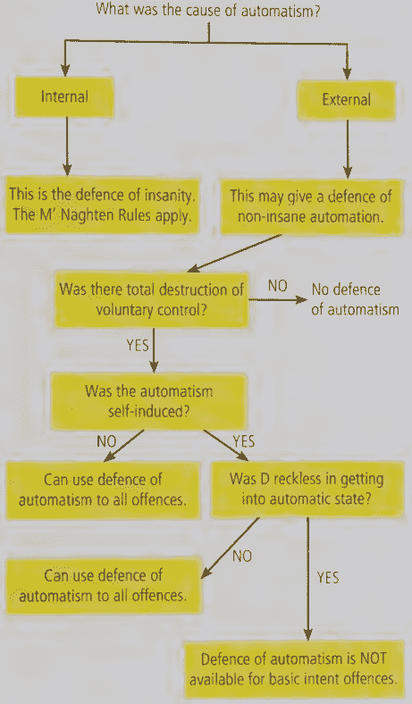

## 12.3 醉酒

这涵盖了由酒精、药物或其他物质（如嗅胶水）导致的醉酒。醉酒本身并不构成抗辩，但与被告是否具有该罪所需的*犯罪意图*有关。如果他因醉酒状态而没有所需的*犯罪意图*，他可能被判无罪。

被告是否有罪取决于：

- 1. 醉酒是自愿的还是非自愿的，以及
- 2. 所控罪行是特定意图还是基本意图。

特定意图犯罪一般是指其*犯罪意图*需要特定意图的犯罪。OCR A2大纲中的特定意图犯罪为谋杀、1861年《人身伤害法》第18条、盗窃、抢劫和入室盗窃。

基本意图犯罪一般是指鲁莽足以构成其*犯罪意图*的犯罪。OCR A2大纲中的基本意图犯罪为误杀、1861年《人身伤害法》第20条和第47条、袭击和殴打。

### 12.3.1 自愿醉酒

自愿醉酒是指被告选择摄入使人 intoxicated 的物质。这可以通过饮酒、非法药物或其他 intoxicants 如嗅胶水来实现。当被告知道处方药的效果会使他 intoxicated 时也会发生这种情况。

### 自愿醉酒与特定意图犯罪

自愿醉酒可以否定特定意图犯罪的*犯罪意图*。如果被告醉酒到无法形成该罪的*犯罪意图*，他无罪。该规则来自*DPP v Beard*（1920）。

> **DPP v Beard (1920)**
> 
> Beard 因谋杀被起诉，并以自己醉酒到无法形成谋杀的*犯罪意图*作为抗辩。他被定罪，但在上诉中，伯肯黑德勋爵考虑了之前的判决并指出：
> 
> “当特定意图是犯罪的必要要素时，证明被告处于醉酒状态而无法形成此类意图的证据应被考虑，以确定他是否事实上形成了构成特定犯罪所需的意图”。

### 12.3.2 非自愿醉酒

非自愿醉酒涵盖被告不知道自己正在摄入使人 intoxicated 物质的情况。例如，无糖饮料被“掺入”酒精或药物。它还涵盖处方药产生意外使被告 intoxicated 的情况。

测试是，被告在犯罪时是否具有必要的犯罪意图？如果是，Kingston（1994）案已裁定他将有罪。非自愿醉酒不会提供抗辩。即使被告若非因醉酒降低其抗拒犯罪的抵抗力也不会犯下该罪，也如此。

> Lord Birkenhead 然后陈述了至今仍然有效的规则：
> 
> '如果他醉到无法形成所需意图，就不能被定罪一项只有在证明意图时才构成的犯罪。'

一个例子是 Sheehan and Moore（1975）。被告当时非常醉酒，他们向一个流浪汉泼汽油并点燃他。他们醉到无法形成杀人或造成严重身体伤害的意图。法院认为由于他们没有谋杀的犯罪意图，其醉酒是对该罪的抗辩。然而，他们被判误杀有罪，因为那是基本意图犯罪。

当被告尽管处于醉酒状态仍具有必要的犯罪意图时，他对该罪有罪。醉酒不提供抗辩。法院已裁定醉酒的意图仍是意图。这由 A-G for Northern Ireland v Gallagher（1963）显示。

> Kingston (1994)
> 
> 被告的咖啡被某人下药以便勒索他。他随后被带到一名睡着的15岁男孩面前并被邀请对其进行性虐待。被告照做并被勒索者拍照。上议院维持了他对猥亵袭击的定罪。他们认为如果被告已形成犯罪的犯罪意图，则非自愿醉酒不是抗辩。

> Gallagher (1963)
> 
> D 决定杀死他的妻子。他买了一把刀来行凶，也买了一瓶威士忌。他喝了大量威士忌以获得“荷兰勇气”后杀死了妻子。他的谋杀定罪得到维持。

### 自愿醉酒与基本意图犯罪

当所控罪行属于基本意图时，醉酒不是抗辩。这是因为自愿 intoxicated 被视为鲁莽的行为，而鲁莽足以构成必要的犯罪意图。关于此的 leading case 是 DPP v Majewski（1977）（见第9.1.4节）。

然而，如果被告没有必要的意图，他将无罪。他没有犯罪意图，因此不能对特定意图犯罪有罪。同样，他也不能对基本意图犯罪有罪。这是因为被告在 intoxicated 上没有鲁莽。一个例子是 Hardie（1985）（见第12.2.2节），被告服用 Valium 药片而不知其可能使他的行为不可预测。

### 12.3.3 醉酒误认

如果被告因醉酒而对关键事实产生误认，则取决于误认的内容而定他是否有抗辩。

## 12.3.4 评析关于醉态的法律

关于醉态作为辩护理由的法律在很大程度上是基于政策考量的。这主要有两个原因：

- 1. 醉态是许多犯罪实施中的主要因素；许多罪行是被告人在醉态状态下实施的。统计数据显示，半数暴力犯罪是由因饮酒和/或吸毒而醉态的被告人实施的。
- 2. 有必要平衡被告人与被害人的权利；如果醉态总能成为辩护理由，被害人的权利将得不到保护。

公共政策与法律原则之间存在冲突。公共政策以保护公众和鼓励良好行为为基础。法律原则在存在过错时施加责任。该过错必须是自愿承担的，或者必须是故意冒险。

关于醉态的法律一直努力平衡这些对立的观点，但在过去30多年里，可以说公共政策已成为主要基调。

公共政策在关于自卫、防卫他人和预防犯罪的法律中清晰可见。议会已在《2008年刑事司法与移民法》第76条第(5)款中规定，被告人在主张这些辩护理由时，不能依赖“任何可归因于自愿诱发的醉态的错误信念”。

### 犯罪意图（Mens rea）

关于醉态的法律在某些领域似乎与犯罪意图（mens rea）和犯罪行为（actus reus）的通常规则相悖。这一点尤其体现在DPP诉马耶夫斯基案（DPP v Majewski, 1977）的判决中。该案判决认为，被告人犯有基本意图犯罪，因为醉酒是一种“轻率的行为过程”，这忽视了犯罪意图与犯罪行为必须同时存在的原则。喝酒的决定可能发生在被告人实施任何犯罪的犯罪行为之前数小时。例如，在奥格雷迪案（O’Grady, 1987）中，被告人已经入睡，直到数小时之后才实施了殴打其朋友的行为。

此外，使自己陷入醉态的轻率意味着被告人承担了醉酒时做出某种“愚蠢”行为的一般风险。在陷入醉态之时，被告人并不知道自己实际上会实施犯罪。通常，对于以轻率作为犯罪意图充分要件的犯罪，必须证明被告人知道存在实施该特定犯罪的风险。

法律委员会在1993年的一份咨询文件中审议了这一点。他们在该文件中指出，马耶夫斯基规则是武断且不公平的。然而，法律委员会修改法律的建议遭到了严厉批评；到1995年他们公布坚定的法律改革建议时，他们已经改变了看法。此时他们认为现行法律“总体上运作公平，且没有不当困难”。

### 特定意图/基本意图

如果被告人被指控谋杀或第18条规定的伤害罪，他可以利用醉态作为辩护理由。然而，由于醉态不是基本意图犯罪的辩护理由，此类被告人可以被判定犯有较低级别的罪行。即：被指控谋杀时判过失杀人罪，被指控第18条罪行时判《1861年侵害人身罪法》第20条规定的罪行。

然而，对于其他犯罪，往往没有“兜底”罪行。如果被告人被指控盗窃，并成功主张自己因醉态过深而没有形成盗窃的犯罪意图，他将不构成任何罪行。

### 非自愿醉态

最后一个可以认为法律需要改革的方面是，被告人的抑制力因非自愿地陷入醉态而被瓦解的情形。金斯顿案（Kingston, 1994）的判决认定，此类被告人只要形成了必要的犯罪意图即为有罪。这忽视了被告人对于醉态并无过错的事实。在控方依赖轻率（如哈迪案（Hardie, 1984））的情况下，此类被告人将不构成基本意图犯罪。这对处于金斯顿案中类似情形的被告人而言似乎不公平。

## 12.3.5 改革建议

关于醉态的法律已有若干改革建议。1975年，巴特勒委员会提议设立一项名为“危险醉态”的新罪行。

其设想是，在被告人因醉态而对某一危险罪行被宣告无罪的情况下，可以适用这一拟议罪行。在对主要罪行宣告无罪之后，被告人随后可被判犯有“危险醉态”罪。该建议规定，此类罪行初犯最高判处一年监禁，再犯最高判处三年监禁。

这旨在平衡公众保护与被告人的权利。被告人不会因严重的主要罪行而承担责任，也不会面临可能的长期监禁，但仍可因该拟议罪行而被监禁相对较短的时期。

然而，这一建议被否决了。反对它的主要论据是，它没有区分原罪行的严重程度。这意味着杀人者将与实施伤害者受到同等对待。

1993年，法律委员会建议，在犯罪意图问题上，所有犯罪都应可以采用自愿醉态的证据。这将允许被告人在不具备必要犯罪意图的情况下被宣告无罪。与巴特勒委员会一样，他们也提议设立一项单独的罪行，这次是“犯罪性醉态”。

这一构想被放弃了；法律委员会1995年的报告建议将当时有效的法律编纂成文，仅作一些小的修订。其中包括上文12.3.4节所讨论的马耶夫斯基规则。然而，这些建议没有得到落实。

### 近期建议

2009年，法律委员会发布了一份报告《醉态与刑事责任》（Law Com 314）。

该报告建议：

- 应保留自愿醉态与非自愿醉态之间的区别
- 应废除“特定意图”和“基本意图”这两个术语的使用；相反，犯罪应归类为犯罪意图是固有过错要件的犯罪（例如，必须对某种结果有意图的犯罪）和犯罪意图不是固有过错要件的犯罪（例如，因为该罪行仅需证明存在轻率即可）。

### 自愿醉态

对于被告人自愿醉态的情形，法律委员会建议：

- 应确立一项一般规则：如果被告人被指控的罪行其犯罪意图不是固有过错要件，那么被告人应被视为知晓其在清醒状态下本会知晓的一切
- 该规则不适用于所需犯罪意图涉及对结果的意图、明知、欺诈或不诚实的罪行。

### 非自愿醉态

法律委员会建议，应列出一份可视为非自愿醉态的情形清单。他们建议这些情形应包括饮料被下药、被告人被迫服用致醉物质、被告人合理地相信该物质不是致醉物，以及该物质因“正当医疗目的”而服用的情形。

如果被告人系非自愿醉态，那么在判断被告人是否以所需的犯罪意图行事时，应将此考虑在内。这实际上确认了金斯顿案（Kingston, 1995）所确立的法律。

截至2011年撰写本文时，政府尚未对该报告作出任何回应。请查阅法律委员会网站，了解是否有任何进一步的发展，网址为 www.justice.gov.uk/lawcommission/index.htm

该报告的一个摘录载于附录1的A1.6节。

## 自测题

- 1. 自愿醉态是什么意思？
- 2. 何时自愿醉态可以成为刑事指控的辩护理由？
- 3. 举一个不允许自愿醉态作为辩护理由的案例，并解释为什么不允许。
- 4. 非自愿醉态是什么意思？
- 5. 举一个不允许非自愿醉态作为辩护理由的案例，并解释为什么不允许。
- 6. 解释何时醉态引起的错误可以为被告人提供辩护理由。
- 7. 哪一项议会法案的哪一条款阻止醉态被告人利用其在自卫必要性上的错误作为辩护理由？
- 8. 为什么关于醉态的法律在很大程度上基于公共政策？
- 9. 解释关于醉态的法律中的两个问题。
- 10. 给出法律委员会在2009年提出的两项改革建议。

## 活动

解释在下列情形中是否存在可用的辩护理由。

- 1. 爱丽丝服用了一些非法药物。她被告知，在她受药物影响期间，目击者看到她用平底锅击打彼得的面部，导致其下颌骨折。爱丽丝不记得自己做过这件事。如果她被指控犯有《1861年侵害人身罪法》第18条和第20条规定的罪行，她可能享有哪些辩护理由？
- 2. 考特尼是一名糖尿病患者。一天早晨他起晚了，在匆忙赶去上班时忘了注射胰岛素。结果当天晚些时候他变得暴力，一拳打在艾玛的脸上。如果他被指控犯有《1861年侵害人身罪法》第47条规定的罪行，他可能享有哪些辩护理由？
- 3. 扎希尔被一块意外从建筑物上掉落的石板击中头部。他短暂失去知觉，但随后还能走回家。当天晚些时候，他袭击了他的伴侣琳恩，对她造成了严重伤害。他不记得自己做过这件事。如果他被指控犯有《1861年侵害人身罪法》第18条和第20条规定的罪行，他可能享有哪些辩护理由？

## 12.4 胁迫

胁迫是一种基于被告人实属被迫实施犯罪这一事实的辩护理由。被告人因受到死亡或严重伤害的威胁而实施了犯罪，因此法律允许其提出辩护。被告人必须在自身被杀害或受重伤与实施犯罪之间作出选择。在这种情况下，并没有真正的选择。可以将被告人视为恐惧到不再是一个“独立的行动者”。然而，尽管如此，被告人仍然明知地实施了该罪的犯罪行为（actus reus）

并具备所需的犯罪意图（mens rea）。因此，如果法律不允许这种辩护，他将对该罪行承担责任。

胁迫可以是通过他人的直接威胁（威胁性胁迫），也可以是通过外部境况（境况胁迫）。境况胁迫与紧急避险的辩护理由有所重叠。

### 12.4.1 胁迫适用于哪些罪行？

胁迫可以用作所有犯罪的辩护理由，但谋杀、谋杀未遂以及可能还包括叛国罪除外。

## 谋杀罪
在“北爱尔兰检察总长诉林奇案”（DPP for Northern Ireland v Lynch，1975）中，最初裁定胁迫辩护可适用于被指控谋杀罪的次要共犯。这意味着，参与谋杀但并未实际实施杀人行为的被告（如逃逸司机）可以援引该辩护。然而，在豪案（Howe，1987）中，上议院裁定，任何被指控谋杀罪的人都不得援引该辩护，即使其只是次要共犯且没有亲自实施杀人行为。

## 威尔逊案（2007）
被告D年仅13岁，与其父亲一同被指控谋杀D的母亲。D称，他帮助父亲实施谋杀是因为他非常害怕，不敢违抗父亲。上诉法院认为，无论D对胁迫多么敏感，胁迫不构成谋杀罪辩护理由的规则均适用，因此D没有辩护理由。

## 豪案（1987）
被告D与他人一起参与了对一名男子进行拷打和虐待，随后该男子被其中另一人勒死。第二次，另一名男子遭到拷打和虐待，随后被D勒死。D声称，他参与这些杀人行为是因为自己受到了威胁。初审法官裁定，对于第一次杀人（D仅为次要共犯），D可以援引胁迫辩护；但对于第二次杀人（D是主犯，即实际实施了杀人行为），则不能援引。上诉法院裁定这一区分正确，但上议院认为，在谋杀罪指控中，胁迫不能作为任何类型被告的辩护理由。

## 谋杀未遂
在豪案（1987）中，上议院表示，他们认为在谋杀未遂指控中也不应适用该辩护。这是一项附带意见（obiter dicta），因此不具有约束力。然而，在戈茨案（Gotts，1992）中，上诉法院决定遵循这一附带意见。

## 戈茨案（1992）
被告D是一名16岁男孩，其父母已分居。父亲威胁D，除非他同意刺伤母亲，否则将对他施以暴力。D袭击了母亲，但未致其死亡。他被判谋杀未遂罪。上诉法院维持了对其的定罪，理由是胁迫辩护不适用于他。

海尔沙姆勋爵（Lord Hailsham）在判决中解释了为何胁迫不能作为辩护理由，他说：

> “我完全不接受这样的说法：就谋杀罪的辩护而言，无论是从良好的道德、良好的政策还是良好的法律角度来看，都不应认为……一个具有合理坚韧品质的普通人，如果被要求夺取无辜者的生命而不是牺牲自己的生命，就不能被假定能够表现出英雄主义。”

胁迫不能作为谋杀罪辩护理由的规则，即使被告年幼且抵抗压力的能力较弱时也适用。这一点在威尔逊案（2007）中得到确认。

## 12.4.2 以威胁构成的胁迫
以威胁构成的胁迫是指，一个人的意志被死亡或重伤威胁所压倒，从而实施了其本不会实施的行为。因此，当另一人以严重暴力威胁被告，要求其实施犯罪，否则将施以暴力，而被告随后实施了该犯罪，那么他就是受到胁迫而行动。例如，如果一名持枪男子用枪指着被告，递给他一张伪造的信用卡，命令他在自动取款机上取钱，被告确实是在偷钱，但他这样做只是因为受到了威胁。

暴力威胁由另一人向被告发出，该人要求被告实施特定犯罪，否则被告就会被枪杀。

### 威胁的严重性
威胁必须是死亡或重伤威胁；较轻的威胁不能构成辩护理由。例如，以披露前科相威胁不足以构成胁迫。但是，只要存在严重威胁，就可以考虑威胁的累积效应。这一点在*巴尔德拉马-维加案*（1985）中得到裁定。

> ### *巴尔德拉马-维加案*（1985）
> 
> 被告非法进口可卡因。他声称自己这样做是因为一个参与毒品走私的黑手党组织发出的死亡威胁，还因为有人威胁要公开他的同性恋身份，以及面临经济压力。初审法官表示，只有当死亡威胁是其犯罪的唯一原因时，他才可以援引该辩护。上诉法院撤销了对其的定罪，因为陪审团有权考虑所有威胁的累积效应。
> 
> 如果本案中没有死亡威胁，那么其他威胁就不足以构成胁迫辩护的基础。但由于存在死亡威胁，陪审团有权全面考虑这些威胁。

### 威胁的对象
过去人们曾认为，威胁必须是针对被告本人的。但在1967年的一起澳大利亚案件中，法院认定，威胁杀死或重伤被告的普通法妻子足以构成胁迫。

在英格兰近期的案件中，法院已认可对家人甚至朋友的威胁可以构成胁迫辩护的基础。在*马丁案*（1989）中，这是一起境况胁迫案件，被告的妻子威胁要自杀，除非他在被吊销驾照期间驾车（见第12.4.9节）。法院认为这足以构成胁迫。在*康威案*（1988）中，威胁是针对被告车中的一名乘客的。这些威胁被认定为构成胁迫辩护的基础（见第12.4.9节）。

目前尚无判例裁定，对完全陌生人的威胁是否足以构成胁迫辩护，但法院现在似乎很可能会允许这一点。假设一名武装男子抓住了一个你不认识的人，然后命令你向某栋特定建筑投掷燃烧弹并对其造成严重破坏，否则他就杀死那个陌生人。如果你破坏了建筑，你能援引胁迫辩护吗？如果威胁是针对你家人的，或者根据*康威案*（1988）是针对朋友的，你就能援引。因此，如果你选择实施犯罪而不让一个无辜的陌生人死去，说你应当享有辩护是合理的。事实上，《刑法草案》曾提议将这一点作为法律规定。

## 12.4.3 主观标准与客观标准
在判定该辩护是否成立时，陪审团必须考虑一个两阶段检验标准。这涉及主观标准和客观标准。具体如下：

- 被告是否因合理地相信自己有充分理由担心遭受重伤或死亡，而被迫如此行事？（这主要是一个主观标准）以及
- 如果是，那么一个具有合理坚定意志、且与被告具有相同特征的清醒之人，是否会作出同样的反应？（这是一个客观标准）。

这些标准由上诉法院在*格雷厄姆案*（1982）中确立，并得到上议院在*豪案*（1987）中的认可。

> ### *格雷厄姆案*（1982）
> 
> 被告D是一名同性恋者，与妻子及另一名同性恋男子K生活在一起。K为人暴力，经常欺凌D。在D和K都大量饮酒后，K将一根电线绕在妻子的脖子上，并让D拉动电线的另一端。D这样做了大约一分钟。妻子死亡。D声称自己只是因为害怕K才拉住电线。D的谋杀罪定罪被维持。

那是一段他独自一人的时间，在此期间他本可以发出警报。由于他有一条“安全的逃脱途径”，他不能依赖胁迫辩护。

法院还认定，如果有可能获得警方保护，那么被告就不能依赖胁迫辩护。然而，在哈德逊与泰勒案（Hudson and Taylor，1971）中，法院认可警方保护并非总是有效的。

威胁必须能够立即付诸实施。在哈德逊与泰勒案（1971）中，初审法官在她们的伪证案中裁定，胁迫辩护不适用于这两个女孩。这是因为，在女孩们作证时，威胁无法立即实施，因此她们没有理由不作真实证词。

关于这一点，上诉法院表示，威胁必须是“现存的”威胁，但这是指威胁在实施犯罪时能够有效地压制被告的意志。如果在被告实施犯罪时威胁仍然笼罩着被告，那么胁迫辩护即可成立。

这一点在阿卜杜勒-侯赛因案（Abdul-Hussain，1999）中得到了进一步考虑，该案是一起境况胁迫案件。

## 哈德逊与泰勒案（1971）
两名被告是分别为17岁和19岁的女孩，她们是一起针对名叫赖特（Wright）的男子的案件中的控方证人，该男子被指控伤害另一名男子。在法庭上作证时，她们撒了谎，声称无法指认赖特就是袭击者。随后，她们被指控犯有伪证罪（在法庭上宣誓后撒谎）。在伪证罪审判中，她们的辩护是：她们撒谎是因为一个以暴力著称、名叫法雷尔（Farrell）的男子曾告诉哈德逊，如果她作证指控袭击者，他就要把她剁了。她们被判有罪并提出上诉。上诉法院撤销了对其的定罪。

在上诉中，控方主张，女孩们本可以寻求警方保护。对此，上诉法院指出，在某些案件中，警方无法提供有效保护。上诉法院表示，在判断向警方寻求保护是否是一个现实可行的做法时，陪审团应考虑被告的年龄、威胁的具体情况以及试图依赖警方保护可能涉及的任何风险。

## 阿卜杜勒-侯赛因案（1999）
被告是什叶派穆斯林，因宗教信仰面临惩罚和处决的风险而从伊拉克逃往苏丹。他们担心被送回伊拉克，因此劫持了一架飞机。飞机最终在英国降落。被告被指控劫机，并以胁迫作为辩护理由。初审法官认定，他们所面临的危险不够“迫近且即时”，不足以产生“几乎自发的反应”，因此裁定陪审团不能考虑胁迫辩护。被告被判有罪并提出上诉。

上诉法院撤销了对其的定罪，认为威胁不必是即时的，但必须是迫近的，即威胁一直笼罩着他们。

然而，上议院在哈桑案（Hasan，原名Z，2005）中批评了哈德逊与泰勒案的判决（见第12.4.8节）。现在，如果被告有机会向警方求助，他能否援引胁迫辩护令人怀疑。

## 12.4.5 威胁的紧迫性
威胁在犯罪实施时必须是有效的，但这并不意味着

上诉法院在阿卜杜勒-侯赛因案（1999）中裁定：

- 被告或其负有责任的人必须面临迫在眉睫的死亡或重伤危险。
- 该危险必须在被告实施该（否则不会实施的）行为时作用于其思想。

犯罪行为，以压制其意志；这属于陪审团裁决的事项。

- 威胁的执行不必是即刻可期的。

上诉法院还通过引用安妮·弗兰克的经历给出了一个假设性例子来支持其裁决。安妮·弗兰克一家在第二次世界大战期间长期躲避纳粹，因为他们知道一旦被发现就会被送往集中营。安妮·弗兰克和她的所有家人都最终被抓获并死于集中营，只有她的父亲幸存下来。上诉法院指出：

> “如果安妮·弗兰克为了逃离阿姆斯特丹而偷了一辆汽车，并被指控盗窃，依我们的判断，英国法律不会以她应当等待盖世太保敲门为由，拒绝给予她“胁迫情势”抗辩。”

## 12.4.6 威胁必须是为了让被告实施特定犯罪

只有当威胁是为了迫使被告实施特定犯罪时，被告才能使用该抗辩。

> **科尔案（1994）**
> 
> 被告声称他和他的女友及孩子曾受到威胁（而且他确实曾被棒球棒击打），目的是让他偿还所欠的钱。由于他没有钱，被告实施了两次建筑协会抢劫，以获取足够的钱来偿还债务。被告表示他之所以这样做，只是因为他和家人受到了暴力威胁。
> 
> 法院维持了对他的定罪，因为他并未被指示去实施抢劫。对他的威胁旨在让他还钱，而非让他实施抢劫。这意味着威胁与他所犯罪行之间没有足够的联系，因此他不能使用胁迫抗辩。

这仅适用于以威胁形式实施的胁迫。在胁迫情势下，该抗辩可用于任何属于对情势所构成危险的适当回应的罪行。正如前述*阿卜杜勒-侯赛因案（1999）*所见，危险是酷刑和处决，而所实施的罪行是劫机，这使他们得以抵达安全场所。

## 12.4.7 醉酒与胁迫

如果被告自愿醉酒并错误地相信自己正受到威胁，他不能使用胁迫作为抗辩。在这种情况下，错误是不合理的。但是，如果不存在错误，且醉酒与胁迫无关，则被告可以使用胁迫抗辩。例如，当他被一名持枪男子威胁时，就属于这种情况。在这种情况下，存在胁迫，被告是否醉酒无关紧要。

## 12.4.8 自身诱导的胁迫

这是指被告通过自己的行为导致了胁迫的发生。例如，被告自愿加入犯罪团伙并实施了一些罪行，但随后在胁迫下被迫实施了他本不想实施的其他罪行。

一般规则是，如果被告意识到自己可能会受到胁迫而实施犯罪，他就不能使用该抗辩。这一规则已被认为适用于以下情形：

- 被告加入了一个他知道可能使用暴力的犯罪团伙。
- 被告将自己置于他知道可能遭受暴力威胁或实际暴力的境地。这可能是因为参与了犯罪活动（即使不是团伙成员），或因为欠了毒贩的钱。

这些情形可以通过具体案例来说明。

## 关键案例

胁迫可以是通过威胁或通过情势。
胁迫不适用于谋杀（*豪案*（1987））或谋杀未遂（*戈茨案*（1992））。

| 案例 | 事实 | 法律 |
|---|---|---|
| *瓦尔德拉马-维加案*（1985） | 因死亡威胁和威胁公开同性恋身份而走私可卡因。 | 必须是死亡或严重伤害的威胁，但可以考虑威胁的综合影响。 |
| *格雷厄姆案*（1982） | 因其同性恋伴侣的威胁而帮助杀害妻子。 | 两阶段测试：
- 被告是否因合理相信自己有充分理由恐惧严重伤害或死亡而被强迫作出该行为？
- 若是，一个具备合理坚定性且具有被告特征的清醒之人是否会作出同样反应？ |
| *马丁案（DP）*（2000） | 患有分裂情感性精神障碍，这会使他将事物视为威胁并相信威胁会被执行。 | 正确的测试应当是：鉴于其状况，他是否可能合理地为自己或母亲的安全感到恐惧。 |
| *鲍恩案*（1996） | 智商较低（68）。因汽油弹威胁而为两名男子骗取财物。 | 不能考虑低智商。
可以考虑：
- 年龄
- 怀孕
- 公认的精神疾病
- 性别。 |
| *吉尔案*（1963） | 因受威胁而偷了一辆卡车，但有时间逃跑并报警。 | 如果有“安全逃生通道”，则不能使用胁迫抗辩。 |
| *哈德逊与泰勒案*（1971） | 两名女孩因受到伤害威胁而在法庭宣誓后作伪证。 | 威胁不必是能够立即执行的。
也承认警方保护并不总是有效。
应考虑年龄和性别。 |
| *哈桑案*（2005）（见12.4.8节） | 被告在受到一名贩毒同伙威胁后试图入室抢劫保险箱。 | 批评了*哈德逊与泰勒案*（1971），认为被告应当寻求警方保护。 |
| *阿卜杜勒-侯赛因案*（1999） | 为逃避伊拉克的迫害而劫持飞机。 | 威胁必须是“紧迫的”，并且在被告实施犯罪时对其心理产生影响。 |

## 关键事实

|  | 法律 | 案例 |
|---|---|---|
| **可用性** | 所有罪行，但以下除外：
- 谋杀
- 谋杀未遂
- 叛国（可能）。 | 豪案（1987）
戈茨案（1992） |
| **威胁的严重性** | 必须是死亡或严重伤害的威胁
但是
可以考虑其他威胁与伤害威胁的累积效应。 | 瓦尔德拉马-维加案（1985） |
| **主观与客观测试** | 有两个测试：
- 被告是否因恐惧严重伤害或死亡而被强迫行事？（主观）
- 一个具备合理坚定性的清醒之人是否会作出同样反应？（客观）。

可以考虑被告的某些特征，尤其是：
- 年龄
- 怀孕
- 严重身体残疾
- 公认的精神疾病。 | 格雷厄姆案（1987）

鲍恩案（1996） |
| **逃生通道** | 如果有安全逃生通道，则不能使用胁迫抗辩。 | 吉尔案（1963） |
| **威胁的紧迫性** | 威胁不必是即时的，但必须是紧迫的。 | 哈德逊与泰勒案（1971），
阿卜杜勒-侯赛因案（1999） |
| **自身诱导的胁迫** | 在以下情况下不能使用胁迫抗辩：
- 被告加入了他明知暴力的犯罪团伙
- 被告将自己置于他预见到（或应当预见到）会受到强迫风险的位置。 | 夏普案（1987）
哈桑案（2005）。 |

图12.9 关于威胁胁迫的关键事实图表

## 12.4.9 胁迫情势

尽管以威胁形式的胁迫长期被承认为一种抗辩，但法院直到最近才承认被告可能因周围情势而被迫行事。这被称为胁迫情势。

第一个承认这一点的案例是威勒案（1986）。

> **威勒案（1986）**
> 
> 被告和一名乘客驾车行驶在一条狭窄的小巷中时，汽车被一群年轻人围住并受到威胁。被告意识到唯一的逃脱方式是从人行道上开过去。他开得很慢（大约每小时10英里），逃脱后他开车到警察局报案。

警方以在人行道上鲁莽驾驶为由指控他，他被定罪。

他提出上诉，上诉法院认为，陪审团本应考虑被告是否是“在那种强迫形式下，即胁迫下”驾车的。

- 被告是否因合理相信自己有充分理由恐惧严重伤害或死亡而被强迫作出该行为？以及
- 若是，一个具备合理坚定性且具有被告特征的清醒之人是否会作出同样反应？

该案之后是康威案（1988）。

### 康威案（1988）

被告车上的一名乘客在几周前曾被两名男子开枪射击。汽车停着时，乘客看到两名男子朝汽车跑来。他以为这两名男子是要袭击他的人（实际上他们是便衣警察），便大声叫被告开车离开。被告开得非常快，并被指控鲁莽驾驶。初审法官拒绝将胁迫问题交由陪审团考虑，被告被定罪。上诉后，上诉法院撤销了定罪，并裁定，如果从客观立场来看，被告是为了避免死亡或严重伤害的威胁而行事，则可以使用胁迫情势抗辩。

尽管这些案例确立了胁迫情势抗辩的存在，但所有案例都涉及驾驶类犯罪。直到波梅尔案（1995）的判决，才明确胁迫情势抗辩可以适用于除谋杀、谋杀未遂和某些形式的叛国之外的所有罪行。

### 波梅尔案（1995）

被告于早上8点被警察发现在床上躺着，腿边放着一把上了膛的冲锋枪。他告诉警方，大约凌晨1点，他从另一个人那里拿走了这把枪，那人打算用枪“去伤害一些人”。被告说，他原本打算让他的兄弟当天早上把枪交给警方。在因持有违禁武器而受审时，法官裁定他没有立即报警，这使他无法获得任何抗辩。被告被定罪。他向上诉法院提出上诉，上诉法院认为胁迫情势抗辩适用于除谋杀和谋杀未遂及某些形式的叛国之外的所有罪行。他们撤销了被告的定罪，并将案件发回重审。

随后出现了第三个涉及驾驶犯罪的案例，即马丁案（1989）。

### 马丁案（1989）

被告的妻子变得歇斯底里，并威胁说，除非他开车送她的儿子（他迟到了，面临失业风险）去上班，否则就自杀。被告被取消了驾驶资格，但他最终同意了。他因在取消资格期间驾驶而被定罪。在上诉中，法院裁定胁迫情势可以作为抗辩，并且格雷厄姆案（1982）中针对威胁胁迫提出的相同两阶段测试也适用。因此测试如下：

在凯恩斯案（1999）中，法院必须考虑是否必须存在对被告的实际威胁，或者当被告合理感知到严重身体伤害或死亡的威胁（即使实际上不存在威胁）时，抗辩是否可用。

### 凯恩斯案（1999）

V 纵身扑到 D 汽车的引擎盖和挡风玻璃上。V 的几个朋友在附近喊叫，D 感到受到威胁。D 开车驶离，V 趴在他的引擎盖上，V 的一些朋友紧随其后。这些朋友实际上是想帮助 D，而不是威胁他。当 D 因减速带而刹车时，V 掉到车下，受了重伤。在审判中，法官指示陪审团，他们必须考虑 D 的行为是否“确实必要”。D 的定罪被撤销，因为他合理地感知到严重的身体伤害或死亡威胁。

被告只需表明，他之所以这样做，是因为他合理地感知到严重的身体伤害或死亡威胁。他无须证明该威胁是实际或真实的威胁。

## 12.4.10 对胁迫法律的评论

### 不适用于谋杀罪

豪案（1987）中裁定胁迫不适用于谋杀指控，但这一裁定忽略了诸如一名女司机被劫持并被迫充当逃离用司机的情况。格里菲斯勋爵只是驳回了这类例子，理由是难以想象这样的人会被起诉。然而，这样的人有可能被起诉，而且没有辩护理由。

如果一位年轻母亲的汽车被劫持，她被告知，除非她帮助恐怖分子安放炸弹，否则她的两个年幼的孩子将被杀害，那会怎样？黑尔舍姆勋爵认为，如果要求一个普通人去夺走无辜者的生命而不是牺牲自己的生命，那么他应当能够表现出英雄主义。但在这种情况下，这位母亲被要求牺牲她的两个孩子，而她却没有任何辩护理由。

被告的年龄和/或对胁迫的易感性也被忽视，正如威尔逊案（2007）所示，在该案中，一名13岁男孩因帮助其父亲杀害母亲而被判谋杀罪。在该案中，上诉法院承认，批评一条不允许13岁儿童对谋杀指控进行任何辩护的法律原则可能是有理由的，尽管他只是听从父亲的话，因为害怕而不敢违抗父亲。

法律还造成了一个反常现象：胁迫不适用于谋杀，但适用于1861年《侵犯人身罪法》第18条下的指控。意图造成严重身体伤害的犯罪意图（mens rea）可能与谋杀罪的犯罪意图相同。

还有一个额外的问题：当被告被指控谋杀时，因为该罪带有强制终身监禁的刑罚。法官必须判处被告终身监禁，并且在量刑时不能将胁迫考虑在内。如果被告被指控谋杀未遂，法官在量刑上有一定的自由裁量权。例如，在戈茨案（1992）中，对于16岁的被告，法官对他处以缓刑。

法律委员会在其报告《刑事法典立法：侵犯人身罪与一般原则》（1993）中建议，胁迫抗辩应适用于所有犯罪。2006年，法律委员会的报告《谋杀、过失杀人和杀婴》建议允许将胁迫作为谋杀罪的抗辩理由。

### 对低智商不予考虑

在鲍文案（1996）中，上诉法院拒不同意在判断被告是否更难抵抗威胁时考虑被告智商极低这一事实。这一决定可能被视为严苛。智商极低可能意味着此人无法理解事务的真实本质。应当将其考虑在内。

### 警方保护

在哈德森和泰勒案（1971）中，上诉法院承认警方保护不可能完全万无一失。即使被告有机会去警方那里告知胁迫情况，许多人可能因为害怕后果而不去找警方。

不幸的是，*哈德森和泰勒*案（1971）的判决已被上议院在*哈桑*案（2005）中的判决所质疑。这使得法律不确定：一个受到胁迫威胁的人，如果没有利用可用的机会去报警，是否可以依赖胁迫抗辩。

## 自测题

- 1. 胁迫不能作为哪些罪行的抗辩理由？
- 2. 在威胁性胁迫中，必须向 D 作出何种类型的威胁？
- 3. 在*格雷厄姆*案（1982）中，上议院规定了一项两阶段测试。该测试的两个部分是什么？
- 4. 在胁迫抗辩中，法院可以考虑 D 的哪些特征？
- 5. 如果 D 有安全的逃脱途径，法律是如何规定的？
- 6. 威胁必须对 D 有多紧迫，胁迫才能作为抗辩理由？
- 7. 如果 D 自愿与暴力罪犯交往，并随后因受到他们的威胁而犯罪，他能否获得胁迫抗辩？
- 8. 情况胁迫（duress of circumstances）是什么意思？
- 9. 举出两个情况胁迫抗辩成功的案例。
- 10. 解释胁迫法律中的两个问题。

## 活动

解释在以下情形中是否可以适用胁迫抗辩。

- 1. 克朗西受到同事尼尔威胁，尼尔告诉他，他会向老板告发克朗西以前有盗窃前科。尼尔说，克朗西必须帮他从小街角商店入店行窃，办法是在尼尔行窃时分散柜台人员的注意力。克朗西觉得自己不得不这样做，因为他不想失去工作。
- 2. 约瑟夫天性腼腆、智力低下，卡蒂亚告诉他，除非他用偷来的信用卡从商店为她取得商品，否则她就会揍他。他照做了，并为她弄到一台 DVD 播放机。
- 3. 娜塔莎的男朋友罗斯是一名毒品贩子。她也知道他有暴力犯罪前科。他威胁要打到她“不省人事”，除非她同意把一些毒品带给他的一个客户。她被警察抓获，并被控持有毒品意图供应。
- 4. 桑吉特的妻子之前曾试图自杀。由于他们负债累累，她非常沮丧。她告诉桑吉特，如果他弄不到钱还清债务，她就要卧轨自杀。桑吉特通过抢劫当地一家酒类专卖店获得了这笔钱。
- 5. 塔玛拉即将出庭作证指控亚历克西亚的男朋友，后者正面临谋杀未遂的审判。在审判预定进行的一周前，亚历克西亚给塔玛拉发了一条短信，说如果她作证就会被杀。塔玛拉上了法庭，但在作证时撒了谎，不实地说她看到的那个男人比亚历克西亚的男朋友矮得多。

## 12.5 必要性

这是指情况迫使一个人采取行动以防止更严重的恶果发生。这一抗辩与情况胁迫抗辩有相似之处，但法院一直不愿承认必要性本身是一种抗辩。主要案例是达德利和斯蒂芬斯案（1884）。

### 达德利和斯蒂芬斯案（1884）

这两名被告与另一名男子和 V（一名17岁的船舱服务员）一起遭遇海难，乘坐小船在距陆地约1600英里的地方漂流。在漂流20天后，他们已经9天没有食物、7天没有水，于是杀死并吃掉了这名船舱服务员。四天后，他们被一艘路过船只救起，返回英格兰后被判谋杀罪。他们主张出于必要性而自救以免于死亡，这一主张被驳回。

值得注意的是，尽管达德利和斯蒂芬斯被判谋杀罪并被判处绞刑，但他们的刑罚被减刑为仅仅六个月的监禁。

在本案中，指控是谋杀罪，因此可以认为必要性法律与胁迫法律是一致的，因为胁迫不适用于谋杀指控。然而，在巴科克诉大伦敦议会案（1971）中，丹宁勋爵在附带意见中表示，他认为如果紧急服务司机（消防员或救护车司机）为了快速到达紧急现场而违反交通法规，他们将不能适用必要性抗辩。他说，这样的司机应当因其行为而受到祝贺，他希望任何处于那种情况的人都不会被起诉。尽管如此，法律似乎是，这样的人可能被起诉，而且不会有必要性抗辩。

由于没有一般的必要性抗辩，交通法规现已作修改，在特定情况下为紧急服务司机提供特殊抗辩。

### 12.5.1 承认该抗辩

有趣的是，法院在某些民事案件中作出命令时已经承认了该抗辩。其中一个例子是 Re F（精神病人：绝育）案（1990）。

### Re F（精神病人：绝育）案（1990）

一家卫生当局申请声明，对一名患有极严重精神残疾的女孩进行绝育是合法的。这名女孩与另一名病人发生了性关系，从而使她有怀孕的风险。医生说，她无法理解怀孕，这可能对她不稳定的精神健康造成灾难性影响。女孩的母亲支持该申请，但官方律师代表女孩行事，因为她本人无法同意手术，认为进行此类手术将是非法的。

上议院批准了该申请，布兰登勋爵指出：

> “在许多情况下……医生出于必要性，不仅可以对无法表示同意的成年患者进行手术或其他医疗治疗，而且是他们的普遍义务。”

另一个医生寻求声明其手术合法性的案例是 Re A（连体双胞胎）案（2000）。在该案中，必要性抗辩被考虑，并被认为即使对于潜在的谋杀指控也可以作为抗辩理由。

### Re A（连体双胞胎）案（2000）

一对连体双胞胎出生时，其中一个没有正常的心脏或肺。她靠另一个双胞胎维持生命，那个双胞胎的心脏为两人循环血液。他们的父母

## 特别法定抗辩

1971年《刑事损害法》第5(2)(b)条即为一例，据此，若其他财产处于危险之中并需要立即保护，且被告人的行为在当时情况下属合理，则该事实可作为刑事损害指控的抗辩理由。

## 关键事实表

|  | 法律 | 判例 |
|---|---|---|
| **定义** | 情势迫使某人采取行动，以防止更严重的恶害发生。 |  |
| **存在** | 仅在刑事案件中被承认为情境胁迫。  民事案件已承认紧急避险抗辩。 | *达德利和斯蒂芬斯案*（1884）  *关于F（精神病人：绝育）案*（1990）， *关于A（连体婴儿）案*（2000） |
| **检验标准** | 这些标准载于*斯蒂芬刑法摘要*，并在*关于A（连体婴儿）案*（2000）中获得认可：  - 采取行动仅是为了避免无法以其他方式避免的后果。 - 那些后果本来会带来不可避免且无法弥补的伤害。 - 所作所为未超过必要限度。 - 所造成的恶害与所避免的恶害相称。 | *关于A（连体婴儿）案*（2000） |

图12.10 紧急避险关键事实表

## 自测题

- 1. 简要解释紧急避险作为抗辩事由的概念。
- 2. 它与哪种其他抗辩事由有相似之处？
- 3. 说出1884年关于紧急避险的主要判例的名称和事实。
- 4. 举出一个法院承认紧急避险抗辩存在的民事案件。

- 5. 在*沙耶尔案*（2001）中，上诉法院对紧急避险提出了哪些检验标准？
- 6. *关于A（连体婴儿）案*（2000）揭示了*沙耶尔案*中紧急避险检验标准的什么问题？
- 7. 解释紧急避险如何可能成为自卫抗辩的基础。

- 被告人D正在偷窃被害人V的汽车。V跳上汽车引擎盖，试图阻止D驾车离开。D加速到每小时100英里并保持该速度。最终V抓握松动，从汽车上摔下，摔死了。D声称他无意杀死V或对V造成严重伤害，而只是不顾一切地决心逃脱。
- 被告人D正沿着悬崖边缘的一条狭窄小路慢跑。V在他前面缓慢行走。D没有放慢速度并请V让路以便通过，而是肆意将V撞下悬崖。V因坠落身亡。D说他的意图是不惜一切代价保持同样的速度奔跑，并不关心V是生是死。

3.14 在这两个例子中，应指示陪审团：如果他们确信D意识到，若D实施其执意要做的事，V必将（除异常干预外）死亡或遭受严重伤害，则陪审团可以认定D意图杀死V或对V造成严重伤害。我们预计陪审团会在这两个案件中都认定存在杀人或造成严重伤害的故意。

3.15 尤其是谋杀罪法律以这种方式发展的原因，卡文尼教授给出了很好的解释，她说：

> > “事实上，他（被告人）对其决定会可预见地终结人类生命这一确定副作用的极度漠视，用‘杀人’或‘谋杀’这些宽泛但更具体的道德术语来描述，似乎是很恰当的……”

## 咨询文件中提出的选项

3.16 在咨询文件中，我们向咨询对象提供了两种选择：对现有法律进行有效法典化，或采用更全面的故意法定定义，以应对疑难案件中可能出现的一系列问题。

## 对咨询文件的回应

3.17 大多数学术界咨询对象以及一些实务工作者（如律师协会）赞成更全面的法定定义。相比之下，多数作出回应的上级法院法官（包括一位前皇家检控署署长）、刑事律师协会、伦敦刑事法院事务律师协会、警察联合会、司法组织和自由组织则赞成现有法律的处理方式。后一类咨询对象不赞成旨在处理所有可预见疑难案件的故意法定定义，因为他们认为这会令法律复杂化并混淆陪审团。

## 我们的结论

3.18 我们已确信，在处理“故意”这类日常语言用语时，后一种做法才是正确的。

3.19 如果某人为了促成某一结果而采取行动，就应当认定其“意图”该结果。这是故意的基本定义。它对控方的要求并不高，因为正如宾汉姆勋爵所说：没有理由怀疑事实审裁处履行其职责时所具有的常识。在以故意为争议点的诉讼中，被告人很少承认意图造成所涉伤害结果，但在适当的案件中，事实审裁处会很容易地根据当时被告人的言行所体现的所有情况、可能性和证据，推断出这种故意。

3.20 极少数情况下，法官会认为，除非对故意作出扩展理解，否则正义可能无法实现（上文第3.13段给出了两个例子）。在此类案件中，法官应指示陪审团：如果D认为其行为必定（除异常干预外）会导致死亡，即使死亡并非其所愿，陪审团也可以认定其具有杀人故意。

3.21 我们承认，在类似上文第3.13段示例的案件中，这种方法赋予陪审团一定的裁量权，以决定是否能够且应当作出（一级）谋杀罪裁断。此类案件的结果不会完全由关于故意含义的法律规则决定。我们认为，如果另一种选择是让陪审团不得不适用一套更复杂的法律规则，那么有时让陪审团拥有这一裁量权是必要且可取的。这是避免复杂化所付出的代价。如果新的杀人罪体系要获得议会、公众和法律界的认可，就必须将复杂性保持在最低程度。

轻罪不构成可公诉的未遂，除非该行为是直接接近于实施犯罪的行为……

## A1.2 法律委员会咨询文件《共谋与未遂》第183号（2007）中关于旧未遂法的一段摘录

## 历史背景

## 普通法上的未遂

## 行为

13.1 在19世纪的伊格尔顿案中，帕克法官对普通法罪行的范围作出了如下解释：

仅有实施轻罪的意图并不构成犯罪，还需要某种行为；而且我们认为，并非所有指向实施轻罪的行为都是可公诉的。与犯罪实施仅有间接联系的行为不应被视为未遂；但与犯罪直接联系的行为则是……在本案中，被告人方面不再需要任何其他行为。这是他本人为取得款项所做最后一个行为，因此应当被视为未遂。

13.2 这一法律解释的前一部分确立了后来被称为未遂“接近性”检验的标准（即“与所欲犯罪直接相关”的行为）。在随后的罗伯茨案中，帕克法官说：

“我完全赞同在王国诉伊格尔顿案中确立的法律……即实施某种

13.3 帕克法官在伊格尔顿案中附带意见的后半部分，即“取决于被告人本人的最后一个行为”，很可能并非意在成为适用于所有案件的法律陈述。正如《罗素论犯罪》所指出的，一个合理的解释是，这部分附带意见“只是针对法院所审理的案件而发表的”。

13.4 伊格尔顿案的接近性检验标准随后在罗宾逊案中获得刑事上诉法院的认可，首席法官雷丁勋爵说：

适用帕克法官确立的规则，我们认为上诉人的行为与完整罪行的实施仅具有间接联系，而非直接联系。

13.5 普通法上的未遂最终于1977年由上议院在皇家检控署署长诉斯通豪斯案中予以考虑。D在英格兰为自己的生命投保以使妻子受益后不久，制造了其在国外溺亡的假象，被认定构成以欺骗手段（在英格兰）试图取得财产罪。D在上议院法官面前辩称，其行为不构成未遂，因为他只是采取了预备行为，以创造其妻可以向保险公司索赔的局面，但该抗辩未获成功。

13.6 迪普洛克勋爵以如下措辞解释了相关法律：未遂这一不完整犯罪的构成要素是，行为人实施了与完整罪行足够接近的身体行为，并且行为人具有实施完整罪行的故意。仅属于犯罪预备的行为，例如本案中订立保险单，与完整罪行并不足够接近，不足以构成未遂。这些行为并不表明行为人具有固定且不可撤销的意图去继续实施完整罪行，除非非自愿地受阻。……换言之，行为人必须已经渡过卢比孔河并破釜沉舟。

13.7 我们认为，提及D已“渡过卢比孔河”并不减损。

源于邻近性检验的有效性，迪普洛克勋爵（Lord Diplock）明确赞同这一点。从勋爵讲话的语境来看，提到这一点似乎只是为了表明在本案中 D 已经满足了邻近性检验。迪普洛克勋爵并未提出一个替代性的“最后行为”标准来确定责任。

13.8 正如迪尔霍恩子爵（Viscount Dilhorne）在 *DPP v Stonehouse* 案中所阐释的，普通法上的关键问题在于 D 的行为究竟是“实施犯罪的准备步骤”，还是“犯罪实行的一部分”。换言之，要在普通法上对未遂承担责任，D 并不需要一直做到完成其意图之罪所依赖的“最后行为”。

13.9 然而，显然，如果对 D 的指控是其实施（*perpetrate*）了其意图之罪，那么，证明 D 事实上以所需罪过完成了其本人实施该罪所必需的最后行为，即足以确立责任。

## A1.3 法律委员会报告*共谋与未遂*第 218 号（2009 年）中关于未遂法问题的摘录

8.84 我们现在基于《1981年法》第 1(1) 条保持不变的前提下审议这些问题。第 1(1) 条规定如下：

> 意图实施本条所适用的犯罪，且其所为行为不仅仅是为实施该罪所作的预备行为者，即构成实施该罪之未遂。

8.85 有八个问题需要审议：

- 1. 《1981年法》第 1(1) 条中“故意”一词的含义；
- 2. D 的故意应指向的相关实体犯罪的要素；
- 3. 就拟实施的实体犯罪定义中的情状要素而言，如果对该情状的轻率足以使 D 对该实体犯罪承担责任，那么对这种主观轻率的证明是否应足以构成未遂；
- 4. 如果就该情状仅需较轻程度的过错（或无需证明过错）即可使 D 对该实体犯罪承担责任，那么对拟实施实体犯罪定义中的情状要素，是否应要求证明存在主观轻率方能构成未遂；
- 5. 如果要求 D 对该实体犯罪承担责任需证明某一情状存在比主观轻率更高的过错要素（如明知），那么对未遂是否也应要求证明这一过错要素；
- 6. 《1981年法》第 1(1) 条中的“行为”一词是否应予替换以涵盖不作为（在该实体犯罪可由不作为实施的情况下）；
- 7. 是否应允许在治安法院对只能简易审判的犯罪的未遂行为提起公诉；以及
- 8. 在 D 于刑事法院依起诉书受审的案件中，主审法官和陪审团各自的角色是否应予调整。

8.86 前五个问题涉及过错概念，因此在下文标题下处理。

### 过错

### *故意的含义*——直接故意与间接故意

8.87 在我们的咨询文件中，我们解释了，为了一般刑法的目的，故意要求通常可以通过两种方式之一得到满足。可以由 D 将某事物作为其目的（“直接”故意）来满足。或者，可以从 D 预见到某事几乎必然发生这一事实作出推断而满足（一种被称为“间接”或“侧面”或“沃林式故意”的概念）。也就是说，即使某事物的发生并非 D 的目的，如果 D 预见到其几乎必然发生，陪审团或其他事实裁判庭仍有权推断 D 是故意为之。

我们指出，有权威判例支持这一普遍方法也适用于未遂罪。

8.88 我们支持将这种广义方法适用于未遂，而不赞成将故意的含义限定为目的的狭义观点。

8.89 如果 D 在飞机上放置炸弹，意图使其在海上炸毁以领取保险金，且 D 知道机上乘客几乎肯定会因此丧生，那么如果炸弹未能引爆，D 却不能以谋杀未遂定罪，将是相当错误的。同理，如果 D 的目的只是让爆炸毁坏财物，但由于 D 在决定引爆炸弹的恰当时刻有人经过，D 意识到几乎肯定会有人被炸死，那么如果炸弹未能引爆，或者过路人设法在爆炸中幸存，也应当能够将 D 以谋杀未遂定罪。

8.90 我们认识到，这种广义的故意观偏离了将未遂严格理解为“试图实施犯罪”的观念，因为该观念本质上与将故意狭义理解为“目的”的同义词相联系。然而，在未遂中可被称为“纯粹主义”的故意性质观，忽略了上述事实：按照上诉法院的一系列判例，某些预备行为可以构成未遂，即使 D 在当时可能并没有试图实施犯罪本身。例如，如果 D 试图以体力制服其受害人，但尚未脱去任何衣物或实施任何明显的性行为，他仍可被判定为强奸未遂。

8.91 因此，在咨询文件中，我们建议《1981年法》第1(1)条中的“故意”一词不应仅限于目的，而应涵盖“Woollin”式故意。

8.92 我们的咨询对象大体同意这一建议。唯一提出的限定条件是，对于一般刑法而言，因此也对未遂而言，更适当的检验标准应来自上诉法院在 Mohan 案中的判决。这种观点认为，故意应指“在 [D] 力所能及的范围内……决定促成 [某一后果]，无论 [D] 是否希望该后果发生”。

8.93 我们认为这种一般定义具有优点，优于现行立场——后者允许事实裁判庭在 D 预见到相关后果几乎必然发生时推断其具有必要的故意。尽管如此，我们认为，在《1981年法》第1(1)条中纳入一种与其他刑事犯罪所用一般定义不同的特殊“故意”检验标准，是不适当的。

8.94 因此，我们认为第1(1)条中的“故意”应继续涵盖目的和间接故意，与一般法律立场保持一致。

8.95 我们认为，刑事法院在此问题上不太可能持不同观点，因此没有必要在《1981年法》中明确这一点。换言之，鉴于我们收到的咨询回应，我们在本报告中不提出任何会将《1981年法》第1(1)条中“故意”一词的含义限定为目的的建议。

## A1.4 法律委员会报告*谋杀、过失杀人与杀婴罪*第 304 号（2006 年）中关于谋杀和过失杀人罪拟议新结构的摘录

### 我们所建议的结构概览

1.63 我们建议为英格兰和威尔士制定一部新的《杀人罪法》。新法应取代 1957 年《杀人罪法》。新法应首次为杀人罪和部分抗辩提供清晰而全面的定义。此外，新法应将胁迫的完全抗辩扩展至一级谋杀罪、二级谋杀罪和谋杀未遂罪，并改进处理杀婴案件的程序。

1.64 在构建一般杀人罪结构时，我们以一项关键原则为指导：“阶梯”原则。个别的杀人罪应存在于一个有等级差别的制度或罪行体系之中。这一制度或体系应反映罪行的严重程度，同时避免个别罪行之间过多重叠。采用“阶梯”原则的主要理由，正如宾厄姆勋爵最近所言（在略有不同的语境中）：如果实施了较轻罪行的被告人被以较重之罪定罪，使其承受超出其罪行应得的刑罚，或者被完全无罪开释，从而得以逃避其罪行应得的刑罚，则司法利益未能实现。目标必须是使被告人既不被过度定罪，也不被定罪不足……

1.65 “阶梯”原则也适用于量刑。强制性终身监禁应仅限于最严重的杀人类型。对于较不严重（但仍应受高度谴责）的杀人，可选择适用裁量性终身监禁。

1.66 部分抗辩目前仅影响谋杀罪的裁决。这是因为谋杀罪裁决带有强制性刑罚。在存在部分抗辩所涉及的这类特殊减轻情节时，该刑罚并不适当。这些减轻情节要求在量刑时有更大的司法裁量权。法律通过部分抗辩创设了这一裁量权，将本应作出谋杀罪（带有强制性刑罚）的判决减轻为不带有强制性刑罚的过失杀人罪。因此，我们建议的方案并未将部分抗辩的适用扩展至二级谋杀罪或过失杀人罪。这些罪名允许主审法官在量刑时行使裁量权，因而缺乏设置部分抗辩的主要理由。

### 犯罪结构

1.67 我们认为，下列结构将使杀人罪的法律更加连贯、易于理解，同时尊重上述原则：

- 1. **一级谋杀罪**（强制终身刑罚）
  - (a) 故意杀人。
  - (b) 意图造成严重伤害且意识到有造成死亡的严重危险而杀人。
- 2. **二级谋杀罪**（最高刑罚为裁量终身监禁）
  - (a) 行为人意图造成严重伤害而杀人。
  - (b) 行为人意图造成某种伤害或造成伤害的恐惧或危险，且意识到有造成死亡的严重危险而杀人。
  - (c) 对原本构成一级谋杀罪的杀人行为存在部分抗辩。
- 3. **过失杀人罪**（最高刑罚为裁量终身监禁）
  - (a) 对造成死亡的危险存在严重过失而杀人。
  - (b) 通过犯罪行为杀人：
    - (i) 意图造成伤害；或
    - (ii) 意识到该行为具有造成伤害的严重危险。
  - (c) 参与共同犯罪活动，期间另一参与者实施了一级或二级谋杀罪，且情况表明另一参与者可能实施一级或二级谋杀罪本应是显而易见的。

### 将一级谋杀罪减轻为二级谋杀罪的部分抗辩

1.68 下列部分抗辩可将一级谋杀罪减轻为二级谋杀罪：

- 1 挑衅（严重挑衅，或对严重暴力的恐惧）；

- 2 减轻责任；
- 3 参与自杀协议。

## 其他特定杀人罪

1.69 仍将保留若干特定杀人罪，如杀婴罪、协助自杀罪和危险驾驶致人死亡罪。

## 结论

1.70 2003年《刑事司法法》（“2003年法”）是刑事司法改革史上最重要的立法之一，它为谋杀罪引入了新的量刑制度。然而，2003年法所实现的激进改革建立在脆弱的基础之上，因为谋杀罪及其部分抗辩缺乏站得住脚的定义或合理的结构。遗憾的是，尽管20世纪关于谋杀罪的立法带来了许多宝贵的改革，但谋杀罪的定义和部分抗辩仍然具有误导性、过时、不适用于其目的，或兼而有之。简而言之，它们无法胜任提供强有力的法律支持这一任务，而2003年法的可行性恰恰有赖于这种支持。

## A1.5 法律委员会报告《非故意杀人罪》第237号（1996年）节录

### 第三部分 现行法律有什么问题？

### 引言

3.1 我们现在转而考虑现行法律所造成的问题。两大问题与属于非故意杀人罪范围的极为广泛的行为有关。正如我们在第二部分所解释的，该罪首先包括那些仅与谋杀罪相差一步的行为，即被告意识到可能造成死亡或严重伤害的风险，尽管他并不意图造成其中任何一种后果；其次包括被告为专业人士、因犯下导致死亡的非常严重错误的情形；第三包括相对轻微的殴打最终导致死亡的情形。这导致了量刑和定性方面的问题，其中包括一个根本性问题：许多目前构成非法行为杀人罪的案件，行为人仅有过错轻微，因此或许根本不应被定性为杀人罪。此外还有一些更为具体的问题，我们将在下文予以考虑。

### 该罪的范围

3.2 正如我们刚才所说，第一个问题涉及目前被归类为非故意杀人罪的行为的广泛性。现行该罪的范围过宽，会给法官的量刑带来问题。正如首席大法官莱恩勋爵（Lord Lane CJ）所言：

> “说在所有刑事罪名中，杀人罪给量刑法官带来最大的问题，这是老生常谈，因为杀人罪的严重程度从谋杀罪的边缘一直到意外死亡。要在量刑中精确地找到恰当的落点绝非易事。”

3.3 有充分理由主张以狭窄的行为类别来界定刑事犯罪，以便法官在诸如故意或风险意识等重要事实问题上获得陪审团的指引。我们同意以下观点：

> 故意问题……涉及适用一项能够精确定义的检验标准（尽管从证据中作出推断的任务可能很困难）。因此，基于不同程度故意的罪责等级应当纳入犯罪的定义之中，以便这些问题能够在程序规则、证据规则和证明标准所蕴含的全部意义上得到争辩。

风险意识问题也是如此。

3.4 支持设立独立罪名的另一个论据源于上述关于量刑的观点。将……各种类型是不适当的

难以判断何时提起公诉，被告难以决定如何抗辩，而且陪审团可能对大体相似的证据作出不一致的裁决，也存在这种危险。

3.10 其他问题源于大法官在演讲中使用“注意义务”和“过失”的术语，以及他将民法与刑法联系在一起的做法。这些词语在刑法语境中的含义并不完全清楚，它们在侵权法和刑法中的含义在多大程度上相同，也不清楚。

3.11 正如我们在第135号咨询文件中所解释的，“过失”在杀人罪语境中的含义可能仅仅是“粗心大意”：它不具有侵权法中“过失”的技术性含义——在侵权法中，过失取决于对受害人负有注意义务以及违反该义务。大法官在阿多马科案（Adomako）中指出，“适用过失法的普通原则来确定被告是否对已死亡的受害人违反了注意义务”。在诸如阿多马科案本身这样的案件中，死亡是由被告实施不当的积极行为造成的，这种将民法与刑法中过失概念的等同并不会产生问题，因为几乎可以肯定，侵权法和刑法都会认定被告对死者负有不得以积极行为伤害其的义务。

3.12 然而，法院在未来的不作为案件中可能会感到必须适用阿多马科案的判决。如果是这样，它们将陷入困境，因为刑事法律中过失不作为的责任范围是否与侵权法相同，这一点远非确定。例如，在刑法中，一旦某人自愿采取某些步骤照顾他人，如果其照顾不周而致他人死亡，他可能要承担责任。然而，在侵权法中，如果被告放弃照顾某人的努力而该人死亡，他可能不承担责任，除非他因自身无能而造成损害。

3.13 因此，阿多马科案的判决可能通过将刑法与民事侵权法等同起来，改变了刑法中有关不作为责任的规定。这可能会限制刑法中作为义务的范围，因为该判决默示地推翻了斯通案和多宾森案（Stone and Dobinson）；另一方面，也可能存在这样的情况：侵权法课以比刑法迄今所规定的更为严格的作为义务。该领域的法律如此不明确，以至于很难判断麦凯勋爵（Lord Mackay）的演讲是否确实改变了法律，以及如果确实改变了，这种改变可能产生什么影响。然而，可以明确的是，在刑法中最好避免使用“过失”和“注意义务”的术语，因为围绕这些术语存在不确定性和混乱。

## A1.6 法律委员会报告《醉酒与刑事责任》第314号（2009年）节录

### 醉酒与刑事责任：基本构成要素

1.15 一开始必须澄清一点：普通法或成文法中都不存在“醉酒抗辩”。也就是说，D在被指控实施被控罪行时处于自愿醉酒状态这一简单事实，并不能为D提供“抗辩”。同样，D因自愿醉酒所导致的自动行为状态而实施了非自愿行为这一事实，也不允许D依赖自动行为抗辩。

1.16 然而，如果D的醉酒状态致使D不具有犯罪定义所要求的、承担刑事责任所需的主观过错（有罪心态），则D有可能因此获得无罪开释。

1.17 上一段中的“有可能”一词在此语境中至关重要。如果D因自愿醉酒而不具有犯罪定义所要求的、承担刑事责任所需的主观过错，这并不必然意味着D能够避免刑事责任。自愿醉酒只有在犯罪定义所要求的主观过错属于特定类型时，才能阻止刑事责任的证明；也就是说，这种主观过错属于法院（令人困惑地）称之为“特定故意”的有罪心态之一。被称为“特定故意”的心态的一个例子是谋杀罪的过错要素，即杀人故意或造成严重身体伤害的故意。控方必须始终证明D具有这两种心态之一，如果控方因D醉酒状态的证据而无法履行这一举证责任，那么D就不能被定罪谋杀罪。不要求控方证明D具有“特定故意”的犯罪，已（同样令人困惑地）被称为“基本故意”犯罪。

1.18 如果被控罪行定义所要求的主观过错未被定性为“特定故意”，那么D在被指控实施罪行时处于自愿醉酒状态这一事实，与其刑事责任无关。这意味着陪审团（或其他事实审裁处）需要考虑一个假设性问题：在相关时间，如果D没有醉酒，D是否会具有犯罪定义所要求的过错。仅仅处于自愿醉酒状态这一事实，不能简单地被视为已满足证明主观过错要求的替代品。

1.19 例如，殴打罪的界定要求其过错要素为故意或主观轻率地适用非法暴力（即要求D意图或预见到适用非法暴力的可能性）。如此界定的轻率不被视为“特定故意”，因此如果D被指控犯有殴打罪，事实审裁处必须考虑：如果D当时清醒，D是否会预见到适用非法暴力的可能性。如果D清醒时会预见到该可能性，则D负有责任。如果缺乏预见是由D的自愿醉酒状态造成的，那么D实际上未预见到该可能性与其责任无关（尽管如上所述，犯罪定义要求证明主观轻率）。

1.20 从上述分析可以得出，如果D关于醉酒相关性的论点仅仅是醉酒降低了D的抑制力或模糊了D的道德视野，那么D永远不能依赖其自愿醉酒状态。法院不认为自愿醉酒的这些影响与确定D的责任有关。换言之，如果证明D以承担责任所需的过错实施了犯罪的客观要素，则D构成该罪，即使D的抑制力未被降低或道德视野未被自愿摄入醉药剂所模糊，D本不会实施该行为。

…

1.22 我们已经指出，需要在通常的自愿醉酒情形与罕见的非自愿醉酒情形之间作出区分，而法律确实承认这种区分。如果D因非自愿醉酒而不具有犯罪定义所要求的主观过错，那么D不能被定罪。这是一条毫无例外的规则：在被定性为“特定故意”的有罪心态与控方必须证明的其他有罪心态之间不作区分。

1.23 同样，如果D处于由非自愿醉酒引起的自动行为状态，D可以依赖自动行为抗辩。如果D的自动行为状态是由非自愿醉酒引起的，那么阻止D在自动行为由自愿醉酒引起时依赖该抗辩的规则不适用。同样，如果D希望依赖对事实的错误理解来支持其赖以规避责任的一般抗辩，那么只要其错误信念是由非自愿醉酒引起的，D就可以这样做。

1.24 我们在前几段中试图总结醉酒法律的核心构成要素，这或许会让人以为该法律框架可以轻易地从上诉法院的判决中查明，并且该法律在概念上是清晰和健全的。遗憾的是，事实并非如此。

1.25 我们的总结说明，根据D的醉酒状态是自愿的还是非自愿的，适用不同的规则，而且

因此，这一区分至关重要。然而，自愿与非自愿醉酒概念之间的界定存在很大模糊性，这削弱了我们的摘要作为法律入门指南的实用性。这是一个需要解决的问题。

1.26 在判例法中也很难找到陪审团和治安法院普遍接受的测试标准，用以判断在评估其刑事责任时被告自愿导致的醉酒状态的相关性。我们已阐明测试标准应为何，该标准在上诉法院的一些判决中确实可以找到支持；但判例法和一些学术作者提出了另一种测试标准，如果正确的话将无法运作。我们认为刑事法院和公众应获得一个更清晰、更易获取且更全面的测试标准，以确定醉酒与刑事责任的相关性。

1.27 我们摘要的另一个问题是，它甚至没有开始解释用于确定主观过错要素是否应被标记为“特定意图”的测试标准。在缺乏此类澄清的情况下，我们的摘要远不如人们所想象的那样有用。判例法提供了一些指导，但没有单一、统一的测试标准可供适用，而法律中这种程度的不确定性是不可接受的。

1.28 相关的一点是，我们的摘要仅提及了在此背景下发展起来的术语所造成的当前混乱，即对“基本意图犯罪”（自愿醉酒无关）和“特定意图犯罪”（醉酒相关）的提及。我们认为这种区分是模糊的、误导性的且令人困惑的，应该予以放弃。

## 附录 2
### OCR 两模块 A2

A2 刑事法律选项的模块为：

- 刑事法律单元 G153 – 占 A2 的 60%，以及
- 刑事法律专题研究单元 G154 – 占 A2 的 40%。

完整规范、样题、历年试卷和评分标准可在 www.ocr.org.uk 在线找到。

### A2.1 刑事法律单元 G153

本单元考察规范的所有内容范围。试卷分为三个部分：

- A 部分：论文，考生需从三道题中选择一道作答。
- B 部分：问题，考生需从三道题中选择一道作答。
- C 部分：困境板（陈述评估），考生需从两道题中选择一道作答。

考试时长为两小时，试卷总分为 120 分。

### A2.2 刑事法律单元 G154

本单元考察当年设定的专题研究主题。OCR 会在课程期间提前发布专题研究材料供学生学习。考试时也会向每位学生提供一份干净的资料来源复印件。主题和材料每年都会更换。

试卷上会有三道题，考生必须全部作答。题目始终采用相同的格式。它们是：

- 第 1 题 – 基于专题研究材料中某一案例的案例研究。
- 第 2 题 – 关于专题研究材料中某一特定法律领域的论文。
- 第 3 题 – 应用题，考生需将法律应用于不同情境。

试卷总分为 80 分。考试时长为 1 1/2 小时。

### A2.3 评估目标

两个单元的题目均基于三个评估目标进行评分。这些目标是：

- **AO1 展示知识与理解**
  通过选择和解释相关信息并以示例和引用加以说明，展示对法律规则和原则的知识与理解。
- **AO2 分析、评估与应用**
  分析法律材料、问题和情境，并评估和应用适当的法律规则和原则。
- **AO3 沟通与表达**
  提出逻辑清晰连贯的论证，并以清晰有效的方式传达相关材料，使用适当的法律术语。

每个题目可用的评估目标比例各不相同。G153 单元题目的详情见附录 3，G154 单元题目的详情见附录 4。

这些评估目标是评分每个题目的核心。评分时，考官必须为每个题目的每个评估目标确定分数。他们通过考虑每个评估等级的描述符来做到这一点。

达到的评估等级越高，所授予的最终等级就越高。

## A2.4 评估等级
### A2.4.1 评估目标 1

评估等级共有五级。简述如下：

- 1 级 知识非常有限
- 2 级 知识有限
- 3 级 知识充足
- 4 级 知识良好且发展完善
- 5 级 知识范围广、准确、详细

从这些简要描述可以看出，如果你想获得高分，就必须尽可能彻底地了解每个领域的法律。

让我们更详细地考虑 4 级和 5 级，并进行比较，以了解顶级答案需要什么。

### AO1 4 级

评估目标 1 的 4 级完整描述符为：

> 知识良好且发展完善，对相关概念和原则有清晰的理解。适当时，考生应能够通过对相关法规和判例法的良好引用加以阐述。

### AO1 5 级

评估目标 1 的 5 级完整描述符为：

> 知识范围广、准确、详细，对相关概念和原则有清晰且自信的理解。适当时，考生应能够通过广泛引用相关法规和判例法加以阐述。

### 比较

下表比较了这两个等级。

| AO1 4 级 | AO1 5 级 |
|---|---|
| 良好知识 | 知识范围广 |
| 知识发展完善 | 知识准确、详细 |
| 清晰理解 | 清晰且自信的理解 |
| 良好引用 | 广泛引用 |

需要注意的重要一点是，要达到 5 级，展示知识范围广（当然与问题相关）是必不可少的。该知识还必须准确且详细。

对于 4 级和 5 级都必须引用相关案例和法规。同样，5 级要求更高，必须有广泛的引用。

### A2.4.2 评估目标 2

AO2 也有五个评估等级。简述如下：

- 1 级 能够解释至少一个问题核心的较简单要点
- 2 级 能够解释一些问题核心的较明显要点
- 3 级 能够分析大多数问题核心的较明显要点
- 4 级 能够识别并分析问题核心的问题，显示出对当前辩论和改革建议的某些理解
- 5 级 能够正确识别相关且重要的批评要点，显示出对当前辩论和改革建议的良好理解

再次让我们更详细地查看 4 级和 5 级。

### AO2 4 级

AO2 的 4 级完整等级描述符为：

> 能够识别并分析问题核心的问题，显示出对当前辩论和改革建议的某些理解，或识别大多数相关法律要点。能够发展清晰的论证或将法律要点清晰地应用于给定事实情境，并得出合理的结论。

### AO2 5 级

该等级的完整描述符为：

> 能够正确识别相关且重要的批评要点，显示出对当前辩论和改革建议的良好理解，或识别所有相关法律要点。具备高度能力发展论证或将法律要点准确且切题地应用于给定事实情境，并得出有说服力、逻辑清晰且信息充分的结论。

请注意，AO2 根据题目是论文还是涉及将法律应用于事实情境（问题题和困境板/评估题）而有不同的选择。这些在以下比较图表中已标明。

### 比较

AO2 通常是考生表现不佳的领域，尤其是在论文题上。附录 3 和 4 考虑了如何回答不同风格的题目

### A2.4.3 评估目标 3

此项只有四个等级。它们是：

- 1 级 有限地尝试提出逻辑清晰连贯的论证
- 2 级 具备足够的能力提出逻辑清晰连贯的论证
- 3 级 具备良好的能力提出逻辑清晰连贯的论证
- 4 级 熟练地呈现逻辑清晰连贯的论证

所有评估等级均在 OCR 发行的规范手册末尾完整列出。该手册可在 www.ocr.org.uk 在线获取。

| AO2 4 级 | AO2 5 级 |
|---|---|
| 能够识别并分析问题核心的问题 *(论文题)* | 能够正确识别相关且重要的批评要点 *(论文题)* |
| 对当前辩论和改革建议有一定理解 *(论文题)* | 对当前辩论和改革建议有良好理解 *(论文题)* |
| 或识别大多数相关法律要点 *(事实情境题)* | 或识别所有相关法律要点 *(事实情境题)* |
| 能够发展清晰的论证 *(论文题)* | 高水平地发展论证的能力 *(论文题)* |
| 清晰地适用法律要点 *(事实情境题)* | 准确且切题地适用法律要点 *(事实情境题)* |
| 得出合理的结论 *(所有题目)* | 得出有说服力、逻辑清晰且信息充分的结论 *(所有题目)* |

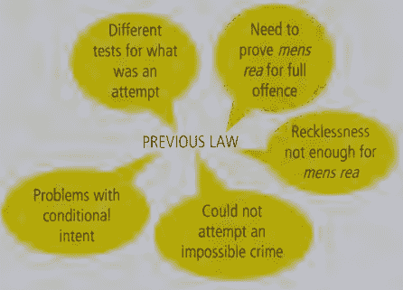

**图 A3.1** 论文计划，第 1 部分

不要忘记，要获得 Level 5 AO1 分数，你必须引用广泛的相关案例来支持你提出的观点。

现在思考该法案做了什么。这对本问题的 AO2 很重要。

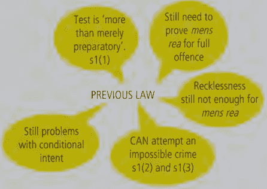

**图 A3.2** 论文计划，第 2 部分

再一次记住要为这些观点引用广泛的相关案例。

## 结论

确保以结论结束。本题要求你评估该陈述的准确性。因此请思考改革是否改善了法律，或者这一点是否存疑。为此，一个简短的清单可以帮助你集中关注哪些方面有所改善，哪些没有：

- 用“不仅仅是准备性”的单一标准取代各种旧标准，使法律更简单、更易适用，但某些案例（如 Geddes、Campbell）表明该标准存在问题且适用不一致。
- *Geddes*、*Campbell* 案是否表明法律未能有效在造成伤害前阻止犯罪行为？
- “不仅仅是准备性”的标准是否在保护公众与不对仅仅思考犯罪的人进行惩罚之间取得了平衡？
- 仍需证明意图实施完整犯罪——这是否也在保护公众与不对仅仅思考犯罪的人进行惩罚之间取得了平衡？
- 轻率仍不足以构成 *mens rea*。企图不可能之事现在已纳入未遂的定义——这有助于执法。
- 法律委员会已提出改革建议，强调该法案并未在未遂的所有领域充分改善法律。

现在以一段结论性段落总结该法案在多大程度上取得了成功。

本题的评分标准可在 OCR 网站找到 – www.ocr.org.uk。

## A3.2 问题题

在 Unit G153 中，这些问题也可以基于 A2 选修课所学的任何实质性刑法领域或多个领域。对于这些问题，需要对法律的知识和理解（AO1）以及相关问题的识别和法律的适用（AO2）。每个问题价值 50 分，评估目标的分配与论文题相同：

- AO1 – 最高 25 分
- AO2 – 最高 20 分
- AO3 – 最高 5 分

与论文题一样，本书各章末尾的所有问题式考题均取自往届 OCR 试卷。它们可用于当前大纲的练习。

### 考题

Jin 在超市排队。Jin 看到 Amy 插在他前面排队。Jin 很生气并试图把 Amy 推开。Amy 失去平衡并撞倒了一对老年夫妇 Fred 和 Wanda。Fred 有心脏病，震惊导致他心脏病发作。Wanda 摔倒；她患有脆骨病并摔断了髋骨。

在医院 Fred 被接入生命维持机器但三小时后死亡。Wanda 康复了，但在她回家前 Doctor Sugar 给她注射了抗生素。他很忙且没有检查 Wanda 是否有过敏史。Wanda 出现严重过敏反应并死亡。

讨论 Jin 和 Doctor Sugar 对 Fred 和 Wanda 杀人罪的刑事责任，如有的话。

(OCR G153 January 2010)

- 转移恶意原则 – Jin 推了 Amy，但死的是另外两个人。
- 从 Jin 的行为到死亡的因果链——是否被切断？
- Doctor Sugar 给予的注射导致 Wanda 死亡——医生对患者负有照顾义务，因此考虑严重疏忽杀人。

### 定义/解释/扩展

在识别出问题后，现在定义法律并针对每个问题依次用案例法进行解释和扩展。记住，要达到 Level 5，必须广泛引用案例。分别处理每个部分和每个人。

定义非法行为杀人：必须存在一个在客观测试下具有危险性的非法行为，且该行为必须导致死亡。Jin 的推搡构成殴打，因此是非法的行为。清醒理智的人是否必然会认识到它必须使受害者面临某种伤害的风险（Church）？被告必须对非法行为具有所需的 mens rea。

用 Mitchell、Larkin、Church 案解释/扩展定义。考虑危险性。由于 Fred 的心脏病，对他的伤害风险是否对清醒理智的人显而易见？用 Watson 和 Dawson 案进行解释。

定义转移恶意原则。
用 Latimer 和 Mitchell 等案例进行解释/扩展。
定义因果链的概念。包括事实因果和法律因果。
用“按你找到的受害者对待”Blaue 等观点进行解释/扩展；还用 Smith、Cheshire 和 Jordan 案解释因果链何时可能因医疗处理而被切断。
定义严重疏忽杀人——照顾义务、违反该义务而带来死亡风险且导致死亡。
解释/扩展所需的疏忽程度——Adomako。

### 可能的答案

对于问题题，需要：

- 识别相关的法律领域
- 定义这些领域的法律
- 用案例进一步解释和扩展法律
- 适用法律。

所以不要忘记 IDEA。

### 识别

由于有多个问题需要审视，有条理地分别写下每个问题是明智的。在本问题中，需要识别以下问题：

- Jin 推搡 Amy 导致她撞向 Fred 和 Wanda 并随后死亡——显然不是谋杀（无意图），因此考虑非法行为杀人。

### 适用

在解释完所有法律后，你必须将其适用于具体情况。这是 AO2 分数的重要方面。因此陈述：

- Jin 是否对 Fred 的死亡负责？——Jin 已实施了非法行为并有意为之，可以认为合理的人会看到该行为带来某种伤害的风险，转移恶意原则适用。鉴于 Fred 有心脏病，“按你找到的受害者对待”原则很可能适用。因此 Jin 可被视为 Fred 死亡的事实和法律原因。
- 另也可根据 Dawson 案的判决认为不会看到伤害风险，在这种情况下 Jin 将无罪。
- Jin 是否对 Wanda 的死亡负责？
- 非法行为杀人的所有要素均存在（情况与 Mitchell 非常相似）——转移恶意原则将如 Mitchell 案中一样适用。然而 Doctor Sugar 在她康复后给予抗生素注射似乎切断了因果链（Jordan）。因此 Jin 可能不承担责任。
- Doctor Sugar 是否对 Wanda 的死亡负责？
- 医生对其患者负有照顾义务；他因未检查过敏史而违反了该义务；此举存在死亡风险，且 Wanda 因此死亡。因此陪审团很可能会认定该疏忽足以使其承担刑事责任。

本题的评分标准可在 OCR 网站找到，网址为 www.ocr.org.uk。

## A3.3 两难板/评估陈述

Unit G153 中最后一种题型被称为两难板或评估陈述。这是一种题型，学生面对一个情境加上四个关于该情境的陈述，需要对其进行评估。每个两难板计 20 分。这意味着你应在此类题目上花费的时间明显少于另外两种题目。

评分方面，所有分数均针对 AO2。这意味着你必须集中于对法律的分析和将其应用于陈述。

以下给出此类问题的示例。

### 考题

Elsa 决定从一家商店偷伏特加。她口袋里有一把枪。商店外她把枪拿出来但改变了主意又放回口袋。Elsa 仍想偷一些伏特加于是进入商店，但发现商店里没有伏特加。生气之下，Elsa 踢了一名顾客 Reynard，致其腿部淤伤。Elsa 跑出商店，用力猛撞玻璃门导致门碎裂。

评估上述情境事实中 A、B、C、D 四个陈述各自的准确性。

**陈述 A：** Elsa 在把枪从口袋拿出来时犯下了抢劫未遂。

**陈述 B：** Elsa 进入商店时未犯 s 9(1)(a) 破门而入罪。

**陈述 C：** Elsa 踢 Reynard 时犯下了抢劫罪。

**陈述 D：** Elsa 打破商店门时犯下了 s 9(1)(b) 破门而入罪。

(OCR G153 January 2010)

### 可能的答案

有必要分别处理每个陈述。对于每个陈述，解释其是否正确。让我们看陈述 A。重要点是情境陈述 Elsa 做了什么，以及关于未遂、抢劫和破门而入的法律。

对于此类问题，你可以用要点回答。OCR 评分标准

本题内容如下。请注意，你需要逐一分析每种情形，陈述相关法律并加以适用。同时注意，你必须说明每项陈述是否准确。

注意：此类问题不要求你援引判例。

## 陈述A
### 需要提出的要点如下：
- 理由：未遂罪要求实施的行为不仅仅是实质性犯罪的预备行为。
- 理由：从口袋里掏出枪属于为实施犯罪做准备。
- 理由：艾尔莎在室外这样做，随后又把枪放回去，这一事实很可能意味着她尚未着手实施犯罪本身。
- 理由：艾尔莎不构成抢劫未遂罪。
- 结论：该陈述不准确。

## 陈述B
### 需要提出的要点如下：
- 理由：该罪名要求艾尔莎以侵入者的身份进入建筑物或建筑物的某一部分，并怀有盗窃、实施重伤或实施破坏的意图。
- 理由：该罪名的成立并不要求实质性犯罪实际发生。
- 理由：商店没有伏特加这一事实无关紧要。
- 理由：艾尔莎进入的那一刻该罪名即告成立，因为她是一名侵入者，如果店铺主人事先知道她的意图，就不会允许她进入。
- 结论：该陈述不准确。

## 陈述C
### 需要提出的要点如下：
- 理由：抢劫罪要求在盗窃之前或盗窃之时，并且为了实施盗窃而使用暴力或威胁使用暴力。
- 理由：踢雷诺德一脚足以构成暴力。
- 理由：由于商店没有伏特加，艾尔莎并未实施盗窃。
- 理由：这两个要件均未满足，因此不构成抢劫罪。
- 结论：该陈述不准确。

## 陈述D
### 需要提出的要点如下：
- 理由：该罪名要求艾尔莎以侵入者身份进入建筑物或建筑物的某一部分后，继而实施盗窃、实施重伤或试图实施重伤。
- 理由：艾尔莎属于以侵入者身份进入，因为如果店铺主人事先知道她的意图，不太可能允许她进入。
- 理由：砸门构成刑事损害。
- 理由：这并非第9条第(1)款(b)项所包含的实质性犯罪。
- 结论：该陈述不准确。

## 附录4
### 如何作答G154单元的问题
本试卷的专题每年均有变化。
OCR通常会在夏季学期临近结束时发布各专题的原始材料，供次年一月和六月的考试使用。

### A4.1 案例研究题
第1题总是针对原始材料中的某个案例。样卷中该题分值为16分，你应当在这道题上花费约18分钟；其中12分分配给评估目标2（分析与评价），4分分配给AO3。

关于案例的原始材料将为你的作答提供良好的起点，但你必须利用材料中的信息进行分析和评价。

务必确保你紧扣题目所问的内容。例如，题目可能要求你说明某一特定案例对特定法律领域发展的意义。一种作答思路可以是：先陈述该案例之前的法律状况，解释该法律存在的问题，进而说明该案例是如何推动法律发展的。

### A4.2 论述题
第2题可以涉及《专题研究材料》中刑事法律的任何领域。样卷中的这道题分值为34分，你应当在这道题上花费约36分钟。此题同时考查AO1和AO2，其中AO1占16分，AO2占14分。

对于AO1，你需要引入额外知识，而不能仅仅依赖原始材料。请记住，要达到第5级，你需要展示“广博、准确、详尽的知识”。

对于AO2，分析和评价的深度是重要方面。要达到第5级，你必须展示出正确识别相关且重要的批评要点的能力，同时展示出对当前争论和改革建议的良好理解。

此外还有4分分配给AO3。

### A4.3 应用分析题
通常会有三个小场景，每个场景涉及不同的法律要点。总体而言，AO1占10分，AO2占20分，每个小场景各占10分。你应当在这道题上花费约36分钟。

所需的部分知识会出现在原始材料中，但由于AO1占10分，因此还需要其他知识。所以请务必提供相关额外判例和/或议会法律条文的知识。

本题的主要分值在于识别相关法律并加以运用（AO2）。请分别处理每个场景，识别每个场景中的关键要点并适用法律。

### A4.4 使用原始材料
引用原始材料时，你可以给出材料的页码和行号。不要大段抄录原始材料：这样做几乎不会为你赢得分数。重点在于展示你对材料中论点的理解、能够用自己的话加以解释，并在讨论中加以运用。

请记住，将你的答案与原始材料联系起来非常重要，尤其是在第1题和第2题中。

- Caldwell式轻率 29
- Camplin区分 84–5
- 因果关系 14–20, 17
  - 中断因果链
  - 介入行为 15, 94–5
  - 医疗处理 15–16, 18–19
  - 自行注射 94–6
  - 被害人自身行为 17–18
- 事实原因 14
- 严重过失杀人罪 99
- 法律原因 14
- 医疗过失 19
- 谋杀罪 60
- 新介入行为（novus actus interveniens）16
- 存在的问题 18–19
- “薄皮肤”规则 14–15
- 儿童，使用暴力管教 112
- 爱德华·柯克勋爵 59, 67
- 普通袭击罪 参见 袭击罪；殴打罪
- 同意 128–34, 134
  - 接触性运动 131
  - 安乐死 133
  - 嬉戏打闹 132
  - 默示同意 129
  - 医疗处理 131
  - 对轻微伤害的同意 129–30
  - 错误认识 130
  - 该法律存在的问题 131–2
  - 基于公共利益 132, 134
- 真实同意 128–9
- 性行为/同性恋行为 132–3
- 盗窃罪 137–9, 153
- 后果的预见 22–6, 25, 65–6, 67
- 共谋败坏公共道德罪 2
- 藐视法庭罪（刑事）40
- 1989年刑法典（草案）（法律委员会）
  - 29–30, 47, 180, 183
- 刑事损害罪 137
  - 醉酒状态下的错误 186–7
  - 紧急避险 205
  - 轻率 28–30
- 刑事犯罪 另见各具体罪名
- 由判例法创设 1–2
- 犯罪的定义 2–3
- 抗辩事由 3–4, 60–1（另见 无意识行为；同意；胁迫；精神错乱；醉酒；紧急避险；自卫）
- 构成要件 2–3, 3
- 犯罪预防 60–2, 64, 108
- 证明的负担/标准 4–5
- 严格责任 3, 35–47, 39, 44
- 刑事诉讼
  - 由私人提起 2
  - 中止 2
- 皇家检察署（CPS）2
- 加重情节 121
- 起诉标准 120–2
- 危险行为 91–3
- 保护他人的抗辩 125–7
- 抗辩事由 173
  - 意外事件 4
  - 无意识行为 3, 181–3, 184, 185
  - 同意 128–34, 134, 137–9, 153
  - 减轻责任能力 75–81, 81, 179–80
  - 胁迫 4, 70, 191–202, 197, 199
  - 精神错乱 3, 75, 172–80, 173, 178, 179
  - 醉酒 4, 126, 185–90, 188
  - 错误 38, 39, 64, 126, 146, 186–8, 188
    - 在谋杀罪中的错误 68–72, 192
  - 紧急避险 3, 191, 203–5, 205
  - 犯罪预防 60–2, 64, 108
  - 证明的负担/标准 4–5, 75, 80
  - 挑衅 80–1, 88
  - 举证责任倒置 5
  - 自卫、保护他人的抗辩 57, 61–5, 70, 111–12, 125–7, 204
- 糖尿病，与无意识行为/精神错乱 174–7, 182
- 《刑法摘要》204
- 减轻责任能力 75, 81
  - 精神异常 75–7
  - 受虐妻子综合征 75–6, 83
  - 举证责任 4–5, 75, 80
  - 定义 75
  - 精神错乱 172
  - 醉酒 77–9
  - 医学证据 79–80
  - 谋杀罪的抗辩 70, 79, 179–80
  - 该法律存在的问题 80
  - 改革建议 79–80
  - 未成年犯 80
- 直接故意 21–2, 22, 210–11
- 不诚实，与盗窃罪 147–9, 148, 151, 154–5
  - 不构成不诚实的行为 147
  - Ghosh检验标准 147–9, 154–5
  - 不合理的相信 147
  - 愿意付款 147
- 医生的义务 另见 医疗处理
- 安乐死 72
- 不作为 11–13
- 饮酒 参见 醉酒
- 毒品 另见 醉酒
  - 供应或投放毒品 94–6, 186
- 尽职抗辩，与严格责任 37–8, 39, 40, 42
- 胁迫 4, 173, 197
  - 谋杀未遂 192
  - 情形胁迫 196, 199–201
  - 醉酒 196
  - 低智商 201
  - 作为谋杀罪的抗辩 192, 201
  - 该法律存在的问题 201–2
  - 自行引起的 196, 198
  - 以威胁方式 192–3, 199
  - 威胁的紧迫性 195–6
  - 无法逃脱 194–5
  - 客观/主观检验标准 193–4
  - 相关特征 194
  - 严重性 193
  - 特定犯罪 196
- 注意义务
- 严重过失杀人罪 97–100
- 违反义务导致死亡 99–100
- 不作为 8–11
- 电力，盗窃 143
- 紧急服务，与紧急避险 203
- 进入，有效/实质性进入 163–4, 167, 169–70
- 癫痫，与无意识行为/精神错乱 174, 176–7, 183
- 安乐死 72, 133
- 过错
  - 无过错 6
  - “过错要素” 3, 36
  - 无过错责任 37, 39
- 胎儿，杀害胎儿是否构成谋杀罪 60, 65
- 暴力的使用
  - 在袭击罪和殴打罪中 110–12
  - 在造成实际身体伤害的袭击罪中 114–15
  - 在谋杀罪中 61–5, 70–1
  - 先发制人的暴力 126–7
  - 合理或过度的暴力 127
  - 在抢劫罪中 159–61, 162, 168–9
  - 在自卫、保护他人、预防犯罪中 61–5, 70, 125–7

- 时间延迟 159–61
- 非法 110–13, 115, **116**
- 欺诈 2, 154
- *Gammon* 测试 41–3
- *Ghost test* 147–9, 155–6
- 礼物 139, 153
- ‘好撒玛利亚人’法 7, 12
- 严重身体伤害
-   故意造成 *(参见 wounding)*
-   定义 116–18
-   造成 *(参见 malicious wounding)*
- 重大过失杀人 11, 31, 30–1, 100
-   定义 97
-   药物供应 95–6
-   违反注意义务 96–100
-   法律问题 103–4, 214–15
-   改革建议 104–5
-   死亡风险 99–100
-   测试标准 99, 104
- 严重挑衅 87
- ‘有罪心态’ *see mens rea*
- 伤害
-   造成 117–18, 123
-   在非故意杀人中的风险 91–2
- HIV感染 117, 123, 128–9
- 杀人 **68** *(另见 involuntary manslaughter; manslaughter; murder)*
- 同性恋 1–2, 130
- 人权
-   举证责任 80, 178
-   对儿童管教中使用武力 112
-   严格责任犯罪 46
- 精神疾病 7, 115, 117, 123–4
-   人格障碍 64
-   创伤后应激障碍 181
- 伤害
-   加重情节 121–2
-   同意 129–30, 132–3
-   定义 120–2
-   精神性 7, 115, 117, 123–4
- 无罪推定 4–5
- 精神错乱 4, **173, 178, 179, 184**
-   精神异常 75
-   自动症 177, 181
-   举证责任 178
-   定义 173, 177
-   以及糖尿病/癫痫 174–5, 177
-   责任能力减弱 179
-   精神疾病 174–5
-   不可抗拒冲动 177
-   对行为性质/质量的认知 175–6
-   ‘因精神错乱而不负刑事责任’ 177
-   法律问题 177–80
-   改革建议 180–1
-   量刑 176–7
-   睡行症 175, 177
-   社会污名 178
-   严格责任犯罪 **173**
- 故意 **32**
-   未遂 53–4, 57
-   自动症 182–3
-   基本故意 113, 182, 186–7, 190
-   破门而入 163–4, 167–71
-   条件性 53, 152, 156, 169
-   后果
-     预见 22–6, 25, 65–6, 69
-     自然且可能 23–6
-   定义 21–2
-   直接故意 22, **22**, 65, 210–11
-   认定/推断 26, 119
-   中毒 185–6
-   动机 21–2
-   谋杀 3, 65–6, 69–70, 207–8
-   间接故意 22
-   永久剥夺 149–51, **151**, 156
-   问题 26–7
-   改革建议 26–8
-   特定故意 3, 21–8, 182, 185–6, 189
-   伤害/恶意伤害 118–19
- 中毒 4, **173, 188**, 215–17
-   先存的精神异常 77–8
-   成瘾/依赖 78–9
-   基本故意犯罪 173, 186, **188**, 189
-   脑损伤 78–9
-   刑事中毒，建议的犯罪 190
-   危险中毒，建议的犯罪 190
-   责任能力减弱 77–9, 79, 81
-   强制 196
-   中毒误解 126, 186–7
-   非自愿中毒 186, 189–90, 215–17
-   和 *mens rea* 185–90
-   鲁莽 186–9
-   自卫 187
-   特定故意犯罪 185–6, 189
-   自愿中毒 185–6, 189–90, 215–17
-   非自愿中毒 186, 188, 189–90, 215–17
- 非故意杀人
-   应受谴责性 91, 103
-   重大过失杀人 11, 31, 90, 97–100, **100**, 103–5, 214–5
-   不作为 11
-   法律问题 213–15
-   鲁莽杀人 30–1, 90, 100–1, 105
-   量刑 90
-   非法行为杀人 90–96, **93**, 102–3, 214
- 低智商 194, 201
- 陪审团
-   不一致 103–4, 154–5
-   对于某些案件的不适用性 178–9
- 因严重疏忽杀人，建议的犯罪 104
- 知识，与 *mens rea* 31–2, **32**
- ‘最后行为’测试 49
- 法律委员会
-   *Criminal Code 1989 (draft)* 3, 26–7, 47, 180, 183
-   *Legislating the Criminal code: offences against the person and general principles (1993)* 201
-   *Murder, manslaughter and infanticide* 68, 69, 71–2, 79–80, 103–5, 207–8, 211–13
-   *Violence: reforming the Offences Against the Person Act 1861* 124
-   *Legislating the Criminal code: offences against the person and general principles (1993)* (Law Com) 201
- 借贷 150
- 诽谤 39–40
- 生命维持机器 16, 61
- 失控 81–8, **88**
-   定义 81–2
-   合格触发因素 83–4
-   改革建议 87–8
-   自控 83–7, 86
-   自控标准 84–5
- Majewski规则 113, 187–9, 188
- 转移恶意 32, 66, 111
- 预谋恶意 65–6
- 恶意伤害 (OAPA s20) 119
-   同意 134
-   定义 116–17
-   HIV感染 117, 123
-   故意 118–20
-   伤害程度 118, 119, 120–2
-   mens rea 118, 118, 119
-   精神伤害 117
-   鲁莽 28, 116, 118–19
-   改革建议 122–4
-   恶意地，定义 28, 116, 118
- 杀人罪 另见 involuntary manslaughter
-   重大过失测试 31
-   过失 31
-   鲁莽 30–1
-   改革建议 103–5, 212
-   医学证据，与责任能力减弱 79–80
- 医疗过失 19
- 医疗治疗
-   输血 15, 18–19
-   因果关系 15–16, 18–19
-   同意 131
-   生命维持机器 16, 61
-   必要性 203–4
- 不作为/未行动的责任 11–13
-   撤回 11–13, 72
- mens rea 3, 3, 21, 32
-   与 actus reus 的同时性 3, 3, 32–3
- assault and battery 113–14, 116
- 未遂 49, 53–4, 57
- 破门而入 166–7, 167, 170
- 持续行为 33
- 故意 32
-   定义 21–2, 207–8
-   对情况的预见 22–6
-   伤害/严重身体伤害 21, 119
- 中毒 185–90
- 知识 31
-   关于谋杀 65–7, 67, 69
- 过失 31
- 无需 3, 35–6, 38–9
- 推定 36, 40–1
- 鲁莽 28–31
- 抢劫 158, 161–2, 162
- 法定职责 13
- 法定解释 40–2
- 严格责任犯罪 3, 35–6, 38–9
- 盗窃 136, 136
- 转移恶意 32
- 非法行为杀人 96
- 伤害/恶意伤害 118, 119
- 精神伤害 7, 115, 117, 123–4
- 错误
-   同意 130
-   中毒误解 126, 186–7, 188
- 自卫杀人 64
- 收受财产，与盗窃 146
- 严格责任犯罪 38, 39
- M’Naughten规则 172–80, 179, 181
- 道德责任/标准 7, 12–13, 155
- 动机 21–2
- 机动车
-   与刑法的发展 2
-   未经同意取用 156
- 谋杀 68
-   actus reus 59–65
-   未遂 49, 192
-   因果关系 60
-   同意 134
-   辩护 81–8
-     责任能力减弱 75–81, 179
-     强制 70, 172, 191–2, 199–200
-     挑衅 81–8
-   定义 59, 68
-   强制 70, 172, 191–2, 199–200
-   安乐死 72
-   一级，建议的犯罪 71, 212
-   故意 3, 65–6, 68, 207–8
-   管辖权 59
-   mens rea 65–7, 67, 69
-   作为不作为 59–60
-   预防犯罪 61
-   法律问题 68–72
-   挑衅 81–8
-   ‘合理存在物’ 60–1
-   鲁莽 66
-   改革建议 68–72
-   二级，建议的犯罪 71, 212
-   自卫 61–5, 68, 70–2
- 量刑
-   强制终身监禁 70–1, 212
-   最低刑期 71, 212
-   严重伤害规则 69–70
-   自杀协议 74, 212
- 谋杀、杀人罪和杀婴 (Law Com) 207–8, 211–13
-   关于责任能力减弱 79–80
-   关于重大过失杀人 104–5
-   关于谋杀 68–72, 201
-   关于非法行为杀人 103
- 必要性 4, 173, 191, 203–5, 205
-   紧急服务 203
-   医疗治疗 203–4
-   自卫 204
-   测试标准 204
- 过失 3
-   重大，测试标准 99, 103
-   医疗 19
- mens rea 31, 32
- nolle prosequi 2
- 非精神错乱自动症 177, 181–2
- 中间介入行为 18
- 间接故意 22, 22
- 针对人身的犯罪 参见 assault; assault occasioning actual bodily harm; battery; malicious wounding; wounding
- 法律问题 122–4
- 不作为 10
-   与作为义务
-     因关系 8
-     合同 8
-     医生/医疗治疗 11–13
-     源于事件链 9–10
-     法定 8
-     通过官方职位 9
-     自愿承担 8–9
- ‘好撒玛利亚人’法 7, 12
- 非故意杀人 11, 91
- 谋杀 57, 59–60
- 问题 13
- 非法行为杀人 91
- 盖然性平衡 5, 75
- 人格障碍 64
- 偷猎 143

警察保护，以及胁迫 195, 201–2
色情 2
创伤后应激障碍 181
‘禁止行为’ 3
证明，负担/标准 4–5
盖然性平衡 5, 75
超越合理怀疑 4
责任能力减弱 4–5, 75, 80, 81
人权 80
无罪推定 4–5
精神失常 178
举证责任倒置 5
财产
定义 140–3, 151
毁坏 137
挑衅 另见 失去控制
废除 81–2, 87
法律问题 87–8
‘合理人’ 检验 85–6
改革建议 87–8
自控
丧失 81–8, 86, 88
标准 84–5
‘缓慢燃烧’ 83
时间间隔 83
‘接近性’ 检验 49, 209–10
精神病/伤害 7, 115, 117, 123–4
人格障碍 64
创伤后应激障碍 181
公共妨害 39

‘王室和平’ 61

强奸，婚姻 2–3
不动产 141–2
‘合理存在物’ 60–1
‘合理人’ 检验 85–6
Ghosh 检验 147–9, 155–6
M’Naughten 规则 179
鲁莽杀人，建议罪名 104
鲁莽误杀 30, 100–1, 105
鲁莽 32
在殴打和袭击中 28–30, 113–16, 116, 124
未遂 53–5, 58
根据 Caldwell 29–30
刑事损害 28–30
酗酒 185–7, 186, 190
杀人 66
足以构成的罪行 28, 30

鲁莽误杀 30, 100–1, 105
主观/客观 30–1
在伤害/恶意伤害中 116–18, 118, 119, 124
抢劫 162
完成的盗窃 158–9, 167–8
定义 158
武力/武力威胁 159–61, 168–9
犯意 158, 161
法律问题 167–9
1953年死刑皇家委员会 180

自控
标准 84–5
丧失 81–8, 86, 88
正当防卫
定义 125
武力，使用
过度 127
错误的 125–6
合理的 125–6
非法的 108–9
是否必要 126
酗酒错误 126
酗酒 187–8
杀人 61–4, 67
必要性 204
先发制人打击 127
法律问题 126–7
相关特征 127

量刑
殴打/袭击 107
应受责备性 42–5, 71
恶意伤害 116
杀人
强制终身监禁 70–1, 212
最低刑期 71, 212
非故意误杀 74
严重伤害规则 69–70, 117, 120
性交，与同意 128–9
儿童强奸 132–3
同性恋/恋虐行为 128–30
婚姻强奸 2
睡行 175, 177, 183
‘缓慢燃烧’ 83
社会污名 44, 46, 178
体育，与默示同意 129–31
尾随 117
‘状态’案件 6, 35–6

地位犯罪 35–6
严格责任犯罪 3, 36–9, 39
绝对责任 35–6
无需 actus reus 和 mens rea 3, 35
反对论点 45–6
应受责备性 45
举证负担 3
在普通法下 39–40
尽职抗辩 37–8, 42, 45
未知风险时的有罪 45
人权 46
精神失常 173
合理化 44–5
错误 38
无过错责任 37
与公共政策 43–4
改革建议 46–7
监管犯罪 42–4, 46
社会污名 44, 46
地位犯罪 35–6
在成文法中 40
成文法解释 40–5, 44
Gammon 检验 41
监禁刑罚 42
mens rea 推定 40–2
促进执法 43
准刑事/监管犯罪 42
社会关切问题 42–4, 46
自杀 74, 133
Peter Sutcliffe（约克郡开膛手）179

盗窃 151 另见 破门; 抢劫
actus reus 和 mens rea 136, 136
侵占 136–40, 141, 152–4
‘属于他人’ 143–6, 148, 154
借贷 150–1
条件意图 150, 156
法律冲突，民事与刑事 153–4
同意 137–9, 152
作为持续行为 139–40, 152, 167–8
控制/占有 143–4, 154
定义 136
不诚实 147–9, 154–5
Ghosh 检验 147–9, 154–5
礼物 139, 153
无形财产 141–2
永久剥夺意图 149–51, 156, 158

## OCR A2 刑法

与 OCR 合作出版，*OCR A2 刑法* 是你在 OCR A2 法律大纲中选择刑法选项时的教材。本书是对该选项的全面、权威且易懂的指南。

本新版已全面更新，包括《2009年验尸官与司法法》在内的法律重要变化。

### 主要特点：

- 每章自测题
- 考试练习和往年试题
- 情景和案例研究以说明法律
- 经 OCR 认可，可与 OCR A2 法律大纲一起使用。

Jacqueline Martin LLM 是该领域的[content]
警察保护，以及胁迫 195, 201–2
色情 2
创伤后应激障碍 181
‘禁止行为’ 3
证明，负担/标准 4–5
盖然性平衡 5, 75
超越合理怀疑 4
责任能力减弱 4–5, 75, 80, 81
人权 80
无罪推定 4–5
精神失常 178
举证责任倒置 5
财产
定义 140–3, 151
毁坏 137
挑衅 另见 失去控制
废除 81–2, 87
法律问题 87–8
‘合理人’ 检验 85–6
改革建议 87–8
自控
丧失 81–8, 86, 88
标准 84–5
‘缓慢燃烧’ 83
时间间隔 83
‘接近性’ 检验 49, 209–10
精神病/伤害 7, 115, 117, 123–4
人格障碍 64
创伤后应激障碍 181
公共妨害 39

‘王室和平’ 61

强奸，婚姻 2–3
不动产 141–2
‘合理存在物’ 60–1
‘合理人’ 检验 85–6
Ghosh 检验 147–9, 155–6
M’Naughten 规则 179
鲁莽杀人，建议罪名 104
鲁莽误杀 30, 100–1, 105
鲁莽 32
在殴打和袭击中 28–30, 113–16, 116, 124
未遂 53–5, 58
根据 Caldwell 29–30
刑事损害 28–30
酗酒 185–7, 186, 190
杀人 66
足以构成的罪行 28, 30

鲁莽误杀 30, 100–1, 105
主观/客观 30–1
在伤害/恶意伤害中 116–18, 118, 119, 124
抢劫 162
完成的盗窃 158–9, 167–8
定义 158
武力/武力威胁 159–61, 168–9
犯意 158, 161
法律问题 167–9
1953年死刑皇家委员会 180

自控
标准 84–5
丧失 81–8, 86, 88
正当防卫
定义 125
武力，使用
过度 127
错误的 125–6
合理的 125–6
非法的 108–9
是否必要 126
酗酒错误 126
酗酒 187–8
杀人 61–4, 67
必要性 204
先发制人打击 127
法律问题 126–7
相关特征 127

量刑
殴打/袭击 107
应受责备性 42–5, 71
恶意伤害 116
杀人
强制终身监禁 70–1, 212
最低刑期 71, 212
非故意误杀 74
严重伤害规则 69–70, 117, 120
性交，与同意 128–9
儿童强奸 132–3
同性恋/恋虐行为 128–30
婚姻强奸 2
睡行 175, 177, 183
‘缓慢燃烧’ 83
社会污名 44, 46, 178
体育，与默示同意 129–31
尾随 117
‘状态’案件 6, 35–6

地位犯罪 35–6
严格责任犯罪 3, 36–9, 39
绝对责任 35–6
无需 actus reus 和 mens rea 3, 35
反对论点 45–6
应受责备性 45
举证负担 3
在普通法下 39–40
尽职抗辩 37–8, 42, 45
未知风险时的有罪 45
人权 46
精神失常 173
合理化 44–5
错误 38
无过错责任 37
与公共政策 43–4
改革建议 46–7
监管犯罪 42–4, 46
社会污名 44, 46
地位犯罪 35–6
在成文法中 40
成文法解释 40–5, 44
Gammon 检验 41
监禁刑罚 42
mens rea 推定 40–2
促进执法 43
准刑事/监管犯罪 42
社会关切问题 42–4, 46
自杀 74, 133
Peter Sutcliffe（约克郡开膛手）179

盗窃 151 另见 破门; 抢劫
actus reus 和 mens rea 136, 136
侵占 136–40, 141, 152–4
‘属于他人’ 143–6, 148, 154
借贷 150–1
条件意图 150, 156
法律冲突，民事与刑事 153–4
同意 137–9, 152
作为持续行为 139–40, 152, 167–8
控制/占有 143–4, 154
定义 136
不诚实 147–9, 154–5
Ghosh 检验 147–9, 154–5
礼物 139, 153
无形财产 141–2
永久剥夺意图 149–51, 156, 158

## OCR A2 刑法

与 OCR 合作出版，*OCR A2 刑法* 是你在 OCR A2 法律大纲中选择刑法选项时的教材。本书是对该选项的全面、权威且易懂的指南。

本新版已全面更新，包括《2009年验尸官与司法法》在内的法律重要变化。

### 主要特点：

- 每章自测题
- 考试练习和往年试题
- 情景和案例研究以说明法律
- 经 OCR 认可，可与 OCR A2 法律大纲一起使用。

Jacqueline Martin LLM 是该领域的[content]
警察保护，以及胁迫 195, 201–2
色情 2
创伤后应激障碍 181
‘禁止行为’ 3
证明，负担/标准 4–5
盖然性平衡 5, 75
超越合理怀疑 4
责任能力减弱 4–5, 75, 80, 81
人权 80
无罪推定 4–5
精神失常 178
举证责任倒置 5
财产
定义 140–3, 151
毁坏 137
挑衅 另见 失去控制
废除 81–2, 87
法律问题 87–8
‘合理人’ 检验 85–6
改革建议 87–8
自控
丧失 81–8, 86, 88
标准 84–5
‘缓慢燃烧’ 83
时间间隔 83
‘接近性’ 检验 49, 209–10
精神病/伤害 7, 115, 117, 123–4
人格障碍 64
创伤后应激障碍 181
公共妨害 39

‘王室和平’ 61

强奸，婚姻 2–3
不动产 141–2
‘合理存在物’ 60–1
‘合理人’ 检验 85–6
Ghosh 检验 147–9, 155–6
M’Naughten 规则 179
鲁莽杀人，建议罪名 104
鲁莽误杀 30, 100–1, 105
鲁莽 32
在殴打和袭击中 28–30, 113–16, 116, 124
未遂 53–5, 58
根据 Caldwell 29–30
刑事损害 28–30
酗酒 185–7, 186, 190
杀人 66
足以构成的罪行 28, 30

鲁莽误杀 30, 100–1, 105
主观/客观 30–1
在伤害/恶意伤害中 116–18, 118, 119, 124
抢劫 162
完成的盗窃 158–9, 167–8
定义 158
武力/武力威胁 159–61, 168–9
犯意 158, 161
法律问题 167–9
1953年死刑皇家委员会 180

自控
标准 84–5
丧失 81–8, 86, 88
正当防卫
定义 125
武力，使用
过度 127
错误的 125–6
合理的 125–6
非法的 108–9
是否必要 126
酗酒错误 126
酗酒 187–8
杀人 61–4, 67
必要性 204
先发制人打击 127
法律问题 126–7
相关特征 127

量刑
殴打/袭击 107
应受责备性 42–5, 71
恶意伤害 116
杀人
强制终身监禁 70–1, 212
最低刑期 71, 212
非故意误杀 74
严重伤害规则 69–70, 117, 120
性交，与同意 128–9
儿童强奸 132–3
同性恋/恋虐行为 128–30
婚姻强奸 2
睡行 175, 177, 183
‘缓慢燃烧’ 83
社会污名 44, 46, 178
体育，与默示同意 129–31
尾随 117
‘状态’案件 6, 35–6

地位犯罪 35–6
严格责任犯罪 3, 36–9, 39
绝对责任 35–6
无需 actus reus 和 mens rea 3, 35
反对论点 45–6
应受责备性 45
举证负担 3
在普通法下 39–40
尽职抗辩 37–8, 42, 45
未知风险时的有罪 45
人权 46
精神失常 173
合理化 44–5
错误 38
无过错责任 37
与公共政策 43–4
改革建议 46–7
监管犯罪 42–4, 46
社会污名 44, 46
地位犯罪 35–6
在成文法中 40
成文法解释 40–5, 44
Gammon 检验 41
监禁刑罚 42
mens rea 推定 40–2
促进执法 43
准刑事/监管犯罪 42
社会关切问题 42–4, 46
自杀 74, 133
Peter Sutcliffe（约克郡开膛手）179

盗窃 151 另见 破门; 抢劫
actus reus 和 mens rea 136, 136
侵占 136–40, 141, 152–4
‘属于他人’ 143–6, 148, 154
借贷 150–1
条件意图 150, 156
法律冲突，民事与刑事 153–4
同意 137–9, 152
作为持续行为 139–40, 152, 167–8
控制/占有 143–4, 154
定义 136
不诚实 147–9, 154–5
Ghosh 检验 147–9, 154–5
礼物 139, 153
无形财产 141–2
永久剥夺意图 149–51, 156, 158

## OCR A2 刑法

与 OCR 合作出版，*OCR A2 刑法* 是你在 OCR A2 法律大纲中选择刑法选项时的教材。本书是对该选项的全面、权威且易懂的指南。

本新版已全面更新，包括《2009年验尸官与司法法》在内的法律重要变化。

### 主要特点：

- 每章自测题
- 考试练习和往年试题
- 情景和案例研究以说明法律
- 经 OCR 认可，可与 OCR A2 法律大纲一起使用。

Jacqueline Martin LLM 是该领域的领先作者。她的 A Level 法律书籍，包括 *OCR AS 法律* 和 *The English Legal System*，帮助数十万学生通过考试。Jacqueline 曾担任一家主要评定机构的首席考官，拥有十年执业出庭律师经验，并在各个层级教授法律。

Sue Teal LLB 是另一家主要评定机构的首席考官。

OCR 和 Hodder Education 正在携手为你提供更好的支持。

HODDER EDUCATION
www.hoddereducation.co.uk
