# Google Cloud 认证专业云安全工程师官方考试指南：通过本实践指南成为专家并获得 Google Cloud 认证


## 序言：PHIL VENABLES Google Cloud 首席信息安全官


**作者：** Ankush Chowdhary 和 Prashant Kulkarni

**审核员：** Hector Diaz, Assaf Namer, Lanre Ogunmola, Holly Willey

**执行编辑：** Arun Nadar

**开发编辑：** M Keerthi Nair

**制作编辑：** Shantanu Zagade

**编辑委员会：** Vijin Boricha, Megan Carlisle, Alex Mazonowicz, Aaron Nash, 以及 Ankita Thakur

# 序言

我们正在以越来越快的速度将世界数字化。中小型企业、政府和其他公共机构，我们生活的日常结构日益依赖于可靠且安全的系统。

现在，有越来越多的系统运行在了一个或多个超大规模云提供商处。这些云提供商继续在安全领域投入，这反映了安全对于其关键基础设施中客户的重要性，以及他们对于管理大量组织风险的意愿。为了提高云端的安全性、韧性、可靠性和合规性，许多组织正在将更多数据和工作负载迁移到云端以获得这些收益。

在 Google Cloud，我们致力于为客户提供最安全、最可靠的云平台，我们在“设计安全”和“默认安全”的方法上投入了大量资金，以提供更高的保障，帮助客户实现安全运营。

我们的目标是让 Google Cloud 变得尽可能容易实现安全。我们知道，为真实工作负载设计、配置和运行大型云部署需要深厚的专业知识和经验。我们也知道，安全不仅仅关乎技术，它更关乎人。

在 Google，我们一直致力于通过网络安全认证计划和其他许多资源来培养网络安全人才，这不仅增加了组织可以用来改进网络安全的人数，还增加了他们在云安全等重要领域的深度和专业性。我们的“专业云安全工程师”认证是行业内最全面、备受尊敬的认证之一。它是专业人士展示其专业能力的宝贵凭证，也让组织确信，他们正在与一位精通业务并致力于遵循 Google Cloud 安全专家所定义的正确安全实践的人合作。

Anush 和 Prashant 在编写本《Google Cloud 官方认证专业云安全工程师考试指南》时，为专业人士提供了极其丰富的资源，帮助他们在这个对此类技能需求巨大的领域中学习并准备这项重要的认证。本指南是与考试大纲一致的权威来源，为专业人士提供了一种简便的学习方法，不仅涵盖考试相关内容，还提供了进一步阅读的材料以及 Google Cloud 提供的额外培训课程路径。

配置良好的云服务为许多组织显著提升了安全水平，并将带来持续的社会利益。我们希望，通过获得 Google Cloud 认证云工程师身份所获得的专业知识，您将成为这一安全演变的一员。

Phil Venables

Google Cloud 首席信息安全官

> “洞见一切活动皆由物质本性的躯体所为，并见自我无所为者，方为真见。”
> –《摩诃婆罗多书》13:30

# 贡献者

# 关于作者

### Ankush Chowdhary，HPE 副总裁 - CISO

Ankush 在跨越二十多年的技术领域始终专注不移，对不断演变的网络安全领域保持着真诚投入。在职业生涯中，他始终如一地致力于帮助企业迈向现代化并拥抱数字时代。他的指导使了许多企业优先考虑并实施了关键的网络安全措施。他荣幸受邀在各种全球网络安全活动中担任演讲者，并在那里分享了他的见解，并对云安全和政策事务的关键决策者产生影响。受对教育和导师工作的真实热情的驱动，他在复杂的网络安全领域中指导和培养他人获得了巨大的成就感。写这本书的意图是实现这一目的的谦小尝试。

我想对本书的完成表示最深切的谢意。这一成就不仅仅是我一个人的；它是许多人在职业和生活中共同贡献和支持的结果。

对于我的家人、朋友以及所有支持我的人，感谢你们成为这段旅程中的引导者和力量支柱。你们坚定的支持和对我的信念激励了我的决心并让我脚踏实地。

感谢同事和导师分享的智慧和见解。你们的贡献为增添了深度和丰富性。

我将这本书献给你们，感谢你们宝贵的陪伴以及对创作产生的影响。你们的共同努力使其成为现实。

### Prashant Kulkarni，Google Cloud 云安全架构师

在职业生涯中，Prashant 与客户直接合作，帮助他们解决不同领域的安全挑战。这些经验让他热衷于学习，特别是在快速变化的安全格局中。四年前加入 Google 后，他扩展了自己在云安全方面的知识。他感谢客户、信息安全社区以及同事的支持，他们强化了他的技术技能，并提升了他用易于理解的方式解释复杂安全概念的能力。本书旨在分享他的经验见解，让读者能够自信地应对不断变化的安全格局。在空闲时间，Prashant 沉浸于他对天文的热爱，赞叹宇宙的广阔与美丽。

我想感谢我爱的家人和朋友，包括支持我的妻子、可爱的孩子、父母以及我们淘气的拉布多。

我想将这本书献给所有热爱学习和追求知识的探索者。这是对那些将挑战视为成长机会、并享受获取新技能和见解过程的人的敬意。愿这本书成为你们的一盏明灯，帮助你们克服障碍，开启 Google 云安全工程世界中的无限潜力。你们对创作的坚定奉献激励着我们所有人！

最后，我想感谢我们的出版商 Packt 以及不懈努力使本书尽力完美的编辑团队！

# 关于评审员

Hector Diaz 是 Google 的云安全架构师，与受高度监管的组织合作，设计并运营安全合规的云环境。在加入 Google 之前，Hector 花了15年时间为金融、零售和电信行业的客户构建安全架构和云构构解决方案，以实现其业务目标。

Assaf Namer 是一位网络安全领导者、首席云安全架构师、安全专利持有者和导师。他曾在几家初创公司以及 Intel、AWS 和 Google 等行业巨头工作过。Assaf 是若干个安全蓝图的创建者，并主导过一些规模最大的云协议，还为政府提供安全建议。他拥有网络安全硕士学位、MBA 以及麻省理工学院（MIT）的 AI/ML 专业课程证书。

Lanre Ogunmola 是 Google Cloud 的云安全架构师，拥有超过15年的工作经验，重点关注数据保护、密码学、威胁建模和风险评估。他拥有内布拉斯加州大学的网络安全硕士学位，并获得了 CISP、CCSP、CISA、CISM、CKA、CKS 以及其他 Google Cloud 认证。在工作之余，他喜欢看足球和体验新文化。

Holly Willey 是一位云安全架构师，帮助组织在云中构建满足其业务的安全、可扩展且具韧性的系统。她曾在 Google Cloud、ServiceNow 和 AWS 担任架构师，并在 Splunk 和 F5 Networks 担任工程职位。她的职业生涯早期曾有十多年时间致力于为金融服务、电信和电子商务公司设计、构建和支持关键任务数据库。Holly 拥有西雅图太平洋大学数学与科学教学硕士学位和华盛顿大学的工商管理学士学位。

- 延伸阅读 134
- Cloud DNS 为域名创建公共 DNS 168
- HTTP(S) 负载均衡器 176
- 最佳实践与设计考虑 179
- 总结 180
- 延伸阅读 180 / 181
- 安全策略 213
- 本地 IAP 196
- HSM 中的密码学操作流 247
- Cloud EKM 247
- Cloud EKM 架构 248
- Cloud KMS 最佳实践 250
- Cloud KMS 基础设施决策 251
- CMEKs 253
- 将密钥导入 Cloud KMS 253
- Cloud KMS API 254
- Cloud KMS 日志 255
- 总结 257
- 延伸阅读 257

## 10 云数据泄露防护 (Cloud DLP)

- 总结 300
- 延伸阅读 300

| Secret Manager 概览 | 301 | 密钥复制策略 | 309 |
| 日志消费者 | 325 | | |

# 镜像加固与 CI/CD 安全 341

| 镜像管理概览 | 342 | 手动烘焙 | 344 |
成分分析 (SCA) 354
CI/CD IAM 控制 355
第 2 步：创建 Packer 模板 347
第 3 步：安装 Packer 二进制文件 347
二进制授权 357
IAM 授权 362
废弃镜像 351
组织策略图表 362
| :--- | :--- |
| 持续导出 | 390 |
| 总结 | 395 |

# 容器安全

| 容器概览 | 398 |
| 容器基础 | 398 |
| 容器优势 | 401 |
| GKE | 403 |
| 容器中的威胁和风险 | 407 |
| 命名空间 | 408 |
| Kubernetes RBAC | 409 |
| 密钥 (Secrets) | 410 |
| 日志 | 411 |
| GKE 私有集群 | 413 |
| 容器镜像安全 | 415 |
| 安全中心 (CIS) 最佳实践 | 422 |
| 总结 | 426 |

427
443
457
468

# 前言

组织越来越多地采用云迁移，原因包括可扩展性、成本效益和灵活性。云平台提供了扩展、降低成本和适应变化的能力。随着业务迁移到云端，对能够确保安全的专业人才需求增加。获得此认证不仅证明了你的专业知识，还能为你的职业打开大门。无论你是想在就业市场上获得竞争优势，还是想在更高层次做出贡献，本书都将引导你成为安全工程师的每一步。

安全在云计算中起着至关重要的作用，本书将介绍安全基础和分担责任模型。本书将深入探讨 Google Cloud 提供的安全功能和服务，如 IAM、网络安全、容器安全以及安全命令中心。

本书适用于 IT 专业人员、网络安全专家、系统管理员以及任何渴望加强云理解并提升职业的技术爱好者。随着企业日益将其业务迁移到云端，该领域认证专业人才的需求急剧增加。获得此认证证明了你利用云技术设计、开发和管理安全基础设施的能力。

# 本书涵盖内容

第 1 章：关于 Google Cloud 安全工程师考试关注认证本身，并提供报名指南。本章还涵盖考试大纲。

第 2 章：Google Cloud 安全概念涵盖 Google 如何保护其云基础设施。你将学习共享安全责任如何适用于不同的服务、Google 在基础设施各层部署的深度防御模型，以及如何实现数据的隔离和安全。其他领域包括威胁和漏洞管理、安全监控以及数据留存。

第 3 章：信任与合规查看了云架构的两个方面。第一部分关注 Google 如何构建安全并向客户提供完全透明度。数据安全的关键在于控制，你将学习 Google Cloud 如何赋能用户拥有、控制和保护其数据。第二部分涵盖了 Google Cloud 符合的合规标准和计划，以及你如何获取合规报告。本章还介绍了高级主题，这些主题将在后续持续监控和维护合规性时讨论。

第 4 章：资源管理涵盖 Google Cloud Resource Manager 以及如何组织资源。它还涵盖 IAM 策略、组织策略控制、云资产清单以及可以通过资源层次结构应用和继承的防火墙规则。

第 5 章：理解 Google Cloud Identity 介绍了 Google Cloud Identity。你将学习如何使用 Cloud Identity 在 Google Cloud 上设计并构建身份策略。主题包括用户生命周期管理、设备安全、云目录、账户安全、应用管理、身份联邦和单点登录。

# 前言

第 6 章，**Google Cloud 身份访问管理 (IAM)** 深入探讨了 Google Cloud 身份访问管理。它涵盖了 IAM 角色、权限、服务账户、如何管理密钥、IAM 策略以及最佳实践。

第 7 章，**虚拟私云 (VPC)** 涵盖了云网络安全概念。你将查看 VPC 是什么、不同的 VPC 模型以及如何使用子网、自定义路由和防火墙。此外，你还将查看 DNSSEC 和负载均衡器。

第 8 章，**高级网络安全**教你如何使用 Google Cloud 提供的高级安全功能来保护你的云。本章涵盖了身份感知代理（Identity-Aware Proxy）、私有访问、VPC 服务控制以及 DDoS 防护。

第 9 章，**Google Cloud 密钥管理服务 (KMS)** 为理解密钥层级和加密工作原理奠定了基础。在本章中，你将查看不同类型的密钥、用途以及 Google 如何进行加密和密钥管理。该章还涵盖了底层加密操作。

第 10 章，**云数据泄露防护 (DLP)** 指导你如何使用 Google Cloud 数据泄露防护 (DLP) 来保护敏感数据。本章涵盖了使用掩敏、令牌化技术，以及如何执行 DLP 规则来扫描和处理敏感数据。

第 11 章，**密钥管理器 (Secret Manager)** 指导你如何使用 Google Cloud Secret Manager 创建在运行期间使用的密钥。

第 12 章，**云日志 (Cloud Logging)** 涵盖了云日志如何工作。你将查看不同的日志类型、密钥以及日志组件，并学习如何构建集中式日志系统进行持续监控。

第 13 章，**镜像加固与 CI/CD 安全**教你如何为虚拟机和容器加固镜像。它涵盖了如何管理、安全和补丁镜像以及如何构建镜像流水线。此外，你还将查看 CI/CD 流水线的安全扫描。最后，本章涵盖了 Google Cloud Compute 安全能力，如安全虚拟机（Shielded VMs）和机密计算。

第 14 章，**安全中心 (Security Command Center)** 探索安全中心提供的功能，并教你如何配置和使用安全中心的功能来检测威胁、漏洞和错误配置。你还将查看如何使用安全中心构建自动化事件响应，并将其结果与第三方安全信息和管理工具（如 Splunk）集成。

# 前言

第 15 章，**容器安全**涵盖了如何在 Google Cloud 上安全地设计、开发和部署容器。涵盖的主题包括容器安全的各个方面，例如镜像加固、隔离、实施安全策略、扫描容器以及二进制授权（Binary Authorization）。它还涵盖了 Google Kubernetes Engine (GKE) 的各种安全功能以及最佳实践。

模拟题 1 是一份涵盖所有认证区域的完整考试。请注意问题的语言。

模拟题 2 是另一份涵盖所有认证区域的完整考试。这本考试应该增加你通过考试的信心。

# 如何从本书中受益

为了充分利用这类认证书籍的价值，请遵循以下策略：

- **设定明确目标**：定义你通过学习认证书籍实现的目标和想要实现的内容。识别你想要加强知识的特定领域以及想要获取的技能。
- **计划并分配时间**：创建一个符合你作息并允许持续学习的学习计划。每天或每周分配专门的时间专注于书籍内容。持续性是保留有效信息的关键。
- **积极阅读**：以积极的心态阅读这本书。做笔记、高亮重要概念，并记录下待进一步探索的问题。通过接触材料来增强理解和记忆。
- **动手实践**：尽可能通过实际练习和上实验（labs）来补充你的阅读。将书中描述的概念和技术应用到现实场景中。这将巩固你的理解并帮助你开发实践技能。
- **复习与强化**：定期回顾书籍中涵盖的主题以强化你的知识。利用书中提供的复习题或测验，或寻求额外的模拟考试来测试你的理解并识别需要进一步学习的领域。
- **寻求额外资源**：虽然认证书籍是一份全面的指南，但请通过官方文档、在线教程、视频课程和模拟考试等额外资源来补充学习。这些资源帮助你获得不同的视角并强化理解。
- **加入学习小组或社区**：与同样追求同一项认证的人互动。加入在线学习小组或社区，你可以在那里讨论概念。
- **跟踪进度**：通过设定里程碑或检查点来跟踪你的进度。
- **时间管理**：在考试准备阶段有效地管理时间。为复习和模拟考试留出足够的时间。
- **保持动力**：在整个过程中保持积极的心态。奖励自己所取得的成就。

通过实施这些策略，你可以最大化你的学习体验。

一旦您读完《Google 专业云端安全工程师考试指南》，我们非常想听听您的意见！请[点击此处](#)直接进入该书的 Amazon 评论页面并分享您的反馈。

您的评论对我们以及技术社区至关重要，并将帮助我们确保提供高质量的内容。

云端迁移率正在呈指数级增长。现在的云端就像是马赛比马拉草原，我们不预计这一速度会放缓。新项目往往在云端诞生，并最终留在那里。

> 注意
> 马赛比马拉草原是一处标志性的非洲草原景观，其特点是每年超过 150 万只角马和斑马的迁徙。

这种不断增长的趋势创造了新的机机，特别是对于云安全领域。现在对云安全专业人士的需求激增。对于网络安全领域的人物来说，云安全技能不仅需求量，而且非常稀缺。拥有云安全技能的网络安全专业人士现在非常受追。安全曾是组织转向云端的首要障碍。现在，安全是组织想要迁移到云端的主要原因。这增加了对云安全专业人士的需求。

> 注意
> 更多详情请参阅 Bernardita Calzon 于 2022 年 6 月 6 日发布在 datapine 网站上的《企业目前面临的云计算风险与挑战》(xlnX6)。

本书的目的是帮助云安全专业人士通过 Google Cloud Platform (GCP) 专业云端安全工程师考试。书中涵盖的主题不仅包括考试特定的内容，还扩展到某些 GCP 云安全主题。

本章涵盖了你应该参加考试的原因、如何注册以及考试的预期。

在本章中，我们将涵盖以下主题：

- 成为认证云安全工程师的好处
- 如何注册考试
- 预期及一些实用的提示

根据领先劳动力市场分析公司 Burning Glass 的预测，云安全在未来五年内将增长 115%。云安全技能不仅需求，而且是一个非常丰利的领域。具体到云安全技能，预计增长将达到 113%。这使得拥有 GCP 安全知识成为网络安全专业人士的一项精通。此外，获得专业云端安全工程师认证将是对他们能力的有力背书。


获得新技能或认证始终有助于提升你的个人履历并增加被聘机会。Google Cloud 专业安全工程师认证验证了个人在设计、开发和管理利用 Google Cloud 技术的安全基础设施方面的熟练程度。这项全球认可的认证可以提供各种益处，包括：

- **增加就业能力**：此认证被许多雇主认可。它证明了你的技能组合，让你成为涉及 Google Cloud 安全岗位的理想人选。
- **更高的收入潜力**：平均而言，认证的 Google Cloud 专业人士与相似职位的非认证人士相比工资更高。
- **技能验证**：认证验证了你在 Google Cloud Platform 安全方面的知识和技能。这可以在你处理项目或与客户、同事讨论解决方案时增强你的信心和信誉。
- **职业发展**：认证考试的准备过程可以显著增强你对 Google Cloud Platform 安全功能和最佳实践的理解。对于想要在云安全领域脱而出的人来说，至关重要。
- **保持更新**：云技术领域不断演进。认证的过程要求你学习并理解最新的 Google Cloud 安全服务、工具和最佳实践。
- **扩展专业网络**：当你获得认证后，可以加入其他认证专业人士的小组和社区。这提供了建立联系、学习和分享经验的机会。
- **公司福利**：如果你所在的公司是 Google Cloud 合作伙伴，你的认证可以提升公司的合作伙伴级别，从而为公司提供额外的益处、资源和认可。

总的来说，成为认证的 Google Cloud 专业安全工程师是一项有价值的凭证，可以在快速发展的云计算领域开启重大的职业机会和福利。

无论你是想获得认证还是仅仅获取新技能，本书的都是帮助你理解 GCP 的云安全能力。

GCP 专业云端安全工程师考试时长为两小时，由选择题组成。考试可以在测试中心进行，也可以选择在远程地点进行在线监考。考试费用为 200 美元加税，且仅提供英语版。你可以按照以下步骤注册考试：

- 访问 `https://packt.link/FXZ8D` 的 GCP 专业云端安全工程师落地页，可以在那里找到有关考试的更多详细信息。
- 你可以在这里找到许多实用的资源，例如考试指南、样本题、培训选项以及继续学习和认证中心的链接。
- 点击“Register”（注册）选项预订考试，这将带你进入 `https://packt.link/2FmkY` 的 Webassor 云认证落地页。你需要在 Webassor 创建账户以预订考试。


准备好开始了吗？

请登录你的 Google Cloud Webassor 账户查看我们的目录并注册考试。

登录

密码

忘记密码？

没有账户？[点击此处]创建 Google Cloud Webassor 账户。

一旦你创建了账户并登录，将需要选择你想要注册的考试。你还可以选择在测试中心参加考试还是通过在线监考方式参加。


准备好开始了吗？

请登录你的 Google Cloud Webassor 账户查看我们的目录并注册考试。

登录

密码

忘记密码？

没有账户？[点击此处]创建 Google Cloud Webassor 账户。


你最后登录时间为 2021 年 9 月 24 日晚上 10:45。

在参加考试之前，请确保阅读重试政策和认证资格。考试次数次数限制，且尝试之间有等待期（即使你参加的是同一场考试）。遵循条款和条件避免结果被挂起或拒绝是你的责任。

正在启动考试？由于业务量大，在连接监考人员之前可能会遇到额外的等待时间（5-15 分钟）。感谢您的耐心！


Kryterion 使用 cookie 来跟踪会话活动、维护安全并理解用户与我们网站的交互。通过浏览我们的网站，即同意我们使用 cookie 和其他跟踪技术。需更多信息请参阅我们的隐私政策。

隐私政策 | 服务条款 © 2021 KRYTERION 以及 KRYTERION, Limited - 版权所有。KRYTERION®


注意，对于每场考试都有一个 + 号。通过展开它，你可以选择测试中心和在线监考的选项。

| Google 认证 - 专业云端安全工程师（英语） | 这是 Google Cloud 认证 - 专业云端安全工程师考试，涵盖考试中可能出现的当前主题。你可以根据交付就绪情况或方法在任何时间或每次尝试通过。你的尝试次数和尝试之间的等待期仍然适用（[在此处查看我们的重考政策）。 | 多次 |

| --- | --- | --- | --- |

| Google 认证 - 专业云端安全工程师（英语） | 重考政策： | 现场监考 | USD 200.00 | 立即购买 |

| Google 认证 - 专业云端安全工程师（英语） | 重考政策： | 远程监考 | USD 200.00 | 立即购买 |


## 下一步，您将被选择测试中心。

选择下方选项以缩小显示的测试中心列表。

| 国家 | 美国 | 省份/州 | 纽约 | 城市 | 纽约 | OR |

|---|---|---|---|---|---|---|

| 邮编 | | 范围 | 10 英里 | | | 搜索 |

选择您希望参加考试的测试中心。

| 测试中心名称 | 地址 | 城市 | 省份/州 | 国家 | 地图 |

|---|---|---|---|---|---|

| [ ] Alliance Computing Solutions, New York City | 545 8th Avenue, #1210 | 纽约 | 纽约 | 美国 | 地图 |


## 下一步，您将需要选择在首选中心参加考试的日期和时间。

| 所选测试中心 | 选择日期 | 选择开始时间 |

|---|---|---|

| [ ] Trainocate, Singapore 190 Middle Road, #20-02 Fortune Centre Singapore, N/A 188979 | 2021年10月 今天 > | 12:00 PM 12:15 PM 12:30 PM 12:45 PM |


7. 继续结账，并通过支付费用或使用代金券（如果有的话）完成交易。

| 考试 | 详情 | 价格 | 操作 |

| --- | --- | --- | --- |

| Beta 版：Google Cloud 认证 - 专业云安全工程师 | 计划：2021年10月6日，星期三 | 120.00 | [移除](](#) |

| 开始时间：12:30 (UTC+08:00) | 地点：Trainate., Singapore 190 Middle Road, #02-0 Fortune City Singapore, N/A 188979 | | | |

| 时长：240 分钟 | | | |

如果不使用代金券/优惠券，请跳过并选择“结账”继续。

优惠券/代金券代码：[] 提交

| 小计： | 120.00 |

| 预估税费： | 0.00 |

总价：USD 120.00

*费用以美元结算，可能会产生货币转换费*

空购物车 添加其他考试 返回首页 结账

图 1.6 – 检查并支付

完成流程后，您可以选择更改中心或日期/时间。请参考确认邮件中的说明，以便在不产生取消费用的情况下重新安排。

每个中心对您需要提供的身份证明都有特定要求。所有这些信息将包含在电子邮件中。请注意这些要求，如果没有适当身份证明，无论是在线监考还是现场考试，您将无法参加。

云安全考试与其他安全认证不同。它们要求在多个安全领域既有深度又有广度的知识。大多数厂商的安全认证都侧重于产品，但 GCP 云安全工程师考试侧重于身份和访问管理、数据保护、网络安全、日志和监控以及安全操作等领域。对于尝试参加考试的人来说，对基础概念有良好的理解是非常重要的。本书假设您已经具备了这些概念的基础知识；并不建议在尝试考试之前才获取这些知识。

每个人都有不同的准备和学习方式，但建议遵循本书列出的结构并了解所涵盖的领域。如果您熟悉 GCP 安全，可以跳过章节并按任何顺序阅读。对于 GCP 新手来说，强烈建议按照章节顺序进行。

专业级云安全工程师的 GCP 认证页面（`https://pack.link/Wlajj`）包含了有关考试大纲、考试指南和示例题的一些有用细节。请务必花时间阅读它们，因为它们提供了许多见解。本书的内容基于考试蓝图。

考试考试题为多选题，并基于真实世界的场景。测试基于您对 GCP 安全产品和技术的了解。主题和选项范围涵盖从云安全最佳实践和安全配置到特定产品的安全控制，以及您将如何满足合规目标。考试面向于云安全工程师在履行职责时日常所经历的内容。

本书将帮助您准备考试中的各种问题，每个章节都有一个测试您知识的部分。没有什么比实践经验更好的了；因此，如果您还没有 GCP 账号，强烈建议您创建一个免费的 GCP 账号并花时间玩玩 GCP 产品。Google Cloud Boost 拥有丰富的 GCP 安全实验室，建议您通过它获得实践经验。在每个章节中都有指向白书和相关 Google Cloud Skills Boost 的链接供您完成。请注意，Google Cloud Skills Boost是一项付费服务，您可以购买订阅或为每个实验室付费。

Google Cloud Skills Boost 还提供了另一个有用资源。在每个章节的“延伸阅读”部分，您将找到通过 Google Cloud Skills Boost 提供的 Google 官方课程链接。对于 GCP 新手或熟悉其他云提供商的人，强烈建议探索这些资源。

例如底层基础设施是否安全、虚拟机管理程序（`hypervisor`）是否安全、Google 如何实现多租户，以及哪些合规目标已达成。为了向你的客户或内部团队提供建议，了解这些主题至关重要。

Google Cloud 就这些主题提供了一套非常全面的安全文档，强烈建议阅读所有内容。本章是对你必须掌握的一些关键主题的总结。章节末尾提供了链接供你参考这些文档。

Google 的使命是构建最可靠的云。为了实现这一目标，Google 实施了多层安全措施来保护其基础设施、数据和用户。让我们进一步了解 Google Cloud 如何依赖单一技术来确保安全，而是通过构建渐进的安全层来实现真正的“深层防御”。

Google 从一开始就将其基础设施构建为多租户架构，且硬件由 Google 自己构建、管理、加固和运行。所有的身份（无论是用户还是服务）都经过加密认证身份验证，并且只允许经过授权的二进制文件运行。Google 应用了零信任原则，即服务之间没有信任，并应用多种机制来建立信任。作为 Google Cloud 用户，你可以选择使用 Google 拥有的端到端加密网络。Google 对其跨越网络暴露的应用程序编程接口（API）强制执行传输层安全（TLS），并且存储在云上的任何数据默认都会被加密。这使得组织者的工作变得简单得多，因为消除了管理加密基础设施和加密密钥生命期的开销。你可以在第 9 章《Google Cloud 管理服务》中找到更多关于加密和密钥管理的知识。Google 网络的规模使其吸收最大的 DDoS 攻击；默认应用针对流量攻击（第 3 层和第 4 层）的保护。最后也是重要的一点是，Google 提供 24x7 安全运营，以检测威胁并响应安全事件。

为了加强安全态势，Google 实现了端到端的溯源（provenance）。Google 服务器是为运行 Google 服务而专门定制的，不包含视频显卡等可能引入漏洞的必要组件。软件也是如此，包括操作系统（OS），它是一个精简且加固的 Linux 版本。Google 还构建了 Titan，这是一种自定义安全芯片，提供亚纳秒级的启动身份验证，并允许服务器和外设备在每次启动或更新周期期间使用 BIOS、引导程序和内核 OS 镜像验证底层组件。Titan 使用加密签名，并嵌入到 Google 的硬件基础设施、服务器、存储阵列以及 PixelBook 和 Pixel 手机中。Google 开发了自己的网络硬件和软件以增强性能和安全性，得出了包含多层物理和逻辑保护的自定义数据中心设计。此外，通过对硬件堆栈保持端到端的控制，Google 极度地减少了第三方供应商干扰的风险。一旦发生漏洞，Google 安全团队可以迅速创建并部署解决方案，而无需依赖外部。

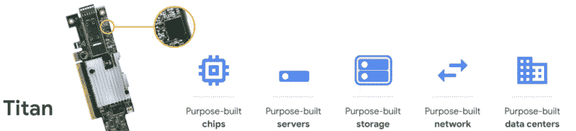

- 专用定制芯片
- 专用定制服务器
- 专用定制存储器
- 专用定制网络
- 专用定制数据中心

Google 用于建立硬件根信任的专用定制芯片

减少“中间人商”风险

图 2.1 – 端到端溯源与验证

数据隐私对于许多使用云的客户来说是一个重要方面。Google Cloud 的差异化优势在于其如何构建内置隐私控制来赢得客户信任。其提供的服务之一是访问透明度（Access Transparency）；该服务允许客户在 Google 工程师尝试访问客户环境时获得可见性。一个典型的用例是客户联系 Google 支持，随后分配了一名工程师解决问题并访问客户组件。在这种情况下，Google 可以向客户提供完全的透明度。所有这些隐私承诺都得到了合同协议和承诺的支持，包括第三方独立评估。

数据隐私承诺包括：作为客户，你拥有并控制你的数据；Google 不会访问你的数据，也不会将其移动到其他位置。作为客户，你负责保护数据安全并控制对数据的访问。此外，Google 不会出售或将你的数据用于广告。政府或执法部门无法对 Google 服务进行后门访问。在涵盖范围内，Google 加密跨越物理边界的所有通信，并在无需客户干预的情况下自动对静态数据进行加密，默认又增加了一层安全。最后，Google Cloud 的一个独特且关键的区别在于，Google 在共享可能导致 Google 工程师访问客户数据的活动日志时非常透明。这是通过 Google 提供的“访问透明度”服务实现的。我们将在后续章节中介绍更多内容。

Google 在其云平台上提供一系列服务，包括传统的设施即服务（IaaS）服务（如 Google Compute Engine）、平台即服务（PaaS）服务（如托管数据库），以及软件即服务（SaaS）。此外，Google Cloud 还提供了丰富的安全产品和服务，客户可以使用这些服务来保护其在 Google Cloud 上的工作负载。广义地说，当我们谈论云安全时，将其分为两个部分：云的安全和云内部的安全。这些是行业标准术，其中“云的安全”指的是云服务提供商负责的部分，而“云内部的安全”则是关于客户

拥有使用云原生安全产品和服务或第三方产品的责任。如图 2.2 所示，客户与云提供商之间的责任边界根据所选的服务而改变。如果客户是……

| | IaaS | PaaS | SaaS |

| :--- | :--- | :--- | :--- |

| Google 管理 | Compute Engine | Cloud Storage | BigQuery |

| 访问策略 | App Engine | Drive | Gmail |

| 使用 | | | |

| 部署 | | | |

| 身份与身份验证 | | | |

| 网络安全 | | | |

| 客客级操作系统 | | | |

| 审计日志 | | | |

| 存储 + 加密 | | | |

| 加固内核 | | | |

| 启动 | | | |

图 2.2 – Google Cloud 的安全责任（IaaS）

Google 最近采用了“共担命运”（shared fate）而非“共享责任”。这一点的前提是，在采用 Google Cloud 时与客户共担命运，而不是 Google 的责任就此结束。Google 承诺从第一天起就与客户站在一起，帮助他们安全地迁移到在 Google Cloud 上运行。

Google 致力于通过认证和合规性与客户建立信任。可以在此处找到合规标志完整列表：`https://packt.link/abHu`。对于希望采用 Google Cloud 的客户来说，合规性是关键。为了合合规，Google 实施了数百种安全控制来满足这些目标。作为客户，当你迁移到 Google Cloud 时，无论托管的是一台还是数百台虚拟机，你最终都继承了所有的安全控制。这不仅让你的安全态势更好，还减轻了项目的范围成本和复杂性，使合规变得简单得多。

就像安全是共享责任一样，合规性也是共享的。Google Cloud 符合许多国际和本地标准以及隐私准则，例如各个国家的个人数据保护法（PDPA）。让我们以 PCI-DSS 为例，看看合规共享责任是如何工作的。作为客户，如果你有符合 PCI-DSS 合规的要求，可以通过使用 Google Cloud 服务来运行你的工作负载。PCI 合规服务列表可以在此处找到：`https://packt.link/nzGL`。从基础设施的角度来看，Google Cloud 符合 PCI-DSS。作为客户，你的责任包括确保你的应用程序和服务符合合规要求。这些应用程序和服务不属于 Google 核心基础设施的一部分，因此属于客户的责任范围。不应假设仅仅因为 Google Cloud 符合 PCI-DSS，你就自动合规；尽管你确实继承了合规相关的控制措施，但它们仅限于 Google 基础设施。

下一节将进一步解释 Google 的安全和合规控制措施是如何构建在其云基础设施中的。

Google 的设计安全（Security by design）方法是确保部署多个技术栈来保护基础设施、身份、服务和用户。图 2.3 展示了构建在 Google Cloud 基础设施中的不同安全层。

# 大规模的深度防御

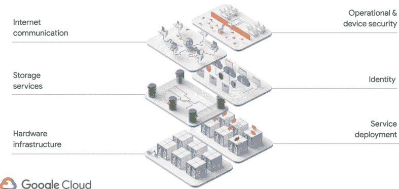

图 2.3 – Google 深度防御


# 运营安全与深度防御

在本节中，我们将涵盖从运营安全到物理安全的关键概念，Google 利用这些概念来实现真正的深度防御和大规模防御。

Google 的运营安全涵盖了多个方面，例如 Google 如何部署软件服务、保护设备和凭据、应对内部威胁以及管理入侵检测。让我们简要回顾这些概念中的每一个。

## 安全部署软件服务

为了安全地部署软件服务，Google 实施了安全的中央控制并进行双向审查。此外，Google 还提供了许多库，防止开发者在 Web 应用中引入诸如 XSS 攻击等漏洞。除了用于源代码分析和识别 Bug 的自动化工具外，还会进行手动安全测试。这些手动测试由专家执行，涵盖了 Web 安全、密码学和操作系统等领域。

Google 还运行“漏洞奖励计划”（Vulnerability Rewards Program），向任何发现并披露 Google 基础设施或应用程序中漏洞的人员支付报酬。

## 设备与凭据保护

Google 实施了强有的安全措施来保护员工设备和凭据。事实上，Google 利用所有云端可访问的服务来保护自身的设备和用户凭据。通过企业级（Corp Enterprise），Google 确保适当的用户及时访问指定的应用程序。这种方法涉及对设备和用户的持续监控、定期的补丁和更新、执行强身份验证措施以及利用双重身份验证（`2FA`）。此外，应用级访问控制确保只有授权用户从受管理的设备和网络地址或地理位置访问符合既定策略时，才能访问内部应用程序。

## 内部风险应对

为了应对内部风险，所有特权用户访问都受到积极监控。为了进一步限制员工访问，任何可以使用自动化完成的特权操作都已通过执行。所有访问终端用户数据的用户，其活动都会被安全团队记录并监控，以检查访问权限和模式。`https://packet.link/FuBbM`

## 入侵检测

Google 使用复杂的入侵检测技术，所有数据处理流水线都集成了主机级和网络级的信号。这些信号与检测规则和机器学习相结合，以识别潜在威胁，并由安全运营团队24 小时监控和处理。Google 还进行活跃的红队（Red Team）演练，以提高安全性和整体有效性。

## 私有网络与 GFE

我们已经涵盖了 Google 如何拥有、运营和管理自己的私有网络，该网络完全加密并强制执行 TLS。这不仅降低了延迟，还提高了安全性。一旦客户的流量进入 Google 网络，它就不再经过公共互联网，从而降低了在传输过程中被攻击、截获或操纵的概率。此外，Google 还确保了其 Google Frontend（`GFE`）。当某个服务想要在互联网上提供服务时，它可以向 `GFE` 注册。`GFE` 执行多项功能，例如确保使用正确的证书终止 TLS，并应用完美正向保密（perfect forward secrecy）等最佳实践。Google 还提供了针对 DDoS 攻击的保护。Google 对 DDoS 拥有多级和多层保护，以确保作为 `GFE` 的服务免受容量攻击的影响。除了 `GFE` 之外，还有多层基于硬件和软件的负载均衡器，它们都具有网络和应用感知能力。所有这些安全控制结合 Google 的全球规模基础设施，确保了最大的 DDoS 攻击也能被缓解和管理。

## 身份验证与访问控制

除了这些基于网络的安全控制外，Google 在允许任何网络访问之前还会强制执行用户身份验证。用户身份验证不仅限于简单的用户名和密码，还会根据风险因素智能地要求用户提供额外信息。这些风险因素包括用户登录的设备信息，例如设备的 IP 地址和地理位置。通过控制后，在授予访问权限之前，用户会被提示提供第二个因子。

## 数据传输与静态数据安全

Google 确保传输中数据（in motion）和静态数据（at rest）的安全。我们之前已经涵盖了 Google 如何对所有传输中数据强制 TLS，并对静态数据执行默认加密。除了静态数据的默认加密外，作为 Google Cloud 用户，您还有权选择不同的数据加密方案。回想上一节关于数据隐私以及 Google 致力于成为可信云提供商的内容；作为 Google Cloud 客户，您对数据拥有完全的控制权和所有权，您可以选择使用默认加密或使用云密钥管理服务（Cloud Key Management Service）。或者，您可以使用云密钥管理服务并导入自己的密钥材料，或者您可以选择“自带密钥”（`BYOK`）路线或多租户 Cloud HSM，后者可为您的密钥提供 FIPS 140-2 Level 3 保护。如果您处于高度受限的环境并需要保留对密钥和基础设施的完全控制权，可以使用 Google 合作伙伴的外部 HSM，它集成了外部密钥管理服务，并通过 Google 的云密钥管理服务进行访问。

## 数据生命周期与删除

数据安全的挑战在于，数据在整个生命周期内必须保持安全。当数据被创建、共享、存储、分析、归档或删除时，必须确保其安全。这涉及到 Google 如何管理数据删除。客户的一个核心问题是：当你停止使用存储了敏感数据的服务时，当你删除数据时，如何确保数据也会从物理介质中擦除？让我们快速查看数据删除的控制和合规方面。当您在 Google Cloud 上删除数据时，它不会被立即删除，而是被标记为已删除，因此，如果您不小心删除了数据，您可以选择将其恢复。在数据被计划删除后，将根据 Google 的策略进行删除。

# 物理安全、硬件溯源与启动安全

在本节中，我们将介绍 Google 如何提供设施的物理安全、硬件溯源，最后我们将介绍启动安全。所有这些组件共同构成了我们所说的 Google Cloud 级安全控制。

在本部分中，我们将介绍 Google 如何提供设施的物理安全、硬件溯源，最后我们将介绍启动安全。所有这些组件共同构成了我们所说的 Google Cloud 级安全控制。

所有适用于 Google Cloud 的都是根据 Google 严格的物理和访问控制进行设计和构建的。通过设计安全原则，Google 还为物理安全实施了冗余的安全层。

Google 采用了一系列措施来确保对数据中心的安全访问，仅限于工作需要的人员。在物理安全方面，Google 在其全球数据中心实施了多层保护。这些措施包括使用闭路电视（CCTV）、车辆屏障、生物识别识别系统、对访问设施的人员进行限制和背景审查，以及部署激光入侵检测器和金属探测器。

在某些站点，Google 在第三方数据中心内运行部分服务器。在这种情况下，Google 确保将 Google 强制的所有额外物理安全控制部署在数据中心现有措施之上。这些物理安全控制也是许多合规计划的一部分。因此，对于 Google 保持合规，在每个设施中遵循一致的物理安全控制至关重要。

Google 拥有复杂的架构，每个数据中心都由成千上万台服务器和大量的网络设备组成。Google 自定义这些设备，包括服务器基础设施和网络设备。

为了消除供应链风险，Google 建立了一套流程来对每个组件供应商进行审查，并审计和验证组件的安全性。正如之前关于端到端溯源的章节中所提到的，Google 所有的服务器和网络基础设施组件都内置了硬件安全芯片；这些定制芯片由 Google 设计。随着这些芯片的部署，安全性得到了进一步增强，使得 Google 不仅能够识别硬件，还能验证设备身份。

## 安全启动

安全启动（Secure boot）控制越来越普遍，越来越多的客户期望其云服务提供商具备这些功能。Google 在安全启动栈和机器身份方面处于领先地位。服务器内置了安全启动功能，以确保运行的是正确的软件。为了实现这一点，Google 在其底层组件（包括内核、BIOS、启动加载程序和基础操作系统）中使用了加密签名等技术。每当服务器启动或更新时，这些签名都会经过验证。为了建立硬件信任根，Google 数据中心中的每台服务器都有一个绑定到信任根和软件的身份。在使用 API 时，所有调用都使用相同的身份凭据，以便管理底层系统并执行管理任务。为了管理大量的服务器集群并确保它们得到及时更新和补丁，Google 创建了自动化系统来检测和诊断硬件及软件相关问题，并在需要时将机器从服务范围中移除。

# 威胁与漏洞管理

在此处介绍威胁和漏洞管理的原因是，构成该领域的组件（如漏洞、恶意软件防护、事件响应和安全监控）是客户采用云服务的关键。有关云服务提供商如何管理威胁和漏洞的问题是客户最关心的问题之一。因此，作为安全从业人员和工程师，理解并能够阐述 Google Cloud 如何提供管理威胁和漏洞的能力非常重要。

作为漏洞管理计划的一部分，为了确保基础设施免受网络威胁的侵害，Google 拥有技术控制、技术和流程来应对多种攻击向量。Google 积极扫描安全相关的威胁，并进行手动和自动渗透测试、安全保障计划，以及一套非常成熟的安全系统（其中包括自动代码扫描和人工评审）。其目标是确保在发现漏洞后，对其进行主动管理、抑制和控制。每个识别出的漏洞都会根据其严重程度分配优先级，并指派相应的团队和所有者来缓解和修复漏洞。

在 Google 网络的不同位置，实施了多种技术来监控和标记异常行为，例如检测可能指示机器人网络连接的流量。Google 结合使用专有和开源技术进行安全监控。Google 威胁分析小组（G-TAG）及其安全研究部门 Project Zero 通过识别安全威胁并让组织意识到这些威胁来工作，例如在公共存储库中发布告警。此外，像其他安全分析和情报引擎一样，Google 会扫描互联网上的安全相关报告，包括博客、维基和邮件列表。对于未知威胁，Google 对网络进行自动分析，并进行进一步调查以了解其运行机制，以及标记是否为误报。

## 事件响应

我们已经涵盖了事件响应的方面以及 Google 如何有效管理安全事件。Google 的事件管理流程与 NIST 标准（`NIST SP 800-61`）一致。这不仅是一个严谨且经过测试的流程，与 NIST 的一致也有助于 Google 的合规性计划。事件管理流程涵盖了从检测、响应到抑制、解决，最后应用事件经验的整个生命周期。

这对许多使用 Google Cloud 的客户可能有所帮助，因为许多组织采用 NIST 模型来处理事件，这意味着整个端到端过程对他们来说得到了进一步简化。Google 安全事件响应团队提供 7x7 全天服务来处理事件。对于影响客户的事件，Google 会根据事件性质向客户和/或其合作伙伴做出响应，并在整个过程中提供帮助和支持，以确保事件得到解决。建议阅读相关文档以进一步了解。以下图来自该白皮书。它说明了 Google 如何响应安全事件并管理生命周期的工作流。

| 识别 (Identification) | 协调 (Coordination) | 解决 (Resolution) | 关闭 (Closure) |
| :--- | :--- | :--- | :--- |
| 检测 (Detection)：自动化和手动流程检测潜在的漏洞和事件 | 分类 (Triage)：值班响应人员评估事件报告的性质 | 调查 (Investigation)：事件响应团队收集有关事件的事实 | 训总结 (Lessons learned)：事件响应团队对事件和响应工作做出回应 |
| 报告 (Reporting)：自动化和手动流程将问题报告给 Google 事件响应团队 | 值班响应人员评估事件的严重性 | 可能需要额外的资源来解决事件 | 事件官指定长期改进措施 |
| | 接入响应团队：事件官完成对已知事实的评估 | 抑制与恢复 (Containment & recovery)：运营采取立即措施：<br>- 限制正在发生的损害<br>- 修复问题<br>- 将受影响的系统和业务恢复正常运行 | |
| | 事件官指定相关团队和事件响应团队的负责人 | 通信 (Communication)：评估事实以确定是否需要进行通知 | |
| | 事件响应团队评估事件和响应工作 | 通信负责人与合适的负责人共同制定通信计划 | |

图 2.4 - Google 事件响应工作流

响应过程可能是复杂的，让客户了解哪些职责属于其范范围至关重要。Google Cloud 将根据需要提供引导和支持，但最终的采取和修复责任由系统所有者（即用户）承担。

# 总结

在本章中，我们概述了 Google Cloud 的核心安全基础设施。我们查看了 Google 如何确保其安全性并使其符合合规要求，涵盖了 Google Cloud 的共享安全责任担模型和共同命运（shared fate）。接下来，我们查看了一些安全设计构建模块，涵盖了运营安全、数据安全、身份以及低级安全。最后，我们学习了威胁和漏洞管理，以及 Google 如何进行恶意软件防护和安全监控。

在下一章中，我们将学习信任与合规，这是 Google 安全基础设施的扩展。

## 延伸阅读

欲了解更多关于 Google Cloud 安全的信息，请阅读以下白皮书：

- Google 安全白皮书：`https://packt.link/uQ90`
- Google 基础设施安全：`https://packt.link/Bf8JM`
- Google Cloud 信任您的数据：`https://packt.link/4HV6r`
- 数据事件响应流程：`https://packt.link/zKNPF`
- 传输中加密：`https://packt.link/PPPxJ`

- 客户数据不会用于任何广告或针对其他用户的广告投放。客户数据不属于 Google，这一点在 Google 的政策和原则中有非常的说明。Google Cloud 绝不会将客户数据用于其他 Google 产品（包括广告），也不会出于任何与客户双方协议中未讨论的用途使用客户数据。
- 作为 Google Cloud 遵循的众多不同合规计划的一部分，Google 透明化地收集执行必要业务功能所需的数据，并确保符合 ISO 27001、SOC 2、GDPR 以及其他隐私最佳实践等合规标准。
- 托管在 Google Cloud 上的任何数据都不会由 Google 共享给任何合作伙伴或第三方以用于任何目的。Google 关于数据处理的策略有明确的定义，并围绕其构建了程序性和技术控制措施。Google 对客户数据的存储、托管和提供有着极高的标准。此外，Google 的合规报告和与客户签署的法律协议详细说明了 Google Cloud 如何根据法律、合规和监管要求使用客户数据。Google 绝不会在上述义务范围之外销售或使用客户数据。
- 每一个 Google 产品从一开始就内置了安全和隐私保护功能。有明确定义的策略和控制措施规定了每个产品的安全和隐私如何管理和设计。这些被认为是最重要的。

正如我们现在看到的，构建一个客户赖以存储业务关键信息的可信任云环境，需要将安全性、透明度和隐私内置其中。Google 的原则确保了这些问题得到了解决。在缺乏这些原则以及能够证明遵守合规标准的独立审计师的情况下，很难建立信任。

# 访问透明度（Access Transparency）与访问批准（Access Approval）

在讨论这两个产品之前，让我们先了解一下为什么它们如此重要。上一节讨论了透明度日志在建立信任方面起着关键作用，这也有助于 Google 区分其安全态势。在写作时，其他主要的**云服务提供商 (CSP)** 并不提供透明度日志。受高度监管或有合规要求的客户需要查看并共享由 CSP 执行的活动日志。像 Gartner 这样的分析机构也已将透明度日志视为 CSP 的关键功能。

既然我们已经确定了透明度对 CSP 的重要性，我们将查看 Google 提供的产品功能。Google 提供了两个透明度产品：**访问透明度（Access Transparency）**，每当 Google 管理员访问你的 Google Cloud 环境时，它会提供近实时的日志；以及**访问批准（Access Approval）**，你可以控制对数据的管理访问。

## 访问透明度

透明度日志是 Google Cloud 提供的一项功能，让客户能够看到 Google 员工在访问客户数据时执行的操作。这些日志详细记录了 Google 支持和工程团队对客户数据或存储在 Google Cloud 服务中的数据进行的任何访问。访问透明度日志帮助客户管理合规性要求、安全审计和内部治理策略。通过提供访问活动的完整记录，这些日志有助于建立信任，并确保 Google Cloud 平台内客户数据的完整性和隐私性。Google 遵循一套最佳实践来控制对客户数据的访问。这些最佳实践包括：

- *最小权限原则*：默认拒绝 Google 员工的访问。当授予访问权限时，该权限是有条件的且临时的，并仅限于用户执行其角色和功能所必需的范围。
- *限制数据访问*：Google 员工极难在没有其他人参与的情况下单独访问客户数据。因此，对数据强制执行基于人数（Quorum-based）的访问控制。
- *所有访问必须正当*：Google 人员默认无法访问客户数据。当 Google 人员拥有特权访问时，他们必须具备所需的权限、业务理由和许可。同样，适用于基于人数的控制以确保执行的任务不受监管。
- *监控与告警*：存在监控和响应流程，以识别、分级并修复违反这些访问控制的行为。

正如你所看到的，已经有许多程序性和技术控制措施及政策，以确保内部风险和管理权限得到管理和控制。当由于客户环境业务需求发生此类活动时，Google 会记录这些活动并在客户请求透明度日志时与其共享。客户可以通过在 Google Cloud 控制台的“身份和访问管理（IAM）”部分启用该服务来请求访问透明度日志。

在专用工具中增加透明度具有明确的意图：建立信任，帮助客户获得其数据的可视性，并向审计师证明符合合规性要求。

访问透明度日志与管理员活动日志（Admin Activity Logs）的一个关键区别在于，管理员活动日志仅限于记录你的 Google Cloud 组织的用户或管理员的操作，而访问透明度日志记录的是 Google 员工执行的操作。访问透明度日志包含细节，如受影响的资源和执行的相关操作、操作时间、原因以及谁访问了数据的信息。

想要访问透明度日志有很多原因。让我们来看看其中一些：

- 验证访问你内容的 Google 人员执行时具有有效的业务理由（如支持请求）
- 验证 Google 支持工程师在执行你作为客户提供的指令时没有犯错
- 验证并跟踪对法律或监管要求的合规情况
- 收集并分析透明度日志，并将其摄入到安全信息和事件管理（SIEM）工具中。

透明度日志及支持它们的产品列在 Google Cloud 网站上：`https://packt.link/R3rx`。

为了启用访问透明度，你需要拥有 Premium、Enterprise、Gold 或 Platinum 支持级别。在继续之前，如果你不确定自己属于哪种支持级别，可以通过以下链接进行检查：`https://packt.link/m06rhf`。一旦 Google 验证你拥有相关的支持级别，他们就可以启用透明度日志。

你可以在已关联结算单账户的项目中配置访问透明度（Access Transparency）。如果你的项目未关联结算单账户，你将无法启用访问透明度服务。


- 2. 从左侧控制台菜单导航到“结算”（Billing）。如果你看到“此项目未关联结算单账户”的消息，你需要选择不同的项目或将项目与结算单账户关联。请参考页面上的帮助以获取如何更改项目结算账户的指南。

- 3. 接下来，导航到 IAM 与管理设置页面，然后点击图 3.1 所示的“为组织启用访问透明度”（ENABLE ACCESS TRANSPARENCY FOR ORGANIZATION）按钮。

如果你无法看到“为组织启用访问透明度”按钮，由于以下原因之一：

- 你的项目没有关联结算账户
- 你没有执行该功能的 IAM 管理员权限
- 缺少所需的支持包

## 访问透明度

可以为你的组织启用访问透明度。

为组织启用访问透明度

图 3.1 – 访问透明度启用确认

## 访问批准

接下来，我们将什么是访问批准（Access Approval）以及它是如何工作的。访问批准确保你作为客户同意 Google 支持工程师访问你环境中的内容。如果你出于任何原因决定不想提供该权限，访问将被拒绝。无论你批准还是拒绝了访问，都会创建一个访问透明度日志活动条目。

# 信任与合规

我们将查看一个客户支持工作流示例，以更好地理解批准流程的工作原理。

| 客户 | Google 支持 | Google 工程师 |
| --- | --- | --- |
| (Cloud Storage API) | (支持工具) | (低级调试工具) |
| 将 object_content.pdf 读取到 Google Cloud Storage 存储桶 `/buckets/XYZ` = [数据损坏] | 获取 `/buckets/XYZ` 的 ACL，以处理工单 12345 | 读取 `/storage/customer.com/buckets/XYZ`，以处理工单 12345 |
| 让我联系支持来修复此。 | 客户批准访问 | 客户批准访问或跳过 |
| 云审核日志 | 访问透明度日志 | 访问透明度日志 |
| 对象: `/buckets/XYZ` 操作：READ | 对象: `/buckets/XYZ/acl` 原因：工单 #12345 | 对象: `/buckets/XYZ` 操作：READ 原因：工单 #12345 |

图 3.2 – 访问批准工作流

在此示例中，客户尝试访问 Google Cloud Storage 存储桶中的一个文件但无法访问。客户开启了一个工单。在此阶段，为读取该对象而进行的 API 调用创建了管理员活动日志。接下来，Google 支持工程师使用支持工具尝试检索客户尝试访问的特定存储桶的访问控制列表（ACL）。Google 支持工程师没有访问权限，因此向客户发送请求，要求批准或拒绝该请求。一旦客户批准了请求，Google 支持工程师就可以检索到之前无法访问的 ACL。在此阶段，会创建一个访问透明度日志条目，记录了对象（bucket/XYZ/acl）、关联操作（READ）以及原因（工单 #12345）。在最后一步中，Google 支持工程师需要打开客户尝试访问的文件。此举目的是确认该文件现在是可访问的，以便解决工单。再次，支持工程师将被拒绝访问该文档，并将再次请求客户进行访问批准以采取其采取行动。此时，客户可以允许或拒绝请求，这取决于许多因素，例如文档是否敏感。如果文档内的数据是通用且不敏感的，且没有其他顾虑，则客户将批准请求。一旦请求被批准，Google 支持工程师即可访问该文档，并创建一个访问透明度日志条目：对象 bucket/XYZ 操作 READ，原因为工单号 #12345。

解释整个访问批准工作原理的目的是说明客户如何对他们的数据拥有控制权，这是我们在上一节中讨论的核心原则之一，即 Google 如何确保建立信任。

你有能力为想要使用访问批准的服务开启此项功能。你可以在此处找到支持的 Google Cloud 产品列表：https://packt.link/f5M。

## 访问透明度与访问批准 29

访问批准仅对所选服务存储内容的请求需要你的同意。当你注册访问批准时，可以使用以下选项：

- 你可以为所有支持的服务自动启用访问批准。这是默认选项。
- 你可以为具有 GA（通用可用）级别支持的服务启用访问批准。当你选择此选项时，它会自动注册未来将提供 GA 级别支持的所有服务。
- 最后，你可以选择想要加入访问批准的特定服务。

使用访问批准让你对该功能的实现和使用具有更高的控制权，允许你决定何时以及为哪些服务启用它。它提供了根据你的特定需求定制访问流程的灵活性。

然而，了解访问批准存在排除情况是至关重要的。这些排除是指该功能可能不适用或不可用的特定场景或服务。熟悉这些排除情况很重要，以确保你对局限性有清晰的理解，并在组织中使用访问批准时做出明智决策。

通过理解并考虑这些排除情况，你可以有效地利用访问批准，使其符合你的安全和合规需求，同时遵守任何适用的限制或例外。以下是访问批准中的几个例外场景：

- Google 审核并允许的非人类程序化访问，例如在删除内容期间运行压缩任务。当二进制授权检查访问时，确保任务来自已检查生产环境的代码。
- 手动访问，例如 Google 为了满足法律要求而访问客户内容；在这些情况下，跳过了访问批准流程。
- 当 Google 查看内容以修复服务故障时，这就是服务故障。
- 如果记录了任何其他访问透明度异常或活动未能生成访问透明度日志，则不会生成访问批准请求。

与访问透明度类似，访问批准需要高级、企业、金牌或铂金支持级别。如果你不确定自己的支持级别，可以通过访问链接进行检查：`https://packt.link/IIxE`

一旦确认你拥有所需的支持级别，就可以按照下一节中的步骤启用访问批准。

## 配置访问批准

要注册访问批准，请遵循以下步骤：

- 1. 在 Google Cloud 控制台中，导航到你想启用访问批准的项目、文件夹或组织。
- 2. 前往访问批准页面：https://packt.link/o84Ct。
- 3. 要注册访问批准，点击“注册”（ENROLL）。

## 安全

## 访问批准

访问批准是一个产品，允许你在 Google 支持和工程需要访问你的客户数据时要求获得明确批准（存在某些例外）。该产品适用于符合条件的支持计划的客户。了解更多


图 3.3 – 访问批准注册

- 4. 在打开的对话框中，点击“注册”（ENROLL）。

## 注册访问批准

启用此功能后，响应时间可能会增加，因为 Google 将等待你批准访问客户数据。了解更多


图 3.4 – 访问批准成功

# 数据的安全与隐私

在章的早期部分，我们涵盖了 Google 遵循的数据隐私原则。在上一章中，我们还涵盖了 Google Cloud 如何默认执行数据安全，例如默认对传输中的数据进行加密。当你在 Google Cloud 上存储数据时，您会进行读取和写入操作；因此，会有数据脱离 Google 强制安全边界的情况。执行传输中数据的加密可确保数据安全。

当数据存储在 Google Cloud Storage 中，默认会执行静态数据加密。这提升了任何采用 Google Cloud 的组织的安全态势，因为您不需要管理底层加密技术来管理数据生命周期或加密数据，因为这些都由 Google Cloud 进行全托管管理。

Google Cloud 提供了灵活的选项，帮助符合 Google 隐私原则并控制您的数据。您可以选择对密钥的控制级别。例如，您可以使用 Google Cloud 密钥管理服务 (KMS) 创建并管理您自己的密钥，或者导入自己的密钥并存储在软件（即 KMS）或云硬件安全模块（HSM）中，后者是通过了 FIPS 140-2 第 2 认证的设备。

许多有严格合规和监管要求的客户可以选择使用外部密钥管理 (EKM) 系统。EKM 系统由 Google 合作伙伴托管并与外部 HSM 集成。Google 已与特定的 EKM 供应商建立了合作伙伴关系，他们将其 EKM 解决方案与 Google Cloud KMS 集成。通过此选项，客户可以使用现有的密钥库（可以是基于 HSM 的），并使用 EKM 解决方案指向密钥。这使得客户对密钥拥有最大的控制权，因为 Google 不持久化这些密钥。在撰写本文时，只有 Google Cloud 通过其合作伙伴向客户提供此类能力：Equinix、Fortanix、Thales 和 unbound。

在数据隐私和安全方面，另一个关键点是许多客户的需求，也是日益增长的数据本地留监管要求。Google 致力于通过数据本地留来满足客户的需求。Google 提供了多项能力和保证来帮助满足这一要求。数据本地留仅适用于此处列出的服务：https://packt.link/ENTE8。让我们看看 Google Cloud 为数据本地留提供的某些功能：

- 您可以控制存储数据的位置。这适用于确保您的数据留在物理地理位置（也称为 Google 区域）。Google 以合规报告的形式提供保证，确保在任何情况下都不会将您的数据移动或复制到另一个区域。只有在您决定移动数据时，这种情况才会发生。您还可以在文件夹或项目级别应用组织策略，通过应用资源限制来强制仅使用已批准的区域启动新服务。这可以与 Cloud IAM 进一步结合，您可以为用户启用或禁用某些服务，防止他们将数据移动到批准的地理区域之外。

虽然将数据本地化限制在特定位置非常重要，但另一种可进一步确保数据本地化的控制措施是 Cloud KMS。Cloud KMS 拥有数据区域化保证。因此，作为客户，为了维护您的密钥和数据的本地留，您需要您的密钥和数据都位于特定的 Google Cloud 边界内。这可以通过在 Cloud KMS 中创建一个绑定到特定位置的密钥环来实现。

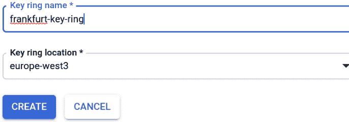

图 3.5 – Google Cloud KMS 密钥环的地理位置配置

**客户托管加密密钥 (CMEKs)** 提供了额外的数据安全控制。它们还确保资源创建者为其资源选择适当的位置。

- 另一个可以帮助确保只有来自特定位置的用户通过 VPC 服务控制访问数据的 Cloud 产品。该产品允许您执行出站和入站策略，并定义您希望用户访问和服务数据的 IP 地址范围和地理位置。结合 Cloud IAM 策略，您可以允许来自定义地理位置的授权用户访问，防止他们将数据移动到服务虚拟边界之外。所有 Google Cloud 服务均可根据定义的策略，确保数据不会被移动到不允许的位置。

Google 最近宣布了一项新功能 **密钥访问说明 (KAJ)**。每当使用 Cloud KMS 或外部 KMS 进行解密请求时，都会提供详细的说明，说明哪个密钥被请求解密。这与一种机制相结合，您可以批准或拒绝密钥访问。通过这些控制措施，作为数据所有者，您可以限制云提供商访问您的数据的能力。

# 第三方风险评估

第三方风险评估或供应商评估通常是许多希望从 Google Cloud 获取特定控制保证的监管客户的需求。一个例子是希望在 Google Cloud 上托管工作负载的金融机构。Google Cloud 提供自评估问卷。这些补充文档涵盖了 Google Cloud 的安全控制，可以帮助客户评估其安全性。这些自评估可以通过 Compliance Manager 访问：https://packt.link/B15d7。

部分可用评估如下：

- Google 安全联盟 (CSA) 自评估位于此处：https://packt.link/rnqoe。
- 标准信息收集 (SIG) 核心问卷供客户访问，用于对第三方供应商进行初始评估，以管理不同领域的安全风险。此报告位于此处：https://packt.link/6ftQS。
- 尽职调查问卷从 https://packt.link/syPOz 下载。
- Google Cloud 数据处理和安全条款 (https://packt.link/qMu6) 也适用于客户。

除了这些资源，Google Cloud 还提供了从数据加密、隐私到应急响应等主题的安全白皮书。这些白皮书可以访问：https://packt.link/c0ai。

# 云合规

在本节中，我们将涵盖两个主题：如何访问 Google Cloud 提供的合规报告，以及实现云端持续合规的工具和能力。

Google 产品由第三方进行合规审查，并提供两套合规报告：一组可以从 Google Cloud 网站下载并通常对任何人开放；另一组可以向分配给组织的 Google 技术客户经理 (TAM) 请求。您可以在此处找到 Google 的合规报告：https://packt.link/eaDuj。新的 Google Cloud 产品通常会有几个月的延迟才会被加入合规范围。Google 有固定的审查周期，新产品首先通过 SOC 2 和 ISO 审计，然后通过特定市场的认证。

# 信任与合规

Google 符合国际标准，如 ISO 27001、ISO 27017、ISO 27018、SOC 2 和 SOC 3。除了这些，还有某些特定的合规框架，如美国的 FedRAMP 和新加坡的 MTCS。同样对于其他国家（如德国和澳大利亚），Google Cloud 符合各自的国家隐私要求。注意的是，每个 Google Cloud 区域都符合一致的标准。对于将所有合规标准构建到 Google Cloud 的客户来说，这是其优势之一。尽管 Google Cloud 符合所有区域的标准，但某些区域可能不符合当地法律法规。这意味着在评估任何特定标准时，必须考虑适用于区域的特定法规。例如，某些区域可能不符合某些安全标准，或者某个区域可能有必须遵守的数据保护法。在提交任何服务之前，确保您使用 Google Cloud 的区域符合适用标准是重要的。以下是我们在此处找到的合规标准图：https://packt.link/fjr39。

| 全球 | 美国 | 加拿大 | 欧洲 | 西班牙 | 澳大利亚 | 日本 |
|---|---|---|---|---|---|---|
| ISO 27001 | HIPAA | 个人 | GDPR | Nacional de | 澳大利亚 | FISC |
| ISO 27017 | HiTrust | 信息 | EU 模型 | Seguridad | 隐私原则 | 数字号法 |
| ISO 27018 | FedRAMP | 电子 | 合同条款 | Prudential | 监管 | |
| SOC 1 | FIPS 140-2 | 文档 | TISAX | | 标准 | IRAP |
| SOC 2 | COPPA | 资产 | 隐私盾 | | 安全原则 | MTCS 三级 |
| SOC 3 | FERPA | | | | | | OSPAR |
| PCI DSS | NIST 800-53 | 阿根廷 | BSI C5 | | | OSPAR | |
| CSA STAR | NIST 800-171 | 个人数据 | 德国 | | NCSC | | |
| MPAA | 萨班斯-奥克 | | 法律 | 英国 | POPI | | |
| GXP | SEC 规则 17a(4) | | | 南非 | | | |
| 独立 | | CFTC 规则 1.31(g) | | | | | |
| 安全 | 评估员 | FINRA 规则 4511(c) | | | | | |

图 3.6 – 第三方认证与监管合规

## 云端合规性

现在，我们将简要介绍 Google Cloud 符合的某些关键国际标准。此处的目的并非为了深入探讨这些标准，而是从高层面上进行概述，以便您了解这些合规性标准的范围。从考试的角度来看，您不会针对对合规性标准的知识进行测试：

- ISO 27001：这是一个信息安全管理体系 (ISMS) 框架，由 14 个组、35 个控制目标和 114 个控制措施组成。ISMS 是根据 ISO 27001 标准编写的，该标准为建立、实施、运行、监控、评审、维护和增强 ISMS 提供了指南。作为核心合规计划之一，ISO 27001 涵盖了所有类型的组织（商业企业、政府机构和非营利组织）。Google 每年进行第三方审计，以根据该标准对单个产品进行认证。
- ISO 27002：ISMS 控制具体的实施细节。这不是一项认证标准，而是一份建议性文档，包含一份最佳实践列表和指南，组织可以使用这些内容来满足 ISO 27001 标准中列出的控制措施。它建议了旨在降低信息机密性、完整性和可用性风险的安全控制措施。由于这是一份建议性文档，组织可以选择使用这些控制措施，也可以使用完全不同的控制集来通过 ISO 27001 标准的认证。
- ISO 27017：该框架是 ISO 27001 的扩展，专门关注超出前一份文档通用指南的与云计算相关的信息安全。该标准建议云服务提供商和客户创建一个个人责任和共享责任的矩阵。
- ISO 27018：这是一组安全指南，专门关注个人身份信息 (PII) 的处理和保护。它扩展了 ISO 27002 的控制目标，ISO 27002 是一个更广泛的信息安全管理体系标准。作为 PII 处理者的公共云服务提供商的安全防护措施是该标准的重点。

在下一节中，我们将查看如何使用 Reports Manager 下载这些合规报告。

## 合规报告

合规报告管理器 (Compliance Reports Manager) 让 Google Cloud 客户能够从 https://packt.link/C6JRN 下载选定的合规报告。新报告会在每月月底发布。

您可以通过此链接访问 Reports Manager：https://packt.link/yBhnU。

# 信任与合规

让我们快速浏览一下如何下载这些报告：

- 1. 使用过滤器，您可以选择想要下载的报告。过滤器的选项包括行业 (Industry)、地区 (Region)、报告类型 (Report Type) 和产品领域 (Product Area)。行业选项包括：行业无关（如 ISO、SOC 和 CSA 报告）以及政府/公共部门（指的是与政府机构相关的报告，例如澳大利亚的 IRAP）。请与您的 Google Cloud 代表合作，以帮助您定位这些报告。

选择要下载的报告


## 2. 接下来，您可以使用过滤器指定所需的报告，您将看到选择并然后从合规报告管理器下载默认报告的选项。在示例中，我们将行业留为默认，地区设置为全球 (`Global`)，报告类型设置为审计报告 (`Audit Report`)，产品领域设置为 Google Cloud。

选择要下载的报告

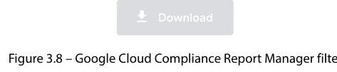

## 3. 接下来，您可以选择您需要的报告并点击下载 (`Download`)。在我们的示例中，我们选择了一个 PCI-DSS 报告进行下载。


| 合规性 | 报告类型 | 区域 | 最后审计时间 |
| --- | --- | --- | --- |
| PCI-DSS v3.2 | 审计报告 | Google Cloud | 2021年5月 |

PCI-DSS 是由安全标准委员会采用的一套安全指南，旨在保护客户的支付信息。合规声明 (`AoC`) 为符合合规要求提供了正式保证。作为 PII 处理者的公共云服务提供商的安全防护措施是该标准的重点。在之后，你可以以类似的方式下载并查看其他合规报告。

图 3.9 - 合规管理器：PCI 报告

## 持续合规

在下一部分，我们将查看您如何利用自动化功能下载这些报告。持续合规是许多客户从传统数据中心迁移到云端时获得的关键优势之一，自动化功能使得合规变得更加简单。Google Cloud 提供的这些功能帮助您实现合规目标。

持续合规意味着，当资产状态发生变化时，会执行策略对 Google Cloud 资源进行合规检查，并返回合规或不合规的结果。如果合规，则无需采取行动；但是，根据您的组织成熟度，可以采取不同的行动。例如，您可能只想向安全和合规团队发送通知，或者可以构建一个自动化流程，一旦发现资产不合规，`Cloud Functions` 将将执行纠正措施使其恢复合规。

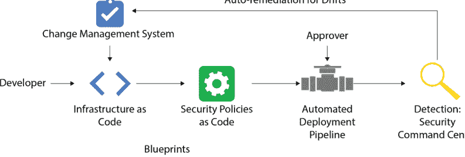

图 3.10 - 持续合规流水线

Google Cloud 提供了一套全面的工具和服务，帮助组织确保其系统和应用程序符合法律法规。这包括自动化合规检查、持续监控和警报功能，帮助组织快速响应潜在问题。

## 4 资源管理

在本章中，我们将介绍资源管理并理解一些关键组件，例如项目、文件夹和组织。在 Google Cloud 上构建环境时，这些组件可以帮助你在宏观层面进行分段管理。我们还将介绍组织策略限制、可用的某些内置限制，以及策略继承如何适用于**身份和访问管理 (`IAM`)** 和防火墙规则。我们也会涵盖 Cloud 资源清单（Cloud Asset Inventory），它是资源管理中不可或缺的一部分，以及它从安全角度引起的作用。我们将通过一些资源管理的最佳实践和设计考虑结束本章。

在本章中，我们将涵盖以下主题：

- Google Cloud 资源管理器概览
- 资源层级结构
- 组织策略服务
- 组织策略限制
- 策略继承
- 层级防火墙策略
- Cloud 资源清单
- 设计考虑与最佳实践

### Google Cloud 资源管理器概述

Google Cloud 资源管理器形像是你云资源的容器，允许你在项目、文件夹或组织内部以层级方式对资源进行分组。将资源管理器 视为执行宏观分段的高级方式。这不仅有助于你定义整个组织的结构，还能实现可以继承的安全护栏。更多内容请参见“策略继承”部分。

**图 4.1** 是关于如何在 Google Cloud 上构建你的组织的示例。顶层组织是创建所有其他组件（如文件夹和项目）的地方。以层级方式组织资源允许你管理访问控制和其他配置设置等方面。`IAM` 策略也是如此，它们可以应用于不同的级别，并从上到下进行继承。

### 组织层级结构

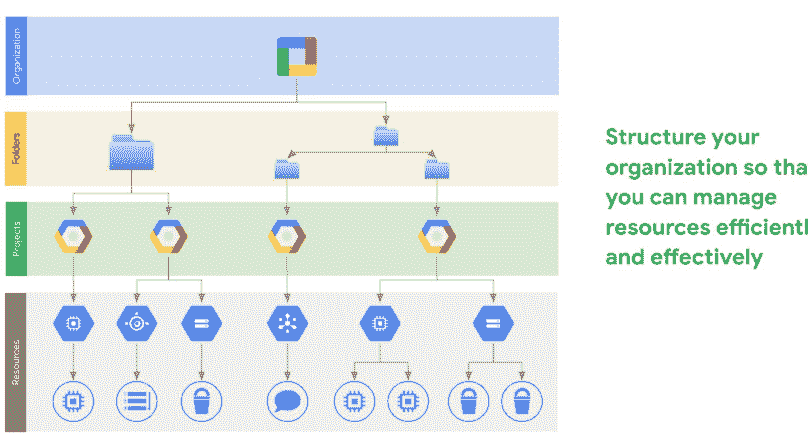

图 4.1 – 组织层级结构

让我们来看看构成组织层级结构的关键组件，并进一步探索策略如何应用和继承，以及一些组织结构的最佳实践示例。

#### 理解资源层级结构

构成资源层级结构的关键组件如下：

- 组织（Organization）：顶层组件——所有其他组件都链接到此处。
- 文件夹（Folders）：用于对相似的项目以一致应用策略。这些是可选的，但强烈建议使用。
- 项目（Projects）：所有资源（如你的计算实例、数据库等）所在的地方。

现在，让我们详细查看这些每个组件。从认证的角度来说，你将会对资源层级结构以及本章涵盖的主题进行测试。理解如何管理和创建资源以及应用策略和组织限制是非常重要的。我们将在本章中涵盖所有主题。

### 组织

这是项目的根节点和层级超级节点。它与 Workspace / Cloud Identity 账户密切相关。它是一个包含组织用户和组单一目录。组织是从 Cloud Identity 账户创建的。创建 Cloud Identity 组织后，你需要通过控制台手动创建组织或组来配置 GCP 组织。组织本身不包含用户或组，而是持有 GCP 资源。用户和组是 Cloud Identity 的一部分，但它们在 GCP 中接收 `IAM` 权限。顶层节点组织代表例如资源层级结构中的公司：Google Identity 和 Workspace 在一个组织内配置。只有当用户在 Google Cloud 中创建项目时，才会自动创建组织。组织还需要管理资源生命周期。它们作为所有创建项目的中心资源管理。组织的所有成员默认都属于组织。通过组织，你还可以跨所有资源应用策略，例如 `IAM` 策略和组织策略。我们将在本章稍后的“策略继承”部分介绍这些。

在接下来的图中，让我们理解 Cloud Identity 和 Workspace 之间的联系。Google Cloud Identity 和 Google Workspace 之间的联系是 Google Cloud Identity 为用户身份验证和访问管理提供基础，Google Workspace 用此管理和保护用户账户以及对其效率工具套的访问。没有 Cloud Identity 就没有组织（它是前提）。需要注意的是，Cloud Identity / Workspace 管理员是域名验证的总体所有，并有权在 Google Cloud 中创建任何 `IAM` 角色。

> 注意
> 你可以在第 5 章“理解 Google Cloud Identity”中阅读更多关于 Cloud Identity 的信息。

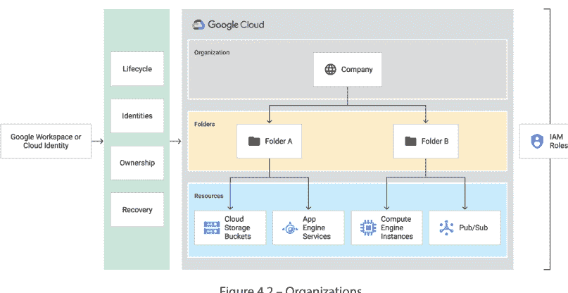

组织暴露并具有以下内容：

```json
{
  "createTime": "2020-01-07T21:59:43.3142Z",
  "displayName": "my-organization",
  "lifecycleState": "ACTIVE",
  "name": "organizations/347391823",
  "owner": {
    "customerId": "C01234"
  }
}
```

在前面的代码段中，数字 `347391823` 是唯一标识符。

#### 理解资源层级结构

组织的创建时间和最后修改时间也会被记录；`my-organization` 是显示名称，且无法更改。

### 文件夹

文件夹的主要功能是分组相似的项目。与组织类似，文件夹具有某些参数并用于建模你的结构。查看图 4.3 以了解你如何在 GCP 中使用文件夹。

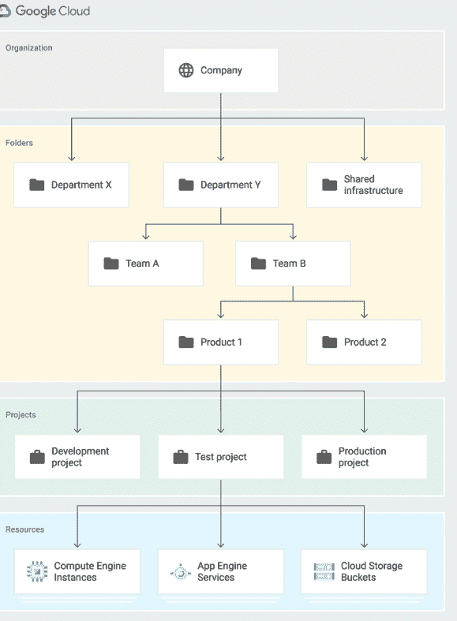

图 4.3 – 组织结构示例

#### 资源管理

在这个示例结构中，第一层代表部门，例如 X 和 Y。由于文件夹的能力深达 10 层（硬限制），你可以创建更多文件夹来代表不同的团队和产品。这使你能够在部门、团队或产品级别定义访问控制和权限。注意策略继承是自上而下的；也可以移动项目，但你必须留意策略继承，因为它应该应用。

### 项目

项目是 Google Cloud 必需的基础级对象。你的组织可以包含项目和文件夹。项目是创建所有云资源的地方。每个项目与其他项目完全分离，其内部的资源也是如此。项目从功能和访问的角度对特定资源分组非常有用。创建项目没有成本，你可以根据需要创建任意（请注意，根据账户类型（例如企业版与开发者，可能会适用限制）。项目不绑定到地理位置，并作为 `IAM` 执行点。

让我们使用示例代码段查看项目的结构以及它包含的内容：

```json
{
  "createTime": "2020-01-07T21:59:43.3142Z",
  "lifecycleState": "ACTIVE",
  "name": "my-project",
  "parent": {
    "id": "634792535758",
    "type": "folder"
  },
  "projectId": "my-project",
  "labels": {
    "my-label": "prod"
  },
  "projectNumber": "464036090314"
}
```

#### 理解资源层级结构

在与云资源交互时，会使用项目 ID 和项目名称。对于管理云资源的每一个请求，你都需要指定项目信息。

### 理解 IAM 策略继承工作原理

我们将在第 6 章“Google Cloud 身份和访问管理”中介绍 `IAM` 深度。在本节中，我们将理解 `IAM` 策略在组织中是如何工作的。Cloud `IAM` 允许你对资源进行细粒度的访问配置。它允许你通过 `IAM` 策略配置谁（用户）对什么（资源）拥有什么访问（权限）。

下图展示了 `IAM` 策略继承的工作原理，它是自顶性的，这意味着你可以在组织级、文件夹级、项目层级甚至资源层级配置 `IAM` 策略。如果你还记得之前的章节，我们查看过如何创建组织层级结构。


资源的有效策略是该资源上设置的策略与从父级继承的策略的并集。本质上，这意味着资源继承项目的策略，而项目继承文件夹和组织的策略。根据上图，如果你在文件夹级赋予 Alice “项目编辑者”角色， Alice 将拥有对该文件夹下所有项目的“项目编辑者”访问权限。如果你在特定项目的资源级赋予 Bob “实例管理员”角色，则 Bob 将仅对该项目拥有“实例管理员”访问权限。

图 4.4 - `IAM` 策略继承

#### 资源管理

另一个需要记住的方面是，虽然你有将项目从一个文件夹迁移到另一个文件夹的能力，但 `IAM` 策略会继承，这意味着与之前的文件夹相关的权限将不再生效，并将继承新的权限。让我们进一步查看一个策略继承如何工作的示例；我们将如图 4.5 所示查看 Compute Engine 的策略继承。


图 4.5 – `IAM` 策略继承—Compute Engine

在图 4.5 中，Bob 被授予了 `compute Admin` 层的级的访问权限；因此，Bob 将拥有对 `instance_a` 和 `instance_b` 执行管理函数的权限。另一个用户 Alice 在 `project_2` 层被分配了 `compute.instanceAdmin`。在这种情况下，Alice 可以对属于 `project_2` 组的 `instance_b` 执行 `compute.instance.insert` 函数，但没有权限对 `instance_a` 执行 `compute.networks.insert` 函数，因为 Alice 在 `project_1` 的项目级没有权限。

接下来，我们将查看你如何在 Google Cloud 中对你的资源应用组织策略约束。

### 使用组织策略应用约束

组织策略服务（Organization Policy Service）为你提供了一种集中且程序化的方法，用于跨整个组织及相应的云资源应用约束。我们通常会规定需要应用于整个组织的要求；这些约束是不可协商的，你的云环境中的每个资源都必须遵守。这正是组织策略服务的用武之，，它让你能够集中地应用这些策略，以避免或缓解下游项目和云资源中的配置错误。这有助于你创建根据合规性要求或内部合规性定义的护栏。现在使用 Google Cloud 服务的开发团队无需担心应用这些策略并进行重复劳动。这进一步减少了可能发生的错误数量，因为你现在可以集中控制整个组织级约束的应用。

了解 `IAM` 和组织策略服务约束之间的区别非常重要。`IAM` 侧重于“谁”可以在特定资源上执行授权操作，而策略约束侧重于“什么”，即决定在资源上强制执行什么，从而规定它们如何被配置。例如，通过 `IAM` 策略允许一个名为 Bob 的用户在 Compute Engine 上执行管理功能，但通过定义一个不允许将外部 IP 地址分配给计算实例的约束，你可以限制 Bob 为组织下的任何实例配置外部 IP 地址。

让我们根据图 4.6 进一步了解组织策略是如何被应用的。


图 4.6 – 组织策略

根据上述插图，组织策略管理员可以在组织、文件夹或项目级应用组织策略（Org Policy）。组织策略必须定义一组约束，作为策略的一部分来执行限制。一旦定义了约束，就可以在管理员决定的层级应用该策略。注意，如果组织策略管理员需要，组织策略可以在较低的层级被覆盖。接下来，我们将查看可以应用的不同类型的约束。

### 组织策略约束

简单来说，约束（Constraints）是可应用于资源的限制条件。你有能力在不同的节点层级应用这些约束，例如组织级或文件夹级或项目级。Google Cloud 将这些约束定义为定义特定资源“不能做什么”的护栏。

每个约束都由一组属性定义，并包含唯一名称，如 `constraints/compute.disableSerialAccess`，一个带有约束描述的人类友好名称，以及其后该约束的默认行为。

图 4.7 显示了一些高度建议在 GCP 云环境中强制执行的约束列表。

| 服务 (Services) | 约束 (Constraints) | 说明 (Description) | 适用于 |
| :--- | :--- | :--- | :--- |
| Google Compute Engine | VM 实例的外部 IP | 定义一组允许使用外部 IP 地址的 VM 实例。 | 确保攻击面最小化。VM 通常应只获取内部 IP。 |
| | 跳过默认网络创建 | 跳过默认网络的创建。 | 防止产生必要的资源。 |
| | 要求 OS Login | 强制使用 OS Login。 | 增强安全性。 |
| Cloud IAM | 范围限制 | 限制共享到特定域。 | 防止数据泄露到外部。 |
| GCP | 资源位置限制 (beta) | 限制资源创建的位置。 | 符合数据主权法律。 |
| Cloud Storage | 强制统一桶级访问 | 强制执行统一桶访问。 | 确保安全策略的一致性。 |

图 4.7 - 组织策略示例

> 注意
> 你可以在 https://cloud.google.com/ 找到完整的约束列表

### 策略继承

组织策略继承通过在节点层级（组织/文件夹/项目）应用策略来实现，此时该策略将被继承。你也可以在子节点创建自定义策略，这些策略可以合并或覆盖继承的策略。

让我们进一步了解继承规则以更好地理解策略：

- 第一条规则适用于未定义策略的情况。如果资源在层级结构中没有继承或拥有策略，则执行约束的默认行为。
- 第二条规则规定，如果资源设置了策略，它将覆盖任何设置的策略。但是，该规则有一个例外。如果策略的 `inheritParent` 属性设置为 `true`，则资源节点将继承父节点的策略。在这种情况下，节点级策略将与继承策略合并，并对两者进行协调和评估。
- 第三条规则是，如果设置了 `inheritParent = false`，则资源将不继承父节点的策略。如果在资源级配置了策略，则该策略将生效；如果没有配置，则执行如第一条规则中定义的策略默认行为。
- 第四条规则关于策略冲突。让我们考虑这样一个示例：你在文件夹级定义了一个允许 `project/123` 的策略约束，而在该文件夹下的项目级，定义了另一个拒绝 `project/123` 的策略约束。在这种情况下，父策略允许操作，而项目级拒绝相同的操作。拒绝（DENY）始终具有优先级。这就是策略合并的方式。

关于策略合并异常的一个重要说明：对于所有源自布尔值约束（Boolean constraints）的组织策略，请勿合并。例如，假设你在文件夹级定义了一个策略约束并将执行设置为 `true`。该文件夹下的项目级另一个策略约束被设置为 `false`。在这种情况下，最具体的策略操作（`false`）将生效。

Google Cloud 文档使用图 4.8 中的插图来解释策略评估是如何工作的。根据前面的规则，让我们总结一下每个资源上采取了哪些策略操作：

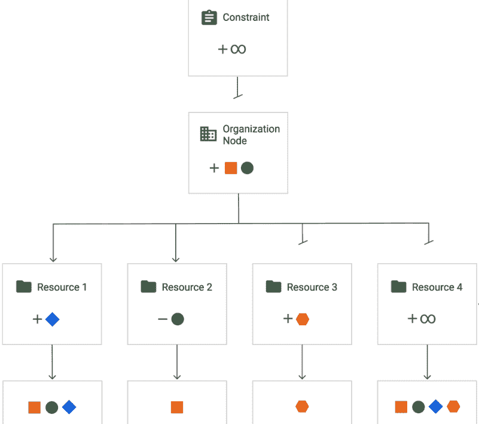

图 4.8 – 组织策略约束评估标准

在此示例中，我们在**组织节点 (Organization Node)** 上定义了一个红色正方形和一个绿色圆形。对于**资源 1**，箭头代表 `inheritFromParent = true`；因此，第一个资源将继承红色正方形和绿色圆形，并添加蓝色菱形作为节点级资源策略。

同样，对于**资源 2**，`inheritFromParent = true`；因此，它将继承父级策略，但资源节点级上定义了另一个策略来移除绿色圆形。这意味着协调后的策略将仅包含红色正方形。

接下来两个资源被设置为 `inheritFromParent = false`；因此，对于资源 3，节点策略添加了一个黄色圆形；而对于资源 4，定义了 `restoreddefault`。这意味着所有默认策略约束都将被定义。

资源管理主题到此结束。在下一节中我们将介绍分层防火墙策略以及它们如何应用和评估。

### 分层防火墙策略如何工作

尽管分层防火墙策略不在考试范围之内，但为了完整性和认知，我们将其包含在这里。分层防火墙策略的应用与你对组织应用 `IAM` 策略和约束的方式类似。你可以在组织根目录或文件夹级别执行这些策略。这允许你在整个组织范围内创建一组一致的网络策略。


分层防火墙策略与 VPC 防火墙规则类似，你可以创建允许和拒绝规则。唯一的区别是，分层规则允许你通过应用 `goto_next` 操作来委托规则。此外，低级规则不能覆盖由网络管理员定义并应用于全组织的高级规则。

分层防火墙策略定义了一些规范。让我们来了解它们，包括评估标准：

- 你可以在组织级和文件夹级创建分层防火墙策略。
- 创建策略并不强制执行它，除非你在希望的层级应用了它，例如组织级或文件夹级。
- 规则评估基于资源层级结构。在移动到下一级之前，会评估给定层级上的所有规则。
- `goto_next` 操作允许你将策略评估委托给下一级的低级策略。
- 使用虚拟机实例、子网或特定服务（如 Google Kubernetes Engine (GKE) 集群）作为资源目标，你可以为特定的 VPC 和 VM 创建分层策略。这可以帮你管理某些 VM 组的异常。
- 你可以将 IPv4 或 IPv6 地址作为策略的一部分，但不能在同一策略中同时包含两者。

接下来，让我们看看分层防火墙的策略继承是如何工作的。

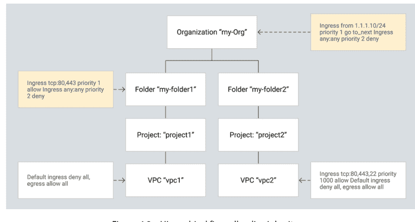

在图 4.9 中，你可以在组织级或文件夹级应用分层防火墙策略。当应用在组织 **my-Org** 级时，所有策略都会被文件夹及其相应的项目和 VPC 继承。在策略仅应用于文件夹级的情况下（例如前图应用应用于“my-folder1”文件夹的策略），这些策略将仅适用于 **project1** 和 **vpc1**。此外，请注意，如前所述，底层策略不能覆盖高级策略。然而，你有能力通过定义下一个待评估低级策略的 **goto_next** 操作来委托策略决策。让我们看看分层防火墙策略评估是如何工作的。

## 使用组织策略服务应用约束

分层防火墙策略的规则评估相当简单，遵循三条规则。

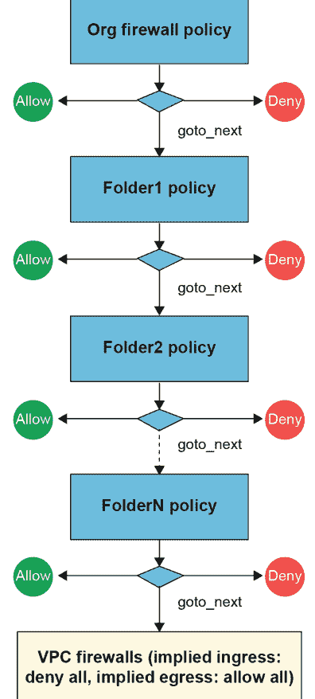

- 本次发布引入的安全策略
- 当前现有的 VPC 防火墙规则

图 4.10 – 分层防火墙策略评估

## 资源管理

让我们查看图 4.10 并理解规则是如何应用和评估的：

1. 第一条规则是在你在组织级应用策略时，所有规则都会针对给定的机器进行评估。这提供了对资源的见解。
2. 第二条规则是当你在文件夹级应用策略时，Cloud Asset Inventory 会收集资源的元数据，例如 App Engine 的数据。
3. 第三条规则是在你在项目级应用策略时，在移动到下一级之前会评估所有规则。

在本节中，我们将查看分层防火墙策略如何工作。接下来，我们将查看资产管理。

## 使用 Asset Inventory 进行资产管理

Cloud Asset Inventory 在安全中起着关键作用，因为它让你能够实时访问资产。以前，Cloud Asset Inventory 可以通过 CLI 或 Command Center 访问，但随着最近的变化，你现在可以访问 Google 控制台。

Cloud Asset Inventory 是一项元数据服务，允许你搜索、导出、监控和分析资产。在查看 Cloud Asset Inventory 可以帮助的某些案例之前，让我们了解一些关键概念。

资产是 Google Cloud 资源或策略对象。Cloud Asset Inventory 收集有关资源的元数据。策略相关的元数据包括 IAM 策略、组织约束和 Access Manager 策略。第三类元数据信息是在运行时收集的，例如操作系统和可用软件包。

> 注意
> 你可以在 https://packt.link/GWLD3 查看所有资产的完整列表。

现在让我们看看 Asset Inventory 的一些关键属性和功能。

### 资产搜索

Cloud Asset Inventory 的主要优势在于它的功能可以帮助你搜索、导出、监控和分析不同资产并提供实用的见解。让我们来看看每一个。

通过 Asset Inventory API，你可以创建自定义查询来查找组织、文件夹或项目级的 IAM 策略。以下命令是你可以用于列出所有 IAM 策略的示例：

```bash
gcloud asset search-all-iam-policies \
  --scope=projects/12345678
```

你可以通过查找拥有所有者角色的账号来使用 Asset Inventory API 检测风险设置。以下是此类查询的示例：

```bash
gcloud asset search-all-iam-policies \
  --scope=organizations/123456 \
  --query='roles/owner serviceAccount' \
  --page-size=50 \
  --flatten='policy.bindings[].members' \
  --format='table=resource.segment(3):label=RESOURCE TYPE, resource.basename():label=RESOURCE, policy.bindings.member' \
  | grep serviceAccount
```

使用 Asset Inventory 搜索功能可以帮助回答此类问题：

- 哪些策略包含 `foo@bar.com`？
- 哪些资源对外开放（包含 `allUsers`）？
- 谁在组织中拥有所有者角色？
- 是否有具有 *.setIAMPolicy 权限的用户？

除了搜索策略，你还可以搜索资源，例如列出项目中的所有资源、查找位于欧洲区域的 VM 或查找标记为敏感的 BigQuery 数据集。所有这些能力赋予赋予你强大的访问权限，以缩短时间并获取采取纠正措施的信息。接下来，让我们看看如何导出资产相关信息。

### 资源导出

通过资源导出，你可以使用 Cloud Asset Inventory API 导出所有资源和策略。使用 `ExportAssets` API，你可以将特定时间点的所有资产导出到 Cloud Storage 文件或 BigQuery 表格。此外，你可以使用 `ListAssets` API 列出特定时间点的所有资产，并使用 `GetAssetsHistory` API 获取特定时间范围内特定资产的变更历史。Cloud Asset Inventory 提供了资源、IAM 策略、组织策略和访问策略的时间元数据。提供为期五周的历史供导出。

### 资源监控

你可以使用实时通知 API 监控你的 Google Cloud 资源，这些 API 可以创建馈（feeds），通过 Cloud Pub/Sub 实时接收资产变更。这允许你通过指定类型以及在任何数据字段上使用通用表达式库 (CEL) 条件来选择感兴趣的更改。例如，为了检测是否向 IAM 策略中添加了 @gmail 账户，你可以使用以下命令：

```
temporal_asset.iam_policy.bindings.filter(b, b.members.exists(m, endWith("@gmail.com")).size() > temporal_asset.prior_asset.iam_policy.bindings.filter(b, b.members.exists(m, endWith("@gmail.com"))).size() > 0)
```

这为防火墙和 IAM 策略等敏感资源和策略提供了持续监控能力。

### 资源分析器

使用策略分析器，你可以获取更多关于策略对你的云资源影响的详细信息。你可以回答此类类问题，例如谁可以访问什么以及为什么？你可以发现谁可以从 BigQuery 数据集读取敏感数据，或者谁在何时访问了 Cloud Storage 存储桶。

这是一个极其有用且强大的功能，可以帮助你获得对 Google Cloud 环境的控制和可见性。另一个有用功能是资源洞察（Asset Insights），它可以为你提供应用于你的资源上的 IAM 策略的详情，并检测风险策略，以便你采取纠正措施。

Cloud Asset Inventory 的另一个可用更新是资源关系（Asset Relationships）。某些资产之间是相互相关的；例如，服务器可能通过防火墙规则连接以访问 MySQL 数据库。在网络管理员修改防火墙规则导致 Web 应用程序与数据库之间的连接断开的情况下，你可以根据策略和资源建立关系，以帮助排除故障，并识别是谁（用户）对哪些资源（资源）做了什么（操作），导致了事件的发生。

## 最佳实践与设计考虑

Cloud Asset Inventory 并不是考试大纲的一部分，你可能会看到对资源和策略的间接引用，但作为一名 Google Cloud 安全工程师，了解 Google Cloud 上如何进行资源管理的基础，更重要的是它与安全的关联性，将对你非常有益。

接下来我们将查看你应该了解的一些最佳实践和设计考虑，以及它们如何应用于你项目中的资源。

### 最佳实践与设计考虑

某些设计考虑是要理解资源如何在项目内部进行管理。使用一个项目可能是保持简单的好主意，但将需要隔离和职责分离。另一方面，如果你使用太多的项目，管理这些项目的开销将很大，但你将实现所需的职责分离和隔离。

在将资源和工作负载拆分为项目时，需要遵循的一些设计考虑如下。请记住所有这些考虑都是相关的：

- 你不希望一个运行环境中的配置错误或破坏影响另一个环境。一个关键考虑因素是减少爆炸半径（blast radius）。
- 配额和限制应用于项目级。开发/测试项目消耗生产项目所需的配额，或者一个应用程序消耗了另一个应用程序的配额，是不尽人意的。
- 你希望以拆分云资源的方式来确保最小权限访问。一个关键考虑因素是降低管理复杂性。
- 在项目级跟踪账单更容易。
- 确保职责分离。例如，你可能希望将中心网络项目与应用项目分离，以实现网络团队与开发团队之间的职责分离。
- 你希望通过适当的拆分（例如，生产、测试、开发、预发布和用户验收测试），为不同的运行环境实现上述所有目标。

上述考虑帮助我们理解如何以及何时考虑拆分资源和项目。此外，管理项目的一些关键考虑因素包括：每个应用程序使用一个项目，使用数据分类作为将敏感数据保留在独立项目且不混合不同数据分类的方法，最后，使用一致的项目 ID 命名规范。

最佳实践是使用针对特定工作负载和环境的项目，由于创建项目是一项重复性任务，应该利用基础设施即代码（Infrastructure as Code）和自动化。

在文件夹设计考虑方面，尽量不要复制你的组织结构。这里引用的许多示例都是为了说明目的而使用那种结构。关键在于理解工作流和访问模式。在设计你的文件夹结构时，要问的关键问题是：

- 现在的访问模式是什么？
- 某个应用程序的整个团队是否需要访问其所有组件？
- 你在不同的运行环境之间是否有访问策略的分离？

这将帮助你理解如何根据符合你组织的工作流和访问控制来组织文件夹结构。

### 组织

 图4.11 - 组织示例

让我们考虑：如果你必须创建多个组织，你可以根据业务部门、开发环境和团队使用文件夹分组。一些关键考虑因素包括：

- 每个组织都应该有自己的 Identity 账户，并独立配置和管理
- 它需要管理 Identity 目录（用户、组、域）
- IAM 策略应该是去中心化的
- 组织级策略需要复制
- 策略的任何更改/更新都需要相应地应用到每个组织
- 组织级仪表板将仅提供其环境的视图
- 环境通过组织进行隔离
- 合并环境或重构非常困难
- 项目无法在组织之间移动
- 共享 VPC 只能在同一个组织内共享网络资源
- 全局性的 GCP 功能可能无法充分利用，或可能需要变通方法应用于所有环境

在考虑部署多个组织并避免复杂性时，记住这些考虑因素是非常重要的。尽可能的最佳实践是使用文件夹进行分离。

## 总结

在本章中，我们学习了如何组织你的 Google Cloud 基础设施并管理可用资源。我们讨论了创建文件夹和项目的基础，以及你可以对它们强制组织策略限制的功能。如果你计划在基础设施中使用 IAM 或防火墙规则，我们还讨论了策略继承原理以及它如何有助于你的组织结构。我们最后回顾了 Asset 以及一些最佳实践。

在下一章中，我们将深入探讨 Cloud Identity。

## 扩展阅读

有关 GCP 合规性的更多信息，请参考以下链接：

- 资源管理器教程：https://packt.link/RtxyV
- 最佳实践：GCP 资源组织与访问管理（Cloud Next'19）：https://packt.link/Z350x
- 创建和管理组织策略：https://packt.link/OegQi
- Cloud Asset Inventory 指南：https://packt.link/MexmV
- 理解 Cloud Asset Inventory：https://packt.link/L91Io

# 理解 Google Cloud Identity

在本章中，我们将介绍 Google Cloud Identity，它是 Google 提供的身份即服务 (IDaaS) 和企业移动设备管理 (EMM) 产品。我们将涵盖目录管理、如何创建和管理用户账户及群组，以及如何同步 Google Cloud Directory Sync (GCDS) 等目录服务等方面。我们还将涵盖其他功能和服务，包括单点登录 (SSO) 以及设备和应用管理。

此外，我们将介绍如何使用 Google Cloud Identity 来强制执行两步验证 (2SV)、密码管理、会话管理以及报告和管理员日志活动。Cloud Identity 内部的话题非常广泛，涵盖了一些与 Google Workspace（以前称为 G Suite）相关的方面，我们在本章中将讨论限制在与 Google 专业级云安全安全工程师考试相关的主题上。

在本章中，我们将涵盖以下主题：

- Cloud Identity 概述
- 账户安全，例如配置用户、双重身份验证、会话管理和 SAML
- 如何配置 Google Cloud Directory Sync

## Cloud Identity 概述

Google Cloud Identity 与我们在这书中将介绍的其他一些云安全产品不同。它的不同之处在于它涵盖了两个不同的平台：Google Workspace 和 Google Cloud。Google Workspace 不在涵盖范围内，因为它不属于 Google 专业级云安全工程师工程师的范围；我们将涵盖的功能和方面将仅与 Google Cloud 使用 Cloud Identity 相关。

首先，让我们了解 Cloud Identity 的几个方面。Cloud Identity 通过单独控制台 (`admin.google.com`) 访问。Cloud Identity 也是您在配置 Google Cloud 环境时交互的第一个产品，因为超级管理员账户存在于 Cloud Identity 中。本章稍后将会有关于超级管理员账户的内容。Cloud Identity 仅提供身份验证服务而不提供授权。授权方面由 Google Cloud 身份和访问管理 (IAM) 涵盖，它通过 Google Cloud 控制台 (`console.google.com`) 访问。

在进入 Cloud Identity 的配置和设置之前，让我们来看一些关键功能以更好地理解 Cloud Identity。Cloud Identity 是驱动 Google Workspace 的相同 IDaaS，它提供免费版和高级版。高级版对用户数量没有限制，尽管在免费版中，您可以要求 Google 将用户数量从默认的 50 个限制限制增加。其他区别还包括高级版对 Secure LDAP 的支持、访问 Google 安全中心、移动设备管理、将审核日志自动导出到 BigQuery 以及会话长度管理（您可以控制身份验证令牌的时长）。最后，免费版不带服务水平协议 (SLA)。

现在我们知道了免费版和高级版 Cloud Identity 之间的差异，让我们快速查看本章将涵盖的 Cloud Identity的一些功能。

### 单窗视图 (Single pane of glass)

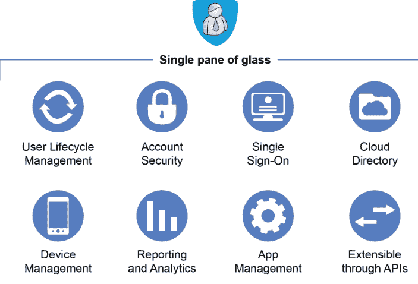

图 5.1 - Google Cloud Identity 功能

前面的图捕捉了 Google Cloud Identity 的关键功能。让我们看看与 Google Cloud 更相关的功能。在生命周期管理方面，您可以创建或将用户账户导入到云目录。如果您在本地环境中使用 Active Directory，则可以使用 GCDS 工具配置 Active Directory 并将用户、群组和成员关系导入 Google Cloud Identity。

您可以在用户加入组织、更改角色或离开时，控制配置和取消配置（部署）的过程。账户安全让您能够强制使用 2SV、应用密码策略，并开启/关闭对 Google Cloud 控制台的访问。您还可以使用 Google 身份验证或通过外部身份提供者 (IdP，如 Okta 或 Ping Identity）使用 SSO。我们将在本章稍后的部分详细介绍 SSO。

在下一节中，我们将介绍如何开始使用 Cloud Identity，涵盖域名验证的内容。

## 域名设置

在开始之前，请记住 Cloud Identity 通过 `admin.google.com` 访问，为了确保您拥有 Google Cloud 的 Identity 域名设置。出于治理和合规性要求，将 Google Cloud 账户与 Workspace 账户分开是一个好主意。

配置新域名包括以下步骤：

1. 注册 Cloud Identity。提供个人信息，如姓名、电子邮件地址、业务、地区。
2. 下一步是身份验证，以确保您拥有超级管理员账户。如果您知道您的域名，可以使用 Google 生成的验证码添加 TXT 记录来验证域名：httpspackt.link/Qiq。

正如之前提到的，这些步骤是为了完整性让您成为 Cloud Identity 域所有者。接下来我们将介绍超级管理员角色，在进入如何创建和管理用户群组之前。

## 超级管理员最佳实践


Cloud Identity 拥有超级管理员角色，这与 Google IAM 组织管理员不同，但超级管理员默认是组织管理员，并对两个平台拥有权限。超级管理员通过 `admin.google.com` 管理，并拥有管理用户、群组和安全设置的访问权限。它还用于授权 Cloud IAM 组织管理员角色。对于所有目的，超级管理员不应使用 `console.google.com` 来配置 Google Cloud 资源。

鉴于超级管理员的重要性，应该遵循一些最佳实践。这些最佳实践包括：

- 始终为超级管理员账户启用 2SV/多因素身份验证。
- 在安全位置保留备份密钥。
- 禁用设备信任并限制 Web 会话长度。
- 防止对个人的过度依赖，建议限制超级管理员账户的使用并最多保留 4 个。这种预防措施降低了单点故障相关的风险，并确保在紧急情况下有足够的超级管理员。
- 设置恢复电话和电子邮件选项，并确保恢复安全且受 2SV 保护。
- 创建专用超级管理员账户并锁定。这是一个在紧急情况下使用的断路（break-glass）账户。
- 分配 Cloud Identity 角色以委托管理用户、群组等。
- 将 Google Cloud 资源的设置和管理委托给其他管理员，并为他们分配功能性 IAM 角色，以确保职责分离。
- Cloud Identity 超级管理员将始终跳过任何 SSO；他们将直接与 Google Identity 验证。

> 注意
>
> 如果由于没有设置恢复电子邮件/电话而丢失对超级管理员账户的访问权限，则需要域名 DNS 访问来验证所有权。

Cloud Identity 的主题非常广泛，某些领域与 Google Cloud Workspace 的功能重叠。在本节中，我们只涵盖了从 Google 专业级云安全工程师考试视角相关的内容。如果您想进一步学习，可以参考 Cloud Identity 的文档。接下来，我们将介绍 Cloud Identity 的一些与安全相关的功能。

## 保护云身份

Google Cloud 提供了多种不同的选项，可以帮助您保护账户并实施强的安全控制。在本节中，我们将介绍如何使用安全密钥强制执行双步验证（2SV）、执行密码策略和恢复选项，以及配置用户安全设置（如会话时长），并演示 Google 安全中心的操作。

### 二步验证

通过 2SV，用户使用用户名和密码（也称为他们所知的物品）以及第二个因素（他们拥有的物品）登录账户。第二个因素可以是物理安全令牌或可以生成密钥的手机。Google Cloud Identity 支持多种可作为身份验证第二个因素的方法。这些方法包括：

- **安全密钥：** 物理安全密钥，例如 Google 的 Titan 安全密钥或 YubiKey。
- **Google 提示：** 用户可以设置其手机手机（iOS 或 Android）以发送登录提示。当用户尝试登录并成功完成用户名和密码的第一步后，用户将在其授权设备上收到一个登录提示，以确认是否为用户本人发起的登录。
- **代码生成器：** 另一个选项是使用代码生成器，例如 Google 验证器、Authy 等。用户可以使用代码生成器生成一次性代码，作为第二个因素使用。
- **备份代码：** 当用户无法手机生成代码时，可以使用这种离线方法。他们可以打印备份代码并代之使用。备份代码通常用于恢复。
- **短信或电话：** 您也可以选择通过手机上的**短消息服务 (SMS)** 向您发送一次性密码，或者您可以在您的授权设备上接收带有一次性代码的电话。

对于可以配置何种类型的 2SV，有多种选择。您可以使用任何 2SV 选项的组合。接下来，我们将查看如何在网页界面中强制执行 2SV。

在强制执行 2SV 之前，您必须确保用户意识到他们需要注册 2SV 并选择自己的验证方法。

接下来，让我们看看如何从控制台强制执行 2SV：

- 1. 使用您的凭据登录 `admin.google.com`
- 2. 导航到左侧菜单的“安全 (Security) | 身份验证 (Authentication) | 二步验证 (2-step verification)”（见图 5.2）。在设置中，从左侧选择您想要强制执行 2SV 策略的组织组。

安全 > 二步验证

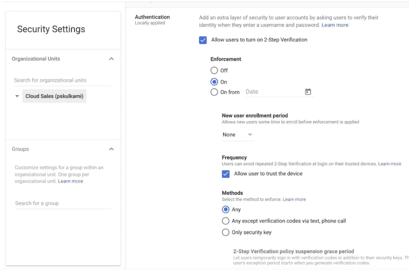

图 5.2 – 账户安全 (2SV)

- 3. 从此处提供的配置选项中，您可以将强制执行设置为“开启”或“关闭”，或调度其为特定数据开启。选择“开启”将立即生效。
- 4. 另一个重要的配置是让用户指定他们登录的设备是否为信任设备。设置此项后，当用户首次登录时，将提示用户名和密码，并询问他们是否忘记该设备。如果用户选择了此选项，那么他们下次登录时将不会提示 2SV。除非用户删除 Cookie 或权限被撤销，否则该设置将有效。
- 5. 作为 2SV 策略的一部分，您还可以为可能不适用策略的用户创建一个异常组。这可以针对多种用户；虽然不建议这样做，但您确实有权进行配置。
- 6. 接下来，您可以为用户提供注册 2SV 的时间，从零到六个月不等。如果是首次实施 2SV，这将帮助您进行推广。用户将获得配置 2SV 的时间，之后他们就可以登录。如果他们未在注册截止日期前完成，将无法登录。
- 7. 最后，您有权选择验证方法。作为最佳实践，建议选择**仅限安全密钥**，因为这是最安全的选项。但您并不限于此，还可以配置其他选项的权利，例如，**通过短信、电话接收的任何验证码**，这将启用所有支持的验证方法。根据您的组织需求，您可以选择这些选项。
- 8. 其他配置选项还包括配置挂起策略的能力以及使用备份代码的能力。

> 注意
>
> 您可以通过以下链接阅读更多关于这些设置的信息：
>
> https://packt.link/BVasl。出于考试目的，您应该能够像之前解释的那样配置 2SV 策略。

### 用户安全设置

作为管理员，您有权查看用户的设置并执行某些操作，如重置密码、添加或删除安全密钥、重置用户登录 Cookie、关闭临时挑战，或撤销特定应用程序密码或对第三方应用程序的访问。让我们快速查看如何访问这些设置：

- 1. 登录 `admin.google.com`。
- 2. 导航到“目录 (Directory) | 用户 (Users)”，选择用户名以查看其安全设置。
- 3. 在用户详情页，您可以看到多种选项，如用户组、权限和安全设置。我们将进入安全设置。


图 5.3 – Cloud Identity – 用户详情

4. 在用户信息页面上，滚动到“安全 (Security)”部分并点击它以进入安全设置。

| 安全 | 设置 |
| :--- | :--- |
| 密码 | 重置密码。 |
| 安全密钥 | 测试没有安全密钥。 |
| 高级保护 | 关闭 |
| 二步验证 | 关闭 只有用户可以开启。 |
| 恢复信息 | 电子邮件：添加恢复邮箱；电话：添加恢复电话 |
| 强制更改密码 | 开启 需要更改密码。 |
| 登录挑战 | 嫌疑尝试后关闭 10 分钟。 |
| 登录 Cookie | 重置用户 Cookie。 |

5. 从此处，您可以查看并配置多种安全设置。我们将简要查看它们各自的功能：

- **重置密码：** 这允许您重置用户的密码。您可以自动创建密码并查看密码。当把密码发送给用户时，您可以设置**下次登录时修改**。如果需要，也可以复制粘贴密码，但不建议这样做；您应该从控制台发送密码。
- **安全密钥：** 您可以用户添加或撤销安全密钥。
- **二步验证：** 只有用户可以开启。作为管理员，您只能检查 2SV 设置，或在需要时为被锁的用户获取备份代码。
- **强制更改密码：** 您可以强制用户更改密码。

其他设置包括查看或撤销特定应用程序密码，您可以撤销对第三方应用程序的访问。

### Google Cloud 会话时长控制

作为管理员，您可以配置 Google Cloud 服务的会话时长。您也可以对 Google 服务（如 Gmail）进行配置，但这不在我们的讨论范围内，我们将仅关注配置 Google Cloud 服务的会话时长。

你可以选择创建组以使此策略不适用于这些组。强制执行时，此策略适用于 Google Cloud 控制台访问、`gcloud` 命令行工具（Google Cloud SDK）以及任何属于你或第三方、且需要 Google Cloud 范围（https://pack.link/Q1sR2）用户授权的应用程序。请注意，Google Cloud 会话长度控制不适用于 Google Cloud 移动应用。我们将查看如何从管理控制台强制执行会话长度：

- 1. 通过 `admin.google.com` 登录。
- 2. 导航至 安全性 (Security) | 访问和数据控制 (Access and Data Control) | Google Cloud 会话控制 (Google Cloud session control)。

参考以下截图供你配置的多个选项。

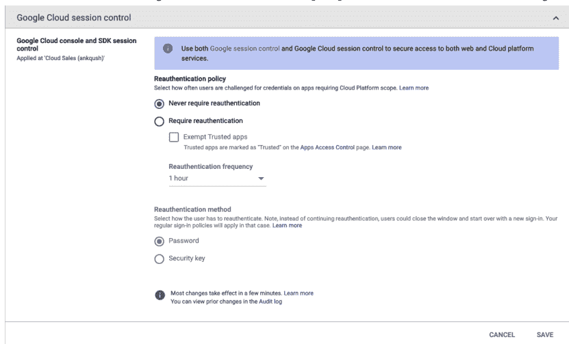

图 5.5 – Google Cloud 会话控制

- 3. 从左侧菜单中选择想要应用此策略的组织单元和组。如前所述，你可以将此策略选择性地应用于特定组中的用户，而不是所有用户进行会话控制，为标准用户和特权用户设置不同的会话控制设置。

#### 让我们来看看我们可以配置的其他可用选项：

- **重新身份验证策略 (Reauthentication policy)：** 在此处，你选择需要重新身份验证 (Require reauthentication)，然后指定重新身份验证频率 (Reauthentication frequency)。最小频率为一小时，最大为 24 小时。有一个选项可以使受信任应用程序不受重新身份验证策略。你可以通过导航至 安全性 | 访问和数据控制 | API 选项 (API options) 来配置哪些应用程序是受信任的。从那里，你可以管理第三方应用程序。

| API 控制 | 访问控制 |
|---|---|
| 使用这些控制来启用或限制对第三方应用程序和服务帐户的访问。通过限制对受信任项目的访问，减少滥用 Workspace API 的风险。 | 管理对你的 Google 服务的访问。确保用户只能访问你组织信任的应用程序。了解更多<br>0 个受限的 Google 服务<br>15 个不受信任的 Google 服务<br>管理 Google 服务<br>管理第三方应用访问 |


- 接下来，你可以配置重新身份验证方法 (Reauthentication method)。在这里你可以指定密码或安全密钥。这取决于你的用场景。强烈建议对特权用户强制执行安全密钥。

> 注意
>
> 你可以在此处阅读更多关于 Google Cloud 会话长度的信息：https://packt.link/B2wvT。

### 基于 SAML 的 SSO

通过 SSO，你可以配置企业级应用程序，让用户使用由 Google 管理的凭据登录；在其他情况下，Google Workspace 将充当身份提供者。你有两种不同的选项来配置 SSO：预集成 (pre-integrated) 或自定义 (custom)。使用预集成选项时，Google 支持超过 300 种预配置的应用程序，你可以从 Cloud Identity 控制台部署它们。如果你有自定义应用程序或未预配置的应用程序，则可以使用自定义的安全断言标记语言 (SAML) 选项。

假设你理解 SAML 2.0 的工作原理。在本节中，我们仅查看如何使用 SAML 配置 SSO，而不涵盖 Google 如何实现 SAML 的基础知识。如果你想了解更多关于在 Google Cloud 上使用 SAML 进行 SSO 的信息，请参考章节末尾的*延伸阅读* (Further reading)。

为了考试目的，我们将介绍为自定义应用程序使用 SAML 配置 SSO 所需步骤。

在开始之前，请确保你已拥有**断言get服务 (ACS)** URL 和实体 ID (entity ID)，因为当你在配置外部 IdP 并可选地启动 URL 时将需要它们。此外，在此阶段还需确定你的外部 IdP 是否支持**多因素身份验证 (MFA)**；如果支持，你可以配置通过外部 IdP 使用 MFA 的选项，但如果由于某些原因你的自定义应用程序不支持 MFA，你可以配置 Google Identity 来强制执行 MFA。

现在让我们来看使用 SAML 为自定义应用程序完成设置所需的步骤：

- 1. 开始登录 `admin.google.com` 上的管理控制台。
- 2. 从主控制台导航至**应用 (Apps) | 网页和移动应用 (Web and mobile apps)**。
- 3. 从那里，选择**添加应用 (Add app) | 添加自定义 SAML 应用 (Add custom SAML app)**。

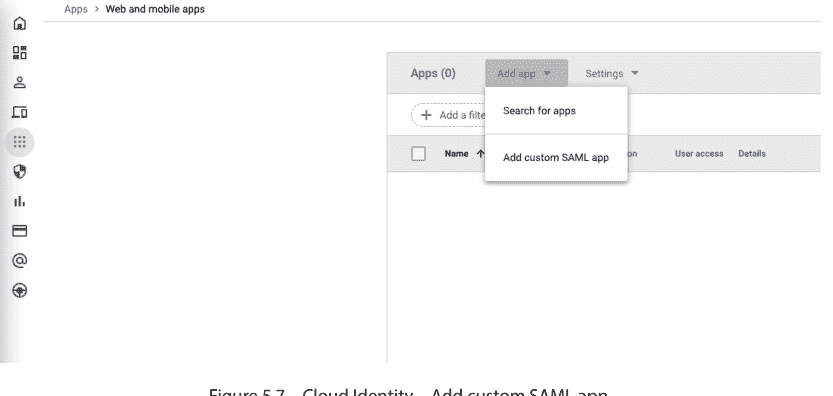

## 4. 这将带你进入四步向导来配置你的自定义 SAML 应用。

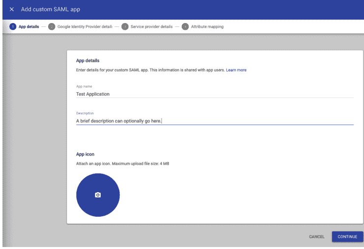

图 5.8 – 配置你的自定义 SAML 应用

- 5. 按照步骤为你的自定义应用程序命名，并可选地提供简短描述并上传图标。完成后，点击**继续 (Continue)**。
- 6. 下一步将为你提供两个选项：下载 IdP 元数据或复制并粘贴 SSO URL 以及带有 SHA-256 指纹的证书。这些是你的服务提供者所需的 Google 身份提供者详细信息。一旦你决定下载或复制粘贴这些信息，就可以点击**继续 (CONTINUE)** 按钮进入下一步。
- 7. 理想情况下，你现在可以登录你的服务提供者控制台，并复制粘贴第 6 步中获取的信息。
- 8. 在这一步中，你可以填写 ACS URL、实体 ID，以及可选的启动 URL。ACS URL 是你服务提供者的端点；实体 ID 值由服务提供者提供。在此阶段，你可以设置签名断言。Name ID 值是你的主邮箱；然而，你可以执行**添加 SAML 应用** 流程。
- 9. 下一步是可选的，创建属性映射。如果没有映射，你可以点击完成 (FINISH) 来完成设置。

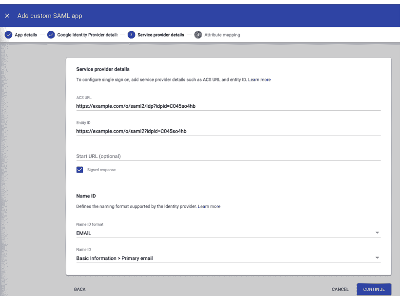

图 5.9 – SAML 服务提供者详情

## 安全你的账户

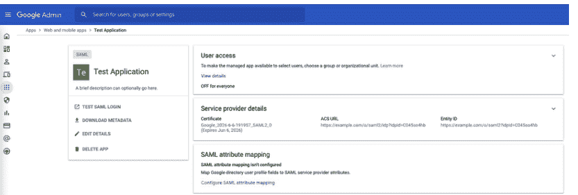

图 5.10 – 应用详情页

你可以在应用 | 网页和移动应用页面上查看已配置的应用，并通过点击应用名称查看详情，如图 5.8 所示。

- 自助密码恢复：你有两种恢复密码的方案可选：你可以让用户自己恢复密码，也可以让用户联系管理员重置密码。

> 注意
>
> 你可以在此此处阅读关于此主题的更多详细信息：https://packt.link/cCOZe。

在本节中，我们涵盖了 Google Cloud Identity 可用的某些可选安全功能。接下来，我们将介绍目录管理，其中包括身份联邦的各个方面。

## 目录管理

这是整个章节最重要的部分之一。我们将学习如何配置身份置备（identity provisioning），特别是如何使用 GCDS 工具将 Microsoft Active Directory (AD) 与 Google Cloud Identity 集成。我们将查看一些目录管理任务，例如如何创建用户和群组并分配管理员权限，以及如何使用 Google Cloud Identity 和第三方身份提供程序（IdPs）提供和撤销用户访问。最后，我们将查看如何自动化生命周期管理。

### Google Cloud Directory Sync (GCDS)

本节将深入探讨 GCDS。我们将首先了解什么是 GCDS、使用它的优势、其工作原理以及如何使用配置管理器（Configuration Manager）对其进行配置。

GCDS 帮助你将 Microsoft AD 或 LDAP 对象（以及安全用户和组）同步到你的 Google Cloud Identity 账户。

> 注意
>
> 要查看同步内容的完整列表，可以检查此链接：https://packt.link/rMBYS。这些内容是作为从你的 LDAP 或 AD 的单向同步。你的 AD 或 LDAP 不会发生任何修改。

### GCDS 功能和能力

让我们来看看 GCDS 提供的某些功能。从考试的角度来说，理解 GCDS 可以做什么和不能做什么是非常关重要的：

- `GCDS` 可以作为下载程序安装在你的服务器上。它包含了所有必要的组件，安装后即可开始设置过程。`GCDS` 还内置了安全功能，以确保你的内容在同步期间的安全。在开始任何同步之前，会使用配置管理器创建一个 OAuth 令牌用于连接到你的 Google 账户。你还需要使用你的 Google 账户授权 `GCDS` 进行身份验证。
- `GCDS` 允许你同步信息，如组织单元、邮件列表、用户及其相关属性（你可以指定这些内容）、扩展用户信息（同样你可以指定同步的内容）以及日历信息（如会议室、联系人和密码）。
- 通过配置，你能够指定想要包含、排除或对哪些属性创建异常。
- 为了让 `GCDS` 的整个设置易于使用，如果你在使用 Microsoft AD 或 Open LDAP，你可以选择在配置管理器中使用默认设置。
- 通过 `GCDS`，你拥有创建排除规则的能力，可以在其中指定你想包含在同步中的内容。所有这些都可以从配置管理器中轻松管理和配置，我们稍后会看到。

现在，让我们了解 `GCDS` 是如何工作的。

### GCDS 是如何工作的？

通过使用 `GCDS`，可以通过添加、编辑和删除用户、群组和非员工联系人，从你的 LDAP 目录服务器自动置备 Google Cloud Identity 域的数据。你的 LDAP 目录服务器数据是安全的。


配置管理器是一个基于 GUI 的向导，它会引导你完成配置同步的步骤。你设置目录服务器设置和连接，配置 Google Cloud Identity 域设置，并选择同步哪些 LDAP 数据以及排除哪些。

以下步骤解释了 GCDS 的数据流：

- 相关数据从 LDAP 服务器以列表形式导出。你可以设置规则来指定其生成方式。
- GCDS 连接到 Google Workspace 域并生成你指定的用户、群组和共享联系人列表。
- GCDS 比较这些列表并生成更改列表。
4. GCDS 更新你的 Google Workspace 目录以匹配 AD 数据。
5. 当同步完成时，GCDS 会向你指定的所有地址发送电子邮件报告。

图 5.11 展示了 GCDS 的工作原理以及使用它的一些最佳实践——例如，从单一事实来源（如你的本地 Active Directory）进行置备，并在专用硬件上运行它。

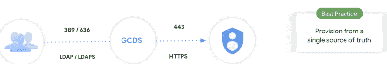

- 企业数据的单向同步（不向 LDAP 系统写入数据）
- 仅同步增量以实现最快的置备
- 同步所有对象类型（用户、别名、配置文件、群组、OU 和共享联系人）
- 利用 Google Cloud APIs 置备所有对象类型（这些 API 与客户可用的 API 相同）

更多信息请参阅 GCDS 管理指南。

图 5.11 – GCDS 的工作原理

从 GCDS 到 LDAP 的所有连接都使用 TLS 进行加密，你可以在配置管理器中指定这一点。对于标准 LDAP，不使用加密。Google 与 GCDS 之间的所有通信均通过 HTTPS 完成。

在下一节中，我们将介绍配置管理器。配置管理器用于配置 GCDS 以与你的用户目录和 Cloud Identity 协作。

## 使用 GCDS 配置管理器

在本节中，我们将查看如何使用配置管理器配置同步。在查看每一步时，我们将解释你可以做什么和不能做什么：

1. 要在你的服务器上下载并安装 GCDS，请确保选择正确的版本，例如 Windows 或 Linux 的 32 位或 64 位。GCDS 可以从以下链接下载：https://packt.link/Zru。

# 理解 Cloud Identity

2. 安装后，你需要收集信息来授权你的 Google 账户。以下步骤将授权账户并生成用于配置管理器连接和同步的 OAuth 令牌：
- I. 打开配置管理器并选择 Google 域配置。
- II. 点击“现在授权”，这将提示你使用超级管理员凭据登录 Google 账户。
- III. 将生成 OAuth 令牌，你需要将其复制并粘贴到配置管理器中；之后点击“验证”。

7. 在接下来的步骤中，我们将使用配置管理器配置同步。为了本次演示，我们将使用默认设置。配置管理器使用分步过程进行设置，准备和规划包括识别你想要同步的信息，例如用户账户、群组、用户配置文件、组织单元、许可证等。

# 理解 Cloud Identity

9. 在“代理设置”（Proxy Settings）选项卡下，指定您的网络中是否有代理服务器。

10. 在“LDAP 配置”页面上，指定 LDAP 服务器信息。为了本次练习，我们假设我们正在使用 Microsoft AD 或 Open LDAP。查看描述链接以获取连接到 LDAP 服务器的接受方式。

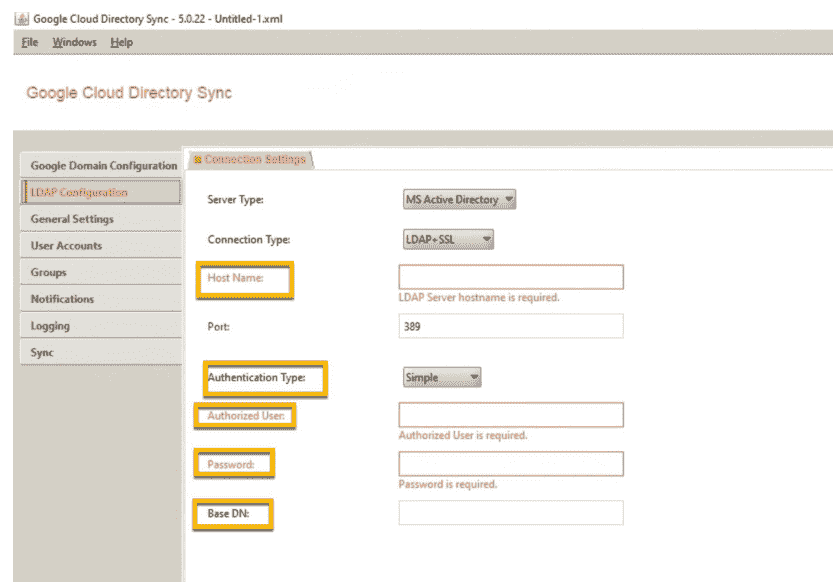

图 5.13 - LDAP 配置

接下来的几步骤是让指定您想要同步的内容。在设置中指定包含项、排除项和任何异常。

11. 在“许可证”（Licenses）页面上，您可以指定许可证信息、添加 Google 产品，并指定 SKU 和产品。

> 注意
> 有关许可证的更多信息，请参阅此页面：https://packt.link/KbYfK。

12. 接下来，您可以配置通知设置。每当数据同步时，GCDS 都会发送电子邮件。

13. 根据您需要的详细信息配置日志。

14. 最后，验证您的同步；在此阶段，配置管理器将模拟并测试同步，如果发生任何失败，它将要求您处理。一旦模拟成功，配置管理器将生成一份报告，您可以选择“同步”并应用。

到此完成了配置 GCDS 工具所需的步骤。这让您能够连接、配置并将您的 LDAP 目录同步到 Google Cloud 目录。现在我们将进入下一节：如何使用用户置备。

## Cloud Identity 中的用户置备

Google Cloud 要求在 Cloud Identity 中预先置备用户和组。下面的截图显示了帮助您完成此操作的可用选项。我们将简要介绍哪些选项是推荐的以及原因：

| 方法 | 工作量 | 涉及人员 | 备注 |
| --- | --- | --- | --- |
| 手动置备 | 高 | Google 管理员 | 最简单的方法，但不可扩展 |
| 通过 Google 管理员 上传 CSV | 中 | Google 管理员 | 灵活性更高，但不可扩展 |
| Google Cloud Directory Sync (GCDS) | 中 | LDAP 管理员 | 与 LDAP 集成，可扩展，无需无需编程 |
| 第三方工具 (Okta, Ping 等) | 中 | LDAP 管理员 | 可扩展，可能会产生额外费用 |
| Admin SDK Directory API | 高 | LDAP 管理员开发人员 | 可扩展，灵活，需要深度编程 |

图 5.1 – Google Cloud Identity 中的用户置备选项

根据图 5.1 中列的方法，您可以选择手动将用户添加到 Cloud Identity 中，因为如果您只需要添加 5-10 个用户，这是一个简单且所需工作量较少的选项。如果您需要添加更多用户，所需的工作量将会增加。

另一个选项是使用 CSV 文件，您可以在其中批量上传用户；如果您一次性添加更多用户，这种方法会更方便。但是，您需要准备 CSV 文件并列出用户的详细信息，例如名、姓、电子邮件地址、密码和组织路径。不建议在 CSV 文件中列出密码，因此许多组织选择不使用此选项。

# 理解 Cloud Identity

第三种选项是使用 GCDS 配置 Active Directory 联邦（Active Directory Federation），我们在上一节中讨论过它。所需的工作量并不低，因为它需要遵循几个步骤；一旦建立，它就是在 Google Cloud Identity 上置备/取消置备用户的一种非常有扩展性且安全的方法。

许多组织选择的另一个选项是选择可以与 Google Cloud Identity 联合的第三方置备解决方案。这与使用 GCDS 非常相似，但提供的是商业第三方产品。这是一种可扩展的方法，但会产生成本。

以下架构是一种非常常见的部署场景：使用 Cloud Identity 与 GCDS 或第三方身份提供程序（IdP，如 Okta 或 SaaS）联合。

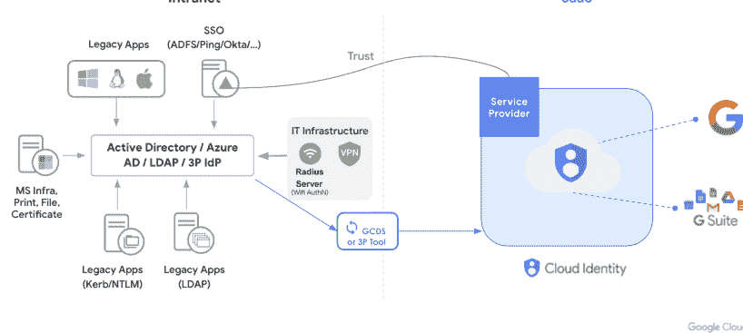

图 5.15 –第三方作为 IdP

在下一节中，我们将查看如何使用 Cloud Identity 和联邦来管理用户生命周期。

## 使用 Cloud Identity 作为 IdP 自动化用户生命周期管理

大型企业中的用户置备和取消置备可能会变得非常复杂。用户离开组织或在组织内部移动会导致用户访问的应用范围发生变化。为了解决这个问题，Google Cloud Identity 提供了一个用于第三方应用程序与 Cloud Identity 之间的自动置备连接器目录。对于基于 SAML 的 SSO 部分，我们将查看，通过使用 Cloud Identity 和基于 SAML 的 SSO，您可以使用 300 多个预配置的应用程序，并在需要时也可以创建自定义应用程序。当 Cloud Identity 是您的 IdP 且您希望将第三方应用与 Cloud Identity 集成时，通常使用此选项。让我们简要查看一下。

（注：原文中存在大量重复和损坏的 OCR ，已根据要求基于唯一内容进行处理。）

# 6 Google Cloud 身份与访问管理 (IAM)

在本章中，我们将探索 Google Cloud 身份与访问管理 (IAM)，这是考试中必须理解的一项服务。通过 IAM，你可以对云服务进行授权，并为用户和应用程序分配适当的权限。深入理解 IAM 对于确保你的云端实现遵循最小权限原则（将访问限制在必要范围内）至关重要。

在本章中，我们将涵盖以下主题：

- IAM 概述
- IAM 角色与权限
- 服务账号
- IAM 策略绑定
- IAM 条件
- 云存储 (Cloud Storage)、IAM 与 访问控制列表 (ACLs)
- 日志记录与 IAM API

## IAM 概述

在上一节中，我们讨论了 Google Cloud 身份及其在 Google Cloud 和 Google Workspace 的身份验证、用户管理和设备管理中的作用。现在，让我们探索 IAM，它侧重于 Google Cloud 中的授权。授权是云计算的核心原则之一，用于解决各种需求并确保对资源的安全访问。它解决的一些问题包括：

- 我如何向人员和工作负载授予访问权限？
- 我如何提供限时访问权限？
- 我如何创建具有最小权限的服务账号？
- 我如何在一个特定项目中启用服务而在其他项目中禁用？
- 我如何为用户提供恰当的访问权限？
- 我如何在多云环境中进行操作？
- 我如何发现过度授权的访问权限？
- 我如何排查访问问题？


在图 6.1 中，你可以看到 IAM 是如何根据“谁（身份）对何种资源拥有什么访问权限（角色）”的原理工作的。主体实体通常是用户、组或服务账号。然而，正如后文解释的那样，还有其他主体。角色是一组细粒度的权限。权限是你在特定资源（例如，BigQuery）上可以执行的预定义操作。给定资源的权限是固定的，无法自行创建。我们将在本章稍后部分讨论服务账号。此时，需要记住的是，服务账号代表 Google Cloud 中的服务或应用程序身份。这是 Google Cloud 处理工作负载权限时最重要的区别点之一。

## IAM 概述

在 Cloud IAM 中，支持以下主体：

- Google 账号（Gmail 账号是 Google 账号的一种形式）：使用个人 Google 云的用户拥有 Google 账号。这可能是一个开发者、管理员或任何使用该服务的人。可以通过任何关联到 Google 账号的电子邮件地址来识别身份。这可以是 gmail.com 或任何域名。
- 服务账号 (Service account)：服务账号是应用程序或虚拟机实例的身份，而不是人员。服务账号既是主体也是资源。我们稍后会详细介绍。
- Google 组 (Google group)：Google 组是 Google 账号和服务账号的组合。每个 Google 组都有一个唯一的电子邮件地址。Google 组为个人组应用 IAM 策略提供了一种方便的方法。你不需要为每个人单独管理访问控制，而是同时为一个实体添加或修改访问控制。此外，你可以轻松地从 Google 组中添加或删除成员，无需因移除用户修改 IAM 策略。
- Google Workspace 账号：Google Workspace 账号是关联到你特定 Google Workspace 的 Google 账号。它拥有业务邮箱。除了你可能学过的其他应用外，Google Workspace 还包含 Docs、Slides 和 Sheets 等 Google 应用。
- Cloud Identity 域 (Cloud Identity domain)：Cloud Identity 域类似于 Google Workspace 账号，但不包含任何 Google 应用。如果你的组织不使用 Google Workspace，你通常会获得免费版的 Cloud Identity。请注意，某些功能只有 Cloud Identity 高级版才能提供。请参考 Google 支持文档对比免费版和高级版的区别。
- 所有经过身份验证的用户 (All authenticated users)：`allAuthenticatedUsers` 是所有服务账号以及互联网上所有使用 Google 账号登录人员的唯一标识符，即任何使用 Google 账号登录的人。这可以是 gmail.com 或任何其他域名。对于所有使用 Google 账号登录的互联网上的所有人员以及所有服务账号，`allAuthenticatedUsers` 是一个唯一标识符。
- 所有用户 (All users)：所有用户。在图 6.1 中，你可以看到 IAM 是如何根据“谁（身份）对何种资源拥有什么访问权限（角色）”的原理工作的。主体实体通常是用户、组或服务账号。然而，正如后文解释的那样，还有其他主体。
- 恰恰允许的访问权限。

## IAM 角色与权限

在 IAM 中，角色是权限的集合。有三种类型：

- 基础角色（Basic roles）
- 定义角色（Predefined roles）
- 自定义角色（Custom roles）

### 基础角色

在 IAM 中存在三种基础角色。这些是遗留角色：

- 查看者 (Viewer)：对资源的只读权限，不影响状态。
- 编辑者 (Editor)：具有查看权限，以及修改资源状态的操作权限。
- 所有者 (Owner)：具有编辑者权限，以及管理项目及其内部所有资源的权限。

### 定义角色

IAM 提供了特定服务的定义角色，便于分配。这些角色由 Google 维护。也就是说，权限的更改（添加或弃用）由 Google 负责，因此通常建议为服务创建自定义角色。

在资源层级结构的任何级别，你都可以为用户授予多种角色。例如，同一用户可以在项目上拥有计算网络管理员和日志查看角色，同时在特定的 BigQuery 数据集中拥有 BigQuery 编辑者角色。

现在你已经了解什么是定义角色，让我们看看如何为你的工作负载选择定义角色。我们将 BigQuery 角色为例。

### 选择定义角色

IAM 中有很多定义角色。通常，这些角色是为特定的云服务身定制的。以 BigQuery 为例，以下是 Google 为 BigQuery 提供的定义角色：

- BigQuery 管理员 (Admin)
- BigQuery 连接管理员 (Connection Admin)
- BigQuery 连接用户 (Connection User)
- BigQuery 数据编辑者 (Data Editor)
- BigQuery 数据所有者 (Data Owner)
- BigQuery 数据查看者 (Data Viewer)
- BigQuery 过滤数据查看者 (Filtered Data Viewer)
- BigQuery 作用户 (Job User)
- BigQuery 元数据查看者 (Metadata Viewer)
- BigQuery 读取会话用户 (Read Session User)
- BigQuery 资源管理员 (Resource Admin)
- BigQuery 资源编辑者 (Resource Editor)
- BigQuery 资源用户 (Resource User)

如何决定使用哪个定义角色？考虑以下步骤：

1. 识别必要的权限。
2. 找到包含权限的角色。
3. 选择与权限匹配的最合适角色。这可以是一个或多个角色，以授予最小权限。
4. 决定在资源层级的哪个层级授予角色。
5. 将角色授予主体，并在必要时使用条件。

了解在哪个层级（资源/文件夹/组织）向主体授予角色也很重要。我们经常强调这一点，因为了解其中的区别很重要，因为它会影响用户能够执行的操作。

让我们以 BigQuery User 角色为例。查看该角色包含的权限：

- `bigquery.bireservations.get`
- `bigquery.capacityComments.get`
# Google Cloud 身份与访问管理
- `bigquery.capacityCommitments.list`
- `bigquery.config.get`
- `bigquery.datasets.create`
- `bigquery.datasets.get`
- `bigquery.datasets.getIamPolicy`
- `bigquery.jobs.create`
- `bigquery.jobs.list`
- `bigquery.models.list`
- `bigquery.readsessions.*`
- `bigquery.reservationAssignments.list`
- `bigquery.reservationAssignments.search`
- `bigquery.reservations.get`
- `bigquery.reservations.list`
- `bigquery.routines.list`
- `bigquery.savedqueries.get`
- `bigquery.savedqueries.list`
- `bigquery.tables.list`
- `bigquery.transfers.list`
- `resourcemager.projects.get`
- `resourcemager.projects.list`

当您向项目或数据集分配 BigQuery User 角色时，会发生以下情况：

- 该角色允许在指定的项目中创建新的数据集
- 该角色允许主体读取数据集的元数据以及数据集中的列表
- 该角色允许主体在项目内运行 BigQuery 任务和 SQL 查询
- 该角色还赋予主体列出自己的作业并取消其创建的作业的能力
- 该角色还将向项目内创建新数据集的用户授予 BigQuery Data Owner角色（`roles/bigquery.dataOwner`）

现在您已经理解了预定义角色的工作原理，让我们来看看选择预定义角色的最佳实践。

## 预定义角色的最佳实践


并不是每个任务都需要完整的权限列表。相反，应优先考虑特定任务所需的相应权限。如果预定义角色包含了所需的权限，那么它很可能也包含了其他权限。利用此机会识别出所需影响最大的权限。通常情况下，预定义角色越少，提供的权限就越强大。

以下类型的 IAM 权限被*认为*是强大的：

- 资源创建和删除权限
- 获取机密信息的权限，例如加密密钥或**个人身份信息 (PII)**
- 配置资源 IAM 策略的权限
- 修改组织结构、文件夹和项目的能力
- 分配 IAM 策略的权限

将这些权限与以下权限进行比较，后者的权限较弱：

- 资源列出权限
- 对非敏感数据的访问权限
- 更改提供微小风险设置的能力，例如 Compute Engine 虚拟机实例的最小 CPU 平台

一旦您发现了所需的权限，请列出一份可能适用的角色列表。

要为单个 Google Cloud 服务分配权限，您必须尽可能识别多个指定的角色。例如，如果一个主体需要访问 Cloud Storage 并管理 Cloud SQL 数据库，那么单个角色不太可能同时包含这两个服务的相关权限。如果存在某个角色，它可能包含了一些互不相关的的权限。选择一个满足 Cloud Storage 访问要求的特定角色，并选择另一个具有 SQL 权限的角色，有助于降低风险。

让我们来看看角色分配的一些最佳实践。

## 为资源分配角色

在资源层级中选择您需要授予预定义角色的位置。以下是需要考虑的几点：

- 如果您只需要访问某些资源，可以在较低层级的资源（例如 Compute Engine 虚拟机或 Cloud Storage 存储桶）上授予角色。
- 要允许访问项目、文件夹或组织的资源，请在该层级授予相应的角色。您可以使用 IAM 条件仅在项目、文件夹或组织中的特定资源上提供角色。

您可以使用标签（tags）为支持标签的云服务定义 IAM 策略。请不要将标签（labels）和标签（tags）混淆。Tags 是一种 IAM 构造体，是在组织级别定义的。

让我们用一个示例来演示这一点。

如果主体需要访问单个 Cloud Spanner 数据库但需要多个虚拟机实例，您将希望选择数据库的 Cloud Spanner 管理角色，以及项目上的 Compute Admin 角色（此外还有服务帐户角色，因为某些计算实例已预配置为使用服务帐户）。

您可以验证主体可以访问哪些资源，并排查您想要解决的访问困难。

如果主体尽管拥有某些权限仍无法完成任务，可能是因为授予的权限少于所需。下一步是查找具有这些权限的角色，并选出最佳方案。在某些情况下，您必须创建自定义角色。

此前我们已经了解了预定义角色的原理及其分配的最佳实践。现在让我们来看看自定义角色。

## 自定义角色

在某些情况下，预定义角色无法满足需求，或者您希望根据需求缩小主体可能获得的权限。在这种情况下，您可以创建自定义角色。IAM 角色建议器（作为策略 智能的一部分）也会根据使用模式提供创建自定义角色的建议。注意，某些标记为 TESTING 和 NOT_SUPPORTED 的 IAM 权限不支持自定义角色。事实上，请始终使用带有 SUPPORTED 标记的权限。

在创建自定义角色时，请考虑以下几点：

- 在您决定建立自定义角色之前，存在预定义角色或多个预定义角色。
- TESTING 和 NOT_SUPPORTED 权限不适用于自定义角色。
- 即使服务 API 已启用，您也可能无法在自定义角色中看到某些权限。

只有当某些权限与其他权限结合时，您才能使用它们。例如，在更改 IAM 策略时需要采用读改写权限。对于该服务，除了 `setIAMPolicy` 权限外，您还需要 `getIAMPolicy` 权限。

## 服务账号

- 双重控制与审批流程：对于需要特权访问的关键操作或更改，实施双重控制机制和审批流程。这涉及要求多位授权人员对此类操作进行审查和批准，以降低未经授权或意外操作的风险。
- 定期审查与审计：对特权角色及其分配的权限进行定期审查和审计。验证分配的权限是否必要且适当。移除任何不需要或过时的权限，确保角色与当前的工作职和职责一致。
- 监控与日志：实施稳健的监控和日志机制，以跟踪特权活动并检测任何异常或未经授权的操作。启用 IAM 角色更改、权限修改和管理操作的日志记录，以确保审计轨迹并便于应急响应。
- 持续教育与意识：为特权用户、管理员和利益相关者提供有关角色管理、职责分离以及访问控制最佳实践重要性的持续教育和培训。在组织内部培养安全意识和问责制的文化。

通过实施这些最佳实践，组织可以有效管理特权角色、强制职责分离，并在 Google Cloud 中维护安全且合规的环境。定期的审查、定义的流程和持续的监控有助于确保访问权限与业务需求保持一致，并最大限度地减少未经授权或恶意操作的风险。

## 策略绑定

IAM 策略是将角色分配给主体使其能够访问资源的方法。绑定可以存在于资源级（并非所有资源都支持此项）、项目级、文件夹级或组织级。了解在哪个层级上创建绑定至关重要，以便在满足业务目标的同时实现最小权限访问。

绑定在 Google Cloud 资源层次结构中创建的位置越高，它对下游资源（如文件夹、项目和实际工作负载）的影响就越大。为此，请小心定义您的 IAM 策略绑定的位置。我们稍后将在 IAM 策略绑定部分查看更多关于 IAM 策略绑定的内容。

## 服务账号

Google Cloud 服务账号是平台的关键部分。云资源或工作负载使用特定类型的账号。部署的应用（例如 Compute Engine、App Engine 或 GKE）或工作负载（Dataproc、Dataflow 等）会使用服务账号。通过将服务账号作为身份，应用程序可以根据其分配的角色访问云资源（在同一项目或不同项目内）。

## Google Cloud 身份访问管理

服务账号和用户账户之间存在主要区别：

- 服务账号无法像普通用户一样登录 Cloud 控制台。
- 使用公私 RSA 密钥对对服务账号进行身份验证并对 API 请求签名。
- 人员或其他服务账号可以冒充服务账号。
- 服务账号在 Cloud Identity 中不可见，因为它们属于 Cloud 管理域。虽然可以将服务账号添加到 Google 组中，但不建议这样做，因为组用于服务账号不符合的特定用途。
- 服务账号不会在您的 Google Workspace 域中创建。它们不受您的 Google Workspace 和 Cloud Identity 管理员的控制。它们存在于 Google Cloud 中并应在其中进行管理。

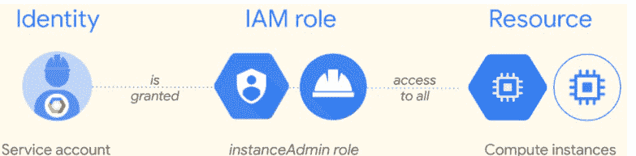

图 6.3 – 服务账号与资源

如图 6.3 所示，服务账号像用户一样通过 IAM 角色获得对 Google Cloud 资源执行操作的。现在我们将看到如何管理服务账号的生命周期。

## 创建服务账号

可以在 Cloud 控制台的 IAM | 服务账号菜单下创建服务账号。还可以使用 `gcloud`、REST API 或客户端库创建服务账号。

要创建服务账号，用户应拥有服务账号管理员角色（`roles/iam.serviceAccountAdmin`）以进行等待。

建议在创建服务账号后在使用前至少等待 60 秒。

## 禁用服务账号

您可以使用 Cloud 控制台、`gcloud` 或 API 禁用服务账号。但请注意，如果资源正在使用该账号，禁用后该资源将无法访问 Google Cloud 资源。

## 删除服务账号

如果删除了服务账号，其角色绑定不会立即消除；它们会在 60 天内自动从系统中清除。请勿将已删除的服务账号包含在配额中。最佳实践是在删除之前禁用服务账号，以确保您的生产工作负载不受负面影响。

## 恢复服务账号

在某些情况下，如果满足以下标准，您可以使用 `gcloud` 命令恢复已删除的服务账号：

- 服务账号被删除少于 30 天
- 不存在与已删除账号同名的现有账号

您需要服务账号的数字 ID 来恢复它。

现在我们已经了解了服务账号是什么，让我们来看看如何使用它们。要使用服务账号，您需要服务账号密钥或工作负载身份联合。

## 服务账号密钥

当您创建服务账号密钥时，您正在创建一个公私密钥对。公钥存储在 Google Cloud 中，您获得该密钥对的私部。这就是您建立服务账号身份的方式。密钥用于从 Google Cloud 外部向 Google Cloud 验证服务账号。在 Google Cloud ，您不需要密钥（GKE 除外）。这些密钥需要安全存储，因为密钥落入错误手中可能会导致对您的 Google Cloud 环境的未经授权访问。加密货币是此类密钥最大的误用之一。

然而，Google Cloud 引入了一种更安全的访问方法，称为工作负载身份联合 (WIF)。WIF 允许您的工作负载使用短期访问令牌直接访问资源，并消除了与服务账号密钥相关的维护和安全负担。WIF 适用于某些场景，例如从 AWS 或 Azure 调用 Google Cloud API。您将在“配置工作负载身份联合”章节中查看更多详情。

## Google Cloud 身份访问管理

这里有一个用于判断何时需要生成服务账号密钥的决策树。


图 6.4 – 服务账号密钥的决策树

正如图 6.4 所示，您可以选择安全的方式为混合工作负载连接 Google Cloud API。我们建议将此决策树纳入您的组织流程中。现在让我们看看如何管理服务账号密钥的生命周期。

## 创建服务账号密钥

服务账号密钥可以通过 Cloud 控制台、`gcloud`、API 或客户端库生成。密钥的格式可以是 JSON 或 PKCS#12（向后兼容）。

## 服务账号

> 注意

每个服务账号有 10 个密钥的硬限制。如果您生成了超过 10 个，旧密钥将失效。

服务账号密钥不会自动过期。通过资源设置，您可以设置服务账号的有效期。然而，认证可能尚未反映此新功能。

服务账号 JSON 所示：

```json
{
  "type": "service_account",
  "project_id": "project-id",
  "private_key": "key-id",
  "private_key": "---BEGIN PRIVATE KEY-----\nprivate-key\n---END PRIVATE KEY-----\n",
  "client_email": "prod-service-account@project-id.iam.gserviceaccount.com",
  "client_id": "client-id",
  "auth_uri": "https://accounts.google.com/o/oauth2/auth",
  "token_uri": "https://accounts.google.com/o/oauth2/token",
  "auth_provider_x509_cert_url": "https://www.googleapis.com/oauth2/v1",
  "client_x509_cert_url": "https://www.googleapis.com/robot/v1/metadata/x509/service-account-email"
}
```

## 将自有密钥导入 Google Cloud

Google Cloud 允许您自带私钥。在 Google Cloud 外部创建公私密钥对后，会将密钥对的公钥上传到服务账号。

例如，以下章节将生成 2048 位 RSA 密钥对，并将公钥封装在有效期为 365 天的自签名证书。以下步骤还将为您生成服务账号 JSON：

- 1. 生成私钥：

```
PROJECT_ID=$(gcloud config get-value project)
SV_ACCT_EMAIL=sa-account-name@${PROJECT_ID}.iam.gserviceaccount.com
SV_ACCT_ID=$(gcloud iam service-accounts list \
  describe $SV_ACCT_EMAIL \
``````

# Google Cloud 身份与访问管理

```bash
--format 'value (uniqueId)'
PRIVATE_KEY=$(openssl genrsa 2048)
```

2. 创建自签名证书：

```bash
openssl req -x509 -new -key - -subj /CN=customer@acme.com -out csr.pem <<< $PRIVATE_KEY
```

```bash
openssl x509 -in csr.pem -signkey -days 365 -out certificate.pem <<< $PRIVATE_KEY
```

3. 将密钥的公钥部分上传 Google Cloud：

```bash
gcloud iam service-accounts keys upload certificate.pem -iam-account $SV_ACCT_EMAIL -format json > uploaded.json
PRIVATE_KEY_ID=$(jq -r .name uploaded.json | awk -F'/' '{print $NF}')
```

4. 使用密钥的私钥生成服务帐户密钥。查看以下代码段：

```bash
touch look-no-keys.json
chmod 0600 look-no-keys.json
jq -n -arg PRIVATE_KEY "$PRIVATE_KEY" -arg PROJECT_ID "$PROJECT_ID" -arg SV_ACCT_EMAIL "$SV_ACCT_EMAIL" -arg SV_ACCT_ID "$SV_ACCT_ID" -arg PRIVATE_KEY_ID "$PRIVATE_KEY_ID" \
{
  "type": "service_account",
  "project_id": "$PROJECT_ID",
  "private_key_id": "$PRIVATE_KEY_ID",
  "private_key": "$PRIVATE_KEY",
  "client_email": "$SV_ACCT_EMAIL",
  "client_id": "$SV_ACCT_ID",
  "auth_uri": "https://accounts.google.com/o/oauth2/auth",
  "token_uri": "https://oauth2.googleapis.com/token",
  "auth_provider_x509_cert_url": "https://www.googleapis.com/oauth2/v1/certs",
  "client_x509_cert_url": "https://www.googleapis.com/robot/v1/metadata/x509/$(SV_ACCT_EMAIL)"
}' > sa-key.json
```

这应该生成 `sa-key.json` 文件，你可以在代码中使用它。

既然我们必须生成服务帐户密钥，让我们来看一些与服务帐户密钥相关的一些最佳实践。

## 管理服务帐户密钥的最佳实践

作为一名 Google Cloud 安全从业人员，安全地管理授予服务帐户访问权限的密钥至关重要。以下是几点需要注意的事：

- 确定你是否需要使用服务帐户密钥，或者你的应用程序是否可以使用如 WIF（工作负载标识）等更安全的方法。
- 为开发目的创建的服务帐户不应具有访问生产环境资源的权限。
- 建立轮换服务帐户密钥的程序。在开发环境中频繁轮换——如果可能，每天一次。
- 开发者应该每天下载新密钥，通过开发每日密钥轮换机制来实现这一点。
- 你可以通过监控服务帐户密钥的使用情况来开发审计流程。`serviceAccount.keys.list()` API 方法允许你找到与给定服务帐户关联的所有密钥。你可以将密钥与审计日志进行匹配。任何可疑活动都可以告警以便进一步调查。
- 本地开发应始终使用客户端库和 Google 应用程序凭据（Google Application Credentials）。
- 尽可能允许开发者将私钥上传到外部代码仓库。正如我们在本章后半部分将看到的，实现这一点有多种方法。
- 最后，对外部仓库进行定期密钥扫描，并修复发现的任何问题。市场上上有许多商业产品可以提醒你密钥泄露。Google Cloud 的原生产品 Security Command Center Premium 也具有此功能。更多信息请参见第 14 章“Security Command Center”。

密钥轮换是我们提到的最佳实践之一。现在，让我们看看如何操作。

## 密钥轮换

一旦你进行了适当的研究并确定了使用服务帐户密钥的必要性，优先定期轮换开发用的密钥至关重要。实施密钥轮换过程对于降低任何潜在泄露或未经授权访问的风险是必要的。以下概述了有效轮换服务帐户密钥的推荐方法：

- Keyrotator 是一个用 Python 编写的简单 CLI 工具，你可以直接使用它或将其开发的基础。在管理实例上作为 cron 任务运行它（例如在午夜），并将新密钥写入 Cloud Storage，供开发者在早晨下载。
- 为共享资源创建一个专门的项目设置。
- 在专用项目中创建一个存储桶（bucket）；**不要**让它公开访问。
- 为需要下载每日新密钥的开发者创建一个组。
- 为了额外的安全性，你可以让每个开发者使用他们自己的密钥。这将要求你在项目中为每个开发者提供一个存储桶。这还将降低不可否认的风险。
- 通过为包含存储桶的项目授予你的开发者组 `storage.objectViewer` 权限，授予对存储桶的访问权限。

在开发密钥轮换流程时的一个常见问题是不小心将密钥提交到源码仓库。我们将以 GitHub 为例展示如何检测已提交到 GitHub 的密钥。

## 防止将密钥提交到外部仓库

你的 CI/CD 流水线应该包含以下检查：

```bash
git grep 'serviceaccount-key'
```

如果发现了 `serviceaccount-key`，构建应当失败。

## 扫描外部仓库


市场上有各种商业产品可以监控密钥泄露。这允许你扫描意外暴露在公共仓库中的密钥。

## 服务帐户身份充（Service accountation）

IAM 的核心功能之一是可以身份充服务帐户。身份充是指允许其他用户和资源像服务帐户一样操作的能力。

- 服务帐户用户（Service Account User）：此角色具有 `iam.serviceAccounts.actAs` 权限，允许主体访问服务帐户可以访问的所有资源。假设主体是一个用户并拥有“服务帐户用户”角色。该主体就可以身份充该服务帐户，以便在该帐户上设置 Cloud SQL。

- 此角色还允许将服务帐户链接到资源。然而，这不会允许主体为服务帐户创建短期令牌，或使用 Google Cloud CLI 身份充服务帐户。如果你需要这些功能，你需要“服务帐户令牌创建者”（Service Account Token Creator）角色。

- 服务帐户令牌创建者（Service Account Token Creator）：这允许主体身份充服务帐户以创建 OAuth 2.0 访问令牌，你可以使用它与 Google API 进行验证。它还允许主体签名 JSON Web Tokens (JWT) 和签名二进制块，以便用于验证。

要从 Google Cloud 外部或从 GKE 工作负载身份充服务帐户，请使用工作负载标识（Workload Identity）角色。

在为主体授予身份充能力时有几点考虑：

- 在项目、文件夹或组织级别授予该角色时要小心。这将允许主体对该项目、文件夹或组织内创建的任何服务帐户进行操作。这不是惯做法。

- 在特定的服务帐户上授予角色将允许主体在该帐户上代表另一个用户进行操作。这是惯做法。

## 跨项目服务帐户访问

在企业环境中管理服务帐户时，可以在单个项目中进行管理。这样，你就可以对服务帐户治理和生命周期过程提供更强的控制，并监控任何威胁向量的活动。当你有一个项目实现跨多个项目的自动化或监控任务，并需要访问它们时，这种设计模式会非常有用。这需要一个项目的服务帐户能够调用其他项目的资源。

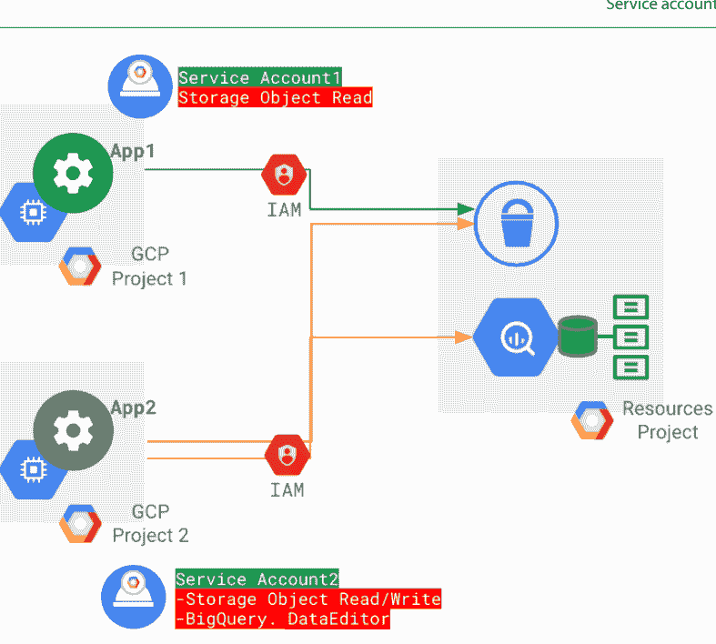

如图 6.5 所示，为了支持这一点，Google Cloud 引入了允许服务账户访问资源项目的功能。默认行为是，您可以在一个项目中创建服务账户，并将其附加到另一个项目中的资源。如果您不希望具有这种行为，可以设置组织策略来防止它。

在存放服务账户的项目组织策略中，检查以下布尔值约束：

- 确保对项目没有强制执行 `iam.disableCrossProjectServiceAccountUsage` 布尔值约束。当不强制执行此约束时，Cloud IAM 会为项目添加一个置留（lien），以防止项目被删除。该置留的来源为 `iam.googleapis.com/cross-project-service-accounts`。强烈建议不要删除此置留。

建议对项目强制执行 `iam.restrictCrossProjectServiceAccountLienRemoval` 布尔值约束。该布尔值约束确保了主体如果在组织层级具有 `resourcemanager.projects.updateLiens` 权限，则可以删除项目置留。如果未强制执行此约束，主体如果在项目层级具有此权限，也可以删除项目置留。

在启用此功能之前，建议您创建一个适当的设计，并理解此过程可能为企业带来的所有依赖关系，并确保您已经考虑了此类决策的优缺点。如果您更新了组织策略，强烈建议不要更改它，特别是在生产环境中，因为您的 Google Cloud 资源可能无法正常工作。

在介绍服务账户活动之前，让我们快速回顾如何配置 WIF。

### 使用 Okta 配置工作负载身份联合 (Workload Identity Federation)

WIF 允许在不需要服务账户密钥的情况下访问 Google Cloud 服务，从而允许来自本地或其他云提供商的访问。在接下来的配置中，我们假设使用如 Okta 的第三方 OIDC 提供程序连接到 Google Cloud 服务。将利用 OAuth 2.0 RFC 6749 定义的客户端凭据流。该流要求应用程序通过传递 client ID 和 client Secret 来进行身份验证，之后获取令牌。机器到机器（M2M）应用程序（如 CLI、批处理作业或后端服务）以应用程序本身进行身份验证和授权，而不是通过用户。在这种情况下，典型的身份验证方案（如用户名+密码或社交登录）并不适用。相反，使用的是 OAuth 客户端凭据流。

> 注意：如果您的应用程序需要用户上下文，请考虑使用 OAuth 2.0 代表用户访问 Google APIs 而不是 WIF。您可以在 https://packt.link/Uycpj 找到详细信息。

### 服务账户

深入配置之前，让我们看看此场景下发生的数据流：

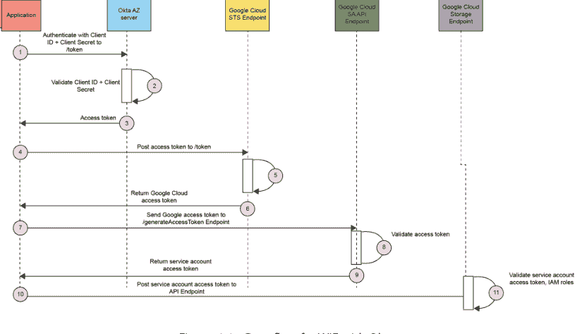

在图 6.6 所示的数据流中，您会注意到使用客户端凭据向 Okta 授权服务器发起调用以获取 OIDC 令牌。然后，在获取调用 Google Cloud 服务的访问令牌之前，令牌会被传递给两个 Google Cloud 端点。现在让我们配置 WIF 所需的步骤：

- 1. 从 Okta 生成客户端凭据。如果您不熟悉该流程，请参考 Okta 关于如何生成客户端凭据的文档。

- 2. 使用以下 `gcloud` 命令创建工作负载身份池：

```bash
gcloud iam workload-identity-pools create workload-id-pool location="global" description="Testing workload identity federation with Okta" display-name="workload-id-pool"
```

- 3. 为我们创建的池创建一个 OIDC 提供程序：

```bash
gcloud iam workload-identity-pools create-oidc okta-provider workload-identity-pool="workload-id-pool" issuer-uri="okta-issuer-url" location="global" attribute-mapping="google.subject=assertion.sub" - allowed-audiences="<在此输入客户端 ID>"
```

### Google Cloud 身份和访问管理

- 4. 为服务账户添加 IAM 策略绑定：

```
gcloud iam service-accounts add-iam-policy-binding okhtagcpsvacct@PROJECT_ID.iamserviceaccount.com role=iam.workloadidentityUser member=principal://iam.googleapis.com/projects/73105681369/locations/global/workloadidentityPools/workload-id-pool-1/subject/authz-server-ub>
```

- 5. 使用允许的受众值更新提供程序：

```
gcloud beta workload-identity-providers describe-oidc okta-provider allowed-audiences="api/24ww2ds-23" workload-identity-pool="workload-id-pool-1" location="global"
```

- 6. 使用以下 `gcloud` 命令验证 and 和 sub 值是否设置正确：

```
gcloud iam workload-identity-pools providers describe okta-provider --workload-identity-pool="workload-id-pool" location="global"
```

- 7. 现在，下载 JSON 配置文件，并在像以前使用服务账户密钥的地方使用它。

服务账户对您的 Google Cloud 组织构成了巨大的威胁向量，监控服务账户活动是至关重要的。在下一节中，我们将介绍如何操作。

### 服务账户活动监控实践

了解服务账户活动对于确保没有攻击者或滥用服务账户非常重要。Google Cloud 提供 Cloud Monitoring 来查看服务账户和服务账户密钥的使用指标。这些指标让您查看使用模式，从而帮助识别异常。API（例如 Google Maps 和 YouTube）包含在这些服务账户密钥的指标中。因此，非身份验证密钥对的使用统计是可用的。

要在 Metrics Explorer 中查看受监控资源的指标，请遵循以下步骤：

- 1. 在 Google Cloud 控制台中，进入 Monitoring 中的 Metrics 页面。

2. 进入 Metrics Explorer。

3. 在工具栏中，选择 Explorer 标签。

4. 选择 Configuration 标签。

5. 展开 Select metric 菜单，在过滤栏输入 IAM Service Account，然后使用子菜单选择资源类型和指标（关闭 Active resources 和 metrics）：

   - I. 在 Active resources 菜单中，选择 IAM Service Account。

   - II. 在 Active metric 菜单中，选择 Service_account。

- 6. 在 Active metrics 菜单中，选择服务账户指标。在选择的时间范围内可用以下指标：

   - I. 对于账户使用，选择 Service account authentication events。

   - II. 对于账户使用，选择 Service account key authentication。

- 7. 点击 Apply。

- 8. 可：配置如何查看数据，可以使用 Filter、Group By、Aggregator 和 chart type 菜单。

- 9. 可：更改图形设置：

   - I. 对于每天报告一次样本的配额和其他指标，将时间设置为至少一周，并将绘图类型设置为堆叠柱状图。

   - II. 对于分布值指标，将绘图类型选择热力图。

### Google Cloud 身份与访问管理 (IAM)

到目前为止，我们已经看到了用户管理的服务账户，但某些服务账户是由 Google 创建并管理的。在继续介绍 IAM 策略绑定之前，我们将简要查看这些账户。

#### 服务代理 (Service agents)

如果你使用了某个受托管的服务（例如安全命令中心 Security Command Center 或 DLP），Google 将在你的项目中为你创建一个服务账户。这些被称为服务代理。以下是服务代理工作方式的示例：

- **安全中心代理**: `service-53984177202@security-center-api-staging.iam.gserviceaccount.com`

- **风险管理器服务代理**: `organizations-720164443624@gcp-sa-riskmanager.iam.gserviceaccount.com`

服务代理通常具有以下内容：

- 服务代理邮箱地址中使用的域名

- 授予服务代理在项目上的角色

- 在你激活使用该服务代理的 API 后，Google 会自动授予该角色

涉及服务代理时有以下考虑事项：

- 服务代理角色的权限可能会随时更改。

- Google 随时可能引入新的服务代理，包括针对现有服务和新服务。此外，每个服务代理邮箱地址的格式可能会更改。

- 不要为这些服务账户分配任何身份冒充（principal impersonation）权限。

> 注意
> 所有服务账户都可以被冒充，但只有某些允许被冒充。

- 无法为服务代理创建密钥。

现在我们已经详细介绍了服务账户，接下来将转向深入学习 IAM 策略绑定。

#### IAM 策略绑定

在 Google Cloud 中，访问通过 IAM 策略绑定进行管理。IAM 策略附加到特定的资源上（请记住，资源可以是一个服务账户）。IAM 策略包含一组角色绑定，这些绑定与一个或多个主体（principals）关联。

回想一下，主体可以是以下一项或多个项：

- Google 账号（Gmail 账号是 Google 账户的一种形式）

- 服务账户

- Google 组

- Google Workspace 账号

- Cloud Identity 域

- 所有已身份验证的用户

- 所有用户

IAM 策略绑定（有时称为绑定）将角色与策略附加的资源上的主体以及该资源的所有后代资源上的主体关联（例如，附加到文件夹的策略适用于该文件夹下的所有资源）。

#### 策略结构

IAM 策略由角色定义和额外细节组成。角色绑定定义了特定用户或组可以访问的资源。一个角色与一个或多个主体关联，并带有任何适用条件。元数据（包括标签和版本）提供了有关策略的额外信息。

让我们了解创建 IAM 策略的某些原则：

- 每个 IAM 策略中最多可以包含 1,500 个主体。单个策略中最多可以指定 250 个唯一组。请注意，如果你使用了 IAM 条件或向许多具有长标识符的主体授予角色，IAM 可能会将策略限制为较少的主体。

- IAM 会跟踪每个主体在允许策略（allow policy）的角色绑定中出现的次数。这种方法不会对出现在多个角色中的主体进行去重。例如，主体 `alice@acme.com` 在允许策略中出现了 50 次角色绑定；你可以向允许策略的角色绑定中额外添加 1,450 个主体。无论域或 Google 组中有多少个个人成员，该域或该组都只被视为单个主体。

- 关于请求的任何额外信息（例如其来源或目标资源）都可以用作条件，以进一步限制角色绑定。条件访问通常用于判断用户的请求是否可以被授予。条件角色绑定（conditional role binding）指的是包含条件的角色绑定。某些 Google Cloud 服务不接受 IAM 策略中的条件。

#### Google 身份与访问管理

现在我们已经理解了这些原则，让我们来看策略的结构。IAM 策略包含以下字段：

- 一个 `etag` 字段，用于并发控制，确保策略的一致性更新。IAM 通过策略中的 `etag` 字段支持并发控制。每当更新 IAM 策略时，`etag` 字段的值也会同步更新。因此，具有 `etag` 字段但没有角色绑定的 IAM 策略是无效的。

- 有一个可选的 `version` 列，指示策略的架构版本。

- 此外，IAM 策略可以包含 `auditConfig` 字段，它定义了每个服务如何记录每个服务类型的活动，包括组织、文件夹、项目结算账户。

在修改 IAM 策略后的 60 秒内，新策略将生效。在某些情况下，更改可能需要长达七分钟才能传播到 Google Cloud。

这是一个简单的策略示例：

```json
{
  "bindings": [
    {
      "members": [
        "user:bob@acme.com"
      ],
      "role": "roles/owner"
    }
  ],
  "etag": "BwUjMhSzpY =",
  "version": 1
}
```

在此简单的策略示例中，所有者（Owner）基础角色被授予 bob@acme.com 且没有任何限制。通过此位置授予 bob@acme.com 的访问权限几乎是无限的。

以下是一个绑定了多个角色的策略示例。每个角色绑定都为其接收者授予相应的权限：

```json
{
  "bindings": [
    {
      "members": [
        "user:bob@acme.com"
      ],
      "role": "roles/owner"
    }
  ]
}
```

另一方面，group:prod@acme.com Google 组组仅在满足角色绑定条件时才会被包含。因此，它仅将生效到 2024 年 7 月 1 日。

现在让我们来看看 Google Cloud 中的策略继承是如何工作的。

#### 策略继承与资源层级结构

策略继承描述了策略如何应用于资源层级结构中较低位置的资源。有效策略是指资源的策略通过其所有父级一直传递到资源层级的顶端。在该序列中，它是以下内容的组合：

- 在资源上设置的策略

- 在层级结构中资源的所有祖先资源层级设置的策略

每个角色绑定（从父资源获取）对资源有效策略的影响都将单独评估。如果任何高级别的角色绑定提供了访问权限，将授予特定的访问请求。当在资源的任何层级添加新的角色绑定时，继承策略的访问范围就会扩大。

为了理解策略继承，让我们考虑这样一个场景：你在资源层级结构的不同级别为用户 Bob 授予了两个不同的 IAM 角色。

要在组织层级为 Bob 授予角色，你为你的组织设置了以下策略：

```json
{
  "bindings": [
    {
      "members": [
        "user:bob@acme.com"
      ],
      "role": "roles/storage.objectViewer"
    }
  ],
  "etag": "BwujMjhCsNaY=",
  "version": 1
}
```

此策略授予 Bob 存储对象查看者角色 (`roles/storage.objectViewer`)。由于你在组织层级设置了策略，Bob 可以对组织内所有项目和所有 Cloud Storage 对象使用这些权限。

要在项目层级为 Bob 授予角色，你在项目上设置了以下策略：

```json
{
  "bindings": [
    {
      "members": [
        "user:bob@acme.com"
    ],
      "role": "roles/storage.objectCreator"
    }
  ],
  "etag": "BwUjhCsNaY =",
  "version": 1
}
```


此策略授予 Bob 存储对象创建者角色 (`roles/storage.objectCreator`)，让他能够创建 Cloud Storage 对象。由于此策略设置在项目层级，Bob 只能在该项目中创建云存储对象。

让我们总结这个特定的例子：

- 组织层级策略授予了列出和获取该组织下所有 Cloud Storage 对象的能力
- 项目层级策略（针对给定项目）授予了在该项目内创建对象的能力

现在你已经学习了 IAM 策略是如何工作的，让我们来看一些最佳实践。

## IAM 条件

使用 IAM 条件，你只有在满足某些要求时才能向主体提供访问权限。条件是角色绑定的一部分。如果存在条件，则只有当条件表达式求值为真时才允许访问。每个条件表达式由一系列逻辑语句组成，用于指示应该检查哪些属性。让我们来看 IAM 条件内部的结构。

IAM 策略绑定结构如下。IAM 结构中的 `condition` 对象将包含 `conditions`：

```json
{
  "bindings": [
    {
      "role": ...,
      "members": ...
    }
  ],
  "condition": ...
}
```

## IAM 策略绑定

`condition` 对象具有以下结构：

```json
{
  "condition": {
  "title": ...,
  "description": ...,
  "expression": ...
}
```

让我们过过条件的语法：

- `title` 是必须的；但 `description` 是可选的。
- `expression` 是必须的，你可以在其中定义条件评估的逻辑。
- 你可以使用**通用表达式语言 (CEL)** 来定义你的逻辑，并使用逻辑运算符如 `&&`、或 `||` 或取反 `!` 来定义条件。每个表达式中最多可以有 12 个逻辑运算符。

查看 Google Cloud 文档以获取接受条件角色绑定的资源列表以及条件支持的属性。

以下是条件的不同元素：

- **变量 (Variables)**：这些是属性，例如 `request.time`（类型为 Timestamp）或 `resource.name`（类型为 String）。这些变量根据运行时上下文填充值。
- **运算符 (Operators)**：每种数据类型（例如 String 或 Timestamp）都支持一组可创建逻辑表达式的运算符，例如 `resource.service == "compute.googleapis.com"`。运算符用于将 `resource.service` 中的值与字面值进行比较。例如，`compute.googleapis.com`。
- **函数 (Functions)**：这些支持更复杂的操作，例如，如果你需要匹配字符串的一部分，应该使用 `request.path.startsWith("/acmeBucket")`。
- **逻辑运算符 (Logical operators)**：条件支持三个逻辑运算符：`&&`、`||` 和 `!`。它们使得在条件表达式中使用多个输入变量成为可能。例如，`request.time.getFullYear() < 2020 && resource.service == "compute.googleapis.com"` 将两个语句连接。

## 策略最佳实践

以下最佳实践适用于拥有许多 Google Cloud 组织：

- **管理大量用户**：在管理具有相同访问权限的多个用户时，使用 Google 组。让个人用户成为组的成员，从而继承组权限。
- **在组织层级授予权限**：考虑哪些主体在组织层级拥有权限。只有少数特定团队（如安全和网络团队）应该拥有此层级的访问权限。
- **在文件夹层级授予权限**：在文件夹层级授予权限时，考虑使用文件夹层级来匹配组织的运营结构，每个父文件夹/子文件夹具有不同的授权集。例如，一个文件夹可以代表一个部门，而其子文件夹之一可以代表资源或组，另一个子文件夹可以代表一个小型团队。所有文件夹都可以管理与其团队需求相关的项目。这种使用文件夹的方法确保了正确的隔离，同时遵循来自父文件夹和组织的策略。在构建和管理 Google Cloud 资源时，只需要极少的策略维护。
- **在项目层级提供权限**：必要时，在项目层级授予绑定以遵循最小权限原则。例如，如果一个主体需要访问文件夹中十个项目中的三个，你应该单独为每个项目授予访问；然而，在文件夹上授予将授予该主体访问其所需的另外七个项目的权限。
- **选择性授予**：你也可以使用 IAM 条件在组织或文件夹层级授予角色。
- **定期审查和审核 IAM 策略**：定期对 IAM 策略进行审计以识别任何不需要或过度的权限。检查授予服务帐户和组的访问。删除任何过期或未使用的权限以降低安全风险。
- **使用 IAM 条件**：利用 IAM 条件根据上下文属性（如 IP 地址、时间或设备状态）实施额外的安全限制。IAM 条件为资源访问提供了粒度控制，并可以增强特定场景的安全性。
- **实施监控和日志**：对 IAM 相关活动启用监控和日志，以检测并响应任何可疑行为。监控并分析日志以识别任何未经授权的访问尝试、违反策略的行为或异常活动模式。
- **教育和培训用户**：提供定期培训和意识计划，让用户了解 IAM 策略、最佳实践以及安全的重要性。在组织内部营造安全文化，并鼓励用户在管理 IAM 时遵循安全规范。
- 使用 IAM 策略智能工具：作为 IAM 策略智能工具包的一部分，您拥有多种工具可以有效管理跨整个云组织的权限。请充分利用这些工具，并培训您的开发者社区利用它们。

在下一节中，我们将简要介绍 IAM 策略智能。

## 用于改进权限管理的策略智能

策略智能（Policy Intelligence）是 Google Cloud IAM 的一项强大功能，它通过提供洞察、建议和控制来优化访问策略，从而实现更好的权限管理。随着云环境日益复杂，以及平衡安全与生产力的需求增长，策略智能提供了极价值的能力，以增强组织的整体治理和安全态势。在本节中，我们将探索 Google Cloud IAM 中策略智能的各个方面，以及如何利用它进行有效的权限管理。策略智能套件包含三个主要功能：

- IAM 推荐程序（IAM Recommender）：IAM 推荐程序是一个由 AI 驱动的工具，帮助优化 Google Cloud 中的访问控制。它根据使用模式为移除 IAM 策略中过度或不必要的权限提供建议，帮助遵循最小权限原则。
- 策略分析器（Policy Analyzer）：策略分析器是 Google Cloud 控制台中的一项功能，用于通过分析 IAM 策略来识别潜在的安全风险和违规行为。它可以扫描策略以识别潜在问题，例如可能导致安全漏洞的权限过大或资源级权限过宽的问题。
- 策略排除器（Policy Troubleshooter）：策略排除器是策略智能套件中的一项功能，允许用户排查 IAM 权限。它通过比较资源权限的需求与主体（principal）的权限来实现此。这允许用户根据其当前的 IAM 策略确定他们是否具有对某个资源的访问权限。

策略智能的一个关键方面是其识别权限管理建议建议的能力。通过分析历史数据和访问模式，策略智能可以识别权限过度或权限不足的访问策略，并建议修改以符合最小权限原则。这些建议有助于组织根据实际使用和业务需求授予访问权限，从而增强其安全态势。实施这些建议可以帮助减少攻击面，降低未经授权访问的风险，并确保仅为每个用户或服务账户授予必要的权限。

让我们来看看在使用策略智能工具时进行权限管理的最佳实践：

- 分析访问模式：利用策略智能工具和功能来分析收集的访问数据。此类分析包括识别访问模式、访问频率和潜在的安全风险。通过利用机器学习算法和高级分析，策略智能可以对访问行为提供价值的洞察。
- 审查策略建议：策略智能根据对访问模式和行为的分析生成建议。审查这些建议以识别可以优化权限的领域。建议可能包括移除过度权限、修改现有角色或创建新自定义角色的建议。
- 实施更改：将更改应用到您的访问控制策略。这可能涉及修改现有角色、创建自定义角色或调整针对特定身份或组的分配。遵循最小权限原则，确保用户和服务账户仅拥有执行其任务所需的权限。
- 与其他安全实践结合：记住，策略智能是 Google Cloud IAM 生态系统中的一项互补功能。它应该与其他安全实践结合使用，例如强身份验证机制（例如多因素身份验证）、定期的安全审计以及遵守安全框架和合规性标准。

遵循这些步骤，组织可以有效利用 Google Cloud IAM 中的策略智能来实现更好的权限管理。这种方法能够主动识别安全风险、优化访问控制策略并对策略合规性进行持续监控，从而增强您的云资源的整体安全性和治理。

到目前为止，我们已经查看了 IAM 策略实践。现在让我们简要介绍一下 IAM 标签（tags）以及它们如何用于访问控制。

## 基于标签的访问控制

标签是可以附加到组织、文件夹或项目的键值对。它们是 IAM 的一种构造结构，与标签（labels）和网络标记（network tags）不同。标签遵循继承模型，应用于组织层面的标签会被子对象继承，但如果需要，这种继承可以被覆盖。可以在分配给资源的特定标签上授予条件 IAM 角色。

在资源层次结构中，标签会自动继承，但您可以向资源附加额外的标签以防止其继承特定的标签值。从根本上说，组织或文件夹上的每个标签都设置了一个默认值，该值可以被较低级资源（如文件夹或项目）上的标签覆盖。一旦将标签附加到资源，您就可以定义条件，根据这些标签授予访问权限。

## 标签结构

以下是标签在 IAM 中的结构：

- 标签是一个键和值对。
- 一个持久的 ID，它在全局范围内唯一的，且永远不会重用。
- 每个键的短名称（short name）在您的组织内必须是唯一的，每个值的短名称在其关联键内必须是唯一的。例如，标签键的短名称可以是 `env`，而标签值的短名称可以是 `prod`。
- 一个命名空间名称（namespace name），它在标签键的短名称中添加组织 ID。例如，标签键的名称可以是 `123456789012/env`。

## 标签的最佳实践

以下是使用标签时的一些最佳实践：

- 一致的标记策略：在整个组织中建立一致的标记策略。为标签应如何结构和使用定义清晰的指南。一致性确保标签是有意义的、标准化的，并且便于管理员和用户理解。
- 标记资源层次结构：将您的标签结构与资源层次结构对齐。考虑以镜像您的项目、文件夹或组织结构的方式组织标签。这有助于高效管理，并更更容易将标签与特定资源关联。
- 使用描述性标签：使用能够准确描述资源用途、所有权或属性的标签。这有助于快速识别和分类资源，特别是在处理大量资产时。
- 安全和合规标签：实施与安全和合规性相关的标签，以识别具有特定安全要求或合规义务的资源。这些标签有助于执行访问控制、确保适当的加密或跟踪受特定法规的资源。
- 标记资源所有者：包含标签以识别资源所有者或负责的个人或团队。这允许更好的问责制并促进利益相关者之间的通信。它对于管理权限、委托责任和简化资源管理流程非常有用。
- 自动化和标记策略：利用自动化工具和脚本能力来执行标记策略。根据预定义的规则或标准自动应用标签。这有助于确保一致性，减少人为错误，并简化在大量资源上管理标签的过程。
- 定期审查标签：对应用于资源上的标签进行定期审查。移除未使用的或过时的标签，并确保标签保持更新。定期审查有助于维护数据完整性，优化资源管理，并避免对标签含义的可能冲突或误解。
- 基于标签的 IAM 策略：利用基于标签的 IAM 策略简化访问管理。根据标签而非单个资源分配 IAM 角色和权限。这使得管理更加容易，特别是在资源频繁创建或更改时。

# Google Cloud 身份访问管理 (IAM)

- **监控和审计标签**：实施监控和审计机制以跟踪标签及关联资源。监控标签的使用、修改和策略执行情况，以确保合规性并识别任何未经授权的更改或偏差。
- **教育与培训**：向您的团队普及使用标签的重要性并进行培训。提供指南和文档，以确保每个人都理解标签的目的和意义。促进标签意识和遵循最佳实践的文化。

到目前为止，我们查看了 IAM；现在我们将转换方向，查看云存储（Cloud Storage）的访问控制。云存储是 Google Cloud 的原始产品之一，并已演变为具有一些细粒度的访问控制策略（ACL），因此我们也将查看这些内容。

## 云存储 ACL

云存储在 IAM 中提供了单独的访问控制。实际上，有两种方式：一种通过 IAM 进行更统一的访问方式，另一种是通过细粒度 ACL 进行访问的遗留方式。对象 ACL 不会出现在 IAM 策略的层级结构中，因此请注意您的 Cloud Storage 存储桶（buckets）是如何被控制的。在评估如何访问某个对象时，请确保检查该对象的 ACL，同时还要检查项目级和存储桶级的 IAM 策略。这可能会变得复杂，因此建议在大多数情况下使用 IAM 的统一访问控制。

## 访问控制列表 (ACL)

您可以使用 ACL 来决定谁可以访问您的存储桶和对象，以及他们拥有什么程度的权限。ACL 应用于云存储中特定的存储桶和对象。每个 ACL 包含一个或多个条目。每个条目允许特定用户（或组）执行特定任务。每个条目由两个部分组成：

- *权限*（permission），定义了可以执行哪些操作（例如，读取或写入）
- *范围*（scope，有时称为授予者），定义了谁可以执行指定的操作（例如，特定的用户或用户组）。

考虑以下场景：您有一个存储桶，希望匿名用户能够访问对象，但又希望您的合作伙伴能够向桶中添加和删除对象。在这种情况下，您的 ACL 将由两个条目组成：

- 在一个条目中，您为 `allUsers` 范围授予 `READER` 权限
- 在另一个条目中，您为您的 `collaborator` 范围授予 `WRITER` 权限（有多种方法指定此人，例如通过其电子邮件）

在使用 ACL 时，需要考虑以下几点：

- 一个存储桶或对象最多只能创建 100 个 ACL。
- 当条目范围是一个组或域时，无论组或域中有多少用户，它都只视为一个 ACL 条目。
- 当用户尝试访问存储桶或存储对象时，云存储系统会查看存储桶或对象的 ACL。如果 ACL 允许用户执行请求的操作，则授予该请求。如果请求失败，将返回 403 Forbidden 错误。

让我们来看 ACL 权限。

## ACL 权限

权限描述了可以赋予存储桶或对象的内容。云存储允许您为存储桶内的存储桶和对象分配同心权限。

什么是同心权限？

您不需要为云存储中的 ACL 分配多个范围来赋予多个权限。当您授予某人 WRITER 权限时，您也授予了他们 READER 权限；当您授予某人 OWNER 权限时，也授予了他们 READER 和 WRITER 权限。

根据对象的上传方式，对象 ACL 会被相应应用：

- **身份验证上传**：您（上传对象的人）被列为对象所有者。对象所有权无法通过修改 ACL 来更改。您只能通过替换对象来更改对象所有权。项目所有者和项目编辑组对对象拥有 OWNER 权限。
- **匿名上传**：如果匿名用户上传了对象（如果存储桶赋予了 allUsers WRITER 或 OWNER 权限，则这是可能的），该对象将获得默认 ACL。

## 使用 ACL 使用云存储访问最佳实践

ACL 需要像其他管理设置一样主动管理。在与其他共享存储桶或对象之前，请考虑您想与谁共享以及每个人将扮演什么角色。项目、使用模式和组织所有权可能需要您随着时间的修改存储桶和 ACL 设置，特别是当您为大型组织或大型团队管理时。在评估和规划访问控制设置时，请考虑这些建议的做法：

- 不要使用敏感信息。
- 遵循最小权限原则。

# Google Cloud 身份访问管理 (IAM)

- **监控和审计标签**：实施监控和审计机制以跟踪标签及关联资源。监控标签的使用、修改和策略执行情况，以确保合规性并识别任何未经授权的更改或偏差。
- **教育与培训**：向您的团队普及使用标签的重要性并进行培训。提供指南和文档，以确保每个人都理解标签的目的和意义。促进标签意识和遵循最佳实践的文化。

## IAM API

IAM 使用以下 API 端点（可以使用用于用户或服务账户的常规 OAuth 访问令牌访问这些 API）：

- 策略 (v2)
- 角色 (查询和获取/列出)
- 组织角色
- 权限
- 项目
    - IAM 策略（语法检查/静态分析和查询）
    - 工作负载身份池、操作和提供程序
    - 权限
    - 角色
    - 服务账户
    - 服务账户密钥
- 服务账户凭据
- 安全令牌

## IAM 日志

Google Cloud IAM 写入审计日志和管理日志，帮助解决如“谁在何时、何地做了什么？”之的问题。这些日志对于审计和取证能力至关重要。

有关管理员活动和数据访问读取的审计日志信息，请查阅 Google Cloud 产品文档。

IAM 审计日志使用以下资源类型之一：

- api：列出多个 IAM 角色或策略信息的请求
- audited_resource：将凭据交换为 Google 帐户令牌的请求
- iam_role：IAM 自定义角色
- service_account：IAM 服务账号或服务账号密钥

## 日志名称

假设 `project_id = acme-project-id`、`folder_id = acme-folder`、`billing_account_id = 123456` 以及 `organization_id = 987654321`：


```
projects/acme-project-id/logs/cloudaudit.googleapis.com%2Factivity
projects/acme-project-id/logs/cloudaudit.googleapis.com%2Fdata_access
projects/acme-project-id/logs/cloudaudit.googleapis.com%2Fsystem_event
projects/acme-project-id/logs/cloudaudit.googleapis.com%2Fpolicy

folders/acme-folder/logs/cloudaudit.googleapis.com%2Factivity
folders/acme-folder/logs/cloudaudit.googleapis.com%2Fdata_access
folders/acme-folder/logs/cloudaudit.googleapis.com%2Fsystem_event
folders/acme-folder/logs/cloudaudit.googleapis.com%2Fpolicy

billingAccounts/987654321/logs/cloudaudit.googleapis.com%2Factivity
billingAccounts/987654321/logs/cloudaudit.googleapis.com%2Fdata_access
billingAccounts/987654321/logs/cloudaudit.googleapis.com%2Fsystem_event
billingAccounts/987654321/logs/cloudaudit.googleapis.com%2Fpolicy
```

这些是你在使用 Cloud IAM 时应该熟悉的日志。你还应该理解被记录在这些日志中的特定账号活动。我们现在将查看服务账号特定的信息。

## 服务账号日志

与 Google Cloud 工作的关键方面之一是识别服务账号的活动。IAM API 记录了以下服务账号活动：

> 有关日志条目相关字段的详情，请查看 Google Cloud 产品文档。你可能会看到日志条目，其中 `service-agent-manager@system.gserviceaccount.com` 服务账号向其他 Google 管理的服务账号授予了角色。这种行为是正常且预期的。

- 创建服务账号
- 为服务账号授予用户角色
- 在资源上授予服务账号访问权限
- 设置 Compute Engine 实例作为服务账号运行
- 使用服务账号密钥访问 Google Cloud
- 创建服务账号密钥
- 使用服务账号密钥进行身份验证
- 冒充服务账号以访问 Google Cloud
- 使用短临时凭据进行身份验证

这结束了 IAM 日志记录的各个方面。充分理解这一点非常重要，因为你可能需要根据你的安全运营需求开发安全告警。

## 总结

在本章中，我们探索了 Cloud IAM 的各种强大功能，包括主体（principals）、角色、IAM 策略和服务账号。我们获得了对有效服务账号密钥管理的见解，并学会了当密钥提交到 Git 时如何检测潜在问题。此外，我们发现了 IAM 条件的通用性，并采取了创建健壮 IAM 策略的最佳实践。我们还深入研究了 Cloud Storage ACL 及其提供细粒度访问控制的能力。掌握了这些知识，你现在已经能够为 Google Cloud 中的任何工作负载设置 IAM 策略、解决访问问题并实施我们讨论的推荐最佳实践。我们甚至涉及了 IAM 策略智能和 WIF 等高级功能。

当我们结束关于 Google Cloud IAM 功能的章节时，接下来的章节将重点关注探索 Google Cloud 强大的网络安全能力。

## 延伸阅读

- IAM 条件属性引用：https://packt.link/wMFb4
- Cloud Storage 预定义 ACL：https://packt.link/jfhAt
- IAM 与 Cloud Storage ACL 的关系：https://packt.link/gQcHG
- Cloud Storage ACL 行为：https://packt.link/VgFY0
- Cloud Storage 与 AWS S3 的互操作性：https://packt.link/vqNy3
- 使用条件的标签：https://packt.link/zzvld

## 7 虚拟私有云

在本章中，我们将查看 Google Cloud 虚拟私有云（VPC）。本章将重点关注 Google Cloud 内部的网络安全概念，尽管我们会涵盖一些至关重要的基础网络概念。我们将首先查看 Google Cloud 的全球布局如何通过虚拟区域和分区构建结构。然后我们将涵盖 VPC 的核心概念，例如全局 VPC 与区域性 VPC、如何创建自定义 IP 地址子集、微隔离、自定义路由以及不同类型的防火墙规则及其用法。我们将查看 Google Cloud 的全球布局如何通过虚拟区域和分区构建结构。然后，我们将涵盖 VPC 的核心概念，例如全局 VPC 与区域性 VPC、如何连接 Google Cloud 到本地或其他云提供商。

- at the regions and zones. Then- will cover
---,,,,,,,,,,,,,,,, VPC,,,,,,,,,,,,,,,,,,,,,-,,,,,,,,,,,-- regions and TLS.

在本章中，我们将涵盖以下主题：

- VPC 简介
- Google 区域和分区
- VPC 部署模型
- 微隔离
- Cloud DNS
- 负载均衡器
- 混合连接
- 最佳实践和设计考量

## VPC 概述

Google Cloud VPC 是构建在 Andromeda 之上的虚拟网络。对于想要进一步了解 Andromeda 及其如何构建的人，可以阅读延伸阅读部分内容。

### 虚拟私有云

你可以将 Google Cloud VPC 认为是一个虚拟网络，它与物理环境非常相似，但由于其软件定义的特性而更加强大。在高级别，VPC 负责为如 Compute Engine（虚拟机）、Google Kubernetes Engine (GKE)、Google App Engine (GAE) 以及任何构建在这些服务之上的云服务提供连接。VPC 原生提供负载均衡和代理服务，有助于分发流量。

让我们了解 VPC 的一些关键功能，这将有助于你理解它提供的能力：

- VPC 是一个全局资源，包括路由和防火墙规则等组件。我们将在 Google Cloud 区域和分区部分查看全局/区域/分区资源。
- 通过 VPC，你能够启用 IPv4 子集。这些子集是区域性的。支持的子集也启用 IPv6；唯一的异常是自动模式 VPC 不支持 IPv6，但如果你向自动模式 VPC 添加自定义子集，就可以在该子集上启用 IPv6。这里需要注意的是，自动模式 VPC 网络不支持双栈子集。
- 防火墙规则用于控制实例的流量。当你为网络创建防火墙规则时，它们会被应用于虚拟机接口。这允许你控制哪些虚拟机通过哪些端口进行通信。我们将在微隔离部分更详细地介绍防火墙规则。
- 当你创建一个 VPC 网络时，网络内部所有具有 IPv4 地址的资源相互通信不需要任何额外规则。如果你创建了防火墙规则，可能会产生某些限制。
- 在 VPC 网络内部创建并具有私有 IPv4 地址的实例可以与 Google API 和和服务通信。Google Cloud 有私有访问（我们将在本章稍后介绍），允许实例即使没有外部 IP 地址也能与 Google API 和和服务通信。
- 网络管理提供了细粒度的身份和访问管理策略。你可以创建自定义规则，授予你的网络团队相关的权限，以管理 VPC 及其相关组件。

### VPC 概述

- VPC 对等连接（VPC peering）是一种用于连接一个项目中的 VPC 网络到另一个项目或跨两个不同组织的 VPC 的概念。在每端都需要相应的权限来授权创建一个 IP 地址不重叠的 VPC 对等连接。
- 安全混合连接有多种选项；您可以使用 VPN 或专用互连（Dedicated Interconnect）将您的本地环境连接到 Google Cloud。我们将在本章节稍后的“混合连接选项”部分更详细地介绍混合连接。
- 对于您需要访问接入服务边缘（Access Service Edge）和软件定义广域网（SD-WAN）且需要使用通用路由封装（GRE）的情况，您可以使用支持 GRE 的 VPC。VPN 和互连（Interconnect）等选项也支持第一级（Tier 1）层以及相同的功能。您可以在您的实例上终止 GRE 并流量转发到其相应的位置。

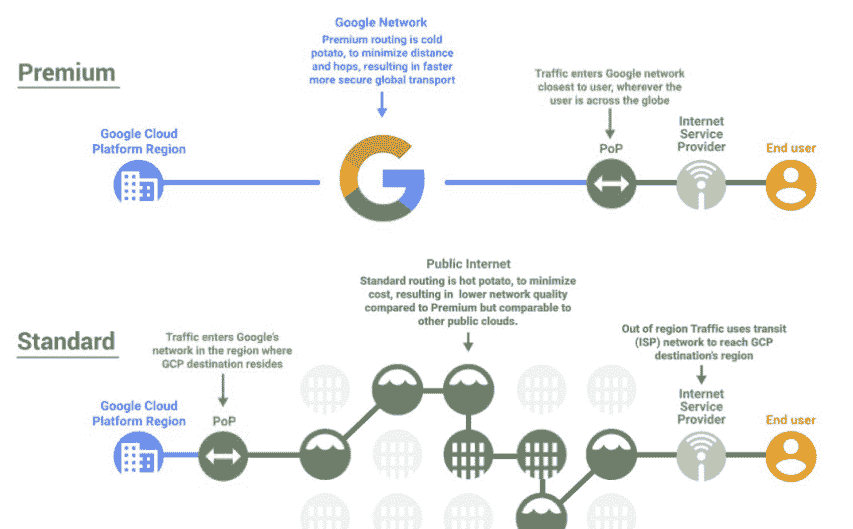

图 7.1 – Google Cloud 层级

图 7.1 显示了 Google 提供的网络分层。Google 提供两个层级：标准层级（Standard Tier）和高级层级（Premium Tier），可以在 VPC 级别进行配置。在高级层级中，Google 利用自身的私有网络来路由流量。从终端用户的角度来看，如果用户尝试访问托管在 Google Cloud 上的服务，流量将连接到最近的 Google 接入点（PoP）位置。Google 在全球拥有数百个 PoP 位置。从 PoP 位置，流量将不会经过互联网，而是使用 Google 内部运营和管理的加密私有网络。这提供了更好的可靠性和安全性。

标准层级选项是服务提供商使用的模式，即“热豆”（hot potato）模式，这意味着当用户尝试访问托管在 Google Cloud 上的服务时，服务将通过互联网传输，这种传输是非确定性的，且不会使用 Google 的私有网络。虽然这是一种更具效益的选项，但它无法提供高级层级网络的可靠性、安全性和可用性。

在 VPC 部署模型部分，我们将详细介绍 VPC 的设置，并突出显示您可以在哪里配置网络层级。

## Google Cloud 区域和可用

此主题不是视图蓝图（view blueprint）的一部分。由于这涉及设计、架构以及服务的组织方式，因此了解 Google 如何组织其区域和可用的一些基础概念至关重要。我们还将查看什么是全局、区域和可用资源。

区域（Regions）是指 Google Cloud 拥有提供云服务的数据中心的地理位置。例如，在美国，Google 在爱荷华州（us-central）、弗吉尼亚州（us-east）和洛洛矶矶（us-west）拥有区域；在全球范围内，Google Cloud 在澳大利亚、新加坡、印度、英国、德国拥有区域，可以在此处找到 Google Cloud 区域的完整列表：https://packt.link/jbTVP。

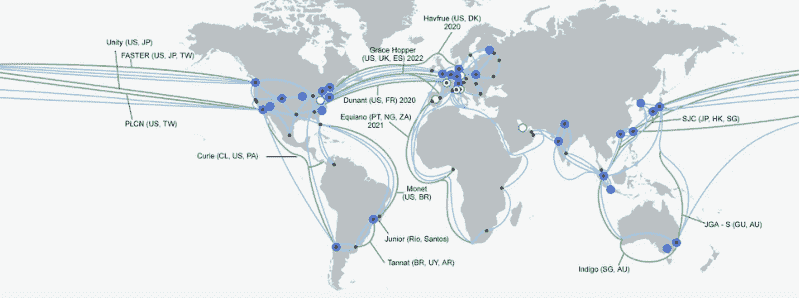


即将到来：Google Cloud 将继续扩展到以下区域：多哈（卡塔尔）、下知县（日本）、巴黎（法国）、米兰（意大利）、马德里（西班牙）、东京（日本）、哥伦比亚（哥伦比亚）、柏林（德国）、哥本哈根（丹麦）、利雅得（沙特阿拉伯）、达拉斯（德克萨斯）和特拉维夫（以色列）。

图 7.2 – Google Cloud 区域位置

在期间，Google 已在 200 多个国家设立，拥有29 个区域、88 个可用区和 146 个 PoP 或边缘位置。作为 Google 扩展战略的一部分，每年都会宣布更多区域。

每个区域至少有两个可用区，某些区域有更多可用区，以提供额外的容量和恢复能力。这是由需求决定的。根据经验，始终有两个可用区来提供容错和高可用性。为了确保您的服务的恢复性和可用性，强烈建议识别它们所在的区域（`<region>`），例如 us-central。此外，使用 a、b 或 c 来标识可用区，例如 us-east1-a。您可以选择这些可用区中的任何一个来部署您的云服务。

Google Cloud 将继续扩展到以下区域：多哈（卡塔尔）、下知县（日本）、巴黎（法国）、米兰（意大利）、马德里（西班牙）、东京（日本）、哥伦比亚（哥伦比亚）、柏林（德国）、哥本哈根（丹麦）、利雅得（沙特阿拉伯）、达拉斯（德克萨斯）和特拉维夫（以色列）。

## VPC 部署模型

在 VPC 部署模型部分，我们将详细介绍 VPC 的设置，并突出显示您可以在哪里配置网络层级。

## Google Cloud 区域和可用

此主题不是视图蓝图的一部分。由于这涉及设计、架构以及服务的组织方式，因此了解 Google 如何组织其区域和可用的一些基础概念至关重要。我们还将查看什么是全局、区域和可用资源。

区域（Regions）是指 Google Cloud 拥有提供云服务的数据中心的地理位置。例如，在美国，Google 在爱荷华州（us-central）、弗吉尼亚州（us-east）和洛洛矶矶（us-west）拥有区域；在全球范围内，Google Cloud 在澳大利亚、新加坡、印度、英国、德国拥有区域，可以在此处找到 Google Cloud 区域的完整列表：https://packt.link/jbTVP。


即将到来：Google Cloud 将继续扩展到以下区域：多哈（卡塔尔）、下知县（日本）、巴黎（法国）、米兰（意大利）、马德里（西班牙）、东京（日本）、哥伦比亚（哥伦比亚）、柏林（德国）、哥本哈根（丹麦）、利雅得（沙特阿拉伯）、达拉斯（德克萨斯）和特拉维夫（以色列）。

图 7.2 – Google Cloud 区域位置

在期间，Google 已在 200 多个国家设立，拥有29 个区域、88 个可用区和 146 个 PoP 或边缘位置。作为 Google 扩展战略的一部分，每年都会宣布更多区域。

每个区域至少有两个可用区，某些区域有更多可用区，以提供额外的容量和恢复能力。这是由需求决定的。根据经验，始终有两个可用区来提供容错和高可用性。为了确保您的服务的恢复性和可用性，强烈建议识别它们所在的区域（`<region>`），例如 us-central。此外，使用 a、b 或 c 来标识可用区，例如 us-east1-a。您可以选择这些可用区中的任何一个来部署您的云服务。

## VPC 部署模型

在 VPC 部署模型部分，我们将详细介绍 VPC 的设置，并突出显示您可以在哪里配置网络层级。

## VPC 模式


VPC 可以根据子网络创建过程以两种模式部署。

VPC 可以根据子网络创建过程以两种模式部署。在本节中，我们将介绍两种模式：自动模式（`auto mode`）和自定义模式（`custom mode`）。在此之后，我们将查看共享 VPC 以及如何创建一个。在后续我们将介绍 VPC 对等连接，一种连接不同组织 VPC 的技术。

`img/f681dfc12450e3a4c257352b70dbceca_164_0.png)`

图 7.3 – Google 网络组件

我们将使用 7.3 中的图示在进入部署模型之前理解一些概念。VPC 作为资源在项目内部创建并具有全局性。一旦您创建了 VPC 网络，可以选择创建一个包含所有区域的全局网络，也可以自定义您想要使用的区域。我们将在下一节中介绍如何使用这模式创建 VPC。

第一种模式是自动模式，会自动创建默认网络并在每个区域添加一个子网络。在自动模式下，所有 IP 地址范围预定义为 `10.128.0/9`，当有新区域可用时会自动添加新子网络。正如名称所示，自动模式本质上是在项目中创建一个全局网络。您确实可以为自动模式 VPC 创建子网络，如果需要，还可以将自动模式 VPC 转换为自定义 VPC 网络（这是单向转换），但无法将自定义模式 VPC 转换为自动模式。自动模式 VPC 创建在创建项目时默认启用；如果您想禁用默认行为，可以通过创建组织限制策略 `compute.skipDefaultNetworkCreation` 来实现。

让我们如何在 Google Cloud 上创建自动模式 VPC：

- 1. 从 Google Cloud 菜单导航到 VPC 网络部分：

  `https://packt.link/dYlnN`.

- 2. 下一步

# 创建 VPC 网络

**名称**

`auto-network`

允许小写字母、数字和连字符

### 描述

## 子网

子网允许您在 Google Cloud 内部创建自己的私有云拓扑结构。点击“自动”在每个区域中创建一个子网，或点击“自定义”手动定义子网。了解更多

子网创建模式

- 自定义
- 自动

> 这些 IP 地址范围将分配给您 VPC 网络中的每个区域。当为您的 VPC 网络创建实例时，它将被分配一个来自相应区域地址范围的 IP。

| 区域 | IP 地址范围 |
| :--- | :--- |
| `asia-east1` | `10.140.0.0/20` |
| `asia-northeast1` | `10.146.0.0/20` |
| `asia-south1` | `10.160.0.0/20` |
| `asia-southeast1` | `10.148.0.0/20` |
| `australia-southeast1` | `10.152.0.0/20` |
| `europe-west1` | `10.132.0.0/20` |
| `europe-west2` | `10.154.0.0/20` |
| `europe-west3` | `10.156.0.0/20` |
| `europe-west4` | `10.164.0.0/20` |
| `northamerica-northeast1` | `10.162.0.0/20` |

图 7.4 – VPC 创建 – 自动模式

6. 您可以根据用例删除建立的默认防火墙规则。有两条规则禁止入站流量但允许所有出站流量；这些规则无法删除。

## 防火墙规则

选择您想要应用到此 VPC 网络的任何防火墙规则。一旦创建了 VPC 网络，您就可以在防火墙页面上管理所有防火墙规则。

| 名称 | 类型 | 目标 | 协议/端口 | 动作 | 优先级 |
| :--- | :--- | :--- | :--- | :--- | :--- |
| `auto-network-allow-custom` | 入站 | 应用于所有 | IP 范围: `10.128.0.0/9` | 允许 | `65534` |
| `auto-network-allow-icmp` | 入站 | 应用于所有 | IP 范围: `0.0.0.0/0` | `icmp` | 允许 | `65534` |
| `auto-network-allow-rdp` | 入站 | 应用于所有 | IP 范围: `0.0.0.0/0` | `tcp:3389` | 允许 | `65534` |
| `auto-network-allow-ssh` | 入站 | 应用于所有 | IP 范围: `0.0.0.0/0` | `tcp:22` | 允许 | `65534` |
| `auto-network-deny-all-ingress` | 入站 | 应用于所有 | IP 范围: `0.0.0.0/0` | 全部 | 拒绝 | `65535` |
| `auto-network-allow-egress` | 出站 | 应用于所有 | IP 范围: `0.0.0.0/0` | 全部 | 允许 | `65535` |

图 7.5 – 默认防火墙规则

7. 在**动态路由模式**下，根据您的网络需求选择**区域**或**全局**。

8. 将**最大传输单元 (MTU)** 设置保持默认值，除非您需要更改它们。

9. 点击**创建**以创建自动模式 VPC 网络。

# 创建自定义模式 VPC 网络

自定义 VPC 网络让您拥有更多的控制权，可以选择您希望创建网络的区域，并灵活地为子网指定自定义的基于 RFC1918 的 IP 地址范围。对于需要创建 VPC 对等的用例，您需要创建一个自定义网络，因为自动模式网络会在每个项目中创建相同的 IP 地址范围。因此，为了避免 IP 地址重叠，在创建对等以及与本地网络的混合连接时，您需要对 IP 范围拥有控制权。

创建自定义 VPC 网络部分的步骤如下：

1. 从 Google Cloud 菜单进入 VPC 网络部分：`https://packt.link/ek0Sw`。
2. 接下来，点击“创建 VPC 网络”。
3. 按照命名规范提供名称。
4. 可选，提供网络描述。
5. 接下来，将子网创建模式设置为“自定义”。
6. 接下来，点击“新增子网”并提供以下信息：

   I. 子网的名称。
   II. 子网的可选描述。
   III. 选择您想要使用的区域。
   IV. 指定 RFC1918 子网范围。有关可用范围请参考此链接：`https://packt.link/yko0P`。
   V. 如果需要，创建一个辅助 IP 范围。次级 IP 范围用于为运行在 VM 中的多个微服务分配不同的 IP（例如，容器和 GKE Pod）。您可以更改和扩展主 IP 范围，但不能更改次级 IP 范围。
   VI. 指定是否要使用私有 Google 访问。如果您不确定，可以随时编辑并在以后更新。
   VII. 选择开启或关闭流日志。此属性可以再次更新。
   VIII. 完成后点击“完成”。

## VPC 部署模型

`img/f681dfc12450e3a4c257352b70dbceca_69_0`

## 子网

子网允许您在 Google Cloud 内部创建自己的私有云拓扑结构。点击“自动”在每个区域中创建一个子网，或点击“自定义”手动定义子网。了解更多

子网创建模式

- 自定义
- 自动

### 自定义

图 7.6 – VPC模式

6. 您可以根据用例删除建立的默认防火墙规则。有两条规则禁止入站流量但允许所有出站流量；这些规则无法删除。

## 防火墙规则

选择您想要应用到此 VPC 网络的任何防火墙规则。一旦创建了 VPC 网络，您就可以在防火墙页面上管理所有防火墙规则。

| 名称 | 类型 | 目标 | 协议/端口 | 动作 | 优先级 |
| :--- | :--- | :--- | :--- | :--- | :--- |
| `auto-network-allow-custom` | 入站 | 应用于所有 | IP 范围: `10.128.0.0/9` | 允许 | `65534` |
| `auto-network-allow-icmp` | 入站 | 应用于所有 | IP 范围: `0.0.0.0/0` | `icmp` | 允许 | `65534` |
| `auto-network-allow-rdp` | 入站 | 应用于所有 | IP 范围: `0.0.0.0/0` | `tcp:3389` | 允许 | `65534` |
| `auto-network-allow-ssh` | 入站 | 应用于所有 | IP 范围: `0.0.0.0/0` | `tcp:22` | 允许 | `65534` |
| `auto-network-deny-all-ingress` | 入站 | 应用于所有 | IP 范围: `0.0.0.0/0` | 全部 | 拒绝 | `65535` |
| `auto-network-allow-egress` | 出站 | 应用于所有 | IP 范围: `0.0.0.0/0` | 全部 | 允许 | `65535` |

图 7.5 – 默认防火墙规则

7. 在**动态路由模式**下，根据您的网络需求选择**区域**或**全局**。

8. 将**最大传输单元 (MTU)** 设置保持默认值，除非您需要更改它们。

9. 点击**创建**以创建自动模式 VPC 网络。

### 动态路由模式

- 区域
- 全局

| 动态路由模式 | MTU |
| :--- | :--- |
| 区域 | |
| 全局 | |

图 7.7 – 动态路由模式选择

`img/f681dfc12450e3a4c257352b70dbceca_70_0`

## 共享 VPC

共享 VPC 与任何其他 VPC 类似，但它是共享的。您可以向主机项目共享子网、防火墙规则等。共享 VPC 的意义在于通过单一界面集中管理子网、安全和连接。

### 共享 VPC 的 IAM 权限

我们了解共享 VPC 的 IAM 权限。您可以为新主体分配角色。服务项目可以连接到主机项目。使用共享 VPC 的费用归属于服务项目。

`img/3a4c257352b70dbceca_71_0`

图 7.8 – 共享 VPC 的 IAM 权限

共享 VPC 有一些限制：

- 您可以在主机项目中拥有多个共享 VPC，但主机项目只能连接一个服务项目。
- 一个主机项目最多可以连接 100 个服务项目。

在创建共享 VPC 网络之前配置 IAM 权限，您需要确保在组织级别或文件夹级别分配了正确的 IAM 角色。我们现在将查看分配角色的步骤；第一个是 Compute Shared VPC Admin，下一个是 Project IAM Admin。

2. 您必须以组织管理员身份登录控制台，然后进入 IAM 页面查看角色。

3. 选择您的项目（如果尚未选择）。参考下图，显示了导航到为新主体添加角色的位置。在图 7.9 中，对于共享 VPC 资源已分配了 Project IAM Admin 和 Compute Network Viewer 角色。点击“添加其他角色”，您可以分配 Compute Shared VPC Admin。

从 Google Cloud 控制台左侧菜单导航到 IAM 和管理，选择 IAM。

# 向 *exomoon* 添加主体

在下方输入一个或多个主体。然后为这些主体选择角色以授予它们对您的资源的访问权限。允许多个角色。了解更多

图 7.9 – 为共享 VPC 分配 IAM 角色

4. 完成设置后，点击**保存 (SAVE)**。

一旦分配了 IAM 角色，我们现在可以在宿项目中创建共享 VPC（Shared VPC）网络：

- 1. 从 Google Cloud 控制台进入**共享 VPC (Shared VPC)** 页面。
- 2. 确保您是以**共享 VPC Admin (Shared VPC Admin)** 的身份登录。
- 3. 从项目选择器选择共享 VPC 宿项目。
- 4. 点击**设置共享 VPC (SET UP SHARED VPC)**。

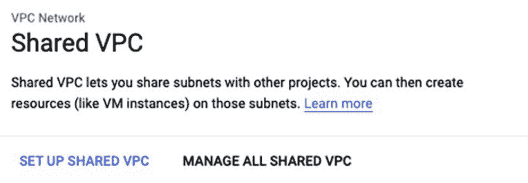

图 7.10 – 设置共享 VPC

5. 我们将移动到下一页，在启用宿项目（Enable host project）下点击保存并继续（SAVE & CONTINUE)。我们将选择您的现有项目作为宿项目。完成后，我们将进入下一步来配置子网。

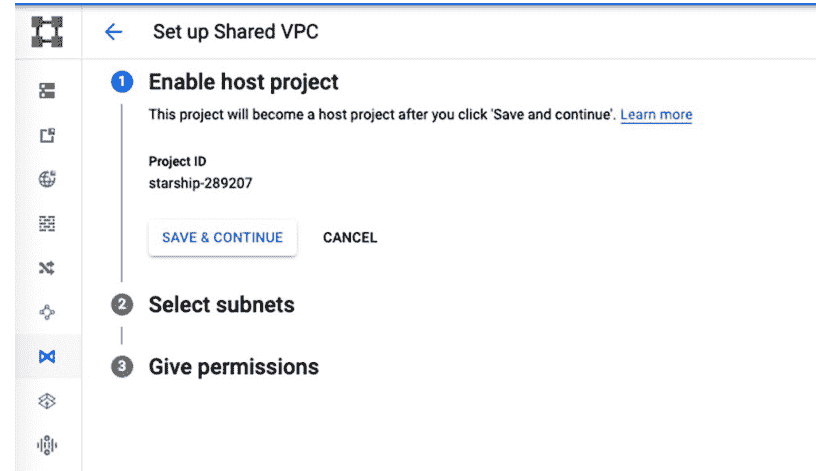

图 7.11 – 启用宿项目

6. 在“选择子网（Select subnets）”部分，有两种选择子网的。如果您想将宿项目的所有 VPC 网络与下方列出的服务项目和服务项目管理员（项目级权限）共享，可以点击“所有子网”。或者，如果您需要与服务项目和服务项目管理员共享某些 VPC 网络子集，可以选择“单个子网（Individual subsets，子网级权限）”。请先选择您想要共享的子网。请参考图 7.12 查看可用选项。

## 选择子网

选择您想要共享的子网。您可以共享项目中的所有子网（包括未来创建的子网），也可以单独选择。

### 共享模式

- 共享所有子网（项目级权限）

  项目中的所有子网都将被共享，包括未来创建的子网。
- 单个子网（子网级权限）

  您想要共享的单个子网。未来创建的子网将不会自动共享。

### 要共享的子网

| | 区域 | VPC 网络 | IP 地址范围 |
|---|---|---|---|
| `default` | `us-east-1` | `default` | `10.140.0/20` |
| `default` | `us-east-2` | `default` | `10.170.0/20` |
| `default` | `us-northeast-1` | `default` | `10.146.0/20` |
| `default` | `us-southeast-2` | `default` | `10.174.0/20` |
| `default` | `us-east-3` | `default` | `10.178.0/20` |
| `default` | `us-south-1` | `default` | `10.160.0/20` |
| `default` | `us-south-2` | `default` | `10.190.0/20` |
| `default` | `us-southeast-1` | `default` | `10.148.0/20` |
| `default` | `us-southeast-2` | `default` | `10.184.0/20` |
| `default` | `australia-southeast-1` | `default` | `10.152.0/20` |

将共享 0 个子网


- 7. 完成后，您可以点击继续（CONTINUE）进入下一步进行配置权限。
- 8. 在项目名称（Project names）中，列出已连接的服务项目。使用“连接服务项目（Attach service projects）”不会指定服务项目管理员；那是下一步。
- 9. 在“按角色划分用户（Users by role）”部分，您可以将服务项目管理员添加到角色中。这些用户将在共享子网上使用 `compute.networkUser`。只有服务项目管理员可以构建 VPC 子网资源。
- 10. 完成后，您可以点击保存（Save）按钮。

一旦创建了共享 VPC 网络，可以通过以下步骤连接项目：

- 1. 点击“已连接项目（Attached projects）”选项卡；然后在下方点击“连接项目（Attach projects）”按钮。
- 2. 当您点击“连接项目”时，将导航到一个新页面，可以在那里指定项目名称。在这里，勾选服务项目。

- 仅支持直接对等（peering），您无法转换传输对等（transit peers）。
- 标签和服务账户无法在对等网络之间跨使用。
- 计算引擎的内部 DNS 名称无法在对等网络之间访问。
- 防火墙规则不会在对等网络之间交换，您需要创建规则来允许来自计算实例的入站防火墙流量。默认行为是通过应用入站拒绝防火墙规则来阻止指向虚拟机的入站流量。
- 此外，您需要创建防火墙规则来限制虚拟机访问其不应访问的服务。
- 如果您正在使用内部负载均衡器并需要限制访问，则需要创建适用于负载均衡器后端虚拟机的入站防火墙规则。
- 在与共享 VPC 网络（Shared VPC network）建立对等时，是允许对等的。

接下来，我们将查看如何配置 VPC 对等：

1. 导航到 VPC 网络对等（VPC Network peering）并点击**创建连接**（Create connection）。然后，点击**继续**（Continue）。

   查看图 7.14 的创建 VPC 网络对等需要完成的字段。

2. 首先，我们将填写**名称**（Name）；我们将使用名称 `peer-from-starship`。
3. 接下来，我们将选择**您的 VPC 网络**（Your VPC network）下可用的网络。选择您想要进行对等的网络；在我们的示例中，我们选择了 `starshipnw`。
4. 现在指定您想要对等的网络。这可以是您现有项目中的网络，也可以是不同项目中的网络。如果是在另一个项目中，当您选择该选项时，必须指定该项目的项目 ID 和该项目中的网络名称。为了示例和简单起见，我们将选择一个现有项目，然后选择`default`（默认）网络。

# 虚拟私云 (Virtual Private Cloud)

5. 您还可以导入或导出自定义路由。执行此操作，您可以选择以下两个选项之一。在我们的示例中，我们不会导入/导出自定义路由：

   I. 使用导入自定义路由（Import custom routes）导入由其他网络导出的自定义路由。
   II. 使用导出自定义路由（Export custom routes）将自定义路由导出到另一个网络。另一个网络必须导入这些路由才能看到它们。


图 7.14 – 创建对等连接

6. 如果您的网络或合作伙伴网络使用私用的公用 IP 范围，这些路由默认是导出而非导入的。选择带有公共 IP 的导入子网路由（Import subnet routes with public IP）来导入其他网络导出的私用公用子网路由。

7. 点击创建（Create）。


只有在双方都配置了对等后，对等配置才算完成。您可以根据需要修改对等顺序或删除它们。所有 VPC 对等列表可以在 Google Cloud 控制台上的 VPC 对等页面找到。对本地连接的访问可以使用 Cloud VPN 完成。我们将在章节的混合连接选项部分查看 Cloud VPN。

| 共享 VPC (Shared VPC) | VPC 对等 (VPC Peering) | Cloud VPN |

|---|---|---|

| 网络服务管理 | 共享网络资源的中心化管理 | 清晰的网络和安全管理边界 | 清晰的网络和安全管理边界 |

| 传输性 (Transitivity) | 不可用 | 非传输性 | 传输性 |

| 规模 (Scale) | 1000 个或更多服务项目，取决于多个因素 | 最多 25 个对等网络 | 约 1000 个连接项目 |

| 定价 | 通用网络定价 | 通用定价 | 通用定价，不包含区内流量（区内流量按区间计费） |

| 性能影响 | 无 | 无 | 吞吐量受隧道数量限制（每个隧道 1.5 到 3 Gbps） |

图 7.15 – 跨项目通信选项比较

图 7.15 快速概述了不同维度（如管理、规模、定价和性能）下跨项目通信的默认选项。您可以利用此来了解有哪些可用选项，更重要的是，哪些选项符合您的网络架构需求。

现在，我们将查看微隔离（micro-segmentation）如何允许您在逻辑上对网络进行划分，从而对流量和安全进行更好的控制。

## 微隔离 (Micro-segmentation)

在本节中，我们将查看一些微隔离技术。我们将涵盖等主题，例如如何创建子网、定义自定义路由以及有助于在网络中创建分段的防火墙规则。

### 子网 (Subnets)

创建子网是一项关键策略。在本节中，我们将查看子网的类型以及如何创建它们。无论您创建什么类型的类型，使用自动模式或自定义模式。让我们查看图 16：

| 配置 | 主要 (Primary) | 次要 (Secondary) |

|---|---|---|

| 用途 | 强制性 | 可选 |

| 可扩展 | 是 | 否 |

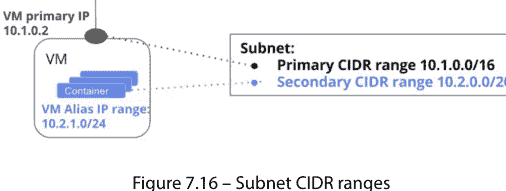

主范围是强制性的；次要范围可选。在本节中，我们将查看子网的类型以及如何创建它们。

### 自定义路由 (Custom routing)

您还可以使用自定义路由来限制访问。自定义路由是静态和动态的结合。在本节中，我们将查看路由的类型以及如何将其应用到网络。让我们查看图 7.15：

| 路由 | 类型 | 创建者 | 下一跳数 | 限制 |

|---|---|---|---|---|

| 子网路由 | 系统 | 系统 | VPC 对等 | 自动 |

| 静态路由 | 自定义 | 用户 | Cloud VPN | 标记控制 |

| 动态路由 | 自定义 | Cloud 路由器 (BGP) | BGP 对等 | 标记控制 |

图 7.15 – 自定义路由

Google Cloud 支持三种路由类型：系统生成的路由、静态路由和动态路由。系统生成的路由由系统创建且无法删除。这些包括通过 VPC 对等添加到子网的路由。

静态路由由用户手动添加，被称为自定义路由。使用静态路由，您可以定义一个下一跳，例如负载均衡器或 Cloud VPN。

动态路由也归类为自定义路由，并进行动态更新，例如创建边界网关协议 (BGP) 对等。下一跳始终是 BGP 对等。

### 防火墙规则 (Firewall rules)

防火墙规则是网络安全最重要的部分之一。在本节中，我们将查看防火墙规则如何工作、评估标准、您可以创建的不同类型防火墙规则（入站/出站）、五元组规则以及基于标签-服务账户的防火墙规则。

| 目标 | 入站规则 (Ingress rule) | 源 |

|---|---|---|

| 网络 | ✓ 服务账户 | 允许/拒绝通过标签或服务账户实例的 IP 范围/CIDR |

| VM | 入站规则 ✓ 目标标签 | |

| | 入站规则 ✓ 网络中的所有实例 |

| | 出站规则 ✓ 服务账户 | 允许/拒绝 IP 范围/CIDR |

| | 出站规则 ✓ 目标标签 | |

| | 出站规则 ✓ 网络中的所有实例 | |

图 7.18 – VPC 防火墙规则

让我们查看图 7.18 显示的一些防火墙规则功能：

- 防火墙规则在本质上是有状态的，并应用于项目内部的网络。这意味着，例如，如果您在端口 22 上创建了入站拒绝，您就不需要配置出站拒绝规则。
- 执行是在主机层级完成的，这意味着性能损耗微乎其微。
- 您可以使用防火墙规则管理的控制路径路有：虚拟机到虚拟机、虚拟机到互联网以及虚拟机到本地。
- 对于每个 VPC，都会创建两个入站/出站隐含规则，这些规则无法删除：一个阻止所有入站连接的规则，另一个允许所有出站连接的规则。

还有一些异常情况；端口 25 的简单邮件传输协议 (SMTP) 的出站流量始终被拒绝。

虚拟机与其相应的元数据服务器 (`169.254.169.254`) 之间的所有通信都是允许的。

防火墙规则支持 IPv4 和 IPv6 地址，但单条防火墙规则只能包含 IPv4 或 IPv6。

每条防火墙规则都关联有一个允许或拒绝的操作，你还可以选择禁用防火墙规则。

ICMP 响应流量可以通过防火墙规则通过。

无论使用何种协议，所有防火墙规则都会被跟踪。

到此，我们对防火墙功能的介绍结束；从考试的角度来说，记住这些点很好。接下来，我们将介绍防火墙规则的不同组件。

#### 防火墙规则组件

防火墙规则有几个关键组件需要我们理解，这对于配置至关重要。让我们来看看这些组件是什么：

- 规则方向：入站规则（Ingress）管理从特定源到 Google Cloud 目标的连接，而出站规则（Egress）管理从目标到特定目的地的连接。
- 优先级：规则的执行基于多个因素。优先级冲突的规则会被忽略，只有优先级最高（优先级数字越低）且匹配流量的规则才会被使用。
- 操作：操作决定规则是允许还是拒绝连接。
- 强制状态：防火墙规则可以启用或禁用，而无需删除它们。
- 目标：目标指定了适用于特定规则的实例。
- 源：源是入站规则的过滤器，或者是出站规则的终地过滤器。
- 协议：协议可能是 TCP、UDP 或 ICMP，目的端口可能是 22、80 或 443 等。
- 日志：此选项将匹配规则的连接记录到 Cloud Logging（云日志日志）中。

#### 防火墙规则评估

图 7.19 展示了如何处理规则集。该图未包含隐式规则或默认规则的默认规则，因为处理逻辑只关心规则的规则，而不关心规则是如何插入到处理规则栈中的。


图 7.19 – 防火墙规则评估逻辑

评估逻辑是不言自明的，请花些时间遵循这些规则并理解逻辑是如何应用的。有几点需要记住：规则优先级范围为 `0–65535`，整数越小表示优先级越高。目标指的是规则适用的实例；它不是网络连接的目标。端口仅指 TCP 和 UDP 流量。

#### 防火墙规则选项

关于如何配置防火墙规则有三种不同的选项：

- 基于五元组（5-tuple）的防火墙规则：你可以根据五元组创建防火墙规则，五元组指定了源和目的 IP、端口和协议、以及关联的允许或拒绝操作，以及入站/出站方向。你还可以选择允许或拒绝所有 TCP/UDP 端口或特定端口。

#### 微隔离

- 基于网络标签的防火墙规则：你可以创建一条在“目标”（Targets）下指定网络标签的规则。网络标签是一个任意属性。任何对实例具有编辑权限的 IAM 实体都可以与其关联一个或多个网络标签。分配到项目并具有 Compute Engine Admin 角色的 IAM 实体有权限编辑实例并更改其网络标签，这可以改变该实例适防火墙规则集。
- 基于服务账户的防火墙规则：你也可以选择创建防火墙规则，其中你可以根据服务账户指定目标。

让我们看看如何根据这三个选项创建防火墙规则：

- 1. 转到 Google Cloud 控制台中的防火墙页面，并点击“创建防火墙规则”（Create firewall rule）。这将显示一个让你创建新防火墙规则的屏幕。
- 2. 接下来，我们将在相关字段中配置属性，例如填写防火墙规则的“名称”（Name）。在我们的示例图 7.20 中，名称为 `new-rule-tags`。

> 注意

防火墙规则名称在项目中必须是唯一的。

- 3. 可选，你还可以通过切换设置中的“日志 | ”（Logs | On）选项来启用防火墙规则日志。要移除元数据，可以进一步展开“日志详情”（Logs details）然后清空“包含元数据”（Include metadata）。
- 4. 在下一步中，我们将为防火墙规则填写“网络”（Network）。例如，我们的网络是 `vpc`。
- 5. 现在你可以指定规则的“优先级”（Priority）。正如我们之前讨论的，数字越小，优先级越高。请参考之前介绍的防火墙规则评估部分来理解该逻辑的工作原理。
- 6. 我们将指定流量的“方向”（Direction），你可以选择入站（ingress）或出站（egress）。
- 7. 对于“匹配操作”（Action on match），选择允许（allow）或拒绝（deny）。
- 8. 接下来，有三个选项可以指定作为规则的目标：
  - I. 如果你想让规则适用于网络中的所有实例，选择“网络中的所有实例”（All instances in the network）。

#### 虚拟私云

- II. 如果你想让规则通过网络（目标）标签应用于选实例，选择“指定的标记标签”（Specified target tags），并在“目标标签”（Target tags）字段中输入规则应应用的标签。

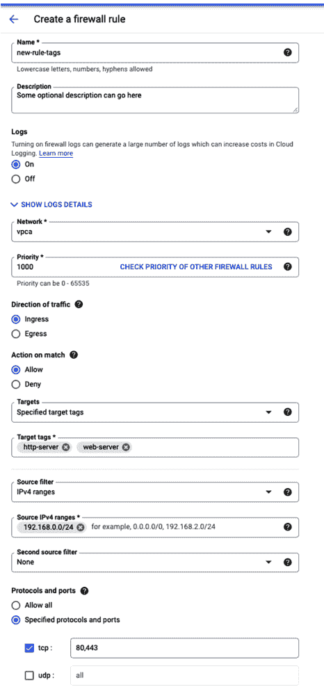

图 7.20 – 使用目标标签创建防火墙规则

- III. 如果你想让规则根据关联的服务账户应用于选实例，选择**指定的服务账户**（Specified service account），在**服务账户范围**（Service account scope）下指示该服务是在当前项目还是其他项目，并在**目标服务账户**（Target service account）字段中选择或输入服务账户名称。

- 创建防火墙规则

防火墙规则控制进入或离开实例的流量。默认情况下，来自网络外部的入站流量被阻止。了解更多

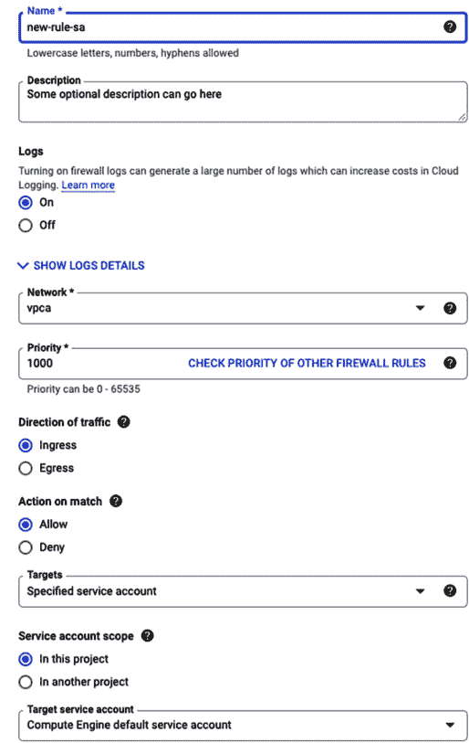

图 7.21 – 使用服务账户创建防火墙规则

#### 虚拟私云

- 9. 对于入站规则，指定“源过滤器”（Source filter）：
  - I. 选择“IP 范围”（IP ranges）并在源 IP 范围中输入 CIDR 块以建立入站流量源。你可以使用默认 IP 范围（即 `0.0.0.0/0`）指定任何网络源。
  - II. 要通过网络标签限制源，从“源过滤器”（Source Filter）下显示的选项中，选择“源标签”（Source tags）并输入标签。源标签过滤仅在目标不是服务账户时可用。
  - III. 要通过服务账户限制源，选择“服务账户”（Service account），在“服务账户范围”中指示服务账户是在当前项目还是其他项目，然后在“源账户”（Source account）中输入服务账户名称。服务账户过滤仅当目标是
  - IV. 指定第二个源过滤器。次级源过滤器不能采用主要标准。源 IP 范围可以与源标签和服务账户共同工作。有效源集是源范围 IP 地址加上网络标签或服务账户。如果源 IP 范围或源标签（或服务账户）符合过滤器要求，则源包含在有效源集中。

> 注意

记得源标签和服务账户不能同时使用。

- 10. 对于出站规则，指定“目的过滤器”（Destination filter）：
  - I. 选择“IP 范围”（IP ranges）并在目的范围中输入 CIDR 块以创建出站流量目的地。所有人为 `0.0.0.0/0`。
- 11. 定义规则应用的协议和端口：
  - I. 要将规则适用于所有协议和目的端口，选择“允许所有”（Allow all）或“拒绝所有”（Deny all）。
  - II. 定义特定的协议和目的定义：
    - i. 选择 TCP 以包含 TCP 端口。输入目的端口，如 `20-22`、`80` 和 `8080`。

使用逗号作为分隔符。
    - ii. 选择 UDP 以包含 UDP 端口。输入目的端口，如 `67-69` 和 `123`。

使用逗号作为分隔符。
    - iii. 选择“其他协议”（Other protocols）以包含 icmp 或 sctp 等协议。
- 12. 为了避免强制防火墙规则，你可以将强制状态设置为“禁用”（Disabled）。在“禁用规则”中选择“禁用”。
- 13. 点击“创建”（Create）。

防火墙规则在网络安全相关的考试中会被引用，因此请花时间通过上手配置防火墙规则。在“进一步阅读”部分有额外的链接，指向 Google Cloud Skills Boost 上提供的某些实验，以帮助你更熟悉熟悉防火墙规则及其实现，从而更好地应用你学到的概念。

## Cloud DNS

在本节中，我们将介绍 Cloud DNS 以及如何通过一些基础知识对其进行配置。对于考试，你只需要具备 Cloud DNS 相关主题的基础性知识。我们将查看 Cloud DNS 的概述以及你需要理解的一些关键组件。

Cloud DNS 是 Google Cloud 提供的一种高度可扩展托管服务。你可以使用 Cloud DNS 创建公共区域和私有区域。Cloud DNS 使用内部元服务器作为内部和外部解析的 DNS 解析器，以及解析公共互联网上的主机名。每个 VM 实例都有一个元服务器用于查询实例信息——例如名称、ID、启动/停止脚本、自定义元数据、服务账户等，且 DNS 解析器在 VM 上被设置为默认 DHCP（动态主机配置协议）。通过自定义 DHCP 配置可以重写租约；但并不是一种常见的模式。

Cloud DNS 还支持分视线解析（split-horizon），根据查询的来源，VM 可以在私有区域或公共区域内进行解析。对于混合连接，你可以使用 DNS 转发区域，将请求转发到本地解析器。

你还可以创建 DNS 对等（peering），允许你查询位于不同 VPC 网络中的区域。对等是单向的，不需要连接性。它支持两个层深度，意味着支持跨两个 DNS 对等节点的传输式 DNS 对等。这在星型模型（hub-and-spoke model）中是必要的，允许分支节点查询其私有区域而无需创建全网拓扑。

通过 Cloud DNS，你还可以创建一个托管的反向区域，以防止非 RFC 1918 地址解析被设置为互联网。它还支持域名系统安全扩展（DNSSEC），我们将在下一节介绍 DNSSEC。你可以创建解析器策略，以配置从 VPC-SC 边界内部访问私有和受限的 Google API。我们将在第 10 章“云数据防护”中介绍 VPC-SC。

内部 DNS 是为 VM 主 IP 自动创建记录，例如 `instance.us-west1b.c.projectx.internal`。这些记录用于同一 VPC 和项目内部的解析。

### 配置 Cloud DNS – 为域名创建公共 DNS 区域

在开始之前，请确保你已经在域名注册商处注册了有效的域名。你还需要一个 Windows 或 Linux VM 实例以及指向你 A 记录的 IP 地址。接下来，如果 DNS API 未启用，请将其启用。这可以通过导航 Google Cloud 控制台菜单中的“API 和和服务”来完成。

按照以下步骤配置并设置 Cloud DNS 区域：

- 1. 在 Google Cloud 控制台中，转到“创建 DNS 区域”页面。
- 2. 对于区域类型（Zone type），选择“公共（Public）”。
- 3. 对于区域名称（Zone name），输入 `my-new-zone`。
- 4. 对于 DNS 名称（DNS name），使用你注册的域名（例如 `example.com`）为该区域输入 DNS 后缀。
- 5. 对于 DNSSEC，确保选择了“关闭（Off）”设置。

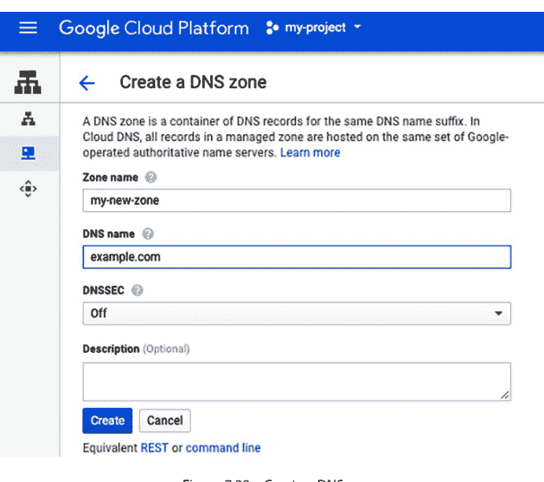

- 6. 点击“创建（Create）”。

接下来，我们将查看如何创建记录将域名指向外部 IP 地址的步骤：

- 1. 在 Google Cloud 控制台中，转到“Cloud DNS”页面。
- 2. 点击你想要添加记录集的区域。
- 3. 点击“添加记录集（Add record set）”。
- 4. 对于资源类型（Resource Type），要创建记录请选择 `A`。要创建 AAAA 记录，请选择 `AAAA`。
- 5. 对于 IPv4 地址或 IPv6 地址，输入你想与此域名使用的 IP 地址。

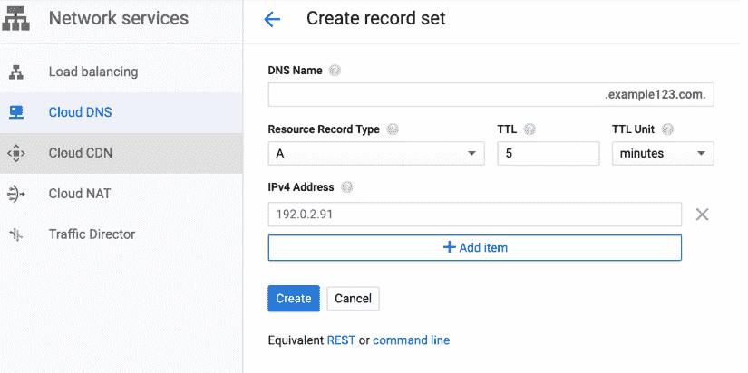

- 6. 点击“创建（Create）”。

在最后一步中，我们将为 WWW 域名创建一个 CNAME 记录：

- 1. 在 Google Cloud 控制台中，转到“Cloud DNS”页面。
- 2. 点击你想要添加记录集的区域。
- 3. 点击“添加记录集（Add record set）”。
- 4. 对于 DNS 名称（DNS Name），输入 `www`。
- 5. 对于资源类型（Resource Type），选择 `CNAME`。

图 7.23 – 创建记录集

- 6. 对于规范化名称（Canonical names），输入域名并在后跟一个点（例如 `example.com`）。

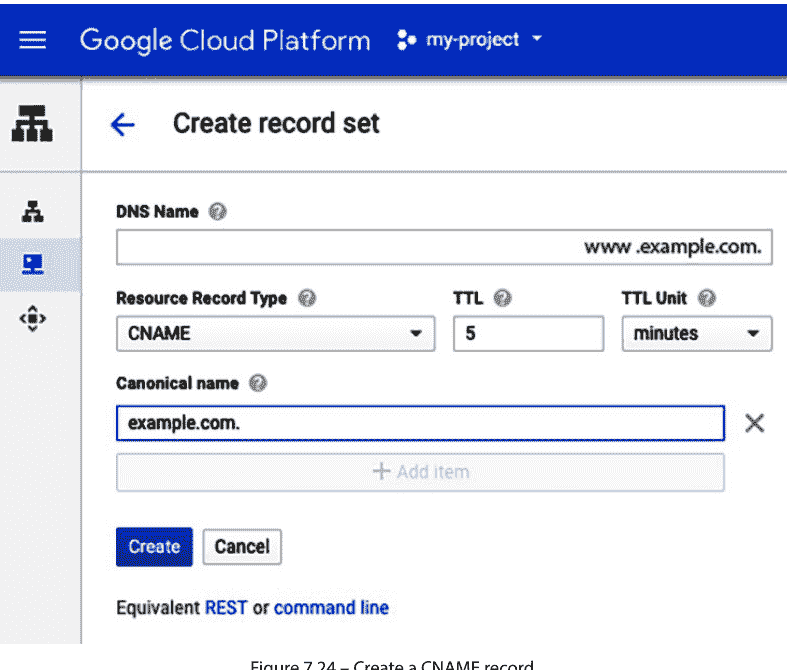

- 7. 点击“创建（Create）”。

在下一节中，我们将查看 DNSSEC。它是一组旨在提高 DNS 安全性的协议。

## DNSSEC

DNSSEC 是 DNS 的一种安全功能，有助于防止攻击者毒化或操纵 DNS 请求。考试以非常基础的涵盖 DNSSEC，因此你应该理解 DNSSEC 是什么以及它是如何工作的。从 Cloud DNS 的角度来看，你可以通过如图 7.25 所示定义参数为你的公共区域启用 DNSSEC。


## 创建 DNS 区域

DNS 区域是相同 DNS 名称后缀的 DNS 记录容器。在 Cloud DNS 中，托管区域中的所有记录都托管在 Google 运行的权威服务器上。了解更多

如果你没有域名，可以通过 Cloud Domains 购买一个。

| 区域类型 |  |
| :--- | :--- |
| - 私有 |  |
| - 公共 |  |
| 区域名称 | `secure-private` |
| 示例 | `zone-name` |
| DNS 名称 | `domain.com` |
| 示例 | `example.com` |
| DNSSEC | 开启 |
| 描述 |  |
| Cloud 日志 |  |
| - 开启 |  |
| - 关闭 |  |

在创建区域后，你可以添加记录集并修改该区域可见的网络。

创建  取消

等效命令行（空）

图 7.25 – 为私有区域启用 DNSSEC

在图 7.25 中，你首先为私有区域分配一个名称。然后指定 DNS 名称，然后将 DNSSEC 选项设置为开启。完成后，点击创建按钮。

DNSSEC 最基本的形式是通过在响应中包含数字签名来工作的。因此，对于每个 DNS 区域都会创建公密钥和私钥。Cloud DNS 提供公密钥（`DNSKEY`）、资源记录签名（`RRSIG`）和不存在记录（`NSEC`）进行验证。当你启用 DNSSEC 时，这些都由 Cloud DNS 自动管理。

需要注意的一点是，对于 DNSSEC，你的注册商和注册机构应该支持顶级域。这意味着要使 DNSSEC 起效，负责注册域名的公司（注册商）和负责维护域名及其关联 IP 地址数据库的公司（注册机构）必须支持 DNSSEC。

如果你无法通过注册商添加委托签名（DS）记录来启用 DNSSEC，那么在 Cloud DNS 上启用将无效。另一个点是从 DNSSEC 签名区域迁移到 Cloud DNS 时，可以在为公共区域启用 DNSSEC 时使用传输状态。传输状态会将相关密钥（如密钥签名密钥 `KSK` 和区域签名密钥 `ZSK`）从你的旧区域复制到 Cloud DNS。在所有 DNS 更改都已传播到权威 DNS 服务器之前，你应该保持状态为传输，然后将其改为开启。

## 负载均衡器

在本节中，我们将介绍负载均衡。Google Cloud 提供了多种负载均衡器。我们将查看每种类型的负载均衡器、它们是什么，以及根据流量类型何时使用哪种负载均衡器。我们将介绍一个决策树，帮助你决定哪种负载均衡器符合你的需求，同时也包含一些局限性。

我们将涵盖的其他方面包括外部和内部负载均衡器的区别，以及何时使用哪种以及为什么；区域性与全局性负载均衡器；以及一些网络层级方面的考量，因为某些负载均衡器仅支持高级别（Premium Tier），而另一些也支持标准级（Standard Tier）。从成本和安全角度来看，这一点非常重要。

## 负载均衡器

让我们先来看不同类型的负载均衡器：

- **全局 HTTP(S) 负载均衡器：** 这种负载均衡器同时处理 HTTP 和 HTTPS 流量，是一种基于代理的第 7 层功能，为您的服务提供支持，并配置在单个外部 IP 地址之后。它可以为不同类型的 Google Cloud 服务作为后端提供流量，例如 Google Compute Engine、Google GKE 和 Cloud Storage（云存储）。您还可以使用外部 HTTP(S) 负载均衡器来分发和管理位于本地环境的混合工作负载的流量。该负载均衡器实现在 Google 前端（`GFE`）上，当使用高级层级（Premium Tier）时是全局性的，但在标准层级（Standard Tier）时可以配置为区域性。

- **区域 TCP/UDP 负载均衡器：** 这也称为区域网络负载均衡器，被配置为直通（pass-through）。它平衡同一区域内 VM 的流量。它作为托管服务提供，并可以为互联网上的任何客户端服务，使用 Google Compute Engine (NAT)。通过外部 IP 地址和使用云网络地址转换（NAT）的客户端，该负载均衡器不是代理，它根据数据包的源和目的 IP 地址以及协议将流量分发到后端 VM。流量直接终止在客户端，而不通过负载均衡器。

- **SSL 代理负载均衡器（全局）：** 这是一个反向代理负载均衡器，将 SSL 流量分发到最近的后端 VM。SSL 代理负载均衡器终止 TLS 请求并将流量作为 TLS 或 TCP 转发到后端 VM。与 HTTP(S) 负载均衡器一样，根据网络层级，您可以使用高级层级配置 SSL 代理负载均衡器，或者在使用标准层级时将其配置为区域性。它支持 IPv4 和 IPv6，并且流量根据容量智能地路由到后端。支持自管理证书和 Google 托管证书。您还可以通过配置 SSL 策略来控制负载均衡器上的 SSL 特性。

- **TCP 代理负载均衡器（全局）：** 这是一个反向代理负载均衡器，它将流量在 Google Cloud VPC 网络内部在全球范围内分发到 VM。它为全球所有用户使用单一外部 IP 地址。来自外部的所有 TCP 流量都在负载均衡器处终止，并可以作为 TCP 或 SSL 路由到 VM。使用此负载均衡器，如果使用高级层级，您可以实现全局负载均衡；如果使用标准层级，则可以使用区域负载均衡器。

- **内部 TCP/UDP 负载均衡器：** 该负载均衡器将流量分发到您 VPC 某区域内的内部 VM。一个典型的用例是在三层 Web 架构中使用内部负载均衡器，它们可以与外部负载均衡器一起部署。在这种架构中，您将在 Web 服务器前面有一个外部 HTTP(S) 负载均衡器，然后在 Web 服务器后面有一个内部负载均衡器，为您的 VM 提供流量支持并扩展流量，这些 VM 是私有的，且仅在 VPC 内部访问。

- **内部 HTTP(S) 负载均衡器：** 内部 HTTP(S) 负载均衡器是一种基于代理的区域第 7 层负载均衡器。使用此负载均衡器，您可以将流量分发到 Compute Engine 和 GKE 等后端服务。内部负载均衡器构建在 Envoy 之上。

| 类型 | 地理范围 | 网络层级 | 代理/直通 |
| :--- | :--- | :--- | :--- |
| 内部 | TCP/UDP | 区域 | 高级 | 直通 |
| 内部 | HTTP(S) | 区域 | 代理 |
| 外部 | TCP/UDP | 区域 | 标准 | 直通 |
| 外部 | HTTP(S) | 区域/全局 | 高级 | 代理 |
| 外部 | TCP 代理 | 全局 | 高级 | 代理 |
| 外部 | SSL 代理 | 全局 | 高级 | 代理 |

图 7.26 - Google Cloud 负载均衡器的类型

图 7.26 快速概述了不同类型的负载均衡器、其地理范围和网络层级。

负载均衡器的主题非常广泛，具有许多侧重于网络而非安全的特性和功能。因此，为了考试目的，这里的内容仅限于范围。理解这些内容是重要的。建议通过阅读相关文档来花更多时间了解负载均衡器的工作方式。

### 负载均衡器类型决策树

### 图 7.27 - 负载均衡器类型决策树

## 配置外部 HTTP(S) 负载均衡器

### 图 7.28 - 配置外部 HTTP(S) 负载均衡器

## 混合连接选项

在整个章节中，我们已经提到了混合连接。

### 虚拟有云

现在让我们查看构建 Google Cloud 连接的选项：

## 负载均衡器决策树

### 图 7.29 -  Cloud VPN

## 负载均衡器

### 图 7.30 - Cloud VPN

图 7.30 展示了如何使用 IPSec 建立 VPN 负载均衡器

## 最佳实践与设计考虑

Google Cloud Platform

Cloud Interconnect 城市大区 (Metro Area)

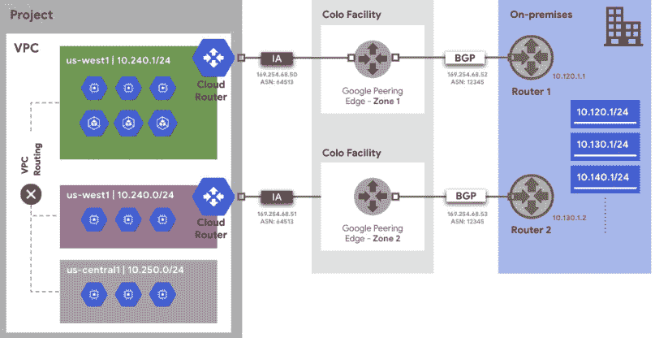

图 7.31 - Cloud Interconnect

在图 7.31 中，本地位置有两个路由器，它们分别连接到同一城市大区内的两个托管数据中心以实现冗余；存在 Interconnect (IA)/VLAN 接入：从每个托管数据中心连接到不同的 Cloud Router（云路由器）实例。Cloud Router 与本地路由器之间的 BGP 会话被用于路由路由交换。在此插图中，Cloud Router 实例位于 `us-west1`。为了允许从本地访问 `us-central1` 子网中的资源，需要启用全局路由。

## 最佳实践与设计考虑

在本节中，我们将介绍在在 Google Cloud 上设计和构建安全网络时，需要考虑的一些 VPC 最佳实践和设计考虑。从考试的角度来看，理解这些内容至关重要，因为你会遇到关于最佳实践的题目。

## VPC 最佳实践

对于 VPC，一些最佳实践包括以下内容：

- 通过使用自定义子网创建创建 VPC 网络，以防止 IP 冲突并控制子网的创建。
- 尽可能利用共享 VPC（Shared VPC）来减少管理和拓扑复杂性。
- 将相似的应用程序分组到更少、更易管理且更大的子网中。

## 私有云 (Virtual Private Cloud)

- 应用组织策略以实现以下操作：
  - 为新项目跳过默认网络的创建。
  - 限制共享 VPC 项目和子网。
  - 限制 VPC 对等（VPC peering）的使用。
- 通过考虑每个网络组件的局限性，确保设计能够扩展你的需求。

## 关键决策

你需要做出的一些关键决策包括：

- 你的 Google Cloud 资源将如何相互通信？会涉及 VPC 设计还是共享 VPC？
  - 资源将如何划分到网络和子网中？是否存在微隔离？
  - 云端资源之间以及云端与连接环境之间的名称解析将如何解决？Cloud DNS 和 DNSSEC 是否会纳入你的公共区域？
  - 将使用什么策略连接 Google Cloud 与企业网络？你是否会使用混合连接选项？
  - 你的资源将如何与互联网通信？你将使用全局还是区域外部负载均衡？

不仅要理解最佳实践，还要考虑回答上述关于设计考虑的问题，这将帮助你定义需求，并在 Google Cloud 上以及跨越你的混合网络构建一个具有韧性且安全的网络。

## 总结

在本章中，我们涵盖了 VPC 以及区域（regions）和可用区（zones）的概念及其设计方式。我们查看了共享 VPC 和 VPC 对等等 VPC 模型。我们涵盖了作为自定义路由、防火墙规则和子网的微隔离策略。我们研究了如何配置 Cloud DNS 并启用 DNSSEC。我们涵盖了与 Google Cloud 负载均衡和混合连接的可用选项相关的主题，最后，我们查看了一些 VPC 最佳实践和设计考虑。

在下一章中，我们将介绍上下文感知访问（Context-Aware Access）以及更多网络安全方面的内容，例如身份感知代理（Identity-Aware Proxy）、Web 应用程序防火墙、分布式拒绝攻击防护以及 Google 私有访问（Google Private Access）。

## 进阶阅读

有关关于 Google Cloud VPC 的更多信息，请参阅以下链接：

- Andromeda：云网络虚拟化中的性能、隔离与大规模速度：https://packt.link/yl1SoL
- VPC 网络——控制访问：https://packt.link/iQmoJ
- 使用 Cloud Armor 的 HTTP 负载均衡器：https://packt.link/Wi9Te
- Cloud 负载均衡概述：https://packt.link/Wm7kG
- DNSSEC 概述：https://packt.link/D9PFEM
- 将 DNSSEC 区域迁移到 Cloud DNS：https://packt.link/g8HmK
- Google Cloud 网络：定义与实现网络：https://packt.link/YCEbn
- Google Cloud 网络：混合连接与网络管理：https://packt.link/2BEqK

## 8

## 高级网络安全

在本章中，我们将研究高级级网络安全。本章是上一章的扩展，也是整个网络安全领域的一部分。本章将更多关注如何使用 Google Cloud 上提供的高级网络安全功能来保护你的 Google Cloud 环境。我们将讨论上下文感知安全及其相关主题，例如身份感知代理（Identity-Aware Proxy）和 Google 私有访问（Private Google Access）。我们将探索它们的用途并学习如何针对各种情况对其进行配置。

之后，我们将查看 Google Cloud 私有云（VPC），在其中你可以定义一种上下文感知的方法来保护你的资源。为了保护 Google Cloud 上的 Web 应用程序，我们将查看 Web 应用程序防火墙，然后学习如何使用 Cloud Armor 等服务保护你的环境免受分布式拒绝服务攻击。我们通过查看网络日志和监控，以及一些最佳实践和设计考虑来结束本章。

在本章中，我们将涵盖以下主题：

- Google 私有访问 (Private Google Access)
- 身份感知代理 (Identity-Aware Proxy)
- Cloud NAT
- Cloud Armor

## Google 私有访问 (Private Google Access)

Google 私有访问解决了这样一个挑战：你希望虚拟机（VMs)/Google Compute Engine（GCE）实例在没有外部 IP 地址的情况下访问 Google API。没有公网 地址的实例无法访问 Google 的端点，但私有访问服务提供了这种能力。让我们查看一些需要私有访问的场景。

## 高级网络安全

VM 经常需要与托管服务通信，例如 Cloud Storage、BigQuery 和 GCE。VM 未分配外部 IP 地址来访问 Google API。当通过虚拟专用网络（VPN）或 Cloud Interconnect 连接时，私有访问允许在不需要外部 IP 的情况下访问 Google 端点。

## 图 8.1 – 私有访问

私有访问是基于子网启用的。考虑这样一个示例：在一个 VPC 中有两个子网（`subnet-a` 和 `subnet-b`），`subnet-a` 启用了私有访问，而 `subnet-b` 没有。`VM1` 和 `VM2` 在 `subnet-a` 中，`VM3` 和 `VM4` 在 `subnet-b` 中。根据这些设置：

- `VM1` 可以访问 Google API，因为它属于启用了私有访问的 `subnet-a`。
- `VM3` 拥有私有地址但在未启用访问的 `subnet-b` 中，因此它无法访问 Google API。


- `VM2` 和 `VM4` 都有外部 IP 地址，因此无论它们是否位于启用了访问的子网中，都能访问 Google API。


### 图 8.2 – 用于本地服务的私有访问

在 8.2 中，我们展示了一个架构示例，说明如何使用私有访问允许本地服务通过 Cloud VPN 访问 Google API。如果你将 Cloud Interconnect 连接到 Cloud VPN，则相同的设计原则也适用。


- 你需要配置一条指向公共端点的路由，并将默认 Internet 网关作为下一跳。
- 你需要出站防火墙规则来防止指向 Google API 和和服务所用 IP 地址范围的流量。
- 配置需要正确的网络管理员身份和访问管理（IAM）权限。

启用私有 Google 访问（Private Google Access）是一种非常简单的方法。在进入该步骤之前，了解如何根据可用选项以及防火墙规则配置 Google Cloud 域名系统（DNS）服务和路由选项非常重要。

## DNS 配置

取决于你选择 `restricted.googleapis.com` 还是 `private.googleapis.com`，你需要确保 VPC 内部的 VM 能够解析到 `*.googleapis.com` 的 DNS 请求。在本示例中，查看如何为 `*.googleapis.com` 和 `*.gcr.io` 创建私有 DNS 区域。

1. 为 `googleapis.com` 创建一个私有 DNS 区域。为此，你可以使用 Cloud DNS 私有区域。
2. 在 `googleapis.com` 区域中创建 A 记录时，选择以下域之一：
   * 指向以下 IP 地址的 `private.googleapis.com` 的 A 记录：`199.36.153.8`,`199.36.153.9`,`199.36.153.10`, 和 `199.36.153.11`
   * 指向以下 IP 地址的 `restricted.googleapis.com` 的 A 记录：`199.36.153.4`,`199.36.153.5`,`199.36.153.6`, 和 `199.36.153.7`
3. 使用 Cloud DNS 将记录添加到 `googleapis.com` 私有区域。
4. 在 `googleapis.com` 区域中，为 `*.googleapis.com` 创建一个 CNAME 记录，指向你在上一步中创建的任一 A 记录。

某些 Google API 使用不同的域名提供，例如 `*.gcr.io`, `*.gstatic.com`, `*.pkg.dev` 和 `pki.goog`。你可以遵循相同的流程，使用 Cloud DNS 创建 DNS 私有区域，并为相应域创建 A 记录和 CNAME 记录。

## 路由选项

- 理解路由非常重要，因为你有两种不同的配置方法：
- 你可以使用默认 Internet 网关
- 你可以创建自定义路由

根据你的需求，你可以选择其中一种。VPC 自带路由功能，你已经配置了下一跳，即默认 Internet 网关。VM 拥有默认 Internet 网关，当 VPC 内部的 VM 向 Google API 的请求时，数据包将发送此处。虽然“默认 Internet 网关”术语暗示所有流量都发送到互联网，但事实并非如此。默认 Internet 网关将 VPC 的流量路由到 Google 网络内的 Google API。Google 不允许通过其他 VPC 实例或自定义跳数路由到 Google API 和服务的流量。

如果你的 VPC 有一个指向默认 Internet 网关的默认路由，你可以路由从 VM 到 Google API 和服务的请求，而无需配置自定义路由。

如果你想将流量导向 Cloud VPN 或内部负载均衡器，可以创建自定义路由并定义下一跳。在这种情况下，你可以定义一个具有相关下一跳的自定义路由。

### 使用默认路由路由

按照以下步骤使用默认路由进行路由：

1. 进入 Google Cloud 控制台中的路由（Routes）页面。
2. 在 VPC 子菜单下选择网络（Network）菜单和路由（Routes）。

在这里，你有能力过滤路由列表，仅显示你需要检查的网络的路由（图 8.3）。

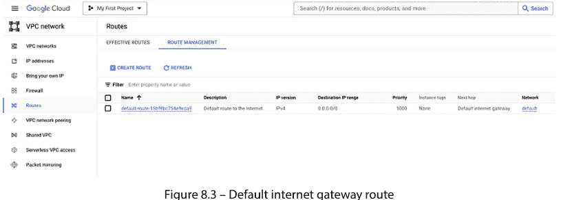

寻找一个目标为 `0.0.0.0` 且下一跳为 Default Internet gateway 的路由。

### 使用自定义路由路由

按照以下步骤使用自定义路由进行路由：

1. 在 Google Cloud 控制台的路由页面上，使用筛选字段过滤路由列表：
   - 网络（Network）：`YOUR_NETWORK_NAME`。在这里，将 `YOUR_NETWORK_NAME` 替换为你的 VPC 名称。
   - 下一跳（Next hop）：选择 Default Internet gateway。
2. 查看每个路由的目标 IP 范围（Destination IP range）。如果你选择默认域，检查默认域使用的自定义路由。如果你选择 `private.googleapis.com` 或 `restricted.googleapis.com`，检查该域的 IP范围。
3. 你可以通过点击创建路由（Create route）并完成图 8.4 所示的详情来创建自定义路由。

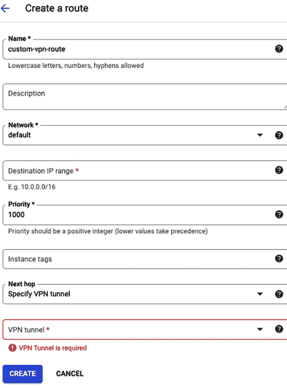

图 8.4 – 为 VPN tunnel 创建路由

4. 在图 8.4 中，你可以指定要创建的路由名称、目标 IP 范围。将下一跳指定 VPN tunnel，并选择你已创建的 VPN tunnel。实例标签（Instance tags）也是可选的。另外注意，只有在你已创建隧道时，VPN tunnel 名称才会显示。

## 防火墙规则

你的 VPC 实例必须拥有防火墙规则，允许 VM 访问 Google API 和和服务使用的 IP 地址。每个 VPC 都有允许出站连接并阻止入站连接的隐式防火墙规则。

## 为你的 VPC 子网启用私有访问

按照以下步骤操作：

1. 进入 Google Cloud 控制台中的 VPC 网络（VPC networks）页面。
2. 从这里，点击你需要启用私有访问的网络名称。
3. 如果你想为现有子网启用私有访问，请按照以下步骤操作：
   I. 点击子网名称。在图 8.5 中，你可以看到子网名称为 `holodeck`。
   II. 点击后，你将进入子网详情页。
   III. 在这里，可以通过点击编辑（EDIT）修改详情。
   IV. 然后转到私有访问（Private Google Access）部分，选择开启（On），并点击保存（SAVE）。

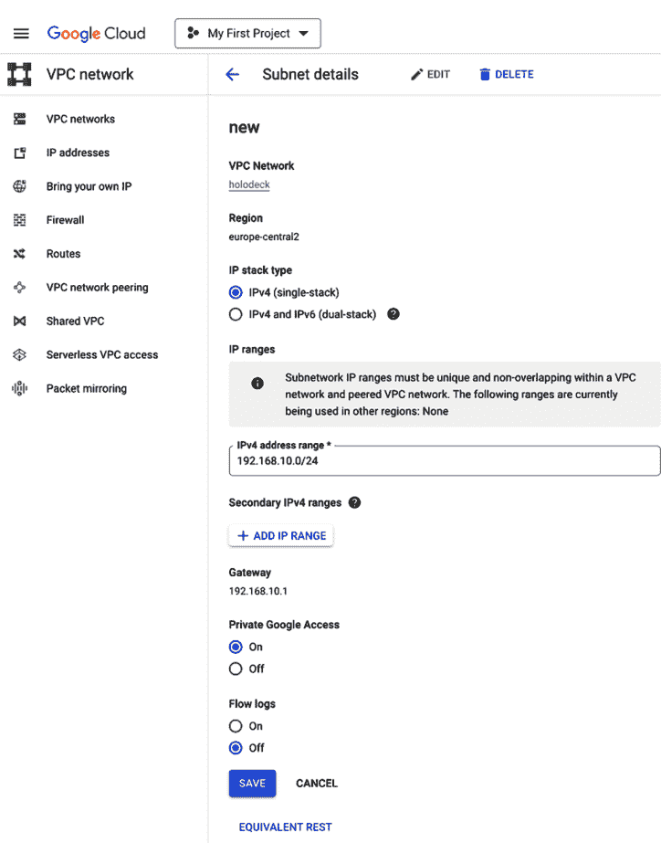

图 8.5 – 为子网启用私有访问

4. 如果你想为新子网启用私有访问，过程类似：
   I. 首先，你需要创建子网。
   II. 当你在 VPC 网络页面时，点击添加子网（Add subnet）。
   III. 然后指定名称（Name）和区域（Region）。
   IV. 接下来，你需要指定子网的 IP 范围。范围不能与网络对等或 VPN 重叠。
   V. 一旦你对子网设置进行了更改（例如开启 VPC 日志），就可以开启私有访问并点击保存（SAVE）。

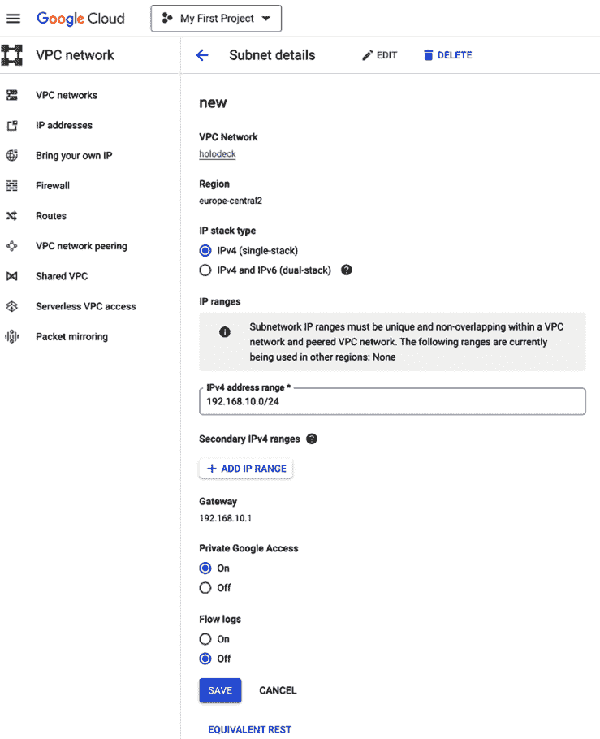

图 8.6 – 为私有访问配置子网

在图 8.6 中，子网私有访问已开启。你可以编辑该子网。

在本节中，我们查看了如何为子网启用私有访问，允许你的 VM（无论是本地还是 Google Cloud）访问 Google API。

# 身份感知代理 (Identity-Aware Proxy)

`IAP` 允许你配置授权以保护对 VM 和应用程序的远程访问。`IAP` 和负载均衡器位于所有数据请求之前。与传统的 VPN 解决方案相比，这提供了更简单的管理过程和更低的运维开销。无需实现 VPN。它还让终端用户体验更加流畅，用户不再需要启动 VPN 客户端并登录 VPN。

与传统的 VPN 相比，`IAP` 采用基于应用程序的访问控制方法，而不是基于网络的访问控制。只有配置了正确身份提供程序（2FA）的用户才能通过 `IAP` 访问。使用 Cloud IAM 配置授权，用户需要在资源项目上配置 IAP 安全 Web 应用角色（IAP-secured Web App Role）。我们将在本章稍后的“在本地启用 IAP”部分查看如何配置它的步骤。

使用 `IAP`，你不仅可以安全访问 Google Cloud 上的资源（如 GCE、Google App Engine 和 GKE），还可以为你的本地或第三方云提供商提供安全访问。我们将在本节稍后查看使用 `IAP` 为本地资源配置安全访问示例。

`IAP` 与其他 Google Cloud 产品紧密集成，例如 Cloud IAM、Cloud Identity 和 Access Context Manager。你可以配置 Access Context Manager 在授予用户访问时执行额外的安全检查。例如，你可以检查地理位置、强制 IP 地址白名单，以及终端设备检查（例如检查 X.509 证书、检查磁盘加密），它不仅能让你看到用户上下文以及单因素和多因素身份验证等方面信息，还会在授予访问之前执行设备检查。身份服务器利用请求凭据（如果有效）来确定用户身份（电子邮件地址和用户 ID）。当用户通过身份验证后，身份服务器会检查其 IAM 角色，查看其是否允许访问相关资源。

# 身份感知代理 (Identity-Aware Proxy)

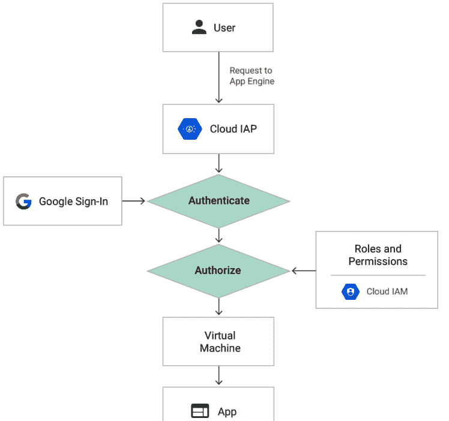

图 8.7 – IAP 如何与 App Engine 工作

让我们观察图 8.7 来理解 `IAP` 如何与 App Engine 工作。当应用程序或资源受 `IAP` 保护时，只有具有适当 `IAP` 权限（IAP 安全用户角色）的用户才能访问它。为了访问受保护的资源，`IAP` 会对请求的用户进行身份验证和授权检查。

`IAP` 拦截对资源的请求并检查该服务是否启用了 `IAP`。如果启用了此选项，请求头或 Cookie 中出现的任何 `IAP` 凭据将提交到 `IAP` 认证服务器。如果用户没有浏览器凭据，则会将用户重定向到存储了令牌的 OAuth 2.0 Google 账号登录流程，以供后续登录使用。

## 高级网络安全

对于 GKE 和 GCE，如果用户可以访问 VM 的应用程序服务端口，就可以绕过 `IAP` 认证。`IAP` 保护的应用程序无法防止执行在不同 VM 上的代码，因为防火墙限制无法阻止它。类似的情况适用于 Cloud Run，如果用户拥有自动签名的 URL，他们就可以绕过 `IAP` 认证。为了防止并非源自服务基础设施的流量，你必须实现防火墙规则和负载均衡器。其他替代方案（例如为 Cloud Run 和 App Engine 使用入口控制/ingress controls）可以用于签名标头。

接下来，我们将介绍 `IAP` 如何支持你本地应用程序的访问。设置中将引入一个新组件：`IAP` 连接器（IAP connector）。我们将了解这个连接器是什么，并查看 `IAP` 连接器的内部工作原理。从考试的角度来看，你不会被测试关于 `IAP` 连接器工作原理的知识，但了解它总是有好的。

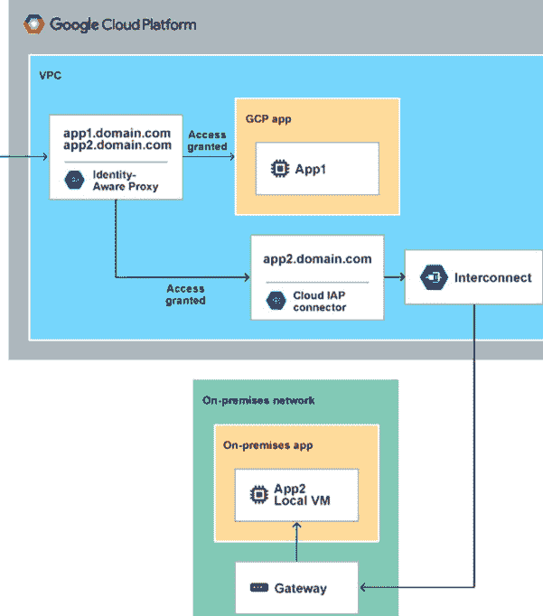

图 8.8 - 本地 IAP 的工作原理

# 身份感知代理 (Identity-Aware Proxy)

我们将使用图 8.8 提供的插图来理解本地 `IAP` 的流程和关键组件。然后，我们将查看如何为通过 Google Cloud 到本地的混合连接器连接的应用程序提供安全访问。

工作流的初始部分与之前解释的 `IAP` 为 App Engine 工作的方式类似。对用户执行的身份验证和授权检查没有区别。请求随后被发送到 `IAP` 连接器，它通过 Interconnect 的点对点连接将请求转发到本地网络。

`IAP` 通过使用 `IAP` 连接器针对本地应用程序。你可以从 Google Cloud 控制台的 IAM 仪表板创建 `IAP` 连接器。`IAP` 连接器使用可配置的 Google Cloud Deployment manager 进行部署。该模板部署了运行主机和运行 `IAP` 连接器所需的资源。在你的 Google Cloud 项目中，该模板在 GKE 集群上部署了一个 Ambassador 代理。该代理负责将受 Cloud Identity 保护的流量路由到你的本地应用程序，直接应用 Google Cloud 身份和访问管理（Cloud IAM）策略。

你必须为 `IAP` 连接器定义映射（mappings）。每个路由名称（routing name）必须对应于由 ambassador 创建的 GCE 后端资源。映射参数（mapping parameter）必须定义带有源和目的地的路由。这是为了确保请求可以从源端路由到正确的目的地，目的地可能是本地网络上的应用程序。以下示例显示了映射的样式：

```
routing:
  - name: crm
    mapping:
      name: host
      source: www.crm-domain.com
      destination: crm-internal.domain.com
  - name: sub
      source: customer.hr-domain.com
      destination: customer.hr-internal.domain.com
  - name: billing
    mapping:
      name: host
      source: www.billing-domain.com
      destination: billing-internal.domain.com
```

在此示例中，我们将来自 `www.crm-domain.com` 的入站请求路由到 `crm-internal.domain.com`，并为主机和子域名都创建了映射。稍后，我们将查看为本地应用程序启用 `IAP` 的步骤。

## 高级网络安全

这里需要注意的一点是，`IAP` 默认与 Google 身份集成，并使用 Google Cloud Identity 和 Cloud IAM 等服务。然而，你也可以选择使用外部身份而不是 Google Cloud Identity Platform（这是 Google 的客户 IAM 解决方案）。Google Cloud Identity Platform 可以与 `IAP` 一起使用。Google Cloud Identity Platform 是一个完全不同的产品，不在考试范围内。

接下来，我们将查看如何将 TCP 转发用于 `IAP`。用例限于支持使用 HTTP 或 HTTPS 的应用程序。在编写此书时，尚不支持厚客户端（thick clients）。但你可以使用 TCP 转发来同时支持安全壳（SSH）和远程桌面协议（RDP）。这允许用户通过 TCP 转发连接到 GCE 上的任何 TCP 端口，`IAP` 打开一个监听端口并将所有流量发送到所选实例。`IAP` 使用 HTTPS 加密客户端流量。`gcloud compute ssh` 将 SSH 封装在 HTTPS 中并将其传递给远程实例。TCP 转发仅适用于使用 `IAP` 的 GCE，而不适用于本地。

## 为本地环境启用 IAP

你应该熟悉四种不同的配置：为本地应用启用 `IAP`、为 App Engine 启用 `IAP`、为 GKE 启用 `IAP` 以及为 GCE 启用 `IAP`。`IAP` 允许管理托管在 App Engine、GCE 或负载均衡上的访问。执行以下步骤为 App Engine 启用 `IAP`：

1. 打开控制台左侧菜单。
2. 点击安全性（Security）。
3. 选择身份感知代理（Identity-Aware Proxy）。你的资源列在身份感知代理页面上。如果尚未操作，请确保你已配置了 OAuth。
4. 完成后，返回身份感知代理页面。按照以下步骤配置意意屏幕：
   - 转到 OAuth 同意屏幕。
   - 在支持电子邮件下，选择你想显示的地址。该地址必须属于登录用户帐户或用户所属的组。
   - 输入你想显示的应用程序名称。
   - 添加任何可选详细信息。
   - 点击保存。
5. 返回身份感知代理页面并选择你想保护的应用程序。如果没有看到你的应用，请确保你已配置了 App Engine。对于 GCE 和 GKE，确保你已配置了带有后端的负载均衡器。我们在第 7 章虚拟私有云中涵盖了创建负载均衡器的方法。

> 注意 为你的所选应用启用 `IAP` 后，只有经过验证和授权的成员才能访问它。

6. 点击行左侧的复选框选择应用程序。
7. 打开该应用程序的 `IAP` 开关。
8. 为了确认让资源受 `IAP` 保护，点击窗口中的启用。

为了控制谁可以访问应用程序，需要授予访问权限。在接下来的步骤中，你将指定成员并为他们分配适当的角色以访问你的应用程序。

9. 点击信息面板中的添加成员按钮。这会打开添加成员面板。添加面板会临时隐藏此处共享的示例。
10. 在添加成员面板中，在新成员字段中输入用户和/或组。
11. 为每个新成员选择一个想要授予的 `IAP` 角色。这些角色如下：
    - IAP 策略管理员 (`IAP Policy Admin`)：授予对 Cloud `IAP` 权限的管理员权限
    - IAP 安全应用用户 (`IAP-secured Web App User`)：授予使用 Cloud `IAP` 的 HTTPS 资源的访问权限
12. 点击保存。

## 使用 Cloud IAP 进行 TCP 转发

在本节中，我们将介绍如何使用 `IAP` 进行 TCP 转发。当您创建 GCE 实例时，它们会出现在身份感知代理（Identity-Aware Proxy）页面的“SSH 和 TCP 资源”下。

## 身份感知代理 + 本地连接器设置 高级版


身份感知代理 (IAP) 允许您管理谁可以访问托管在 App Engine、Compute Engine 或 HTTPS 负载均衡器上的服务。了解更多

要开始使用 IAP，请添加 App Engine 应用程序、Compute Engine 实例或配置 HTTPS 负载均衡器。

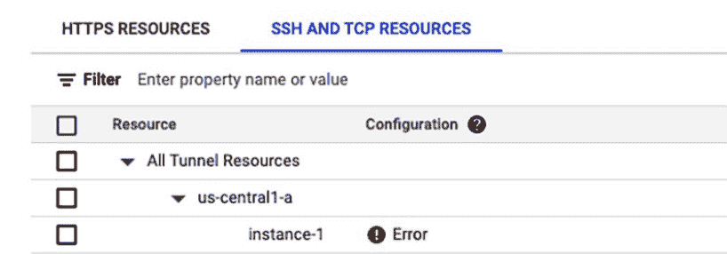

| 资源 | 配置 |
| --- | --- |
| 所有隧道资源 |  |
| us-central1-a | 错误 |
| instance-1 |  |

图 8.9 – 身份感知代理仪表板

现在，让我们来创建防火墙规则并返回此页面，查看错误消息是否消失。让我们看看如何创建防火墙规则：

- 1. 点击错误消息，它将带您进入一个页面，提供缺失访问层级的详细信息，以及您需要添加到防火墙规则中的源 IP 地址范围。

## 配置

### 实例 instance-1

您的防火墙配置需要确保 IAP 可以成功连接到单个 VM。了解更多

## 访问资源不足

Cloud IAP 需要防火墙来允许从 Cloud IAP 到您的 VM 的流量。添加以下防火墙规则来解决此问题。

| 源 IP 范围 | `35.235.240.0/20` |
| 允许的协议 | `tcp` |


图 8.10 - 为 IAP 修正防火墙配置显示了点击错误时显示的消息。

- 2. 从这里，您可以点击“编辑防火墙”，它将直接带您进入防火墙设置页面。在这里，您可以配置防火墙规则。

让我们看看为了使用 IAP 访问 VM 而需要创建的规则。要为您的所有 VM 授予 RDP 和 SSH 访问，请执行以下步骤：

- 1. 打开防火墙规则页面并点击“创建防火墙规则”。

2. 配置以下设置：

- I. 名称：`allow-ingress-from-iap`
- II. 流量方向：入站 (Ingress)
- III. 目标：网络中的所有实例
- IV. 源过滤器：IP 范围
- V. 源 IP 范围：`35.235.240.0/20`
- VI. 协议和端口：选择 `TCP` 并输入 `22`、`3389` 以允许 RDP 和 SSH。

## 创建防火墙规则

防火墙规则控制进入或流出实例的流量。默认情况下，来自您网络的入站流量是被阻止的。了解更多

- 名称 *：`allow-ingress-from-iap`（允许小写字母、数字、连字符）
- 描述日志：开启防火墙日志可以生成大量日志，可能会增加 Cloud Logging 的成本。了解更多
- 开启 / 关闭
- 网络 *：`default`
- 优先级 *：`1000`（检查其他防火墙规则的优先级。优先级范围为 0 - 65535）
- 流量方向：入站 (Ingress) / 出站 (Egress)
- 匹配操作：允许 (Allow) / 拒绝 (Deny)
- 目标：网络中的所有实例
- 源过滤器：IPv4 范围
- 源 IPv4 范围 *：例如 `35.239.240.0/20`，`0.0.0.0/0`，`192.168.2.0/24`
- 第二源过滤器：无
- 协议和端口：允许、指定的协议和端口
- `tcp`: `3389`

图 8.11 – 创建防火墙规则以启用 IAP 访问

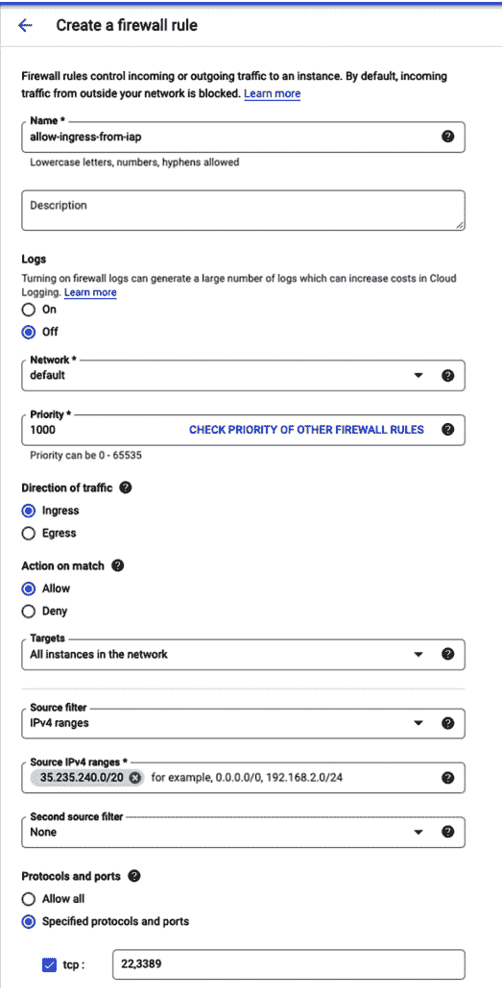

- 3. 点击“创建”。

图 8.12 显示了当您按照前面的示例填充了防火墙规则设置后，您的配置看起来是什么样。您只有在需要指定的协议和端口时才指定 `22` 或 `3389`。示例说明了您如何同时打开 SSH 和 RDP 端口。

## 身份感知代理 + 本地连接器设置

身份感知代理 (IAP) 允许您管理谁可以访问托管在 App Engine、Compute Engine 或 HTTPS 负载均衡器上的服务。了解更多

要开始使用 IAP，请添加 App Engine 应用程序、Compute Engine 实例以配置 HTTPS 负载均衡器。

| 资源 | 配置 |
|---|---|
| 所有隧道资源 |  |
| us-central1-a |  |
| instance-1 | ✔ OK |

图 8.12 – 成功创建防火墙规则后的 SSH 和 TCP 资源

在 8.12 中，观察到在应用防火墙规则后，当我们返回 IAP 设置下的“SSH 和 TCP 资源”时，会显示 OK 消息。错误消息不再显示。

接下来，我们需要为用户授予访问权限。通过在项目级别建立 IAM 权限，您可以让用户或用户组访问项目中的所有 VM。让我们来看看这涉及哪些内容：

- 4. 从左侧菜单的“安全”子菜单导航到 IAP 管理页面。
- 5. 在此处，导航到 IAP 设置下的“SSH 和 TCP 资源”。
- 6. 然后，选择您想要配置的 VM。如果信息面板可见，可以点击它。
- 7. 我们将查看如何添加成员进行配置。参考图 8.13。
- 8. 在此处，您可以添加电子邮件地址或组地址。
- 9. 添加主体后，可以设置角色为 IAP 隧道用户。

## 为 instance-1 添加主体

### 为 "instance-1 添加主体和角色

在下方输入一个或多个主体。选择一个角色授予它们访问资源。允许多个。了解更多

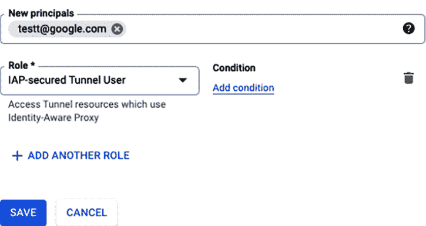

图 8.13 – 为 IAP 访问添加主体

> 注意：您可以使用添加条件来创建细粒度的权限。参考第 6 章“身份与访问管理”了解如何添加条件。

- 10. 完成后，点击“保存”。

图 8.14 是 IAP Desktop 工具的截图，它可以为你的 Windows 实例建立 RDP 连接。

> 注意
> 你可以从 IAP Desktop 的 GitHub 页面获取更多信息，地址为：`https://packt.link/L2Zh5g`。

我们将接下来进入 Cloud NAT 的主题。在这里，我们将通过一些示例查看 NAT 如何使用，并对该主题有更好的理解。

# Cloud NAT

Cloud NAT 是一个在考试中出现频率不高的话题。然而，了解它的工作原理以及需要 NAT 的情况非常重要。我们还将 Google Cloud 实现的 NAT 架构，它与传统的 NAT 架构不同。

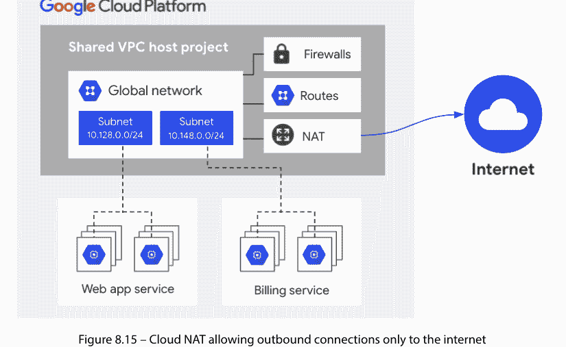

图 8.15 显示了 Cloud NAT 的工作原理。Cloud NAT 作为一种托管服务提供，具有高可用性和无缝扩展性。它仅允许到外网的出站连接，而入站流量只有在响应由实例发起的连接时才被允许。Cloud NAT 是一个区域性资源，完全分布式且软件定义。数据路径中没有中间 NAT 代理。NAT 配置存储在控制平面中并推送到主机；这意味着无论控制平面状态如何，NAT 都能保持工作，且没有瓶颈或性能损失。Cloud NAT 还支持 VM 上的别名，并依赖 VPC 中的默认 路由。

注意的是，在某些情况下，即使配置了 NAT 也不会执行 NAT。情况如下：

- VM 具有外部 IP。
- 默认 Internet路由已更改。
- 后端 VM 与负载均衡器代理之间存在通信。
- 与 Google APIs 有通信（而是使用了私有访问服务 Private Access）。

接下来，我们将查看如何为一个没有外部 IP 地址且想要与互联网通信的 GCE 实例创建一个 Cloud NAT 实例。配置过程中涉及 8 个关键步骤：

- 1. 首先，按照第 7 章“虚拟私有云”中所述，创建一个 VPC 网络和一个子网。
- 2. 然后，创建一个没有外部 IP 地址的 VM 实例。在 GCE 实例创建向导的“网络”选项卡下，选择“无外部接口”（No External Interface）选项是非常重要的。
- 3. 创建入站防火墙规则以允许 SSH 连接。这与我们在 IAP 部分创建允许 IAP 的防火墙规则类似。确保指定了源 IAP 范围，即范围 `35.235.240.0/20`。
- 4. 导航到身份感知代理（Identity-Aware Proxy）设置，并在“SSH & TLS 资源”下选择“添加成员”并授予“IAP-secured Tunnel User”权限。同样，这一步与我们在“使用 Cloud IAP 进行 TCP 转发”中配置的内容类似。
- 5. 在这一步中，我们将导航到 GCE 页面，并通过控制台 SSH 登录到步骤2 中创建的 GCE 实例。一旦通过 SSH 成功登录 GCE 实例，在命令行界面（CLI）中使用 `curl example.com` 命令。这不应该产生任何输出。
- 6. 接下来，我们将使用 Cloud Router 创建 NAT 配置。NAT 配置非常直观。一旦你登录 Google Cloud 控制台并选择了项目，就可以进入 Cloud NAT 页面（网络 | 网络服务 | Cloud NAT）。在该页面上，点击“开始使用”或“创建 NAT 网关”。如果你是第一次访问此页面，可能会看到欢迎消息。如果你以前访问过该页面，则不会看到欢迎消息；如果没有看到以下消息，请不要困惑。你应该看到一个与图 8.16 显示类似的屏幕。

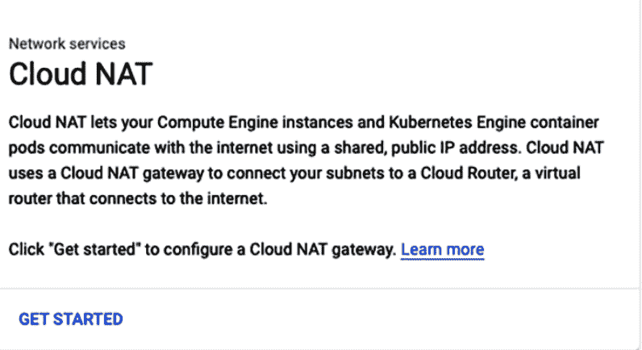

图 8.16 - 开始使用 Cloud NAT

- 7. 参考图 8.17，在图中你可以看到创建 Cloud NAT 网关时可以配置的各种属性。在这里输入你的网关名称；例如，我们使用名称 `nat-config`。然后，为此示例指定网络；我们将 VPC 网络设置为 `starshipnw`。在你的配置中，它将是你创建的网络，或者你可以使用默认网络。接下来，将区域设置为 `us-east1`（你所在的区域）。对于 Cloud Router，选择“创建新路由器”。然后输入你偏好的名称；在我们的示例中，使用了名称 `my-router`。完成后，点击“创建”。

## 创建 Cloud NAT 网关

Cloud NAT 让你的 VM 实例和容器 Pod 使用共享的公共 IP 地址与互联网通信。

Cloud NAT 使用 Cloud NAT 网关来管理这些连接。Cloud NAT 是针对区域和 VPC 特定的。如果你在多个区域都有 VM 实例，你需要为每个区域创建一个 Cloud NAT 网关。了解更多

| 网关名称 * |  |
| :--- | :--- |
| `nat-config` | 允许小字母、数字、连字符 |

## 选择 Cloud Router

| 网络 * |  |
| :--- | :--- |
| `starshipnw` |  |
| 区域 * |  |
| :--- | :--- |
| `us-east1 (South Carolina)` | 一个子网。 |
| Cloud Router * |  |
| :--- | :--- |
| `my-router` |  |

## Cloud NAT 映射

| 源（内部） |  |
| :--- | :--- |
| 所有子网的主和次要范围 | 选择映射到 Cloud NAT 网关的子网 |
| NAT IP 地址 |  |
| :--- | :--- |
| 自动（推荐） |  |

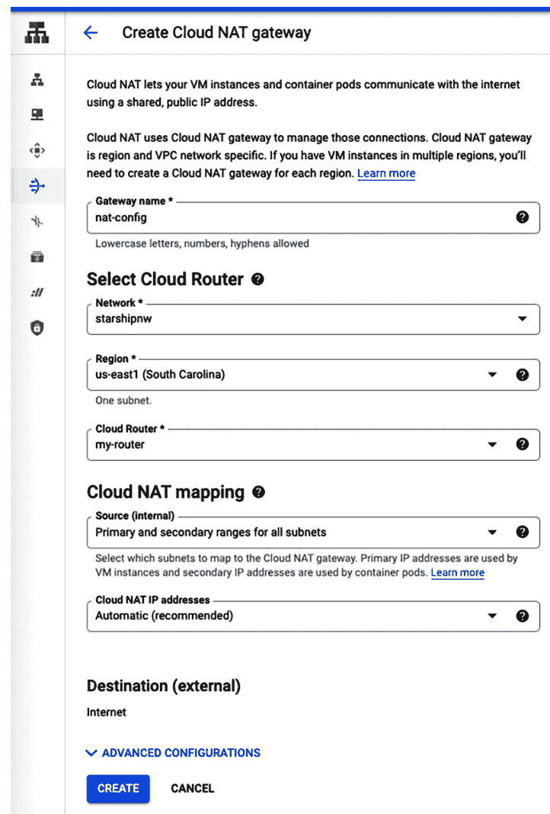

- 8. 完成步骤后，我们现在可以返回 GCE 并执行测试命令。我们将看到类似下面的输出：

```html
<html>
<head>
<title>Example Domain</title>
</head>
<body>
<div>
<h1>Example Domain</h1>
<p>这不应该产生任何输出。</p>
<p><a href="http://www.iana.org/domains">更多信息</a></p>
</div>
</body>
</html>
```

# Cloud Armor

本节介绍了 DDoS 保护和 WAF（应用程序防火墙）的使用。Cloud Armor 保护你的负载免受各种威胁，包括 DDoS 攻击和应用程序攻击。某些功能是内置的，而另需要手动配置。我们将详细查看这些功能：

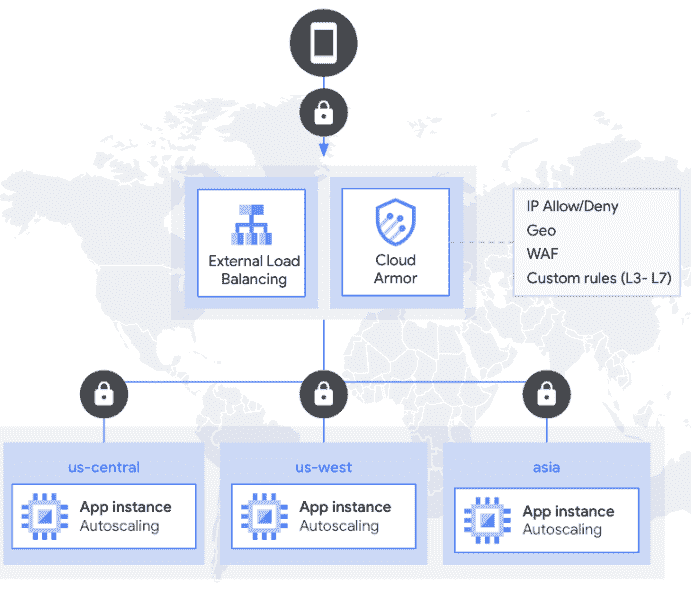

图 8.18 - Cloud Armor 如何保护你的基础设施

Cloud Armor 利用 Google 的全球分布式基础设施来检测并吸收攻击。图 8.18 展示了 Cloud Armor 的位置，它与外部负载均衡器对齐，提供了创建 IP 允许和拒绝列表以及基于地理位置规则的能力。Cloud Armor 内置了某些第 3 层和第 4 层保护，不需要用户配置。这些预构建规则提供了针对 DNS 放大、SYN 洪水、Slowloris 等流量攻击的保护。

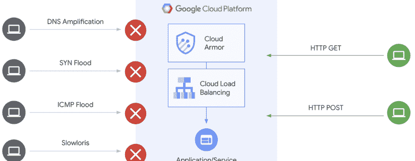

图 8.19—针对流量攻击的 DDoS 保护

## 高级网络安全

在深入研究安全策略和 WAF 规则等技术方面之前，让我们先来看看 Cloud Armor 的部署模型。

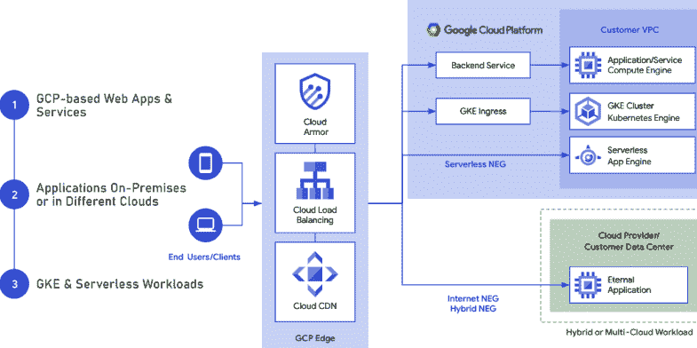

图 8.20 – Cloud Armor 部署模型

我们将通过图 8.20 来查看部署模型：

- Cloud Armor 通过对动态请求以及 CDN 源服务器未命中的缓存请求强制执行 Cloud Armor 安全策略，支持对 Cloud 内容分发网络（CDN）源服务器的保护。大多数应用程序通常是复杂的，从同一项服务同时提供可缓存的静态内容和动态请求。Cloud Armor 是一项安全服务，可以保护网站和应用程序免受恶意攻击。它能够检查并过滤发送到 CDN 源服务器的请求。这有助于防止所谓的“**缓存破坏**”（cache-buster）攻击，此类攻击试图绕过缓存并强制源服务器发送更新的内容。此外，Cloud Armor 还可以帮助网站和应用程序的动态部分免受 OWASP 定义的 10 种常见安全漏洞的攻击。
- 无论应用程序部署在何处，通常需要对它们实施一组一致的安全控制，无论它们是在迁移到 Google Cloud 还是在混合配置中运行。通过互联网网络端点组（NEGs），你可以利用 Google 的所有边缘基础设施（包括全局负载均衡器、Cloud CDN 和 Cloud Armor）来保护你的网站或应用程序，无论它们托管在何处。Cloud Armor 可以帮助你的应用程序免受 DDoS 攻击或其他常见的 Web 攻击，而无需你将应用程序部署在 Google Cloud 上。

注意

NEGs 不在考试范围之内。你可以参考“进阶阅读”部分以阅读更多关于 NEGs 的信息以及如何配置它们。

- 通过 GKE Ingress 对 Cloud Armor 的支持，你可以通过将容器化负载放置在 Google 全局负载均衡器之后，并为第 7 层过滤和 WAF 用例配置 Cloud Armor 安全策略来保护它们。现在我们将详细查看 Cloud Armor 的核心组件，并提供如何配置它们的示例。

## 安全策略

在 Cloud Armor 中，你可以构建安全策略，帮助防御运行在负载均衡器后的应用程序免受 DDoS 和其他 Web 攻击，无论应用程序部署在 Google Cloud 上还是在混合或多云架构中。可以使用安全策略对第 3 层和第 7 层请求进行常见漏洞的过滤，从而在流量到达你的负载均衡后端服务和存储桶之前将其拦截。IP 地址、IP 范围、区域代码和请求头只是用于安全策略过滤流量的条件示例示例。


## 高级网络安全

本节将更深入地查看安全策略，考虑开发策略之前的需求因素，以及安全策略的一些重要功能（如图 8.21 所示）。外部负载均衡器后的后端服务只能访问这些服务可用的安全策略。实例组、无服务器 NEGs、互联网 NEGs 和 Google Cloud 存储桶都是 Google App Engine、Cloud Run 和 Cloud Functions 支持的后端服务。你必须对所有的混合或多云保护需求使用互联网 NEGs。

只有当负载均衡器成为 HTTP(S) 负载均衡器，并且满足后端服务的外部负载均衡方案以及后端服务的协议（协议必须是 HTTP、HTTPS 或 HTTP/2）时，才能应用安全策略。

你可以配置两类安全策略——安全策略和边缘安全策略。实例组或 NEGs（不包括互联网、区域和无服务器 NEGs）可用于过滤和保护后端服务。后端安全策略关联的操作允许每个源范围或地理区域允许（allow）、拒绝（deny）、重定向（到 GoogleCAPTCHA）、节流（throttle）和基于速率（rate-based）。你还可以创建 WAF 规则和 IP 列表。

使用速率限制规则根据你定义的阈值限制每个客户端的请求次数，或者根据你设置的持续临时封禁超过阈值的客户端。

还有机器人管理规则（仅限预览版），这些不属于考试范围。对于命名 IP 列表，也存在预配置规则；我们将在“命名 IP 列表”部分详细介绍它们。

> 注意
> 你可以对预配置的 WAF 规则进行精调或编写自定义规则。为了考试目的，你需要了解存在哪些类型的规则以及它们是如何工作的。考试不会测试你编写自定义 WAF 规则。

## 命名 IP 列表

通过使用 Cloud Armor 中的命名 IP 列表功能，你可以在安全策略中引用第三方维护的 IP 范围和地址。你不需要指定单个 IP 地址。相反，你可以引用一个包含多个你想要允许或拒绝的 IP 地址的完整列表。需要注意的是，命名 IP 列表不是安全策略，但可以在策略中指定它们。

可以构建安全规则，允许提供列表中的所有 IP 地址，并拒绝所有不在提供列表中的 IP 地址：`ip1`, `ip2`, `ip3`...`ipN`。


```
gcloud beta compute security-policies rules create 1000
  --security-policy POLICY_NAME \
  --expression "evaluatePreconfiguredExpr('provider-a')" \
  --action "allow"
```

无法构建自定义的命名 IP 地址列表。只有与 Google 合作并维护命名 IP 地址列表的第三方供应商才能此功能。CloudFlare 和 Imperva 是与 Google Cloud 合作为 Google 的命名 IP 列表服务提供列表的供应商。

## 总结


图 8.22 - Cloud Armor 命名 IP 列表

在图 8.22 中，你可以看到命名 IP 列表是如何工作的。CDN 提供了一个 IP 地址列表，例如 `23.235.32/20`、`43.249.72/20` 等。此安全规则允许来自这些 IP 地址的通信。这意味着可以访问 2 个 CDN 提供者的流量（访问点为 `23.235 32 10` 和 `43.249 72 10`），而来自 `198.51.100.1` 的未批准流量将被禁止。

## 总结

在本章中，我们查看了一些高级网络安全概念。我们涵盖了私有 Google访问（Private Google Access）的使用和配置、IAP 及其用例，以及 Cloud NAT。最后，我们查看了 Cloud Armor 以及它如何防止 DDoS 和基于 Web 应用程序的攻击。我们还涵盖了与 Cloud Armor相关的细节，例如安全策略、WAF 规则和命名 IP 列表。

在下一章，我们将涵盖数据安全，这是考试的一个重要主题。我们将查看 Google Cloud 密钥系统，并在后续章节中涵盖数据泄漏防护（DLP）和密钥管理器（Secret Manager）。

## 扩展阅读

有关 Google Cloud 高级网络安全的更多信息，请参考以下链接：

- 互联网 NEG：https://packt.link/D1CXS
- 区域性 NEG：https://packt.link/ILB39
- 调整 Google Cloud Armor 预配置 WAF 规则：https://packt.link/YEScF
- 配置私有 Google Access 和 Cloud NAT：https://packt.link/JyutC
- 使用零信任身份感知代理 (IAP) 保护云应用：https://packt.link/bM1OX
- 使用 Cloud Armor 进行速率限制：https://packt.link/rmCAn

## Google Cloud 密钥管理服务

在本章中，我们将查看 Google Cloud 密钥管理服务 (KMS)。Cloud KMS 是 Google Cloud 中所有加密操作的基础服务。部署在 Google Cloud 上的每项工作负载都需要加密数据的能力并将其用于授权用途。Cloud KMS 提供了多种选项，理解这些选项并做出明智选择至关重要，以帮助满足合规和审计要求。

在本章中，我们将涵盖以下主题：

- Cloud KMS 概述
- Cloud KMS 中的加密和密钥管理
- 密钥管理选项
- 客户提供的加密密钥
- 对称和非对称密钥加密
- 将自有密钥引入云
- 密钥生命周期管理
- 密钥 IAM 权限
- Cloud HSM
- Cloud 密钥管理器
- Cloud KMS 最佳实践
- Cloud KMS API 和日志

让我们从学习 Cloud KMS 的功能开始。

## Cloud KMS 概述

通过 Cloud KMS，Google 的重点是提供一个可扩展、可靠且高性能的解决方案，并具有多种供你在易于使用的平台上进行控制的选项。让我们从快速概览 Cloud KMS 架构开始。

## Cloud KMS 平台


图 9.1 – Cloud KMS 架构

Cloud KMS 平台的关键组件如图 9.1 所示。管理员可以通过 Google Cloud 控制台或 CLI，以及通过 REST 或 gRPC API 访问密钥管理服务。应用程序使用 REST API 或 gRPC 访问密钥管理服务。

在创建 Cloud KMS 平台时，你可以选择一种保护级别来定义密钥应该使用哪个后端。Cloud KMS 平台有两个后端（不包括 Cloud EKM）：软件和 HSM 保护级别。软件保护级别适用于由硬件安全模块保护的密钥。

Cloud KMS 加密操作由 FIPS 140-2 验证的模块执行。具有软件保护级别的密钥以及使用它们执行的加密操作符合 FIPS 140-2 第 级。具有 HSM 保护级别的密钥以及使用它们执行的加密操作符合 FIPS 140-2 第 3 级。

现在让我们查看 Cloud KMS 目前的产品。

## 当前 Cloud KMS 加密产品

在本节中，我们将查看各种 KMS 产品。这些产品根据密钥材料的来源，从 Google 管理的加密到完全托管进行分类。

当前 Google Cloud 产品组合

| 默认加密 | Cloud KMS | Cloud HSM | 密钥导入 | 客户提供的加密密钥 | 外部密钥管理器 |
| :--- | :--- | :--- | :--- | :--- | :--- |
| Google 默认静态加密。密钥访问或旋转控制。 | Google 生成并存储的密钥。 | Google 生成并存储在 HSM 中的密钥。 | 客户可以在 HSM 中导入并使用密钥。 | 客户拥有并访问数据的密钥。 | 存储在外部外部管理系统中的密钥。 |

密钥材料来源

Google 控制材料

客户控制材料

图 9.2 - Google Cloud 加密产品

图 9.2 显示了 Google Cloud 上的加密产品。

Cloud KMS 由五个设计柱支持：

1. **客户控制**：你可以使用 Cloud KMS 处理软件和硬件密钥，或者通过密钥功能提供自己的密钥。
2. **访问控制和监控**：你可以管理单个密钥的权限及其使用方式。
3. **区域性**：区域化内置在 Cloud KMS 中。只有你选择的云位置用于生成、存储和处理密钥。
4. **持久性**：Cloud KMS 符合最严格的持久性要求。Cloud KMS 定期检查并备份所有密钥材料和元数据，防止数据损坏并确保数据可以正确解密。
5. **安全性**：Cloud KMS 与**身份访问管理 (IAM)** 和云审计日志深度集成，为防止未经的密钥访问提供强大的保护。云审计日志帮助你理解谁何时使用了密钥。

理解了 Cloud KMS 产品的基础原理之后，让我们学习密钥管理的基础。

## Cloud KMS 中的加密和密钥管理

在本节中，我们将学习与 Cloud KMS 相关的密钥管理基础。


图 9.3 – 密钥结构

图 9.3 显示了 Cloud KMS 中的密钥结构。让我们学习密钥管理的术语：

- 密钥：代表用于特定用途的加密密钥的命名对象。随着创建新密钥，密钥材料（用于加密操作的实际位）可能会随时间变化。密钥版本和密钥的其他属性与密钥相关并进行管理。因此，密钥是理解 Cloud KMS 使用最重要的对象。Cloud KMS 支持非对称密钥和对称密钥。
- 密钥环（Key ring）：为了组织目的而对密钥进行分组。密钥环属于一个 Google Cloud 项目并位于特定的位置。每个密钥环继承包含它的密钥的策略。将具有相关权限的密钥分组在密钥环中，允许您在密钥环层级授予、撤销或修改权限，而无需对每个密钥进行单独操作。密钥环提供了便利性和分类，但如果密钥环的分组对您没有用，您可以直接在密钥上管理权限。为了防止资源冲突，无法删除密钥环。密钥环和密钥没有费用费用或配额限制，因此它们的持续存在不会影响成本或生产限制。
- 密钥元数据（Key metadata）：资源名称、Cloud KMS 资源的属性，例如 IAM 策略、密钥类型、密钥大小、状态以及从这些属性派出的任何数据。密钥元数据的管理方式与密钥材料不同。
- 密钥版本（Key version）：代表在某个时间点与密钥关联的材料。密钥版本是包含实际密钥材料的版本。版本按顺序编号，从版本 1 开始。当密钥轮定时，会创建一个带有新密钥材料的新版本。同一个密钥随着时间的推移可能有多个版本，从而限制了单个版本的使用。对称密钥始终有一个主版本。该版本默认用于加密。当 Cloud KMS 使用对称密钥执行解密时，它会自动识别执行解密所需的密钥版本。密钥版本只有在启用时才能使用。任何非销毁状态的密钥版本都会产生费用。
- 用途（Purpose）：密钥的用途决定了密钥是否可以用于加密或签名。您在创建密钥时选择用途，所有版本具有相同的用途。对称密钥的用途始终是对称加密/解密。非对称密钥的用途是对称加密/解密或非对称签名。您根据特定的用途创建密钥，在密钥创建后无法更改。
- 状态（State）：密钥版本的状态为以下之一：
  - 已启用（Enabled）
  - 已禁用（Disabled）
  - 已销毁（Destroyed）

让我们继续了解 Cloud KMS 中的密钥层级结构。

# 密钥层级

下图显示了 Cloud KMS 的密钥层级结构。Cloud KMS 使用 Google 内部 KMS，因为由 Cloud-KMS 加密的密钥会被 Google 的 KMS 包装。Cloud KMS 使用与 Google 的 Cloud KMS 相同的信任根。


图 9.4 – 密钥层级

图 9.4 显示了 Cloud KMS 中的密钥层级结构。层级结构中有几层：

- *数据加密密钥（DEK）：用于加密实际数据的密钥。DEK 由 Google Cloud 服务代表您管理。
- 密钥加密密钥（KEK）：用于加密或包装数据加密密钥的密钥。所有的 Cloud KMS 平台选项（软件、硬件和外部后端）都允许您控制 KEK。
- KMS 主密钥：用于加密 KEK 的密钥。该密钥在内存中分发。KMS 主密钥备份在硬件设备上。该密钥负责加密 KEK。
- KMS 主密钥：Google 内部的 KMS 密钥。

现在您已经理解了密钥层级结构是如何运作的，让我们过一下加密的基础知识。

## 信封加密（Envelope encryption）

如图 9.5 所示，加密数据的过程是在本地生成 DEK，使用 DEK 加密数据，使用 KEK 包装 DEK，然后将加密后的数据和包装后的 DEK 存储在一起。KEK 永远离开 Cloud KMS。这被称为信封加密。本节更多是关于理解 Google 如何处理信封加密，这不是 Google Cloud 客户需要管理的。

## Cloud KMS 中的加密和密钥管理

带有包装后 DEK 的加密数据块

存储在 KMS 中的 KEK


应用程序

KMS

图 9.5 – 信封加密

以下是使用信封加密加密数据时遵循的步骤：

- 在本地生成 DEK，指定密码类型和用于生成密钥的密钥材料。
- 使用此 DEK 加密数据。
- 根据用户偏好，生成新的 KEK 或使用 Cloud KMS 中现有的 KEK。此 KEK 用于包装数据。
- 将包装后的 DEK 与加密数据一起存储。

现在让我们看看使用信封加密解密数据时遵循的步骤。

如图 9.6 所示，解密数据的过程是检索加密数据和包装后的 DEK，检索包装后的 DEK，使用 KEK 解开 DEK，然后使用解开的 DEK 解密数据。KEK 永远离开 Cloud KMS。


应用程序

返回加密数据

存储系统

KMS

图 9.6 – 信封加密

使用信封加密解密数据，您需要执行以下操作：

- 检索加密数据和包装后的 DEK。
- 使用存储在 Cloud KMS 中的 KEK 解开加密的 DEK。
- 使用明文 DEK 解密加密数据。

现在我们已经理解了密钥和信封加密的基础，让我们看看 Cloud KMS 内的密钥管理选项。

## 密钥管理选项

在本节中，我们将涵盖密钥管理的几个方面，这些方面是由 Google 管理或客户管理的。了解哪种选项是重要的。

## Google 默认加密（Google's default encryption）

Google 默认加密使用 Google 管理的密钥。这种加密使用 AES-256。这不需要额外的配置即可开启。Google 默认加密适用于大多数工作负载。

## 客户托管密钥（Customer-managed encryption keys, CMEKs）

客户托管密钥（CMEKs）允许您对密钥生命周期的某些方面进行控制，包括但不限于：

- 客户可以禁用用于保护数据的密钥
- 客户可以自动或手动轮转用于保护数据的密钥
- 客户可以使用 Cloud HSM、外部密钥管理器 (EKM) 或导入到 Cloud KMS 的现有密钥来保护数据

对于这些需求，客户可以使用：

 * 客户可以禁用使用的密钥

CMEK 是某些 Google Cloud 服务支持的一项功能。

## CMEK 集成（C Encryption integrations）

当某个服务支持 CMEK 时，被称为具有 CMEK 集成。某些服务（如 GKE）具有保护数据类型的 CMEK 集成。

## 密钥管理选项

对于启用 CMEK 的确切步骤，请参阅相关 Google Cloud 文档。

您可以遵循以下步骤：

1. 创建或导入 Cloud KMS 密钥，选择尽可能靠近服务的位置。服务和密钥可以在同一个项目或不同的项目中。这就是 CMEK。
2. 将 CMEK 的加密解密者 IAM 角色（`roles/cloudkms.cryptrypterDecpter`）授予该服务的服务账户。
3. 配置服务使用 CMEK 来保护数据。例如，您可以配置 GKE 集群使用 CMEK 保护节点磁盘上的数据。

- * 如果帐户拥有加密解密者角色，它可以加密和解密数据。如果您禁用或撤销 CMEK，则无法访问数据。

> 注意 CMEK 的轮转不会影响数据可用性，因为服务会跟踪使用哪个密钥版本来加密数据，并使用该版本进行解密。

# CMEK 合规（CMEK compliance）

某些服务不直接存储数据，或仅作为长时间操作的中间步骤短暂存储数据。对于此类工作负载，对每个进行加密是不现实的。这些服务不支持 CMEK 集成，但在无需您配置的情况下提供 CMEK 合规性。

CMEK 合规的服务使用仅存在内存中且不写入磁盘的临时密钥加密临时数据。当临时数据不再需要时，临时密钥将从内存中清除，即使存储资源仍然存在，也无法访问。

CMEK 合规的服务可能会将其输出发送到具有 CMEK 集成的服务，例如 Cloud Storage。

## 客户提供的密钥（Customer-supplied encryption key, CSEK）

您可以提供自己的 AES-256 密钥（标准 Base64 编码），作为 Google 管理加密密钥的额外层。这种密钥被称为客户提供的加密密钥 (CSEK)。

CSEK 目前仅两个服务支持：Cloud Storage 和 Compute Engine。

## 配合 Cloud Storage 使用 CSEK

如果您提供客户自定义加密密钥（CSEK），Cloud Storage 不会在 Google 服务器上永久存储您的密钥，也不会以其他方式管理您的密钥。

相反，您在每次执行 Cloud Storage 操作时都需要提供密钥，在操作完成后，您的密钥将从 Google 服务器上清除。Cloud Storage 仅存储密钥的加密哈希值，以便对未来的请求进行哈希值校验。您无法从该哈希值中恢复密钥，且该哈希值无法用于解密您的数据。以下是使用 CSEK 的最佳实践：

- 您应该将每个密钥备份到安全位置，并采取措施确保密钥不会与不可信的第三方共享。
- 如果任何包含加密密钥的文件或机器被攻破，您应该立即对所有使用受影响密钥加密的对象进行密钥轮转。

当您对对象应用客户提供的加密密钥时，Cloud Storage 将使用该密钥来加密以下内容：

- 对象的数据
- 对象的 CRC32C 校验和
- 对象的 MD5 哈希值

Cloud Storage 使用标准的服务器端密钥来加密对象的其余元数据，包括对象名称。这允许您在不需要 CSEK 的情况下读取和更新通用元数据，以及列出和删除对象。但是，要执行这些操作，您必须拥有相应的权限。

例如，如果一个对象使用 CSEK 加密，则必须使用该密钥来对对象执行操作（如下载或移动）。如果您尝试在不提供密钥的情况下解密对象的元数据，将收到元数据（如对象名称和内容类型），但无法获得对象的 CRC32C 校验和或 MD5 哈希值。如果您在请求对象元数据时提供了密钥，对象的 CRC32C 校验和和 MD5 哈希值将包含在元数据中。

使用 CSEK 时存在以下限制：

- Cloud Transfer Service（传输服务）和 Cloud Dataflow 目前不支持使用 CSEK 加密的对象。
- 您无法使用 Google Cloud 控制台下载使用 CSEK 加密的对象。同样，当您使用 Google Cloud 控制台上传对象时，无法使用 CSEK 对对象进行加密。
- 您只能为单个对象设置 CSEK。无法为存储桶（bucket）设置默认 CSEK。

## 密钥管理选项

- 如果您对由 CSEK 加密的对象执行组合操作，组件对象必须由相同的密钥加密，并且您需要在组合请求中提供该密钥。生成的组合对象也将由相同的密钥加密。

现在您已经了解了 Google Cloud Storage 中 CSEK 的限制，以下是如何使用 `gsutil` 使用 CSEK。

# 配合 gsutil 使用 CSEK


要使用 `gsutil` 使用 CSEK，请在您的 `boto` 配置文件的 `[GSUtil]` 部分中添加 `encryption_key` 参数。`encryption_key` 是您的 AES-256 加密密钥的符合 RFC 6848 的 Base64 编码字符串。

您可以可选指定一个或多个解密密钥，最多 100 个。虽然 `gsutil` 将 `encryption_key` 用于作为加密和解密密钥，但您指定的任何 `decryption_key` 选项仅用于解密对象。多个解密密钥必须列在 `boto` 配置文件中：

```
decryption_key1 = ...
decryption_key2 = ...
decryption_key3 = ...
```

如果您在 `boto` 配置中有加密或解密密钥，它们将用于所有的 `gsutil` 命令。在解密时，`gsutil` 会计算提供的加密和解密密钥的 SHA256 哈希值，并通过匹配对象元数据中的 SHA256 哈希值来选择用于特定对象的正确密钥。

使用 CSEK 加密的对象在密钥轮转期间需要匹配的解密密钥。如果对象使用 CSEK 加密，您可以通过重写对象来轮转对象的密钥。JSON API 支持重写，但 XML API 不支持。

现在我们已经了解了如何配合 Cloud Storage 使用 CSEK，让我们看看如何配合 Compute Engine 使用它们。

## 配合 Compute Engine 使用 CSEK

Compute Engine 使用 Google 默认加密密钥加密持久性磁盘上的所有静态数据。如果您想自己控制并管理这种加密，可以自带加密密钥。

如果您提供了自己的自己的加密密钥，Compute Engine 将使用您的密钥来保护用于加密和解密数据的 Google 生成密钥。只有能够提供正确密钥的用户才能使用 CSEK 保护的资源。

## Google Cloud 密钥管理服务 (Cloud KMS)

Google 不在其服务器上存储您的密钥，除非将其提供，否则它无法访问您的受保护数据。这意味着如果您忘记或丢失了密钥，Google 将无法恢复它，以及任何使用该密钥加密的数据。

当您删除持久性磁盘时，Google 会丢弃加密密钥，使数据无法恢复。这是一个不可逆的过程。

在在 Compute Engine 中使用 CSEK 存在技术限制：

- 您仅可以使用自己的密钥加密新的持久性磁盘。您无法使用自己的密钥加密现有的持久性磁盘。
- 您无法在本地 SSD 上使用自己的密钥，因为本地 SSD 的寿命无法超过 VM 的生命周期。本地 SSD 已由 Google 不保留的临时密钥受保护。
- Compute Engine 不在实例模板中存储加密密钥，因此您需要将密钥存储在 Cloud KMS 中，以便加密托管实例中的磁盘。

现在您已经了解了在 Compute Engine 中使用 CSEK 的限制，请查看 Google Cloud 关于如何在 Compute Engine 中使用 CSEK 的文档。尝试自己尝试以下几个用例，以直观了解什么是 CSEK：

- 使用 CSEK 加密新的持久性磁盘
- 从使用 CSEK 加密的磁盘创建快照
- 从使用 CSEK 加密的磁盘或自定义镜像创建新镜像
- 使用 CSEK 加密导入的镜像
- 从使用 CSEK 加密的资源创建持久性磁盘
- 将使用 CSEK 加密的磁盘挂载到新 VM
- 启动或重启带有 CSEK 加密磁盘的 VM

到为止，我们已经看到了不同类型的密钥以及您可以使用它们的地方。现在让我们来了解对称和非对称密钥操作。

# 对称密钥加密

回想对称密钥用于加密以保护某些数据——例如，使用 GCM 模式的 AES-256 加密明文。

## 创建对称密钥

要创建对称密钥，您首先需要创建一个密钥环。密钥环决定密钥的位置。让我们从创建它开始。

### 步骤 1：创建密钥环

使用 `gcloud kms keyrings` 命令创建密钥环：

```
gcloud kms keyrings create key-ring-name \
  --location location
```

将 `key-ring-name` 替换为密钥环名称。将 `location` 替换为 Cloud KMS 位置。

### 步骤 2：创建密钥

使用以下命令在现有密钥环中创建密钥：

```
gcloud kms keys create key \
  --keyring key-ring-name \
  --location location \
  --purpose "encryption"
```

将 `key` 替换为要使用的密钥，并将 `key-ring-name` 替换为上一步创建的密钥环名称。将 `location` 替换为密钥环所在的 Cloud KMS 位置。注意此密钥的 *用途*（purpose）。

### 步骤 3：设置密钥轮转周期和开始时间

密钥创建后，您可以设置带有开始时间的轮转周期。以下是允许您执行此操作的命令：

```
gcloud kms keys create key \
  --keyring key-ring-name \
  --location location \
  --purpose "encryption" \
  --rotation-period rotation-period \
  --next-rotation-time next-rotation-time
```

将 `key` 替换为密钥名称。将 `key-ring-name` 替换为密钥所在的密钥环名称。将 `location` 替换为密钥环的位置。将 `rotation-period` 替换为间隔（例如 `30d` 表示每 30 天轮转一次）。将 `next-rotation-time` 替换为开始第一次轮转的时间戳。

现在你已经创建了一个用于对称加密的密钥，让我们来看看如何使用它来加密内容。

## 使用对称密钥加密内容

以下是一个使用现有密钥进行加密的命令：

```
gcloud kms encrypt \
--key key \
--keyring key-ring-name \
--location location \
--plaintext-file file-with-data-to-encrypt \
--ciphertext-file file-to-store-encrypted-data
```

将 `key` 替换为用于加密的密钥名称。将 `key-ring-name` 替换为密钥所在的密钥轮名称。将 `location` 替换为密钥轮所在的 Cloud KMS 地位置。将 `file-with-data-to-encrypt` 和 `file-to-store-encrypted-data` 替换为读取明文数据和保存加密输出的本地文件路径（也包括实际文件名）。

此命令将生成一个包含加密数据的文件。该文件的名称即为你你为 `--ciphertext-file` 参数提供的名称。

现在你已经了解了如何加密内容，让我们来看看如何解密它。

## 使用对称密钥解密内容

以下是一个使用现有密钥进行解密的命令：

```
gcloud kms decrypt \
--key key \
--keyring key-ring-name \
--location location \
--ciphertext-file file-path-to-encrypted-data \
--plaintext-file file-path-to-store-plaintext
```

将 `key` 替换为用于加密的密钥名称。将 `key-ring-name` 替换为密钥所在的密钥轮名称。将 `location` 替换为密钥轮所在的 Cloud KMS 地位置。将 `file-path-with-encrypted-data` 和 `file-path-to-store-plaintext` 替换为读取明文数据和保存加密输出的本地文件路径（也包括实际文件名）。

此命令将生成一个包含解密数据的文件。该文件的名称为你为 `--plaintext-file` 提供的名称。

# 非对称密钥加密

现在你已经了解了使用 Cloud KMS 进行对称密钥加密和解密，让我们来看看如何使用非对称密钥加密。

## 非对称密钥加密

本节描述了使用非对称密钥加密和解密数据的流程。非对称密钥加密涉及密钥对（公钥和私钥对）。如名所示，私钥是不共享的，而公钥是共享的。此工作流中有两个参与者——发送者接收者。发送者使用接收者的公钥创建密文，然后接收者使用其持有的私钥解密密文。只有知道私钥的人才能解密密文。

Cloud KMS 提供以下与非对称加密相关的功能：

- 创建用于 `ASYMMETRIC_DECRYPT` 非对称密钥的能力。有关 Cloud KMS 支持的算法信息，请参阅 Google Cloud 文档中的非对称加密算法。
- Cloud KMS 密钥还支持 `ASYMMETRIC_SIGN` (ECC 和 RSA)。
- 获取非对称密钥公钥的能力。你使用公钥加密数据。Cloud KMS 不提供分析加密数据的方法。相反，你使用公开的 SDK 和工具（如 OpenSSL）来加密数据。这些 SDK 和工具需要你从 Cloud KMS 获取公钥。
- 使用非对称密钥解密数据的能力。

现在，让我们查看执行非对称加密和签名的步骤。与创建对称密钥类似，为了创建非对称密钥，你首先需要创建一个密钥轮。密钥轮决定了密钥的位置。让我们开始吧。

### 第 1 步：创建密钥轮

使用以下命令为你的非对称密钥创建密钥轮：

```
gcloud kms keyrings create key-ring-name \
  --location location
```

将 `key-ring-name` 替换为密钥轮名称。将 `location` 替换为 Cloud KMS 地位置。

### 第 2 步：创建非对称解密密钥

按照以下步骤在指定的密钥轮和位置创建非对称解密密钥。这些示例使用了软件保护级别和 `rsa-decrypt-oaep-2048-sha256` 算法。当你首次创建密钥时，密钥的初始版本状态为 `pending`（等待中）。当状态变为 `enabled`（可用）时，你可以：

将 `key` 替换为新密钥。将 `key-ring-name` 替换为密钥所在的现有密钥轮名称。将 `location` 替换为 KMS 位置。

### 第 3 步：（可选）：创建非对称签名密钥

按照以下步骤在指定的密钥轮和位置创建非对称签名密钥。以下命令使用了软件保护级别和 `rsa-sign-pkcs1-2048-sha256` 算法。当你首次创建密钥时，密钥的初始版本状态为 `pending`。当状态变为 `enabled` 时，你可以：

```
gcloud kms keys create key \
--keyring key-ring-name \
--location location \
--purpose "asymmetric-signing" \
--default-algorithm "rsa-sign-pkcs1-2048-sha256"
```

现在，让我们了解如何使用非对称密钥。

## 使用非对称密钥加密数据

本节提供了在命令行中运行的示例。我们使用 OpenSSL 来加密数据。Cloud Shell 预装了 OpenSSL，因此你可以在 Cloud Shell 中直接尝试。

注意：你不能对用途为 `ASYMMETRIC_SIGN` 的密钥执行此过程。macOS 上安装的 OpenSSL 版本不支持解密数据所需的标志。要在 macOS 上遵循这些步骤，请通过 Homebrew 安装 OpenSSL。

### 第 1 步：下载公钥

运行以下命令下载你之前创建的对称密钥的公钥部分：

```
gcloud kms versions get-public-key key-version \
  --key key \
  --keyring key-ring-name \
  --location location \
  --output-file public-key-path
```

将 `key-version` 替换为密钥版本。将 `key` 替换为用于加密的密钥。将 `key-ring-name` 替换为密钥所在的密钥轮名称。将 `location` 替换为密钥轮所在的 Cloud KMS 位置。将 `public-key-path` 替换为保存公钥的位置。

现在，使用你下载的公钥加密数据：

```
openssl pkey -in cleartext-data-file \
  --encrypt \
  --pubin \
  --inkey public-key-path \
  -pkeyopt rsa_padding_mode:oaep \
  -pkeyopt rsa_oaep_md:sha256 \
  -pkeyopt rsa_mgf1_md:sha256 \
  -out encrypted-data-file
```

将 `cleartext-data-file` 替换为要加密的明文数据。将 `public-key-path` 替换为公钥路径。将 `encrypted-data-file` 替换为保存加密输出的文件。

## 使用非对称密钥解密数据

我们将使用非对称密钥的私钥部分来解密数据。运行解密 `gcloud` 命令：

```
gcloud kms asymmetric-decrypt \
  --version key-version \
  --key key \
  --keyring key-ring-name \
  --location location \
  --ciphertext-file file-path-with-encrypted-data \
  --plaintext-file file-path-to-store-plaintext
```

将 `key-version` 替换为密钥版本，或省略 `--version` 自动检测版本。将 `key` 替换为用于解密的密钥名称。将 `key-ring-name` 替换为密钥所在的密钥轮名称。将 `location` 替换为密钥轮所在的 Cloud KMS 地位置。将 `file-path-with-encrypted-data` 和 `file-path-to-store-plaintext` 替换为读取加密数据和保存解密输出的本地文件路径。

解密后的文本将位于 `plaintext-file`。

我们查看了使用 KMS 生成密钥的一些常用操作。现在让我们来看看另一种高级选项：将自己的密钥带到云端，某些组织为了合规性可能会这样做。

## 导入密钥 (BYOK)

Google 允许你自带加密密钥材料。你可以使用软件或 Cloud HSM 保护级别进行导入。我们将提供执行此操作的步骤说明。在此之前，让我们了解导入密钥的原因：

- 你可能在使用在本地或外部 KMS 创建的密钥。
- 如果你将应用程序迁移到 Google Cloud，或者为现有的 Google Cloud 应用添加加密支持，可以将相关密钥导入 Cloud KMS。
- 作为导入的一部分，Cloud KMS 会生成一个包装密钥（公钥/私钥对），并使用支持的导入方法。使用该包装密钥加密你的密钥材料可以确保其在传输过程中的安全。
- 该 KMS 公包装密钥用于在客户端加密加密要导入的密钥。该公钥对应的私钥存储在 Google Cloud 内部，并在密钥到达 Google Cloud 项目后进行解包。

## 导入密钥 (BYOK)

- 除了这些选项外，请确保您也遵循以下指南：
- 验证您的密钥算法和长度是否受 Google Cloud KMS 支持。允许的算法取决于密钥用于对称加密、非对称加密还是非对称签名，以及它是存储在软件还是 HSM 中。您将在导入请求中指定密钥的算法。
- 此外，您还必须验证密钥的编码方式，并在时进行调整。

现在让我们开始学习向 Google Cloud 导入密钥的说明。为了简单起见，我们将使用 `gcloud`。

## 第一步：创建一个空密钥

- 1. 在 Google Cloud 控制台中创建一个项目，并启用 Cloud KMS。
- 2. 如果您没有要导入的密钥，但想测试导入密钥，可以使用以下命令在本地系统创建一个对称密钥：

```bash
openssl rand 32 > ${HOME}/test.bin
```

> 注意
>
> 此密钥仅用于测试。通过这种方式创建的密钥可能不适用于生产环境。

- 3. 在您选择的区域内创建一个新密钥。
- 4. 使用以下参数创建一个类型为导入密钥（imported key）的新密钥：
  I. 名称：ext-key-3
  II. 保护级别：软件（Software）
  III. 用途：对称加密/解密
  IV. 旋转周期：手动（Manual）
- 5. 创建了一个没有版本的空密钥；您将被重定向到创建密钥版本。
- 6. 使用以下 `gcloud` 命令创建密钥版本。我们将创建一个对称密钥：

```bash
gcloud kms keys create-key-4 --location us-central \
--keyring external-central-key-ring --purpose encryption \
--skip-initial-version-creation
```

- 7. 创建一个新的导入作业（import job）。
- 8. 下载包装密钥（wrapping key）。

此密钥尚无法使用，因为它是一个空壳，用于存放您后续步骤中导入的密钥材料。现在，您有两个选择：

- 上传您预包装的加密密钥。
- 使用 `gcloud` 命令将您的密钥提供给作业，作业会自动对其进行包装。您将根据是想让 `gcloud` 命令行工具自动包装密钥还是手动包装密钥，使用不同的标志来发出导入请求。我们将使用 `gcloud` 选项，因为它易于理解。

## 第二步：使用导入作业导入密钥

- 1. 设置导出 `CLOUDSDK_PYTHON_SITEPACKAGES=1`，否则您将看到以下错误：


无法加载 Pyca cryptography 库。该库未安装，或者未为 Google Cloud SDK 启用站点包（site packages）。请咨询 https://cloud.google.com/kms/docs/crypto 获取更多指令。

## 2. 确保您的命令已设置了上述环境变量：

```bash
echo $CLOUDSDK_PYTHON_SITEPACKAGES
```

## 3. 执行命令将您的密钥上传到 Cloud KMS：

```bash
user@cloudshell:~ $ gcloud kms keys versions import --import-job ext-key-import-job --location us-central --keyring external-central-key-name --ext-key-4 --algorithm google-symmetric-encryption --target-file ${HOME}/test.bin --public-key-file /home/user/ext-key-import-job pub --verbosity info
```

现在您将看到关于显示内容的输出：

```
INFO: Display format: "default"
algorithm: GOOGLE_SYMMETRIC_ENCRYPTION
createTime: "2020-04-08T22:25:46.597631370Z"
importJob: projects/PROJECT_ID/locations/us-central/keyRings/central-key-name/importJobs/ext-key-import-job
name: projects/PROJECT_ID/locations/us-central/keyRings/external-central-key-name/cryptoKeys/ext-key-1/
protectionLevel: SOFTWARE
state: PENDING_IMPORT
```

## 4. 等待密钥版本处于 ENABLED（已启用）状态，然后使用以下 `gcloud` 命令将其设置为主版本（primary）：

```bash
gcloud kms keys set-primary-version ext-key-1 --version=1 \
  --keyring=external-central-key-name --location=us-central1
```

Cloud KMS 只使用密钥的主版本。现在您已经设置了它，让我们继续使用它。

# 第三步：验证密钥加密和解密

## 1. 创建一个包含一些明文的 `secrets.txt` 文件。使用 `gcloud` 对其加密：

```bash
gcloud kms encrypt --ciphertext-file=secrets.txt.enc \
  --plaintext-file=secrets.txt --key=ext-key-4 --keyring=external-central-key-name --location=us-central1
```

## 2. 现在使用以下命令使用相同的密钥对其解密：

```bash
gcloud kms decrypt --ciphertext-file=secrets.txt \
  --plaintext-file=secrets.txt.dec --key=ext-key-1 \
  --keyring=external-central-key-name --location=us-central1
```

验证解密后的内容与明文相同。本教程演示了您可以自备密钥材料来对其加密和解密。

现在我们了解了可以在 Cloud KMS 中使用的几种类型的密钥，让我们来了解密钥的生命周期。

# 密钥管理

在运行负载时，您需要管理密钥的生命周期。美国国家标准与技术研究院（NIST）特别出版物（SP）800-57 第1部分描述了密钥生命周期，分为四个阶段：操作前、操作中、操作后和销毁。

以下章节提供了 NIST 生命周期函数到 Google Cloud KMS 生命周期函数的映射。

## 1. 操作前生命阶段映射到：

- I. NIST 8.1.4 密钥材料安装函数：等同 Cloud KMS 操作是导入。
- II. NIST 8.1.5 密钥建立函数：等同 Cloud KMS 操作是创建。

## 2. 操作生命阶段映射到：

- I. NIST 8.2.1 正常操作存储函数：等同 Cloud KMS 操作是在软件、HSM 或外部保护级别创建。
- II. NIST 8.2.3 密钥变更函数：等同 Cloud KMS 操作是旋转。

## 3. 操作后生命阶段映射到：

- I. NIST 8.3.4 密钥销毁函数：等同 Cloud KMS 操作是销毁（以及恢复）。

此外，Cloud KMS 提供了禁用密钥的功能。如果您发现需要，可以重新启用密钥。要授予管理权限但不授予加密或解密权限，请授予 Cloud KMS Admin (`roles/cloudkms.admin`) 角色。

记住 IAM 强制执行两个基本原则：

- 职责分离原则
- 最小权限原则

我们已经查看了 Cloud KMS 的各种角色和权限；现在让我们来看看如何管理的最佳实践：

- 对于小型组织，每个项目团队可以管理自己的 Cloud KMS 以及安全团队。
- 对于大型或复杂的组织，您可能会采取如下方法：

# Cloud HSM

- 为安全团队成员授予所有项目的 Cloud KMS Admin (`roles/cloudkms.admin`)。如果不同团队处理密钥的不同方面，可以授予他们更细粒度的角色，例如 Cloud KMS 导入者 (`roles/cloudkms.importer`)。
- 为能够读取或写入加密数据的用户或服务账户授予 Cloud KMS 加密/解密者 (`roles/cloudkms.cryptKeyEncrypterDecpter`)。
- 为需要查看非对称加密公钥的用户或服务账户授予 Cloud KMS 公钥查看者 (`roles/cloudkms.publicKeyViewer`)。
- 对于使用 VPC 服务控制边界的项目，我们建议为边界准备单独 Cloud KMS 项目。

Cloud HSM 是一种云托管的 HSM 服务，允许您在通过 FIPS 140-2 第 3 认证的 HSM 集群中托管密钥并执行加密操作。Cloud HSM 集群由 Google 为您管理；您无法访问物理设备。您不需要为多区域应用程序对其进行补丁或扩展。Cloud HSM 使用 Cloud KMS 作为前端与 Cloud HSM 后端进行交互。

# Google Cloud 管理服务

当您使用受 HSM 支持的密钥和密钥版本时，发起加密请求的 Google Cloud 项目将产生加密操作配额消耗，而包含 HSM 密钥的 Google Cloud 项目将产生 HSM QPM（每分钟操作次数）配额消耗。

> 注意
> 您可以在 Google Cloud 文档中找到有关 HSM 的更多信息。

以下是您需要注意的 HSM 架构特性：

- 受 HSM 支持的密钥为 Cloud KMS 提供了硬件级保护。
- HSM 支持的密钥是高可用且安全的。
- HSM 服务支持水平扩展，以应对不可预测的工作负载需求。
- 密钥在逻辑上绑定到特定区域，您可以根据需要对这些区域实施严格的访问限制。
- 使用 HSM 的密钥无法以明文形式导出。
- 使用 HSM 可以确保密钥在 Cloud KMS 内部创建过程中不会以明文形式暴露。
- 在 Cloud KMS 中，可以使用符合 PKCS#11 标准的库进行密钥操作。
- 应用程序可以通过 PKCS#11 接口访问 HSM 密钥。
- 使用 HSM 密钥时，Cloud KMS 密钥在存储数据中是加密的。
- 密钥在创建时会通过 HSM 签名进行保护。
- 使用 HSM 密钥可以用于 TLS 签名、证书请求 (CSR) 等操作。
- HSM 密钥在 Google Cloud 数据中心是受保护的。
- HSM 密钥可以根据特定的区域策略进行定义。
- 密钥在通过 Cloud KMS 迁移时，可以确保其完整性。
- 密钥通过以下链接可以了解 HSM 密钥分层。

# HSM 密钥分层

在 HSM 架构中，Cloud KMS 密钥通过 HSM 代理进行处理。

- HSM 密钥由硬件设备保护。
- HSM 密钥分层是逻辑隔离的。
- HSM 密钥在 Cloud KMS 中是加密的。
- 密钥密钥通过 HSM 签名进行。
- 密钥在 HSM 内部是受保护的。
- HSM 密钥分层确保密钥是隔离的。
- HSM 密钥在生成时是加密的。
- 密钥在 HSM 的生命周期内是加密的。

# 存储保护

- 密钥在 HSM 存储中是加密的。

# 密钥旋转策略

- 密钥在 HSM 存储中是加密的。
- 密钥在 HSM 存储中是加密的。

# 预置与处理

- 密钥在 HSM 存储中是加密的。
- 密钥在 HSM 存储中是加密的。
- 密钥在 HSM 存储中是加密的。
- 密钥在 HSM 存储中是加密的。
- 预置 HSM 密钥在 HSM 存储中是受保护的。
- 密钥在 HSM 存储中是加密的。
- 密钥在 HSM 存储中是加密的。

# 厂商控制固件

- HSM 固件由厂商签名且在 HSM 存储中是加密的。

# 区域控制

- 区域控制确保密钥位于特定的地理边界内，以符合数据留存要求。

# 严格安全

根据 FIPS 140-2 第 3 标准，HSM 提供了针对物理篡改的保护。硬件设计在检测到物理访问时会清除密钥。

# 服务与租户隔离

Cloud HSM 架构确保了租户之间是隔离的。每个 HSM 分区在逻辑上是独立的，确保一个租户无法访问另一个租户的加密材料。

# HSM 中的密钥创建流程

当您创建 HSM 支持的密钥时，KMS API 并不创建材料，而是请求 HSM 进行创建。流程如下：

1. Google 前端服务 (GFE) 将请求路由到对应区域的 Cloud KMS 服务器。
2. KMS API 验证身份、调用者在项目中创建密钥的权限，以及调用者是否有足够的配额。
3. KMS API 将请求转发给 Cloud HSM。
4. Cloud HSM 直接与 HSM 交互。HSM 执行以下操作：
   I. 创建密钥并使用区域封装密钥进行封装。
   II. 创建密钥的声明并使用分区密钥进行签名。

在 HSM 将封装的密钥和声明返回 Cloud KMS 后，KMS API 根据 Cloud KMS 密钥分层对其进行封装，然后将其写入项目。

# 密钥声明

在密码学中，声明是软件对自身的一种机器可读、可通过程序证明的陈述。声明是可信计算的关键组件，可能由于合规性要求而需要。

要查看声明，您需要从 HSM 请求加密签名的声明语句，以及用于签名的证书链。

Google 开发了一个声明脚本，这是一种开源的 Python 脚本，可以使用它来验证声明。您可以查看脚本源代码以了解声明格式和验证工作原理，或者将其作为自定义解决方案的参考。

# 注意

要了解更多关于如何查看和验证证明的信息，请参阅以下 Google Cloud 文档：https://packt.link/2A5Er。

# HSM 中的加密操作流程

当你在 Cloud KMS 中执行加密操作时，你不需要知道你使用的是 HSM 保护的密钥还是软件密钥。当 Cloud KMS API 检测到操作涉及受 HSM 保护的密钥时，它会将请求转发到相同位置的 HSM：

1. GFE 将请求路由到相应位置的 Cloud KMS 服务器。Cloud KMS API 验证调用者的身份、调用者访问密钥并执行操作的权限，以及项目对加密操作的配额。
2. Cloud KMS API 从数据存储中检索封装的密钥（wrapped key），并使用 Cloud KMS 主密钥解密一层加密。该密钥仍然使用针对 Cloud KMS 位置的 Cloud HSM 封装密钥进行封装。
3. Cloud KMS API 检测到保护级别为 HSM，并将部分解封装的密钥以及加密操作的输入内容发送到 Cloud HSM。
4. Cloud HSM 直接与 HSM 接口。HSM 执行以下操作：
   I. 检查封装的密钥及其属性是否被修改过。
   II. 解封装密钥并将其加载到存储中。
   III. 执行加密操作并返回结果。
5. Cloud KMS API 将结果传回给调用者。

使用受 HSM 保护的密钥进行的加密操作完全在配置位置的 HSM 内部执行，只有结果对调用者可见。现在我们已经查看了 Cloud HSM，让我们继续了解 Cloud 外部密钥管理器 (EKM)。这是 Google 提供的云密钥管理的最新产品。

# Cloud EKM

Cloud EKM 是数据保护的最新产品之一。通过 Cloud EKM，你可以使用在 EKM 合作伙伴处管理的密钥。

Cloud EKM 提供了多项优势：

- 密钥溯源：你控制外部管理密钥的位置和分发。外部管理的密钥永远不会在 Google Cloud 中被缓存或存储。相反，Cloud EKM 会为每个请求直接与外部密钥管理合作伙伴进行通信。
- 访问控制：你管理对外部管理密钥的访问权限。在使用外部管理的密钥对 Google Cloud 中的数据加密或解密之前，你必须授予 Google Cloud 项目使用该密钥的权限。你可以随时撤销此访问。
- 集中式密钥管理：你可以从特定的位置和用户界面管理你的密钥和访问策略，无论它们保护的是云端数据还是本地场所的数据。

在所有情况下，密钥都存储在外部系统中，永远不会发送给 Google。以下支持 EKM 托管的合作伙伴：

- Fortanix
- Futurex
- Thales
- Virtu

Google Cloud 支持多种用于 Cloud EKM 进行 CMEK 加密的云服务服务。请参考 Google Cloud 文档以获取当前支持的服务。

# Cloud EKM 的架构

图 9.8 显示了 Cloud EKM 的架构。


图 9.8 – Cloud EKM 架构

EKM 的创建流程如下：

- 与合作伙伴建立账户。他们有自己的门户，你可以在那里管理密钥。
- 创建密钥或使用现有密钥。这具有唯一的 URI 或密钥路径。复制此路径以备在第 4 步中使用。
- 接下来，授予你的 Google Cloud 项目负载服务账户访问外部密钥管理合作伙伴系统中密钥的权限。
- 在你的 Google Cloud 项目中，使用外部管理密钥的 URI 或密钥路径创建一个 Cloud EKM 密钥。

虽然 Cloud EKM 看起来是一个很棒的选择，但你仍应该注意一些事项：

- Cloud EKM 可以与托管私有 HSM 使用，创建一个与 Cloud KMS 集成的单租户 HSM 解决方案。选择支持单租户 HSM 的 Cloud EKM 合作伙伴。
- 当你使用 Cloud EKM 密钥时，Google 无法控制合作伙伴系统中外部管理密钥的可用性。如果你在 Google Cloud 之外丢失了密钥，Google 无法恢复你的数据。
- 在选择 Cloud EKM 密钥的位置时，请查看有关外部密钥管理合作伙伴和区域的指南。
- 查看 Cloud EKM 服务级别协议 (SLA)。
- 通过互联网与外部服务通信可能会导致可靠性、可用性和延迟问题。对于对此类风险容忍度较低的应用，考虑使用 Cloud HSM 或 Cloud KMS 存储你的密钥材料。
- 你需要与外部密钥管理合作伙伴签订支持合同。Google Cloud 支持只能对 Google Cloud 服务中的问题提供支持，无法直接协助解决外部系统中的问题。你可能需要与双方的支持团队合作以排除互操作性问题。

# 限制

以下是在使用 Cloud EKM 时你应该注意的一些通用限制：

- 不支持自动轮换。
- 当你使用 API 或 Google Cloud CLI 创建 Cloud EKM 密钥时，它不能有初始密钥版本。这不适用于使用 Cloud 控制台创建的 Cloud EKM 密钥。
- 除了 Cloud KMS 操作配额外，Cloud EKM 操作受特定配额限制。

涉及对称加密密钥时，请注意这些限制：

- 对称加密密钥仅支持以下场景：
  * 支持的集成服务中的 CMEK
  * 直接使用 Cloud KMS 进行对称加密和解密
  * 使用 Cloud EKM 外部管理密钥加密的数据，在不使用 Cloud EKM 的情况下无法解密

涉及非对称加密密钥时，请注意这些限制：

- 非对称加密密钥仅支持以下场景：
  * 支持的集成服务中的 CMEK
  * 直接使用 Cloud KMS 进行对称加密和解密
  * 使用 Cloud EKM 外部管理密钥加密的数据，在不使用 Cloud EKM 的情况下无法加密

# Cloud KMS 最佳实践

现在你了解了各种 Cloud KMS 产品，让我们来看一些密钥管理的最佳实践。

密钥访问和权限管理通过将密钥组织到密钥环以及授予 IAM 权限来完成。在构建云环境时，请遵循以下指南：

- 创建一个独立的 Cloud KMS 项目，与负载项目分离。
- 在 Cloud KMS 项目中添加密钥环。根据需要创建密钥环以实施职责分离。
- 监控特权操作：删除密钥被视为特权操作。
- 在 Security Center 中查看 CMEK 相关发现。
- 根据数据敏感性使用适当强度的加密密钥。

以下列表提供了如何应用 IAM 角色以支持你的安全指南：

- 在托管密钥的项目、文件夹或组织上，避免使用项目级基础角色（如 owner、editor 和 viewer）。相反，请在组织级别指定组织管理员。
- 在项目级别授予其他 IAM 角色。如果你对职责分离有进一步担忧，请在密钥环或密钥级别授予 IAM 角色。
- 使用 Cloud KMS 预定义角色来实现最小权限原则和职责分离。例如：


- 分离管理角色（`roles/cloudkms.admin` 和 `roles/cloudkms.importer`），并为密钥使用角色
- 将 `roles/cloudkms.admin` 的使用限制在安全团队成员以及通过 Terraform 等工具创建密钥和对象的服务帐户
- 对于非对称密钥，分别授予需要私钥权限的角色（`roles/cloudkms.cryptoDecrypter` 和 `roles/cloudkms.signer`）和不需要私钥权限的角色（`roles/cloudkms.publicKeyViewer` 和 `roles/cloudkms.signerVerifier`）

现在你已经熟悉了密钥管理的最佳实践，让我们来理解为你的 Cloud KMS 基础设施必须做的一些重要密钥管理决策。

# Cloud KMS 基础设施决策

当你为项目设置 Cloud KMS 时，你需要对密钥做出若干决策。下表提供了关于在创建密钥和密钥环时应考虑的因素的指南。

| 密钥属性 | 密钥属性指南 |
| :--- | :--- |
| 密钥位置 | 选择距离你要执行加密操作的数据地理上最近的位置。对于加密这些数据的 CMEK，使用相同的密钥环位置。更多信息，请参阅 Cloud KMS 文档中的选择最佳位置类型。 |

# Google Cloud 管理服务

| 关键属性 | 关键属性指南 |
| --- | --- |
| 密钥保护级别 | 当您的工作负载要求在 Google Cloud 基础设施之外的合作伙伴系统中维护密钥时，请使用 `EXTERNAL` 保护级别。<br>当您的工作负载要求在经过 FIPS 140-2 第 3 认证的硬件安全模块 (HSMs) 中保护密钥时，请使用 `HSM` 保护级别。<br>当您的工作负载不需要在 Google Cloud 之外维护密钥，且不需要使用 FIPS 140-2 第 3 认证的硬件保护密钥时，请使用 `SOFTWARE` 保护级别。<br>为开发、测试和生产环境选择合适的保护级别。由于无论保护级别如何，Cloud KMS API 都是相同的，因此您可以在不同环境中使用不同的保护级别，并在没有生产数据的地方降低保护级别。 |
| 密钥源 | 允许 Cloud KMS 生成密钥，除非您的工作负载要求以特定方式或在特定环境中生成密钥。对于外部生成的密钥，请按照“将密钥导入 Cloud KMS”部分中的说明，使用 Cloud KMS 密钥对其进行导入。 |
| 密钥轮转 | 对于对称加密，在创建密钥时通过设置轮转周期和开始时间来配置自动密钥轮转。<br>对于非对称加密，您必须手动轮转密钥，因为新的公钥在使用之前必须分发。Cloud KMS 不支持非对称密钥的自动轮转。<br>如果您有迹象表明密钥已泄露，请尽快手动轮转密钥并重新加密由泄露密钥加密的数据。要重新加密数据，您通常需要下载旧数据、使用旧密钥解密、使用新密钥加密旧数据，然后重新上传加密后的数据。 |
| 密钥销毁 | 当没有数据由这些密钥加密时，销毁旧密钥。 |
| 密钥属性 | 密钥属性指南 |

表 9.1 – KMS 基础设施决策

让我们来看涉及决策的几个其他因素。

# 应用数据加密

您的应用程序可以通过直接调用 API 使用 Cloud KMS 来加密、解密、签名和验证数据。直接处理数据加密的应用应该使用信封加密（envelope encryption）方法，这种方法可以提供更好的应用可用性和扩展性。

> 注意
> 要按这种方式执行应用数据加密，您的应用程序必须同时对密钥和数据拥有 IAM 访问权限。

# 集成 Google Cloud 加密

默认情况下，Google Cloud 在不需要您进行任何显式设置的情况下加密所有静态和传输中的数据。这种静态数据的默认加密对您是透明的，它在后台使用 Cloud KMS 并代表您管理密钥的访问。

# CMEKs

为了对 Google Cloud 项目中加密静态数据的密钥进行更多控制，可以使用多个 Google Cloud 服务，这些服务提供了使用客户在 Cloud KMS 中管理的加密密钥来保护与其服务相关数据的能力。这些加密密钥被称为 CMEK。

提供 CMEK 集成的 Cloud 产品可能要求密钥托管在与使用密钥的数据相同的位置。Cloud KMS 对某些位置使用的名称与其他服务不同。例如，Cloud KMS 的多区域 `Europe` 对应 Cloud Storage 的多区域 `EU`。Cloud KMS 还有一些在其他服务中不可用的位置。例如，Cloud KMS 的双区域 `euro5` 在 Cloud Storage 中没有对应项。您在创建 Cloud KMS 密钥环之前需要识别这些需求，以便密钥在正确的位置被创建。请记住，您无法删除密钥环。

# 将密钥导入 Cloud KMS

您的工作负载可能要求您在 Cloud KMS 之外生成密钥。在这种情况下，您可以将密钥材料导入 Cloud KMS。此外，您可能需要向可靠方对密钥生成和导入过程提供保证。这些额外步骤被称为密钥仪式（key ceremony）。

# Google Cloud 管理服务

您使用密钥仪式来帮助人们信任密钥是安全地存储和使用的。密钥仪式的两个示例是 DNSSEC 根密钥签名密钥（KSK）仪式以及 Google 用于创建根 CA 密钥的仪式。这两个仪式都支持高透明度和高保证要求，因为结果产生的密钥必须获得整个互联网社区的信任。

在密钥仪式期间，您生成密钥材料并将已知的明文加密为密文。您将密钥材料导入 Cloud KMS 并使用密文验证导入的密钥。在成功完成密钥仪式后，您可以在 Cloud KMS 中启用该密钥并将其用于加密操作。

由于密钥仪式需要大量的设置和人员配置，您应该仔细选择哪些密钥需要仪式。

> 注意
> 这是对密钥仪式的高级描述。根据密钥的信任需求，您可能需要更多步骤。

# Cloud KMS API

Cloud KMS 服务的端点为 `cloudkms.googleapis.com`。以下是您应该了解的一些常用端点：

- `projects.locations`
- `projects.locations.ekmConnections`
- `projects.locations.keyRings`
  - `create`
  - `list`
  - `get`
  - `getIamPolicy`
  - `setIamPolicy`
- `projects.locations.keyRings.cryptoKeys`
  - `create`
  - `decrypt`
  - `encrypt`
  - `get`

# Cloud KMS 日志

- `getIamPolicy`
- `list`
- `updatePrimaryVersion`
- `projects.locations.keyRings.cryptoKeys`
- `projects.locations.keyRings.ImportJobs`

通过编程方法与 Cloud KMS 交互，您应该了解这些端点。让我们继续了解 Cloud KMS 日志。

# Cloud KMS 日志

Cloud KMS 的可用日志类型包括：

- **活动日志**：写入元数据或配置信息的操作。您无法禁用活动日志。

活动日志涵盖以下 Cloud KMS 操作：

```
cloudms.projects.locations.keyRings.create
cloudms.projects.locations.keyRings.setIamPolicy
cloudms.projects.locations.keyRings.cryptoKeys.create
cloudms.projects.locations.keyRings.cryptoKeys.patch
cloudms.projects.locations.keyRings.cryptoKeys.setIamPolicy
cloudms.projects.locations.keyRings.cryptoKeys.updatePrimaryVersion
cloudms.projects.locations.keyRings.cryptoKeys.create
cloudms.projects.locations.keyRings.cryptoKeys.destroy
cloudms.projects.locations.keyRings.cryptoKeys.patch
cloudms.projects.locations.keyRings.cryptoKeys.restore
cloudms.projects.locations.keyRings.importJobs.create
cloudms.projects.locations.keyRings.importJobs.setIamPolicy
```

- **数据访问日志**：包括读取元数据或配置的操作。它们还包括读取用户提供的数据的操作。要接收数据访问日志，您必须显式启用它们。

数据访问日志涵盖以下 Cloud KMS 操作：

- 针对以下 API 操作的 ADMIN_READ：：

```
cloudms.projects.locations.get
cloudms.projects.locations.list
cloudms.projects.locations.keyRings.get
cloudms.projects.locations.keyRings.getIamPolicy
cloudms.projects.locations.keyRings.list
cloudms.projects.locations.keyRings.testIamPermissions
cloudms.projects.locations.cryptoKeys.get
cloudms.projects.locations.keyRings.cryptoKeys.getIamPolicy
cloudms.projects.locations.cryptoKeys.list
cloudms.projects.locations.cryptoKeys.testIamPermissions
cryptoKeyVersions.get
cryptoms.projects.locations.keyRings.cryptoKeys
cryptoVersions.list
cloudms.projects.locations.keyRings.importJobs.get
cloudms.projects.locations.keyRings.importJobs.getIamPolicy
cloudms.projects.locations.keyRings.importJobs.list
cloudms.projects.locations.keyRings.importJobs
testIamPermissions
mininventory.organizations.protectedResources.search
mininventory.projects.locations.cryptoKeys.list
mininventory.projects.locations.keyRings.cryptoKeys
getProtectedResourcesSummary
```

- 针对以下 API 操作的 DATA_READ：

```
cloudms.projects.locations.keyRings.cryptoKeys.decrypt
cloudms.projects.locations.keyRings.cryptoKeys.encrypt
cloudms.projects.locations.keyRings.cryptoKeys
cryptoKeyVersions.asymmetricDecrypt
cloudms.projects.locations.keyRings.cryptoKeys.get
cryptoKeyVersions.asymmetricSign
cloudms.projects.locations.keyRings.cryptoKeys
cryptoKeyVersions.getPublicKey
```

日志部分和本章到此结束。

## 总结

在本章中，我们介绍了 Cloud KMS 的细节、其支持的操作以及如何使用这些操作。我们还查看了如何将自己的加密密钥带到云端。我们讨论了 Cloud HSM 和 Cloud EKM 等高级选项。此外，我们还了解了在 Google Cloud 上设置项目时的最佳实践和 Cloud KMS 架构决策。作为一名安全工程师，你应该能够为你的组织定义正确的密钥管理架构，并为项目团队推荐正确的合规选项。

在下一章中，我们将介绍数据安全，特别是如何使用 Google Cloud 的数据泄露防护 (DLP) 服务。Cloud KMS 和 DLP 将帮助你创建正确的数据安全策略更近一步。

## 延伸阅读

有关 Google Cloud KMS 的更多信息，请参阅以下链接：

- 密钥证明与验证：https://packt.link/V0Fki

## 10 云端数据泄露防护

在本章中，我们将查看 Google Cloud 数据泄露防护产品和能力。**数据泄露防护 (DLP)** 是一种用于检测和防止敏感数据泄露和外泄的策略。谷歌的 DLP 策略涉及分层方法。除了适当的组织层次结构、网络安全、IAM 访问和 **VPC 服务控制 (VPC-SC)** 外，DLP 在数据保护中起着关键作用。

Cloud DLP 在数据管道中被广泛使用，特别是对于数据仓库。保护机密数据是负载的关键方面之一，因此 Cloud DLP 帮助客户获得整个组织范围内敏感数据的可见性。我们将查看 Cloud DLP 的若干功能、如何配置产品进行检查和去标识化，以及一些最佳实践。本章中包含少量教程，你可以尝试示例以获得深入的理解。

在本章中，我们将涵盖以下主题：

- Cloud DLP 概述
- DLP 架构
- DLP 发现如何工作
- 数据的去标识/重标识化
- 如何创建 DLP 扫描作业
- DLP 用例
- 如何对敏感数据进行掩码和令牌
- 最佳实践和设计考量
- 数据外泄控制

## Cloud DLP 概述

Cloud DLP 为谷歌提供了一些关键功能：

- 基于 BigQuery 的数据仓库可以进行剖析以检测敏感数据，从而允许自动数据发现。你可以根据剖析器的灵活性扫描整个 Google Cloud 组织，或选择文件夹或项目。
- Cloud DLP 提供了超过 150 个内置信息检测器。由于 DLP 是基于 API 的，它可以从任何地方快速扫描、发现和分类数据。
- 内置对 Cloud Storage、Datastore 和 BigQuery 的支持：Cloud DLP 自带对这些存储选项的支持。
- 你可以计算隐私风险水平：准标识符（quasi-identifiers）是可以链接到单个个人或一小小组的数据元素或数据组合。Cloud DLP 提供了检查统计特征（如 k-匿名性和 l-多样性）的选项，允许你评估数据重标识的风险。
- DLP 分类结果可以交付到 BigQuery 以进行更彻底的分析，或导出到你选择的分析工具中。可以使用 BigQuery 和 Data Studio 创建定制报告。
- Cloud DLP 通过将数据存储在内存中来确保数据安全。后端数据不是持久化的。此外，数据还接受各种独立的第三方审计，以确保数据的机密性、隐私性和安全性。
- Cloud DLP 可以使用可重用模板快速部署，通过定期扫描监控数据，并使用 Pub/Sub 通知将其集成到无服务器架构中。
- 为了满足公司的需求，你可以添加自己的自定义信息类型、更改检测级别并建立检测规则。

现在你已经从高层面了 Cloud DLP 的能力，让我们了解 DLP 架构。

## DLP 架构选项

Cloud DLP 主要以三种架构模式出现：内容/流式方法、存储方法，以及结合这两种模式的混合架构。

## 内容方法

在这种架构中，数据被流式传输到 Cloud DLP API 进行检查/分类或去标识化/转换。从 Cloud DLP 接收同步的 API 响应。在这种情况下，预计客户端应用程序处理响应。这种架构通常出现在需要实时响应的数据管道或呼叫中心应用程序中。


图 10.1 – 内容方法架构

如图 10.1 所示，使用内容检查，你将小型数据负载流式到 Cloud DLP，并附带关于要检查内容的指令。Cloud DLP 检查数据中的敏感内容和个人身份信息 (PII)，并将扫描结果返回给你。

## 存储方法

在此架构选项中，通过触发器设置一个作业来扫描敏感数据。扫描结果将被发布，以便根据结果采取行动。结果可以推送到安全操作中心 (SOC) 工具中（如 Security Command Center），以便安全响应人员可以采取行动，或使用 Cloud Functions 或更复杂的产品（如 SOA）构建自动化响应检测。


图 10.2 – 存储方法架构

如图 10.2 所示，在此架构选项中，你告诉 Cloud DLP 要检查什么，然后 Cloud DLP 运行一个扫描存储库的作业。扫描完成后，Cloud DLP 将扫描结果摘要保存回作业中。你还可以指定将结果发送到另一个 Google Cloud 项目进行分析，作为单独的 BigQuery 表格或 Security Command Center。

扫描类型通常涉及那些你不预期会有敏感数据的 Google Cloud 项目。对于旨在包含敏感数据（如持卡人数据或 PII）的项目，你还应该投资数据外泄控制，例如用于 DLP 的 VPC 服务控制。

## 混合方法

混合作业和触发器允许你扩展 Cloud DLP 提供的保护范围，超出简单的内容检查请求和 Google Cloud Storage (GCS) 存储库扫描。

## DLP 架构选项


图 10.3 – 混合检查架构


如图 10.3 所示，你可以通过混合作业和触发器将来自几乎任何源（包括 Google Cloud 外部的源）的数据直接馈给 Cloud DLP，Cloud DLP 将分析数据的敏感信息。混合作业和触发器包含一组异步方法，允许你扫描来自任何源的数据负载，Cloud DLP 将在 Google Cloud 中记录发现。

混合环境在企业中很常见。许多组织使用以下方式存储和处理数据：

- 其他云供应商
- 本地服务器
- 运行在虚拟机内部的系统
- Web 和移动应用

## 云数据泄露防护

使用混合作业，Cloud DLP 可以检查从任何源发送给它的数据。示例场景包括：

- 检查存储在 Amazon 关系型数据库服务 (RDS)、虚拟机内部运行的 MySQL 或本地数据库中的数据
- 在从本地迁移到云端，或在生产、开发和分析环境之间迁移时，检查并对数据进行令牌处理
- 在存储之前，检查并去标识化来自 Web 或移动应用程序的交易记录
- 你编写脚本或创建工作流，将数据发送到 Cloud DLP 进行检查，并带有一些元数据。
- 你配置并创建混合作业资源或触发器，并使其在接收到数据时激活。
- 你的脚本或工作流在客户端运行并将数据发送到 Cloud DLP。数据包含激活消息和作业标识符，这将触发检查。
- Cloud DLP 根据你在混合作业或触发器中设置的标准检查数据。
- Cloud DLP 将扫描结果保存到混合作业资源，以及你提供的元数据。你可以使用控制台中的 Cloud DLP UI 查看结果。
- 可选，Cloud DLP 可以运行扫描后操作，例如将检查结果保存到 `BigQuery` 表或通过电子邮件或 `Pub/Sub` 通知你。

混合作业允许你创建、激活和停止作业，以便在需要时触发操作。通过确保你的脚本或代码发送包含作业标识符的数据，就不需要在每次启动新作业时更新脚本或代码。

现在你已经了解了不同的检查方法，让我们从 DLP 的一些基础知识开始。

## Cloud DLP 术语

在定义 Cloud DLP 检查模板之前，让我们回顾你在模板中看到的某些重要术语。

### DLP infoTypes

信息类型（称为 `infoTypes`）是 Cloud DLP 预配置用于扫描和识别的敏感数据种类，例如美国安全号码、信用卡号、电话号码、邮政编码和姓名。Cloud DLP 支持内置和自定义 `InfoTypes`。

Cloud DLP 中定义了每个 `infoType` 都有一个对应的检测器。为了识别要查找的内容以及如何转换结果，Cloud DLP 在其扫描配置中使用 `infoType` 检测器。在显示或报告扫描结果时，也会使用 `infoNames`。Cloud DLP 定期发布新的 `infoType` 检测器和分组。调用 Cloud DLP REST API 的 `infoTypes.list` 方法可以获取内置 `infoType` 的最新列表。

请记住，内建置的 `infoType` 检测器始终是可靠的。Google 建议您评估自己的设置，以确保它们符合您的法规要求。

以下是一些 `infoType` 检测器的示例（此列表并非详尽列表）：

- `ADVERTISING_ID`: 开发者用于广告目的跟踪用户使用的标识符。这些包括 Google Play 广告 ID、亚马逊广告 ID、Apple 广告 ID (IDFA) 以及 Apple 的针对设备的标识符 (IDFV)。
- `AGE`: 以月或年为单位的年龄。
- `CREDIT_CARD_NUMBER`: 信用卡号为 12 到 19 位数字。它们用于全球支付交易。
- `CREDIT_CARD_TRACK`: 信用卡磁道轨道号是一个变长的字母数字字符串。它用于存储持卡人信息。
- `DATE`: 日期。此 `infoType` 包含了大多数日期，包括常见世界节日的名称。
- `DATE_OF_BIRTH`: 通过上下文识别为出生日期的。注意，不建议在延迟敏感的操作中使用此项。
- `DOMAIN_NAME`: 根据 DNS 标准定义的域名。
- `EMAIL_ADDRESS`: 电子邮件地址标识发送或接收邮件的邮箱。域名的最大长度为 255 个字符，本地部分的最大长度为 64 个字符。
- `US_SECURITY_NUMBER`: 美国社会安全号码 (SSN) 是发给美国公民、永久居民和临时居民的九位数字。此检测器将不会匹配任何数字组全为 0 的数字（即 000-####、###-00-#### 或 ###-##-0000）、第一数字组为 666 的数字，或首位数字为 9 的数字。

现在我们已经了解了 Cloud DLP 信息类型的概述，让我们来了解一下在使用 Cloud DLP 时会经常遇到的技术术语。

## 数据去标识化 (Data de-identification)

**去标识化（De-identification）** 是一个术语，用于表示从数据集中移除个人信息的过程。在 Cloud DLP 中，您还会遇到*脱敏（redaction）*这一术语。通常脱敏指的是信息的删除或掩码，而去标识化是指一个更改数据使其不再能够识别原始文本或无法从中推导出原始信息的过程。去标识化的数据被认为是适用于应用程序的，因为它们不包含可将结果追溯到用户的个人身份信息 (PII)。数据有几种方式可以进行去标识化：

- 通过部分或完全用字符替换为符号（如星号 * 或井号 #）来掩码敏感数据
- 将每个敏感数据实例替换为令牌（token）或代理字符串
- 将敏感数据加密并替换为随机生成或预定义的密钥的加密密文

Cloud DLP 支持以下去标识化方法：

- **掩码（Masking）：** 使用指定的字符对原始数据进行部分或完全替换。
- **替换（Replacement）：** 如果检测到，则将原始数据替换为令牌或 `infoType` 的名称。
- **日期偏移（Date shifting）：** 日期偏移技术会移动一组日期，但保留某段时间范围的顺序和持续时间。偏移日期通常针对个人或实体进行。也就是说，每个人的日期都会根据该个人独特的时间量进行偏移。
- **泛化和分桶（Generalization and bucketing）：** 泛化是将一个具有区分特征的值抽象为一个更通用、区分度更低的值的过程。泛化试图在保留实用价值的同时降低数据的身份识别性。Cloud DLP 支持的一种泛化技术是分桶。通过分桶，您将记录分组到较小的桶中，以尽可能减少攻击者将敏感信息与识别信息关联起来的风险。这样做可以保留含义，但也会模糊参与人数过少的个体值。
- **伪匿名化（Pseudonymization）：** 这是一种去标识化技术，用加密生成的令牌替换敏感值。
- **双向令牌化伪匿名化（Two-way tokenization pseudonymization）：** 将原始数据替换为确定性的令牌，以保持引用完整性。您可以使用令牌来连接数据或在聚合分析中使用令牌。您可以使用创建令牌时使用的相同密钥对数据进行反转或去令牌化。双向令牌化有两种方法：
  - 使用 `AES-SIV` 的确定性加密 (DE)：高级加密标准-合成初始化向量 (`AES-SIV`) 是一种加密工作模式，旨在提供安全且经过验证的数据加密。它基于高级加密标准 (`AES`) 块密码，适用于同时需要数据和数据完整性的应用程序。它通常用于保护存储在数据库、文件或其他持久存储形式中的数据。`AES-SIV` 还提供了一种防止重放攻击的方法，并用于构建安全的通信协议。使用 `AES-SIV`，输入值将被替换为使用 `AES-SIV` 加密算法和加密密钥加密的值，使用 base64 编码，如果指定，则在前面添加代理注释。此方法产生一个哈希值，该值不会保留输入值的字符集或长度。加密后的哈希值可以使用原始加密密钥和整个输出值（包括代理注释）重新识别。欲了解更多关于使用 `AES-SIV` 加密进行令牌化的值的格式的信息。
  - 带有灵活格式保留加密 (`FFX`) 的格式保留加密 (`FPE`)：这是一种在加密数据的同时保留原始数据格式的加密技术。这意味着 `FPE` 可用于加密诸如信用卡号、SSN 和其他敏感数据，而不会更改原始数据的格式。`FFX` 用于在数据存储或传输时保护数据，并防止对数据的未经授权的访问。使用 `FPE-FFX`，输入值将被替换为使用 `FPE-FFX` 加密算法和加密密钥加密的值，如果指定，则在前面添加代理注释。根据设计，输入值的字符集和长度在输出值中都得到了保留。加密后的值可以使用原始加密密钥和整个输出值（包括代理注释）重新识别。
  - 使用加密哈希伪匿名化的单向令牌化：输入值将被替换为使用加密密钥通过基于哈的消息认证码安全哈希算法 256 (`HMAC-SHA256`) 对输入值进行加密和哈希处理后的值。该转换的哈希输出始终具有相同的长度，且无法重新识别。欲了解更多关于使用加密哈希令牌化的值的格式的信息。

请参考下表对这三种伪匿名化方法的比较。

| | 使用 `AES-SIV` 的确定性加密 | 格式保留加密 | 加密哈希 |
|---|---|---|---|
| 加密类型 | `AES-SIV` | `FPR-FFX` | `HMAC-SHA256` |
| 支持的输入值 | 至少 1 个字符长；无字符集限制。 | 至少 2 个字符长；必须以 ASCII 编码。 | 必须是字符串或整数值。 |
| 代理注释 | 可选 | 可选 | 不/A |
| 上下文微调 | 可选 | 可选 | 不/A |
| 是否保留字符集和长度 | 否 | 是 | 否 |
| 可逆 | 是 | 是 | 否 |
| 引用完整性 | 是 | 是 | 是 |

表 10.1 – 伪匿名化方法的比较

## 方法选择

选择最佳的去标识化方法取决于您的用用例。例如，如果一个遗留应用程序正在处理去标识化的记录，那么格式保留可能非常重要。如果您处理的是严格格式的 10 位数字，`FPE` 保留了输入值的长度（10 位）和字符集（数字），以支持遗留系统。

然而，如果为了兼容旧系统不需要严格的格式要求（例如持卡人姓名列中的值），DE（数据加密）是首选，因为它具有更强的验证方法。`FPE` 和 `DE` 允许令牌反转或去令牌化。如果你不需要去令牌化，那么加密哈希（cryptographic hashing）可以提供令牌无法反转的完整性。

其他方法——如掩码（masking）、分桶（bucketing）、日期偏移（date-shifting）和替换——对于不需要保留完整完整性的值：例如，将年龄值（例如 27）分桶为年龄范围（20-30），仍然可以分析，同时减少了可能导致个人识别的唯一性。

## 令牌加密密钥

加密密钥（也称为令牌加密密钥）对于加密去标识化转换是必须的。用于去标识化原始值的相同令牌加密密钥也用于重新标识它。本书不涵盖令牌加密密钥的安全开发和维护。

然而，有几个关键方面需要注意，这些将在稍后的课程中应用：

- 在模板中，避免使用明文密钥。相反，请使用 `Cloud KMS` 构建一个封装密钥（wrapped key）。
- 为了限制密钥泄露的危险，为每个数据元素使用不同的令牌加密密钥。
- 令牌加密密钥应该轮换。虽然封装密钥可以轮换，但令牌加密密钥不能轮换，因为这会破坏令牌化的完整性。密钥轮换时，你必须对整个数据集进行重新令牌。

现在我们已经熟悉了去标识化的基础知识以及哪种方法更适用于我们的案例，让我们来看看如何创建检查模板。稍后我们将如何使用去标识化。

记住，Cloud DLP 在执行去标识化之前需要对数据进行检查。Cloud DLP 检查过程会识别进一步用于去标识化的 `infoType`。检查步骤不是可选的。

## 创建 Cloud DLP 检查模板

使用分类的第一的第一是创建检查模板。检查模板将存储所有的数据分类需求：

1. 在 Cloud 控制台中，使用 Cloud DLP。
2. 从 `CREATE` 菜单中选择 `Template`。

图 10.4 – 创建 DLP 检查模板
3. 或者，点击以下按钮：`Create new template`。

此页面包含以下部分：

- `Define template`
- `Configure detection`

### 定义模板

在 `Define template` 下，为检查模板输入一个标识符。这就是你在运行作业、创建作业触发器等时引用该模板的方式。你可以使用字母、数字和连字符。如果你需要，还可以还可以输入一个更符合人类习惯的显示名称，以及描述，以便更好地记住模板的功能。

### 配置检测

接下来，你通过选择 `infoType` 和其他选项来配置 Cloud DLP 在你的内容中检测什么。

在 `InfoTypes` 下，选择与你想要扫描的数据类型相对应的 `infoType`。你也可以留空此字段以扫描所有 `infoTypes`。关于每个检测器的更多信息请参见本章末尾的“延伸阅读”部分。

你还可以在 `Custom infoTypes` 部分添加自定义 `infoType` 检测器，并在 `Inspection rulesets` 部分自定义内置和自定义的 `infoType` 检测器。

## 自定义 infoTypes

请注意，你创建的任何自定义 `infoType` 检测器都特定于此工作流，不能在其他地方重用。唯一的例外是 `Stored infoType`，它要求你在指定它之前创建存储的自定义 `infoType` 检测器。

要添加自定义 `infoType` 检测器，请执行以下操作：

1. 点击 `Add custom infoType`。
2. 选择要创建的自定义 `infoType` 检测器类型：
   - **Words or phrases（单词或短语）：** 匹配输入字段的一个或多个单词或短语。当你只需要搜索几个单词或短语时使用此自定义 `infoType` 名称。为你的自定义 `infoType` 命名，然后输入你想让自定义 DLP 匹配的单词或短语。要搜索多个单词或短语，请在每个后按 Enter。
   - **Dictionary path（字典路径）：** 在你的内容中搜索词列表中的项。列表存储在 `Cloud Storage` 中的文本文件中。当你有几个到几千个单词或短语需要搜索时，使用此自定义 `infoType`。如果你的列表包含敏感元素且你不想将其存储在作业或模板内部，此方法也有用。为你的自定义 `infoType` 命名，然后在 `Dictionary location` 下输入或浏览到存储字典文件的 `Cloud Storage` 路径。
   - **Regular expression (regex)（正则表达式）：** 根据正则表达式匹配内容。为你的自定义 `infoType` 命名，然后在 `Regex` 字段中输入匹配单词和短语的正则模式。查看 Google Cloud 文档中支持的语法：https://pack.link/DRR06。
   - **Stored infoType（存储的 infoType）：** 这添加了一个存储的字典检测器，它是一种由存储在 `Cloud Storage` 中的大型文本文件或 `BigQuery` 表单列构建的检测器。当你有几十万到百万个单词或短语需要搜索时，使用此自定义 `infoType`。注意，这是菜单中唯一一个必须已经创建了存储的 `infoType` 才能使用的选项。为你的自定义 `infoType` 命名（与你给存储 `infoType` 的命名不同），然后在 `Stored infoType` 字段中输入存储的 `infoType` 的名称。
3. 再次点击 `Add custom infoType` 以添加额外的自定义 `infoType` 检测器。

现在让我们看看如何使用规则集来自定义 `infoTypes` 以匹配你的需求。

## 规则集

规则集（规则）允许你使用上下文规则自定义内置和自定义的 `infoType` 检测器。类型如下：

- **Exclusion rules（排除规则）：** 帮助排除不需要的发现
- **Hotword rules（单词规则）：** 根据单词距离发现的距离调整发现的概率

要添加规则集，首先指定一个或多个内置或自定义 `infoType`。这些是规则将修改的 `infoType`。然后执行以下操作：

1. 点击 `infoTypes` 字段。你之前指定的 `infoType` 显示在下方，如*图 10.5* 所示。

> 使用强大的上下文规则进一步扩展内置和自定义 `infoType` 检测器。了解更多


图 10.5 – 为规则集选择 `infoTypes`

从菜单选择一个 `infoType`，然后点击 `rule`。出现两个选项：

`Hotword rule` 和 `Exclusion rule`

对于单词，选择 `Hotword rule`。然后执行以下操作：

I. 在 `Hotword` 字段中输入 Cloud DLP 应该查找的正则表达式。
II. 从 `Hotword proximity` 菜单选择输入的单词是在选择 `infoType` 之前还是之后。
III. 在 `Hotword distance from infoType` 中输入单词与选择 `infoType` 之间的近似字符数。
IV. 在 `Confidence level adjustment` 中，选择是将匹配项分配给固定似性水平，还是减少一定量的似性水平。
V. 在 `Exclude` 字段中输入 Cloud DLP 应该查找的正则表达式（regex）。
VI. 从 `Matching type` 选择以下之一：
   - `Full match`（全匹配）：发现项必须完全匹配正则。
   - `Partial match`（部分匹配）：发现项的字符串可以匹配正则。
   - `Inverse match`（反匹配）：发现项不匹配正则。

对于排除规则，选择 `Exclude rules`。然后：

你可以添加额外的单词规则或排除规则以及规则集来进一步完善你的扫描结果。

## 置信度阈值

每当 Cloud DLP 检测到敏感数据的潜在匹配时，它都会分配一个从极不可能到非常可能的似性值。当你在这里设置似性值时，你是在指示 Cloud DLP 只匹配对应该似性值或更高的数据。

默认值 `Possible` 对于大多数用途。如果你经常获得范围太大的匹配，请移动滑块。如果匹配太少，请向下移动滑块。

完成后，点击 `Create` 创建模板。显示模板的摘要信息页面。

让我们讨论一些检查的最佳实践。

## 敏感数据检查的最佳实践


在开始检查之前，您有几点需要考虑。我们现在来逐一介绍：

- **识别并优先划分扫描任务**：识别您的资源并指定哪些资源具有最高扫描优先级非常重要。在刚开始时，您可能有大量待分类的数据堆积，无法立即扫描所有数据。最初，请选择风险最高的数据——例如经常被访问的数据或未知数据。

- **降低延迟**：延迟受多种因素影响：要扫描的数据量、正在扫描的存储库，以及启用的 `infoTypes` 的类型和数量。为了帮助降低作业延迟，您可以尝试以下方法：

    - 启用采样。
    - 避免启用您需要的 `infoTypes`。虽然在某些场景下很有用，但某些 `infoTypes`——包括 `PERSON_NAME`、`FEMALE_NAME`、`MALE_NAME`、`FIRST_NAME`、`LAST_NAME`、`DATE_OF_BIRTH`、`LOCATION`、`STREET_ADDRESS` 和 `ORGANIZATION_NAME`——会导致请求比不包含它们的请求慢得多。
    - 始终明确指定 `infoTypes`。不要使用空的 `infoTypes` 列表。

- 如果可能，考虑将待检查的数据组织成具有行和列的表格，以减少网络传输次数。

- **限制首次扫描的范围**：为了获得最佳结果，请限制首次扫描的范围，而不是扫描所有数据。从几次请求开始。当您精细调整需要启用哪些内容以及可能需要哪些规则来减少误报时，您的发现将具有意义。如果不需要，请勿开启所有 `infoTypes`，因为误报或非预期的发现可能会使风险评估变得更加困难。虽然在某些场景下很有用，但某些 `infoTypes`（如 `TIME`、`DOMAIN_NAME` 和 `URL`）检测的范围非常广泛，开启它们可能并无用。

- **限制检查的内容量**：如果您正在扫描 BigQuery 表或 Cloud Storage 存储存储桶，Cloud DLP 包含一种扫描数据集子集的方法。这可以提供扫描结果采样，而不会产生扫描整个数据集的潜在费用。

> 注意：由于需要扫描整个图像以查找敏感数据，因此图像文件类型不支持采样。扫描的任何图像都将根据图像文件的大小计费。

### 检查并去标识化 PII 数据

- **在本地或其他云中检查数据**：如果待扫描的数据位于本地或 Google Cloud 之外，API 方法使用 `content.inspect` 和 `de-identify` 来扫描内容以对发现进行分类，并对内容进行伪匿名而不持久化内容。

### 检查并去标识化 PII 数据

要去标识化敏感数据，请使用以下方法：

- **限制首次扫描的范围**：为了获得最佳结果，请限制首次扫描的范围，而不是扫描所有数据。从几次请求开始。当您精细调整需要启用哪些内容以及可能需要哪些规则来减少误报时，您的发现将具有意义。如果不需要，请勿开启所有 `infoTypes`，因为误报或非预期的发现可能会使风险评估变得更加困难。虽然在某些场景下很有用，但某些 `infoTypes`（如 `TIME`、`DOMAIN_NAME` 和 `URL`）检测的范围非常广泛，开启它们可能并无用。

- **限制检查的内容量**：如果您正在扫描 BigQuery 表或 Cloud Storage 存储存储桶，Cloud DLP 包含一种扫描数据集子集的方法。这可以提供扫描结果采样，而不会产生扫描整个数据集的潜在费用。

### 教程：如何识别并对数据进行令牌化

Cloud DLP 支持可逆和不可逆的加密方法。为了重新识别内容，您需要使用可逆方法。此处描述的加密方法是使用合成初始化向量（`AES-SIV`）的确定性加密。

### 教程：如何去标识化并对数据进行令牌化

在本教程中，我们将学习如何生成密钥，将敏感文本去标识化为加密令牌。为了恢复（重新识别）该文本，您需要在使用去标识化期间使用的加密密钥以及该令牌。

- `replaceConfig`
- `redactConfig`
- `characterMaskConfig`
- `cryptoHashConfig`
- `dateShiftConfig`

5. 创建服务帐户密钥：

- I. 在 Cloud 控制台中，点击您刚刚创建的服务帐户的电子邮件地址。
- II. 点击“密钥”(`Keys`)。
- III. 点击“添加密钥”(`Add key`)，然后点击“创建新密钥”(`Create new key`)。
- IV. 点击“创建”(`Create`)。JSON 密钥文件将下载到您的计算机。

注意：

创建密钥并永久保留是不符合安全规范的。在教程完成后，您应该删除此密钥。

- V. 点击“关闭”(`Close`)。

6. 将 `GOOGLE_APPLICATION_CREDENTIALS` 环境变量设置为包含您的服务帐户密钥的 JSON 文件路径。此变量仅适用于您当前的 shell 会话，因此如果您打开了新会话，请重新设置该变量。

现在您已经有了正确的服务帐户，我们将创建一个 KMS 密钥，它将用于封装实际加密 DLP 令牌的 AES 密钥。

## 步骤 1：创建密钥轮和密钥

在开始此操作之前，请决定您希望 Cloud DLP 在何处处理您的去标识和重标识请求。在创建 Cloud KMS 密钥时，您必须将其存储在全局或与您用于 Cloud DLP 请求相同的区域中。否则，Cloud DLP 请求将失败。

您可以在 Cloud DLP 位置中找到支持的位置列表。请记住您所选区域的名称（例如 `us-west1`）。

此过程使用 `global` 作为所有 API 请求的位置。如果您想使用不同的区域，请将 `global` 替换为该区域名称。

创建密钥轮：

```
gcloud kms keyrings create "dlp-keyring" --location "global"
```

创建密钥：

```
gcloud kms keys create "dlp-key" --location "global" --keyring "dlp-keyring" --purpose "encryption"
```

## 教程：如何对敏感数据进行去标识和令牌化

列出您的密钥轮和密钥：

```
gcloud kms keys list --location "global" --keyring "dlp-keyring"
```

您将获得以下输出：

```
NAME: projects/PROJECT_ID/locations/global/keyRings/dlp-keyring/
cryptoKeys/dlp-key
PURPOSE: ENCRYPT DECRYPT
ALGORITHM: GOOGLE_SYMMETRIC_ENCRYPTION
PROTECTION_LEVEL: SOFTWARE
LABELS:
PRIMARY_ID: 1
PRIMARY_STATE: ENABLED
```

在此输出中，`PROJECT_ID` 是您的项目 ID。

`NAME` 下方的路径是 Cloud KMS 密钥的完整资源名称。请记住它，因为去标识和重标识请求需要它。

## 步骤 2：创建一个 base64 编码的 AES 密钥

本节描述了如何创建一个高级加密标准 (`AES`) 密钥并将其编码为 base64 格式。此密钥将用于加密实际敏感数据。如所示，您对此密钥的生成和维护具有完全控制权。

> 注意
> 这些步骤使用了 `openssl` 和 `base64` 命令，但根据安全策略，还有其他方法可以执行此任务。

现在使用以下命令在当前目录创建 256 位的密钥：

```
openssl rand -out /.aes_key.bin 32
```

`aes_key.bin` 文件已添加到当前目录。

将 AES 密钥编码为 base64 字符串：

```
base64 -i /.aes_key.bin
```

您将得到类似下面的输出：

```
uED6/yKx+zCg2zc1DB0wpzMVNK/c+Jw7Owpk/s=
```

> 警告
> 不要使用此示例密钥保护实际工作负载。此密钥仅作为示例提供，由于它是共享的，是不安全的。

## 步骤 3：使用 Cloud KMS 密钥封装 AES 密钥

本节描述了如何使用您在步骤 1 中创建的 Cloud KMS 密钥来封装步骤 2 中创建的 base64 编码 AES 密钥。

要封装 AES 密钥，请使用 `curl` 向 Cloud KMS `projects.locations.keyRings.cryptoKeys.encrypt` 发送请求：

```
curl "https://cloud.googleapis.com/v1/projects/PROJECT_ID/
locations/global/keyRings/cryptoKeys/encrypt"
  --request "POST"
  --header "Authorization: Bearer $(gcloud auth-default print-access-token)"  --header "content-type: application/json"
  --data "{\"plaintext\": \"BASE64_ENCODED_KEY\"}"
```

替换以下内容：

- `PROJECT_ID`：您的项目 ID。
- `BASE64_ENCODED_AES_KEY`：步骤 2 中返回的 base64 编码字符串。

从 Cloud KMS 获取的响应类似于以下 JSON：

```
{
  "name": "projects/PROJECT_ID/locations/global/keyRings/dlp-keyring/
cryptoKeys/dlp-key/Version1",
  "ciphertext": "CiQAUYuIGGo5Vdaq0LIwEEhCh8bTMtQuy23g0Q1ZB7WX0SSQAJ
dwp2Zs2Jk88GD90waAFDMSkNE0TDAWbwXfCNopkXdHGZKou1938BY/n  ciphertext="90132763",
  "protectionLevel": "SOFTWARE"
}
```

在此输出中，`PROJECT_ID` 是您的项目 ID。

记住响应中的 `ciphertext` 值。这就是您的封装后的密钥。

## 步骤 4：向 Cloud DLP API 发送去标识请求

本节描述了如何对文本内容中的敏感数据进行去标识。

要完成此任务，您需要：

- 步骤 1 中创建的 Cloud KMS 密钥的完整资源名称。
- 步骤 3 中创建的封装密钥。

对文本内容进行去标识，请遵循以下步骤：

1. 创建包含以下文本的 JSON 请求文件：

```json
{
  "item": {
    "value": "My name is Alicia Keyerty, and my email address is alicia@example.com",
    "deidentifyConfig": {
      "transformations": [
        {
          "infoType": {
            "name": "EMAIL_ADDRESS"
          },
          "deterministicConfig": {
            "cryptoKey": {
              "wrappedKey": {
                "cryptoKeyName": "projects/PROJECT_ID/locations/global/dlp-keyring/cryptoKeys/dlp-key",
                "wrappedKey": "WRAPPED_KEY"
              }
            },
            "surrogateInfoType": {
              "name": "EMAIL_ADDRESS_TOKEN"
            }
          }
        }
      ]
    }
  }
}
```

2. 替换以下内容：

- `PROJECT_ID`：您的项目 ID。
- `WRAPPED_KEY`：步骤 3 中创建的封装密钥。

确保 `cryptoKey` 的值形成了您的 KMS 密钥的资源名称。

3. 将文件保存为 `deidentify-request.json`。

## 步骤 5：向 DLP API 发送去标识请求

现在根据上一步创建的文件向 DLP API 发送去标识请求：

```
curl -s -H "Authorization: Bearer $(gcloud auth application-default print-access-token)" -H "Content-Type: application/json"
https://dlp.googleapis.com/v2/projects/PROJECT_ID/locations/global/content:deidentify -d deidentify-request.json
```

您应该看到类似下面的输出：

```json
{
  "item": {
    "value": "My name is Alicia Keyerty, and my email address is EMAIL_ADDRESS_TOKEN.",
    "overview": {
      "transformedBytes": "22",
      "transformationSummaries": [
        {
          "infoType": {
            "name": "EMAIL_ADDRESS"
          }
        }
      ]
    }
  }
}
```

```json
"transformation": {
  "deterministicConfig": {
    "cryptoKey": {
      "wrappedKey": {
        "wrappedKey": "CIQaAo1K1/0r6NktZPVngvs2ml/ZxKmjssvZgSttuaikeEgQS8Qa4citVaygs5dvYFO30/kh/Kqvf7uEGYkMFV982IsffI3QRW6rwslK8ZpXDuUqRGouMZR2jf9If68aG0yUK=",
        "cryptoKeyName": "global"
      }
    },
    "surrogateInfoType": {
      "name": "EMAIL_ADDRESS_TOKEN"
    }
  },
  "results": [
    {
      "count": "1",
      "code": "SUCCESS"
    }
  ],
  "transformedBytes": "22"
}
```

输出中需要注意的几点：

- `wrappedKey` 是用于加密令牌的 KMS 封装密钥。
- `EMAIL_ADDRESS_TOKEN` 是敏感数据的加密令牌。这是我们将与封装密钥一起存储的数据，因此如果需要，以后可以进行重标识。我们将在下一步中查看如何操作。

## 第 6 步：向 Cloud DLP API 发送重新识别请求

本节介绍了如何对你在上一步中已去标识的令牌化（tokenized）数据进行重新识别。

要完成此任务，你需要：

- 在步骤 1 中创建的 Cloud KMS 密钥的完整资源名称：步骤：创建密钥环和密钥。
- 在步骤 3 中创建的封装密钥（`wrapped key`）：步骤：使用 Cloud KMS 封装 AES 密钥。
- 在步骤 4 中收到的令牌（`token`）：步骤：向 Cloud DLP API 发送去标识请求。

要重新识别已令牌化的内容，请遵循以下步骤：

- 1. 创建一个包含以下文本的 JSON 请求文件：

```json
{
  "reidentifyConfig": {
    "infoTypeTransformations": {
      "transformations": [
        {
          "infoTypes": [
            {"name": "EMAIL_ADDRESS_TOKEN"}
          ],
          "primitiveTransformation": {
            "cryptoDeterministicConfig": {
              "cryptoWrapped": {
                "cryptoKeyName": "projects/PROJECT_ID/locations/global/keyRings/dlp-keyring/cryptoKeys/dlp-key",
                "wrappedKey": "WRAPPED_KEY"
              },
              "surrogateInfoType": {
                "name": "EMAIL_ADDRESS_TOKEN"
              }
            }
          }
        }
      ]
    }
  },
  "inspectConfig": {
    "customInfoTypes": {
      "infoType": {
        "name": "EMAIL_ADDRESS_TOKEN"
      },
      "surrogateType":{}
    },
    "item": {
      "value": "My name is Alicia Abernathy, and my email address is TOKEN."
    }
  }
}
```

替换以下内容：

- `PROJECT_ID`：你的项目 ID
- `WRAPPED_KEY`：你在步骤 3 中创建的封装密钥


- `TOKEN`：你在步骤 4 中收到的令牌——例如，`EMAIL_ADDRESS_TOKEN` (52): `AVA x2eEiIQj5:bNNer2j9wLOAd5m4kpSBR/0jjjgGdAOmryzDBE/q`

确保 `cryptoKey` 的结果值形成你的 Cloud KMS 密钥的完整资源名称。

将文件保存为 `reidentify.json`。现在你将使用此文件通过 `curl` 向 DLP API 发送请求。

使用 `curl` 发起 `projects.locations.content.reidentify` 请求：

```bash
curl -s \
-H "Authorization: Bearer $(gcloud auth application-default print-access-token)" \
-H "Content-Type: application/json" \
https://dlp.googleapis.com/v2/projects/PROJECT_ID/locations/global/content:reidentify \
-d @reidentify.json
```

将 `PROJECT_ID` 替换为你的项目 ID。

要向 `curl` 传递文件名，请使用 `-d` 选项（数据）并在文件名前加上 `@` 符号。该文件必须位于执行 `curl` 命令的相同目录下。

注意：此示例显式针对全局（global）位置。这与调用 `projects.content.reidentify` API 相同，后者默认使用全局位置。

从 Cloud DLP 获取的响应与以下 JSON 类似：

```json
{
  "item": {
    "value": "My name is Alicia Abernathy, and my email address is abernathy@example.com"
  },
  "overview": {
    "transformedBytes": 70,
    "transformationSummaries": [
      {
        "infoType": {
          "name": "EMAIL_ADDRESS"
        },
        "transformation": {
          "cryptoDeterministicConfig": {
            "cryptoWrapped": {
              "cryptoKeyName": "projects/PROJECT_ID/locations/global/dlp-keyring/cryptoKeys/dlp-key"
            }
          },
          "surrogateInfoType": {
            "name": "EMAIL_ADDRESS_TOKEN"
          }
        }
      }
    ],
  "results": {
    "count": 1,
    "code": "SUCCESS"
  }
}
```

在 `item` 字段中，上一步中的 `EMAIL_ADDRESS_TOKEN` 被替换为原始文本中的明文地址。

你使用确定性加密对文本中的敏感数据进行了去标识和重新识别。现在让我们了解一些可以使用 DLP 的负载用例。

## DLP 用例

你已经看到如何使用 DLP 检查、识别和重新识别负载中的敏感数据。现在让我们了解各种用例，以查看 DLP 如何适用：

- 发现敏感数据：通过 Cloud DLP，你可以自动理解并管理跨整个企业的数据风险。持续的数据可见性可以帮助你做出更明智的决策，管理并减少数据风险，并实现合规性。在 Cloud 控制台中设置数据概览（Data profiling）非常简单，无需担心作业（jobs）或开销，因此你可以专注于结果和你的业务。

- 跨企业分类数据：Cloud DLP 可以帮助你对数据进行分类，无论数据是在云端还是云外，并提供你所需的洞察，以确保正确的治理、管理和合规。将摘要结果发布到 Data Catalog、Security Command Center、Cloud Monitoring 和 Pub/Sub 等服务，或将详细结果保存到 BigQuery。在 Cloud 控制台中，你可以审计并监控你的数据，或者可以使用 Google Data Studio 或工具创建自定义报告和仪表板。

## Cloud 数据泄露防护

- 在迁移到云端时保护敏感数据：你可以使用 Cloud DLP 对结构化和非结构化负载中的敏感数据进行评估和分类。


图 10.6 - Dataflow 和 Fusion 流水线的 DLP 模式

如图 10.6 所示，你可以采用以下模式来使用 Cloud DLP：

- 使用 Cloud DLP + Dataflow 在数据加载到 BigQuery 之前对其进行令牌化

- 使用 Cloud DLP + Cloud Fusion 对来自 Kafka Streams的数据进行令牌化

通过对敏感标识符进行模糊处理，令牌化（匿名化）等去标识技术可以在保留数据用于关联或分析的效用的同时，降低处理数据的风险。如果你不想让数据进入数据仓库，可以创建一个隔离流水线（quarantine pipeline），将其发送到敏感数据集（权限非常有限）。

- 在呼叫中心聊天中使用 Cloud DLP 去标识 PII（个人身份信息）：可以使用 Cloud DLP 掩码支持聊天中的任何 PII，以确保代理人员无法获取任何客户数据。

我们已经看到了一些可以使用 DLP 的负载示例；现在让我们学习一些使用 DLP 的最佳实践。

## Cloud DLP 最佳实践

要确定 Cloud DLP 如何融入你的架构中或确定 Cloud DLP 的需求可能是困难的。以下是关于如何在各种场景下使用 Cloud DLP 的最佳实践：

- 数据概览与检查作业：数据概览允许你以可扩展的方式扫描 BigQuery 表，而无需编排作业。考虑到数据增长和表格数量的增加，建议利用概览功能，因为它会在后台处理编排并运行检查作业，无任何开销。当需要更深层的扫描时，检查作业可以补充概览。例如，如果有 25,000 张表需要扫描，建议使用概览扫描所有表，然后对 500 张表进行深度扫描，以标记需要彻底调查的敏感/非结构化数据。


图 10.7 – 检查决策树

图 10.7 显示了何时使用检查作业对比服务的决策树。

- 尽可能利用内置规则：应尽可能使用 Cloud DLP 的内置检查模板。凭借超过 150 个内置模板，Cloud DLP 允许我们快速、大规模地检测和分类数据。例如，`US_HEALTHCARE_NPI` 可以检测用于医疗保健服务的 10 位国家提供者编号。使用内置信息类型可以节省为标准 infoTypes 创建和维护自定义规则的时间和精力。

- 基于事件触发 Cloud DLP 扫描：Cloud DLP 的数据概览功能允许自动扫描你组织、文件夹和项目中的所有 BigQuery 表和列。然而，可能需要触发器，以便在上传到 Cloud Storage 的新文件或添加到 Pub/Sub 主题的新消息时运行扫描。为了支持此用例，可以配置 Eventarc API 或其他 BigQuery 写入监听器来识别最终触发 Cloud DLP 扫描的变更事件。

如图 10.8 所示，该模式展示了文件上传或 Pub/Sub 消息触发 Eventarc 触发器的示例。根据事件，将触发一个 Cloud Function 来启动 Cloud DLP 扫描。

- 为服务账户提供必要的权限：Cloud DLP 默认会创建服务代理账户，这些账户将具有运行 Cloud DLP 扫描任务所需的必要权限。或者，如果您正在扫描受限的表或文件，则必须将相关的 IAM 角色添加到 Cloud DLP 服务账户。如果您使用 Cloud Function 或 Cloud Run 实例来触发 Cloud DLP 任务，则这些服务账户必须具有 `dlp.jobTriggers` 权限才能成功启动 Cloud DLP 扫描任务。

- 将 Cloud DLP 标签发布到 Data Catalog：分类完成后，结果将发送到 Data Catalog，以便对数据表进行标记，确保只有正确的人员才能访问数据，并保护任何敏感数据。Cloud DLP 允许与 Data Catalog 进行原生集成，因此一旦我们扫描了 BigQuery 表，就可以以标签模板的形式将标记结果发送到 Data Catalog。发现结果将包含在 Data Catalog 中表的摘要形式中。

- 在运行 Cloud DLP 扫描之前限制访问：在 Cloud DLP 剖析完成之前，必须限制对任何 BigQuery 表的访问。为了实现这一目标，必须启用 Cloud DLP 剖析器，并且只有在通过策略检查后，将数据资产移动到可以为所有新表添加策略标签进行隔离的状态，以便用户无法访问。一旦 Cloud DLP 识别出敏感数据，就可以创建一个高、中、低层级结构形式的策略标签，根据 Cloud DLP 识别出的内容进一步限制访问。

我们已经看到了在各种场景下使用 Cloud DLP 的最佳实践。现在，让我们转换一下，看看如何控制数据外泄以及防止外泄的最佳实践。

# 数据外泄与 VPC 服务控制

在公有云中，组织在部署关键负载之前需要了解一些威胁。以下是导致数据外泄的几种威胁：

- 配置不当 IAM 策略

- 恶意内部人员将数据复制到未经授权的目的地

- 损坏的代码将数据复制到未经授权的目的地

- 使用盗取的凭据从未经授权的客户端访问数据

以下是数据在云中外泄的各种路径：

- 互联网 <-> 服务（盗取的凭据）

- 复制到互联网

- 服务 <-> 服务（内部威胁）

- 从一个存储服务复制到另一个

- VPC <-> 服务（受损的虚拟机）

- 复制到消费者 Google 服务

- 复制到公共 GCS 桶/BigQuery 数据集/GCR 仓库

Google Cloud 在其数据防护产品组合中提供了一些卓越的产品来阻止数据外泄。VPC 服务控制在多租户 Google Cloud 服务（如 **Google Cloud Storage (GCS)**、**BigQuery** 和 **Google Container Registry (GCR)**）周围扩展了安全边界。VPC 服务控制将 Google Cloud 管理的资源与互联网、未经授权的网络以及未经授权的 Google Cloud 隔离隔离。它允许您为 Google 管理的服务（如 GCS、BigQuery 和 Cloud BigTable）的数据资源配置安全边界，并控制数据跨越边界的移动。

现在让我们来看 VPC 服务控制的架构。

# VPC 服务控制架构

让我们来看常见的 VPC 服务控制架构。

# 数据外泄与 VPC 控制


图 10.9 – VPC 服务控制架构

如图 10.9 所示，服务边界提供了一个统一的策略结构，用于在以下三个网络接口上隔离托管的 GCP 资源访问：

- 互联网到 Google Cloud 资源

- VPC 网络到 Google Cloud 资源

- Google Cloud 资源到资源（在 Google 后端）

- 能够以测试运行（dry run）模式运行配置，以便在强制之前评估策略更改的影响。

- 细粒度的入站和出站规则，用于项目与其他 Google Cloud 组织之间安全的数据交换。

- 创建具有 IP 地址和设备属性的访问级别，以允许从边界外部进行安全访问。设备属性通常用于建立组织信任，以确保请求来自受信任设备（设备属性需要 BeyondCorp Enterprise）。

- VPC 可访问服务，用于限制从 VPC 网络可以访问的 Google Cloud API（服务）。

现在，让我们来查看如何使用 VPC 服务控制来限制 API 访问。


图 10.10 – 控制 API

如图 10.10 所示，VPC 服务控制允许您控制从服务边界内部访问哪些 API：

- 私有 Google 访问或私有服务连接：使用私有 Google 访问私密访问 Google Cloud API。

- restricted.googleapis.com：使用受限虚拟 IP (VIP) 地址范围限制访问可以使用 VPC 服务控制隔离的 Google Cloud 服务。要允许访问受 VPC 服务控制保护的 Cloud 和开发者 API，请使用 `restricted.googleapis.com`。`restricted.googleapis.com` 域名解析到 199.36.153/30 VIP 范围。互联网无法访问此 IP 地址范围。`restricted.googleapis.com` 拒绝访问不支持 VPC 服务控制的 Google API 和功能。

- VPC 可访问服务：指定可以从 VPC 访问的 API 精确列表。

现在我们已经看到了如何限制 API 访问，让我们看看如何允许访问边界内的 API。

# 允许访问 VPC 服务控制边界内受保护的资源

使用访问级别允许从边界外部访问服务边界内受保护的 Google Cloud 资源。访问级别指定了请求要被执行时必须满足的一系列要求。可以使用各种变量（如 IP 地址和用户身份）来确定访问级别。

要配置访问级别，您可以使用 Access Context Manager。接下来让我们详细查看它。

# Access Context Manager

Access Context Manager 是一个策略引擎，允许管理员根据用户地理位置和源 IP 地址等因素创建访问控制策略。这些策略可以作为 VPC 服务控制的一部分，确保应用一组控制来保护项目中的数据不受对手攻击。

以下是定义访问级别的某些规则：

- 仅允许来自边界的边界内部受保护服务的请求。

- 访问级别仅允许入站。使用出站策略允许从边界内部受保护资源访问边界外的资源。

- 入站和出站规则定义了哪些身份和资源被授予访问边界和离开边界的。以前需要一个或多个边界桥（perimeter bridges）的情况可以用入站和出站规则替换并简化。边界桥是 Google Cloud VPC 网络的一项功能，允许用户安全可靠地在两个 VPC 网络之间建立安全连接。通过这些功能，您可以在两个网络之间共享资源（例如应用程序和数据库）。这提供了额外的安全层，以保护资源免受未经授权的访问。此外，边界桥使得管理两个网络之间的流量变得更容易。

- 尽管访问级别通常接受外部请求，来自另一个边界的针对边界内受保护资源的请求会被拒绝。您将需要通过应用入站/出站规则来实现所需的操作。

- 对于基于 IP 的白名单，您只能在访问级别中使用公共 IP 地址范围。在编写时，白名单中不允许使用内部 IP 地址。VPC 网络具有内部 IP 地址，且 VPC 网络必须通过其包含项目通过入口或出站规则进行引用。

现在让我们来看如何配置 VPC 服务控制（VPC Service Controls）边界。

## 配置 VPC 服务控制边界

若要配置 VPC 服务控制边界，您应该遵循以下高级步骤：

- 1. 设置访问级别（access levels）。

- 2. 创建访问策略（也称为边界）。

- 3. 使用服务边界保护 Google 托管的资源。

- 4. 设置 VPC 可访问服务，以对在您的参数边界内使用服务的方式添加额外限制（可选）。

- 5. 设置从 VPC 网络到的私有连接（可选）。

- 6. 使用入站规则（ingress rules）允许从服务边界外部进行上下文感知访问（可选）。

- 7. 使用入站和出站规则（egress rules）配置安全数据交换（可选）。

您还可以选择创建一个访问级别，该级别将决定如何访问您的边界。现在让我们来看这部分。

## 创建访问级别

以下示例说明了如何使用不同的条件创建访问级别：

- 1. 在 Cloud 控制台中打开“访问上下文管理器”（Access Context Manager）页面，然后打开访问上下文管理器页面。

- 2. 如果系统提示，请选择您的组织。

- 3. 在访问上下文管理器页面的顶部，点击“新建”（New）。

- 4. 在“新建访问级别”面板中，执行以下操作：

    - 在访问级别标题框中，为访问级别输入名称。

    - II. 点击“添加属性”并选择“IP 子网”（IP Subnetworks）。支持的访问级别属性如下：

        - i. IP 子网

        - ii. 区域

        - iii. 访问级别依赖关系

        - iv. 主体（Principals）

        - v. 设备策略

    - III. 在“IP 子网”框中，输入 IPv4 或 IPv6 CIDR 块——例如 93.184.216.0/32。

## 新访问级别


图 10.11 – 创建访问级别

图 10.11 显示了“新建访问级别”面板。

- 5. 点击“保存”（SAVE）。

- 6. 访问级别已保存并显示在访问上下文管理器页面的网格中。

就是这样——您刚刚创建了一个可以用于访问策略的访问级别。现在让我们来看如何创建访问策略。

## 创建服务边界

访问策略是在组织层级创建的。访问策略具有以下组件：

- 您想要包含在策略中的资源：这些是边界将要保护的文件夹或项目。

- 管理员：这是管理主体（用户或服务账户），它具有查看或管理策略的权限。

## 云数据泄露防护（Cloud Data Loss Prevention）

- VPC 可访问服务：这是一个允许其他 VPC 访问的服务。

- 访问级别：如前几节定义，这些是具有边界访问的端点。

- 入站策略（Ingress policy）：允许服务边界外部的客户端调用边界内受保护服务的规则。


- 出站策略（Egress policy）：允许边界内的服务或客户端调用边界外服务的规则。


- 基础详情

| 字段 | 值 |
| :--- | :--- |
| 边界标题 | sp_higher_trust_analytics_ycxzm |
| 边界名称 | accessservice/projects/5244441578/servicePerimeters/sp_higher_trust_analytics_ycxzm |
| 边界类型 | 普通 (Regular) |

- 要保护的项目

无项目

- 受限制的服务

- BigQuery API
- Google Cloud Asset Catalog API
- Cloud Dataflow API
- 云数据泄露防护 (DLP) API
- Cloud Functions API
- Cloud 密钥服务 (KMS) API
- Stackdriver Logging API
- Cloud Pub/Sub API
- Secret Manager API
- Google Cloud Storage API
- Google Compute Engine API
- Cloud Monitoring API
- AI Platform Notebooks API
- VPC 可访问服务

已允许的所有服务

- 访问级别

alp_higher_trust_analytic_ycxzm

- 入站策略

无入站策略

- 出站策略

图 10.12 – 定义服务边界

如图 10.12 所示，服务边界将包含创建边界所需的所有组件。

接下来，我们将查看一些 VPC 服务控制的最佳实践。

## VPC 服务控制的最佳实践

现在您已经了解了 VPC 服务控制边界的高级细节，让我们过一下一些最佳实践：

- 单一大型边界实现最简单，并减少了需要额外操作开销的组件总数，这有助于防止您的白名单流程变得复杂。
- 当数据共享是您的组织的主要用例时，您可以使用多个边界。如果您生产并共享作为去标识化患者数据的低层级数据，可以使用单独的边界来方便与外部实体的共享。
- 在可能的情况下，在创建边界时启用所有受保护的服务，这有助于降低复杂性并减少潜在的过滤器。确保从边界内的任何 VPC 都没有通往私有 VIP 的路径。如果您允许允许到 `private.googleapis.com` 的网络路由，将削弱 VPC 服务控制防止内部人员数据外泄的保护能力。如果必须允许访问不支持的服务，请尝试在单独的项目中隔离对不支持的服务的使用，或将整个工作负载移出边界之外。
- 企业有许多代表不同工作负载和应用程序的项目。建议将这些项目组织在文件夹中。
- 在创建边界时，尽可能启用所有受保护的服务，这有助于降低复杂性并减少潜在的过滤器。确保从边界内的任何 VPC 都没有通往私有 VIP 的路径。如果您允许允许到 `private.googleapis.com` 的网络路由，将削弱 VPC 服务控制防止内部人员数据外泄的保护能力。如果必须允许访问不支持的服务，请尝试在单独的项目中隔离对不支持的服务的使用，或将整个工作负载移出边界之外。

## 云数据泄露防护（DLP）

- 理想情况下，不要将带有用户设备的本地公司网络包含在非常安全的边界配置中。
- 对于您使用 Service Controls 的每个用例，记录以下内容：
    - 访问模式
    - 触发用例的执行者
    - 触发用例的条件
    - 该用例是否为有效的访问模式并应允许
    - 与用例相关的任何假设
    - 像对待防火墙一样逻辑地处理 VPC Service Controls；在网络中，您需要了解流向才能安全地配置所需的入站和出站流。

VPC 服务控制是云安全策略的重要部分，请确保花足够的时间来理解它。

## 总结

在本章中，我们涵盖了大量内容。我们介绍了了各种 DLP 定义、用例和架构选项。我们详细介绍了如何使用 DLP 进行检查和去标识化。最后，我们还查看了数据外泄防护策略，例如 VPC 服务控制及其最佳实践。在下一章中，我们将介绍 Secret Manager 的功能以及如何使用它存储您的应用程序密钥。

## 扩展阅读

欲了解更多关于 Cloud DLP 和 VPC 服务控制的信息，请参考以下链接：

- InfoDetector 参考：https://packt.link/cVC5r
- 访问级别设计：https://packt.link/ZAEAk4
- 为 VPC 服务控制创建基于设备的访问级别：https://packt.link/MpHWv
- VPC 服务控制的入站和出站规则：https://packt.link/3bBkP

# 11 密钥管理器 (Secret Manager)

在本章中，我们将介绍 Google Cloud Secret Manager。密钥是指任何需要保护的数据，例如密码、加密密钥、API 密钥、证书私钥和其他敏感信息。可以使用 Google Cloud Secret Manager 以安全加密的格式存储密钥。运行在云平台上的应用程序通常需要能够安全地存储密钥并根据需要进行轮换。此外，在区域故障时，密钥还应该提供冗余性。传统上，密钥是以某种加密形式或明文存储在嵌入应用程序的配置文件中的。

Secret Manager 是 Google Cloud 提供的一项原生服务，用于存储数据库密码或 API 密钥等应用程序密钥。它提供了一个单一位置来存储应用程序密钥，并能够管理访问权限以及审计谁做了什么。

在本章中，我们将涵盖以下主题：

- Secret Manager 概述
- 管理密钥和版本
- 访问密钥
- 密钥轮换策略
- Secret Manager 的 CMEK
- 密钥管理的最佳实践

## Secret Manager 概述

Secret Manager 允许你以二进制大对象（binary blobs）的形式存储和访问密钥。它使用 IAM 权限授予对密钥的访问权限并对其进行管理。Secret Manager 用于运行在 Google Cloud 上的应用程序，存储数据库密码、API 密钥或证书等信息。

## 302 Secret Manager

> 注意
>
> 加密密钥不应存储在 Secret Manager 中。Cloud KMS 是一个更好的服务，因为它允许你加密密钥材料。

在我们开始学习 Secret Manager 之前，让我们先过一些核心概念。这将帮助你理解 Secret Manager 的工作原理，以便为工作负载做出正确的决策。

## Secret Manager 概念

让我们查看 Google Cloud 文档定义的与 Secret Manager 的一些关键定义：

- **密钥 (Secret)**：密钥是项目级对象，存储了一组元数据和密钥版本。元数据包括复制位置、标签和权限。
- **版本 (Version)**：密钥版本存储实际的机密信息，如 API 密钥、密码和证书。一旦创建，你就无法修改密钥，但可以删除它并创建一个新版本。
- **轮换 (Rotation)**：Secret Manager 支持密钥的轮换计划。然而，这不会自动创建新的密钥版本，而是根据轮换频率和时间向为该密钥配置的 Pub/Sub 主题发送消息。
- **复制策略 (Replication policy)**：密钥具有全局名称和元数据。复制策略只能决定负载的存储位置。在创建每个密钥时，它将拥有自己的复制策略。你无法在复制策略中修改位置。
- **资源一致性 (Resource consistency)**：添加密钥版本并立即访问它是 Secret Manager 中一致操作的示例。一致性操作通常在几分钟内同步，但可能需要几个小时。在设计应用程序时，你应该考虑一致性。

## 管理密钥和版本

现在来看你可以在 Secret Manager 中执行的一些基本操作。这些操作可以使用 `gcloud`、控制台或 API 执行。为了简单起见，我们使用了控制台

## 创建密钥

按照以下步骤使用 Cloud 控制台创建密钥：

1. 转到 安全 (Security) | Secret Manager。
2. 点击 创建密钥 (Create secret)。

img/f681dfc2450e3a4c257352b70dbceca_227.png

默认情况下，Google 会自动管理此密钥的存储位置。如果你需要手动管理，可以通过勾选下方的方框来自定义位置。无论如何复制和存储，密钥都是全局可访问的。密钥创建后无法更改复制策略。

- 手动管理此密钥的存储位置

### 加密

默认情况下，此密钥使用 Google 管理的密钥加密。如果你需要管理自己的加密，可以使用客户托管密钥代替。

- 使用客户托管密钥 (CMEK)

图 11.1 – 创建新密钥

如图 11.1 所示，密钥值可以直接复制到控制台中，或通过文件提供。通常情况下，二进制密钥是通过文件提供的。

3. 选择轮换周期（设置轮换周期）。注意，这只会设置通知而不会自动轮换密钥。

### 轮换

设置轮换周期将向 Pub/Sub 主题发送通知。Secret Manager 不会轮换密钥值。

### 通知

选择在密钥或任一个版本发生更改时接收通知的 Pub/Sub 主题。这些事件可以是用户发起的，也可以是计划事件。

### 过期

默认情况下，密钥永不过期。要为此密钥设置过期日期，选择过期日期。如果你选择了过期日期，密钥将在该时间之后被删除并无法使用。

- 设置过期日期

### 标签

使用标签来组织和分类你的密钥。

图 11.2 – 创建新密钥—轮换周期

如图 11.2 所示，你可以在密钥上设置额外的属性。我建议不要设置过期时间，因为这可能会导致意外行为。你可以设置标签来组织密钥。

或者，你可以使用 `gcloud` 命令来创建密钥：

```bash
gcloud secrets versions add secret-id --data-file="/path/to/secret.txt"
```

## 添加密钥版本

我们现在查看如何向现有密钥添加新版本：

- 选择密钥并点击 新版本 (NEW VERSION)。

Secret: "apiKey"

projects/79430163481/secrets/apiKey

| 概述 (OVERVIEW) | 版本 (VERSIONS) | 权限 (PERMISSIONS) | 日志 (LOGS) |
| :--- | :--- | :--- | :--- |
| | 新版本 | 禁用 | |
| 版本 | 状态 | 加密 | 创建于 |
| | 已启用 | Google 管理 | 5/16/22, 5:02 PM |

1 个版本已

img/f681dfc2450e3a4c257352b70dbceca_329.png

它应该弹出一个窗口，让你通过文件或直接复制添加密钥。

### "apiKey" 添加新版本

输入新密钥值或从文件导入。

| 上传文件 | 浏览 |
| :--- | :--- |
| 最大大小：64 KiB | |

img/f681dfc2450e3a4c257352b70dbceca_330.png

- 禁用所有版本

取消 添加新版本

图 11.4 – 添加新版本（继续）

如图 11.4 所示，有一个禁用所有版本的选项（查看“禁用所有版本”复选框），请务必谨慎选择；禁用当前应用程序使用的密钥可能会导致中断。

## 禁用密钥

现在让我们看看如何禁用不再需要的密钥：

1. 点击要禁用的密钥并点击 禁用 (DISABLE)。

Secret: "apiKey"

projects/79430163481/secrets/apiKey

| 概述 (OVERVIEW) | 版本 (VERSIONS) | 权限 (PERMISSIONS) | 日志 (LOGS) |
| :--- | :--- | :--- | :--- |
| | 新版本 | 启用 | 禁用 |
| 版本 | 状态 | 加密 | 创建于 |
| | 已禁用 | Google 管理 | 5/16/22, 5:02 PM |

1 个版本已选

图 11.5 – 禁用密钥

如图 11.5 所示，密钥将被禁用，你也会在控制台上看到状态变为“已禁用”。

## 启用密钥

此操作将启用处于已禁用状态的密钥：

1. 点击要启用的密钥并点击 启用 (ENABLE)。

Secret: "apiKey"

projects/79430163481/secrets/apiKey

| 概述 (OVERVIEW) | 版本 (VERSIONS) | 权限 (PERMISSIONS) | 启用 | 禁用 | 日志 (LOGS) |
| :--- | :--- | :--- | :--- | :--- | :--- |
| | 新版本 | 启用 | 禁用 | 销毁 |
| 版本 | 状态 | 加密 | 创建于 |
| :--- | :--- | :--- | :--- |
| 1 | 已启用 | Google 管理 | 5/16/22, 5:02 PM |

## 访问密钥

访问密钥版本会返回密钥内容以及关于该密钥版本的额外元数据。当你访问密钥版本时，需要指定其版本 ID（`version-id`）。你也可以通过指定 `latest` 为版本来访问密钥的最新版本。

访问密钥版本需要 `secretmanager.secretAccessor` IAM 角色。通常，该角色会被授予给应用程序使用的服务账号。

以下是一个用于访问特定版本密钥的 `gcloud` 命令。然而，一种常见的方法是使用应用程序库来操作，正如我们在稍后的章节中将看到的：

```
gcloud secrets versions access version-id --secret="secret-id"
```

你也可以使用 `latest` 关键字来获取当前版本，但这并不是推荐的最佳实践。

## 访问二进制密钥版本

你可以直接访问二进制密钥，但 Cloud SDK 将输出格式化为 UTF-8，这可能会损坏二进制密钥。为了获取原始字节，Cloud SDK 会以 base64 编码格式打印输出，你可以对其进行解码：

```
gcloud secrets versions access version-id --secret="secret-id" --format='get(payload.data)' | tr '_' '/' | base64 -d
```

## 从你的应用程序访问密钥

你可以从 Google Cloud 服务（如 Compute Engine、Application Engine、GKE 和 Cloud Run）访问密钥。

Secret Manager 提供了 REST 和 gRPC API 用于访问和管理密钥。然而，获取密钥的一种方便方法是使用与应用程序绑定的客户端库进行访问。你不需要在应用程序中为 Secret Manager API 嵌入服务账号密钥。你只需要为你所选择的 Google Cloud 服务（如 GCE、GAE 或 Cloud Functions）使用的服务账号提供正确的 IAM 角色：

- 在 Cloud Build 中
- 将密钥挂载为卷（volume），这将使密钥以文件形式对容器可用。读取该卷将从 Secret Manager 中读取密钥。你可以使用这种方法使用 `latest` 关键字来获取密钥。
- 使用传统的环境变量访问密钥。环境变量由 Cloud Run 在容器启动时进行解析。当你使用这种方法时，请不要使用 `latest` 关键字，而应使用特定的版本。
- 对于 GKE，你可以结合 Workload Identity（工作负载身份）和密钥客户端库来访问密钥。你也可以结合 Secret Store CSI 驱动程序和 Google Secret Manager 插件来实现。该驱动程序允许你将密钥作为挂载在 Kubernetes  Pod 中的文件访问。该插件是一个由 Google 支持的开源项目，它在向 Google Secret Manager API 进行身份验证时使用 Pod 的工作负载身份作为密钥。对于此工作，必须配置 Pod 的工作负载身份并应用相应的 IAM 绑定。此插件的构建是为了确保 Secret Manager 与需要从文件系统加载密钥的 Kubernetes 工作负载之间的兼容性。该插件还支持将密钥同步到 Kubernetes 原生密钥（secrets）以便作为环境变量使用。在评估这些内容时，请考虑以下威胁：
    - 当密钥在文件系统中可访问时，应用程序漏洞（例如目录遍历攻击 [https://pack.link/wYWwm](https://pack.link/wYWwm) ）的严重程度可能会更高，因为攻击者可能获得读取密钥材料的能力。
    - 当环境变量消耗密钥时，配置错误（例如绑定调试端点或包含记录进程环境详情的依赖）可能会泄漏密钥。
    - 当将密钥材料同步到另一个数据存储（如 Kubernetes Secrets）时，请考虑数据存储的访问控制范围是否足够窄。
    - 对于多云应用程序部署，考虑在其他平台（如 Amazon Web Services 或 Microsoft Azure）上使用工作负载身份联合（workload identity federation），这些平台使用当前的身份协议来对 Google Cloud API 进行身份验证。通常，你可能希望使用应用程序部署所在云提供商的原生功能。

让我们看看如何通过使用密钥轮转策略来实现密钥的多区域冗余。该策略支持高可用性和故障转移所需的应用程序冗余。

## 密钥复制策略

密钥是一个全局资源实体；然而，密钥有效负载（底层密钥材料）存储在区域内部。某些受监管的客户（如金融和医疗保健机构）可能有严格的数据留存要求，而其他客户可能希望将密钥存储在数据附近。复制策略允许控制密钥有效负载的存储位置。

有两种复制策略类型：自动和用户管理。

## 自动

使用自动策略类型时，密钥的复制由 Google 管理。此策略提供了最高级别的可用性：

- 当密钥具有自动复制策略时，其有效负载数据将根据需要进行复制。这是最简单的设置方法，大多数用户都会选择它。这是使用 Google Cloud CLI 或 Web 界面创建密钥时默认使用的策略。


- 自动复制的密钥存储在一个地方以供计费之用。

- 对于资源位置组织策略评估，只有在你能够创建全局资源时，才能创建具有自动复制策略的密钥。

## 用户管理（用户选择）

使用用户管理复制策略类型时，密钥将仅复制到用户选择的位置：

> 注意
> 
> 如果选择的区域之一不可用，密钥版本的添加将受到影响。

- 具有用户管理复制策略的密钥，其有效负载数据将复制到用户配置的位置列表。密钥可以复制到你选择的任意数量受支持的位置。如果对密钥有效负载数据的存储位置有规定，这可能会非常有用。

- 出于计费考虑，用户管理复制策略中的每个位置都将被视为一个独立的位置。

- 只有当组织策略允许在所有所选位置创建资源时，才能创建具有用户管理复制策略的密钥。

- 作为原则，请在两个到五个位置之间选择进行复制。位置过多会导致更长的复制延迟以及增加的延迟。

让我们看看 Secret Manager 的某些加密选项，即 Google 默认加密和客户托管加密。

## Secret Manager 的 CMEK

默认情况下，密钥使用 Google 默认加密。然而，某些受监管的客户需要密钥的控制权，因此 Secret Manager 支持客户托管加密密钥（CMEK）进行加密：

> 注意
> 
> 如果禁用或永久销毁 CMEK，则使用该密钥加密的密钥将无法解密。

- 密钥负载在写入持久化存储之前由 Google 管理的密钥加密，无需额外配置。

- Secret Manager 使用唯一的数据加密密钥（DEK）加密数据并写入特定位置。Secret Manager 服务拥有一个特定副本的密钥加密密钥（KEK），用于加密 DEK。这通常被称为加密加密。

- 在 Secret Manager 中使用 CMEK 时，CMEK 是你在 Cloud KMS 内控制的对称密钥。CMEK 必须存储在与密钥相同的 GCP 区域。这确保在发生区域故障时 Secret Manager 能够访问密钥。

- 希望控制加密密钥的客户可以使用 Cloud External密钥管理器（EKM）配合 CMEK 策略进行加密。这消除了 Google 对密钥加密密钥的管理，因为加密密钥在 Google Cloud 之外。

- CMEK 也支持用户管理复制。在 Cloud KMS 中创建 CMEK 时，如果你使用用户管理复制策略，请确保密钥的位置与密钥的位置匹配。

到此为止，我们知道了如何在 Google Cloud 中设置密钥。现在让我们概述生产和开发环境中管理密钥的一些最佳实践。

# 密钥管理最佳实践

以下是 Google 建议在管理密钥时的一些通用实践：

- 与 Google Cloud 中的许多服务一样，对 Secret Manager API 的访问受到 IAM 保护。在授予应用程序密钥权限时，请遵循最小权限原则。

# Secret Manager

- 将应用程序和环境（测试环境/生产环境）划分为独立的项目。这有助于通过项目层级的 IAM 绑定来隔离环境，并确保配额的独立实施。

- 如果必要，建立自定义角色或选择一个具有最小权限的现有角色。考虑谁在管理密钥（创建密钥、禁用/启用密钥或创建新版本）以及谁在使用密钥（例如开发人员）。您应该在这两者之间实现职责分工，特别是在生产环境中。

- 当单个项目中存在大量密钥时，使用密钥层级的 IAM 绑定或条件来限制对必要密钥子集的访问。

```
在本地开发时运行 gcloud auth-default login。这将生成一个包含凭据的文件，客户端库将立即识别该文件。
```

让我们来看一下您在具体开发应用程序时应该考虑的一些最佳实践。

# 开发最佳实践

以下是在开发最终将部署在 Google Cloud 的应用程序期间，使用 Secret Manager 的一些最佳实践：

- 如果要在 Visual Studio Code 或 IntelliJ 等开发 IDE 中使用密钥，请使用 Secret Manager 集成插件。请参阅 Google Cloud 文档，了解如何为您选择的 IDE 启用 Secret Manager (`https://packt.link/XRAGF`)。

- 对于单项目部署，请考虑在工作负载将部署的项目中创建密钥。这将密钥的管理变得简单得多。

- 命名密钥时不要使用斜杠 `/`，因为这违反了 Google Cloud 的资源命名规范。

- 存储在密钥版本中的密钥数据必须符合 Secret Manager 规范中指定的配额和限制。除此之外，Secret Manager 对密钥材料的格式没有限制。

- API 密钥、SSH 密钥和加密密钥等是在外部系统中生成的，并具有特定的格式要求。

- 在格式和长度不受限制的情况下，对于密码等密钥，使用随机生成的、大型且复杂的值以及密码学强随机数生成器。

# 部署最佳实践

以下是在 Google Cloud 上部署应用程序时使用 Secret Manager 的一些最佳实践：

- 对于被许多项目工作负载使用的密钥，使用独立的项目，并与工作负载项目分开。

- 不要在组织、文件夹或项目级别授予 Cloud IAM 角色，而是直接在密钥上授予角色。

- 使用基础设施即代码 (IaC) 方法（如 Terraform）管理密钥层级的 IAM 角色可能会更容易。您通常可以将其嵌入到给定的应用程序 CI/CD 流水中线。

- 过期日期功能不应用于生产工作负载。此功能最适用于自动清理临时状态。考虑使用基于时间的 IAM 条件访问密钥，而不是使用过期功能。

- 在包含密钥的项目、文件夹或组织上，避免使用所有者 (`owner`)、编辑者 (`editor`) 和查看者 (`viewer`) 等基础项目角色。

- 根据以下指南创建不同的管理和访问规则：

  - 大多数应用程序只需要特定的密钥。对于这些特定密钥，授予账户 `roles/secretmanager.secretAccessor` 角色。

  - 授予 `roles/secretmanager.secretVersionAdder` 以添加新的密钥版本，例如授予 CI/CD 流水线或拥有密钥的管理员。

  - 授予 `roles/secretmanager.secretVersionManager` 给处理密钥版本定时禁用和删除进程。

- 定期轮换您的密钥以减少密钥泄露的影响。

- 定期执行轮换流程以减少中断概率。

- 除非您的工作负载有特定的位置要求，否则使用自动复制策略。大多数工作负载的可用性和性能需求都可以通过自动策略满足。

- 要获取并访问 SecretVersion 请求，请在文件夹或组织级别启用数据访问日志。

- 自动轮换密钥，并在发生破解时准备好紧急轮换流程。

- 不要使用最新的密钥别名，而是通过其版本号引用密钥。创建一个在启动时读取的程序隐藏版本。使用您现有的发布方法对版本号进行更新。虽然使用最新别名很容易，但如果密钥的最新版本存在问题，您的工作负载可能无法使用该密钥版本。如果您将其锁定到版本号，可以使用常规发布流程对配置进行评估和回滚。

# Secret Manager

- 在删除或销密钥版本之前，先禁用它们。这有助于通过将密钥置于类似于已删除的可逆状态来防止意外中断。也就是说，在永久删除数据之前，您可以先禁用它并等待一周以确保没有残留的依赖关系。

- Secret Manager 不应用于存储 Google Cloud 账户密钥。

- 除了 IAM 控制外，您还可以为组织设置 VPC Service Controls 边界，使用基于 IP 地址和服务 账户的网络控制，限制 Google Cloud 外部对 Secret Manager API 的访问。

- 组织策略 `MemberDomains` 可用于限制可以添加到密钥 IAM 策略中的身份。

- 估计您的密钥使用量（考虑到并发应用程序部署或服务自动伸缩导致的查询激增），并确保项目有足够的配额来容纳。如果需要更多，请申请配额。

- 使用 Cloud Asset Inventory 跟踪跨业务的密钥以执行以下操作：

  - 协助发现整个公司范围密钥。

  - 识别不符合组织标准的情况，例如轮换、加密设置和位置。

在讨论了生产环境的最佳实践后，我们现在转向 Secret Manager 操作的故障排除和审计。

# Secret Manager 日志

您可以咨询 Cloud Logging 来审计或排除 Secret Manager 操作故障。

假设 `project_id = acme-project-id`，`folder_id = acme-folder`，`billing_account_id = 123456` 且 `organization_id = 987654321`。感兴趣的日志名称如下：

```
projects/acme-project-id/logs/clouudit.googleapis.com%2Factivity
projects/acme-project-id/logs/clouudit.googleapis.com%2FData_access
projects/acme-project-id/logs/clouudit.googleapis.com%2FSystem_event
projects/acme-project-id/logs/clouudit.googleapis.com%2Fpolicy

folders/acme-folder/logs/clouudit.googleapis.com%2Factivity
folders/acme-folder/logs/clouudit.googleapis.com%2FData_access
folders/acme-folder/logs/clouudit.googleapis.com%2FSystem_event
folders/acme-folder/logs/clouudit.googleapis.com%2Fpolicy

billingAccounts/987654321/logs/clouudit.googleapis.com%2Factivity
```

`billingAccounts/987654321/logs/clouudit.googleapis.com%2Fdata_access`

`billingAccounts/987654321/logs/clouudit.googleapis.com%2Fsystem_event`

`organizations/987654321/logs/clouudit.googleapis.com%2Fpolicy`

`organizations/987654321/logs/clouudit.googleapis.com%2Factivity_access`

`organizations/987654321/logs/clouudit.googleapis.com%2Fsystem_event`

这结束了 Secret Manager 的日志部分。

## 总结

在本章中，我们回顾了 Secret Manager、其操作以及根据需求设置密钥的一些关键方面。我们还讨论了密钥开发和部署的最佳实践。遵循这些最佳实践对于优化应用程序设计和降低中断风险至关重要。作为应用程序开发团队或信息安全团队的成员，您应该能够设计应用程序来利用 Secret Manager。

在下一章中，我们将查看 Google Cloud 的日志功能。Cloud Logging 是云部署的一个关键方面。我们还将概述 Cloud Logging 的最佳实践。

# 12

## Cloud Logging（云日志记录）

日志记录提供了环境的可视性，并有助于故障排除和事件响应。在本章中，我们将讨论什么是 Cloud Logging、它的工作原理、不同类型的日志及其应用，以及如何收集、存储、分析和导出日志。我们还将讨论日志产生者和消费者分别是谁，以及如何将日志导出到集中式日志解决方案或运行在本地或云端的安全信息和事件管理（SIEM）系统中。最后，我们将讨论如何安全地存储和保存日志，以满足合规性要求。

在本章中，我们将涵盖以下主题：

- Google Cloud Logging 概览

- 理解日志类别

- 日志管理

- 日志记录和审计最佳实践

## Google Cloud Logging 简介

Cloud Logging 是 Google Cloud 上的一项托管服务。它使你能够根据收集的日志进行收集、存储、搜索、分析、监控并设置告警。你可以使用 Cloud Logging 从 150 多个应用程序、Google Cloud 组件、第三方云服务提供商以及任何云平台的组合（混合环境）中收集日志数据。Cloud Logging 以前被称为 Stackdriver，是 Google Cloud 运营套件的一部分。它包含一个名为 Logs Explorer（日志查看器）的控制界面、日志查询以及一个用于程序化管理日志的 API。


如图 12.1 所示，Cloud Logging 是 Google Cloud 运营套件的四个组件之一。让我们深入探索这些组件。Cloud Logging 捕捉所有日志并提供搜索和过滤功能。Cloud Logging 从日志中派生指标，创建仪表板、离群值，并提供导出日志用于报告和分析的能力。我们将在本章的后后部分详细介绍这些内容。

应用性能管理（APM）将 Cloud Logging 和 Cloud Monitoring 的监控与故障排除能力与 Cloud Trace、Cloud Debugger 和 Cloud Profiler 结合，帮助降低延迟和成本，从而运行更高效的应用程序。这超出了 Google 专业安全工程师考试的范围。

此外，Google Cloud 运营套件通过对对 Google Cloud 和 Amazon Web Services 的支持，提供了多云能力，还可以监控本地资源并与合作伙伴解决方案集成。

## Google Cloud Logging 简介

默认情况下，运营套件监控所有系统指标，包括 Google Compute Engine (`GCE`) 和 Google Kubernetes Engine (`GKE`)。运营套件还监控和托管服务，如 Datastore 和 BigQuery。你可以利用运营套件的 Monitoring API 与用户交互并收集业务指标。你还可以在计算实例上部署监控代理，以收集支持服务的更低级和第三方指标（例如磁盘延迟/IO）。图 12.2 展示了运营套件的能力，以及云资源如何生成被不同操作功能消耗的信号和遥测数据。


图 12.2 – 运营套件层

现在我们将介绍一些基本的 Cloud Logging 原理以及一些重要术语。理解这些内容非常重要，因为它们将贯穿全文并在考试中进行评估：

- **日志条目（Log entry）：** 日志条目是计算机系统状态的记录或特定事件或交易的描述。每个日志条目根据生成日志的服务包含不同类型的数据。大多数日志条目包含以下属性：

    - 时间戳，指示事件发生的时间或被 Cloud Logging 接收的时间。

    - 产生日志条目的资源。

    - 负载（payload），也称为消息（message），以非结构化文本数据或 JSON 格式的结构化文本数据形式提供。

    - 所属日志的名称。某些日志带有关联元数据，例如每个关联日志条目的严重程度。

## Cloud Logging

- **日志（Logs）：** 在 Google Cloud 资源（如 Google Cloud 项目）中，日志是日志条目的命名集合。如果没有日志条目，就不会有日志。日志名称通过日志条目所属资源的完整路径识别，随后紧跟一个简单的日志 ID（例如 `syslog`），或包含日志写入者的结构化 ID（例如 `compute.googleapis.com/activity`）。

- **保留期（Retention period）：** 日志条目在 Cloud Logging 中存储特定的一段时间，被称为保留期。每种日志类型都有不同的保留期。你有能力创建自定义保留期，以比 Cloud Logging 提供的默认值更长的时间存储日志。

- **查询和过滤器（Queries and filters）：** 查询使用日志查询语言编写。查询返回匹配的日志条目。Logs Explorer 和 Logging API 都使用查询来选择和显示日志条目。

过滤器是日志查询语言中的查询，用于日志将匹配给定表达式的日志定向到存储目的地。过滤器还用于将匹配的日志重定向到 Cloud Monitoring。

- **日志路由器（Log Router）：** 为了到达 Cloud Logging API，所有收集的日志必须首先通过日志路由器。对于每个日志条目，日志路由器会检查预先存在的规则。我们将在本章稍后详细介绍路由器。

- **目的地（Sinks）：** 目的地由过滤器和一个存储目标组成。过滤器日志发送到目的地。

- **基于日志的指标（Log-based metrics）：** 你可以为日志定义指标并据此创建告警。

- **访问控制（Access control）：** 你控制谁访问日志。

每个日志类型都分为安全、用户或平台。我们稍详细查看这些类别。

## 日志类别（Log categories）

在本节中，我们大致将日志分为三类。我们将从安全角度查看安全、用户和平台日志。


图 12.3 – 日志类别

Cloud Logging 识别出三类：安全、用户和平台。我们将关注安全类别。

## 安全日志

Cloud Logging 提供两种形式的安全日志：审计日志（Cloud Audit Logs）和访问透明性（Access Transparency）。审计日志为每个项目、文件夹和组织生成以下类型的日志：

- **管理员活动日志（Admin Activity audit logs）：** 包含 API 调用和更改设置的操作。创建虚拟机或更改 IAM 权限都是管理员活动日志的示例。你无法配置、排除或禁用这些日志类型。出于安全考虑，它们始终会被记录。即使禁用了 Logging API，也会创建管理员活动日志。管理员活动的保留期为 400 天。


- **数据访问日志（Data Access audit logs）：** 显示谁在什么时候访问了什么数据以及执行了什么操作。数据访问日志保留 30 天。支持所有 Google Cloud 服务。数据访问日志默认禁用。

- **系统事件日志（System Event audit logs）：** 资源配置的事件记录在系统事件日志中。这些日志由系统自动生成，而不是由用户生成。系统事件日志无法配置且始终会被写入。

- **策略拒绝日志（Policy Denied audit logs）：** 当 Google Cloud 服务因安全策略拒绝用户或服务帐户访问时，会创建策略拒绝日志。VPC 服务控制决定策略并发送 Cloud Logging 策略拒绝日志。你的项目需要为策略拒绝日志存储付费。你无法禁用策略拒绝日志，但可以将其排除。

下一种安全日志是访问透明性。访问透明性提供了 Google 人员访问你的 Google Cloud 内容时的日志。访问透明性日志可以帮助你跟踪组织相对于法律和监管要求的合规状况。我们将在第3章“信任与合规”中详细介绍访问透明性。

# 平台日志

接下来，我们将查看平台日志的示例：

- **VPC 日志**：VPC 流日志包含来自 Google Cloud 的细粒度虚拟机流级网络遥测数据。VPC 流日志可以提供有关 VPC 流量的洞察、流量规划、更好地理解网络成本，以及在发生安全相关事件时进行取证。VPC 日志是针对特定时间间隔和特定连接的数据包聚合集合。这些日志默认保留 30 天，且不会导致任何性能下降。VPC 流日志包含一个五元组——源 IP 地址、目的 IP 地址、源端口号、目的端口号和协议（TCP 或 UDP）以及时间戳。指标包括数据包、字节（吞吐量）、TCP 流的 RTT、VPC 注释（区域、可用区和 VM 名称）以及地理注释（国家、地区和城市）。日志在每个 VM 连接上进行收集，并每 5 秒聚合一次。Google 在每 10 个数据包中采样约 1 个。

- **防火墙日志**：你可以为每个防火墙规则单独启用防火墙规则日志。防火墙规则日志仅记录 TCP 和 UDP 连接。日志条目是从 VM 实例的角度写入的。

- **NAT 日志**：你可以在 NAT 网关实例上启用 NAT 日志。你可以选择为 NAT 连接的创建以及由于没有可用 NAT 端口导致的数据包丢弃生成日志。Cloud NAT 日志同时记录 TCP 和 UDP，包括被丢弃的出站数据包。入站数据包丢记录（例如，如果出站请求的入站回复被丢弃）。

我们涵盖了不同类型的日志及其相关示例。现在我们来考虑日志的保留。定义保留期可以让你更改日志期限以匹配你的合规性或监管要求。让我们在下一节查看关键日志类型及其相关的日志保留期。

## 日志保留

由于合规性要求，Cloud Logging 的保留对于许多组织至关重要。默认保留期通常不足；因此，许多客户为日志配置了自定义保留期。较长的保留期意味着更高的成本。

| 保留 | 成本 |
|---|---|
| 管理审核日志 | 13 个月 (400 天) | 免费 |
| 系统事件审核日志 | 13 个月 (400 天) | 免费 |
| 访问透明度日志 | 13 个月 (400 天) | 免费 |
| 数据访问日志 | 30 天 | 超过每月 50GB 的每 GB $0.50 |
| 所有其他日志 | 30 天 | 超过每月 50GB 的部分每 GB $0.50 |
| 工作空间管理控制台日志 | 6 个月 | 免费 |
| 日志汇 (Log sink) | 无期 | 基于服务选项 (GCS, BQ, Pub/Sub) |

图 12.4 - Cloud Logging 默认保留期和成本

12.4 显示了我们涵盖的不同类型日志的默认保留期和相关成本。成本在编写时是的，可能会发生变化。

接下来，我们将探索日志管理主题。我们将学习日志生产者和消费者，并理解日志路由器（Log Router）的工作原理。我们还将详细讨论导出日志和创建日志汇。

## 日志管理

日志的一个关键组件是导出日志的能力，以便其由运行在云端的服务或第三方解决方案进行消费。你还将学习如何聚合日志、构建日志流水线、执行日志分析并将日志传递到 SIEM 解决方案。

# 日志生产者

所有生成日志的资源（如产品、服务和应用程序），无论是在云端还是在混合环境中，都被归类为日志生产者。Google Cloud 服务或运行在你的本地数据中心或第三方云服务中的服务提供了

# 日志消费者

日志消费者是如集中式日志解决方案和 SIEM 解决方案之类的服务。任何能够消费日志并提供告警、应用程序故障排除和商业智能等功能的服务都被视为日志消费者。Google Cloud 上的 Cloud Logging 就是此类服务的示例。

## 日志路由器 (Log Router)

“日志路由器”一词在本章中出现了几次；现在我们将更详细地查看日志路由器的工作原理，以便它是什么以及如何工作。日志路由器确保日志从生产者处收集并传递给消费者。


图 12.5 显示了日志路由器如何工作。日志被传输到 Cloud Logging API，在那里由日志路由器进行处理。这些日志包括审核日志、平台日志和用户编写的日志。日志路由器将每个日志条目与已有的规则进行比较，以确定哪些日志条目应该被接入并存储，哪些日志条目应该包含在导出中，哪些日志条目应该被丢弃。

要导出日志，请创建一个选择相关导出日志条目的过滤器，然后选择一个目标。你可以从这些选项中进行：

- 可以在 Google Cloud Storage 桶中创建 JSON 文件。
- 可以在 BigQuery 数据集中创建数据表。
- JSON 消息也可以通过 Pub/Sub 主题传递。此选项还支持第三方集成。

日志汇 (Log sink) 用于告诉 Cloud Logging 将日志发送到何处。在查看导出日志之前，理解日志汇和排除过滤器是非常重要的。

汇汇汇，，，，，用于 Cloud Logging 存储数据。日志桶。

图 12.7 显示了如何配置日志存储桶（log bucket）。一旦您按照命名规范指定了桶的名称，就可以将桶周期设置为全局，或者选择您所在的区域。

- 5. （可选）为日志存储桶设置自定义保留期，点击“下一步”（NEXT）。
- 6. 在“保留期”（Retention period）字段中，输入您希望 Cloud Logging 留存日志的天数。Google Cloud 允许您以秒、天和年来定义该周期，最长保留期为 100 年。如果您不自定义保留期，默认为 30 天。在图 12.8 中，我们将保留期保持了默认值。您也可以在创建桶后更新存储桶以应用自定义保留期。请记住，保留期越长会产生更高的费用。


- 7. 点击“创建桶”（CREATEBUCKET）。您的新桶将出现在日志桶列表中。

您可以锁定桶。当您停止对桶进行更新时，也停止对该桶的保留策略进行更新。锁定保留策略后，在桶中的每条日志按照策略规定的时间保留之前，您无法删除该桶。

接下来，我们将介绍如何创建日志汇漏（log sink）的步骤：

- 1. 在 Cloud 控制台中，转到 Cloud Router，并选择您想要创建日志汇漏的 Cloud 项目。
- 2. 接下来，从左上方选择“创建汇漏”（CREATE SINK）按钮，您将看到如图 1.2 所示的选项。
- 3. 在此处，您可以指定日志汇漏的详情，例如汇漏名称及其描述；示例中名称为 `my-log-sink`。
- 4. 接下来，您可以指定希望存储日志的存储位置。这里有不同的选项，并且（如示例所示），在 BigQuery 中创建一个新数据集或使用现有数据集、指定 PubSub/Sub，或使用 Splunk 集成作为选项。在示例中，我们使用的是 Cloud Logging 桶，桶名称为 `projects/Project_name/locations/australia-southeast1/buckets/my-regional-bucket`。您可以创建一个新桶，或使用已经创建的桶，例如我们在上一步中为澳大利亚地区创建的桶。

如果您的汇漏目标是 BigQuery 数据集，则汇漏目标如下：`bigquery.googleapis.com/projects/PROJECT_ID/datasets/DATASET_`。

- 5. 接下来，您可以指定包含和排除过滤器；这取决于您希望从日志中包含或排除的内容。为了简单起见，此示例中没有使用任何包含或排除过滤器。

# 创建日志路由汇漏

## 汇漏详情

为日志路由汇漏提供名称和描述

| 名称 | my-log-sink |
| :--- | :--- |
|  |  |

## 汇漏目标

选择日志路由汇漏的服务类型和目标。路由到 Cloud Storage 的日志按小时写入，而其他汇漏类型是实时处理的。

| 服务 | Cloud Logging 桶 |
| :--- | :--- |
| 目标 | logging.googleapis.com/projects/ rsl |

## 选择包含在汇漏中的日志

创建包含过滤器以确定哪些日志包含在日志路由汇漏中

包含过滤器

## 选择从汇漏中过滤掉的日志（可选）

创建排除过滤器以确定哪些日志被排除在日志路由汇漏之外

> 构建排除过滤器 + 添加排除 (ADD EXCLUSION)

CREATE SINK CANCEL

图 12.9 – 创建日志汇漏

- 6. 在图 12.9 中，我们创建了名为 `my-log-sink` 的日志名称，并选择了汇漏目标、关联项目和地理位置，例如分别为 `starbase155` 和 `australia-southeast1`。如果您在 Google Cloud 项目之间之间路由日志，则将需要适当的目标权限。
- 7. 最后，在完成所有选项后，点击“创建汇漏”（CREATE SINK）。

我们学习了如何创建导出和日志汇漏以将日志发送到您选择的目标。接下来，我们将查看日志的归档和聚合。

# 日志归档和聚合

日志归档的过程与上一节概述的过程。您创建一个日志汇漏，指定包含和排除标准，并选择 Google Cloud Storage 桶作为目标。


图 12.10 显示了日志归档流水线的插图。您使用 Cloud Logging 收集日志，并以 Cloud Storage 为目标创建一个日志汇漏。


图 12.11 – 日志聚合

日志中心化是审计、归档以及确保数据不可否认性的典型需求，并被视为最佳实践。为了实现这一点，可以在组织级别配置聚合导出（aggregate exports）。这确保了组织中所有项目（新建和现有）上的所有日志都导出到中心位置。图 12.11 显示了您如何根据您的需求配置日志聚合。您可以在项目、文件夹或组织级别进行日志聚合。


图 12.10 显示了日志归档流水线的插图。您使用 Cloud Logging 收集日志，并以 Cloud Storage 为目标创建一个日志汇漏。


图 12.11 – 日志聚合

日志中心化是审计、归档以及确保数据不可否认性的典型需求，并被视为最佳实践。为了实现这一点，可以在组织级别配置聚合导出。这确保了组织中所有项目（新建和现有）上的所有日志都导出到中心位置。图 12.11 显示了您如何根据您的需求配置日志聚合。您可以在项目、文件夹或组织级别进行日志聚合。

# 日志归档和聚合

日志归档的过程与上一节概述的过程。您创建一个日志汇漏，指定包含和排除标准，并选择 Google Cloud Storage 桶作为目标。

## Google Cloud

日志管理

335

我的第一个项目

云存储 `Cloud Storage`

创建存储桶 `Bucket`

存储桶

监控 新

设置

+ 为存储桶命名

名称：`my-log-bucket-for-demo`

+ 选择存储数据的位置

位置：`us`（美国境多个区域）

位置类型：多区域 `Multi-region`

+ 为您的数据选择存储分类

默认存储分类：标准 `Standard`

+ 选择如何控制对对象的访问

防止公共访问：开启

访问控制：统一 `Uniform`

+ 选择如何保护对象数据

您的数据始终受到 Cloud Storage 的保护，但您也可以从这些额外的数据保护选项中选择防止数据丢失。请注意，对象版本控制和保留策略无法同时使用。

+ 保护工具

版本控制（用于数据恢复）

适用于已删除或被覆盖的对象。为了最大限度地降低存储版本的成本，我们建议限制每个对象的非当前版本数量，并安排它们在若干天后过期。了解更多

+ 保留策略（用于合规性）

防止存储桶对象在上传后指定的最小持续时间内的被删除或修改。了解更多

| 持续时间 * | 5 年 |

| :--- | :--- |

数据加密

创建 取

图 12.13 – 为日志创建 Cloud Storage 存储桶

在这一步中，我们创建一个存储桶并根据我们的需求指定细节。参考图 12.13，其中我们选择了一个全局唯一的名称：`my-log-bucket-for-demo`。

2. 接下来，您可以根据需求指定位置，可以是区域性 `Regional` 或多区域 `Multi-region`。

3. 然后，我们设置默认存储分类，选择统一访问控制，最后设置保留策略（最适用于合规性），这是存储日志时满足合规性的最佳选项。您可以按天、小时、月或年指定保留期。在我们的示例中，我们将其设置为 5 天。

4. 接下来，为 Cloud Storage 存储桶配置对象生命周期管理。


一旦创建了存储桶，就可以定义对象生命周期规则。然后您可以切换到 `LIFECYCLE`（生命周期）选项卡，如图 12.14 所示。

5. 接下来，点击 `ADD A RULE`（添加规则）并指定您的策略。我们将添加规则：60 天后将日志移至 `Nearline` 存储，120 天后将日志移至 `Coldline` 存储。

图 12.14 – `LIFECYCLE`（生命周期）选项卡

## 日志管理

337


# my-bucket-for-demo

| 位置 | 存储分类 | 公共访问 | 保护 |

| :--- | :--- | :--- | :--- |

| us（美国境多个区域） | Standard | 非公开 | 保留 5 年 |

| 对象配置 权限 保护 生命周期 可观测性 资源清清单 报告 新 |

* 在您添加了规则后，可能需要长达 24 小时才能生效。

当满足某些条件时，生命周期规则将适用于存储桶的对象。例如，当对象达到特定年龄时将其移动到更低成本的存储分类。了解更多。

* 如果一个对象符合多个规则条件：

- 删除操作优于更改存储分类。

- 将对象更改为更冷存储存储分类优于更改为更少的存储分类。

- 如果同时存在这些规则，则将对象删除到 Archive 存储分类而非 Cloud。

| 规则 | 添加规则 | 删除所有 |

| 动作 | 对象条件 | 适用范围 |

| :--- | :--- | :--- |

| 设置为 Nearline | 对象创建后 30 天 | ✓ |

| 设置为 Coldline | 对象创建后 120 天 | ✓ |

图 12.15 - 为生命周期管理添加规则

图 12.15 展示了一旦您定义了标准，您的规则将是什么样子。

6. 为所有 Google Cloud 服务开启审核日志。

使用以下内容，您可以为所有服务开启审核日志：

```json
{
  "auditConfigs": [
    {
      "service": "allServices",
      "auditConfigs": [
        { "logType": "ADMIN_READ"},
        { "logType": "DATA_READ"},
        { "logType": "DATA_WRITE" }
      ]
    }
  ]
}
```

# Cloud Logging（云日志）

7. 配置日志导出。

接下来，我们创建聚合导出，并精细调整对审核日志数据、虚拟机数据、存储数据和数据库数据的导出。还存在管理员活动日志和数据访问日志，以及某些特定类型资源的日志：

```sql
logName:"logs/cloudaudit.googleapis.com" OR
resource.type=gcs_bucket OR
resource.type=gcs_bucket OR
resource.type=cloudsql_database OR
resource.type=bigquery_resource
```

您可以使用 Google Cloud CLI 或 Cloud 控制台来创建接收器 `sink`。我们之前查看了使用控制台配置接收器和限制性过滤器的选项。现在，我们将查看 Google Cloud CLI 版本，以演示如何创建接收器和过滤器：

```bash
gcloud logging sinks create gcp_logging_sink_gcs \
  storage.googleapis.com/gcp-logging-export-001000011000 \
  --filter='logName: "/logs/cloudaudit.googleapis.com" OR \
  resource.type=gce OR \
  resource.type=gcs_bucket OR \
  resource.type=cloudsql_database OR \
  resource.type=bigquery_resource' \
  --include-children
```

8. 为存储桶设置 IAM 策略和权限。

现在我们将为日志导出添加存储服务账户权限：

- 在控制台中，打开**存储桶**。

- 选择 `my-bucket-for-demo` 存储桶。

- 点击**显示信息面板**，然后选择*存储创建者* `Storage Creator` *权限。

您现在已成功为具有生命周期规则的 Cloud Storage 创建了日志导出。

## 日志合规性

日志合规性是一个重要主题，我们将简要讨论它与认证的相关性。确保日志是集中存储的、安全的，并且仅允许正确的资源访问（通过应用最小权限）。以下是实现合规性的某些方法。

## 职责分离：

- 将聚合导出到由另一个团队拥有的项目

- 归档建议使用 Cloud Storage

## 最小权限：

- 在项目上授予所需的最小权限，使用户无法删除日志

- 强制执行存储桶策略（有效禁用对象级权限）

# 不可否认性：

- 对于 Cloud Storage，配置存储桶锁定 `Bucket Lock` 以确保存储桶内对象的保留。这防止在所有对象到达保留期之前任何人删除存储桶或底层对象。

- 此外，为存储桶启用版本控制。

Google Cloud 提供了一套解决方案，确保组织的日志安全、受监控并符合行业法规。

# 日志和审计的最佳实践

在本节中，我们将涵盖一些日志和审计的最佳实践。从考试的角度来说，您不会针对这些实践进行直接测试，但可能会发现对它们的间接引用。由于数据访问审核日志默认未启用，因此检查并启用相关服务的数据访问审核日志非常重要。

> 注意

有关如何启用这些日志的更多信息请访问 https://packt.link/w0ZWY。

让我们来看看日志审计的最佳实践：

- 确保指定正确的日志存储目标——Google Cloud Storage 用于归档和保留，BigQuery 用于分析和取证。

- 为日志访问配置适当的权限

- 确保在存储日志之前剥离敏感数据

随着日志量随时间的推移而增长，早期就需要进行良好的管理并实施适当的控制。日志在事件响应和满足合规性要求方面起着关键作用。因此，在构建日志和审计能力时，展示这些最佳实践至关重要。

## 总结

在本章中，我们查看了日志的不同类别，以及每个类别中可用的日志类型。我们还研究了不同类型日志的关键属性，例如它们是否默认默认启用，以及与每个类别相关的保留期。此外，我们还研究了 Cloud Logging 的核心组件，例如 Cloud Logging API、Cloud Router、日志生成器和日志消费者。然后，我们学习了如何创建日志、如何指定排除或包含内容的过滤条件，以及可用于存储日志的各种目标地。我们涵盖了使用日志流水线进行分析和存储的内容。最后，我们了解了如何通过日志记录满足合规性需求，以及日志和审计的良好实践。

在下一章中，我们将学习 Cloud Monitoring（云端监控）。该章节将基于本章所获得的知识，并引入基于日志的指标和告警策略等主题。

## 延伸阅读

有关日志的更多信息，请参考以下链接：

- 导出 Cloud Logging 数据的设计模式：https://packt.link/glgqx

- Google Cloud 中的日志、监控和可观测性：https://packt.link/lEnJt

- 用于安全和分析的日志数据导出：https://packt.link/mF2Tg

- 将日志数据导出到 Elasticsearch：https://packt.link/dvq2g

- 使用 BigQuery 和 Cloud Logging 分析 BigQuery 使用情况：https://packt.link/tmCSd

- 使用 Google Cloud Operations 套件进行监控和日志记录：https://packt.link/0v0dh

# 13

镜像加固与 CI/CD

安全

在本章中，我们将介绍 Google 对 Compute Engine 镜像加固和 DevOps 流水线安全的方法。当业界面临的最关键问题之一是软件供应链攻击。为了在云端解决这个问题，我们需要能够构建安全的基础设施、监控操作并修复漏洞。这是一个非常广泛的话题。在本章中，我们仅涵盖考试所需的题目。

在本章中，我们将涵盖以下主题：

- 镜像管理概述

- Compute Engine 的自定义镜像

- 镜像管理流水线

- 控制对镜像的访问

- 镜像生命周期

- 执行生命周期策略

- 安全的 CI/CD 流水线

- CI/CD 流水线的最佳实践

- 保护虚拟机 `Shielded VMs`

- 机密计算

## 镜像管理概述

Google Compute Engine 镜像是一个预配置的虚拟机 `VM` 镜像，可快速向 Google Compute Engine 部署应用程序和服务。镜像包含了操作系统、配置设置以及运行应用程序和服务所需的任何其他软件。保护 Google Compute Engine 镜像对于防止未经授权的用户和恶意攻击者访问应用程序和服务非常重要。可以通过身份和访问管理 `IAM` 工具设置强力访问控制措施、保护用户账户以及使用加密和验证措施来实现。定期使用最新补丁更新镜像，并使用入侵检测和防御系统也可以帮助保护镜像免受潜在的安全威胁。让我们理解用于加固 Compute Engine 镜像的镜像管理概念。

Compute Engine 中的镜像指的是不可变磁盘镜像。这不要与容器或 Docker 镜像混淆。我们将在第 15 章“容器安全”中介绍容器镜像安全。磁盘镜像用于创建虚拟机。让我们看看图 13.1。


图 13.1 – 创建虚拟机镜像的流水线

机器镜像 `Machine image` 包含了虚拟机实例多个磁盘的所有配置、元数据、权限和数据。这些信息可以快速方便地检索。执行系统维护、创建备份和恢复以及克隆实例只是机器镜像的众多用途之一。

机器镜像捕获了来自源实例的数据：

- 机器类型

- 实例元数据

- 标签 `Labels`

- 网络标记 `Network tags`

- 预防性维护计划

- 卷映射

- 跨重启持久的硬盘信息

- 如果相关，统一扩展固件接口 `UEFI` 设置

- 机器镜像不会捕获内存和本地 SSD 中的数据。但是，可以捕获本地 SSD 设备映射以及原始实例的信息（如名称或 IP 地址）。

Google Cloud 环境中有两种类型的镜像选项：

- 公共镜像：由 Google、某些源组或第三方企业制作并维护这些镜像。所有 Google 项目均可访问这些镜像，不需要额外的 IAM 权限。可以免费下载。某些镜是付费的（高级镜像）。可以在 Google Cloud 文书中找到公共和高级镜像的列表。

- 自定义镜像：这些是您的镜像，仅可通过创建它们的云端项目访问。通过授予适当的 IAM 权限，可以将它们与其他项目共享。它们会产生云存储费用，但在 Compute Engine 中不收取使用费用。

接下来让我们探索有关自定义镜像的更多细节，以及手动和自动“烘焙” `bake` 镜像的可用选项。

## Google Compute Engine 的自定义镜像

可以通过启动脚本自定义您的 Compute Engine，这允许您安装必要的软件组件并处理镜像。一种有效的方法是根据特定的安全配置和镜像标准需求创建自定义镜像。有三种方法自定义镜像。自定义过程通常被称为镜像烘焙 `image baking`：

- 手动烘焙

- 自动烘焙

- 导入现有镜像

镜像需要加密，这可以通过 Google 的默认加密密钥或使用自己的加密密钥来实现。

## 镜像加固与 CI/CD

更改或烘焙镜像具有以下优势：

- 缩短应用程序就绪时间

- 为应用程序提供更稳定的环境

- 更容易回退旧版本的镜像

- 应用程序启动时所需的外部服务更少

- 扩展具有相同软件版本的计算实例

## 手动烘焙

当您从公共镜像建立虚拟机实例的过程中时，您将获得为该实例创建自定义镜像的机会。然后您可以使用应用程序和设置来自定义新实例。在完成这些功能的配置后，您将能够根据该实例创建一个自定义镜像。

## 自动烘焙

如果您只有几个需要管理的镜像，手动烘焙是一个简单的方法。然而，如果您有许多自定义镜像，采用手动管理技术将变得更具挑战且难以审计。HashiCorp Packer 是一个免费开源程序，可以使创建镜像的过程可重复、可审计且可配置。


要了解更多关于自动化镜像创建流水线的信息，请访问在延伸阅读部分提供的链接。它解释了如何使用 `Jenkins`、`Packer` 和 `Kubernetes` 构建镜像。

## 导入现有镜像

可以通过从现有的云基础设施导出镜像并移动到 `Google Cloud Compute Engine` 来迁移镜像。获取旧计算机上镜像的另一种方法是使用 `Google Cloud Migrate for Compute Engine`。

`Migrate for Compute Engine` 是一套工具和一个服务，它简化了从一个平台迁移到另一个平台的过程，并尽可能减少中断。这是通过块级持续复制实现的。

## 加密镜像

默认情况下，Google 使用加密密钥来加密所有 `Compute Engine` 磁盘。磁盘镜像在创建时同样会被加密。你也可以选择在整个磁盘创建过程中使用你自己的加密密钥。如果你想在创建磁盘后生成加密镜像，你需要在执行相关命令时提供加密密钥。Google Cloud 文档中的`静态数据加密`（`Encryption at rest`）提供了更多关于客户自用加密密钥的详细信息。从磁盘创建的镜像也受到加密的保护。或者，你可以在创建磁盘时提供自己的加密密钥。然后，在创建磁盘后，你可以通过向镜像命令提供你所需的密钥来创建加密镜像。

请参考`进阶阅读`（`Further reading`）部分中的静态加密文档链接。该文档提供了 Google Cloud 中静态加密功能的概述。该文档解释了静态加密的重要性、它是如何运作的，以及哪些工具可以使加密变得更简单。

## 镜像管理

在本节中，我们将查看镜像管理的流程。该过程涉及几个步骤，我们将查看在构建你的镜像之前需要的高级步骤。现在来看这些步骤：

- 1. 创建镜像生命周期策略，例如黄金镜像推广（`golden image promotion`）、版本控制和删除。
- 2. 制作黄金镜像，并使用 `Chef` 进行合规性检查。
- 3. 确保实施策略以限制特定的镜像。

你还需要满足以下前提条件：

- 拥有一个 Google Cloud 账号。
- 需要现有项目的编辑器（`Editor`）权限，或者需要创建项目的权限。

创建镜像的过程与创建源码非常相似。你将拥有一个存储基础镜像的仓库。以下教程将引导你完成镜像构建。

## 使用 Packer 和 Cloud Build 创建 VM 镜像

在本节中，我们将介绍如何使用 `Packer` 创建 Google Cloud VM 镜像。此过程将允许你设置自动化。我们将介绍这些各个部分是如何协同工作的。你不需要使用 `Cloud Build` 或 `Packer` 等第三方产品，但了解如何创建自动化镜像流水是非常重要的。


图 13.2 – 使用 Packer 创建镜像

让我们分析图 13.2 中的架构组件，概述使用 Packer 构建自动化镜像所需的步骤。在开始之前，了解 Packer 是关重要的。考试并不包含 Packer，但包含了这些步骤来解释自动化 VM 镜像过程。

在开始之前，有以下前提条件：

- Google Cloud 账号
- Packer 模板
- Packer 二进制文件
- Google Cloud SDK

## 步骤 1：为镜像创建基础设施

首先，你需要为镜像创建创建基础设施，为此，我们需要遵循以下步骤：

- 1. 创建一个 `Compute Engine` 实例作为构建器。
- 2. 创建一个存储镜像的 `Cloud Storage` 桶。
- 3. 创建具有相应权限的服务账号。

## 步骤 2：创建 Packer 模板

现在基础设施已经到位，你可以创建 Packer 模板。Packer 模板是一个定义镜像配置的 JSON 文件。它应该包含以下信息：

- 构建器类型：`googlecompute`
- 源镜像
- 区域
- 机器类型
- 启动命令
- 后处理

这是一个 JSON Packer 模板示例：

```
{
  "variables": {
    "project": "{{ GCE_PROJECT }}",
    "zone": "{{ GCE_ZONE }}",
    "machine_type": "{{ GCE_MACHINE_TYPE }}",
    "disk_image_name": "{{ GCE_DISK_IMAGE_NAME }}",
    "disk_image_project": "{{ GCE_DISK_IMAGE_PROJECT }}"
  },
  "builders": [
    {
      "type": "googlecompute",
      "project_id": "{{ project }}",
      "source_image_family": "{{ disk_image_name }}",
      "zone": "{{ zone }}",
      "disk_size": "10",
      "disk_type": "pd-ssd",
      "image_family": "{{ disk_image_name }}",
      "image_project": "{{ disk_image_project }}"
    }
  ],
  "machine_type": "{{ machine_type }}",
  "provisioners": [
    "type": "shell",
    "script": "install.sh"
  ]
}
```

提供的 JSON Packer 模板仅作为说明；其目的是提供一个简单的示例。对于具体情况，你需要修改模板或创建一个新模板。

## 步骤 3：安装 Packer 二进制文件

一旦准备好模板，你就需要安装 Packer 二进制文件。这是一个你可以使用 Packer 创建镜像的命令行工具。要安装该二进制文件，请遵循以下步骤：

- 从官方网站下载二进制文件。
- 提取二进制文件并将其复制到首选位置。
- 将二进制文件添加到你的 PATH 中。

## 步骤 4：创建镜像

一旦安装了 Packer 二进制文件，就可以用它来创建镜像。要执行此操作，你需要运行以下命令：

```
packer build -var-file=<文件名> <模板>
```

该命令将使用 Packer 模板和变量文件创建镜像。一旦完成，它将存储在步骤 1 中创建的 Cloud Storage 桶中。

## 步骤 5：使用 Cloud Build 自动化镜像创建

最后一步是用 Cloud Build 自动化镜像创建。`Cloud Build` 是 Google Cloud 上的托管构建服务，可用于自动化你的构建过程。要使用 Cloud Build 自动化镜像创建，你需要创建一个配置文件。配置文件应该指定以下内容：

- 源码
- 启动命令
- 机器类型
- 后处理

一旦基础设施到位，你就可以创建 Packer 模板。Packer 模板是定义镜像配置的 JSON 文件。它应该包含以下信息：

- 构建器类型：`googlecompute`
- 源镜像
- 区域
- 机器类型
- 启动命令
- 后处理

JSON Packer 模板仅作为插图；其目的是提供一个简单的示例。对于具体情况，你需要修改模板或创建一个新模板。

## 加密镜像

默认情况下，Google 使用其加密密钥来加密所有 `Compute Engine` 磁盘。磁盘镜像在创建时同样会被加密。你也可以选择在整个磁盘创建过程中使用你自己的加密密钥。如果你想在创建磁盘后生成加密镜像，你需要在执行相关命令时提供加密密钥。Google Cloud 文档中的`静态数据加密`提供了更多关于客户自用加密密钥的详细信息。从磁盘创建的镜像也受到加密的保护。或者，你可以在创建磁盘时提供自己的加密密钥。然后，在创建磁盘后，你可以通过向镜像命令提供你所需的密钥来创建加密镜像。

请参考`进阶阅读`部分中的静态加密文档链接。该文档提供了 Google Cloud 中静态加密功能的概述。该文档解释了静态加密的重要性、它是如何运作的，以及哪些工具可以使加密变得更简单。

## 镜像管理流水线

在本节中，我们将查看镜像管理的流程。该过程涉及几个步骤，我们将查看在构建你的镜像之前需要的高级步骤。现在来看这些步骤：

- 1. 创建镜像生命周期策略，例如黄金镜像推广（`golden image promotion`）、版本控制和删除。
- 2. 制作黄金镜像，并使用 `Chef` 进行合规性检查。
- 3. 确保实施策略以限制特定的镜像。

你还需要满足以下前提条件：

- 拥有一个 Google Cloud 账号。
- 需要现有项目的编辑器（`Editor`）权限，或者需要创建项目的权限。

创建镜像的过程与创建源码非常相似。你将拥有一个存储基础镜像的仓库。以下教程将引导你完成镜像构建。

## 使用 Packer 和 Cloud Build 创建 VM 镜像

在本节中，我们将介绍如何使用 `Packer` 创建 Google Cloud VM 镜像。此过程将允许你设置自动化。你不需要使用 `Cloud Build` 或 `Packer` 等第三方产品，但了解如何创建自动化镜像流水线是非常重要的。

图 13.2 – 使用 Packer 创建镜像

让我们分析图 13.2 中的架构组件，概述使用 Packer 构建自动化镜像所需的步骤。在开始之前，了解 Packer 是关重要的。考试并不包含 Packer，但包含了这些步骤来解释自动化 VM 镜像过程。

在开始之前，有以下前提条件：

- Google Cloud 账号
- Packer 模板
- Packer 二进制文件
- Google Cloud SDK

## 步骤 1：为镜像创建基础设施

首先，你需要为镜像创建创建基础设施，为此，我们需要遵循以下步骤：

- 1. 创建一个 `Compute Engine` 实例作为构建器。
- 2. 创建一个存储镜像的 `Cloud Storage` 桶。
- 3. 创建具有相应权限的服务账号。

## 步骤 2：创建 Packer 模板

现在基础设施已经到位，你可以创建 Packer 模板。Packer 模板是一个定义镜像配置的 JSON 文件。它应该包含以下信息：

- 构建器类型：`googlecompute`
- 源镜像
- 区域
- 机器类型
- 启动命令
- 后处理

JSON Packer 模板仅作为插图；其目的是提供一个简单的示例。对于具体情况，你需要修改模板或创建一个新模板。

## 步骤 3：安装 Packer 二进制文件

一旦准备好模板，你就需要安装 Packer 二进制文件。这是一个你可以使用 Packer 创建镜像的命令行工具。要安装该二进制文件，请遵循以下步骤：

- 从官方网站下载二进制文件。
- 提取二进制文件并将其复制到首选位置。
- 将二进制文件添加到你的 PATH 中。

## 步骤 4：创建镜像

一旦安装了 Packer 二进制文件，就可以用它来创建镜像。要执行此操作，你需要运行以下命令：

```
packer build -var-file=<文件名> <模板>
```

该命令将使用 Packer 模板和变量文件创建镜像。一旦完成，它将存储在步骤 1 中创建的 Cloud Storage 桶中。

## 步骤 5：使用 Cloud Build 自动化镜像创建

最后一步是用 Cloud Build 自动化镜像创建。`Cloud Build` 是 Google Cloud 上的托管构建服务，可用于自动化你的构建过程。要使用 Cloud Build 自动化镜像创建，你需要创建一个配置文件。配置文件应该指定以下内容：

- 源码
- 启动命令
- 机器类型
- 后处理

一旦基础设施到位，你就可以创建 Packer 模板。Packer 模板是一个定义镜像配置的 JSON 文件。它应该包含以下信息：

JSON Packer 模板仅作为插图；其目的是提供一个简单的示例。对于具体情况，你需要修改模板或创建一个新模板。

## 控制镜像的访问

在本节中，我们将介绍如何控制对镜像的访问。

使用自定义镜像族（`image family`），您可以创建自己的镜像。用于创建该族的镜像将链接到该镜像的最新版本。弃用镜像族中的最新镜是回退到镜像族旧版本镜像的方法之一（如果上一个镜像未被弃用）。

在镜像族的帮助下，您可以更轻松地管理项目中的镜像，镜像族有助于将相关的镜像进行组，并允许您在特定的镜像版本之间向前或向后回滚。

## 弃用镜像

作为管理员，您还有权通过弃用镜像并输入以下命令，将镜像族指向的镜像进行回滚：

```
gcloud compute images deprecate nginx-v3-20191019 --state DEPRECATED
```

下表显示了您可以选择的各种弃用阶段：

| State | 描述 |
| --- | --- |
| DEPRECATED | 虽然镜像被标记为 DEPRECATED（已弃用），但它仍可用于创建 VM。然而，不允许创建指向此镜像的新链接。此外，即使该镜像是最新的，镜像族也不再引用此镜像。 |
| OBSOLETE | 镜像被视为过时且不再供使用。在请求中尝试使用此镜像将导致错误消息。已存在的此镜像的链接仍然有效。 |
| DELETED | 如果您尝试使用已删除的镜像，将返回错误消息。 |

表 13.1 – 镜像弃用的状态

现在我们进入下一节，查看如何强制您的 VM 镜像执行生命周期策略。

## 强制生命周期策略

VM 镜像的生命周期策略对于确保镜像定期更新最新的安全补丁和功能是必要的。通过强制生命周期策略，组织可以确保其 VM 保持安全和最新，从而减少由于软件过期导致的安全漏洞和其他问题风险。此外，定期更新有助于提高 VM 的性能和可靠性，提高其整体效率和成本效益。

Google VM 生命周期周期策略允许管理员定义一套随时间推移处理其 VM 的规则。这些策略对于确保镜像定期更新、正确配置以及能够轻松识别以便删除或过时至关重要。

最基本的策略是镜像删除策略，它设定了删除镜像的时间框架。这有助于保持镜像最新，并避免由过时镜像引起的任何潜在安全漏洞。

镜像退役策略允许管理员为镜像退役和不再使用设定时间框架。这有助于避免由过时镜像引起的任何潜在问题。此外，管理员可以使用镜像弃用策略来标记不再使用的镜像，以便轻松识别并进行删除或过时处理。

这些策略对于帮助管理员保持其 VM 最新并确保他们能够轻松识别并进行删除或过时至关重要。

让我们来看一个示例，您可以将镜像标记为待删除或过时；您可以使用以下命令进行操作：

```
gcloud compute images deprecate --delete-in or --delete flags
```

您还可以通过提供 `--delete-in` 或 `--delete` 标志之一来附加元数据，以标记镜像未来删除。

要附加元数据标记镜像未来过时，请提供 `--obsolete-in` 或 `--obsolete` 标志。

您还可以将此命令作为镜像构建过程的一部分，实施镜像生命周期，防止您的项目积累过期或过期的镜像。例如，您可以在镜像构建过程结束时对需要弃用或销的镜像进行额外检查，然后直接执行这些操作。

虽然默认情况下，弃用和删除的镜像通过 API 和 UI 不再可见，但 `--show-deprecated` 参数允许您查看它们。您必须显式使用镜像删除命令来完全擦除镜像及其数据。

## 保护 CI/CD 流水线

持续集成和持续交付（`CI/CD`）流水线是软件开发者遵循的一系列程序，用于处理较小的代码块并提高整体生产力和效率。其目标是在过程中尽早地暴露错误，以便更快地失败。开发者通过推送代码更改来激活 CI 过程。检查（Linting）、测试和构建都是流水线中验证修改的过程。通常，CI 流水线会生成一个可能在部署过程中使用的产物。`CI/CD` 流水线是 DevOps 流程的基础设施。在每一步中保护 `CI/CD` 流水线至关重要，以确保云中的应用程序、和服务数据是安全且受保护的。保护 `CI/CD` 流水线有助于降低恶意攻击、数据泄露和其他安全漏洞的风险。此外，通过确保仅应用必要的代码更改、配置和更新，它可以帮助组织提高云部署的整体效率。

## CI/CD 安全

保护 `CI/CD` 流水线对于确保应用程序及其数据的完整性、可用性和机密至关重要。如果没有适当的安全控制，流水线可能会受到恶意攻击，导致数据泄露和其他安全事件。实施安全配置指南、自动化安全测试、实施基于角色的访问控制以及监控和审计日志，都是帮助保护流水线及其组件的重要步骤。让我们来看一些将安全纳入 `CI/CD` 的指南：

- 应该建立安全配置指南，以确保 `CI/CD` 流水线中所有组件的安全设置都正确配置和维护。这些指南应包含对身份验证、授权、加密、日志和其他安全相关设置的要求。
- 应将自动化安全测试集成到 `CI/CD` 流水线中，以检测并解决安全漏洞。
- 应实施基于角色的访问控制，以限制对流水线的访问。
- 应定期监控和审计日志，以检测可疑活动。

保护 `CI/CD` 流水线的主要重点是确保云中的应用程序、和服务数据是安全且受保护的。通过了解这些威胁，组织可以确保其 `CI/CD` 过程保持安全。

`SAST` 可用于识别任何应用程序中的漏洞，无论使用何种技术或开发方法论。

`SAST` 应被包含在 `CI/CD` 流水线中，以确保在应用程序部署之前发现并解决漏洞。它应该在流水线的开始阶段、在任何集成或部署步骤之前执行，并且在进行任何代码更改后重复执行。这将确保任何新引入的漏洞在应用程序交付用户之前被识别并解决。

## CI/CD IAM 控制

`IAM` 控制是确保 `CI/CD` 流水线安全的至关重要的部分。它们负责保护对 `CI/CD` 流水线内部系统和资源的访问，并为用户提供安全的身份验证和授权。可以使用 `IAM` 控制来确保只有经过授权的用户才能能够访问必要资源，并确保 `CI/CD` 流水线的安全。此外，`IAM` 控制可以帮助确保只有具有正确权限的用户才能对流水线进行更改。通过提供安全的访问控制和身份验证措施，`IAM` 控制可以降低 `CI/CD` 流水线内未经授权访问和恶意活动的风险。


为了降低 CI/CD 流水线中缺乏 IAM 控制带来的风险，确保流水线内的所有用户和系统都经过充分的身份验证和授权至关重要。这可以通过实施强大的访问控制和身份验证措施来实现，例如多因素身份验证和基于角色的访问控制。此外，确保根据需求将所有用户分配到适当的角色，并对所有访问进行定期监控和审查也同样重要。最后，确保定期对所有用户进行安全最佳实践的培训，并定期更新和执行所有策略也非常重要。

## 密钥管理与 CI/CD

在 CI/CD 过程中许多阶段，经常需要密码和访问密钥，例如在集成或构建代码时、在测试或生产环境中部署应用等时候。

硬编码的密钥（Secrets）很容易被任何访问配置文件或基础设施即代码（IaC）的人获取，这构成了安全隐患。

更好的方法是将敏感数据存储在 Google Secret Manager 中，并在 CI/CD 操作中通过变量按需要进行通信。

## 容器仓库扫描

容器仓库扫描是 CI/CD 流水线安全过程的重要组成部分。它是扫描容器仓库中的容器镜像的过程，以检测并防止任何可能导致安全漏洞的恶意代码引入。通过扫描容器镜像并确保其完整性，组织可以确保只有信任的镜像被部署到其环境中，帮助保护其应用程序和基础设施免受恶意代码注入。

容器仓库扫描还允许组织检测并识别镜像中的任何漏洞，允许它们在任何容器部署之前采取纠正措施。此外，它可以帮助检测随时间对镜像进行的任何更改，允许组织跟踪任何更改的来源并在必要采取适当行动。

## 容器运行时安全

容器运行时的安全性是 CI/CD 流水线的关键要素。容器是打包和部署应用程序的高效方式，比传统的虚拟化具有优势。必须对容器进行安全防护，保护应用程序免受恶意攻击者、未经授权的访问和安全风险。

容器运行时安全确保容器环境是安全的，任何恶意代码或攻击者无法访问底层主机系统。容器安全还有助于确保应用程序不会受到各种潜在威胁，例如破解、拒绝服务等。此外，它还确保应用程序运行在最佳环境中，并配备了所有必要的安全措施。通过将容器运行时安全集成到 CI/CD 流水线中，组织可以在确保应用程序快速高效部署的同时，最大化地提高安全态。

## 在 CI/CD 中建立信任

信任是指您的业务相信某人或某物是可靠的；诚实的、有能力的或强大的。您可以跟踪隐式信任和显式信任。在流水线之外讨论这些信任时，隐式信任和显式信任在置信度上有不同的权重。由于隐式信任无法检查，存储库中的制品可能可能没有通过具有安全意识的 CI/CD 流水线。如果信任被显式确认，则可以为每个项目创建可以检查的审计轨迹。这使得在流水线之外建立信任成为可能。

记录信任的一个示例是质量保证（QA）团队确认软件发布版本的质量并告诉其他人这是由他们构建的。另一个记录信任的示例是 QA 团队检查软件发布版本的质量并写下他们所做的操作。他们可以发送电子邮件，或者对成功操作的日期、时间和情况记录数字笔记。信任必须记录下来，以便您可以确信地重建这一系列阶段。获得更多信任等同于跟踪信任。随着时间的推移，信任是通过通过一系列步骤建立的。当一个项目从低级环境移动到生产环境时，它的信任就会增加。流水线的每个阶段都包含诸如运行自动测试或通过探索性测试手动验证代码等任务。这些任务的成功完成（即经过加密签名以证明其真实性的数字证据）可以与生成的制品相关联。

## 安全 CI/CD 流水线


图 13.4 – 制品信任

如以上所示，信任如下：

- 当功能开发完成后，信任是隐式的。
- 当安全工具完成后，信任是显式声明。
- 当 DEV 成员接受 DEV 环境时，信任是隐式的。
- 当 QA 批准一个或多个发布时，信任是显式声明。
- 当利益相关者接受阶段环境时，信任是显式声明。

接下来，我们将查看二进制授权，这是一种安全控制措施，允许组织在部署之前验证其容器镜像的完整性。这是一项重要的安全措施，允许组织确保只有信任的、经过批准的镜像才在生产环境中使用。

## 二进制授权

成功的证明（Attestations）可以结合起来展示制品的质量、安全功能。Google 的二进制授权服务是一种安全控制，可以在部署到 Google Kubernetes Engine (GKE) 时使用。它有助于确保只有信任的容器镜像被使用。

## 镜像加固与 CI/CD 安全

对镜像进行已知漏洞和恶意软件的扫描。如果发现任何问题，将向用户报告，并将镜像标记为未通过审核。接下来，将镜像与已通过的镜像列表进行对比，并验证其为相同版本。最后，生成签名以确保镜像的所有内容均未被篡改。该签名用于在镜像整个生命周期内的任何时间验证其完整性。通过获取这些证明可以创建一个可验证的信任链，允许您对将构件部署到特定集群或环境做出明智的决策。

# CI/CD 安全的最佳实践

DevOps 的基础是 CI/CD。通过贯穿开发周期的自动化监控和流程，CI/CD 为软件生产带来了价值。在这一快速演进、技术驱动的环境中，必须在安全性与灵活性需求之间取得平衡。为了防止数据泄露，最佳方法是将安全性构建到开发过程中。

以下是保护 CI/CD 流水线的一些最佳实践：

- 使用 IaC（基础设施即代码）在 Google Cloud 上管理和置备 IT 资源。IaC 使用配置文件和自动化工具来管理资源，以确保其正确且高效地设置。
- 使用 Jenkins、CircleCI 和 Spinnaker 等工具自动化构建和部署，以定义并执行流程中的必要步骤。这些自动化工具易于快速部署代码并减少潜在 bug 的风险，对于构建成功的 CI/CD 流水线至关重要。
- 使用 Git 进行版本控制对于项目的成功至关重要。Git 是最常用的版本控制系统，有助于跟踪更改并在整个项目生命周期内保持一致性。通过使用 Git，团队能够轻松地协作、共享工作并快速解决冲突。此外，Git 允许进行易易的回滚，并为所有相关利益相关者提供一个安全的环境。
- 使用通知和告警来识别 CI/CD 流水线中的任何问题，并在发生重大更改或更新时通知团队成员。这在发布到生产环境时尤为关键。
- 通过 Google Cloud Operations 等监控工具定期跟踪性能，以确保您的流水线运行高效。通过这些工具，您可以检测潜在问题并采取必要步骤解决它们。
- 通过 CI/CD 流水线进行彻底测试，以确保代码功能符合预期。应使用自动化和手动测试来验证应用程序代码，并确认应用程序是否正常运行。
- 使用 Kubernetes 和 Cloud Build 等云原生工具简化 Google Cloud 上的应用程序和 CI/CD 流水线管理。
- 采用容器化可以帮助应用程序部署更加高效且可靠。它将应用程序隔离到容器中，使其能够快速、方便地部署到多个云环境。这减少了部署应用程序所需的时间和资源，同时使管理和扩展应用程序变得简单。此外，容器化提高了资源利用率，使得现有资源能够发挥更大的价值。
- 确保 CI/CD 流水线的更改是可逆的，支持自动回滚。如果出现任何问题，可以快速撤销已做的更改。
- 使用 Google Cloud IAM 等集中身份验证系统在 CI/CD 流水中启用身份验证和授权。这将确保高效管理 CI/CD 流水线的访问。
- 实现安全监控系统以审计所有 CI/CD 活动并检测任何可疑行为。这将使组织能够感知潜在威胁并做出相应反应。
- 利用 Google Cloud IAM 定义规则并为用户分配 CI/CD 流水线的最小必要访问权限，实施最小权限原则。这有助于确保只有授权的人员才能对环境进行更改，并能随时识别未经授权的访问。
- 利用 Google Cloud Security Center 检测任何配置错误并确保配置安全，以确保您的配置安全。
- 应使用 Google Cloud Security Scanner 或其他安全扫描器对漏洞组件进行监控和修复，以识别并修复 CI/CD 流水线中的任何弱点。这样做将确保流水线保持安全且无潜在风险。
- 定期备份 CI/CD 流水线很重要，以便在需要时撤销任何修改。这将有助于确保出现的任何错误或问题都能轻松修复。
- 加密是保护数据的关键，无论是在传输中还是静态存储中。加密数据可以防止未经授权的访问并保护其免受潜在的网络攻击。这样做有助于确保共享的信息保持机密安全。
- 利用容器分离 CI/CD 流水线及其元素。容器是确保流水线及其组件之间充分隔离的极佳方法。这有助于保证流水线顺利运行，并为组件提供稳定的的环境。此外，使用容器更容易排查 CI/CD 过程中可能出现的任何问题。
- 建立威胁检测系统。建立一个系统来检测潜在威胁并在识别出恶意活动时触发通知。
- 利用 Google Cloud 的安全产品来保护您的 CI/CD 流水线。这些包括 Cloud Armor、Cloud Security Scanner 和 Cloud IAM。

以上是 CI/CD 安全的最佳实践。接下来，我们将查看 Shielded VMs（安全型虚拟机）、它们是什么，以及如何以及何处使用它们。

## Shielded VMs

Google Cloud 上的 Shielded VMs 受到 rootkit 和引导程序（bootkits）的保护，通过了一系列安全防护措施免受攻击。

Shielded VMs 的完整性通过以下功能实现保护：

- Secure Boot（安全启动）
- 虚拟信任平台模块（vTPM）
- Measured Boot（度量启动）

我们将详细查看这些功能。

### Secure Boot

Secure Boot 通过检查所有启动组件的数字签名并在失败时停止启动过程。让我们看看它是如何应用于 Shielded VMs。

Shielded VMs 使用经 Google 证书认证的软件来确保系统固件未被更改。UEFI 2.3 使用密钥对系统固件进行基准。

如果发生这种情况，串口控制台日志中将出现 UEFI：无法加载镜像，安全验证失败，以及对失败选项的描述。

现在我们已经知道了 Secure Boot 的工作原理，让我们看看什么是虚拟信任平台模块（vTPM）。

# 虚拟信任平台模块 (vTPM)

vTPM 是一种特殊的芯片，可用于保护用于身份验证系统的资产，如密钥和证书。让我们看看 vTPM 的关键方面：

- Measured Boot 由 vTPM 启用，它完全兼容信任计算组织（TCG）规范 2.0。
- vTPM 还可以通过屏蔽（shielding）或密封（sealing）来保护机密。

> 注意
> 您可以参考 [FIPS 140-2 证书](https://packt.link/x1N4p) 获取有关 BoringCrypto 模块的信息。

## 完整性监控

完整性监控有助于理解 VM 的状态。让我们看看完整性监控的工作原理：

- Measured Boot 使用平台配置寄存器（PCR）存储有关组件及其加载顺序的信息，涵盖完整性基准（已知良好的启动序列）和最近的启动序列。
- 完整性监控将最近的测量值与完整性基准进行对比，并返回两个通过/失败结果分别对应早期启动和后期启动，取决于它们是否匹配或
- 从 UEFI 固件开始到将其控制权交给引导加载程序的序列被称为早期启动。
- 从引导加载程序到操作系统内核的启动序列被称为后期启动。

总结来说，虚拟机的完整性监控是一项利用多层智能来识别和响应潜在安全威胁的服务。

## IAM 授权

受保护的 VM 使用 Cloud IAM 进行授权。以下是受保护的 VM 使用 Compute Engine 权限：

- `compute.instances.updateShielded-ShieldedInstanceConfig`: 允许用户更改 VM 实例上的受保护 VM 选项
- `compute.instances.setShieldedInstanceIntegrityPolicy`: 允许用户更新 VM 实例上的完整性策略基准
- `compute.instances.getShieldedInstanceIdentity`: 允许用户从 vTPM 中检索信任背书信息

受保护的 VM 权限被授予以下 Compute Engine 角色：

- `roles/compute.instanceAdmin.1`
- `roles/compute.securityAdmin`

您可以向自定义角色授予受保护的 VM 权限。

# 受保护的 VM 的组织策略约束

您可以将 `constraints/compute.requireShieldedVm` 组织策略约束设置为 `True`，以要求组织内创建的 Compute Engine VM 实例必须是受保护的 VM 实例。

## 机密计算

机计算涉及使用基于硬件的可信执行环境 (TEE) 在数据在使用时对其进行保护。TEE 是安全且隔离的环境，可以防止应用程序和数据在运行期间被访问或更改。一个名为“机密计算联盟”（Confidential Computing Consortium）的团体可能会使用以下端到端加密：

- 静态加密：在数据存储时保护您的数据
- 传输加密：当数据在两点之间移动时保护您的数据
- 使用中加密：在数据被处理时保护您的数据

机密计算为您提供了端到端加密的最后环节点：使用中加密。

## Google Cloud 机密计算的核心功能

当您使用机密 VM 时，您的数据和应用程序在使用期间将保持私密和加密状态。这是 Compute Engine VM 的一种类型。它运行在带有 AMD EPYC 处理器的宿主机上，这些处理器支持 AMD 安全加密虚拟化 (SEV)。机密 VM 运行在这些主机上。在机密 VM 中添加 SEV 具有以下功能和优势：

- 隔离：加密密钥在 VM 创建时由 AMD 安全处理器 (SP) 生成，且它们仅存在于 AMD 系统级芯片 (SOC) 上。Google 无法查寻到这些密钥，使得它们更具私密性。
- 证明：机密 VM 使用 vTPM。每当基于 SEV 的机密 VM 启动时，都会进行证明。
- 性能：机密 VM 运行在带有 AMD EPYC 处理器的宿主机，上，它运行在带有 AMD EPYC 处理器并支持 AMD 安全加密虚拟化 (SEV) 的宿主机上。


# 性能

机密 VM 运行在带有 AMD EPYC 处理器的宿主机上

## IAM 授权

受保护的 VM 使用 Cloud IAM 进行授权。以下是受保护的 VM 使用 Compute Engine 权限：

- `compute.instances.updateShielded-ShieldedInstanceConfig`: 允许用户更改 VM 实例上的受保护 VM 选项
- `compute.instances.setShieldedInstanceIntegrityPolicy`: 允许用户更新 VM 实例上的完整性策略基准
- `compute.instances.getShieldedInstanceIdentity`: 允许用户从 vTPM 中检索信任背书信息

受保护的 VM 权限被授予以下 Compute Engine 角色：

- `roles/compute.instanceAdmin.1`
- `roles/compute.securityAdmin`

您可以向自定义角色授予受保护的 VM 权限。

# 受保护的 VM 的组织策略约束

您可以将 `constraints/compute.requireShieldedVm` 组织策略约束设置为 `True`，以要求组织内创建的 Compute Engine VM 实例必须是受保护的 VM 实例。

## 机密计算

机密计算涉及使用基于硬件的可信执行环境 `TEE` 在数据在使用时对其进行保护。`TEE` 是安全且隔离的环境，可以防止应用程序和数据在运行期间被访问或更改。一个名为“机密计算联盟”（Confidential Computing Consortium）的团体可能会使用以下端到端加密：

- 静态加密：在数据存储时保护您的数据
- 传输加密：当数据在两点之间移动时保护您的数据
- 使用中加密：在数据被处理时保护您的数据

机密计算为您提供了端到端加密的最后环节点：使用中加密。

## Google Cloud 机密计算的核心功能

当您使用机密 VM 时，您的数据和应用程序在使用期间将保持私密和加密状态。这是 Compute Engine VM 的一种类型。它运行在带有 AMD EPYC 处理器的宿主机上，这些处理器支持 AMD 安全加密虚拟化 `SEV`。机密 VM 运行在这些主机上。在机密 VM 中添加 `SEV` 具有以下功能和优势：

- 隔离：加密密钥在 VM 创建时由 AMD 安全处理器 `SP` 生成，且它们仅存在于 AMD 系统级芯片 `SOC` 上。Google 无法查寻到这些密钥，使得它们更具私密性。
- 证明：机密 VM 使用 `vTPM`。每当基于 `SEV` 的机密 VM 启动时，都会进行证明。


## 性能

机密 VM 运行在带有 `AMD EPYC` 处理器的宿主机上，它运行在带有 `AMD EPYC` 处理器并支持 `AMD` 安全加密虚拟化 (`SEV`) 的宿主机上。


- 粗体（**bold**）和斜体（*itatic*）需要翻译内容并保留符号。

- 内联代码（`code`）和代码块不需要翻译。

- 链接（[link](https://example.org)）需要翻译内容，但保留网址。

- 列表，表格，引用块保留格式，翻译内容

- 原文可能有多行，不要漏掉任何一行，并注意一定不要重复输出原文！！！

- 输出应包含在“[content]...

- 使用内核级插桩来识别容器潜在的入侵风险，包括可疑二进制文件

- 结合来自第一和第三方提供商（如 Palo Alto Networks）的威胁情报，更好地保护您的企业免受高成本和高风险威胁的影响

- 检测您的虚拟机 (VM) 是否被用于滥用用例，例如挖矿

- 使用 Cloud Pub/Sub 事件或 Cloud Functions 响应威胁，并缩短解决时间

- 容器威胁检测 (KTD) 是 SCC 中的一项内置服务，它可以检测最常见的运行时攻击并对任何疑活动向您发出告警

现在您已经对 SCC 的功能有了初步了解，让我们让我们深入研究 SCC 的核心服务。

## 核心服务

核心服务为您的 Google Cloud 组织的安全架构的不同部分提供检测和告警功能。下图显示了 SCC 提供的核心服务。


图 14.1 – SCC 核心服务

如图 14.1 所示，SCC 是提供检测和告警能力的各种模块的集合：

- **Cloud Asset Inventory** (CAI)：CAI 提供您的 Google Cloud 组织中所有资产的完整视图。您可以按资源类型、项目和位置进行搜索。CAI 还提供了您的 Google Cloud 组织中的所有 IAM 策略。

- **漏洞发现 (漏洞 Findings)：您可以使用 SHA、VM Manager、WSS 和快速漏洞检测检测您的 Google Cloud 组织中的配置错误和漏洞。

- **Event Threat Detection** (ETD)：ETD 是威胁检测能力的集合，对针对您的 Google Cloud 组织的威胁提供告警。它还会对容器和虚拟机的威胁发出告警。

现在我们来看这些功能以及 SCC 生成发现结果的细节。

## Cloud Asset Inventory

CAI 根据云资源创建和更新的时间，提供云资源的资产元数据列表。请注意，SCC 中的角色分配在您的 Google Cloud 资源层次结构的不同级别上。您拥有的访问权限决定了您查看、编辑、创建或更改发现、资产和安全源的能力。通常，安全运营人员有权查看组织层级的发现，而项目团队有权查看项目级别的发现。

作为安全团队的成员，您需要知道如何查询资产，以快速发现云环境中发生了什么变化。例如，如果您发现意外配置了加速优化型机器（GPU 和 HPC），这将是非常可疑的行为。

让我们概述 CAI 的各种功能，以便您理解它的工作原理以及如何使用它。

### 列出资产

资产是您的 Google Cloud 组织内的 Google Cloud 资源，例如 Compute Engine 实例、项目、BigQuery 数据集或 Cloud Storage 存储桶。

可以使用以下命令列出特定 Google Cloud 组织的资产：

```
ORGANIZATION_ID=12344321
gcloud scc assets list $ORGANIZATION_ID
```

输出将如下：

```
asset:
  createTime: '2021-10-05T17:55:14.823Z'
  iamPolicy:
    policyBlob: '{"bindings":[{role":"roles/owner","members":["serviceAccount:SERVICE_ACCOUNT@PROJECT_ID.iam."}]}
```

```
gserviceaccount.com", "user":"USER_EMAIL@gmail.com"}}'
name: organizations/ORGANIZATION_ID/assets/ASSET_ID
resourceProperties:
  createTime: '2021-10-05T17:36:17.915Z'
lifecycleState: ACTIVE
  name: PROJECT_ID
  parent: {'id":"ORGANIZATION_ID","type":"organization"}
  projectId: PROJECT_ID
  projectNumber: 'PROJECT_NUMBER'
  securityCenterProperties:
    resourceDisplayName: PROJECT_ID
    resourceName: //cloudresourcemanager.googleapis.com/projects/PROJECT_NUMBER
    resourceOwners:
    - serviceAccount:SERVICE_ACCOUNT@PROJECT_ID.iam.gserviceaccount.com
    - user:USER_EMAIL@gmail.com
  resourceParent: //cloudresourcemanager.googleapis.com/
    organizations/ORGANIZATION_ID
  resourceParentDisplayName: ORGANIZATION_NAME
  resourceProject: //cloudresourcemanager.googleapis.com/projects/PROJECT_NUMBER
  resourceDisplayName: PROJECT_ID
  resourceType: google.cloud.resourcemanager.Project
  securityMarks:
    name: organizations/ORGANIZATION_ID/assets/ASSET_ID/securityMarks
    updateTime: '2021-10-05T17:54.823Z'
```

如您所示，您将获得一个巨大的资产列表，因此了解如何过滤它们是至关重要的。让我们现在来看。

### 过滤资产

一个组织可能有许多资产。由于前面的示例中没有过滤器，所有资产都会被返回。您可以利用 SCC 中的过滤器来获取有关某些资产的信息。过滤器类似于 SQL 查询中的 `like` 子句，仅适用于 API 返回的对象，而不是列。

示例样本输出显示了某些字段和子字段及其特征，这些字段可以用于过滤器。SCC API 接受完整的 JSON 数组和对象作为可能的属性类型。您可以使用以下过滤器精炼结果：

- 数组元素

- 在对象内进行部分字符串匹配的完整 JSON 对象

- JSON 对象子字段

### Security Command Center

过滤表达式必须使用以下比较运算符，且子字段必须是数字、字符串或布尔值：

- 字符串：

  * 完全相等，=

  * 部分字符串匹配，=

- 数字：

  * 不等式，<， >, >==

  * 等于 =

- 布尔值：

  * 等于 =

现在让我们看看如何创建一个过滤器并使用命令中使用来过滤资产：

让我们看一些构建过滤器的示例。

要找到具有特定所有者的项目，可以构建如下过滤器：

```
"security_center_properties.resource_type = \"google.cloud.
resourcemanager.Project\" AND security_center_properties.resource_
owners = \"USER\""
```

在此示例中，$USER 的格式通常为 `user: someone@domain.com`。这使用子字符串操作符来比较 $USER，因此不需要精确匹配。

要找到使用 HTTP 端口的防火墙规则，可以创建如下过滤器：

```
"security_center_properties.resource_type = \"google.compute.
Firewall\" AND resource_properties.name =\"default-allow-http\"
```

现在让我们来看几个基于时间的过滤器示例。要找到在特定时间之前创建的项目资产，请如下创建过滤器。

假设我们的需求是查询 2019 年 7 月 18 日晚上 8:26 之前的资产。

您可以使用以下形式和类型通过 `create_time` 过滤器表示时间：

```
Unix 时间（毫秒）作为整数字面量
"create_time <= 1563418158100"
RFC 3339 作为字符串字面量
"create_time <= "2019-07-18T20:26:21+00:00"
```

### 列出时间点的资产

之前的示例演示了如何创建组织的资产列表。您可以使用 SCC 查看组织的历史快照。

以下示例获取特定时间点的资产当前状态。SCC 支持毫秒级分辨率：

```
# ORGANIZATION_ID=12344321
## READ_TIME 格式为 YYYY-MM-DDThh:mm:ss.ffffff
READ_TIME=2019-02-28T00:06:86LZ
gcloud cc assets list $ORGANIZATION_ID -read time=$READ_TIME
```

### 列出状态变化的资产

一个主要需求是能够找到特定时间后状态变化的资产。您可以使用 SCC 比较两个时间点的资产，查看其在指定时间是已添加、删除还是存在。

以下示例将 `READ_TIME` 存在的项目与通过 `COMPARE_DURATION` 先的时间点进行比较。请注意 `COMPARE_DURATION` 以秒提供。

当设置 `COMPARE_DURATION` 时，列表查询结果中的 `stateChange` 属性将更新为以下值之一：

- ADDED（已添加）：资产在 `compareDuration` 开始时不存在但在 `readTime` 存在

- REMOVED（已删除）：资产在 `compareDuration` 开始时存在但在 `readTime` 不存在

- ACTIVE（活跃）：资产在 `compareDuration` 和 `readTime` 定义的开始和结束时间都存在

### 安全命令中心 (Security Command Center)

现在让我们如何针对该条件使用过滤器：

```
# ORGANIZATION_ID=12344321
## READ_TIME 格式为 YYYY-MM-DDThh:mm:ss.ffffff
READ_TIME=2019-02-28T07:00:06.812Z
FILTER="security_center_properties.resource_type="google.cloud.resourcemager.Project="*"
COMPARE_DURATION=86400"
```

现在使用上述过滤器执行以下命令：

```
gcloud scc assets list $ORGANIZATION_ID --read-time=$READ_TIME
--filter="$FILTER"
--compare-duration=$COMPARE_DURATION
```

我们将稍微介绍导出功能，并查看资产分析的一个方面：BigQuery 导出。你可以将资产导出到 BigQuery 并使用 SQL 运行查询。让我们来看看如何操作。

### 将资产导出到 BigQuery

在本节中，我们将快速了解如何将资产导出到 BigQuery，并对您的资产清单运行数据分析。BigQuery 为用户提供了类似 SQL 的体验，能够利用自定义脚本的力量分析数据并产生有意义的见解。

在执行查询之前，请访问此 URL 设置资产的 BigQuery 导出：

https://packt.link/wvQq。

让我们查看一些最常用的资产查询。请将 `PROJECT_ID`、`DATASET_ID` 和 `TABLE_NAME` 替换为适用于项目的值：

- 1. 使用以下查询查找资产类型的计数：

```
SELECT asset_type, COUNT(*) AS asset_count
FROM `PROJECT_ID.DATASET_ID.TABLE_NAME`
GROUP BY asset_type
ORDER BY asset_count DESC
```

- 2. 要找到允许使用公共 IP 创建的组织、文件夹或项目，请运行以下查询。此查询非常有用，因为除非配置了 SSL 或代理，否则 Cloud SQL 实例允许公共 IP 会引入漏洞：

```
SELECT name
FROM `PROJECT_ID.DATASET_ID.TABLE_NAME`
JOIN UNNEST(org_policy) AS op
WHERE
op.constraint = "constraints/sql.restrictPublicIp"
AND (op.boolean_policy IS NULL OR op.boolean_policy.enforced = FALSE);
```

# 云资产清单 (Cloud Asset Inventory) 373

上述两个查询是针对通用云资产的；然而，资产清单的重要方面之一是查找可能违反组织安全策略的 IAM 策略。现在让我们来看这些。请将 `PROJECT_ID`、`DATASET_ID` 和 `TABLE_NAME` 替换为适用于项目的值。

- 3. 要查找授予 Gmail 账户访问的 IAM 策略，请运行以下查询。此查询有助于查看是否存在从 Google Cloud 组织到消费者账户的提升：

```
SELECT name, asset_type, bindings.role
FROM PROJECT_ID.DATASET_ID.TABLE_NAME
JOIN UNNEST (iam_policy.bindings) AS bindings
JOIN UNNEST (bindings.members) AS principals
WHERE principals like %@gmail.com
```

- 4. 要查找授予用户而非组的 IAM 策略（如你所知，这是 IAM 访问控制中的反模式），请运行以下查询：

```
SELECT name, asset_type, bindings.role, members
FROM 'asset-inventory-api.iam_asset_inventory.iam_policy_inventory'
JOIN UNNEST (iam_policy.bindings) AS bindings
JOIN UNNEST (bindings.members) AS members
WHERE members like "@acme.com" order by name
```

- 5. 要查找包含所有服务账户的 IAM 策略，请运行以下查询。此查询对于找出哪些服务账户被授予了特权角色非常重要：

```
SELECT name, asset_type, bindings.role, members
FROM 'asset-inventory-api.iam_asset_inventory.iam_policy_inventory'
JOIN UNNEST (iam_policy.bindings) AS bindings
JOIN UNNEST (bindings.members) AS members
WHERE members like "serviceAccount%"
order by name
```

- 6. 要查找通过组授予的 IAM 策略，请执行此类查询：

```
SELECT name, asset_type, bindings.role, members
FROM 'asset-inventory-api.iam_asset_inventory.iam_policy_inventory'
JOIN UNNEST (iam_policy.bindings) AS bindings
JOIN UNNEST (bindings.members) AS members
WHERE members like "group%"
order by name
```

现在我们充分了解了如何使用 SCC 或 BigQuery 查询资产，我们将进入 SCC 的另一个模块，用于检测配置错误。

## 检测安全配置错误和漏洞

你发现的大多数云威胁都是由于安全配置错误或对云的工作原理缺乏理解。因此，理解如何发现配置错误以及如何快速分析并修复它们关重要。SCC 报告来自四类检测器的结果：

- 安全健康分析 (Security Health Analytics)

- 快速漏洞检测 (Rapid Vulnerability Detection)

- Web 安全扫描器 (Web Security Scanner)

- VM Manager 漏洞

现在让我们查看每一项以了解详情。

### 安全健康分析 (SHA)

SHA 是 SCC 内的一服务，内置了检测器以识别配置错误。SHA 会自动扫描您的 Google Cloud组织，检查相对于 CIS、PCI DSS、NIS 800-53、ISO 27001 和 OWASP Top 10 等合规基准的已知漏洞配置。SHA 扫描在 SCC 开启约一小时后开始，可以在以下模式之一进行：批量模式（每天扫描两次）；实时模式（对变化做出响应）。

SHA 扫描有三种模式：

- 批量模式，每天扫描两次；

- 实时模式，对变化做出响应；

- 混合模式，结合了两者。

注意：SHA 扫描在 SCC 开启约一小时后开始。

## 检测安全配置错误和漏洞

SCC 高级版提供以下结果类型：

- 安全健康分析 (Security Health Analytics)

- 快速漏洞检测 (Rapid Vulnerability Detection)

- Web 安全扫描器 (Web Security Scanner)

- VM Manager 漏洞


欲了解更多信息，请检查 https://packt.link/Telr。

以下 SHA 检测器默认未启用：

- `BIGQUERY_TABLE_CMEK`
- `BUCKET_CMEK`
- `DATASET_CMEK`

## 检测安全配置错误和漏洞

VM Manager 还提供了一个良好的图形界面，用于结果的可视化。让我们来看看快速漏洞检测（Rapid Vulnerability Detection）。

### 快速漏洞检测

快速漏洞检测可以检测弱凭据、不完整的软件安装以及极有可能被利用的关键漏洞。该服务会自动发现网络端点、协议、开放端口、网络服务以及已安装的软件包。

快速漏洞检测的发现结果是 Google 建议你立即修复的漏洞的早期警报。

以下是由快速漏洞检测生成的发现结果列表：

> 注意
>
> 请参考 Google Cloud 文档了解有关发现结果的详细信息和修复方法。

弱凭据发现结果：

- `WEAK_CREDENTIALS`

暴露接口发现结果：

- `ELASTICSEARCH_API_EXPOSED`
- `EXPOSED_GRAFANA_ENDPOINT`
- `EXPOSED_METABASE`
- `EXPOSED_SPRING_BOOT_ACTUATOR_ENDPOINT`
- `HADOOP_YARN_UNAUTHENTICATED_RESOURCE_MANAGER_API`
- `JAVA_JMX_RMI_EXPOSED`
- `JUPTER_NOTEBOOK_EXPOSED_UI`
- `KUBERNETES_API_EXPOSED`
- `UNFINISHED_WORDPRESS_INSTALLATION`
- `UNAUTHICATED_JENKINS_NEW_ITEM_CONSOLE`

## 安全命令中心 (Security Command Center)

远程代码执行漏洞的软件发现结果：

- `APACHE_HTTPD_RCE`
- `APACHE_HTTPD_SSRF`
- `CONSUL_RCE`
- `DRUID_RCE`
- `DRUPAL_RCE`
- `FLINK_FILE_DISCLOSURE`
- `GITLAB_RCE`
- `GoCD_RCE`
- `JENKINS_RCE`
- `JOOMLA_RCE`
- `LOG4J_RCE`
- `MANTISBT_PRIVILEGE_ESCALATION`
- `OGNL_RCE`
- `OPENAM_RCE`
- `ORACLE_BLOGIC_RCE`
- `PHPUNIT_RCE`
- `PHP_CGI_RCE`
- `PORTAL_RCE`
- `REDIS_RCE`
- `SOLR_FILE_EXPOSED`
- `SOLR_RCE`
- `STRUTS_RCE`
- `TOMCAT_FILE_DISCLOSURE`
- `VBULLETIN_RCE`
- `VCENTER_RCE`
- `WELOGIC_RCE`

现在我们已经看了快速漏洞检测，让我们转向 Web 安全漏洞。

## Web 安全扫描器 (Web Security Scanner)

WSS 扫描你的 App Engine、GKE 和 Compute Engine Web 应用程序以查找安全缺陷。它会爬取你的应用，遵循所有属于应用入口 URL 范围的链接，并尝试测试尽可能多的用户输入和事件处理器。WSS 仅适用于未位于防火墙后的公共 URL 和 IP 地址。

WSS 目前还支持 App Engine 标准环境和灵活环境、Compute Engine 实例以及 GKE 资源。

WSS 与你的安全设计和开发流程配合工作。它结合自动化和手动技术，扫描 Web 应用程序和服务常见漏洞，如 SQL 注入、跨站脚本和其他安全问题。它通过向目标应用程序或服务发送一系列请求，然后分析响应以发现可能的漏洞来工作。WSS 还可以通过提供详细的建议和解决任何识别漏洞的步骤，用于手动的安全审查。

WSS 支持 OWASP Top Ten，这是一款份对前 10 个关键在线安全漏洞进行排名并提供修复帮助的出版物。

WSS 支持两种类型的扫描：

- **托管扫描 (Managed scans)**：托管扫描每周自动检测并扫描一次公共 Web 端点：
  - 这些扫描不使用身份验证并仅执行 GET 查询，因此不会在实时网站上提交表单。
  - 托管扫描独立于项目级定义的自定义扫描。当你将 WSS 作为服务使用时，托管扫描的发现结果会自动出现在 SCC 的“漏洞”（Vulnerabilities）标签页和相关中。

托管扫描在不涉及单个项目团队的情况下特别有用，因为你可以利用托管扫描集中管理组织内项目的 Web 应用程序漏洞检测。在发现问题后，你可以之后与这些团队合作，建立更全面的定制化扫描。

- **自定义扫描 (Custom scans)**：WSS 自定义扫描提供有关应用程序漏洞的详细信息，例如过时的库、跨站脚本和混合内容的使用。

以下是 WSS 生成的所有发现结果列表：

> 注意
>
> 有关这些发现结果的描述和修复，请查看相关的 Google Cloud 文档。

- `ACCESSIBLE_GIT_REPOSITORY`
- `ACCESSIBLE_SVN_REPOSITORY`
- `CACHEABLE_PASSWORD_INPUT`
- `CLEAR_TEXT_PASSWORD`
- `INSECURE_ALLOW_ORIGIN_ENDS_WITH_VALIDATION`
- `INSECURE_ALLOW_ORIGIN_STARTS_WITH_VALIDATION`
- `INVALID_CONTENT_TYPE`
- `INVALID_HEADER`
- `MISMATCHING_SECURITY_HEADER_VALUES`
- `MISSPELLED_SECURITY_HEADER_NAME`
- `MIXED_CONTENT`
- `OUTDATED_LIBRARY`
- `SERVER_SIDE_REQUEST_FORGERY`
- `SESSION_ID_LEAK`
- `SQL_INJECTION`
- `STRUTS_INSECURE_DESERIALIZATION`
- `XSS`
- `XSS_ANGULAR_CALLBACK`
- `XSS_ERROR`
- `XXE_REFLECTED_FILE_LEAKAGE`

虽然 WSS 足够易用，但在使用时你应该遵循一些最佳实践。我们现在来看看这些内容。

### WSS 最佳实践

你应该谨慎地使用 WSS，因为它会填充字段、按钮、点击链接并执行其他操作。在扫描生产资源时尤其如此。WSS 可能会触发更改你的数据或系统状态的功能，导致不利的结果。以下是一些最佳实践：

- 使用测试环境进行扫描：创建一个单独的 App Engine 并在其中加载你的应用，以此创建一个测试环境。当你使用 Google Cloud CLI 上传应用时，可以将目标项目作为命令行参数提供。
- 创建测试账户：创建一个无法访问敏感数据或执行你不希望激活的潜在危险操作的用户账户。当用户首次登录时，许多应用程序需要经过一个独特的流程，例如接受条款和创建个人资料。由于工作流不同，初始用户的测试账户结果可能与已建立的用户账户不同。在完成首次流程后，使用处于典型用户状态的账户进行扫描。
- 禁用 UI 元素：对你不希望激活的单个用户界面元素应用 `no-click` CSS 类。无论它们是内联 JavaScript、通过 `addEventListener` 附加还是通过指定适当的事件处理器属性附加的，在爬取和测试期间，附加到此元素的事件处理器都不会被启用。
- 使用备份数据：在扫描之前，考虑对你的数据进行备份。
- 排除 URL：你可以排除某些模式不被爬取或测试。有关语法的详情请查看以下链接：https://packt.link/nldr
- 扫描范围：在你执行之前，检查任何超出扫描范围的数据、用户或系统功能。

到为止，我们已经看到了使用 SCC 时的漏洞检测。现在让我们看看 SCC 的威胁检测能力。

## 威胁检测

Google Cloud 通过 SCC 提供多种类型的威胁检测：

- 事件检测 (Event Threat Detection)
- 容器威胁检测 (Container Threat Detection)
- 虚拟机威胁检测 (VM Threat Detection)
- 异常检测 (Anomaly Detection)

## 安全命令中心

让我们从 ETD 开始。

### 事件检测

事件检测 (ETD) 是 SCC 高级版本的内置功能，它实时监控你的 Google Cloud 环境并检测威胁。

ETD 通过匹配 Cloud Logging 和 Google Workspace 日志流中的事件与已知入侵指标 (IOC) 来产生安全发现。这些 由 Google 安全源开发，用于识别漏洞和攻击。ETD 还通过识别日志流中的已知攻击者策略、技术和程序，以及检测与历史观察行为的偏差来检测威胁。

以下是你应该了解的一些 ETD 特性：

- 项目日志在可访问时会被消耗。Cloud Logging 记录创建、读取或修改资源配置或元数据的 API 调用。Google Workspace 日志跟踪用户登录以及在 Google Workspace 管理控制台中执行的操作。
- ETD 还会将日志记录到 SCC 和 Cloud Logging 项目。
- 你可以使用 Cloud Functions 处理来自 Cloud Logging 和 Google Workspace Logging 的数据，以对威胁做出响应。
- 你还可以使用 Chronicle 探索发现。Chronicle 是一种允许你调查威胁并对其进行跟踪的 Google Cloud 服务。

现在你已经知道了 ETD 是什么，让我们看看检测威胁需要什么。

### 不安全的 IAM 更改

ETD 会发现外部组成，并使用 Cloud Audit Logs 检查受影响组的 IAM 角色，查看这些组是否被授予了敏感职责。这些数据用于检测特权 Google 组中的潜在危险修改。

涉及高或中敏感角色的 Google 组的不安全更改会导致发现结果。归类发现结果的严重程度受角色敏感性的影响：

Google Cloud 资源的编辑权限，以及对经常存放敏感数据的存储服务的查看和执行权限，可授予中等敏感位置的主体（principals）。发现的严重程度取决于资源：

- 如果在组织级别授予了中等敏感角色，则发现被归类为*高*（High）严重性
- 如果在资源层级的较低级别（例如文件夹、项目和存储桶）提供了中等敏感职责，则发现被归类为*中*（Medium）严重性

请查看 Google Cloud 文档获取有关所有高权限 IAM 更改的信息。链接位于本章末尾。

让我们来看看 ETD 检测威胁所需的日志类型。

### ETD 的各种日志类型

管理活动日志（Admin Activity logs）是云审计日志（Cloud Audit Logs）的一部分，由 ETD 自动消费（见下列表）。管理活动日志会自动创建，不需要任何配置。此外，开启服务分析用以检测特定威胁的额外日志可以提高 ETD 的性能。以下是您需要专门开启的各种日志：

- SSH 日志/syslog
- 数据访问日志（云审计日志的一部分）
- VPC 流日志
- Cloud DNS 日志
- 防火墙规则日志
- Cloud NAT 日志
- GKE 数据访问审计日志
- HTTP(S) 负载均衡后端服务日志
- MySQL 数据访问审计日志
- PostgreSQL 数据访问审计日志
- 资源管理器数据访问审计日志
- SQL Server 数据访问审计日志

## Security Command Center

> 注意
>
> 在频繁采样和短聚合周期内，ETD 的效果最好。如果您使用较低的采样率或更长的聚合间隔，事件发生与检测之间可能会存在延迟。这种延迟会导致评估任何恶意软件、加密货币挖掘或钓鱼流量变得更加困难。

当您开启 ETD 扫描的日志时，请确保您了解 Cloud Logging 如何对日志数据收费。开启日志后，监控日志几天以确保日志不会产生意外的 Cloud Logging 费用。

虽然 ETD 对日志的扫描不会产生额外费用，但根据您的组织和项目产生的日志数据量，Cloud Logging 可能会对日志数据的摄取和存储收费。

以下是 ETD 自动扫描的管理活动日志——您无需开启或配置这些日志：

- BigQueryAuditMetadata 数据访问日志
- Cloud DNS 管理活动日志
- GKE 管理活动审计日志
- IAM 管理活动审计日志
- MySQL 管理活动日志
- PostgreSQL 管理活动日志
- SQL Server 管理活动日志
- VPC 控制审计日志

现在我们已经看了 Google Cloud 日志，让我们快速了解 ETD 使用的 Workspace 日志。

### Google Workspace 审计日志

这些日志在您的 Google Workspace 环境中启用并维护，但它们必须与 Google Cloud ，以便 ETD 访问并检测 Google Workspace 威胁：

- 登录审计日志（对应数据访问审计日志）
- 管理审计日志（对应管理活动日志）

现在您知道 ETD 使用哪些日志来检测威胁，让我们来看看 ETD 生成的发现。

### ETD 发现

以下是 ETD 生成的一些发现示例：

- 逃避：来自匿名代理的访问
- 泄露：BigQuery 数据泄露
- 泄露：Cloud SQL 数据泄露
- 暴力破解：SSH
- 凭据访问：外部成员被添加到权限组
- 凭据访问：权限组向公众开放
- 凭据访问：敏感角色授予混合组
- 加密货币挖掘
- 初始访问：Log4j 破解尝试
- 活跃扫描：Log4j 漏洞导致 RCE
- 凭据泄露
- 恶意软件
- 出发 DOS
- 持久化：IAM 异常授权
- 持久化：新地理位置
- 持久化：新用户代理
- 钓鱼
- 服务账户自查
- Compute Engine 管理元数据检测
- 持久化：Compute Engine 管理员添加启动脚本

请参考 Google Cloud 文档获取所有发现列表以及如何构建响应。

### Google Workspace 威胁检测

让我们来看看 Google Workspace 中可用的各种检测器：

- 初始访问：禁用密码泄露
- 初始访问：阻止可疑登录
- 初始访问：账户被劫持并禁用

## Security Command Center

- 损害防御：禁用双重验证
- 初始访问：基于政府的攻击
- 持久化：SSO 启用切换
- 持久化：SSO 设置更改
- 损害防御：禁用强身份验证

ETD 部分到此结束。让我们现在来看 KTD。

## 反威胁检测

KTD 是 SCC 内部另一个支持威胁检测的内置服务。KTD 收集并分析信息级行为。请参考 Google Cloud 文档查看支持的版本。

以下是 KTD 生成的发现：

- 执行新增的二进制文件：二进制文件不是原始镜像的一部分。
- 加载新增库：库不是原始镜像的一部分。
- 执行恶意脚本：机器学习模型识别出恶意脚本。
- 反向 Shell 攻击：带有连接套接字的进程。

现在我们知道 KTD 是如何工作的，让我们进入虚拟机威胁检测。

## 虚拟机威胁检测

虚拟机威胁检测 (VMTD) 是 SCC Premium 的内置功能，可在虚拟化程序层级检测威胁。它是威胁检测套件的一部分，旨在与 ETD 和 KTD 协同工作。

### 威胁检测

该服务定期从虚拟机程序扫描到客户操作机的实时内存。VMTD 分析运行在虚拟机上的软件信息，例如应用程序名称列表、每个进程 CPU 使用率、内存页哈希、CPU 性能计数器以及已执行代码的信息。

由于 VMTD 运行在客户虚拟机之外，因此它不需要客户端代理或特定的操作系统配置，并且对恶意软件的反措施免疫。在客户虚拟机内部，不会消耗 CPU 周期，也不需要网络访问。签名不需要更新，该服务也不需要管理。VMTD 不支持机密计算，因为它在硬件加密内存上运行。

VMTD 需要 Google Cloud 虚拟化程序的功能；它不能在本地或其他云设置中使用。

以下是它将告警您的威胁：

- 执行：加密货币挖掘哈希：将运行程序的内存哈希与加密货币挖掘软件的已知内存哈希进行匹配。
- 执行：加密货币挖掘 YARA 规则：匹配内存模式（例如已知用于加密货币挖掘软件的工作量证明常数）。
- 执行：加密货币挖掘组合检测：结合在一个小时内检测到的多个类别的发现。威胁被合并为一个单一发现。

**异常检测**是一个内置功能，使用外部行为信号检测异常。它显示在您的项目和虚拟机实例中发现的安全异常详情，例如潜在的凭据和货币挖掘。当您订阅 SCC Standard 或 Premium 级别时，异常检测将立即开启，结果显示在 SCC 仪表板上。

此功能适用于 SCC 的 Standard 和 Premium 版本。以下是异常检测检测的发现。它们在以下两个类别中生成：

- **潜在风险：**
  - `account_has_leaked_credentials`：Google Cloud 服务帐户的凭据意外泄露到网上或遭到破解。
  - `resource_compromised_alert`：组织中的资源可能已遭到破解。

# 安全 Command中心 (Security Command Center)

- 滥用场景：
  - resource_involved_in_coin_mining: 你的组织中的虚拟机 (VM) 周围的行为信号表明该资源可能已被入侵，并可能被用于加密货币挖掘。
  - outgoing_intrusion_attempt: 你的组织中的某个资源或 Google Cloud 服务正被用于入侵活动，例如尝试侵入或破坏目标系统。这些包括 SSH 暴力破解攻击、扫描和 FTP 暴力破解攻击。
  - resource_used_for_phishing: 你的组织中的某个资源或 Google Cloud 服务正被用于网络钓鱼。

现在我们已经了解了威胁检测的各种能力，让我们继续看看 SCC 如何进行合规性监控。

## 持续合规性监控

在受监管的组织中，合规性具有优先性，因为它是法规规定的；然而，现在无论是否有法规，所有具有安全意识的组织通常都会执行合规。SCC 通过以下提供了持续监控你的 Google Cloud 合规状态的能力：


- 识别你 Google Cloud 资产中的合规违规，帮助你通过遵循可操作的建议解决这些问题
- 审核并导出合规报告，确保你的所有资源都符合其合规要求
- 支持合规标准，例如：
  - 支付卡行业数据安全标准 (`PCI DSS v3.2.1`)
  - 国际标准化组织 (`ISO 27001`)
  - 美国国立标准与技术研究院 (`NIST 800-53`)
  - 互联网安全中心 (`CIS`) `1.0` 和 `1.1` 基准测试

现在让我们来看看 `SCC` 如何支持这些标准的。

# CIS 基准测试

`SCC` 支持适用于 Google Cloud 的 `CIS` 基准测试。`CIS 1.0` 和 `CIS 1.1` 仍然受支持，但最终它们将被弃用。建议使用或过渡到最新的基准 `CIS 1.2`：

- `CIS Google Cloud Computing Foundations Benchmark v1.2.0` (`CIS Google Cloud Foundation 1.2`)
- `CIS Google Cloud Computing Foundations Benchmark v1.1.0` (`CIS Google Cloud Foundation 1.1`)
- `CIS Google Cloud Computing Foundations Benchmark v1.0.0` (`CIS Google Cloud Foundation 1.0`)

## 额外标准

`PCI DSS` 和 `OWASP` 基金会不提供或批准额外的合规映射，这些映射仅供参考。要手动检查这些违规情况，请咨询 `PCI` 标准 `3.2.1` (`PCI-DSS v3.2.1`)、`OWASP Top Ten`、`NIST 800-53` 和 `ISO 27001`。

请注意，此功能专供客户检查合规法规的违规情况。这些映射不作为你的产品或服务的任何法规或行业基准测试或标准的审计、认证或合规报告的基础或替代方案。

到目前为止，我们已经看到了 `SCC` 如何使用各种模块生成发现结果 (`findings`)。现在让我们来看看如何导出发现结果以进行分析。发现结果还可以被发送到 `SOAR` 工具（如 `Google Chronicle SOAR`）进行修复。

## 导出 SCC 发现结果

`SCC` 允许你根据选择一次性将 `SCC` 数据（包括资产、发现结果和安全标记）到另一个系统：

- 一次性导出发现、资产和安全标记
- 持续导出，对于 Premium 用户，会自动将新发现的结果导出到 `Pub/Sub SCC`，并允许你使用 `SCC.API` 或 Google Cloud 控制台导出数据
- 你也可以将结果导出到 `BigQuery`

让我们现在来看这些。

# 一次性导出

你可以通过 Google Cloud 控制台使用一次性导出，以 `JSON` 格式手动传输和下载当前及历史的发现结果和资产。你可以将数据上传到 Cloud Storage 存储桶并下载到本地机器。你需要采取安全措施来确保所有本地存储的发现结果安全存储。

## 使用 SCC API 导出数据

使用 `SCC API`，你可以将资产、结果和安全标记导出到 Cloud Storage 存储桶。一旦你列出了以下内容，即可检索或导出发现或资产的 API 结果：

- `ListFindings` 和 `ListAssets` API 方法用于列出带有任何安全标记的发现结果或资产。这些方法以 `JSON` 格式返回资产或发现结果，包含所有的特征、属性和相关标记。如果你的应用程序需要不同格式的数据，你需要编写额外的代码来转换 `JSON` 输出。
- 如果 `groupBy` 字段设置为某个值，则利用 `GroupAssets` 或 `GroupFindings` 方法。`GroupAssets` 和 `GroupFindings` 提供一个按属性分组的组织资产或发现结果列表。

## 持续导出

`SCC Premium` 客户使用持续导出来自动化将 `SCC` 发现结果导出到 `Pub/Sub` 的过程：

- 新发现在写入时会近实时导出到选定的 `Pub/Sub` 主题，允许你将其集成到现有流程中
- 使用 `SCC API`，你可以设置 `SCC` 的 `Pub/Sub` 发现通知
- 要设置 `Pub/Sub` 主题、构建发现过滤器并创建 `NotificationConfig` 文件（包含通知配置选项的文件），你必须使用 Google Cloud CLI

现在让我们看看如何使用 `Pub/Sub` 进行持续导出。

## 配置 Pub/Sub 导出

持续导出让你能够自动化将所有未来的发现结果导出到 `Pub/Sub`，或创建符合特定标准的过滤器。你可以根据类别、源、资源类型、安全标记、严重程度、状态和其他变量来过滤发现结果。

## 创建持续导出

你的组织可以创建 `500` 个持续导出。要为 `Pub/Sub` 创建导出，请执行以下操作：

- 转到 Cloud 控制台中的 `SCC` **发现** 页面。在**过滤器**字段中，选择你想要的属性、属性或安全标记

## 发现结果到 BigQuery

`SCC` 中的任何新发现都可以立即导出到 `BigQuery`。数据可以根据项目、文件夹或组织级别集成到当前的工作流中。

在将发现结果导出到 `BigQuery` 之前，需要以下几点：

- 你创建一个导出配置来导出发现结果。你可以在项目、文件夹或组织级别创建导出配置。例如，如果你想从项目级别导出发现结果。
- 你可以创建 `500` 个到 `BigQuery` 的导出配置。你可以为多个导出配置使用同一个数据集。如果你使用同一个数据集，所有更新将在发现表中进行。
- 当创建第一个导出配置时，系统会自动创建一个服务账户。该服务账户需要在数据集内创建或更新发现表。它具有 `service-org-ORGANIZATION_ID@gcp-sa-scc-notification` 并在 `BigQuery` 数据集级别被授予 `BigQuery` 数据编辑 (`roles/bigquery.dataEditor`) 角色。

现在让我们概述将 `SCC` 发现结果导出 `BigQuery` 的步骤：

1. 进入 Google Cloud 控制台。
2. 选择启用 `SCC API` 的项目。
3. 点击激活 Cloud Shell。
4. 要创建新的导出配置，运行以下命令：

```bash
gcloud scc exports create BIG_QUERY_EXPORT \
  --dataset=DATASET_NAME \
  --folder=FOLDER_ID | --organization=ORGANIZATION_ID \
  --project=PROJECT_ID \
  [description=DESCRIPTION] \
  --filter=FILTER
```

替换以下之前的命令：

- 将 `BIG_QUERY_EXPORT` 替换为此导出配置的名称。
- 将 `DATASET_NAME` 替换为 `BigQuery` 数据集的名称；例如 `projects/<PROJECT_ID>/datasets/<DATASET_ID>`。
- 将 `FOLDER_ID`、`ORGANIZATION_ID` 和 `PROJECT_ID` 替换为你的文件夹、组织或项目的名称。你必须设置这些选项之一。对于文件夹和组织，名称是文件夹 ID 或组织 ID。对于项目，名称是项目编号或项目 ID。

将 `DESCRIPTION` 替换为导出配置的人类可读描述。

此变量是可选的。

将 `FILTER` 替换为定义导出中要包含哪些结果的表达式。例如，如果您想对 `XSS_SCRIPTING` 类别进行过滤，请输入 `"category=\XSS_SCRIPTING"`。此变量是可选的。

要验证导出配置的详情，请运行以下命令：

```
gcloud bcc exports get BIG_QUERY_EXPORT | --folder=FOLDER_ID \
|--organization=ORGANIZATION_ID |--project=PROJECT_ID
```

替换以下内容：

- 将 `BIG_QUERY_EXPORT` 替换为此导出配置的名称。
- 将 `FOLDER_ID`、`ORGANIZATION_ID` 和 `PROJECT_ID` 替换为文件夹、组织或项目的名称。您必须设置这些选项中的一个。对于文件夹和组织，名称为文件夹 ID 或组织 ID。对于项目，名称为项目编号或项目 ID。

在您创建导出配置后约 `15` 分钟，您应该会在您的 `BigQuery` 数据集中看到结果。在 `BigQuery` 表创建后，任何符合您的过滤器和范围的新及更新结果都将近乎实时出现在表中。请查看 Google Cloud 文档以获取查看结果的有用查询。

我们已经了解了如何通过 `Pub/Sub` 导出结果。这些结果可以发送到 `SOAR` 工具以构建自动化响应。我们现在将快速回顾该工作流。

# 自动化结果响应

Google 为以下四种 `SOAR` 产品提供了导出 `SCC` 告警和结果程序：

- Palo Alto Cortex XSOAR
- Elastic Stack
- Splunk
- IBM QRadar

# 394 安全命令中心

然而，如果其他产品可以接收并解析 `Pub/Sub` 消息，您可以使用 `Pub/Sub` 对其建立集成。


图 14.2 – 自动化 SCC 响应

图 14.2 显示基于 `SCC` 告警和结果自动化响应的简单工作流架构。工作流中的步骤列如下。这些每个步骤都代表可以手动或自动执行的操作。在构建此类工作流之前，了解各种威胁和漏洞结果的类别至关重要。

让我们快速过这些步骤：

1. `SCC` 告警和结果导出到您选择的 `SIEM` 工具中。正如您在上一节看到的，您可以使用持续导出导出告警和结果。
2. 根据预定义的标准生成 `SIEM` 告警。您的 `SIEM` 工具将具有如何解释告警类别及其严重性的逻辑。
3. `SOC` 分析师收集信息，理解上下文并对事件进行分类。
4. `SOC` 分析师打开 IT 服务管理工单并将其分配给适当的运营团队。
5. 运营团队修复问题，或联系拥有生成告警资产的项目团队进行修复。
6. 如果告警是新的，安全团队将创建预防性控制并更新安全策略。

## 总结

在本章中，我们回顾了 `SCC` 的几项功能。我们学习了如何使用 `CAI`、设置到 `BigQuery` 的导出以及运行 `SQL` 查询来了解您的环境。我们还讨论了如何使用 `SHA`、`VM Manager`、`WSS` 和快速漏洞检测来检测安全配置错误。在安全配置错误漏洞变成威胁之前，这些都是关键能力。我们学习了 `SCC` 以 `ETD`、`CTD`、`VMTD` 和异常检测形式提供的威胁检测能力。我们还涵盖了持续合规性监控，以了解如何将行业标准应用于您的云环境。最后，我们探索了一种简单的告警架构模式。

在下一章中，我们将涵盖容器安全，并查看如何采取安全措施来保护容器以及位于其中的应用程序和数据。这包括防止未经授权访问和降低恶意代码或攻击的风险，以及确保您的容器按照行业实践进行配置。

## 延伸阅读

有关 Google Cloud Security Command Center 的更多信息，请参考以下链接：

- 事件威胁检测规则：https://packt.link/Oeyqd
- 敏感 IAM 角色和权限：https://packt.link/5V1TK
- `SCC` 结果的有用 `BigQuery` 查询：https://packt.link/n8rwU
- 在 Google Looker Studio 中为结果创建图表：https://packt.link/esxM2

# 15

# 容器安全

在本章中，我们将研究容器安全。容器安全对于今天的企业来说至关重要，因为容器已成为现代 IT 环境中部署应用程序的首选技术。因此，它们成为了攻击者的目标，攻击者试图利用容器基础设施和应用程序中的漏洞来获取敏感数据或对组织造成伤害。如果没有适当的安全措施，容器可能会给企业带来重大风险、系统停机和合规性违反。通过优先考虑容器安全并实施最佳实践，企业可以保护其应用程序、数据和基础设施免受网络威胁，并确保工作负载的安全部署。容器安全被认为是云安全的关键方面。这是一个广泛的话题，因此我们将尝试从考试的角度进行涵盖。

在本章中，我们将涵盖以下主题：

- 容器概述
- 容器基础
- Kubernetes 和 Google 的 GKE 平台
- 容器中的威胁和风险
- GKE 安全功能，如命名空间、RBAC 和服务网格
- 容器镜像安全
- 容器漏洞
- 二进制授权
- 集群认证
- 容器最佳实践

# 容器概述

容器是一个轻量级的独立包，包含了运行应用程序所需的所有内容。容器是一个轻量级的独立包，包含了应用程序可执行文件及其依赖项（运行时、系统工具、系统库、配置等），并作为一组资源隔离的进程运行。容器提升了一个抽象层并虚拟化了操作系统。容器是一个轻量级的独立包，包含了运行应用程序所需的所有内容。它们具有极强的移植性，可以在本地或云端运行而无需任何更改。启动快速。容器具有优势：

- 容器是短生命周且频繁部署的
- 容器是不可变的；配置简单
- 良好的安全性

Google 在安全方面的投入：

- 默认优先安全：让用户拥有 Kubernetes 的力量无需成为专家。
- 集成 Google Cloud 的最佳功能：IAM、审核日志、VPC、默认加密以及安全命令中心。
- 强大的安全文化：安全地设计和运行系统。但在深入研究容器安全之前，让我们先了解容器。

# 容器基础

传统上，应用程序部署在专用服务器上。为了运行应用程序，您需要执行以下操作：

1. 购买硬件。
2. 安装操作系统。
3. 安装依赖项。
4. 部署应用程序代码。
5. 确保应用程序在所有环境中一致。

这在部署和维护上需要大量的时间和资源。它不可移植且难以扩展。VMware 使用虚拟机程序在同一台硬件上运行多个服务器和操作系统（OS）。每个虚拟机（VM）都有专用的资源、内存、CPU 和存储，这些资源由管理它们的虚拟机程序分配。虚拟机在彼此以及与主机之间是隔离的，提供了更高的安全灵活性，但需要更多资源和更长的启动时间。容器共享主机的操作系统内核并使用容器化将应用程序与主机上的其他进程隔离。由于它们不需要模拟整个操作系统，容器比虚拟机小得多且启动更快。

现在让我们看看容器的结构。

# 什么是容器？

容器是一种封装应用程序可执行文件及其依赖项（运行时、系统工具、系统库、配置等）并作为一组资源隔离的进程的方法。

| 专用服务器 | 虚拟机 | 容器 |
| :--- | :--- | :--- |
| 应用程序代码 | 应用程序代码 | 应用程序代码 |
| 依赖项 | 依赖项 | 依赖项 |
| 内核 | 内核 | 内核 + 容器运行时 |
| 硬件 | 硬件 + 虚拟机程序 | 硬件 |
| 部署 ~月 不可移植 利用率低 | 部署 ~天（分钟） 特定于虚拟机程序 绑定 OS 隔离性低 | 部署 ~分钟（秒） 可移植 极高效 |

> 图 15.1 – 容器结构

# 容器安全

容器使用分层文件系统的概念。基础镜是只读的。更新是在容器层上进行的。每个容器都有自己的可写层。所有更改都存储在该层中。多个容器共享同一个基础镜像，更改随后叠加在容器上。节省了磁盘空间并实现了容器的快速启动。

| 容器 1 | 容器 2 | 容器 3 |
|---|---|---|
| 读写层 | 读写层 | 读写层 |
| 91e54dfb179 | | 0 B |
| d74508fb6632 | | 895 KB |
| c2201c8472 | | 194.5 KB |
| d3a1f33e5a | | 188 MB |
| ubuntu:15.04 | | |

> 图 15 – 容器层

让我们概述容器空间中的一些术语：

- *容器镜像*：镜像通过将应用程序代码和依赖项组合成单个软件包，可以方便地分发和部署。一旦创建了镜像，就可以存储在 Docker Hub 或 Google Container Registry 中，然后用于在 Kubernetes 集群上启动一个或多个。
- *容器*：运行在 pod 中的实例化的容器镜像。
- *容器主机*：运行容器化进程的计算机，通常被称为容器。
- *仓库*：存储容器镜像的高级服务器。

**容器编排器**：这是管理容器的软件。`GKE`、`AWS EKS`、`Azure AKS` 和 `Red Hat OpenShift` 都是编排器的示例。容器编排器有两个作用：

- 容器工作负载在机器集群中动态调度。
- 它使用统一的应用定义文件来设置集群。
- **Kubernetes**：由 Google 开发的开源容器编排器。
- **命名空间**：将命名空间视为在 Kubernetes 集群内进行分组的虚拟机制。你可以在单个集群中拥有多个命名空间。
- **Docker**：构建、运行和监控容器的运行时。其他运行时包括 `LXC`、`systemd-spawn`、`CoreOS rkt` 等。
- **cgroups**：控制组（或 `cgroups`）是 Linux 的一项功能，包含了分配给进程的资源（CPU、内存等）。`kubelet` 和底层运行时（如 `Docker`）使用 `cgroups` 对 pods 和容器实施资源管理。
- **容器仓库**：容器仓库是存储尚未部署的容器镜像库。包括 Google 在内的云供应商会在云端提供仓库服务。例如，Google 有用于容器镜像的 `Artifact Registry` 和 `Container Registry`（已弃用）。

现在理解了容器的基本术语，让我们了解使用容器的优势。

# 容器的优势

运行容器化应用程序有很多优势。以下是其中：

- **代码与计算分离**：
  - 开发、测试和生产环境之间的一致性
  - 裸机、虚拟机和云之间的一致性
  - 不再需要在我的计算机上工作
- **打包应用**：
  - 敏捷的应用创建和部署
  - 容器对持续集成/交付/DevOps 过程有巨大帮助
- **利于微服务**：
  - 容器部署是内省的
  - 隔离/松耦合，有利于分布式系统且具有伸缩性
- **更快的上市时间**：
  - 小功能可以每天发布多次，而无需等待数周才部署
  - 容器易于回滚，因此如果功能在金丝发布中失败，可以快速回滚而不影响客户


现在你已经了容器的基础知识以及为什么要使用容器，我们将查看如何使用 Kubernetes 等容器编排器以可扩展的方式运行容器。

# 什么是 Kubernetes？

Kubernetes，也称为 K8s，是一个用于自动化容器化应用程序部署、扩展和管理的开源系统。Kubernetes 的名称源于希腊语，意为“舵手”或“飞行员”。简单来说，将 K8s 视为你容器舰队的编排器。它跟踪需要多少容器、哪个何时运行良好以及如何引导你的流量等。

以下是 K8s 提供的某些功能：

- **负载均衡和服务服务发现**：Kubernetes 使用独立的 IP 地址或 DNS 名称暴露容器。Kubernetes 可能会进行负载均衡并分散流量以保持部署状态。

- **存储管理**：Kubernetes 允许你挂载存储（也称为卷），pods 中的容器可以对其进行读写；例如，在 GKE 上，你可以挂载 `emptyDir`、`ConfigMap`、`Secret` 等卷。

- **发布和回滚**：Kubernetes 为你执行自动发布和回滚。你们只需要定义应用的期望状态即可。

- **装箱（Packing）**：自动为你完成二进制装箱。装箱是 Kubernetes 调度器使用的一种调度策略，用于优化集群中节点之间的资源分配。装箱的目标是在最小化浪费的同时最大化可用资源的利用率。

- **自愈能力**：这是 Kubernetes 的一项功能，在 GKE 中实现为自动修复（`auto-repair`）。自动修复会对集群节点的健康状况进行定期检查。如果节点健康检查失败，Kubernetes 将尝试重启该节点。

- **密钥和配置管理**：Kubernetes 安全地管理密钥、令牌、密码等，这些被加密存储在 K8s 数据库中。密钥与 pod 分离。GKE 为密钥管理提供了许多高级功能。

## Kubernetes 是什么，不是

现在你理解了 Kubernetes，我们还应该了解 Kubernetes 不是什么：

- Kubernetes 不对支持的应用实施限制。Kubernetes 承诺服务无状态、有状态和数据处理工作负载。任何在容器中运行的东西在 Kubernetes 上都运行良好。构建和部署 过程由组织文化、偏好和技术限制驱动。

- Kubernetes 不包含应用级服务，如中间件（消息总线）、数据处理框架（Spark）、数据库（MySQL）、缓存或集群存储系统（Ceph）。在 Kubernetes 上运行的应用可以通过通用接口（如 Open Service API）访问此类组件。Kubernetes Open Broker (OSB) 是一个组件，允许 Kubernetes 用户方便地从各种供应商提供并管理服务。

- Kubernetes 没有配置语言/系统（例如 Jsonnet）。它暴露了一个可以针对任何声明式定义的 API。

- Kubernetes 没有大量的配置、维护、管理或自愈系统。

- Kubernetes 不是编排平台。编排是执行定义的工作流：先执行 A，然后 B，然后 C。而 Kubernetes 是一系列独立的、可组合的控制过程，不断努力实现期望状态。因此，从状态 A 变为状态 C 并不重要。它还消除了对集中控制的需求。它使系统更加强大、健壮、韧性且可扩展。

## GKE 架构

在 GKE 中，主节点（master）是管理整个集群生命周期的控制面。集群主节点负责决定在集群所有节点上运行什么内容，并作为一个统一端点为集群提供 Kubernetes API Server。持有控制面的项目由 Google 为你进行管理。你无法访问该项目。


图 15.3 – GKE 架构

GKE 的关键组件包括：

- **控制面 (Control plane)**：控制面是 GKE 的核心管理组件。它包含了各种处理集群管理、调度以及不同组件之间通信的服务。控制面管理集群状态，并确保维护预期的配置。控制面由 Google 在 Google 托管的项目中管理。客户无法访问该项目。GKE 中的控制面为高可用性和容错性而设计。它运行在分布于区域内不同可用区的多个计算实例（虚拟机）上。控制面由几个组件组成，包括：

  - **kube-apiserver**：这提供了与集群交互的 API 端点。它处理 API 请求的身份验证、授权和校验。

  - **etcd**：这是一个分布式键值存储，用于存储集群的配置数据和状态。

  - **kube-scheduler**：根据资源需求、约束和可用性将 pod 分配到节点。

  - **kube-controller-manager**：运行各种控制器，负责维护集群的预期状态，处理复制、扩缩以及其他集群级操作。

- **cloud-controller-manager**：与 GCP API 交互，以管理负载均衡器、磁盘和网络路由等资源。

- **客户节点虚拟机 (Customer node VM)**：节点是客户项目中 GKE 集群中的工作机器。每个节点都运行管理容器所需的 Kubernetes 组件，例如 `kubelet`、`kube-proxy` 和容器运行时（例如 `Docker`）。节点负责运行容器化应用程序并根据需求扩展资源。

- **集群 (Cluster)**：GKE 集群是一组运行容器化应用程序的计算实例（节点）。集群由控制面管理，并为部署和管理容器提供底层基础设施。它可以跨越多个可用区，以实现高可用性和韧性。

- **Pod (Pods)**：Kubernetes 中最小的可部署单元。它们封装了一个或多个容器，并共享相同的网络空间和存储卷。Pod 由 Kubernetes 调度和管理，并为运行应用程序提供隔离环境。

- **服务 (Services)**：服务为 GKE 集群内的 pod 提供网络连接和负载均衡。它们定义了一个稳定的端点，可用于访问运行在 pod 内部的应用程序。服务可以在集群内部暴露，也可以暴露到互联网。

- **负载均衡器 (Load balancers)**：GKE 与 Google Cloud Balancing 集成，将流量分到多个节点和服务上。负载均衡器有助于将请求分到集群内的 pod，并为应用程序提供扩展性和高可用性。

- **持久化存储 (Persistent storage)**：GKE 支持多种持久化存储选项。它集 Google Cloud Storage、Persistent Disk 以及其他解决方案，为集群中运行的应用程序提供持久且可扩展的存储。持久卷可以动态配置并挂载到 pod 上。

- **容器仓库 (Container Registry)**：GKE 与 Google Container Registry 集成，这是一个私有的容器镜像仓库。它允许你安全地存储和管理容器镜像。Container Registry 为你的应用程序提供了存储、共享和部署容器镜像的便捷方法。

- **kubectl**：`kubectl` 是一个与 Kubernetes 集群交互的命令行工具。它是 Kubernetes 官方发行版的一部分，为管理和控制 Kubernetes 资源提供了方便的接口。通过 `kubectl`，你可以。

# 容器安全

- 软件供应链威胁：你的容器镜像在构建和部署时是否安全？此类类别的威胁包括：

  - 未修复补丁的漏洞

  - 供应链漏洞

  - 利用常用库的漏洞

- 运行时安全：你的容器运行起来是否安全？此类类别的威胁包括：

  - DDoS

  - 节点被破坏与利用

  - 容器逃逸

现在，让我们来看 GKE 安全功能，了解 GKE 如何保护容器工作负载免受这些威胁。

# GKE 安全功能

你的容器镜像内容、容器运行时、集群网络以及对集群 API 服务器的访问在保护 GKE 工作负载方面起着作用。让我们来了解 GKE 的一些安全功能。

## 命名空间 (Namespaces)

在 Kubernetes 中，命名空间用于隔离集群中的资源组。命名空间内的资源必须具有唯一名称，但此要求不适用于跨命名空间。需要注意的是，基于命名空间的作用范围仅适用于特定命名空间的资源（例如 Deployments 和 Services），而不适用于跨整个集群的对象（例如 Nodes、StorageClass 和 PersistentVolume）。

Kubernetes 中的命名空间适用于跨不同团队或项目有多个用户的情况。如果你的集群用户较少，你可能不需要担心命名空间。

命名空间允许你通过为名称提供唯一的作用范围将资源分组在一起。每个资源只能位于一个命名空间，命名空间之间不能嵌套。它们还允许多个用户通过资源配额（`resource quotas`）共享集群资源。

如果你只需要标识略有不同的资源（例如相同软件的不同版本），并不需要多个命名空间。相反，你可以使用标签（`labels`）区分同一命名空间内的资源。

## 访问控制 (Access control)

GKE 支持两种管理 Google Cloud 项目及其集群内资源访问的方法：

- Kubernetes 基于角色的访问控制 (RBAC)

- 身份和访问管理 (IAM)

这些方法在功能上相似，但它们关注的是不同类型的资源。让我们现在来看看它们。

### Kubernetes RBAC

这是 Kubernetes 的内置功能，用于授予 Kubernetes 集群对象细粒度的权限。在集群内部，权限由 `ClusterRole` 或 `Role` 对象表示。Kubernetes RBAC 中的 Roles 在命名空间级别提供权限，而 ClusterRoles 提供跨集群的权限。妥善使用 Roles 和 ClusterRoles 对于遵循最小权限原则并实现职责分离以维护安全至关重要。定期审查和审计 Roles 和 ClusterRoles 对于确保权限与安全要求一致非常重要。`RoleBinding` 对象允许 Kubernetes 用户、Google Cloud 用户、Google Cloud 服务账号和 Google 组访问角色。

如果你使用 GKE 并需要为集群中的每个项目和操作提供细粒度权限，Kubernetes RBAC 是理想选择。GKE 对 RBAC 有内置支持，允许你创建存在 GKE 集群内部的细粒度规则。`Role` 作用于特定对象或类型的 Kubernetes 对象，并定义了该角色相对于该对象授予哪些操作（称为动词 verbs）。`RoleBinding` 也是一个 Kubernetes 对象，用于向用户授予角色。在 GKE 中，主体（subject）可以是以下任何一种主体实体：

- Cloud Identity 用户

- Google Cloud IAM 服务账号

- Kubernetes 服务账号

- Cloud Identity 服务组

现在，让我们了解 GKE 的 IAM。

### IAM

IAM 监督 Google Cloud 资源，例如集群以及 GKE 可以访问的类型。GKE 权限/角色被分配给 IAM 实体。

在 IAM 内部，没有办法为单个 Kubernetes 对象提供权限。例如，你可以赋予用户创建自定义资源定义 (CRDs) 的权限，但不能赋予他们只创建一个 CustomResourceDefinition 的权限，或为特定命名空间或项目集群定义配置。如果 IAM 角色应用于文件夹层级，它将授予该项目所有集群或所有子项目所有集群的权限。

如果你使用了不同的 Google Cloud 组件且不需要维护详细的 Kubernetes 特有规则，IAM 是一个合适的选择。

IAM 和 Kubernetes RBAC 协作工作帮助你管理集群访问。RBAC 在集群和命名空间级别规范访问，而 IAM 在项目级别管理访问。要操作集群中的资源，实体必须在两个层级上都拥有正确的权限。

现在，让我们来看看 GKE 如何管理密钥。

## 密钥 (Secrets)

`Secrets` 是 Kubernetes 对象，用于存储集群中的敏感数据，例如密码、OAuth Token 和 SSH 密钥。相比明文 ConfigMaps 或 Pod spec，Secrets 存储敏感数据更安全。Secrets 对敏感数据如何被利用提供了控制，并降低了未经授权人员访问它的概率。你可以使用 `kubectl` CLI 或 YAML 文件创建密钥。

现在，让我们了解 GKE 如何跟踪更改和活动。

## 审计 (Auditing)

根据 Kubernetes 文档，Kubernetes 审计提供了一组与安全相关的按时间顺序排列的记录，记录了集群中操作的序列。集群会审计由用户、使用 Kubernetes API 的应用程序以及控制平面本身生成的活动。

审计允许集群管理员回答以下问题：

- 发生了什么？

- 什么时候发生的？

- 谁发起的？

- 在哪里被观察到的？

- 从哪里发起的？

- 往向哪里？

审计记录的生命周期始于 `kube-apiserver` 组件内部。执行过程中每个阶段的每条记录都会生成一个审计事件（audit event），然后根据特定策略进行预处理并写入后端。策略决定记录哪些内容，而后端负责持久化这些记录。目前的后端实现包括日志文件和网络钩程序（webhooks）。

Kubernetes 文档继续提到，每个请求都可以带有关联的阶段进行记录。定义的阶段如下：

- RequestReceived：审计处理程序接收请求后立即生成的事件阶段，在将其委托给处理程序链之前。

- ResponseStarted：一旦发送了响应头，但在发送响应体之前。此阶段仅针对长时间运行请求（例如 watch）生成。

- ResponseComplete：响应已完成，将不再发送更多字节。

- Panic：发生恐慌时生成的事件。

GKE 审计策略定义了关于如何记录事件以及它们应该包含什么数据的规则。GKE 接收来自 Kubernetes API 服务器的日志条目，并应用其策略确定哪些条目进入项目日志。在大多数情况下，GKE 对来自 Kubernetes API 服务器的日志条目应用以下规则：

- 代表创建、删除和更新请求的条目进入管理活动日志（Admin Activity log）

- 代表获取、列表和状态更新请求的条目进入数据访问日志（Data Access log）

管理活动日志在 Google Cloud 项目中默认开启。它们无法关闭；但你必须手动开启数据访问日志。让我们继续了解 GKE 日志功能的功能。

## 日志 (Logging)

默认情况下，GKE 集群与 Cloud Logging（监控）原生集成。当你创建 GKE 集群时，Cloud Monitoring 和 Cloud Logging 都会默认启用。这意味着你获得了一个专门为 Kubernetes 定制的监控仪表板，并且你的日志被发送到 Cloud Logging 的专用持久化数据存储中，并针对云日志查看器中的搜索和可视化进行索引。

根据你的用例，有多种方法可以访问 Cloud Logging 中的日志。

你可以通过以下方式访问日志：

- Cloud Logging 控制台：你可以通过使用适当的日志过滤器选择 Kubernetes 资源（如集群、节点、pod 或容器日志），在 Cloud Logging 控制台中查看你的日志。这里有一些 Kubernetes 相关的查询示例可以帮助你开始。

- **GKE 控制台：** 在 Google Cloud 控制台的 **Kubernetes Engine** 部分，选择工作负载（Workloads）列出的 Kubernetes 节点，然后点击**容器**（Container）或**审计日志**（Audit Logs）链接

- **监控控制台：** 在监控控制台的 **Kubernetes Engine** 部分，选择相应的集群、节点、pod 或容器以查看相关日志。

- **gcloud 命令行工具：** 使用 `gcloud logging read` 命令，选择相应的集群、节点、pod 和容器日志。

这些都是你应该熟悉的日志记录方法。以下是容器化应用在日志方面的一些最佳实践：

- 使用容器的原生日志机制将日志写入 `stdout` 和 `stderr`。

- 如果你的应用程序无法轻松配置为将日志写入 `stdout` 和 `stderr`，可以使用 sidecar 模式（`sidecar pattern`）进行日志记录。

- 直接使用带有不同字段的结构化日志进行记录。你可以更有效地在这些字段上搜索日志。

- 使用严重性（severities）进行更好的过滤并减少噪音。默认情况下，写入 INFO 级别的日志和写入标准错误的日志均为 ERROR 级别。带有 JSON 负载的结构化日志可以包含严重性字段，该字段定义了日志严重程度。

- 直接从控制台中 **Kubernetes Engine** 部分的链接访问容器日志，这可以快速找到与容器对应的日志。

现在我们已经解决了日志记录和审计问题，让我们来看看 GKE 是如何实现隔离的。

## 网络策略 (Network Policies)

如果你希望在 IP 地址或端口级别管理流量流（OSI 第 3 层或第 4 层），请为集群中的某些应用使用 Kubernetes NetworkPolicies。网络策略是一种以应用程序为中心的构建体，允许你声明 pod 如何跨网络与各种实体进行通信（我们使用*实体*（entity）一词是为了避免与*终端*（endpoints）和*服务*（services）等术语混淆，这些术语具有独特的 Kubernetes 含义）。由于一个或两端都有 pod，因此其他连接不受 NetworkPolicies 的影响。

为了管理集群中 pod 和服务之间的通信，你可以利用 GKE 的网络策略执行。Pod 级防火墙规则是使用 Kubernetes Network Policy API 构建网络策略而创建的。这些防火墙规则控制集群中哪些 pod 和服务可以相互通信。

当你的集群托管多级应用程序时，定义网络策略允许你启用诸如深度防御（defense in depth）的功能。例如，你可以设置网络策略，防止受攻击的前端服务直接与许多层级的计费或会计服务器通信。


网络策略还可以帮助你的应用程序同时托管来自多个用户的数据。例如，你可以定义每个命名空间一个租户（`tenant-per-namespace`）范式以提供安全的多租户。在这种模型下，网络策略规则可以确保一个命名空间中的 pod 和服务无法访问另一个命名空间的 pod 和服务。

网络隔离的另一种形式是使用名为 GKE 私有集群（`private clusters`）的功能，通过它可以托管一个私有集群，即没有公共 IP 地址的集群。让我们来了解一下。

# GKE 私有集群

在私有集群中，节点只有内部 IP 地址，以将节点与互联网的入出连接隔离开。

私有集群中的工作节点只有内部 IP 地址。相反，控制平面同时具有私有和公共目标。创建私有集群时，你可以禁用公共端点的访问。内部负载均衡器提供私有端点的访问。如果你想从部署集群之外的其他 GCP 区域访问控制平面，你需要允许全局访问。现在让我们来看看私有集群的架构：


图 15.4 – 私有集群

如图 15.4 所示，使用私有集群的额外安全优势是节点不会暴露互联网。与公共集群一样，你也可以在私有集群中使用 GKE 的授权网络（`authorized networks`）功能来限制对主 API 的访问。

服务网格（`service mesh`）是一种日益流行的实现 GKE 网络策略的方法。我们现在来了解它。

# 服务网格

服务网格是一个第 7 层。微服务可以使用此服务网格来抽象网络。这有效地将进程间和跨到服务的通信抽象为一组网络代理。在 Kubernetes 中，服务网格通常实现为应用程序的 sidecar，作为服务网格功能的入口，并管理微服务之间的通信。`Istio` 是一个流行的开源服务网格，能够以一致的方式连接、管理和保护微服务。它允许你在不修改服务代码的情况下管理服务之间的流量流、执行访问控制并聚合遥测数据。以下是 `Istio` 提供的优势：

- 对 HTTP、gRPC、WebSocket、MongoDB 和 TCP 流量的自动负载均衡

- 通过路由规则、重试、故障转移和故障注入对流量行为进行细粒度控制

- 可配置的策略层和 API，支持访问控制、速率限制和配额

- 集群内所有流量（包括集群入站和出站）的自动指标、日志和跟踪

- 集群中具有强身份识别的验证和授权的安全服务间通信

- 你通过自定义的 Kubernetes API（通过 `kubectl` 或 `Istio` 命令行工具 `istioctl`，后者提供了额外的验证）来配置 `Istio` 访问控制、路由规则等

Google 建议使用 Anthos Service Mesh，这是 Google 全支持的 `Istio` 发行版。

当你在 GKE 上创建或更新带有 `Istio` 的集群时，将安装核心 `Istio` 组件：

- 流量管理

- 安全

- 可观测性

`Istio` sidecar 会添加到你的工作负载中。到目前为止，我们已经理解了 `Istio`。现在我们将查看如何安全容器。

# 容器安全

容器镜像通过 NIST 的一系列步骤来实现安全性。下图显示了 NIST 的过程：


图 15.5 – 流水线

在 15.5 中，流水线遵循：

1. 开发者系统生成镜像并发送进行测试。

2. 测试和认证系统验证并签名镜像。

3. 仓库存储并分发镜像。

4. 编排器镜像转换为容器。

5. 主机运行容器。

现在你已经理解了流水线的功能，以下是 Google 认可的容器安全最佳实践：

- 使用 Google 维护的基础镜像

- 不要依赖第三方仓库

- 不要在镜像中包含密钥

## 安全

- 扫描镜像漏洞

- 如果镜像未通过认证，则停止部署

现在你已经理解了镜像安全的最佳实践，让我们看看如何在 Google Cloud 上扫描镜像漏洞。

# Google Cloud 容器漏洞扫描

容器扫描是 Google Cloud 的一项服务，可识别 Debian、Ubuntu、Alpine、Red Hat 和 CentOS 软件包中的已知漏洞。该功能可以在 Artifact Registry 中启用。

容器扫描支持两种类型的扫描：

- 按需扫描：使用 `gcloud CLI` 在本地 PC 或仓库中按需扫描镜像。这让你能够根据特定需求调整 CI/CD 流水线，例如当你需要获取漏洞结果时。

- 自动扫描：`Container Analysis` 搜索 Artifact Registry 和 Container Registry 中的镜像漏洞，并保持漏洞信息最新。

当新镜像上传到 Artifact Registry 或 Container Registry 时，`Container Analysis` 会对其进行检查。这会提取系统包的信息。

你也可以利用清单列表（`manifest lists`）来扫描漏洞。清单列表是指向各种平台清单文件的链接的集合。它们允许单个镜像适用于多种系统架构或变体。`Container Analysis` 漏洞扫描仅支持 Linux amd64 镜像。请注意，如果你的清单列表指向多一个 Linux amd64 镜像，则仅对第一个进行扫描。

容器扫描使用以下严重级别：

- 严重（Critical）

- 高（High）

- 中级（Medium）

- 低级（Low）

- 极低（Minimal）

与漏洞相关的严重程度有两种类型：

- 有效严重程度（Effective severity）：Linux 发行版指定的严重程度级别。如果不可用特定发行版的严重程度，容器扫描将使用提供者提供的严重程度。

- CVSS 评分：通用漏洞评分系统（CVSS）评分及相关的严重程度，包含两个评分版本：

    * CVSS 2.0：在用 API、Google Cloud CLI 和 GUI 时可用

    * CVSS 3.1：在用 API 和 `gcloud CLI` 时可用

现在你已经了解了容器漏洞扫描，让我们看看如果存在漏洞或容器流水线中缺少关键步骤时，如何限制你的部署。

## 二进制授权（Binary Authorization）

你可以利用二进制授权，根据 `Container Analysis` 提供的漏洞信息，在你的 Cloud Build 工作流中构建漏洞白名单。如果漏洞与白名单策略冲突，构建将失败。

可以将 `Container Analysis` 和二进制授权结合起来提供证明（`attestations`），这可以防止已知安全漏洞的容器镜像在你的生产环境中运行。让我们看看二进制授权如何整合到你的流水线流程中：


图 15.6 – 二进制授权

如图 15.6 所示，二进制授权通过以下方式工作：

- 确保只有受信任的代码被部署到你的环境中。

- 强制部署到生产环境的镜像具有某些签名。

- 使用私 PGP 对构建进行签名。PGP 代表 Pretty Good Privacy（良好的隐私）。公钥上传到 GKE 节点控制器以进行验证。

> 注意
>
> PGP 是一种广泛使用的加密软件，允许用户加密和解密电子消息、文件和数据。PGP 使用对称密钥和公钥加密的组合来提供强加密和数字签名。

以下是组成二进制授权的组件：

- 策略（Policies）通过一组规则管理容器镜像到 GKE 的部署：

- 规则（Rules）是策略的一部分，定义了容器镜像部署之前必须通过的约束。通常情况下，规则会要求一个或多个数字签名的证明（`attest`）。证明是一份经过数字签名的记录，表示相关的容器镜像是通过成功执行特定的特定过程而构建的。这是一个持续集成（CI）阶段的产物。

- 验证的证明（verified attestation）是证明者的一种声明，确认容器镜像已准备好部署。这是一个持续部署（CD）阶段的产物。

- 签名者（signer）是指人员或自动化进程，通过使用私钥对唯一的容器镜像描述符进行签名来创建证明。

- 二进制授权使用证明者（attestor）在容器部署时使用公钥验证证明。

在底层，二进制授权充当 Kubernetes 节点控制器（admission controller）。

在 GKE 中，这是通过 pod 创建 API 实现的，并使用了 ImagePolicy 节点控制器。二进制授权支持使用二进制授权来覆盖授权策略。


图 15.7 – CI/CD 流水线中的二进制授权

在图 15.7 中，你可以看到二进制授权如何阻止不受信任的代码部署到生产 GKE 集群中。

现在你已经了解了容器流水线的基础知识，以及可以使用哪些 Google Cloud 产品进行镜像漏洞扫描并停止不受信任代码的部署，让我们来了解 GKE 的证书服务。

## 集群证书权威机构 (CA)

GKE 集群与各种组件通信以保持集群健康。集群内部通信通过双向 TLS (`mTLS`) 进行。以下是使用 `mTLS` 的集群各种组件：

- 控制平面到节点

- 节点到节点

- Pod 到 pod

- etcd 到 etcd（多个 etcd 实例）

- 控制平面到 etcd

现在让我们理解帮助 `mTLS` 的 GKE 公钥基础设施（PKI）系统的各种组件。我们将从从集群根 CA 开始。

### 集群根 CA

在 GKE 中，集群根 CA 用于 API 服务器和 kubelet 建立信任。每个集群都有自己的 CA，如果其中一个 CA 被攻破，不会影响其他集群。API 服务器和 kubelet 的客户端证书由集群根 CA 验证，确保控制平面和节点之间的共享信任。由 Google 内部服务管理的不可导出根密钥处理 CA 并对来自 kubelet 的证书请求签名。即使集群中的 API 服务器被攻破，CA 仍然是安全的，从而保护了其他集群。此外，单独的集群 etcd CA 用于验证 etcd 的证书。

在 Kubernetes 中，有一个名为 `certificates.k8s.io` 的 API，它允许你创建由你自己的 CA 签名的 TLS 证书（如果需要）。然后你可以使用这些证书和 CA 为你的工作负载建立信任。

让我们了解 API 服务器和集群 kubelet 的作用。

### API 服务器和 kubelet

API 服务器和 kubelet 依赖集群根 CA 的信任。在 GKE 中，控制平面 API 证书由集群根 CA 签名。每个集群运行自己的 CA，因此如果一个集群的 CA 被攻破，就会受到影响。让我们在这里查看更多细节：

- Google 内部服务管理此 CA 的根密钥，这些密钥是不可导出的。该服务接受证书签名请求，包括来自每个 GKE 集群中 kubelet 的请求。即使集群中的 API 服务器被攻破，CA 也不会被攻破，因此其他集群都不会受到影响。

## GKE 安全功能

- 集群中的每个节点在创建时都会注入一个共享密钥，节点可以使用它可以向集群根 CA 提交证书签名请求并获取 kubelet 客户端证书。这些证书随后被 kubelet 用于验证其对 API 服务器的请求。除非使用了屏蔽 GKE 节点、Workload Identity 或元数据隐藏，否则节点上的 pod 可以访问此共享密钥。

- API 服务器和 kubelet 证书有效期为五年，但可以通过执行凭据轮换提前手动轮换。

现在让我们了解 etcd 证书交换。

### etcd

在 GKE 中，etcd 依赖每个集群特定的证书机构。让我们看看 etcd 如何让集群安全：

- etcd CA 的根密钥分发到运行控制平面的每个虚拟机元数据中。

- 任何在控制平面 VM 上执行的代码，或具有访问这些 VM 计算元数据的权限，都可以作为 CA 签名证书。即使集群中的 etcd 被攻破，CA 也不会在集群之间共享，其他集群都不会受到影响。

- etcd 证书有效期为五年。

建议执行证书轮换以轮换你集群的所有 API 服务器和 kubelet 证书。你不需要在 etcd 中启动证书轮换；这是由 GKE 处理的。

现在你已经了解了 GKE 对证书的要求和方法，让我们继续了解 GKE 的 Workload Identity 功能。这与你之前学习的服务账户 Workload Identity 不同。

## GKE Workload Identity

Workload Identity 是一种身份联邦，允许 K8s 工作负载安全地访问 Google Cloud 服务。在 Autopilot 集群中，默认启用 Workload Identity。Workload Identity 将 pod 映射到 K8s 服务账户 (`KSA`)，并将 KSA 映射到 IAM 服务账户。

如果没有 Workload Identity，要访问 Google Cloud 服务需要执行以下操作：

1. 创建 IAM 服务账户。

2. 为服务账户创建密钥。

3. 将服务账户密钥作为 K8s secret 导入。

在 K8s 工作负载上，通常遵循以下步骤以便你的应用程序（运行在 pod）与 Google Cloud 服务进行通信：

1. 使用 secret 定义卷。

2. 在容器内部挂载该卷。

3. 将 `$GOOGLE_APPLICATION_CREDENTIALS` 指向文件。

4. 工作负载现在可以使用服务账户访问 Google Cloud API。

这种方法花费了太多的时间，更好的选项是使用 **Workload Identity**。通过 Workload Identity，你可以执行以下操作：

1. 为 GKE 启用 Workload Identity。

2. 使用专用的 KSA（服务账户）。

3. 使用 IAM 角色授予 KSA 访问所需的资源权限。

4. 工作负载现在可以使用短生命令牌访问 Google Cloud API。

Workload Identity 消除了许多步骤，并比使用服务账户密钥更安全。

到目前，我们查看了 CIS 推荐的一些通用最佳实践。

## 互联网安全 (CIS)

以下是加固集群的一些最佳实践，这些实践在 Google Cloud 文档中也有：

- 及时升级你的 GKE 基础设施。

- 限制对控制平面的访问。

- 使用网络策略来限制 pod 之间的通信。

- 审计日志以监控可疑活动和潜在威胁。

- 启用安全节点（Shielded nodes）。

- 加固工作负载隔离。

## 容器安全最佳实践

以下是某些最佳实践：

- 使用命名空间（`namespaces`）来限制访问。

- 使用 RBAC（基于角色的访问控制）来限制集群资源。

- 使用网络策略来限制 pod 之间的流量。

- 使用加密技术管理 secret。

- 使用准入控制器（`admission controllers`）来执行策略。

- 审计集群配置以检查偏离情况。

- 确保元数据服务器是启用的且是安全的。

- 禁用静态密码进行认证。

- 禁用 Kubernetes 界面（dashboard）。

- 禁用基于属性的访问控制（ABAC），取而使用 RBAC。

- 使用准入控制器来禁用外部 IP（ExternalIP）。

现在让我们看看用于容器的一些通用最佳实践。

我们将从三个部分来查看这些内容：构建阶段、部署阶段和运行阶段。这些内容与你的 CI/CD 安全紧密结合：

在 容器构建阶段的安全

这是容器开始的地方：

- 源镜像控制：在此阶段，编写代码以创建容器。遵循以下最佳实践：

    i. 避免获取未知/不受信任的源镜像。

    ii. 如果使用了第三方镜像，强烈建议识别并记录关于创建者的详细信息。

    iii. 永远不要在镜像包含未验证/不受信任源的代码。

    iv. 尽可能对镜像使用数字签名/校验和服务。

    v. 在完成镜像创建之前，确保源镜像中的所有依赖都包含最新的安全更新。

    vi. 减少即是多——基础镜像中仅包含必要的软件/代码。这从安全角度减轻了未来的维护工作。

    vii. 永远不要在镜像包含未验证/不受信任源的代码。

- 安全/漏洞扫描：在此阶段，容器已就绪。遵循以下容器扫描最佳实践：

    i. 建议定期对镜像进行安全和漏洞扫描。

    ii. 大多数安全扫描服务可以与容器环境集成并自动执行扫描。建议利用安全扫描工具。Clair 是由 CoreOS 的开源安全扫描器，被广泛用于容器扫描。市场上也有其他扫描器。

    iii. 使用静态扫描（例如包完整性验证）和动态扫描（例如二进制级代码分析）。

### 部署阶段的安全：在此阶段，你的容器已准备就绪。

- 容器仓库（registry）：

    i. 使用漏洞扫描仓库中的镜像。

    ii. 确保仓库是私有的且访问受限。

    iii. 使用内容信任（content trust）功能确保你部署的镜像与你构建的镜像相同。

- 版本控制：

    i. 使用镜像标签（tagging）管理镜像的不同版本。

    ii. 在环境中避免使用 "latest" 等通用标签以确保一致性。

### 运行阶段的安全：现在容器正在运行。

- 认证：

    i. 使用 RBAC 控制对集群资源的访问。

    ii. 使用最小权限的服务账户对你的 pod 进行认证。

    iii. 使用短生命令牌代替长期密钥。

- 攻击面削减：

    i. 通过移除不必要的包和服务最小化攻击面。

    ii. 使用网络策略限制 pod 之间的通信。

    iii. 监控并审计日志以发现可疑活动和潜在威胁。

- 补丁管理：

    i. 定期用最新补丁更新你的容器镜像。

    ii. 使用自动化工具识别并修复漏洞依赖项。

    iii. 优先处理严重和高危漏洞的修复。

# 容器安全

- **Secret 管理**：Secret 管理是最大的攻击面之一。遵循这些最佳实践来降低风险：

    i. Secret（或敏感数据）不应存储在镜像内部。它们应该存储在镜像外部并在运行时动态调用。

    ii. 如 Kubernetes 和 Docker Swarm 等主流编排平台提供了原生的 secret 管理功能。正确配置设置，使敏感数据在存储于容器中以及在服务之间传输时都能被安全处理。

    iii. 如果组织已有现有的 secret 管理系统，应该通过安全通道从非容器环境提供 secret，将其集成到容器环境中。


在这一章和前一章中，我们涵盖了大量关于容器安全的内容。我们回顾了 CI/CD 安全的基础知识，并理解了什么是容器。Kubernetes 为部署现代化铺平了道路。

最佳实践到此结束。

祝喜你！你已经读完了这本书的最后。我们希望你阅读它的过程像我们编写它一样愉快。我们涵盖了 Google Cloud 中许多安全功能，并希望你对这些知识充满信心。我们的最终目标是帮助你成为认证的 Google Cloud 安全工程师，并在日常工作中成为受信信赖的从业者。去通过那些考试吧！祝你好运！

## Google 专业级云安全工程师考试 – 模拟题 I

1. 在 Google Cloud 的共享责任担模型背景下，以下哪项是客户的责任？
A. 实现网络安全措施
B. 确保数据中心的物理安全
C. 管理 Google 虚拟机监控（hypervisor）安全
D. 维护服务器硬件

2. Google Cloud 在承诺保护客户数据隐私和安全方面遵循了哪种合规性标准？
A. 《健康保险流动性与责任法案》(HIPAA)
B. ISO/IEC 27001
C. 支付卡行业数据安全标准 (PCI DSS)
D. 以上所有

3. Google Cloud 访问透明度（Access Transparency）的目的是什么？
A. 为客户提供其云资源状态的实时可见性
B. 监控和跟踪 Google Cloud 环境内的用户访问和活动
C. 通过向客户提供 Google Cloud 访问其数据的日志来确保透明度和问责性
D. 实现 Google Cloud 与第三方访问管理系统之间的无缝集成

4. 下列哪项服务受访问批准（Access Approval）的支持？
A. 密钥管理器 (`Secret Manager`)
B. 身份和访问管理 (`IAM`)
C. 云密钥管理服务 (`KMS`)
D. 以上所有

5. 下列哪项是 Google Cloud 虚拟私云 (`VPC`) 的功能？
A. 计算资源的自动伸缩
B. 高性能全球负载均衡
C. 托管数据库服务
D. 无服务器函数执行

6. 关于 Google Cloud VPC 自动模式（auto mode），以下哪个陈述是正确的？
A. 在自动模式下，你可以为 VPC 指定自定义 IP 地址范围
B. 自动模式下的子网是由用户手动创建的
C. 自动模式下的路由表由用户管理
D. Google 在自动模式下自动配置默认防火墙规则

7. 创建共享 VPC（Shared VPC）网络需要哪些 Google Cloud 权限？
A. `roles/compute.networkAdmin`
B. `roles/compute.instanceAdmin`
C. `roles/compute.sharedVpcAdmin`
D. `roles/iam.serviceAccountAdmin`

8. 关于 Google Cloud VPC 中的自定义路由导出（custom route export），以下哪个陈述是正确的？
A. 自定义路由导出仅在自动模式可用
B. 自定义路由导出允许路由从 VPC 发布到其他网络
C. 自定义路由导出需要使用云路由器（Cloud Router）
D. 自定义路由导出仅限于 VPC 网络内的单个区域

9. 关于在 Google Cloud VPC 规则中使用服务帐户（service accounts），以下哪个陈述是正确的？
A. 服务账户不能作为防火墙规则中的源或目的
B. 服务账户可以作为防火墙规则中的源或目的
C. 服务账户只能作为防火墙规则的源，但不能作为目的
D. 服务账户只能作为防火墙规则的目的，但不能作为源

10. Google Cloud 中提供哪些负载均衡器类型（选择所有适用项）？
A. 内部负载均衡器和外部负载均衡器
B. 区域负载均衡器和全球负载均衡器
C. TCP 负载均衡器和 HTTP 负载均衡器
D. 网络负载均衡器和应用负载均衡器

11. 对错：私有 Google 访问（Private Google Access）可以在 VPC 网络内的子网级别启用。
A. 正确
B. 错误

12. 下列哪种身份方法受 Google 身份感知代理（IAP）的支持？
A. OAuth 2.0 令牌
B. 用户名和密码
C. 公/私钥对
D. 安全断言标记语言 (SAML)

13. 下列哪种场景受益于使用多个 NAT IP 配置的 Google Cloud NAT？
A. 具有全球分布用户的高流量 应用程序
B. 出口流量有限的小规模开发环境
C. 连接到单个 Google Cloud 区域的本地网络
D. 连接到单个 Google Cloud 区域的本地网络

14. 关于 Cloud NAT，以下哪个陈述是正确的？
A. NAT 日志可以存储在磁盘中
B. NAT 日志提供了入站流量的详细信息
C. NAT 日志可以导出到存储桶（Storage）
D. NAT 日志无法自动启用

15. Google Cloud Armor 可以帮助防止哪些类型的攻击？
A. 拒绝服务攻击 (DoS)
B. SQL 注入
C. 跨站脚本 (XSS)
D. 以上所有

16. 下列哪些类型的日志在 Google Cloud 中？
A. 性能日志
B. 网络日志
C. 安全日志
D. 以上所有

17. 在 Google Cloud 中，Cloud Router 的作用是什么？
A. 聚合日志
B. 应用过滤器
C. 管理留存
D. 提供实时数据流

18. 关于 Compute Engine 中的自定义镜像，以下哪个陈述是正确的？
A. 自定义镜像只能在区域创建
B. 自定义镜像跨区域备份
C. 自定义镜像可以从现有磁盘创建
D. 自定义镜像限制 10 GB

19. 下列哪些方法可用于保护 Google Cloud 镜像？
A. 为用户设置 IAM 角色
B. 配置防火墙规则限制入站和出站流量
C. 强制执行网络标签
D. 身份感知代理 (IAP)

20. 以下哪项是安全 CI/CD 流线的最佳实践？
A. 定期更新和补丁工具
B. 禁用多因素身份验证 (MFA)
C. 在配置文件中存储敏感凭据
D. 允许外部 IP

21. 在 CI/CD 流水中，哪些概念涉及静态代码分析 (SCA)
A. 分析漏洞
B. 在部署期间加密敏感数据
C. 为管理员强制强角色
D. 禁用自动化测试

22. 哪些功能增强了容器运行时安全性？
A. 通过虚拟机 (VM) 强制隔离
B. 禁用沙箱以提高性能
C. 以特权运行容器
D. 容器扫描和漏洞评估

23. 描述准确描述 Google Cloud 中的容器？
A. 容器是提供隔离环境的虚拟机
B. 容器是运行应用程序所需的所有独立可执行包
C. 容器是用于管理虚拟机实例的图形用户界面
D. 容器是分区的物理服务器

24. 哪些安全措施可以帮助防止容器逃逸？
A. 定期更新 Kubernetes 集群的操作系统
B. 禁用网络策略允许容器间通信
C. 以特权访问和不受限制的能力运行
D. 忽略漏洞而不进行扫描

25. 对错：Kubernetes 集群中的容器默认相互隔离，防止容器之间未授权的访问。
A. 正确
B. 错误

26. 哪些安全措施可以帮助降低 Kubernetes 环境中的容器逃逸风险？
A. 定期更新 Kubernetes 集群的操作系统
B. 禁用网络策略允许容器间通信
C. 以特权访问和不受限制的能力运行
D. 忽略漏洞而不进行扫描

27. 客户有多个想要使用 Google Cloud 产品的部门。每个部门都有处理开发、QA 和产品支持的团队。客户希望给业务团队足够的独立性，但仍希望控制 Google Cloud 的安全性以防止升级和避免安全事件。客户实施此类控制的正确方法是什么？
A. 设置组织策略，为业务部门创建一个项目，并将开发和 QA 团队授予项目所有者角色，授予生产支持团队组织管理员角色以管理组织策略。
B. 设置组织策略，为业务部门创建一个文件夹，并允许生产支持团队在该文件夹下创建新项目。
C. 设置组织策略，为业务部门创建几个项目，并向生产支持团队提供所有项目的所有者权限。
D. 设置组织策略，为业务部门创建一个文件夹，并为每个环境配置项目。根据工作职责在项目内提供限制角色。

28. 客户需要实现符合 PCI 和 HIPAA 监管的工作负载。在 Google Cloud 中实现此类控制的最佳方法是什么，对数据隔离提供严格要求，并在多个团队之间实现访问控制，同时减少管理成本？
A. 实施组织策略并使用集中式 SSO 为团队提供访问权限，创建文件夹并在其下方配置项目以隔离数据、测试（QA）和生产环境，并授予开发团队对这些项目的访问权限。
B. 在 Cloud Identity 中创建两个组织单元 (OUs)，根据需求向这些 OUs 分配用户，并创建多个 SAML 配置文件。
C. 创建三个 Google Cloud 组织。一个组织将托管 HIPAA 的项目，第二个组织托管 PCI 的项目，第三个组织托管其他项目。为每个组织配置用户和组，并为这三个组织设置 SSO。
D. 创建两个 Google Cloud 组织。一个组织将托管不需要严格数据和访问隔离的项目。从相同源向两个组织配置用户并使用 SSO。

29. 你正在实施 Google Cloud。你的身份信息从本地 Active Directory 同步到 Azure Active Directory。你的业务规则设置在 Azure 中。提供 Google Cloud 访问的最佳方法是什么？
A. 使用 Google Cloud Identity Sync 从本地 Active Directory 同步用户和组，并使用 Azure 创建 SSO。
B. 使用 Azure 将用户和组同步到 Cloud Identity。在 Azure 中创建另一个应用程序以为 Google Cloud 提供联合身份访问。
C. 使用 Google Cloud Identity Sync 从本地 Active Directory 同步用户和组，并使用 Active Directory 联邦服务 (ADFS) 提供 SSO。
D. 使用 Google Cloud Identity Sync 从本地 Active Directory 同步用户和组，使用 Azure 为 Cloud Identity 提供合作伙伴，并使用 Azure 提供 SSO。

30. 客户需要依赖其现有的用户目录，并在 Google Cloud 中开发解决方案时使用原生身份验证。他们希望利用现有的工具和功能，通过熟悉的界面获取有关用户活动的洞察。你应该采取什么行动来满足客户的需求？
A. 以客户目录为源，通过即时配置（Just-in-Time provisioning）将用户同步到 Cloud Identity。
B. 使用客户的用户目录将 Cloud Identity 配置为 SAML 2.0 服务提供程序。
C. 在 Cloud Identity 中为所有用户配置并强制执行两步验证 (2SV)。
D. 配置第三方身份提供程序（Okta 或 PingFederate）来管理身份验证。

31. 客户想将 Cloud Identity 作为其主要身份提供者。客户想使用其他 Cloud SaaS 产品进行 CRM、消息和工单管理。客户还希望通过单点登录 (SSO) 功能访问 Google Cloud 和非 Google 应用程序来提高员工体验。只有经过授权的人员才能访问这些应用程序。客户应该采取什么行动？
A. 从 Cloud Identity 中移除客户，为个人选择正确的许可证，并重新同步到 Google Cloud。
B. 配置第三方应用程序将身份验证和授权联合到 Google Cloud Identity 身份提供者。
C. 从第三方应用程序中移除个人，向 Cloud Identity 添加许可证并重新同步。
D. 将人物画像（personas）从 Cloud Identity 复制到域名。

32. 以下所有内容都是超级管理员账户的最佳实践，例外：
A. 创建一个专用的超级管理员账户并存储在保险箱中。仅在需要断急访问（break-glass access）时才使用此账户。
B. 将管理 Google Cloud 资源的权限委托给组织中的其他用户，以确保职责分工。
C. 确保超级管理员使用 SSO，以便其活动可以被监控。
D. 确保你有多个超级管理员。

33. 以下所有内容都是在 Google Cloud 组织中设置多因素身份验证 (MFA) 时的最佳实践，例外：
A. 所有用户都开启两步验证 (2SV)。
B. 不要开启 2SV，因为用户可能会被锁定。
C. 为用户留足够的时间进行注册。
D. 允许用户信任设备。
E. 允许通过远程访问进行安全。

34. 数据团队需要使用服务账户与 BigQuery 交互。他们的项目需要一个存储 BigQuery 数据的 Cloud Storage 存储桶。数据团队实现此点的正确方法是什么？
A. 授予数据团队每个成员对 Cloud Storage 存储桶和 BigQuery 数据集的访问权限。
B. 创建一个包含所有数据团队开发者的 Google 组，并授予该组 Cloud Storage 存储桶和 BigQuery 权限。
C. 创建一个包含所有数据开发人员的 Google 组，并分配服务账户用户（Service Account User）IAM 角色。
D. 创建一个包含所有开发者的 Google 组，分配服务账户管理员（Service Account Admin）IAM 角色并让开发者生成密钥。

35. 一个三层应用程序运行在 Google Cloud 上。应用程序的中间层运行在 Compute Engine 上，并访问 BigQuery 中的数据集。你应该如何授予访问权限？
A. 为应用程序创建一个服务账户，并在项目级别授予 BigQuery User 角色。
B. 为应用程序创建一个服务账户，并在数据集级别授予 BigQuery User 角色。
C. 为应用程序创建一个服务账户，并在数据集级别授予 BigQuery Admin 角色。

36. 一个云开发团队需要在本地开发中使用服务账户。你需要为团队提供这些服务账户的密钥。你希望遵循 Google 推荐的实践。你应该做什么？
A. 实施每日密钥轮换，每天生成新密钥并将其提交到源代码仓库。
B. 实施每日密钥轮换，并为开发者提供一个 Cloud Storage 存储桶，他们每天可以从那里下载新密钥。
C. 创建一个包含所有开发者的 Google 组，分配服务账户用户 IAM 角色，并让开发者生成自己的密钥。
D. 创建一个包含所有开发者的 Google 组，分配服务账户管理员 IAM 角色并让开发者生成自己的密钥。

37. 一个混合应用程序运行在 AWS 和 Google Cloud 上。AWS 上的应用程序需要查询 BigQuery。你如何安全地实现这种方法？
A. 为应用程序创建一个服务账户，并在数据集级别授予 BigQuery User 角色。管理 AWS 端的团队将拥有为应用程序配置的密钥的所有权。
B. 创建工作负载池（workload pool）和一个 AWS 身份提供者，并授予 AWS 账户对项目级别服务账户的身份充访问（impersonation access）。
C. 创建工作负载池和一个 AWS 身份提供者，并授予 AWS 账户对 BigQuery 数据集服务账户的身份充访问。
D. 创建工作负载池和一个 AWS 身份提供者，并授予 AWS 角色对 BigQuery 数据集的身份充访问。

38. 你可以实施一种控制，即 SRE 团队仅在情况出现时才访问 Google Cloud。你如何以最小权限原则实现这种方法？
A. 创建一个 SRE 组并在组织级别授予 SRE 组访问权限，条件为仅在上午 8:00 到下午 5:00 之间且来自本地 IP 范围。
B. 创建一个 SRE 组并在项目级别授予 SRE 组访问权限，条件为仅在上午 8:00 到下午 5:00 之间。
C. 创建一个 SRE 组；预先批准他们访问该组。让他们请求访问该组，说明访问 Google Cloud 项目所需的分钟数。
D. 创建一个 SRE 组并将用户加入该组。让他们请求访问 Google Cloud 项目所需的分钟数。

39. 一个 Google Cloud 客户想要实现职责分工。SRE 团队应该具有生成密钥的能力，但不应具有使用密钥对数据进行加密或解密的能力。实现此点的正确方法是什么？
A. 为 SRE 团队和应用程序的服务账户在生成的密钥授予 KMS Admin 角色。
B. 为 SRE 团队和应用程序的服务账户在使用的密钥上授予 KMS Admin 角色。
C. 为 SRE 团队授予项目级的 KMS Admin 角色，并为服务账户在生成的密钥授予 Cloud KMS 密钥加密解密者（Encrypter/Decrypter）角色。
D. SRE 团队应被授予项目的 KMS Admin 角色，并且服务账户应在使用的项目密钥中授予 Cloud KMS CryptoKey Encoder/Decpter 角色。
E. 以上均不是

40. Google Cloud 密钥管理服务 (`KMS`) 的主要目的是什么
A. 对静态数据进行加密
B. 管理 Google Cloud 资源的访问控制
C. 生成和管理加密密钥
D. 监控和审计云安全事件

41. 关于 Google Cloud KMS 密钥，以下哪种陈述是正确的？


## Google Cloud KMS 相关题目

- A. Google Cloud KMS 用于生成并存储用于加密的客户托管密钥 (CMKs)
- B. Google Cloud KMS 仅使用 Google 提供的预定义密钥进行加密
- C. Google Cloud KMS 密钥可用于身份验证
- D. Google Cloud KMS 密钥由服务自动轮换

### 42. Google Cloud KMS 如何处理密钥版本控制？

- A. 它会自动生成并管理密钥的多个版本
- B. 它允许用户手动创建和管理密钥的多个版本
- C. 它一次只支持单一密钥版本
- D. 它不支持密钥版本控制

### 43. 身份和访问管理 (IAM) 在 Google Cloud KMS 中起什么作用？

- A. IAM 用于使用 KMS 密钥对数据进行加密解密
- B. IAM 为轮轮 KMS 资源和操作提供访问控制
- C. IAM 负责轮换 KMS 密钥
- D. IAM 为存储在 Google Cloud Storage 中的数据执行加密策略

### 44. 如何使用 `gcloud` 命令行工具列出 Google Cloud KMS 中密钥环内的所有密钥？

- A. `gcloud kms keys list`
- B. `gcloud kms keyrings list-keys`
- C. `gcloud kms keyrings keys list`
- D. `gcloud kms list-keys`

### 45. 一家公司希望通过识别和掩盖其云存储中的敏感信息来确保符合数据保护法规。Google Cloud DLP 的哪种功能可以实现这一目标？

- A. 数据分类
- B. 数据去标识
- C. 数据发现
- D. 数据掩码

### 46. 一个组织需要分析大量数据以寻找模式和趋势，同时不暴露任何个人身份信息 (PII)。可以应用哪种 Google Cloud DLP 技术来实现这一目标？

- A. 令牌化 (Tokenzation)
- B. 遮盖 (Redaction)
- C. 掩码 (Masking)
- D. 匿名化 (Anonymization)

### 47. 一个开发团队想要为部署在 Google Kubernetes Engine (GKE) 上的微服务安全存储 API 密钥和数据库凭据。他们还需要定期轮换这些密钥。Google Cloud Secret Manager 的哪种功能可以实现这一目标？

- A. 密钥版本控制
- B. 密钥复制
- C. 密钥审计
- D. 密钥扫描

### 48. 一家金融机构希望为其组织的不同团队授予细粒度的访问控制以管理密钥。他们希望确保只有授权人员才能创建、访问和更新特定密钥。Google Cloud Secret Manager 的哪种功能提供了这种能力？

- A. IAM 集成
- B. 密钥轮换
- C. 密钥监控
- D. 密钥访问控制

### 49. 一家大型组织希望对其整个 Google Cloud 基础设施的安全风险和漏洞进行中心化的可视化和监控。Google Cloud Security Command Center 的哪种功能可以实现这一目标？

- A. 资产清单 (Asset Inventory)
- B. 安全发现 (Security findings)
- C. 安全健康分析 (Security Health Analytics)
- D. 安全策略 (Security policies)

### 50. 一家公司想要评估其 Google Cloud 资源符合特定行业安全标准和法规的情况。Google Cloud Security Command Center 的哪种功能可以协助这种评估？

- A. 安全健康分析 (Security Health Analytics)
- B. 安全策略 (Security policies)
- C. 安全发现 (Security findings)
- D. 资产清单 (Asset Inventory)

1. A
2. D
3. C
4. D
5. B
6. D
7. C
8. B
9. B
10. A and B
11. A
12. A
13. A
14. C
15. D
16. D
17. B
18. C
19. D
20. A
21. A
22. A
23. B
24. A
25. B
26. A
27. D
28. D
29. B
30. B
31. B
32. C
33. B, E, and F
34. C
35. B
36. B
37. D
38. D
39. C
40. C
41. A
42. A
43. B
44. B
45. A
46. C
47. A
48. D
49. B
50. B

## Google Cloud 安全工程师 – 模拟考试

### 1. 下列哪项可用于访问透明度 (Access Transparency)？

- A. 细粒度访问
- B. 实时监控
- C. 日志记录和保留
- D. 集成

### 2. 关于访问批准 (Access Approval)，以下哪项是正确的？

- A. 它允许方便地管理用户
- B. 它提供了实时监控和跟踪
- C. 它提供了对 Google Cloud 的安全访问
- D. 它需要创建的

### 3. 下列哪些选项允许使用 Google Cloud？

- A. Cloud VPN
- B. Dataflow
- C. Cloud Storage
- D. Spanner

### 4. 下列哪种陈述准确描述了默认防火墙规则？

- A. 它们允许来自源的入站连接
- B. 它们阻止实例的出站连接
- C. 它们允许指向实例的入站连接
- D. 它们允许指向的出站连接

### 5. 在建立 VPC 对等时，以下哪些项适用？

- A. 在自动模式下，网络必须位于同一区域
- B. 在自定义模式下，网络必须具有不重叠的 IP 地址
- C. 在自动模式和自定义模式下，都可以建立对等
- D. 在自动模式和自定义模式下，都需要 IAM 角色

### 6. Google Cloud 防火墙规则如何评估入站流量？

- A. 它们根据创建时间戳按升序评估
- B. 它们根据优先级值按降序评估
- C. 它们随机评估以确保流量公平
- D. 它们根据项目 ID 评估

### 7. 下列哪项描述了可以在 Google Cloud 防火墙规则中使用的不同标签类型？

- A. 网络标签和服务账户标签
- B. 入站标签和出站标签
- C. 源标签和目的标签
- D. 优先级标签和操作标签

### 8. 关于 Google Cloud 私有访问 (Private Access)，下列哪种陈述是正确的？

- A. 它允许通过公共网格访问 Google API 和服务
- B. 它允许 VPC 网络中的实例使用内部 IP 地址访问 Google 服务
- C. 它仅适用于位于同一区域的 VPC 网络
- D. 它需要创建 VPN 隧道密以进行安全通信

### 9. Google Cloud 身份感知代理 (IAP) 的主要目的是什么？

- A. 为 Google Cloud 虚拟机 (VM) 和应用程序提供安全访问
- B. 管理 Google Cloud 内的身份和访问权限
- C. 对 Google Cloud 服务之间传输的数据进行加密
- D. 监控并检测 Google Cloud 内部潜在的安全威胁

### 10. Google Cloud 身份感知代理 (IAP) 在保护部署在 Google Cloud 上的应用程序中起什么作用？

- A. 它允许对用户进行方便的管理和授权
- B. 它提供静态和传输中数据的加密
- C. 它监控应用程序性能和可用性
- D. 它根据流量自动扩展应用程序

### 11. 在 Google Cloud NAT 中，使用手动 NAT 映射的目的是什么？

- A. 根据流量需求自动扩展 NAT 配置
- B. 为源和目的 NAT 映射分配特定的 IP 地址
- C. 实现对 NAT 翻译端口分配的细细控制
- D. 将 NAT 配置与 Cloud Router 集成以实现高级路由

### 12. Google Cloud Armor 的主要目的是什么？

- A. 为 Google Cloud 资源提供负载均衡能力
- B. 安全并保护应用程序免受网络攻击
- C. 监控和分析网络流量以优化性能
- D. 管理 Google Cloud 内的身份和访问权限

## Google 专业级云安全工程师考试 – 模拟题 II

### 13. 安全策略在 Google Cloud Armor 中起什么作用？

- A. 安全策略定义了对 Google Cloud 资源访问控制的规则
- B. 安全策略强制执行静态和传输中数据加密
- C. 安全策略允许对防火墙规则和网络访问控制列表（ACL）进行配置
- D. 安全策略规定了 Google Cloud Armor 对传入请求的行为

### 14. Google Cloud Logging 中日志汇集器（log sinks）的作用是什么？

- A. 从各种 Google Cloud 服务收集日志并将其存储在 Cloud Storage 中
- B. 使用机器学习算法分析日志数据并生成洞察
- C. 将日志导出到第三方日志和监控系统
- D. 管理日志数据的访问控制和权限

### 15. 在 Google Cloud Logging 中启用基于日志的指标（log-based metrics）的好处是什么？

- A. 它允许你使用自定义仪表板和图表将特定事件可视化
- B. 它允许你监控特定事件并根据日志条目触发告警
- C. 它能够对日志数据进行实时分析以检测安全威胁
- D. 它帮助你自动管理日志存储和保留策略

### 16. Google Cloud Compute Engine 中实例模板（instance templates）的作用是什么？

- A. 实例模板用于创建 Compute Engine 实例的快照
- B. 实例模板允许管理机器类型和大小
- C. 实例模板允许从头创建自定义镜像
- D. 实例模板定义了创建虚拟机（VM）实例的配置设置

### 17. 哪个陈准确描述了 Google Cloud 上 Compute Engine 的镜像生命周期管理？

- A. Compute Engine 提供自动镜像生命周期管理，包括对所有自定义镜像进行定期备份和版本控制
- B. 用户对镜像生命周期具有完全控制，包括创建和管理自定义镜像快照及元数据的能力
- C. Compute Engine 在活动一段时间后自动删除所有未使用的镜像以优化存储使用
- D. 镜像生命周期管理仅适用于 Google 管理镜像，不能应用于自定义镜像

### 18. 哪种 Google Cloud 功能通过启用安全启动（Secure Boot）、虚拟可信平台模块（vTPM）和完整性监控为虚拟机（VMs）提供增强安全性？

- A. 保护型虚拟机（Shielded VM）
- B. 虚拟私有云（VPC）
- C. Google Cloud Armor
- D. Cloud 安全扫描器（Cloud Security Scanner）

### 19. 应实施何种安全措施来保护 Google Cloud CI/CD 流水线产生的制品？

- A. 将制品存储在公共访问的存储桶中
- B. 对静态和传输中的制品进行加密
- C. 为所有流水线服务账户授予广泛的读取权限
- D. 禁用制品访问的日志记录和审计

### 20. 哪种 Google Cloud 功能通过允许组织根据元数据和属性定义并强制容器镜像部署的自定义策略，来执行安全的软件供应链？

- A. 二进制授权（Binary Authorization）
- B. 容器注册表（Container Registry）
- C. Cloud Build
- D. Google Kubernetes Engine (GKE)

### 21. Google Kubernetes Engine (GKE) 中的哪种安全功能通过自动管理和轮换静态加密密钥来保护容器工作负载？

- A. Google Cloud Armor
- B. Cloud 身份感知代理（IAP）
- C. 二进制授权（Binary Authorization）
- D. 使用 Cloud Key Management Service（KMS）的 GKE 数据加密

### 22. 哪个陈准确描述了 Google Kubernetes Engine (GKE) 中命名空间（namespaces）的作用？

- A. 命名空间用于控制不同 GKE 集群之间的网络流量
- B. 命名空间通过划分资源在单个 GKE 集群内提供逻辑隔离
- C. 命名空间负责自动伸缩 GKE 集群中的节点数量
- D. 命名空间通过基于令牌的身份验证确保对 GKE API 服务器的安全访问

### 23. Google Kubernetes Engine (GKE) 中基于角色的访问控制（RBAC）的主要目的是什么？

- A. RBAC 允许对 Kubernetes 资源的权限和访问进行细粒度控制
- B. RBAC 根据工作负载需求自动伸缩 GKE 节点数量
- C. RBAC 管理 GKE 集群内容器化应用程序的网络流量
- D. RBAC 使用服务网格确保 GKE 集群之间的安全通信

### 24. 哪个陈准确描述了 Google Kubernetes Engine (GKE) 中服务网格（service mesh）的作用？

- A. 服务网格为 GKE 集群内的静态数据安全提供额外的加密层
- B. 服务网格负责管理 GKE 服务的网络策略和入站控制（ingress）
- C. 服务网格增强 GKE 集群中微服务的的可观测性、流量管理和安全性
- D. 服务网格在 GKE 中自动扫描容器镜像的漏洞和安全风险

### 25. 哪种安全措施有助于确保 Google Cloud 中容器镜像的完整性和安全性？

- A. 容器注册表（Container Registry）漏洞扫描
- B. 为了加快镜像部署而禁用镜像扫描
- C. 为了系统兼容性，以特权权限运行容器
- D. 在不进行任何访问控制的情况下公开共享容器镜像

### 26. 正确或错误：Google Cloud 中的容器漏洞扫描会自动识别并告警容器镜像中的安全风险和漏洞。

- A. 正确
- B. 错误

### 27. 你的 Google Cloud 组织策略为所有组织的安全控制提供了护栏（guardrails）。在设置组织策略时，以下哪些不是最佳实践（选择所有适用项）？

- A. 组织策略应随着需求的明确随时间推实施
- B. 将组织策略的控制权委托给 SRE 团队
- C. 在执行策略之前，充分测试并验证其对你的资源和应用程序的影响
- D. 通常不需要监控和审计策略，因为它们从一开始就提供了一个实施安全控制的稳健框架
- E. 由于组织策略是在组织层级设置的，通常不需要在文件夹或项目层级实施它们
- F. 你不应该通过基础设施即代码（IaC）对策略进行版本控制

### 28. 在 Google 中创建项目时，以下哪项**不是**最佳实践（选择所有适用项）？

- A. 为你的项目实施一致的命名规范，以确保清晰且易于识别
- B. 使用默认项目控制，因为这可以让你快速上手
- C. 为你的项目启用审核日志和监控，以跟踪并分析环境中的活动
- D. Google 不对 Google Cloud 组织中的项目数量设置限制，因此放弃项目并创建新项目是安全的
- E. 使用宽泛的 IAM 角色授予超出所需的访问，以免阻碍开发
- F. 利用 Google Cloud 的资源层次结构（包括文件夹和项目）来有效地组织和管理资源

### 29. 客户有一个团队专门管理用户身份和访问。另一个云工程团队管理 Google Cloud 并对组织策略有深入了解。该公司管理 Google Cloud 的正确权限模型应该是什么？

- A. 为云工程团队授予超级管理员角色，以便他们可以管理整个组织的用户和组。
- B. 限制超级管理员角色。将用户和组管理权限授予身份访问团队。为云工程团队授予组织管理员角色。
- C. 为身份访问团队授予超级管理员角色，为云工程团队授予组织管理员角色。
- D. 为身份访问团队授予超级管理员和组织管理员角色，以便他们可以有效地管理整个组织的访问。

### 30. 一位 Google Workspace 客户正在调查 Google Cloud 的使用情况。他们联系你协助规划。他们希望设置 Google Cloud，使得 Cloud 和 Workspace 中的角色与职责相互分离，同时最大限度地减少设置 Google Cloud 所需的工作。你会推荐哪种方法？

- A. 在与 Google Workspace 相同的组织中设置 Google Cloud。为云工程团队分配组织管理员角色。由于身份信息已经提供，你可以快速启动运行。
- B. 在 Google Workspace 域中创建一个子域名，并使用它来设置 Google Cloud。
- C. 为 Google Cloud 创建一个新域。为 Workspace 域的用户和组提供 Google Cloud 域的访问。
- D. 为 Google Cloud 创建一个新域，并向 Google Cloud 域提供用户和组。

### 31. 组织中的人员正在 Google Cloud 上对几个应用程序进行原型设计，并使用他们的个人/消费级 Gmail 账户来设置和管理 Google Cloud 内的项目。一名安全工程师向领导团队对这种做法表示担忧，因为缺乏中心化的项目管理，以及对这些账户中存储数据的访问。应该使用哪种解决方案来解决这一疑虑？

- A. 对这些 Gmail 账户强制执行 2 步验证 (2SV) 方法设置安全密钥
- B. 设置 Cloud Identity 并要求人员使用这些账户进行 Google Cloud 工作


## 题目

- C. 要求人员向安全团队记录/存储他们的 Gmail 密码
- D. 在所有 Google Cloud 项目上启用日志记录以跟踪所有人员活动

### 32. 为 Google Cloud 设置会话长度是一项安全最佳实践。在设置会话长度时，以下哪些不是最佳实践（选择所有项）？

- A. 为所有 Google 应用（如 Gmail）包括 Google Cloud 设置相同的会话长度
- B. 免除受信任应用程序重新身份验证验证
- C. 设置重新身份验证策略不需要重新身份验证
- D. 不管用户在组织中的角色和职责如何，为所有用户设置统一的会话控制
- E. 设置策略限制日志会话
- F. 会话长度应适用于任何应用程序，包括需要 Google Cloud 用户授权的第三方应用程序

### 33. 你正在设置 Google Cloud Directory Sync 以将用户和组同步到 Cloud Identity。你不应该做什么（选择所有适用项）？

- A. 为你的 LDAP 服务器设置只读账户以查询用户和组
- B. 从你的 LDAP 服务器查询所有用户和组并将它们同步到 Cloud Identity
- C. 仅选择少数关键属性同步到 Cloud Identity
- D. 设置基础区分名称 (base distinguished name)，以便 Google Cloud Directory Sync (GCDS) 可以看到目录中的所有用户和组

### 34. 在一个拥有多个子公司的大型组织中，每个子公司都有自己的 Google Cloud 项目。该组织希望确保每个子公司项目的 IAM 策略是独立管理的，他们还需要一个用于审计的、跨所有项目的 IAM 策略集中视图。哪种 IAM 功能可以满足这些需求？

- A. IAM 自定义角色
- B. IAM 条件
- C. IAM 服务账号
- D. IAM 资源层级结构

### 35. 一家公司想要根据部门、位置和职位等用户属性授予 Google Cloud 中特定资源的访问权限。他们还希望根据用户属性的变化自动执行访问的配置和撤销。哪种 IAM 功能可以帮助实现这一点？

- A. IAM 角色
- B. IAM 组成员身份
- C. IAM 策略
- D. IAM 服务账号
- E. IAM 条件

### 36. 一家跨国公司想要将特定 Google Cloud 项目的管理职责委托给 IT 团队。然而，他们希望确保中心 IT 部门保留对所有项目的整体控制和可见性。哪种 IAM 功能可以在维持集中控制的同时促进这种委托？

- A. IAM 服务账号
- B. IAM 自定义角色
- C. IAM 策略
- D. IAM 资源层级结构

### 37. 一家公司想要授予第三方顾问对其 Google Cloud 项目的临时访问权限，以进行安全评估。他们希望确保顾问拥有评估所需的访问权限，并希望确保顾问在工作期间可以访问环境，并获得最小特权角色。哪些项可以帮助实现这一点（选择所有适用项）？

- A. 分配项目查看角色
- B. 在 IAM 策略中分配 IAM 条件
- C. 为顾问创建一个 IAM 服务账号
- D. 为顾问创建服务账号密钥以便他们执行查询

### 38. 一家公司想要对特定的 Google Cloud 资源实施细粒度访问控制，允许特定用户执行特定操作。他们希望确保用户只能执行授权的操作，而无超出此。哪种 IAM 功能可以提供这种粒度的控制？

- A. IAM 自定义角色
- B. IAM 条件
- C. IAM 策略
- D. IAM 服务账号

### 39. Google Cloud 密钥管理服务 (KMS) 支持所有加密算法用途，除外：

- A. 对称加密
- B. 非对称签名
- C. 非对称加密
- D. MAC 签名
- E. 对称签名

### 40. 一位云客户拥有本地密钥管理系统，并希望用它生成、轮换和审计加密。客户如何使用 Cloud Storage？

- A. 声明静态加密
- B. 使用 Cloud Storage 桶
- C. 使用客户托管的密钥 (`CMEKs`)
- D. 使用客户提供的密钥 (`CSEKs`)

### 41. Cloud Storage 默认使用哪种加密算法？

- A. AES-256
- B. SHA512
- C. MD5
- D. 3DES

### 42. 云客户想要在两个项目中使用相同的加密密钥。其可能的方法是什么？

- A. 在密钥所在的项目调用加密和解密方法
- B. 从第一个项目导出加密并在另一个项目加密
- C. 在两个项目中使用 Cloud HSM
- D. 从本地引入密钥

### 43. 如何使用 `gcloud` 命令行在 Google Cloud 中创建新的密钥环？

- A. `gcloud kms keyrings create`
- B. `gcloud kms keyrings add`
- C. `gcloud kms keyrings insert`
- D. `gcloud kms keyrings generate`

### 44. 一家金融机构想要审计并监控其 Google 项目的密钥使用情况。他们需要密钥创建、删除和操作的可见性。Google Cloud KMS 的哪种功能提供了这种能力？

- A. 密钥标签
- B. 密钥环

### 45. 一家医疗组织想要检测并保护存储在不同语言中的敏感信息，包括中文。可以使用哪种 Google Cloud DLP 功能来实现语言无关的数据检测？

- A. 自定义 infoType
- B. 预定义 infoType
- C. 检测模板
- D. 实体提取

### 46. 一家金融机构希望通过数据仓库防止敏感数据的意外共享。哪种 Google Cloud DLP 功能可以帮助实现这一点？

- A. 数据发现
- B. 作业配置
- C. 内容脱敏
- D. 检测模板

### 47. 一个组织想要授予公司内部团队对存储在 Google Cloud Secret Manager 中的密钥进行细粒度访问控制。他们希望每个团队只能访问和管理特定于项目的密钥。Google Cloud Secret Manager 的哪种功能可以实现这一点？

- A. 密钥监控
- B. 密钥复制
- C. 密钥访问控制

### 48. 审计. 一家公司想要将其现有的本地密钥管理系统与 Google Cloud Secret Manager 集成，以获得统一解决方案。Google Cloud Secret Manager 的哪种功能允许这种集成？

- A. 密钥导入
- B. 密钥监控
- C. 密钥审计
- D. 使用 API 同步密钥

### 49. 一个组织希望实时检测并响应其 Google Cloud 环境中的潜在安全事件。Google Cloud Security Command Center 的哪种功能可以促进这种主动监控？

- A. 安全发现项 (Security findings)
- B. 安全状况分析 (Security Health Analytics)
- C. 安全策略
- D. 资产清单 (Asset Inventory)

### 50. 一家想要单独跟踪和管理其 Google Cloud 项目的安全态势。Google Cloud Security Command Center 的哪个功能可以提供项目特定的安全洞察和建议？

- A. 安全健康分析 (Security Health Analytics)
- B. 安全发现 (Security findings)
- C. 安全策略 (Security policies)
- D. 资产清单 (Asset Inventory)

## 答案页

- 1. C
- 2. C
- 3. A
- 4. D
- 5. C
- 6. B
- 7. A
- 8. B
- 9. A
- 10. A
- 11. C
- 12. B
- 13. D
- 14. C
- 15. B
- 16. D
- 17. B
- 18. A
- 19. B
- 20. A
- 21. D
- 22. B
- 23. A
- 24. C
- 25. A
- 26. A
- 27. A, B, D, E, and F
- 28. B, D, and E
- 29. B
- 30. C
- 31. B
- 32. A, B, C, and D
- 33. B and C
- 34. D
- 35. B
- 36. B
- 37. A and B
- 38. B
- 39. C
- 40. D
- 41. A
- 42. A
- 43. A
- 44. D
- 45. A
- 46. C
- 47. C
- 48. A
- 49. A
- 50. A

## 索引

### A

ability: 17, 28, 32, 35, 37, 46, 48-50, 54, 56, 69-70, 80, 82, 94-97, 102, 108, 110-111, 116, 122, 125, 133, 136, 154, 187, 210, 219, 222-227, 231, 241-242, 253, 299, 309, 318, 320-325, 351, 368, 388, 423

access: 7-8, 11, 15, 17, 19, 23-30, 32-33, 35, 39, 41-49, 56-61, 64-67, 70-72, 74, 79, 82-86, 89-91, 94-97, 100-103, 107-108, 110-116, 119, 121-122, 124-133, 136-139, 144, 147-152, 157, 159, 167, 174-178, 181-183, 186, 189-203, 206, 209, 211, 214-215, 217-218, 220-221, 230, 240-241, 247, 251, 256, 259, 267, 277, 279, 293-301, 308-309, 311-315, 320-332, 336, 338-339, 341-342, 345-350, 353-357, 359-360, 364, 366, 368-373, 381, 383-385, 397, 403-411, 413-414, 421-425

accessible: 15, 28, 33, 56, 58, 109, 154-155, 166, 173-178, 198, 274-294, 293-304, 309, 345, 355, 380, 382, 402

count: 3, 4, 7, 16, 17, 19, 23-30, 35, 60, 63-68, 79, 80-82, 83-89, 92, 93, 98, 101-112, 114-117, 120, 124-125, 130-133, 152-153, 165-167, 193-196, 227-279, 242, 247-291, 308, 314, 322, 326, 338, 345-350, 353-357, 359-360, 364, 366, 368-373, 381, 383-385, 397, 403-411, 413-414, 421-425

action: 15, 20, 25, 28, 38, 49, 51, 53-54, 78, 161-163, 214-215, 262, 295, 356, 394

actionable: 366, 388

activate: 264, 352, 381

activation: 12, 15, 44, 46, 63, 65, 79, 86, 90-115, 129, 369, 371, 385

activity: 11, 15, 25, 27-29, 63, 78, 107, 110-114, 124, 132, 255, 320-322, 333, 358, 359, 366-367, 383-384, 387, 410-411

actors: 300, 356, 361

address: 15, 18, 20, 32, 49, 53, 65, 82-83, 85-86, 93, 116, 124, 137, 139, 141-144, 154, 158, 167-169, 173, 175-176, 184-186, 188-191, 192, 196, 202-204, 206, 213, 215-216, 265, 274, 278, 281-287, 293-296, 314, 323, 333-334, 340-341, 343, 353, 375, 402, 412-413

adhere: 17, 49, 100, 124

admins: 60, 66, 147, 152

admin-sdk: 88

admission: 357, 418-429

advantages: 34, 37, 154, 156, 398, 401

aggregate: 263, 266, 332, 334, 414

backdoor: 111

aggregator: 115

backend: 112, 136, 155, 173-176, 195, 206, 211, 213-215, 220-241, 260, 293, 383, 411

ai-powered: 125

algorithm: 226, 234, 236-238, 250, 267, 279

backup: 66, 69, 72, 244, 381, 403

allowlist: 299, 417

bare-metol: 401

analysis: 14, 19, 115, 125-126, 260, 262-263, 266, 324, 333, 353-354, 372, 389, 391, 416-428

baseline: 361-362

basename: 57

analyst: 394

basics: 61, 167, 221-222, 224-225, 269-397-398, 402, 419, 426

analyzer: 58, 98, 115, 125

anomaly: 381, 387, 395

apache: 15, 293, 242, 322, 378

bigquery: 57, 58, 62, 94-96, 115, 184, 260, 262, 271, 274, 287-292, 319, 322, 326, 330, 333-334, 338-340, 366, 372-375, 385, 391, 393

api-based: 260

approach: 9, 14, 15, 108, 126, 183-184, 192, 240, 253, 259, 313, 341, 349, 358

binary: 29, 110, 301, 304, 308, 348, 357, 386, 419

attributor: 32

bindings: 57, 58, 91, 103, 116-124, 309, 312, 368

attiling: 331-332

blueprint: 2, 7, 158

aspects: 10, 14, 19, 23-24, 39, 42, 63-64, 79, 125, 132-133, 172, 180, 192, 210, 216, 226, 241, 259, 269, 315, 333, 360, 365, 373, 406

boolean: 3, 111-112, 372

booleans: 370

booting: 360

assaults: 23

bootkits: 360

assembling: 400

boot-level: 17, 20

assertion: 74-76

bootloader: 10, 18, 361

assessment: 33, 260, 274, 354

border: 159

assets: 58, 56-59, 127, 291, 360, 366, 374, 380

botnet: 19, 386

asymmetric: 219, 222-230, 233-235, 237-241, 250-251

boundaries: 11-12, 31-32, 45, 47, 244

attack: 18, 125, 154, 215, 309, 386, 407, 425-426

boundary: 32, 139, 292, 295-296

attackers: 170, 386, 397

attest-key: 247, 257

browser: 82, 193, 277

attestor: 419

bucket: 28, 58, 97, 108, 128-131, 228-330, 332, 334-336, 338-339, 347-348, 375, 390

audits: 24-25, 33, 37, 39, 101, 124, 126, 260, 410, 425

bucketing: 266, 269

authority: 360, 397, 420-421

builds: 10, 358, 401

auto-mode: 136

## 索引 459

business: 24-26, 60-61, 65, 87, 93, 101, 124-125, 241, 287, 314, 319, 325, 334, 356, 407, 424

comparison: 93, 157, 192, 268, 370

compliance: 7-10, 13, 16-17, 19, 21, 23-26, 29, 31, 33-39, 49, 60-61, 65, 126-128, 226-237, 246, 257, 287, 322-324, 333-334, 336, 340, 345, 365, 366, 374, 388, 389, 395, 397, 425


bypass: 66, 194, 212, 386

compliant: 8-9, 13, 17, 21, 23-24, 35-39, 60, 100-101, 287, 339-342

caches: 403

compute: 11, 38, 47-50, 56, 94, 97-108, 123, 133, 136-139, 141, 144, 147-151, 155, 163, 173-174, 183, 196, 203, 216, 227-329, 230, 308, 314, 318, 320-324, 329, 330, 336, 338-339, 340, 342, 343, 345, 365, 370, 374, 398, 406, 411-412

connect: 80, 82-84, 105, 133-137, 178, 180, 196, 203-204, 294-295, 299

connectors: 86

console: 25-27, 29-30, 43, 56, 64-66, 72-76, 104, 115, 125, 141, 144, 146-149, 152, 157, 162, 163, 168-169, 187, 189-196, 201-206, 214-215, 220, 228, 237, 239, 241-242, 244-246, 249, 251, 253-255, 259, 260, 264, 266, 269, 271, 273, 277, 278, 279, 281, 284, 286, 287, 288, 293, 295, 296, 299, 302, 304, 308, 314, 318, 320-324, 329, 330, 336, 338, 339, 340, 342, 343, 345, 365, 370, 374, 398, 406, 411-412

container: 32, 338

consortium: 42, 292, 308-309, 342, 355-357, 367, 381, 386, 395, 397-403, 405-408, 411-412, 414-419, 422-426

containered: 422

controller: 357, 413-418, 448

cook: 69-70, 193

cluster: 195, 227, 241-242, 357-358, 386, 397, 400-405, 417-425

collection: 7, 116, 302, 333, 349-350, 368, 403

commands: 229, 279, 347-348, 373, 386, 405

community: 3, 125, 254, 349

create: 3, 7, 10, 31, 35, 44, 46, 49, 53, 57-58, 60, 63, 65, 66, 69, 72, 73, 76, 77, 79, 80, 92, 94, 96, 98, 102-103, 106-108, 113, 116, 122, 123, 126, 135, 137, 139, 141, 143, 144, 146, 147, 149, 154, 160, 162, 166, 167, 170, 172, 178, 185, 190, 192, 195, 197, 199, 201, 203, 206, 214, 216, 222, 225, 226, 228, 229, 230, 231, 233, 234, 236, 237, 239, 241, 242, 244, 246, 249, 251, 253, 255, 259, 260, 264, 266, 269, 271, 273, 277, 278, 279, 281, 284, 286, 287, 288, 293, 295, 296, 299, 302, 304, 305, 311, 313, 319, 320, 322, 324, 326, 329, 330, 333, 335, 338, 339, 340, 342, 343, 345, 365, 370, 374, 398, 406, 411-412

creator: 110, 119, 122, 328, 369

credential: 133, 291, 377, 385, 401

credit: 264, 265, 267

crypto: 103, 238, 385, 387

cryptoke: 227, 240-241, 281, 283, 284, 286

customize: 140, 271-272, 322, 329, 343-344

decrypt: 32, 223, 225, 227-229, 232-235, 239, 241, 248, 253-254, 256, 279

decrypted: 221, 232, 236, 239, 311, 340

decrypting: 225, 229, 235, 239, 241, 350

default: 10-11, 16-17, 25, 29, 31, 36, 43, 50-51, 53, 64, 66, 78, 80, 83, 111, 126-129, 130, 141, 143, 146, 155, 157, 162, 166-167, 180, 188-196, 206-207, 214, 225, 226, 228-229, 238, 253, 270, 273, 291, 310-311, 319, 322-324, 329, 330, 336, 338, 339, 340, 342, 343, 345, 352, 360, 370, 371, 381, 382, 389-393, 397, 409, 411, 424

delegation: 172

delete: 16, 46, 111, 128, 157, 161, 228, 253, 278, 302, 350

delimers: 196

dependency: 296

deploy: 10, 12, 14, 61, 74, 139, 219, 313, 319, 342, 356, 358, 359, 398-399, 402-403, 405, 408, 415, 425

deprecated: 351-355, 389

design: 9, 14, 17, 21, 41, 46, 59, 80, 110, 112, 135-136, 138, 158, 179-180, 183, 185, 221, 245-246, 250, 259, 267-299, 300-315, 340, 379

detectors: 1700, 265, 270-272, 274, 374-375, 382, 385

directory: 43, 65, 70, 79, 82-85, 88-90, 279, 309, 375

dirsync: 81

dlpage: 81

dlp-key: 278, 281, 283, 284, 286

dlp-teensing: 282

dnssec: 135, 167-168, 170-172, 180-181, 254

docker: 342, 357, 400-401, 405, 426

downstream: 49, 101

索引

461

机时间: 397

173-174, 183, 203, 214, 255, 269, 289,

300, 315, 344-345, 351, 360, 363,

365-366, 368, 376, 381-382, 402-403,

406, 408, 411, 424, 425-426

drupal: 378

双栈: 136

# E

联邦: 79, 86, 89, 103, 112-113, 309, 421

文件名: 222, 235, 286

文件系统: 309

生态系统: 126

防火墙: 16, 41, 53-56, 58, 61, 135-139,

143, 146, 154-155, 157, 160, 176, 180,

186, 189, 194-198, 201, 206, 211, 300,

321, 323, 370, 375, 382, 383-412

出站: 32, 154, 160-163, 166, 178, 186, 189,

293, 295-296, 298, 300, 323, 414

ennpg: 285

fortian: 324

pe-ffx: 267

策略: 132-314

弹性: 333, 394, 401

空目录: 402

编码: 227, 237, 267, 280

加密: 16, 31, 172, 196, 222-230,

237-239, 241, 248, 253-254, 256,

267-279, 280, 283, 302, 311, 345, 318

框架: 35

# G

加密: 10, 16-17, 31, 33-33, 39, 81, 92,

127, 192, 203, 219, 221-233, 237-239, 241,

247-248, 250, 253, 267, 269, 276,

278-279, 287, 301, 310-311, 342-343,

354, 353, 354, 362, 364, 378, 398, 418

gcloud: 57, 73, 102-106, 113-114, 196, 203,

215-216, 231-239, 278-280, 282, 302, 305, 312, 338-351, 362, 368,

370-372, 392,92-417

github: 108, 205, 249, 346

gl: 15, 37, 62, 113-114, 135-136,

138-141, 146, 172-173, 175-177,

179-180, 210-213, 242-278,

302, 309-310, 328-329, 350, 393

endpoint: 76, 184, 192, 203, 212, 254, 309, 377, 404

google: 1-3, 7-21, 23-29, 46-50, 53,

56-58, 59, 61, 63-70, 72-76, 78-86,

88-95, 97-99, 107-110, 118-120, 121,

123-126, 128-130, 141, 144, 146, 149, 152-154, 159, 161, 163-169,

172-174, 177-181, 183-187, 189-193,

195-196, 202-207, 210-211, 223-224,

226-230, 232-246, 253-254, 257,

259-260, 262-263, 265, 275-279, 282,

292-295, 299-303, 308-315, 317-327,

329-333, 337-346, 348-349, 352, 355,

357-360, 363-372, 377-380, 390

enrollment: 30, 69

enterprise: 9, 15, 23, 26, 29, 45, 63, 74,

110, 112, 203, 239, 299, 363, 376

entity-type: 75, 92, 226, 276, 309, 410, 412

entropy: 109

events: 290-291

events: 78, 115, 290, 319, 322, 332,

334, 357, 382, 411

ext-key: 237-239

# F

failover: 309

features: 39, 56-57, 61, 63-66, 78-80, 89, 93,

109-110, 125, 130, 133, 160, 161,

392-395, 397-398, 400-401, 403-406,

409-412, 414-417, 419-422, 426

googleapis: 105-107, 111, 114, 123, 132,

184-186, 188, 254, 280, 282, 285, 294,

299-314, 315, 320, 330, 338, 369

groupby: 390

groups: 35, 43, 53, 60, 63, 65-66, 70, 73,

79-80, 82-83, 85, 87-88, 93, 102, 117,

120, 124, 126, 139, 197, 212, 214, 265,

327, 343, 373, 382, 401, 408-409, 422

gui-based: 80

guidelines: 13, 35, 82, 127-128,

237, 249, 313, 353, 315, 353, 356-358, 360-362, 364, 407

interface: 65, 67, 136, 185, 206, 248,

318, 333, 343, 377, 381, 405

# J

javascript: 381

jenkins: 344, 358, 377-378

joula: 378

explorer: 82

# K

kernel: 10, 18, 361, 386, 399, 409

key-id: 105

keyring: 231-232, 234-235, 237-239, 278-279,

keyrings: 231, 233, 238, 254-256,

278-281, 283-284, 286

keyrotator: 108

key-value: 126, 404

keyword: 308-309

kubectl: 405, 410, 414

kubelet: 401, 405-421

kubelets: 420

kube-proxy: 405

kubernetes: 53, 136, 309, 319, 344, 357,

366, 377, 397-398, 400-412,

414, 419-420, 423

# H

hadoop: 377

handlers: 379, 381

hardcoded: 354-355

hash-base: 267

heatmap: 115

helm: 402

hmac-sha: 267

hostnames: 167

hotword: 272-273

h-domain: 195

h-based: 242, 247, 31

# I

iam-admin: 26

identifier: 44, 93, 264-265, 270

integrity: 10, 27, 35, 127, 246, 269

libraries: 14, 102, 104, 242, 308-309,

312, 321-322, 379, 386-399

lifecycle: 10, 16, 19-20, 31, 43, 46, 65, 79,

86-89, 99, 104, 110, 219, 226,

239-241, 244, 333-334, 341,

-349, 350, 355, 359, 360, 364,

376, 394, 401-406, 409, 424-424

# M

machine: 13, 15-16, 18, 53, 56, 97,

125, 228, 263-264, 322, 342-343,

347-348, 386, 387

metrics: 114-115, 318-320, 323, 330, 340, 414

microsoft: 79-80, 84, 409

middle: 40

malicious: 19, 21, 212, 244, 245,

342-352, 356, 361, 386

malware: 18, 19, 21, 253-354, 358-384, 407

manage: 18, 19, 31, 41-44, 47, 53, 56, 59, 61,

63-66, 74, 76-87, 86-89, 94, 100, 1102, 104, 117, 129, 136, 154, 159, 160,

173, 175, 192, 216, 223, 224, 228-229,

232-242, 246-248, 247, 251, 257, 287, 301, 311-312,

317, 318, 324, 333, 336-337, 341,

344-349, 350, 355, 359, 360, 364,

376, 394, 401-406, 409, 424-424

manager: 23, 33-35, 41-42, 44, 56,

79-83, 85, 116, 192, 195, 203, 217,

226, 247, 295-297, 300, 303-308, 315,

355, 365, 368, 374, 376-377, 385

mapping: 195, 239, 343

members: 43, 57, 58, 87, 93, 117-122, 153, 197, 241, 251, 357-358, 363

metadata: 56, 58, 76, 95-96, 105, 107, 117,

161, 163, 221, 223-228,

official: 7, 8, 348, 405

on-premise: 19, 234

openshift: 401

openssl: 106, 233-237

operation: 15, 124, 227-229, 239-240, 242, 247, 250, 267, 302, 307, 314, 356, 409

owners: 17, 18, 127, 129, 154, 370

ownership: 16, 66, 127, 129-130

# P

packages: 56, 238, 376-377

packet: 173, 185


`partition`: 157, 246

`password`: 55, 63, 69, 72, 74, 78-89, 112, 114, 124, 129, 135, 268, 333, 334, 340, 381

`patterns`: 108, 114, 124, 129, 135, 268, 334, 340

`payload`: 302, 308, 319, 350, 360

`platform`: 1, 16, 25, 101, 196, 220, 244, 301-320, 323, 326, 334, 344, 360-361, 386

`policies`: 16, 24-25, 32, 43, 46, 48, 49, 51, 53-61, 65, 97-98, 117-118, 121-122, 128, 131, 136, 167, 173, 180, 195-196, 203-214, 216-227, 223, 224, 248, 249, 251, 257, 276-277, 279-286, 295-296, 299, 302, 309, 312-314, 320, 322, 326, 328, 330-333, 339, 343, 345, 347-350, 352, 368, 372-373, 376, 379, 381, 391-394, 404-409

`project-id`: 105

`protocols`: 17, 112, 166, 178, 200-201, 267, 309, 377

`public`: 15, 19-36, 102-103, 105-106, 109, 157, 167-168, 172, 180, 183-184, 196, 223, 235-236, 241, 291-292, 296-343, 350, 354, 372, 375, 379, 387, 413, 418-420

`public-key`: 48

`queries`: 96, 172, 314, 320, 333-334, 369, 372-373, 395, 397, 411

# R

`references`: 59, 177, 339

`register`: 1-4, 15

`regulatory`: 24-26, 31, 34, 39, 49, 175, 219, 226, 265, 317, 322-333, 340, 389

`request`: 25-28, 32, 47, 102, 114, 117, 119-121, 123, 129, 132, 137, 192-193, 195, 213-216, 228-229, 237-238, 242, 246-248, 247, 251, 257, 287, 301, 311-312, 317, 318, 324, 333, 336-337, 341, 344-349, 350, 355, 359, 360, 364, 376, 394, 401-406, 409, 424-424

`restrict`: 15, 99, 117, 146-147, 154-155, 159, 180, 203, 211, 216, 241, 295
353, 357, 412, 423-425

`retention`: 318, 320-324, 328-330, 336, 339

`revoke`: 72, 201, 223, 227-248
`runtime`: 56, 333, 356, 367, 398-399, 401, 405-408, 422, 425-426

# S

`sa-key`: 107, 109

`saml-based`: 74, 86

`schema`: 178

`secret`: 112, 217, 300-315, 355, 402, 410, 421-422

`secret-id`: 305, 308

`security`: 1-3, 7-21, 23-26, 29-35, 37-39, 41-42, 56, 59, 63-74, 78-80, 82, 89, 101, 103, 107-109, 116, 124-127, 131, 133, 135, 138, 153, 154, 157, 160, 167, 170, 172, 174, 178, 180, 183, 192, 196, 201, 203, 210-214, 216-218, 220-221, 240-241, 244-245, 250-251, 257, 259, 264-265, 276-279, 287, 292, 295, 300, 315, 317-318, 320-322, 333-334, 340-343, 349, 351, 362-364, 368, 370, 372-374, 376, 378-380, 382-384, 400-406, 397-399, 406-409, 413-416, 418-422

`server`: 10, 17-18, 58-80, 82, 84, 113, 161, 167, 172, 192, 193, 212-247, 376, 380, 383-384, 400-406, 408-411, 420-421, 423

`serverless`: 214, 260

`service`: 7, 10-12, 15-18, 21, 23, 25-27, 29, 31-35, 41, 48, 49, 56-57, 63-64, 67, 75-77, 91, 93, 95, 97-118, 120, 123-126, 130, 133, 139-146, 147-153, 155, 159, 163, 165-167, 173, 177, 180, 183, 186, 193, 206, 212, 214, 216, 219, 221, 222, 226-228, 241-242, 244-246, 249, 251, 254, 259, 262, 277-278, 291, 300, 302, 308, 311, 314-319, 322, 324, 325, 337-338, 341-344, 347-348, 351, 355, 356, 358, 360-361, 366-369, 373-374, 376, 377, 379, 382-387, 391, 392, 394, 397, 401-403, 406, 409, 412, 414, 420

`session`: 63-64, 66-67, 72-74, 89, 95, 242, 278-380

`signals`: 15, 319, 387-388

`signature`: 172, 358, 360, 423

`signin`: 193, 382

`sign`: 63, 90

`software`: 10-11, 14, 18-19, 137, 153, 220-221, 224, 226, 236-238, 240, 242, 244-246, 247-279, 280-321, 334, 341-344, 351-355, 356, 358, 360-361, 377-378, 386-387, 398, 401-406, 418, 424

`splunk`: 326, 330, 340, 393

`static`: 14, 154, 159, 176, 188, 212, 353-354, 423

`storage`: 10, 28, 31, 56, 91, 97, 108, 114, 121-122, 128-131, 133-134, 173, 184, 214, 227-229, 240, 244, 247, 253, 260, 262-263, 267, 274-275, 290, 292, 311, 320, 322, 326-328, 332, 336, 338-340, 343, 347-348, 366, 368, 383-384, 399, 390, 402, 403, 405, 422

`stringring`: 123, 215, 229, 265-266, 275-276, 279-280, 369-371

`structures`: 97

`structio`: 260, 287, 312, 333, 395

`subdomain`: 195

`subnet`: 136, 141, 144, 147, 150-151, 153-154, 157-159, 178, 184-189, 192

# T

`terminate`: 137

`threats`: 10, 14-15, 18-19, 210-211, 291, 309, 334, 342, 353, 354, 359, 361, 365-368, 374, 382, 384-386, 387, 394, 397, 407-408

`two-factor`: 15, 63

# U

`ubuntu`: 406, 416

`unified`: 293, 343, 404

# V

`validation`: 354, 356, 380, 404, 414

`variables`: 123, 295, 308-309, 347, 355

`vendors`: 10

`version`: 39

`vm`: 3

# W

`web-based`: 219

`hooks`: 314

`websites`: 14

`windows`: 10, 28, 31, 56, 58, 91, 97, 108, 114, 121-122, 128-131, 133-134, 173, 184, 214, 227-229, 240, 244, 247, 253, 260, 262-263, 267, 274-275, 290, 292, 311, 320, 322, 326-328, 332, 336, 338-340, 343, 347-348, 366, 368, 383-384, 399, 390, 402, 403, 405, 422

`wildcard`: 10, 28, 31, 56, 58, 91, 97, 108, 114, 121-122, 128-131, 133-134, 173, 184, 214, 227-229, 240, 244, 247, 253, 260, 262-263, 267, 274-275, 290, 292, 311, 320, 322, 326-328, 332, 336, 338-340, 343, 347-348, 366, 368, 383-384, 399, 390, 402, 403, 405, 422

`workloads`: 10, 28, 31, 56, 58, 91, 97, 108, 114, 121-122, 128-131, 133-134, 173, 184, 214, 227-229, 240, 244, 247, 253, 260, 262-263, 267, 274-275, 290, 292, 311, 320, 322, 326-328, 332, 336, 338-340, 343, 347-348, 366, 368, 383-384, 399, 390, 402, 403, 405, 422

`workspace`: 10, 28, 31, 56, 58, 91, 97, 108, 114, 121-122, 128-131, 133-134, 173, 184, 214, 227-229, 240, 244, 247, 253, 260, 262-263, 267, 274-275, 290, 292, 311, 320, 322, 326-328, 332, 336, 338-340, 343, 347-348, 366, 368, 383-384, 399, 390, 402, 403, 405, 422

# X

`xadmin`: 147

# Z

`zero-trust`: 10, 63

# Subscribe

`www.packt.com`

订阅我们的在线数字库，即可完整访问 7000 多本书籍和视频，以及行业领先的工具，帮助您规划发展并提升职业生涯。欲了解更多信息，请访问我们的网站。
