# 官方 (ISC)2 CISSP CBK 指南 第四版


- **安全评估与测试** — 设计并验证评估和测试策略
- **安全运营** – 理解并应用基础安全运营概念
- **软件开发安全** – 理解并在软件开发生命周期中应用安全

技术的进步不断带来更新的需求。我们不懈努力，确保我们的考试内容始终与行业相关。我期待您对全新 CISSP 考试的反馈，并祝贺您迈出获得该认证的第一步，该认证被 SC Magazine 第四次评为“最佳专业认证项目”。

获得 CISSP 是推进您职业生涯的下一步；不仅如此，您还将获得无与伦比的全球继续教育资源、同行网络、指导以及大量其他机会。加入 (ISC)² 将使您进入全球最大的信息安全专业人士社区之一。被世界上一些最注重安全的组织和政府机构所要求，CISSP 验证信息安全领导者具备构建和管理其组织/政府安全态势所需的知识、技能和经验的广度。

通过 10 万名持证人，CISSP 继续被媒体和行业专业人士认可为全球信息安全认证的基准。

这本官方 (ISC)² CISSP CBK 指南是最好的参考资料，反映了信息安全这一不断变化的领域中最相关的主题。它提供了对新的八个 CISSP 域的稳健而全面的指南，并涵盖了安全专业人员今天面临的问题的子主题。由全球各地的 CISSP 和权威人士汇编和审阅，本教材为认证考试提供了无与伦比、最新且权威的学习工具。

成为 CISSP 的道路并不容易，而且每年变得更加具有挑战性；但最终的结果是物有所值的。CISSP 不仅是卓越的客观衡量标准，也已成为信息安全专业的全球标准。在没有 CISSP 的情况下管理当今运营中的安全，现在相当于无证行医。

祝贺您决定通过全球最好的安全教育和认证项目拓宽视野。祝好运！


> — W. Hord Tipton, 前任执行董事, (ISC)²

## 引言

要获得 CISSP 身份，必须满足两个主要要求；必须通过认证考试，并能够证明在 (ISC)² CISSP CBK 的 8 个域中两个或以上领域拥有至少 5 年的直接全职安全工作经验。牢固理解 CISSP CBK 的 8 个域是什么，以及它们如何与商业环境相关，是成功满足这两个要求并获得 CISSP 资格的关键要素。将 CISSP CBK 的 8 个域映射到当今信息安全专业人员的职责可以有多种路径，基于多种因素，如行业垂直领域、监管监督和合规性、地理位置，以及作为就业总体框架的公共部门与私营部门与军事部门。此外，文化实践以及语言和含义的差异等考虑因素，也可能在解释 CBK 的哪些方面会意味着什么，以及它们将在任何特定工作场所如何实施方面发挥实质性作用。

本书的目的并非试图解决所有这些问题，或提供关于所有领域“唯一”前进路径的明确规定。而是提供 CISSP CBK 的官方指南，并在此过程中，阐明理解 CBK 是什么以及它如何用于构建 CISSP 的基础及其在当今商业中的作用所需的信息。为此，重要的是以对位置的认知开始任何旅程，具体来说，您现在在哪里，以及您希望最终到达哪里；因此，您需要拥有哪些工具才能使旅程舒适和

安全系统、人员和组织子单元，以便这些实践和流程与组织的核心理念和战略方向保持一致。

- 3. **安全工程** 域包含用于设计、实施、监控和保护操作系统、设备、网络、应用程序以及用于强制执行不同级别保密性、完整性和可用性的控制的概念、原则、结构和标准。信息安全架构和设计涵盖了应用全面而严格的方法来描述组织的安全流程、信息安全系统、人员和组织子单元的当前和/或未来结构和行为的实践，以便这些实践和流程与组织的核心理念和战略方向保持一致。
- 4. **通信和网络安全** 域涵盖用于在私有和公共通信网络和媒体上传输时提供保密性、完整性和可用性的结构、传输方法、传输格式和安全措施。网络安全通常被描述为 IT 安全的基石。在大多数 IT 环境中，网络是核心资产，如果不是最核心的资产。任何层面的网络保证（保密性、完整性、可用性、认证和不可否认性的综合属性）丧失都可能造成毁灭性后果，而对网络的控制则提供了容易且一致的攻击途径。相反，一个架构良好且防护良好的网络将阻止许多攻击。
- 5. 尽管 **身份和访问管理** 是 CISSP 通用知识体系（CBK）中的一个单一域，但它是信息安全中最普遍和无处不在的方面。访问控制涵盖组织的各个运营层面：
  - 设施 — 访问控制保护进入组织物理位置以及在其中的移动，以保护设施内的员工、设备、信息和其他资产。
  - 支持系统 — 对支持系统（例如电力、供暖、通风和空调（HVAC）系统；水；以及消防控制系统）的访问必须受到控制，以防止恶意实体破坏这些系统并对组织人员或支持关键系统的能力造成伤害。
  - 信息系统 — 多层访问控制是

存在于大多数现代信息系统和网络中，以保护这些系统及其所包含的信息免受损害或滥用。

- **人员** – 管理人员、终端用户、客户、业务合作伙伴以及与组织相关的几乎所有其他人员都应受到某种形式的访问控制，以确保合适的人员能够相互交互，而不会干扰与其没有任何正当业务往来的人员。

信息安全的目标是确保组织资产的持续保密性、完整性和可用性。这包括物理资产（如建筑物、设备，当然还有人员）和信息资产（如公司数据和信息系统）。访问控制在确保系统和信息保密性方面发挥着关键作用。管理对物理资产和信息资产的访问是防止数据泄露的基础，通过控制谁可以查看、使用、修改或销毁这些资产。此外，管理实体对特定企业资源的准入和使用权限可确保有价值的数据和服务不被滥用、挪用或窃取。对于许多需要保护个人信息以符合相关法律法规和行业合规要求的组织而言，这也是一个关键因素。

6. **安全评估与测试**涵盖了广泛的持续性和基于特定时间点的测试方法，用于确定漏洞及相关风险。成熟的系统开发生命周期将安全测试和评估作为系统生命周期中的开发、运营和处置阶段的一部分。测试与评估（T&E）的根本目的是提供知识，以协助管理开发、生产、运营和维持系统及能力所涉及的风险。T&E 衡量系统和能力开发的进展。T&E 提供系统能力和局限性的知识，用于改进系统性能，并优化系统在运营中的使用。T&E 专业知识必须在系统生命周期的开始阶段得到应用，以便更早地了解正在开发的系统的优势和弱点。目标是及早识别技术、运营和系统缺陷，以便在系统部署之前制定适当的及时纠正措施。测试与评估策略的制定涉及为技术开发进行规划，包括风险；根据任务需求评估系统设计；并确定竞争性原型制作和其他评估技术在流程中的适用位置。

7. 安全运营域用于识别关键信息并执行选定的措施，以消除或减少对手对关键信息的利用。它包括对硬件、媒体以及对这些资源具有访问权限的操作人员的控制定义。审计和监控是识别安全事件并采取后续行动以识别关键要素并向适当个人、团体或流程报告相关信息的机制、工具和设施。信息安全专业人员应始终致力于保持运营弹性、保护有价值的资产、控制系统账户和管理安全服务。 在日常业务运营中，保持数据和服务预期的可用性和完整性水平是信息安全专业人员影响运营弹性之处。日常对企业人力和物质资源的保护、监控和维护，说明了信息安全专业人员如何能够保护有价值的资产。针对特权账户使用以及系统访问提供制衡体系，使信息安全专业人员能够以一致的方式控制系统账户。信息安全专业人员使用变更和配置管理，以及报告和服务改进计划（SIP），可确保管理安全服务所需的行动得以执行。

8. 软件开发安全域要求安全专业人员做好以下准备：

- 在软件开发生命周期中理解和应用安全
- 在开发环境中执行安全控制
- 评估软件安全有效性
- 评估软件采购安全

尽管信息安全传统上强调系统级访问控制，但安全专业人员需要确保企业安全架构的重点包括应用程序，因为许多信息安全事件现在都涉及某种形式的软件漏洞。应用程序漏洞还允许攻击系统进入的入口，有时深入到非常深的层面。经审查时，

## Editors


### Adam Gordon — 主编

Adam 拥有超过 25 年的教育工作者和 IT 专业人士的经验，持有众多专业 IT 认证，包括 CISSP、CISA、CRISC、CHFI、CEH、SCNA、VCP 和 VCI。Adam 在佛罗里达国际大学获得国际关系学士学位和国际政治事务硕士学位。

Adam 在其职业生涯中担任过多个职位，包括 CISO、CTO、顾问和解决方案架构师。他曾参与许多涉及多个客户项目团队交付的大型实施项目。

Adam 受邀为 Microsoft、Citrix、Lloyds Bank TSB、Campus Management、美国南方司令部（SOUTHCOM）、Amadeus、World Fuel Services 和 Seaboard Marine 等公司领导项目。

### Javvad Malik — 主技术编辑


Javvad Malik 是 451 企业安全实践的高级分析师，提供关于企业安全现状和新兴趋势的深入及时见解。在加入 451 Research 之前，他是一名独立安全顾问，拥有超过 12 年的丰富职业生涯，曾为世界上一些最大的公司工作。

Javvad 是一名活跃的博主和活动演讲者，可能最以其独特的清新轻松的安全视角而闻名，该视角同时面向技术和非技术受众。他的文章经常出现在在线和印刷媒体中，他是 The Cloud Security Rules 一书的合著者，也是 (ISC)² 基金会 Safe and Secure Online 计划的志愿成员。Javvad 是 Security B-Sides London 大会的创始人之一，2010 年被提名为 SC Magazine 年度博主奖决赛入围者，2013 年获得 RSA Social Security 博主奖最具娱乐性博主奖，同时在欧洲安全博主奖中获得最佳安全视频博主和最具娱乐性博客奖。您可以在 Twitter 上以 @J4vv4D 关注他，或访问他的网站 www.J4vv4D.com。


### Steven Hernandez – 技术编辑

Steven Hernandez MBA、HCISPP、CISSP、CSSLP、SSCP、CAP、CISA 是在华盛顿特区美国联邦政府执业的首席信息安全官。Hernandez 拥有超过十七年的信息保证经验，涉及国际医疗保健、国际重工业、大型金融机构、教育机构和政府机构等多个领域。Steven 是加州州立大学圣贝纳迪诺分校的名誉教授，也是位于爱达荷州立大学的国家信息保证培训与教育中心的兼职教师。通过他的学术推广，他在过去十年中向研究生和博士后受众讲授了众多信息保证主题，包括风险管理、信息安全投资以及隐私决策的影响。除 (ISC)² 的资质外，Hernandez 还持有六项美国国家安全系统委员会认证，范围从系统

将安全纳入组织风险管理。史蒂文还自愿为(ISC)²的政府顾问委员会和执行作家局提供服务。史蒂文喜欢与妻子一起放松和旅行，在他在众多信息安全保障领域的追求中，妻子的耐心和支持不可或缺。

## 受众视角

在以下领域讨论中，将涉及三种特定的受众角色，如下所示：

1. **安全架构师** – 负责企业的企业安全架构
2. **安全从业者** – 负责企业安全基础设施中的战术和运营要素
3. **安全专业人员** – 负责对企业安全要素进行管理监督

这些角色各自本身都很重要，并且在企业中通常作为独立的职位存在。有时，其中一个或多个角色会合并到企业中的单一职位或职能中。CISSP考生需要全面理解所有这三种角色，并整合它们各自的方面，才能成为信息安全领域成功的成员。

请确保在阅读本领域中的讨论时，注意在具体行动和活动中所引用的是哪一种或哪几种视角。能够理解每个角色在以下方面所负责的内容：

- 使用安全设计原则实施和管理工程生命周期
- 大规模并行数据系统
- 密码系统
- 评估和缓解移动系统中的漏洞
- 嵌入式设备和网络物理系统
- 数据权利管理（DRM）
- 设计并实施设施安全
- 配线间
- 在**通信与网络安全**领域中
  - 融合协议
  - 软件定义网络
  - 内容分发网络
  - 物理设备
  - 虚拟化网络
- 在**身份与访问管理**领域中
  - 控制对资产的物理和逻辑访问
  - 身份注册与证明
  - 凭据管理系统
  - 集成身份即服务
  - 集成第三方身份服务
  - 预防或缓解访问控制攻击
- 在**安全评估与测试**领域中
  - 评估与测试策略
  - 安全控制测试
  - 日志审查
  - 代码审查与测试
  - 负向测试
  - 误用用例测试
  - 测试覆盖率分析
  - 接口测试
  - 收集安全过程数据
  - 账户管理
  - 管理评审
  - 代码仓库
  - 应用程序接口（API）
  - 验收测试
  - 评估软件采购安全性

此外，新增了九个附录，其中包含有用的表格和流程，可以帮助安全专业人员完成日常职能，还有一个包含450多条定义的术语表。最后，提供了近200道域末练习题，答案和解析见附录A。


## 域1

### 安全与风险管理

注册信息系统安全专家（CISSP）® 通用知识体系（CBK）® 中的“安全与风险管理”领域涉及用于建立信息资产保护标准并评估该保护有效性的框架、策略、概念、原则、结构和标准。它涵盖了治理、组织行为和安全意识等问题。

信息安全管理为全面、主动的安全项目奠定了基础，以确保组织信息资产得到保护。当今高度互联、相互依赖的系统环境要求必须理解信息技术与实现业务目标之间的联系。信息安全管理负责传达组织因当前已实施的安全控制而接受的风险，并持续致力于以经济有效的方式加强这些控制，以最大限度地降低公司信息资产面临的风险。安全管理包括充分保护信息资产保密性、完整性和可用性所必需的管理控制、技术控制和物理控制。这些控制通过策略、规程、标准、基线和指南这基础来实现。

管理风险的信息安全管理实践包括风险评估、风险分析、数据分类和安全意识等工具。信息资产被分类，通过风险评估，与这些资产相关的威胁和漏洞被分类，安全专业人员可以识别并优先安排适当的保护措施，以降低受损风险。

风险管理通过识别、测量和控制，将不良事件对信息资产造成的损失降到最低。它包括整体安全审查、风险分析、保护措施的选择与评估、成本效益分析、管理决策、保护措施的识别和实施，以及持续的有效性审查。风险管理为组织提供了一种机制，确保高层管理人员了解当前的风险，并能做出知情决策，采用风险管理原则之一：风险规避、风险转移、风险缓解或风险接受，所有这些将在本章后面详细描述。

安全管理关注的是数据在各参与方之间流动时的监管、客户、员工和业务伙伴要求，以支持信息的处理和业务使用。在整个过程中，必须保持信息的保密性、完整性和可用性。

业务连续性规划（BCP）和灾难恢复规划（DRP）涉及确保组织在正常运营面临重大中断时得以存续所需的准备、流程和实践。BCP和DRP包括识别、选择、实施、测试和更新相关流程及具体审慎行动，以保护关键组织流程免受重大系统和网络中断的影响，并确保在发生重大中断时及时恢复组织运营。

本章描述了构建企业级业务连续性（BC）项目的过程。它讨论了行业法规的演变，这些法规影响或在某些情况下强制要求组织在其内部建立项目，以确保组织“无论如何”都能继续运营。

最后，本章在图1.1所示的整体BC风险管理框架背景下，讨论了信息安全与BC及其他风险管理领域之间的相互关系，如物理安全、记录管理、供应商管理、内部审计、财务风险管理、运营风险管理以及法规遵从（法律与监管风险）。

### 风险管理框架

| 风险类别 | 描述 |
| --- | --- |
| 战略 | 业务环境中固有的风险，对业务目标和绩效产生影响 |
| 财务 |  |
| 组织 | 单位环境中与人员、文化、组织结构及价值观相关的风险，可能影响组织的整体有效性 |
| 技术 | 与系统和技术使用相关的风险，包括可用性、容量、完整性、运营支持、功能、系统集成和变更管理 |
| 运营 |  |
| 法律/监管 | 与合同可执行性、法律解释、法律合规及监管影响相关的风险 |
| 流动性、资本和资金 | 无法按需筹集短期流动性或长期增长所需的债务或股权资本，以及资产或负债定价或销售的不确定性 |
| 信用 | 因交易对手、抵押品、客户或合作伙伴的信用状况变化而面临的损失风险，该变化可能影响交易对手履行合同义务的能力 |
| 市场 | 资产或负债组合未来市场价值的不确定性 |
| 人员 | 由人员造成的损失风险 |
| 流程 | 因流程不足或失败而导致的损失风险 |
| 事件 | 由干扰正常业务的意外事件造成的损失风险 |

图1.1 – BC风险管理框架


### 主题

- 保密性、完整性和可用性的概念
- 安全治理原则
- 合规性
- 法律和监管问题
- 文件化的安全策略、标准、程序和指南
- 业务连续性要求
- 人员安全策略
- 风险管理概念
- 威胁建模
- 将安全风险考虑整合到采购战略和实践中
- 安全教育、培训和意识

### 保密性、完整性和可用性

一个结构完善、覆盖全企业的信息安全计划必须确保可用性、完整性和保密性这三个核心概念得到充分的安全控制支持，这些控制旨在减轻或降低信息丢失、中断或损坏的风险。CIA 三元组的安全原则各自定义如下：

#### 保密性

保密性通过支持“最小权限”原则来实现，即只有经过授权的个人、流程或系统才应在需要知道的基础上访问信息。授权个人应拥有的访问级别应与其完成工作所需的级别相符。近年来，媒体大量关注信息隐私以及保护信息免受可能通过查看信息实施犯罪的个人侵害的必要性。身份盗窃是通过从各种来源获取的机密信息知识来冒充他人身份的行为。

安全架构师为确保信息保密性应使用的一项重要措施是数据分类。这有助于确定谁应有权访问信息（公开、仅限内部使用或机密）。通过访问控制进行的识别、认证和授权是支持维护信息保密性的做法。保护保密性的示例控制是加密信息。信息加密限制了在未经授权的人员访问信息时对信息的使用。

#### 完整性

完整性是指信息应受到保护，防止故意、未经授权或意外更改的原则。存储在文件、数据库、系统和网络中的信息必须被信赖，以准确处理交易并为业务决策提供准确信息。控制措施被实施以确保信息通过被接受的做法进行修改。

示例控制包括管理控制，例如职责分离、系统开发生命周期（SDLC）中的审批检查点，以及实施有助于提供信息完整性的测试实践。良好的交易和更新程序的安全性提供了对系统应用更改的一致方法。将更新能力限制在有 documented 需要访问的个人可以限制故意和非故意修改的暴露。

#### 可用性

可用性是指确保信息在需要时可供用户访问和使用的原则。影响系统可用性的两个主要领域是

- 1. 拒绝服务攻击
- 2. 因灾难导致的服务中断，可能是人为的（例如，因容量规划不当导致系统崩溃、硬件过时以及升级后因测试不充分导致系统崩溃）或自然的（例如，地震、龙卷风、停电、飓风、火灾和洪水）。

在任何情况下，最终用户都无法访问开展业务所需的信息。系统对用户的重要性及其对组织生存的重要性将决定长时间停机的影响程度。缺乏适当的安全控制会增加病毒、数据破坏、外部渗透或拒绝服务（DOS）攻击的风险。此类事件可能阻止普通用户使用系统。

示例控制包括最新的且活跃的反恶意代码检测系统、经过测试的事件管理计划，以及灾难恢复计划或业务连续性计划，这些计划可确保在计算机系统在特定时间内出现故障时，部门能够使用替代流程运行。灾难恢复确保信息技术处理系统的全部或部分可以恢复。灾难恢复和业务连续性共同工作，以最大程度地减少关键事件对企业的影响。

在考虑网络、系统、应用程序或管理流程的设计和实施时，安全专业人员应了解对保密性、完整性和可用性的影响评估。

- 安全架构师需要问的主要问题是“它是否会**增强**任何核心安全原则？”
- 安全从业人员需要问的主要问题是“它是否会**影响**任何核心安全原则？”

不同的安全控制适用于不同的核心安全原则。一个例子是备份磁带程序的选择。执行备份所需的软件和硬件将主要面向信息安全的可用性方面，而使用强双因素认证的安全令牌的选择则与通过改进认证来增强信息保密性最相关。身份管理系统最好部署以支持访问控制，以确保只有适当的人员具有与其工作相称的更新功能，从而支持完整性原则。

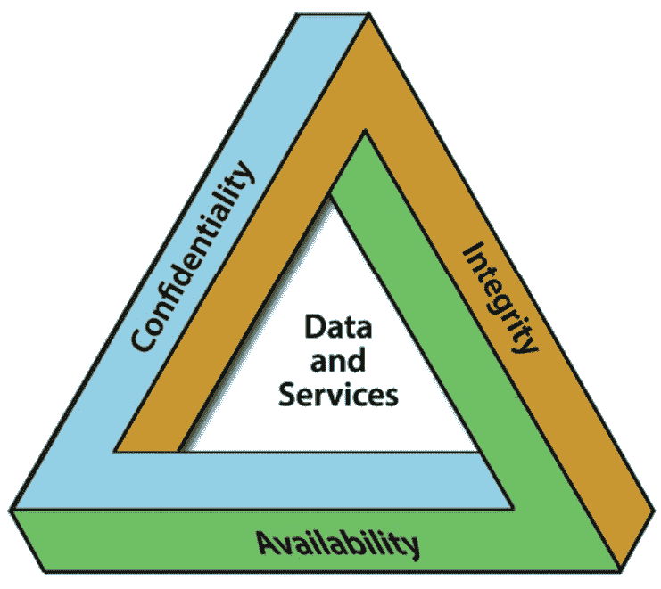

图 1.2 – The CIA Triad

### 安全治理

加强的公司治理要求促使公司更密切地审查其内部控制结构，以确保控制措施到位并有效运行。组织越来越多地在全球市场上竞争，该市场受多项法律管辖，并得到各种最佳实践的支持（即 NIST、ITIL、ISO 27000、COSO 和 COBIT）。必须做出与业务使命一致的适当信息技术投资决策。信息技术在大多数企业中不再是后台会计职能，而是业务的核心运营必需品，必须得到董事会和管理层的适当关注以及对该计划的监督。

对信息技术的这种依赖要求确保对业务潜在风险的适当对齐和理解。在这些技术上投入了大量资金（必须得到适当管理），如果部署不安全系统或发现不安全系统正在运行，公司声誉将面临风险，并且系统信任需要向所有相关方证明，包括股东、员工、业务合作伙伴和客户。信息安全治理为董事会和管理层提供了适当的监督机制，以将企业风险管理到可接受的水平。

治理的意图是保证适当的信息安全活动正在进行，以确保风险得到适当降低，信息安全投资得到适当引导，并且高层管理层对该计划有可见性，并提出适当的问题以确定该计划的有效性。

IT 治理学院（ITGI）在其题为“Board Briefing on IT Governance, 2nd edition”的出版物中将 IT 治理定义为“the responsibility of the board of directors and executive management. It is an integral part of enterprise governance and consists of the leadership and organizational structures and processes that ensure that the organization’s IT sustains and extends the organization’s strategies and objectives.”¹

ITGI 提出信息安全治理应被视为 IT 治理的一部分，并且董事会应：

- 了解信息安全
- 设定方向以推动政策和战略
- 为安全工作提供资源
- 分配管理职责
- 设定优先事项
- 支持所需的变化
- 定义与风险评估相关的文化价值观
- 从内部或外部审计师获得保证
- 坚持安全投资可衡量并报告以评估计划有效性。

此外，ITGI 建议管理层应：

- 在业务输入下编写安全策略
- 确保角色和职责得到定义并被明确理解
- 识别威胁和漏洞
- 实施安全基础设施和控制框架（标准，

指南、基线和程序)

- 确保政策得到管理机构的批准
- 制定优先事项并及时实施安全项目
- 监控违规事件
- 进行定期审查和测试
- 强化意识教育的重要性
- 将安全融入系统开发生命周期

安全专业人员需要与管理层合作，以确保这些目标得以实现。这些概念在本章中进一步阐述。

### 组织的目标、使命和宗旨

信息安全管理实践通过实施物理、行政、管理、技术和运营控制来保护组织的资产。信息资产必须得到适当管理，以降低机密性、完整性或可用性受损的风险。正如财务资产由财务部门管理一样，人力资产（人员）由人力资源部门管理和关怀，同时也包括相关的行为准则和雇佣政策与实践。未能保护信息资产免受丢失、破坏或意外更改，可能导致生产力、声誉或财务方面的重大损失。信息和支持组织使命的系统是资产，必须由安全专业人员保护。

信息安全管理验证适当的政策、程序、标准和指南已得到实施，以确保业务运营在可接受的风险水平内进行。安全旨在支持和实现组织的愿景、使命和业务目标。有效的安全管理需要基于组织的风险承受能力、实施安全控制的成本以及对业务的益处做出判断。尽管实现信息100%安全是一个令人钦佩的目标，但在实践中这是不现实的。即使通过包含所有最佳安全实践来管理风险的有效安全计划以及支持所有活动的预算可以实现这一目标，也不会太久就会发现新的漏洞或利用，从而使信息面临风险。因此，一个结构良好且受管理的计划必须是主动的和持续的。

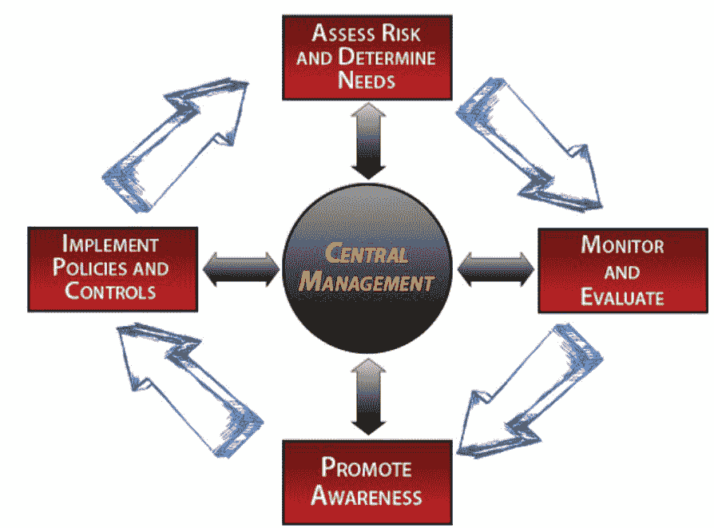

Figure 1.3 – 安全与风险管理关系

### 组织流程

了解组织的使命及其支持流程对于安全计划的成功至关重要。在许多方面，组织就像一个活物。在其生命周期中，它可能会经历几个成长、衰退和疾病阶段。了解业务转型事件和实体可确保安全专业人员保持对董事会发生的事情以及企业日常管理决策的态势感知。例如，以下是组织可能经历的常见活动，这些活动可能会影响安全专业人员：

- **收购与合并** – 组织因多种原因合并。一些合并是友好的，双方都从合并中获益，而另一些可能被描述为“敌意”。在任何情况下，信息安全专业人员都必须意识到以下项目并据此计划：
  - 可能需要比现有安全计划提供更多保护的额外数据类型
  - 可能需要比现有安全计划提供更多保护的额外技术类型
  - 具有增强安全意识和培训要求的新员工和角色
  - 来自前员工的威胁，或新组织将面临而旧组织不会面临的威胁
  - 系统合并时的漏洞
  - 可能需要支持遵守组织需要意识到的任何法律、法规和要求的新的政策、标准和程序
  - 需要审查和评估的外部业务合作伙伴和互联

**剥离与分拆** – 与收购或合并相反，剥离可能涉及组织一部分的分拆或现有组织的完全清算。这是组织紧张的时期，信息安全专业人员应关注以下情况并据此计划：

- 由于员工离开分拆公司或另一家公司而导致的数据丢失和数据泄露
- 在其所服务的职能不再适用后遗留的系统互连、协议和端口
- 如果两个组织都没有将适当的安全监控工具和能力保留在内部，则对网络和系统日志的可见性丧失
- 来自可能被解雇或被迫离开组织的员工的新威胁
- 需要修订政策、标准和程序以承认组织中的任何新治理机构并反映组织变化（如适用）的需求
- 需要满足任何剥离强加的数据隔离或组织间分拆的截止日期

**治理委员会** – 治理委员会负责招募和维护组织的治理委员会。该委员会通常还负责确定缺少的资格和特征，以提高董事会效率和有效性。安全专业人员应了解董事会如何运作，并在可能的情况下尝试：

## 科研事业单位实施全面预算绩效管理的难点与对策

> > **摘要：** 全面预算绩效管理是推动科研事业单位提升治理能力、优化资源配置的重要抓手。当前，科研事业单位在实施全面预算绩效管理过程中仍存在绩效目标设定不科学、预算执行与绩效监控脱节、评价结果应用不充分、信息化支撑不足等难点。本文在分析上述问题的基础上，从完善绩效目标管理体系、强化过程监控、健全评价结果应用机制、加强信息化建设等方面提出对策建议，以期为科研事业单位深化预算绩效管理改革提供参考。

> > **关键词：** 科研事业单位；全面预算绩效管理；绩效评价；对策

全面预算绩效管理是现代财政管理的重要内容，对优化财政资源配置、提升公共服务质量具有重要意义。科研事业单位作为国家科技创新体系的重要组成部分，其经费来源以财政拨款为主，社会关注度高，资金使用效益直接影响科技创新战略的实施效果。近年来，国家相继出台多项政策文件，要求全面实施预算绩效管理，科研事业单位虽已初步建立预算绩效管理体系，但在实际运行中仍面临诸多难点，亟需加以研究和解决。

### 一、科研事业单位实施全面预算绩效管理的难点

（一）绩效目标设定不科学，导向作用难以发挥

绩效目标是预算绩效管理的基础和前提。部分科研事业单位在编制绩效目标时，存在指标体系设计不完善、指标值难以量化、与科研活动特点结合不紧密等问题。例如，基础研究类项目周期长、成果形式特殊，现有绩效指标往往侧重论文数量、专利数量等短期可量化成果，忽视成果的原创性、科学价值及潜在影响，导致绩效目标与科研规律脱节，难以有效引导资源配置。

（二）预算执行与绩效监控脱节，过程管理较为薄弱

预算绩效管理要求将绩效理念贯穿预算编制、执行、监督全过程。但实践中，部分单位预算编制与绩效目标申报同步性不足，资金执行进度与绩效目标实现程度缺乏动态关联。绩效监控往往停留在财务数据层面，对科研活动进展、阶段性成果等非财务信息关注不够，难以及时发现并纠正偏差，导致绩效管理流于形式。

（三）评价结果应用不充分，激励约束机制不健全

绩效评价结果的应用是预算绩效管理的生命线。当前部分科研事业单位绩效评价结果与预算安排、人员考核、科研管理改进之间的联动机制尚未真正建立，评价结果多为内部通报或存档，对下年度预算安排和资源配置的参考作用有限；同时问责与激励措施不到位，难以形成“花钱必问效、无效必问责”的刚性约束。

（四）信息化支撑不足，绩效管理效率和准确性受限

科研事业单位业务复杂、资金量大，全面预算绩效管理需要强大的信息系统支撑。但不少单位现有财务系统、科研管理系统与绩效管理系统之间相互独立，数据共享度低，绩效指标数据的采集、汇总和分析仍依赖人工操作，不仅效率低下，还容易出现数据口径不一致、信息滞后等问题，影响绩效评价的及时性和科学性。

如果安全职能向做出这些决策的个人汇报，则可能在满足这些限制时在安全要求上采取捷径。安全职能向首席信息官汇报的好处是，安全部门更有可能参与IT部门的活动并了解即将到来的举措和安全挑战。

将信息安全职能与物理安全职能整合的趋势正在增长。这部分是由于物理控制的自动化程度提高以及对物理安全方面的要求增加，以保护信息。这些领域的分离减少了，整合增加了。这种日益增长的趋势是将安全职能视为风险管理职能，因此位于IT组织之外。这提供了更大程度的独立性，以及对风险管理的关注，而非对用户ID、密码重置和访问授权的管理，且报告关系在IT组织之外，这也引入了对预期执行的安全活动的一套不同的制衡。安全职能可能会向信息技术之外的其他职能汇报。该职能应尽可能高地汇报，最好在C级。这确保了向高级管理层传达适当的讯息，公司员工会看到部门的适当权威，并且在考虑整个公司的需求时可以做出资金决策。

### 信息安全官的职责

信息安全官负责确保所有业务信息资产免受故意和非故意丢失、披露、更改、破坏和不可用。安全官通常没有资源来执行所有这些职能，必须依赖组织内的其他个人实施和执行政策、程序、标准和指南以确保信息保护。在此身份中，信息安全官充当组织的信息安全促进者。

威胁环境不断变化，因此安全官有责任跟上变化。任何组织都很难预见新的威胁，其中一些来自外部环境，一些来自新的技术变化。在2001年9月11日美国恐怖袭击之前，很少有人认为那种袭击非常可能。然而，此后，许多组织重新审视了其访问控制政策、物理安全和业务连续性计划。最近，由披露引发的问题

必须紧跟新兴监管动态，以便及时作出应对。规划和文档记录对于证明合规性至关重要。定期合规检查，无论是通过内部审计还是外部检查，都能确保程序、检查清单和基线得到记录并付诸实践。合规审查对于确保最终用户和技术人员接受培训并阅读安全策略也是必要的。

安全官通常负责组建和运营计算机事件响应团队（CIRT）。CIRT 是由具备必要技能的人员组成的团队，包括管理、技术人员、基础设施和通信人员，负责评估事件、评估事件造成的损害，并采取正确的响应措施来修复系统以及收集证据用于潜在起诉或处罚。CIRT 的启动取决于事件的性质以及组织的文化。安全事件需要及时调查和跟进，因为这是最小化事件损失并降低再次发生机会的关键机制。

安全官通过确保信息安全意识计划以有意义且易于理解的方式传达给目标受众，为该项目提供领导力。该计划应旨在吸引参与者的注意力，传达对安全问题的总体认识，以及当最终用户发现安全违规时应采取哪些报告行动。如果意识宣传得不到推动，政策就无法有效传达，这些政策在公司内部得到执行的可能性也会大大降低。一个有效的意识计划应包含多个组成部分和交付方式，并且应全年持续开展，而非仅仅是一次性的努力。

安全官必须参与组织的管理团队和规划会议，才能充分发挥作用。项目方向和决策在这些会议中制定，同时也在安全举措上确立支持并安排优先级。这些会议包括董事会会议（定期更新）、IT 指导委员会、经理会议和部门会议。

安全官在组织内取得成功的核心在于理解组织的愿景、使命、目标/宗旨和计划。这种理解能提高成功的机会，使安全能够在项目生命周期的适当时机引入，并更好地帮助组织完成企业使命。安全官需要了解组织面临的竞争压力、优势、劣势、威胁、机会，以及组织运营所处的监管环境。所有这些都将提高将适当的安全控制措施应用于最需要且风险最高领域的可能性，从而实现稀缺安全资金的优化配置。每个部门的业务战略对其成功至关重要。将安全融入该战略将决定安全官的成功与否。

### 向高管层传达风险

信息安全官负责理解组织的业务目标，确保进行风险评估，考虑影响特定组织的威胁和漏洞，随后向高管层传达风险。高管团队的构成因行业或政府实体类型而异，但通常包括拥有 C 级头衔的人员，如首席执行官（CEO）、首席运营官（COO）、首席财务官（CFO）和首席信息官（CIO）。高管团队还包括直接向 CEO 汇报的第一级人员，如销售与营销副总裁、行政副总裁、总法律顾问以及人力资源副总裁。

高管团队关注的是在可接受的风险与确保业务运营符合组织使命之间保持适当平衡。在这种背景下，高管层并不关心实施的技术细节，而是关心解决方案的成本/收益以及实施保障措施后仍将存在的残余风险。例如，安装特定供应商路由器的配置参数并不如以下问题的答案重要：

- 实际感知到的威胁是什么（需要解决的问题是什么）？
- 对业务运营的风险（影响和可能性）是什么？
- 保障措施的成本是多少？
- 残余风险是什么（在保障措施得到正确实施并持续维护后剩余的风险）？
- 项目需要多长时间？
- 每项事务都必须与争夺资源（时间、资金、人员和系统）的其他项目一起进行评估。

安全官有责任确保向高管层提交的信息基于真实的业务需求，并且事实表述清晰。针对具体控制的建议应基于风险。最终，对信息安全负责的是组织的高管层。演示应以高层级方式呈现，以传达技术保障措施的目的，除非另有要求，否则不应是对底层技术的详尽细节展示。

#### 汇报模型

安全官和信息安全组织应尽可能向组织中的高层汇报，原因如下：

1. 保持信息安全重要性的可见度。
2. 减少等级森严、层级较多的组织可能导致的沟通扭曲或信息失真。

在组织中的层级越高，就越有能力引起其他高级管理层对安全的关注，也越有能力争夺适当的预算和资源。安全官在组织中的汇报位置一直是多年争论的话题，并取决于组织的文化；没有一种适合所有组织的最佳模型，每种位置选择都有其利弊。无论选择何种汇报模型，都应指定专人负责企业级层面的信息安全，以确立解决安全问题的问责机制。接下来几节的讨论应可为目标组织做出适当选择提供视角。

#### 业务关系

无论安全官向何处汇报，关键是他/她必须与业务高管层、中层管理人员以及最终用户建立可信且良好的工作关系。高管层收集并据此采取行动的信息是通过他们与众多人员的日常互动获得的，而不仅仅是与其他高管。赢得他们的支持可能源于影响组织内一位受尊敬的个人，该人可能位于高管层以下若干管理层级。同样，高级主管与安全官之间的关系对于安全战略能否贯彻实施也至关重要。建立交付记录并向业务展示保护的价值，将有助于构建这种关系。如果做得恰当，安全职能就会被视为业务的推动者，而不是一个减缓创新、为实施设置障碍并代表额外成本职能的控制点。向一个理解其必要性和重要性的高管架构汇报……


为信息安全业务代言，并愿意积极代表安全部门争取适当资金，是成功的关键。

### 向首席执行官汇报

直接向首席执行官汇报可以大大减少信息在层层传递过程中可能发生的过滤，改善整体沟通，并向组织展示信息安全的重要性。具有高安全需求的公司，例如信用卡公司、科技公司以及收入流高度依赖互联网网站商业的公司（如eBay或亚马逊），可能会采用这种模式。这种模式的缺点在于，首席执行官可能忙于其他业务问题，可能没有兴趣或时间投入到信息安全问题上。

安全专业人员需要意识到，一些组织被要求报告满足特定条件的事件。例如，美国民用政府机构必须在发现后一小时内向美国计算机应急响应小组（US-CERT）报告任何涉及个人身份信息泄露的事件。必须制定政策和程序，以确定在怀疑涉及犯罪活动时事件的处理路径。此外，还需要制定政策和程序来确定事件如何升级，并应解决以下问题：

- 媒体或组织的外部事务部门是否需要参与？
- 组织的法律团队是否需要参与审查？
- 事件通知应在何时上报至直线管理层、中层管理层、高级管理层、董事会或利益相关者？
- 需要哪些保密要求来保护事件信息？
- 使用哪些方法进行报告？如果电子邮件遭到攻击，这对报告和通知流程有何影响？

### 向信息技术（IT）部门汇报

在这种模式下，信息安全官直接向首席信息官（CIO）、信息技术总监、信息技术副总裁或任何信息技术部门负责人的头衔汇报。大多数组织都采用了这种关系，因为历史上这是许多公司中数据安全职能所在的位置。这通常是由于安全仅被视为一个技术问题。这种模式的优点在于，安全官所汇报的对象能够理解通常受信息安全影响的技术问题，并且通常对高级管理层具有影响力，能够推动期望的变革。这也可以带来好处，因为信息安全官及其部门必须花费大量时间与信息系统部门内的其他领域互动。这可以建立力量、信任以及对项目活动和问题的适当认识。

这种汇报结构的缺点是利益冲突。当CIO必须就上市时间、资源分配、成本最小化、应用程序可用性和项目优先级做出决策时，可能会忽视信息安全职能。典型CIO的目标更倾向于及时交付应用产品以支持业务。通常人们认为安全控制可能会延缓产品完成时间并增加实施成本。因此，安全考虑可能得不到同等重视。也许还应该向组织内的另一个领域（如法律顾问）建立虚线汇报关系，以便对利益冲突进行裁决。

如前所述，应避免向CIO组织内的较低层级汇报；首席执行官与信息安全官之间的层级越多，需要克服的挑战就越多。组织中更低的层级可能也有各自专注的专长领域，例如计算机操作、应用程序编程或计算/网络基础设施。

### 向企业安全部门汇报

大多数组织中的企业安全部门专注于企业的物理安全。通常，该环境中的个人具有前警官、军人背景，或以其他方式与刑事司法系统相关。这种选择可能看起来合乎逻辑；然而，这些组织中的人员历来有着不同的背景。物理安全侧重于刑事司法、保护、安全和调查服务，而信息安全专业人员通常在商业和信息技术方面接受不同的培训。这些学科在某些领域有交叉，但在其他领域则大相径庭。与物理安全部门相关联的一个潜在缺点是可能导致“警察式心态”的观感。这可能使与用户建立有效的业务关系变得困难。与最终用户建立积极的关系可以提高他们倾听和遵守政策及任何已实施安全控制的意愿。这也可以提高用户对安全部门举报违规行为的接受度和支持度。

### 向行政服务部门汇报

信息安全官可能向行政服务副总裁汇报，在某些组织中，该部门也可能包括物理安全、员工安全和人力资源部门。正如向CIO汇报的优点所描述的那样，首席执行官与信息安全部门之间只有一个层级。由于与人力资源部门的关联，这种模式也可以被视为一种企业职能。这是一个有吸引力的模式，因为它可以聚焦于所有形式的信息（纸质、口头和电子）的安全。与技术部门中的职能相比（后者可能更倾向于只关注电子信息），这种模式可能会有好处。一个缺点可能是该领域的领导者对信息技术的了解有限，这可能使他们更难理解业务战略和安全要求，也更难向高级管理人员和首席执行官传达技术解决方案。

### 向保险和风险管理部汇报

信息密集型组织，如银行、股票经纪公司和研究公司，可能会从这种模式中受益。首席风险官（CRO）已经在关心组织面临的风险以及通过缓解、接受、保险等方法来控制这些风险的方法。缺点是风险官可能不熟悉信息系统技术，而且该职能的战略重点可能对日常运营安全项目关注较少。

### 向内部审计部门汇报

这种汇报关系可能被视为利益冲突，因为内部审计部门负责评估组织控制结构的有效性和实施情况，包括信息安全部门的活动。内部审计很难提供独立的观点。内部审计部门可能因其角色性质（发现部门流程中的缺陷）而与公司其他部分存在对立关系，而通过关联，安全部门也可能被以类似的眼光看待。建议安全部门与内部审计部门建立密切的工作关系，以促进控制环境。内部审计经理很可能具有财务、运营和一般控制方面的背景，可能难以理解信息安全部门的技术活动。从积极的一面看，这两个领域都专注于改善公司的控制。内部审计部门确实通过虚线汇报关系对审计问题具有更有利的汇报关系


每个开发阶段（分析、设计、开发、测试、实施和实施后）。为系统安全认证，至少应举行评审，以确保交付物满足安全要求。为从独立性角度更好地促进这一点，安全官不应向信息系统或应用开发管理汇报。

除确保新项目开发活动适当解决安全问题外，还必须确保诸如访问管理、入侵检测、事件处理、政策制定、标准合规、外部审计支持以及新兴技术评估等持续性职能得到适当资金支持。安全官很少能获得完成其本人及其团队设想的所有项目所需的全部资金，通常必须在多年内规划这些活动。预算流程需要审查当前风险，并确保对组织成本/效益最大的活动得以实施；这也被称为风险管理。超过 12–18 个月的项目通常被视为长期且具有战略性，通常需要更多资金和资源，或在实施上更为复杂。如果这些工作需要更长的时间框架，则优先考虑小规模试点项目以展示近期成果。组织往往对长期投入的资金失去耐心，因为最初的管理支持者可能会发生变化，以及实施变革的部分团队成员也会发生变化。投资回收期越长，执行管理层期望的投资回报率（ROR）越高。这主要是由于与长期工作相关的风险水平更高。

员工数量、所需安全保护级别、待执行任务、需满足的法规、员工资质水平、所需培训以及指标跟踪程度也是驱动资金需求的参数。例如，如果组织必须满足政府法规以增加具有安全认证的人员数量，例如 CISSP 或其他行业标准安全认证，则组织可能会感到有义务资助内部培训研讨会以培养这些人员。这需要在预算中予以考虑。这也可以通过增加学习机会来吸引和留住安全专业人员。另一个例子是，遵守政府授权和法律所需的时间可能需要增加人员配备，以提供适当的持续跟踪和对审计问题的响应。

### 指标

可以收集测量数据以提供长期趋势信息并说明日常工作量。对流程的测量提供了改进流程的能力。例如，测量密码重置的帮助/服务台工单数量可以转化为工作量小时数，并可能为实施新技术以便终端用户自行管理密码重置流程提供依据。跟踪病毒传播方式或报告频率可能表明需要进一步教育或改进防病毒管理流程。收集指标时需要做出许多决策，例如谁来收集指标、收集哪些统计数据、何时收集指标，以及变异超出范围且应采取行动的阈值是什么。首要的重要决策是确定将使用哪些指标来证明，以及指标收集工作是否能提供所需的证据或价值。

### 资源

在考虑信息安全职能的整体资源管理时，信息安全专业人员应考虑不仅仅是预算，以确保信息安全计划的成功。在许多组织中，以下资源可能在直接支持信息安全职能方面发挥作用：

- 系统管理员
- 数据库管理员
- 网络管理员
- 政策官
- 合规官
- 法律顾问
- 执法机构
- 质量保证测试员
- 帮助台/服务台技术人员

此外，信息安全计划还间接得到以下职能的支持，但不限于：

- 预算官
- 采购专家
- 业务分析师
- 行政专业人员
- 企业架构师
- 软件开发人员

组织的规模、复杂性和使命极大地影响信息安全计划和信息安全官可获得的资源。了解组织的使命并与上述支持资源建立关系，往往决定了安全计划成功与否。安全官很少拥有工具或团队来单独解决组织最紧迫的挑战。

### 信息安全策略

战略、战术和运营计划相互关联，每个计划都为增强组织安全提供不同的侧重点。规划减少了组织对安全需求采取反应性态度的可能性。通过适当的规划，可以就项目是否支持长期或短期目标以及是否具有值得分配更多安全资源的优先性做出决策。

#### 战略规划

战略计划与战略业务和信息技术目标保持一致。这些计划具有更长期的视野（三年至五年或更长），以指导安全活动的长期视角。制定战略计划的过程强调对公司环境和技术环境在几年后的思考。陈述高层目标以提供实现业务目标的项目愿景。这些计划应至少每年审查一次，或在业务发生重大变化时审查，例如合并、收购、建立外包关系、业务环境发生重大变化、引入新竞争对手等等。技术变化在五年期间会很频繁，因此计划应进行调整。高层计划提供组织指导，以确保低层决策与执行管理层对公司未来的意图一致。例如，战略目标可能包括以下内容：

- 建立安全政策和程序
- 有效部署服务器、工作站和网络设备以减少停机时间
- 确保所有用户理解安全责任并奖励出色表现
- 建立安全组织以在企业范围内管理安全
- 确保有效风险管理，以便风险得到有效理解和

#### 战术规划

战术计划提供支持并实现战略计划中规定的目标的广泛举措。这些举措可能包括部署，例如建立电子政策制定和分发流程、为服务器环境实施强大的变更控制、使用漏洞管理减少服务器上存在的漏洞、实施“hot site”灾难恢复计划，或实施身份管理解决方案。这些计划更具体，可能由多个项目组成以完成工作。战术计划时间较短，例如 6–18 个月，以实现公司的特定安全目标。

#### 运营和项目规划

具有里程碑、日期和责任的具体计划提供了沟通和方向，以确保各个项目得以完成。例如，建立政策制定和沟通流程可能涉及多个项目和许多任务：

- 1. 进行安全风险评估
- 2. 制定安全政策和审批流程
- 3. 开发技术基础设施以部署政策并跟踪合规情况
- 4. 对终端用户进行政策培训
- 5. 监控合规情况

根据工作的规模和范围，这些举措可能是单个计划的一部分的步骤或任务，也可能是通过多个项目管理的多个计划。这些工作的持续时间较短，以便在工作完成时提供离散功能。传统的“waterfall”方法实施项目花费大量时间详细说明实施完整项目所需的具体步骤。如今的执行人员更专注于实现一些短期或至少中期成果，以在过程中展示投资价值。这种价值的展示保持了组织对工作的兴趣和可见度，增加了持续长期资金的可能性。如果没有实现这些早期收益，执行管理层可能会变得不耐烦，这就是为什么以管理期望为目标的定期沟通是成功结果的重要要素。


### 完整且有效的安全计划

有多种框架和评估方法可用于评估信息安全计划的完整性和有效性。一些组织已建立企业范围的安全监督委员会，有时被称为“安全委员会”，以帮助指导和支持企业内部的这些工作。该小组可作为指导委员会，为信息安全计划提供监督和方向。安全委员会的愿景必须得到明确定义，并为委员会所有成员所理解。

### 监督委员会代表

为了最大限度地提高有效性，监督委员会应由来自多个组织单位的代表组成。这将增强企业范围内对安全计划的拥有感，并从长远来看改善对政策的支持。人力资源部门对于提供现有行为准则、雇佣和劳动关系、终止和纪律处分政策以及已实施的做法方面的知识至关重要。法律部门是必要的，以确保政策的语言表达了预期内容，并且适用地方、州和联邦法律得到适当遵循。信息技术部门提供技术输入和有关当前举措的信息，以及开发支持政策的程序和技术实施。单个业务部门的代表对于了解政策在执行业务使命方面的可行性至关重要。合规部门的代表提供有关道德、合同义务以及可能需要制定政策的调查的见解。最后，安全官通常担任委员会主席，应代表信息安全部门和安全团队成员提供专业技术专长。

监督委员会是一个管理委员会，因此主要由管理层员工组成。很难让高级管理层投入足够的时间来详细审查政策。在此层级审查政策是获得管理层认可的必要步骤。然而，在开发的早期阶段使用高级管理层是不合适的。直线管理层非常专注于各自的领域，可能缺乏必要的组织视角（超出其各自部门）来评估安全政策和项目举措。中层管理似乎处于最佳位置来适当评估什么对组织最有利，并且具有影响高级管理层和直线管理层接受政策的能力。在不存在中层管理的情况下，适当的做法是纳入直线管理，因为他们在担任这些职位时通常同时承担中层和直线职能。

许多问题可能在一次安全委员会会议中得到解决，这就需要有人记录会议纪要。主席在会议中的角色是促进讨论，确保所有观点都被听取，并在必要时推动讨论达成决定。同时进行该职能和做笔记是困难的。录制会议也有助于捕捉笔记中可能遗漏的关键点，以便制作准确的会议纪要。

安全部门与安全监督委员会之间的关系是一种虚线关系，可能在组织结构图中反映也可能不反映。该委员会的价值在于提供业务方向并不断提高对影响组织的持续安全活动的认识。委员会召开的频率将取决于组织文化（即，是否对其他举措举行每月或每季度的监督会议？）、安全举措的数量以及需要业务部门参与的决策的紧迫性。

### 安全委员会愿景声明

应存在一个明确的安全愿景声明，与组织愿景保持一致并支持其发展。通常，这些声明借鉴保密性、完整性和可用性等安全概念来支持业务目标。愿景声明不是技术性的，专注于对业务的优势。来自管理层和技术领域的成员将参与委员会，且参与时间有限，因此愿景声明必须是值得他们持续参与的事情。愿景声明是一组高层次的陈述，简明扼要且可实现。

### 使命声明

使命声明是支持整体愿景的目标。它们成为实现愿景的路线图，并帮助委员会清楚地了解其参与的目的。一些人可能会选择诸如目标、目的、举措等命名法。图1.4中显示了一个示例使命声明。

信息安全委员会为ACME公司的信息安全工作提供管理方向和商讨平台，以确保这些工作：
- 得到适当优先排序
- 得到每个组织单位的支持
- 得到适当资金
- 鉴于ACME的信息安全需求是现实的
- 在成本、响应时间、易用性、灵活性和上市时间之间平衡安全需求

信息安全委员会通过以下方式积极参与提升我们的安全状况并增加对资产的保护：
- 批准全组织范围的信息安全举措
- 协调各个工作组以实现安全目标
- 在其组织内部推广安全举措的意识
- 讨论安全理念、政策和程序及其对组织的影响
- 向ACME公司信息技术指导委员会推荐政策
- 加深对我们组织面临的威胁、漏洞和保障措施的理解
- 积极参与政策、程序和标准审查

ACME公司信息技术指导委员会通过以下方式支持信息安全委员会：
- 制定信息技术部署的战略愿景
- 制定优先事项，根据愿景安排资源
- 批准推荐的政策、标准和指南
- 批准重大资本支出

有效的使命声明无需冗长，因为主要关注点是传达目标，使技术和非技术人员都能轻松理解。安全委员会的主要使命将因组织而异。愿景和使命声明还应每年审查一次，以确保委员会仍按照使命声明中表达的价值观运作，并确保新成员和替补成员与委员会的目标保持一致。

### 安全计划监督

通过在开始时建立这一目标，委员会成员开始感觉到他们对安全计划方向具有一定的投入和影响力。这很重要，因为许多安全决策将影响委员会成员的运营领域。这也是管理层承诺的开始，因为通过信息安全计划产生的交付成果现在由安全委员会推荐或批准，而非信息安全部门。安全委员会参与的主要活动如下列出：
- **决定项目举措** – 每个组织都有有限的资源（时间、金钱和人力）可在项目之间分配以推进业务。信息安全项目的首要目标是通过实施合理的控制来降低组织业务风险。委员会应积极参与了解举措及其 resulting 业务影响。
- **优先排序信息安全工作** – 一旦安全委员会了解了拟议的项目举措及其对业务的积极影响，其成员就可以参与项目的优先排序。这可能以正式的年度流程形式出现，也可能通过讨论和对单个举措的明确支持来体现。
- **审查和推荐安全政策** – 对安全政策的审查应包括：
  - 对政策进行逐行审查
  - 对任何标准进行总体审查
  - 对旨在支持政策的程序进行初步审查
  - 监控安全实施计划以确保其符合政策、标准和基线要求


通过此活动，实施了三个对保持承诺至关重要的关键概念：

- 对政策的理解得到增强。
- 组织支持政策的实际能力得到讨论。
- 建立了主人翁意识，以提高对实施活动的支持。

- **审查和审计安全计划** – 审计员在维护和改进信息安全方面发挥着必不可少的作用。他们对控制措施的设计、有效性和实施情况提供独立的视角。审计结果会产生需要管理层回应和纠正措施计划以解决问题的发现并降低风险的审计发现。审计员通常会在审计开始前请求信息以便于审查。有些审计是在高层次进行且不进行实质性测试，而其他审计会确定测试样本以判断控制措施是否已实施并得到遵循。安全部门与内部和外部审计员合作，以确保控制环境充分且有效运作。

- **推动组织安全工作** – 一旦委员会理解并接受政策，它就成为政策背后的组织倡导者。委员会成员可能最初是通过审阅信息系统安全部门创建的政策草案开始的，但最终成果只有通过他们的审阅、意见和参与过程才得以实现。他们的参与创造了对交付成果的拥有感，并希望安全政策或项目在公司内部取得成功。

- **建议需要投资的领域** – 委员会成员有机会从各自业务部门的角度提供意见。委员会充当了从这一角度建立对安全投资广泛支持的机制。任何组织内的资源都是有限的，并分配给需求最大且投资回报率感知最高的业务部门。建立这种支持增强了其他业务经理以及首席财务官的预算理解，这通常是获得适当资金所必需的。

### 终端用户

终端用户有责任通过遵守已传达的安全政策在日常工作中保护信息资产。终端用户就像建筑物中的窗户。就像窗户允许所有活动被看到和监控一样，他们的行为会暴露出设计和传达不佳的合规制度中的弱点。例如，下载未经授权的软件、打开未知发件人的附件或访问恶意网站可能会将恶意代码（例如病毒、特洛伊木马和间谍软件）引入环境。然而，终端用户也可以成为组织的前线耳目，并向适当角色报告安全事件和异常行为以供调查。为了使安全专业人员创造这种文化，他们必须明确定义与此角色相关的期望和可接受行为，并确保这些内容得到记录并清晰传达给企业中的每个成员。

### 高级管理层

高级管理层对企业信息资产的保护负有总体责任。业务运营依赖于信息可用、准确且免受无需知情人员侵害。如果此信息机密性、完整性或可用性受损，可能导致财务损失。高级管理层必须意识到他们为组织承担的风险。风险必须通过风险评估识别并清晰传达，以便管理层做出明智决策。

### 信息系统安全专业人员

安全政策、标准以及支持性指南、程序和基线的起草由这些人员协调进行。针对技术安全问题提供指导，并在采用新政策时考虑新兴威胁。该角色执行的活动包括解释政府法规和行业趋势，以及分析纳入安全架构以提升组织安全的供应商解决方案。

### 数据/信息/业务所有者

业务主管或经理通常负责信息资产。这些是为信息资产分配适当分类的人员。他们确保业务信息得到适当控制的保护。定期，信息所有者需要审查与信息资产相关的分类和访问权限。所有者或其代表可能需要批准对信息的访问。所有者还需要确定信息的关键性、敏感性、保留期限、备份和保障措施。所有者或其代表负责了解其所控制的信息所存在的风险。

### 数据/信息保管员/管理者

数据保管员是个体或职能，代表所有者照看信息。这些人员确保信息可供终端用户使用，并在数据丢失或损坏时能够恢复而进行备份。信息可能存储在文件、数据库或系统中，其技术基础设施必须由系统管理员管理。该组代表信息所有者管理对信息资产的访问权限。

### 信息系统审计员

IT 审计员确定用户、所有者、保管员、系统和网络是否符合安全政策、程序、标准、基线、设计、架构、管理方向以及施加于系统的其他要求。审计员向管理层提供关于安全控制适当性的独立保证。审计员检查信息系统并确定其是否以确保组织目标得以实现的方式进行设计、配置、实施、运营和管理。审计员为公司高级管理层提供关于现行控制措施及其在整个企业中的有效性的独立视角。

### 业务连续性规划师

业务连续性规划师制定应急计划，以应对可能对公司目标产生负面影响的任何事件。威胁可能包括地震、龙卷风、飓风、停电、经济/政治气候变化、恐怖活动、火灾或其他可能造成重大损害的重大行动。业务连续性规划师确保业务流程能够在灾难中持续进行，并与负责灾难恢复的业务领域和信息技术人员协调这些活动。

### 信息系统/信息技术专业人员

这些人员负责将安全控制设计到信息系统中，测试控制措施，并通过商定的运营政策和程序在生产环境中实施系统。信息系统专业人员与业务所有者和安全专业人员合作，以确保所设计解决方案提供的安全控制与应用程序可接受的关键性、敏感性和可用性要求相称。

### 安全管理员

安全管理员管理用户访问请求流程，并确保特权提供给由应用程序/系统/数据所有者授权访问的个人。该个人拥有提升的权限并创建和删除账户及访问权限。安全管理员在个人离职或在公司部门间调动时终止访问权限。安全管理员维护访问请求批准记录，并在访问控制审计测试期间为审计员生成访问权限报告以证明符合政策。

### 网络/系统管理员

系统管理员（sysadmin/netadmin）配置网络和服务器硬件及其上运行的操作系统，以确保通过这些系统可访问的信息在需要时可用。管理员使用诸如补丁管理和软件分发机制等工具和实用程序维护计算基础设施，以在组织计算机上安装更新并测试补丁。管理员测试并实施系统升级以确保服务器和网络设备的持续可靠性。管理员通过商用现成（COTS）或非 COTS 解决方案提供漏洞管理，以测试计算环境并适当缓解漏洞。

### 物理安全

分配物理安全角色的个人与外部执法机构建立关系，例如地方警察机构、州警察或联邦调查局（FBI），以协助调查。物理安全人员管理闭路电视（CCTV）监控系统、盗窃报警系统和读卡器门禁系统的安装、维护和持续运行。必要时部署警卫以防止未经授权的访问并为公司员工提供安全。物理安全人员与系统安全、人事、设施、法律和业务领域对接，以确保实践得到整合。

### 行政助理/秘书

该角色对信息安全可能非常重要；在许多小型公司中，这可能是迎接访客、签收和发出包裹、识别希望进入办公室的个人，并担任电话筛选员的个人

高管。这些个人可能遭受社会工程攻击，其中潜在的入侵者试图索取可能用于后续攻击的机密信息。社会工程师利用乐于助人者的善意来获得进入权限。经过适当培训的助理将最大限度地降低泄露有用公司信息或提供未经授权进入的风险。

### 帮助台/服务台管理员

顾名思义，帮助/服务台负责处理报告系统问题的用户提出的问题。问题可能包括响应时间差、潜在病毒感染、未经授权的访问、无法访问系统资源，或有关程序使用的疑问。帮助/服务台也是经常会看到安全问题和事件的最初迹象的地方。当情况符合团队制定的标准时，帮助/服务台人员会联系计算机安全事件响应团队（CSIRT）时。² 帮助/服务台重置密码、重新同步/重新初始化令牌和智能卡，并解决访问控制的其他问题。

这些功能也可以由终端用户通过自助服务来执行，例如基于内联网的解决方案，该方案验证终端用户的身份并重置密码，或由其他部门执行，例如安全管理、系统管理员等，具体取决于现有的组织结构和职责分离原则。帮助/服务台区域也是社会工程攻击的主要目标，因此应在安全意识培训中给予额外关注。

组织可能还有其他与信息安全相关的角色以满足特定需求。不同角色中的个人需要不同程度的培训。终端用户可能需要基本的安全意识培训，包括可接受的活动、如何识别可能存在问题以及如何将问题报告给负责解决的适当人员。安全管理员需要更深入地培训访问控制包，以管理登录 ID、账户和日志文件审查。系统/网络管理员需要针对特定操作系统（例如 Windows、UNIX、Linux 等）或网络组件（例如防火墙、路由器、交换机）的技术安全培训，以便熟练设置安全控制。建立清晰、无歧义的安全角色对组织的好处不仅在于提供应执行的职责信息和执行人员，还包括。这些好处包括：

1. 对信息安全具有可证明的高级管理支持
2. **可衡量 —** 治理计划必须提供确定进展和设定目标的方法。实施可衡量框架的组织更有可能随着时间的推移改善其安全态势。大多数控制框架包含评估标准或程序以确定合规性，在某些情况下还包括风险。
3. **标准化 —** 与上述可衡量一样，控制框架应依赖标准化，以便一个组织或组织的一部分的结果能够以有意义的方式进行比较。
4. **全面 —** 所选框架应涵盖组织的最低法律和监管要求，并具有可扩展性以适应额外的组织特定要求。
5. **模块化 —** 模块化框架更有可能经受组织的变革，因为只有需要修改的控制或要求才会被审查和更新。

一个控制框架的例子是美国国家标准与技术研究所的特别出版物 800-53r4。³ SP 800-53r4 是一个由 19 个族中的 285 项控制组成的控制框架。该框架包括将控制范围限定和定制以适应组织特定使命或要求的能力。19 个控制族在表 1.1 中列出如下：

| 控制族 |
|---|
| AC - 访问控制 |
| AT - 意识和培训 |
| AU - 审计与问责 |
| CA - 安全评估和授权 |
| CM - 配置管理 |
| CP - 应急规划 |
| IA - 识别和鉴别 |
| IR - 事件响应 |
| MA - 维护 |
| MP - 媒体保护 |
| PE - 物理和环境保护 |
| PL - 规划 |
| PM - 项目管理 |
| PS - 人员安全 |
| RA - 风险评估 |
| SA - 系统和服务采购 |
| SC - 系统和通信保护 |
| SI - 系统和信息完整性 |
| PC - 隐私控制 |

表 1.1 – NIST SP800-53r4 19 个控制族

NIST SP 800-53r4 对美国联邦机构及其承包商是强制性的。虽然这些框架看起来可能令人生畏，但它们的设计适用于几乎每个组织。

另一个例子是国际标准化组织（ISO）27001:2013 标准。⁴ 与 NIST SP 800-53r4 一样，ISO 27001:2013 旨在涵盖各种规模和类型的组织。ISO 27001:2013 的附录 A 包含控制框架，其中包含每个控制的目标和具体内容。ISO 是一个全球框架，被大多数国家的众多行业采用。框架通常也会相互映射。例如，NIST SP 800-53r4 已映射到 ISO 27001:2013 标准。虽然存在相当大的重叠，但有些领域并不完全匹配。图 1.5 展示了示例控制框架比较。

安全专业人员在实施控制框架时必须谨慎判断，以确保其适合组织。

> 清单或生成不必要的 FISMA 报告文件。相反，合规要求组织就信息安全和风险管理执行尽职调查。信息安全尽职调查包括作为组织范围风险管理计划的一部分使用所有适当信息，以有效利用 NIST 出版物中的定制指导和固有灵活性，从而使组织安全计划中记录的所选安全控制满足组织的目标和业务要求。利用组织可用的风险管理工具和技术对于制定、实施和维护具有必要和足够机制强度的保障措施和对策至关重要，以应对对组织运营和资产、个人、其他组织和国家的当前威胁。采用有效的基于风险的流程、程序和技术将有助于确保所有联邦信息系统和组织具有必要的弹性，以支持持续的联邦责任、关键基础设施应用和政府连续性。” 7

### 合规性

过去 30 年带来了组织结构和运营方式的重大变化。完全新的商业模式已经出现，而旧的商业模式则发生了根本性转变。生产力大幅提升，得益于信息和通信技术（ICT）的源源不断的创新。数据收集、存储和使用的数百年旧范式已经转变。直到 1990 年代初，各个部门和分部在其自己的文件柜或部门计算机中收集、存储和使用自己的数据的情况相当普遍；因此，信息无法轻松与其他部门共享。不同技术互操作能力的快速进步使得各种规模的实体更容易以几乎无缝的方式交换信息。这种信息交换是 21 世纪业务效率、竞争力、协作和敏捷性的重要组成部分。

互联网上的海量和快速信息流在这一转变中发挥了关键作用，通过使能够利用智能数据分析、扩展的销售和服务渠道以及其他工具的应用程序成为可能。这些应用程序以及不断降低的存储成本，使得组织和个人能够轻松积累前所未有数量的数据。这种情况提高了人们对保护组织保存的机密数据（包括知识产权、商业秘密和市场数据，以及客户、员工和合作伙伴的个人数据）免遭滥用和未经授权披露或修改的需求的认识。在某些情况下，

担忧导致制定了因行业或地域而异的法律法规，并创建了特定的行业标准。

出于安全威胁以及保护消费者个人信息免遭滥用的需要，立法机构和政府机构已着手监管个人信息的处理和传输。标准机构和行业协会也随之跟进，通过推广或要求采用关键的安全和隐私标准。这些行动服务于两个关键目标：推广最佳实践的认知和使用，以及促进一定程度的自我监管，从而可能阻止制定对行业或整体商业有害的日益严格的法律。下面是这些法律法规和行业标准的示例：

- 在大多数欧洲国家，隐私权被视为基本人权。欧盟成员国必须制定符合《数据保护指令》（DPD）95/46/EC的法律。该指令的指导方针被视为国家法律的基准，成员国的当地立法机构可能会包含超出其范围的规定。95/46/EC的实施不限于欧盟成员国；冰岛、挪威和列支敦士登就是在非欧盟国家中制定了符合该指令的隐私法律的国家之一。
- 许多其他国家也制定了全面的隐私立法。示例包括澳大利亚的《隐私法》、阿根廷的《个人数据保护法》以及加拿大的《个人信息保护和电子文件法》（PIPEDA）。
- 在美国，隐私立法更倾向于部门为基础的方法。不同的法律规范组织在不同部门中如何收集、使用和保护个人身份信息（PII）的保密性。示例包括针对健康相关 PII 的《健康保险流通与责任法案》（HIPAA）和针对信用相关 PII 的《格雷姆-里奇-比利法案》（GLBA）。有关数据泄露可能导致身份盗窃增加的担忧促使大多数州制定了数据泄露通知法律。受相同担忧的推动，马萨诸塞州和内华达州等州还制定了法律，要求在不同情况下采用加密技术来保护州居民的敏感个人信息。
- 支付卡行业（PCI）已采取措施防止信用卡欺诈并保护持卡人免受身份盗窃。PCI 安全标准委员会（PCI SSC）要求所有希望持有、处理或传输

GRC 超越了仅仅分别实施这三个要素，并找到整合它们以提高有效性和效率并降低复杂性的方法。GRC 确保组织按照自我设定的规则、可接受的风险水平和外部法规行事，如图 1.6 所示。图中每个圆圈代表 GRC 方法的一个组成部分；每个矩形包含该组件主要目标的描述。每个箭头显示三个要素之间的信息交换。

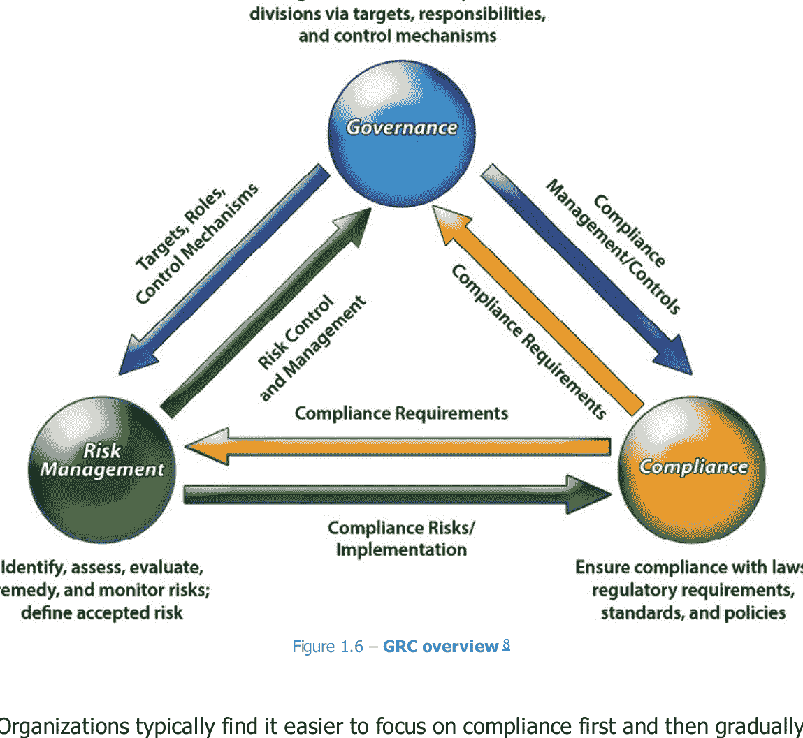

图 1.6 – GRC 概述 8

组织通常发现先专注于合规，然后逐步扩大工作范围以包括风险管理和治理更容易。然而需要注意的是，治理活动无论是否计划都会发生，而且由于缺乏协调行动所带来的问题，缺乏计划的治理和严格的风险管理可能会对业务造成严重后果，因为与无协调行动相关的问题被执行

工具，例如针对通信部门的《电子隐私指令》（指令 2002/58/EC）。11 在警察和司法刑事合作中保护个人数据也存在具体规则（《框架决定》2008/977/JHA）。12

《数据保护指令》95/46/EC 定义了成员国必须转化为国家法律的数据保护基本要素。每个国家在其管辖范围内管理数据保护的监管及其执行，并且根据该指令第 29 条，欧盟各国的数据保护专员在社区层面参与一个工作组。

在《数据保护指令》95/46/EC 中，个人数据被定义为与“已识别或可识别的自然人”有关的任何信息。该指令要求数据控制者确保遵守与数据质量相关的原则，并提供数据处理合法理由的清单。当个人数据直接从当事人收集或以其他方式获得时，数据控制者对数据主体负有告知义务。数据控制者还必须实施适当的技術和组织措施，以防止非法销毁、意外丢失或未经授权的更改、披露或访问。

根据指令确立的数据主体的个人权利包括：有权知道数据控制者是谁、数据的接收者以及处理的用途；有权要求更正不准确的数据；在非法处理情况下的追索权；以及在某些情况下有权拒绝使用数据的许可。例如，个人有权免费选择不接收直接营销材料。欧盟《数据保护指令》还包含关于敏感个人数据使用的加强保护，例如与健康、性生活或宗教或哲学信仰有关的数据。

对个人数据处理的监管框架的执行可以通过监督机构的行政程序或司法救济进行。成员国的监督机构拥有调查权和有效的干预权，例如有权下令阻止、删除和销毁数据，或对处理施加临时或永久的禁令。任何因非法处理操作而遭受损害的人有权从责任控制者处获得赔偿。《数据保护指令》提供了一种机制，要求欧盟境外传输的个人数据必须达到与指令规定相当的“充分”处理水平。

2012 年 1 月，在《里斯本条约》赋予欧盟就个人数据处理保护个人而立法的明确权限后，委员会提出了一项改革方案，包括一项取代指令 95/46/EC 的一般数据保护条例和一项取代框架决定 2008/977/JHA 的指令。

议会公民自由、司法和内政委员会在 4,000 项修正案（针对条例）和 768 项修正案（针对指令）的基础上通过了其报告。议会在 2014 年 3 月首次审议时通过了立场。议会关于该条例立场的主要要点是：¹³

- 对数据保护采取全面方法，具有明确的单一规则集，适用于欧盟内部和外部；
- 澄清所使用的概念（个人数据、知情同意、数据保护设计和默认设置）并加强个人权利（例如，关于访问权或反对数据处理的权利等）；
- 对涉及某些部门（健康、就业和社会保障）的个人数据处理规则或用于某些特定目的（历史、统计、科学研究或档案相关目的）的规则作出更精确的定义；
- 澄清并加强制裁制度；
- 更好地且一致地执行数据保护规则（加强企业数据保护官的作用、设立欧洲数据保护委员会、为所有数据保护机构建立统一框架、创建一站式机制）；
- 加强评估第三国提供的保护充分性的标准。

该拟议指令涉及在预防、调查、侦测或起诉刑事犯罪或执行刑事处罚的背景下处理个人数据。议会关于该指令的立场包含以下关键要素：

- 对数据保护原则的明确定义（必须充分证明的例外情况）；
- 关于处理（例如，合法、公平、透明和正当的处理，以及明确目的）和个人数据传输应遵守的条件；


-   建立评估机制和数据保护影响评估；
-   对画像的明确定义；
-   加强向第三国转移个人数据的制度；
-   明确数据保护机构的监督和执法权力；
-   关于遗传数据的新条款。

安全专业人员需要及时了解最新发展，例如议会正在推进的关于个人信息处理和处理方面的举措，以确保他们参与的合规活动能够支持企业运营所在地区且其负责的现行法律法规。

### 全球法律和监管问题

### 计算机/网络犯罪

随着计算机病毒、间谍软件、网络钓鱼和欺诈计划以及来自世界各地的黑客活动的泛滥，计算机犯罪和安全无疑是在讨论计算机伦理时令人担忧的话题。除了外部人员或黑客之外，许多计算机犯罪，例如挪用公款或植入逻辑炸弹，都是由有权使用公司计算机系统的受信任人员实施的。这些类型犯罪的一些例子包括以下内容：

### 您的个人文件已被加密！


您此电脑上的重要文件已被加密：照片、视频、文档等。以下是加密文件的完整列表，您可以亲自核实。

加密是使用为此电脑生成的唯一公钥 RSA-2048 产生的。要解密文件，您需要获取私钥。

唯一能够让您解密文件的私钥副本位于互联网上的秘密服务器上；服务器将在此窗口指定的时间后销毁密钥。之后，没有人也永远无法恢复文件...

要获取此电脑的私钥以自动解密文件，您需要支付 300 美元 / 300 欧元 / 其他货币的等值金额。

点击«Next»选择付款方式。

任何尝试移除或损坏此软件的行为都将导致服务器立即销毁私钥。

私钥将在以下时间被销毁
10/19/2013
6:09 PM

剩余时间
71 : 59 : 33

Next >>

-   **CryptoLocker 勒索软件 —** 它通过电子邮件传播并迅速扩散。该病毒加密各种文件类型，然后受害者电脑上会出现一个弹出窗口，声明其数据已被加密。取回数据的唯一方法是向肇事者发送指定金额的付款。此勒索软件通过显示的倒计时时钟为受害者提供付款时间线。如果受害者未按时付款，他们将失去付款能力，并冒着数据被永久加密且无法使用的风险。肇事者要求通过各种方式向其发送 300 至 700 美元的付款。
-   **儿童色情恐吓软件 —** 这种恐吓软件在计算机用户访问受感染网站时传播。受害者的电脑会锁定并显示警告，称用户违反了美国联邦法律。儿童色情内容要么嵌入在出现在受害者屏幕上的横幅图像中，要么通过自动浏览器重定向到儿童色情网站而显示。恐吓软件被用作勒索手段，通过威胁对访问或查看这些图像进行起诉。受害者还被告知其已被音频、视频和其他设备记录下来。解锁电脑的唯一方法是支付罚款，通常在 300 美元至 5,000 美元之间。


Citadel 勒索软件 — 名为 Reveton 的 Citadel 勒索软件在受害者电脑上显示一条据称来自执法机构的警告，声称其电脑曾被用于非法活动，例如下载受版权保护的软件或儿童色情内容。为了增强被执法部门监视的假象，屏幕上还会显示受害者的 IP 地址，一些受害者甚至报告其网络摄像头有活动。受害者被指示向美国司法部支付罚款以解锁电脑。许多人被告知通过预付现金服务如 Ucash 或 Paysafecard 支付罚款。除了安装勒索软件外，Citadel 恶意软件还会继续在受感染电脑上运行，以收集可能被用于实施各种金融欺诈的敏感数据。

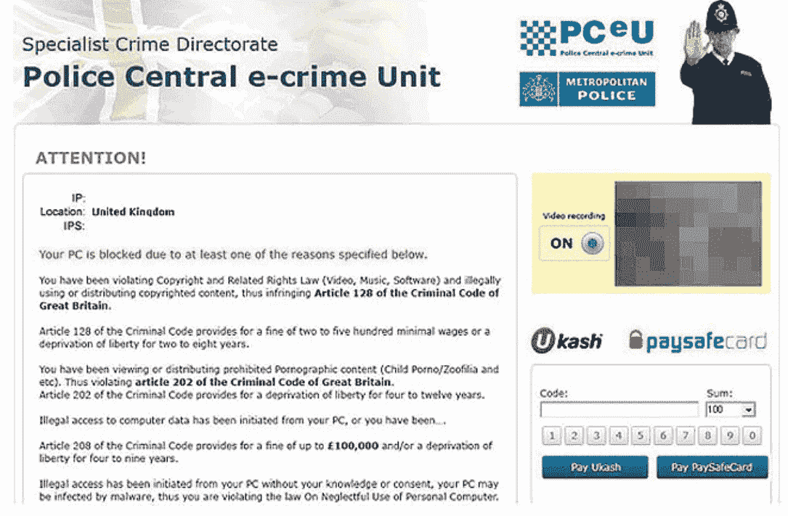

-   **假冒或流氓反病毒软件 —** 在此计划中，受害者被吓得购买据称可以从电脑中清除病毒的反病毒软件。会出现一个弹出框，告知用户其电脑充满病毒需要清理。弹出消息有一个按钮，受害者可以点击以购买据称可以立即清除这些病毒的反病毒软件。如果受害者点击弹出窗口购买反病毒软件，他们就会感染恶意软件。在某些情况下，无论是否点击弹出框，受害者都已被感染。

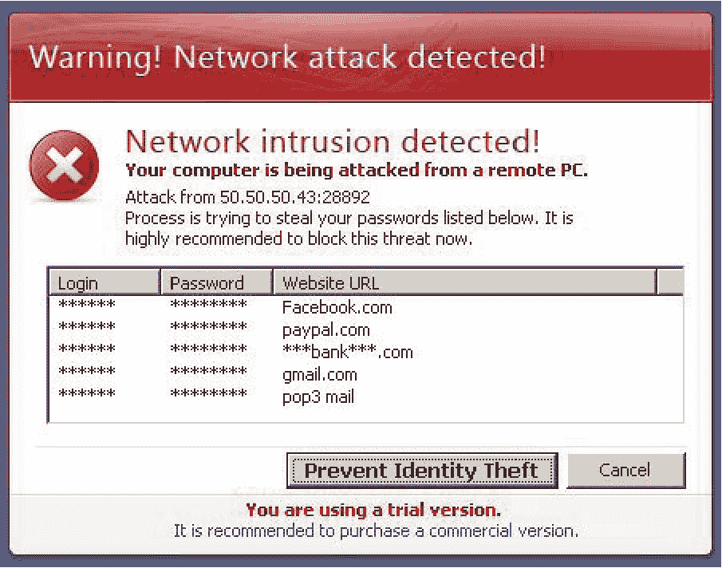

网络犯罪活动是全球扩散、以财务为驱动的行为。此类计算机相关欺诈十分普遍，约占全球行为的三分之一。另一显著部分的网络犯罪行为由计算机内容构成，包括儿童色情和盗版。另一重要部分的犯罪涉及针对计算机系统保密性、完整性和可访问性的行为。其中包括非法访问计算机系统，这占所有行为的另外三分之一。

在评估网络犯罪的影响时，安全专业人员将需要评估一系列因素，例如：

-   知识产权和敏感数据的损失。
-   机会成本，包括服务和就业中断。
-   品牌形象和公司声誉受损。
-   对客户的罚款和补偿性付款（因不便或后果损失）或合同补偿（因延误等）。
-   对策和保险的成本。
-   缓解策略和从网络攻击中恢复的成本。

Ponemon Institute 的 2013 年《网络犯罪成本》研究发现，美国平均公司每年经历超过 100 次成功的网络攻击，成本为 1,160 万美元。较 2012 年增长 26%。其他地区的公司情况稍好，但仍遭受重大损失。2013 年年度研究在美国、英国、德国、澳大利亚、日本和法国进行，调查了超过 230 家组织。14

但研究还显示，实施使能安全技术的公司减少了近 400 万美元的损失，而采用良好安全治理实践的公司平均减少了 150 万美元的成本。关键发现包括：

-   每个组织承担的网络犯罪平均年度化成本为 1,156 万美元，范围从 130 万美元到 5,800 万美元。较 2012 年报告的平均成本增加 26%，即 260 万美元。
-   国防、金融服务以及能源和公用事业组织的网络犯罪成本最高。
-   数据盗窃造成了主要成本，占外部总成本的 43%；业务中断或生产力损失占外部成本的 36%。虽然 2012 年至 2013 年数据盗窃总体发生率下降了 2%，但同期业务中断增加了 18%。
-   组织平均每周经历 122 次成功攻击，高于 2012 年每周 102 次。
-   解决网络攻击的平均时间为 32 天，此期间平均成本为 1,035,769 美元，或每天 32,469 美元——较 2012 年 24 天期间估计的平均成本 591,780 美元增长了 55%。
-   拒绝服务、基于网络的攻击和内部人员占每个组织年度网络犯罪总成本的 55% 以上。
-   小型组织的人均成本明显高于大型组织。
-   恢复和检测是最昂贵的内部活动。

上述总结的发现清楚表明，安全专业人员在网络犯罪的预防及其可能对企业造成的影响方面任重道远。安全专业人员需要能够与安全架构师和安全从业人员合作，在企业的各个层面开展工作，以确保能够构想、设计、实施、管理、监控和优化最佳防御措施，从而确保网络犯罪带来的风险和影响得到正确识别、分析和传达给组织的 senior management。一旦高级管理层理解并权衡了风险并传达了风险偏好和立场

企业向安全专业人员传达之后，那些被认定为将被接受的风险，应根据所做的决定采取必要行动。

### 许可与知识产权

尽管没有人期望信息安全专业人员成为所有与技术相关法律领域的法律专家——正如各种法律体系一样——但要充分理解信息系统运营和管理所固有的背景、问题和风险，需要对与信息技术直接相关的法律概念具备实用知识。信息技术法律中有两大类对信息系统影响最大：知识产权和隐私法规。本节仅简要概述这些概念。强烈建议希望深入研究这一领域的读者参阅各自国家的相关法律法规。

#### 知识产权法

知识产权法旨在保护有形和无形物品及财产。尽管国家为这类财产设立保护背后有各种理由，但知识产权法的总体目标是保护财产免受那些未经发明者或创作者适当补偿就试图复制或使用它的人侵害。其理念是，复制或使用他人的创意所需的工作远少于原始开发所需的工作。根据世界知识产权组织（WIPO）的说法：

> 知识产权分为两类：工业产权，包括发明（专利）、商标、工业品外观设计和来源地理标志；以及版权，包括文学和艺术作品，如小说、诗歌和戏剧、电影、音乐作品，以及绘画、油画、照片和雕塑等艺术作品和建筑设计。¹⁵

#### 专利

简单来说，专利授予所有者一项法律上可强制执行的权利，以排除他人在特定时间（通常为20年）内实施该专利所覆盖的发明。专利是“最强形式的知识产权保护”。专利保护新颖、实用且非显而易见的发明。授予专利需要向政府实体提出正式申请。一旦专利获得授权，它就会被公布在公共领域，以刺激其他创新。一旦专利到期，保护即终止，发明进入公共领域。WIPO是联合国的一个机构，负责国际专利申请的提交和处理。

#### 商标

商标法旨在保护组织在产品、服务或形象中投入的商誉。商标法为公众用于识别各种厂商或商家产品的标记的所有者创造专有权利。商标由任何文字、名称、符号、颜色、声音、产品形状、图案、装置或其组合构成，用于识别商品并将其与他人制造或销售的商品区分开来。商标必须具有显著性，不得误导或欺骗消费者，也不得违反公共秩序或道德。商标在政府注册机构注册。商标法的国际协调始于1883年的《巴黎公约》，随后是1891年的《马德里协定》。除专利外，WIPO还负责监督国际商标法工作，包括国际注册。

#### 版权

版权保护的是思想的表达而非思想本身；它通常保护艺术作品，如文字作品、录音、数据库和计算机程序。在大多数国家，一旦作品或财产完成或以有形形式存在，版权保护即自动生效。版权保护弱于专利保护，但保护期限要长得多（例如，作者死后至少50年，或根据美国版权保护为70年）。尽管各个国家的国内版权法可能略有差异，但只要该国是国际《伯尔尼公约》的成员国，其获得的保护至少将达到公约规定的最低水平；不幸的是，并非所有国家都是成员国。16

#### 商业秘密

商业秘密是指专有的商业或技术信息、流程、设计、做法等，这些信息对业务保密且至关重要（例如，可口可乐的配方）。商业秘密可以提供竞争优势，或者至少使公司能够在市场上平等竞争。要归类为商业秘密，它必须不广为人知，并且必须为公司带来某种经济利益。此外，必须采取某种合理的措施来保护其机密性。商业秘密争议之所以独特，是因为商业秘密的实际内容无需披露。商业秘密的法律保护取决于司法管辖区。在一些国家，其保护涵盖在反不正当商业法规之下；在另一些国家，则针对机密信息制定了专门法律。在某些司法管辖区，商业秘密的法律保护实际上永久有效，不像专利那样有到期日。商业秘密通常是工业和商业间谍案件的核心，也是一些公司传说中的“皇冠上的明珠”。

#### 许可问题

非法软件和盗版问题非常严重，值得讨论。不止一家公司因未能控制非法软件的使用或违反软件许可协议而公开难堪、被民事诉讼或被刑事起诉。随着大多数员工都可以方便地使用高速互联网接入，下载和使用盗版软件的能力——如果不是诱惑的话——已大大增加。根据商业软件联盟（BSA）和国际数据公司（IDC）最近（2013年）的一项研究，非法软件的普遍性和使用频率非常高：全球加权平均值为42%。同一项研究发现，每购买两美元的合法软件，就有一美元价值的软件被盗版。[^17] 尽管并非所有国家都承认前面讨论的知识产权保护形式，但一些国际组织和工业化国家的努力似乎在遏制对知识产权侵权的官方纵容（如软件盗版）方面取得了一定成功。

软件许可有几种类别，包括免费软件、共享软件、商业软件和学术软件。在这些类别中，有特定类型的协议。主协议和最终用户许可协议（EULA）是最常见的，尽管大多数司法管辖区已拒绝执行曾经普遍存在的拆封协议。主协议规定了使用的一般总体条件以及任何限制，而EULA则规定了更细粒度的条件和限制。EULA通常是一个“单击通过”或单选按钮，最终用户必须在开始安装前点击它，表示他或她理解并同意遵守这些条件和限制。

各种第三方开发了许可证计量软件，以确保并强制执行对软件许可协议的合规性。其中一些应用程序可以生成审计报告，并禁用违反协议运行的软件（例如，超过同时运行软件的设备数量）或生成自动警报。使用严格控制的软件库也是一个建议的解决方案。在遵守许可条件和限制方面，无知不是借口。责任显然在于组织，要强制执行合规性并监督软件的使用，否则可能面临法律制裁，例如刑事起诉或民事处罚。


### 进出口

对将具有军事用途的新信息、技术和产品不当转移出美国的担忧，导致在20世纪70年代后期通过了两部控制选定技术和产品出口的法律。

- 1. **国际武器贸易条例（ITAR）** — 1976年《武器出口管制法》（第38节），经修订（P.L. 90-629），授权（22 U.S.C.，第39章，第III分章，第2778节题为《武器出口与进口管制》）总统：
- a. 指定应被视为国防物资和国防服务的项目
- b. 控制其进口和出口。

如此指定的项目应构成《美国军需品清单》（22 CFR 第121部分），并通过美国国务院国防贸易管制办公室进行监管。

国防物资（第120.6节和第121部分）包括《美国军需品清单》中指定的任何项目或技术数据（以任何物理形式记录或存储的、模型、模型样机或其他揭示技术数据的项目）。在ITAR管控的21个申报项目类别中，以下19项对信息安全专业人员具有潜在兴趣，特别是那些可能在航空航天和国防行业工作的人员，因为每个类别固有的计算机相关技术和信息服务技术的潜在横向应用以及每个类别所代表的技术：18

- I. 火器
- II. 炮兵投射器
- III. 弹药
- IV. 发射车辆、制导导弹、弹道导弹、火箭、鱼雷、炸弹和地雷
- V. 爆炸物、推进剂、燃烧剂及其成分
- VI. 军用舰艇和特种海军装备
- VII. 坦克和军用车辆
- VIII. 飞机及相关设备
- IX. 军事训练设备
- X. 防护人员装备
- XI. 军用电子设备
- XII. 火控、测距、光学及制导与控制设备
- XIII. 辅助军事装备
- XIV. 毒理学剂及设备和放射性设备
- XV. 航天器系统及相关设备
- XVI. 核武器设计与试验设备
- XVII. 未另行列举的保密物品、技术数据和国防服务
- XVIII. 潜水器、海洋学及相关设备
- XIX. 杂项物品：

- 1. 其他类别中未具体列举但具有实质性军事适用性且专门为军事目的设计或改装的国防物资。是否将任何物品纳入本类别的决定应由国防贸易管制办公室主任作出。
- 直接与国防物资相关的技术数据（第120.21节）和国防服务（第120.8节）。
- 2. **出口管理条例（EAR）** – 1979年《出口管理法》授权总统监管具有军事用途（军民两用项目）的民用货物和技术（设备、材料、软件和技术，包括数据和诀窍）的出口。此类管制传统上是暂时的，而当其失效时，总统已宣布国家紧急状态，并在行政命令的授权下维持出口管制法规。

如此指定的项目构成《美国商务管制清单》（15 CFR 第774部分 2），并通过美国商务部工业安全局进行监管。在9个申报类别中，以下类别对信息安全专业人员尤其感兴趣：¹⁹

- **第4类** – 计算机
- **第5类第1部分** – 电信
- **第5类第2部分** – 信息安全

此外，EAR第734.3节第(b)款第(3)项将公开可用的技术和软件排除在管制之外，但《商务管制清单》上因“加密项目”原因受出口管制分类号（ECCN）5D002管制的软件除外，信息安全 – “软件”，以及受ECCN 5D992管制的对称密钥长度超过64位的民用市场加密软件，如果其：

- 已出版或将要出版；
- 在基础研究期间产生或源于基础研究；
- 具有教育性质；或
- 被纳入某些专利申请

因此，对于在美国运营或代表与美国或美国本土公司开展业务的公司开展业务的安全专业人员而言，对以下与出口管制相关的基本概念有广泛的理解和共识至关重要：

- 1. 受出口管制的技术性质及其如何被识别，
- 2. 什么是“出口”（ITAR）或“视为出口”（EAR），
- 3. 基础研究例外以及“公共领域”的含义，以及
- 4. 是否存在：
- 对项目或活动产生的科学和技术信息出版施加的限制，或
- 联邦资助机构对研究产生的信息获取和传播施加的管制。

安全专业人员还应了解瓦森纳安排。瓦森纳安排的建立旨在通过促进常规武器和军民两用货物与技术转让的透明度和更大责任感，为地区和国际安全与稳定做出贡献，从而防止破坏稳定的积累。20参与国通过其国家政策寻求确保这些项目的转让不会导致破坏这些目标的军事能力的发展或增强，并且不会被转移以支持此类能力。瓦森纳安排的参与国为：

阿根廷、澳大利亚、奥地利、比利时、保加利亚、加拿大、克罗地亚、捷克共和国、丹麦、爱沙尼亚、芬兰、法国、德国、希腊、匈牙利、爱尔兰、意大利、日本、拉脱维亚、立陶宛、卢森堡、马耳他、墨西哥、荷兰、新西兰、挪威、波兰、葡萄牙、大韩民国、罗马尼亚、俄罗斯联邦、斯洛伐克、斯洛文尼亚、南非、西班牙、瑞典、瑞士、土耳其、乌克兰、联合王国和美利坚合众国。

转让或拒绝转让任何项目的决定完全由每个参与国负责。关于该安排的所有措施均根据国家立法和政策采取，并以国家裁量为基础实施。就美国而言，上述讨论的EAR清单反映了与瓦森纳安排下受管制的相同类别。

### 跨境数据流动

信息跨越国界的流动推动着当今的全球经济。跨境数据传输使企业和消费者能够使用世界各地任何地方的最佳可用技术和服务。数据在各国之间自由流动使所有行业部门受益，从制造业到金融服务、教育、医疗保健等。信息的无缝传输至关重要，因为它与全球经济的增长和成功不可分割地联系在一起。

随着信息从一个服务器移动到另一个服务器或从一个云移动到另一个云，数据的位置和托管组织开始变得重要。在一个国家开发、通过另一个国家传输并最终存储在第三个国家的信息，在其从开始到结束的旅程中可能受制于三个不同的司法管辖区和三个不同的法律体系。在某些情况下，即使信息存储在一个国家，如果拥有服务器的组织是另一个国家的成员，后者可能能够获得对存储在相关系统上的信息的管辖权。

在这一领域，安全专业人员需要考虑并关注许多问题。以下是一些示例：

- 世界各国政府都在寻找新的方式来识别其公民和访客，以打击恐怖主义、打击欺诈并提供服务。这促使各国政府考虑身份证件、增强型护照和其他旅行证件，以及在健康卡、驾驶执照和其他资格证件中使用生物识别技术。这些文件会留下数据轨迹，可能在数据保护不足的国家造成风险。
- 企业和政府为降低成本、提高效率而外包活动，包括其客户和公民的个人信息处理。这一现象并非新鲜事；访问数据的规模、速度和参与者数量是

前所未有的，并且几乎没有减弱的迹象。这引发了对于在缺乏数据保护立法的国家之间传输信息的安全性和滥用的合理担忧。

-   诸如搜索引擎、射频识别芯片（RFID）、网络语音协议（VOIP）、博客和无线上网等多种技术和应用都会产生大量个人事务信息，并留下数据痕迹，这些痕迹在交易或对话结束后仍可长期存续。数据保留的要求可能确保这些数据中的大部分将在世界各地的不同司法管辖区之间分散存储，并持续多年。
-   反恐斗争以及对公共安全的相关担忧已促使政府对个体进行前所未有的审查。政府要求获得进入其国家的人员的大量个人信息，开发用于检测可疑出行和行为模式的评估工具，建立观察名单，并与其他国家共享这些信息。这引发了人们对于个体在其所访问国家行使自身信息权利的能力的重大关切。

跨境数据流动正在呈指数级增长，无论是出于处理目的、促进电子商务、执法和国家安全需求，还是仅仅是人们日常生活的结果。这些趋势正在为安全专业人员以及负责监督隐私和数据保护法律的其他组织带来新的复杂挑战。

### 隐私

随着技术的普及以及人们日益意识到我们大部分个人可识别信息（PII）都以某种方式存储在线或电子化，保护个人信息的压力日益增大。[^21] 几乎每个月，全球都有关于数据库被入侵、文件丢失以及针对存储个人私密信息的企业和系统的攻击的媒体报道。这引发了人们对个人或机密信息进行妥善收集、使用、保留和销毁的担忧。这种公众关切促使制定了旨在促进个人信息负责任使用和管理的法规。在此讨论的背景下，隐私是几乎所有行业中的企业被迫应对法规和监管合规的主要领域之一。

-   除上述目的外，个人数据不应被披露、提供或以其他方式用于其他目的，除非：
    -   获得数据主体的同意。
    -   依据法律授权。
-   个人数据应受到合理的安全保障措施的保护，以防范诸如数据丢失或未经授权的访问、破坏、使用、修改或披露等风险。
-   应制定关于个人数据相关发展、实践和政策的总体公开政策。应提供便捷的方式，以确认个人数据的存在和性质、其主要使用目的，以及数据控制者的身份和惯常住所。
-   个人应有权：
    -   从数据控制者处或其他途径获得确认，确认数据控制者是否持有与其相关的数据。
    -   获得与其相关的数据的传达：
        -   在合理时间内。
        -   如有费用，其金额不应过高。
        -   以合理的方式。
        -   以易于其理解的形式。
    -   在请求被拒绝时获得理由，并能够对此类拒绝提出质疑。
    -   对与其相关的数据提出质疑，如果质疑成功，则有权要求删除、更正、补充或修改该数据。
-   数据控制者应对遵守上述原则的措施负责。

应当指出，经合组织非常谨慎地避免对合法的个人数据跨境流动设置障碍。经合组织还提醒其成员注意并敏感对待区域或国内差异，并保护来自不遵循经合组织指南或同等标准国家的个人数据。23

一般而言，这些原则应构成制定合理立法、法规和政策的最低要求，且不阻止组织增加额外原则。然而，这些原则的实际应用在几乎所有情况下都被证明更加困难和昂贵；无论是在国内还是跨境商务中，各种隐私法律和政策的影响都被大大低估了。这并非放弃、阻碍或不遵守适用法律、法规或政策的借口。然而，安全专业人员需要认识到，由于合规（通常涉及国际法规）的需要，商业实践已经发生变化，并且预算必须适当增加以满足需求。

### 数据泄露

对于全球的安全专业人员来说，拥有社区意识和认同感非常重要。诸如CISSP之类的认证有助于培养和创建这样的社区，它使安全专业人员能够分享通过认证在职业生涯中达到重要里程碑的成就感，并获得信息安全专业人员共享的社区访问权。定义社区的主要因素是它所代表的文化，以及文化所基于的共同价值观和参考点。共同的参考点对各种原因都很重要，但尤其重要的是，它们使得在词汇等方面能够就定义和期望达成一致。为此，以下词汇定义提供如下：

-   **事件** – 损害信息资产的完整性、保密性或可用性的安全事件。
-   **泄露** – 导致数据被披露或潜在暴露的事件。
-   **数据披露** – 已确认数据实际被披露（不仅仅是暴露）给未授权方的泄露事件。

事件和泄露的情况是不断变化的。鉴于当今互联系统的性质，一个起初只是小规模泄露（可能仅限于一个系统）的事件，如果得不到控制，可能会迅速蔓延，涵盖整个全球网络和数据系统。安全专业人员需要对当今世界各地组织面临的各种泄露和数据披露类型有大致了解，以便准备好应对企业中将遇到的威胁。安全专业人员和安全从业者还需要牢记，如果事件得到快速识别，并以高效和有效的方式应对，那么这些努力可能能够防止事件演变成全面的泄露。

虽然不可能创建一份全面且及时的事件、泄露和数据披露事件清单，但以下列表代表截至2014年前七个月基于公开披露信息的最重大事项。

#### eBay

这家在线零售商遭遇了迄今为止由在线零售商报告的规模最大的数据泄露之一。攻击者在2月底至3月初期间攻破了“少量员工登录凭据”，从而进入该公司网络，并借此入侵了一个包含客户姓名、加密密码、电子邮件地址、物理地址、电话号码和出生日期的数据库。此次泄露据信影响了该公司1.45亿会员中的大多数，许多人因此被要求更改密码。

#### Michaels Stores

2013年5月至2014年1月期间，54家Michaels和Aaron Brothers门店的销售点系统“遭到犯罪分子使用高度复杂的恶意软件的攻击”。该公司表示，在Michaels门店多达260万张支付卡卡号和有效期，以及Aaron Brothers门店的40万张，可能在此次攻击中被获取。该公司确认至少发生了部分欺诈性使用。

#### 蒙大拿州公共卫生与公共服务部

在发现可疑活动后，官员于5月中旬进行了调查，结论是蒙大拿州公共卫生与公共服务部的一台服务器遭到黑客入侵。该服务器存有大约130万人的姓名、地址、出生日期和社会安全号码，不过该部门表示“没有理由相信服务器上的任何信息被不当使用，甚至被访问过”。

#### Variable Annuity Life Insurance Co.

该公司的一名前财务顾问被发现持有一个U盘，其中包含774,723名客户的详细信息。该U盘是执法部门在执行针对该前顾问的搜查令后提供给公司的。U盘包含完整或部分社会安全号码，但该保险公司表示，它不相信任何数据被用于访问客户账户。

#### Spec’s

这家得克萨斯州葡萄酒零售商网络遭受了长达17个月的“犯罪攻击”，导致多达55万名客户的信息丢失。入侵始于2012年10月，影响了该公司在全州的34家门店。入侵一直持续到2014年3月20日，该公司担心黑客窃取了客户姓名，

借记卡或信用卡详细信息、卡片有效期、卡安全码、支票上的银行账户信息，以及可能的驾驶执照号码。

### St. Joseph Health System
圣约瑟夫医疗系统

德克萨斯州一家医疗服务提供商的服务器于 2013 年 12 月 16 日至 18 日遭到攻击。它包含“约 405,000 名前任和现任患者、员工以及部分员工受益人的信息。”其中包括姓名、社会安全号码、出生日期、医疗信息，以及在某些情况下的地址和银行账户信息。与许多其他黑客攻击一样，调查未能确定数据是否被访问或窃取。

根据 Verizon 数据泄露调查报告（DBIR）2014 年报告，以下 8 个类别约占该研究中全球追踪和报告的所有数据泄露活动的 94%：24

- POS 入侵 – 14%
- Web 应用攻击 – 35%
- 内部人员滥用 – 8%
- 物理盗窃/丢失 - <1%
- 杂项错误 – 2%
- 犯罪软件 – 4%
- 卡片侧录器 – 9%
- 网络间谍 – 22%

Verizon 的数据非常清楚地说明了在 2013 年及 2014 年初报告数据收集和分析期间，安全专业人员需要关注的威胁类别。然而，当你阅读这段文字时，安全专业人员今天面临的威胁类别及其相关风险可能与上述列出的类别非常不同，尽管也可能存在相似之处。

那么安全专业人员可以做些什么来持续了解并抵御上述列出的此类威胁和风险，尤其是当不断出现新的威胁向量和恶意行为者时？也许可以借鉴本讨论中前面提到的同一社区，并依靠它来帮助建立某种针对从野外涌现的威胁向量的全球早期预警系统，这将为安全专业人员提供宝贵的见解？但要如何做成如此大胆的事情，并实现如此重要却又如此难以捉摸的目标呢？确实如此。

### A Brief Primer on VERIS & VCDB
VERIS 与 VCDB 简介

事件记录和事件共享词汇表（VERIS）旨在以结构化和可重复的方式描述安全事件，提供一种通用语言。它将“谁对什么（或谁）做了什么，结果如何”的叙述，转化为你在 Verizon DBIR 2014 中看到的那种数据。可在 VERIS 社区网站获取更多信息；完整模式可在 GitHub 上获取。

两者都是安全专业人员理解术语和背景的良好参考资料。

- [www.veriscommunity.com](http://www.veriscommunity.com)
- [www.github.com/vz-risk/veris](http://www.github.com/vz-risk/veris)

2013 年启动的 VERIS 社区数据库（VCDB）项目征集安全社区志愿者的合作，尝试将所有公开披露的安全事件记录在免费且开放的数据集中。了解有关 VCDB 的更多信息，请访问以下网站：

- [www.vcdb.org](http://www.vcdb.org)

以下列出了安全专业人员可能认为有价值的一些额外资源：

- [http://www.databreachtoday.com/news](http://www.databreachtoday.com/news) （列出美国、英国、欧洲、印度和亚洲的信息）
- [http://www.informationisbeautiful.net/visualizations/worlds-biggest-data-breaches-hacks/](http://www.informationisbeautiful.net/visualizations/worlds-biggest-data-breaches-hacks/) （信息图表不断更新，包含全球发生的数据泄露信息，每次泄露损失超过 30,000 条记录）
- [http://www.scmagazine.com/the-data-breach-blog/section/1263/](http://www.scmagazine.com/the-data-breach-blog/section/1263/)
- [http://datalossdb.org/](http://datalossdb.org/)

### Relevant Laws and Regulations
相关法律和法规

目前在美国，公司对消费者数据的持有和使用受到行业特定联邦法律以及一般适用的州数据保护和通知法律的拼凑式监管。在联邦层面，《格雷姆-里奇-比利法案》（"GLBA"）和 1996 年《健康保险流通与责任法案》（"HIPAA"）是两个突出的例子。《GLBA》适用于金融机构，并规定实施标准以限制故意披露并防止未经授权访问消费者的“非公开个人信息”。《GLBA》还要求金融机构必须向其消费者提供有关其共享非公开个人信息的政策的通知。另一方面，《HIPAA》为电子受保护健康信息的安全设定了国家标准。此外，《HIPAA》要求受监管实体——即医疗服务提供者、健康计划和医疗保健清算所——以及业务关联方通知因泄露导致其未受保护的健康信息被泄露的消费者。

除了行业特定的联邦法律外，还有许多州和领地的个人数据保护法律。虽然这些法律在保护个人免受身份盗窃方面具有相同的一般目的，但对其施加的义务有所不同。例如，一旦未加密的个人信息被证明已被泄露，大多数州法律要求向受影响的个人或拥有数据的公司提供通知，具体取决于谁遭受了泄露。某些州还要求在某些情况下，拥有数据的公司通知消费者报告机构。同样，一些州要求只要任何州居民必须被通知数据泄露，就必须通知该州的检察长或其他州机构，而其他州则要求只有在必须通知一定数量的州居民时才进行此类通知。然而，大多数州都不要求向检察长或其他州机构发出任何通知。

2013 年 8 月 25 日，欧盟针对电子通信服务（ECS）提供商的新数据泄露通知法规生效。该法规补充了早先的一项指令，该指令指示 ECS 公司根据国家法律通知其主管国家当局。

该法规在整个联盟范围内定义了标准流程：欧洲 ECS 提供商必须通知数据泄露（在指令中定义为“与在欧盟提供公共电子通信服务相关的传输、存储或以其他方式处理的个人数据的意外或非法破坏、丢失、更改、未经授权的披露或访问”）。它还规定，“在可行情况下，提供商应在检测到个人数据泄露后不超过 24 小时内将个人数据泄露通知主管国家当局。”25

欧洲联盟网络和信息安全局（ENISA）审查了欧盟成员国现有的措施和有关个人数据泄露的程序，并于 2011 年发布了关于《ePrivacy 指令》（2002/58/EC）第 4 条技术实施的研究，其中包括有关如何计划和准备数据泄露、如何检测和评估数据泄露、如何通知个人和主管当局以及如何应对数据泄露的建议。上述建议的附件中还提出了一种个人数据泄露严重程度评估方法，但不同数据保护机构认为该方法尚未成熟到可在国家层面使用。

在此背景下，希腊和德国的数据保护机构与 ENISA 合作，基于上述工作，制定了可供数据保护机构以及数据控制者使用的更新版数据泄露严重程度评估方法。该项目的《工作文件草案》，工作文件 v1.0，2013 年 12 月，可通过 https://www.enisa.europa.eu/activities/identity-and-trust/library/deliverables/dbn-severity 访问。

2013 年 9 月 26 日，英国信息专员办公室（ICO）发布了新的泄露通知指南，适用于电信运营商、互联网服务提供商（ISP）和其他公共电子通信服务（ECS）提供商。26

《2003 年英国隐私和电子通信（EC 指令）条例》（PECR）实施包含有关通过电话、传真、电子邮件和短信进行营销和广告的广泛规则，以及有关 cookie 和安全泄露的规则。PECR 中包含的泄露通知要求适用于 ECS 提供商（例如电信提供商和 ISP）。发生数据泄露时，这些实体必须在获知泄露基本事实后 24 小时内通知 ICO。

该指南列出了必须向 ICO 提供的泄露要求。现在提供了一个安全的在线表格用于所有通知；以前，服务提供商预计会填写泄露通知表格并通过电子邮件发送给 ICO。27 该表格为高层次，并预计通知组织可能正在等待内部调查的进一步细节。提交初步泄露通知表格的组织预计将在三天内提交包含泄露进一步细节的第二份通知表格。如果数据泄露可能对个人造成不利影响，组织必须在通知 ICO 之外“毫不拖延”地通知这些个人。还必须维护数据泄露日志并每月提交给 ICO。ICO 提供模板日志以帮助服务提供商了解需要向 ICO 提交的信息。


基于上述讨论的各种方法所体现的抽样多样性，安全专业人员需要明确熟悉其执业所在世界区域的相应法律和监管要求。为此，目前帮助安全专业人员了解数据隐私法律在地理上的差异的最佳资源之一，是由 BakerHostetler 编纂的《国际数据隐私法汇编》。28

### 了解职业道德

计算机伦理的考量从计算机诞生之初就根本性地出现了。人们立即担心计算机会被不当使用而损害社会，或是会取代人类从事许多工作，导致大规模失业。要充分把握计算机伦理所涉及的问题，考虑其历史是很重要的。以下提供了一些重要事件的简要概述。

人们认为对计算机伦理的考量始于二战期间 1940 年代初期麻省理工学院教授诺伯特·维纳的工作，当时他帮助研发了能够击落快速军机的防空炮。该项工作促使维纳及其同事创建了一个维纳称之为控制论的新研究领域，即信息反馈系统的科学。控制论的概念结合了正在发展的计算机技术，促使维纳对被称为信息通信技术的信息技术做出一些伦理结论，其中维纳预测了社会和伦理后果。

维纳于 1950 年出版了《The Human Use of Human Beings》，该书描述了一个全面的基础，至今仍是计算机伦理研究和分析的基础。

20 世纪 60 年代中期，当时在加州门洛帕克的 SRI International 工作的 Donn B. Parker 开始研究计算机的不道德和非法使用，并记录计算机犯罪和其他不道德的计算机化活动的例子。他于 1968 年在《Communications of the ACM》上发表了“Rules of Ethics in Information Processing”，并主持开发了计算机器协会的首个职业行为准则，该准则于 1973 年被 ACM 采纳。

20 世纪 60 年代后期，麻省理工学院波士顿分校的计算机科学家约瑟夫·魏森鲍姆创建了一个他称之为 ELIZA 的计算机程序，他编写该程序以粗略模仿“罗杰斯心理治疗师在与患者进行初次会谈”。人们对他的程序做出了强烈反应，一些精神病学家担心它表明计算机将进行自动心理治疗。魏森鲍姆于 1976 年撰写了《Computer Power and Human Reason》，其中他表达了自己对将人类视为单纯机器的倾向日益增长的担忧。他的著作、MIT 课程和许多演讲激发了许多关注计算机伦理的思想和项目。

Walter Maner 被认为在 20 世纪 70 年代中期讨论计算机技术造成的伦理问题和问题时首次提出了“计算机伦理”这一短语，并在老道明大学教授了该主题的课程。从 20 世纪 70 年代后期到 20 世纪 80 年代中期，Maner 的工作在大学层面的计算机伦理课程中引起了极大兴趣。1978 年，Maner 发表了《Starter Kit in Computer Ethics》，其中包含课程材料和开发计算机伦理课程的建议。许多大学课程因 Maner 的工作而设立。

在 20 世纪 80 年代，信息技术的社会和伦理后果，例如计算机促成的犯罪、计算机故障灾难、使用计算机数据库侵犯隐私以及软件所有权诉讼，在美国和欧洲被广泛讨论。

达特茅斯学院的 James Moor 在《Computers and Ethics》中发表了“What Is Computer Ethics?”，而伦斯勒理工学院的 Deborah Johnson 在 20 世纪 80 年代中期发表了《Computer Ethics》，这是该领域的首本教科书。心理学和社会学领域还出版了其他关于计算机伦理的重要书籍，例如 Sherry Turkle 的《The Second Self》，关于计算对人类心理的影响，以及 Judith Perrolle 的《Computers and Social Change: Information, Property and Power》，关于计算和人类价值观的社会学方法。

后来，Terrell Bynum 于 1991 年举办了首次国际跨学科计算机伦理会议。首次有哲学家、计算机专业人员、社会学家、心理学家、律师、企业领袖、新闻记者和政府官员齐聚一堂讨论计算机伦理。在 20 世纪 90 年代，新的大学课程、研究中心、会议、期刊、文章和教科书出现，而像 Computer Professionals for Social Responsibility、Electronic Frontier Foundation 和计算机器协会计算机与社会特别兴趣小组 ACM-SIGCAS 等组织启动了涉及计算和职业责任的项目。欧洲和澳大利亚的发展包括在英格兰、波兰、荷兰和意大利建立新的计算机伦理研究中心。在英国，德蒙福特大学的 Simon Rogerson 主导了 ETHICOMP 系列会议并建立了 Centre for Computing and Social Responsibility。

### 伦理计划的监管要求

在制定伦理战略时，重要的是要查看伦理计划的监管要求。这些为最低伦理标准提供了基础，组织可以在此基础上扩展以适应其自身独特的组织环境和要求。与伦理计划和培训相关的监管要求越来越多。

1991 年美国《组织联邦量刑指南》FSGO 概述了最低伦理要求，并在违反联邦法律的刑事案件中，如果设有伦理计划，则提供大幅减轻处罚。减轻处罚为建立伦理计划提供了强有力的动机。自 2004 年 11 月 1 日起，FSGO 已更新并增加了额外要求：

总体而言，董事会成员和高层管理人员必须承担更具体的责任，才能使计划被认为有效：

- 组织领导者必须熟悉合规与伦理计划的内容和运作，履行其分配的职责并尽到勤勉义务，并促进一种鼓励道德行为和遵守法律承诺的组织文化。
- 委员会对有效合规与伦理计划的定义现在有三个分节：
  - **Subsection (a)** – 合规与伦理计划的目的
  - **Subsection (b)** – 此类计划的七项最低要求，
  - **Subsection (c)** – 定期评估刑事行为风险并根据需要设计、实施或修改七项计划要素以降低刑事行为风险的要求

有效合规与伦理计划的目的是尽到勤勉义务以防止和检测刑事行为，并在其他方面促进一种鼓励道德行为和遵守法律承诺的组织文化。新的要求显著扩大了有效伦理计划的范围，并要求组织在无不合理延迟的情况下向适当的政府当局报告违法行为。

美国 2002 年《萨班斯-奥克斯利法案》引入了会计改革并要求对财务报告文件的准确性进行证明：

- 规则要求董事会：
  - 注册公众会计师事务所
  - 通过规则制定或采纳“与发行人审计报告的编制有关的审计、质量控制、道德、独立性和其他标准”
- S-K 法规第 406(a) 项新规定要求公司披露：
  - 他们是否有适用于高级职员的书面道德准则
  - 对这些个人的道德准则的任何豁免
  - 对道德准则的任何变更
- 如果公司没有道德准则，他们必须解释为何未采纳。

除此之外，美国组织必须监控美国监管机构的新修订法规，例如食品药品监督管理局 FDA、联邦贸易委员会 FTC、烟酒枪炮及爆炸物管理局 ATF、美国国税局 IRS 和劳工部 DoL，以及世界各地许多其他机构，例如欧盟《数据保护指令》。无论组织位于哪个国家，都需要在组织内部建立伦理计划和项目，以确保组织遵守所有此类监管要求。

### 计算机伦理的主题

在建立计算机伦理计划以及配套的培训和意识计划时，重要的是要考虑已得到解决和研究的主题。以下主题在大多数计算机伦理教科书中被确定，是作为基础使用的良好选择。

#### 工作场所的计算机

计算机可能对工作构成威胁，因为人们担心会被它们取代。然而，计算机行业已经创造了各种各样新的工作。当

计算机并不会消除一份工作，它们可能会彻底改变它。除了对工作安全的担忧之外，另一个工作场所的担忧是健康和安全。当信息技术引入工作场所时，考虑计算机如何影响健康和工作满意度是一个计算机伦理问题。

### Computer Crime

随着计算机病毒、间谍软件、网络钓鱼和欺诈手段以及来自世界各地的黑客活动的蔓延，计算机犯罪和安全无疑是在讨论计算机伦理时令人担忧的话题。除了外部人员或黑客之外，许多计算机犯罪，例如挪用公款或植入逻辑炸弹，都是由有权使用公司计算机系统的受信任人员实施的。

### Privacy and Anonymity

引起公众兴趣最早的计算机伦理话题之一是隐私。计算机和网络收集、存储、搜索、比较、检索和共享个人信息所具有的便捷性和高效性，使得计算机技术对任何希望将个人信息置于公共领域之外或置于被视为潜在威胁者之手之外的人来说尤其具有威胁性。计算机技术引发的各种隐私相关问题导致人们重新审视隐私概念本身。

### Intellectual Property

计算机伦理中更具争议的领域之一涉及与软件所有权相关的知识产权。有些人，如创立自由软件基金会的理查德·斯托曼，认为根本不应允许软件所有权。他声称所有信息都应是自由的，所有程序都应可供任何希望这样做的人复制、研究和修改。其他人，如计算机伦理第一本主要教科书的作者德博拉·约翰逊则认为，如果软件公司或程序员不能以许可费或销售的形式收回投资，他们就不会投入数周数月的工作和大量资金来开发软件。

### Professional Responsibility and Globalization

互联网等全球网络以及企业对企业网络连接的联合体正在将人们和信息连接起来。包含伦理考虑的此类全球化问题包括：

- Global laws
- Global business
- Global education
- Global information flows
- Information-rich and information-poor nations
- Information interpretation

富国与贫国之间，以及工业化国家中富人与穷人之间的差距非常大。随着教育机会、商业和就业机会、医疗服务以及生活中的许多其他必需品越来越多地转移到网络空间，富人与穷人之间的差距可能会变得更糟，导致新的伦理考量。

### Common Computer Ethics Fallacies

尽管计算机教育开始纳入小学低年级课程，但大多数当前成年人缺乏早期计算机教育，导致了几个有据可查的、普遍接受的适用于几乎所有计算机用户的谬误。随着技术的进步，这些谬误会发生变化；新的谬误会出现，而随着孩子们在更早的年龄学习计算机使用、风险、安全和其他相关信息，其中一些原始谬误将不再存在。

这里描述的还有更多，但诺顿杀毒软件的开发者彼得·S·蒂佩特指出了以下计算机伦理谬误，这些谬误已被广泛讨论并普遍被接受为最常见的代表。

### Computer Game Fallacy

计算机用户倾向于认为计算机通常会阻止他们作弊和做错事。程序员尤其认为编程语法错误会阻止程序运行，因此如果软件程序确实能运行，那么它必须正确运行并防止坏事或错误的发生。甚至普通计算机用户也已经接受到计算机以精确的准确性工作并且不会允许不应发生的行为的信息。当然，计算机用户经常没有考虑的是，虽然计算机在非常严格的规则下运行，但软件程序是由人类编写的，并且与人们在自己的生活中经常允许坏事发生一样容易允许坏事发生。此外，还有一种看法是，人们可以用计算机做某事而不被抓住，因此如果所做的事情是不允许的，计算机应该以某种方式阻止他们这样做。

### Law-Abiding Citizen Fallacy

法律为许多事情提供了指导，包括计算机使用。有时用户会混淆计算机使用的合法性与使用计算机的合理行为。法律基本上定义了可以合理判断行为的最低标准，但这些法律也要求个人做出判断。计算机用户经常没有意识到他们也有责任考虑其行为的后果并据此行事。

### Shatterproof Fallacy

许多，如果不是大多数，计算机用户认为他们意外地使用计算机造成的伤害很小，最多可能只是删除或弄乱一个文件。然而，计算机是可以造成伤害的工具，即使计算机用户不知道他们的计算机行为实际上以某种方式伤害了他人。例如，向大量收件人发送电子邮件侮辱与公开羞辱他们是一样的。大多数人意识到他们在实体公共论坛上发表此类言论可能会因诽谤而被起诉，但可能没有意识到他们对在互联网上所传达的内容、言论和指控也负有责任。

另一个例子是，未经作者许可转发电子邮件如果原始发送者在私下交流且不期望其信息被他人看到，则可能导致伤害或尴尬。此外，使用电子邮件跟踪某人、发送垃圾邮件以及以某种方式骚扰或冒犯收件人也是有害的计算机使用方式。软件盗版是使用计算机实际上伤害他人的又一个例子。

通常，防碎谬误是指相信一个人用计算机做的事情造成的伤害微乎其微，只会影响计算机本身的几个文件；它没有在行动前考虑行动的影响。

### Candy-from-a-Baby Fallacy

非法和不道德的活动，如软件盗版和抄袭，使用计算机非常容易做。然而，只是容易并不意味着正确。正因为计算机复制起来很容易，很可能几乎每个计算机用户都以某种形式犯过软件盗版。软件出版商协会（SPA）和商业软件联盟（BSA）的研究显示，软件盗版使公司损失数百亿美元。未经付费复制零售软件包是盗窃。仅仅因为用计算机做错事很容易，并不意味着它是道德的、合法的或可接受的。

### Hacker Fallacy

众多报告和出版物表明，普遍接受的黑客信念是，只要动机是为了学习而不是从此类活动中获利或赚钱，就可以用计算机做任何事情。这种所谓的黑客道德在以下标题为“Hacking and Hactivism”的部分中得到了更深入的探讨。

### Free Information Fallacy

许多人持有一个有点奇怪的观点，即信息“想要自由”，如前所述。据建议，这种谬误源于复制数字信息和广泛分发它如此容易的事实。然而，这种思维方式完全忽略了复制和分发数据的事实完全受执行此操作的人的控制和随意支配，在很大程度上也受允许其发生的人的控制。

### Hacking and Hacktivism

黑客是一个暧昧的术语，最常被视为刑事活动的一部分。然而，黑客一词也曾被用来描述与开源运动相关联的个人的工作。许多信息技术的发展源于通常被视为黑客活动的活动。曼努埃尔·卡斯特尔斯认为黑客文化是孕育技术突破的“信息化”，将黑客识别为“the actors in the transition from an academically and institutionally constructed milieu of innovation to the emergence of self-organizing networks transcending organizational control”。

黑客最初是指力求尽可能彻底地理解计算机的人。很快，黑客就与电话诈骗联系在一起，即侵入电话网络以拨打免费电话，这显然是非法的。

### The Hacker Ethic

黑客道德的想法起源于1950年代和1960年代麻省理工学院和斯坦福大学的原始黑客的活动。记者兼多本关于计算机、技术和隐私书籍的作者斯蒂芬·利维概述了所谓的黑客道德如下：

1. Access to computers should be unlimited and total.
2. All information should be free.
3. Authority should be mistrusted and decentralization promoted.


- 4. 黑客应当仅凭其黑客技术来评判，而非依据种族、阶级、年龄、性别或地位。
- 5. 计算机可以用来创造艺术和美。
- 6. 计算机可以让你的生活变得更好。

黑客伦理有三个主要功能：

- 1. 它倡导个人活动高于任何形式的企业权威或思想体系。
- 2. 它支持在信息交换和获取方面采取完全自由市场的方式。
- 3. 它倡导计算机能够产生有益且改变生活的效果。

### 伦理准则、行为规范与资源

一些组织和团体已经为其成员定义了应当遵守和实践的计算机伦理。事实上，大多数专业组织都采用了伦理准则，其中很大一部分涉及如何处理信息。若要提供所有与计算机使用相关的专业组织的伦理规范，足以写满一大本书。以下内容旨在提供一个机会，比较各准则之间的相似之处，而最有趣的是，注意到各个不同群体所遵循准则之间的差异（有时甚至是矛盾）。

### 公平信息实践准则

1973年，美国卫生、教育和福利部部长的自动化个人数据系统咨询委员会建议采纳以下公平信息实践准则，以保障公民的隐私和权利：

- 1. 不得存在其存在本身即为秘密的个人数据记录系统。
- 2. 必须有一种方式让个人能够查明其档案中有哪些信息，以及这些信息是如何被使用的。
- 3. 必须有一种方式让个人能够更正其记录中的信息。
- 4. 任何创建、维护、使用或传播个人可识别信息记录的组织，必须确保数据在其预期用途上的可靠性，并必须采取预防措施防止滥用。
- 5. 必须有一种方式让个人能够防止未经其同意，将为一目的而获得的个人信息用于另一目的。

### 互联网活动委员会（IAB）
（现为互联网架构委员会）与 RFC 1087

RFC 1087 是互联网活动委员会（IAB）于1989年发布的一项政策声明，涉及互联网资源的合乎道德且适当的使用。IAB“强烈赞同国家科学基金会网络、通信研究与基础设施部门咨询小组的观点”，该观点将任何故意从事以下活动的行为定性为不道德且不可接受：

- 1. 试图未经授权访问互联网资源
- 2. 扰乱互联网的预期用途
- 3. 通过此类行为浪费资源（人力、容量、计算机）
- 4. 破坏基于计算机的信息的完整性，或
- 5. 损害用户的隐私

### 计算机伦理研究所（CEI）

1991年，计算机伦理研究所在华盛顿特区举办了首届全国计算机伦理会议。计算机伦理十诫首次出现在雷蒙·C·巴奎因博士为会议撰写的论文《追寻计算机伦理的“十诫”》中。计算机伦理研究所于1992年将其发布如下：

- 1. 你不应用计算机伤害他人。
- 2. 你不应干扰他人的计算机工作。
- 3. 你不应窥探他人的计算机文件。
- 4. 你不应用计算机偷窃。
- 5. 你不应用计算机作伪证。
- 6. 你不应复制或使用未付费的专有软件。
- 7. 你不应在未经授权或未适当补偿的情况下使用他人的计算机资源。
- 8. 你不应侵占他人的智力成果。
- 9. 你应当思考你所编写程序的社会后果。

NCERC。NCERC 计算机伦理指南的制定是为了支持这项运动。

NCERC 的目标是促进计算机伦理意识和教育。该运动通过为那些希望举办活动、开展项目、举办意识提升项目、研讨会和会议，或撰写和交流计算机伦理相关内容的人们提供工具和其他资源来实现这一目标。NCERC 是一项无党派倡议，旨在增进对信息技术使用（有时是滥用）所特有的伦理和道德问题的理解。

### （ISC）² 职业道德准则

以下摘自（ISC）² 道德准则的序言和基本准则，所有（ISC）² 成员都必须遵守。遵守序言和基本准则是维持会员资格和证书的强制性要求。专业人员按基本准则的先后顺序解决准则之间的冲突。这些准则并不等同，它们之间的冲突并非旨在制造道德困境。

#### 道德准则序言

联邦的安全、对委托人的责任以及彼此之间的责任，要求我们遵守并被视为遵守最高标准的道德行为。因此，严格遵守本准则是获得认证的条件。

#### 道德准则基本准则

#### 保护社会、联邦和基础设施

- 促进并维护公众对信息和系统的信任与信心。
- 促进人们对审慎信息安全措施的理解和接受。
- 维护并加强公共基础设施的完整性。
- 劝阻不安全的行为。

#### 正直、诚实、公正、负责且合法地行事

- 说实话；及时让所有利益相关者知晓你的行为。
- 遵守所有明示或暗示的合同和协议。
- 公平对待所有相关方。在解决冲突时，依次考虑公共安全以及对委托人、个人和专业的责任。
- 提供审慎的建议；避免引起不必要的恐慌或给予不当的安慰。注意保持真实、客观、谨慎，并在自身能力范围内行事。
- 当不同司法管辖区的法律存在差异时，优先采用你提供服务的司法管辖区的法律。

#### 为委托人提供勤勉、称职的服务

- 维护委托人系统、应用程序和信息的安全。
- 尊重委托人对你的信任以及赋予你的特权。
- 避免利益冲突或可能出现的利益冲突。
- 只提供你完全胜任且有资格提供的服务。

#### 推动并保护职业

- 推荐最合格的人选以促进职业发展。在其他条件相同的情况下，优先选择获得认证并遵守这些基本准则的人。避免与那些行为或声誉可能损害职业的人建立职业联系。
- 注意不要因恶意或冷漠而损害其他专业人士的声誉。
- 保持自身能力；使自己的技能和知识保持最新。慷慨地奉献时间和知识来培训他人。

### 支持组织的伦理准则

彼得·S·蒂皮特在计算机伦理方面著述颇丰。他提供了以下行动计划，以帮助企业信息安全领导者在其组织内培养合乎伦理地使用计算机的文化：

- 1. 为组织制定一份企业计算机伦理指南。
- 2. 制定一项计算机伦理政策，作为计算机安全政策的补充。
- 3. 将有关计算机伦理的信息添加到员工手册中。
- 4. 查明组织是否有商业伦理政策，并将其扩展以涵盖计算机伦理。
- 5. 更多地了解计算机伦理并传播所学知识。
- 6. 通过参加计算机伦理活动，帮助培养计算机伦理意识。
- 7. 确保组织有电子邮件隐私政策。
- 8. 确保员工了解电子邮件政策的内容。


你向不知道该提出什么正确问题的管理者介绍技术替代方案，你是否告诉他们做出明智选择所需了解的一切？

- **Evidentiary Guidance —** 是否有硬数据来支持或否定采取某项行动的价值？这不是传统的“伦理”价值，而是一个与 IT 关于系统对个人和群体影响的政策决策相关的显著因素。此价值涉及概率推理，其中结果可基于研究得出的硬证据进行预测。管理层是否假设他们知道 PC 用户对 IT 服务是否满意，还是已收集数据来确定他们真正的想法？
- **Client/Customer/Patient Choice —** 让受影响的人自行决定。在某些情况下，员工和客户有权通过知情同意程序进行自我决定。该原则承认在决定对个人情况而言什么是“有害”或“有益”时拥有自我决定的权利。工人在他们认为自己拥有隐私的地方是否受到监控？
- **Equity —** 成本和收益是否会公平分配？遵守这一原则要求公司为处境相似的人提供同等的数据和系统访问权限。这可能意味着主动告知并使服务、数据和系统对所有处境相似的人可用的义务。IT 是否对项目成本做出了故意不准确的预测？
- **Competition —** 这一原则源于市场，在市场中消费者和机构可以根据隐私程度、成本和质量等所有考虑因素在竞争公司中进行选择。它认识到要在市场上保持财务可行性，有必要了解竞争对手的动态并理解和承认 IT 决策的竞争影响。在向管理层提出自建或采购建议时，是否充分意识到所涉及的风险？
- **Compassion/Last Chance —** 宗教和哲学传统提倡寻找帮助最脆弱群体的办法。拒绝利用用户或其他缺乏技术知识的人的不公平优势，已被多个职业道德准则所认可。所有员工是否有平等的机会从组织对 IT 的投资中受益？
- **Impartiality/Objectivity —** 决策是否偏向某一群体？是否存在公平竞争环境？IT 人员应避免潜在或明显的利益冲突。你或你的任何 IT 员工是否在你所交易的公司中拥有既得利益？
- **Openness/Full Disclosure –** 受此系统影响的人员是否知道其存在，是否知道正在收集哪些数据，并了解这些数据将如何使用？他们是否可以访问相同的信息？网站访客是否能够确定使用了哪些 cookie 以及收集的任何信息会被如何处理？
- **Confidentiality –** IT 有义务确定其收集的个人数据是否能得到充分保护，以避免向其知情需求未得到证实的一方披露。安全功能是否已被削减以将费用降至最低？
- **Trustworthiness and Honesty –** IT 是否坚守伦理原则以至于对其采取的行动负责？IT 管理层是否曾发布或传阅职业道德准则，并表达支持确保其员工专业行事的意愿？

### 道德准则如何适用于 CISSP

1998 年，伊利诺伊理工学院哲学教授 Michael Davis 将职业道德准则描述为“专业人士之间的契约”。根据这一解释，职业是一群希望通过合作比不合作时更好地服务于同一理想的人。信息安全专业人员，例如，通常被认为服务于确保信息的保密性、完整性和可用性以及支持信息使用的技术安全的理想。道德准则随后将规定专业人员应如何追求共同的理想，以便每个人都能以最低成本尽力实现目标，同时妥善处理相关问题。

该准则通过使大多数其他专业成员不太可能利用此类压力导致的行为而获益，从而帮助专业人员免受某些压力和紧张（例如为节省资金而在信息安全上偷工减料的压力）。道德准则还保护职业成员免受竞争的某些后果，并鼓励专业人员之间的合作与支持。

鉴于此，一个职业不需要社会的认可即可成为专业。事实上，它只需要其成员之间的行动和活动合作以服务于某种理想。一旦一个职业被承认为专业，社会历史上发现有理由给予该职业特殊特权（例如，独家从事某些类型工作的权利）以支持以专业服务社会的方式服务于相关理想（在本例中为信息安全）。

将道德准则理解为专业人士之间的契约，就可以解释为什么每个信息安全专业人员在确定如何执业时不应仅依赖其个人良心，以及为什么他必须考虑信息安全专业人员社区对其他信息安全专业人员应做什么的看法。其他人对信息安全专业人员的期望是每个人在选择专业活动中的行为时应考虑的一部分，尤其是当期望合理时。道德准则为信息安全专业人员可以合理地彼此期望的内容提供了指导，从根本上设定了游戏规则。

正如运动员需要了解足球规则才能知道如何得分，计算机专业人员也需要了解计算机伦理，例如，他们是否应完全且仅基于雇主的意愿选择信息安全和风险降低措施，还是在做出建议和决策时还应考虑信息安全最佳实践和法律要求。

道德准则还应为计算机专业人员可以期望本专业其他成员互相帮助做什么提供指导。请记住，人们不仅仅是这个或那个专业的成员。每个个体在专业之外还有责任，因此必须面对自己的良心，以及因行为而受到他人的批评、指责和惩罚。这些问题不能仅仅因为他们的专业告诉他们这样做而逃避。

信息安全专业人员必须采用其职业道德准则并将其适当应用于各自独特的环境。为此，顾问、信息安全研究员以及美国计算机学会会士 Donn B. Parker 描述了以下适用于工作场所信息处理的五项伦理原则，并提供了它们如何应用的示例。

- 1. **Informed consent.** 尽量确保受决策影响的人了解你的计划行动，并且他们要么同意你的决定，要么不同意但理解你的意图。
- **Example:** 一名员工将她为雇主编写的程序副本交给朋友，却未告知雇主。
- 2. **Higher ethic in the worst case.** 仔细思考你可能的

选择替代行动并挑选在最坏情况下会造成最少或不造成伤害的有益必要行动。

**示例：** 一名经理秘密监控员工的电子邮件，这可能侵犯其隐私，但经理有基于证据的理由相信该员工可能参与了严重的商业机密盗窃。

3. **尺度变化测试。** 考虑一下，你可能在小规模或单独采取的行动，如果在更大规模或由许多人执行，可能会造成重大伤害。

**示例：** 一名教师让朋友试用一次他购买的数据库，以查看朋友是否也想购买副本。教师不会在未经供应商许可的情况下让整个班级的学生使用该数据库进行课程作业。一名计算机用户认为使用雇主少量计算机服务用于个人事务是可以的，因为其他人的使用不受影响。

4. **所有者的所有权保护。** 作为信息的所有者或负责人，始终确保信息得到合理保护，并且其所有权和使用权对用户来说是明确的。

**示例：** 一名销售商业电子公告板服务的供应商在登录时没有专有通知，最终失去了对该服务的控制权，被一群黑客接管、滥用并冒犯客户。

5. **使用者对所有权的保护。** 作为信息使用者，始终假设他人拥有它，其利益必须得到保护，除非你明确知道自己可以随意使用它。

**示例：** 一名黑客发现了一个登录时没有专有通知的商业电子公告板，并通知他的朋友们，他们接管了它、滥用它，然后用它冒犯其他客户。

### 开发和实施安全策略

想象一个组织在没有任何政策的情况下的日常运营。个人必须根据自己的价值观或过去的经验来决定对公司来说什么是对的、什么是错的。虽然许多小型公司和初创企业以这种方式运营，但这可能导致组织中价值观的数量与人数一样多。政策为安全计划建立了框架，确保每个人都有共同的期望并传达

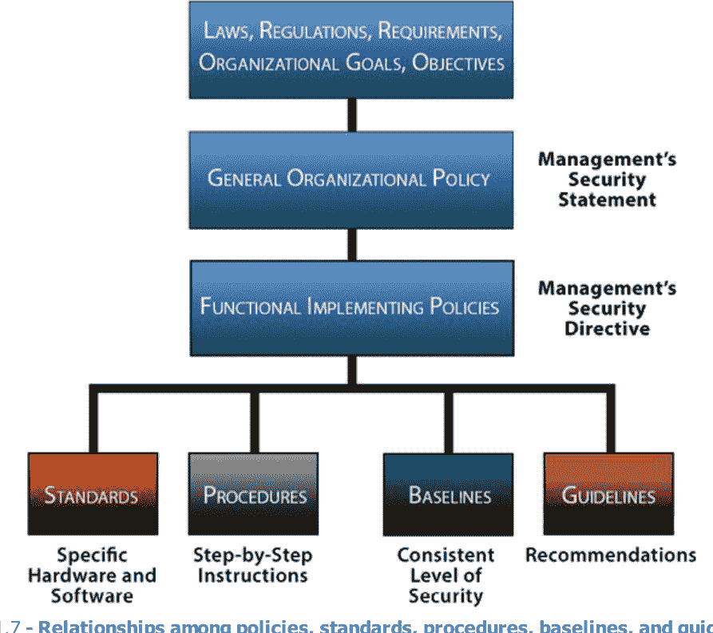

图 1.7 - 政策、标准、程序、基线和指南之间的关系

安全专业人员应考虑邀请人力资源、法律、合规、各个 IT 领域以及代表关键业务部门的具体业务领域代表参与起草过程。当政策仅在 IT 部门内部制定然后在没有业务部门意见的情况下分发时，很可能遗漏重要的业务考虑因素。

一旦政策文件创建完成，确保合规的基础就建立了。根据组织的不同，可能需要额外的文档来支持政策。这种支持可能以标准、基线或程序中描述的额外控制措施的形式出现，以帮助人员遵守。文档化之后的一个重要步骤是使最新版本的文档易于预期遵循的人员获取。许多组织将其文件放在内部网或共享文件文件夹中以便于访问。将这些文件放置在这些位置加上意识活动、必要时的培训、清单、表格和示例文件可以使意识和最终的合规性更有效。

### 业务连续性 (BC) 与灾难恢复 (DR) 要求

#### 项目启动与管理

构建业务连续性 (BC) 计划的第一步是项目启动与管理。在此阶段，将发生以下活动：

- 获得高层管理支持以推进项目
- 定义项目范围、要实现的目标和规划假设
- 估算项目成功所需的人力资源和财务资源
- 定义项目的时间表和主要交付成果

在此阶段，计划将像项目一样管理，应指定项目经理来协调团队的活动。

#### 高层领导支持

在项目甚至开始之前，它必须获得高层管理的坚定支持。没有这种支持，项目将失败。为了说服领导层组织需要建立企业范围的 BC 和 DR 计划，规划者必须向领导层推销该计划的重要性。

任何组织的最高领导层都有两个主要目标：执行使命和保护组织。业务连续性和 DR 与执行使命关系不大（除非组织的使命是 DR！），而与保护组织有关。仍然很难推广，因为除非组织实际发生灾难，否则用于制定计划的时间、金钱和人力资源的价值会受到怀疑，因为这会占用第一个目标，即执行使命。那么，为什么组织需要 BC 和 DR 呢？它们可能提供什么价值？我们必须回到起点才能回答这些问题。

这一切都始于数据中心。一旦计算机成为企业环境的一部分，甚至在个人计算机引入个人办公桌之前，很快就变得清楚，如果计算机出现故障，组织无法回到手动流程。运营模式已经改变。人们用账簿中的手工总账或在制造环境中用手完成的工作，现在由计算机更一致、错误更少、速度快得多地完成。如果这些计算机系统出现故障，就没有足够的人来做这项工作，也没有组织中的人员仍然具备手动操作的技能。这是 DR 行业的开始。时至今日，“灾难恢复”一词通常意味着技术环境的恢复。

许多行业花了一些时间才意识到，如果没有人使用数据中心，数据中心是否恢复真的无关紧要。正是那时，业务连续性一词开始取代灾难恢复，更准确地反映了该行业的目标——尽可能快地、尽可能少地中断地实现组织工作/使命的延续。

为了说服领导层建立可行的灾难恢复计划 (DRP) 和业务连续性计划 (BCP) 的必要性，规划者需要帮助他们理解不建立计划所承担的风险以及灾难发生时对组织的潜在成本。对组织的风险存在于三个领域：财务（组织可能损失多少钱）、声誉（组织在其客户和股东眼中的负面程度）以及监管（所产生的罚款或处罚、对其提起的诉讼）。此外，如果确定组织领导者没有尽到应有的注意来充分保护组织及其资源，他们也可能承担个人财务甚至刑事责任。

财务风险在许多情况下可以量化，通常用于帮助确定应为恢复计划花费多少资金。计算财务风险的一种方法是使用公式 P × M = C：

- **伤害概率 (P)** – 损害事件发生的可能性
- **伤害程度 (M)** – 如果发生灾难将发生的财务损失金额
- **预防成本 (C)** – 采取防止灾难影响的对策的价格。对策的成本不应超过事件的成本。

声誉风险更难量化。例如，如果一家公司在需要时无法满足客户的需求，客户很容易找到愿意满足需求的其他人。声誉风险关乎公司在其客户和股东眼中的形象。在危机处理不当后，股价受到负面影响的例子有很多。有效的 BC 和 DR 计划可能是公司在事件中生存与公司不复存在之间的区别。


### 规划流程的额外益处

在许多组织中，应急规划是一项必要措施，其带来的益处比预期更多。应急规划有助于确保组织在灾难期间及之后的可持续运营。应急规划的另一个益处是显著改善了许多组织的日常运营。

研究和记录应急计划可以发现众多单点故障 (SPOF)。SPOF 是指流程中的任何单一输入，如果缺失会导致该流程或多个流程无法运行。一旦识别出来，这些 SPOF 通常可以很容易地消除或降低其破坏潜力。许多组织也在应急规划努力的直接推动下见证了流程改进，尤其是在演练其 DR 和 BCP 时。

应急规划还有更多益处。很少有其他流程要求数据中心员工或组织思考他们做什么、如何做以及如何做得更好。思考如何在新环境中恢复、在没有主建筑的情况下运营、缺少一半员工或在没有连接的情况下工作，所有这些都带来了更好的绩效和韧性。

### 开发并记录项目范围和计划

在寻求高级领导批准时，获得对规划工作范围和目标的一致同意非常重要。计划是否仅涵盖技术恢复，还是也涵盖组织运营？它是否仅涉及数据中心内的技术，还是涉及运行组织所使用的所有技术？它是否仅涉及总部恢复，还是会考虑所有办公室？

每家公司都需要一份技术恢复计划。无论公司是所有业务都在笔记本电脑上开展的小型组织，还是拥有多个数据中心的大型企业，技术都是当今世界开展业务不可或缺的一部分。

规划组织运营的恢复对于组织的生存能力也至关重要。技术恢复和组织恢复使组织能够在意外事件发生后继续运营。另一种需要考虑的规划类型是某种劳动力受损事件，例如大流行、劳工罢工、交通问题等，此时建筑物完好，数据中心完好，但由于某种原因，员工无法或不愿上班。

规划人员需要与高级领导就规划工作的范围达成一致，因为这将决定规划人员所需的项目资源、完成项目的期限以及领导团队在项目进展过程中可以期望的交付成果。通常，在拥有经验丰富的规划人员以及领导层支持该工作的承诺的中型组织（1,000 - 3,000 名员工，两个数据中心）中，在没有现有计划的情况下制定计划，将遵循以下概述的时间表：

- **紧急通知名单 — 1 个月**
  - 要对紧急情况做出任何成功的响应，规划人员首先必须能够联系到组织中能够并愿意响应的人员。
- **重要记录备份和恢复 — 前 6 个月内**
  - 为了能够从灾难情况中恢复，规划人员必须能够访问运营组织所需的所有记录。
- **业务影响分析 — 前 6 个月**
  - 确定组织职能、各组织单位处理中断的能力以及待恢复职能和应用程序的优先级和顺序；确定恢复这些领域和相互依赖关系所需的资源。
- **策略制定 — 6 至 9 个月**
  - 评估各种可用策略，进行成本效益分析，并向领导层提出建议以供批准。
- **备选站点选择 — 9 至 12 个月**
  - 准备提案请求 (RFPs)、进行现场勘查、选择供应商和/或建设和配备内部站点，并谈判合同。
- **应急计划制定 — 12 个月**
  - 包括：应急响应、恢复关键系统以及将组织职能恢复到正常组织运营状态。
- **测试、计划维护和定期审计 — 持续进行**

### 组织分析

高级领导必须支持一项组织政策，要求遵守 BCP/DRP 制定计划，以便从需要参与的组织的各个领域分配资源。该政策应说明以下内容：

> "公司的每个职能领域的 senior leaders 负责确保其责任范围内存在 BCP，负责计划本身的内容，并通过每年在计划文件上签字来确认其同意计划。

### 进行业务影响分析 (BIA)

规划流程的下一步是让规划团队执行 BIA。BIA 将帮助公司决定需要恢复什么，以及恢复速度。使命职能通常用关键、必需、支持和非必需等术语来指定，以帮助确定适当的优先级。

### 识别和优先排序
#### 关键组织职能

一般来说，组织不会雇佣员工来执行非必需任务。每个职能都有其目的，但在执行时间或资源有限的情况下，有些职能比其他职能更具时间敏感性。遭受建筑物火灾的银行可以很容易地停止其营销活动，但无法停止客户的支票处理和存款。组织需要以同样的方式审视每个职能。公司在不造成重大财务损失、重大客户不满或损失，或监管机构或诉讼带来的重大处罚或罚款的情况下，能多久不执行此职能？

所有组织职能及其支持的技术都需要根据其恢复优先级进行分类。组织运营的恢复时间框架由不执行该职能的后果决定。后果可能是由于未履行合同承诺导致罚款或诉讼、与客户失去 goodwill 等。图 1.8 是一个简单的 BIA 表单，用于对职能进行分类并确定其时间敏感度代码，该代码在图 1.9 中显示。要使用此表单，规划人员需要调整因素以反映所评估的组织。规划人员需要为规划团队定义在该组织中每个影响领域的低、中、高影响是什么，以及影响实现之前的时间。

|  | 影响代码 | 呼叫中心 | 客户账户维护 | 客户货币 |
|---|---|---|---|---|
| **邮件区域** |  | Z 45 | Z 37 | Z 38 |
| **风险代码** | F=财务<br>C=客户<br>R=监管 | C & F | C | C & F & R |
| **影响前时间** | 0=2周或更长<br>1=第1周<br>5=最多3天<br>10=第1天<br>20=4小时<br>40=立即 | 40 | 1 | 10 |
| **客户影响** | 0=无<br>1=低<br>3=中等<br>5=高 | 5 | 3 | 3 |
| **监管影响** | 0=无<br>1=低<br>3=中等<br>5=高 | 1 | 0 | 3 |
| **财务影响** | 0=无<br>1=0至10K<br>2=>10K但<100K<br>3=>100K但<500K<br>4=>500K但<100万<br>5=>100万 | 3 | 0 | 4 |
| **评级总分** | *1至4项之和* | **49** | **4** | **20** |
| **恢复时间敏感度代码** |  | AAA | D | A |
| **备选站点** |  | 存活站点<br>然后 Smith Road | 居家办公 | Smith Road |

图 1.8 - **示例 BIA 表单**

## 业务功能恢复时间敏感代码
### 评级总分 45 或以上 =
AAA 立即恢复

必须在至少两个地理分散且配备齐全并配备人员的地点执行

### 评级总分 25 至 45 =
AA 最长 4 小时恢复

必须拥有一个可行的备选站点，该站点可以在要求的四小时时间内配备人员并投入运行

### 评级总分 15 至 24 =
A 当日恢复

必须在同一工作日内投入运营，因此必须拥有一个可行的备选站点，该站点可以在同一工作日内配备人员并投入运行

### 评级总分 10 至 14 =
B 最长 3 天

可以暂停最多 3 个工作日，但必须拥有一个可行的备选站点，该站点必须在第四个工作日之前配备人员并投入运行

### 评级总分 7 至 10 =
C 第 1 周

可以暂停最多一周，但必须拥有一个可行的备选站点，该站点必须在中断后的第二周之前配备人员并投入运行

### 评级总分 0 至 6 =
D 第 2 周或更长时间停机允许

可以暂停超过一周 - 应为此职能确定最大天数


### 确定最大可容忍停机时间

所有应用程序，如同所有组织职能一样，需要根据其恢复的时间敏感性进行分类，即使这些应用程序不支持时间敏感的组织职能。对于应用程序，这通常被称为恢复时间目标（RTO）或最大可容忍停机时间（MTD）。这是组织在出现重大影响之前能够在没有该应用程序的情况下运行的时间量。

### 评估停机暴露风险

### 了解组织

作为规划过程的一部分，规划者需要进行风险评估，以确定组织面临哪些威胁，以及规划者建议花费缓解资金的地方，以尝试减少威胁的影响。

风险有三个要素：威胁、资产和缓解因素。威胁是指如果发生，将会阻止组织以正常方式运营（如果有的话）的事件或情况。威胁以概率衡量，例如“可能10年发生1次”，并且在影响感受到时有指定的持续时间。

### 外部威胁和漏洞

影响组织正常运作能力最常见的威胁是电力供应。停电造成的组织中断事件比任何其他类型的事件都多。第二常见的事件类型是水，要么水太多（洪水、管道泄漏、管道破裂和屋顶漏水），要么水不够（水管主干破裂）。其他常见事件包括恶劣天气、导致网络中断的电缆切断、火灾、劳资纠纷、运输事故，以及对于数据中心而言，硬件故障。

### 内部威胁和漏洞

内部停机通常由以下操作引起：

- 设备过早失效
  - 可能是由于安装不当
  - 也可能是由于环境不当
- 设备因磨损而失效
  - 大多数设备都有“平均故障间隔时间”（MTBF）评级
  - 运行超过MTBF的设备存在失效风险
- 设备因未经测试的生产变更或其他人为需求、电话需求、桌面需求、内部和外部相互依赖等而停机

应用程序系统的恢复优先级在此过程中确定。组织根据这些应用程序所支持职能的恢复优先级来决定哪些应用程序系统何时需要恢复在线。

这种技术审查过程有时对组织来说很难执行。基本的普通桌面用户知道他们点击这个图标，应用程序系统就会启动。他们对应用程序驻留在何处（大型机、Web、服务器或桌面）、数据驻留在何处（中央存储、网络服务器、云或桌面），甚至可执行文件驻留在何处几乎没有概念。

这些是在制定恢复计划时的重要考虑因素。如果应用程序与组织同址部署，则该应用程序的恢复必须是该站点站点恢复计划的一部分。如果不是，则恢复可能仅意味着在备用站点提供对该应用程序的网络访问。

对于组织职能和应用程序，组织还需要确定在事件期间可能面临风险的在制品数量。当火灾发生时，员工桌上的数据如果没有在其他地方备份，将永远丢失。存放在文件柜中的信息、邮件室的进件邮件、尚未离开大楼的备份磁带等也都面临风险。

规划团队需要对所有类型的数据做出决策，因为数据驱动着组织运行。可以接受丢失多少数据？一分钟的数据？一小时的数据？整整一个工作日的数据？这通常被称为恢复点目标（RPO），即规划者将尝试恢复到的时间点。电子数据和纸质数据的备份政策和程序需要符合组织制定的RPO。

### 管理人员安全

组织中的个人每天来工作以尽其所能履行职责。因此，这些个人具有适当的意图，并寻求有关最佳工作方式、所需培训以及工作期望的信息。媒体对组织面临的外部黑客威胁给予了很大关注；然而，内部也存在错误或欺诈性交易威胁，这可能导致信息资产受损或被毁。内部人员最接近数据，并最了解当前存在的流程以及控制弱点。诸如职责分离、职位描述文档、强制休假、岗位和班次轮换以及需知（最小权限）访问等工作控制措施需要由安全专业人员实施，以最大程度地减少组织内部对数据的风险。安全从业人员可能会考虑强大的监控控制措施，例如基于“正常”用户基线的行为异常检测，以检测异常数据访问模式，作为额外控制层，进一步加强该领域的纵深防御策略。

此外，在个人开始担任职位之前应执行各种活动。其中一些将由安全专业人员直接执行，而其他活动可能由组织其他成员在征求其意见或监督下执行。这些活动可能包括制定职位描述、联系推荐人、审查/调查个人的背景、制定保密和不披露协议，以及确定供应商、承包商、顾问和临时员工访问的政策。

### 雇佣候选人筛选

雇用合格、合适且值得信赖的个人取决于实施并遵守人员政策，以筛除过去行为可能表明不良行为的人员。员工士气低下可能导致对控制措施的遵守程度降低。员工流失率增加也可能导致员工专业知识水平随时间下降。终止雇佣政策和程序是必要的，以确保被解雇员工不再访问系统，因此没有机会损坏文件或系统或破坏公司运营。这些也是确保政策对人员一致应用所必需的。虽然大多数员工都是勤奋、称职且无不当意图的人，但也可能有少数人意图不佳。人员安全不佳会增加信息风险，因此必须实施适当的人员安全控制措施。

职位描述应包含该职位的角色和职责，以及为满意地履行工作职能所需的教育、经验和专业知识。写得好的职位描述不仅为与申请人交谈以确定其技能是否匹配提供了依据，也是衡量持续绩效评估的标尺。职位内所述的个人工作目标

- 就业空白
- 职位头衔的虚假陈述
- 工作职责
- 薪资
- 离职原因
- 专业认证的有效性和状态
- 教育验证和获得的学位
- 信用历史
- 驾驶记录
- 刑事历史
- 个人推荐人
- 社会安全号码验证

### 背景调查的好处

背景调查在保护公司方面的好处不言而喻；然而，还可能实现以下好处：

- 风险缓解
- 增加了对最合格候选人被录用而非面试表现最好者的信心
- 降低招聘成本
- 降低流失率
- 资产保护
- 保护公司品牌声誉
- 保护员工、客户和公众免受盗窃、暴力、毒品和骚扰
- 免受过失招聘和留任诉讼的影响
- 通过避免雇用有暴力历史的员工创造更安全的工作场所
- 阻止有隐瞒之事的申请人
- 识别刑事活动

### 检查的时机

有效的背景调查计划要求在候选人被选为录用之前，参与招聘流程的所有个人都支持该计划。这要求人力资源部门、法务部门、招聘主管和招聘人员理解并执行筛选流程。一旦个人被录用到组织中，它是

在没有具体理由进行调查的情况下，获取这些信息要困难得多。员工还应根据其职位的敏感性定期重新接受调查。这一点也应记录在适当的政策中，包括频率安排。

### 背景调查的类型

根据个人可能被雇佣的职位，可以进行多种不同类型的背景调查。最佳实践是对公司所有员工进行背景调查，并通过合同协议要求外部机构对承包商、供应商以及与公司资产、系统和信息接触的任何人进行背景调查。如果成本过高，组织必须决定哪些职位最关键，需要对其开展背景调查。例如，银行被要求对任何可能接触资金的员工进行背景调查。在银行中，显然这几乎包括所有员工。检查类型从最低限度的检查到全面的背景调查不等。组织可能重点检查或决定进行更广泛检查的个人类型包括：

- 涉及技术的人员
- 能够接触机密或敏感信息的人员
- 能够访问公司专有或竞争性数据的员工
- 从事应付账款、应收账款或工资单工作的职位
- 直接与公众打交道的职位
- 在医疗行业组织或处理财务信息的组织工作的员工
- 涉及驾驶机动车的职位
- 将接触儿童的员工

可进行的背景调查范围很广。以下是最常见的背景调查类型。

#### 信用记录

信用记录是金融机构用来确保消费贷款、信用卡、抵押贷款和其他类型金融债务得到偿还的主要工具。信用记录用于筛选高违约风险并遏制违约行为。金融服务公司利用信用记录作为主要杠杆，威胁如果个人拖欠付款，将把拖欠信息记录在其信用报告中。过去，经理们只会对那些直接处理资金的人进行信用报告调查；然而，由于计算机的互联互通以及接触高风险应用程序的潜在可能，这种情况已经改变。基本信用报告会核实申请人的姓名、地址、社会安全号码和以前的地址。这些信息可用于进行更广泛的犯罪搜索或发现就业中的空白。详细的信用记录向雇主提供留置权、判决和还款义务，这可能表明个人处理其财务义务的能力。然而，这些项目必须结合背景情况进行评估，因为个人可能之前陷入财务困境，之后重新整理了财务生活，因此不会对未来雇主构成风险。

有时信用报告信息有限或没有信息，这可能代表求职者的年龄（尚未建立信用记录）、用现金支付购买、使用虚假身份，或求职者的居住地（生活在依赖次级贷款机构的地区，这些机构通常不向信用局报告）。

雇主需要确保他们根据本国法律适当使用这些信息。在美国，《公平信用报告法》（FCRA）、平等就业机会委员会（EEOC）下的法律以及一些州法律将规范组织的行为。[29] 法律顾问和人力资源部门应参与制定与筛选过程相关的任何政策和程序。

#### 犯罪记录

犯罪记录比信用记录更难获取，因为信用记录是通过银行、零售机构、金融服务公司和信用报告机构之间的系统交换的。美国有超过3000个司法管辖区，搜索每个辖区是不可行的。从居住县开始，并在其他以前的地址中搜索，将为申请人提供合理的背景调查。大多数背景调查审查重罪，而忽略轻罪（不太严重的犯罪行为）。根据FCRA，雇主可以要求提供过去七年的完整犯罪记录，除非申请人年收入超过75,000美元，在这种情况下没有时间限制。需要搜索的重要信息包括州和县犯罪记录、性犯罪者和暴力犯罪者记录，以及监狱假释和释放记录。

#### 驾驶记录

对于将在工作中驾驶机动车辆的员工，应检查其驾驶记录。这些记录还可以揭示那些不会在任职期间驾驶车辆的申请人的信息，例如验证申请人的姓名、地址和社会安全号码，并包括交通罚单、事故、酒驾/毒驾逮捕、定罪、吊销、撤销和取消的信息。这些可能表明可能存在酒精或药物成瘾，或缺乏责任感。

#### 药物和物质检测

大多数组织都会检测非法药物使用情况，因为吸毒可能导致生产力损失、旷工、事故、员工流失、工作场所暴力和计算机犯罪。吸毒者通常会回避那些进行药物检测的公司，不会申请或完成整个流程。有许多不同的筛查测试可用，例如苯丙胺、可卡因和PCP、阿片类药物（可待因、吗啡等）、大麻（THC）、苯环利定和酒精的筛查。雇主经常聘请独立实验室来确保进行适当的测试，因为企业并不从事药物检测业务。实验室采取保障措施以减少假阳性或错误判定药物使用的可能性。在美国，《美国残疾人法案》（ADA）等法律可能为正在接受康复治疗的个人提供保护。[30]

#### 先前雇佣情况

核实就业信息，如受雇日期、职位、工作表现、离职原因以及个人是否有资格重新受雇，可以验证申请人所提供信息的准确性。这不是一个简单的过程；如前所述，许多公司有政策不对员工表现发表评论，只确认受雇日期。

#### 教育、执照和认证核实

简历上列出的文凭和学位证书可以向高等院校核实。学位可以通过互联网付费购买，而无需参加任何课程，因此应注意确保学位来自经认可的机构。技术领域的认证，如CISSP或其他行业或供应商特定的认证，可以通过联系发证机构进行验证。州执照机构保存着州颁发的执照、投诉和撤销执照的记录。

#### 社会安全号码验证与校验

一个号码确实是社会安全号码，可以通过数学计算以及该号码可能被发放的州和年份来验证。该号码由社会保障局发放、未被滥用、发放给未去世的人，或者查询地址与邮件接收服务、酒店或汽车旅馆、州或联邦监狱、露营地或拘留设施无关，这些都可以通过向社会保障局查询来完成。

#### 可疑恐怖分子监视名单

各种服务会搜索联邦和国际的可疑恐怖分子数据库。尽管这些数据库的构建和识别恐怖分子的方法相对较新且在不断发展，但风险较高的行业，如国防、生物技术、航空和制药行业，或与已知恐怖活动关联的公司有业务往来的行业，将从检查这些数据库中受益。

#### 雇佣协议与政策

雇佣协议通常由员工在开始新工作之前或在第一天签署。这些协议在形式和内容上因组织而异，但其目的是在个人受雇期间以及员工离开组织后保护组织。例如，保密协议包含保护公司保留员工可能接触到的商业秘密或知识产权的权利的条款，即使在员工离开组织之后也是如此。可能要求员工遵守行为准则、利益冲突政策、礼物处理政策和道德协议，以确保员工以符合组织最佳利益的方式继续工作，并减少组织因员工不道德行为而被起诉的责任。

持续的监督和定期的绩效评估确保个人根据其当前资格和实现安全目标的情况得到评价。所有员工的绩效评级应涵盖对安全政策和程序的遵守情况。薪酬和成就认可应适当，以保持部门的高士气。监测持续的技能能力、培训和经验要求，可以降低将不当控制应用于信息安全的风险。各种政策、协议和流程被视为管理员工风险的最佳实践。最终目标是确保员工能够履行其被雇佣时所要履行的职责，同时最大限度地减少欺诈、盗窃、滥用或浪费的易感性、环境和诱惑。以下流程有助于确保一支高效且低风险的员工队伍。


### 职务轮换

职务轮换可降低个人之间串谋的风险。处理敏感信息或系统且存在通过串谋获利机会的公司，可通过将职务轮换与职责分离相结合而受益。轮换某人的岗位可能会发现其在正常操作流程之外进行的活动，从而揭示错误或欺诈行为。由于该岗位需要特定的技能组合，在小型组织中实施可能存在困难，因此需要依赖安全控制和监督控制。人员在岗位间的轮换提供了备份覆盖、继任规划以及参与者的工作丰富机会。它还提供了技能多样性，以支持职责分离政策。

### 职责分离 (SOD)

一个人不应具备执行特定流程所有步骤的能力。这在关键业务领域尤为重要，在这些领域个人可能拥有更大的访问权限并能够修改、删除或向系统添加数据。未能分离职责可能导致个人在他人不知情的情况下从公司挪用资金。通常职责会被细分或在不同个人或组织群体之间划分以实现分离。这种分离降低了错误或欺诈行为发生的几率；每个群体都对其他群体起到制衡作用，并形成自然的控制流程。管理层有责任确保职责在其业务流程中得到明确定义和分离。未能做到这一点可能导致非预期后果；例如：

- 财务部门中能够向供应商数据库添加供应商、签发采购订单、记录货物收货并授权付款的个人，可能在未被发现的情况下向虚假供应商付款。
- 薪资部门中能够授权、处理和审核薪资交易的个人，可能在未被发现的情况下提高同事的薪资。
- 能够更改生产代码的计算机程序员可能会更改代码以将资金转移到个人银行账户，然后通过替换生产代码并隐藏或创建虚假日志来掩盖其行为。
- 拥有编写代码、将其移至生产环境并运行生产作业权限的程序员，跳过内部系统开发流程，可能无意或故意地实施错误甚至恶意代码。

一些组织使用二维职责分离矩阵来确定部门内哪些岗位应予分离。每个岗位都写在矩阵的轴上，在两个职责不应由同一人承担的位置放置一个 x。这个 x 表示工作职责应在不同个人之间细分的位置。在信息系统部门与业务部门之间，以及在信息系统组织内部各领域之间分离职责至关重要。例如，用户部门的管理层负责为其员工的访问权限提供系统访问授权。信息系统部门，更具体地说负责安全管理的部门，负责授予访问权限。定期地，此访问权限也会由业务管理层进行审查和确认。在 IT 部门内，安全管理员应与业务分析师、计算机程序员、计算机操作员等分离。这些不应由一人或一组兼任的职责被称为不相容职责。不相容职责可能因组织而异。同一人通常不应执行以下职能：

- 系统管理
- 网络管理
- 数据录入
- 计算机操作
- 安全管理
- 系统开发与维护
- 安全审计
- 信息系统管理
- 变更管理

在小型组织中，由于可用人员有限，可能难以分离这些活动。这些组织可能需要依赖补偿性控制措施，例如监督审查或主动监控，以减轻风险。审计日志记录和第三方事后审查可以作为分离工作职能的替代有效控制措施。大型组织需要确保适当的分离、监督审查以及正式化操作程序的制定已到位。分离的职能应得到充分记录并传达给员工，以确保只有指定人员执行与这些职能相关的任务。这些措施有助于防止或检测用户执行的错误工作。大额交易应有更多

### 员工离职流程

员工每天都在加入和离开组织。原因各不相同，可能是退休、裁员、解雇、有因或无因终止、搬迁到另一城市、其他雇主的职业机会或非自愿调动。离职可能是友好的也可能是非友好的，因此需要不同的处理程度。

#### 友好离职

常规离职是指没有或几乎没有证据或理由表明离职对公司和员工双方都不满意。一套标准程序，通常由人力资源部门维护，规范被解雇员工的离职，以确保公司财产归还且所有访问权限被移除。这些程序可能包括离职面谈以及归还钥匙、身份证件、徽章、令牌和加密密钥。其他财产，如笔记本电脑、电缆锁、信用卡和电话卡，也会被收回。用户经理通知安全部门离职情况，以确保所有平台和设施的访问权限被撤销。有些机构选择立即删除账户，而其他机构则选择在政策规定的期限内（例如 30 天）禁用账户，以应对最终离职日期的变更或延长。离职流程应包括与离职员工的谈话，提醒其继续承担信息保密的责任。

#### 不友好离职

不友好离职可能发生在个人被解雇、非自愿调动、裁员时，或当组织有理由相信个人有能力并有意可能对系统造成损害时。具有技术技能和更高访问级别的个人，如系统管理员、计算机程序员、数据库管理员或任何具有提升权限的个人，可能对环境构成更高风险。这些个人可能会篡改文件、植入逻辑炸弹以在未来造成系统文件损坏，或删除敏感信息。其他不满的用户可能会向系统中输入错误数据，这些数据可能数月后才被发现。在这些情况下，在离职时或在通知员工离职之前立即终止系统访问是必要的。

管理安全的人力资源方面，从入职前到离职后至关重要，以确保受信任、胜任的资源被雇用来推进保护公司信息的业务目标。这些行动中的每一个都有助于预防性、侦测性或纠正性人员控制。

### 供应商、顾问和承包商控制

业务合作伙伴和其他第三方经常将人员带入组织。因此，组织必须确保已建立控制措施，以防止敏感信息丢失，并减轻这些个人可能故意或无意对组织造成的任何损害。就像组织员工筛选一样，可以采取多种方法，具体取决于供应商与组织之间关系性质。

- 如果第三方不常在现场或访问系统但具有管理权限，请考虑：
  - 在现场陪同个人以监控活动。
  - 使用屏幕共享技术虚拟监控员工并记录所有执行的操作。
  - 确保个人及其所在组织（如适用）已签署具有特定制裁的适当保密协议。
  - 确保第三方明确指定获得访问权限的人员，并在访问时核实其身份。
- 如果第三方在现场长期驻留并具有管理权限，请考虑：
  - 进行背景调查并确定是否存在任何适用性问题。
  - 使用屏幕共享技术虚拟监控员工并记录所有执行的操作。
  - 确保个人及其所在组织（如适用）已签署具有特定制裁的适当保密协议。
  - 确保第三方明确指定获得访问权限的人员，并在访问时核实其身份。
- 无论持续时间如何，如果第三方对敏感信息仅有有限访问权限，请考虑：
  - 使用屏幕共享技术虚拟监控员工并记录所有执行的操作。
  - 确保个人及其所在组织（如适用）已签署具有特定制裁的适当保密协议。


确保有法律背景的人员参与任何合同谈判并理解上述列出的要求。许多成功的渗透测试涉及“供应商”或“维修人员”的短暂访问，而他们实际上是攻击者。仔细审查第三方可以帮助确保只有合适且经授权的个人能够进入设施和系统。合同必须明确供应商必须满足的要求，以确保他们能够据此进行计划和预算。

### 隐私

所有个人都对隐私有期望。这种期望因文化和个人而异，但安全专业人员必须了解在国家法律范围内监控个人的限制。虽然通常认为在公共停车场安装闭路电视摄像机是可以接受的，但世界上的大多数人不会批准在私人区域如淋浴间或更衣室安装闭路电视摄像机。虽然这些例子很极端，但其他情况则属于“灰色”地带。例如包括家庭办公室。组织是否有权监控其代表工作的任何空间，包括私人住宅？大多数隐私专家会对这个问题持“否”的答案，但一些安全专业人员或调查人员可能会说“是”。这在很大程度上是由于视角的差异。调查人员感兴趣的是收集证据，而安全专业人员则关注确保个人安全和组织信息的安全。

在大多数情况下，关于组织隐私政策的沟通是确保隐私相关投诉降至最低的关键。许多组织会放置醒目的标志，说明在该区域正在进行闭路电视或其他类型的监控。虽然有人可能会认为这是在提醒攻击者，但实际上攻击者已经假设或知道该区域有摄像机。如果他们不知道，通知很可能会阻止或劝阻他们。无论如何，通知或明显地表明监控的存在都可能带来优势。

### 风险管理概念

风险，根据《美国传统词典》的定义，是“损失的可能性”。《兰登书屋词典》将风险管理定义为“评估、最小化和防止对企业造成意外损失的技术或专业，例如通过使用保险、安全措施等。”图 1.11 说明了与美国国家标准与技术研究所（NIST）风险评估流程相关的活动。虽然这是一个特定的框架，但它涵盖了一般风险管理流程。

各个步骤的细节如下所述。

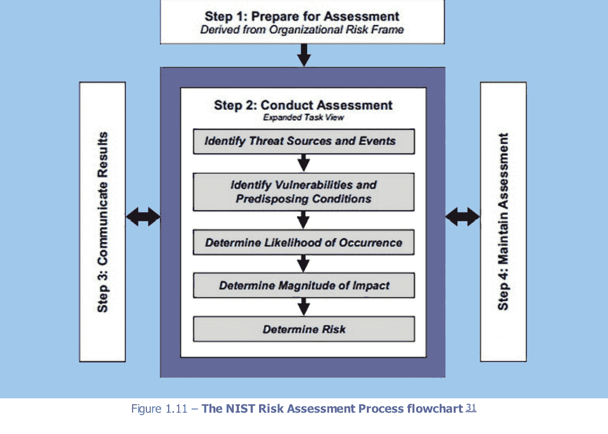

图 1.11 – NIST 风险评估流程图 31

风险评估流程的第一步是为评估做准备。本步骤的目标是为风险评估建立背景。此背景由风险管理流程的风险框架步骤的结果建立并提供信息。风险框架例如识别组织关于进行风险评估的政策和要求的信息、要采用的具体评估方法、选择要考虑的风险因素的程序、评估范围、分析的严谨程度、正式程度以及促进组织内一致且可重复的风险判定要求的因素。组织在可行范围内使用风险管理策略以获取准备风险评估所需的信息。为风险评估做准备包括以下任务：

-   确定评估的目的；
-   确定评估的范围；
-   确定与评估相关的假设和约束；
-   确定用作评估输入的信息来源；以及
-   确定评估期间要采用的风险模型和分析方法（即评估和分析方法）。

风险评估流程的第二步是进行评估。本步骤的目标是生成一份信息安全风险清单，可按风险等级优先排序并用于为风险响应决策提供信息。为实现此目标，组织分析威胁和漏洞、影响和可能性，以及与风险评估流程相关的不确定性。本步骤还包括作为每个任务一部分的必要信息收集，并根据风险评估流程的准备步骤中建立的评估背景进行。风险评估的期望是根据准备步骤中建立的具体定义、指导和方向充分覆盖整个威胁空间。然而，实践中，在可用资源范围内实现充分覆盖可能要求概括威胁来源、威胁事件和漏洞以确保全面覆盖，并且仅在必要时对具体、详细的来源、事件和漏洞进行评估以实现风险评估目标。进行风险评估包括以下具体任务：

-   识别与组织相关的威胁来源；
-   识别这些来源可能产生的威胁事件；
-   识别组织内部可能被威胁来源通过特定威胁事件利用的漏洞以及可能影响成功利用的易发条件；
-   确定已识别的威胁来源启动特定威胁事件的可能性以及威胁事件成功的可能性；
-   确定威胁来源（通过特定威胁事件）利用漏洞对组织运营和资产、个人、其他组织和国家造成的负面影响；以及
-   将信息安全风险确定为威胁利用漏洞的可能性与此类利用的影响的组合，包括与风险判定相关的任何不确定性。

具体任务以顺序方式呈现以求清晰。然而，实践中，任务之间需要并预期会进行一些迭代。根据风险评估的目的，组织可能会发现重新排序任务是有利的。不管组织对所述任务做出何种调整，风险评估都应满足发起评估的组织所设定的所述目的、范围、假设和约束。

风险评估流程的第三步是传达评估结果并共享风险相关信息。本步骤的目标是确保组织各地的决策者拥有适当的风险相关信息，以为风险决策提供信息和指导。沟通和共享信息包括以下具体任务：

-   传达风险评估结果；以及
-   共享在风险评估执行过程中开发的信息以支持其他风险管理活动。

风险评估流程的第四步是维护评估。本步骤的目标是保持组织所承担风险的特定知识的最新状态。风险评估的结果为风险管理决策提供信息并指导风险响应。为了支持对风险管理决策（例如采购决策、信息系统和通用控制的授权决策、连接决策）的持续审查，组织维护风险评估以纳入通过风险监控检测到的任何变化。风险监控为组织提供手段，以便持续确定风险响应的有效性、识别影响组织信息系统及其运行环境的变更并验证合规性。维护风险评估包括以下具体任务：

-   持续监控风险评估中识别的风险因素并了解这些因素的后续变化；以及
-   更新反映组织开展的监控活动的风险评估组件。

### 组织风险管理概念

组织将进行风险评估（风险分析一词有时与风险评估互换使用）以评估以下内容：

-   其资产的威胁
-   环境中存在的漏洞


- 利用暴露实现威胁的可能性（在进行定量评估时即概率和频率）
- 暴露被实现后对组织造成的影响
- 可用的对策，可减少威胁利用暴露的能力，或在威胁能够利用漏洞时减轻对组织的影响
- 残余风险（例如，在适当控制得到正确应用以减轻或消除漏洞时剩余的风险量）

组织还可能希望在称为展品的交付成果中记录对策的证据，或在某些框架中称为“证据”。展品可用于为组织提供审计轨迹，同样也可为可能对组织当前风险状况有疑问的任何内部或外部审计师提供证据。

为什么要进行这样的努力？如果不知道哪些资产至关重要以及组织内部哪些资产风险最大，就不可能适当地保护这些资产。例如，如果组织受 HIPAA 法规约束，但不知道电子个人身份信息可能面临的风险程度，组织在保护这些信息时可能会犯重大错误，例如忽视对某些风险的防护或对低级别风险施加过多的保护。32

### 安全与审计框架和方法论

已创建多个框架和方法论来支持已实施的安全控制的安全、审计和风险评估。这些资源对于协助设计和测试安全计划非常有价值。以下框架和方法论在审计或信息安全领域均获得了一定程度的认可。虽然其中一些并非专门为支持信息安全而设计，但这些实践中的许多流程有助于安全专业人员识别和实施控制措施以支持保密性、完整性和可用性。

#### COSO 33

特雷德韦委员会发起组织委员会（COSO）成立于1985年，旨在发起国家财务欺诈报告委员会，该委员会研究导致财务欺诈报告的因素，并为上市公司、其审计师、证券交易委员会和其他监管机构提出建议。COSO 识别了满足财务报告和披露目标所需的五个内部控制领域。这些包括：

- 1. 控制环境
- 2. 风险评估
- 3. 控制活动
- 4. 信息与沟通
- 5. 监督

COSO 内部控制模型已被一些致力于萨班斯-奥克斯利法案第404条合规的组织作为框架采用。

#### ITIL 34

IT 基础设施库（ITIL）是一套由英国政府文具办公室于1989年至2014年间出版的书籍，旨在改进 IT 服务管理。该框架包含了一套 IT 核心运营流程的最佳实践，例如变更、发布和配置管理、事件和问题管理、容量和可用性管理以及 IT 财务管理。ITIL 的主要贡献在于展示如何将控制措施实施到服务管理 IT 流程中。这些实践可作为根据组织特定需求进行定制起点的有用参考，其成功取决于其保持最新并每日实施的程度。实现这些标准是一个持续的过程，其中实施需要进行规划、得到管理层的支持、优先排序并分阶段实施。

#### COBIT 35

信息及相关技术控制目标（COBIT）由 IT 治理研究所出版，并整合了以下 IT 和风险框架：

- COBIT 5.0
- Val IT 2.0
- Risk IT
- IT 保证框架（ITAF）
- 信息安全业务模型（BMIS）

COBIT 框架检查高层控制目标的有效性、效率、保密性、完整性、可用性、合规性和可靠性方面。该框架为信息技术控制提供了整体结构，并包括可用于确定由业务需求驱动的有效安全控制目标的控制目标。信息系统审计与控制协会（ISACA）致力于大量资源来支持和理解 COBIT。

#### ISO 27002:2013（前称 ISO17799/BS7799）

BS 7799/ISO 17799 标准可作为制定安全标准和安全管理实践的基础。英国贸易工业部（DTI）于1993年在行业支持下制定的信息安全行为守则（CoP）于1995年成为英国标准7799。BS 7799随后于1999年修订，增加了认证和认可要素，成为 BS 7799 的第 2 部分。BS 7799 第 1 部分成为 ISO 17799，并由国际标准化组织（ISO）和国际电工委员会（IEC）于2005年作为首个国际信息安全管理标准发布为 ISO 17799:2005。ISO 17799 于2005年6月修改并更名为 ISO/IEC 17799:2005。随后再次修改并更名为 ISO/IEC 27002:2005。随后再次修改和更新为 ISO/IEC 27002:2013。

其包含基于以下 14 个领域的 100 多项详细的信息安全控制措施：

- 1. 信息安全政策
- 2. 信息安全组织
- 3. 人力资源安全
- 4. 资产管理
- 5. 访问控制
- 6. 密码学
- 7. 物理和环境安全
- 8. 运营安全
- 9. 通信和运营管理
- 10. 系统获取、开发和维护
- 11. 供应商关系
- 12. 信息安全事件管理
- 13. 业务连续性管理的信息安全方面
- 14. 合规性

### 风险评估方法论

#### NIST SP 800-30r1、800-39 和 800-66r1 36

这些方法论是为美国联邦政府和全球公众使用而建立的定性方法，但在受监管行业（如医疗保健）中尤其常用。SP 800-66r1 专门针对 HIPAA 客户编写（尽管该文件也可用于其他受监管行业）。800-39 侧重于组织风险管理，而 800-30r1 侧重于信息系统风险管理。

#### CRAMM

正如位于西门子 Insight Consulting 网站上的 CRAMM（CCTA 风险分析和管理方法）网站所述，“CRAMM 提供了一种分阶段、有纪律的方法，涵盖技术（如 IT 硬件和软件）和非技术（如物理和人为）方面的安全要素。为了评估这些要素，CRAMM 分为三个阶段：资产识别与估值、威胁和漏洞评估，以及对策选择与建议。”37 该方法论的实施与本章列出的其他方法类似。

#### 失效模式和影响分析 38

失效模式和影响分析起源于硬件分析，但可用于软件和系统分析。它检查每个部件或模块的潜在失效，并从三个层面检查失效的影响：

- 1. 立即层面（部件或模块）
- 2. 中间层面（流程或包）
- 3. 系统范围

组织随后会“收集给定模块失效的总影响，以确定是否应加强模块或提供进一步支持。”

#### FRAP 39

促进风险分析流程（FRAP）基于这样一个基本假设：狭窄的风险评估是确定系统、业务部门、应用程序或流程风险的最有效方式。该流程允许组织对应用程序、系统或其他主题进行预筛选，以确定是否需要进行风险分析。通过建立独特的预筛选流程，组织将能够集中关注真正需要正式风险分析的主题。该流程资本支出很少，并且任何具备良好引导技能的人都可以进行。


### OCTAVE 40

根据其创建者卡内基梅隆大学软件工程研究所的定义，OCTAVE“是一种自主导向的信息安全风险评估。” OCTAVE 被定义为组织中的人员管理和指导其组织的信息安全风险评估的情况。组织的人员指导风险评估活动，并负责对组织改进信息安全的努力做出决策。在 OCTAVE 中，一个跨学科团队，称为分析团队，领导评估。

图 1.12 说明 OCTAVE 方法由运营风险和安全实践驱动。技术仅在与安全实践相关的情况下才被审视。

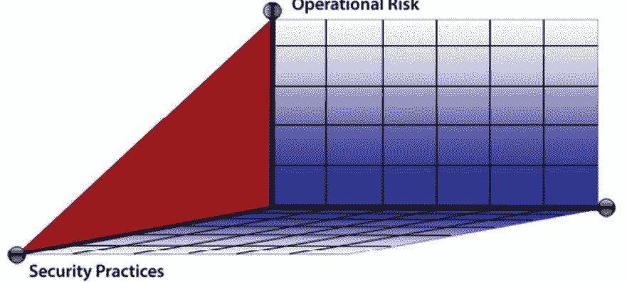

Figure 1.12 – OCTAVE 方法由运营风险和安全实践驱动。

OCTAVE 准则是一组原则、属性和输出。原则是驱动评估性质的基本概念。它们定义了塑造评估过程的哲学。例如，自主性是 OCTAVE 的原则之一。自主性的概念意味着组织内部的人员最适合领导评估并做出决策。

评估的要求体现在属性和输出中。属性是评估的独特品质或特征。它们是定义 OCTAVE 方法基本要素的要求，也是使评估从流程和组织角度都取得成功的必要条件。属性源自 OCTAVE 原则。例如，OCTAVE 的一个属性是跨学科团队（分析团队）由组织的人员组成并领导评估。创建分析团队背后的原则是自主性。

最后，输出是评估每个阶段所需的成果。它们定义了分析团队在每个阶段必须取得的成果。认识到有不止一种活动集合可以产生 OCTAVE 的输出。正因如此，不指定一套必需的活动。

### Security Officers Management and Analysis Project (SOMAP)

安全官管理与分析项目（SOMAP）是一个瑞士非营利组织，其主要目标是运行一个开放的信息安全管理项目，并在 GNU 许可下维护免费和开放的工具和文档。SOMAP 创建了手册、指南和风险工具来帮助理解风险管理。在 SOMAP 风险评估指南中，讨论了定性和定量方法。SOMAP 强调根据组织的目标选择最佳方法的重要性。

SOMAP 如图 1.13 所示说明了风险评估工作流程。更多信息，包括手册、指南和可用工具，可从 http://www.somap.org 获得。

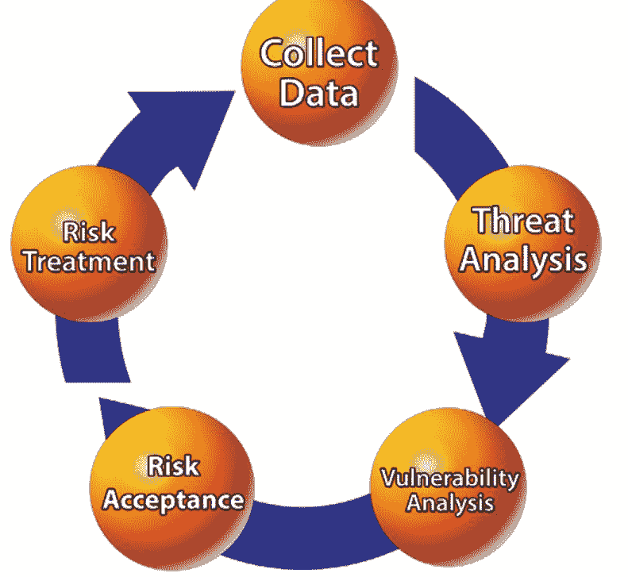

Figure 1.13 – SOMAP 风险评估工作流程

### Spanning Tree Analysis

跨树分析“创建系统所有可能威胁或故障的‘树’。‘分支’是一般类别，如网络威胁、物理威胁、组件故障等。”在进行风险评估时，组织会“修剪”不适用的“分支”。

### VAR (Value at Risk)

在普渡大学 Krannert 管理学院研究生院的 Jeevan Jaisingh 和 Jackie Rees 提出的一篇论文中，介绍了一种新的信息安全风险评估方法，名为风险价值（VAR）。VAR 方法提供了在目标时间范围内因安全漏洞造成的最坏损失的汇总。许多信息安全风险评估工具在性质上是定性的，并且没有理论基础。VAR 被确定为一种基于理论的、信息安全风险的定量衡量。许多人认为，当组织使用 VAR 时，可以在风险与实施安全控制的成本之间取得最佳平衡。许多组织为其公司确定可接受的风险概况。确定与该风险相关的成本，以便当组织面临的风险的货币价值超过该金额时，组织会被提醒需要增加安全投资。信息安全风险评估的 VAR 框架如图 1.14 所示。

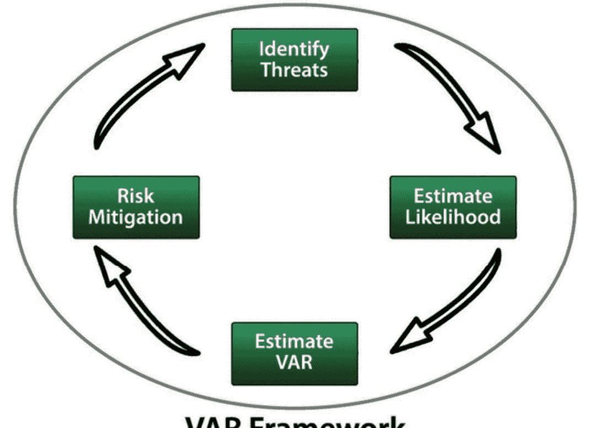

VAR 框架

Figure 1.14 – 信息安全风险评估的 VAR 框架

### Qualitative Risk Assessments

组织可以选择以两种方式之一进行风险评估：定性或定量。定性风险评估产生有效的结果，这些结果是描述性的而非可衡量的。定性风险评估通常在以下情况下进行：

-   组织可用的风险评估人员在定量风险评估方面的专业知识有限；也就是说，在进行定性评估时，评估人员通常不需要在风险评估方面有太多经验。
-   完成风险评估的时间框架较短。
-   实施通常更容易。
-   组织没有大量可立即获取的数据来协助风险评估，因此必须使用描述、估计和序数量表（如高、中、低）来表达风险。
-   组织可用的评估人员和团队是长期员工，并且对业务和关键系统有丰富的经验。

定性风险评估期间通常使用以下方法：

-   在指派团队并开展工作之前，必须获得管理层的批准进行评估。在整个过程中会让管理层了解进展情况，以继续促进对该工作的支持。
-   一旦获得管理层批准，即可组建风险评估团队。成员可包括高级管理层、信息安全、法律或合规、内部审计、人力资源、设施/安全协调、IT 以及业务部门负责人等相关人员。

评估团队会请求文档，具体取决于范围，可能包括：

-   信息安全计划策略和文档
-   信息安全政策、程序、指南和基线
-   信息安全评估和审计
-   技术文档，包括网络图、网络设备配置和规则集、加固程序、修补和配置管理计划和程序、测试计划、漏洞评估结果、变更控制和合规信息，以及根据需要提供的其他文档
-   应用程序文档，包括软件开发生命周期、变更控制和合规信息、安全编码标准、代码推广程序、测试计划，以及根据需要提供的其他文档
-   业务连续性和灾难恢复计划以及相应的文档，例如业务影响分析调查
-   安全事件响应计划及相应文档
-   数据分类方案以及信息处理和处置政策和程序
-   业务部门程序（如适用）
-   执行指令（如适用）
-   其他文档（如需要）

团队为识别环境中的漏洞、威胁和对策而安排与组织成员的访谈。应代表所有层级的工作人员，包括：

-   高级管理层
-   部门管理层
-   业务部门负责人
-   临时或兼职员工（即实习生）
-   业务合作伙伴（如适用）
-   远程工作人员（如适用）
-   认为适合任务的任何其他员工

需要注意的是，风险评估范围内所有业务部门的工作人员都应接受访谈。没有必要访谈单位内的每位员工；通常代表性样本就足够了。

一旦访谈完成，就可以完成收集数据的分析。这可能包括将威胁与漏洞匹配，将威胁与资产匹配，确定威胁利用漏洞的可能性，以及在利用成功的情况下确定对组织的影响。分析还包括将当前和计划的对策（即保护）与威胁-漏洞对进行匹配。

匹配完成后，可以计算风险。在定性分析中，可能性与影响的乘积产生风险等级。风险等级越高，组织越需要立即解决该问题，以保护组织免受伤害。

一旦确定风险，就可以建议额外的对策以最小化、转移或避免风险。完成此操作后，在应用对策保护风险后剩余的风险也会被计算。这就是残余风险，或对策应用后剩余的风险。

### Quantitative Risk Assessments

随着组织在数据收集和保留方面的日益成熟，以及员工在进行风险评估方面的经验日益丰富，组织可能会更多地转向定量风险评估。定量评估的标志是分析的数值性质。在纯定量分析中，频率、概率、影响、对策有效性以及风险评估的其他方面都具有离散的数学值。


通常，组织进行的风险评估是定性和定量方法的结合。完全定量的风险评估可能无法实现，因为总会存在一些主观输入，例如信息价值。信息价值通常是最难以计算的因素之一。

可以清楚地看到进行纯定量分析的好处和弊端。定量分析使评估者能够确定风险成本是否超过对策成本。然而，纯定量分析需要大量的时间，并且必须由具有丰富经验的评估者执行。此外，由于指标也可能需要应用于定性衡量，因此引入了主观性。如果组织有时间和人力完成冗长而复杂的会计评估，这些数据可用于协助定量分析；然而，大多数组织都无力授权这种程度的工作。

定量风险评估中采取三个步骤：初步管理批准、组建风险评估团队，以及审查组织内部当前可用的信息。必须计算单次损失期望值（SLE）以提供损失估计。SLE 定义为资产在一次利用后原始价值与剩余价值之间的差额。计算 SLE 的公式如下：

**SLE = 资产价值（以 $ 计）× 暴露因子**
**（由于成功威胁利用造成的损失，以 % 计）**

损失可能包括由于数据丢失、盗窃、篡改或拒绝服务（可能由于业务连续性或安全问题）导致的数据资产不可用。

接下来，组织将计算年发生率（ARO）。ARO 是对威胁在一年期间成功利用漏洞的频率的估计。

完成此步骤后，组织计算年化损失期望值（ALE）。ALE 是利用的年度估计值（ARO）与 SLE 后资产价值损失的乘积。计算如下：

**ALE = SLE x ARO**

请注意，此计算可使用本地年频率估计（LAFE）或标准年频率估计（SAFE）进行地理距离调整。

鉴于现在已有 SLE 的数值，可以确定组织应花费多少（如果有的话）来对所讨论的风险应用对策。请记住，任何对策的成本都不应高于其缓解、转移或规避的风险。对策的年成本很容易且直接计算。它只是对策成本除以其使用寿命年数（即在组织内的使用）。最后，组织能够比较风险成本与对策成本，并就其对策选择做出一些客观决策。

### 识别威胁和漏洞

#### 识别漏洞

NIST 特刊 800–30 Rev. 1，第 9 页，将漏洞定义为“信息系统、安全程序、内部控制或实现中固有的弱点，可能被威胁源利用。”41

在实践中，通常将漏洞识别为与人员、流程、数据、技术和设施相关。漏洞示例可能包括：

- 入口处缺少接待员、防闯门或其他物理安全机制
- 金融交易软件中完整性检查不足
- 未要求用户签署对其安全责任的确认，以及确认他们已阅读、理解并同意遵守组织的安全政策
- 组织的 information systems 打补丁和配置是临时进行的，因此既未记录也不及时更新

与风险评估不同，漏洞评估倾向于关注组织的 technology 方面，例如网络或应用程序。漏洞评估的数据收集通常包括使用软件工具，为组织和评估者提供大量原始数据。这些原始数据包括有关漏洞类型、其位置、其严重性（通常基于高、中、低的顺序量表）以及有时对发现的讨论的信息。

进行漏洞评估的评估者必须擅长正确地阅读、理解、消化并向跨学科的、有时是非技术性的受众呈现从漏洞评估中获得的信息。为什么？从扫描中获得的数据可能并非真正的漏洞。误报是指在组织中实际上不存在漏洞时报告的发现（即环境中发生的某事被标记为暴露，但实际上并非如此）；同样，漏报是指本应报告但未报告的漏洞。这有时发生在工具未针对任务充分“调优”时，或所讨论的漏洞超出评估范围时。

一些发现是正确且适当的，但需要大量解释才能使组织理解发现了什么以及如何在补救（即修复问题）方面继续进行。这项任务通常适合经验丰富的评估者或团队成员对所讨论的工具具有实际经验的团队。安全从业人员必须了解，对发现的优先级排序及其潜在影响的评估需要由一个或多个合格人员完成，而不是试图自动化此过程。原因在于许多自动化工具分配的评级或排名与基于业务影响分析（BIA）的组织观点不一致。例如，如果组织根据 BIA 的结果将漏洞“A”解释为低影响、低优先级的漏洞，但工具将漏洞“A”评为高优先级、中等影响的漏洞，那么资源可能会被不当分配用于修复对组织不重要的漏洞。

#### 识别威胁

国家标准与技术研究所（NIST）在特刊（SP）800–30 Rev. 1，第 7 – 8 页，将威胁定义为“任何可能通过信息系统通过未经授权访问、破坏、披露或修改信息和/或拒绝服务对组织运营和资产、个人、其他组织或国家产生不利影响的情况或事件”。在 OCTAVE 框架中，威胁被识别为组织资产所保护（或防御）的来源。

NIST 在特刊（SP）800-30 Rev.1，第 8 页，将威胁源定义为以下两种之一：

- 1. 针对有意利用漏洞的意图和方法 或
- 2. 可能意外触发漏洞的情况和方法。

威胁源可以分为几个类别。每个类别都可以扩展为具体的威胁，如下所示：

- 人类 — 恶意外部人员、恶意内部人员、（生物）恐怖分子、破坏者、间谍，

| 如何评估可能性 | 评级 |
|---|---|
| **技能**<br>需要高技能水平 ⇔ 无需或不需要技能 | 1=需要高技能 ⇔ 5=无需技能 |
| **访问难易度**<br>非常困难 ⇔ 非常简单 | 1=非常困难 ⇔ 5=简单 |
| **激励**<br>高激励 ⇔ 低激励 | 1=低或无激励 ⇔ 5=高激励 |
| **资源**<br>需要昂贵或稀有设备 ⇔ 无需资源 | 1=稀有/昂贵 ⇔ 5=无需资源 |
| **总计**<br>将评级相加并除以 4 | 1=E  2=D  3=C  4=B  5=A |

图 1.15(b) – 合格可能性评级

一旦术语定义完毕，即可计算影响。如果一次利用可能导致人员伤亡（如爆炸或生物恐怖袭击），则评级将始终为高。通常，像国家安全局这样的机构将人员伤亡视为任何组织中的最高优先级风险。因此，它可能被分配影响量表中的最高值。示例：51 至 100 = 高；11 至 50 = 中；0 至 10 = 低。

### 风险判定

风险被确定为可能性和影响的副产品。例如，如果一次利用的可能性为 1（高），影响为 100（高），则风险为 100。42 因此，100 将是可用的最高利用评级。这些情况（高可能性、高影响）应引起组织的立即关注。

随着风险计算的完成，可以根据需要对其进行优先级排序以引起关注。请注意，并非所有风险都会获得同等程度的关注，这取决于组织的风险承受能力和其风险缓解、转移或规避策略。图 1.16 显示了风险的另一种视角。


后果

| 可能性 | 不显著 | 轻微 | 中等 | 重大 | 灾难性 |
|---|---|---|---|---|---|
| | 1 | 2 | 3 | 4 | 5 |
| A (几乎确定) | H | H | E | E | E |
| B (可能) | M | H | H | E | E |
| C (有可能) | L | M | H | E | E |
| D (不太可能) | L | L | M | H | E |
| E (罕见) | L | L | M | H | H |

| | |
| E | **极端风险：** 需要立即采取行动减轻风险或决定不继续 |
| H | **高风险：** 应采取行动补偿风险 |
| M | **中等风险：** 应采取行动监控风险 |
| L | **低风险：** 例行接受风险 |

图 1.16 – 评定可能性和后果

### 风险规避

风险规避是制定替代方案以使相关风险不被实现的做法。例如，你是否曾听朋友或朋友的父母抱怨未成年司机保险的费用？这些孩子在变得能够行动时所面临的风险呢？其中一些家庭会决定不允许相关孩子驾驶家庭汽车，而是等待他或她达到法定年龄（即 18 岁）后再承诺拥有、投保并驾驶机动车。

在这种情况下，家庭选择规避与未成年司机相关的风险（以及任何相关收益），例如驾驶表现不佳或为孩子投保的费用。尽管这种选择在某些情况下可用，但并非适用于所有情况。

想象一家全球零售商，明知在互联网上开展业务的风险，却决定规避这种做法。这一决定很可能会让公司损失大量收入（如果公司确实拥有消费者希望购买的产品或服务）。此外，这一决定可能要求公司在全球希望继续经营的每个地点建造或租赁场地。这可能对公司持续经营业务的能力产生灾难性影响。

### 风险转移

风险转移是将相关风险转移给另一实体（如保险公司）的实践。让我们以不同的方式来看上面提出的一个例子。

家庭正在评估是否允许未成年司机使用家庭汽车。家庭决定让年轻人保持机动性很重要，因此将年轻人发生事故的财务风险转移给保险公司，后者为家庭提供汽车保险。

需要注意的是，风险转移可能伴随成本。这对于前面提到的保险示例当然是正确的，也可以在其他保险实例中看到，例如供应商的责任保险或公司为防止硬件和软件被盗或破坏而投保的保险。如果组织必须购买并实施安全控制措施以使其组织不那么容易受到攻击，也可能如此。

需要记住，并非所有风险都可以转移。虽然财务风险可以通过保险轻松转移，但声誉风险几乎永远无法完全转移。如果银行系统遭到入侵，可能会有资金损失的成本，但银行作为安全存放资产的场所的声誉怎么办？银行的股价以及银行可能因入侵而失去的客户又如何？安全专业人员在风险转移方面需要考虑的另一个领域是云服务。许多公司假设由于与云服务提供商的合同托管协议，他们实际上将管理维护平台和基础设施相关的风险转移给了提供商。虽然风险的某些要素正在被提供商转移和承担，但风险的某些要素并未转移，仍然是客户的责任。

### 风险缓解

风险缓解是消除或显著降低所呈现风险水平的做法。

风险缓解的例子可以在日常生活中看到，在信息技术领域也十分明显。

例如，为了降低泄露高度敏感和机密的个人和财务信息风险，组织会部署对策，例如防火墙、入侵检测/预防系统和其他机制，以阻止恶意外部人员访问这些高度敏感信息。在未成年司机示例中，风险缓解可以采取为年轻人提供驾驶教育的形式，或制定不允许年轻司机在驾驶时使用手机的政策，或不允许特定年龄的年轻人一次携带超过一名朋友作为乘客。

### 风险接受

在某些情况下，组织明智的做法可能只是接受某些场景中呈现的风险。风险接受是接受某些风险的做法，通常基于业务决策，也可能权衡以其他方式处理风险的成本与收益。

例如，高管可能在对其组织进行风险评估过程中遇到已识别的风险。这些风险已按对组织的高、中、低影响进行优先排序。高管注意到，为了缓解或转移低级别风险，可能涉及大量成本。缓解可能涉及聘用额外的高技能人员以及购买新硬件、软件和办公设备，而将风险转移给保险公司则需要支付保费。高管随后进一步注意到，如果任何报告的低级别威胁成为现实，对组织的影响将很小。因此，他或她（正确地）得出结论，组织放弃成本并接受风险更为明智。在年轻司机示例中，风险接受可能基于观察到年轻人已表现出值得父母信任其判断的责任感和成熟度。

接受风险的决定不应轻率做出，也不应在没有适当信息证明该决定的情况下做出。成本与收益、组织长期监控风险的意愿，以及它对外界对组织的看法产生的影响，在决定接受风险时都必须考虑。当接受风险时，这一业务决策必须有文档记录。

需要注意的是，有些组织也可能跟踪风险的遏制。遏制通过关键资产（即人员、流程、数据、技术和设施）的分布来减少组织在暴露被利用时的受影响程度。

### 风险分配

“谁被分配并负责风险？”是一个非常严肃的问题，其有趣的答案是：取决于情况。最终，组织（即高级管理层或利益相关者）拥有公司运营期间存在的风险。然而，高级管理层可能会依靠业务单元（或数据）所有者或保管人协助识别风险，以便可以缓解、转移或规避风险。组织也可能期望所有者和保管人在工作时根据环境中的政策、程序和法规最大程度地减少或缓解风险。如果期望未得到满足，通常会产生纪律处分、解雇或起诉等后果。

这里有一个例子：一位理赔处理员正在处理提交给其组织完成的医疗保健理赔。该理赔包含理赔处理员认识的人的电子个人身份医疗信息。尽管他已承认对保护数据的责任，他还是打电话给他的母亲，而他的母亲是提交理赔的个人的好朋友。他的母亲随后打电话给多个人，这些人又联系了提交理赔的人。理赔人联系了一名律师，员工和公司因故意泄露信息而被起诉。

从这个例子中可以立即看出几件事。员工因故意利用漏洞（即根据美国联邦法律 –《健康保险流通与责任法案》1996 年（HIPAA）– 敏感信息被不当泄露）而立即承担责任。虽然他是数据的保管人（也是风险的共同所有者），但法院也裁定公司是风险的共同所有者，因此也承担赔偿受害者（在本例中为理赔人）的责任。

一旦评估结果汇总并完成计算，就该向高级管理层提交最终报告了。这可以通过书面报告或演示文稿完成。任何书面报告都应包括对参与者的致谢、所采取方法的概述、详细发现（以表格或图形形式）、对发现的补救建议以及摘要。鼓励组织制定自己的格式，以充分利用活动以及收集和分析的信息。


### 对策选择

组织最重要的步骤之一是适当选择对策来应对环境中的风险。必须考虑对策的许多方面，以确保它们适合任务。对策或控制措施的考虑因素包括：

- 问责制（可被追究责任）
- 可审计性（可以被测试吗？）
- 可信来源（来源已知）
- 独立性（自主决定）
- 一致应用
- 成本效益高
- 可靠
- 与其他对策的独立性（无重叠）
- 易用性
- 自动化
- 可持续
- 安全
- 保护资产的保密性、完整性和可用性
- 出现问题时可“回滚”
- 运行期间不产生额外问题
- 其功能不留下残留数据

从这个列表可以看出，对策在部署以保护组织资产时必须无懈可击。

需要注意的是，一旦风险评估完成并且有待开展的补救活动清单，组织必须确保其拥有具备适当能力的人员来实施补救活动并对其进行维护和支持。这可能需要组织为参与环境中安全机制的设计、部署、维护和支持的人员提供额外的培训机会。

此外，必须创建、实施、维护、监控并在整个环境中执行与每个政策项目相对应的详细程序和标准的适当政策。组织应分配可对每项任务负责的资源，并在一段时间内跟踪任务，向高级管理层报告进展，并在此过程中留出适当审批的时间。

### 风险对策的实施

一名安全专业人员、安全架构师和安全从业人员都走进了一家酒吧……

听起来很傻？当然是；你知道为什么吗？因为他们在派实习生去看看是否安全之前，绝不会先进入酒吧！！！

现在，这个傻故事的现实实际上很重要，尽管它经常被我们中的许多人忽视。我们都知道“先看后跳”是常识，然而很多时候我们发现自己处于本可以做得更好或完全避免的情况，如果我们当时真的那样做了的话。

当安全架构师坐下来开始思考如何设计企业安全架构时，他或她应该考虑很多事情，例如我应该使用哪些框架作为参考点？我需要考虑哪些业务问题？我的利益相关者是谁？为什么我只解决这个业务领域而不解决那个领域？我如何将此系统设计集成到整体架构中？此架构中的单点故障在哪里？架构师的挑战是尝试协调所有这些思路流，并将其引导到一个流程中，使他或她能够设计出连贯且强大的企业安全架构。

当安全从业人员坐下来开始部署企业安全架构时，他或她应该考虑很多事情，例如我应该使用什么工具来设置和部署这些系统？该系统的终端用户将是谁？为什么我只有“x”量的时间来完成？如何将此系统设计集成到我现有的网络中？我将从哪里管理它？从业人员的挑战是尝试协调所有这些思路流，并将其引导到一个流程中，使他或她能够部署连贯且强大的企业安全架构。

当安全专业人员坐下来开始思考如何管理企业安全架构时，他或她应该考虑很多事情，例如我有哪些指标可用于管理这些系统？我需要与谁合作以确保系统成功运行？为什么我们不解决这个或那个问题？我如何能够就系统向我的每个用户受众传达适当的信息？我要在哪里找到时间来做到这一点？专业人员的挑战是尝试协调所有这些思路流，并将其引导到一个流程中，使他或她能够管理连贯且强大的企业安全架构。

所有三个安全行为者都至关重要，每个人都以自己的方式为企业安全架构的成功或失败做出了贡献。然而，这三者也有很多共同点。他们都需要专注于做好自己的工作，以便其他人能够做好他们的工作。他们都需要确保关于其在拼图中部分的信息沟通是双向的、清晰的，并且关于架构的问题和担忧是简洁的。最重要的是，他们都需要运用常识来评估和评估不仅他们负责的架构部分，而且所有与整个架构交互的行动。常识的使用往往是成功与失败之间的区别，而安全也不例外。

对于所有三个安全行为者来说，常识意味着几件事：态势感知、关注细节、不假设等。它还意味着他们必须成为理解和管理风险的专家；每个人在其自己的领域，但同时也着眼于共同目标。目标是以不会对企业产生负面影响的方式管理风险。这一目标与以任何方式在任何层级出于任何原因与架构交互的每个人共享。终端用户需要以不会因其行为而使系统暴露于威胁和漏洞的方式使用系统。系统管理员需要确保系统在安全补丁方面保持最新，以确保系统内所有已知漏洞都得到缓解。高级管理层需要提供适当的资源，以确保系统能够根据需要进行维护，以确保所有用户的安全运行条件。

通过部署对策来识别和管理风险，是所有系统用户无论角色或职能如何，在企业中共享的共同点。让我们看一些例子：

#### 移动应用程序

- **风险** — 设备丢失或被盗、恶意软件、多通信渠道暴露、弱认证。
- **对策** — 符合移动安全标准、针对移动应用程序漏洞量身定制安全审计、安全配置、个人设备上应用程序数据的控制和监控。

#### Web 2.0

- **风险 —** 社交媒体安全、内容管理、第三方技术和服务的安全。
- **对策 —** 安全 API、CAPTCHA、唯一安全令牌和交易审批工作流。

#### 云计算服务

- **风险 —** 多租户部署、云计算部署的安全性、第三方风险、数据泄露、拒绝服务和恶意内部人员。
- **对策 —** 云计算安全评估、对云计算提供商的合规性审计评估、尽职调查、传输中和静态加密以及监控。

每个安全行为者都必须识别并理解其在企业领域内所面临的风险，并着手部署适当对策来解决这些风险。确保这些个人努力相对成功的最重要因素是能够有效地记录和传达按区域和平台正在开展的所有努力，以便始终可以获得企业内当前风险状况的尽可能完整的图景。这个“风险清单”应通过某种集中管理的企业内容管理平台提供，以便在需要时允许安全远程访问。它还应部署强大的版本控制和变更管理功能，以确保其中包含的信息始终准确且最新。访问控制也需要集成到该系统中，以确保可以根据需要向用户授予基于角色或工作的访问权限。

### 控制类型

在为企业开发访问控制架构时，有必要充分了解不同类别和类型的潜在控制措施。本节将描述这些不同类别，并讨论每个类别如何融入整体访问控制领域。这也将为后续关于访问控制技术、实践和流程的讨论奠定基础。

实际上有数百种不同的访问方法、控制方法和技术，既在物理世界中，也在虚拟电子世界中。每种方法都针对不同类型的访问控制或特定的访问需求。例如，访问控制解决方案可能包含识别和身份验证机制、过滤器、规则、权限、日志记录和监控、策略以及大量其他控制措施。


然而，尽管访问控制方法多种多样，所有访问控制系统都可以归类为七大主要类别。访问控制的七大主要类别如下：

- 1. **指令性** – 设计用于规定组织内可接受的行为规则的控制
- 2. **威慑性** – 设计用于阻止人们违反安全指令的控制
- 3. **预防性** – 为防止安全事件或信息泄露而实施的控制
- 4. **补偿性** – 为替代主要控制的缺失并将风险降低至可接受水平而实施的控制
- 5. **检测性** – 设计用于在安全控制被破坏时发出警告的控制
- 6. **纠正性** – 为补救情况、减轻损害或恢复控制而实施的控制
- 7. **恢复性** – 为在安全事件后将状况恢复正常而实施的控制

图 1.17 显示了相对于安全事件时间线的控制连续体：

并且以任何代价避免被识别并与他们的行为关联。正是这一根本原因使得访问控制成为攻击者规避的关键目标。威慑还采取潜在惩罚的形式，如果用户执行未经授权的操作。例如，如果组织政策规定安装未经授权的无线接入点的员工将被解雇，这应该能阻止大多数员工安装无线接入点。

威慑性控制对潜在攻击者的影响会因控制类型和攻击者的动机而异。例如，许多组织在登录过程中向计算机用户发布警告信息，指出其活动可能会被监控。虽然这可能会阻止普通用户执行未经授权的活动，但不会阻止有决心的攻击者实现其目标。同样，在应用程序上实施多因素身份验证机制将大大减少通过密码猜测等机制导致系统被入侵的情况，但精明的攻击者可能会转向使用漏洞扫描工具来确定系统是否可以通过主机或网络漏洞被入侵。随着攻击者的精明程度和决心提高，防止攻击者尝试攻击的有效威慑的精明程度和成本也会随之上升。

### 预防性控制

预防性访问控制阻止用户执行某些活动或功能。预防性控制与威慑性控制的不同之处在于，控制不是可选的且不能（轻易）被绕过。威慑性控制基于这样的理论：遵守控制比冒着绕过控制的后果风险更容易。换句话说，行动的权力掌握在用户（或攻击者）手中。预防性控制将行动的权力置于系统——遵守控制不是可选的。绕过控制的唯一方法是在控制的设计或实现中发现缺陷。

### 补偿性控制

补偿性控制是在系统的现有功能不支持政策要求时引入的。补偿性控制可以是技术性的、程序性的或管理性的。虽然现有系统可能不支持所需的控制，但可能存在其他技术或流程可以补充现有环境，弥补控制差距，满足政策要求并降低整体风险。例如，访问控制政策可能规定通过互联网执行时身份验证过程必须加密。将应用程序调整为原生支持身份验证的加密可能成本过高。安全套接层（SSL），一种加密协议，可以被采用并叠加在身份验证过程之上以支持政策声明。其他示例包括职责分离环境，它提供隔离某些任务的能力，以弥补系统中的技术限制并确保交易的安全。此外，授权、监督和管理等管理流程可用于弥补访问控制环境中的差距。

请记住，在仍允许功能的情况下，不可能完全消除某一领域的风险。使用补偿性控制允许组织将该风险降低到可接受的水平，或至少更易于管理。最后，补偿性控制可以是临时解决方案，以适应短期变化或支持新应用程序、业务发展或大型项目的演进。更改和对访问控制的临时添加可能对于应用程序测试、数据中心整合工作，甚至是支持与另一家公司的短期业务关系都是必要的。处理补偿性控制时需要考虑的关键点是：

- 不要损害已声明的政策要求。
- 确保补偿性控制不会对风险产生不利影响或增加对威胁的暴露。
- 按照既定实践和政策管理所有补偿性控制。
- 被指定为临时的补偿性控制应在完成其用途后移除，并应建立另一种更永久的控制。

### 检测性控制

检测性控制是指在威慑性、预防性和补偿性控制无法阻止攻击时向适当人员提供通知的控制。检测性控制在发生某事时发出警告，并且是事件后时间线中最早的点。

访问控制是对威胁的威慑，并且可以通过应用最小权限原则积极利用来防止有害事件。然而，访问控制的检测性可以为访问环境提供显著的可见性，并帮助组织管理其访问策略和相关安全风险。如前所述，向经过身份验证的用户提供的强管理访问权限可以通过限制该经过身份验证用户的能力来降低企业资产的风险暴露。然而，一旦提供权限，就很少有选项可以控制用户可以执行的操作。例如，如果用户被授予对文件的写访问权限，而该文件被损坏、更改或以其他方式受到负面影响（无论是有意还是无意），应用访问控制的使用将提供交易的可见性。可以建立控制环境以记录系统上关于识别、身份验证、授权以及权限使用的活动。这可用于检测错误的发生、执行未经授权操作尝试，或验证何时行使了提供的凭据。作为检测设备的日志系统提供了操作的证据（成功和不成功）以及由授权用户执行的任务。

访问控制的检测方面可以从证据性（如事件后调查）到对不当活动的实时警报不等。这种理念可以应用于安全环境中的许多不同特征。访问检测可以由入侵检测系统（IDSs）、病毒控制、应用程序、Web 过滤、网络操作、管理和审计日志以及安全管理系统触发。对环境的可见性是确保全面安全态势和及时检测环境中问题的关键因素。

### 纠正性控制

当发生安全事件时，安全基础设施中的元素可能需要纠正措施。纠正性控制是旨在改变环境的 安全态势以纠正任何缺陷并将环境恢复到安全状态的措施。安全事件表明一个或多个指令性、威慑性、预防性或补偿性控制的失败。检测性控制可能已触发警报或通知，但现在纠正性控制必须工作以阻止事件继续。纠正性控制可以采取多种形式，全部取决于手头的特定情况或需要解决的特定安全故障。

可能的纠正措施数量之多使其难以成功量化。它们可以从诸如新的防火墙规则、路由器访问控制列表更新和访问策略更改等“快速修复”更改，到更长期的基础设施更改不等，例如引入用于无线 802.1x 身份验证的证书、从单因素到远程访问的多因素身份验证的转变，或引入用于身份验证的智能卡。量化困难的基础在于访问控制在整个环境中无处不在。尽管如此，重要的是必须存在一致且全面的管理能力，能够在整个企业中协调和实施纠正性更改以实现政策合规。


### 恢复控制

无论面临安全事件还是为了提供临时补偿控制，对访问控制环境所做的任何更改都需要准确恢复并返回到正常运营状态。有几种情况可能会影响访问控制及其适用性、状态或管理。相关事件可能包括系统中断、攻击、项目变更、技术需求、管理漏洞以及全面的灾难状况。例如，如果某个应用程序未正确安装或部署，可能会对系统文件上的控制产生不利影响，甚至在安装时不知不觉地启用了默认管理帐户。此外，员工可能被调任、离职或暂时休假，这可能会影响有关职责分离的策略要求。对系统的攻击可能导致木马程序被植入，从而可能泄露私人用户信息，如信用卡信息和财务数据。在所有此类情况下，必须尽快纠正不良状况，并将控制恢复到正常运营状态。

### 访问控制类型

上一节讨论的访问控制类别用于根据访问控制在图 1.17 所示的访问控制时间连续体中的位置，对不同访问控制方法进行分类。然而，另一种对访问控制进行分类和归类的方法是根据其实现方式。对于任何访问控制类别，这些类别中的控制都可以通过以下三种方式之一来实现：

- **管理控制** – 有时称为管理性控制，是为管理控制环境而定义角色、职责、策略和管理功能所实施的程序。
- **逻辑（技术）控制** – 为控制对信息和信息网络的访问而实施的电子硬件和软件解决方案。
- **物理控制** – 用于保护组织人员和物理环境的控制，如锁、消防管理、大门和警卫。在某些情况下，物理控制也可能被称为“运营控制”。

前面讨论的类别可以与这三种访问控制类型进行映射，以展示各种控制示例和选项，如图 1.18 所示。

| 控制类别 | 管理性 | 技术性 | 物理性 |
|---|---|---|---|
| **指导性** | - 策略 | - 配置标准 | - 仅限授权人员标志<br>- 交通信号灯 |
| **威慑性** | - 策略 | - 警告横幅 | - 小心有狗标志 |
| **预防性** | - 用户注册流程 | - 基于密码的登录 | - 围栏 |
| **检测性** | - 审查违规报告 | - 日志 | - 哨兵<br>- 闭路电视 |
| **矫正性** | - 终止 | - 拔除、隔离并终止连接 | - 灭火器 |
| **恢复性** | - 灾难恢复计划 | - 备份 | - 重建 |
| **补偿性** | - 监督<br>- 轮岗<br>- 日志记录 | - 闭路电视<br>- 击键记录 | - 纵深防御 |

图 1.18 — **类型和类别的控制示例**

该图展示了访问控制解决方案或设备的元素如何以类别形式呈现，以确保定义访问控制能力的各个方面都得到满足。此矩阵的价值在于，安全架构师、从业人员和专业人员可以将其应用于整个组织、环境中的特定领域，或者单个访问路径（如员工远程访问）。

### 物理控制

物理安全涵盖广泛的防护措施，以保护组织中的物理资产（主要是人员）。在某些风险管理框架中，物理控制有时被称为“运营”控制。这些控制涵盖从门、锁和窗户到环境控制、建设标准和警卫等方方面面。通常，物理安全基于在设施内建立安全分区或同心区域的概念，随着你接近设施内有价值的资产，安全性会不断提高。安全分区是纵深防御原则的物理表现形式。通常，安全分区与房间、办公室、楼层或更小的元素（如柜子或储物柜）相关联。设施内物理安全控制的设计必须考虑资产保护以及在该区域工作的个人安全。例如，消防和灭火系统必须考虑潜在火区人员的健康与安全。在规划设施物理布局时，必须考虑火灾、洪水、爆炸、内乱或其他人为或自然灾害。物理控制中必须包含应急策略，以满足人员安全撤离并符合安全标准或法规的要求。所有区域都必须有足够的出口和紧急疏散路线，并且敏感区域或信息必须能够在需要疏散时迅速得到保护。在所有有关物理安全的决策中，人员安全是最重要的优先事项。

每个分区中的物理访问控制应与该分区所需的安全级别相匹配。例如，一名员工可能在大型金融机构的数据中心工作——这是一个非常敏感的区域。该员工可能需要特殊的徽章才能进入设有警卫并记录出入的停车场和主入口。要进入特定办公区域，他或她可能需要不同的徽章和 PIN 码来解除门锁。最后，要进入数据中心，他或她必须将卡和 PIN 码与生物识别设备结合使用，才能获准进入。当你越来越接近有价值的资产——数据中心时，防护措施会逐步加强。

物理安全最常见、最明显的方面往往是设施的周边。典型的周边应没有缺口，也不应有容易被闯入或未被察觉地进入的区域。周边从周围的地面开始。山丘、沟渠、挡土墙、围栏、混凝土柱和高路缘都可以起到威慑攻击的作用。根据设施的敏感性，可以采取警卫、攻击犬和其他强力措施。设施的建筑可能包括特殊墙壁、加固屏障，甚至是在门、窗和公用设施附近战略性地种植的某些植物。所有这些都可以通过摄像头、警报器、锁具和其他基本控制措施加以增强。

然而，在设计设施时，安全并非唯一的考虑因素。设施的整体设计必须在建筑功能与组织安全需求之间取得平衡。例如，公司总部大楼需要良好的安全措施来保护私人区域、存储记录和人员免受恶意行为侵害。但它也必须作为公司面向公众的门面，并向访客呈现欢迎的氛围。此类设施的防护措施可能包括前台警卫（不配武装）、锁好的门以及限制进入的门禁读卡器。然而，公司的数据中心设施很可能采取更为严格的措施来阻止入侵者，例如带铁丝网的高围栏、武装警卫、生物识别门禁控制和双重门。与所有建筑一样，形式服从功能。

如果组织租赁设施空间（而非拥有该设施），则为满足公司安全需求而进行的改造可能会受到限制。任何特殊安全要求都必须在签署租约之前与设施所有者协商。如果组织与其他租户共享该设施，则必须对安全和访问控制措施进行更多考虑，因为该设施的大部分区域（组织未占用的部分）将对非组织人员开放。信息安全专业人员特别关注的区域将包括供暖、通风和空调（HVAC）设备、电源配电盘和布线间——所有这些都可能被承包商和设施的其他租户轻易接触到。

最后，物理控制的监督必须遵循其他控制形式的基本原则：职责分离和最小权限。例如，可能有必要对各个警卫的工作角色进行细分，以确保不存在单点故障或串通可能使威胁行为者未经检查地进入。

### 物理入口

安全区域应通过适当的入口控制进行保护，以确保只有授权人员才被允许进入。凭证的配置必须考虑个人的需求、其工作职能以及所访问的区域。如前所述，需要访问的人员必须在获得访问权之前成功通过调查流程。在定义物理入口控制时，应考虑以下因素：

- 访客应在进入前经过适当核查，并在进入场所后受到监督。此外，应记录日期、时间和陪同人员，并通过签名进行验证。访客只能进入不包含敏感信息或技术的区域，并应获得有关安全行动和应急程序的指示。
- 进入受控区域，如信息处理中心以及以下区域


可能驻留敏感数据的区域应仅限授权人员访问。应采用身份验证控制措施，如证章、刷卡卡、智能卡、感应卡、个人识别码（PIN）以及（可能采用的）生物识别设备，来限制访问。

- 受控周界内的每个人都必须佩戴某种形式的身份标识，并应被鼓励去质询那些未佩戴可见身份标识的人员。但要注意，大多数文化都鼓励在社交互动中保持礼貌和尊重，尤其是涉及陌生人时。对许多人来说，质询陌生人并非易事，这对大多数组织来说可能是一个巨大的文化转变。因此，建议就此主题开展意识培养和教育项目。
- 应采用不同风格的身份标识，使他人能够快速判断个人的角色。例如，员工可佩戴白色徽章，访客佩戴蓝色徽章。这样更容易识别谁是员工、谁不是员工，以确保所有非员工在建筑内都有人员陪同。另一个例子中，红色身份徽章可能表示可进入办公楼的四楼。如果有人戴着蓝色徽章出现在四楼，其他人就能判断应采取何种适当行动。行动可能包括核实其是否有人陪同、通知安保人员，或将其护送至最近的出口。
- 所有访问权限和特权都应定期审查和审计。这应包括对看似已获授权的用户、控制设备、审批流程以及负责实体安全的员工的培训进行随机检查。

有时，访客、承包商或维护人员可能需要临时进入设施内的敏感区域。应提前为这些情况制定准备工作和程序；所有临时人员都必须佩戴特殊身份标识，并且任何时候都应有设施人员陪同。这将使常规设施人员更容易在未授权区域识别临时访客，并确保他们无法对设施造成任何损坏或获取任何机密信息。

### 管理控制

管理控制代表了控制系统的所有行动、策略、流程和管理工作。这些包括访问控制环境中任何必要的方面，用以监督和管理访问控制的机密性、可用性和完整性，管理使用访问控制的人员，制定使用策略，并定义操作标准。

管理控制的范围可能很广，并根据组织需求、行业和法律影响而有所不同。不过，它们可以分为六大类：

- 策略与流程
- 人员安全、评估与许可
- 安全策略
- 监控
- 用户管理
- 特权管理

#### 策略与流程

行政（管理）监督的第一个方面是控制环境的运营管理，以及它应如何与企业架构保持一致。访问控制是通过协调许多系统和流程的能力来实现的，这些系统和流程协同工作以确保减少威胁并预防事件。因此，环境中的其他运营要素必须在访问控制战略中以某种方式加以处理。这些要素包括但不限于：

- 漏洞管理和补丁管理
- 产品生命周期管理
- 网络管理

当为了满足某种需求而需要对环境进行变更时，这些变更必须经过定义、批准、测试、应用、验证、部署、审计和记录。变更可以是次要的，例如在网络中添加一条静态路由；也可以更为重大，例如重新设计存储解决方案。每个组织都必须有一个变更控制流程，以确保有一套正式的方法来对环境进行变更并记录这些变更。

鉴于访问控制的范畴，变更控制流程必须包含访问策略和访问方针的相关方面，这一点很重要。在某些情况下，这一点是显而易见的，例如为远程访问添加新的虚拟专用网络（VPN）网关。这显然会影响访问控制环境。而有些变更，例如网络重新设计，可能会影响各种已建立的信息访问路径，这类变更则不那么明显，但可能对访问控制产生重大影响。

许多组织都制定了业务连续性和灾难恢复（BCP/DRP）计划，以确保在发生灾难性事件或故障时，组织能够维持关键运营。BCP/DRP 计划可能很简单，例如确保定期执行备份；也可能非常复杂，例如包含多个数据中心的解决方案。BCP/DRP 计划的范围和复杂性通常由业务环境、风险和系统关键性决定。

无论 BCP/DRP 计划的类型如何，在事件期间访问控制的可用性都是至关重要的，必须纳入计划之中。例如，如果发生系统故障，并且临时采用了备用系统而没有采用预期的原始控制措施，那么关键数据的暴露风险可能非常大。在灾难恢复操作中，安全性往往被放在次要考虑位置。如果真的事件发生，公司最有价值的资产可能完全暴露。然而，在 BCP/DRP 背景下，关键系统最为重要。因此，纳入 BCP/DRP 计划的系统很重要，该系统上的信息也很有价值。

安全架构师、安全实施人员和安全专业人员都需要以某种方式采取的第一步，是确保纳入 BCP/DRP 计划的安全措施为灾难恢复期间使用的临时系统、服务和应用程序定义了访问控制。这包括访问控制系统本身。例如，RADIUS 服务器表面上可能看起来并不重要，但在灾难中缺少它可能会对安全性造成不利影响。此外，从定义上讲，灾难场景是异常事件，需要做出许多额外的临时安排才能使组织继续工作。因此，所定义的访问需求可能与组织通常已具备或需要的访问需求不同。在灾难期间，“可接受的安全”概念可能与平时大不相同，因此必须考虑适当的规划和其他访问控制需求及方法，并将其纳入 BCP/DRP 计划。

传统网络和应用程序通常经过精心设计，以为用户、系统和服务提供高性能。网络是大多数公司的心血管系统，如果其性能低下，组织的生产力就会受到影响。访问控制环境也是如此。如果用户登录花费的时间过长，可能会对运营产生负面影响，并可能促使用户想方设法绕过访问控制系统。为了减少使用访问控制所花费的时间，网络和系统环境的性能优化过程应包括基线的设定，以及对负责身份验证和访问的控件性能进行持续监控。

与变更控制一样，配置管理代表着那些暴露系统漏洞并构成直接威胁的管理任务。

这类威胁最危险的例子是零日/零时攻击，即攻击者在漏洞被供应商或普通用户社区知晓之前发现并利用该漏洞。攻击者明白时间对他们有利，因此可以在大规模范围内利用该漏洞。攻击者发现漏洞、开发利用工具和策略，然后在任何人知道该漏洞或如何防御它之前执行这些利用，这是非常常见的。易受攻击的组织必须寻找替代措施来弥补这种威胁，而供应商则争分夺秒地生产补丁，随着攻击的扩大，每一方都在消耗时间。

鉴于每种潜在场景的复杂性，时间始终是保护资产的关键要素。在补丁发布之前，有效利用时间部署补丁或采用补偿性控制措施的能力，直接对应于组织的风险水平和整体安全态势。强调对系统补丁或补偿性控制措施进行高效测试和部署，应成为任何漏洞管理计划的核心。

然而，时间必须与有效部署相平衡。首先，可以查阅配置管理和变更控制流程提供的文档，以确定哪些系统存在漏洞且风险最大，然后据此确定优先级。随着流程的推进，其他受影响的系统通过手动或自动（或组合）补丁管理流程进行处理，该流程用于在整个组织中部署更新。随后，漏洞管理计划必须验证补丁是否确实按预期得到实施。尽管这看起来是目标本身所固有的，但不能想当然。在手动部署的情况下，用户和系统所有者可能没有相应地或及时地响应。即使及时执行了部署，补丁也可能已安装失败。自动部署可以在一定程度上弥补这一点；然而，这两种情况都需要验证是否有效安装。

补丁或控制措施的安装本身并不代表已完全缓解了已识别的漏洞。许多系统对于特定环境而言是独特的，这意味着缓解一个漏洞的变更可能会无意中引入另一个漏洞。或者，在某些情况下，人们会假设补丁或控制措施的实施已彻底消除了漏洞。因此，漏洞管理系统不仅需要处理补丁的测试、部署和验证，确保补丁按预期实施，还应包括测试，以确保目标漏洞得到缓解，并且该过程没有引入新问题。归根结底，漏洞管理是一个全面且不可或缺的过程，它

每个安全计划都必须定期开发、维护和测试。

在每个组织中，都会出现升级或更换设备和系统的时机。升级原因各不相同，但可能包括产品过时、出现具有此前不可用理想功能的更新技术，或需要更先进的运营能力。必须在访问控制架构内建立基线，定义所有新系统的最低访问控制要求，以确保建立适当且可接受的控制措施。通过这样做，组织就有了在不牺牲安全或预期控制措施的情况下评估产品以供实施的明确基础。不要假设所有新产品都具备组织所需的安全能力。每个组织的需求各不相同，每个环境可能与产品设计的环境不同。测试所有新产品的访问控制功能非常重要。

最后，许多网络都由一个独立的管理网络支持，该网络允许管理员在不影响生产环境的情况下管理设备。这是职责分离的另一种形式，其中生产网络和管理网络具有不同的目的、不同的网络连接以及不同的访问和控制要求。鉴于能够更改网络环境各方面的能力，必须在管理网络上建立强大的访问控制，以降低对系统和网络设备的风险。如果使用与一般生产流量相同的网络进行网络管理，则需要强大的身份验证和授权，以确保未经授权的人员无法修改网络设备。

### 人事安全、评估和许可

访问控制中较为容易被忽视的一个方面是对请求访问资源的人员的要求进行审查。在授予任何形式的访问权限之前，应核实请求访问人员的资质有效性，并彻底评估其访问需求。这并不意味着每个用户在检查电子邮件之前都需要进行完整的背景调查。显然，对个人的验证程度应与资产的敏感程度和用户可用的权限级别直接成正比。尽管如此，建立流程来评估用户并确保他们值得被授予所请求且最终被授予的信任程度至关重要。

首先，安全要求——在某种程度上——应包含在所有定义的岗位职责中。组织定义的岗位角色应与既定政策保持一致并得到适当记录。它们应包括遵守安全政策的一般责任，以及任何特定检查应纳入与劳务派遣机构签订的基础合同中，其实施应定期审查和审计。管理层还应评估对新员工或缺乏经验员工的监督和访问权限的授予。在新员工完成试用期之前，不应有必要为其提供“通往王国的钥匙”。

员工还应定期重新评估，以确保对其或其生活的关键要素没有发生重大变化，从而改变其安全可靠性。同时，重要的是要记住，关于个人的所有收集信息都是私人和保密的，应像其他任何敏感材料一样得到安全控制。最后，所有员工应每年阅读并签署保密或不披露协议，以确保员工不会对他们将有权访问的信息是保密的、秘密的、受保护的且对组织有价值的产生任何疑虑。

### 安全政策

组织对访问控制的要求应在安全政策中定义并记录。每个用户或用户组的访问规则和权限应在访问政策声明中明确说明。访问控制政策至少应考虑：

- 一般安全原则的陈述及其对组织的适用性。
- 单个企业应用、系统和服务的安全要求。
- 不同系统和网络的访问控制与信息分类政策之间的一致性。
- 关于资产保护的合同义务或监管合规要求。
- 定义组织角色用户访问配置文件的标准。
- 关于访问控制系统管理的细节。

### 监控

有效监控访问控制环境的能力对于安全计划的整体成功和管理至关重要。应用控制是一回事，验证其有效性和持续状态是另一回事。通过环境中存在监控和日志记录，能够确保控制措施得到正确实施并有效运行，并能够察觉未经授权的活动。

系统应被监控以检测与既定访问控制政策的任何偏差，并记录所有成功和不成功的身份验证过程、凭证断言、用户管理、权限使用和访问尝试。程序和技术还应监控控制措施的持续状态，以确保符合政策和预期。这一点通常被忽视，代表着重大风险，因为它可能掩盖或隐藏未经授权的活动。例如，如果监控控制活动，但不监控控制状态，攻击者可以禁用各种控制措施，授予自己访问权限，然后在不被检测的情况下重新启用控制措施。然后，活动的日志记录和监控不会引起任何怀疑，因为它们现在已成为攻击者造成的有效操作。

系统和活动日志通常是系统或应用程序内发生的任何活动的电子记录。它们提供了已发生事件的书面记录，在调查运营或安全事件时可能非常有用。日志及其内容对安全管理以及维护有效的访问控制解决方案至关重要。日志可能包括：

- 系统、服务或应用程序上使用的用户 ID。
- 登录和注销的日期和时间。
- 系统标识，例如 IP 地址、主机名或媒体访问控制（MAC）地址。也可能通过局域网（LAN）日志记录、无线接入点识别或远程访问系统识别，如适用，来确定设备的网络位置。
- 成功和被拒绝的身份验证和访问尝试的日志记录。了解人们何时何地使用其权限对于确定这些权限是否对岗位角色或职能必要非常有帮助。了解访问权限被拒绝的位置也有助于更好地了解用户试图做什么。这可以帮助确定是否有用户没有足够的权限来执行其工作。

审计日志应保留一段时间，该时间由组织需求和（可能）监管要求定义。在后一种情况下，这是预先确定的，不容解释。然而，在某些情况下不存在法律或监管要求。如果是这种情况，保留时间可能由组织政策和可用存储空间的大小定义。日志的安全性至关重要。如果日志可以被篡改以抹去未经授权的活动，则几乎没有发现的机会，如果被发现，可能没有证据。日志还必须防止未经授权的读取以及写入，因为它们可能包含敏感信息，例如密码（例如，当用户意外地将密码输入到用户 ID 提示时）。如果日志需要在法律或纪律程序中作为证据，则日志安全也至关重要。如果日志不安全，并且可以在事件之前、期间和之后被证明如此，则由于篡改的可能性，日志可能不被接受为有效的法律证据。对日志的基本方法是它们必须是系统活动的准确反映，因此必须得到保护并在适当的时间内维护，以便为未来的调查活动提供参考点。

一旦事件得到正确记录，就有必要定期审查日志以评估给定事件的影响。通常，系统日志量很大，使得难以隔离和识别特定事件以进行识别和调查。为了保留潜在证据，许多组织会复制日志（保留原件）并使用合适的实用程序和工具对日志数据进行自动查询和分析。有几种工具可用于分析日志文件，帮助管理员识别和隔离活动。再一次，职责分离在审查日志中发挥着重要作用。日志绝不应由日志的“主体”首次审查或分析。例如，系统管理员不应对自己管理的系统进行日志审查。否则，该人员可能“忽略”其未经授权活动的证据，或故意操纵日志以消除该证据。因此，有必要将受监控者与执行审查者分开。

### 用户访问管理

组织必须有正式程序来控制向信息系统和服务分配凭证和访问权限。程序应涵盖用户访问生命周期的所有阶段，从新用户初始注册到不再需要的账户最终停用。为了提供对资源的访问，组织必须首先建立创建、更改和从系统和应用程序中删除用户的流程。这些活动应通过正式流程进行控制，该流程基于政策，定义管理用户账户的行政要求。流程应定义用户管理的期望、任务和标准。例如，流程的元素应包括：

- 用户访问的批准，包括来自人力资源的信息，the

用户的经理或已批准创建用户账户的业务部门。提供信息或服务的系统所有者应同意该批准请求。批准流程还应处理用户账户的修改和删除。

-   定义唯一用户ID、其格式以及任何特定于应用程序的信息的标准。此外，用户的信息应包含在凭证管理系统中，以确保人员与系统内定义的用户ID明确绑定。
-   一个用于检查所提供的访问级别是否适合组织内的角色和工作目的，并且不损害已定义的职责分离要求的流程。当用户的角色和工作职能发生变化时，这一点尤为重要。必须存在一个流程，用于评估现有权限与新用户角色相比的情况，并确保相应地进行更改。
-   定义并要求用户签署书面声明，表明他们理解被授予访问权限所附带的条件以及任何相关的责任或义务。重要的是要理解，用户确认应在权利和权限发生任何变化时进行，而不仅仅是在创建账户时。
-   一个用于记录系统更改并作为事务记录的文档化流程。保留管理流程和相关技术信息的日志对于有效的访问控制系统至关重要。该信息将用于评估、审计、变更请求，并作为调查目的的证据。
-   访问修改和撤销程序，以确保已离开组织或变更工作角色的用户的先前访问权限被立即移除，从而消除重复并移除休眠账户。
-   如果用户尝试未经授权的访问或发现其他形式的访问滥用，管理层可以采取的具体措施。这些措施必须得到组织人力资源和法律部门的批准。

关于用户管理的更深入探讨将在本书后面讨论“身份与访问管理”领域时进行。

除了整体用户管理之外，有必要定义有关密码的策略、流程和控制。使用密码是组织的一种常见做法，如果这种保护水平足以保护密码背后的资源，那么密码技术就足够了。然而，如果组织认为密码保护不能充分保护密码背后的资源，则必须寻求替代的身份验证方法。

然而，尽管密码在安全领域具有所有负面含义，但密码仍是当今事实上的基线标准。确保一致性和控制的最佳方法是：43

-   明确定义的密码策略
-   实施良好的系统控制
-   对技术考量的理解
-   全面的用户培训
-   持续审计

### 权限管理

访问权限的重要性要求其分配、管理和使用应有特定的流程和考量。缺乏有效的权限管理可能导致在其他方面复杂的访问控制系统出现核心故障。许多组织将只关注身份识别、身份验证和访问模式。尽管所有这些对于阻止威胁和预防事件至关重要，但系统内权利的配置是下一层控制。权利分配问题的典型原因主要是管理员和经理可用的访问选项数量庞大。潜在访问配置的复杂性导致安全不足且不一致。权限管理的这一方面要求有明确的流程和文档来定义和指导系统权利的分配。

在制定权限管理流程时，应仔细考虑识别和记录与每个系统、服务或应用程序相关的权限，以及组织中其所适用的已定义角色。这涉及识别和理解系统内可分配的可用访问权限，将其与系统内的功能对齐，并定义需要使用这些功能的用户角色。最后，用户角色需要与工作要求相关联。一个用户可能有多个工作要求，迫使分配多个角色，导致系统内权利的集合。然而，要注意聚合访问权限的后果。许多系统具有优先规则来决定访问规则如何应用。如果限制访问的规则与允许访问的规则冲突并被覆盖，那么意外后果是用户将获得比预期更多的访问权限。请记住最小权限的首要原则：只应向用户、组或角色提供执行工作所需的权限。

应维护一个授权流程和所有已分配权限的记录。在授权流程完成并验证之前，不应授予权限。如果间歇性工作职能需要任何重要或特殊权限，则应使用专门为此类任务分配的账户来执行，而不是使用用于正常系统和用户活动的账户。这样可以使分配给特殊账户的访问权限根据特殊功能的需求进行定制，而不是简单地扩展与用户正常工作职能相关的访问权限。例如，UNIX系统的管理员可能拥有三个账户：一个用于日常事务，另一个用于特定工作要求，以及“root”（UNIX系统上全知全能的访问ID）用于必须使用完全系统访问的罕见情况。

### 逻辑（技术）控制

逻辑控制是在组织的数字和电子基础设施中用于执行该组织安全策略的机制。鉴于技术的普遍性，逻辑访问控制可能具有多种形式和实现方式。逻辑控制可以包括防火墙、过滤器、操作系统、应用程序甚至路由协议等元素。逻辑控制可大致分为以下几类：

-   网络访问
-   远程访问
-   系统访问
-   应用程序访问
-   恶意软件控制
-   加密

#### 网络访问

网络访问控制是在通信基础设施中用于限制谁可以连接和使用该基础设施的机制。通常，这通过访问控制列表、远程访问解决方案、虚拟局域网（VLAN）、访问控制协议以及防火墙和入侵检测或入侵防御系统等安全设备来实现。网络访问控制的作用通常是限制用户社区中的很大一部分。远程访问解决方案为需要访问系统和数据的远程用户提供服务。一种较常用的技术解决方案是虚拟专用网络（VPN）。VPN允许用户验证自己的身份，并通过互联网等不安全介质建立安全的通信渠道。通常，VPN设备放置在组织的互联网连接上或防火墙后面，以允许远程用户访问网络、进行身份验证，并与各种内部系统建立受保护的会话。

VPN访问控制通常将身份验证机制与加密方法结合使用。例如，可以配置VPN解决方案以允许具有适当特定（公司品牌）客户端软件或浏览器版本的用户访问，限制对网络某些部分的访问，限制允许的服务类型，并控制会话时间窗口。此外，由于连接发生在互联网等不安全且可公开访问的网络上，大多数VPN解决方案采用多因素身份验证来积极识别用户。

#### 系统访问

“系统”一词包含各种各样的技术和组件，但最常用的定义是一个或多个提供服务或协助流程的计算机。大多数人在想到系统时，会想到他们的个人计算机，这为讨论系统访问控制提供了一个很好的模型。最普遍的系統访问控制是用户ID和密码组合。几乎所有现代系统都有此功能，除非出于特定原因而专门禁用。在某些系统中，用户ID/密码组合可能会被其他形式的身份验证所取代，例如智能卡或一次性密码令牌。然而，所有这些方法都服务于相同的目的：将系统访问限制为授权用户。

所有计算机系统都有一个底层操作系统，它控制其所有功能并调节系统各组件之间的交互方式。实际上有数百种不同的操作系统，但大多数用户（包括安全专业人员）主要在三大公开可用的操作系统之一中工作：Microsoft Windows®、Apple的OS和UNIX（包括许多Linux变体）。移动操作系统，如Google的Android和Apple的iOS，也是安全专业人员必须熟悉的操作系统。这些操作系统中的每一个都有内置的内部控制和层，用于管理系统组件之间的访问控制。特别是，它们都严格控制直接访问系统硬件组件的程序，例如内核（操作系统与系统硬件之间的接口部分）以及各种设备

允许应用程序使用键盘和打印机等设备的驱动程序。直接控制系统硬件的能力是一种强大的工具，必须由操作系统严格管控，以防止恶意程序的滥用。

最后，几乎所有操作系统都有某种文件系统来存储信息以供日后检索。文件系统还包含限制谁可以访问各种文件和目录的控制机制。其中一些控制由操作系统本身实施，另一些则由个人用户分配以保护其个人文件。这些控制非常重要，可确保信息不会泄露给可能访问系统的未经授权个人。

### 应用程序访问

应用程序通常使用用户和系统访问控制来阻止威胁并减少安全漏洞的暴露。然而，应用程序也可以结合相关机制来补充其他控制并确保安全运行。例如，应用程序可以监视用户会话、应用不活动超时、验证数据输入，并根据用户权限和定义的用户角色限制对特定服务或模块的访问。此外，应用程序本身的设计和开发也应减少缓冲区溢出、竞争条件（两个或多个进程正在等待同一资源）以及系统完整性丧失的风险。

应用程序的架构在抵御攻击的能力方面发挥着重要作用。面向对象编程、多层架构，甚至数据库安全性，对于控制向用户提供哪些服务以及可以执行哪些任务都至关重要。与应用程序各个方面相关的访问控制对于良好的安全性非常重要。许多应用程序很复杂，提供广泛的服务以及访问潜在敏感信息的途径。此外，应用程序可能对企业的运营需求至关重要。因此，在设计或使用应用程序的访问控制功能时，必须考虑它们对中断的敏感性。

应用程序还可以划分为模块或层，以进一步加强访问控制策略。例如，一个典型的电子邮件应用程序可以分为撰写消息、管理通讯录信息、连接网络资源以及管理邮件投递和检索等模块。这样做使应用程序设计者能够指定如何访问每个模块、每个模块将向用户和其他应用程序呈现哪些服务，以及每个模块向用户提供哪些权限。例如，通讯录管理模块可以从电子邮件应用程序访问，但任何其他应用程序都无法访问，以防止病毒检查和使用用户通讯录的可能性。管理应用程序内各模块之间的交互，以及这些模块与其他应用程序之间的交互非常重要，以确保恶意用户或程序不会试图利用它们执行未经授权的活动。有关应用程序安全问题的更详细讨论，请参阅“软件开发安全”域。

### 恶意软件控制

恶意代码，如病毒、蠕虫、特洛伊木马、间谍软件甚至垃圾邮件，会给企业带来潜在的安全威胁。系统、应用程序和服务中的弱点为蠕虫和病毒渗透组织提供了机会，导致关键系统和信息中断或损坏。可以应用技术控制来减少此类恶意程序造成影响的可能性。这些控制中最常见的是反病毒系统，可部署在网络边界、服务器和最终用户系统上，以检测并可能消除病毒、蠕虫或其他恶意程序。其他技术解决方案包括文件完整性检查和入侵防御系统，它们可以在系统服务或文件被修改时检测到，这种修改对环境构成风险。安全从业人员还应了解应用程序和进程白名单、沙箱、取证文件分析等技术，以及将其中一种或多种技术与供应商的实时情报源相集成。

### 密码学

加密在“安全与风险管理”域中发挥着重要作用。加密可用于确保信息的机密性，或对信息进行身份验证以确保完整性。这两个特性在访问控制相关的标识和认证过程中被大量利用。认证协议将采用加密来保护会话免受入侵者的窥探；密码通常经过哈希处理（通过一种不可逆的单向数学函数）以防止泄露，会话信息也可能被加密，以支持用户与所使用系统和服务的持续关联。加密还可用于验证会话。例如，可以配置服务器，使会话信息未加密时，后续通信被拒绝。密码学在访问控制中最突出的方面是使用加密机制来确保认证协议和过程的完整性。

当现有的访问控制功能不够精细、无法提供足够的安全性时，加密也可用作补偿性控制来提高安全性。例如，公司中的几名员工可能需要共享一份特别敏感的财务电子表格。不幸的是，这些人分散在全国不同地区的不同办公室，他们共享此文件的唯一方式是利用公司为所有员工设置的通用共享驱动器在办公室之间传输信息。虽然该驱动器的访问仅限于公司内部用户，但无法指定只有特定用户才能访问特定文件。在这种情况下，可以对文件进行加密，并且仅将解密密钥告知需要查看电子表格的员工。这将允许将文件放在通用共享驱动器上，同时仍然限制仅需要查看该文件的人员访问。

密码学通常在应用程序内部用于保护敏感数据。诸如信用卡号之类的信息可以被编码，以便不需要查看完整号码的人员看不到这些信息（可能除了最后几位数字）。这些示例可能出现在报告或打印输出中、此类信息存储在数据库中，或显示给用户的屏幕布局中。在现有访问控制不足以提供适当粒度的敏感信息保护的情况下，应考虑使用加密。

### 控制评估/监控与测量

安全控制评估不是关于清单、简单的通过/失败结果，或生成文书以通过检查或审计。相反，安全控制评估是验证信息系统实施者和操作者是否达到其既定安全目标和目的的主要工具。评估结果为组织官员提供：

-   关于组织中信息系统安全控制有效性的证据；
-   关于组织内部所采用风险管理流程质量的指示；以及
-   关于信息系统在复杂且不断变化的威胁的全球环境中支持组织使命和业务职能的优势和劣势的信息。

评估人员生成的调查结果用于确定与信息系统相关的安全控制的总体有效性（包括系统特定、通用和混合控制），并为组织的风险管理过程提供可信且有意义的输入。一次执行良好的评估有助于：（i）

需要根据评估开始时讨论并达成一致的方法，将结果以书面报告或演示、简报的形式向高级管理层报告。

### 安全控制系列：访问控制（AC）

| 安全控制编号 | 安全控制名称 | 安全控制及增强措施 | 基础适用性 L | 基础适用性 M | 基础适用性 H | 安全控制类型 | 最近一次安全控制评估日期 | 评估人信息 | 评估的安全控制有效性 | 使用的评估步骤 | 评估证据 |
|---|---|---|---|---|---|---|---|---|---|---|---|
| AC-1 | 访问控制策略与程序 | 组织制定、发布并定期审查/更新：<br>- 正式的成文访问控制策略，涵盖目的、范围、角色、职责、管理承诺、组织实体间的协调以及合规性。<br>- 正式的成文程序，以促进访问控制策略和相关访问控制的实施。 | X | X | X |   |   |   |   |   |   |

图1.19 – 安全控制评估表

作为有效的风险管理计划的一部分，组织应采用多种方法来确定其访问控制的有效性。漏洞评估、控制评估和渗透测试都是确定组织访问控制有效性及其降低风险能力的宝贵方法。

### 漏洞评估

当寻求确定组织的安全状况时，安全专业人员最终会转向漏洞评估，以帮助识别需要解决的具体薄弱环节。漏洞评估是使用各种工具和分析方法来确定某个系统或流程可能易于受到攻击或滥用的位置。大多数漏洞评估集中于系统或应用程序中的技术漏洞，但评估过程在检查物理或行政业务流程时同样有效。

要开始漏洞评估过程，评估者必须充分了解业务、其使命以及待评估的系统或应用程序。虽然可以直接对目标系统运行自动化工具以生成潜在问题列表，但首先了解系统的作用及其与整体业务流程的关系，将有助于分析师确定任何已发现漏洞的整体风险。此外，安全分析师必须充分了解系统面临的已知和潜在威胁，这些威胁要么由业务方特别指出，要么来自评估者对安全形势的一般性了解。与存在已知威胁即将攻击的漏洞相比，在没有经过验证的威胁的情况下，漏洞在严重性等级上会评定得较低。

威胁和漏洞信息可以来自多种来源。首先要与相应的业务所有者和其他相关利益相关者讨论系统。他们最接近系统以及系统运行所处的业务环境，并且他们会对以前遇到的安全问题或竞争对手或行业内其他人可能面临的类似问题有很好的了解。此外，将相关业务利益相关者纳入漏洞评估过程，将在业务部门和安全团队之间建立更好的伙伴关系。

在阐述系统的业务方面之后，分析师可以转向各种安全行业信息来源，包括已知漏洞数据库，如美国政府的国家漏洞数据库（NVD）、已发布的供应商漏洞信息以及安全邮件列表44。如果评估者使用一个或多个自动化工具，这些工具将包含许多已知漏洞作为其内部扫描数据库的一部分。

下一步是检查现有的保护系统或流程的控制措施。这包括组织中存在的任何指导性、预防性、威慑性和检测性控制措施。这些控制措施可能特定于系统或业务功能，也可能是组织整体控制环境的一部分，例如安全策略和标准、防火墙、防病毒系统、入侵检测/预防系统以及可用的身份验证和访问控制。然后，分析师将把这些现有控制措施与先前确定的已知威胁进行匹配，以确定现有控制系统是否抵消了已识别的威胁。在此分析之后留下的任何差距都需要解决。

在大多数情况下，评估者会使用多种自动化工具协助漏洞评估过程。这些工具包含大量特定已知漏洞的数据库，并且能够分析系统和网络配置信息，以预测特定系统可能在哪些方面容易受到不同类型的攻击。目前有多种不同类型的工具可满足各种漏洞评估需求。有些工具将从网络的角度检查系统，试图确定系统是否可能被远程攻击者利用特定主机系统上可用的服务进行攻击。这些工具将测试监听连接的开端口、常见服务中的已知漏洞以及已知的操作系统漏洞。

这些工具还经常会尝试确定系统是否已安装最新的安全补丁。其他工具将检查单个应用程序，以确定它们是否容易遭受应用程序漏洞攻击，如缓冲区溢出、输入处理不当、数据库操作攻击或常见的基于Web的漏洞。由于漏洞环境随着新漏洞的发现和其他漏洞的修补而不断变化，安全经理必须建立一个流程，以确保用于漏洞分析的任何扫描工具都保持最新，以便始终拥有最新的信息来用于测试。

漏洞扫描完成后，安全分析师必须检查结果以确保其准确性。扫描工具的结果完全准确的情况很少见。误报很常见，因为工具可能错误地识别了目标系统，或错误地分析了其执行的探测所得到的数据。此外，分析师必须将扫描结果与已了解的被分析系统的业务功能进行匹配。例如，许多测试工具会将匿名FTP服务的使用报告为漏洞，因为这可能被视为潜在的安全问题。然而，如果所讨论的系统正在正式作为组织的匿名FTP服务器运行，那么该结果虽然正确，但不会被视作对组织的漏洞。

安全分析师必须将业务领域讨论中收集的信息与从扫描工具中获得的信息相结合，对组织必须解决的实际漏洞进行最终分析。通常还会以某种严重性等级（高/中/低或1-5级评分）对这些漏洞进行评级，以使组织了解对每个特定发现应给予的关注程度和紧迫性。许多工具会为每个漏洞给出排名。评估者必须记住，这些评级基于对系统的危害，而非对组织的危害。评估者必须基于工具输入来确定对组织的风险，而不是仅仅依赖工具给出的评级。许多组织还会为补救行动设定时间限制——对于较严重的漏洞设定较短的时间限制，对于较不严重的问题则设定较长的时间限制。

最终分析完成后，评估者应与业务部门讨论调查结果，以确定要采取的适当补救行动方案。这些行动应基于每个已报告漏洞的关键性、补救成本、可实施的潜在补偿性控制措施，以及补救措施对系统和系统所服务的业务功能的影响。在某些情况下，业务部门可能会因纠正措施成本或其他业务考虑而选择接受带有已知漏洞继续运营的风险。无论解决方案是什么，评估者都应确保所有相关方理解并同意补救计划。假设应用程序或系统组总会及时处理报告中的所有项目是一种错误。系统组将有许多项目和截止日期需要处理，漏洞报告只是其中之一。评估者可能需要并应持续跟进系统组，以确保他们按约定处理漏洞。

漏洞分析是安全管理过程的重要组成部分，也是许多组织未能持续或有效处理的部分。它是风险管理过程的关键组成部分，如果能有效执行，可以显著降低组织当前和未来的整体风险以及对安全问题的敏感性。漏洞分析和管理也构成核心

构建有效的持续监控计划的关键组成部分。

### 渗透测试

漏洞评估的下一个层次是试图利用现有漏洞，以确定特定漏洞的真实性质和影响。渗透测试有许多名称，如道德黑客、老虎团队、红队和漏洞测试。它利用利用技术来确定与应用程序或系统中一个或多个漏洞相关的风险水平。渗透测试的主要目标是模拟对系统或网络的攻击，以评估环境的风险状况。这包括了解所需技能水平、利用特定漏洞所需的时间，以及影响程度，例如访问深度和可获得的权限。

渗透测试可以针对任何系统或服务进行。然而，由于正确执行渗透测试所需的时间、费用和资源，大多数公司寻求将渗透测试重点放在互联网系统和服务、远程访问解决方案以及关键应用程序上。

成功且有价值的渗透测试的关键在于明确界定的目标、范围、既定目的、商定的限制以及可接受的活动。例如，攻击FTP服务器可能是可接受的，但不能达到使系统无法使用或数据受损的程度。在测试期间，拥有清晰的框架和管理监督至关重要，以确保测试不会对目标公司产生不利影响，并确保从测试中获得最大价值。

### 渗透测试策略

渗透测试的策略（基于要实现的特定目标）是测试来源、公司资产的目标定位方式以及提供给测试人员的信息（或缺乏信息）的组合。建立渗透测试交战规则的第一步是确定向测试人员提供多少有关目标的信息。无论测试的范围或规模如何，信息的初始流动方式将启动规划的其他属性，最终决定衡量测试价值的因素。通常，目标会提供某种形式的信息，只有在最极端的情况下才会完全不提供任何信息。有些信息不可避免（如公司名称），而另一些信息则可以很容易地不让测试人员知道，同时不会完全妨碍测试的运作。

外部测试是指从组织系统外部（例如互联网）进行的、针对组织网络边界的攻击。为了进行测试，测试团队首先以公司的外部可见服务器或设备为目标，如域名服务器（DNS）、电子邮件服务器、Web服务器或防火墙。

内部测试是在组织技术环境内部进行的。其重点是了解如果网络边界被成功突破会发生什么，或者组织内部人员可能采取什么行动来渗透组织网络内的特定信息资源。

在盲目测试策略中，测试团队仅获得有关组织信息系统配置的有限信息。渗透测试团队必须利用公开可用信息（如公司网站、域名注册和互联网讨论板）来收集有关目标的信息并开展渗透测试。盲目测试可以提供有关组织可能原本不为人知的信息，但与其他类型的渗透测试（如定向测试）相比，它也可能更耗时且成本更高，因为渗透测试团队需要花费精力研究目标。然而，在盲目测试中，“攻击者”（测试团队）对目标公司知之甚少或一无所知，而“防御者”（公司的IT和安全团队）则知道攻击即将到来，并已准备好防御。

双重盲目测试呈现了更真实的攻击场景，因为组织的IT和安全团队在测试前不会收到通知或得知消息，他们对计划的测试活动“一无所知”。除了测试网络或应用程序的强度之外，双重盲目测试还可以测试组织的安全监控以及事件识别、升级和响应程序。在双重盲目测试项目中，组织内部只有极少数人知道测试（也许只有项目发起人），并且双重盲目测试需要项目发起人仔细监控，以确保在测试目标已实现或测试可能影响生产系统或网络时，能够终止测试程序和组织的事件响应程序。

在定向测试环境（通常称为“开灯”方法）中，组织的IT团队和渗透测试团队都知晓测试活动，并获知有关目标和网络设计的信息。当测试目标更侧重于技术环境或网络设计，而非组织的事件响应和其他操作程序时，定向测试方法可能更高效、更具成本效益。定向测试通常比盲目测试花费更少的时间和精力来完成，但它可能无法全面展示组织的安全漏洞和响应能力。

渗透测试有三种基本类型，取决于向测试人员或测试团队提供的信息量：零知识、部分知识和全知识。在零知识测试中，测试人员不获得任何有关目标网络或环境的信息。测试人员只能依靠自己的能力去发现有关公司的信息，并利用这些信息获得某种形式的访问权限。这也被称为黑盒测试或封闭测试，具体取决于谁来界定测试范围。在组织外部执行测试时，零知识测试特别合适，因为这是大多数攻击者开始攻击组织时所处的状态。

在部分知识测试场景中，测试人员会获得一些有关环境的信息。所提供的信息是高层面的公开（或接近公开）信息，真实攻击者无需太多精力就能轻易找到，包括待测试的电话号码和IP地址、域名信息和应用程序名称。假设一名有能力的攻击者能够相当快地获取这些信息，因此将这些信息提供给测试人员以加快测试进程。获取部分信息而非全部信息的有趣之处在于范围的界定。组织可以利用有限的信息来定义测试的边界，而不是简单地提供所有初始数据来支持测试。例如，暴露组织的IP地址范围是为了加快收集容易获得的信息，而暴露网络存在入侵检测系统这一事实则可以塑造测试人员执行测试的方式。

全知识测试向测试人员提供有关环境的全部可能信息。当测试更侧重于“能做什么”而非“能发现什么”时，通常采用这种类型的测试。其假设是攻击者可以轻松发现环境中的内容，因此测试需要关注利用这些信息能造成多大损害。这在测试内部渗透时特别适用。在这种情况下，测试人员扮演的是了解内情的内部人员（例如员工或承包商）的角色，他们对环境、架构和信息路径拥有现有的内部知识。内部人员拥有找到目标所需的所有知识。测试人员需要回答的问题是，目标的防御能否抵御此类攻击。

组织必须确定要测试的组织领域或服务，这可以基于风险评估结果、法规遵从性要求或**高管**的优先事项。测试的范围应明确定义，包括要测试的IP地址范围、网络设备、主机和应用程序类型，以及允许的测试时间窗口。**获得高级管理层对测试范围的批准至关重要**，因为这有助于确保测试不会对生产系统造成意外损害，并确保测试资源得到有效利用。**合约条款**也应明确商定，以涵盖与测试相关的责任、赔偿和保密问题。最后，应制定**详细的测试计划**，概述测试方法、工具、时间表和沟通协议。**在测试开始前，应与客户举行启动会议**，以审查测试计划、角色和职责，并讨论任何其他后勤或安全问题。


尝试识别组织网络中可能存在的调制解调器、远程访问设备以及计算机的维护连接。善意的用户可能会通过将调制解调器连接到组织的信息系统或网络设备，无意中使组织暴露于重大漏洞之中。一旦识别出调制解调器或其他访问设备，就会执行分析和利用技术，以评估此连接是否可用于渗透组织的信息系统网络。在互联网时代，很难理解调制解调器仍然是许多用途的主要网络连接来源，但它们仍然存在，而且数量很多，通常连接到设备上的管理端口，供系统管理员用于紧急访问、维护或恢复目的。组织最好不要低估它们对基础设施的渗透程度或它们在环境中造成漏洞的潜力。

### 无线网络测试

无线网络的引入，无论是通过正式、批准的网络架构，还是善意用户无意中的行为，都会造成额外的安全风险。攻击者已经熟练掌握仅通过驾车经过或在办公楼周围步行携带无线网络设备，就识别组织内部的无线网络接入点；这有时被称为战争驾驶。无线网络测试的目标是识别组织无线网络设计、实施或操作中的安全差距或缺陷。战争驾驶也为攻击者提供了优势，他们可能能够通过无线连接访问并渗透网络，即使他们不在被入侵组织的物业范围内。安全专业人员需要将企业网络上存在一个或多个无线连接视为相当于在公司停车场里有一个活动的网络插孔。

### 社会工程学

通常与盲测和双盲测试结合使用，社会工程学是指利用社会互动，通常与组织的员工、供应商和承包商互动，以收集足够的信息来渗透组织的物理场所或系统。此类技术可能包括冒充 IT 部门帮助台代表并要求用户透露其用户账户和密码信息，冒充员工并获得对可能存放敏感信息的受限区域的物理访问，或拦截邮件、快递包裹，甚至翻找垃圾以获取印刷材料上的敏感信息（也称为垃圾箱挖掘）。社会工程活动可以测试一个技术性较弱但同样重要的安全要素：组织人员促成（或阻止）信息和信息系统未经授权访问的能力。

### PBX 和 IP 电话测试

除了战争拨号之外，电话系统（传统的“POTS”服务、企业 ISDN 以及新的基于 IP 的电话服务）传统上一直是获取企业资源的一种高度脆弱但经常被忽视的方法。攻击者可以访问语音邮件系统以收集信息和监控活动。此外，电话系统可以被操纵以允许攻击者免费且未被察觉地进行长途电话，从而可能进一步对其他组织发动攻击。安全服务在语音邮件系统上留下机密信息（例如密码和账户信息）的情况也不少见，依赖语音邮件服务的身份验证机制提供保护。如果攻击者入侵了语音邮件服务，该信息就会被泄露。

IP 电话，或语音 over IP（VoIP），是使用传统的互联网协议（IP）数据网络来处理语音流量的做法。它还可以包括将电话系统与网络应用程序、数据库和其他服务（如电子邮件或工作流协作系统）集成。虽然 IP 电话系统与传统电话服务共享许多相同的安全漏洞，但它们与 IP 协议的集成使其更容易受到网络级攻击。可以对这些技术进行测试，以更好地了解组织在将语音和数据组合在单一网络上时可能面临的风险，或数据网络上的 DoS 攻击是否也会使 VoIP 系统无法运行。IP 网络威胁与电话系统威胁相结合所代表的潜在威胁状况是安全专业人员应认真对待的问题。

### 渗透测试方法论

方法论是一套在预定顺序中执行的既定流程集合，以确保工作、功能或在这种情况下的安全测试得到准确执行。执行渗透测试的方法有很多，也许和测试人员一样多。然而，已经形成了一种基本且合乎逻辑的方法论，成为执行此类测试的“最佳实践”：

- 1. **Reconnaissance/Discovery** — 识别并记录有关目标的信息。
- 2. **Enumeration** — 使用侵入性方法获取更多信息。
- 3. **Vulnerability Analysis** — 将环境概况映射到已知漏洞。
- 4. **Execution** — 尝试获取用户和特权访问。
- 5. **Document Findings** — 记录测试结果。

#### 第 1 步：侦察

正如大多数军事和间谍行动一样，渗透测试通常从侦察阶段开始。侦察是对目标的任何可用信息的搜索，以协助计划或执行测试。搜索可能包括快速 ping 扫描以查看网络上的哪些 IP 地址会响应，在互联网上搜查新闻组以寻找泄露有用信息的怨恨员工，或翻找垃圾以找到有关业务或技术环境的内部信息（也称为垃圾箱挖掘）。侦察阶段的最终目标是尽可能收集有关目标的尽可能多的信息。这可能包括物理和虚拟布局、建筑和网络地形、组织优势和劣势、运营模式、使用中的技术，以及测试人员认为在即将到来的攻击中有用的任何其他内容。侦察还可能包括盗窃、欺骗他人、监控网络、冒充他人，甚至利用虚假友谊来收集有关目标的数据。信息的搜索仅受公司和测试人员愿意付出的极端程度的限制。侦察阶段的经验法则是，没有任何信息太小而不有用。

#### 第 2 步：枚举

也称为网络或漏洞发现，枚举是从目标系统、应用程序和网络直接获取信息的过程。需要理解的一个有趣点是，枚举阶段代表了渗透测试项目中被动攻击与主动攻击之间的界限开始模糊的点。此时，测试人员不再只是收集信息；他或她会发送网络探测或以其他方式与系统和网络设备通信以获取更多信息。其中一些设备可能很脆弱，或容易受到测试人员最轻微的推动的影响。在设置测试参数时，应与运营、支持和安全团队彻底审查枚举阶段，以确保不会因测试而产生意外警报。

为了构建公司环境的准确图景，应参考可用的多种工具和技术，以汇总从系统获取的信息清单。最值得注意的是，端口扫描是最常见且最易执行的入门基础测试。端口扫描是对基本通信设置之间进行的操纵

用于探测网络系统以确定目标系统上提供哪些服务。对可用系统和服务进行信息收集是制定攻击计划的第一步。从这里开始，测试人员可以在侦察阶段发现的信息基础上构建，并定义尝试入侵系统的路径。

#### Step 3: Vulnerability Analysis

侦察和枚举阶段收集的信息将产生大量关于目标环境的有价值信息。下一步是对这些数据进行分析，以确定可能被利用来成功攻击目标的潜在漏洞。这需要一种逻辑性和务实的分析数据方法。在枚举阶段，测试人员会对收集到的（或提供的）信息进行分析，寻找系统、网络和应用程序之间的关系，这些关系可能导致可以被利用的暴露。漏洞分析阶段是将收集到的信息与已知漏洞进行比较的实用过程。

有关潜在漏洞的大部分信息都可以从公开可用的来源收集，例如互联网、公共网站、黑客期刊和邮件列表、新闻组、厂商的漏洞和补丁数据，甚至测试人员的个人经验。这些可用于分析从目标获取的信息，以寻求利用选项。所有这些信息经过适当分析后，可用于制定成功的攻击。

由于每个组织和环境都不同，测试人员（以及攻击者）必须仔细分析信息，以识别针对该特定环境有效的潜在攻击途径。使用易于获得的侦察和分析工具可以极大地帮助这项工作。此类工具将系统地探索和分析多种潜在漏洞类别，例如 Web 利用、数据处理利用、缓冲区溢出、配置错误的系统、信任关系、身份验证错误，甚至缺少补丁或系统更新。对潜在漏洞的分析至关重要，因为它将精确定位环境中的薄弱环节，并在尝试渗透系统时优化测试人员的时间。

#### Step 4: Execution

在早期测试阶段应进行大量的规划和评估，以确保测试集中在漏洞最大和最关键的区域，最终确保核心业务系统能够得到更好的保护。这种规划必须导致某种形式的攻击场景的实际执行。利用系统和应用程序可能像运行自动化工具一样简单，也可能像手动执行特定步骤以获得所需结果一样复杂。无论测试的难度如何，优秀的测试人员在测试的利用阶段都会遵循特定的模式，以确保一致且成功的结果。

在渗透测试期间，规划、侦察和分析阶段考虑的细节会得到体现，并影响测试人员采取的每项行动的结果。需要一种健全的方法来将所有规划转化为攻击场景，以在指定期限内并在定义范围内实现目标。攻击过程通常被分解为多个执行线程和测试场景组。线程是一组必须按特定顺序执行的任务，以实现特定的攻击目标。线程可以是用于获得访问权限或入侵系统的单个步骤或多个步骤。每个线程都不同，但许多线程有共同的相似步骤。因此，线程可以组合成组，以创建访问策略的集合。然后对组进行审查、比较和优化，以支持使用不同线程以结构化方式进行全面攻击策略。

每个测试都应在整个过程中在多个点进行评估，以确保预期结果得到满足。有时在测试过程中，由于意外情况或目标的意外反应，测试人员需要偏离既定计划。对计划的每次偏离都会进行评估，以做出两个基本判断：

- 线程或组的测试目标是否未实现，或者测试结果是否与公司的假设和既定目标相冲突？目标是确保每个测试都在已建立和商定的范围内。另一方面，如果测试开始产生在规划、枚举和漏洞分析阶段未考虑到的结果，则需要重新考虑该任务，或至少重新审视规划阶段。满足期望是测试的主要目标，在道德黑客的世界中，如果规划不当或未按计划执行，这可能代表一个根本性的挑战。
- 系统是否以意外的方式做出反应，从而影响测试？动态环境中的实时系统并不总是按预测或预期反应。保持警惕以应对系统的意外响应可确保目标未受到负面影响，并且测试的设定范围和边界未被超出。

#### Step 5: Document Findings

渗透测试的目标是提高意识并详细了解安全环境的状态。在整个测试过程中收集信息，产生可用于得出结论和表述发现的信息。测试人员需要汇编和分析这些信息，以清晰简洁的方式记录发现，并提供可用于改善环境整体安全状况的结果分析。文档的目标是清晰地呈现发现、使用的战术和工具，并对测试中收集的信息进行分析。文档和分析中需要涵盖的具体领域包括但不限于：

- 目标系统(s)中发现的漏洞
- 安全措施的差距
- 入侵检测和响应能力
- 日志活动观察和分析
- 建议的对策

尽管渗透测试复杂且可能成本高昂，但对于认真改善其安全状况并保持对攻击的强大控制的组织而言，这绝对值得付出努力。

### Tangible and Intangible Asset Valuation

所有信息都有价值。价值通常由信息的成本以及其在组织内部和外部的感知价值来表示。然而，需要记住的是，随着时间的推移，信息可能会失去价值。此外，如果信息被修改、披露不当或未对其价值进行适当计算，信息也可能失去价值。因此，定期尝试对信息资产进行适当估值至关重要。

那么，信息价值如何确定？与风险分析类似，信息估值方法可以基于描述性（主观）或度量（客观）。主观方法包括从清单或调查中创建、传播和收集数据。组织的政策或其必须遵循的监管合规要求也有助于确定信息的价值。度量或统计测量可能提供更客观的信息估值视图，因为它们基于具体的定量测量而不是定性。每种方法在组织内都有其用途。

其中一种使用共识来估值信息的方法是共识/改进德尔菲法。估值练习的参与者被要求匿名对正在讨论的任务发表评论。这些信息被收集并传播给除原作者之外的参与者。该参与者对原作者的观察发表评论。收集到的信息在公开论坛中讨论，组内达成共识以确定最佳方案。

风险评估还考虑到资产可能需要额外保护的特殊情况，例如监管合规。很多时候，这些监管要求是组织完成适当风险评估的手段，因为满足合规目标需要进行风险评估。

由于没有任何组织拥有无限的资金、资源和时间，即使在监管要求面前，说服高级管理人员进行风险评估也可能很困难。那么，如何说服他们呢？风险评估的主要成果之一是对组织内存在的（或期望的）威胁、漏洞和对策的定义和识别。然后将风险评估期间收集的数据“重复使用”于其他安全举措将很有用，例如业务连续性、安全事件响应、灾难恢复等。在可能和适当的情况下重复使用风险评估期间收集的数据，可以为组织节省资金、时间和资源，并且可以向高级管理层展示为有形价值或投资回报率（ROI）。

#### Tangible Asset Valuation

有形资产是指具有物理存在的东西。这些资产的价值基于资产的原始成本减去折旧。这些资产在会计目的上通常被折旧至零。对于风险评估目的而言，信息安全专业人员需要了解所涉项目的原始成本以及重置成本。随着供应商和厂商进入和退出市场，更换特定设备、服务器或锁类型的成本可能会因供需而变化。此外，原本已折旧的资产如果供给少于需求，其价值可能会上升。某些资产也可能过时，需要新的资产来取代其提供的功能或效用。确定有形资产价值的方法包括：

- 原始成本减去折旧
- 通过市场研究得出的实际市场价值


提供了识别和选择备选风险应对措施——规避、降低、分担和接受——所需的严格性。

- **减少运营意外和损失** – 实体增强了识别潜在事件并制定应对措施的能力，从而减少意外事件及相关成本或损失。
- **识别和管理多重及跨企业风险** – 每个企业都面临影响组织不同部分的众多风险，企业风险管理有助于有效应对相互关联的影响，并对多种风险做出综合应对。
- **把握机遇** – 通过考虑各种潜在事件，管理层能够识别并主动实现机会。
- **改善资本配置** – 获得可靠的风险信息使管理层能够有效评估整体资本需求并优化资本分配。

企业风险管理所固有的这些能力有助于管理层实现实体的业绩和盈利目标，并防止资源损失。企业风险管理有助于确保有效报告和遵守法律法规，并有助于避免对实体声誉及相关后果造成损害。总体而言，企业风险管理帮助实体达到其期望目标，并避免在过程中遭遇陷阱和意外。

### 事件——风险与机遇

事件可能产生负面影响、正面影响，或两者兼有。具有负面影响的事件代表风险，可能阻碍价值创造或侵蚀现有价值。具有正面影响的事件可能抵消负面影响或代表机遇。机遇是指事件发生并积极影响目标实现的可能性，支持价值创造或保全。管理层将机遇反馈至其战略或目标设定流程，制定计划以把握机遇。

### 企业风险管理的定义

企业风险管理涉及影响价值创造或保全的风险与机遇，其定义如下：

该定义反映了某些基本概念。企业风险管理是：

- 一个持续进行并贯穿实体的过程。
- 由组织中各个层级的人员实施。
- 应用于战略制定中。
- 应用于整个企业，覆盖每个层级和单位，并包括从实体层面看待风险的组合视角。
- 旨在识别可能发生并影响实体的潜在事件，并在其风险偏好范围内管理风险。
- 能够为实体的管理层和董事会提供合理保证。
- 致力于在一个或多个独立但重叠的类别中实现目标。

这一定义有意保持宽泛。它抓住了公司和其他组织管理风险的基本关键概念，为跨组织、行业和部门的应用提供了基础。它直接关注特定实体所设定目标的实现，并为定义企业风险管理的有效性提供了基础。

### 目标的实现

在实体既定的使命或愿景背景下，管理层设定战略目标、选择战略，并设定贯穿整个企业的对齐目标。该企业风险管理框架致力于实现实体的目标，目标分为四类：

- **战略** – 与使命一致并支持使命的高层目标
- **运营** – 有效且高效地使用资源
- **报告** – 报告的可靠性
- **合规** – 遵守适用的法律法规

这种对实体目标的分类有助于聚焦企业风险管理的不同方面。这些独立但重叠的类别——一个特定目标可能属于多个类别——满足不同的实体需求，并可能由不同的高管直接负责。这种分类还允许区分每类目标可以预期实现的程度。

由于与报告可靠性和法律法规合规相关的目标在实体控制范围内，可以预期企业风险管理能够为实现这些目标提供合理保证。

然而，战略目标和运营目标的实现受到并不总是由实体控制的外部事件的影响；因此，对于这些目标，企业风险管理可以提供合理保证，使管理层和董事会（在监督角色中）能够及时了解实体在实现目标方面取得的进展。

### 企业风险管理的组成部分

企业风险管理由八个相互关联的组成部分构成。这些组成部分源于管理层经营企业的方式，并与管理过程相结合。这些组成部分是：

- **内部环境** — 内部环境涵盖组织的基调，并为实体人员如何看待和应对风险奠定基础，包括风险管理理念和风险偏好、诚信和道德价值观，以及他们所处的环境。
- **目标设定** — 管理层必须首先确立目标，才能识别影响目标实现的潜在事件。企业风险管理确保管理层具备设定目标的流程，并确保所选目标支持并与实体的使命一致，且符合其风险偏好。
- **事件识别** — 必须识别影响实体目标实现的内外部事件，并区分风险与机遇。机遇被反馈至管理层的战略或目标设定流程。
- **风险评估** — 分析风险，考虑可能性和影响，作为确定如何管理风险的依据。风险评估基于固有和剩余基础进行。
- **风险应对** — 管理层选择风险应对措施——规避、接受、降低或分担风险——制定一系列行动，使风险与实体的风险容忍度和风险偏好保持一致。
- **控制活动** — 建立并实施政策和程序，以帮助确保风险应对措施得到有效执行。
- **信息与沟通** — 以适当的形式和时间框架识别、获取和传达相关信息，使人员能够履行职责。有效的沟通也以更广泛的意义进行，自上而下、横向和自下而上地贯穿整个实体。
- **监控** — 对企业风险管理的整体进行监控，并在必要时进行修改。监控通过持续的管理活动、独立评估或两者兼而有之来实现。

企业风险管理并非严格的串行过程，其中一个组成部分仅影响下一个。它是一个多方向、迭代的过程，几乎所有组成部分都可能并且确实会影响其他组成部分。

### 什么是风险管理框架？45

澳大利亚标准将风险管理框架定义为：

一套组成部分，为在整个组织中设计、实施、监控、评审和持续改进风险管理提供基础和 organizational 安排。

该标准指出，框架可以包括：

- 管理风险的政策、目标、授权和承诺。
- 组织安排，包括计划、关系、问责制、资源、流程和活动，并应嵌入组织的整体战略和运营政策及实践中。

### 风险管理框架的目的

建立组织风险管理框架的目的是确保关键风险得到有效识别和应对，其方式应适合：

- 组织所面临风险的性质。
- 组织接受和/或管理风险的能力。
- 组织内可用于管理风险的资源。
- 组织的文化。

最终，风险需要得到管理，以使组织最大限度地实现其战略目标以及相关的运营指标和宗旨。风险管理框架的一些示例如下：

### Risk IT 框架 - ISACA 46

Risk IT 框架填补了通用风险管理框架与详细的（主要与安全相关的）IT 风险管理框架之间的空白。它提供了与 IT 使用相关的所有风险的端到端全面视图，并对风险管理进行了同样彻底的处理，从顶层的基调和文化到运营层面的


这些问题。总之，该框架将使企业能够理解并管理所有重要的IT风险类型，它建立在现有ISACA框架（即COBIT和Val IT）中已有的风险相关组件之上。

### ISO 31000 - 风险管理 [47](#)

影响组织的风险可能在经济效益和职业声誉方面产生后果，也会在环境、安全和社会成果方面产生后果。因此，有效地管理风险有助于组织在充满不确定性的环境中表现良好。ISO 31000是由国际标准化组织（International Organization for Standardization）编纂的一组与风险管理相关的标准。ISO 31000:2009的目的是提供风险管理的原则和通用指南。ISO 31000力求为从业人员和采用风险管理流程的公司提供一个普遍认可的范式，以取代行业、主题和地区之间各不相同的大量现有标准、方法论和范式。ISO还将其ISO 21500《项目管理指南》标准设计为与ISO 31000:2009保持一致。[48](#)

### ISO 31000:2009，风险管理 [49](#)

ISO 31000:2009《风险管理——原则与指南》提供了风险管理的原则、框架和流程。任何组织无论其规模、活动或行业如何，都可以使用该标准。使用ISO 31000可以帮助组织提高实现目标的可能性，改进对机会和威胁的识别，并有效分配和利用资源进行风险处理。

然而，ISO 31000不能用于认证目的，但它确实为内部或外部审计项目提供了指南。使用该标准的组织可以将其风险管理实践与国际公认的基准进行比较，为有效的管理和公司治理提供健全的原则。

### 风险管理

ISO 31000:2009提供了如何应对风险的清单：

- 1. 通过决定不开始或继续引发风险的活动来规避风险。
- 2. 为追求机会而接受或增加风险。
- 3. 消除风险源。
- 4. 改变可能性。
- 5. 改变后果。
- 6. 与其他一方或多方分担风险（包括合同和风险融资）。
- 7. 通过知情决策保留风险。

### 相关标准

以下是另外两项也与风险管理相关的标准。

- **ISO指南73:2009，风险管理**——词汇部分通过提供与风险管理相关的术语和定义集合来补充ISO 31000。
- **ISO/IEC 31010:2009，风险管理**——风险评估技术部分侧重于风险评估。风险评估帮助决策者理解可能影响目标实现的风险以及现有控制措施的充分性。ISO/IEC 31010:2009侧重于风险评估的概念、流程以及风险评估技术的选择。

### 企业风险管理——综合框架（2004）[50](#)

为了响应以原则为基础的指南需求，帮助实体设计和实施有效的企业级风险管理方法，COSO于2004年发布了《企业风险管理——综合框架》。该框架定义了企业风险管理（ERM）的基本组成部分，讨论了关键的ERM原则和概念，提出了一种通用的ERM语言，并为企业风险管理提供了明确的方向和指南。该指南引入了企业级的风险管理方法，以及风险偏好、风险容忍度和组合观点等概念。

### NIST风险管理框架（RMF）

NIST风险管理框架（RMF）在NIST特别出版物800-37修订版1《将风险管理框架应用于联邦信息系统的指南：安全生命周期方法》中进行了描述，是一种在信息系统层级实施风险管理的方法论。[51](#) RMF（如图1.20所示）确定了六个不同的步骤，提供一个纪律严明且结构化的流程，将信息安全风险管理活动整合到系统开发生命周期中。RMF解决了组织在与信息系统的设计、开发、实施、运营和处置以及这些系统运行环境相关的安全问题。

根据NIST的说法，SP 800-37修订版1由联合工作组转型倡议工作组（Joint Task Force Transformation Initiative Working Group）制定，将传统的认证与认可（C&A）流程转变为六步式风险管理框架（RMF）。修订后的流程强调：

- 1. 通过应用最新的管理、运营和技术安全控制措施，将信息安全能力构建到联邦信息系统中。
- 2. 通过加强监控流程，持续保持对信息系统安全状态的 awareness（认知）。
- 3. 向高级领导者提供关键信息，以促进关于接受因信息系统运行和使用而对组织运营和资产、个人、其他组织以及国家产生的风险的决策。

RMF具有以下特征：

- 通过实施强大的持续监控流程，推广近实时风险管理和持续信息系统授权的概念；
- 鼓励使用自动化，为高级领导者提供必要的信息，以便就其支持核心任务和业务职能的组织信息系统做出具有成本效益、基于风险的决策；
- 将信息安全整合到企业架构和系统开发生命周期中；
- 强调安全控制措施的选择、实施、评估和监控，以及信息系统的授权；
- 通过风险执行官（职能）将信息系统层面的风险管理流程与组织层面的风险管理流程联系起来；以及
- 为组织信息系统中部署的以及由这些系统继承的安全控制措施（即公共控制措施）确立责任和问责制。

风险管理流程将传统上将C&A视为静态、程序性活动的做法，转变为更具动态性的方法，从而在高度多样化的环境中更有效地管理与信息系统相关的安全风险，这些环境面临复杂且精密的网络威胁、日益增多的系统漏洞以及快速变化的任务需求。

风险管理框架（RMF）如图1.20所示，提供了一个纪律严明且结构化的流程，将信息安全和风险管理活动整合到系统开发生命周期中。

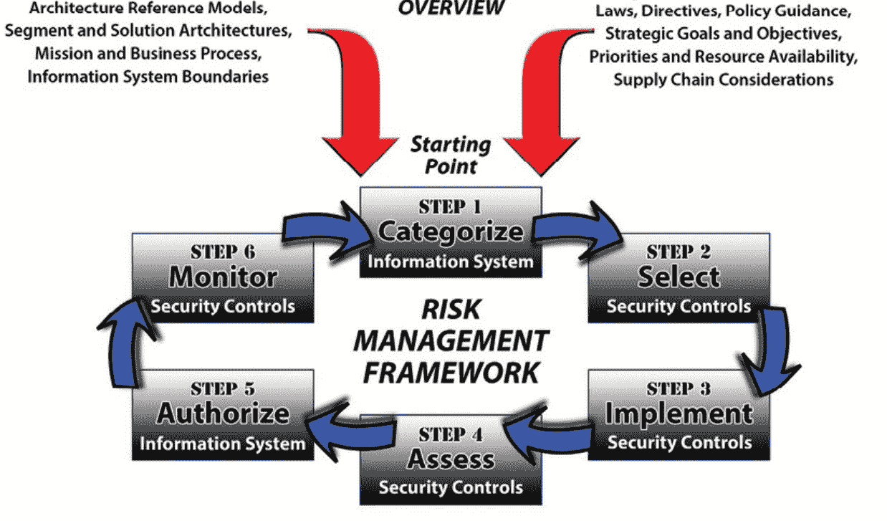

图1.20 – NIST风险管理框架

RMF的步骤包括：

- 基于影响分析，对信息系统以及该系统处理、存储和传输的信息进行分类。
- 基于安全分类为信息系统选择一组初始基线安全控制措施，并根据组织风险评估和本地条件，按需对安全控制基线进行裁剪和补充。
- 实施安全控制措施，并描述这些控制措施如何在信息系统及其运行环境中使用。
- 使用适当的评估程序评估安全控制措施，以确定控制措施在多大程度上被正确实施、按预期运行，并在满足系统安全要求方面产生预期结果。
- 基于对因信息系统运行而对组织运营和资产、个人、其他组织以及国家造成的风险的确定，以及认为该风险可接受的决策，授权信息系统运行。
- 持续监控信息系统中的安全控制措施，包括评估控制有效性、记录系统或其运行环境的变化、对相关变化进行安全影响分析，以及向指定的组织官员报告系统的安全状态。

2014年3月，美国国防部发布了国防部指令编号8510.01，题为“国防部信息技术（IT）的风险管理框架（RMF）”。[52](#) 正如该指令所述，其目的是：

- a. 根据国防部指令（DoDD）5144.02（参考资料(b)）中的授权，重新发布并重新命名国防部指令（DoDI）8510.01（参考资料(a)）。
- b. 通过为国防部IT建立RMF（在本指令中称为“RMF”）、建立相关的网络安全政策并分配执行和维护RMF的职责，实施参考资料(c)至(f)。RMF取代了国防部信息保障认证与认可流程（DIACAP），并根据参考资料(g)至(k)管理国防部IT的生命周期网络安全风险。
- c. 将DIACAP技术咨询组（TAG）重新指定为RMF TAG。
- d. 指示部署和接收国防部IT的国防部各组件之间要确保授权文档的可见性和工件的重用。
- e. 为国防部内部以及国防部与其他联邦机构之间在信息系统（IS）授权和连接方面的授权决策和工件的互惠接受提供程序性指南。

虽然许多安全专业人士可能不在需要按照上述国防部指令直接实施NIST RMF的领域工作，

对 NIST RMF 的一般知识和认知对于安全专业人员来说将非常重要，因为他们在整个企业范围内推进风险管理。


### 自己动手试试

以下是一系列资源，安全专业人员可利用这些资源更好地理解风险管理的各个方面。模板和评估可在附录 B 中找到。

### 进行风险评估

风险评估模板将使安全专业人员能够完成识别和编目组织中需要管理的重要各种风险的过程。

### 进行潜在泄露评估

潜在泄露评估模板将使安全专业人员能够完成识别组织中需要管理的重要潜在泄露的过程。一旦泄露被明确识别并调查，安全专业人员即可使用泄露登记模板对其进行编目。

### 风险管理计划文档模板包

- A. 风险管理计划示例
- 示例风险管理计划模板将使安全专业人员能够完成记录企业风险管理计划的高层级过程。
- 该计划模板需要与示例风险管理日志和示例风险管理程序模板文档一起使用。
- B. 风险管理日志示例
- 示例风险管理日志模板将使安全专业人员能够完成记录企业内已识别并正在积极管理的全部风险的操作过程。
- 该日志模板需要与示例风险管理程序模板文档一起使用。
- C. 风险管理程序示例
- 示例风险管理程序模板为安全专业人员提供了完成记录企业内已识别并正在积极管理的全部风险的操作过程所需的指导。
- 该程序模板需要与示例风险管理日志模板文档一起使用。

### 威胁建模

威胁建模能够对应用安全风险做出明智的决策。除了生成模型外，典型的威胁建模工作还会产生针对概念、需求、设计或实现的安全改进的优先列表。

作为软件开发生命周期（SDLC）设计阶段的一部分，威胁建模使软件架构师能够尽早识别并缓解潜在的安全问题，此时它们相对容易且成本效益高地解决。因此，它有助于降低总体开发成本。

威胁建模是通过识别目标和漏洞然后定义对策以防止或减轻对系统的威胁影响，从而优化网络/应用/互联网安全的一种程序。威胁是潜在的或实际的不期望事件，可能具有恶意性（如 DoS attack）或偶发性（failure of a Storage Device）。威胁建模是识别和评估应用威胁和漏洞的计划活动。

基本的威胁建模过程包括以下步骤。探索搜索空间的过程是迭代的，并且会根据迄今为止所做的工作不断完善。因此，例如，从所有可能的漏洞开始通常毫无意义，因为其中大多数无法被威胁主体攻击、受保护措施保护或不导致后果。

- **评估范围** — 识别有形资产如信息数据库或敏感文件通常很容易。理解应用程序提供的功能并对其进行估值则更困难。诸如声誉和商誉之类的较不具体的事物最难以衡量，但它们通常是最关键的。
- **识别威胁主体和可能攻击** — 威胁模型的关键部分是对可能攻击应用程序的不同人群的特征描述。这些群体应包括内部人员和外部人员，既执行无意的错误也执行恶意攻击。
- **了解现有对策** — 模型必须包括企业内已部署的任何和所有现有对策。
- **识别可利用漏洞** — 一旦你对应用程序的安全性有了了解，就可以在此基础上分析新漏洞。重点应放在将已识别的可能攻击与已识别的负面后果联系起来的漏洞上。
- **优先排序已识别风险 —** 在威胁建模中，优先级至关重要，因为总是有大量风险根本不值得关注。对于每个威胁，您估算若干可能性和影响因素以确定整体风险或严重程度等级。
- **识别降低威胁的对策 —** 最后一步是根据企业的风险承受能力识别对策以将风险降低到可接受水平。

安全架构师和安全专业人员都希望确保他们理解威胁建模所涉及的基本概念，以便在从事风险和漏洞识别活动时能够确保应用这些概念。为了获得一些威胁建模解决方案的实践经验，请查看以下内容：


### 亲手实践威胁建模 – 可使用的资源

Microsoft 已免费构建并提供了一款威胁建模工具以及许多相关的支持资源，安全架构师和安全专业人员可能希望从中了解作为获得威胁建模实践经验的起点。资源可在以下位置找到：

http://www.microsoft.com/security/sdl/adopt/threatmodeling.aspx
http://www.microsoft.com/security/sdl/video/Default.aspx#
http://www.microsoft.com/en-us/download/details.aspx?id=42518

### 确定潜在攻击和降低分析

### 什么是社会工程攻击？

在社会工程攻击中，攻击者利用人际互动（社交技巧）获取或破坏有关组织或其计算机系统的信息。攻击者可能看起来谦逊而体面，可能声称自己是新员工、维修人员或研究人员，甚至提供凭证来支持该身份。然而，通过提问，他或她可能能够拼凑出足够的信息来渗透组织的网络。如果攻击者无法从一个来源获取足够的信息，他或她可能会联系组织内的另一个来源，并依赖第一个来源的信息来增加其可信度。

### 什么是前置攻击？

前置攻击是指创建并使用虚构场景（前置）来与目标受害者互动，从而增加受害者泄露信息或执行在正常情况下不太可能采取的行动的可能性的一种行为。这是一种精心编造的谎言，通常涉及一些前期研究或准备，以及使用这些信息进行冒充（例如，date of birth，social security number，last bill amount）以在目标心中建立合法性。

### 什么是网络钓鱼攻击？

网络钓鱼是一种社会工程形式。网络钓鱼攻击使用电子邮件或恶意网站冒充可信组织来诱骗个人信息的提供。例如，攻击者可能会发送看似来自知名信用卡公司或金融机构的电子邮件，要求提供账户信息，通常暗示存在问题。当用户回复所请求的信息时，攻击者可以利用它来获取账户访问权限。

网络钓鱼攻击也可能看似来自其他类型的组织，例如慈善机构。攻击者经常利用时事和一年中的某些时间，例如：

- 自然灾害
- 疫情和健康恐慌
- 经济问题
- 重大政治选举
- 节假日

电话网络钓鱼（或 "vishing"）使用恶意交互式语音应答（IVR）系统来重现银行或其他机构 IVR 系统的听起来合法的副本。受害者会被提示（通常通过网络钓鱼电子邮件）通过提供的（理想为免费）号码拨打 "bank" 以 "verify" 信息。典型的系统会持续拒绝登录，确保受害者多次输入 PIN 或密码，经常泄露多个不同的密码。更先进的系统会将受害者转移给冒充客户服务代理的攻击者进行进一步询问。


联系信息。有关已知钓鱼攻击的信息也可在线获取，来自诸如反钓鱼工作组（http://www.antiphishing.org）等组织。

- 安装并维护防病毒软件、防火墙和电子邮件过滤器，以减少部分此类流量。
- 利用电子邮件客户端和 Web 浏览器提供的任何反钓鱼功能。

### 组织如何降低其安全风险？

- 在员工/人员层面建立信任框架（即，明确并培训人员何时/何地/为何/如何处理敏感信息）。
- 确定哪些信息是敏感的，并评估其在社会工程和安全系统（建筑、计算机系统等）失效方面的暴露程度。
- 建立处理敏感信息的安保协议、政策和程序。
- 对员工进行与其职位相关的安全协议培训。（例如，在尾随等情况下，如果无法核实某人的身份，则必须培训员工礼貌拒绝。）
- 对安全框架进行不事先通知的定期测试。
- 定期审查上述步骤；信息完整性的解决方案没有完美的。
- 使用配备锁的垃圾箱的废物管理服务，且其钥匙仅限废物管理公司和清洁人员持有。将垃圾箱放置在员工视线范围内，使尝试访问时存在被看到或抓获的风险，或放置在上锁的门或围栏后面，人员必须非法入侵后才能尝试访问垃圾箱。

### 补救威胁的技术与流程

实施持续的 IT 和安全风险管理战略要求所有业务部门（例如内部审计、合规和安全部门）共同合作，并在组织的合规、技术和风险管理工作上进行有效沟通。然而，在开展重大风险管理战略之前，管理者和审计人员需要了解公司的现有风险文化及其业务运营面临的威胁。这将使审计人员能够提出符合组织风险管理需求的建议。例如，内部控制薄弱可能导致网络安全漏洞，从而使机密信息和其他数据资产暴露给未经授权的人员。更糟的是，此次漏洞可能导致重大的业务中断，影响组织的底线、声誉和股东价值。

除了要求所有业务部门在战略实施期间共同合作外，组织还必须转向一种商业范式，在此范式中所有员工对其工作负责并了解其职责。对员工负责的组织更能有效管理风险并遵守内部政策和外部法规。此外，持续检查合规活动并持续管理风险的组织可以更有效地利用资源，从而降低运营成本并释放资源以创造更多创收机会并为其服务增加新价值。

一旦 IT 审计师了解组织的风险文化和 IT 基础设施，他们就可以提出增强现有风险管理工作和合规性的建议。例如，审计师可以建议更新传统安全实践，并辅以实时漏洞评估、监控和警报；政策监控和执行；合规监控；以及用户培训。此类能力可以使审计师和管理层能够获取信息，更有效地防止、检测和响应 IT 安全事件。

安全架构师、安全从业人员和安全专业人员都需要参与企业部署最有效的技术和流程以补救威胁的战略。根据所应对威胁的具体情况，可能部署多种潜在设计和系统。它可能是入侵防御系统（IPS）或入侵检测系统（IDS），这些在“安全运营”领域有更详细的讨论。它也可能是使用加密或数字版权管理（DRM）技术，这在“安全工程”领域有讨论；或者可能是使用 VLAN 和 SSL/TLS，这在“通信和网络安全”领域有讨论。不管是什么，安全架构师在规划系统设计时需要做出正确的选择。安全从业人员需要在日常实施和运营系统中做出正确的选择，而安全专业人员需要确保他们能够清楚地理解系统，以便制定适当的管理和监督政策。

以下参考资料将为所有三类安全行为者提供指导，帮助他们在该领域履行职责：

- NIST SP 800-40 Revision 3: Guide to Enterprise Patch Management Technologies
  http://nvlpubs.nist.gov/nistpubs/SpecialPublications/NIST.SP.800-40r3.pdf
- NIST SP 800-52 Revision 1: Guidelines for the Selection, Configuration, and Use of Transport Layer Security (TLS) Implementations
  http://nvlpubs.nist.gov/nistpubs/SpecialPublications/NIST.SP.800-52r1.pdf
- NIST SP 800-61 Revision 2: Computer Security Incident Handling Guide
  http://nvlpubs.nist.gov/nistpubs/SpecialPublications/NIST.SP.800-61r2.pdf
- NIST SP 800-81-2 Secure Domain Name System (DNS) Deployment Guide
  http://nvlpubs.nist.gov/nistpubs/SpecialPublications/NIST.SP.800-81-2.pdf
- NIST SP 800-82 Revision 1: Guide to Industrial Control Systems (ICS) Security
  http://nvlpubs.nist.gov/nistpubs/SpecialPublications/NIST.SP.800-82r1.pdf
- NIST SP 800-83 Revision 1: Guide to Malware Incident Prevention and Handling for Desktops and Laptops
  http://nvlpubs.nist.gov/nistpubs/SpecialPublications/NIST.SP.800-83r1.pdf
- Open Web Application Security Project (OWASP) Top Ten for 2013
  https://www.owasp.org/index.php/Category:OWASP_Top_Ten_Project#tab=OW/
- Open Web Application Security Project (OWASP) Developer Guide
  https://www.owasp.org/index.php/Category:OWASP_Guide_Project

### 收购战略与实践

#### 硬件、软件和服务

供应链风险通常以有形财产风险的形式表征，例如火灾和自然灾害。然而，建筑物、机械和交通基础设施的物理损坏并不是供应链中断的唯一潜在原因。信息和通信技术容易受到硬件和软件故障的影响，也容易受到黑客和恶意软件编写者造成的损坏。

重大的网络相关供应链中断很少见，但大规模的网络事件有可能造成与重大自然灾害一样严重的破坏。组织应实施供应链风险管理计划，以主动应对这些风险。他们还应考虑专门针对网络相关风险的保险，包括供应链风险。

“供应链”通常意味着实物商品的移动，但在数字资产的价值往往超过实物资产的世界里，供应链的概念需要扩展到包括信息和服务。各种类型的组织都依赖互联网和各种软件工具和服务提供商来订购和支付物资、与商业伙伴交换信息以及与客户进行交易。中断这些流程的潜在破坏可能甚至超过交通基础设施的损坏。产品主要为数字化的组织，如果其信息供应商或数字基础设施供应商无法履行职责，就可能陷入困境。

当组织采购内置安全不足的产品或服务时，风险会持续到所购物品的整个生命周期。所购物品中安全不足的持久影响是收购改革如此重要以实现网络安全和弹性的原因之一。采购设计和内置适当网络安全保障的产品和服务在某些情况下前期成本可能更高，但这样做可通过提供风险缓解和减少对已部署解决方案漏洞修复的需求来降低总拥有成本。

越来越多的组织依赖网络连接、处理能力、数据存储和其他信息和通信技术（ICT）功能来实现其使命。现代企业今天所依赖的网络通常是通过采购商业 ICT 产品和服务获得并维持的。这些能力极大地惠及企业，但在某些情况下也使其更容易受到网络攻击和利用。

网络风险的弹性已成为全球商业和政府领导人核心战略关注的话题，也是企业风险管理战略的重要组成部分。

安全专业人员需要指导以便继续推进。他们如何采购和获取安全系统？在寻求外包时，他们应转向何处寻找值得信赖的合作伙伴？何时是开始规划向云迁移的正确时机？下一个威胁将从何处出现？

以下建议旨在作为企业应对网络风险的综合响应的一部分加以考虑。这些建议侧重于推动采购规则解释和应用的一致性，并将网络安全纳入采购的技术要求。这些建议总结如下：

- 1. **将基线网络安全要求作为适当采购合同授予的条件制定。**


对于存在网络风险的采购，企业应仅与在其自身运营以及所交付的产品和服务中均满足适当基线要求的组织开展业务。基线应在采购的技术要求中体现，并应包括绩效衡量指标，以确保基线得到维护并识别风险。

## 2. 通过相关培训应对网络安全。

与任何实践或政策的变更一样，需要同时对相关员工进行培训以适应变化。将采购网络安全纳入适当员工的必修培训课程。要求与企业开展业务的组织接受关于组织合同中采购网络安全要求的培训。

## 3. 为采购制定统一的网络安全定义。

不明确且定义不一致的术语在最好情况下也会导致效率和网络安全方面的次优结果。提高采购中关键网络安全术语的清晰度将提高企业的效率和有效性。

## 4. 建立采购网络风险管理策略。

从企业范围的网络安全角度，识别采购的网络风险关键性层级。为最大化采购规则应用的一致性，针对类似类型的采购制定并使用“overlays”，从网络风险最大的采购类型开始。53

## 5. 在适当的采购中，尽可能要求从原始设备制造商（OEMs）、其授权经销商或其他“trusted”来源采购。

在某些情况下，通过仅从 OEM、其授权经销商或其他可信来源获取所需物品，最能降低收到不真实或不符合要求的物品的风险。应用此来源限制的网络风险阈值应在整个企业中保持一致。

## 6. 提高组织对网络风险管理的问责。

识别并修改导致网络风险的采购做法。将安全标准整合到采购计划和合同管理中。将网络风险纳入企业风险管理，并确保关键决策者对已部署解决方案中网络安全不足的风险管理承担责任。

不幸的是，由网络相关事件引起的重大供应链中断仍然不常见。然而，这不应成为自满的借口。风险非常真实。中断可能发生在链条的任何一点。以下情况可能随时发生。

- 感染关键供应商系统的病毒破坏了重要记录，迫使供应商关闭系统数天以根除感染。系统恢复上线后，客户需要重新提交订单，造成进一步延误。
- 对一家卡车公司的恶意攻击扰乱了其调度、货物管理和物流系统，导致重要零部件的运输延误。
- 对大型商品交易所的成功攻击中断了必需物资的流动，并在众多市场中造成价格波动加剧。

供应链通常以制造流程来理解，但“supplies”也可以是数字化的。除了对供应商和运输商的损害外，安全专业人员还应关注支持现代商业的数字基础设施。如今几乎所有企业都依赖互联网服务提供商和网络托管服务等第三方来支持供应链活动。通过该数字基础设施提供的服务中断可能极具破坏性——在短期内可能比自然灾害造成的物理基础设施损害更具破坏性。

由系统故障、黑客或病毒引起的供应链中断风险应与其他供应链风险一样进行管理。供应商多元化至关重要：依赖单一供应商无异于自找麻烦。此外，在评估潜在供应商时，网络防御的质量应作为一个标准。

对于关键供应商，系统安全审计可能是合理的。公司还应考虑对其或有业务中断风险的保险。第一方网络保险单可能为因网络攻击造成的额外费用、业务中断和或有业务中断损失提供保障。组织应与其经纪人合作，确保其保险计划提供该保障

保障只能通过检查、审查和评估获得。安全专业人员可能会被要求审查第三方系统的安全文档，然后进行评估以确定其是否符合特定的控制框架或法规。评估为安全专业人员和客户提供了了解系统提供商真实情况的机会。诸如利用率非常高却没有防火墙之类的发现可能表明该提供商价格非常便宜、客户众多，但可能在安全方面做了一些妥协以节省成本。安全专业人员必须确保评估或检查涵盖组织认为最重要的信息安全和隐私领域。

此外，组织必须谨慎对待拥有、运营第三方提供商系统并对其拥有管辖权的国家和个人。如果未实施适当的控制，可能不适合访问客户信息的个人可能会获得访问权限。此外，敏感的组织信息可能在组织不知情或未同意的情况下被泄露给非友好政府。在与法律顾问合作的情况下，安全专业人员有责任确定组织可能面临的法律风险，具体取决于第三方系统的托管国家。

### 最低安全和服务水平要求

需求收集是任何项目的必不可少部分，也是项目管理的基石要素。充分理解项目将交付的内容对其成功至关重要。这听起来像是常识，但令人惊讶的是，这是一个经常被给予过少关注的领域。

许多项目都从一个或多个方提供的需求清单开始，后来才发现客户的需求并未得到正确理解。

避免此问题的一种方法是制定需求说明文件。该文件是项目主要需求的指南。它提供：

- 用于管理目的的简明需求规范。
- 关键目标的陈述。
- 系统运行环境的描述。
- 背景信息和对其他相关材料的引用。
- 主要设计约束的信息。

需求说明文件的内容应保持稳定或相对缓慢地变化。一旦您创建了需求说明文件，请确保客户和所有其他利益相关者同意该文件并理解将交付此文件且仅此文件。最后，请确保您已将需求说明文件中的需求与项目定义报告中的需求进行交叉引用，以确保没有不匹配。

#### 成功需求收集的规则

要成功进行需求收集，安全架构师应遵循以下规则：

- 不要假设你知道客户想要什么；要询问。
- 从一开始就让用户参与。
- 定义并同意项目的范围。
- 确保需求具体、现实且可衡量。
- 如有任何疑问，寻求明确。
- 创建清晰、简洁且全面的需求文档并与客户分享。
- 与客户确认你对需求的理解（复述给他们听）。
- 在需求完全理解之前，避免谈论技术或解决方案。
- 在项目开始前与利益相关者就需求达成一致。
- 如有必要，创建原型以确认或完善客户的需求。

在收集和处理需求时容易犯的常见错误包括：

- 基于复杂或前沿技术构建解决方案，然后发现它无法轻松推广到“现实世界”。
- 未对用户需求进行优先级排序。
- 与实际用户和从业者沟通不足。
- 在不知道问题是什么之前就“解决问题”。
- 缺乏清晰的理解并做出假设而不是提问。

需求收集是关于创建清晰、简洁且商定的

客户需求将使安全架构师能够提供客户所期望的确切内容。正确地捕获并记录需求是安全架构师的第一步。完成此步骤后，安全架构师需要根据需求起草服务等级协议（SLA）。SLA 然后将用于管理服务生命周期并规定客户和服务提供商的责任。SLA 由服务等级报告进行衡量和报告，该报告用于比较约定的服务水平和实际实现的服务水平，同时还包括服务使用情况、服务改进的持续措施以及任何异常事件的信息。

### 服务等级要求（SLR）

服务等级要求文档包含从客户角度对服务的具体要求，定义详细的服务等级目标、相互责任以及针对特定客户群体的其他要求。SLR 文档演进为服务等级协议草案。

服务等级要求文档包含从客户角度的 IT 服务要求；它是服务规范表和服务等级协议的输入，后者进一步扩展以下项目：

- 服务名称
- 服务描述（服务的简短描述）
- 客户方 IT 服务的用户
- 将提供的服务分解为服务组（例如，按基础设施组件或 IT 应用划分）
- 服务中断的处理方式（通过电话、远程访问、现场？）
- 用户服务（用户管理、安装等）
- 可用性要求，允许中断次数
- 可用性阈值（xx.xx %）
- 维护停机时间（允许的停机次数、预通知期）
- 服务中断的通知程序（计划内/计划外）
- 性能要求
- 服务所需容量（下限/上限）
- 允许的工作负载/服务使用量
- 应用响应时间
- 反应和解决时间（根据优先级，优先级的定义；例如，用于事件分类）
- 灾难情况下服务维护的要求

|   | 问题 | 提问原因 | 示例 / 示例值 | 回复 | 注释 |
|---|---|---|---|---|---|
| 1 | 该系统的核心业务时间是什么？ | 需要确保支持级别与此信息相关联。 | 24 x 7<br>8am - Midnight x 7<br>9am - 5pm x 5<br>Others? |  |  |
| 2 | 报告和批处理的首选时间范围是什么？ | 可用于建立处理窗口。根据所选解决方案，系统可能/可能不可用，或由于额外负载响应性可能降低。 | 24 x 7<br>8am - Midnight x 7<br>9am - 5pm x 5<br>Others? |  |  |
| 3 | 执行常规系统维护的计划停机首选时间范围是什么？ | 可与支持团队/供应商协商并就维护窗口达成一致。 | 24 x 7<br>8am - Midnight x 7<br>9am - 5pm x 5<br>Others? |  |  |
| 4 | 该系统的使用高峰期是什么？<br>识别任何已知的峰值小时或峰值日期。 | 在确定详细系统要求之前需要捕获此信息，因为它确定了系统负载的性质。 | Mon - Fri 9:00-17:00<br>Mon - Fri 11:00-15:00<br>Others? |  |  |

*表 1.2 – SLR 文档示例*

#### 服务等级协议（SLA）

IT 服务提供商与客户之间的协议，SLA 描述 IT 服务，记录服务等级目标，并规定 IT 服务提供商和客户的责任。单个 SLA 可能涵盖多个服务或多个客户。

#### 服务等级报告

服务等级报告提供了服务提供商交付约定服务质量能力的洞察。为此，它比较约定的服务水平和实际实现的服务水平，同时还包括服务使用情况、服务改进的持续措施以及任何异常事件的信息。服务等级报告由服务提供商为其客户、IT 管理和其他服务管理流程发布。外部服务供应商也会创建类似的报告以记录其实现的服务绩效。

### 安全教育、培训和意识

政策定义组织在高层级需要完成的内容，并作为管理层对信息安全的意图。安全意识可以定义为帮助建立对安全政策重要性的理解以及如何在组织内遵守安全政策。鉴于当今复杂的商业环境，大多数组织认为在其环境中推广安全意识具有价值。组织可以通过多种方法对其成员进行安全教育。以下将介绍这些方法及其实施方面的观察。安全意识解决了政策的“为什么”。如果终端用户理解“为什么”，他们更有可能遵循政策。一般来说，如果人们理解政策存在的原因以及如何遵守，遵守政策会更一致。

#### 正式安全意识培训

安全意识培训是组织可以告知员工其在遵守信息安全要求方面的角色以及与其角色相关的期望的一种方法。此外，培训还提供有关特定安全或风险管理职能执行的指导，以及提供有关安全和风险管理职能的一般信息。最后，受过教育的员工有助于组织实现其安全计划目标，这可能还包括受法规遵从约束的组织的审计目标（例如 HIPAA、萨班斯-奥克斯利法案、格雷姆-里奇-布莱利法案或任何其他类型的法规）。

#### 培训主题

安全是一个广泛的学科，因此安全意识培训可以涵盖许多主题。安全意识课程中可以研究的主题包括：

- 企业安全政策
- 组织的安全计划
- 组织法规遵从要求
- 社会工程学
- 业务连续性
- 灾难恢复
- 应急管理，包括危险材料、生物危害等
- 安全事件响应
- 数据分类
- 信息标记和处理
- 人员安全、保障和稳健性
- 物理安全
- 适当使用计算资源
- 安全凭证（如密码）的正确保管和处理
- 风险评估
- 事故、错误或遗漏

一个全面的安全课程将包括为在组织内执行专门角色的个人提供的专业课程和意识辅助，例如 IT、会计等人员。培训也可以与工作职能、角色和职责保持一致。组织还必须牢记，应特别注意将培训与安全风险管理活动保持一致。通过这样做，培训可能导致组织内风险的部分或完全抵消。

#### 创建安全意识课程

以下为围绕企业安全政策创建安全意识课程的大纲。假设这是组织开展的第一个正式课程，很可能人员尚未正式介绍该政策。此介绍将是开始的合适位置。课程可按如下方式进行：

#### 什么是企业安全政策？

此项允许组织详细解释其为保护其环境而采取的安全措施。

#### 制定企业安全政策为何重要？

此项提供了向员工传达保护组织、其人员和资产是每个人的责任的机会。这也是高级管理层表达对企业安全政策支持的合适时机。


政策与总体安全管理工作。

#### 这项政策如何融入我在组织中的角色？

许多员工担心安全措施可能会对他们产生影响。有些人担心无法按时完成任务；另一些人则担心自己的角色可能发生变化。这正是向员工说明的好时机：尽管安全方面的考虑可能会给工作绩效增加一些负担，但他们很可能已经履行了安全政策中规定的许多安全职责。该政策将实践中临时性的安全职能正式化；也就是说，这些临时做法如今有了书面记录，也可能得到加强。

#### 对于那些说自己当前岗位中没有任何安全职能的人呢？

需要指出的是，这些职能可能以临时方式存在，而且任何长期执行的过程至少会部分变成自动行为。实际上，这会随着时间推移缩短任务完成时间。讲师可以询问学员，是否记得最近一次被要求执行一项新工作职能的情形。然后讲师可以指出，这与安全职能的情况类似。

#### 我必须遵守吗？

组织必须达成一致：所有员工，包括高级管理层，都必须遵守公司安全政策。如果规则存在例外，政策就可能无法执行。这会使组织在制定政策时投入的资金、时间和资源付诸东流，使政策形同虚设。

#### 不遵守规定的处罚是什么？

同样关键的是，组织要以通俗易懂的语言明确说明不遵守公司安全政策的处罚是什么。政策正文中可以规定，所有人员、承包商和业务伙伴均应遵守这些政策；也可以将其作为适用于所有政策的总体声明。通常，未能遵守将导致纪律处分，直至并包括解雇或起诉。

此时，学员可能会问及意外违规会有什么后果。必须向学员重申：安全违规（或安全事件）应立即报告，以便将组织所受影响降到最低。

#### 这项公司政策对我的工作有什么影响（会让事情变得更难吗）？

这一点已在上面详细讨论过；讲师可以将其与对个人角色的影响联系起来。

#### 我应该关注哪些方面？

此时，员工关于其遵守公司安全政策责任的疑问已经得到解答。这是与学员讨论政策内容的合适时机。可以通过讲座、举例说明或以“找出安全问题”的形式进行。

在教授此类课程时，讲师应确保讲解适用于所有员工的话题，包括高级管理层、部门管理层、业务部门用户、临时或季节性员工、承包商、业务伙伴等。

#### 意识提升活动与方法——在组织内营造安全意识文化

有多种方法可以促进安全意识。较常见的方法包括：

-   如上所述的正式课程，可以通过幻灯片、讲义或书籍以课堂形式讲授，也可以通过适合此目的的培训网站在线开展。
-   使用海报提醒安全意识要点，如密码保护、物理安全、人员安全等。
-   业务部门走访，帮助员工识别应避免的做法（如将密码写在便签纸上并贴在桌面上显眼位置）以及应继续保持的做法（如保持桌面整洁，或离开电脑时启用带锁屏保）。
-   利用组织内网发布安全提醒，或开设每周/每月的专栏，介绍组织内发生的信息安全事件。
-   任命业务部门安全意识导师，协助解答环境中安全保障实施相关的问题、顾虑或意见；这些导师之间以及他们与组织安全负责人之间可以相互沟通。他们还可以定期（每月或每季度）与组织的内部审计、法律、信息技术和企业业务部门沟通。
-   赞助全企业范围的安全意识日，包括安全活动、奖品和获奖者表彰。
-   与外部伙伴共同赞助活动，例如信息系统安全协会（ISSA）、信息系统审计与控制协会（ISACA）、SANS研究所（SysAdmin、Audit、Network、Security）、国际信息系统安全认证联盟（(ISC)²）等；留出时间让员工充分参与活动。
-   为组织内支持安全管理原则的用户提供小礼品。
-   考虑设立与其他行业或全球意识活动同步的特别活动日、活动周或活动月，例如全球安全意识周（每年九月）和安全意识月（通常每年十月）。
-   提供安全管理视频、书籍、网站和配套资料，供员工参考。

需要指出的是，这些活动应让组织成员感到有趣且有收获。为了激发这种兴趣，项目应具有适应性，意识材料的内容和格式应定期更新。

#### 岗位培训

与一般性的安全意识培训不同，安全培训帮助人员发展与在其岗位角色中履行安全职能所需的技能。在成熟的组织中，典型的安全课程会包括为组织中承担专门角色的人员开设的专业课程，例如IT、会计等领域的专业人员。

即使在业务部门内部，也会开展专门培训。以IT领域为例，负责维护和监控防火墙、入侵检测/防御系统以及syslog服务器的网络员工，应接受充分培训以履行这些职责。假设高级管理层认定没有可用培训资金，结果会怎样？通常，积极主动的员工会获得一些在岗学习机会；但学习成果可能不足以充分履行工作职责。结果，组织遭到入侵，敏感信息被盗。这种情况下该由谁负责？在组织中，高级管理层始终最终对信息安全目标负责。在本例中，高级管理层拒绝为员工提供各自安全职责方面的适当培训，未能充分保护环境，因此任何法律后果都将完全落在管理层的肩上。

然而，假设相关员工向管理层表示，尽管没有带薪培训，但他们有信心能够履行自己负责的安全职能。为证明这一点，他们向IT管理层执行了必要职能以展示能力。一切都很顺利，直到几个月后组织遭到入侵，机密信息被盗。高级管理层回到信息系统管理部门，要求主管进行调查。在调查过程中，主管发现过去三个月一直没有进行补丁更新。当员工被问及此事时，没有人能给出令人满意的答复。那次入侵应由谁负责？同样，高级管理层始终最终对组织的信息安全负责；然而，高级管理层追究网络团队未能保持补丁更新水平的责任，并随即将其解雇。确保相关资源得到适当培训，可以帮助组织就责任人负责的安全任务是否圆满完成进行问责。

组织还必须牢记，培训应与安全风险管理活动密切结合。这样做，培训可能会部分或完全抵消组织内的风险。

#### 绩效度量

组织必须跟踪与安全相关的绩效，既为了执行已在进行的安全举措，也为了改进这些举措。组织还必须确保用户通过每节课后签署确认，表明他们已经听讲并理解材料，并同意受组织的安全计划、政策、程序、计划和举措约束。衡量方式可以包括定期走访业务部门、定期进行小测验以保持员工知识更新，等等。


保护关键组织流程免受重大系统和网络中断影响所需的审慎行动，并在发生重大中断时确保组织运营及时恢复。

本章描述了构建企业范围业务连续性（BC）计划的过程。它讨论了行业法规的演变，这些法规在某些情况下影响或强制要求组织在其内部建立计划，以确保其组织“无论如何”都能持续运营。

最后，它讨论了信息安全与业务连续性（BC）以及其他风险管理领域（如物理安全、记录管理、供应商管理、内部审计、财务风险管理、运营风险管理以及监管合规（法律和监管风险））之间的相互关系，背景为整体业务连续性风险管理框架。


### 领域 1：复习问题

1. 在信息技术安全领域，以下哪种组合最能定义风险？
- A. 威胁与违规相结合
- B. 威胁与漏洞相结合
- C. 漏洞与攻击相结合
- D. 威胁与安全违规相结合

2. 在确定无形资产价值时，哪种方法最好？
- A. 确定实物存储成本并乘以公司的预期寿命
- B. 在财务或会计专业人员的协助下确定该资产已产生的利润
- C. 审查过去三年无形资产的折旧情况。
- D. 使用无形资产的历史取得或开发成本

3. 定性风险评估以以下哪项为标志？
- A. 易于实施，且可由对风险评估流程了解有限的人员完成
- B. 可由对风险评估流程了解有限的人员完成，并使用用于风险计算的详细指标
- C. 用于风险计算的详细指标和易于实施
- D. 可由对风险评估流程了解有限的人员完成，并使用用于风险计算的详细指标

4. 单次损失期望值（SLE）是通过以下方式计算的：
- A. 资产价值和年化发生率（ARO）
- B. 资产价值、本地年频率估计（LAFE）和标准年频率估计（SAFE）
- C. 资产价值和暴露因子
- D. 本地年频率估计和年化发生率

5. 考虑执行哪种类型的风险评估包括以下所有内容：
- A. 组织文化、暴露可能性和预算
- B. 预算、资源能力和暴露可能性
- C. 资源能力、暴露可能性和预算
- D. 组织文化、预算、能力和资源

6. 安全意识培训包括：
- A. 立法安全合规目标
- B. 员工的安全角色和职责
- C. 漏洞评估的高层结果
- D. 专门的课程作业、课程和一个认可的

7. 影响社区或社会规范的资产负责任保护的最低和惯常做法是什么？
- A. 尽职调查
- B. 风险缓解
- C. 资产保护
- D. 审慎注意

8. 有效的安全管理：
- A. 以最低成本实现安全
- B. 将风险降低到可接受水平
- C. 优先考虑新产品的安全性
- D. 及时安装补丁

9. 可用性通过保护免受以下侵害使信息可访问：
- A. 拒绝服务、火灾、洪水、飓风和未经授权的交易
- B. 火灾、洪水、飓风、未经授权的交易和无法读取的备份磁带
- C. 未经授权的交易、火灾、洪水、飓风和无法读取的备份磁带
- D. 拒绝服务、火灾、洪水、飓风和无法读取的备份磁带

10. 哪句话最能定义业务连续性/灾难恢复计划？
- A. 一套用于防止灾难的计划。
- B. 一套经批准的准备和足够程序以应对灾难。
- C. 一套在未经管理层批准的情况下应对灾难的准备和程序。
- D. 继续所有组织职能的充分准备和程序。

11. 在业务影响分析（BIA）中，以下哪一步应首先执行？
- A. 确定组织内的所有业务单元
- B. 评估破坏性事件的影响
- C. 估计恢复时间目标（RTO）
- D. 评估业务职能的关键性

12. 战术安全计划最适合用于：
- A. 建立高层安全政策
- B. 实现企业/实体范围的安全管理
- C. 减少停机时间
- D. 部署新安全技术

13. 谁对实施信息安全负责？
- A. 每个人
- B. 高级管理层
- C. 安全官
- D. 数据所有者

14. 在哪个阶段解决安全问题最有可能成本最高？
- A. 设计
- B. 快速原型设计
- C. 测试
- D. 实施

15. 信息系统审计师帮助组织：
- A. 缓解合规问题
- B. 建立有效的控制环境
- C. 识别控制差距
- D. 处理财务报表的 information technology

16. 促进风险分析流程（FRAP）
- A. 基本假设广泛的风险评估是确定系统、业务部门、应用程序或流程风险的最有效方法。
- B. 基本假设狭窄的风险评估是确定系统、业务部门、应用程序或流程风险的最有效方法。
- C. 基本假设狭窄的风险评估是确定系统、业务部门、应用程序或流程风险的效率最低的方法。
- D. 基本假设广泛的风险评估是确定系统、业务部门、应用程序或流程风险的效率最低的方法。

17. 设定明确的安全角色具有以下好处：

威胁利用暴露而实现的可能性，暴露实现后对组织的影响，总风险

20. 能够随着时间保持相关性和意义的安全政策包括以下内容：
- A. 指令性词语如 shall、must 或 will、技术规范且篇幅短
- B. 定义的政策开发流程、篇幅短且包含指令性词语如 shall、must 或 will
- C. 篇幅短、技术规范且包含指令性词语如 shall、must 或 will
- D. 指令性词语如 shall、must 或 will、定义的政策开发流程且篇幅短

21. 财务部门一人能够向供应商数据库添加供应商并随后支付供应商的能力违反了哪个概念？
- A. 良好的交易
- B. 职责分离
- C. 最小权限
- D. 数据敏感级别

22. 串谋最好通过以下方式缓解：
- A. 工作轮换
- B. 数据分类
- C. 定义工作敏感级别
- D. 最小权限

23. 数据访问决策最好由以下人员做出：
- A. 用户经理
- B. 数据所有者
- C. 高级管理层
- D. 应用程序开发人员

24. 以下哪项陈述最能描述组织应多大程度地处理业务连续性或灾难恢复规划？
- A. 连续性规划是一个重大的组织问题，应包括公司的所有部分或职能。
- B. 连续性规划是一个重大的技术问题，技术恢复应是其主要重点。
- C. 只有在语音和数据通信存在复杂性时才需要连续性规划。
- D. 连续性规划是一个重大的管理问题，应包括管理层指定的主要职能。

25. 业务影响分析最好用于识别：
- A. 威胁对组织运营的影响。
- B. 组织面临的损失暴露。
- C. 风险对组织的影响。
- D. 以成本有效的方式消除威胁。

26. 在规划的风险分析阶段，以下哪项行动最能管理威胁或减轻事件的影响？
- A. 修改演练方案。


- B. 制定恢复程序。
- C. 增加对关键个人的依赖
- D. 实施程序控制。

27. 实施额外控制或保障措施的最佳理由是：

- A. 阻止或消除风险。
- B. 识别并消除威胁。
- C. 降低威胁的影响。
- D. 识别风险和威胁。

28. 以下哪项陈述最能描述组织影响分析？

- A. 风险分析和组织影响分析是描述同一项目工作的两个不同术语。
- B. 组织影响分析计算对组织中断的概率。
- C. 组织影响分析对业务连续性计划的制定至关重要。
- D. 组织影响分析确定中断对组织的影响。

29. “灾难恢复”一词指的是恢复：

- A. 组织运营。
- B. 技术环境。
- C. 制造环境。
- D. 人员环境。

30. 以下哪个术语最能描述确定可能由灾难导致的中断后果的努力？

- A. 业务影响分析。
- B. 风险分析。
- C. 风险评估。
- D. 项目问题定义

31. 风险的要素如下：

- A. 自然灾害和人为灾害
- B. 威胁、资产和缓解控制措施
- C. 风险和业务影响分析
- D. 业务影响分析和缓解控制措施

32. 以下哪种方法不适用于演练业务连续性计划？

- A. 桌面演练。
- B. 电话演练。
- C. 模拟演练。
- D. 停止生产应用或功能。

33. 任何经过良好计划的业务连续性演练的主要期望结果是？

- A. 识别计划的优势和弱点。
- B. 满足管理层要求。
- C. 符合审计员要求。
- D. 保持股东信心

34. 业务连续性计划最好在以下情况下更新和维护：

- A. 每年或在审计员要求时。
- B. 仅在部署新版本的软件时。
- C. 仅在部署新硬件时。
- D. 在配置和变更管理过程中。

35. 以下哪项对成功的业务连续性最重要？

- A. 高层领导支持。
- B. 强大的技术支持人员。
- C. 庞大的广域网基础设施。
- D. 集成事件响应团队。

36. 某服务的恢复点目标为零。哪种方法最能确保满足该要求？

- A. 采用热站点备用的 RAID 6。
- B. 采用温站点备用的 RAID 0
- C. 采用冷站点备用的 RAID 0
- D. 采用互惠协议的 RAID 6。

37. (ISC)² 道德准则通过以下方式解决准则之间的冲突：

- A. 准则之间永远不会有冲突。
- B. 通过裁决解决。
- C. 准则的顺序。
- D. 通过董事会审查所有准则冲突。


## 领域 2

### 资产安全

资产安全域包含用于监控和保护资产的概念、原则、结构和标准，以及用于执行不同级别的保密性、完整性和可用性的控制措施。信息安全架构和设计涵盖了应用全面且严谨的方法来描述组织安全流程、信息安全系统、人员和组织子单元的当前和/或未来结构和行为的做法，以便这些实践和流程与组织的核心理念和战略方向保持一致。运维安全对安全专业人员来说可能具有挑战性，这取决于他们的背景和经验。运维安全主要关注在集中式和分布式环境中对信息处理资产的保护和控制。运维安全是其他服务的质量属性，同时也是其自身的一套服务。

信息安全治理和风险管理涉及用于建立信息资产保护标准的框架和政策、概念、原则、结构和标准，以及评估该保护有效性。它包括治理、组织行为和安全意识等问题。信息安全管理建立了全面和主动的安全计划的基础，以确保组织信息资产的保护。今天高度互联、相互依赖的系统环境要求理解信息技术与实现业务目标之间的联系。信息安全管理传达了组织因当前实施的安全控制而接受的风险，并持续努力以成本有效的方式增强控制措施，以最大程度地降低对公司信息资产的风险。安全管理涵盖了保护信息资产的保密性、完整性和可用性所必需的行政、技术和物理控制。控制措施通过政策、程序、标准、基线和指南的基础得以体现。

### 主题

- 对信息和支持资产进行分类
  - 敏感性
  - 关键性
- 确定并维护所有权
  - 数据所有者
  - 系统所有者
  - 业务/任务所有者
- 保护隐私
  - 数据所有者
  - 数据处理者
  - 数据残留
- 确保适当的保留
  - 介质
  - 硬件
  - 人员
- 确定数据安全控制
  - 静止数据
  - 传输中数据
  - 基线
  - 范围界定和定制
  - 标准选择
  - 密码学
- 建立处理要求
  - 标记
  - 标签
  - 存储
  - 敏感信息的销毁

### 目标

根据 (ISC)² 候选人信息公告（考试大纲），CISSP 候选人应能够：

- 对信息和支持资产进行分类
- 确定并维护所有权
- 保护隐私
- 确保适当的保留
- 确定数据安全控制
- 建立处理要求

### 数据管理：确定并维护所有权

数据管理是一个涉及从数据处理的行政到技术方面的广泛活动的流程。良好的数据管理实践包括：

- 一项数据政策，定义战略长期目标并为项目、机构或组织各方面的数据管理提供指导原则。
- 对与数据相关的人员有明确定义的角色和职责，特别是数据提供者、数据所有者和保管者。
- 数据管理流程所有阶段的数据质量程序（例如，质量保证、质量控制）。对数据准确性的验证和校验。
- 每个数据集的具体数据管理实践和描述性元数据的文档记录。
- 遵守商定的数据管理实践。
- 基于对用户需求和所用数据的理解而仔细规划并记录的数据库规范。
- 对信息系统基础设施（硬件、软件、文件格式、存储介质）、数据存储和备份方法以及数据本身的更新的定义程序。
- 持续的数据审计以监控使用情况并评估管理实践的有效性和现有数据的完整性。数据存储和归档计划以及对该计划的测试（灾难恢复）。
- 持续且不断发展的采用经过测试的分层控制以降低数据风险的数据安全方法。
- 数据访问标准的明确说明，以及在适用时，对可能影响其使用的完全访问控制而对数据施加的任何限制的信息。
- 清晰且有文档记录的已发布数据，可供用户使用和利用，并具有一致的交付程序。

### 数据政策

健全的数据政策为项目或企业各方面的数据管理定义战略长期目标。数据政策是一套高层原则，建立数据管理的指导框架。数据政策可用于

处理数据访问、相关法律事务、数据管理问题和保管职责、数据采集及其他问题等战略性问题。由于数据政策提供了一个高层框架，因此它应当具有灵活性和动态性。这使得数据政策能够在保持其战略指导重点的同时，轻松适应未预见的挑战、不同类型的项目以及潜在的机遇性合作。

安全从业者在制定数据政策时应考虑的问题包括：

- **成本** — 应考虑提供数据的成本与提供数据访问的成本。成本既可能成为用户获取某些数据集的障碍，也可能成为提供商按请求的格式或范围提供数据的障碍。
- **所有权与保管权** — 应明确阐明数据所有权。知识产权可以在不同层面上被拥有；例如，合并数据集可以由一个组织拥有，即使其他组织拥有其组成数据。如果法定所有权不明确，则存在数据被不当使用、忽视或丢失的风险。
- **隐私** — 需要明确哪些数据是私密的，哪些数据应被公开。隐私立法通常要求保护个人信息不被他人获取。因此，需要针对数据集中个人信息的纳入、使用、管理、存储和维护制定明确的指导方针。
- **责任** — 责任涉及组织在多大程度上免于法律追索。这在数据和信息管理领域非常重要，尤其是在因数据滥用或不准确而对个人或组织造成损害的情况下。责任通常通过最终用户协议和许可证来处理。可以在元数据和数据检索系统中加入措辞谨慎的免责声明，以免除提供者、数据收集者或与数据集相关的任何人对数据滥用或不准确承担的任何法律责任。
- **敏感性** — 需要识别任何被视为敏感的数据。敏感数据是指任何一旦向公众发布，就会对所涉属性或某个在世个体产生不利影响（伤害、移除、破坏）的数据。在确定敏感性时需要考虑多种因素，包括威胁的类型和级别、属性的脆弱性、信息类型以及是否已公开。
- **现有法律与政策要求** – 应考虑适用的与数据和信息相关的法律和政策。现有立法和政策要求可能会影响企业的数据政策。
- **政策与流程** – 应考虑合法的数据请求以及可能需要制定的政策，以便及时处理并在适当时对请求作出回应。此外，如果已有一项或多项政策，则必须对其进行检查和评估，以决定它们是否足够，或者是否可能需要进行某种方式的修改，以便与正在创建的任何新流程完全集成。用于根据合法请求提供数据访问的政策和流程必须设计和实施得当，不能违反访问控制或任何现有政策（这些政策规定在此类情况下如何授予安全访问权限），确保只有请求所涉及的数据被提供，且不相关的数据不被暴露。

## 角色与职责

数据管理既关乎信息技术、数据库实践和应用，也关乎个人和组织。为了实现数据管理目标和标准，所有相关方都必须理解其相应的角色和职责。

划分数据管理角色与职责的目标如下：

- 明确界定与职能相关的角色。
- 在项目的所有阶段确立数据所有权。
- 树立数据问责制。
- 确保持续维护充分且经协商一致的数据质量和元数据指标。

## 数据所有权

信息具有一个生命周期，包括创建、使用，最终销毁。若干重要的信息安全活动围绕信息生命周期展开，以保护信息，确保只有需要访问的人才能访问信息，并在不再需要时最终销毁信息。作为其职责的一部分，信息安全专业人员需要理解若干信息所有权的概念。

## 需求规格说明书

**项目名称：** 在线考试系统

**文档版本：** v1.0

**编写日期：** 2025年3月15日

### 1. 引言

本文档定义了在线考试系统的功能与非功能需求，供设计、开发、测试及验收使用。

### 2. 总体描述

- 用户角色：管理员、教师、考生
- 核心流程：考生在线答题，系统自动评分

### 3. 功能需求

| 编号 | 功能描述 | 优先级 |
|------|----------|--------|
| FR-1 | 考生登录 | 高 |
| FR-2 | 自动组卷 | 中 |
| FR-3 | 成绩查询 | 高 |

提高数据质量的关键——预防和纠正。错误预防与数据收集和数据录入数据库密切相关。尽管可以而且应该在预防错误上投入大量精力，但事实仍然是，大型数据集中的错误将继续存在，数据验证和纠正不容忽视。

文档是良好数据质量的关键。没有良好的文档，用户很难确定数据的适用性，保管人也很难知道已执行了哪些数据质量检查以及由谁执行。文档通常有两种类型，数据库设计中应内置对它们的支持。第一种与每条记录相关联，记录已执行的数据检查、所做的更改以及由谁更改。第二种是元数据，在数据集层面记录信息。两者都很重要，缺少它们，良好的数据质量将受到影响。

## 数据文档与组织

数据文档对于确保数据集在未来仍可使用至关重要。数据的寿命大致与其文档的全面性成正比。所有数据集都应被识别和记录，以方便后续识别、妥善管理和有效使用，并避免重复收集或采购相同的数据。

数据文档的目标如下：

- 确保数据寿命及其多用途重用。
- 确保数据用户理解数据集的内容背景和局限性。
- 促进数据集的发现。
- 促进数据集和数据交换的互操作性。

数据管理过程中的首要步骤之一是将数据录入电子系统。在数据库设计和数据录入期间，可以实施以下数据文档实践，以方便数据收集者以及未来可能对数据感兴趣的人检索和解读数据集。

### 数据集标题和文件名

数据集标题和相应的文件名应具有描述性，因为这些数据集可能会在多年后由不了解项目或计划细节的人访问。电子数据集文件的命名应反映文件内容，并包含足够的信息以唯一标识该数据文件。

文件名可以包含诸如项目缩写或名称、研究标题、地点、调查者、研究年份、数据类型、版本号和文件类型等信息。文件名应写在文件本身的标题行第一行。名称应仅包含数字、字母、连字符和下划线——不得包含空格或特殊字符。一般来说，小写名称对软件和平台的依赖性较低，因此更受青睐。出于易读性和可用性的实际考虑，文件名长度不应超过64个字符，如果构建得当，可以短得多；过长的文件名将导致难以识别文件以及难以将其导入分析脚本。包含数据文件创建日期或版本号，可使数据用户在数据集发布更新时快速确定他们正在使用哪个数据。

### 文件内容

为了让其他人能够使用数据，他们必须理解数据集的内容，包括参数名称、计量单位、格式和编码值的定义。在文件顶部，包含多行标题，其中包含将数据文件与数据集关联的描述符（例如数据文件名、数据集标题、作者、当前日期、文件内数据的最后修改日期以及配套文件名）。其他标题行应描述每列的内容，其中一行用于参数名称，一行用于参数单位。对于那些庞大而复杂、可能需要大量数据集内容描述信息的数据集，这些信息可以在单独的关联文档中提供，而不是作为数据文件本身的标题行。

- **参数** – 数据集中报告的参数需要具有能够描述其内容的名称，并且需要定义其单位，以便其他人理解所报告的内容。使用普遍接受的参数名称。一个好的名称应简短、唯一（至少在给定数据集中）并能描述参数内容。列标题的构建应便于各种数据系统导入。参数名称中应使用一致的大小写，仅使用字母、数字和下划线——不要使用空格或小数点。为每个参数选择一致的格式，并在整个数据集中使用该格式。尽可能尝试使用标准化格式，例如日期、时间和空间坐标所使用的格式。

每列中的所有单元格应仅包含一种类型的信息（例如，要么


文本、数字等）。常见的数据类型包括文本、数值、日期/时间、布尔值（是/否 或 真/假）以及注释，用于存储大量文本。

- **编码字段** – 与自由文本字段相反，编码字段通常具有标准化预定义值列表，数据提供者可从中选择。数据收集者可以为多个数据文件建立自己的编码字段并定义值以保持一致使用。编码字段比自由文本字段更有效地存储和检索数据。
- **缺失值** – 处理缺失值有几种选择。其一是留空，但这会带来问题，因为某些软件无法区分空白和零，或者用户可能会怀疑数据提供者是否不小心跳过了某列。另一种选择是在数字应出现的位置放置一个句点。这表明此处应有值，但并未说明数据缺失的原因。另一种选择是使用不同的代码来表示数据缺失的不同原因。

## 元数据

元数据，定义为关于数据的数据，提供有关数据集的标识、质量、空间背景、数据属性和分布的信息，使用共同的术语和定义集，防止资源原始含义和价值的丢失。没有描述性元数据，确定资源是否存在、收集了哪些数据以及如何测量和记录，以及如何访问它将是一项困难的任务。

## 数据标准

数据标准描述了被收集、自动化的对象、特征或项目，或受组织活动或职能影响的项目。在这方面，数据需要根据定义的规则和协议仔细管理和组织。数据标准在任何需要共享或汇总数据和信息的情况下都尤为重要。

数据标准的益处包括：

- 更高效的数据管理（包括更新和安全）
- 增加数据共享
- 更高质量的数据
- 提高数据一致性
- 增加数据集成
- 更好地理解数据
- 改进信息资源的文档记录

采用和实施数据标准时，应考虑以下不同标准层级：

- 国际
- 国家
- 区域
- 地方

在可能的情况下，采用解决最大受众的最小复杂标准。安全从业人员应意识到标准会不断更新，因此保持尽可能少的合规性是可取的。

## 数据生命周期控制

良好数据管理要求整个数据生命周期得到仔细管理。
包括：

- 数据规范与建模、处理以及数据库维护和安全
- 持续的数据审计，以监控现有数据的用途和持续有效性
- 归档，以确保数据得到有效维护，包括定期快照，以便在主副本和备份损坏时回滚到以前的版本

## 数据规范与建模

构建数据库所涉及的大部分工作在任何数据库软件使用之前就已完成。成功的数据库规划采取彻底的用户需求分析的形式，随后进行数据建模。了解用户需求是第一步规划。数据库必须设计以满足用户需求，从数据获取到数据录入、报告和长期分析。数据建模是确定满足用户需求路径的方法。重点应保持整体模型和数据结构尽可能简单，同时仍充分解决项目参与者的业务规则以及项目目标和目的。

对要建模的数据的协议和参考资料进行详细审查将阐明实体、关系和信息流。数据建模应是迭代和交互的。以下广泛问题是一个良好的起点：

- 数据库的目标是什么？
- 数据库将如何帮助实现这些目标？
- 数据库的利益相关者是谁？谁对它的成功有既得利益？
- 谁将使用数据库，这些个人需要数据库完成什么任务？
- 数据库将保存什么信息？
- 数据库将保存的信息最小单元是什么，它们的特征是什么？
- 数据库是否需要与其他数据库和应用程序交互？需要什么适应措施？
- 数据需要保存多长时间？
- 数据库的依赖关系是什么？
- 数据库退役流程是什么？

数据库生命周期的概念设计阶段应产生信息/数据模型。信息/数据模型由数据库中存储的概念的书面文档、它们之间的关系以及显示这些概念及其关系的图表组成。在数据库设计过程中，信息/数据模型是帮助设计和编程团队理解将存储在数据库中的信息的性质的工具，而非目的本身。信息/数据模型有助于数据内容专家（指定数据库需要做什么的人）与构建数据库的程序员和数据库开发人员之间的沟通。仔细的数据库设计及其文档记录不仅在数据库使用期间维护数据完整性方面很重要，而且在未来迁移中数据丢失的难易程度和范围方面也是重要因素（包括降低现在对数据所做的推断在未来某一点被视为原始事实的风险）。因此，信息/数据模型在数据库生命周期中多年后迁移数据和用户界面时也是至关重要的文档。信息/数据模型可能简单到书面文档或绘图，也可能复杂并借助设计工具构建。

## 数据库维护

技术过时是信息丢失的重要原因，如果数据存储在过时的软件格式或过时的介质上，数据可能会迅速无法供用户访问。数字文件的有效维护取决于对不断变化的硬件、软件、文件格式和存储介质基础设施的适当管理。硬件每 1-2 年预计会有重大变化，软件每 1-3 年。随着软件和硬件的发展，数据集必须不断迁移到新平台，或必须以独立于特定平台或软件的格式保存（例如 ASCII 分隔文件）。

数据库或数据集应有仔细定义的更新程序。如果数据集是实时或持续的，这将包括添加、修改和删除等内容，以及更新频率。在多用户环境中工作时，版本控制将极其重要。数据库系统的管理需要良好的日常系统管理。数据库系统管理需要由威胁分析提供信息，并应采用该分析强调的威胁缓解手段，例如定期备份。

## 数据审计

良好的数据管理需要持续的数据审计来监控现有数据的用途和持续有效性。数据或信息审计是一个涉及以下过程：

- 1. 确定组织/项目的信息需求并为这些需求分配战略重要性级别。
- 2. 确定当前为满足这些需求而提供的资源和服务，绘制组织（或项目）内部以及组织与其外部环境之间的信息流，并分析差距、重复、低效以及过度配置区域，以便确定需要更改的位置。

信息审计不仅统计资源，还检查它们如何使用、由谁使用以及用于何种目的。信息审计检查组织中发生的活动和任务，并确定支持它们的信息资源。它不仅检查所使用的资源，还检查它们如何使用以及它们对每项任务成功完成的重要性。将其与分配的


对所有任务和活动进行的战略重要性分级，有助于识别正在创造具有战略意义的知识的领域。同时，也能识别出那些依赖知识共享或转移的任务，以及那些依赖高质量知识的任务。数据审计的益处包括：

### 数据资产认知
- 促进容量规划
- 促进数据共享与复用
- 监控数据资产，避免数据泄露

### 数据管理实践认知
- 促进资源高效利用和流程优化
- 提升风险管控能力——数据丢失、不可访问、合规性
- 推动数据战略的制定/完善

## 数据存储与归档
数据存储与归档涉及数据管理中的存放环节。该要素包括对数字/电子数据和信息以及相关纸质数据和信息的考量。如果存储和归档缺乏周密规划，就会产生诸多问题，导致数据因未得到妥善管理和存储而过时，甚至可能无法使用。

电子/数字数据在物理数据集存储与归档方面的一些重要考量包括：
- **服务器硬件与软件**——数据需要什么类型的数据库？是否需要搭建物理系统基础设施，还是已有现成设施？是否需要主流数据库产品？该系统是否会用于其他项目和数据的存储？谁来负责该系统的管理？
- **网络基础设施**——数据库是否需要接入网络或互联网？为目标受众提供服务需要多少带宽？每天需在多长时间段内可访问？
- **数据集的大小与格式**——应估算数据集的大小，以便合理规划存储空间。应确定数据集的类型和格式，以免在数据库能力和兼容性方面出现意外问题。
- **数据库维护与更新**——数据库或数据集应制定明确的更新流程。如果数据集是实时或持续更新的，则需考虑新增、修改、删除以及更新频率等事项。在多用户环境下，版本管理极为重要。
- **数据库备份与恢复要求**——为应对用户错误、软件/介质故障或灾难，应明确界定并协商一致数据库备份或恢复的要求，以确保数据集的长期可用性。应明确并规划备份机制、计划、频率、备份类型以及相应的恢复方案。这包括现场备份的存储介质类型，以及是否需要进行异地备份。

数据归档应作为数据管理的优先事项。人员流动率高、数据分布式存储的组织，需要在其信息管理链中内置完善的文档记录和归档策略。应保留数据快照（版本），以便在主副本及其备份损坏时能够回滚。

此外，安全专业人员还需要考虑数据在整个组织生命周期内部署和管理所涉及的成本。例如，在本地部署由 Microsoft SQL 服务器集群或 Oracle 服务器集群管理的数据集时，硬件成本会高于通过 IaaS 解决方案从云服务商处部署。然而，在数据集使用生命周期内提供访问权限的运营成本，云部署可能会高于本地部署。安全架构师和安全专业人员应协同工作，记录并帮助组织理解安全解决方案相关的成本问题，以及由于安全考量而在平台选择上产生的总体成本。

## 长期性与使用

### 数据安全
安全涉及保护数据库免受非预期活动影响的系统、流程和程序。非预期活动可包括滥用、恶意攻击、疏忽性错误，以及经授权或未经授权的个人或流程的访问。物理设备被盗或蓄意破坏是另一类考量。事故和灾难（如火灾、飓风、地震，甚至液体泼溅）是数据安全的另一类威胁。安全从业者应努力随时了解新的威胁，以免数据库及其数据面临风险。对任何可行的威胁，都应采取适当的措施和防护手段。

安全应采用纵深防御架构分层实施，绝不能依赖单一方法。应使用多种方法，例如：不间断电源、镜像服务器（冗余）、备份、备份完整性测试、物理访问控制、网络管理访问控制、防火墙、敏感数据加密、及时更新的软件安全补丁、事件响应能力以及完整的恢复计划。在可行的情况下，应对已实施的安全功能进行测试，以确定其有效性。

风险管理是一个过程，使信息技术（IT）管理者能够在保护支持其企业使命的 IT 系统和数据的同时，平衡防护措施的运营成本和经济成本与任务能力的提升。风险管理包括三个过程：
- 1. 风险评估
- 2. 风险缓解
- 3. 评估与评价

尽量减少对企业的不利影响，以及为决策提供可靠依据，是企业为其 IT 系统实施风险管理流程的根本原因。

风险评估是风险管理方法中的首个过程。企业利用风险评估来确定潜在威胁的程度，以及 IT 系统在整个系统开发生命周期内所面临的风险。该过程的输出有助于在风险缓解过程中确定适当的安全控制措施，以减少或消除风险。风险是给定威胁源利用特定潜在漏洞的可能性，以及该不利事件对企业所造成影响的函数。要确定未来不利事件的可能性，必须结合 IT 系统的潜在漏洞和已实施的安全控制措施来分析其面临的威胁。影响是指可能造成的损害程度。影响程度受潜在任务影响的制约，进而为受影响的 IT 资产和资源（例如 IT 系统组件和数据的关键性及敏感性）产生相对价值。

风险缓解是风险管理过程的第二个环节，涉及对风险评估过程推荐的风险削减控制措施进行排序、评估和实施。由于消除所有风险通常不切实际或几乎不可能，因此高级管理层以及职能和业务经理有责任采用最低成本方法，实施最适当的控制措施，将任务风险降至可接受水平，同时尽量减少对企业资源和任务的不利影响。

在大多数企业中，信息系统本身会持续扩展和更新，其组件会发生变化，软件应用程序会被替换或更新到新版本。此外，人员会发生变化，安全策略也可能随时间而改变。这些变化意味着新的风险会浮出水面，而已被缓解的风险也可能再次成为问题。因此，风险管理过程是持续且不断演进的。

## 数据访问、共享与传播
数据和信息应便于需要访问或已获授权的人随时获取。在数据访问和数据库系统方面需要解决的一些问题包括：
- 有关数据访问和使用的相关数据策略与数据所有权问题
- 需要访问数据的人员的需求
- 根据实际情况确定所需访问的类型和差异化层级
- 实际提供数据的成本与提供数据访问权限的成本
- 适合最终用户的格式
- 系统设计考量，包括任何（若有）需要对用户子集限制访问的数据
- 在数据收集背景下涉及的私有和公共领域问题
- 责任问题应通过元数据体现，包括准确性、推荐用途、使用限制等
- 可在元数据中加入措辞严谨的免责声明，以免除提供者、数据收集者或与数据集相关的任何人对数据误用或不准确所承担的法律责任
- 数据静态存放的位置，以及该地理位置是否存在必须考虑的特定或特殊法律或司法管辖问题。


- 数据在传输过程中（在途）经过的位置，以及是否存在必须考虑的、该地理位置特有的法律或司法管辖问题。
- 数据在被消费时所处的位置，以及是否存在必须考虑的、该地理位置特有的法律或司法管辖问题。
- 对单用户访问或多用户访问的需求，以及与多用户访问系统相关的后续版本控制问题。
- 为保护敏感数据而故意混淆细节。

某些数据是否提供、提供给谁，由数据所有者和/或管理人决定。拒绝提供数据的决定应仅基于隐私、商业机密、国家安全考虑或法律限制。拒绝提供数据的决定需要透明，且做出决定的标准需基于明确陈述的政策立场。

拒绝访问某些数据的一个替代方案是将其泛化或聚合，以消除其敏感性的基础。许多企业会提供从调查收集的更详细数据中得出的统计数据。一些企业会提供空间分辨率低于原始收集数据的数据，以保护敏感数据。重要的是让数据用户意识到某些数据已被扣留或修改，因为这可能限制他们参与的过程或交易，以及所生产信息产品的质量或效用。一种补救措施是，数据管理人在公开的元数据记录中明确说明，并在数据产品上明确声明，所提供或显示的数据存在可能影响适用性的限制。

## 数据发布

在实施集成信息管理解决方案时，需要解决信息发布和访问问题。关注细节，例如提供描述性数据标题、图例、元数据/文档，以及检查不一致之处，有助于确保发布的数据确实有意义、对访问者可用，并确保提供适当的文档，以便用户判断数据是否有用并采取步骤访问。

## 建立处理要求

### 敏感信息的标记、处理、存储和销毁

与实物资产一样，对机密信息资产进行清晰标记和贴标非常重要。理想情况下，计算系统会相应地统一强制实施这些标签。然而，这通常只在采用强制访问控制（MAC）的系统中实现。基于自主访问控制（DAC）的系统通常不会统一强制标签，并且随着信息资产从一个系统转移到另一个系统，标签可能会丢失。

信息资产更难估值，因为它们可能未在组织的财务报表中申报价值。此类资产包括所有形式的信息，包括多种类型的知识产权。即使是资产所有权，在信息资产的情况下也可能更难确定：最终所有者可能是资产的创建者，也可能是组织。

与实物资产不同，信息资产也更难以界定。对组织具有不同价值的信息资产可能存在于同一系统上，但它们可能需要以截然不同的方式进行保护。为了指导信息资产的估值和保护，通常使用信息分类。

信息分类是指区分不同类型信息资产的做法，并就敏感信息需要如何保护提供一些指导。传统的信息分类方案基于保密要求。资产（对象）将根据其保密性进行分类（如绝密、秘密或公开），主体将根据一组匹配的许可级别获得授权。现代信息分类方案纳入了多种标准，包括保密性、完整性和可用性要求。²

在这两种情况下，信息分类的目标都是将相似的资产分组，并根据共同的分级级别进行保护。这允许针对组织具有相似价值和相似安全要求的多个资产使用保护解决方案。这有助于实现规模经济，并确保管理这些解决方案更具成本效益。

信息分类还包括解除信息保密的流程和程序。例如，解除保密可用于降低信息的敏感度。随着时间的推移，曾经被视为敏感的信息其价值或关键程度可能会下降。在这些情况下，应实施解除保密工作，以确保不对非敏感信息使用过度的保护控制。解除信息保密时，标记、处理和存储要求可能会降低。组织应妥善记录解除保密的做法，供承担此任务的人员使用。

## 介质

存储敏感信息的介质需要物理和逻辑控制。安全专业人员必须始终牢记，当数据未加密时，介质缺乏数字问责手段。因此，在处理敏感介质时必须格外小心。逻辑和物理控制，如标记、处理、存储和解除保密，为敏感介质的安全处理提供了方法。

### 标记

组织应制定有关介质标记的政策。存储介质应有物理标签，以标识所含信息的敏感度。标签应明确指出介质是否已加密。标签还可包含联系人和保留期限的信息。发现介质没有标签时，应立即以最高敏感级别进行标记，直到适当的分析表明情况并非如此。安全从业人员和安全专业人员都需要在使用介质标记政策时运用常识。具体来说，他们需要理解，并非所有组织都拥有能从这种控制机制中受益的数据类型，而且这可能是实现最终结果的繁琐且低效的方法，而这种结果或许可以通过其他方式更好地实现，例如开展有关适当数据管理技术的安全意识培训。介质标记的需求通常在必须存储敏感知识产权和机密数据并在多人之间共享的组织中最强烈。如果安全架构师能够设计集中管理和控制的企业内容管理（ECM）系统，并配合数据泄漏防护（DLP）技术，那么介质标记旨在解决的整个威胁向量也可能能够以完全不同的方式处理。

### 处理

只有指定人员才能访问敏感介质。应颁布描述正确处理敏感介质的政策和程序。负责管理敏感介质的人员应接受有关正确处理和标记敏感介质的政策和程序的培训。安全专业人员绝不应假设组织所有成员都完全知晓安全政策或理解这些政策。使用日志和其他记录来跟踪处理备份介质的人员的活动也很重要。必须采用手动流程（例如访问日志）来弥补缺乏针对敏感介质访问的自动化控制的不足。

### 存储

敏感介质不应随意放置，以免路人能够接触到。
只要有可能，备份介质应加密并存储在安全容器中，例如保险箱或限制访问的坚固箱。为了灾难恢复的目的，应考虑将加密的备份介质存储在异地。与系统存储在同一地点的敏感备份介质应尽可能保存在防火箱中。在任何情况下，访问介质的人员数量都应严格限制，并在成本效益合理的情况下实施职责分离和岗位轮换理念。

### 销毁

不再需要或有缺陷的介质应销毁，而不是简单丢弃。应保留与处理介质所使用的任何日志相对应的销毁记录。当介质敏感度未知时，安全从业人员应对任何相关介质实施对象重用控制，而不是简单地回收。

### 记录保留

信息和数据只应在需要的时间内保留。组织可能需要按照行业标准的规定或根据法律法规将某些记录保留一段时间。硬拷贝和软拷贝记录的保留时间不应超过其要求或使用寿命。安全从业人员应确保组织维护有关所存储记录的位置和类型的准确记录。必须定期审查保留的记录，以减少存储的信息量并确保只保留相关信息。

记录保留政策规定了组织必须保留信息副本的时间。例如，与欺诈案件相关的金融交易可能需要无限期保留，或保留至法院判决后十年。其他信息（如系统日志）可能需要保留六个月或更长时间，以确保适当的取证和事件响应能力可以使用这些信息重建过去的事件。安全专业人员必须确保：

- 组织了解整个组织内不同类型数据的保留要求。
- 组织在记录计划中记录每类信息的保留要求。


- 组织的系统、流程和个人按照时间表保留信息，但不会保留更长时间。

记录保留中的常见错误是找到最长的保留期限，并在未进行分析的情况下将其应用于组织中的所有类型信息。这不仅浪费存储空间，还会在搜索或处理信息以查找相关记录时增加相当大的“噪音”。不再要求保留的记录和信息应根据企业的政策以及可能需要考虑的任何适当法律要求予以销毁。

安全专业人员需要了解本地、国家和国际上的发展，这些发展可能对数据保护、用户隐私和数据保留相关问题产生潜在影响。例如，欧洲法院2014年5月的裁决规定，任何人——居住在欧洲的人以及可能居住在该地区以外的人——如果认为链接侵犯了其隐私权，可以要求搜索引擎删除指向在线信息的链接，这可能带来各种潜在后果和问题，安全专业人员可能需要考虑和解决，或至少在企业内部以及企业之外提供指导。⁵

在其2014年5月13日的完整裁决中，欧盟法院表示：

- a. **关于欧盟规则的地域性：** 即使处理数据的公司的物理服务器位于欧洲之外，只要搜索引擎运营商在成员国设有分支机构或子公司并推广由搜索引擎提供的广告空间销售，欧盟规则就适用；
- b. **关于欧盟数据保护规则对搜索引擎的适用性：** 搜索引擎是个人数据的控制者。因此，谷歌在处理个人数据时不能以其是搜索引擎为由逃避其在欧洲法律前的责任。欧盟数据保护法适用，被遗忘权同样适用。
- c. **关于“被遗忘权”：** 个人在一定条件下有权要求搜索引擎删除与其相关的个人信息链接。这适用于信息不准确、不充分、无关或对于数据处理目的而言过度的情况（裁决第93段）。法院认为，在本特定案件中，对个人数据保护权的干涉不能仅以搜索引擎的经济利益为由得到正当化。同时，法院明确澄清
被遗忘权并非绝对，始终需要在其他基本权利（如言论自由和媒体自由）之间取得平衡（裁决第85段）。需要根据所涉信息的类型、对个人私生活的敏感程度以及公众获取该信息的利益进行逐案评估。请求删除的人在公共生活中的角色也可能相关。

特别是由于该裁决而使安全架构师、安全从业人员和专业人员面临的问题的错综复杂性质，在裁决作出很长时间后可能仍未被充分理解。由于创建旨在符合裁决要求的响应机制所涉及的困难，许多组织需要审查他们创建、消费和收集各种类型数据的方式。安全专业人员需要准备好在这些活动和评估中发挥主导作用，以确保组织的需要以及个人的权利得到最适当的方式保障和解决。

## 数据残留

数据残留是指已被某种方式擦除的数据的残余物理表示。存储介质被擦除后，可能仍存在一些物理特征允许数据被重建。安全从业人员需要了解企业今天使用的现代存储系统的架构和功能差异，以便有效处理数据残留带来的问题。

在硬盘驱动器（HDD）上，数据通过改变硬盘盘片的磁场以磁性方式写入驱动器。HDD是机械式的——读写头必须物理移动并且盘片必须旋转才能访问包含正确数据的位置。由于数据以磁性方式记录，盘片的磁场可以被改变以记录新数据，从而覆盖并擦除之前的数据。

固态硬盘（SSD）使用闪存存储数据。闪存以电方式在许多存储单元阵列中存储数据位。与HDD不同，访问存储数据不需要机械移动部件。相反，数据可通过驱动器的闪存转换层直接从存储位置访问。这使得数据检索更快，尤其与HDD的寻道时间相比。

HDD上的数据残留是由在需要从驱动器中移除当前使用的数据以完全存储系统时用于“清理”HDD的方法/机制失效造成的。这是因为设备具有无限可变的读写头定位机制，该机制依赖于旨在永久嵌入磁介质中的特殊伺服控制数据。该伺服数据在工厂使用专用伺服写入硬件一次性写入介质。

伺服模式通常不会因任何原因被设备覆盖，并用于精确地将读写头定位在介质上的数据轨道上，以补偿突然的剧烈设备移动、热膨胀或方向变化。消磁会无差别地移除不仅存储的数据而且还移除伺服控制数据，而没有伺服数据，设备将无法确定在磁介质上读取或写入数据的位置。介质必须重新进行低级格式化才能再次使用；对于现代硬盘，这通常在没有制造商特定且通常型号特定的服务设备的情况下是不可能的。

- **加密 —** 在数据存储到介质上之前对其进行加密可以缓解对数据残留的担忧。如果解密密钥足够强且得到严格控制，不受信任的第三方将很难从HDD恢复任何数据。即使密钥存储在介质上，与存储在HDD上的整个数据集相比，密钥也可以被非常快速和彻底地覆盖。此过程称为加密擦除。

## 介质销毁

彻底销毁底层存储介质是抵御数据残留的最确定方法。

具体的销毁技术包括：

- 物理破坏介质（例如，通过研磨或碎片化）
- 将介质化学改变为不可读、不可逆构建的状态（例如，通过焚烧或暴露于腐蚀性/侵蚀性化学品）
- 相变（例如，固态磁盘的液化或汽化）
- 对于磁性介质，将其温度升高到居里温度以上 6

SSD使用闪存进行数据存储和检索。闪存与磁性存储器在一点上不同：闪存无法被覆盖。当HDD上现有数据被更改时，驱动器会用新数据覆盖旧数据。这
使得覆盖成为擦除HDD上数据的有效方式。然而，当对SSD上现有数据进行更改时，驱动器会将该数据连同新的更改写入不同位置，而不是覆盖同一部分。然后闪存转换层更新映射，以便系统找到新的、更新的数据而不是旧数据。正因如此，SSD可能包含同一数据的多个迭代，即使这些迭代通过常规方式无法访问。这就是SSD上数据残留的原因。

SSD有一套独特的问题，需要专门的数据销毁技术。与HDD不同，覆盖对SSD无效。因为闪存转换层控制系统如何访问数据，它可以有效地将数据“隐藏”在数据销毁软件之外，导致数据的迭代在驱动器的不同部分未被擦除。相反，SSD制造商包含内置的清理命令，旨在内部擦除驱动器上的数据。其好处是闪存转换层不会干扰擦除过程。然而，如果这些命令由制造商错误实现，则该擦除技术将无效。

另一种技术称为加密擦除或加密擦除，利用SSD内置的数据加密。大多数SSD默认加密数据。当加密密钥被擦除时，数据将变得无法读取。然而，这种方法再次依赖于能够有效地擦除数据，尽管闪存转换层的干扰。如果闪存转换层掩盖了与加密相关的任何数据的存在，“加密”的驱动器仍可能可读。

由于SSD的独特复杂性，最佳数据销毁方法实际上是所有这些技术的组合——加密擦除、清理和有针对性的覆盖传递。SSD需要专职数据销毁专家的仔细关注，他们可以调整这些擦除技术以有效防止SSD上的数据残留。7

当今基于云的存储的使用也为安全从业人员带来了数据残留挑战。随着越来越多的數據被转移到基于云的存储系统，企业普遍解决数据安全问题变得更加困难。在该领域安全从业人员面临的众多挑战之一是能够在基于云的存储系统退役时权威地证明数据已被成功销毁。由于第三方拥有和运营系统，企业实际上是在租赁存储空间，在许多情况下，对数据的管理和安全几乎没有可见性。


尽管这个挑战对企业来说十分艰巨，但基于 PaaS 的架构实际上能为云中数据残留所引发的问题提供解决方案。安全从业者和云供应商必须愿意共同努力，设计一种 PaaS 解决方案，通过平台服务来解决介质和应用程序层面加密这一难题。该解决方案要正常运行，有许多部分必须正确配置并保持同步，例如消息传递、数据事务性、数据存储与缓存，以及框架 API。此外，平台必须以适当的方式设置，并提供适当的安全防护措施，以确保在数据生命周期的任何时刻（包括传输中的数据）都不会有未加密的数据被写入物理介质。

在数据生命周期管理方面有几项通用标准，而安全从业者尤其需要熟悉的是数据残留。NIST《介质净化指南》（特别出版物 800-88 修订版 1 草案）是 NIST 在该领域提供的最新版本指南。⁸ 该指南于 2012 年 9 月更新，取代了 2006 年 9 月发布的原始指南。美国空军系统安全指令 8580（2008 年 11 月 17 日发布，关于残留安全）⁹ 取代了 1996 年 8 月 20 日发布的空军系统安全指令 5020（关于残留安全）。美国国防部、国防安全局国家工业安全计划（DSS NISPOM）¹⁰。加拿大通信安全机构《清除和解除密级电子数据存储设备——ITSG-06》，2006 年 7 月发布。¹¹ 美国国家安全局（NSA）中央安全局（CSS）《介质销毁指南》¹²。新西兰《信息安全手册》，2010 年¹³。澳大利亚政府国防情报与安全部《信息安全手册 2014》¹⁴。

## 对信息与支持性资产进行分类

显然，信息所有者必须与信息安全计划及信息安全主管合作，以确保保护、可用性和销毁要求得到满足。为了对信息类型和保护要求进行标准化，许多组织使用分级或分类来对信息进行排序和标记。分级主要涉及访问权限，而分类主要涉及影响程度。

在讨论军事或政府信息时，最常提到“分级”；不过，一些组织也可能使用功能相似的体系。分级系统的目的是确保信息以这样的方式标记：只有具有适当权限级别的人才能访问该信息。许多组织会使用“机密”、“严格保密”或“敏感”等术语来标记信息。这些标记可能会将访问权限限制于特定成员，例如董事会成员，或者可能限制于组织的某些部门，例如人力资源部门。

分类是确定信息保密性、完整性或可用性丧失对组织影响程度的过程。例如，网页上的公开信息对组织可能影响较低，因为它只需要极少的正常运行时间。即使信息被更改，并且公众可以全球查看，也不会造成多大影响。然而，一家初创公司可能拥有一种新型清洁发电厂的设计，如果该设计丢失或被篡改，可能会导致公司破产，因为竞争对手可能更快地制造并实施该设计。这类信息将被归类为“高”影响。

存在多种分级和分类体系。信息安全专业人员至少应当熟悉其中几种，并了解哪些体系在其执业所在国家和行业中比较常见。分级体系的示例参见：

- 加拿大“信息安全法”15
- 中国“保守国家秘密法”16
- 英国“官方保密法”17

美国国家标准与技术研究院（NIST）的联邦信息处理标准（FIPS）199 以及 NIST 特别出版物 SP800-60《将信息类型和信息系统映射到安全类别的指南》提供了一个极好的分类示例。18 美国联邦文职政府需要使用这些标准和指南对信息进行分类。

分级和分类用于帮助标准化信息系统的防御基线，以及员工访问信息所需的适配性和信任级别。通过整合分类和分级相似的数据，组织可以在实施适当的安全控制时实现规模经济。随后，安全控制会根据特定的威胁和漏洞进行调整。

数据分类需要对组织保留的数据进行分析，确定其重要性和价值，然后将其分配到某个类别。凡被视为“机密”的数据，无论是出现在打印报告中还是以电子方式存储，都需要进行分类，以便妥善处理。IT 管理员和安全管理员可以猜测数据应保留多长时间以及应如何保护，但除非组织花时间对其数据进行分类，否则数据可能无法得到正确的保护，也无法按要求的时间段进行保留。

在对数据进行分类时，安全从业者需要确定以下政策方面：

1. 谁有权访问数据？定义可以访问数据的人员角色。例如，允许会计文员查看所有应付账款和应收账款，但不能添加新账户；所有员工都可以查看其他员工的姓名（以及经理的姓名、部门，以及为公司工作的供应商和承包商的姓名）。然而，只有人力资源员工和经理可以查看全体员工的相应薪资等级、家庭住址和电话号码。并且只有人力资源经理可以查看和更新被归类为私人的员工信息，包括社会安全号码（SSN）和保险信息。
2. 数据如何保护？确定数据是普遍可用的，还是默认禁止访问。换句话说，在定义允许访问的角色时，还需要定义访问类型——仅查看还是可以更新——以及数据的一般访问策略。例如，许多公司设置访问控制，拒绝除那些被特别授予查看或更新数据权限的人之外的所有人访问数据库。
3. 数据应保留多长时间？许多行业要求数据保留一定的时间长度。例如，金融行业要求七年的保留期。数据所有者需要了解其数据的监管要求，如果不存在此类要求，则应根据业务需求确定保留期。
4. 应使用哪些方法来处置数据？对于某些数据分类，处置方法无关紧要。但有些数据非常敏感，数据所有者希望将打印的报告通过横切碎纸或其他安全方法进行处理。此外，他们可能要求员工在擦除包含敏感数据的文件后，使用一种实用工具来验证数据已从个人电脑中完全移除，以解决任何潜在的数据残留问题或担忧。
5. 数据是否需要加密。数据所有者必须决定

数据库管理员。数据库管理员是确保数据被正确分类和保护的一个良好检查点。数据所有者设定分类，但分类可能无法很好地传达给编写内部应用程序的程序员，或被他们遗忘。当新文件创建时，数据库管理员（DBA）可以审查分类，以确保程序员了解他们正在处理的数据类型。当新文件从开发环境迁移到生产环境时，DBA 可以进行最终检查，确保根据数据的分类，文件的默认访问权限设置恰当。

最后，数据所有者应至少每年审查一次其数据的分类，以确保数据仍被正确分类。如果审查中发现任何差异，数据所有者需要将其记录下来，然后与负责相关数据的数据保管人一起审查，以确定以下事项：

1. 理解偏差发生的原因、环境及理由。
2. 分类变更是在谁的授权下进行的？
3. 是否存在任何文件可以证实这一分类变更？

所有信息最终都将有一个尽头。组织常常囤积旧信息，认为它们在未来某个时刻会具有价值，但实际上大多数信息在几年或几个月内就会失去其价值和用途。组织应在其管理政策中记录信息的保留时间表。这些时间表应规定在设定日期、期限或不再使用触发条件之后销毁信息。采用这种方法的好处是：

- 降低存储成本。
- 只保留相关信息，这可以加快搜索和索引速度。
- 诉讼保全和电子发现不太可能遇到错误的、决策前的或审议性的信息。

## 资产管理

库存管理涉及记录手头有哪些资产、它们位于何处、由谁拥有。它涉及维护所拥有的硬件和软件资产的准确、最新视图，以便您在任何时候都能看到实际状态

构成您基础设施的组件。

配置管理增加了关系动态，使您可以将每个条目与清单中的其他条目关联起来。在配置管理中，类别和组件、上游和下游、父/子关系建立了每个配置项（CI）之间的关系。此外，它还涉及规划并识别CI结构、为更改CI提供受控环境以及能够报告CI状态的相关流程。

IT资产管理（ITAM）是一门更广泛的学科，增加了多个管理维度，并涉及更广泛的利益相关者基础。首先，它引入了资产的财务方面，包括成本、价值和合同状态。从更广泛的意义上讲，ITAM还指IT资产的完整生命周期管理，从获取或采购到处置，这些共同构成了一个全面的预期状态。ITAM旨在管理这些资产的物理、合同和财务方面。

库存管理、配置管理和IT资产管理相互依存。安全从业者应考虑在开展配置管理或ITAM之前先实施库存管理，尽管配置管理和ITAM中的某些流程可以同时实施，具体取决于组织的流程和组织成熟度。成功实施库存、配置和IT资产管理需要规划和前瞻性思考。这三者都应进行仔细的需求规划，以在流程在企业中扩展和成熟时最大限度地减少功能或数据收集需求的重叠。

采用演进式方法，构建一个包含配置信息的集中式库存存储库，构成了配置管理数据库（CMDB）的基础。CMDB是一个具有关键集成点的逻辑实体，它支持并促成服务交付、服务支持、IT资产管理和其他IT学科中的流程。CMDB应保存所有系统组件之间的关系，包括事件、问题、已知错误、变更和发布。CMDB还包含有关事件、已知错误和问题的信息，以及有关员工、供应商、位置和业务部门的企业数据。CMDB能够深入了解基础设施当前且不断变化的概况。与ITIL（IT基础设施库）所倡导的服务管理流程紧密集成，库存、配置和IT资产管理可以成为强大且极具影响力的活动，帮助IT组织降低成本、改善服务并降低风险。20

实施这些学科中的一个或全部有三个主要成功推动因素：

- 1. 单一、集中且关系型的存储库：配置和IT资产管理中隐含了资产与组件、合同、运营状态、财务影响以及上下游关系的关联属性。由于这三者的数据相互叠加，从一开始就使用能够管理复杂关系的存储库，从长远来看将节省时间和金钱。
- 2. 组织协调和定义明确的流程：这三个学科涉及许多组织。在IT内部，应用交付组、基础设施、桌面支持和网络运营只是将依赖库存和配置信息的几个小组。IT资产管理为合同、采购和财务人员带来了切实的利益；因此，与跨组织的人员和流程保持一致是合理的。安全从业者应当协调需求并理解所有会影响这些举措的流程，从而使他们能够从工具、技术和部门间流程的协调实施中受益。
- 3. 可扩展的技术和基础设施：在企业范围内部署库存、配置和ITAM可以获得显著价值。服务影响和风险缓解的收益将影响企业的所有领域。因此，使用企业级可扩展工具和技术进行规划和执行是安全从业者应考虑的方法。

库存、配置和IT资产管理的价值贯穿整个IT组织，并延伸到IT所支持的客户。精心策划的规划和实施将提高向业务社区提供的IT服务质量，降低这些服务的成本，并减轻与IT系统及其支持的业务流程相关的财务和运营风险。

资产管理是信息安全的基础。如果一个组织无法说明其硬盘、服务器或系统的去向，它就无法知道是否发生了数据泄露。资产系统还可用于驱动访问控制系统，例如网络认证/访问控制（NAC）。21 软件和设备是信息安全专业人员应审查的资产管理的两个主要领域。

## 软件许可

软件是需要保护的重要资产。组织必须控制拥有许可的软件原版，以防止侵犯版权。组织内部不道德的个人可能会为个人使用制作非法软件副本，或者IT管理员可能无意中超出允许的许可证数量。安全从业者应协助其组织提供适当的物理控制，以防止非法复制和分发许可软件。所有软件副本都应由软件或媒体管理员管理，该管理员负责在物理层面和信息资产层面维护对软件资产的控制。组织还应进行已安装软件的库存扫描，以识别未经授权的安装或许可证违规行为。

## 设备生命周期

所有设备在组织中都有使用寿命。通常，IT设备会由会计部门折旧直至其价值为零。如果IT设备不再能够执行所需任务或不再得到支持，它也可能变得不再适用。这就是许多组织选择在可能的情况下租赁设备策略的原因之一。这也是基于云的平台和服务（如PaaS、IaaS和SaaS）普及和增长的原因之一。信息安全专业人员必须确保在设备的整个生命周期中采取适当的信息安全活动。以下说明了信息安全专业人员应在设备整个生命周期中参与的常见活动：

- 定义需求
  - 确保新设备的任何规格中都包含相关的安全需求
  - 确保已为所需的安全功能分配了适当的成本
  - 确保新设备需求符合组织的安全架构
- 获取与实施
  - 验证安全功能是否按规定包含在内
  - 确保将额外的安全配置、软件和功能应用于设备
  - 确保设备按要求通过任何安全认证或认可流程
  - 确保设备已登记入库
- 运营与维护
  - 确保安全功能和配置保持正常运作
  - 审查设备是否存在漏洞，如果发现则加以缓解
  - 确保为安全相关问题提供适当的支持
  - 验证并核实库存，以确保设备按预期到位
  - 确保通过安全影响分析审查系统配置变更，并缓解漏洞
- 处置与退役
  - 确保设备被安全擦除，然后根据组织的安全要求进行销毁或回收
  - 确保准确更新库存，以反映已退役设备的状态

## 保护隐私

隐私法可以追溯到1361年，当时英国的《治安法官法》规定逮捕偷窥者和窃听者。在随后的几个世纪里，各个国家制定了具体的隐私保护措施。1776年，瑞典议会颁布了《公共记录获取法》，要求所有政府持有的信息必须用于合法目的。1792年，《人权与公民权利宣言》宣布私有财产神圣不可侵犯。法国于1858年禁止公开私人事实并设定高额罚款。1890年，美国律师塞缪尔·沃伦和路易斯·布兰代斯撰写了一篇关于隐私权作为侵权诉讼的开创性文章，将隐私描述为“独处的权利”。

现代国际层面的隐私基准可以在1948年《世界人权宣言》中找到，该宣言特别保护了领土和通信隐私。第12条规定：

> “任何人的隐私、家庭、住宅或通信不得受到任意干涉，其荣誉和名誉不得受到攻击。人人有权享受法律保护，免受这种干涉或攻击。” 22

保护隐私的法律已在世界范围内得到采纳。其目标各不相同：有些试图纠正威权政权下的历史不公正，其他

旨在促进电子商务，并确保遵守泛欧洲法律，同时促进全球贸易。无论目标为何，数据保护法律往往趋于围绕同一原则，即个人应能掌控其个人信息。

20世纪60年代和70年代，随着信息技术的出现，人们对隐私权的兴趣与日俱增。功能强大的计算机系统所具备的监控潜力，促使人们要求制定专门规则来规范个人信息的收集和处理。该领域现代立法的起源可追溯至世界上第一部数据保护法，即1970年德国黑森州颁布的法律。23 创建专门数据保护法的想法源于1970年9月30日通过的《黑森州数据保护法》。其目的是保护公共机构职责范围内的所有数字化材料，防止其被公务员泄露、滥用、篡改或删除。同时还创设了一个全新角色：数据保护官。该角色负责确保公民数据的保密处理。随后，瑞典（1973年）、美国（1974年）、德国（1977年）和法国（1978年）相继颁布了国家法律。24

这些法律衍生出两份重要的国际文书：欧洲委员会1981年《关于个人数据自动化处理中的个人保护公约》和经济合作与发展组织1980年《关于保护隐私与个人数据跨境流动的指南》。25

这些规则将个人信息描述为从收集到存储和传播的每一步都受到保护的数据。26, 27

尽管数据保护要求的表述在不同法域间存在差异，但所有法域都要求个人信息必须：

-   以公平、合法的方式获取
-   仅用于最初规定的目的
-   充分、相关且不过度
-   准确且最新
-   可供数据主体查阅
-   保持安全
-   在目的达成后销毁

2010年11月4日，欧盟委员会制定了一项加强欧盟数据保护规则的战略（IP/10/1462和MEMO/10/542）。其目标是在包括执法在内的所有政策领域保护个人数据，同时减轻企业的行政负担，并保障数据在欧盟内部的自由流通。委员会邀请各方对其想法作出回应，并进行了一次单独的公众咨询，以修订欧盟1995年《数据保护指令》（95/46/EC）。28 该战略于2012年1月25日转化为对欧盟《数据保护指令》的全面改革，并提出了数据保护改革的正式框架。29

这些提案聚焦于通过一系列关键目标实现欧盟数据保护规则框架的现代化：

1.  加强个人权利，使个人数据的收集和使用仅限于必要的最低限度。个人还应能以透明的方式明确获知其数据被收集和使用的方式、原因、主体以及期限。人们应能对其个人数据的处理（例如上网时）给予知情同意，并应在其数据不再需要或希望删除数据时享有“被遗忘权”。
2.  通过减少企业的行政负担并确保真正的公平竞争环境，增强单一市场维度。
3.  修订警察和刑事司法领域的数据保护规则，使个人数据在这些领域同样受到保护。根据《里斯本条约》，欧盟现在有可能为包括警察和刑事司法在内的所有部门制定全面且一致的数据保护规则。在这一审查下，为执法目的保留的数据也应由新的立法框架覆盖。委员会还在审查2006年《数据保留指令》，该指令要求公司存储通信流量数据6个月至两年。30
4.  通过改进和简化国际数据传输程序，确保转移到欧盟以外的数据得到高水平保护。
5.  通过加强和进一步协调数据保护机构的角色和权力，更有效地执行规则。

欧盟数据保护规则旨在保护自然人的基本权利和自由，特别是数据保护权，以及数据的自由流动。该通用数据保护指令已由其他法律文书补充，例如针对通信部门的电子隐私指令。在刑事事务的警察和司法合作中，也有保护个人数据的特定规则（第2008/977/JHA号框架决定）。31

个人数据保护权在欧盟《基本权利宪章》第8条和《里斯本条约》中得到了明确承认。32 《条约》为欧盟法律范围内所有活动的数据保护规则提供了法律依据，依据《欧盟运行条约》第16条。33

欧盟委员会的数据保护指令于1998年10月生效，该指令禁止将个人数据传输至未达到欧盟“充分性”隐私保护标准的非欧盟国家。尽管美国和欧盟都致力于加强对其公民的隐私保护，但美国在隐私方面的做法与欧盟不同。

为弥合这些方法上的差异，并为美国组织遵守该指令提供简化途径，美国商务部在与欧盟委员会协商后制定了“安全港”框架，即美欧安全港计划。34

美国商务部在与瑞士联邦数据保护和信息专员协商后，制定了另一套“安全港”框架，以弥合两国隐私保护方法上的差异，并为美国组织遵守瑞士数据保护法提供简化途径。35

关于安全港框架的结构、重点、实施、管理和遵守，存在许多问题。以下列出其中一些最常见的问题：36

-   欧洲的数据控制者如何知道美国哪些公司可以接收数据？商务部保存一份已加入“安全港”的组织名单。该名单在商务部网站上公开发布，并定期更新。
-   “安全港”成员会是唯一可以从欧盟接收个人数据的美国公司吗？不是。其他一些传输可能受益于指令第26(1)条的豁免（例如，如果数据主体已给出明确且知情的同意，或传输是为了履行涉及数据主体的合同）。此外，第26(2)条允许将数据传输至未普遍提供充分保护的目的地，前提是出口方能够证明已采取适当的保障措施（例如，以与进口方签订合同的形式）。数据出口方与进口方之间的合同既可以针对特定传输量身定制，在这种情况下，需事先获得国家数据保护机构的批准；也可以依赖委员会为此通过的标准合同条款，可访问http://www.eu.int/comm/privacy。一般来说，这些条款不需要国家数据保护专员的预先批准。在成员国仍要求事先授权的情况下，该授权将自动授予。
-   美国公司如何进入“安全港”名单？通过自我认证。公司在注册时必须声明其符合“安全港”原则，但这并不强制接受任何独立验证。自我认证后，公司需接受联邦贸易委员会或美国交通部针对不公平和欺骗性行为的监督及可能的执法行动。组织还必须指定一个独立的争议解决机构，以便任何人遇到问题时，通过查阅名单即可知道向何处投诉。
-   我们如何确保转移到“安全港”内美国公司的数据不会被传递给“安全港”之外那些数据不受保护的其他方？“安全港”的规则之一是，只有在个人事先获得选择退出机会的情况下，才能将数据传输给第三方。该规则的唯一例外是向根据“安全港”成员指示行事的代理第三方披露。在这种情况下，披露可以面向其他“安全港”成员，或面向那些已通过合同承诺遵守类似标准的公司。
-   安全港难道不是一个自愿系统吗？注册确实是自愿的：公司只有愿意才会加入。但规则对注册者具有约束力。
-   谁来确保规则实际上得到遵守？“安全港”内的公司可以每年接受独立机构的合规检查，但这并非强制性的，以免阻碍中小型企业注册。未选择独立验证的公司必须进行有效的自我验证。除此之外，执法将主要以投诉驱动，最初通过替代性争议解决方式进行。


机制。这些机构将首先调查并尝试解决投诉。如果“harborites”未能遵守其裁决，这些案件将通知联邦贸易委员会或交通部，具体取决于部门，它们拥有法律权力并可施加有效制裁以迫使其遵守。严重的不合规案件将导致公司被从商务部的名单中除名。这意味着它们将不再根据“安全港”安排接收欧盟的数据传输。

- 联邦贸易委员会将发挥什么作用？《FTC法案》在美国禁止向消费者作出虚假陈述或从事可能以实质性方式误导合理消费者的欺骗行为。宣布特定的一套隐私政策和做法然后不遵守，很可能构成虚假陈述或欺骗。FTC拥有强大的执法权力，包括处以巨额罚款的能力。此外，与FTC关系不佳会带来负面宣传，并常常引发一系列私人法律诉讼。因此FTC支持私营部门项目。它并非要处理大量个人案件，但已承诺优先处理从隐私项目或欧盟数据保护机构收到的关于不遵守自律准则的转介。FTC的权力也可以同样用来确保参与争议解决的私营部门机构遵守其承诺。
- 关于被排除在FTC管辖范围之外的部门怎么办？FTC总体上涵盖商业，但某些部门被排除在其管辖范围之外（金融服务、运输、电信等）。这些部门未来也可以在其他具有与FTC类似权力的公共机构承诺对在其管辖范围内的部门的公司因违反原则而进行追责的范围内被纳入“安全港”。目前，只有美国交通部提供了必要的信息，使委员会能够将其除FTC外认可为政府执法机构。这使得航空公司能够加入“安全港”。委员会预计在适当时候能够认可其他美国政府执法机构。

关于金融服务（银行、保险等），委员会与商务部就“安全港”进行的谈判与美国重要的立法发展相吻合，建立了新的规则，其中包括数据保护，特别是针对银行（《格雷姆-里奇-布莱利法案》）。双方同意暂停就这些部门欧盟数据传输的谈判，并在新法实施后恢复谈判，以期将“安全港”的利益扩展到金融服务。委员会的部门仍准备与美国当局就目前被排除在安全港范围之外的部门，特别是金融服务，的安排进行讨论。

## 确保适当的保留
### 媒体、硬件和人员

不同类型的数据有不同的数据保留要求。在制定信息治理和数据库归档政策时，安全从业人员应采取整体方法：

- 了解数据存在的位置。企业无法妥善保留和归档数据，除非安全从业人员可获得数据所在位置以及企业内不同信息片段如何相互关联的知识。
- 分类并定义数据。根据业务和保留需求，定义需要归档的数据以及归档时长。
- 归档和管理数据。一旦数据被定义和分类，就应根据业务访问需求适当归档数据。以支持既定数据保留政策的方式管理这些归档数据。

构建有效的整体归档和数据保留策略时，安全从业人员应考虑以下指南：

- 让所有利益相关者参与将数据保留政策的业务和法律要求与执行所需的技术基础设施相协调的过程。在确保IT部门、业务部门和合规部门协同工作的同时，明确问责和责任分工。
- 为在组织内部支持归档和数据保留最佳实践建立共同目标。确保业务用户适当参与并了解信息将如何管理，以及他们的业务数据访问需求将如何得到满足。
- 监控、审查并更新已记录的数据保留政策和归档
保留某些记录并销毁其他记录的业务理由。其中，理由可参考以下业务利益：以便于访问的方式组织记录，将保留的记录限制在尽可能少的范围内以使查找记录尽可能快速且经济实惠，限制保留的记录以节省存储费用，以及限制保留的记录以减轻为防范灾难性损失而保留备份副本的负担。

培训必须是保留政策实施的一部分。必须向每位员工传授根据政策保留记录的重要性。组织应强调企业的每一条记录，无论是在办公室创建或接收、在旅行时、在家中或任何其他地方，均受政策约束。安全专业人员需要负责帮助组织准确评估和衡量围绕保留政策所提供的培训，以便衡量其有效性。同样重要的是，个人员工不应销毁任何记录，除非政策明确允许员工销毁的记录。

安全从业人员应为组织提供指导，使其了解在记录保留政策被采纳后立即对员工进行培训的重要性。此外，每位新员工都应在入职培训中接受培训。此外，政策应设定持续的复习培训时间表，以确保员工对其记录保留义务保持警惕。

安全从业人员应进行定期审计，以确保记录得到适当保留和销毁。应检查纸质文件和电子存储介质，以确保记录未保留至其计划销毁日期之后。硬盘可能进行抽查，以确保未作出不当删除记录的尝试。用于审计合规性的具体流程取决于组织产生的记录类型和使用的存储方法。此外，安全专业人员还必须考虑与联邦合作伙伴和供应商共享的数据问题，因为这些数据也必须在现场接受类似的审计和抽查。

记录保留政策不应完全静态。组织对不同类型记录的业务需求可能会发生变化。新的关于记录保留的法律或法规可能适用于该组织。法律或法规可能会被修改或废除。来自组织员工或官员的反馈可能表明记录需要以不同的方式分类，或其他修改会带来益处。政策的变更应根据特定变更的性质辅以适当的培训。

组织记录记录保留政策实施的所有方面至关重要。政策本身必须成文并传达给所有受其影响的人员。此外，政策应附带一份日志，显示所有培训工作、审计流程和结果，以及记录销毁计划和行动。

## 公司“X”数据保留政策
### 关键原则

本数据保留政策概述了公司“X”在数据存储、保留和销毁方面的运作方式。它特别关注1998年英国《数据保护法》规定的要求。37

本政策的关键原则如下：

- 数据必须安全且适当存储，并考虑到数据的敏感性和保密性。
- 采取适当措施防止未经授权访问和处理数据，或数据意外丢失或损坏。
- 数据仅保留必要的时间。
- 数据应得到适当且安全地处置，以确保数据不会落入未经授权人员手中。

### 存储

数据和记录安全存储，以避免滥用或丢失。

任何包含个人数据或个人敏感数据的数据文件或记录均被视为机密。

我们处理存储的方式示例如下：

- 我们仅使用可防止未经授权物理访问我们硬件的安全数据中心。
- 我们仅使用自己的硬件；我们不租赁或共享服务器。
- 对硬件的访问和维护仅限于经过适当培训并获得授权的公司“X”员工。
- 仅有需要协助履行我们义务的员工

提供服务的员工可以访问数据。这些员工充分了解义务、保密职责以及处理数据时所需的谨慎程度。

我们对所有数据库进行密码保护。

我们使用可靠的 SSL 证书对 Web 服务器与客户端浏览器之间传输的数据进行加密，最高可达 256 位，初始密钥交换为 2048 位。实际传输时的加密级别取决于用户浏览器的功能。

我们不会在任何笔记本电脑或其他可移动驱动器上保存个人数据或敏感个人数据。如果必须将个人数据或个人敏感数据存储在笔记本电脑或可移动驱动器上，则数据将被加密至符合当时行业最佳实践和标准的水平。

我们的安全数据中心位于 Mumfield 和 Wakelane。我们不会在此公开文件中披露确切位置，因为这样做在一定程度上会损害安全。

我们不会也不会将个人数据或个人敏感数据传输到欧洲经济区以外的国家或地区，除非该国家或地区确保对数据主体权利和自由提供充分的保护。

## 保留

《数据保护法》要求为任何目的处理的个人数据“不得保存超过该目的所需的期限。”

就存储的数据而言，我们认为以下方面属于个人数据：

- 手机号码
- 姓名（名和姓）
- 客户识别号码（CIN）
- 发送和接收的通信内容

保留的最长期限被视为 5 年。如果在 5 年内没有向用户发送或从用户接收任何通信，则将删除与该用户相关的所有个人数据。

除非能证明有正当理由，否则任何数据文件或记录在关闭后不会保留超过 5 年。

## 销毁与处置

所有机密或敏感性质的信息在不再需要时必须安全销毁。

销毁机密或敏感记录的程序如下：

- 电子文件会被删除，以至于无法通过撤销上一步操作或从回收站恢复项目来检索。
- 备份副本的销毁也以同样的方式处理。
- 在处置之前，数据存储设备将按照 NIST SP 800-88 修订版 1《媒体清理指南》定义的标准进行擦除。<sup>38</sup>

上述提供的示例数据保留政策有助于安全从业人员就企业内的保留问题展开讨论。如果没有明确的政策供所有员工传达、实施、监控其有效性、为合规性进行管理并为保证进行审计，安全从业人员将无法保护企业并确保资产管理方面的适当流程得到遵循。

通过对这些对象进行分类，安全从业人员可与企业合作，开始定义在信息生命周期不同阶段管理这些对象的规则。请自问以下问题：

- 谁需要访问归档数据以及为什么？他们需要多快访问？
- 随着档案的陈旧，访问要求是否会发生变化？
- 我们需要保留归档数据多长时间？何时应处置或删除？

为了有效定义和分类业务信息的保留和处置，请考虑以下最佳实践：

- 推广跨职能所有权。通常，业务部门拥有其数据并制定数据保留政策，而 IT 部门拥有基础设施并控制数据管理流程。因此，业务经理负责定义谁可以接触数据以及他们可以对其做什么。IT 必须实施支持这些政策的技术基础设施。

推广归档、保留和处置政策的跨职能所有权是项目成功的良好指标，因为这样所有团队都对积极的结果有切身利益。这些保留政策定义随后可以保存到术语表中，以便在整个数据生命周期中利用，提供适当的上下文和元数据来定义、管理并验证保留政策。

- 规划和实践数据保留和有序处置。在所有利益相关者签署归档和数据保留政策后，IT 可以制定实施这些政策的计划。考虑能够管理企业范围内结构化和非结构化数据的保留政策的解决方案，支持基于其业务价值、监管或法律义务对信息进行保留，同时支持对不需要的信息进行可辩护的处置。此外，还应考虑能够生成通知报告并识别即将到期的归档的解决方案。

通过关注三个不同的领域（媒体、硬件和人员），安全从业人员可以确保保留以正式方式得到处理，与企业的政策保持一致，并旨在确保数据按要求保密、完整和可用。以下是一些保留政策示例：

- European Document Retention Guide 2013：跨 15 个国家的比较视角，帮助您更好地了解法律要求和记录管理最佳实践。Iron Mountain，2013 年 1 月。<sup>39</sup>
- State of Florida Electronic Records and Records Management Practices，2010 年 11 月。<sup>40</sup>
- The Employment Practices Code，Information Commissioner’s Office，U.K.，2011 年 11 月。<sup>41</sup>
- Wesleyan University，Information Technology Services Policy Regarding Data Retention for ITS-Owned Systems，2013 年 9 月。<sup>42</sup>
- Visteon Corporation，International Data Protection Policy，2013 年 4 月。<sup>43</sup>
- Texas State Records Retention Schedule（Revised 4th edition），自 2012 年 7 月 4 日起生效。<sup>44</sup>


## 亲自尝试

一个示例模板可让安全从业人员详细了解保留政策声明及其支持文档可能是什么样，提供了作为附录 C。模板将引导您了解一家从事金融服务行业的虚构公司的保留政策的各个阶段。定义保留政策为所有参与保留活动的人员记录了明确的责任。

下载模板并按顺序浏览各部分，以了解保留政策的结构。

## 确定数据安全控制措施

### 静止数据

存储数据的保护通常是组织敏感信息的一项关键要求。备份磁带、异地存储、密码文件以及许多其他类型的敏感信息需要免受披露或未被检测到的篡改。这是通过使用加密算法来实现的，该算法将数据访问限制在持有正确加密（和解密）密钥的人员。 （注意：由于密码文件是经过哈希处理而不是加密的，因此没有用于解密它们的密钥。）一些现代加密工具还允许压缩或压缩消息，从而节省传输和存储空间。

### 风险描述

恶意用户可能获得对设备的未经授权的物理或逻辑访问，将信息从设备传输到攻击者系统，并执行其他危及设备上信息保密性的操作。

### 建议

当用于存储受保护数据时，可移动媒体和移动设备必须按照以下指南进行适当加密。移动设备包括笔记本电脑、平板电脑、可穿戴设备和智能手机。

1. 制定并测试适当的 数据恢复计划。
2. 使用合规的加密算法和工具。
   a. 在可能的情况下，使用高级加密标准（AES）作为加密算法，因为其强度和速度。对于更多信息，请参阅 NIST 的《面向终端用户的存储加密技术指南》。<sup>45</sup>


- 3. 创建密码时，请遵循强密码要求。不要使用其他系统中的相同密码。密码必须：
  a. 包含九个字符或更多
  b. 包含以下三个字符类别中的两个：
     - 字母（例如，a-z, A-Z）
     - 数字（即，0-9）
     - 标点符号和其他字符（例如，!@#$%^&*()_+|~-=`\{}[]:;"'<>,./)

- 4. 使用安全的密码管理工具存储敏感信息，例如密码和恢复密钥。
  a. 当需要与其他用户共享密码时，确保密码与加密文件分开发送。例如，通过电话口头告知密码。
  b. 不要将密码写下来并与存储介质存放在同一位置（例如，在加密 USB 驱动器旁边放置写有密码的便签）

- 5. 将受保护数据复制到可移动介质后，
  a. 按照读取加密受保护数据的说明验证可移动介质是否正常工作。
  b. 如适用，按照安全删除指南安全删除未加密的受保护数据。

- 6. 可移动介质（例如，CD、硬盘）应标注以下信息：
  a. 标题。例如，“Project ABC”
  b. 数据所有者。例如，“Snoopy Dog”
  c. 加密日期。例如，“12/1/15”

- 7. 无人看管时，可移动介质应存放在安全且上锁的位置（例如，柜子、锁箱等），访问权限仅限于按需知情的用户。

- 8. 记录可移动介质的物理位置以及标签信息（上文所述），以便跟踪和将来参考。

## 符合要求的加密工具

加密数据的各种工具可分为三大类：自加密 USB 驱动器、介质加密软件和文件加密软件。

- **自加密 USB 驱动器** – 便携式 USB 驱动器，其在硬盘内嵌入加密算法，从而无需安装任何加密软件。此类设备的局限性在于文件仅在位于加密 USB 驱动器上时才被加密，这意味着从 USB 驱动器复制的文件通过电子邮件或其他文件共享选项发送时将不会受到保护。

- **介质加密软件 —** 用于加密原本未受保护的存储介质（如 CD、DVD、USB 驱动器或笔记本硬盘）的软件。该软件的灵活性允许将保护应用于更多种类的存储介质。然而，介质加密软件在协作方面的限制与自加密 USB 驱动器相同。

- **文件加密软件 —** 允许对特定文件（或）应用加密时具有更大的灵活性。正确使用文件加密软件时，资源所有者可以通过电子邮件或其他文件共享机制共享加密文件，同时保持保护。要共享加密文件，请确保按照上文第 4 项中的建议安全共享密码。

下列是符合可移动介质加密要求的工具示例列表：

| 工具类别 | 工具选项 | 最适合 |
|---|---|---|
| 自加密 USB 驱动器 | - Imation S250<br>- Imation D250<br>- Kingston DataTraveler 4000 & 6000 | - 用户较少的用户组（少于 5 人）<br>- 需要最少的文件共享或协作<br>- 数据量小或中等<br>- 最少的技术支持资源 |
| 介质加密软件 | - Apple Disk Utilities/File Vault<br>- Symantec PGP Whole Disk Encryption | - 用户较少的用户组（少于 5 人）<br>- 需要最少的文件共享或协作<br>- 数据量大 |
| 文件加密软件 | - 7zip (using AES 256 bit encryption) | - 中等至大型用户组（超过 5 人）<br>- 文件必须由地理分布的用户协作处理<br>- 数据量中等或大 |

表 2.1 – 符合可移动介质加密要求的工具示例列表

## 数据传输中

贯穿历史的主要目的之一是通过各种类型的媒体传递消息。其意图是防止消息内容被泄露，即使消息本身在传输过程中被拦截。无论消息是手动发送、通过语音网络还是通过互联网发送，现代密码学都提供了安全且保密的数据传输方法，并允许验证消息的完整性，以便检测消息本身的任何更改。量子密码学的进步还理论化了检测消息在传输过程中是否甚至被读取。

## 链路加密

数据在网络上使用链路或端到端加密进行加密。一般而言，链路加密由服务提供商执行，例如帧中继网络上的数据通信提供商。链路加密沿通信路径（例如卫星链路、电话电路或 T-1 线路）加密所有数据。因为链路加密也加密路由数据，所以通信节点需要解密数据以继续路由。数据包在通信信道的每个点都被解密和重新加密。理论上，如果攻击者入侵网络中的节点，可能以明文形式看到消息。因为链路加密也加密路由信息，所以它提供的流量保密性优于端到端加密。流量保密性隐藏了观察者的寻址信息，防止基于两个当事人之间存在流量的推断攻击。

## 端到端加密

端到端加密通常由组织内的终端用户执行。数据在通信信道的开始或之前被加密，并在远程端解密之前保持加密。虽然数据在通过网络传递时保持加密，但路由信息仍然可见。可以组合两种类型的加密。参见图 2.1。

## 链路加密与端到端加密的比较

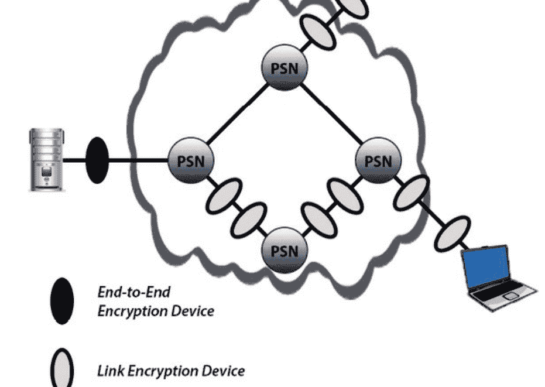

端到端加密设备

链路加密设备

图 2.1 — 链路加密与端到端加密的比较

## 风险描述

恶意用户可能会拦截或监控未加密网络上传输的明文数据并获得未经授权的访问，从而危及敏感数据的保密性。

## 建议

受保护数据在任何网络上传输时必须加密，以防止未经授权的用户窃听网络流量。在源和目标端点设备位于同一受保护子网内的情况下，由于受保护数据泄露可能产生高度负面影响，受保护数据传输仍必须按照以下建议进行加密。传输类型可能包括客户端到服务器、服务器到服务器通信，以及核心系统与第三方系统之间的数据传输。

电子邮件不被视为安全，除非使用额外的电子邮件加密工具，否则不得用于传输受保护数据。

在尝试保护传输中的数据时，安全从业人员应考虑以下建议以设计安全的数据传输。

- 1. 当受保护设备可通过 Web 界面访问时，Web 流量必须通过安全套接层（SSL）传输，仅使用强安全协议，例如 SSLv3，以及传输层安全 v1.1 或 v1.2（TLS）。
- 2. 通过电子邮件传输的受保护数据必须使用密码学上强大的电子邮件加密工具（如 PGP 或 S/MIME）进行保护。或者，在发送电子邮件之前，用户应使用符合要求的文件加密工具对受保护数据进行加密并作为附件发送。
- 3. 非 Web 受保护数据流量应通过应用层加密进行加密
- 4. 当应用程序数据库位于应用程序服务器之外时，数据库与应用程序之间的所有连接也应使用符合 FIPS 的密码算法进行加密。
- 5. 当非 Web 受保护数据流量不可用应用层加密时，应实施网络层加密，例如 IPSec 或 SSH 隧道。
- 6. 在受强防火墙控制的受保护子网中的设备之间传输受保护数据时应应用加密。

不安全网络协议及其安全替代方案的示例包括：

| 操作 | 改用此项之前... | 使用以下... |
|---|---|---|
| Web 访问 | HTTP | HTTPS |
| 文件传输 | FTP, RCP | FTPS, SFTP, SCP |
| 远程 Shell | telnet | SSH |
| 远程桌面 | VNC | radmin, RDP |

表 2.2 — 不安全网络协议及其安全替代示例

## 选择加密算法

选择用于加密受保护数据的算法时，请注意以下考虑事项：

- 对于相同的加密算法，更长的加密密钥长度通常提供更强的保护。
- 长而复杂的密码短语比较短的密码短语更强。
- 密码短语必须：
  - 包含十五个字符或以上
  - 包含以下三个字符类别中的两个：
    - 字母（例如 a-z, A-Z）
    - 数字（即 0-9）
    - 标点符号和其他字符（例如 !@#$%^&*()_+|~-=\ {} []:";'<>?,./）
- 强加密通常比弱加密消耗更多的 CPU 资源。

## 无线连接

当连接无线网络以访问处理受保护数据的系统时，仅连接采用诸如 WPA2 等密码学强无线加密标准的无线网络。上述部分中描述的加密机制也必须在强大的无线网络加密之外应用，以确保端到端保护。

## 基线

有效的网络安全需要集成纵深防御方法。纵深防御方法的第一层是执行网络安全的基本要素。这些基本安全要素构成安全基线，为随后构建更先进的方法和技术奠定坚实的基础。

应用基线安全时，安全从业人员应考虑以下问题：

- 企业的哪些部分或系统可以由同一基线保护？
- 是否应在整个企业中应用相同的基线？
- 基线应达到什么安全级别？
- 构成基线（基线）的控制措施将如何确定？

使用单一基线级别将大大降低实施控制的成本，企业内所有人员都可以依赖相同的安全级别。

基线保护的目标是建立一套最低限度的保障措施，以保护企业全部或部分 IT 系统。通过安全从业人员采用这种方法，可以在整个企业范围内应用基线保护，并额外使用详细的风险分析审查来保护高风险 IT 系统或对业务至关重要的系统。

适当基线保护可以通过使用建议一套保障措施以保护 IT 系统免受最常见威胁的保障目录和清单来实现。基线安全级别可以根据企业需求进行调整。无需对威胁、漏洞和风险进行详细评估。相反，应用基线保护所需要做的全部工作就是选择与所考虑的 IT 系统相关的保障目录部分。在安全专业人员确定已实施的保障措施后，将其与基线目录中列出的保障措施进行比较。尚未实施且适用的保障措施应予以实施。

基线目录可以详细指定要使用的保障措施，也可以建议一套安全要求，使用适用于所考虑系统的任何保障措施来解决。两种方法各有优势。基线方法的一个目标是企业范围内安全保障措施的一致性，这两种方法都可以实现。

已有若干文件提供基线保障措施集。46 此外，有时在同一工业部门的公司之间可以观察到环境的相似性。在审查基本需求后，基线保障目录可能被多个不同组织使用。例如，基线保障目录可以从以下来源获得：47

- 国际和国家标准组织。
- 行业部门标准或建议。
- 其他公司，最好具有相似的业务目标且规模相当。

企业也可以自行生成基线，该基线与其典型环境和业务目标相称。这种方法有几个优点，例如：

- 每个保障措施实施所需的风险分析和管理的资源量最小，因此在选择安全保障措施上花费的时间和精力更少。
- 基线保障措施可能提供经济高效的解决方案，如果企业的大量系统运行在共同环境中且安全需求相当，则可以不费多大力气地将相同或相似的基线保障措施应用于许多系统。

这种方法的一个例子可以通过检查美国政府配置基线（USGCB）。48 USGCB 计划的目的是为联邦机构广泛部署的信息技术产品创建安全配置基线。USGCB 基线源自联邦桌面核心配置授权。USGCB 是一项联邦政府范围的计划，为机构提供指导，说明应采取什么措施来改进和维护以安全为重点的有效配置设置。

另一个例子可以在爱沙尼亚信息系统管理局 IT 基线安全系统 ISKE。49 ISKE 是为爱沙尼亚公共部门开发的信息安全标准，处理数据库的国家和地方政府组织必须遵守。ISKE 基于德国信息安全标准 – IT 基线保护手册（IT-Grundschutz in German）– 已根据爱沙尼亚情况进行调整。ISKE 被实施为三级基线系统，意味着根据管理相关数据库的实体需求以及数据库包含的数据类型，已开发出三套针对三种不同安全要求的安全措施，并可供实施。

本节介绍了一些从非常高层次的角度处理信息安全的普遍接受原则。这些原则本质上是基本的且很少变化。它们在此并非作为安全要求陈述，而是作为开发、实施和理解企业使用的安全策略和基线的有用指导参考提供的。以下列出的原则绝非详尽无遗。

- **信息系统安全目标** – 信息系统安全目标或目标用三个总体目标描述：保密性、完整性和可用性。安全策略、基线和措施是根据这些目标开发和实施的。
- **预防、检测、响应和恢复** – 信息安全是预防性、检测性、响应性和恢复性措施的结合。预防性措施用于避免或阻止不希望事件的发生。检测性措施用于识别不希望事件的发生。响应措施是指在不希望事件（或事故）发生时采取协调响应以遏制损害。恢复措施用于将信息系统的保密性、完整性和可用性恢复到预期状态。
- **处理中、传输中和存储中的信息保护** – 应考虑并适当实施安全措施，以在信息被处理、传输和存储时保持其保密性、完整性和可用性。
- **外部系统被视为不安全** – 通常，未在您直接控制下的外部系统或实体应被视为不安全。当您的信息资产或信息系统位于外部系统或与外部系统接口时，需要额外安全措施。信息系统基础设施可通过物理或逻辑手段进行划分，以隔离具有不同风险级别的环境。
- **关键信息系统的弹性** – 所有关键信息系统都需要具有弹性以承受重大破坏性事件，并采取措施检测中断、最大限度地减少损害并迅速响应和恢复。
- **可审计性和问责制** – 安全需要可审计性和问责制。可审计性是指验证信息系统中活动的可能性。用于验证的证据可以采用审计跟踪、系统日志、警报或其他通知的形式。问责制是指审计与信息系统交互的所有各方和流程行为的能力。角色和职责应明确定义、识别并

根据信息敏感性相称的级别进行授权。

## 范围界定与定制

> “在制定《联邦信息安全管理法》（FISMA）要求的标准和指南时，NIST 与其他联邦机构和办公室以及私营部门进行协商，以改进信息安全，避免不必要且成本高昂的工作重复，并确保 NIST 出版物与用于保护国家安全系统的标准和指南相辅相成。除其全面的公开审查和核查流程外，NIST 还与国家情报总监办公室（ODNI）、国防部（DOD）和国家安全系统委员会（CNSS）合作，在联邦政府范围内建立信息安全共同基础。信息安全的共同基础将为联邦政府的情报、国防和民用部门及其承包商提供更统一、一致的方式，以管理因信息系统的运行和使用而导致对组织运营和资产、个人、其他组织以及国家造成的风险。信息安全的共同基础还将为安全授权决定的相互认可提供坚实基础，并促进信息共享。NIST 还与公共和私营部门实体合作，建立 NIST 制定的安全标准和指南与国际标准化组织和国际电工委员会（ISO/IEC）27001《信息安全管理体系》（ISMS）之间的具体映射和关系。” [50]

上述引文有助于安全从业人员了解范围界定和定制对信息安全的影响。NIST 以及当今众多其他实体都参与范围界定和定制，以产生他们为全球众多使用其特别出版物的组织提供的宝贵指导。

范围界定指南为企业提供关于单个安全控制适用性和实施的具体条款和条件。 several 考虑因素可能会影响企业如何应用基线安全控制。系统安全计划应明确识别采用了范围界定指南的安全控制，并包括所做考虑类型的描述。范围界定指南的应用必须由所涉信息系统的授权官员进行审查和批准。

定制涉及将评估程序的范围界定得更紧密地匹配信息系统及其运行环境的特点。定制过程为企业提供了所需的灵活性，以避免不必要复杂或昂贵的评估方法，同时满足通过应用风险管理框架的基本概念所建立的评估要求。补充涉及添加评估程序或评估细节，以充分满足组织的风险管理需求（例如，为所选安全控制添加组织特定细节，如系统/平台特定信息）。补充决策由组织自行决定，以便在应用风险评估结果确定评估的范围、严格程度和强度水平时，最大化制定安全评估计划的灵活性。

安全从业人员需要意识到范围界定、定制和补充可以为企业正在规划和评估的安全架构带来的价值。正确使用范围界定和定制来缩小架构的重点，将确保识别和解决适当的风险。使用补充将使架构随着时间的推移保持灵活，并在架构完全实施后投入运行期间出现的需求得到解决时不断发展。


## 亲自尝试

作为附录 C 提供的示例模板将允许安全从业人员尝试范围界定和定制。该模板将引导您完成为项目创建安全方法的过程。为项目定义安全方法可从业务需求通过团队成员和组件一直到已实施的安全控制提供清晰的视线。它记录了系统安全实施、认证和认可的明确责任，并为传达安全对其他开发和项目管理活动的影响提供框架。此安全方法从安全角度定义了与项目相关系统的表征、分类和管理方式。

下载模板并按顺序浏览各部分，以练习如何为项目范围界定和定制安全方法。

## 标准选择

安全从业人员需要熟悉广泛的标准以及负责这些标准的组织和实体。这些范围从美国本土实体如 NIST 到跨国实体如欧洲网络和信息安全局（ENISA）、国际电信联盟（ITU）和国际标准化组织（ISO）。以下是许多领先标准机构及其负责的标准列表。

## 美国资源

## 美国国防部政策

## 国防部指令 8510.01（DoDI 8510.01）

DoD 指令 8510.01 建立了国防信息保证认证与认可流程（DIACAP），用于授权 DoD 信息系统的运行、管理 IA 能力和服务的实施，并提供关于 DoD 信息系统运行认可决策的可见性，包括核心企业服务和基于 Web 服务的软件系统和应用程序。

## DoDI 8510.01 网址：

http://www.dtic.mil/whs/directives/corres/pdf/851001_2014.pdf

## 美国国家安全局（NSA）信息保证缓解指南

NSA 提供有关信息保证安全解决方案的指导，以便客户能够受益于 NSA 对风险、漏洞、缓解措施和威胁的独特而深入的理解。可用缓解指南包括安全配置、可信计算和系统级 IA 指导。

## NSA 信息保证缓解指南网站：

http://www.nsa.gov/ia/mitigation_guidance/index.shtml

## 国家标准与技术研究院（NIST）计算机安全部

国家标准与技术研究院（NIST）是美国联邦技术机构，与行业合作开发和应用技术、测量和标准。NIST 计算机安全部（CSD）专注于提供测量和标准，以保护信息系统免受对信息保密性、信息和流程完整性以及信息和服务可用性的威胁，从而建立对信息技术系统的信任和信心。NIST CSD 维护一个在线计算机安全资源中心，可访问于：

[http://csrc.nist.gov/index.html](http://csrc.nist.gov/index.html)。

## NIST 出版物系列

## 联邦信息处理标准（FIPS）

联邦信息处理标准（FIPS）是在 2002 年《联邦信息安全管理法》（FISMA）下采用的标准和指南的官方出版物系列。FIPS 出版物提供有关最低安全要求、联邦信息和信息系统安全分类标准、个人身份验证和数字签名标准等主题的标准指导。FIPS 出版物的完整库可在以下位置找到：

[http://csrc.nist.gov/publications/PubsFIPS.html](http://csrc.nist.gov/publications/PubsFIPS.html)

## FIPS 出版物 199

FIPS 出版物 199《联邦信息和信息系统安全分类标准》提供了对信息和信息系统进行分类的标准。安全分类标准提供了一个共同的框架和理解来表达安全，促进信息安全计划的有效管理和监督，并在信息安全政策、程序和实践的充分性和有效性方面向监督办公室进行一致报告。文件网址：

[http://csrc.nist.gov/publications/fips/fips199/FIPS-PUB-199-final.pdf](http://csrc.nist.gov/publications/fips/fips199/FIPS-PUB-199-final.pdf)

## FIPS 出版物 200

FIPS 出版物 200《联邦信息和信息系统的最低安全要求》是为响应美国每个联邦机构需要开发、记录和实施企业范围计划以提供支持其运营和资产的信息和信息系统的信息安全的需求而创建的，并概述了美国联邦信息和信息系统的最低安全要求。文件网址：

[http://csrc.nist.gov/publications/fips/fips200/FIPS-200-final-march.pdf](http://csrc.nist.gov/publications/fips/fips200/FIPS-200-final-march.pdf)

## 特别出版物（SP）800 系列


《特殊出版物》（SP）800 系列为计算机安全社区提供了具有普遍兴趣的文档，并报告了计算机安全方面的研究、指南和外联工作，以及与行业、政府和学术机构的合作活动。SP 800-37、SP 800-53 和 SP 800-60 在此予以突出，供参考。所有 SP 800 文档的完整文本可下载于：

http://csrc.nist.gov/publications/PubsSPs.html

### SP 800-37，《联邦信息系统风险管理框架应用指南》

NIST 特殊出版物 800-37《联邦信息系统风险管理框架应用指南》建立了一个通用框架，以改进信息安全、加强风险管理流程并鼓励联邦机构之间的互认。本出版物介绍了六步风险管理框架的指南。有关更多信息，请参阅风险管理框架。文档网址：

http://csrc.nist.gov/publications/nistpubs/800-37-rev1/sp800-37-rev1-final.pdf

### SP 800-53，《联邦信息系统和组织的安全与隐私控制》

NIST 特殊出版物 800-53《联邦信息系统和组织的安全与隐私控制》为支持联邦政府行政机构的组织和信息系统提供选择和指定安全控制的指南。这些指南适用于处理、存储或传输联邦信息的任何信息系统组件。文档网址：

http://csrc.nist.gov/publications/drafts/800-53-rev4/sp800-53-rev4-ipd.pdf

### SP 800-60，《信息类型和信息系统映射到安全分类指南》

NIST 特殊出版物 800-60《信息类型和信息系统映射到安全分类指南》提供了指南，推荐应纳入每种潜在安全影响类别的信息类型和信息系统。本指南旨在帮助机构将安全影响等级一致地映射到信息类型（例如，隐私、医疗、专有、财务、承包商敏感、商业秘密、调查）和信息系统（例如，任务关键、任务支持、行政）。文档网址：

http://csrc.nist.gov/publications/nistpubs/800-60-rev1/SP800-60_Vol1-Rev1.pdf

## 其他 NIST 资源

### 风险管理框架

组织风险管理是组织信息安全计划中的关键要素，并为信息系统选择适当的安全控制提供有效框架。NIST 风险管理框架是一种基于风险的安全控制选择和规范方法，由与组织风险管理相关的活动组成。这些活动对有效的信息安全计划至关重要，可应用于新系统和遗留信息系统。有关更多信息，请参阅特殊出版物 800-37。风险管理框架网站：

http://csrc.nist.gov/groups/SMA/fisma/framework.html

### 国家清单计划（NCP）

国家清单计划（NCP）是美国政府的公共安全清单（或基准）存储库，提供有关操作系统和应用程序安全配置设置的详细低级指导。清单存储库可在以下位置找到：

http://web.nvd.nist.gov/view/ncp/repository

## 国际资源

### 网络安全十步

由 CESG 发布，《网络安全十步》提供的指导为组织领导者提供了可采取的实用步骤，以改善网络及其所承载信息的保护。《网络安全十步》还引导读者参考本指南中也提及的由 CSIS 开发的《20 项关键控制措施》以获得进一步指导。文档网址：

https://www.gov.uk/government/uploads/system/uploads/attachment_data/file/731281120-10-steps-to-cyber-security-executive.pdf

### 欧盟网络安全战略

由欧洲委员会发布，网络安全战略《开放、安全和可靠的网络空间》代表了欧盟关于如何最好地预防和应对网络中断和事件的全面愿景。具体行动旨在增强信息系统的网络弹性，减少网络犯罪并加强欧盟国际网络安全政策和网络防御。欧盟国际网络空间政策促进欧盟核心价值观的尊重，定义负责任行为的规范，并倡导在网络空间中适用现有的国际法，同时协助欧盟以外的国家进行网络安全能力建设，并促进网络问题的国际合作。
文档网址：
http://eeas.europa.eu/policies/eu-cyber-security/cybsec_comm_en.pdf

### 欧洲网络和信息安全局（ENISA）

欧洲网络和信息安全局（ENISA）是欧盟、其成员国、私营部门和欧洲公民的网络和信息安全专业知识中心。ENISA 与这些团体合作制定信息安全良好实践的建议和建议。它协助欧盟成员国实施相关的欧盟立法，并致力于提高欧洲关键信息基础设施和网络的弹性。ENISA 通过支持建立致力于在整个欧盟改善网络和信息安全的跨境社区来增强欧盟成员国现有的专业知识。有关 ENISA 及其工作的更多信息可在以下位置找到：
http://www.enisa.europa.eu

### 国家网络安全战略：实施指南

ENISA 开发的《国家网络安全战略实施指南》介绍了一系列具体行动，如果实施将导致连贯且全面的国家网络安全战略。它还提出了一个国家网络安全战略生命周期，特别强调开发和执行阶段。政策制定者将找到有关如何控制整体开发和改进流程以及如何跟进本国国家网络安全事务状况的实用建议。文档网址：
http://www.enisa.europa.eu/activities/Resilience-and-CIIP/national-cyber-security-strategies-ncsss/national-cyber-security-strategies-an-implementation-guide

### 国际标准化组织（ISO）

ISO 与其国际标准化合作伙伴 IEC（国际电工委员会）和 ITU（国际电信联盟）合作制定自愿性国际标准，尤其是在信息和通信技术领域。ISO 网站：
http://www.iso.org/iso/home.html

### ISO/IEC 27001

ISO/IEC 27001 涵盖包括政府机构在内的所有类型的组织，并规定了在组织整体业务风险背景下建立、实施、运行、监控、审查、维护和改进文件化信息安全管理体系的要求。它规定了根据各组织需求定制的安全控制实施要求，旨在确保选择充分且适当的保护信息资产并使利益相关方信服的安全控制。ISO/IEC 标准受版权保护，未经购买不得重新分发。ISO/IEC 27001 可在以下位置购买： http://www.iso.org/iso/catalogue_detail?csnumber=42103

### ISO/IEC 27002

结合 ISO/IEC 27001，ISO/IEC 27002 建立了在组织中启动、实施、维护和改进信息安全管理的指南和一般原则。其中概述的目标为信息安全管理普遍接受的目标提供了一般指导。ISO/IEC 27002 中的控制目标和控制措施旨在实施以满足风险评估确定的要求。ISO/IEC 标准受版权保护，未经购买不得重新分发。ISO/IEC 27002 可在以下位置购买： http://www.iso.org/iso/catalogue_detail?csnumber=50297

### 国际电信联盟-电信（ITU-T）标准化

国际电信联盟是联合国负责信息和通信技术相关问题的专门机构。ITU 电信标准化部门（ITU-T）的研究组召集全球专家制定国际标准，即 ITU-T 建议书，它们是信息和通信技术（ICT）全球基础设施中的定义要素。ITU-T 标准化部门网页： http://www.itu.int/en/ITU-T/Pages/default.aspx

### 建议书 X.800 – X.849

ITU-T 建议书 X.800 系列定义了一个安全基线，网络运营商可据此评估其网络和信息安全状况，包括准备情况以及与其它实体合作应对信息安全威胁的能力。所有 X.800 系列建议书的完整文本可下载于：


http://www.itu.int/rec/T-REC-X/e

## 建议书 X.1205

ITU-T X.1205建议书从组织的角度为网络安全和安全威胁的分类提供了定义。文中介绍了网络安全威胁和漏洞，包括最常见的黑客工具，并在各个网络层讨论了这些威胁。其中还讨论了可用的网络安全技术以及网络保护原则，如纵深防御和应用于网络安全的访问管理。文中还介绍了风险管理策略和技术，包括培训和教育活动在保护网络方面的价值。文档URL：http://www.itu.int/rec/T-REC-X.1205-200804-I/en

## 国家网络安全框架手册

《国家网络安全框架手册》提供了详细的背景信息和深入的理论框架，帮助读者根据不同的公共政策制定层面理解国家网络安全的各个方面。政府四个层面——政治、战略、作战以及战术/技术——对国家网络安全各有其视角，手册中的各个章节分别针对每个层面进行了阐述。此外，手册还举例说明了国家网络安全领域中的相关机构，从顶层政策协调机构一直到网络危机管理结构和类似机构。文档URL：http://www.ccdcoe.org/publications/books/NationalCyberSecurityFrameworkManual.pdf

基于上述列表，安全从业者在寻求权威方、最佳实践和标准的指导时，有许多选择。虽然有许多途径可以探索，也有许多声音可以听取，但以下内容为安全从业者提供了三个例子，说明选择适当标准以指导其实践的重要性。需要理解待解决的安全需求的范围，以及需要支持的业务要求，还有完成手头任务所需的可用资源——这些都是安全从业者必须学会掌握的成功要素。

美国国家标准与技术研究院（NIST）负责发布多种指南，用于实施安全控制、执行审计和认证系统。其中一些指南非常具体，例如加固Windows服务器的推荐设置；另一些则非常通用，例如如何审计变更管理流程。许多NIST标准已被审计人员采纳为网络管理的模型。在美国政府中，许多FISMA审计专门引用NIST指南。

战略与国际研究中心（CSIS）的“20项关键安全控制”倡议提供了一份统一的二十项关键控制清单，这些控制是由联邦和私营行业安全专业人员通过共识确定的，被视为行业中最关键的安全问题。CSIS团队包括来自NSA、美国CERT、DoD JTF-GNO、能源部核实验室、国务院、DoD网络犯罪中心以及商业部门的人员。CSIS控制措施并未引入任何新的安全要求，而是将要求组织成一份简化的清单，以帮助确定合规性，并确保最重要的关注领域得到解决。

2013年，这些控制措施的管理和维护工作移交给了网络安全理事会（The Council），这是一个独立的全球性非营利实体，致力于实现安全开放的互联网。

CSIS倡议旨在帮助联邦政府优先安排资源并整合工作，以降低成本，确保关键安全问题得到解决。SANS网站上列出的CSIS倡议的五项“关键原则”如下：51

- 1. **进攻信息指导防御——** 利用已知的实际攻击（已危及系统）的知识，为构建有效、实用的防御奠定基础。只包含那些被证明能够阻止已知现实世界攻击的控制措施。
- 2. **优先级排序——** 首先投资于能够最大程度降低风险、防范最危险威胁行为者，并且在您的计算环境中能够切实实施的控制措施。
- 3. **度量指标——** 建立通用度量指标，为高管、IT专家、审计师和安全官员提供共同语言，用于衡量组织内安全措施的有效性，以便快速识别和实施必要的调整。
- 4. **持续监控——** 开展持续监控，以测试和验证当前安全措施的有效性。
- 5. **自动化——** 实现防御自动化，使组织能够对其遵守控制措施及相关度量指标的情况进行可靠、可扩展且持续的测量。

当前的关键安全控制列表——版本5如下：52

- 1. 授权和非授权设备清单
- 2. 授权和非授权软件清单
- 3. 移动设备、笔记本电脑、工作站和服务器的硬件和软件安全配置
- 4. 持续漏洞评估与修复
- 5. 恶意软件防御
- 6. 应用软件安全
- 7. 无线访问控制
- 8. 数据恢复能力
- 9. 安全技能评估及弥补差距的适当培训
- 10. 网络设备（如防火墙、路由器和交换机）的安全配置
- 11. 网络端口、协议和服务的限制与控制
- 12. 管理权限的受控使用
- 13. 边界防御
- 14. 审计日志的维护、监控和分析
- 15. 基于“需知”原则的受控访问
- 16. 账户监控与控制
- 17. 数据保护
- 18. 事件响应与管理
- 19. 安全网络工程
- 20. 渗透测试与红队演练

与关键安全控制配套，NIST还创建了安全内容自动化协议（SCAP）。SCAP是一组规范，标准化了软件缺陷和安全配置信息在机器与人之间进行通信时所使用的格式和命名。SCAP是一个多用途的规范框架，支持自动化配置、漏洞和补丁检查、技术控制合规活动以及安全衡量。开发SCAP的目标包括：标准化系统安全管理、促进安全产品的互操作性，以及推动安全内容标准表达的使用。

SCAP 1.2版本由五个类别中的十一个组件规范组成：53

- 1. **语言——** SCAP语言为表达安全策略、技术检查机制和评估结果提供了标准词汇和约定。SCAP语言规范包括可扩展配置清单描述格式（XCCDF）、开放漏洞和评估语言（OVAL®）和开放清单交互语言（OCIL™）。
- 2. **报告格式——** SCAP报告格式提供了必要的构造，以标准化格式表达收集到的信息。SCAP报告格式规范包括资产报告格式（ARF）和资产标识。虽然资产标识不明确是报告格式，但SCAP将其作为标识报告所涉及资产的关键组件。
- 3. **枚举——** 每个SCAP枚举定义了一种标准命名法（命名格式）以及使用该命名法表示的项目的官方字典或列表。SCAP枚举规范包括公共平台枚举（CPE™）、公共配置枚举（CCE™）和公共漏洞与暴露（CVE®）。
- 4. **测量与评分系统——** 在SCAP中，这指的是评估安全弱点的特定特征（例如软件漏洞和安全配置问题），并根据这些特征生成反映其相对严重性的分数。SCAP测量和评分系统规范包括公共漏洞评分系统（CVSS）和公共配置评分系统（CCSS）。
- 5. **完整性——** SCAP完整性规范有助于保护SCAP内容和结果的完整性。安全自动化数据信任模型（TMSAD）是SCAP的完整性规范。

SCAP利用软件缺陷和安全配置标准参考数据。这些参考数据由国家漏洞数据库（NVD）提供，该数据库由NIST管理，并由国土安全部（DHS）资助。

美国联邦政府与学术界和私营行业合作，正在采用SCAP，并鼓励将其用于支持安全自动化活动和倡议。SCAP已被主要软件制造商广泛采用，并已成为大型信息安全管理的重要组成部分。


治理计划。预计该协议将不断发展和扩展，以支持日益增长的需求，即定义和衡量有效的安全控制，评估和监控该信息安全持续方面的情况，并根据风险管理框架成功管理系统，例如 NIST 特刊 800-53、国防部（DoD）指令 8500.2 以及支付卡行业（PCI）框架。

通过详细说明 SCAP 1.2 组件的具体和适当使用及其互操作性，NIST 鼓励创建可靠且广泛的 SCAP 内容，并开发利用 SCAP 的各种产品。

## Framework for Improving Critical Infrastructure Cybersecurity

认识到美国的国家安全和经济安全取决于关键基础设施的可靠运行，总统于 2013 年 2 月发布了第 13636 号行政命令《改进关键基础设施网络安全》。[54] 它指示 NIST 与利益相关者合作，基于现有标准、指南和实践，制定一个自愿框架，以降低关键基础设施的网络风险。

NIST 于 2014 年 2 月 12 日发布了《改进关键基础设施网络安全框架》的第一个版本。[55] 该框架由行业和政府合作创建，由标准、指南和实践组成，旨在促进关键基础设施的保护。框架的优先、灵活、可重复且具有成本效益的方法有助于关键基础设施的所有者和运营商管理与网络安全相关的风险。

基于标准、指南和实践，框架为组织提供了一个共同的分类法和机制，以便：

-   描述其当前的网络安全态势；
-   描述其网络安全的目标状态；
-   在持续且可重复的过程的背景下识别和优先考虑改进机会；
-   评估向目标状态的进展；
-   在内部和外部利益相关者之间就网络安全风险进行沟通。

该框架是管理网络安全风险的风险为本方法，由三个部分组成：框架核心、框架实施分层和框架概况。每个框架组件都强化了业务驱动因素与网络安全活动之间的联系。

然后可以使用概况来支持对实现目标概况的进展进行优先排序和衡量，同时考虑其他业务需求，包括成本效益和创新。概况可用于进行自我评估，并在组织内部或组织之间进行沟通。

美国国土安全部的关键基础设施网络社区 C³ 自愿计划有助于将关键基础设施的所有者和运营商与现有资源对齐，以协助他们采用网络安全框架并管理其网络风险。[56]

安全从业人员必须能够从众多现有标准中进行选择，以便为其希望创建的企业架构应用最有益的指导。

## Summary


资产安全涵盖了广泛的主题，重点关注用于监控和保护资产的概念、原则、结构和标准，以及用于在整个企业中跨 IT 服务强制执行不同级别的保密性、完整性和可用性的控制措施。专注于资产安全的安全从业人员必须使用和应用标准，以确保其受保护的系统得到适当维护和支持。安全从业人员了解众多方法所利用的不同安全框架、标准和最佳实践，以及它们如何被共同使用以提供更强大的系统。信息安全治理和风险管理使信息技术能够在以前从未可能的环境中安全、负责任和安全地使用。基于标准和政策建立强大的系统保护并通过审计和监控评估该保护的水平和有效性的能力对于资产安全的成功至关重要。今天高度互联、相互依赖的系统环境要求必须了解信息技术与实现业务目标之间的联系。信息安全管理传达了组织因当前实施的安全控制而接受的风险，并不断努力以具有成本效益的方式增强控制措施，以最大程度地降低对公司信息资产的风险。


## Domain 2: Review Questions

1. 在发生安全事件时，运营人员的首要目标之一是确保

-   A. 攻击者被检测到并被阻止。
-   B. 对组织的使命造成最小的干扰。
-   C. 关于事件的适当文档作为证据链得到维护。
-   D. 受影响的系统立即关闭以限制影响。

2. 良好的数据管理实践包括：

-   A. 在数据管理流程的所有阶段实施数据质量程序，验证和确认数据的准确性，遵守商定的数据管理实践，持续进行数据审计以监控使用情况并评估管理实践的有效性和现有数据的完整性。
-   B. 在数据管理流程的某些阶段实施数据质量程序，验证和确认数据的准确性，遵守商定的数据管理实践，持续进行数据审计以监控使用情况并评估管理实践的有效性和现有数据的完整性。
-   C. 在数据管理流程的所有阶段实施数据质量程序，验证和确认数据的准确性，遵守讨论过的数据管理实践，持续进行数据审计以监控使用情况并评估管理实践的有效性和现有数据的完整性。
-   D. 在数据管理流程的所有阶段实施数据质量程序，验证和确认数据的准确性，遵守商定的数据管理实践，不定期进行数据审计以监控使用情况并评估管理实践的有效性和现有数据的完整性。

3. 安全从业人员在制定数据政策时需要考虑的问题包括：

-   A. 成本、审慎注意和尽职调查、隐私、责任、敏感性、现有法律和政策要求、政策和流程
-   B. 成本、所有权和保管权、隐私、责任、敏感性、未来法律和政策要求、政策和流程
-   C. 成本、所有权和保管权、隐私、责任、敏感性、现有法律和政策要求、政策和程序
-   D. 成本、所有权和保管权、隐私、责任、敏感性、现有法律和政策要求、政策和流程

4. 信息所有者通常具有以下职责：

-   A. 确定信息对组织使命的影响，了解信息的重置成本，确定组织内部或外部谁需要该信息以及在何种情况下应发布信息，了解信息不准确或不再需要时应归档。
-   B. 确定信息对组织使命的影响，了解信息的重置成本，确定组织内部或外部谁需要该信息以及在何种情况下应发布信息，了解信息不准确或不再需要时应销毁。
-   C. 确定信息对组织政策的影响，了解信息的重置成本，确定组织内部或外部谁需要该信息以及在何种情况下应发布信息，了解信息不准确或不再需要时应归档。


确定组织内部或外部谁需要该信息以及在何种情况下不应发布该信息，了解何时信息不准确或不再需要且应被销毁。

D. 确定信息对组织使命的影响，了解信息的创建成本，确定组织内部或外部谁需要该信息以及在何种情况下应发布该信息，了解何时信息不准确或不再需要且应被销毁。

## 5. QA/QC 机制旨在防止数据污染，当流程或事件向数据集中引入以下两种基本类型的错误中的任一种时就会发生数据污染：（choose TWO）
- A. Errors of commission
- B. Errors of insertion
- C. Errors of omission
- D. Errors of creation

## 6. Some typical responsibilities of a data custodian may include: (Choose ALL that apply)
- A. Adherence to appropriate and relevant data policy and data ownership guidelines.
- B. Ensuring accessibility to appropriate users, maintaining appropriate levels of dataset security.
- C. Fundamental dataset maintenance, including but not limited to data storage and archiving.
- D. Assurance of quality and validation of any additions to a dataset, including periodic audits to assure ongoing data integrity.

## 7. The objectives of data documentation are to: (Choose ALL that apply)
- A. Ensure the longevity of data and their re-use for multiple purposes
- B. Ensure that data users understand the content context and limitations of datasets
- C. Facilitate the confidentiality of datasets
- D. Facilitate the interoperability of datasets and data exchange

## 8. Benefits of data standards include:
- A. more efficient data management, decreased data sharing, higher quality data, improved data consistency, increased data integration, better understanding of data, improved documentation of information resources
- B. more efficient data management, increased data sharing, higher quality data, improved data consistency, increased data integration, better understanding of data, improved documentation of information resources
- C. more efficient data management, increased data sharing, medium quality data, improved data consistency, decreased data integration, better understanding of data, improved documentation of information resources
- D. more efficient data management, increased data sharing, highest quality data, improved data consistency, increased data integration, better understanding of data, improved documentation of information metadata

## 9. When classifying data, the security practitioner needs to determine the following aspects of the policy: (Choose ALL that apply)
- A. who has access to the data
- B. what methods should be used to dispose of the data
- C. how the data is secured
- D. whether the data needs to be encrypted

## 10. The major benefit of information classification is to
- A. map out the computing ecosystem
- B. identify the threats and vulnerabilities
- C. determine the software baseline
- D. identify the appropriate level of protection needs

## 11. When sensitive information is no longer critical but still within scope of a record retention policy, that information is BEST
- A. Destroyed
- B. Re-categorized
- C. Degaussed
- D. Released

## 12. What are the FOUR phases of the equipment lifecycle?
- A. Defining requirements, acquiring and implementing, operations and maintenance, disposal and decommission
- B. Acquiring requirements, defining and implementing, operations and maintenance, disposal and decommission
- C. Defining requirements, acquiring and maintaining, implementing and operating, disposal and decommission
- D. Defining requirements, acquiring and implementing, operations and decommission, maintenance and disposal

## 13. Which of the following BEST determines the employment suitability of an individual?
- A. Job rank or title
- B. Partnership with the security team
- C. Role
- D. Background investigation

## 14. The best way to ensure that there is no data remanence of sensitive information that was once stored on a DVD-R media is by
- A. Deletion
- B. Degaussing
- C. Destruction
- D. Overwriting

## 15. Which of the following processes is concerned with not only identifying the root cause but also addressing the underlying issue?
- A. Incident management
- B. Problem management
- C. Change management
- D. Configuration management

## 16. Before applying a software update to production systems, it is MOST important that
- A. Full disclosure information about the threat that the patch addresses is available
- B. The patching process is documented
- C. The production systems are backed up
- D. An independent third party attests the validity of the patch


## Domain 3

## Security Engineering

The Security Engineering domain contains the concepts, principles, structures, and standards used to design, implement, monitor, and secure operating systems, equipment, networks, applications, and those controls used to enforce various levels of confidentiality, integrity, and availability. Information security architecture and design covers the practice of applying a comprehensive and rigorous method for describing a current and/or future structure and behavior for an organization’s security processes, information security systems, personnel and organizational sub-units, so that these practices and processes align with the organization’s core goals and strategic direction. Cryptography examines the principles, means, and methods of applying mathematical algorithms and data transformations to information to ensure its integrity, confidentiality, and authenticity. Physical security focuses on the threats, vulnerabilities, and countermeasures that can be utilized to physically protect an enterprise’s resources and sensitive information. These resources include people, the facility in which they work, and the data, equipment, support systems, media, and supplies they utilize. Physical security describes measures that are designed to deny access to unauthorized personnel (including attackers) from physically accessing a building, facility, resource, or stored information, and guidance on how to design structures to resist potentially hostile acts. In addition to preventing unauthorized personnel from accessing information, a focus on

physical security makes it possible to ensure protection for users from hazards like fire as well as providing for clearly marked safe passages out of the facility. Explaining the "what," "why," and "how" of this domain will help frame the rest of the chapter.

### What?

Security architecture:
- Provides the framework and foundation to enable secure communication, protect information resources, and ensure that where required, IT delivery is confidential, available, and with integrity.
- Identifies the basic services needed to provide security for current and future systems.
- Models the rules of behavior as well as the technologies required to securely and effectively protect assets.
- Documents these evolving models to connect the business drivers to the technical implementation of controls.
- Is typically built using standardized methodologies founded on industry frameworks and international standards.

### Why?

The security architect faces a trade off when examining the "why" of security architectures. On the one hand, a security architecture can require a considerable investment in time and resources to build and implement properly. At the same time, a well thought out security architecture, one that addresses business and IT security alignment, as well as being standards based and widely communicated about and trained on within the enterprise, will yield many potential benefits. These benefits can include:
- Better coordination of investment in security technologies and practices
- Improved long-term planning for capital investment and operating budgets
- Interoperability with other components of system and enterprise architecture
- Greater adaptability, scalability, and coherence of security services
- Standardization of common functions across multiple systems
- Consistent application of security practices and solutions, including compliance with regulations
- Providing the means to ensure that the implementation of security controls is correct and verifiable


## 怎么做？

制定 IT 和安全架构的方法论有很多。本章将讨论安全设计中常用的一些框架、模型和标准示例。尽管大多数安全架构都建立在共同的主题之上，但它们会根据发起组织需求的不同而有所差异。成功的集成取决于架构的利益相关者和客户的接受与采纳。这通过确保安全架构满足系统的业务需求来实现。这些需求往往因设计工作的范围不同而不同：系统安全架构将聚焦于单个系统的需求，而企业安全架构（ESA）将聚焦于整个企业内的多个系统。我们将重点讨论安全设计的基本原则，以及用于创建、实施和验证这些设计的常见方法论和技术。最后，将讨论系统安全架构和企业安全架构中的关键概念。安全专业人员需要理解安全架构和设计是如何执行的，以及不同层级的架构如何协同工作以保护信息资产。

系统安全架构聚焦于在单个计算系统内部设计安全服务。现代计算系统是复杂的生物，由无数活动部件组成：计算平台硬件、固件、操作系统（OS）、实用程序以及各种专用应用程序。每个活动部件要么具有原生控制能力，要么具备实施控制的能力，要么两者皆无。

一般来说，一个架构良好的解决方案将能够把每个活动部件的安全功能组合成一个有凝聚力的设计。同时，它需要在安全性与计算系统的其他需求之间取得平衡。这可能是一个非常难以实现的平衡。由于安全组件可能消耗大量资源，控制常常为了改进功能、可用性或性能而被牺牲。安全架构师的挑战在于找到平衡点，并确保必要的控制按设计实施。这一点最为重要，因为设计和构建企业安全架构时，成功的能力“始于开端，终于终点”。具体来说，安全架构师需要理解，能够预见安全并从规划周期的最开始就将其纳入，贯穿设计和构建阶段，一直到架构退役的生命周期终点，这才是成功的要义。如果安全是事后考虑或留到架构实施后期才处理，而不是从过程一开始就加以考虑，那么安全永远不会像从一开始就“内置”那样彻底或有效。

可用的计算平台种类繁多，每种平台在提供安全服务时会采取不同的方法。这些平台的架构是它们处理安全需求的基础。大多数计算平台会提供多种安全控制，以帮助保护系统正在生成、传输或存储的敏感资产。安全架构师可能负责确定要实施哪些安全控制，或者他/她可能负责决定企业内特定系统将使用哪些原生控制。

安全架构师必须理解构成现代计算系统的基本构件，以及区分不同类型系统的一些特征。最重要的是，他/她应该意识到在系统层面实施安全的不同方式，并能够在给定场景中选择最合适的机制。

### 主题

- 使用安全设计原则实施和管理工程生命周期
- 安全模型的基本概念
- 基于信息系统安全标准的控制和对策
- 信息系统的安全能力
- 评估并缓解安全架构、设计和解决方案元素的漏洞
  - 基于客户端的（例如，小程序、本地缓存）
  - 基于服务器的（例如，数据流控制）
  - 数据库安全
  - 大规模并行数据系统
  - 分布式系统（例如，云计算、网格计算、点对点）
  - 密码系统
- 基于 Web 的系统的漏洞
- 移动系统的漏洞
- 嵌入式设备和网络物理系统（例如，支持网络的设备）的漏洞
- 密码学
  - 密码学生命周期
  - 密码类型（例如，对称、非对称、椭圆曲线）
  - 公钥基础设施（PKI）
  - 密钥管理实践
  - 数字签名
  - 数字版权管理（DRM）
  - 不可否认性
  - 完整性（哈希和加盐）
  - 密码分析攻击方法（例如，暴力破解、仅密文、已知明文）
- 将安全原则应用于站点和设施设计
- 设施安全
  - 布线间
  - 服务器机房
  - 媒体和存储设施
  - 证据存储
  - 限制区域和工作区域安全（例如，运营中心）
- 数据中心安全
- 公用设施和暖通空调（HVAC）注意事项
- 水问题（例如，泄漏、洪水）
- 火灾预防、检测和抑制

## 目标

根据 (ISC)² 候选人信息公告（考试大纲），CISSP 候选人应能够：

- 理解工程生命周期并应用安全设计原则
- 理解安全模型的基本概念
- 基于信息系统安全标准选择控制和对策
- 理解信息系统的安全能力
- 评估并缓解以下对象的漏洞：
  - 安全架构、设计和解决方案元素
  - 基于 Web 的系统
  - 移动系统
  - 嵌入式设备和网络物理系统
- 应用密码学
- 将安全原则应用于站点和设施设计
- 设计和实施设施安全

## 使用安全设计原则的工程生命周期

根据一种定义，系统工程是“一种跨学科的方法，通过迭代过程将用户需求转化为系统定义、其架构和设计，最终形成一个有效的运行系统。系统工程适用于整个生命周期，从概念开发到最终处置。”1

系统工程模型和过程通常围绕生命周期的概念来组织。国际系统工程委员会（INCOSE）的系统工程过程是经典系统工程的一个广泛认可的表示。2 ISO/IEC 15288:2008 是一个国际系统工程标准，涵盖了过程和生命周期阶段。它定义了一组过程，分为四类：技术、项目、协议和企业。示例生命周期阶段可以包括概念、开发、生产、使用、支持和退役。例如，美国国防部使用以下阶段：物资解决方案分析、技术开发、工程和制造开发、生产和部署，以及运营和支持。

虽然用于阐述系统工程生命周期的详细视图、实现和术语各不相同，但它们都具有基本要素，如图 3.1 中的 V 模型所示。V 的左侧表示概念开发以及将需求分解为可以进行架构、设计和开发的功能和物理实体。V 的右侧表示这些实体的集成及其最终过渡到现场，在那里进行操作和维护。


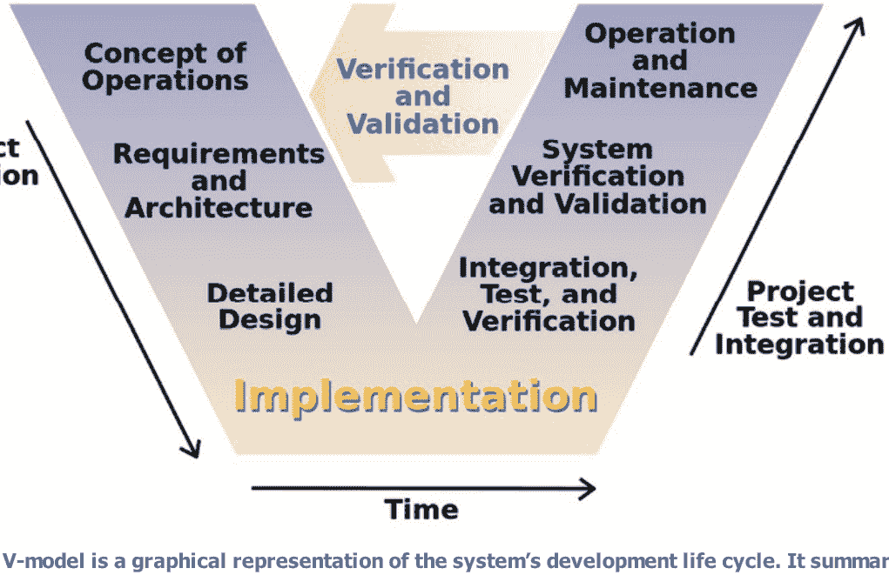

图 3.1 – V 模型是系统开发生命周期的图形化表示。它概括了在计算机化系统验证框架内，需要结合相应交付成果采取的主要步骤。V 代表了项目生命周期中的步骤顺序，描述了产品开发过程中需要执行的活动以及必须产生的结果。

生命周期中经常会出现迭代循环、跳过的阶段、重叠的要素等。此外，重要的流程和活动适用于系统生命周期中的多个阶段。风险识别与管理就是此类横切流程的一个例子。

系统工程关键技术流程主题包括：

- 需求定义
- 需求分析
- 架构设计
- 实施
- 集成
- 验证
- 确认
- 转换

系统工程关键管理流程主题包括：

- 决策分析
- 技术规划
- 技术评估
- 需求管理
- 风险管理
- 配置管理
- 接口管理
- 技术数据管理

保护信息和系统免受全方位威胁，需要采用多种重叠的保护方法，涵盖信息系统的人员、技术和运营层面。这是因为各种系统和网络具有高度交互性，而且除非所有互连的系统都得到充分保护，否则任何单一系统都无法得到恰当的保护。安全架构师需要明白，除非他们获得从零开始设计、构建和实施架构的独特机会，在此过程中“拆除并替换”现有系统以支持其正在构建的内容，否则他们所使用并集成到架构中的系统本身就充满各自的问题、担忧和麻烦。这些问题可能显而易见，也可能并不明显；它们可能被安全架构师所提议或实施的架构解决，也可能无法解决。

通过使用多种重叠的保护机制，任何一种保护方法的失效或被规避都不会使系统失去保护。通过用户培训和意识提升、精心制定的政策和程序以及保护机制的冗余，分层保护能够有效保护信息技术，从而在实现安全架构所需目标的同时，与企业对风险的承受意愿相平衡。

《公认的信息技术系统安全原则与实践》（NIST SP 800-14）为组织建立和审查信息技术安全项目奠定了基础。SP 800-14 中的八项公认系统安全原则旨在为创建新系统、实践或政策时提供组织层面的视角。SP 800-14 阐述了八项原则和十四项实践，为信息技术安全提供了组织层面的视角。³

通用准则（Common Criteria）提供了一种结构化的方法论，用于记录安全与管理、运行保证以及审计与监控。

- **处置 –** IT 系统生命周期的处置阶段涉及信息、硬件和软件的处理。相关活动包括迁移、归档、丢弃或销毁信息，以及净化存储介质。

NIST SP 800-27 Rev. A 提出了 33 项 IT 安全原则，分为以下 6 个类别：

- 安全基础
- 基于风险
- 易用性
- 增强弹性
- 减少漏洞
- 设计时考虑网络

这 33 项 IT 安全原则按类别划分如下：

## 安全基础

- 原则 1：制定健全的安全策略，作为设计的“基础”
- 原则 2：将安全视为整个系统设计中不可分割的组成部分
- 原则 3：清晰界定由相关安全策略所管辖的物理和逻辑安全边界
- 原则 4：确保开发人员接受如何开发安全软件的培训

## 基于风险

- 原则 5：将风险降低到可接受的水平
- 原则 6：假设外部系统是不安全的
- 原则 7：识别降低风险与增加成本及运营效能其他方面下降之间的潜在权衡
- 原则 8：实施量身定制的系统安全措施，以实现组织安全目标
- 原则 9：保护处理中、传输中和存储中的信息
- 原则 10：考虑使用定制产品来实现充分的安全
- 原则 11：防范所有可能类别的“攻击”

## 易用性

- 原则 12：在可能的情况下，基于开放标准实现安全，以保障可移植性和互操作性
- 原则 13：在制定安全需求时使用通用语言
- 原则 14：设计安全方案以支持新技术的定期采用，包括安全且合理的技术升级流程
- 原则 15：力求运营上的易用性

## 增强弹性

- 原则 16：实施分层安全（确保不存在单点漏洞）
- 原则 17：设计和运营 IT 系统，以限制损害并具备响应弹性
- 原则 18：确保系统在面对预期威胁时具有弹性，并持续保持这种弹性
- 原则 19：限制或遏制漏洞
- 原则 20：将公共访问系统与关键任务资源（例如数据、进程等）隔离开来
- 原则 21：使用边界机制来分离计算系统和网络基础设施
- 原则 22：设计和实施审计机制，以检测未授权使用并支持事件调查
- 原则 23：制定并演练应急或灾难恢复程序，以确保适当的可用性

## 减少漏洞

- 原则 24：力求简单
- 原则 25：最小化需要信任的系统元素
- 原则 26：实施最小权限
- 原则 27：不要实施不必要的安全机制
- 原则 28：确保系统关闭或处置过程中的适当安全
- 原则 29：识别并预防常见错误和漏洞

## 设计时考虑网络

- 原则 30：通过物理和逻辑分布的多种措施组合来实施安全
- 原则 31：制定安全措施以应对多个重叠的信息域
- 原则 32：对用户和进程进行身份验证，以确保域内和跨域做出适当的访问控制决策
- 原则 33：使用唯一身份以确保可问责性

这 33 项 NIST 原则帮助安全从业者理解和领会安全设计原则的范围与深度，这些原则必须融入任何工程生命周期之中，以便恰当地识别和处理有关保密性、完整性和可用性的各个关注领域。NIST 原则本身给安全架构师带来的挑战，在于其在更广泛的生命周期架构背景下进行整合时的上下文与充分性问题。

这一挑战之所以显现，是因为安全架构在企业架构中常常被视为一个独立的架构域，同时又需要完全集成到企业架构之中。安全从业者的关注点应是在不抑制价值的前提下执行企业的安全策略。

安全架构通常具有以下特征：

- 安全架构有其自身独立的安全方法论。
- 安全架构构建其自身独立的视图和视角。
- 安全架构处理系统内部及应用程序之间的非规范性流程。
- 安全架构引入其自身的系统内部及应用程序之间的规范性流程。
- 安全架构在设计中引入独特的单一用途组件。
- 安全架构要求企业和 IT 架构师具备一套独特的技能和能力。

安全从业者需要理解如何识别工程生命周期必须为企业解决的关键问题和关注点。一旦识别出来，就必须由企业中的利益相关者明确定义并达成一致。当利益相关者达成一致后，安全设计原则便可以

由架构师用来确保所有已知和识别的威胁、漏洞和风险都已在安全架构中得到处理，该安全架构被纳入生命周期中。

安全开发生命周期框架有很多例子，例如Cisco安全开发生命周期、Microsoft可信计算安全开发生命周期、医疗保险和医疗补助服务中心技术参考架构标准，以及构建安全成熟度模型-V（BSIMM-V）.7。

此外，还有ISO/IEC 21827:2008《系统安全工程——能力成熟度模型》（SSE-CMM），它描述了一个组织的安全工程过程必须具备的基本特征，以确保良好的安全工程。8 ISO/IEC 21827:2008没有规定特定的过程或顺序，但捕获了行业中普遍观察到的实践。该模型是安全工程实践的标准度量，涵盖以下内容：

-   整个生命周期，包括开发、运营、维护和退役活动；
-   整个组织，包括管理、组织和工程活动；
-   与其他学科（如系统、软件、硬件、人因工程和测试工程）的并发交互；
-   系统管理、运营和维护；
-   与其他组织的交互，包括采购、系统管理、认证、认可和评估。

## 安全模型的基本概念

创建和维护良好的安全架构可能是一项艰巨的任务。安全架构师的主要角色是将业务需求转化为为关键资产提供安全性的解决方案。由于需要保护的资产和组织偏好的保护方法可能不同，每个设计都是独一无二的。一个强大的设计要求架构师既了解要保护的资产，也了解管理层的优先事项。架构师还必须准备好随着关键资产或优先级的变化而随时间调整设计，并验证其设计已正确实施。

内存，即指令和数据；它解码指令以确定下一步；它执行指令，例如计算数字；并存储指令的结果。然后循环重复，直到没有进一步的指令可执行。

对于仅运行单个串行指令集的系统来说，这种简单过程已经足够，但对于必须共享一个通用处理器的复杂程序或多个程序来说，这可能不是提供处理能力的最有效方式。理想情况下，处理器应该能够将多组指令交织在一起，以确保它们充分利用任何处理能力。

利用处理器能力的一种方法是将程序拆分为多个协作进程。多任务系统快速从一个进程切换到另一个进程以加快处理速度。对用户来说，它看起来是同时执行，尽管在CPU上任何给定时间只有一个进程在运行。然而，必须有一种机制，使操作系统能够以一定概率（但非必然）启动应用程序，并期望该程序迟早会把控制权归还给操作系统。

实现更高性能的另一种方法是增加系统中的处理器数量，每个处理器可以承担部分负载。服务器等强大的计算机有几个处理器处理不同的任务，尽管必须有一个处理器来控制指令和数据通过辅助处理器的流动。这种类型的系统称为多处理系统。

另一种常见的提高性能的方法是将程序拆分为线程。顾名思义，线程是一系列指令，可以被视为正在运行的一条线。通常，当程序执行时，处理器按顺序运行每一行代码。然而，有时后续步骤不依赖于前一步的完成。如果程序员请求为后续步骤生成一个新线程，则可以要求CPU在应用程序继续执行当前任务的同时做其他事情。一个例子可能是电子表格计算与主应用程序请求用户输入同时运行。

多线程是指操作系统对线程进行时间切片，给一个线程在CPU上运行一段时间，然后切换到另一个线程并让它运行一段时间。这种例程持续到第一个线程再次轮到它为止。本质上，线程被拆分并以交错方式交给CPU。每个线程都像拥有CPU的独占访问权一样运行，即使它只运行很短时间，然后停止直到很快再次运行。

虽然多任务、多处理和多线程具有明显的优势，但它们也可能导致一些潜在的安全漏洞。系统必须提供手段来保护多个进程、任务和线程免受其他可能包含错误或表现出不友好动作的进程/任务/线程的影响。需要实施技术来测量和控制资源使用情况。例如，当系统运行许多不同的任务时，能够测量每个任务的总资源使用量是管理此类系统安全的一个理想部分。这些信息需要在不会产生显著性能损失且不改变任务编写和执行方式的情况下收集。如果这种类型的功能不可用，一个任务可能会分配和抢占足够的内存，导致拒绝服务攻击、崩溃或系统变慢。底线是，尽管实现多处理、多任务和多线程有许多优势，但系统创建的子任务越多，出现问题的可能性就越大。

安全架构师需要了解CPU安全中固有的主要问题，以确保他们在将系统部署到企业时做出明智的决策。为了在多个层面解决安全问题，处理器应具备的一些关键特性如下：

-   防篡改检测传感器
-   加密加速
-   带物理网状层的电池供电逻辑
-   使用安全启动功能定制设备的能力
-   具有即时加密和解密功能的安全内存访问控制器
-   静态和差分功耗分析（SPA/DPA）对策
-   智能卡UART控制器

关于如何将这些保护措施内置到安全芯片架构中的一个例子是飞思卡尔的C29x加密协处理器。C29x旨在帮助全球顶级数据中心设备制造商高效扩展，以处理安全网络流量的急剧增加。该设备支持多芯片、单PCI-E卡解决方案，提供每秒超过120,000次RSA 2,048操作。Silicom创建了一款新的C29x PCI-E卡。该解决方案提供行业领先的加密性能，可加速服务器、数据中心和安全设备中的公钥处理。此外，Green Hills Software已将其通过安全认证的INTEGRITY RTOS（实时操作系统）移植到C29x协处理器上。这种组合为安全密钥管理应用创建了理想的解决方案，这些应用需要高度“可信”的架构，以确保网上银行和视频点播服务器等应用中的加密密钥安全。

此外，还有一个问题：基于云的解决方案（如桌面即服务（DaaS））以及更广泛的虚拟化将如何影响关于CPU安全的讨论。安全架构师需要意识到这些问题，并在规划其架构时将其考虑在内。例如，2012年6月，美国CERT记录并发布了漏洞VU#649219。该漏洞报告标题为：“英特尔CPU硬件上的SYSRET 64位操作系统权限提升漏洞”。以下是漏洞说明的摘录：10

### 概述

运行在英特尔CPU硬件上的一些64位操作系统和虚拟化软件容易受到本地权限提升攻击。该漏洞可能被利用来进行本地权限提升或客户机到宿主机虚拟机逃逸。

英特尔声称此漏洞是一个软件实现问题，因为其处理器按照其文档规范运行。然而，未考虑英特尔特定SYSRET行为的软件可能易受攻击。

### 描述

ring3攻击者可能能够专门构造一个堆栈帧，以便在一般保护异常（#GP）之后由ring0（内核）执行。该错误将在堆栈切换之前被处理，这意味着异常处理程序将在ring0以攻击者选择的RSP运行，从而导致权限提升。

### Xen的详细信息

CVE-2012-0217 / XSA-7 - 64位PV客户机权限提升漏洞

该漏洞可能允许运行在64位虚拟机监视器上的64位PV客户机内核通过安排系统调用通过sysret返回到非规范RIP，从而将其权限提升为主机权限。英特尔CPU在不良处理器状态下传递由此产生的异常。

### FreeBSD的详细信息

FreeBSD-SA-12:04.sysret：从内核返回时的权限提升

FreeBSD/amd64运行在不同供应商的CPU上。由于CPU在64位模式下的行为不同，当从某处返回时，内核的健全性检查可能不足。


系统调用。成功利用该问题可能导致本地内核权限提升、内核数据损坏和/或崩溃。

## 来自 Microsoft 的详细信息
### 用户模式调度程序内存损坏漏洞 - MS12-042 - 重要
在 Windows 用户模式调度程序处理系统请求的方式中存在权限提升漏洞。成功利用此漏洞的攻击者可以在内核模式下运行任意代码。攻击者随后可以安装程序；查看、更改或删除数据；或创建具有完全管理员权限的新帐户。

## 用户模式调度程序内存损坏漏洞的缓解因素
缓解是指一种设置、常见配置或通用最佳实践，处于默认状态，可降低漏洞被利用的严重性。以下缓解因素可能对您有所帮助：
- 攻击者必须拥有有效的登录凭据并能够本地登录才能利用此漏洞。该漏洞无法被远程利用或匿名用户利用。
- 此漏洞仅影响基于 Intel x64 的 Windows 7 和 Windows Server 2008 R2 版本。
- 搭载 AMD 或 ARM 处理器的系统不受此漏洞影响。

## 来自 Red Hat 的详细信息
RHSA-2012:0720-1 & RHSA-2012:0721-1：发现随 Red Hat Enterprise Linux 5 发行版提供的 Xen 超visor 实现未能在 sysret 返回路径中将 syscall 返回地址正确限制为规范地址。运行在具有 Intel CPU 的 64 位主机上的 64 位半虚拟化客户机中的未特权用户可以使用此缺陷导致主机崩溃，或可能提升其权限，从而在超visor 级别执行任意代码。（CVE-2012-0217，重要）

## 影响
本地经过身份验证的攻击者可能利用此漏洞进行操作系统权限提升或进行客户机到主机的虚拟机逃逸。

虽然此漏洞在多个厂商平台上广泛存在，但并非提供虚拟化解决方案的所有厂商都受影响。任何基于选择 AMD 芯片作为 CPU 的架构都不会暴露于此漏洞。安全架构师事先无法得知这一点，并且在做出 CPU 选择时并不知道该选择有 50% 的几率会使存储在这些系统上的信息暴露于潜在安全威胁之下。虽然当时利用此特定威胁攻击系统的可能性可能高也可能不高，但事实仍然是安全架构师将对该威胁及其对受影响系统的影响承担最终责任。

## 内存和存储
总体而言，系统架构将高度关注内存及其管理方式。宝贵或关键的信息资产存储在内存中。敏感或重要的程序在内存中执行。这使得内存成为任何系统安全架构的关键，也可能解释了为什么计算系统中的大多数安全组件都高度关注它。主要有几种类型的内存，每种都需要不同的保护方法。

## 主存储
当数据等待处理器处理时，它会驻留在称为主存储的暂存区。无论是以内存、缓存还是寄存器（CPU 的一部分）实现，以及无论其位置如何，主存储都存储 CPU 请求概率很高的<|message|>数据，因此通常比长期、次级存储更快。数据存储的位置由其物理内存地址表示。该内存寄存器标识符保持不变，与存储在其中的值无关。主存储设备的一些示例包括随机存取存储器（RAM）、同步动态随机存取存储器（SDRAM）和只读存储器（ROM）。RAM 是易失性的：系统关闭时，它会刷新 RAM 中的数据，尽管最近的研究表明数据可能仍然可检索。¹¹ 与此形成对比的是 ROM，它是非易失性存储，即使切断电 power 也能保留数据。

数据离 CPU 越近，检索和处理的速度就越快。数据通过各种输入设备（键盘、调制解调器等）、缓存、主内存和磁盘存储设备发送到 CPU。随着数据向 CPU 移动，它会从存储设备（磁盘、磁带等）移动到主内存（RAM），然后移动到缓存内存，最后到达 CPU 进行处理（图 3.2）。数据离 CPU 越远，行程就越长。事实上，如果比较数据访问速度，从磁盘存储中检索数据需要最长时间，从 RAM 中检索比磁盘存储更快，而缓存内存检索所需时间最少。缓存内存可以描述为与处理器同芯片上的高速 RAM。设计良好的缓存可以减少内存访问时间，因为数据从较慢的 RAM 移动到较快的缓存然后移动到 CPU。此过程加快了 CPU 对数据的访问，从而提高了程序执行的性能。

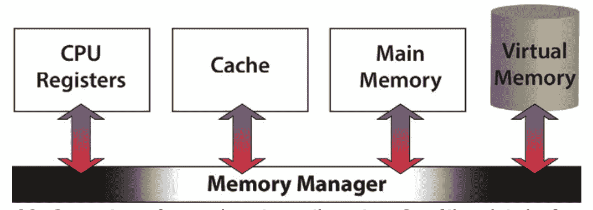

图 3.2 – 大多数计算系统中常见的内存类型。内存管理的主要任务之一是确保信息在需要时位于内存的适当区域，以及管理信息如何在内存管理器可用的不同类型内存之间移动。

## 内存保护 12
内存保护的主要目的是防止进程访问未分配给它的内存。实现内存保护有几种方法。其中三种最常见的是分段、分页和保护键。分段是指将计算机的内存划分为段。对内存位置的引用包括一个标识段的值和该段内的偏移量。分页将内存地址空间划分为称为页面的等大小块。页表将虚拟内存映射到物理内存。页表使分配额外内存变得更容易，因为每个新页面可以从物理内存的任何位置分配。应用程序不可能访问未明确分配给它的页面，因为每个内存地址要么指向分配给该应用程序的页面，要么会产生称为页面错误的中断。从应用程序的角度来看，未分配的页面以及分配给任何其他应用程序的页面都没有地址。保护键机制将物理内存划分为特定大小的块，每个块都有一个关联的数值，称为保护键。每个进程也与其关联一个保护键值。当访问内存时，硬件会检查当前进程的保护键是否与正在访问的内存块关联的值匹配；如果不匹配，则会发生异常。

计算机安全的内存保护包括地址空间布局随机化（ASLR）和可执行空间保护等额外技术。ASLR 涉及随机排列程序的关键数据区域的位置，包括可执行文件的基址以及进程内存地址空间中堆栈、堆和库的位置。地址空间布局随机化基于攻击者猜测随机放置区域位置的几率很低。增加搜索空间可以提高安全性。13 可执行空间保护是将内存区域标记为不可执行，这意味着在这些区域中执行任何机器代码的尝试都会导致异常。许多 64 位操作系统以某种形式实现可执行空间保护与 ASLR，以防止某些类型的缓冲区溢出攻击发生，例如返回到 libc 和返回到 plt 攻击。14

## 次级存储
次级存储保存 CPU 当前未使用的数据，并在数据必须使用大容量、非易失性存储长期保存时使用。计算机系统使用多种媒体类型以原始数据和程序的形式存储信息。这些媒体在存储容量、访问速度、存储永久性和访问模式方面有所不同。固定磁盘可在个人计算机中存储多达数 TB，在大型系统中可存储多达数百 PB。

固定磁盘数据访问是随机的，比 RAM 访问慢。然而，存储在固定磁盘上的数据是永久的，因为断电时不会消失，尽管数据可以被擦除和修改。可拆卸媒体设备可用于存储或运输，包括软盘，可随机访问；磁带，存储量为 GB，且为顺序或随机访问（DLT、SDLT、8 毫米 DAT）；光学光盘（CD），每个 CD 存储 650 至 870 MB；大容量 DVD 和蓝光光盘，存储量为 50 至 125 GB。CD 和 DVD 都使用随机访问。外部硬盘和 USB 驱动器的容量从几 GB 到 TB 不等，且基于随机访问。

## 虚拟内存
大多数操作系统都具有模拟系统物理可用主内存更多的能力。这是通过将部分数据存储在次级存储（如磁盘）上实现的。这可以被视为一个虚拟页面。如果系统请求的数据当前不在主内存中，就会发生页面错误。此条件会触发操作系统处理程序。如果虚拟地址有效，操作系统将定位物理页面，将正确信息放入该页面，更新转换表，然后再次尝试请求。可能会交换出其他页面以腾出空间。每个进程可能拥有自己的独立虚拟地址空间以及自己的映射和保护。


虚拟内存被开发出来的原因之一是，计算机系统的物理内存容量有限，而且通常这个RAM容量不足以同时运行用户想要使用的所有程序。例如，在Windows操作系统下加载了电子邮件程序、网页浏览器和文字处理器后，物理内存可能不足以容纳所有数据。如果没有虚拟内存这样的实体，计算机将无法再加载更多应用程序。借助虚拟内存，操作系统会查找RAM中最近未被访问的数据，并将其复制到硬盘上。清理出的空间现在可用于加载其他应用程序（但仍受相同物理内存的限制）。这个过程自动进行，计算机就好像拥有几乎无限的RAM可用。由于硬盘比RAM芯片便宜，虚拟内存提供了一种良好且经济高效的解决方案。

使用虚拟内存存在潜在的缺点，尤其是当它配置不当时。要利用虚拟内存，系统必须配置交换文件。这个交换文件或页面文件是硬盘上用于存储RAM中数据的区域。这些RAM页面（称为页框）由操作系统用来在页面文件和RAM之间来回移动数据。

在访问数据方面，硬盘驱动器的读写速度远低于RAM访问速度。此外，由于硬盘驱动器并非设计为持续访问微小数据块，如果系统过度依赖虚拟内存，可能会对性能产生负面影响。一种解决方案是安装足够的RAM以同时运行所有任务。即使物理内存充足，系统在任务切换时也可能会遇到轻微延迟。然而，在RAM容量适当的情况下，虚拟内存运行良好。另一方面，如果RAM容量不足，操作系统将不得不持续在硬盘和RAM之间交换数据。这种磁盘与RAM之间的数据颠簸也会降低计算机系统的速度。

## 固件

固件是将程序或指令存储在ROM中。通常，这种软件嵌入硬件中，用于控制该硬件。由于ROM是非易失性的，这些程序和指令在断电时不会改变，而是成为系统的永久部分。不应允许用户对固件进行操作。

通常，固件是可升级的，存储在电可擦除可编程只读存储器（EEPROM）中。这在固件可能存在缺陷、升级可以修复问题的情况下非常方便。硬件本身在不替换其部分组件的情况下无法升级。因此，供应商尽可能将重要的控制信息存储在固件中，以备需要更改时使用。从供应商的角度来看，如果发现缺陷，最好通知受影响客户升级固件，而不是更换产品。具有固件的设备示例包括计算机系统、外围设备以及USB闪存盘、存储卡和移动电话等配件。

## 外围设备和其他输入/输出（I/O）设备

数据需要输入、处理，并生成输出。数据在众多位置之间传输——从磁盘到CPU，或从CPU到内存，或从内存到显示适配器。在每一对实体之间设置独立电路是不现实的。例如，吞吐量会太慢。然而，当实现总线概念时，一组共享的导线连接所有计算机设备和芯片。某些导线传输数据；其他导线发送控制和时钟信号。标识特定设备或内存地址的地址被传输，当某个设备的地址被传输时，相应设备便通过导线将数据传输到CPU、RAM、显示适配器等。

数据是输入计算机的原始信息，程序是为计算机提供指令的指令集合。为告诉系统要执行哪些任务，用户向系统输入命令。为便于使用，输入采用各种形式。命令和响应可以通过键盘或鼠标在本地输入，通过菜单和图标，或者从另一个系统或外围设备远程输入。

计算机处理的结果被视为输出。该输出以二进制或十六进制数字表示，但为了让用户理解输出，它以字母数字字符和单词的形式呈现，并由人类解释为视频、音频或打印文本。因此，输出设备可以是计算机显示器、扬声器系统、激光打印机以及多功能一体机。输入是通过接口接收的信号，输出是从接口发送的信号。人（或另一台计算机系统）通过使用这些接口（I/O设备）与计算机通信。总之，CPU和主内存协同工作是计算机的核心处理过程，而信息从该组合传出或传入，例如从磁盘驱动器检索数据和向磁盘驱动器存储数据，都被视为I/O。

名为驱动程序的软件程序控制输入输出设备以及用于系统I/O的通信通道。驱动程序使操作系统能够控制硬件并与之通信。不同的信号需要不同的接口，这些接口根据I/O设备的通信通道而有所不同。例如，通用串行总线（USB）设备通过连接到USB端口的USB电缆进行通信。当前的USB标准支持更高的速度和大量外围设备，如可移动磁盘驱动器、鼠标、打印机和键盘。

## 操作系统

操作系统是一种软件，从计算机开机或启动的那一刻起就控制其运行。操作系统控制所有进出外围设备的输入和输出，也控制其他程序的运行，并允许用户在不具体了解数据如何存储和检索的情况下处理和管理文件。在多用户系统中，操作系统将管理用户对处理器和外围设备的访问，并调度作业。

系统内核是操作系统的核心，其主要功能之一是提供对系统资源的访问，这些资源包括系统的硬件和进程。内核提供关键服务：它加载并运行二进制程序，调度任务交换（这使得计算机系统能够同时执行多件事），分配内存，并跟踪文件在计算机硬盘上的物理位置。内核通过充当在其控制下运行的其他程序与计算机物理硬件之间的接口来提供这些服务；这使系统上运行的程序免受计算机复杂性的影响。例如，当一个正在运行的程序需要访问文件时，它不会直接打开文件。相反，它会发出系统调用，请求内核打开文件。内核接管并完成请求，然后通知程序请求成功或失败。要从文件中读取数据，需要另一次系统调用。如果内核确定请求有效，它会读取所请求的数据块并将其传递回程序。

## 它们如何协同工作

程序是一组指令，以及处理这些指令所必需的信息。当程序执行时，它会生成一个进程或该程序的一个实例。然后该进程请求任何必要的资源（通常称为句柄或描述符）。

操作系统分配运行程序所需的资源，如内存。一个进程从最初进入系统到完成或退出，会经历各个阶段。从进程的角度来看，它要么在运行，要么不在运行，每个进程的状态都维护在进程表中。

当进程请求资源时，它会创建一个或多个独立线程。线程之间不像进程那样存在父子关系。这是


安全架构。为了确保组织获得应对最常见风险的适当控制水平，良好的架构必须全面但也保持简单。它还必须避免不必要的服务重复或可能损害安全服务业务效益的复杂性。它必须能够随着时间的推移应对控制要求的变化。

- **它提供统一的通用安全控制愿景：** 通过提供这种通用服务模型，架构从整体视角审视安全控制，识别这些控制中的潜在差距并提供长期改进计划。因此，它是良好安全管理的实践中的基本组成部分。
- **它利用现有的技术投资：** 任何建议的安全措施在可行时都应重复使用已部署在企业中的现有技术。通过关注组织已部署的内容，架构可以充分利用内部技能、许可和协议，以最大限度地减少培训或人员补充的需求。
- **它为当前和未来的威胁以及核心功能的需求提供灵活的方法：** 如果实施得当，架构的实现应足够灵活，能够为当前和新兴威胁提供保障和对策。然而，它也必须足够灵活，以允许组织内的核心应用程序按预期运行和集成。

结果应为一种支持并与以下内容集成的架构：

1. 一个有效的[content]
安全架构。为了确保组织获得应对最常见风险的适当控制水平，良好的架构必须全面但也保持简单。它还必须避免不必要的服务重复或可能损害安全服务业务效益的复杂性。它必须能够随着时间的推移应对控制要求的变化。

- **它提供统一的通用安全控制愿景：** 通过提供这种通用服务模型，架构从整体视角审视安全控制，识别这些控制中的潜在差距并提供长期改进计划。因此，它是良好安全管理的实践中的基本组成部分。
- **它利用现有的技术投资：** 任何建议的安全措施在可行时都应重复使用已部署在企业中的现有技术。通过关注组织已部署的内容，架构可以充分利用内部技能、许可和协议，以最大限度地减少培训或人员补充的需求。
- **它为当前和未来的威胁以及核心功能的需求提供灵活的方法：** 如果实施得当，架构的实现应足够灵活，能够为当前和新兴威胁提供保障和对策。然而，它也必须足够灵活，以允许组织内的核心应用程序按预期运行和集成。

结果应为一种支持并与以下内容集成的架构：

1. 一个有效的[content]
安全架构。为了确保组织获得应对最常见风险的适当控制水平，良好的架构必须全面但也保持简单。它还必须避免不必要的服务重复或可能损害安全服务业务效益的复杂性。它必须能够随着时间的推移应对控制要求的变化。

- **它提供统一的通用安全控制愿景：** 通过提供这种通用服务模型，架构从整体视角审视安全控制，识别这些控制中的潜在差距并提供长期改进计划。因此，它是良好安全管理的实践中的基本组成部分。
- **它利用现有的技术投资：** 任何建议的安全措施在可行时都应重复使用已部署在企业中的现有技术。通过关注组织已部署的内容，架构可以充分利用内部技能、许可和协议，以最大限度地减少培训或人员补充的需求。
- **它为当前和未来的威胁以及核心功能的需求提供灵活的方法：** 如果实施得当，架构的实现应足够灵活，能够为当前和新兴威胁提供保障和对策。然而，它也必须足够灵活，以允许组织内的核心应用程序按预期运行和集成。

结果应为一种支持并与以下内容集成的架构：

1. 一个有效的[content]
安全架构。为了确保组织获得应对最常见风险的适当控制水平，良好的架构必须全面但也保持简单。它还必须避免不必要的服务重复或可能损害安全服务业务效益的复杂性。它必须能够随着时间的推移应对控制要求的变化。

- **它提供统一的通用安全控制愿景：** 通过提供这种通用服务模型，架构从整体视角审视安全控制，识别这些控制中的潜在差距并提供长期改进计划。因此，它是良好安全管理的实践中的基本组成部分。
- **它利用现有的技术投资：** 任何建议的安全措施在可行时都应重复使用已部署在企业中的现有技术。通过关注组织已部署的内容，架构可以充分利用内部技能、许可和协议，以最大限度地减少培训或人员补充的需求。
- **它为当前和未来的威胁以及核心功能的需求提供灵活的方法：** 如果实施得当，架构的实现应足够灵活，能够为当前和新兴威胁提供保障和对策。然而，它也必须足够灵活，以允许组织内的核心应用程序按预期运行和集成。

结果应为一种支持并与以下内容集成的架构：

1. 一个有效的[content]
安全架构。为了确保组织获得应对最常见风险的适当控制水平，良好的架构必须全面但也保持简单。它还必须避免不必要的服务重复或可能损害安全服务业务效益的复杂性。它必须能够随着时间的推移应对控制要求的变化。

- **它提供统一的通用安全控制愿景：** 通过提供这种通用服务模型，架构从整体视角审视安全控制，识别这些控制中的潜在差距并提供长期改进计划。因此，它是良好安全管理的实践中的基本组成部分。
- **它利用现有的技术投资：** 任何建议的安全措施在可行时都应重复使用已部署在企业中的现有技术。通过关注组织已部署的内容，架构可以充分利用内部技能、许可和协议，以最大限度地减少培训或人员补充的需求。
- **它为当前和未来的威胁以及核心功能的需求提供灵活的方法：** 如果实施得当，架构的实现应足够灵活，能够为当前和新兴威胁提供保障和对策。然而，它也必须足够灵活，以允许组织内的核心应用程序按预期运行和集成。

结果应为一种支持并与以下内容集成的架构：

1. 一个有效的[content]
安全架构。为了确保组织获得应对最常见风险的适当控制水平，良好的架构必须全面但也保持简单。它还必须避免不必要的服务重复或可能损害安全服务业务效益的复杂性。它必须能够随着时间的推移应对控制要求的变化。

- **它提供统一的通用安全控制愿景：** 通过提供这种通用服务模型，架构从整体视角审视安全控制，识别这些控制中的潜在差距并提供长期改进计划。因此，它是良好安全管理的实践中的基本组成部分。
- **它利用现有的技术投资：** 任何建议的安全措施在可行时都应重复使用已部署在企业中的现有技术。通过关注组织已部署的内容，架构可以充分利用内部技能、许可和协议，以最大限度地减少培训或人员补充的需求。
- **它为当前和未来的威胁以及核心功能的需求提供灵活的方法：** 如果实施得当，架构的实现应足够灵活，能够为当前和新兴威胁提供保障和对策。然而，它也必须足够灵活，以允许组织内的核心应用程序按预期运行和集成。

结果应为一种支持并与以下内容集成的架构：

1. 一个有效的[content]
安全架构。为了确保组织获得应对最常见风险的适当控制水平，良好的架构必须全面但也保持简单。它还必须避免不必要的服务重复或可能损害安全服务业务效益的复杂性。它必须能够随着时间的推移应对控制要求的变化。

- **它提供统一的通用安全控制愿景：** 通过提供这种通用服务模型，架构从整体视角审视安全控制，识别这些控制中的潜在差距并提供长期改进计划。因此，它是良好安全管理的实践中的基本组成部分。
- **它利用现有的技术投资：** 任何建议的安全措施在可行时都应重复使用已部署在企业中的现有技术。通过关注组织已部署的内容，架构可以充分利用内部技能、许可和协议，以最大限度地减少培训或人员补充的需求。
- **它为当前和未来的威胁以及核心功能的需求提供灵活的方法：** 如果实施得当，架构的实现应足够灵活，能够为当前和新兴威胁提供保障和对策。然而，它也必须足够灵活，以允许组织内的核心应用程序按预期运行和集成。

结果应为一种支持并与以下内容集成的架构：

1. 一项有效的安全计划，该计划认识到所有信息在价值和风险方面并不相等或随时间恒定。
2. 一项高效的安全计划，针对最关键的资产应用合适的技术来保护，结合能够将风险降低到可接受的业务水平的优质流程。这是通过某种形式的评估流程实现的。
3. 一项高质量的安全计划，包括定期的管理评审和技术评估，以确保控制措施按预期工作并提供反馈，以便技术和流程能够随着价值和风险的变化而适应。这作为系统保证计划的一部分进行衡量和监控。

## 预期[content]
安全架构。为了确保组织获得应对最常见风险的适当控制水平，良好的架构必须全面但保持简单。它还必须避免不必要的服务重复或损害安全服务业务效益的复杂性，并能随时间演进应对控制要求。

- **它提供统一的通用安全控制愿景：** 通过通用服务模型，架构从整体视角审视安全控制，识别潜在差距并制定长期改进计划，是良好安全管理的核心部分。
- **它利用现有技术投资：** 建议的安全措施在可行时应复用企业已部署的技术。聚焦已部署资源可充分利用内部技能、许可和协议，减少培训或人员补充需求。
- **它为当前和未来威胁及核心功能需求提供灵活方法：** 实施良好的架构应足够灵活，为当前和新兴威胁提供防护和对策，同时允许组织核心应用按预期运行和集成。

结果应为一种支持并与以下内容集成的架构：

1. 一项有效的安全计划，认识到信息在价值和风险上并非相等或恒定。
2. 一项高效的安全计划，对最关键资产应用合适技术，结合降低风险至可接受业务水平的优质流程，通过评估流程实现。
3. 一项高质量的安全计划，包含定期管理评审和技术评估，确保控制按预期工作并提供反馈，使技术和流程能随价值和风险变化而适应，作为系统保证计划的一部分进行衡量和监控。

## 预期效益

设计各不相同，但所有 ESA 都力求：

- 为 IT 架构师和高层管理提供指导，帮助决策者做出更好的安全投资和设计决策；
- 为安全环境建立面向有限安全服务集的未来技术架构；
- 支持、启用和扩展安全政策和标准；
- 描述指导技术架构和解决方案层级安全相关决策的通用安全策略；
- 利用行业标准和模型确保应用安全最佳实践；
- 呈现并记录安全架构的各个要素，确保与其他架构域的正确关联和对齐；
- 在与其他技术域的关系中定义技术安全架构；
- 了解其他域的开发和实施对安全态势的影响，是否更好、更差或无变化；
- 在整个项目中一致管理 IT 解决方案风险，同时利用行业最佳实践；
- 通过实施可复用、通用的安全服务降低成本并提高灵活性；以及
- 在必要时提供安全机制以进行生命周期结束和退役解决方案。

## 定义和维护企业安全架构

ESA 首先需了解组织的整体战略方向及支持其的 IT 交付策略。关键业务驱动因素和技术定位也需记录。当前政策和标准作为需求收集的输入，特别是法律或监管合规方面。由于安全取决于主体对客体的访问问题，需捕捉常见用户类型、敏感或关键资产类型，以及访问应如何缓解。为捕捉高层优先事项，需讨论并记录公认的安全和安全架构原则。其他需求通过与关键利益相关者访谈、文档评审和当前 IT 安全管理流程和程序获得。所有输入用于提供安全服务的一整套综合需求。任何设计的成功可通过其与这些标准的契合度衡量。

需求记录后用于推导架构模型。安全架构师从描述多组通用安全服务概念目标模型开始。服务根据其预期用户、访问的系统和数据以及在用例上下文中如何应用安全来定义。目标模型包括每组通用安全服务的层级逻辑模型以及使用这些模型的演练，结合用户组和场景。初期，架构师可选择开发有限的目标模型以解决最关键的业务问题，未来可添加更多模型。

组件模型和物理模型更细粒度，涉及单个系统内的安全组件。组件模型以通用组件、组件流和节点描述安全功能。物理模型在实施期间开发，展示实施上下文中的安全服务。这类模型作为部署新服务的项目的一部分开发，并在开发期间纳入 ESA。随着决策做出，它们被记录为架构决策。这些是单独文档，描述所涉问题、考虑过的选项和决策理由，确保所有决策可持续评审。

模型有助于界定 ESA 的最终形态，但必须以将组织从当前环境迁移到未来状态的实用、有序过渡活动为基础。模型开发时记录当前安全控制环境。然后进行差距分析，并根据业务优先事项和相互依赖关系对解决差距的步骤进行优先级排序。这些随后形成战略路线图，显示在通常三到五年期间如何解决差距。

安全架构师必须准备好在设计开发期间处理任何问题、风险和计划更新。例如，威胁/风险评估提供量化 IT 相关风险的方法，可用于验证新安全控制和对策应对已识别风险的能力。若发现或引入新漏洞，它也可用于确定是否需要对整体 ESA 进行更改。

在对当前威胁/风险环境有明确认识后，安全架构师可为解决方案级设计和实施设定优先级，并可重新验证安全设计，以确保高层需求和模型保持最新。

## 通用安全服务

多种安全功能可作为企业通用安全服务的基础。大多数 ESA 区分不同类型的服务。以下为可在 ESA 中用作构建块的服务样本分类。

- **边界控制服务** – 这些服务关注信息是否以及如何从一组系统流向另一组系统，或从一种状态流向另一种状态。边界控制系统旨在通过隔离一个区域到另一个区域的入口点来强制执行安全控制区域。由此，它们提供跨安全区域访问或传输信息的通用点。这些系统将包括典型的范围安全网络设备——防火墙、边界路由器、代理和其他边界服务——旨在保护更受信任/敏感资产免受较少受信任/敏感资产的侵害。
- **访问控制服务** – 这些服务侧重于在部署和使用以访问组织资产时对主体实体进行识别、认证和授权。 作为战略服务集，它们旨在规范识别并在整个企业中推广共享认证。一般而言，这些服务将推广减少登录 RSO 或单点登录 SSO，但也将把 RSO 或 SSO 服务本身作为通用服务。¹⁵ 它还将包括企业中凭证创建、处理和存储周围的许多其他服务。在授权方面，这些服务侧重于在自动化系统强制执行的规则集下，有效用户实体在企业内被允许和不允许做什么。它们将提供粗粒度系统级授权服务，可被企业架构中的其他域利用。
- **完整性服务** – 完整性服务侧重于通过自动化检查来检测和纠正损坏，从而维护高完整性系统和数据。作为通用服务集，这些可以被利用


企业在各个层面上，但其中许多是面向可由不受信任或信任程度较低的用户实体或系统直接访问的系统。完整性服务通常侧重于防病毒、内容过滤、文件完整性服务、白名单和入侵防御系统（IPS）。

- **加密服务 –** 虽然密码学是许多系统常用的安全工具，但加密服务侧重于可由各种系统部署和重复使用的通用服务。这将涉及适度的公钥基础设施（PKI），以及通过外部提供商持续使用 PKI 功能。这还可能包括常见的哈希和加密服务、工具和技术。
- **审计和监控服务 –** 这些服务将侧重于通过集中式日志记录对审计事件进行安全收集、存储和分析，以及通过入侵检测系统（IDS）和类似服务对事件本身进行处理。服务将包括通过部署安全事件信息管理（SEIM）解决方案实现的日志收集、汇总和分析服务。鉴于所需的集中式基础设施，这里也是考虑集中式管理系统的合适场所。

## 安全控制区域

在复杂且主要分布的环境中保持一致且可管理的风险水平是一项重大挑战。网络的便捷访问使情况变得复杂，尤其是在涉及公共可访问网络（如互联网）或外包环境时。安全架构师需要意识到，他们的行动和选择可能导致安全（应用机制以降低风险）与用户可访问性之间的权衡，并且他们应尽一切努力在保持架构完整性的同时最大限度地减少这种影响。某些信息高度敏感或很有价值，而其他信息则要少得多（例如，关于历史建筑的网页上的公共信息）。挑战在于在不极大地影响信息访问的情况下应用适当数量的安全控制。

以下问题有助于理解这种复杂性：

- 信息资产在与其存在的环境相关的情况下是如何受到保护的？
- 访问信息资产所需的适当身份验证级别是什么？通过不受信任的网络访问资产时是否存在差异？内部网络内是否有类似要求？
- 如何保护保密性？所需的保密级别是否取决于资产的访问位置或方式？
- 如何确保受保护资源的可用性？访问控制对其会产生积极还是消极影响？
- 是否存在具有高完整性要求的资产？当许多实体被授予访问权限时，如何维护资产的完整性？
- 当信息资产可能具有如此不同的特征时，架构师如何决定如何应用这些权衡？

解决这些问题的一种方法是使用安全控制区域。安全控制区域是在其中应用一组定义的安全策略和措施以实现特定安全级别的区域或分组。区域用于将具有相似安全要求和风险水平的实体组合在一起，并确保每个区域与其他区域充分隔离。

区域的分离确保了访问或修改更安全区域中的信息和系统的能力不会泄漏到较不安全的区域。区域之间的访问通过防火墙、身份验证服务和代理服务等控制机制进行严格控制。安全控制区域成为安全架构中至关重要的高级设计构造。以下图表（图 3.3）取自美国国家标准与技术研究院（NIST），使用子系统防护说明了这一概念（联合特遣部队转型倡议 2010 年 2 月）。16

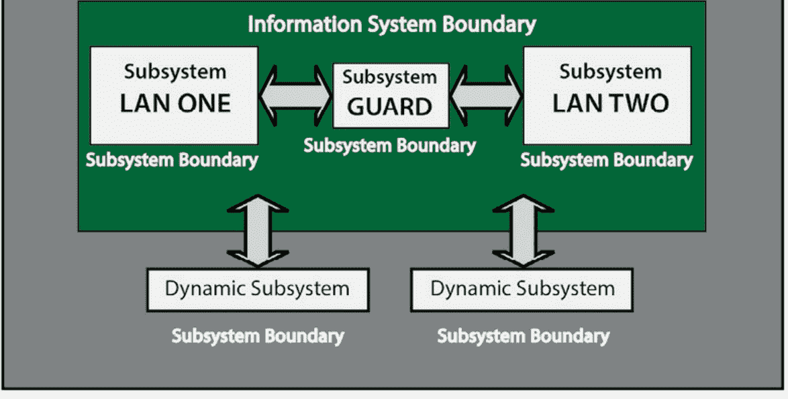

图 3.3 - 子系统防护的示例

## 常见架构框架

没有两个安全架构师可能会产生相同的设计或以相同的方式处理问题。为了帮助一个安全架构师理解另一个人产生的设计，任何设计都必须使用标准化方法创建，以便其他安全架构师（以及业务所有者、审计员和其他人）验证其设计流程和交付成果。这要求安全架构师对其使用的方法保持透明。为了便于接受其设计，安全架构师可以利用在多个行业和学科中使用的常见架构框架。

架构框架是一种可用于开发各种不同架构的结构。它描述了一种将目标状态设计为集成系统或系统组件集合的方法，并提供一套工具来简化架构开发和通用词汇。它还经常包括一套推荐的标准和操作实践。它们还可能包括有关符合框架内可作为设计元素使用的供应商产品、模块或组件的信息。以下描述了企业架构中使用的一些常见架构框架，以及特别针对安全架构的几个框架。

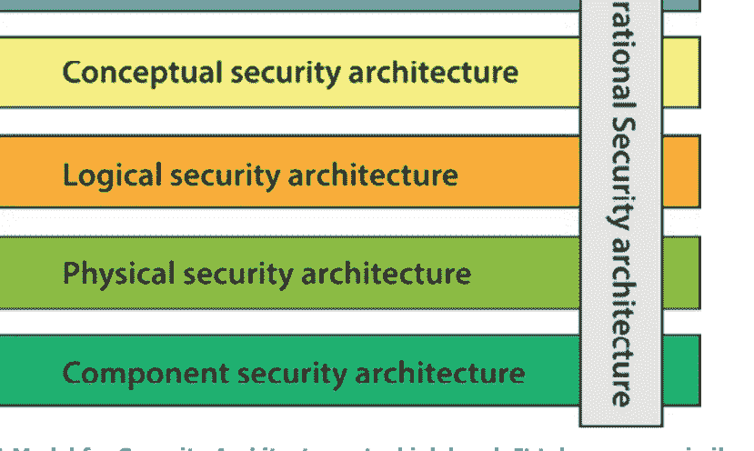

图 3.4 - 安全架构的 SABSA 模型的高层视图。它采用与 Zachman 框架非常相似的方法，通过以不同的详细程度和针对不同受众来描述任何架构。

（可在网上获取 http://www.sabsa-institute.org/the-sabsa-method/the-sabsa-model.aspx。经许可）

## Zachman 框架 17

在 1980 年代，约翰·扎克曼（John Zachman），联邦企业架构框架（FEAF）工作的贡献者，开发了一个理解复杂架构的通用上下文。他的 Zachman 框架允许架构开发过程中的所有实体进行沟通和协作。虽然不是专门针对安全架构，但它为整合各种视角（如计划、设计和构建方面）提供了一个逻辑结构。正如扎克曼本人所解释的那样，“该框架在应用于企业时，是识别和组织描述性表示（模型）的逻辑结构，这些模型在企业管理以及构成它们的系统（自动和手动）的开发中很重要。”

## Sherwood 应用业务安全架构（SABSA）框架 18

旨在遵循 Zachman 提供的相同基本大纲，SABSA 是开发安全架构的整体生命周期，从评估业务需求开始，随后通过战略、概念、设计、实施和指标阶段创建“可追溯性链”。它使用六个层表示任何架构，每个层代表目标系统设计、构建和使用的一种不同视角（见图 3.4）。

## The Open Group 架构框架（TOGAF）19

最初受到美国国防部早期框架的启发，The Open Group 在 1990 年代中期开始开发 TOGAF。它是组织希望设计和构建企业架构的开放框架。TOGAF（图 3.5）提供了一套通用术语、一种架构开发方法（ADM），描述了 TOGAF 架构师采用的逐步过程、一种架构内容框架（ACF）来描述标准构建块和组件以及众多参考模型。它还提供了有关组织如何最好地将 TOGAF 整合到其企业中的建议。


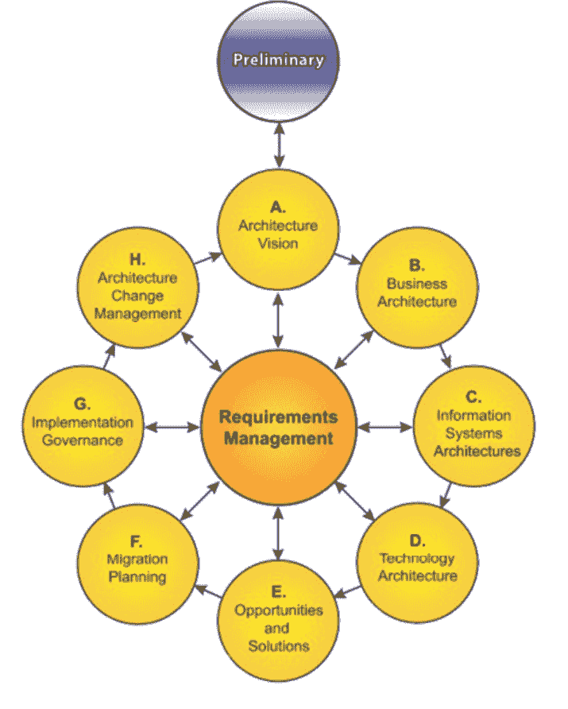

图3.5 – TOGAF架构开发方法。它强调了需求分析在该模型每一步中所扮演的关键角色。
（来源：Marley, S., Architectural Framework, NASA /SCI, 2003。）

## IT基础设施库（ITIL）20

ITIL由英国政府支持下的中央计算机与电信局（CCTA）制定，是一套IT治理最佳实践集合。ITIL定义了IT组织的组织结构和技能要求，以及指导IT运营和基础设施（包括信息安全运营）的一套操作流程和实践。ITIL不断发展。当前版本的ITIL与众不同之处在于对端到端服务交付和管理的强烈关注。ITIL v4包含五个主要活动或任务：服务战略、服务设计、服务转换、服务运营和持续服务改进。

这些活动中的每一项都在ITIL中单独成卷加以论述。图3.6展示了构成ITILv4的五个主要“卷册”及其相互关系：

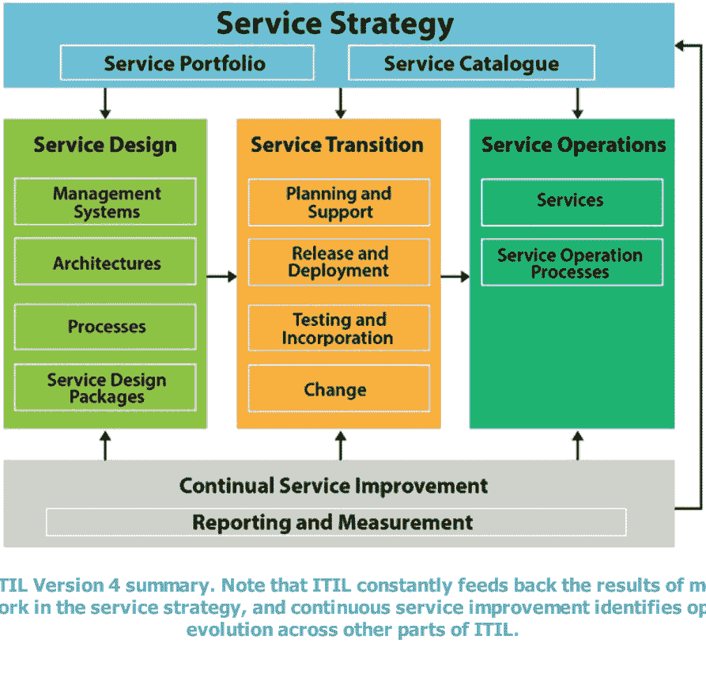

图3.6 - ITIL第4版概要。请注意，ITIL持续将更详细的架构工作成果反馈到服务战略中，而持续服务改进则识别ITIL其他部分中演进的机会。

- 服务战略 – 通过描述当前或将要部署的服务范围来满足新的业务需求。服务组合包含IT提供的所有服务。这些服务可能包括完全位于IT组织内部的服务，以及向其客户提供的服务。服务目录是服务组合的一个有限子集，仅包含面向IT客户的服务。这些服务在ITIL中受到特别关注，因为成败通常以服务客户的能力来衡量。服务战略为ITIL下的大多数其他活动提供需求，包括服务设计、服务转换和服务运营。服务战略的变更可能源于业务需求的变化，也可能源于持续服务改进。
- 服务设计 – 专注于创建服务组合中所述的服务。除了描述单个服务设计以及用于管理服务的度量和服务水平的服务设计包之外，ITIL中的这一部分还侧重于指导或约束设计的管理系统和架构，以及既有的设计流程。服务设计包是服务设计的关键交付物，因为这些包是服务转换的主要输入。
- **服务转换 —** 主要关注通过标准的项目管理结构将设计转化为运营服务。它还负责管理对现有服务的变更。规划与支持侧重于为服务转换提供必要的结构，尤其是在部署多个服务时。发布与部署代表一组核心流程，通过分阶段部署来指导新增或更新服务的部署。测试与纳入旨在确保新部署的服务满足服务设计和服务战略要求，并确保服务已正确纳入生产环境。变更管理提供相应的结构和流程。一旦服务部署完成，它们将转入稳态服务运营。ITIL中这一部分的关键是服务运营流程，它为服务交付提供结构，并确保度量指标被捕获。

这些度量指标是持续服务改进的关键输入。通过报告和测量，每项服务都根据其各自的关键绩效指标和服务水平进行验证。基于提供改进的需求，ITIL的这一部分向服务管理的所有其他方面提供反馈。它可能对服务战略内的变更提出建议。它可能推荐对服务设计任何方面的变更。它可能为通过服务转换部署或测试服务的方式提供输入。最后，它可能为服务运营中的服务运营流程提供输入。

## 安全模型的类型

大多数安全模型侧重于在特定时间点定义主体（主动方）与客体（被动方）之间被允许的交互。例如，考虑一个用户试图访问计算系统上文件的简单例子。作为主动方，用户是主体，而文件则被视为客体。以下类型的安全模型以略有不同的方式处理该问题。

- **状态机模型 21—** 状态描述系统在某一时间点的状态。状态机模型随后描述系统在某一时刻向另一时刻、从一个状态向另一个状态移动时的行为。通常，它使用数学来描述系统状态和定义允许或不允许动作的转换函数。当它用于安全建模时，其目的是定义在任何时间点将允许哪些动作，以确保安全状态（事物安全的时间点）得以保持。时间在状态机模型中的作用非常重要。根据由安全策略确定的规则集，一个模型系统的安全状态只能在不同的时间点发生变化，例如当事件发生或时钟触发时。因此，在初始启动时，系统会检查以确定其是否处于安全状态。一旦系统被确定为处于安全状态，状态机模型将确保每次系统被访问时，都仅按照安全策略规则进行访问。这个过程将保证系统只能从一个安全状态转换到另一个安全状态。
- **多级格模型 22—** 多级安全模型描述了主体和客体的严格层级，并定义了明确的规则，根据它们所处的层级允许或禁止它们之间的交互。这些通常使用格来描述，即各层之间接口极少或没有接口的离散层级。大多数格模型定义了一个分层的格，其中层级的权限由低到高。主体被分配安全许可级别，以确定它们被分配到哪个层级，客体也被分类到类似的层级。相关的安全标签被附加到所有主体和客体上。根据这种模型，主体的许可级别与数据的分类级别进行比较以确定访问权。它们还会查看主体试图执行的操作，以确定是否应允许访问。
- **非干扰模型 23—** 可以被视为一种高度严格的多级模型，严格限制任何较高级别的秘密信息与较低权限的主体共享，即使较高权限的主体同时正在使用系统也是如此。换言之，这些模型不仅处理主体和客体之间明显的、有意的交互，还处理可能不恰当地泄漏信息的隐蔽信道的影响。非干扰模型的目标是帮助确保高层动作（输入）不决定低层用户能看到的内容（输出）。前文介绍的大多数安全模型都是通过允许高低层用户之间的受限流动来保证安全。而非干扰模型则在不同安全级别上维护活动，将这些级别彼此分离。通过这种方式，它将通过隐蔽信道可能发生的泄漏降到最低，因为安全级别之间完全隔离。因为处于较高安全级别的主体


没有办法干预较低层级的活动，较低层级的主体无法从较高层级获取任何信息。

- **矩阵模型** — 虽然基于格的模型倾向于对具有相似限制的相似主体和对象进行处理，但矩阵模型则关注主体和对象之间的一对一关系。最著名的例子是将主体和对象组织成访问控制矩阵。访问控制矩阵是一个二维表格，允许各个主体和对象相互关联。它在表格左侧列出主体（如用户或进程），在顶部列出所有资源和功能。矩阵是表示主体在访问特定对象时所具有的能力的简洁方式。为了便于操作，单个主体可以被放入组或角色中，并且矩阵是根据角色或组成员身份构建的。这提供了管理便捷性和简化。大多数矩阵模型提供的不只是简单的二元规则（如允许或拒绝）。有时，指定访问将如何执行或主体将需要哪些能力是有益的。也许某些主体仅被允许只读，而其他主体可以读写。访问方法的列表应符合组织的需求。内容典型的访问方法为读、写、编辑和删除。记录此类信息需要扩展访问控制矩阵以在每个单元格中包含适当的权限。需要注意的是，该模型并未描述模型中主体之间的关系，例如一个主体是否创建了另一个主体或授予另一个主体访问权限。

- **信息流模型** 24 — 虽然大多数模型关注主体到对象的关系，但信息流模型关注信息在各个对象之间是否被允许流动。信息流模型用于确定信息在给定过程中是否得到适当保护。它们可用于识别潜在的隐蔽通道，即在分区系统中隔间之间非预期的信息流动。例如，尽管隔间 A 没有授权路径可以这样做，但它可以通过改变 B 可以看到的变量或条件向隔间 B 发送信息。这通常涉及隔间所有者之间以系统管理者未打算或未预料的方式进行合作。或者，隔间 B 也可以简单地通过观察受 A 行为影响的某些条件来收集有关隔间 A 的情报。

## 安全模型示例

有数百种安全模型。以下是一些对多年来安全服务开发方式产生重大影响的示例。

### Bell–LaPadula 保密模型 25

Bell–LaPadula 模型或许是最著名且最重要的安全模型，同时也是用于创建现代安全计算系统时使用的最古老模型之一。像可信计算机系统评估准则（或 TCSEC）一样，它受到了早期美国国防部安全政策的启发，以及证明保密性可以得到维护的需求。换句话说，其主要目标是防止在模型系统从一个状态（一个时间点）转移到另一个状态时发生泄露。

它首先描述了定义主要参与者以及如何区分彼此的四个基本组件。主体是主动方，而对象是被动方。为了帮助确定主体将被允许做什么，它们会被分配权限级别，说明在与被分配分类级别的对象交互时它们将被允许使用的访问模式（读、写或读写）。模型系统使用标签来跟踪权限级别和分类级别，并实现一组规则以限制不同类型主体和对象之间的交互。

使用这组基本组件，Bell–LaPadula 模型探讨了如果主体被授予特定级别的权限和特定访问模式时必须具备的规则。它们根据主体是否具有读取、写入或读写模型系统中对象的能力，将其描述为不同的属性。在简单安全属性（图 3.7）中，Bell 和 LaPadula 考虑了一个具有读取信息能力（但不能写入）的主题，来自更高级别的东西不会导致泄露，即使它使原始主体无法读取它！在某些情况下它也具有一定的实用价值。例如，一个组织的总统可能希望一组下属军官以这样的方式向其上级提交报告：他们无法阅读彼此的报告，同时仍允许其上级阅读并汇总来自下属的报告中的信息。

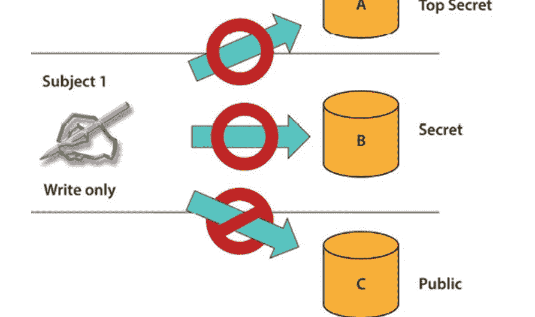

图 3.8 - 根据 Bell–LaPadula 的 \* 属性

主体 1 已被分配机密的权限级别，并且只能写入一组对象。为了防止泄露，主体可以将信息写入被归类为机密或绝密的对象，但被禁止写入被归类为公开的信息。

在强 \* 属性（图 3.9）中，他们考虑了同一个主体具有在模型系统中读取或写入对象的能力。为了在数学上确定主体永远不会泄露信息，它们必须被限制在相似分类级别的对象上，并且不允许与模型系统中的任何其他对象交互。

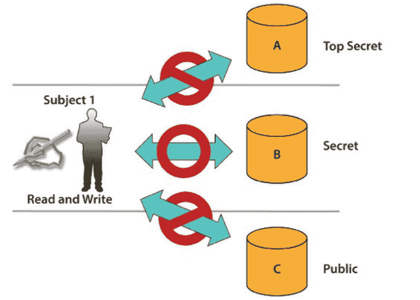

图 3.9 - 根据 Bell–LaPadula 的强 \* 属性

主体 1 已被分配机密的权限级别，并且可以读取或写入一组对象。为了防止泄露，主体只能访问其自身级别分类的信息，在此例中为被归类为机密的对象。

Bell–LaPadula 并非没有局限性。它只关注保密性，对其他属性（如完整性和可用性）或更复杂的访问模式只字未提。这些必须通过其他模型来解决。更重要的是，它没有解决诸如最小权限原则等重要的保密目标，或根据主体访问需求限制对单个对象的访问的能力。由于 Bell–LaPadula 没有为单个主体和对象之间的一对一映射提供机制，这也需要由其他模型来解决。

### Biba 完整性模型 27

像 Bell–LaPadula 一样，Biba 也是一个具有多级的多层格模型。它也使用相同的访问模式（读、写和读写），并描述主体和对象之间的交互。Biba 最明显的区别在于它是一个完整性模型：它侧重于通过防止破坏来确保信息完整性得以维护。模型的核心是多级完整性方法，旨在防止未经授权的主体修改对象。访问受到控制，以确保对象在主体与其交互时保持其当前的完整性状态。与 Bell–LaPadula 使用的保密级别不同，Biba 根据主体和对象被认为的可信程度为其分配完整性级别。

像 Bell–LaPadula 一样，Biba 考虑相同的访问模式但结果不同。图 3.10 比较了 BLP 和 Biba 模型。

| 属性 | BLP 模型 | Biba 模型 |
|---|---|---|
| ss-属性 | 主体不能读取/访问更高分类的对象（禁止向上读） | 主体不能观察较低完整性级别的对象（禁止向下读） |
| \*-属性 | 主体只能保存相同或更高分类的对象（禁止向下写） | 主体不能修改更高完整性级别的对象（禁止向上写） |
| 调用属性 | 未使用 | 主体不能向更高完整性的对象发送逻辑服务请求 |

来源 – Hare, C., Policy development, in Information Security Management Handbook, 6th edn., Tipton, H.F and Krause, M., Eds., Auerbach Publications. New York 2007. 47.

图 3.10 - BLP 和 Biba 模型属性

在简单完整性属性（图 3.11 和图 3.12）中，给定主体具有从具有不同完整性或准确性级别的不同类型对象读取信息的能力。在这种情况下，准确性低于主体预期信息可能会导致破坏，因此主体不得从准确性较低的对象读取，但可以从比主体所需更准确的对象读取。


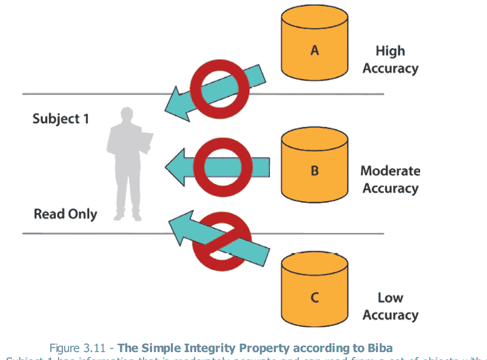

### 图 3.11 - 根据 Biba 的简单完整性属性

在此示例中，主体 1 拥有中等准确度的信息，并且可以从准确度各不相同的对象集合中读取。为了防止破坏，主体可能只能读取准确度相同或更高级别的信息，而不能读取准确度较低的信息，因为这可能会损害其已拥有的信息的完整性。

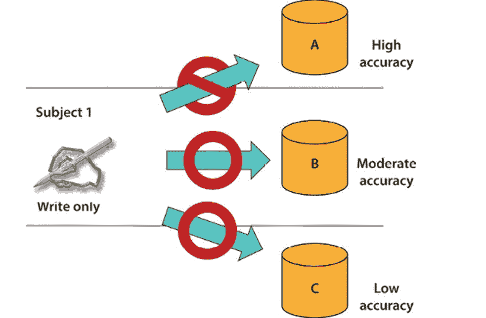

### 图 3.12 - 根据 Biba 的简单完整性属性

在此示例中，主体 1 拥有中等准确度的信息，并且可以向一致性（或模型系统与现实世界之间的一致性）各不相同的一组对象写入，因为评估主体将有权确保交易与现实中预期的一致。

为了解决内部一致性（或模型系统本身内部的一致性），Clark 和 Wilson 建议对 well-formed 交易进行严格定义。换句话说，任何交易中的步骤集合都需要经过精心设计并得到强制执行。任何偏离预期路径的行为都将导致交易失败，从而无法确保模型系统的完整性不受损害。

为了控制所有主体和对象交互，Clark–Wilson 建立了主体-程序-对象绑定系统，使得主体不再直接访问对象。而是通过具有对象访问权限的程序来完成。该程序仲裁所有访问，并确保主体与对象之间的每次交互都遵循一组定义好的规则。程序提供主体认证和识别，并限制对其控制下的所有对象的访问。

## Lipner 模型

Lipner 以一种新颖的方式将 Bell–LaPadula 和 Biba 的元素与工作职能或角色的概念结合起来，以同时保护机密性和完整性。Lipner 于 1982 年发布的实现描述了两种实现完整性的方法。一种使用 Bell–LaPadula 机密性模型，另一种同时使用 Bell–LaPadula 模型和 Biba 完整性模型。两种方法都为主体和对象分配安全级别和功能类别。对于主体，这转化为个人的许可级别和工作职能（例如，用户、操作员、应用程序员或系统程序员）。对于对象，其数据或程序的敏感性和其功能（例如，测试数据、生产数据、应用程序或系统程序）根据其分类来定义。

Lipner 的第一种方法仅使用 Bell–LaPadula 模型，将主体分配到两个敏感性级别之一——系统管理员和其他人——以及四个工作类别之一。对象（即文件类型）被分配特定的分类级别和类别。大多数主体和对象被分配相同的级别；因此，类别成为最重要的完整性（即访问控制）机制。应用程序程序员、系统程序员和用户根据其分配的类别被限制在其自己的域中，从而防止未经授权的用户修改数据（第一个完整性目标）。

Lipner 的第二种方法将 Biba 的完整性模型与 Bell–LaPadula 结合。主体可以执行这些称为命令的权限来对其他主体或对象产生影响。该模型定义了八个原始保护权限：

- 1. **Create Object** – 创建新对象的能力
- 2. **Create Subject** – 创建新主体的能力
- 3. **Delete Object** – 删除现有对象的能力
- 4. **Delete Subject** – 删除现有主体的能力
- 5. **Read Access Right** – 查看当前访问权限的能力
- 6. **Grant Access Right** – 授予访问权限的能力
- 7. **Delete Access Right** – 移除访问权限的能力
- 8. **Transfer Access Right** – 将访问权限从一个主体或对象转移到另一个主体或对象的能力

## Harrison–Ruzzo–Ullman 模型

该模型与 Graham–Denning 模型非常相似，由一组通用权限和有限的命令集组成。它还关注主体应被限制获得特定特权的情况。为此，在必要时，主体被禁止访问可以执行特定命令（例如授予读访问权限）的程序或子程序。

## 捕获和分析需求

无论使用何种框架，安全架构师在任何设计工作开始之前都需要从关键利益相关者和评审者那里确定业务需求。这可能要求架构师与赞助高管、业务线管理、业务流程所有者和 IT 管理密切合作，以捕获和记录主要需求。由于这些需求将决定任何设计的成败，因此在开始时就必须明确建立并得到利益相关者的认可非常重要。

安全架构师应首先为设计建立关键原则和指南。原则被定义为信念的基本陈述，是将限制整体设计并确立保护关键优先事项的强制性要素。为了作为设计可信的指导，这些原则必须与其赞助者和关键利益相关者协商，以便每个人都了解所选原则的动机和影响。并非所有潜在原则最终都是强制性的，它们可能变成可选的指南。随着设计工作的进展，架构师应参考所选原则和指南，以确保与设计的持续一致，并为系统实施者提供坚实的指导。另一方面，ESA 的需求往往更具一般性，以提供更大的灵活性。

漏洞评估、风险评估和威胁建模可用于捕获详细需求。在某些情况下，详细需求将由其他人捕获并传递给安全架构师。详细的产品评估标准需求可能由产品消费者记录。这些详细需求随后传递给产品供应商用于架构和实施。然后可以雇用第三方评估实验室来根据需求检查产品，并认证产品是否满足需求以及消费者应有多少保证产品能够执行所需任务。原则、指南和详细需求必须由适当的权威机构（如执行赞助者或高级领导者）签署批准，否则将无法用于指导下一阶段：安全设计的创建。

## 创建和记录安全架构

一旦需求被捕获并获得批准，安全架构师就可以着手根据这些需求创建合适的设计。这要求架构师能够提供吸引各种利益相关者的设计，这些利益相关者对深度和技术细节的要求各不相同。它可能还需要以多种不同的交付物形式呈现，包括技术规范、建模文档、演示文稿和执行摘要。

遵循 SABSA 框架，完整的安全架构将由六层设计表示。每层都是一个视图，旨在提供不同级别的细节。图 3.14 总结了根据 SABSA 的六层视图。

安全架构师将根据架构范围和设计需求被期望制作全部或部分这些不同的层。在许多情况下，系统安全架构将主要关注逻辑、物理和组件安全架构，而 ESA 可能更侧重于上下文、概念和逻辑安全架构。这取决于其设计目标。由于 ESA 倾向于关注长期战略规划，因此对系统安全架构所需细节和精确度的需求较小。


|  |  |
|---|---|
| 上下文安全架构 | 业务视角：在上下文中需要保护的资产 |
| 概念安全架构 | 建筑师视角：保护资产的服务的高度视图 |
| 逻辑安全架构 | 设计师视角：服务的节点级视图，展示服务将如何部署以及它们在高层级上的相互关系 |
| 物理安全架构 | 建造者视角：所有服务及其如何部署到物理资产上的详细节点级视图 |
| 组件安全架构 | 工匠视角：单个安全服务的组件视图 |
| 运营安全架构 | 设施经理视角：范围内所有安全服务的运营视图 |

图 3.14 – 使用 SABSA 模型的安全架构的不同层级
(From Sherwood, J., Clark, A., and Lynas, D., Enterprise Security Architecture: A Business-Driven Approach, CMP, San Francisco, CA, 2005. With permission.)

鉴于可能需要的工作量，安全架构师可能会依赖多种参考架构为其设计提供起点。参考架构基于行业最佳实践和推荐的部署模型，为安全设计提供模板。架构师还可能使用多种建模工具和语言来记录其设计，包括对统一建模语言（UML）和系统建模语言（SysML）的变体。29 他们还将通过使用场景和演练说明安全服务的工作方式。

他们还可能依赖于多项国际标准和最佳实践，以及强制信息安全良好实践的法规和立法。它们不仅对塑造安全需求产生深远影响，也影响安全架构的开发方式。

## 信息系统安全评估模型

设计工作完成后，任何安全架构都需要仔细评估，以确保其有效解决了已记录的需求。这可能像同行评审一样简单，也可能需要一系列复杂的测试以确保设计可靠。在需要证明设计正确的情况下，可能采用形式化安全模型和验证技术。或者，厂商产品可使用国际标准化产品评估标准进行评估，或在预期部署环境中进行测试并在投入生产前获得认证。

以下是每种方法的回顾。每种方法都提供了验证安全架构正确且满足安全需求的不同方式，尽管它们在非常不同的情况下使用。它们也影响安全需求和安全架构的记录和描述方式。

### 通用形式化安全模型

安全策略记录了组织的安全需求。其后，安全模型是对支持和执行安全策略所需实施规则的规范。形式化安全模型以数学或可度量的方式描述并验证执行安全策略的能力。多年来提出了许多安全模型，其中许多已成为基础模型，用于设计今天部署的许多系统的安全服务。安全策略可以被视为“是什么”（安全需求是什么），而安全模型可以被视为“如何”（这些需求如何转化为可实现且可审计的技术规范）。鉴于形式化验证的需求，大多数模型集中在组件层面的系统级安全架构。在大多数情况下，对大规模安全架构的所有方面进行形式化验证过于困难或耗时。

### 评估标准

在大多数情况下，形式化安全模型在现实世界中的价值有限，且仅集中在少数系统组件上，在这些组件上形式化验证是可行或期望的。验证其正确实现只能为架构师提供对复杂计算平台安全性的有限视角，因此必须审查其他机制以验证现实世界厂商产品中安全设计的实现。厂商及其消费者需要某种保证，即安全需求已得到满足并将随着时间的推移继续得到满足。系统保证的目标是验证系统是否执行所需的一组安全目标。为此，他们需要一种共同的方式来描述安全需求，以一致且可重复的方式对产品进行评估，并报告结果。

多年来已发布了许多产品评估标准，以帮助验证系统是否执行所需的一组安全目标。这些标准提供了一种共享机制，允许经过认证的第三方评估实验室根据一组安全需求评估厂商产品并发布其发现。每个标准对该任务采取了不同的方法，后续标准在先前标准的使用中吸取了经验教训。

尽管在过去三十年中开发了许多产品评估标准，但本章的重点是三个：TCSEC、ITSEC 和通用标准。在探讨评估标准之前，我们必须首先了解认证和认可的基础知识。

### 认证和认可

确定系统满足其安全需求程度的主要方法是在预期部署环境中对系统进行分析。目标是确定系统在现实世界中达到期望安全水平的情况，然后决定是否在企业中继续使用。在认证阶段，产品或系统会接受测试，以查看其是否满足已记录的需求（包括任何安全需求）。它在上下文中考虑系统，包括其周围的其他系统、其运行的网络以及预期用途。在流程开始时，必须选择评估标准。在确定标准后，认证流程将在类似生产的环境中测试系统的硬件、软件和配置。评估结果成为基线，将用于与特定安全需求集进行比较。如果认证为阳性，系统进入评估的下一阶段。

在认可阶段，管理层评估系统满足组织需求的能力。如果管理层确定系统的需求满足组织的需求，他们将正式接受经评估的系统，通常为限定时间段或一组条件。如果配置发生变化或认可到期，则必须对新配置进行认证。重新认证通常必须在时间期限届满或进行重大配置更改时执行。

### 产品评估模型

在评估产品安全性时，安全架构师有多个预定义框架可供选择。一些框架如可信计算机系统评估标准是为分类系统设计的，而其他框架如通用标准则更具通用性和全球性。安全架构师必须了解所服务的组织的行业、数据类型和使命，以确定最佳评估模型。

### 可信计算机系统评估标准（TCSEC）

TCSEC，经常被称为《橙皮书》，首次于 1983 年发布并于 1985 年更新，是美国政府国防部（DoD）的标准，规定了计算系统中安全保护实施的基本标准。主要旨在帮助国防部找到符合这些基本标准的产品，TCSEC 用于评估、分类和选择被考虑用于在军事和政府系统上处理、存储和检索敏感或机密信息的计算机系统。因此，它强烈侧重于强制保密，而不关注完整性或可用性等其他安全方面。尽管它后来已被通用标准取代，但它影响了其他产品评估标准的发展，其一些基本方法和术语仍在使用。图 3.15 是《橙皮书》评估标准划分的摘要。

TCSEC 与其他评估标准最不同的地方在于它既非常具体又非常规定性。而不是提供灵活的安全需求集，TCSEC 定义了非常具体的应实施的安全控制类型，并在安全系统可实现的基础上定义了安全等级。很大程度上强调了以可形式化验证正确性和可靠性方式执行安全的能力。系统执行安全策略越严格和正式，系统可获得的评级就越高。


| 评估等级 | 评估类别 | 信任程度 |
|---|---|---|
| **A** - 验证保护 | **A1** - 验证设计 | 最高 |
| **B** - 强制保护 | **B3** - 安全域<br>**B2** - 结构化保护<br>**B1** - 标记安全保护 |  |
| **C** - 自主保护 | **C2** - 受控访问保护<br>**C1** - 自主安全保护 |  |
| **D** - 最小保护 | **D1** - 最小保护 | 最低 |

> 来源 –
> Herman, D.S., The common criteria for IT Security evaluation, in Information Security Management Handbook, 6th edn., Tipton, H.F and Krause, M., Eds., Auerbach Publications. New York 2007. 1489

图 3.15 – 橙皮书评估标准等级概要

为协助评估安全产品，TCSEC 将可信计算基（TCB）的概念引入产品评估。本质上，TCSEC 从这样一个原则出发：在计算系统中，某些功能必须正确运行，安全才有可能实现并得到持续执行。例如，定义主体和客体以及区分它们的能力是如此基本，以至于缺少它任何系统都无法安全。TCB 即是在给定系统中实现的这些基本控制，无论其存在于硬件、软件还是固件中。

每个 TCSEC 级别都描述了一组不同的基本功能，必须满足这些功能才能获得该级别的认证。图 3.16 描述了任何 TCB 要达到各个等级或类别（本质上为细分等级）所需满足的高级要求。

最值得注意的一点是从 C 级到 B 级之间从 DAC 到 MAC 的转变。大多数商业通用计算系统从未打算支持 MAC，因此只能达到 C2 级别。更高的 B 级和 A 级要求更为严格，这也限制了被评估系统的规模和范围，并使其极不适用于高度复杂的分布式系统的开发。

| 等级 | 类别 | 描述 |
|---|---|---|
| D | - | 已评估但未达到安全要求 |
| C | C1 | 自主安全保护：
- 基本自主访问控制（DAC） |
|  | C2 | 受控访问保护：
- 改进的 DAC
- 通过登录程序和审计跟踪实现个人问责
- 资源隔离
- 基本系统文档和用户手册 |
| B | B1 | 标记安全保护：
- 对某些主体和客体实施强制访问控制（MAC）
- 非正式的安全策略模型说明
- 数据敏感标签和标签导出
- 所有已发现的缺陷必须被移除或以其他方式缓解 |
|  | B2 | 结构化保护：
- DAC 和 MAC 强制扩展到所有主体和客体
- 安全策略模型清晰定义并正式记录
- 识别并分析隐蔽存储信道
- 客体被仔细划分为保护关键型和非保护关键型
- 设计和实现支持更全面的测试和审查
- 认证机制得到强化以防止破坏
- 可信管理分离管理员和操作员权限
- 严格的配置管理 |
|  | B3 | 安全域：
- 能够满足参考监视器要求
- 结构上排除对安全策略执行非必要的代码
- 大量系统工程工作旨在最小化复杂性
- 可信管理提供安全管理员功能
- 审计所有安全相关事件
- 自动化即将发生的入侵检测、通知和响应
- 可信系统恢复程序
- 识别并分析隐蔽定时信道 |
| A | A1 | 验证设计：
- 功能上与 B3 相同，但设计和验证更正式 |

## 图 3.16 - 高级 TCB 要求

| 简称 | 全称 | 置信水平 |
|---|---|---|
| **EAL1** | 功能测试 | 最低 |
| **EAL2** | 结构测试 | |
| **EAL3** | 系统测试并检查 | |
| **EAL4** | 系统设计、测试和审查 | 中等 |
| **EAL5** | 半形式化设计和测试 | |
| **EAL6** | 半形式化验证设计和测试 | |

*来源 –*  
Herrmann, D.S. *The common criteria for IT security evaluation*, in *Information Security Management Handbook*, 6th edn., Tipton, H.F. and Krause, M. Eds., Auerbach Publications, New York, 2007, 1496.

图 3.18 - **标准 EAL 包**

评估的结果是一份报告，概述评估对象（ToE）是否满足保护轮廓所确定的要求。同时，它还为评估分配一个评估保证级别（EAL），如图 3.18 所示。EAL 级别旨在让消费者或供应商了解他们应对评估结果有多大信心，其依据是评估实验室可获得的信息量以及系统被审查的仔细程度。EAL 如下：

- **EAL 1：** 产品经过功能测试；当需要一定的正确运行保证但对安全威胁不被视为严重时，寻求此级别。
- **EAL 2：** 经过结构测试；当开发者或用户需要低到中等水平的独立保证安全时，寻求此级别。
- **EAL 3：** 经过系统测试和检查；当需要中等水平的独立确保安全时，寻求此级别。
- **EAL 4：** 经过系统设计、测试和审查；当开发者或用户需要中到高等水平的独立确保安全时，寻求此级别。
- **EAL 5：** 经过半形式化设计和测试；当需要高水平的独立确保安全时，寻求此级别。
- **EAL 6：** 经过半形式化验证、设计和测试；当为高风险情况开发专用评估对象时，寻求此级别。
- **EAL 7：** 经过形式化验证、设计和测试；当为极高风险应用开发安全评估对象时，寻求此级别。

EAL 经常被误解为提供一种简单的方式来比较具有相似级别的安全产品。事实上，即使产品被分配相同的 EAL 级别，它们也可能差异很大，因为其功能可能几乎没有共同之处。

## 行业和国际安全实施指南

某些行业和组织在实施系统时被要求遵守安全标准或指南。在定义组织的宏观安全架构时，安全架构师应捕获这些要求和规范。例如，如果组织接受信用卡支付，则需符合支付卡行业数据安全标准（PCI-DSS）的安全要求。虽然这些标准很少足以构建一个安全的系统，但它们代表了安全架构师在适用时必须解决的最低强制要求。

## ISO/IEC 27001 和 27002 安全标准 32

国际标准化组织（ISO）是世界上最大的国际标准开发者和发布者。ISO 是一个由 157 个国家国家标准机构组成的非政府组织，每个国家一个成员，其中央秘书处设在瑞士日内瓦，负责协调整个体系。其使命是在公共和私营部门之间架起桥梁，使解决方案能够达成共识，同时满足业务需求和社会更广泛的需求。27000 系列标准涉及信息安全实践。

安全标准 27001 和 27002 被普遍认为是良好安全实践的基准。这两项标准都受到早期英国标准 7799（BS7799）的启发。BS7799 的第一部分启发了 ISO/IEC 17799 的发布，该标准于 2005 年重新编号为 ISO/IEC 27002。相应地，BS7799 的第二部分对 ISO/IEC 27001 的制定产生了重大影响。尽管它们有共同的起源，但这些标准在信息安全管理的处理方式上却大不相同。

ISO/IEC 27001:2013 侧重于组织信息安全管理体系（ISMS）的标准化和认证。ISMS（图 3.19）被定义为支持信息安全计划的治理结构。它涉及高层基调、角色和职责，并将业务驱动因素与风险管理流程中适当控制的实施相对应。以下说明了通用 ISMS 的常见要素：


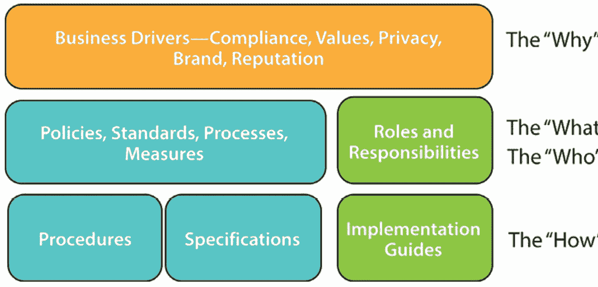

图 3.19 —— 一个通用的信息安全管理体系。它始于关键业务驱动因素，并确定组织将如何应对这些驱动因素，以及组织内部如何分担责任。

ISO/IEC 27001:2013 提供了如何应用 ISMS 概念以及如何构建、运行、维护和改进信息安全管理体系的指导。该标准的核心集中在五个关键领域：

- 1. ISMS 的一般要求
- 2. 管理职责
- 3. 内部 ISMS 审核
- 4. 管理层对 ISMS 的评审
- 5. ISMS 改进

ISO/IEC 27002:2013 通常与 27001:2013 配合使用。它不侧重于安全治理，而是提供了一份“信息安全管理实践规范”，其中列出了安全控制目标，并根据行业最佳实践推荐了一系列具体的安全控制措施。与 27001:2013 不同，该标准更像是一种指南而非严格的标准，组织可以根据 ISMS 范围内特定环境的风险承受能力，自行决定何种控制级别是合适的。推荐的控制目标就是“如何做”——它们展示了运营控制的实施方式。一个全面的信息安全计划很可能包含针对这些控制目标中每一项的服务。ISO/IEC 27002:2013 包含以下 14 个重点领域：³³

- 1. 信息安全政策 —— 为信息安全提供管理指导和支持。
- 2. **信息安全的组织** —— 在组织内部提供正式且明确的安全机制，包括信息处理设施以及由第三方访问或维护的信息资产。
- 3. **人力资源安全** —— 涵盖员工加入、调动和离开组织时的安全方面。
- 4. **资产管理** —— 通过确保有价值的数据资产得到识别并受到适当保护，来保护组织的资产。
- 5. **访问控制** —— 限制对数据、移动通信、电信和网络服务的访问，并检测未经授权的活动。
- 6. **密码学** —— 提供保护信息机密性、完整性和真实性的能力。
- 7. **物理和环境安全** —— 防止对设施和数据造成未经授权的物理访问、损坏和干扰。
- 8. **操作安全** —— 通过保护软件、通信、数据和支持性基础设施，确保数据处理设施正确且安全地运行。
- 9. **通信安全** —— 确保组织之间进行正确的数据交换。
- 10. **信息系统的获取、开发和维护** —— 在运营和开发系统中实施安全控制，以保障应用系统软件和数据的安全。
- 11. **供应商关系** —— 实施安全控制以保护可被供应商访问的公司信息和资产，并确保供应商提供约定水平的服务和安全。
- 12. **信息安全事件管理** —— 实施程序以检测和响应信息安全事件。
- 13. **业务连续性管理的信息安全方面** —— 减轻事件对关键业务系统的影响。
- 14. **合规性** —— 确保遵守刑事和民事法律以及法定、监管或合同义务，符合组织安全政策和标准，并提供全面的审计流程。

这些控制目标中的每一个还包含许多条款，描述了具体的控制措施以及在典型企业中应如何实施这些控制的建议。

这两个标准都可以用来指导安全架构和设计。最大的区别在于认证方面。组织的信息安全管理体系（ISMS）可以由获得许可的第三方评估机构根据 ISO/IEC 27001:2013 进行认证，但其控制实践则不能获得认证。认证过程允许评估机构捕获组织 ISMS 的基本要素，并以适用性声明（statement of applicability）的形式发布其发现。该文件不仅旨在突出 ISMS，还允许不同组织对其 ISMS 进行比较。因此，ISO/IEC 27001:2013 认证常被服务组织用来与现有及潜在客户分享有关 ISMS 的信息。

## 信息及相关技术控制目标（COBIT）

COBIT 是一个 IT 管理框架，由信息系统审计与控制协会（ISACA）和 IT 治理研究所（ITGI）于 20 世纪 90 年代初创建。COBIT 提供了一套被普遍接受的过程，以帮助最大化从信息技术（IT）中获得的收益，并制定适当的 IT 治理。它描述了 IT 审计界推荐的安全控制措施，通常被认为每个 IT 组织都需要实施的最低限度的安全服务。它也经常被用作内部和外部审计的基础。

最新版本的 COBIT（第 5 版）记录了五项原则，这些原则驱动了归类为七个使能要素的控制目标。参见图 3.20：

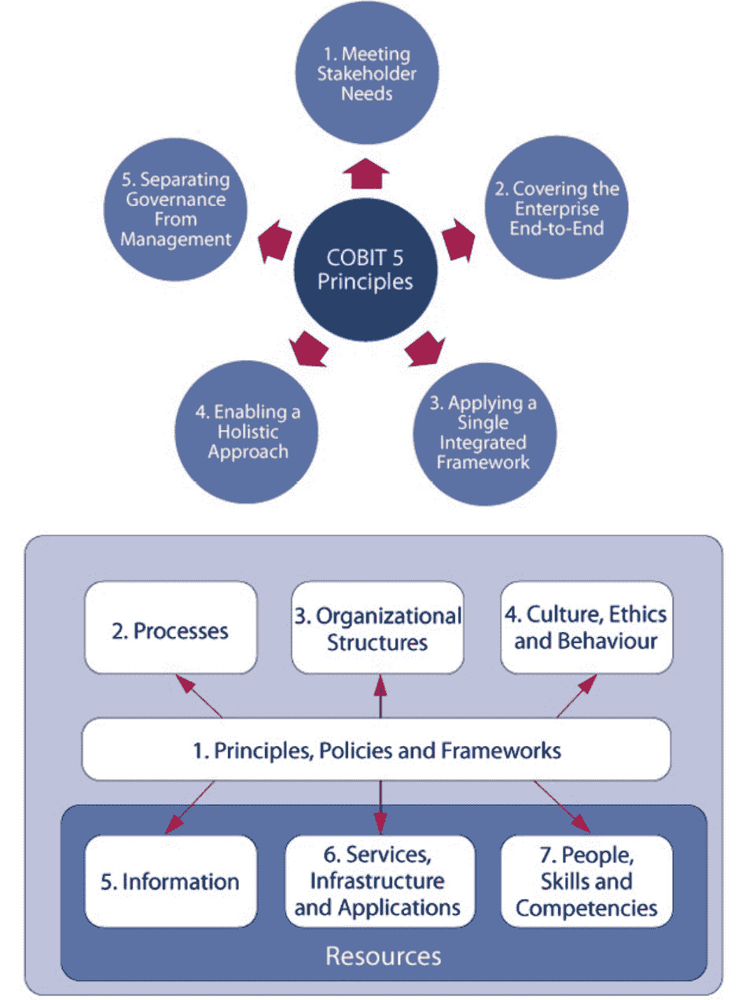

图 3.20 —— COBIT 的 5 项原则和 7 个使能要素³⁴

安全架构师经常将 COBIT 作为必须实施的核心安全服务菜单，设计文档也常使用 COBIT 结构来记录安全服务。这样可以减轻提供审计支持所需的工作量，并允许在架构中解决当前的控制缺口。

## 支付卡行业数据安全标准（PCI-DSS）

PCI-DSS 由 PCI 安全标准委员会制定，旨在增强支付卡数据安全。与 COBIT 和 ISO 27002 非常相似，PCI-DSS 为安全架构师提供了一个规范框架，以确保持卡人信息的安全处理、存储和传输。PCI-DSS 侧重于对标准的合规性，包括对安全事件的预防、检测和响应。

PCI-DSS 主要针对商户和服务提供商，但强制适用于处理组织支付卡服务的系统。³⁵ 如图 3.21 所示，六个目标通过十二项广泛的要求进一步定义。

| 目标 | PCI-DSS 要求 |
|---|---|
| **构建并维护安全网络** | 1. 安装并维护防火墙配置以保护持卡人数据<br>2. 不要使用供应商提供的默认系统密码和其他安全参数 |
| **保护持卡人数据** | 3. 保护存储的持卡人数据<br>4. 加密在开放、公共网络中传输的持卡人数据 |
| **维护漏洞管理计划** | 5. 使用并定期更新防病毒软件或程序<br>6. 开发和维护安全的系统和应用程序 |
| **实施强访问控制措施** | 7. 根据业务需要知悉原则限制对持卡人数据的访问<br>8. 为每个具有计算机访问权限的人员分配唯一 ID<br>9. 限制对持卡人数据的物理访问 |
| **定期监控和测试网络** | 10. 跟踪并监控所有对网络资源和持卡人数据的访问<br>11. 定期测试安全系统和流程 |
| **维护信息安全政策** | 12. 维护一项面向所有人员的信息安全政策 |

图 3.21 —— **PCI DSS 要求**³⁶

每项要求都有若干必须满足的子目标。例如，在“保护持卡人数据”类别下的要求 4“加密在开放、公共网络中传输的持卡人数据”中，适用以下目标：

- **4.1 –** 使用强加密和安全协议，如 SSL/TLS、SSH 或


IPSec 用于在开放的公共网络（例如，互联网、无线技术、全球移动通信系统 [GSM]、通用分组无线服务 [GPRS]）上传输时保护敏感的持卡人数据。确保传输持卡人数据或连接到持卡人数据环境的无线网络采用行业最佳实践（例如，IEEE 802.11i）来实现身份验证和传输的强加密。禁止将 WEP 用作安全控制措施。

- 4.2 – 切勿通过终端用户消息技术发送未受保护的主要账号号码（PANs）。

如果安全架构师需要遵守 PCI-DSS，他们会查看现有的安全基础设施，以确定其从加密角度来看是否适合支持该要求。如果不适合，他们将研究增强现有基础设施或获取合适基础设施的最佳方法。安全架构师提出的建议必须正确，因为它们将由组织实施，并由独立方评估以确定要求是否真正得到满足。如果发现缺陷或基础设施未按要求加密和保护，架构师可能会被追究责任，组织将需要重新审视基础设施的增强或采购。这些错误证明代价高昂，并会扰乱组织的使命。理解架构要求并正确实施可节省大量浪费和返工。

## 信息系统的安全能力

虽然从实施角度来看，安全框架的要求可能令人望而生畏，但系统安全架构师可以选择的各种技术和技术非常广泛。安全架构师的挑战是在不损害系统主要功能的前提下提供安全性。在某些类型的计算环境中，处理能力稀缺，任何安全功能都可能导致正常处理出现不可接受的延迟，这可能极其困难。与此同时，有各种各样的技术可用于保护系统，涵盖构成现代计算平台的硬件、固件和软件的众多层。

## 访问控制机制

所有系统都需要能够区分系统管理的各个主体和对象，并就它们将被允许如何相互交互做出适当决策。系统需要某种方式为主体和对象分配标识符，并在允许它们访问系统资源之前对所有主体进行身份验证。这是安全系统所需的最基本控制之一，其正确运行是许多其他安全控制的要求。因此，它是 TCB 中的关键要素之一，可能需要使用安全模型和产品评估标准进行仔细验证。

当没有任何主体未经授权即可访问任何对象时，这被称为完整调解。完整调解通常由实现参考监视器概念的安全内核负责。参考监视器将检查主体访问对象的所有尝试，以确定是否应允许。它会查询安全内核数据库，该数据库存储访问控制列表并将其决策记录到安全审计日志中。理想情况下，此功能应尽可能简单，以便于建模、实现和形式化验证。只有在调解完整时，才认为参考监视器已就位。

## 安全内存管理

从安全角度来看，内存和存储是任何计算系统中最重要的资源。如果内存中的数据损坏或损坏，系统可能无法正常运行或以不适当的方式运行。如果内存中的数据被泄露，敏感或机密信息可能会被权限较低的主体或未经授权的攻击者获知。与此同时，很少有资源比内存更易获得——在物理和逻辑上——这使其时刻处于危险之中。

理想情况下，可以轻松地将主体使用的内存（如正在运行的进程和线程）与对象（如存储中的数据）分开。不幸的是，对于安全架构师而言，大多数现代计算系统共享一种通用的计算内存方法，其中主体和对象共享一个公共的内存池，由系统来区分将被执行的内存区域和仅用于存储的内存区域。这就是缓冲区溢出如此成功的原因之一。在共享内存池的情况下，安全架构师必须采用各种技术来保持主体与对象以及彼此之间的隔离。这些技术包括使用处理器状态、分层和数据隐藏。

诸如地址空间布局随机化（ASLR）之类的技术涉及随机排列内存中数据区域的位置，以帮助防止恶意软件和病毒中的硬编码值。虽然大多数现代操作系统都支持 ASLR，但安全架构师必须确保程序和应用程序经过设计和配置以利用此安全控制。

## 处理器状态

处理器及其支持的芯片组为任何计算系统提供了第一层防御之一。除了提供用于安全功能（如加密协处理器）的专用处理器外，处理器还具有可用于区分特权程度不同的指令的状态。大多数处理器至少支持两种状态：主管状态和问题状态。在主管状态（也称为内核模式）下，处理器在系统上以最高特权级别运行，这允许在主管状态下运行的进程访问任何系统资源（数据和硬件）并执行特权和非特权指令。在问题状态（也称为用户模式）下，处理器限制了授予正在运行进程的对系统数据和硬件的访问。

这出于多种原因是一个非常有用的功能。它允许处理器优先处理具有主管状态访问权限的进程，而非那些没有访问权限的进程。它还使处理器仅在必要时才对资源施加限制（这本身就需要处理器能力）。因此，需要快速且相对无限制地访问内存的进程可以获得它，而不需要的进程在需要时可以被限制。

处理器状态的使用也有一些重要的限制。它要求主管状态下的任何进程都高度可信，并且与非主管状态的进程隔离。在主管状态下运行的恶意进程几乎不受限制，可用于造成大量损害。理想情况下，对主管状态的访问仅限于核心操作系统功能，这些功能通过其他控制从终端用户交互中抽象出来，但并非总是如此。例如，控制输入/输出设备的设备驱动程序通常由终端用户安装，但通常会被授予主管状态访问权限以帮助它们更快运行。这可能会允许格式错误的驱动程序被用来破坏系统，除非有其他控制措施来减轻这种风险。

## 分层

保护系统特权部分的一种方式是通过使用离散层来控制系统中特权更高和特权更低的进程之间的交互。在计算机编程中，分层是将编程组织成独立的功能组件，这些组件以某种顺序和层次方式交互，每个层通常仅与上层和下层有接口。这有助于确保系统的易变或敏感区域免受未经授权的访问或更改。

最常见的做法之一是使用环保护（图 3.22）。它通常表示为一系列同心环，其中最内层的环分配最低编号，最外层的环分配最高编号。例如，在具有四个环的环架构中，最内层的环为 Ring 0，最外层的环为 Ring 4。在环保护中，特权级别控制可防止从特权较低的环到特权较高的环的直接内存访问，而从特权较高的级别到特权较低级别的内存访问是允许的。称为控制门的机制管理从特权较低级别到特权较高环的转移。最特权的环（在我们的示例中为 Ring 0）与核心系统功能相关，例如操作系统内核中最敏感的部分，而特权最低的环（在我们的示例中为 Ring 3）与终端用户应用程序相关。

环用于控制具有不同特权级别的不同执行域（或给定主体可用的对象范围）之间的交互。这是通过使用应用程序编程接口（API）和类似机制实现的，这些机制允许特权较低的进程调用不同环中特权较高的进程的服务。

## 进程隔离

进程隔离也可用于防止各个进程相互交互，即使在采用环保护时它们被分配到同一环。这可以通过为每个进程提供独立的地址空间并防止其他进程访问该内存区域来实现。命名区分也用于区分不同的进程。虚拟映射还用于将随机选择的实际内存区域分配给进程，以防止其他进程轻松找到这些位置。将进程封装为对象也可用于隔离它们。因为对象包含对其进行操作的功能，所以其实现细节可以隐藏。系统还可以确保共享资源得到管理，以确保进程不被允许在同一时间段访问共享资源。


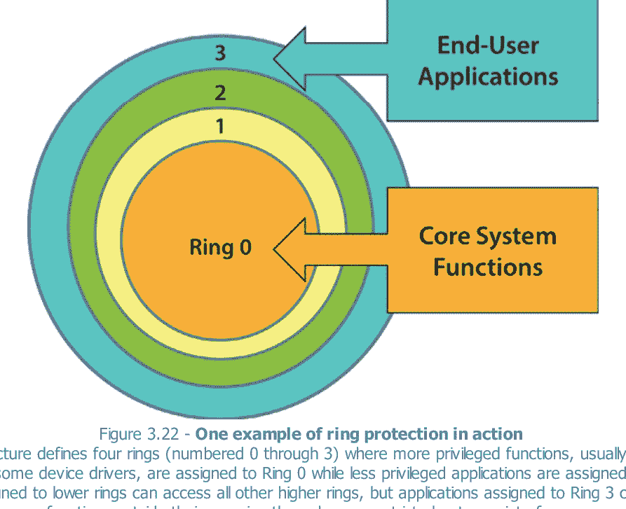

图 3.22 - 环保护作用的一个示例

x86 架构定义了四个环（编号为 0 到 3），其中特权更高的功能，通常仅限于内核功能和某些设备驱动程序，被分配到 Ring 0，而特权较低的应用程序则被分配到外部环。分配给较低环的功能可以访问所有其他较高环，但分配给 Ring 3 的应用程序只能通过非常受限的门或接口访问其自身环之外的功能。

## 数据隐藏

数据隐藏通过将不同安全级别的活动分开来维护这些活动。这有助于防止一个安全级别的数据被在其他安全级别运行的进程看到。

## 抽象

抽象涉及从实体中移除特征，以便轻松表示其本质属性。例如，系统管理员向名为“Human Resources”的 25 人组授予组权限，比向每位 HR 成员授予 25 项单独权限更容易。抽象消除了用户了解对象如何工作的具体细节的需求。他们只需要熟悉使用对象的正确语法以及由此呈现的信息的性质。

## 加密保护

密码学可以用多种方式来保护敏感的系统功能和数据。通过加密敏感信息并限制密钥材料的可用性，可以将数据隐藏在系统特权较低的部分。例如，安全文件系统大量使用密码学来加密存储中的大量数据，以防止其被不当披露。受信任平台模块（TPM）是专用密码处理器的一个示例，可提供加密密钥的安全生成、使用和存储。37 由于每个 TPM 都是唯一的，它也可以使用其密钥提供硬件身份验证。

## 主机防火墙和入侵防御

虽然防火墙和 IPS 通常与网络分区和控制安全区域的执行相关联，但它们也经常被用来保护单个主机免受攻击。基于软件或硬件的防火墙可以在单个主机内实现，以控制进出特定系统的流量。同样，主机入侵防御可用于验证定向到主机的网络流量，并在发现其具有恶意时阻止其执行。

## 审计和监控控制

安全系统还必须能够为管理员提供其正确运行的证据。这是通过使用日志子系统来完成的，日志子系统允许记录重要的系统、安全和应用程序消息以供分析。更安全的系统将提供相当大的保护，以确保这些日志不会被篡改，包括将此类日志安全地导出到外部系统。

主机入侵检测系统（HIDS）和网络入侵检测系统（NIDS）也可以被视为审计和监控控制的一种类型。HIDS 子系统检查系统的运行以检测异常事件并相应地提醒安全管理员。它们经常会分析日志、正在运行的进程以及可能受到攻击的常见服务/守护进程，以确定系统是否继续保持安全。NIDS 在网络层执行类似的功能。

## 虚拟化

虚拟化从安全角度提供了众多优势。虚拟机通常在沙箱环境中隔离，如果感染，可以快速删除或关闭并由另一台虚拟机替换。虚拟机对硬件资源的访问也有限，因此有助于保护主机系统和其他虚拟机。虚拟机确实需要强大的配置管理控制和版本控制，以确保在需要时有已知的良好副本可供恢复。它们也受制于基于硬件系统的所有典型要求，包括反恶意软件、加密、HIDS、防火墙和修补。鉴于现有要求，加上 VM 主机所需开销，资源利用率持续较高的系统可能无法通过虚拟化受益。此外，越来越多的恶意软件和病毒变得能够感知虚拟机。38 它们能够检测到自己处于虚拟机中并“突破”到主机系统。安全架构师必须意识到这些权衡，并据此为系统和企业安全架构进行规划。

## 安全架构的漏洞

虽然每个系统都不同，但不安全的系统往往会遭受相同类型的威胁和漏洞。常见漏洞包括内存管理不善、隐蔽通道的存在、系统冗余不足、访问控制不善以及对关键系统组件（如硬件资源和核心操作系统功能）的保护不力。系统可用性、完整性和保密性的常见威胁包括硬件故障、系统特权滥用、缓冲区溢出和其他内存攻击、拒绝服务、逆向工程和系统黑客攻击。

由于许多漏洞源于不安全的设计，而大多数威胁都是众所周知的，因此安全架构师有责任确保其设计适当满足安全要求，同时确保系统能够继续执行其预期功能。对 2014 年 Verizon 数据泄露调查报告的审视将有助于为安全架构师构建这一对话。39

Web 应用程序与 2013 年的 3,937 起安全事件和 490 起已确认的数据泄露相关。Verizon 分析的许多攻击都针对来自 Joomla、Wordpress 和 Drupal 的流行博客平台或内容管理系统。为了应对其中一些问题，安全架构师需要了解企业中部署的博客网站和内容管理系统。“shadow IT”现象使许多 IT 功能落入非 IT 从业者手中，这对安全架构师而言必须引起关注。如果在生产环境中维护的系统在企业内部 IT 功能不知情的情况下运行，更重要的是没有 IT 功能会实施的适当控制，那么这类攻击可能成为企业的重要威胁。

Verizon 表示，人为错误是 2013 年 412 起已确认数据泄露的核心，并与超过 16,000 起安全事件相关。流程失败、沟通不足以及缓解业务合作伙伴风险的控制不力与许多事件相关。据分析，公共部门组织、行政机构和医疗保健公司受人为错误影响最大。前三大错误是信息误投、发布错误和处置错误。正确实施和配置的数据丢失防护技术可能是主动解决员工错误的最佳方式。安全架构师应实施更高效的流程并制定可执行的 security 策略来控制它们。

根据 Verizon 报告，网络间谍活动与 511 起安全事件和 306 起已确认的数据泄露相关。基本的安全最佳实践是成功抵御这些攻击的关键。网络分段、主动日志管理和双因素身份验证可以帮助阻止攻击者在已进入内部并试图访问敏感系统时的横向移动。安全架构师应确保用于保护企业的纵深防御策略的基础建立在坚实的架构之上，该架构纳入最佳实践并首先实现明确定义的安全架构的基础，以确保尽可能多的威胁可以通过使用经过时间验证的策略和技术得到缓解。

根据 Verizon 的数据，2013 年销售点（POS）系统遭受了 198 起数据泄露。攻击者一直针对销售点系统上的弱密码和默认密码。BlackPOS 是一种常见的内存抓取恶意软件，Verizon 表示它是信用卡数据窃贼使用的主要技术之一。安全架构师需要锁定其 POS 系统，并应考虑在这些系统上应用应用程序白名单和更新的防病毒解决方案来抵消这些威胁。

丢失或被盗设备 consistently 被 IT 安全专业人员和首席信息安全官列为主要关注点。根据 Verizon 报告，丢失的笔记本电脑和其他设备在 2013 年造成了超过 9,000 起安全事件和 116 起已确认的数据泄露。Verizon 表示，信息资产丢失的频率远高于被盗，比例约为 15 比 1。安全架构师需要实施设备加密，鼓励用户随时随身携带设备，并实施有效的备份策略来应对这些威胁。

员工、承包商或合作伙伴滥用特权与 2013 年超过 11,600 起安全事件和 112 起已确认的数据泄露相关。Verizon 表示，它正在关注针对内部数据和商业机密的内部间谍活动趋势。由于大多数内部攻击发生在办公网络内，安全架构师应在包含敏感数据的系统周围构建额外的控制措施。他们还必须审查用户账户活动并快速禁用前员工的用户账户作为

整体访问控制生命周期的一部分。

犯罪软件，主要是指使用自动化攻击工具包进行的以财务为驱动的攻击，是几乎每个行业都面临的常见问题，Verizon 发现犯罪软件与 2013 年的 12,000 多起安全事件和 50 起数据泄露相关。Zeus 和 SpyEye 木马家族通过有组织的网络犯罪网络迅速传播，这些网络使用垃圾邮件和恶意链接诱骗人们下载危险的恶意软件。该恶意软件旨在窃取账户凭证并掏空银行账户。许多感染仅通过访问攻击网站或下载恶意文件即可发生。安全架构师需要部署浏览器安全补丁并更新浏览器插件。如果不需要，Java 应被禁用或卸载。此外，使用至少双因素认证将挫败许多使用被盗凭证的攻击。

分布式拒绝服务攻击旨在瘫痪网络或使网站和 Web 应用程序瘫痪，正由攻击者通过入侵公共和私有云数据中心的服务器来实施，以增加其攻击的带宽。Verizon 分析了 2013 年超过 1,100 起总安全事件。安全架构师应制定计划并考虑使用互联网服务提供商 DDoS 缓解服务，同时还应考虑隔离未使用的 IP 地址空间。

根据 Verizon 报告，有超过 7,200 起安全事件不符合常见的事件模式。其中几乎所有攻击都是外部的，并且是基于浏览器的威胁，使用黑客、网络钓鱼和恶意软件的组合。所有事件中四分之三涉及被入侵的 Web 服务器，通常代表大规模攻击，其中数百台服务器被劫持以托管用于路过式攻击或网络钓鱼网站的恶意软件。

安全架构师应使用多种资源和数据点来描绘其网络面临的威胁。诸如 Verizon 数据泄露调查报告 之类的资源很有价值，因为它们在大量行业和架构中呈现发现。安全架构师在此方面可能会觉得有帮助的额外资源如下列出：

- Secunia 漏洞回顾 2014: http://secunia.com/?action=fetch&filename=secunia_vulnerability_review_2014.pdf
- Symantec Internet 安全威胁报告 2014: http://www.symantec.com/content/en/us/enterprise/other_resources/b-istr_main_report_v19_21291018.en-us.pdf
- Sophos 安全威胁报告 2014: http://www.sophos.com/en-us/medialibrary/PDFs/other/sophos-security-threat-report-2014.pdf
- Cisco 2014 年度安全报告: https://www.cisco.com/web/offer/gist_ty2_asset/Cisco_2014_ASR.pdf
- PricewaterhouseCoopers 2014 年信息安全现状全球调查: http://www.pwc.com/gx/en/consulting-services/information-security-survey/index.jhtml
- Trustwave 2014 年安全压力报告: http://www2.trustwave.com/rs/trustwave/images/2014%20Trustwave%20Security%20Pr
- Websense 2014 威胁报告: http://www.websense.com/assets/reports/report-2014-threat-report-en.pdf

## Systems

设计不良的系统很容易受到攻击。安全架构师必须熟悉其行业中以及其所工作的系统类型的知名攻击和漏洞。他们还应了解与组织使命和系统相关的威胁和能力种类。存在无数攻击；然而，就安全架构而言，最具挑战性的一些是 emanations、状态攻击和 covert channels。

### Emanations

系统 emanations 是无意发出的包含有关系统中正在处理、存储或传输的信息或元数据的电、机械、光学或声学能量信号。[40] 美国国家安全局发布的最早的公开描述之一将其描述为：

> “任何时候机器被用来以电方式处理机密信息时，该机器中的各种开关、触点、继电器和其他组件可能会发出射频或声学能量。这些发射，就像微小的无线电广播一样，可能会通过自由空间辐射相当远的距离——在某些情况下半英里或更远。
>
> 或者它们可能在附近的导体上感应，例如信号线、电力线、电话线或水管，并沿这些路径传导一段距离——这里我们可能在谈论一英里或更远。
>
> 当这些发射可以被拦截和记录时，通常可以分析它们并恢复源设备正在处理的情报。这种现象不仅影响密码机，而且影响任何信息处理设备——电传打字机、复制设备、对讲机、传真、计算机——你能想到的都有。但它对密码机具有特殊意义，因为它可能不仅揭示正在处理的单个消息的明文，还揭示有关内部机器过程的那些 carefully guarded 信息。因此，可以设想，机器可能会辐射出可能导致我们每日变化的密钥变量重建的信息——从 Comsec 的角度来看，这是可能发生的绝对最糟糕的事情。我们把这种泄露辐射的问题命名为 TEMPEST 的代号。” [41]

政府、情报组织和军队花费了数年和无数资源研究 emanations。他们的研究集中在如何捕获它们以及如何使用或防范它们。TEMPEST 是一套标准，旨在屏蔽建筑物和设备，以保护它们免受窃听和被动 emanations 收集尝试。更常见的方法之一是设备的“Red/Black”分离。

Red/Black 分离要求意味着在普通未分类（非敏感）电路和设备与 classified 设备之间安装物理安全控制，例如屏蔽。一旦实施并获得认证，操作员必须确保对控制的最小更改都得到报告，因为将组件移动几毫米这样小的动作也可能使安装失效。

虽然这最初似乎只适用于反情报情况，但审慎的安全架构师将理解当今竞争激烈的市场以及工业间谍活动和犯罪分子的可能性。随着 emanations 监控能力的价格下降，不诚实个人利用它窃取知识产权和其他资产的动机就会增加。例如，Dmitri Asonov 和 Rakesh Agrawal 的一篇研究论文描述了对自动取款机 (ATM) 的 emanation 攻击。[42] Asonov 和 Agrawal 提出，ATM 键盘发出的声音（可听 emanation）对于每个按下的键都是不同的。他们研究了键盘并确定他们可以在 15 米及更远的距离“窃听”。因此，他们能够准确确定约 79% 的按键。这意味着攻击者可以在远距离确定某人的银行 PIN，而无需在 ATM 上安装任何额外设备。许多安全架构框架会遗漏此漏洞。设计带 ATM 的银行系统的安全架构师需要考虑此漏洞，并可能指定键盘由不同材料制成或确定一种方法来 muffle 或扭曲声音。

### State Attacks

例如，互联网浏览器可被视为瘦客户端。

从安全角度来看，这种架构类型的优势在于它将安全服务的设计和实现集中在一个单一的集中环境中。这可以使设计、实现和验证安全服务以及维护它们变得更容易。因为补丁和更新只需在中央位置修补，所以大多数安全漏洞可以快速高效地处理。同时，未修补的漏洞将被整个系统继承。这使得任何漏洞比其他计算平台更普遍和危险。它还要求对同时运行的特权和非特权主体进行非常严格的控制，以确保一个主体不能干扰或向另一个主体泄露信息。

## Middleware

中间件是一种连接软件，使一个或多个机器上运行的多个进程能够交互。这些服务是分布式软件的集合，存在于操作系统上运行的应用程序与驻留在网络节点上的网络服务之间。中间件服务的主要目的是帮助解决许多应用程序连接和互操作性问题。

本质上，中间件是一个分布式软件层，隐藏了由众多网络技术、计算机架构、操作系统和编程语言组成的异构分布式环境的复杂性。提供的一些服务是目录服务、事务跟踪、数据复制和时间同步，这些服务改善了分布式环境。一些例子是工作流、消息应用程序、互联网新闻频道和通过交付的客户订购。

近年来，中间件作为面向服务架构 (SOA) 的基础受到了相当大的关注。[43] 组织认识到，继续依赖遗留系统会阻碍增长、上市速度、业务和 IT 对齐等业务 imperative。此外，升级到更新技术是一项昂贵的提议，尤其是在经济困难时期。考虑到这些挑战，组织正在迁移到更易用和高效的 IT 架构，使其客户能够通过基于互联网的 Web 应用程序更紧密地与公司互动。在 SOA 中，不同实体以标准化方式将其资源提供给整个群体。换句话说，SOA 是分布式计算的模型，其中应用程序通过网络调用其他应用程序。功能分布在网络上，利用查找功能和连接它的能力。


SOA 提供了模块化、灵活性与可重用性。此外，它允许一致且协作的治理、安全和管理，包括策略执行、身份验证、加密和数字签名实现，前提是安全得到正确设计和实现。然而，中间件接口的可用性可能使其成为攻击的常见目标，因为许多 SOA 并非以端到端安全作为要求而开发。

## Embedded Systems

嵌入式系统用于在小尺寸外形且处理能力有限的情况下提供计算服务。它们将必要的硬件、固件和软件嵌入到单一平台中，该平台可用于提供有限范围的计算服务，通常围绕单一应用。它们通常具有功能受限的操作系统，仅具备满足其功能需求的最低基本功能。其他受限设备，如手机、媒体播放器以及路由器和无线设备等网络设备，也采用类似的方法。

从安全架构师的角度来看，嵌入式系统具有若干潜在的优势和劣势。安全服务往往简单、可测试且可验证，使得确保安全得到正确设计和实现的工作变得简单得多。不幸的是，此类系统中的安全通常仅限于少数基本安全功能，以帮助保护内存和对内存的特权访问。虽然它们可能支持广泛的安全服务，但其处理能力非常有限，必须由核心功能和安全组件共享。这经常导致安全功能不够健壮，尤其是在更丰富的功能是主要业务驱动因素时。在受限的嵌入式设备中修补安全漏洞也经常更加困难。44 这就是为什么安全架构师需要考虑安全需要在嵌入式系统的内部和外部如何放置和解决，以及从架构角度来看可以对嵌入式系统的完整性给予多少信任。

## Pervasive Computing and Mobile Devices

过去四到五年间，移动设备的数量大幅增长。产品从复杂的手机，如第四代（4G）手机，到功能齐全的“超极本”和平板电脑不等。

这些设备现在可以管理个人信息，如联系人、约会和待办事项。当前的平板电脑和手机可连接互联网、作为全球定位系统（GPS）设备运行，并运行多媒体软件。它们还可以支持无线蓝牙网络和无线广域网（WAN）。它们具有可接受闪存介质的存储卡插槽，可作为文件和应用程序的额外存储。几乎所有设备都提供音频和视频支持，集成了 MP3 播放器、麦克风、扬声器和耳机插孔，以及内置数码相机。还可以包含生物识别指纹读取器等集成安全功能。

这些设备与其他资源受限设备共享共同的安全问题。在许多情况下，当处理能力非常有限时，为提供更丰富的用户交互而牺牲了安全服务。它们的移动性使其成为数据丢失的主要媒介，因为它们可以以难以控制的方式传输和存储信息。因此，安全架构师需要在企业中针对各种设备平台和外形因素的广泛范围，解决长长的威胁和漏洞清单。以下列表总结了安全架构师应重点关注的关键领域和措施：

- 1. 移动设备需要反恶意软件
- 2. 安全移动通信
- 3. 要求强身份验证，使用密码控制
- 4. 控制第三方软件
- 5. 创建独立的、安全的移动网关
- 6. 选择（或要求）安全移动设备，帮助用户锁定它们
- 7. 定期进行移动安全审计和渗透测试

例如，安全架构师将如何将此列表中的项目整合到企业移动设备管理的连贯策略中？最简单的答案是制定一份安全策略，解决列表中一些或许多项目。更困难的答案涉及在企业内部随着时间的推移起草、审查、实施、传达、培训、管理、优化、执行、审计和更新策略所需的步骤。制定安全策略以解决企业中移动设备的使用会涉及什么？策略将包括下面列出的一些要点：

## GENERAL MOBILE DEVICE BEST PRACTICES

- 在不活动后使用密码/密码短语/图案锁定设备；通常不应超过 10 分钟的不活动就应触发此操作。
- 如果有此选项，请加密设备，使用尽可能高的加密（最低 128 位）。如果无法加密，切勿在设备上存储高度机密数据。
- 在未加密 WiFi 和 3G/4G/CDMA 服务之间选择时，始终选择蜂窝数据服务，因为它通常比未加密 WiFi 安全得多。如果访问敏感/受保护数据，除非您可以使用 VPN 客户端，否则切勿使用未加密 WiFi。
- 如果设备支持，请使用 VPN。
- 尽快报告被盗/丢失的设备。记录您的设备序列号、ESN（电子序列号，如适用）和其他识别信息以备记录，并便于执法或其他恢复。
- 根据平台尽可能利用远程擦除功能。
- 仔细选择安装在设备上的应用程序，考虑应用程序将访问的数据类型、应用程序是否被认为安全，以及供应商是否通常通过应用程序收集用户的信息（可能导致数据泄露）。
- 建议避免通过移动设备使用远程桌面程序。
- 禁用不使用的选项和应用程序。
- 如果启用了蓝牙，请不要允许设备自动被发现，并使用密码保护以防止未经授权的访问。
- 切勿让移动设备无人看管。
- 如果受支持，请使用防病毒/反恶意软件。
- 定期备份数据——最好以加密方式进行。
- 根据制造商的说明更新设备的软件。通常更新倾向于修复安全漏洞并改善设备功能。
- 限制第三方对设备的使用以保护您的个人数据并促进对潜在滥用的问责。
- 不使用时关闭 GPS 和数据。
- 不要越狱移动设备。

## IPAD/IPOD/IPHONE SPECIFIC BEST PRACTICES

使用配置模板在企业网络上设置设备并在设备上强制执行建议策略，包括：

- 使用密码（强度取决于设备可能包含的数据）
- 如果密码尝试失败 10 次则允许设备擦除
- 使用 Cisco AnyConnect VPN – 可在 Apple App Store 中获得
- 设备配置配置文件加密
- 强制加密设备备份
- 如果多个用户将访问该设备，不应使用原生邮件程序以保护主要用户的电子邮件账户。
- 如果设备不再使用，请确保其上的所有数据都被擦除，并妥善处置。

安全架构师可以参考的另一个资源是 NIST 特刊 800-124 修订版 1，“企业移动设备安全管理的指南”。45 该指南全面概述了集中式移动设备管理技术的当前状态，包括这些技术的组件、架构和功能概述，并提供选择、实施和使用此类技术的建议。

寻求实施和维护健全的移动设备安全计划的组织的其他关键建议包括：

- 制定一份记录在系统安全计划中的移动设备安全策略，并定义：
  1. 可通过移动设备访问的企业资源类型；
  2. 被允许访问组织资源的移动设备类型；
  3. 各类移动设备的访问程度（组织提供的移动设备与个人拥有的移动设备）以及应如何处理配置；
  4. 组织的集中式移动设备管理服务器如何管理以及这些服务器中的策略如何更新；以及
  5. 移动设备管理技术的所有其他要求。
- 在设计和部署移动设备解决方案之前，为移动设备和通过移动设备访问的组织资源开发系统威胁模型。
- 考虑移动设备解决方案提供的每个安全服务的优点，确定组织环境所需的服务，然后设计和采购一个或多个解决方案

移动设备的配置更改。

最后，《指南》附录 XX 列出了适用于企业移动设备安全的《NIST 特刊 800-53，“联邦信息系统和组织的安全与隐私控制，第 4 版”》中的主要控制措施，而附录 C 则提供了移动设备安全资源列表。46


### 自己动手试试

作为附录 D 提供的示例模板，可让安全从业人员详细了解移动设备使用政策可能是什么样子的。该 2 页模板将引导您了解一个虚构公司的使用政策的各个阶段。定义使用政策可为所有参与移动设备活动的人员记录明确的责任。

下载模板并按顺序浏览各部分，以了解移动设备政策的结构。

## 单点故障 (SPOF)

随着虚拟化等技术使技术更高效、更易于管理，安全架构师还必须了解单点故障如何产生。以虚拟化为例，如果从故障点角度比较虚拟化前后的状态，似乎虚拟化经常为许多企业增加单点故障。在虚拟化之前，服务器通常是彼此分离的独立硬件组件。如果邮件服务器宕机，很少意味着网络附加存储服务器也会宕机。如果这些系统被虚拟化并在同一主机上运行，则该主机就成为这两个系统的单点故障。如果主机宕机，则在该主机上运行的所有客户机也都会宕机。安全架构师必须识别单点故障并确定替代方案，以便利益相关者能够就风险接受或缓解策略做出明智的决策。

安全架构师如何识别单点故障？安全架构师如何确定哪些替代方案可作为缓解策略被接受？这通常是最困难的部分，因为没有适用于每种情况的简单且标准化的答案。安全架构师可以使用最佳实践，例如在关键任务系统中构建冗余并使用高可用性和容错技术，以确保在某种故障或中断情况下系统的生存能力。此外，安全架构师应确保对所有主要系统都进行了风险分析和业务影响分析，从而确保清楚了解系统对业务的价值，以及单个系统在日常运营中可能面临的潜在威胁和漏洞。安全架构师还应进行单点故障审计，并将结果与风险分析和业务影响分析的结果进行交叉引用，从而确保关键任务系统、流程和人员得到识别，并确保可能形成与主系统依赖关系的所有支持组件和子系统也得到识别。这是一项关键活动，因为如果没有对系统架构的透彻理解，特别是架构所具有的依赖关系，就无法妥善解决已识别的任何单点故障。

由于单点故障可能出现在架构的各个部分，因此最好分别查看每个区域并识别常见的 SPOF。大多数 IT 组织被要求用更少的资源做更多的事情。这可能意味着减少服务器规模或利用虚拟环境。例如，如果企业内部部署了集群虚拟化基础设施，则安全架构师需要将许多潜在的单点故障作为企业安全架构的一部分加以考虑和管理。让我们讨论以下技术以及在集群架构的背景下如何减少其单点故障：

- 数据连接
- 网络连接
- 集群通信
- 应用可用性
- 操作系统可用性
- 基础设施

### 数据连接

本节将介绍如何确保您的应用程序与存储设备具有冗余连接。对于数据连接，我们将检查从服务器到存储的连接。

第一个冗余级别是至少拥有两个主机总线适配器 (HBA) 或存储路径，并使用多路径软件。

该区域的另一个常见单点故障是将服务器的多个 HBA 连接到单个 SAN 交换机。如果单个 SAN 交换机因任何原因发生故障或离线，则所有通往存储的路径都会失败。另一种常见变体是拥有一个 SAN 交换机，该交换机与阵列只有一个连接。最好确保每个 SAN 交换机都连接到阵列上的不同前端端口。在基础设施的每个点都拥有多条路径，可以在不导致停机的情况下发生故障。

### 网络连接

在本节中，我们将讨论如何确保网络可用并识别任何潜在的单点故障。在了解网络并采用端到端视图时，通常数据包可以从一台机器到另一台机器经过大量路径。该堆栈中可能存在多个单点故障。典型的配置问题是公共网络的单个网络接口卡 (NIC)。如果该单个 NIC 被断开或网络交换机端口发生故障，则该服务器将无法在网络上进行通信。安全架构师需要部署能够配置两个不同的 NIC 端口的系统，这两个端口都可用于公共网络，并且当主 NIC 发生故障时，与应用程序关联的虚拟 IP (VIP) 地址可以从同一台设备中的一个物理 NIC 迁移到另一个物理 NIC。这减少了应用程序不可用的时间，因为不再需要在一个服务器上将应用程序和相关基础设施下线，然后在另一台服务器上上线。

### 集群通信

集群通信是指如何确保集群解决方案检测到故障并在集群节点之间进行通信。集群技术需要传递状态信息，并在集群通信丢失时进行节点仲裁。在配置集群时，建议配置多个心跳网络。这些连接在集群节点之间传递资源和服务组状态信息。如果配置了单个心跳链路并且该 NIC 出现故障，则集群必须确定哪些节点能够通信以避免脑裂情况。脑裂情况是指使用相同资源或应用程序的原始集群节点形成多个集群。许多集群解决方案都有方法来确保在心跳通信中断时只形成一个集群。它们可以使用不同的方法来适应每个企业的独特环境。例如，可以使用 SCSI-3 持久保留来确保不会发生数据损坏。如果服务器的 NIC 数量有限，则集群软件应能够以低优先级模式使用公共网络。公共 NIC 不会持续传输状态信息，而是会不时使用来确定状态并传递一些信息。集群通信的多条路径可防止网络单点故障导致集群崩溃。

### 应用可用性

一些应用程序内置了高可用性 (HA)，并且可以允许多个系统同时访问应用程序的不同实例。一般来说，使用应用程序 HA 工具时会出现几种典型的限制作为单点故障。在故障转移事件期间将应用程序从一台服务器移动到另一台服务器所需的最长时间是服务器之间迁移文件系统。有了集群文件系统 (CFS)，多个系统都可以挂载文件系统，这样在发生故障转移事件时，只需将应用程序和 VIP 移动到另一个集群节点即可。此外，集群还应提供在同一系统上重新启动应用程序的能力，以避免此问题。对于内置 HA 的应用程序，集群软件仍可通过控制应用程序和启动顺序依赖关系提供好处。此外，如果应用程序发生故障，可以重新启动它，并且监控系统会在出现问题时收到通知。

### 操作系统可用性

在本节中，我们将讨论如何使用集群软件来保护操作系统。大多数集群软件能够与多种虚拟化技术配合使用，包括 Solaris LDOM 和 Zones、HP-UX IVM、AIX WPAR 和 LPAR 以及 VMware 和 Microsoft 的 Hyper-V。操作系统虚拟化允许一个操作系统作为服务在不同的物理系统之间迁移。每种虚拟化技术各不相同，其中几种可以在有限或无停机的情况下在物理服务器之间移动。集群软件可以确定 VM 是否离线，并将 VM 以及应用程序迁移到另一台物理服务器以启动。

### 基础设施

在保护正在运行的应用程序时，需要考虑许多外部因素。大多数因素在规划数据中心时都会考虑；例如，使用 UPS 可防止停电。如果服务器机房的灭火系统启动会怎样？集群节点是否位于数据中心的各个部分？它们是否连接到不同的 UPS？通过确保您的应用程序能够继续

-   已安装基于主机的入侵检测系统。
-   整个驱动器或驱动器上的敏感信息均使用强加密进行加密。
-   在可能的情况下，客户端以没有管理权限的“受限”账户运行。
-   在可能的情况下，客户端系统是持续监控计划的一部分，该计划监控漏洞并在需要时进行修补，而无需终端用户交互。
-   对操作系统或新软件的更改通过评估流程进行验证，以确定任何安全影响。

## 移动设备

平板电脑和智能手机在专业环境中作为首选客户端平台的使用日益增多。由于其直观的界面、易于携带的特性和尺寸，移动设备已成为许多组织和个人的首选平台。此外，许多用户要求组织允许其个人设备接入组织的网络和系统，这就是“自带设备”或 BYOD 运动。安全架构师需要意识到 BYOD 运动等文化转变，并相应地重新调整组织的安全架构，同时保持架构与业务需求一致。

大多数可用的移动设备并非明确为企业安全或控制而构建。在许多情况下，它们是为普通终端用户设计的，功能是首要优先事项。安全架构师必须了解终端用户使用的设备以及如何在其上保护敏感信息。在定义移动设备安全架构时，架构师可以考虑以下所有选项，并且还应确保与企业中存在的任何法律职能部门核实，或熟悉在其所在地区关于隐私、个人身份信息（PII）和移动设备管理方面现行有效的标准和法律：

-   与移动设备管理（MDM）系统集成，可实现：
  -   远程
    -   整机擦除
    -   账户管理
    -   设备 GPS/WIFI/蜂窝位置
-   操作系统、应用程序和固件更新
-   应用程序管理
-   设备身份验证和注册
-   用于法律保留情况的信息归档并进行完整性验证
  -   安全
    -   Web 浏览器
    -   带 Web 过滤或代理的虚拟专用网络（VPN）
    -   组织应用程序“商店”
  -   带有密钥托管的整机加密
  -   “越狱”或“root”访问检测
-   用于组织系统访问的安全加密容器技术，包括：
  -   自动删除下载到设备上的任何组织信息
  -   容器流量的 VPN
  -   容器的安全 Web 浏览器
  -   容器的安全应用程序“商店”
  -   “越狱”或“root”访问检测

## 基于服务器的漏洞

服务器对攻击者而言是一个诱人的目标。虽然托管敏感信息并处理组织的任务敏感型任务，但服务器还支持多种选项，这使得攻击者的尝试更有效。在设计服务器安全架构时，安全架构师应考虑以下内容：

-   确定如何建立对服务器的远程访问：
  -   许多服务器位于远离组织运营的物理数据中心。这要求安全架构师确定以最安全的方式访问服务器进行管理和更改的方法。
  -   安全架构师应考虑带外通信，例如为管理大量服务器组而设立的单独网络。在物理隔离不切实际的情况下，应考虑逻辑隔离。
  -   应使用强多因素身份验证，包括一次性密码，以帮助防止暴力攻击和键盘记录。
-   应评估内置远程访问服务，以确定其是否足以提供安全的远程访问。如果不足，应将其禁用。
-   确定如何执行配置管理：
  -   识别组织中负责变更管理和配置管理的个人、团队或流程。
    -   确保他们能够持续监控和修补服务器。如果不能，安全架构师应推荐监控和修补解决方案。
    -   识别组织内的漏洞管理能力。如果不存在，安全架构师应推荐漏洞扫描和跟踪解决方案。
    -   确定如何将更新的代码或新版本的软件部署到服务器。成熟的系统开发生命周期是否包括开发、测试、预发布和生产推广方法？如果没有，安全架构师应推荐适合组织的系统开发生命周期方法。
-   确定业务连续性要求，并确保服务器安全架构包括备份、故障转移站点和由服务器支持的任务确定的通知流程。

## 数据流控制

安全架构师必须熟悉数据如何流入和流出系统。这通常使用数据流图（DFD）来完成。图 3.23 显示了美国国家标准与技术研究所的一个示例，用于分析网站链接结构的过程。该图将基本操作分解为用户或操作员可能看到的数据、流程和窗口。该图还按网站、会话、分析和可视化对不同组的时序进行了划分。安全架构师关注的是在各种组件之间强制数据仅流向所需接收者的控制，以及如果需要如何保护通信。应采用最小权限的概念，以确保数据仅流向授权的接收者和流程。架构师还应审查所使用的任何技术，例如 PERL、解析器和可视化工具包，以确保它们在现有安全架构下得到支持，如果不支持，则确保可以支持或找到替代方案。

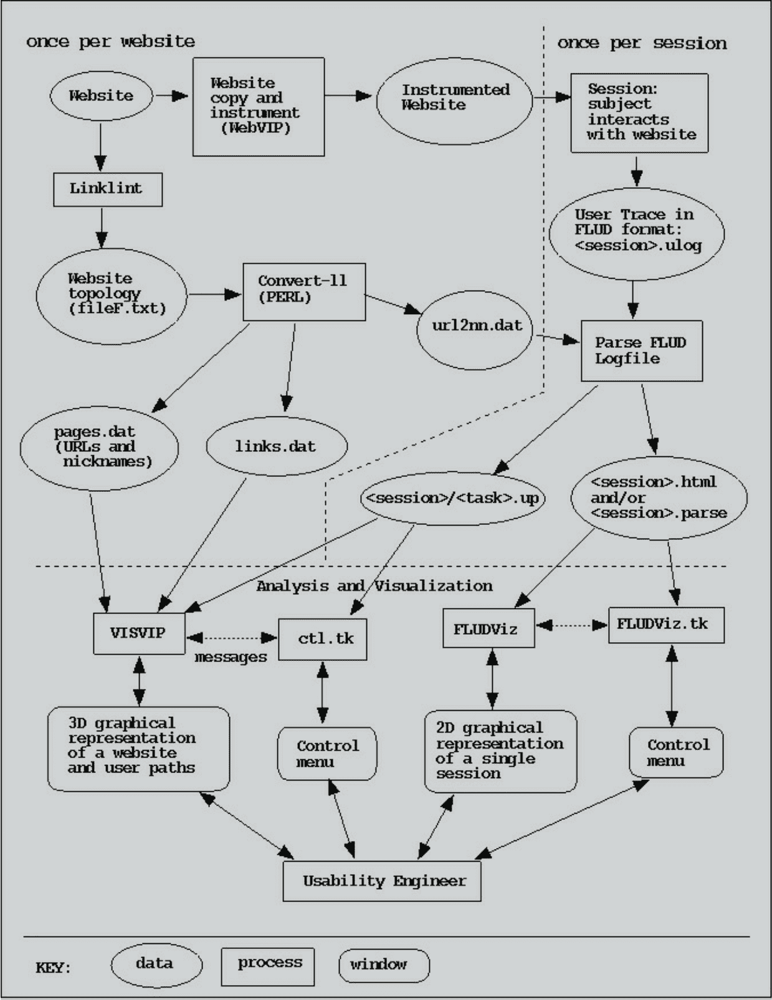

## 每个网站一次

## 每个会话一次

网站

网站复制和仪器化 (WebVIP)

已仪器化的网站

会话：主体与网站交互

Linklint

网站拓扑 (fileF.txt)

Convert-11 (PERL)

url2n.dat

FLUID 格式的用户跟踪：<session>.ulog

解析 FLUID 日志文件

pages.dat (URLs 和昵称)

links.dat

<session>/<task>.up

<session>.html and/or <session>.parse

## 分析和可视化

VISVIP

ctl.tk

FLUDViz

FLUDViz.tk

messages

网站和用户路径的 3D 图形表示

控制菜单

单个会话的 2D 图形表示

控制菜单

可用性工程师

## 图例：

数据

流程

窗口

数据库漏洞超出了服务器平台的漏洞，还包括数据库中存储的数据如何受控。安全架构师必须了解数据库安全方面的多个主题，包括推断、聚合、数据挖掘和数据仓库。

## 数据仓库

数据仓库是从各种数据源收集的信息存储库。由于从多个来源汇编信息，数据仓库消除了组织的原始信息结构和访问控制，以便将该信息共享给更多层级的员工。数据仓库中存储的数据不用于运营任务，而是用于分析目的。数据仓库将来自各种数据库的所有数据组合到一个大型数据容器中。由于数据被收集到一个中央位置进行分析，而不是几个较小的数据库，因此组合后的数据可供高管用于做出业务决策。安全架构师需要牢记“整体大于部分之和”这一老话在这里适用。具体来说，安全架构师的关注点不仅在于数据仓库的架构，也不仅在于用于提取和分析数据的工具的可用性。相反，构成数据仓库的整个生态系统需要以某种方式被安全架构师考虑和解决，因为支持和创建数据仓库的生态系统的总和比构成数据仓库的各个部分更大，并且可能对黑客更有价值。例如，黑客可能对构成数据仓库的一个组件感兴趣，例如后端存储系统或报表引擎，但黑客会对这两个单独部分能够组合创建的内容非常感兴趣，这将是格式化的、高度聚焦的、汇总的数据仓库中包含的数据报告。

与数据仓库相关的一个当前术语是数据集市。数据集市是数据仓库的较小版本。虽然数据仓库旨在包含组织的全部信息，但数据集市可能仅包含一个部门的信息或仅关于特定主题的信息。在大多数情况下，创建数据集市所需的时间更少，因此数据可以在创建数据仓库之前更早地用于分析。

以下任务说明了构建数据仓库的简化流程：

-   将所有数据输入到大型、高可用性和高完整性的数据库中，该数据库驻留在最敏感数据的保密级别。


- 对数据进行标准化。无论每个系统中的数据如何表征，当移入数据仓库时，它们必须以相同的结构组织。例如，一个数据库可能将出生日期归类为“月/日/年”，另一个为“日/月/年”，还有一个为“年/月/日”。数据仓库必须将各种数据类别标准化为仅一种类别。标准化还将消除数据中的冗余。
- 挖掘数据之间的相关性以生成元数据。
- 对元数据及数据分析结果进行清洗，并导出给目标用户。
- 将所有新传入的数据和元数据馈送到数据仓库。

在传统数据库管理中，会实施规则和策略以确保数据库的机密性和完整性，例如定义用户视图和设置访问权限。对于数据仓库而言，安全性更为关键。从安全架构的角度来看，必须制定规则和策略来控制对数据的访问，包括定义用户组、每个组可访问的数据类型，以及明确用户的安全责任和流程。数据仓库的另一个危险在于，如果数据库服务器的物理或逻辑安全边界被突破，未经授权的用户就可能访问组织的所有数据。安全架构师必须确保仔细审查数据流图和访问控制，以确定信息泄漏或破坏是否可能成为问题。

除了机密性控制之外，数据安全还包括信息的完整性和可用性。例如，如果数据仓库被意外或故意销毁，组织宝贵的历史和汇总数据存储库也将被销毁。为避免这种完全损失，安全架构师必须确保定义和制定适当的备份计划，以及用于恢复选项（如硬件和软件应用程序）的安全架构。

## 推断

推断是指通过观察可用信息来推导（推断）出敏感或受限信息的能力。本质上，用户可能能够从他们可以访问的信息中确定未经授权的信息，而可能永远不需要直接访问未经授权数据。例如，如果用户正在查看有关患者的授权信息（例如已开具的药物），则用户可能能够确定疾病。推断是难以控制的最棘手的威胁之一，安全架构师需要深入了解围绕组织使命的业务模型，以缓解此风险。为了达到这种理解水平，安全架构师需要确保他们计划与数据所有者、流程所有者和/或业务所有者以及用户花费足够的时间，“设身处地地体验他们的工作”。具体来说，安全架构师通过投入这段时间需要实现的目标是，更好地理解每个利益相关者给所讨论系统带来的使用场景，以及这些场景的复杂性，以便针对它们执行风险分析，从而更好地了解在计划并实施的任何防御措施中需要解决的潜在威胁和漏洞。

## 聚合

聚合是将来自不同来源的非敏感数据组合以创建敏感信息。例如，用户获取两条或更多公开可用的数据，并将它们组合成一条机密数据，而该数据随后对该用户而言属于未经授权的数据。因此，组合后的数据敏感性可能高于单个部分的敏感性。多年来，数学家一直未能成功解决确定数据聚合适时会产生更高密级数据的问题。安全架构师必须与数据架构师合作，以了解数据库中存在的字段和信息的类型。安全架构师必须了解可能的信息组合，包括哪些组合可能导致敏感性提升。

## 数据挖掘

数据挖掘是通过对数据运行查询来发现数据仓库中信息的过程。执行数据挖掘需要大型数据存储库。数据挖掘用于揭示数据仓库中隐藏的关系、模式和趋势。数据挖掘基于一系列取自数学、统计学、控制论和遗传学领域的分析技术。这些技术被独立使用并相互协作，以从数据仓库中发现信息。

使用数据挖掘有几个优点，包括能够向管理人员提供更好的信息，概述组织的趋势、其客户以及其行业竞争市场。也存在缺点，尤其是在安全性方面。通过数据挖掘获得的关于个人的详细数据可能冒侵犯隐私的风险。当私人信息存储在 Web 或网络的不受保护区域上时，风险会增加，因此它可能被未经授权的用户访问。此外，数据的完整性可能面临风险。由于必须收集大量数据，人工数据录入出错的机会可能导致不准确的关联或模式。这些错误被称为数据污染。安全架构师在确定数据挖掘安全程序时，应参考诸如 Clark-Wilson 和 Biba 之类的完整性模型。

## 大规模并行数据系统

随着计算机系统变得日益普及且计算在网络中分布，并行处理问题已深入各种应用程序中。在计算机安全领域，入侵检测和防御是突出的挑战。在网络入侵检测的情况下，数据在分布式站点被收集，并且必须迅速分析以发出入侵信号。在中央位置收集这些数据进行分析是不可行的，因此需要有效的并行和分布式算法。在密码学领域，基于 Internet 的并行计算一些最引人注目的应用集中于分解极大的整数。

嵌入式系统越来越依赖分布式控制算法来完成各种任务。现代汽车由大量处理器组成，这些处理器相互通信，以执行优化操控和性能的复杂任务。在这样的系统中，经常使用传统的并行和分布式算法。

根据 IDC 的数据，从 2005 年到 2020 年，数字宇宙将增长 300 倍——从 130 EB 增长到 2020 年每人超过 5,200 GB。从现在到 2020 年，数字宇宙每两年将翻一番。<sup>50</sup> 我们今天的所处位置与我们的来源相比，是一段关于大规模并行数据系统及其最初出现原因（大数据）的非常有说服力的叙述。

关于知识增长作为存储和检索问题的第一个警告出现在 1944 年，当时卫斯理大学图书馆员弗里蒙特·赖德估计，美国大学图书馆每十六年规模翻一番。按照这一增长速度，赖德估计，2040 年的耶鲁图书馆将拥有“约 200,000,000 卷藏书，占据超过 6,000 英里的书架……[需要]一支超过六千人的编目人员队伍。”<sup>51</sup>

1948 年，克劳德·香农发表了《通信的数学理论》，该文建立了一个框架，用于确定在有噪声（不完美）信道上传输信息所需的最小数据量。<sup>52</sup> 在此之前，奈奎斯特的《影响电报速度的某些因素》使我们能够对模拟信号进行采样并以数字方式表示它们，这是现代数据处理的基础。<sup>53</sup>


1956年，德国物理学家弗里茨-鲁道夫·金奇提出了虚拟内存的概念，将有限的存储视为无限。存储由集成的硬件和软件管理，对用户隐藏细节，使我们能够处理数据而不受硬件内存限制的约束。大约十年内，设计、开发和实施集中式计算系统所需的形式化结构和架构已经出现。

1970年，在IBM研究实验室工作的数学家埃德加·F·科德发表了一篇论文，展示了如何在不了解信息结构或数据库位置的情况下访问大型数据库中存储的信息。54 这催生了关系型数据库，它提供了一定程度的数据独立性，使用户无需掌握数据库物理结构的细节即可访问信息。

1985年，Barry Devlin和Paul Murphy定义了一种用于业务报告和分析的架构，该架构成为数据仓库的基础。该架构以及整个数据仓库的核心，是需要高质量、一致地存储历史上完整且准确的数据。55 1992年，Crystal Reports使用Windows创建了第一份简单的数据库报告。这些报告允许企业以最少的代码从各种数据源创建单一报告。1996年，R.J.T. Morris和B.J. Truskowski发表了他们的文章《存储系统的演进》。56

1997年7月，“大数据”一词首次出现在NASA研究人员Michael Cox和David Ellsworth的文章中。两人表示，数据的激增正成为当前计算机系统面临的问题。这也被称为“大数据问题”。57 1997年8月，Michael Lesk发表了《世界上有多少信息？》一文。他总结道：“全部信息加起来可能有几千PB；到2000年，磁带和磁盘的生产将达到这一水平。因此，用不了几年，（a）我们将能够保存一切——没有任何信息需要被丢弃，（b）典型的信息片段将永远不会有真人查看。”58

1999年，Peter Lyman和Hal R. Varian发表了第一项研究，该研究以计算机存储的形式量化了全球每年新产生的原始信息总量。该研究题为“信息有多少？”59 2001年2月，高德纳分析师Doug Laney发表了《3D数据管理：控制数据量、速度和多变性》，这导致了“3V”的定义，构成了我们今天所知的大数据维度的基础。60

2004年，谷歌发表了一篇关于名为MapReduce的流程的论文。61 该MapReduce

在数据机密性和完整性方面存在重大挑战。分布式计算架构（例如基于云的系统）的加入，允许端点从任何可以访问网络连接的地方按需访问数据，这增加了安全架构师所面临的无数挑战。

这些系统使用许多节点进行分布式数据存储和管理。它们在多个节点上存储数据的多个副本。这提供了在任何一个节点发生故障时仍能安全运行的优点，并且意味着数据查询会移到数据所在的位置，那里有可用的处理资源。正是这种相互协作处理数据管理和数据查询的分布式数据节点集群，使大数据对企业架构具有如此巨大的潜在价值，同时也给企业安全带来了独特的挑战。

大数据的基本特征——使其能够处理超出以往数据管理系统能力的数据管理和处理需求的特征，如数据量、数据速度、分布式架构和并行处理——恰恰使得保护这些系统变得更加困难。集群在一定程度上是开放的、自组织的，它们允许用户同时与多个数据节点通信。验证哪些数据节点和哪些客户端应有权访问信息是困难的。大数据的弹性特性意味着新节点会自动融入集群，共享数据和查询结果以处理客户端任务。

安全架构师在信任、隐私和一般安全领域面临挑战。在信任相关问题上，可能需要解决密钥验证、缓解基于信任的拒绝服务攻击以及可信网络内的内容泄露检测等问题。隐私问题可能包括用于无线网络访问数据的远程身份验证方案、用于混淆数据的流量屏蔽、大规模数据集的匿名化，以及基于云的數據訪問的去中心化访问控制解决方案。一般安全挑战可能涉及广泛的问题和关切，例如面对快速传播/快速作用的入侵向量的响应机制、云系统访问的分布式数据库内存在不一致的授权策略和/或用户凭据，以及与使用公钥密码系统安全、高效、灵活地共享数据相关的关切。

## 分布式系统

分布式系统与集中式系统（如大型机和瘦客户端实现）相反。传统的客户端/服务器架构是分布式系统最常见的例子。在传统的客户端/服务器架构中，处理职责在提供服务的集中式服务器与专注于用户交互和适当独立处理的客户端机器之间取得平衡。在大多数情况下，服务器负责提供服务，这意味着它们提供环境中客户端将利用的服务。客户端是服务器服务的主要消费者，同时也托管自己的服务，主要供自己单独使用。

在分布式环境中，用户登录自己的计算机，数据保存在本地或远程的各种站点。没有中央机构来管理用户身份验证和帐户或管理数据存储。中央服务器不是必需的，尽管服务器在此类系统中可能扮演多种角色。分布式环境支持多种多样的软件应用程序、实时数据访问以及各种媒体格式和数据存储。此外，分布式系统支持各种设备，例如台式机和笔记本电脑、手机或其他类型的手持设备。最后，由于可能访问、更新和存储的资源范围很广，需要一种方法来跟踪用户与系统的交互。

分布式环境通常需要共享通用协议和接口。例如，文件共享网络使用通用或通用的文件格式（例如网络文件系统[NFS]），允许网络上的任何授权用户存储、识别和交换未知的文件组。对于更具功能性的软件，例如游戏或即时消息，所有相关用户必须具有通用的软件应用程序。该软件可通过多种方式获得，包括在网络上从一个用户向另一个用户传播软件。

对等网络是另一种分布式环境。这类网络支持数据和软件的对等交换，通常极少涉及中央机构。相反，每个个体（即对等节点）登录并连接到网络中的所有其他对等节点。这允许与任何其他对等节点查看和交换文件。尽管许多对等网络实现使用中央服务器来建立用户的互连网络，但许多对等网络实现使用动态对等发现。这使它们能够发现连接到系统并运行相同软件的所有其他对等节点。这种互联用户集合提供了一种新类型的功能，不需要中央机构来协商事务或存储数据。

分布式系统的一个挑战是需要协调可能分布在众多系统上的资源。这通过通用结构，如


作为一个中央命名存储库，它生成通用唯一标识符（UUID）。当用户请求某个资源时，会在一个可能很大的网络中进行搜索以找到特定资源，因此需要对资源进行精确的规范描述。

然而，授权可能是最大的挑战，因为没有一个可信任的中央权威机构。在分布式环境中，控制安全漏洞也困难得多，尽管此类漏洞可能不那么普遍。每个系统都有责任执行安全策略并保护自身免受入侵。

## 网格计算

网格计算是通过网络共享 CPU 和其他资源，使所有机器像一个大型计算机一样运作。网格计算机通常用于处理器密集型任务，这些任务适合由并行任务处理。网格计算常常与“集群计算”混淆。两者都涉及使用两台或多台计算机来解决问题，但网格计算是异构的，而集群计算是同构的。网格计算机可以有不同的操作系统、硬件和软件。网格系统还与多任务处理相关（一台桌面计算机可能是网格的一部分，具备空闲的 CPU 资源，同时仍提供正常的桌面功能），而集群则专用于单一任务。最后，集群通常物理上靠近，通过高速总线或网络连接各节点，而网格则在地理上分散。

鉴于网格计算的分散性和共享性，参与网格系统设计的安全架构师应牢记由此导致的以下一些漏洞：

- 除非在节点之间投入专用私有通信线路，否则网格的大部分流量将通过公共互联网管道传输。节点之间的信息加密或使用 VPN 技术可以缓解这一漏洞。
- 鉴于网格节点之间的地理距离，用户身份验证可能完全是逻辑上的。因此，必须实施强大的逻辑身份验证控制，以确保只有经过授权的用户才能访问网格。考虑在网格的安全架构中指定 Kerberos、PKI 或多因素身份验证方法。
- 如果加入网格，必须检查网格节点软件；如果托管网格，则必须设计安全性。应特别注意网格应用程序如何将网格计算活动与其他系统活动隔离开来。

## 云计算

云计算是一个模糊且含混的术语。许多供应商将其产品标榜为云，尽管它可能与其他供应商认为的云并不一致。为了便于讨论，美国国家标准与技术研究院（NIST）对云计算进行了正式定义：

> “……一种模型，用于实现对可配置计算资源（例如网络、服务器、存储、应用和服务）共享池的普遍、便捷、按需网络访问，这些资源可以快速调配和释放，只需最少的管理工作或与服务提供商的交互。该云模型由五个基本特征、三种服务模型和四种部署模型组成。”[70](70)

NIST 将云计算的五个基本特征定义如下：

- **按需自助服务** —— 消费者可以根据需要自动单方面地调配计算能力（如服务器时间和网络存储），无需与每个服务提供商进行人工交互。
- **广泛网络访问** —— 能力可通过网络获得，并通过标准机制访问，这些机制促进异构瘦客户端或胖客户端平台（如手机、平板、笔记本电脑和工作站）的使用。
- **资源池化** —— 提供者的计算资源被汇集起来，以多租户模型为多个消费者服务，不同的物理和虚拟资源根据消费者需求动态分配和重新分配。存在位置独立性的感觉，因为客户通常无法控制或了解所提供资源的确切位置，但可能在更高的抽象级别（例如国家、州或数据中心）指定位置。资源示例包括存储、处理、内存和网络带宽。
- **快速弹性** —— 能力可以弹性地调配和释放，在某些情况下自动进行，以与需求相称地快速向外和向内扩展。对消费者而言，可用于调配的能力通常似乎是无限的，并且可以随时以任意数量获取。
- **可计量服务** —— 云系统通过在与服务类型（例如存储、处理、带宽和活动用户帐户）相适应的某种抽象级别上利用计量能力，自动控制和优化资源使用。资源使用可以被监控、控制和

## 关键概念和定义

- **密钥聚簇（Key Clustering）** —— 当不同的加密密钥从相同的明文消息生成相同的密文时发生。
- **同步（Synchronous）** —— 每个加密或解密请求都会立即执行。
- **异步（Asynchronous）** —— 加密/解密请求在队列中处理。异步密码学的一个关键优势是利用硬件设备和多处理器系统进行密码加速。
- **哈希函数（Hash Function）** —— 哈希函数是一种单向数学运算，它将消息或数据文件缩减为较小的固定长度输出，即哈希值。如果收件人将通过原始文件计算出的哈希值与发送者计算出的哈希值进行比较，假设他们使用相同的哈希函数，则可以检测到对文件的未经授权更改。理想情况下，对于给定的输入，永远不应有多个唯一哈希，并且一个哈希应唯一对应一个给定输入。
- **数字签名（Digital Signatures）** —— 提供对发送者的身份验证和发送者消息的完整性。消息被输入到哈希函数中。然后使用发送者的私钥对哈希值进行加密。这两个步骤的结果产生数字签名。接收者可以通过使用签名者的公钥解密哈希值，然后对消息执行相同的哈希计算，再比较哈希值是否完全匹配来验证数字签名。如果哈希值相同，则签名有效。
- **非对称（Asymmetric）** 是密码学中使用的一个术语，其中使用两个不同但在数学上相关的密钥，一个用于加密，另一个用于解密。该术语最常用于指公钥基础设施（PKI）。
- **数字证书（Digital Certificate）** 是一种电子文档，包含组织或个人的名称、营业地址、签发证书的证书颁发机构的数字签名、证书持有者的公钥、序列号和到期日期。该证书用于在进行电子交易时识别证书持有者。
- **证书颁发机构（CA）** 是一个在网络上被一个或多个用户信任的实体，负责颁发、撤销和管理数字证书。
- **注册机构（RA）** 代表 CA 执行证书注册服务。RA 是一种单一用途的服务器，负责证书请求中信息的准确性。RA 还被期望在发出证书请求之前执行用户验证。
- **明文（Plaintext）** 或 **明码（Cleartext）** 是以其自然格式存在的消息。明文是可读的，并且从机密性的角度来看极其脆弱。
- **密文（Ciphertext）** 或 **密码文（Cryptogram）** 是明文消息的变更形式，除预期收件人外，任何人都无法阅读。看到密文的攻击者将无法轻易读取消息或确定其内容。
- **密码系统（Cryptosystem）** 代表整个密码操作。这包括算法、密钥和密钥管理功能。
- **加密（Encryption）** 是将消息从明文转换为密文的过程。它也被称为 enciphering。这两个术语在文献中可互换使用，含义相似。
- **解密（Decryption）** 是加密的逆过程。它是通过使用最初加密时使用的密码算法和密钥将密文消息转换为明文的过程。此术语也与 decipher 互换使用。
- **密钥（Key）** 或 **密码变量（Cryptovariable）** 是控制密码算法操作的输入。它决定算法的行为，并允许对消息进行可靠的加密和解密。密码算法中使用的密钥既有保密的，也有公开的。
- **不可否认性（Nonrepudiation）** 是一种安全服务，通过维护证据，使数据的发送者和接收者无法否认参与了通信。分别称为“源不可否认性”和“接收不可否认性”。
- **算法（Algorithm）** 是加密和解密过程中使用的数学函数。它可能非常简单，也可能极其复杂。
- **密码分析（Cryptanalysis）** 是研究试图击败密码技术以及更广泛的信息安全服务的技术学科。
- **密码学（Cryptology）** 是研究隐藏、伪装或加密通信的科学。它涵盖通信安全和通信情报。
- **冲突（Collision）** 发生在哈希函数对不同的输入生成相同输出时。
- **密钥空间（Key Space）** 表示密码算法或其他安全措施（如密码）中密钥可能值的总数。例如，20 位密钥的密钥空间为 1,048,576。


-   **工作因子**表示破解一项防护措施所需的时间和精力。
-   **初始化向量（IV）** 是一个非保密的二进制向量，用作明文块序列加密的初始化输入算法，通过引入额外的密码学变量来增强安全性，并同步密码设备。
-   **编码**是利用代码将消息改变为另一种格式的行为。这通常是将明文消息转换为可以通过无线电或其他介质传输的格式，且通常用于保证消息完整性而非保密性。一个例子是将消息转换为摩尔斯电码。
-   **解码**是编码的逆过程——将编码后的消息转换回明文格式。
-   **换位**或**置换**是重新排列明文以隐藏消息的过程。换位可能如下所示：

| 明文 | 换位算法 | 密文 |
|---|---|---|
| HIDE | 按顺序 2143 重新排列 | IHED |

-   **替换**是将一个字母或字节交换为另一个字母或字节的过程。该操作可能如下所示：

| 明文 | 替换过程 | 密文 |
|---|---|---|
| HIDE | 将字母表移动三位 | KLGH |

-   **SP网络**是克劳德·香农描述的过程，大多数分组密码使用它来增强自身强度。SP代表替换和置换（换位），大多数分组密码会进行一系列重复的替换和置换，以在加密过程中增加混淆和扩散。SP网络使用一系列S盒来处理数据块的替换。将明文块拆分为更小的S盒子集，可以更容易地处理计算。
-   **混淆**通过在重复的加密轮次中混合（更改）所使用的密钥值来实现。当每一轮的密钥被修改时，它

## 流密码

加密数据主要有两种方法：流方法和分组方法。当密码系统逐位执行加密时，称为流密码。这是最常与流式应用（如语音或视频传输）相关联的方法。有线等效保密（WEP）使用流密码RC4，但由于多种弱点（包括密钥长度过短以及WEP实现中其他众所周知的漏洞）会使加密密钥暴露给攻击者，因此它不被认为是安全的。较新的无线加密技术采用了分组密码，如高级加密标准（AES），这将在后文讨论，它提供了更强的安全性。流密码的加密操作是将明文与密码系统生成的密钥流混合。混合操作通常是异或（XOR）运算——一种非常快速的数学运算。

如图3.24所示，明文与看似随机的密钥流进行异或运算以生成密文。之所以说“看似随机”，是因为密钥流的生成通常由密钥控制。如果密钥无法为解密密文目的而生成相同的密钥流，那么解密的消息将永远无法实现。

| 明文 | 加密密钥流 | 密文 |
|---|---|---|
| A | XOR 随机生成的密钥流 | $ |
| 0101 0001 | 0111 0011 | = 0010 0010 |

图3.24 – 流密码的加密操作

异或运算是许多密码算法的关键部分。它是一种简单的二进制运算，将两个值相加。如果两个值相同（0 + 0 或 1 + 1），则输出始终为0；但如果两个值不同（1 + 0 或 0 + 1），则输出为1。

从上面的示例中，得到以下运算结果：

```
输入明文      0101 0001
+ 密钥流      + 0111 0011
--------------------------------
异或输出      0010 0010
```

流密码主要依赖于替换——在密码系统控制并由密钥支配的方式下，将一个字符或位替换为另一个字符或位。要使流密码安全运行，必须遵循以下关于密码操作和实现的规则：

1. **密钥流不应与密码变量线性相关** – 了解密钥流输出值不会泄露密码变量（加密/解密密钥）。
2. **统计不可预测性** – 给定密钥流中连续的n位，无法以不同于1/2的概率预测第n+1位。
3. **统计无偏性** – 0和1的数量应大致相同，00、01、10、11等组合的数量也应大致相同。
4. 具有较长的无重复周期。
5. **功能复杂性** – 每个密钥流位应依赖于密码变量的大部分或全部位。

密钥流必须足够强，使人们不容易猜测或预测。随着时间的推移，密钥流会重复，该周期（或密钥流重复段的长度）必须足够长，以使其难以计算。如果密钥流太短，则容易受到频率分析或其他针对特定语言的攻击。流密码的实现可能是决定密码强度最重要的因素——这适用于几乎所有的密码产品，事实上也适用于整体安全性。实现中的一些重要因素是确保密钥管理过程安全，并且不容易被攻击者破坏或截获。

## 分组密码

分组密码对文本块或文本块组进行操作。当明文输入密码系统时，它会被分成预设大小的块——通常是ASCII字符大小的倍数——64、128、192位等。大多数分组密码使用替换和换位的组合来执行操作。这使得分组密码相对比大多数流密码更安全，但计算量更大，通常实现成本也更高。这也是为什么许多流密码在硬件中实现，而分组密码在软件中实现的原因。

## 初始化向量（IV）——为何需要它们

由于消息可能具有任意长度，并且由于使用相同密钥加密相同明文总是产生相同的密文（如下所述），人们发明了几种“操作模式”，使分组密码能够为任意长度的消息提供机密性（分组密码模式说明见图3.25）。各种模式的使用满足了密钥流中不可预测性的需求，这样即使使用相同的密钥加密相同的消息，每次生成的密文也会不同。

| 模式 | 工作原理 | 用途 |
|---|---|---|
| 电子密码本（ECB） | 在ECB模式下，每个分组独立加密，允许随机访问的文件被加密后仍可访问，而无需以线性加密方式处理文件。 | 任何具有非重复分组（长度小于64位）的文件，例如DES密钥的传输或短小的可执行文件。 |
| 密码分组链接（CBC） | 在CBC模式下，加密一个数据分组的结果会被反馈到过程中，以加密下一个数据分组。 | 静态数据，例如用户硬盘上独立加密的文件。 |
| 密码反馈（CFB） | 在CFB模式下，密码被用作密钥流生成器，而不是用于机密性。每个密钥流块来自对前一个密文块的加密。 | 由于在继续之前加密每个密钥流块会造成延迟，因此已弃用。 |
| 输出反馈（OFB） | 在OFB模式下，密钥流的生成独立于消息。 | 由于雪崩效应问题已弃用。曾用于按次付费应用。 |
| 计数器（CTR） | 使用公式加密（Base+N）作为密钥流生成器，其中Base是起始的64位数字，N是一个简单的递增函数。 | 用于需要高速或随机访问加密的场景。例如WPA2和内容加扰系统。 |

来源 – Tiller, J.S., 消息认证，载于《信息安全管理手册》第5版，Tipton, H.F. 和 Krause, M. 编，Auerbach Publications，纽约，2004年。经许可使用。

图3.25 — 基本分组密码模式


为了说明使用分组密码时为什么需要IV（初始化向量），可以看看分组密码在各种工作模式下的使用方式。最简单的模式是电子密码本（ECB）模式，它将明文分成多个块，每个块被单独加密。然而，在密码块链接（CBC）模式中，明文的每个块在加密之前会与前一个密文块进行异或运算。在ECB模式下，使用相同的密钥，相同的明文会加密成相同的密文。这会暴露出密文中的模式。

在CBC模式中，每个块都会与前一个块加密的结果进行异或。这可以隐藏模式。然而，使用相同密钥加密的两段相似明文，在包含第一个差异的块之前，会产生相同的密文。这个问题可以通过在明文中添加一个IV块来避免，IV块用于启动第一个真实块的密钥流随机化过程。这样，即使在CBC模式下用相同的密钥加密相似明文，每条密文也会是唯一的。在大多数情况下，IV不需要保密，但重要的是绝不能与同一密钥重复使用。重用IV会泄露关于明文第一个块以及两条消息共同前缀的一些信息。因此，IV必须在加密时随机生成。

## 密钥长度

密钥长度是生成加密密钥时需要考虑的密钥管理的另一个重要方面。密钥长度是密钥的大小，通常以位或字节为单位来衡量，加密算法在加密或解密受保护信息时会使用它。如前所述，密钥用于控制算法的操作方式，以便只有正确的密钥才能解密信息。在选择密钥长度时，需要考虑密钥和算法抵御成功攻击的能力，即其密码安全性。算法的密钥长度与其密码安全性是不同的概念。密码安全性是对算法最快已知计算攻击的对数量度，也以位为单位。算法的安全性不能超过其密钥长度。因此，可能密钥很长但提供的安全性却很低。例如，三密钥（每密钥56位）的3DES（即三重数据加密算法，简称TDEA）密钥长度可达168位，但由于中间相遇攻击（稍后讨论），它提供的有效安全性最多为112位。然而，大多数对称算法被设计为安全性等于其密钥长度。自然的倾向是使用尽可能长的密钥，这可能使密钥更难被破解。然而，密钥越长，加密和解密过程的计算开销就可能越大。目标是使破解密钥的代价（在精力、时间和资源方面）超过其价值。

这类系统的问题在于，由于字母与明文相同，并没有发生替换，只是对字母进行了重新排列；密文仍然容易受到频率分析和其他密码攻击的影响。

## 矩形替换表

矩形替换表的使用是密码学的一种早期形式。发送方和接收方决定用于容纳消息的表格的尺寸和结构，然后决定读取消息的顺序。

使用与前一个示例相同的明文（“Purchase gold and oil stocks”），并将其放入矩形替换块中，结果如下：

| P | U | R | C | H |
|---|---|---|---|---|
| A | S | E | G | O |
| L | D | A | N | D |
| O | I | L | S | T |
| O | C | K | S |  |

自上而下读取该表格将产生以下密文：

```
PALOOUSDICREALKCGNSSHODT
```

当然，发送方和接收方可以约定以任何适合他们的方式读取表格——自下而上、对角线等。

## 单表替换密码和多表替换密码

凯撒密码是一种简单的替换算法，它仅将明文移动三个位置来生成密文。这是一种单表替换系统——用一个字母替换另一个字母。以凯撒密码为例，替换字母表偏移了三个位置：

| A | B | C | D | E | F | G | H | I | J | K | ... | Z |
|---|---|---|---|---|---|---|---|---|---|---|---|---|
| D | E | F | G | H | I | J | K | L | M | N | ... | C |

还有打乱的字母表。在这种情况下，替换字母表是字母表的一种打乱版本。例如，它可能看起来像这样：

| A | B | C | D | E | F | G | H | I | J | K | ... | Z |
|---|---|---|---|---|---|---|---|---|---|---|---|---|
| M | G | P | U | W | I | R | L | O | V | D | ... | K |

使用上面的打乱字母表，可以看到明文BAKE会被替换为GMDW。然而，单表替换密码的问题在于，它们仍然受制于明文语言的特征——例如，字母E在密文中会被一直替换为W。这意味着密文中的字母W出现的频率会与明文中E出现的频率一样高。这使得对单表替换系统的密码分析攻击相当简单。

使用多个字母表来替换明文，被称为多表替换密码。其设计目的是使通过频率分析破解密码更加困难。它不是用一个字母表替换另一个字母表，而是从多个可能的替换字母表生成密文。

例如：

| 明文 | A | B | C | D | E | F | G | H | I | J | K | ... | Z |
|---|---|---|---|---|---|---|---|---|---|---|---|---|---|
| 替换表1 | M | G | P | U | W | I | R | L | O | V | D | ... | K |
| 替换表2 | V | K | P | O | I | U | Y | T | J | H | S | ... | A |
| 替换表3 | L | P | O | I | J | M | K | H | G | T | U | ... | F |
| 替换表4 | N | B | V | C | X | Z | A | S | D | E | Y | ... | W |

使用此表，按顺序使用替换字母表，将明文FEED替换为IIJC。在此示例中，使用多个字母表的力量显而易见，因为明文中重复的E在密文中被替换成了不同的结果。密文中有一个重复的I，但那是针对不同的明文值。

## 布莱斯·德·维吉尼亚

法国人布莱斯·德·维吉尼亚发明了使用一个关键词和26个字母表（每个字母表偏移一个位置）的多表替换密码。如下表所示。表的最上面一行是明文值，表的第一列是替换字母表。

|   | A | B | C | D | E | F | G | H | I | J | K | L | ... | Z |
|---|---|---|---|---|---|---|---|---|---|---|---|---|---|---|
| A | A | B | C | D | E | F | G | H | I | J | K | L | ... | Z |
| B | B | C | D | E | F | G | H | I | J | K | L | M | ... | A |
| C | C | D | E | F | G | H | I | J | K | L | M | N | ... | B |
| D | D | E | F | G | H | I | J | K | L | M | N | O | ... | C |
| E | E | F | G | H | I | J | K | L | M | N | O | P | ... | D |
| F | F | G | H | I | J | K | L | M | N | O | P | Q | ... | E |
| G | G | H | I | J | K | L | M | N | O | P | Q | R | ... | F |
| H | H | I | J | K | L | M | N | O | P | Q | R | S | ... | G |
| I | I | J | K | L | M | N | O | P | Q | R | S | T | ... | H |
| J | J | K | L | M | N | O | P | Q | R | S | T | U | ... | I |
| K | K | L | M | N | O | P | Q | R | S | T | U | V | ... | J |
| L | L | M | N | O | P | Q | R | S | T | U | V | W | ... | K |
| ... | ... | ... | ... | ... | ... | ... | ... | ... | ... | ... | ... | ... | ... | ... |
| Z | Z | A | B | C | D | E | F | G | H | I | J | K | ... | Y |

消息的发送方和接收方会约定用于消息的密钥；在本例中，可以使用单词FICKLE作为密钥。就像下面展示的运行密钥密码一样，密钥会按明文的长度重复。

要加密消息“HIKE BACK”，其构造如下：


| 明文 | H | I | K | E | B | A | C | K |
|---|---|---|---|---|---|---|---|---|
| 密钥 | F | I | C | K | L | E | F | I |
| 密文 | M | Q | M | O | M | E | H | S |

密文是通过找到明文中的 H —— 表格的顶行 —— 与密钥的 F 行相交的位置而得到的。再次可以看到多字母表系统的威力，其中明文中的重复值不一定产生相同的密文值，而重复的密文值对应不同的明文输入。

## 模数数学与运行密钥密码

使用模数数学以及用字母在字母表中的数字位置来表示每个字母，是许多现代密码的关键：

| A | B | C | D | E | F | G | H | I | J | K | L | M | N | O | P | Q | ... | Z |
|---|---|---|---|---|---|---|---|---|---|---|---|---|---|---|---|---|---|---|
| 0 | 1 | 2 | 3 | 4 | 5 | 6 | 7 | 8 | 9 | 10 | 11 | 12 | 13 | 14 | 15 | 16 | ... | 25 |

英语字母表按 "mod 26" 计算，因为英语字母表中有 26 个字母。使用 mod 26 的含义是，只要数学运算的结果等于或大于 26，就需要尽可能多次地从总数中减去 26，直到结果小于 26。

使用上述数值，密码学运算操作如下：

```
Ciphertext = plaintext + key (mod 26).
This is written as C = P + K (mod 26).
Ciphertext is the value of the plaintext + the value of the key (mod 26).
```

例如，明文字母 N 的值为 13（根据上表，它是字母表中的第 13 个字母）。如果用于加密明文的密钥是值为 16 的 Q，则密文将为 13 + 16，即字母表的第 29 个字母。由于英语字母表中没有第 29 个字母，因此减去 26（因此称为 mod 26），密文变为对应数字 3 的字母，即 D。

### 运行密钥密码

在下面的示例中，演示了运行密钥密码的使用。在运行密钥密码中，密钥会重复（或运行）以与明文输入相同的长度。密钥 FEED 被选用来加密明文 CHEEK。密钥会重复足够多次以匹配明文输入的长度。为了在下表中演示这一点，使用了单词 CHEEK 的加密和密钥 FEED。字母下方的数字代表该字母在字母表中的值或位置。

| 明文 | C | H | E | E | K |
|---|---|---|---|---|---|
| 明文值 | 2 | 7 | 4 | 4 | 10 |
| 密钥 | F | E | E | D | F |
| 密钥值 | 5 | 4 | 4 | 3 | 5 |

密钥会重复到明文的长度。

密文计算如下：

| 明文 | D | O | N | O | T | N | E | G |
|---|---|---|---|---|---|---|---|---|
| 密钥 | K | S | O | S | D | F | S | H |
| 明文值 | 3 | 14 | 13 | 14 | 19 | 13 | 4 | 6 |
| 密钥值 | 10 | 18 | 14 | 18 | 3 | 5 | 18 | 7 |
| 密文值 | 13 | 32¹ | 27² | 6 | 22 | 18 | 22 | 13 |
| 密文 | N | G | B | G | W | S | W | N |

1 – (mod 26) = 6  
2 – (mod 26) = 1

## 一次性密码本

唯一被断言为不可破解的密码系统——前提是正确实现——是一次性密码本。它们通常被称为 Vernam 密码，以 Gilbert Vernam 的工作命名，他提出了只能使用一次且必须与明文一样长但永不重复的密钥的使用。

一次性密码本使用运行密钥密码的原理，使用字母的数值并将其加到密钥的值上；然而，密钥是与明文长度相同的随机值串。它永不重复，而运行密钥可能会重复多次。这意味着一次性密码本无法通过频率分析或其他任何密码攻击破解。

## 消息完整性控制 (MICs)

当今电子商业和计算机化交易的重要部分是确保消息未被修改，确实来自发送者声称的人，并且消息被正确的接收方收到。这是通过密码学函数实现的，其执行方式多种多样，取决于业务需求以及各方和系统之间的信任程度。

传统密码学，例如对称算法，确实会产生一定程度的消息认证。如果两个方共享一个对称密钥，并且他们小心不向任何人透露该密钥，那么当他们相互传输消息时，他们可以确信该消息确实来自其可信的合作伙伴。在许多情况下，他们对消息的完整性也有一定的信心，因为在传输过程中对消息的任何错误或修改都会使消息无法解密。对于链式算法，任何错误都可能破坏剩余的消息。

非对称算法也提供消息认证。有些算法，如 RSA、El Gamal 和 ECC，其实现中内置了消息认证和数字签名功能。这些使用非对称密钥密码学处理明文消息以及安全和签名的消息。

## 对称密码学

到目前为止，已经介绍了密码学的一些历史和一些密码学方法。以下描述了密码学原理在实际实现中今天是如何实际使用的。今天使用的密码学主要有两种形式：对称密码学和非对称密码学。对称算法使用单个密码密钥用于消息的加密和解密。因此，它通常被称为单密钥、同密钥或共享密钥加密。它也可以称为秘密或私有密钥加密，因为安全使用对称算法的关键因素是保持密码密钥保密。

对称密钥密码最困难的挑战之一是

如果你有通往服务器机房的钥匙副本，就很难知道昨天晚上10点是谁进入了那个房间。只有那些有钥匙的人才能进入，访问控制有限；然而，不知道这10个人中哪一个实际进入了。同样，对称算法也会出现这种情况；如果秘密文件的密钥在两个人或更多人之间共享，那么就无法知道最后访问加密文件的人是谁。也可能有人更改文件并声称是由其他人更改的。当密码系统用于重要文件（如电子合同）时，这一点最为关键。如果接收文件的人可以更改文档并声称那是他收到的真实副本，就会产生否认问题。

### 对称算法示例

诸如凯撒密码、斯巴达斯基泰尔和恩尼格玛机之类的算法和系统都是对称算法的例子。接收方需要使用与加密过程中相同的密钥来执行解密过程。以下内容涵盖了许多现代对称算法。

### 数据加密标准 (DES)

数据加密标准基于 Horst Feistel 的工作。75 Horst Feistel 开发了一系列算法，其核心原理是将明文输入块分成两半。然后每一半通过异或运算多次使用来改变另一半，提供一种置换和替代。

DES 于 1977 年成为标准，当时被美国联邦政府的多个机构采用，用于在所有美国政府部门中部署非机密但敏感的信息。DES 在许多金融、虚拟专用网络 (VPN) 和在线加密系统中即使在今天也被广泛使用。DES 已被基于 Rijndael 算法的 AES 取代为标准。DES 的起源是 Feistel 开发的 Lucifer 算法；然而，Lucifer 有一个 128 位密钥。该算法被修改以使其更能抵抗密码分析，并且密钥长度被减少到 56 位，以便可以安装在单个芯片上。DES 对 64 位输入块进行操作并输出 64 位块的密文。处理有 16 个相同的阶段，称为轮。在主要轮之前，块被分成两个 32 位的一半（因为它是 Feistel 密码）并使用 56 位密钥交替处理。

当查看 DES 密钥时，它的长度为 64 位；然而，每第 8 位（用于奇偶校验）被忽略。因此，DES 密钥的有效长度为 56 位。


因为每个比特可能的值为 1 或 0，可以说 DES 密钥的有效密钥空间为 2^56。这使得 DES 的密钥总数为 7.2 × 10^16。然而，下文讨论的运行模式不仅用于 DES，还被各种其他分组密码使用。最初，美国联邦政府（NIST）接受了四种 DES 模式用于使用；在后来的年份，CTR 模式也被接受（表 3.25）。

## 基本分组密码模式

The following basic block cipher modes operate in a block structure. 76

- **Electronic Codebook Mode** — ECB 是最基本的分组密码模式（图 3.27）。它被称为密码本，因为它类似于拥有一个大型密码本，其中包含每段 64 位明文输入和所有可能的 64 位密文输出。当 ECB 收到明文输入时，它独立地对该块进行操作并产生密文输出。如果输入长度超过 64 位且每个 64 位块相同，则输出块也将相同。这种规律性会使密码分析变得简单。因此，如表 3.25 所见，ECB 仅用于非常短的消息（长度小于 64 位），例如密钥的传输。与所有 Feistel 密码一样，解密过程是加密过程的逆过程。

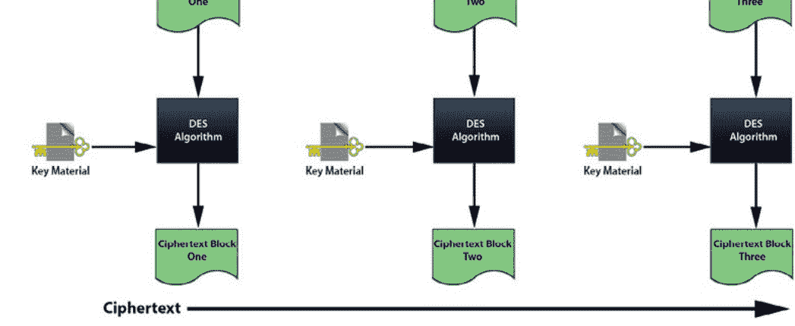

Figure 3.27 — 电子密码本是分组密码使用的一种基本模式。

- **Cipher Block Chaining Mode** — CBC 模式比 ECB 更强，因为每个输入块都会产生不同的输出——即使输入块相同。这是通过在加密过程中引入两个新因素实现的——一个 IV 和一个链式函数，该函数将每个输入与前一个密文进行 XOR。（注意：没有 IV，对相同消息应用链式处理会产生相同的密文。）IV 是一个随机选择的值，与明文的第一块混合。这就像流密码中的种子一样。发送方和接收方必须知道 IV，以便以后解密消息。CBC 的功能可见于图 3.28。

初始输入块与 IV 进行 XOR，然后将该过程的结果加密以产生第一个密文块。然后将该第一个密文块与下一个输入明文块进行 XOR。这就是链式处理，它确保即使输入块相同，结果输出也会不同。

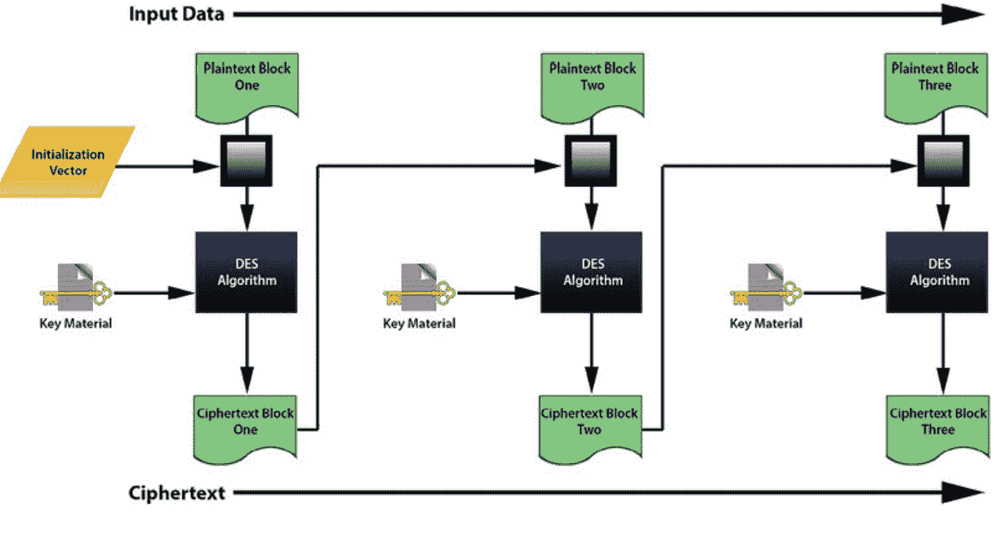

Figure 3.28 - 密码块链接模式。

## DES 的流模式

The following modes of DES operate as a stream; even though DES is a block mode cipher, these modes attempt to make DES operate as if it were a stream mode algorithm. A block-based cipher is subject to the problems of latency or delay in processing. This makes them unsuitable for many applications where simultaneous transmission of the data is desired. In these modes, DES tries to simulate a stream to be more versatile and provide support for stream-based applications.

- **Cipher Feedback Mode —** 在 CFB 模式中，输入被分成单独的段，其大小可以是 1 位、8 位、64 位或 128 位（CFB 的四个子模式）*；它通常为 8 位，因为那是一个字符的大小（图 3.29）。加密过程开始时，选择 IV 并加载到移位寄存器中。然后它通过加密算法运行。算法产生的第一个 8 位然后与明文的第一个 8 位（第一段）进行 XOR。然后每个 8 位段被传输到接收方并反馈到移位寄存器中。然后移位寄存器的内容再次被加密以生成与下一个明文段进行 XOR 的密钥流。此过程一直持续到输入结束。然而，这的一个缺点是，如果某一位被损坏或更改，从该点开始的所有数据都将被损坏。

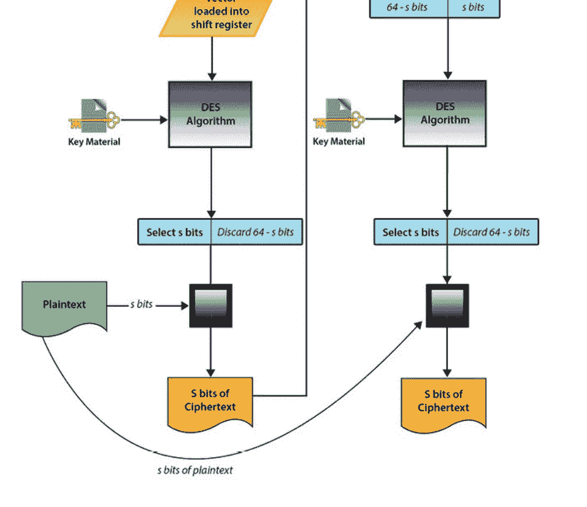

Figure 3.29 - DES 的密文反馈模式。

- **Output Feedback Mode —** OFB 模式在操作上与 CFB 非常相似，只是它不是使用 XOR 操作的密文结果反馈到移位寄存器以生成持续的密钥流，而是将加密的密钥流本身反馈到移位寄存器以创建密钥流的下一部分（图 3.30）。

由于密钥流和消息数据完全独立（密钥流本身是链式的，但密文没有链式），现在可以提前生成整个密钥流并存储以供以后使用。

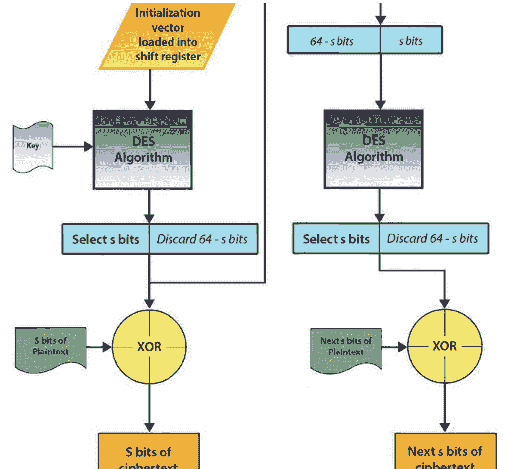

Figure 3.30 - DES 的输出反馈模式。

- **Counter Mode –** CTR 模式用于高速应用，如 IPSec 和 ATM（图 3.31）。在此模式中，一个计数器——一个 64 位随机数据块——用作第一个 IV。CTR 的要求是计数器必须对每个明文块都不同，因此对于每个后续块，计数器递增 1。然后计数器像在 OFB 中一样被加密，结果用作密钥流并与明文进行 XOR。由于密钥流独立于消息，因此可以同时处理多个数据块，从而加快算法的吞吐量。

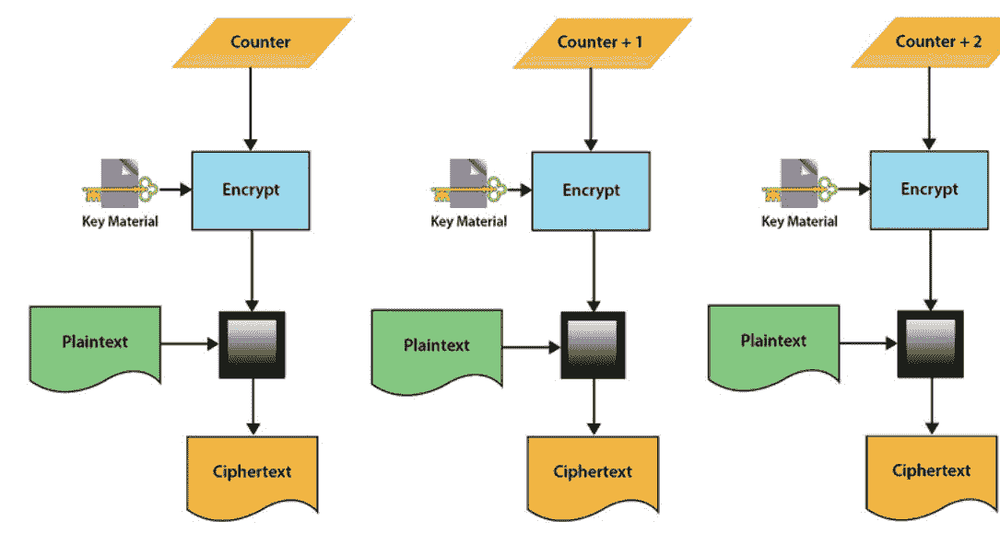

Figure 3.31 - 计数器模式用于高速应用，如 IPSec 和 ATM。

## DES 的优点和缺点

最初，DES 被认为不可破解，早期破解 DES 消息的尝试是不现实的。（一台以每毫秒一次尝试运行的计算机仍需要超过 1000 年才能尝试所有可能的密钥。）然而，DES 易受暴力攻击。由于密钥只有 56 位长，可以通过尝试所有可能的密钥与密文进行比较，直到恢复出真正的明文。电子前沿基金会（www.eff.org）几年前演示了这一点。然而，应该注意的是，他们使用的是最简单的攻击形式——已知明文攻击；他们尝试所有可能的密钥与密文进行比较，知道自己在寻找什么（他们知道明文）。如果他们不知道明文（不知道自己在寻找什么），攻击将困难得多。无论如何，使用当今的计算能力和足够的坚持，DES 可以被破译。对 DES 算法的结构也存在批评。加密和解密操作中使用的 S 盒的设计是保密的，这可能导致人们声称它们可能包含隐藏代码或未经尝试的操作。

## 双重 DES

人们对 DES 的主要抱怨是密钥太短。这使得已知明文暴力攻击成为可能。创建更强版本的 DES 最早考虑的替代方案之一是加倍加密过程，因此得名双重 DES。然而，这被证明不是一个好方法，因为双重 DES 中出现了更严重的漏洞。双重 DES 的意图是创建一个相当于 112 位密钥（两个 56 位密钥）强度的算法。不幸的是，由于“中间相遇”攻击，这并非如此，这也是双重 DES 生命周期非常短的原因。

## 中间相遇

针对双重 DES 最有效的攻击与针对单 DES 的成功攻击类似，基于对已知明文进行暴力攻击（图 3.32）。77 攻击者将使用所有可能的密钥加密明文并创建包含所有可能结果的表。此中间密文在此讨论中称为“m”。这意味着使用全部 2^56 个可能密钥进行加密。然后根据 m 的值对表进行排序。攻击者然后使用所有可能的密钥解密密文，直到找到与 m 值匹配为止。这将导致双重 DES 的实际强度约为 2^57（是 DES 强度的两倍，但不足以被认为有效），而不是最初希望的 2^112。78


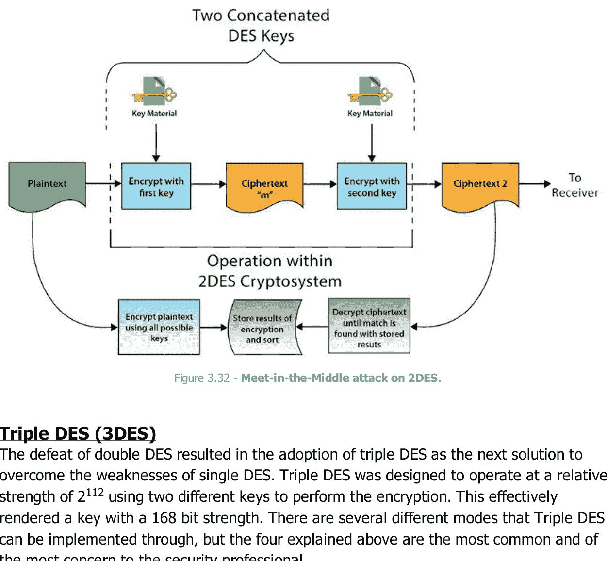

图 3.32 - 针对 2DES 的中间相遇攻击。

## 三重 DES（3DES）

双重 DES 的失败导致了采用三重 DES 作为克服单一 DES 弱点的下一个解决方案。三重 DES 被设计为使用两个不同的密钥进行加密，以 2^112 的相对强度运行。这实际上形成了一个 168 位的密钥强度。三重 DES 可以通过多种不同的模式来实现，但上面解释的四种是最常见的，也是安全专业人员最关心的。

## 高级加密标准

1997 年，美国国家标准与技术研究院（NIST）发出呼吁，征集一种能够替代 DES 和 3DES 的产品。要求是：新算法至少要像 DES 一样强，具有更大的分组大小（因为更大的分组大小会更高效、更安全），并克服 DES 在性能上的问题。DES 是为硬件实现而开发的，在软件中速度太慢。3DES 甚至更慢，因此它在加密中造成了严重的延迟以及显著的处理开销。

经过大量研究，被选为新 AES 的产品是比利时 Joan Daemen 博士和 Vincent Rijmen 博士创建的 Rijndael 算法。Rijndael 这个名字只是他们姓氏的缩写。Rijndael 击败了其他入围者：Serpent（其作者之一是 Ross Anderson）、MARS（IBM 的产品）、RC6（来自 Ron Rivest 和 RSA），以及由 Bruce Schneier 开发的 Twofish。AES 算法必须满足许多标准，包括需要灵活、可在多种平台上实现，并且免版税。

下面是对 AES 及其工作原理的更深入讨论。对于安全架构师和专业人员来说，理解他们所负责交互的任何系统的所有组件固然重要，但对于这些系统的某些方面有适当的认识也很重要，例如算法实现所依据的数学原理，以及算法实现方式的复杂性。除非安全架构师专门从事密码系统设计，否则他们可能永远不需要达到理解下文所讨论内容的技术水平。如果安全专业人员不需要实现使用密码学的系统，那么他们就不需要深入研究下文讨论的架构的复杂之处。然而，这两个安全角色都需要的是具备对算法（如 AES）的基本理解能力，最重要的是，知道在企业内部或可能在企业外部应该联系谁，以便在必要时获得适当的指导。

## 计数器模式与密码分组链接消息认证码协议（CCMP）

CCMP 是一种加密协议，是无线局域网 802.11i 标准的一部分。CCMP 协议基于使用 CTR 与 CBC-MAC（CCM）操作模式的 AES 加密。CCMP 定义在 IETF RFC 3610 中，并作为 IEEE 802.11i 标准的一个组件。79

### CCMP 的工作原理

CCMP 中的 AES 处理必须使用 AES 128 位密钥和 128 位分组大小。根据美国联邦信息处理标准（FIPS）197，AES 算法（一种分组密码）使用 128 位的分组、128、192 和 256 位的密钥长度，以及分别为 10、12 和 14 轮的轮数。80 CCMP 使用 128 位密钥和 48 位 IV 可最大程度地降低对重放攻击的脆弱性。CTR 组件提供数据隐私。密码分组链接消息认证码组件产生消息完整性代码（MIC），为数据包有效载荷数据提供数据来源认证和数据完整性。

密钥也被放入类似的方形表或矩阵中。

Rijndael 操作由四个主要操作组成。

- 1. **字节代换** — 使用 S 盒对整个分组进行逐字节代换。
- 2. **行移位** — 通过偏移表中的每一行进行转置或置换。
- 3. **列混合** — 根据列中数据值的函数，对列中的每个值进行代换。
- 4. **轮密钥加** — 将每个字节与该轮的密钥进行异或；密钥在每一轮操作中都会修改。

### 字节代换

字节代换操作使用 S 盒查找输入中每个字节的值，并用表中的值替换它。S 盒表包含所有可能的 256 个 8 位字值，通过一个简单的交叉引用，使用输入表中字节的前半部分（4 位字）作为 x 轴，后半部分作为 y 轴来找到替换值。输入表和 S 盒表都使用十六进制值。

### 行移位变换

行移位变换步骤通过如下方式移位数据行，对输入数据进行分组范围内的转置。如果从前面描述的输入表开始，可以观察到行移位操作的效果。请注意，此时该表已经经过了字节代换操作，因此它看起来不再是这样，但为了清晰起见，仍将使用此表。

| 第 1 字节 | 第 5 字节 | 第 9 字节 | 第 13 字节 |
|---|---|---|---|
| 第 2 字节 | 第 6 字节 | 第 10 字节 | 第 14 字节 |
| 第 3 字节 | 第 7 字节 | 第 11 字节 | 第 15 字节 |
| 第 4 字节 | 第 8 字节 | 第 12 字节 | 第 16 字节 |

第一行不进行移位。

| 第 1 字节 | 第 5 字节 | 第 9 字节 | 第 13 字节 |
|---|---|---|---|

该表的第二行向左移动一位。

| 第 6 字节 | 第 10 字节 | 第 14 字节 | 第 2 字节 |
|---|---|---|---|

该表的第三行向左移动两位。

| 第 11 字节 | 第 15 字节 | 第 3 字节 | 第 7 字节 |
|---|---|---|---|

该表的第四行向左移动三位。

| 第 16 字节 | 第 4 字节 | 第 8 字节 | 第 12 字节 |
|---|---|---|---|

行移位步骤的最终结果如下所示：

| 1 | 5 | 9 | 13 |
|---|---|---|---|
| 6 | 10 | 14 | 2 |
| 11 | 15 | 3 | 7 |
| 16 | 4 | 8 | 12 |

### 列混合变换

列混合变换通过将列中的每个字节相乘和异或来执行，根据图 3.33 中的表格。


图 3.33 — 列混合变换

图 3.33 中的表格是上一步的结果，因此当第一列（在状态表中以阴影显示）与第一行使用列混合表（以阴影显示）中的乘法与 XOR 运算进行处理时，第一列的列混合步骤的计算将是

```
(1*02)  (6*03)  (11*01)  (16*01)
```

列中的第二个字节将使用列混合表中的第二行计算，如下所示

```
(6*01)  (11*02)  (16*03)  (1*01)
```

### 轮密钥加

密钥在每一轮中都会被修改，方法是首先将密钥分成 16 位的小块（4 个 4 位

Twofish 是 AES 的入围者之一。它是由 Bruce Schneier 领导的密码学家团队开发的 Blowfish 的改编版本。它可以使用 128、192 或 256 位的密钥对 128 位的分组进行操作。在加密/解密过程中执行 16 轮。

## RC5

RC5 由 RSA 的 Ron Rivest 开发，并部署在 RSA 的许多产品中。它是一种适应性很强的产品，可用于从软件到硬件实现的许多应用。RC5 的密钥可以从 0 到 2040 位变化；它执行的轮数可以从 0 到 255 调整，输入字的长度也可以选择 16 位、32 位和 64 位。该算法一次对两个字进行快速且安全的操作。

RC5 在 RFC 2040 中定义了四种不同的操作模式：

- RC5 分组密码类似于 DES ECB，生成与输入长度相同的密文分组。
- RC5-CBC 是 RC5 的一种密码分组链接形式，使用链式链接确保重复的输入分组不会生成相同的输出。
- RC5-CBC-Pad 将链接与处理任意长度输入明文的能力相结合。密文最多比明文长一个分组。
- RC5-CTS 被称为密文窃取，将生成与任意长度明文长度相等的密文。

## RC4

RC4 是一种基于流的密码，由 Ron Rivest 于 1987 年为 RSA Data Security 开发，已成为使用最广泛的流密码，例如部署在 WEP 和 SSL/TLS 中。RC4 使用范围从 8 到 2048 位（1 到 256 字节）的可变长度密钥，并且周期大于 10¹⁰⁰。换句话说，密钥流至少在该长度内不应重复。

如果 RC4 使用至少 128 位的密钥长度，目前没有实际的攻击方式；已公布的针对 WEP 应用中使用 RC4 的成功攻击与算法实现的问题有关，而不是算法本身的问题。

## 对称算法的优缺点

对称算法是为存储或传输的消息提供机密性以及一定的完整性和认证的非常快速且安全的方法。许多


算法可以实现在硬件或软件中，并且对用户而言无需成本。

然而，对称算法存在严重的缺点——密钥管理非常困难，尤其是在大型组织中。所需的密钥数量会随着每个新用户的增加而迅速增长，其公式为 n (n − 1)/2，其中 n 为用户数量。仅有 10 名用户且希望相互安全通信的组织就需要 45 个密钥（10*9/2）。如果组织扩展到 1000 名员工，密钥管理的需求将扩大到近五十万个密钥。

对称算法也无法提供来源不可否认性、访问控制和数字签名，除非在非常有限的方式下。如果两个人或更多人共享一个对称密钥，那么就无法证明是谁篡改了受对称密钥保护的文件。选择密钥是密钥管理的重要组成部分。需要建立一个流程，确保密钥是从整个密钥空间中随机选择的，并且有某种方法可以恢复丢失或遗忘的密钥。

由于对称算法要求发送方和接收方两个用户共享相同的密钥，因此在安全密钥分发方面会存在挑战。通常，用户必须使用带外通道（如面对面、邮件、传真、电话或快递）来交换秘密密钥。使用带外通道应使攻击者难以同时截获加密数据和密钥。交换对称密钥的另一种方法是使用非对称算法。

## 非对称密码学

由于对称密码学的实际限制，非对称密码学试图提供兼顾各方的最佳方案。虽然最初需要更多的密钥管理，但非对称密码学的基础提供了一个可扩展且弹性的框架，用于部署完整性、保密性、认证和不可否认性的密码学功能。

### 非对称算法

虽然对称算法已存在数千年之久，但非对称（或公钥）算法的使用相对较新。这些算法在 1976 年 Whitfield Diffie 和 Martin Hellman 博士发布题为《密码学新方向》的论文时变得广为人知。81 Diffie–Hellman 论文描述了使用两把不同的密钥（密钥对）执行密码学操作的概念。这两把密钥在数学上相关，但互不相通。对于大多数非对称算法，如果密钥对的一半用于加密，则另一半密钥就需要用于解密消息。

当某人希望使用非对称算法进行通信时，她首先会生成一个密钥对。通常这由密码学应用程序或 PKI 在无需用户参与的情况下完成，以确保密钥生成过程的强度。密钥对的一半被保密，只有密钥持有者知道该密钥。因此它通常被称为私钥。密钥对的另一半可以自由提供给任何想要副本的人。在许多公司中，它可能通过公司网站或访问密钥服务器获得。这就是为什么密钥对的这一半通常被称为公钥。非对称算法是单向函数，即一个过程在正向进行时远比反向（逆向工程）简单。生成公钥（正向）的过程相当简单，并且向任何想要的人提供公钥并不会危及私钥，因为从公钥推导出私钥的过程在计算上不可行。

### 机密消息

由于密钥互不相通，任何用公钥加密的消息只能用对应的密钥对另一半——私钥——解密。因此，只要密钥持有者妥善保管其私钥，就存在一种机密传输消息的方法。发送方会用接收方的公钥加密消息。只有拥有私钥的接收方才能打开或读取消息，从而提供保密性。见图 3.34。

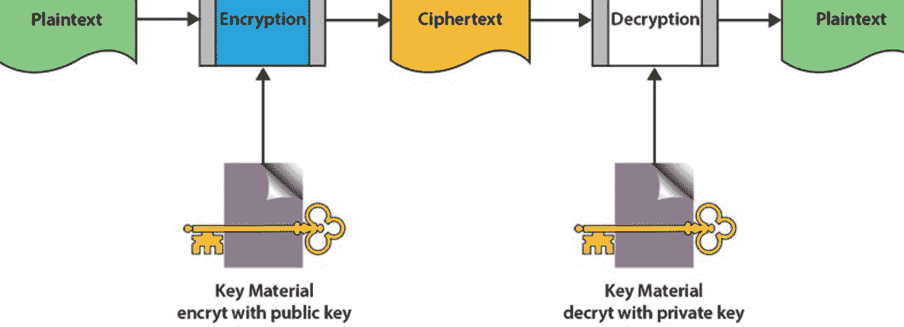

图 3.34 — 使用公钥密码学发送机密消息。

图 3.36 - 使用公钥密码学发送具有来源证明的机密消息。

### RSA

RSA 由 Ron Rivest、Adi Shamir 和 Len Adleman 于 1978 年在麻省理工学院时开发。RSA 基于对两个大素数乘积进行因式分解的数学挑战。素数只能被 1 和自身整除。一些素数包括 2、3、5、7、11、13 等。因式分解是指取一个数并找到可以相乘得到该数的数。例如，如果 a*b 的乘积 = c，则 c 可以分解为 a 和 b。3*4 = 12，则 12 可以分解为 3、4 和 6、2、12 和 1。RSA 算法使用大素数，相乘后极难分解。成功的因式分解攻击已针对 512 位数字执行（成本约为 8000 MIPS 年），而对 1024 位数字的成功攻击在近期似乎越来越可能；美国政府组织 NIST 建议在 2010 年底前放弃 1024 位 RSA 密钥大小。82 该建议部分表述如下：

> “如果信息最初在 2009 年签名，并且需要在最多 10 年内保持安全（即从 2009 年到 2019 年），则 1024 位 RSA 密钥在 2011 年至 2019 年之间将无法提供足够的保护，因此不建议在这种情况下使用 1024 位 RSA。”

RSA 是使用最广泛的公钥算法，并根据以下公式对文本块进行操作：

```
C = P^e mod n
```

密文是根据明文按指数 e mod n 计算得出的。

### 攻击 RSA

攻击 RSA 算法的三种主要方法是用暴力破解尝试所有可能的私钥；数学攻击，因式分解两个素数的乘积；以及时序攻击，测量解密算法的运行时间。

### Diffie–Hellman 算法

Diffie–Hellman 是一种密钥交换算法。它用于使两个用户交换或协商一个秘密对称密钥，该密钥随后将用于消息加密。Diffie–Hellman 算法不提供消息保密性，但对于诸如公钥基础设施（PKI）等应用非常有用。Diffie–Hellman 基于离散对数。这是一种数学函数，首先基于找到素数的原根。使用原根，可以

### 混合密码学

对称加密许多问题的解决方案在于开发一种混合密码学技术，该技术结合了对称密码学的优势——其速度极快且算法安全，以及非对称密码学的优势——能够安全地交换会话密钥、消息认证和不可否认性。对称密码学最适合加密大文件。它可以在对交付时间或计算性能影响很小的情况下处理加密和解密过程。

非对称密码学可以通过交换或协商本次会话将使用的对称密钥来处理通信会话的初始设置。在许多情况下，对称密钥仅在本次通信期间需要，并在交易完成后可以丢弃，因此在这种情况下对称密钥被称为会话密钥。混合系统的工作方式如图所示 3.37 所示。消息本身使用对称密钥 SK 加密并发送给接收方。对称密钥使用接收方的公钥加密并发送给接收方。对称密钥使用接收方的私钥解密。这会将对称密钥披露给接收方。然后可以使用对称密钥解密消息。


- 给定一个 MAC 及其生成的消息，找出生成相同 MAC 的另一条消息在实践中是不切实际的。

在 DES-CBC 的情况下，MAC 是使用 CBC 模式下的 DES 算法生成的，并且秘密 DES 密钥由发送方和接收方共享。MAC 实际上只是算法生成的密文的最后一个数据块。该数据块（64 位）附加到未加密的消息上并传输到远端。所有先前的加密数据块都被丢弃，以防止对 MAC 本身的任何攻击。接收方只需使用其共享的秘密 DES 密钥自行生成 MAC，以确保消息的完整性和认证。他知道消息没有被更改，因为如果消息的任何一位发生变化，CBC 的链式函数会显著改变最后一个数据块的数据。他知道消息的来源（认证），因为只有另一个人持有秘密密钥。如果消息包含序列号（如 TCP 标头或 X.25 分组），他就知道所有消息都已接收且未被重复或遗漏。

# HMAC

基于 DES 的 MAC 是创建 MAC 的最常见方法之一；然而，与哈希函数相比，其操作速度较慢。诸如 MD5 之类的哈希函数没有秘密密钥，因此不能用于 MAC。因此，发布了 RFC 2104 以提供一种哈希 MAC 系统，该系统现已成为 IPSec 以及许多其他安全 Internet 协议（如 SSL/TLS）中使用的流程。哈希 MAC 在 HMAC 实现中将可自由获得的哈希算法作为组件（黑盒）实现。这使得在需要新哈希函数时可以轻松替换哈希模块。使用经过验证的密码学哈希算法也提供了对 HMAC 实现的安全性保证。HMAC 通过将秘密密钥值与源消息一起添加到哈希输入函数中来工作。HMAC 操作提供的密码强度与哈希算法相似，只是现在它具有秘密密钥的额外保护，并且仍然几乎与标准哈希操作一样快速。

# 软件和系统漏洞与威胁

软件和系统将继续遭受漏洞困扰。基于 Web 的应用程序、客户端、服务器以及支持它们的<|message|>... 等技术仍需进行补救措施。通过安全架构进行合理的设计可以帮助在漏洞形成之前减轻和消除漏洞。

- **Risk Transference –** SAML 可以将对身份管理的适当责任推给身份提供者，这通常与其业务模式比服务提供商更兼容。

虽然 SAML 本质上被设计为安全，但安全架构师必须确保实现不会削弱该语言的安全性。例如，在传递 SAML 断言时，如果系统省略了授权请求的标识符或接收者的身份，攻击者可能能够在未经授权的情况下访问用户的账户。84

在此方面，安全架构师还应考虑 OpenID Connect 标准。85 OpenID Connect 是基于 OAuth 2.0 系列规范的可互操作认证协议。86 它使用简洁的 REST/JSON 消息流，其设计目标是“让简单的事情变简单，让复杂的事情成为可能”。

OpenID Connect 与 OpenID 2.0 在架构上有许多相似之处，事实上这些协议解决的是一组非常相似的问题。然而，OpenID 2.0 使用 XML 和一种自定义的消息签名方案，在实践中有时被证明对开发人员来说难以正确实现，其结果是 OpenID 2.0 实现有时会神秘地拒绝互操作。OpenID Connect 的底层 OAuth 2.0 将必要的加密外包给 Web 内置的 TLS（也称为 HTTPS 或 SSL）基础设施，该基础设施在客户端和服务器平台上普遍实现。OpenID Connect 在需要签名时使用标准的 JSON Web Token（JWT）数据结构。这使得 OpenID Connect 对开发人员来说实现起来简单得多，实际上它带来了更好的互操作性。

OpenID Connect 让开发人员能够在无需拥有和管理密码文件的情况下，在网站和应用程序之间对用户进行认证。对于应用构建者来说，它提供了安全且可验证的答案来回答问题：“目前连接到我的浏览器或原生应用的人的身份是什么？”

OpenID Connect 允许所有类型的客户端，包括基于浏览器的 JavaScript 和原生移动应用，启动登录流程并接收有关已登录用户身份的可验证断言。

```
(Identity, Authentication) + OAuth 2.0 = OpenID Connect
```

# OWASP

开放式 Web 应用程序安全项目（OWASP）是一个致力于提高软件安全的非营利组织。OWASP 开发了众多免费且有用的产品，供安全架构师参考，其中包括：

- **OWASP Top 10 Project** — 提供 OWASP 对前十个基于 Web 的应用程序安全缺陷的看法以及如何减轻这些缺陷。⁸⁷
- **OWASP Guide Project** — 面向架构师，这是一本设计安全 Web 应用程序和服务的综合手册。⁸⁸
- **OWASP Software Assurance Maturity Model (SAMM)** — SAMM 是一个用于设计安全软件并使其符合组织特定风险的框架。⁸⁹
- **OWASP Mobile Project** — 为开发人员和架构师提供开发和维护安全移动应用程序的资源。⁹⁰

鉴于基于 Web 和基于云的解决方案的普及，OWASP 提供了可访问且全面的 Web 应用程序安全流程框架。安全架构师应彻底熟悉 OWASP 的工作以及它如何适用于其所服务的使命。

# 移动系统中的漏洞

在过去二十年里，我们见证了移动设备技术的重大进步，从 1990 年代末和 2000 年代初的个人数据助理（PDA）到今天的多功能智能手机。这些进步扩展了企业的虚拟边界，通过提供对电子邮件的恒定访问、实现新的移动业务应用以及允许在任何设备上随时访问和存储敏感公司数据，从而模糊了家庭和办公室之间的界限。

当第一款 BlackBerry 智能手机在 2000 年代初发布时，企业很快认识到远程电子邮件和日历访问的好处，并开始为其大部分员工提供具有网络访问权限的智能手机，有效地建立了 24 小时连接的概念。随着 Apple iPhone 的发布以及随后运行 Android 和 Windows Phone 操作系统的设备，智能手机的普及扩展到了商业用户之外。功能已超越电子邮件和 Web 浏览；移动设备现在能够拍照、运行自定义应用程序、查看带有 Flash 和 JavaScript 的丰富内容网站、无线连接其他设备和网络、建立虚拟专用网络连接，并充当其他设备的数据流量中继（称为 tethering）。平板电脑，如 iPad、Surface 和 Galaxy，正在重新定义智能设备的概念并模糊移动设备与计算机之间的界限。

随着移动设备能力的提升和随后的消费者采用，这些设备已成为人们在工作和个人生活中完成任务不可或缺的一部分。虽然硬件和软件的改进使移动设备能够执行更复杂的任务，但这种功能也增加了该平台作为攻击目标的吸引力。Android 的“开放应用程序”模型导致了多个具有隐藏功能的恶意应用程序的出现，这些应用程序会秘密收集用户数据。91 同样，中国、东欧和中东的第三方 Android 应用程序市场已被发现托管具有远程命令执行管理权限的应用程序。

首个被检测到的 Android 恶意软件出现在 2010 年 8 月，此后该平台上已发现并识别出超过 300 个不同的恶意软件家族。Android 恶意软件在避免检测和移除方面非常复杂，在如何避免和对抗检测方法方面已有很大创新。Ginmaster 就是一个例子。首次于 2011 年 8 月在中国发现，该木马程序被注入到许多合法应用中，这些应用也通过第三方市场分发。2012 年，Ginmaster 开始通过混淆类名、加密 URL 和 C&C 指令以及采用在 Windows 恶意软件中已司空见惯的多态技术来抵抗检测。2013 年，Ginmaster 的开发者实施了更复杂和微妙的混淆和加密技术，使得该恶意软件更难检测或逆向工程。92

许多组织担心数据完整性，而不断增加的法规和数据保护要求也对组织妥善保护与移动设备交互的数据提出了进一步义务。因此，需要更高水平的安全性和数据保护保证。挑战在于这些水平可能超过供应商或平台本身目前能够提供的水平。安全从业人员面临的另一个挑战是，使用移动设备的益处和回报有时会被欺诈和安全风险抵消。例如，安全研究人员已识别出若干 iPhone 和 Android 安全漏洞，这些漏洞允许用户通过“越狱”或“root”设备来绕过设备限制并安装自己的固件。93 这可能导致用户能够绕过阻止恶意软件在设备上运行的许多限制。

Apple、RIM、Microsoft 和 Google 都支持不同的操作系统和软件开发工具包（SDK），开发人员使用它们来创建应用程序。每一个这些

平台具有不同的安全模型，这会影响开发者在应用程序中处理安全的方式。并且每种语言都有其自身的安全陷阱和风险，在开发应用程序时必须加以考虑。对 JavaScript 或持久会话数据的限制也导致开发者将敏感信息和会话信息放在每次向服务器请求的 URL 中。此外，网络带宽限制可能会促使开发者创建针对移动设备的格式化站点，这些站点会缓存网页的额外信息，如果设备被入侵，这些信息可能会被暴露。

2012 年第四季度，Forrester Research Inc. 进行的一项全球研究发现，74% 的员工使用个人智能手机处理业务任务。该全球研究还发现，44% 的员工在咖啡馆或其他公共场所使用智能手机工作，47% 的员工在旅行时使用。94 因此，鉴于此类趋势，安全从业人员需要检查企业内部移动设备部署和使用的现状。理解并有效管理系统漏洞是任何安全管理计划中的基本且关键步骤。例如，有效网络防御的最初四项关键控制措施（原为 SANS 前 20 项安全控制）涉及设备和软件的识别与盘点、配置加固，以及定期和自动化的系统漏洞评估与缓解。95 这些控制措施也代表了美国国土安全部持续诊断与缓解（CDM）计划第一阶段的大部分内容。96

移动平台带来的挑战众多且各不相同，但可以通过将其分解为功能单元或类别来检查和识别，具体如下。

## 远程计算风险

组织通常假设远程用户是安全的，因为他们通过虚拟专用网络（VPN）访问企业网络。然而，虽然 VPN 提供了一个隧道连接，允许仅经过身份验证的用户访问企业内网，但它并不是一个完整、端到端的解决方案。VPN 不能确保远程和移动设备没有软件和配置漏洞，而这些漏洞可能被用来传播病毒或蠕虫。这些恶意软件示例很容易被引入，因此远程机器可能会将关键网络资产暴露给这些漏洞。

VPN 相关泄露的一个例子是 2008 年 Heartland Payment Systems 的事件。支付处理系统部分通过 VPN 连接被入侵。首先，SQL 注入攻击使黑客能够控制 Heartland 内部的一个系统，但并未进入交易处理环境本身。攻击者随后利用被入侵的内部系统执行权限提升攻击。他们之所以能够做到这一点，是因为诸如工作站之类的系统并未像托管敏感数据的系统（例如支付处理系统）那样得到同等程度的安全保护。97

类似的事件在 2010 年 1 月影响了 Google、Adobe、Microsoft、Yahoo 以及大约 30 家科技公司。98 事件发生后，Google 指示其用户因怀疑来自中国的高度复杂和有针对性的攻击而紧急更改 VPN 设置。后来据说攻击针对的是未修补的浏览器漏洞。99 VPN 配置更改的时机导致一些人认为内部系统存在未修补软件与 VPN 访问内部网络和敏感数据之间存在关联。100 分段、代理和过滤以及监控可能已防止此次泄露。修补和/或升级浏览器也可能防止它发生。具有讽刺意味的是，在攻击发生三个月后，Google 建议其中国用户考虑使用 VPN 技术来绕过边界安全并确保在中国大陆持续访问 Google 服务。

端点设备风险可能包括以下问题：

- **受信任的客户端 —** 设备另一端是谁，他们的意图是什么？
- **网络架构 —** 用于控制和管理移动设备访问的基础设施位于何处？通常它位于 LAN 而非 DMZ，为黑客通过 APT 攻击和基于 RAT 的恶意软件引入提供机会，直达 LAN。 此外，企业范围内是否部署了健全且完全实施的补丁管理解决方案，以应对因未修补基础设施中可利用的漏洞而导致的潜在漏洞？101
- **策略实施 —** 错误的、不充分的或实施薄弱的控制措施很容易被黑客和恶意软件绕过。
- **被盗或丢失的设备 —** 当包含敏感数据的设备未完全处于企业安全机构的控制和管理之下时，物理访问控制会带来重大挑战。

## 移动员工风险

移动员工将笔记本电脑带回家并外出，然后在新地点的工作方式与在办公室几乎相同。然而，现在他们失去了企业防火墙和其他传统部署以保护企业 LAN 的安全保护设备。这使他们的系统暴露于病毒、蠕虫和其他类型的恶意软件，增加这些机器日后被攻击者非法访问网络的风险。这些机器最终会返回企业网络，实际上是绕过网络防火墙，并且被允许作为受信任设备连接。如果被感染，一台机器很容易成为将恶意代码引入企业环境的渠道。移动员工风险可能包括以下问题：

- **平台激增** — 随着平均每位员工现在使用两到三台不同的移动设备访问企业网络，IT 和安全部门面临着在几乎无限范围的设备和操作系统（包括 Android、iOS、Windows Phone、Windows Mobile、BlackBerry 和 Symbian）上实施和管理移动安全的挑战。
- **基于家庭的 PC 和多设备同步解决方案** — 这可能会引入数据泄露的额外风险。即使员工可能只对备份个人文件和照片感兴趣，他们也可能在同步过程中将企业数据和密码从移动设备下载到家庭计算机上。如果员工的家庭计算机已被特洛伊木马或间谍软件感染，这可能会损害企业数据的安全。此外，如果计算机存在未修补的漏洞，网络犯罪分子可以轻松访问备份、存储或同步到计算机上的移动数据，而不管移动设备上实际运行的安全软件如何。

下面列出的列表对移动设备的潜在攻击向量进行了分类：

- 短信
- Wi-Fi
- 蓝牙
- 红外
- USB
- 网页浏览器
- 邮件客户端

通过暴力破解进入设备，设备可以自动擦除（前提是设备已注册，如下所述）。为防止对 Windows Phone 存储的攻击，Microsoft 提供了几种不同的选项。首先，当手机通过 USB 连接到 PC 时，数据的访问取决于用户 PIN 的成功输入。其次，针对物理可移动存储的离线攻击通过将存储介质固定在设备本身来解决。最后，用户可以注册其 Windows Phone 设备，这将使他们能够在手机丢失或被盗时定位、响铃、锁定甚至擦除设备，据 Microsoft 称。102

安全从业人员在检查企业中移动系统相关的威胁、漏洞和风险时需要考虑许多变量。以下标准可能提供指导：

- NIST SP 800-40 修订版 3，企业补丁管理技术指南 103
- NIST SP 800-121 修订版 1，蓝牙安全指南 104
- NIST SP 800-124 修订版 1，企业中移动设备安全管理的指南 105

## 嵌入式设备和网络物理系统中的漏洞

今天，智能互联设备无处不在。智能手机无处不在，智能汽车、智能建筑甚至智能家电正日益走向主流。虽然制造商将智能嵌入这些设备并将其连接到互联网以使其更有用，但这种复杂程度也使其成为利用和安全攻击的目标。那么安全架构师该怎么办？请看以下两个例子：

Daniel Crowley 和 David Bryan 是 Trustwave SpiderLabs 的研究人员，他们在 2013 年 Black Hat 大会上发表演讲，并在与 SC 杂志的视频采访中使用 VeraLite 演示了入侵家庭系统的便捷性，VeraLite 是 Mi Casa Verde 出售的售价 180 美元的家庭自动化网关。

正如 Crowley 所解释的，VeraLite “具有 Web 界面，但也具有 UPnP（通用即插即用协议）接口，该接口不需要用户名和密码。你可以进入网络，询问是否有 UPnP 设备；它会响应并告诉你它能做的一切。如果我可以访问你的家庭网络，那么我就能够访问你的家庭。” 他说

就在他用几下击键打开面前桌子上的门锁之前不久。

VeraLite并非特例。Crowley和Bryan表示，他们测试了10种不同的产品，“结果发现只有一两种我们无法破解。大多数产品根本没有任何安全控制措施。”<sup>106</sup>

第二个例子与2013年和2014年英国300辆宝马被盗案有关。黑客成功侵入了汽车上的一个技术端口，从而获取了每辆车的遥控钥匙数字ID。

对遥控钥匙进行编程并不需要任何身份验证。宝马将这个系统“开放”以方便其经销商网络，但不幸的是，这只会让他们的汽车更容易被盗。<sup>107</sup>

安全架构师在这一领域面临一场艰难的战斗，因为明显的趋势似乎是：可用性和易访问性正在压倒常识性的安全协议和流程；对于那些随着这些系统在企业及家庭中持续部署而负责管理其中许多系统的安全专业人员来说，情况也一样。看起来在这一领域，经过时间检验且被证明有效的常识性安全方法正被搁置一旁，转而青睐最终用户层面的易访问性和“功能性”。那么信息物理系统呢？它们的架构设计、部署和管理是否也同样缺乏对安全的关注，就像在消费领域所观察到的那样？

信息物理系统（CPS）是具有嵌入式传感器、处理器和执行器的智能网络系统，旨在感知物理世界（包括人类用户）并与之交互，在安全关键应用中支持实时、有保证的性能。在CPS系统中，系统“信息”和“物理”元素的联合行为至关重要——计算、控制、感知和网络深度集成到每个组件中，组件和系统的行为必须精心编排。

可能找到CPS产品的工业领域部分列表如下：

- 交通运输
- 制造业
- 医疗保健
- 能源
- 农业
- 国防
- 楼宇控制
- 应急响应系统

基于CPS的架构如今面临若干挑战。其中两个尤其令安全从业者和架构师关注：网络安全和互操作性。网络安全之所以重要，是因为许多针对网站、数据库和网络等传统基础设施的攻击可以轻易被调整和复制，用于攻击智能电网和交通网络等CPS解决方案。这类攻击如果成功实施，可能造成严重后果。互操作性之所以重要，是因为需要应对这样一个事实：CPS可以跨大量系统运行以执行复杂任务。

集成和管理CPS产品所需的一些关联及核心技术如下：

- **抽象、模块化和可组合性** — 使CPS系统元素能够组合和重用，同时保持安全性、安全性和可靠性。
- **基于系统工程的架构和标准** — 实现可靠系统的高效设计和开发，同时确保与遗留系统的互操作性和集成。
- **自适应和预测分层混合控制** — 在本质上同步、分布式且嘈杂的系统中实现紧密协调和同步的行动与交互。
- **多物理场模型与软件模型的集成** — 实现物理工程元素和计算元素的协同设计，并具有可预测的系统行为。
- **分布式传感、通信和感知** — 实现灵活、可靠、高性能的CPS分布式网络，提供准确可靠的世界模型，并支持时间感知和时间关键功能。
- **诊断和预测** — 识别、预测、预防或恢复复杂系统中的故障。
- **网络安全** — 通过防范对CPS系统的恶意攻击来保障安全。
- **确认、验证和认证** — 加快创新推向市场的设计周期，同时确保系统安全和功能的高置信度。
- **自主性与人机交互** — 开发自主CPS系统以及与其交互的人类的模型，以促进人类使用的反应式系统的基于模型的设计。<sup>108</sup>

安全从业者和架构师都必须在理解和管理当今企业中出现的新兴CPS解决方案方面发挥作用。除了传统的IT安全预防机制（如身份验证、加密和防火墙）和检测机制（如入侵检测系统和取证）之外，还需要设计新的CPS安全机制并将其集成到企业中。安全架构师应与从业者携手合作，确保必要的关注集中在解决CPS安全问题的方案的开发和集成上。需要考虑的领域很多，但其中三个尤为突出。

首先是风险评估：安全架构师应考虑诸如此类的问题：“我应该将预算分配到哪里，以最大程度地减少对系统的潜在物理损害？”第二个领域是坏数据检测机制。这些机制不应假设随机、独立的故障，而应考虑对复杂攻击者的检测。该领域需要解决的一个特殊问题是不良拓扑检测机制。用虚假数据替换感测数据（这将是一种欺骗攻击形式）是一种非常通用的攻击，可以扩展到任何智能电网应用，因为它们都基于正确的传感器测量。因此，为并非所有接收数据都可信的智能电网应用开发入侵检测机制或信誉管理系统非常重要。第三种方法是设计系统对攻击的弹性/生存能力。一个有希望的方向是设计配电网络的拓扑结构，以抵御针对断路器的恶意命令，这些命令试图改变和断开网络，因为攻击者使用APT或其他恶意软件载体来控制系统。

工业系统和关键基础设施通常由称为工业控制系统（ICS）的简单计算机监控和控制。ICS基于标准嵌入式系统平台，通常使用商用现成软件。ICS用于控制工业过程，如制造、产品处理、生产和分配。众所周知的ICS类型包括监控和数据采集（SCADA）系统、分布式控制系统（DCS）和可编程逻辑控制器（PLC）。

SCADA系统在历史上区别于其他ICS之处在于，它们是ICS系统中最大的子集，并且适用于可包括多个站点和远距离的大规模流程。监控和数据采集（SCADA）系统通常可以被视为用于监控和控制工业环境中物理设备的互连设备的集合。它们被广泛用于自动化地理分布流程，例如发电、输电和配电、油气精炼和管道管理、水处理和分配、化工生产和加工、铁路系统以及其他公共交通。

以下是自动化和过程控制系统以及工业控制系统安全的前十大威胁列表：<sup>109</sup>

| 序号 | 威胁 | 说明 |
|---|---|---|
| 1 | 未经授权使用远程维护访问点 | 维护访问点是特意为ICS网络创建的外部入口，通常安全性不足。 |
| 2 | 通过办公或企业网络进行在线攻击 | 办公IT通常以多种方式与网络相连。在大多数情况下，从办公室到ICS网络也存在网络连接，因此攻击者可以通过这条路径获得访问权限。 |
| 3 | 对ICS网络中使用的标准组件的攻击 | 标准IT组件（商用现成（COTS））如系统软件、应用服务器或数据库通常包含可被攻击者利用的缺陷或漏洞。如果这些标准组件也用于ICS网络，则ICS网络被成功攻击的风险会增加。 |
| 4 | （分布式）拒绝服务攻击 | （分布式）拒绝服务攻击可能损害网络连接和关键资源，并导致系统故障——例如，扰乱ICS的运行。 |
| 5 | 人为错误和蓄意破坏 | 蓄意行为——无论由内部还是外部实施者——对所有保护目标都是巨大威胁。疏忽和人为错误也是巨大威胁，特别是涉及保护目标保密性和可用性时。 |
| 6 | 通过可移动介质和外部硬件引入恶意软件 | 使用可移动介质和外部人员的移动IT组件总是会带来恶意软件感染的巨大风险。 |
| 7 | 在ICS网络中读写消息 | 大多数控制组件目前使用明文协议，因此通信不受保护。这使得读取和引入控制命令相对容易。 |
| 8 | 未授权访问资源 | 如果过程网络中的服务和组件没有使用身份验证和授权方法，或者这些方法不安全，内部实施者和初始外部渗透后的后续攻击就特别容易得手。 |
| 9 | 对网络组件的攻击 | 攻击者可以操纵网络组件，例如进行中间人攻击或使嗅探更容易。 |
| 10 | 技术故障或不可抗力 | 极端天气或技术故障导致的停电可能随时发生——在这种情况下，风险和潜在损害只能最小化。 |


自1999年以来，发生过多起事件，凸显了此类威胁对嵌入式系统的重要性。

## 事件：汽油管道破裂

1999年6月，由奥林匹克管道公司（The Olympic Pipe Line Company）拥有的一条直径16英寸的钢制管道破裂，约23.7万加仑汽油泄漏到流经华盛顿州贝灵厄姆市沃特科姆瀑布公园的一条小溪中。破裂约1.5小时后，汽油被点燃，沿小溪燃烧了约1.5英里。事故导致两名10岁男孩和一名18岁年轻男子死亡，另有8人受伤的记录。一栋独户住宅和贝灵厄姆市的水处理厂遭到严重破坏。奥林匹克公司估计总财产损失至少为4500万美元。

事故的原因之一是奥林匹克管道公司在SCADA系统用于管道运营的同时，在该系统上进行数据库开发工作。就在破裂前不久，新的泵振动数据记录被输入SCADA历史数据库。这些记录是由一名临时指派为计算机系统管理员的管道控制员创建的。根据事故报告，数据库更新导致系统在管道运营的关键时刻失去响应。110

## 恶意控制系统网络攻击——澳大利亚马鲁奇水务公司

维特克·博登（Vitek Boden）曾就职于Hunter Watertech，这是一家澳大利亚公司，为澳大利亚昆士兰州马鲁奇郡议会安装了由SCADA（监控与数据采集）无线电控制的污水处理设备。博登显然在离开Hunter Watertech一段“紧张关系”后，向马鲁奇郡议会申请了工作。议会决定不雇用他。因此，博登决定向议会和他的前雇主报复。他把偷来的无线电设备装上车，连接上一台计算机。从2000年2月28日到4月23日，他至少在周边地区驾车行驶了46次，向他帮助安装的污水处理设备发出无线电指令。博登造成80万升未经处理的污水泄漏到当地公园、河流，甚至凯悦酒店的地面上。澳大利亚环境保护局的一位代表说：“水生生物死亡，溪水变黑，居民难以忍受恶臭。”111 博登在一次攻击后因交通违规被警察拦下，碰巧被逮捕。法官判处他两年监禁，并责令他向议会赔偿清理费用。博登的攻击成为恶意入侵控制系统第一个广为人知的案例。112

## 事件：病毒攻击列车信号系统

2003年8月，一种计算机病毒被指导致美国东部列车信号系统瘫痪。信号中断一度影响了整个CSX系统，该系统覆盖密西西比河以东的23个州。病毒侵入了CSX公司位于佛罗里达州杰克逊维尔总部的计算机系统，导致信号、调度和其他系统关闭。据信，罪魁祸首是一种名为SoBig的病毒，它加剧了早一周出现的Blaster蠕虫造成的破坏。同一时期，Blaster的一个变种还导致加拿大航空的值机系统瘫痪。113

安全实践者和安全架构师都需要了解在企业内运行嵌入式系统相关的威胁、漏洞和风险。安全架构师需要考虑系统设计方面所有适用的标准和指南，而安全实践者需要了解这些系统的管理、维护、运营和保护相关的最佳实践。架构师和实践者还必须考虑风险管理以及业务影响。

以下标准对于非核关键能源基础设施中ICT系统的网络安全尤其相关：

首先应提及ISO 27000系列。它描述了信息安全管理的运行和技术要求。ISO 27001信息安全管理标准提供了基础，而ISO标准27002则对其进行了更详细的阐述。编号更高的标准规定了特定行业的实施。

ISO 27032:2012专门针对互联网安全、网络安全和应用安全之间复杂交互产生的问题。因此，它讨论了针对所有网络空间利益相关者（消费者和提供者组织）的控制措施。其独特之处在于明确针对社会工程攻击防范、网络安全就绪和意识等主题。最重要的是，它包含了一个信息共享和协调框架。114

IEC 62351直接针对电力系统控制操作的信息安全。它主要实施了影响IEC TC 57工作组定义的通信协议的安全标准，具体包括IEC 60870-5系列、IEC 60870-6系列、IEC 61850系列、IEC 61970系列和IEC 61968系列。115 这些标准主要适用于制造商。M/490 SGIS110小组正在努力扩展这些标准，以纳入智能电网的具体技术方面

- CIP-005-3a 电子安全边界
- CIP-006-3c BES网络系统的物理安全
- CIP-007-3a 系统安全管理
- CIP-008-3 事件报告和响应计划
- CIP-009-3 BES网络系统的恢复计划

NIST SP 800-53（《联邦信息系统和组织的推荐安全控制》）基于风险管理框架为美国联邦信息系统提供安全控制选择。它还提供了一组基线安全控制作为最低标准。Rev. 4包含了一个ICS安全控制附录。122

NIST SP 800-82第1版（《工业控制系统安全指南》）专门针对SCADA系统和PLC/DCS。123 它展示了威胁和漏洞以及缓解措施。整体框架参考了SP 800-39。

## 密码学的应用与使用

### 密码学的历史

密码学已经存在多年，但密码学的基本原理始终未变。大多数密码系统的核心原理是，将明文消息通过一系列换位或替换转换为密文，如图3.38所示。

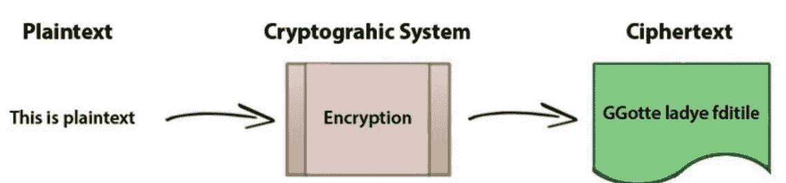

图3.38 - 密码处理过程

### 早期（手工）时代

有证据表明，类似密码的操作可追溯至数千年前。在埃及有一个例子：一组象形文字用简单的替换算法进行了加密。斯巴达人以斯巴达密码棒而闻名——一种将皮带缠绕在锥形木棒上来传递信息的方法。

消息写在木棒上，一旦从木棒上取下皮带，就无法辨认。皮带可以交给接收者，只要他有一根直径和锥度相同的木棒，就能读取消息。

在过去的两个世纪中，密码方法的使用和发展还有更多例子。尤利乌斯·凯撒使用了凯撒密码——一种将字母表移动三位来加密的简单替换密码。密码科学的发展在整个中世纪持续进行，里昂·巴蒂斯塔·阿尔贝蒂（Leon Battista Alberti）在1466年提出了密码密钥的概念，布莱斯·德·维吉尼亚（Blais de Vigenère）则加强了对多表密码的使用。在回顾密码方法时，将更详细地研究他们的工作。

### 机械时代

从纸笔世界，密码学随着密码盘和转子的出现发展到了机械时代，以简化密码学的手工过程。这一时代开发的设备一直常规使用到二十世纪。其中包括德国恩尼格玛机、南部邦联军队的密码盘，以及日本的红色和紫色密码机。在这一时代，开发的工具和机器大大提高了密码操作的复杂性，并使更强大的算法得以使用。许多这类设备为密码操作引入了一种随机化形式，并使非技术人员也能使用密码设备。

这一时代发展出的一个核心概念是，算法作用于字母的数值而非字母本身。这自然过渡到了电子时代，在电子时代，密码操作通常基于字母的二进制或十六进制值，而非书写的字母。例如，字母表可以写成如下形式：

```
A = 0, B = 1, C = 3 . . . Z = 25
```

这对于这一时期开发的一次性密码本和其他密码方法尤其重要。

### 现代时代

如今的密码学远比过去的密码系统先进。组织能够加密和破解在人类文明拥有计算机能力之前甚至无法想象的密码。如今的密码系统以这样的方式运行：任何拥有计算机的人都可以使用密码学，甚至不需要


理解密码学操作、算法和高等数学。然而，以安全的方式实现密码系统仍然很重要。事实上，针对密码系统的攻击大多数并非源于密码算法的弱点，而是糟糕或管理不当的实现。随着对当前使用的密码算法的审视，昨天的许多进步正被融入今天的功能中。随机化、置换和密码密钥将得到解释。

## 新兴技术

### 量子密码学 124

传统密码学与量子密码学之间的根本区别在于，传统密码学主要使用困难的数学技术作为其基本机制。另一方面，量子密码学使用物理学来保护数据。传统密码学因其强大的数学而稳固，而量子密码学则有一个截然不同的前提，即安全性应基于已知的物理定律，而非数学上的困难。

量子密码学（也称为量子密钥分发，或 QKD）建立在量子物理学之上。也许量子物理学最著名的方面是维尔纳·海森堡的不确定性原理。他的基本论断是，一个人无法同时以无限的精度知道一个粒子的位置和动量。

具体而言，量子密码学是一套协议、系统和程序，通过它可以创建和分发秘密密钥。量子密码学可用于生成和分发秘密密钥，然后这些密钥可与传统密码算法和协议一起使用以加密和传输数据。需要指出的是，量子密码学不用于加密数据、传输加密数据或存储加密数据。

非对称密钥系统的需求源于密钥分发问题。挑战在于用户需要一个安全通道来建立安全通道。量子密码学通过允许在两方远程之间根据物理定律以完全安全的方式交换密码密钥来解决密钥分发问题。一旦密钥交换完成，就会使用常规密码算法。因此，许多人更喜欢使用 QKD 而非量子密码学这一术语。125

在实际应用中，以下是对量子密码学如何使用的基本概述：

许多访问控制系统使用密码学通过使用密码来限制对系统的访问。许多基于令牌的身份验证系统使用基于密码学的哈希算法来计算一次性密码。拒绝未经授权的访问可防止攻击者进入并破坏系统或网络，从而拒绝授权用户访问。

#### 保密性

密码学通过改变或隐藏消息来提供保密性，从而理想情况下只有预期接收者能够理解。

#### 完整性

密码工具提供完整性检查，使接收者能够验证消息是否未被篡改。密码工具无法防止消息被篡改，但它们能有效检测消息的有意或意外修改。密码功能使用多种方法来确保消息未被更改或篡改。这些包括哈希函数、数字签名和消息认证码（MAC）。主要概念是接收者能够检测到对消息所做的任何更改，无论是意外还是有意的。

## 密码系统的附加特性

除了上面列出的信息安全的三个核心原则外，密码工具还提供若干其他好处。

### 不可否认性

在受信任的环境中，来源的身份验证可以通过简单的密钥控制来提供。接收者有一定程度的保证，消息是由发送方加密的，而发送方信任消息在接收后未被篡改。然而，在更严格、信任度较低的环境中，可能需要通过第三方提供保证，证明谁发送了消息以及消息确实交付给了正确的接收者。这是通过使用数字签名和公钥加密实现的。这些工具的使用提供了可在第三方验证的来源不可否认性。

一旦消息被接收，有什么可以阻止接收者更改消息并争辩说被更改的消息是发送方发送的？交付不可否认性可防止接收者更改消息并错误声称消息处于原始状态。这也是通过使用公钥密码学和数字签名实现的，并且可由受信任的第三方验证。

### 身份验证

身份验证是确定某人或某物是否就是其声称的那样的能力。这主要通过密钥控制来实现，因为只有拥有密钥访问权限的人才能加密消息。这不如来源不可否认性强，后者将在稍后回顾。

### 访问控制

通过使用密码工具，支持许多形式的访问控制——从通过密码和口令的登录到防止访问机密文件或消息。在所有情况下，只有拥有正确密码密钥的个人才可能访问。

### 静态数据

保护存储数据通常是组织敏感信息的一项关键要求。备份磁带、异地存储、密码文件以及许多其他类型的敏感信息需要免受泄露或未被检测到的篡改。这是通过使用密码算法实现的，该算法将数据访问限制在持有适当加密（和解密）密钥的人。 （注意：由于密码文件是经过哈希和加盐处理而不是加密的，因此没有解密它们的密钥。）一些现代密码工具还允许对消息进行压缩或压缩，从而节省传输和存储空间。

### 传输中数据

历史上主要目的之一是在各种类型的媒体上传输消息。其意图是防止消息内容被泄露，即使消息本身在传输中被拦截。无论消息是手动发送、通过语音网络还是通过互联网发送，现代密码学都提供安全且保密的数据传输方法，并允许验证消息的完整性，以便可以检测到对消息本身的任何更改。量子密码学的进步也理论化了检测消息在传输中是否甚至被读取。

## 链路加密

数据在网络上使用链路加密或端到端加密进行加密。一般来说，链路加密由服务提供商执行，例如帧中继网络上的数据通信提供商。链路加密沿通信路径（例如卫星链路、电话电路或 T-1 线路）加密所有数据。由于链路加密也加密路由数据，通信节点需要解密数据以继续路由。数据包在通信信道的每个点都被解密并重新加密。理论上，如果攻击者入侵网络中的节点，可能可以看到明文消息。由于链路加密也加密路由信息，因此它比端到端加密提供更好的流量保密性。流量保密性隐藏了观察者的寻址信息，防止基于两方之间流量存在的基础上的推断攻击。

## 密码学生命周期

所有密码功能和实现都有使用寿命。随着计算能力的提升和对密码系统分析能力的不断完善，密码系统会不断被评估以确保其仍满足最初指定的安全要求。信息安全专业人员必须紧跟密码学领域的当前趋势和发现，以确保提供准确及时的评估和建议。当满足以下任一条件时，密码功能或实现被认为“已损坏”或不再有效：

- 对于哈希函数：
  - 冲突或哈希可以在经济可行的情况下在没有原始源的情况下可靠地重现。
  - 当哈希函数的实现允许侧信道攻击时。
- 对于加密系统：
  - 在经济可行的情况下，未经密钥访问即可破解密码。
  - 当加密系统的实现允许以经济可行的形式未经授权披露信息时。

密码系统生命周期阶段通常用强、弱化和受损来描述。美国国家标准与技术研究院在其特别出版物 800-131A 中使用以下术语来描述算法和密钥长度：127

一伙流氓犯罪组织安装一个计算机程序，该程序旨在使用强加密——使用只有攻击者知道的密钥——对公司的计算机文件进行加密。攻击者将试图扣留计算机文件，直到支付赎金或对受害公司造成某种痛苦后果。同样的问题也适用于犯罪分子用来劫持计算机系统直至支付某种款项的勒索软件。

密码学潜在滥用带来的另一个问题在于知识产权保护。密码保护被用于防止软件和媒体盗版。尽管密码学被用于允许或拒绝访问视频游戏市场和 DVD，但隐私倡导者普遍担心，如果不对密码学的此类应用进行道德使用，可能会产生宏观经济影响。可能出现的一种情况是，公司可以利用加密基于追踪和识别电子信息的能力创造一种新的审查形式。这样的系统可用于秘密盘点互联网上任何地方的计算机，然后将机器上的软件/硬件目录提供给第三方进行操作，例如阻止使用解密软件的人播放受版权保护的 DVD。所谓的数字版权管理系统（DRMS）需要一种设计和治理方式，既能保护知识产权和个人隐私，又能确保个人对知识产权的合理使用。一些政府对具有高工作因子的密码硬件和软件的使用、出口或进口施加限制。

## 国际出口管制

大多数国家对密码系统的使用或分发都有一些规定。通常，这是为了保持执法部门履行职责的能力，并防止强大的密码工具落入罪犯手中。密码学在大多数国家被视为与军火相当，是战争武器，并通过控制军事设备分发的法律进行管理。一些国家不允许其公民使用任何密码工具；其他国家则有法律控制密码学的使用，通常基于密钥长度。这是因为密钥长度是衡量密码系统强度最易理解的方法之一。

政府采用国际出口管制来限制含有强密码学的产品运往该政府认为足够可信以友好使用的国家。例如，在美国，负责监管和执行向其他国家运送强密码学产品的政府机构是国家安全局、美国国务院和美国商务部。¹²⁸ 在美国，这一流程为这些机构提供了判断是否有技术不应出口的机会。大多数国家对与密码学相关的国家安全的担忧表现为特定的技术，这些技术会对国家防御造成损害，因此需要通过出口法规进行控制。由于出口管制，许多厂商在其产品上推出两个版本，一个具有强加密，另一个具有较弱加密并在其他国家销售。

## 执法

隐私是言论自由和保护免受不合理搜查和扣押文化强烈的国家的关键问题，例如美国。在一些国家，这不是一个问题，因为法律要求所有组织和个人向执法部门提供其密码密钥、使用弱密钥或不允许私人使用加密。

电子监控已成为执法工具箱中的有力工具。然而，在欧盟和另外几个国家，找到一种方法以保证执法部门能够在不损害商业密码学的商业可行性或公民公民自由的情况下合法访问加密信息，这是一个巨大的技术和立法挑战。

在许多国家，公众普遍接受通过搜查令进行电话和邮件拦截以保护社会。然而，对于加密通信的类似有令访问，公众普遍持抵触态度。此外，安全技术厂商不喜欢为执法部门在其产品中“内置”密钥恢复后门的想法。这被视为既昂贵又不受客户欢迎。

对于基于云的技术平台，安全架构师需要考虑很多。将越来越多的企业数据转移到某种形式的基于云的解决方案中，无论是私有、公有还是混合，都意味着越来越多的云厂商在云架构的安全方面承担了安全架构师和一线响应者的角色。许多厂商在其架构中提供某种“菜单驱动”的加密选择，或“à la carte”加密添加选项，而客户可能有也可能没有自行添加加密解决方案并自行管理加密密钥的选项。

加密正变得越来越通用，集成到日益增多的应用和产品中。语音和数据正日益汇聚到单一的基于互联网协议（IP）的传输网络上。技术已发展到语音/数据可通过互联网电话、加密移动电话传输，或使用磁盘加密存储在计算机上的程度。合法访问私人数据的主要技术方法有密钥托管，即第三方（可能是政府机构或服务提供商）持有密码密钥的副本，以及暴力破解，即大量计算资源攻击密钥。

## 公钥基础设施 (PKI)

PKI 是一套使用、管理和控制公钥密码学所需系统、软件和通信协议。它有三个主要目的：发布公钥/证书、证明密钥与个人或实体绑定，以及提供公钥有效性的验证。

证书颁发机构（CA）“签署”实体的数字证书，以证明证书内容准确代表证书所有者。CA 签署证书所隐含的保证级别可能不同，类似于个人物理身份识别形式，可暗示不同的信任级别。在物理世界中，印有姓名的信用卡的身份验证价值与政府颁发的身份证不同。任何实体都可以声称自己是任何它想要的东西，但如果实体希望提供高水平的保证，它应在证书中提供可识别内容，以便所有相关方信任的第三方可以轻松确认。在数字世界中，邓白氏编号、信用报告或某种受信任的第三方参考形式将在 CA 通过签署实体证书并加上标记以表明 CA 断言对该实体高度信任的方式进行认证之前提供给 CA。现在所有信任 CA 的实体都可以信任证书提供的身份是可信的。

CA 的功能可在 PKI 中的多个专用服务器之间分配。例如，服务器 RA 可用于提供 PKI 的可扩展性和可靠性。RA 服务器为实体提交证书生成请求提供设施。RA 服务还负责确保证书请求内容准确性。

CA 可以撤销证书，并通过证书吊销列表（CRL）向 PKI 的其他成员提供更新服务，CRL 是不应被 PKI 任何成员接受的无效证书列表。公钥（非对称）密码学的使用已使对称密码学的更有效使用成为可能，以及

还有其他一些重要特性，例如更强的访问控制、不可否认性和数字签名。

因此，最大的问题往往是，谁值得信任？如何确定用于验证 Terry 数字签名的公钥确实属于 Terry，或者用于向 Pat 发送保密消息的公钥确实是 Pat 的，而不是攻击者设在通信渠道中间的公钥？

公钥本质上就是公开的。许多人会在电子邮件签名行中包含它们，或者组织将其放在其 Web 服务器上，以便客户可以与组织员工建立保密通信，而这些员工他们可能从未见过。如何知道冒名者或攻击者没有设立一个非法 Web 服务器，并吸引本应保密给真实账户的通信到其站点，就像钓鱼攻击那样？

设置一个受信任的公钥目录是一种选择。每个用户必须向目录服务注册，并且会建立用户与目录之间安全通信的方式。这将允许用户更改密钥——或目录强制更改密钥。目录将发布并维护所有活动密钥的列表，并删除或吊销不再受信任的密钥。这可能发生在某人认为其私钥已被泄露，或她离开了组织的雇佣时。任何希望与目录中注册用户通信的人都可以从目录中请求该注册用户的公钥。

通过使用公钥证书可以提供更高级别的信任。这可以直接完成。Pat 会将证书发送给 Terry 或通过 CA 进行，CA 将充当受信任的第三方并向 Pat 和 Terry 两人都签发证书，其中包含对方的公钥。该证书由 CA 的数字签名签署，可以由接收方验证。认证过程将身份信息和公钥绑定到一个身份上。该过程的结果文档即为公钥证书。CA 将遵循 X.509 标准。这是适用于目录的整体 X.500 标准族的一部分。标准的 X.509 版本 3 是最常见的。图 3.39 显示了由 Verisign 签发的证书示例。X.509 证书如下所示：

| 字段 | 内容描述 |
|---|---|
| 用于签名的算法 | 用于签署证书的算法 |
| 发行者名称 | CA 的 X.500 名称 |
| 有效期 | 开始日期/结束日期 |
| 主体名称 | 公钥所有者 |
| 主体的公钥信息（算法、参数、密钥） | 用于创建它的公钥和算法 |
| 发行者唯一标识符 | 如果 CA 使用了多个 X.500 名称，则使用的可选字段 |
| 主体唯一标识符 | 如果公钥所有者有多个 X.500 名称，则为可选字段 |
| 扩展 |  |
| CA 的数字签名 | 使用 CA 的私钥加密的证书哈希值 |

图 3.39 - 由 Verisign 发行的 X.509 证书

## 密钥管理流程

任何密码学实现中最重要的一部分或许是密钥管理。对密码密钥的签发、吊销、恢复、分配以及历史记录的控制对于依赖密码学进行安全通信和数据保护的任何组织都至关重要。

信息安全专业人员应了解 Kerckhoff 定律的重要性。Auguste Kerckhoff 写道，“即使系统关于的一切，除了密钥之外都是公开知识，密码系统也应是安全的。” 129 因此，密钥才是密码系统的真正强度。密钥的大小和密钥的保密性或许是密码实现中两个最重要的要素。

著名的二十世纪军事密码学家 Claude Shannon 写道，“敌人知道系统。” 算法的保密性、密码操作的熟练程度，或我们保护数据和系统的技术优越性不能仅依赖。始终要考虑对手知道所使用的算法和方法，并据此行事。对称算法在发送方和接收方之间共享相同的密钥。这通常需要带外

有助于开发人员避免错误，从而提高应用程序的安全性。XKMS 协议由请求和响应对组成。XKMS 协议消息共享一个通用格式，可在多种协议中承载。然而，通过 SOAP over HTTP 传输的 XKMS 消息被推荐用于互操作性。

XML 密钥管理规范 2.0 的两个部分是 XML 密钥信息服务规范（X-KISS）和 XML 密钥注册服务规范（X-KRSS）。首先，X-KISS 描述了一种语法，允许客户端（即应用程序）将处理 XML Signature `<ds:KeyInfo>` 元素所需的部分或全部任务委托给信任服务。协议设计的一个关键目标是最大限度地减少使用 XML 数字签名的应用程序的复杂性。通过成为信任服务的客户端，应用程序免除了建立信任关系所使用的底层 PKI 的复杂性和语法负担，该信任关系可能基于 X.509/PKIX、SPKI、PGP、Diffie–Hellman、椭圆曲线等不同规范，并且可以扩展到其他算法。XML 数字签名中的 `<ds:KeyInfo>` 元素是一个可选元素，使接收方能够获取验证签名所需的密码密钥相关数据。`<ds:KeyInfo>` 元素可能包含密钥本身、密钥名称、X.509 证书、PGP 密钥标识符、信任链、吊销列表信息、带内密钥分发或密钥协商数据等等。作为一种选择，还可以提供指向可找到完整 `<ds:KeyInfo>` 数据集的位置的链接。

例如，如果使用证书，DSA、RSA、X.509、PGP、SPKI 是可在 XML 数字签名的 `<ds:KeyInfo>` 元素中使用的值。XKMS 的应用程序（客户端）将通过使用 XKMS 2.0 的 X-KISS 协议从目录服务器读取 XML 数字签名的 `<ds:KeyInfo>` 元素，从而了解交易中使用的公钥密码算法。

其次，X-KRSS 描述了一种用于注册公钥信息的协议。密钥材料可以由 X-KRSS 在请求时生成以支持更轻松的密钥恢复，或手动生成。注册服务也可以随后用于恢复私钥。应用程序可以请求注册服务（X-KRSS）将信息绑定到公钥。绑定的信息可能包括名称、标识符或由实现定义的其他属性。首次注册密钥对后，该密钥对随后可与 X-KISS 或 X.509v3 等 PKI 一起使用。

XKMS 服务将客户端应用程序与底层 PKI 的复杂性隔离开来，例如：

- 处理复杂的语法和语义（例如，X.509v3）。
- 从目录/数据存储库基础设施检索信息
- 吊销状态验证
- 信任链的构建和处理

有关签名者的公钥签名密钥（`<ds:KeyInfo>`）的附加信息可以包含在签名块内，可用于帮助验证者确定选择哪个公钥证书。

`<ds:KeyInfo>` 元素中包含的信息可能与签名本身密码学绑定，也可能不绑定。因此，`<ds:KeyInfo>` 元素数据可以在不使数字签名失效的情况下被替换或扩展。例如，Valerie 签署一份文档并将其发送给 Jim，其中 `<ds:KeyInfo>` 元素仅指定签名密钥数据。在收到消息后，Jim 检索验证签名所需的附加信息，并在将文档传递给 Yolanda 时将此信息添加到 `<ds:KeyInfo>` 元素中（见图 3.40）。

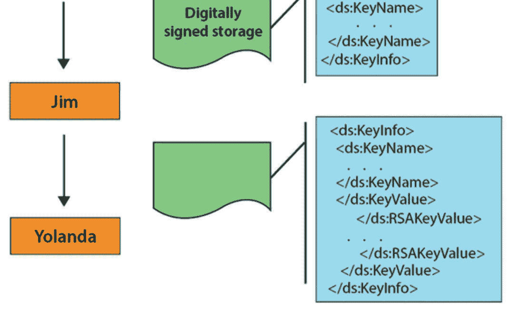

图 3.40 - XKMS 服务将客户端应用程序与底层 PKI 的复杂性隔离开来。

X-KISS Locate 服务解析 `<ds:KeyInfo>` 元素，但不需要服务对数据之间绑定有效性做出断言


`<ds:KeyInfo>`元素。XKMS服务可以使用本地信息存储库解析该`<ds:KeyInfo>`元素，或者将请求中继到其他目录服务器。例如，XKMS服务可能会解析`<ds:RetrievalMethod>`元素（图3.41），或者充当基于非XML语法（如X.509v3）的底层PKI的网关。

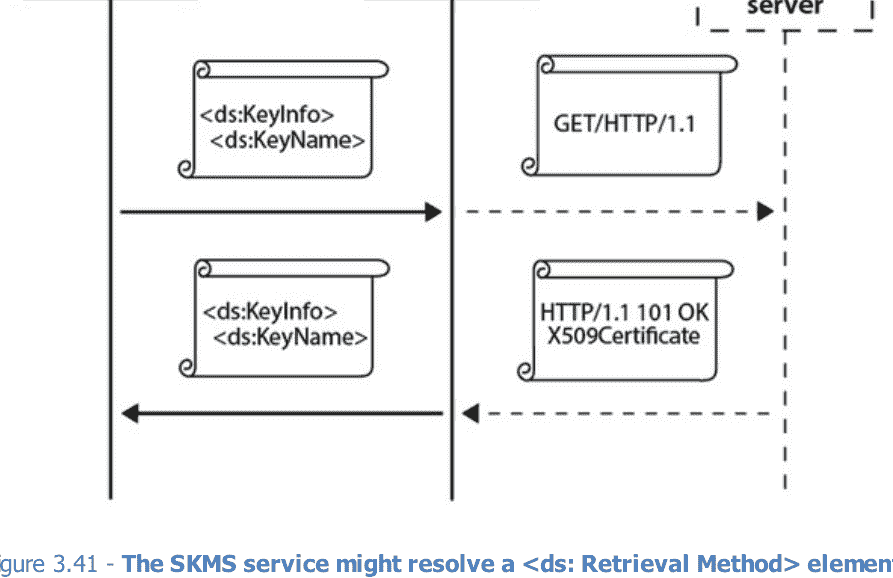

图3.41 – XKMS服务可能解析`<ds:RetrievalMethod>`元素。


## 现实世界示例：加密

Terry想要向Pat发送一封加密电子邮件，但不知道Pat的加密密钥。Terry可以使用S/MIME和PGP两种安全电子邮件格式。Terry的客户端使用专有名称（DN）来定位为绑定到example.com域的密钥提供Locate服务的XKMS服务，然后向发现的XKMS服务发送XKMS Locate请求，以获取绑定到Pat@example.com以及S/MIME或PGP协议的密钥。然后，应用程序通过标准的证书验证到可信根，验证所获得的证书是否满足其信任标准。

根据新闻报道，贪污计划主要由内部员工实施，且长期未被发现，这一点常被误解。职责分离主要是一个业务策略和访问控制问题。然而，对于较小的组织来说，由于人员限制，可能无法实现所有职责的分离，因此可能必须使用其他补偿性控制来实现相同的控制目标。此类补偿性控制包括活动监控、审计跟踪和管理监督。在职责分离至关重要的高完整性密码操作环境中，实现这种环境所必需的两种机制是双人控制和知识分割。

## 双人控制

双人控制是一种安全程序，要求两个或更多人聚在一起并协作完成一个过程。在密码系统中，两个（或更多）人各自提供一个唯一密钥，当这些密钥合在一起时，执行密码过程。知识分割是与双人控制互补的另一个访问控制原则。

## 知识分割

知识分割是“每个人必须带来什么”的独特概念，然后在实施双人控制时将这些知识汇集在一起。例如，一个装有备用金的盒子由一个密码锁和一个钥匙锁保护。一个员工获得密码锁的密码，另一个员工拥有钥匙锁的正确钥匙。要取出盒子里的现金，两个员工必须同时出现在现金盒前。没有另一个人的帮助，一个人无法打开盒子。这就是双人控制的体现。

另一方面，知识分割在这里体现在不同的物品上（密码锁的密码和正确的物理钥匙），两者都是独一无二的且必需的，是每个人带到现场的。知识分割侧重于必须组合在一起的独立物品的独特性。双人控制则涉及强制至少两个或更多人协作，结合各自的知识分割以访问某项资产。知识分割和双人控制相辅相成，是在高完整性密码环境中实现职责分离所必需的功能（见图3.42）。

在密码学术语中，如果没有一个人能够访问或知晓由这两个过程保护的完整密码密钥的内容，那么可以说双人控制和知识分割得到了正确实施。知识分割可以以可扩展的方式得到良好实施。例如，一个基于OpenPGP标准的PGP商业产品具有分割私钥的功能，但这些功能并不是OpenPGP标准的一部分。134 这些功能使用Blakley–Shamir秘密共享。这是一种算法，允许用户将一段数据拆分成N个份额，其中需要K个份额才能恢复原始数据。使用此方法的一个简单版本，用户可以将数据分成三个份额，其中需要两个份额才能取回数据。在更复杂的版本中，用户可以要求6个中取3个，甚至12个中取5个份额来恢复原始数据，每个密钥份额都用一个只有密钥持有者知道的唯一口令短语进行保护。

这种解决方案使用了秘密共享的基本形式，并共享私钥。此过程允许密钥对由一组人控制，并需要某个子组来重新组成和使用该密钥。其他系统则基于密钥持有者回答一系列问题来恢复解锁受保护明文密钥所需的密码。

为了重新创建受保护的密钥，用户可以创建一组包含只有用户自己才知道的某些信息的问题。密钥被拆分到这些问题中，其中需要一定数量的问题来合成密钥。用户不仅提供对每个密钥持有者而言独一无二的个性化安全问题，还决定需要正确回答多少个问题才能从拆分部分重组成受保护的密钥并将其取回。

## 密钥的创建与分发

### 密钥的创建

本章前面已经讨论了使用各种算法创建密钥的细节。然而，从密钥管理的角度来看，存在许多与可扩展性和密码密钥完整性相关的问题。

### 自动密钥生成

用于自动生成强密码密钥的机制可以用作密钥生命周期管理的一部分来部署密钥。有效的自动密钥生成系统旨在实现用户透明性以及全面的密码密钥策略执行。

### 真随机

要使密钥真正有效，它必须具有足够高的工作因子。也就是说，破解密钥所需的时间和精力（攻击者的工作量）必须足够大，以便至少能在受保护信息需要保密的时间内延迟其被发现。构成密钥的比特的随机性水平是促成具有高工作因子的强密钥的因素之一。

### 随机

如前所述，密码密钥本质上是一串数字。构成密钥的数字必须是不可预测的，这样攻击者就不易猜测出密钥并进而暴露受保护信息。因此，构成密钥的数字的随机性在密码密钥的生命周期中起着重要作用。在密码学语境中，随机性是指缺乏可预测性的性质。计算机系统内部生成的随机性也称为伪随机性。伪随机性是算法的一种性质，它生成近似随机数属性的数字序列。计算机电路和软件库被用于实际生成伪随机密钥值。众所周知，计算机和软件库是随机性的弱来源。

计算机在设计上本质上是可预测的，而非随机性的。计算机是如此彻底的确定性系统，以至于很难生成高质量的随机性。因此，密码学应用需要专门构建的硬件和软件，称为“随机数生成器”（RNG）。美国联邦政府通过NIST.135 提供了关于确定性随机数生成器的建议。一个适合密码系统的随机数生成国际标准由国际标准化组织赞助，编号为ISO 18031.136 为了对这些RNG算法建立信心，通常需要对其输出进行严格的统计分析。完全仅由计算机完成的确定性计算所生成的随机数生成器，不能被视为在密码应用中缺乏可预测性方面足够好的真随机数生成器，因为其输出本质上是可预测的。

有多种方法可确保伪随机密钥具有适当的随机性水平。大多数商业级密码产品中使用的方法是采用计算算法生成看似随机的长序列结果，而这些结果实际上完全由一个较短的初始值（称为种子或密钥）决定。将初始化向量和种子值连接到计算机生成的密钥上，通过为随机密钥材料增加额外的唯一性来增强密钥强度。种子值或初始化向量是作为算法起点输入的数字。种子或IV可以手动创建，也可以通过外部随机源创建，例如射频噪声、随机采样值。


算法的安全性不能超过其密钥长度。因此，可能存在非常长的密钥，但仍提供较低的安全性。例如，三重密钥（每把密钥56位）Triple DES 的密钥长度可达168位，但由于中间相遇攻击，其提供的有效安全性最多为112位。然而，大多数对称算法的设计目标是使其安全性等于密钥长度。自然的倾向是使用尽可能长的密钥，这可能使密钥更难被破解。然而，密钥越长，加密和解密过程在计算上可能越昂贵。目标是使破解密钥的成本（以努力、时间和资源衡量）高于所保护信息的价值，并且如果可能的话，不多一分钱（做更多就不经济了）。

## Asymmetric Key Length
非对称密钥长度

非对称密码系统的有效性取决于某些数学问题的难以求解的特性，例如素整数分解。这些问题耗时求解，但通常比暴力尝试所有可能的密钥更快。因此，与对称算法密钥相比，非对称算法密钥必须更长才能获得等效的抗攻击能力。

RSA Security 声称 1024 位 RSA 密钥与 80 位对称密钥强度相当，2048 位 RSA 密钥与 112 位对称密钥相当，3072 位 RSA 密钥与 128 位对称密钥相当。RSA 声称 2048 位密钥在 2030 年前足够使用。如果需要在 2030 年后仍要求安全，则应使用 3072 位的 RSA 密钥长度。[137] NIST 密钥管理指南进一步建议 15,360 位 RSA 密钥与 256 位对称密钥强度相当。[138]

ECC 可以使用比其他非对称密钥算法更短的密钥来提供安全保障。NIST 指南指出，椭圆曲线密钥应为等效强度对称密钥算法长度的两倍。例如，224 位椭圆曲线密钥大致与 112 位对称密钥具有相同的强度。这些估计假设在解决 ECC 所基于的底层数学问题上没有重大突破。

## Key Wrapping and Key Encrypting Keys
密钥封装与密钥加密密钥

密钥管理的一个作用是确保发送方用于加密消息的密钥与接收方用于解密消息的密钥相同。因此，如果 Terry 和 Pat 希望交换加密消息，每个人都必须能够解密收到的消息并加密发送的消息。如果他们使用密码，则需要适当的密钥。问题是如何交换所需的任何密钥或其他信息，以便其他人无法获得副本。

一种解决方案是用一种专用长期使用的密钥，即密钥加密密钥（KEK）来保护会话密钥。KEK 用于密钥分发或密钥交换的一部分。使用 KEK 保护会话密钥的过程称为密钥封装。密钥封装使用对称密码来安全地加密（从而封装）明文密钥以及任何相关的完整性信息和数据。密钥封装的一个应用是保护存储在不可信存储中的会话密钥或在不可信传输中发送时使用。使用 KEK 进行密钥封装或封装可以使用对称或非对称密码实现。如果密码是对称 KEK，则发送方和接收方都需要同一密钥的副本。如果使用具有公钥/私钥属性的非对称密码来封装会话密钥，则发送方和接收方都需要对方的公钥。

SSL、PGP 和 S/MIME 等协议使用 KEK 的服务来提供会话密钥的保密性、完整性，有时还用于验证会话密钥发起者与会话密钥本身的绑定，以确保会话密钥来自真正的发送方而不是攻击者。

## Key Distribution
密钥分发

密钥可以通过多种方式分发。例如，两个希望进行密钥交换的人可以使用与发送安全消息不同的媒介。这称为“带外”密钥交换。如果两个或多个方将通过电子邮件发送安全消息，他们可以选择彼此会面或通过快递发送。“带外”密钥交换的概念在少数人之外扩展性并不强。

一种更可扩展的交换密钥的方法是通过使用 PKI 密钥服务器。密钥服务器是希望交换密钥以促进电子交易的成员组的公钥的中央存储库。公钥加密提供了一种允许组成员自发进行安全交易的方式。接收者的公钥证书，其中包含接收者的公钥，由发送方从密钥服务器检索，并作为公钥加密方案的一部分使用，例如 S/MIME、PGP 或甚至 SSL 来加密消息并发送。数字证书是包含组成员每个人的公钥的媒介，使密钥具有可移植性、可扩展性，并且比带外密钥交换方法更容易管理。

## Key Distribution Centers
密钥分发中心

回想一下之前用来计算用户所需对称密钥数量的公式：n(n − 1)/2。这需要建立目录、公钥基础设施或密钥分发中心。

在密钥管理中使用密钥分发中心（KDC）需要创建两种类型的密钥。第一种是主密钥，即每个用户与 KDC 共享的秘密密钥。每个用户都有自己的主密钥，用于加密用户与 KDC 之间的流量。第二种密钥是会话密钥，在需要时创建，用于通信会话的持续时间，并在会话完成后丢弃。当用户想要与另一个用户或应用程序通信时，KDC 设置会话密钥并将其分发给每个用户使用。这种解决方案的实现可在 Kerberos 中找到。大型组织甚至可能有多个 KDC，并且可以安排它们以便存在协调本地 KDC 之间流量的全局 KDC。

由于主密钥是用户与主机之间信任和安全关系不可或缺的一部分，此类密钥绝不应在受损情况或可能暴露的情况下使用。对于加密文件或通信，应使用单独的非主密钥。理想情况下，主密钥永远不会以明文形式可见；它埋藏在设备本身内部，用户无法访问。

## Key Storage and Destruction
密钥存储与销毁

正确存储和更换密码密钥是密钥管理的重要方面，也是有效利用密码学进行安全保护的必备条件。最终，由密码学保护的信息的安全性直接取决于密钥所提供的保护。所有密钥都需要防止被篡改，秘密密钥和私钥需要防止未经授权的泄露。保护存储的密钥材料的方法包括可信的防篡改硬件安全模块、密码保护的智能卡、使用长期存储 KEK 封装会话密钥、拆分密码密钥并存储在物理分离的存储位置、使用强密码/口令保护密钥、密钥过期等。

为了防范长期密码分析攻击，每个密钥都必须有一个到期日期，之后不再有效。密钥长度必须足够长，以使在密钥过期前进行密码分析的可能性极小。密钥对的有效期还可能取决于密钥使用的情况。签名验证程序应检查过期情况，并且不应接受使用已过期密钥签名的消息。计算机硬件不断改进的事实使得每隔几年用更新、更长的密钥替换过期密钥是明智的。密钥替换使人们能够利用任何硬件改进来

- 长期密钥/数据归档存储与当前系统所使用的短期安全存储和管理有何不同？灾难恢复计划和业务连续性计划是否会扩展以包含长期数据归档？
- 何时以及如何授予对长期数据归档的访问权限？在什么条件下会授予访问权限，以及什么政策将规范数据和密钥的使用？

影响暴露风险的因素包括：

1. 密码机制的强度（例如，算法、密钥长度、块大小和工作模式）
2. 机制的实现形式（例如，FIPS 140-2 Level 4 实现或在个人计算机上的软件实现）
3. 运行环境（例如，安全受限访问设施、开放式办公环境或公共访问终端）
4. 信息流量的大小或交易数量
5. 数据的安全寿命
6. 安全功能（例如，数据加密、数字签名、密钥生成或派生、密钥保护）
7. 重新设置密钥的方法（例如，键盘输入、使用密钥加载设备重新设置密钥（人类无法直接访问密钥信息）、在 PKI 中远程重新设置密钥）
8. 密钥更新或密钥派生过程
9. 网络中共享同一密钥的节点数量
10. 密钥的副本数量及其分布情况
11. 对信息的威胁（例如，信息受保护的对象是谁，他们被认为具备何种技术能力和财务资源来发动攻击？）

总体而言，较短的加密周期会增强安全性。例如，如果对手仅拥有用单个密钥加密的有限信息，则某些密码算法可能对密码分析的脆弱性较低。删除不再需要的密钥时应谨慎。简单删除密钥材料可能无法完全抹除信息。例如，擦除信息可能需要用其他无关信息多次覆盖该信息，例如随机位或全零或全一位。长期存储在内存中的密钥可能会“burned in”。这可以通过将密钥拆分为频繁更新的组件来缓解，如图 3.43 所示。

| 密钥类型 | 发起方使用周期 (OUP) | 接收方使用周期 |
|---|---|---|
| 1. 私有签名密钥 | 1-3 年 |  |
| 2. 公开签名密钥 | 数年（取决于密钥大小） |  |
| 3. 对称认证密钥 | ≤ 2 年 | ≤ OUP + 3 年 |
| 4. 私有认证密钥 | 1-2 年 |  |
| 5. 公开认证密钥 | 1-2 年 |  |
| 6. 对称数据加密密钥 | ≤ 2 年 | ≤ OUP + 3 年 |
| 7. 对称密钥封装密钥 | ≤ 2 年 | ≤ OUP + 3 年 |
| 8. 对称和非对称 RNG 密钥 | 重新播种时 |  |
| 9. 对称主密钥 | 约 1 年 |  |
| 10. 私有传输密钥 | ≤ 2 年 |  |
| 11. 公钥传输密钥 | 1-2 年 |  |

图 3.43 - 密钥类型的推荐加密周期

另一方面，在手动密钥分发方法易受人为错误和脆弱性影响的情况下，更频繁的密钥变更实际上可能会增加暴露风险。在这些情况下，尤其是在使用非常强大的密码学时，更明智的做法可能是进行更少、控制良好的手动密钥分发，而不是更频繁、控制不良的手动密钥分发。在此类环境中，安全的自动化密钥分发，其中密钥生成和交换受适当的身份验证、访问和完整性控制保护，可能是补偿控制措施。

具有不同角色的用户应拥有使用寿命考虑不同角色和职责、密钥所使用的应用以及密钥提供的[content]
- 长期密钥/数据归档存储与当前系统所使用的短期安全存储和管理有何不同？灾难恢复计划和业务连续性计划是否会扩展以包含长期数据归档？
- 何时以及如何授予对长期数据归档的访问权限？在什么条件下会授予访问权限，以及什么政策将规范数据和密钥的使用？

影响暴露风险的因素包括：

1. 密码机制的强度（例如，算法、密钥长度、块大小和工作模式）
2. 机制的实现形式（例如，FIPS 140-2 Level 4 实现或在个人计算机上的软件实现）
3. 运行环境（例如，安全受限访问设施、开放式办公环境或公共访问终端）
4. 信息流量的大小或交易数量
5. 数据的安全寿命
6. 安全功能（例如，数据加密、数字签名、密钥生成或派生、密钥保护）
7. 重新设置密钥的方法（例如，键盘输入、使用密钥加载设备重新设置密钥（人类无法直接访问密钥信息）、在 PKI 中远程重新设置密钥）
8. 密钥更新或密钥派生过程
9. 网络中共享同一密钥的节点数量
10. 密钥的副本数量及其分布情况
11. 对信息的威胁（例如，信息受保护的对象是谁，他们被认为具备何种技术能力和财务资源来发动攻击？）

总体而言，较短的加密周期会增强安全性。例如，如果对手仅拥有用单个密钥加密的有限信息，则某些密码算法可能对密码分析的脆弱性较低。删除不再需要的密钥时应谨慎。简单删除密钥材料可能无法完全抹除信息。例如，擦除信息可能需要用其他无关信息多次覆盖该信息，例如随机位或全零或全一位。长期存储在内存中的密钥可能会“burned in”。这可以通过将密钥拆分为频繁更新的组件来缓解，如图 3.43 所示。

| 密钥类型 | 发起方使用周期 (OUP) | 接收方使用周期 |
|---|---|---|
| 1. 私有签名密钥 | 1-3 年 |  |
| 2. 公开签名密钥 | 数年（取决于密钥大小） |  |
| 3. 对称认证密钥 | ≤ 2 年 | ≤ OUP + 3 年 |
| 4. 私有认证密钥 | 1-2 年 |  |
| 5. 公开认证密钥 | 1-2 年 |  |
| 6. 对称数据加密密钥 | ≤ 2 年 | ≤ OUP + 3 年 |
| 7. 对称密钥封装密钥 | ≤ 2 年 | ≤ OUP + 3 年 |
| 8. 对称和非对称 RNG 密钥 | 重新播种时 |  |
| 9. 对称主密钥 | 约 1 年 |  |
| 10. 私有传输密钥 | ≤ 2 年 |  |
| 11. 公钥传输密钥 | 1-2 年 |  |

图 3.43 - 密钥类型的推荐加密周期

另一方面，在手动密钥分发方法易受人为错误和脆弱性影响的情况下，更频繁的密钥变更实际上可能会增加暴露风险。在这些情况下，尤其是在使用非常强大的密码学时，更明智的做法可能是进行更少、控制良好的手动密钥分发，而不是更频繁、控制不良的手动密钥分发。在此类环境中，安全的自动化密钥分发，其中密钥生成和交换受适当的身份验证、访问和完整性控制保护，可能是补偿控制措施。

具有不同角色的用户应拥有使用寿命考虑不同角色和职责、密钥所使用的应用以及密钥提供的[content]
- 长期密钥/数据归档存储与当前系统所使用的短期安全存储和管理有何不同？灾难恢复计划和业务连续性计划是否会扩展以包含长期数据归档？
- 何时以及如何授予对长期数据归档的访问权限？在什么条件下会授予访问权限，以及什么政策将规范数据和密钥的使用？

影响暴露风险的因素包括：

1. 密码机制的强度（例如，算法、密钥长度、块大小和工作模式）
2. 机制的实现形式（例如，FIPS 140-2 Level 4 实现或在个人计算机上的软件实现）
3. 运行环境（例如，安全受限访问设施、开放式办公环境或公共访问终端）
4. 信息流量的大小或交易数量
5. 数据的安全寿命
6. 安全功能（例如，数据加密、数字签名、密钥生成或派生、密钥保护）
7. 重新设置密钥的方法（例如，键盘输入、使用密钥加载设备重新设置密钥（人类无法直接访问密钥信息）、在 PKI 中远程重新设置密钥）
8. 密钥更新或密钥派生过程
9. 网络中共享同一密钥的节点数量
10. 密钥的副本数量及其分布情况
11. 对信息的威胁（例如，信息受保护的对象是谁，他们被认为具备何种技术能力和财务资源来发动攻击？）

总体而言，较短的加密周期会增强安全性。例如，如果对手仅拥有用单个密钥加密的有限信息，则某些密码算法可能对密码分析的脆弱性较低。删除不再需要的密钥时应谨慎。简单删除密钥材料可能无法完全抹除信息。例如，擦除信息可能需要用其他无关信息多次覆盖该信息，例如随机位或全零或全一位。长期存储在内存中的密钥可能会“burned in”。这可以通过将密钥拆分为频繁更新的组件来缓解，如图 3.43 所示。

| 密钥类型 | 发起方使用周期 (OUP) | 接收方使用周期 |
|---|---|---|
| 1. 私有签名密钥 | 1-3 年 |  |
| 2. 公开签名密钥 | 数年（取决于密钥大小） |  |
| 3. 对称认证密钥 | ≤ 2 年 | ≤ OUP + 3 年 |
| 4. 私有认证密钥 | 1-2 年 |  |
| 5. 公开认证密钥 | 1-2 年 |  |
| 6. 对称数据加密密钥 | ≤ 2 年 | ≤ OUP + 3 年 |
| 7. 对称密钥封装密钥 | ≤ 2 年 | ≤ OUP + 3 年 |
| 8. 对称和非对称 RNG 密钥 | 重新播种时 |  |
| 9. 对称主密钥 | 约 1 年 |  |
| 10. 私有传输密钥 | ≤ 2 年 |  |
| 11. 公钥传输密钥 | 1-2 年 |  |

图 3.43 - 密钥类型的推荐加密周期

另一方面，在手动密钥分发方法易受人为错误和脆弱性影响的情况下，更频繁的密钥变更实际上可能会增加暴露风险。在这些情况下，尤其是在使用非常强大的密码学时，更明智的做法可能是进行更少、控制良好的手动密钥分发，而不是更频繁、控制不良的手动密钥分发。在此类环境中，安全的自动化密钥分发，其中密钥生成和交换受适当的身份验证、访问和完整性控制保护，可能是补偿控制措施。

具有不同角色的用户应拥有使用寿命考虑不同角色和职责、密钥所使用的应用以及密钥提供的[content]
- 长期密钥/数据归档存储与当前系统所使用的短期安全存储和管理有何不同？灾难恢复计划和业务连续性计划是否会扩展以包含长期数据归档？
- 何时以及如何授予对长期数据归档的访问权限？在什么条件下会授予访问权限，以及什么政策将规范数据和密钥的使用？

影响暴露风险的因素包括：

1. 密码机制的强度（例如，算法、密钥长度、块大小和工作模式）
2. 机制的实现形式（例如，FIPS 140-2 Level 4 实现或在个人计算机上的软件实现）
3. 运行环境（例如，安全受限访问设施、开放式办公环境或公共访问终端）
4. 信息流量的大小或交易数量
5. 数据的安全寿命
6. 安全功能（例如，数据加密、数字签名、密钥生成或派生、密钥保护）
7. 重新设置密钥的方法（例如，键盘输入、使用密钥加载设备重新设置密钥（人类无法直接访问密钥信息）、在 PKI 中远程重新设置密钥）
8. 密钥更新或密钥派生过程
9. 网络中共享同一密钥的节点数量
10. 密钥的副本数量及其分布情况
11. 对信息的威胁（例如，信息受保护的对象是谁，他们被认为具备何种技术能力和财务资源来发动攻击？）

总体而言，较短的加密周期会增强安全性。例如，如果对手仅拥有用单个密钥加密的有限信息，则某些密码算法可能对密码分析的脆弱性较低。删除不再需要的密钥时应谨慎。简单删除密钥材料可能无法完全抹除信息。例如，擦除信息可能需要用其他无关信息多次覆盖该信息，例如随机位或全零或全一位。长期存储在内存中的密钥可能会“burned in”。这可以通过将密钥拆分为频繁更新的组件来缓解，如图 3.43 所示。

| 密钥类型 | 发起方使用周期 (OUP) | 接收方使用周期 |
|---|---|---|
| 1. 私有签名密钥 | 1-3 年 |  |
| 2. 公开签名密钥 | 数年（取决于密钥大小） |  |
| 3. 对称认证密钥 | ≤ 2 年 | ≤ OUP + 3 年 |
| 4. 私有认证密钥 | 1-2 年 |  |
| 5. 公开认证密钥 | 1-2 年 |  |
| 6. 对称数据加密密钥 | ≤ 2 年 | ≤ OUP + 3 年 |
| 7. 对称密钥封装密钥 | ≤ 2 年 | ≤ OUP + 3 年 |
| 8. 对称和非对称 RNG 密钥 | 重新播种时 |  |
| 9. 对称主密钥 | 约 1 年 |  |
| 10. 私有传输密钥 | ≤ 2 年 |  |
| 11. 公钥传输密钥 | 1-2 年 |  |

图 3.43 - 密钥类型的推荐加密周期

另一方面，在手动密钥分发方法易受人为错误和脆弱性影响的情况下，更频繁的密钥变更实际上可能会增加暴露风险。在这些情况下，尤其是在使用非常强大的密码学时，更明智的做法可能是进行更少、控制良好的手动密钥分发，而不是更频繁、控制不良的手动密钥分发。在此类环境中，安全的自动化密钥分发，其中密钥生成和交换受适当的身份验证、访问和完整性控制保护，可能是补偿控制措施。

具有不同角色的用户应拥有使用寿命考虑不同角色和职责、密钥所使用的应用以及密钥提供的[content]
- 长期密钥/数据归档存储与当前系统所使用的短期安全存储和管理有何不同？灾难恢复计划和业务连续性计划是否会扩展以包含长期数据归档？
- 何时以及如何授予对长期数据归档的访问权限？在什么条件下会授予访问权限，以及什么政策将规范数据和密钥的使用？

影响暴露风险的因素包括：

1. 密码机制的强度（例如，算法、密钥长度、块大小和工作模式）
2. 机制的实现形式（例如，FIPS 140-2 Level 4 实现或在个人计算机上的软件实现）
3. 运行环境（例如，安全受限访问设施、开放式办公环境或公共访问终端）
4. 信息流量的大小或交易数量
5. 数据的安全寿命
6. 安全功能（例如，数据加密、数字签名、密钥生成或派生、密钥保护）
7. 重新设置密钥的方法（例如，键盘输入、使用密钥加载设备重新设置密钥（人类无法直接访问密钥信息）、在 PKI 中远程重新设置密钥）
8. 密钥更新或密钥派生过程
9. 网络中共享同一密钥的节点数量
10. 密钥的副本数量及其分布情况
11. 对信息的威胁（例如，信息受保护的对象是谁，他们被认为具备何种技术能力和财务资源来发动攻击？）

总体而言，较短的加密周期会增强安全性。例如，如果对手仅拥有用单个密钥加密的有限信息，则某些密码算法可能对密码分析的脆弱性较低。删除不再需要的密钥时应谨慎。简单删除密钥材料可能无法完全抹除信息。例如，擦除信息可能需要用其他无关信息多次覆盖该信息，例如随机位或全零或全一位。长期存储在内存中的密钥可能会“burned in”。这可以通过将密钥拆分为频繁更新的组件来缓解，如图 3.43 所示。

| 密钥类型 | 发起方使用周期 (OUP) | 接收方使用周期 |
|---|---|---|
| 1. 私有签名密钥 | 1-3 年 |  |
| 2. 公开签名密钥 | 数年（取决于密钥大小） |  |
| 3. 对称认证密钥 | ≤ 2 年 | ≤ OUP + 3 年 |
| 4. 私有认证密钥 | 1-2 年 |  |
| 5. 公开认证密钥 | 1-2 年 |  |
| 6. 对称数据加密密钥 | ≤ 2 年 | ≤ OUP + 3 年 |
| 7. 对称密钥封装密钥 | ≤ 2 年 | ≤ OUP + 3 年 |
| 8. 对称和非对称 RNG 密钥 | 重新播种时 |  |
| 9. 对称主密钥 | 约 1 年 |  |
| 10. 私有传输密钥 | ≤ 2 年 |  |
| 11. 公钥传输密钥 | 1-2 年 |  |

图 3.43 - 密钥类型的推荐加密周期

另一方面，在手动密钥分发方法易受人为错误和脆弱性影响的情况下，更频繁的密钥变更实际上可能会增加暴露风险。在这些情况下，尤其是在使用非常强大的密码学时，更明智的做法可能是进行更少、控制良好的手动密钥分发，而不是更频繁、控制不良的手动密钥分发。在此类环境中，安全的自动化密钥分发，其中密钥生成和交换受适当的身份验证、访问和完整性控制保护，可能是补偿控制措施。

具有不同角色的用户应拥有使用寿命考虑不同角色和职责、密钥所使用的应用以及密钥提供的[content]
- 长期密钥/数据归档存储与当前系统所使用的短期安全存储和管理有何不同？灾难恢复计划和业务连续性计划是否会扩展以包含长期数据归档？
- 何时以及如何授予对长期数据归档的访问权限？在什么条件下会授予访问权限，以及什么政策将规范数据和密钥的使用？

影响暴露风险的因素包括：

1. 密码机制的强度（例如，算法、密钥长度、块大小和工作模式）
2. 机制的实现形式（例如，FIPS 140-2 Level 4 实现或在个人计算机上的软件实现）
3. 运行环境（例如，安全受限访问设施、开放式办公环境或公共访问终端）
4. 信息流量的大小或交易数量
5. 数据的安全寿命
6. 安全功能（例如，数据加密、数字签名、密钥生成或派生、密钥保护）
7. 重新设置密钥的方法（例如，键盘输入、使用密钥加载设备重新设置密钥（人类无法直接访问密钥信息）、在 PKI 中远程重新设置密钥）
8. 密钥更新或密钥派生过程
9. 网络中共享同一密钥的节点数量
10. 密钥的副本数量及其分布情况
11. 对信息的威胁（例如，信息受保护的对象是谁，他们被认为具备何种技术能力和财务资源来发动攻击？）

总体而言，较短的加密周期会增强安全性。例如，如果对手仅拥有用单个密钥加密的有限信息，则某些密码算法可能对密码分析的脆弱性较低。删除不再需要的密钥时应谨慎。简单删除密钥材料可能无法完全抹除信息。例如，擦除信息可能需要用其他无关信息多次覆盖该信息，例如随机位或全零或全一位。长期存储在内存中的密钥可能会“burned in”。这可以通过将密钥拆分为频繁更新的组件来缓解，如图 3.43 所示。

| 密钥类型 | 发起方使用周期 (OUP) | 接收方使用周期 |
|---|---|---|
| 1. 私有签名密钥 | 1-3 年 |  |
| 2. 公开签名密钥 | 数年（取决于密钥大小） |  |
| 3. 对称认证密钥 | ≤ 2 年 | ≤ OUP + 3 年 |
| 4. 私有认证密钥 | 1-2 年 |  |
| 5. 公开认证密钥 | 1-2 年 |  |
| 6. 对称数据加密密钥 | ≤ 2 年 | ≤ OUP + 3 年 |
| 7. 对称密钥封装密钥 | ≤ 2 年 | ≤ OUP + 3 年 |
| 8. 对称和非对称 RNG 密钥 | 重新播种时 |  |
| 9. 对称主密钥 | 约 1 年 |  |
| 10. 私有传输密钥 | ≤ 2 年 |  |
| 11. 公钥传输密钥 | 1-2 年 |  |

图 3.43 - 密钥类型的推荐加密周期

另一方面，在手动密钥分发方法易受人为错误和脆弱性影响的情况下，更频繁的密钥变更实际上可能会增加暴露风险。在这些情况下，尤其是在使用非常强大的密码学时，更明智的做法可能是进行更少、控制良好的手动密钥分发，而不是更频繁、控制不良的手动密钥分发。在此类环境中，安全的自动化密钥分发，其中密钥生成和交换受适当的身份验证、访问和完整性控制保护，可能是补偿控制措施。

具有不同角色的用户应拥有使用寿命需考虑不同角色和职责、密钥所使用的应用以及密钥所提供的安全服务（用户/数据认证、保密性、数据完整性等）的密钥。重新签发密钥不应过于频繁以至于变得负担过重；然而，应足够频繁地执行以最大限度地减少可能密钥泄露造成的损失。

处理密钥的停用/撤销，以便在泄露日期（或丢失日期）之前签署的数据可以得到验证。当签名密钥被指定为“lost”或“compromised”时，在指定日期之前生成的签名将来可能仍需要验证。因此，可能需要为丢失或泄露的密钥维护签名验证能力。否则，所有先前使用丢失或泄露密钥签署的数据都必须重新签署。

## 证书替换/撤销的成本

在某些情况下，更换数字证书和密码密钥相关的成本高得令人痛苦。示例包括对非常大的数据库进行解密和随后重新加密、对分布式数据库进行解密和重新加密，以及撤销和替换非常大量的密钥；例如，在地理和组织上分布的密钥持有者数量非常大的情况下。在这种情况下，支持更长加密周期所需的安全措施的费用可能是合理的；例如，昂贵且不便的物理、程序性和逻辑访问安全；以及使用足够强大的密码学来支持更长的加密周期，即使这可能导致显著的额外处理开销。

在其他情况下，加密周期可能比原本必要的时间更短；例如，密钥可能会频繁更改以限制密钥管理系统维护状态信息的时间。另一方面，用户丢失其私钥将需要撤销丢失的密钥，以便未经授权的用户无法使用它。采用主解密密钥（PGP 中的额外解密密钥）或其他密钥恢复机制来防止丢失对用丢失密钥加密的数据的访问是良好的做法。撤销证书的另一个原因是员工离职，或者在某些情况下，工作角色发生变化，例如某人调到更受信任的工作角色，这可能需要不同的问责级别、访问更高风险数据等等。

## 密钥恢复

丢失的密钥可能意味着组织的危机。关键数据或备份的丢失可能对运营造成广泛损害，甚至导致财务破产或处罚。有几种密钥恢复方法，例如通用受信任目录或要求所有密码密钥向安全部门注册的政策。有些人甚至使用隐写术将密码埋藏在图片或机器上的其他位置，以防止有人找到其密码文件。其他人使用密码钱包或其他工具来保存所有密码。

一种方法是多方密钥恢复。用户会将她的私钥写在纸上，然后将密钥分成两部分或更多部分。每部分都密封在信封中。用户会将每个信封交给受信任的人，并说明信封只有在组织需要访问用户的系统或文件（用户残疾或死亡）的紧急情况下才能打开。在紧急情况下，信封持有者会向人力资源部门报告，在那里可以打开信封并重建密钥。用户通常会将信封交给公司不同管理层和不同部门的受信任人员，以降低串谋风险。

密钥恢复也应考虑到个人的隐私。如果私人个人使用加密来保护某些信息的保密性，根据当地法律，它可能受到法律保护。在某些情况下，可能需要法律命令来检索密钥并解密信息。

## 密钥托管

密钥托管是确保第三方维护私钥或解密信息所需密钥副本的过程。密钥托管也应被视为大多数组织使用密码学的强制性要求，因为加密信息属于组织而不是个人；然而，通常使用个人的密钥来加密信息。密钥托管提供商与相关方之间必须有明确的信任，因为托管提供商现在持有私钥副本，可以用它来泄露信息。密钥释放条件必须由所有各方明确定义并达成一致。

## 数字签名

数字签名旨在与手写在重要文件（如合同）上的签名相当。需要注意的是，数字签名是数学表示并在二进制数据中传达特定含义，它与“digitized signature”不同。数字化签名是手写个人签名的表示，可以使用扫描仪或传真机创建。

数字签名的目的是为无法使用手写签名的电子交易提供同等程度的问责。数字签名将提供保证，即消息确实来自声称发送它的人，它未被篡改，双方都拥有相同的文件副本，并且发送文件的人不能声称他没有发送它。数字签名通常会包括签名日期和时间，以及第三方验证签名的方法。

什么是数字签名？它是一块数据（位模式，通常是哈希），基于发送的消息内容生成并用发送者的私钥加密。它必须包含一些唯一值，将其与发送者的

消息可以由接收方和第三方轻松验证，并且伪造数字签名或创建具有相同签名的新消息必须是困难的。

## 数字签名标准（DSS）

DSS 于 1991 年作为 FIPS 186 提出，使用安全哈希算法（SHA）。此后经过多次更新，最近一次是在 2013 年 7 月，作为 FIPS 186-4 发布，并扩展为包括数字签名算法（DSA）以及基于 RSA 和 ECC 的算法。141 与 RSA 相比，数字签名基于公钥（非对称）算法，但不通过加密提供消息的机密性，也不用于密钥交换。

DSS 使用两种创建签名的方法：RSA 方法和 DSS 方法。在两种情况下，操作都从创建消息的哈希开始。RSA 方法随后使用发送方的私钥加密哈希，从而创建签名。DSS 方法是使用 DSA 对哈希进行签名。DSA 基于 El Gamal 和 Schnorr 中使用的离散对数算法。DSA 选择一个随机数来创建私钥和公钥对，并使用私钥和通用密钥加密哈希值，从而创建两部分签名。

数字签名可以通过使用发送方的私钥加密整个消息来创建；然而，在大多数情况下，这并不实际，因为使用非对称算法加密消息会产生计算影响。因此，在大多数情况下，数字签名是通过使用发送方的私钥加密消息的哈希来创建的。如果需要进一步的机密性，则可以使用对称算法加密消息；但是，最好在加密消息之前创建签名——这样签名认证的是消息本身，而不是消息的密文。

一旦创建了数字签名，它就被附加到消息上并发送给接收方。接收方使用发送方的公钥解密签名，可以验证消息未被更改，并可以确定签名的来源不可否认性。

## 数字签名的用途

数字签名在保护金融交易、电子商务和电子邮件的完整性方面变得非常宝贵。软件供应商也使用数字签名来确保软件不会因病毒或其他篡改而受到损害。这在通过互联网下载补丁时尤其重要，可以确保补丁来自合法站点，并确保下载的完整性。

数字签名用于对数字证书进行签名。数字证书是一种电子文档，断言与发送方相关的真实性和数据完整性。对证书内容执行哈希计算；然后使用发送方的私钥加密哈希值，并将其嵌入到证书中。接收方使用发送方的公钥解密嵌入的哈希值。然后，接收方使用发送方的公钥，通过对证书内容执行与发送方相同的哈希计算来验证发送方的真实性。如果哈希结果相同，则证书的发送方身份验证和数据完整性已确立。在世界许多地方，数字签名已被政府和法院认可为一种可验证的身份验证形式。

## 数字版权管理（DRM）

DRM 被定义为一类广泛的技术，为内容提供商对其自己的数字媒体提供控制和保护。从内容的角度来看，其生命周期有三个关键组成部分：内容的创建、内容的分发和维护，以及内容的使用。一个好的 DRM 方案应该考虑所有这三个组成部分，并有效定义用户、权限和内容本身之间的交互。

在创建内容时，系统需要立即确保权利得到验证、分配给其所有者，并获准供授权方使用。在内容的分发和存储中，系统需要对内容和元数据具有适当的访问权限，并管理许可和授权。在内容被交易后，系统必须通过按需提供适当的访问、使用和修改权限来强制执行与内容相关的权利。142

DRM 的一个主要问题是缺乏标准化技术。此外，许多传统 DRM 技术一直受到可用性和法律问题的困扰，或者遭受攻击，使其完全失效。因此，行业中的许多发布商开发了自己的专有软件，以满足当今媒体标准下 DRM 的个性化需求。

1998 年 10 月，美国参议院通过了美国版权法的一项修正案，将生产和分销可让消费者规避技术性复制限制方法的技术定为犯罪。实质上，即众所周知的《数字千年版权法》，将规避反盗版措施定为犯罪，并取缔制造、销售或分销破解代码的设备（“访问控制”），以及任何限制一个人行使版权所有者专有权或报酬权的有效技术、设备或组件，即控制作品复制或拷贝的技术（“复制控制”）。

C-11 法案禁止规避安装于作品、已固定于录音中的表演者表演或录音上的任何访问控制，即使受数字锁保护的作品是合法获得的。

该法案中的数字锁禁令可能“胜过”或优先于《版权法》中的各种例外，例如合理使用或教育例外。”145

多年来，已有几种不同类型的 DRM 解决方案较为流行。

- **始终在线 DRM —** 这是一种相当常见的 DRM 解决方案形式。通过 DRM 系统保护的软件或内容仅在系统连接到互联网时可用，允许 DRM 系统“签到”并验证其正在运行。这类系统通常出现在视频游戏中。
- **USB 密钥 —** 这也是一种相当易于实施的 DRM 解决方案。通过 DRM 系统保护的软件或内容仅在 USB 密钥插入并可供系统使用时可用。该系统的主要好处是，只要插入 USB 密钥，受 DRM 保护的内容就可以在多台计算机上使用和访问。
- **数字水印 —** 该技术用作 DRM 解决方案的一部分，主要用于印刷媒体和音视频内容。该解决方案用于验证受保护内容的完整性。
- **指纹识别 —** 该技术也通过为文件的每个用户分配文件的一个唯一冗余部分来验证受保护文件的完整性。如果文件发生任何修改，文件完整性检查会显示这些修改，并可根据分配给每个用户的每个文件的唯一 ID 识别出负责修改的用户。

## 不可否认性

不可否认性是一种服务，确保发送方不能否认消息已发送，并且消息的完整性完好无损。NIST 的 SP 800-57《密钥管理建议——第 1 部分：通用》（第 3 版）将不可否认性定义为：

> “一种用于提供数据完整性和来源保证的服务，其完整性和来源可由第三方验证，确认数据来自拥有所声称签名者私钥的特定实体。在一般信息安全语境中，确保信息的发送方获得交付证明，接收方获得发送方身份的证明，因此任何一方事后都不能否认处理过该信息。”146

不可否认性可以通过数字签名和 PKI 实现。消息使用发送方的私钥进行签名。当接收方收到消息时，他或她可以使用发送方的公钥来验证签名。虽然这证明了消息的完整性，但并未明确界定私钥的所有权。证书颁发机构必须在私钥和发送方之间建立关联（意味着只有发送方拥有该私钥），不可否认性才能有效。

## 哈希 147

哈希函数接受任意长度的输入消息，并通过单向操作生成固定长度的输出。该输出称为哈希码，有时也称为消息摘要。它使用哈希算法生成哈希，但不使用密钥。

在通信中使用消息摘要的方式有几种，具体取决于对消息机密性、来源认证、处理速度以及加密算法选择的需求。哈希函数的要求是，它们必须提供一定的保证，使消息在未被检测到的情况下无法被更改，并且找到任何两个具有相同哈希值的消息在实际上是不可行的。

哈希函数的五个关键属性是：

- 1. **均匀分布** – 哈希输出值不应该是可预测的。
- 2. **弱抗碰撞** – 难以找到与另一个输入哈希到相同值的第二个输入值。
- 3. **难以逆转** – 应该是单向的，不应该能够通过反转哈希函数从输出 y 推导出哈希输入 x。
- 4. **强抗碰撞** – 难以找到任何两个哈希到相同值的输入。
- 5. **确定性** – 给定输入 x，它必须始终生成相同的哈希值 y。


## 简单哈希函数

哈希函数对任意长度的输入（存在一些限制，但消息大小可以非常巨大）进行操作，并生成固定长度的输出。最简单的哈希函数仅将输入消息划分为固定大小的块，然后对每个块进行异或（XOR）运算。因此，得到的哈希值与一个块的大小相同。

```
Hash = block 1 block 2 block 3 ... end of message
```

## MD5 消息摘要算法

MD5 由麻省理工学院的罗纳德·李维斯特（Ron Rivest）于 1992 年开发。它是使用最广泛的哈希算法，在 RFC 1321.148 中有详细描述。MD5 从任意长度的消息中生成 128 位摘要。它按 512 位块处理消息，并进行四轮处理，每轮包含 16 个步骤。找到两个具有相同哈希代码的消息的可能性估计为 2^64，而找到具有给定摘要的消息的难度估计为 2^128。MD5 的一个常见用途是验证法医调查中使用的数字证据的完整性，确保原始媒体在查封后未被篡改。在过去两年中，已经出现了多种针对 MD5 的攻击，现在可以通过分析找到碰撞。这导致许多专业人士建议在安全通信（如数字签名）中放弃使用 MD5。MD4 于 1990 年开发，并于 1992 年修订。它只进行三轮处理，每轮进行的数学运算也更少。对于当今的大多数应用而言，它被认为不够强大。它同样生成 128 位输出。它是 MD5 的前身。

## 安全哈希算法（SHA）与 SHA-1

最初的 SHA 由美国国家标准与技术研究院（NIST）于 1993 年开发，并作为联邦信息处理标准（FIPS）180 发布。修订版（FIPS 180-1）于 1995 年作为 SHA-1（RFC 3174）发布。149 SHA 基于 MD4 算法，而 SHA-1 遵循 MD5 的逻辑。SHA-1 对 512 位块进行操作，可处理长度不超过 2^64 位的任何消息。输出哈希长度为 160 位。处理过程包括四轮操作，每轮 20 个步骤。最近，尽管 SHA-1 比 MD5 强得多，但仍出现了多种针对 SHA-1 算法的攻击。NIST 发布了 FIPS 180-4，将 SHA-1、SHA-224、SHA-256、SHA-384、SHA-512、SHA-512/224 和 SHA 512/256 认定为安全哈希标准的一部分。这些摘要的输出长度从 160 位到 512 位不等。150

## SHA-3

2007 年 11 月，NIST 发布了新哈希算法的候选算法征集邀请，用于美国联邦政府的密码系统。NIST 正在开展一个公开、透明的流程，以确定新哈希算法的合适候选者，这是必要的，因为哈希函数的密码分析最近取得了进展。NIST 于 2010 年选出了决赛入围者，并于 2012 年 10 月 2 日宣布了获胜者 Keccak。151 新的哈希算法将命名为 SHA-3，它将扩充当前在 FIPS 180-4（安全哈希标准）中规定的哈希算法。152

## HAVAL

HAVAL 由澳大利亚伍伦贡大学开发。它将可变长度的输出与对 1024 位输入块的可变轮数操作相结合。输出可以为 128、160、192、224 或 256 位，轮数可以从三轮到五轮不等。这提供了 15 种可能的操作组合。当仅使用三轮时，HAVAL 的运行速度比 MD5 快 60%；当进行五轮操作时，其速度与 MD5 相当。

## RIPEMD-160

欧洲 RACE 完整性原语评估项目开发了 RIPEMD-160 算法，以应对 MD4 和 MD5 中发现的漏洞。原始算法（RIPEMD-128）具有与 MD4 和 MD5 相同的漏洞，因此导致了改进版 RIPEMD-160 的出现。RIPEMD-160 的输出为 160 位，其操作方式与 MD5 处理 512 位块的方式类似。它的处理量是 SHA-1 的两倍，执行五对轮次，每轮 16 个步骤，共 160 次操作。

## 对哈希算法和消息认证码的攻击

攻击哈希函数主要有两种方式：暴力攻击和密码分析。在过去几年中，针对各种哈希算法（如 MD5 和 SHA-1）的攻击研究已经展开。这两种情况都容易受到密码攻击。暴力攻击依赖于发现哈希算法中的弱点，使攻击者能够从哈希值重建原始消息（破坏哈希函数的单向性），找到具有相同哈希值的另一条消息，或找到任意一对具有相同哈希值的消息（这称为抗碰撞性）。Oorschot 和 Weiner 开发了一种机器，可以在大约 24 天内找到 128 位哈希的碰撞。153

密码分析是破解密码系统并在密钥未知的情况下访问加密消息的艺术与科学。旁路攻击就是密码分析的例子。这些攻击不是针对算法本身，而是针对算法的实现。密码分析促成了“彩虹表”的开发，彩虹表用于大幅减少破解密码所需的计算时间和算力，代价是占用存储空间。一个名为“Cain and Abel”的免费密码破解程序预装了彩虹表。154

彩虹表是用于破解密码哈希的预计算表或列表。这些表是针对特定算法（如 MD5 和 SHA-1）设计的，可以在公开市场上购买。“加盐”哈希提供了一种抵御彩虹表的防御手段。在密码学术语中，“盐”由随机位组成，是单向哈希函数的输入，目标明文是唯一其他输入。盐与生成的哈希一起存储，因此哈希将使用相同的盐并获得相同的结果。由于彩虹表在创建时未包含盐，其值永远不会与加盐后的值匹配。

安全架构师可能还需要考虑慢速哈希函数的价值及其威慑攻击者的能力。例如，假设一台个人电脑可以被编程为每秒计算大约十亿次哈希。接下来必须解决的问题是，我们会用这种能力来对抗什么样的密码？假设我们使用一个 8 字符的密码。为了测试该密码是否能抵御使用我们的电脑进行的暴力攻击，我们必须考虑以下因素：

- 如果密码可以包含小写字母、大写字母以及数字，那么可能的字符数为 62 个（26+26+10）。
- 一个 8 字符的字符串有 62⁸ 种可能的变化。这大约是 218 万亿，以防你手边没有计算器！
- 以每秒十亿次哈希的速度，使用一台个人电脑，我们的密码大约在 60 小时内就会被暴力攻击找到。
- 如果我们将 8 字符密码换成 6 字符密码，那么在一台个人电脑上破解所需的时间将降至不到一分钟。

那么，慢速哈希函数是如何起作用的呢？设想一下，不是让那台电脑以每秒十亿次哈希的速度运行，而是使用一个在同一台电脑上每秒只能运行一百万次的哈希函数。这会将针对我们 8 字符密码的暴力攻击所需时间延长 1,000 倍，换句话说，60 小时将变成大约 7 年。诀窍在于使用一种支持所谓成本参数的哈希算法。成本参数正是使哈希算法成为“慢速”算法的关键。Blowfish 支持成本参数。成本参数是算法将运行的迭代次数的以 2 为底的对数。在 Blowfish 中，这个数字可以在 4 到 31 之间。成本参数设置的数字越低，算法运行得越慢。

除了 Blowfish，还可以使用 bcrypt 和 scrypt 函数来达到同样的效果。bcrypt 出现的时间远比 scrypt 长，两者各有优缺点。对于为什么 bcrypt 可能比 scrypt 更好的有趣见解，感兴趣的安全专业人士可以看看以下博客文章：

http://blog.ircmaxell.com/2014/03/why-i-dont-recommend-scrypt.html

## 生日悖论

生日悖论多年来一直出现在概率教科书中。这是一个令人惊讶的数学现象，表明从一群人中发现两个生日相同的人是多么容易。如果考虑到一年有 365 个可能的生日（不考虑闰年，并假设生日在所有可能日期上均匀分布），那么人们可能会预期大约需要 183 人聚在一起，才能有 50% 的概率使得其中两人共享同一个生日。事实上，一旦人数超过 23 人，其中两人同一天生日的概率就超过 50%。考虑一下，在 23 人的群体中，有 253 个不同的配对（n(n − 1)/2）。一旦有 100 人聚在一起，其中两人有相同生日的概率大于 99.99%。

那么，为什么在讨论哈希攻击时突然涉及生日呢？因为找到两条消息及其哈希值碰撞的可能性可能比人们想象的要容易得多。

这与统计中寻找两个生日相同的人非常相似。评估哈希算法强度的一个考虑因素必须是其抗碰撞性。对于 160 位哈希，找到碰撞的概率可以估算为 2^160 或 2^(160/2)，具体取决于所需的抗碰撞级别。

这种方法之所以重要，是因为哈希是消息的表示形式，而非消息本身。显然，攻击者并不想找到一条相同的消息；他想找到方法 (1) 将消息内容更改成他所希望的样子，或 (2) 通过证明另一条消息与原始消息具有相同哈希值，来对原始消息的真实性制造怀疑。哈希算法必须能够抵御生日式攻击，这种攻击会让攻击者有可能实现其目标。


这与所选明文攻击类似，因为攻击者可以访问解密设备或软件，并试图通过解密所选的密文片段来发现密钥，从而击败密码保护。自适应选择密文攻击与此相同，只是攻击者可以在将密文输入算法之前对其进行修改。非对称密码系统容易受到选择密文攻击的威胁。例如，RSA 算法容易受到这种攻击。攻击者会选择一段明文，用受害者的公钥对其进行加密，然后解密密文以恢复明文。虽然这不会给攻击者提供任何新信息，但攻击者可以通过选择数据块来利用 RSA 的特性，当使用受害者的私钥处理这些数据块时，会产生可用于密码分析的信息。在选择密文攻击中，非对称加密的弱点可以通过在加密数据之前在明文中加入随机填充来缓解。安全厂商 RSA Security 建议通过一种称为最优非对称加密填充（OAEP）的过程来修改明文。RSA encryption with OAEP is defined in PKCS #1 v2.1.157

## 差分密码分析

也称为侧信道攻击，这种更复杂的攻击是通过测量加密设备执行加密或解密所需的精确执行时间和功耗来执行的。通过测量，可以确定密钥和所使用算法的值。

## 线性密码分析

这是一种使用线性近似来描述分组密码行为的已知明文攻击。线性密码分析是一种已知明文攻击，并使用线性近似来描述分组密码的行为。给定足够多的明文及其对应密文对，可以获得有关密钥的位信息，并且数据量的增加通常会带来更高的成功概率。

基本攻击已有多种增强和改进。例如，有一种称为差分线性密码分析的攻击，它结合了差分密码分析和线性密码分析的元素。

## 实现攻击

实现攻击是针对密码系统的最常见和最流行的攻击之一，因为它们易于实施且依赖于算法之外的系统元素。实现攻击的主要类型包括：

- 2. 对每个明文进行哈希处理，但将每个生成的哈希存储在可作为查找表使用的表中，以便无需再次生成哈希。

彩虹表是已排序哈希输出的查找表。其思想是，将预先计算的哈希值存储在彩虹表中以供日后参考，在尝试从其哈希值解密明文时可以节省时间和计算机资源。

## 频率分析 158

这种攻击与多种其他类型的攻击密切相关。当攻击替换密码且明文语言的统计数据已知时尤其有用。例如，在英语中，一些字母出现的频率高于其他字母，这使得攻击者可以假设这些字母可能代表一个 E 或 S。

## 生日攻击

由于哈希是对消息的简短表示，给定足够的时间和资源，另一条消息会产生相同的哈希值。然而，哈希算法正是考虑到这一点而开发的，以便它们能够抵抗简单的生日攻击。生日攻击的要点在于，找到两条哈希到相同消息摘要的消息比匹配特定消息及其特定消息摘要更容易。通常的对策是使用具有两倍消息摘要长度的哈希算法作为期望的工作因子（例如，使用 160 位 SHA-1 使其能够抵抗 280 工作因子）。

## 因数分解攻击

这种攻击针对的是 RSA 算法。因为该算法使用大素数的乘积来生成公钥和私钥，所以这种攻击试图通过求解这些数字的因数分解来找到密钥。

## 社会工程学密钥发现

这是最常见的攻击类型，通常也是最成功的。所有密码学在一定程度上都依赖于人类来实现和操作。不幸的是，这是最大的漏洞之一，导致了一些国家或组织机密或知识产权的最大泄露。通过胁迫、贿赂或与负责职位的人交朋友，间谍或竞争对手能够在没有任何技术专长的情况下获得系统访问权限。

## 字典攻击

字典攻击最常用于攻击密码文件。它利用了用户选择基于自然单词的简单密码的坏习惯。字典攻击只是加密字典中的所有单词，然后检查是否 resulting hash 与存储在 SAM 文件或其他密码文件中的加密密码匹配。

## 穷举攻击

穷举攻击是尝试所有可能的密钥，直到找到可以解密密文的密钥。这就是为什么密钥长度是确定密码系统强度的重要因素的原因。DES 只有 56 位密钥，随着时间的推移，攻击者能够发现密钥并解密 DES 消息。这也是为什么 SHA-256 被认为比 MD5 更强的原因；因为输出哈希更长，因此更能抵抗穷举攻击。图形处理器单元（GPUs）彻底改变了穷举攻击的黑客方法。在标准 CPU 可能需要 48 小时才能破解一个八个字符的混合密码的地方，现代 GPU 可以在十分钟内破解它。GPUs 具有大量 "Arithmetic/Logic Units"（ALUs），并设计为连续执行重复任务。这些特性使它们非常适合执行穷举攻击过程。由于 GPU 基于穷举攻击的引入，许多安全专业人员正在评估密码长度、复杂性和多因素考虑。

## 反向工程

这种攻击是最常见的攻击之一。竞争公司购买另一家公司的加密产品，然后尝试对该产品进行逆向工程。通过逆向工程，它可能能够找到系统中的弱点或获得有关算法操作的至关重要信息。

## 攻击随机数生成器

这种攻击几年前成功攻击了安装在 Netscape 上的 SSL。因为随机数生成器过于可预测，所以它使攻击者能够猜测设置初始化向量或随机数时如此关键的随机数。掌握这些信息后，攻击者更有可能发动成功的攻击。

## 临时文件

大多数密码系统会使用临时文件来执行计算。如果这些文件未被删除和覆盖，它们可能会被泄露并导致攻击者获得明文消息。

operations. 安全专业人员需要做出支持这一目的的决策，这些决策应基于对威胁和危险的全面安全评估，以便规划和设计对策在降低漏洞和风险方面是适当和有效的。

在尽可能方便运营设施和维护安全设施之间存在自然冲突。如果设计设施只由安全部门决定，它看起来就像图 3.46 所示的设防城堡。然而，对于大多数应用和设计要求，需要多个部门之间的合作。便利性和可访问性应在设计审查的不同阶段予以考虑；然而，安全要求绝不应为便利而牺牲。适当的安全控制将降低设施进出的人员流动率和便利性。这些问题必须在初始规划中解决，以促进额外的出入口或管理要求。

一旦流程建立，并且组织领导层认可，正常运营的接受就成为组织标准。当事后对设计进行更改，而人员习惯于以某种方式做事时，就会产生抵触、疑问和反对。

为了最大化安全性和安全性，设计团队应实施整体的场地设计方法，将安全性和功能集成起来，以实现各种设计元素和目标之间的平衡。即使资源有限，通过以补充设计的方式将安全考虑集成到更传统的设计任务中，也可以在项目中增加显著价值。


因为这给了车辆加速到足以撞击并穿透建筑物的机会。这种情况也可能在油门踏板卡住且司机惊慌时意外发生。相反，道路应平行于建筑物周边设置，并利用自然土堤、高路缘、树木或其他措施防止车辆驶离道路。现有街道可以通过加装路障、护柱、摆动门或其他措施来迫使车辆沿蛇形路径行驶。同时，应安装高路缘和其他措施，防止车辆为避开这些反制设施而驶离道路。

## 通过环境设计预防犯罪（CPTED）160

通过环境设计预防犯罪（CPTED）是一种减少犯罪的技巧，其中有几个关键要素可应用于分析建筑功能和场地设计以抵御物理攻击。建筑师、城市规划师、景观设计师、室内设计师和安全专业人士都会使用它，其目标是通过设计一个能够积极影响人类行为的物理环境，在社区中营造安全氛围。

CPTED的概念已成功应用于各种场所，包括街道、公园、博物馆、政府大楼、住宅和商业综合体。

CPTED流程借助组织（人员）、机械（技术和硬件）和自然设计（建筑和流通动线）方法，为解决犯罪难题指明了方向。

CPTED概念可以融入现有建筑的扩建或改造计划，以及新建筑的计划中。从一开始就应用CPTED概念通常对成本影响很小，而且最终会得到更安全的设施。

景观设计元素应被用来营造所需的防护水平，同时又不会将设施变成堡垒。地形、水景和植被等元素是打造迷人且宜人空间的基础，同时也是增强安全性的有力工具。在场地规划期间，从节省成本的角度考虑并应用这些技术将是有益的。土方机械、平地机和景观美化设备都已纳入预算，那么为什么不利用CPTED技术来补充安全考量呢？树丛、自然土堤和类似的反制措施通常不能替代退距，但可以提供补充防护。通过精心选择、布置和维护，景观元素可以提供视觉遮挡，保护员工聚集区和其他活动免受监视，同时不会为隐蔽活动创造遮掩。

然而，紧邻建筑物的茂密植被可能掩护非法活动，应予以避免。此外，茂密的地被植物或超过四英寸高的植被会造成安全隐患；在退距净空区内，选择和维护植被时应以消除隐蔽机会为考量。同样，用于遮挡变压器、垃圾压实机、冷凝机组等视觉上不美观的组件的措施，在设计时应尽量减少人员和武器的隐蔽机会。

新西兰司法部的《精心设计、更安全场所的七大品质》提出了以下建议：161 避免使用会营造不良形象或堡垒外观的元素。将任何必要的安保措施融入其中。


- 将大门和格栅视为公共艺术
- 通过让围栏通透可视来使其外观更具吸引力，包括采用简洁的设计图案或将围栏与带刺灌木树篱相结合，可以对边界处理起到“目标强化”作用
- 使用开放式格栅设计或内置百叶窗，而不是卷帘百叶
- 使用不同等级的钢化玻璃或夹层玻璃作为各种格栅的设计替代方案（图3.47）

许多CPTED犯罪预防技术都是常识性方法。例如，鼓励企业引导所有访客经由一个入口进入，该入口设有接待员，接待员可以确定访客的目的和目的地，并在进入建筑之前提供登记/签退和身份徽章。这些措施在零售业中并不新鲜。这种方法鼓励员工与每个进入商店的人进行个人接触，以便掌握那些想要隐藏自己、不希望在犯罪时引起店员注意的人的行踪。

其他CPTED概念包括：一个标准临街面，带有俯瞰人行道和停车场的窗户，比用铁丝网和带刺钢丝围住设施更为有效。一个有野餐座位的公共区域，经常有人在那里活动，具有更大的威慑效果。树木也有帮助，因为它们让共享区域感觉更安全。出入口也很重要；可防御空间应有单一的出口点，这样潜在入侵者会害怕被困。例如，闭路电视（CCTV）摄像机在只有一个出口的设施（如停车场）中能最有效地威慑犯罪。

## 窗户

由于大多数窗户很容易进入或被打破，因此它们成为多数入侵者的目标；所以需要将其视为设施防御中的潜在薄弱点。普通住宅安装的玻璃窗在受到外力撞击时相对容易破碎。玻璃不仅会碎裂，还会留下尖锐的碎片，可能导致严重撕裂伤。

应使用窗系统，如玻璃、窗框及其在建筑外墙上的锚固，来减轻爆炸事件中飞溅玻璃的危险影响。为了保护室内人员，安保专业人员应综合考虑玻璃的特性、玻璃与窗框的连接，以及窗框与建筑结构的锚固，以实现均衡的安装。

建议不要将窗户设在门旁边，因为如果窗户被打破，就可以伸手打开门并解锁。考虑使用夹层玻璃代替普通玻璃，并在窗户开口处安装窗护栏，如格栅、纱窗或网格，以防止秘密进入。地面层的窗户不应能够打开，并应使用铁条和警报系统加以保护。窗户可用的警报器包括磁簧开关，当磁铁分离时（例如窗户被打开时），警报就会响起。四楼及以下的窗户都应安装这种保护措施。此外，考虑使用钢制窗框，并将其牢固固定或用水泥灌浆嵌入周围结构。

### 玻璃类型

**钢化玻璃**

钢化玻璃类似于安装在汽车挡风玻璃上的玻璃。它能抵抗破裂，碎裂后会变成无尖锐边缘的小晶体立方体。钢化玻璃用于入口门和相邻面板。

**夹丝玻璃**

夹丝玻璃能够抵抗钝器冲击。金属丝网嵌入玻璃中，从而提供有限的保护。

**夹层玻璃**

建议在临街窗户、门口和其他出入区域安装夹层玻璃（图3.48）。它由两片普通玻璃与中间一层有弹性的塑料粘合而成。当受到撞击时，它可能会开裂，但玻璃碎片会粘在中间的塑料内层上。

**防弹玻璃**

防弹玻璃（图3.49）通常安装在银行和高风险区域。BR玻璃有不同的层级，标准厚度为1.25英寸，可防护9毫米子弹。


被击败。窗户可以很快被打破。有几种基本类型的玻璃破碎传感器：声学传感器监听与破碎玻璃频率匹配的声波，而冲击传感器则感知玻璃破碎时的冲击波。使用双技术玻璃破碎传感器——声学与冲击波相结合——最为有效。原因是如果只使用声学传感器，当员工拉上窗帘时，可能会触发误报警；但如果设置为双重报警系统，则需要同时激活声学和冲击传感器才会触发警报。简单的声学传感器和组合传感器（声学与冲击）之间的价格差异并不大。对于名义上的组件价格上涨（仅占总安装成本的一小部分），增强的能力可以证明较高价格的合理性。

## 车库

如果设施有地下停车场或附属停车结构，安全专业人员必须了解两个主要的安全威胁：犯罪和车辆撞击行人。

首先利用标牌引导车辆和行人前往出口或设施入口。应使用CCTV摄像头监控事件，并在车库各处安装紧急呼叫箱。安装明亮的灯光是阻止事故和袭击最有效的威慑手段之一。建议停车区域照明水平至少为10至12英尺烛光，步行和行车通道为15至20英尺烛光。

同样建议安装高照明水平以照亮停车设施外部，特别是在行人流量大的区域。通常，外部灯具应安装在地面约12英尺高处，并向下照射以照亮地面上的宽区域。另一提高可见性的方法是将结构墙壁漆成白色以反射光线。照明设备还应战略性地布置，使光线从墙壁反射，减少犯罪分子或攻击者可能藏身的黑暗角落。

如果车库在设施下方，电梯或楼梯出口应全部通向大厅，且位于受控空间之外。让所有员工和访客通过受控接待区将保持设施的完整性。这样，进入建筑物核心的电梯只能从大厅进入，而不能从车库楼层进入。

## 位置威胁

### 自然威胁

- **A类 —** 灭火器适用于普通可燃材料，如纸张、木材、纸板以及大多数塑料。此类型灭火器上的数字评级表示其含水量及其可扑灭的火灾量。
- **B类 —** 火灾涉及易燃或可燃液体，如汽油、煤油、油脂和油类。B类灭火器的数字评级表示其可扑灭的大致平方英尺火灾面积。
- **C类 —** 火灾涉及电气设备，如电器、电线、断路器和插座。切勿用水扑灭C类火灾——触电风险太大！C类灭火器没有数字评级。C类意味着灭火剂是非导电的。
- **D类 —** 灭火器常见于化学实验室。它们用于涉及可燃金属的火灾，如镁、钛、钾和钠。这类灭火器既没有数字评级，也没有多功能评级。它们仅专为D类火灾设计。

## 公用设施问题

### 电气

涉及电气系统的首要安全任务是确保设施服务的基本电力，特别是日常运营和生命安全所需的电力。还应考虑以下建议：

- 应急和普通配电盘、导管和开关设备应分开安装，安装在不同位置，并尽可能远离。配电线路也应位于不同地点。
- 应急发电机应远离装卸码头、入口和停车场。更安全的位置包括屋顶、受保护的平地和受保护的内部区域。
- 发电机的主要燃料储存应远离装卸码头、入口和停车场。应限制并保护访问权限，包括在盖子和密封件上加锁。

### 通信

通信设备也是核心设施公用设施的一个组成部分。安全专业人员应考虑配备第二条电话服务，以便在发生事件时保持通信。对于大多数操作，特定员工应

只要这些系统协同工作，相互加强，就能发挥作用。

已经讨论过的方法，如CPTED，在审查如何选址和设计安全设施时可以产生良好效果。增加安全围栏和自动化监控系统（如CCTV和PIDAS围栏）也可以增强设施设计的安全性。部署警卫和陷阱门以及为所有门和计算机系统配备智能卡访问控制，可以增强设施的运行安全，以及内部工作人员的安全和所存储信息的机密性和完整性。

安全架构师和从业者可以从许多领域和行业获得有关安全设施设计的指导。必须首先解决的根本问题是业务目的或通过所讨论的架构和系统所解决的原因。如果对系统设计和运行所要达到的具体目标没有透彻了解，架构师和从业者将无法有效地履行各自职责。

例如，除了联邦紧急事务管理局（FEMA）提供风险评估背景信息和保护性设计方法指导的风险降低出版物外，联邦政府的各个分支机构也制定了联邦设施保护的设计标准。这些机构设计标准中最突出的是跨机构安全委员会（ISC）物理安全标准、国防部保护设计中心（DOD-PDC）、退伍军人事务部（VA）和国务院（DOS）。

FEMA在其风险管理系列（RMS）下发布了大量指南，旨在为减轻多灾种事件提供设计指导。该系列包括大量人为灾害出版物，旨在加强建筑存量，以减少恐怖袭击中可能预期的力量造成的潜在影响。该系列的目标是减少建筑物结构性和非结构性构件及相关基础设施的物理损坏，并减少常规炸弹、化学、生物和放射性（CBR）制剂、地震、洪水和强风造成的冲击所导致的人员伤亡。目标受众包括为私人机构工作的建筑师和工程师、业主/运营商/管理者，以及建筑科学领域的州和地方政府官员。163

以下是FEMA RMS出版物的一部分：

- **FEMA 426 —** 减轻建筑物潜在恐怖袭击参考手册，第2版（2011年）
- **FEMA 427 —** 商业建筑减轻恐怖袭击设计入门（2004年）
- **FEMA 428 —** 恐怖袭击和校园枪击事件情况下安全学校项目设计入门，第2版（2012年）
- **FEMA 429 —** 建筑物恐怖风险管理中的保险、金融和法规入门（2003年）
- **FEMA 430 —** 安全场地和城市设计：预防潜在恐怖袭击的指南（2007年）
- **FEMA 452 —** 减轻建筑物潜在恐怖袭击的实用指南（2005年）
- **FEMA 453 —** 安全室和避难所：保护人们免受恐怖袭击（2006年）
- **FEMA 455 —** 建筑物恐怖风险快速视觉筛查手册（2009年）
- **FEMA 459 —** 现有商业建筑恐怖袭击增量保护：为人员和建筑物提供保护（2009年）

## 设施安全的实施与运行

### 通信与服务器机房

#### 区域安全

通信室或机房必须保持高水平的安全性。必须控制进入该区域的权限，只有授权人员才能操作这些设备。无论选择何种传输模式或介质，都必须包含保护通信的方法。这包括物理保护（如为所有导体提供刚性金属导管）和技术保护（如加密通信传输）。

#### 什么是线缆管理？

线缆管理是对OSI网络模型最底层——物理层的设计、文档记录和管理。物理层是任何网络的基础，无论是数据、语音、视频还是报警系统，它定义了信号或数据通过网络传输的物理介质。

大约70%的网络由无源设备组成，如线缆、交叉连接模块和配线架。记录这些网络组件是

它们原本预期运行的电流。显然，即使远离设备，这种电流流动也会立即导致设备损坏并对工作人员造成伤害。

## 服务器机房

服务器机房需要比设施其他部分更高等级的安全保护。这应包括一个无窗户且仅有一个受控入口的受保护房间。请记住，一旦服务器被入侵，整个网络都将面临风险。虽然某些服务器攻击只是令人烦恼，但其他攻击可能造成严重损害。为了保护组织，保护服务器至关重要。如果有动机明确的攻击者实施物理访问，系统几乎必然会被攻破。[164] 因此，服务器机房的安全必须全面且不断审查。

## 机架安全

在满是机架的房间里，每个人都需要访问每个机架的情况并不常见；机架锁可以确保只有合适的人员才能访问服务器，只有电信人员才能访问电信设备。“可管理”机架锁可通过远程配置，仅在需要时允许特定人员在特定时间访问，从而降低意外、蓄意破坏或未经授权安装额外设备的风险，这些额外设备可能导致功耗和机架温度出现潜在危险的上升。

## 受限和工作区域安全

根据数据中心的配置和运营结构，管理员和操作员可以处于数据中心的安全部分，也可以处于辅助区域。大多数情况下是后者，原因很简单：数据中心内没有足够的空间来容纳设备和人员。此外，服务器机房嘈杂且寒冷，不适合人类长时间停留。

维护敏感信息的人员在设施范围内必须表现出具备安全意识的基本态度。并非所有处理敏感信息的人员都需要在安全房间内。对于不被视为高安全等级的区域，仍有责任维护良好形象。将敏感信息存放并保管在安全容器中，例如带有锁杆和挂锁的文件柜。保持桌面整洁原则，鼓励员工在一天工作结束后将信息锁好。

为工作站维护强密码保护。切勿让计算机屏幕朝向没有窗帘或某些保护膜的窗户。隐私过滤器和屏幕保护膜可防止他人窥探敏感工作内容。请粉碎公司销毁包含所有专有和客户机密信息的垃圾。这将消除外人通过垃圾翻找获取机密信息的可能性。

### 受限工作区域

在高度受限的工作区域，如政府SCIF（敏感隔离信息设施），需要增加安全措施以确保对这些区域更严格的访问控制。SCIF的物理安全保护旨在防止和检测未经授权人员的视觉、听觉、技术和物理访问。组织可能不需要维护政府机密信息；然而，公司的生计和你的工作与专有信息息息相关，需要同等水平的安全保护。

SCIF墙体将由3层5/8英寸石膏板构成，从真实地板到真实天花板。通常只有一个SCIF入口门，门上装有X-09密码锁以及门禁系统。根据美国中央情报总监指令1/21（DCID 1/21），所有SCIF周界门必须在其框架内垂直安装，框架牢固固定在周围墙壁上。[165] 门框必须具有足够的强度，以防止变形导致门报警传感器不对准、门关闭不当或音频安全性能下降。所有SCIF主要入口门必须配备自动闭门器。

基本HVAC（暖通空调）要求：任何进入安全区域的管道穿透面积超过96平方英寸时，应包括人防栅栏，以防止不法分子从管道中爬入。

白噪声或声音掩蔽设备需要放置在门上方、送风静压箱前方或指向窗户，以防止敌人窃听机密对话。一些SCIF使用音乐或听起来像持续气流的噪声来掩盖对话。所有门禁控制必须从SCIF内部管理。入侵检测发送到中央站，要求响应部队在15分钟内响应SCIF周边。

## 数据中心安全

在讨论数据中心安全需求时，安全专业人员立即想到蓄意破坏、间谍活动或数据盗窃。虽然防止入侵者和有意渗透造成的伤害的需求显而易见，但数据中心工作人员日常活动带来的危害对大多数设施而言是更大的日常风险。例如，组织内人员需要与其“无需知晓”的访问区域隔离。安全主管通常可以物理访问大部分设施，但没有理由访问财务或人力资源数据。计算机运营主管可能有权进入计算机房和操作系统，但不能进入存放电力和暖通空调设施的机电室。归根结底是不允许在组织内随意走动。

随着数据中心和网站托管站点的增长，设施的物理安全需求与网络安全需求同样重要。数据中心是运营的大脑，因此只有特定人员才应获得访问权限。数据中心加强安全的标准方案包括基本纵深防御：从最外层（敏感度最低）区域逐步进入最内层（敏感度最高）区域。安全将从进入建筑物开始，需要经过接待员或警卫，然后使用感应卡进入大楼。要进入计算机房或数据中心，现在需要同一感应卡加上PIN码（图3.50），以及生物识别设备。在入口控制点组合使用访问控制方法，将提高仅授权人员访问的可靠性。对每个访问级别使用不同方法可显著提高内层安全性，因为每一层都通过自身方法以及必须先进入的外层方法来保护。这还包括内部门的控制。

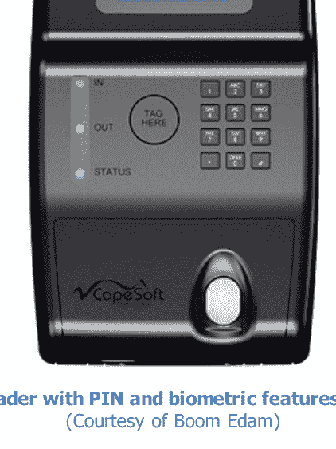

图3.50 - 带PIN码和生物识别功能的读卡器，用于增强安全性
（图片由Boom Edam提供）

对于数据中心，使用内部防尾随通道或门禁间可增强进出控制。门禁间（图3.51）每次只允许一人进入，并且将

发电机房。该房间将在停电紧急情况下为整个设施提供备用电源。

### 不间断电源（UPS）

这是一种电池备用系统，当市电不可用时，通过从独立电源供电，为连接的设备维持连续供电。UPS具有内部电池，可确保即使电源停止供电，也能为设备提供持续电力。当然，UPS只能提供一段时间的电力，通常为几分钟，但这通常足以应对电力公司的故障或短暂停电。即使停电时间超过UPS电池寿命，这也提供了有序关闭设备的机会。

### 发电机

在市电发生故障时，发电机应通过转换开关自动启动。数据中心负载由UPS设备维持；然而，这通常只是短时间，因为发电机应在断电后10秒内启动并达到正常速度。发电机（图3.52）通常使用柴油运行，可位于设施外部或停车库内。发电机房需要防止未经授权的访问，可通过门禁设备或钥匙锁门。只要有燃料供应，发电机就会持续运行。一些发电机容量为300加仑，设施经理会与当地分销商签订燃料供应合同。大多数运营中心拥有多台发电机，并每月测试一次。如果发电机位于室外，则需要在周围设置防护屏障，以防止车辆撞击。


图3.52 - 当市电发生故障时，转换开关会自动启动备用发电机。
（图片由博世安防系统提供）

## HVAC

HVAC 代表供暖、通风和空调。热量会对计算机设备造成严重损坏，可能导致处理器速度减慢并停止执行，甚至导致焊点松动失效。过热会降低网络性能并导致停机。数据中心和服务器机房需要不间断的冷却系统。通常有两种冷却类型：潜热冷却和显热冷却。

潜热冷却是指空调系统去除水分的能力。这在典型的舒适冷却应用中非常重要，例如办公楼、零售商店以及其他人员密集使用型设施。潜热冷却的重点是为在此类设施中工作和参观的人员维持舒适的温度和湿度平衡。这些设施通常设有直接通向室外的门，人员进出频繁。

显热冷却是指空调系统通过温度计可测量到的热量去除能力。数据中心每平方英尺产生的热量远高于典型的舒适冷却建筑环境，并且通常不会聚集大量人员。在大多数情况下，数据中心出入受限，除很少使用的紧急出口外，没有直接通往外部的通道。

数据中心对潜热冷却的需求极小，几乎不需要去除水分。显热冷却系统的设计重点在于除热而非除湿，具有更高的显热比；因此它是数据中心最实用、最合适的选择。冷却系统与上方的供电系统相互衔接。如果出现电力中断，就会影响冷却系统。为使计算机继续运行，它们需要被冷却。在 HVAC 发生故障时，便携式空调机组可用作备用，但良好的设计应确保冷却系统也被视为备用设备。

## 空气污染

在过去几年中，人们对炭疽和空气传播袭击的认知不断提高。有害物质一旦进入 HVAC 系统，就会迅速扩散至整个建筑，并感染所有接触循环空气的人员。

为避免空气污染，应将进气口设置在设施内实际可行的最高位置。为防止恶意行为，进气口还应用防护网覆盖，以避免物体被从地面抛入进气口或通风井。此类防护网应带有坡度，使被抛入的物体能滚落或滑落，远离进气口。许多现有建筑的进气口位于地面或地面以下。对于靠近建筑物的壁挂式或地下式进气口，可以通过在进气口上方建造静压箱或外部竖井来抬高其位置。

以下是加强设施运营这一关键方面安全性所需的指南清单：

- 限制进入主要进气点的人员，仅允许有相关工作需要的人进入。
- 维护经预先批准的维护人员访问名单，这些人员被授权在系统上工作。
- 在施工现场，所有接触系统的承包商均须有人陪同。
- 确保所有进气点均使用锁定装置充分固定。

所有建筑都有进气点，它们可能安装在屋顶、外墙，或作为独立机组置于建筑外的地面上。由于“病态建筑综合征”（即一人通过建筑 HVAC 系统将感冒或流感传染给多人），许多政府要求所有新建筑在 HVAC 系统中将一定比例的新鲜空气与再循环空气混合。新鲜空气的摄入量取决于建筑物的面积和内部工作的员工人数。

降低生物制剂在整栋建筑中循环传播风险的一种方法是在 HVAC 系统的送风管道和回风管道中安装紫外线过滤器。紫外线可抑制细菌、病菌、病毒、真菌和霉菌的生长与繁殖。紫外线是电磁波谱中位于“紫色”或可见光谱边缘之外的部分。太阳是天然的室外空气净化系统，通过紫外线控制空气传播的细菌。紫外线穿透微生物并破坏分子键，导致细胞或遗传损伤。细菌要么被杀死，要么被绝育，使其无法繁殖。无论哪种情况，活菌数量都能显著减少并得到控制。

## 水问题

与过热一样，水对计算机设备也有害。数据中心可能装有气体灭火系统，但楼上楼层呢？它们是否采用标准水喷淋系统？如果喷淋系统启动或开始漏水会怎样？合理的规划应将设备远离可能爆裂的水管、可能被淹的地下室或可能漏水的屋顶。然而，还有其他更难以识别和检测的水泄漏。如果暖湿空气不能迅速排出，堵塞的通风系统可能会导致冷凝。如果通风口位于机器上方或后方，冷凝水会形成无人察觉的小水洼。独立式空调在冷凝水处理不当的情况下尤其容易发生漏水。即使进气口附近有少量水，也会提高湿度水平，使服务器充满湿气。

## 火灾预防、检测与抑制

为保护服务器机房免受火灾，机构需要安装烟雾探测器，并将其连接到带指示器的控制面板上，用于警告房间内有烟雾的人员。此外，还应连接到灭火系统，该系统能够在气体本身不损坏设备的情况下帮助扑灭火灾。

### 火灾检测

烟雾探测器是最重要的设备之一，因为它能够预警即将发生的火灾，再加上良好的信号装置。工作状态正常的探测器会发出警报，并给所有人员一个活着逃生的机会。烟雾探测器主要分为两大类：光学检测（光电式）和物理过程（电离式）。光电探测器分为光束型和折射型。光束探测器基于光线和接收器的原理工作。一旦足够多的烟雾进入房间并遮挡光束，警报就会响起。折射型在光线和接收器之间设有阻挡物。一旦足够多的烟雾进入房间，光线会绕开阻挡物偏转射向信号器。最后是电离型探测器；这类探测器持续监测传感器周围的空气。一旦房间内烟雾达到一定浓度，警报就会响起。

火灾探测器主要有三种类型：火焰探测器、烟雾探测器和热探测器。火焰探测器主要有两种类型，即红外（IR）和紫外（UV）探测器。红外探测器主要探测大团热气，这些热气会在探测器所在位置发出特定的光谱模式；这些模式通过热成像摄像机感应，并触发警报。房间内额外的热表面可能会触发该警报的误报。紫外火焰探测器依靠火灾和爆炸在点燃瞬间释放的高能辐射，可在 3–4 毫秒内检测到火焰。该系统的某些误报来源包括房间内可能存在的随机紫外线源，如闪电、辐射和太阳辐射。

还有热探测器，包括定温式和温升速率式探测器。用户需设定一个预定的温度水平，达到该设置值时警报响起。如果室温上升到该设定值，警报就会响起。温升速率式探测器可检测传感器周围的温度突变。通常该设定约为每分钟 10–15 度。用户只需定期检查电池电量和运行状态即可。热探测器不应取代烟雾探测器；消防安全中的每个组件都有其用途，应认真对待。设备的组合以及对操作程序的了解，是应对可能发生的火灾时取得成功的唯一途径。

### 灭火

所有建筑都应配备有效的灭火系统，为建筑提供全天候保护。传统上，灭火系统采用水喷淋阵列，用于浇灭火灾及周围区域。喷淋系统分为四种不同类型：湿式、干式、预作用式和雨淋式。

- **湿式系统** — 始终持续供水；一旦启动，这些喷淋头在水源被切断前不会关闭。
- **干式系统** — 内部没有水。只有当电动阀门受到过热刺激时，阀门才会释放。
- **预作用系统** — 配备有检测系统，可以消除


误启动可能导致水损。在区域内的探测器被激活之前，水会被暂时截留。

- **雨淋系统（Deluge Systems）** – 功能与预作用系统相同，但所有洒水喷头都处于开启状态。

对于仓库等大面积物理区域，水可能是合理的解决方案，但对于计算机设备则完全不适用。水雾会比烟雾或热量更快地对硬件造成不可修复的损坏。气体灭火系统通过隔绝氧气来灭火。过去，哈龙（Halon）是气体灭火系统的首选；然而，哈龙会留下残留物、破坏臭氧层，并可能伤害附近人员。[166]

在服务器机房或任何使用电子设备的地方，推荐使用以下几种气体灭火系统：

- **Aero-K** – 使用悬浮在载气中的微型钾化合物气溶胶，从小型罐体中释放，这些罐体安装在天花板附近的墙壁上。Aero-K发生剂在检测到火灾之前不带压。Aero-K系统使用多个火灾探测器，只有在两个或更多探测器“确认”火灾后才会释放（从而限制意外排放）。该气体无腐蚀性，因此不会损坏金属或其他材料。它也不会损害电子设备或磁带、光盘等介质。更重要的是，Aero-K无毒，不会伤害人员。

- **FM-200** – 是一种无色、液化的压缩气体。它以液态储存，释放到危险区域时呈无色、不导电的蒸气，透明且不会遮挡视线。它无残留，在设计浓度下可用于有人场所，毒性可接受。FM-200不会置换氧气，因此在有人场所使用安全，无需担心缺氧。

## 摘要


安全架构与设计涵盖了广泛的主题，聚焦于将安全性设计到计算系统中，并贯穿整个企业的IT服务。安全架构师需要理解一系列关键的安全架构概念，并将其应用于多种常见场景。安全架构师捕获并分析需求，基于这些需求设计安全服务，并验证这些设计的有效性。安全架构师理解各种架构框架、标准和最佳实践，这些被众多框架和方法论所采用，并知道如何将它们结合使用以提供更强的设计。

密码学使信息技术得以在以前不可能的环境中应用。如果没有密码学的进步，向远程办公的转变以及远程工作所需的安全通信将无法实现。密码学为信息安全专业人员提供了丰富的方法、设备、软件和技术菜单，以帮助确保信息的保密性、完整性、真实性和不可否认性。虽然计算能力的进步使某些密码工具被削弱或破解，但安全专业人员和研究者在不断开发新工具来增强安全性。在可预见的未来，密码学将继续在隐私、安全、商业和通信的发展中发挥至关重要的作用。

- D. 它提供了对控制的简单、长期视角，为常见安全控制提供了统一愿景，利用了现有技术投资，为当前和未来的威胁以及核心功能的需求提供了灵活的方法。

## 3. 以下哪项最能用于捕获详细的安全需求？

- A. 威胁建模、隐蔽通道和数据分类
- B. 数据分类、风险评估和隐蔽通道
- C. 风险评估、隐蔽通道和威胁建模
- D. 威胁建模、数据分类和风险评估

## 4. 以下哪项安全标准是国际公认的良好安全实践标准，并侧重于组织信息安全管理体系（ISMS）的标准化和认证？

- A. ISO 15408
- B. ISO 27001
- C. ISO 9001
- D. ISO 9146

## 5. 以下哪项描述了为确保满足安全需求而需要实施的规则？

- A. 安全内核
- B. 安全策略
- C. 安全模型
- D. 安全引用监视器

## 6. 将单个主体二维分组为组或角色，并授予组对对象的访问权限，是以下哪种模型的示例？

- A. 多级格
- B. 状态机
- C. 无干扰
- D. 基于矩阵

## 7. 以下哪种模型确保具有“秘密”级别许可的主体只能写入被分类为“秘密”或“绝密”的对象，但被阻止写入分类为“公开”的信息？

- A. Biba完整性
- B. Clark–Wilson
- C. Brewer–Nash
- D. Bell–LaPadula

## 8. 以下哪项是Biba完整性模型所独有的？

- A. 简单属性
- B. *（星号）属性
- C. 调用属性
- D. 强 * 属性

## 9. 在共享数据托管环境中，以下哪种模型最值得考虑，以防止一个客户的数据泄露给竞争对手或共享该托管环境的其他客户？

- A. Brewer–Nash
- B. Clark–Wilson
- C. Bell–LaPadula
- D. Lipner

## 10. 以下哪种安全模型主要关注主体和对象是如何创建的，以及主体如何被分配权利或特权？

- A. Bell–LaPadula
- B. Biba完整性
- C. 中国墙
- D. Graham–Denning

## 11. 以下哪项ISO标准提供了可用于评估不同功能产品安全需求的评估标准？

- A. 15408
- B. 27000
- C. 9100
- D. 27002

## 12. 在通用标准（Common Criteria）中，针对部署在特定类型环境中的某类供应商产品的通用功能和保证需求集被称为

- A. 保护轮廓
- B. 安全目标
- C. 可信计算基
- D. 环保护

## 20. 系统管理员将权限授予一个名为“会计”的组，而不是授予每个个体。这是以下哪种安全机制的示例？

- A. 分层
- B. 数据隐藏
- C. 密码保护
- D. 抽象

## 21. 非对称密钥密码学用于以下用途：

- A. 数据加密、访问控制、隐写术
- B. 隐写术、访问控制、不可否认性
- C. 不可否认性、隐写术、数据加密
- D. 数据加密、不可否认性、访问控制

## 22. 以下哪项支持非对称密钥密码学？

- A. Diffie–Hellman
- B. Rijndael
- C. Blowfish
- D. SHA-256

## 23. 与对称算法相比，使用公钥算法的一个重要缺点是什么？

- A. 对称算法提供了更好的访问控制。
- B. 对称算法是更快的过程。
- C. 对称算法提供了交付的不可否认性。
- D. 对称算法更难实现。

## 28. 当证书被吊销时，正确的程序是什么？

- A. 设置新的密钥过期日期
- B. 更新证书吊销列表
- C. 从所有目录中移除私钥
- D. 通知所有员工已吊销的密钥

## 29. 关于链路加密，哪个说法是正确的？

- A. 链路加密建议用于高风险环境，提供更好的流量机密性，并加密路由信息。
- B. 链路加密通常用于帧中继或卫星链路，建议用于高风险环境，并提供更好的流量机密性。
- C. 链路加密加密路由信息，通常用于帧中继或卫星链路，并提供流量机密性。
- D. 链路加密提供更好的流量机密性，建议用于高风险环境，并提供更好的流量机密性。

## 30. NIST确定了三种表示不同类型可用云服务的服务模型，它们是什么？

- A. 软件即服务（SaaS）、基础设施即服务（IaaS）和平台即服务（PaaS）
- B. 安全即服务（SaaS）、基础设施即服务（IaaS）和平台即服务（PaaS）
- C. 软件即服务（SaaS）、完整性即服务（IaaS）和平台即服务（PaaS）
- D. 软件即服务（SaaS）、基础设施即服务（IaaS）和流程即服务（PaaS）


## 31. 大多数分组密码用于增强其强度所采用的流程是
- A. 扩散
- B. 混淆
- C. 阶跃函数
- D. SP网络

## 32. 以下哪项最能描述加密数据的基本方法：
- A. 替换和置换
- B. 3DES 和 PGP
- C. 对称和非对称
- D. DES 和 AES

## 33. 密码学支持信息安全的所有核心原则，除了
- A. 可用性
- B. 机密性
- C. 完整性
- D. 真实性

## 34. 击败频率分析以确定密钥的一种方法是使用
- A. 替换密码
- B. 转置密码
- C. 多表替换密码
- D. 反转密码

## 35. 运行密钥密码基于
- A. 模运算
- B. XOR 数学运算
- C. 因式分解
- D. 幂运算

## 36. 唯一据说无法通过暴力破解的密码系统是
- A. AES
- B. DES
- C. 一次性密码本
- D. 三重 DES

## 37. 实现攻击的主要类型包括：（选择所有适用项）
- A. 故障分析
- B. 已知明文
- C. 探测
- D. 线性

## 38. 在智能卡上实现加密的最佳选择是？
- A. Blowfish
- B. 椭圆曲线密码学
- C. TwoFish
- D. 量子密码学

## 39. 收到一封来自已知个人的带有文档附件的电子邮件，附有数字签名。电子邮件客户端无法验证签名。最佳措施是什么？
- A. 打开附件以确定签名是否有效。
- B. 在打开附件之前，确定签名为何无法验证。
- C. 删除该电子邮件。
- D. 将该电子邮件转发到新地址并附上新签名。

## 40. 绝大多数虚拟专用网络使用
- A. SSL/TLS 和 IPSec。
- B. El Gamal 和 DES。
- C. 3DES 和 Blowfish
- D. TwoFish 和 IDEA。


## 领域4
### 通信与网络安全

通信与网络安全领域涵盖用于在私有和公共通信网络及介质上提供机密性、完整性和可用性的结构、传输方法、传输格式和安全措施。网络安全通常被描述为IT安全的基石。在大多数IT环境中，网络是核心资产，即使不是最核心的资产。任何层面的网络保障（机密性、完整性、可用性、身份验证和不可否认性的综合属性）的缺失都可能带来毁灭性的后果，而对网络的控制则提供了一个简单且一致的攻击途径。相反，一个架构良好且保护完善的网络将能及时阻止许多攻击。

网络安全与所有安全控制和保障措施一样，在主动应用时最为有效。等待影响显现并在危机条件下应用控制和保障措施，总是比有计划、有管理地部署网络安全策略、规程和技术成本更高、效果更差。主动性的挑战在于它需要一个坚实的商业案例：在没有需求证据（如损失或破坏）的情况下，为什么要投入资源？除了商业案例，还需要适当的技能、知识和能力组合来构建、维护和监控一个有弹性的网络。安全架构师使用高层需求

## 目标

根据(ISC)²考生信息公告（考试大纲），CISSP考生应能够：
- 将安全设计原则应用于网络架构。
- 积极保护网络组件。
- 设计和建立安全的通信渠道。
- 预防或减轻网络攻击。

| 层 | 应用 | 设备/协议 |
|---|---|---|
| 7 应用层
与网络相关的应用程序 | 最终用户 | 用户应用程序
HTTP、FTP、Telnet、DHCP、SMTP 等 |
| 6 表示层
数据表示的标准化，供应用程序使用 | 语法
（加密/解密） | JPEG、ASCII、TIFF、SSL |
| 5 会话层
应用程序之间的会话管理 | 同步/发送到端口（逻辑） | 逻辑端口/主机间通信
AppleTalk、WinSock |
| 4 传输层
端到端错误检测和纠正 | TCP | TCP、UDP、SPX、SCTP |
| 3 网络层
跨网络的连接管理 | 数据包（包含IP地址的“信件”） | 路由器
IP、IPSec、ICMP、IGMP |
| 2 数据链路层
可靠的数据传输，包括LLC和MAC子层 | 帧（包含MAC地址的“信封”） | 交换机、网桥、WAP
PPP、SLIP、L2TP |
| 1 物理层
网络媒体的物理特性 | 物理设备 | 硬件的物理特性——电压、引脚、比特率、传输等 |

### 图4.1 — 七层OSI参考模型

- 第1层——物理层描述网络硬件，例如电信号、网络接口和布线。
- 第2层——数据链路层描述机器之间的数据传输，例如通过以太网。
- 第3层——网络层描述网络之间的数据传输，例如通过互联网协议（IP）。
- 第4层——传输层描述应用程序之间的数据传输、流量控制以及错误检测和纠正，例如通过TCP。
- 第5层——会话层描述应用程序之间的握手，例如身份验证过程。
- 第6层——表示层描述信息的表示，例如ASCII语法。
- 第7层——应用层描述信息的结构、解释和处理。从安全角度来看，它很重要，因为它依赖于所有底层。

通往目的地的路径。

RIP v1允许路由器以可编程的时间间隔更新其路由表。默认间隔为30秒。RIP v1持续发送路由更新意味着网络流量会迅速增加。为了防止数据包无限循环，RIP允许最大跳数为15。如果目标网络距离超过15个路由器，则认为该网络不可达，数据包将被丢弃。

RIP v2标准在RFC 1723中定义，并由RFC 4822⁶更新以支持密码认证。RIP v2相对于RIP v1提供了以下改进：
- 携带子网掩码。
- 支持密码认证安全。
- 指定下一跳地址。
- 不要求在网络边界对路由进行聚合。

### 开放最短路径优先（OSPF）第1版和第2版

OSPF v1标准在RFC 1131⁷中定义。开放最短路径优先是一种为IP网络开发的内部网关路由协议，基于最短路径优先或链路状态算法。路由器使用链路状态算法，通过根据每个节点构建的互联网拓扑计算到每个节点的最短路径，将路由信息发送到互联网络中的所有节点。每个路由器发送路由表（记录到特定网络目的地的路由）中描述其自身链路状态的部分，同时发送完整的路由结构（拓扑）。

最短路径优先算法的优势在于，使用它们会在各处产生更小、更频繁的更新。它们能快速收敛，从而防止路由环路和计数到无穷大（当路由器持续增加到达特定网络的跳数时）等问题。这使网络更加稳定。最短路径优先算法的缺点是它们需要大量的CPU能力和内存。

OSPF v2在RFC 1583中定义，并由RFC 2328⁸更新。它用于让路由器动态地从其他路由器学习路由，并向其他路由器通告路由。在OSPF中，包含路由的通告称为链路状态通告（LSA）。OSPF路由器跟踪自身与目标网络之间的各种网络连接（链路）的状态。正是这种行为使其成为链路状态路由协议。

OSPF支持使用无类别IP地址范围，并且非常高效。OSPF使用


## 观察力

青秋

> 法国雕塑家罗丹说：“所谓大师，就是这样的人：他们用自己的眼睛去看别人见过的东西，在别人司空见惯的东西上能够发现出美来。”

意思是说，对美的事物要留意，要用心去观察、体验，才能发现美。观察力也就是人们通常所说的“留心”他人忽略之处的能力，它是开启写作之门的一把钥匙。

写作，除了读书、思考、感受之外，还要真正学会观察。我国著名女作家冰心曾把写作的基本功概括为“多读书，多观察，多研究”。观察力是人在观察实践中或在有关训练过程中形成的一种比较稳定的个性特征。它表现在观察的目的性、条理性、敏锐性和观察的深刻性、细致性等方面。

我们要培养自己的观察能力，做有心人，善于思考，善于捕捉那些稍纵即逝的感觉，从平凡的生活中发现写作的素材，抓住事物的特征。看到一滴水，就应想到它折射出太阳的光芒；看到一棵小草，就应想到它顽强的生命力；看到一枚落叶，就应想到“化作春泥更护花”……

生活在给每个人都提供着写作的源泉，要想获得智慧，就必须做观察的有心人，用心去观察，去思考，你便会拥有智慧。

一九三五年

事实上，TraceRoute 是一种通过发送具有较小 TTL 值的数据包并观察 ICMP 超时通告来映射网络路由的工具。

### 互联网组管理协议（IGMP）

IGMP 用于管理多播组，多播组是网络中任何位置上对特定多播感兴趣的一组主机。多播代理管理多播组，主机向本地代理发送 IGMP 消息以加入和离开组。IGMP 有三个版本，如下所述：10

- **版本 1 –** 多播代理定期向其网络上的主机发送查询，以更新其多播组成员数据库。主机错开回复时间，以防止向代理产生流量风暴。当不再收到某个组的回复时，代理将停止向该组转发多播。
- **版本 2 –** 该版本扩展了版本 1 的功能。它定义了两类查询：用于确定所有组成员身份的通用查询和用于确定特定组成员身份的组特定查询。此外，成员可以通知所有多播路由器它希望离开某个组。
- **版本 3 –** 该版本通过允许主机指定希望从哪些源接收多播，进一步增强了 IGMP。

有关与 OSI 模型第 3 层相关的协议列表，请参阅以下内容：

- **IPv4/IPv6 –** 互联网协议
- **DVMRP –** 距离向量多播路由协议
- **ICMP –** 互联网控制消息协议
- **IGMP –** 互联网组管理协议
- **IPsec –** 互联网协议安全
- **IPX –** 互联网数据包交换
- **DDP –** 数据报投递协议
- **SPB –** 最短路径桥接

## 第 4 层：传输层

传输层在对等主机之间创建端到端的传输。用户数据报协议（UDP）和传输控制协议（TCP）是 TCP/IP 协议栈中重要的传输层协议。UDP 不能确保传输无差错地接收，因此它被归类为无连接、不可靠的协议。这一点

SYN 是客户端发起的。确认客户端请求的过程允许服务器将客户端的序列号加 1，并将其用作确认号。

3. 第三，客户端发送 ACK 以确认服务器发出的同步请求。客户端使用服务器在提供确认号时所采用的相同算法。客户端对服务器同步请求的确认完成了可靠连接建立的过程。

有关与 OSI 模型第 4 层相关的协议列表，请参阅下文：

- **ATP** — AppleTalk 事务协议
- **DCCP** — 数据报拥塞控制协议
- **FCP** — 光纤通道协议
- **RDP** — 可靠数据报协议
- **SCTP** — 流控制传输协议
- **SPX** — 顺序数据包交换
- **SST** — 结构化流传输
- **TCP** — 传输控制协议
- **UDP** — 用户数据报协议
- **UDP Lite** — 轻量用户数据报协议
- **μTP** — 微型传输协议

## 第 5 层：会话层

该层在对等主机之间提供逻辑、持久的连接。会话类似于应用程序交换信息所必需的对话。会话层负责创建、维护和拆除会话。它提供三种模式：

1. **全双工** — 两台主机可以同时交换信息，互不依赖。
2. **半双工** — 主机可以交换信息，但一次只有一台主机发送。
3. **单工** — 只有一台主机可以向其对等方发送信息。信息仅单向传输。

有关与 OSI 模型第 5 层相关的协议列表，请参阅下文：

应用服务，例如：

- **ACSE** — 关联控制服务元素
- **ROSE** — 远程操作服务元素
- **CCR** — 提交、并发与恢复
- **RTSE** — 可靠传输服务元素

### 特定应用服务元素（SASE）

特定应用服务元素子层提供特定于应用的服务（协议），例如：

- **FTAM** — 文件传输、访问与管理
- **VT** — 虚拟终端
- **MOTIS** — 面向消息的文本交换标准
- **CMIP** — 公共管理信息协议
- **MMS** — 制造消息服务
- **RDA** — 远程数据库访问
- **DTP** — 分布式事务处理

## 协议

在许多广泛使用的应用和协议中，表示层和应用层之间没有区别。例如，通常被视为应用层协议的超文本传输协议（HTTP）具有表示层的特性，例如能够识别字符编码以进行正确的转换，而这一转换在应用层完成。

## 第 7 层：应用层

该层是应用程序访问基于网络的服务的门户，例如确定远程应用程序的身份和可用性。当应用程序或操作系统通过网络传输或接收数据时，它会使用该层的服务。许多知名协议，如超文本传输协议（HTTP）、文件传输协议（FTP）和简单邮件传输协议（SMTP），都在该层运行。务必记住，应用层不是应用程序本身，尤其是当某个应用程序与第 7 层协议同名时。例如，许多操作系统上的 FTP 命令会启动一个名为 FTP 的应用程序，该应用程序最终使用 FTP 协议在主机之间传输文件。虽然有些协议根据其形式和功能很容易归入某一层，但另一些协议则很难精确定位。属于这一类的协议的一个例子是边界网关协议。

### 边界网关协议（BGP）

BGP 的创建是为了取代外部网关协议（EGP），以实现完全分散的路由。这使得互联网成为一个真正去中心化的系统。BGP 在传输控制协议/互联网协议（TCP/IP）网络中执行域间路由。BGP 是一种在自治系统网络中的网关主机（每台主机都有自己的路由器）之间交换路由信息的协议。BGP 通常是互联网上网关主机之间使用的协议。路由表包含已知路由器列表、它们可以到达的地址以及与到每个路由器的路径相关的成本度量，以便选择最佳可用路由。

使用 BGP 的主机通过传输控制协议（TCP）进行通信，并且仅当一台主机检测到变化时才发送更新的路由表信息。只发送路由表中受影响的部分。最新版本 BGP-4 允许管理员根据策略声明配置成本度量。11

许多人认为 BGP 是一种恰好影响路由表的应用程序。也有人认为 BGP 是一种路由协议，而不是影响路由表的应用程序。BGP 创建并使用附加到套接字的代码。这是否意味着它应被视为应用程序？在流量嗅探器中查看 BGP 时，在 IP 头和路由协议头之间有一个第 4 层头。这是否意味着我们可以说 BGP 是一种在第 4 层传输路由信息的应用程序？

也许对协议进行分类的更合适的方式是查看它所提供的服务。BGP 显然为网络层提供服务，不是传统的传输服务，而是提供有关网络层如何运行的控制信息。这可以让我们将 BGP 下移到网络层。

这种视角对于管理、控制和监督协议尤其有用，这些协议可以被视为其他协议的应用程序，同时向位于应用层之下的受管基础设施提供必要的控制、管理和监督信息。从这个角度来看，虽然 BGP 实际上只是一个运行在 TCP 之上的应用程序，但它与网络层的运行密切相关，因为它提供了有关网络层应如何运行的必要信息。这意味着我们可以说 BGP 是作为应用层协议实现的，但就其功能而言，它是一个网络层协议。


作为安全从业人员，你应该了解BGP在真实网络中的工作方式。下面是一些可在线使用的模拟器链接，可用于对BGP及其工作方式进行建模：

- BGPlay，一种HTML小部件，可针对互联网上任意真实AS（自治系统）的BGP路由和更新提供图形化展示。
  - 链接是：https://stat.ripe.net/widget/bgplay
- SSFnet，SSFnet网络模拟器包含由BJ Premore开发的BGP实现。
  - 链接是：http://www.ssfnet.org/homePage.html
- C-BGP，一种BGP模拟器，能够执行大规模模拟，尝试对互联网中的AS进行建模，或对达到Tier-1规模的AS进行建模。
  - 链接是：http://c-bgp.sourceforge.net/
- NetViews，一个Java应用程序，可实时监控并可视化BGP活动。
  - 链接是：http://netlab.cs.memphis.edu/projects_netviews.html

与OSI模型第7层相关的协议列表如下：

- **DHCP** — 动态主机配置协议
- **DHCPv6** — 动态主机配置协议v6
- **DNS** — 域名系统
- **HTTP** — 超文本传输协议
- **IMAP** — 互联网消息访问协议
- **IRC** — 互联网中继聊天
- **LDAP** — 轻量级目录访问协议
- **XMPP** — 可扩展消息与存在协议
- **SMTP** — 简单邮件传输协议
- **FTP** — 文件传输协议
- **SFTP** — 安全文件传输协议

## TCP/IP参考模型

美国国防部开发了TCP/IP模型，该模型与OSI模型非常相似，但层数更少，如图4.2所示。链路层提供网络内的物理通信和路由。它对应于实现以太网所需的一切。有时它被描述为两个层：物理层和链路层。就OSI模型而言，它涵盖第1层和第2层。网络层包括在网络之间移动数据所需的一切。它不仅对应IP协议，还对应互联网控制消息协议（ICMP）和互联网组管理协议（IGMP）。就OSI模型而言，它对应于第3层。

传输层包括在应用程序之间移动数据所需的一切。它对应TCP和UDP。就OSI模型而言，它对应于第4层。应用层涵盖特定于会话或应用程序的一切，换句话说，即与数据载荷相关的一切。就OSI模型而言，它对应于第5至第7层。由于其结构粗略，它不太适合描述应用级信息交换。

与OSI模型一样，在网络上传送的数据从协议栈顶部进入，除物理层外的每一层都会在从上一层接收到的消息的开头（有时也在末尾）封装供其对等层使用的信息。在远程主机上，每一层在将消息传递给下一更高层之前，都会去除由对等层封装的信息。此外，每一层都以模块化方式处理消息，而不关心同一主机上的其他层如何处理该消息。

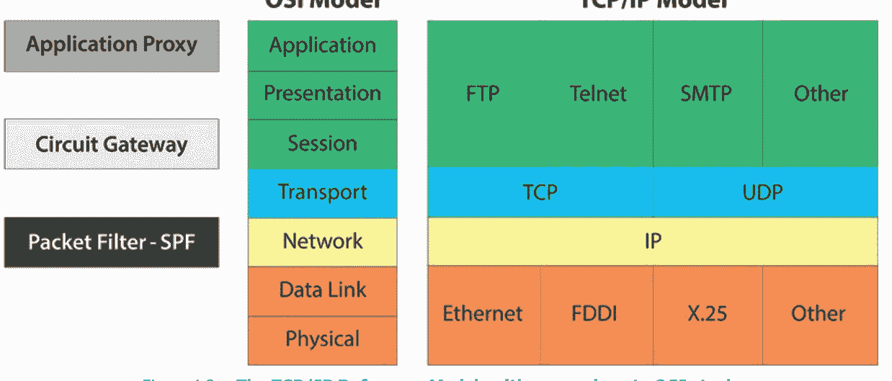

图4.2 — TCP/IP参考模型，与OSI协议栈对比
（来源：Held, G.,《内容分发网络实用指南》，Auerbach Publications，Boca Raton, FL，2006。经许可使用。）

## IP网络

网际协议（IP）负责将数据包从源主机发送到目的主机。由于它是一种不可靠的协议，因此不保证数据包无差错或按正确顺序到达。这个任务留给更高层的协议来完成。当数据包对于某个网络而言过大时，IP会将其分片。

主机通过其网络接口的IP地址来区分。地址以点（.）分隔的四个八位字节表示，例如216.12.146.140。每个八位字节的取值范围为0到255。但0和255不用于主机。后者用于广播地址，前者的含义取决于其使用环境。每个地址分为两部分：网络号和主机。网络号由外部组织（如互联网名称与数字地址分配机构（ICANN））分配，代表该组织的网络。主机部分代表网络内的网络接口。

最初，地址中表示网络号的部分取决于网络的类别。如表4.1所示，A类网络使用最左侧的八位字节作为网络号，B类网络使用最左侧的两个八位字节，依此类推。

| 类别 | 首字节范围 | 网络号的八位字节数 | 网络中的主机数 |
| A | 1 – 127 | 1 | 16,777,216 |
| B | 128 – 191 | 2 | 65,536 |
| C | 192 – 223 | 3 | 256 |
| D | 224 – 239 | 多播 |  |
| E | 240 – 255 | 保留 |  |

表4.1 – 网络类别

地址中未用作网络号的部分用于指定主机。例如，地址216.12.146.140代表一个C类网络。因此，该地址的网络部分由216.12.146表示，而网络块内的唯一主机地址由140表示。

127是A类网络地址块，保留用于计算机的环回地址。通常使用地址127.0.0.1。环回地址用于在机器层面提供一种自诊断和故障排除机制。该机制允许网络管理员将本地机器当作远程机器对待，并通过ping网络接口来确定其是否正常工作。

20世纪90年代互联网使用的爆炸式增长导致了未分配IPv4地址的短缺。为帮助解决这一问题，采用了无类域间路由（CIDR）。CIDR不要求根据网络类别中的主机数量来分配新地址；相反，地址从未使用的地址池中按连续块分配。

为了简化网络管理，网络通常被划分为子网。由于到目前为止讨论的寻址方案无法区分子网，因此使用一种单独的机制——子网掩码——来定义地址中用于子网的部分。当地址中的相应位用于子网时，子网掩码中的位为1；掩码中其余位为0。例如，如果最左侧的三个八位字节（24位）用于区分子网，则子网掩码为11111111 11111111 11111111 00000000。由32个1和0组成的字符串非常笨拙，因此掩码通常转换为十进制表示法：255.255.255.0。或者，掩码用斜线（/）后跟掩码中1的个数来表示。上述掩码可写为/24。

## IPv6

在20世纪90年代中期互联网使用量激增后，IP开始经历严重的成长之痛。显然，互联网惊人的使用量正将该协议推向极限。最明显的问题是未分配IP地址短缺和安全性严重不足。IPv6是IPv4的现代化版本，包括：

- 1. 更大的地址字段：IPv6地址为128位，可支持2¹²⁸台主机。可以说，地址不会用完。
- 2. 改进的安全性：如下文将要讨论的，IPSec必须在IPv6中实现。这将有助于确保IP数据包的完整性和机密性，并允许通信双方相互认证。
- 3. 更简洁的IP数据包头：主机处理每个数据包所需的时间将减少，从而提升吞吐量。
- 4. 改进的服务质量：这将有助于各类服务获得网络带宽的适当份额。

## 传输控制协议（TCP）

传输控制协议提供面向连接的数据管理和可靠的数据传输。TCP和UDP通过将端口号与主机提供的服务关联来映射数据连接。TCP和UDP端口号由互联网号码分配局（IANA）管理。共有65,536（2¹⁶）个端口。


这些被分为三个范围：

- **知名端口 —** 0 到 1023 端口被视为知名端口。此范围内的端口由 IANA 分配，并且在大多数系统上只能由特权进程和用户使用。
- **注册端口 —** 1024 到 49151 端口可以由应用程序开发人员向 IANA 注册，但并非由 IANA 分配。选择注册端口而非知名端口的原因可能是，在大多数系统上，用户可能没有权限在知名端口上运行应用程序。
- **动态或私有端口 —** 49152 到 65535 端口可供应用程序自由使用；这些端口的一个典型用途是为请求的数据或服务发起返回连接。

对 TCP 的攻击包括序列号攻击、会话劫持和 SYN 洪水。有关攻击的更多信息可在本章后面找到。

## 用户数据报协议 (UDP)

用户数据报协议为无连接的数据传输提供轻量级服务，且不进行错误检测和纠正。对于 UDP，关于端口号的相同考虑适用于传输控制协议一节中对 TCP 的描述。传输层中已在 UDP 之上定义了若干协议，从而实际上将传输层一分为二。堆叠在第 4 层和第 5 层之间的协议包括 RFC 3550 中定义的实时协议 (RTP) 和实时控制协议 (RTCP)、MBone（一种多播协议）、可靠 UDP (RUDP) 以及 RFC 2960 中定义的流控制传输协议 (SCTP)。作为一种无连接协议，UDP 服务很容易成为伪造攻击的目标。

## 因特网–内联网

因特网是一个由独立管理、相互连接的网络组成的全球网络，它改变了地球上的生活。来自全球各地的人们可以使用各种标准化工具（如 Web 技术或电子邮件）几乎即时地共享信息。

另一方面，内联网是在组织内部相互连接的内部网络，允许在组织内部有时也在受信任的合作伙伴和供应商之间共享信息。例如，在一个项目期间，全球公司的员工可以轻松访问和交换文档，从而几乎像在同一办公室一样协同工作。与因特网一样，信息易于共享也带来了保护其免受伤害的责任。内联网通常会托管各种组织数据。因此，即使它们在技术上位于内部网络，对这些资源的访问通常也会与现有的内部身份验证服务绑定，例如与多因素身份验证相结合的目录服务。

## 外联网

外联网与 DMZ（非军事化网络区域）的区别如下：外联网仅向已获授权访问外联网资源访问账户的经过身份验证的连接提供服务。相反，DMZ 会托管必须支持来自几乎任何来源的未经身份验证连接的公共资源，例如 DNS 服务器和电子邮件服务器。由于公司需要共享大量信息，通常以自动化的方式进行，通常一家公司会授予另一家公司受控访问其网络的隔离段，以便通过外联网交换信息。

向外部组织授予网络访问权限会带来重大风险。两家公司都必须确保技术和非技术（例如运营和政策）控制措施能够有效最大限度地降低信息未经授权访问的风险。在必须向外部组织授予访问权限的情况下，服务提供商可以在上游应用诸如确定性路由之类的额外控制措施。这种保护措施相对简单易行，具有显著优势，因为恶意实体针对外联网进行入侵从而导致内部网络渗透的能力被缩短了。

访问外联网的公司通常将这些网络及其服务器中的信息视为“受信任的：”保密且具有完整性（未被篡改且有效）。然而，这些公司无法控制彼此的安全状况。谁知道如果用户从网络已被入侵的组织通过外联网访问 supposedly 受信任的信息会惹上什么麻烦？为了减轻这种潜在风险，安全架构师和从业人员需要在授予外联网访问权限之前要求实施某些安全控制措施。

## 动态主机配置协议 (DHCP)

系统和网络管理员都很忙，几乎没有时间为主机分配 IP 地址并跟踪已分配的地址。为了减轻管理员手动分配地址的负担，许多组织使用动态主机配置协议（DHCP）自动为工作站分配 IP 地址（服务器和网络设备通常分配静态地址）。

主机与网关之间的消息并用于 ping 和 traceroute 等诊断工具。ICMP 可被利用进行恶意行为，包括中间人攻击和拒绝服务攻击。

## 死亡 Ping 13

Ping 是一种诊断程序，用于确定指定主机是否在网络上并且可以被 ping 主机访问。它向目标主机发送 ICMP 回显数据包并等待目标返回 ICMP 回显应答。令人惊讶的是，在接收到大于合法数据包限制 65,536 字节的 ICMP 回显时，大量操作系统会崩溃或变得不稳定。在死亡 Ping 变得著名之前，攻击来源很难找到，因为许多系统管理员会在日志中忽略看似无害的 ping。

## ICMP 重定向攻击 14

路由器可能会向主机发送 ICMP 重定向，告诉它使用不同的、更有效的默认路由。然而，攻击者可以向主机发送 ICMP 重定向，指示它将攻击者的机器用作默认路由。攻击者会将所有被重定向的流量转发给路由器，这样受害者就不会知道其流量已被拦截。这是一个很好的中间人攻击示例。某些操作系统在接收到大量 ICMP 重定向时会崩溃。安全从业人员应在其工具箱中配备多种工具，以便能够模拟和交互此类 ICMP 重定向攻击，从而更好地理解它们。其中一种非常有效的工具称为 Scapy。

Scapy 是一个功能强大的交互式数据包操作程序。它能够伪造或解码大量协议的数据包，将其发送到线路上、捕获它们、匹配请求和应答等等。它可以轻松处理大多数经典任务，如扫描、跟踪路由、探测、单元测试、攻击或网络发现（它可以替代 hping、85% 的 nmap、arpspoof、arp-sk、arping、tcpdump、tethereal、p0f 等）。它在许多其他特定任务上也表现非常出色，而大多数其他工具无法处理这些任务，例如发送无效帧、注入自己的 802.11 帧、组合技术（VLAN hopping+ARP cache poisoning、VOIP decoding on WEP encrypted channel 等）

您可以在此处找到 Scapy：http://www.secdev.org/projects/scapy/

## Ping 扫描

Ping 扫描是一种基本网络映射技术，有助于缩小攻击范围。攻击者可以使用多种工具之一，例如适用于基于 Windows 平台的 Very Simple Network Scanner 和适用于 Linux 和 Windows 平台的 NMAP 来 ping 范围内的所有地址。15 如果主机对 ping 作出响应，则攻击者知道该地址存在主机。

## Traceroute 利用

Traceroute 是一种诊断工具，显示数据包在源主机和目标主机之间经过的路径。Traceroute 可被恶意用于映射受害者网络并了解其路由。此外，还有 Firewalk 等工具，使用与 traceroute 类似的技术来枚举防火墙规则集。16 该防火墙工具自 2003 年 5.0 版起停止积极开发和维护。firewalk 工具的功能已被纳入 NMAP，作为可配置使用的规则集的一部分。17

firewalk 主机规则试图做的是使用一种称为 firewalking 的 IP TTL 过期技术来发现防火墙规则。为了确定给定网关上的规则，扫描器会向位于网关后面的指标发送探测，TTL 比网关高一。如果探测被网关转发，则我们可以预期从网关下一跳路由器收到 ICMP_TIME_EXCEEDED 回复，或者如果指标直接连接到网关，则最终从指标本身收到回复。否则，探测将超时。

它从等于目标距离的 TTL 开始。如果探测超时，则会重新发送 TTL 减一的探测。如果我们收到 ICMP_TIME_EXCEEDED，则该探测的扫描结束。每个“no-reply”被过滤的 TCP 和 UDP 端口都会被探测。对于 UDP 扫描，如果扫描器附近的网关阻止了大量端口，此过程可能相当缓慢。扫描参数可以使用 firewalk.* 可选参数进行控制。

## 远程过程调用

远程过程调用（RPC）表示允许跨主机执行对象的能力，客户端向网络上不同主机上的应用程序发送一组指令。一般来说，此类别中存在多个（相互不兼容）服务，例如分布式计算环境 RPC（DCE RPC）和 Sun 的开放网络计算 RPC（ONC RPC，也称为 SunRPC 或简单 RPC）。需要注意的是，RPC 本身实际上并不提供任何服务；相反，它通过提供（基本）身份验证和寻址实际服务的方式提供经纪服务。通用对象请求代理体系结构（CORBA）和 Microsoft 分布式组件对象模型（DCOM）可被视为 RPC 类型协议。RPC 的安全问题包括其薄弱的身份验证机制，这可能

明文通信将通过部署 LDAP over SSL 来实现，提供身份验证、完整性和保密性。

## 网络基本输入输出系统 (NetBIOS)

NetBIOS 应用程序编程接口 (API) 由 IBM 于 1983 年开发。NetBIOS 后来被移植到 TCP/IP（NetBIOS over TCP/IP，也称为 NetBT）。在 TCP/IP 下，NetBIOS 在 TCP 上运行于端口 137 和 138，在 UDP 上运行于端口 139。此外，它使用端口 135 进行远程过程调用（参见远程过程调用）。

| 端口 |  |
|---|---|
|  | 135/UDP |
|  | 137/TCP |
|  | 138/TCP |
|  | 139/UDP |
| 定义 | RFC 1001 |
|  | RFC 1002 |

表 4.4 - NetBIOS 快速参考

## 网络信息服务 (NIS)、NIS +

NIS 和 NIS + 是由 Sun Microsystems 开发的目录服务，主要用于 UNIX 环境。它们通常用于在机器组中管理用户凭据，例如 UNIX 工作站集群或客户端/服务器环境，但也可以用于其他类型的目录。

### NIS

NIS 在所谓的域中使用扁平命名空间。它基于 RPC 并管理服务器（NIS 服务器）上的所有实体。NIS 服务器可以通过使用从服务器进行冗余设置。NIS 以存在多项安全弱点而闻名。NIS 不对单个 RPC 请求进行身份验证这一事实可被用来伪造对客户端 NIS 请求的响应。例如，这将使攻击者能够注入虚假凭据，从而在目标机器上获取或提升权限。如果 NIS 域的名称已知或可猜测，则可以检索目录信息，因为任何客户端都可以将自己与 NIS 域关联。已发布多篇关于如何保护 NIS 服务器的指南。安全架构师和从业人员需要采取的基本步骤如下：保护 NIS 服务器运行的平台，将 NIS 服务器与局域网外的流量隔离，并进行配置以限制身份验证凭据（尤其是系统特权凭据）泄露的可能性。

### NIS +

NIS + 使用分层命名空间。它基于 Secure RPC（参见远程过程调用）。NIS + 中的身份验证和授权概念更为成熟；它们要求对每个目录对象的访问进行身份验证。然而，NIS + 身份验证本身的强度仅与 NIS + 环境中某个客户端的身份验证一样强，因为 NIS + 建立在不同主机之间的信任关系之上。对正确配置的 NIS + 网络最相关的攻击来自对其加密安全性的攻击。NIS + 可以在不同的安全级别下运行；然而，大多数可用级别对于运营网络来说是不相关的。20

## 通用互联网文件系统 (CIFS)/服务器消息块 (SMB)

CIFS/SMB 是 Windows 系统上普遍使用的文件共享协议。免费的 Samba 项目中存在 UNIX/Linux 实现。SMB 最初设计为在 NetBIOS 协议（参见网络基本输入输出系统）之上运行；然而，它也可以直接在 TCP/IP 上运行。

| 端口 | 445/TCP |
| | 另请参见 NetBIOS（网络基本输入输出系统） |
| 定义 | 专有 |

表 4.5 – CIFS/SMB 快速参考

CIFS 能够支持用户级和树/对象级（共享级）安全性。身份验证可以通过挑战/响应身份验证以及明文传输凭据来进行。这一第二项规定很大程度上是为了在旧版 Windows 环境中实现向后兼容而添加的。

对 CIFS 的主要攻击基于获取凭据，无论是通过嗅探明文身份验证还是通过密码攻击。

## 网络文件系统 (NFS)

网络文件系统是一种在 UNIX 平台上常见的客户端/服务器文件共享系统。它最初由 Sun Microsystems 开发，但在所有常见的 UNIX 平台（包括 Linux）以及 Microsoft Windows 上都存在实现。NFS 已多次修订，包括对 NFS 版本 2 和 3 的更新。NFS 版本 2 基于 UDP，版本 3 引入了 TCP 支持。两者都实现在 RPC 之上（参见远程过程调用）。NFS 版本 2 和 3 是无状态协议，主要是出于性能考虑。因此，服务器必须单独管理文件锁定。

| 端口 | 参见 RPC（“目录服务”部分） |
|-------|------------------------------------------|
| 定义 | RFC 1094 |
|  | RFC 1813 |
|  | RFC 3010 |

表 4.6 — NFS 快速参考

安全 NFS (SNFS) 使用数据加密标准 (DES) 加密提供安全身份验证和加密。与标准 NFS 相比，安全 NFS（或更确切地说是安全 RPC）将对每个 RPC 请求进行身份验证。由于执行身份验证，这将增加每个请求的延迟并带来轻微的性能开销，主要体现在计算能力上。安全 NFS 使用 DES 加密的时间戳作为身份验证令牌。如果服务器和客户端无法访问同一时间服务器，这可能导致短期中断，直到服务器和客户端重新同步。

NFS 版本 4 是使用 TCP 端口 2049 的有状态协议。UDP 支持（和依赖）已被停用。NFS 版本 4 基于 Kerberos 实现自己的加密协议，并已停止使用 RPC。不再使用 RPC 也意味着不再动态分配额外端口，这使得 NFS 可以通过防火墙使用。安全架构师在设计中可以考虑的另一种方法是规划在必须部署 NFS 时对其进行保护，通过 Secure Shell (SSH) 对 NFS 进行隧道传输，后者可以与操作系统身份验证方案集成。

## 简单邮件传输协议 (SMTP) 与增强简单邮件传输协议 (ESMTP)

使用端口 25/TCP，SMTP 是一种用于在互联网上路由电子邮件的客户端/服务器协议。互联网域的邮件服务器信息通过 DNS 管理，使用邮件交换 (MX) 记录。尽管 SMTP 对身份验证采取简单的方法，但在处理不可用性方面却很稳健；SMTP 服务器将在可配置的时间段内尝试投递电子邮件。

从协议角度来看，SMTP 的主要缺点是完全缺乏身份验证和加密。身份识别通过发件人的电子邮件地址进行。邮件服务器能够限制对某些主机的发送访问，这些主机应与邮件服务器位于同一网络上，并可对发件人的电子邮件地址设置条件，该地址应是该特定邮件服务器服务的域之一。否则，邮件服务器可能被配置为开放中继，尽管这传统上不是推荐的做法，因为它会带来各种安全问题，并且可能导致服务器被反垃圾邮件组织的封禁列表列入。

为解决 SMTP 中发现的弱点，定义了该协议的增强版本 ESMTP。ESMTP 是模块化的，客户端和服务器可以协商使用的增强功能。ESMTP 确实提供身份验证，其中包括其他功能，并允许使用不同的身份验证机制，包括基本和几种安全身份验证机制。

SMTP 和 ESMTP 的快速总结比较可在下表中看到：

| SMTP | ESMTP |
|---|---|
| 代表简单邮件传输协议 | 代表扩展简单邮件传输协议 |
| SMTP 会话中的第一个命令： | ESMTP 会话中的第一个命令： |
| HELO sayge.com | EHLO sayge.com |
| RFC 821 | RFC 1869 |
| SMTP ‘MAIL FROM’ 和 ‘RCPT TO’ 允许大小仅为 512 个字符包括 <CRLF>。 | ESMTP ‘MAIL FROM’ 和 ‘RCPT TO’ 允许大小大于 512 个字符。 |
| SMTP 本身不能用新命令扩展。 | ESMTP 是一个具有增强能力的框架，允许其扩展现有 SMTP 命令。 |

## 文件传输协议 (FTP)

在万维网出现和超文本传输协议 (HTTP) 普及之前，后者构建在其某些功能之上，FTP 是在互联网上发布或传播数据的协议。

| 端口 | 20/TCP（数据流） |
| | 21/TCP（控制流） |
| 定义 | RFC 959 |

表 4.7 – FTP 快速参考


数据通道的模式：

- **主动模式（PORT模式）** —— 服务器主动发起到客户端的数据连接。这种模式在防火墙环境中存在明显缺陷，因为对客户端的传入连接可能（且应当）被阻止。许多防火墙产品仍然支持主动模式。
- **被动模式（PASV模式）** —— 客户端主动发起到服务器的数据连接。尽管RFC 959并未强制要求实现被动FTP，但大多数FTP服务器都提供这种连接类型。

## 匿名FTP

在HTTP出现和普及之前，向不特定用户群体发布信息是通过FTP服务实现的，这些服务向任何有需要的人提供访客认证。这些服务被称为匿名FTP，因为访客用户会被映射到FTP登录ID“anonymous”，而用户则使用自己的电子邮件地址进行伪认证（从而表明身份）。实际上，用户可以使用任何密码或电子邮件地址，而使用真实电子邮件地址仍被视为一种常识性的礼貌。

尽管Web浏览器仍然支持这种（社交）协议，但匿名FTP的使用已逐渐衰落。主要有三个原因。

- 1. 使用HTTP，可以更高效、更无缝地处理匿名信息发布。
- 2. 用户公开电子邮件地址（或被要求这样做）的做法被广泛认为是不安全且侵犯隐私的，这会让用户面临垃圾邮件发送者的地址收集。
- 3. 访客访问可能使FTP服务器面临安全风险。

## 简单文件传输协议（TFTP）

TFTP是FTP的简化版本，在不需要认证且服务质量不成问题的场景下使用。TFTP运行在UDP的69端口上。因此，它只能在低延迟的受信任网络中使用。

| 端口 | 69/UDP |
|-------|--------|
| 定义 | RFC 1350 |

表4.8 - TFTP快速参考

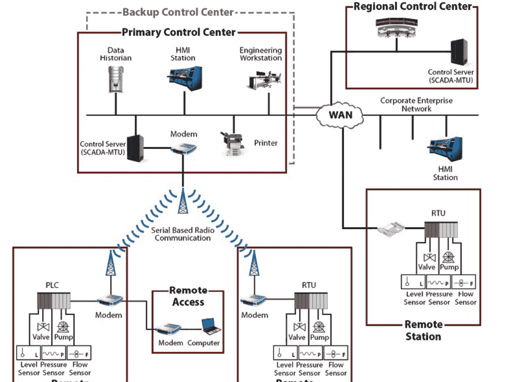

图4.4 – 通用SCADA ICS示意图

- **控制服务器** —— 控制服务器承载软件，并通常提供用于通过网络中的从属控制模块控制执行器、线圈和PLC的接口。
- **远程终端单元（RTU）** —— RTU支持SCADA远程站点，通常配备无线电台接口，用于可能无法进行地面通信的场景。
- **人机界面（HMI）** —— HMI是操作人员能够监控、控制和指挥系统中控制器的界面。
- **可编程逻辑控制器（PLC）** —— PLC是一种小型计算机，用于控制继电器、开关、线圈、计数器和其他设备。
- **智能电子设备（IED）** —— IED是一种能够获取数据并通过执行操作向过程提供反馈的传感器。这些设备允许在本地级别进行自动控制。
- **输入/输出（IO）服务器** —— IO服务器负责从IED、RTU和PLC等组件收集过程信息。它们通常用于将第三方控制组件（如自定义仪表板）与控制服务器进行接口连接。
- **数据历史库（Data Historian）** —— 数据历史库类似于工业控制系统的安全事件与事件管理（SIEM）。它通常是一个集中式数据库，用于记录来自各种设备的过程信息。

鉴于SCADA系统的独特设计及其所控制的关键基础设施，它们成为新的攻击焦点也就不足为奇了。负责实施或保护SCADA系统的安全架构师和安全从业人员应了解以下攻击类型：

- 网络边界漏洞
- 整个协议栈中的协议漏洞
- 数据库不安全
- 会话劫持和中间人攻击
- 操作系统和服务器弱点
- 设备和供应商“后门”

2013年10月下旬，美国研究人员在来自20家供应商的工业控制SCADA软件中发现了25个零日漏洞，这些软件用于控制关键基础设施系统。攻击者可能利用其中一些漏洞来控制电力和供水系统。这些漏洞存在于用于服务器与变电站之间串行和网络通信的设备中。到目前为止，串行通信一直未被视为重要或可行的攻击途径，但通过串行通信设备突破电力系统可能比通过IP网络攻击更容易，因为无需绕过层层防火墙。理论上，入侵者只需突破通信传输到服务器所经过的无线电网，即可利用这些漏洞。

安全专业人员需要应对的另一个问题是，防病毒软件无法解决SCADA/ICS环境面临的威胁。例如，Flame病毒避开了43种不同防病毒工具的检测，花了两年多时间才被发现。安全从业者需要做的，不是继续依赖那些可能适用于台式机和

发布报告。25

工业控制系统和SCADA系统的安全性近年来已成为一个严重的问题，因为攻击者和研究人员已开始将注意力转向它们。许多这些系统控制着机械设备、制造设备、公用事业、核电站和其他关键基础设施，它们直接或通过网络连接到互联网，这引起了攻击者的注意，他们试图在这些网络上进行侦察或制造麻烦。研究人员对SCADA和ICS行业的安全性提出了尖锐批评，称其“可笑”且没有正式的安全开发生命周期。ICS-CERT报告指出，受到攻击的公用事业公司中的系统可能是一系列攻击的目标。“可以确定的是，这些系统可能暴露于众多安全威胁之下，并且还识别出了此前的入侵活动。”调查人员能够识别出这些问题，并发现攻击者可能没有对该公用事业公司的ICS系统造成任何损害。

在同一份报告中，ICS-CERT详细描述了另一家组织的单独入侵事件，该组织也有一个连接到互联网的控制系统。攻击者能够入侵ICS系统，该系统操作一个未指明的机械设备，但并未造成实际损害。“该设备可直接通过互联网访问，且未受防火墙或身份认证访问控制保护。在遭到入侵时，控制系统因计划维护已与设备机械断开，”报告称。“ICS-CERT提供了分析协助，并确定攻击者在较长时间内都能访问该系统，并通过HTTP和SCADA协议进行连接。然而，进一步分析表明，威胁行为者并未尝试操纵系统或注入未经授权的控制操作。”

安全架构师和安全从业者应熟悉ICS-CERT发布的最新警报。这些警报可在以下网址找到：

https://ics-cert.us-cert.gov/alerts/

安全专业人员还应将以下列表作为防御措施的起点，以帮助保护SCADA/ICS系统：

- 最小化所有控制系统设备的网络暴露。通常，将控制系统网络和设备置于防火墙之后，并与业务网络隔离。
- 当需要远程访问时，采用安全方法，例如虚拟专用网络（VPN），并认识到VPN可能存在漏洞，并且


应更新到可用的最新版本。还要认识到，VPN 的安全性仅取决于所连接设备的安全性。

-   尽可能删除、禁用或重命名任何默认系统帐户。
-   实施帐户锁定策略，以降低暴力破解尝试的风险。
-   制定并实施要求使用强密码的策略。
-   监控第三方供应商创建管理员级帐户的情况。
-   在 ICS 环境中尽可能应用补丁，以缓解已知漏洞。

## Modbus

Modbus 和 Fieldbus 是由不同组织设计的标准工业通信协议。这些协议的设计重点不是安全性，而是设备的正常运行时间和控制。许多此类协议通过传输介质以明文形式发送信息。此外，许多此类协议及其支持的设备在设备上执行命令时几乎不需要或根本不需要身份验证。安全架构师和从业者需要共同协作，确保实施严格的逻辑和物理控制，以保证这些协议被封装并与任何公共或开放网络隔离。

## 融合协议

### 什么是 IP 融合？

长期以来，安全架构师和从业者一直渴望有一个单一网络，使他们能够安全地传输语音和数据。及时提供信息访问的能力现已成为企业的关键资产。基于互联网协议（IP）网络技术的企业网络，正处于满足企业对高效、经济实惠且能作为所有企业通信需求骨干的网络需求的前沿。在应对网络物理集成带来的挑战的同时，还应确保聚合的通信流量满足网络的质量和功能要求。

决定 IP 融合网络实施和部署的核心方面包括：整合分散的网络元素，保持对 IP 及其相关协议的最新了解，以及建立用于管理多媒体应用的语音、数据和视频流量的系统。

安全架构师和从业者可以将 IP 融合带来的好处应用于：

-   块存储数据管理
-   远程管理
-   以业务为中心的数据通信

每个网络和设备都会增加复杂性、成本和管理开销。融合网络可以通过减少物理组件的数量来简化典型拓扑。这种融合带来了简化的管理和服务质量（QoS）的改进。

在过去十年中，人们曾多次尝试创建融合网络。光纤通道协议（FCP）是 SCSI 到光纤通道（FC）第 1 层和第 2 层传输协议的轻量级映射。光纤通道不仅承载 FCP 流量，还承载 IP 流量，从而创建融合网络。FC 的成本以及以太网作为 LAN 通信标准的接受度，阻碍了 FC 的广泛使用，除非是企业级数据中心 SAN。

-   **InfiniBand（IB）** 技术通过传输处理器间通信、LAN 和存储协议提供融合网络能力。IB 最常用的两种存储协议是 SCSI 远程直接内存访问协议（SRP）和用于 RDMA 的 iSCSI 扩展（iSER）。这些协议利用 IB 的 RDMA 能力。SRP 构建了从 SCSI 到 RDMA 的直接映射层和协议，iSER 则将数据直接复制到 SCSI I/O 缓冲区，无需中间数据复制。这些协议轻量，但不如 FC 简洁。由于 IB 被认为成本高昂，并且需要复杂的网关和路由器将这些以 IB 为中心的协议和网络转换为原生 FC 存储设备，因此广泛部署并不现实。已采用 IB 作为标准传输网络的高性能计算环境使用 SRP 和 iSER 协议。

-   **互联网 SCSI（iSCSI）** 试图将直接 SCSI 到 TCP/IP 的映射层和协议引入大众以太网市场。iSCSI 的支持者希望降低成本，并在现有以太网 LAN 基础设施上部署 SAN。iSCSI 技术对中小型企业市场非常有吸引力，因为它具有低成本的软件发起端，并且能够使用任何现有的以太网 LAN。

-   **基于 IP 的光纤通道（FCIP）** 和 **互联网光纤通道协议（iFCP）** 将 FCP 和 FC 的特性映射到 LAN、MAN 和 WAN。这两种协议都将 FC 帧映射到 TCP/IP 协议栈之上。FCIP 是一种 SAN 扩展协议，用于在大型地理区域内桥接 FC SAN。它不用于主机服务器或目标存储连接。iFCP 协议允许基于以太网的主机通过 iFCP 到 FC SAN 的网关连接到 FC SAN。这些网关和协议除了 SAN 扩展之外并未被广泛采用，原因是其复杂性、缺乏可扩展性以及成本高昂。

随着 10 GbE 的日益普及，FCoE 成为将块存储协议融合到以太网上的下一次尝试。FCoE 利用了 10 GbE 的性能以及与现有光纤通道协议的兼容性。它依赖于使用 IEEE 数据中心桥接（DCB）标准的以太网基础设施。DCB 标准可应用于任何 IEEE 802 网络，但通常 DCB 一词指的是增强型以太网。DCB 标准定义了四项新技术：

-   **基于优先级的流控（PFC）** – 802.1Qbb 允许网络暂停不同的流量类别。
-   **增强传输选择（ETS）** – 802.1Qaz 定义了多个流量类别的调度行为，包括严格优先级和最低保证带宽能力。这应能实现链路的公平共享、更好的性能和计量。
-   **量化拥塞通知（QCN）** – 802.1Qau 支持交换式 LAN 基础设施中的端到端流控，并有助于消除以太网结构中的持续严重拥塞。在网络可以使用 QCN 之前，必须先在融合增强型以太网（CEE）数据路径（融合网络适配器（CNA）、交换机等）的所有组件中实施 QCN。QCN 网络还必须使用 PFC，以避免丢包并确保无损环境。
-   **数据中心桥接交换协议（DCBX）** – 802.1Qaz 支持发现和配置支持 PFC、ETS 和 QCN 的网络设备。

## 以太网光纤通道（FCoE）

在传统以太网网络中，发生冲突或拥塞时会出现帧丢失。网络依赖 TCP 等上层协议来提供端到端数据恢复。FCoE 是一种轻量级封装协议，缺乏 TCP 层的可靠数据传输能力。因此，FCoE 必须在支持 DCB 的以太网上运行，并使用无损流量类别，以防止在拥塞的网络条件下丢失以太网帧。

在 DCB 网络上运行的 FCoE 模仿了原生 FC 协议和介质的轻量级特性。它不包含 TCP 甚至 IP 协议。这意味着 FCoE 是一种第 2 层（不可路由）协议，就像 FC 一样。FCoE 仅用于数据中心内的短距离通信。FCoE 的主要优势在于，交换机厂商可以轻松地在高性能交换机硅片中实现将 DCB 网络上的 FCoE（FCoE/DCB）转换为原生 FC 的逻辑。FCoE 将以太网帧内的 FC 帧封装起来。FCoE 有几个优点：

-   使用现有的操作系统设备驱动程序。（由于相同的厂商制造用于 CNA 和原生 FC HBA 的设备，他们使用共同的 FC/FCoE 驱动程序架构。）
-   使用现有的光纤通道安全和管理模型。
-   使在原生 FC SAN 上配置和管理的存储目标可以通过 FCoE 光纤通道转发器（FCF）透明访问。

然而，FCoE 也存在一些挑战：

-   必须使用支持 DCB 的以太网网络进行部署。
-   需要服务器与 FCF 之间配备 CNA 和支持 DCB 的新型以太网交换机（以适应 DCB）。
-   是一种不可路由的协议，仅用于数据中心内部。
-   需要 FCF 设备将 DCB 网络连接到传统 FC SAN 和存储。
-   需要验证一种新的结构基础设施，该基础设施通过支持 DCB 的以太网融合 LAN 通信和 FC 流量。验证网络可确保您应用了适当的流量类别参数，以满足 IT 组织的业务目标和服务级别协议。

在单跳架构中，融合流量从服务器到达交换机，由交换机将其分流为以太网和光纤通道。在两跳架构中，融合流量在分流之前先到达第二台交换机。在支持 DCB 的网络中，交换机跳数越多，就越难在最大限度减少拥塞的同时保持网络以峰值效率运行。

多跳 FCoE 技术可用于将融合从接入层扩展到完全融合的网络。这种设计创建了一个单一、高可用、高可扩展的网络，具有支持任何流量类型的灵活性和敏捷性。使用多跳 FCoE，物理基础设施是共享的，但通过使用网络接入层和汇聚层之间的专用 FCoE 链路，保持了 SAN A 和 SAN B 的分离。这些专用链路运行结构最短路径优先（FSPF），不依赖以太网转发协议，如生成树协议、虚拟


PortChannel（vPC）或多链路透明互连（TRILL）。作为可选方案，Cisco Nexus 7000 系列中的 FCoE 可以在独立的存储 VDC 中运行，从而与交换机上运行的非存储进程隔离。即使在融合网络设计中，这种方法也保持了光纤通道的操作模型和隔离要求。

FCoE 的目标是整合输入/输出（I/O），降低交换机复杂性，并减少线缆和接口卡的数量。然而，由于缺乏端到端的 FCoE 设备，且许多组织不愿改变其网络实施和管理方式，FCoE 的采用速度一直很慢。

传统上，组织使用以太网进行 TCP/IP 网络通信，使用光纤通道进行存储网络通信。光纤通道支持计算设备之间的高速数据连接，这些设备将服务器与共享存储设备互联，并在存储控制器和驱动器之间建立连接。FCoE 在同一根物理线缆上共享光纤通道和以太网流量，或者允许组织在同一硬件上分离光纤通道流量和以太网流量。

FCoE 使用无损以太网架构和其自身的帧格式。它保留了光纤通道的设备通信方式，但用高速以太网链路替代了设备间的光纤通道链路。FCoE 可与标准以太网卡、线缆和交换机配合使用，在数据链路层处理光纤通道流量，使用以太网帧通过以太网网络封装、路由和传输 FC 帧，从一台具有光纤通道端口及所连接设备的光纤通道交换机传输到另一台同类交换机。

FCoE 常与 iSCSI（一种基于互联网协议（IP）的存储网络标准）进行比较。

## 互联网小型计算机系统接口（iSCSI）

iSCSI 即互联网 SCSI（小型计算机系统接口），是一种基于互联网协议（IP）的存储网络标准，用于连接数据存储设施，由互联网工程任务组（IETF）制定为 RFC 3720。通过 IP 网络承载 SCSI 命令，iSCSI 用于促进内联网间的数据传输，并支持长距离存储管理。由于 IP 网络的普及，iSCSI 可用于在局域网（LAN）、广域网（WAN）或互联网上传输数据，并能够实现与位置无关的数据存储和检索。

本质上，iSCSI 允许两台主机通过互联网协议（IP）网络协商并交换 SCSI 命令。通过这种方式，iSCSI 将高性能的本地存储总线模拟到广泛的网络中，从而创建存储区域网络（SAN）。与某些 SAN 协议不同，iSCSI 不需要专用布线；它可以运行在现有的 IP 基础设施上。因此，iSCSI 通常被视为光纤通道的低成本替代方案，而光纤通道除 FCoE（以太网光纤通道）形式外需要专用基础设施。然而，如果 iSCSI SAN 部署未在专用网络或子网（LAN 或 VLAN）上运行，由于带宽有限且存在竞争，其性能可能会严重下降。

尽管 iSCSI 可以与任意类型的 SCSI 设备通信，但系统管理员通常部署它来允许服务器计算机（如数据库服务器）访问存储阵列上的磁盘卷。iSCSI SAN 通常有以下两个目标之一：

- **存储整合** – 组织将分散在网络中各服务器上的存储资源迁移到中央位置（通常位于数据中心）；这使得存储分配更加高效，因为存储本身不再与特定服务器绑定。在 SAN 环境中，服务器可以分配新的磁盘卷，而无需更改任何硬件或布线。
- **灾难恢复** – 组织将存储资源从一个数据中心镜像到远程数据中心，该远程数据中心可在长时间中断时作为热备用。特别是，iSCSI SAN 允许整个磁盘阵列以极少的配置更改在 WAN 上迁移，实际上使存储像网络流量一样“可路由”。

### iSCSI 工作原理：

当最终用户或应用程序发送请求时，操作系统生成相应的 SCSI 命令和数据请求，然后经过封装，必要时还会进行加密。在通过以太网连接传输生成的 IP 数据包之前，会添加一个数据包头。当接收到数据包时，它会进行解密（如果在传输前已加密）并拆解，分离出 SCSI 命令和请求。SCSI 命令发送到 SCSI 控制器，再从那里发送到 SCSI 存储设备。由于 iSCSI 是双向的，该协议还可用于返回数据以响应原始请求。

## 多协议标签交换（MPLS）

多协议标签交换（MPLS）最恰当的概括是第 2.5 层网络协议。在传统 OSI 模型中，第 2 层涵盖以太网和 SONET 等协议，这些协议可以承载 IP 数据包，但只能在简单的 LAN 或点对点 WAN 上运行。第 3 层涵盖使用 IP 协议的互联网级寻址和路由。MPLS 位于这些传统层之间，为跨网络的数据传输提供附加功能。

在传统 IP 网络中，每台路由器执行 IP 查找（“路由”），根据其路由表确定下一跳，并将数据包转发到该下一跳。每台路由器都执行相同操作，各自独立做出路由决策，直到到达最终目的地。MPLS 取而代之的是“标签交换”。第一台设备像之前一样执行路由查找，但找到的不是下一跳，而是最终目的地路由器。它还会找到一条从“此处”到该最终路由器的预定路径。路由器根据此信息应用一个“标签”（或“垫片”）。后续路由器使用该标签路由流量，无需执行任何额外的 IP 查找。在最终目的地路由器处，标签被移除，数据包通过正常 IP 路由传递。

### 那么标签交换的优势是什么？

最初，其目的是减少 IP 路由查找。当引入无类别域间路由（CIDR）时，产生了意想不到的后果。CIDR 引入了 IP 路由“最长前缀匹配”的概念。从历史上看，最长前缀匹配查找非常困难。经典的路由查找软件算法称为 PATRICIA 树，仅路由一个数据包就需要多次内存访问。精确匹配在硬件上实现起来相对容易得多。早期的大多数硬件路由“取巧”的方式是：第一次查找在软件中完成，然后对“流”中的后续数据包执行基于硬件的精确匹配。标签交换（或“标记交换”）查找使用精确匹配。其想法是只让第一台路由器执行 IP 查找，然后网络中的所有后续路由都可以基于标签执行精确匹配“交换”。这将减少核心路由器上的负载，因为高性能在那里最难实现，并将路由查找分散到较低速的边缘路由器上。

现代专用集成电路（ASIC）基本上消除了这一问题。如今，商用 ASIC 每秒可以执行数千万次 IP 路由查找，相对便宜且容易。然而，它们仍然占路由器成本的很大一部分。精确匹配实现起来仍然便宜得多、简单得多。仅执行精确匹配的第 2 层以太网交换机，其成本可能仅为具有第 3 层能力的类似设备的四分之一，而容量却是其四倍。

### 那么安全专业人员为什么仍然关注 MPLS？

三个原因：

- 1. 实施流量工程 — 能够控制流量在网络上的路由位置和方式，以管理容量、优先处理不同服务并防止拥塞。
- 2. **实施多服务网络** — 能够在同一分组交换网络基础设施上提供数据传输服务和 IP 路由服务。
- 3. 使用 **MPLS 快速重路由** 提高网络弹性。

### MPLS 如何工作？

MPLS 标签交换路径（LSP）是 MPLS 实际使用中最重要的概念之一。它本质上是一对路由器之间的单向隧道，穿越 MPLS 网络进行路由。要发生任何 MPLS 转发，都必须有 LSP。MPLS 路由器角色/位置如下：

- **标签边缘路由器（LER）或“入口节点”** — 首先将数据包封装到 MPLS LSP 中的路由器，同时也是进行初始路径选择的路由器。
- **标签交换路由器（LSR）或“中转节点”** — 在 LSP 中间仅执行 MPLS 交换的路由器。
- **出口节点** — LSP 末端的最终路由器，负责移除标签。

MPLS 路由器角色也可以表示为“P”或“PE”。这些术语来自 VPN 服务的描述。

- **P — 提供商路由器** — 仅执行标签交换的核心/骨干路由器。纯粹的 P 路由器可以在完全没有客户/互联网路由的情况下运行。这在大型服务提供商网络中很常见。
- **PE — 提供商边缘路由器** — 面向客户的路由器，执行标签弹出和压入操作。通常，它具备各种边缘功能，可终止多种服务：
  - 互联网
  - L3VPN
  - L2VPN/伪线
  - VPLS
- **CE — 客户边缘** — PE 路由器所通信的客户设备。

要使用 LSP，必须在路由器间对其进行信令传递。LSP 是网络范围的隧道，但标签只是链路本地值。MPLS 信令协议将 LSP 映射到特定的标签值。目前常用的 MPLS 路由协议有两种：


临时路由环路也可能发生，因为网络中的每个路由器都在学习拓扑变化。使用 MPLS 快速重路由，最佳备选路径的计算在故障实际发生之前就已完成。备份路径预先编程到路由器的 FIB 中等待激活，该激活可在故障检测后数毫秒内发生。因为整个路径在 LSP 内设定，所以在收敛期间即使路径短暂不最优，也不会发生路由环路。

## 语音 over 因特网协议（VoIP）

语音 over 因特网协议（VoIP）是一种技术，允许你使用宽带互联网连接而不是常规（或模拟）电话线路进行语音通话。一些 VoIP 服务可能只允许你呼叫使用相同服务的人，但其他服务可能允许你呼叫任何拥有电话号码的人——包括本地、长途、移动和国际号码。此外，虽然某些 VoIP 服务只能通过你的电脑或专用 VoIP 电话使用，但其他服务允许你使用连接至 VoIP 适配器的传统电话。换句话说，VoIP 只是通过基于 IP 的网络传输语音流量的过程。VoIP 也是诸如网络和视频会议等更高级统一通信应用的基础。因特网协议（IP）最初是为数据网络设计的。IP 成功成为数据网络的世界标准，推动了其在语音网络方面的应用。

如今有许多种 VoIP 系统在使用。在 Lync、Google Talk、Yahoo Messenger、FaceTime 或 Skype 中使用语音聊天可以被视为 VoIP；但这些都是专有系统。要使用 FaceTime 与某人通话，对方也必须安装了 FaceTime。同样适用于 Yahoo 和 Skype。它们使用自己的特殊系统，该系统不开放且不易与其他系统连接。

真正的 VoIP 系统基于会话发起协议（SIP），这是公认的标准。任何 SIP 兼容设备都可以相互通信。任何基于 SIP 的 IP 电话都可以通过互联网直接呼叫另一部电话；你不需要任何额外设备甚至电话服务提供商。只需将你的 SIP 电话插入互联网连接，配置好，然后直接通过互联网拨号给对方即可。

在所有 VoIP 系统中，你的声音被转换为数据包，然后通过互联网传输给接收方，并在另一端解码回你的声音。为了加快速度，这些数据包在传输前会使用某些编解码器进行压缩，几乎就像即时压缩文件一样。有许多编解码器采用不同的压缩和比特率管理方式；因此每个编解码器都有自己的带宽需求，并为 VoIP 呼叫提供不同的语音质量。

VoIP 系统采用会话控制和信令协议来控制呼叫的信令、建立和拆除。它们使用特殊的媒体传输协议通过 IP 网络传输音频流，这些协议通过流媒体将语音、音频和视频编码为数字音频，使用音频编解码器和视频编解码器。存在各种编解码器可根据应用需求和网络带宽优化媒体流；一些实现依赖于窄带和压缩语音，而其他实现则支持高保真立体声编解码器。一些流行的编解码器包括 G.711 的 μ-law 和 A-law 版本、G.722——这是一种由 Polycom 宣传为 HD Voice 的高保真编解码器、一个名为 iLBC 的流行开源语音编解码器、一个每方向仅使用 8 kbit/s 的编解码器 G.729，以及许多其他编解码器。

### 什么是 VoIP？：一些有用的术语

理解这些术语是安全专业人员学习该技术潜力的第一步：

- **VoIP** 指通过 IP 数据网络承载电话呼叫的方式，无论是在互联网上还是在自己的内部网络上。VoIP 的主要吸引力在于其能够帮助降低费用，因为电话呼叫通过数据网络而不是电话公司的网络传输。
- **IP telephony** 涵盖完整的 VoIP 启用服务，包括电话的互联以实现通信、计费和拨号计划等相关服务，以及会议、转接、转发和保持等基本功能。这些服务以前可能由 PBX 提供。
- **IP communications** 包括增强通信以实现统一消息、集成联系中心以及包含语音、数据和视频的丰富媒体会议等功能的业务应用。
- **Unified communications** 在 IP 通信的基础上更进一步，使用会话发起协议（SIP）和 presence 以及移动解决方案等技术来统一和简化所有形式的通信，不受位置、时间和设备限制。

语音 over IP 已以多种方式实现，使用专有协议和基于开放标准的协议。VoIP 协议的示例有：

- H.323
- Media Gateway Control Protocol (MGCP)
- Session Initiation Protocol (SIP)
- H.248 (also known as Media Gateway Control (Megaco))
- Real-time Transport Protocol (RTP)
- Real-time Transport Control Protocol (RTCP)
- Secure Real-time Transport Protocol (SRTP)
- Session Description Protocol (SDP)
- Inter-Asterisk eXchange (IAX)
- Jingle XMPP VoIP extensions
- Skype protocol
- TeamSpeak

H.323 协议是首批广泛应用于长途通信以及局域网服务的 VoIP 协议之一。然而，随着 MGCP 和 SIP 等更新、更简单的协议的开发，H.323 的部署越来越多地局限于承载现有的长途网络流量。特别是，会话发起协议（SIP）已获得了广泛的 VoIP 市场渗透。

### 会话发起协议（SIP）

顾名思义，SIP 设计用于管理多媒体连接。它不是一个全面的协议套件，并将大部分实际有效载荷数据传输留给其他协议，例如实时传输协议（RTP）。SIP 设计为支持按域结构化的摘要认证，类似于 HTTP（自 RFC 3261 起，基本用户名/密码认证已从协议中移除）。29 此外，SIP 通过 MD5 哈希函数提供完整性保护。SIP 支持多种加密机制，例如 TLS。

SIP 的隐私扩展，包括加密和呼叫者 ID 抑制，已在原始会话发起协议（RFC 3325）的扩展中定义。30 另外，SIP 客户端也可以充当服务器，接收来自另一台机器的请求。安全从业人员应将此视为部署软件的机器的一般风险，因为与任何服务器软件一样，存在诸如缓冲区溢出等安全漏洞可能被网络利用的风险。

特定环境，以及确保它们实施措施以减少网络上的数据包丢失。

### 抖动

抖动是一个特定的 VoIP 服务质量问题，如果失控可能会影响通话质量。与网络延迟不同，抖动不是由于数据包延迟引起，而是由于数据包延迟的变化。当 VoIP 端点通过增大数据包缓冲区的大小来补偿抖动时，抖动会导致通话延迟。如果变化变得过高并超过 150ms，呼叫者会注意到延迟，并经常退回到类似对讲机的通话方式。

在网络层面和 VoIP 端点（如 VoIP 软件、IP 电话或专用 VoIP ATA（适配器）或 FXS/FXO 网关）上都可以采取若干步骤来减少抖动。根据定义，减少网络上的延迟有助于即使存在显著变化也能将缓冲区保持在 150ms 以下。虽然减少的延迟不一定消除变化，但它仍然有效地降低了影响的程度，使其达到呼叫者无法察觉的程度。优先处理 VoIP 流量并实施带宽整形也有助于减少数据包延迟的变化。在端点处，优化抖动缓冲至关重要。虽然更大的缓冲区可以减少和消除抖动，但超过 150ms 会明显影响通话的感知质量。根据当前网络条件控制缓冲区大小的自适应算法通常非常有效。调整数据包大小（有效载荷）或使用不同的编解码器通常也有助于控制抖动。

虽然抖动更常由网络延迟引起而非端点本身，但某些系统如 VoIP 软电话可能会引入显著且不可预测的数据包延迟变化。在部署 VoIP 端点或检查现有 VoIP 基础设施中的通话质量问题时，隔离抖动原因非常重要。

### 序列错误

数据包彼此独立传输，并根据所走的精确路由受到各种延迟的影响。对于数据传输而言，乱序数据包不被视为问题，因为数据传输协议可以重新排序数据包并在不损坏的情况下重建数据。由于语音通信的时效性，VoIP 系统需要以完全不同方式处理乱序数据包。

一些 VoIP 系统会丢弃乱序接收的数据包，而其他系统则丢弃

如果乱序数据包超出内部缓冲区的容量，就会引起抖动。序列错误也可能导致通话质量严重下降。序列错误可能是由数据包的路由方式引起的。数据包可能沿不同路径穿过不同的 IP 网络，导致传输时间不同。因此，编号较小的数据包可能比编号较大的数据包更晚到达端点。数据包通常先由缓冲区接收，使端点能够重新排列乱序帧并重建原始信号。然而，内部缓冲区的大小受到限制以控制抖动，数据包按序传输的显著差异可能导致端点丢弃帧，从而同时引发抖动和丢包问题。通过一致的路由传输 VoIP 通话，避免同一通话的数据包分散到不同路径，可以显著减少序列错误。

## 编解码器质量

编解码器是一种将音频信号转换为数字帧，反之亦然的软件。编解码器的特性体现在不同的采样率和分辨率上。不同的编解码器采用不同的压缩方法和算法，使用不同的带宽和计算需求。针对特定网络条件选择最佳编解码器可以显著提高通话质量。如果网络的有效带宽较低，选择无损 G.711 编解码器将是一个重大错误，因为通话质量会因带宽限制和丢包而受损，而不是编解码器本身的质量问题。如果可用带宽低于 80 Kbit/s，选择低比特率、高压缩的 G.729 或 G.723 编解码器要合适得多。请注意，虽然局域网（LAN）可能提供高带宽，但外部通话可能会受到上游带宽瓶颈的影响。

ADSL 和有线网络提供商通常限制上行带宽，如果同时承载多个 VoIP 通话，就会导致上行拥塞。在这种情况下，低带宽编解码器可能会产生更好的效果。G.711（PCM）是一种高带宽编解码器，提供最佳音频质量，但消耗的带宽也最多（含开销约 80 Kbit/s）。G.729a（CS-ACELP）、G.723.1（MP-MLQ）和 G.726（ADPCM）提供不同的通话质量，按相对质量递减排序。编解码器的选择不会自动进行。你必须为特定 VoIP 系统指定可用的编解码器并设置优先级。网络架构师和安全专业人员都需要明白，选择正确的编解码器可以显著提高通话质量。

尽管通过互联网连接传输语音的可能性早已存在，但宽带家庭接入的广泛普及为 IP 语音（VoIP）解决方案创造了市场。从本质上讲，互联网和电话的角色正在互换——过去电话网络是一种无处不在的商品，承载着互联网拨号流量；而现在，互联网正在接管主要商品的角色。

VoIP 正在越来越多地取代企业内部电话网络。虽然其优势显而易见，例如在初期投资相当的情况下连接成本几乎可以忽略不计，而且可配置性更高，但 VoIP 网络受到安全风险的影响，而传统电话系统则不会受到这些风险的影响，例如容易受到病毒和黑客攻击，以及所有通信端点都依赖电力。此外，VoIP 系统要复杂得多，需要更高的专业技能来运营。对于公共服务来说，互联互通和互操作性问题成为焦点。从法律角度来看，VoIP 网络是否应像公共交换电话网络（PSTN）一样受到监管，目前仍不明确。

安全架构师需要意识到的一个常见需求是，在使用 VoIP 服务时，需要提供通往 911 等公共紧急服务的网关。由于 VoIP 设备在技术上可以从任何 IP 地址运行，因此它们具有很高的移动性，可以跟随用户到任何地方。这给应急响应服务带来了严峻挑战，因为 IP 地址并不附带地理空间坐标（经度/纬度甚至街道地址）；因此，必须维护一个中央 VoIP 支持台，以便向应急响应人员提供特定 VoIP 电话客户的记录和计费信息所对应的位置。对于大型企业 VoIP 服务部署来说，跟踪 VoIP 设备并将这些设备映射到物理位置是整个服务管理的关键部分，而且往往是与工作场所健康和安全相关的监管要求。

另一个常见需求是合法拦截的访问权限。虽然从公共政策的角度来看这是合法的，但从安全角度来看，它引发了担忧，因为可能在现有系统中设计后门，而后门可能被第三方利用。然而，合法拦截更紧迫的问题在于为合法目的提供拦截服务。VoIP 流量仍然是 IP 流量，并与网络上的所有其他 IP 流量混合在一起。要拦截 VoIP 通话，需要强大而复杂的网络分析工具，这些工具必须能够从可能以千兆速度流动的数据洪流中提取 VoIP 数据包，重新组装这些数据包，并提取其中的媒体流，而且所有这些都必须是实时的。安全架构师、从业者和专业人员都需要意识到这个问题，并将他们的专业知识贡献给一个能够在企业内成功设计、部署和管理的整体方案。

VoIP 服务的部署可能会给其运营商网络带来安全隐患，例如，以安全的方式实现与其他 VoIP 应用的互联互通。最后但同样重要的是，安全架构师和从业者需要确保任何 VoIP 安装都具备某种备份通信渠道，以便在发生灾难或网络中断时有独立的通信渠道可用。

## 无线网络

无线网络是任何使用无线数据连接来连接网络节点的计算机网络。无线局域网（LAN）使用无线电波将笔记本电脑等设备连接到互联网，以及连接到你的企业网络及其应用程序。当你在咖啡馆、酒店、机场休息室或其他公共场所将笔记本电脑连接到 WiFi 热点时，你就是在连接到该企业的无线网络。

企业可以从部署无线网络中获得许多好处，包括：

- **便利性** – 用户可以在无线网络覆盖范围内的任何位置或任何 Wi-Fi 热点访问网络资源。
- **移动性** – 用户不再像使用有线连接时那样被束缚在办公桌上。他们可以在网络覆盖范围内的任何地方上网。
- **生产力** – 无线接入互联网以及企业关键应用程序和资源，帮助用户快速完成工作，并鼓励协作。
- **易于设置** – 网络团队无需布线，因此安装可以快速且经济高效。
- **可扩展性** – 使用现有设备即可轻松扩展无线网络，而有线网络可能需要额外的布线。
- **成本** – 由于无线网络消除或减少了布线成本，其运营成本可能低于有线网络。

## 无线技术类型

## Wi-Fi

Wi-Fi 主要与计算机网络相关，使用 IEEE 802.11 规范创建无线局域网，该网络可以是安全的（如办公网络），也可以是公共的（如咖啡店）。通常，Wi-Fi 网络由一条有线连接组成，连接到

各种消费电子设备。Intel “My WiFi” 和 Windows 7 “虚拟 Wi-Fi” 功能使得 Wi-Fi 个人区域网络（PAN）的设置和配置更加简单、方便。

## 无线局域网

无线局域网（WLAN）通过无线分发方式在短距离内连接两个或多个设备，通常通过接入点提供互联网连接。使用扩频或 OFDM 技术可让用户在本地覆盖区域内移动，同时保持与网络的连接。

基于 IEEE 802.11 WLAN 标准的产品以 Wi-Fi 品牌名称销售。固定无线技术通常在两个远距离地点的计算机或网络之间实现点对点连接，常使用专用微波或调制激光束，在视线路径上传输。该技术常用于城市中连接两座或多座建筑的网络，而无需安装有线链路。

## 无线网状网络

无线网状网络是一种由无线电节点组成的无线网络，这些节点按网状拓扑组织。每个节点代表其他节点转发消息。网状网络可以“自愈”，自动绕过断电的节点重新路由。

## 无线城域网

无线城域网是一种连接多个无线局域网的无线网络。WiMAX 是无线城域网的一种类型，由 IEEE 802.16 标准描述。

## 无线广域网

无线广域网是通常覆盖较大区域的无线网络，例如邻近城镇和城市之间，或城市与郊区之间。这些网络可用于连接企业的分支机构或作为公共互联网接入系统。接入点之间的无线连接通常是点对点微波链路，使用 2.4 GHz 频段的抛物面天线，而非较小网络中使用的全向天线。典型系统包含基站网关、接入点和无线桥接中继器。其他配置是网状系统，其中每个接入点也充当继电器。当与可再生能源系统（如光伏太阳能板或风力系统）结合时，它们可以成为独立系统。

## 蜂窝网络

蜂窝网络或移动网络是一种在地面区域（称为小区）上分布的无线电网络，每个小区至少由一个固定位置的收发器（称为小区站点或基站）提供服务。在蜂窝网络中，每个小区通常使用与其所有相邻小区不同的无线电频率集，以避免任何干扰。

当这些小区组合在一起时，它们可以在广阔的地理区域上提供无线电覆盖。这使得大量便携式收发器（如手机、寻呼机等）能够通过基站与网络中其他任何地方的固定收发器和电话相互通信，即使在传输过程中一些收发器正在移动经过多个小区。

虽然最初是为手机设计的，但随着智能手机的发展，蜂窝电话网络通常除了电话对话外还承载数据。全球移动通信系统（GSM）网络分为三大系统：交换系统、基站系统和操作与支持系统。手机连接到基站系统，然后连接到操作与支持系统；接着连接到交换站，在那里呼叫被转移到需要到达的地方。GSM 是最常见的标准，并被大多数手机使用。个人通信服务（PCS）是北美和南亚移动电话可以使用的一个无线电频段。

## 扩频

扩频是一种常用的方法，将信息调制到可通过无线方式在空中发送的可管理比特中。本质上，扩频指的是将信息分散到一系列无线电频道或频率上的概念。通常，频率数量约为 70 个，信息在被解调或在无线电系统接收端合并之前，通过全部或大部分频率发送。

两种扩频方式可用：

- 直接序列扩频（DSSS）
- 跳频扩频（FHSS）

DSSS 通常具有更好的性能，而 FHSS 通常更能抵抗干扰。一个常用的理解扩频的类比是一系列火车同时从车站出发。载荷相对均匀地分布在所有同时出发的火车上。到达目的地后，将载荷从每列火车上取下并进行整理。重复载荷在扩频中很常见，因此当数据到达时过度损坏或未能到达时，该架构固有的冗余提供了更稳健的数据链路。

### 直接序列扩频（DSSS）

直接序列扩频是一种无线技术，它将传输扩展到更大的频带，并具有相应更小的振幅。通过将信号扩展到更宽的频带，信号对特定频率的干扰不太敏感。换句话说，干扰影响信号的百分比更小。在传输过程中，伪随机噪声码（PN 码）与信号一起调制。发送方和接收方的 PN 码发生器同步，以便在接收到信号时可以滤除 PN 码。

### 跳频扩频（FHSS）

这种无线技术以快速变化的频率扩展其信号。每个可用频带被细分为子频率。信号按照发送方和接收方之间约定的顺序在这些子频率之间快速变化（跳跃）。FHSS 的好处是特定频率的干扰只会在短时间间隔内影响信号。相反，FHSS 可能会对相邻的 DSSS 系统造成干扰。

## 正交频分复用（OFDM）

信号被细分为子频带或音调，并且这些频带中的每一个都被操纵，以便它们可以一起广播而不会相互干扰。在 OFDM 系统中，每个音调被认为与相邻音调正交（独立或不相关），因此不需要保护频带。由于 OFDM 由许多窄带音调组成，窄带干扰只会使信号的一小部分劣化，对其余频率分量没有或几乎没有影响。

### 向量正交频分复用（VOFDM）

除了标准的 OFDM 原理外，使用空间分集可以增加系统对噪声、干扰和多路径的容忍度。这被称为向量 OFDM 或 VOFDM。空间分集是一种在多变路径环境中提高性能的广泛接受的技术。由于多路径是反射信号集合的函数，该集合取决于接收天线的位置。如果在系统中放置两个或多个天线，每个天线将具有不同的多路径信号集。每个信道的影响将因天线而异，因此在一个天线上可能不可用的载波在另一个天线上可能变为可用。

## 频分多址（FDMA）

频分多址仅用于模拟蜂窝系统。它将一个频带细分为子带，并为每个子带分配一个模拟对话。FDMA 是最初的“蜂窝”电话技术，在许多地方已被停用，转而采用基于 GSM 或 CDMA 的技术。

## 时分多址（TDMA）

时分多址通过在每个子带上以循环方式为每个呼叫分配一个小的时隙，来复用多个数字呼叫（语音或数据）。每个呼叫需要两个子带，一个用于发送方和接收方之间的每个方向。

## 无线安全问题

### 开放系统认证

开放系统认证是 802.11 标准的默认认证协议。它由一个包含站点 ID 的简单认证请求和一个包含成功或失败数据的认证响应组成。认证成功后，两个站点被视为相互认证。它可以与 WEP（有线等效保密）协议一起使用，以提供更好的通信安全性；但重要的是要注意，在认证过程中，认证管理帧仍然以明文发送。WEP 仅用于在客户端通过认证并关联后加密数据。任何客户端都可以发送其站点 ID 以尝试与接入点（AP）关联。实际上，没有进行真正的认证。

### 共享密钥认证

共享密钥认证是一种标准的质询和响应机制，利用 WEP 和共享密钥提供认证。在使用共享密钥通过 WEP 加密质询文本后，认证客户端将返回加密的质询文本到接入点进行验证。如果接入点解密出相同的质询文本，则认证成功。

### 临时模式（Ad-Hoc 模式）

临时模式是 802.11 标准中提供的网络拓扑之一。它由至少两个无线端点组成，其通信中不涉及接入点。临时模式 WLAN 通常运行成本较低，因为其通信不需要 AP。然而，这种拓扑无法扩展到更大的网络，并且缺少一些安全功能，如 MAC 过滤和访问控制。

### 基础设施模式

基础设施模式是 802.11 标准中的另一种网络拓扑。它由


一些无线站点和接入点。接入点通常连接到更大的有线网络。这种网络拓扑可以扩展形成具有任意覆盖范围和复杂架构的大型网络。

## 有线等效隐私协议（WEP）

有线等效隐私（WEP）协议是 IEEE 802.11 标准中的一项基本安全功能，旨在通过加密网络上传输的信息来为无线网络提供保密性。WEP 中已发现密钥调度缺陷，因此现在被认为是不安全的，因为在自动化工具的帮助下，WEP 密钥可以在几分钟内被破解。

## Wi-Fi 受保护访问（WPA）和 Wi-Fi 受保护访问 2（WPA2）

Wi-Fi 受保护访问（WPA）是一种无线安全协议，旨在解决和修复 WEP 中的已知安全问题。WPA 通过使用临时密钥完整性协议（TKIP）进行数据加密，为用户提供更高级别的保证，使其数据保持受保护。该协议中引入了 802.1x 身份验证以改进用户身份验证。

Wi-Fi 受保护访问 2（WPA2），基于 IEEE 802.11i，是一种新的无线安全协议，仅允许授权用户访问无线设备，其功能支持更强的密码学（例如高级加密标准或 AES）、更强的身份验证控制（例如可扩展身份验证协议或 EAP）、密钥管理、重放攻击保护和数据完整性。

2010 年 7 月，一家安全厂商声称其组织发现了 WPA2 协议中的一个漏洞，名为“Hole 196”。31 通过利用该漏洞，经过内部身份验证的 Wi-Fi 用户可以解密其他用户的私有数据并向无线网络注入恶意流量。经过彻底调查后发现，此类攻击实际上无法恢复、破坏或破解任何 WPA2 加密密钥（AES 或 TKIP）。相反，攻击者只能伪装成接入点，并在客户端连接到它们时发动中间人攻击。此外，如果安全架构师正确履行职责，此类攻击在配置良好的环境中根本就无法成功。如果在所有接入点上启用了客户端隔离功能，则无线客户端在连接到同一接入点时不允许相互通信。由于应用了此简单的安全配置设置，攻击者无法对其他无线用户发动中间人攻击。

TKIP 最初设计用于与 WPA 一起使用，而更强的算法 AES

攻击并且不会导致 TKIP 密钥被泄露或所有后续帧被解密，但它仍然是一种严重的攻击，并对 WPA 和 WPA2 网络上的所有 TKIP 实现构成风险。

## 用于维护通信安全的密码学

密码学是一门学科，体现了用于转换数据的原则、手段和方法，以便隐藏其信息内容、建立其真实性、防止其未被检测到的修改、防止其否认和/或防止其未经授权的使用。它是为信息和通信系统上的数据提供安全性的技术手段之一。密码学可用于保护数据的保密性，例如财务或个人数据，无论该数据是存储还是传输中。密码学还可用于验证数据的完整性，通过揭示数据是否已被更改以及识别发送数据的个人或设备。

信息和通信系统对社会和全球经济的重要性随着在这些系统上传输和存储的数据的价值和数量的增加而日益增强。与此同时，这些系统和数据也越来越容易受到各种威胁，例如未经授权的访问和使用、挪用、篡改和破坏。计算机的普及、计算能力的提高、互联性、去中心化、网络的增长以及用户数量的增加，以及信息和通信技术的融合，虽然增强了这些系统的效用，但也增加了系统脆弱性。

信息和通信系统的安全涉及保护这些系统及其上传输和存储的数据的可用性、保密性和完整性。可用性是指数据、信息以及信息和通信系统能够在所需方式下及时访问和使用的属性。保密性是指数据或信息未向未经授权的人员、实体和流程公开或披露的属性。完整性是指数据或信息未以未经授权的方式被修改或更改的属性。可用性、保密性和完整性的相对优先性和重要性因信息或通信系统及其使用方式而异。信息和通信系统及其存储和传输的数据的安全质量不仅取决于技术措施，包括硬件和软件工具的使用，还取决于良好的管理、组织和运营程序。

在这种情况下，私钥用于“签名”消息，而相应的公钥用于验证“已签名”消息。公钥密码学在各方事先互不认识的开放网络环境中提供了保密传输和数字签名的好处。

公钥密码学在开发信息基础设施中发挥着重要作用。对信息和通信网络和技术的大部分兴趣集中在其容纳电子商务的潜力上；然而，像互联网这样的开放网络为制定可执行的电子合同和安全支付带来了重大挑战。关于数据完整性的认证，公钥密码学通过提供建立信息系统中用户、设备或其他实体所声称身份的有效性的机制（“身份验证”）以及限制个人或实体有效否认已执行与数据相关的特定行为的能力（“不可否认性”）为这两个问题提供了技术解决方案。

## 数字签名

电子世界中存在巨大的欺诈潜力。交易在远距离进行，缺乏允许识别的物理线索，使得冒充变得容易。对数字化数据进行完美复制和不可检测的篡改的能力使问题复杂化。传统上，手写签名用于确定原始文件的真实性。在电子世界中，“原始”文件的概念存在问题，但数字签名可以验证数据完整性并提供身份验证和不可否认功能以证明数据的发送者。如果文件在被“签名”后以任何方式被更改，数字签名将表明这一点。同样，一旦文件使用加密密钥进行“签名”，数字签名就证明该文件是由据称的作者“签名”的，并且发送者无法轻易否认已发送该文件或声称信息在传输过程中已被更改。

密码学还可以为数字形式的知识产权保护提供技术解决方案。例如，数字签名与可验证的时间戳相结合，可以使作者通过将电子文件与发行者绑定并确保文件在未被检测到的情况下不被修改，从而对其作品拥有一定的控制权。相同的技术也可应用于确保电子归档文件的真实性和完整性。

## 电子支付


为使开放网络上的电子商务蓬勃发展，安全支付系统是必要的。密码学可用于保护包含信用卡号码的消息的保密性，并确认该消息确实由卡持有人发送。尽管这种方法目前正在使用，但它在包含该号码的消息被解密后，仍使信用卡号码容易被不当使用。另一种设计涉及可验证的安全机制，使交易能够以电子方式进行，这些机制不仅仅基于信用卡号码的交换——例如通过数字签名进行独立确认——以及不依赖于任何专有网络的授权流程，以便在开放网络上进行购买。

几种其他类型的电子支付系统的方案正处于不同的开发阶段，其中包括多种不同的“数字货币”系统。数字货币系统使用密码学创建可用于支付兑换的独特电子表示形式，或构成可存储、可转移且不可伪造的法定货币。其中大多数系统运作方式与信用卡、借记卡或支票类似，提供不同程度的可追溯性和匿名性；其他系统则更像“数字现金”，可容纳与硬币类似的完全匿名交易。

## 认证公钥关系

在电子环境中确认个人或实体与其相关公钥之间的关系对于防止冒充非常重要。为了使公钥系统在公共领域中发挥作用，不仅公钥必须可以自由访问，而且发送方和接收方必须有可靠的方法来确定公钥确实是他们希望交互的各方的密钥。这如果各方事先相互认识，可以直接实现，或者也可以建立正式的“认证”密钥的机制。考虑到这一点，出现了两种基本类型的解决方案：基于各方之间既有关系的非正式“信任网络”安排，以及基于“证书颁发机构”的更正式方法。

非正式信任网络在密钥在既定关系背景下由个人对个人或组织对组织进行验证时运行。这样，对个人或实体与其相关公钥之间关系的信任就可以从有直接关系的各方扩展到没有直接关系的各方，因为凭证是通过许多个别的信任实例建立的。

解决此问题的另一种基本解决方案是公钥基础设施，其中证书颁发机构对公钥进行身份验证。证书颁发机构是一个“受信任的实体”，它以经过身份验证的“密钥证书”形式提供有关密钥持有者身份的信息。该证书用于验证通过网络交换加密信息的各方的身份。证书颁发机构还可以执行其他功能，例如公证和时间戳服务。证书颁发机构可以由公共部门或私营部门建立，并且可以为单个组织“内部”运营，也可以为公众运营。

此外，证书颁发机构本身必须可靠，因此认证者可能需要经过认证。此问题可以通过证书颁发机构的层级结构和交叉认证的证书颁发机构系统来解决。在国际层面，独立的公钥认证国际管理框架可能有用。当提供证书功能的组织相互交叉认证时，信任网络与证书颁发机构方法之间的区别变得不那么清晰。

## 密码政策需考虑的特殊问题

### 用户信任

越来越多地，个人、企业和政府受到电子信息和通信系统的影响，并且对它们不间断正常运行的依赖性越来越强。与此相伴的是对这些系统将继续可靠和安全的信心需求日益增长。缺乏安全或缺乏对这些系统安全的信心可能会阻碍新信息和通信技术的发展和应用。

正如现实世界一样——信用卡被伪造，现金被盗——“虚拟世界”永远不会完全安全。虽然安全方法和服务应该是值得信赖的，以便信息和通信系统的用户对其有信心，但最终，电子交易涉及计算风险。问题就不再是交易是否绝对安全，而是它们是否足够安全？

通过就信息和通信系统的使用达成共识，可以应对不确定性并培养信心。安全专业人员的挑战是三方面的：开发和实施技术；规划避免和应对技术的失败；并获得公众对技术使用的支持和认可。用户了解规范其密码学使用的法律框架也很重要，尤其是在信息和通信网络具有“无边界”性质的背景下。

方以以下方式干扰通信：

- **窃听** — 信息保持完整，但其隐私受到损害。例如，有人可能会获知你的信用卡号码、记录敏感对话或拦截机密信息。
- **篡改** — 传输中的信息被更改或替换，然后发送给接收方。例如，有人可能会更改商品订单或更改某人的简历。
- **冒充** — 信息传递给冒充预期接收者的人。冒充可分为两种形式：
    - **欺骗** — 一个人可以假装成别人。例如，一个人可以假装拥有电子邮件地址 jdoe@security.net，或一台计算机将自己标识为名为 www.security.net 的站点，而实际上并非如此。这种类型的冒充被称为欺骗。
    - **虚假陈述** — 个人或组织可以歪曲自身。例如，假设网站 www.buystuff.com 假装是电子商店，而实际上它只是一个收取信用卡付款但从不发送任何商品的网站。

通常，构成互联网或其他网络的众多协作计算机的用户不会监控或干扰持续通过其机器的网络流量。然而，互联网上许多敏感的个人和商业通信需要采取预防措施来应对上述威胁。幸运的是，一套众所周知的技术和标准，即公钥密码学，使得采取此类预防措施相对容易。

公钥密码学促进以下任务：

- **加密和解密** 允许两个通信方对彼此发送的信息进行伪装。发送方在发送信息之前对其进行加密或混淆。接收方在接收信息后对其进行解密或解混淆。在传输过程中，加密信息对入侵者来说是无法理解的。
- **篡改检测** 允许信息接收方验证其在传输过程中未被修改。任何修改数据或用虚假消息替换合法消息的尝试都将被检测到。
- **身份验证** 允许信息接收方确定其来源——即确认发送者的身份。
- **不可否认性** 防止信息发送者后来声称信息从未发送过。

### 加密与解密

加密是将信息转换为除预期接收者之外任何人都无法理解的过程。解密是将加密信息转换回可理解状态的过程。密码算法，也称为密码，是一种用于加密或解密的数学函数。在大多数情况下，使用两个相关函数，一个用于加密，另一个用于解密。

在大多数现代密码学中，保持加密信息保密的能力并非基于广泛已知的密码算法，而是基于一个称为密钥的数字，该密钥必须与算法一起使用以产生加密结果或解密先前加密的信息。使用正确的密钥解密很简单。没有正确的密钥进行解密非常困难，在某些情况下对于所有实际目的来说是不可能的。

### 对称密钥加密

在对称密钥加密中，加密密钥可以从解密密钥计算得出，反之亦然。在大多数对称算法中，相同的密钥用于加密和解密。

对称密钥加密的实现可以非常高效，因此用户不会因加密和解密而产生明显的延迟。对称密钥加密还提供了一定程度的身份验证，因为用一个对称密钥加密的信息无法用任何其他对称密钥解密。因此，只要使用该密钥加密通信的双方保持对称密钥的保密，只要解密后的消息继续有意义，各方就可以确信自己正在与对方通信。

对称密钥加密只有在相关双方保密对称密钥时才有效。如果其他任何人发现了密钥，它会影响保密性和身份验证。拥有未经授权的对称密钥的人不仅可以解密用该密钥发送的消息，还可以加密新消息并将其发送，仿佛它们来自原本使用该密钥的两个方之一。

对称密钥加密在 SSL 协议中发挥重要作用，该协议广泛用于 TCP/IP 网络上的身份验证、篡改检测和加密。

### 公钥加密


最常用的公钥加密实现基于 RSA 数据安全公司拥有专利的算法。因此，本节将介绍 RSA 公钥加密方法。

公钥加密（也称为非对称加密）涉及一对密钥——公钥和私钥——与需要以电子方式验证其身份或对数据进行签名或加密的实体相关联。每个公钥都会被发布，而对应的私钥则予以保密。用你的公钥加密的数据只能用你的私钥解密。

一般来说，要向某人发送加密数据，你要使用该人的公钥对数据进行加密，收到加密数据的人则使用相应的私钥进行解密。

与对称密钥加密相比，公钥加密需要更多的计算，因此并不总是适合大量数据。但是，可以使用公钥加密来发送对称密钥，然后用该对称密钥来加密其他数据。SSL 协议采用的就是这种方法。

用你的私钥加密的数据只能用你的公钥解密。然而，这对于加密敏感数据来说并不可取，因为这意味着任何拥有你公钥的人（而公钥按定义是公开的）都能解密数据。尽管如此，私钥加密仍然有用，因为它意味着你可以使用你的私钥以数字签名的形式对数据进行签名——这是电子商务和其他商业密码学应用的重要需求。然后，客户端软件可以使用你的公钥来确认消息确实是使用你的私钥签名的，并且自签名以来未被篡改。

## 密钥长度与加密强度

一般来说，加密的强度与破解密钥的难度有关，而破解密钥的难度又取决于所使用的密码算法和密钥长度。例如，最常用于公钥加密的 RSA 密码算法，其破解密钥的难度取决于大数分解的难度，这是一个著名的数学问题。

加密强度通常用执行加密所用的密钥大小来描述：一般来说，密钥越长，加密越强。密钥长度以位为单位。例如，用于 SSL 支持的 RC4 对称密钥密码算法的 128 位密钥，与用于同一算法的 40 位密钥相比，提供了明显更好的密码保护。粗略地说，128 位 RC4 加密的强度是 40 位 RC4 加密的 3 x 10²⁶ 倍。

不同的密码算法可能需要不同的密钥长度才能达到相同的加密强度。例如，用于公钥加密的 RSA 密码算法，由于其数学问题的性质，对于给定长度的密钥，只能使用所有可能值的一个子集。其他密码算法，例如用于对称密钥加密的算法，可以使用给定长度密钥的所有可能值，而不是这些值的一个子集。因此，用于对称密钥加密算法的 128 位密钥将提供比用于 RSA 公钥加密算法的 128 位密钥更强的加密。这一差异解释了为什么 RSA 公钥加密算法必须使用 512 位（或更长）密钥才被认为是加密强度足够，而对称密钥密码算法只需 64 位密钥即可达到大致相同的强度水平。即使是这种强度水平，在不久的将来也可能受到攻击。

由于秘密截获和解密加密信息的能力历来是一项重要的军事资产，美国政府限制加密软件的出口，包括大多数允许使用超过 40 位对称加密密钥的软件。

## 数字签名

篡改检测和相关身份验证技术依赖于一种称为单向散列（也称为消息摘要）的数学函数。单向散列是一个固定长度的数字，具有以下特征：

-   散列值对于被散列的数据是唯一的。数据中的任何更改，即使是删除或更改单个字符，也会产生不同的值。
-   被散列数据的内容实际上无法从散列中推导出来，这就是它被称为“单向”的原因。

可以使用你的私钥进行加密、公钥进行解密。虽然在加密敏感信息时这并不可取，但它是任何数据数字签名的关键部分。签名软件不是对数据本身进行加密，而是先创建数据的单向散列，然后用你的私钥对该散列进行加密。加密后的散列连同其他信息（如散列算法）一起称为数字签名。

已签名数据的接收者将获得两项内容：原始数据和数字签名——即用签名者的私钥加密的（原始数据的）单向散列。为了验证数据的完整性，接收方软件首先使用签名者的公钥解密该散列。然后，它使用生成原始散列的相同散列算法，为同一数据生成一个新的单向散列。所用散列算法的信息随数字签名一起发送。最后，接收方软件将新散列与原始散列进行比较。如果两个散列匹配，则说明数据自签名以来未发生改变。如果它们不匹配，则数据可能在签名后被篡改，或者签名可能是用与签名者出示的公钥不对应的私钥创建的。

如果两个散列匹配，接收方即可确信，用于解密数字签名的公钥与用于创建数字签名的私钥是对应的。然而，要确认签名者的身份，还需要某种方式来确认该公钥确实属于某个特定的人或其他实体。

数字签名的重要性可与手写签名的重要性相媲美。一旦你签署了某些数据，事后便很难否认——前提是私钥未被泄露或已脱离所有者的控制。数字签名的这一特性提供了高度的不可否认性：也就是说，数字签名使签名者难以否认自己签署过该数据。在某些情况下，数字签名可能具有与手写签名同等的法律约束力。

## 证书与身份验证

证书是一种电子文档，用于识别个人、服务器、公司或其他实体，并将该身份与公钥关联起来。与驾照、护照或其他常用个人身份证件一样，证书提供公认的个人身份证明。公钥密码学利用证书来解决假冒问题。

要取得驾照，你通常要向政府机构（如机动车管理局）申请，该机构会在签发驾照之前核实你的身份、驾驶能力、住址和其他信息。要取得学生证，你要向学校或学院申请，学校或学院会在签发证件之前进行不同的核查（例如你是否已缴纳学费）。要取得借书证，你可能只需要提供你的姓名和一张写有你地址的水电费账单。

证书的工作原理与上述任何身份证明形式基本相同。证书颁发机构（CA）是验证身份并颁发证书的实体。它们既可以是独立的第三方，也可以是运行自己的证书颁发服务器软件的组织。用于验证身份的方法因特定 CA 的政策而异，正如其他身份证明形式的验证方法因证件的签发者及其用途而异一样。一般来说，在颁发证书之前，CA 必须使用其针对该类型证书公布的验证程序，以确保申请证书的实体确实是其所声称的实体。

CA 颁发的证书将特定公钥与证书所标识实体的名称（如员工或服务器的名称）绑定在一起。证书有助于防止使用伪造的公钥进行假冒。只有证书认证的公钥才能与证书所标识实体拥有的相应私钥配合使用。

除了公钥之外，证书始终包含其标识的实体的名称、到期日期、颁发证书的 CA 的名称、序列号以及其他信息。最重要的是，证书始终包含颁发 CA 的数字签名。CA 的数字签名使证书能够为那些了解并信任该 CA、但不认识证书所标识实体的用户起到“介绍信”的作用。

身份验证是确认身份的过程。在网络交互的背景下，身份验证涉及一方对另一方的可靠识别。网络上的身份验证可以有多种形式。证书是支持身份验证的一种方式。

网络交互通常发生在客户端（例如个人计算机上运行的浏览器软件）与服务器（例如用于托管网站的软件和硬件）之间。客户端身份验证是指服务器对客户端的可靠识别（即识别被假定正在使用客户端软件的人）。服务器身份验证是指客户端对服务器的可靠识别（即识别被假定负责特定网络地址上的服务器的组织）。

客户端和服务器身份验证并不是证书支持的全部身份验证形式。例如，电子邮件消息上的数字签名与识别发送者的证书相结合，可以提供有力证据，证明该证书所识别的人确实发送了该消息。同样，HTML 表单上的数字签名与识别签名者的证书相结合，可以在事后提供证据，证明该证书所识别的人确实同意表单的内容。除了身份验证之外，这两种情况下的数字签名还

身份。

4. 服务器确定所识别用户是否被允许访问所请求的资源，如果是，则允许客户端访问该资源。

通过这种安排，用户必须为每个服务器提供新的密码，而管理员必须跟踪每个用户的名称和密码，通常是在不同的服务器上。

正确的实现不会以明文形式存储密码。相反，它会将密码与一个随机的每用户值（即所谓的“盐”）连接起来，并将结果与盐一起存储为哈希值。这使得某些暴力攻击变得更加困难。

如下一节所示，基于证书的身份验证的优点之一是，它可以用一种机制取代基于密码的身份验证过程中的前三个步骤，该机制允许用户仅提供一个密码（该密码不会通过网络发送），并允许管理员集中控制用户身份验证。

## 基于证书的身份验证

让我们讨论如何使用证书和SSL协议进行客户端身份验证。为了向服务器验证用户身份，客户端对随机生成的数据进行数字签名，并将证书和签名后的数据一起通过网络发送。就本讨论而言，与某些数据相关联的数字签名可以看作是客户端提供给服务器的一种证据。服务器根据该证据来验证用户的身份。

此外，本讨论假设用户已经决定信任服务器并请求了资源，并且服务器在评估是否授予对所请求资源的访问权限的过程中已请求客户端身份验证。进一步地，它还假设客户端拥有一个有效证书，可用于向服务器标识客户端。基于证书的身份验证通常被认为优于基于密码的身份验证，因为它既基于用户所拥有的东西（私钥），又基于用户所知道的东西（保护私钥的密码）。然而，必须注意，这两个假设只有在以下情况下才成立：未经授权的人员未能访问用户的机器或密码，客户端软件私钥数据库的密码已设置，并且软件被设置为以相当频繁的时间间隔请求该密码。

与基于密码的身份验证不同，基于证书的身份验证要求用户只需输入一次私钥数据库密码，且不通过网络发送。在会话的其余时间内，客户端会出示用户的证书，以向它遇到的每个新服务器验证用户身份。基于已验证用户身份的现有授权机制不受影响。

## 证书的使用方式

### 证书的类型

安全专业人员需要确保自己熟悉大多数产品中常用的五种证书：

- **客户端SSL证书** – 用于通过SSL向服务器标识客户端（客户端身份验证）。通常，客户端的身份被认为与某个自然人（如企业中的员工）的身份相同。客户端SSL证书也可用于表单签名，并作为单点登录解决方案的一部分。
  - **示例：** 银行向客户发放客户端SSL证书，使银行的服务器能够识别该客户并授权访问该客户的账户。公司可能会向新员工发放客户端SSL证书，使公司的服务器能够识别该员工并授权访问公司的服务器。
- **服务器SSL证书** – 用于通过SSL向客户端标识服务器（服务器身份验证）。服务器身份验证可以单独使用，也可以与客户端身份验证一起使用。服务器身份验证是加密SSL会话的前提要求。
  - **示例：** 从事电子商务的互联网站点通常至少支持基于证书的服务器身份验证，以建立加密的SSL会话，并向客户确保他们正在与一个属于特定公司的网站打交道。加密的SSL会话确保通过网络发送的个人信息（如信用卡号）不易被截获。
- **S/MIME证书** – 用于签名和加密的电子邮件。与客户端SSL证书一样，客户端的身份通常被认为与某个自然人（如企业中的员工）的身份相同。单个证书可以同时用作S/MIME证书和SSL证书。S/MIME证书也可用于表单签名，并作为单点登录解决方案的一部分。
  - **示例：** 一家公司部署组合式S/MIME和SSL证书，仅用于验证员工身份，从而允许签名电子邮件和客户端SSL身份验证，但不允许加密电子邮件。另一家公司发放S/MIME证书，仅用于对涉及敏感财务或法律事务的电子邮件进行签名和加密。
- **对象签名证书** – 用于标识程序代码、脚本或其他签名文件的签名者。
  - **示例：** 软件公司对通过互联网分发的软件进行签名，以向用户提供该软件是该公司合法产品的某种保证。以这种方式使用证书和数字签名还可以使用户能够识别和控制下载软件对其计算机的访问类型。
- **证书颁发机构（CA）证书** – 用于标识CA。客户端和服务器软件使用CA证书来确定可以信任哪些其他证书。
  - **示例：** 存储在程序或应用程序中的CA证书决定了该程序的该副本可以认证哪些其他证书。管理员可以通过控制存储在每位用户应用程序副本中的CA证书来实施公司安全策略的某些方面。

## SSL协议

安全套接字层（SSL）协议是一组规则，用于管理服务器身份验证、客户端身份验证以及服务器与客户端之间的加密通信。SSL在互联网上被广泛使用，尤其是在涉及交换信用卡号等机密信息的交互中。

SSL至少要求有服务器SSL证书。在初始“握手”过程中，服务器向客户端出示其证书以验证服务器身份。该身份验证过程使用公钥加密和数字签名来确认服务器确实就是它所声称的那台服务器。一旦服务器通过身份验证，客户端和服务器便使用非常快速的对称密钥加密技术，对会话剩余时间内交换的所有信息进行加密，并检测可能发生的任何篡改。

服务器可以选择配置为既要求客户端身份验证，也要求服务器身份验证。在这种情况下，在服务器身份验证成功完成后，客户端还必须向服务器出示其证书以验证客户端身份，然后才能建立加密的SSL会话。

## 签名和加密电子邮件

许多电子邮件程序都支持使用一种被广泛接受、称为安全多用途互联网邮件扩展（S/MIME）的协议来签名和加密电子邮件。使用S/MIME对电子邮件消息进行签名或加密，要求消息发送者拥有S/MIME证书。

包含数字签名的电子邮件消息可以某种程度地保证该消息确实是由消息头中显示姓名的人发送的，从而实现对发送者的身份验证。如果数字签名无法被接收端的电子邮件软件验证，用户将收到警报。

数字签名对于其所伴随的消息是唯一的。如果收到的消息与发送的消息有任何不同——即使只是增加或删除一个逗号——数字签名都将无法验证。因此，签名电子邮件也在一定程度上保证电子邮件未被篡改。这种保证被称为不可否认性。换句话说，签名电子邮件使发送者很难否认发送过该消息。这对于多种形式的商务通信都很重要。

S/MIME还使得加密电子邮件成为可能。这对某些商业用户也很重要。然而，对电子邮件使用加密需要仔细规划。例如，如果加密电子邮件的接收者丢失了自己的私钥，并且无法获得密钥的备份副本，那么加密消息将永远无法解密。

## 表单签名

许多电子商务要求能够提供持久证据，证明某个人已授权某项交易。虽然SSL在SSL连接期间提供临时性客户端身份验证，但它并不会为在该连接期间可能发生的交易提供持久身份验证。S/MIME为电子邮件提供持久身份验证，但电子商务通常涉及在网页上填写表单，而不是发送电子邮件。

被称为“表单签名”的Red Hat Linux技术满足了金融交易持久身份验证的需求。表单签名允许用户将数字签名与交易结果生成的基于Web的数据（如采购订单或其他财务文档）相关联。与任一

客户端 SSL 证书或 S/MIME 证书可用于此目的。

当用户在支持表单签名的基于 Web 的表单上单击“Submit”按钮时，会出现一个对话框，显示要签名的确切文本。表单设计者可以指定应使用的证书，也可以允许用户从安装在 Communicator 中的客户端 SSL 和 S/MIME 证书中选择证书。当用户单击 OK 时，文本将被签名，并且文本和数字签名都提交到服务器。然后服务器可以使用名为 Signature Verification Tool 的 Red Hat 实用程序来验证数字签名。

## 单点登录

网络用户经常需要记住用于各种服务的多个密码。例如，用户可能需要输入不同的密码来登录网络、收取电子邮件、使用目录服务以及访问各种服务器。多个密码对用户、系统管理员和安全专业人员来说都是持续的困扰。用户难以跟踪不同的密码，倾向于选择较差的密码，并且倾向于将密码写在明显的地方。管理员和安全专业人员必须在每台服务器上跟踪单独的密码数据库，并处理与密码经常在网络上传输相关的潜在安全问题。

解决此问题需要一种方式让用户一次登录，使用单个密码，并获得对用户有权使用的所有网络资源的经过身份验证的访问，而无需在网络上传输任何密码。这种功能称为单点登录。

客户端 SSL 证书和 S/MIME 证书在全面的单点登录解决方案中可以发挥重要作用。用户只需使用单个密码登录本地客户端的私钥数据库，即可获得对用户有权使用的所有 SSL 启用服务器的经过身份验证的访问，而无需在网络上传输任何密码。这种方法简化了用户的访问，因为他们无需为每个新服务器输入密码。它还简化了网络管理，因为管理员可以通过控制证书颁发机构（CAs）列表而不是更长的用户和密码列表来控制访问。

除了使用证书之外，完整的单点登录解决方案还必须解决与依赖密码或其他形式身份验证的企业系统，例如底层操作系统互操作的需要。

## 对象签名

对象签名使用公钥加密的标准技术，让用户能够以与获取 shrink-wrapped 软件的可靠信息相同的方式，获取有关下载代码的可靠信息。

最重要的是，对象签名帮助用户和网络管理员实施有关通过内联网或互联网分发的软件的决策，例如是否允许特定实体签名的 Java 小程序在特定用户机器上使用特定的计算机功能。

使用对象签名技术签名的“对象”可以是小程序或其他 Java 代码、JavaScript 脚本、插件或任何类型的文件。“签名”是指数字签名。签名对象及其签名通常存储在称为 JAR 文件的特殊文件中。

希望使用对象签名技术签名文件的软件开发人员和其他人员必须首先获得对象签名证书。

## 证书内容

证书的内容是根据 X.509 v3 证书规范组织的，该规范自 1988 年以来一直被国际电信联盟（ITU），一个国际标准机构推荐。

用户通常不需要关心证书的确切内容。然而，处理证书的系统管理员和安全专业人员可能需要熟悉此处提供的信息。

## 区别名称

X.509 v3 证书将区别名称（DN）绑定到公钥。区别名称是一系列名称-值对，例如 uid=Sdog，它唯一标识一个实体，即证书主体。

例如，这可能是 (ISC)² 员工的一个典型 DN：

```
uid=Sdog, e=Sdog@isc2.org,cn=Snoopy Dog,o=ISC2,c=US
```

示例中每个等号之前的缩写含义如下：

- **用户 ID** — 用户 ID
- **电子邮件** — 电子邮件地址
- **通用名称** — 用户的通用名称
- **组织** — 组织
- **国家** — 国家

DNs 可能包含各种其他名称-值对。它们用于标识证书主体以及支持轻量级目录访问协议（LDAP）的目录中的条目。

构建 DN 的规则可能相当复杂，超出了本讨论的范围。有关 DN 的全面信息，请参阅以下 URL 上的“区别名称的字符串表示”：

http://www.ietf.org/rfc/rfc1485.txt

## 一个典型证书

每个 X.509 证书都由两个部分组成：

数据部分包括以下信息：

- 证书支持的 X.509 标准版本号。
- 证书的序列号。CA 发行的每张证书都有一个序列号，该序列号在其发行的证书中是唯一的。
- 有关用户公钥的信息，包括所使用的算法和密钥本身的表示。
- 发行证书的 CA 的 DN。
- 证书有效的期间（例如，从 2014 年 9 月 3 日晚上 10:00 点到 2016 年 9 月 3 日晚上 10:00 点）
- 证书主体的 DN（例如，在客户端 SSL 证书中，这将是用户的 DN），也称为主体名称。
- 可选的证书扩展，可能提供客户端或服务器使用的额外数据。例如，证书类型扩展指示证书的类型（它是客户端 SSL 证书、服务器 SSL 证书、用于签名电子邮件的证书等）。证书扩展也可用于各种其他目的。

**签名** 部分包括以下信息：

- 发行 CA 用于创建其自身数字签名的加密算法或密码。
- CA 的数字签名，通过对证书中的所有数据进行哈希处理并使用 CA 的私钥加密获得。

以下是证书的人类可读格式的数据和签名部分：

Certificate:
Data:
Version: v3 (0x2)
Serial Number: 3 (0x3)
Signature Algorithm: PKCS #1 MD5 With RSA Encryption
Issuer: OU=ABC123 Certificate Authority, O=ABC123, C=US
Validity:
Not Before: Friday Aug 18 18:36:25 2000
Not After: Sun Aug 18 18:36:25 2002
Subject: CN=Snoopy Dog, OU=Dog House, O=ABC123, C=US
Subject Public Key Info:
Algorithm: PKCS #1 RSA Encryption
Public Key:
Modulus:
00:ca:fa:79:98:8f:19:f8:d7:de:e4:49:80:48:e6:2a:2a:86:
ed:27:40:4d:86:b3:05:c0:01:bb:50:15:c9:de:dc:85:19:22:
43:7d:45:6d:71:4e:17:3d:f0:36:4b:5b:7f:a8:51:a3:a1:00:
98:ce:7f:47:50:2c:93:36:7c:01:6e:cb:89:06:41:72:b5:e9:
73:49:38:76:ef:b6:8f:ac:49:bb:63:0f:9b:ff:16:2a:e3:0e:
9d:3b:af:ce:9a:3e:48:65:de:96:61:d5:0a:11:2a:a2:80:b0:
7d:d8:99:cb:0c:99:34:c9:ab:25:06:a8:31:ad:8c:4b:aa:54:91:f4:15
Public Exponent: 65537 (0x10001)
Extensions:
Identifier: Certificate Type
Critical: no
Certified Usage:
SSL Client
Identifier: Authority Key Identifier
Critical: no
Key Identifier:
f2:f2:06:59:90:18:47:51:f5:89:33:5a:31:7a:e6:5c:fb:36:26:c9
Signature:
Algorithm: PKCS #1 MD5 With RSA Encryption
Signature:
6d:23:af:f3:d3:b6:7a:df:90:df:cd:7e:18:6c:01:69:8e:54:65:fc:06:
30:43:34:d1:63:1f:06:7d:c3:40:a8:2a:82:c1:a4:83:2a:fb:2e:8f:fb:
f0:6d:ff:75:a3:78:f7:52:47:46:62:97:1d:d9:c6:11:0a:02:a2:e0:cc:
2a:75:6c:8b:b6:9b:87:00:7d:7c:84:76:79:ba:f8:b4:d2:62:58:c3:c5:
b6:c1:43:ac:63:44:42:fd:af:c8:0f:2f:38:85:6d:d6:59:e8:41:42:a5:
4a:e5:26:38:ff:32:78:a1:38:f1:ed:dc:0d:31:d1:b0:6d:67:e9:46:a8:d:c4
Here is the same certificate displayed in the 64-byte-encoded form interpreted by software:
-----BEGIN CERTIFICATE-----
MIICKzCCAZSGaWIBAgIBAzANBgkqhkiG9w0BAQQFADA3MQswCQYDVQQGEwJVUzER
MA8GA1UEChMITmV0c2NhcGUxFTATBgNVBAsTDFN1cHJpeWEncyBDQTAeFw05NzEw
MTgwMTM2MjVaFw05OTE...
-----END CERTIFICATE-----


## CA 证书如何用于建立信任

证书颁发机构 (CAs) 是验证身份并签发证书的实体。它们可以是独立的第三方，也可以是运行自己的证书签发服务器软件的组织。任何支持证书的客户端或服务器软件都会维护一组受信任的 CA 证书。这些 CA 证书决定了软件可以验证哪些其他证书——换句话说，软件可以信任哪些证书颁发者。在最简单的情况下，软件只能验证由其拥有证书的其中一个 CA 签发的证书。受信任的 CA 证书也可以是 CA 证书链的一部分，每个证书均由证书层级结构中其上级的 CA 签发。

### CA 层级结构

在大型组织中，将签发证书的责任委托给多个不同的证书颁发机构可能是合适的。例如，可能需要的证书数量太多，单个 CA 无法维护；不同的组织单位可能有不同的策略要求；或者 CA 在地理位置上与接收证书的人员处于同一区域可能很重要。

可以将证书签发职责委托给下属 CA。X.509 标准包含设置 CA 层级结构的模型。

在此模型中，根 CA 位于层级结构的顶部。根 CA 的证书是自签名证书：即该证书由与证书标识的同一实体，即根 CA 进行数字签名。直接隶属于根 CA 的 CA 拥有由根 CA 签名的 CA 证书。层级结构中隶属于下属 CA 的 CA，其 CA 证书由更高级别的下属 CA 签名。

安全架构师在设置其 CA 层级结构的方式方面具有很大的灵活性。

### 证书链

CA 层级结构反映在证书链中。证书链是由连续的 CA 签发的证书系列。证书链追溯了从层级结构中的分支到层级结构根部的证书路径。在证书链中会出现以下情况：

- 每个证书后面跟着其颁发者的证书。
- 每个证书包含该证书颁发者的名称 (DN)，该名称与链中下一个证书的主题名称相同。
- 每个证书均使用其颁发者的私钥签名。签名可以使用颁发者证书中的公钥进行验证，该证书是链中的下一个证书。

### 验证证书链

证书链验证是确保给定证书链格式良好、有效、签名正确且可信的过程。以下过程通常用于形成和验证证书链，从用于身份验证的证书开始：

- 将证书有效期与验证者系统时钟提供的当前时间进行检查。
- 找到颁发者证书。来源可以是验证者的本地证书数据库（在该客户端或服务器上）或由主题提供的证书链（例如，通过 SSL 连接）。
- 使用颁发者证书中的公钥验证证书签名。

如果验证者的证书数据库中信任颁发者证书，则验证在此成功停止。否则，将检查颁发者证书以确保其在证书类型扩展中包含适当的下属 CA 指示，并将链验证返回到步骤 1，但使用此新证书重新开始。

### 管理证书

促进在网络环境中使用公钥加密和 X.509 v3 证书的一组标准和服务称为公钥基础设施 (PKI)。PKI 管理是一个复杂的话题，由以下几个方面组成：

- 签发证书
- 证书与 LDAP 目录
- 密钥管理
- 续订和吊销证书
- 注册机构

### 签发证书

签发证书的过程取决于签发证书的证书颁发机构以及其用途。签发非数字形式的身份识别的过程以类似方式变化。例如，如果你想从佛罗里达州机动车管理局获得通用身份证（不是驾照），要求很简单：你需要出示一些身份证明，例如地址在上面的水电费账单和学生身份证。如果你想获得普通驾驶执照，你在首次获得执照时还需要参加驾驶考试，并在续期时参加笔试。如果你想获得十八轮卡车的商业执照，要求就严格得多。如果你住在其他州或国家，不同类型执照的要求会有所不同。

同样，不同的 CA 对不同类型的证书有不同的签发程序。在某些情况下，唯一的要求可能只是你的电子邮件地址。在其他情况下，你的 UNIX 或 Windows 用户名和密码可能就足够了。在另一端，对于识别可以授权大额支出或做出其他敏感决策的人员的证书，签发过程可能需要公证文件、背景调查和个人面试。

根据组织的策略，签发证书的过程可能对用户完全透明，也可能需要用户大量参与和复杂程序。一般来说，签发证书的过程应具有高度灵活性，以便组织能够根据其不断变化的需求进行定制。

### 证书与 LDAP 目录

用于访问目录服务的轻量级目录访问协议 (LDAP) 支持在组织内部管理证书的极大灵活性。系统管理员可以将管理证书所需的大部分信息存储在符合 LDAP 的目录中。例如，CA 可以使用目录中的信息预先填充证书，填入新员工的法定姓名和其他信息。CA 还可以利用目录信息以其他方式签发证书，一次一个或批量签发，使用一系列不同的识别技术，具体取决于给定组织的安全策略。其他例行管理任务，例如密钥管理以及续订和吊销证书，可以在目录的帮助下部分或完全自动化。

存储在目录中的信息也可以与证书一起使用，以控制不同用户或组对各种网络资源的访问。因此，签发证书和其他证书管理任务可以成为安全从业人员用户和组管理不可或缺的一部分。

### 密钥管理

在签发证书之前，必须生成证书中包含的公钥和相应的私钥。有时，为某人签发一个用于签名操作的证书和密钥对，以及另一个用于加密操作的证书和密钥对可能是有用的。单独的签名和加密证书使得可以将私钥签名密钥仅保留在本地机器上，从而提供最大程度的不可否认性，并可以将私钥加密密钥备份在某个中央位置，以便在用户丢失原始密钥或离开公司时可以检索。

密钥可以由客户端软件生成，也可以由 CA 集中生成并通过 LDAP 目录分发给用户。在选择本地和集中式密钥生成之间存在权衡。例如，本地密钥生成提供最大程度的不可否认性，但可能需要用户在签发过程中参与更多。灵活的密钥管理功能对于大多数组织至关重要。安全架构师需要在设计用于通过使用数字证书帮助保护通信的企业 PKI 解决方案时考虑这些因素。

密钥恢复，即在严格定义条件下检索加密密钥备份的能力，可能是证书管理的重要组成部分（取决于组织如何使用证书）。密钥恢复方案通常涉及 m of n 机制（也称为恒重码）：例如，组织内的 m of n 名经理可能必须同意，并且各自提供自己的特殊代码或密钥，然后才能恢复某人的加密密钥。这种机制确保在恢复加密密钥之前必须有几名授权人员同意。

### 续订和吊销证书

与护照一样，证书指定了其有效的时间段。在其有效期之前或之后尝试使用证书进行身份验证将会失败。因此，管理证书续订的机制对于任何证书管理策略都是必不可少的。例如，管理员可能希望在证书即将到期时自动收到通知，以便有足够的时间完成适当的续订过程，而不会给证书主体带来不便。续订过程可能涉及重用相同的公钥-私钥对或签发新的密钥对。

即使护照尚未过期，也可以被暂停。同样，有时需要在证书过期前吊销证书；例如，如果员工

离开公司或调任公司内的新职位。

证书撤销可以通过几种不同的方式处理。对于某些组织而言，设置服务器使身份验证过程包括在目录中检查所出示证书是否存在，可能就足够了。当管理员撤销证书时，证书会自动从目录中移除，之后使用该证书进行的身份验证尝试都将失败，即使该证书在其他所有方面仍然有效。另一种方法涉及定期向目录发布证书撤销列表（CRL），并在身份验证过程中检查该列表。对于某些组织而言，每次提交证书进行身份验证时，直接向签发证书的CA（证书颁发机构）查询可能更为可取。此过程有时称为实时状态检查。许多组织也在使用在线证书状态协议（OCSP）。32

OCSP用于获取X.509数字证书的撤销状态。它是作为证书撤销列表（CRL）的替代方案而创建的，专门解决在公钥基础设施（PKI）中使用CRL时出现的某些问题。OCSP容易受到重放攻击，即恶意中间方捕获已签名的“良好”响应，并在主题证书可能已被撤销之后的某个时间将其重放给客户端。OCSP通过允许在请求中包含一个nonce（随机数）来克服这个问题，该nonce必须包含在相应的响应中。然而，由于大多数OCSP响应器和客户端不支持或不使用nonce扩展，并且证书颁发机构（CA）会发布有效期为数天的响应，因此重放攻击仍然是验证系统面临的威胁。安全实践者、安全专业人员和安全架构师都需要意识到与部署OCSP相关的风险问题。安全架构师需要从架构和设计的角度考虑风险，并且可能决定实施nonce的使用，以在组织PKI系统的设计中有效缓解风险。安全实践者需要从运营和实施的角度考虑风险，并需要确保PKI系统按照安全架构师的设计要求构建，即nonce在组织PKI系统中得到支持并与OCSP一起使用。此外，安全实践者还需要确保实施监控，以验证通过系统的所有OCSP交易都使用了nonce。安全专业人员需要与安全实践者合作制定政策和流程，以确保在组织内明确阐述OCSP中nonce的使用。此外，安全专业人员还需要与安全实践者合作，验证组织PKI系统的设计和运行是否支持并实施了OCSP中nonce的使用。

## 注册机构

由证书标识的实体（有时称为终端实体）与CA之间的交互是证书管理的重要组成部分。这些交互包括证书注册、证书检索、证书续订、证书撤销以及密钥备份和恢复等操作。通常，CA在响应请求之前必须能够认证终端实体的身份。此外，某些请求在处理前需要经过授权管理员或主管的批准。

如前所述，不同CA在颁发证书之前验证身份的方式可能差异很大，具体取决于组织以及证书的用途。与终端实体的交互可以与CA的其他功能分离，并由称为注册机构（RA）的独立服务处理，以提供最大的操作灵活性。

RA充当CA的前端，接收终端实体的请求，对其进行身份验证，然后转发给CA。收到CA的响应后，RA将结果通知终端实体。RA有助于将PKI扩展到具有不同策略和认证要求的各个部门、地理区域或其他运营单位。

## 保护网络组件

除了提供吞吐量之外，网络架构还应有助于保护其资产。下面列出的是安全专业人员需要了解的关于在不同信任域中隔离网络的关键概念。

### 安全路由/确定性路由

虽然可以使用互联网和VPN技术建立企业广域网（WAN），但这并不理想。依赖互联网提供连通性意味着几乎无法控制流量所走的路径或解决性能问题。确定性路由意味着广域网连通性基于有限数量的不同路由来提供，这些路由通常由大型网络提供商提供。确定性路由意味着流量只能通过预先确定的路由传输，这些路由已知是安全的或不易遭受破坏。同样，来自大型运营商的确定性路由将使解决性能问题和维持广域网上的应用所需的服务水平变得更加容易。如果广域网支持融合应用，如语音（VOIP）或视频（用于安全监控或视频会议），那么确定性路由对网络保障来说变得更加重要。

### 边界路由器

边界路由器主要通告外部主机可用于到达内部主机的路由。然而，它们也应作为组织安全边界的一部分，过滤那些绝不应允许进入内部网络的外部流量。例如，边界路由器可以阻止来自Finger服务的外部数据包进入内部网络，因为该服务用于收集有关主机的信息。

边界路由器的一个关键功能是防止入站或出站IP欺骗攻击。使用边界路由器时，被欺骗的IP地址将无法跨网络边界路由。IP欺骗攻击的示例包括：

### 非盲目欺骗

当攻击者与受害者位于同一子网时，会发生这种类型的攻击。序列号和确认号可以被嗅探，从而消除了准确计算它们的潜在困难。在这种情况下，欺骗的最大威胁是会话劫持。这是通过破坏已建立连接的数据流，然后使用攻击机器基于正确的序列号和确认号重新建立连接来实现的。

### 盲目欺骗

这是一种更复杂的攻击，因为序列号和确认号无法获得。为了采样序列号，会向目标机器发送多个数据包。虽然今天情况已非如此，但过去的机器使用基本技术生成序列号。通过研究数据包和TCP会话，相对容易发现确切的公式。如今，操作系统实现了随机序列号生成，因此难以准确预测序列号。然而，如果序列号被泄露，数据可能会被发送到目标。

### 中间人攻击

这两种欺骗都是常见的安全违规形式，称为中间人（MITM）攻击。在这些攻击中，恶意方拦截两个友好方之间的合法通信。然后，恶意主机控制通信流，并可以在原始发送方或接收方不知情的情况下删除或更改其中一个原始参与者发送的信息。

### 安全边界

安全边界是可信网络与不可信网络之间的第一道保护线。通常，它包括有助于过滤流量的防火墙和路由器。安全边界还可以包括代理和入侵检测系统（IDS）等设备，以警告可疑流量。防御边界从这些最初的保护设备向外延伸，将边界路由器等主动防御纳入其中，从而对上游攻击和威胁活动提供早期预警。

需要注意的是，虽然安全边界是第一道防线，但它不应该是唯一的防线。如果可信网络内部没有足够的防御，那么配置错误或受损的设备可能会允许攻击者进入可信网络。

### 网络分区

将网络划分为信任域是帮助实施安全策略的有效方法。控制哪些流量在网段之间转发，将大大有助于保护组织的关键数字资产免受恶意和意外伤害。参见图4.5。

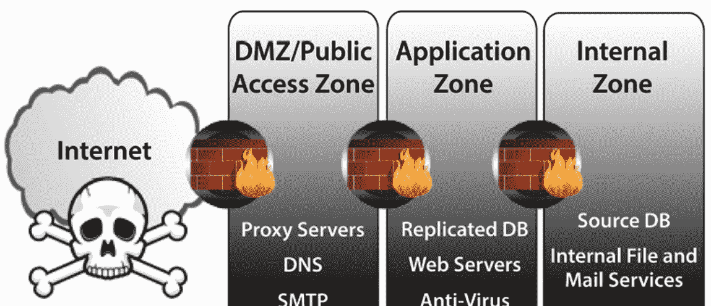

图4.5 – 网络分区


## 双宿主主机

双宿主主机（图 4.6）有两个网络接口卡（NIC），每个位于不同的网络上。只要主机控制或阻止 NIC 之间的流量转发，这就可以成为隔离网络的有效措施。

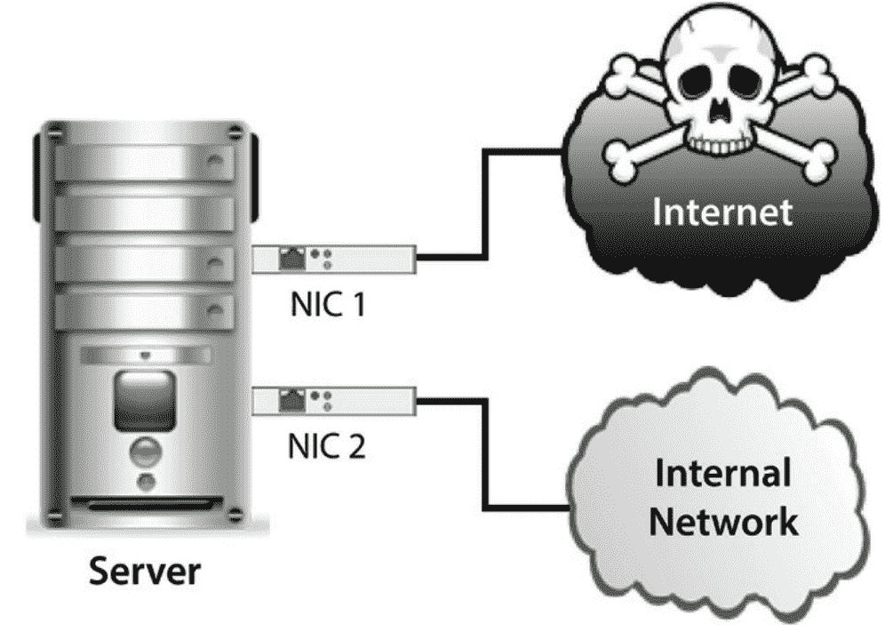

图 4.6 — 双宿主主机有两个网络接口卡（NIC），每个位于不同的网络上。

## 堡垒主机

堡垒主机充当受信任网络与不受信任网络之间的网关，提供对不受信任主机的有限、授权访问。例如，互联网网关上的堡垒主机可以允许外部用户通过 FTP 向其传输文件。这使得文件可以与外部主机交换，而不会以不受控制的方式授予它们访问内部网络的权限。

如果组织有一个包含敏感数据的网络段，它可以通过要求所有访问都必须来自堡垒主机来控制对该网络段的访问。除了隔离网络段之外，用户还必须对堡垒主机进行身份验证，这有助于审计对敏感网络段的访问。例如，如果防火墙限制了对敏感网络段的访问，仅允许从堡垒主机访问该段，就无需允许许多主机访问该段。例如，终端服务器是一种堡垒主机形式，允许经过身份验证的用户更深入地进入网络。

堡垒主机还可能包含称为“数据二极管”的功能。在电子世界中，二极管是一种仅允许电流单向流动的器件。数据二极管仅允许信息单向流动；例如，它强制执行允许读取信息但不允许写入（更改、创建或移动）的规则。

堡垒主机是特意暴露在公共网络上的专用计算机。从安全网络的角度来看，它是暴露给外部世界的唯一节点，因此极易受到攻击。在单防火墙系统中，它放置在防火墙之外；如果系统有两个防火墙，它通常放置在两个防火墙之间或非军事区（DMZ）的公共侧。

堡垒主机处理并过滤所有传入流量，防止恶意流量进入网络，其作用类似于网关。堡垒主机的最常见示例是邮件、域名系统以及 Web 和文件传输协议（FTP）服务器。防火墙和路由器也可以成为堡垒主机。

堡垒主机节点通常是具有改进的安全措施和定制软件的非常强大的服务器。它通常只托管单个应用程序，因为它需要在其所做的事情上非常出色。软件通常是定制的、专有的且不向公众开放。该主机旨在成为网络中的强点，以保护其后面的系统。因此，它通常会定期进行维护和审计。有时堡垒主机被用来吸引攻击，以便追踪攻击来源。

为了维护堡垒主机的安全性，所有不必要的软件、守护进程和用户都会被删除。操作系统会不断更新最新的安全补丁，并安装入侵检测系统。

## 非军事区（DMZ）

非军事区（DMZ），也称为屏蔽子网，允许组织向外部主机提供对公共资源（如公司网站）的有限访问，而不授予它们访问内部网络的权限。参见图 4.7。通常，DMZ 是一个连接到防火墙的隔离子网（当防火墙具有内部、外部和 DMZ 三个接口时，这种配置有时称为三腿防火墙）。由于外部主机按设计可以访问 DMZ（尽管由防火墙控制），组织应仅将非敏感的主机和信息放置在 DMZ 中。

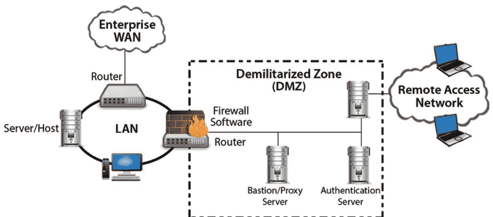

图 4.7 – 非军事区（DMZ）允许组织向外部主机提供对公共资源（如公司网站）的有限访问，而不授予它们访问内部网络的权限。
（摘自 Fung, K.T., Network Security Technologies, Auerbach Publications, Boston, MA, 2004. 经许可。）

## 硬件

### 调制解调器

调制解调器（调制器/解调器）允许用户通过模拟电话线远程访问网络。本质上，调制解调器将数字信号转换为模拟信号，反之亦然。连接到用户计算机的调制解调器将数字信号转换为模拟信号以通过电话线传输。在接收端，调制解调器将用户的模拟信号转换为数字信号并发送到连接的设备，例如服务器。当然，当服务器回复时，过程会反转。服务器的回复从数字转换为模拟并通过电话线传输，依此类推。

调制解调器允许远程用户从全球几乎任何模拟电话线访问网络。虽然这为远程办公人员、道路战士等提供了便捷的访问，但也为入侵者提供了便捷的访问，他们知道可以在组织后门潜入，而安全人员则保护互联网网关。事实上，许多组织出于这个原因已实施禁止在网络上使用调制解调器的政策。

为了减轻模拟通信遗留工作带来的一些风险，厂商已开发并推向市场“电话防火墙”，其作用与 IP 防火墙类似，但专门针对模拟信号而设计。这些防火墙将位于公共交换电话网络（PSTN）与内部组织网络之间的 demarcation 点，无论是 IP 电话系统还是模拟电话系统。电话防火墙会监控传入和传出的模拟呼叫以执行规则集。例如，只有来自特定电话号码的呼叫才允许进入公司电话交换机的调制解调器呼叫。或者不允许任何调制解调器通信——仅允许语音和传真通信。这样，即使在模拟电话网络上存在 rogue 或被遗忘的调制解调器，也可由安全从业人员进行管理。

### 集中器

集中器将连接的设备复用到一个信号以在网络上传输。例如，FDDI 集中器将连接设备的传输复用到 FDDI 环上。

### 前端处理器

输入和输出涉及诸如手指打字和磁盘旋转之类的活动部件，其速度远慢于 CPU（中央处理单元）。因此，服务输入和输出会降低计算机的吞吐量。某些硬件架构采用硬件前端处理器，位于输入/输出设备与主计算机之间。通过代表主计算机服务输入/输出，前端处理器减少了主计算机的开销。

### 复用器

复用器将多个信号叠加为一个信号以进行传输。使用复用器比单独传输相同信号更高效。复用器用于从简单集线器到非常复杂的密集波分复用器（DWDM）等设备，后者将多光信号组合在一根光纤上。

### 集线器和中继器

集线器用于实现物理星型拓扑。星型中的所有设备都连接到集线器。本质上，集线器将每个端口的信号重新传输到所有其他端口。虽然集线器可以经济地连接设备，但有几个重要缺点：

- 所有连接的设备都会接收彼此的广播，可能浪费宝贵的资源来处理无关流量。
- 所有设备都可以读取并可能修改其他设备的流量。
- 如果集线器无法运行，则连接的设备将无法访问网络。

集线器很少用于当前网络架构，因为它们既低效又不安全。低效是因为它们将所有流量转发给所有主机，这可能会严重占用承载语音、视频和业务应用等多种融合应用的网络。 不安全是因为使用集线器管理的网络允许任何具有物理访问权限的人拦截所有流量。在网络中存在的程度上，应将集线器视为遗留设备并考虑更换。

随着发送方和接收方之间的距离增加，信号质量可能会因衰减而下降。为了在保持信号质量的同时实现更长的距离，使用中继器来重新放大信号。例如，可以使用中继器来增加以太网总线的长度以适应物理上更大的网络。

### 网桥和交换机

随着局域网（LAN）用户数量、带宽利用率和物理尺寸的增长，它们可能会达到阻止 LAN 扩展的阈值。带宽被超出，由于信号衰减无法增加电缆长度，且 LAN 可能变得太大而无法管理。另一方面，如何在不重新配置网络的情况下互连 LAN 使其能够通信？

使用网桥可以解决这两个问题。网桥是第 2 层设备，根据媒体访问控制（MAC）地址在各段之间过滤流量。此外，它们放大信号以实现物理上更大的网络。基本网桥会过滤掉未发往另一段的帧。考虑图 4.8 所示的网络。

当段 A 上的客户端 PC 向段 A 上的服务器传输时，网桥会读取目的 MAC 地址并且不会将流量转发到段 B 和 C，从而免除了它们处理未发往这些段上设备的流量的负担。在此示例中，如果各段上有数百个设备且网络段很长，网桥将大大减少不必要的流量并允许网络在没有信号衰减的情况下物理增长。


关于网桥：它们不过滤广播。

网桥不能防止入侵者截获本地网段上的通信。对于许多组织来说，一种常见的网桥类型是基于 IEEE 802.11 标准之一的无线网桥。虽然无线网桥具有引人注目的效率，但它们也可能给组织带来毁灭性的安全问题，因为实际上，穿过网桥的所有通信都对连接到局域网（LAN）的任何人可见。无线网桥必须绝对应用链路层加密以及任何其他可用的原生安全功能（如访问列表），以确保安全运行。

交换机解决了本节开头提出的相同问题，只是解决方案更复杂、更昂贵。本质上，基本交换机是一种多端口设备，局域网主机连接到该设备。交换机仅将帧转发到帧的目的 MAC 地址所指定的设备，从而大大减少了不必要的通信。参见图 4.9。

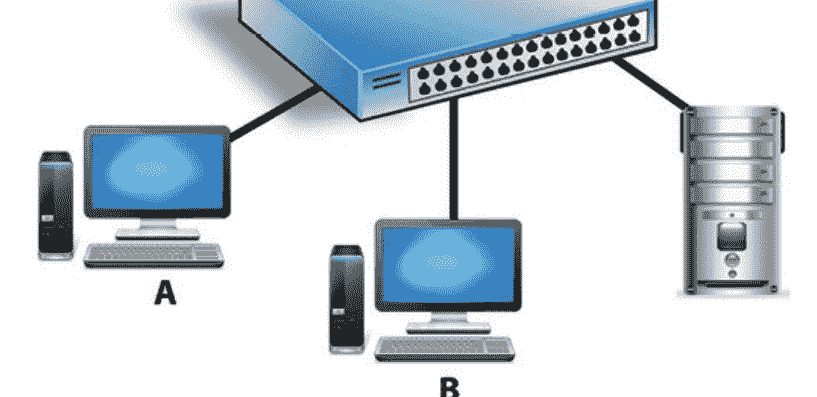

图 4.9 – 简单交换网络

在这个非常简单的局域网中，客户端 A 向服务器发送通信。当交换机收到通信时，它会从连接服务器的端口转发出去。客户端 B 不会收到任何通信。另一方面，如果交换机是集线器，则客户端 B 会收到客户端 A 与服务器之间传输的通信。

由于客户端 B 不会收到其他客户端与服务器之间的通信，因此客户端 B 截获该通信的可能性降低了（存在复杂的攻击可能诱骗交换机——尤其是配置不当的交换机——将通信发送给客户端 B）。

交换机可以执行更复杂的功能来增加网络带宽。由于交换机处理速度的提高，出现了可以根据 IP 地址和网络流量类型的优先级做出转发决策的型号。与集线器和网桥一样，交换机也转发广播。

## 路由器

路由器将数据包转发到其他网络。它们读取接收到的数据包中的目的第 3 层地址（例如目的 IP 地址），并根据路由器对网络的视图，确定网络中下一个发送数据包的设备（下一跳）。如果目的地址不在与路由器直接相连的网络上，路由器会将数据包发送到另一台路由器。

路由器可用于互连不同的技术。例如，将令牌环网和以太网连接到同一台路由器，就可以让 IP 以太网数据包被转发到令牌环网。

## 传输介质

### 有线

人们很容易低估电缆在网络中的重要性。然而，没有电缆，就不存在网络，而只有独立的组件。可以把电缆看作是将网络粘合在一起的胶水。

在网络设计中选择合适的电缆至关重要。如果使用了不合适的电缆，可能导致网络故障。电缆必须承受许多威胁网络信息保密性、完整性和可用性的因素。考虑有人窃听电缆以截获信号的风险、附近设备的电磁干扰，或者仅仅是电缆断裂的危险。再加上电缆的技术参数，这表明必须为每种应用使用正确的电缆。

以下是选择电缆时应考虑的一些参数：

- **吞吐量** – 数据传输的速率。某些电缆（如光纤）被设计为一次承载惊人的数据量。
- **设备间距离** – 信号在长距离电缆中的衰减或丢失是一个长期存在的问题，尤其是在信号频率较高的情况下。此外，信号传播所需的时间（传播延迟）也可能是一个因素。如果电缆过长，使用冲突检测的总线拓扑可能无法正常运行。
- **数据敏感性** – 有人截取电缆中数据的风险有多大？例如，光纤比铜缆更难截取数据。
- **环境** – 这是一个对电缆不友好的世界。安装时电缆可能需要弯曲，这会导致传导性能下降和信号失真。电磁干扰量也是一个因素，因为处于干扰较多的工业环境中的电缆可能需要屏蔽。同样，穿过温度波动较大且尤其暴露于紫外线（阳光）区域的电缆会更快老化，并容易出现信号退化。

### 双绞线 3.4

成对的铜线绞合在一起，以减少电磁干扰和串扰。每根导线都用防火材料（如特氟龙）绝缘。双绞线被一个物理上保护导线的外护套包围。电缆的质量及其适用场景取决于每英寸的绞合数、绝缘类型和导电材料。为了帮助确定哪些电缆适合某种应用或环境，电缆被划分为不同类别（表 4.11）。

| 类别 | 速度 | 用途 |
|---|---|---|
| 第 1 类 | 低于 1 Mbps | 综合业务数字网（ISDN）中的模拟语音和基本接口速率（BRI） |
| 第 2 类 | 小于 4 Mbps | 4 Mbps IBM 令牌环局域网 |
| 第 3 类 | 16 Mbps | 10 Base-T 以太网 |
| 第 4 类 | 20 Mbps | 16 Mbps 令牌环 |
| 第 5 类 | 100 Mbps | 100 Base-TX 和异步传输模式（ATM） |
| 第 5e 类 | 1,000 Mbps | 1000 Base-T 以太网 |
| 第 6 类 | 10,000 Mbps | 1000 Base-T 以太网 |

表 4.11 —— 电缆类别

### 非屏蔽双绞线（UTP）

UTP 有几个缺点。由于它不像屏蔽双绞线那样具有屏蔽层，UTP 容易受到外部电源的干扰，这可能会

连接后，网络管理员只需重新连接跳线即可。配线架和配线间必须得到保护，因为它们是窃听网络和窃取产品的绝佳位置。布线必须布局良好且整洁，记录应保存在安全的位置；否则，在杂乱的电线中隐藏窃听点要容易得多。应避免共用配线间。

### 光纤

光纤系统与光纤可能取代的铜线系统相似。区别在于，光纤利用光脉冲在光纤线路中传输信息，而不是利用电脉冲在铜线线路中传输信息。查看光纤链路中的组件，将使安全专业人员更好地了解该系统如何与基于电线的系统协同工作。

系统的一端是发射器。这是信息进入光纤线路的起点。发射器接收来自铜线的编码电脉冲信息，然后处理并将该信息转换为等效编码的光脉冲。可以使用发光二极管（LED）或注入式激光二极管（ILD）来生成光脉冲。利用透镜，光脉冲被汇聚到光纤介质中，并在电缆中传输。

可以把光纤电缆想象成一个非常长的纸板卷（就像纸巾内芯的纸筒），内壁涂有镜子。如果你在一端用手电筒照射，即使它已经绕过角落弯曲，你也能看到光从远端射出。

光脉冲之所以能轻松地在光纤线路中传输，是因为一种称为全内反射的原理。该原理指出，当入射角超过临界值时，光无法从玻璃中射出；相反，光线会被反射回玻璃内部。当这一原理应用于光纤纤芯的构造时，就可以以光脉冲的形式在光纤线路中传输信息。纤芯必须由非常清澈纯净的材料制成。纤芯可以是塑料的（用于非常短的距离），但大多数是由玻璃制成的。玻璃光纤几乎总是由纯二氧化硅制成，但也有一些其他材料，如氟锆酸盐、氟铝酸盐和硫系玻璃，用于较长波长的红外应用。

常用光纤电缆有三种类型：

- 1. 单模
- 2. 多模
- 3. 塑料光纤（POF）。


光纤电缆起到“光导”的作用，将电缆一端引入的光引导至另一端。光源可以是发光二极管（LED）或激光器。光源以脉冲方式开关，电缆另一端的光敏接收器将这些脉冲转换回原始信号的数字 1 和 0。

即使是激光在光纤电缆中传输也会出现强度损失，这主要源于光在电缆内部的色散和散射。激光波动越快，色散风险就越大。在某些应用中，可能需要一种称为中继器的光增强器来刷新信号。

## 光纤类型与典型规格

| 纤芯/包层 | 衰减 | 带宽 | 应用/备注 |
|---|---|---|---|
|  |  | 多模渐变折射率 |  |
|  | @850/1300 nm | @850/1300 nm |  |
| 50/125 微米 | 3/1 dB/km | 500/500 MHz-km | 激光级，用于 GbE 局域网 |
| 50/125 微米 | 3/1 dB/km | 2000/500 MHz-km | 针对 850 nm VCSEL 优化 |
| 62.5/125 微米 | 3/1 dB/km | 160/500 MHz-km | 最常见的局域网光纤 |
| 100/140 微米 | 3/1 dB/km | 150/300 MHz-km | 已淘汰 |
|  |  | 单模 |  |
|  | @1310/1550 nm |  |  |
| 8-9/125 微米 | 0.4/0.25 dB/km | 高！ | 电信/有线电视/长距离高速局域网 |
|  |  | ~100 太赫兹 |  |
|  |  | 多模阶跃折射率 |  |
|  | @850 nm | @850 nm |  |
| 200/240 微米 | 4-6 dB/km | 50 MHz-km | 低速局域网和链路 |
|  |  | POF（塑料光纤） |  |
|  | @ 650 nm | @ 650 nm |  |
| 1 毫米 | ~ 1 dB/m | ~5 MHz-km | 短距离链路和汽车 |

**注意：** 你不能混搭光纤！尝试将单模光纤连接到多模光纤可能会导致 20 dB 的损耗——那是 99% 的功率。即使是 62.5/125 与 50/125 之间的连接也可能导致 3 dB 或更高的损耗——超过一半的功率。

## 网络访问控制设备

### 防火墙

防火墙是一种通过基于规则集过滤传入流量来实施管理安全策略的设备。通常，防火墙被认为只是 Internet 网关的保护者。虽然防火墙应始终部署在 Internet 网关上，但在内部网络中也有需要考虑和采用防火墙的情况，例如网络分区。此外，防火墙也是威胁管理设备，内置多种其他安全服务，例如代理服务和入侵防御服务（IPS），这些服务旨在网络边界主动监控和告警。

防火墙应放置在具有不同信任域的实体之间。例如，如果工程部门 LAN 网段与普通 LAN 用户位于同一网络中，则会存在两个信任域：普通 LAN 用户和拥有组织知识产权的工程师。如图 4.10 所示，在两个信任域交汇处安装防火墙将有助于安全从业人员保护知识产权免受普通 LAN 用户群体的访问。

防火墙并非开箱即用就能有效。必须正确定义防火墙规则，以免无意中授予未经授权的访问权限。与网络上的所有主机一样，管理员必须为防火墙安装补丁并禁用所有不必要的服务。此外，防火墙针对其他主机上服务器软件的应用缺陷所导致的安全漏洞提供的保护有限。例如，防火墙无法防止攻击者操纵数据库泄露机密信息。

防火墙的管理和维护可能很复杂。频繁打补丁、监控日志以及为满足内部业务需求而修改规则的要求，可能会让安全专业技术人员都感到不堪重负。因此，将防火墙的整个管理和维护外包已发展成为一个重要且成熟的行业，从政府、银行到甜甜圈店等各种组织，都将这一关键但复杂且单调的安全任务外包出去。

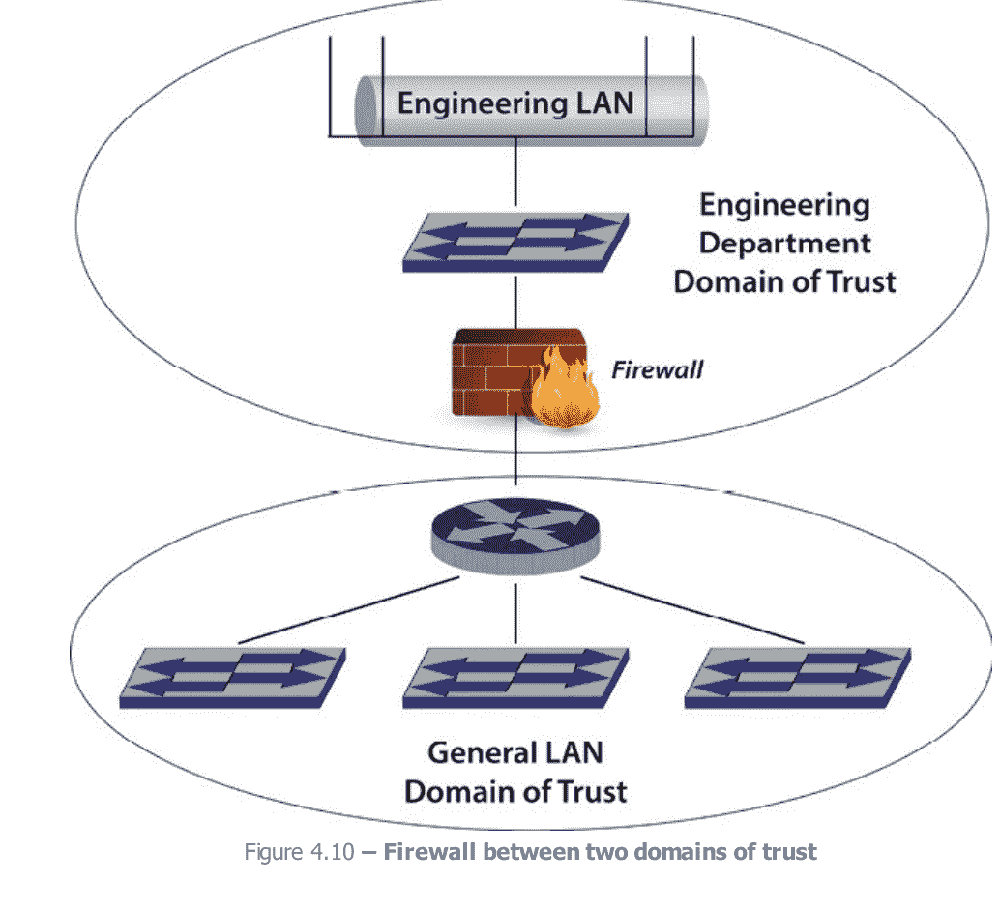

图 4.10 – 两个信任域之间的防火墙

### 过滤

防火墙根据规则集过滤流量。每条规则指示防火墙根据一个或多个条件阻止或转发数据包。对于每个传入数据包，防火墙将遍历其规则集，查找条件适用于该数据包的规则，并按该规则的规定阻止或转发数据包。以下两个重要条件用于确定数据包是否应被过滤。

### 按地址

防火墙通常使用数据包的源地址或目标地址（或两者）来确定是否应过滤该数据包。例如，在图 4.10 所示的情况下，若要授予受信任用户访问工程 LAN 网段的权限，可以定义一条规则，转发源地址来自普通 LAN 上受信任用户主机的数据包。

### 按服务

数据包也可以按服务过滤。防火墙检查数据包正在使用的服务（如果数据包是 TCP 或 UDP 的一部分，则该服务就是目标端口号）以确定是否应过滤该数据包。例如，防火墙通常会有一条过滤 Finger 服务的规则，以防止攻击者利用它收集有关主机的信息。

按地址过滤和按服务过滤通常在规则中结合在一起。如果工程部门希望允许 LAN 上的任何人访问其 Web 服务器，则可以定义一条规则，转发目标地址为 Web 服务器地址且服务为 HTTP（TCP 端口 80）的数据包。

### 网络地址转换（NAT）

防火墙可以将每个传出（从受信任到不受信任的网络）数据包的源地址更改为不同的地址。这有多种应用，最显著的是允许具有 RFC 1918 地址的主机将其不可路由的地址更改为 Internet 上可路由的地址，从而访问 Internet[35]。不可路由地址是指不会被 Internet 路由器转发的地址，因此，使用不可路由内部地址的远程攻击无法通过开放的 Internet 发起。

匿名性是使用 NAT 的另一个原因。许多组织不想向不受信任的主机公开其 IP 地址，从而不必要地泄露有关网络的信息。他们宁愿将整个网络隐藏在转换后的地址后面。NAT 还极大地扩展了组织继续使用 IPv4 地址空间的能力。

### 端口地址转换（PAT）

NAT 的一种扩展是将所有地址转换到一个可路由的 IP 地址，并将数据包中的源端口号转换为一个唯一值。端口转换使防火墙能够跟踪使用 PAT 的多个会话。

### 静态数据包过滤

当防火墙使用静态数据包过滤时，它会检查每个数据包，而不考虑该数据包在会话中的上下文。根据静态条件检查数据包，例如阻止所有端口号为 79（finger）的数据包。由于其简单性，静态数据包过滤所需开销非常小，但它有一个显著缺点。静态规则无法由防火墙临时更改以适应合法流量。如果某个协议需要临时打开一个端口，管理员就不得不在永久打开该端口和禁止该协议之间做出选择。

### 状态检测或动态数据包过滤

状态检测会在会话上下文中检查每个数据包，从而能够动态调整规则以适应合法流量，并阻止在静态过滤器看来良性的恶意流量。以 FTP 为例。用户通过 TCP 端口 21 连接到 FTP 服务器，然后告知 FTP 服务器在哪个端口传输文件。该端口可以是任何大于 1023 的 TCP 端口。因此，如果 FTP 客户端告知服务器在 TCP 端口 1067 上传输文件，服务器将尝试在该端口上打开与客户端的连接。状态检测防火墙会监视两台主机之间的交互，即使所需连接不在规则集允许范围内，它也会允许该连接发生，因为它是 FTP 的一部分。

相比之下，静态数据包过滤会阻止 FTP 服务器尝试在 TCP 端口 1067 上连接到客户端，除非已有静态规则。实际上，由于客户端可以指示 FTP 服务器在 1023 以上的任何端口上传送文件，所以必须存在一条静态规则来允许访问指定端口。

### 代理

代理防火墙在不受信任的端点（服务器/主机/客户端）与受信任的端点（服务器/主机/客户端）之间协调通信。从内部角度看，代理可以将来自已知内部客户端计算机的流量转发到 Internet 上的不受信任主机，使不受信任主机误以为流量源自代理防火墙，从而向潜在攻击者隐藏受信任的内部客户端。图 4.11 显示了通过代理与服务器进行典型交互的过程。


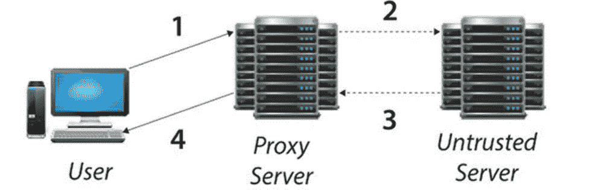

1. 用户的请求发送到代理服务器。
2. 代理服务器将请求转发给不受信任的主机。对不受信任的主机而言，看起来请求源自代理服务器。
3. 不受信任的主机向代理服务器作出响应。
4. 代理服务器将响应转发给用户。

图 4.11 – 通过代理访问服务器

对用户而言，看起来他或她正在直接与不受信任的服务器通信。代理服务器通常放置在 Internet 网关处，以将内部网络隐藏在一个 IP 地址之后，并防止内部主机与外部主机之间进行直接通信。

## 电路级代理

电路级代理创建了一个通道，使受信任的主机能够与不受信任的主机通信。此类代理不会检查其转发的任何流量，这使得用户与不受信任服务器之间的通信开销非常小。缺乏应用感知能力也允许电路级代理将任何流量转发到任何 TCP 和 UDP 端口。缺点是流量不会被分析以检测恶意内容。

## 应用级代理

应用级代理将运行特定应用程序的受信任端点流量中继到不受信任的端点。应用级代理最显著的优势在于它们会分析转发的流量，以检查协议操纵和各种常见攻击，例如缓冲区溢出。由于应用级代理会仔细审查其转发的流量，因此使用该应用程序时会增加开销。

Web 代理服务器是应用级代理的非常流行的示例。许多组织在其 Internet 网关处放置一个代理，并配置其用户的 Web 浏览器在浏览外部 Web 服务器时使用 Web 代理（实施了其他控制措施以防止用户绕过代理服务器）。代理通常包括必需的用户身份验证、检查 URL 以确保用户不会浏览不适当网站、日志记录以及流行网页的缓存。事实上，针对内部用户的 Web 代理是强制执行可接受使用政策的主要方式之一，因为管理员可以屏蔽外部网站，并且如果需要用于取证目的，可以保留用户流量的日志以供以后分析。

## 个人防火墙

什么保护用户免受防火墙后面主机的侵害？例如，图 4.10 中的防火墙并不能保护工程局域网段上的用户免受同一段中其他人的侵害。

遵循纵深防御原则，应在工作站上安装个人防火墙，以保护用户免受网络上所有主机的侵害。对于通过 DSL 或电缆调制解调器访问 Internet 的家庭用户而言，在每台 PC 上安装个人防火墙至关重要，尤其是在其网络没有防火墙保护的情况下。

由于个人防火墙由普通用户使用，因此易于安装和配置。防火墙规则使用非技术界面创建，无需网络或安全方面的专业知识。虽然它们不提供最佳企业防火墙的灵活性，但它们提供了防火墙的所有基本功能，例如状态检测和日志记录。

## 端点安全

终端用户对安全构成最大风险。他们可以访问企业最有价值的信息。许多人忽视企业安全政策，做了不该做的事情，使用各种设备、应用程序和网络。此外，云为员工提供了在端点上和端点外传输数据的新方式，通常超出监控系统的范围。由于其中许多设备和活动超出了安全从业人员的控制范围，因此他们可能没有必要的可见性来防止端点处的威胁和数据丢失。

更糟糕的是，用户端点上的敏感数据正受到攻击者的针对。利用端点进入企业，攻击者可以从受损端点获取专有信息和其他系统。攻击者通常会简单地执行恶意软件程序。更常见的是，他们会使用多种威胁向量组合来入侵网络。

随着网络其他部分的防御能力不断成熟，网络的端点通常是最有吸引力的目标。易受攻击的工作站、打印机和其他端点代表了网络上众多新攻击的发射平台。工作站应得到加固，并且用户应尽可能使用有限访问账户，遵循“最小权限”概念。工作站至少应具备以下条件：

- 最新版的防病毒和反恶意软件
- 已配置并运行的主机型防火墙
- 经过加固的配置，已禁用不必要的服务
- 已修补并维护的操作系统

虽然工作站显然是人们最常与端点攻击关联的端点，但形势正在发生变化。智能手机、平板电脑和个人设备等移动设备正越来越多地构成平均组织端点的组成部分。随着设备多样性的增加，安全架构师也需要提高组织端点防御的多样性和敏捷性。对于智能手机和平板电脑等移动设备，安全从业人员应考虑以下事项：

- 对整个设备的加密，或如果不可行，则至少对设备上保存的敏感信息进行加密
- 远程管理功能，包括：
  - 远程擦除
  - 远程地理定位
  - 远程更新
  - 远程操作
- 用户政策和协议，确保组织可以管理设备或将其扣押以进行法律保留。

## 内容分发网络

一个内容分发网络或内容分发网络（CDN）是在 Internet 上的多个数据中心部署的大型分布式服务器系统。其目标是

两个电话。虽然对呼叫者来说似乎他们正在使用专用线路，但他们实际上是通过复杂网络进行通信。与所有电路交换技术一样，网络中的路径在两个端点之间开始通信之前就已建立，并且除非发生异常事件，例如网络故障，否则在通话期间路径保持不变。电话通过铜线连接到公共交换电话网（PSTN）的中心局（CO），其服务范围约为 1 至 10 公里。

中心局通过层级结构连接的转接局（本地电话）和计费局（长途电话），层级越高覆盖范围越大。包括中心局在内，PSTN 有五个层级的局。当通话的两个端点都连接到同一中心局时，流量在中心局内交换。否则，通话必须在计费中心和转接局之间交换。通话距离越远，通话在层级中的交换位置越高。例如，在图 4.12 中，呼叫者 1 和 2 之间的通话在其中心局内交换。然而，呼叫者 1 和 3 之间的通话必须在其最左侧的主计费局内交换。为了适应高流量，计费中心之间通过光纤电缆通信。

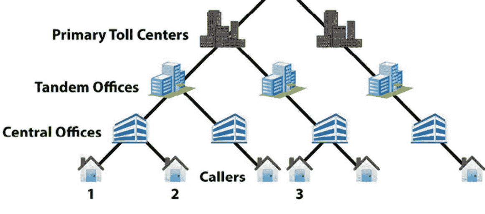

图 4.12 – 公共交换电话网（PSTN）

过去，PSTN 容易受到音调频率攻击。存在一个电话黑客（phreaks）的亚文化，他们试图免费拨打长途电话，

band" 用于路由器和其他网络设备的命令链路。

## PBX

私人分支交换机（PBX）是一种企业级电话系统，通常用于企业或大型组织。PBX 通常包括内部交换网络和连接到电信中继线的控制器。许多 PBX 具有默认的制造商配置代码、端口和控制接口，如果安全专业人员在部署前未重新配置，则可能被利用。PBX 通常是战争拨号者的目标，他们随后可以使用 PBX 路由长途电话或窃听组织。模拟 POTS PBX 大多已被基于 VoIP 或支持 VoIP 的 PBX 取代。

## 模拟和数字电话系统有何不同？

首先，让我们看看模拟和数字电话系统之间的基本区别。模拟系统已支持企业数十年。它们基于标准铜线和 POTS（普通老式电话服务）电话构建，可靠、语音质量良好，并具有您可能在普通家庭电话中发现的基本功能，如保持、静音、重拨和快速拨号。它们还可能能够在分机之间转移电话。但其功能到此为止。由于其简单性和有限的扩展潜力，购买成本相对较低。然而，由于使用模块化程度较低的硬件，模拟系统的支持、配置和升级成本可能很高。例如，更换分机位置需要专业人员重新布线配线架。短期来看购买模拟系统更便宜，但会将您锁定在一个封闭系统中，需要适配器才能与 VoIP 和客户关系管理（CRM）系统等常见应用程序集成。

数字电话系统更现代。数字 PBX 采用专有总线结构设计，用于添加功能和能力。为模拟、数字或 IP 电话在机柜中添加板卡。音乐保持、VoIP 集成和报警系统等功能可以通过模块化扩展板支持。今天，大多数数字系统即使使用专有硬件或协议，也在控制器上提供 IP 接口。IP 接口可能允许统一消息功能，例如语音邮件发送到电子邮件、传真发送到电子邮件、语音邮件转录为 SMS、点击拨号和桌面客户端。这些系统被视为“混合 PBX”，因为它们使用专有数字硬件和基于标准的 IP 网络的组合。完全现代的数字 PBX 为 100% IP 和软件为基础。

由于数字 PBX 不依赖于简单的铜线电路，您将获得更多


为添加、移动和变更提供了灵活性。通常，这些变更可通过点击式软件进行配置。语音清晰度与模拟电话相同或更优，除了分机和转接等基本功能外，数字PBX还提供先进的虚拟自动话务员、语音邮件和呼叫转接选项。数字PBX系统还可能提供接口，以便与您的呼叫中心和销售软件集成。

## 多媒体协作

### 对等应用程序与协议

对等应用程序已获得广泛欢迎——或者说是臭名昭著，这取决于个人观点——因为它们在知识产权（主要是多媒体文件）的共享中扮演了有争议的角色。出于带宽消耗、不当行为和法律影响等原因，在企业环境中对对等应用程序进行审计是非常可取的。

可以说，第一个流行的P2P应用程序是Napster。它的消亡源于该公司败诉的法律纠纷，其中部分原因是它运营了一组服务器，并通过这些服务器实施了侵犯知识产权的行为。其他较新且流行的P2P应用程序包括LimeWire、eMule、Kazaa、Shareaza、Morpheus、BitTorrent、µTorrent等。

与P2P相关的安全风险始于其通常的用途，终于其被用于大规模僵尸网络的传播和管理。一般来说，P2P应用程序虽然具有许多合法用途，但也与盗版、版权滥用以及其他形式的知识产权侵犯相关联。由于P2P网络中常见内容的性质，即使组织并未批准使用P2P应用程序，也可能面临法律风险。

P2P应用程序通常被设计为通过网络边界（通常通过隧道技术）打开一条不受控制的信道。参见图4.13。因此，它们为危险内容（如僵尸网络、间谍软件和病毒）进入原本受保护的网络提供了途径。由于P2P网络可以通过一系列多个重叠的主节点和从节点建立和管理，因此很难将其完全检测和关闭。如果某个主节点被发现并关闭，控制P2P僵尸网络的“僵尸牧人”（bot herder）可以将某个从节点提升为主节点，并将其作为冗余的临时据点，从而使僵尸网络操作不受阻碍地继续进行。

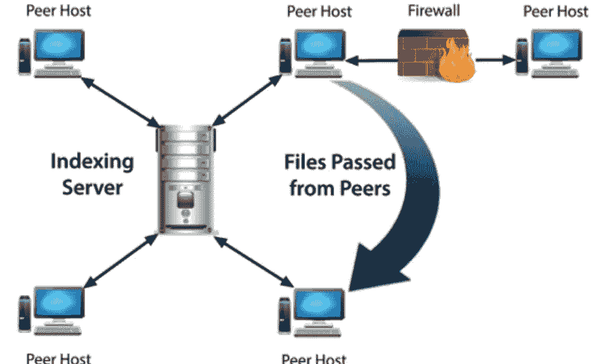

图4.13 — 对等（P2P）架构

P2P的使用（无论是合法的还是其他性质的）已变得非常流行，以至于许多互联网服务提供商（ISP）已采取措施对其用户网络上的流量进行“限流”。具体来说，如果观察到P2P流量（通常基于数据包分析或端口使用情况），该IP地址可用的带宽将被限制在ISP规定的范围内。限流的目的是防止某个用户地址消耗不成比例的带宽。什么算是“不成比例”取决于ISP的判断，但一个使用P2P应用程序的用户在任意一天内消耗的带宽很容易达到非P2P用户的100倍。

### 远程会议技术

目前存在多种允许组织和个人进行“虚拟”会议的技术和服务。这些应用程序通常基于Web，要么在浏览器中安装扩展程序，要么在主机系统上安装客户端软件。这些技术通常还将“桌面共享”作为一项功能提供。该功能不仅可以查看用户的桌面，还可以让远程用户控制系统。

安全专业人员在确定远程会议技术和服务的提供商时必须格外谨慎（提供商的软件和服务器在被证明安全之前都应被视为可疑）。此外，与会者应考虑会议期间的加密和身份验证选项，以及会议本身所交换信息的性质。

目标网络的凭据，从而能够发起大量攻击，这些攻击主要以服务器运营商的名义进行，但也可能被任何能够入侵服务器的人利用。

### 互联网中继聊天（IRC）

在互联网上广泛部署的聊天系统中，IRC可以说是第一个。IRC在学术界仍然流行，但在商业服务面前已失去主导地位；然而，IRC频道和服务器仍然大量存在，并且在希望匿名共享信息和文件的人群中很受欢迎。IRC支持良好的匿名性，因为它们通常通过终端或telnet连接运行，这些连接不会留下与文件传输相关的日志，因为会话在理论上只是屏幕上的文本。

表4.13 – IRC快速参考

|                      |                      |
| -------------------- | -------------------- |
| 端口                | 194/TCP, 194/UDP     |
| 定义                | RFC 1459             |

通信组织方式包括公共讨论组（频道）以及单个用户之间的私人消息传递。38

IRC是一个基于客户端/服务器的网络。IRC未加密，因此很容易成为嗅探攻击的目标。IRC的基本架构建立在服务器之间的信任之上，这使得特殊形式的拒绝服务攻击成为可能。例如，当一台服务器或一组服务器与其余部分断开连接（即网络分裂）时，恶意用户可以劫持一个频道。

IRC也是社会工程攻击的常见平台，其目标是没有经验或缺乏技术技能的用户。

虽然最初的客户端基于UNIX，但现在IRC客户端可用于许多平台，包括Windows、Apple Macintosh和Linux。安全专业人员需要熟悉专有应用程序，如IBM Lotus即时消息和Web会议（Sametime），以及商业服务，例如：

- AOL即时消息和ICQ，基于专有的实时开放通信系统（OSCAR）协议
- Google Talk，基于开放的Jabber/XMPP
- Microsoft MSN Messenger/Windows Messenger，基于专有的移动状态通知协议（MSNP）
- Yahoo! Messenger，基于专有协议

所有这些应用程序和服务都是基于服务器的。这些服务之间的互操作性可以通过基于服务器的方法（通过XMPP）或多协议客户端来实现。与往常一样，所有这些应用程序的安全性都取决于协议的强度、实现的质量、运营者的可信度以及用户的行为。如果这些应用程序要在商业环境中使用，则需要采取严格的架构和策略措施，以防止安全漏洞。

这一点尤为重要，因为许多即时消息应用程序在设计上支持多种通信渠道，提供通过HTTP进行隧道传输的能力，并提供在线感知服务，这些服务可能被滥用于技术攻击或社会工程攻击。虽然采用即时消息/聊天/IRC技术可以带来许多商业和个人方面的益处及效率提升，但也存在许多风险。这些风险既由普通个人面临，也由那些试图保护其逻辑资产（网络、服务器、工作站、数据和知识产权）完整性的企业面临：

#### 真实性

在即时消息和聊天应用程序中，用户身份很容易被伪造，方法包括：

- 在注册时选择误导性身份，或在线时更改自己的昵称。
- 如果应用程序需要目录服务，则操纵目录服务。
- 操纵攻击者或目标用户的客户端，以发送或显示错误的身份。

尽管这些风险是所有通信网络固有的（在电子邮件中也很常见），但它们在实时通信中带来了更大的风险，因为用户可能没有太多时间来分析呈现给他/她的通信内容。同样，Facebook、Vine、Kik、Twitter、LinkedIn等社交网络服务和网站的持续增长，为创建虚假身份并试图欺骗他人以达到犯罪目的提供了大量机会。

#### 机密性

许多聊天系统以明文形式传输信息。与未加密的电子邮件类似，信息可能通过网络嗅探而被泄露。另一种形式的机密性破坏可能发生，因为聊天应用程序可以产生隐私的错觉和期望，例如通过建立“封闭房间”。然而，根据所使用的基础设施类型，所有消息都可能被特权用户（如聊天系统的运营商）以明文形式读取。


通过内部消息系统直接向成员发送消息。

## 穿越防火墙和其他限制

与流媒体音频和视频应用类似，企业防火墙被视为与互联网对等方建立直接联系的障碍。对开发者来说，简单但可能有争议的解决方案是启用通过始终可用的 HTTP 协议进行隧道传输。

根据客户端的不同，甚至可以通过轮询外部服务器来启用传入连接。（这种技术已被广泛应用于另一种类型的应用程序，即某种远程访问软件。）HTTP 隧道控制可以发生在防火墙或代理服务器上。然而，应该考虑到，对于点对点协议，这将需要“默认拒绝”策略，而阻止即时通讯却不提供合法的替代方案，不太可能促进用户接受，并且可能促使用户采用更危险的变通方法。

应当指出，入站文件传输也可能导致绕过现有策略或限制，特别是在病毒传播方面。一种有效的对策是在客户端进行访问时杀毒扫描，这本来就应该启用。

## 远程访问

### VPN

### 虚拟专用网络（VPN）

VPN（图 4.15）是两台主机之间的加密隧道，允许它们通过不受信任的网络（例如互联网）安全通信。远程用户使用 VPN 访问其组织的网络，并且根据 VPN 的实现方式，他们可能拥有与在办公室时相同的大部分可用资源。作为昂贵的专用点对点连接的替代方案，组织使用网关到网关 VPN，通过互联网在各站点之间甚至与业务合作伙伴安全地传输信息。

### 用于 VPN 的 IPSec 身份验证和机密性

IP 安全（IPSec）是一套通过提供身份验证和加密机制来使用 IP 安全通信的协议。IPv6 强制要求实现 IPSec，许多组织也在 IPv4 上使用它。此外，IPSec 可以以两种模式实现：一种适用于端到端保护，另一种保护网络之间的流量。

标准 IPSec 仅让主机之间相互进行身份验证。如果组织要求用户进行身份验证，则必须采用非标准的专有 IPSec 实现，或使用基于 L2TP（第二层隧道协议）的 IPSec。后一种方法使用 L2TP 对用户进行身份验证，并将 IPSec 数据包封装在 L2TP 隧道中。

由于 IPSec 将 IP 头中 IP 地址的变化解释为攻击，因此 NAT 与 IPSec 不能很好地协同工作。为了解决这两种协议的不兼容性，NAT 穿越（又称 NAT-T）将 IPSec 封装在 UDP 端口 4500 中（详见 RFC 3948）。39

**示例 A**


**示例 B**


**示例 C**


**示例 D**


图 4.15 – VPN 类型

- 示例 A：两台主机通过互联网建立安全的对等通信。
- 示例 B 展示了一个典型的网关到网关 VPN，VPN 终止于网关，为内部主机提供连接。
- **示例 C** 结合了示例 A 和 B，允许在现有的网关到网关 VPN 中实现主机到主机的安全通信。
- **示例 D** 详细描述了远程主机连接到 ISP、获得 IP 地址，然后与目标网络的网关建立 VPN 的情况。与网关建立隧道，然后与内部系统建立隧道模式或传输模式的通信。在此示例中，远程系统必须在隧道头之前应用传输头。此外，网关需要允许来自互联网到内部系统的 IPSec 连接和密钥管理协议。

> （摘自 Tiller, J.S., **IPSec 虚拟专用网络**，**信息安全管理手册**，第 6 版，Tipton H.F. 和 Krause M. 编，Auerbach Publications，Boca Raton，FL，2005。已获许可。）

### 认证头（AH）

认证头用于证明发送方的身份并确保传输的数据未被篡改。在每个数据包（头 + 数据）传输之前，基于共享密钥的数据包内容（路由时预期会改变的字段除外）的哈希值被插入 AH 的最后一个字段。端点在建立安全关联时协商使用哪种哈希算法以及共享密钥。为了帮助阻止重放攻击（即重传合法会话以获取未授权访问），在安全关联期间传输的每个数据包都有一个序列号，存储在 AH 中。在传输模式下，AH 被垫在数据包的 IP 头和 TCP 头之间。AH 有助于确保完整性，而非机密性。加密通过封装安全载荷（ESP）实现。

### 封装安全载荷（ESP）

封装安全载荷加密 IP 数据包并确保其完整性。ESP 包含四个部分：

- ESP 头：包含指示使用哪个安全关联以及数据包序列号的信息。与 AH 一样，ESP 对每个数据包进行排序以阻止重放攻击。
- ESP 载荷：载荷包含数据包的加密部分。如果加密算法需要初始化向量（IV），则它随载荷一起包含。端点在建立安全关联时协商使用哪种加密方式。由于数据包必须以尽可能少的开销进行加密，ESP 通常使用对称加密算法。
- ESP 尾：如果加密算法要求或需要对齐字段，可能包含填充（填充字节）。
- 认证：如果使用认证，此字段包含 ESP 数据包的完整性校验值（哈希）。与 AH 一样，认证算法在端点建立安全关联时协商。

### 安全关联

安全关联（SA）定义了端点与其对端通信所使用的机制。所有 SA 仅覆盖单向传输。双向通信必须定义第二个 SA。SA 中定义的机制包括加密和认证算法，以及是使用 AH 还是 ESP 协议。将机制推迟到 SA 中定义（而不是在协议中指定）允许通信双方根据情境风险使用适当的机制。

### 传输模式和隧道模式

端点使用传输模式或隧道模式进行 IPSec 通信。在传输模式下，IP 载荷受到保护。此模式主要用于端到端保护，例如客户端和服务器之间。在隧道模式下，IP 载荷及其 IP 头受到保护。整个受保护的 IP 数据包成为新 IP 数据包和头的载荷。隧道模式通常用于网络之间，例如防火墙到防火墙的 VPN。

### 互联网密钥交换（IKE）

互联网密钥交换允许通信双方相互证明身份并建立安全通信通道，它作为 IPSec 的身份验证组件被应用。IKE 使用两个阶段：

- **阶段 1** —— 在此阶段，双方使用以下方式之一相互进行身份验证：
  - **共享密钥** —— 通过电话、传真、加密电子邮件等方式由人工交换的密钥。
  - **公钥加密** —— 交换数字证书。
  - **公钥加密修订模式** —— 为了减少公钥加密的开销，nonce（一种密码学函数，指在安全工程中仅使用一次的数字或位串）用通信对方的公钥加密，而对方的身份使用以 nonce 为密钥的对称加密进行加密。

接下来，IKE 建立一个临时安全关联和安全隧道，以保护


- RADIUS 已成为多种密码学攻击的受害者，并且可能受到重放攻击的成功攻击。
- RADIUS 缺乏完整性保护。
- RADIUS 仅使用加密传输特定字段。

## 简单网络管理协议（SNMP）

SNMP 旨在管理网络基础设施。

| 端口 | 161/TCP,161/UDP |
|---|---|
|  | 162/TCP,162/UDP |
| 定义 | RFC 1157 |

表 4.15 – SNMP 快速参考 42

SNMP 架构由管理服务器（在 SNMP 术语中称为管理器）和客户端组成，客户端通常安装在网络设备（如路由器和交换机）上，称为代理。SNMP 允许管理器从代理检索变量的“get”值，以及“set”变量。这些变量可能是路由表或性能监控信息。

尽管 SNMP 已被证明非常健壮且可扩展，但它确实存在许多明显的弱点。其中一些是设计使然；另一些则受配置参数的影响。

可能最容易被利用的 SNMP 漏洞是对默认或易于猜测的 SNMP 密码（称为“社区字符串”）进行暴力攻击，这些密码通常用于管理远程设备。考虑到 SNMP v1 和 v2 的部署规模，再加上安全专业人员对于在不增加额外安全增强措施来保护社区字符串的情况下使用 SNMP 所带来风险缺乏明确指导，这无疑是一种现实场景，也是一个潜在严重但易于缓解的风险。

在版本 2 之前，SNMP 不提供任何程度的身份验证或传输安全。身份验证由一个称为社区字符串的标识符组成，管理器通过该标识符向代理标识自己（该字符串被配置到代理中），以及随命令发送的密码。因此，密码很容易被截获，进而导致命令被嗅探并可能被伪造。

与之前的问题类似，SNMP 版本 2 不支持任何形式的

当由病毒或恶意软件实现时，用于从用户计算机捕获图像，例如银行网站的 PIN 键盘序列。

## 虚拟应用程序和桌面

### 虚拟网络终端服务

虚拟终端服务是一种常用于远程访问服务器资源的工具。虚拟终端服务允许将服务器的桌面环境导出到远程工作站。这使得远程工作站上的用户能够执行桌面命令，就如同亲自坐在服务器终端界面之前一样。参见表 4.18。

| 端口 | 80/TCP |
|---|---|
|  | 443/UDP |
| 定义 | 供应商特定 |

表 4.18 – VNTS 快速参考

终端服务（如 Citrix、Microsoft 或公共领域 VNC 服务提供的终端服务）的优势在于，它们允许使用服务器的本机界面执行复杂的管理命令，而不是通过 SSHv2 或 telnet 可能提供的命令行界面。终端服务还允许远程用户利用服务器中集成的身份验证和授权服务，此外还可以利用服务器的所有日志记录和审计功能。

终端服务允许远程用户管理主机，而不会将该主机暴露给远程机器上可能存在的任何潜在恶意代码；这是因为只导出了终端接口；文件系统在系统之间共享或连接。虽然各种虚拟终端服务运行在不同的端口上，但大多数也可以通过 HTTP-SSL 进行隧道传输以确保安全，并允许它们以最少的麻烦和管理通过分区防火墙。

与所有复杂的软件一样，终端服务也经常受到供应商的漏洞警报影响，必须按照建议进行修补。不幸的是，修补虚拟终端服务可能很棘手，因为它与本机 Web 服务器存在相互依赖关系，而 Web 服务器又与服务器上驻留的应用程序存在相互依赖关系。

## 远程办公

尤其是在科技公司，拥有远程和虚拟员工不仅是一种可以全天候完成任务、无需通勤、并利用难以找到的技能组合的方式，也是一种满足那些不想或不能住在公司总部或主要办公中心附近的员工需求的方式。Red Hat 就是一个高度分布式、高效公司的例子；除了位于北卡罗来纳州罗利的公司总部和马萨诸塞州韦斯特福德的开发中心外，它还雇佣了许多才华横溢的虚拟员工。Red Hat 的文化对远程工作者友好。移动思维带来了安全专业人员必须解决的若干独特挑战。诸如访客控制、物理安全和网络控制等常见问题对于远程工作者来说几乎无法解决。需要在远程工作者和组织之间建立强大的 VPN 连接，并且完整的设备加密应成为保护敏感信息的规范。如果用户在公共场所或家庭办公室工作，还应考虑以下事项：

- 用户是否接受过使用安全连接软件和方法（如 VPN）的培训？
- 用户是否知道哪些信息是敏感或有价值的，以及为什么有人可能希望窃取或修改这些信息？
- 用户的实际位置对于他所从事的工作类型和所使用的信息类型来说是否足够安全？
- 还有谁可以进入该区域？虽然孩子可能看起来值得信任，但孩子的朋友可能不值得信任。

## 数据通信

网络的物理拓扑涉及网络组件如何相互连接。可以通过评估可用协议、终端节点的使用方式、可用设备、财务约束以及容错的重要性来确定适合网络的拓扑。

## 模拟通信

模拟信号使用电子属性（如频率和幅度）来表示信息。模拟录音是一个经典例子：一个人对着麦克风说话，麦克风将声能振动转换为等效的电信号。说话声音越大，电信号的幅度就越大。同样，说话人的音调越高，电信号的频率就越高。

模拟信号通过电线（如双绞线）或无线设备传输。例如，在无线电通信中，人声的电表示将与载波信号调制并广播。

## 数字通信

模拟通信使用复杂的波形来表示信息，而数字通信使用两种电子状态（开和关）。按照惯例，1 分配给开状态，0 分配给关状态。由这两种状态组成的电信号可以通过电缆传输，转换为光并通过光纤传输，还可以通过无线设备广播。在上述所有介质中，信号都是两种状态之一的一系列组合：开和关。

确保数字通信的完整性更容易，因为信号的两种状态足够清晰。当设备接收到数字传输时，它可以确定哪些数字是 0，哪些是 1（如果无法确定，则设备知道信号有误或已损坏）。另一方面，模拟复杂波形使得确保完整性变得非常困难。

## 网络拓扑

### 总线

总线拓扑是一种局域网（LAN），其中有一条中心电缆（总线），所有节点（设备）都连接到该电缆上。所有节点直接在中心总线上传输。每个节点侦听总线上的所有流量，并且只处理发往该节点的流量。这种拓扑依赖数据链路层来确定节点何时可以在总线上传输帧而不与总线上的另一帧冲突。图 4.16 显示了采用总线拓扑的局域网。


## 树形

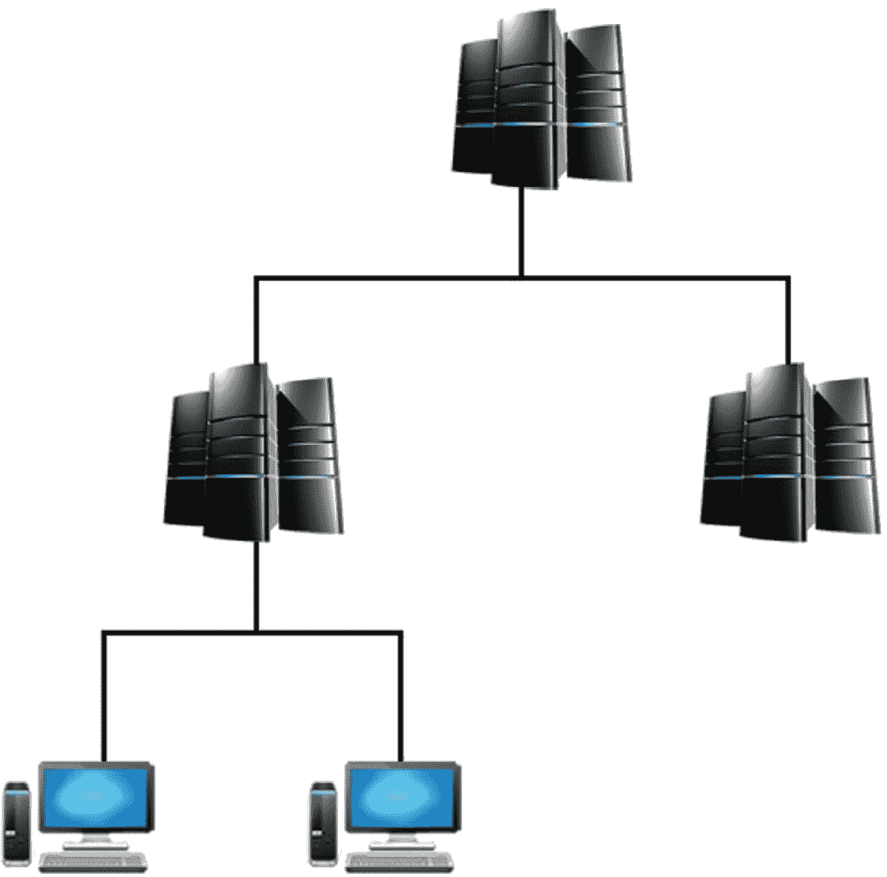

图4.17 — 采用树形拓扑的网络

树形拓扑的优点包括：

- 向树中添加节点很容易。
- 某个节点发生故障不太可能影响网络的其他部分。

树形拓扑的缺点包括：

- 线缆故障可能导致整个网络无法运行。

## 环形

环形是一种闭环拓扑。数据仅沿一个方向传输，具体方向取决于环形初始化时设定的传输方向，可以是顺时针或逆时针。每个设备仅从其上游邻居接收数据，并且仅向其下游邻居发送数据。通常，环形使用同轴电缆或光纤。令牌环网络如图4.18所示。

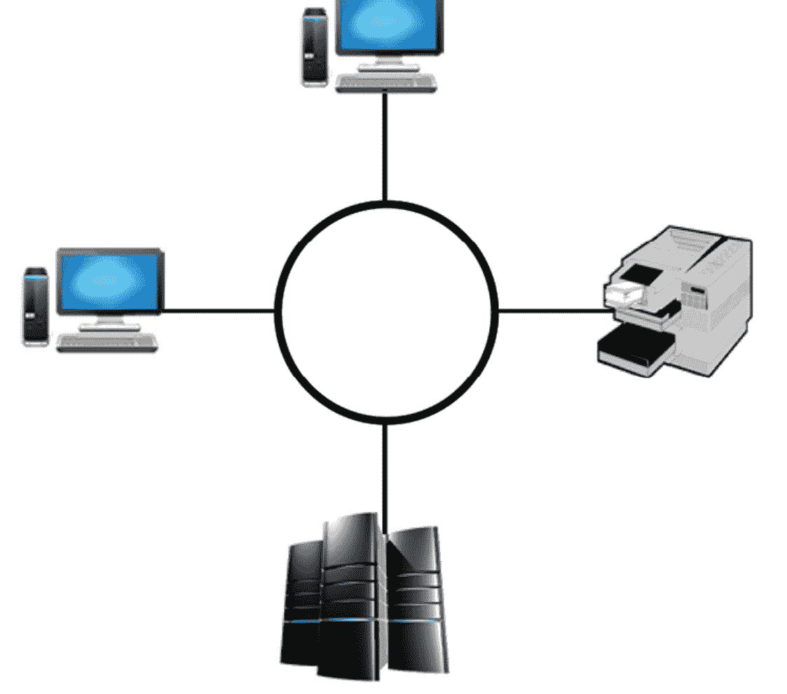

图4.18 — 采用环形拓扑的网络

环形拓扑的优点包括：

- 由于环形使用令牌，可以预测节点在能够传输之前必须等待的最长时间（即网络是确定性的）。

## 网状

图4.19 – 采用网状拓扑的网络

网状拓扑的优点包括：

- 网状网络提供高水平的冗余。

网状拓扑的缺点包括：

- 网状网络非常昂贵，因为需要大量的线缆。

## 星形

星形网络中的所有节点都连接到中央设备，例如集线器、交换机或路由器。现代局域网通常采用星形拓扑。星形网络如图4.20所示。

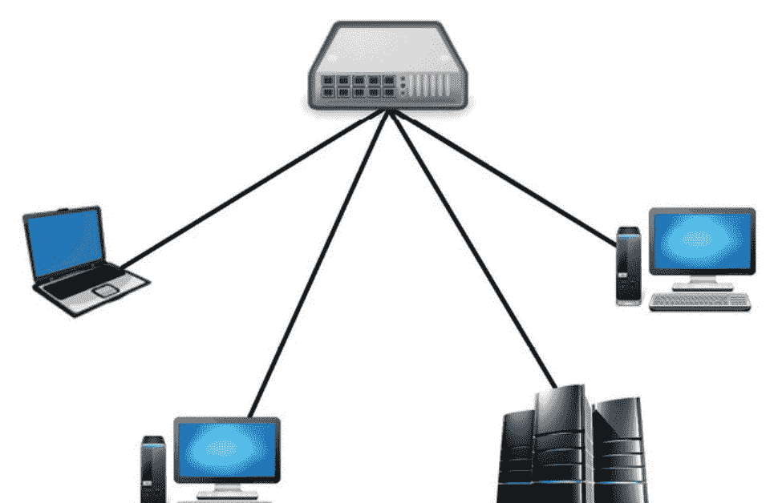

图4.20 – 采用星形拓扑的网络

星形拓扑的优点包括：

- 星形网络所需的线缆少于全网状或部分网状网络。
- 星形网络易于部署，并且可以轻松添加或移除节点。

星形拓扑的缺点包括：

- 中央连接设备是单点故障。如果它无法工作，所有连接的节点都会失去网络连接。

关于从发送方到接收方传输信息，安全架构师和从业者必须考虑许多要点。例如，信息将以模拟波还是数字波的形式表示？会有多少接收者？如果传输介质将与其他人共享，如何确保信号不会相互干扰？

## 单播、组播和广播传输

大多数通信，尤其是用户直接发起的通信，是从一台主机到另一台主机的。例如，当一个人使用浏览器向Web服务器发送请求时，他或她向Web服务器发送一个数据包。只有一个接收主机的传输称为单播传输。

一台主机可以向其网络或子网络上的所有主机发送广播。根据网络拓扑的不同，广播的接收者可能从一个到成千上万个不等。就像一个人站在肥皂箱上大声演讲一样，这是一种嘈杂的通信方式。通常，只有一两个目的主机对广播感兴趣；其他接收者会浪费资源来处理该传输。然而，广播也有有效的用途。假设一台路由器知道某设备的IP地址，但必须确定该设备的MAC地址。路由器将广播一个地址解析协议（ARP）请求，询问该设备的MAC地址。

请注意，一次广播可能导致网络上出现成百上千个数据包。入侵者经常利用这一事实进行拒绝服务攻击。

公共网络和专用网络比以往任何时候都更频繁地用于流传输，例如电影、视频会议和音乐。考虑到传输这些流所需的巨大带宽，并且发送方和接收方不一定在同一个网络上，如何将流仅传输给感兴趣的主机？发送方可以通过单播向每个接收方发送一份流的副本。除非受众非常少，否则单播传输并不实际，因为同一时刻网络上同时存在同一大流的多份副本，可能会导致拥塞。广播传输是另一种可能，但每台主机都会收到该传输，即使它们对该流不感兴趣。

组播的设计目的是仅向感兴趣的主机传送流。无线电广播是组播的典型类比。要选择特定的电台节目，需要将收音机调谐到该广播电台。同样，要接收所需的组播，需要加入相应的组播组。

组播代理用于在网络中路由组播流量并管理组播组。每个支持组播的网络和子网络必须至少有一个组播代理。主机使用互联网组管理协议（IGMP）通知本地组播代理，表明其希望加入某个特定的组播组。组播代理还将组播路由到属于该组播组成员的本地主机，并将组播中继给相邻代理。

当主机想要离开组播组时，它会向本地组播代理发送一条IGMP消息。组播不使用可靠会话。因此，组播以尽力而为的方式传输，不保证数据报一定被接收。举例来说，假设一台服务器正在向与服务器属于同一组播组的桌面计算机组播一场视频会议（图4.21）。服务器向本地组播代理发送传输。接下来，组播代理将流中继给其他代理。所有组播代理都将该流传输给与服务器属于同一组播组的本地主机。


图4.21 — 组播传输

## 电路交换网络

电路交换网络在端点之间建立专用电路。这些电路由专用的交换机连接组成。任一端点都不会开始通信，直到


图4.22 – 局域网令牌传递

## 以太网（IEEE 802.3）

以太网（由IEEE 802.3定义）在20世纪80年代局域网的快速普及中发挥了重要作用。该架构灵活且相对廉价，并且易于在局域网中添加和移除设备。即使在今天，出于同样的原因，以太网仍是最流行的局域网架构。以太网支持的物理拓扑有总线型、星型和点对点，但逻辑拓扑是总线型。

除全双工以太网（不存在冲突问题）外，该架构使用CSMA/CD。与令牌环相比，该协议允许设备以最小的开销传输数据，从而有效利用带宽。然而，当多个设备同时尝试在介质上发送数据时，设备必须重传；因此，由于冲突导致的大量重传可能会造成严重的吞吐量下降。

以太网标准支持同轴电缆、非屏蔽双绞线和光纤作为传输介质。

以太网最初额定速率为10 Mbps，但就像10兆字节的磁盘驱动器一样，用户很快弄清楚了如何使用并超出其容量，于是需要更快的局域网。为了满足对更多带宽日益增长的需求，定义了100 Base-TX（双绞线上100 Mbps）和100 Base-FX（多模光纤上100 Mbps）。当需求

更快和更高带宽的ATM交换机正在被互联网骨干路由器超越。同样重要的是，MPLS为面向数据包的业务工程和多业务功能提供了更简单的机制，并具有更好的可扩展性这一额外优势。


图4.23 – MPLS转发操作

（经许可，摘自 Tan, N.-K.，《城域网 MPLS》，Auerbach Publications，纽约，2004 年。）

MPLS通常被称为“IP VPN”，因为它能够将高度确定性的路由与IP服务相结合。实际上，这创造了一种VPN类型的服务，使得来自一个网络的数据不可能与其他网络的数据混合或路由到另一个网络，除非破坏MPLS路由设备本身。MPLS不包含加密服务；因此，任何被称为“IP VPN”的MPLS服务实际上并不包含任何加密服务。这些链路上的流量对服务提供商是可见的。网络和安全架构师在协商MPLS带宽和相关服务级别协议（SLA）时，应考虑以下准则，以确保服务满足依赖该网络的资产的保障要求：

- **站点可用性** — 确保在所有需要的地点都有MPLS可用；也就是说，所有计划中的远程连接（办公室）在该区域都能获得MPLS服务。
- **端到端网络可用性** — 对于跨一级运营商边界的网络需求，询问MPLS的对等互联关系。
- **开通** — 新站点中的新链路可以多快开通？


## 局域网（LAN）

局域网服务于相对较小的区域，例如家庭、办公楼或办公园区。通常，局域网满足本地用户的计算需求。局域网由大多数现代计算设备组成，例如工作站、服务器和外设，它们以星型拓扑或互联星型拓扑相连。以太网是最流行的局域网体系结构，因为它便宜且非常灵活。大多数局域网都与其他网络相连，例如通过拨号线路或专线接入互联网，通过广域网访问其他局域网等。

## TLS/SSL

## 安全外壳（SSH）

安全外壳（Secure Shell，SSH）服务包括远程登录、文件传输和命令执行。它还支持端口转发，端口转发通过加密的 SSH 隧道重定向其他协议。许多用户通过 SSH 隧道转发 X Windows 和 VNC（虚拟网络计算）等安全性较弱的协议流量来保护它们。SSH 隧道保护通信的完整性，防止会话劫持和其他中间人攻击。

该协议有两个不兼容的版本：SSH-1 和 SSH-2，不过许多服务器都同时支持两者。SSH-2 改进了完整性校验（SSH-1 由于 CRC-32 完整性校验较弱而容易受到插入攻击），并支持本地扩展和 OpenPGP 等其他类型的数字证书。SSH 最初是为 UNIX 设计的，但现在也有针对其他操作系统的实现，包括 Windows、Macintosh 和 OpenVMS。

## SOCKS

SOCKS 是一种流行的电路级代理服务器，有多个商业和免费软件实现。SOCKSv5（当前版本）的核心是 RFC 1928，该 RFC 不要求开发者在实现中包含流量加密。用户使用 SOCKS 客户端访问远程服务器。客户端发起与 SOCKS 代理服务器的连接，由代理服务器代表用户访问远程服务器。如果实现支持加密，则服务器可以充当 VPN，保护 SOCKS 与远程服务器之间流量的机密性。由于 SOCKS 关注的是维护一条电路，因此它几乎可以用于任何应用程序。

SOCKS 和 SSL VPN 的一个关键优势是能够使用代理服务器。这是大多数其他 VPN 所不具备的功能。SOCKS 服务器可能会要求用户先进行身份验证，然后才提供服务。

端口，第二种攻击通常可以通过遵循简单的配置指南或软件升级来解决。

- **双重封装 802.1Q/嵌套 VLAN 攻击**——在交换机内部，VLAN 编号和标识以特殊的扩展格式承载，这种格式允许转发路径在端到端之间保持 VLAN 隔离而不会丢失任何信息。而在交换机外部，标记规则由 Cisco ISL 或 802.1Q 等标准决定。ISL 是 Cisco 专有技术，从某种意义上说是设备内部使用的扩展数据包头的一种紧凑形式。由于每个数据包总是带有标记，因此不存在身份丢失的风险，也就不会有安全弱点。另一方面，制定 802.1Q 的 IEEE 委员会认为，出于向后兼容性的考虑，有必要支持所谓的本征 VLAN（native VLAN），即在 802.1Q 链路上不显式与任何标记关联的 VLAN。该 VLAN 被隐式用于在支持 802.1Q 的端口上接收到的所有未标记流量。这种能力是可取的，因为它允许支持 802.1Q 的端口通过发送和接收未标记流量直接与旧式 802.3 端口通信。然而，在所有其他情况下，这可能非常不利，因为与本征 VLAN 关联的数据包在通过 802.1Q 链路传输时会丢失其标记，例如丢失其身份强制以及服务类别（802.1p 位）。仅仅由于这些原因——失去标识手段和失去分类——就应该避免使用本征 VLAN。当从某个 VLAN 恰好是中继链路本征 VLAN 的设备向网络注入双重封装的 802.1Q 数据包时，这些数据包的 VLAN 标识无法端到端保留，因为 802.1Q 中继总是会通过剥离外部标记来修改数据包。外部标记被移除后，内部标记就永久成为数据包唯一的 VLAN 标识符。因此，通过使用两个不同标记对数据包进行双重封装，可以使流量跨 VLAN 跳转。其思路是：如果攻击者连接到位于 802.1q 本征 VLAN（默认情况下为 1）的接入端口，他就可以通过注入双重标记的数据包使流量跨 VLAN 跳转。原理是攻击者可以注入双重标记的数据包。交换机只会剥离第一个标记，而不会“注意到”第二个标记。当数据包通过 802.1q 中继传输到另一台交换机时，不会应用 VLAN 标记，因为该数据包属于中继链路的本征 VLAN（因为接收该数据包的接入端口是本征 VLAN 的成员）。数据包到达另一台交换机时，该交换机会看到剩余的 VLAN 标记（即攻击者应用的第二个标记），并将数据包转发到该标记指定的 VLAN。攻击者由此成功使数据包跳入另一个 VLAN。关键在于，攻击者应用的“外部”标记必须将数据包标识为属于攻击者的 VLAN，确切地说是 802.1q 本征 VLAN。在这种情况下，交换机将接受该数据包，即使它到达的是接入端口。第一个标记被剥离，但第二个标记不受影响。当数据包在 802.1q 中继上传输时，不会应用标记，因为该数据包属于本征 VLAN。这意味着，当该数据包到达另一台交换机时，攻击者应用的第二个标记仍然可见，从而导致第二台交换机将数据包放入错误的 VLAN。这种情况应被视为配置错误，因为 802.1Q 标准并不强制要求用户在这些情况下使用本征 VLAN。事实上，应始终采用的正确配置是从所有 802.1Q 中继上清除本征 VLAN。如果无法清除本征 VLAN，那么请始终选择一个未使用的 VLAN 作为所有中继的本征 VLAN；不要允许将此 VLAN 用于任何其他目的。此外，请确保对所有面向用户的交换机接口应用“switchport mode access”和“switchport nonegotiate”命令。

- **ARP 攻击**——在独立于 MAC 地址实现 VLAN 的 L2 设备中，更改 ARP 数据包中的设备身份并不会影响其与其他设备跨 VLAN 通信的方式。事实上，任何 VLAN 跳转尝试都会被阻止。另一方面，在同一 VLAN 内，ARP 投毒或 ARP 欺骗攻击是一种非常有效的方式，可以诱使终端或路由器学习到伪造的设备身份。这使恶意用户能够伪装成中介并执行中间人（MITM）攻击。MITM 攻击是通过在发送给被攻击设备的 ARP 数据包中冒充另一台设备（例如默认网关）来实施的：接收方不会验证这些数据包，因此它们会用伪造信息“投毒”其 ARP 表。此类攻击可以通过在 L2 层阻止攻击者与被攻击设备之间的直接通信来防范，也可以通过向网络嵌入更多智能来检查转发的 ARP 数据包的身份正确性。例如，后者可以通过在 Cisco 产品中使用 ARP 检测（ARP Inspection）来实现。

- **组播暴力攻击**——这种攻击试图利用交换机对 L2 组播帧风暴的潜在漏洞或缺陷。正确的行为应该是将流量限制在其来源 VLAN 内；该


故障行为将是把帧泄漏到其他 VLAN。

- **生成树攻击** – 另一种企图利用交换机潜在弱点的攻击是 STP 攻击。攻击者需要嗅探线路上的 STP 帧，以获取 STP 传输端口的 ID。然后，攻击者开始发送 STP 配置/拓扑变更确认 BPDU，宣称自己是优先级低得多的新根桥。
- **随机帧压力攻击** – 这最后一种攻击有多种形式，但通常属于暴力攻击，在保持源地址和目的地址不变的情况下，随机改变数据包的多个字段。

虽然这些攻击中许多已较为陈旧，除非网络中允许某些情况或配置错误不受约束地存在，否则可能不会生效，但安全从业者需要了解这些攻击向量，确保理解其运作方式以及有哪些适当的应对措施。

## 综合业务数字网（ISDN）

在 DSL 和线缆调制解调器出现之前，用户希望获得比拨号上网更高带宽的远程访问。ISDN 通过一组协议和专用设备提供此类带宽（见图 4.24）。ISDN 使用两种类型的信道：B 信道（承载）用于语音和数据（64 kbps），D 信道（增量）用于信令（16 kbps），也可用于数据。D 信道用于建立、维持和拆除与远程站点的连接。语音和数据流量在 B 信道上传输。每个 B 信道可以支持单独的呼叫，也可以进行多路复用（B 信道绑定）将带宽合并为单一信道。


图 4.24 – 综合业务数字网（ISDN）

ISDN 有两种变体：基本速率接口（BRI）和主速率接口（PRI）。BRI 支持两个 B 信道和一个 D 信道。每个 B 信道可支持独立的 64-kbps 会话，或可多路复用为一个 128-kbps 会话。

PRI 是 ISDN 的高端版本。当所有 B 信道绑定后，ISDN 连接可提供租用线路的带宽。在北美，PRI 支持 23 个 B 信道和 1 个 D 信道，可支持多达 23 个会话，或合并为单个 1.544-Mbps 会话（完整 T1）。在欧洲和澳大利亚，PRI 支持 30 个 B 信道和 1 个 D 信道。B 信道可支持 30 个会话，或绑定后形成单个 2.0-Mbps 信道（完整 E1）。一些组织使用 PRI ISDN 作为租用线路的低成本备份。

ISDN 作为一种技术已处于生命周期末期，许多服务地点正在将其退役；然而，ISDN 已广泛部署于许多远程连接应用中，这些应用在未来多年内并未计划退役。因此，ISDN 将在未来数年内继续服役以支持“遗留”应用。

## 点对点线路

点对点线路连接两个端点，通常用于广域网。在有线广域网中，点对点使用高带宽光纤电缆，但与 FDDI 不同，流量专用于端点。点对点线路是一种昂贵的选项。

## T1、T3 等

T1 载波是北美和日本流行的广域网方法。利用时分多路复用，T1 在铜缆上复用 24 个信道。在 193 位的帧中，每个信道轮流传输 8 位（7 位数据和 1 位控制位）。帧开头附加 1 位同步位。T1 帧结构如图 4.25 所示。


图 4.25 – T1 帧结构

每秒传输 8000 个 T1 帧。因此，传输速率为 1.544 Mbps（8000 帧/秒 × 193 位/帧）。

对于 T1 预算有限的组织，可以使用分数 T1。客户可以购买少于 24 个的信道，这比完整 T1 便宜得多。未购买的信道不承载数据。为了满足额外的广域网带宽需求，多个 T1 信道被多路复用为更高吞吐量的技术。通常，客户使用 T1 和 T3。T 信道概要见表 4.19。

| 信道 | 复用比率 | 带宽（Mbps） |
|---------|-----------------|------------------|
| T1 | 1×T1 | 1.544 |
| T2 | 4×T1 | 6.312 |
| T3 | 7×T2 | 44.736 |
| T4 | 6×T3 | 274.176 |

表 4.19 – T 载波带宽

对于不需要所有 T3 信道的组织，可以使用分数 T3，成本更低。与分数 T1 一样，未购买的分数 T3 信道不承载数据。

## E1、E3 等

## DSL

上行和下行传输。

- **甚高比特率数字用户线（VDSL）** — 支持比其他 DSL 技术高得多的传输速率，例如下行 13 Mbps、上行 2 Mbps。

所有 DSL 变体都有两个重要问题：

1. 中心局（CO）与客户之间的电话线长度有限制。具体限制取决于多种因素，包括电缆质量和传输速率。换言之，客户距离中心局不能太远。
2. DSL 允许用户长时间连接到互联网。当然，这对用户非常方便，但长时间暴露在互联网中会大大增加被攻击的风险。为减轻这一严重风险，主机必须安装防火墙、安装厂商安全补丁，并禁用危险且不用的协议。

## 线缆调制解调器

与 DSL 一样，线缆调制解调器让家庭用户享受高速互联网连接。线缆调制解调器不使用电话公司发送数据，而是将其有线电视提供商作为 ISP。用户将 PC 的以太网网卡连接到线缆调制解调器，后者连接到有线电视提供商的网络。大多数主要有线电视提供商提供的线缆调制解调器符合有线电缆数据服务接口规范（DOCSIS），这有助于确保兼容性。见图 4.27。

在高层次上，线缆调制解调器通电后，会被分配上行和下行信道。接下来，它通过确定距头端（有线网络核心）的距离来建立定时参数。线缆调制解调器发出动态主机配置协议（DHCP）请求以获取 IP 地址。为了帮助保护有线电视提供商免受盗用，并保护其用户数据不被其他有线电视用户截获，调制解调器和头端交换加密密钥。此后，两端之间的所有流量都被加密。

## X.25

技术而不是 X.25 进行分组交换。与 ISDN 一样，X.25 现在已基本退役，仅用于支持遗留应用。

## 帧中继

帧中继是电路交换网络和专用线路的一种经济高效的替代方案，适用于网络间存在大量空闲时间的情况。由于帧中继使用分组交换技术，组织按使用的带宽付费，这比维护专用线路或按连接时长计费的电路更便宜。帧中继网络如图 4.28 所示。


图 4.28 – 帧中继网络

帧中继网络的核心是位于提供商场所内的帧中继交换机云。所有帧中继客户共享云中的资源，这些资源被认为是可靠的，不需要 X.25 那样严格的错误检查和纠正。这显著提高了相对于 X.25 的吞吐量。云内的设备被视为数据电路终接设备（DCE）。

连接到帧中继云的设备通常由客户拥有并位于客户场所，被视为数据终端设备（DTE）。端点之间的通信是面向连接的，通过永久虚电路或交换虚电路进行。当 DTE 之间的连接大部分时间处于活动状态时，组织使用永久虚电路。对于偶尔连接，交换虚电路更具成本效益，因为连接完成后会被断开。

帧中继提供一种机制，保证客户指定的通过云的吞吐量，称为承诺信息速率（CIR）。例如，如果指定 10 Kbps，提供商会确保 10 Kbps 可用。此外，如果云中资源可用，提供商将允许更高的突发吞吐量。自然，较高的 CIR 更昂贵。

## 异步传输模式（ATM）

ATM 是一种面向连接的协议，旨在以非常高的速度（如 155 Mbps）在同一网络上传输数据、语音和视频。这得益于所有 ATM 流量使用小型、固定长度的 53 字节信元。

ATM 的另一个标志是使用虚电路。在电路端点之间传输的信元使用相同路径。要启动电路，会向目的地发送一个信元。当该信元穿越网络时，路径上的所有设备分配必要资源，为最终数据传输做准备。与 IP 一样，ATM 不保证信元的交付。

虚电路可以是永久的，也可以是交换的。交换虚电路在连接终止后被拆除。而永久虚电路始终保持活动。

流量工程是 ATM 的一个方面。所有虚电路分为以下类别之一：

- **恒定比特率（CBR）** — 电路的信元以恒定速率传输。
- **可变比特率（VBR）** — 电路的信元在指定范围内传输。这通常用于突发流量。
- **未指定比特率（UBR）** — 电路的信元获得其他类别电路未分配的带宽。这非常适合非交互式应用，如文件传输。


- **可用比特率（ABR）** — 电路吞吐量根据对可用网络带宽的监控反馈进行调整。

## 虚拟化网络

### 软件定义网络

OpenNetworking.org 对软件定义网络（SDN）的定义是：“网络控制平面与转发平面的物理分离，并且一个控制平面控制多个设备。”在 SDN 架构中，控制平面和数据平面解耦，网络智能和状态在逻辑上集中，底层网络基础设施对应用层抽象。49

SDN 的目的是将传统网络流量（可用于有线或无线）分为三个组件：原始数据、数据的发送方式以及数据服务的用途。这涉及对数据、控制和应用（管理）功能的关注，或者说“平面”，它们对应基础设施层、控制层和应用层。图 4.29 展示了 SDN 架构三个层的高级视图。


图 4.29 — 软件定义网络三个层的高级视图

SDN 架构由开放网络论坛定义。⁵⁰ 它利用虚拟设备控制和标准指令集。可以对网络流量应用策略，API 可供使用或由用户编程。

图 4.30 展示了 SDN 架构更技术性的视图。


图 4.30 — 软件定义网络三个层的技术视图

### 架构组件

以下列表定义并解释了架构组件：

- **SDN 应用（SDN App）** – SDN 应用程序是通过北向接口（NBI）明确、直接并以编程方式向 SDN 控制器传达其网络需求和期望网络行为的程序。此外，它们可能会使用网络的抽象视图进行内部决策。SDN 应用由一个 SDN 应用逻辑和一个或多个 NBI 驱动程序组成。SDN 应用本身可能暴露另一层抽象网络控制，从而通过各自的 NBI 代理提供一个或多个更高级别的 NBI。
- **SDN 控制器** – SDN 控制器是一个逻辑集中的实体，负责将来自 SDN 应用层的需求向下转换为 SDN 数据路径，并向 SDN 应用提供网络的抽象视图，其中可能包括统计信息和事件。SDN 控制器由一个或多个 NBI 代理、SDN 控制逻辑以及控制到数据平面接口（CDPI）驱动程序组成。作为逻辑集中的实体的定义既不规定也不排除实现细节，例如多个控制器的联合、控制器的分层连接、控制器之间的通信接口，也不排除网络资源的虚拟化或切片。
- **SDN 数据路径 –** SDN 数据路径是一种逻辑网络设备，对其通告的转发和数据处理能力提供可见性和无争议的控制。逻辑表示可以包含物理底层资源的全部或子集。一个 SDN 数据路径包括一个 CDPI 代理和一组一个或多个流量转发引擎以及零个或多个流量处理功能。这些引擎和功能可以包括数据路径外部接口之间的简单转发，或内部流量处理或终止功能。一个或多个 SDN 数据路径可以包含在单个（物理）网络元素中——通信资源的集成物理组合，作为一个单元进行管理。SDN 数据路径也可以跨多个物理网络元素定义。这种逻辑定义既不规定也不排除实现细节，例如逻辑到物理的映射、共享物理资源的管理、SDN 数据路径的虚拟化或切片、与非 SDN 网络的互操作性，也不排除数据处理功能，其中可以包括第 4-7 层功能。
- **SDN 控制到数据平面接口（CDPI） –** SDN CDPI 是定义在 SDN 控制器和 SDN 数据路径之间的接口，它提供对所有转发操作、能力通告、统计报告和事件通知的程序化控制。
- **SDN 北向接口（NBI） –** SDN NBI 是 SDN 应用与 SDN 控制器之间的接口，通常提供抽象的网络视图，并支持直接表达网络行为和需求。这可以发生在任何抽象级别（纬度）以及不同的功能集（经度）上。

## 软件定义存储和虚拟 SAN

在其 2013 年存储分类报告中，分析机构 IDC 将 SDS 描述为任何可以安装在商品资源（x86 硬件、虚拟机监控程序或云）和/或现成计算硬件上的存储软件栈。

软件定义存储（SDS）的一个基本前提是，虚拟机监控程序是数据中心新的裸机。在软件定义数据中心（SDDC）中，所有服务都构建在虚拟化层之上，虚拟化层不仅明确地将数据平面与控制平面解耦，而且允许存储功能扩展到创建时。无需依赖僵化的硬件结构来满足所有工作负载的需求，可以通过虚拟机监控程序应用功能和策略。虚拟机监控程序和 SDS 通过提供服务菜单（API）来了解各种硬件设备的能力，并根据每个虚拟机的需要应用正确的能力和属性，从而协同工作。

在 SDS 中，硬件通过强大的软件机制得到增强，使所有 x86 节点都能参与一个横向扩展的分布式集群，该集群可以线性扩展，而不会受到太多整体限制。在这种横向扩展存储模型中，每个 x86 节点都包含直接连接的硬盘和固态存储，所有节点和所有工作负载都可以利用这些存储。此外，横向扩展不仅适用于存储容量，还适用于存储控制逻辑，以帮助在扩展时避免性能瓶颈。

与 SDN 一样，SDS 寻求将物理存储硬件与决定数据放置以及读写操作期间应用哪些服务的存储逻辑分离。最终结果是一个非常灵活的存储层，可以调整以满足不断变化的应用程序需求。它还创建了一个统一且连贯的数据结构，保持对每个虚拟机的完全可见性。

传统上可供企业使用的存储服务包括：

- **动态分层** — 如今，存储系统通常支持高性能闪存存储和较慢但容量较大的硬盘驱动器的组合。因此，基于软件的动态分层使存储层能够自动在存储层之间移动数据以优化性能。无需管理员处理复杂的规则集。
- **缓存** — 缓存已成为越来越重要的功能，主要是由于闪存存储的成本降低，并催生了新的存储类别，例如服务器端缓存设备和混合存储阵列。但是，尽管闪存存储成本有所下降，但仍比传统硬盘驱动器贵得多。因此，存储供应商正在谨慎地利用闪存，通过将最需要的数据放在更高速的缓存中来提高性能。
- **复制** — 存储复制可创建各种数据保护（本地

在 SDS 系统中，控制平面支持基于策略的存储服务管理，该管理与硬件环境解耦。随着环境中添加多个硬件系统，这种解耦的重要性变得更加明显。鉴于对整个硬件范围的可见性，数据放置可以扩展到单个系统或单个位置之外，利用云甚至外部存储系统。一个 SDS 系统可以在许多数据中心（公共和私有）中拥有硬件，并且仍然可以通过单个分布式控制平面进行管理和控制。

除了从硬件角度来看是开放的之外，SDDC 和 SDS 的一个关键特征是由开放应用程序编程接口（API）促进的互操作性。此类 API 支持超出直接存储管理的持续自动化，并支持可由环境的第三方扩展控制的预配置。例如，特定应用程序可能需要特定类型的存储，并且可以使用 SDS 供应商的开放 API，利用 SDS 管理层收集的环境知识来配置该存储。如今，最常见的 API 标准称为表述性状态转移（REST）API。

在 SDS 存储集群中，数据可用性是通过软件弹性实现的，而不是通过高度冗余的硬件设备实现的。事实上，软件层是为预期会发生故障的硬件基础设施而设计的，但它可以立即检测并响应硬件资源的不可用性，以维持整体存储 SLA。例如，SDS 系统可以选择采用基于副本的数据保护方法，而不是使用昂贵、缓慢且越来越不可靠的 RAID 结构，将数据的多个副本存储在集群中的不同位置。

此外，由于对基础架构中其他虚拟元素的完全感知，软件层可以根据管理员定义的策略，根据其在环境中看到的情况来决定需要哪些存储。例如，需要高度响应存储的应用程序可以由基于闪存的容量提供服务，而不太时间关键的工作负载将利用较慢但较便宜的基于硬盘驱动器的存储。SDS 和虚拟化提供的抽象层使得查看环境的每个方面成为可能，从而提供自动化工作负载管理的机会。SDS 允许存储结构具有适应性，因此具有高 I/O 需求的应用程序可以访问具有保证 SLA 的存储资源。这确保了数据中心的存储组件与其他技术一样灵活。


基于 SDS 的存储系统提供多种保护和数据可用性机制：

- **智能数据放置 —** 数据保护从数据写入物理磁盘并被应用程序工作负载确认的那一刻开始。在 SDS 存储系统中，数据放置和保护至关重要，因为没有任何基于硬件的 RAID 机制来执行数据保护工作。在 SDS 中，数据放置可能会发生多次。
- **控制器 —** 在 SDS 中，基于软件的控制器负责确保数据从磁盘读取并写入磁盘，并保持可供应用程序和虚拟机使用。软件控制器通常是冗余的，有助于环境即使在发生故障时也能保持高可用性。
- **软件 RAID —** 虽然 SDS 使基于硬件的 RAID 系统变得不必要，但仍可使用基于软件的 RAID 结构。为了符合 SDS 的概念，这些 RAID 结构必须完全由基于软件的控制器支持，并且必须能够扩展以满足企业级容量和性能需求。

为了让安全专业人员对 SDS 技术的本质有清晰的认识，我们将简要介绍 VMware 在其 Virtual SAN 产品中是如何实现它的。VMware® Virtual SAN™ 是一种超融合存储软件，它抽象并汇集服务器端的闪存和磁盘，以在超visor 层创建高性能且具有弹性的持久存储层。

## 超融合存储

Virtual SAN 嵌入到 vSphere 内核中。这种紧密集成很重要，因为它在堆栈中处于独特的位置，能够理解运行在 vSphere 之上的虚拟机和应用程序以及底层存储基础设施的能力。正是因为 Virtual SAN 在堆栈中的独特定位，它才能优化 I/O 数据路径，提供比虚拟设备或外部设备更好的性能。

## 以虚拟机为中心的基于策略的管理和自动化

存储需求以策略语句的形式与单个虚拟机或虚拟磁盘绑定。Virtual SAN 根据由 SLA 规范的这些策略来配置存储资源。利用基于策略的存储管理（SPBM），服务器管理员能够根据每个应用程序或虚拟机的性能、可用性和容量需求创建存储策略。然后，Virtual SAN 将这些策略与底层存储资源匹配，以实现存储资源配置和管理的自动化。Virtual SAN 会自动重建和重新平衡存储，以符合分配给集群中每个虚拟机的指定 QoS 策略。

## 服务器端读/写缓存

Virtual SAN 通过利用企业级服务器端 SSD 闪存来加速读写磁盘 I/O 流量，从而最大限度地降低存储延迟。Virtual SAN 通过将闪存用作写入缓冲区和读取缓存，大大提高了虚拟机的性能。读取缓存保留常用磁盘块的列表，以便在缓存命中时降低 I/O 读取延迟。写入缓冲区是非易失性的，通过比写入磁盘更快地确认写入操作，从而降低写入操作的延迟。

## 内置故障容错

Virtual SAN 利用分布式 RAID 和缓存镜像来确保在磁盘、主机或网络故障的情况下数据不会丢失。Virtual SAN 的 SPBM 功能允许管理员通过按虚拟机定义可用性来最大化弹性：在为每个虚拟机设置存储策略时，管理员可以指定 Virtual SAN 集群可以容忍多少个主机、网络或磁盘故障。

## 精细的非中断式扩展和横向扩展

Virtual SAN 数据存储的容量可以通过向现有主机添加磁盘（纵向扩展）或向集群添加新主机（横向扩展）轻松且不中断地增长。性能也可以同时提升，通过即时向新主机或现有主机添加更多闪存驱动器（包括 PCIe 卡）来加速 I/O 性能，而不会中断服务。

## 硬件无关

Virtual SAN 是一种硬件无关的解决方案，可以部署在所有主要服务器厂商的硬件上。这提供了运行具有不同配置、操作系统和磁性磁盘的异构硬件的灵活性。

## PVLANs、虚拟网络和客户操作系统

私有 VLAN 在标准 VLAN 的能力上进行了扩展，允许在另一层级分离流量，从而提供有关设计和安全的多种灵活选项。

虚拟局域网（Virtual Local Area Network，简称 VLAN）提供了一种逻辑上分离局域网的能力，其方式与使用多个物理交换机时相同。例如，如果我们有四个不同的物理交换机，每个交换机都可以连接到公司内的不同部门。在没有互连或路由设备的情况下，


## 主 VLAN

## P-端口

I-端口
次级隔离 VLAN

C-端口
次级
社区 VLAN 1

C-端口
次级
社区 VLAN 2

图 4.31 – 私有 VLAN 流量

以下列出了安全专业人员需要了解的一些额外事项：

-  promiscuous PVLAN 的主 VLAN 和次级 VLAN 具有相同的 VLAN ID。
- 社区和隔离 PVLAN 的流量以关联的次级 PVLAN 的标签形式传输。
- PVLAN 内部的流量未被封装（没有次级 PVLAN 封装在主 PVLAN 数据包内部）。
- 位于同一 PVLAN 但在不同主机上的虚拟机之间的流量会经过物理交换机。因此，物理交换机必须感知 PVLAN 并进行适当配置，以便次级 PVLAN 能够到达其目的地。
- 交换机按 VLAN 发现 MAC 地址。这对于 PVLAN 来说可能是一个问题，因为每个虚拟机在物理交换机看来似乎位于多个 VLAN 中，或者至少看起来请求没有回复，因为回复通过不同的 VLAN 返回。因此，要求连接到 PVLAN 的每个物理交换机都必须感知 PVLAN。

从未使用过 PVLAN 的安全专业人员可以按类别查看下面列出的厂商，以获取产品信息、产品和演示。

## 硬件交换机

- **Arista Networks** — 数据中心交换
- **Cisco Systems** — Catalyst 2960-XR、3560 及更高产品线的交换机
- **Juniper Networks** — EX 交换机
- **Brocade** — BigIron、TurboIron 和 FastIron 交换机

## 软件交换机

- **Cisco Systems** — Nexus 1000V
- **VMWare** — vDS 交换机
- **Microsoft** — HyperV 2012R2

## 其他私有 VLAN 感知产品

- **Cisco Systems** — FWSM 防火墙
- **Marathon Networks** — PVTD 私有 VLAN 部署和操作设备

## 虚拟网络到底是什么？（以及为什么安全专业人员需要理解它们）

虚拟网络由一个或多个可以相互发送和接收数据的虚拟机组成。每个虚拟机代表网络中的一台计算机，并驻留在 ESXi 服务器上。

在 VMware 中，使用交换机在虚拟网络和物理网络之间建立连接。在 ESX 和 ESXi 中，可以使用两种不同类型的交换机：标准交换机和分布式交换机。

## 标准交换机

网络标准交换机、虚拟交换机或 vSwitch 负责将虚拟机连接到虚拟网络。vSwitch 的工作方式类似于物理交换机，但存在一些限制，并控制虚拟机之间的通信方式。

vSwitch 使用与主机服务器关联的物理 NIC（pNIC）将虚拟网络连接到物理网络。在 VMware 中，这些 pNIC 也称为上行链路适配器。上行链路适配器使用称为 vmnics 或虚拟网络适配器的虚拟对象与 vSwitch 接口。

一旦 vSwitch 在虚拟网络和物理网络之间建立了桥接连接，驻留在主机服务器上的虚拟机就可以开始向连接到物理网络的所有网络功能设备传输数据并从其接收数据。也就是说，虚拟机不再局限于

安全专业人员需要了解虚拟网络是如何搭建的以及构成它们的组件，以便能够处理虚拟化网络基础设施并将其纳入现有的安全架构和策略中。现在我们已经了解了 VMware ESXi 操作系统中虚拟网络是如何搭建的，是时候让你自己尝试搭建一个虚拟化环境并为其配置基本的网络连接了。由于我们已经研究过 VMware 的网络方法，这个实践机会旨在让你通过部署 Windows Server 2012/2012R2 Hyper-V 来了解微软的虚拟化方法。

请参阅附录 E 获取详细教程。

## 网络攻击

攻击可以针对网络本身，即网络的可用性或其其他服务——尤其是安全服务——面临风险。过去，人们认为网络本身并不是攻击的必要目标（图 4.32），但这种情况已不再如此。在 IP 融合之下，网络已成为大多数组织的中央神经系统，控制着业务的物理和逻辑要素。物理要素可能包括控制和管理大型生产系统以及泵、熔炉、锅炉、反应室等关键安全控制的数据和通信，以及其他各种非常“物理”的要素，这些要素可能导致严重的财产损失或人员伤亡。物理要素还可能包括建筑物的访问控制以及监控和记录物理威胁并向安保人员发出紧急警报的摄像头和对讲机。逻辑要素不仅包括在网络中流动的数据，如电子邮件和文件，而且所有电话呼叫和信息服务（如电视）也可能完全依赖于同一网络。在现代组织和企业中瘫痪或控制网络，而不攻击特定应用程序，其影响可能与成功攻击所有驻留应用程序相同。

## 网络作为攻击的使能者或通道

这里必须区分两种细微不同的情况：攻击者利用某些网络特征来支持其攻击，例如通过情报收集，以及攻击通过网络传播的情况。本节将主要关注可以通过网络传播的攻击；然而，它仍将讨论针对网络本身的攻击，这些攻击会对运行在网络上的应用程序和资产产生连锁影响。

使用网络不一定基于对网络的入侵。例如，在病毒感染的情况下，入侵可能发生在连接到互联网的用户笔记本电脑上。尽管在这种情况下确实利用了网络架构的缺陷，但其自身的基础设施和设计其中的安全服务在技术上并未被入侵。


图 4.32 — 基于 IP 的融合网络

## 网络作为防御的堡垒

网络是支持 IT 安全目标的关键，如果不是最有价值的战略组成部分：保护企业中包含的信息和知识。因此，在整个企业中实施强大且连贯的网络安全架构至关重要。如其他地方所述，此类措施通常围绕完整的信息安全管理体系（ISMS）构建，包括社会、组织、程序和技术活动以及执行这些活动所需的支持控制措施。

措施将基于组织的安全策略，通常包括配置和变更管理、监控和日志审查、漏洞和合规性测试与扫描（包括网络上的检测扫描）、安全审查和审计、备份和恢复，以及意识和培训措施。它们需要平衡、适当且组织负担得起，并与其业务目标、风险接受程度和目标保证水平相称。安全专业人员需要考虑的关键概念包括：

- **安全域的定义 —** 这可以根据风险等级或组织控制来定义。一个典型的例子是分散式组织倾向于在本地管理其 IT——从而也管理其网络安全——因此成功程度各不相同。
- **安全域的隔离 —** 根据风险/收益评估控制流量，并考虑正式模型，例如 Bell–La Padula 模型、Biba 完整性模型或 Clark–Wilson 模型。
- **事件响应能力 —** 包括但不限于：
  - 业务关键流量的清单（例如，这可能是电子邮件或文件和打印服务器，但也包括 DNS 和 DHCP、电话流量——VOIP、建筑访问控制流量和/或设施管理流量。请记住，现代建筑控制、物理安全控制和流程控制正在融合到 IP 上）。
  - 次要流量的清单（如 HTTP 或 FTP）。
  - 快速遏制入侵的方法（例如，通过关闭网络的某些部分或阻止某些类型的流量）
  - 管理响应的流程。
  - 应急或网络“多样性”，以防主网络连接过载或故障；备用网络连接已到位，可在不影响应用程序和用户服务的情况下自动吸收负载/流量。

## 网络安全目标和攻击模式

尽管安全目标因组织而异，但可以区分出一些关键主题，每个组织会以不同的方式对其进行优先排序，但通常这里列出的顺序就是所选的顺序。一些次要目标，如互操作性，特别是易用性，是这些主题的潜在因素。用户期望网络（特别是网络安全）完全透明，不干扰业务流程，并且不会轻易接受限制。

一个常见的误解是网络安全是所有其他安全措施的终点（即仅防火墙就能保护组织）。这是一种错误的认知；边界防御（防御网络边缘）只是安全专业人员需要在企业中确保到位整体解决方案集或企业安全架构的一部分。边界防御是被称为“纵深防御”的更广泛概念的一部分，其核心思想是安全必须是多层努力，包括边缘，但也包括主机、应用程序、网络元素（路由器、交换机、DHCP、DNS、无线接入点）、人员和运营流程。参见图 4.33。

此外，保护措施实际上并不能防止攻击，而这远比不得不抵御攻击并承担随之而来的失败风险要好！检测、响应和恢复策略也不会阻止攻击。理想情况下，为了对抗攻击，网络安全还必须是主动的——通过预先拦截和破坏攻击或自卫来预见并反对针对基础设施的攻击。这需要对威胁进行情报收集、对边界及以外区域进行主动监控，以及在上游干预或禁用威胁代理工具的能力

图 4.33 — 纵深防御

- 普通用户
- 信息
- 应用软件
- 应用开发人员
- 系统管理员
- 通用支持软件
- 操作系统
- 硬件
- 局域网
- 广域网

操作安全
硬件和软件安全
通信和网络安全
人员安全
物理和环境安全
流程、程序和标准
政策

与主动性相关的技术可以由有意愿和资源的组织独立开展。其他措施，如上游干预（假设威胁来自外部来源，如 DDOS、垃圾邮件/网络钓鱼或僵尸网络攻击）可以通过与电信供应商和互联网服务提供商（ISP）合作以相对容易且经济的方式实现。最后，最有效的积极网络防御（图 4.34）与在攻击工具被部署并针对你使用之前禁用它们的能力有关。此类战术历史上

被认为过于不精确且在法律上存疑而不适合使用，但与网络攻击相关的安全风险水平导致了由美国空军领导的美国战略防御司令部以及世界各地许多其他国家采用了反攻学说。

## 主动防御思维导图

战术谱系

- 进攻
- 主动防御：采用情报和指标来干预或避免攻击
- 主动防御：以进攻战术回应攻击
- 静态防御：准备被攻击
- 反应式防御：针对攻击而制定
- 非活跃防御：运营保持不变

- 先发制人
- 扰乱
- 拦截

- 预测
- 检测

- 预防
- 保护

- 响应
- 恢复

情感术语

图 4.34 — 主动防御

#### 保密性

在电信和网络安全领域，保密性是指未授权方不得披露的属性。针对保密性的攻击今天是最普遍的，因为信息可以以大量（主要是犯罪的）方式出售或被用于盈利。网络作为企业内部几乎所有数字信息的载体，为绕过使用网络的资产上的访问控制措施并在信息在传输线路上传输时访问信息提供了极具吸引力的目标。可获取的信息不仅包括有效载荷信息，还包括凭据，例如密码。相反，攻击者可能甚至不关心传输的信息，而只是关心通信的事实

开放邮件中继是分发垃圾邮件的主要工具，因为它们允许攻击者隐藏其身份。存在一些针对开放邮件中继服务器的黑名单，可用于屏蔽开放邮件中继；即，合法的邮件服务器不会接受来自该主机的任何电子邮件，因为它很可能是垃圾邮件。尽管将黑名单作为垃圾邮件过滤的一个指标有其优点，但将其作为唯一指标使用是有风险的。通常，它们由私人组织和个人按照自己的规则运行，他们可以随意更改政策，可以因任何原因一夜之间消失，而且很少能为其运营名单的方式承担责任。


1. SMTP 交换通常由客户端向本地 SMTP 服务器打开 SMTP 会话启动。
2. SMTP 服务器（A）执行 MX 查找以确定目标域（B）的接收邮件主机，并启动邮件传输，在邮件消息头中将其自身添加为接收主机。
3. SMTP 网关 B 接收并按适当方式处理邮件（执行内容扫描和过滤等）。然后 B 向 SMTP C 打开连接。
4. SMTP C 将邮件接收到本地邮箱中，最终由适当的邮件客户端轮询/检索。

图 4.35 – 代表性 SMTP 交换

（摘自 Young, S., and Aitel, D., Hacker’s Handbook: The Strategy Behind Breaking into and Defending Networks, Auerbach Publications, Boca Raton, FL, 2004. With permission.）

## 垃圾邮件

垃圾邮件受益于电子邮件的低成本，而电话或信件则不然。它可以以大量发送，几乎没有额外成本且报复风险低。多年来，发送垃圾邮件已成为一项专业且利润丰厚的业务。这意味着垃圾邮件发送者高度组织化和结构化。一般来说，垃圾邮件不是

## 扫描技术

### 端口扫描

端口扫描（图 4.36）是对机器上的 TCP 服务进行探测的行为。它是通过建立连接的初始握手来执行的。虽然本身不是攻击，但它允许攻击者测试目标系统上是否存在潜在易受攻击的服务。

端口扫描还可通过评估其响应特征（如响应时间、握手细节）来对操作系统进行指纹识别。

防范端口扫描包括限制网络连接（例如，通过基于主机的或基于网络的防火墙，或在应用层定义有效源地址列表）。

远程系统的响应表明它“存活”并且在指定端口上监听。攻击客户端会立即发出重置以终止连接（目的是规避防火墙和系统日志文件）。


图 4.36 — TCP 端口扫描示例

（摘自 Young, S., and Aitel, D., Hacker’s Handbook: The Strategy Behind Breaking into and Defending Networks, Auerbach Publications, Boca Raton, FL, 2004. With permission.）

### FIN、NULL 和 XMAS 扫描

在 FIN 扫描中，一种隐蔽扫描方法，会向目标机器发送关闭连接的请求。如果该端口上没有应用程序在监听，将发送 TCP RST 或 ICMP 数据包。这种攻击通常仅适用于 UNIX 机器，因为 Windows 机器的行为略有不同，偏离了 RFC 793（始终用 RST 响应 FIN 数据包，从而使识别开放端口变得不可能）并且因此不受此扫描影响。51 可将系统置于隐身模式的防火墙（即抑制系统对 FIN 数据包的响应）是可用的。在 NULL 扫描中，发起的 TCP 数据包上未设置任何标志；在 XMAS 扫描中，所有 TCP 标志都被设置（或“点亮”，如同圣诞树）。否则，这些扫描的工作方式与 FIN 扫描相同。

## TCP 序列号攻击

为了检测和纠正数据包丢失，TCP 为每个传输的数据包附加一个序列号。如果传输未报告成功，将重新传输数据包。通过窃听流量，这些序列号可以被预测，第三方可以向数据流中引入具有正确序列号的伪造数据包。此类攻击例如可用于会话劫持。基于 RFC 1948 中描述的序列号更好的随机化，已提出了针对 TCP 序列号攻击的保护机制。52

## 攻击方法论

安全攻击已正式描述为攻击树模型。攻击树基于攻击者的目标、防御者的风险以及防御系统的漏洞。它们是一种专门的决策树形式，可用于正式评估系统安全（图 4.37）。以下方法论描述的不是攻击树本身（这是防御者的观点），而是攻击者为成功遍历树到达其目标而经历的步骤。


图 4.37 – 攻击树

> （摘自 Houser, D.D., Blended Threat Analysis: Passwords and Policy, in Information Security Management Handbook, 6th edition, Tipton, H.F. and Krause, M. Eds., Auerbach Publications, Boca Raton, FL, 2006. With permission.）

### 目标获取

攻击通常从情报收集和监视开始，以获得可能的攻击目标集合，例如通过评估目录服务和网络扫描。因此，安全架构师和安全从业人员共同努力限制网络上可用的信息并使攻击者的情报收集尽可能困难非常重要。这包括安装分割网络安全区域（内部节点仅在网络内部可见）、网络地址转换、限制对人员和资产目录的访问、使用隐藏路径、非标准特权用户名等。重要的是，并非所有这些混淆措施都具有固有的安全价值。它们的作用是减缓攻击者，但本身不会在此点之外提供任何保护；这些

措施被称为拖延战术。

## 目标分析

在第二步中，已识别的目标会被分析是否存在安全弱点，从而允许攻击者获得访问权限。根据攻击类型，侦察扫描已经考虑到了这一点，例如，通过扫描易受某种类型缓冲区溢出攻击的服务器。目标获取阶段可用的工具通常能够自动执行首次目标分析。

最有效的安全专业人员可以部署的保护措施是最大限度地减少安全漏洞，例如，通过尽早应用软件补丁并实施有效的配置管理。此外，应使目标分析对攻击者更困难。例如，系统管理员应最大限度地减少攻击者可能获取的系统信息（例如，系统类型、构建版本和发行版），从而使攻击系统更加困难。

## 目标访问

在下一步中，攻击者将获得某种形式的系统访问权限。这可以是作为普通用户或访客的访问。攻击者可以利用已知漏洞或常用工具来实现这一点，或者他/她可以通过使用社会工程攻击完全绕过技术安全控制。

为了降低未经授权访问的风险，应确保现有用户权限得到良好管理，访问配置文件是最新的，未使用的账户要么被阻止要么被删除。访问应受到监控，并且监控日志需要定期分析；然而，大多数恶意软件都会附带 rootkit，以便破坏基本的操作系统权限管理。

## 目标占用

在攻击的最后阶段，攻击者随后可以在系统上提升其权限以获得系统级访问权限。同样，通过现有或定制的工具和技术利用已知漏洞是主要的技术攻击向量；然而，其他攻击向量，如社会工程，也需要考虑。

针对权限提升的对策，其本质上与获得访问权限的对策相似。然而，由于攻击者可以通过权限提升获得对系统的完全控制，因此系统本身的次要控制措施（如检测日志文件中的异常活动）效果较差且不可靠。因此，网络（路由器、防火墙和入侵检测系统）日志对安全从业人员来说可能非常宝贵。日志


图 4.38 – Botnet 架构

“僵尸程序”和“僵尸网络”负责当今导致未经授权、远程控制受损系统的绝大多数活动。那些已感染并现被视为“僵尸程序”的机器本质上是由来自互联网暗处的神秘实体控制的僵尸。僵尸程序和僵尸网络是垃圾邮件的最大来源，并且可以由“僵尸网络饲养员”协调，以发动高效的拒绝服务攻击，而系统所有者对此一无所知。参见图 4.38。

## 网络安全工具和任务

工具可以使安全从业人员的工作更轻松。工具可自动化流程以节省时间和减少错误。示例包括用于评估服务器配置情况的扫描仪以及用于收集风险分析输入的辅助工具。然而，不要让自己陷入将网络安全简化为收集和使用工具的陷阱。

## 入侵检测系统

入侵检测系统（IDS）监控活动，并在检测到可疑流量时发送警报。参见图 4.39。IDS 有两种广泛的分类：基于主机的 IDS，监控服务器和工作站上的活动；以及基于网络的 IDS，监控网络活动。网络 IDS 服务通常是独立设备，或至少是网络机箱内的独立刀片。网络 IDS 日志将通过单独的管理控制台访问，该控制台也会生成警报和告警。


图 4.39 – 入侵检测系统（IDS）架构

目前，入侵检测系统的部署和使用有两种方法。网络上的设备可以基于一组特征（类似于防病毒软件）监控流量中的攻击，或者设备可以观察网络流量一段时间，学习什么是正常的流量模式，并在检测到异常时发送警报。当然，IDS 也可以使用这两种方法的混合方式部署。

无论采用何种方法，组织如何使用 IDS 决定了该工具是否有效。尽管其名称如此，IDS 不应被用于检测入侵，因为 IDS 解决方案并非设计为能够在其响应中采取预防措施。相反，当它检测到可能预示攻击的有趣、异常流量时应发送警报。例如，工程部门的某人在凌晨 3 点尝试通过网络访问工资信息可能非常有趣且不正常。或者也许网络利用率的突然上升应该被注意。

上述内容意味着组织了解其网络的正常特征。考虑到现代网络的复杂性以及变化程度，这项任务说起来容易做起来难。由于这种复杂性，可以公平地说，今天企业中部署的许多 IDS 服务仅仅是“运行”着，但并未实际配置为按其设计的方式工作。安全专业人员需要决定他/她是否拥有正确操作 IDS 并达到最大效果所需的知识和资源，或者管理 IDS 服务的最佳方式是将外包给合格的管理安全服务提供商，或将 IDS 与更大的 SEIM 服务（如 Splunk）集成。“Snort”是一个免费的开源入侵检测系统。此外，还有大量商业工具可用。

## 安全事件管理（SEM）

## 安全事件和事故管理（SEIM）

SEM/SEIM 是一种解决方案，涉及从单个服务器或资产上的各种不同来源收集日志和事件信息，并将其作为统一视图进行分析，同时提供复杂的报告。同样，整个 IT 基础设施的日志和事件信息可以通过大规模的 SEM/SEIM 部署进行集中和管理。SEM/SEIM 不仅会汇总日志，还会根据可疑模式进行分析和发出警报（电子邮件、寻呼机、可听等）。

作为概念，SEM/SEIM 解决方案不一定是新的。它们至少从 2000 年后不久就已存在；然而，它们是非常复杂的技术，需要供应商（构建者）和集成商双方具备显著的技能。这是因为 SEM/SEIM 系统必须理解各种不同的应用程序和网络元素（路由器/交换机）日志和格式；将这些日志整合到单个数据库中，然后关联事件，寻找未经授权行为的线索，而这些线索如果仅在单个日志文件中观察则无法得出结论。

日志和事件的汇总和整合也可能需要额外的网络资源，以便将日志和事件数据从不同的服务器和阵列传输到中央位置。如果安全信息要超出取证的价值，这种传输也需要在尽可能接近实时的时间内发生。

SEM/SEIM 系统可以极大地受益于安全情报服务（SIS）。安全设备的输出晦涩难懂，缺乏预测性威胁评估所需的现实背景。它无法持续为在竞争市场中运营的企业提供相关情报。SIS 使用全源收集和分析方法来生成和提供精确及时的情报，不仅指导“安全业务”，还指导“业务安全”。SIS 建立在准确的安全指标（网络和物理）、市场分析、技术预测之上，并与现实事件相关联，为企业决策者提供时间和精确性。SIS 提供来自主动网络防御系统监控暗空间和暗网的上游数据。


图 4.40 - SEIM 服务

## 扫描器

网络扫描仪可以由安全从业人员以多种方式使用：

-   发现网络上的设备和服务的扫描，例如确定是否连接了新的或未经授权的设备。反过来，这类扫描也可以用于收集可能易受攻击的服务的相关信息。
-   测试是否符合既定策略，例如确保某些配置（停用服务）已经应用。
-   测试漏洞，例如作为渗透测试的一部分，同时也为攻击做准备。

## 发现扫描

发现扫描可以通过非常简单的方法执行，例如向子网中的每个地址发送一个 ping 数据包（ping 扫描）。更复杂的方法还能发现响应设备的操作系统和服务。

## 合规性扫描

合规性扫描既可以在网络侧执行，也可以在设备上执行（例如作为安全健康检查）。如果在网络上执行，通常包括测试设备上的开放端口和服务。

## 漏洞扫描与渗透测试

漏洞扫描通常通过查看给定服务器上响应的端口和应用程序并确定补丁级别来测试漏洞条件。漏洞扫描将根据可能作为攻击途径的内容推断威胁。当新的漏洞被公布或被利用时，来自软件供应商、防病毒供应商、独立供应商或开源社区的针对性扫描工具通常会出现。在企业环境中运行扫描时必须小心，以免负载干扰运营或导致应用程序和服务失败。

渗透测试是漏洞扫描之后的后续步骤，在渗透测试中，观察到的漏洞会被实际利用或尝试利用。通常情况下，推断出的漏洞在测试时实际上并不是漏洞。例如，某项服务可能在一个端口上开放且看似未打补丁，但测试后发现安全管理员已实施了可缓解这些漏洞的安全配置。

渗透测试始终具有导致被测资产宕机的较高风险，因此绝不应


图 4.41——网络分流器（network tap）是一种以“监控”或“混杂”模式简单地连接在网络中的设备，它复制所有网络流量，甚至可能精确到以太网帧。
（来源：Macaulay, T., Securing Converged IP Networks, Auerbach Publications, Boca Raton, FL, 2006. 经许可使用。）

## IP 分片攻击与特制数据包

### 泪滴（Teardrop）

在这种攻击中，IP 数据包分片被构造得使目标主机在尝试重组数据包时会计算出负的分片长度。如果目标主机的 IP 协议栈不能确保分片长度被设置于适当的边界内，主机就可能崩溃或变得不稳定。此问题可通过供应商补丁轻松修复。

### 重叠分片攻击

重叠分片攻击用于破坏只检查分片数据包第一个分片的包过滤器。该技术先发送一个无害的第一个分片，使其满足包过滤器。随后其他数据包用恶意数据覆盖第一个分片，从而导致有害数据包绕过包过滤器并被受害主机接受。解决此问题的方法是让 TCP/IP 协议栈不允许分片互相覆盖。

## 源路由利用

IP 不仅允许路由器决定数据包到达目的地的路径，还允许发送方显式指定路径。攻击者可以滥用源路由，使数据包在被配置为不转发数据包的多宿主计算机的网络接口之间转发。这可能允许外部攻击者访问内部网络。

源路由由 IP 数据报的发送方指定，而通常情况下，路由路径由路由器来决定。最佳解决方案是在主机上禁用源路由并阻止源路由数据包。

## Smurf 与 Fraggle 攻击

这两种攻击都使用广播来发起拒绝服务攻击。Smurf 攻击滥用 ICMP 回显请求来发起拒绝服务攻击。

在 Smurf 攻击中，入侵者发送一个源地址伪装为受害者的 ICMP 回显请求。该数据包被发送到网络的广播地址，然后转发给网络上的每一台主机。由于 ICMP 数据包包含受害者的主机作为源地址，受害者将被 ICMP 回显应答淹没，从而造成拒绝服务攻击。

Fraggle 攻击使用 UDP 而不是 ICMP。攻击者向端口 7 发送一个源地址伪装为受害者的 UDP 数据包。与 Smurf 攻击一样，该数据包被发送到网络的广播地址，网络会将数据包转发给所有主机。受害主机将被来自网络的响应淹没。

## NFS 攻击

从安全角度来看，NFS 版本 2 和版本 3 存在若干缺陷，原因在于其认证机制相当基础，并且文件系统协议必须具备某种形式的状态管理，为此必须在无状态协议之上引入一些变通方法，例如实现文件锁定。攻击者会有多种机会攻击 NFS，无论是从客户端、服务器还是网络角度。

建立 NFS 连接的第一步是服务器发布（导出）文件系统树。这些树可以由管理员任意选择。访问权限基于客户端 IP 地址和目录树授予。在树内，服务器文件系统的权限将映射到客户端用户。存在以下几个风险点：

-   导出未打算公开或权限不合适的文件系统部分（例如，由于意外或由于存在用户可生成的 UNIX 文件系统硬链接）。如果服务器根文件系统的部分变得可访问，这一点尤其值得关注。人们很容易想象这样一个场景：密码文件被访问，其中包含的加密密码随后被现成工具破解。定期审查导出的文件系统树是一种适当的缓解措施。
-   使用未经授权的客户端。因为 NFS 通过客户端 IP 地址或（间接地）主机名来识别客户端，所以通过 IP 欺骗或 DNS 欺骗使用不同于授权客户端的客户端相对容易。因此，服务器主机名的解析至少应通过文件（UNIX 中的 /etc/hosts）进行，而不是通过 DNS。
-   服务器和客户端之间用户 ID 映射不正确。任何不受服务器管理员控制的机器都可能被用来传播攻击，因为 NFS 依赖用户 ID 作为唯一的授权凭据形式。攻击者一旦获得客户端的管理访问权限，就可以生成任意用户 ID 以匹配服务器上的用户 ID。服务器和客户端上的用户 ID 同步至关重要（例如，通过使用 NIS/NIS+）。
-   嗅探和访问请求欺骗。由于 NFS 流量默认未加密，因此可以通过网络嗅探或中间人攻击来截获。由于 NFS 不认证每个 RPC 调用，因此如果获得了适当的访问令牌（文件句柄），例如通过嗅探，就可能访问文件。NFS 本身不提供适当的缓解措施；但使用安全 NFS 或许可以。53
-   SetUID 文件。通过 NFS 访问的目录与本地目录的使用方式相同。在 UNIX 系统上，带有 SUID 位的文件因此可用于在客户端上进行权限提升。因此，NFS 应配置为忽略 SUID 位。

## 网络新闻传输协议（NNTP）安全性

从安全角度来看，NNTP 的主要缺陷在于身份验证。消息的机密性则不那么令人担忧，因为信息本来就是用于发布的；然而，对发送者进行正确的身份标识和认证仍然是一个值得关注的重要问题。


用户早期找到的解决方案之一是使用 Pretty Good Privacy (PGP) 对消息进行签名。然而，这并不能防止身份冒充或伪造身份，因为数字签名并不是一项要求，而且实际上也无法解决这里隐含的抵赖问题。更糟糕的是，NNTP 提供了一种取消机制，可以撤回已发布的文章。自然，同样的身份验证弱点也适用于用于这些取消操作的控制消息，使得即使只有中等技能的用户也能随意删除消息。

与此相关的是，NNTP 新闻流十多年来一直饱受垃圾邮件的困扰（更确切地说，自从 Usenet 上的垃圾邮件在经济上变得可行以来）。针对这一问题已经发展出多种机制。可以肯定地说，所有技术措施都只是对一种基本上属于社会自我调节机制的补充。Usenet 最初处理不需要的信息的方式是让用户维护基于客户端的黑名单，即所谓的 killfiles（屏蔽文件）。

一些新闻组被设置为审核制，以防止滥用，这种滥用主要来自有派别倾向的参与者；但自然，这种机制也能对付垃圾邮件，尽管这会给新闻组的主持人带来更大的工作量。随着时间推移，形成了一种约定，即根据明确定义的标准被归类为垃圾邮件的信息（过度重复或交叉张贴相同或高度相似的信息）成为合法的取消目标。NNTP 中的身份验证问题从未得到充分解决，而且设法解决它甚至可能并不可取：在某种程度上，Usenet 作为一种社会结构，很可能依赖于匿名或使用假名发帖的能力。

## Finger 用户信息协议

Finger 是一种标识服务，允许用户获取其他用户的最后登录时间以及该用户当前是否已登录系统的信息。被“finger”的用户可以选择在其主目录中显示来自两个文件（.project 和 .plan 文件）的信息。

Finger 早在 1971 年就被开发出来，并作为 UNIX 守护进程 fingerd 实现。Finger 已经变得不那么流行，原因如下：

- Finger 一直是许多安全攻击的对象。
- Finger 引发了隐私和安全方面的担忧；它很容易被滥用于社会工程攻击。
- 用户的自我展示（早期 UNIX 网络中一个重要的社交方面）如今已通过网页来实现。

| 端口 | 定义 |
| --- | --- |
| 123/TCP, 123/UDP | RFC 778, RFC 891, RFC 956, RFC 958, RFC 1305 |

表 4.23 — NTP 快速参考

## 拒绝服务（DoS）/分布式拒绝服务（DDoS）攻击

对网络发动攻击最简便的方法（至少看起来如此）就是通过过量流量或经过“精心构造”的流量使其过载，导致网络关闭或缓慢到无法使用。参见图 4.42。

应对措施包括但不限于：多层防火墙、在防火墙、路由器和交换机上进行仔细过滤、内部网络访问控制（NAC）、冗余（多样化）网络连接、负载均衡、预留带宽（服务质量，至少能保护未直接受到攻击的系统），以及在上游路由器上阻止来自攻击者的流量。请记住，恶意代理能够而且确实会更换 IP 地址或 DNS 名称以绕开防范，并且能够而且确实会在实施攻击时使用数千个不同的 IP 地址。寻求上游服务提供商和运营商的帮助最终是最有效的应对措施，尤其是当必要的协议和关系已经预先建立，或作为商定服务水平的一部分而建立时。


图 4.42 — 一次拒绝服务攻击。攻击者利用易受攻击的中间网络，通过伪造的 PING 数据包淹没网络。

值得注意的一点是，许多协议都包含针对消息丢失的基本保护，这至少可以减轻拒绝服务攻击的影响。这始于 TCP 在一定范围内处理数据包丢失，再到更高层协议（如 SMTP）针对临时连接中断提供健壮性（存储转发）。55

对于攻击者来说，有多种方式可以在最大限度地降低自身成本的同时执行拒绝服务攻击：

- **分布式拒绝服务攻击** – 攻击者利用由远程控制主机组成的网络（即“僵尸网络”，通常是已被病毒或其他形式的“恶意软件”入侵的工作站），使得目标遭受来自广泛来源的流量，这些流量很难被阻止。这种攻击对攻击者和网络服务提供商双方的不利之处在于，攻击可能已经阻塞了上游网络通道，影响的不仅仅是其预定目标。

分布式拒绝服务攻击既被用作勒索手段，也被用作政治工具（发起者称之为在线示威），例如活动人士会煽动用户在某个特定时间点频繁重新加载某个网站。

应对措施与常规拒绝服务攻击类似，但简单的 IP 或端口过滤可能无效。

## SYN 泛洪攻击

SYN 泛洪攻击是一种针对 TCP 连接中初始握手的拒绝服务攻击。大量来自伪造随机 IP 地址的新连接在短时间内被建立，使目标的连接表不堪重负。

应对措施包括根据供应商规范调整操作系统参数，例如调整积压表的大小。另一种需要对 TCP/IP 协议栈进行修改的解决方案是 SYN Cookie，它以某种方式改变 TCP 序号，使伪造数据包立即可识别。56

这种方法的主要发明者 Daniel J. Bernstein 将它们定义为“TCP 服务器对初始 TCP 序号进行特定选择。服务器初始序号与客户端初始序号之差为：

- **最高 5 位** — t mod 32，其中 t 是一个 32 位时间计数器，每 64 秒递增一次；
- **接下来 3 位** — 服务器根据客户端的 MSS 选出的 MSS 的编码；
- **最低 24 位** — 服务器选择的秘密函数，以客户端 IP 地址和端口号、服务器 IP 地址和端口号以及 t 为输入。

使用 SYN Cookie 的服务器在 SYN 队列填满时不必丢弃连接。相反，它会发回一个 SYN+ACK，就像 SYN 队列本来更大一样。当服务器收到 ACK 时，它会检查该秘密函数对最近的 t 值是否有效，然后从编码的 MSS 中重建 SYN 队列条目。”

前面讨论过的僵尸网络可以发起最成功的 SYN 泛洪变体之一。僵尸网络能够同时将潜在数千个 SYN 请求指向主机，不仅压垮主机，还会压垮它们所依赖的网络连接。在这种情况下，没有任何主机配置层面的应对措施可用，因为一台没有网络的主机无论如何都等于死了。虽然 SYN 泛洪可能是一种攻击模式，但它并非以某种狡猾的方式使用可能来自单个恶意主机的伪造 IP 地址来实施，而是被用作纯粹的暴力攻击形式。

应对措施包括通过加固网络协议栈来保护操作系统。这通常不是系统用户或所有者能够在任何程度上控制的事情；这是供应商的任务。

最后，网络需要纳入企业的灾难恢复和业务应急预案中。对于局域网，人们可以根据这样一个事实设定较高的恢复目标并提供适当的应急措施：如果没有至少一个可用的局域网（LAN）基础设施，任何服务恢复都可能毫无用处。由于广域网通常外包，应急措施可能包括从不同的提供商获取备份线路、采购电话线路或数字用户环路（DSL）线路等。

## 欺骗

### IP 地址欺骗与 SYN-ACK 攻击

数据包会使用伪造的源地址发送，从而使受害者向另一台主机发送响应。伪造地址可被用来滥用启动 TCP 会话所需的三次握手。正常情况下，一台主机会发送带有 SYN 选项的数据包，主动请求与远程主机建立会话。远程主机收到后，会用一个带有 SYN 和 ACK 选项的数据包作为响应。当发起方主机用带有 ACK 选项的数据包响应时，握手即告完成。

攻击者可以通过发送带有 SYN 选项的初始数据包，并将源地址设为一个不存在的主机，来发动拒绝服务攻击。受害者会向伪造的源地址发送带有 SYN 和 ACK 选项的数据包，然后等待最终的数据包完成握手。当然，这个数据包永远不会到达，因为受害者把数据包发送给了一个不存在的主机。如果攻击者发送带有伪造地址的数据包风暴，受害者可能会达到未完成（半开）三次握手的数量上限，从而拒绝其他合法的网络连接。

上述场景利用了一个协议缺陷。为了降低攻击成功的风险，厂商已经发布了补丁，减少达到未完成握手数量上限的可能性。此外，诸如防火墙等安全设备，


可以阻止从外部接口到达且源地址来自内部网络的数据包。

## 电子邮件欺骗

由于 SMTP 不具备足够的认证机制，电子邮件欺骗极其简单。最有效的防护措施是社会性的，即收件人可以确认或直接忽略不合常理的电子邮件。伪造电子邮件发件人地址极其简单，只需通过 TELNET 命令连接邮件服务器的 25 端口，并发送一系列 SMTP 命令即可完成。电子邮件欺骗经常被用来在垃圾邮件中隐藏发件人身份，而垃圾邮件的所谓发件人实际上是另一个垃圾邮件受害者，其电子邮件地址被垃圾邮件发送者收集或购买。

## DNS 欺骗

为了解析域名查询（例如将 Web 服务器地址映射为 IP 地址），用户工作站必须依次通过域名服务器层级结构进行一系列查询。这类查询可以是递归的（收到请求的域名服务器会转发该请求并返回解析结果），也可以是迭代的（收到请求的域名服务器会返回一个引用作为响应）。

攻击者试图通过注入虚假记录来污染 DNS 服务器（域名服务器）的缓存（与先前查询相关的信息，为速度和效率而存储以备将来查询重用），从而伪造对客户端请求的响应，为此攻击者需要向该域名服务器发送查询。攻击者此时知道该域名服务器很快会发出解析查询。

在第一种情况下，攻击者查询了一个他控制主域名服务器的域。该查询的响应将包含最初未请求的附加信息，但目标服务器会将此信息缓存。第二种情况是一种不同的方法，也可用于迭代查询。利用 IP 欺骗，攻击者会在权威（正确）域名服务器有机会响应之前，向自己的查询发送响应。

在两种情况下，攻击者都利用电子对话将虚假信息注入域名服务器的缓存。该域名服务器不仅会使用缓存的信息，而且虚假信息还会传播到向该服务器发起查询的其他服务器。由于 DNS 的缓存特性，针对 DNS 服务器的攻击以及相应的防御措施总是存在一定的延迟，这取决于（域）区域的配置。

超文本标记语言（HTML）文档的一种方式是显示一个文本链接，而实际目标地址与显示内容不同。实现这一点的另一种方法是使用与 ASCII（即拉丁）字符极为相似的非 ASCII 字符集（例如 Unicode——ISO/IEC 10646:2012——字符）来呈现用户。58 随着国际化域名的普及，这可能成为一种流行的技术。

## 信息泄露

较小的企业网络不会拆分命名区域（即只能从内网访问的主机名称可以从互联网看到）。虽然知道服务器名称并不能让任何人访问它，但这一信息有助于并促进计划攻击的准备，因为它为攻击者提供了有关现有主机（至少就服务器而言）、网络结构以及诸如组织结构或服务器操作系统等细节（如果操作系统是主机名的一部分，等等）的宝贵信息。

因此，组织应尽可能运行拆分 DNS 区域，并避免为其机器使用具有透露性的命名约定。此外，域名注册商的管理和计费域名联系人数据库（Whois 数据库）可能成为信息和电子邮件收集的有吸引力的目标。

## 与命名空间相关的风险

除了所描述的技术风险外，还存在许多其他风险，虽然这些风险严格来说与安全无关，但可能导致同等程度的暴露。

## 会话劫持

会话劫持是指未经授权将数据包插入数据流的行为。它通常基于序列号攻击，其中序列号要么被猜测，要么被拦截。存在不同类型的会话劫持：

- **IP 欺骗**——基于 TCP 序列号攻击，攻击者会将带有伪造源 IP 地址和猜测序列号的数据包插入数据流。攻击者无法看到插入命令的响应。
- **中间人攻击**——攻击者会嗅探或拦截数据包，从数据流中移除合法数据包并替换为自己的数据包。实际上，通信双方会与攻击者通信，而非彼此直接通信。

针对 IP 欺骗的防御措施可以在第 3 层执行（参见 IP 地址欺骗和 SYN-ACK 攻击）。由于 TCP 会话仅执行初始认证，可以使用应用层加密来防范中间人攻击。

## SYN 扫描

随着传统 TCP 扫描被广泛识别并被阻止，各种隐蔽扫描技术被开发出来。在 TCP 半扫描（也称为 TCP SYN 扫描）中，不会打开完整的连接；相反，只执行握手过程的初始步骤。这使得扫描更难被识别；例如，它不会出现在应用程序日志文件中。然而，使用适当配备的防火墙，可以识别并阻止 TCP SYN 扫描。

## 摘要


我们在通信和网络安全领域的讨论一直聚焦于用于在私有和公共通信网络及介质上提供机密性、完整性和可用性的结构、传输方法、传输格式和安全措施。网络安全与所有安全控制和保障措施一样，主动应用时最为有效。等待影响显现并在危机条件下应用控制和保障措施，总是比有计划、有管理地部署网络安全策略、程序和技术花费更多、效果更差。安全专业人员必须准备好面对危机，尽可能多地掌握可选方案，以便在接触点应用最佳解决方案。

随着“传统”网络边界消失成为业务需求——这通过加速引入新技术以及技术向 IP 骨干网融合得以实现——易用性与安全性之间始终存在博弈。安全设计的基本原则是：网络内部必须与其边界一样具有韧性；如果不与适当的流程相结合，仅靠工具是无效的；网络的可用性是衡量其设计成功与否的关键指标。如今，对网络的攻击不仅旨在破坏可用性，还旨在通过隐蔽的机密性和完整性攻击来损害网络的知识和“语义”资产。

安全专业人员需要不断提升自己的技能和能力，以匹配当今企业面临的威胁。网络安全的终端点边界不断变化，面对用户对更多访问和更高移动性日益增长的趋势，这已成为一项重大挑战。加之当今针对企业发起的许多攻击具有高级性质，安全专业人员必须更加努力、更加聪明地工作，才能保持领先并继续保护企业。


## 领域 4：复习题

1. 在 OSI 参考模型中，以太网（IEEE 802.3）可以在哪一层描述？

- A. 第 1 层——物理层
- B. 第 2 层——数据链路层
- C. 第 3 层——网络层
- D. 第 4 层——传输层

2. 用户报告某些互联网网站无法访问了。以下哪项可以让网络管理员快速隔离导致网络通信问题的远程路由器，以便将问题报告给相应的负责方？

- A. Ping
- B. 协议分析器
- C. Tracert
- D. Dig

3. Ann 安装了一个新的无线接入点（WAP），用户能够连接到它。然而，一旦连接后，用户无法访问互联网。以下哪项是导致该问题的最可能原因？

- A. 信号强度已经下降，延迟正在增加跳数。


- B. WAP 配置中输入了错误的子网掩码。
- C. 信号强度下降，导致数据包丢失。
- D. 用户指定了错误的加密类型，数据包被拒绝。

## 4. 基于网络的入侵检测系统（NIDS）的最佳部署位置是什么？

- A. 在网络边界，以便向网络管理员警报所有可疑流量
- B. 在包含业务关键型系统的网段上（例如，隔离区（DMZ）和某些内联网段）
- C. 在网络运营中心（NOC）
- D. 在外部服务提供商处

## 5. 以下哪种终端设备最有可能被视为融合 IP 网络的一部分？

- A. 文件服务器、IP 电话、监控摄像头
- B. IP 电话、恒温器、密码锁
- C. 监控摄像头、密码锁、IP 电话
- D. 恒温器、文件服务器、密码锁

## 6. 网络升级已完成，WINS 服务器已关闭。现已决定不再允许 NetBIOS 网络流量。以下哪项能够实现这一目标？

- A. 内容过滤
- B. 端口过滤
- C. MAC 过滤
- D. IP 过滤

## 7. 以下哪些设备应构成网络边界防御的一部分？

- A. 边界路由器、防火墙、代理服务器
- B. 防火墙、代理服务器、基于主机的入侵检测系统（HIDS）
- C. 代理服务器、基于主机的入侵检测系统（HIDS）、防火墙
- D. 基于主机的入侵检测系统（HIDS）、防火墙、边界路由器

## 8. 以下哪项是无线 LAN 的主要安全风险？

- A. 缺乏物理访问控制
- B. 已被证明不安全的标准
- C. 实现上的弱点
- D. 战争驾驶

## 9. 以下哪项是路径矢量路由协议？

- A. RIP
- B. EIGRP
- C. OSPF/IS-IS
- D. BGP

## 10. 可以说 IPSec

- A. 提供了身份验证和加密机制。
- B. 提供了不可否认性机制。
- C. 仅将部署在 IPv6 中。
- D. 仅对客户端进行服务器身份验证。

## 11. 安全事件管理（SEM）服务执行以下功能：

- A. 收集防火墙日志以供存档
- B. 聚合来自安全设备和应用服务器的日志，以查找可疑活动
- C. 审查服务器和物理入口的访问控制日志，以将用户系统授权与物理访问权限进行匹配
- D. 用于安全会议和研讨会的协调软件。

## 12. 以下哪项是 DNS（域名系统）的主要弱点？

- A. 缺乏对服务器的身份验证，因此记录的真实性无法保证
- B. 其延迟，使得在记录过期和刷新之间可以插入记录
- C. 它是一个简单的、分布式的、分层的数据库，而不是单一的、关系型的数据库，因此在一段时间内可能发生未被发现的不一致
- D. 由于 DNS 地址未经过数字签名，电子邮件中的地址可以被伪造而无需在 DNS 中验证其有效性

## 13. 关于开放电子邮件中继，以下哪项陈述是不正确的？

- A. 开放电子邮件中继是转发除其服务域之外其他域电子邮件的服务器。
- B. 开放电子邮件中继是分发垃圾邮件的主要工具。
- C. 使用开放电子邮件中继黑名单为电子邮件管理员提供了一种识别开放邮件中继和过滤垃圾邮件的安全方法。
- D. 开放电子邮件中继被广泛认为是系统管理不善的标志。

## 14. 僵尸网络可以被描述为

- A. 仅用于内部通信的网络
- B. 用于企业网络的自动安全警报工具
- C. 一组分散的、被攻陷的计算机，出于非法原因被远程控制。
- D. 一种病毒类型

## 15. 在灾难恢复测试期间，需要临时设置几名计费代表来接收客户的付款。已确定这将需要通过无线网络进行，并尽可能实施安全措施。在这种情况下应使用以下哪种配置？

- A. WPA2、启用 SSID 和 802.11n。
- B. WEP、启用 SSID 和 802.11b。
- C. WEP、禁用 SSID 和 802.11g。
- D. WPA2、禁用 SSID 和 802.11a。

## 16. 哪种 xDSL 类型通过两条铜质双绞线提供 1.544 Mbps 的下行和上行速率？

- A. HDSL
- B. SDSL
- C. ADSL
- D. VDSL

## 17. 一个新的安装项目需要在重型制造区域部署网络，该区域存在大量的电磁辐射和电力波动。如果允许的流量衰减很小，哪种介质最适合这种环境？

- A. 同轴电缆
- B. 无线
- C. 屏蔽双绞线
- D. 光纤

## 18. 用于工业控制系统的 Modbus 等多层协议

- A. 通常拥有自己的加密和安全性，如 IPv6
- B. 在现代路由器中用作路由接口控制
- C. 由于其本质通常是安全的，因为它们并非设计为原生运行于当今的 IP 网络上
- D. 大多已退役，并被 IPv6 和 NetBIOS 等新协议取代

## 19. Frame Relay 和 X.25 网络属于以下哪一类？

- A. 电路交换服务
- B. 信元交换服务
- C. 分组交换服务
- D. 专用数字服务

知识体系（CBK）中，访问控制是信息安全中最普遍、最无处不在的方面。访问控制涵盖组织的所有运营层面：

- **设施** — 访问控制保护进入组织物理场所及在其内部移动的行为，以保护该设施内的人员、设备、信息和其他资产。
- **支持系统** — 对支持系统（如电力、供暖、通风和空调（HVAC）系统、水以及消防抑制控制）的访问必须受到控制，以防止恶意实体破坏这些系统，从而对组织的人员或支持关键系统的能力造成损害。
- **信息系统** — 大多数现代信息系统和网络中都存在多层访问控制，以保护这些系统及其包含的信息免受损害或滥用。
- **人员** — 管理层、最终用户、客户、业务伙伴以及与组织相关的几乎所有其他人员都应受到某种形式的访问控制，以确保合适的人能够相互交流，而不会干扰与其没有合法业务往来的人员。

此外，组织及其信息系统几乎所有物理和逻辑入口点都需要某种形式的访问控制。鉴于访问控制在安全实践中的普遍性和重要性，有必要理解访问控制的四个关键属性，这些属性有助于实现良好的安全管理。具体而言，访问控制使管理层能够：

- 指定哪些用户可以访问系统或设施。
- 指定这些用户可以访问哪些资源。
- 指定这些用户可以执行哪些操作。
- 对这些用户的行为实施问责。

这四个领域虽然相互关联，但每一个都代表了一种既定且独立的方法，用于制定有效的访问控制策略。本章中的信息将帮助安全专业人员确定为满足每个属性而应采取的正确行动方案，因为它适用于特定的系统、流程或设施。

A-I-C 三元组：信息安全目标的共同主线是它们


至少满足核心安全原则之一（如果不是全部三个）：机密性、完整性和可用性（通常称为 C-I-A）。

- **机密性** – 指为防止未经授权向没有需要或权利查看信息的人披露信息而做出的努力。
- **完整性** – 指为防止对系统和信息进行未经授权或不适当修改而做出的努力。它也指系统可以被信任的程度以及系统内信息的准确性。例如，许多系统和应用程序会检查进入系统的数据的语法和语义准确性，以确保传入的数据不会引入操作或处理错误，从而影响其整体完整性。
- **可用性** – 指为防止服务和生产力中断而做出的努力。

信息安全的目标是确保组织资产的机密性-完整性-可用性持续得到保障。这包括物理资产（如建筑物、设备，当然还有人员）和信息资产（如公司数据和信息系统）。访问控制在确保系统和信息的机密性方面发挥着关键作用。通过控制谁可以查看、使用、修改或销毁这些资产，管理对物理和信息资产的访问是防止数据暴露的基础。此外，管理实体对特定企业资源的准入和权限，可确保有价值的数据和服务不被滥用、挪用或窃取。对于许多需要保护个人信息以遵守相关法律法规和行业合规要求的组织而言，这也是一个关键因素。

控制访问的行为本身就具有保护业务资产完整性的特性和益处。通过防止未经授权或不适当的访问，组织可以增强对数据和系统完整性的信心。如果一个组织缺乏控制措施来管理谁有权访问特定资源以及允许他们执行哪些操作，则有一些替代控制措施可确保信息和系统不会受到不良影响而被修改。访问控制（更具体地说，访问活动记录）还能提供更好的可见性，以确定谁或什么可能修改了数据或系统信息，从而可能影响这些资产的完整性。访问控制可用于将实体（如人员或计算机系统）与该实体对宝贵资产采取的行动相匹配，使组织能够更好地了解其安全态势状况。

最后，访问控制流程与确保组织内资源可用性的工作相辅相成。对于任何宝贵资产，尤其是那些因关键性而需要在较长时间内保持可用状态的资产，最基本的原则之一是：只有需要使用该特定资产的人员才应被允许访问该资产。采取这种立场可确保资源不会被无关人员阻塞或拥堵。这就是为什么大多数组织只允许其员工和其他受信任的个人进入其设施或接入其企业网络。此外，将访问权限仅限制于需要使用资源的人员，可降低恶意行为者获得访问权限并造成资产损坏，或拥有不必要访问权限的非恶意个人造成意外损坏的可能性。

## 目录

- 引言
- 背景与范围
- 定义与术语
- 要求概述

本文档定义了系统实施的基本要求，并提供指导。所有利益相关者应审查相关章节，并确保符合所述规范。

以下章节描述了在部署和持续维护过程中必须遵循的关键组件、操作程序和质量控制措施。

1. 第 1 部分：总则
2. 第 2 部分：技术规格
3. 第 3 部分：文档与记录
4. 第 4 部分：合规与审计

| 项目 | 说明 | 状态 |
| --- | --- | --- |
| A | 初步审查 | 已完成 |
| B | 实施 | 待处理 |
| C | 验证 | 待处理 |
| D | 最终批准 | 待处理 |

对本文件的所有修改都必须记录并由指定机构批准。有关解释的问题，请咨询文件控制办公室。

## 资产的物理和逻辑访问

信息和信息系统的充分安全是管理层的基本职责。几乎所有涉及财务、隐私、安全或国防的应用程序都包含某种形式的访问控制。访问控制涉及确定合法用户的允许活动，并调节用户访问系统资源的每次尝试。在某些系统中，用户成功认证后即获得完全访问权限，但大多数系统需要更精细和复杂的控制。除了认证机制（如密码）之外，访问控制还涉及授权是如何组织的。在某些情况下，授权可能反映组织的结构，而在其他情况下，它可能基于各类文档的敏感级别以及访问这些文档的用户的许可级别。

访问控制系统是用于控制谁或什么有权访问网络的物理或电子系统。物理访问控制系统最简单的示例是可以上锁的门，将人员限制在门的一侧或另一侧。电子版本通常控制网络安全，例如限制哪些用户可以使用计算机系统上的资源。在某些情况下，物理访问控制系统与电子系统集成。例如，可以通过刷卡、RFID钥匙扣或某种生物识别解决方案来解锁门。门禁卡访问控制系统是最常见的电子门禁控制类型之一，使用带有磁条的卡，可以在门上的读卡器中刷过。酒店经常使用这种系统，可以用它制作临时房间钥匙。实验室和其他具有高安全性要求区域的设施也可能使用门禁系统，使卡片兼作人员身份证明。

根据组织的规模和可能需要的不同安全级别，建筑物内的物理访问控制系统可以是联网的或标准化的，例如一把钥匙就可以打开建筑物内的所有门，也可以单独控制每个访问点。电子系统的使用允许管理员为每个用户精确定义访问权限，并在系统中即时更新它们，这比授予或撤销钥匙权限方便得多。网络安全也很重要，尤其是在处理敏感数据的公司中。跨越计算机网络的访问控制系统通常在一个中心位置进行管理，每个用户都被赋予唯一身份。管理员根据具体情况，使用管理软件中的设置向人员授予访问权限。

一种关系，即用户对某个信息字段具有只读权限，但可以写入相关字段。例如，一个程序允许用户对其分配的行动项目具有只读权限，并允许在行动项目下方写入回复，以便在需要时提供额外更新或信息。

- **执行** – 用户针对系统上的应用程序执行的最常见活动就是运行它们。用户每次使用文字处理器、电子表格、数据库等时都会执行程序。然而，用户通常不会被授予对应用程序的读或写权限，因为它会以大多数用户无法理解的格式出现。另一方面，对于软件开发人员来说，能够对他们正在处理的代码具有读写能力是很重要的。

管理是逻辑访问控制中最复杂、最具挑战性的方面。逻辑访问控制的管理涉及在系统上实施、监视、修改、测试和终止用户访问，这可能是一项艰巨的任务。管理通常不包括做出谁可以访问什么以及被赋予哪些能力的实际决策。这些决定通常是数据所有者的责任，也许与管理层共同做出。有关访问的决定应以组织政策、员工职位描述和任务、信息敏感性、用户“需要知道”的判定以及许多其他因素为指导。通常还会制定用于请求和批准流程的程序和表格。

无论如何在何种情况下以及由谁酌情决定用户访问决策，实施和管理都是通过管理职能完成的。有三种基本管理方法：集中式、分散式或混合式。

集中式管理意味着由一个管理实体负责配置访问控制，以便用户可以访问数据并执行他们需要的活动。随着用户信息处理需求的变化，他们的访问只能通过中央管理进行修改，通常是在请求通过既定程序和相应授权机构批准之后。

集中式管理的主要优势在于，由于进行更改的能力掌握在极少数人手中，因此可以保持对信息的非常严格的控制。每个用户的账户都可以被集中监控，并且可以关闭任何用户的所有访问权限。


如果该个人离开组织，用户移除可以很容易实现。 一致且统一的程序和标准通常不难执行，因为相对较少的人监督该流程。

与集中式管理相反，分散式管理意味着对信息的访问由文件的所有者或创建者控制，无论这些个人是谁、在何处。 分散式管理的一个优点是控制权掌握在对信息负有最大责任、最熟悉信息、并最能判断谁应该对信息做什么的人手中。 然而，一个缺点是，创建者/所有者之间在授予用户访问权限和能力的程序和标准上可能不一致。 另一个问题是，当请求不集中处理时，在任何给定时间形成系统范围内对系统中所有用户访问情况的整体视图可能会变得困难得多。 不同的数据所有者可能会无意中实施访问组合，从而引入利益冲突或以其他方式不符合组织的最佳利益。 当员工在组织内部调动或离开组织时，确保访问权限得到正确终止也可能很困难。

在混合方法中，对某些信息实行集中控制，而对其他信息允许分散控制。 一种典型的安排是，中央管理负责最广泛和最基本的访问权限，而文件的所有者/创建者则控制其所控制文件下的访问类型或用户能力的变更。 例如，当新员工被聘用到某个部门时，中央管理员可能会根据他被分配的功能单元、他的工作分类以及他被聘用从事的具体任务，为他提供一套访问权限。 他可能对组织范围内的 SharePoint 文档库和项目状态报告文件具有只读访问权限，但对其部门的每周活动报告具有读写权限。 此外，如果他离开某个特定项目，项目经理可以轻松关闭该员工对该文件的访问权限。

物理访问控制关乎空间的可达性。 授予或限制对建筑物、房间和楼层的访问就是控制对特定空间的访问。 这些空间的可达性通常由钥匙或令牌控制，这就是你拥有的东西，可以借给别人。 有时，你还需要知道密码或用户名（你所知道的东西）。 访问点可以设置成在工作时间内密码即可允许访问，但非工作时间访问则取决于有效令牌的出示以及密码或 PIN。 这些空间可以细分为区域或单元，以便系统根据人员在单元矩阵中被允许去的地方的知识进一步限制访问，并且

对开发人员来说是一个严峻的挑战，因为他们可能使用多种必须集成以支持组织策略的访问控制机制；例如，能够执行管理员指定规则的基于角色的访问控制经常被使用。 流行的数据库管理系统设计，例如结构化查询语言（SQL），包含了许多基于角色和基于规则访问的方面。 在实现分布式访问控制时特别有用的服务包括轻量级目录访问协议（LDAP）、基于能力的 Kerberos 以及基于可扩展标记语言（XML）的可扩展访问控制标记语言（XACML）。

安全专业人员需要理解，如果没有任何权限泄露给未经授权或不受欢迎的主体，则称访问控制系统是安全的。 为了确保访问控制系统的安全性，安全专业人员必须确保访问控制配置（例如，访问控制模型）不会导致权限泄露给未经授权的主体。

## 身份识别与设备身份验证

到目前为止，本章主要关注访问控制原则和控制环境的设计。 下面部分将介绍有关特定访问控制和基本控制策略的详细信息。 包括以下领域：

- 身份识别、身份验证和授权
- 访问控制服务
- 身份管理
- 访问控制技术

### 身份识别、身份验证和授权

身份识别是对个人或系统的唯一身份的断言，是所有访问控制的起点。 没有适当的身份识别，就不可能确定对谁或什么应用适当的控制。 身份识别是在应用访问控制时的关键第一步，因为所有活动和控制都与特定用户或实体的身份相关联。

适当的身份识别的下游影响包括问责制（具有受保护的审计跟踪）以及将活动追溯到个人的能力。 它们还包括权利和特权的授予、系统配置文件以及系统信息、应用程序和服务的可用性。 身份识别的目标是以一种在该系统所有用户中唯一识别特定用户的方式将用户绑定到系统。 单个系统上的两个用户不能拥有相同的用户 ID，因为这会导致访问控制系统混淆并消除将任何活动追溯到个人的能力。 需要注意的是，用户 ID 只能用作系统标识符，而不是身份验证器。 用户 ID 只是告诉系统该用户希望以该 ID 被识别，而不是该用户有权在该 ID 下访问系统或被授予任何系统资源的合法权利。 只有当用户 ID 与某种其他身份验证机制（如密码、安全令牌或数字证书）结合时，才能对用户的合法性做出判断，并允许或拒绝访问。

### 账号/ PIN

与用户 ID 类似，账号为系统或企业中的特定用户提供唯一身份。 大多数普通用户会在金融服务应用程序或交易中遇到账号。 在此类交易中，个人识别号码（PIN）提供了所需的身份验证信息，以确定用户是否有合法权利使用该账号并访问该账号下的信息。

### MAC 地址

所有参与网络的计算机都必须有某种方法在该网络上唯一识别自己，以便信息可以发送到和来自与正确计算机关联的网络连接。 目前最常见的机器地址形式是媒体访问控制（MAC）地址。 MAC 地址是一个 48 位数字（通常以十六进制格式表示），本应是全球唯一的，意味着世界上每个网络设备本应具有唯一的 MAC 地址。 在网络计算的早期，MAC 地址在设备制造期间嵌入到设备的硬件中，且最终用户（或攻击者）无法更改。 在这种情况下，MAC 地址是识别（和身份验证）特定设备的高确定性方法。 不幸的是，大多数现代网络启用设备允许以软件方式设置 MAC 地址，这意味着任何具有设备管理权限的人都可以将该设备的 MAC 地址更改为他选择的任何内容。³ 因此，MAC 地址不再被视为强大的标识符或身份验证器。

### IP 地址

使用 TCP/IP 网络协议的计算机也会被分配互联网协议（IP）


频率磁场为标签提供能量。标签响应阅读器的查询，通过无线电波宣告自身的存在，并传输其唯一的识别数据。该数据由阅读器解码，并通过中间件传递给本地应用系统。中间件充当阅读器与RFID应用系统之间的接口。随后，系统将搜索身份代码，并与主机数据库或后端系统中存储的信息进行匹配。这样，根据阅读器接收并由数据库处理的结果，可以授予或拒绝进一步处理的访问权限或授权。

RFID技术的另一项应用来自政府，即电子护照项目。在许多国家，传统的纸质护照正逐渐被嵌有小型集成电路的护照所取代。人脸识别、指纹或虹膜扫描等生物识别信息可以存储在电子护照中，但很多时候它们作为记录存储在安全数据库中，仅通过RFID标签提供给系统的信息进行引用。电子护照项目最初由美国发起，要求所有参与免签证计划（VWP）的国家签发带有集成电路的电子护照。⁴ 该项目的主要目标是实现自动身份验证，并加强边境保护与安全。

RFID标签被视为“哑”设备，因为无论谁发送请求信号，它们都只能监听并作出响应。这带来了未经授权访问和修改标签数据的风险，安全专业人员需要在决定在企业内部署RFID技术之前认识并仔细考虑这些风险。换言之，未受保护的标签可能容易受到窃听、流量分析、欺骗或拒绝服务攻击。

- **窃听（或非法读取）** – 标签和阅读器发射的无线电信号可以在几米之外被其他无线电接收器检测到。因此，如果合法传输未得到适当保护，未经授权的用户就有可能获取RFID标签中包含的数据。任何拥有自己RFID阅读器的人都可以询问缺乏足够访问控制的标签，并窃听标签内容。
- **流量分析** – 即使标签数据受到保护，也有可能使用流量分析工具随时间跟踪可预测的标签响应。对这些数据进行关联和分析，可以描绘出人员活动、社交互动和金融交易的情况。滥用流量分析将直接对隐私造成影响。
- **欺骗** – 基于从窃听或流量分析中收集的数据，可以实施标签欺骗。例如，一个名为“RFDump”的软件包可在笔记本电脑或个人数字助理上运行，如果大多数标准智能标签未得到适当保护，该软件允许用户对其执行读取或写入操作。⁵ 该软件允许入侵者用欺骗数据覆盖现有的RFID标签数据。通过伪造有效标签，入侵者可以欺骗RFID系统并更改标签身份，从而获得未经授权或难以察觉的优势。
- **拒绝服务攻击/分布式拒绝服务攻击** – 当大量内部RFID数据在业务合作伙伴之间共享时，围绕安全和信任的问题会大大增加。如果一大批标签被破坏，就可能对RFID基础设施发起拒绝服务攻击。例如，攻击者可以使用RFID标签中实现的“kill”命令，在获得标签密码访问权限的情况下使标签永久失效。此外，攻击者可以使用非法的高功率射频（RF）发射器，试图干扰RFID系统使用的频率，从而使整个系统陷入瘫痪。
- **RFID阅读器完整性** – 在某些情况下，RFID阅读器安装在没有足够物理保护的位置。未经授权的入侵者可能在附近设置类似的隐藏阅读器，以获取阅读器正在传输的信息，甚至危害阅读器本身，从而影响其完整性。未经授权的阅读器还可能通过访问缺乏足够访问控制的标签来损害隐私。因此，阅读器收集并传递给RFID应用程序的信息可能已被未经授权的人员篡改、更改或窃取。RFID阅读器也可能成为病毒的攻击目标。2006年，研究人员证明了RFID病毒是可能存在的。一个概念验证性的自我复制RFID病毒被编写出来，以证明病毒可以通过SQL注入攻击利用RFID标签危害后端RFID中间件系统。⁶
- **个人隐私** – 随着RFID越来越多地用于零售和制造领域，服装和电子产品等产品在单品层面广泛使用RFID标签，这引发了公众对个人隐私的担忧。人们担心自己的数据如何被使用，是否会受到更多直接营销的困扰，或者是否会被RFID芯片进行物理追踪。如果个人身份可以与唯一的RFID标签相关联，那么个人就可能在不知情或未经同意的情况下被画像和追踪。

例如，清洗嵌入RFID标签的衣服不会去除芯片，因为这些芯片经过特殊设计，可以承受多年的磨损。一个人购买和拥有的所有物品，如果都嵌入了一个或多个RFID标签，那么这些物品都有可能被识别、编号和追踪。只要RFID阅读器足够近并接收到信号，就能检测到这些RFID标签的存在。

归根结底，RFID技术在制造业和消费品行业是一个重大突破，有助于降低库存和产品跟踪成本。安全专业人员在规划部署和使用RFID徽章时，必须考虑隐私的价值以及泄露的风险。

## 电子邮件地址

近年来，使用个人电子邮件地址作为识别机制或用户ID变得越来越流行，尤其是在互联网电子商务和门户网站中。部分原因在于电子邮件地址具有全球唯一性。如果用户的电子邮件地址是sayge@smail.com，那么其他任何人都不能合法地使用该地址发送或接收电子邮件。基于这一假设，许多网站将用户的电子邮件地址用作唯一用户ID，并允许用户选择密码进行身份验证。采用这种约定的网站还会使用该电子邮件地址向用户发送行政或信息类通信。当前使用的一种常见机制是让新用户在该网站注册时输入其电子邮件地址作为用户ID。网站随后会向该地址发送一封确认邮件，并等待用户回复后才完成注册过程。该过程背后的理论是，如果用户能够访问所输入地址对应的电子邮件账户，那么在很大程度上可以确定该用户是合法的。

然而，这种假设在许多情况下可能并不成立。电子邮件地址的唯一性仅仅是靠约定来维持的。没有任何技术限制可以阻止使用他人的电子邮件地址作为标识符，而且，尽管有上述验证机制，但无法正式验证某个特定电子邮件地址的合法性，也无法验证某个特定个人是该地址的所有者。此外，在当今使用的大多数常见电子邮件系统中，伪造（或篡改）发件人的电子邮件地址是一件轻而易举的事，垃圾邮件发送者、欺诈者和网络钓鱼者经常使用这种方法来掩盖其攻击的真正来源。使用电子邮件地址作为身份识别方式对个人来说很方便，因为它容易记住，但如果某个组织希望将其用作识别方法，就不应绝对信任其合法性，并且应该


当然，应使用其他身份验证方法将该地址的使用与特定用户绑定。这些方法应由安全架构师和安全从业人员共同仔细审查，以确保做出明智的选择。例如，依赖一种简单机制（如基于软件的Cookie，能在用户返回网站时“识别”用户）通常所提供的身份保护或验证并不比前面讨论的电子邮件地址多。然而，另一方面，使用诸如SAML令牌之类的技术来验证用户身份，确实可以提供先前机制无法比拟的额外安全性和保护。

## 用户标识准则

关于身份标识，有三个基本安全特性：唯一性、非描述性和安全签发。首先，用户标识必须是唯一的，以便系统上的每个实体都能被无歧义地识别。虽然一个用户可以有多个唯一标识符，但在某个访问控制环境中，每个标识符都必须是独特的。如果存在多个互不交互、不共享信息或不提供对相同资源访问权限的独立访问控制环境，那么重复是可能的。例如，用户的工作ID可能是“mary_t”，使她能够在企业基础设施中被识别和认证。她也许还在其互联网服务提供商（ISP）处有一个个人电子邮件账户，用户ID同样是“mary_t”。这是可能的，因为企业访问控制环境与ISP的访问控制环境不交互。然而，在多个系统上使用相同的ID存在潜在危险。用户倾向于重复使用某些属性（如密码）以尽量减少操作量。如果攻击者发现Mary的ISP ID和密码，他或她很可能会正确推断出她在工作中使用了相同的ID和密码。因此，任何重复使用（尽管在某些情况下是可能的）都会给企业带来根本性的风险。

用户标识通常应不具有描述性，并应尽可能少地泄露用户信息。ID也不应暴露用户的相关角色或职务。常见做法是颁发用户姓名变体的用户ID，例如“agordon”或“adam.gordon”。一旦攻击者识别出这种模式，就很容易开始枚举该主题的可能变化，以发现组织中的其他有效用户ID。此外，绝不应将个人职务作为用户ID的基础。如果用户ID被命名为“CFO”，攻击者就会假定此人是公司首席财务官，可能对关键系统拥有特权访问权限，从而将攻击精力集中在此用户身上。然而，这种做法相当常见。非常普遍的是

妥善记录，以确保流程可验证和审计。

## 身份管理实施

一旦定义了访问控制的策略、标准和流程，下一步就是实施支持组织访问控制需求的各种技术组件。本节描述安全专业人士需要部署的访问控制技术选项，以便作为企业安全架构的一部分实施有效的访问控制管理服务。

身份管理技术旨在简化对组织信息技术系统用户相关数据的分布式、重叠且有时相互冲突的管理。全面身份管理解决方案的基础是实施适当的流程和技术，以跨多个系统一致地整合和简化用户ID、身份验证和访问信息的管理。典型企业会有许多用户，他们对各种数据和应用服务有着不同的访问需求。为了在整个基础设施中将用户与既定策略、流程和特权绑定，需要使用多种技术来确保一致性和监督。身份管理解决方案中使用的技术包括但不限于：

- 密码管理
- 账户管理
- 配置文件管理
- 目录管理
- 单点登录

### 密码管理

密码是当今使用最普遍的身份验证技术，因此密码管理应成为安全专业人士的首要关注点。与密码使用相关的策略、标准和复杂性要求需要在全企业范围内以一致的方式进行管理。由于密码可能随时间推移而泄露，用户定期更改密码是明智之举。大多数现代系统都可以配置为要求用户按定义的时间间隔更改密码。这样做的原因是，如果密码泄露，可以将通过该泄露ID可能造成的损害限制在下一次密码更改之前剩余的时间窗口内。

能够跨多个系统同步密码。但是，其他功能可能包括协助用户完成日常密码管理任务。例如，忘记密码或因尝试次数过多而触发账户锁定的用户，可能会获得替代身份验证机制，以特定方式访问相关工具来重置其密码。组织发放多因素身份验证令牌（部分用于提供对工具的访问权限）以便用户能够在其他可能较旧或未集成的系统上自行管理其账户和密码，这并不罕见。其他替代方法包括用于重置密码的语音应答系统、使用个人问题来验证用户身份，或进行当面验证。如果不存在替代身份验证机制，密码管理系统通常允许管理员或支持人员快速重置被遗忘或已禁用的密码。

密码管理系统的另一个常见功能（通常用于大型互联网网站）是自我注册流程，该流程包含私人数据问题（答案仅限用户本人知道），使用户无需管理员或帮助台人员干预即可管理账户和重置密码。

### 账户管理

访问控制最昂贵、最耗时且潜在风险最大的方面之一是用户账户的创建、修改和停用。许多组织消耗大量资源，以确保及时创建新的系统访问权限、调整用户权限以反映职责变化，并在用户离开组织后终止其访问权限。

尽管基于Web的访问管理工具可用于解决基于Web环境中的这一问题，但大多数企业是异构的，拥有多种类型和版本的系统与应用，各自可能采用不同的账户管理策略、功能和工具。例如，ERP系统、操作系统、网络设备、大型机和数据库服务器通常都难以与单一集中式账户目录进行交互。此外，对于能够实现这种集成的系统，系统内可用的控制程度也可能存在限制。

因此，账户管理流程通常必须在每个系统上直接执行。账户管理系统试图简化跨多个系统的用户身份管理。它们通常包含以下一项或多项


自有技术平台，且几乎没有其中任何一个会被设计为与账户管理服务进行接口对接。构建所有这些接口的过程将是一项令人望而生畏、耗时且昂贵的工作，需要专门的程序员团队的资源来克服。

安全从业人员需要专注于与安全架构师和安全专业人员合作，以确保就哪个用户信息存储库将被视为企业“THE”权威存储库达成一致。一些组织会将其人力资源数据库视为存储库，而另一些组织则会使用 LDAP 系统。还有一些组织可能没有正式的思考流程，也没有指定系统。在这方面，安全行为者面临的挑战体现在用户停用上。当用户因任何原因离开组织时，需要指定一个中央系统来查找和管理与该用户相关的所有信息，这一点至关重要。组和基于角色的成员资格等事项需要通过该系统来处理，企业范围内的系统访问权限也是如此。如果没有可以依赖的中央权威存储库，安全从业人员将无法根据组织的既定政策验证用户是否已得到妥善停用。此外，安全专业人员将无法验证是否符合组织的安全政策，以及可能需要遵守的任何上层法律标准或监管要求。

## 配置文件管理

配置文件是一组与特定身份或组相关联的信息。除了用户 ID 和密码外，用户配置文件可能还包括个人资料，例如姓名、电话号码、电子邮件地址、家庭地址、出生日期等。配置文件还可以包含与特定系统上的特权和权限相关的信息。然而，与用户相关的任何信息都会随着时间的推移而发生变化，管理这种变化的过程是整体身份管理流程的重要组成部分。当配置文件需要更改时，该过程应易于管理，并自动传播到关键系统，例如企业目录和用户登录的各个系统。大多数客户关系管理（CRM）系统都包含管理用户配置文件的功能，可以通过管理方式或自助服务方式进行。这种功能也在某些访问管理系统和密码管理系统中提供。允许用户输入和管理其个人资料中那些新数据不敏感或无需验证的部分是有帮助的。这有助于降低实施这些的成本和时间

## X.500

X.500 协议套件由电信公司开发，以便通过电信网络使用电子目录提供标准化的开发方法。该套件最初是为与 OSI 网络通信模型配合使用而开发的，尽管大多数当前实现也允许其在 TCP/IP 上运行。X.500 实际上由四个独立的协议组成：

- 目录访问协议（DAP）。这是 X.500 目录中使用的主要协议。
- 目录系统协议（DSP）
- 目录信息影子协议（DISP）
- 目录操作绑定管理协议（DOP）

X.500 目录中的信息被组织为分层的信息数据库。数据库中的关键字段称为区别名（DN）。DN 提供了通过 X.500 数据库的完整路径，在该路径中可以找到特定条目。X.500 还支持相对区别名（RDN）的概念。RDN 在不附加完整路径组件的情况下提供特定条目的名称。

## LDAP

尽管 X.500 是管理目录信息的全面协议套件，但其实现复杂且管理繁琐。它最初还需要实现 OSI 协议栈才能运行。因此，组织希望有一个更简单的目录协议，能够在 TCP/IP 环境中运行。在 20 世纪 90 年代初，轻量级目录访问协议（LDAP）被开发出来。基于 X.500 的 DAP，LDAP 为企业提供了更简单的目录服务实现。

LDAP 对目录条目使用分层树结构。与 X.500 一样，LDAP 条目支持 DN 和 RDN 概念。DN 属性通常基于实体的 DNS 名称。数据库中的每个条目都有一系列名称/值对，用来表示与每个条目关联的各种属性。LDAP 条目的常见属性包括以下内容：

- **DN** – 区别名
- **CN** – 通用名称
- **DC** – 域组件
- **OU** – 组织单位

LDAP 在客户端/服务器架构中运行。客户端向 LDAP 服务器发出访问请求，服务器将该请求的結果响应回客户端。客户端可以发出的标准请求包括连接到 LDAP 服务和断开连接、搜索目录条目、比较目录中的信息，以及添加、删除或修改目录信息。LDAP 通常通过不安全的网络连接运行，使用 TCP 端口 389 进行通信。如果需要高级安全性，LDAP 协议的第 3 版支持使用 TLS 对通信进行加密。10

## Active Directory Domain Services (ADDS)

Active Directory 域服务，通常简称为 AD 或 ADDS，是面向基于 Microsoft 的环境的 LDAP 协议实现。通过使用额外的插件服务，LDAP 目录也可以被许多其他系统使用，包括 UNIX、Linux 甚至大型机环境。ADDS 在企业范围内为用户和系统服务提供集中式身份验证和授权功能。ADDS 实现还具有在整个企业范围内强制执行组织安全和配置策略的能力。因此，许多组织使用其 ADDS 实现以统一且高度可审计的方式强制执行用户和系统级安全策略。

ADDS 使用 LDAP 作为其命名结构。与 LDAP 一样，ADDS 使用分层框架来存储信息。ADDS 目录组织为林和树。林是所有对象及其相关属性的集合，而树是林内一个或多个 ADDS 安全域的逻辑分组。ADDS 中的域由其 DNS 名称标识。ADDS 数据库中的对象按组织单位分组。

## X.400

X.400 是一套 ITU-T 关于电子邮件交换的指南，业内称为消息处理系统（MHS）。X.400 最初于 20 世纪 80 年代初开发，设计用于在基于 OSI 的网络上运行。与 X.500 一样，目前使用的大多数 X.400 系统也能够在基于 TCP/IP 的环境中运行。

X.400 协议支持两个主要功能：消息传输和消息存储。X.400 地址由一系列用分号分隔的名称/值对组成。地址规范的典型元素包括：

- O — 组织名称
- OU — 组织单位名称
- **G** — 名字
- **I** — 姓名缩写
- **S** — 姓氏
- **C** — 国家名称

安全功能的实现是 X.400 规范的早期部分，早期实现包括与消息隐私和消息完整性相关的功能。这些功能在 X.400 中的实现远早于下一个最常见的消息协议 SMTP。然而，尽管基于 X.400 的系统最初在世界许多地区变得流行，但近年来已被基于 SMTP 的电子邮件系统取代。

## Single Sign-On

单点登录（SSO）一词用于描述从最终用户角度来看访问一个或多个系统时的统一登录体验。单点登录通常被称为简化登录或联合身份管理。一些网络企业系统为用户提供访问日常工作中许多不同计算机系统或应用程序的权限。这种广泛的访问可能要求用户为每个可用资源拥有用户 ID 和密码。经常登录多个系统的用户更愿意登录一个主系统，之后即可在不被反复提示身份识别和身份验证的情况下访问其他系统。有许多技术解决方案为用户提供 SSO，但大多数都与用户数据的集中化相关，例如集中式目录服务。如前所述，许多遗留系统不支持外部身份识别和身份验证方式。因此，这些系统的 SSO 解决方案需要在各种应用程序之外存储凭据，并在应用程序启动时代表用户自动输入凭据。图 5.1 显示了典型 SSO 系统的架构。


为了学习它，它会从用户那里收集该应用程序的身份识别和身份验证信息，将其安全地存储在智能卡上，并代表用户填充应用程序中的字段。从那时起，用户只需记住解锁智能卡的主要 SSO 密码短语，以便系统能够访问该应用程序的身份识别和授权材料集合。也有一些解决方案将用户的凭据存储在中央系统或目录中。一旦通过主要 SSO 系统进行身份验证，用户凭据将被提供给终端系统以供下游使用。

单点登录解决方案有许多优势：

- **高效的登录流程** – 用户需要记住的密码更少，在执行工作时中断更少。
- **无需多个密码** – 引入 SSO 系统意味着用户只需一个凭据。虽然各个系统仍需要唯一的密码，但对用户而言只有一个主 SSO 密码。
- **用户可以创建更强的密码** – 由于需要记住的密码数量减少，用户可以记住一个非常强且可以经常更改的密码或密码短语。
- **可在整个 SSO 系统中强制执行标准** – 访问控制策略和标准，例如非活动超时和尝试阈值，通过 SSO 系统更容易强制执行，因为系统在所有应用程序中管理执行。非活动超时用于防止用户离开工作站但仍长时间保持登录状态，从而使工作站可供入侵者继续使用用户的会话。尝试阈值用于防止入侵者通过暴力破解（尝试所有组合）获取真实的用户 ID 和密码组合。在一定数量的无效访问尝试（通常为三到五次）后，账户将被锁定。
- **集中化管理** – 大多数 SSO 解决方案为管理员提供中央管理界面以支持企业。

成本是 SSO 开发中的限制因素。智能设备的价格或仅仅是 SSO 软件本身的价格对于大型或复杂的环境来说可能变得难以承受。如果解决方案基于用户登录以收集其 ID 和密码的集中式 SSO 系统，则需要额外成本来确保系统的持续可用性。如果整个用户群体利用 SSO 系统访问企业应用程序并且它发生故障（典型的单点故障示例），活动将被破坏。

## Kerberos

名称 Kerberos 源自希腊神话：它是守护冥界入口的三头犬。Kerberos 安全系统用三个要素守护网络：身份验证、授权和审计。Kerberos 本质上是一种网络身份验证协议。它旨在通过使用密钥加密为客户端/服务器应用程序提供强大的身份验证。

Kerberos 在开放的分布式环境中有效，在这些环境中用户必须为网络上的每个应用程序拥有唯一的 ID。Kerberos 验证用户是否就是他们声称的人，并且他们使用的网络服务包含在其权限配置文件中。它对访问控制有四个基本要求：

- **安全性 –** 网络窃听者不应能够获取可用于冒充用户的信息。
- **可靠性 –** 资源必须在用户需要时可用。
- **透明性 –** 用户不应意识到身份验证过程，并且应尽可能不具侵入性。
- **可扩展性 –** 服务必须支持大量客户端和服务器。

### Kerberos 流程

Kerberos 基于三个系统之间的交互：请求系统（或主体）、端点目标服务器（应用程序或信息资源所在的位置）以及 Kerberos 或密钥分发中心（KDC）。主体是与 Kerberos 服务器交互的任何实体，例如用户工作站、应用程序或服务。在身份验证交易期间，KDC 将执行两个功能——作为身份验证服务器（AS）和作为票据授予服务器（TGS）。

Kerberos 基于对称加密和参与者之间共享的密钥：KDC 维护网络上所有主体的密钥数据库。在充当 AS 时，它将通过预先交换的密钥验证主体。一旦主体经过身份验证，KDC 就会作为 TGS 运行，向主体提供票据——由 TGS 验证的电子数据——以在网络上建立主体之间的信任关系。例如，KDC 维护网络上两个主体的密钥，一个服务器和一个工作站，两者都信任 KDC。当工作站上的用户向 AS 进行身份验证并收到票据时，由于服务器与 KDC 之间的信任关系，该票据将被服务器接受。

主体在 KDC 中使用密钥预先注册，该过程通常通过注册实现。当用户或系统添加到 Kerberos 领域时，会提供领域密钥，即用于初始受信任通信的通用密钥。在引入到领域期间，会创建一个唯一密钥以支持与 KDC 的未来通信。例如，当 Windows 工作站加入域，或 Linux 工作站加入领域，或用户加入域时，会创建一个唯一密钥并通过领域密钥共享，该密钥由 KDC 管理。在用户的情况下，Kerberos 通常使用用户密码的哈希作为唯一用户密钥。

一旦用户被纳入 Kerberos 领域，他或她就可以由 AS 进行身份验证。此时，系统对用户进行身份验证，TGS 为他或她提供票据授予票据（TGT）。拥有 TGT 表示客户端已成功完成身份验证并有权在 KDC 网络上请求服务票据（ST）。TGT 有效期为一定时间，通常为八到十小时，之后过期，用户必须重新向 KDC 进行身份验证。但是，一旦发放了 TGT，在 Kerberos 领域内与其他系统交互时就不再使用密码或其他登录因素。

如图 5.2 所示，客户端（用户正在使用的 workstation 或应用程序）将向 AS 请求身份验证。一旦客户端经过身份验证，它将收到 TGT 和会话加密密钥。稍后，客户端可以通过向 TGS 请求票据来请求访问应用程序服务器。客户端需要出示在身份验证过程中收到的票据——TGT——才能收到通往应用程序服务器的票据。在验证 TGT 后，TGS 将生成一个在客户端和应用程序服务器之间使用的唯一会话密钥，并使用客户端的密钥和应用程序服务器的密钥对会话密钥进行加密。KDC 将数据打包到 ST 中并发送给客户端。如果客户端是合法的，它将能够解密会话密钥并将其连同加密的应用程序服务器密钥一起发送到应用程序服务器。应用程序服务器将从客户端接收票据并解密会话密钥。一旦所有这些完成，客户端和应用程序服务器就经过了身份验证，现在拥有可用于它们之间加密通信的共享会话密钥。


图 5.2 — Kerberos 架构

鉴于客户端和应用程序服务器已与 KDC 建立了密钥，KDC 可以生成唯一的会话密钥并使用其存储的密钥对其进行加密，这些密钥来自请求安全交互的系统。为了避免对应用程序服务器的 DoS 攻击，服务票据首先发送给客户端；否则，服务器可能会因加密会话请求而过载。会话密钥实际上被加密了两次，一次使用客户端的密钥，一次使用应用程序服务器的密钥。这迫使两个系统通过拥有正确的密钥来证明自己的身份以获得唯一的会话密钥。一旦各自拥有会话密钥，每个系统现在都有可用于后续对称加密通信的匹配密钥材料。

关于 Kerberos 票据，有几点需要记住：

- 用户通过传统的登录过程一次进行身份验证，并通过消息加密进行验证以请求和获取服务票据。用户

太短则容易遭受暴力破解攻击。太长则会导致系统在加密和解密票据及网络数据时负载过载。最后，Kerberos 的致命弱点在于其加密过程最终基于密码。因此，它可能成为传统密码猜测攻击的受害者。

在计算环境中实施 Kerberos 的最大障碍之一，是需要将 Kerberos 系统调用嵌入到任何需要使用该系统的应用程序中。这一过程被称为“Kerberos 化”应用程序，它使应用程序能够接入 Kerberos 环境，交换加密密钥和票据，并与其他支持 Kerberos 的设备和服务安全通信。所需的系统调用是 Kerberos 库的一部分，必须编译到每个应用程序中，这可能会给某些应用程序带来问题。虽然对于定制开发的应用程序，向源代码中添加 Kerberos 库调用可能是可行的，但在依赖商业现货（也称为 COTS）软件的环境中，这种做法并不现实。如果组织无法将 Kerberos 调用嵌入其应用程序，那么其使用 Kerberos 的能力将受到限制。

## 基于边界 Web 门户的访问

如果组织已部署了诸如 LDAP 之类的目录，则可以通过与 Web 访问管理（WAM）解决方案绑定的 Web 门户，快速利用目录数据来管理多个基于 Web 应用程序的用户身份、认证和授权数据。这些解决方案通常通过托管门户的 Web 服务器上的插件服务来替代关联 Web 应用程序中的登录过程。当用户首次在 Web 门户环境中进行身份认证时，门户（更具体地说是 WAM）会在用户在应用程序之间导航时维护该用户的认证状态。此外，这些系统通常还允许定义用户组，并能够按组管理受管系统上的访问权限。

这些系统在 Web 环境中提供了有效的用户管理和单点登录功能。但它们通常不支持对整个访问控制环境或遗留系统的全面管理。尽管如此，WAM 已为 Web 环境提供了一种有意义的解决方案，帮助组织管理大量访问一组基于 Web 应用程序的互联网用户。因此，寻求更高效方法来管理大量用户在特定应用组上的访问的组织，已迅速采用了 WAM 工具。

## 联邦身份管理

单点登录服务对用户和组织来说都是极大的生产力福音。如果实施得当，它们还能改善实施该服务的组织的应用安全性。然而，大多数 SSO 实施通常涉及在单个企业内跨多个应用程序管理用户，其中用户都属于同一组织，其身份和访问权限可由单一安全基础设施进行验证和管理。单个组织管理其每个用户的身份和真实性信息，并负责该过程的安全性和完整性。

然而，多个组织之间需要共享相同的应用程序和用户的情况正变得越来越普遍。例如，汽车制造商和零部件供应商可能需要共享彼此的系统与信息。制造商的用户需要访问供应商的系统以检查库存水平、下订单以及查看订单状态。供应商的用户则需要访问制造商的系统以检查零件需求、更新订单状态信息和处理合同条款。为了提供此类访问，通常每个公司都必须在为对方的用户配置内部系统访问权限之前，管理对方用户身份的认证和验证。不幸的是，每个公司都无法访问对方公司的员工记录（也不应访问），并且难以轻松跟踪对方公司的员工生命周期，以确定该用户是否仍是有效的公司员工。

解决此类问题的方案是使用联邦身份管理基础设施。在联邦环境中，联邦中的每个组织都遵循一套共同的策略、标准和程序，用于配置和管理用户标识、认证和授权信息，以及一套针对这些用户必须访问的系统的通用访问控制流程。随后，每个参与组织与其他组织建立信任关系，使得来自任何组织的用户——一旦通过认证——即可访问参与该联邦的任何其他组织系统中的资源。它们之所以能做到这一点，是因为所有组织都共享一套商定的安全与访问控制配置标准。每个组织都信任其他组织会履行其应尽的职责，并且来自“外部”组织的用户会经历与“本地”组织用户相同的严格审查过程。

联邦身份管理系统使用两种基本流程之一来连接成员组织的流程。第一种是交叉认证模型。在该模型中，每个组织都必须单独认证其他每个参与组织，这可能需要耗费大量时间和资源。因此，一旦交叉认证模型中的参与者数量超过少数几个，对于许多组织而言，该模型的复杂性可能会变得过于繁重或昂贵而难以管理。

交叉认证模型的替代方案是可信第三方模型，也称为桥梁模型。在该模型中，每个参与组织都遵循管理所有参与公司验证和尽职调查流程的第三方的标准与实践。一旦该第三方验证了参与组织，该组织便自动被视为所有其他参与者可信。之后，当某个参与者的用户试图访问另一个参与者的资源时，该组织只需检查该用户已获得可信第三方的认证即可允许访问。实际上，第三方充当了参与组织之间身份验证的桥梁。可信第三方模型对于需要与大量其他组织建立联邦关系的组织来说是一个很好的解决方案。图 5.4 展示了一个典型的第三方认证模型图。


图 5.4 – 第三方认证信任模型

安全断言标记语言 2.0 是 SAML OASIS 标准的一个版本，用于在安全域之间交换认证和授权数据。11 SAML 2.0 是一种基于 XML 的协议，它使用包含断言的安全令牌，在 SAML 权威机构（即身份提供商）和 Web 服务（即服务提供商）之间传递关于主体（通常是最终用户）的信息。SAML 2.0 支持基于 Web 的认证和授权场景，包括单点登录（SSO）。

SAML 规范定义了三个角色：主体（通常是用户）、身份提供商（IdP）和服务提供商（SP）。使用 SAML 时，主体向服务提供商请求服务。服务提供商从身份提供商处请求并获取身份断言。基于该断言，服务提供商可以做出访问控制决策；换句话说，它可以决定是否为所连接的主体执行某项服务。

在将身份断言传递给 SP 之前，IdP 可能会向主体请求一些信息（例如用户名和密码）以对主体进行身份认证。SAML 规定了三方之间的断言：特别是从 IdP 传递给 SP 的验证身份的报文。在 SAML 中，一个身份提供商可以向多个服务提供商提供 SAML 断言。同样，一个 SP 可以依赖并信任来自多个独立 IdP 的断言。SAML 建立在许多现有标准之上：

- **可扩展标记语言（XML）** — 大多数 SAML 交换都以标准化的 XML 方言表示，这也是 SAML（安全断言标记语言）名称的根源。
- **XML Schema** — SAML 断言和协议（部分）使用 XML Schema 进行规范。
- **XML 签名** — SAML 1.1 和 SAML 2.0 都使用基于 XML 签名标准的数字签名来实现身份认证和消息完整性。
- **XML 加密** — 利用 XML 加密，SAML 2.0 提供了加密名称标识符、加密属性和加密断言的元素（SAML 1.1 不具备加密功能）。
- **超文本传输协议（HTTP）** — SAML 在很大程度上依赖 HTTP 作为其通信协议。
- **SOAP** — SAML 规定使用 SOAP，特别是 SOAP 1.1。

SAML 基于 XML，这使其成为一种非常灵活的标准。两个联邦伙伴可以选择在 SAML 断言（报文）负载中共享他们希望共享的任何身份属性，只要这些属性能够用 XML 表示。这种灵活性导致 SAML 标准的某些部分（例如 SAML 断言格式）被


应用程序，因此缺乏对用户合法性的真正验证。未授权个人（例如承包商或支持人员）只要能够访问组织的内网，就可以像普通员工一样轻松访问 OIUA 系统。对于某些组织而言，取决于受此模型影响的系统类型，这可能不是问题。尽管如此，安全专业人员最好在批准使用 OIUA 模型之前，彻底检查每个参与系统中包含的信息以及这些系统允许用户访问的组织资源类型。如果该模型服务于合法的业务目的，那么在向用户提供此服务之前，应使参与系统与 OIUA 系统（在逻辑上和物理上）严格隔离。

## 单因子/多因子认证

认证因子可以是以下三种类型之一：

- **你所知道的** – 密码或 PIN
- **你所拥有的** – 令牌或智能卡
- **你所具有的** – 生物特征，例如指纹

单因子认证仅使用三种可用因子中的一种来执行所请求的认证过程。需要被认证的主体必须提供其因子；换句话说，他们必须输入密码、刷智能卡或扫描手指，以验证身份并认证进入系统。

多因子认证确保用户确实是其所声称的那个人。用于确定个人身份的因子越多，对真实性的信任度就越高。多因子认证可以通过组合多种因子来实现。通常，至少两种因子的任意组合被称为多因子认证，尽管最安全的系统将要求使用全部三种因子来实现真正的多因子解决方案。在尝试满足多因子认证时，不能重复使用同一种认证类型。例如，使用两个密码进行认证并不构成多因子认证。两者都属于“你所知道的”类别，并且都只能满足这一类别。

如今企业中使用多因子认证的一个例子，可以通过查看亚马逊网络服务（AWS）平台为其面向客户的解决方案所设计的架构来了解。据亚马逊称，AWS 多因子认证（MFA）是一种简单的最佳实践，它在移动设备上增加了一层额外保护；并且它们需要通过第二重认证因子（例如 PIN、密码或生物特征）来激活。软令牌通常比硬令牌实施成本更低、更易于管理，并且避免了硬令牌带来的一些物理安全风险。然而，软令牌的安全性取决于其存储所在的计算机，并且容易受到计算机病毒、中间人攻击、网络钓鱼和其他软件攻击的影响。对于使用多因子认证的远程访问，软令牌可以作为“你所拥有的”因子，但需要实施以下要求来保护软令牌软件和用于远程网络认证以访问安全信息的软令牌。

- **私钥必须不可导出** – 使用存储在本地密钥库中的加密密钥的软令牌软件必须将密钥标记为不可导出。这有助于防止密钥被导出并安装在未经授权的系统上。长期私钥文件应受访问控制保护，将访问权限限制为管理员和确实需要访问的应用程序。
- **切勿以明文（未加密）形式存储密钥** – 如果软令牌使用共享密钥，则不应将密钥存储为可在应用程序外部读取和复制的格式。文本文件至少必须对系统用户只读，软令牌软件才能正常运行。这大大增加了密钥被复制到另一个系统的可能性。
- **分发种子记录和初始口令需要一条保密信道，确保其在传输过程中不被复制** – 软令牌软件的安装通常包含两条信息（种子记录、口令），用于安装和初始化令牌生成引擎。这两条信息如果被未经授权的用户获取，将允许未经授权地安装软件，并可能被授权用户以外的其他人使用。
- **每次用户使用软令牌软件进行认证时，都必须激活令牌** – 每次认证都应要求输入密码或其他激活数据。当依赖方（系统）发出质询时，其他因子（密码）的输入必须严格限于手动输入。不应实现存储 PIN 或密码从而使软件无需手动输入即可生成令牌的功能。
- **令牌有效期必须为 2 分钟或更短** – 软件生成的令牌必须有使用时限。这个较短的时间窗口应足以发起远程访问，并且可以防止令牌被共享用于

失败率可以通过更改判定匹配的阈值（“多接近才算足够接近”）来调整，但降低一种失败率会增加另一种失败率。

## 生物特征读取器

生物特征读取器验证个人的生物指标。生物特征读取器可以与凭证设备配合使用，也可以与 PIN 码一起使用。这类安全技术更常见于高安全区域，例如政府敏感隔离信息设施（SCIF）或数据中心。

当前一些类型的生物特征读取器在大规模生产方面取得的进展，使生物特征识别在成本上接近传统读卡器。尽管生物特征扫描仪通常不如其他读取器速度快，但这些技术仍在不断发展。

### 指纹

指纹读取器技术扫描指纹的环形纹路、涡形纹路和其他特征，并将其与存储的模板进行比较（图 5.5）。匹配成功时，即授予访问权限。指纹技术的优点是容易理解。缺点是如果手指出现割伤或溃疡，或者油脂或其他介质污染手指和扫描面板，系统可能会受到干扰。有些系统为两根不同的手指创建两个模板，以防其中一根手指因受伤或其他原因而改变。早期的指纹读取器曾因有人用人造“手指”从读取器上获取有效的指纹而被攻破。传感器配备有感知脉搏和温度的能力，以弥补这一技术缺陷。


图 5.5 – 指纹读取器扫描指纹的环形纹路、涡形纹路和其他特征，并将其与存储的模板进行比较。匹配成功时，即授予访问权限。

（图片由博世安防系统提供。）

### 面部图像

该技术测量受试者面部相对于存档图像的几何属性。具体来说，必须定位受试者双眼的中心，并将其放置到精确位置。


计算机软件可以评估皮肤的整体纹理，以帮助判断年龄。它还可以检测痣和其他特征。

眉毛形状是判断一个人情绪的关键。

对阴影和皱纹的搜索有助于判断年龄。

珠宝可以帮助软件判断性别。

软件读取嘴唇的形状以判断情绪和性别。

头发投射的阴影用于判断性别。

图 5.6 — 面部成像中使用的受试者面部的几何属性

### 手形几何

该技术评估手部的几何特征：高度、宽度、指关节之间的距离以及手指长度。手形几何的优点包括系统耐用且易于理解。手形识别的速度往往比指纹识别更快。由于所有手的形状都是独特的，手形识别相当准确。缺点是它往往比指纹识别产生更高的误接受率。该技术无法确定是否做了美甲，并且只读取手部的几何测量值。


图 5.7 — 手形几何读取器

## 语音识别

语音识别是将给定短语的语音特征与模板中保存的语音特征进行比对。语音识别通常不是作为单一功能来执行，它通常是系统的一部分，在该系统中，必须先输入有效的 PIN 码，语音分析器才会被激活。语音识别的一个优点是，该技术比其他生物识别技术成本更低。此外，它可以免提操作。缺点是语音合成器必须放置在语音不受背景噪声干扰的区域。通常需要安装一个隔音亭或安全通道来容纳传感器，以便为系统提供可接受的安静背景环境。

## 虹膜模式

虹膜识别技术扫描眼球表面，并将虹膜模式与存储的虹膜模板进行比对。虹膜扫描是最准确的生物识别技术。虹膜识别的一个好处是它不易被窃取、丢失或破坏，并且虹膜比身体许多其他部位更不易磨损或受伤。较新的虹膜扫描仪允许在十英寸以内的距离进行扫描。虹膜扫描的一个缺点是有些人会对眼睛被扫描感到不安。还需要考虑该技术的吞吐时间。典型的吞吐时间是两秒。如果需要在一段时间内通过入口处理大量人员，这可能会成为问题。

EOFFI 视网膜扫描仪从虹膜外部向内读取至瞳孔边缘。然后视网膜扫描仪使用红外光绘制血管的独特图案


扫描后，信息被发送到中央服务器，并在那里对结果进行压缩

进入设施后，客户的视网膜图将与存储的压缩信息进行比较

图 5.9 – 视网膜扫描仪如何记录身份
(http://www.eofti.com/about/retinal-scan/)

## 签名动态特征

首先，签名人在一个特殊的电子板上手写签名，例如 Interlink 的 ePad 或 Palm Pilot。然后电子读取并记录签名的形状，同时记录诸如笔上的压力和签名时的速度等独特特征，以识别签名人的独特书写方式；例如，字母“t”的横划是否从右向左划，字母“i”的点是否点在最后？

签名动态特征的优点是它类似于传统签名。签名人不需要特殊的计算机知识，也不需要任何不寻常的工具来签名。同时，该系统允许公证人记录独特的识别特征，以帮助防止和检测伪造签名。例如，如果伪造者试图模仿他人的签名，并且写得较慢以试图创造视觉上相同的书写风格，分析人员可以将数据与数据进行对比，以检测较慢的书写速度，并识别出是不同的签名人。


图 5.12 – 击键动态测量示例
(http://bit.ly/typeprint_technology)

## 责任归属

最终，强大的识别、认证、审计和会话管理背后的驱动因素之一是责任归属。责任归属从根本上讲是指能够确定谁或什么对某项行为负责，并且可以被追究责任。一个密切相关的信息保障主题是不可否认性。否认是指否认某个行为、事件、影响或结果的能力。不可否认性是确保用户不能否认某项行为的过程。责任归属在很大程度上依赖于不可否认性，以确保用户、流程和行为能够对影响负责。以下因素有助于确保行为的责任归属：

- 强识别
- 强认证
- 用户培训与意识
- 全面、及时且彻底的监控
- 准确且一致的审计日志
- 独立审计
- 强制执行责任归属的政策
- 支持责任归属的组织行为

### 强识别

要使责任归属成功，一项行为必须可归属于单个个人、进程、设备或对象。如果无法将行为直接与个人关联，就可能出现对该行为的否认。最典型的例子之一是共享账户的使用。当多人可以访问同一个账户时，通过该账户执行的行为与个人直接关联的能力会迅速减弱，因为用户可以以合理的可否认性将责任推给别人。

### 强认证

弱认证不仅使攻击者更容易在无需承担责任的情况下接管账户，而且还允许用户将账户滥用归咎于弱认证。诸如生物识别之类的强认证通过将仅由单个人拥有的东西与账户紧密关联，有助于确保不可否认性。虽然并不完美，但强认证与强识别相结合，能大大增强责任归属。

### 用户培训与意识

用户需要接受培训，并对滥用账户、信息和系统的后果有基本认识。知情的用户如果了解后果，就不太可能故意或无意地滥用账户、访问权限或信息。一个结构良好且反复进行的安全意识计划通常被视为确保用户理解后果和可接受行为的基本要求。安全专业人员可能会将登录横幅作为许多工具之一，以强化用户培训和安全意识计划旨在向用户灌输的信息和行为。

### 监控

监控必须足以检测账户、访问、信息外泄和系统操作方面的问题与违规行为。如果组织对信息系统没有可见性，那么当责任归属问题出现时，组织很可能无法知晓。可以实施数据丢失防护（DLP）、入侵检测系统（IDS）、入侵防御系统（IPS）和防火墙等监控技术来提高可见性，从而大大加强责任归属。安全架构师和安全从业者都有责任确保系统的设计和部署能够从企业范围内的双向角度解决监控问题。如果保持这些系统的传统偏见和重点，使它们只处理基于边界的外部定向监控，那么它们对企业的用途将十分有限。需要确保针对内部活动和信息流建立可见性，这一点同样重要。

### 审计日志

在必须将行为追溯到用户的情况下，审计日志是必需的。应尽可能收集和整合来自 DLP、IDS、服务器、防火墙和其他网络设备的审计日志。通常这些日志会被收集到安全信息和事件管理（SIEM）系统中。SIEM 与分析工具结合使用，用于关联信息并帮助“讲述”发生了什么。它们在确保责任归属方面非常有用。

### 独立审计

独立审计通过引入公正的第三方来审查账户、行为和影响，有助于确保责任归属。当多方之间可能发生串通时，必须进行独立审计、调查或审查以确立责任归属。定期的独立审计还可以在整个组织中树立一种风气，即腐败行为不被容忍。

### 政策

组织的政策必须认识到责任归属的必要性，提供行为期望，并定义与责任归属相关的行为的制裁和奖励。一些组织设有“诚信”奖，奖励在困难情况下表现出杰出责任归属的行为。没有政策，责任归属就无法在整个组织中一致且公平地执行。

### 组织行为

可以说，确保责任归属的最重要方面是组织文化。一个未在高层树立责任归属期望的组织，不太可能获得在整个组织内实施责任归属控制所需的支持。此外，如果违反责任归属的行为没有得到及时和一致的处理，可以预期会出现更多的责任归属违规行为。

### 会话管理

随着基于 Web 的应用和云计算的增加，访问控制必须在会话管理的视角下看待。“会话管理”是一个术语，用于描述单次识别和认证实例如何应用于资源。例如，“桌面”会话管理器可能允许用户维护一组特定的已打开应用程序、文件和功能，同时启动另一个具有不同应用程序、文件和功能的桌面会话。许多 Unix 和 Linux 操作系统提供这种能力。Web 浏览器也依赖会话，通常通过 cookie 或其他会话监控和跟踪技术来管理对 Web 应用和资源的访问。虽然会话管理为最终用户提供了易用性和灵活性，但它也提供了一条攻击途径。


会话以及如果使用虚拟桌面则可能有两个桌面会话。然而，组织在实施多会话方面必须谨慎，因为每个会话都可能为攻击者提供额外的攻击点，并且安全运营团队和终端用户需要监控的会话会更多。安全从业人员需要记住，通过监控会话的行为（例如非工作时间登录），他或她将能够在所观察的任何系统上发现潜在的可疑行为。

## Schedule Limitations

部分桌面会话可能受时间限制。例如，如果组织大厅里有一个自助终端在正常工作时间供公众使用，让它在非工作时间允许会话是否合理？或者收银机是否应该允许在正常营业时间之外创建会话？通常，会话管理应遵循“最小权限”的概念，并且只允许在满足任务需求的最严格的时间表和资源范围内创建会话。

## Logical Sessions

随着越来越多的信息系统通过 Web 浏览器变得基于服务，理解基于 Web 的会话、其弱点以及如何保护它们对信息安全专业人员来说至关重要。在几乎所有信息系统中，经身份验证的用户、服务、应用程序和设备之间会常规且定期地创建基本会话。例如，典型的在线银行场景可能遵循以下顺序：

- 1. 用户启动 Web 浏览器并导航到其银行的网站。
- a. 现在用户浏览器与银行 Web 服务器之间建立了一个会话。
- 2. 用户点击“安全登录”链接以进入银行登录页面。
- a. 用户现在通常使用安全套接层（SSL）对会话进行了安全保护。
- 3. 用户输入用户名和密码并进行身份验证。
- a. 这些信息通过加密会话传输，如果被截获，将很难解密。
- 4. 用户进行银行业务并“注销”银行网站。
- a. 这将关闭加密连接，并确保在建立另一个会话之前，不能在用户凭据下进行任何其他活动。

账户被创建，并且在大多数情况下，在后续访问中无需完全重复，具体取决于依赖方策略的细节以及使用该账户执行的操作的敏感性和关键性。

电子身份验证（e-身份验证）是在信息系统中建立对电子呈现的用户身份的信任的过程。它是建立对使用系统所知凭据（例如登录名、数字证书）的个人/组织确实是该凭据签发对象的信任的过程。存在三种类型的身份验证因素：你所知道的（例如密码、PIN）、你所拥有的（例如智能卡、硬件令牌、手机）和你所是的（例如指纹或语音模式等生物特征）。

身份验证在用户每次登录账户（例如门户、电子邮件）或以其他方式使用凭据时都会执行。多因素身份验证要求在系统登录时使用一种以上的身份验证类型，有时用于实现更高级别的保证。

在美国，每个联邦机构都有责任验证或确认其签发凭据的个人的身份。FIPS 201-2 在将身份证绑定到个人（例如员工或承包商）的过程中建立了对个人身份的特定信任级别。18 一旦建立了该信任级别，就可以在政府机构之间建立信任链。在签发凭据时建立并绑定经过验证的身份到个人身份验证（PIV）凭据，是联邦机构内被广泛接受的受信任通用身份凭据的基础。

FIPS 201-2 由两个主要部分组成，即 PIV I 和 II。这两个部分都定义了身份证明和注册过程的要求。为了符合 PIV I，机构应在整个企业范围内实施经过认证和认可的 PIV 卡身份证明、注册和签发流程。

安全且稳健的身份证明流程是符合 FIPS 201-2 的基础。FIPS 201-2 的成功实施并不仅取决于技术和系统。如果 PIV 凭据是基于有缺陷的身份证明流程签发的，无论采用何种技术，该凭据都已受损。FIPS 201-2 为联邦机构规定了身份验证信任链。身份验证信任链包括一组通用的身份审查规则，由多个实体使用，以便它们可以接受并信任彼此的凭据。信任链确保所有相关方，每个参与实体都遵循审查程序，以安全、准确地验证个人的身份。其目标之一是允许除签发机构外的其他机构接受凭据，避免签发单独凭据的要求。

PIV I 身份证明和注册的要求如下：

- 1. 机构必须使用经批准的身份证明和注册流程。
- 2. 该流程必须始于启动国家机构核查与书面询问（NACI）或人事管理办公室（OPM）或联邦就业所需的国家安全调查的等效调查。对于现任员工，如果员工档案中已有完成并成功裁定的 NACI，则满足此要求。
- 3. 在签发 PIV 凭据之前，国家机构核查与书面询问（NACI）中的 FBI 国家犯罪历史指纹检查部分必须完成并得到适当裁定。
- 4. 在签发凭据之前，申请人必须至少亲自在 PIV 官员面前出现一次。
- 5. 在身份证明期间，申请人必须提供两份原始形式的身份来源文件。这些文件必须在 I-9、OMB 编号 1115-0136《就业资格》所包含的可接受文件清单上。其中一份文件必须是州政府或联邦政府签发的有效（未过期）带照片身份证件。
- 6. PIV 身份证明、注册和签发流程必须遵守职责分离原则。没有任何个人可以在未经第二位授权人员批准的情况下拥有请求签发 PIV 凭据的权力。

身份证明和注册流程必须根据 NIST 特刊 800-79-1：《PIV 卡签发组织认证与认可指南》进行正式认证和认可。

基于角色的模型根据个人所执行的角色和职能分配 PIV 身份证明责任。在此模型中，一人不得担任多个角色，有一个例外：PIV 签发人和 PIV 数字签署人职能可以由同一实体执行。此要求可防止申请人与签发机构之间串谋的可能性。

PIV 基于角色的身份证明流程定义了以下角色：

所有安全策略的基石是组织控制对业务系统和网络访问的能力。几乎所有访问控制都依赖于使用凭据来验证用户、应用程序和设备的身份。组织采用各种系统和技术来传达身份并证明与这些身份相关的声明和信任模型。某些凭据用于访问组织中最有价值的数据，而其他凭据则用于更平常的任务。有些凭据每秒使用数千次，而有些则一年使用一次。但随着组织内凭据数量的增加以及它们所代表的安全模型和政策的多样性不断扩大，凭据管理问题已成为一个远超传统密码管理的严重业务挑战。

在当前的在线环境中，个人被要求维护数十个不同的用户名和密码，每个网站一个。这种方法的复杂性给个人带来负担，并鼓励像重复使用密码这样的行为，使在线欺诈和身份盗窃更容易。与此同时，在线企业面临着管理客户账户成本不断增加、在线欺诈的后果以及因个人不愿再创建另一个账户而导致的业务损失。此外，企业和政府都无法在线提供许多服务，因为它们无法有效识别其交互的个人。伪造网站、被盗密码和被入侵的账户都是身份验证机制不足的症状。

正如需要可靠的身份验证方法一样，许多互联网交易不需要身份识别和身份验证，或所需信息有限。保持互联网交易匿名能力对于增强个人隐私和支持公民自由至关重要。尽管如此，个人和企业仍需要在某些敏感交易中能够核实彼此的身份，例如在线银行或访问电子健康记录。

随着信息技术（IT）复杂性的不断增加，许多组织在管理大量特定于应用程序的用户账户和访问控制带来的管理难题上苦苦挣扎。这一问题因当今的移动劳动力和随时随地访问关键信息的需要而进一步复杂化。恶意软件、网络钓鱼和语音钓鱼等外部威胁造成了环境，使得适当选择身份和访问管理解决方案至关重要。组织现在正在努力建立统一、稳健且覆盖整个企业的用户授权和身份验证框架以实现

在不影响更敏感应用和数据所需安全性的前提下，实现精简访问。

安全架构师需要能够设计安全的凭据管理系统，安全实施人员需要能够将其部署到企业中，而安全专业人员需要能够对其进行管理。所有人面临的挑战是，如何以具有成本效益且符合任务需求的方式做到这一点。要实现安全凭据管理的业务目标需要做什么？安全架构师的第一步是理解需要应对的业务需求。以下是典型需求的高级摘要：

- 对个人的隐私保护，他们将能够相信其个人数据得到公正、透明的处理。
- 为个人提供便利，他们可以选择比现在管理更少的密码或账户。
- 提高组织效率，受益于减少纸质和账户管理流程。
- 易用性，尽可能自动化身份解决方案，并使其基于易于操作的技术。
- 安全性，使犯罪分子更难破坏在线交易。
- 对数字身份得到充分保护的信心，从而促进在线服务的使用。
- 创新，通过降低与敏感服务相关的风险，并使服务提供商能够开发或扩展其在线业务。
- 选择，服务提供商为个人提供不同但可互操作的身份凭据和介质。

一旦确定并理解了需求，安全架构师就应进行业务影响分析（BIA），以了解生产中每个业务系统的关键性，以及每个业务系统将如何受到这些需求的影响。架构师随后可以利用 BIA 的结果来进一步缩小和完善其设计以及凭据管理系统的部署范围。当架构师完成设计并准备实施系统时，安全实施人员将接手。

安全实施人员将负责构建和实施架构师设计的系统。这将需要遵循架构师制定的计划，并确保系统按照规格构建。许多凭据管理系统将具备以下特性和功能：

### 保留历史记录

密码存档可在需要时访问旧密码，并防止将来重复使用。

### 强制使用更强的密码

使用密码策略模板创建满足架构特定复杂性要求的强密码。

### 轻松生成密码

通过自动生成几乎无法猜测或绕过的复杂密码来提高安全性。

### 快速查找密码

借助快速索引搜索系统，节省在数百或数千个密码中搜索和排序的时间。

### 细粒度访问控制

- 控制谁有权访问。按用户或其负责的角色管理访问。
- 控制他们访问什么。基于每个安全区域应用安全决策。
- 控制他们如何访问。确定在管理和访问密码时授权哪些权限。
- 控制他们何时访问。由有权人员决定请求用户是否可以在一定时间内访问密码。

### 限制他们的访问

允许特定人员运行审计报告或使用密码，而无需实际看到密码。

### 确保所有密码安全

集中存储并加密凭据，使其始终受到保护且可用。

轻松迁移密码：使用内置的导入和导出工具，轻松地将凭据移入和移出凭据管理系统。

凭据管理系统的性能特征，危及业务连续性。

- 业务应用所有者对安全性和信任模型的期望日益提高，他们可能将凭据管理暴露为一个可能危及合规性声明的薄弱环节。

## 优势

- 增加更高级别的保证，以最大化凭据管理投资的价值。
- 满足最高安全标准，同时确保一流的性能和弹性。
- 通过在凭据管理系统中建立统一的信任基线，简化管理、合规性和审计。
- 使企业面向未来，以支持未来出现的更严格的信任模型和政策。

安全架构师、实施人员和专业人员共同合作，构想、设计、构建、部署和管理凭据管理系统，是企业成功实现身份管理生命周期的关键。

通过考察 Microsoft Windows 操作系统处理凭据管理的方式，可以找到凭据管理系统架构的实用示例。

Windows 凭据管理是操作系统从服务或用户处接收凭据并保护该信息以供将来呈现给身份验证目标的过程。对于已加入域的计算机，身份验证目标是域控制器。身份验证中使用的凭据是数字文档，它们将用户身份与某种形式的真实性证明（如证书、密码或 PIN）相关联。

默认情况下，Windows 凭据会通过 WinLogon 服务针对本地计算机上的安全帐户管理器（SAM）数据库或已加入域的计算机上的 Active Directory 进行验证。凭据通过登录用户界面上的用户输入收集，或通过 API 编码，以呈现给身份验证目标。

本地安全信息存储在注册表的 HKEY_LOCAL_MACHINE\SECURITY 下。存储的信息包括策略设置、默认安全值和账户信息（例如缓存的登录凭据）。SAM 的副本也存储在这里，但它受写入保护。

## 所有系统的身份验证组件

| 组件 | 描述 |
|---|---|
| 用户登录 | Winlogon.exe 是负责管理安全用户交互的可执行文件。Winlogon 服务通过 Secur32.dll 将用户通过安全桌面（登录 UI）操作收集的凭据传递给本地安全机构（LSA），从而启动 Windows 操作系统的登录过程。 |
| 应用程序登录 | 不需要交互式登录的应用程序或服务登录。用户发起的大多数进程通过使用 Secur32.dll 在用户模式下运行，而在启动时发起的进程（如服务）通过使用 Ksecdd.sys 在内核模式下运行。 |
| Secur32.dll | 构成身份验证过程基础的多重身份验证提供程序。 |
| Lsasrv.dll | LSA 服务器服务，既强制执行安全策略，又充当 LSA 的安全包管理器。LSA 包含 Negotiate 函数，该函数在确定 NTLM 或 Kerberos 协议哪个会成功后，选择其中之一。 |
| 安全支持提供程序 | 一组可以单独调用一个或多个身份验证协议的提供程序。默认提供程序集可能随每个 Windows 版本而变化，并且可以编写自定义提供程序。 |
| Netlogon.dll | Net Logon 服务执行的部分服务包括：<br>- 维护计算机到域控制器的安全通道（不要与 Schannel 混淆）。<br>- 通过安全通道将用户的凭据传递给域控制器，并返回用户的域 SID 和用户权限。<br>- 在域名系统（DNS）中发布服务资源记录，并使用 DNS 将名称解析为域控制器的 Internet 协议（IP）地址。 |
| Samsrv.dll | 安全帐户管理器（SAM），它存储本地安全帐户、强制执行本地存储的策略并支持 API。 |
| 注册表 | 包含 SAM 数据库副本、本地安全策略设置、默认安全值，以及仅系统可访问的账户信息。 |


凭据管理器会用新凭据覆盖旧凭据，然后将新凭据存储在 Windows 保管库中。

用户可以选择通过应用程序或“凭据管理器”控制面板小程序在 Windows 中保存密码。这些凭据存储在硬盘驱动器上，并使用数据保护应用程序编程接口 (DPAPI) 进行保护。以该用户身份运行的任何程序都可以访问此存储区中的凭据。

凭据管理器可以通过两种方式获取其信息：

1. **显式创建** — 当用户为目标计算机或域输入用户名和密码时，该信息会被存储，并在用户尝试登录相应计算机时使用。如果没有存储的信息，且用户提供了用户名和密码，他们可以保存该信息。如果用户决定保存该信息，凭据管理器会接收并存储它。

2. **系统填充** — 当操作系统尝试连接网络上的新计算机时，它会向该计算机提供当前用户名和密码。如果这不足以提供访问权限，凭据管理器会尝试提供必要的用户名和密码。系统会按从最具体到最不具体的顺序检查所有存储的用户名和密码（视资源而定），并按照这些用户名和密码的顺序尝试连接。由于用户名和密码是按从最具体到最不具体的顺序读取和应用，因此每个单独的目标或域最多只能存储一个用户名和密码。

在 Windows Server 2012 R2 和 Windows 8.1 中，下面描述了为实现凭据保护和域身份验证控制以减少凭据盗窃而实施的一些新功能。

受限管理模式提供了一种无需将用户凭据传输到服务器即可以交互方式登录远程主机服务器的方法。这样，如果服务器已被入侵，可防止用户凭据在初始连接过程中被窃取。

使用管理员凭据采用此模式时，远程桌面客户端会尝试以交互方式登录到同样支持此模式的主机，而无需发送凭据。当主机验证连接到它的用户帐户具有管理员权限并支持受限管理模式时，连接成功。否则，连接尝试失败。受限管理模式在任何时候都不会向远程计算机发送明文或其他可重用的凭据形式。

## 受保护的用户安全组

此域全局组会在运行 Windows Server 2012 R2 和 Windows 8.1 的设备与主机计算机上触发新的不可配置保护。受保护的用户组可为 Windows Server 2012 R2 域中的域控制器和域提供额外保护。这样可大大减少用户从一台未被入侵的计算机登录到网络上的计算机时可使用的凭据类型。

受保护的用户组成员还受以下身份验证方法的进一步限制：

- 受保护的用户组成员只能使用 Kerberos 协议登录。该帐户不能使用 NTLM、摘要式身份验证或 CredSSP 进行身份验证。在运行 Windows 8.1 的设备上，密码不会缓存，因此当帐户是受保护的用户组成员时，使用这些安全支持提供程序 (SSP) 中的任何一个的设备都将无法向域进行身份验证。
- Kerberos 协议在预身份验证过程中不会使用较弱的 DES 或 RC4 加密类型。这意味着域必须配置为至少支持 AES 密码套件。
- 用户的帐户不能通过 Kerberos 约束委派或非约束委派进行委派。这意味着，如果用户是受保护的用户组成员，以前到其他系统的连接可能会失败。
- 默认的 Kerberos 票证授予票证 (TGT) 生存期设置为四小时，可通过 Active Directory 管理中心 (ADAC) 访问的身份验证策略和身份验证隔离来配置。这意味着当四小时过去后，用户必须再次进行身份验证。

Microsoft 的虚拟智能卡技术通过使用双因素身份验证，提供了与物理智能卡相当的安全优势。虚拟智能卡模拟物理智能卡的功能，但它们使用许多组织的计算机上可用的受信任的平台模块 (TPM) 芯片，而不是要求使用单独的物理智能卡和读卡器。虚拟智能卡在 TPM 中创建，用于身份验证的密钥存储在经加密保护的硬件中。

通过利用提供与物理智能卡相同加密功能的 TPM 设备，虚拟智能卡实现了智能卡所需的三个关键属性：不可导出性、隔离加密和防暴力破解。虚拟智能卡在功能上与物理智能卡相似，在 Windows 中以始终插入的智能卡形式出现。虚拟智能卡可用于对外部资源进行身份验证、通过安全加密保护数据，以及通过可靠签名实现完整性。

在美国，联邦政府近年来在身份凭据与访问管理 (ICAM) 方面取得了进展。ICAM 是数字身份及相关属性、凭据和访问控制交汇而成的综合方法。国土安全总统指令 12 (HSPD-12) 计划提供了一种通用、标准化的身份凭据，可实现通用的物理访问凭据以及安全、可互操作的在线事务。19 其他联邦计划促进了以下支持 ICAM 战略的标准和指南的制定：20

- 智能访问通用身份证：GSA、NIST (1998)
- 联邦 PKI 策略机构 (2002)
- OMB 关于智能身份证的指令：HSPD-12 (2004)
- 联邦雇员和承包商的个人身份验证 (PIV)：
- FIPS-201-1 (2006)
- FIPS-201-2 (2011)
- 第一响应者身份验证凭据 (FRAC) (2006)
- 联邦身份、凭据和访问管理 (FICAM) (2009)
- 网络空间政策审查 (2009)
- 非联邦签发者的个人身份验证互操作性 (PIV-I) (2009)

在全国范围内，认识到随着在线交易增加，网络安全风险不断上升，白宫于 2011 年 4 月发布了《网络空间可信身份国家战略（增强在线选择、效率、安全与隐私）》(NSTIC) 草案。21 该战略旨在通过提高网络空间中与身份相关的信任级别来减少在线欺诈和身份盗窃。NSTIC 概述了参与电子交易（例如网上银行、访问电子健康记录、获取州福利）的各方的需求，即高度信任他们正在与已知实体交互。该战略提出了一个框架，以提高参与特定类型在线交易的个人、组织、服务和设备所定义身份相关的信任级别。

首席信息官办公室 (OCIO) 的 ICAM 部门创建了解决方案，帮助美国总务管理局 (GSA) 满足联邦授权，例如 NSTIC 以及管理和预算办公室 (OMB) 备忘录 11-11 (M-11-11)，要求使用 GSA 访问卡访问 GSA 设施和信息系统，如下所述：22

GSA 凭据与身份管理系统 (GCIMS) 是 GSA 内部的 Web 数据库，提供有关 GSA 人员、工作地点和凭据的权威信息。GCIMS 数据库简化了背景调查和凭据发放流程的管理和跟踪，并充当人员信息的存储库。此外，GSA 人员使用 GCIMS 来更新其联系信息。

GSA 访问管理系统 (GAMS) 是一种逻辑访问控制系统 (LACS)，使 GSA 员工和承包商能够使用其 GSA 访问卡在 GSA 工作地点或通过 VPN 远程登录其计算机。该系统为应用程序业务所有者提供共享的身份和访问管理服务，以验证和授权用户访问请求。其优点包括：

- 提供单一登录：使用 GSA 访问卡和个人识别码 (PIN) 登录一次即可访问多个 IT 应用程序。
- 提供自助服务能力：GAMS 请求通过审批链进行路由，访问请求完成时会向请求者发送通知。
- 防止未经授权的访问：应用程序业务所有者根据用户属性自定义策略，以确定用户可以访问哪些资源。
- 减少审计报告时间：在单个审计数据库中查询用户访问权限，包括成功和失败的登录尝试。
- 实现身份数据的重用：用户的访问权限映射到单一身份，以避免 GSA 多次收集相同的数据。
- 加快员工和承包商的入职流程：为新人提供自动化审批流程和访问权限，并为离职员工提供自动化移除流程。

物理访问系统 (PACS)：ICAM 部门与其他 GSA 办公室合作，确保访问 GSA 设施的人员，无论是在周边还是在某些


内部区域，已被妥善审查、授权并具备相应资质。计划最明显的用途是签发 GSA 访问卡以及其背后的认证流程。GSA 访问卡流程支持全机构范围内物理访问标准的统一应用。随着规范访问的 GSA 和联邦标准被制定、实施或修订，该计划持续接受审查和开发。该计划的动态特性也受技术驱动，随着硬件和软件的升级以及协议的进步。

前述描述凭证管理系统的示例集合应能为安全架构师、从业人员和专业人士提供参考。对 Windows Server 和客户端操作系统各个版本在其架构中实现和管理凭证流程方式的讨论，将帮助架构师了解在 Windows 平台上进行系统设计时可用的各种选项。安全从业人员也将能够获得对实施过程中必须处理的可用系统选项的技术理解，而安全专业人员将能够了解按平台提供的选项，并因此了解根据所选平台正在实施哪些选项。对 OCIO ICAM 部门如何帮助美国 GSA 在其运营范围内实施凭证管理的讨论，应有助于安全架构师了解企业中凭证管理方面的多层架构可能是什么样子。在整体架构设计中纳入集中式 Web 数据库、逻辑访问控制系统和物理访问控制系统，使安全架构师能够看到所有这些组件如何被设计为相互交互并相互支持和强化。安全从业人员和安全专业人员也都能够获得有关此类集成架构的设计、实施以及管理的宝贵见解。

## Identity as a Service (IDaaS)

身份即服务 (IDaaS) 方案是基于云的服务，可将身份和访问管理功能代理到客户本地和云中的目标系统。IDaaS 被描述为管理与账户配置、身份验证与授权以及报告功能的组合。基于云的 IAM 也可以用于管理软件即服务 (SaaS) 应用和内部应用。根据 Gartner，IDaaS 功能包括：23

- **Identity governance and administration (IGA)** — 这包括将服务持有的身份配置到目标应用程序的能力。
- **Access** — 这包括用户身份验证、单点登录和授权执行。
- **Intelligence** — 这包括记录事件并提供报告，能够回答诸如谁在何时访问了什么等问题？

IDaaS 提供将身份（信息）作为数字实体进行管理。该身份可在电子交易中使用。身份是指与某事物相关联的一组属性，使其可被识别。所有对象可能具有相同的属性，但其身份不能相同。这种唯一身份是通过使用一个或多个唯一识别属性来分配的。身份服务可部署用于验证网站、交易、交易参与方、客户端等服务。

大多数云身份和访问管理系统共有的功能和优势包括：

1. **Single Sign-on (SSO) Authentication** – 核心服务之一是能够根据提供的凭据对用户进行身份验证，然后允许每个用户访问多个（内部和外部）服务，而无需反复向每个服务提供凭据。
2. **Federation** – 联合身份是指从多个身份管理系统收集身份和授权设置，使不同系统能够定义用户能力和访问权限。身份和授权是多个权威来源共同承担的责任。联合身份是身份验证和单点登录的超集。联合已成为 SSO 和 Web 服务的传输引擎，其在云中的采用率大幅提升，因为其核心架构帮助企业应对云计算的一个棘手问题：在利用云应用和数据时保留对用户账户的内部控制。
3. **Granular Authorization Controls** – 访问通常不是“全有或全无”的提议；每个用户仅被允许访问云中存储的功能和数据的子集。授权映射指示应用程序为每个用户提供哪些资源。安全专业人员对每个用户访问的控制程度取决于云服务提供商的能力以及 IAM 系统的能力。更大的行业趋势是关注更细粒度的访问控制，并尽可能将访问策略从代码中移除。换句话说，角色是
4. **Privacy** — 用户、用户属性和其他信息被推送到企业网络之外，进入一个或多个云数据存储库。外部存储库的安全和隐私控制并不完全在安全从业人员控制之下，因此安全架构师需要了解供应商提供和不提供的内容。
5. **Latency** — 将规则更改从内部 IAM 传播到云 IAM 可能需要一些时间。例如，如果员工被解雇或其访问权限被降低，内部规则更改与云服务执行更改之间可能存在滞后。延迟是需要与 IAM 提供商和云服务提供商讨论的问题。
6. **App Identity** — 一旦用户登录，您可能仍需要验证其正在使用的应用程序——或者可能根本没有用户，只有中间件。但请求来自何处？对于许多应用而言，今天的答案是只要您知道如何调用服务，它们就不会验证客户端——即使使用中等强度的身份验证。
7. **Mobile** — 安全团队仍在消化云计算和移动设备浪潮的影响，但技术不会停滞；还有一个全新的范式需要准备。移动与云的混合，或自带云 (BYOC)，尤其相关，因为云客户端很可能为移动设备。因此，这意味着安全架构师、从业人员和专业人员需要管理另一个账户系统和域。

IDaaS 是更大分层安全策略的组成部分。其主要职责是管理方面的，即创建用户凭据并将其分配到某些权限组中。这种配置基于用户在组织中担任的角色或角色。IDaaS 还管理密码及其在企业范围内的同步，以及协调某些应用程序之间的联合连接。执行身份管理中规定的规则的是访问管理（SaaS 和 Web 单点登录、多因素授权）。

安全专业人员需要将 IDaaS 视为企业身份管理整体方法的一部分。IDaaS 实施通常在以下一系列核心领域有所区别，如下所述。

- **Scope of Solution** — 安全专业人员需要考虑拟议的 IDaaS 方案将取代的内部技术和流程清单。概念上，IDaaS 努力将尽可能多的身份

尽可能减少企业需要安装的管理基础设施。然而，具有独特需求的组织可能希望保持灵活性，将部分内容保留在内部，以实现更加混合的模式。

-   **意图 —** 实施旨在解决的具体问题。IDaaS 产品通常是为了解决某个客户或某类客户面临的具体挑战而开发的。例如，有些产品采用面向公司规模的一般性方法，而另一些则针对特定的细分市场，如医疗保健。总的来说，纵向开发的解决方案对大众受众的适用性较低，但在其目标场景中作用更大。有些注重融合的便捷性，有些则追求深度与灵活性。
-   **实施 —** 用于实现所提解决方案的技术和执行。尽管 IDaaS 在分类上属于云服务，但每次实施都可能要求安全架构师和专业人员在设置、使用以及采用预设策略时采取量身定制的方法。此外，事物的集成方式、集成效果，以及其服务中可能托管或可能不托管的第三方组件，也可能各不相同。关键是完整制定解决方案需求，以确定哪种 IDaaS 产品最合适。此外，安全相关人员需要充分理解 IDaaS 可能为现有系统架构（包括传统架构和基于云的架构）引入的额外复杂性的影响。
-   **认证 —** 公认第三方所达到的水平。在认证市场中，最常见的误解可能是认为认证自动等同于相应的安全水平。虽然认证证明满足了一系列标准，但安全是动态的，而认证通常是狭窄的。现实是，认证应被视为最低起点，而不是安全架构师对安全的整体成就。
-   **标准 —** 对开放和公共领域标准的遵循。这是另一个差异很大的领域。标准可能对系统运营产生重大影响。因此，安全架构师应认真审查哪些标准（如果有的话）对其业务的短期和长期发展有意义。

安全架构师、实践者和专业人员都需要熟悉 IDaaS 产品的各个方面，以便在整个企业中安全且经济高效地实施它。以下

总部位于弗吉尼亚州麦克莱恩的 WidePoint Corp. 是一家提供安全、企业级解决方案的供应商，于 2014.24 年 1 月推出了一项基于云的身份即服务（IDaaS）能力，为所有类型的移动设备提供安全数字证书。该公司的 IDaaS 芯片证书（Certificate-on-Chip）服务提供了一种超出基于用户名和密码的 VPN 解决方案的联邦合规保证信息安全水平。该服务允许 IT 经理根据用于建立连接的特定 BYOD 用户设备，为员工、顾问和合作伙伴分配不同级别的访问权限。该服务可以通过允许机构执行以下操作，增强移动交易以及访问政府网络和数据库的信息安全性：

-   在组织网络与移动或居家员工使用的设备之间建立安全的 VPN 连接，而无需专有软件客户端。
-   确保员工仅将敏感数据下载到经过授权、配置正确且受到保护的设备上。
-   远程撤销丢失、被盗或属于已离职员工的设备的证书。

## 集成第三方身份服务

在内部管理用户对云计算资源的访问是可能的，但架构必须考虑集成复杂性和管理成本。大多数组织——尤其是企业——发现这些不便超过了收益。出于许多相同的原因（包括按需服务、弹性、广泛的网络接入、资本支出的减少以及总成本），公司采用云计算服务而不是内部服务，同时也利用第三方云服务来管理身份和访问管理。

云计算服务彻底颠覆了身份管理。这一重大转变主要体现在三个部分：IT 不再拥有组织所依赖的服务器和应用程序；提供商的能力与现有内部系统并不完全兼容；用户消费云服务的方式发生了根本性变化。事实上，员工甚至可能在完全不接触任何内部 IT 系统的情况下使用企业云服务。几乎每个企业都使用软件即服务（SaaS），许多企业还使用平台即服务和基础设施即服务（分别为 PaaS 和 IaaS）——每种服务都有各自的身份和访问管理方法。将传统的企业身份服务扩展到企业环境之外并非易事；这需要将现有的 IAM 系统与云服务提供商进行集成。大多数公司依赖许多云服务提供商，每个提供商都有不同的身份和授权能力，以及不同的编程和 Web 界面。开发和维护与每个服务提供商的连接所需的时间、精力和成本，可能会让安全架构师和实践者不堪重负。

安全架构师在这一领域所面临挑战的一个实际例子，可以通过考察任何向企业提供服务的云服务目录提供商（如 Microsoft、Amazon 或 Oracle）来说明。我们首先需要的是目录服务是什么及其能够做什么的基本工作定义。传统上，公司目录可以定义为可以登录使用应用程序的用户列表，以及您可以查找以便发送电子邮件或授予文档访问权限的用户列表。基于这个定义，让我们考察在基于云的企业中，用户账户管理的传统方法是什么。

在基于云的应用程序和目录解决方案（如 Microsoft 的 Office 365）中，有三种管理用户账户的方法。

-   **1. 云身份（Cloud Identity）** — 用户在 Office 365 中创建和管理，并存储在 Windows Azure Active Directory (AD) 中。与任何其他目录没有连接。云身份没有集成要求。每个用户只在云中创建一次，账户仅存在于 Windows Azure AD 中。
-   **2. 目录同步（Directory Synchronization）** — 用户在本地身份提供程序中创建和管理，并同步到 Windows Azure AD，用于登录 Office 365。目录同步使用现有的本地目录并将其同步到 Windows Azure AD。这种同步可以通过目录同步工具从本地 Active Directory 进行，也可以使用 PowerShell 和 Azure AD Graph API 从非 AD 的本地目录进行。同步意味着账户在本地管理，属性无法通过 Office 365 云端界面编辑。如果您将目录同步工具与 Active Directory 一起使用，则密码哈希也可以同步，这样用户可以在本地和云端使用相同的密码登录。
-   **3. 联合身份（Federated Identity）** — 除了目录同步之外，登录请求由本地身份提供程序处理。联合身份通常用于实现单点登录。

组织。该角色随后应用于订阅组织基于角色的模型的应用程序或系统。然而，正如“混合”一词所暗示的，在某些情况下，主体也可能被分配仅由特定应用程序定义的角色，从而补充（或可能矛盾）其他系统所使用的更宏大、更全面的组织角色。

-   **4. 完全 RBAC** — 完全 RBAC 系统由组织的策略和访问控制基础设施定义的角色控制，然后应用于整个企业的应用程序和系统。应用程序、系统和相关数据基于该企业定义来应用权限，而不是由任何特定应用程序或系统进行定义。


## 非RBAC管理


用户映射到应用程序

## 受限RBAC管理


用户映射到应用程序角色
用户还映射到尚未开发基于角色访问的应用程序

## 混合RBAC管理


用户映射到多应用程序角色
只有选定的应用程序访问权限被移动到多应用程序角色

## 完全RBAC管理


用户映射到企业角色

基于RBAC的访问系统的主要优势在于，它可以很容易地按照组织自身的组织或职能结构进行建模。正如员工在组织的政治层级中拥有角色一样，他们在信息系统的职能层级中也拥有角色。此外，在基于RBAC的系统中，处理人员在组织内的流动并相应调整其信息访问权限的工作大大简化。管理员只需从用户身上移除旧的角色指定（立即移除对该旧角色所需的所有信息的访问权限），并将该用户分配到新角色，从而自动授予该用户访问分配给该新角色的全部信息的权限。

## 基于规则的访问控制

在基于规则的系统中，访问基于一组预定义规则来决定应授予哪些访问权限。这些规则由系统所有者创建或授权，规定了当规则的特定条件满足时授予用户的特权（例如，读取、写入和执行）。例如，标准ACL可能仅指定允许用户Bob访问标记为“财务预测”的文件，而基于规则的系统还会指定Bob只能在周一至周五上午9:00至下午5:00之间访问该文件。仲裁机制通过拦截每个请求、将其与用户授权进行比较，并根据相应规则作出决策来执行规则，从而确保只有经过授权的访问。基于规则的控制通常是一种DAC形式，因为系统所有者通常根据组织或处理需求制定规则。

## 强制访问控制（MAC）

强制访问控制要求系统自身根据组织的安全策略来管理访问控制。MAC通常用于高度敏感的系统和数据，且系统所有者不希望允许用户可能违背或绕过组织强制的访问控制。根据对象的分类和主体的安全许可来分配对象的安全控制，可提供一个支持多层信息处理的安全系统。

MAC基于系统与信息所有者之间的协作互动。系统的决策控制访问，而信息所有者提供“需要知道”控制。并非所有获得安全许可的人都应拥有访问权，只有那些已获许可且确有“需要知道”必要的人才能访问。即使所有者确定某个用户有“需要知道”的必要，系统也必须确认该用户已获安全许可，否则将不允许访问。为实现这一点，数据需要按其分类进行标记，以便将特定控制应用于用户目录。

## 访问控制列表（用户）

**Mary：**
UserMaryDirectory - 完全控制
UserBobDirectory - 写入
UserBruceDirectory - 写入
Printer 001 - 执行

**Bob：**
UserMaryDirectory - 读取
UserBobDirectory - 完全控制
UserBruceDirectory - 写入
Printer 001 - 执行

**Bruce：**
UserMaryDirectory - 无访问权限
UserBobDirectory - 写入
UserBruceDirectory - 完全控制
Printer 001 - 无访问权限

**Bruce：**
UserMaryDirectory - 无访问权限
UserBobDirectory - 无访问权限
UserBruceDirectory - 无访问权限
Printer 001 - 无访问权限

## 访问控制列表（组）

**管理员组：**
成员 - Ted、Alice
UserBruceDirectory - 完全控制
UserSallyDirectory - 完全控制
UserBobDirectory - 完全控制
UserMaryDirectory - 完全控制

**打印机用户组：**
成员 - Bruce、Sally、Bob
UserBruceDirectory - 无访问权限
UserSallyDirectory - 无访问权限
UserBobDirectory - 无访问权限
PrinterDeviceP1 - 打印
PrinterDeviceP2 - 打印
PrinterDeviceP3 - 打印

图 5.15 — 访问权限和组角色。用户可以被分配到组中，例如管理员组或打印机用户组。管理员组中的任何成员对 Bruce、Sally 和 Bob 的用户目录拥有完全控制权。但是，打印机用户组中的用户只能访问本地打印机，不能访问任何用户目录。

第三种访问控制框架——非自主访问控制，同样基于在系统上对文件读取、写入和执行权限的分配。然而，与允许文件所有者指定这些权限的自主访问控制不同，非自主访问控制要求系统管理员定义并严格控制系统中文件的访问规则。

## 自主访问控制（DAC）

数据所有者对数据实施控制。所有者决定谁可以访问数据以及他们拥有哪些权限。自主控制是一种非常早期的访问控制形式，在个人计算机发展之前，广泛用于大学和其他组织的VAX、VMS、UNIX及其他小型计算机中。如今，DAC被广泛用于让用户管理自己的数据及该信息的安全性，几乎所有主流操作系统（从Microsoft和Apple到移动操作系统和Linux）都支持DAC。基于DAC的系统的优势在于它主要以用户为中心。数据所有者有权根据影响该所有者的业务需求和约束，决定谁可以（以及谁不可以）访问该数据。虽然所有者永远不能无视或违背组织的访问控制策略，但他/她可以解释这些策略，以适应其系统和用户的具体需求。

## 防止或缓解访问控制攻击

大多数人对于内部人员和内部攻击这些术语有着直观的理解。我们都看过间谍电影，其中特工和双重间谍利用内部知识或特权访问对敌对政权造成伤害。内部攻击的后果可能极具破坏性。例如，2008年1月，杰罗姆·凯维埃尔绕过内部安全机制，进行了超过700亿美元的秘密、未经授权的衍生品交易，据其雇主法国兴业银行称，这导致该银行净亏损72亿美元。28 杰罗姆·凯维埃尔之所以能够实施攻击，是因为随着时间推移，他能够承担两个即使是在不同时间也不应由任何单一个人担任的角色。但是，这种基于角色的职责分离并未在IT系统的任何部分实施。在该IT系统中支持基于角色的访问控制（RBAC），再加上适当的身份管理，也许能够防止或至少检测到这起内部攻击。

2011年4月，一起大规模数据泄露事件导致攻击者窃取了7700万个索尼PlayStation客户账户的数据。29 2011年5月，2450万个索尼在线娱乐账户遭到入侵。30 2011年6月，一次针对索尼影视娱乐的攻击入侵了超过一百万个用户账户，攻击者吹嘘他们仅用一次SQL注入攻击就检索到了数据。31 2011年10月，当索尼锁定近10万个PlayStation账户时，该公司表示这些凭据是从其他网站窃取的，并向用户发送电子邮件，鼓励他们“选择独特、难以猜测的密码”，暗示问题出在客户身上。32

2014年2月，新细节浮出水面，显示黑客最初是通过网络钓鱼攻击窃取了一名

制冷承包商。该承包商表示其与 Target 的电子交互仅限于计费、合同提交和项目管理（即与客户个人或信用卡数据无关）。媒体报道的有关此次泄露的进一步细节显示，Target 遭受了一次复杂且持续的攻击。一旦黑客侵入 Target 网络，他们就在数千台销售点（PoS）机器上分发恶意软件，旨在窃取客户数据，然后在 Target 内部网络中设置了一个控制服务器，该服务器充当被盗信用卡数据的中央存储库。被盗数据随后从 Target 网络上传到 FTP 服务器。

保护企业免受此类攻击需要协调一致的防御，涉及人员、流程和工具，涵盖反恶意软件、防火墙、应用、服务器和网络访问控制、入侵检测与防御、安全事件监控等。但身份和访问管理（IAM）呢？当安全专业人员审视 Target 案例时，他或她应该看到几个领域，其中合适的 IAM 预防性和检测性控制措施本可以帮助防止、检测或减轻攻击：

- 一切都始于获得对用户访问权限的可见性和控制（谁有权访问什么？）——尤其是对于高度敏感的数据或应用程序而言。这意味着部署 IAM 工具以确保正确的访问控制到位，并且用户访问权限符合策略。
- 其次，你需要检测性控制措施，例如定期访问认证，其设计目的是检测并撤销不当访问（例如，HVAC 合作伙伴有权访问信用卡数据）或不映射到合法用户的访问（所谓的 "rogue" 账户）。为了确保潜在的严重问题能够及时被发现，安全架构师和专业人员可能会选择部署 "event-based" 认证，该认证会在用户权限发生任何更改时触发——需要管理层审查和批准。
- 访问策略能够防止或检测 "toxic combinations" 的访问权限。这类策略在防止风险场景方面非常有用。例如，安全从业人员可以轻松定义策略，防止合作伙伴访问 PoS 系统或存储客户数据的系统。同样，安全架构师可以通过定义策略来强制执行网络分段，防止一个网络上的管理员在另一个网络上拥有相同的权限。
- 最后，为了发现黑客授予自己 "rogue" 权限的情况，安全专业人员可以使用自动账户对账来检测对访问权限的未经授权更改。运行对账流程使公司能够检测到在正常配置流程之外、未经管理层批准而授予的访问权限。这些 rogue 账户可以在夜间扫描中被检测到并立即报告给经理和应用程序所有者。

实施正确的 IAM 控制措施可以帮助企业减轻风险，更有效地保护关键资源及其客户的数据。

身份验证攻击发生在 Web 应用程序不安全地对用户进行身份验证时，从而向缺乏适当凭据的 Web 客户端授予访问权限。访问控制攻击发生在 Web 应用程序中的访问控制检查不正确或缺失时，从而允许用户未经授权访问数据库和文件等特权资源。Web 应用程序日益普及，因为它们允许用户从任何计算机访问其数据并相互交互和协作。然而，将这些丰富的接口暴露给互联网上的任何人，使得 Web 应用程序成为攻击者想要获取其他用户数据或资源的诱人目标。Web 应用程序通常通过访问控制来解决这个问题，其中包括对想要访问系统的用户进行身份验证，并确保用户有权执行服务器代表其执行的任何操作。从理论上讲，这种方法应确保未经授权的攻击者无法破坏应用程序。

不幸的是，经验表明，许多 Web 应用程序未能遵循这些看似简单的步骤，导致灾难性后果。每个 Web 应用程序通常部署自己的身份验证和访问控制框架。如果身份验证系统中存在任何缺陷，就可能发生身份验证绕过攻击，允许攻击者在无需提供该用户凭据（如密码）的情况下作为有效用户进行身份验证。同样，单个缺失或不完整的访问控制检查也可能允许未经授权的用户访问特权资源。这些攻击可能导致 Web 应用程序完全被攻破。33

设计 Web 应用程序中安全身份验证和访问控制系统是困难的。其原因之一是底层文件系统和数据库层以 Web 应用程序的权限而不是特定 Web 应用程序用户的权限执行操作。因此，Web 应用程序必须拥有其所有用户的权限的超集。然而，就像 Unix setuid 应用程序一样，它必须明确检查请求用户是否被授权执行应用程序代表其执行的每个操作；否则，攻击者可能会利用 Web

- **控制对密码文件的电子访问** — 安全从业人员需要严格控制和监控对密码文件的电子访问。终端用户和非账户管理员在日常工作任务中无需访问密码数据库文件。任何对密码数据库文件的未经授权访问都应立即进行调查。
- **加密密码文件** — 为了抵御访问控制攻击，安全专业人员需要实施众多安全预防措施。安全从业人员应使用所管理操作系统的最强加密方式对密码文件进行加密。单向加密（哈希）通常用于密码，而不是以明文存储。此外，应对包含密码数据库文件副本的所有介质（如备份磁带或修复磁盘）保持严格控制。密码在网络上传输时也应加密。
- **创建强密码策略** — 安全专业人员需要了解密码策略可以以编程方式强制使用强密码，并确保用户定期更改密码。密码越长越强，在攻击中被发现所需的时间就越长。然而，给出足够的时间，所有密码都可以通过暴力破解或其他方法被发现。因此，定期更改密码是保持安全所必需的。更安全或更敏感的环境需要更频繁地更改密码。安全专业人员应为特权账户（如管理员账户）使用单独的密码策略，以确保它们具有更强的密码并且密码更改得更频繁。
- **使用密码掩码** — 安全从业人员应确保应用程序在任何屏幕上绝不以明文显示密码。相反，通过显示替代字符（如星号 (*)）来屏蔽密码的显示。这减少了旁观窥视的尝试，但用户应意识到攻击者可能能够监视按键以发现密码。
- **部署多因素身份验证** — 安全架构师应计划部署多因素身份验证，例如使用生物识别或令牌设备。如果密码不是保护网络安全的唯一手段，其被攻破不会自动导致系统泄露。
- **使用账户锁定控制** — 账户锁定控制有助于防止在线密码攻击。它们在输入错误密码达到预定义次数后锁定账户。通常允许用户在账户被锁定前最多错误输入密码五次

锁定。对于不支持账户锁定控制的系统和服务，例如大多数 FTP 服务器，安全从业人员应采用广泛的日志记录和入侵检测系统来查找密码攻击的证据。

- **使用上次登录通知** – 许多系统会显示一条消息，其中包括上次成功登录的时间、日期和位置（例如计算机名称或 IP 地址）。如果用户注意这条消息，他们可能会注意到自己的账户是否被他人访问过。例如，如果用户上次登录是在上周五，但消息显示账户在周六被访问，则显然账户已被入侵。怀疑自己的账户遭到攻击或已被入侵的用户应向系统管理员报告。
- **教育用户有关安全** – 安全专业人员需要确保他/她正确地培训用户了解维护安全的重要性以及使用强密码的必要性。告知用户密码绝不应共享或写下来；唯一可能的例外是，对于最敏感的账户（如管理员或 root 账户）的长且复杂的密码，可以写下来并安全存储。此外，安全专业人员应向用户提供有关如何创建强密码以及如何防止肩窥的建议，并告知用户使用相同密码用于不同账户的风险。例如，使用相同密码用于银行账户和在线购物账户的用户，在单一系统成功遭到攻击后，其所有账户都可能被入侵。此外，安全专业人员需要向用户介绍社会工程学策略。
- **审计访问控制** – 安全从业人员对访问控制流程进行定期审查和审计将有助于评估访问控制的有效性。例如，审计可以跟踪任何账户的登录成功和失败情况。入侵检测系统可以监控这些日志并轻松识别登录提示攻击并通知管理员。
- **主动管理账户** – 当员工离开组织或休假时，安全专业人员应尽快禁用该账户。当确定不再需要时，不活跃的账户应被删除。定期的用户授权和访问审查可以发现过度或逐渐累积的权限。
- **使用漏洞扫描器** – 漏洞扫描器可以检测访问控制漏洞，并且当由安全从业人员定期使用时，有助于组织减轻这些漏洞。许多漏洞扫描器包含密码破解工具，可检测弱密码，同时还提供可验证系统是否已使用补丁保持最新状态的工具。


## 亲自尝试

以下是对安全专业人员可以交互的不同活动和工具的采样，以测试本节前面讨论的用于减轻访问控制攻击的方法。

### A – 控制对密码文件的电子访问

对于基于 Linux 的环境，请从此处下载 Tripwire：

- http://sourceforge.net/projects/tripwire/

对于基于 Windows 的环境，请从此处下载 Process Monitor：

- http://technet.microsoft.com/en-us/sysinternals/bb896645.aspx

### B – 创建强密码策略

提供了一个示例模板，供安全从业人员详细了解密码策略声明和支持文档可能是什么样子的，该模板作为附录 F。模板将引导您完成典型公司的密码策略各个阶段。定义密码策略为所有参与账户管理活动的人员记录明确的责任。

下载模板并按顺序浏览各部分，以了解密码策略的结构。

### C – 使用上次登录通知、使用账户锁定控制、审计访问控制以及主动管理账户

安全从业人员可以使用 Active Directory 管理中心 (ADAC) 在基于 Windows Server 2008 和 Server 2012 的域中，通过数据驱动导航和任务导向导航执行常见的 Active Directory 对象管理任务。

您可以使用 Active Directory 管理中心执行以下 Active Directory 管理任务：

- 创建新用户账户或管理现有用户账户
- 创建新组或管理现有组
- 创建新计算机账户或管理现有计算机账户
- 创建新的组织单位 (OU) 和容器或管理现有 OU
- 在同一实例的 Active Directory 管理中心中连接一个或多个域或域控制器，并查看或管理目录信息

图 5.16 显示了 ADAC 工具的 Windows Server 2012 版本。当您打开 Active Directory 管理中心时，您当前在此服务器上登录的域（本地域）会出现在 Active Directory 管理中心导航窗格（左窗格）中。根据您当前登录凭据的权限，您可以查看或管理此本地域中的 Active Directory 对象。

您还可以使用同一实例的 Active Directory 管理中心和同一组登录凭据来查看或管理任何其他域中的 Active Directory 对象。您查看的域可以属于与本地域相同的林。它们也可以不属于与本地域相同的林，只要它们与本地域建立了信任关系即可。支持单向信任和双向信任。此外，您可以使用与当前登录凭据不同的登录凭据集打开 Active Directory 管理中心。

面包屑栏

导航窗格

管理列表

任务窗格

预览窗格


图 5.16 — Windows Server 2012 ADAC 工具 MMC

Windows Server 2008 操作系统为组织提供了一种为域中不同用户集定义不同的密码和账户锁定策略的方法。在 Windows Server 2008 之前的 Active Directory 域中，只能将一个密码策略和账户锁定策略应用于域中的所有用户。这些策略在域的默认域策略中指定。因此，想要为不同用户集设置不同密码和账户锁定设置的组织必须创建密码筛选器或部署多个域。这两种方法都是成本高昂且难以有效管理的选项。

安全架构师可以使用细粒度密码策略在单个域内指定多个密码策略，并为域中不同用户集的密码和账户锁定策略应用不同的限制。例如，您可以对特权账户应用更严格的设置，对其他用户的账户应用较宽松的设置。在其他情况下，安全从业人员可能希望为密码与其他数据源同步的账户应用特殊的密码策略。

如果您计划在 Windows Server 2012 中使用细粒度密码策略，请考虑以下事项：

- 细粒度密码策略仅适用于全局安全组和用户对象（如果使用 inetOrgPerson 对象代替用户对象，则为 inetOrgPerson 对象）。默认情况下，只有 Domain Admins 组 members 可以设置细粒度密码策略。但是，您也可以将设置这些策略的能力委派给其他用户。域功能级别必须为 Windows Server 2008 或更高版本。
- 您必须使用 Windows Server 2012 版本的 Active Directory 管理中心通过图形用户界面管理细粒度密码策略。

### 细粒度密码策略逐步操作：（按您想要的程度尝试）

在以下步骤中，您将使用 ADAC 执行以下细粒度密码策略任务：

- **步骤 1 – 提升域功能级别**
- **步骤 2 – 创建测试用户、组和组织单位**
- **步骤 3 – 创建新的细粒度密码策略**
- **步骤 4 – 查看用户的结果策略集**
- **步骤 5 – 编辑细粒度密码策略**
- **步骤 6 – 删除细粒度密码策略**

### 请注意：

执行以下步骤需要 Domain Admins 组成员身份或等效权限。


## 第 1 步 – 提升域功能级别

在以下过程中，您将把目标域的域功能级别提升到 Windows Server 2008 或更高版本。需要 Windows Server 2008 或更高版本的域功能级别才能启用细粒度密码策略。

### 提升域功能级别

1. 右键单击 Windows PowerShell 图标，单击 **以管理员身份运行**，并输入 `dsac.exe` 以打开 ADAC。
2. 单击 **管理**，单击 **添加导航节点**，并在 **添加导航节点** 对话框中选择适当的目标域，然后单击 **确定**。
3. 在左侧导航窗格中单击目标域，并在任务窗格中单击 **提升域功能级别**。选择至少为 Windows Server 2008 或更高版本的域功能级别，然后单击 **确定**。


### Windows PowerShell 等效命令

以下 Windows PowerShell cmdlet 或 cmdlet 执行与前面过程相同的功能。即使由于格式限制而在此处跨多行换行显示，也请在单行中输入每个 cmdlet。

```
Set-ADDomainMode -Identity isc2.org -DomainMode 3
```

## 第 2 步 – 创建测试用户、组和组织单位

要创建此步骤所需的测试用户和组，请遵循此处提供的过程：步骤 3 – 创建新的细粒度密码策略（您无需创建 OU 即可演示细粒度密码策略）。

## 第 3 步 – 创建新的细粒度密码策略

在以下过程中，您将使用 ADAC 中的 UI 创建新的细粒度密码策略。

### 创建新的细粒度密码策略

1. 右键单击 Windows PowerShell 图标，单击 **以管理员身份运行**，并输入 `dsac.exe` 以打开 ADAC。
2. 单击 **管理**，单击 **添加导航节点**，并在 **添加导航节点** 对话框中选择适当的目标域，然后单击 **确定**。
3. 在 ADAC 导航窗格中，打开 **系统** 容器，然后单击 **密码设置容器**。
4. 在任务窗格中单击 **新建**，然后单击 **密码设置**。
5. 填写或编辑属性页中的字段以创建新的密码设置对象。**名称** 和 **优先级** 字段为必填项。

   

6. 在 **直接应用到** 下，单击 **添加**，键入 `group1`，然后单击 **确定**。这会将密码策略对象与您为测试环境创建的全局组的成员关联起来。
7. 单击 **确定** 提交创建。

### Windows PowerShell 等效命令

以下 Windows PowerShell cmdlet 或 cmdlet 执行与前面过程相同的功能。即使由于格式限制而在此处跨多行换行显示，也请在单行中输入每个 cmdlet。

```
New-ADFineGrainedPasswordPolicy TestPswd -ComplexityEnabled:$true -LockoutDuration:"00:30:00" -LockoutObservationWindow:"00:30:00" -LockoutThreshold:"0" -MaxPasswordAge:"42.00:00:00" -MinPasswordAge:"1.00:00:00" -MinPasswordLength:"7" -PasswordHistoryCount:"24" -Precedence:"1" -ReversibleEncryptionEnabled:$false -ProtectedFromAccidentalDeletion:$true
Add-ADFineGrainedPasswordPolicySubject TestPswd -Subjects group1
```

## 第 4 步 – 查看用户的 resultant 策略集

在以下过程中，您将查看属于您在步骤 3 – 创建新的细粒度密码策略中分配了细粒度密码策略的组的用户的 resultant 密码设置。

### 查看用户的 resultant 策略集

1. 右键单击 Windows PowerShell 图标，单击 **以管理员身份运行**，并输入 `dsac.exe` 以打开 ADAC。
2. 单击 **管理**，单击 **添加导航节点**，并在 **添加导航节点** 对话框中选择适当的目标域，然后单击 **确定**。
3. 选择属于您在步骤 3 – 创建新的细粒度密码策略中与细粒度密码策略关联的组 `group1` 的用户 `test1`。
4. 在任务窗格中单击 **查看 resultant 密码设置**。
5. 检查密码设置策略，然后单击 **取消**。


### Windows PowerShell 等效命令

以下 Windows PowerShell cmdlet 或 cmdlet 执行与前面过程相同的功能。即使由于格式限制而在此处跨多行换行显示，也请在单行中输入每个 cmdlet。

```
Get-ADUserResultantPasswordPolicy test1
```

## 第 5 步 – 编辑细粒度密码策略

在以下过程中，您将编辑在步骤 3 – 创建新的细粒度密码策略中创建的细粒度密码策略。

### 编辑细粒度密码策略

1. 右键单击 Windows PowerShell 图标，单击 **以管理员身份运行**，并输入 `dsac.exe` 以打开 ADAC。
2. 单击 **管理**，单击 **添加导航节点**，并在 **添加导航节点** 对话框中选择适当的目标域，然后单击 **确定**。
3. 在 ADAC 导航窗格中，展开 **系统**，然后单击 **密码设置容器**。
4. 选择您在步骤 3 中创建的细粒度密码策略：创建新的细粒度密码策略，并在任务窗格中单击 **属性**。
5. 在 **强制密码历史记录** 下，更改 **密码数** 的值

single domain password required by Windows Server 2003. By creating different FGPP with different settings, individual users or groups get differing password policies in a domain.

在导航窗格中，单击 **树视图**，单击您的域，单击 **系统**，单击 **密码设置容器**，然后在任务窗格中单击 **新建** 和 **密码设置**。


## 管理细粒度密码策略

创建新的 FGPP 或编辑现有 FGPP 会打开密码设置编辑器。从这里，您可以配置所有所需的密码策略，就像在 Windows Server 2008 或 Windows Server 2008 R2 中一样，只是现在使用的是专用编辑器。


填写所有必填（红色星号）字段和任何可选字段，然后单击 **添加** 以设置接收此策略的用户或组。FGPP 会覆盖这些指定安全主体的默认域策略设置。在上图中，一个极其严格的策略仅适用于内置管理员帐户，以防止被攻破。该策略对于标准用户来说过于复杂，无法遵守，但对于仅由 IT 专业人员使用的高风险帐户来说是完美的。

您还设置优先级以及策略在给定域内适用于哪些用户和组。


用于细粒度密码策略的 Active Directory Windows PowerShell cmdlet 为：

- `Add-ADFineGrainedPasswordPolicySubject`
- `Get-ADFineGrainedPasswordPolicy`
- `Get-ADFineGrainedPasswordPolicySubject`
- `New-ADFineGrainedPasswordPolicy`
- `Remove-ADFineGrainedPasswordPolicy`
- `Remove-ADFineGrainedPasswordPolicySubject`
- `Set-ADFineGrainedPasswordPolicy`

细粒度密码策略 cmdlet 功能在 Windows Server 2008 R2 和 Windows Server 2012 之间没有变化。以下图表说明了 cmdlet 的相关参数：


Active Directory 管理中心还使您能够定位特定用户应用的 FGPP 的 resultant 集。右键单击任何用户并单击 **查看 resultant 密码设置...** 以打开通过隐式或显式分配应用于该用户的密码设置页面：


检查任何用户或组的属性会显示直接关联的密码设置，即显式分配的 FGPP：


隐式 FGPP 分配在此处不显示；为此，您必须使用 View

聚合问题通常会在审查过程中被发现。

## 撤销

在某个时间点，大多数用户的访问权限通常会因某种原因而终止。例如，当用户离开组织时，应撤销其所有访问权限。在某些情况下，例如长期休假，访问权限的撤销可能只是暂时的。通过访问审查过程，当发现用户聚合了不必要的访问权限，或者访问权限与用户角色不相称时，通常会启动撤销操作。

在整个身份与访问供给生命周期中，安全架构师需要确保所做的设计决策为安全从业者创造合适的环境，以便实施与已确定对企业至关重要的业务目标相匹配的访问和身份系统。此外，安全专业人员管理这些系统的能力也必须通过安全架构师在系统设计的各个层面所做的决策来得到保障。

## 总结


在我们结束对身份与访问管理领域的全面概述时，确保安全专业人员理解本章中已证明至关重要的关键概念非常重要。这些概念构成了理解访问管理如何运作、为何它是一门关键的安全学科，以及本章讨论的每个独立组件如何与整体访问管理领域相关联的基础。最根本且最重要的概念是精确定义“访问控制”的含义。本文使用了以下定义：

访问控制是仅允许授权的用户、程序或其他计算机系统（即网络）观察、修改或以其他方式占有计算机系统资源的过程。它也是一种将某些资源的使用限制于授权用户的机制。

总而言之，访问控制是协同保护组织资产的机制、过程或技术的集合。它们通过减少未授权活动的暴露，并仅向授权的人员、过程或系统提供对信息和系统的访问，来帮助抵御威胁并减轻漏洞。

尽管身份与访问管理是CISSP通用知识体系（CBK）中的一个单一领域，但它却是信息安全中最普遍、最无处不在的方面。访问控制涵盖组织的所有运营层面：

-   **设施** – 访问控制保护组织物理场所的进入和内部移动，以保护该设施内的人员、设备、信息和其他资产。
-   **支持系统** – 对支持系统（如电力、供暖、通风和空调（HVAC）系统；水；以及灭火控制）的访问必须受到控制，以防止恶意实体破坏这些系统，对组织人员或支持关键系统的能力造成损害。
-   **信息系统** – 大多数现代信息系统和网络中存在着多层访问控制，以保护这些系统及其所含信息免受损害或滥用。
-   **人员** – 管理层、最终用户、客户、业务合作伙伴以及几乎所有与组织相关的其他人都应受到某种形式的访问控制，以确保合适的人能够相互沟通，而不干扰与其无正当业务往来的人员。

此外，组织及其信息系统的几乎所有物理和逻辑入口点都需要某种类型的访问控制。鉴于访问控制在安全实践中的普遍性和重要性，有必要理解实现良好安全管理所依赖的访问控制的四个关键属性。具体来说，访问控制使管理层能够：

-   指定哪些用户可以访问系统或设施。
-   指定这些用户可以访问哪些资源。
-   指定这些用户可以执行哪些操作。
-   对这些用户的行为实施问责。

这四个方面虽然相互关联，但各自代表了定义有效访问控制策略的一种既定且独立的方法。

信息安全的目标是确保组织资产的持续机密性-完整性-可用性。这既包括物理资产（如建筑物、设备，当然还有人员），也包括信息资产（如公司数据和信息系统）。访问控制在确保系统和信息的机密性方面起着关键作用。管理对物理和信息资产的访问，通过控制谁可以查看、使用、修改或销毁这些资产，是防止数据泄露的基础。此外，管理实体对特定企业资源的准入和权限，可确保有价值的数据和服务不被滥用、挪用或窃取。对于许多需要保护个人信息以符合适用法规和行业合规要求的组织来说，这也是一个关键因素。

控制访问的行为本身固有地提供了保护业务资产完整性的特性和好处。通过防止未经授权或不适当的访问，组织可以增强对数据和系统完整性的信心。当组织缺乏控制来管理谁可以访问特定资源以及他们被允许执行哪些操作时，几乎没有其他替代控制措施可以确保信息和系统不被不良影响所修改。访问控制（更具体地说是访问活动记录）还能提供更高的可见性，以确定谁或什么可能更改了数据或系统信息，从而可能影响这些资产的完整性。访问控制可用于将实体（如人或计算机系统）与该实体对有价值的资产所采取的行动进行匹配，使组织能够更好地了解其安全态势的状况。

最后，访问控制流程与确保组织内资源可用性的努力密切相关。对于任何有价值的资产，尤其是那些关键性要求其必须可长时间持续可用的资产，应遵循的最基本规则之一是，只应允许需要使用该特定资产的人员对其进行访问。采取这种立场可确保资源不会被与其业务无关的人员阻塞或拥塞。这就是为什么大多数组织只允许其员工和其他受信任的个人进入其设施或接入其公司网络。此外，将访问权限限制为仅限需要使用资源的人员，可以降低恶意行为者获得访问权限并对资产造成损害的几率，也降低了拥有不必要访问权限的非恶意个人造成意外损害的可能性。

## D. 访问、管理和监控

## 4. 生物识别系统中故障的类型有哪些？（选择所有适用项）

-   A. 错误拒绝
-   B. 误报
-   C. 错误接受
-   D. 错误否定

## 5. 最能描述双因素认证的是什么？

-   A. 你知道的东西
-   B. 你拥有的东西
-   C. 你是什么
-   D. 上述两项的组合

## 6. Kerberos认证服务器的一个潜在漏洞是

-   A. 单点故障
-   B. 非对称密钥泄露
-   C. 使用动态密码
-   D. 认证凭证的有效期有限

## 7. 在强制访问控制中，系统控制访问，而所有者确定

-   A. 验证
-   B. 知悉所需
-   C. 共识


- C. 授权配置
- D. 撤销

- 15. 在审查用户授权时，安全专业人员最应关注的是
  - A. 身份管理与灾难恢复能力
  - B. 业务或组织流程和访问聚合
  - C. 申请授权用户的组织任期
  - D. 授予用户资源访问权限的自动化流程

- 16. 在数据中心周边巡逻的看门狗属于什么类型的控制措施？
  - A. 恢复
  - B. 管理
  - C. 逻辑
  - D. 物理


## 第 6 域
### 安全评估与测试

"安全评估与测试"涵盖一系列持续性和基于特定时间点的测试方法，用于确定漏洞及相关风险。成熟的系统开发生命周期将安全测试和评估作为系统生命周期中开发、运营和处置阶段的一部分。测试与评估（T&E）的根本目的是提供知识，以协助管理开发、生产、运营和维持系统及能力所涉及的风险。T&E 衡量系统和能力开发的进展。T&E 提供系统能力和局限性的知识，用于改进系统性能并优化系统在运营中的使用。T&E 专业知识必须在系统生命周期的开始阶段就加以运用，以便更早了解正在开发系统的优势和弱点。目标是在系统部署之前尽早识别技术、运营和系统缺陷，以便制定适当且及时的纠正措施。测试与评估策略的制定涉及为技术开发进行规划，包括风险评估、根据任务需求评估系统设计，并确定竞争性原型设计和其他评估技术在流程中的位置。

测试与评估策略的内容取决于其在采购/开发流程中应用的位置、所需提供的能力要求以及必要的风险评估和缓解策略——这些通常在流程非常早期的阶段以高层次完成。此类快速反应能力（QRCs）通常随后会进行更正式的采购工作。然而，QRCs 的测试与评估不能完全被忽视。在开始时，必须识别关键能力，并通过一定程度的测试与评估识别、管理并缓解其风险。

### 主题

- 评估与测试策略
- 安全控制测试
  - 漏洞评估
  - 渗透测试
  - 日志审查
  - 合成交易
  - 代码审查与测试
  - 负面测试
  - 误用案例测试
  - 测试覆盖率分析
  - 接口测试
- 收集安全流程数据
  - 账户管理
  - 管理审查
  - 关键绩效和风险指标
  - 备份验证数据
  - 培训与意识
  - 灾难恢复与业务连续性
- 测试输出
  - 自动化
  - 手动
- 开展或促进内部和第三方审计

### 目标

根据 (ISC)² 候选人信息公告（考试大纲），CISSP 候选人预计能够：

- 设计并验证评估与测试策略。
- 开展安全控制测试。
- 收集安全流程数据（例如，管理和运营控制）。
- 分析并报告测试输出。
- 开展或促进内部和第三方审计。

### 评估与测试策略

经过妥善规划和执行的测试与评估策略可以提供有关风险和风险缓解的信息以及用于验证模型和仿真、评估技术性能和系统成熟度、并确定系统是否在运营上有效、适用且具有生存能力的经验数据。

系统工程师和安全专业人员应与赞助方合作，为采购/开发项目创建或评估测试与评估策略。他们可能会被要求推荐测试与评估方法，这些方法可提供用于管理风险的见解。他们还可以监控测试与评估流程，并在有必要时推荐更改。他们还应评估在开发测试和运营测试期间应用的测试计划和程序；有时，他们可能作为测试团队的成员或顾问帮助制定计划和程序。因此，系统工程师和安全专业人员预计应理解采购/开发项目创建和执行测试与评估策略要求的理由。他们预计应了解诸如互操作性测试、信息保证测试以及建模和仿真等测试与评估活动在采购生命周期中的位置，以及它们最有效地用于识别和缓解风险的位置。最后，应预期系统工程师和安全专业人员在进行其他活动（如需求和设计分析）时，会将其分析中纳入测试与评估方面的考虑。

在许多情况下，企业可能会寻求建立一个工作组来执行测试与评估策略。该小组通常被称为测试与评估集成产品团队，由测试与评估主题专家、客户用户代表和其他利益相关者组成。测试与评估策略是一份动态文档，该小组负责随时间推移所需的任何更新。组织期望该小组确保测试与评估流程与采购策略一致，并且系统的用户能力型运营需求得到满足。组织对测试与评估策略的关注和应用应通过将测试与评估纳入与其合作伙伴和供应商签订的所有采购和开发合同中得以记录，如果工作由第三方完成。

软件验证提供了客观证据，证明软件开发生命周期特定阶段的设计输出满足该阶段的所有指定要求。软件验证在软件开发过程中查找软件及其支持文档的一致性、完整性和正确性，并为随后得出软件已通过验证的结论提供支持。软件测试是许多旨在确认软件开发输出满足其输入要求的验证活动之一。其他验证活动包括各种静态和动态分析、代码和文档检查、评审以及其他技术。

安全验证和确认是困难的，因为开发人员无法无限期地进行测试，很难知道需要多少证据才足够。在很大程度上，验证是建立一种“信心水平”的问题，即软件或系统满足所有记录在案的要求和用户期望。在部署产品之前，诸如规范文档中发现的缺陷、剩余缺陷的估计、测试覆盖率和其他技术等指标都用于建立可接受的信心水平。信心水平，因此所需的软件验证、确认和测试工作水平，将取决于系统所带来的安全风险（危害）。

### 系统设计中的软件开发

使用软件实现系统功能的决定通常是在系统设计期间做出的。软件需求通常源自整体系统需求和设计，针对那些将使用软件实现的系统方面。完工系统有用户需求和预期用途，但用户通常不会指定这些需求应由硬件、软件还是两者组合来满足。因此，软件验证必须在系统整体设计验证的背景下考虑。

文档化的需求规范代表了系统开发所依据的用户需求和预期用途。软件验证的主要目标是随后证明所有完成的软件产品都符合所有记录在案的软件和系统需求。系统需求和软件需求的正确性和完整性应在系统的设计验证过程中得到解决。软件验证包括对所有软件规范的符合性确认，以及所有软件需求可追溯至系统规范的确认。确认是整体设计验证的重要组成部分，以确保系统的所有方面都符合用户需求和预期用途。


## 软件与硬件的不同

虽然软件与硬件共享许多相同的工程任务，但它有一些非常重要的差异。例如：绝大多数软件问题都可追溯到设计和开发过程中所犯的错误。硬件产品的质量高度依赖于设计、开发和制造，而软件产品的质量主要取决于设计和开发，对软件制造的关注则处于次要地位。软件制造包括易于验证的复制。制造数千份与原始程序功能完全相同的程序副本并不困难；困难在于让原始程序满足所有规格要求。

软件最重要的特性之一是分支，即根据不同的输入执行替代命令序列的能力。这一特性是软件另一个特征——复杂性的主要促成因素。即使是简短的程序也可能非常复杂且难以完全理解。通常，仅靠测试无法完全验证软件的完整性和正确性。除了测试之外，还应结合其他验证技术以及结构化和文档化的开发过程，以确保采用全面的验证方法。

与硬件不同，软件不是物理实体，不会磨损。事实上，随着潜在缺陷被发现和移除，软件可能会随着时间的推移而改进。然而，由于软件不断更新和更改，此类改进有时会被更改过程中引入软件的新缺陷所抵消。与某些硬件故障不同，软件故障可能在毫无预警的情况下发生。软件的分支特性使其在执行过程中能够遵循不同的路径，这可能会隐藏一些潜在缺陷，直到软件产品投放市场很久之后才暴露出来。

软件的另一个相关特性是其更改的速度和便捷性。这一因素可能使软件专业人士和非软件专业人士都认为软件问题可以轻松纠正。再加上对软件缺乏了解，可能会导致管理人员认为软件不像硬件那样需要严格控制的工程管理。事实上，恰恰相反。由于软件的复杂性，其开发过程应比硬件受到更严格的控制，以防止在开发过程后期难以发现的问题。

软件代码中看似微不足道的更改可能会在软件程序的其他地方引发意想不到且非常严重的问题。软件开发过程应得到充分周密的规划、控制和文档记录，以便检测和纠正软件更改带来的意外结果。鉴于对软件专业人才的高需求以及劳动力高度流动，对软件进行维护更改的软件人员可能并未参与原始软件开发。因此，准确而全面的文档至关重要。在软件发布新版本或进行更改之前，应进行安全影响评估，以确保程序仍然满足既定的安全和风险要求。

从历史上看，软件组件不像硬件组件那样频繁地标准化和互换。然而，许多软件开发人员正在使用基于组件的开发工具和技术。面向对象的方法论和现成软件组件的使用有望实现更快、更便宜的软件开发。然而，基于组件的方法在集成过程中需要非常仔细的关注。在集成之前，需要时间来充分定义和开发可重用的软件代码，并充分理解现成组件的行为及其可能带来的安全问题和风险。由于这些和其他原因，软件工程需要比硬件工程更高水平的管理审查和控制。

## 日志审查

日志是组织系统和网络内发生事件的记录。日志由日志条目组成；每个条目包含与系统或网络内发生的特定事件相关的信息。组织中的许多日志包含与计算机安全相关的记录。这些计算机安全日志由多种来源生成，包括安全软件（如防病毒软件、防火墙、入侵检测和防御系统）、服务器、工作站和网络设备上的操作系统，以及应用程序。

计算机安全日志的数量、容量和种类大幅增加，从而产生了对计算机安全日志管理的需求——即生成、传输、存储、分析和处置计算机安全日志数据的过程。日志管理对于确保计算机安全记录以足够的详细程度存储适当的时间至关重要。常规日志分析有助于识别安全事件、策略违规、欺诈活动和操作问题。日志在执行审计和取证分析、支持内部调查、建立基线以及识别操作趋势和长期问题方面也很有用。

许多组织在日志管理方面遇到的一个基本问题是如何有效地将有限的日志管理资源与持续不断的日志数据供应进行平衡。日志生成和存储可能受到多种因素的干扰，包括日志源数量众多；不同来源之间的日志内容、格式和时间戳不一致；以及日志数据量日益庞大。日志管理还涉及保护日志的机密性、完整性和可用性。日志管理的另一个问题是确保安全、系统和网络管理员定期对日志数据进行有效分析。

安全架构师、安全从业者和安全专业人员都必须在企业内部建立、运营和管理一种理解日志管理重要性的安全文化中发挥作用。实施以下建议应有助于促进组织更高效、更有效地进行日志管理。

## 日志管理的策略和流程

为了建立和维持成功的日志管理活动，组织应制定执行日志管理的标准流程。作为规划过程的一部分，组织应定义其日志记录要求和目标。在此基础上，组织应制定策略，明确规定日志管理活动（包括日志生成、传输、存储、分析和处置）的强制性要求和建议性推荐。组织还应确保相关策略和流程纳入并支持日志管理的要求和推荐。组织的管理层应为涉及日志管理规划、策略和流程制定的工作提供必要的支持。

日志记录的要求和推荐应与实施和维护这些要求所需的技术和资源、其安全影响和价值以及组织所遵守的法规和法律进行详细分析后共同制定。通常，组织应要求对最重要的数据进行日志记录和分析，并针对其他类型和来源的数据提出非强制性推荐，以便在时间和资源允许的情况下进行记录和分析。在某些情况下，组织选择生成并存储全部或几乎所有日志数据，至少保存一小段时间以备不时之需，这更倾向于安全考虑而非可用性和资源使用，并且在某些情况下还能实现更好的决策。在制定要求和推荐时，组织应尽量保持灵活性，因为每个系统都不同，记录的日志数据量也会与其他系统不同。


此外，防病毒软件也可能记录恶意软件扫描的执行时间，以及防病毒签名或软件更新的发生时间。反间谍软件和其他类型的反恶意软件（例如 rootkit 检测器）也是安全信息的常见来源。

- **入侵检测与入侵防御系统——** 入侵检测与入侵防御系统会记录有关可疑行为和检测到的攻击的详细信息，以及入侵防御系统为阻止正在进行的恶意活动所采取的任何措施。某些入侵检测系统（例如文件完整性检查软件）是定期运行而非持续运行的，因此它们会批量生成日志条目，而不是持续不断地生成。
- **远程访问软件——** 远程访问通常通过虚拟专用网络（VPN）授予并加以保护。VPN 系统通常会记录成功和失败的登录尝试，以及每个用户连接和断开连接的日期和时间，还有每个用户会话中发送和接收的数据量。支持细粒度访问控制的 VPN 系统（例如许多安全套接字层（SSL）VPN）可能会记录有关资源使用的详细信息。
- **Web 代理——** Web 代理是访问网站时经过的中间主机。Web 代理代表用户发出网页请求，并缓存所获取网页的副本，以便后续访问这些页面时更加高效。Web 代理还可用于限制 Web 访问，并在 Web 客户端与 Web 服务器之间增加一层保护。Web 代理通常会记录通过其访问的所有 URL。
- **漏洞管理软件——** 漏洞管理软件（包括补丁管理软件和漏洞评估软件）通常会记录补丁安装历史以及每台主机的漏洞状态，其中包括已知漏洞和缺失的软件更新。漏洞管理软件还可能记录有关主机配置的附加信息。漏洞管理软件通常为偶尔运行而非持续运行，并且可能会生成大批量的日志条目。
- **身份验证服务器——** 身份验证服务器（包括目录服务器和单点登录服务器）通常会记录每次身份验证尝试，包括其来源、用户名、成功或失败，以及日期和时间。
- **路由器——** 路由器可配置为根据策略允许或阻止某些类型的网络流量。阻止流量的路由器在某些情况下通常是合适的，可以通过过滤掉无需归档的日志条目来减少日志量。归档日志的机密性和完整性也需要加以保护。

在大多数组织中，网络和系统管理员传统上负责执行日志分析——研究日志条目以识别感兴趣的事件。管理员和管理层通常将其视为低优先级任务，因为管理员的其他职责（例如处理操作问题和解决安全漏洞）需要快速响应。负责执行日志分析的管理员往往没有接受过关于如何高效且有效地进行日志分析的培训，尤其是在优先级划分方面。此外，管理员通常也没有获得能够有效自动化大部分分析过程的工具，例如脚本和安全软件工具（例如基于主机的入侵检测产品、安全信息和事件管理软件）。其中许多工具在发现人类不易看到的模式方面特别有用，例如关联来自多个日志中与同一事件相关的条目。日志分析通常被视为被动性工作——即在通过其他方式发现问题后才要做的事情——而不是主动性的工作，用来识别正在进行的活动并寻找即将出现问题的迹象。传统上，大多数日志都不是以实时或近实时的方式进行分析的。如果没有合理的日志分析流程，日志的价值将大大降低。

尽管安全专业人员在日志管理中面临诸多挑战，但组织可以遵循一些关键做法来避免甚至解决其遇到的许多障碍。以下四项措施简要说明了这些解决方案：

- 在整个组织中适当确定日志管理的优先级。组织应定义其执行日志记录和监控日志的需求与目标，以纳入适用的法律、法规和现有的组织政策。然后，组织可以根据降低风险与执行日志管理功能所需时间和资源之间的平衡，来确定其目标的优先级。
- 为日志管理制定政策和程序。政策和程序是有益的，因为它们可确保整个组织采用一致的方法，并确保满足法律和监管要求。定期审计是确认整个组织遵循日志记录标准和指南的一种方式。测试和验证可以进一步确保日志管理中的政策和程序得到遵守。


图 6.1 — **Windows 事件查看器中的安全日志 — 常规视图**

用户测量、真实用户指标或终端用户体验监控（EUM）是一种被动监控形式，依赖于持续观察系统运行情况的 Web 监控服务，跟踪可用性、功能性和响应能力。虽然某些自下而上的 RUM 形式依赖于捕获服务器端信息来重建终端用户体验，但自上而下的客户端 RUM 可以直接看到用户如何与应用程序交互，以及他们的体验如何。通过使用本地代理或少量 JavaScript 代码，从客户端应用和浏览器的角度来衡量站点性能和可靠性，自上而下的 RUM 聚焦于站点速度与用户满意度之间的直接关系，为优化应用程序组件和提升整体性能提供了宝贵的见解。

合成性能监控，有时称为主动监控，涉及让外部代理针对 Web 应用程序运行脚本化事务。这些脚本旨在模拟典型用户可能执行的步骤——搜索、查看产品、登录和结账——以评估用户体验。传统上，合成监控是通过轻量级、低层次代理完成的，但如今越来越需要这些代理运行完整的 Web 浏览器来处理页面加载时发生的 JavaScript、CSS 和 AJAX 调用。

与 RUM 不同，合成监控不跟踪真实用户会话。这有两个重要含义。首先，由于脚本在已知位置按固定间隔执行一组已知步骤，其性能是可预测的。这意味着它比通常噪音较大的 RUM 数据更适合用于警报。其次，由于合成监控以可预测的方式进行且来自外部，因此它比 RUM 更适合评估站点可用性和网络问题。

许多公司实际上在进入生产环境之前就使用这种监控，形式是通过 Selenium 等自动化工具进行脚本化浏览器仿真的集成测试。¹ 生产环境中的合成事务实际上可以重用这些相同的脚本，只要它们不更改数据即可。随着应用程序变得越来越复杂，负载或服务器可用性等代理指标在衡量正常运行时间方面变得不那么有用。针对生产环境运行 Selenium 脚本并不是代理测量；它可以精确测量正常运行时间，让你完全确信：如果合成事务完成，站点就在运行中。

最后，由于合成监控对客户端拥有完全控制权，这与驱动 RUM 的沙盒化 JavaScript 不同，因此可以收集到的细节令人印象深刻。完整的瀑布图、逐资源性能，以及页面加载过程的截图/视频（用于确定绘制时间）都可以被捕获。这种洞察力目前也是理解单页应用中状态转换性能的最佳方式。


低流量时段。

## 代码审查与测试

在软件开发中，一个小的编码错误可能导致关键漏洞，最终危及整个系统或网络的安全。很多时候，安全漏洞并非由单一错误引起，而是由开发周期中发生的错误序列导致：引入了编码错误，它在测试阶段未被发现，且现有的防御机制未能阻止成功的攻击。

安全必须在软件开发的各个阶段都成为优先事项。工作应旨在防止软件漏洞——当然是在发布前检测到它们，但也应限制其实际影响，例如通过减少产品的攻击面。大多数安全漏洞由以下四种原因之一造成：

- 坏的编程模式，例如缺少对受用户影响数据的检查，可能导致例如 SQL 注入漏洞，
- 安全基础设施的配置错误，例如过于宽松的访问控制或弱的加密配置，
- 安全基础设施的功能缺陷，例如固有地不限制系统访问的访问控制执行基础设施，
- 已实现流程中的逻辑缺陷，例如导致应用程序允许客户在未付款的情况下订购商品。

针对 IT 应用程序的大多数成功攻击并不攻击诸如加密算法之类的核心安全原语。攻击者更常利用不良编程、接口问题、失控的互连或配置错误。从高层次来看，（安全）测试技术通常分类如下：

- **黑盒测试 vs. 白盒测试** – 在黑盒测试中，被测系统被用作黑盒，即不使用系统实现的内部细节。相比之下，白盒测试会考虑内部系统细节（例如源代码）。
- **动态测试 vs. 静态测试** – 传统上，测试被理解为动态测试，即执行被测系统并观察其行为。相比之下，静态测试技术在不执行被测系统的情况下分析系统。

业务案例或使用场景。此分析由一组预编译的安全威胁指导。

- 先决条件：业务案例或使用场景。
- 益处：识别威胁、其影响以及针对软件产品开发的潜在对策。

这些方法有助于识别攻击面，从而识别最关键的组件。这使得安全测试活动能够集中，以便确保其尽可能有效。

## 在应用程序开发期间

在应用程序尚未足够成熟以至于无法放入测试环境的发展阶段，以下技术适用：

- **静态源代码分析（SAST）和人工代码审查** — 在不实际执行应用程序的情况下分析应用程序源代码以查找漏洞。
  - 先决条件：应用程序源代码。
  - 益处：检测不安全的编程、过时的库和配置错误。
- **静态二进制代码分析和人工二进制审查** — 在不实际执行应用程序的情况下分析编译后的应用程序（二进制文件）以查找漏洞。一般来说，这与源代码分析类似，但精度不如源代码分析，通常无法提供修复建议。

## 可在测试环境中执行

在开发生命周期的后期阶段，当软件实际上可以执行时，可以应用进一步的安全测试方法，例如：

- **手动或自动渗透测试** — 模拟攻击者向应用程序发送数据并观察其行为。
  - 益处：在已部署的应用程序中识别各种漏洞。
- **自动化漏洞扫描器** — 测试应用程序是否使用已知不安全系统组件或配置。为此，执行预定义的攻击模式并分析系统指纹。

规划特定软件产品的测试。除最简单的程序外，软件无法穷举测试。一般来说，用所有可能的输入测试软件产品是不可行的，也无法测试程序执行期间可能发生的所有数据处理路径。没有一种测试类型或测试方法可以确保特定软件产品已得到彻底测试。测试所有程序功能并不意味着整个程序已被测试。测试程序的所有代码并不意味着程序中存在所有必要功能。测试所有程序功能和所有程序代码并不意味着程序是 100% 正确的！未发现错误的软件测试不应被解释为软件产品中不存在错误；这可能意味着测试肤浅或未涵盖正确的场景。

软件测试用例的一个基本要素是预期结果。它是允许客观评估实际测试结果的关键细节。此必要的测试信息来自相应的预定义定义或规范。软件规范文档必须以工程（即可测量或客观可验证）的详细程度确定何时、何地、如何以及为何实现某事，以便通过测试得到确认。有效软件测试的真正工作在于定义要测试的内容，而非测试的执行。

软件测试过程应基于促进对软件产品有效检查的原则。适用的软件测试准则包括：

- 预期测试结果是预先定义的。
- 一个好的测试用例具有很高的暴露错误的概率。
- 成功的测试是发现错误的测试。
- 与编码无关。
- 同时运用应用（用户）和软件（编程）专业知识。
- 测试人员使用与编码人员不同的工具。
- 仅检查常规情况是不够的。
- 测试文档允许其重复使用，并在后续审查期间独立确认测试结果的通过/失败状态。

一旦先决条件任务（例如代码检查）成功完成，软件测试就开始。它从单元级测试开始，以系统级测试结束。可能存在一个独立的集成级测试。软件产品应基于其内部结构进行测试用例挑战，并基于其外部规范进行测试用例挑战。这些测试应提供彻底而严格的检查，一种功能性软件测试技术可系统地识别输入组合以纳入测试用例。

功能性和结构性软件测试用例识别技术提供特定的测试输入，而非随机测试输入。这些技术的弱点之一是难以将结构性和功能性测试完成标准与软件产品的可靠性联系起来。可以采用高级软件测试方法，例如统计测试，以提供进一步保证软件产品是可靠的。统计测试使用基于操作概况（例如软件产品的预期使用、危险使用或恶意使用）定义的分布生成的随机测试数据。生成大量测试数据，可以针对特定区域或关注点进行覆盖，从而增加识别软件产品设计人员或测试人员未预料到的单个和多个罕见操作条件的可能性。统计测试还提供高结构覆盖率。它确实需要稳定的软件产品。因此，结构性和功能性测试是软件产品统计测试的先决条件。

软件测试的另一个方面是软件变更的测试。软件开发期间经常发生变更。这些变更的结果是 1）调试发现错误并进行纠正，2）新要求或变更要求（“需求蔓延”），3）随着发现更有效或更高效的实现而修改设计。一旦软件产品被基线化（批准），对该产品的任何变更都应有自己的“迷你生命周期”，包括测试。变更后软件产品的测试需要额外的工作。测试不仅应证明变更已正确实施，还应证明变更未对软件产品的其他部分产生不利影响。回归分析和测试用于提供保证，变更未在软件产品的其他地方造成问题。回归分析是基于对相关文档（例如软件需求规范、软件设计规范、源代码、测试计划、测试用例、测试脚本等）的审查来确定变更的影响，以便识别需要运行的必要回归测试。回归测试是重新运行程序先前正确执行的测试用例并将当前结果与先前结果进行比较，以便检测软件变更的非预期影响。回归分析和回归测试也应在采用集成方法构建软件产品时使用，以确保新集成的模块不会对先前集成模块的运行产生不利影响。


为了对软件产品进行彻底且严格的检查，开发测试通常按测试级别进行组织。例如，软件产品的测试可组织为单元测试、集成测试和系统测试级别。

单元（模块或组件）级测试侧重于尽早检查子程序功能，并确保系统级不可见的功能通过测试得到检查。单元测试确保为集成到最终软件产品中提供高质量的软件单元。

集成级测试侧重于程序内部和外部接口之间数据和控制的传递。外部接口是与其它软件（包括操作系统软件）、系统硬件和用户的接口，可以描述为通信链路。

系统级测试用于证明所有规定的功能均已存在，且软件产品值得信赖。该测试针对在指定操作平台上所体现的软件产品需求，验证实际构建的程序的功能和性能。系统级软件测试涉及功能性问题以及与设备软件预期用途相关的以下要素：

- 安全和隐私性能（例如，加密功能、安全日志报告）；
- 性能问题（例如，响应时间、可靠性度量）；
- 压力条件下的响应（例如，最大负载下的行为、持续使用）；
- 内部和外部安全功能的运行；
- 恢复程序的有效性，包括灾难恢复；
- 可用性；
- 与其它软件产品的兼容性；
- 每种规定硬件配置下的行为；以及
- 文档的准确性。

应采用控制措施（例如，可追溯性分析）来确保达到预期覆盖范围。

系统级测试还展示软件产品在预期操作环境中的行为。此类测试的地点取决于软件开发人员能否构建目标操作环境。当计划的系统级测试在软件开发人员无法直接控制的场所进行时，测试计划应明确所需的控制措施，以确保达到预期覆盖范围并准备适当的文档。

测试程序、测试数据和测试结果应以能够做出客观通过/失败决定的方式进行记录。它们还应适合在测试运行后进行审查和客观决策，并适用于后续的任何回归测试。测试中发现的错误应在软件发布之前记录、分类、审查并解决。在开发生命周期中收集和分析的软件错误数据可用于判断该软件产品是否适合发布以进行商业分发。测试报告应符合相应测试计划的要求。

企业软件产品通常很复杂。为确保此类软件产品测试的一致性、彻底性和效率，并满足计划中测试活动的要求，经常使用软件测试工具。这些工具可包括内部构建的支持软件，以促进单元（模块）测试和后续集成测试（例如，驱动程序和桩模块），以及商业软件测试工具。此类工具的质量应不低于它们所用于开发的软件产品。应保留适当的文档，为这些软件工具按预期用途进行确认提供证据。

就软件而言，术语“维护”的含义与用于硬件时不同。硬件和软件的运行维护是不同的，因为它们的故障/错误机制不同。硬件维护通常包括预防性硬件维护活动、组件更换和纠正性更改。软件维护包括纠正性维护、完善性维护和适应性维护，但不包括预防性维护活动或软件组件更换。

为纠正软件中的错误和缺陷而进行的更改属于纠正性维护。为提高软件系统的性能、可维护性或其它属性而进行的软件更改属于完善性维护。为使软件系统在变化的环境中可用而进行的软件更改属于适应性维护。

无论是在初始开发阶段还是发布后维护阶段对软件系统进行更改，都应进行充分的回归分析和测试，以证明未涉及更改的软件部分未受到不利影响。这是对评估所实施更改正确性的测试的补充。

每个软件更改所需的具体确认工作取决于更改类型、受影响的开发产品以及这些产品对软件运行的影响。对设计结构以及各模块、接口等相互关系的仔细而完整的文档记录，可以减少更改时所需的确认工作。全面确认一项更改所需的工作量还取决于原始软件确认工作被记录和归档的程度。例如，若要将测试文档、测试用例以及先前验证与确认测试的结果用于后续回归测试，就需要对其进行归档。未能将这些信息归档以备日后使用，会显著增加更改后重新确认软件所需的工作量和费用。

除了属于标准软件开发过程的软件验证与确认任务外，还应处理以下额外的维护任务：

- **软件确认计划修订——** 对于先前已确认的软件，应修订现有的软件确认计划，以支持修订后软件的确认。如果不存在先前的软件确认计划，则应建立该计划，以支持修订后软件的确认。
- **异常评估——** 软件组织经常维护文档，例如描述所发现的软件异常以及为修复每个异常所采取的特定纠正措施的软件问题报告。然而，由于软件开发人员往往没有进一步确定问题的根本原因，也没有进行必要的流程和程序更改来避免问题再次发生，错误常常会重复出现。应从软件异常的严重程度及其对系统运行和安全的影响进行评估，但同时也应将它们视为质量体系中过程缺陷的症状。对异常进行根本原因分析，可以识别出特定的质量体系缺陷。当识别出趋势（例如，类似软件异常反复出现）时，必须实施并记录适当的纠正和预防措施，以避免类似质量问题再次发生。
- **问题识别与解决跟踪——** 在软件维护期间发现的所有问题都应记录在案。应跟踪每个问题的解决情况，以确保其已修复、可作历史参考并用于趋势分析。
- **拟议变更评估——** 应评估所有拟议的修改、增强或新增内容，以确定每个变更对系统的影响。这些信息应确定验证与确认任务需要迭代到何种程度。
- **任务迭代——** 对于已批准的软件变更，应执行所有必要的验证与确认任务，以确保计划变更得到正确实施、所有文档完整且最新，并且软件性能未发生不可接受的改变。
- **文档更新——** 应仔细审查文档，以确定哪些文档受到变更的影响。所有受影响的已批准文档（例如，规格说明、测试程序、用户手册等）都应按照配置管理规程进行更新。在进行任何维护和软件变更之前，应更新规格说明。

## 负向测试/误用用例测试

软件测试中有两种主要的测试策略：正向测试和负向测试。

正向测试用于确认应用程序按预期工作。如果在正向测试中遇到错误，则测试失败。

负向测试确保应用程序能够妥善处理无效输入或意外用户行为。例如，如果用户尝试在数字字段中输入字母，正确的行为应是显示“数据类型不正确，请输入数字”的提示信息。负向测试的目的是检测此类情况并防止应用程序崩溃。此外，负向测试有助于提高应用程序的质量并发现其弱点。正向测试与负向测试之间存在一个核心差异：在负向测试中，预期会抛出异常。执行负向测试时，异常是预期出现的——它们表明应用程序正确处理了不当的用户行为。通常认为，将正向测试与负向测试结合起来是一种良好的实践。与仅使用其中一种测试方法相比，这种策略可提供更高的被测应用程序覆盖率。

### 典型负向测试场景

负向测试旨在检测不同情况下可能出现的应用程序崩溃。以下是此类情况的几个可能示例：


- **填充必填字段 –** 某些应用程序和网页包含标记为必填的字段。要检查应用程序的行为，创建一个测试，将必填字段留空并分析被测应用程序的响应。例如，应用程序可以显示一个消息框，要求用户填写相应的字段。之后，当处理无效数据时，您的测试必须将应用程序的行为解释为正确。
- **数据与字段类型之间的对应关系 –** 通常，对话框和窗体包含可以接受特定类型数据（例如数字、日期、文本等）的控件。要验证应用程序是否正常运行，您可以创建一个向控件输入不正确数据的测试，例如，向 UpDown 编辑框输入字母，或向日期字段输入 13/33/2016 的值。
- **允许的字符数 –** 某些应用程序和网页包含允许输入有限字符数的字段；例如，应用程序和网页的“用户名”字段的值必须少于 50 个字符。要检查应用程序的行为，请创建一个向字段输入超过允许字符数的测试。
- **允许的数据边界和限制 –** 应用程序可以使用接受一定范围数据的输入字段。例如，可能有一个编辑框，您可以在其中输入 10 到 50 的整数，或者一个接受特定长度文本的编辑框。要检查应用程序的行为，请创建一个负面测试，输入小于指定字段下界或大于上界的值。此负面测试用例的另一个示例是输入超出数据类型限制的数据。例如，整数值通常可以包含 -2,147,483,648..2,147,483,647 范围内的值（大小受内存中字节数的限制）。要检查应用程序的行为，您可以创建一个输入超出范围的值的负面测试。例如，测试可以在整数字段中输入一个大数（100,000,000,000）。
- **合理数据 –** 某些应用程序和网页包含具有合理限制的字段；例如，不允许在“您的年龄：”字段中输入 200 或负数作为值。要检查应用程序的行为，请创建一个向指定字段输入无效数据的负面测试。
- **Web 会话测试 –** 某些 Web 浏览器要求在打开第一个网页之前先登录。要检查这些浏览器是否正常运行，请创建一个测试，尝试在未登录的情况下打开被测应用程序中的网页。

安全从业人员需要大致了解负面测试的用途，以确保对生产环境中的应用程序和系统以及考虑用于生产部署的应用程序和系统进行适当类型的测试。

用例是系统与其环境之间交互的抽象情节。用例表征了使用系统的方式，或系统与其环境在交互过程中可能共享的对话。场景是特定个体之间特定交互的描述。用例抽象出同一类交互的实例场景，这些交互发生在系统与其参与者之间。误用例只是从敌视正在设计系统的行为者的角度出发的用例。事实证明，误用例有许多可能的应用，并以有趣和有用的方式与用例交互。安全需求之所以存在，是因为人们及其创建的代理（例如计算机病毒）对系统构成真实威胁。安全性不同于所有其他规范领域，因为有人故意威胁要破坏系统。使用用例和误用例来建模和分析正在设计系统中的场景，可以通过帮助缓解威胁来提高安全性。

一些误用例发生在高度特定的情况下，而另一些则持续威胁系统。例如，汽车最可能在停放且无人看管时被盗，而 Web 服务器可能随时遭受拒绝服务攻击。您可以递归地开发误用例和用例，根据需要从系统级别到子系统级别或更低级别。较低级别的用例可以突出较高级别未考虑到的方面，可能迫使再次分析。这种方法为在任何方向上探索、理解和验证需求提供了丰富的可能性。明确绘制代理和误用例有助于将安全从业人员的注意力集中在场景的要素上。

## 接口测试

集成测试涉及组合测试应用程序的不同组件，例如软件和硬件。这种组合测试是为了确保它们正常工作并符合设计和开发时依据的需求。

接口测试不同于集成测试，因为接口测试用于检查正在开发的应用程序或系统的不同组件是否彼此同步。从技术上讲，接口测试有助于确定：

每个弱点在总列表中的排名在方括号中给出。

| Rank | CWE ID | Name |
|---|---|---|
| [1] | CWE-89 | SQL命令中特殊元素的不当中和（'SQL注入'） |
| [2] | CWE-78 | OS命令中特殊元素的不当中和（'OS命令注入'） |
| [4] | CWE-79 | 网页生成过程中输入的不当中和（'跨站脚本'） |
| [9] | CWE-434 | 危险类型文件的无限制上传 |
| [12] | CWE-352 | 跨站请求伪造（CSRF） |
| [22] | CWE-601 | URL重定向到不可信站点（'开放重定向'） |

## 有风险的资源管理

该类别中的弱点与软件未能正确管理重要系统资源的创建、使用、转移或销毁的方式有关。

| Rank | CWE ID | Name |
|---|---|---|
| [3] | CWE-120 | 未检查输入大小的缓冲区复制（'经典缓冲区溢出'） |
| [13] | CWE-22 | 对受限目录路径名的不当限制（'路径遍历'） |
| [14] | CWE-494 | 未经完整性检查下载代码 |
| [16] | CWE-829 | 包含来自不可信控制领域的功能 |
| [18] | CWE-676 | 使用潜在危险函数 |
| [20] | CWE-131 | 缓冲区大小计算错误 |
| [23] | CWE-134 | 不受控制的格式字符串 |
| [24] | CWE-190 | 整数溢出或回绕 |

## 漏洞百出的防御

该类别中的弱点与经常被误用、滥用或完全被忽略的防御技术有关。

| Rank | CWE ID | Name |
|---|---|---|
| [5] | CWE-306 | 关键功能缺少身份验证 |
| [6] | CWE-862 | 缺少授权 |
| [7] | CWE-798 | 使用硬编码凭据 |
| [8] | CWE-311 | 敏感数据缺少加密 |
| [10] | CWE-807 | 安全决策中依赖不可信输入 |
| [11] | CWE-250 | 以不必要的特权执行 |
| [15] | CWE-863 | 不正确的授权 |
| [17] | CWE-732 | 关键资源的不正确权限分配 |
| [19] | CWE-327 | 使用有缺陷或有风险的加密算法 |
| [21] | CWE-307 | 对过多身份验证尝试的限制不当 |
| [25] | CWE-759 | 使用未加盐的单向哈希 |

除了 Top 25 列表之外，SANS 关键安全控制列表是该领域安全专业人员的另一个宝贵资源，特别是控制编号 6“应用程序软件安全”。该控制旨在管理所有内部开发和采购的软件的安全生命周期，以防止、检测和纠正安全弱点。⁴


## 如何实施此控制

安全专业人员可能还想更深入地了解如何实施和管理上述控制的一个或多个方面的具体细节。以下资源将有助于这项工作：

- https://buildsecurityin.us-cert.gov/
- https://www.owasp.org/index.php/Main_Page

## 收集安全过程数据

信息安全持续监控（ISCM）被定义为持续保持对信息安全、漏洞和威胁的认知，以支持组织风险管理决策。任何旨在支持整个组织信息安全持续监控的工作或过程，都必须始于高层领导定义一项全面的ISCM战略，该战略涵盖技术、流程、程序、运行环境和人员。该战略：

- 基于对组织风险承受能力的清晰理解，帮助管理人员在整个组织内一致地设定优先级和管理风险；
- 包含能够在组织所有层级提供有意义安全状态指示的度量指标；
- 确保所有安全控制措施持续有效；
- 验证对源自组织任务/业务职能、联邦立法、指令、法规、政策和标准/指南的信息安全要求的遵从性；
- 由组织所有IT资产提供信息，并帮助保持对这些资产安全性的可见性；
- 确保了解并控制组织系统和运行环境的变化；以及
- 保持对威胁和漏洞的认知。

ISCM计划是为了按照预先设定的度量指标收集信息，利用部分通过已实施的安全控制措施即可获得的信息而建立的。组织管理人员定期并根据需要频繁地收集和分析数据，以便针对企业各个领域适当管理风险。该过程涉及整个组织，从提供治理和战略愿景的高层领导，到开发、实施和运行各个系统以支持组织核心任务和业务流程的个人。随后，从组织的角度做出决定，是开展缓解活动，还是拒绝、转移或接受风险。

组织的安全架构、运行安全能力和监控过程将随着时间推移不断改进和成熟，以更好地应对动态变化的威胁和漏洞形势。组织的ISCM战略和计划会定期审查其相关性，并根据需要修订，以提高对资产的可见性和对漏洞的认知。这进一步实现了对组织信息基础设施安全的数据驱动型控制，并增强了组织的韧性。

仅靠人工过程或仅靠自动化过程都无法高效实现组织范围的风险监控。在使用人工过程的地方，这些过程必须是可重复且可验证的，以确保一致的实施。自动化过程，包括使用自动化支持工具（例如漏洞扫描工具、网络扫描设备），可以使持续监控过程更具成本效益、一致性和效率。NIST特别出版物（SP）800-53 Rev. 4《联邦信息系统和组织的安全控制》中定义的许多技术安全控制，都是使用自动化工具和技术进行监控的合适候选对象。⁵ 使用自动化工具对已实施的技术控制进行实时监控，可以为组织提供有关这些控制有效性以及组织安全态势的动态视图。必须认识到，对于任何全面的信息安全计划，所有已实施的安全控制（包括管理和运行控制）都必须定期评估其有效性，即使这些控制的监控无法自动化或不易自动化。

制定ISCM战略和实施ISCM计划的过程如下：

- 基于风险承受能力定义ISCM战略，该战略需保持对资产的清晰可见性、对漏洞的认知、最新的威胁信息以及任务/业务影响。
- 建立ISCM计划，确定度量指标、状态监控频率、控制评估频率，并建立ISCM技术架构。
- 实施ISCM计划，收集度量、评估和报告所需的安全相关信息。尽可能自动化数据收集、分析和报告。
- 分析所收集的数据并报告发现，确定适当的响应。可能有必要收集额外信息，以澄清或补充现有监控数据。
- 以技术、管理和运行方面的缓解活动或接受、转移/共享、规避/拒绝来回应发现。
- 审查并更新监控计划，调整ISCM战略并完善测量能力，以提高对资产的可见性和对漏洞的认知，进一步实现组织信息基础设施安全的数据驱动型控制，并增强组织韧性。

安全架构师、安全专业人员和安全从业人员都需要共同努力，参与确定使用哪些度量指标来评估和控制组织持续面临的风险。度量指标包括来自评估和监控（由自动化工具和人工程序产生）的所有安全相关信息，并被组织成有意义的信息，以支持决策和报告要求。度量指标应源自能够维持或改善安全态势的具体目标。度量指标是针对系统级数据开发的，以便在任务/业务或组织风险管理的背景下具有意义。

度量指标可能使用在不同时间获取的安全相关信息，因此具有不同的数据延迟水平。度量指标可以结合安全状态监控、安全控制评估数据以及从一个或多个安全控制收集的数据计算得出。以下是一些度量指标示例：

- 已发现并修复的漏洞数量和严重程度
- 未授权访问尝试次数
- 配置基线信息
- 应急计划测试日期和结果
- 已完成安全意识培训要求的员工人数
- 组织的风险承受阈值
- 与给定系统配置相关的风险评分

安全专业人员需要认识到，如果无法确保所有安全控制措施均已正确实施，度量指标从根本上就是有缺陷的。度量指标是根据安全架构的输出来定义或计算的。从未经评估的安全控制措施的安全架构中收集度量指标，等同于使用一台破损或未校准的秤。对度量指标数据的解释假定，在度量计算中直接或间接使用的控制措施已经按预期实施并运行。如果度量指标显示问题，根本原因可能是任何数量的事情。如果无法对与度量指标无关的安全控制措施的正确实施和持续有效性获得基本保证，根本原因分析将受到阻碍，并且分析可能会被不恰当地缩小到一个预先确定的列表，导致安全从业人员忽视真正的问题。

根据NIST SP 800-137《联邦信息系统和组织的信息安全持续监控（ISCM）》，安全从业人员在确定度量指标的监控频率或安全控制措施的评估频率时，需要考虑以下标准：⁶

- **安全控制措施易变性——** 易变的安全控制措施会被更频繁地评估，无论目标是确定安全控制措施的有效性，还是支持度量指标的计算。NIST SP 800-53配置管理（CM）系列中的控制措施就是易变控制措施的一个很好例子。信息系统配置通常经历较高频率的变化。系统配置中未授权或未经分析的变化可能使系统容易遭受利用。因此，相应的控制措施，如CM-6（配置设置）和CM-8（信息系统组件清单），可能需要更频繁的评估和监控，最好使用经过SCAP验证的自动化工具，这些工具可按需提供警报和状态。相反，诸如PS-2（职位分类）或PS-3（人员筛查）等控制措施（来自NIST SP 800-53人员安全系列控制措施）在大多数组织环境中并不易变。它们往往在较长时期内保持静态，因此通常需要较少频率的评估。
- **系统分类/影响级别——** 一般而言，在归类为高影响的系统上实施的安全控制措施，其监控频率要高于在中等影响系统上实施的控制措施；而中等影响系统的控制措施监控频率又高于低影响系统上实施的控制措施。
- **提供关键功能的安全控制措施或特定评估对象——** 提供关键安全功能的安全控制措施或评估对象（例如日志管理服务器、防火墙）更适合进行更频繁的监控。此外，支持关键安全功能的各个评估对象被认为对系统至关重要（根据业务影响分析）。⁷


需求。SOC 报告也可能仅涵盖某个新系统/服务在特定时间点的控制设计，或针对某个系统/服务的初次检查（审计）。

涵盖设计和运行有效性的期间报告通常被称为“Type 2”报告，而涵盖设计的时点报告通常被称为“Type 1”报告。例如，如果某个组织需要针对特定系统的安全性和可用性的期间报告，则该组织会向服务提供商索取 SOC 2 Type 2 安全性和可用性报告。如果该组织需要针对特定系统的 ICOFR 控件的期间报告，则该组织会向服务提供商索取该系统的 SOC 1 Type 2 报告。表 6-1 对比了 SOC 2/SOC 3 与 SOC 1 报告所要求的重点、范围和控制领域。

|  | 财务报告内部控制 (ICOFR) | 运营控制 |  |
|---|---|---|---|
|  | **SOC 1** *（有时也称为 SSAE 16、AT 801 或 ISAE 3402 报告）* | **SOC 2** | **SOC 3** *（有时也称为 SysTrust、WebTrust 或 Trust Services 报告）* |
| **摘要** | 面向用户及其审计师的详细报告。 | 面向用户、其审计师及指定方的详细报告。 | 可更广泛分发（可选择使用网站徽章）的简短报告。 |
| **适用性** | 侧重于服务提供商指定的财务报告风险和控制。最适用于服务提供商执行金融交易处理或支持交易处理系统的情况。 | 侧重于：<br>- 安全性<br>- 可用性<br>- 保密性<br>- 处理完整性<br>- 隐私性 |  |

表 6-1 — SOC 2/SOC 3 与 SOC 1 报告所要求的重点、范围和控制领域

## SOC 2/SOC 3 原则

SOC 2 和 SOC 3 报告使用信任服务原则和标准，这是一套由美国注册会计师协会（AICPA）和加拿大特许会计师协会（CICA）制定的具体要求，旨在提供超出 ICOFR 的保证。原则和标准针对安全性、可用性、保密性、处理完整性和隐私性进行了具体定义。这是以模块化方式完成的，以便适应对外包系统可用性日益增长的业务依赖，以及针对系统可用性 SLA 提供保证的需求。安全性和可用性原则与标准所涵盖的主题如下：

#### 可用性

- 可用性政策
- 备份和恢复
- 环境控制
- 灾难恢复
- 业务连续性管理

针对保密性、处理完整性和隐私性也建立了相应的原则和标准，涵盖的主题总结如下。安全性标准为服务提供商的安全控制提供保证，而保密性标准可用于提供有关专门保护机密信息流程的额外细节。

#### 保密性

- 保密性政策
- 输入的保密性
- 数据处理的保密性
- 输出的保密性
- 信息披露（包括第三方）
- 系统开发中信息的保密性

处理完整性标准可用于为广泛范围的系统处理提供保证，其范围超出了纯粹从 ICOFR 角度与用户相关的处理，且用户无法通过其他方式（如监控流程）获得此类保证。

### 处理完整性

- 系统处理完整性政策
- 输入、系统处理和输出的完整性、准确性、及时性和授权
- 信息从源头到处置的追踪

隐私性标准可用于为隐私计划控制的有效性提供保证。安全专业人员需要意识到，对于拥有多种服务产品和地理上分散用户的组织来说，这可能是一个复杂领域。与其他标准领域相比，在完成包含隐私原则的 SOC 2 报告之前，通常需要进行大量的准备工作。

### 隐私性

- 管理
- 通知
- 选择和同意
- 收集
- 使用和保留
- 访问
- 向第三方披露
- 质量
- 监控和执行

安全专业人员还应注意以下几点：

- 历史上，基于云的 ERP 服务会提供 SAS 70 报告，因为它向用户提供核心财务报告服务。出于同样的原因，它可能继续提供 SOC 1 报告。然而，它也可能需要提供 SOC 2 或 SOC 3 安全性和可用性报告，以满足用户针对云服务的特定保证需求。
- 许多数据中心托管服务提供商过去仅完成仅限于物理和环境安全控制的 SAS 70 检查。然而，大多数数据中心提供商托管的内容远不止客户的财务系统。因此，领先的提供商正转向 SOC 2 安全性报告。一些服务提供商在其 SOC 2 安全性报告中纳入了支持性环境安全控制，而其他提供商则根据其服务性质也涉及可用性标准。
- 对于 IT 系统管理（可包括面向一组用户提供的一般 IT 服务以及面向特定用户提供的定制服务），SOC 1 或 SOC 2 报告均可适用，具体取决于用户的保证需求更侧重于 ICOFR 还是安全性/可用性。

在另一个极端，有些服务以运营和技术为重点，与用户的 ICOFR 几乎没有直接联系（如果存在联系的话）。例如，这些类型的外包服务不太可能被纳入上市公司的《萨班斯-奥克斯利法案》（SOX）404 范围。这些服务的用户通常最关心其数据的安全性以及这些系统的可用性，这可以通过涵盖安全性和可用性的 SOC 2 或 SOC 3 报告来解决。在适用的情况下，SOC 2/SOC 3 报告也可以涵盖保密性、处理完整性和隐私性。SOC 2 还适用于任何存储和处理敏感第三方数据的组织。

当需要向第三方证明已实施有效的安全和保密控制来保护该信息时，SOC 2 和 SOC 3 提供了一种提供保证的机制。通过报告中的系统描述，组织清晰描述了“系统”的边界，然后基于定义的信任服务标准进行检查。

对于之前未完成过审计的服务提供商，通常有两个阶段来准备和完成 SOC 2/SOC 3 检查。以下列表总结了首次审计的分阶段方法。安全专业人员应从审计准备阶段开始，在该阶段与服务提供商合作并提供指导，为成功审计奠定基础。审计阶段则建立在审计准备阶段所确立的对服务提供商架构和控制的理解之上。

## 审计准备阶段

- 定义审计范围和整体项目时间表
- 通过与管理层讨论以及审查可用文档，识别现有或所需的控制
- 执行就绪性审查，以识别需要管理层关注的差距
- 传达优先建议，以解决已识别的任何差距
- 举办工作会议，讨论替代方案和补救计划
- 在开始正式审计阶段之前，验证差距是否已消除
- 确定最有效的审计和报告方法，以满足服务提供商的外部要求

## 审计阶段


- 提供总体项目计划
- 在现场工作前完成预先数据收集以加速审计流程
- 进行现场会议和测试
- 完成对收集信息的离线分析
- 进行项目状态及任何已识别问题的每周报告
- 提供管理层审阅的草案报告以及最终报告的电子版和纸质版
- 为管理层提供一份内部报告，其中包含任何总体观察和供考虑的建议

## Point of View on the Use of SOC Reports

历史上，许多使用外包服务的组织都要求提供 SAS 70 报告。很少有组织理解或承认 SAS 70 报告是为特定目的而设计的——帮助用户及其审计师在用户财务报表和 ICOFR 审计的背景下依赖服务提供商的控制。许多这些用户关注的是诸如安全、可用性和隐私等领域，而几乎不考虑财务报告影响。尽管存在其他 IT/安全重点的鉴证工具（例如 WebTrust、SysTrust、ISO 27001 等），这些工具 arguably 更适合该目的，但用户仍继续要求 SAS 70 报告，而服务提供商及其审计师也予以配合。

随着 SAS 70 报告被 SOC 报告取代，专业指导现在已明确。AICPA 还提供了明确的信息来解释不同类型的 SOC 报告及其适用范围。在大多数情况下，提供核心财务处理服务（例如工资、交易处理、资产管理等）的服务提供商于 2011 年转向 SOC 1 报告。对用户财务报告系统没有影响或仅有间接影响的 IT 服务提供商开始转向 SOC 2 报告。SOC 3 报告在需要向广泛的用户群体传达一定程度的鉴证水平而无需披露详细控制和测试结果时使用。一些组织可能会完成联合的 SOC 2/SOC 3 审查，提供针对不同利益相关方的两份报告。


## Domain 6: Review Questions

### 1. Real User Monitoring (RUM) is an approach to Web monitoring that?
- A. 旨在捕获和分析网站或应用程序的每个用户的选定交易。
- B. 旨在捕获和分析网站或应用程序的每个用户的每笔交易。
- C. 旨在捕获和分析网站或应用程序的选定用户的每笔交易。
- D. 旨在捕获和分析网站或应用程序的选定用户的选定交易。

### 2. Synthetic performance monitoring, sometimes called proactive monitoring, involves?
- A. 让外部代理对 Web 应用程序运行脚本化交易。
- B. 让内部代理对 Web 应用程序运行脚本化交易。
- C. 让外部代理对 Web 应用程序运行批处理作业。
- D. 让内部代理对 Web 应用程序运行批处理作业。

### 3. Most security vulnerabilities are caused by one? (Choose ALL that apply)
- A. 不良编程模式
- B. 安全基础设施的配置错误
- C. 安全基础设施中的功能性错误
- D. 文档化流程中的设计缺陷

### 4. When selecting a security testing method or tool, the security practitioner needs to consider many different things, such as:
- A. 组织的文化和暴露可能性
- B. 地方年度频率估计（LAFE），和标准年度频率估计（SAFE）
- C. 员工的安全角色和职责
- D. 攻击面和支持的技术

### 5. In the development stages where an application is not yet sufficiently mature enough to be able to be placed into a test environment, which of the following techniques are applicable: (Choose ALL that apply)
- A. 静态源代码分析和人工代码审查
- B. 动态源代码分析和自动代码审查
- C. 静态二进制代码分析和人工二进制审查
- D. 动态二进制代码分析和静态二进制审查

### 6. Software testing tenets include: (Choose Two)
- A. 测试人员和编码人员使用相同的工具
- B. 与编码独立
- C. 预期的测试结果未知
- D. 一次成功的测试是发现一个错误

### 7. Common structural coverage metrics include: (Choose ALL that apply)
- A. 语句覆盖
- B. 路径覆盖
- C. 资产覆盖
- D. 动态覆盖

### 8. What are the two main testing strategies in software testing?
- A. 正向和动态
- B. 静态和负向
- C. 已知和递归
- D. 负向和正向

### 9. What is the reason that an Information Security Continuous Monitoring (ISCM) program is established?
- A. 为了根据动态指标监控信息，部分利用已实施的安全控制 readily 可获得的信息
- B. 为了根据预先建立的指标收集信息，部分利用已实施的安全控制 readily 可获得的信息
- C. 为了根据预先建立的指标收集信息，部分利用计划中的安全控制 readily 可获得的信息
- D. 为了根据测试指标分析信息，部分利用已实施的安全控制 readily 可获得的信息

### 10. The process for developing an ISCM strategy and implementing an ISCM program is?
- A. 定义、分析、实施、建立、响应、审查和更新
- B. 分析、实施、定义、建立、响应、审查和更新
- C. 定义、建立、实施、分析、响应、审查和更新
- D. 实施、定义、建立、分析、响应、审查和更新

### 11. The NIST document that discusses the Information Security Continuous Monitoring (ISCM) program is?
- A. NIST SP 800-121
- B. NIST SP 800-65
- C. NIST SP 800-53
- D. NIST SP 800-137

### 12. A Service Organization Control (SOC) Report commonly covers a
- A. 6 个月期间
- B. 12 个月期间
- C. 18 个月期间
- D. 9 个月期间


## Domain 7

### Security Operations

安全运营领域可能具有挑战性。它本质上是一个包含两个领域的领域：运营安全和安全运营。运营安全主要关注在集中式和分布式环境中对信息处理资产的保护和控制。安全运营主要关注保持安全服务可靠高效运行所需的日常任务。运营安全是其他服务的质量，也是其自身的一套服务。此外，还讨论了业务连续性规划（BCP）和灾难恢复规划（DRP）的概念，这些概念涉及为确保组织在正常组织运营遭受重大中断时得以保存而所需的准备、流程和实践。BCP 和 DRP 涉及识别、选择、实施、测试和更新流程以及必要的审慎行动，以保护关键组织流程免受重大系统和网络中断的影响，并确保在发生重大中断时及时恢复组织运营。

- 报告
- 恢复
- 纠正
- 经验教训
- 预防措施
  - 防火墙
  - 入侵检测和预防系统
  - 白名单/黑名单
  - 第三方安全服务
  - 沙箱
  - 蜜罐/蜜网
  - 反恶意软件
- 补丁和漏洞管理
- 变更管理流程
- 恢复策略
  - 备份存储策略（例如，异地存储、电子保险库、磁带轮换）
  - 恢复站点策略
  - 多个处理站点（例如，运营冗余系统）
  - 系统弹性、高可用性、服务质量和容错
- 灾难恢复流程
  - 响应
  - 人员
  - 通信
  - 评估
  - 恢复
  - 培训和意识
- 灾难恢复计划
  - 阅读演练
  - 步行演练
  - 模拟
  - 并行
  - 完全中断
- 业务连续性规划和演练
- 物理安全
  - 周界
  - 内部
- 人员安全


## 目标

根据 (ISC)² 候选人信息公告（考试大纲），CISSP 候选人预计能够：

- 理解并支持调查。
- 理解调查类型的要求。
- 执行日志记录和监控活动。
- 确保资源配置的安全。
- 理解并应用基础安全运营概念。
- 采用资源保护技术。
- 进行事件响应。
- 运行和维护预防措施。
- 实施并支持补丁和漏洞管理。
- 参与并理解变更管理流程（例如，版本控制、基线设定、安全影响分析）。
- 实施恢复策略。
- 实施灾难恢复流程。
- 测试灾难恢复计划。
- 参与业务连续性规划和演练。
- 实施和管理物理安全。
- 参与人员安全（例如，胁迫、旅行、监控）。

## 调查

大多数组织传统上缺乏的一个领域是适当的证据处理和管理。该领域所使用的确切名称范围从计算机取证、数字取证和网络取证到电子数据发现、网络取证和取证计算。为了清晰起见，将使用术语数字调查来涵盖其他提及术语中表达的所有组件；因此，不会提供单一定义。相反，数字调查将包括证据或潜在证据以数字或电子形式存在的所有领域，无论是在存储中还是在传输中。我们有意将数字多媒体排除在外，因为这是数字取证科学范畴下相关但高度不同的领域。与媒体描绘不同，计算机取证/数字调查并不是某种软件或硬件。它基于一套有条理、可验证且“可审计”的程序和协议。

数字调查属于更大的数字取证科学领域。2008 年，美国的美国法医学科学院（AAFS）正式将数字取证科学作为数字和多媒体科学类别下的一个学科予以认可；这是 AAFS 在 28 年来首次认可的新部门。数字取证科学研究研讨会（DFRWS）将数字取证科学定义为：

> “使用科学推导并经过验证的方法，对源自数字来源的数字证据进行保存、收集、验证、识别、分析、解释、记录和展示，以便促进或推进被发现为犯罪的事件的重建，或帮助预测被证明会破坏计划操作的未经授权行为。”

作为一个取证学科，该领域涉及证据和法律体系，实际上是计算机科学、信息技术和工程与法律的结合。法律的加入引入了许多安全从业人员和安全专业人员可能陌生的概念。这些包括犯罪现场、证据保管链、最佳证据、可采纳性要求、证据规则等。任何可能参与调查的人员都必须熟悉处理和管理证据的基础知识。没有什么比找到所谓的确凿证据却发现证据无法使用、会被压制、更糟的是信息安全专业人员侵犯了相关人员的权利而陷入比“坏人”更糟的境地更糟糕的事情了。虽然不同国家和法律体系在确定证据和数字犯罪现场应如何处理方面存在细微差异，但有足够的共同点可以进行一般性讨论。¹

与事件响应类似，存在各种计算机取证指南（例如，计算机证据国际组织（IOCE）、数字证据科学工作组（SWGDE）、警察总长协会（ACPO））。这些指南通过将其分解为多个阶段或步骤来规范计算机取证流程。通用的指南将包括以下关注领域和实践：

- **识别证据** — 正确识别犯罪现场、证据以及证据的潜在容器。
- **收集或获取证据** — 遵守刑事侦查原则，并确保污染和现场破坏降至最低。使用健全、可重复的收集技术，以证明证据或证据副本的准确性和完整性。
- **检查或分析证据** — 使用健全的科学方法确定证据的特征，进行证据个体化比较，并进行事件重建。
- **呈现调查结果** — 根据事实调查结果解释检查和分析的输出，并以适合预期受众的格式（例如，法庭简报、执行备忘录、报告）阐述这些结果。

### 犯罪现场

在安全专业人员开始识别证据之前，必须先处理更大的犯罪现场。犯罪现场不过是潜在证据可能存在的环境。数字犯罪现场也是如此。刑事侦查原则在两种情况下都适用：

- 1. 识别现场
- 2. 保护环境
- 3. 识别证据和潜在证据来源
- 4. 收集证据
- 5. 最小化污染程度

对于数字犯罪现场，环境包括物理和虚拟或网络。物理（例如，服务器、工作站、笔记本电脑、智能手机、数字音乐设备、平板电脑）相对容易处理；虚拟则更复杂，因为通常更难确定...的

经验法则 由澳大利亚计算机应急响应团队（AusCERT）制定，并应成为调查人员方法论的一部分：

- 最小化对原始数据的处理/损坏。
- 记录任何更改并详细记录你的操作。
- 遵守证据的五项规则。
- 不要超出你的知识范围。
- 遵循本地安全策略并获得书面许可。
- 尽可能准确地捕获系统的镜像。
- 做好作证准备。
- 确保你的操作可重复。
- 快速行动。
- 从易失性证据开始，逐步转向持久性证据。
- 不要在受影响的系统上运行任何程序。

安全架构师、安全从业人员和安全专业人员都必须及时了解用于证据可采纳性的最新技术、工具、流程和要求。计算机取证的整个领域正受到法院和公众的越来越严格的审查，随着该领域的发展成熟，如同其他更传统的取证学科（如 DNA 和潜指纹分析）一样，未来几年将发生重大变化。

有关网络取证世界及其对信息安全专家影响的更深入了解，请参阅官方 (ISC)² CCFP CBK 指南。虽然这本书针对的是认证网络取证专业人员和考试候选人，但它也是网络取证领域所有事物的权威参考和研究书籍。

## 政策、角色和职责

为了实现有效和高效的事件处理，组织必须具备坚实的知识和政策基础。在这种情况下，基础由企业事件处理和响应政策、明确阐述的程序和指南组成，这些程序和指南考虑到对事件做出反应的各种法律影响，以及证据（数字、物理和文件为基础）的管理和处理。政策必须清晰、简洁，并为事件响应/处理团队提供处理任何和所有事件的授权。政策还必须为员工提供指导，说明在潜在事件发生时应遵循的升级流程

发现以及如何进行各种通知、联系和与第三方实体、媒体、政府和执法部门的联络，应由谁通知、以何种方式通知。

还需要一个配备完善且经过培训的响应团队；该团队可以是虚拟的或永久性的，具体取决于组织的需求。虚拟团队通常由那些虽被分配到响应团队但仍有其他常规职责的人员组成，只有在需要启动事件处理能力时才会被召集。一些组织的团队成员被永久分配到事件团队，并以此为全职工作。第三种模式可以描述为虚拟与永久模式的混合体，其中某些核心成员永久分配到事件团队，其他成员根据需要召集。第四种模式是一些组织正在采用的，涉及外包资源，可按需参与调查或作为响应团队成员。这些外包资源通过某种形式的留聘费、月度订阅费或维护费保持可用，这些费用在合同期内由组织为服务支付。

尽管响应团队的实际构成取决于组织的结构，但仍有一些核心领域需要代表：法务部门（如果没有内部法律顾问，应与外部律师安排）、人力资源、通讯、执行管理、物理/企业安全、内部审计、信息安全和信息技术。此外，还需要由其他相关业务部门以及系统管理员和任何能够协助事件恢复和调查的人员代表。一旦团队建立起来，就必须接受培训并保持培训的最新状态。乍一看似乎很容易，但初始和持续的培训需要预算和资源来覆盖参加培训的团队成员；由于未能预见到培训和教育相关的现实成本，不止一个组织在建立响应团队的尝试中受阻。

尚未讨论甚至提及的是与公众或媒体打交道。这不是疏忽，因为公共关系和传播的整个领域在任何时候都是极其敏感的问题。当事件成为事故时，对公开披露的妥善处理要么会加剧负面影响，要么如果处理得当，就能为树立公众对组织的信任提供机会。这就是为什么组织的响应职能中，通讯和外部通知责任应由通讯部门、人力资源部门以及仅经过适当培训和授权的人员来处理。在一些国家或司法辖区，存在（或正在考虑）立法，要求组织在合理认为发生可能危及个人隐私或财务信息的事件时进行公开披露。显然，在当今的信息文化中，否认和“不予置评”并不是有效的公共关系策略。

## 事件响应

事件响应，或更准确地说事件处理，已成为大多数组织安全部门的主要职能之一，也是从事此项工作专业人员的核心职能。这种重要性提升的直接原因是针对网络和信息系统的攻击正在演变——攻击总量似乎在减少，但其复杂性和攻击向量正在发生变化。尽管由于缺乏普遍报告，无法计算与攻击量确切增长和相应经济成本相关的统计数据，但总体趋势表明近几年发生了显著变化。攻击类型似乎在几乎持续不断地修改。今天，垃圾邮件、网络钓鱼诈骗、蠕虫、间谍软件、分布式拒绝服务攻击（DDoS）、僵尸网络以及其他富有想象力但恶意的攻击和变种每天都在淹没个人电脑、网络和企业系统。

历史上，事件响应正是如此，是对触发事件的反应。事件响应在最简单的形式上是检测问题、确定其原因、将造成的损害降到最低、解决问题并记录响应的每一步以供将来参考的做法。尽管反应性控制显然是必要的，但来自全球针对信息系统的各种攻击所汲取的教训清楚地表明，如果我们希望恢复或维持业务运营，还需要预防性控制以及检测性控制。尽管各种实体已为事件处理开发了详细的模型（例如，计算机应急响应团队协调中心（CERT/CC）、AusCERT、事件响应团队论坛（FIRST）、NIST、英国计算机学会和加拿大通信安全机构（CSE）），但这些模型有一个共同框架。该框架由以下组成部分构成：

- 创建响应能力
- 事件处理和响应
- 恢复和反馈

### 事件处理和响应

如果已奠定适当的基础工作，下一个阶段就是实际处理事件。尽管对构成事件的内容有各种定义（通常是任何可能对业务或其资产产生负面影响的事件），但最终由组织来归类需要启动事件响应升级流程的事件。在大多数情况下，这在各种政策和指南中以一定程度的详细程度描述。

当事件成为事故时，必须遵循一种有条不紊的方法。鉴于处理事件动态的复杂性，这是必要的；必须并行和串行执行多个任务。通常，事件处理中一个阶段或步骤的输出会为后续阶段提供输入。在某些情况下，随着调查的进展获得新信息，需要重新审视之前的步骤；该过程应被视为迭代性质。卡内基梅隆大学的 CERT/CC 是事件响应和事件处理方面的权威之一，将事件处理模型描绘为一个循环过程，自我反馈，从而捕捉事件生命周期的各种动态和依赖关系。事件响应和处理阶段可进一步细分为分诊、调查、遏制以及分析和跟踪。⁴

### 分诊阶段

无论遵循何种实际的事件处理模型，通常都会有一些触发事件启动该过程。各种模型的共识是，第一步是某种分诊过程。这里一个很好的类比（并且在多个模型中提到）是医院急诊科接收新病人。一旦病人到达，就会对其进行检查以确定所需的护理紧迫性。危及生命的病人优先，病情较不严重的病人排队，病情轻微的病人可能被转介给自己的医生或社区诊所。

分诊涵盖检测、识别和通知子阶段。

遵循医疗模型，一旦检测到事件，事件处理人员就负责进行初步筛查以确定事件的严重性并过滤掉误报。信息安全最耗时的方面之一可能是处理误报（基于规则或其他标准被错误判定为事件的事件）。如果在分诊的初始阶段确定为误报，则记录该事件并将流程返回到事件前的升级准备级别。然而，如果是真实事件，则下一步是

防火墙、Web 服务器等通常是初始信息的主要来源。次要信息来源是痕迹。痕迹是指与事件直接相关，或在攻击过程中遗留或产生的任何文件、对象或数据。

与任何形式的分析一样，安全从业人员需要结合正规培训和足够的实际应用经验，才能在有限时间内做出恰当的判断。遏制（containment）的一个附带好处是它“为你争取时间”。通过遏制潜在的扩散，可以获得一点喘息空间，从而以可控的方式继续进行分析和追踪，而不是像事件响应和处理过程初期可能出现的完全混乱局面。追踪过程最大的敌人之一，是许多内部和外部日志的动态特性。日志文件的生命周期往往非常有限，具体取决于组织，日志可能在短短 24 小时内就被清除或覆盖，除非该组织已集中部署安全信息和事件管理（SIEM）系统，用于从多个系统收集和归档日志。众所周知，时钟从攻击、蠕虫、病毒等启动的那一刻就开始滴答作响，而不一定是在首次检测到它们的时候。

追踪通常与分析和检查并行进行。获得信息后，会将其输入追踪流程，以剔除虚假线索或故意伪造的来源。要实现有效的追踪或回溯能力，组织或团队与其他实体（如互联网服务提供商（ISP）、其他响应团队和执法机构）保持良好的工作关系至关重要。这些关系可以加快追踪过程，并避免不必要的、耗时的障碍（例如，不知道应该联系 ISP 的哪位人员来获取日志信息）。如今，许多执法机构设有专门处理高科技犯罪调查的部门，这些机构在协助追踪和溯源方面可发挥极大作用。

在制定事件处理政策和指南时，需要考虑的一个重要问题是，一旦确定了根本原因并追溯到源头，接下来该怎么做。顺便提一下，有些政策禁止追踪和回溯，并要求响应团队专注于恢复和未来防范方面。一种令人担忧的趋势是主张对攻击源头进行反击。这带来的后果是巨大的，不仅在法律上，而且在道德上。源地址可能被伪造，而且源头往往是一台被入侵的机器，其所有者可能完全不知道它已被入侵并用于非法活动。虽然受委屈后寻求报复很诱人，但最好还是站在道德高地上，通过正当的法律途径寻求补救。

趋势。

## 了解取证程序

关于证据可采性的具体要求因法律体系和案件类型（例如刑事案件与侵权案件）而异。在更普遍的层面上，证据应具有一定的证明价值，与当前案件相关，并满足以下标准（通常称为证据五规则）：

-   真实性
-   准确性
-   完整性
-   说服力
-   可采性

数字或电子证据虽然更加脆弱或不稳定，但也必须满足这些标准。数字/电子证据的构成取决于调查；在能够明确排除任何可能性之前，不要排除任何可能。对于证据，宁可备而不用，也不要用时无备。鉴于可能存在各种差异，这里应遵循的原则是：向相应的司法机关、律师或法院官员咨询具体的可采性要求。

数字电子证据的动态特性需要进一步说明。与更传统的证据类型（如指纹、毛发、纤维、弹孔）不同，数字/电子证据可能非常脆弱，很容易被擦除、部分破坏或污染，而且在某些情况下，调查人员可能并不知道这种情况已经发生。这类证据的寿命也可能很短，必须按照易失性顺序（即最易失的先收集）尽快收集（例如缓存内存、主存/随机存取内存、交换空间）。还必须格外小心，不要破坏事件的时间线或先后顺序。虽然时间戳最好被视为相对性的且容易被伪造，但调查人员需要确保任何可能改变时间顺序的操作（例如检查正在运行的文件系统或访问未写保护的驱动器）都被记录下来，或者如果可能的话，完全避免。

## 媒体分析

媒体分析涉及从硬盘、DVD、CD-ROM 或便携式存储设备等信息介质中恢复信息或证据。这些介质可能已被损坏、覆盖、消磁或重新使用，以帮助隐藏证据或有用信息。存在许多工具和技术可以从介质中恢复信息，成功率各不相同。如果需要取证镜像，信息安全专业人员可能需要借助介质恢复专家的帮助。这些专家通常在洁净室中工作，必要时可以重建驱动器，并在需要时保持监管链。然而，他们的费用非常昂贵，因此除非确实需要取证上可靠的镜像，否则应考虑使用其他几种工具和技术。5

## 网络分析

术语“网络取证（分析）”由 Marcus Ranum 于 1997 年提出，指的是对来自网络日志和网络活动的数据进行分析和检查，以用作潜在证据。6（最初的定义使用了“调查”一词，但后来的作者将其修改为“证据”，以强调取证方面。）与软件取证/分析一样，网络分析或网络取证现在被纳入更广泛的数字证据范畴。

对网络活动的分析是任何事件响应情境的固有功能，其过程模型与本章前面“事件响应”部分讨论的相同。关键特征是适当的证据管理和处理（即监管链），并确保任何派生出的证据都能在法律程序中具有可采性。

## 软件分析

随着与数字证据相关的调查逐渐采用更加通用的术语，许多历史上的子领域已被归入“数字证据”这一类别。然而，软件分析或软件取证领域仍有进一步讨论的必要。

软件分析或取证是指对程序代码的分析和检查。被分析的代码可以是源代码、编译后的代码（二进制）或机器代码。在此过程中经常使用反编译和逆向工程技术。软件分析涵盖恶意软件分析、知识产权纠纷、版权侵权等调查活动。分析的目标包括作者识别、内容分析（载荷）和上下文分析。

作者识别，更准确地说是作者归属，涉及确定所涉软件/程序是由谁创建或编写的（是个人还是团队努力的结果？）。检查代码以寻找编程风格、程序语言、使用的开发工具包、嵌入的注释和地址等线索。其基本理论是，编写代码类似于写作散文，而且每个

作者具有独特的风格和怪癖，使调查人员能够区分各种潜在嫌疑人。这与 questioned document analysis 科学领域非常相似，两者都使用许多相同的技术。

内容分析涉及对代码目的的系统性分析。例如，在特洛伊木马程序的情况下，重点将放在确定实际攻击旨在做什么、感染系统上安装或更改了哪些文件、在何处安装或更改、打开了哪些通信渠道（入站和出站）、任何上游目标地址的识别、正在发送的信息或本地存储以供批量上传的信息等。

内容分析还用于与知识产权纠纷相关的情况。在这些情况下，会对源代码或反编译的二进制文件进行细致的检查，以确定两个程序之间的相似性。调查人员通常被要求就程序的相似程度以及该意见的依据提供专家意见。

上下文分析涉及开发对可疑软件相对于案件或其被发现的环境的影响的元视图。理解上下文可以帮助分析，并可用于制定对组织或受害者的风险的现实评级。

## 硬件/嵌入式设备分析

硬件和嵌入式设备的分析通常涉及对移动设备（如智能手机或个人数字助理（PDA））的分析。笔记本电脑或台式计算机主板上发现的标准硬件和固件，例如用于控制基本功能的 CMOS 芯片，也需要进行法证成像然后检查。成像嵌入式设备需要特殊的工具和技术。

信息安全专业人员必须理解，许多嵌入式设备无法在不改变所需获取的信息本身的情况下进行读取或复制。美国国家标准与技术研究院建议如下：7

- 调查人员执行的任何操作都不应改变数字设备或存储介质中包含的数据。
- 访问原始数据的人员必须具备此能力并能够解释其行为。
- 必须创建并保存审计跟踪或其他已应用流程的记录，适合独立第三方审查，准确记录每个调查步骤。
- 调查负责人对确保上述程序得到遵循并符合管辖法律负有总体责任。
- 在有人扣押数字证据时，所采取的行动不应改变该证据。
- 当需要某人访问原始数字证据时，该人员必须具备法证能力。
- 与数字证据的扣押、访问、存储或转移相关的所有活动必须得到充分记录、保存并可供审查。
- 个人对其在数字证据在其占有期间对数字证据采取的所有行动负责。

任何负责扣押、访问、存储或转移数字证据的机构都应对遵守这些原则负责。

## 调查类型要求

需求是对期望行为的表达。需求涉及对象或实体、它们可能处于的状态，以及为改变状态或对象特征而执行的函数。例如，假设我们正在为客户的公司构建一个生成工资单的系统。一个需求可能是支票每两周发放一次。另一个可能是允许每个员工在达到一定薪资水平或更高时进行支票直接存款。客户可能要求从公司多个不同地点访问工资单系统。所有这些需求都是针对系统总体目的的具体功能或特征描述：生成工资单。因此，我们寻找能够识别关键实体（“员工是公司支付报酬的人”）、限制实体（“员工每周最多可支付不超过 40 小时”）或定义实体间关系（“如果 Y 可以授权更改 X 的薪水，则员工 X 由员工 Y 监督”）的需求。

请注意，这些需求中没有一个说明系统应如何实现。没有提到使用什么数据库管理系统、是否采用客户端-服务器架构、计算机应有多少内存，或开发系统必须使用什么编程语言。这些特定于实现描述不被视为需求（除非由客户强制要求）。需求阶段的目标是了解客户的问题和需求。因此，需求关注客户和问题，而不是解决方案或实现。我们常说需求指定客户想要的行为，而不说明该行为将如何实现。在问题明确定义之前，讨论解决方案为时过早。

计算机犯罪被定义为“任何由计算机促进或促成的非法行为，无论计算机是犯罪的对象、用于犯罪的工具，还是与犯罪相关的证据存储库”（加拿大皇家骑警，2000 年）。其中最突出的类型包括电子商务欺诈、儿童色情贩运、软件盗版和网络安全漏洞。试图打击计算机犯罪时会引入调查困难，因为其通常具有高度技术先进的性质，它可能几乎瞬间发生，而且极难观察、检测或追踪。这些问题因互联网提供的相对匿名性以及网络空间中地理和物理限制的超越而加剧，两者都使检测能够利用几乎无限受害者群体的罪犯变得困难。

## 第一响应者的角色

在计算机犯罪案件中，第一响应者的角色至关重要，因为与计算机犯罪相关的证据通常具有无形性质。必须采取某些预防措施，以确保存储在系统或可移动介质上的数据不会被修改或删除——无论是有意还是无意。甚至简单地关闭计算机也可能改变某些系统文件的最后修改或最后访问时间戳，这会引发与数据完整性相关的问题。总之，为了防止检察官案件中的漏洞并充分抵御任何相关挑战，在搜查和扣押计算机设备期间，第一响应者必须谨慎行事。

## 信息、仪器和访谈

刑事调查有三个组成部分：信息、仪器和访谈。虽然技术和技术可能会改变，但这些基本要素在时间上保持不变。

信息积累将继续成为调查计算机犯罪的“面包和黄油”。即使是最熟练的调查人员，如果在调查过程中收集的信息不完整或通常不适用，也会遇到困难。考虑到这一点，调查人员应以与传统调查实践不同的方式执行仪器和访谈，而这些方法只是收集信息的其他方法，在检查计算机系统上的数据后，传统上由法律使用，并且通常受害者在这些调查中的唯一作用是报告犯罪并提供系统访问权限。此外，计算机犯罪中的证人相对较少，因为这些犯罪往往在闭门后发生。大多数情况下的唯一证人是单独或集体实施犯罪的人，因此必须利用其他技术来收集信息。

访谈因此可能为调查人员提供间接效用，例如对动机以及可能采用的具体技术的洞察，特别是如果犯罪者是“内部人员”。可能嫌疑人的同事可能在此方面提供有用的次要信息，同时也概述个人绕过访问控制以实施犯罪的能力（以及可能使用的方法）。

在计算机犯罪案件中获取证据的方式仍然是执法部门面临的重大挑战。需要搜查和可能扣押的计算机系统的具体信息必须详细列在搜查令中，以便获得批准，并使检察官能够反驳辩护人员提出的任何证据挑战。由于计算机犯罪搜查令申请的独特性，美国一些州专门指定个别法官处理这些专门请求。尽管如此，请求仍必须以易于理解的方式提出。法官不应被调查相关的技术细节所混淆，但应理解所涉及的细微差别，以便法院做出明智的决定。目标是清楚地阐述犯罪已经发生以及搜查令中描述的项目与该犯罪相关的可能原因。同样，受害者经常使用技术术语来传达受害的具体情况和可能来源，这可能会发现更强有力的证据，在法庭上具有实质性分量。

## 证据收集和处理

就证据问题而言，许多警察机构正在雇用技术人员，他们可以帮助应对警官或侦探正确保存、收集和处理证据，以及解释和展示犯罪实施的技术细节。

一旦与计算机犯罪相关的证据被合法发现，就应采取多项保障措施以保持其连续性和完整性。必须注意搜查令上的规范，以便所有相关项目得到适当且合法的扣押。此外，保护物理和可移动介质至关重要


IDS尝试检测网络上或主机上的活动，这些活动是攻击的证据，并警告管理员或事件响应人员发现的情况，但它不会对发现的问题采取任何行动。组织可能希望在识别到异常流量或活动时得到更主动的响应。IDS的自动响应能力可能因其在基础设施中的位置以及其他访问控制技术的存在和集成而有所不同。IDS本质上是信息性的，当识别到可疑活动时提供实时信息。它主要是一个检测设备，扮演这一传统角色时，不用于直接阻止可疑攻击。

相比之下，入侵防御系统（IPS）是一种像IDS一样监控活动的技术，但如果检测到不可接受的活动，会自动采取主动的预防性行动。IPS允许一组预定的功能和动作在网络或系统上发生；任何不允许的都被视为不需要的活动并被阻止。IPS专门设计用于在系统或网络层实时响应事件。通过主动执行策略，IPS不仅可以挫败攻击者，还可以挫败试图执行超出策略操作的授权用户。从根本上说，IPS被认为是访问控制和策略执行技术，而IDS被认为是网络监控和审计技术。

重要的是要理解IDS和IPS之间的区别正在变得越来越小。一些IDS解决方案正在采用预防性功能，使其在政策违规时能够更主动地采取行动。IPS系统正在纳入检测技术以增强策略执行能力。事实上，对于当今的许多产品，从IDS功能转向IPS能力就像在指定感兴趣活动时选择“阻止”选项一样简单。

建立IDS能力的一个关键操作要求是需要将IDS调整为组织生成的独特流量模式。例如，如果调整不当，与公司定制开发应用程序相关的活动可能会在IDS看来是不需要的或可疑的活动，迫使生成多个警报。如果IDS未能调整到能区分定制应用程序的活动与真实攻击的活动，导致不产生警报，同样也是问题。调整IDS有点像一门艺术，如果执行不正确，可能成为安全方面的重大漏洞，可能使系统变得毫无价值。然后它就成为一个嘈杂的盒子，人们开始忽视它，或者当网络和系统受到攻击时它安静地坐在那里。鉴于调整所带来的复杂性以及过度误报或漏报的可能性，由IDS警报生成的自动响应代表了许多组织认为不可接受的操作风险。

## 安全信息和事件管理

安全信息和事件管理（SIEM）是一个术语，用于描述一组技术，这些技术聚合有关访问控制和选定系统活动的信息，以存储用于分析和关联。日志和系统信息可能因多种原因而收集，包括但不限于：

- 法规或合规要求
- 内部问责和不可否认性
- 风险管理功能
- 性能监控和趋势分析
- 事件关联和根本原因分析
- 事件响应
- 调查

SIEM和日志分析工具是两个正在迅速合并为一个功能空间领域。一般来说，SIEM具有以下特征：

- 存储来自各种系统日志的原始信息
- 将信息聚合在单个存储库中
- 规范化信息使比较更有意义
- 能够处理、映射和提取目标信息的分析工具
- 警报和报告工具

SIEM及其提供的功能对许多组织来说正变得不可或缺，因为它们能够提供网络和信息系统发生事件和事故时的“近实时”报告。尽管提供了洞察和报告，SIEM的实施和维护可能极其复杂且昂贵。它们通常是大型组织安全运营中心（SOC）的中央数据系统和决策支持系统。SIEM也为攻击者提供了有吸引力的目标，因为这些系统不仅是组织信息系统当前健康信息的存储库，而且在怀疑攻击或渗透时通常首先求助于这些系统。安全从业者和安全专业人员需要合作，以确保在部署和实施SIEM系统之前决定系统内将要监控的内容以及作为结果将要检查的内容。组织在SIEM系统方面将面临的最大障碍是能够精确定义系统的使命目标，并确保与组织的战略需求保持一致。虽然SIEM提供了巨大优势，但它们也需要广泛的保护，以确保它们不会成为负担。

## 持续和出口监控

安全架构师和安全从业者都承担着持续监控计划各个方面的责任。安全架构师需要能够设计一个满足组织需求的持续监控系统。安全从业者需要能够正确实施安全架构师提供的设计，以确保组织的关键基础设施受到保护。安全架构师应该熟悉的一个持续监控相关领域是持续监控即服务（CMaaS）。这项服务的初始需求是由美国联邦政府对网络防御的关注以及为满足该需求而建设的基础设施推动的。

美国总务管理局（GSA）、联邦采购服务局（FAS）、协助采购服务局（AAS）、联邦系统集成与管理中心（FEDSIM）为国土安全部（DHS）以及所有联邦部门和机构（D/As）、州、地方、区域和部落（SLRT）政府提供访问多项奖励的空白采购协议（BPA），该协议提供持续监控即服务（CMaaS）相关产品、服务和解决方案，并具有累积的阶梯定价折扣。这些BPA是代表DHS网络安全和通信办公室（CS&C）的持续诊断和缓解（CDM）计划而设立的。

CDM计划通过战略采购的工具和服务，帮助转变联邦和其他政府实体管理其网络网络的方式，并增强政府实体加强其网络网络态势的能力。CDM计划为持续诊断带来企业级方法，并允许一致地应用最佳实践。

CDM计划将提供专业信息技术（IT）工具和CMaaS，以应对民用“.gov”网络中的网络威胁。CDM方法摆脱了历史上的合规报告，转向实时应对对国家网络的威胁。通过CDM计划提供的工具和服务将使DHS、其他联邦部门和机构以及SLRT政府能够增强和自动化其现有的持续网络监控能力，关联和分析关键安全相关信息，并在机构和联邦企业层面增强基于风险的决策。从自动化中获取的信息

- 1. 定位并编目整个企业内存储的敏感信息。
- 2. 监控并控制敏感信息在企业网络中的流动。
- 3. 监控并控制敏感信息在终端用户系统上的流动。

这些目标与信息的三种主要状态相关：静态数据、动态数据和使用中数据。这三种数据状态分别由 DLP 解决方案提供的特定技术组合来处理：

## 静态数据

DLP 解决方案的一个基本功能是识别并记录整个企业内特定类型信息的存储位置。这意味着 DLP 解决方案必须能够查找并识别特定文件类型，例如电子表格和文字处理文档，无论它们位于文件服务器、存储区域网络（SAN），还是终端系统上。一旦找到，DLP 解决方案必须能够打开这些文件并扫描其内容，以确定是否存在特定信息片段，例如信用卡号或社会安全号码。为了完成这些任务，大多数 DLP 系统利用爬虫（crawlers），这些应用程序被远程部署到每个终端系统上，并“爬取”数据存储，根据输入到 DLP 管理控制台的一组规则来搜索并记录特定信息集的位置。收集这些信息是一个有价值的步骤，使企业能够确定其关键信息所在位置、其位置是否符合现有政策，以及这些数据可能通过哪些路径传输而违反信息政策。

## 动态数据（网络）

为了监控企业网络上的数据移动，DLP 解决方案使用特定网络设备或嵌入式技术来有选择地捕获和分析网络流量。当文件通过网络发送时，通常会被分解成数据包。为了检查通过网络发送的信息，DLP 解决方案必须能够：

- 1. 被动监控网络流量
- 2. 识别要捕获的正确数据流
- 3. 组装收集到的数据包
- 4. 重构数据流中携带的文件
- 5. 执行与静态数据相同的分析来确定

能够自定义这些策略或构建完全自定义的策略非常重要。

- **目录服务集成 —** 与目录服务集成允许 DLP 控制台将网络地址映射到已命名的最终用户。
- **工作流管理 —** 大多数完整的 DLP 解决方案提供配置事件处理的能力，使中央管理系统能够根据违规类型、严重程度、用户和其他此类标准将特定事件路由给相应方。
- **备份和还原 —** 备份和还原功能允许保留策略和其他配置设置。
- **报告 —** 报告功能可以是内部的，也可以利用外部报告工具。

## 组织数据分类、位置和路径

企业往往并不清楚自己所拥有的所有信息类型和位置。在购买 DLP 解决方案之前，识别并分类敏感数据类型及其从系统到系统、再到用户的流动非常重要。这一过程应产生一个数据分类体系（data taxonomy），即分类系统，各种 DLP 模块在扫描并对属于该分类体系中各类别的信息采取行动时，将利用这一分类体系。对关键业务流程的分析应能提供所需信息。分类可以包括诸如私有客户或员工数据、财务数据和知识产权等类别。一旦数据被恰当地识别和分类，对流程的进一步分析应有助于定位主要数据存储和关键数据路径。通常情况下，同一数据的多个副本和变体分散在企业内的服务器、个人工作站、磁带和其他介质上。复制通常是为了方便应用程序测试，而事先未对敏感内容进行数据清洗。对数据分类和主要数据存储位置的良好了解，在选择和部署 DLP 解决方案时都很有帮助。一旦 DLP 解决方案到位，它就可以帮助定位其他数据位置和路径。

了解企业的数据生命周期也很重要。了解从原点出发，经过处理、维护、存储和处置的生命周期，将有助于发现更多的数据存储库和传输路径。

还应该通过清点所有数据出口点来收集更多信息，因为并非所有业务流程都有文档记录，也并非所有数据移动都是既定流程的结果。分析防火墙和路由器规则集有助于这些工作。

部署 DLP 解决方案带来的一些组织效益包括：

- **保护关键业务数据和知识产权：** DLP 的主要好处是保护对组织至关重要的信息。企业维护着许多类型的信息，出于竞争、监管和声誉原因，必须保护这些信息。
- **提升合规性：** DLP 可以帮助企业满足与保护及监控包含私有客户和财务信息的数据相关的监管要求。DLP 解决方案通常带有预配置的规则，用于处理受重要法规（如支付卡行业（PCI）、GLBA 和 HIPAA）影响的数据类型。利用这些规则集可以简化保护受这些法规影响的数据的工作。
- **降低数据泄露风险：** 当 DLP 解决方案降低数据泄漏风险时，企业的财务风险也随之降低。
- **加强培训与意识：** 虽然大多数企业都有成文的政策，但随着时间的推移，这些政策可能会被遗忘。DLP 解决方案会提醒，有时会阻止违反政策的数据移动，并提供持续的教育组件，以确保用户对与敏感数据相关的政策保持认识。
- **改进业务流程：** DLP 的一个关键无形价值是制定新的政策、控制和测试，以帮助识别有缺陷的业务流程。通常，仅仅为准备实施 DLP 而评估和编目业务流程这一步骤，就能为企业中的安全相关角色提供深刻的见解。
- **优化磁盘空间和网络带宽：** DLP 解决方案的一个重要好处是识别占用大量 IT 资源（如文件服务器上的存储和网络带宽）的停滞文件和流媒体视频。清除过时文件并阻止与业务无关的流媒体视频文件，可以减少存储、备份和带宽需求。
- **检测流氓/恶意软件：** DLP 的另一个关键无形价值是识别试图通过电子邮件或互联网连接传输敏感信息的恶意软件。网络 DLP 可以通过检测敏感信息在企业外部的恶意传输，帮助减少恶意软件造成的损害。这并不总是有保证的，因为传输可能是加密的。但即使在这种情况下，一个具有规则集（会对无法解密的数据流发出警报或阻止）的系统也可以证明是对恶意软件防御的有力补充。

## 隐写术与数字水印

隐写术是隐藏信息的科学。密码学的目标是让第三方无法读取数据，而隐写术的目标则是向第三方隐藏数据。在计算机和网络中，隐藏信息的方式有很多种，例如：

- 隐蔽信道
- 网页中的隐藏文本
- 将文件“明目张胆”地隐藏（还有什么地方比在 c:\winnt\system32 目录下使用一个听起来很重要的文件名更能隐藏文件呢？）
- 空密码（例如，利用每个单词的首字母在看似无害的文本中形成隐藏消息）

隐写术远比上述示例所暗示的要复杂得多，它允许用户将大量信息隐藏在图像和音频文件中。这些隐写术形式通常与密码学结合使用，从而使信息得到双重保护：首先被加密，然后被隐藏，这样对手必须先找到信息（这本身常常是一项困难的任务），然后再解密。

隐写术有许多用途。最广泛使用的应用之一是所谓的数字水印。从历史上看，水印是在纸张上复制图像、徽标或文字，以便至少可以部分验证文档的来源。数字水印可以实现相同的功能；例如，图形艺术家可能会在其网站上发布带有嵌入式签名的示例图像，以便在其他人试图将作品据为己有时，他们可以证明自己的所有权。

## 隐写术方法

以下公式对隐写过程的各个部分提供了一个非常通用的描述：8

```
cover_medium + hidden_data + stego_key = stego_medium
```

在此上下文中，cover_medium 是你要在其中隐藏 hidden_data 的文件，该数据还可以使用 stego_key 进行加密。生成的文件就是 stego_medium（当然，它与 cover_medium 是相同类型的文件）。cover_medium


## 配置管理的 CMMI 步骤

SEI 能力成熟度模型集成（系统工程和软件工程，版本 1.1，CMMI-SE/SW V1.1）列出了以下实践，认为它们对组织中的配置管理（CM）能力至关重要 [SEI 2000a]: 9

- 1. 标识将置于配置管理下的配置项、组件和相关工作产品。
- 2. 建立并维护用于控制工作产品的配置管理和变更管理系统。
- 3. 创建或发布供内部使用和交付给客户的基线。
- 4. 跟踪配置项的变更请求。
- 5. 控制配置项内容的变更。
- 6. 建立并维护描述配置项的记录。
- 7. 执行配置审计以保持配置基线的完整性。

安全从业者和安全专业人员都应熟悉配置管理以及在企业内实施完整配置管理系统所需的步骤。

建立完整的配置管理系统将使许多类别的组织资产受益。这些资产包括：

- 物理资产（例如，服务器、笔记本电脑、平板电脑、智能手机）
- 虚拟资产（例如，软件定义网络（SDN）、虚拟 SAN（vSAN）系统、虚拟机（VM））
- 云资产（例如，服务、结构、存储网络、租户）
- 应用程序（例如，私有云中的工作负载、Web 服务、软件即服务（SaaS））

从安全专业人员的角度来看，需要纳入配置管理的资产属于前列表中的哪一类别，并不如以下问题的答案重要：

- 1. 所涉资产需要管理到的要求（法律、监管、业务、治理等）是什么？
- 2. 基于资产的实现或架构，是否存在需要解决的具体问题或关注点？
- 3. 资产是否会有多个所有者？如果有，会有多少？
- 4. 资产的预期客户是谁？
- 5. 资产必须在何时可用？（24x7、上午 9 点到下午 5 点、周一至周四等）
- 6. 资产应如何被访问并向组织的客户提供？
- 7. 资产将位于何处？在局域网（LAN）上？在云中的广域网（WAN）上？是否会作为第三方支持和提供的解决方案外包？还是会由“内部”拥有和维护？
- 8. 资产最初为何要被提供？它旨在解决哪些业务需求？

用于管理特定资产的独特工具和配置选择超出了本文讨论的范围，因为它们与资产本身一样多样。安全专业人员在企业资产管理方面需要关注的是，能够深入了解资产最初被部署到组织中的原因。通过理解资产部署所要实现的业务目标，安全专业人员将能够在企业架构的所有领域与这些目标保持一致并提供支持，确保资产成功部署，并在其整个生命周期内得到成功管理。


## 亲自尝试

大多数安全专业人员并非科班出身的配置管理员。理解配置管理以及如何制定和实施配置管理计划，对于组织中任何资产管理项目的成功都非常重要。附录 H 中的《示例配置管理计划》文档也可供你下载使用。

它将从头引导你完成一个虚构项目，并说明为企业创建和部署完整配置管理计划所涉及的每个步骤。该计划可进行调整以适应任何组织，因此可以用作

## 基础安全运维概念

### 关键主题

本节讨论四个主要主题：保持运维韧性、保护有价值的资产、控制系统账户以及有效管理安全服务。这些主题中的每一个都是运维安全的基础。

- 1. **保持运维韧性 –** 在每日运维中，没有什么比维持预期的服务可用性和完整性水平更重要的了。组织要求关键服务具有韧性。当负面事件影响组织时，运维人员应确保对组织活动造成最小的干扰。这包括预见此类干扰，并确保关键系统的部署和维护以帮助确保连续性。他们还应当维护相关流程和规程，以帮助确保及时检测和响应。
- 2. **保护有价值的资产 –** 安全运维应当为各种资源提供日常保护，包括人力和物质资产。他们可能不负责制定战略或设计适当的安全解决方案。至少，他们应维护已落实的控制措施，以保护敏感或关键资源免受破坏。
- 3. **控制系统账户 –** 在当前监管环境下，人们重新关注对可访问关键业务系统的用户（主体）的控制。在许多情况下，这些主体在给定系统上拥有广泛或无限的能力；这些特权可能被误用或滥用。运维安全应提供针对特权账户的制衡，并维护相关流程，以确保这些特权持续存在合理的业务需求。
- 4. **有效管理安全服务 –** 如果没有强大的服务管理以及为确保服务一致性而建立的流程，安全运维就无法有效运作。这些包括大多数 IT 服务中常见的关键服务管理流程，例如变更管理、配置管理和问题管理。它还包括安全特定的规程，例如用户开通以及帮助台/服务台规程。在当今的安全运维中，报告和持续服务改进实践也备受关注。以下详细章节将讨论这些主题。

### 关键运维流程和规程

安全运维应在支持和利用一系列旨在保障平稳运行的流程和规程方面发挥重要作用。它们有助于确保变更在适当的审查和批准后实施，IT 资源配置为提供稳定可靠的服务，事件得到快速有效的处理，问题得到解决。安全专业人员应能够从高层次描述这些流程，并确定自己在其中的角色。

### 控制特权账户

安全运维必须严格控制系统中使用的账户数量和类型。这需要认真监督在 IT 系统上拥有特权的账户的管理，例如服务账户和用于执行脚本的账户。身份管理控制系统中每个账户的生命周期过程，从账户开通到最终从系统中移除。访问管理是指为这些账户分配权限或特权，使其能够执行预期功能。身份与访问管理（IAM）解决方案侧重于协调用户的开通，并在具有不同原生访问控制系统的多个系统中管理其访问权限。10 在“安全运维”领域，重点是有效使用这些解决方案，同时确保特权账户得到仔细控制和审计。

### 需知/最小权限

最小权限原则是满足安全目标的访问控制最基本特征之一。最小权限要求用户或进程获得的工作、任务或功能所需的访问权限不超过必要范围。目标是限制用户和进程只能访问执行指定功能所需的资源和工具。这通常不仅要求限制可访问的资源，还包括限制用户即使


他或她已获得对资源的授权访问。例如，用户可能被分配对系统的只读、更新和执行权限，而没有创建或删除文件和数据库的能力。确保最小权限需要识别用户的职责，确定执行该职责所需的最小权限集合，并将用户限制在仅具有这些权限且无其他权限的域中。拒绝用户不必要的访问权限可确保这些权限无法被用来规避组织的安保政策。

伴随最小权限原则的概念是需知原则。

如果最小权限的目标是将访问减少到最低限度，需知原则则将该最低限度定义为基于工作或业务需求的访问需求。例如，尽管某组织的首席信息官（CIO）有足够的职级查看即将发布的季度财务预测，但该组织的财务主管可能会决定 CIO 无需知晓该信息，从而限制对其的访问。

需知原则在运营保密性至关重要的情况下也被大量使用，例如军事行动中。军事领导人通常按需知原则保留作战计划，以减少知晓计划的人数，降低信息泄露给敌方的风险。

## 使用组和角色管理账户

高效管理用户需要将个人账户分配到组或角色中。这样可以对组或角色而非个人账户分配权利和权限。然后可以根据用户所需的访问权限和特权，将个人用户账户分配到一个或多个组中。当组可以根据组织内的职能设置时，可使用基于角色的访问控制（RBAC）。在 RBAC 下，个人用户被分配一个与他们完成工作所需的权利和权限相对应的单一角色。然后将这些用户分配到该角色，使其在角色组成员期间能够执行其工作的职责。当用户调职，或不再应有权访问该角色时，安全从业人员只需将其从角色组成员中移除，从而防止其继续拥有与成员资格相关的访问权和权限。无论使用组还是角色，安全管理员都必须根据所使用的访问控制策略制定适当的权限和权利分配。

## 不同类型的账户

在大多数系统中，权限更高的账户与普通用户账户不同，仍然是必需的。这些账户应始终考虑使用多因素身份验证方法。

### 普通或受限用户账户

普通或受限用户账户是大多数用户被分配的账户。它们应仅限于严格必需的权限，遵循最小权限原则。访问应根据需知原则限制在特定对象上。

## 职责分离

账户分配给具有特定工作角色的个人。在本节中，安全专业人员应能够区分常见的工作角色类型以及它们在运营环境中的关联方式。

### 系统管理员

系统管理员在大多数系统上享有最高级别的权限，尤其是在服务器环境中。他们受托管理系统运营和维护，并帮助确保系统为系统用户正常运行。他们对各种系统执行关键的维护和监控任务，包括工作站、服务器、网络设备、数据库和应用程序。这些组件各自需要不同程度的定期维护以确保持续运行。例如，系统管理员需要能够影响某些关键操作的能力，例如设置时间、启动顺序、系统日志和密码。

系统管理员可能负责管理不同类型的系统，包括工作站、笔记本电脑和服务器。专用应用程序，如数据库管理系统，可被视为独立的系统。有时管理员专门从事数据库管理任务，担任数据库管理员（DBA）。针对普通系统管理员表达的运营控制概念也适用于个人对专用应用程序的分配管理职责。

鉴于系统管理员对组织可能产生的影响，招聘时应格外谨慎。安全专业人员应确保对系统管理员角色考虑以下措施：

- **最小权限 –** 系统管理员通常不需要访问组织中的每个系统和功能。确定需要什么访问权限

操作系统和某些应用程序（如数据库管理系统）和网络设备包含大量安全设置。安全管理员负责定义系统的安全设置。在某些情况下，安全管理员也可能与系统管理员或适当的应用程序管理员共同实施设置。安全管理员和系统管理员有必要共同处理安全设置，因为不当配置会影响系统或网络的正常运行。这些管理员通常比系统管理员拥有更少的权限。这是为了确保职责分离得到执行。安全管理员通过审计和审查其活动的权限，对分配给系统管理员的权力提供制衡。

### 帮助/服务台人员

帮助/服务台人员负责为所有用户提供一线支持。虽然他们可能得到自动化系统的补充，但通常负责账户管理的某些方面。例如，他们通常负责在需要时重置用户密码。这要求他们在系统上拥有足够的权限来执行这些功能。由于帮助台人员通常能够重置密码，因此应根据可行性和必要性对其进行监控和背景调查。

### 普通用户

普通用户是需要访问信息技术资源的人员。他们的访问权限仅限于正常用户活动。

## 监控特殊权限

安全专业人员应确保账户及其权限得到适当分配并定期审查。只有授权用户才应被授予访问权限，且仅在需要访问的期间内。这意味着验证其可信度并偶尔重新验证其权限。

## 安全许可、适用性以及背景调查/审查

个人根据其过去的行为、可信度历史以及其分配职责所需的敏感信息访问级别获得安全许可、适用性以及其他类型的可接受个人背景认定。安全管理员通过确保在为个人提供账户和密码之前，已完成适当的背景调查并分配任何必需的安全许可、适用性或认定，从而参与背景调查过程。还应定期进行背景调查，以确保授予个人的信任级别与其分配职责相符。个人不应被授予其已表现出未缓解的系统区域访问权限：

- 近期且相关的严重判断力缺乏。
- 与角色履行相关的重复高风险行为模式。
- 与角色履行相关的非法活动。

例如，被定罪犯有金融欺诈的个人不应被授予访问财务系统和数据库的权限。另一方面，七年前因鲁莽驾驶被定罪的人可能适合同一职位。通过角色责任关联来看待的“整体人”概念对于做出健全且一致的背景调查决策是必要的。¹¹ 背景调查和审查是确定个人可信度及其遵守组织政策可能性的有用工具。

## 账户验证

审查账户活动对于确定非活跃账户的存在是必要的。那些因个人离职而非活跃的账户应从系统中删除。因长期休假或临时职责而非活跃的账户应被禁用。理想情况下，个人或其主管会及时向适当系统或安全管理员报告系统用户的临时或永久离职。然而，这并不总是发生，因此安全从业人员必须警惕定期审查账户的非活跃情况。

## 工作轮换

工作轮换可降低个人之间串谋活动的风险。公司中处理敏感信息或系统且可能通过串谋获得个人利益的人员，可通过将工作轮换与职责分离相结合而受益。轮换职位可能会发现个人在正常操作程序之外进行的活动，突出错误或欺诈行为。由于职位所需的特定技能集，在小型组织中实施可能很困难，因此需要依赖安全控制和监督控制。轮换个人在工作岗位之间提供

- 诉讼保留和电子取证不太可能遇到错误、决策前或审议中的信息。

## 服务等级协议 (SLAs)

许多安全架构师、安全专业人员和安全从业人员在其组织中设有 SLA，但他们从未真正停下来理解这些文件以及它们对企业在风险管理和业务影响分析 (BIA) 方面的意义。下面是面向这三类安全角色的 SLA 入门指南。

### 什么是 SLA？

服务等级协议 (SLA) 只是一份文件，描述客户从供应商预期获得的服务水平，列出衡量该服务的指标，以及如果未达到约定水平时应有的补救措施或处罚。通常，SLA 是在公司与外部供应商之间签订的，但它们也可能在公司内部两个部门之间签订（这些被称为运营级协议，或 OLAs）。

### 为什么需要 SLA？

SLA 将所有合同服务的资料及其约定的预期可靠性汇总到一份文件中。它明确说明指标、责任和期望，以便在服务出现问题时，双方都不能以不知情为由。它确保双方对要求有相同的理解。任何没有相关 SLA（经法律顾问审核）的重大合同都可能被故意或无意地误解。SLA 保护协议双方。

### 谁提供 SLA？

大多数服务提供商都有标准 SLA——有时有几种，反映不同价格下的不同服务水平——可以作为谈判的良好起点。这些应由组织的法律顾问审核并修改，因为它们通常偏向供应商。当发出 RFP 时，组织应将预期服务水平作为请求的一部分包含在内；这将影响供应商的报价和定价，甚至可能影响供应商是否回复的决定。例如，如果你要求系统达到 99.999% 的可用性，而供应商无法以你指定的设计满足该要求，它可能会提出一种更稳健的解决方案。

### SLA 中包含什么？

SLA 不仅应包括所提供服务的描述及其预期服务水平，还应包括衡量服务的指标、各方的职责和责任，以及违约的补救措施和处罚。指标应设计成不会奖励任何一方的不良行为。例如，如果因客户未能及时提供信息而导致服务水平被违反，供应商不应被处罚。

### SLA 的关键组成部分是什么？

SLA 应在两个方面包含组成部分：服务和管理。

服务要素包括所提供服务的具体内容（如果存在疑问，则包括排除的内容）、服务可用性条件、标准，例如每个服务水平的时段（例如，高峰时段和非高峰时段可能有不同的服务水平）、各方的责任、升级程序以及成本/服务权衡。

管理要素应包括衡量标准和方法的定义、报告流程、内容和频率、争议解决流程、赔偿条款以保护客户免受因服务水平违约而产生的第三方诉讼（不过这通常已在合同中涵盖），以及根据需要更新协议的机制。最后一项至关重要；服务要求和供应商能力会发生变化，因此必须有一种方法确保 SLA 保持最新。

### 关于赔偿责任如何？

SLA 应包含一项条款，其中服务提供商同意就其保证的任何违约对客户公司进行赔偿。赔偿意味着提供商必须向客户支付因其保证违约而产生的任何第三方诉讼费用。如果你使用服务提供商提供的标准 SLA，很可能该条款缺失；请让内部律师起草一个简单的条款以包含它，尽管服务提供商可能希望就此点进一步谈判。

### SLA 可否转让？

如果服务提供商被另一家公司收购或与之合并，客户可能会期望其 SLA 继续有效，但事实可能并非如此。协议可能需要重新谈判。不要做任何假设！

### 如何验证服务水平？

大多数服务提供商都会提供统计数据，通常在 Web 门户上。客户可以在那里检查 SLA 是否得到满足，以及他们是否有权获得 SLA 中规定的服务积分或其他处罚。

然而，对于服务水平未达标就会使业务本身面临风险的任务关键型服务，考虑使用第三方监控组织或 SLA 管理工具来补充供应商的数据可能是值得的。对于关键服务而言，这些额外方法的额外费用可能是值得的。

### 应监控哪些类型的指标？

SLA 的一部分可以监控许多项目，但该方案应尽可能简单，以避免混淆和双方的过度成本。在选择指标时，检查你的运营并决定什么最重要。监控（和相关补救）方案越复杂，就越不可能有效，因为没有人会有时间正确分析数据。遇到疑问时，选择指标数据的易于收集性；自动化系统最佳，因为昂贵的手工收集指标不太可能可靠。

根据服务的不同，可能需要监控的指标类型包括：

- **Service Availability** — 服务可供使用的时长。这可能按时段衡量，例如，上午 8 点至下午 6 点之间要求 99.5% 的可用性，而其他时段则规定更多或更少的可用性。电子商务运营通常在任何时候都有极具攻击性的 SLA；对于每小时产生数百万美元的网站，要求 99.999% 的正常运行时间并不罕见。
- **Defect Rates** — 主要交付物中错误的计数或百分比。生产故障，例如不完整的备份和恢复、编码错误/返工以及错过截止日期，可能包含在此类别中。
- **Technical Quality** — 在外包应用开发中，通过商业分析工具衡量技术质量，这些工具检查程序大小和编码缺陷等因素。
- **Security** — 在这些高度受监管的时代，应用和网络安全漏洞可能代价高昂。衡量可控的安全措施，如防病毒更新和修补，对于在事件发生时证明已采取所有合理的预防措施至关重要。

### 网络服务提供商典型的正常运行时间条款是什么？

托管网络服务提供不同级别的正常运行时间保证，价格递增。客户应期望为 99% 的可用性（每月允许超过 7 小时的非计划停机）支付更少的费用，而不是 99.9%（每月 43.8 分钟）或 99.99%（每月 4.4 分钟）。对于任务关键型应用，提供商会提供接近 100% 的可用性，但价格会更贵。

这里的关键词是非计划的；服务提供商会有预定的网络维护窗口，尽管网络冗余应可防止客户中断。

### 我们应在何时审查 SLA？

随着业务的变化，其服务要求也会变化。SLA 不应被视为静态文件：应定期审查，具体在以下情况下：

- 客户的业务需求已发生变化（例如，建立电子商务网站会提高可用性要求）。
- 技术环境已发生变化（例如，更可靠的设备使更高的可用性保证成为可能）。
- 工作负载已发生变化。
- 指标、测量工具和流程已改进。

SLA 是任何供应商协议的关键部分，如果在关系开始时对 SLA 进行充分思考并将其规范化，长期来看会有所回报。它保护双方，并在出现争议时规定补救措施并避免误解。这可以为客户和供应商双方节省大量时间和金钱。安全专业人员应就正在考虑的 SLA 寻求组织内部法律顾问的建议，并在接受和实施之前由法律顾问审核。

## 资源保护

乍一看，安全运营专注于保护有价值的资产似乎显而易见。保护所有资产同等对待永远不切实际，因为保护它们的成本可能超过其价值。真正的挑战是找出对组织真正有价值的资产。在大多数情况下，安全职能依赖于资产所有者来识别有价值的资产并帮助确保它们得到适当保护。


## 有形资产与无形资产

资产可以是有形的，也可以是无形的。有形资产是物理性的，属于传统财产范畴。无形资产是非物理性的，属于知识产权范畴。有些资产可能同时包含有形和无形元素。例如，物理服务器机箱是有形资产，而存储在该服务器上的信息则是无形的。它们的估值和保护方式截然不同。

## 保护物理资产

物理资产更容易估值，因为它们在组织的财务报表上有申报价值。在IT环境中，此类资产包括从终端用户设备（如台式机和笔记本电脑）到高端服务器设备的所有类型的IT系统。这些资产必须受到保护，以防被盗和损坏。

对于物理资产，IT部门通常同时扮演所有者和保管人的角色。这取决于最终谁支付设备费用，以及谁承担与维护和许可相关的成本。安全专业人员的职责通常是确认资产所有权，并与这些所有者协商，以核实这些资产的申报价值。然后，安全运营部门将负责确保物理资产得到适当保护。

## 设施

设施需要适当的系统和控制来维持IT运行环境。需要各种公用设施和系统来支持运营并提供持续保护。火灾探测和灭火系统对于资源保护和工人安全是必要的。供暖、通风和空调系统为用户舒适度和设备可接受的环境运行范围提供适当的温度和湿度控制。给排水系统是任何设施的重要组成部分。如果没有可靠的电源和配电系统，IT系统就无法提供足够的可用性。电源还应进行调节，以消除尖峰和波动。稳定的通信对于地理分布式系统至关重要。最后，集成的设施访问控制和入侵检测系统构成了IT运营安全的第一道防线。设施应在可能的情况下不设标识，以增加识别数据中心的难度。

## 硬件

系统硬件需要适当的物理安全措施，以维持所需的保密性、完整性和可用性。物理安全的数据中心设施和锁定的服务器机房用于保护常见位置的关键计算系统。

这些设施的访问权限应仅限于遵循最小权限原则需要物理访问的指定人员。不需要频繁物理访问物理系统的人员不应获得设施访问权限。如果偶尔需要访问，则应授予临时访问权限，并在不再需要时撤销。

操作员控制台和工作站也应尽可能限制访问。执行敏感数据操作的用户，其工作站应放置在单独的房间里，只有授权在该房间工作的人员才能进入。为敏感工作站提供物理安全可以降低未经授权的人员篡改工作站以绕过逻辑控制、移除介质或安装恶意代码或设备的可能性。

还有一些资产需要在物理安全的数据中心设施或服务器机房之外加以保护。移动资产如笔记本电脑、智能手机和平板电脑需要保护。这可以包括电缆锁设备等解决方案。

打印设备应位于授权用户附近。应制定系统策略，防止用户在不绝对必要时向其所在区域以外的打印机输出内容。应通过政策要求用户，并通过培训指导用户立即从打印设备取回输出内容，以防止未经授权访问敏感信息。在可能的情况下，用户还可能在接收输出之前需要向打印机进行身份验证。

网络设备也是需要防止受到危害或滥用的关键硬件资产。它们通常与其他IT资产一起存放在安全的数据中心设施中，以及安全的公用设施壁橱和竖井间中。应考虑在这些区域采用包括摄像头在内的强物理安全控制。

## 介质管理

组织信息驻留在各种介质类型上。安全从业人员应牢记，介质包括软拷贝和硬拷贝。软拷贝介质可以是磁性的、光学的和固态的。磁性介质包括软盘、磁带和硬盘。CD-ROM和DVD是光学介质的例子。固态介质包括闪存盘和存储卡。硬拷贝的例子包括纸张和缩微胶片。

包含敏感或机密信息的介质应进行加密。根据所使用的介质类型，可以采用多种加密选项。许多硬盘制造商现在支持磁盘加密，即在数据写入硬盘时自动加密数据。一些制造商的备份磁带驱动器也支持加密，从而减轻了与磁带丢失或被盗相关的部分风险。许多用于刻录DVD或CD的程序也提供类似功能。即使是便携式USB闪存盘也可以支持加密解决方案。安全专业人员应帮助为所使用的介质选择适当的解决方案。

在某些情况下，敏感信息在介质存储位置之间传输。诸如系统快照、影子复制、网络备份和电子保管库之类的电子传输策略会将批量信息从网络的一个部分发送到另一个部分。信息可能传输相当长的距离，并在到达预定存储区域之前经过许多网段。数据可以在流量经过的任何网段内被网络嗅探设备查看。因此，应通过使用加密来保护数据，以减轻危害。

特定类型的介质可能需要特殊保护。例如，产品软件必须仔细控制。系统和应用软件的原始副本和已安装版本需要适当的保护和管理，以实现信息保障目的。对软件的薄弱控制可能通过引入后门和恶意代码（如特洛伊木马、病毒和蠕虫）而使系统受到危害。保护系统代码的完整性对于防御这些类型的威胁是必要的。从原始介质到安装、使用、修改和删除的软件处理过程应遵循最小权限和职责分离的概念。所需的控制类型包括访问控制、变更控制管理和库维护。

软件介质的原始副本应由软件库管理员控制。建立软件库，严格控制软件的原始副本，提供了责任追究和一种完整性控制形式。需要一名管理员来编目和安全存储测试数据、二进制文件、目标文件和源代码的原始副本。

已安装的软件应有适当的访问控制，以防止未经授权的访问或修改。普通用户应对可执行内容以及其他系统二进制文件和库具有读取和执行权限。设置这种级别的访问控制可以防止对系统二进制的意外或未经授权的修改。例如，某些病毒通过修改


关于企业中的云存储：

1. 当数据被分布存储时，它会存储在更多位置，增加了未经授权物理访问数据的风险。通过使用加密可以降低未经授权访问数据的风险，加密可以作为存储服务的一部分应用于数据，也可以由本地设备在将数据上传到云端之前对其进行加密。
2. 能够访问数据且可能被攻陷（即被贿赂或被胁迫）的人数急剧增加。由服务用户而非服务提供商保管的加密密钥，可以限制服务提供商员工对数据的访问。
3. 数据所经过的网络数量增加了。云上存储的数据不再仅仅通过局域网（LAN）或存储区域网络（SAN），而是需要广域网（WAN）将两者连接起来。
4. 当您与许多其他用户/客户共享存储和网络时，其他客户有可能访问您的数据，有时是由于错误操作、设备故障、程序漏洞，或出于犯罪意图。这种风险适用于所有类型的存储，而不仅仅是云存储。传输过程中数据被读取的风险可以通过加密技术来降低。传输中加密可保护数据在往返云服务传输过程中的安全。静态加密可保护存储在服务提供商处的数据。在本地云服务接入系统中加密数据，可以提供这两种加密保护。

虚拟存储是将多个网络存储设备中的物理存储池化成一个看似由中央控制台管理的单一存储设备。存储虚拟化软件将服务器转换为存储控制器，并将服务器内部的存储转换为存储系统。虚拟化的优势在于可以使用商用硬件或成本较低的存储来提供企业级功能。存储虚拟化还通过屏蔽存储区域网络（SAN）的实际复杂性，帮助存储管理员更轻松、更快速地执行备份、归档和恢复任务。

在存储系统的上下文中，可能发生两种主要类型的虚拟化：

- 块级虚拟化指的是逻辑存储的抽象（分离）

技术领域意味着，未来某个时候，可能需要在企业安全架构中检查并考虑部署新的架构和安全要素。

## 纸质记录

组织在业务过程中产生的信息——尤其是纸质记录——应受到保护。由ARMA International（www.arma.org）定义的记录与信息管理（RIM）计划是保护业务信息的重要活动，并可依照法律、法规或公司治理要求建立。此类计划可确保关键信息在危机期间或危机之后受到保护并可供组织使用。从灾难恢复的角度来看，业务影响分析（BIA）的输出有助于识别物理或电子形式的关键信息。通过识别关键业务功能，BIA可以确定恢复组织功能以及协助业务恢复所需的信息（例如重要记录）。一旦确定了重要的纸质记录，就可以使用重要记录计划对其进行保护（该计划可以作为业务连续性和/或灾难恢复计划的一部分）。

### 保护纸质记录

纸质记录的丢失或损坏可能由火灾、洪水、飓风和龙卷风、爆炸、烟雾、霉菌和微生物污染、水管爆裂、喷淋装置意外喷水以及低温冰冻造成。保护重要纸质文件的策略包括：将其存放在安全、清洁、环境稳定的容器中；制作备份副本并将备份存放在温度和湿度稳定的安全异地场所；制作缩微胶片副本；以及将文档扫描为PDF或其他数据格式。专业的文档存储公司，如Iron Mountain（www.ironmountain.com）、BMS CAT（www.bmscat.com）和GRM Document Management（www.grmdocumentmanagement.com），可以提供一系列文档保护服务。文档扫描服务公司，如IPS（www.ipsservices.com）、Royal Imaging Services, LLC（www.royalimaging.com）和Docufree Corporation（www.docufree.com），可以以每份不到五美分的价格扫描数千份文档。该服务包括扫描、转换为特定格式以及将扫描后的文档以电子方式存储。如果原始文档在扫描后可以粉碎或销毁，可能还需要为此选项付费。对于存储特别重要的文件，如公司组织文件、契约、法院记录和早期股票凭证等历史文件，建议使用防火存储容器。

覆盖软件也可用于清除固态介质（如U盘）内的扇区。建议对不再使用的固态介质考虑采用焚烧或安全回收等物理销毁方式。

防止未经授权访问敏感数据的最后一种方式是介质销毁。粉碎、焚烧、研磨和磨碎是物理销毁介质的常用方法。消磁也可以是介质销毁的一种形式。在某些情况下，大功率消磁器非常强大，甚至可以使硬盘中的盘片弯曲变形。粉碎和焚烧是销毁非硬质磁介质的有效方法。事实上，有些粉碎机能够粉碎光盘等硬性介质。由于光盘送入机器后残留的颗粒尺寸较大，对于任何包含非敏感信息的光盘介质来说，这可能是一种有效的替代方案。但是，对于包含敏感信息的介质，残留颗粒尺寸可能过大。另外，研磨和磨碎是硬性介质和固态介质的可接受选择。有专门设备可用于研磨光盘表面，要么在表面划出足够的划痕使介质无法读取，要么实际磨掉光盘的数据层。还有一些服务可以收集驱动器，按需现场销毁，并提供完成证明。安全专业人员有责任帮助选择和维护最合适的介质清洁与处置解决方案。

## 事件响应

安全专业人员管理关键安全服务的日常运营，并参与跨企业流程。安全专业人员必须了解所部署的多种安全技术。安全专业人员还应了解安全在变更、配置、事件和问题管理等运维流程中所发挥的作用。

### 事件管理

当坏事发生时，重要的是迅速发现并有效处理。虽然理想的情况是从源头上预防所有潜在事件的发生，但组织无法阻止所有可能的威胁，尤其是那些涉及人为威胁主体的威胁。安全运营必须具备强大的流程，使安全分析师能够快速检测并响应与安全相关的事件。

成功的事件管理计划需要人员、流程和技术的结合。对于与安全相关的事件，这将需要经过培训且具有处理安全事件经验的人员、指导响应的流程，以及能够快速高效执行响应的技术。

例如，考虑一个与安全相关的事件：某个系统变得不可靠。该系统现在不断自行重启，并声明安全内核不可用。网络运维部门检测到中断，由于该事件与安全相关，于是调用了安全运营部门。事实证明，该问题系统对组织至关重要，必须在极短时间内完成备份并恢复运行。

在这种情况下，优先级很明确：让系统重新启动并运行。同时，安全专业人员希望尽可能多地保留信息以供调查。系统一直试图执行紧急系统重启（通过自行重启），但始终无法恢复正常服务。虽然热重启（或正常重启）不太可能起作用，但彻底关闭系统的冷重启也许最合适。

是否需要从备份中恢复？是否有可用的冗余服务器可以上线？如果关闭系统，潜在攻击的证据是否会丢失？可能的问题和应对途径几乎无穷无尽。

事件管理流程旨在指导与事件相关的所有活动，并引导安全从业人员沿着预先定义且（尽可能）预先批准的路径解决问题。它们描述了事件期间应采取的行动、可能涉及的各方的角色与职责，以及由谁来决定将要采取的措施。这些流程持续发展，必须纳入以往事件的经验教训。

## 安全度量、指标与报告

安全服务还需要提供衡量企业中所部署安全控制有效性的能力。此类度量提供了当前状态的时点衡量。它们构成了指标的基础；指标将度量与待衡量目标相结合。此类指标可用于判断技术部署是否成功，也可用于判断手动流程是否可以改进。

大多数安全技术都支持度量和指标。入侵检测和防御系统可以提供有关已检测或已阻止攻击的信息。


受信任和较少受信任的环境。此类边界可使用防火墙、路由器、代理和其他技术在企业网络内部署，以控制更受信任和较少受信任网络段之间的边界。类似技术也可以部署在单个系统内部。例如，内核功能与终端用户进程之间的边界可通过常见的反恶意软件系统、环保护以及各种进程隔离技术来强制执行。

安全运营将侧重于确保这些技术已有效部署，并随着时间的推移监控其使用情况，以确保其仍然有效。对防火墙规则和路由器访问控制列表 (ACL) 的更改需要仔细检查，以确定它们是否实现了预期目的，而不会影响其他规则或平台的稳定性。已加固的系统需要定期检查，以确保系统边界保持完整。

## Detection

入侵检测和预防系统用于实时或接近实时地识别和响应疑似安全相关事件。入侵检测系统 (IDS) 将使用可用信息来确定是否正在进行攻击、发送警报并提供有限的响应能力。入侵预防系统 (IPS) 将使用可用信息来确定是否正在进行攻击、发送警报，但它还会阻止攻击到达其预期目标。

基于网络的入侵系统侧重于网络流量的分析，而基于主机的入侵系统则侧重于单个系统内部的审计日志和进程。

IDS 与 IPS 之间的区别非常重要，因为它实质上影响了系统的部署方式及其对所监控系统的效果。如果使用 IDS，它可以部署在带外，意味着它不会部署在通信路径中间，不会影响正常处理或造成延迟。然而，任何攻击很可能会到达其预期目标。如果使用 IPS，它必须部署在内联（也称为带内），意味着它部署在通信路径中间。由于它是内联的，它会造成一定的延迟并在一定程度上减慢正常处理速度。然而，被检测到的攻击不太可能到达其预期目标。在许多现代系统中，IDS 和 IPS 技术都可以在同一设备中使用，让安全从业人员决定使用其中一种技术还是另一种。

入侵系统使用多种技术来确定是否正在进行攻击：

- **基于签名或模式匹配的系统 —** 检查可用信息（日志或网络流量）以确定是否与已知攻击匹配。
- **基于协议异常的系统 —** 检查网络流量以确定其所见内容是否符合该协议的定义标准，例如在请求评论或 RFC 中定义的标准。
- **基于统计异常的系统 —** 随着时间的推移建立正常流量模式的基线并检测与该基线的任何偏差。有些还使用启发式方法来评估网络流量的预期行为，以确定其是否具有恶意意图。大多数现代系统将两种或更多技术结合使用，以便在决定是否看到攻击之前提供更准确的分析。

在大多数情况下，仍将存在与误报和漏报相关的问题。误报发生在 IDS 或 IPS 将某物识别为攻击，但实际上是正常流量时。漏报发生在 IPS 或 IDS 未将本应视为攻击的内容解释为攻击时。在这些情况下，入侵系统必须仔细“调优”，以确保将这些情况降至最低。

IDS 需要频繁关注；它需要具备足够系统知识和正常活动类型的人类响应，以便对事件的相关性和重要性做出明智判断。需要调查警报以确定它们是否代表实际事件还是仅仅是背景噪音。

## Anti-Malware Systems

今天，反恶意软件系统可能部署在企业各处的多个点。它们安装在单个主机上、诸如电子邮件服务器之类的系统上，甚至在网络中的关键点，如电子邮件和 Web 网关以及统一威胁管理 (UTM) 设备上，后者将反恶意软件与其他功能（例如防火墙、入侵检测/预防和内容过滤）结合在一起。

为了保持有效，反恶意软件解决方案需要持续更新，并必须进行监控以确保它们仍然活跃有效。应监控每个部署以确保更新已接收并处于活动状态。同样，反恶意软件引擎应配置为利用对新媒体和电子邮件附件的自动扫描。扫描应定期安排并完成。最好在非高峰使用时段自动进行扫描。

## Security Event Information Management (SEIM)

对于安全运营来说，很少有解决方案工具比能够实时查看安全相关事件的工具更重要。系统审计日志收集有关系统运行的宝贵信息，但日志不会提醒安全专业人员。它们也没有提供跨多个系统汇总审计日志的方法。

安全相关审计日志通常会记录访问尝试（包括成功和失败）、特权使用、服务故障等。即使在单个系统上，这些日志也可能变得非常庞大。可能需要对其进行调优，以确保仅使用适当的剪裁级别收集所需的日志。例如，成功的登录尝试可能不需要用于分析，可以被过滤掉。

系统日志的一个缺点是它们仅提供对该单个系统的视图。它们无法提供可能影响多个系统的事件的视图，也无法提供多个系统可能需要某些信息来检测事件并追溯其来源的视图。安全事件信息管理 (SEIM) 解决方案产品旨在提供一个通用平台，用于实时日志收集、汇总和分析，以便实现更有效和高效的响应。

它们还可以使用来自多个来源的日志信息提供历史事件的报告。

日志管理系统类似：它们也收集日志并提供报告功能，尽管其重点往往在于对日志信息的历史分析而非实时分析。它们可以与 SEIM 解决方案结合使用，以提供历史和实时功能。

在这两种情况下，日志信息必须仔细管理，安全运营必须保持严格的日志存储和归档实践。对于大多数 SEIM 或日志管理系统来说，同时分析的信息量或生成报告的信息量存在实际限制。对于大多数系统，只有部分日志会在线存储，其余日志将被移至长期存储或归档解决方案。这些解决方案将在线日志存储 30 至 180 天，然后将其移至在线或近线归档保存长达一年，随后将任何日志移至长期备份以覆盖剩余的保留期。在该期限结束时，安全运营负责确保使用定义的数据处置程序和工具妥善处置旧日志信息。

现代报告工具还可用于将安全事件信息转化为
有用的业务情报。而不是专注于基本的日志分析，它们往往专注于服务指标的高级报告以及合规性报告。

## Response

当检测到事件时，必须决定遏制策略。遏制可能包括将设备从网络断开、关闭系统或将流量从受影响的网络区域绕开。遏制策略应由以下几个标准驱动：

- 为可能的法律行动保留取证证据的需求。
- 受影响组件提供的服务的可用性。
- 保留受影响组件可能造成的潜在损害。
- 遏制策略生效所需的时间。
- 遏制受影响组件所需的资源。

当系统被疑似攻击者入侵时延迟遏制通常是一个糟糕的选择，因为它可能导致对更多信息系统的进一步攻击。人们可能会争辩说安全专业人员可以观察攻击者以了解更多正在发生的事情；然而这最好留给蜜罐和经验丰富的安全工程师。如果组织知道系统已被入侵，随后该被入侵系统被用来攻击另一系统，也可能存在法律影响。

团队应改为专注于获取受损系统 RAM 和硬盘的取证镜像，然后确定如何缓解导致入侵的漏洞。安全专业人员应咨询组织的法务团队，以确定收集的镜像是否必须适用于执法或可在法庭上采纳。如果需要用于执法或法庭，安全专业人员必须避免违反证据保管链，并在创建镜像时最好由执法部门或经验丰富的取证团队协助。

初始事件和尽可能多的相关信息应记录在事件管理系统中。随着更多信息的获取，事件应不断更新，直到安全运营团队认为事件已解决。记录的事件通常是重建攻击并向第三方解释发生了什么的最重要部分之一。

## Reporting


## 如何成为高效能教师

教师职业幸福感的第一来源是教师的效能感，即在教育教学过程中，教师对自身教育教学能力以及对教育教学工作产生积极影响的主观判断。

高效能教师通常具备以下特征：

- 1. 拥有明确的教育目标和坚定的教育信念
- 2. 具备扎实的专业知识和持续学习的能力
- 3. 善于反思和总结教学经验，不断改进教学方法
- 4. 注重与学生的有效沟通，建立良好的师生关系
- 5. 具备良好的情绪管理能力和心理调适能力

成为一名高效能教师需要教师在专业成长的道路上不断探索和实践，通过持续学习、同伴互助、行动研究等多种途径提升自身的专业素养和教育教学能力，从而获得更高的职业幸福感和成就感。

需要更长的时间来追踪潜在缺陷，因为可能需要具备特定条件，而这些条件并不经常出现。例如，与资源不足相关的缺陷可能仅在系统负载特别高时显现。

## 安全审计与审查 – 缓解的先导

安全审计通常由独立于系统管理的第三方执行。审计确定所需控制措施的实施程度。安全审查由系统维护或安全人员执行，以发现系统内的漏洞。当政策未得到遵守、存在错误配置或系统硬件或软件存在缺陷时，就会出现漏洞。系统审查有时被称为漏洞评估。

渗透测试是安全审查的一种形式，其中会尝试获取访问权限或攻破系统。渗透测试可以在对系统进行物理访问的情况下进行，也可以从系统和设施的外部进行。

安全审计可分为内部审查和外部审查。内部审查由组织内对该系统没有管理责任的员工进行。外部审查涉及基于组织安全要求对系统进行评估的外部实体。执行外部审查的实体提供对系统的独立评估。如果评估结果支持了管理层此前回避的安全问题，安全从业人员可能会特别看重这种审查。管理层应邀请独立审查，以全新的视角发现系统或相关过程中可能存在的未知弱点。

安全审计与审查过程的结果应是一份清单，列出组织内安全行动者必须处理的项目和问题。根据所识别的问题，可能会要求安全架构师设计或重新设计企业安全架构中的一个或多个元素，以符合审计结果。安全从业人员可能需要更改一个或多个系统组件的配置，以确保它们按照审计团队的建议进行重新配置。安全专业人员可能需要制定新的政策和程序，以便日后能够管理系统架构和实现方面的变更。无论结果如何，这些安全行动者中的一个或多个将参与的过程就是缓解。将风险、漏洞或威胁被利用的可能性降至最低，是缓解措施的核心目标。缓解措施所能产生的影响，与所部署缓解策略中开展的活动数量成正比。

## 针对攻击的预防措施

运营可能受到各种威胁的影响。这些威胁可能由个人或环境因素引起。了解常见威胁的安全从业人员将更有准备提出或实施控制措施，以缓解或限制潜在损害。正如大多数安全需求可以用AIC（或CIA）三元组（可用性、完整性、机密性）来概括一样，大多数威胁也与其对立面相关：泄露、篡改和破坏。

## 未经授权的泄露

未经授权发布信息是一种相当大的威胁。当黑客或破解者侵入包含机密信息的系统时，就可能发生泄露。敏感信息可能通过恶意软件感染而泄露。也可能由心怀不满的员工、承包商或合作伙伴故意泄露。从运营角度来看，旨在保护敏感信息的技术解决方案需要得到维护，并且需要监控特权用户，以发现任何潜在的泄露。

## 破坏、中断和盗窃

恶意软件和恶意用户的恶意活动可能导致大量信息丢失。用户的错误可能导致重要数据被意外删除。安全运营的概念旨在防止敏感资产遭到破坏，当然，除非是作为信息保留计划的一部分而有意为之。服务中断也可能对正常业务运营造成极大的干扰。设备、服务和运营流程的故障可能导致系统组件不可用。拒绝服务（DoS）攻击和恶意代码也可能中断运营。任何可用性损失都需要妥善处理，要么通过技术自动处理，要么通过强大的流程和程序手动处理。

盗窃也是一种常见威胁。虽然在安全运营中大规模盗窃的可能性较小，但在许多环境中组件盗窃往往很常见。安全专业人员可能需要帮助预防此类盗窃，并协调对此类问题的调查。

先前已知的特征。因此，当与特征匹配技术相结合时，基于统计异常的入侵检测系统（IDS）会非常有效。

## 基于协议异常的入侵检测

基于协议异常的入侵检测系统（IDS）根据已知网络协议识别任何不可接受的偏离预期行为的情况。例如，如果IDS正在监控HTTP会话，而流量包含偏离既定HTTP会话协议标准的属性，IDS可能将此视为恶意操纵协议、穿透防火墙或利用漏洞的尝试。

这种方法的价值直接取决于环境中对知名或定义明确的协议的使用。如果组织主要使用知名协议（如HTTP、FTP或telnet），这可能是执行入侵检测的有效方法。然而，面对自定义或非标准协议，系统将更难或完全无法确定正确的数据包格式。

有趣的是，这种方法也容易面临基于特征的IDS所面临的同样挑战。例如，可能需要添加或定制特定的协议分析模块，以处理独特或新型协议，或标准协议的非标准使用。然而，当组织采用常见协议的标准实现时，拥有一个非常了解有效协议使用的IDS可能非常强大。

## 基于流量异常的入侵检测

基于流量异常的入侵检测系统（IDS）根据实际流量结构识别任何不可接受的偏离预期行为的情况。当系统之间建立会话时，该会话中传输的流量通常具有预期的模式和行为。该流量可以与根据对该类型连接的传统系统交互理解所预期的流量行为进行比较。

与其他类型的基于异常的IDS一样，基于流量异常的IDS依赖于在系统、网络和应用程序中建立“正常”流量模式和预期行为模式的能力。在高度动态的环境中，明确定义这些参数可能很困难，甚至不可能。

## 入侵响应

一旦检测到不良事件或可疑活动，入侵检测系统（IDS）或入侵防御系统（IPS）如果获得许可并进行了相应配置，就可以开始与一个或多个系统交互，以限制或阻止流量，并与其他IDS设备或逻辑访问控制系统协作。


适当的通知。通知可以是信息性的，仅提醒管理员相关事件，也可以是主动性的，触发特定的响应活动来应对问题。将传感器调整到适当的灵敏度非常重要。如果灵敏度不足，就会漏报事件；如果过于灵敏，则会产生过多误报。此外，可能还会使用不同类型的传感器来实现不同目的。用于监控网络流量的传感器，与用于监控服务器CPU活动的传感器是不同的。

控制和通信指的是处理警报信息的机制。例如，警报可以通过电子邮件、即时消息、寻呼机消息、短信，甚至语音电话或语音邮件的方式发送。

报警器本质上是一个中继系统。可能需要立即通知本地资源，稍后再通知远程资源。此外，报警器是可以采用业务逻辑的系统，例如确定受事件影响的特定业务部门，并向该部门的管理层发出警报。另外，报警器可以构造消息以适应不同的投递机制。例如，它可能需要截断消息以发送到寻呼机，格式化以支持特定类型的电子邮件系统，编译特殊的文本转语音消息，或发送传真。

确定组织内哪些人接收警报，以及接收时机和投递机制，至关重要。一旦确定了合适的人员，就必须确定他们应接收哪些类型的警报以及这些警报的紧急程度。例如，如果发生警报且包含敏感材料的消息需要发送给CSO，则必须考虑该信息的安全性。因此，使用的投递技术类型可能会影响发送数据的数量和类型。为了使安全投递问题更加复杂，当一次通信事务失败并尝试使用备用方法时，消息格式及其包含的信息可能需要更改。例如，CSO可能确定工作时间内最安全的通知方式是办公室内的私人传真机。如果在预定时间内未收到确认，则下一种通信方式就是向手机发送消息。鉴于此，必须调整消息格式，不仅是为了适应接收设备，也是为了适应该设备的安全性。

## 入侵检测系统管理

随着IDS成为被接受的企业安全技术并被更广泛地采用，它开始遭受一些不实认知的影响。许多组织认为这仅仅是一项技术投资，几乎不需要或根本不需要持续的运维。事实远非如此。有效的IDS或IPS服务的成功，既取决于服务的实施和维护，也取决于所使用的技术。IDS和IPS是要求持续运营支持的实时设备。

IDS的设计目的是在检测到某些事件时提醒管理员。如果实施不当、调整不当，或者相关人员未经过培训，组织将几乎无法从投资中获得价值。在典型的企业IDS实施中，最初看似单纯产品投资的事情，很快就会变成一个完整的技术管理流程，包括全职IDS管理员的服务。

不久之后，就需要投资来管理系统输出的数据，以及用于存储、保留和安全的技术。最后，随着对网络中发生情况的认知不断提高，许多组织会有动力获取额外技术，例如更多IDS、关联引擎和其他安全控制措施，以应对这种冲击。

如果管理不当，IDS或IPS系统很快就会成为吞噬时间、精力和金钱的引力井。IDS需要专家级的管理和整个解决方案的统筹管理，而该技术在企业内的成功与管理层的支持程度直接成正比，以最大化其投资价值。在实施IDS时，组织必须确保拥有具备专业知识的人员来选择、安装、配置、操作和维护该系统。必须制定并采用管理流程和程序，确保系统定期更新签名、评估可疑活动，并且确保IDS本身不易受到直接攻击。

IDS最重要但常被忽视的一个方面是管理系统输出。许多组织采用IDS是为了更好地了解其网络和系统上可能发生的事情。一旦IDS检测到事件，组织就需要具备事件响应流程。尽管IDS可以配置为执行一些自动化功能来阻止攻击，但完全依赖系统是不现实的。IDS旨在检测并尽可能识别攻击。组织中的人员需要在自己的环境中跟进处理事件管理流程。因此，尽管IDS是一种有效的技术，它仅仅只是安全管理与事件响应的矛尖。

物理实施IDS是构建全面事件管理基础设施的第一步，该基础设施旨在应对潜在有害事件。总之，为确保有效的IDS，需要以下各项：

-   雇佣具备技术知识的人员来选择、安装、配置、操作和维护IDS。
-   定期使用新的攻击签名更新系统，并评估预期行为配置文件。
-   注意IDS本身可能易受攻击，并据此加以保护。

最后，安全从业人员需要意识到，入侵者可能试图通过虚假信息使IDS或IPS失效，或通过DoS或DDoS攻击使系统过载。此外，安全架构师和安全专业人员需要共同努力，确保从设计和策略角度来看，IDS或IPS系统与组织的需求保持一致。

## 白名单、黑名单和灰名单……哦天哪！

白名单是已知“良好”发送者的一组电子邮件地址和/或互联网地址。黑名单是对应的已知“不良”发送者列表。灰名单则是一种方法，意思是“我不知道你是谁，所以在接受你的电子邮件之前，我要让你的邮件额外多通过一些障碍。”因此，来自未识别发送者的邮件既不在白名单也不在黑名单中，因此会被区别对待。灰名单的工作原理是让发送邮件服务器稍后重新发送消息。许多垃圾邮件发送者将其软件设置为盲目发送垃圾邮件，而这些软件不理解“稍后重发”的消息。因此，垃圾邮件实际上永远不会被送达。

安全从业人员需要了解可用的不同垃圾邮件过滤工具。其中最重要的之一是Spamhaus项目。Spamhaus项目是一个国际非营利组织，其使命是追踪互联网上的垃圾邮件运营和来源，为互联网网络提供可靠的实时反垃圾邮件保护，与执法机构合作识别和追查全球的垃圾邮件和恶意软件团伙，并游说政府制定有效的反垃圾邮件立法。Spamhaus维护着许多安全情报数据库和实时垃圾邮件阻止数据库（“DNSBL”），这些数据库负责阻止互联网上发送的绝大多数垃圾邮件和恶意软件。其中包括Spamhaus阻止列表（SBL）、漏洞利用阻止列表（XBL）、策略阻止列表（PBL）和域名阻止列表（DBL）。此外，Spamhaus还维护着已知垃圾邮件运营登记处（ROKSO）数据库，该数据库整理了至少被3家互联网


针对垃圾邮件违规的服务提供商。<sup>18</sup>

## 第三方安全服务、沙箱、反恶意软件、蜜罐和蜜网

沙箱是一种软件虚拟化形式，可让程序和进程在其自己的隔离虚拟环境中运行。通常，在沙箱内运行的程序对文件和系统的访问权限有限，并且无法进行永久性更改。这意味着沙箱中发生的一切都保留在沙箱中。沙箱是传统基于特征的恶意软件防御的一种替代方案，被视为一种特别用于发现零日恶意软件和隐蔽攻击的方法。

恶意软件使用各种技术和方法来规避检测。其中一种技术是延迟恶意代码的执行，以便沙箱超时。然而，为此，恶意软件并非简单地休眠。相反，恶意软件会执行一些无用的计算，以表现出活动迹象。恶意软件的拖延技术之所以有效，是因为它在沙箱看来只是执行任何正常程序都会执行的函数，而从恶意软件分析系统的角度来看，一切都是正常的。

为了监控恶意软件，沙箱会引入钩子。这些钩子可以直接插入程序中，以获取函数或库调用的通知（回调）。直接钩子的缺点是需要修改程序代码，而这可能被恶意软件检测到或干扰动态代码生成。但挂钩系统调用的主要问题是，沙箱无法看到恶意软件在两次调用之间执行的任何指令。这是恶意软件作者可以利用的重大盲点；他们正是通过在系统调用之间运行的代码来实现这一点。另一种规避方法是进行环境检查。恶意软件作者可以添加与操作系统相关的全新零日环境检查，并操纵返回值作为规避手段，迫使厂商修补其沙箱以捕获该行为。

安全从业人员需要依赖第三方服务和系统，以便在企业内部发现和检测此类威胁。此外，用户在组织内使用的第三方软件和服务也可能存在未被检测到的其他威胁。安全从业人员可以相对容易采取行动的一个领域是使用不同技术厂商的扫描工具进行恶意软件和病毒缓解。许多安全从业人员可能对需要与第三方公司签订合同以提供动态应用程序安全测试（DAST）服务这一想法感到全新。

动态应用程序安全测试（DAST）技术旨在检测应用程序在运行状态下指示安全漏洞的条件。大多数 DAST 解决方案仅测试 Web 启用应用程序的公开 HTTP 和 HTML 接口；然而，一些解决方案专为非 Web 协议和数据畸形而设计（例如，远程过程调用、会话发起协议 [SIP] 等）。

以下是 DAST 解决方案为当今企业面临的安全问题提供有趣且创新方法的几个领域：

- 动态应用程序安全测试即服务。动态测试即服务的市场正在增长，一些 DAST 解决方案厂商如 Qualys、Veracode 和 WhiteHat 仅将其解决方案作为服务提供。安全专业人员可能更喜欢使用 DAST 厂商的产品和服务：例如，他们可能希望使用 DAST 产品在本地对更敏感的应用程序进行测试，使用 DAST 即服务对较不敏感的应用程序进行测试，或对已部署的应用程序作为服务进行测试，同时在开发流程的 QA 阶段使用本地 DAST 产品对应用程序进行测试。
- 能够爬取和测试富互联网应用程序（RIA）。Web 2.0 应用程序的标志是使用 RIA，主要以 JavaScript 和 Ajax 框架的形式出现。此外，许多应用程序包含大量以 Adobe Flash、Flex 和 Microsoft Silverlight 形式存在的客户端逻辑。客户端 RIA 逻辑的使用使得应用程序的爬取方式以及传统 DAST 测试的执行方式变得复杂，因为 JavaScript 和其他类型的代码是在客户端而非服务器端渲染的。
- HTML5。HTML5 并非单一标准，构成 HTML5 的多个标准处于不同的成熟度和采用水平。测试 HTML5 并跟上不断变化的标准是所有 DAST 解决方案的新兴要求。
- 能够爬取和测试使用通过 Web 协议承载的其他类型接口的应用程序。例如，许多 DAST 解决方案使用协议和格式测试 Web 服务，例如简单对象访问协议（SOAP）、表述性状态转移（REST）、可扩展标记语言（XML）和 JavaScript 对象表示法（JSON）。
- 静态应用程序测试能力（SAST）。为了进行全面的应用程序安全测试，应用程序应能够从“内部”进行测试。

1. 为反恶意软件及相关产品的测试提供讨论论坛。
2. 制定并公布反恶意软件及相关产品测试的客观标准和最佳实践。
3. 促进与反恶意软件及相关产品测试相关问题的教育和意识。
4. 提供工具和资源以帮助基于标准的测试方法。

AMTSO 支持两个“功能设置检查”网页，允许任何人检查自己喜爱的反恶意软件解决方案。<sup>23</sup> 一个页面设计用于测试 Windows 桌面，而另一个页面测试 Android 设备。通过不同的检查，您可以验证相应的功能是否已在您的反恶意软件解决方案中正确配置。Windows 桌面提供的检查如下：

1. 测试我的手动下载恶意软件保护（EICAR.COM）是否已启用。
2. 测试我的驱动下载保护（EICAR.COM）是否已启用。
3. 测试我的下载潜在不受欢迎应用程序（PUA）保护是否已启用。
4. 测试访问钓鱼页面保护是否已启用。
5. 测试我的云保护是否已启用。

为 Android 设备提供的检查如下：

1. 测试我的手动下载恶意软件保护是否已启用。
2. 测试我的驱动下载保护是否已启用。
3. 测试我的下载潜在不受欢迎应用程序（PUA）保护是否已启用。
4. 测试访问钓鱼页面保护是否已启用。

**注意 –** 下载的任何文件或访问的页面均无任何恶意。仅凭行业协议，这些无害文件才会被检测，目的仅在于让用户验证其基于 Android 的反恶意软件解决方案是否配置正确并按预期做出反应。

## 补丁和漏洞管理

配置和变更管理的一个关键部分涉及软件更新的部署，这也称为补丁管理。厂商产品中的缺陷会不断被发现。厂商补丁的开发和分发导致生产系统需要不断更新的循环。管理这些更新对任何组织来说都不是一项微不足道的任务。补丁管理流程必须通过变更和配置管理加以规范，以确保对现有配置的更改得到严格控制。

补丁管理计划的主要目标是创建一个配置一致且对操作系统和应用程序软件中已知漏洞具有安全性的环境。不幸的是，与许多技术问题一样，良好的实用解决方案并不明显。管理小型公司使用的所有应用程序和操作系统版本的更新相当复杂，随着组织规模的增长，额外平台、可用性要求以及远程办公室和员工等因素会使情况变得更加复杂。

安全相关补丁通常会在发现或披露安全漏洞后发布。厂商经常通过版本更新修复软件或固件中的安全问题。他们可能不会说明版本更改的原因或特定更新中解决了哪些缺陷。在这种情况下，获取第三方服务提供的漏洞信息非常重要。可以从以下资源中心等获取漏洞和补丁可用性信息：

- [http://cve.mitre.org](http://cve.mitre.org) — 提供披露漏洞的标准命名和编号约定的通用漏洞和暴露数据库
- [http://nvd.nist.gov](http://nvd.nist.gov) — 美国国家标准与技术研究院（NIST）管理的已知漏洞在线数据库
- [http://www.us-cert.gov](http://www.us-cert.gov) — 关于已知漏洞和补救选项的各种信息的在线资源

鉴于每年发现的漏洞数量众多，安全从业人员必须能够检查系统是否存在已知漏洞并提出建议。有多种自动和手动工具可用于测试设备、系统和应用程序是否存在已知缺陷。它们通过探测目标环境并将其与已知漏洞数据库进行比对来工作。虽然其中许多系统高度自动化，但必须保持最新，并且可能不包含正在被利用的所有漏洞


标准补丁发布和更新。此周期可以基于时间或事件；例如，计划可以要求系统每月进行更新，或者某个周期可以由服务包或维护版本的发布来驱动。无论哪种情况，都应当并且可以根据可用性要求、系统关键程度以及可用资源来进行修改和定制。

第二种调度计划更多地涉及关键的安全补丁和功能补丁及更新。该计划帮助组织处理那些本质上必须以更即时方式部署的更新的优先级排序和调度安排。在确定补丁优先级和调度紧迫性时，通常会考虑多个因素。供应商报告的关键程度（例如，高、中、低）是计算补丁重要性和优先级的关键输入，已知漏洞利用或其他使用正在修补的漏洞作为攻击向量的恶意代码的存在同样如此。在调度和确定补丁优先级时，还应当考虑的其他因素包括系统关键程度（例如，系统所支持的应用程序和数据对整体业务的相对重要性）和系统暴露程度（例如，DMZ 系统与内部文件服务器与客户端工作站的对比）。

## 补丁测试

理想情况下，组织补丁测试的广度和细节将直接与所处理系统和数据的关键程度以及环境的复杂性（例如，受支持的平台和应用程序数量、远程办公室数量）相关。补丁测试过程从获取软件更新开始，一直持续到生产环境部署后的验收测试。因此，补丁测试的第一个组成部分是对补丁来源和完整性的验证。此步骤有助于确保更新是有效的，并且没有被恶意或意外篡改。数字签名或某种形式的校验和或完整性验证应当成为补丁验证的组成部分。该签名应当定期验证，尤其是当更新经过组织的技术运维流程传递时（例如，在更新服务器上、在构建镜像中、在软件仓库中）。

一旦补丁被确认为有效，通常会被放置在测试环境中。虽然理想的测试环境会尽可能接近地镜像生产环境，但重要的是至少在补丁测试基础设施中涵盖大多数关键应用程序和受支持的操作平台。许多组织会使用生产系统的一个子集作为临时测试环境；部门级服务器和 IT 员工系统通常在此时使用。无论可用的测试设备和系统如何，让更新尽可能多地接触生产类似系统的变体，将有助于确保平稳且可预测的部署。

补丁测试的实际机制因组织而异，差异很大。这种测试可能仅仅是安装一个补丁并确保系统能够重新启动，也可能涉及执行一系列详细而复杂的测试脚本，以验证系统和应用程序功能的持续正常。最终，对详细补丁测试采取何种适当方法，将由系统关键程度和可用性要求、可用资源以及补丁严重程度来决定。

生产部署的初始阶段可以被视为测试过程的附加组成部分。部署通常分层进行，初始层级往往涉及关键程度较低的系统。根据补丁部署过程这些阶段的表现，整个环境将进行更新，而测试过程在最终验收测试完成时可以被视为结束。

## 变更管理

变更管理对于补丁管理流程的每个阶段都至关重要。与所有系统修改一样，补丁和更新必须通过变更管理系统来执行和跟踪。如果没有与变更管理系统和组织的适当集成，企业级补丁管理项目很难取得成功。

与任何环境变更一样，通过变更管理提交的补丁应用计划必须具有相关的应急和回退计划。如果在应用补丁或更新期间或由于应用补丁或更新而导致出现问题，恢复计划是什么？此外，关于风险缓解的信息也应包含在变更管理解决方案中。例如，桌面补丁将如何进行分阶段部署和调度，以防止大规模中断和支持服务台过载？监控和验收计划也应包含在变更管理流程中。更新将如何被认证为成功？应当有具体的里程碑和验收标准来指导补丁成功性的验证，并允许在变更管理系统中关闭该更新（例如，补丁应用后一周内没有报告问题）。

## 补丁安装与部署

补丁管理流程的部署阶段往往是管理员和工程师经验最丰富的部分。安装与部署是实际将补丁和更新应用到生产系统的环节。而且，虽然这一阶段对整个组织来说最为可见，但贯穿整个补丁管理流程所付出的努力才是决定特定部署以及整个补丁管理项目整体成功的关键。

影响补丁部署的最重要技术因素很可能是所用工具的选择。补丁工具之间的一个关键区别是一个常见的系统开发问题——购买还是自建？从历史上看，许多组织使用脚本语言结合可用的平台工具创建了定制解决方案来分发和应用补丁。随着行业日趋成熟以及对全面自动化更新的需求不断增加，市场上出现了许多工具来帮助管理补丁应用过程。这些工具通常被分类为基于代理或无代理系统，具体取决于它们是否依赖于在待修补的目标系统上安装软件。此外，许多现有的系统管理工具也具有执行软件和系统更新的能力。任何组织对补丁管理工具的正确选择取决于多种因素，包括所支持的平台数量、待修补的系统数量、现有的专业知识和参与人员，以及现有系统管理工具的可用性。

虽然及时应用补丁，尤其是安全更新至关重要，但这些更新必须以一种受控且可预测的方式进行。如果没有一个有组织且受控的补丁应用流程，系统状态将很快偏离正常状态，并且对强制补丁和更新级别的合规性将会下降。一般来说，用户甚至管理员都不应被允许随意应用补丁。虽然这首先应在政策和程序层面加以解决（例如，通过可接受使用政策、变更管理和既定的维护窗口），但也可能适合应用额外的技术控制来限制补丁应用的时间和人员。所执行的控制类型因组织和需求而异，但包括诸如受限用户权限（用户没有足够的权限来更新系统）和基于网络的访问控制（系统无法访问执行更新所需的资源；例如，Windows 更新）等项目。在较小的组织中，诸如 Windows 更新之类的自动化、用户驱动的工具可能是可以接受的。然而，使用这些更新方法的小组很可能需要在很大程度上依赖政策指导和强制执行，以及定期评估，以确保实现组织在补丁和配置合规性方面的目标。

## 审计与评估

定期审计与评估有助于衡量补丁管理的成功程度和覆盖范围


努力。在补丁管理程序的这一阶段，你实际上是在努力回答两个问题：

- 对于任何给定的漏洞或缺陷，哪些系统需要打补丁？
- 本应更新的系统是否真的已经打了补丁？

审计与评估组件将有助于回答这些问题，但存在一些依赖条件。两个关键的成功因素是准确而有效的资产和主机管理。通常，资产管理和主机管理这两个相关目标由同一款产品解决，例如 Tivoli、Unicenter TNG 或 System Center Configuration Manager（SCCM）。任何资产管理系统的主要要求是能够准确跟踪整个企业范围内已部署的硬件和软件，包括远程用户和办公地点。理想情况下，主机管理软件应允许管理员生成报告（例如，所有缺少某个修补程序客户端、所有特定应用程序的版本），这些报告将用于推动整个组织一致地安装补丁和更新。

系统发现和审计也是审计与评估过程的组成部分。虽然资产和主机管理系统可以帮助你管理已知系统并生成相关报告，但很可能有许多系统被有意或无意地排除在资产清单数据库和管理基础设施之外。系统发现工具可以帮助揭示这些系统，并协助将其纳入正式的系统管理和补丁合规管理之下。组织通常使用自己的发现和评估机制，或者使用各种托管式漏洞评估工具之一。无论使用哪种工具，目标都是发现环境中未知的系统，并评估它们是否符合组织的更新和配置指南。

## 一致性与合规性

虽然补丁管理程序中的审计与评估组件有助于识别不符合组织指南的系统，但还需要额外的工作来减少不合规情况。审计与评估工作可以被视为“事后”的合规性评估，因为被评估的系统通常已经部署到生产环境中。为了补充实施后评估，应当建立控制措施，确保新部署和重建的系统在补丁级别方面符合规格要求。

系统构建工具和指南是在安装时确保补丁要求合规的主要强制执行手段。随着新补丁被批准和部署，应更新构建映像和脚本，以便所有新建系统都得到适当补丁，并且相关的构建文档也应更新以反映这些变化。除了更新构建工具和文档之外，还必须存在操作程序，以促进新建系统的持续合规。如果工程团队通常构建服务器（例如，包含基础操作系统和应用程序），然后由独立的运维团队接管系统管理，则必须存在一个流程，将运维变更反馈到系统生命周期的构建和工程阶段。这些修改最理想且最合适的方式是通过企业级变更管理系统来处理。运维批准和安装的任何新补丁和更新也应被工程团队集成到新构建中，而变更管理系统为此实施提供适当的审计跟踪和合适的程序指南。

虽然补丁管理问题的核心是技术，但很明显，仅关注技术来解决该问题并不是答案。在没有支持性指南、要求和监督的情况下安装补丁管理软件或漏洞评估工具，将是一种浪费精力的行为，并会进一步使情况复杂化。相反，健全的补丁管理程序应将技术解决方案与基于政策和操作的组件相结合，共同协作以满足每个组织的独特需求。

## 漏洞管理系统

孙子曾写道：“知己知彼，百战不殆。”组织要做到“知己”所需的两大要素涉及配置管理和漏洞扫描。配置管理让组织了解其所有组成部分，而漏洞扫描则识别各组成部分中存在的弱点。了解系统的组成是理解防御所需的第一步。识别已知系统的漏洞为安全从业者提供了抵御各种类型攻击者冲击的必要知识。

漏洞源于缺陷、错误配置（也称为弱点）以及策略失误。缺陷来自产品设计的瑕疵。软件中最常见的缺陷类型是缓冲区溢出。缺陷通常通过安全补丁、新代码或硬件变更来修复。错误配置是指使系统暴露于攻击的实施错误。错误配置的例子包括弱的访问控制列表、开放端口和不必要的服务。策略失误发生在个人未能按要求遵守或实施安全措施时。这包括弱密码、未经授权的网络设备和未批准的应用程序。漏洞扫描针对网络、主机系统和应用程序资源进行。每种类型的扫描用于检测特定于该扫描类型的漏洞。网络扫描查找网络上的漏洞。设备中的缺陷通过设计用于模拟攻击测试的扫描工具发现。错误配置的网络设置（如未经授权的服务）可以在网络扫描期间发现。

策略违规（包括未经授权的设备、工作站和服务器）也可以通过全面的网络扫描工具发现。基于主机的扫描在系统控制台或通过网络中服务器和工作站上的代理进行。基于主机的扫描对于识别服务器和工作站上缺少的安全更新至关重要。这种类型的扫描还可以识别本地策略或安全配置（如审计日志设置）是否未正确实施。一个好的基于主机的扫描器还可以识别未经授权的软件或服务，这可能表明系统已受损或组织内部严重违反配置管理。最后一种类型的漏洞扫描涉及专门的应用程序安全扫描器。这些工具检查应用程序的补丁级别和实现。例如，一些应用程序扫描工具可以识别基于 Web 的应用程序中的漏洞。其他工具则设计用于处理大型应用程序，如数据库管理系统，以识别默认设置或敏感表的不当权限。

## 变更与配置管理

系统经历频繁的变更。软件包被添加、删除或修改。新的硬件被引入，而旧设备被替换。由于软件缺陷而进行的更新是系统管理员的日常业务活动。技术的快速进步，加上漏洞的定期发现，要求适当的变更控制管理以维持系统所需的完整性。变更控制管理体现在政策、程序和运营实践中。

维护系统完整性是通过变更控制管理过程实现的。一个定义良好的过程实施必要的结构化且受控的变更，以支持系统的完整性和变更的可问责性。实施变更的决定应由组织内各群体代表组成的委员会做出，例如普通用户、安全部门、系统运维部门和高层管理。每个群体就对变更的需求提供独特的视角。


- **验证** —— 变更由运维人员验证，以确保目标机器接收到了部署包。安全人员对受影响的机器进行安全扫描或审查，以确保没有引入新的漏洞。变更应记录在问题跟踪系统中，直到运维人员确认没有引入任何问题为止。
- **文档记录** —— 系统变更的结果，包括系统修改和经验教训，应记录在相应的文档中。这是变更管理通常与配置管理交互的方式。

## 配置管理

组织的硬件和软件需要适当的跟踪、实施测试、审批和分发方法。配置管理是一个识别并记录硬件组件、软件及相关设置的过程。一个文档完善的环境通过确保IT资源被正确部署和管理，为健全的运维管理奠定了基础。安全专业人员通过识别和修复当前配置中的控制缺口，在配置管理中发挥着重要作用。

详细的硬件清单对于恢复和完整性目的至关重要。在设施损毁的情况下，为了更换，必须拥有每台工作站、服务器和网络设备的清单。所有连接到网络的设备和系统都应列入硬件清单。配置文档中的硬件清单至少应包含关于每台设备和系统的以下信息：

- 1. 制造商
- 2. 型号
- 3. MAC地址
- 4. 序列号
- 5. 操作系统或固件版本
- 6. 位置
- 7. BIOS及其他与硬件相关的密码
- 8. 分配的IP地址（如适用）
- 9. 组织的财产管理标签或条形码

软件也是类似的问题，软件清单至少应包含：

- 1. 软件名称
- 2. 软件供应商（如适用，还包括经销商）
- 3. 密钥或激活码（注明是否有硬件密钥）
- 4. 许可证类型及适用的版本
- 5. 许可证数量
- 6. 许可证到期时间
- 7. 许可证的可移植性
- 8. 组织的软件管理员或资产经理
- 9. 已安装软件的组织联系人
- 10. 升级、完整或受限许可证

清单在尝试验证网络上的系统、软件和设备时，对完整性目的也很有帮助。从两个角度来看，了解网络组件的硬件版本很有价值。首先，安全专业人员能够快速发现并缓解与硬件类型和版本相关的漏洞。大多数硬件漏洞都与特定的硬件品牌和型号有关。了解硬件类型及其在网络中的位置，可以大幅减少识别受影响设备所需的工作量。此外，在执行网络扫描以发现连接到网络的未授权设备时，该清单也非常宝贵。在之前已有文档记录的网络网段中出现新设备，可能表明存在未授权的网络连接。

还应维护每台设备的配置清单。防火墙、路由器和交换机等设备可能拥有成百上千种配置可能。有必要正确记录和跟踪这些配置的更改，以确保网络的完整性和可用性。还应定期检查这些配置，确保未发生未经授权的更改。

操作系统和应用程序也需要配置管理。组织应为每个操作系统和应用程序的实施制定配置指南和标准。系统和应用程序配置应尽可能标准化，以减少集成测试期间可能遇到的问题数量。软件配置及其更改应在安全从业人员的协助下进行文档记录和跟踪。服务器和工作站配置指南可能会因软件基线的变化而频繁更改。

## 制定恢复策略

恢复策略由需要恢复的功能或应用所需的恢复时间框架驱动。安全专业人员可为组织运营考虑的一些策略如下：

- **生存站点** —— 采用生存站点策略，使得虽然服务水平可能下降，但某项功能永远不会停止执行，因为该功能在至少两个地理位置分散、设施齐全且人员配备完善的建筑中运行。
- **自助服务** —— 组织可以将工作转移到自己的另一个地点，该地点拥有可用的设施和/或人员来管理时间敏感的工作负载，直到中断结束。
- **内部安排** —— 培训室、食堂、会议室等可被装备起来以支持组织功能，同时受影响的站点的工作人员前往另一个站点并恢复组织运营。
- **互惠协议/互助协议** —— 其他类似组织或许能够接纳受影响者。例如，一家律师事务所可能能够在发生中断时为另一家提供办公空间。这可能涉及在未受中断影响的组织运营中暂时暂停非时间敏感的功能。
- **专用备用站点** —— 由公司建造，用于容纳组织功能或技术恢复。
- **居家办公** —— 如今许多组织都有能力让员工在远离实体办公环境的地点工作。
- **外部供应商** —— 许多外部组织提供设施，涵盖广泛的组织恢复需求，包括具有各种平台的全功能数据中心、物理设施中的备用站点空间、可运输到公司现场的可移动单元，以及在员工无法提供服务时提供服务的临时人员。
- **无安排** —— 对于低优先级业务功能或应用，进行详细规划可能在成本上并不合理。最低要求是记录功能描述、恢复允许的最大间隔时间以及所需资源清单。

这些策略中的每一种都可以被考虑用于组织和技术恢复。对于推荐的策略，需要进行成本/效益分析（CBA），以确定推荐策略的成本是否在组织试图避免的风险或损失金额范围内。公司不应每年花费100万美元用于恢复策略来保护10万美元的收入。并非每个组织都需要双数据中心恢复策略。所选择的策略必须符合组织需求。

实施所推荐的恢复策略的成本需要包括与构建策略相关的初始成本，以及维护恢复解决方案的持续成本，并且在适用情况下，还包括定期测试该解决方案以确保其仍然可行的成本，以及与沟通相关的成本，以确保组织中的所有用户都了解这些计划。

一旦策略获得同意并得到资金支持，安全专业人员就必须实施所批准的各种策略。这可能涉及与供应商协商，为组织或技术恢复提供服务；对现有站点进行现场调查以确定多余容量；布设会议室或食堂的线路以支持组织功能；购买恢复技术；安装远程复制软件；安装用于语音和数据恢复的网络；为各个组织区域分配备用站点座位等等。安全专业人员还需要确保通信系统到位，使组织能够在事件期间及之后立即联系到所有员工，并在整个事件期间持续向员工传达信息和状态更新。

## 实施备份存储策略

用于恢复技术的数据备份策略多种多样，由支持组织需求所需的恢复时间目标（RTO）和恢复点目标（RPO）驱动。一些组织已开始根据数据对组织的重要性和使用频率进行分层。更具时间敏感性的数据被同步或异步复制到异地，以确保其可用性和时效性。其他数据则备份到磁带，每天一次或多次发送到异地。

如果备份磁带存储在备用站点之外的某个地方，那么打包和运输这些磁带所需的时间必须计入RTO。根据所需磁带的数量，这可能会将恢复时间增加数小时甚至数天。为了将恢复时间从最短3至5天缩短到24小时或更短，


组织在选择恢复策略时将拥有。

## 恢复站点策略

取决于组织在技术恢复必须完成之前能够承受的停机时间，技术环境中选择的恢复策略可能是以下任意一种：

- **双数据中心 —** 该策略用于不能接受任何停机而不对组织产生负面影响的应用程序。应用程序分布在两个地理分散的数据中心之间，并在两个中心之间进行负载均衡或热切换。在任何情况下，存活的数据中心都必须有足够的余量来承载全部生产负载。
- **内部热备站点 —** 该站点处于待命就绪状态，配备了运行部署于此的应用程序所需的所有技术和设备。管理员在热备站点恢复中能够有效重启应用程序，而无需执行服务器的裸机恢复。如果这是内部解决方案，则组织通常会在那里运行非时间敏感的流程，例如开发或测试环境，在需要时会被移开以恢复生产。采用此策略时，必须尽可能使两个环境保持一致，以避免因操作系统级别、硬件差异、容量差异等导致的问题而阻止或延迟恢复。
- **外部热备站点 —** 该策略在现场有设备待命，但恢复时必须重建环境。这些是通过恢复服务提供商签约的服务。同样重要的是，必须尽可能使两个环境保持一致，以避免因操作系统级别、硬件差异、容量差异等导致的问题而阻止或延迟恢复。热备站点供应商倾向于使用最常用的硬件和软件产品，以吸引最大数量的客户使用该站点。独特的设备或软件通常需要在灾难发生时由组织提供，或提前存放在那里。
- **温备站点 —** 一个通常部分配置了一些设备但没有实际计算机的租赁或租用设施。它通常已具备所有冷却、布线和网络以适应恢复，但实际的服务器、大型机等设备在灾难发生时才运送到现场。
- **冷备站点 —** 冷备站点是一个外壳或空置的数据中心空间，现场没有任何技术。所有技术必须在灾难发生时购买或获取。

这些恢复策略各有优缺点。

双数据中心的优势：

- 停机时间极少或为零
- 维护简便
- 无需恢复

双数据中心的劣势：

- 成本最高的选择
- 需要冗余硬件、网络、人员
- 距离限制

内部或外部热备站点的优势：

- 允许进行恢复测试
- 高可用性
- 站点可在数小时内投入运行

内部或外部热备站点的劣势：

- 成本高——内部解决方案比外部更昂贵
- 外部站点存在硬件和软件兼容性问题

温备和冷备站点的优势：

- 成本更低
- 可用于较长时间的恢复

温备和冷备站点的劣势：

- 不能立即使用
- 若无大量工作则无法完全测试

## 移动站点

另一种可用的选择是移动站点，即组织的数据中心设在移动拖车中或可能是标准海运集装箱中。如果发生灾难，组织只需装载集装箱数据中心并将其移至具有继续运营所需电力、资源和连接性的另一地点。图 7.1 显示了基于集装箱的移动解决方案可能的外观：


图 7.1 — 一个集装箱数据中心模块的示例，带有一个典型内部布局的剖面。24

这种方法的优势包括：

- 高度移动且相对易于运输
- 构建数据中心的模块化方法

确保符合要求的 能力。例如，虽然服务等级协议（SLA）可能规定服务仅在特定时间内停机，但它并不能保证提供商在灾难期间实际上能够满足 SLA。

外包的好处包括：

- 按需服务
- 所有要求和执行责任都由第三方承担
- 资本成本极少或为零
- 连续性和恢复的地理选择更多

缺点包括：

- 需要更积极的测试和评估以确保能力就绪
- 如果供应商无法履行，可能出现合同纠纷
- 如果部署专有系统，则可能出现供应商锁定
- 如果频繁发生中断，成本可能高于自行建设能力

## 多处理站点

如果组织的设施分布在全国或全球范围内，多处理站点可以成为组织的解决方案。如果开展业务需要众多地点，并且各地点之间有足够的带宽和延迟，多处理站点可以是一个优势。如果多处理站点用于生产环境，它们应被视为组织的“互惠”协议。这意味着工作负载必须根据对组织的重要性进行分类，并且每个地点都必须能够处理、存储和传输其他地点的负载。虽然这可能是一种非常经济高效的安排，但需要仔细规划和协调以确保成功。

## 系统弹性与容错要求

大量潜在危险会导致系统不可靠。值得庆幸的是，也有大量方法可以维护关键计算系统的安全性和可靠性。

确保系统具有弹性的最佳方法是首先确保它们被设计为具有弹性，并且您选择的是弹性解决方案。大多数系统旨在适应常见威胁以实现平稳运行，并提供一定能力来防止常见威胁得逞，或在威胁得逞时迅速响应以最大限度地减少对组织的干扰。

例如，在设计和开发过程中，系统会被仔细检查以确定常见系统故障可能发生的位置，并计算关键系统组件的平均故障时间（MTTF）。具有活动部件的组件，如风扇、电源和硬盘，最有可能比活动部件更少的组件更早失效。这就是为什么关键系统部署冗余风扇和电源，或我们使用考虑驱动器故障的驱动器配置的主要原因之一。关键原则是在实际可行的情况下避免单点故障，并提供自动和手动手段来解决可能破坏正常服务的任何问题。

系统能够自动对常见故障做出反应并在无需人工干预的情况下尽力解决问题也很重要。这将限制干扰程度。以下章节讨论了系统提供更大弹性以应对常见威胁的一些常见方式。

## 受信任路径和失效安全机制

虽然有许多系统安全机制有助于保护系统，但其中一些可能被破坏，必须由运维维护。受信任路径为特权用户功能提供可信接口，旨在确保该路径上的任何通信都不会被拦截或篡改。例如，当用户本地登录系统时，重要的是其凭据能够通过从用户界面到访问控制子系统的路径安全可靠地共享。然而，许多攻击专门针对此类受信任路径，通过将输入重定向到替代通道，在那里可以被拦截、披露或操纵。此类攻击的成功率随着特权级别的提高而增加，使得使用特权用户账户的攻击非常危险。

运维安全必须包括验证受信任路径继续按预期运行的措施。典型的对策包括定期日志收集和分析、漏洞扫描、补丁管理以及系统完整性检查。这些技术的组合用于限制或检测受信任路径行为的任何变化。

同样，运维将预期确保失效安全和失效保护机制正常工作。虽然两者都关注系统在故障时的行为，但经常被混淆。对于安全而言很重要

温备件因为处于通电状态，会像任何通电设备一样磨损。

这些就是大多数设施不仅仅依赖冗余组件，而是采用冗余系统的部分原因。在典型的冗余配置（如主-备对）中，主系统提供所有服务，而备系统监控主系统是否有任何问题。如果主系统因某种原因发生故障，次系统可以接管。理想情况下，这意味着系统故障导致的服务中断极少甚至没有。假设备系统是主系统的副本，甚至不会出现服务降级。

冗余网络也是类似的。在主网络不可用的情况下，备选路径可用。例如，使用到备用服务提供商的冗余连接来处理主连接故障是很常见的。部署核心企业网络以允许部分核心发生故障时仍能提供服务也很常见。然而，重复系统的成本往往是原来的两倍以上！安全专业人员必须确保系统的成本低于其带来的收益。

也可以使用集群，尽管不应将其与冗余混淆。在集群中，两个或多个成员加入集群，并且可能同时提供服务。例如，在双主动对中，两个系统可以随时提供服务。发生故障时，剩余的伙伴可以继续提供服务，但容量会降低。

在某些环境中，服务的降级可能是不可接受的，因此通常会部署带有“被动伙伴”的集群，这些伙伴打算在其中一个活动系统发生故障时加入活动集群。自然地，各种组件、系统和网络都可以在需要的地方配置适当级别的容错和冗余，并且额外成本合理。

## 电源

如果电源出现故障或变得不稳定，那么系统显然会故障或变得不稳定。冗余（或双）电源在不能容忍此类故障的系统中很常见（例如，在核心网络交换机中）。

另外，可以通过适当的不间断电源（UPS）系统和来自主电网的替代电源（例如许多数据中心常见的柴油发电机）来处理单个系统外部发生的故障。

## 驱动器和数据存储

最常见的故障类型之一是驱动器故障。普通硬盘由许多旋转和运动的部件组成，这些部件最终会故障。即使是较新的固态硬盘（SSD）在经过多次写操作后最终也会故障。为帮助解决驱动器故障并最大程度减少服务中断或数据丢失，多年来已开发出多种选项。最合适的解决方案在很大程度上取决于数据存储的位置以及所使用的介质类型。

在最简单的配置中，所有数据都存储在系统本身内部的单个硬盘或多个硬盘上。在更复杂的情况下，数据可能存储在通过控制器连接到系统的大型存储网络中，或者存储在连接到网络的共享存储中。数据也可以跨多个系统镜像，或者部分存储在不同的系统上并共享。

安全专业人员应理解数据存储的常见方式，并识别数据保护的最常见方式。这包括理解硬盘存储如何在单个系统、存储区域网络（SAN）和网络附加存储（NAS）中使用的基础知识。每种方式都需要不同的方法来实现系统弹性。

SAN 由专用网络上的专用块级存储组成。它们可以由许多存储设备构成，例如磁带库、光盘驱动器和磁盘阵列。它们利用诸如 iSCSI 之类的协议，使操作系统将它们视为本地连接的设备。

NAS 与 SAN 类似，但有几个非常重要的区别。NAS 工作在文件级别而不是块级别。NAS 通常设计为简单地存储和提供文件。NAS 的常见用途包括 FTP 服务器和其他类型的文件服务器。它们通常位于共享网络上，不能作为本地驱动器挂载到系统上，但它们通常可以映射为网络驱动器。如果需要在单个系统内提升性能和冗余，使用多个驱动器来实现是非常常见的。在具有多个驱动器的系统上，这些驱动器可以按多种不同方式进行配置，具体取决于系统需要做什么。

如果只需要基本的数据存储，那么仅是一组磁盘（JBOD）配置可能最合适。如果磁盘以此方式配置，每个磁盘可以独立使用，彼此隔离。在这种情况下，数据存储在离散的磁盘上，不会跨多个磁盘存储。分区通常存储在单个磁盘上（而不是跨多个磁盘）。如果某个驱动器发生故障，该驱动器上的所有数据都会丢失，但其他驱动器将继续可用。

如果希望将多个磁盘用于单个分区，这称为串联。串联磁盘在操作系统看来就像一个连续的驱动器。这在需要超大分区时可能最为合适，但驱动器故障可能会导致相当大的问题，因为故障驱动器上的所有数据都将丢失。

为了帮助系统协调使用多个驱动器，独立磁盘冗余阵列（RAID）级别已经标准化。RAID 级别描述了配置多个磁盘协同工作的各种方式。某些 RAID 级别将提供增强的性能，而其他级别则提供增强的可靠性。有些旨在同时提供两者。安全专业人员应了解这些不同级别及其优缺点。

- **RAID 0** – 将文件以条带方式写入多个磁盘，不使用奇偶校验信息。这种技术允许快速读写磁盘，因为所有磁盘都可以并行访问。然而，没有奇偶校验信息，就无法从硬盘故障中恢复。此技术不提供冗余，不应用于具有高可用性要求的系统。但是，它代表了最快的 RAID 配置，可能适用于不需要弹性的场景。例如，通常使用 RAID 0 存储仅需要短时间保存的临时数据。
- **RAID 1** – 此级别将一个磁盘的所有写入复制到另一个磁盘，以创建两个相同的驱动器。这种技术也称为数据镜像。此级别提供了冗余；当某个硬盘发生故障时，另一个仍然可用。这种镜像甚至可以发生在不同硬盘控制器上的驱动器之间（这称为双工）。RAID 1 从磁盘空间的角度来看非常昂贵，因为可用磁盘的一半用于镜像，并且通常仅用于成对驱动器之间。它通常用于为核心操作系统文件所在系统磁盘提供冗余。
- **RAID 2** – 此 RAID 级别或多或少是理论性的，在实践中不使用。使用此技术，数据以位级别分布在多个磁盘上。冗余信息使用汉明纠错码计算，这与硬盘和纠错内存模块中使用的技术相同。由于此技术涉及的复杂性（以及使其工作所需的驱动器数量），它不被使用。


增量备份虽然执行速度更快。另一方面，从增量备份中恢复数据所需的时间比差异备份更长。要从增量备份中恢复，需要将最近一次完整备份和所有已执行的增量备份合并。相比之下，从差异备份中恢复只需最近一次完整备份和最新的差异备份。

通常，备份涉及将数据从生产系统复制到可移动介质，例如可运输并存储在不同位置的高密度磁带。常见的情况是至少有三份备份磁带的批量副本可用。原始副本将存放在现场，可用于快速恢复单个故障系统。存放在近场设施（附近但在不同建筑物中）的磁带通常仅在主要设施遭受更广泛的故障且本地磁带受损时才使用。

异地设施（通常是灾难恢复站点）是在距离主要设施一定距离的安全位置。这提供了在设施在灾难中被毁时能够恢复的保证。异地位置应足够远，以防止在灾难发生时相互毁灭，但又不能太远以至于在运输介质或为恢复目的检索介质时带来困难。不幸的是，在容易发生自然灾害的地区，异地存储的答案是一个困难的挑战。容易发生森林火灾、地震、龙卷风、台风或飓风等自然灾害的地理区域，使得确定合适的异地位置变得困难。

电子保险库是通过网络备份系统数据来完成的。备份位置通常位于称为保险库站点的单独地理位置。保险库可以用作镜像或备份机制，使用标准的增量或差异备份周期。当备份方法作为镜像实现时，主机系统的更改会实时发送到保险库服务器。如果保险库更新以实时方式记录，则由于用户或系统数据的无意或恶意更改，需要在异地位置定期执行备份以提供恢复服务。

保险库服务器也可以配置为以与备份设备类似的方式运行。与实时更新相反，文件更改可以使用增量或差异方法传输到保险库。如果有足够的存储空间用于多个备份周期，则可能不需要对保险库服务器进行离线备份。

日志记录是数据库管理系统用来为其事务提供冗余的一种技术。当事务完成后，数据库

和支持扩展集成测试。

测试政策应纳入业务影响分析（BIA）和风险评估，以制定企业范围和业务线连续性测试策略。政策应确定关键角色和职责，并为组织的业务连续性测试建立最低要求，包括频率、范围和报告测试结果的基线要求。

测试政策会根据组织规模和风险状况而有所不同。虽然所有组织都应在企业范围内制定测试政策并让关键员工参与测试过程，但一些考虑因素取决于组织是否依赖服务提供商还是自行管理其系统。

接受服务的组织的测试政策应包括处理组织与其服务提供商之间测试的指南。接受服务的组织应与其关键服务提供商参与测试，以确保组织员工充分了解恢复流程。

内部系统的测试政策应解决人员在测试系统和数据文件时的积极参与。组织通常将其备份介质发送到恢复站点，由备份服务提供商的员工处理。这不是对组织业务连续性计划（BCP）的充分测试，并且被认为无效，因为组织的员工没有直接参与测试过程。因此，组织无法验证测试是否正确进行，并且在真正的灾难发生时，组织人员可能不熟悉恢复程序和相关后勤。

一旦组织制定了测试政策，该政策通常通过制定测试策略来实现，测试策略包括测试范围和目标以及使用各种场景和测试方法进行测试计划。

## Documenting the Plan

一旦为每个领域制定并实施了恢复策略，下一步就是记录计划本身。计划包括计划激活程序、将使用的恢复策略、恢复工作如何管理、人力资源问题如何处理、恢复成本如何记录和支付、如何向内部和外部利益相关者进行恢复沟通，以及每个团队和每个团队成员的详细行动计划。然后计划需要分发给有角色的人。

## Goals of Event Management

- 单一信息来源
- 分级处理
- 快速升级
- 一致的问题管理
- 谣言控制
- 确保需要知道的*每个人*都知晓
- 给问题解决者留出解决问题的空间
- 记录关键角色和职责的 playbook

Figure 7.3 — The goals of an event management process

除了实际的恢复程序外，安全专业人员还需要记录在任何类型的事件中将用于管理恢复的过程。文档版本控制也必须成为安全专业人员的关注重点。确保随时可用正确且准确的文档版本是安全专业人员在此领域的关键职责。参见图 7.2，了解事件管理流程的要求，以及图 7.3，了解事件管理流程的目标。事件管理是关于沟通和响应，而因为这两件事即使在问题尚未达到灾难级别时也需要；事件管理可以成为组织管理出现问题的方式的组成部分。

事件管理流程必须有一个触发器，即导致流程开始的东西。触发器是一个事件。事件定义为已经或有潜在可能导致组织重大中断的任何事物。硬件故障、停电、网络故障和建筑物疏散都是事件的例子。

## Response

一旦识别出事件，就必须报告给中央通信组，
然后该组将负责向必须响应事件的人员以及受事件影响的人员发起通信。接收问题发现者初始报告的团队需要全天候 24 小时、每周 7 天（24x7）运行，因为问题 24x7 都会发生。组织中的每个人都应拥有这个中央号码以报告问题。通常，这些通信会发送到组织的服务台、技术运营中心、物理安全人员，或组织中负责警报监控的人员。

为支持这种通信，按事件类型建立紧急通知列表，因为不同事件有不同的事件负责人。设施事件，如停电、漏水或火灾，将由设施人员负责，而网络中断将由网络通信人员负责。此外，每个事件都会影响不同的组织人员，具体取决于其物理位置或使用的技术。

发生的任何事件首先都会报告给评估团队。评估团队的唯一目的是确定问题是否需要进一步升级，如果需要，谁还需要知道此事件，谁还需要帮助解决问题。

如果确定事件需要进一步升级和通信，则会联系该事件类型的第一 escalation 团队。第一 escalation 团队包括事件负责人、事件响应人员，以及任何确定当这种类型的中断发生时，会直接且立即影响其在该环境中执行业务或使命能力的人。

许多组织通过电话会议管理这种通信。电话会议充当虚拟指挥中心，用于管理事件的通信和响应。应有一个会议桥用于管理响应人员，即负责解决问题的人员，另一个会议桥会议则由事件负责人向受事件影响的人员进行沟通。他们会沟通问题的性质、问题的当前状态、预计解决所需的时间、受影响的内容，以及必要时下一次更新何时提供以及如何提供。然而，不要忘记会议桥或电话系统可能也会受到事件影响。在这些情况下，计划替代通信方式。内部和外部通信通常是决定应急计划是否成功的流程。

组织的 senior leadership team 通常不需要参与对问题的初始响应。然而，在某个时间点，他们需要被告知问题的存在，如果问题持续存在或影响重大，他们可能会

## 危机管理 vs. 危机领导力

| 管理 | 领导 |
|---|---|
| 反应 | 预见 |
| 短期 | 长期 |
| 流程 | 原则 |
| 狭窄 | 宽泛焦点 |
| 战术 | 战略 |

图 7.4 – 危机管理 vs. 危机领导力

应急管理团队由直接向指挥中心报告并负责监督应急响应团队执行的恢复和修复过程的人员组成。他们负责向执行管理团队传达恢复状态并做出必要的管理决策以支持恢复工作。应急管理团队负责人对恢复团队和与执行管理团队的沟通负总责。执行管理团队的目标和职能如下：

- 进行初步损害评估。
- 向高级管理层通报当前状态、对组织的影响以及行动计划。
- 如有必要，宣布灾难。
- 在紧急情况下启动计划。
- 组织和控制指挥中心，作为恢复工作的中央控制点。
- 组织并为恢复工作提供行政支持。
- 管理和指导问题管理职能。

应急响应团队由负责执行该站点关键组织功能连续性或恢复所需的恢复流程的人员组成。这些人员向其关键功能的备用站点报告以执行恢复流程。他们通过应急响应团队负责人向应急管理团队报告，后者对这些地点的响应团队工作负总责。响应团队可分为若干子团队，每个子团队都有自己的负责人以促进恢复工作。

这些团队成员的主要职责如下：

- 从异地存储中检索异地记录和恢复信息。
- 按照其程序前往指定的备用站点报到。
- 按照确定的优先级顺序执行其责任范围内组织的恢复程序。
- 根据需要向指挥中心传达恢复状态。
- 识别需要上报管理团队解决的问题或事项。
- 为恢复团队成员建立轮班制度，以支持 24/7 的恢复工作。
- 如有需要，与备用站点人员建立联络。
- 支持恢复正常运营的努力。
- 重新建立受灾难影响的支持运营。
- 确定恢复工作和恢复正常运营所需的替换设备/软件。

指挥中心设立为紧急情况下通信和决策的中央地点。指挥中心是在灾难发生后设立的，并配备有计划文件副本和其他在灾难中可能需要的资源。出于保险目的，重要的是要跟踪与恢复工作相关的成本，并加快所需物资和替换设备采购款项的支付。处理财务问题的程序也必须包含在计划中。

如果组织有多处地点，则需要在组织开展业务的每个站点制定初步响应计划。该计划将记录以下内容：

- 该站点运营的组织或技术是什么
- 组织或技术现行的恢复策略
- 决策者是谁
- 如果无法返回建筑物，每个人应去哪里
- 该站点的灾难宣布流程
- 备用站点的位置
- 前往备用站点的行车路线
- 备用站点的座位安排
- 备用站点附近的酒店、交通服务和物资供应选项

对于每种恢复策略，都需要记录详细的执行程序，说明灾难发生时如何执行该恢复策略。同样，这些程序需要以这样的方式编写，即具有类似技能或背景、从未做过的人也能拿起程序并执行它。

在记录计划时，不要忘记在业务正常时常被视为理所当然的一些简单事情。需要考虑的领域包括诸如规划向备用站点交付办公用品、为备用站点设立包裹递送账户如 UPS 或 Airborne、为备用站点配备邮资机以及了解邮局位置等行动。

如果组织使用某种邮件区域在站点之间内部递送邮件，请确保计划也为备用站点设立一个。做好准备在备用站点安排一名“总机接线员”或自动服务，直到公司能够为在备用站点工作的员工发布新的电话目录。该操作员或服务将管理一个中央电话号码，该号码可以迅速发布给相关利益相关者，直到个人新的电话号码可以发布为止。

## 人事

许多计划中常被忽略的一个共同因素是人力资源问题。灾难是事件

完成后，备用站点中的设备被归还给相应的供应商，移回存储，或出售。在设备被出售或交易的情况下，组织必须确保遵循适当的退役和清理流程。

## 提供培训

如果没有人知道计划中的内容，计划再好也没有用。重要的是公司中的每一个人都能够知道紧急情况下该做什么。业务连续性需要在组织文化中得到体现。为此，安全专业人员必须引入涉及所有利益相关者的培训和意识计划。

不同组织群体需要的培训类型不同。领导团队需要危机管理培训。他们在恢复中的角色不是执行恢复，而是领导组织恢复正常运营。技术团队不仅需要了解执行恢复的程序，还需要了解他们将去哪里以及如何到达那里。

安全专业人员需要为不同受众设计意识计划。可以根据需要听到信息的受众，利用各种培训和意识计划的交付方式。组织网站的内联网部分是向普通员工传达计划的良好渠道。

组织的客户可能希望知道公司有计划并且无论发生什么都会在那里为他们服务。他们应了解灾难发生时的计划行动方案、备用联系号码以及他们可能期望的运营程序的任何变化。面向公众的组织网站可能是向组织客户传达信息的良好方式。

员工需要了解有关计划及其在计划中角色的基本信息。这包括疏散后集合区域、领导团队是谁、事件后如何与他们沟通、备用站点位置包括如何到达以及何时应到备用站点报到。

进行演练也是对具有直接恢复职责的人员的一种培训。无论演练是桌面演练、备用站点的实际演练，还是只是呼叫通知演练，团队都会在演练中练习其角色。计划演练得越多，如果或当真正发生时，恢复团队就越有信心。


测试计划应清晰传达预定义的测试范围和目标，并为参与者提供相关信息，包括：

- 涵盖所有测试目标的主测试时间表；
- 测试目标和方法的具体描述；
- 所有测试参与者（包括支持人员）的角色和职责；
- 测试参与者的指定；
- 测试决策者及继任计划；
- 测试地点；以及
- 测试升级条件和测试联系信息。

## 测试计划审查

管理层应在测试前为每次测试准备并审查脚本，以识别可能导致测试不满意或无效的弱点。作为审查过程的一部分，测试计划应根据关键人员、政策、程序、设施、设备、外包关系、供应商或影响关键业务职能的其他组件的任何变化进行修订。此外，作为测试过程的初步步骤，管理层应对 BCP 进行彻底审查（清单审查）。清单审查涉及向每个关键业务部门的管理人员分发 BCP 副本，并要求他们审查适用于其部门的计划部分，以确保程序全面完整。

通常明智的做法是停止使用“test”一词，改用“exercise”一词。将它们称为演练的原因是，当使用“test”一词时，人们会想到通过或失败。事实上，无法让应急测试失败。如果安全专业人员知道一切都有效，他们就不会费心去测试它。测试的目的是找出什么不起作用，以便在真正发生之前加以修复。

测试方法可以从简单到复杂不等，取决于所需的准备和资源。每种方法都有其自身的特征、目标和益处。组织采用的测试方法类型或组合应由组织在业务连续性规划方面的年龄和经验、规模、复杂性以及业务性质等因素决定。

测试方法包括业务恢复和灾难恢复演练。业务恢复演练主要侧重于测试业务线运营，而灾难恢复演练则侧重于测试测试期间注意到的技术组件的连续性。

## 演练/模拟测试

演练/模拟测试比桌面演练/结构化演练测试更复杂一些，因为参与者会选择特定的事件场景并将 BCP 应用于该场景。它包括：

- 所有负责实施 BCP 程序的运营和支持人员的出席；
- 特定功能响应能力的实践和验证；
- 重点展示知识和技能，以及团队互动和决策能力；
- 在备选地点/设施进行模拟响应的角色扮演，以演练关键步骤、识别困难并在无威胁的环境中解决问题；
- 动员全部或部分危机管理/响应团队进行适当的协调练习，而不执行实际恢复处理；以及
- 不同程度的实际（而非模拟）通知和资源动员，以强化计划的内容和逻辑。

## 功能演练/并行测试

功能演练/并行测试是第一种涉及人员实际动员到其他地点的测试类型，目的是建立通信并按 BCP 规定执行实际恢复处理。目标是确定关键系统是否可以在备选处理站点恢复，以及员工是否能够实际部署 BCP 中定义的程序。它包括：

- 对 BCP 的全面测试，涉及所有员工；
- 展示多个小组的应急管理能力，练习一系列交互功能，如指挥、控制、评估、运营和规划；
- 测试医疗响应和预警程序；
- 使用实际通信能力对备选地点或设施进行实际或模拟响应；
- 在不同地理位置动员人员和资源，包括员工测试疏散路线和人员问责程序的疏散演练；以及
- 不同程度的实际（而非模拟）通知和资源动员，其中进行并行处理并将交易与生产结果进行比较。

## 全中断/全规模测试

全中断/全规模测试是最全面的测试类型。在全规模测试中，尽可能真实地模拟实际紧急情况。因此，全面规划应是此类测试的前提，以确保业务运营不受负面影响。组织通过在恢复站点使用备份介质处理数据和交易来实现其 BCP 的全部或部分内容。它涉及：

- 企业范围内的参与和内部外部管理响应团队的互动，并充分涉及外部组织；
- 验证危机响应功能；
- 展示知识和技能以及管理响应和决策能力；
- 现场执行协调和决策角色；
- 实际（而非模拟）的通知、资源动员和决策沟通；
- 在实际响应地点或设施进行的活动；
- 使用备份介质进行实际数据处理；以及
- 演练通常持续较长时间，以便问题能够像危机中一样充分发展，并允许所有相关群组进行逼真的角色扮演。

安全专业人员进行的每一次演练后，都需要发布演练结果并确定行动项目，以解决演练中发现的问题。应跟踪行动项目直至其得到解决，并在适当情况下更新计划。当组织在后续测试中出现相同问题仅仅因为有人没有更新计划时，这非常不幸。

## 计划的更新与维护

所有团队成员都有义务参与变更控制流程。计划文件和所有相关程序需要在持续的基础上进行更新，例如在每次演练后以及生产、IT 或

## 2014年9月至12月 – 灾难恢复演练报告

| 应用/平台 | RTO | 最后测试时间 | 计划文档异地存放 | 恢复是否满足RTO | 是否成功恢复 | 终端用户验证 | 批次1成功 | 批次2成功 | 支持团队 |
|---|---|---|---|---|---|---|---|---|---|
| 应用 | | | | | | | | | |
| Call Center Application | 24 Hours | 8-Jun | | | | | N/A | N/A | Joe Smith |
| Corp. Fin. - ABC | 72 Hours | 8-Jun | | | | | N/A | N/A | Dave Brown |
| Corp. Fin. - Peoplesoft GL | 72 Hours | 8-Jun | | | | | N/A | N/A | Linda Jones |
| Corp. Fin. - Peoplesoft AP | 72 Hours | 8-Jun | | | | | N/A | N/A | Mark Swain |
| Corp. Fin. - Treasury Ops | 72 Hours | 8-Jun | | | | | N/A | N/A | Scott Gray |
| Account Applications | 24 Hours | 8-Jun | | | | | | | Mike Beta |
| Corp. Serv. - Employee DB | 72 Hours | 8-Jun | | | | | N/A | N/A | Michael Green |
| 基础设施 | | | | | | | | | |
| AS400 | 24 Hours | 7-Nov | | | | N/A | N/A | N/A | Joe Myer |
| CAT Switch | 12 Hours | 7-Nov | | | | N/A | N/A | N/A | Bob Gerang |
| CICS | 12 Hours | 7-Nov | | | | N/A | N/A | N/A | Chris Alpha |
| Cisco Routers | 12 Hours | 7-Nov | | | | N/A | N/A | N/A | John Crank |
| Cleartrust | 24 Hours | 7-Nov | | | | N/A | N/A | N/A | Tom Skye |
| DB2 | 12 Hours | 7-Nov | | | | N/A | N/A | N/A | Lucy James |
| DNS/DHCP Gateway | 12 Hours | 7-Nov | | | | N/A | N/A | N/A | Ned Young |
| DS3 | 12 Hours | 7-Nov | | | | N/A | N/A | N/A | Dave Anderson |
| LAN | 12 Hours | 7-Nov | | | | N/A | N/A | N/A | Sam Okra |
| Linux | 24 Hours | 7-Nov | | | | N/A | N/A | N/A | Frank Perry |
| Mainframe IPL | 12 Hours | 7-Nov | | | | N/A | N/A | N/A | Mike Night |
| RS6000 | 24 Hours | 7-Nov | | | | N/A | N/A | N/A | Jim Dyer |
| SUN | 24 Hours | 7-Nov | | | | N/A | N/A | N/A | Liz Harris |
| Alt Site Network | 2 Hours | 7-Nov | | | | N/A | N/A | N/A | Mike O'Toole |
| Windows | 24 Hours | 7-Nov | | | | N/A | N/A | N/A | Lucas Kerry |


## 图 7.6 – 数据中心演练报告示例

维护可行的组织职能应急计划。

组织应急计划方案确保在组织中断时，公司的关键组织职能得以持续。该方案协助并帮助公司各领域做好准备，以记录和演练应急响应与恢复计划。

各运营区域的高级经理负责确保组织的生存。为便于实现这一点，每位高级经理将任命一名业务连续性规划人员，以协调该职能区域所执行组织职能的应急计划与响应工作。

成立应急管理组织（EMO）是为了在大规模紧急情况下为管理层提供正式的响应流程，并在现场提供保障、支持和专业知识。EMO确保所有地点和运营区域在任何类型的严重中断事件发生时，都能获得适当的协调响应。

EMO管理团队是EMO的决策机构，通常由公司在应对紧急情况中发挥关键作用的领域组成，包括以下领域：

- 安全保卫
- 不动产
- 系统
- 人力资源
- 组织沟通
- 合规
- 风险与保险管理
- 组织应急计划

在紧急情况下，这些小组各自承担具体职责，包括：

- 响应事件和紧急情况
- 确定即将发生或实际发生的紧急情况的范围
- 与高级管理层建立并保持沟通
- 与员工和客户进行沟通
- 管理媒体沟通、安保、系统和设施
- 协调和整合业务连续性规划人员

组织应急运营中心（EOC）已建立，以提供一个配备所有必要资源的地点，在EMO启动时管理组织恢复流程。

## 角色与职责

组织应急计划组负责为公司制定、实施和维护全球业务应急计划方案。该小组在维护关键组织职能的整合连续性方面提供领导和指导，并协助管理层在组织中断时及时恢复组织运营。该小组的角色与职责如下：

- 为所有组织单位设定战略方向和计划，以确保业务连续性（BC）和有效的应急管理。
- 当组织性质需要时，跨组织单位整合应急计划流程。
- 向高级应急计划经理提供咨询服务和指导。
- 协调并整合各组织单位应急响应组织的启动工作。
- 提供定期的管理层报告和状态更新。
- 确保高管层遵循应急计划方案。
- 确保识别和维护所有关键组织职能及需求。
- 采购并管理用于支持公司运营（无论是技术运营还是组织运营）恢复的备用场所。
- 制定、实施和维护所有组织单位应遵循的政策和准则。
- 为所有应急计划组织制定和维护测试与维护方案。
- 为经批准的应急计划工具提供培训、维护和支持。

业务连续性规划人员在其公司中作为涉及应急计划或应急响应的任何情形的核心协调人。安全专业人员规划一系列任务、程序和信息的整合，以在组织中断时指导行动，从而减少混乱、改进沟通并实现组织的及时继续/恢复。业务连续性规划人员的角色与职责包括：

- 作为其职能领域的主要联系人，在组织中断期间处理协调响应。
- 在其职责范围内为应急计划工作提供资源支持。
- 确保所有应急计划和响应团队获得任命、培训和后备支持。
- 协助设计和维护备用场所。
- 确保所有应急计划文档的时效性，包括图7.8列出的所有交付物。

## 方案要求

## 业务连续性与其他风险领域

在整体风险管理框架的背景下，信息安全与业务连续性以及其他风险管理领域（如物理安全、记录管理、供应商管理、内部审计、财务风险管理、运营风险管理和法规遵从（法律/监管风险））之间存在显著的相互关系。

如果物理安全实践糟糕到未经授权的人员可以轻易进入公司场所，那么防火墙再强或密码执行得再好也无济于事。如果记录管理实践糟糕到恢复组织所需的数据无法在场外获得，那么公司即使有备用场所也无济于事。所有这些努力都是企业范围内的；它们在各处相互交叉，我们在某一领域做得好而在另一领域做得差，其程度可能会影响所有其他领域。这些领域都需要协同合作，才能有效管理风险。

## 边界安全的实施与运行

物理保护方案的主要目标是控制进入设施的通道。在纵深防御的概念中，屏障按10层排列，越接近中心或最高保护区域，安全级别逐渐升高。采用多重防护姿态来保护资产可以降低攻击成功的可能性；如果一层防御失效，另一层防御有望阻止攻击，如此类推。（图7.9）这种设计要求攻击者绕过多种防御机制才能访问目标资产。实施纵深防御要求安全从业者理解安全的各项目标。本质上，安全可以归结为三个基本要素：可用性、完整性和机密性。可用性指的是合法用户需要资源，这些资源应按需提供给用户。完整性涉及信息是完整、完好的，并保持其真实状态不变。机密性可以定义为确保数据仅对拥有合法访问权限的个人可用。


图 7.9 – 采用多重防护姿态来保护资产可以降低攻击成功的可能性；如果一层防御失效，另一层防御有望阻止攻击，如此类推。

（图片由博世安防系统提供）

例如，考虑一家当地银行的安全层级。该银行采用了许多冗余措施来保护人员和资产。与银行业同义的堡垒般外观和保护声誉，很可能会对某些潜在的银行抢劫者起到威慑作用，但并非所有抢劫者都能被吓退。下一道防线是安全摄像头，它既起到威慑作用，又是抓捕嫌疑人和追回资产的手段。这一层安全显然也会失效；我们有多少次看到银行抢劫视频中的嫌疑人从未被抓获。如果摄像头被认为无效，下一层是荷枪实弹的保安，既作为威慑因素，也实际保卫银行。这也并非100%有效，因为保安可能被入侵者制服。

如果保安被制服，下一层涉及防弹玻璃和电子锁门等硬件。当然，并非所有分行都如此加固，这使银行出纳员面临风险。在这种情况下，出纳员必须依靠静音报警按钮、染料包和抢劫应对培训。一些分行还设有双重延时门，人们在进出时会被稍微延迟。金库本身通过多层防御实现纵深防御，例如仅在受控时间开启、厚重的金属结构，以及需要进一步准入权限的多个隔间。


纵深防御原则看似与“加固最薄弱的环节”原则相矛盾，因为我们本质上是在说，整体防御可能比最薄弱的环节更坚固。然而，这并不矛盾；“加固最薄弱的环节”原则适用于安全功能不重叠的组件。但就冗余安全措施而言，所提供的总体防护确实可能远大于任何单个组件所提供的防护。

当然，所有这些防御措施加在一起并不能确保银行永远不会被成功抢劫，即使是在安保如此严密的银行也是如此。如果攻击者想要抢劫银行，他会尽最大努力。

尽管如此，显而易见的是，所有这些防御措施的总和所构成的安全系统远比任何单独一项防御措施有效得多。这并不意味着每种已知的防御措施都应在所有情况下不加区分地应用。必须利用风险、漏洞和威胁评估，在纵深防御方法所提供的安全性与管理层愿意投入的财务、人力和组织资源之间找到平衡。

一个成功系统的关键是将人员、程序和设备整合为一个保护目标免受威胁的系统。设计良好的系统可提供纵深防御，最大限度地减少组件故障的后果，并展现出均衡的保护。物理保护与信息安全并无不同，事实上，它们是两个相辅相成的过程：组织进行威胁分析，然后设计一个涉及设备和程序的系统，然后进行测试。系统本身通常包含多个要素，这些要素符合“威慑—探测—延迟—响应”的精髓。

威慑旨在使设施成为一个不具有吸引力的目标，从而让对手放弃渗透或攻击的企图。威慑的例子包括配备保安人员、夜间充足的照明、标识牌，以及使用围栏或窗栏等屏障。虽然威慑在阻止对手攻击方面非常有效，但它无法阻止一个不顾防御而选择攻击的对手。就像银行劫匪死心塌地要抢银行，没有什么能阻止他试图抢银行。真正的实体保护系统的威慑价值可能非常高，同时在发生攻击时为资产提供保护。

探测涉及使用适当的设备、系统和程序来发出信号，表明已发生未授权访问的尝试或实际行为。它将有一层或多层屏障和传感器，用来阻挡随意进入者、探测蓄意入侵者，并使他们难以轻易突破防御安全。延迟涉及通过使用分层防御来拖延入侵者。它将把攻击延迟足够长的时间，以便响应力量有时间进行对抗和拦截。

响应要求向响应力量传达有人未经授权正在试图或已经进入设施。响应力量必须在攻击发生或完成之前拦截对手。

安全系统最好使用多重屏障——“保护环”——环绕受保护资产进行设计。分层屏障设计要求更多的知识、技能和才能才能绕过，因此具有优势。必须召集一群具备必要技能的攻击者，而由于群体保密难以维持，被发现的可能性增加。分层屏障还提供了更大的时间延迟，因为每一层都需要时间才能绕过。这有助于在响应时间相对较慢的情况下提供必要的延迟。

以下关键的建筑部件应远离主入口、车辆通行区、停车区和维护区。如果不可能做到，则应适当加固：

- 应急发电机，包括燃油系统、日用油箱、消防喷淋和水源
- 燃油储存
- 电话配电和主开关设备
- 消防泵
- 建筑控制中心
- 控制关键功能的不间断电源（UPS）系统
- 对建筑运行至关重要的暖通空调系统
- 电梯机械装置和控制器
- 楼梯、电梯和公用设施的竖井
- 应急电源的关键配电馈线

## 大门与围栏

## 屏障

屏障可由天然或人造元素组成。其目的是界定一个指定区域，以阻止或拒绝进入。天然屏障可以是河流、茂密植被、涵洞或沟渠。人造或结构屏障可以是墙壁、围栏，


图7.10 – 从左到右：装饰围栏、带三股铁丝网的安全围栏、带三卷剃刀网的高安全围栏，以及另一视角的卷状剃刀网（图片由博世安防系统提供）

围栏底部应通过沿底部安装立柱来稳定，以防止有人从底部爬入，并防止围栏被从底部掀起或拉开。如果土壤为沙质，围栏底边应安装在地面以下。

对于最高安全级别的设计，使用双层围栏并在两围栏之间放置卷状蛇腹形铁丝网是最有效的威慑和最具成本效益的方法。在这种设计中，入侵者需要使用大量梯子和设备才能突破围栏。

大多数围栏在很大程度上是心理威慑和边界标志，而非真正的屏障，因为在大多数情况下，除非采取额外的安全措施来增强围栏的安全性，否则此类围栏很容易被穿透。可以在围栏上安装传感器，对割破或攀爬围栏进行电子监控。

接收端接收信号。正常红外信号被中断表明有入侵者或物体挡住了路径。光束可以窄聚焦，但应投射在一条无障碍通道上。

## 微波

微波传感器有两种配置：双基地和单基地。对于双基地和单基地传感器，传感器都是通过向受保护区域辐射一种受控的微波能量模式来工作的。发射的微波信号被接收，并建立“无入侵”的基准信号。入侵者的移动会导致接收信号发生变化，从而触发报警。微波信号能穿透混凝土和钢材，如果覆盖区域附近有道路或邻近建筑物，必须谨慎使用。否则，由于反射微波模式，可能会出现误报。双基地传感器（图7.11）发送一个不可见的立体探测场，填充发射器和接收器之间的空间。单基地微波传感器使用一个兼具发射和接收功能的单一传感单元。它产生一个从收发器辐射的波束，形成具有可调范围的良好受控的三维立体探测模式。许多单基地微波传感器具有切断电路，使传感器能够调节到仅覆盖选定区域内的区域。这有助于减少误报。


图7.12 — 同轴应变敏感电缆（图片由博世安防系统提供）

## 时域反射（TDR）系统

时域反射（TDR）系统沿附着在围栏织物上的电缆发送感应的射频（RF）信号。攀爬或弯曲围栏的入侵者会产生信号路径缺陷，该缺陷可转换为报警信号。当导体电缆弯曲或屈曲时，部分信号返回起始点。通过计算信号到达入侵点并返回所需的时间，可以将该反射信号转换为入侵点。电缆可以提供为铠装电缆，切断传感电缆需要比螺栓切割器更多的工具。这些系统需要自己的处理器单元，并可配置为闭环，使得如果电缆被切断，则可以通过另一条返回路径检测到。

## 视频内容分析和运动路径分析

视频内容分析和运动路径分析入侵检测是对摄像机图像的复杂软件分析。闭路电视摄像机系统越来越多地被用作入侵检测系统。将复杂算法应用于数字闭路电视摄像机图像，使闭路电视系统能够检测入侵者。软件编程足够智能，可以检测像素变化，并从真实报警事件中区分和过滤掉正常视频事件（如落叶飘动、降雪）。软件规则的应用


数据文件、计算机设备、程序、文档、表格、操作规程以及其他敏感材料受到保护，从而使对机构实施犯罪的能力降至最低。因此，只有经过识别的授权人员才应被允许进入受限区域。ACS 的基本组件包括读卡器、电锁、报警器以及用于监控和控制 ACS 的计算机系统（图 7.14）。

为了使系统能够识别授权员工，ACS 需要某种形式的注册站，用于分配和激活访问控制设备。通常会制作并发放带有员工标识的徽章，注册站会为员工指定可访问的特定区域。一般来说，ACS 会将个人的徽章与已验证的数据库进行比对。如果验证通过，ACS 会发送输出信号，允许授权人员通过受控区域，如闸门或门。该系统具有记录和归档进入尝试（授权和未授权）的能力。


图 7.14 — 读卡器是访问控制系统基本组件之一。

## 卡类型

磁条（mag stripe）卡由熔合在 PVC 材料表面的磁敏感条带组成，类似于信用卡。磁条卡是通过将其在读卡器中刷卡或插入槽位中读取的。这种卡片是老式技术；可能因误用而物理损坏，其数据也会受磁场影响。磁条卡很容易被复制。

近距离卡（prox cards）使用嵌入卡内的芯片连接的嵌入式天线线。芯片编码有唯一的卡片识别码。近距离卡可读取的距离因制造商和安装情况而异。读卡器可能要求将卡片放置在距离读卡器几分之一英寸到六英寸范围内。这样即可验证卡片并释放门上的电磁锁。

智能卡是嵌入微芯片的凭证卡。智能卡可以存储诸如访问交易、个人持有的许可证、资格、安全培训、安全访问级别和生物识别模板等数据。该卡可兼作门的访问卡并用作计算机的身份验证器。美国联邦政府已强制要求使用智能卡进行个人身份验证（PIV），以验证每位员工和承包商的身份，从而提高数据和设施安全。该卡将用于身份识别，以及设施和数据访问。

还可采用带 PIN 码的键盘或生物识别读卡器等额外安全措施。编码设备使用一系列分配的数字，通常称为 PIN。这些数字输入到键盘中并与存储在 ACS 中的数字进行匹配。这提供了额外的安全性，因为如果徽章丢失或被盗，没有正确的 PIN 号就不会激活控制区域，类似于 ATM 银行卡。生物识别技术提供同样的保障，因为即使卡被盗，读卡器也必须将生物识别信息与卡上的生物识别信息匹配才能成功。

## 访问控制前端

容纳在 CPU 中的应用软件提供了智能控制器，所有 ACS 活动均由操作员监控、记录、指挥和控制。当前最先进的访问系统允许每个本地安全面板保存其相关设备的系统逻辑。CPU 保留系统特定编程，以允许授权人员进入（访问）并拒绝未授权人员访问。

CPU 与本地访问控制面板之间的通信故障可能导致新用户无法进入；然而，系统设置使得面板能够识别已安装的人员并授予授权徽章持有者访问权限。这些系统具有可与 CCTV 集成的高级功能，并提供即时视觉识别以及视觉报警激活，以便在派遣安全响应团队之前为安全控制台操作员提供视觉信息。

导致图像出现条纹。如果可能，请将摄像机定位使其背向太阳。

- 在室外使用摄像机时，避免观看过多的天空。由于对比度很大，摄像机会调整以获得天空的良好光照水平，而必须评估的景观和物体可能显得太暗。避免这些问题的一种方法是将摄像机高高安装在地面之上（图 7.15）。必要时使用杆架。根据安装选择，将摄像机朝向远离日出或日落的方向安装，但请注意这会因季节而异。这对于长焦镜头尤其重要。这些镜头会放大支架的最小移动。建筑物支架通常比杆架更稳定。

## 固定位置摄像机

固定位置摄像机无法旋转或平移。固定摄像机的一个良好应用是探测监控，因为视频运动检测可以更方便地应用于静态视场。固定摄像机的安装和成本较低，因为没有相关的电机/控制布线。


图 7.15 — 壁挂式摄像机

固定摄像机适用于预报警条件的审查，因为报警区域有静态视图。预报警允许审查报警发生前一段时间的视频信息。由于视野静态，固定摄像机不适合跟踪动态事件。

## 云台/俯仰/变焦（PTZ）摄像机

PTZ 摄像机支架允许摄像机旋转、平移、俯仰和变焦（图 7.16）。由于驱动电机、外壳和控制布线，PTZ 摄像机通常比固定摄像机贵三到四倍。然而，与固定摄像机相比，操作员可以获得对整体区域的更好视野。PTZ 摄像机常用于查看和评估报警情况。PTZ 摄像机不适合预报警评估，因为它们可能并非始终聚焦于报警区域。在设计 CCTV 监控时，请考虑摄像机变焦到固定位置时摄像机扫描视场内的覆盖损失。


图 7.16 – 云台/俯仰/变焦（PTZ）摄像机

## 球形摄像机

球形摄像机（图 7.17）实际上是 PTZ 摄像机的更便宜版本，当

区分阴影中的任何形状。虽然并非总是能实现，但设计师应力求光暗比为 4:1。

一些摄像机会在白天自动从彩色切换到夜间黑白，从而允许在低光条件下观看。这在夜间现有照明水平过低而不允许使用彩色摄像机，但白天希望使用彩色摄像机的情况下可作为有效解决方案。众多 CCTV 摄像机制造商提供自动切换摄像机。

## 分辨率

分辨率指的是图像的“颗粒感”。图像越清晰，像素越多。此外，文件越大，消耗的带宽越多。352×288 是 CCTV 数字视频录像机（DVR）系统的默认帧率，将生成令人满意的图像，有助于降低传输成本，因为它仅为 640×480 图像数据量的四分之一。虽然存在一些可运行于 720 和 1080 线的高清（HD）摄像机，但安全专业人员必须了解 HD 设备所需的带宽、存储和处理资源。

## 每秒帧数（FPS）

CCTV 摄像机以图像帧传输视频。视频回放“流畅度”的衡量标准以每秒帧数（fps）量化。选择的每秒帧数越多，每台摄像机所需的网络容量和数据存储量就越多。对于大多数安全应用而言，30 fps 对于取证和调查目的来说已高于所需。此外，CCTV 摄像机可以选择以两种图像速率传输视频：报警状态和非报警状态。采用较低的非报警 fps 可以降低项目成本，允许以较低带宽传输和存储 CCTV 系统的录像。其思路是在报警发生或操作员希望实时捕捉图像时提高帧率，而非让 DVR 以降低的帧率每 2 秒记录一次图像。总的来说，使用帧率越高所需的带宽就越大。

## 压缩

数字图像和数字视频可以被压缩以节省硬盘空间并加快传输速度。通常压缩比在 10 到 100 之间。存在几种标准商业压缩算法，但最常见的是 MPEG-4。运动图像专家组（MPEG）是一种用于音频和视频的压缩技术，在压缩与图像细节损失之间取得平衡。


专职人员的收入高于合同人员，这取决于其公司的现行工资标准。合同人员通常享有的福利少于专职人员。此外，自建安保系统的启动成本也使得合同安保服务更为廉价。

## 混合模式

有时，合同安保人员是合理的；有时，专职安保人员是合理的；有时，在同一机构中将两者混合使用则更为合理。混合系统使组织能够在保持对其安保项目更多控制权的同时，实现与合同安保相关的成本节约和行政负担减少。混合系统的使用被认为是一种可行的解决方案，因为它兼具合同安保与专职安保的优点，同时可能减轻两者的缺点。

## 报警监控

在整座设施安装完所有摄像机、报警系统和门锁之后，问题依然存在：“谁来监控并响应报警？”所有报警、闭路电视和门禁控制信号都连接到中央站。组织通常会在其自有物业内设置中央站，并由专职或合同安保人员负责监控。

中央中心（图7.20），也称为安保控制台中心、安保控制中心或调度中心，是一个为门禁控制、闭路电视和入侵探测系统提供集中监控与评估的空间。在这里，操作员评估报警状况并确定适当的响应措施，这可能涉及派遣安保力量。通常，中央站由受过培训的人员全天候（每周7天、每天24小时）值守。

维持一个24/7安保控制中心至少需要每班配备两名值班员。他们负责监控报警、门禁、闭路电视和火警。他们需要派遣安保人员去调查报警、骚乱和不明事件。

该区域只要不设在地下且没有水淹风险即可。入口将受到控制，只有经授权的人员才能进入中心。控制中心将配备主电源和备用电源。备用电源应由电池后备或UPS系统组成，能够在正常负载下至少供电24小时。还建议使用发动机驱动的发电机系统作为充电电池系统的补充，以保持控制中心的不间断供电。

## 内部安保

### 内部入侵探测系统

在设施内部，仍然有必要维持一定的安保级别。分层方法在设施周界内部提供了额外的安保措施。具体而言，并非所有员工都需要进入敏感区域（如电话配线间）或需要进入数据中心。在设施内每个安保点都派驻警卫既不实际也不经济；然而，门禁控制系统可以在整栋建筑内提供必要的安保控制。

读卡器可以控制进入特定房间。这可以通过门禁控制软件进行管理，该软件将维护在安保控制中心内。如果个人有权进入该房间，员工将把其胸卡贴近读卡器，读卡器便会释放电锁并允许其进入。实现这种内部出入控制所需的其他要素如下：

- **平衡磁力开关（BMS）** – 该装置利用磁场或机械触点来确定是否触发报警信号。一个磁铁安装在门上，另一个安装在门框上；当门被打开时，磁场被破坏。BMS与标准磁力状态开关的不同之处在于，BMS包含两个对准的磁铁以及一个相关的簧片开关。如果外部磁铁靠近开关区域，它会破坏平衡磁场，从而接收到报警信号。标准磁力开关可以通过将磁铁贴近开关来破解。机械触点可以通过用金属片将触点保持在闭合位置或用胶带将其封住来破解。平衡磁力开关不受外部磁场影响，一旦发生篡改就会产生报警。这些开关用于门窗（图7.21）。


图7.21 – 平衡磁力开关（BMS）用于门窗，利用磁场或机械触点来确定是否触发报警信号。
（图片来源：博世安保系统）

- **移动侦测摄像机** – 带有视频移动侦测功能的固定摄像机可用作内部入侵点传感器。在此应用中，摄像机可对准入口门，当入侵者进入视野时，它会发送报警信号。该装置的额外优势在于能够提供事件视频图像，提醒监控摄像机的安保人员，并使其能够判断是否需要派遣安保力量。通常一台摄像机可以覆盖走廊沿线的多扇门。如果一扇门被强行打开，报警将触发摄像机开始录像，并可向监控人员提供报警触发前一分钟起的视频画面，以便操作人员在派遣安保响应之前掌握所有可能的信息。该系统利用技术辅助警卫力量。它可因移动而激活，并能向控制中心操作员提供报警激活期间实际事件的详细视频。

- **声波传感器** – 该装置使用被动监听设备监控建筑空间。一个应用场景是通常仅在白天工作时间有人使用的行政楼。通常，声波传感系统与受密码保护的建筑入口控制系统相连，并由中央安保监控站进行监控。当有人使用正确密码登录建筑时，声波传感器会被停用。当建筑处于布防状态且无人时，声波传感器被激活。下班后，入侵者发出噪音，被声波阵列拾取，并产生报警信号。缺点是会因拾取空调和电话铃声等噪音而产生误报。该产品必须部署在没有任何噪音的区域。声波传感器可用来探测潜伏的隐蔽入侵者。使用该系统的一种方式是作为监控装置：当它进入报警状态时，系统会打开对讲机，监控人员可以监听该区域。如果没有听到入侵者，则取消报警。

- **红外线线性光束传感器** – 许多人会从间谍电影中想到这种装置，电影中特工和银行劫匪戴上特制护目镜以避免触发主动红外光束的经典形象令人印象深刻。这也是许多家庭车库门上使用的装置。一束聚焦的红外（IR）光束从发射器发出，并被放置在探测区域另一端的反射器反射回来（图7.22）。发射器内置的逆反射光电光束传感器可探测红外光束是否因有人经过或物体出现在光束路径中而被阻断。如果光束被阻断，门将停止移动或灯会亮起。该装置还可用于在深夜（此时安保覆盖通常减少）通报安保人员走廊中的可疑人员。

- **双技术传感器** – 这些传感器提供了一种降低误报率的常识性方法。例如，该技术在一个外壳内结合了微波和被动红外（PIR）传感器电路。只有当微波传感器和PIR传感器都探测到入侵者时，才会产生报警条件。由于涉及两种独立的探测手段，在这种配置下误报率会降低。集成冗余设备必须同时反应才会引发报警。越来越多的设备采用双技术，这将减少对多种设备的需求，并显著降低误报率。

## 陪同与访客管理

所有进入设施的访客应在访客登记簿上签到和签退，以保持对设施内人员、访问时间段、受访人员的责任追溯；在紧急情况下，为了安全目的需要对每个人进行责任追踪。

所有访客都应由一位熟悉情况的前台接待员迎接，接待员随后会立即联系他们要拜访或会面的员工。大堂内应有某种受控的等候区域，以便接待员能够跟踪访客，并在访客与员工此前从未见过的情况下引导员工找到他们。

访客会获得临时徽章，但这种徽章不能兼作门禁卡。临时徽章仅在访客说明访问目的并得到受访员工批准后，才在入口控制点发放。在某些组织中，只有特定员工可批准访客访问，并指定访问的日期和时间。在许多运营场景下，访客在设施内始终有人陪同。访客到达时，应向接待员出示带有照片的身份证明（如驾照）以供核实。一些访客徽章由纸制成，并可能具有在预设时间后出现失效线的功能。通常，通行证注明日期并发放一段固定时间，通常为一天。在大多数情况下，访客会佩戴醒目的徽章，标明其为访客，并清楚表明是否需要陪同（通常用彩色徽章加以区分）。如果需要陪同，应指定专人并署明姓名，且在访客于场所内期间始终对访客负责。访客管理系统可以是一种用纸笔记录访客基本信息的方式。登记条目中的典型信息包括访客姓名、访问原因、访问日期以及签到和签退时间。

其他类型的访客管理系统使用基于计算机的系统或特定

访客管理软件产品。它们可以由接待员手动输入到系统中，或者在更高端的访客管理系统上，访客向接待员提供身份证明，例如驾驶执照或政府或军方身份证。接待员随后将个人的身份证明通过读卡器刷卡。系统会自动将身份证件信息填充到数据库中，并识别身份证件是否格式正确或伪造。登记访客的接待员会确定该人员所属的群体——访客、客户、供应商或承包商。然后打印徽章。

最好让员工到大堂区域亲自迎接访客。这不仅仅是礼貌，因为它提供了必要的安保措施，包括正确识别、护送以及控制访客的行动。一些公司通过正确识别访客并将其登记到访客管理系统中来实施健全的安保措施，但随后却允许访客在公司走廊里漫无目的地寻找联系人。这完全抵消了之前识别和发放徽章的工作。

## 建筑内部安保

### 门

门组件包括门、门框以及与建筑物的锚固。作为平衡设计方法的一部分，外门应设计成紧密贴合门框，防止缝隙和空隙，这也有助于防止许多简单的非法入侵方法。门框和锁必须与门一样安全，才能提供良好的保护。

周界门应由空心钢门或钢包覆门配钢框组成。确保锁舌和门框锚点的强度与门和门框相等。在满足紧急疏散的前提下，尽可能通过有限数量的门允许正常疏散。确保通往有人居住区域的外门向外开启。将铰链设置在受限区域的内部。在向外开启的门上使用外部安全铰链以降低其脆弱性。

如果周界门由玻璃制成，请确保材料由层压材料或更坚固的材料制成。确保玻璃门仅允许进入设施的公共或大堂区域。然后需要在大堂区域内设置高安全门以控制出入。所有安装在敏感区域（如电话间、网络室或任何需要门禁控制的区域）的门都将需要


图 7.25 – 磁性锁

根据美国生命安全规范，装有磁性锁的门必须配备一个手动装置（紧急手动覆盖按钮）和一个自动传感器（通常为被动红外传感器（PIR）或出门请求（REX）装置），以便在有人接近门并准备退出时覆盖门锁信号。²⁶ 所有锁均由读卡器控制，激活后会释放门的受保护侧部分并允许进入设施。虽然这些额外装置增强了整体建筑安全，但也可能导致门锁被攻破。在使用 REX 与磁性锁的场景中，它不仅在个人退出时关闭警报，还会使锁定装置失效。如果对手能够将东西从门下或门缝通过以触发 REX 释放磁性锁，这可能成为一个问题。

### 反回访

在高安全区域，门的入口和出口两侧均使用读卡器。这记录了谁进出。反回访是一种策略，即人员必须出示凭证进入某个区域或设施，然后再次使用该凭证“刷卡退出”。这样可以知道人员在区域内的停留时间以及在任何给定时间区域内的人员情况。该要求还具有在紧急或危险事件期间实现即时人员责任的优势。反回访编程可防止用户将卡或 PIN 号码交给他人以获取受限区域的访问权限。在严格的反回访配置中，使用凭证或徽章进入区域，必须使用同一凭证退出。如果凭证持有者未能正确“刷卡退出”，则可能被拒绝进入安全区域。

### 旋转门和单人门禁

在一个原本安全的门禁控制系统（ACS）中，一个常见且令人沮丧的漏洞是未经授权的人员能够跟随授权人员通过检查点，这被称为“搭便车”或“尾随”。

传统解决方案是一种称为“单人门禁”的气闸式布置，其中人员打开一扇门并等待其关闭后下一扇门才会打开（图 7.26）。可以增加脚步检测地板以确认只有一个人通过。正确建造的单人门禁或门廊可在允许手推行李箱、手提箱和其他大型包裹通过而不引起误报的同时提供尾随检测。尝试并排进入的人员可由可选的顶部传感阵列检测到。单人门禁控制器在尝试未经授权访问时可防止进入安全区域。


图 7.26 – 一个单人门禁
（由 Bosch Security Systems 提供）

另一种可用的系统是旋转门，可用作补充控制，在控制进入受保护区域的访问时协助警卫或接待员。任何去过体育赛事的人都经过旋转门。在这种方法中，个人的徽章用于控制旋转门臂并允许进入设施。见图 7.27。


图 7.27 – 旋转门可作为补充控制，在控制进入受保护区域的访问时协助警卫或接待员。

更高端的旋转门是光学旋转门，旨在为繁忙建筑的大堂提供安全的门禁控制。该系统设计为一组平行基座形成通道，允许进出。每个屏障均配备光电束、护臂和逻辑板。见图 7.28。

要进入建筑物内部，授权人员在光学旋转门处使用其访问卡。访问卡验证后，护臂下降，光电束暂时关闭，持卡人即可通过而不触发警报。这些选项背后的概念是在建筑物内部创建一个安全边界，以确保只有授权人员继续进入建筑物，从而创造安全的工作环境。


图 7.28 – 更高端的旋转门是光学旋转门，旨在为繁忙建筑的大堂提供安全的门禁控制。
（由 Boeing Canada 提供）

## 钥匙、锁和保险箱

### 锁的类型

钥匙锁是保护建筑物、人员和财产的基本安全措施之一，通常用于保护门窗。根据 UL 标准 437，门锁和锁芯必须通过以下测试程序抵抗攻击：开锁测试、印模测试（通过用易变形材料——蜡或塑料——的钥匙坯制作钥匙印记，然后将其插入锁孔并锉削以适配锁芯，从而秘密打开锁）、强行测试，以及针对户外产品进行的盐雾腐蚀测试。UL 标准要求门锁和锁芯能够抵抗开锁和印模攻击十分钟。27

### 表面锁

如图 7.29 所示，表面锁是一种通常安装在门表面的锁或闩锁。它通常与插销式锁相关联。


Figure 7.29 — 边缘锁是一种通常安装在门表面的锁或闩。
(博世安防系统提供)

## 暗锁

暗锁如图 7.30 所示，是一种嵌入门边缘而非安装在其表面的锁或闩。这种结构将把手和锁定装置集成在一个组件中。


Figure 7.30 — 暗锁是一种嵌入门边缘而非安装在其表面的锁或闩。

(博世安防系统提供)

## 锁芯

弹子锁芯是一种由圆柱形弹子组成的锁芯，这些弹子适配于锁内部两个部件上的匹配圆孔中（图 7.31）。弹子锁的工作原理是弹子需要被置于完全包含在插芯内的位置。每个弹子的高度各不相同，从而对应钥匙不同的齿槽尺寸。当弹子正确对齐时，插芯即可转动以解锁锁舌。


Figure 7.31 — 弹子锁芯是一种由圆柱形弹子组成的锁芯，这些弹子适配于锁内部两个部件上的匹配圆孔中。

(博世安防系统提供)

## 密码锁

密码锁如图 7.32 所示，由机械键盘控制，通常为 5 至 10 位数字。输入正确的组合后，锁会释放并允许进入。缺点是有人从身后窥视可以看到组合。
不过，密码锁的电子版本正在生产中，其中显示屏会自动变换数字，因此如果有人试图观察屏幕上的移动，除非他们直接站在受害者身后，否则无法识别所指示的数字。

请记住，锁定装置的好坏仅取决于其安装的墙壁或门的牢固程度，如果门的框架或门本身很容易被破坏，则锁将无效。锁最终都会被攻破，其主要作用是延缓攻击者。


Figure 7.32 – 密码锁由带数字的机械键盘控制，输入正确的组合后会释放锁并允许进入。
(博世安防系统提供)

## 高科技钥匙

并非所有锁和钥匙系统都是标准的金属复合结构。钥匙技术已取得发展，提供便捷可靠的出入控制。

“智能钥匙”是内置微处理器的钥匙，该微处理器唯一对应个人钥匙持有者并具体识别钥匙持有者（图 7.33）。锁中也包含一台微型计算机，与钥匙交换数据，使锁能够根据为钥匙持有者设定的参数做出有效的访问决策。例如，钥匙会知道员工是否被允许在正常工作时间后进入设施；如果不允许，钥匙将无法使用。此外，它还会记录哪把钥匙用于进入特定的上锁门以及尝试发生的时间。当一


Figure 7.34 — 保险箱是一种防火防盗的铁制或钢制箱，用于存放货币、可流通证券及类似贵重物品。
(博世安防系统提供)

保险箱的分类取决于所需的安全程度。保险商实验室列出了多种保险箱分类；以下为其中一种分类：

抗工具安全柜 TL-15 级。这种组合锁保险箱的设计需满足以下要求：

- 它必须能够抵抗入侵（通过打开门或在门上打出六英寸手孔）15 分钟的净工作时间，使用以下工具的任意组合：
  - 不超过半英寸尺寸的机械或便携式电动手电钻
  - 研磨头、硬质合金钻头（不包括磁力钻床和其他施压机构、磨削轮和旋转锯）
  - 普通手工工具，如凿子、冲头、扳手、螺丝刀、钳子以及不超过八磅重的锤子和大锤、长度不超过五英尺的撬棍和撬开工具
  - 未专门针对特定品牌保险箱设计的开锁工具。

TL-15 保险箱必须：

- 重量至少 750 磅，或在较大保险箱中配备锚固装置和说明，以便锚固在混凝土块或银行场所的地板上。
- 箱体金属为实心铸造或由至少 1 英寸厚的平炉钢制成，抗拉强度为每平方英寸 50,000 磅，并以相当于连续 1/4 英寸渗透焊的方式固定在地板上，该焊缝为抗拉强度为 50,000 psi 的平炉钢。
- 设有直径不超过 1/4 英寸的孔以便插入报警装置的电导体，该孔设在保险箱箱体的顶部、侧面、底部或背面，但不得允许直接看到门或锁定机构。
- 配备符合 UL 标准第 768 号对第 2 组、1 组或 1R 组锁要求的组合锁。
- 配备重新锁定装置，若组合锁被击穿，该装置能有效锁住门。

UL 分类意味着抗工具安全柜 TL-30 级使用工具破开保险箱需要 30 分钟。TRTL-30 保险箱意味着使用工具和喷灯组合破开保险箱需要 30 分钟。类别一直到能够抵抗工具、喷灯和爆炸物的保险箱。

## 金库

金库（图 7.35）被定义为专为存放和保管贵重物品而设计的房间或隔间，其大小和形状允许一个或多人进入并在内部活动。金库通常建造成能够抵御人类和自然的最佳侵入努力。

UL 已制定了金库门和金库模块化面板的标准，用于金库地板、墙壁和天花板的建造。这些标准旨在根据金库门和模块化金库面板抵御普通机械工具、电动工具、切割喷灯或其任意组合攻击所能承受的时间长度，建立其防盗等级。评级基于影响进入的净工作时间，评级如下：

- **Class M** — 四分之一小时
- **Class 1** — 半小时
- **Class 2** — 一小时
- **Class 3** — 两小时


Figure 7.35 — 金库是专为存放和保管贵重物品而设计的房间或隔间，其大小和形状允许一个或多人进入并在内部活动。

## 容器

容器是一种加固的文件柜，可用于存放专有和敏感信息。分类容器的标准通常来自政府。例如，美国政府将 6 级容器（图 7.36）列为经批准用于存放秘密、绝密和机密信息。容器必须满足对隐蔽进入 30 人分钟的保护要求，以及对无强行进入的秘密进入 20 小时的保护要求。


Figure 7.36 – 6 级容器经批准用于存放秘密、绝密和机密信息。

(博世安防系统提供)

## 钥匙控制

钥匙控制，或更准确地说钥匙控制的缺乏，是企业和物业所有者面临的最大风险之一。坚固的锁和更强的钥匙控制是高安全锁定系统的两个要素。在大多数情况下，大多数建筑系统都需要主钥匙和副主钥匙，以便清洁和维护等人员能够进入。因此，对所有钥匙的控制成为钥匙锁系统的关键要素：所有钥匙必须从购买之日起由负责锁系统的指定人员严格控制。

如果没有钥匙控制系统，组织无法确定谁拥有钥匙或针对特定物业可能制作了多少把钥匙。没有专利控制的

钥匙系统导致未经授权的钥匙复制，这可能导致未经授权的访问或员工盗窃。Most key control systems utilize patented keys and cylinders. 这些锁芯采用非常精确的锁定系统，只能由该系统的专用钥匙操作。因为锁芯和钥匙均受专利保护，钥匙的复制只能由工厂授权的专业锁匠完成。

钥匙坯和锁芯仅提供给同一批工厂授权的专业锁匠。可能已制定程序，以便在需要时组织可聘请另一名安全专业人员。

所有高安全性的钥匙控制系统都需要特定许可才能制作或复制钥匙。这些程序确保物业所有者或管理者始终知道谁持有钥匙以及持有多少把。如果员工离职并归还钥匙，组织可以合理确信钥匙未被复制。大多数系统具有可改装现有硬件的锁芯，从而降低采购成本。一些系统在系统内部采用不同级别的安全性，仍提供专利控制，但在不需要超高安全性的地方不要求超高安全性。这些措施再次旨在控制成本。

大多数系统可以主钥匙化；有些可与现有的主钥匙系统协调。有可用的系统允许互换式芯锁以改装现有系统。

锁、钥匙、门和框架结构相互关联，且都必须同样有效。如果任何一个环节薄弱，系统将崩溃。Medeco《钥匙控制开发与管理指南》指出：28

以下内容代表钥匙控制的基本和最关键要素，至少应包含在钥匙控制规范中。

- 2.1. 设施应任命钥匙控制负责人或钥匙控制经理以实施、执行和强制执行钥匙控制政策和程序。
- 2.2. 应实施所有钥匙的发放和收集政策及方法。
- 2.3. 钥匙和钥匙坯应存放在锁定的柜子或容器中，置于安全区域。
- 2.4. 应使用钥匙控制管理程序。建议使用专用计算机软件应用程序。
- 2.5. 所有钥匙应始终为发放设施的财产。
- 2.6. 钥匙只能发放给对钥匙有合法且正式需求的个人。
- 2.6.1. 仅出于访问需求，当访问可通过其他方式实现（如未上锁的门、进入请求、对讲机、计时器等）时，不应自动赋予获得钥匙的权利。
- 2.7. 所有钥匙必须归还并进行核对。
- 2.8. 员工必须确保钥匙得到妥善保管并正确使用。

人员安全（例如，胁迫、旅行、监控）

## 人员安全

在设计物理和环境安全时，人员通常是最宝贵的资产。人员流动性越来越强，对隐私的关注也日益增加。信息安全专业人员必须了解可能影响环境监控的隐私法律和期望，并确保人员在旅行时了解物理安全问题。最后，处于胁迫状态的人员代表一种特殊情况，需要事先考虑和培训。

### 隐私

所有个人都对隐私有期望。这种期望因文化和个人而异，但安全专业人员必须了解在国家法律范围内监控个人的限制。虽然一般认为在公共停车场安装闭路电视摄像机是可以接受的，但世界大多数人不会认可在私人区域（如淋浴间或更衣室）安装闭路电视摄像机。虽然这些例子极端，但其他情况则属于“灰色”地带。此类例子包括家庭办公室。组织是否有权监控其代表工作的任何空间，包括私人住宅？大多数隐私专家会对这个问题持“否”的答案，但一些安全专业人员或调查人员可能会说“是”。这在很大程度上是由于视角不同。调查人员感兴趣的是收集证据，而安全专业人员感兴趣的是确保个人安全和组织信息的安全。

在大多数情况下，关于组织隐私政策的沟通是确保隐私相关投诉降至最低的关键。许多组织在区域内放置醒目的标志，说明正在进行闭路电视或其他类型的监控。虽然有人可能会争辩说这是在提醒攻击者，但实际上攻击者已经假设或知道该区域有摄像机。如果他们不知道，通知很可能会阻止或

- 在可能的情况下使用数字签名和加密功能。
- 不要让电子设备无人看管。如果必须存放它们，请取出电池和 SIM 卡并随身携带。
- 不要使用别人给你的U盘；它们可能已被入侵。出于同样的原因，也不要在外国电脑上使用自己的U盘。如果无论如何都必须使用，请假定你已被入侵；尽快对设备进行清理。
- 遮挡密码以免被看到。不要在许多网站上使用“记住我”功能；每次都重新输入密码。
- 注意谁在看你的屏幕，尤其是在公共区域。
- 不使用时终止连接。
- 每次使用后清除浏览器：删除历史文件、缓存、Cookie、URL 和临时 Internet 文件。
- 不要打开来自未知来源的电子邮件或附件。不要点击电子邮件中的链接。每次使用后清空“回收站”和“最近”文件夹。
- 如果可以，避免使用 Wi-Fi 网络。在某些国家，它们受安全部门控制；在所有情况下，它们都不安全。
- 如果你的设备或信息被盗，请立即向你的所属组织以及当地美国大使馆或领事馆报告。

## 返回时

- 更改你的密码。让你的公司或机构检查设备是否存在恶意软件。
- 有关一般旅行警报和信息，请参阅：
  - http://travel.state.gov/content/passports/english/alertswarnings.html

这些提示代表任何因公旅行或因任何原因携带敏感信息旅行的人的合理考虑。人员应通过意识和培训温和地提醒他们在国外可能成为目标，即使他们在度假，也应保持警惕。

## 胁迫

胁迫是一个与在受到伤害威胁下，某人做一些或透露一些其在正常情况下不会做的事情的概念相关的话题。例如，入侵者可能闯入数据中心，要求接待员取消警报并告诉警察

## 4. 如果速度优先于弹性，以下哪种 RAID 配置最适合？
- A. RAID 0
- B. RAID 1
- C. RAID 5
- D. RAID 10

## 5. 将记录更新到多个位置或将整个数据库复制到远程位置以确保适当的容错和冗余级别的做法被称为
- A. 数据镜像
- B. 影子备份
- C. 备份
- D. 归档

## 6. 当备份窗口不足以备份所有数据且备份恢复必须尽可能快时。以下哪种高可用性备份策略最好？
- A. 完全备份
- B. 增量备份
- C. 差异备份
- D. 增加备份窗口以便可以执行完全备份

## 7. 在受限设施中，访客在被允许进入前需向大门守卫提供身份证明，并与预先批准的名单核对。这是对以下内容的检查示例
- A. 最小权限


- B. 职责分离
- C. 故障安全
- D. 心理可接受性

## 8. 当敏感信息不再关键但仍在记录保留政策范围内时，该信息最佳做法是

- A. 销毁
- B. 重新分类
- C. 消磁
- D. 释放

## 9. 以下哪项最能决定个人的访问权限和适用性？

- A. 职位等级或职称
- B. 与安全团队的合作伙伴关系
- C. 角色
- D. 安全许可级别

## 10. 以下哪项有助于确保仅收集监控所需的日志？

- A. 裁剪级别
- B. 聚合
- C. XML 解析
- D. 推断

## 11. 安全事件信息之间的主要区别

- D. 独立第三方证明补丁的有效性

## 15. 计算机取证是将计算机科学、信息技术和工程与以下学科相结合：

- A. 法律
- B. 信息系统
- C. 分析性思维
- D. 科学方法

## 16. 什么原则允许调查人员在犯罪者作案时留下痕迹的情况下识别犯罪负责人的方面？

- A. 梅耶的法律豁免原则
- B. 犯罪学原则
- C. IOCE/八国集团计算机取证原则
- D. 洛卡交换原则

## 17. 以下哪项是证据五项规则的一部分？

- A. 需真实、需冗余且可采纳。
- B. 需完整、需真实且可采纳。
- C. 需完整、需冗余且真实。
- D. 需冗余、可采纳且完整

## 18. 以下哪项未被提及为事件响应的阶段？

- A. 文档记录
- B. 起诉

- B. 定期为所有桌面和服务器创建取证镜像。
- C. 仅将已关闭的事件上报给执法部门。
- D. 将每个事件都视为可能构成犯罪。

## 27. 从沉没的车辆中回收了一块硬盘。该硬盘需要在法庭案件中使用。获取硬盘信息的最佳方法是什么？

- A. 等待硬盘干燥后将其安装到台式机中，并尝试通过正常操作系统命令检索信息。
- B. 将硬盘放入取证烘箱中使其干燥，然后使用消磁器去除残留湿度，然后将硬盘安装到笔记本电脑中并使用操作系统提取信息。
- C. 在硬盘仍湿润时使用取证逐位复制程序，以确保硬盘以其“原始”状态保存。
- D. 联系专业数据恢复组织，说明情况并请求他们提取取证镜像。

## 28. 要成功完成漏洞评估，必须通过以下方式充分了解保护系统：

- A. 威胁定义、目标识别和设施特征描述
- B. 威胁定义、冲突控制和设施特征描述
- C. 风险评估、威胁识别和事件审查
- D. 威胁识别、漏洞评估和访问审查

## 29. 在资产或设施周围形成保护层级的策略被称为：

- A. 安全边界
- B. 纵深防御

- A. 监视、威慑和证据存档
- B. 入侵检测、拘留和响应
- C. 光学扫描、红外光束和照明
- D. 监控、白平衡和检查

## 34. 保护与报警系统相关的物理设备的最佳手段是什么？

- A. 防篡改保护
- B. 目标加固
- C. 安全设计
- D. UL 2050

经检查，大多数重大事件、漏洞和中断都会发现涉及软件漏洞。软件在每次发布时变得越来越大、越来越复杂。此外，软件正在标准化，无论是使用的程序和代码，还是涉及的协议和接口。虽然这在培训和生产率方面提供了好处，但也意味着一个麻烦的特征可能会在很大程度上影响计算和业务环境。此外，几十年前制定的遗留代码和设计决策仍然存在于当前系统中，并以可能打开安全专业人员可能知道也可能不知道的额外漏洞的方式与新技术和操作相互作用。

## OBJECTIVES

根据 (ISC)² 候选人信息公告（考试大纲），CISSP 候选人应能够：

- 在软件开发生命周期中理解和应用安全
- 在开发环境中执行安全控制
- 评估软件安全性的有效性
- 评估软件采购安全

在早期环境中，程序员对这些标准库非常熟悉，很可能自己创建了其中的大部分。在当前情况下，开发人员经常使用功能超出即时需求的实用程序和库，程序员可能无法完全理解构成给定结构的工具、实用程序和模块的内部结构和操作。

编程语言的发展以世代来表示。在这一进展的每个层级都有特定的关注点，但在较新的环境中尤其如此，在这些环境中，倾向于将函数和操作从用户隐藏并由操作系统在后台处理。对编程环境和代码库的依赖可能会阻止开发人员完全理解最终结构中包含的依赖关系和漏洞。

应注意，安全专业人员不需要是专家程序员或了解开发应用程序软件代码的内部工作原理，例如 C# 编程语言，或如何使用 Java 开发 Web 小程序代码。安全专业人员甚至不需要了解详细的特定于安全的编码实践，例如缓冲区溢出漏洞的主要分类，或在 C 语言中更喜欢 strncpy 而不是 strcpy 的原因（尽管所有此类知识当然是有帮助的）。由于安全专业人员可能是负责确保在此类开发中包含安全的人员，因此安全专业人员应了解软件编程设计和开发过程中涉及的基本程序和概念。也就是说，为了使安全专业人员能够监控软件开发过程并验证是否包含安全，安全专业人员必须了解编程开发的基本概念以及各种应用程序开发过程的安全优势和弱点。

## Development Life Cycle

可用于计划、执行和控制软件开发项目的一种项目管理工具是系统开发生命周期（SDLC）。SDLC 是一个过程，其中包括系统分析师、软件工程师、程序员和最终用户参与项目设计和开发。由于没有行业范围的 SDLC，组织可以使用一种或多种 SDLC 方法。SDLC 只是为软件开发项目从定义功能需求到实施的阶段提供了一个框架。无论使用何种方法，SDLC 都概述了基本阶段，可以一起显示或作为单独的元素显示。所选模型应基于项目。例如，一些模型更适合长期、复杂的项目，而其他模型更适合短期项目。关键要素是使用正式化的 SDLC。¹

阶段数可以从三个基本阶段（概念、设计和实施）到多个阶段不等。SDLC 的基本阶段是：

- 项目启动和规划
- 功能需求定义
- 系统设计规范
- 开发和实施
- 文档和通用程序控制
- 测试和评估控制（认证和认可）
- 过渡到生产（实施）

系统生命周期（SLC）扩展了 SDLC，还包括两个额外阶段：

- 运行和维护支持（安装后）
- 修订和系统更换

项目始于一个或多个想法、愿景以及目标或目的。这些可能涉及特定的业务需求（功能需求）以及提出的解决方案。此信息包含在概述项目目标、范围、策略以及其他因素（例如成本或进度估计）的文档中。项目管理批准基于此项目计划文档。在此阶段，还必须考虑安全。请注意，安全活动应与项目启动活动并行进行，事实上，在整个项目的每个任务中都应进行。

安全专业人员在项目启动阶段的心理清单应包括以下主题：

- 特定信息是否有特殊价值或敏感性，因此需要特殊保护？
- 用于访问数据的应用程序或软件包本身是否具有专有功能或知识产权，需要与所处理的数据分开保护？
- 即使原始数据的敏感性较低，结果信息是否具有更高的价值？


管理部门在审查认证后，授权软件或系统在特定环境中以生产状态实施，期限为特定时间。认证有两种类型：临时认证和完全认证。临时认证针对特定期限，并概述了对应用程序、系统或认证文档所需的更改。完全认证意味着做出认证决定不需要更改。请注意，管理部门可能会选择认证未通过认证的系统，也可能拒绝认证即使已正确认证的系统。认证和认可相关，但它们不仅仅是单一流程中的两个步骤。

## 过渡到生产（实施）
在该阶段，新系统从验收阶段过渡到实时生产环境。该阶段的活动包括获得安全认证；根据实施和培训计划对新用户进行培训；实施系统，包括安装和数据转换；以及在必要时进行任何并行操作。

## 修订和系统替换
系统处于生产模式时，硬件和软件基线应接受定期评估和审计。在某些情况下，应用程序的问题可能不是缺陷或错误，而是应用程序中尚未开发的额外功能。应用程序的任何更改都必须遵循相同的 SDLC 并记录在变更管理系统中。

修订审查应包括安全规划和程序以避免未来问题。应定期进行应用程序审计，并在出现问题时记录安全事件。记录系统故障是证明未来系统增强的有价值资源。

## 成熟度模型
虽然在这方面有许多有用的技术，但可能最好的保护措施是回忆编程和软件开发几乎每门课程中教授的经验教训。最好的工具是那些需要对流程进行关注和思考的工具，例如使用 SDLC 方法论或结构化编程。

## 系统生命周期和系统开发
软件开发和维护是信息系统的主要支出。由于早期软件开发相关的费用，行业

重复。如果一项活动不重复，就没有改进它的理由。组织必须致力于制定政策、程序和实践并使用它们，以便组织能够以一致的方式运行。接下来，希望最佳实践是可重复的，并且可以迅速在各组之间转移。实践需要以允许跨项目边界转移的方式定义。这可以为整个组织提供标准化。在倒数第二层级，为任务建立定量目标。建立措施、执行并维护这些措施以形成可进行评估的基线。这可以确保遵循最佳实践并减少偏差。在最终层级，实践不断改进以增强能力（优化）。

国际标准化组织（ISO）已在其 ISO 9000 质量标准中将软件开发纳入 ISO/IEC 90003:2004 标准。³ ISO/IEC 90003:2004 为组织在获取、供应、开发、运行和维护计算机软件及相关支持服务时应用 ISO 9001:2000 提供了指导。ISO/IEC 90003:2004 不会增加或以其他方式改变 ISO 9001:2000 的要求。

ISO/IEC 90003:2004 的应用适用于以下软件：

- 与另一组织商业合同的一部分，
- 面向市场部门的产品，
- 用于支持组织的流程，
- 嵌入硬件产品中，或
- 与软件服务相关

ISO/IEC 90003:2004 识别应解决的问题，并且独立于组织使用的技术、生命周期模型、开发流程、活动顺序和组织结构。

ISO 和 SEI 的努力旨在减少软件开发失败、改进成本估算、满足进度并生产更高质量的产品。

## 运行和维护
在该阶段，系统在整个组织中得到普遍使用。活动涉及监控系统性能并确保运营连续性。这包括检测缺陷或弱点、管理并防止系统问题、从系统问题中恢复以及实施系统更改。该阶段的操作安全活动包括测试备份和恢复

允许安全专业人员详细审查变更管理请求及其支持文档可能是什么样子的示例模板作为附录 XX 提供。该模板将引导您完成变更管理请求的各个阶段。定义变更管理政策以及实施变更管理所需的支持程序，记录了所有参与生命周期活动的人员的明确职责。

下载模板并按顺序浏览各部分，以了解变更请求的构建方式。

## 集成产品团队（例如，DevOps）
集成产品和流程开发（IPPD）是一种管理技术，通过使用多学科团队同时整合所有必要的获取活动，以优化设计、制造和可支持性流程。IPPD 有助于从产品概念到生产（包括现场支持）实现成本和性能目标。IPPD 的关键原则之一是通过集成产品团队（IPT）进行多学科团队合作。

IPT 由来自所有适当职能学科的代表与团队负责人一起组成，以建立成功且平衡的项目、识别和解决问题并做出合理及时的决策。团队成员不一定将 100% 的时间投入到 IPT 中，一个人可能同时是多个 IPT 的成员。

IPT 的目的是基于整个团队（例如项目管理、工程、制造、测试、后勤、财务管理、采购和合同管理）的及时输入做出团队决策，包括客户和供应商。⁴ IPT 通常在项目经理级别组建，可能包括企业和系统/子系统承包商的成员。例如，项目级别的典型 IPT 可能由以下职能学科组成：设计工程、制造、系统工程、测试和评估、分包、质量保证、培训、财务、可靠性、可维护性、可支持性、采购、合同管理、供应商和客户。

广义上讲，DevOps 是一种基于精益和敏捷原则的方法，其中业务所有者与开发、运营和质量保证部门协作，以持续的方式交付软件，使企业能够更快地把握市场机会并减少纳入客户反馈所需的时间。当整体实施时，DevOps 可以成为以业务为驱动的软件交付方法，一种方法是将新的或增强的业务能力从一个想法 all

系统或组件在快速的时间范围内正式部署。维护阶段设定在部署后开始。目标是使流程足够灵活，以便应用程序不基于组织在任何给定时间的状态。随着组织的发展和环境的变化，应用程序随之演变，而不是被冻结在时间中。

- **Rapid Application Development (RAD)** — 快速原型制作的一种形式，要求每个阶段都有严格的时间限制，并依赖于能够实现快速开发的工具。如果决策做出过于迅速导致设计不佳，这可能是一个缺点。
- **Joint Application Development (JAD)** — 最初发明用于增强大型主机系统的开发。最近，JAD 促进技术已成为 RAD、Web 开发和其他方法不可或缺的一部分。它是一种管理流程，有助于开发人员直接与用户合作开发可用的应用程序。JAD 的成功基于关键参与者在项目关键阶段进行沟通。重点是让实际执行工作的人（他们通常最了解工作）与最了解可用技术以设计解决方案的人一起工作。JAD 促进技术在整个开发生命周期中将用户团队、专家系统开发人员和技术专家聚集在一起。虽然用户的输入可能导致更实用的程序，但大量人员的参与可能导致政治压力，从而不利于安全考虑。
- **Exploratory Model** — 这是一组利用当前可用资源构建的需求。对系统可能如何工作做出假设，并结合进一步的见解和建议创建可用的系统。由于缺乏结构，安全需求可能让位于增强功能，而增强功能可能以临时方式添加。

## 其他方法和模型
还有其他软件开发方法不依赖于“迭代/不迭代”划分，例如以下方法：

- **Computer-Aided Software Engineering (CASE)**⁸ — 使用计算机和计算机实用程序帮助系统分析、设计、开发、实施和维护软件的技术。它设计于 1970 年代，但已发展到包括视觉编程工具和对象-

面向对象编程。它最常用于涉及多个软件组件和众多人员的庞大、复杂的项目中。它可以为规划者、设计师、代码编写者、测试人员和管理人员提供机制，使他们能够在生命周期过程的每个阶段共享软件项目的共同视图。如果团队采用有组织的方法，代码和设计可以被重用，从而降低成本并提高质量。CASE 方法要求构建和维护软件工具，并为使用它们的开发人员提供培训。

- **基于组件的开发**⁹ — 使用标准化构建块组装应用程序而非开发应用程序的过程。组件是标准数据的封装集合和处理数据的标准化方法，共同为开发过程提供经济和进度方面的好处。从安全角度来看，其优势在于（或可以是）组件之前已针对安全进行了测试。这与面向对象编程（OOP）类似，其中对象和类可以在最初设计时就加入安全方法，然后再实例化。
- **复用模型**¹⁰ — 在此模型中，应用程序由现有组件构建。复用模型最适合使用面向对象开发的项目，因为对象可以被导出、重用或修改。同样，组件可以根据已知的安全特性来选择。
- **极限编程**¹¹ — 这是一种基于简洁性、沟通和反馈价值观的软件开发学科。尽管名称如此，极限编程是一种相当结构化的方法，依赖于范围有限且明确的子项目以及成对工作的程序员。团队以一系列小型、完全集成的发布来生产软件，以满足客户对软件的定义需求。那些使用过该方法的人说它最适合小型团队：总共约十几名程序员。

## 模型选择考虑因素和组合

根据应用程序项目和组织情况，可以将模型组合以适应特定的设计和开发流程。例如，应用程序可能需要在成功实现时进行特定的一系列活动，或者组织可能需要某些标准或流程以满足行业或政府要求。在决定编程模型时，安全性必须予以考虑。许多开发人员关注功能而非安全；因此，教育负责开发的人员以及监督项目经理非常重要。如果开发人员在项目开始时就知道重点关注安全，他们可能更能理解同时编码功能和安全的重要性。

## 数据库和数据仓库环境

数据库系统一直是计算机应用的主要类别之一，并且有其自身特定的安全要求。事实上，数据库安全的某些方面已被证明相当难以解决，仍然存在独特的挑战。

在信息系统的早期历史中，数据处理是在独立系统上进行的，这些系统使用包含各自数据文件集的独立应用程序。随着系统扩展和在同一台机器上运行更多应用程序，冗余文件被收集起来。还出现了一些复杂性和冲突，主要是同一系统内每个应用程序中可能存在重复信息。例如，员工的地址可能在组织内的多个应用系统中重复出现，一次在工资系统中，再次在人事系统中。这种信息重复不仅浪费了存储空间，还导致数据不一致的可能性。如果员工搬家并通知工资部门（以确保工资支票仍能送达），只有工资部门的数据库会被更新。如果人事部门需要给员工发送东西，其应用程序中的地址将不会显示更改。另一个危险可能发生，如果人事部门在工资系统中看到更改，认为这是错误，并用来自人事文件的数据覆盖更新的工资数据。

数据库是为了整合来自多个来源的信息而开发的，以解决系统上多个文件中信息复制可能导致的不一致问题。它们是尝试将多个应用程序所需的数据集成和管理到一个共同的存储区域中，以支持组织业务需求。

## DBMS 架构

组织倾向于将来自多个独立数据库的数据收集到一个大型数据库系统中，在该系统中，数据可供程序或用户查看、更新和处理。数据库管理系统（DBMS）是一套通常管理大型结构化持久数据的应用程序套件。它存储、维护数据，并使用特设查询功能提供数据访问。DBMS 为数据提供结构以及访问和操作数据的某种语言。主要目标是存储数据并允许用户查看数据。DBMSs 具有可以相互通信的组织。

就我们的目的而言，基本的关系模型由三个要素组成：

- 1. 数据结构称为表或关系
- 2. 表中允许的值和值组合的完整性规则
- 3. 数据操作代理，提供关系数学基础和赋值运算符

在关系模型中，每个表或关系由一组属性和一组元组（行）或表中的条目组成。属性对应于表中的一列。属性在左右方向上是无序的，因此按名称引用而不是按位置引用。关系模型中的所有数据值都是原子的。原子值意味着在每个表的每个行/列位置上，始终只有一个数据值，而从不有一组值。表之间没有链接或指针连接；因此，关系的表示作为数据包含在另一个表中。

表的元组对应于表中的一行。元组在上下方向上是无序的，因为关系是数学集合而不是列表。此外，由于元组基于数学集合的表，表中没有重复的元组（数学中的集合按定义不包含重复元素）。主键是一个属性或一组属性，可唯一标识实体的特定实例。数据库中的每个表必须有一个主键，该主键对该表是唯一的。它是候选键的子集。任何可以作为主键的键称为候选键。候选键是在给定表中唯一的标识符的属性。候选键之一被选为主键，其他键称为备用键。

主键在关系模型内提供了唯一的元组级寻址机制。它们是精确定位单个元组的唯一保证方法；因此，它们是整个关系模型操作的基础。由于它们对关系模型至关重要，主键不能包含空值，并且在每个实体的生命周期内不能更改或变为 null。当一个关系的主键用作另一个关系的属性时，它就是该关系的外键。

关系模型中的外键与主键不同。外键值表示对另一表中条目的引用。如果一个表中的属性（值）与另一个关系的主键匹配，则被视为外键。外键和主键之间的链接（或匹配）表示元组之间的关系。因此，匹配表示引用，允许一个表被引用到另一个表。主键和外键链接是

当元组被分配给不存在的属性时，引用完整性就会被违反。如果发生这种情况，元组将无法被引用，并且由于没有属性，就无法知道它所代表的内容。

注意，非键属性中的空值对于关系数据库而言并不是完整性的正式问题，尽管在语义上它们可能对数据库本身构成问题。

## 结构化查询语言（SQL）

关系模型还具有几种标准化语言。[^13] 其中一种称为结构化查询语言（SQL），用户可以在其中发出命令。拥有标准语言的一个优点是，组织可以在不同的数据库引擎厂商系统之间切换，而无需重写所有应用程序软件或重新培训员工。

SQL 由 IBM 开发，是国际标准化组织（ISO）和美国国家标准学会（ANSI）的标准。（ANSI 是一个私营非营利组织，负责管理并协调美国自愿标准化与合格评定体系。）由于 SQL 是一种标准，大多数系统的命令相似。存在几种不同类型的查询，例如预设计报表（包含在应用程序中）的查询和临时查询（通常由数据库专家执行）。

使用 SQL 的数据库的主要组件有：

- **模式** – 描述数据库的结构，包括限制用户查看表中所含信息的任何访问控制。
- **表** – 数据的列和行包含在表中。
- **视图** – 定义用户可以在表中查看的信息——视图可以自定义，以便整个表可见，或者用户只能查看一行或一列。视图由系统为每个用户动态创建，并提供访问控制粒度。

SQL 的简洁性是通过为用户提供数据的高度视图实现的。视图是一种允许数据库中存在虚拟表的特性；这些虚拟表由数据库中的一个或多个真实表创建。可以为系统上的每个用户（或用户组）设置视图，以便用户只能查看这些虚拟表（或视图）。此外，还可以限制访问，使其只能看到行或列。

技术，例如对象模型和编程语言。由于这一优势，预计 XML 将通过使这些标准具备网络功能并提供通用数据格式，来转换当前 DBMS 的数据和文档以及数据访问标准（例如 ODBC、JDBC 等）。另一个、可能更重要的优势是能够创建一个底层 XML 文档并以多种不同的方式和设备显示它。无线标记语言（WML）就是一种基于 XML 的语言的示例，它将内容传递到诸如手机、平板电脑和其他移动设备等设备。与用于进行数据库接口调用的任何程序一样，XML 应用程序也必须审查用户身份验证如何建立、访问控制如何实施、用户操作审计如何实施和存储，以及敏感数据的保密性如何实现。

## 对象链接和嵌入数据库（OLE DB）

对象链接和嵌入（OLE）是 Microsoft 的一项技术，允许将诸如 Excel 电子表格之类的对象嵌入或链接到另一个对象（例如 Word 文档）内部。组件对象模型（COM）是使 OLE 工作的协议。

OLE 允许用户为特定对象共享单一数据源。文档包含包含数据的文件的名称，以及数据的图片。当源更新时，使用该数据的所有文档也会随之更新。另一方面，使用对象嵌入时，一个应用程序（源）提供数据或图像，该数据或图像将包含在另一个应用程序（目标）的文档中。目标应用程序包含数据或图形图像，但它不理解它，也没有编辑它的能力。它只是显示、打印或播放嵌入项。嵌入对象必须在创建它的源应用程序中打开，以便有人编辑或更新它。当您双击该项或在对象被突出显示时选择适当的编辑命令时，这会自动发生。

OLE DB 是 Microsoft 设计的低级接口，用于在各种 DBMS 之间链接数据。它是一个开放规范，旨在通过提供访问各种数据的开放标准来建立在 ODBC 的成功之上。它使组织能够轻松利用不仅包含在 DBMS 中的数据中的信息，还能在从其他类型数据源访问数据时利用信息。（请注意，然而，由于它基于 OLE，OLE DB 仅限于 Windows 接口应用程序。）

本质上，OLE DB 接口旨在提供对所有数据的访问，无论其类型、格式或位置如何。例如，在某些企业环境中，组织的<|message|>

在数据中漫游。收集到的信息随后会呈报给管理层。由于数据分析师对数据的各个方面进行解读，因此数据分析师应具备对组织的深入了解，以及组织需要何种类型知识才能充分检索出对决策有用的信息。

例如，一家零售连锁店可能有多个门店本地记录产品销售。如果管理层决定在没有数据仓库的情况下审查某项促销商品的数据，就没有简单的方法可以汇总所有门店该商品的销售情况。然而，数据仓库可以有效地将各门店的数据合并到一个中央存储库中。分析师随后可以查询数据仓库获取有关促销商品的特定信息，并将结果呈报给负责促销商品的管理人员。

## Data Mining

除了 OLAP 之外，数据挖掘是另一种通过对数据运行查询来发现数据仓库中信息的过程（或工具）。执行数据挖掘需要一个庞大的数据存储库。数据挖掘用于揭示数据仓库中隐藏的关系、模式和趋势。数据挖掘是一种决策技术，其基于取自数学、统计学、控制论和遗传学领域的系列分析技术。这些技术既可独立使用，也可相互配合，以从数据仓库中挖掘信息。

使用数据挖掘技术有若干优点，包括能够为管理者提供更好的信息，概述组织的趋势、其客户以及其所在行业的竞争市场。也有缺点，尤其是在安全方面。通过数据挖掘获得的个人详细数据可能会危及隐私。当私人信息存储在网络上或网络的未受保护区域时，危险会增加，从而使未经授权的用户能够访问。在此之外，数据的完整性也可能面临风险。由于必须收集、转换和加载大量数据，人为数据录入错误导致关系或模式不准确的可能性。这些错误被称为数据污染。

数据挖掘的一个积极的安全功能是使用工具审查入侵尝试的审计日志。由于审计日志通常包含数千条记录，数据挖掘工具可以通过深入数据查找特定趋势或异常行为来帮助发现异常事件。信息系统安全官可以在测试环境中使用数据挖掘工具尝试查看未经授权的数据。例如，测试人员可以用普通用户分配的权限登录，然后使用数据挖掘工具访问不同层级的数据。如果在该测试环境中，他们能够成功查看敏感或未经授权的数据，则可以实施适当的 安全控制，例如限制视图。请注意，这些工具和实用程序在使用于审计日志精简或建立剪切级别时应谨慎使用；应努力确保因此不会丢失有价值的信息。数据挖掘仍是一种不断发展的技术；因此，需要规范标准和程序，以便组织能够将其数据用于各种业务决策和用途。挑战在于在满足业务需求的同时仍遵守安全要求，以保护数据免受未经授权用户的侵害。

## Database Vulnerabilities and Threats

DBMS 的主要关注点之一是敏感数据的保密性。对大多数人来说主要担忧之一是许多数据库包含健康和财务信息，这两者在许多国家都受隐私法保护。DBMS 的另一个主要关注点是执行控制以确保数据的持续完整性。通过无效输入或错误定义导致的数据完整性破坏可能会危及整个数据库的可行性。在这种情况下，恢复数据库或手动编写查询以更正数据所需的工作可能会对运营产生严重影响。DBMS 的威胁包括：

- **聚合** — 将来自不同来源的非敏感数据组合起来创建敏感信息的能力。例如，用户将两个或多个未分类的数据片段组合起来形成一个分类数据片段，该数据片段随后对该用户而言即为未经授权。因此，组合后数据的敏感性可能大于各个部分的分类。多年来，数学家一直未能成功解决何时数据聚合会导致更高分类数据的问题。
- **绕过攻击** — 用户试图绕过数据库应用程序前端的控制以访问信息。如果查询引擎包含安全控制，引擎可能拥有对信息的完全访问权限；因此，用户可能会尝试绕过查询引擎并直接访问和操作数据。
- **破坏用于访问控制的数据库视图** — 视图限制用户可以看到或从数据库请求的数据。威胁之一是用户可能会尝试访问受限视图或修改现有视图。

包括在登录过程中防止未经授权访问的措施、在信息从服务器传输到 Web 服务器时保护信息，以及防止信息存储在用户机器上或下载到用户机器。

- **未经授权访问** — 有意或无意地允许信息向未经授权用户泄露。示例可能包括错误消息或系统提示，这些提示向未经授权用户提供有关系统性质或功能的信息。

## DBMS Controls

数据库环境的未来变得更加技术复杂。组织必须找到解决方案，以便轻松、快速地支持其终端用户的需求。这包括用户友好的界面，用于从不同位置访问存储在不同 DBMS 中的数据，并在各种平台上使用。此外，用户希望使用自己的软件工具从自己的工作站操作数据，然后将更新传输到网络环境中的其他位置。

数据库安全是一个非常具体且晦涩的研究领域。对安全和数据库管理者来说的挑战是保留对组织数据的控制，并确保在访问或操作核心数据时始终一致地应用业务规则。DBMS 以多种形式提供安全控制——既防止未经授权的访问，也防止授权用户同时访问数据或意外或故意覆盖信息。

作为防止未经授权用户访问系统的第一道安全防线，DBMS 应使用身份识别、身份验证、授权和其他形式的访问控制。大多数数据库都具有某种类型的登录和密码身份验证控制，根据用户账户限制对数据库中表的访问。另一个初始步骤是为授权用户分配权限，例如在数据库中读取、写入、更新、查询和删除数据的能力。

通常，具有添加或更新权限的用户比具有读取和查询权限的用户少。例如，在组织的员工数据库中，普通用户可以更改自己的邮寄地址、办公室号码等，但只有人事人员才被允许更改员工的职位或薪水。

### Lock Controls

DBMS 可以通过使用锁来控制谁能够读取和写入数据。锁用于对关系系统或对象中特定数据行的读取和写入访问。


在面向对象系统中。

在多用户系统中，如果两个或更多人希望同时修改同一份数据，就会发生死锁。死锁是指两个事务试图访问同一资源；然而，该资源无法在不产生完整性问题的情况下同时处理两个请求。系统不会将资源释放给任何一方事务，从而拒绝处理这两个事务。为了防止死锁（此时任何人都无法访问数据），访问控制会锁定部分数据，以确保一次只有一个用户可以访问。锁定控制也可以更精细，从而可以按表、行、记录甚至字段进行锁定。

通过使用锁，每次只能有一个用户对数据执行操作。例如，在航空订票系统中，可能会有两个请求同时预订飞机上最后一个剩余座位。如果 DBMS 允许多个用户（或进程）同时向同一行写入信息，那么两个事务就可能同时发生。为防止这种情况，DBMS 会接收这两个事务，并给其中一个事务赋予对该账户的写锁。当第一个事务完成时，它释放锁，然后另一个一直排在队列中的事务才能获得锁并执行其操作；或者在本例中，该操作被拒绝。

这些及相关需求被称为 ACID 测试，ACID 代表原子性（atomicity）、一致性（consistency）、隔离性（isolation）和持久性（durability）。这些术语定义如下：17

- **原子性 —** 指事务执行的所有部分要么全部提交，要么全部回滚——要么全做，要么全不做。本质上，要么所有更改生效，要么没有任何更改生效。原子性确保系统中不会出现错误数据，也不会出现本应与其他数据对应却不对应的数据。
- **一致性 —** 当数据库从一个有效状态转换为另一个有效状态时发生。只有在事务遵循用户定义的完整性约束时才允许执行。不允许非法事务，如果完整性约束无法满足，事务会回滚到之前有效的状态，并通知用户事务已失败。
- **隔离性 —** 保证一个事务的结果在事务完成之前对其他事务不可见的过程。
- **持久性 —** 确保已提交事务的结果是永久的，并且能够经受未来系统和介质故障；也就是说，一旦完成，就不能撤销。同样，这类似于事务持久性。

在访问控制方面，关系数据库和面向对象数据库模型使用自主访问控制（DAC）或强制访问控制（MAC）。有关自主访问控制和强制访问控制的更多信息，请参阅身份与访问管理领域。

## 其他 DBMS 访问控制

数据库的安全性可以在用户级别实现，通过限制用户可用的操作（视图）或对每个单独数据项设置权限，也可以在面向对象数据库中通过对象本身实现。对象可以是表、表的视图、这些表中的列或视图。例如，在 SQL 92 标准中，可以单独分配对对象的权限。然而，并非所有数据库都提供这种能力，正如 SQL 92 中所概述的那样。SQL 中可用的操作类型包括 select（允许读取数据）、insert（允许向表添加新数据）、delete（允许从表中删除数据）和 update（允许更改表中的数据）。因此，可以为特定对象授予对特定表的一组操作。18

## 基于视图的访问控制

在某些 DBMS 中，可以通过适当使用和操作视图来实现安全性。构建可信的前端来控制视图对用户的分配。基于视图的访问控制允许将数据库逻辑上划分为多个部分，从而对未授权用户隐藏敏感数据。重要的是要有适当控制措施，使用户无法绕过前端直接访问和操作数据。数据库管理员可以为每种用户类型设置一个视图，然后每个用户只能访问分配给该用户的视图。某些数据库视图允许同时限制行和列，而另一些则允许视图写入和更新数据以及读取数据（不仅仅是只读）。

## 授予和撤销访问控制

GRANT 和 REVOKE 语句允许拥有“授予权限”（grant authority）权限的用户向其他用户授予权限和撤销权限。在授予和撤销系统中，如果用户在没有授予选项（grant option）的情况下被授予权限，则该用户不应能够将授予权限传递给其他用户。从某种意义上说，这是对自主访问控制的一种修改。然而，安全风险在于，被授予访问权但没有授予权限的用户可以制作完整的关系副本并颠覆系统。因为该用户并非所有者，创建副本后，该用户（现在是副本的所有者）可以向其他用户提供对副本的授予权限，从而导致未经授权的用户能够访问原始关系中包含的相同信息。尽管副本不会随原始关系更新，但制作副本的用户可以继续制作类似的副本

运输和旅行行业。例如，机票代理通过创建和修改旅行预订实时向数据库输入数据，而用户直接通过航空公司网站以及折扣旅行网站门户自行预订和购票的情况也日益增多。因此，每天可能有数百万人访问同一个航班数据库，同时可能有数十人正在查看某个特定航班。

OLTP 系统的安全问题涉及并发性和原子性。并发控制确保两个用户不能同时更改同一数据，或者一个用户不能在另一个用户完成之前进行更改。在机票系统中，代理处理预订时完成事务至关重要，尤其是当这是飞机上最后一个可用座位时。原子性确保事务中涉及的所有步骤都能成功完成。如果某一步失败，则其他步骤不应能够完成。同样，在机票系统中，如果代理未在姓名字段中正确输入姓名，事务应无法完成。

OLTP 系统应充当监控系统，检测单个进程何时中止，自动重启已中止的进程，必要时回滚事务，允许应用程序服务器的多个副本跨机器分发，并执行动态负载均衡。

一种安全特性使用事务日志在事务处理之前记录其信息，并在完成后将其标记为已处理。如果系统在事务期间发生故障，可以通过检查事务日志来恢复该事务。检查点重启是一种使用事务日志重启机器的过程，即遍历日志直到最后一个检查点或有效事务。在允许用户再次访问数据之前，会应用最后一个检查点之后的所有事务。

## 知识管理

知识管理涉及几个现有研究领域，这些领域通过其共同的应用环境（即企业）联系在一起。知识管理类别下列出的一些主题包括工作流管理、业务流程建模、文档管理、数据库与信息系统、基于知识的系统，以及多种用于对企业环境中与知识相关的各个方面进行建模的方法。知识管理的一个关键特征是应用人工智能技术进行决策支持。

知识管理的一个关键术语是企业记忆或组织

## Web 应用环境

网页是企业最可见的部分，因为它们设计为从外部可见。因此，它们会吸引破坏者，他们乐于对公共网站进行明显的破坏。即使网页未被修改，入侵者仍可能对网站发动拒绝服务（DoS）攻击。

由于网站也是电子商务的主要接口，也存在欺诈甚至直接盗窃的可能性。在某些情况下，这可能只是访问本应收取费用的信息或资源，但在某些情况下，攻击者可能无需付款即可订购商品，甚至转移资金。在某些情况下，交易数据保存在 Web 服务器上，从而使攻击者可以直接访问可能包含公司活动或客户详细信息（如信用卡号码）的信息。

由于基于 Web 的系统为了便于维护、访问数据库信息或交易处理而与生产或内部系统（或两者）相连，网站也可能为入侵私有网络本身提供途径。如果 Web 服务器被攻破，它就为攻击者提供了一个半受信任的平台，从中发起探测或其他活动。同样，这种访问可能为入侵者提供有关公司销售和项目的情报，但也可能为企业的专有知识产权提供途径。

大多数攻击是在应用层进行的，要么针对 Web 服务器应用程序本身、内部脚本，或用于电子商务的常见前端应用程序。这类软件的变化速度相当快，质量检查并不总是能发现漏洞和安全问题。因此，对应用程序软件的攻击比对底层平台的攻击更有可能成功。（一旦应用程序被攻破，对操作系统的攻击通常也成为可能。）

网站存在一些使其容易受到攻击的共同因素。首先，网站设计为可广泛访问，并且通常也会大力宣传。因此，很大数量的人会知道该网站的地址。Web 服务器软件确实提供了流量日志记录功能，但许多管理员要么完全关闭日志记录，要么将日志记录减少到最低水平。防火墙和入侵检测系统等标准安全工具可以应用，但它们并不特别适合保护此类公共站点。就防火墙而言，网站必须打开标准端口或端口以供请求。入侵检测系统（IDS）必须进行调优和维护，才能从海量数据中提供任何有用信息。网站会看到各种各样的流量，来自各种各样的站点，请求连接、网页、提交表单信息，甚至更新搜索引擎信息。

## Web 应用威胁与防护

可能有帮助的具体防护措施包括为 Web 服务器制定特定的保证签批流程，加固此类服务器上使用的操作系统（删除默认配置和账户，正确配置权限和特权，并及时应用厂商补丁），在部署前扩展 Web 和网络漏洞扫描，被动评估 IDS 和高级入侵防御系统（IPS）技术，使用应用代理防火墙，并禁用任何不必要的文档和库。

关于管理界面，确保它们被移除或适当保护。仅允许来自授权主机或网络的访问，然后使用强（可能多因素）用户身份验证。不要将身份验证凭据硬编码到应用程序本身，并使用证书或类似的高信任身份验证器确保凭据的安全。使用账户锁定和扩展日志记录与审计，并使用加密保护所有身份验证流量。确保该界面至少与应用程序其余部分一样安全，通常应以更高级别进行保护。

由于 Web 系统和应用程序的可访问性，输入验证至关重要。在这方面，应用代理防火墙是合适的，但要确保代理能够处理缓冲区溢出、身份验证问题、脚本、向底层平台提交命令（包括与数据库引擎相关的问题，如 SQL 命令）等问题、编码问题（如 Unicode）以及 URL 编码和转换。特别是，代理防火墙可能需要处理向内部和定制软件提交数据的相关问题，确保对这些系统的输入进行验证。（这种级别的保护必须为应用程序定制编程。）

关于会话，请记住 HTTP（超文本传输协议）是一种无状态技术，因此，对服务器的明显连接期由其他技术控制，例如 cookie 或 URL 数据，这些数据必须同时受到保护和验证。如果使用 cookie，始终对其进行加密。您可能希望在会话数据中包含时间验证。不要对这些目的使用顺序的、可计算的或可预测的 cookie、会话编号或 URL 数据；使用随机且唯一的标识符。

or auditing capabilities.

漏洞可能在应用程序中引入，例如当缓冲区溢出攻击利用应用程序内部不当的参数检查时。请注意，由于软件的分层，在一个层级实施的保护可能被另一层级的函数绕过。

此外，许多应用程序现在包含某种形式的分布式计算。您可能会遇到许多种类的、层级和形式的分布，从程序的简单协作到标准接口、消息传递（在对象环境中）、分层（如上所述，更广泛的形式）、中间件（特别是在数据库应用程序中）、集群或虚拟机。分布式应用程序由于信息流模型的复杂性，在安全方面带来了特殊挑战。

## 编程语言的安全问题

在开发阶段，程序员可以选择用几种不同的编程语言编写代码。编程语言是一组告诉计算机执行什么操作的规则。编程语言已按世代演进，每个语言都归类为其中一个世代。低层级的语言在形式上更接近计算机的二进制语言。机器语言和汇编语言都被认为是低级语言。随着语言变得更容易且更类似于人们用于交流的语言，它们变得更高级。高级语言比低级语言更容易使用，可以更快地生成程序。此外，可以说高级语言有益，因为它们强制执行编码标准并可提供更多安全性。另一方面，更高级的语言自动化某些功能，并为程序提供复杂的运算，由编程环境或工具实现，其内部细节可能为程序员所不了解。因此，高级语言可能以对开发者不明显的方式引入安全漏洞。

编程语言经常按世代来称呼。第一代通常被认为是计算机本身使用的机器语言、操作码（操作代码）和目标代码。这些是非常简单的指令，可以直接由计算机的 CPU 执行。每种类型的计算机都有自己的机器语言。然而，十六进制或二进制代码对人来说难以理解，因此创建了第二代汇编语言，它使用符号作为主要指令的缩写。第三代，通常被称为高级

语言使用有意义的词汇（通常是英语）作为命令。COBOL、FORTRAN、BASIC、Java 和 C 都是此类语言的例子。

在此之上，定义可能存在分歧。第四代语言，有时称为超高级语言，以查询语言、报表生成器和应用程序生成器为代表。第五代语言，即自然语言接口，需要专家系统和人工智能。其目的是消除程序员学习特定词汇、语法或句法的需要。自然语言语句的文本与人类言语非常接近。

## 过程与要素

信息安全领域的大多数从业者都不是经验丰富的程序员。因此，以下内容是对不同类型编程的概念和过程所做的一个非常简要和简化的说明。提供这些内容纯粹是为了帮助理解本领域其他材料所需的背景知识。

机器语言不像高级语言那样包含可见的命令类型。高级语言使用人类自然语言中的词汇，因此，虽然一个给定的程序在非程序员看来可能很奇怪，但程序员仍然能看到一些可识别的单词，如 `print`、`if`、`load`、`case` 等等，这些词能让人对程序中可能发生的事情有所了解。但机器语言并非如此。

机器语言全部由 0 和 1 组成。这些 0 和 1 的模式就是给计算机的指令。这些指令模式称为操作码（opcodes），是计算机实际使用的命令。操作码非常短——在大多数台式微型计算机中，通常只有一个字节（8 位）长，也可能有两个字节。操作码也可能附带一两个字节的数据，但整个命令和参数串通常总共不超过 4 个字节（即 32 位）。这相当于一个不超过四个字母的单词。

当今使用的几乎所有计算机都基于所谓的冯·诺依曼架构（以约翰·冯·诺依曼的名字命名）。冯·诺依曼架构的一个基本特征是，在计算机内存中，数据与程序之间没有内在区别。因此，无法判断模式 `4Eh`（00101110）是字母 N 还是一个递减操作码。同样，模式 `72h`（01110010）可能是字母 r，也可能是“低于则跳转”操作码的第一个字节。因此，当查看程序文件的内容时，就像图 8.1 中所示的那样，查看者面对的是最初令人困惑的随机字母和符号的杂乱堆积，以及难以理解的无意义内容。

```
-d ds:100 11f
B8 19 06 BA CF 03 05 FA-0A 3B 06 02 00 72 1B B4
............
09 BA 18 01 CD 21 CD 20-4E 6F 74 20 65 6E 6F 75 .....! Not enou
-u ds:100 11f
0AEA:0100 B81906 MOV AX,0619
0AEA:0103 BACF03 MOV DX,03CF
0AEA:0106 05FA0A ADD AX,0AFA
0AEA:0109 3B060200 CMP AX,[0002]
0AEA:010D 721B JB 012A
0AEA:010F B409 MOV AH,09
0AEA:0111 BA1801 MOV DX,0118
0AEA:0114 CD21 INT 21
0AEA:0116 CD20 INT 20
0AEA:0118 4E DEC SI
0AEA:0119 6F DB 6F
0AEA:011A 7420 JZ 013C
0AEA:011C 65 DB 65
0AEA:011D 6E DB 6E
0AEA:011E 6F DB 6F
0AEA:011F 7567 JNZ 0188
```

图 8.1 - 同一程序文件某段内容的显示，先以数据形式，再以汇编语言列表形式呈现

最终，理解这纷乱如雪花的符号，对于机器语言程序员或软件取证专家来说最为有用。源代码可能是可用的，尤其是在处理脚本、宏或其他解释型编程的情况下。要解释其中一些对象，必须研究编程的过程。

## 编程流程

最初，程序员直接创建目标（机器或二进制）文件。（有些程序员保留了这项技能。在普通台式计算机上，只需使用可打印字符直接从键盘输入数据，就能创建一个可用的程序。然而，这种活动现在已沦为游戏级别，与现代商业软件开发几乎没有关系。）计算机的操作指令（操作码）以及任何必要的参数或数据，都是以使其能够正确处理所需的格式呈现给机器的。汇编语言就是为了帮助这一过程而产生的。尽管汇编助记符与特定操作码之间存在相当直接的对应关系，但至少汇编文件是以一种相对易于人类阅读的格式排列的，而不是十六进制或二进制数字的字符串。你会在图 8.1 的第二部分注意到一列几乎可视为单词的代码：MOV（移动）、CMP（比较）、DEC（递减）和 ADD。汇编语言添加这些助记符，是因为“将数据 MOV（移动）到寄存器 AX”对程序员来说比单纯的 `B8h` 或 `10111000` 更有意义。汇编程序还负责处理内存寻址等细节，这样每次对程序进行微小修改时，就不必手动更改所有的内存引用和位置。

随着高级（或至少更高一级）语言（所谓的第三代语言）的出现，编程语言系统分为两种类型。高级语言是指源代码对人类来说更容易理解的语言。当然，使用 C 语言的人可能会对这一说法提出异议。这些语言在熟练的程序员手中，可以从很少的源代码中产生功能强大的程序，但代价是可读性。备受诟病的 COBOL 可能是最好的例子。正如图 8.2 所示，COBOL 程序的大致结构即使对于未受过该语言培训的人来说，也应该能从源代码中看出端倪。

```
OPEN INPUT RESPONSE-FILE
  OUTPUT REPORT-FILE
  INITIALIZE SURVEY-RESPONSES
  PERFORM UNTIL NO-MORE-RECORDS
  READ RESPONSE-FILE
  AT END
  SET NO-MORE-RECORDS TO TRUE
  NOT AT END
  PERFORM 100-PROCESS-SURVEY
  END-READ
  END-PERFORM
begin.
display "My parents went to Vancouver and all they got"
display "for me was this crummy COBOL program!".
```

图 8.2 - 来自不同 COBOL 程序的两个代码段。请注意，程序意图相当清晰，与图 8.1 形成鲜明对比。

编译语言在程序准备执行之前涉及两个独立的过程。应用程序必须用源代码（文本或人类可读的代码）进行编程，然后源代码必须编译成目标代码，供计算机使用。

一旦编写完成，就可以借助解释器运行。解释器“即时”将源代码翻译成目标代码，将其转换为计算机可以使用的形式。这种便利性是以性能和速度上的代价为代价的；编译后的程序对于 CPU 来说是原生的（native），可以直接使用（在操作系统的一定中介作用下），因此运行速度快得多。此外，编译器往往会对程序执行一定程度的优化，针对给定情况选择最佳的函数集。然而，解释型语言还有一个额外优势。由于该语言是在程序运行的机器上进行翻译的，因此只要该语言的解释器可用，一个给定的解释型程序就可以在各种不同的计算机上运行。脚本语言就是这种类型，用在各种平台上。

JavaScript 是一种最常用于网页的语言。然而，它不是 Java，也与 Java 没有任何关系。它最初名为 LiveScript，后来作为一种营销策略而改名。它由用户的 Web 浏览器解释执行，并允许控制 Web 浏览器的大多数特性。它可以访问超文本标记语言（HTML）文档的大部分内容，并与显示的内容完全交互。根据浏览器的不同，它可能对系统本身具有显著的访问权限。与 Java 那种对小程序有沙箱限制并具有广泛安全模型的做法不同，JavaScript 的安全管理非常有限；它要么启用，要么禁用。

诸如 图 8.3 中的示例这样的 JavaScript 小程序可以嵌入网页中，然后在支持该语言的浏览器中运行，无论底层的计算机架构或操作系统是什么。（在谈论跨平台操作时，用 JavaScript 举例可能不太好，因为一个给定的 JavaScript 程序甚至可能无法在同一个软件公司的新版浏览器上运行，更不用说其他厂商的浏览器或其他平台的浏览器了。但按理说它应该是跨平台工作的。）与大多数存在两种选择的技术一样，也有试图兼具两者之长的混合系统。例如，Java 将源代码编译成一种称为字节码（bytecode）的伪目标代码。然后，由解释器（称为 Java 虚拟机，即 JVM）处理字节码供 CPU 运行。由于字节码已经相当接近目标代码，解释过程比其他解释型语言快得多。并且由于字节码仍在解释过程中，只要机器上有 JVM，任何给定的 Java 程序都可以在其上运行。（Java 确实也提供了直接编译成目标代码的机制，一些面向解释型语言（如 BASIC）的实现也是如此。）

## Java 安全


Java在软件和开发安全方面提供了许多其他要点的示例。在字节码被解释时，Java会检查应用程序对变量和内存的使用。这种检查对安全来说可能是好事也可能是坏事。总的来说，它是好的，因为程序能正确使用内存并且不会超出设定界限。然而，过度依赖此类功能（如果开发人员未在其代码中使用额外的安全检查）可能导致草率的实践，从而引发其他安全问题。

例如，Java通常被认为非常擅长垃圾回收，即自动审查内存位置并释放不再需要的内存区域。这是好的，因为它确保程序不会填满所有可用内存然后出现问题。然而，该语言无法确定可能存储在这些内存位置中的信息的敏感性。因此，敏感信息可能会被不当披露。不提供这种垃圾回收服务的语言要求程序员对内存分配做出有意识的选择，而这种选择可能会促使程序员在将内存位置返回可用内存池之前考虑覆盖该内存位置。

Java编程语言实现了一些特定的安全规定。其中一些已被后续的编程语言采纳。

Java安全方法的三个部分（有时称为层）是：

1. **验证器（或解释器）** – 有助于确保类型安全。它主要负责内存和边界检查。
2. **类加载器** – 从Java运行时环境动态加载和卸载类。
3. **安全管理器** – 充当安全守门人，防止恶意功能。

验证器负责在字节码运行于本地Java虚拟机之前对其进行检查（无论它是如何创建的）。由于许多用Java编写的程序旨在从网络下载，Java验证器充当计算机与下载程序之间的缓冲区。因为计算机实际上运行的是验证器，而验证器在执行下载的程序，所以验证器可以保护计算机免受下载程序可能引起的危险操作。验证器内置于Java虚拟机中，并且在设计上无法被程序员或用户访问。

验证器可以在多个不同级别检查字节码。最简单的检查不执行任何可由任何可执行程序使用的操作或功能。对程序的可靠性或边界限制没有运行时检查。

在Java沙箱模型中，Web浏览器定义并实施用于运行下载的Java代码（如小程序）的安全策略。支持Java的Web浏览器包含Java验证器和运行时库，以及用于实现安全管理器的类（在Java中，所有对象都属于类）。安全管理器控制对关键系统资源的访问，并确保Web浏览器的安全管理器版本被正确实现。极端情况下，如果支持Java的Web浏览器没有安装系统安全管理器，小程序将拥有与本地Java应用程序相同的访问权限。沙箱并不是安全管理器操作的唯一示例。任何Java应用程序或环境都可以实现并调整特定的安全管理器和特定限制，从而为专门的环境或应用程序提供额外的控制。

三部分模型的一个弱点是，如果其中任何一部分无法运行，安全模型可能会完全受损。自Java推出以来，已经发布了多项附加安全功能，包括Java安全包。该包是一个API，包含加密提供程序接口和常见加密算法的API。它提供了实现加密以及管理或修改特定应用程序默认安全保护的能力。这提供了额外的应用程序安全性，但前提是开发人员选择实现它。

其他专注于安全的新Java版本包括：

- Java认证路径API，用于构建和验证认证路径以及管理证书撤销列表。
- Java GSS-API，用于使用Kerberos在通信应用之间安全地交换消息。还支持使用Kerberos的单点登录。
- Java认证和授权服务（JAAS），使服务能够对用户进行认证并强制执行访问控制。
- Java加密扩展（JCE）提供了加密、密钥生成、密钥协商和消息认证码（MAC）算法的框架和实现。
- Java安全套接字扩展（JSSE）支持安全的互联网连接。它实现了安全套接字层（SSL）和传输层安全（TLS）协议的Java版本，并包括数据加密、服务器认证、消息完整性以及可选的客户端认证功能。

## 面向对象技术与编程

面向对象编程（OOP）被一些人认为是改变了计算机程序开发规则的一项革命性概念。它围绕对象而非线性过程进行组织。OOP是一种创建自足对象的编程方法。对象是自包含模块中的一块预组装编程代码，尽管它的运行方式与过程式语言中的函数或过程不同，且更加独立。该模块封装了数据以及可被调用来处理这些数据的处理指令。一旦一段编程代码被编写完成，它可以在任意数量的程序中重用。面向对象语言的示例包括Eiffel、Smalltalk（最早的之一）、Ruby、Java（当今最流行的之一）、C++（也是当今最流行的之一）、Python、Perl和Visual Basic。许多最近的面向对象语言本身构建在早期面向对象语言之上，并可能以专门的方式对其进行扩展。

当定义一门面向对象语言时，以下是一些关键特征：

### 封装（也称为数据隐藏）

一个类只定义它需要关注的数据。当该类的实例（即对象）运行时，代码将无法意外访问其他数据，这通常在安全性方面被视为积极的。

### 继承

数据类的概念使得可以定义共享主（或超）类部分或全部特征的数据对象子类。如果在高层类中正确实现了安全性，那么子类应继承该安全性。对于不是从类派生而是从另一个对象派生的对象也是如此。

### 多态

对象可能根据其数据类型而被不同地处理。从先前对象实例化一个对象可确保新对象继承原对象的属性和方法。更改以这种方式创建的对象的属性和方面可能会改变被修改对象的操作。不幸的是，这对安全性有影响，必须仔细评估，因为安全的方法可能会通过多态而丢失。

分布式对象，如公共对象请求代理架构（CORBA）、Java远程方法调用（JRMI）、企业JavaBean（EJB）和分布式组件对象模型（DCOM，限制于Microsoft Windows）。分布式面向对象系统允许系统的各个部分位于企业网络内的不同计算机上。对象系统本身是旨在执行特定业务功能的可重用、自包含的代码对象的集合。

对象之间如何相互通信是复杂的，尤其因为对象可能不在同一台机器上，而是分布在网络中的多台机器上。为了标准化这一过程，对象管理组织（OMG）创建了一个用于查找对象、启动对象和向对象发送请求的标准。该标准是对象请求代理（ORB），它是公共对象请求代理架构（CORBA）的一部分。

### 公共对象请求代理架构（CORBA）

公共对象请求代理架构（CORBA）是一组解决硬件和软件产品之间互操作性需求的标准。CORBA允许应用程序无论存储在哪里都能相互通信。ORB是在对象之间建立客户端-服务器关系的中间件。使用ORB，客户端可以透明地定位并激活服务器对象上的方法，该对象可以位于同一台机器上，也可以通过网络访问。无论处理器类型或编程语言如何，ORB都能运行。

ORB不仅处理系统上的所有请求，还强制执行系统的安全策略。该策略描述了用户（和系统）被允许执行的操作，以及哪些用户（或系统）操作将受到限制。ORB提供的安全性对用户应用程序应该是透明的。CORBA安全服务支持四种类型的策略：访问控制、数据保护、不可否认性和审计。

客户端应用程序（通过对象）向目标对象发送请求（消息）。

1. 消息通过ORB安全系统发送。ORB安全系统内部是策略执行代码，其中包含组织关于对象的策略。
2. 如果策略允许请求者访问目标对象，则请求随后被转发给目标对象进行处理。


在审查 CORBA 实现时，请考虑以下事项：

-   所支持的特定 CORBA 安全功能
-   CORBA 安全构件（例如加密块或对 Kerberos 系统的支持）的实现
-   系统管理员使用 CORBA 接口设置组织安全策略的便捷程度
-   所支持的访问控制机制类型
-   用于捕获和审查审计日志的类型、粒度和工具
-   任何技术评估（即通用标准）

CORBA 并不是保护分布式应用环境的唯一方法。Java 的远程方法调用（RMI）和企业 JavaBean（EJB）与之类似。

EJB 是 Sun Microsystems 提出的一种模型，提供了用于构建可扩展、分布式、多层的基于组件应用程序的 API 规范。EJB 使用 Java 的 RMI 实现进行通信。EJB 服务器为事务、安全和资源共享提供一套标准服务。其安全优势之一是 EJB 允许组装组件的人员控制访问。组件开发人员无需硬编码安全策略，最终用户（即系统管理员或安全官）即可指定策略。最终用户还可以使用其他安全功能。EJB 的一个漏洞是 RMI 的已知弱点。例如，RMI 通常配置为允许客户端在代码不存在时自动从服务器下载代码。因此，在客户端能够建立安全连接之前，它仍然可以下载代码，或者恶意攻击者可能伪装成客户端访问服务器并下载代码。尽管已经进行了改进以增强 RMI 的安全性，但仍然必须审查所有实现的安全功能。

## 软件库与工具集

软件库由预编写的代码、类、过程、脚本和配置数据组成。开发人员可以手动将软件库添加到程序中，以获得更多功能或自动化某个过程，而无需从头编写相关代码。这使开发人员能够"创建"他们希望在应用程序中使用或调用的功能，而无需编写提供该功能所需的全部代码，因为这些代码已包含在代码库中。例如，在开发数学程序或应用程序时，开发人员可以在程序中添加数学软件库，从而无需编写复杂函数。软件库中的所有可用函数都可以在程序体内直接调用/使用，无需显式定义它们。

如果按照安全的编码实践正确构建、正确实施，并通过安全补丁和迭代反馈机制保持最新以在发现错误和故障时及时修复，软件库可以带来以下积极好处：

-   **更高的可靠性** — 经过工作系统试用和测试的复用软件应比新软件更可靠。软件的初次使用会揭示设计和实现方面的缺陷。这些缺陷随后得到修复，从而在软件复用时减少失败次数。
-   **降低流程风险** — 如果软件已存在，则复用该软件的成本不确定性低于开发成本的不确定性。这对项目管理是一个重要因素，因为它降低了项目成本估算的误差幅度。当复用较大的软件组件（如子系统）时尤其如此。
-   **有效利用专家** — 专家无需在不同项目中重复相同的工作，而是可以开发封装其知识的可复用软件。
-   **符合标准** — 某些标准（如用户界面标准）可以作为一组标准的可复用组件来实现。例如，如果用户界面中的菜单使用可复用组件实现，则所有应用程序都会向用户呈现相同的菜单格式。使用标准用户界面可以提高可靠性，因为用户面对熟悉的界面时更不容易出错。
-   **加速开发** — 尽早将系统推向市场往往比整体开发成本更重要。复用软件可以加快系统生产，因为开发和验证时间都应减少。

计算机编程中的标准库是编程语言的各种实现都提供的库。标准库通常包含常用算法、数据结构以及输入输出机制的定义。根据宿主语言提供的构造，标准库可能包括：

-   子程序
-   宏定义
-   集成工具
-   内存调试器
-   解析器生成器
-   性能分析或剖析工具
-   修订控制工具
-   脚本语言
-   搜索工具
-   源代码编辑器
-   源代码生成工具
-   静态代码分析工具
-   单元测试工具

并非所有安全专业人员都具备进行软件开发以及使用上述代码库或软件开发和测试工具的背景和必要技能。安全专业人员的重点需要放在了解这些项目的存在和可用性上，因为它们与安全专业人员被要求管理和维护的系统安全相关。安全专业人员能够根据需要请教该领域的专家，以更好地理解在生产系统中使用其中一个或多个项目的影响，这对于安全专业人员的成功以及其构建和维护纵深防御架构的能力至关重要，这些架构旨在实现企业的战略目标和目的。

## 集成开发环境（IDE）与运行时

集成开发环境将许多工具的功能组合到一个供开发人员使用的软件程序中。集成开发环境旨在通过提供具有相似用户界面的紧密耦合组件来最大限度地提高程序员的生产力。IDE 提供了一个用于完成所有开发的单一程序。IDE 通常由源代码编辑器、构建自动化工具和调试器组成。许多现代 IDE 还具有类浏览器、对象浏览器和类层次结构图，用于面向对象的软件开发。有时，版本控制也被包含在内，以帮助计算机程序员管理图形用户界面（GUI）的开发。用于面向对象编程（OOP）的集成开发环境（IDE）通常具有类浏览器、生成类层次结构图的工具以及对象检查器。

通过使用如此全面的工具集，编码人员可以减少模式切换，并访问更多系统资源。程序员还可以在编写代码时进行编译并检查任何语法错误。具有窗口功能的图形化 IDE 可以提高程序员的生产力。可视化 IDE 使软件开发者能够排列构建块和代码节点，以生成结构图和流程图。通常，这些流程图基于统一建模语言（UML），UML 是用于创建称为 UML 图的视觉模型的标准化通用平台。使用 Fortran、Java 或 JavaScript、Pascal 或 Object Pascal、Perl、PHP、Python、Ruby 或 Smalltalk 的计算机程序员可以使用针对特定语言的集成开发环境（IDE），也可以使用支持多种语言的 IDE。

运行时系统展示了计算机语言构造的行为。每种编程语言都有某种形式的运行时系统，无论该语言是编译语言、解释语言、嵌入式领域特定语言，还是通过 API 调用的语言。除了语言构造的行为之外，运行时系统还可以执行支持服务，例如类型检查、调试或代码生成和优化。例如，Java 运行时环境（JRE）就是您在下载 Java 软件时获得的内容。JRE 由 Java 虚拟机（JVM）、Java 平台核心类和支持性 Java 平台库组成。JRE 是 Java 软件的运行时部分，也就是您在 Web 浏览器中运行它所需的全部内容。

运行时系统也是正在运行的程序与运行时环境交互的网关。运行时环境包含在程序执行期间可访问的状态值，以及可在程序执行期间与之交互的活动实体。环境变量是许多操作系统的功能，也是运行时环境的一部分；正在运行的程序可以通过运行时系统访问它们。从 SQL Server 2005 开始，SQL Server 集成了适用于 Microsoft Windows 的 .NET Framework 的公共语言运行时（CLR）组件。这意味着您现在可以使用任何 .NET Framework 语言（包括 Microsoft Visual Basic .NET 和 Microsoft Visual C#）编写存储过程、触发器、用户定义类型、用户定义函数、用户定义聚合和流式表值函数。

## 源代码中的安全问题

软件在设计、开发和运行过程中面临着许多威胁。其中大多数属于标准模式；此处列出了最常见的几种。请注意，这些威胁并非相互排斥，许多威胁在不同程度上有所重叠。特定威胁可能属于多个类别，识别所有相关特征非常重要。这一点对于恶意软件尤其重要。


## 缓冲区溢出

缓冲区溢出问题是软件开发和编程中最古老、最常见的问题之一，可追溯至交互式计算的引入。它可能发生在程序用超出其缓冲区容量的数据填满分配的内存缓冲区时。当程序开始向缓冲区末尾之外写入时，程序的执行路径可能会被改变，或者数据会被写入操作系统本身使用的区域。这可能导致恶意代码的插入，该代码可用于在程序或系统上获得管理权限。

缓冲区溢出可以通过多种方式创建或利用，但以下是对缓冲区溢出工作原理的一般示例。攻击目标的程序会被提供比应用程序预期处理的数据更多的数据。这可以通过多种方式完成，例如在对话框中输入过多的文本、提交过长的 Web 地址，或创建远大于必要的网络数据包。被攻击的程序（目标）会超出为输入数据分配的内存并将多余数据写入系统内存。多余数据可能包含机器语言指令，因此当下一步执行时，像特洛伊木马或其他类型的恶意代码这样的攻击代码会被运行。（通常，多余数据的早期部分包含 CPU 读取为“不执行任何操作”的字符，形成“no-op sled”。恶意代码通常位于多余数据的末尾。）

实际的攻击方法要详细得多，并且高度依赖于目标操作系统和硬件架构。期望的结果是将攻击指令放入内存中。这些指令通常会做诸如以能够在更高权限级别执行另一个程序的方式修补内核之类的事情。有时恶意代码会调用其他程序甚至通过网络下载它们。

## 公民程序员

由于桌面和个人计算机（甚至现在的应用程序）都配备了脚本和编程工具，允许所有计算机用户创建自己的实用程序是一种常见做法，这可能产生极其有害的后果，并可能违反职责分离原则。如果允许这种不受监督的编程，那么单个用户可能对应用程序或进程拥有完全控制权。虽然程序员传统上几乎没有接受过安全要求方面的培训，但他们至少对软件质量、可靠性和互操作性等问题有基本的了解。休闲用户没有这种培训，他们可能会创建应用程序

## 恶意软件（Malware）

恶意软件种类繁多，针对不同的操作系统和应用程序，以及不同的机器而编写。恶意软件在试图破坏系统或窃取敏感信息时也使用多种攻击手段。

## 格式错误输入攻击

目前已知有许多利用用户输入的攻击，并且各种系统检测并保护免受此类攻击。因此，许多新攻击依赖于以不寻常的方式配置该输入。例如，将 Web 浏览器重定向到替代站点的攻击可能会通过防火墙检测不适当站点的统一资源定位符（URL）而被捕获。然而，如果 URL 以 Unicode 格式而非 ASCII 表达，防火墙很可能无法识别内容，而 Web 浏览器则会毫不困难地转换信息。在另一种情况下，许多网站允许查询数据库访问，但它们会对请求设置过滤器以控制访问。当允许使用结构化查询语言（SQL）的请求时，查询中某些语法结构的使用可能会欺骗过滤器将查询视为注释，从而查询可能会提交给数据库引擎并检索比所有者意图更多的信息。在另一种情况下，允许用户输入信息以供其他用户稍后检索的站点，例如博客，可能无法检测到此类输入以活动脚本的形式出现。这是跨站脚本攻击的基础。（缓冲区溢出也是一种格式错误输入。）

## 内存重用（对象重用）

内存管理涉及将内存段分配给一个进程一段时间，然后取消分配，然后重新分配给另一个进程。由于在前一个进程完成后将内存段重新分配给新进程时可能仍会残留信息，因此可能会发生安全违规。当内存被重新分配时，操作系统应确保在新进程可以访问之前完全清零或完全覆盖内存。因此，没有残留信息从一个进程带到另一个进程。虽然就此而言内存位置是主要关注点，但开发人员也应注意可包含信息的其他资源的重用，例如磁盘空间。磁盘上的分页或交换文件经常未受保护，如果不采取措施防止这种情况发生，可能包含大量敏感信息。（请注意，内存或对象重用可能是一种隐蔽通道，如前所述。）

## 可执行内容/移动代码

可执行内容或移动代码是软件，它通过网络从远程源传输到本地系统，然后在该本地系统上执行。代码是通过用户操作传输的，在某些情况下无需用户的明确操作。代码可以作为电子邮件消息的附件或通过网页到达本地系统。

移动代码已被许多名称所称：移动代理、移动代码、可下载代码、可执行内容、活动胶囊、远程代码等。尽管这些术语看起来相同，但存在细微差异。例如，移动代理是可以在网络中从一台主机迁移到另一台主机的程序，其时间和地点由其自行选择。它们具有高度的自主性，而不是由中央点直接控制。移动代理与小程序不同，小程序是作为用户操作的结果下载的程序，然后在一台主机上从头到尾执行。示例包括 ActiveX 控件、Java 小程序以及在浏览器内运行的脚本。所有这些都涉及远程来源代码的本地执行。

从当前安全架构的角度来看移动代码的一种方式。通常，操作系统中的安全性可以回答“主体 X 能否使用对象 Y？”的问题。移动代码的挑战在于如何解决一个主体可能代表另一个主体行事或可能代表其自身行事的情况。因此，必须部署安全机制来解决这些请求是否应被允许或拒绝。移动代码的许多问题与恶意软件问题紧密相连。

### 社会工程学

破坏系统的一种方法是与用户交朋友以获取信息；具有系统管理员访问权限的个人尤其脆弱。社会工程学是让人们向他人透露敏感信息的艺术，无论是以友好方式，试图“提供帮助”，还是通过恐吓。它有时被称为人肉黑客，因为它依赖于人们的漏洞而不是软件或硬件中的漏洞。虽然社会工程学在管理和培训中有许多适当用途，但就信息安全而言，社会工程学实际上只是说谎的一个花哨名称。

社会工程学有许多形式，但它们都基于代表自己是需要或应得信息以获得系统访问权限的人的原则。例如，一种方法是攻击者假装对系统不熟悉，需要帮助获得访问权限。另一种方法是当攻击者


- **Flawfinder** – 扫描 C 和 C++
- **RIPS** – RIPS 是针对 PHP Web 应用漏洞的静态源代码分析器。
- **Brakeman** – Brakeman 是一个专门为 Ruby on Rails 应用设计的开源漏洞扫描器。
- **Codesake Dawn** – Codesake Dawn 是一个为 Sinatra、Padrino 和 Ruby on Rails 应用设计 的开源安全源代码分析器。它也可以用于用 Ruby 编程语言编写的非 Web 应用。
- **VCG** – 扫描 C/C++、Java、C# 和 PL/SQL 的安全问题以及可能指示缺陷代码的注释。配置文件可用于执行对禁用函数或常见安全问题函数的额外检查。

此类商业工具：
- IBM Security AppScan Source Edition（原名 Ounce）
- Insight（KlocWork）
- Parasoft Test
- Seeker：Seeker 在不进行静态分析的情况下执行代码安全。Seeker 执行交互式应用程序安全测试（IAST），将运行时代码和数据分析与模拟攻击相关联。它提供代码级结果，而无需实际依赖静态分析。
- Source Patrol（Pentest）
- Static Source Code Analysis with CodeSecure（Armorize Technologies）
- Static Code Analysis（Checkmarx）
- Security Advisor（Coverity）
- Veracode

## 恶意软件（Malware）

Malware 是一个术语，用于讨论软件或程序，这些软件或程序被有意设计为包含用于渗透系统、破坏安全策略或携带恶意或破坏性载荷的功能。由于此类软件开始发展出令人眼花缭乱的多种形式——例如后门、数据篡改器、DDoS、虚假警告、逻辑炸弹、恶作剧、RAT、特洛伊木马、病毒、蠕虫、僵尸等——术语 malware 已被用于指代恶意软件的整体类别。然而，该术语经常被非常宽松地使用，仅仅作为病毒的同义词，就像病毒经常被简单地用作任何类型计算机问题的描述一样。

病毒是就已知实体的数量和在当前计算环境中的影响而言最大的一类恶意软件。因此，在本讨论中病毒将得到主要强调，但它们不会是唯一被审查的恶意软件类型。

编程错误或 bug 通常不包括在恶意软件的定义中，尽管有时很难在恶意软件和 bug 之间做出明确的区分。例如，如果程序员在系统中留下了一个缓冲区溢出，并且它创建了一个可被用作后门或维护钩子的漏洞，他是故意这样做的吗？这个问题很难辨明，安全专业人员必须猜测程序员的意图，而不一定确切知道程序员真正的意图是什么。

此外，应注意，恶意软件不仅仅是攻击者的工具集合。一旦启动，恶意软件可以在不参考作者或用户的情况下继续攻击，在某些情况下还会将攻击扩展到其他系统。恶意软件与必须在攻击者控制下运行的攻击工具、工具包或脚本之间存在质的区别，后者不被认为属于恶意软件的定义范围。这里也存在灰色地带，因为 RAT 和 DDoS 僵尸提供了无人值守的系统访问，但它们需要被命令来投递载荷。

恶意软件可以通过多种方式攻击并破坏系统完整性。病毒通常根据其附加到程序（或被视为可编程的对象）的能力来定义，因此必须以某种方式损害应用程序的完整性。许多病毒或其他形式的恶意软件包含载荷（如数据篡改器），它们可能会擦除数据文件，或随着时间的推移干扰应用程序数据，以至于数据完整性受损，数据可能变得完全无用。

在考虑恶意软件时，应注意完整性攻击的另一种类型。与入侵者控制你的系统并利用它探索或攻击进一步系统以隐藏其自身身份的攻击类似，恶意软件（尤其是病毒和 DDoS 僵尸）被设计为利用你的系统作为平台继续进一步的攻击，即使没有原始作者或攻击者的干预。这可能在域和内联网中造成问题，在这些网络中等效系统相互“信任”，并且当彼此做生意的组织发现一方向另一方发送病毒时，也可能造成“恶意”。

如前所述，恶意软件可以使程序和数据受损到不再可用的程度。此外，恶意软件通常使用其攻击的系统资源，在极端情况下可能耗尽 CPU 周期、可用进程（进程号、表等）、内存、通信链路和带宽、开放端口、磁盘空间、邮件队列等等。有时这可能是一次直接的 DoS 攻击，有时它是恶意软件活动的副作用。诸如后门和 RAT 之类的恶意软件旨在使入侵和渗透更容易。诸如 Goner、Klez 和 SirCam 之类的病毒会将数据文件从你的系统发送到其他系统（在这些特定情况下，似乎是繁殖和传播过程的副作用）。恶意软件可以被编写为执行定向搜索并向特定方发送机密数据，也可用于打开其他类型的隐蔽通道。

你感染了病毒或被其他类型的恶意软件入侵的事实可能变得相当明显。这通过提供你安全水平间接证据来损害保密性，并且还可能造成公共关系问题。长期以来人们已知，病毒或其他形式恶意软件的变种数量与给定平台的实例数量直接相关。给定恶意软件的成功也与整体计算环境中给定平台的相对比例有关。

现代计算环境是统一的。Intel 平台在硬件上取得了主导地位，而 Microsoft 在桌面上几乎垄断。此外，兼容的应用程序软件（以及这些应用程序中功能编程能力的增加）可能意味着来自一个硬件和操作系统环境的恶意软件可以在另一个环境中完美运行。添加到应用程序宏和脚本语言的功能使它们能够直接访问计算机硬件和资源，或轻松调用具有此类访问权限的实用程序或进程。这意味着以前被认为只是数据、因此对恶意编程免疫的对象，现在必须检查是否存在恶意功能或载荷。

此外，这些语言非常简单易学和使用，而各种恶意软件实例都携带自己的源代码，以明文形式，有时还带注释，使得想要学习如何制作攻击的个人可以轻松收集模板和示例，而无需甚至知道该技术实际如何工作。这极大地扩展了此类软件作者的范围。

## 恶意软件类型

病毒不是唯一形式的恶意软件。其他形式包括蠕虫、特洛伊木马、僵尸、逻辑炸弹和骗局。每一种都有其自身的特点。一些恶意软件形式结合了多个类别的特征，对于个别示例或实体来说，做出明确区分可能很困难，但保持特定的属性在记忆中可能很重要。病毒和特洛伊木马正被用于传播和植入远程访问特洛伊木马（RAT），而 RAT 正被用于安装僵尸。在某些情况下，虚假病毒警告被用于传播病毒。病毒和特洛伊木马载荷可能包含逻辑炸弹和数据篡改器。

## 病毒

计算机病毒是一个程序，编写时具有复制和传播自身的函数和意图，而无需计算机所有者或用户的知识和合作。所有研究人员尚未就最终定义达成一致。一个常见的定义是“修改其他程序以包含其可能被更改的版本本身的程序”。这个定义通常归因于 Fred Cohen，他在 20 世纪 80 年代中期进行了开创性研究，尽管 Dr. Cohen 的实际定义采用数学形式。计算机病毒一词首次由 Dr. Cohen 于 1984 年的博士论文中定义。23 Cohen 将该术语的使用归功于他的导师 Leonard Adleman（RSA 著名人物）的建议。

Cohen 的定义专门针对将自身附加到其他程序作为感染载体的程序。然而，常见的用法现在认为病毒由一组编码指令组成，这些指令被设计为在没有知情用户干预的情况下附加到能够容纳该材料的对象上。该对象可能是一封电子邮件、程序文件、文档、U盘、CD-ROM、蜂窝电话上的短消息系统（SMS）消息，或任何类似的信息媒介。

病毒以其复制和传播的能力来定义，但以某种形式需要用户的帮助。正如感冒或流感在一个人生病并与其他人互动后传播，留下病毒一样，计算机病毒在“病人”通过让未感染的人接触它来帮助后传播。

蠕虫有时被视为病毒的专门类型，目前与病毒区分开来，因为病毒通常需要用户采取行动来触发或帮助复制和传播，而蠕虫自行传播。用户的行动通常是一个常见功能，用户通常没有意识到该行动的危险或他/她正在协助病毒的事实。定义一个程序为病毒的唯一要求是它能够复制。病毒携带载荷并非必要，尽管许多病毒确实携带。在许多情况下（在大多数成功的病毒中），载荷仅限于某种消息。


蓄意破坏的载荷（例如擦除磁盘或系统文件）通常会限制病毒的传播能力，因为病毒要利用宿主系统的资源。在某些情况下，病毒可能携带逻辑炸弹或定时炸弹，在特定日期或特定（通常是延迟的）条件下触发破坏性载荷。

## 病毒类型

功能性不同的病毒类型有很多，例如文件感染型病毒、引导扇区感染型病毒（BSI）、系统感染型病毒、电子邮件病毒、混合型病毒、宏病毒和脚本病毒。这些术语并不一定表示严格的划分。文件感染型病毒也可能是系统感染型病毒。感染其他脚本文件的脚本病毒可被视为文件感染型病毒，尽管这类活动虽然在理论上是可能的，但在实践中并不常见。此外，要在宏病毒和脚本病毒之间划出严格的界限也存在困难。

- **文件感染型病毒 –** 文件感染型病毒感染程序（目标）文件。感染操作系统程序文件（如 DOS 中的 `COMMAND.COM`）的系统感染型病毒也属于文件感染型病毒。文件感染型病毒可以附加到目标文件的开头（前置型）、附加到文件末尾并在文件开头创建一个跳转到病毒代码的跳转指令（后置型），或者覆盖文件或其部分内容（覆盖型）。这类行为的典型例子是文件感染型病毒 Jerusalem。早期版本中的一个缺陷导致它会一遍又一遍地将自身添加到文件中，使文件长度的增加变得可检测。（这催生了一个经久不衰的迷思，即病毒最终会填满所有磁盘空间是其特性；事实上，绝大多数文件感染型病毒对文件长度的增加微乎其微。）

- **引导扇区感染型病毒 –** 引导扇区感染型病毒（BSI）附着于或替换主引导记录、系统引导记录，或物理磁盘上的其他引导记录和块。（这些块的结构各不相同，但在大多数操作系统中，磁盘上的第一个物理扇区通常具有某种特殊意义，通常在启动过程中的某个时刻被读取和执行。）BSI 通常将现有引导扇区复制到另一个未使用的扇区，然后将自身复制到物理第一个扇区，最后调用原始程序。例如 Brain、Stoned 和 Michelangelo。

- **系统感染型病毒 –** 系统感染型病毒是一个有些模糊的术语。该措辞通常用于表示感染操作系统文件或引导扇区的病毒，这些病毒在启动时被调用，并具有或可能具有对操作系统某些功能的抢先控制权。（Lehigh 病毒只感染 MS-DOS 机器上的 `COMMAND.COM`；最近 Windows 环境中的病毒有时会优先感染系统目录中的工具文件。）在其他用法中，系统感染型病毒会修改其他系统结构，例如目录表中的链接指针或 MS Windows 系统注册表，以便在主机上调用程序时首先被调用。目录表链接的一个例子是 DIR 病毒家族。许多电子邮件病毒以注册表为目标。MTX 和 Magistr 可能很难根除。

- **伴生病毒 —** 某些病毒程序完全不物理接触目标文件。一种方法非常简单，可能利用系统中的优先级。例如，在 MS-DOS 中，当发出命令时，系统首先检查内部命令，然后依次检查 .COM、.EXE 和 .BAT 文件。可以通过在同一目录中写入同名 .COM 文件来感染 .EXE 文件。这类病毒最常被称为伴生病毒，不过“衍生病毒”一词也有使用。

- **电子邮件病毒 —** 电子邮件病毒特指利用电子邮件系统传播的病毒，而非偶然通过电子邮件传播。虽然受病毒感染的文件可能被意外地作为电子邮件附件发送，但电子邮件病毒了解电子邮件系统的功能。它们通常针对特定类型的电子邮件系统，从各种来源收集电子邮件地址，并可能将自身副本附加到所有发送的电子邮件中，或者生成包含自身副本作为附件的电子邮件。一些电子邮件病毒可能监视所有网络流量，并在合法消息之后附带它们生成的消息。大多数电子邮件病毒在技术上被视为蠕虫，因为它们通常不感染目标计算机上的其他程序文件，但这并非绝对的区别。已知有电子邮件病毒是文件感染型病毒、宏病毒、脚本病毒和蠕虫。Melissa、LoveLetter、Hybris 和 SirCam 都是同类活动的例子。

- **混合型病毒 —** 术语“混合型病毒”最初用于表示能够同时感染引导扇区和程序文件的病毒。（这种能力是

## 蠕虫

用户参与的要求意味着蠕虫在传播时具有显著的速度优势。即使是速燃型病毒在世界范围内传播也需要以天计的时间，而蠕虫可以在数小时甚至数分钟内传遍全球。

最初，人们做出的区分是，蠕虫利用网络和通信链路传播，而蠕虫与病毒不同，不会直接附着到可执行文件上。在计算机病毒的早期研究中，蠕虫和病毒这两个术语往往被当作同义词使用，人们认为技术区别对大多数用户并不重要。第一个引起广泛关注的蠕虫是 1988 年的莫里斯互联网蠕虫。

最近，许多传播最广的病毒感染并不严格属于病毒，而是结合了病毒和蠕虫技术，以更快速、更有效地传播。LoveLetter 就是这种繁殖技术融合的一个例子。尽管受感染的电子邮件附件可能是最广为人知的感染载体，但 LoveLetter 还通过主动扫描所连接的网络驱动器来传播，感染多种常见文件类型。这种技术融合在未来将成为一个日益严重的问题。Code Red 和许多 Linux 程序（如 Lion）是现代蠕虫的例子。（Nimda 是蠕虫的一个例子，但它还通过多种其他方式传播，因此也可以被视为电子邮件病毒和混合型病毒。）

## 恶作剧警报

恶作剧警报通常是关于新病毒的警告：这些新病毒当然并不存在。恶作剧警报通常带有指示，要求用户将警告转发给他可获得的所有地址。因此，这些连锁信的衍生物形成了一种自我延续的垃圾邮件。恶作剧警报使用一种奇怪的社会工程手段，利用人们的沟通欲望和紧迫感、重要感，以及人们希望成为第一个提供重要新信息的心理。

在当前环境下，最明智的做法是怀疑所有病毒警告，除非它们来自已知且历史信息准确的来源，例如有可靠记录、提供准确病毒警报信息的厂商，或者最好是独立的研究者或研究团体。最好将收到的任何警告与已知的病毒百科全书网站进行核对，并且要核对不止一个此类网站。在速燃型攻击的初始阶段，一些网站可能没有时间对样本进行分析以达到自己的满意程度，而较好的网站不会发布他们不确定的信息。

一个较早的恶作剧警报例子涉及 `SULFNBK.EXE`，它让许多人将这一合法工具从自己的机器上清除。其来源很可能是这样的：Magistr 病毒以 Windows 系统软件为目标，而某个感染者没有意识到该文件实际上存在于所有 Windows 98 系统中。因此，出现了一类新的


对受害计算机下达命令，这基本上允许远程操作者对目标计算机几乎为所欲为。另一个重要功能是：所有这些活动都在不向目标计算机的所有者或操作者发出任何警报的情况下进行。

当木马程序（RAT）在计算机上运行后，它会以某种方式安装自身，以便在安装后的每次计算机启动时都处于活动状态。信息会被发送回控制计算机（有时通过诸如IRC之类的匿名渠道），表明系统正在运行。命令计算机的用户现在能够探查目标、提升对其他资源的访问权限，并在需要时安装其他软件，例如DDoS僵尸程序。

再次指出，远程访问工具并非病毒。当该软件处于活动状态时，主控计算机可以提交命令，通过网络传输或电子邮件将安装程序发送到其他机器。此外，RAT也可以作为病毒或木马的载荷进行安装。如今许多RAT以非常专门的方式运作，使受影响的计算机成为僵尸网络（机器人网络）的一部分。僵尸网络利用大量计算机执行诸如分发垃圾邮件、增加可发送消息数量、以及将实际发送者与消息目标隔离等功能。最近有证据表明，某些病毒携带了RAT编程载荷来建立垃圾邮件僵尸网络，并且此类垃圾邮件僵尸网络也被用于播撒新病毒的发布。Rootkit（包含能够颠覆或替换正常操作系统软件的软件）已经存在了一段时间。RAT与Rootkit的区别在于，使用Rootkit必须在目标计算机上颠覆或创建有效的账户；而RAT一旦由病毒或木马安装，则不需要访问账户。

## DDoS僵尸程序

DDoS（分布式拒绝服务）是一种改良的DoS攻击。DoS攻击不试图销毁或破坏数据，而是试图耗尽计算资源，直至无法正常开展工作。DDoS攻击的结构需要一个主控计算机来控制攻击、一个攻击目标以及中间若干台由主控计算机用于发起攻击的计算机。主控与目标之间的这些计算机被称为代理或客户端，但通常被称为运行僵尸程序。可以看出，DDoS是一种特殊类型的RAT或僵尸网络。

同样需要说明，DDoS程序不是病毒，但检查僵尸软件不仅保护你的系统，还能防止对他人的攻击。然而，确保没有僵尸程序在运行仍然对你最有利。如果你的计算机被用来对其他系统发起攻击，你可能要承担损害赔偿责任。该平台的有效性在2000年初得到了证明，当时几个青少年在短时间内接连成功瘫痪了雅虎、亚马逊和eBay等多个知名在线平台。安全专业人员还必须了解DDoS战术，这种战术常被用作“诱饵调包”，以分散和迷惑企业的安全防御机制，使其将注意力集中在DDoS攻击上，而实际上DDoS攻击只是恶意行为者用来将注意力从他们在网络中其他地方进行的真实攻击转移开的诡计。DDoS通常被认为是僵尸网络概念首次有效运作的实例。

## 逻辑炸弹

逻辑炸弹是以休眠状态运行、监视特定条件或一组条件并在这些条件下触发其载荷的软件模块。逻辑炸弹通常作为开发或维护中应用程序的一部分被植入或编码。与RAT或木马不同，逻辑炸弹很难事后植入。这类活动有很多例子，通常基于程序员在雇佣被终止时采取的剥夺公司所需资源的行动。木马或病毒可能包含逻辑炸弹作为其载荷的一部分。逻辑炸弹不涉及复制，也不涉及社会工程学。

逻辑炸弹概念的一种变体涉及所谓的“萨拉米香肠骗局”。其基本思想是通过大量交易，将小额资金（在某些版本中，甚至是一分钱的几分之一）一点点截取并记入特定账户。在大多数关于此类活动的讨论中，这被解释为个人或小团体欺诈公司的行为。然而，例如搜索RISKS-FORUM档案，只会找到一个关于快餐店店员篡改得来速窗口显示屏并向大多数顾客多收一角或二角五分硬币的故事。引用中还有其他此类计划的例子，但值得注意的是，与经典萨拉米香肠骗局轶事相反，这些叙述几乎总是企业欺诈行为的例子，典型地表现为向顾客收取不当金额。

## 间谍软件和广告软件

要界定哪些间谍软件和广告软件实体是恶意的、哪些是合法的营销工具，极为困难。最初，许多现在被称为间谍软件的程序旨在通过提供广告或营销服务来支持特定程序的开发。这些通常与共享软件捆绑在一起，但作为独立功能或程序安装，生成广告屏幕或报告用户活动（如其他已安装程序、用户上网浏览和IP地址），这大大增加了检测、分析和清除僵尸网络及僵尸网络活动的难度。

僵尸代理软件可以通过多种方式安装在用户机器上。特洛伊木马程序可能通过邮件发送，用户可能被引诱或通过社会工程学感染自己的机器。这可能与病毒载体有关，也可能无关。蠕虫可能会检查机器上带有特定漏洞的服务器软件。路过式下载、点对点文件共享软件和即时通讯客户端都具有可能允许远程提交文件、调用命令或程序的功能。一旦这些方法中任何一种可行，任何进一步想要的软件都可以被放置在用户机器上并投入运行。一般来说，一旦僵尸网络软件安装在受感染机器上，就不再需要僵尸牧人的人工干预，但它会响应通过命令与控制渠道针对僵尸网络中多台计算机的自动通信。这包括在控制渠道本身的晋升和降级。

在僵尸网络的最早期，IRC是首选的命令与控制渠道。IRC提供了一对多的通信渠道，不需要攻击者单独联系每台机器，也不需要受感染计算机定期与中心位置（如Web服务器）建立连接以获取指令。IRC还为攻击者或僵尸牧人提供了一定程度的匿名性。可以使用代码或密码系统来确保僵尸牧人保持对僵尸网络的控制，而不会被他人夺走。

IRC远非唯一可用的控制渠道。点对点（P2P）网络和文件传输系统具有与IRC同样使之为合适的去中心化和匿名化功能，以及可用于更新和访问新系统的内置功能。即时通讯（IM）是另一种高度功能性的恶意控制手段，通常具有规避正常防火墙限制的方法。即使是基本的互联网管理协议，如域名系统（DNS），也可用于以分布式和普遍匿名的方式传递信息。

## 恶意软件防护

在几乎所有近期的安全著作中，都会有一份需要注意的症状清单，用于判断系统是否被病毒感染。不幸的是，所有这些清单似乎效用极为有限。所提到的特征往往指向较旧的恶意软件实例，而且它们也可能与许多并非


它们修复的对象。

## 启发式扫描

扫描器的最新功能是对未知代码进行智能分析，目前称为启发式扫描。需要指出的是，启发式扫描并不代表一种新型的反病毒软件。它更类似于活动监视功能，而不是传统的特征码扫描，它会查找病毒程序中常见的可疑代码段。虽然正常程序也可能尝试“驻留内存”、查找其他程序文件甚至修改自身代码，但这些活动都是明显的迹象，可以帮助有见识的用户决定是否运行或安装某个新的、未知的程序。然而，启发式扫描可能会产生大量误报，并且可能会吓到新手用户，或者在“狼来了”喊得太多次后给他们一种虚假的安全感。

## 活动监视器

活动监视器执行的任务非常类似于传统审计的自动化形式：它监视可疑活动。例如，它可能检查任何格式化磁盘的调用，或当操作系统之外的程序处于控制状态时尝试更改或删除程序文件的行为。它可能更复杂，检查是否有任何程序在不使用标准系统调用的情况下直接对硬件进行操作。

很难区分字处理器更新文件和病毒感染文件之间的区别。活动监视程序可能带来的麻烦多于其价值，因为它们会不断要求确认合法活动。计算机病毒研究的编年史中充斥着关于防病毒计算机和系统的建议，这些建议基本上都归结为一件事：如果限制计算机可以执行的操作，病毒程序就可以被消除。不幸的是，计算机的大部分用途也随之消失。

## 变更检测

变更检测软件检查系统或程序文件和配置，存储信息，并在稍后将实际配置与存储的信息进行比较。这些程序大多执行校验和或循环冗余校验（CRC），即使文件长度不变也能检测到文件的变化。一些程序甚至使用复杂的加密技术来生成签名，从恶意软件的角度来看，这种签名在处理方面代价高昂，难以对其进行攻击。

变更检测软件还应注意新实体的添加——

- 低风险（61 – 80）
- 可信（81 – 100）

## 为什么使用网络信誉技术？

为了更好地理解网络信誉的好处，请查看以下真实示例。假设您要去度假。在计划假期时，您会在决定预订之前查看您想入住的酒店的评价。除非您确认这家您从未住过的酒店在各个方面（价格、位置、家庭友好等）都获得了良好评分，否则您不会预订。

同样的概念也适用于网络。网络信誉指数为网站计算评分，让最终用户根据各种“安全变量”主动决定是否访问该网站。

随着恶意软件威胁的不断增加和安全形势的不断变化，传统的反病毒引擎越来越难以始终跟上最新的威胁并保护用户免受所有最新威胁的侵害。不同的反病毒厂商对不同类型的紧急威胁有不同的响应时间——有些注重速度和所有最新威胁，而另一些则注重通过多年来的威胁特征进行全面覆盖。

因此，必须有额外的防御机制来防范新的零时和零日威胁。恶意软件作者不断改变技术，使用各种技巧来愚弄反病毒引擎。基于声誉评估网站和域名的能力，极大地提升了反病毒软件保护用户和组织免受新的未知威胁的能力。

## 反恶意软件策略

制定策略或教育用户安全实践可以降低感染风险，即使病毒进入组织也是如此。有许多可能的预防措施，例如避免使用特别容易受到攻击的应用程序，以及拒绝可能成为入站病毒载体的邮件附件。这些措施可以非常有效地解决反病毒软件难以处理好的病毒损害方面。

组织可以使用访问控制软件套件，通过对程序文件、磁盘、用户或三者的任何组合进行身份验证，来最大限度地减少病毒或木马进入的可能性。这种方法有时与病毒特定扫描或通用扫描结合使用。采用这种多层策略比只使用其中一种方法有效得多，但该策略在避免威胁方面的成功必须与多层化带来的性能可能受损相平衡。

需要指出的是，恶意软件控制中使用的访问控制与系统管理员通常理解的访问控制之间存在显著差异。访问控制系统决定适当分配个人访问权限，并授予经过身份验证的个人系统访问权限。换句话说，如果系统识别出个人，则允许该个人在其权限允许的范围内使用该系统。在恶意软件领域，仅验证个人身份是不够的，因为病毒和蠕虫通常是由受信任的个人（无意中）传播的。确认个人身份并不能揭示其善意，尽管大多数人都希望人力资源部门进行了适当的检查。它更少说明个人遵循安全指南的能力，或其反病毒措施的时效性和敏锐度。

某些软件使用户面临更高的病毒感染风险。这是一个简单的事实。如前所述，操作系统使用得越广泛，有人为其编写病毒的可能性就越大。应用程序平台也是如此，例如电子邮件程序和字处理器。还有其他因素可以增加或减少风险。某些软件设计比其他设计更危险。特定的战略因素使Windows比其应有的更易受攻击。许多用户对高度安全环境对业务或个人目标追求的限制感到不满。管理层通常在会议和报告中口头强调安全的重要性，但在实施上偷工减料。计算机用户经常对大多数安全措施的侵入性感到不满。（在这方面，还应该指出，没有充分理由的严厉安全政策经常会被忽视或规避。）

基本类型的反病毒程序有许多变种。已知的PC病毒和变种有数十万种。当扫描器检查这些病毒和变种时，每次检查所有病毒代码字节都会造成巨大的处理开销。为了将这种开销保持在最低限度，扫描器会检查它们能负担得起的最短搜索字符串，并据此推断是否存在特定病毒。扫描器可能会根据病毒类型应用多种启发式方法。因此，实时扫描器以及基于防火墙和网络网关的扫描器，其检测能力总是比按需扫描或手动扫描差，这种差异有时会导致性能和准确性的差距高达20%。内存驻留和按需组件——


现代防病毒套件可能使用相同的病毒定义数据库，但在相同的测试集上仍可能不会得到完全相同的结果。

## 恶意软件保障

为了加强恶意软件防护并提高用户意识，应制定相应的策略，在不过度限制操作的情况下有效防范常见恶意软件及其传播途径。要向用户解释控制措施的原因以及这些措施所防范的具体漏洞利用。无论采用何种扫描和限制技术，策略和教育都是防范恶意软件的有效手段。

对于技术性反恶意软件系统，应定期审查其有效性。如果组织使用按需扫描器或基于服务器的扫描器，除自动扫描外，还应定期使用手动扫描器进行检查扫描。请注意，清除感染并不总是有效或可行，因此应制定策略，优先删除恶意软件，并从未受感染的备份中替换受感染的项目。

监控活动，尤其是通信活动。检查开放端口，并扫描外发和传入的电子邮件。这不会保护系统免受感染，但在某些问题突破防御时，它提供了一种检测各种恶意软件相关活动的手段。它还能对僵尸网络活动起到检查作用，并且不受恶意软件中 rootkit 或隐身能力的影响。

## 软件保护机制

### 安全内核、引用监视器与可信计算基

与安全内核和引用监视器相关的一个术语是可信计算基（TCB）。25 TCB 是计算机系统内所有硬件、软件和固件的集合，包含系统中负责支持安全策略和对象隔离的所有元素。当 TCB 启用时，系统被认为具有可信路径和可信外壳。可信路径是用户或程序与 TCB 之间的通信通道。TCB 负责提供必要的保护机制，以确保可信路径不会以任何方式受到损害。可信外壳意味着在外壳或通信通道内发生的任何活动都被隔离在该通道内，不可信的一方或实体无法从内部或外部与之交互。

引用监视器是一个抽象概念，但可能存在一个引用验证器，它通常在安全内核中运行，负责对对象执行安全访问检查、操作权限并生成相应的安全审计消息。换句话说，引用监视器被视为一种抽象机器，用于中介或控制主体（用户）对客体（数据或资源）的所有访问。引用监视器的作用是确保任何试图访问客体的主体都拥有适当的权限，从而保护客体免受恶意行为者的未授权访问尝试。如上所述，引用监视器是一个概念性想法或抽象概念。正因为是一个想法，它必须以某种方式实现或实施，才能真正执行它所代表的功能。安全内核正是实际实现引用监视器概念的东西。

安全内核由 TCB 的所有组件（软件、硬件和固件）组成，负责实现并强制执行引用监视器。安全内核负责执行安全策略。它是引用监视器机制的严格实现。内核操作系统的体系结构通常是分层的，内核应处于最低、最原始的层次。它是操作系统的一小部分，所有对信息的引用和所有授权变更都必须通过它。内核根据安全策略在已实现的对象之间实施访问控制和信息流控制。

为了确保安全，内核必须满足三个基本条件：26

- 1. **完备性** — 所有对信息的访问都必须经过内核
- 2. **隔离性** — 内核本身必须受到保护，防止任何类型的未授权访问
- 3. **可验证性** — 必须证明内核符合设计规范

用于 TCB 的产品的安全能力可以通过各种评估标准进行验证，例如早期的可信计算机系统评估标准（TCSEC）和当前的通用标准（Common Criteria）。27

### 处理器特权状态

处理器特权状态保护处理器及其执行的活动。最早的做法是将处理器状态记录在一个寄存器中，该寄存器只能在处理器处于特权状态时被修改。诸如 I/O 请求之类的指令被设计为包含对此寄存器的引用。如果寄存器不处于特权状态，这些指令将被中止。硬件通常控制进入特权模式。例如，Intel vPro 处理器可防止系统代码和数据被覆盖，尽管这些保护很少被直接使用。特权级机制应能阻止从较低特权级向较高特权级的内存访问（程序或数据），但这只有在软件中调用并妥善管理这些控制时才有效。特权级通常以环结构来引用。

为了说明这一点，许多操作系统使用两种处理器访问模式：用户模式（或进程、问题或程序模式）和内核模式（或监管模式）。用户应用程序代码在用户模式下运行，操作系统代码在内核模式下运行。特权处理器模式称为内核模式。内核模式允许处理器访问所有系统内存、资源和所有 CPU 指令。

应用程序代码应在非特权模式（用户模式）下运行，并且只有有限的一组可用接口、对系统数据的有限访问权限，以及不能直接访问硬件资源。操作系统比应用软件具有更高特权级的一个优点是，有问题的应用软件无法破坏系统的运行。现代桌面处理中的一个重大安全缺陷是，操作系统和应用程序如果始终在监管模式或内核模式下运行，可能会最为高效。

当用户模式程序调用系统服务（例如从存储设备读取文档）时，处理器捕获该调用并将调用请求切换到内核模式。调用完成后，操作系统将调用切换回用户模式，并允许用户模式程序继续运行。在最安全的操作系统策略下，操作系统和设备驱动程序在环 0 级运行，也称为内核级或系统级特权。28 在此特权级别，程序可以执行的操作没有任何限制。由于此级别的程序拥有无限访问权限，用户应关注包含敏感信息的机器上设备驱动程序的来源。

应用程序和服务应在环 3 级运行，也称为用户级或应用级特权。请注意，如果应用程序或服务在此级别失败，将出现一个可以关闭的陷阱屏幕（也称为一般保护故障），而操作系统并不在意。让服务与普通应用程序在同一特权级运行的决定基于这样的理念：如果服务发生陷阱，操作系统应继续运行。

单体操作系统以一个大程序的形式存在，由一组过程组成；任何过程都可以调用任何其他过程，没有限制。这意味着大多数操作系统和设备驱动程序代码共享内核模式保护的内存空间。一旦进入内核模式，操作系统和设备驱动程序代码就可以完全访问系统空间内存，并绕过安全机制访问对象。由于大多数操作系统代码在内核模式下运行，因此精心设计内核模式组件以确保其不违反安全功能至关重要。如果系统管理员安装第三方设备驱动程序，该驱动程序将以内核模式运行，并可访问所有操作系统数据。如果设备驱动程序安装软件还包含恶意代码，该代码也会被安装，并可能使系统面临未授权访问。

如果应用程序失败，就可能发生特权状态故障。应用程序失败时最安全的结果是系统停机。例如，如果应用程序出错，它将故障转移到操作系统程序，用户随后可以使用操作系统恢复应用程序和数据。这种漏洞也可能被利用：攻击者可以让应用程序崩溃，从而以启动该应用程序之人的身份和权限进入操作系统。

### 缓冲区溢出的安全控制

特权状态的另一个问题是不完整的参数检查，它会导致缓冲区溢出。缓冲区溢出是由于对程序输入的边界检查不当（或缺失）造成的。从根本上说，程序未能检查为分配的内存空间提供的数据是否过多。由于程序在运行时被加载到内存中，发生溢出时，数据必须流向某个地方。如果这些数据恰好是被加载的可执行恶意代码，它就可能像程序一样运行，或对执行环境进行其他可被攻击者利用的更改。

缓冲区溢出必须由程序员修正，或通过直接修补系统内存来修正。可以通过逆向工程（反汇编程序）并检查应用程序的操作来检测和修复它们。硬件状态和其他硬件控制可以使缓冲区溢出不可能发生，尽管企业很少在此级别指定硬件。边界强制和适当的错误检查也将阻止缓冲区溢出。

### 不完整参数检查与强制执行的控制措施

当操作系统未对所有参数的准确性和一致性进行全面检查时，就会存在安全风险。参数检查的缺失可能导致缓冲区溢出攻击。最近一次参数检查攻击涉及一个名称长度超过 64 K 的电子邮件附件。由于该应用程序要求附件名称小于 64 K，名称较长的附件将覆盖程序

进程通过定义良好的接口相互交互，这些接口允许以结构化和受控的方式交换信息。封装为进程提供了隐藏或隐蔽其内部工作机制以免其他进程窥视的能力，从而有效地实现数据隐藏。数据隐藏为进程提供了一种完整性机制，使其能够以受控的方式对其功能和执行进行控制，同时也提供了在进程编程和整个操作系统中强制实施模块化概念的能力。

时间多路复用使操作系统能够根据受控且严格管理的调度，为需要使用资源的进程提供定义明确且结构化的访问。该调度被定义为一个微小的时间段，即时间片，它将授予进程所需系统资源的访问权限，并在时间段到期后终止该访问。多处理器计算系统创造了额外的性能层，但也增加了时间多路复用的复杂性。由于计算机中的每个 CPU 都可以拥有多个核心或多个处理器，计算机同时处理来自进程的多个资源访问请求的能力持续增加。这种同时处理多个请求（即多任务处理）的整体能力提升，导致了戈登·摩尔所预测的计算能力和性能的持续增长。29

命名区分用于确保每个进程在操作系统的上下文中被分配一个唯一身份。这意味着每个进程将被赋予一个唯一名称和进程 ID（Process ID，或 PID），确保操作系统引用时不会混淆哪些资源正在访问哪个进程。图 8.4 显示了在 Windows 任务管理器中，使用 PID 列来展示正在运行进程的进程 ID。当用户选择 PID 复选框时，PID 列将被添加到“进程”选项卡视图中，使用户能够查看 PID 并将其与进程名称进行交叉引用。操作系统在进程执行时或被其他进程调用以提供信息时，会自动进行这种匹配。在 Linux 操作系统中，用户可以通过命令 shell 使用 Top 或 Proc 来访问相同的信息。

虚拟地址内存映射允许每个进程在执行时访问其自己的内存空间。这是通过操作系统使用内存管理器来强制执行的。内存管理器用于确保进程不会以不当方式访问彼此的内存区域，从而导致完整性和保密性丧失或信息损坏。

## Cryptography
密码学
密码技术通过加密方案转换数据来保护信息。它们用于保护信息的保密性和完整性。大多数密码技术用于电信系统；然而，由于分布式系统的增加，它们在操作系统中的使用也日益增多。加密算法可用于加密操作系统内的特定文件。例如，包含用户信息（如组权限）的数据库文件使用单向哈希算法进行加密，以确保数据获得更高程度的保护。

## Password Protection Techniques
密码保护技术
操作系统和应用程序软件使用密码作为验证用户的便捷机制。通常，操作系统使用密码来验证用户并为资源（包括系统、文件或应用程序）建立访问控制。操作系统提供的密码保护包括对密码选择方式和复杂度的控制、密码时限以及密码长度。

存储在计算机系统内的密码文件必须由操作系统的保护机制进行保护。由于密码文件容易遭受未经授权的访问，最常见的解决方案是使用单向加密算法（哈希）对密码文件进行加密。然而，如果所选密码出现在任何字典中，这些方法很容易受到字典攻击。操作系统为密码安全提供的另一项功能涉及覆盖或密码掩码功能。这可防止他人通过肩窥等方式读取输入的密码。

## Inadequate Granularity of Controls
控制粒度不足
如果安全粒度不足，用户可能获得超出所需范围的访问权限。如果用户无法访问对象 A，但用户有权访问可以访问对象 A 的程序，则安全机制可能会被绕过。如果安全控制足够精细，能够同时针对程序和用户，则可以防止信息泄露。控制粒度不足的问题可以通过正确实施最小权限原则来解决，对用户设置合理的限制。同时，还应涵盖职责和功能的分离。程序员绝不应是系统管理员或应用程序的用户。仅授予用户完成工作所需的权限。

用户不应有权访问服务器机房或旧版程序；程序员和系统分析员不应具有对生产程序的写访问权限，从而更改已安装的程序代码。程序员不应持续直接访问生产程序。修复崩溃应用程序的访问权限应限制在修复导致故障问题所需的时间内。大型机操作员不应被允许进行编程。维护程序员不应有权访问正在开发中的程序。系统特权的分配必须严格控制并作为共同责任。

更具体地说，粒度解决了精细调整的访问控制机制问题。就操作系统而言，对象是一个文件，而不是文件内的结构。因此，被授予文件访问权限的用户可以读取整个文件。为了限制对文件某些部分的访问，例如数据库中的记录或字段，必须在数据库访问应用程序中构建额外的控制措施，以确保相关区域得到保护。

## Control and Separation of Environments
环境控制与分离
软件开发中可能存在以下环境类型：
- 开发环境
- 质量保证环境
- 应用（生产）环境

安全问题在于控制每个环境如何访问应用程序和数据，然后提供机制将其保持分离。例如，系统分析员和程序员在开发环境中编写、编译并执行应用程序实现和功能的初始测试。随着应用程序趋于成熟并向生产就绪状态发展，用户和质量保证人员在质量保证环境中执行功能测试。质量保证配置应尽可能逼真地模拟生产环境。一旦用户社区接受了该应用程序，它将被移至生产环境。混合环境结合了其中一个或多个独立环境，通常是最难以控制的。

保护各种环境的控制措施包括环境的物理隔离、每个环境的物理或时间数据分离、访问控制列表、基于内容访问控制、基于角色的约束、角色定义稳定性、问责制和职责分离。

## Race Conditions vs. Time of Check/Time of Use (TOC/TOU) Attacks
竞争条件 vs. 检查时/使用时 (TOC/TOU) 攻击


系统及其上运行的程序不允许关键任务被拆分执行。系统内必须强制使用原子操作，以确保这种情况不会发生。

竞争条件与TOC/TOU攻击之间的区别很微妙，但对安全专业人员来说，理解这一点很重要。竞争条件意味着两个进程将被强制按错误的顺序执行，从而使攻击者能够控制或操纵结果。而TOC/TOU攻击则是攻击者在两个进程执行过程中插入自身，以某种方式导致第二个进程被重定向，从而控制或操纵结果。

### 社会工程学

攻击者试图利用社会影响力来破坏正常流程和技术控制以谋取私利的一些方式包括：微妙的恐吓、虚张声势、摆架子、利用内疚感、乞求特殊待遇、利用人们天生乐于助人的心理，或者迎合下属的叛逆心理。软件中的社会工程学攻击，尤其是恶意软件中的，往往更为简单，但所有形式都应引起注意。

在防范社会工程学攻击方面，用户和帮助台工作人员需要一个合适的框架来开展工作。工作人员需要清楚了解规则究竟是什么、他们的职责是什么，以及在遇到申诉或问题时他们有哪些求助途径。他们还需要知道，当他们与难缠的用户发生冲突时，只要他们遵守政策，就会得到管理层的支持。

社会工程学的定义范围很广，涵盖的活动种类繁多（从窃取密码，到翻找垃圾和废弃物以获取有用信息，再到散布恶意的虚假信息），这至少会让人感到困惑。问题是，公认的社会工程学定义是否满足了那些负责应对这类威胁的人的需求？恶意软件中使用社会工程学的一些示例可能对安全专业人员有所启发。

Swen 蠕虫伪装成微软发送的消息，声称附件是一个能够修复 Windows 漏洞的补丁。这导致许多人信以为真，并尝试安装这个伪造的“补丁”——尽管它实际上是一个蠕虫。Nimda 和 Aliz 邮件蠕虫利用了微软 Outlook 的漏洞。当受害者打开一封受感染的消息——甚至只是将光标放在预览窗口中的该消息上时——蠕虫文件就会启动，进而感染系统。另一个例子是，特洛伊木马病毒被发送到从招聘网站获取的电子邮件地址。在该网站注册过的人收到了虚假的工作邀请——但这些邀请附带了一个特洛伊木马病毒。该攻击主要针对企业邮箱地址，而网络犯罪分子知道，收到特洛伊木马的员工不会想告诉雇主，他们在寻找其他工作机会时感染了病毒。

预防社会工程学攻击的最佳方法是让用户意识到这种威胁，并为他们提供处理异常或看似正常的信息请求的恰当程序。例如，如果用户接到一个自称“系统管理员”的电话，询问他们的密码，他们应当警惕社会工程学威胁，并要求系统管理员到他们的办公室当面讨论问题。即使用户百分之百确定电话那端确实是系统管理员，且电话线路不可能被篡改，也几乎无法想象在什么情况下用户应该将密码告诉任何人，尤其是通过电话线路。

## 备份控制

备份操作系统和应用程序软件是确保系统崩溃时仍能保持工作效率的一种方法。系统崩溃时，应备有软件的操作副本。此外，如果办公楼不再可用，将软件副本存放在异地也会很有用。数据、程序、文档、计算和通信设备的冗余可以确保在紧急情况下信息仍然可用。要求将定制设计软件的源代码托管在第三方处，可以确保如果软件供应商倒闭，源代码仍可供使用，或在需要升级或帮助时提供给其他供应商。应急计划文档有助于提供在紧急情况下恢复正常运营的计划。磁盘镜像、独立磁盘冗余阵列（RAID）等可以在生产服务器崩溃时为信息提供保护。

## 软件取证

软件，尤其是恶意软件，传统上被视为攻击者的工具。研究此类软件的唯一价值一直被认为是在于防范恶意代码。然而，病毒研究领域的经验以及近期在检测抄袭方面的研究表明，通过检查软件本身，可以获得意图的证据，以及文化和个体身份的信息。尽管大多数人会严格地将软件取证视为一种保证工具，但在软件开发和采购中，它在保护程序中有着多种用途。在病毒研究之外，取证编程是一个鲜为人知的领域。然而，更广泛的计算机科学界正开始关注软件取证。它涉及对程序代码（通常是目标代码或机器语言代码）的分析，以确定或提供关于程序意图或作者身份的证据。

软件取证有许多可能的用途。在分析疑似恶意的软件时，它可用于确定某个问题是由于疏忽造成的，还是被故意作为载荷引入的。可以获取关于作者身份、特定程序员背后的文化背景以及相关程序编写顺序的信息。这些信息可用作怀疑为某程序作者的证据，或用于确定知识产权问题。软件取证背后的技术有时也可用于恢复已丢失的源代码。

软件取证通常处理两种不同类型的代码。第一种是源代码，对人来说相对清晰易读。对源代码的分析通常被称为代码分析，与文学分析密切相关。第二种是对目标代码、机器代码或代码的分析，通常被称为取证编程。

文学分析对代码分析贡献良多，它是一个更古老、更成熟的领域。它有不同的称呼，如作者身份分析、文体学、文体计量学、取证语言学或取证文体学。对消息和文本的文体或文体计量分析可以提供可用于识别或确认身份的信息和证据。

物理指纹证据通常在找到指纹所属之人方面帮助不大。然而，一旦确定嫌疑人，指纹可以确认其身份或将其置于犯罪现场。同样，通过分析一条消息或一系列消息的文本所收集的证据，可能有助于确认某个特定个人或嫌疑人就是制造欺诈帖子的元凶。文本的内容和句法结构都能提供与个人相关的证据。

有些发现的证据可能与个人无关。某些信息，尤其是与文本内容或措辞相关的信息，可能涉及一个群体，这些人共同工作、相互影响，或受到单一外部来源的影响。这些数据对我们仍然有用，因为它能提供与作者可能关联的群体相关的线索，并可能有助于构建作者的特征画像。


该材料可能包含与内容和含义完全无关的特征。

使用无意义的特征作为证据似乎很奇怪。然而，理查德·福赛斯报告了研究和实验，发现字母序列的短子串可以有效用于识别作者。甚至单个字母使用量的相对计数也可以成为作者的特征。

某些消息格式可能提供额外信息。许多微软邮件系统会在每条发送的消息中包含一个数据块。对大多数读者来说，这个块包含无意义的垃圾。然而，它可能包含各种信息，例如发送者机器上文件系统的部分结构、发送者的注册身份、使用中的程序等等。

其他程序也可能添加可被利用的信息。例如，微软的文字处理程序 Word 常被用于创建通过电子邮件发送的文档。Word 文档包含有关文件系统结构、作者姓名（以及可能的公司）和全局用户 ID 的信息。该 ID 在 Melissa 病毒案件中被作为证据分析。MS Word 还能提供更多数据。注释和“已删除”的文本部分可能保留在 Word 文件中，只是被标记为隐藏以防止显示。简单的实用工具可以从文件本身恢复这些信息。

## 移动代码控制

将程序附加到网页的概念具有非常现实的安全影响。然而，通过使用适当的技术控制，用户无需考虑查看页面带来的安全后果。相反，控制决定用户是否可以查看页面。安全系统应限制移动代码（小程序）对系统资源的访问，例如文件系统、CPU、网络、图形显示以及浏览器的内部状态。此外，系统应进行垃圾回收以防止恶意和意外的内存泄漏。系统必须管理系统调用和其他允许小程序相互影响以及影响浏览器之外环境的方法。

从根本上说，代码安全执行的问题归结为对系统资源访问的关注。任何正在运行的程序都需要访问系统资源来执行其任务。传统上，这种访问被授予所有普通用户资源。移动代码必须受到资源访问限制以确保安全。然而，它必须被允许一定程度的访问以执行其所需功能。

识别程序所需的资源非常重要，然后提供一个安全沙箱，只允许一组安全操作。特权小程序可以在安全沙箱之外运行，并具有广泛的访问客户端的能力。

未签名的 Applet 受限于安全沙箱，并且只有在用户接受该 Applet 时才会运行。由认可的证书颁发机构证书签名的 Applet 既可以仅在沙箱中运行，也可以请求权限在沙箱外运行。在任何情况下，用户必须接受 Applet 的安全证书；否则 Applet 将被阻止运行。

沙箱 Applet 受限于安全沙箱，可以执行以下操作：

- 它们可以与来源主机建立网络连接。
- 它们可以使用 java.applet.AppletContext 类的 showDocument 方法轻松显示 HTML 文档。
- 它们可以调用同一页面上其他 Applet 的公共方法。
- 从本地文件系统（用户 CLASSPATH 中的目录）加载的 Applet 不受通过网络加载的 Applet 的任何限制。
- 它们可以读取安全系统属性。
- 使用 Java 网络启动协议（JNLP）启动时，沙箱 Applet 还可以执行以下操作：
  - 它们可以打开、读取和保存客户端上的文件。
  - 它们可以访问共享的系统范围剪贴板。
  - 它们可以访问打印功能。
  - 它们可以在客户端存储数据，决定 Applet 如何下载和缓存等等。

沙箱 Applet 不能执行以下操作：

- 它们无法访问客户端资源，例如本地文件系统、可执行文件、系统剪贴板和打印机。
- 它们无法连接到任何第三方服务器（除源服务器外的任何服务器）或从其检索资源。
- 它们无法加载本地库。
- 它们无法更改 SecurityManager。
- 它们无法创建 ClassLoader。
- 它们无法读取某些系统属性。

该计划可能会改变整个系统的配置，并可能实质上使系统是安全、受信任系统的任何认证失效。在项目中，配置管理通常是指对项目范围或需求的变更进行控制。缺乏配置管理导致的范围蔓延可能导致项目因需求不断变化而永远无法完成或结构化。

其核心，CM 的目的是消除因存在不同版本的制品而带来的混乱和错误。制品可能是硬件、软件或文档的一部分。变更是为了纠正错误、提供增强功能，或简单地反映产品定义的演进性改进。如果没有得到良好执行的 CM 流程，不同团队成员可能会无意中使用不同版本的制品；个人可能在没有适当授权的情况下创建版本；并且可能会无意中使用错误的制品版本。成功的 CM 需要一套定义明确且制度化的政策和标准，明确规定：

- 受 CM 管辖的制品（配置项）集合
- 制品如何命名
- 制品如何进入和离开受控集合
- 受 CM 管理的制品允许如何变更
- 受 CM 管理的制品的不同版本如何提供以及在什么条件下可以使用每个版本
- 如何使用 CM 工具来启用和执行 CM

这些政策和标准记录在 CM 计划中，向组织中的每个人说明 CM 如何执行。

## 信息保护管理

如果软件被共享，应通过确保政策、开发控制和生命周期控制到位来防止未经授权的修改。此外，用户应接受安全政策和程序的培训。软件控制和政策应要求在实施前更改、接受和测试软件的程序。这些控制和政策要求对任何软件更改进行管理审批并遵守变更控制程序。

## 代码仓库安全

安全专业人员需要关注如何在开发过程中、使用期间以及在企业中静态存放时确保代码的安全。

代码仓库的安全性对安全专业人员来说可能构成挑战，原因有几个。随着应用开发外包的推进，所开发的代码可能无法直接供企业使用，开发环境也可能无法进行管理和检查。以下是 GitHub 为保护其托管的代码而采取的安全措施的总结：

### 物理安全

数据中心访问仅限于数据中心技术人员和经批准的 GitHub 员工。受控数据中心访问采用生物识别扫描。所有数据中心位置均进行安全摄像监控。24/7 现场工作人员提供额外的未经授权进入保护。设施无标识以保持低调。物理安全由独立公司审计。

### 系统安全

使用加固、修补的操作系统进行系统安装。专用防火墙和 VPN 服务有助于阻止未经授权的系统访问。专用入侵检测设备提供额外的未经授权系统访问保护。由业界领先解决方案提供支持的分布式拒绝服务（DDoS）缓解服务。

### 运行安全

我们主要的数据中心运营定期由独立公司按照 ISAE 3000/AT 101 Type 2 审查标准进行审计。系统访问记录并跟踪以供审计。所有敏感信息均有安全文件销毁政策。变更管理程序完全记录。

### 软件安全

我们在 GitHub 雇佣 24/7/365 服务器专家团队保持我们的软件及其依赖项为最新，消除潜在的安全漏洞。我们采用各种监控解决方案来防止和消除对网站的攻击。

### 通讯

与 GitHub 交换的所有私有数据始终通过 SSL 传输（这就是为什么你的仪表板通过 HTTPS 提供服务，例如）。所有私有数据的推送和拉取均通过使用密钥认证的 SSH 进行，或通过使用你的 GitHub 用户名和密码的 HTTPS 进行。

用于推送和拉取的 SSH 登录凭证无法用于访问 shell 或

我们拥有全职安全团队来帮助识别和防止新的攻击向量。我们始终测试新功能以排除潜在攻击，例如保护维基免受 XSS 攻击，并确保 Pages 无法访问 cookie。

我们还与信誉良好的安全公司保持合作关系，以对 GitHub 及其代码进行定期渗透测试和持续审计。这些公司包括 Lift Security 和 Matasano Security。

我们对安全问题极其关注且积极主动，但我们也意识到许多公司不愿意将代码托管在防火墙之外。对于这些公司，我们提供 GitHub Enterprise，这是一个可以安装到公司网络内部服务器上的 GitHub 版本。

## 信用卡安全

当您在 GitHub 注册付费账户时，我们不会在服务器上存储您的任何卡信息。它会被移交给 Braintree Payment Solutions，这是一家专门在符合 PCI 标准的服务器上存储您敏感数据的公司。[31]

根据上述安全预防措施，很明显 GitHub 拥有强大的安全架构，以确保通过其托管的代码的安全性。该架构由多层组成，并且达到或超过了可用于衡量其有效性的所有标准。安全专业人员最好仔细研究上述措施，并了解其中哪些可能对他们的企业架构有价值。然而，安全专业人员被要求处理的并非所有问题和疑虑都可能符合 GitHub 所使用的此类企业安全架构的广泛范畴。

如果我们从不同的角度来处理这个问题呢？如果以下场景更符合您作为安全专业人员在代码安全性和可见性方面可能被要求处理的议题呢？请看以下示例：

公司 X 的源代码仓库目前托管在其离岸开发站点，且无论通过互联网还是 VPN 都无法从外部访问。从安全角度来看，这当然是理想的，但它无法提供对开发人员实际正在从事工作的可见性。

安全专业人员 Aidan 已要求离岸开发站点的负责人将她加入提交邮件列表。负责人回复说他们没有这样的系统，因为所有开发人员都在同一个房间里。此外，开发人员并不太喜欢每天在收件箱中收到一堆提交邮件。

Aidan 询问他设置邮件通知需要多长时间，他说会去了解一下。几天后，负责人告诉 Aidan 这并不那么容易实现，并且他想知道 Aidan 想要这些信息的真正原因是什么。

为了解决这个问题，Aidan 决定创建自己的 Subversion 仓库并将源代码从离岸站点迁移过来。这样，Aidan 将完全控制代码，并且能够设置权限、分支和电子邮件通知。此外，新服务器在日后准备好该步骤时，还可兼作持续集成服务器。下一个大挑战是如何做到这一点。Aidan 如何安全地设置自己的 Subversion 仓库？

有许多选择，例如 GitHub、Beanstalk、Unfuddle 和 SVNRepository.com 等商业托管解决方案。此外，Aidan 还可以直接在企业内部设置和维护自己的 Subversion 仓库。

Apache Subversion 是一个功能齐全的版本控制系统，最初设计为比 Concurrent Versions System (CVS) 更好的系统。根据 subversion.apache.org 网站的说法，Subversion 的存在是为了被普遍认可和采用为一个开源的集中式版本控制系统，其特点是作为宝贵数据的安全港的可靠性、模型和使用的简洁性，以及支持从个人到大规模企业运营的各种用户和项目需求的能力。

Apache Subversion 的主要功能如下：

-   **目录为版本化 —** Subversion 将目录作为一级对象进行版本化，就像文件一样。
-   **复制、删除和重命名为版本化操作 —** 复制和删除是版本化操作。重命名也是一个版本化操作。
-   **自由形式的版本化元数据（"properties"） —** Subversion 允许将任意元数据（"properties"）附加到任何文件或目录。这些属性是键/值对，并且像它们所附加的对象一样被版本化。Subversion 还提供了一种将任意键/值属性附加到修订版本（即已提交的变更集）的方法。这些属性不会被版本化，因为它们将元数据附加到版本空间本身，但可以随时更改。
-   **原子提交 —** 在整个提交成功之前，提交的任何部分都不会生效。修订号按提交计算，而不是按文件计算，并且提交的日志消息附加在其修订版本上，而不是冗余地存储在受该提交影响的所有文件中。
-   **文件锁定 —** Subversion 支持（但不要求）锁定文件，以便在多人尝试编辑同一文件时向用户发出警告。可以在编辑前将文件标记为需要锁定，在这种情况下，Subversion 将在获得锁定之前以只读模式呈现文件。
-   **符号链接可被版本化 —** Unix 用户可以将符号链接置于版本控制之下。链接会在 Unix 工作副本中重新创建，但在 win32 工作副本中不会。
-   **可执行标志会被保留 —** Subversion 会注意到文件是否可执行，并且如果该文件被置于版本控制之下，其可执行性在签出到其他位置时会被保留。（Subversion 用于记住此信息的机制只是版本化属性，因此可执行性在必要时可以手动编辑，即使来自不承认文件可执行性的客户端，例如在 Microsoft Windows 下扩展名错误时）。
-   **Apache 网络服务器选项，带 WebDAV/DeltaV 协议 —** Subversion 可以使用基于 HTTP 的 WebDAV/DeltaV 协议进行网络通信，并使用 Apache Web 服务器提供仓库侧网络服务。这使 Subversion 在与 CVS 的互操作性方面具有优势，并且允许某些功能（如身份验证和线路压缩）以管理员已熟悉的方式提供。
-   **独立服务器选项（svnserve） —** Subversion 提供使用自定义协议的独立服务器选项，因为并非每个人都想运行 Apache HTTPD 服务器。独立服务器可以作为 inetd 服务或守护进程模式运行，并且提供与基于 HTTPD 的服务器相同的身份验证和授权功能级别。独立服务器也可以通过 SSH 进行隧道传输。
-   **仓库只读镜像 —** Subversion 提供了一个实用程序 svnsync，用于通过推送或拉取的方式将只读从仓库与主仓库同步。
-   **编程语言绑定 —** Subversion API 提供了许多编程语言的绑定，例如 Python、Perl、Java 和 Ruby。（Subversion 本身是用 C 编写的。）
-   **变更列表 —** Subversion 1.5 引入了变更列表，允许用户在客户端将修改后的文件放入命名组中，然后通过指定特定组进行提交。对于在同一目录树中同时处理逻辑上独立的变更集的人来说，变更列表可以帮助保持井然有序。

## 如何操作？

如果您不熟悉 Subversion，您可能更适合使用图形客户端。（Subversion 项目仅维护基于命令行客户端，但许多第三方维护了基于其 API 的图形客户端。）请在网上搜索 Subversion GUI 客户端。

## 如何将现有目录制作成新仓库的工作副本

步骤 1 将是下载 Apache Subversion 的最新工作构建。请使用以下 URL：

http://subversion.apache.org/download/

以下命令将把包含文件的目录 `./my-directory/` 转换为新创建的仓库的工作副本：

### 在 Unix 上：

```
$ mkdir -p $HOME/.svnrepos/
$ svnadmin create ~/.svnrepos/my-repos
$ svn mkdir -m "Create directory structure." file:///$HOME/.svnrepos/my-repos/trunk file:///$HOME/.svnrepos/my-repos/branches file:///$HOME/.svnrepos/my-repos/tags
$ cd my-directory
$ svn checkout file:///$HOME/.svnrepos/my-repos/trunk ./
$ svn add --force ./
$ svn commit -m "Initial import"
$ svn up
```

### 在 Windows 上：

```
> set REPOS_DIR=C:\repos\my-repos
> mkdir C:\repos
> svnadmin create %REPOS_DIR%
> svn mkdir -m "Create directory structure." "file:///%REPOS_DIR%/trunk" "file:///%REPOS_DIR%/branches" "file:///%REPOS_DIR%/tags"
> cd my-directory
> svn checkout "file:///%REPOS_DIR%/trunk" ./
> svn add --force ./
> svn commit -m "Initial import"
> svn up
```

## 应用程序编程接口（API）的安全性


许多看似安全的设备都具有某种应用程序编程接口，即 API，不可信的人和进程可以调用它来执行某些任务。例如，如果你启用 JavaScript，那么你的浏览器就会暴露一个应用程序编程接口——JavaScript——你访问的网站的所有者可以利用它来做各种事情。安全的操作系统可能会限制应用程序可以进行的调用，使用参考监视器或其他包装器来强制执行诸如防止信息从高到低流动之类的策略。

应用程序编程接口是物联网（IoT）的连接器，使我们的设备能够相互通信。然而，与此同时，API 是互联网的“未知、看不见的力量”，因为终端用户并不意识到它们的存在。尽管如此，API 无处不在：当健身手环将你的慢跑时间发送到网站时，使用了 API；当你用手机应用远程解锁汽车时，使用了 API；当你从办公室远程更改家中恒温器的温度时，使用了 API。这些 API 必须得到管理和保护。因此，IT 组织面临的挑战是安全地公开功能供开发人员和合作伙伴使用，其中一些合作伙伴企业并不了解。与此同时，IT 仍需履行其主要职责：为公司的系统以及公司和用户数据提供安全保护和防护。全面数据安全必须保护整个数字价值链，从应用到 API 再到后端服务。对企业而言，API 安全以及 API 运行的基础设施的安全性对于暴露数字资产至关重要。

另一个例子可通过查看微软所描述的下一代安全计算基础（NGSCB），即“可信计算”来找到。该倡议在一定程度上负责将用于安全加密密钥存储的可信平台模块（TPM）芯片放置在今天大多数 PC 和 Mac 主板上。据微软称，其计划是未来的应用程序将像以前一样在 Windows 之上运行传统的“不安全”部分，同时还有一个“安全”部分或 Nexus 计算代理（NCA），它将在一个名为 Nexus 的新安全内核之上运行，该内核将被正式验证，因此对软件攻击的抵抗力更强。Nexus 和 NCA 将保护应用程序的加密密钥和其他关键变量。然而，这引发的问题是，如何保护应用程序与 NCA 之间的接口。简而言之，每当受信任的计算机与受信任程度较低的计算机通信时，其使用的语言至关重要。你必须预期受信任程度较低的设备会尝试各种意想不到的命令组合，以欺骗受信任程度更高的设备泄露本不应该公开的信息。

随着个人数据在互联网上以及现在在之间

## 可以：
https://example.com/resourceCollection/<id>/action
https://twitter.com/vanderaj/lists

## 不可以：
https://example.com/controller/<id>/action?apiKey=a53f435643de32 (URL 中包含 API 密钥)
http://example.com/controller/<id>/action?apiKey=a53f435643de32 (事务未受 TLS 保护且 URL 中包含 API 密钥)

## 评估软件安全性的有效性

## 认证与认可
在美国，联邦机构被要求对代表政府处理、存储或传输信息的系统进行安全认证。认证是对信息系统在其运行环境中安全合规性的技术评估或审查；它是用户和管理人员对系统/应用程序满足其功能需求的认可，在大多数情况下是对该认可的独立验证。认证过程随后是认可或授权。认可或授权过程审查认证（或评估）信息并授予将信息系统投入运行的正式授权；它是高级管理层的正式批准。美国国家标准与技术研究院（NIST）制定了一份文件，《SP 800-37 修订版 1：联邦信息系统风险管理框架应用指南》，该文件建议了安全授权流程和程序。35 每个进入生产的美国联邦行政政府系统和应用程序在实施前必须经过认证和认可流程。

- 1. NIST SP 800-37 修订版 1 指南力求在围绕认证与认可的传统思维方式上做出改变。修订后的流程强调：
- 2. 通过应用业界最佳管理、运营和技术安全控制措施，将信息安全能力构建到联邦信息系统中；通过增强的监控流程持续保持对信息系统安全状态的认知；以及
- 3. 向高级领导提供必要信息，以促进其就因信息系统的运行和使用而产生的对组织运营和资产、个人、其他组织以及国家所带来的风险接受程度做出决策。

传统的认证与认可流程已转变为六步风险管理框架（RMF）。风险管理流程将 C&A 的传统关注点从静态的程序性活动转变为更动态的方法，从而能够在复杂而精密的网络威胁、不断增加的系统漏洞以及快速变化的任务等高度多样的环境中更有效地管理与信息系统相关的安全风险。

RMF 具有以下特征：
- 通过实施强大的持续监控流程，促进近实时风险管理和持续的信息系统授权的概念；
- 鼓励使用自动化为高级领导提供必要信息，以便就支持其核心任务和业务功能的组织信息系统做出具有成本效益的风险决策；
- 将信息安全集成到企业架构和系统开发生命周期中；
- 强调安全控制的选择、实施、评估和监控，以及信息系统的授权；
- 通过风险执行官（职能）将信息系统层面的风险管理流程与组织层面的风险管理流程联系起来；以及
- 建立对部署在组织信息系统内并由这些系统继承的安全控制（即通用控制）的责任和问责。

虽然美国政府及其商业合作伙伴需要接受正式的授权流程，但私人组织选择这样做也有几个原因：
- 认证和认可流程确保已选择控制框架并在整个组织中始终如一地应用。
- 如果作为变更管理计划的一部分实施，系统授权流程的开销相对较低。
- 安全授权标准强制使用标准。组织内的标准化可以提高效率并降低意外变更。
- 如果实施得当，安全授权计划包括系统的所有安全方面，包括物理、安全培训、环境和互连，这些方面可能被纯技术方法所忽略。

## 变更的审计与日志记录
系统和网络设备报告对系统的整体健康和安全很重要。每个网络设备、操作系统或应用程序都提供某种形式的日志记录功能。日志提供了对谁拥有进程、启动了什么操作、何时启动、操作发生在哪里以及进程为何运行的清晰视图。日志是计算机系统上发生的操作和事件的记录。日志是系统和网络活动的首要记录者。当安全控制出现故障时，日志对于捕获有助于安全专业人员了解发生了什么以及原因的相关信息特别有帮助。企业最好制定适当的审计策略，以有效高效地收集网络和系统中发生的关键事件的信息并以日志形式进行管理，以及适当管理这些信息。这种以日志形式提供的事件信息将使所有相关方，例如高级管理人员以及网络和系统管理员能够理解和评估：
- 建立基线的需求
- 各种服务器和系统的性能
- 应用程序的功能和运行问题
- 入侵企图的有效检测
- 数字取证分析
- 对各种法规遵从性

安全专业人员需要将变更和变更管理理解为任何成功的企业安全架构中的不可或缺的元素。能够规划变更、通过明确定义的生命周期进行管理、记录它，并在需要时回滚，都是安全专业人员必须熟练掌握的关键技能。针对安全专业人员，有各种最佳实践指导可供参考，具体取决于部署了哪些系统以及企业中使用了哪些技术。VMware、Microsoft、Oracle 和 Cisco 等技术平台都已发布有关如何安全设置日志记录和审计的具体指导

如果软件或软件的安全功能以任何方式被禁用，应通知相关人员。绕过安全功能的能力必须仅限于需要该级别访问权限的人员，如系统管理员或信息系统安全官员。应评估硬件和软件与现有或配套系统的兼容性。

## 风险分析与缓解

风险被定义为一种事件，该事件有发生的概率，并且如果该风险发生，可能对项目产生积极或消极的影响。一个风险可能有一个或多个原因，并且如果发生，会产生一个或多个影响。例如，一个原因可能是分配给设计项目的人员有限。风险事件是可用分配人员可能不足以完成该活动。如果该事件发生，可能会对项目成本、进度或绩效产生影响。所有项目都承担某种风险元素，正是通过风险管理，应用工具和技术来监测和跟踪那些有可能影响项目结果的事件。

风险管理是一个持续的过程，贯穿项目的整个生命周期。它包括风险管理规划、识别、分析、监控和控制等过程。随着新风险可能在任何时候被识别，这些过程中的许多会在整个项目生命周期中不断更新。风险管理的目标是降低对项目不利事件的发生概率和影响。另一方面，任何可能产生积极影响的事件都应加以利用。

风险的识别通常在项目启动之前就开始，随着项目在生命周期中的成熟，风险的数量会增加。当识别到风险时，首先对其进行评估，以确定发生的概率、对进度、范围、成本和质量的影响程度，然后确定其优先级。风险事件可能只影响一个或多个影响类别。发生概率、受影响的类别数量以及它们对项目影响的程度（高、中、低）将是确定风险优先级的基础。所有可识别的风险都应记录在风险登记册中，并作为风险声明的一部分进行记录。

作为风险记录的一部分，还有两项重要事项需要解决。

第一项是可用于降低事件发生概率的缓解步骤。第二项是应急计划，即应在事件发生前或发生时采取的一系列活动。缓解措施通常有成本。有时，缓解风险的成本可能超过承担风险的成本并且

由于这是一个持续存在的问题，组织必须实施政策和程序，通过应用适用的供应商补丁来限制软件中固有的漏洞。

安全专业人员需要确保设计和实施一个能够满足企业需求的补丁管理解决方案。关于补丁管理，有许多地方可以寻找指导和最佳实践。美国国土安全部在控制系统安全计划下，作为国家网络安全部门的一部分，于2008年12月.40发布了《控制系统补丁管理推荐实践》。NIST特别出版物800-40修订版3《企业补丁管理技术指南》也是很好的参考.41 赛门铁克还提供了一篇补丁管理最佳实践指南文章.42

无论安全专业人员使用何种初始指导来帮助构建补丁管理项目，有一些通用的最佳实践和指南应始终成为部署以保护企业的任何解决方案的一部分。这些通用最佳实践包括以下内容：

## 使用变更控制流程

良好的变更控制流程应具有明确的负责人、客户输入的途径、任何变更的审计跟踪、明确的公告和审查期、测试流程以及清晰易懂的回退计划。变更控制将从始至终管理该过程。如果您当前的流程缺少上述任何一项，请在将其用于更新部署之前仔细重新考虑。

## 阅读所有相关文档

在应用任何服务包、热修复或安全补丁之前，应阅读并同行评审所有相关文档。同行评审过程至关重要，因为它可以降低一个人在评估更新时遗漏关键和相关要点的风险。阅读所有相关文档是评估以下内容的第一步：

- 该更新是相关的，并将解决现有问题。
- 采用该更新不会导致其他问题，从而损害生产系统。
- 存在与更新相关的依赖性（即，为使得更新生效，某些功能需要启用或禁用）。
- 更新的顺序可能会产生潜在问题，具体如下：

1. 封缄，它是代码各部分的校验和或哈希的集合，例如标识符、主可执行文件、资源文件等。封缄可用于检测代码和应用标识符的改动。
2. 数字签名，用于签署封缄以保证其完整性。签名包含可用于确定代码签名者以及签名是否有效的信息。
3. 唯一标识符，可用于标识代码或确定代码属于哪些组或类别。该标识符可由签名者显式提供。

请注意，代码签名主要涉及正在运行的代码。尽管它可用于确保存储代码的完整性，但这是次要用途。为了充分理解代码签名的用途，安全专业人员应了解签名无法做到的一些事情：

- 它不能保证一段代码没有安全漏洞。
- 它不能保证应用在执行期间不会加载不安全或已被篡改的代码——例如不受信任的插件。
- 它不是数字版权管理（DRM）或复制保护技术。尽管系统可以确定你的应用副本未被你正确签名或其复制保护已被破解，从而使签名无效，但仍然无法阻止用户运行该应用。

## 回归测试和验收测试

每当开发人员更改或修改其软件时，即使是很小的调整也可能产生意想不到的后果。测试现有软件应用以确保更改或添加没有破坏任何现有功能，这被称为回归测试。其目的是捕获可能意外引入新构建或候选发布版中的错误，并确保以前根除的错误继续消失。通过重新运行最初在已知问题首次修复时编写的测试场景，开发人员或安全专业人员可以确保对应用的任何新更改不会导致回归或导致以前工作的组件失败。在既不浪费时间的情况下实现足够的覆盖率，应该是一个主要

满足其验收标准，并使客户能够确定是否接受系统。验收测试最初被称为功能测试，因为每个验收测试都试图测试用户故事的功能，它与单元测试的不同之处在于，单元测试由每个类的开发人员建模和编写，而验收测试至少由客户建模，甚至可能由客户编写。

测试通常涉及在已完成的系统上运行一组测试。每个单独的测试，称为一个用例，模拟用户环境的特定操作条件或系统的某个功能，其结果要么通过要么失败。通常没有成功或失败的程度。测试环境通常设计为与预期的用户环境相同，或尽可能接近。每个测试用例都必须附有测试用例输入数据和/或要执行的操作活动的正式描述。其目的是彻底阐明具体的测试用例和预期结果的描述。

在敏捷软件开发中，验收测试/验收标准通常由业务客户创建，并以业务领域语言表达。这些是高级测试，用于验证在任何冲刺/迭代中“执行”的一个或多个用户故事的完整性。这些测试最理想的是通过业务客户、业务分析师、测试人员和开发人员之间的协作来创建。这些测试必须包括业务逻辑测试和UI验证元素。业务客户（产品负责人）是这些测试的主要项目利益相关者。当用户故事通过其验收标准时，业务负责人可以确信开发人员正朝着正确的方向前进。

## 评估软件采购安全性

软件漏洞、恶意代码和无法按承诺运行的软件，对为企业提供关键信息和服务的软件密集型关键基础设施构成重大风险。将这些风险降至最低是软件保证（SwA）的职能。根据美国国家安全系统委员会《国家信息保障（IA）术语表》CNSS第4009号指令（2010年4月26日）第69页：“软件保证是一种置信水平，即软件不存在漏洞（无论是故意设计到软件中，还是在其生命周期中的任何时候意外插入），并且软件能够按预期方式运行。” 43

SwA至关重要，因为业务和任务风险急剧增加是

可归因于未按预期运行且可被利用的软件。可利用的软件容易受到攻击。软件漏洞危及知识产权、消费者信任、业务运营和服务，以及从过程控制系统到商业软件产品等广泛的关键基础设施。为了确保业务运营的完整性和关键基础设施中的关键资产，应确认软件是可靠且安全的。

SwA 可围绕通用采购流程的主要阶段进行组织。主要阶段如下：

- 1. **规划阶段** — 本阶段始于：
- a. 确定获取软件服务或产品的需求，识别潜在的替代软件方案，并识别与这些替代方案相关的风险。此组活动随后是
- b. 制定纳入工作说明书的软件需求；
- c. 制定采购策略和/或计划，其中包括识别与各种软件采购策略相关的风险；以及
- d. 制定评估标准和评估计划。
- 2. **监控与验收阶段** — 本阶段涉及监控供应商的工作并接受合同下交付的最终服务或产品。本阶段包括三个主要活动：
- a. 确立并同意合同工作进度表；
- b. 实施变更（或配置）控制程序；以及
- c. 审查和接受软件交付物。在监控与验收阶段，必须评估软件风险管理和保证案例交付物，以确定是否符合合同要求中所述的已接受风险缓解策略。
- 3. **后续** — 本阶段涉及维护软件（该过程通常称为可持续性）。本阶段包括两个主要活动：
- a. 可持续性（包括风险管理、保证案例管理和变更管理）以及
- b. 处置或退役。
- c. 在后续阶段，必须通过持续分析保证案例来管理软件风险，并应进行调整以减轻变化的风险。


安全专业人员应熟悉的一些网站和标准资源简短列表：

- 美国国土安全部 Build Security In 网站：
  https://buildsecurityin.us-cert.gov/
- 美国国土安全部网络安全与通信办公室和 NIST 的 SAMATE – 软件保证度量与工具评估网站：
  http://samate.nist.gov/Main_Page.html
- Mitre 通用弱点枚举网站：
  http://cwe.mitre.org/
- ISO/IEC 15408–3:2009. 信息技术 – 安全技术 – 信息技术安全评估准则 – 第 3 部分，安全保证要求，可在以下位置获取：
  https://www.sabs.co.za/content/uploads/files/SANS15408-3.pdf
  http://standards.iso.org/ittf/PubliclyAvailableStandards/index.html
- 信息技术安全评估通用准则，第 3 部分：安全保证组件，可在以下位置获取：
  https://www.commoncriteriaportal.org/files/ccfiles/CCPART3V3.1R3.pdf
- ISO/IEC 27001:2013. 信息技术 – 安全技术 – 信息安全管理体系 – 要求，可在以下位置获取：
  https://www.iso.org/obp/ui/#iso:std:iso-iec:27001:ed-2:v1:en

## 7. 通过胁迫或伪装成有效实体来影响人们泄露他们自己或其组织敏感信息的行为被称为

- A. 垃圾翻找
- B. 肩窥
- C. 钓鱼
- D. 社会工程学

## 8. 组织的服务器审计日志显示，一名上午被解雇的员工当天下午仍能够在其系统上的内部网络访问某些敏感资源。日志显示该员工在被解雇前已成功登录，但在被解雇前没有注销记录。这是这种类型攻击的例子？

- A. 检查时/使用时 (TOC/TOU)
- B. 逻辑炸弹
- C. 远程访问木马 (RATS)
- D. 钓鱼

## 9. 针对缓冲区溢出攻击最有效的防御措施是

- A. 禁止动态构造查询
- B. 边界检查
- C. 编码输出
- D. 强制垃圾回收

## 10. 在跟踪软件开发项目时，执行安全活动极其重要

- A. 在发布到生产环境之前，以便项目不被延迟

- C. 资产价值和暴露因子
- D. 局部年频率估计和年化发生率

答案: C

计算 SLE 的公式为 SLE = asset value (in $) × exposure factor (loss in successful threat exploit, as %).

## 5. 考虑执行哪种类型风险评估包括以下所有内容：

- A. 组织的文化、暴露可能性和预算
- B. 预算、资源能力和暴露可能性
- C. 资源能力、暴露可能性和预算
- D. 组织的文化、预算、能力和资源

答案: D

预计组织将选择最适合其文化、人员能力、预算和时间线的风险评估方法、工具和资源（包括人员）。

## 6. 安全意识培训包括：

- A. 立法安全合规目标
- B. 员工的安全角色和职责
- C. 漏洞评估的高层结果
- D. 专门的课程作业、课程和认可机构

答案: B

安全意识培训是一种方法，通过该方法组织可以告知员工其在遵守信息安全要求方面的角色以及与其角色相关的期望。此外，培训还提供关于特定安全或风险管理职能执行的指导，以及关于安全和风险管理职能的一般信息。

## 7. 负责任的最低和惯常做法是什么

D. 拒绝服务、火灾、洪水、飓风和无法读取的备份磁带

答案: D

可用性是指信息在需要时可供用户使用和访问的原则。影响系统可用性的两个主要领域是（1）拒绝服务攻击和（2）由于灾难导致的服务中断，灾难可能是人为的或自然的。

## 10. 哪句话最能定义业务连续性/灾难恢复计划？

- A. 一套防止灾难的计划。
- B. 一套经批准的准备和足够的应对灾难的程序。
- C. 一套在未经管理层批准的情况下应对灾难的准备和程序。
- D. 为继续所有组织职能而进行的充分准备和程序。

答案: D

业务连续性规划（BCP）和灾难恢复规划（DRP）涉及为确保在正常业务运营遭受重大中断时业务得以保存而所需的准备、流程和实践。

## 11. 在业务影响分析（BIA）中，以下哪一步应首先执行？

- A. 确定组织内的所有业务单元
- B. 评估破坏性事件的影响
- C. 估计恢复时间目标（RTO）
- D. 评估业务职能的关键性

答案: A

BIA 流程中的四个循环步骤是：

- 1. 收集信息；
- 2. 执行漏洞评估；


## 14. 安全在哪个阶段成本最高？
- A. 设计
- B. 快速原型
- C. 测试
- D. 实施

**答案：D**

安全在应用设计中构建时成本远低于在实施时或之后作为事后考虑添加。

## 15. 信息系统审计师帮助组织：
- A. 缓解合规问题
- B. 建立有效的控制环境
- C. 识别控制差距
- D. 处理财务报表的<|message|>信息技术

**答案：C**

审计师在维护和改进信息安全方面发挥着至关重要的作用。他们提供对控制的设计、有效性和实施的独立观点。审计结果会产生需要管理层回应和纠正行动计划以解决问题的发现并减轻风险。

## 16. 促进风险分析流程（FRAP）
- A. 做出基本假设，即广泛的风险评估是确定系统、业务部门、应用程序或流程风险的最有效方法。
- B. 做出基本假设，即狭窄的风险评估是确定系统、业务部门、应用程序或流程风险的最有效方法。
- C. 做出基本假设，即狭窄的风险评估是确定系统、业务部门、应用程序或流程风险的最低效方法。
- D. 做出基本假设，即广泛的风险评估是确定系统、业务部门、应用程序或流程风险的最低效方法。

**答案：B**

促进风险分析流程（FRAP）做出基本假设，即狭窄的风险评估是确定系统、业务部门、应用程序或流程风险的最有效方法。该流程允许组织预筛选应用程序、系统或其他主题以确定是否需要进行风险分析。通过建立独特的预筛选流程，组织将能够集中于真正需要正式风险分析的主题。该流程资本支出小，可以由任何具有良好引导技能的人进行。

## 17. 设定明确的安全角色具有以下好处：
- A. 建立个人问责制，减少交叉培训需求并减少部门地盘之争
- B. 实现持续改进，减少交叉培训需求并减少部门地盘之争
- C. 建立个人问责制，建立持续改进并减少地盘之争
- D. 减少部门地盘之争，减少交叉培训需求并建立个人问责制

**答案：C**

建立清晰、无歧义的安全角色对组织的好处远不止于提供需要履行的职责信息以及谁需要履行这些职责。

## 18. 编写良好的安全计划政策最好在以下时间审查：
- A. 至少每年或在预定的组织变更时
- B. 重大项目实施后
- C. 应用程序或操作系统更新时
- D. 程序需要修改时

**答案：A**

政策应能维持两到三年，尽管它们应至少每年审查和批准一次。

## 19. 组织将进行风险评估以评估：
- **A.** 对其资产的威胁、环境中不存在的漏洞、威胁利用暴露而实现的可能性、暴露实现对组织的影响、残余风险
- **B.** 对其资产的威胁、环境中存在的漏洞、威胁利用暴露而实现的可能性、暴露实现对另一组织的影响、残余风险
- **C.** 对其资产的威胁、环境中存在的漏洞、威胁利用暴露而实现的可能性、暴露实现对组织的影响、残余风险
- **D.** 对其资产的威胁、环境中存在的漏洞、威胁利用暴露而实现的可能性、暴露实现对组织的影响、总风险

**答案：C**

组织将进行风险评估（术语风险分析有时与风险评估互换使用）以评估：

- 对其资产的威胁
- 环境中存在的漏洞
- 威胁利用暴露而实现的可能性（或在处理定量评估时为概率和频率）
- 暴露实现对组织的影响
- 可用以减少威胁利用暴露的能力或在威胁能够利用漏洞时减轻对组织影响的对策
- 残余风险（例如，当适当控制得到正确应用以减轻或消除漏洞时剩余的风险量）

组织还可能希望在称为展品的交付物中记录对策的证据，或在某些框架中称为“证据”。展品可用于为组织提供审计追踪，同样为可能对组织当前风险状况提出疑问的任何内部或外部审计师提供证据。为什么要进行这样的努力？如果不知道哪些资产至关重要以及组织内部哪些资产风险最大，就无法适当保护这些资产。

**答案：A**

串谋涉及多方合谋对组织造成有害行为。通过轮换工作，串谋变得更加困难，因为需要越来越多的人同意损害组织。

## 23. 数据访问决策最好由以下人员做出：
- A. 用户经理
- B. 数据所有者
- C. 高级管理层
- D. 应用程序开发人员

**答案：B**

数据所有者最终对信息负责，因此应确定访问决策。

## 24. 以下哪项陈述最能描述组织应多大程度地处理业务连续性或灾难恢复规划？
- A. 连续性规划是一个重大的组织问题，应包括公司的所有部分或职能。
- B. 连续性规划是一个重大的技术问题，技术的恢复应是其主要重点。
- C. 只有在语音和数据通信复杂的情况下才需要连续性规划。
- D. 连续性规划是一个重大的管理问题，应包括管理层指定的主要职能。

**答案：A**

业务连续性规划和灾难恢复规划涉及识别、选择、实施、测试和更新审慎流程和具体行动，以保护关键业务流程免受重大系统和网络中断的影响，并确保在发生重大中断时及时恢复业务运营。

## 25. 业务影响分析最好用于识别：
- A. 威胁对组织运营的影响。
- B. 组织面临的损失暴露。
- C. 风险对组织的影响。
- D. 消除威胁的成本有效方式。

**答案：B**

业务影响分析将帮助公司决定需要恢复什么以及需要多快恢复。

## 26. 在规划的风险分析阶段，以下哪项行动最能管理威胁或减轻事件的影响？
- A. 修改演练情景。
- B. 制定恢复程序。
- C. 增加对关键个人的依赖
- D. 实施程序控制。

**答案：D**

风险的第三个要素是减轻因素。减轻因素是规划者将实施以减少威胁影响的控制或保障措施。

## 27. 实施额外控制或保障措施的最佳理由是：
- A. 阻止或消除风险。
- B. 识别并消除威胁。
- C. 减少威胁的影响。
- D. 识别风险和威胁。

**答案：C**

预防灾难总比试图从中恢复更好。如果规划者能够推荐实施控制措施以防止最可能的风险影响组织的业务能力，那么规划者将有更少的实际事件需要恢复。

## 28. 以下哪项陈述最能描述组织影响


## D. 项目问题定义

答案：A

BIA 将帮助公司决定需要恢复哪些内容以及需要以多快的速度恢复。

## 31. 风险的要素如下：

- A. 自然灾害和人为灾害
- B. 威胁、资产和缓解控制措施
- C. 风险与业务影响分析
- D. 业务影响分析与缓解控制措施

答案：B

风险有三个要素：威胁、资产和缓解因素。

## 32. 以下哪种方法不适用于演练业务连续性计划？

- A. 桌面推演。
- B. 电话演练。
- C. 模拟演练。
- D. 停止生产应用程序或功能。

答案：D

模拟演练与实际演练之间的唯一区别在于，测试的首要规则是规划者绝不会因为测试而制造一场灾难。规划者必须尽一切努力确保所测试的内容不会影响生产环境，无论是业务环境还是技术环境。

## 33. 以下哪项是任何精心规划的业务连续性演练的主要预期结果？

- A. 识别计划的优点和缺点。
- B. 满足管理层的要求。
- C. 符合审计师的要求。
- D. 维护股东信心

答案：A

在规划者进行的每次演练之后，需要公布演练结果，并确定行动项目以解决演练中暴露的问题。行动项目应持续跟踪，直至解决，并在适当情况下更新计划。如果某个组织在后续测试中仅仅因为有人没有更新计划而出现相同的问题，那将是非常遗憾的。

## 34. 业务连续性计划的最佳更新和维护方式是：

- A. 每年一次或在审计师要求时。
- B. 仅在部署新版本软件时。
- C. 仅在部署新硬件时。
- D. 在配置和变更管理过程中。

答案：D

计划文档和所有相关程序需要在每次演练之后以及生产环境、IT 或业务环境发生每次重大变更后进行更新。

## 35. 以下哪项对于成功的业务连续性最为重要？

- A. 高层领导的支持。
- B. 强大的技术支持人员。
- C. 广泛的广域网基础设施。
- D. 综合事件响应团队。

答案：A

没有高层领导的支持，业务连续性计划不太可能成功。

## 36. 某服务的恢复点目标为零。哪种方法最能确保满足该要求？

- A. RAID 6 搭配热备站点方案。
- B. RAID 0 搭配温备站点方案
- C. RAID 0 搭配冷备站点方案
- D. RAID 6 搭配互助协议。

答案：A

RAID 6 将提供高度冗余的存储环境，而热备站点将随时准备在主站点发生故障时进行故障转移。

## 37. (ISC)2 职业道德规范通过以下哪种方式解决准则之间的冲突？

- A. 准则之间永远不可能存在冲突。
- B. 通过裁决来解决。
- C. 准则的先后顺序。
- D. 通过董事会审查所有准则冲突。

答案：C

冲突通过准则的先后顺序来解决。

### 领域 2 – 资产安全

### 1. 在发生安全事件时，运维人员的主要目标之一是确保

- A. 检测并阻止攻击者。
- B. 对组织的使命造成的干扰最小。
- C. 保留有关事件的适当文档作为证据链。
- D. 立即关闭受影响的系统以限制影响。

答案：B

虽然运维人员或许能够检测到攻击，在某些情况下甚至能发现攻击者，但运维人员能够阻止他们的措施非常有限。
运维人员在响应和处理安全事件时所采取的所有行动都必须遵循既定协议并做好记录，但这并非他们的主要目标。只有在收集到法庭可采信的必要数据或证据之后，才能关闭受影响的系统。最佳答案是运维人员必须保持运营韧性。

### 2. 良好的数据管理实践包括：

- 数据管理流程、方法及数据本身在所有阶段的数据质量程序。
- 持续的数据审计，以监控使用情况并评估管理实践的有效性和现有数据的完整性。数据存储和归档计划以及对该计划的测试（灾难恢复）。
- 持续且不断演进的数据安全方法，采用经过测试的分层控制措施来降低数据风险。
- 明确的数据访问标准声明，并在适用情况下，说明为控制可能影响数据使用的完全访问所施加的任何限制信息。
- 清晰且有文档记录的已发布数据，可供用户访问和使用，并具有一致的交付程序。

### 3. 安全从业人员在制定数据策略时需要考虑的问题包括：

- A. 成本、应有注意和尽职调查、隐私、责任、敏感性、现有法律与政策要求、策略与流程
- B. 成本、所有权和保管责任、隐私、责任、敏感性、未来法律与政策要求、策略与流程
- C. 成本、所有权和保管责任、隐私、责任、敏感性、现有法律与政策要求、策略与程序
- D. 成本、所有权和保管责任、隐私、责任、敏感性、现有法律与政策要求、策略与流程

答案：D

一项健全的数据策略为项目或企业的各个方面的数据管理定义了战略性的长期目标。数据策略是一组高层次原则，为数据管理建立指导框架。数据策略可用于解决战略性问题，如数据访问、相关法律事务、数据管理问题和保管职责、数据采集以及其他问题。由于它提供了高层次的框架，数据策略应当是灵活和动态的。这使得数据策略能够轻松适应未预见的挑战、不同类型的项目以及潜在的投机性合作伙伴关系，同时保持其指导性的战略重点。安全从业人员在制定数据策略时需要考虑的问题包括：

- **成本** —— 应考虑提供数据的成本与提供数据访问权限的成本。成本既可能成为用户获取某些数据集的障碍，也可能成为提供商按所要求的格式或范围提供数据的障碍。

- **所有权和保管责任** —— 应明确处理数据所有权问题。知识产权可以在不同层面上被拥有；例如，一个合并的数据集可以由一个组织拥有，即使其他组织拥有构成该数据集的各个数据。如果法定所有权不明确，数据就可能面临被不当使用、被忽视或丢失的风险。

- **隐私 ——** 需要明确哪些数据属于私有数据，哪些数据应在公共领域中公开。隐私法规通常要求保护个人信息不被他人获取。因此，需要针对数据集中个人信息的收录、使用、管理、存储和维护制定明确的指导方针。

- **责任 ——** 责任涉及组织在法律追索方面受到多大程度的保护。这在数据和信息管理领域非常重要，尤其是在因数据被滥用或数据不准确而对个人或组织造成损害的情况下。责任通常通过最终用户协议和许可来处理。可以在元数据和数据检索系统中加入措辞谨慎的免责声明，以使提供方、数据收集者或与数据集相关的任何人对数据的滥用或不准确不承担任何法律责任。

- **敏感性 ——** 需要识别任何被视为敏感的数据。敏感数据是指一旦向公众发布，就会对相关属性或某个在世个人产生不利影响（伤害、移除、破坏）的任何数据。在确定敏感性时需要考虑多种因素，包括威胁的类型和等级、属性的脆弱性、信息的类型，以及该信息是否已经公开可用。

- **现有法律和政策要求 ——** 应考虑适用的与数据和信息相关的法律和政策。现有的立法和政策要求可能会对企业的数据策略产生影响。

- **策略与流程 ——** 应考虑对数据的合法请求以及可能需要制定的政策，以便能够及时处理请求，并在适当时对请求做出回应。此外，如果已经存在一个或多个政策，则必须对其进行审查和评估，以决定它们是否足够，或者是否可能需要进行某种程度的修改，以便与正在创建的任何新流程完全整合。用于基于合法请求提供数据访问的策略和流程的设计和实施方式，必须确保不违反访问控制和/或任何规定在此类情况下如何授予安全访问的现有政策，确保仅提供与请求相关的数据，而不暴露任何无关数据。

### 4. 信息所有者通常承担以下责任：

A. 确定信息对……的使命所产生的影响


组织，了解信息的重置成本，确定组织内部或外部谁需要该信息以及在何种情况下应发布信息，知道何时信息不准确或不再需要并应归档。

B. 确定信息对组织使命的影响，了解信息的重置成本，确定组织内部或外部谁需要该信息以及在何种情况下应发布信息，知道何时信息不准确或不再需要并应销毁。

C. 确定信息对组织政策的影响，了解信息的重置成本，确定组织内部或外部谁需要该信息以及在何种情况下不应发布信息，知道何时信息不准确或不再需要并应销毁。

D. 确定信息对组织使命的影响，了解信息的创建成本，确定组织内部或外部谁需要该信息以及在何种情况下应发布信息，知道何时信息不准确或不再需要并应销毁。

答案：B

当信息被创建时，组织中的某个成员必须直接对其负责。通常是创建、购买或获取该信息以支持组织使命的个人或团体。该个人或团体被视为“信息所有者”。信息所有者通常承担以下职责：

-   确定信息对组织使命的影响。
-   了解信息的重置成本（如果可以被重置）。
-   确定组织内部或外部谁需要该信息以及在何种情况下应发布信息。
-   知道何时信息不准确或不再需要并应销毁。

## 5. QA/QC机制旨在防止数据污染，当某个过程或事件将两种基本类型错误中的任一种引入数据集时，就会发生数据污染：（选择两项）

+   A. 错误包含
+   B. 插入错误
+   C. 错误遗漏
+   D. 创建错误

答案：A | C

QA/QC机制旨在防止数据污染，当某个过程或事件将两种基本类型错误中的任一种引入数据集时，就会发生数据污染：

-   错误包含包括数据录入或转录错误，或设备故障造成的错误。这些错误很常见，相对容易识别，并且可以通过在数据采集过程中内置适当的QA机制以及在数据采集后应用QC程序来有效预防。
-   错误遗漏通常包括对合法数据值的文档记录不足，这可能影响对这些值的解释。这些错误可能更难检测和纠正，但其中许多错误应通过严格的QC程序揭示出来。

## 6. 数据保管员的一些典型职责可能包括：（选择所有适用项）

+   A. 遵守适当且相关的数据策略和数据所有权指南。
+   B. 确保适当的用户可访问，维护适当级别的数据集安全。
+   C. 基础数据集维护，包括但不限于数据存储和归档。
+   D. 确保数据集内容的质量和验证，包括定期审计以确保持续的数据完整性。

答案：A | B | C | D（以上所有）

设立数据保管员是为了确保重要数据集能在其定义规范内被开发、维护和访问。指定一个人或角色负责监督数据管理的这些方面，有助于确保数据集不会受到损害。这些方面的管理方式应符合适用于该数据的已定义数据策略，以及任何其他适用的数据管理规范。数据保管员的一些典型职责可能包括：

-   遵守适当且相关的数据策略和数据所有权指南
-   确保适当的用户可访问，维护适当级别的数据集安全
-   基础数据集维护，包括但不限于数据存储和归档
-   数据集文档，包括文档更新
-   确保数据集内容的质量和验证，包括定期审计以确保持续的数据完整性

## 7. 数据文档编制的目标是：（选择所有适用项）

+   A. 确保数据的长期存在及其用于多种目的的复用
+   B. 确保数据用户理解数据集的内容背景和局限
+   C. 促进数据集的机密性
+   D. 促进数据集和数据交换的互操作性

答案：A | B | D

数据文档编制对于确保数据集在未来仍可正常使用至关重要。数据的长期存在与其文档的全面性大致成正比。所有数据集都应被标识和文档化，以方便其后续的识别、正确管理和有效使用，并避免重复收集或购买相同的数据。数据文档编制的目标是：

-   确保数据的长期存在及其用于多种目的的复用
-   确保数据用户理解数据集的内容背景和局限
-   促进数据集的发现
-   促进数据集和数据交换的互操作性

## 8. 数据标准的好处包括：

+   A. 更高效的数据管理、减少数据共享、更高质量的数据、改进的数据一致性、增加的数据集成、对数据的更好理解、改进的信息资源文档
+   B. 更高效的数据管理、增加数据共享、更高质量的数据、改进的数据一致性、增加的数据集成、对数据的更好理解、改进的信息资源文档
+   C. 更高效的数据管理、增加数据共享、中等质量的数据、改进的数据一致性、减少的数据集成、对数据的更好理解、改进的信息资源文档
+   D. 更高效的数据管理、增加数据共享、最高质量的数据、改进的数据一致性、增加的数据集成、对数据的更好理解、改进的信息元数据

答案：B

数据标准描述了由组织的活动或职能所收集、自动化或影响的对象、特征或项目。在这方面，数据需要根据定义的规则和协议进行谨慎管理和组织。在需要共享或聚合数据和信息的任何情况下，数据标准尤其重要。数据标准的好处包括：

-   更高效的数据管理（包括更新和安全）
-   增加数据共享
-   更高质量的数据
-   改进的数据一致性
-   增加的数据集成
-   对数据的更好理解
-   改进的信息资源文档

## 9. 在对数据进行分类时，安全从业人员需要确定策略的以下方面：（选择所有适用项）

+   -   A. 谁有权访问数据
+   -   B. 应使用什么方法处置数据
+   -   C. 数据如何被保护
+   -   D. 数据是否需要加密

答案：A | B | C | D（以上所有）

数据分类需要分析组织所保留的数据，确定其重要性和价值，然后将其分配到一个类别。被视为“机密”的数据，无论是打印报告还是电子存储，都需要进行分类以便妥善处理。IT管理员和安全管理员可以推测数据应保留多长时间以及应如何保护，但除非组织花时间对其数据进行分类，否则数据可能无法得到正确保护或保留所需的时间周期。

在对数据进行分类时，安全从业人员需要确定策略的以下方面：

1.  谁有权访问数据？定义可以访问数据的人员角色。例如，会计文员可以查看所有应付账款和应收账款，但不能添加新账户；所有员工可以查看其他员工的姓名（以及经理姓名、部门以及为公司工作的供应商和承包商的名字）。但是，只有人力资源（HR）员工和经理可以查看全体员工的相应薪资等级、家庭住址和电话号码。并且只有HR经理可以查看和更新被归类为私密的员工信息，包括社会安全号码（SSN）和保险信息。
2.  数据如何被保护。确定数据是普遍可用的，还是默认禁止访问。换句话说，在定义允许访问的角色时，您还需要定义访问类型——仅查看或更新能力——以及数据的常规访问策略。例如，许多公司设置访问控制，拒绝除被特别授予查看或更新数据权限的人之外的所有人访问数据库。
3.  数据应保留多长时间。许多行业要求数据保留一定的时间长度。例如，金融行业要求保留七年。数据所有者需要了解适用于其数据的监管要求，如果没有要求，他们应根据业务需求确定保留期。
4.  应使用什么方法处置数据？对于某些数据分类，处置方法无关紧要。但有些数据非常敏感，数据所有者希望使用碎纸机或其它安全方法处置打印报告。此外，他们可能要求员工使用工具在删除包含敏感数据的文件后验证数据已完全从电脑中移除，以解决任何可能的数据残留问题或担忧。
5.  数据是否需要加密。数据所有者必须决定他们的数据是否需要加密。当他们必须遵守诸如支付卡行业数据安全标准（PCI-DSS）等法律或法规时，他们通常会设定这一要求。


## 6. 数据的使用方式哪些是恰当的？
政策的这一方面规定了数据是仅供公司内部使用、仅限特定角色使用，还是可以向组织外部任何人公开。此外，某些数据还附带有法律上的使用限制。组织政策应明确列出此类限制，或根据需要引用法律定义。

适当的数据分类还有助于组织遵守相关法律法规。

## 10. 信息分类的主要好处是
- A. 绘制计算生态系统图
- B. 识别威胁和漏洞
- C. 确定软件基线
- D. 确定适当的保护需求层级

答案：D

信息分类是指区分不同类型信息资产，并就分类信息需要如何保护提供指导的做法。漏洞扫描可用于绘制计算生态系统图。威胁建模用于识别威胁和漏洞。配置管理可用于确定软件基线。

## 11. 当敏感信息不再关键，但仍在记录保留政策的范围内时，该信息最适合
- A. 销毁
- B. 重新分类
- C. 消磁
- D. 发布

答案：B

信息分类还包括降低信息敏感度标签的流程和程序。例如，可以使用降密操作来降低信息的敏感度。随着时间的推移，一度被视为敏感的信息可能会贬值或降低关键程度。在这些情况下，应实施降密工作，以确保对非敏感信息不会采用过度的保护控制。在对信息进行降密时，标记、处理和存储要求可能会降低。组织应将分类或降密实践形成文档，供负责该任务的人员使用。信息可能仍然需要保留，因此不能销毁、消磁或删除。

## 12. 设备生命周期的四个阶段是什么？
- A. 定义需求、获取与实施、运维、处置与退役
- B. 获取需求、定义与实施、运维、处置与退役
- C. 定义需求、获取与维护、实施与运行、处置与退役
- D. 定义需求、获取与实施、运行与退役、维护与处置

答案：A

以下内容说明了信息安全专业人员在设备生命周期中应参与的常见活动：

### 定义需求
- 确保新设备的任何规格说明中都包含相关的安全需求
- 确保已为所需的安全功能分配适当的成本
- 确保新设备需求符合组织安全架构

### 获取与实施
- 验证安全功能是否按规定包含在内
- 确保设备应用了额外的安全配置、软件和功能
- 确保设备按照要求通过任何安全认证或认可流程
- 确保设备已登记入库

### 运维与维护
- 确保安全功能和配置保持可用状态
- 检查设备是否存在漏洞，若发现则予以缓解
- 确保针对安全相关问题提供适当的支持

## 1. 一种整体性的安全架构开发生命周期，始于评估业务需求，随后通过策略、概念、设计、实施和度量等阶段建立“可追溯链”，这是以下哪个框架的特征？
- A. Zachman
- B. SABSA
- C. ISO 27000
- D. TOGAF

答案：B

SABSA（Sherwood 应用业务安全架构）是一种整体性的安全架构开发生命周期，始于评估业务需求。它通过策略、概念、设计、实施和度量等阶段，生成安全需求到业务功能的“可追溯链”。它使用六个层次来表示任何架构，每个层次代表了目标系统在设计、构建和使用中的不同视角。

## 2. 虽然企业安全架构（ESA）可以以多种不同方式应用，但它专注于几个关键目标。请识别 ESA 目标的正确列表：
- A. 它代表了简单、长期的管控视图，为常见安全控制提供统一愿景，利用现有技术投资，为当前和未来威胁以及外围功能需求提供固定方法
- B. 它代表了简单、长期的管控视图，为常见安全控制提供统一愿景，利用新技术投资，为当前和未来威胁以及核心功能需求提供灵活方法
- C. 它代表了复杂、短期的管控视图，为常见安全控制提供统一愿景，利用现有技术投资，为当前和未来威胁以及核心功能需求提供灵活方法
- D. 它代表了简单、长期的管控视图，为常见安全控制提供统一愿景，利用现有技术投资，为当前和未来威胁以及核心功能需求提供灵活方法

- A. 安全内核
- B. 安全策略
- C. 安全模型
- D. 安全引用监视器

答案：B

安全策略记录了组织的安全需求。随后，安全模型是一种规范，描述了为支持和实施安全策略而必须执行的规则。安全策略提供了需要满足的“是什么”需求，而安全模型提供了“如何”（即规则）满足这些需求。操作系统中安全功能所在的部件是安全内核。安全引用监视器是一种防篡改模块，用于控制软件对数据或系统的访问请求。

## 6. 将各个主体按二维分组为组或角色，并授予组对对象的访问权限，是以下哪种模型的示例？
- A. 多级格
- B. 状态机
- C. 非干扰
- D. 基于矩阵

答案：D

基于格的模型倾向于对相似的主体和对象施加相似的约束，而基于矩阵的模型侧重于主体与对象之间的一一对应关系。最著名的例子是将主体和对象组织成访问控制矩阵。访问控制矩阵是一个二维表格，允许各个主体和对象相互关联。状态机模型描述了系统在某一时刻到另一时刻、在一个状态与另一个状态之间移动时的行为。非干扰模型将不同安全级别的活动分开，使这些级别相互隔离。这样，它最大限度地减少了可能通过隐蔽通道发生的泄漏，因为安全级别之间完全分离。

## 7. 以下哪种模型确保一个保密级别为“秘密”的主体只能向分类为“秘密”或“绝密”的对象写入，而不能向分类为“公开”的信息写入？
- A. Biba 完整性


- B. 安全目标
- C. 可信计算基
- D. 环保护

答案：A

保护轮廓是通用的一组功能和保证要求，而安全目标是安全目标作者希望特定产品满足的具体功能和保证要求。可信计算基和环保护不是通用准则中的概念。

## 13. 以下哪个评估保证等级经过正式验证、设计和测试，适用于高风险情境？

- A. EAL 1
- B. EAL 3
- C. EAL 5
- D. EAL 7

答案：D

EAL 7 是唯一在产品经过正式验证、设计和测试后授予的等级。所有其他保证等级均未经过正式验证。

## 14. 管理层对已评估系统的正式接受称为

- A. 认证
- B. 认可
- C. 验证
- D. 校验

答案：B

在认可阶段，管理层评估系统满足组织需求的能力。如果管理层确定系统需求满足组织需求，他们将正式接受已评估的系统，通常有明确的时间段。在认证阶段，产品系统会接受测试，以确定其是否满足文档化的要求（包括任何安全要求）。验证和校验通常是认证阶段的一部分。

## 15. 能力成熟度模型（CMM）的哪个阶段以组织流程具有前瞻性为特征？

- A. 初始级
- B. 已管理级
- C. 已定义级
- D. 优化级

答案：C

在初始级，流程是不可预测的、控制不足且被动的。在已管理级，流程是针对项目（而非整个组织）进行特征化的，并且通常是反应式的。在已定义级，流程是针对整个组织进行特征化的，并且是主动的。在优化级，组织专注于持续的过程改进。

## 16. 在验证新的安全控制和对策能够应对已识别风险的能力时，以下哪项最能提供量化信息技术相关风险的方法？

- A. 威胁/风险评估
- B. 渗透测试
- C. 漏洞评估
- D. 数据分类

答案：A

渗透测试、漏洞评估和数据分类可能有助于识别威胁和对策，但未必总是能将威胁和漏洞转化或量化为风险。

## 17. TCSEC 识别了两种类型的隐蔽通道，它们是什么？（选择两项）

- A. 存储
- B. 边界
- C. 时序
- D. 监控

答案：A | C

控制输入/输出设备的设备驱动程序通常由最终用户（不一定是管理员）安装，并且常常被授予对监管状态的访问权限以帮助其运行得更快。这可能导致格式错误的驱动程序被用来破坏系统，除非有其他控制措施来减轻此风险。驱动程序不是操作系统的附加组件，通常需要人工交互才能安装。

## 20. 系统管理员将权限授予一组称为“会计”的人员，而不是授予每个个人。这是以下哪种安全机制的示例？

- A. 分层
- B. 数据隐藏
- C. 加密保护
- D. 抽象

答案：D

在计算机编程中，分层是将程序组织为以某种顺序和层次方式交互的独立功能组件，每一层通常只对上层和下层具有接口。数据隐藏将不同安全级别的活动进行隔离，使这些级别彼此分开。加密可以以多种方式用于保护敏感的系统功能和数据。通过对敏感信息进行加密并限制密钥材料的可用性，数据可以对系统中权限较低的部分隐藏。抽象涉及从实体中移除某些特征，以便轻松表示其基本属性。

## 21. 非对称密钥密码学用于以下方面：

- A. 数据加密、访问控制、隐写术
- B. 隐写术、访问控制、不可否认性
- C. 不可否认性、隐写术、数据加密
- D. 数据加密、不可否认性、访问控制

答案：D

隐写术是将消息隐藏在另一种介质中。

## 22. 以下哪项支持非对称密钥密码学？

- A. Diffie–Hellman

答案：A

说明：NIST 确定了代表不同类型可用云服务的三种服务模型：

- 软件即服务（SaaS）：提供给消费者的能力是使用提供商在云基础设施上运行的应用程序。应用程序可通过各种客户端设备访问，例如通过瘦客户端接口（如 Web 浏览器，例如基于 Web 的电子邮件）或程序接口。消费者不管理或控制底层云基础设施，包括网络、服务器、操作系统、存储甚至单个应用程序功能，但可能有限制性的用户特定应用程序配置设置除外。
- 平台即服务（PaaS）：提供给消费者的能力是将消费者创建或获取的应用程序部署到云基础设施上，这些应用程序使用提供商支持的编程语言、库、服务和工具构建。消费者不管理或控制底层云基础设施，包括网络、服务器、操作系统或存储，但可以控制已部署的应用程序以及可能对应用程序托管环境的配置设置进行控制。
- 基础设施即服务（IaaS）：提供给消费者的能力是提供处理、存储、网络和其他基础计算资源，消费者可以部署和运行任意软件，其中可以包括操作系统和应用程序。消费者不管理或控制底层云基础设施，但可以控制操作系统、存储和已部署的应用程序，并且可能对选定的网络组件（例如主机防火墙）具有有限的控制权。”

## 31. 大多数分组密码用于增强其强度的过程是

- A. 扩散
- B. 混淆
- C. 阶跃函数
- D. SP 网络

答案：D

SP 网络是 Claude Shannon 描述的过程，大多数分组密码使用它来增强其强度。SP 代表替换和置换（转置），大多数分组密码会执行一系列重复的替换和置换，以在加密过程中增加混淆和扩散。

## 32. 以下哪项最能描述加密数据的基本方法：

- A. 替换和转置
- B. 3DES 和 PGP
- C. 对称和非对称
- D. DES 和 AES

答案：C

数据加密依赖于对称或非对称设计来确保数据的机密性。绝大多数加密产品的算法或过程都属于这两种方法之一。

## 33. 密码学支持信息安全的以下所有核心原则，除了

- A. 可用性
- B. 机密性
- C. 完整性
- D. 真实性

答案：D

密码学支持信息安全的所有三个核心原则。真实性不是核心原则之一。

## 34. 一种击败频率分析以确定密钥的方法是使用

- A. 替换密码
- B. 转置密码
- C. 多表替换密码
- D. 反转密码

答案：C

使用多个字母表来替换明文被称为多表替换密码。其设计目的是使通过频率分析破解密码更加困难。


侧信道攻击是一种被动攻击，依赖于实现的物理属性，例如功耗/辐射。通过研究这些属性，可以确定秘密密钥和算法功能。常见的侧信道示例包括计时分析和电磁差分分析。

故障分析试图迫使系统进入错误状态，以获取错误结果。攻击者通过强制产生错误、获取结果并将其与已知正确结果进行比较，可能会了解到秘密密钥和算法。

探测攻击试图观察密码模块周围的电路，希望其配套组件会泄露有关密钥或算法的信息。此外，还可以向密码模块添加新硬件，以观察和注入信息。

### 38. 在智能卡上实现加密的最佳选择是哪一项？
- A. Blowfish
- B. 椭圆曲线密码学
- C. TwoFish
- D. 量子密码学

答案：B

智能卡的处理能力和内存有限，因此应使用对处理器需求较小的方案。所提供的选项中，椭圆曲线密码学是唯一一种高效且对处理器性能依赖较少的方案。

### 39. 收到一封来自已知个人的电子邮件，其中包含文档附件和数字签名。邮件客户端无法验证该签名。最佳做法是什么？
- A. 打开附件以确定签名是否有效。
- B. 在打开附件之前，确定为什么无法验证签名。
- C. 删除该电子邮件。
- D. 以新签名将该电子邮件转发到另一个地址。

答案：B

当数字签名无法验证时，可能有多种原因。系统可能无法访问证书颁发机构（CA），但用于签署文档的证书也可能是自行生成的，甚至是被伪造的。

### 40. 绝大多数虚拟专用网络使用
- A. SSL/TLS 和 IPSec。
- B. El Gamal 和 DES。
- C. 3DES 和 Blowfish。
- D. TwoFish 和 IDEA。

答案：A

有两种主要工具可用于VPN和电子商务安全组网。IPSec和SSL/TLS已成为网络安全的代名词。这些协议构成了绝大多数安全网络流量和电子商务的实现基础。

### 第 4 域 – 通信与网络安全

### 1. 在OSI参考模型中，以太网（IEEE 802.3）可以被描述为哪一层？
- A. 第1层——物理层
- B. 第2层——数据链路层
- C. 第3层——网络层
- D. 第4层——传输层

答案：B

第2层，即数据链路层，描述机器之间的数据传输，例如通过以太网进行的数据传输。

### 2. 一位客户希望将成本降至最低，并且只向ISP订购了一个静态IP地址。要在路由器上配置以下哪项，才能让所有计算机共享同一个公网IP地址？
- A. VLAN
- B. PoE
- C. PAT
- D. VPN

答案：C

需要临时设置以接受客户的付款。已经确定这将通过无线网络进行，并在可能的情况下实施安全措施。在这种情况下，应使用以下哪种配置？
- A. WPA2、启用SSID和802.11n。
- B. WEP、启用SSID和802.11b。
- C. WEP、禁用SSID和802.11g。
- D. WPA2、禁用SSID和802.11a。

答案：D

WPA2是一种常用于Wi-Fi无线网络的安全技术。自2006年起，WPA2（Wi-Fi保护访问2）取代了原始WPA技术，应用于所有获得认证的Wi-Fi硬件，并基于IEEE 802.11i数据加密技术标准。WPA用于取代WEP，而WEP由于其实现过程中存在的诸多问题，不被视为安全的无线系统协议。禁用SSID将进一步提高该解决方案的安全性，因为这要求希望连接到无线接入点（WAP）的用户必须知道确切的SSID，而不是从列表中选择。

### 17. 哪种xDSL类型可以通过两条铜双绞线提供1.544 Mbps的下行和上行速度？
- A. HDSL
- B. SDSL
- C. ADSL
- D. VDSL

答案：A

高速率数字用户线路（HDSL），是四种DSL技术之一。HDSL通过两条铜双绞线在每个方向上提供1.544 Mbps的带宽。由于HDSL提供T1速率，电话公司尽可能使用HDSL来提供T1服务的本地接入。HDSL的工作距离限制在12,000英尺（3658.5米）以内，因此需要安装信号中继器来延长服务距离。HDSL需要两条双绞线，因此主要部署于PBX网络连接、数字环路载波系统、长途交换POP点、互联网服务器和专用数据网络。

### 18. 一个新的安装项目需要在重工业制造区域部署网络，该区域存在大量电磁辐射和电源波动。如果只能容忍极小的流量衰减，哪种介质最适合这种环境？
- A. 同轴电缆
- B. 无线
- C. 屏蔽双绞线
- D. 光纤

答案：D

由于光纤依赖光传输，电磁干扰和电源波动不会影响它。同轴电缆、无线和屏蔽双绞线依靠电磁原理工作，因此容易受到电磁干扰。

### 19. 工业控制系统中使用的多层协议（如Modbus）
- A. 通常拥有自己的加密和安全性，如IPv6
- B. 在现代路由器中用作路由接口控制
- C. 本质上往往不安全，因为它们并非为在当今的IP网络上原生运行而设计
- D. 大多已退役，并被IPv6和NetBIOS等更新的协议所取代

答案：C

工业控制系统及其多层协议在很大程度上不安全，原因是用于实现它们的原始设计。考虑到控制系统的预期使用寿命，许多仍在使用的系统带有本质上不安全的协议、设计和配置。

### 20. 帧中继和X.25网络属于以下哪一类？
- A. 电路交换服务
- B. 信元交换服务
- C. 分组交换服务
- D. 专用数字服务

答案：C

分组交换技术包括：
- X.25
- 平衡式链路接入规程（LAPB）
- 帧中继
- 交换式多兆位数据服务（SMDS）
- 异步传输模式（ATM）
- IP语音（VoIP）

### 第 5 域 – 身份与访问管理

### 1. 认证是
- A. 对一个人或系统唯一身份的断言。
- B. 验证用户身份的过程。
- C. 定义用户需要的特定资源并确定用户对这些资源可以拥有的访问类型的过程。
- D. 管理层对用户应被授予系统访问权限的断言。

答案：B

标识是对一个人或系统唯一身份的断言，是所有访问控制的起点。如果没有正确的标识，就无法确定应将适当的控制应用于何人、何事。标识是应用访问控制的关键第一步，因为所有活动和控件都与特定用户或实体的身份相关联。

认证是验证用户身份的过程。在请求访问并提出唯一用户标识后，用户将提供一组仅该用户应能访问或了解的私有数据。身份与仅由用户知道或拥有的信息相结合，用于验证该用户身份正被预期且指定的实体（例如，一个人）所使用。这就在用户与系统之间建立了信任，以便分配权限。

授权是该过程的最后一步。一旦用户被标识并正确认证，就必须定义并监视该用户允许访问的资源。授权是定义用户需要的特定资源并确定用户对这些资源可以拥有的访问类型的过程。

### 2. 以下哪项最准确地描述了访问控制？
- A. 访问控制是一组允许访问的技术控制。


- A. 硬件令牌和智能卡
- B. 用户名和 PIN
- C. 密码和 PIN
- D. PIN 和硬件令牌

**答案：** D

身份验证有三种基本类型：基于知识的验证——个人知道的信息，基于拥有的验证——个人拥有的物品，以及基于特征的验证——个人所具备的特征。与这些类型相关的技术控制被称为“因素”。所知可以是密码或 PIN，所拥有的物理设备可以是令牌或智能卡，而个人特征通常是某种形式的生物识别。单因素身份验证是使用其中一个因素，双因素身份验证是使用三个因素中的两个，三因素身份验证是三个因素的组合。在身份验证过程中使用多个因素的总称是多因素身份验证。

### 8. Kerberos 身份验证服务器的一个潜在漏洞是

- A. 单点故障
- B. 非对称密钥泄露
- C. 使用动态密码
- D. 身份验证凭据的有限生存期

**答案：** A

使用 Kerberos 存在一些问题。首先，整个系统的安全性依赖于仔细的实施：对身份验证凭据的生存期加以限制，可以最大程度地降低凭据重放带来的威胁；KDC 必须受到物理保护，并且应进行加固，不允许任何非 Kerberos 活动。更重要的是，KDC 可能成为单点故障，因此应通过备份和连续性计划来提供支持。

### 9. 在强制访问控制中，系统控制访问，而所有者决定

- A. 验证
- B. 需知
- C. 共识

### 15. 在考虑权限管理时，以下哪项是错误的？

- A. 应识别并清晰记录与每个系统、服务或应用相关联的权限，以及组织内需要这些权限的已定义角色。
- B. 权限应基于最小权限原则进行管理。只应向用户、组或角色提供执行工作所需的权限。
- C. 应维护授权流程和所有已分配权限的记录。在授权流程完成并验证之前，不应授予权限。
- D. 间歇性工作职能所需的任何权限应分配给多个用户账户，而不是分配给与工作职能相关的正常系统活动所使用的账户。

**答案：** D

应维护授权流程和所有已分配权限的记录。在授权流程完成并验证之前，不应授予权限。如果间歇性工作职能需要任何重要或特殊权限，则应使用专门为此类任务分配的账户执行，而不是使用用于正常系统和用户活动的账户。这样可以使分配给特殊账户的访问权限根据特殊职能的需求进行定制，而不是简单地扩展与用户正常工作职能相关的访问权限。

### 16. 身份与访问预置生命周期由哪些阶段组成？（选择所有适用项）

- A. 审查
- B. 开发
- C. 预置
- D. 撤销

**答案：** A | C | D

生命周期是用户获得访问权限、使用访问权限并最终失去访问权限的工作流程。生命周期由以下阶段组成：

- 预置
- 审查
- 撤销

### 17. 在审查用户权限时，安全专业人员最需要意识到的是

- A. 身份管理和灾难恢复能力
- B. 业务或组织流程以及访问权限聚合
- C. 请求权限的用户在组织中的任职时间
- D. 自动授予用户访问资源的流程

**答案：** B

业务和组织流程以及访问权限聚合是用户权限方面最重要的问题。当个人在组织中流动时，除非被有意撤销，否则他们会不断积累访问权限。此外，业务流程应始终决定权限授予和访问撤销的需求。

### 18. 在数据中心周边巡逻的警卫犬属于哪种控制类型？

- A. 恢复
- B. 管理性
- C. 逻辑性
- D. 物理性

**答案：** D

警卫犬是物理安全的一个操作组件。

### 领域 6 – 安全评估与测试

### 1. 真实用户监控（RUM）是一种 Web 监控方法，它

- A. 旨在捕获并分析网站或应用每个用户的特定事务。
- B. 旨在捕获并分析网站或应用每个用户的每个事务。
- C. 旨在捕获并分析网站或应用选定用户的每个事务。
- D. 旨在捕获并分析网站或应用选定用户的特定事务。

**答案：** A | B | C

大多数安全漏洞是由以下四个原因之一造成的：

- 不良的编程模式，例如缺少对用户影响数据的检查，可能导致 SQL 注入漏洞等；
- 安全基础设施的错误配置，例如访问控制过于宽松或加密配置薄弱；
- 安全基础设施中的功能性缺陷，例如本质上不限制系统访问的访问控制实施基础设施；
- 已实施流程中的逻辑缺陷，例如导致应用允许客户不付款就订购商品。

### 4. 在选择安全测试方法或工具时，安全从业人员需要考虑许多不同的事项，例如：

- A. 组织文化及暴露可能性
- B. 本地年频率估计（LAFE）和标准年频率估计（SAFE）
- C. 员工的安全角色与职责
- D. 攻击面和受支持的技术

**答案：** D

在选择安全测试方法或工具时，安全从业人员需要考虑许多不同的事项，例如：

- 攻击面：不同的安全测试方法会发现不同类型的漏洞。
- 应用类型：不同的安全测试方法应用于不同类型的应用时，其表现会有所不同。
- 结果质量和可用性：安全测试技术和工具在可用性（例如修复建议）和质量（例如误报率）方面存在差异。
- 受支持的技术：安全测试工具通常只支持有限数量的技术（例如编程语言），而且即使一个工具支持多种技术，也不一定对所有这些技术都能提供同等良好的支持。
- 性能和资源利用：不同的工具和方法需要不同的计算能力或不同的人力投入。

### 5. 在应用尚未足够成熟、还无法放入测试环境的开发阶段，以下哪些技术适用？（选择所有适用项）

- A. 静态源代码分析和手动代码审查
- B. 动态源代码分析和自动代码审查
- C. 静态二进制代码分析和手动二进制审查
- D. 动态二进制代码分析和静态二进制审查

**答案：** A | C

在应用尚未足够成熟、还无法放入测试环境的开发阶段，以下技术适用：

- 静态源代码分析（SAST）和手动代码审查：在不实际执行应用的情况下，对应用源代码进行分析以发现漏洞。
  - 前提条件：应用的源代码。
  - 优点：能够检测不安全的编程、过时的库和错误配置。
- 静态二进制代码分析和手动二进制审查：在不实际执行应用的情况下，对编译后的应用（二进制）进行分析以发现漏洞。一般来说，这与源代码分析类似，但精度较低，而且通常无法提供修复建议。

### 6. 软件测试原则包括：（选择两项）

- A. 测试人员和编码人员使用相同的工具
- B. 与编码保持独立
- C. 预期的测试结果未知
- D. 成功的测试是能够发现错误的测试

**答案：** B | D

软件测试过程应基于能够促进对软件产品进行有效检查的原则。适用的软件测试原则包括：

- 预期的测试结果是预先定义的；
- 好的测试用例有很高的概率暴露错误；
- 成功的测试是能够发现错误的测试；
- 与编码保持独立；
- 同时运用应用（用户）和软件（编程）专业知识；
- 测试人员使用与编码人员不同的工具；


- 仅检查通常情况是不够的；
- 测试文档允许其重复使用，并在后续审查期间独立确认测试结果的通过/失败状态。

### 7. 常见的结构覆盖度量指标包括：（选择全部适用项）

- A. 语句覆盖
- B. 路径覆盖
- C. 资产覆盖
- D. 动态覆盖

答案：A | B

**常见的结构覆盖度量指标包括：**

- **语句覆盖** – 该标准要求为每个程序语句提供足够的测试用例以至少执行一次；然而，其实现不足以提供对软件产品行为的信心。
- **决策（分支）覆盖** – 该标准要求为每个程序决策或分支提供足够的测试用例以执行，从而使每个可能的结果至少出现一次。它被认为是对大多数软件产品而言的最低覆盖级别，但仅靠决策覆盖对于高完整性应用是不够的。
- **条件覆盖** – 该标准要求为程序决策中的每个条件提供足够的测试用例，使其所有可能的结果至少出现一次。它与分支覆盖的区别仅在于需要评估多个条件才能做出决策时。
- **多条件覆盖** – 该标准要求提供足够的测试用例以[content]
- 仅检查通常情况是不够的；
- 测试文档允许其重复使用，并在后续审查期间独立确认测试结果的通过/失败状态。

### 7. 常见的结构覆盖度量指标包括：（选择全部适用项）

- A. 语句覆盖
- B. 路径覆盖
- C. 资产覆盖
- D. 动态覆盖

答案：A | B

**常见的结构覆盖度量指标包括：**

- **语句覆盖** – 该标准要求为每个程序语句提供足够的测试用例以至少执行一次；然而，其实现不足以提供对软件产品行为的信心。
- **决策（分支）覆盖** – 该标准要求为每个程序决策或分支提供足够的测试用例以执行，从而使每个可能的结果至少出现一次。它被认为是对大多数软件产品而言的最低覆盖级别，但决策覆盖单独使用对于高完整性应用是不够的。
- **条件覆盖** – 该标准要求为程序决策中的每个条件提供足够的测试用例，使其所有可能的结果至少出现一次。它与分支覆盖的区别仅在于需要评估多个条件才能做出决策时。
- **多条件覆盖** – 该标准要求提供足够的测试用例以行使程序决策中条件的全部可能组合。
- **循环覆盖** – 该标准要求为所有程序循环提供足够的测试用例，以执行零次、一次、两次和多次迭代，涵盖初始化、典型运行和终止（边界）条件。
- **路径覆盖** – 该标准要求为从定义程序段的开始到出口的每个可行路径、基路径等提供足够的测试用例，至少执行一次。由于软件程序中可能存在的路径数量非常庞大，路径覆盖通常无法实现。路径覆盖的程度通常根据被测软件的风险或关键性确定。
- **数据流覆盖** – 该标准要求为每个可行数据流提供足够的测试用例，至少执行一次。有多种数据流测试策略可用。

### 8. 软件测试中的两种主要测试策略是什么？

- A. 正向和动态
- B. 静态和负向
- C. 已知和递归
- D. 负向和正向

答案：D

软件测试中有两种主要测试策略：正向测试和负向测试。

- 正向测试确定您的应用程序按预期工作。如果在正向测试期间遇到错误，则测试失败。
- 负向测试确保您的应用程序能够优雅地处理无效输入或意外用户行为。例如，如果用户尝试在数字字段中输入字母，则此情况下的正确行为是显示“数据类型不正确，请输入数字”消息。负向测试的目的是检测此类情况并防止应用程序崩溃。此外，负向测试有助于提高应用程序质量并找到其薄弱点。正向测试和负向测试之间存在核心差异：在负向测试中，抛出异常是预期的。当您执行负向测试时，异常是预期的——它们表明应用程序正确处理了不当用户行为。通常认为将正向和负向测试方法结合起来是一种良好的做法。这种策略提供的测试应用程序覆盖率高于仅使用其中一种指定的测试方法论。

- A. 环保护
- B. 反恶意软件
- C. 维护钩子
- D. 受信任路径

答案：D

环保护可用于在内核功能和最终用户控制之间强制执行边界控制。反恶意软件用于保护免受恶意软件侵害。维护钩子是由软件开发人员为故障排除和冒充目的编写的编码结构，但可能成为恶意软件的潜在后门。受信任路径提供进入特权用户功能的可靠接口，旨在提供一种确保该路径上的任何通信都不会被拦截或损坏的方式。

### 3. 数据中心的大门在发生火灾时自动弹开。这是一个例子的

- A. 失效安全
- B. 失效保护
- C. 防故障
- D. 失效关闭

答案：A

失效安全机制专注于以对人员伤害最小的方式失效，而失效保护则专注于以受控方式失效以阻止访问，同时系统处于不一致状态。例如，数据中心门系统将在失效安全时确保人员在电力故障时能够逃离该区域。失效保护门将完全阻止人员使用门，这可能会使人员处于危险之中。失效打开和失效关闭是失效安全机制。

### 4. 以下哪一项确保恒定的冗余和容错？

- A. 冷备
- B. 温备
- C. 热备
- D. 归档

答案：C

### 7. 当备份窗口不足以备份所有数据且需要尽可能快速地恢复备份时。以下哪种高可用性备份策略最佳？

- A. 完全
- B. 增量
- C. 差分
- D. 增加备份窗口以便可以执行完全备份

答案：C

完全备份不可行，因为备份窗口不足以备份所有数据。此外，不太可能增加备份窗口以允许完全备份，这在时间和存储方面都既耗时又昂贵。在增量备份中，仅备份自上次备份以来更改的文件。在差分备份中，仅备份自上次完全备份以来更改的文件。通常，差分备份比增量备份需要更多的空间，而增量备份执行速度更快。另一方面，从增量备份恢复数据所需的时间比差分备份更长。要从增量备份恢复，需要将最后一次完全备份和所有已执行的增量备份合并。相比之下，从差分备份恢复只需要最后一次完全备份和最新的差分备份。

### 8. 在受限设施中，访客被要求提供身份证明并由大门处的警卫对照预先批准的名单进行核实后才被允许进入。这是一个检查的例子

- A. 最小权限
- B. 职责分离
- C. 失效安全
- D. 心理可接受性

答案：A

对设施的访问应限于具有物理访问需求的具名个人，遵循最小权限原则。不需要频繁物理访问物理系统的个人不应获得设施访问权限。如果需要偶尔访问，则应授予临时访问权限，并在不再需要时撤销。建议您熟悉提到的其他原则。

### 9. 当敏感信息不再关键但仍在记录保留政策范围内时，该信息最好

- A. 销毁
- B. 重新分类
- C. 消磁
- D. 释放

答案：B

信息分类还包括降低信息敏感性标签的过程和程序。例如，解密可用于降低信息的敏感性。随着时间的推移，曾被视为敏感的信息可能在价值或关键性上下降。在这些情况下，应实施解密工作，以确保不对非敏感信息使用过度的保护控制。在解密信息时，标记、处理和存储要求可能会减少。组织应将分类或解密实践充分记录，以便分配任务的人员使用。信息可能仍需要，因此不能销毁、消磁或删除。

### 10. 以下哪一项最能确定个人的访问权限和适用性？

- A. 职位等级或职称
- B. 与安全团队的合作
- C. 角色
- D. 背景调查

答案：D

与角色、职位或访问权限相关的背景调查是实现最小安全问题的最佳方法。虽然背景调查不能保证个人的诚信或诚实，但它会让组织了解个人的历史和参考资料。

### 11. 以下哪一项有助于确保仅收集所需的日志用于监控？

- A. 裁剪级别
- B. 聚合
- C. XML 解析


## D. 推理

答案：A

裁剪级别用于确保仅收集需要的日志。这主要是因为在单个系统上，日志量也可能变得非常大。裁剪级别的一个示例是仅记录失败的访问尝试。

## 12. 安全事件信息管理（SEIM）系统与日志管理系统的主要区别在于，SEIM系统可用于日志收集、整理和分析

- A. 实时
- B. 用于历史目的
- C. 用于法庭可采性
- D. 用于识别模式

答案：A

安全事件信息管理（SEIM）解决方案旨在提供一个用于实时日志收集、整理和分析的公共平台，以实现更有效和更高效的响应。日志管理系统与此类似，它们也收集日志并提供基于日志进行报告的能力，尽管其重点往往是对日志信息的历史分析，而不是实时分析。它们可以与SEIM解决方案结合，以提供历史和实时功能。用于法庭可采性和模式识别的证据收集并非实时功能。

## 13. 确保曾经存储在DVD-R介质上的敏感信息不留下数据残留的最佳方法是

- A. 删除
- B. 退磁
- C. 销毁
- D. 覆写

答案：C

光盘介质（如CD和DVD）必须进行物理销毁，以确保没有残留数据可被披露。由于此上下文中提到的介质是只读介质（一次性刻录）DVD，因此其上的信息无法被覆写或删除。退磁可以减少或清除磁性介质中的数据残留。

## 16. 计算机取证是计算机科学、信息技术和工程学与以下方面的结合

- A. 法律
- B. 信息系统
- C. 分析思维
- D. 科学方法

答案：A

作为一门取证学科，该领域涉及证据和司法系统，确实是将计算机科学、信息技术和工程学与法律相结合。

## 17. 什么原理使得调查人员能够在犯罪者实施犯罪时留下痕迹并窃取资产的情况下，识别出犯罪责任人的特征？

- A. 迈耶的法定豁免原理
- B. 刑事侦查原理
- C. IOCE/八国集团计算机取证原理
- D. 洛卡德交换原理

答案：D

洛卡德交换原理指出，当犯罪发生时，犯罪者会留下一些东西并带走一些东西，因此形成交换。这一原理使调查人员能够识别责任人的特征，即使是在纯数字犯罪现场也是如此。

## 18. 以下哪项是证据五规则之一？

- A. 真实性、冗余性和可采纳性。
- B. 完整性、真实性和可采纳性。
- C. 完整性、冗余性和真实性。
- D. 冗余性、可采纳性和完整性

答案：B

在更通用的层面上，证据应具有一定的证明价值，与当前案件相关，并满足以下标准（通常称为证据五规则）：真实、准确、完整、有说服力和可采纳。

## 阶段？

- A. 收集、传输、证词
- B. 追踪、反馈、回路
- C. 检测、识别、通知
- D. 保密性、完整性、可用性

答案：C

分诊包括检测、识别和通知子阶段。

## 23. 法证比特流镜像的完整性通过以下方式确定：

- A. 将哈希总值与原始来源进行比较
- B. 做好笔记
- C. 拍照
- D. 加密密钥

答案：A

确保证据的真实性和完整性至关重要。如果法院认为证据或其副本不准确或缺乏完整性，那么该证据或从证据中提取的任何信息能否被采纳就值得怀疑。当前证明真实性和完整性的协议依赖于哈希函数，这些函数生成的唯一数字签名对任何比特变化都极为敏感。目前，如果这些签名与原始内容匹配，或者自原始收集以来未发生变化，法院将认可完整性已得到确认。

## 24. 在处理数字证据时，犯罪现场：

- A. 绝不能被更改
- B. 必须在法庭上完全可复现
- C. 只能存在于一个国家
- D. 必须尽可能减少污染

答案：D

鉴于犯罪现场可用证据的重要性，必须以尽量减少干扰、污染或破坏证据的方式处理现场。一旦现场被污染，就没有撤销或重做按钮可按；损害已经造成。

## 25. 在外包IT系统时

- A. 所有法规和合规要求都必须转嫁给提供商。
- B. 外包组织不受合规义务的约束。
- C. 外包的IT系统不受合规义务的约束。
- D. 提供商不受合规义务的约束。

答案：A

组织的审慎注意义务延伸至其业务伙伴。

## 26. 在处理数字证据时，监管链：

- A. 绝不能被更改
- B. 必须在法庭上完全可复现
- C. 只能存在于一个国家
- D. 必须遵循正式的文档化流程

答案：D

监管链必须解释证据从来源到销毁的全过程。

## 27. 为确保在需要时采取适当的取证行动，事件响应计划必须：

- A. 通过确保组织法律顾问不参与流程来避免利益冲突。
- B. 例行创建所有台式机和服务器的取证镜像。
- C. 仅将已结案的事件上报给执法部门。
- D. 将每个事件都视为可能属于犯罪行为。

答案：D

事件可能是无害的，但也可能是一项调查的开端。因此，在证明其良性之前，必须谨慎处理所有事件。

## 28. 从一辆浸水的车辆中恢复了一块硬盘。该硬盘是案件所需。从硬盘中提取信息的最佳方法是什么？

## 1. 应用程序安全的关键目标是确保

- A. 软件能够防黑客
- B. 数据的保密性、完整性和可用性
- C. 软件和用户活动的可问责性
- D. 防止数据窃取

答案：B

应用程序安全的目标是确保系统及其资源在需要时可用，确保数据处理过程及数据本身的完整性，并保护数据的保密性。所有这些目的都依赖于安全、一致、可靠且正常运行的软件。确保保密性、完整性和可用性将降低黑客事件或数据窃取的发生几率和影响，但必须认识到，完全防黑客的软件是不现实的。软件中的审计（日志记录）功能有助于检测软件和用户活动，但这不是应用程序安全的关键目标。软件安全控制可以减少数据窃取的可能性，但不一定是预防性的。

## 2. 要使应用程序安全计划在组织内有效，关键是要

- A. 识别法规和合规要求。
- B. 教育软件开发组织关于不安全编程的影响。
- C. 制定可执行的安全策略。
- D. 对组织开发的所有软件进行安全漏洞测试。

答案：C

软件安全控制的底层基础是组织的安全策略。安全策略反映了组织的安全需求。识别法规和合规要求（如《萨班斯-奥克斯利法案》（SOX）、《支付卡行业数据安全标准》（PCIDSS））至关重要，必须将其纳入安全策略。如果对安全策略中定义的安全需求没有清晰的理解，对软件开发团队的教育可能仍然不足。安全漏洞测试可以提供一定程度的软件保证，但随着针对软件的新型攻击不断被发现，安全测试并不能直接表明应用程序安全计划的有效性。


## 11. 软件获取（SwA）可围绕通用获取流程的主要阶段进行组织。主要阶段是：

- A. 规划、签约、监控和验收、后续
- B. 签约、规划、监控和验收、后续
- C. 规划、签约、监控和认证、后续
- D. 规划、签约、监控和认可、后续

答案：A

SwA 可围绕通用获取流程的主要阶段进行组织。主要阶段是：

- **规划阶段** – 本阶段始于
  - 获取软件服务或产品的需求确定，识别潜在的替代软件方案，并识别与这些替代方案相关的风险。此组活动随后是
  - 制定纳入工作说明书的软件需求；
  - 制定采购策略和/或计划，其中包括识别与各种软件采购策略相关的风险；以及
  - 制定评估标准和评估计划。
- **签约阶段** – 本阶段包括三个主要活动：（1）创建/发布招标书或 RFP，其中包含工作说明书、投标人须知、条款和条件（包括验收条件）、资格预审考虑因素和认证；（2）评估对招标书或 RFP 作出响应的供应商提案；（3）最终确定合同谈判，包括条款和条件的变更以及合同授予。软件风险通过条款和条件、认证、授予的评估因素以及工作说明书中的风险缓解要求得到解决和缓解。
- **监控和验收阶段** – 本阶段涉及监控供应商的工作并接受根据合同交付的最终服务或产品。本阶段包括三个主要活动：（1）建立并同意合同工作计划；（2）实施变更（或配置）控制程序；（3）审查和接受软件交付物。在监控和验收阶段，必须评估软件风险管理以及论证案例交付物，以确定是否符合合同要求中所述的已接受风险缓解策略。
- **后续** – 本阶段涉及维护软件（该过程通常称为可持续性）。本阶段包括两个主要活动：（1）

答案：A

视图是一种允许在数据库中创建虚拟表的特性；这些虚拟表由数据库中的一个或多个真实表创建。例如，可以为系统上的每个用户（或用户组）设置视图，以便用户只能查看这些虚拟表（或视图）。加密、哈希和掩码也可以提供保密性，但对于数据库而言，基于视图的访问控制是一种内容相关的访问控制机制，是最佳答案。

## 19. 针对包含分散的非敏感信息的数据库，最危险的两种攻击类型是

- A. 注入和脚本
- B. 会话劫持和 Cookie 污染
- C. 聚合和推断
- D. 绕过身份验证和不安全的加密

答案：C

聚合是将来自不同来源的非敏感数据组合起来创建敏感信息的能力。例如，用户将两个或多个未分类的数据片段组合起来形成一个对该用户而言未授权的已分类数据片段。因此，组合数据的敏感性可能大于各个部分的分类。推断是从观察可用信息中推断出敏感或受限信息的能力。基本上，用户可能能够从其可以访问的信息中确定未授权信息，而可能永远不需要直接访问未授权数据。例如，如果用户正在审查有关患者的授权信息，例如他们被开具的药物，用户可能能够确定疾病。推断是最难控制的威胁之一。所有其他攻击主要都是针对 Web 应用程序的攻击。

## 20. DBMS 技术中确保只有不违反任何用户定义完整性约束的有效或合法事务的属性被称为？

- A. 原子性
- B. 一致性
- C. 隔离性
- D. 持久性

## 风险评估模板

| 步骤 1：风险识别 | 步骤 2：风险评估 | 步骤 3：风险管理 |
|---|---|---|
| 可能风险清单 | 可能性 H/M/L | 影响 H/M/L | 我们已采取的措施？（缓解因素） | 还能做些什么？ | 时间范围 | 负责人 | 复审后的风险等级 |
|  |  |  |  |  |  |  |  |
|  |  |  |  |  |  |  |  |
|  |  |  |  |  |  |  |  |
|  |  |  |  |  |  |  |  |
|  |  |  |  |  |  |  |  |
|  |  |  |  |  |  |  |  |
|  |  |  |  |  |  |  |  |

|  |  |
| 审查日期 |  |
| 负责审查的人员/组 |  |

## 潜在泄露报告表（第 2 页）

**初步评估日期的解决步骤**
*(包括持续的过程改进)*

| 已实施 | 待实施 |
|---|---|
|  |  |
|  |  |
|  |  |
|  |  |
|  |  |

**执行审查和批准**

| 泄露关闭人：（包括泄露登记更新）关闭日期： |  |
|---|---|
| 审查/批准人：审查日期： |  |

## 泄露登记模板

（填写负责方名称）将拥有泄露登记，并将使用潜在泄露报告表模板来获取有关泄露的信息。此登记仅用于已确认的泄露。

| 发现泄露日期 | 泄露日期 | 泄露描述 | 负责人 | 如何发现泄露？ | 处理泄露的流程与责任 | 泄露纠正并关闭日期 |
|---|---|---|---|---|---|---|
|  |  |  |  |  |  |  |
|  |  |  |  |  |  |  |
|  |  |  |  |  |  |  |
|  |  |  |  |  |  |  |
|  |  |  |  |  |  |  |
|  |  |  |  |  |  |  |
|  |  |  |  |  |  |  |
|  |  |  |  |  |  |  |
|  |  |  |  |  |  |  |

## 风险管理策略

### 缓解活动

输入可完成的缓解活动以防止风险发生。例如，如果你正在举办生日聚会并且正在购买披萨，想要确保在你去取披萨时披萨已准备好，请在前一天致电披萨店以核实订单和取货时间。

### 应急

应急计划是由于识别到风险而制定的。应急计划是预先定义的操作计划，如果已识别的风险实际发生则可以实施。例如，即使你已致电核实披萨订单和取货时间，当你到达时披萨店已关闭。你的应急计划是去市场购买冷冻披萨，可以加热后在聚会上供应。

### 触发条件

触发条件是发生的事件，标志着风险转变为问题的时机。

### 条件

输入导致风险成为问题的事件。

### 日期

输入条件发生的日期。

### 计划

输入触发条件将发生的计划行号。（已在计划中包含触发任务。）

### 活动

识别如果风险发生将要执行的操作。

### 状态

输入风险的状态简短描述。


## <组织名称>
## 风险管理计划

## 文档修订历史

| 版本号 | 日期 | 描述 |
|---|---|---|
|  |  |  |
|  |  |  |
|  |  |  |
|  |  |  |


## 附录 C
领域 2 材料

以下示例记录保留与销毁策略及安全方法策略参考自领域 2 – 资产安全。您可以通过以下链接免费下载本附录中的材料：

[https://learning.isc2.org/content/cissp-textbook-appendices](https://learning.isc2.org/content/cissp-textbook-appendices)

## 记录保留与销毁策略

“X公司”认识到公司的业务档案和行政档案是重要资产。因此，公司依据适用的州和联邦法律制定了本正式书面记录保留与销毁策略。所有员工必须遵守本策略。

### 项目档案

就本策略而言，项目档案定义为与项目相关的所有记录，包括工作底稿和构成公司所提供服务基础的其他文件。例如，所有反映项目中所执行程序、所获取证据以及所得出结论的文档。为充分满足公司需求并符合行业及监管机构制定的现行监管要求，本策略将按以下类别分别规定项目档案的文档保留要求。

### 审计/审阅/编制服务

“X公司”将保留与审计、审阅或编制相关的所有记录（包括电子记录），自审计、审阅或编制结束之日起保留五年，且这些记录须满足以下两项标准：

- 1. 该记录在审计、审阅或编制过程中被创建、发送或接收。
- **并且**
- 2. 该记录包含与审计、审阅或编制相关的结论、意见、分析、财务数据，或与最终结论、意见或分析不一致的重要信息（例如，对财务报表或最终结论具有重大影响的专业判断差异或意见分歧）。

本小节所述记录包括工作底稿和构成财务报表业务基础的其他文件，以及满足上述两项标准的备忘录、往来函件、通信和其他文档与记录。

公司认为，所有不符合上述特定标准的文件（无论是纸质还是电子形式）均不构成实质性文件。对于保留策略，行政助理将尽合理努力联系客户或前客户，告知其销毁记录的意图。通过美国邮政预付邮资寄往客户最后已知地址的通知应视为合理通知，无论是否实际收到。公司将每年对所有根据所附附录B中规定的保留期限应予销毁的记录、文件和电子数据进行盘点。行政助理将在实际销毁此类记录前，将清单提交质量控制合伙人审核批准。

无论本策略中规定的保留期限如何，若存在任何待处理的监管调查、纪律处分、法律诉讼，或公司知悉监管机构拟启动调查或知悉潜在法律索赔，任何记录、文件或电子数据均不得销毁。

## 摘要

生成对抗网络是一类用于无监督学习的人工智能算法。它们由两个神经网络组成的系统实现，这两个网络在零和博弈框架中相互竞争。生成对抗网络（GAN）基于极大极小博弈论。GAN 的核心思想是训练判别器网络，以判断给定输入图像是真实的（来自实际数据集）还是伪造的（来自生成器网络）。另一方面，生成器尝试生成与真实图像无法区分的图像。这可用于改进现有判别器、生成新的数据集样本等。

## 1. 引言

生成模型是机器学习中一个不断发展的领域，它涉及从与训练集相同分布中生成新的数据样本。生成对抗网络是用于此目的的最流行方法之一。GAN 由两个模型组成：生成模型和判别模型。生成模型被训练用于生成新数据，而判别模型被训练用于区分真实数据与生成数据。


### 1.1 贡献

- 引入一种使用对抗过程生成数据的新框架。
- 提供理论和实证结果，展示该框架的潜力。

本文其余部分组织结构如下。第 2 节讨论相关工作，第 3 节介绍所提出的模型，第 4 节描述实验，第 5 节总结全文。

| 角色 | 职责 |
|---|---|
| **质量控制合伙人** | ■ 执行本安全策略。<br>■ 每年根据需要审查和更新本策略，以确保符合监管要求。<br>■ 根据需要批准并记录本策略的例外情况。 |
| **合伙人** | ■ 执行本安全策略。<br>■ 每年根据需要审查和更新本策略，以确保符合监管要求。 |
| **项目合伙人/经理** | ■ 负责确保按照本策略条款，在客户业务结束时保留所有必要文档（包括电子记录）。<br>■ 必要时与他人确认，所有根据本策略无须保留的文档均在客户业务结束时予以适当销毁。 |
| **行政助理** | ■ 维护并每年更新所有行政文件的法律和监管要求，包括但不限于人事文件和工资记录。<br>■ 负责建立和维护归档程序，并根据本策略条款适当限制访问，以防止安全漏洞。<br>■ 负责确保本策略中记录、文件和电子数据销毁的合规性。<br>■ 适时将策略及更新内容通知员工。 |
| **信息技术合伙人** | ■ 确保根据本策略条款对所有电子文件实施备份程序。<br>■ 确保根据所有法律和监管要求，维护适当的访问控制，以保护并保持公司计算机系统上所存储数据的机密性和完整性。 |
| **经理/主管/高级人员** | ■ 确保所有人员知晓并遵守本策略。<br>■ 制定并应用适当的绩效标准、控制实践和程序，以合理确保所有员工遵守本策略。 |
| **所有员工和独立承包商** | ■ 始终遵守本策略。 |

## 给作者的说明

- 方括号（[文本]）内的蓝色斜体文本为文档作者提供说明，或描述本文档中所含内容的意图、假设和背景。
- 尖括号（<文本>）内的蓝色斜体文本表示应替换为特定项目信息的字段。
- 黑色文本和表格作为措辞和格式的示例样板，可根据特定项目使用或修改。

使用此模板时，请参考以下推荐步骤：

- 1. 将所有尖括号内的文本（例如，<项目名称>）替换为正确的字段文档值。这些尖括号出现在文档正文以及页眉和页脚中。要在 Microsoft Word 中自定义字段（选中时显示灰色背景），请选择“文件”->“属性”->“摘要”，并在“摘要”和“自定义”选项卡中填写相应字段。
- 单击“确定”关闭对话框后，通过选择“编辑”->“全选”（或 Ctrl-A）并按 F9 来更新整个文档中的所有字段。或者，您也可以单击每个字段并按 F9 单独更新。
- 必须分别对文档页眉和页脚中包含的任何字段执行这些操作。
- 2. 根据具体项目修改样板文本。
- 3. 要向文档添加任何新章节，请确保保持相应的标题和正文文本样式。章节标题使用的样式为“标题 1”、“标题 2”和“标题 3”。样板文本使用的样式为“正文文本”。
- 4. 要更新目录，请右键单击目录并选择“更新域”，然后选择选项“更新整个目录”。
- 5. 在提交本文档的初稿之前，请删除本说明部分“给作者的说明”以及整个文档中所有给作者的说明。


## 目录

- 1 引言
- 1.1 安全方法的目的
- 2 安全方法
- 2.1 流程概述
- 2.2 安全方法概述
- 3 团队成员
- 3.1 认证与认可团队
- 3.2 安全团队
- 4 系统分类
- 4.1 核心系统
- 4.2 子系统
- 4.3 互联系统
- 5 项目活动
- 5.1 团队培训
- 5.2 需求管理
- 5.3 配置管理
- 5.4 风险管理
- 5.5 变更管理
- 附录 A：安全方法审批
- 附录 B：参考文献
- 附录 C：关键术语
- 附录 D：相关文档

## 1 引言

### 1.1 安全方法的目的

为项目定义安全方法可提供从业务需求经团队成员和组件直至实施的安全控制的清晰视线。它记录了系统安全实施、认证和认可的明确责任，并为沟通安全对其他开发和项目管理活动的影响提供框架。本安全方法从安全角度定义了与 <Project Name> 项目相关系统的表征、分类和管理方式。

## 2 安全方法

### 2.1 流程概述

[总结建立安全方法所需的步骤。]

项目经理与安全团队协作，对系统的 FIPS 199 分类进行了初步评估，并利用拟议的项目目标定义了以下保障在开发中的信息技术系统的方案。该方案寻求以最具成本效益和效率的方式满足技术、运营和管理安全需求。该方案旨在确保安全考虑在整个项目生命周期中有效融入其他关键流程，例如需求分析和风险管理，并确保对系统分类和边界定义的早期评估得到适当考虑，以促进项目生命周期后期开发和认证工作。

### 2.2 安全方法概述

[在此总结整体系统方法。描述应反映指导系统边界如何定义以及正在开发或修改的系统的相对成熟度的决策，以及任何系统互连和依赖关系。与现有系统（内部和外部）的关系对于定义如何处理该系统的整体安全至关重要。及早为每个系统确定安全经理并认证认可机构可确保开发和持续维护既具成本效益又高效。]

<系统 FIPS 199 分类和互连已识别的临时高层图>


## 3 团队成员

### 3.1 认证与认可团队

| 项目角色 | 姓名 |
| --- | --- |
| 首席信息官 | <name> |
| 信息系统所有者 | <name> |
| 高级信息安全官 | <name> |
| 首席信息安全官 | <name> |
| 授权官员 | <name> |

### 3.2 安全团队

[在本节中定义安全利益相关者。包括姓名、角色和联系信息]

| 姓名 | 项目角色 | 安全 |
| --- | --- | --- |
| <name> | 系统安全经理 | <system name(s) within scope of responsibility if applicable> |
|  | 开发人员 |  |
|  | 安全关键合作伙伴 |  |
|  | C&A 机构 |  |
|  |  |  |

## 4 系统分类

### 4.1 核心系统

描述 – <System Name> 是一个正在开发的新系统，旨在 [描述系统目的]。

安全经理 – [确定该系统的安全经理]

特征 – <System Name> 被表征为 <GSS, MA, 或其他>。

分类 – 根据 FIPS 199 影响的估计，该系统暂定为 <LOW, MODERATE, 或 HIGH>。

边界 – [在高层描述应包含在系统部分中的安全服务或组件]

依赖关系 – [描述从 GSS 或 MA 继承的安全服务或组件]

互连 – [描述为数据共享、业务连续性或备份而建立的其他系统互连]

### 4.2 子系统

描述 – <System Name> 是一个正在开发的新系统，旨在 <描述系统目的>。

安全经理 – [确定该系统的安全经理]

特征 – <System Name> 被表征为 <GSS, MA, 或其他>。

分类 – 根据 FIPS 199 影响的估计，该系统暂定为 <LOW, MODERATE, 或 HIGH>。

边界 – [在高层描述应包含在系统部分中的安全服务或组件]

依赖关系 – [描述从 GSS 或 MA 继承的安全服务或组件]

互连 – [描述为数据共享、业务连续性或备份而建立的其他系统互连]

### 4.3 互联系统

描述 – <System Name> 是一个正在开发的新系统，旨在 <描述系统目的>。

安全联系人 – [包含该系统的联系信息]

互连 – [描述为数据共享、业务连续性或备份而建立的其他系统互连]

## 附录 A：安全方法审批

签署人确认已审阅 <Project Name> 安全方法，并同意本文件所载信息。对本安全方法的任何变更将与签署人或其指定代表协调并经其批准。

[列出需要签名的个人。示例包括业务所有者、项目经理（如已确定）、指定审批机构以及任何适当的利益相关者。根据需要添加额外的签名行。]

签名：
日期：
打印姓名：
职称：
角色：

签名：
日期：
打印姓名：
职称：
角色：

签名：
日期：
打印姓名：
职称：
角色：

## 附录 B：参考文献

[在此插入本文件中引用的任何文档的名称、版本号、描述和物理位置。根据需要添加表格行。]

下表汇总了本文件中引用的文档。

| 文档名称 | 描述 | 位置 |
| --- | --- | --- |
| <Document Name and Version Number> | <Document description> | <URL or network path where document is located> |
|  |  |  |
|  |  |  |

## 附录 C：关键术语

下表提供了与本文件内容相关的术语和缩写的定义和解释。

| 术语 | 定义 |
| --- | --- |
| [Insert Term] | <Provide definition of term and acronyms used in this document.> |
|  |  |
|  |  |

## 附录 D：相关文档

- **FIPS 199**, 联邦信息和信息系统安全分类标准
- **FIPS 200**, 联邦信息和信息系统最低安全要求
- **SP 800-18**, 联邦信息系统安全计划编制指南
- **SP 800-30**, 信息技术系统风险管理指南
- **SP 800-37**, 联邦信息系统安全认证与认可指南
- **SP 800-53**, 联邦信息系统推荐安全控制措施
- **Draft SP 800-53A**, 联邦信息系统安全控制评估指南
- **SP 800-55**, 信息技术系统安全指标指南
- **SP 800-60**, 信息和信息系统类型映射到安全类别指南
- **SP 800-70**, IT 产品安全配置检查清单计划：检查清单使用者和开发人员指南
- **SP 800-100**, 信息安全手册：管理者指南


## 附录 D
域 3 材料

下列示例移动设备安全策略在域 3 – 安全工程中被引用。您可以通过以下链接免费下载本附录的材料：

https://learning.isc2.org/content/cissp-textbook-appendices

## 示例移动设备安全策略
### 使用本策略
当今 IT 部门面临的挑战之一是保护个人所有和企业移动设备，例如智能手机和平板电脑。本示例策略旨在为希望实施或更新其移动设备安全策略的组织提供指导。

根据需要并根据您对风险的态度，在需要时调整、删除或添加信息。这不是一份全面的策略，而是一个务实的模板，旨在作为您自己的策略的基础。

### 本策略的背景
本策略为保护移动设备提供了框架，并应与其他支持贵组织在 IT 和数据安全方面的立场的相关策略相链接。

## *示例策略*
### 1. 引言
移动设备，例如智能手机和平板电脑，是组织的重要工具，其使用得到支持以实现业务目标。

然而，移动设备也对信息安全和数据安全构成重大风险，因为如果未应用适当的安全应用程序和程序，它们可能成为未经授权访问组织数据和 IT 基础设施的渠道。这随后可能导致数据泄露和系统感染。

<Company X> 有保护其信息资产的要求，以保障其客户、知识产权和声誉。本文件概述了安全使用移动设备的一系列做法和要求。

### 2. 范围
- 2.1. 本策略适用于所有可访问企业网络、数据和系统（不包括企业 IT 管理的笔记本电脑）的移动设备，无论其由 <Company X> 所有还是由员工所有。这包括智能手机和平板电脑。
- 2.2 免除：当有业务需求要求免除本策略（成本过高、过于复杂、对其他业务需求产生不利影响）时，必须在获得安全管理授权前进行风险评估。

### 3. 策略
3.1. 技术要求
- 3.1.1. 设备必须使用以下操作系统：Android 2.2 或更高版本、IOS 4.x 或更高版本。 <add or remove as necessary>
- 3.1.2. 设备必须将所有用户保存的密码存储在加密的密码库中。
- 3.1.3. 设备必须配置符合 <Company X> 密码策略的安全密码。此密码不得与组织内使用的任何其他凭据相同。
- 3.1.4. 除 IT 管理的设备外，设备不得直接连接到内部企业网络

3.2. 用户要求
3.2.1. 用户只能在其移动设备上加载与其角色相关的必要数据。
3.2.2. 用户必须立即向 <Company X> IT 报告所有丢失或被盗设备。
3.2.3. 如果用户怀疑通过移动设备发生了对公司数据的未经授权访问，用户必须根据 <Company X> 的事件处理流程报告该事件。
3.2.4. 设备不得被 "jailbroken"* 或安装任何旨在访问未打算向用户公开的功能的软件/固件。
3.2.5. 用户不得在其设备上加载盗版软件或非法内容。
3.2.6. 应用程序只能从官方平台所有者批准的来源安装。从不可信来源安装代码被禁止。如果您不确定某个应用程序是否来自批准的来源，请联系 <Company X> IT。
3.2.7. 设备必须使用制造商或网络提供的补丁保持最新。最低限度，应每周检查补丁并至少每月应用一次。
3.2.8. 设备不得连接到未安装最新且已启用防恶意软件保护且不符合企业策略的 PC。
3.2.9. 设备必须按照 <Company X> 的合规标准进行加密。
3.2.10. 用户在设备上合并个人和工作电子邮件账户时必须谨慎。他们必须特别注意确保公司数据仅通过企业电子邮件系统发送。如果用户怀疑公司数据已从个人电子邮件账户发送，无论是正文还是附件，都必须立即通知 <Company X> IT。
3.2.11. （如果适用于您的组织）用户不得使用企业工作站备份或同步设备内容（如媒体文件），除非此类内容出于合法的业务目的所需。

注意 – 对移动设备进行越狱是指移除制造商施加的限制。这可以访问操作系统，从而解锁其所有功能并允许安装未经授权的软件。


## 附录 E
域 4 材料

下列关于安装 Hyper V 的说明在域 4 – 通信和网络安全中被引用。您可以通过以下链接免费下载本附录的材料：

https://learning.isc2.org/content/cissp-textbook-appendices

## 安装 Hyper-V
开始本教程时做出以下假设：
- 您已安装 Windows Server 2012/2012R2
- 应用了最新的补丁
- 已连接存储
- 已重命名网络适配器以便于识别（如果需要，已对其进行绑定）
- 已配置 IP 地址

下一步是启用 Hyper-V 角色。此任务可以通过 Server Manager 以图形方式执行，使用您添加任何其他角色或功能时使用的相同流程。或者您可以使用 Windows PowerShell：

注意：在 Windows PowerShell 中，与添加角色和功能向导不同，角色的管理工具和快照默认不包含。要将管理工具作为角色安装的一部分包含，请向 cmdlet 添加 -IncludeManagementTools 参数。如果您在运行 Windows Server 2012 的 Server Core 安装选项的服务器上安装角色和功能，并且将角色的管理工具添加到安装中，您将被提示将安装选项更改为允许管理工具运行的最小 shell 选项。否则，管理工具和快照无法安装在运行 Server Core 安装选项的 Windows Server 2012 服务器上。

执行以下任一操作以使用提升的用户权限打开 Windows PowerShell 会话。
- 在 Windows 桌面上，右键单击任务栏上的 Windows PowerShell，然后单击“以管理员身份运行”。
- 在 Windows 开始页面上，键入 Windows PowerShell 名称的任何部分。当 Windows PowerShell 快捷方式在开始页面上的应用结果中显示时，右键单击该快捷方式，单击“高级”，然后单击“以管理员身份运行”。要将 Windows PowerShell 快捷方式固定到开始页面，请右键单击该快捷方式，然后单击“固定到开始”。

输入以下内容，然后按 Enter，其中 computer_name 代表您要安装 Hyper-V 的远程计算机。

要直接从控制台会话安装 Hyper-V，请不要在命令中包含 -ComputerName <computer_name>。

```
Install-WindowsFeature -Name Hyper-V -ComputerName <computer_name> -
IncludeManagementTools -Restart
```

使用 Server Manager GUI 的好处是它还会提示您在服务器上的选定网络适配器上创建虚拟交换机。您在虚拟机上配置的虚拟网络适配器连接到此交换机以访问外部网络。默认情况下，主机操作系统上也会创建一个虚拟网络适配器，以便操作系统可将该适配器用于虚拟机流量。如果您有专用的管理网络适配器，请在完成安装过程后禁用共享适配器。

### 使用 Server Manager 的基本步骤如下：
- 1. 使用具有管理凭据的账户登录将作为 Hyper-V 主机的服务器并启动 Server Manager，或使用在将作为 Hyper-V 主机的服务器上具有管理凭据的账户远程启动 Server Manager。
- 2. 从“管理”菜单中选择“添加角色和功能”。
- 3. 在“开始之前”页面上单击“下一步”。
- 4. 在“安装类型”页面上，选择“基于角色的安装”类型并单击“下一步”。
- 5. 在“服务器选择”页面上，从服务器池中的服务器列表中选择要安装 Hyper-V 角色的服务器，然后单击“下一步”。
- 6. 在“服务器角色”下，选择 Hyper-V 并接受自动安装管理工具的选项。
- 7. 在“创建虚拟交换机”页面上，选择要用于虚拟机流量的网络适配器，然后单击“下一步”。
- 8. 保持启用实时迁移选项的复选框未选中，然后单击“下一步”。实时迁移可以稍后轻松添加。
- 9. 选择虚拟机存储的新位置，或接受默认值，然后单击“下一步”。
- 10. 选择复选框以在需要时启用服务器自动重启，并在显示的确认框中单击“是”。单击“安装”按钮。

恭喜!!! 您已成功安装 Hyper-V 角色。Windows Server 重启后，请重新登录。登录后，Server Manager 将启动。从 Server Manager 中，在“工具”下选择“Hyper-V 管理器”并导航到您的服务器。请注意，目前没有虚拟机。但是，如果您单击“虚拟交换机管理器”操作，您将看到一个虚拟交换机，其名称为网络适配器控制器的名称；例如，Realtek PCIe GBE Family Controller。


您应考虑将虚拟交换机重命名为更具描述性的名称，例如 External Switch，以表示其连接的网络。在 Hyper-V 主机之间保持交换机命名一致很重要：如果您在主机之间移动虚拟机，则目标主机和源主机上必须存在同名的交换机，否则虚拟机将无法保持网络连接。此外，请清除“允许管理操作系统共享此网络适配器”选项的复选框。只有在您没有用于管理主机的单独网络适配器，或者只有一个用于虚拟机和主机流量的共享网络适配器时，才需要该选项。您也可以使用此界面根据需要创建额外的交换机。

您现在可以在独立主机上开始创建虚拟机了。

## 创建虚拟机：
- 1. 打开 Hyper-V 管理器。
- 2. 在 Hyper-V 管理器的导航窗格中，选择正在运行 Hyper-V 的计算机。
- 3. 在操作窗格中，单击“新建”，然后单击“虚拟机”。
- 4. 新建虚拟机向导打开。单击“下一步”。
- 5. 在“指定名称和位置”页上，输入适当的名称。
- 6. 在“分配内存”页上，指定足以启动来宾操作系统的内存。
- 7. 在“配置网络”页上，将虚拟机连接到安装 Hyper-V 时创建的交换机。
- 8. 在“连接虚拟硬盘”和“安装选项”页上，选择适合您计划安装来宾操作系统方式的选项：
  - 如果您将从 DVD 或映像文件（.ISO 文件）安装来宾操作系统，请选择“创建虚拟硬盘”。单击“下一步”，然后单击描述您将使用的媒体类型的选项。例如，要使用 .iso 文件，请单击“从启动 CD/DVD 安装操作系统”，然后指定 .iso 文件的路径。
  - 如果来宾操作系统已安装在虚拟硬盘中，请选择“使用现有虚拟硬盘”并单击“下一步”。然后，选择“稍后安装操作系统”。
- 9. 在“摘要”页上，验证您的选择，然后单击“完成”。

## Windows PowerShell 等效命令
以下 Windows PowerShell cmdlet 或 cmdlet 执行与前面过程相同的功能。请在单行中输入每个 cmdlet，即使由于格式限制它们在此处可能因换行而显示为多行。

运行以下命令以创建名为 web server 的虚拟机，启动内存为 1 GB，并使用已安装有来宾操作系统的现有虚拟硬盘。

```
New-VM -Name "web server" -MemoryStartupBytes 1GB -VHDPath d:\vhd\BaseImage.vhdx
```

## 在 VM 中安装来宾操作系统：
- 1. 在 Hyper-V 管理器中，在结果窗格的“虚拟机”部分，右键单击虚拟机的名称并单击“连接”。
- 2. 虚拟机连接工具打开。
- 3. 在虚拟机连接窗口的操作菜单中，单击“开始”。
- 4. 虚拟机启动，搜索启动设备并加载安装包。
- 5. 继续进行安装。


## 附录 F
### 第 5 域材料
以下密码安全策略在第 5 域 – 身份和访问管理中被引用。您可以通过以下链接免费下载本附录中的材料：

https://learning.isc2.org/content/cissp-textbook-appendices

## 定义
**信息资源 (IR)：** 任何和所有计算机打印输出、在线显示设备、磁性存储介质，以及涉及任何能够接收电子邮件、浏览网站或以其他方式能够接收、存储、管理或传输电子数据的设备的计算机相关活动，包括但不限于大型机、服务器、个人计算机、笔记本电脑、手持计算机、个人数字助理 (PDA)、寻呼机、智能手机、平板电脑、分布式处理系统、网络连接和计算机控制的医疗和实验室设备（即嵌入式技术）、电信资源、网络环境、电话、传真机、打印机和服务局。此外，它是指为创建、收集、记录、处理、存储、检索、显示和传输信息而设计、构建、运行和维护的程序、设备、设施、软件和数据。

**信息安全官 (ISO)：** 对企业内信息安全职能的管理负责，向执行管理层汇报。ISO 是企业内部和外部就所有信息安全事宜的联系人。

**信息服务 (IS)：** 公司负责计算机、网络和数据管理的部门名称。

**密码：** 一串字符，用作个人身份的认证，可用于授予或拒绝访问私有或共享数据。

**强密码：** 强密码是不易被猜到的密码。它通常由字符、数字和特殊字符的序列构成，具体取决于操作系统的功能。通常密码越长越强。它绝不应该是姓名、任何语言中的字典单词、缩写、专有名称、数字，或与您的任何个人信息相关联，例如出生日期、社会安全号码等。

## 密码指南
- 密码必须至少每 60 天更改一次。
- 密码必须至少为 8 位字母数字字符。
- 密码必须包含大小写字母混合，并且至少有 2 个数字字符。数字字符不得位于密码的开头或结尾。在计算系统允许的情况下，应在密码中包含特殊字符。特殊字符为 (!@#$%^&* _+=/?~`;,:<>|\).
- 密码不得易于猜测，并且：
  - 不得是您的用户名
  - 不得是您的员工编号
  - 不得是您的姓名
  - 不得是家庭成员姓名
  - 不得是您的昵称
  - 不得是您的社会安全号码
  - 不得是您的生日
  - 不得是您的车牌号码
  - 不得是您宠物的名字
  - 不得是您的地址
  - 不得是您的电话号码
  - 不得是您所在城镇或城市的名称
  - 不得是您部门的名称
  - 不得是街道名称
  - 不得是车辆的品牌或型号
  - 不得是俚语
  - 不得是粗俗用语
  - 不得是技术术语
  - 不得是学校名称、学校吉祥物或学校口号
  - 不得是任何已知或易于了解的关于您的信息（最爱食物、颜色、运动等）
  - 不得是任何流行的缩写
  - 不得是字典中出现的单词
  - 不得是上述任何内容的反向
- 密码不得在一年内重复使用。
- 密码不得与任何人共享。
- 密码必须作为机密信息处理。

## 创建强密码
- 将简短、无关联的单词与数字或特殊字符组合。例如：eAt42peN
- 使密码难以猜测但易于记忆。
- 用数字或特殊字符替换字母。（但不要仅替换）例如：
  - livefish - 是不好的密码。
  - L1veF1sh - 更好且符合规则，但将首字母大写且用 1 替换 i 的模式是可以被猜到的。
  - l!v3f1Sh - 好得多；大小写和字符替换不可预测。

## 纪律处分
违反本政策可能导致纪律处分，可能包括员工和临时人员的解雇；承包商或顾问的终止雇佣关系；实习生和志愿者的解雇；或学生的停学或开除。此外，个人可能被取消 [COMPANY NAME] 信息资源访问权限，并面临民事和刑事起诉。

## 支持信息参考
### *本安全策略由以下安全策略标准支持*
### 策略标准详情
- 1. 不得绕过或禁用 IR 安全控制。
- 2. 必须持续强调、强化、更新并验证人员的安全意识。
- 3. 所有人员都负责管理其对 IR 的使用，并对其与 IR 安全相关的行为负责。人员也有同等责任向适当的管理层报告本政策的任何疑似或已确认的违规行为。
- 4. 密码、个人识别号码 (PIN)、安全令牌（即智能卡）以及其他计算机系统安全程序和设备应由个人用户保护，防止被任何其他个人或组织使用或披露。所有安全违规行为应报告给保管人、数据/程序所有者或部门管理层。
- 5. 对 IR 的访问、更改和使用必须严格安全。每个用户的的信息访问权限必须定期审查，以及每次工作状态变更时审查，例如调动、晋升、降职或服务终止。
- 6. 在与公司的关系终止时，用户必须归还机构管理的全部财产和 IR。在归还之前，所有关于 IR 的安全政策均适用于终止关系的情况并继续有效。此外，本政策在终止关系后仍然有效。


## 附录 G
领域 6 材料

以下是领域 6 – 安全评估与测试中引用的日志管理政策和程序文档的样本。您可通过以下链接免费下载本附录中的材料：

https://learning.isc2.org/content/cissp-textbook-appendices

## 示例日志管理政策

### 修订
V2.0 2014年8月13日

### 目的：
本政策的目的是确立一项要求，即为 ABC 公司存储、访问或传输被 ABC 公司归类为机密或私有的数据的 IT 资源启用并审查日志。

### 范围：
本政策涵盖 ABC 公司当前可用的所有数据，以及将来可能创建和使用的数据。本政策适用于所有维护受影响系统或数据的个人。

### 政策：
存储、访问或传输被 ABC 公司归类为机密或私有的数据的 IT 资源应进行电子记录。只要可用或被认定为必要，日志记录应包括系统、应用程序、数据库和文件活动。

- 日志记录应包括创建、访问、修改和删除活动。
- 应定期检查日志文件，以发现访问控制差异、违规和政策违反。
- 数据保管人或设备管理器负责制定适当的流程来监控和分析其日志。
- 不得指派个人作为其自身用户活动的唯一审查者。
- 系统活动审查周期应至少每 30 天对审计日志进行审查，并可能包括每日异常报告。

### 定义：
**机密数据** — 一类数据，其未经授权的披露、修改或销毁可能对 ABC 公司及其成员的任务、安全或完整性造成重大风险。

**私有数据** — 一类数据，其未经授权的披露、修改或

## 示例日志程序文档

### ABC 公司信息技术服务

### 日志程序

### 引言：
日志收集和审查是信息安全计划的重要组成部分。以下内容就应启用和审查的日志类型、审查频率以及升级程序提供指导。

有关适用于包含、访问或传输被 ABC 公司归类为机密或受限数据的信息资源的要求，请参阅 ABC 公司信息安全日志政策。

ABC 公司的信息安全官 (ISO) 会针对行业标准、法律、法规或 ABC 公司政策的变化，定期审查和更新这些程序。

- 1. **在操作系统、应用程序/数据库、系统和工作站级别启用日志记录和审计。在可用且技术上可行的情况下，为以下内容启用日志：**
  a. 安全设置的修改
  b. 特权使用或权限提升
  c. 系统事件
  d. 系统级对象的修改
  e. 会话活动
  f. 账户管理活动，包括密码更改（成功和失败）
  g. 策略变更
  h. 工作站防火墙
  i. 防病毒/反恶意软件产品
  j. 应用程序，如 Web 服务器

对于上述每一项，在可行的情况下应捕获以下信息：

- 2. **活动的日期和时间**
  a. 对于连接日志：对端 IP 地址
  b. 执行活动的用户的标识
  c. 尝试或完成的活动的描述
  d. 应用程序日志：客户端请求和服务器响应

## 角色与职责

角色与职责是任何计划的重要组成部分。为了清晰传达期望，必须明确界定这些角色与职责。作为计划一部分要执行的任何工作都必须分配给某个人，本部分使我们能够说明谁负责这些任务，并将其传达给所有项目利益相关者。

以下角色与职责适用于 TP 公司 Azmith 项目的 CM 计划。

### 配置控制委员会 (CCB)
CCB 由 Azmith 项目发起人、项目经理、配置经理和所审议配置项 (CI) 的首席工程师组成。CCB 负责以下事项：

- 审查并批准/拒绝配置变更请求。
- 确保所有批准的变更均添加到配置管理数据库 (CMDB) 中。
- 根据需要就任何 CI 寻求澄清。

### 项目发起人
项目发起人负责：

- 主持所有 CCB 会议。
- 对任何需要额外范围、时间或成本的问题提供批准。

### 项目经理
项目经理负责：

- 总体负责与 Azmith 项目相关的所有 CM 活动。
- 识别 CI。
- 向项目利益相关者传达所有 CM 活动。
- 参与 CCB 会议。
- 如有必要，对受 CM 变更影响的任何项目重新进行基线设定。

### 配置经理
配置经理将由项目管理办公室 (PMO) 任命。

## 配置管理数据库 (CMDB)
配置管理数据库 (CMDB) 是存储组织配置信息的地方。CMDB 一词源自信息技术基础架构库 (ITIL)，ITIL 为 IT 服务管理提供了最佳实践框架。CMDB 不仅包含资产的配置信息，还包含资产的相关信息，例如物理位置、所有权以及其与其他可配置项 (CI) 的关系。

配置管理的一个关键组成部分是拥有定义明确且得到遵循的文档和数据管理流程。

CMDB 将是 Azmith 项目所有配置信息的集中存储库。CMDB 为项目团队提供了一个通用平台，用于编辑、更改、修订和审查 CI，并确保所有文档和数据均以最新的修订和发布格式更新。

对 CMDB 的访问将根据标准 UNIX 权限授予和管理。将为 Azmith 项目授予两种类型的 CMDB 访问权限：

完全读写访问权限将授予 CM、项目经理、首席工程师和工程师。这些个人将被授权访问 CMDB，以进行更改、编辑文档和数据、审查和批准版本及 CI 状态。

只读访问权限将授予项目发起人和所有其他利益相关者。此访问权限将允许这些个人查看所有 CI 和 CI 数据，但不会被授权进行任何更改。如果这些个人发现需要进行更改或编辑，他们将通知 CM，CM 将审查通知并提供反馈。

CMDB 将确保项目团队成员始终基于最新版本的软件、数据和文档进行工作。然而，在整个项目生命周期中维护这些资产的历史记录非常重要。随着这些资产的更改和更新，CI 指定焦点组的首席工程师将负责更新 CI 的状态并提供新的修订编号。此编号将按照 TP 公司的标准修订控制编号流程进行，其中较高的版本号表示较新版本的软件、数据或文档。


## 配置状态核算

配置状态核算涉及在任意给定时间对所有配置项（CI）的配置数据进行收集、处理和报告。这也包括存储在配置管理数据库（CMDB）中的配置信息。这些信息可能包括已批准的配置文档、软件、数据及其当前版本号；构建报告；任何已提交变更的状态；或通过配置审计识别出的任何差异和状态。

对于 Azmith 项目，项目发起人和技术副总裁能够随时审查配置状态非常重要。项目经理还将在每周五提交周报，其中包含配置状态。这些报告将在配置状态部分中包含以下信息：

- 1. 变更请求
  - a. 挂起时长——变更请求已打开（未解决）的时间
  - b. 分布——按所有者/团队提交的变更请求数量
  - c. 趋势——已批准的变更发生在哪些领域
- 2. 版本控制
  - a. 软件
  - b. 硬件
  - c. 数据
  - d. 文档
- 3. 构建报告
  - a. 文件
  - b. 配置项关系
  - c. 已纳入的变更
- 4. 审计
  - a. 物理配置
  - b. 功能配置

在任何新软件版本发布之前，配置管理员（CM）将与每位首席工程师合作，确保所有配置项（CI）更新到最新发布版本。

## 配置审计

审计是项目和配置管理的重要组成部分。审计的目的是确保既定流程按预期得到遵循，并提供机会纠正任何偏离这些流程的情况。许多人对审计持负面看法；然而，如果使用得当，审计是一种有效的管理和质量保证工具。

配置审计将是 Azmith 项目生命周期中持续进行的一部分。配置审计的目的是确保所有团队成员遵循既定的配置管理程序和流程。Aznith 项目的项目审计将在任何主要软件版本发布之前进行，或由项目经理或发起人酌情决定，如果他们确定有必要进行审计。

所有 Azmith 配置审计均由 CM 执行。在整个项目中，CM 与首席工程师密切合作，确保所有配置流程和程序都得到遵循。作为配置审计的一部分，CM 将执行以下任务：

- 1. 在 CMDB 中建立审计环境。
- 2. CM 将把所有最新的软件、数据和文档版本复制到审计环境中。
- 3. CM 将确保所有版本编号正确，并且版本控制已正确执行。
- 4. CM 将分析所有软件、数据和文档的历史版本和时间戳，以确保所有更改/编辑均被正确记录和捕获。
- 5. CM 将复制最新的软件版本并进行软件测试，以确保满足需求。
- 6. CM 将确保所有必需的工件在 CMDB 中存在且为最新。
- 7. CM 将确保所有已批准的 CCR 已纳入项目并记录在 CMDB 中。

审计完成后，CM 将整理其审计发现。对于每个发现，CM 必须与项目经理/团队合作，确定解决差异所需的纠正措施，并为每项纠正措施分配责任。

项目审计和发现完成后，CM 将记录所有差异，并编制报告提交给项目经理、发起人和技术副总裁。

## 发起人验收

批准人（项目发起人）：

日期：

<项目发起人>

<项目发起人职务>


## 附录 I
领域 8 材料

以下变更管理计划样本在领域 8——软件开发安全中引用。您可以通过以下链接免费下载本附录中的材料：

[https://learning.isc2.org/content/cissp-textbook-appendices](https://learning.isc2.org/content/cissp-textbook-appendices)

## <项目名称>

## 变更管理计划

版本 <版本号>

我的签名表示我批准此变更管理计划。

编制人：

项目经理

批准人：

CIO

批准人：

项目发起人

## 1 目的

变更管理计划确立了变更将如何被提出、接受、监控和控制。变更管理计划中确定的变更控制程序将管理对项目基线范围的变更，包括从项目开始到完成的工作分解结构和需求的变更。此外，变更控制程序将管理对基线进度和成本的变更。本变更管理计划涉及以下活动：

- 识别和登记变更请求
- 分析并记录所请求变更的完整影响
- 批准或拒绝变更请求
- 跟踪变更并更新项目文档，以反映已批准的变更

## 2 变更识别程序

<描述用于识别和记录项目基线变更请求的程序（例如，已批准的范围基线、成本基线和进度基线）。描述谁有权提交变更请求。以下是可以包含在变更识别程序中的示例语言。>

任何项目团队成员都可以向项目经理提交变更请求。当确定需要对已批准的基线进行变更时，将使用变更请求表（参见附件 A：变更请求表）明确定义变更。

- 请求人填写变更请求表的第 1 部分，并提交给项目经理审查。
- 项目经理在变更控制日志（附件 B：变更控制日志）中记录请求，并为变更请求分配变更请求编号。

## 3 变更分析程序

<描述用于分析和评估拟议变更影响的程序。变更应相对于项目的基线范围（添加或删除）、进度（对既定进度里程碑的影响）和项目总成本进行评估。

此外，描述项目团队用于评估和批准拟议变更并将其提交给项目发起人、执行发起人和/或变更控制委员会（CCB）进行最终审查和批准的过程。CCB 是一组负责控制已识别项目变更、审查影响并批准或拒绝拟议变更的人员。CCB 由项目利益相关者或其代表组成。在许多项目中，指导委员会担任 CCB。

为了全面评估并接受或拒绝变更请求，项目团队应向审批人提供变更将对项目产生的影响。项目经理和审批人最关注变更对项目范围、进度、成本、质量和风险的影响。以下是可以包含在变更分析程序中的示例语言。>

## 附件 A：项目变更请求表示例

### 项目信息

项目名称：

项目编号：

项目经理：

### 第 1 部分：变更请求

请求人姓名：

请求人电话：

请求日期：

变更请求编号：由（PM）提供

要变更的项：

优先级：

变更描述：

估计成本与时间：

### 第 2 部分：变更评估

评估人：

所需工作：

受影响内容：

对成本、进度、范围、质量和风险的影响：

### 第 3 部分：变更决议

接受 ☐

拒绝 ☐

批准人（打印姓名）：

签名：

日期：

备注：

### 第 4 部分：变更跟踪

完成日期：

完成人（打印姓名）：

签名：

日期：

我上面的签名表示项目文档已更新，以准确、全面地反映已批准的变更。


## 1 目的

变更管理计划确立了变更的提出、接受、监控和控制方式。变更管理计划中确定的变更控制程序将管理项目基线范围的变更，包括从项目启动到完成的工作分解结构和需求变更。此外，变更控制程序还将管理基线进度和成本方面的变更。本变更管理计划涉及以下活动：

- 识别和登记变更请求
- 分析和记录所请求变更的完整影响
- 批准或拒绝变更请求
- 跟踪变更并更新项目文档，以记录已批准的变更

## 2 变更识别程序

<描述用于识别和记录项目基线（例如，已批准的范围基线、成本基线和进度基线）变更请求的程序。描述谁有权提交变更请求。以下是可以包含在变更识别程序中的示例语言。>

任何项目团队成员都可以向项目经理提交变更请求。当确定需要对已批准的基线进行变更时，应使用变更请求表（见附件 A：变更请求表）明确界定该变更。

- 请求人填写变更请求表的第 1 部分，并将其提交给项目经理进行审查。
- 项目经理在变更控制日志（附件 B：变更控制日志）中记录该请求，并为变更请求分配一个变更请求编号。

## 3 变更分析程序

<描述用于分析和评估拟议变更影响的程序。变更应相对于项目的基线范围（增加或删除）、进度（对既定进度里程碑的影响）和项目总成本进行评估。

此外，描述项目团队用于评估和批准拟议变更并将其提交给项目发起人、执行发起人和/或变更控制委员会（CCB）进行最终审查和批准的过程。CCB 是指定的一组人员，负责控制已识别的项目变更、审查影响，并批准或拒绝拟议变更。CCB 由项目利益相关者或其代表组成。在许多项目中，指导委员会行使 CCB 的职能。

为了全面评估并接受或拒绝变更请求，项目团队应向审批人提供变更将对项目产生的影响。项目经理和审批人最关心变更对项目范围、进度、成本、质量和风险的影响。以下是可以包含在变更分析程序中的示例语言。>


## 附录 J

### 术语表

- **6to4** —— 从 IPv4 迁移到 IPv6 的过渡机制。它允许系统在流量必须经过 IPv4 网络时使用 IPv6 进行通信。
- **清单测试** —— 将计划副本分发给每个职能区域进行检查，以确保计划恰当处理该区域的需求和漏洞。
- **冷站** —— 仅仅是一栋具备电力、架空地板和公用设施的建筑。没有可用的设备。这是三种选项中最便宜的一种，但可能需要数周时间才能投入运行。
- **完全中断测试** —— 在这种测试中，正常操作被停止，处理工作转移到备用站点。
- **热站** —— 完全配置好硬件、软件和环境需求。通常可以在数小时内启动并运行。这是最昂贵的选项，但有些公司停业超过一天就会产生非常不利的后果。
- **并行测试** —— 在这种测试中，一些系统实际上在备用站点运行。
- **互惠协议** —— 一种协议，其中一家公司承诺另一家公司，如果遇到灾难，可以迁入并共享空间，反之亦然。互惠协议实施起来非常棘手，并且不可强制执行。
- **模拟测试** —— 对计划进行演练。设定一个特定场景，模拟持续到实际迁移至备用站点为止。
- **结构化走查测试** —— 各职能区域或部门的代表聚集在一起，从头到尾走查计划。
- **温站** —— 没有计算机，但确实有一些外围设备，如磁盘驱动器、控制器和磁带驱动器。该选项比热站便宜，但需要更多的精力和时间才能投入运行。
- **绝对地址** —— CPU 使用的硬件地址。
- **抽象** —— 抑制不必要细节的能力，以便检查和审查重要的固有属性。
- **公认的风险处理方法** —— 接受、转移、缓解、避免。
- **访问** —— 主体与客体之间的信息流。
- **访问控制矩阵** —— 一个由主体和客体组成的表，指示各个主体可以对各个客体采取哪些操作。
- **访问控制模型** —— 访问控制模型是一个框架，规定了主体如何访问客体。
- **访问控制** —— 是安全功能，控制用户和系统如何与其他系统和资源通信及交互。
- **认可** —— 管理层对系统整体安全性充分性的正式接受。
- **主动攻击** —— 攻击者确实与处理或通信活动进行交互的攻击。
- **ActiveX** —— 一种 Microsoft 技术，由一组基于 COM 和 DCOM 的面向对象编程（OOP）技术和工具组成。它是一个框架，用于以与编程语言无关的方式定义可重用软件组件。
- **地址总线** —— 处理组件与内存段之间的物理连接，用于在处理器过程中传递正在使用的物理内存地址。
- **地址解析协议（ARP）** —— 一种网络协议，用于将网络层 IP 地址解析为链路层 MAC 地址。
- **地址空间布局随机化（ASLR）** —— 某些操作系统使用的内存保护机制。进程组件使用的地址被随机化，使得攻击者更难利用特定的内存漏洞。
- **代数攻击** —— 利用数学函数内在代数结构中漏洞的密码分析攻击。
- **算法** —— 用于密码函数的一组数学和逻辑规则。
- **模拟信号** —— 连续变化的电磁波，用于表示和传输数据。
- **分析攻击** —— 利用算法结构内部漏洞的密码分析攻击。
- **年度损失期望（ALE）** —— 如果特定漏洞被利用，对单个资产造成影响的年度预期损失。SLE × ARO = ALE。
- **应用程序编程接口（API）** —— 支持进程间交互的软件接口。是为一组软件程序提供标准例程访问的常用方式。
- **算术逻辑单元（ALU）** —— 计算机处理单元的一个组件，在其中执行算术和逻辑运算。
- **AS/NZS 4360** —— 澳大利亚和新西兰的企业风险管理评估方法。
- **汇编程序** —— 将汇编代码转换为处理活动所需的机器兼容二进制语言的工具。
- **汇编语言** —— 一种低级编程语言，是机器级指令的助记符表示。
- **保证评估标准** —— 检查系统中与安全相关的部分（可信计算基（TCB）、引用监视器、安全内核）并为其分配保证等级的清单和过程。
- **非对称算法** —— 使用两种不同密钥类型（公钥和私钥）的加密方法。也称为公钥密码学。
- **非对称模式多处理** —— 当计算机有两个或更多 CPU 时，一个 CPU 专用于特定程序，而其他 CPU 执行一般处理过程。
- **异步通信** —— 使用起始位和停止位或类似编码机制的传输排序技术。用于以周期性方式传输可变数量数据的环境。
- **异步令牌生成方法** —— 采用挑战/响应


用于对用户进行身份验证的方案。

**攻击面** — 可被攻击者用来针对产品本身的组件。

**衰减** — 任何类型通量通过介质时的强度逐渐损失。随着电信号沿电缆传输，信号可能会退化、失真或损坏其承载的数据。

**属性** — 二维数据库中的一列。

**身份验证头 (AH) 协议** — IPSec 套件中用于完整性和身份验证的协议。

**Authenticode** — 一种代码签名类型，即数字签名软件组件和脚本以确认软件作者并保证自数字签名以来代码未被更改或损坏的过程。Authenticode 是微软对代码签名的实现。

**可用性** — 为授权个人提供可靠且及时的数据和资源访问。

**雪崩效应** — 算法设计要求，即输入的微小变化会导致输出的巨大变化。

**基址寄存器** — 分配给进程的地址空间的起始位置。用于确保进程不会在其分配的内存边界之外发出请求。

**基带传输** — 仅为一个通信信道使用全部带宽，与宽带相比数据传输速率较低。

**堡垒主机** — 一个高度暴露的设备，最有可能成为攻击目标，因此应进行加固。

**行为阻止** — 允许可疑代码在操作系统内执行并监视其与操作系统的交互，寻找可疑活动。

**生日攻击** — 密码学攻击，利用概率论中生日问题的数学原理迫使哈希函数发生碰撞。

**分组密码** — 对称算法类型，一次加密数据块（块）。

**Blowfish** — 使用 64 位块大小和可变长度密钥的分组对称密码。

**边界网关协议 (BGP)** — 在互联网上执行核心路由决策的协议。它维护一个 IP 网络或“前缀”表，用于指定自治系统之间的网络可达性。

**机器人** — 在互联网上运行自动化任务的软件应用程序，执行既简单又结构重复的任务。Bots 的恶意使用是通过僵尸网络（集中控制的 bots 集合）协调和操作自动化攻击。

**宽带传输** — 将通信信道的带宽划分为多个信道，使不同类型的数据能够同时传输。

**缓冲区溢出** — 过多的数据被放入构成栈的缓冲区中。攻击者用于在目标系统上运行恶意代码的常见攻击向量。

**总线拓扑** — 系统连接到单个传输信道（即网络电缆），形成线性结构。

**业务连续性管理 (BCM)** — 是管理 BCP 和 DRP 所有方面的总体方法。

**业务连续性计划 (BCP)** — 业务连续性行动计划是一份或一组文件，其中包含企业在不利事件发生时仍能保持运营所需的关键信息。业务连续性计划也称为应急计划。

**业务影响分析 (BIA)** — 一种确定组织失去任何资源支持的影响、随时间推移建立该损失的升级情况、识别恢复所需的最低资源并优先恢复流程和支持系统的演练。

**电缆调制解调器** — 一种通过有线电视基础设施上的射频信道提供双向数据通信的设备。电缆调制解调器主要用于向家庭提供宽带互联网接入。

**缓存内存** — CPU 用于提高读写操作的快速内存类型。

**凯撒密码** — 由 Julius Caesar 创建的简单替换算法，在其加密和解密过程中将字母值移位三个位置。

**能力成熟度模型集成 (CMMI)** — 由卡内基梅隆大学开发的流程改进方法论，为质量改进提供指导，并为评估现有流程提供参考点。

**能力成熟度模型集成 (CMMI) 模型** — 一种流程改进方法，为组织提供有效流程的基本要素，从而提高其绩效。

**能力表** — 能力表指定特定主体对特定对象拥有的访问权限。能力表与 ACL 不同，因为主体绑定到能力表，而对象绑定到 ACL。

**载波侦听多路访问/冲突避免 (CSMA/CA)** — 使用载波侦听多路访问/冲突避免的局域网要求设备通过广播阻塞信号来宣布其传输意图。

**载波侦听多路访问/冲突检测 (CSMA/CD)** — 使用载波侦听多路访问/冲突检测的局域网上的设备在传输数据前会侦听载波。

**CBC-MAC** — 密码块链接消息认证码使用加密进行数据完整性和数据来源认证。

**单元格** — 行与列的交点。

**单元格抑制** — 用于隐藏包含敏感信息的特定单元格的技术。

**中央处理器 (CPU)** — 计算机执行逻辑、计算和决策功能的部分。它在接收指令时对其进行解释和执行。

**证书** — PKI 中使用的数字身份。由证书颁发机构生成和维护，用于身份验证。

**证书吊销列表 (CRL)** — 由 PKI 的证书颁发机构维护的列表，其中包含所有已被吊销的数字证书的信息。

**认证** — 对安全组件及其符合预定义安全策略情况进行的技术评估，以用于认可。

**认证机构** — PKI 的组件，在整个生命周期内创建和维护数字证书。

**变更控制** — 控制系统生命周期中发生的变更并记录必要的变更控制活动的过程。

**通道服务单元 (CSU)** — 用于 T 载波的线路桥接设备，由 PSTN 提供商在数字接口处要求使用，该接口在客户侧终止于数据服务单元 (DSU)。DSU 是电信电路终端设备的一部分，将电话公司线路与本地设备之间的数字数据进行转换。

**选择密文攻击** — 密码分析攻击，攻击者选择密文并在未知密钥下获得其解密结果。

**选择明文攻击** — 密码分析攻击，攻击者可以选择任意明文进行加密并获得相应的密文。

**密码** — 算法的另一个名称。

**仅密文攻击** — 密码分析攻击，假设攻击者仅能访问一组密文。

**无类别域间路由 (CIDR)** — 一种有效使用现有 32 位互联网地址空间的方法。

**客户端验证** — 输入验证在客户端完成，甚至在发送回服务器处理之前。

**限幅电平** — 一个阈值。

**封闭系统** — 设计基于专有程序，这会抑制互操作性能力。

**云计算** — 以服务而非产品的方式交付计算机处理能力，其中共享资源、软件和信息作为公用事业提供给终端用户。服务通常打包为基础设施、平台或软件。

**CMAC** — 基于 CBC-MAC 并提供更高安全性的密码消息认证码。

**CCM** — 分组密码模式，结合了 CTR 加密模式和 CBC-MAC。一个加密密钥用于身份验证和加密目的。

**COBIT** — 由信息系统审计和控制协会 (ISACA) 和 IT 治理研究所 (ITGI) 开发的用作 IT 治理框架的一组控制目标。

**认知密码** — 用于验证个人身份的基于事实或意见的信息。

**内聚性** — 一个衡量指标，表示模块需要执行多少种不同类型的任务。

**碰撞** — (1) 当两个或多个终端在同时进行网络访问尝试时发生争用时出现的条件。(2) 在密码学中，哈希函数对不同输入生成相同输出的实例。


**协作式多任务处理** — 旧操作系统使用的多任务调度方案，允许对计算机资源进行时间分片。

**版权** — 法律对以有形表达媒介固定的原创作者作品授予的一种保护形式。

**COSO** — 由特雷德韦委员会发起组织（COSO）制定的内部控制模型，用于公司治理以帮助防止欺诈。

**成本/收益分析** — 对拟议收益的等值货币价值和与某项控制相关的估计成本进行估算，以确定该控制是否可行。

**耦合** — 一种度量，表示一个模块在执行其任务时需要多少交互。

**CRAMM** — 中央计算机与电信局风险分析与管理方法。

**跨站脚本（XSS）攻击** — 一种攻击方式，网站存在漏洞，使攻击者能够向Web应用程序注入恶意代码。

**串扰** — 传输中一个信道上的信号通过与另一个信道相互作用而产生不良效应。一根电缆中的信号会“溢出”到另一根电缆中。

**密码分析学** — 发现密码系统内部缺陷的实践。

**密码编码学** — 秘密书写的科学，使实体能够以仅对预定个人可用的形式存储和传输数据。

**密码学** — 对密码编码学和密码分析学两者的研究。

**密码系统** — 密码学的硬件或软件实现，包含所有必要的软件、协议、算法和密钥。

**数据总线** — 处理组件与内存段之间的物理连接，用于在处理过程中传输正在使用的数据。

**数据保管人** — 负责实施和维护安全控制以满足数据所有者提出的安全要求的个人。

**数据字典** — 数据元素及其关系的中央存储库。

**数据篡改** — 蓄意修改信息、程序或文档以实施欺诈或破坏生产的行为。

**数据执行保护（DEP）** — 某些操作系统使用的内存保护机制。内存段可被标记为不可执行，以防止被恶意软件滥用。

**数据隐藏** – 在设计决策中使用隔离来保护软件组件免于相互产生不良交互。通常通过严格接口强制执行。

**数据挖掘** – 组织用来更好地了解其客户、产品、市场或业务任何其他阶段的方法论。

**数据建模** – 独立于数据的处理方式及处理数据的组件来考虑数据。用于定义和分析支持业务流程所需数据需求的过程。

**数据所有者** – 负责特定数据集的保护和分类的个人。

**数据结构** – 数据元素之间逻辑关系的表示。

**数据仓库** – 将多个数据库或数据源的数据合并到一个大型数据库中，以提供更广泛的信息检索和数据分析。

**数据库** – 一个交叉引用的数据集合。

**数据库管理系统（DBMS）** – 管理和控制数据库。

**解密** – 将数据转换为可读格式的行为。

**纵深防御** – 实施多种控制措施，使成功的渗透和破坏变得更加困难。

**德尔菲法** – 以匿名方式进行的资料收集方法。

**差分密码分析** – 一种密码分析方法，研究输入中的差异如何影响输出端产生的差异。

**Diffie-Hellman算法** – 第一个被创建的非对称算法，用于交换对称密钥值。基于有限域中的对数。

**扩散** – 加密函数中用于增加随机性的换位过程。

**数字版权管理（DRM）** – 常用于保护受版权保护材料的访问控制技术。

**数字信号** – 二进制数字以离散电脉冲的形式表示和传输。

**数字签名** — 通过使用哈希算法和非对称算法来确保消息的真实性和完整性。消息摘要使用发送者的私钥进行加密。

**数字用户线路（DSL）** — 一组通过本地电话网络线路传输数字数据以提供互联网接入的技术。DSL用于将“最后一英里”数字化并提供快速的互联网连接。

**距离矢量路由协议** — 一种路由协议，根据距离（或跳数）和矢量（方向）来计算路径。

**DNS区域传送** — 在一组DNS服务器之间复制包含DNS数据的数据库的过程。

**DNSSEC** — DNS的一组扩展，向DNS客户端（解析器）提供DNS数据的来源认证，以减少DNS中毒、欺骗和类似攻击类型的威胁。

**DoDAF** — 美国国防部架构框架，确保系统的互操作性以满足军事任务目标。

**域名系统（DNS）** — 一种用于计算机、服务或任何连接到基于IP网络的资源的分层分布式命名系统。它将各种信息与分配给每个参与实体的域名相关联。

**双宿主防火墙** — 该设备有两个接口，位于不可信网络和可信网络之间，以提供安全访问。

**垃圾搜寻** — 指翻寻他人的垃圾以寻找机密或有用的信息。除非涉及非法侵入，否则这是合法的，但在所有情况下都被认为是不道德的。

**动态主机配置协议（DHCP）** — DHCP是一种行业标准协议，用于向网络设备动态分配IP地址。

**动态链接库（DLL）** — 一组由不同应用程序和操作系统进程共享的子程序。

**El Gamal算法** — 基于Diffie-Hellman算法的非对称算法，用于数字签名、加密和密钥交换。

**椭圆曲线密码系统算法** — 基于有限域上椭圆曲线代数结构的非对称算法。用于数字签名、加密和密钥交换。

**电子邮件欺骗** — 一种活动，其中发件人地址和电子邮件头部的其他部分被改动，使电子邮件看似来自不同的来源。由于SMTP不提供任何身份验证，因此很容易冒充和伪造电子邮件。

**封装安全载荷协议（ESP）** — IPSec套件中的协议，用于完整性、身份验证和加密。

**加密** — 将数据转换为不可读格式的行为。

**端到端加密** — 在通信网络的起点对信息进行加密，并推迟到最终目的地再进行解密。

**以太网** — 由IEEE 802.3标准化的常见局域网媒体访问技术。使用48位MAC寻址，在基于争用的网络中工作，并且已扩展到局域网环境之外。

**暴露** — 存在漏洞，使组织面临威胁。

**促进式风险分析过程（FRAP）** — 一种专注的定性方法，通过预先筛选来节省时间和金钱。

**失效模式与影响分析（FMEA）** — 将组件分解为其基本功能以识别缺陷及其影响的方法。

**故障树分析** — 在复杂系统中将特定缺陷映射到根本原因的方法。

**联合身份** — 一种可移植的身份及其相关权限，可用于跨业务边界。

**光纤分布式数据接口（FDDI）** — 基于环的令牌网络协议，源自IEEE 802.4令牌总线定时令牌协议。可在LAN或MAN环境中工作，并通过双环架构提供容错能力。

**文件** — 组织在存储介质上的数据记录的基本单元，便于定位、访问和更新。

**外键** — 一个表的属性，与另一个表的主键相关联。

**Fraggle攻击** — 一种针对计算机的DDoS攻击类型，通过向IP广播地址发送大量UDP回显流量来淹没目标系统。

**频率分析** — 一种密码分析过程，通过定位所得密文中的模式来识别密码系统的弱点。


- **频分多路复用 (FDM)** — 一种较旧的技术，其中电路的可用传输带宽按频率分为窄带，每条窄带用于单独的语音或数据传输通道，从而可在一条电路上进行多次通话。

- **功能与控制有效性** — 功能是指控制措施所做的事情，其有效性是指控制措施做得有多好。

- **模糊测试** — 用于发现软件缺陷和漏洞的技术。

- **垃圾收集器** — 标记未使用的内存段为可用的工具，以确保操作系统不会耗尽内存。

- **通用寄存器** — CPU 在执行指令过程中使用的临时存储位置。 ALU 在执行逻辑和数学运算时使用的“草稿板”。

- **指南** — 建议和最佳实践。

- **H.323** — 一种标准，涉及点对点和多点会议的呼叫信令与控制、多媒体传输与控制以及带宽控制。

- **硬件分段** — 将软件物理映射到各个内存段。

- **哈希消息认证码 (HMAC)** — 使用对称密钥值的密码哈希函数，用于数据完整性和数据来源认证。

- **层次数据模型** — 将在逻辑树结构中相关的记录和字段组合在一起。

- **高可用性** — 指系统、组件或环境持续运行。

- **高级语言** — 又称为第三代编程语言，因其精炼的编程结构，使用抽象语句。

- **蜜罐** — 以保护关键生产系统为目标而诱骗的系统。如果两个或多个蜜罐一起使用，则被视为蜜网。

- **HTTPS** — HTTP 与 SSL/TLS 的组合，常用于安全互联网连接和电子商务交易。

- **混合密码学** — 对称和非对称算法的组合使用，其中对称密钥加密数据，而非对称密钥加密该

- **因特网组管理协议 (IGMP)** — 由 IP 网络上的系统和相邻路由器使用，以建立和维护组播组成员关系。

- **因特网消息访问协议 (IMAP)** — 访问存储在（可能共享的）邮件服务器上的电子邮件或公告板消息的方法。 IMAP 允许客户端电子邮件程序像访问本地邮件一样访问远程邮件存储。例如，存储在 IMAP 服务器上的电子邮件可以从家里的台式电脑、办公室的工作站以及旅行时的笔记本电脑进行操作，而无需在这些电脑之间来回传输消息或文件。 IMAP 可被视为下一代 POP。

- **因特网协议 (IP)** — TCP/IP 套件的核心协议。提供分组构造、寻址和路由功能。

- **因特网安全关联和密钥管理协议 (ISAKMP)** — 用于在因特网连接中建立安全关联和认证框架。常被 IKE 用于密钥交换。

- **解释器** — 将解释型语言编写的代码转换为机器级格式以供处理的工具。

- **中断** — 软件或硬件信号，表示需要系统资源（即 CPU）进行指令处理。

- **中断** — 分配给计算机组件（硬件和软件）的值，以便实现高效的计算机资源时间片分配。

- **站点内自动隧道寻址协议 (ISATAP)** — 一种 IPv6 过渡机制，旨在在 IPv4 网络之上在双栈节点之间传输 IPv6 分组。

- **IPSec** — 用于通过加密和认证保护 IP 流量的协议套件。事实上的标准 VPN 协议。

- **IPv6** — IP 版本 6 是 IP 版本 4 的继任者，提供 128 位寻址、集成 IPSec 安全协议、简化的头部格式以及部分自动配置。

- **ISO/IEC 27000 系列** — 信息安全管理体系开发和管理的行业认可最佳实践。

- **ISO/IEC 27005** — 将风险管理计划集成到信息安全管理体系 (ISMS) 中的实施的国际标准。

- **ITIL** — 由英国政府商业办公室制定的信息技术服务管理流程最佳实践。

- **Java 小程序** — 提供各种功能的小组件（小程序），以 Java 字节码的形式交付给用户。 Java 小程序可以在使用 Java 虚拟机 (JVM) 的 Web 浏览器中运行。 Java 是平台无关的；因此，Java 小程序可以由多个平台的浏览器执行。

- **Kerckhoffs 原理** — 算法应公开而只有密钥应保密的概念。

- **内核模式（监管状态，特权模式）** — CPU 在执行更受信任的进程指令时所工作的模式。与用户模式相比，进程在内核模式下可以访问更多计算机资源。

- **密钥** — 用于作为指令控制算法中密码学函数行为的比特序列。

- **密钥聚类** — 如果两个不同的密钥从同一明文生成相同的密文，则密码系统中存在的弱点。

- **密钥派生函数 (KDFs)** — 从初始值（主密钥）生成秘密密钥（子密钥）。

- **密钥空间** — 用于构造密钥的可能值范围。

- **密钥流生成器** — 流算法的组件，用于创建加密目的的随机值。

- **已知明文攻击** — 密码分析攻击，攻击者被假设可以访问对应的明文和密文集合。

- **分层操作系统架构** — 将系统功能分离为分层结构的架构。

- **限制寄存器** — 分配给进程的地址空间的结束地址。用于确保进程不会超出其分配的内存边界提出请求。

- **线性密码分析** — 使用研究加密过程中的仿射变换近似的密码分析方法。

- **链路加密** — 加密完整分组（所有头部和数据有效载荷）的技术，且在不与发送方交互的情况下进行。

- **链路状态路由协议** — 在分组交换网络中使用的路由协议，其中每个路由器构建网络内连通性的地图并计算最佳逻辑路径，形成其路由表。

- **逻辑炸弹** — 当特定事件发生或到达特定日期和时间时执行程序或代码串。

- **逻辑地址** — 操作系统内进程使用的间接寻址。内存管理器执行逻辑到绝对地址映射。

- **机器语言** — 计算机处理器可以直接理解和工作的二进制格式指令集。

- **宏病毒** — 通过将自身绑定到 Word 或 Excel 等软件来传播的计算机病毒。

- **维护钩子** — 软件中提供后门进入能力的代码。

- **强制休假** — 用于通过要求某人离开组织一段时间来发现潜在欺诈活动的侦查性管理控制。

- **可屏蔽中断** — 分配给非关键操作系统活动的中断值。

- **平均故障间隔时间 (MTBF)** — 系统在运行期间固有故障之间的预测时间。

- **平均修复时间 (MTTR)** — 通过表示修复故障组件或设备所需的平均时间来衡量可维护性。

- **媒体访问控制 (MAC)** — OSI 模型中数据链路层的数据通信协议子层。它提供硬件寻址和信道访问控制机制，使多个节点能够在包含共享介质的多址接入网络中通信。

- **中间相遇攻击** — 试图从两个不同方向揭示数学问题的密码分析攻击。

- **模因病毒** — 这些不是真正的计算机病毒，而是不断在互联网上传播的电子邮件消息类型。

- **内存卡** — 保存信息但不能处理信息。

- **网状拓扑** — 网络中每个系统不仅必须捕获和传播自己的数据，还必须充当其他系统的中继；即必须协作以在网络中传播数据。

- **消息认证码 (MAC)** — 用于数据完整性和数据来源认证的带密钥密码哈希函数。


-   **Metro Ethernet（城域以太网）**——一种数据链路技术，用作城域网，将客户网络连接到较大的服务网络或互联网。

-   **Metropolitan area network (MAN)（城域网）**——一种数据网络，旨在服务于大城市或大学校园范围的区域。此类网络正通过创新技术实施，例如在地铁隧道中铺设光纤电缆。

-   **Microarchitecture（微架构）**——微处理器的具体设计，包括支持特定指令集的物理组件（寄存器、逻辑门、ALU、缓存等）。

-   **Microkernel architecture（微内核架构）**——在内核模式下运行的代码量减少，仅执行关键操作系统功能。只有绝对必要的代码在内核模式下运行，其余操作系统代码在用户模式下运行。

-   **Mobile code（移动代码）**——可通过网络传输，由另一端的系统或设备执行的代码。

-   **MODAF（英国国防部架构框架）**——主要由英国国防部开发的、用于军事支援任务的架构框架。

-   **Mode transition（模式转换）**——CPU必须从处理用户模式代码切换到内核模式代码时的转变。

-   **Monolithic operating system architecture（单体操作系统架构）**——操作系统的所有代码以内核模式运行，采用临时且非模块化的方式。

-   **Multilevel security policies（多级安全策略）**——概述系统如何同时处理不同密级的信息，并为不同权限级别的用户提供服务。

-   **Multipart virus（多部分病毒）**——也称为多区病毒（multipartite virus），具有多个组件，可分布到系统的不同部分。它以多种方式感染和传播，因此被发现后更难清除。

-   **Multiplexing（多路复用）**——在单条传输线上组合多个数据通道的方法。

-   **Multiprogramming（多道程序设计）**——单个操作系统对多个程序（进程）或任务进行交错执行。

-   **Multi-protocol Label Switching (MPLS)（多协议标签交换）**——一种网络技术，基于短路径标签而非长网络地址将数据从一个网络节点引导到下一个节点，避免在路由表中进行复杂查找。

-   **Multipurpose Internet Mail Extension (MIME)（多用途互联网邮件扩展）**——互联网协议套件中多媒体邮件内容的标准。

-   **Multitasking（多任务处理）**——单个操作系统同时执行多个程序（进程）或任务。

-   **Multi-threading（多线程）**——应用程序通过生成不同的指令集（线程）同时执行多项活动。

-   **Natural languages（自然语言）**——也称为第五代编程语言，其目标是创建能够自行解决问题的软件。用于提供人工智能的系统中。

-   **Network address translation (NAT)（网络地址转换）**——在流量通过路由设备时修改数据包头中IP地址信息的过程，目的是减少对公共IP地址的需求。

-   **Network convergence（网络融合）**——将服务器、存储和网络能力整合到单一框架中，从而降低数据中心的成本和复杂性。融合基础设施能够实现资源池化、自动化资源调配，并快速增减处理能力，以满足动态计算工作负载的需求。

-   **NIST SP 800-30**——《信息技术系统风险管理指南》，美国联邦标准，侧重于IT风险。

-   **NIST SP 800-53**——由NIST制定的用于保护美国联邦系统的一组控制措施。

-   **Noise and perturbation（噪声与扰动）**——一种插入虚假信息的技术，旨在误导攻击者或使问题足够混乱，从而使实际攻击无法奏效。

-   **Non-Maskable interrupt（不可屏蔽中断）**——分配给关键操作系统活动的中断值。

-   **Object（对象）**——可以是计算机、数据库、文件、计算机程序、目录或数据库表中的字段。

-   **Object-Oriented database（面向对象数据库）**——设计用于处理各种数据（图像、音频、文档、视频），在本质上比关系数据库更具动态性。

-   **Object-Relational Database (ORD)（对象关系数据库）**——使用对象关系数据库管理系统（ORDBMS），是一种带有面向对象编程语言编写的软件前端的关系数据库。

-   **One-Time Pad（一次性密码本）**——一种系统，随机生成私钥，并且该私钥仅使用一次来加密消息，接收方使用匹配的一次性密码本和密钥进行解密。一次性密码本的优点是，理论上无法通过分析连续消息来破解密码。

-   **One-Way Hash（单向散列）**——一种加密过程，接受任意数量的数据并生成固定长度的值。用于完整性保护。

-   **Online Certificate Status Protocol (OCSP)（在线证书状态协议）**——在PKI中自动维护已撤销证书的方法。

-   **Open Mail relay（开放邮件中继）**——一种SMTP服务器配置，允许互联网上的任何人通过它发送电子邮件，而不仅仅是发送给已知用户或来自已知用户的邮件。

-   **Open system（开放系统）**——设计基于公认标准构建，以实现互操作性。

-   **Open Systems Interconnection (OSI) model（开放系统互连模型）**——通过模块化的七层架构实现的基于系统的网络通信国际标准化。

-   **Operationally Critical Threat, Asset, and Vulnerability Evaluation (OCTAVE)（运行关键威胁、资产和漏洞评估）**——一种面向团队的方法，通过引导式研讨会评估组织和IT风险。

-   **Out-of-band method（带外方法）**——通过备用通信信道发送数据。

-   **Packages—EALs（包——EAL）**——功能性和保证性要求被捆绑为包以供重用。该组件描述了要达到特定EAL评级必须满足的条件。

-   **Parameter validation（参数验证）**——服务器应用程序在系统内处理接收到的值之前，验证这些值是否在定义的限制范围内。

-   **Passive attack（被动攻击）**——攻击者不与处理或通信活动交互，而仅进行观察和数据收集的攻击，例如网络嗅探。

-   **Patent（专利）**——授予所有权，并使所有者能够依法行使其权利，以排除他人使用专利所涵盖的发明。

-   **Personally Identifiable Information (PII)（个人身份信息）**——可用于唯一识别、联系或定位某个人的数据，或可与其他来源一起用于唯一识别某个人的数据。

-   **Phishing（网络钓鱼）**——网络钓鱼是一种诈骗，实施者发送看似合法的电子邮件，试图诱骗（phish，读音同fish）收件人的个人和财务信息。

-   **Ping of Death（死亡之Ping）**——一种针对计算机的拒绝服务攻击类型，涉及向目标发送格式错误或超大尺寸的ICMP数据包。

-   **Plaintext（明文）**——使用特定算法和密钥加密之前或解密之后的消息；也称为纯文本（cleartext）。（与密文相对。）

-   **Plenum cables（通风管道电缆）**——电缆外皮采用阻燃塑料包覆，燃烧时不会释放有毒化学物质。

-   **Policy（政策）**——概述高级管理层安全指令的高层文档。

-   **Polymorphic virus（多态病毒）**——产生多样但可运行的自身副本。多态病毒可能在感染之间没有任何相同部分，这使得直接使用特征码检测非常困难。

-   **Polymorphism（多态性）**——两个对象接收相同的输入，但产生不同的输出。

-   **Ports（端口）**——允许网络上系统之间进行特定于应用或服务的通信的软件构造。端口分为几类：公认端口（0–1023）、注册端口（1024–49151）和动态端口（49152–65535）。

-   **Post Office Protocol (POP)（邮局协议）**——电子邮件客户端用于从远程服务器检索电子邮件的互联网标准协议，支持简单的下载和删除需求，以访问远程邮箱。

-   **Preemptive multitasking（抢占式多任务处理）**——操作系统使用的多任务调度方案，允许对计算机资源进行时间分片。用于更新、更稳定的操作系统。

-   **Pretty Good Privacy (PGP) Cryptosystem（Pretty Good Privacy密码系统）**——由Phil Zimmerman开发，用于将公钥密码学与电子邮件功能和数据加密相结合。

-   **Primary key（主键）**——使每一行具有唯一性的列。（表的每一行必须包含主键。）

-   **Private Branch Exchange (PBX)（专用分支交换）**——电话公司中央交换局的小型版本。也称为专用自动分支交换。组织用于自身通信的中央电信交换站。


目的。

### 私钥
公钥密码学中使用的值，用于解密和生成签名，且仅密钥所有者知晓。

### 规程
分步实施说明。

### 进程
加载到操作系统内存中的程序。

### 进程隔离
操作系统提供的保护机制，可通过封装、共享资源的时分复用、命名区分和虚拟内存映射来实现。

### 进程状态（就绪、运行、阻塞）
进程可以处于各种活动级别。就绪 = 等待输入。运行 = 指令正在被CPU执行。阻塞 = 进程被“挂起”。

### 程序计数器
保存CPU需要执行的后续指令的内存地址。

### 程序状态字（PSW）
条件变量，向CPU指示指令需要在内核模式还是用户模式下执行。

### 保护概要
所需安全解决方案的描述。

### 代理服务器
作为客户端请求其他来源资源的中间人的系统。客户端连接到代理服务器，请求某项服务，代理服务器根据其过滤规则评估请求，并代表客户端建立连接。代理可以是开放的，也可以具有转发或反向转发能力。

### 公钥
公钥密码学中使用的值，用于加密和签名验证，可被所有各方知晓。

### 公钥密码学
一种非对称密码系统，其中加密和解密密钥不同，并且在给定加密算法的情况下，从一个密钥计算出另一个密钥在计算上是不可行的。在公钥密码学中，加密密钥是公开的，但解密密钥是保密的。

### 公共交换电话网络（PSTN）
公共电路交换电话网络，由电话线、光纤电缆、蜂窝网络、通信卫星和海底电话电缆组成，允许所有电话到电话的通信。它曾是一个固定线路的模拟电话系统，但现在几乎完全数字化，包括移动电话和固定电话。

### 定性风险分析
基于意见的风险分析方法，使用场景和评级。

### 定量风险分析
为风险评估的所有数据元素分配货币和数值。

### 量子密码学
使用量子力学功能提供强大的密码密钥交换。

### 竞态条件
两个或多个进程尝试同时对同一资源执行其活动。如果执行顺序未按正确顺序进行，可能会导致意外行为。

### RAM
计算机内部的硬件，短期保留内存，并在计算机使用期间存储信息。它是计算机的工作内存，当计算机开启时，操作系统、启动应用程序和驱动程序被加载到其中，或者后续启动的程序被加载到其中，然后这些应用程序在其中执行。RAM可以通过一条指令序列在任何部分进行读取或写入。在运行高级操作系统和应用程序时，安装更多这种工作空间会有所帮助。每次计算机关闭时，RAM内容都会被清除。RAM是计算机和其他设备（如打印机）中最常见的存储器类型。RAM有两种基本类型：动态RAM（DRAM）和静态RAM（SRAM）。

### 随机数生成器
用于创建在密码功能中增加随机性的值的算法。

### RC4
由RSA的罗恩·里维斯特（Ron Rivest）创建的一种流式对称密码。用于SSL和WEP。

### RC5
一种分组对称密码，使用可变块大小（32、64、128）和可变长度密钥大小（0–2040）。

### RC6
一种分组对称密码，使用128位块大小和可变长度密钥大小（128、192、256）。基于RC5算法构建。

### 实时传输协议（RTP）
用于通过基于IP的网络传输音频和视频。它与RTCP一起使用。RTP传输媒体数据，RTCP用于监控传输统计和服务质量（QoS），并帮助同步多个数据流。

### 记录
相关数据项的集合。

### 恢复点目标（RPO）
对中断之前数据需要恢复到的时间点的度量。

### 恢复时间目标（RTO）
灾难发生后，业务流程必须恢复以避免不可接受后果的最早时间段和服务水平。

### 引用监视器
一个概念，定义引用验证机制（安全内核）的一组设计需求，该机制强制实施访问控制策略，控制主体（进程、用户）对系统上对象（文件、资源）执行操作（读、写、执行）的能力。

### 寄存器
集成在CPU中并在其处理功能中使用的小型临时存储单元。

### 注册机构（RA）
RA的主要目的是验证终端实体的身份，并确定其是否有权获得公钥证书的签发。

### 关系数据库模型
在关系数据库中，数据以二维表或关系的形式组织。

### 远程访问木马（RATs）
在系统上运行并允许入侵者远程访问和使用系统的恶意程序。

### 远程认证拨号用户服务（RADIUS）
一种网络协议，提供客户端/服务器认证和授权，并审计远程用户。

### 远程日志记录
涉及将日志或事务日志传输到场外的备份设施。

### 重放攻击
当攻击者通过网络监控工具截获认证信息时发生这种攻击。然后攻击者将信息“重放”给安全系统，以试图获得对系统的访问。

### 残余风险
实施控制后仍然存在的风险。威胁 × 漏洞 × 资产 ×（控制差距）= 残余风险。

### 受限接口
限制用户系统内的环境，从而限制对对象的访问。

### Rijndael
被选为高级加密标准（AES）的分组对称密码。它使用128位块大小和各种密钥长度（128、192、256）。

### 环形拓扑
每个系统连接到另外两个系统，形成单一、单向的网络信号路径，从而形成一个环。

### 风险
威胁主体利用漏洞的概率及相关影响。

### 回滚
一种操作，结束当前事务，并取消直到上一个检查点/提交点为止对数据库的所有最近更改。

### ROM
带有预编程电路的计算机内存芯片，用于存储诸如文字处理器和电子表格等软件。计算机ROM中的信息即使在计算机关闭时也会永久保留。

### 根工具包（Rootkit）
通过隐蔽技术加载到受感染系统上的一组恶意工具。这些工具用于对受感染系统或周围系统发起更多攻击。

### 轮岗
用于发现潜在欺诈活动的侦测性管理控制。

### 基于规则的访问
访问基于系统所有者创建或授权的规则列表，这些规则指定授予用户的权限。

### 滚动密钥密码
一种替代密码，通常从约定的文本段落中生成密钥流值，用于加密目的。

### SABSA
一种风险驱动的企业安全架构框架，与业务计划对应，类似于Zachman框架。

### 沙箱
一种虚拟环境，允许对机器内代码被允许执行的操作进行非常细粒度的控制。这是为了允许安全执行来自远程源的不可信代码。

### 模式
定义数据库的结构。

### 屏蔽主机
一种防火墙，直接与周边路由器和内部网络通信。路由器在流量到达防火墙之前对其执行过滤活动。

### 屏蔽子网架构
当使用两个过滤设备创建DMZ时。外部设备过滤进入DMZ网络的流量，内部过滤设备在流量进入内部网络之前进行过滤。

### 斯巴达加密棒（Scytale Cipher）
一种简单的转置密码系统，使用一定厚度的棒，上面缠绕着一条长而薄的羊皮纸。

### 安全电子交易（SET）
SET规范由Visa和MasterCard开发，允许在万维网上进行安全的信用卡和离线借记卡（支票卡）交易。


### 安全多用途互联网邮件扩展（S/MIME）
一种加密的MIME数据安全规范，规定了如何使用公钥加密技术来保护MIME数据类型。

### 安全外壳协议（SSH）
一种网络协议，允许建立到远程系统的安全连接。为取代Telnet和其他不安全的远程Shell方法而开发。

### 安全断言标记语言（SAML）
一种XML标准，允许在安全域之间交换身份验证和授权数据。

### 安全保障要求
在产品的开发与评估过程中为确保其符合所宣称的安全功能而采取的措施。

### 安全域
这一逻辑结构（域）内的资源均在同一安全策略下运行，并由同一管理组进行管理。

### 安全功能要求
产品必须提供的各项独立安全功能。

### 安全内核
计算机系统（硬件、软件或固件）的核心部分，实现访问系统资源的基本安全程序。

### 安全边界
用于划定可信计算基内部与外部组件的机制。

### 安全策略
用于规定敏感信息和资源如何管理和保护的战略工具。

### 安全目标
供应商对满足所需安全解决方案的安全功能和保障机制的书面说明。

### 隐匿式安全
依赖于某事物的保密性或复杂性作为其安全性，而非采用可靠的安全实践。

### 自变形病毒
通过修改自身代码以使其不匹配预定义签名，试图躲避反病毒软件的病毒。

### 发件人策略框架（SPF）
一种电子邮件验证系统，旨在通过验证发件人IP地址来检测电子邮件欺骗（一种常见漏洞），以防止垃圾邮件。

### 职责分离
一种预防性管理控制措施，用于确保一个人无法单独执行关键任务。

### 六西格玛
由摩托罗拉公司开发的一种企业管理策略，目标是改进业务流程。

### 智能卡
通常嵌有电子芯片的塑料卡片，内含电子价值代币。此类价值可在实体零售店和网上购物平台使用。

### 蓝精灵攻击
一种针对计算机的DDoS攻击类型，通过向目标系统发送大量伪造的广播ICMP数据包使其瘫痪。

### 社会工程学
通过诱骗他人泄露敏感信息来获取未经授权的访问。

### 社会工程学攻击
操纵他人泄露机密信息，而非通过非法入侵或使用技术破解手段。

### 软件配置管理（SCM）
在不同时间点识别软件的属性，并对变更进行有条理的控制，以在整个软件开发生命周期内保持软件的完整性和可追溯性。

### 软件死锁
两个进程因都在等待系统资源被释放而无法完成各自的活动。

### 软件托管
将软件源代码交由第三方托管代理存储。若许可方（软件供应商）申请破产或未能按照软件许可协议中的承诺维护和更新软件产品，则软件源代码将发布给被许可方。

### 源路由
允许数据包的发送方指定数据包经过网络的路由路径，而非由路由器决定路径。

### 生成树协议（STP）
一种网络协议，可确保任何桥接以太网局域网的无环路拓扑结构，并允许在连接链路出现故障时启用冗余链路。

### 特殊寄存器
保存关键处理参数的临时存储位置。它们保存诸如程序计数器、堆栈指针和程序状态字等值。

### 堆栈内存
由独立可寻址缓冲区组成的一种结构。进程间通信通过使用堆栈进行。

### 标准
支持安全策略的强制性规则。

### 星型拓扑
网络由一个中心设备组成，该设备作为传输消息的通道。所有其他节点都连接到该中心设备，它并为所有节点提供公共连接点。

### 工作说明书（SOW）
描述产品和客户需求。一份细致的工作说明书有助于确保这些需求得到正确理解，且不做主观臆断。

### 静态分析
通过检查代码而不执行程序来进行调试的技术，因此是在程序编译之前进行的。

### 统计攻击
一种密码分析攻击，利用识别的统计模式进行破解。

### 统计时分复用（STDM）
这种复用形式利用所有可用的时隙发送有效信息，并按先到先服务的原则处理传入数据。

### 隐形病毒
一种隐藏其所做修改的病毒。该病毒试图拦截其对操作系统的请求并提供虚假和伪造的信息，从而欺骗反病毒软件。

### 隐写术
（1）将消息或数据的存在隐藏于看似无害的载体中的方法。（2）一种用于将信息嵌入音频和图像等资料中的技术。在未使用隐写工具揭示隐藏消息之前，这些音频和图像资料看起来未被修改过。

### 流密码
一种加密方法，其中密钥和算法逐一应用于数据流中的每个比特位。

### 主体
一个请求访问对象或对象内数据的活动实体。

### 子网
通过网络和主机部分组成的寻址方案将网络分为更小网段的逻辑细分，可改进网络管理并有助于减少网络流量拥塞。

### 替换密码
使用一种算法将某个值替换（替代）为另一个值的加密方法。

### 对称算法
发送方和接收方使用同一个密钥的实例进行加密和解密的加密方法。

### 对称模式多处理
当一台计算机拥有两个或更多CPU，且每个CPU都采用负载均衡方法使用时。

### SYN洪水
一种拒绝服务攻击，攻击者发送一连串SYN数据包，目的是使受害系统不堪重负，无法响应合法流量。

### 同步通信
一种传输时序技术，使用时钟脉冲或定时方案实现数据传输的同步。

### 同步光纤网络（SONET）和同步数字体系（SDH）
标准化复用协议，通过光纤传输多路数字比特流，并允许在单个帧协议内同时传输来自不同来源的众多不同电路。

### 同步令牌设备
通过使用时间或计数器作为身份验证过程的核心部分，与身份验证服务同步。如果同步基于时间，则令牌设备和身份验证服务的内部时钟必须保持相同的时间。

### 系统开发生命周期（SDLC）
与系统相关的一系列活动范围，包括系统的启动、开发和采购、实施、运行和维护，以及最终的系统处置，这些活动又会引发另一个系统的启动。

### 评估对象（TOE）
旨在提供所需安全解决方案的产品。

### T载波
可在干线线路上传输语音和数据信息的专线。

### TCP/IP模型
通过模块化的四层架构实现基于设备的网络通信标准化。特定于IP协议簇，由美国国防部（DoD）的一个机构于1970年创建。

### Teredo
从IPv4迁移到IPv6的过渡机制。它允许系统在其流量必须穿越IPv4网络时使用IPv6进行通信，并能在NAT设备之后发挥其功能。

### 线程
进程在向操作系统发出特定活动请求时生成的指令集。当活动完成时，线程即被销毁。

### 威胁
威胁主体利用漏洞所带来的危险。

### 威胁主体
能够利用漏洞的实体。

### 威胁建模
一种系统性方法，用于理解不同威胁如何可能被实现以及成功入侵可能如何发生。

### 时分复用
允许进程使用相同资源的技术。


**时分多路复用（TDM）** — 一种多路复用类型，其中两个或多个比特流或信号在一个通信信道中作为子信道看似同时传输，但实际上在单一信道上轮流传输。

**检查时间/使用时间（TOC/TOU）攻击** — 攻击者操纵软件中的“条件检查”步骤和“使用”步骤，以进行未经授权的活动。

**TOGAF** — 由 The Open Group 开发的企业架构框架，用于定义和理解业务环境。

**令牌环** — 一种局域网介质访问技术，通过使用令牌帧控制网络通信流量。该技术已大多被以太网取代。

**总风险** — 实施控制措施之前的总风险量。威胁 × 漏洞 × 资产 = 总风险。

**商业秘密** — 专有的商业或技术信息、流程、设计、实践等，这些信息是机密的且对业务至关重要。

**商标** — 保护用于标识产品或公司的文字、名称、产品形状、符号、颜色或其组合。这些项目用于将产品与竞争对手的产品区分开来。

**传输控制协议（TCP）** — 互联网协议套件中的主要传输协议，提供可靠的、面向连接的、全双工数据流。

**传输模式** — IPSec 协议可以工作的一种模式，为数据包数据载荷提供保护。

**换位（置换）** — 一种加密方法，用于移位（置换）数值。

**三重 DES（3-DES）** — 一种对称密码，在加密过程中对每个数据块应用三次 DES。

**特洛伊木马** — 一种伪装成其他程序的程序，目的是在用户不知情的情况下在后台进行恶意活动。

**可信计算机系统评估标准（TCSEC）** — 美国国防部标准，用于评估系统中内置安全控制的有效性。已被通用标准（Common Criteria）取代。也称为橙皮书（Orange Book）。

**可信计算基（TCB）** — 系统内提供安全性并执行系统安全策略的所有硬件、软件和固件组件的集合。

**可信路径** — 用于两个进程之间通信的可信软件通道，无法被绕过。

**隧道模式** — IPSec 协议可以工作的一种模式，为数据包头和数据载荷提供保护。

**元组** — 二维数据库中的一行。

**两阶段提交** — 一种机制，是数据库中使用的另一种控制措施，用于确保数据库中所持数据的完整性。

**I 类错误** — 生物识别系统拒绝授权个体时发生的错误（错误拒绝率）。

**II 类错误** — 系统接受本应被拒绝的冒名顶替者时发生的错误（错误接受率）。

**不确定性分析** — 为数据元素分配置信度水平值。

**非屏蔽双绞线（UTP）** — 一种电缆，其中铜线绞合在一起以消除来自外部源的电磁干扰。UTP 电缆用于许多以太网网络和电话系统。

**用户数据报协议（UDP）** — 无连接、不可靠的传输层协议，被视为“尽力而为”协议。

**用户模式（问题状态）** — CPU 在执行不太受信任的进程指令时工作的保护模式。

**用户配置** — 响应业务流程，在一个或多个系统、目录或应用程序中创建、维护和停用用户对象和属性。

**确认（Validation）** — 确定产品是否为预期的实际问题提供了必要的解决方案。

**验证（Verification）** — 确定产品是否准确表示并符合规格。

**超高级语言** — 也称为第四代编程语言，旨在将基于自然语言的语句向前推进一步。

**视图** — 由数据库管理员定义的虚拟关系，以防止主体查看某些数据。

**虚拟局域网（VLAN）** — 一组主机，无论其物理位置如何，都像连接到同一广播域一样进行通信。VLAN 成员资格可以通过软件配置，而无需物理移动设备或连接，从而便于集中管理。

**虚拟内存** — 操作系统内主内存（RAM）和辅助内存的组合。

**虚拟化** — 创建模拟环境（硬件平台、操作系统、存储等），允许集中控制和可扩展性。

**病毒** — 一个感染宿主应用程序的小型应用程序或代码字符串。它是一种可以自我复制并从一台系统传播到另一台系统的编程代码。

**语音钓鱼（Vishing，即语音和网络钓鱼）** — 通过电话系统进行的社会工程活动，通常利用 VoIP 提供的功能，以未经授权访问敏感数据。

**VLAN 跳跃** — 一种利用漏洞的攻击，允许 VLAN 上的攻击者访问通常无法访问的其他 VLAN 上的流量。

**IP 语音（VoIP）** — 通过基于 IP 的网络传输语音数据和多媒体会话所涉及的一组协议、技术、方法和传输技术。

**漏洞（Vulnerability）** — 弱点或缺乏对策。

**战争拨号** — 使用专门程序自动扫描电话号码列表以搜索计算机，以进行利用和黑客攻击。

**波分多路复用（WDM）** — 通过使用并行信道（每个信道使用一个专用光波长）来增加光纤的可用容量。光纤的带宽可分为多达 160 个信道。

**Web 代理** — 安装在系统上的一种软件，用于拦截本地 Web 浏览器与 Web 服务器之间的所有流量。

**广域网（WAN）** — 覆盖广阔区域的电信网络，允许企业无论身处何地都能有效地执行其日常功能。

**窃听** — 一种被动攻击，窃听通信。只有事先获得同意或持有搜查令才是合法的。

**工作分解结构（WBS）** — 一种项目管理工具，用于以有组织的方式定义和分组项目的各个工作要素。

**虫洞攻击** — 攻击者在网络的一个位置捕获数据包，并将其通过隧道传输到网络的另一个位置，供第二个攻击者用来攻击目标系统。

**蠕虫** — 与病毒不同，蠕虫无需宿主应用程序即可自行繁殖，并且是自包含的程序。

**Zachman 框架** — 由 John Zachman 开发的企业架构框架，用于定义和理解业务环境。

**零知识证明** — 一个实体可以在不提供秘密值的情况下证明某事为真。

-   认可 1228
-   收购策略 164
-   Active Directory 域服务（ADDS）661
-   ActiveX 1228
-   地址
    -   总线 1228
    -   解析协议（ARP）1228
    -   空间布局随机化（ASLR）1033, 1228
-   Ad-Hoc 模式 507
-   行政助理 30
-   聚合 330, 615, 719, 944, 979
-   空气污染 440
-   报警监控 920
-   算法 340, 346, 368, 373, 398, 417, 422, 526, 766
-   备用站点选择 75
-   模拟信号 1228
-   分析
    -   网络 800
    -   软件 801
-   年化损失预期（ALE）1229
-   反恶意软件 851
    -   策略 1025
    -   系统 839
-   AppleTalk
    -   数据流协议（ADSP）464
    -   会话协议（ASP）464
-   应用程序
    -   可用性 322, 323
    -   层 465, 591
    -   编程接口（API）1229
        -   安全 1047
-   应用程序开发 988
-   算术逻辑单元（ALU）1229
-   AS/NZS 4360 1229
-   汇编程序 1229
-   汇编语言 1229
-   资产
    -   管理 210, 302
    -   安全 244, 245, 1167
    -   评估 146, 147
        -   无形 147
        -   有形 147
-   辅助采购服务（AAS）807
-   关联控制服务元素（ACSE）464
-   保证评估标准 1229


- 非对称 340, 354, 370, 374, 411, 424, 587
  - 算法 370, 1229
  - 密码学 370
  - 数字用户线路（ADSL） 587
  - 密钥算法
    - 优点和缺点 374
  - 模式多处理 1229
- 异步 339, 577, 590
  - 通信 1229
  - 令牌生成方法 1229
  - 传输模式（ATM） 577, 590
- 攻击
  - 802.1Q 581
  - 访问控制（AC） 717
  - 主动 1228
  - 代数 1228
  - 分析 1228
  - ARP 583
  - 诱饵 161
  - 行间 1009
  - 生日 426, 1230
  - 选密文 1232
  - 选明文 1232
  - 仅密文 424, 1232
  - 跨站脚本（XSS） 1234
  - 密码分析 423
  - 字典 426
  - 双重封装 802.1Q/嵌套 VLAN 582
  - Fraggle 1237
  - IP 分片 618
    - NFS 619
    - 重叠分片 619
    - Smurf 和 Fraggle 619
  - 已知明文 1240
  - MAC 泛洪 581
  - 中间人（MITM） 533, 1241
  - 多播暴力破解 583
  - 停车场 509
  - 被动 1243
  - 钓鱼 160
  - 预文本 160
  - 预防措施 843
  - 随机帧压力 583
  - 重放 1247
  - 侧信道 1249
- Smurf 1250
- 社会工程学 160, 1250
- 源代码畸形输入 1007
- 生成树 583
- 状态 314
- 统计 1251
- 表面 1229
- SYN 泛洪 624
- 标记 581
- 尾随 161
- TCP 序列号 610
- 检查时间/使用时间（TOC/TOU） 1252
- 树 611
- 虫洞 1255
- 衰减 1229
- 属性 1229
- 审计
  - 内部 772
  - 日志 686
  - 记录 748
  - 第三方 772
- 身份验证
  - 基于证书 520, 521
  - 报头（AH） 560
    - 协议 1229
  - 基于密码 520
- 真实性 557
- Authenticode 1229
- 自动注销 688
- 自动取款机（ATM） 314, 360, 361, 490, 496, 577, 590, 909
- 可用性 1229
- 可用比特率（ABR） 590
- 雪崩效应 342, 1230

## B
- 背景
  - 检查 84, 823
  - 调查 83
- 备份
  - 控制 1037
  - 存储策略 865
- 基带传输 1230
- 基线 124, 184, 228
- 基址寄存器 1230
- 堡垒
  - 主机 535, 1230
  - 防御 602
- 行为阻止 1230
- 最佳匹配 20
- 最佳实践
  - iPad/iPod/iPhone 319
  - 移动设备 318
- 生物识别读取器 679
- 生物识别 678
- 生日悖论 423
- 黑名单 850
-  blanket采购协议（BPA） 808
- 块大小 346
- Blowfish 368, 369, 423, 1230
- 边界网关协议（BGP） 1230
- 僵尸网络 1020
- 机器人 1230
- 边界路由器 532
- 泄露 53, 55, 310, 312, 313, 1153, 1155, 1157
- 网桥 538, 539
- 宽带传输 1230
- 广播传输 572
- 预算 20, 22, 702, 959
- 缓冲区溢出 1230
  - 安全控制 1029
- 建筑和内部安全 927
  - 门锁
    - 电锁 928
  - 门 927
    - 锁 928
      - 防尾随 929
      - 电插销 928
      - 磁锁 928
- 业务连续性（BC） 73, 898
  - 规划者 29
- 业务连续性管理（BCM） 1230
- 业务连续性计划（BCP） 1230
- 业务影响分析（BIA） 75, 76, 693, 826, 834, 1231
- 总线拓扑 1230

## C
- 电缆调制解调器 587, 1231
- 缓存内存 1231
- 凯撒密码 1231
- 多媒体通信呼叫控制协议（H.245） 464
- 摄像机 910
  - 压缩 916
  - 穹顶 913
  - 固定位置 911
  - 每秒帧数（FPS） 916
  - 互联网协议（IP） 914
  - 镜头选择 914
  - 室外 910
  - 平移/倾斜/变焦（PTZ） 912
  - 分辨率 916
- 能力成熟度模型集成（CMMI） 1231
  - 模型 1231
  - 步骤 815
- 能力表 1231
- 持卡人唯一标识符（CHUID） 692
- 卡类型 909
- 载波侦听多路访问（CSMA） 575
- 具有冲突避免的载波侦听多路访问（CSMA/CA） 575, 1231
- 具有冲突检测的载波侦听多路访问（CSMA/CD） 575, 1231
- CAST 368
- CBC-MAC 1231
- CCTA 风险分析和管理方法（CRAMM） 97, 1234
- 单元 1231
  - 抑制 1231
- 中央处理器（CPU） 1231
- 证书
  - 证书颁发机构（CA） 340, 523
    - 层次结构 528
  - 链 528
  - 客户端 SSL 522
  - 签发 529
  - 管理 529
  - 对象签名 523
  - 替换 416
  - 吊销列表（CRL） 1231
  - 服务器 SSL 522
  - S/MIME 523
- 认证 1232
  - 机构 1232
- 认证公钥 513
- 变更控制 1232
  - 管理 858, 861
- 通道
  - 攻击通道 601
  - 通道服务单元（CSU） 1232
- 检查表测试 1227
- 首席风险官（CRO） 19
- 密码
  - 分组 344, 1230
    - 模式 356
      - 链 357
      - 计数器 360
      - 反馈 358
      - 输出反馈 359
      - 流 358
  - 单字母表 350
  - 空 347
  - Playfair 347
  - 多字母表 350
  - 运行密钥 352, 353, 1247
  - Scytale 1248
  - 流 1251
  - 基于流 342
  - 替换 347
  - 换位 348
- 密文 340, 352, 424
  - 选定 424
- 分类信息 207
- 无类域间路由（CIDR） 468, 494, 1232
- 许可 125, 823
- 清算 204, 207
- 明文。另见明文
- 基于客户端的漏洞 324
- 客户端验证 1232
- 剪切电平 1232
- 封闭
  - 闭路电视 909
  - 系统 1232
- 云
  - 计算 1232
    - 服务 112
- 集群通信 322, 323
- CMAC 1232
- CMM 1232
- 同轴电缆 542
- 代码仓库
  - 安全 1042
    - 操作安全 1043
    - 物理安全 1043
    - 软件安全 1043
    - 系统安全 1043
- 代码审查 753
- 认知密码 1232
- 内聚 1233
- 冷站点 1227
- 碰撞 341, 421, 575, 1233
- 串谋 1233
- 提交并发和恢复（CCR） 464
- 承诺信息速率（CIR） 590
- 特雷德韦委员会发起组织委员会（COSO） 9, 95, 1234
- 通用
  - 标准 1233
  - 通用互联网文件系统（CIFS） 477
  - 通用管理信息协议（CMIP） 465
  - 通用对象请求代理体系结构（CORBA） 1001
- 编译器 1233
- 合规 4, 15, 21, 24, 35, 36, 37, 38, 39, 96, 150, 302, 617, 859, 895, 1003, 1052, 1168
  - 立法和监管 39
  - 隐私要求 39
- 计算机辅助软件工程（CASE） 966
- 计算机/网络犯罪
  - 儿童色情恐吓软件 43
  - Citadel 勒索软件 44
  - CryptoLocker 勒索软件 43
  - 假冒或流氓反病毒软件 44
- 计算机伦理研究所（CEI） 65
- 计算
  - 云 112, 337
    - 特征 337
  - 网格 336
- 隐蔽密码 1233
- 集中器 537
- 并发版本系统（CVS） 1045
- 进行业务影响分析（BIA） 76
- 保密性 2, 7, 230, 232, 259, 282, 396, 557, 558, 605, 620, 622, 636, 637, 775, 898, 945
- 配置管理 862, 1041
- 混淆 341, 1233
- 恒定比特率（CBR） 590
- 容器 938
- 内容
  - 分发网络 549
  - 过滤 482
- 基于内容访问 1233
- 基于上下文访问 1233
- 应急计划开发 75
- 连续
  - 诊断和缓解（CDM） 808
  - 监控即服务（CMaaS） 807, 808
- 信息技术相关控制目标（COBIT） 9, 95, 96, 152, 303, 304
- 信息技术相关控制对象（COBIT） 1232
- 控制
  - 管理 118, 121
  - 评估/监控 134, 136
  - 补偿 113, 116
  - 顾问 90
  - 承包商 90
  - 纠正 113, 117
  - 数据安全 224
  - 检测 113, 116
  - 威慑 113, 115
  - 指导 113, 114
  - 框架
    - 全面 32, 130, 685, 852, 888, 1048
    - 一致 32
    - 可衡量 32
    - 模块化 32, 352, 868
    - 标准化 32
  - 功能 1233
  - 层 591
  - 逻辑（技术） 118, 131
  - 物理 118, 119
  - 预防 116
  - 预防 113
  - 恢复 113, 117
  - 服务器 485
  - 类型 1233
  - 单元 1233
  - 供应商 90
- Cookie 1233
- 协作多任务 1233
- 版权 46, 47, 419, 420, 1234
- 企业安全策略 171
- 成本/效益分析 1234
- 对策选择 110
- 计数器模式带密码块链接消息认证码协议（CCMP） 363


- 耦合 1234
- 覆盖
  - 条件 757
  - 数据流 758
  - 判定（分支） 757
  - 循环 757
  - 多条件 757
  - 路径 757
  - 语句 757
- 隐蔽信道 314
  - 控制 1033
  - 存储信道 314
  - 时序信道 314
- 构造数据包 618
  - 源路由利用 619
- 凭据管理系统 692
- 信用卡安全 1044
- 犯罪
  - 计算机犯罪 61
  - 通过环境设计预防犯罪（CPTED） 430
  - 现场 790
- 串扰 1234
- 密码分析 340, 423, 425, 1234
- 密码报文。另请参阅密文
- 密码
  - 生命周期 397
  - 保护 309
  - 系统 339, 396
- 密码编码学 96, 134, 163, 184, 249, 252, 302, 309, 342, 354, 370, 374, 393, 394, 395, 396, 398, 399, 442, 455, 510, 511, 512, 998, 1034, 1234
  - 历史 393
- 密码学 341, 1234
- 密码系统 340, 1234
- 密码变量 340
- 累积和（CUSUM） 148
- 保管职责 188, 189, 190
- 网络物理系统 334, 385

## D
- 数据
  - 访问 198
  - 静态 224, 396
  - 审计 196
  - 泄露 53
  - 总线 1234
  - 中心桥接交换协议（DCBX） 491
  - 中心安全 437
  - 通信 567
    - 模拟 567
    - 数字 567
  - 连接性 322
  - 保管人 1234
  - 保管职责 189
  - 字典 1234
  - 篡改 1234
  - 披露 53
  - 文档 192
  - 加密标准（DES） 356, 478
    - 优点与缺点 361
    - 双重 DES 361
    - 三重 DES（3DES） 363
  - 执行保护（DEP） 1033, 1234
  - 流控制 327
  - 隐藏 1234
  - 历史记录器 485
  - 信息
    - 业务所有者 29
    - 保管人/管理人 29
  - 传输中 226, 396
  - 泄露/丢失防护（DLP） 810
  - 生命周期控制 194
  - 管理 187, 256, 333
  - 挖掘 331, 978, 1234
  - 建模 1235
  - 所有者 1235
  - 所有权 189
  - 策略 187
  - 发布 199
  - 质量 190
  - 残留 203
  - 安全 37, 197, 209, 224, 300, 304, 369, 517
  - 标准 194
  - 存储 196, 207, 872
  - 结构 1235
  - 仓储 1235
- 数据库 1235
  - 备份 197
  - 接口语言 973
    - ActiveX 数据对象（ADO） 974, 976
  - 可扩展标记语言（XML） 974
  - Java 数据库连接（JDBC） 973, 974
  - 对象链接与嵌入数据库（OLE DB） 974, 975
  - 联机分析处理（OLAP） 978
  - 开放数据库连接（ODBC） 973
  - 维护 195, 197
  - 管理系统（DBMS） 377, 968, 970, 971, 973, 975, 979, 981, 982, 983, 1235
    - 架构 968
  - 模型
    - 面向对象 973
  - 安全 329
  - 漏洞 979
- 解密 1235
- 解码 341
- 解密 340, 516
- 纵深防御 1235
- 德尔菲法 1235
- 隔离区（DMZ） 535, 536
- 拒绝服务（DoS） 141, 844
- 密集型波分复用器（DWDMs） 537
- 国防部（DoD）。另请参阅传输控制协议/网际协议（TCP/IP）
- 国防部指令（DoDI） 156, 233
- 国防部防护设计中心（DOD-PDC） 434
- 国土安全部（DHS） 807
- 国务院（DOS） 434
- 销毁 184, 202, 204, 205, 207, 222, 413, 844, 944, 1167, 1168, 1170
  - 介质 205, 207
- 确定
  - 影响 105
  - 风险 107
- 德·维吉尼亚，布莱斯 351
- 差分密码分析 1235
- Diffie-Hellman 算法 373, 1235
- 扩散 342, 1235
- 数字
  - 证书 340
  - 版权管理（DRM） 163, 418, 1235
  - 信号 1235
  - 签名 340, 403, 404, 417, 418, 512, 518, 1235
  - 签名标准（DSS） 417
  - 用户线路（DSL） 587, 1235
  - 视频录像机（DVR） 916
- 目录
  - 访问协议（DAP） 661
  - 信息阴影协议（DISP） 661
  - 管理 660
  - 系统协议（DSP） 661
  - 技术 660
- 灾难
  - 应急准备 694
  - 恢复（DR） 73
    - 流程 876
- 自主访问控制（DACs） 716
- 距离矢量路由协议 1235
- 分布式
  - 控制系统（DCS） 388
  - 拒绝服务（DDoS） 1019
    - 僵尸主机 1019
  - 系统 335
  - 事务处理（DTP） 465
- DNS 查询
  - 操纵 626
- DNSSEC 1235
- DNS 区域传送 1235
- DoDAF 1236
- 域名
  - 诉讼 606
- 域名系统（DNS） 466, 474, 1236
- 驾驶记录 86
- 药物与物质检测 86
- 双人控制 407
- 双宿主防火墙 1236
- 应有
  - 关注 35
  - 尽职调查 35
- 垃圾箱搜寻 1236
- 胁迫 941
- 动态
  - 主机配置协议（DHCP） 466, 471, 588, 1236
  - 主机配置协议 v6（DHCPv6） 466
  - 链接库（DLLs） 1236

## E
- 窃听 515, 605, 607, 651
- 出口监测 807, 809
- 电子支付 512
- El Gamal 354, 373, 374, 418
  - 算法 1236
- 椭圆曲线密码学（ECC） 374
  - 算法 1236
- 电子邮件欺骗 1236
- 嵌入式系统 317
- 应急
  - 管理组织（EMO） 895
  - 通知清单 75
- 员工
  - 通知 883
  - 离职流程 89
- 雇佣
  - 协议 87
  - 候选人筛选 81
- 封装安全载荷（ESP） 560
  - 协议 1236
- 封装 309, 999
- 加密 1236
- 编码 341
- 加密电子邮件 524
- 加密 7, 49, 131, 134, 205, 224, 225, 226, 228, 339, 340, 342, 346, 356, 363, 364, 368, 369, 397, 400, 403, 406, 464, 478, 508, 516, 517, 526, 560, 561, 562, 672, 833
  - 算法 228
  - 概念 339
  - 端到端 226, 1236
  - 链路 226, 397
  - 对称密钥 516
  - 系统 346
  - 工具 225
    - 文件加密软件 226
    - 介质加密软件 225, 226
    - 自加密 USB 驱动器 225, 226
- 端点安全 548
- 最终用户 28, 378
- 工程生命周期 255
- 增强的
  - 简单邮件传输协议（ESMTP） 478
  - 传输选择（ETS） 491
- 企业安全架构 271, 272, 291
- 设备生命周期 212
- 陪同与访客控制 926
- 以太网（IEEE 802.3） 458, 459, 467, 483, 490, 491, 492, 493, 494, 495, 496, 497, 538, 539, 540, 576, 577, 578, 587, 617, 618, 1236
- 伦理
  - 准则 64
  - 计算机 60
    - 谬误 62
- 黑客 63
- （ISC）2 道德准则 66
- 职业伦理 58
- 欧洲
  - 网络与信息安全局（ENISA） 233, 236, 324
  - 联盟（EU） 36, 40, 57, 399
- 评估保证级（EAL） 300
- EAL 1 300
- EAL 2 299, 300
- EAL 3 300
- EAL 4 300
- EAL 5 300
- EAL 6 300
- EAL 7 300
- 证据收集 798, 805
- 高管层 16, 28
  - 风险沟通 16
- 指数加权移动平均（EWMA） 149
- 出口管理法规（EAR） 48
- 暴露 1236
- 可扩展
  - 访问控制标记语言（XACML） 647
  - 标记语言（XML） 377, 647, 672, 852
  - 消息与在线状态协议（XMPP） 466, 555
- 外部网关协议（EGP） 465
- 外联网 470

## F
- 交换矩阵最短路径优先（FSPF） 492
- 面部图像 680
- 引导式风险分析流程（FRAP） 97, 1236
- 设施安全 435
- 失效
  - 模式 97, 1055
  - 模式与影响分析（FMEA） 1236
- 故障
  - 容错 871
  - 树分析 1236
- 基于 IP 的光纤通道（FCIP） 491
- 联邦
  - 采购服务（FAS） 807
  - 部门与机构（D/As） 807
  - 信息处理标准（FIPS） 234
  - 系统集成与管理中心（FEDS IM） 807
- 联邦身份 1237
  - 管理 669
- 光纤
  - 分布式数据接口（FDDI） 537, 577, 1237
  - 光学 542
- 以太网光纤通道（FCoE） 491
- 现场总线 488
- 文件 1237
  - 内容 193
  - 传输、访问与管理（FTAM） 465
  - 传输协议（FTP） 465, 467, 479, 535
    - 匿名 480
- 过滤 482, 545, 546, 609
  - 动态数据包 546
  - 静态数据包 545
- 细粒度访问控制 694
- 指纹 679
- FIPS 出版物 199 234
- FIPS 出版物 200 234
- 火灾
  - 探测 440
  - 抑制 441
- 防火墙 240, 309, 455, 543, 544, 545, 548, 558, 610, 747, 787, 837, 1205
  - 个人 548
  - 隧道 558
- 固件 269
- 第一响应者 803
- 外键 1237
- 表单签名 524
- 基础概念 342
- 帧中继 226, 397, 496, 577, 589
- 框架
  - 架构 278
  - 审计 95
  - 核心 242
  - 实现层级 242
  - 集成式 153
  - 开放组架构框架（TOGAF） 278
  - 配置文件 242
- 风险管理框架（RMF） 154, 156, 772, 1051
- 风险管理 149
- 发件人策略框架（SPF） 1249
- 舍伍德应用业务安全架构（SABSA） 277
- 扎克曼 277, 1255


## G
FreeBSD 264, 833  
频率分析 426, 1237  
频分多路复用（FDM）1237  
前端处理器 537  
完全中断测试 1227  
控制的功能性与有效性 1237  
功能需求 955  
模糊测试 1237  
垃圾收集器 1237  
大门与围栏 900  
屏障 900  
栅栏 901  
大门 902  
墙 902  
通用寄存器 1237  
总务管理局（GSA）807  
玻璃破碎传感器 432  
类型 431  
防弹玻璃（BR）431  
夹层玻璃 431  
钢化玻璃 431  
夹丝玻璃 431  
治理、风险管理与合规（GRC）37  
图形化标识与身份验证（GINA）698  
灰名单 850  
指南 1237  
用户标识 653  

## H
H.323 1237  
黑客攻击 63  
手部几何识别 680  
处理 163, 169, 200, 201, 404, 662, 698, 794, 798  
需求 200  
硬拷贝记录 834  
硬令牌 677  
硬件 104, 164, 184, 196, 218, 240, 536, 597, 599, 742, 760, 786, 802, 829, 867  
分段 1237  
基于哈希的消息认证码（HMAC）376, 1049, 1050, 1237  
哈希函数 339  
哈希处理 417, 421, 422  
HAVAL 422  
供暖、通风与空调（HVAC）120, 252, 437, 438, 439, 440, 636, 718, 733, 900  
分层数据模型 1237  
高保证互联网协议加密器（HAIPE）561  
高可用性 1237  
高工作因子 342  
高级语言 1238  
信用记录 85  
犯罪记录 85  
恶作剧 1016  
蜜网 851  
蜜罐 851, 1238  
基于主机的入侵检测系统（HIDS）845  
热站点 1227  
HTTPS 1238  
集线器 537  
人机界面（HMI）485  
混合密码学 374, 1238  
混合微内核架构 1238  
超文本传输协议（HTTP）465, 466, 479, 481, 672  
代理 482  
隧道 483  
虚拟机监控程序 1238  

## I
身份识别方法 648  
账户号码/PIN 649  
身份识别徽章 648  
IP 地址 650  
MAC 地址 649  
射频识别（RFID）650  
用户 ID 649  
身份即服务（IDaaS）703  
身份管理 656, 669, 672, 702, 710  
IDS 分析引擎方法 845  
智能电子设备（IED）485  
跨部门安全委员会（ISC）434  
星际交换（IAX）499  
内部安全 922  
内部入侵检测系统 922  
声学传感器 923  
平衡磁性开关（BMS）922  
双技术传感器 926  
红外线性光束传感器 923  
运动触发摄像机 923  
被动红外（PIR）传感器 924  
国际数据加密算法（IDEA）368, 1238  
国际出口管制 399  
国际标准化组织（ISO）96, 237, 300, 960, 972  
国际安全实施指南 300  
国际电信联盟（ITU）233, 525  
国际电信联盟—电信标准化部门（ITU-T）238  
国际武器贸易条例（ITAR）47  
互联网活动委员会（IAB）64  
互联网控制消息协议（ICMP）461, 467, 472, 1238  
互联网名称与数字地址分配机构（ICANN）468  
互联网工程任务组（IETF）493, 577  
互联网 FC 协议（iFCP）491  
互联网组管理协议（IGMP）462, 467, 573, 1239  
互联网密钥交换（IKE）561  
互联网消息访问协议（IMAP）1239  
互联网协议（IP）143, 468, 650, 1239  
互联网中继聊天（IRC）466, 554, 556, 1017  
互联网 SCSI（iSCSI）490  
互联网安全关联和密钥管理协议（ISAKMP）1239  
互联网小型计算机系统接口（iSCSI）493  
互联网套接字（SOCKS）464, 579  
互联网存储名称服务（iSNS）464  
解释器 1239  
中断 1239  
交换机间链路协议（ISL）581  
站点内自动隧道寻址协议（ISATAP）1239  
基于协议异常的入侵检测 847  
基于状态匹配的入侵检测 846  
基于统计异常的入侵检测 846  
基于流量异常的入侵检测 847  
入侵检测系统（IDS）533, 806  
架构 614  
管理 849  
响应 848  
调查 83, 310, 312, 786, 789, 792, 807, 823  
调查阶段 795  
IP 网络 468, 486, 489, 490, 494, 497, 618, 650  
IPSec 1239  
身份验证 559  
IPv6 462, 469, 559, 1239  
虹膜纹理 681  
ISO 27002:2013 96  
ISO 31000 152, 153, 392  
ISO/IEC 27000 系列 1239  
ISO/IEC 27001:2013 301, 302, 303, 1065  
访问控制 302  
资产管理 302  
通信安全 302  
合规 302  
密码学 302  
人力资源安全 302  
业务连续性管理的信息安全方面 302  
信息安全事件管理 302  
信息安全策略 302  
信息系统的获取、开发与维护 302  
运行安全 302  
信息安全组织 302  
物理与环境安全 302  
供应商关系 302  
ISO/IEC 27005 1239  
法律和监管问题 42  
IT 基础设施库（ITIL）9, 95, 211, 278, 279, 280, 1214, 1239  
服务设计 279  
服务战略 279  
服务转换 280  

## J
抖动 555, 556  
Java 小程序 1239  
Java 安全 996  
抖动 501  
连续照明 905  
应急照明 906  
可移动照明 906  
备用照明 905  
灯具类型 906  
荧光灯 906  
汞蒸气灯 906  
石英灯 906  
钠蒸气灯 906  
轻量级目录访问协议（LDAP）466, 475, 476, 522, 526, 529, 530, 638, 647, 659, 660, 661, 662, 668, 705  
可能性与后果评级 106  
受限用户账户 820  
界限寄存器 1240  
线性密码分析 1240  
链路加密 1240  
链路状态路由协议 1240  
局域网（LAN）127, 538, 578  
位置威胁 433  
人为因素 433  
自然因素 433  
锁 932  
密码锁 934  
锁芯 934  
内嵌式锁 933  
外缘锁 932  
日志管理 744, 745, 1053, 1201, 1202  
日志审查 743  
逻辑地址 1240  
逻辑炸弹 1019, 1240  
登录限制 688  
M
机器语言 1240  
邮件传输代理（MTA）609  
邮件用户代理（MUA）609  
大型机 315, 660  
维护后门 1240  
恶意软件保障 1026  
恶意软件控制 133  
应用程序 112  
代码 1241  
控制措施 1039  
设备 240, 317, 319, 325, 385  
移动办公人员风险 382  
MODAF 1241  
Modbus 488  
调制解调器 536, 550  
模式转换 1241  
修改后的原型模型（MPM）965  
模运算 352  
监视器显示屏 917  
大幅面 917  
单图像 917  
分屏 917  
特殊权限 823  
监控 87, 95, 121, 126, 134, 151, 239, 240, 274, 309, 646, 686, 745, 751, 752, 753, 770, 775, 776, 786, 805, 807, 808, 809, 821, 822, 831, 858, 920, 940, 1053, 1061, 1206  
单体式操作系统架构 1242  
组播 462, 572, 573, 574, 583  
多层协议 483  
多级安全策略 1242  
多路复用器 537  
多路复用 1242  
多道程序设计 1242  
多协议标签交换（MPLS）494, 577, 1242  
多用途互联网邮件扩展（MIME）1242  
多任务处理 1242  
多线程 1242  
多用户域（MUD）554  

## N
命名空间相关风险 627  
国家检查清单计划（NCP）236  
国家计算机伦理与责任运动（NCERC）66  
国家网络安全战略 237  
美国国家标准与技术研究院（NIST）92, 104, 234, 239, 275, 363, 792, 855, 1051  
部署模型：社区云 338  
部署模型：混合云 338  
部署模型：私有云 338  
一次性无限访问 672  
一次一密乱码本 354, 1243  
单向哈希 1243  
在线证书状态协议（OCSP）1243  
在线事务处理（OLTP）984  
开放邮件中继 1243  
开放服务器 607  
开放代理服务器 482  
开放最短路径优先（OSPF）460  
开源 990, 1010  
开放系统 1243  
身份验证 507  
开放系统互连（OSI）435, 454, 455, 457, 458, 462, 463, 466, 467, 494, 606, 660, 661, 662  
开放系统互连（OSI）模型 1243  
开放式 Web 应用程序安全项目（OWASP）164, 379, 988, 1011, 1050  
操作系统 270, 1189  
客户机 597  
运行绑定管理协议（DOP）  
目录 661  
运营规划 23  
运营关键威胁、资产与漏洞评估（OCTAVE）1243  
组织分析 75  
组织安全工作 28  
操作系统可用性 322, 323  
带外方法 1243  
监督委员会 24  

## P
软件包—EAL 1243  
数据包丢失 500, 501  
分组交换网络 574  
并行数据系统 331  
并行测试 1227  
参数验证 1243  
密码认证协议（PAP）464  
密码保护


技术 1034
密码 129, 225, 611, 656, 694, 699, 720, 819, 820
接线面板 542
专利 46, 1243
支付卡行业数据安全标准（PCI-DSS）209, 300, 304, 305, 339
点对点应用 552
渗透测试方法论 143
性能指标 174
基于边界的 Web 门户访问 668
边界入侵检测 902
  同轴应变敏感电缆 904
  红外传感器 902
  微波 903
  运动路径分析 904
  时域反射计（TDR）系统 904
  视频内容分析 904
外设 261, 269
永久虚电路（PVCs）574
置换。另见转置
个人身份信息（PII）1244
人员
  安全 939
  安保 32, 81, 125
域欺骗 626
网络钓鱼 1244
物理
  入口 120
  安全 30, 392, 787, 1043, 1169
Ping
  死亡之 Ping 472, 1244
  扫描 472
普通老式电话服务（POTS）142, 551, 552, 554, 574
明文 340, 424, 1244
  选择的 424
  已知的 424
塑料光纤（POF）543
平台即服务（PaaS）166
阻燃电缆 1244
销售点（PoS）717
点对点
  线路 584
  隧道协议（PPTP）464, 562
策略 1244
轮询 575
多实例化 999

非功能性 290
残余风险 1247
资源保护 829
受限接口 1247
保留 202, 215, 218, 221, 222, 223, 1167, 1168, 1176, 1183, 1205
视网膜扫描 682
逆向工程 426
Rijndael 356, 363, 364, 365, 1247
环形拓扑 1247
RIPEMD-160 422
风险 1247
  接受 109
  评估 100, 102, 105, 433
    方法论 97
    工具与技术 105
  分配 109
  规避 108
  管理
    组成部分 151
      控制活动 151
      事件识别 151
      信息与沟通 151
      内部环境 151
      监控 151
      目标设定 151
      风险评估 151
      风险应对 151
    概念 92, 94
  缓解 108, 198
  转移 108
基于角色的访问控制（RBAC）711
  RBAC 架构 711
    完整 RBAC 712
    混合 RBAC 711
    有限 RBAC 711
    非 RBAC 711
回滚 1247
Rootkit 1247
职责轮换 1247
轮密钥 365, 368
路由信息协议（RIP）460
RSA 263, 354, 363, 369, 372, 373, 395, 404, 412, 417, 418, 424, 426, 517, 518, 526, 527, 1013
基于规则的 714
  访问 1247

管理员 30
架构 271, 272, 277, 291, 442
  组件 291
  概念 291
  上下文 291
  逻辑 291
  操作 291
  物理 291
  漏洞 310
断言标记语言（SAML）377, 638, 653, 671, 709, 1248
保证要求 1248
意识培训 170
内容自动化协议（SCAP）240
  枚举 241
  完整性 241
  语言 240
  测量与评分系统 241
  报告格式 240
理事会 23, 24, 26, 27
  愿景声明 24
域 1248
教育 170
工程 163, 249, 260, 1187
事件管理（SEM）613, 615
基金会 258
功能需求 1248
内核 1248
度量 837
模型 261, 280, 282, 292
  Bell-LaPadula 机密性模型 282
  Biba 完整性模型 285
  Brewer-Nash（中国墙）模型 288
  Clark-Wilson 完整性模型 287
  Graham-Denning 模型 289
  Harrison-Ruzzo-Ullman 模型 289
  信息流模型 282
  Lipner 模型 288
  基于矩阵的模型 281
  多级格模型 281
  无干扰模型 281
  状态机模型 280
官员管理与分析项目（SOMAP）99
组织结构 13
边界 1248
策略 27, 126, 302

策略 1248
  制定与实施 71
计划 23, 27, 207, 1055
  监督 27
服务 273, 817, 851
  访问控制服务 274
  审计与监控服务 274
  边界控制服务 273
  密码服务 274
  完整性服务 274
调查 312, 427
目标 1248
  通过隐匿 1248
  区域 275
安全信息和事件管理（SIEM）485, 613, 615, 686, 705, 746, 751, 797, 805, 806, 807, 839
敏感信息 200, 843
敏感性 78, 184, 188, 540
职责分离（SOD）87, 1249
序列错误 501
服务器
  消息块（SMB）477
  机房 435, 436
  服务器端包含（SSI）1249
基于服务器的漏洞 326
服务
  服务台管理员 31
  服务水平协议（SLA）168, 170, 826
  服务水平报告 168, 170
  服务水平要求（SLR）169
  面向服务的架构（SOA）316
  服务配置标记语言（SPML）1249
会话
  控制协议（SCP）464
  描述协议（SDP）499
  劫持 627, 1249
  发起协议（SIP）498, 499, 1249
  密钥 1249
  管理 687
共享密钥认证 507, 509
Sherwood 应用业务安全架构（SABSA）1247
屏蔽双绞线（STP）542, 1249
行移位变换 365
短消息点对点（SMPP）464
肩窥 1249
签名动态 683

简单
  邮件传输协议（SMTP）465, 467, 478, 1249
  网络管理协议（SNMP）563, 564, 1249
  对象访问协议（SOAP）1249
模拟测试 1227
单一
  损失预期（SLE）1249
  故障点（SPOF）321, 809
  登录（SSO）524, 662, 665, 671, 702
单因素/多因素认证 673
场地规划 429
六西格玛 1249
智能卡 1250
嗅探。另见窃听
社会工程学 142, 160, 426, 557, 1008, 1017, 1036, 1250
SOC 报告 773
软令牌 675
软件
  即服务（SaaS）166, 167, 338, 708, 815
  配置管理（SCM）1250
  死锁 1250
  定义网络 590
  开发 742
    方法 964
      迭代开发 965
      瀑布模型 964
    安全 953
  托管 1250
  取证 1037
  许可 212
  保护机制 1026
源
  代码
    分析工具 1009
    安全问题 1005
      缓冲区溢出 1005
      平民程序员 1006
      隐蔽信道 1006
      可执行内容/移动代码 1008
      恶意软件（Malware）1007
      内存重用（对象重用）1007
      社会工程学 1008
      检查时间/使用时间（TOC/TOU）1009
  路由 1250
即时消息垃圾邮件（SPIM）558, 608

跨接。另见网络分路器
生成
  树分析 99
  树协议（STP）1250
特殊
  出版物（SP）235
  寄存器 1250
SP网络 341
欺骗 515, 533, 625, 627, 651
  盲目 533
  DNS 625
  电子邮件 625
  非盲目 533
栈内存 1250
标准 1250
标准化 96, 152, 231, 237, 238, 250, 300, 410, 514, 960, 972, 1052
星型拓扑 1250
州、地方、地区和部落（SLRT）808
声明
  工作说明书（SOW）1250
  审计准则声明（SAS）773
静态
  分析 1250
  源代码分析（SAST）755
统计时分复用（STDM）1251
隐写方法 814
隐写术 813, 1251
存储
  云 832
  主 265
  辅助 267
  虚拟 832
  虚拟化 833
    基于主机 833
    基于网络 834
    基于存储设备 834
存储 200, 201, 408,
战略规划 22
战略制定 75
结构化
  查询语言（SQL）972
  演练测试 1228
主体 1251
子网 1251
字节代换 365

替换 341, 347, 349
  密码 1251
监控与数据采集（SCADA）388, 390, 393, 484, 485, 486, 487, 488
可疑恐怖分子监视名单 87
交换虚电路（SVCs）574
交换机 240, 455, 538, 539, 540, 599, 600, 1193
对称
  算法 356, 369, 1251
  优点与缺点 369
  密码学 354
  数字用户线路（SDSL）587
  多处理 1251
同步 339, 575
  通信 1251
  数字体系（SDH）1251
  动态随机存取存储器（SDRAM）265
  光网络（SONET）1251
  令牌设备 1251
SYN 洪泛 1251
合成事务 751
系统
  组件 261
  开发生命周期（SDLC）7, 159, 954, 958, 959, 961, 1010, 1055, 1057, 1064, 1252
  事件 748
  生命周期（SLC）954
系统管理员 30

## T
战术规划 23
定制 135, 231, 232
篡改检测 516
篡改 515
目标
  识别 427
  评估目标（TOE）1252
T载波 1252
远程办公 455, 567
临时密钥完整性协议（TKIP）508, 510
临时文件 426
Teredo 1252
终止
  友好 90
  非友好 90


- 测试
  - 计划审查 888
  - 策略 741
- 测试
  - 应用安全 141, 851, 1011
  - 自动化 754
  - 黑盒 754
  - 拒绝服务 141
  - 动态 754
  - 接口 763
  - 手动 754
  - 误用案例 761
    - 场景 762
  - 补丁 857
  - PBX 和 IP 电话 142
  - 渗透 139, 318, 617, 739, 755
  - 静态 754
  - 白盒 754
  - 无线网络 142
- 瘦客户端系统 315
- 第三方 89, 90, 91, 167, 206, 217, 338, 396, 398, 400, 401, 417, 420, 515, 610, 671, 686, 795, 813, 816, 842, 869, 944
  - 治理 166
  - 安全服务 851
- 线程 1252
- 威胁 1252
  - 代理 1252
  - 外部 79
  - 识别 103, 104
  - 内部 79
  - 建模 159, 754, 160
- 时分复用 (TDM) 1252
- 时间复用 1252
- 超时 688
- TOGAF 1252
- 令牌 675
  - 传递 575
  - 环网 (IEEE 802.5) 459, 483, 539, 540, 570, 576, 1252
- 顶级域名 (TLD) 474
- 总风险 1252
- 商标 46, 1252
- 商业秘密 47, 1252
- 跨境数据流 50
- 传输模式 480

- 直接序列扩频 (DSSS) 506
- 频分多址 (FDMA) 507
- 频率跳变扩频 (FHSS) 506
- 局域网 505
- 城域网 505
- 网状网络 505
- 正交频分复用 (OFDM) 506
- 个域网 504
- 扩频 506
- 时分多址 (TDMA) 507
- 广域网 505
- 个人局域网 (WPAN) 504
- WiMAX 504
- 窃听 1255
- 工作
  - 分解结构 (WBS) 1255
  - 因素 341, 342
- 蠕虫 1016, 1255

## X
- X.25 376, 588, 589, 590
- X.400 660, 662
- Xen 264, 265

## Z
- 零日/零时 1024
- 零知识证明 1255
- 区域信息协议 (ZIP) 464

## 领域 1

1 请参阅以下内容：ITGI 主网站：http://www.itgi.org
ITGI 关于 IT 治理的董事会简报 第二版：
http://www.isaca.org/restricted/Documents/26904 Board Briefing final.pdf

2 请参阅以下内容以了解 CSIRT 是什么以及其在企业中的职责概述：
http://www.cert.org/incident-management/csirt-development/csirt-faq.cfm?

3 请参阅以下内容：http://nvlpubs.nist.gov/nistpubs/SpecialPublications/NIST.SP.800-53r4.pdf

4 请参阅以下内容：http://www.standards-online.net/27001en1/iso27001-2013.pdf

5 http://www.us-cert.gov/sites/default/files/c3vp/csc-crr-nist-framework-crosswalk.pdf

6 请参阅以下内容，盗窃触发医疗记录公司倒闭：
http://blogs.wsj.com/bankruptcy/2012/03/12/burglary-triggers-medical-records-firm%E2%80%99s-collapse/

7 http://nvlpubs.nist.gov/nistpubs/SpecialPublications/NIST.SP.800-53r4.pdf (第 11 页)。

8 http://www.giza-blog.de/content/binary/IT-Infrastructure_Compliance_Maturity_Model_Microsoft_Kranawetter_EN.pdf (第 24 页)

9 请参阅以下内容：http://csrc.nist.gov/groups/SMA/fisma/
http://www.whitehouse.gov/sites/default/files/omb/memoranda/2014/m-14-04.pdf

10 请参阅以下内容以获取指令 95/46/EC 的全文：http://eur-lex.europa.eu/legal-content/EN/TXT/?uri=CELEX:31995L0046

11 请参阅以下内容以获取指令 2002/58/EC 的全文：http://eur-lex.europa.eu/legal-content/EN/ALL/?uri=CELEX:32002L0058

12 请参阅以下内容以获取指令 2008/977/JHA 的全文：http://eur-lex.europa.eu/legal-content/EN/TXT/?qid=1405188191230&uri=CELEX:32008F0977

13 请参阅以下内容以获取 2014 年 3 月 12 日由议会通过的全文，包括所有拟议修正案：http://www.europarl.europa.eu/sides/getDoc.do?type=TA&language=EN&reference=P7-TA-2014-0212
http://ec.europa.eu/prelex/detail_dossier_real.cfm?CL=en&DosId=201286

14 请参阅以下内容以下载报告的全球版本以及国家特定版本：
http://www.hpenterprisesecurity.com/ponemon-2013-cost-of-cyber-crime-study-reports

15 http://www.wipo.int/about-ip/en/iprm/

16 在此了解更多关于伯尔尼公约的信息：http://www.wipo.int/treaties/en/ip/berne/trtdocs_wo001.html

17 请参阅以下内容以获取 2013 年的研究：http://globalstudy.bsa.org/2013/index.html

18 请参阅以下内容以获取 ITAR 类别的完整列表：http://fas.org/spp/starwars/offdocs/itar/p121.htm

19 请参阅以下内容以获取所有 EAR 类别的完整列表：http://www.bis.doc.gov/index.php/regulations/export-administration-regulations-ear

20 请参阅以下内容以获取 Wassenaar 安排控制措施的完整列表：
http://www.wassenaar.org/controlists/index.html

21 有关 PII 的更多信息，请参阅以下内容：http://csrc.nist.gov/publications/nistpubs/800-122/sp800-122.pdf

22 请参阅以下内容：http://oecdprivacy.org/

23 例如，欧盟内部个人信息的差异以及“敏感”个人信息的差异是安全专业人员需要了解的内容，但也许这可能不是组织或其政策所涉及的内容，具体取决于其业务所在地区。

24 请参阅以下内容以下载 Verizon DBIR 2014：http://www.verizonenterprise.com/DBIR/2014/

25 http://eur-lex.europa.eu/LexUriServ/LexUriServ.do?uri=OJ:L:2013:173:0002:0008:en:PDF

26 http://ico.org.uk/~/media/documents/library/Privacy_and_electronic/Practical_application/notification-of-pecr-security-breaches.pdf

27 https://report.ico.org.uk/security-breach/

28 2014 年版本可在以下位置找到：
http://www.bakerlaw.com/files/Uploads/Documents/Data%20Breach%20documents/International-Compendium-of-Data-Privacy-Laws.pdf

29 请参阅以下内容以获取有关《公平信用报告法》的详细信息：
http://www.consumer.ftc.gov/sites/default/files/articles/pdf/pdf-0111-fair-credit-reporting-act.pdf
请参阅以下内容以获取有关平等就业机会委员会的信息：
http://www.eeoc.gov/

30 请参阅以下内容以获取有关《美国残疾人法案》的详细信息：http://www.ada.gov/

31 http://csrc.nist.gov/publications/nistpubs/800-30-rev1/sp800_30_r1.pdf (第 23 页)。

32 请参阅以下内容以获取有关 HIPAA 的详细信息：http://www.hhs.gov/ocr/privacy/

33 请参阅以下内容以获取有关 COSO 的详细信息：http://www.coso.org/

34 请参阅以下内容以获取有关 ITIL 的详细信息：http://www.itil-officialsite.com/

35 请参阅以下内容以获取有关 COBIT 的详细信息：http://www.isaca.org/COBIT/Pages/default.aspx

36 请参阅以下内容以获取所有 NIST 特刊的最新版本：
http://csrc.nist.gov/publications/PubsSPs.html

37 请参阅以下内容以获取 CRAMM 方法引用的概述：http://www.cramm.com

38 请参阅以下内容以获取有关失效模式和影响分析的详细信息：http://asq.org/learn-about-quality/process-analysis-tools/overview/fmea.html

39 请参阅以下内容以获取有关 FRAP 的详细信息：
http://csrc.nist.gov/nissc/2000/proceedings/papers/304slide.pdf

40 请参阅以下内容以获取有关 OCATVE 的详细信息：http://www.cert.org/octave/

41 http://csrc.nist.gov/publications/nistpubs/800-30-rev1/sp800_30_r1.pdf

42 这可以用以下公式表示：( Likelihood * Impact = Risk or L*I = R )

43 着眼于未来，诸如地理位置、移动设备身份、行为模式等事物是公司试图将其作为密码的附加组件烘焙到身份验证过程中的事物。安全专业人员将需要评估这些、其有效性并确定其作为组织中使用选项时的适用性。

44 请参阅以下内容：http://nvd.nist.gov/
https://www.owasp.org/index.php/Main_Page

45 请参阅以下内容以获取有关 AS/NZS ISO 31000:2009 的更多信息：http://infostore.saiglobal.com/store/Details.aspx?ProductID=1378670

46 请参阅以下内容以获取有关 ISACA 风险 IT 框架的更多信息：http://www.isaca.org/Knowledge-Center/Research/ResearchDeliverables/Pages/The-Risk-IT-Framework.aspx

47 请参阅以下内容以获取有关 ISO 31000 系列标准的更多信息：http://www.iso.org/iso/iso31000

48 请参阅以下内容以获取 ISO 21500 项目管理标准指南的概述：
http://www.iso.org/iso/home/news_index/news_archive/news.htm?refid=Ref1662

49 ISO 31000:2009 已被接受为现行风险管理标准 AS/NZS 4360:2004 的替代品（以 AS/NZS ISO 31000:2009 的形式）。而澳大利亚标准方法提供了一种可以进行风险管理的流程，ISO 31000:2009 解决了支持风险管理流程的设计、实施、维护和改进的整个管理体系。

50 请参阅以下内容以获取 COSO ERM – 综合框架的概述信息：
http://www.coso.org/-erm.htm

51 请参阅以下内容以获取 NIST SP 800-37 修订版 1：http://csrc.nist.gov/publications/nistpubs/800-37-rev1/sp800-37-rev1-final.pdf

52 http://www.dtic.mil/whs/directives/corres/pdf/851001_2014.pdf

53 叠加层是一组完全指定的安全要求和补充指南，可提供适当定制特定技术或产品组、情况和条件以及/或运营环境的安全要求的能力。

## 领域 2

1 请参阅以下内容：http://www.epa.gov/QUALITY/qs-docs/g8-final.pdf

2 在此了解美国平民政府信息分类的更多信息：
http://csrc.nist.gov/publications/nistpubs/800-60-rev1/SP800-60_Vol1-Rev1.pdf

3 在以下位置阅读有关媒体销毁建议的更多信息：http://csrc.nist.gov/publications/nistpubs/800-88/NISTSP800-88_with-errata.pdf

4 正在开发一项新的 NIST 标准，草案 NIST SP800-88 修订版 1：
http://csrc.nist.gov/publications/drafts/800-88-rev1/sp800_88_r1_draft.pdf
在此了解更多关于记录保留的信息：http://www.acc.com/vl/public/ProgramMaterial/loader.cfm?csModule=security/getfile&pageid=20

5 请参阅以下内容：
1. 完整裁决意见：http://goo.gl/bMJJoF
2. 欧洲联盟法院裁决公告新闻稿：
http://curia.europa.eu/jcms/upload/docs/application/pdf/2014-05/cp140070en.pdf
3. 总结意见相关问题的事实清单：http://ec.europa.eu/justice/data-

protection/files/factsheets/factsheet_data_protection_en.pdf

- 6 居里温度是材料内在磁性排列改变方向的临界点。有关居里点的信息请参阅以下内容： http://en.wikipedia.org/wiki/Curie_point

- 7 有关为何建议采用多种方法来解决 SSD 驱动器上数据残留问题的完整解释，请参阅以下内容："SAFE: Fast, Verifiable Sanitization for SSDs, Or: Why encryption alone is not a solution for sanitizing SSDs"： http://cseweb.ucsd.edu/users/swanson/papers/TR-cs2011-0963-Safe.pdf

- 8 请参阅以下内容： http://csrc.nist.gov/publications/drafts/800-88-rev1/sp800_88_r1_draft.pdf

- 9 请参阅以下内容： http://www.altus.af.mil/shared/media/document/afd-111108-041.pdf

- 10 有关当前 DSS NISPOM 图书馆，请参阅以下内容： http://www.dss.mil/isp/fac_clear/download_nispom.html

- 11 请参阅以下内容： http://www.cse-cst.gc.ca/its-sti/publications/itsg-csti/itsg06-eng.html

- 12 请参阅以下内容： http://www.nsa.gov/ia/mitigation_guidance/media_destruction_guidance/

- 13 请参阅以下内容： http://www.gcbs.govt.nz/newsroom/nzism/NZISM_2010_Version_1.0.pdf

- 14 请参阅以下内容： http://www.asd.gov.au/publications/Information_Security_Manual_2014_Controls.pdf

- 15 http://laws-lois.justice.gc.ca/eng/acts/O-5/

- 16 http://www.asianlii.org/cn/legis/cen/laws/gssl248/

- 17 http://www.legislation.gov.uk/ukpga/1989/6/section/8

- 18 有关 FIPS 199 标准，请参阅以下内容： http://csrc.nist.gov/publications/fips/fips199/FIPS-PUB-199-final.pdf
    有关 NIST SP800-60 标准，请参阅以下内容： http://csrc.nist.gov/publications/nistpubs/800-60-rev1/SP800-60_Vol1-Rev1.pdf

- 19 有关 PCI 数据安全标准版本 3.0，请参阅以下内容：
    https://www.pcisecuritystandards.org/documents/PCI_DSS_v3.pdf

- 20 有关 ITIL 的信息，请参阅以下内容： http://www.axelos.com/

- 21 网络访问控制（NAC）是企业网络的安全注册系统。NAC 确保整体网络的完整性并最大限度地降低计算机安全漏洞的可能性。在授予计算机或其他网络设备访问网络权限之前，必须通过 NAC 系统进行注册。

    安全漏洞可能包括恶意软件、缺少安全补丁或其他恶意威胁。如果计算机因其中一种漏洞而被入侵，它将被隔离并阻止访问网络服务。计算机所有者可能会被联系并提供删除恶意软件或其他安全威胁的步骤，或者系统可能会使用预先建立的基线进行自动修复以供比较。

    计算机首次尝试访问网络时，访问将被限制并定向到 NAC 注册页面。计算机注册是一个简单的过程，只需几分钟。一旦注册完成，将授予访问权限。如果计算机在预设时间内未在网络上活动，或当存在可能危及网络的重大漏洞时，可能需要重新向 NAC 系统注册。

- 22 请参阅以下内容： http://www.hrweb.org/legal/udhr.html

- 23 该法律的原始文本（德文）可在以下位置找到：
    http://www.datenschutz.rlp.de/downloads/hist/ldsg_hessen_1970.pdf
    该法律背景和历史的摘要（德文）可在以下位置找到：
    http://de.wikipedia.org/wiki/Hessisches_Datenschutzgesetz

- 24 英文译本可在以下位置找到： http://translate.google.com/translate?hl=en&sl=de&u=http://de.wikipedia.org/wiki/Hessisches_Datenschutzgesetz&prev=/search%3Fq%3Dhessisches%2Bdat
    对这些法律的优秀分析见 David Flaherty 所著《Protecting Privacy in surveillance societies》，University of North Carolina Press，1989 年。

- 25 有关欧洲委员会 1981 年《保护个人在其个人数据自动处理方面的公约》，请参阅以下内容： http://conventions.coe.int/Treaty/en/Treaties/Html/108.htm
    有关经济合作与发展组织 1980 年《指导个人隐私保护和个人数据跨境流动的准则》，请参阅以下内容：
    http://www.oecd.org/internet/ieconomy/oecdguidelinesontheprotectionofprivacyandtransborderflowsofpersonaldata.htm

- 26 OECD 的隐私准则自 1980 年以来首次于 2013 年底进行了更新。有关更新的信息可在以下位置找到： http://www.oecd.org/sti/ieconomy/privacy.htm
    更新的全文可在以下位置找到： http://www.oecd.org/sti/ieconomy/2013-oecd-privacy-guidelines.pdf

- 27 2013 年完整的 OECD 隐私框架可在以下位置找到：
    http://www.oecd.org/sti/ieconomy/oecd_privacy_framework.pdf

- 28 有关欧洲议会和理事会 1995 年 10 月 24 日关于保护个人在其个人数据处理方面的权利以及此类数据自由流动的第 95/46/EC 号指令，请参阅以下内容： http://eur-lex.europa.eu/legal-content/en/ALL/?uri=CELEX:31995L0046

- 29 有关欧洲议会和理事会关于保护个人在其个人数据处理方面的权利以及此类数据自由流动的法规提案的草案报告，日期为 2012 年 12 月 17 日，请参阅以下内容：
    http://www.europarl.europa.eu/meetdocs/2009_2014/documents/libe/pr/922/922387/922387en.pdf

- 30 有关欧洲议会和理事会 2006 年 3 月 15 日关于保留与提供公共电子通信服务或公共通信网络相关的生成或处理的数据的第 2006/24/EC 号指令全文，请参阅以下内容： http://eur-lex.europa.eu/LexUriServ/LexUriServ.do?uri=CELEX:32006L0024:EN:HTML

- 31 有关 2008 年 11 月 27 日理事会框架决定 2008/977/JHA 关于在刑事事项的警察和司法合作框架内处理的个人数据的保护，作为《欧盟条约》第六章下通过的法案的一部分，请参阅以下内容：
    http://www.aedh.eu/plugins/fckeditor/userfiles/file/Protection%20des%20données%20personnelles/Council%20framework

- 32 有关《欧洲联盟基本权利宪章》（2010/C 83/02），请参阅以下内容： http://eur-lex.europa.eu/LexUriServ/LexUriServ.do?uri=OJ:C:2010:083:0389:0403:en:PDF

- 33 有关《欧洲联盟运行条约》（TFEU），请参阅以下内容：
    http://www.eudemocrats.org/fileadmin/user_upload/Documents/D-Reader_friendly_latest%20version.pdf

- 34 有关美国-欧盟安全港网站，请参阅以下内容： http://export.gov/safeharbor/eu/eq_main_018365.asp

- 35 有关美国-瑞士安全港网站，请参阅以下内容： http://export.gov/safeharbor/swiss/index.asp

- 36 有关第 29 条工作组关于数据保护的常见问题部分，关于个人数据向美国传输的“安全港”安排将如何运作，请参阅以下内容：
    http://ec.europa.eu/justice/policies/privacy/thirdcountries/adequacy-faq1_en.htm

- 37 请参阅以下内容： http://www.legislation.gov.uk/ukpga/1998/29/contents

- 38 请参阅以下内容： http://csrc.nist.gov/publications/drafts/800-88-rev1/sp800_88_r1_draft.pdf

- 39 请参阅以下内容： http://www.project-consult.de/files/Iron%20Mountain%20Guide%202013%20European%20Retention%20Periods.pdf

- 40 请参阅以下内容： http://dls.dos.state.fl.us/barm/handbooks/electronic.pdf

- 41 请参阅以下内容：
    http://ico.org.uk/Global/~/media/documents/library/Data_Protection/Detailed_specialist_guides/the_employment_practice

- 42 请参阅以下内容： http://www.wesleyan.edu/its/policies/daretention.html

- 43 请参阅以下内容： http://www.visteon.com/utils/media/privacy.pdf

- 44 请参阅以下内容： https://www.tsl.texas.gov/slm/recordspubs/rrs4.html

- 45 请参阅以下内容： http://csrc.nist.gov/publications/nistpubs/800-111/SP800-111.pdf

- 46 有关 NIST 特刊 800-70 修订版 2，《IT 产品国家清单计划 – 清单用户和开发人员指南》，请参阅以下内容： http://csrc.nist.gov/publications/nistpubs/800-70-rev2/SP800-70-rev2.pdf

- 47 有关公共和私营部门中基线安全不同方法的示例，请参阅以下内容：
    - https://www.gov.uk/government/publications/security-policy-framework
    - http://www.cse-cst.gc.ca/its-sti/publications/itsg-csti/index-eng.html
    - http://www.cisco.com/c/en/us/td/docs/solutions/Enterprise/Security/CiscoSCF.html
    - http://usgcb.nist.gov/
    - http://msdn.microsoft.com/en-us/library/aa720329(v=vs.71).aspx
    - http://www.scotland.gov.uk/Resource/Doc/925/0105599.pdf
    - http://benchmarks.cisecurity.org/downloads/
    - https://cio.gov/wp-content/uploads/downloads/2013/05/Federal-Mobile-Security-Baseline.pdf
    - http://www.ucl.ac.uk/informationsecurity/itsecurity/knowledgebase/securitybaselines
    - http://www.isaca.org/Knowledge-Center/Research/ResearchDeliverables/Pages/COBIT-Security-Baseline-An-Information-Security-Survival-Kit-2nd-Edition1.aspx

- 48 有关 USGCB 的一般信息，请参阅以下内容： http://usgcb.nist.gov/usgcb_faq.html

- 49 有关 ISKE 的更多信息，请参阅以下内容： https://www.ria.ee/iske-en

- 50 NIST 特刊 800-53A 修订版 1，《联邦信息系统和组织安全控制评估指南：构建有效的评估计划》。2010 年 6 月（第 6 页）

- 51 请参阅以下内容： https://www.sans.org/media/critical-security-controls/CSC-5.pdf

- 52 请参阅以下内容： http://www.sans.org/critical-security-controls

- 53 请参阅以下内容： http://csrc.nist.gov/publications/nistpubs/800-126-rev2/SP800-126r2.pdf

- 54 请参阅以下内容： http://www.whitehouse.gov/the-press-office/2013/02/12/executive-order-improving-critical-infrastructure-cybersecurity

- 55 请参阅以下内容： http://www.nist.gov/cyberframework/upload/cybersecurity-framework-021214-final.pdf

- 56 请参阅以下内容： http://www.dhs.gov/ccubedvp

## Domain 3


- 55 http://9sight.com/EBIS_Devlin_&_Murphy_1988.pdf
- 56 http://signallake.com/innovation/morris.pdf
- 57 http://www.nas.nasa.gov/assets/pdf/techreports/1997/nas-97-010.pdf
- 58 http://www.lesk.com/mlesk/ksg97/ksg.html
- 59 http://www2.sims.berkeley.edu/research/projects/how-much-info/
- 60 http://blogs.gartner.com/doug-laney/files/2012/01/ad949-3D-Data-Management-Controlling-Data-Volume-Velocity-and-Variety.pdf
- 61 http://static.googleusercontent.com/media/research.google.com/en/us/archive/mapreduce-osdi04.pdf
- 62 http://www.cloudera.com/content/dam/cloudera/Resources/PDF/Olson_IQT_Quarterly_Spring_2010.pdf
- 63 http://www.cra.org/ccc/files/docs/init/Big_Data.pdf
- 64 http://www.cio.com/article/508023/The_Future_of_ERP_Part_II
- 65 http://blogs.enterprisemanagement.com/shawnrogers/2011/01/11/top-10-trends-in-business-intelligence-and-analytics-for-2011/
- 66 http://www.tandfonline.com/doi/pdf/10.1080/1369118X.2012.678878
- 67 http://www.forbes.com/sites/louiscolumbus/2014/02/07/why-cloud-erp-adoption-is-faster-than-gartner-predicts/
- 68 http://www.sciencemag.org/content/332/6025/60
- 69 http://martinhilbert.net/WhatsTheContent_Hilbert.pdf
- 70 Mell, Peter, and Timothy Grance. 美国国家标准与技术研究院，“云计算定义”。最后修改于2011年9月。http://csrc.nist.gov/publications/nistpubs/800-145/SP800-145.pdf (第2-3页)
- 71 Mell, Peter, and Timothy Grance. 美国国家标准与技术研究院，“云计算定义”。最后修改于2011年9月。http://csrc.nist.gov/publications/nistpubs/800-145/SP800-145.pdf (第2-3页)
- 72 Mell, Peter, and Timothy Grance. 美国国家标准与技术研究院，“云计算定义”。最后修改于2011年9月。http://csrc.nist.gov/publications/nistpubs/800-145/SP800-145.pdf (第2-3页)
- 73 Mell, Peter, and Timothy Grance. 美国国家标准与技术研究院，“云计算定义”。最后修改于2011年9月。http://csrc.nist.gov/publications/nistpubs/800-145/SP800-145.pdf (第3页)
- 74 Chris Hare，《密码学入门》，数据安全管理，2002年。
- 75 在其他出版物中，它也被拼写为Horst。Feistel的工作是对Claude Shannon在1945年所做研究的实现。
- 76 关于美国政府批准的分组密码模式的当前列表，请参阅以下内容：http://csrc.nist.gov/groups/ST/toolkit/BCM/current_modes.html
- 77 在已知明文攻击中，攻击者同时拥有明文和密文，但没有密钥，而暴力攻击是尝试所有可能密钥的攻击。更多详细信息请参见“针对哈希算法和消息认证码的攻击”一节。
- 78 请注意，大多数密码学家认为单重DES的强度是2^55，而不是可能预期的2^56。由于双重DES的强度大约是DES的两倍，因此它被认为是2^56。
- 79 请参阅以下内容：http://tools.ietf.org/html/rfc3610
- 80 请参阅以下内容：http://csrc.nist.gov/publications/fips/fips197/fips-197.pdf
- 81 Whit Diffie 和 Martin Hellman，《密码学的新方向》，IEEE信息论汇刊，IT-22，1976年。
- 82 参见NIST SP 800-131A第5页的图表“过渡：关于转换使用密码算法和密钥长度的建议”。http://csrc.nist.gov/publications/nistpubs/800-131A/sp800-131A.pdf
- 83 请参阅以下内容：https://www.oasis-open.org/committees/download.php/13525/sstc-saml-exec-overview-2.0-cd-01-2col.pdf (第3页)
- 84 有关更多信息，请参阅以下内容：http://www.kb.cert.org/vuls/id/612636
- 85 OpenID Connect标准于2014年2月26日正式发布。有关更多信息，请参阅以下内容：http://openid.net/2014/02/26/the-openid-foundation-launches-the-openid-connect-standard/
- 86 OAuth 2.0是一个框架，由IETF在RFC 6749和6750（2012年发布）中规定，旨在支持认证和授权协议的开发。它提供了基于JSON和HTTP的各种标准化消息流；OpenID Connect利用这些消息流来提供身份服务。
- 87 有关当前OWASP Top 10项目的信息，请参阅以下内容：https://www.owasp.org/index.php/Category:OWASP_Top_Ten_Project
- 88 有关当前OWASP指南项目的信息，请参阅以下内容：https://www.owasp.org/index.php/Category:OWASP_Guide_Project
- 89 有关OWASP SAMM的当前信息，请参阅以下内容：http://www.opensamm.org/
- 90 有关当前OWASP移动项目的信息，请参阅以下内容：https://www.owasp.org/index.php/OWASP_Mobile_Security_Project
- 91 请参阅以下内容：http://googlemobile.blogspot.com/2011/03/update-on-android-market-security.html http://www.csc.ncsu.edu/faculty/jiang/pubs/OAKLAND12.pdf
- 92 请参阅以下内容：http://www.virusbtn.com/pdf/conference_slides/2013/Yu-VB2013.pdf
- 93 有关“越狱”或“Root”设备的问题和关注点的摘要，请参阅以下内容：https://www.owasp.org/index.php/Mobile_Jailbreaking_Cheat_Sheet
- 94 Forrsights员工调查，2012年第四季度，Forrester Research公司。请参阅以下内容：http://www.forrester.com/Forrsights+Workforce+Employee+Survey+Q4+2012/-/E-SUS1671
- 95 请参阅以下内容：https://www.sans.org/media/critical-security-controls/cag4-1.pdf
- 96 请参阅以下内容：http://www.dhs.gov/cdm http://www.us-cert.gov/cdm
- 97 请参阅以下内容：http://www.wired.com/images_blogs/threatlevel/2009/08/gonzalez.pdf
- 98 请参阅以下内容：http://www.sophos.com/en-us/security-news-trends/security-trends/operation-aurora.aspx http://chenxiwang.wordpress.com/2010/01/21/why-google-and-microsoft-were-at-fault-for-the-attack-not-cloud-computing/
- 99 请参阅以下内容：https://technet.microsoft.com/library/security/979352
- 100 请参阅以下内容：http://googleblog.blogspot.com/2010/01/new-approach-to-china.html
- 101 请参阅以下内容：http://nvlpubs.nist.gov/nistpubs/SpecialPublications/NIST.SP.800-40r3.pdf http://www.infoworld.com/d/security/cisco-fixes-remote-access-vulnerabilities-in-cisco-secure-access-control-system-234354
- 102 请参阅以下内容：http://www.windowsphone.com/en-US/how-to/wp8/settings-and-personalization/find-a-lost-phone
- 103 http://nvlpubs.nist.gov/nistpubs/SpecialPublications/NIST.SP.800-40r3.pdf
- 104 http://csrc.nist.gov/publications/nistpubs/800-121-rev1/sp800-121_rev1.pdf
- 105 http://nvlpubs.nist.gov/nistpubs/SpecialPublications/NIST.SP.800-124r1.pdf
- 106 http://www.scmagazine.com/video-hacking-home-automation-systems/article/305416/#
- 107 http://cars.uk.msn.com/news/new-bmws-at-risk-of-theft
- 108 “信息物理系统（CPS）愿景声明”——工作草案（5/8/14）第4页。可在此处获取：http://www.nitrd.gov/nitrdgroups/images/6/6a/Cyber_Physical_Systems_%28CPS%29_Vision_Statement.pdf
- 109 请参阅以下内容：http://www.insys-icom.com/bausteine.net/f/10564/KB_en_INSYS_icom_IT-Security_V04_final_RTO.pdf?fd=0
- 110 请参阅以下内容：http://www.ntsb.gov/doclib/reports/2002/PAR0202.pdf http://www.historylink.org/index.cfm?DisplayPage=output.cfm&file_id=5468
- 111 请参阅以下内容：http://www.theregister.co.uk/2001/10/31/hacker_jailed_for_revenge_sewage/
- 112 关于此事件的完整分析，请参阅以下内容：http://csrc.nist.gov/groups/SMA/fisma/ics/documents/Maroochy-Water-Services-Case-Study_report.pdf
- 113 请参阅以下内容：http://www.informationweek.com/computer-virus-brings-down-train-signals/d/d-id/1020446?
- 114 请参阅以下内容：http://www.iso.org/iso/catalogue_detail?csnumber=44375
- 115 请参阅以下内容：http://www.iec.ch/smartgrid/standards/ http://iectc57.ucaiug.org/wg15public/Public%20Documents/White%20Paper%20on%20Security%20Standards%20in%20(
- 116 请参阅以下内容：http://ec.europa.eu/energy/gas_electricity/smartgrids/doc/xpert_group1_security.pdf
- 117 请参阅以下内容：https://www.isa.org/isa99/ http://isa99.isa.org/Documents/Committee_Meeting/(2012-05)%20Gaithersburg,%20MD/ISA-99-Security_Levels_Proposal.pdf
- 118 请参阅以下内容：http://csrc.nist.gov/publications/nistpubs/800-39/SP800-39-final.pdf
- 119 请参阅以下内容：http://www.nist.gov/smartgrid/upload/nistir-7628_total.pdf
- 120 请参阅以下内容：http://ieeexplore.ieee.org/xpl/articleDetails.jsp?arnumber=836296
- 121 请参阅以下内容：http://www.nerc.com/pa/Stand/Pages/CIPStandards.aspx
- 122 请参阅以下内容：http://nvlpubs.nist.gov/nistpubs/SpecialPublications/NIST.SP.800-53r4.pdf
- 123 请参阅以下内容：http://nvlpubs.nist.gov/nistpubs/SpecialPublications/NIST.SP.800-82r1.pdf
- 124 请参阅以下内容：Ben Rothke，《量子密码学概述》，载于《信息安全管理手册》第3版第3卷，Tipton, Harold F. and Krause, Micki 编，Auerbach Publications，纽约，2006年，第380–381页。
- 125 有关在现网“已点亮”光纤网络上成功测试量子密钥分发（QKD）技术的公告，请参阅以下内容：http://www.homelandsecuritynewswire.com/dr20140425-major-step-toward-stronger-encryption-technology-announced
- 126 有关量子计算的总体概述，请参阅以下内容：http://www.militaryaerospace.com/articles/print/volume-24/issue-7/technology-focus/from-theory-to-reality-quantum-computing-enters-the-defense-industry.html 有关量子计算在国防工业中应用的概述，请参阅以下内容：http://www.militaryaerospace.com/articles/2014/03/lockheed-quantum-computing.html?cmpid=EnlEmbeddedComputingMarch102014
- 127 请参阅以下内容：http://csrc.nist.gov/publications/nistpubs/800-131A/sp800-131A.pdf
- 128 请参阅以下内容：http://www.bis.doc.gov/licensing/exportingbasics.htm
- 129 请参阅以下内容：http://underbelly.blog-topia.com/2005/01/kerckhoffs-law.html


- 130 "XML 密钥管理规范 (XKMS 2.0)"，W3C，2005年6月28日，可在线获取：http://www.w3.org/TR/xkms2/ 最后访问时间：2014年5月5日
- 131 "XML 签名语法和处理（第二版）"，W3C，2008年6月10日，可在线获取：http://www.w3.org/TR/xmldsig-core/ 最后访问时间：2014年5月5日
- 132 "XML 加密语法和处理"，W3C，2002年12月10日，可在线获取：http://www.w3.org/TR/xmlenc-core/ 最后访问时间：2014年5月5日
- 133 例如，安全断言标记语言（SAML）用于通信用户身份验证、授权和属性信息以及 WS-Security 等。更多详情请参阅：http://www.oasis-open.org/home/index.php
- 134 Callas, Jon, "OpenPGP 消息格式"，IETF，可在线获取：http://www.ietf.org/rfc/rfc2440.txt 最后访问时间：2014年4月4日
- 135 NIST，"使用确定性随机比特生成器的随机数生成建议，SP800-90"，可在线获取：http://csrc.nist.gov/publications/nistpubs/800-90/SP800-90revised_March2007.pdf 最后访问时间：2014年4月4日。
- 136 "安全技术 – 随机比特生成，ISO/IEC 18031:2005"，ISO，可在线获取：http://www.iso.org 最后访问时间：2014年4月4日。
- 137 Kaliski, Burt，TWIRL 与 RSA 密钥大小，RSA Labs，可在线获取：http://www.rsa.com/rsalabs/node.asp?id=2004 最后访问时间：2014年4月6日。
- 138 "密钥管理建议 - SP800-57"，NIST，可在线获取：http://csrc.nist.gov/publications/nistpubs/800-57/SP800-57-Part1.pdf 最后访问时间：2014年4月6日。
- 139 "在联邦政府中实施密码学的指南"，NIST，可在线获取：http://csrc.nist.gov/publications/nistpubs/800-21-1/sp800-21-1_Dec2005.pdf 最后访问时间 2014年5月5日
- 140 "密钥管理建议，SP800-57"，NIST，可在线获取：http://csrc.nist.gov/publications/nistpubs/800-57/sp800-57-Part1-revised2_Mar08-2007.pdf 最后访问时间 2014年5月3日
- 141 请参阅以下内容：http://nvlpubs.nist.gov/nistpubs/FIPS/NIST.FIPS.186-4.pdf
- 142 请参阅以下内容：Jean-Marc Boucqueau，"数字版权管理"，第 3 届 IEEE 国际数字版权管理对消费者通信影响研讨会，2007 年 1 月 11 日。
- 143 请参阅以下内容：http://www.gpo.gov/fdsys/pkg/PLAW-105publ304/html/PLAW-105publ304.htm
- 144 请参阅以下内容：http://cyber.law.harvard.edu/media/eucd_materials
- 145 请参阅以下内容：http://copyright.ubc.ca/copyright-legislation/bill-c-11-the-copyright-modernization-act/
- 146 http://csrc.nist.gov/publications/nistpubs/800-57/sp800-57_part1_rev3_general.pdf（第 25 页和第 32 页）。
- 147 请参阅以下内容以获取 NIST 特刊 800-107 修订版-1 关于使用经批准哈希算法的应用程序的建议：http://csrc.nist.gov/publications/nistpubs/800-107-rev1/sp800-107-rev1.pdf
- 148 请参阅以下内容：http://www.ietf.org/rfc/rfc1321.txt
- 149 请参阅以下内容：http://www.ietf.org/rfc/rfc3174.txt
- 150 请参阅以下内容：http://csrc.nist.gov/publications/fips/fips180-4/fips-180-4.pdf
- 151 请参阅以下内容：http://csrc.nist.gov/groups/ST/hash/sha-3/winner_sha-3.html。有关 KECCAK 海绵函数族的信息，请参阅以下内容：http://keccak.noekeon.org/
- 152 请参阅以下内容以获取 FIPS PUB 202 拟议草案标准的副本：SHA-3 标准：基于置换的哈希和可扩展输出函数，最初于 2014 年 4 月发布供审阅：http://csrc.nist.gov/publications/drafts/fips-202/fips_202_draft.pdf
- 153 在此处阅读更多关于 Oorschot 和 Wiener 的信息：http://people.scs.carleton.ca/~paulv/papers/JoC97.pdf
- 154 有关 Cain and Abel 的更多信息可在以下位置找到：http://www.oxid.it/cain.html
- 155 1965 年，Gordon Moore 提出了以下观察：

    > "组件成本最低时的复杂性以大约每年增加一倍的速度增长。毫无疑问，在短期内，这一速度有望继续，甚至可能加快。在更长的时间内，增长速度有点不确定，尽管没有理由相信它在至少 10 年内不会保持近乎恒定。这意味着到 1975 年，最低成本的集成电路每片的组件数量将达到 65,000。"

    他的推理基于设备复杂性与时间之间的经验关系，在三个数据点上观察到。他用此来证明，到 1975 年，拥有多达 65,000 个组件的设备将在面积仅约为四分之一平方英寸的单个硅芯片上成为可能。这一预测在 1975 年制造了约 65,000 个组件的 16K CCD 内存时被证明是准确的。在 1975 年的一篇后续论文中，Moore 将这种关系归因于晶圆尺寸的指数行为、更精细的最小尺寸和“电路和器件的巧妙性”。他继续指出：

    "通过巧妙设计已无空间可挤压。从这里向前，我们必须依赖于两个尺寸因素——更大的晶圆和更精细的尺寸。" 他将电路复杂性翻倍的速度修正为 18 个月，并从 1975 年起按此降低的速度进行预测。这一曲线后来被称为“摩尔定律”。正式地说，摩尔定律指出电路复杂性每十八个月翻一番。通过将组件密度和器件的晶圆尺寸增加与计算能力联系起来，摩尔定律已被扩展为指出，在给定成本下，可用的计算能力大约每 18 个月翻一番。

- 156 在此处阅读有关摩尔定律放缓的更多信息：http://news.cnet.com/8301-10784_3-9780752-7.html
- 157 请参阅以下内容：http://www.rsa.com/rsalabs/node.asp?id=2125
- 158 在以下位置阅读更多关于频率分析和 Claude Shannon 工作的信息：http://www.schneier.com/crypto-gram-9812.html
- 159 Grassie, Richard P. "漏洞分析和安全评估。" AIA 最佳实践，最后修改于 2007 年 2 月。http://www.aia.org/aiauc.../documents/pdf/aiap016650.pdf
- 160 有关 CPTED 的更多信息，请参阅以下内容：http://www.cpted.net/
- 161 请参阅以下内容：http://www.justice.govt.nz/publications/global-publications/n/national-guidelines-for-crime-prevention-through-environmental-design-in-new-zealand-part-1-seven-qualities-of-safer-places-part-2-implementation-guide-november-2005/the-seven-qualities-for-well-designed-safer-places
- 162 请参阅以下内容：http://training.fema.gov/EMIWeb/is/is22.asp
- 163 请参阅以下内容：http://www.fema.gov/what-mitigation/security-risk-management-series-publications
- 164 请参阅以下内容以讨论《安全十条不可变法则 V2.0》：http://technet.microsoft.com/en-us/library/hh278941.aspx
- 165 请参阅以下内容：http://www.fas.org/irp/offdocs/dcid1-21.pdf
- 166 《消耗臭氧层物质蒙特利尔议定书》旨在减少消耗臭氧层物质的生产和消费，以减少其在大气中的丰度，从而保护地球脆弱的臭氧层。最初的蒙特利尔议定书于 1987 年 9 月 16 日达成，并于 1989 年 1 月 1 日生效。请参阅以下内容：http://ozone.unep.org/new_site/en/Treaties/treaties_decisions-hb.php?sec_id=5

## Domain 4

- 1 请参阅以下内容以获取 OSI 参考模型的概览：http://en.wikipedia.org/wiki/OSI_model
- 2 请参阅以下内容以获取 TCP/IP 模型的概览：http://en.wikipedia.org/wiki/TCP/IP_model
- 3 请参阅以下内容：http://www.ecma-international.org/activities/Communications/TG11/s020269e.pdf
- 4 请参阅以下内容以获取 Hubert Zimmermann 的原始论文，该论文基于 ISO SC16 的工作阐述了 OSI 参考模型架构，该工作组成立于 1977 年以创建 OSI 模型。"OSI 参考模型 – 开放系统互连体系结构 ISO 模型"：http://citeseerx.ist.psu.edu/viewdoc/download?doi=10.1.1.136.9497&rep=rep1&type=pdf
- 5 请参阅以下内容：http://tools.ietf.org/html/rfc1058
- 6 请参阅以下内容：http://tools.ietf.org/html/rfc1723
    - http://tools.ietf.org/html/rfc4822
- 7 请参阅以下内容：http://tools.ietf.org/pdf/rfc1131.pdf
- 8 请参阅以下内容：RFC 1583：http://tools.ietf.org/html/rfc1583
    - RFC 2328：http://tools.ietf.org/html/rfc2328
- 9 请参阅以下内容：http://tools.ietf.org/html/rfc792
- 10 请参阅以下内容以获取 IGMP 版本 3 的 RFC：http://tools.ietf.org/html/rfc4604
- 11 请参阅以下内容：http://tools.ietf.org/html/rfc4271
- 12 请参阅以下内容：http://tools.ietf.org/html/rfc3118
- 13 请参阅以下内容：http://insecure.org/sploits/ping-o-death.html
- 14 请参阅以下内容：http://www.sans.org/reading-room/whitepapers/threats/icmp-attacks-illustrated-477
- 15 请参阅以下内容以下载：
    - Windows 非常简单的网络扫描仪：http://www.softpedia.com/progDownload/Very-Simple-Network-Scanner-Download-112841.html
    - Linux / Windows 的 NMAP：http://nmap.org/download.html
- 16 请参阅以下内容以获取 firewalk 的最新可用构建（版本 5.0）：http://packetfactory.openwall.net/projects/firewalk/
- 17 请参阅以下内容以下载 NMAP 的 firewalk 主机规则脚本：http://nmap.org/nsedoc/scripts/firewalk.html
- 18 下列 RFC 列表提供了针对 DNS 提出的所有更新功能性细节：
    - RFC 1101：DNS 网络名称和其他类型的编码
    - RFC 1183：新的 DNS RR 定义
    - RFC 1706：DNS NSAP 资源记录
    - RFC 1982：序列号算术
    - RFC 2181：对 DNS 规范的澄清
    - RFC 2308：DNS 查询的负缓存（DNS NCACHE）
    - RFC 4033：DNS 安全介绍和要求


- RFC 4034：DNS 安全扩展的资源记录
- RFC 4035：DNS 安全扩展的协议修改
- RFC 4470：最小覆盖 NSEC 记录与 DNSSEC 在线签名
- RFC 4592：通配符在域名系统中的作用
- RFC 5155：DNS 安全（DNSSEC）哈希认证的拒绝存在
- RFC 5452：提高 DNS 抵御伪造应答能力的措施
- RFC 6014：DNSSEC 加密算法标识符分配
- RFC 6604：xNAME RCODE 与状态位澄清
- RFC 6672：DNS 中的 DNAME 重定向
- RFC 6840：DNS 安全（DNSSEC）的澄清与实现说明
- RFC 6944：适用性声明：DNS 安全（DNSSEC）DNSKEY 算法实现状态

19 关于 LDAPv3 信息，请参阅以下 RFC：

详细说明轻量级目录访问协议（LDAP）第 3 版（一种互联网协议）的技术规范由本文档及以下文档组成：

- LDAP：轻量级目录访问协议（LDAP）：技术规范路线图 [RFC4510]
- LDAP：协议 [RFC4511]
- LDAP：目录信息模型 [RFC4512]
- LDAP：认证方法与安全机制 [RFC4513]
- LDAP：可分辨名称的字符串表示 [RFC4514]
- LDAP：搜索过滤器的字符串表示 [RFC4515]
- LDAP：统一资源定位符 [RFC4516]
- LDAP：语法与匹配规则 [RFC4517]
- LDAP：国际化字符串准备 [RFC4518]
- LDAP：用户应用模式 [RFC4519]

20 由于 NIS+ 提供的服务是安全关键的，NIS+ 被设计为安全运行。该设计的一个方面是“安全级别”的概念，它决定了对传入的 RPC NIS 请求进行审查的程度。共有三个安全级别，编号为 0 到 2。在级别 0，NIS+ 服务器（rpc.nisd）不执行任何身份验证来确定传入请求的合法性。此选项仅用于调试目的。在级别 1，使用 RPC AUTH_UNIX（客户端提供的 UID 和 GID）对请求进行身份验证。在级别 2（最安全的级别），使用 AUTH_DES 对传入请求进行加密身份验证。不幸的是，即使系统以安全级别 2 运行（该级别应要求对所有请求进行加密身份验证），rpc.nisd 守护进程仍提供多个未经身份验证的 RPC 调用。这些调用允许远程客户端从 NIS+ 服务器获取敏感的系统状态信息。远程攻击者可获取的信息包括 NIS+ 配置信息（包括服务器的安全级别及其提供的目录对象列表），以及确定 NIS+ 服务器上有效进程 ID 的能力。此外，远程客户端可用的 RPC 调用之一可能允许攻击者禁用 NIS+ 服务器上的日志记录，并操纵 NIS+ 缓存。这可能会使攻击者降低或拒绝 NIS+ 服务器的服务。能够使用 NIS+ 远程确定有效进程 ID 是严重的，因为它使攻击者能够预测 Unix 应用程序生成的某些随机数。通常，Unix 应用程序使用进程 ID 和当前时间（直接或作为随机数生成器的种子）生成随机数。

21 请参阅以下内容：http://jap.inf.tu-dresden.de/index_en.html  
22 http://www.inl.gov/technicalpublications/Documents/3375141.pdf （第 8 页）  
23 http://csrc.nist.gov/publications/nistir/ir7442/NIST-IR-7442_2007CSDAnnualReport.pdf  
24 有关横河安全咨询报告的全文，请参阅以下内容：  
http://www.yokogawa.com/dcs/security/ysar/YSAR-14-0001E.pdf  
25 http://ics-cert.us-cert.gov/sites/default/files/Monitors/ICS-CERT_Monitor_%20Jan-April2014.pdf  
26 请参阅以下内容：http://www.ietf.org/rfc/rfc3720.txt

以下是与 iSCSI 相关的其他 RFC 列表：

- RFC 3721 - 互联网小型计算机系统接口（iSCSI）命名与发现
- RFC 3722 - 互联网小型计算机系统接口（iSCSI）名称的字符串配置文件
- RFC 3723 - 通过 IP 保护块存储协议（范围：使用 IPsec 和 IKE 保护 iSCSI、iFCP、FCIP、iSNS 和 SLP v2。）
- RFC 3347 - 互联网上的小型计算机系统接口协议（iSCSI）要求与设计考虑
- RFC 3783 - 使用 iSCSI 时的小型计算机系统接口（SCSI）命令排序考虑
- RFC 3980 - iSCSI 节点名称的 T11 网络地址机构（NAA）命名格式
- RFC 4018 - 使用服务定位协议版本 2（SLPv2）发现互联网小型计算机系统接口（iSCSI）目标和名称服务器
- RFC 4173 - 使用互联网小型计算机系统接口（iSCSI）协议引导客户端
- RFC 4544 - 互联网小型计算机系统接口（iSCSI）托管对象定义
- RFC 4850 - 互联网小型计算机系统接口（iSCSI）节点架构的声明性公共扩展密钥
- RFC 4939 - iSNS（互联网存储名称服务）托管对象定义
- RFC 5048 - 互联网小型计算机系统接口（iSCSI）更正与澄清
- RFC 5047 - DA：互联网小型计算机系统接口（iSCSI）的数据移动器架构
- RFC 5046 - 用于远程直接内存访问（RDMA）的互联网小型计算机系统接口（iSCSI）扩展

27 转发信息库（FIB），也称为转发表，最常用于网络桥接、路由及类似功能中，以找到正确的接口，输入接口应将数据包发送到该接口以便路由器进行传输。

与路由信息库（RIB）（也称为路由表）相比，FIB 针对目标地址的快速查找进行了优化。早期的实现只缓存实际转发中最常使用的路由子集，这在拥有有意义的常用子集的企业中效果相当不错。

然而，用于访问整个互联网的路由器在刷新小型缓存时经历了严重的性能下降，因此各种实现改为让 FIB 与 RIB 一一对应。

RIB 针对路由协议和其他控制平面方法的高效更新进行了优化，并包含路由器学习到的全部路由。

FIB 也可以使用快速的硬件查找机制实现，例如三态内容寻址存储器（TCAM）。然而，TCAM 相当昂贵，而且它往往更多地用于路由数量相对较少的边缘路由器，而不是用于必须携带完整互联网路由表及补充内部路由的路由器。

RIB 至少包含三个信息字段：

1. 网络 ID：即目标网络 ID
2. 成本：即数据包发送所经路径的成本或度量值
3. 下一跳：下一跳或网关是数据包在到达最终目的地过程中要发送到的下一站的地址

28 请参阅以下内容：http://www.ietf.org/rfc/rfc2543.txt  
29 请参阅以下内容：http://www.ietf.org/rfc/rfc3361.txt  
30 请参阅以下内容：http://www.ietf.org/rfc/rfc3325.txt  
31 请参阅以下内容：http://community.arubanetworks.com/t5/Community-Tribal-Knowledge-Base/Analysis-of-quot-Hole-196-quot-WPA2-Attack/ta-p/25382  
32 http://tools.ietf.org/html/rfc6960  
33 “什么是堡垒主机？”，作者 Cory Janssen，访问于 2015 年 1 月 15 日，  
http://www.techopedia.com/definition/6157/bastion-host

34 TIA/EIA-568 是美国电信工业协会（TIA）制定的一套电信标准，TIA 是电子工业联盟（EIA）的一个分支。这些标准涉及电信产品和服务的商业建筑布线。截至 2014 年，该标准为 C 修订版，取代了现已过时的 2001 年 B 修订版、1995 年 A 修订版及 1991 年初始版本。TIA/EIA-568 最有名的特点也许是八导体 100 欧姆平衡双绞线布线的引脚/线对分配。这些分配分别命名为 T568A 和 T568B。IEC 标准 ISO/IEC 11801 为网络电缆提供了类似的标准。

35 请参阅以下内容：http://tools.ietf.org/html/rfc1918  
36 请参阅以下内容：  
http://tools.ietf.org/html/rfc3920  
http://www.ietf.org/rfc/rfc3921  
37 有关 Jabber 开发 SDK 和 API 的概述，请参阅以下内容：  
https://developer.cisco.com/site/collaboration/jabber/overview.gsp  
38 http://www.ietf.org/rfc/rfc1439  
39 http://tools.ietf.org/html/rfc3948  
40 http://tools.ietf.org/html/rfc2661  
41 有关 RADIUS 的完整 RFC 集，请参阅以下内容：  
http://tools.ietf.org/html/rfc2865  
http://tools.ietf.org/html/rfc3575  
http://tools.ietf.org/html/rfc5080  
http://tools.ietf.org/html/rfc6929  
42 有关 SNMP 的 RFC，请参阅以下内容：  
http://tools.ietf.org/html/rfc1157  
http://www.ietf.org/rfc/rfc3410  
http://www.ietf.org/rfc/rfc3411  
http://www.ietf.org/rfc/rfc3412  
http://www.ietf.org/rfc/rfc3413  
http://www.ietf.org/rfc/rfc3414  
http://www.ietf.org/rfc/rfc3415  
http://www.ietf.org/rfc/rfc3416  
http://www.ietf.org/rfc/rfc3417


7 有关 Microsoft 操作系统中所有已发布 SID 的完整列表，请参阅以下内容：http://support.microsoft.com/kb/243330/en-us

8 ITU-T 的原始工作发布如下：ITU-T 建议书 X.500，《目录：概念、模型与服务概述》，1993 年。

9 请参阅以下内容：ISO/IEC 9594-1:2014 的新页面：http://www.iso.org/iso/home/store/catalogue_ics/catalogue_detail_ics.htm?csnumber=64845 ISO/IEC 9594-1:2008 的原始页面：http://www.iso.org/iso/catalogue_detail.htm?csnumber=53364

10 请参阅以下内容：http://tools.ietf.org/html/rfc4511

11 有关 SAML 2.0 版标准草案，请参阅以下内容：https://www.oasis-open.org/committees/download.php/27819/sstc-saml-tech-overview-2.0-cd-02.pdf

12 请参阅以下内容：http://www.dhs.gov/homeland-security-presidential-directive-12

13 有关基于时间的一次性密码算法（TOTP）的 RFC，请参阅以下内容：http://tools.ietf.org/html/rfc6238

14 请参阅以下内容：http://www.irs.gov/pub/irs-pdf/p1075.pdf

15 请参阅以下内容：http://csrc.nist.gov/publications/fips/fips140-2/fips1402.pdf

16 有关最新 FIPS-201 草案，请参阅以下内容：http://csrc.nist.gov/publications/drafts/fips201-2/Draft_NIST-FIPS-201-2.pdf

17 请参阅以下内容：http://csrc.nist.gov/publications/nistpubs/800-63-1/SP-800-63-1.pdf

18 FIPS 201-2 包含三份技术出版物，这些出版物规定了所需管理程序和技术规范的若干方面，这些方面可能会随着标准的实施和使用而发生变化。NIST 特别出版物 800-73《个人身份验证接口》规定了 PIV 卡的接口和数据元素；NIST 特别出版物 800-76《个人身份验证的生物特征数据规范》规定了 PIV 系统生物特征数据的技术采集和格式要求；NIST 特别出版物 800-78《个人身份验证的密码算法和密钥长度》规定了 PIV 系统应实施和使用的可接受密码算法和密钥长度。所有相关的 PIV 支持文档均可在此处找到：http://csrc.nist.gov/groups/SNS/piv/standards.html

19 请参阅以下内容：http://www.dhs.gov/homeland-security-presidential-directive-12

20 有关上述所有文档的副本，请参阅以下内容：http://www.idmanagement.gov/document-library

21 请参阅以下内容：http://www.whitehouse.gov/sites/default/files/rss_viewer/NSTICstrategy_041511.pdf

22 请参阅以下内容：http://www.whitehouse.gov/sites/default/files/omb/memoranda/2011/m11-11.pdf

23 请参阅以下内容：https://www.gartner.com/doc/2607617/market-trends-cloudbased-security-services

24 请参阅以下内容：http://www.prnewswire.com/news-releases/widepoint-launches-secured-cloud-based-identity-as-a-service-certificate-on-chip-for-all-types-of-mobile-devices-239424101.html

25 请参阅以下内容：http://aws.amazon.com/blogs/aws/aws-iam-now-supports-amazon-facebook-and-google-identity-federation/

26 请参阅以下内容：https://www.pingidentity.com/ http://www.kynetx.com/ http://forevr.us/

27 请参阅以下内容：http://janrain.com/ http://www.symplified.com/ https://www.okta.com/

28 《纽约时报》，法国银行称流氓交易员亏损 70 亿美元，2008 年 1 月 25 日。

29 请参阅以下内容：http://www.reuters.com/article/2011/04/26/us-sony-stoldendata-idUSTRE73P6WB20110426

30 请参阅以下内容：http://www.theguardian.com/technology/blog/2011/may/03/sony-data-breach-online-entertainment

31 请参阅以下内容：http://www.darkreading.com/attacks-and-breaches/lulzsec-attacker-pleads-guilty-to-sony-pictures-hack/d/d-id/1106852? http://www.sonypictures.com/corp/press_releases/2011/06_11/060311_security.html

32 请参阅以下内容：http://www.nytimes.com/2011/10/13/technology/sony-freezes-accounts-of-online-video-game-customers-after-hacking-attack.html?_r=0

33 保护 IAM 的最佳实践 - https://stormpath.com/

## 领域 6

1 http://docs.seleniumhq.org

2 有关超过 100 种测试类型及其定义的列表，请参阅以下内容：http://www.guru99.com/types-of-software-testing.html

3 有关该列表的主页面，请参阅以下内容：http://cwe.mitre.org/top25/

4 有关该控制项的主页面，请参阅以下内容：http://www.sans.org/critical-security-controls/control/6

5 http://nvlpubs.nist.gov/nistpubs/SpecialPublications/NIST.SP.800-53r4.pdf

6 http://csrc.nist.gov/publications/nistpubs/800-137/SP800-137-Final.pdf

7 请参阅以下内容：http://csrc.nist.gov/publications/nistpubs/800-34-rev1/sp800-34-rev1_errata-Nov11-2010.pdf

8 有关如何在企业中应对风险的概述，请参阅以下内容：http://csrc.nist.gov/publications/nistpubs/800-39/SP800-39-final.pdf

## 领域 7

- 1. http://www.dfrws.org/index.shtml
- 2. 有关埃德蒙·洛卡德博士和洛卡德交换原理的完整讨论，请参阅以下内容：
  http://www.forensichandbook.com/locards-exchange-principle/
- 3. 在此处了解更多关于 SWGDE 的信息：https://swgde.org/
- 4. http://www.cert.org/incident-management/
- 5. 在此处了解更多关于介质分析的信息：http://www.cscjournals.org/csc/manuscript/Journals/IJS/volume3/Issue2/IJS-13.pdf
- 6. Simson Garfinkel 和 Gene Spafford，《Web Security, Privacy & Commerce》，（O'Reilly Media，2001 年）
  http://www.oreillynet.com/network/2002/04/26/nettap.html（访问于 2014 年 7 月 14 日）。
- 7. 在此处了解更多关于硬件和嵌入式取证的信息：http://csrc.nist.gov/publications/nistpubs/800-72/sp800-72.pdf（2004 年 11 月发布）
  http://nvlpubs.nist.gov/nistpubs/SpecialPublications/NIST.SP.800-101r1.pdf（2014 年 5 月发布）
- 8. 有关 Gary C. Kessler 于 2001 年 9 月发表的原始著作《隐写术：在数据中隐藏数据》，请参阅以下内容：
  http://www.garykessler.net/library/steganography.html
- 9. https://www.sei.cmu.edu/productlines/frame_report/config.man.htm
- 10. 有关身份与访问管理（IAM）解决方案的更多信息，请参阅以下内容：
  http://www.csoonline.com/article/2120384/identity-management/the-abcs-of-identity-management.html
- 11. 在此处了解更多关于美国军方在“整体人”概念和涉密许可方面的做法：
  http://www.dhra.mil/perserec/currentinitiatives.html#Guides
- 12. http://laws-lois.justice.gc.ca/eng/acts/O-5/
- 13. http://www.asianlii.org/cn/legis/cen/laws/gssl248/
- 14. http://www.legislation.gov.uk/ukpga/1989/6/section/8
- 15. FIPS: http://csrc.nist.gov/publications/fips/fips199/FIPS-PUB-199-final.pdf
  NIST: http://csrc.nist.gov/publications/nistpubs/800-60-rev1/SP800-60_Vol1-Rev1.pdf
- 16. 有关消磁的更多信息，请参阅以下资源：
  http://www.nsa.gov/ia/_files/government/MDG/NSA_CSS-EPL-9-12.pdf
- 17. http://www.whitehouse.gov/sites/default/files/omb/memoranda/fy2006/m06-19.pdf
- 18. http://www.spamhaus.org/rokso/
- 19. http://glastopf.org/
- 20. http://www.specter.com/default50.htm
- 21. https://code.google.com/p/ghost-usb-honeypot/
- 22. http://www.keyfocus.net/kfsensor/
- 23. http://www.amtso.org/feature-settings-check-main.html
- 24. http://www.nasa.gov/offices/ocio/ittalk/06-2010_cloud_computing.html
- 25. http://ulstandardsinfonet.ul.com/scopes/scopes.asp?fn=1981.html
- 26. http://www.nfpa.org/codes-and-standards/document-information-pages?mode=code&code=101&DocNum=101&cookie_test=1
- 27. http://ulstandardsinfonet.ul.com/tocs/tocs.asp?doc=s&fn=0437.toc
- 28. http://www.medeco.com/Other/Medeco/Downloads/Key_Control/Key_Control.pdf（第 3 页）
- 29. http://www.ncix.gov/publications/reports/docs/traveltips.pdf
  安全专业人员可参考的另一个网站是：http://www.nationsonline.org/oneworld/travel_warning.htm

## 领域 8

- 1. 有关系统开发生命周期的一些示例，请参阅以下内容：Open SDLC：
  http://opensdlc.org/mediawiki/index.php?title=Main_Page
  IT 解决方案生命周期管理（ITSCLM）：http://www.pbgc.gov/itsclm/index.html
- 2. 请参阅以下内容：http://cmmiinstitute.com/cmmi-solutions/


CMM 已被用于解决多个领域的问题，包括安全和系统集成。在遵循时，CMM 提供了确定组织当前成熟度的方法，以及关键实践，以提高组织实现成本、进度、功能和产品质量目标的能力，从而进入下一阶段。该模型建立了一个标尺，可以以可重复的方式评判组织软件过程的成熟度，并将其与行业实践现状进行比较。该模型也可以由组织用来规划其软件开发过程的改进。

- 3. ISO/IEC 90003 由联合技术委员会 ISO/IEC JTC 1 信息技术 分技术委员会 SC 7 软件和系统工程 制定。ISO/IEC 90003 取消并取代 ISO 9000-3:1997，后者已更新以符合 ISO 9001:2000。ISO 9000-3:1997 由 ISO/TC 176/SC 2 负责。
- 4. 请参阅以下内容以获取关于集成产品团队及其为实现最大成功而进行管理的良好概述： https://www.cna.org/sites/default/files/research/2796004910.pdf
- 5. Royce, Winston (1970), "大型软件系统开发的管理", IEEE WESCON 会议录 26 (八月): 1–9, http://www.cs.umd.edu/class/spring2003/cmsc838p/Process/waterfall.pdf
- 6. Moen 和 Norman. "PDCA 循环的演变". http://pkpinc.com/files/NA01MoenNormanFullpaper.pdf 检索于 2014 年 5 月 26 日。
- 7. 请参阅以下内容以获取本节所述各种方法的良好概述： http://www.ctg.albany.edu/publications/reports/survey_of_sysdev/survey_of_sysdev.pdf
- 8. 请参阅以下内容： http://ithandbook.ffiec.gov/it-booklets/development-and-acquisition/development-procedures/software-development-techniques/computer-aided-software-engineering.aspx
- 9. 请参阅以下内容： http://www.users.globalnet.co.uk/~rxv/CBDmain/cbdfaq.htm
- 10. 请参阅以下内容： http://www.ctg.albany.edu/publications/reports/survey_of_sysdev?chapter=10
- 11. 请参阅以下内容： http://www.extremeprogramming.org/
- 12. 请参阅以下内容：
    集合论： http://plato.stanford.edu/entries/set-theory/
    谓词逻辑： http://i.stanford.edu/~ullman/focs/ch14.pdf
- 13. 请参阅以下内容以获取所讨论的全部三种子语言的概述： http://databases.about.com/od/Advanced-SQL-Topics/a/Data-Control-Language-Dcl.htm
- 14. 请参阅以下内容： http://dublincore.org/documents/usageguide/qualifiers.shtml
- 15. 请参阅以下内容： http://dublincore.org/groups/government/securityClassification.shtml
- 16. 请参阅以下内容： http://dublincore.org/
- 17. 请参阅以下内容以获取 ACID 测试的良好概述： http://www.lynda.com/Access-tutorials/Transactions-ACID-test/112585/121201-4.html
- 18. 请参阅以下内容以获取原始 SQL 92 标准草案论文： http://www.contrib.andrew.cmu.edu/~shadow/sql/sql1992.txt
- 19. 请参阅以下内容： https://www.owasp.org/index.php/Main_Page
- 20. 请参阅以下内容： http://www.catb.org/~esr/writings/cathedral-bazaar/cathedral-bazaar/index.html
- 21. 请参阅以下内容，关于 1946 年与 Arthur W. Burks 和 Hermann H. Goldstine 合著的论文，该论文题为“电子计算仪器逻辑设计的初步讨论”，该论文成为现代计算机开发的基础： https://www.fdi.ucm.es/profesor/mozos/EC/burks.pdf
- 22. 多实例化的“简单”定义如下：
    想象你面前同时有一只猫和一只狗。
    两者都被给予“说话”的命令（对两个对象给出相同的命令）。
    会发生什么？
    狗 = WOOF
    猫 = MEOW
    多实例化：不同对象 + 相同命令 = 不同结果
- 23. 请参阅以下内容： http://all.net/books/Dissertation.pdf
- 24. 请参阅以下内容： http://www.pcmag.com/encyclopedia/term/38972/browser-chrome
- 25. 请参阅以下内容： http://www.princeton.edu/~achaney/tmve/wiki100k/docs/Trusted_computing_base.html
- 26. 为内核规定的三个条件实际上是参考监视器的要求。安全内核实现了参考监视器，因此其架构参考源自监视器的设计要求。
- 27. 请参阅以下内容：
    TCSEC： http://csrc.nist.gov/publications/history/dod85.pdf
    Common Criteria： https://www.commoncriteriaportal.org/
    请参阅以下内容以获取 ISO/IEC 15408:2009 标准：
    http://standards.iso.org/ittf/PubliclyAvailableStandards/index.html
    TCSEC 与 Common Criteria 相比较： https://www.cs.purdue.edu/homes/ninghui/courses/526_Fall12/handouts/526_topic18.pdf
- 28. 请参阅以下内容以获取有关保护环级别概念来源的概述讨论和历史背景：
    简短版： http://www.osronline.com/article.cfm?article=224
    详细版： http://duartes.org/gustavo/blog/post/cpu-rings-privilege-and-protection/
- 29. 请参阅以下内容： http://en.wikipedia.org/wiki/Moore's law
- 30. 请参阅以下内容： http://cwe.mitre.org/data/definitions/367.html
- 31. 请参阅以下内容： https://help.github.com/articles/github-security
- 32. 请参阅以下内容： http://programming.oreilly.com/2013/08/tesla-model-s-rest-api-authentication-flaws.html
- 33. 请参阅以下内容： http://docs.oasis-open.org/kmip/spec/v1.1/os/kmip-spec-v1.1-os.pdf
- 34. 请参阅以下内容： https://www.owasp.org/index.php/REST_Security_Cheat_Sheet
- 35. 请参阅以下内容： http://csrc.nist.gov/publications/nistpubs/800-37-rev1/sp800-37-rev1-final.pdf
- 36. 请参阅以下示例：
    http://blogs.vmware.com/vsphere/2011/04/ops-changes-part-8-log-files.html
    http://technet.microsoft.com/en-us/library/ff459262(v=exchg.150).aspx
    http://www.cisco.com/c/en/us/td/docs/voice_ip_comm/cucm/service/7_1_2/admin/Serviceability/saaulog.html
    http://docs.oracle.com/cd/E27559_01/admin.1112/e27152/basic_logging.htm
- 37. 请参阅以下内容： http://csrc.nist.gov/publications/nistpubs/800-92/SP800-92.pdf
- 38. 请参阅以下内容： http://csrc.nist.gov/publications/nistpubs/800-137/SP800-137-Final.pdf
- 39. 请参阅以下内容： http://delhi.gov.in/wps/wcm/connect/d3a5c00049d901a59e9bff034753160e/CISG-2008-01.pdf?MOD=AJPERES&lmod=-190487169&CACHEID=d3a5c00049d901a59e9bff034753160e
- 40. 请参阅以下内容： http://ics-cert.us-cert.gov/sites/default/files/recommended_practices/PatchManagementRecommendedPractice_Final.pdf
- 41. 请参阅以下内容： http://nvlpubs.nist.gov/nistpubs/SpecialPublications/NIST.SP.800-40r3.pdf
- 42. 请参阅以下内容： http://www.symantec.com/business/support/index?page=content&id=HOWTO3124
- 43. 请参阅以下内容： http://www.ncix.gov/publications/policy/docs/CNSSI_4009.pdf

////////////////////////////////////END////////////////////////////////////

