# 机器学习时代的一对一的个性化：利用数据驱动卓越客户体验

2022 年由互联网档案馆数字化，由 Kahle/Austin 基金会提供资助

致所有不可思议的埃弗盖员工和客户，正是你们让一对一的梦想成为现实。

## 关于作者

### 卡尔·维思

卡尔是埃弗盖的首席执行官兼联合创始人，该公司提供市场领先的实时个性化和客户数据平台。他与埃弗盖首席技术官格雷格·欣克尔一起，于 2010 年创立了埃弗盖，其愿景是构建下一代客户体验平台——该平台不仅能够收集和分析数据，还能实时采取行动。如今，埃弗盖提供这一解决方案，并辅以专家策略和指导，帮助数百家领先公司实现一对一个性化的梦想。在创立埃弗盖之前，卡尔曾在包括 RSA 安全和红帽在内的多家领先公司担任产品和营销创新者长达 10 年。他领导了安全、云计算和营销技术领域下一代软件业务的开发。卡尔毕业于哈佛大学，主修物理，并以伊丽莎白·维思的骄傲丈夫和四个很棒孩子的父亲为傲。

### 凯蒂·斯威特

凯蒂是埃弗盖的内容营销总监。她拥有内容营销和产品营销背景，负责创作内容、管理并为埃弗盖博客撰稿，并向世界分享一对一的愿景。她经常就各种数字营销和个性化主题撰写文章。凯蒂拥有东北大学达莫尔-麦金商学院的 MBA 学位，她经常可以看到在阅读、旅行和尝试冒险食物。

## 为何你应该关注个性化

自从我开始在职场工作以来，我大约每六个月就需要购买新西装和正装。我总是去百货公司，四处逛逛，越来越沮丧。我不知道当前的流行趋势或库存，坦白说，也不想花时间去了解它们。我很难挑选和搭配时尚衣服。更何况，尽管多年在同一家店购物，销售员也无法轻易帮助我，因为他们不了解我。我不得不独自摸索，浪费时间，选择仅限于基础的蓝色和绿色。

几年前，为我过生日，妻子送了我一个在另一家百货公司与私人购物师菲利普预约的机会。如今，大约每六个月，我就给菲利普打电话，告诉他需要什么。他知道我的衣柜里有什么，也知道我喜欢什么。他还知道有哪些库存、哪些款式正在流行以及我穿什么尺码。他会在当前流行款式、可用库存以及其他像我一样的男性购买什么的背景下，考虑我的偏好，从而挑选出搭配得当且能与我现有衣物相得益彰的衬衫、西装和领带。如今，当我去商店试穿菲利普挑选的衣物时，我通常会带走比原计划购买的多得多的东西。毫无疑问，这是因为我拥有了绝佳的体验！

我此前令人沮丧的购物之旅与如今愉快的购物体验之间的主要区别是什么？个性化。个性化是指公司根据所了解的个人信息，定制体验或沟通的行为。原商店没有人了解我，因此他们无法定制我的体验（结果体验既不愉快又没有成效）。而菲利普则不同，他了解我，并通过根据我的需求和品味定制购物体验，让我的购物变得轻松无忧。

如今，这种程度的个性化不仅在有私人购物师的商店可以实现。技术现在还允许我们个性化数字体验——精细化到个人层面。

这里有个例子。我的主力银行（我持有主要信用卡和抵押贷款的银行）主动给我发了一封关于再融资和房屋净值贷款的电子邮件。邮件将我引导至一个登陆页面，我在那里找到了信息，促使我考虑其中一个方案。当天晚些时候，我再次访问了该网站。它毫无我任何痕迹。它没有提及贷款或利率。那周我甚至多次回访该网站，对比其他银行的贷款。最终，我在其他银行之一贷款了。我的银行本可以做得不同吗？

银行本可以关注我在做什么——在网站上浏览房屋净值信贷额度选项、风险和收益。我甚至将我的信息输入了网站的计算器（我的意图还能表达得更清楚吗？！），但它没有将这些数据考虑在内，并将其转化为以个性化方式与我交谈的机会。它本可以通过识别我和我的意图，引导我获取所需信息，并强调我应该与该银行开展业务而非去其他地方的原因，来达成交易。

当营销人员想到个性化时，他们往往会将这一理念与某些主要在线品牌联系起来，例如 Amazon、Netflix 和 Spotify。他们认为个性化对资源较少的小公司来说遥不可及。但现实是，消费者正在跨渠道从各种公司获得这种个性化体验。消费者开始期望几乎所有他们互动的公司都能提供这种程度的个性化，无论行业如何。

想想你作为消费者的生活。你的银行有多少次向你介绍你已经拥有的产品？你有多少次收到你喜欢的零售商的电子邮件，宣布一个你从未购买过的类别正在打折（例如，如果你不是父母，则是婴儿衣服；如果你住在高层公寓，则是草坪护理）？在工作中，你有多少次访问公司网站，却看到一个你已经看过的视频，且该视频针对的并非你所属行业？一旦你习惯了个性化，这些就会变得明显错误。尽管这些只是简单的例子，但正是在这样的时刻，你意识到这些公司并不真正了解你，即使你是他们的常客！如果他们不了解你，他们也不真正配得上你的忠诚。

个性化是世界发展的方向。这不是预测——这是事实。我们现在就能看到。它目前正在影响我们作为消费者的生活，并且随着时间的推移，它将越来越成为营销人员的刚需。这就是我联合创立埃弗盖的原因：让企业能够轻松实现这一刚需。

在这本书中，我们描述了个性化的过去、现在和未来。我们提供了关于如何启动正确的人员、流程、技术和策略以制定前瞻性营销策略的建议。我们概述了个性化中涉及的不同数据类型，并强调了客户数据平台（CDP）在整合和综合相关客户数据方面可以发挥的重要作用。最重要的是，我们描述了机器学习对现代营销人员有多么关键。我希望本书能为你提供坚实的基础，将个性化融入你的营销客户体验策略，并成功为你个性化的未来做好准备。

——卡尔

## CHAPTER 1
### 互联网的演进
### 迈向个性化

想象一下，你正在考虑升级厨房。厨房翻新是一项大工程——在没有大量调研的情况下，你不太可能轻易着手。因此，在制定任何严肃计划之前，你可能想先浏览几家家居改善网站，寻找一些灵感。

在你在其中一个网站上投入大量时间后，该网站应该能很好地了解你在寻找什么以及你的一般偏好。例如，它应该能识别出你主要对烤箱感兴趣，并且由于你还研究了其他家电，你很可能正在计划翻新。它应该检测到你最感兴趣的是不锈钢，并了解你偏好的价格范围。

最重要的是，该网站应该能够利用所有这些关于你的信息来微妙地个性化你的体验。网站上的产品和类别推荐应反映你的偏好。搜索结果及其排序方式应反映你的偏好。网站的导航应反映你的偏好。与家居翻新相关的文章和购买指南应为你呈现出来。而且，随着你继续与网站互动，你的整个体验应该变得越来越相关。

听起来很棒，对吧？……好吧，这还可以更加令人印象深刻。如果你最终决定亲自去商店与专家讨论你的翻新计划，店内员工应该了解你的偏好，以便他们能够帮助你，并继续向你推荐商品。而且，任何未来的与你的沟通，例如电子邮件或呼叫中心交互，都应该使用网站收集的相同信息。

一旦你体验过这种程度的服务，任何非个性化的体验都会显得平庸。你可能无法意识到缺乏个性化是体验乏味的原因，但你会觉得其他任何家居改善公司都与你无关，或者很难找到你想要的东西。你可能会觉得零售商的产品选择太多，体验似乎令人不知所措。

那种沮丧感正是驱使人们远离某些公司并转向那些更了解他们的公司的原因。这就是为什么个性化如此重要。目前，上述描述的个性化程度确实可以实现，并且对提供它的公司来说是一种竞争优势。但在未来，它将成为开展任何业务的基本门槛。任何未能提供高度个性化体验的网站、电子邮件、应用或店员都将处于劣势。所以，现在是投资个性化的时候了。

我们怎么知道世界正朝这个方向发展？你只需回顾历史即可。在我们描述如何实现与客户这种一对一交互级别之前，让我们简短地回顾一下历史。

### THE PRE-INTERNET ERA
### 互联网前时代

在工业革命开启大规模生产新时代之前，大多数企业都是本地商店。作为这样的商店的店主，你非常了解你的所有客户。你知道他们来店的频率、购买了什么，以及他们的家庭生活情况。这些信息会存在你的脑海中，你会用它来帮助每一位走进你门店的购物者。这种方法允许非凡程度的个性化，但它无法规模化。

当大规模生产占据主导地位时，大众营销就是游戏规则。用单一产品吸引最大人群是目标。利用大众媒体，你可以通过报纸和印刷广告、广播和广告牌，最终通过电视，以非常大的数量接触到那些消费者。你的产品吸引的人越多，你能以最小公倍数的信息接触到的人越多，你的市场就越大。这种方法与本地商店体验完全相反——极具可扩展性，但完全不具个人色彩。

### THE DAWN OF THE INTERNET AGE
### 互联网时代的曙光

技术在20世纪90年代初开始改变这一格局。“一对一营销”这一术语首次提出于1993年，并在唐·佩珀斯和玛莎·罗杰斯合著的书籍 *一对一的未来* 中被正式阐述。¹ 在此书中，佩珀斯和罗杰斯描述了他们开始观察到的从“市场份额”向“客户份额”转变的趋势。他们强调，我们正进入一个大众营销不再是有效竞争方式的时代。他们预测：“利用一对一未来的新媒体，你将能够直接与消费者个别沟通，而不是对群体喊叫。”²

“客户份额”与“市场份额”方法之间最大的区别之一显而易见——了解客户。毕竟，客户信息是本地商店体验与大众营销方法之间的关键区别因素。佩珀斯和罗杰斯指出：

> 客户份额的关键要求是1:1了解你的客户……你必须知道谁是你的忠诚客户，以便你可以采取措施，确保他们更频繁地选择你的品牌。

……当今的大众营销范式不需要交互式媒体和计算机来跟踪随时间关联的个别客户交易。跟踪客户并与他们个别交谈不符合市场份额竞争方法的任务。³

佩珀斯和罗杰斯理论认为，随着行业向更注重关系的世界发展，拥有大量个人层面的数据将成为企业的竞争差异化因素。”虽然佩珀斯和罗杰斯在对一对一未来的预测中展现了非凡的远见，但20世纪90年代初的一对一营销存在两个关键挑战。首先，他们描述的那种个体化数据极难获取，更不用说快速采取行动了。营销人员可用的大部分消费者数据来自对态度和声明意图的调查，并统计推算到整个人口。这种数据有助于了解细分层面的趋势（例如年轻富裕消费者对环保产品的看法），但在一对一层面并不有用。

20世纪90年代，营销人员面临的第二个挑战是，具有最大一对一互动潜力的渠道——互联网——尚未发挥其全部潜力。佩珀斯和罗杰斯本人也难以掌握互联网究竟能实现什么。他们对一对一营销的愿景往往局限于直邮、电话和语音邮件以及“传真机”领域。关于如何在线提供个性化体验的建议，他们这样分享：

> 让你的“访客”有机会并有动力让你知道他们是谁。如果可能，给他们打上标签，这样当他们下次访问你的网站时，你就能认识他们。想想所有可以继续个性化定制与他们的沟通和报价的方式。

如果你的公司在Web通信方面有重大投资，你就没有理由不充分利用BroadVision等公司实现的最新定制功能。这家西海岸公司实际上可以根据访客之前是否以及如何使用你的页面，动态定制你的网页。例如，一位访问过你的网站并表示对某个棒球队感兴趣的用户，在下次访问你的网站时，可能会看到该球队球迷聊天群组的“热点按钮”。⁵

他们提到的公司BroadVision，成立于《一对一的未来》出版的时期。BroadVision的“一对一”软件旨在帮助企业对网站访客进行画像，并利用这些信息为个人定制营销信息。该公司在成立几年后的一份斯坦福案例研究中被描述为“具备成为互联网上个性化、一对一企业级解决方案领先供应商的良好位置。”⁶ 尽管BroadVision将其解决方案宣传为“一对一”，但它只允许营销人员利用简单规则将网站的一小部分个性化以服务于广泛的细分群体。虽然在当时很令人印象深刻，但它显然与我们前面在本章中描述的一对一体验相去甚远。

不能责怪佩珀斯和罗杰斯缺乏关于一对一营销如何扩展到互联网的具体细节。当时，电子商务尚处于萌芽阶段（亚马逊直到1994年才开始作为图书商起步），且仅有23%的美国家庭拥有电脑——更不用说互联网接入了。⁷

1994年阅读佩珀斯和罗杰斯的书，必定是对互联网可能未来的一次令人着迷的窥探。乔治·杰德龙

《Inc. Magazine》曾这样评价这部作品：“这不是年度图书。它甚至不是十年内的图书。它是撰写过的两三本最重要的商业图书之一。” 这一定让营销人员看到了个性化有一天可能意味着什么——以及当时显然还不可能实现的事情。

### 个性化的根源

1999年，记者们已经开始评论说，一对一的梦想尚未成为现实，绝大多数网站仍然一视同仁地对待所有人。当然，亚马逊被引为领军企业。1999年，亚马逊成立五年后，老板杰夫·贝索斯被《时代》杂志评为“年度人物”。亚马逊，尤其是贝索斯本人，因推广电子商务而受到赞誉。

尽管亚马逊的产品推荐创立了个性化的标准，但其他科技公司正迅速涌现，以迎合新兴的电子商务市场。其中一家公司，LikeMinds，成立于1997年，开发了一种名为协同过滤（协作过滤）的重要算法方法（我们将在本书后面再次讨论它）。它允许营销人员根据点击流数据、购买历史和产品相似性提供个性化推荐。在其存在的早期阶段，LikeMinds的推荐主要利用显式数据，例如直接从访问者那里征求的偏好。

这一时期出现了一些早期的一对一营销示例。丰田使用BroadVision在其网站上创建了动态的汽车构建体验。访问者可以自愿向丰田提供生活方式信息，然后在网站上配置自己的汽车。他们还可以保存汽车并稍后返回。同样，李维斯要求访问者回答一些关于外观、音乐和其他娱乐形式偏好的问题。LikeMinds利用这些显式数据提供个性化产品推荐。11

值得注意的是，在这个时代，“一对一”被归因于我们今天应用的两种不同策略：个性化和定制。今天我们说，当网站根据其收集的数据（如过去的行为、已知属性等）为访问者量身定制时，它就是**个性化**的。**定制**则是指访问者故意修改自己的体验。

目前，当你调整Gmail设置以指示每页想要的消息数量并添加签名时，你正在定制你的电子邮件体验。但是，当Gmail根据你的兴趣向你展示广告时，它正在为你个性化你的体验。在第一个例子中，你是故意更改体验。在第二个例子中，你在不采取任何行动的情况下收到更相关的广告。

在90年代末，BroadVision和LikeMinds等工具既用于个性化也用于定制，这两种方法都被描述为“一对一”。对于个性化，BroadVision可以利用简单的业务规则（如Peppers和Rogers引用的“热点按钮”聊天室示例）。LikeMinds可以根据“和你一样的其他人”购买的商品提供产品推荐。虽然从技术上讲这不算一对一（更像一对多），但这些策略仍然是一种个性化形式。

然而，丰田和李维斯的例子更符合我们今天认为的定制。丰田网站的访问者可以定制并将自己的虚拟汽车存储在个人资料中，而李维斯的购物者可以通过提供自己的信息来定制购物体验。这些早期的一对一尝试很有价值，但值得注意的是，它们不一定是我们今天所认为的那种一对一个性化。

### 实时网络分析的兴起

快进到2000年代末，大约是电子商务引入以及Peppers和Rogers的一对一梦想15年后，我们仍未实现真正的一对一个性化。Peppers和Rogers在后续白皮书中写道，尽管自1994年以来取得了很大进展，但他们相信商业世界仍在一对一的旅程中。12

此时，互联网对一对一客户互动的重大影响已经非常明确。虽然1997年只有18%的美国家庭可以上网，但到2009年，这一数字已增长到74%。13与此同时，2008年金融危机使得增强现有客户忠诚度的关系驱动体验变得更加关键。14

在此期间，一项对一对一个性化至关重要的技术进步出现了：实时分析。尽管消费者数据的重要性在20世纪90年代初就已确立，但行业开始意识到，实时访问分析的能力对一对一客户互动至关重要。

网络分析始于1993年的日志文件。当时，每次有人访问网站，浏览器都会向网站服务器发出HTTP请求，以加载页面上的每个项目。由于大多数网站只由一页静态内容组成，单次服务器请求代表一次页面浏览。15对所有这些请求的记录存储在日志文件中，但它包含大量数据，难以解读。因此，网站数据通常由公司的IT部门负责，并主要用于了解网站性能。16

确实出现了一些工具，用于让公司的营销团队更容易解读这些日志文件，例如WebTrends和Analog。17 1995年，一家名为Web Depot的公司成立。虽然它最初是一家网络咨询公司，但当团队意识到他们名为Urchin的产品只需15分钟就能处理日志文件（而当时通常需要24小时）时，它转向了网络分析。18

然而，随着互联网的发展，日志文件变得更难解读。浏览器开发了缓存功能——在浏览器中存储文件的一个版本，这样如果页面加载多次，就不需要向服务器发起调用。因此，涉及缓存的访问不会出现在日志文件中。此外，网页变得更加复杂，包含多个文件（如图像和视频），因此必须向服务器发出多个请求来加载页面的每个元素。这严重复杂化了日志文件。19

从1997年开始，JavaScript标签克服了其中一些挑战。基于JavaScript的分析基于URL和Cookie。Cookie通常代表一个人，因此JavaScript标签化仍然是了解个人在网站上路径的更简单方法。20 此时，Urchin虽然仍然主要基于日志，但添加了一个名为Urchin On Demand的产品，利用JavaScript标签化。21

2005年，Urchin被Google收购。Urchin On Demand成为Google Analytics的基础（而基于日志的Urchin被逐步淘汰），JavaScript标签化至今仍是网络分析的主导方法。22 当然，如今Google Analytics是网络分析行业的主要参与者，还有Omniture（现为Adobe Analytics，属于Adobe Marketing Cloud的一部分）。

上述演变导致了2000年代末实时数据的发展。2008年Infor的CRM总监Patric Timmermans捕捉到了那个时代的精神——及其局限性：

“客户对话已成为一对一营销最重要的体现。公司过去会对每六周更新一次数据而欢呼。然后他们对每周更新客户数据感到很高兴。现在我们已经进步到公司可以拥有不断更新的客户信息，但我认为不足够多的公司完全理解实时客户信息有多重要。23”

一对一个性化不仅需要收集数据：这些数据需要是可操作的。根据Timmermans的说法，获取实时客户数据的能力已经具备，但营销人员不确定如何使用这些数据。因此，尽管2000年代末实时数据可用，但这些数据尚未完全准备好用于实时个性化。当然，技术还在不断发展，包含越来越多的渠道，这使得一对一的愿景变得复杂。特别是，第一代iPhone于2007年发布，但大多数营销人员还没有考虑过从移动浏览中收集数据。显然，还有更多工作要做。

### 一对一今天

回顾所有这些历史，很明显我们取得了巨大进步。但进展缓慢。一对一营销构想于1993年。今天，有多少营销人员能坦诚地说，他们提供的是本章开头描述的那种真正个性化的一对一体验？我们与许多营销人员交谈过，根据我们的经验，我们可以自信地说答案仍然是“很少”。

推动一对一革命的技术提供商后来怎么样了？BroadVision仍然存在，但自90年代鼎盛时期以来已走下坡路。今天它主要专注于工作场所协作和门户解决方案，在互联网泡沫破裂后进行了“转型”。² LikeMinds在2000年代初被IBM收购³，目前仍被用于电子商务推荐。

但是今天，个性化领域最大的名字是 Adobe，它已将个性化作为其 Adobe Marketing Cloud 的核心方面。然而，事实是，虽然 Adobe 宣扬一对一互动的愿景，但其实现该愿景的解决方案却有所欠缺。它由从各种收购中拼凑而成的产品集合组成。这些产品存在重大功能缺口，集成不佳，实施和操作复杂。关键组件是在很久以前构建的，当时未考虑实时处理或大数据。这些并非可以轻松修复的架构疏忽。

我们经常遇到一些营销人员，他们与 Adobe 的经历让他们相信，完全个性化的、实时的、一对一的体验对他们而言遥不可及。他们想：*如果市场领导者无法让我做到，那肯定就不可能做到。* 谁能责怪他们呢？几十年来，他们一直听说一对一营销触手可及，而显然事实并非如此。

如果您今天在个性化方面遇到困难，也许是因为您无法大规模执行个性化策略，或者根本没有尝试，因为这看起来太难以实现。

自 90 年代初首次引入个性化以来，它已经走过了很长一段路，并且当然将继续进步。（我们将在本书最后一章中提供一些未来预测。）但借助现有技术，今天已经可以在一对一层面做大量事情。

在本书其余部分，我们将描述当今及未来十年真正成功开展一对一个性化所需的条件。简而言之，实现一对一愿景需要：

- 能够实时综合大量数据并提供个性化体验的高级机器学习算法（第 2 章：机器学习正在改变游戏规则）
- 以跨渠道方法为重点，无论用户在何处与品牌或公司互动，都能触达人群并提供个性化体验（第 3 章：放眼更远，思考跨渠道）
- 能够追踪每个人的深度行为数据，并借助客户数据平台将其与其他客户数据源相结合的能力（第 4 章：垃圾进，垃圾出）
- 将一对一个性化视为营销策略和客户体验的关键组成部分，而非事后考虑的因素（第 5 章：考虑完整体验）
- 与您的数据和个性化活动同样复杂的分析和衡量（第 6 章：测试、分析与 ROI）
- 使一对一个性化对您自己的业务发挥作用的正确策略（第 7 章：为个性化做计划）
- 实施您策略的正确技术（第 8 章：为工作找到合适的技术）
- 着眼未来，紧跟快速发展的趋势（第 9 章：个性化的未来）

这些基本要素——将在后续章节中介绍——将共同使您能够执行一对一愿景。

## 第 1 章 尾注

- 1. Infor, Peppers & Rogers Group，“一对一的未来：我们到达那里了吗”，2008 年，http://www.agentsdirectmail.com/marketing/one-to-one_future.pdf。
- 2. Don Peppers 和 Martha Rogers，《一对一的未来》。（纽约：Doubleday，1993 年）第 10 页。
- 3. 同上，第 19 页。
- 4. 同上，第 138-139 页。
- 5. 同上，第 241 页。
- 6. 斯坦福案例研究，“BroadVision”，1998 年 3 月。
- 7. 美国人口普查局，“美国家庭电脑和互联网使用情况：2000 年 8 月”，2001 年 9 月。
- 8. Don Peppers 和 Martha Rogers。《一对一的未来》。（纽约：Doubleday，1993 年），封面。
- 9. Wired.com，“年度人物：杰夫·贝索斯”，1999 年 12 月。
- 10. Campaignlive.co.uk，“网络明天 - 你还相信一对一营销吗？”1999 年 5 月，http://www.campaignlive.co.uk/article/web-tomorrow-believe-one-to-one-marketing/121855#V4e4yAoKwqP5ygOV.99。
- 11. 同上。
- 12. Infor, Peppers & Rogers Group，“一对一的未来：我们到达那里了吗”，2008 年，http://www.agentsdirectmail.com/marketing/one-to-one_future.pdf。
- 13. 美国人口普查局，“美国电脑和互联网使用情况”，2013 年 5 月，https://www.census.gov/library/publications/2013/demo/p20-569.html。
- 14. Infor, Peppers & Rogers Group，“一对一的未来：我们到达那里了吗”，2008 年。
- 15. Clicktale，“Web 分析简史”，2010 年 11 月，https://www.clicktale.com/resources/blog/a-brief-history-of-web-analytics/。
- 16. Amplitude，“Web 分析早期”，https://amplitude.com/blog/2015/06/15/the-early-days-of-web-analytics/。
- 17. Clicktale，“Web 分析简史”，2010 年 11 月，https://www.clicktale.com/resources/blog/a-brief-history-of-web-analytics/。
- 18. Celine Roque，“Google Analytics 是如何起步的真实故事”，Attendly.com，2013 年 4 月，http://www.attendly.com/the-real-story-on-how-google-analytics-got-started/。
- 19. Amplitude，“Web 分析早期”，https://amplitude.com/blog/2015/06/15/the-early-days-of-web-analytics/。
- 20. Gordon Choi，“Web 分析：JavaScript 与 Web 日志”，ClickZ.com，2012 年 7 月，https://www.clickz.com/web-analytics-javascript-vs-web-log/38343/。
- 21. Celine Roque，“Google Analytics 是如何起步的真实故事”，Attendly.com，2013 年 4 月，http://www.attendly.com/the-real-story-on-how-google-analytics-got-started/。
- 22. 同上。
- 23. Infor, Peppers & Rogers Group，“一对一的未来：我们到达那里了吗”，2008 年，http://www.agentsdirectmail.com/marketing/one-to-one_future.pdf。
- 24. Kathleen Santosu，“BroadVision 十字路口”，ecommercetimes.com，2002 年 11 月，http://www.ecommercetimes.com/story/19945.html。
- 25. Brian Lesser，《Flash 通信服务器编程》，2005 年，第 xii 页。

## 第 2 章
机器学习正在改变游戏规则

如标题所示，机器学习正在真正改变一对一层面的营销。在深入探讨这场革命的样子之前，让我们先定义一些术语。我们交谈过的许多营销人员对行业无法就“机器学习”达成统一定义感到困惑，并且该短语与“人工智能”（AI）之间经常存在混淆。在这些定义中，请注意人工智能是包含机器学习（以及语音识别等其他领域）的更广泛领域，而计算机科学是包含 AI 的更广泛领域：

**计算机科学：** 对计算机原理与应用的研究。这是一个广泛的类别，涵盖软件工程、计算机网络、计算机安全和人工智能等领域。²⁶

**人工智能：** 能够执行通常需要人类智能的任务的计算机系统的理论与开发，例如视觉感知、语音识别、语言翻译和决策制定。²⁷

**机器学习：** 在无需人工干预的情况下，对计算机进行编程以做出智能决策并得出结论。机器学习在各个领域都有广泛应用，但在个性化的语境下，它被用来在一对一层面上决定向每个人展示哪种体验或互动，以做出最佳决策。

在术语定义完毕后，我们现在可以将注意力重新转回到个性化。在本章中，我们将回顾两种主要的个性化类型：基于规则的个性化和机器学习个性化。我们还将简要了解预测细分，这是一种混合类型，使用机器学习自动将人群划分到不同的组别或“集群”中，以减少与基于规则的个性化相关的工作量。

为了阐明这些个性化类型，让我们回到佩珀斯和罗杰斯在 1994 年为网站个性化给出的例子。他们写道：“例如，一个访问您网站并表达对某个特定棒球队感兴趣的用户，在下次访问您网站时，可能会看到该球队球迷聊天群组的‘热点按钮’。” 当今我们可能会将这个“热点按钮”称为行动号召（CTA）按钮，而且我们无需等待该用户的下次访问来个性化他的体验，也不需要要求他“表达”兴趣，以便对其进行判定、推断或演绎。尽管如此，该用例依然有效。

假设您在一家科技公司工作，在首页顶部的主横幅区域，您有一个邀请网站访问者“探索解决方案”的 CTA。如果该访问者来自医疗保健行业，您可以将该 CTA 修改为“探索医疗保健解决方案”。点击该链接将把他引导至与健康和医学相关的页面，而任何不在医疗保健行业的访问者都会看到不同的内容。

在此示例中，您将使用规则来实施该活动：如果访问者来自医疗保健行业，则显示医疗保健体验。规则为营销人员提供了一种简单的方式来个性化体验。它们非常有用，并且很可能始终会以某种方式用于个性化，但通常不应用于一对一沟通。机器学习正是在这里派上用场。虽然 BroadVision 声称在 90 年代提供“一对一营销”，但其基于规则的系统实际上并不允许可扩展

一对一沟通。如今，基于规则的个性化也是如此。

### 基于规则的个性化

基于规则的个性化使营销人员能够基于对业务规则的手动创建和操作，向特定人群或细分群体提供体验和互动。正如我们的定义所暗示的，细分群体构成了基于规则个性化的基础。细分群体允许您根据属性和行为对您的潜在客户和客户的子集进行分类。然后，您可以使用规则为每个细分群体定制体验。

思考基于规则个性化的最简单方式是使用 IF/THEN 语句：如果某人属于细分群体 A，则向他展示体验 X。

例如：

- 如果访客位于洛杉矶，
- 则向她发送关于某活动的电子邮件、推送通知或广告
- 在洛杉矶地区。

- 如果访客是您忠诚度计划的成员，
- 则更改主展示区域以回归客户。

细分群体可以是广泛的或狭窄的。使用仅一两个数据点创建的细分群体将被视为广泛细分群体，这意味着许多个人都会符合条件。例如，一家在线服装零售商可以根据访客的地理位置个性化其网站，向特定地区的所有人展示适合该气候的服装和鞋履。B2B 网站可以向客户发送特定行业的案例研究。在这些示例中，许多人可能符合细分群体条件，因此将获得相同的体验。

开始组合多个数据点的细分群体是狭窄细分群体。它们通常利用嵌套的“AND”和“OR”逻辑来识别非常特定的访客群体。例如，服装零售商可以识别来自佛罗里达州、源自特定广告系列的回访访客，并将他引导至他过去曾参与过的“阳光爱好者”促销商品。B2B 科技公司网站可以识别来自金融服务行业、已经花费一定时间浏览特定产品页面（例如网络服务器）的潜在客户，并向其发送相关白皮书。在这些情况下，细分群体的规模将小得多——因为符合条件的人更少。

营销人员必须自行决定，为非常小的一群人设计体验所付出的努力是否值得。在某些情况下，这样做会很有成效。例如，如果您正在实施基于账户的营销（ABM）策略，则希望创建高度定制的沟通以触达特定账户。然而，大多数营销人员可能不希望设置规则来与个人进行一对一沟通。

### 案例研究：DYN

Dyn 是一家基于云的互联网性能管理（IPM）公司，拥有面向两种不同受众的两大产品类别：企业和中小企业/消费者。企业受众被鼓励在网站上填写表格以与销售人员交谈，而中小企业/消费者受众可以直接从网站购买产品。

由于业务优先级，企业解决方案在导航中占据了绝大多数版面

PRODUCTS 企业

### 产品

- 远程访问 (DynDNS)
- 域名注册
- 标准 DNS
- 托管 DNS

### 随时随地远程访问您的设备和文件。

选择一个独特的主机名，如 MyHome.dyndns.org，然后连接...

了解更多

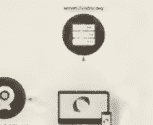

Dyn 使用一条规则向中小企业/消费者细分群体显示导航菜单的精简版。

menu，而个人和中小企业解决方案在导航中被分配了一个较小的角落。电子商务团队担心，访问该网站的中小企业访客可能不会注意到导航中的那个角落，并认为 Dyn 不适合他们。

团队需要一种方式，向中小企业和消费者展示 Dyn 与他们的需求相关，但不能以牺牲公司企业业务为代价。Dyn 使用基于规则的个性化，在中小企业访客登陆网站时实时修改网站的导航菜单。该公司根据特定的引荐 URL 或来源引荐搜索词、之前访问过的特定产品页面以及/或之前购买的产品，创建了一个中小企业/消费者访客细分群体。

当中小企业/消费者细分群体中的任何人在网站上时，一条简单的规则会动态修改网站导航，为该群体显示更相关的体验。这些访客看到的是菜单的精简版，中小企业/消费者产品被突出显示。所有企业链接对这些访客仍然可访问，位于导航名为“企业”的新标签页中。与此同时，原始导航仍显示给所有不属于中小企业/消费者细分群体的其他访客。

通过这种对网站导航的微妙个性化，Dyn 的电子商务产品平均订单价值提高了 20%，转化率提高了 7%——且对其企业解决方案没有负面影响。

Dyn 的案例研究是一家公司通过单个个性化活动显著提高平均订单价值和转化率的示例。值得注意的是，它仅使用一个简单的细分群体和一条规则就创造了这种体验。该公司的小规模活动产生了相当大的影响。

但假设它想在导航个性化方面做得更多。假设它想突出显示中小企业或企业访客在网站上最常参与的产品，并希望对“资源”标签下的内容进行排序，以关注访客尚未查看的资源。这种类型的个性化可以使用规则来实现，而合适的个性化解决方案可以实现添加、管理和优先级排序规则以达成此目标。

但添加的规则越多，一切就变得越复杂。仅在 Dyn 网站的这一小部分区域进行个人级别个性化就需要几条规则。要个性化网站的其余部分，公司需要设置和管理数百甚至数千条规则。这根本不可扩展。很容易失去对大量并行运行的活动的跟踪。如果出问题，故障排除将变得极其困难且耗时——更不用说构建所有这些规则并设计相应体验所需的努力了。

也就是说，在合适的情况下，使用动态变量——一种更具可扩展性的基于规则的个性化形式——可以帮助简化某些基于规则的活动。例如，如果 Dyn 想更多地迎合其企业潜在客户，也许作为其 ABM 策略的一部分，专门针对其前 150 个战略账户，他们可以使用动态变量向其展示相关的个性化欢迎消息和行动号召。与设置 150 个带有 150 条规则的单独活动相比，他们可以实施一个活动，将账户名称作为变量填入。

虽然规则非常适合 Dyn 在其网站导航中使用的那种基于细分群体的个性化，但这种方法远不适合一对一的个性化。那种类型的个性化使用机器学习算法更容易实现，我们将在稍后介绍。

### 预测细分群体（自动聚类）

如我们在本章开头提到的，并将在下一节中更深入地描述，机器学习已经彻底改变了我们智能且大规模地交付一对一个性化的方式。然而，重要的是要指出，机器学习也在彻底改变数据分析的速度、规模和深度，以产生宝贵的洞察。例如，机器学习可以用于识别具有相似行为和亲和力的访客群体或簇（称为“预测细分群体”或“自动聚类”）。这种算法技术突出了簇之间在转化和行为统计方面的差异，以实现更相关的洞察和定向——基本上使营销人员能够更快速、更轻松地创建更智能的细分群体。

机器学习的应用带来两项关键优势：

### 发现并采取行动解决细分群体之间的差异

机器学习可以帮助您识别现有细分群体中可能难以通过手动检查数据来发现的行为差异。例如，流失客户与留存客户之间行为的关键差异是什么？转化的高价值客户或潜在客户与未转化的低价值客户或潜在客户的属性和行为是什么？有了这些洞察，您可以更快速地响应业务趋势，并创造新机会来推动业务发展。

例如，您可以创建“流失风险”细分群体或“潜在高价值客户”细分群体，并包含在第一种情况下表现出与已流失客户相似行为的人，或是

第二群体中的现有高价值客户。利用这些细分群体，您可以随后通过数字和物理渠道创建适当的个性化体验，以鼓励高流失风险客户留存，并促使潜在高价值客户购买。

### 发现并采取行动针对新兴趣细分群体

在对访客、客户、潜在客户或购物者进行细分时，部分细分群体的价值显而易见。然而，数据中很可能还有其他对您最初并不明显，但会随着数据分析而显现的有价值受众。例如，您可能会发现，对某一类别或产品有亲和力的潜在客户，其转化率远高于其他人。或者，您可能会发现，在您网站上阅读案例研究的访客，通常处于您解决方案购买漏斗的更深层次。自动聚类可以得出这些洞察，并识别出您可以随后用相关的个性化体验进行定位的群体。

预测性细分可帮助您识别您原本可能不知道的有价值细分群体，并了解这些群体的独特之处。毕竟，如果不知道哪些是最值得定位的细分群体，创建细分群体并向其提供定制体验就没有任何好处。没有该知识，您就只能依靠对不同受众如何以及作何反应的最佳猜测。机器学习可以消除细分中的猜测成分。

### 机器学习个性化：实现一对一的梦想

既然我们已描述了如何使用规则将体验定位到细分群体，以及如何将机器学习应用于细分，那么我们终于可以探讨机器学习如何将一对一个性化的梦想变为现实了。

但首先，让我们提出另一个重要定义。**机器学习个性化**利用算法和预测分析，为每位访客和客户动态呈现最相关的内容或体验。

本质上，机器学习个性化提供了一种高度可扩展的方式，为您的访客和客户提供独特体验——一直细化到个体层面。从推荐产品、类别、品牌、文章、促销和优惠，到动态修改网站导航、搜索结果和列表排序，机器学习皆可实现。

算法因亚马逊和Netflix等家喻户晓的品牌而广为人知，它们不仅仅适用于大型电商公司。任何规模、任何行业的公司的营销人员都可以使用算法。尽管算法比规则稍微复杂一些，但有了合适的解决方案，营销人员或其他业务用户也可以创建和管理算法。

因为一个算法可以完成数千条规则的工作，算法最终带来更简单的部署。因此，如果您希望根据每位访客的行为和个人偏好，为其个性化网站导航，以包含最相关的链接——而无需构建数千条规则——您将使用机器学习。或者，举另一个例子，如果您希望向忠诚度计划中的一千万客户发送一封批量邮件，同时仍允许每封邮件包含相关优惠、内容和促销——您也会使用机器学习。

首先，了解机器学习算法的构成要素很有帮助。假设您将使用可自定义的算法——您确实应该这样做——您将首先选择一个或多个基础算法。应用筛选器以包含或排除特定变量。添加增强器以考虑个人偏好。最后，确定是否要应用任何变体。我们将在下文更深入地描述算法的这些要素，并以产品或内容推荐为例保持一致性。

但正如我们将在本书其余部分阐明的那样，算法的用途远不止于推荐。

### 基础算法

基础算法是提供推荐和个性化体验与互动的基础。在选择基础算法时，您有机会告诉机器从哪里开始选择要推荐的项目。有一些您可能已经熟悉的基础算法，以及利用高级机器学习原理的更复杂算法。

### 基本算法

基本算法通常依赖于特定条件或“大众智慧”。最常见的一些包括：

- **热门趋势：** 项目的推荐基于特定时间段内网站上最受欢迎的内容。
- **最近发布：** 项目的推荐基于最近添加到网站的内容。
- **即将过期：** 推荐项目根据其即将到来的过期日期进行优先排序。
- **协同浏览：** 项目的推荐基于网站上其他人也浏览过的内容。
- **协同购买：** 项目的推荐基于网站上其他人也购买过的内容。
- **相似项目：** 项目的推荐基于产品类型或类别的相似性。

不同的基础算法适用于不同的用例。例如，零售商可能希望在主页上突出显示热门趋势或最近发布的项目，同时在产品详情页（PDP）上推广协同浏览项目——或者完全做其他事情。这完全取决于网站的目标。

### 高级算法

高级算法复杂且精巧。例如，基本算法会将产品 X 显示给每个查看过产品 Y 的人，而高级算法则为每位个体预测最佳体验，并随着可利用数据的增多而随时间变得更聪明。以下是一些最常见的：

协同过滤：基于访客与不同项目的互动，他会被归入一群喜好和厌恶相似的人群中。然后通过将他与其群体中其他人进行比较来推荐项目。（例如，Netflix 使用此技术。）

随机森林（决策树）：检测影响个人转化旅程的最佳转化路径、操作和内容。然后算法使用这些路径，在正确的时间向他展示正确的下一步。

上下文盗贼：使用明确的已知访客数据，此算法甚至在用户通过行为表现出兴趣之前，就能选择最佳转化的优惠和促销。（我们将在第6章讨论测试时更详细地描述此算法。）

**文本分析：** 利用自然语言处理（NLP），此算法确定访客消费的文本内容中最强的关键词，并使用该语言来影响个性化体验。

详细讨论这些算法的具体运作方式超出了本书的范围，但有了合适的解决方案，营销人员可以自行测试和实现此类算法。正如我们将讨论的，正确的方法通常是结合多种算法，为特定用例构建自定义混合算法。

### 筛选器

许多营销人员不愿意将数字体验交给机器，这种担忧完全可以理解。您可能非常了解自己的产品、内容和类别，放弃对如此重要事物的控制权可能会令人不安。但您绝不应该完全放弃控制权。选择筛选器和其他变量可让您始终掌控局面。

在选择一个或多个基础算法后，您可以使用筛选器包含或排除某些标准来对其进行自定义。筛选器让您能够控制推荐中显示的类别、品牌、价格范围、位置和其他属性。换句话说，您可以为机器学习驱动的体验添加人工指导。

使用筛选器的原因有很多。一个原因是利用您对业务、产品或内容的了解，提供更有帮助的推荐。

例如，零售商可能希望使用产品详情页（PDP）上的推荐，帮助购物者找到同一类别的其他产品。例如，在服装网站上，零售商可能希望浏览鞋子的购物者只看到其他鞋子的推荐。在这种情况下，零售商将应用一个筛选器来 *仅包含* 那一个类别。其他零售商可能决定使用 PDP 推荐来促进追加销售，例如，在购物者查看连衣裙时推荐珠宝和其他配饰来“完善造型”。在这种情况下，筛选器将 *排除* 所显示产品的类别。

专注于需求生成的 B2B 网站也可以利用筛选器。大多数需求生成网站拥有大量内容资产，以及网站上许多可用于推荐该内容的网页。在介绍公司如何服务金融服务行业的网页上，营销团队可以选择仅包含金融服务类别的内容（电子书、案例研究、博客文章等）。或者，假设同一 B2B 网站在潜在客户注册网络研讨会后有一个感谢页面。网站营销团队可能希望在她注册后展示几项相关内容资产供其阅读——以让她在网站上保持互动，而不是进入一个死页面。团队可能希望为该页面 *排除* 网络研讨会作为内容类型（因为她已经注册了一个），而是展示她可以立即浏览的其他资产类型。

您也可以使用筛选器出于业务原因应用限制。例如，由于制造商的请求，零售商可能希望从其竞争对手品牌 B 的产品页面中排除品牌 A。在这种情况下，品牌 B 的产品不会显示在品牌 A 产品页面的推荐中，反之亦然。专注于需求生成的 B2B 网站可能希望仅在网站的几个特定区域中包含特定主题或关键词的内容推荐，以使其与公司

目标或营销日历。在这种情况下，只有围绕某个特定主题的内容才会在特定时间进行推广。

### 推动器

接下来，推助器允许您整合并优先考虑网站上每个人在品牌、类别、价格范围、颜色、性别、内容类型、关键词等方面的具体偏好。这些偏好可以通过对每个人进行深度行为跟踪来确定——这不仅包括访问者点击了什么，还包括鼠标移动、滚动、无活动状态以及每个页面的停留时间——并结合您可用的所有其他客户数据，以清楚地表明偏好和兴趣程度。我们将在第 4 章中详细介绍这一点。

当您能够解读所有客户数据时，就可以发现每个人的个体偏好和亲和力，并利用这些信息对算法结果进行“提升”，使其在一对一层面上更加相关。尽管高级算法已经在一对一层面上具有相关性，但推助器允许您对甚至基础算法进行个性化定制。

有多种不同的方式可以将推助器应用于完全个性化您的体验和推荐。它们可以确保个人的喜爱品牌在整个网站上得到优先展示，让她看到其偏好价格范围内的推荐，或者让她看到与其偏好主题相关的内容，或与其购买旅程所处阶段相一致的内容。

例如，如果一家鞋类零售商为其主页上的产品推荐选择了“热门”基础算法，它将显示当时在网站上最受欢迎的鞋子。为个性化这些推荐，它可以选择应用品牌推助器。一位访客可能主要看到 Vans 鞋子，而另一位访客可能看到 Steve Madden 的鞋子——这取决于访客跨渠道购买过的品牌。请注意，虽然原始基础算法只会显示当前流行的任何商品，但应用推助器允许零售商既显示流行商品，又与个人相关。

类似地，B2B 网站可以在其博客上利用推助器为每位购物者提供相关文章推荐。它可以选择“最近发布”基础算法向所有读者推荐最新的博客文章，然后应用类别推助器使推荐个性化。一位访客可能会看到分析类别的博客文章推荐，而另一位访客则会看到项目管理类别的推荐。

最后举一个例子。一位在银行网站上研究信用卡的访客，可能会看到其他访客查看过的产品，使用的是“协同浏览”基础算法。为了使这些推荐更加个性化，该算法可以根据访客的个人偏好（例如联名卡或返现奖励）提升最相关的功能。

### 同时使用推动器和过滤器

值得注意的是，推助器和过滤器看起来可能非常相似，因为您使用它们来处理相同的变量（例如品牌、类别、价格等），但两者有明显区别。过滤器允许营销人员更好地控制要显示哪些*类型*的商品，而推助器允许营销人员个性化显示的*具体*商品。

举个例子。许多服装零售商提供不同类别的产品（例如男士、女士、儿童）。某零售商可能选择应用类别 **过滤器** 来仅推荐 PDP 上与正在查看的商品处于同一类别的其他商品。在这种情况下，在查看女士衬衫时，购物者只会看到其他女士服装的推荐，而不会看到男士或儿童产品。显然，过滤器优化了被推荐的商品。

在同一示例中，添加 **推助器** 可以进一步个性化推荐的女士衬衫。例如，添加品牌和颜色推助器将利用购物者在这些类别中的偏好，网站将推荐她喜爱的品牌和颜色的女士衬衫。

同样，专注于需求生成的 B2B 网站可以对主页上的内容推荐应用过滤器，仅显示电子书，而不显示其库中的任何其他内容类型。但可以通过应用推助器来进一步个性化推荐，以突出显示最适合单个访客购买旅程阶段的特定电子书。

无论您选择应用过滤器、推助器还是两者都应用，完全取决于您的目标和特定访客的需求。然而，一般来说，您可以使用推助器对推荐进行越多的个性化定制，其效果就会越好。

### 变体

最后，您可以决定在算法中包含一些变体。这些变体可以采用多种形式。例如，您可以将主页推荐设置为随机（同时仍对每个个人保持相关性），以保持新鲜感，或者您可以限制向某人展示推荐的次数，以减少冷漠感。

与本章中描述的算法的所有其他方面一样，是否包含变体以及选择哪种变体完全取决于您。这取决于您认为什么对于特定客户的需求最有效。

### 案例研究：ZUMIEZ

ZUMIEZ 是一家多渠道专业零售商，销售滑板、单板滑雪、

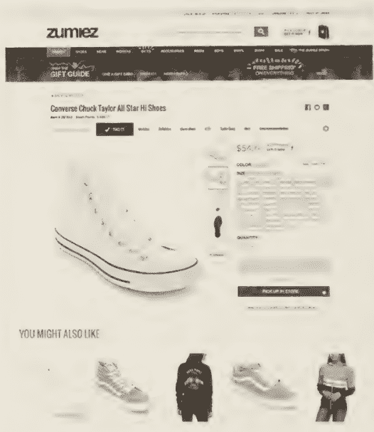

ZUMIEZ 利用机器学习算法在 PDP 上的“你可能也会喜欢”部分显示个性化推荐。

冲浪生活方式，并以其独特的客户体验为傲，多年来一直在不断突破，开发个性化体验。ZUMIEZ 购物者在 ZUMIEZ 网站上（从主页到结账）获得真正的一对一体验。ZUMIEZ 会响应购物者的个人偏好，指导他们看到哪些品牌、发现哪些产品，以及接触哪些内容。

例如，ZUMIEZ 在其产品详情页（PDP）的“完整造型”、“你可能也会喜欢”和“最近浏览”区域放置推荐。ZUMIEZ 还直接在搜索结果中提供个性化推荐，帮助购物者更快地发现新产品。在这两种情况下，购物者偏好的品牌和风格都会用于创建相关的产品推荐。

ZUMIEZ 的努力已经取得成效。在网站某个 PDP 上查看并点击产品推荐的购物者，比没有点击推荐的购物者在网站上的停留时间长近四倍。而且，点击产品推荐的购物者转化为购买的频率是未点击推荐的购物者的 2.7 倍。这些购物者每笔订单的消费也多 2%。

正如案例研究所解释的那样，ZUMIEZ 在其网站上利用高度个性化的推荐，并从中获得了更高的参与度、转化率和订单价值。如果使用规则，将所有这些数据整合起来以实时提供个性化体验是不可能的。而且，虽然产品推荐可以追溯到 20 世纪 90 年代，但它们不足以对每个人进行个性化定制。机器学习正是在改变游戏规则，并实现我们 20 多年来一直被承诺的一对一梦想。

虽然我们将在书中稍后深入探讨这一点，但值得注意的是，一对一个性化的另一个重大飞跃是能够将这种机器学习个性化不仅应用于产品或文章，而是应用于几乎任何事物。类别、关键词、导航、促销、徽标、工具、资源、视频、电子书、品牌、号召性用语、漏斗步骤等，都可以基于个人的兴趣和身份，通过算法进行个性化定制，以向其展示最相关、最整体的体验。

今天，机器学习通常被前瞻性的营销人员和电子商务专业人士使用。明天，它将被企业中的业务用户普遍使用。

## 第 2 章 尾注

- 26. 计算机科学. Dictionary.com. Dictionary.com Unabridged. Random House, Inc., http://www.dictionary.com/browse/computer-science?s=t.
- 27. 人工智能. Dictionary.com. Dictionary.com Unabridged. Random House, Inc., http://www.dictionary.com/browse/artificial-intelligence?s=t.

## 第 3 章 格局思维，跨渠道思考

在你开始阅读本书之前，当你想到个性化时，脑海中会浮现什么？对一些营销人员来说，个性化仅仅意味着在电子邮件群发中包含姓名或公司字段。对另一些人来说，这意味着网站上的亚马逊式推荐。而对还有一些人来说，这意味着在特定渠道（如网站或移动应用）上向人们展示个性化消息或优惠。无论您当前的个性化策略包含什么，回顾各种渠道上的个性化机会范围都是值得的。

跨渠道营销是各行业营销人员面临的一项重大挑战。如果您当前或潜在的客户通过多个不同渠道与您互动，仅掌握单一渠道的营销传播是不够的。对于大多数公司，可以相当肯定地假设他们确实如此。到 2020 年，世界上每个人将拥有四台联网设备。28 到 2025 年，将有 50 亿移动互联网用户。29 并且 Forrester 预测，到 2022 年，美国总零售销售额的 58% 将受到数字影响（换句话说，超过一半零售销售的购物旅程中有一部分将通过数字渠道进行）。30

当然，营销人员已经从根本上理解了跨渠道营销的重要性。根据一份 Forrester 报告，66% 的营销人员表示应整合跨渠道营销活动。31 问题不在于他们不认识到这种营销的重要性：问题在于执行。同一份报告发现，只有 5% 的企业相信自己真正具备提供出色跨渠道体验的组织能力。32

为何会出现这种脱节？我们常常看到，预算、技能和技术访问权限分散在公司的 IT、营销和其他业务部门中。当执行此操作所需的技能和技术是分散的时，要跨渠道创建和衡量综合营销活动的成功是困难的。

营销内部甚至存在组织和技术上的不协调。不同学科的营销人员（内容营销、数字营销、产品营销、营销运营等）通常使用一套多样化的客户分析工具和其他系统。每个系统都包含有用的客户信息和洞察片段，但没有一个系统拥有完整的图景。

尽管这些挑战使跨渠道执行通用营销计划变得困难，但随着个性化的引入，这些挑战只会变得更加突出。毕竟，如果针对单个个人在五个不同系统中有五个不同的个人资料，就几乎无法以相关方式个性化体验。无法跨渠道识别并与单个人沟通的这种无能，是营销人员在跨渠道个性化方面面临的最大挑战之一。

尽管存在挑战，但在当今的多渠道世界中，做好跨渠道客户体验是值得付出努力的。在本章中，我们将重点介绍个性化的最重要渠道，并探讨跨渠道有效执行个性化的某些挑战（及解决方案）。

### 个性化的关键渠道

想想作为消费者，在你自己的日常生活中与公司互动的方式。在大多数情况下，您会使用他们的网站，无论是桌面端还是移动端。当有可用的移动应用时，您也可能会使用它。您可能会收到许多公司和品牌的定期电子邮件，无论您是否阅读它们。您很可能在 Facebook 或网络上的其他地方看到该公司的广告。您甚至可能会收到该公司的实体邮件。您可能还不时地与代表公司或品牌的人进行互动，无论是当面还是电话。

当我们谈论跨渠道个性化时，我们指的是利用上一章中描述的规则和机器学习算法，在每种通信方式中提供一致且相关的体验的能力。下面，我们将对每个渠道提供详细信息和案例研究。

### 网站

许多营销人员将其网站视为最重要的数字渠道——这也是有充分理由的。无论您的目标是推动在线销售、获取潜在客户还是最大化页面浏览量，通常都有一些关键操作，您希望访问者在您的网站上执行（例如，注册、下载、加入购物车、购买等）。因此，您的许多在线营销活动都专注于为网站引流，并鼓励人们采取这些步骤。鉴于其重要性，网站通常是营销人员开始应用个性化的第一个渠道之一。

营销人员往往认为个性化发生在网站的特定位置，例如 CTA 按钮、产品详情页上的产品推荐，或主页上的一个或两个个性化小部件。如上一章所介绍，网站的任何区域都可以利用规则或算法来提供更相关的体验，从英雄图片；到受推广的类别；再到导航、内容和产品。

考虑到网站的重要性以及它在许多营销人员策略中所占据的核心地位，将网站与其他渠道相连以确保无缝的跨渠道体验至关重要。营销人员为网站引流做了大量工作，因此当人们到达网站时，为每个人提供相关且引人入胜的体验是合理的。每个页面都应该是个性化的登录页面。

### 案例研究：卡特拉

Cartera Commerce 与提供忠诚度计划的领先航空公司合作，为航空公司客户提供一种方式，通过在 900 多家他们已经熟知和喜爱的零售商处购物来赚取更多里程、积分或现金。该公司经常向其常客发送包含促销优惠和其他信息的电子邮件。Cartera 希望有一种方式，在购物者浏览网站时提醒他们这些电子邮件优惠。但由于这些优惠并未发送给所有购物者，Cartera 需要个性化网站体验，仅显示购物者已通过电子邮件收到的优惠。

通过将数据仓库中的数据输入其个性化和客户数据平台，Cartera 能够促进其电子邮件和网站优惠之间的一致性。结果，该公司实现了来自流失购物者访问关联商店流量 14% 的增长——这是该公司的一项关键目标。

### Web 应用

对于 SaaS、金融服务、出版以及有时零售等基于订阅的行业，登录环境——即“Web 应用程序”——通常是与最终用户和客户互动的主要界面。个性化登录环境存在巨大的机遇，包括识别用户何时需要帮助并将他们引导至相关资源，利用功能让他们从产品中获得最大价值，将他们有限的注意力引向相关产品和内容，以及识别流失风险和追加销售机会。

### 案例研究：EIG

Endurance International Group (EIG) 是一家提供基于云的平台解决方案的供应商，旨在帮助中小企业主在线取得成功，该公司利用应用内个性化在客户生命周期的不同阶段与客户“即时”沟通和互动。例如，在为客户提供网络托管服务时，EIG 发现了一个向特定受众提供高级网站创建工具的追加销售机会。通过利用应用内个性化在合适的时间向用户展示追加销售 CTA，该公司实现的转化率是其传统促销电子邮件活动产生转化率的四到五倍。

在相关示例中，EIG 的 HostGator 品牌利用应用内个性化来减少客户支持咨询和成本。EIG 识别了客户遇到的常见技术问题，并利用个性化主动提供提示和建议以及最

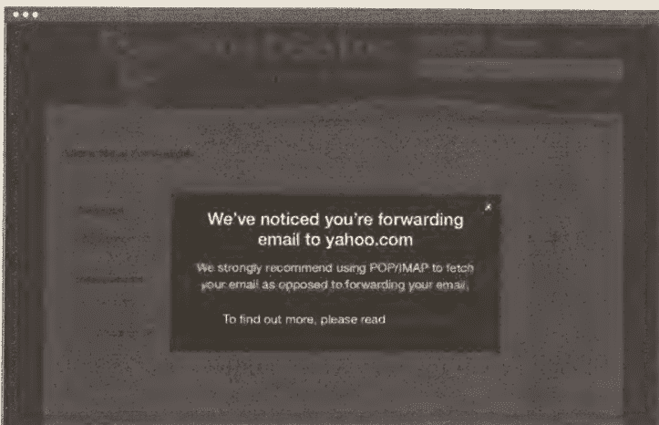

EIG 的 HostGator 品牌个性化其 Web 应用体验，以便为用户提供即时支持。

相关自助文章。该公司估计，在头六个月里，它已将成千上万的支持电话和在线聊天转至自助选项。

与所有渠道一样，将 Web 应用与其他渠道关联可提供更相关的体验。技术提供商可以根据用户在初步研究期间在网站上的行为，确定其对产品感兴趣的领域。在用户转化并开始使用产品后，它可以利用这些信息。例如，它可以向用户展示介绍性视频或应用内导览，突出显示用户可能认为对该用例有价值的功能。公司甚至可以发送一封欢迎邮件，其中包含与该用例相关的资源——从而关联到另一个渠道。

### MOBILE APP & PUSH NOTIFICATIONS

移动应用已成为吸引和与日益不受束缚的受众互动的重要方式。事实上，超过三分之一的消费者表示，他们预计未来三年内移动应用和网站会更加个性化。⁴ 然而，尽管营销人员在网站个性化方面取得进展，移动端有时却被置于次要地位。

移动设备上的个性化与网站和 Web 应用个性化非常相似：它帮助用户找到最相关的内容、类别和产品。但个性化对移动体验更加关键。在桌面网站上，访问者可以寻找与其相关的内容。虽然这不是理想情况，但较大的屏幕允许访问者在大量信息中搜索，在不得不寻找时找到所需内容。但移动设备较小的屏幕使这变得困难得多。营销人员需要快速向移动用户呈现相关信息，以免用户在找到所需内容前就放弃。这时，利用规则和机器学习算法针对不同细分群体和个人进行定向就派上用场了。

例如，旅行应用可以仅向过去一个月内预订过机票的用户分享特定优惠。或者，电商应用可以提供个性化推荐，增强品牌和价格亲和力，帮助购物者快速轻松地找到相关产品。

移动营销活动很重要。但将移动端与其他渠道关联，可提供更具高影响力、更相关的体验。

### CASE STUDY: PCH

PCH.com 是 Publishers Clearing House 的网络目的地，后者是多渠道直销商，销售性价比高的商品、杂志和促销优惠，并是数字“玩赚”娱乐的领先提供商。它运营多个网站；当访问者在这些网站上玩更多游戏时，PCH 可以推广更多产品并展示更多广告。与此同时，访问者会积累更多代币，赢得更多奖品的机会。

然而，由于其桌面端和移动端网站之间缺乏连接，访问者在不同网站之间的体验截然不同。一旦访问者在一个网站上完成游戏，就会被鼓励访问其他 PCH 网站。但公司无法将推荐限制在当天未访问过的网站，因此访问者会收到他们刚玩过的游戏。此外，PCH 只能在访问者处于电商页面时提醒其遗弃的购物车商品。公司希望降低购物车遗弃率，提醒访问者购物车中留下的商品，无论他们身处 PCH 宇宙的哪个位置。

通过为每个访问者统一多个网站和应用上的体验，并提供个性化的提醒消息，PCH 在实施后的第二天实现了 36,000 美元的收入增长，并在 90 天内实现了超过 100 万美元的增量收入。

推送通知是移动端个性化的另一个重要领域。推送通知是公司可以发送给用户的消息，前提是用户的手机或平板电脑上安装了该公司的移动应用。用户无需正在使用该应用甚至无需使用手机就能收到推送通知。它只需出现在用户的设备上，看起来类似于短信或其他移动警报。因此，推送通知对于触达受众非常有效。

但在考虑推送通知时，不要忘记人们与移动设备之间通常存在的紧密联系。对许多人来说，手机是睡前最后看到的东西，也是醒来后首先看到的东西。一家公司估计，普通人每天要触碰手机高达 2,617 次！¹ 该设备已成为人们自身的延伸。因此，移动用户希望感到自己能控制手机上显示的内容，并会迅速更改设置以避免任何他们觉得烦人的通知。

因此，确保您发送的任何推送通知对接收者来说真正相关且有帮助至关重要。例如，新闻应用可以识别出用户通常在移动应用和桌面网站上都阅读关于政治和娱乐的内容。该应用可以仅向用户发送这两个类别的突发新闻——而不是，例如，体育新闻。通过更少、更相关的通知，用户更可能将推送通知视为其应用体验中有价值的一部分，而不是一项烦扰。

### EMAIL

电子邮件无疑仍然是一个关键的沟通渠道——如今几乎所有企业都在使用。在考虑电子邮件时，始终要考虑您的收件人每天收到多少封电子邮件。Radicati Group 估计，2019 年每天发送和接收的电子邮件总数将达到 2930 亿封。到 2023 年底，该数字预计将达到 3470 亿封。³⁵ 穿透这种噪音对所有企业都至关重要，确保您发送的每封电子邮件都与您触达的每个个人都相关是一个很好的起点。您不希望被用户屏蔽。

许多营销人员已经在其电子邮件中某种程度上利用了个性化。事实上，电子邮件是最个性化的渠道。然而，绝大多数营销人员只是在电子邮件中加入收件人的名或公司名称，或依赖基本细分来个性化其电子邮件。³⁶ 这些策略只是起点。让我们花些时间来探索个性化电子邮件的更高级方式。

### "OPEN-TIME" EMAIL PERSONALIZATION

为确保您的电子邮件内容对个人相关，您需要考虑您跨渠道了解的关于该人的所有信息，特别是关于个人行为、历史和偏好方面。这可以通过利用我们在第 2 章中描述的相同规则和算法来实现。

但对一个人在某个时刻相关的内容，对同一个人后来可能已过时。而且我们都知道，您无法控制电子邮件何时以及如何被打开和阅读。一旦电子邮件离开您的服务器，收件人就会选择何时消费信息。他们可能在发送后的一分钟、一天或一周内打开它。

在此期间，情况可能会发生变化。收件人可能已经查看了您发送的内容，购买了您电子邮件推广的产品，采取了您电子邮件建议的行动，或者完全改变了兴趣。为了对该收件人高度相关，您的电子邮件内容应在打开时更新。

这是如何运作的？通常，当电子邮件被打开时，收件人的电子邮件客户端（例如 Microsoft Outlook 或 Gmail）会向服务器发送请求以提供要显示的图片。如果您使用的是打开时电子邮件个性化，个性化平台会在消息打开（或重新打开）的那一刻，智能地决定显示哪些图片。此决定将基于它了解的关于收件人的所有信息，并考虑该人跨渠道的最新行为。个性化内容可以是产品推荐、促销优惠、电子书或视频建议，或只是信息性消息。

比方说，零售商向一位常客发送一封包含三项产品推荐的电子邮件。在公司发送电子邮件和客户打开它之间，客户已通过移动应用购买了产品 1，产品 2 缺货，产品 3 降价。当他打开电子邮件时，产品 1 和产品 2 将被替换为不同的（但仍相关）推荐，产品 3 的价格将被更新。

同样，基于 Web 的应用程序可以为新用户提供包含多个在预定时间发送的电子邮件的引导流程。如果流程中的第二封电子邮件包含一个号召性用语，要求用户在应用程序中执行其已经完成的操作，那么电子邮件可以改为建议她采取另一个相关操作，或向她推荐适当的资源。

### CASE STUDY: INVALUABLE

Invaluable 是全球领先的美术品、古董和收藏品在线交易市场。美术品和古董收藏家以其精致且高度个性化的品味而闻名。有些人希望建立一个跨越多位艺术家或流派的独特作品私人收藏，而另一些人则对极度特定的独一无二的作品感兴趣。千篇一律的沟通无法满足品味迥异的这些个人。

作为其个性化电子邮件计划的一部分，Invaluable 向客户发送包含基于每个人特定偏好定制推荐的批量电子邮件。这些推荐在打开时更新，而非在发送时更新，以确保内容是最新的。因此，拍卖并迅速售出的独一无二的商品会从电子邮件中移除，并替换为其他相关商品。借助打开时推荐，Invaluable 的电子邮件点击率提升了 21%。

### TRIGGERED EMAILS

虽然打开时电子邮件个性化能确保在收件人准备好参与时您的电子邮件保持相关性，但触发式电子邮件使您能够在最合适的时刻主动发送相关消息。通常，营销人员发送“批量发送”电子邮件，这些电子邮件会在固定时间（例如每月、每周甚至每天）发送给大量收件人列表。一些营销人员，尤其是 B2B 企业，会向具有相似特征（例如职位、行业、购买阶段等）的特定选入收件人群发送自动化的“培育”电子邮件序列。相比之下，触发式电子邮件是在满足特定条件或此后不久发送的一封封单独电子邮件。

此类条件通常包括某人采取或未采取的行为（例如放弃购物车或在一定时间内未登录 SaaS 应用程序）、目录更新（例如产品重新上架或价格降低）或外部条件（例如天气）。

触发式电子邮件在零售领域最常见的用例之一是购物车遗弃。如果一个人将产品加入其在线购物车，但在购买前离开网站或应用程序，他可以收到一封触发式电子邮件，提示他完成购买。但即使他没有将产品加入购物车，电子邮件也可以被触发。如果他花费数分钟与产品互动——阅读评论、浏览图片、选择不同颜色并表明他可能愿意购买——零售商可以立即发送一封电子邮件，询问他是否现在准备购买该产品。

### CASE STUDY: CARHARTT

Carhartt 成立于 1889 年，是一家以工作服闻名的专卖零售商，产品包括夹克、外套、工装裤、连体工装服、背心、衬衫、牛仔裤、工装裤和阻燃服装。许多 Carhartt 的客户会一贯购买同样的工作衬衫或靴子——这些产品与他们的父母使用过的、以及祖父母之前使用过的产品相同。虽然每位客户都认同 Carhartt 品牌及其所代表的理念，但他们各自都有特定的需求和偏好。Carhartt 利用对每位购物者的深入了解，跨渠道提供相关体验。例如，当购物者遗弃购物车时，Carhartt 会向他或她发送一封包含遗留商品的触发式电子邮件。公司利用此机会向购物者展示其了解其需求，方法是包含购物者可能喜欢的其他相关产品。

这些触发式购物车遗弃电子邮件结合个性化推荐，使转化率提升了 7 倍。

当然，其他行业也可以使用触发式电子邮件。技术提供商可以在其网站上设置一个页面，要求访问者填写表格以获取免费试用或请求产品演示。如果访问者来到此页面但未完成表格，公司可以发送一封由该行为触发的电子邮件，请求该人采取行动——或许还会提供激励或替代行动以推动转化。

不仅如此。保险公司可以在暴风雨期间发送关于如何提交风暴损害索赔的内容。旅行公司可以在暴风雪期间发送推荐海滩度假的电子邮件。内容发布者在拥有与收件人兴趣相关的新文章时，可以向个别订阅者触发一次性电子邮件。触发式电子邮件的应用前景无限。

### PERSONALIZING THE FREQUENCY AND TIMING OF BULK EMAIL CAMPAIGNS

触发式电子邮件很有用且效果显著，但不能在所有情况下都使用。有时，营销人员有一条特定的消息或促销活动想要向广大受众传达——无论是整个电子邮件列表还是其中一部分。在每周促销电子邮件或月度通讯等批量电子邮件有价值的那些情况下，它们很有用。但为了减少电子邮件杂乱，营销人员可以避免向所有人无差别地发送这些电子邮件。他们可以改变发送频率和时间，以匹配每个人的隐式偏好。

要发送更好的批量电子邮件，您可以关注哪些收件人经常打开并参与您的电子邮件，哪些偶尔这样做，哪些从不打开任何电子邮件。然后，您可以根据这些信息改变电子邮件的发送频率。例如，如果您想发送一封电子邮件通讯，为列表中的每个人突出显示相关的近期博客文章，您可以使用打开时个性化来实现。但是，某人是否会收到这次特定的群发邮件，将取决于他过去如何参与您的电子邮件。从未打开过此通讯的人可能不会收到，而总是打开的人肯定会收到。

除了发送频率之外，您还可以考虑每个人最合适的发送时间。也许有人更可能在清晨打开电子邮件，而另一个人则倾向于在傍晚通勤期间打开电子邮件。

本质上，与其依赖何时以及发送多少封电子邮件的通用最佳实践，不如使用机器学习算法了解每个人如何参与，然后系统会为该人选择最合适的频率和时间。

将这些不同类型的电子邮件个性化分别或共同使用，您可以发送更加相关和及时的通信，并打破喧嚣。

### SEARCH

任何网站上的搜索功能都非常重要，因为它是帮助客户查找和发现产品及内容的关键渠道。使用搜索功能的访问者会明确说明他们在寻找什么，而且在许多情况下，他们比不使用搜索的访问者更接近转化。然而，搜索一直是个性化方面被传统地低利用的渠道，搜索结果对许多公司来说臭名昭著地无效。有了营销人员可以跨渠道对每位访问者收集的所有数据，情况不必如此。

要充分利用您的站内搜索，您应向访问者展示最相关的产品或内容，并尽可能减少努力（以及尽可能少的

| 建议 | 产品 |
|------------|---------|
| AVERY | Avery Oxford 衬衫 $210.00 |
| AVAILABLE | Olive Bushwick 紧身牛仔裤 $195.00 |
| ANKLE | Henley T恤 $125.00 |
| ARISTOCRATIC | 美利奴 V 领套头毛衣 |
| ANTIPOLITICAL | 平前裤 $195.00 |
| AGAINST | |
| AND | |
| AA | |
| AROUND | |

此网站会直接在搜索栏中显示个性化搜索结果，这些结果根据访问者的类别偏好进行选择和排序。

点击）越少越好。这意味着您呈现的搜索结果应以独特于每个人的方式进行选择和排序，依据是访问者的意图和偏好。

让我们来看一个访问过多次电子商务网站的访问者的示例。当他开始在搜索栏中输入内容时，即使尚未输入完整的单词，也可以根据网站迄今为止了解的关于他的信息，向他提供他可能感兴趣的产品。如果他几乎总是浏览男装，并且主要是男裤，那么该类别中的男装应排在前面。

现在让我们看一个内容示例。假设某人第一次访问一个团队生产力解决方案网站。她导航到网站的资源部分，并开始搜索与该领域相关的通用术语。在搜索结果中，网站应优先显示与她所在行业（可自动检测——下一章将详细介绍）和她所处的旅程阶段（初始阶段）相关的资源。因此，尽管她的搜索比较通用，搜索结果也能帮助她找到更可能与她的具体需求相关的内容。

简而言之，考虑每个人偏好和意图的搜索结果将提供与个人相关的产品和内容，而不仅仅与搜索词相关。

### DIGITAL ADVERTISING

数字广告是营销人员长期以来跨行业用于提高知名度和引流的策略。但请花点时间考虑当今世界存在多少广告杂乱。经常引用的数字显示，普通人每天接触的广告数量为 5,000 条——尽管对该数字的准确性存在一些争议。7 无论具体数字如何，我们都可以同意，普通人每天接触到非常大量的广告，多过任何人所能

实事求是地吸收。对于营销人员来说，要在所有这些杂乱信息中脱颖而出可能很困难，特别是在展示广告时，目标受众正专注于其他任务（例如，在发布者的网站上阅读内容或浏览社交网络的动态消息）时。

个性化可以帮助确保广告对每个观看者都相关，从而更好地吸引每个人的注意力。许多营销人员已经在个性化他们的数字广告，使用“冷”广告和重定向广告（针对之前访问过网站或使用过应用的人群定向的广告）。此类重定向广告通常会包含访问者在网站上查看过的内容相关的内容。然而，该内容通常基于有限数据选择，这通常意味着观看者会看到他们并不真正感兴趣的内容（他们已经购买的产品、已经下载的电子书等）。

相关数字广告的关键是利用您了解的关于一个人在所有渠道与您的品牌互动的所有信息。这将确保广告被视为有价值、相关的消息，而非垃圾邮件。

通过重定向，您可以向网站上沟通的相同细分群体（或您创建的任何其他细分群体）投放广告。例如，B2B 网站可以创建特定行业的访问者细分群体，然后在互联网上向这些行业投放相关广告。金融服务网站可以创建曾对学生贷款表现出兴趣的访问者细分群体，然后向这些访问者投放与学生相关的广告。营销人员甚至可以利用其 AdTech 提供商通过相似人群模型向与其细分群体中人群相似的人群投放广告。

### 案例研究：主要航空公司

一家主要航空公司希望在不负面影响转化率的前提下减少重定向广告支出。为了实现这一目标，它试图只定向那些最可能受广告影响购买机票的人——而不是那些无论如何都可能购买的人。

该公司致力于同步其第一方客户忠诚度数据、网站行为数据以及第三方媒体曝光数据（下一章将详细介绍这些数据源）。完成此操作后，它可以识别出曾经放弃网站的忠实客户——那些即使没有广告提醒也极有可能自行转化的客户——并将该细分群体排除在广告之外。结果，该航空公司在保持转化率不变的同时，显著降低了媒体支出。

### 社交

根据全球网络指数，2018 年互联网用户在社交媒体上平均花费 2 小时 22 分钟——年轻受众的数字甚至更高。35 显然，它仍然是触达客户的重要渠道。一些公司拥有专注于一对一回复投诉或问题的营销团队，但您不能忘记社交广告中的个性化。虽然上述概念与广告部分相似，但它足够重要，值得拥有自己的章节。

您可以利用手头关于某个人的可用数据来确定其应获得的社交广告体验。例如，您可以使用预测评分（下一章将描述）来确定，在已知电子邮件地址的购物者中，谁在未来几个月最有可能购买牛仔裤。然后，您可以将这些电子邮件地址传递给 Facebook，并定位这些特定个人（以及相似人群）。您可以对希望通过社交媒体投放特定广告的任何相关细分群体做同样的事情。

当然，不要忘记将广告活动数据回馈到其他渠道的体验中。例如，您可以跟踪哪些个人从广告点击进入了您的网站但未采取行动（购买、下载电子书、请求演示等），并今后在其他渠道以其他方式定位这些人。

### 直邮

直邮听起来可能有点老派，尤其是随着我们的世界日益数字化。但是，各行各业的营销人员继续利用这一经过验证的渠道并从中获得显著价值。随着电子邮件收件箱变得拥挤不堪，发送到实体收件箱的邮件可以脱颖而出。当然，避免“群发轰炸”的通用消息的相同概念也适用于这个收件箱。

与其他渠道一样，您希望使用跨接触点积累的关于客户和潜在客户的数据，通过邮件向他们传递有效的信息。您的目标应当是：

- 分析您的数据，识别可能对直邮有反应的细分群体，并根据该细分群体的兴趣定制邮件中的信息/创意
- 验证（或获取）该细分群体的实体邮寄地址
- 将包含最新邮寄信息的列表导出到直邮服务提供商以进行分发
- 将直邮活动、日期等导入到您的个性化/客户数据平台，以便进一步报告和分析
- 向包含在直邮活动中的客户/潜在客户在数字渠道上定向新的活动和信息

公司如何确定将谁纳入直邮活动？B2B 公司可以向在过去六个月内在其网站上进行过有意义互动或与销售代表交谈过的已知潜在客户寄送其年度活动邀请函。电子商务公司可以向过去曾购买过但过去三个月未购买任何东西，并且对特定类别感兴趣的购物者寄送促销信息。有创意的营销人员可以想出无数个想法，但直邮成功的关键在于数据和细分（加上充足的预算）。

### 人工渠道

人工渠道在某种程度上是最明显的个性化形式：在一对一交谈中，向客户提供个性化体验非常容易。同时，它也是最不被重视的个性化形式，因为许多营销人员没有意识到，他们可以像驱动数字互动一样，使用相同的原则和数据来驱动基于人工的客户互动。您在之前提到的所有渠道中收集的相同宝贵信息，也可以传递给呼叫中心、客户成功和销售人员，以促成更相关的客户互动。

人类可以参与跨渠道个性化策略的五个类别，适用于 B2C 和 B2B：

**呼叫中心/聊天客服：** 如果某人一直在网站上研究信用卡，然后拨打呼叫中心寻求帮助或发起在线聊天会话，当来电者识别自己时，支持代理应能够访问来电者的网站行为。在访问这些数据后，代理可以查看来电者的偏好以及他一直在研究的内容，以提供尽可能相关的帮助。代理可以自行提供帮助，或使用系统提供的基于机器学习的建议。

**门店店员：** 如果购物者一直在无线运营商的网站上研究手机和配件，但后来进入实体店，持有客户关系管理应用的门店店员可以根据电子邮件或忠诚度 ID 查找客户，并获取可与客户讨论的相关促销、优惠和建议。

**网点柜员：** 当客户进入银行并向柜员提供其账户信息时，她可以访问其完整的客户档案。她可以注意到他是否一直在研究任何产品或表现出任何流失预警信号——以便在适当的时候引导谈话走向追加销售或故障排除。

**销售团队：** 正在开拓账户的 B2B 销售人员也可以提供个性化体验。在准备销售通话时，她可以查看与账户关联的所有访问者的活动——包括账户的活动历史、偏好的解决方案、类别和内容——以便在提出探索性问题之前，就将谈话引导到相关方向。

**客户成功/支持团队：** 一旦账户成为客户，支持团队或客户成功团队也可以基于应用内行为提供个性化体验。团队可以掌握账户中用户的登录频率、使用的功能以及其参与度。而不是主动联系询问客户情况如何以及他是否满意

### 跨渠道成熟度曲线

通过该产品，团队可以采取具体行动并提出想法，帮助客户从解决方案中获得更多价值（更不用说尽早识别潜在流失风险了！）

如您从这些示例中可能注意到的，将线上和线下组件联系起来的诀窍是拥有正确的数据，我们将在下一章进一步探讨。

迄今为止我们所解释的内容，对一些营销人员来说可能显得令人不知所措，特别是那些根本不使用个性化或仅在单一渠道使用个性化的人。如前所述，本章中，任何形式的跨渠道营销都很困难。我们交谈过的大多数营销人员在跨渠道个性化工作中的进度，都未达到他们期望的水平。通常，我们看到的大多数策略大致处于以下阶段之一：初级、中级和高级。

初级：此阶段的营销人员通常仅对一个数字渠道（例如网页、移动应用、电子邮件、广告或搜索）进行个性化。他们的个性化工作仅涉及一个团队，主要挑战包括入门、制定策略以及制定可重复的流程。

中级 A：中级阶段有两种不同的路径。在第一种路径中，营销人员已进展到对两到三个数字渠道进行个性化。其主要挑战源于跨多个内部团队协调所产生的困难（我们将在第 7 章中介绍其中的一些挑战）。

中级 B：在第二条中级路径中，营销人员仅对一个数字渠道进行个性化（如初级阶段所示），

| | 初级 | 中级选项 A | 中级选项 B | 高级 |
|---|---|---|---|---|
| 渠道 | 1 个数字渠道 | 2 或 3 个数字渠道 | 与其他系统同步 | 代理交互 + 多个渠道 |
| | Web 移动应用 电子邮件 搜索 数字广告 | Web 移动应用 电子邮件 搜索 数字广告 | CRM 营销自动化 数据仓库 等等 | 呼叫中心/聊天 店内 客户成功 销售代表 |
| 收益 | 仅 1 个团队 | 跨渠道 | 更好的数据，带来更相关的体验 | 完全跨渠道 |
| 挑战 | 入门 | 需要跨团队协调 | 如果未开箱即用，则需数据集成 | 额外集成 |

但他们正在从多个系统同步数据，以提供更精准的体验。他们通常面临数据协调方面的挑战。

**高级：** 高级跨渠道个性化策略融入了人为因素——无论是在呼叫中心、店内，还是来自销售/客户成功专业人员（如前所述）。此阶段技术集成往往是主要挑战。

很明显，大多数营销人员不会直接从静态、不相连的数字渠道一步到位地实现高级跨渠道个性化。相反，跨渠道个性化是一个持续的学习、测试和协调过程。

无论您在成熟度曲线中的位置如何，为了跨渠道实施个性化策略，您需要四个主要组件：

- 1. 跨渠道跟踪行为的能力
- 2. 将组织内多个渠道和系统（CRM、营销自动化、数据仓库等）的数据整合到一个中央位置的能力，例如客户数据平台或“CDP”
- 3. 将这些数据拼接在一起，为每个个人建立单一档案的能力
- 4. 利用所有数据，在每个渠道以一对一级别实时提供个性化体验的能力

实现所有这些目标完全可行，而一切都始于数据。

## 第 3 章 尾注

- 28. Karla Lant，“到 2020 年，地球上的每个人都将拥有 4 台设备,” futurism.com, 2017 年 6 月, https://futurism.com/by-2020-there-will-be-4-devices-for-every-human-on-earth.
- 29. GSM 协会，“2018 年移动经济,” https://www.gsma.com/mobileconomy/wp-content/uploads/2018/05/The-Mobile-Economy-2018.pdf.
- 30. Forrester Research，“Forrester 数据：受数字影响的零售销售预测，2017 至 2022 年（美国），” 2017 年 11 月, https://www.forrester.com/report/Forrester+Data+DigitalInfluenced+Retail+Sales+Forecast+2017+To+2022 +US/-/E-RES140811?objectid=RES140811.
- 31. Forrester Research，“2016 年全渠道商业手册，” 2016, https://www.forrester.com/The+Omnichannel+Commerce+Playbook+For+2017/-/E-PLA850.
- 32. 同上.
- 33. Sitecore，“如何跟上消费者期望的步伐，” 由 Vanson Bourne 进行，2016 年 5 月, http://www.sitecore.net/en/resources/index/white-papers/mobile-research-whitepaper.
- 34. Julia Naftulin，“我们每天触摸手机多少次？” Business Insider, 2016 年 7 月, http://www.businessinsider.com/dscout-research-people-touch-cell-phones-2617-times-a-day-2016-7.
- 35. The Radicati Group，“电子邮件统计报告，2019-2023，” 2019 年 2 月, https://www.radicati.com/wp/wp-content/uploads/2018/12/Email-Statistics-Report-2019-2023-Executive-Summary.pdf.
- 36. Evergage Inc. 和 Researchscape International，“2019 年个性化趋势，” 2019 年 4 月, http://www.evergage.com/resources/ebooks/trends-in-personalization-survey-report/.
- 37. J. Walker Smith，“5,000 条广告的神话，” Hill Holiday, http://cbi.hhcc.com/writing/the-myth-of-5000-ads/.
- 38. Saima Salim，“你在社交媒体上花费多少时间？研究称每天 142 分钟，” Digital Information World, 2019 年 1 月, https://www.digitalinformationworld.com/2019/01/how-much-time-do-people-spend-social-media-infographic.html.

我们都听过这句话：“垃圾进，垃圾出,” 这意味着过程的输入质量将决定输出质量。如果您的输入不好，输出也不会好。这句格言适用于任何类型的个性化，但尤其适用于一对一个性化。即使是最先进的机器学习算法，旨在提供高度个性化的体验，如果没有对每个人的深入了解，也不会成功，而这种了解来自数据。

换个角度思考：如果您是零售商店的销售助理，您可能希望为每位客户提供个性化体验。但如果您试图帮助购物者找到她要找的东西，或推荐她可能感兴趣的其他产品，如果您对她一无所知，您的帮助将完全无效。在能够提供任何有价值的帮助之前，您需要先与她交谈。同样，如果您不了解商店的产品和库存，您就不会是一名高效的商店助理。在数字世界中，您收集的数据充当了那场对话，以及您的库存知识，帮助您为每个人和您的业务形成准确的形象。

在个性化的背景下，“坏数据”可能有多种不同的含义。当数据不正确、过时、不充分和/或孤立时，数据就是坏的或无效的。

### 不正确的数据

很容易理解，使用不正确的数据会导致不恰当或不准确的个性化体验：如果输入是错误的，输出也会是错误的。例如，您可以使用 CRM 中的数据，向正在为特定用例使用您产品的客户发送电子邮件。但是，如果某些客户的数据在 CRM 中输入错误，则生成的电子邮件将定位错误，而且说不通。

### 过时的数据

仅仅因为某事一天前甚至一分钟前是真的，并不意味着它现在仍然是真的。技术让我们能够快速移动，而跟不上步伐的个性化将不准确。例如，如果旅游网站的访问者在同一个会话中研究并预订了滑雪度假，那么通过电子邮件或在他当天稍后再次访问网站时向他推荐其他滑雪度假套餐是没有意义的（尽管向他推荐与滑雪相关的内容可能仍然有意义）。虽然那些套餐*最近*与他相关，但它们*不再*与他相关。

### 数据不足

尽管这可能与“坏数据”的主题并不明显，但数据不足也会导致不够准确的个性化体验。我们在年度研究中发现，营销人员用于定位个性化活动的最常见标准之一是浏览的页面。39 这是一个良好的开端，但了解一个人点击了几个特定页面并不能讲述全部故事。她是对页面上找到的内容感兴趣，还是完全不感兴趣？如果是零售网站，她是忠诚度计划成员吗？她喜欢哪些类别和品牌？如果是 B2B 网站，她处于旅程的哪个阶段？她对哪些主题感兴趣？如果是金融服务网站，她是现有客户吗？她使用哪些产品？如果您只有少量数据点来描绘访问者的画像，您只能创建一份草率的草稿。

**数据孤岛：** 大多数营销人员将关于某个个体的数据收集并存储在多个位置；事实上，Forrester 发现，营销人员平均将客户数据存储在 15 个不同的位置。41 这些数据可以分布在 CRM 应用程序、忠诚度系统、营销自动化平台、分析工具、数据仓库及其他领域。有时，挑战在于公司的数据不充足——特别是在行为数据方面，我们将在本章后面看到这一点。但更常见的情况是，公司拥有大量可用于个性化的数据，但数据在孤岛中不易访问。将数据汇集到单一位置的能力是实现一对一个性化的关键第一步。

很明显，如果您的数据存在一个或多个这些问题，您的个性化体验将受到影响。而且，从现实情况来看，基于错误数据的个性化体验根本不是真正的个性化。这是一次偏离目标的努力。

## 数据类型

在整本书中，我们描述了收集数据并采取行动以个性化体验的经验和场景。但哪些特定的数据类型对个性化有用？任何能让营销人员深入了解个人的数据都可以使用。这些数据通常分为四类：属性数据、第一方行为数据、调查数据和第三方数据。

## 属性

属性描述访问者的任何特征。它们可源自两个关键来源：

**Web 属性：** 这些属性会在人员登陆网站时立即检测到。它们在帮助您为首次访问者（尚未与您的网站进行过交互）个性化体验方面特别有价值，尽管它们也可以用于许多其他情况。一些常见的 Web 属性包括：

- 地理位置
- 来源（例如搜索、电子邮件、社交、付费广告、引荐站点等）
- 行业
- 公司
- 公司规模（收入或员工数量）
- 技术栈
- 一天中的时间
- 浏览器类型
- 设备类型

### 案例研究：消费者金融服务公司

一家领先的消费者金融服务公司是美国私有品牌信用卡的领先提供商。通过其庞大的合作伙伴网络，该公司提供各种信用产品，用于融资购买各种消费品和服务。该公司使用其主页来推广来自全国各地零售合作伙伴的优惠。主页的空间有限，因此该公司无法推广任何区域性优惠——而是选择专注于对其访问者更具广泛适用性的全国零售商。

通过按地理位置定位网站的促销活动，该公司能够构建一个包含多种体验的单一活动，在可用的网站空间内向访问者提供定向优惠。借助此活动，来自加州的访问者将看到该地区特定的优惠，而来自纽约的访问者将看到不同且相关的优惠。该努力使公司主页上的优惠总点击率提高了 200%。

**数据库属性：** 与从 Web 自动检测不同，数据库属性是从数据库驱动的系统（如 CRM 或数据仓库）中提取的。它们可以包括您在这些系统中存储的任何内容，例如访问者是潜在客户还是客户——以及他是什么类型的客户（例如，高价值客户、特定类别的客户等）。为了将网站访问者与其在其他系统中的数据关联起来，您需要某种标识符（例如电子邮件地址）来标识该访问者。一些可用于个性化的数据库驱动系统示例：

- 客户关系管理（CRM）系统，例如 Salesforce、Netsuite 或 Microsoft Dynamics
- 电子邮件和营销自动化平台，例如 Oracle Eloqua 或 ExactTarget（Salesforce Marketing Cloud）
- 分析，例如 Google Analytics 或 Adobe Analytics
- 电子商务平台，例如 Magento 或 SAP Hybris
- 内容管理系统（CMS），例如 Wordpress 或 Adobe Experience Manager
- 标签管理器，例如 IBM Digital Data Exchange 或 Tealium
- 其他系统，例如数据管理平台（DMP）、销售点（POS）系统、企业资源计划（ERP）系统、数据仓库、呼叫中心解决方案等

## 案例研究：SQUAW VALLEY ALPINE MEADOWS

Squaw Valley Alpine Meadows (SVAM) 是一家国际知名的山地度假胜地，服务于广泛的客户群——从季度通行证持有者到初次滑雪者，从旅游团到家庭。每位访问者都有独特的兴趣和优先事项。SVAM 确定其网站上有八个需要定位的关键人物画像，每个画像都需要不同的语气和独特的内容。该公司需要一种方法来为这些特定细分群体个性化网站体验，以推动更高的参与度和转化率。

它希望定位的一组是其高价值季度通行证持有者。季度通行证持有者无法从 Web 自动检测，但这些数据确实存在于公司的 CRM 系统中。通过将其 CRM 数据引入个性化和 CDP 引擎，SVAM 能够专门针对季度通行证持有者定位主页体验，并使用独特吸引他们的信息。这些个性化体验提高了几个关键细分群体的转化率和每用户收入。

## 第一方行为数据

第一方行为是指在您的网站、应用中或对您的推送通知或电子邮件活动采取的任何操作。它可以分为四个主要类别：

站点范围（及应用范围）行为：站点范围行为涵盖一般行为分析，例如：

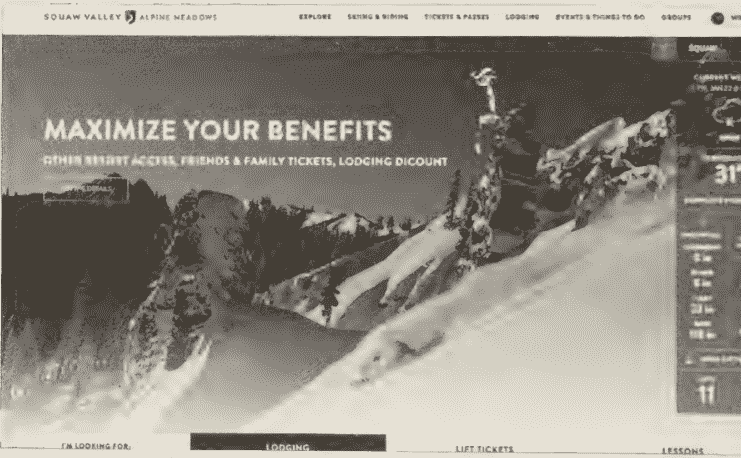

SVAM 有几个主页体验，包括针对季度通行证持有者的这个体验（利用其 CRM 系统中的属性数据）。

- 网站访问总次数
- 登录总次数
- 浏览的页面或屏幕总数
- 在站点或应用上花费的总时间
- 每个页面的平均花费时间
- 自上次网站访问以来的时间
- 阅读的文章总数、购买次数、观看的视频等

这些信息可以以多种方式使用。值得注意的一点是，您可以将其应用于向首次访问者或用户推送目标消息、通知或体验。在这里，一个人访问站点或应用的次数对于确定他所获得的体验非常重要。您还可以使用站点和应用范围的行为，向在定义时间段内未与该渠道进行互动的回访者定位活动。

**页面访问行为：** 页面访问行为是指关于个人特定页面或屏幕浏览的数据，例如：

- 浏览的特定页面或屏幕
- 每个页面/屏幕被浏览的次数

虽然站点范围和应用范围的行为是指浏览的页面或屏幕的 *总* 数——或每个页面花费的平均时间——而页面访问行为是指访问的 *特定* 页面或浏览的屏幕。例如，页面访问行为会告诉您，某人浏览了产品页面 A 三次，产品页面 B 一次。尽管这仍然是比较高级别的数据，但它仍然可能很有价值。

**深度行为和上下文：** 深度行为比前几个类别更进一步，涉及所查看页面的信息以及在该页面上采取或未采取的特定行为。

该信息包括：

- 在页面上花费的时间
- 鼠标移动
- 滚动
- 悬停
- 不活动
- 页面内上下文（类别、标签、品牌、颜色、关键字等）

深度行为和上下文将每个页面的参与度与页面本身的属性相结合，以准确指示个人的亲和力、兴趣和意图。这种类型的信息对于真正的一对一个性化至关重要。

**活动参与度：** 活动参与度是指个人在各渠道中对您的任何活动采取的行动。它包括以下行为：

- 个性化体验浏览和点击率
- 电子邮件打开和/或点击
- 推送通知关闭或点击率
- 将上述行为与设备、一天中的时间或其他变量相关联

这种数据本质上是派生的，非常有价值，因为它能加深您对每位访问者的了解，并进一步为您的一对一个性化工作提供信息。

让我们通过一个示例来探讨这四种行为数据类型的差异。假设一位客户访问零售网站。他是常客，过去一个月浏览了几个产品页面。

如果您（作为希望个性化其体验的营销人员）仅能访问他的 *站点范围行为*，您只会知道他在过去一个月访问过该站点三次，且上次访问是在一周前。您会知道他通常花费一

在网站上平均停留五分钟，且总共浏览了网站上的 20 个页面。有了这些信息，你无法了解他的个人偏好或本次网站访问的意图，但例如可以将他归入忠实购物者细分群体。

如果你还能获取*页面访问行为*，你就会知道他浏览了哪 20 个页面中的哪些。你会明白，他在衬衫类别下点击了五个产品页面，在裤子类别下点击了五个产品页面，在鞋子类别下点击了六个产品页面。这些产品均匀分布在三个不同的品牌和五种不同的颜色中。根据这些信息，你可能会得出结论：他没有品牌或颜色偏好，并且对鞋子的兴趣略高于衬衫或裤子。你可以使用简单的协同浏览算法向他提供产品推荐，展示其他购物者浏览过的产品，但你无法真正将这些推荐个性化给他。

但如果你能获取*深度行为数据*，你就能了解更多。你会知道，尽管他浏览鞋子类别的时间略多于衬衫或裤子，但他浏览衬衫的时间却是其他两个类别的三倍。你会知道，当他点击 Brand A 时，他立即点击离开了。你会知道，他在查看蓝色和绿色衬衫时表现出的参与度远高于其他任何颜色。而且，你会知道他在某件特定蓝色衬衫的产品页面上花费了数分钟进行互动，浏览照片和评论，甚至选择了尺码——但尚未将商品加入购物车。

现在，如果你应用一个机器学习算法，该算法不仅根据热度，还根据每位购物者偏好的类别和颜色提供个性化推荐，那么本示例中的购物者就会看到热销的蓝色和绿色衬衫。鉴于这些商品与他的偏好高度契合，你将大幅提高吸引他并促成点击的几率。进一步来说，如果他确实点击了某些衬衫，将一两件加入购物车，或者进行了购买，你的营销活动互动数据将自动将此操作告知个性化平台。然后，例如，它可以提醒他购物车中留下的商品，并在他再次访问网站时避免推荐他已购买的商品。

如果你想要使用第 2 章中描述的复杂算法提供真正的一对一体验，你需要将深度行为数据和上下文数据与营销活动互动数据相结合，以最大限度地提高相关性。这并不是说其他数据类型毫无价值：我们已经展示了许多利用所有数据类型的成功营销活动案例。但正如我们所见，由机器学习驱动的一对一沟通是世界发展的方向，而深度行为数据和营销活动互动数据正在推动这一转型中的很大一部分。

## 调查数据

尽管你可以从已描述的所有数据类型中了解一个人很多信息，但有时了解某人的最佳方式就是直接询问。我们大多数人不喜欢做调查，所以这听起来可能不是个好主意。但我们倾向于不喜欢的调查是那些冗长、乏味且似乎对我们的生活没有任何价值的调查。

如果你想了解有关客户的某些具体信息，以帮助提供更好的体验，请大胆询问他们——但请保持简短。一两个简短的问题可以为你用其他数据创建的图画添上色彩，而且对个性化工作来说可能比冗长的调查更有用。考虑你想了解客户或访问者的哪些信息，以及根据所学内容如何不同地对待他们。在制定调查问题时，以下是一些需要考虑的事项：

- 客户不会介意回答哪些问题，因为这些问题快速且不过分个人化？
- 每个回答会告诉我们关于这个人的哪些信息？
- 我们将如何使用答案来提供对客户有价值的体验？

一旦你准备好问题或一组问题，就可以在网站或应用中显示一个简短的调查，面向所有访问者，或仅面向那些执行了特定操作、在网站上花费了特定时间或落入其他相关细分群体的人。使用他们的回答来提供适当的个性化体验，可以是即时的、也可以是在未来的某个时间点。当你立即采取行动利用收到的信息时，访问者会理解你为什么提出问题，并感激为他们的反馈所获得的即时价值。

例如，一家时尚零售商可以在其网站上部署一个快速且视觉效果有趣的调查，以更好地了解其购物者。访问者将看到一些活动图片——例如瑜伽、远足、DIY 手工艺等——并被问及他们在空闲时间喜欢做什么。然后，在回答之后，他们可能会看到与该特定人物画像相关的产品推荐或有用文章。零售商现在还拥有关于每位购物者兴趣的信息，可用于未来的营销活动。

## 第三方数据

最后，第三方数据也可用于个性化。个人在更广泛的互联网上采取的任何行动——从在搜索引擎上进行的搜索，到在媒体网站上参加的调查，再到查看的页面和提交的表单——都可以使用，外部来源收集的任何其他属性数据亦可使用。此类数据通常由各种供应商聚合，并出售用于定位和分析目的。此类供应商包括数据管理平台 (DMP)，专注于 B2C 市场；ABM 分析提供商，专注于 B2B 市场；以及社交媒体网站。个性化中使用的第三方数据的一些常见示例包括：

- 人口统计数据（例如，年龄、城市/郊区、收入水平等）
- 企业画像数据（例如，行业、平均售价、预算周期等）
- 购买信号（例如，正在市场上寻找新车/新房/技术解决方案等）
- 自定义属性（例如，Facebook 上的关系状态，LinkedIn 上的职业数据等）

## 偏好与意图

营销人员有时会思考，如此大量的详细数据如何才能被有效地利用。关键是将你了解的关于个人的一切都转化为可采取行动的内容。但在做到这一点之前，你需要机器学习来解释数据，并使用它来确定人们的偏好（或亲和力）和意图。

机器学习亲和力建模可以合成海量数据，讲述关于一个随时间变化的个人的清晰故事。这是机器学习改变一对一沟通游戏规则的又一种方式。为了说明，让我们回到前一个示例中关于零售购物者的知识。亲和力建模可以获取你收集的关于购物者的所有深度数据，并清楚地告诉你：衬衫是他最喜欢的类别，他不喜欢 Brand A，他最喜欢的颜色是蓝色和绿色——这样你就不必手动深入数据并自行发现这些洞察了。正如我们的示例所示，有了这些信息，你的算法可以在产品推荐和网站上的其他体验中提升购物者的偏好。

当然，同样的过程不仅适用于零售示例。通过亲和力建模，技术提供商可以发现潜在客户偏好的用例、内容类别、内容类型、关键词、作者等，以便在网站内容推荐中提升这些亲和力。或者在金融服务领域，一家公司可以发现潜在客户在信用卡或保险计划中寻求的具体功能，例如，并突出显示这些产品。

然而，了解访问者的偏好并非终点。一旦了解一个人的偏好，你还需要识别他即时的意图，以便了解他现在正在浏览什么以及试图完成什么。理解意图的关键是实时数据。没有它，你总是会在一个人下次访问网站时才响应其意图。

一个示例可能有助于强调实时数据的重要性。假设你走进一家大型连锁商店，想查看储物解决方案。你向一名销售助理寻求推荐，他却建议你一个动作人偶。你告诉他这个建议毫无意义；你对储物感兴趣，而不是儿童玩具。他提醒你，你上次来访时对儿童玩具感兴趣，所以他给你的就是这个。但他说，如果你几小时后再来，他可以为你推荐一个储物解决方案；需要一点时间来在他们的系统中更新你的意图。

尽管上述示例听起来很离奇，但如果你无法响应，你给网站访问者提供的体验恰恰就是这种类型。

响应实时意图。但当你确实能够访问实时数据时，情况会是什么样子呢？回到之前的例子——零售购物者——数据显示，该购物者表现出购买蓝色衬衫的意图。如果这些信息可供你实时使用，你可以发起一项活动，鼓励他立即购买那件衬衫，无论是提醒他现有的优惠或可用信贷，还是，或许，让他知道你的免费退货政策。

这里还有其他一些示例。如果 B2B 网站能确切了解某人访问网站的原因——是对某项技术进行一般性研究，还是深入研究具体产品——并向他展示相关信息，那么他更有可能做出积极反应，而不是被促销信息轰炸。或者，如果 B2C 网站上的自行车购物者正在公路自行车和山地自行车之间做决定，当网站提供能帮助他了解自行车不同款式和用途的内容时，他的体验会比网站向他推销产品时好得多。只有在明确他正在选择某条特定路径后，网站才应帮助他了解特定类型或型号自行车的具体功能和优势。

偏好和意图极其微妙。做对与否，可能意味着是展示高端产品还是中端产品，或者是推荐案例研究而非博客文章。而且访客可能甚至不会注意到体验是为他量身定制的。在营销人员争夺消费者数字注意力的世界里，向人们展示相关且及时的内容，可以让他们在网站上停留更长时间，并促使他们更快转化。

## 预测建模

使用亲和力建模来识别偏好和意图，可以让你了解一个人的 _当前状态_（或过去状态，如果你不是实时运营的话）。但未来状态呢？为此，你需要预测建模。

通过预测建模，你可以利用机器学习，基于对过去事件的理解来预测未来事件。当预测模型能够访问大量数据输入（包括你希望预测的类似情况的实际结果）时，它将识别模式，并在获得新输入时预测将会发生什么。

例如，如果你想预测哪些 SaaS 客户可能会流失，你需要让模型了解过去哪些客户已经流失，以及你拥有的关于这些客户的所有数据（例如他们的企业属性或人口统计信息、计划等级、登录行为以及他们与你的应用程序的交互方式，他们随时间推移与电子邮件的互动方式，等等）。模型可以接收所有这些信息，以识别流失客户与留存客户之间的模式。然后，你可以向其提供所有现有客户的数据，以便它可以预测哪些当前客户最有可能流失。

你可以预测几乎任何你认为对业务有价值的事情，只要你有足够的相关数据来训练模型。企业可能会发现有用的主要预测包括某人的：

- 购买可能性
- 请求演示或完成申请的可能性
- 流失可能性（在基于订阅的业务中）
- 再次购买的可能性（在零售业务中）
- 打开电子邮件或点击其中链接的可能性
- 取消订阅电子邮件列表的可能性
- 某个时间段内对你的业务的价值
- 总预测终身价值
- 对任何给定促销或活动的预测响应
- 符合任何细分群体条件的可能性（如第 2 章所述——例如忠实购物者细分群体）

其中一些在实时预测时具有很大价值。例如，如果你想知道哪种促销活动会吸引每个单独的网站访问者，你可以使用模型来预测每个人对每个促销活动的响应，然后实时显示该促销活动（我们将在第 6 章中更深入地探讨这种个性化类型）。或者，如果你想知道是否应该提供小额折扣以鼓励活跃购物者转化。你可以使用模型来预测他是否可能在此次访问中转化。如果他转化的可能性很大，你就不需要因折扣而损失收入（因为他很可能在没有折扣的情况下购买）。

其他预测在实时采取行动时不那么重要，但可能对你的业务产生重大影响。当你能够预测哪些客户可能会流失时，你可以运行旨在激励他们留下来或立即解决任何问题的营销活动。当你能够预测哪些过去的零售购物者不太可能回来再次购买时，你可以向他们发送更有针对性的电子邮件，鼓励他们回来。

预测建模的应用无穷无尽，但重要的是要注意，只有当这些模型能够访问大量准确数据时，它们才能有效。当我们说“大量”数据时，是指来自许多不同个人（广度）的数据，以及每个个人的许多不同数据点（深度）。如果没有数据广度，模型就没有足够的情况可供学习。如果没有数据深度，模型就会遗漏大部分图景。例如，如果你想预测个人的终身价值，但仅使用网站数据来训练预测模型，那么与使用店内、移动设备、呼叫中心、电子邮件等数据训练模型相比，预测准确度自然会更低。在另一个示例中，如果模型不知道客户刚刚因投诉致电你的公司，它将缺少关键的流失指标。

换句话说，当预测模型能够访问数据丰富的客户数据平台时，其准确性最高。

## 集中式数据和客户数据平台

在讨论数据章节的结尾之前，我们必须谈谈需要将所有这些数据存储在哪里。如前所述，大多数企业在组织的多个位置存储客户数据。但是，提供相关的一对一体验需要访问和解释所有这些客户数据，无论它们目前位于何处。

客户数据平台（CDP）已成为解决这一数据孤岛问题的方案。CRM 等其他工具在历史上曾被认为是客户数据的单一中心位置。但其中大多数解决方案是在不同的时代构建的，那时数据库结构更简单，数据量更小。最重要的是，它们不是为处理今天可以访问的大量行为数据而构建的。

回想一下本章前面讨论的行为数据。当你收集深入的行为网站数据，例如每个页面的停留时间、每个页面的悬停和滚动时间、每个页面的非活动时间等时，数据量会迅速增加。并且当你将这些网站行为与移动行为数据、电子邮件或推送通知活动互动、商店或分店的面对面交互、呼叫中心或在线聊天数据，以及任何其他系统中的任何属性数据相结合时——你拥有的数据远超典型 CRM 能够处理的范围，且格式是 CRM 无法处理的。

当然，我们知道，除非这些数据可以被解释和分析，否则它们都毫无意义。除非你能将其置于情境中，并通过亲和力建模和预测建模来推断他的偏好并预测他未来的行为，否则知道某人在某个日期访问了网站并在 11 个页面上浏览了三分钟，也不意味着什么。CRM 肯定不是为此而构建的。

CDP 类别仍在定义中，因此没有两个 CDP 提供完全相同的功能集。但所有 CDP 的核心都必须提供一个单一的统一客户画像。

## 统一客户画像内的身份解析

任何 CDP 的核心都是统一客户画像。无论是已知用户还是匿名用户，每个人都必须有一个单一的画像，其中包含来自各种来源的所有相关数据。

该画像应尽可能包含更多数据，以帮助了解该人，包括购买记录、浏览历史、电子邮件互动、属性、订阅、忠诚度会员资格和状态、兴趣和偏好、浏览器类型、位置、人口统计信息、预测分数等。并且，该画像应包含并统一许多标识数据元素，例如 Cookie、电子邮件地址、全名、实体地址、电话号码、系统 ID 等。一旦建立了画像，它就可以作为未来跨渠道任何个性化活动的基础。

虽然目标是为每个人创建单一画像，但仍有可能为同一个人最终创建多个画像。因此，当数据来自不同来源时，需要将其缝合到一个单一的画像中。当存在明确的标识信息时（例如，相同的电子邮件地址），这很简单，但

不是每个人都会在每个渠道的每次互动中清楚地表明自己的身份。请考虑以下情况：

- 1. B2B 网站的访客填写表格以下载报告，并提供她的姓名和电子邮件地址。现在，当她在网站上时，公司可以识别她。但是，过了一段时间，她使用了不同的浏览器。她的已命名档案仍然存在，但此后，会创建一个新档案来记录她作为匿名访客的网站活动。

- 2. 零售店的购物者使用其会员号进行多次购买。零售商通过会员计划拥有他的姓名和其他身份信息，以及他店内购买的历史记录。后来，他在电子商务网站上浏览了多次，但从未购买或以任何方式表明身份，因此他的已命名店内档案与其匿名网站行为档案仍然分开。

- 3. 银行或保险公司的客户收到该公司的电子邮件，阅读邮件后，点击进入网站。后来，她致电呼叫中心，讨论电子邮件中涵盖的同一主题以及她在公司网站上研究过的内容。在此场景中，在公司的电子邮件、网站和呼叫中心系统中，她可能被视为三个不同的人。

这些情况下创建的独立档案都包含有用的客户数据，但每个档案都无法充分反映该人的真实完整身份。当数据可用时，CDP 需要能够将档案缝合在一起。

例如，假设 Mary Smith 在某公司的 CDP 中有一个档案，其中包含来自多个不同渠道（商店、呼叫中心、移动应用等）的数据。但是，Mary 从未在笔记本电脑上表明过自己的身份。因此，CDP 中有一个"Mary Smith"档案和一个"匿名"档案。当她以某种方式表明身份时（例如，在笔记本电脑上从电子邮件点击进入公司网站），CDP 需要能够将这两个档案合并在一起。一旦清楚匿名人士实际上是 Mary Smith，就需要将两个档案缝合在一起，以构建 Mary 的完整画像。

CDP 中的任何档案都适用同样的原则。CDP 需要不断监控身份信息，以确定两个或多个档案是否代表同一身份。这可以通过确定性匹配或概率性（启发式）匹配来完成。

使用确定性匹配时，CDP 根据系统 ID 或电子邮件地址等清晰且唯一的标识符将档案缝合在一起。

以下是针对以需求生成为重点的网站的示例。假设一名未识别的潜在客户在笔记本电脑上两次、在手机上一次查看技术提供商的网站，但未提供电子邮件或填写表格。技术提供商将为该人创建两个档案：一个（Profile ABC）包含其笔记本电脑行为，另一个（Profile XYZ）包含其移动行为。

下次该潜在客户回到网站时（仍在笔记本电脑上），他下载了一份白皮书——在此过程中提供了他的电子邮件地址。技术提供商现在可以更新 Profile ABC，使其包含潜在客户的姓名和电子邮件地址，以及迄今为止他在笔记本电脑上采取的所有操作历史记录。但是，Profile XYZ（移动档案）仍然是匿名的。后来，他在移动设备上点击技术提供商发来的电子邮件进入网站。此时，技术提供商应该能够将包含移动设备行为的 Profile XYZ 与包含笔记本电脑行为的 Profile ABC 合并，因为它可以识别这些档案是同一个人。现在，当销售人员联系这位潜在客户时，她将拥有一个完整的档案，其中包括其移动设备、笔记本电脑和电子邮件行为。并且，跨这些渠道进行的任何个性化都可以基于同一档案来驱动。

具有深度客户数据的匿名用户档案

Mary Smith 通过多种潜在方式之一进行身份识别

Mary 的匿名档案与其已知身份合并，创建一个强大的单一档案

使用确定性档案匹配时，CDP 根据清晰且唯一的标识符将档案缝合在一起。

但是，匹配并不是一门完美的科学。通常，CDP 需要使用称为概率性或启发式匹配的“模糊”逻辑。在这种情况下，没有清晰的标识符。相反，CDP 基于位置、行为等不同数据的组合，对可能代表同一个人的档案做出有根据的推测。

关于身份的最后一点说明。拥有反映同一个人的多个档案当然不是理想的情况，但将多个人的数据反映在单个档案中同样糟糕（甚至更糟）。换句话说，确保 CDP 不会错误地合并档案至关重要。

每个企业都有自己的一组身份来源和对错误及误报的不同容忍度。能够添加自己的规则来指导 CDP 了解您对不同数据类型可信度的看法，并在发生冲突时决定采取什么行动非常重要。这一点非常依具体业务而定，因此企业应该在这个领域拥有控制权。

例如，您可能希望确保 CDP 在档案在某一字段类型（如电子邮件地址）上匹配但不在另一字段类型（如实际地址）上匹配时合并档案。其他企业可能希望同时匹配电子邮件地址和实际地址，但优先考虑电子邮件而非实际地址。如果两个来源发生冲突，您也可能希望对某些来源赋予更高的价值。例如，某人点击进入网站的电子邮件地址可能比他添加到网站表单中的电子邮件更准确（例如，他可能会添加一个虚假电子邮件地址以尝试下载内容）。或者，例如，您可能会认为客户的会员 ID 比电话号码更可信。

每个企业都应该探索不同的场景，以确定应用什么逻辑是合理的。正确解析身份对于成功的个性化至关重要，因此值得投入一些前期工作，以确保 CDP 在合并和缝合档案时采取正确的操作。

## 基于 CDP 数据采取行动

将组织各处的数据汇集到一个中央位置（例如 CDP）的行为，不是任何一个正常人会仅仅为了好玩而进行的。必须始终有一个最终目标来决定如何使用这些数据。通常，该目标要么是分析，要么是激活，或者是两者兼有。

## 分析：将 CDP 与商业智能相结合

让我们从分析开始。企业通常对自己的业务运行情况以及可以改进的地方有很多疑问。挑战不在于不存在回答这些问题的数据，而在于数据分散在组织的各个部分。

但是，一旦将来自许多不同来源的所有数据汇集到 CDP 中，就可以学到很多东西。您可以回答几乎可以想到的任何问题，例如：

- 哪些客户或客户群对我企业最有利可图？
- 我盈利的客户有哪些共同点？他们通常是如何获取的？他们是否拥有相似的人口统计特征（针对 B2C）或企业统计特征（针对 B2B）？他们的兴趣是什么？
- 我的营销计划执行得如何？哪些营销策略吸引哪类客户？
- 哪些产品最吸引不同的客户细分群体？我是否拥有合适的库存组合来满足需求？

大多数 CDP 都会提供自行进行基本分析的功能，但授予商业智能（BI）解决方案访问 CDP 数据的权限可以回答这些类型的高级问题，这些问题通常是业务分析师所思考的。

## 使用 CDP 数据进行个性化激活

将客户数据转化为关键业务洞察是 CDP 的一项关键优势。不过，归根结底，您汇集数据并不仅仅是为了了解某事。大多数公司希望利用所学到的内容采取行动。这就是激活发挥作用的地方。

CDP 数据的激活形式多种多样。例如，您可以基于 CDP 数据采取以下行动：

- 根据每个人过去的行为、兴趣、忠诚度计划状态等，确定向其推送哪些促销或优惠。
- 仅向最可能受其影响的人投放数字广告——避免在向那些更有可能自行购买的忠诚客户投放广告上浪费资金。
- 在跨渠道中以特定且精准的方式与目标 ABM 客户或开放的销售机会进行沟通。
- 确保网站和电子邮件 CTA 始终与收件人相关（例如，移除/更改针对某人已采取行动的 CTA）。
- 根据在该人访问您的网站或阅读您的电子邮件时所了解的关于其的一切信息，推荐内容、产品、品牌等。

基本上，CDP 数据的激活就像我们上一章中描述的各种跨渠道个性化形式。

激活 CDP 数据主要有两种方式：CDP 可以将数据推送到其他系统以供使用，或者它可以直接采取行动——也就是说，如果它也提供个性化功能的话。

将数据推送到其他系统是 CDP 的基本功能，因为没有任何单一的营销技术解决方案可以孤立存在——也没有任何单一解决方案能让您随心所欲地使用数据。但您应该了解其局限性。当您将数据推送到其他系统时，通常只能在细分群组级别进行。因此，尽管您在 CDP 内按个人级别存储数据，但无法将其传递给其他系统以在机器学习算法中使用。相反，您可以在 CDP 内创建细分群组，并将细分群组成员资格传递给外部系统以用于激活。

将数据传递给外部系统也通常不是实时进行的。这对于广告、电子邮件、推送通知等情况通常是可以接受的。但在您希望实时响应所学到的任何信息的情况下，例如网站或移动应用体验，以及呼叫中心或店内/分支机构交互，实时响应至关重要。

当您的 CDP 基于数据对跨渠道体验进行个性化时，它可以按个人级别并实时完成。我们将在第 8 章中深入探讨个性化和 CDP 技术要求的更完整对话。

## 用于个性化的优质数据要素

回想一下我们在章节开头如何描述糟糕的数据。当数据不准确、过时、不足或孤立时，它对于个性化来说就是“坏”的。相比之下，优质数据是：

**准确：** 您可以依赖您的数据来源吗？考虑权衡使用任何不准确来源的成本与其提供的信息所带来的收益。

**实时：** 您能否实时收集并处理您的数据？并非所有数据都需要实时，但有些数据在使用时可能已过时。请考虑您的实时需求。

**深入：** 您是否有足够的数据来充分了解每个人？您可以从属性和简单的行为数据入手，但真正个性化的机器学习驱动体验需要深入的数据。

**建模/分析：** 您能否分析数据以了解个人偏好和意图？您能否利用预测模型对未来做出假设？充分利用您的数据不仅仅意味着收集它；它意味着进行推断，以了解数据实际上对每个人意味着什么。

**集中化且可操作：** 您的所有数据是否都在一个客户数据平台中，并且可供个性化引擎使用以跨渠道提供相关体验？大多数营销人员的数据在组织内部孤立存在。考虑您需要哪些数据来源来提供个性化体验，以及如何将它们整合在一起。

任何一对一营销策略的基础都是客户数据。在考虑您自己的信息来源和营销技术时，数据方面可能看起来令人生畏。但花时间寻找合适的合作伙伴和数据来源是值得的。请记住：糟糕的数据意味着糟糕的个性化。

## 第 4 章尾注

- 39. Evergage Inc. 和 Researchscape International，“2019 年个性化趋势”，2019 年 4 月，http://www.evergage.com/resources/ebooks/trends-in-personalization-survey-report/。

- 40. Forrester Consulting，“情境营销的必然性：个性化从推送消息到一对一个人客户体验的演变”，2015 年 10 月，https://assets.cdn.sap.com/sapcom/docs/2015/10/3c6868f1-487c-0010-82c7-eda71af511fa.pdf。

## 第 5 章 考虑完整体验

在整本书中，我们介绍了个性化可实现的示例。在本章中，我们将稍微转换一下思路，详细介绍个性化可以采取的不同形式和格式。掌握这些基础知识后，在规划您自己的个性化举措时，理解什么是可实现的将容易得多。

从最广泛的层面来看，个性化体验分为两种类型：打断式和无缝式。

**打断式体验**是一个人不一定希望看到、且与其当前体验并非不可或缺的消息或内容。许多类型的广告、电子邮件和推送通知——以及任何覆盖在现有页面或屏幕之上的 Web 或应用消息——都属于打断式体验。例如，如果您向访问者提供基于其位置的个性化内容弹出消息，该弹出窗口位于您网站其余部分之上，并容易被识别为独立的个性化消息。

相比之下，**无缝体验**通常与现有的默认体验无法区分。无缝体验可以包括页面或应用中插入、替换、隐藏或修改的任何类型的内容。例如，如果您在登陆页面上个性化标题或 CTA 按钮，该文本和图像是页面本身的一部分，并与其余内容融为一体。任何人与人之间的体验——例如销售人员、呼叫中心坐席或店内销售员与客户互动时——也属于无缝体验。

在早期，个性化仅限于更具打断性和侵入性的“直击面部”的消息，但行业已转向更无缝的个性化。话虽如此，两者各有优势，应根据您的活动目标进行选择。

让我们深入了解具体内容。

### 打断式体验

当您希望消息吸引某人的注意或鼓励某人采取特定行动时，打断式体验最为适用。然而，这种方法的优势也是其弱点。这些难以忽略的消息很快就会变得令人恼火，因此确保它们谨慎使用并尽可能相关非常重要。

创建更有效、更不令人烦躁的打断式体验，始于了解它们可以采取的形式。

### 数字广告

某些广告类型可以被视为打断式广告，例如弹出式广告或插屏广告，因为它们在视觉上中断了访问者的体验。这些广告要求访问者停止他们正在尝试做的事情，转而参与广告内容——这可能很难推销。我们都在互联网上见过无关且令人恼火的弹出式广告。因此，与更无缝的广告类型相比，此类广告比 10 到 20 年前少得多，但它们当然仍然存在。

### 推送通知

推送通知在移动设备上送达，与打断式广告格式类似：当用户未

未必期望收到。然而，它们与广告不同，因为用户通常会选择接收它们，并且它们通常旨在帮助用户，而不是推广产品或优惠。它们可以发送给任何下载过移动应用的人——即使该应用未在使用。因为它们用于打断某人在手机或平板电脑上当前正在进行的任何活动，因此也应谨慎使用。并且，如我们在第3章中所述，它们应利用营销人员从该人使用该应用（或其他适用渠道）中积累的所有数据，以确保他仅收到相关通知。

### 外发邮件

外发邮件是指某人未选择接收的邮件。虽然这不是一种理想的营销策略，但在某些情况下使用此类邮件可能很有价值。

例如，B2B营销人员经常使用外发邮件来引导流量前往其在贸易展会上赞助的展位。营销人员可能会提前收到参展公司名单，如果没有提供参会者姓名，他们可能会结合多种数据源以及对哪些员工可能出席的判断。然后，他们可能会向已识别的人员发送外发邮件，利用有效的消息传递和激励措施鼓励潜在客户访问公司的展位。

在这种情况下，营销人员对收件人了解甚少：这些人可能之前从未与该公司互动过。因此，无法利用本书迄今描述的个性化策略。但是，尽可能让电子邮件相关始终是个好主意。在此情况下，内容应与活动相关，并根据与会者的行业和职位或角色进行定制。

### 网站内和应用内消息

最后，还有发生在公司网站或其应用中的体验。这些是营销人员希望确保访客在与渠道互动时收到的消息。弹窗、信息栏和突出框是最常见的中断式网站内或应用内体验类型。我们将详细介绍每种类型，并提供理想的用例和技巧，以使其相关且有效。

### 弹窗

与创建包含广告的不加选择的弹窗不同，营销人员可以在其自身的网站和应用上投放针对自身访客和客户的弹窗。弹窗往往非常有效地吸引某人的注意力，因为通常需要在访客继续查看页面之前关闭它们。但是，如前所述，它们可能会对整体网站或应用体验造成干扰，因此应谨慎使用。

尽管弹窗看似无害，但不相关的弹窗可能会导致某人在没有互动的情况下离开你的网站。但是，你可以使用一些个性化策略，帮助让你的弹窗更相关且侵入性更低：

- **时机：** 仅在用户表现出特定行为（例如向下滚动页面、显示退出意图、在页面上花费一定时间或点击特定链接）时显示弹窗。

- **个性化内容：** 根据个人的偏好或亲和力定制消息内容。例如，退出消息（在访客即将离开网站时显示的一种消息）可以显示购物者在

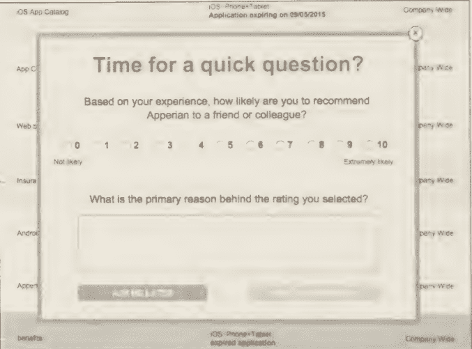

网页应用中显示 NPS 调查的弹窗

期间表现出购买意图的产品，或者 B2B 访客尚未下载但与她兴趣相关的电子书。通过这种程度的相关性，你可以最大限度地提高重新吸引访客的机会。

- **上下文定位：** 根据访客的引荐来源、位置、设备类型或其他属性定向投放消息。当消息融入相关参考框架时，它会更具说服力和吸引力。

- **灯箱效果：** 如果你希望通过弹窗传达的信息特别重要，灯箱效果（也称为“模态框”）——即将页面其余部分变灰——是将访客注意力集中在你的消息和所需操作上的好方法。

以下是个性化弹窗的几个关键用例：

- **退出消息：** 零售商可能会显示一个弹窗消息，展示购物者留在购物车中的产品，可能会提醒他可用的任何激励措施，以鼓励他在离开前购买。

- **电子邮件获取：** 专注于需求生成的 B2B 网站可能会向其博客的活跃读者显示一个弹窗，鼓励她如果还没有注册的话订阅新闻通讯。

- **警报：** 金融服务网站可能会在访客尝试放弃信用卡申请时显示一个弹窗，提醒她她的工作不会被保存

显然，在你的网站或应用中应谨慎使用弹窗。在规划新弹窗时，请务必评估你现有的体验，以确保一次不会运行太多弹窗。并且始终测试你的弹窗以确定它们是否有效。如果没有看到预期的影响，请考虑尝试不同的文案、图片、CTA 或消息类型。

### 信息栏

信息栏旨在通过出现在页面顶部或底部来吸引访客的注意力。它们作为“粘性”消息在用户滚动时保持在屏幕顶部或底部，但可以设计为易于关闭或取消。

信息栏非常适合用于提醒，例如即将举行的促销或新的内容资产。它们可以包含简单的信息性消息，或者引导访客前往特定页面了解详情的 CTA。虽然许多网站使用信息栏向所有网站访客发送提醒，但消息可以根据每个个人的属性或行为进行定制。以下是一些示例：

**免费送货/忠诚度积分：** 零售商可能希望使用信息栏提醒购物者他有资格获得免费送货或有积分可用。该消息将出现在他访问的任何页面上，但不会显得突兀。

**网络研讨会/贸易展会/内容注册：** 技术提供商可能希望仅向特定行业内的访客显示信息栏以推广即将举行的网络研讨会。用于提醒访客其所在地区的即将举行的活动，或宣布可能与他们相关的新电子书或白皮书。

**追加销售：** 保险网站可以显示信息栏，以微妙地通知客户，当她将家庭保险与同一公司的汽车保险捆绑时，她有资格获得汽车保险的优惠费率。

嘿，你有一个 25.00 美元的积分可供花费。

Rue La La 所有 女士 男士 居家 旅行 儿童 今日精选 即将推出

### 时尚阅读
时尚、旅行及更多书籍

### 汤姆·福特
《汤姆·福特》 by 汤姆·福特
$89.99
加入购物袋
快速购买
数量 1
您有五个标准运输标记到 THE RUE 30。
预计送达 周四 7/16 - 7/28。
该商品符合免费送货条件。

详细信息
精装书 by 汤姆·福特和 Bridget Foley
汤姆·福特：一种风格、优雅与从容的视野，使他成为全球几代人对时装秀内外现代优雅和向往生活的最终仲裁者，这是一本画册。

很明显，信息栏不如弹窗突兀，但测试每个信息栏以确定其有效性很重要。如果不确定，最好使用其他格式测试相同的消息，以查看哪种效果最好。

### 突出框

通常比其他消息格式更小、更不显眼，突出框会吸引对页面特定区域或功能的注意。我们经常在 Web 应用中看到它们用于指出产品的新功能或要求用户进行导览，但只要你想引起对页面元素的注意，随时可以使用它们。

有许多方法可以将突出框融入体验，同时为访客提供价值。以下是一些示例：

- **请求评论：** 零售商可以在产品周围显示一个突出框，要求购买该产品的购物者对其进行评论。

- **引导至帮助内容或常见问题解答：** 技术提供商可以向在其产品中看似遇到困难的客户显示一个突出框，并将其引导至适当的帮助内容或常见问题解答。

- **指示新功能或未使用功能：** 金融服务网站可以显示一个突出框，以指示其账户管理工具中的新功能，或者指出客户尚未使用的功能。

与弹窗和信息栏一样，你可以向访问特定页面的任何人显示突出框——使其成为非个性化突出框。但是，有几种方法可以定制突出框，使其更加精致并与特定访客更相关。一些示例：

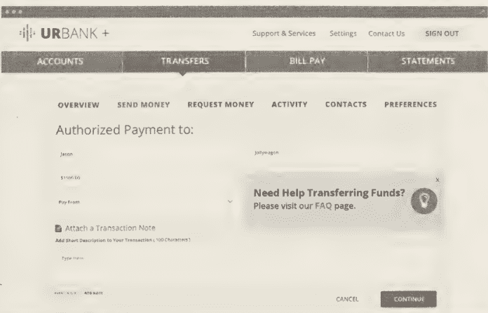

弹窗询问客户是否需要协助转账

- 针对新用户：对受众进行细分，确保只有首次使用该产品或从未与某个特定功能交互过的用户才能看到该消息。

- 基于闲置时间：定时显示弹窗，仅在访问者鼠标闲置几秒钟时出现，并利用该消息提供协助、更多详情或激励。

- 基于悬停时间：定时显示弹窗，仅在访问者鼠标靠近页面预定区域或悬停在被突出显示的特定功能上时出现。

与所有消息和体验一样，测试弹窗消息至关重要。尝试不同的设计和文案，以找到最适合您网站或应用的有效方案。与弹出窗口类似，弹窗应谨慎使用，因为每当访问者移动鼠标时页面上出现多个消息会让人感到迷失方向。

### 无缝体验

与上述中断式格式形成对比，中断式格式很容易从客户体验的其余部分中区分出来，无缝体验是体验的组成部分，并且通常是访问者或接收者所期望的。

### 行内广告

当今，横幅广告、搜索广告和社交广告等无缝广告格式比弹出窗口等中断式格式更常见。这些广告会显示为 Facebook 或 LinkedIn 上的“赞助”帖子，或出现在媒体网站文章的边缘（或中间）。它们不会中断体验，但通常会以某种方式标记为广告。这种类型的广告通常为访问者提供更好的体验，因为它们不会物理上阻止访问者与页面内容进行交互。

广告商经常在行内广告中利用再营销，依据个人过去的网站访问行为来投放更相关的内容。但如我们在第 3 章中所述，广告商通常使用有限的数据来定向这些广告，导致体验不够相关。利用 CDP 中存储的更详细的行为数据和其他数据来了解一个人真正参与了什么（甚至预测其未来需求），能够实现更合适的个性化和更有效的再营销。

### 选择加入邮件

由于个人必须提供电子邮件地址才能接收选择加入的邮件，因此这种格式被视为无缝体验而非中断式体验。选择加入邮件有三种主要类型：

- **事务性邮件：** 事务性邮件是在个人采取某个操作（例如下订单或订阅新闻通讯）后发送的。这些邮件是收件人所期望的，通常是提供个性化内容以推动追加销售或更深层次参与的绝佳场所。例如，利用您了解的关于购物者偏好的所有信息，您可以在其购买一双鞋后推荐她可能喜欢的产品。

- **触发式邮件：** 虽然比事务性邮件少被期待，但触发式邮件也可被视为无缝体验。如我们在第 3 章中所述，触发式邮件常用于提醒购物者未完成的购物车，但也可用于鼓励购物者购买其在会话期间高度关注的产品。或者，它们可用于提示访问者在应用中采取关键的未完成操作，或执行引导流程中的下一步。触发式邮件中的内容应针对每个人进行个性化，以便用户在消息中发现相关、有意义且有用的内容。

### 您的购物车里留下了一些很棒的装备。

立即返回，完成您今天的订单。

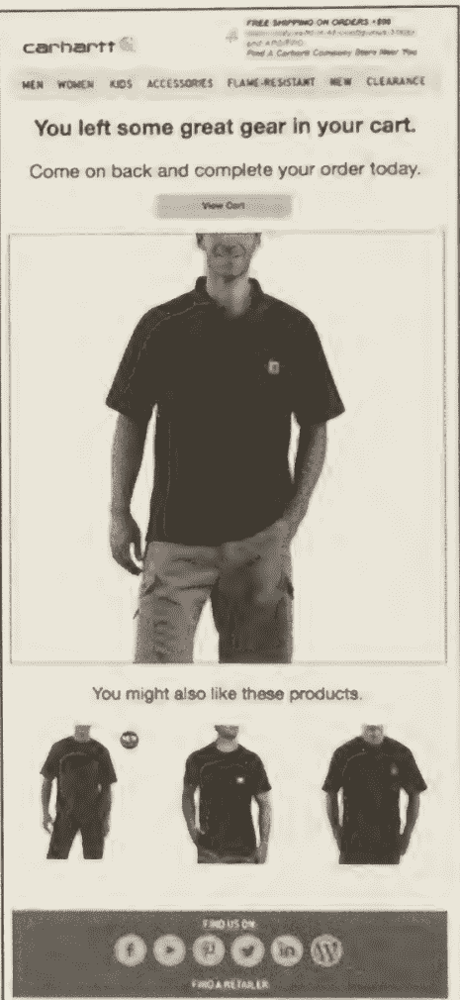

### 您可能还喜欢这些产品。

触发式购物车遗弃邮件包含个性化产品推荐

- **持续性邮件：** 最后，持续性邮件是几乎所有公司的主力。零售商向购物者提供最新销售和促销信息，媒体公司向订阅者提供最新新闻和信息，金融机构让客户了解市场动态，B2B 公司将有用的指南和资源作为其内容营销策略的一部分。这些可能包括大规模的“群发”邮件活动或更窄的基于细分的通信。B2B 公司通常采用“培育”营销，这是一种更精细的持续性电子邮件营销形式。例如，如果潜在客户下载了某些内容或注册了网络研讨会，他将被放入一个细分或“轨道”，并接收与其感兴趣领域相关的持续性、有用信息。

持续性邮件（包括培育邮件）通常与收件人在 Web 或移动端的行为无关，但可以并且应该关联。它们可能使用“邮件合并”技术在邮件主题行或正文中包含名或公司名称，但这属于最低水平的个性化。个人在公司网站上采取的任何操作都可用于构建其个人档案，并且应利用这些数据通过即时个性化（在第 3 章中介绍）来个性化持续性邮件通信。例如，如果访问者已经下载了电子书或查看了博客文章，她就不需要再通过电子邮件发送该内容。她应该收到更相关的内容，在打开时确定。

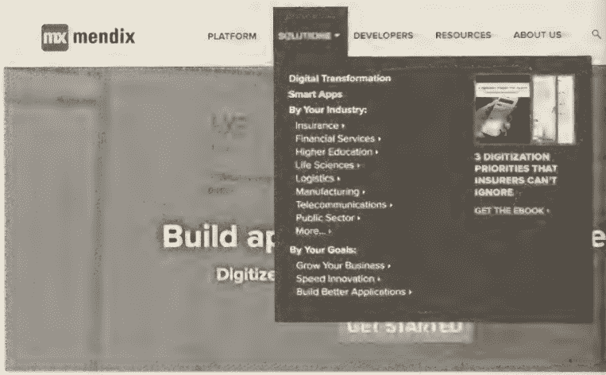

页面内编辑将相关内容推荐直接替换到不同行业细分的站点导航中

### 无缝网站和应用内体验

与中断式格式一样，无缝格式既可用于网站也可用于应用内。无缝格式类型看似是页面本身的一部分，但实际上是通过个性化平台通过插入、替换、隐藏或修改内容来提供的。访问者不应意识到他们看到的内容是个性化的：内容应始终融入现有页面，绝不闪烁。

无缝个性化的两种主要类型是页面内编辑和行内内容。虽然两者非常相似，但存在明显差异。

### 页面内编辑

页面内编辑是指对页面上现有硬编码内容所做的任何更改——无论该内容是被修改还是完全隐藏。这使您能够对网站进行微妙而有影响力的更改，以吸引不同访问者，并让他们觉得您的网站与他们直观地相关。

页面内编辑的示例几乎是无限的；营销人员通常可以通过快速头脑风暴会议识别出许多个性化网站的方法。以下是一些入门示例：

- **主页主体：** 向主页主体体验插入页面内编辑是跨行业公司的一个有说服力的用例。这是确保主页与任何主要角色或细分群体相关、减少主页跳出率并鼓励更深度参与的最简单方法之一。B2B 需求生成网站可以利用 ABM 方法，为每个目标行业提供不同的主页图片和文案。零售网站可以为购买过某些产品类别的访问者显示不同的主页体验。金融服务网站可以为学生、房主或退伍军人等目标角色提供不同的主页图片和文案。

- **号召性用语（CTA）：** 号召性用语通常经过广泛测试，但对所有访问者倾向于保持静态。需求生成网站可以针对不同行业或漏斗的不同阶段显示不同的号召性用语（例如，“探索金融服务解决方案”与“探索医疗保健解决方案”，或“下载此零售电子书”与“下载此保险电子书”。更进一步，公司甚至可以在有人已经采取行动后更改号召性用语，以达到最大相关性。

- **站点导航：** 页面内编辑不仅限于页面内容本身。您可以针对不同访问者群体更改网站或应用的导航，例如几章前我们分享的 Dyn 案例研究。

- **无关信息：** 个性化体验甚至可以包括隐藏对特定细分群体或访问者无关的内容。例如，零售网站可以移除面向国际访问者的免费国内运输提及，或者博客网站可以移除鼓励订阅新闻通讯的部分（如果访问者已经订阅）。

### 行内内容

虽然页面内编辑允许您编辑或隐藏页面上硬编码的内容，但行内内容使您能够动态添加完整的

页面内容板块。在大多数情况下，访问者不会注意到任何个性化正在发生，或者有新板块被添加；内容会自然融合。基本上，行内内容提供了一种无缝的方式，在页面的上下文和结构中向访问者显示信息。

你可能有很多理由想要为某个群体或个人在页面上添加特定内容。一些示例：

**免费配送：** 电子商务网站可以将行内内容直接插入其购物车页面，以鼓励购物者购买更多商品以符合免费配送条件。该网站甚至可以包含能让购物者符合免费配送条件的产品推荐。已经符合免费配送条件的访问者可以在同一位置看到其他内容，或者该位置可以保持空白而不影响网站的外观。

**即将举行的网络研讨会：** 专注于需求生成的 B2B 公司可以在其网络研讨会录制页面上，在页面顶部插入一个面向特定访问者的即将举行的网络研讨会邀请。如果该访问者不符合条件或已经注册，或者没有即将举行的网络研讨会，则不会显示此类内容。

你可能意识到，这些示例也很容易成为中断性消息类型。考虑一下上面的网络研讨会示例。B2B 网站可以在页面顶部的信息栏中突出显示其最新的网络研讨会，或者当访问者的鼠标悬停在网站特定部分上时，以弹出提示的形式显示。区别在于，在这些示例中，消息是站点体验本身的一部分，而不是对其进行强加。

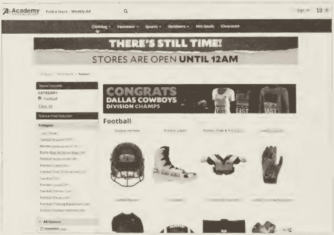

"Dallas Cowboys" 消息作为行内消息插入页面，当与特定购物者相关时

### 选择格式

在所有可用格式中，应该选择哪个“正确”格式？当然，这个问题没有正确答案。不同的消息更适合不同的格式，而且在很多场合，你都需要判断哪种格式最适合当前情况、你的品牌以及客户的期望。这就是为什么测试如此关键（我们将在第 6 章中详细介绍）。

不过，总的来说，重要的是要注意，无缝体验让你能够更好地进行个性化。例如，仅使用弹出窗口来个性化你的网站不是一个好主意。使用页面内和行内内容，你可以微妙地为每个人定制完整的站点体验。这意味着充分利用我们在第 2 章中概述的机器学习算法以及上一章详细介绍的所有数据类型。你可以利用这些资源为产品、品牌、内容和类别提供推荐；对列表排序进行个性化；动态修改站点导航；以及以其他方式提供全面且完全个性化的体验。仅靠弹出窗口你无法完成所有这些。自 Peppers 和 Rogers 时代以来，技术已经取得了长足进步，你不再需要将个性化限制为中断性格式或网站上的指定位置。

我们在年度研究中发现，电子邮件活动、主页和登录页面是营销人员利用个性化的最常见领域。41 本书已经提到过这些活动类型中的每一种，它们都非常有价值。但是，为了提供一种无论访问者身处哪个页面或使用哪个渠道都存在的完全个性化体验，营销人员可以将个性化工作扩展到更多页面、搜索结果、导航等。

当然，虽然完全可以直接投入全面体验个性化，但并非有必要如此。我们看到许多营销人员在开始个性化时，会先从面向广泛细分市场的中断性消息类型和基本无缝体验入手，但随后会发展到更复杂的策略。下面的案例研究对此进行了说明。

### 案例研究：SHOELINE.COM

几年前，在线鞋类零售商 Shoeline.com 开始在其网站上利用个性化。在其个性化之旅的初期，该公司主要专注于获取电子邮件地址，并根据推荐来源为访问者提供激励。例如，它为从 Google 搜索到达的购物者设计了一个 lightbox 风格的弹出窗口。弹出窗口包含了搜索的产品，并提供折扣以营造转化的紧迫感。

在测试个性化的威力，并通过几个类似的活动取得了一些速胜后，Shoeline 想要做更多。它开始设计更多利用购物者即时意图的无缝体验。一些示例包括：

- 个性化主页体验根据购物者在当前会话和长期内花费最多时间参与的鞋类类别显示文案。这些鞋类类别中的一些对非常特定的群体相关，而对其他人则完全不相关。此活动允许 Shoeline 在其主页上推广更多小众类别，而不会对许多购物者造成不相关性。例如，如果购物者从未参与过护士鞋，她将永远不会在主页上看到该类别。

- 个性化购物伴侣为购物者提供轻松访问他们最感兴趣或之前购买过的产品。该选项卡的内容为每个人完全个性化，并且产品根据过去和当前会话中与每个产品的参与程度进行排序。

- 产品页面和类别页面上的个性化推荐利用增强器根据购物者的偏好个性化推荐，帮助他们发现最有可能购买的鞋子。

Shoeline.com 上的个性化体验改善了访问者的产品发现，并推动了转化率的提升。虽然其通用主页横幅的点击率通常在 1% 左右，但针对关键购物者角色定制的个性化横幅点击率高达惊人的 26%。并且，对于参与个性化购物伴侣的访问者，Shoeline 看到转化率为 18%，这是平均全站转化率的惊人七倍。

中断性和无缝个性化在成功的个性化策略中各有其地位，但跨越整个客户体验的无缝个性化才是未来的方向。像 Shoeline.com 一样，公司有时会先从简单的中断性消息入手，试试水，然后再将个性化作为网站的基本组成部分，配合更精心设计的行内和页面内内容。

总体而言，跨渠道个性化方面，我们看到越来越多地关注与客户建立关系，而不仅仅是用相关内容吸引他们的注意。这意味着关注对每个人实际有益的东西。同样，许多营销人员正在从批量-

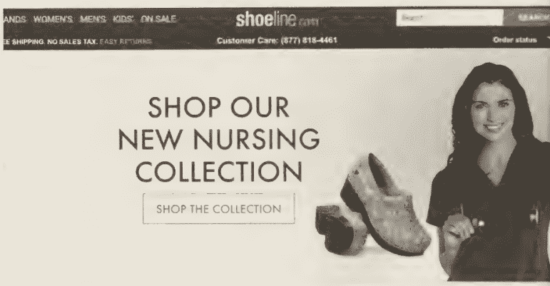

Shoeline.com 主页体验面向对护士鞋有偏好的访问者

-blast 通用邮件转向与每个收件人在当下更相关的一对一触发式邮件。他们还在从使用数字广告触达广泛受众转向触达高度定向、细分受众。

营销人员发现，使用无缝、有用且及时的个性化策略，是改善最终客户体验并随时间对业务产生最大影响的最佳方式。

## 第 5 章尾注

- 41. Evergage Inc. 和 Researchscape International。“2019 年个性化趋势。”2019 年 4 月，http://www.evergage.com/resources/ebooks/trends-in-personalization-survey-report/。

## 第 6 章 测试、分析和 ROI

几乎每个营销人员，无论身处哪个行业，都面临着在有限资源下兼顾多项优先事项的挑战。待做的事情总是比看起来可能的要多。因此，好的营销是一场平衡艺术。营销团队为追求特定策略、战术或活动而做出的任何决定，都必须与其他潜在投资进行权衡。

同时，衡量营销活动的 ROI 并不总是容易。不是每个活动或活动——例如营销人员用来影响“认知”或提供“市场教育”的许多策略——都能清晰地关联到业务指标。这些活动通常对整体业务至关重要，但它们可能难以衡量或无法衡量。因此，营销人员不一定知道他们所做的选择是否有实际影响。

这种衡量挑战也存在于营销技术决策中。作为营销人员，你希望投资于对你的组织最有效的工具。然而，市场上营销技术（“martech”）解决方案的范围似乎每分钟都在增长。Scott Brinker 2019 年的年度营销技术图表包含了 7,040 个解决方案——较 2018 年的 6,829 个和 2017 年的 3,874 个有所增加。42 大多数营销人员使用这些 7,000 多个解决方案的某些组合——有时多达 20 到 50 个——来实现他们的目标。43 难怪 Hubspot 发现，证明营销活动的 ROI 是当今营销人员面临的第二大挑战（仅次于获取流量）。44 当你将一堆解决方案拼凑在一起以满足各种需求时，几乎不可能将你的努力与公司的底线联系起来，或评估其价值

各项技术投资。

但个性化不仅仅是另一种营销策略，也不应该只是向您的技术栈中添加另一个解决方案。如果您从此书中迄今为止学到任何东西，那应该是：个性化可以而且应该从根本上改变您公司的客户体验。它可以帮助您向客户和潜在客户展示，您在个体层面上了解他们。在当今世界，这一点至关重要，因为吸引某人的注意力——更不用说保持那份注意力了——可能是一项艰巨的任务。

在本章中，我们将探讨个性化中测试的重要性、其工作原理，以及它如何与计算 ROI 直接相关。测试所有个性化活动不仅可以让您找到表现最佳的活动，还可以量化个性化工作对您 KPI 的影响，以确保您充分利用投资。

### A/B 测试

大多数营销人员都熟悉测试，并经常使用它来优化电子邮件主题行、登录页面、数字广告文案等，涵盖数字和离线渠道。如果不测试他们当前使用的方法和策略，营销人员将永远不知道什么有效或可以改进。

在个性化方面，测试可以帮助您了解：对于特定群体，协同过滤算法何时比共同浏览算法更有效，或内联消息何时比突出显示更有效。它还可以告诉您，某个特定的个性化活动对某些访客细分群体是更有效还是较无效，或者是通过电子邮件还是推送通知联系个人更好。与其他营销策略一样，在测试您的想法之前，您不知道哪种类型的个性化体验会有效，或者是否已优化。一个网站、应用或电子邮件中有效的方法，不一定适用于另一个。

在您的个性化活动中采用测试，可以帮助您找到最适合您自己的业务和渠道的方法。A/B 测试也称为分割测试，是我们最常见的测试形式。在 A/B 测试中，您通常将网站流量分为两组：一组获得“A”体验，另一组获得“B”体验。产生最佳效果的体验即为胜者。当然，同样的概念也可以应用于三组或更多组，这就是为什么它有时也被称为 A/B/n 测试。

让我们看一个示例。作为零售商，您可能想知道：在一双靴子的产品详情页上，展示相似风格的推荐，还是展示其他类别的推荐以“完成整体造型”，哪种更有效？产品轮播图比没有轮播图更有效吗？页面上应该有三个产品推荐还是四个？或者，在另一个示例中，通过从侧面滑入的打断式消息向访客推荐博客文章更有效，还是将内联章节直接插入到正在查看的文章中更有效？A/B 测试可以帮助您了解哪种方式最适合您的网站、应用和受众。

通常，尚未使用个性化的营销人员使用 A/B 测试，是为了为其所有流量找到表现最佳的体验。这种方法可以帮助他们找出哪种体验最吸引最小公约数。但是，正如我们所讨论的，一刀切的体验正在迅速成为过去。A/B 测试需要与个性化相结合，才能达到最大效果。

### 使用控制组

任何个性化测试中最重要的组成部分之一是控制组——即默认（非个性化）体验。例如，如果您正在测试一种算法，以直接在搜索栏中提供产品或内容推荐，您可能希望用一部分流量测试算法的一个版本（体验 A），用另一部分流量测试另一个版本（体验 B），并将剩余部分用于完全不进行个性化搜索（体验 C）。在这种情况下，C 是控制组。您也可以将一个版本的算法（体验 A）与控制组进行测试，以确定个性化体验是否优于通用体验，然后在今后将算法的不同版本与 A 进行对比测试，以找到最有效的版本。（请记住，一次测试的体验越多，获得统计显著结果所需的时间就越长。）

在测试个性化体验时，包含控制组至关重要，因为您始终希望确定个性化优于通用体验。您的想法可能未能击中目标细分市场，或者您的个性化体验可能让访客感到困惑。与控制组进行衡量将有助于发现这些情况。

请记住，即使您发现控制组和测试体验之间没有差异——或者甚至通用体验优于个性化体验——也不意味着个性化无效。这可能只是意味着您需要为该特定用例找到更有效的个性化策略。

### 案例研究：EVERGAGE

在 Evergage，我们发现一种情况：针对控制组的测试告诉我们，我们提供的个性化体验还不够有效。我们正在使用一个名为“SmartHistory”的功能，在每位访客屏幕侧边显示一个选项卡，方便访问访客之前在网站上与之互动或下载的内容（电子书、案例研究等）。

在我们进行的测试中，一部分流量在屏幕右侧看到一个标记为“SmartHistory”的蓝色选项卡，而控制组则没有此功能。对于目标组，他们查看或下载的所有内容都会出现在 SmartHistory 选项卡中，并按其与每个内容的互动程度排序。例如，如果访客点击了一个数据表并在页面上花费了三分钟，又点击了一个案例研究但只花费了几秒钟，那么数据表会出现在 SmartHistory 的第一位，案例研究排在第二位。

我们本以为这会改善访客体验并提高转化率，但当我们检查测试结果时，未能发现拥有 SmartHistory 选项卡的访客与没有该选项卡的访客之间的网站转化率存在统计学上的显著差异。

我们没有假设个性化无效，而是决定调整我们的方法。我们在测试中添加了另一个体验，将流量分为三组：一组看到原始的 SmartHistory 选项卡，一组看到带有不同且更直观标签（“您的下载”）的选项卡，一组不看到任何选项卡（控制组）。

这一次，我们找到了胜者。我们的新体验相比控制组，网站转化率提升了惊人的 69%。当然，“您的下载”版本也击败了原始的 SmartHistory 选项卡。

### 针对多个指标进行衡量

A/B 测试中另一个重要的考虑因素是决定查看哪个指标。对于任何活动，您应该心中有一两个希望改进的具体指标。针对这些指标测试活动，可以确保您正朝着正确的方向前进。例如，如果您运行电子邮件获取活动，您可能希望增加收集到的电子邮件地址数量。如果您

1 对 1 P
只有 Evergage 的实时个性化为公司提供

- 已查看
- 已下载
- Evergage 电子书：2016 年个性化趋势调查报告
- 案例研究：Invisalign
- Evergage：一对一个性化图书

> "我们在使用 Evergage 方面取得了巨大成功。我们在网站上运行了多个活动，转化率提升高达 15%，电子邮件活动提升了 100%。* Charhart"

转化率提升 15%

Evergage 的“您的下载”标签页帮助访客查找最近浏览的内容。

在您的网站上提供产品推荐时，您可能希望衡量其对转化率的影响。如果您运行直邮活动，可能希望引导流量前往您的分支机构。您为活动运行的任何测试都应帮助您了解哪种方法对这些指标的影响最大。

然而，没有任何活动是孤立运作的。用一个活动影响多个指标是很常见的。因此，一个活动可能会增加转化量，但降低平均订单价值（例如，通过引导访客购买低价商品的活动）。如果平均订单价值降幅过大，即使转化率提高，也可能对收入产生负面影响。电子邮件捕获活动可能会收集数百个额外的电子邮件地址，但却会导致网站跳出率显著增加——进而导致活跃访客减少。营销人员需要考虑所有这些信息，以判断此类活动是成功还是失败。

要了解任何个性化活动的完整影响，您必须针对活动的特定目标以及全局目标来衡量它。定义您的整体业务目标（例如，表单完成、注册、购买、生命周期价值、留存率等），并根据这些目标分析任何活动的结果，以确定该活动对主要业务目标的积极或消极影响。

### 对结果充满信心

高级测试人员可能熟悉A/B测试结果的含义，但其他人可能难以理解这些数字真正在说什么。了解您的结果意味着什么非常重要，以便在测试后能够就如何进行做出正确的决策。

测试工具可能采用不同的统计方法，因此您希望了解您特定解决方案的基础知识。大多数解决方案不会预测您将所有流量转移到测试体验后所看到的提升幅度——那些结果最终将高于或低于测试期间所见的结果。相反，结果告诉您，您可以X%有信心（通常为95%）测试体验将优于对照体验。某些解决方案可以预测测试结束时您可期望的提升区间，但请记住，仅仅因为您在测试期间看到转化率提升了5%，并不意味着您今后将获得完全相同的提升幅度。

例如，请查看下一页上的图片。它描绘了重新设计与对照体验之间的测试。它显示，在测试的当前阶段，重新设计相对于对照体验，在95%置信度下实现了每用户收入（RPU）32.4%的提升。

这并不意味着我们可以确定95%，即当您结束测试并让100%的流量看到重新设计后的体验时，您将获得32.4%的RPU提升。它只是意味着，您可以有信心：重新设计后的体验在显著程度上优于对照体验。

### 多变量测试

A/B测试获得的见解可能非常有价值，但该方法一次只允许您测试一个变量。相比之下，多变量测试（MVT）允许您同时测试个性化体验的多个方面——包括文本、图形、格式、样式等——以确定实现预期结果的最佳变更组合。

例如，假设您不确定公司网站上哪个页眉（页眉1或页眉2）和页脚（页脚1或页脚2）组合对获取潜在客户最有效。使用MVT，您可以同时测试这些选项，以确定哪个组合效果最好。

一个重要的注意事项是，由于MVT活动会将流量分配到所有潜在组合中，因此可能需要额外的

### Positive Outcome

| 体验 | 每次访问收入 | 平均订单价值 | 购买 | 转化率 | 收入 | 订单 | (唯一点击访客) | 活动 | 电子邮件 | 点击率 | 点击/想法 |
|---|---|---|---|---|---|---|---|---|---|---|---|
| Design (50%) | * | * | * | * | * | * | * | * | * | * | * |
| Redesign Experience (8) | * | * | * | * | * | * | * | * | * | * | * |

在测试的这一阶段，重新设计相对于对照体验实现了32.4%的RPU提升。

| 页眉部分 | 页脚部分 |
|---|---|
| 页眉 1 | 页脚 1 |
| 页眉 2 | 页脚 2 |

使用多变量测试，您可以测试这些选项的组合，以确定哪个效果最好。

的时间和流量才能达到统计显著性（取决于您网站上的流量量）。例如，在采用10%对照组的50/50 A/B测试中，45%的用户将看到测试A，45%将看到测试B，10%将看不到任何内容。但采用10%对照组的四组合多变量测试（如上例所示）意味着，只有22.5%的受众会看到每个组合。此外，在MVT测试中，很难识别测试的某一部分影响了转化，而其他部分没有。例如，假设页眉1和页脚1的组合是获胜者。在MVT测试中，无法知道是页眉还是页脚在带来结果。

那么，您何时应该使用A/B测试，何时应该使用MVT测试呢？经验法则是，对于重大变更（例如页面布局）应使用A/B测试，而使用MVT测试来微调页面元素，以确保它们协同工作。因此，当您在寻求问题的特定答案时，A/B测试非常适合用于测试假设。例如，如果您认为某个体验作为内联消息比弹出窗口效果更好，您可以运行A/B测试来验证。或者，要确定购物者是否特别忠于品牌，您可以测试一种提升品牌偏好的产品推荐算法，与一种不提升品牌偏好的算法进行对比。一旦您确定了哪些个性化元素效果最好，就可以使用MVT将所有这些元素一起测试，以确定最有效的组合。

### 测试提示

测试听起来比实际更容易。您只需选择几个体验，进行设置，并将它们相互对比以及与对照组运行，以查看哪种效果最好。但情况往往比这更复杂。您应该测试什么？如果测试进行得不佳，该怎么办？以下是一些通用的测试提示，可为您提供更多指导。

### 制定明确的目的并考虑影响

如果不知道自己在测试什么，设计不良的测试最好的结果也是令人困惑的，最坏的情况则是有害的。关键是拥有可验证的断言和适当的对照组，以便与您的假设进行对比。如果您不确定自己在测试什么，可能无法从结果中学到任何东西。

此外，提前考虑任何活动可能产生的负面影响（并在必要时获得相关批准）也很重要。这样，如果您在测试期间看到任何负面影响，就能在造成过大损害之前知道何时停止测试。当担心会产生负面影响时，一些测试人员最初会选择保持测试样本较小。

### 根据业务周期确定测试持续时间

大多数企业会因星期不同而出现网站活动的显著变化。许多B2B网站的流量主要集中在工作日，周末会下降。零售商可能会在夜间和周末看到流量高峰。考虑到这一点，在某一周内从周四运行测试到周日是没有意义的，因为结果无法控制从周初到周末的行为变化。同样，运行一个半星期的测试（例如，从周一开始，于下周周三结束）也没有意义，因为结果将反映两个周一、两个周二和两个周三，但只有一个周四、一个周五等等。这将扭曲结果。

一个经验法则是永远不要运行少于一周的测试——以确保数据中反映一周中的每一天——并且

运行测试以覆盖完整周的整数倍。

但是，如果一些企业的月度活动波动很大，他们可能希望运行更长时间的测试。例如，如果你经营一家基于订阅的业务，所有订阅都在月底续订，你可能希望至少运行一个完整月份的测试，以确保控制掌握了你业务特有的行为模式。

### 让活动持续运行

如果测试没有显示你预期的结果（或者过早宣布胜利），提前结束测试可能很诱人，但有些活动由于多种原因需要更长时间才能生效。重要的是要保持测试运行，直到看到该体验的人能够采取行动为止。

### 案例研究：零售商

一家零售商提供了一个促销活动：满100美元减15美元。这个100美元的购买金额高于该网站的平均订单价值（AOV）75美元。在这个测试中，零售商试图提高AOV。

零售商发现，从一个人看到优惠到实际采取行动，中间需要一些时间。查看在看到消息后第一小时内采取行动的用户，对照组优于实验组。换句话说，没有看到消息的人转化率高于看到消息的人。但是，随着时间的推移，看到优惠的人群的转化率增加了。你可以查看以下图表中的结果。

我们可以推测，案例研究中的优惠之所以需要一些时间才能生效，是因为最低订单价值远高于网站上的AOV。购物者需要一些时间来考虑购买，并确定如何多花钱以达到最低金额。因此，虽然该优惠没有在同一个会话中产生转化，但它随时间影响了转化率，并最终确实提高了AOV。

在像这样的情况中，保持测试运行很重要。对如何进行正确的A/B测试（结合对自己网站的了解）有良好的理解，应该能帮助你在这方面做出最佳判断。

### 筛选结果

我们都知道，在生活中，某些新事物仅仅因为是新的就能吸引我们的注意力，而不是因为它比旧事物更好。而且，由于注意力有限，对“新事物”的兴奋感会很快消退。数字体验也是如此。新体验可能会产生比旧体验更大的参与度，仅仅是因为访问者不习惯看到它。在审查测试结果时，请确定任何积极结果是否可能仅仅是由于新鲜感。

测试这一点的一个简单方法是按新访问者与回访者分段查看结果。如果你看到某个活动对回访者产生了强烈的积极效果，而对新访问者没有，那么很有可能是回访者被新体验的新鲜感所吸引，你看到的结果不会持续永远。

当然，仅仅因为一个活动由于新鲜感效应而表现良好，不一定就不应该继续推进。这只是意味着你应该认识到，虽然你可能会看到初始提升，但这并不是长期效果。此时，你需要判断这是否符合你的目标。如果你在即将被新促销取代的零售网站上测试促销，

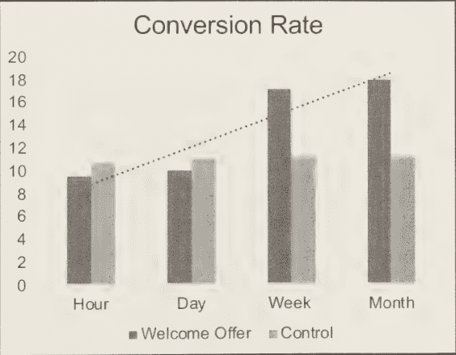

> 在这个测试中，在看到测试的用户采取行动利用促销之前，花了一些时间。

新促销，新鲜感是好事。如果你在测试一个你希望能长期提升指标的重新设计的网站体验，这可能不是你想要的。

### 存疑时，再次测试

如果对测试是否成功有任何困惑，请不要犹豫，再次测试。如果你无法复制结果，那可能不是一个设计良好的测试。不要忘记也要重新测试长期运行的活动，因为自最初测试以来情况可能已经发生了变化。

### 结合A/B测试与个性化

让我们重温本章开头提到的一个概念：虽然传统的A/B测试仍然很重要，但其真正的潜力在于与个性化结合使用。一个简单的例子可以说明这一点。

假设你正在测试两种不同的网站体验。我们称它们为体验A和体验B。如果你进行传统的A/B测试，可能会看到下一页所示的结果。让我们假设Y轴代表对你的业务很重要的某个KPI，例如每用户收入、转化率、注册量、点击率等。

这些结果告诉我们，体验A明显优于体验B。了解这些信息，并假设结果具有统计学意义，你将把100%的流量设置为查看体验A，然后进行下一个测试。

但让我们也假设你有两个受众群体，例如新访问者和回访者。我们称它们为群体1和群体2。每个群体规模相等，每个群体

### A/B 测试结果

| 体验 1 | 体验 2 |
| --- | --- |

体验 A 在本次测试中明显优于体验 B。

对测试体验的反应各不相同。如果你按群体拆解测试结果，可能会看到下一页所示的结果。

这些结果显示，群体1对体验B反应更好，而群体2对体验A反应更好。从第一张图中显示的结果中，我们是无法得知这一点的，因为我们看到的是每个群体对每个体验反应的_平均值_。群体1和群体2对体验A和体验B的反应被平均在一起，以产生这些体验的总体表现数字，如第139页所示。显然，这个平均值掩盖了这些群体偏好中一些非常有趣的差异。

没有个性化，即使你像这样拆解测试结果，你最终也会选择体验A作为赢家。毕竟，如果你必须选择一个对所有人都最好的单一体验，那就是体验A。但是，通过选择体验A，你错过了向群体1展示体验B的额外好处。

然而，通过基本的基于群体的个性化，你不需要在两种体验之间二选一。你可以为群体2选择体验A，为群体1选择体验B。换句话说，你可以为每个群体选择“获胜”的体验，而不仅仅是总体获胜的体验。第141页展示了如果将每个群体的最优体验结果与所有人的最优体验结果进行对比，会是什么样子。

当然，这是一个高度简化的例子。在现实中，你可以将受众分段的方式多不胜数，你的群体大小也会自然不同。但从这个例子中需要记住的重要一点是：仅仅因为测试产生了一个获胜体验，并不意味着该体验是

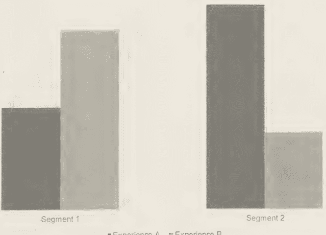

每个群体对测试体验的反应各不相同。群体1偏好体验B，而群体2偏好体验A。

最适合所有人。它只是意味着在没有个性化的情况下，这是你能做到的最好的。

你的所有传统A/B测试很可能都像这个简化例子所示，隐藏了关键信息。当你可以将A/B测试与个性化结合起来，为每个人提供相关内容时，错过未实现的好处是不明智的。

我们并不是在暗示A/B测试的总体原则在个性化世界中不再适用。你只需要做一些调整。

与其进行测试以得出适用于所有访问者的单一最佳体验，不如确定你最重要的群体，并为每个群体测试不同的体验。B2B公司可以按行业或公司规模（小企业、企业等）进行分段。B2C零售商可以按喜欢的类别或偏好的性别进行分段。金融服务公司可以按使用的产品（信用卡、汽车保险、抵押贷款等）或人生阶段（学生、新购房者等）进行分段。你可以为每个关键群体测试多种体验，以找到最适合每个群体的体验。

每次运行测试时，始终为不同群体筛选结果。你可能会发现某个基于规则的体验取得了良好的结果，但如果你深入挖掘，可能会发现它对忠诚购物者与偶尔购物者的表现更好，例如。

你还可以将机器学习作为传统A/B测试的有力补充或替代方案，我们将在下一节中描述。

### 使用机器学习和预测评分提升你的测试

现在我们已经详细介绍了A/B测试、将其与个性化结合的重要性，以及如何衡量和分析

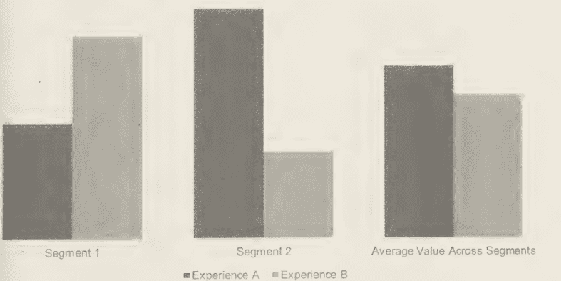

关于您细分群体的宝贵信息可能隐藏在整体 A/B 测试结果中。

查看您的结果，让我们探讨机器学习对测试和分析的影响。机器学习为当前和未来提供了重大机遇，可提升您的测试和数据分析工作。

### 通过持续学习实现个性化

如前所述，A/B 测试主要设计用于为您提供单一答案。如果您想测试品牌的各个方面（例如字体、颜色、徽标或标语）、网站设计、定价等，您会希望使用 A/B 测试或多变量测试，因为您不打算将体验定制给不同群体或个人。您希望找到一个优于其他选项的单一解决方案。

但这不一定是您使用个性化时的目标。例如，如果您想在主页上展示两个不同的促销活动，A/B 测试旨在告诉您哪个选项具有最广泛的吸引力（具有一定的置信度）。但这并非营销人员的真正目标。实际上，您的目标是从这两个选项中获得最大的商业价值。A/B 测试无法实现这一目标。您可以通过选择几个您认为会对促销活动产生不同反应的细分群体，并使用规则相应地定位促销活动，来更接近该目标。但即便如此，您仍未真正实现从每个促销活动中获得最大价值的目标——因为没有一种情况会像上一节中的示例那样简单。

机器学习算法（例如我们在第 2 章中提到的 Contextual Bandit）可以实现这一目标。Contextual Bandit 使用预测评分和机器学习来评估某人与不同促销、图像、优惠或其他体验互动的可能性。营销人员可以向算法提供几种不同的体验，以在网站或电子邮件的特定区域中显示，它将为每个访问者选择最佳体验（对业务价值最高或成本最低）。

### 其他优势

个性化体验

面向所有人的体验 A

体验 A   体验 B

如果不进行个性化，您将错过将体验 B 展示给细分群体 1 的额外好处。

例如，如果一家公司有 15 个不同的主页英雄图片可能向访问者展示，该算法会考虑关于该人的所有可用数据，将在每个图片上转换某人的价值（点击、优惠接受、购买等）纳入考量，并为该人在当时做出最佳选择。

Contextual Bandit 算法有两个主要优势：个体级个性化和持续学习。由于我们已在本书中介绍了一对一個性化的价值，让我们花更多时间来讨论持续学习方面。

当您运行 A/B 测试时，必须让测试运行一段时间。在此期间，部分流量将查看最终被确定为“失败”体验的内容。直到您结束测试，才能获得获胜体验的全部好处。

但 Contextual Bandit 始终在学习和改进。您无需等待测试结束来分析结果，因为它会自动将所学内容纳入未来。它可以了解不同类型的人如何与您的网站或电子邮件互动，而营销人员可能需要很长时间才能通过数据发现（如果能发现的话），并立即根据所学内容采取行动。

最终，个性化加持续学习使您能够以 A/B 测试从未打算解决的方式，最大限度地提升您从数字体验中获得的价值。

### 穿透数据噪声

即使在这本标题中带有“机器学习”的书中，我们也并非要暗示机器正在接管营销，未来将没有人类的位置。制定和实施自身营销及客户体验策略，仍取决于人类而非机器。机器学习只能让

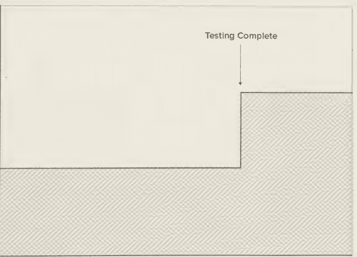

在测试完成之前，您无法获得 A/B 测试的全部好处。

执行这些策略成为可能。

但是，您如何产生推动营销策略的创意？通常，这些创意来自对您能接触到的任何数据进行仔细审查。然而，作为营销人员，您可用的数据量如此之大，以至于几乎无法分辨需要关注哪些数据。机器学习和预测分析可以提供帮助，这又是另一个例子。

思考一下公司内部存在的所有数据。这些数据可以告诉您营销及整体业务的运行情况。然而，数据分散在许多不同的地方，通常只有团队的特定成员才能访问。即使您将关键客户信息引入客户数据平台，也会有许多您自然不会包含或不会定期分析的数据源。关于网站性能、付费搜索活动、网站促销、流量、整体电子邮件点击率等方面的数据，可能仍分散在组织的多个位置。

这有何关联？在组织内海量分散的数据中，不总是容易确定您看到的任何效果的真实原因。亚马逊曾估计，将页面加载速度减慢一秒钟每年可能会使其损失 16 亿美元的销售额。现实地说，营销人员多久能足够关注并及时注意到这样的情况？数据实在太多，无法分析。

机器学习可以穿透噪声。它可以理解数据中的所有信号，帮助您根据关键业务指标识别模式、机会或问题。您可以使用机器学习分析哪个活动产生最高的业务影响，识别营销渠道中存在的机会以帮助您规划未来活动，甚至识别现有个性化活动或一般网站性能何时出现问题。机器学习可以向您发出模式和变化的警报，以便在

收入超出预测范围；预测对业务的影响

这些模式中，以便您快速有效地响应。

这如何运作？任何业务指标都有自然的起伏。但机器学习可以比单独审查报告的人类更准确、更轻松地量化正常范围通常是多少。然后，预测分析可以预测指标值在特定日期预计落在的范围。当指标超出该范围时，机器可以引起对差异的关注，并量化对业务的预期影响。

例如，零售商可以使用机器学习和预测分析来评估典型库存水平，考虑季节性、星期几和一般变化。机器可以识别购物者看到的缺货商品超过预期的情况，帮助零售商快速识别问题并立即采取行动。或者，专注于需求生成的网站可以使用机器学习分析内容下载，以识别生成的线索数量低于预测的情况。然后营销团队可以深入研究该信息，例如识别出重要链接已损坏（并在造成太大损害之前纠正它）。

这种方法可以节省营销人员在所有关注领域（包括个性化）中的时间。例如，机器学习可以帮助营销人员确定要定位哪些细分群体、要微调哪些推荐、哪些引荐来源带来最高质量的流量，或活动何时损坏或不再产生预期结果。当然，从那里做出决策仍然是人类的任务——包括如何修复问题、如何利用机会，以及是否要实施新活动。

所有营销人员都有关于什么能提供更好体验的想法。但仅仅实施您认为有效的东西是不够的：您必须测试您的想法以确保您是正确的。一旦想法经过测试，您

可以识别是否达到预期的成功程度。如果没有，可以不断迭代直到起作用。随着机器学习的普及，测试和优化流程越来越多地可以实现自动化。广义而言，测试能让你了解个性化对业务的影响，从而避免这些努力成为另一种无法准确衡量的营销手段。

## 第 6 章 脚注

- 42. Scott Brinker, “2019年营销技术版图超级图,” Martech 5000（实际上为7,040），Chiefmartec.com, 2019年4月, https://chiefmartec.com/2019/04/marketing-technology-landscape-supergraphic-2019/.
- 43. Mariya Yao, “AI如何解决营销中的3大痛点,” 2017年3月, https://venturebeat.com/2017/03/21/how-ai-can-solve-the-top-3-pain-points-in-marketing/.
- 44. Hubspot, Inc., “2017年入站营销现状,” 2017, http://www.stateofinbound.com/.
- 45. Kit Eaton, “一秒钟可能让亚马逊损失16亿美元销售额,” 2012年3月, https://www.fastcompany.com/1825005/how-one-second-could-cost-amazon-16-billion-sales.

## 第 7 章
### 为个性化制定计划

成功交付个性化体验需要与交付非个性化体验不同的思维方式。将个性化置于策略核心的营销团队必须从思考“想向受众传达什么”，转变为思考“每个受众成员想要看到什么”。实施个性化时，不要自问“本月我们应该在首页突出显示什么？”，而应自问“我们的关键细分市场或用户角色需要从我们的首页了解什么？”不要自问“今天或本周我们应该推送哪些产品和优惠？”，而应自问“具有不同兴趣和需求的个别访问者更希望看到哪些类型的产品和优惠？”不要以对你和你的团队最合理的方式安排导航或推广内容，而应考虑如何呈现内容，使其对网站上的每个人都最具相关性。

本质上，个性化使你能够采取最终的以客户为中心的营销方法。

对许多团队来说，这不是一蹴而就的小改变。当然，如第5章所讨论，先试水并实施一些基本活动以取得一些快速胜利，当然是可能的（而且可取的）。然而，为了执行利用机器学习充分发挥每个人偏好和意图的一对一、跨渠道体验，你需要有明确的策略。

构建个性化计划始于让组织中相关利益相关者就该计划的价值和好处达成共识，在整个组织中定义流程并明确角色，制定全面的策略，并执行该策略以实现和衡量成功。在本章中，我们将逐一解决这些领域。

### 需要做出的组织决策

较大的组织在组织个性化工作时，通常比较小的组织面临更多困难。在小型组织中，参与个性化工作的人员和团队数量有限。这些组织可能几乎没有或没有既定流程——他们可以保持非正式，并在了解哪些有效、哪些无效时进行调整。但当多个团队需要或希望参与时，非正式流程将不再奏效。在这种情况下，你应该明确组织中谁在哪些情况和/或哪些渠道中负责个性化工作。理想情况下，所有这些信息都应写下来并存储在易于访问的地方，以让每个人承担责任并让所有人保持在正轨上。

我们整理了一些问题，供你在开始时考虑。并非所有问题都适用于所有组织，或者答案可能取决于你的情况或公司规模而显而易见，但它们是启动对话时使用的良好指南。

### 管理

- 你们组织将如何评估个性化成功？
- 你们将设立“个性化管理办公室”吗（本章后面将对此进行定义），你们计划如何让该办公室与各个分部互动？
- 谁将在各个分部制定个性化策略？
- 谁将为各个分部的员工分配个性化角色？
- 管理层将如何评估这些角色中员工的绩效？
- 你们将如何评估个性化成功？
- 你希望技术和/或代理合作伙伴在个性化活动策略制定和执行中扮演什么角色？
- 你们将个性化哪些渠道？是否将从单一渠道开始？准备好时如何将其他渠道加入流程？

### 规划

- 你们将如何管理个性化活动的构思和优先级排序？
- 谁将建立和管理你们的个性化活动日历？
- 你们预计每月在整个组织和各个分部内启动多少个活动？
- 你们的旺季是什么时候？你们将如何以不同于其他时期的方式管理高流量活动的开发？
- 你们的个性化团队将如何与其他团队合作制定和执行个性化活动策略？
- 你们将如何在各个分部之间共享最佳实践和经验教训？

### 团队分配

- 哪些团队和个人被分配来支持个性化？
- 每个团队和个人在个性化策略中将扮演什么角色？
- 各个角色所需的技能是什么？

### 体验开发

- 谁将决定要开发的体验？
- 你们团队中谁将设计个性化体验？
- 谁将管理创意？这是一个集中职能还是位于各个分部内？
- 如果需要更高级的编码，这是一个集中职能还是位于各个分部内？
- 谁将批准体验设计工作？

### 体验审批

- 谁将在发布前测试新体验？
- 新体验将在发布前如何获得批准？
- 哪些类型的体验需要中央批准，哪些需要在各个分部内批准？
- 体验何时发布？

### 优化与性能

- 对你们团队和整个组织来说，哪些关键绩效指标最重要？
- 你们将如何分析结果（提升和影响）？
- 你们将如何优化体验以不断改进结果？

这些问题可能看起来令人生畏，但请记住，个性化可以而且应该成为你们客户体验和营销工作的组成部分。如果你这样思考，而不是简单地将其视为公司正在进行的另一次性举措，你会意识到考虑这些问题至关重要。

我们将在本章剩余部分深入探讨其中的几个领域。

### 建立个性化管理办公室

考虑到个性化方面需要考虑的事情如此之多，较大的组织可能会考虑建立“个性化管理办公室”（PMO）。与传统的项目管理办公室一样，PMO使组织能够高效地构建和扩展个性化计划，建立问责制并确保支持。

PMO应由来自不同业务群组的个人组成，充当公司的主要个性化策略和解决方案或技术资源，并充当业务部门之间的协调点。由于个性化可能涉及多个渠道和团队，PMO小组可以帮助确保业务的所有领域都朝着相同的目标努力——最终避免麻烦并大大提高成功的可能性。

每个组织都需要在其自身背景下弄清楚PMO应该是什么样子，但你可以采取三个广泛步骤来建立一个。

### 1. 创建PMO“核心”团队

建立PMO的第一步是确定将参与的个人。不要将你们的个性化管理办公室视为一个全新的业务群组，而应将其视为一个由来自各个部门的个人组成的“特别工作队”，充当集中式个性化资源。

你在PMO中包括谁取决于你的业务，但你应该考虑包括公司各方面的关键利益相关者——例如营销（所有渠道）、分析和运营。你还应考虑提名战略赞助人和项目经理，以及执行、分析和创意团队

成员。不过，请尽量避免给团队增加过重负担，因为涉及的利益相关方过多，可能会导致决策和执行变慢。

另外，请注意，在较小的组织中，PMO 可能只是一两个个人贡献者和一名执行赞助人。

### 2. 建立您的流程和治理

您的 PMO 应负责制定公司开发和管理个性化体验的路线图。首先，审视当前的流程是什么样子。贵组织目前如何推出客户体验举措？谁负责该流程的哪些方面？一旦您识别出当今组织内各渠道和团队之间客户体验是如何确定的，就可以开始着手如何调整流程以融入个性化。

在将个性化融入当前工作流和业务结构的过程中，选择哪些人负责不同的个性化任务（包括 PMO 内部和外部）。明确谁参与个性化流程，并概述每个人的角色。有些人仅参与头脑风暴过程，之后不再提供意见。其他人将帮助决定实施哪些活动。还有一些人将负责设置和测试活动。这些人可能或可能不是实际发布活动的人。请尽早确立这些角色。

在可能的情况下，在个性化平台内设置基于角色的访问控制。例如，创建一组可以创建活动但不能发布活动的用户。创建另一组可以测试活动的用户。然后创建最后一组可以将活动部署为已发布状态的用户。这种结构将消除角色方面的任何混淆，并确保只有在团队中合适的成员审查并批准后，才会部署活动。

### 3. 执行并报告进展

PMO 应继续跟进成功的活动，确定哪些应保持不变，哪些可以改进，哪些应逐步淘汰。成功的定义因公司、行业和渠道而异。

PMO 的好处在于，它可以帮助跨团队和部门汇总经验教训。如果您的公司有多个网站，可以先在一个网站上测试活动，再推广到其他网站。在电子邮件中取得成功的推荐算法可以推广到网站上。如果没有一个中央团队，这些发现可能会丢失。

最后，除了构建组织的个性化策略和流程外，PMO 还应负责向管理层报告结果，以确保该计划继续获得支持和认可。

### 定义个性化策略

虽然不制定个性化策略，仅在发现机会时随机实施活动，也有可能取得显著成效，但由 PMO 推动制定更广泛、长期的策略是个好主意。即使策略很简单，定义策略也有助于确保您实现特定目标、对优先级进行排序、衡量成功，并最终创造更好的客户或潜在客户体验。

制定个性化策略的最佳起点是进行一些初步研究。我们建议从以下三个方面入手：

### 您的挑战和目标：

首先，思考您面临的挑战以及希望通过个性化实现的目标。提高转化率、降低跳出率、提升特定营销策略的投资回报率、提高平均订单价值、改进追加销售和提高留存率，都是采用个性化的营销人员的常见目标。勉强自己超越挑战本身进行思考。每当您识别出挑战或目标时，继续问自己“为什么”。例如，如果您想提高转化率（因为每个人都想提高转化率），请问自己为什么这仍然是一个目标。您今天在网站上转化方面遇到了哪些困难？为什么某个细分群体的转化率可能比另一个更高？您必须找到问题的根源才能解决它。

### 您的数据：

如果您在策略会议中不断问“为什么”，您自然会转向数据。您的数据对挑战有何说明？机会在哪里？分析网站上的漏斗并识别流失点。找到易得的成果，例如降低高流量页面的退出率的机会。在识别出挑战和目标后，对事物为何如此形成一些假设，以便您可以开始在数据中寻找答案。我们知道您拥有大量可用数据，因此这一阶段可能会让人感到不知所措。但这个过程可以帮助您通过个性化发现无尽的改进机会。

### 实际可能是什么：

在规划过程的这个阶段，您和您的团队可能有很多关于如何利用个性化的一般性想法。对当前（无论是在组织内部还是在现有技术方面）实际可行的内容有具体了解，可以帮助您完善这些想法。我们希望本书能为您提供坚实的基础，但您可能还希望通过与供应商交流和进行额外研究来补充，以了解现有技术可以做什么。当今技术可以完成很多事情——远超 20 年前。但是，如果您理想的个性化策略涉及通过在每位客户身上植入 RFID 芯片将线上与线下联系起来，您会发现目前行不通。另一方面，可用资源可能比您意识到的更多，因此您的策略最终可能比原本预期的更强大。

一旦您开始深入研究上述三个领域，您就可以开始完善个性化策略了。在记录流程的同时，请务必记录您的策略。在此过程中，请考虑包含以下每个问题的答案：

1. 我们的目标是什么？

记录您之前识别的目标。在以后开发和优先级排序活动创意时，您会想回顾它们。考虑这些想法是否确实服务于您的目标。如果不是，它们值得做吗？或者，是否值得包括您最初可能遗漏的其他目标？您记录的目标可以帮助您开始这项评估。

2. 我们将如何衡量成功？

确定哪些指标将决定您是否达到了目标，并将这些指标作为策略的一部分进行记录。如果不识别指标，您将无法量化成功。无论指标是什么（例如，转化率、点击率、平均订单价值、收入、留存率、终身价值等），请确保您有坚实的基准和合理的提升目标，以帮助验证业务影响。

### 3. 我们的目标受众是谁？

始终考虑您的个性化工作针对谁是个好主意。在某些情况下，您的目标受众将是各个渠道中的受众细分群体、用户画像或行业。在其他情况下，您可能希望使用机器学习算法为每个人创建独特体验。采用这种方法，您仍然需要记录，同时考虑是否需要为不同群体提供不同类型的体验或算法。您想向新访客和回访访客提供不同体验吗？客户和潜在客户呢？这些差异值得注意。

### 4. 我们将在何处利用个性化？

考虑您目前用于与客户沟通的渠道，以我们在第 3 章中讨论的渠道为起点。这些渠道中哪些将成为您个性化策略的一部分？理想情况下，您用于与客户和潜在客户沟通的任何渠道都应以某种方式进行个性化。您是否会先从某些渠道开始，然后再转到其他渠道？请对渠道进行优先级排序，并提前考虑每个渠道的方法。

### 5. 我们需要哪些数据来源？

到此为止，您已经了解数据对成功的个性化策略有多重要。但许多组织的数据在各团队和系统之间形成了数据孤岛，因此将所有数据整合在一起可能是一个漫长的过程。您应尽早开始思考实现目标所需的数据，以便拥有所需的所有数据来源。

同样，您的数据来源与渠道密不可分。理想情况下，即使您不计划在个性化策略中包含的渠道，也会通过其收集的数据参与其中。您应致力于将各渠道的数据整合到一个系统中（例如您的客户数据平台），以便构建每个人的统一客户档案。例如，即使您计划仅在电子邮件活动和线下渠道中使用个性化，也应尽量收集网站和移动应用行为，以帮助确定每个个体最相关的体验。

### 6. 我们需要哪些内容和创意？

您个性化所需的大部分内容可能已经在您的组织中存在。尽管如此，尽早考虑这个问题仍然很重要，以便您可以开始识别任何重大差距并规划潜在投资来解决它们。例如，如果您想为不同的受众群体创建多个主页体验，您需要撰写新文案并设计新图片。或者，如果您想在页面中插入产品推荐，您需要决定显示多少商品以及应用什么“外观和感觉”。

### 7. 我们需要哪些技能？

如果您的团队或项目管理办公室（PMO）中没有具备所需技能的人员来实现目标，您的个性化策略就不会取得太大进展。但是，您现在的员工中极有可能就有这样的人。他们已经在从事网络营销、电子邮件营销、产品营销、商品管理和/或分析工作。如果您使用不需要编码或大量团队参与的个性化解决方案，您将大大增加利用现有员工技能和才华的机会。（我们将在下一章中详细介绍技术要求。）

如果您是从小规模开始，很可能可以依靠这些现有员工。但是，如果您想立即深入更高级的策略——或者如果您已经测试过个性化并想做更多——您可能希望聘请某人来领导您的个性化工作（全职或兼职）。我们预测，随着越来越多的组织将个性化列为首要任务，越来越多的营销团队将寻求聘请个性化专家或个性化总监，以帮助他们最大限度地发挥这些工作的影响力。

尽管理想的候选人应有个性化活动背景，但其他数字营销活动的经验（例如转化优化或需求生成，具体取决于您的行业）也可以提供足够的基础。创新的电子邮件营销人员、网站/在线营销人员和营销分析专家也是很好的候选人。

一旦您记录了这些问题的答案——当然，需要征求所有关键利益相关者的意见——您就应该为您的个性化策略奠定坚实的基础。

### 确定合适的活动

精确地说，什么是活动？您启动的每个个性化策略都可以标识为“活动”。例如，如果您在产品详情页上放置“完善造型”推荐，您可以将其称为“完善造型推荐活动”。您用来针对不同行业或消费群体的任何主页体验，您可以将其称为“主页英雄活动”。带有相关打开时内容的触发式电子邮件序列将被称为“重新参与活动”。您将在个性化平台中构建和发布这些活动中的每一个，我们将在下一章中介绍。

在规划活动时，难点往往在于决定从何处开始。即使制定了最完善的策略——即使您已经有几个成功的活动——在所有活动概念中选择优先级也不总是容易的。以下步骤可能会有所帮助：

### 1. 识别活动

首先，思考您可以采取什么措施来解决策略中的每个主要目标。例如，为了增加平均订单金额，您可能希望在购物车页面测试推荐，以搭配购物者购物车中的商品。您还可以建议购物者可以购买的其他商品，使其有资格获得免费送货。或者，为了降低跳出率，您可以创建几个与每个访问者的推荐来源或位置相关的不同活动。

继续与您的团队一起头脑风暴策略，以应对所有关键目标和挑战。列出您能想到的解决每个目标的所有策略，并注明这些活动的渠道和时间，以及您需要用来衡量其有效性的指标。

### 2. 确定活动优先级

接下来，您需要建立一个机制来帮助确定活动优先级。我们建议采用类似下图的方式，将预期影响与预计实施难度进行权衡。这种方法将帮助您确定哪个潜在举措最能推动您的目标（而不会过度消耗您的预算或团队）。特别是在刚开始进行个性化时，您应该考虑在受众方面为您的活动撒宽网。最初只触达网站上十个人的活动并不是时间利用的最佳方式。将影响程度与预计难度进行比较，可以帮助您快速发现那种高投入、低影响的项目。

如果一个想法不费力但影响大，那是不言而喻的。立即实施那些活动。然而，很可能您最终会得到一个稍微复杂一些的图表。无论如何，像上面这样勾勒出您的概念，是开始确定举措优先级的好方法。

### 3. 测试和迭代

与您的所有营销策略一样，您应该定期测试并迭代您的个性化活动。推出新活动后，请与对照组进行测试，以确保其相对于非个性化体验能带来提升。养成追求持续改进的习惯——这很像敏捷软件

| | 影响 | 难度 |
|---|---|---|
| 想法 1 | 高 | 低 |
| 想法 2 | 中等 | 低 |
| 想法 3 | 低 | 中等 |

勾勒出活动想法可以帮助您确定举措优先级。

开发。与从头到尾在独立阶段中分析、设计、编码和测试每个新项目不同，敏捷开发人员会同时完成这些步骤——将每个项目分解为小块，以快速交付可用软件。这使他们能够及早测试、快速发现问题并迅速响应。

作为专注于个性化整个客户、购物者或潜在客户体验的营销人员，您可以以类似的方式运作。这意味着您不应该一次只开发一个活动然后等待看它是否有效。相反，您必须开发一个流程，在该流程中，您始终在评估和改进当前活动，测试新活动，并移除那些无效或已过时的活动。

回想一下您定义的目标。经过一段时间，其中一个目标可能被视为“已完成”。但更可能的是，并没有真正的“终点线”。转化率或参与度等具体指标始终可以逐步改进。而这种微小的改进最终会累积成更大的改进，对您的净利润产生重大影响。即使是“改善客户体验”这样更抽象的目标，也始终可以改进。随着技术和客户期望的不断演变。

归根结底，个性化不是解决单一问题的终点。它是一个持续的过程，而持续迭代是确保该过程不断向前发展的关键。

当然，作为营销人员，您同时会被拉向很多不同的方向。找到持续迭代的时间并不总是容易。您可以每周腾出一些时间，或与您的 PMO 设定定期会议来评估您的活动。您应该不断地添加、改进和弃用活动——以及评估您的支柱活动的有效性。关于这些目标，更多内容如下：

- 添加新活动：在开发新内容、产品、功能等时，您应该始终尝试新的策略。您是否

通过正确的渠道成功接触到正确的受众吗？你在各渠道中的消息传递和图像是否能引起这些受众的共鸣？贵公司是否有想要更好地接触并转化的新细分市场？如何让跨渠道沟通更加一对一？在思考并确定新活动创意的优先级，以及决定何时添加哪些活动时，这些都是你应该提出的问题。没有关于应该实施多少活动或应以何频率启动它们的通用建议。但如果你不测试新活动，你的项目肯定会停滞不前。

### 优化几个活动：
看看你上周、上个月和去年启动了什么。所有活动仍然有效吗？如果经过改进，它们能更好地工作吗？你能优化规则或算法，或融入新的创意吗？不要只设置一个活动就置之不理：测试并调整它，直到看到改善——然后不时回头检查，确保它仍然有效。

### 淘汰几个活动：
过去有效的东西现在可能不再有效。也许你几个月前精心调整到完美的那个活动已经走到了尽头。如果你从某个活动中看不到任何收益，且所有调整都无济于事，那么你应该放弃它。还要考虑，消息传递可能会过时，因此你需要监控活动，确保它们符合信息和品牌一致性。一旦它们不再符合，就将其丢弃、替换或更新。

### 评估你的支柱活动：
请记住，持续迭代并不意味着你总是需要淘汰或改进所有活动。许多营销人员拥有“支柱活动”，他们创建后迭代一两次，然后让其持续运行。这些活动通常在你开发其他创意时，能可靠地带来成果。你需要找到适合你和你所在组织的正确组合。但不要忘记定期评估这些活动，以确保它们仍然有效。

活动难以确定优先级和更新，但其影响是不容置疑的。使用上述技巧，为你的访客和客户打造一个可重复的流程，以推动不断改进的体验。

### 说服组织投资个性化

在结束之前，让我们简要退后一步。本章探讨了如何在组织内建立流程和策略，以有效交付个性化。但如果你无法让组织同意首先将个性化列为优先事项，该怎么办？

取决于你在组织中的角色，你可能会遇到来自高层领导、IT部门或营销团队其他成员的反对意见，或以上所有。我们从领导职位人士那里听到的主要反对意见包括：

> 我看不到其价值。

与所有新投资一样，你可能需要说服高层领导认可个性化的价值。不过，在许多情况下，这并不必要。个性化在营销领域是一个常见的热门词汇，许多领导者对其已足够熟悉，并理解它能为客户和组织带来的价值。

但如果有必要，我们希望在读到本书这里时，你已经充分掌握个性化的益处，并准备好与领导团队分享其中的一些知识。思考你在自身渠道中计划用于个性化的主要用例，并将这些想法与领导团队分享也是有帮助的。思考你期望这些举措产生的影响，并为团队量化。例如，如果你认为可以提高转化率，那么你期望提高多少？这对你的净利润意味着什么？对于我们交谈过的大多数营销人员来说，即使转化率、留存率、注册量、追加销售、页面浏览量和平均订单价值等指标出现适度增长，也可能产生重大影响。务必利用可用工具来计算个性化投资的投资回报率。

此外，竞争优势不容忽视。鑒于过去20年里一对一沟通的历史和增长，很明显，作为一个社会，我们正朝着更多个性化而非更少个性化的方向发展。提供个性化体验的能力通常是一种竞争优势——至少目前是这样。在未来，个性化方法将对任何企业的成功至关重要。向领导团队解释，现在开始很重要，这将产生影响。

### 我们没有预算。

无论你如何交付个性化，都需要预算。你采取的策略将因组织而异很大。我们能给出的最好建议是，除了量化对KPI的预期影响外，你还应该进行计算，以确定你将获得的投资回报率。这意味着确定你计划一年在个性化上花费多少，并将其与对业务的预期（积极）影响权衡。我们发现，合适的技术可以通过带来的改进成倍地收回成本。

### 没有足够资源来管理它。

与预算担忧类似，领导层可能会反对，称团队没有带宽来管理个性化工作。如果新团队成员和技能发展不是近期选项，那么采取“小胜”方向可能会有所帮助——特别是如果你有一个小团队。我们发现，策划并执行几个快速简便的活动并不需要太多时间（有时每周甚至只需一两个小时），这些活动可以在转化率、参与度、平均订单大小、电子邮件获取率等方面带来不错的提升。如果领导层看到了个性化的价值并愿意分配预算，但担心这些工作会占用团队太多时间，那么从小处着手并逐步增加投资可能会带来成功。

即使你的领导层已经支持（或者你自己就是领导层），你可能仍需要处理来自营销团队其他成员的反对意见。以下是我们听到最多的几条：

### 我已经应接不暇；这会占用太多时间。

小型营销团队（通常人手不够）的一项常见抱怨是，他们不需要再管理一项策略。这是一个合理的抱怨，但你有责任传达个性化能带来的价值，说明其益处将超过他们的时间成本，并确定该计划相对于其他计划的优先级。

与面对高层领导时一样，考虑一下你计划用于个性化的主要用例，并思考提高KPI将带来什么影响。如果这些用例能改善客户或潜在客户的最终体验，许多团队成员会感到兴奋。如果单纯的体验改进无法让他们兴奋，那么预期的增长可能会打动他们——特别是如果团队的绩效是根据这些KPI衡量的。

如果这个反对意见也令你担忧，请确保投资于易于使用的技术——一种你的团队不会觉得繁琐或乏味，也不需要太多培训就能上手的技术。为团队成员学习一项可添加到简历中的新战略技术，通常也是一件令人兴奋的事情。

> 我们正在进行重新设计，目前没有可用的成品。

许多营销人员以重新设计网站、移动端或Web应用为借口来回避个性化，声称现在不是好时机。在某些情况下，这可能是真的。但在许多情况下，将个性化从一开始就融入到新设计的网站或应用中是一个好主意。当你计划转变基线体验时，通常能找到更多个性化的用途。

例如，你网站上计划设为静态的任何区域，实际上都可以有针对不同细分市场的多个版本。你甚至可以确定所有产品和/或内容推荐的位置，并开始测试不同的算法。至少，你和你的团队可能希望尽早开始思考如何利用个性化。

> 我们没有足够的现有内容用于个性化。

许多基于内容的团队担心，他们需要将当前内容量乘以想要定位的人物画像数量。但事实是，大多数网站已经拥有大量针对不同人物画像或漏斗阶段编写的内容。这些内容只是并不总是能有效定位。

个性化可用于为网站上的每位访问者将相关内容置于突出位置。例如，与其依赖访问者导航到您的资源页面并选择合适的电子书，您可以在网站上的任何页面推荐该内容，并且在对每位访问者最合适的时机进行推荐。

当然，实施个性化可以帮助您识别可能存在的任何内容缺口。但这些缺口在开始个性化之前可能不一定需要填补。

在本章中，我们讨论了与个性化相关的重要组织决策、建立个性化管理办公室、制定个性化策略、执行个性化计划、保持计划顺利运行以及解决对个性化的异议等问题。

当然，如果没有能够适当处理数据以在当下提供最相关体验的正确技术，任何个性化策略都不完整。下一章将重点介绍这一点。

## 第 8 章 为工作找到合适的技术

在上一章中，我们介绍了如何在组织中开始个性化。但在取得重大进展之前，您需要合适的技术。作为个性化计划的基础，您的技术必须具备实时收集、分析和处理数据的能力，以提供个性化体验。而且，对于一对一化个性化，技术必须具备机器学习功能，高度复杂，并赢得业务用户相当程度的信任。

通过采用机器学习，您将管理营销和客户体验交付的部分工作交给技术。放弃控制可能会让许多人感到不安。如果每个人的体验都不同，您怎么知道访问者、用户、购物者和客户的最终结果是什么样子？您如何保证体验会很好？

我们交谈过的大多数营销人员在能够控制机器提供的体验时，会对机器学习感到更自在。然而，许多解决方案作为“黑箱”运行：它们提供动态体验（主要以推荐形式），但对这些体验是如何确定的却缺乏深入洞察。而且，如果它们不告诉您它们如何选择体验，那么它们当然也不会告诉您它们的表现如何或如何改进。

在本章中，我们将回顾支持一对一化个性化所需技术的主要要求。我们还将提供关于如何识别黑箱及其他供应商潜在危险信号的技巧。

### 个性化与客户数据平台

在本书中，我们多次将不同技术称为“个性化引擎”、“个性化平台”或“客户数据平台”。因此，您可能在想，哪一个是进行个性化所需要的？能否只使用一个解决方案就执行一对一化个性化？或者是否需要一组协同工作的解决方案生态系统？

不幸的是，答案是“视情况而定。”

当今市场上没有单一解决方案提供相同的功能集，它们也都不以相同的名称或类别自称。您需要充分概述贵公司短期和长期的需求，并将其与市场上提供的功能进行比较，以找到最能满足当前和未来需求的解决方案。但是，我们确实有一些关于如何思考技术栈的建议。

数据是任何良好个性化体验的基础——因此，首先，您必须收集个人信息。然后，您可以根据这些信息决定哪种体验最相关。本着这个想法，您可以将技术视为服务于两个主要目的：洞察与互动。

在此语境下，**洞察系统**整合客户/潜在客户数据并支持对该数据进行分析。

一个**互动系统**在一个或多个渠道向客户/潜在客户提供体验，并支持衡量结果。

您的技术栈必须同时满足洞察和互动需求。组织有时会将这些功能的采购流程分为两部分。他们可能最初决定购买一个作为洞察系统的解决方案，然后在与第一个解决方案取得进展后六到九个月，再决定购买或连接到互动系统。这种方法主要是由对客户数据平台（CDP）日益关注所驱动的——正如您在本书前面部分记得的那样，CDP 是组织中客户数据的中心位置。换句话说，CDP 是一个洞察系统。

将 CDP 和个性化功能分离到不同系统中存在两个主要问题。

### 1. 细分群体的局限性

洞察系统主要设计用于评估和识别受众细分群体，然后将细分群体成员数据传递给独立的互动系统。细分数据在许多情况下无疑很有价值（本书中我们描述了许多基于细分的体验），但当洞察系统只能将细分级别数据传递给另一个系统用于互动时，您就没有选择来提供一对一体验。

因此，您模拟一对一体验的唯一选择是创建越来越多的细分群体，并将这些细分群体映射到特定活动。实际上，您将被迫在提高相关性和增加复杂性之间做出选择，因为正如您从第 2 章中记得的那样，为了更接近一对一化个性化而增加细分群体数量变得越来越复杂且难以管理。

### 2. 次优架构

拥有两个平台——一个 CDP 和一个独立的个性化平台——实际上创建了一个有两个“大脑”的技术环境。显然，洞察系统是一种先进的、集中的大脑，充满了客户数据，并从这些数据中生成洞察。然而，在现实中，互动系统也必须充当大脑。它们需要利用机器学习来筛选海量客户数据，并决定在每个渠道的任何给定时刻向每个人提供哪种体验、内容、促销、消息或推荐。

将所有客户数据同时存在于这两个系统中并不明智，也不明智的是从洞察系统向互动系统提供有限数据以决定提供哪种体验。

### 示例

一个解决方案可以提供比两个解决方案好得多的体验这一想法可能难以概念化。让我们探讨一个示例来帮助阐明这一点。在本示例中，我们将查看零售公司的两位不同客户，Susan Jones 和 Susan Smith。每位 Susan 的假设档案数据快照出现在对页。数据反映出他们各自表现出不同的行为和偏好。

假设，作为本示例中的零售商，您希望通过电子邮件活动与两位 Susan 互动，提醒她们有忠诚度积分可用。您可能会先将两人都放入洞察系统中拥有未使用忠诚度积分的客户细分群体，将该细分群体推送到您的互动系统之一（例如您的 ESP），并使用 ESP 向该细分群体发送电子邮件活动。换句话说，每位 Susan 都会收到完全相同的电子邮件。

此活动可能有一些影响，但对每个人来说并不特别相关，并且与一对一体验相去甚远

### Susan Jones

- 1 次购买，店内
- 购买于 215 天前
- 智慧奖励会员
- 无最近网站访问

$450.00  1  0

- 新品上市
- 季节性
- 家具
- 家居

### Susan Smith

- 3 次购买，店内
- 购买于 190 天前
- 智慧奖励会员
- 访问智慧节省网站

$182.00  3  24

- 玩具和游戏
- 蜡烛与扩香器
- 儿童电子产品
- 家居用品

每位“Susan”都有独特的客户档案，具有不同的购买行为、模式和偏好。

个性化。

若要进一步个性化，您可能决定为部分产品类别创建更多细分群体，并根据每个 Susan 对各类别的亲和力，将每个 Susan 分配到对应的细分群体中。如果您将每个更窄的细分群体映射到您 ESP 中的特定活动，那么每个 Susan 都会收到一封与其喜爱类别相关的电子邮件，并提醒她注意忠诚度积分。

这种方法听起来可能不像是一大批难以管理的细分群体，但当您在 CDP 中设置每个细分群体，然后将这些细分群体映射到 ESP 中的大量活动时，情况可能会迅速失控。

例如，您需要为每个主要产品类别创建一个“拥有未使用忠诚度积分”细分群体（例如，季节性家具 + 拥有未使用忠诚度积分；家居用品 + 拥有未使用忠诚度积分，等等），并将其映射到 ESP 中对应的活动。但您可能不止一个活动。您还希望吸引不在忠诚度计划中的客户、活跃的忠诚度会员、可能流失的客户等。不仅如此，您可能还希望不仅按类别兴趣和忠诚度状态来区分客户，还要按他们对优惠的响应倾向（以及他们响应什么类型的优惠）来区分。

随着复杂性的增加，您必须添加越来越多的细分群体，构建越来越多的体验。

请记住，这个示例不是由机器学习决定的与个人相关的体验，而是由规则和细分群体驱动的营销人员定义的体验。与个人相关的电子邮件将包含为每个人选择的横幅，无论他们属于哪个细分群体，还包括基于其偏好而为他们最近购买或可能感兴趣的产品提供的推荐。仅靠细分群体根本无法实现这一点。

此外，这只是一个渠道上的一个示例，所以您可以

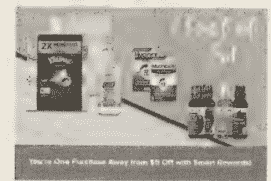

左侧的 Susan Jones 收到该电子邮件，因为她属于拥有未使用忠诚度积分且已知偏好季节性家具的人群细分群体。右侧的 Susan Smith 收到该电子邮件，因为她属于拥有未使用忠诚度积分且已知偏好家居用品的人群细分群体。

您可以看到，随着跨渠道的不同活动，问题呈指数级扩展。结果，大多数公司最终都会限制自己的雄心，而是满足于某种群体层面的相关性。

### 所有这些意味着什么？

通过关于细分群体和电子邮件的这个长篇示例，我们想表达什么？当市场上大多数独立的 CDP 作为洞察系统，将数据传递给参与系统时，它们仅在细分群体层面上传递数据。在某些情况下，这可以奏效，例如，当您只想向忠诚度计划成员发送相同的电子邮件时，就像我们在前一个示例开头所探讨的那样。但是，如果您想要发送电子邮件、展示 Web 体验、投放广告等，并包含对个人最相关的内容，那么您需要您的参与系统能够访问个人级别的数据。

因此，我们的建议是同时选择您的洞察系统和参与系统，以便您考虑端到端流程。您可能会发现，将洞察和参与功能合并到一个单一解决方案中是最佳方法。

这里有一个注意事项：鉴于您的个性化计划可能包含的渠道数量，假设您可以在一个参与系统中找到所有渠道的激活功能是不现实的。但总体概念仍然适用：您希望限制个性化计划中包含的解决方案数量，以避免不必要的复杂性和不足。

### 个性化的高级技术要求

无论您决定将哪些技术纳入您的技术栈，您都需要一些必须具备的功能来实现一对一的个性化。请记住，这些是有效解决方案的关键方面，而不是详尽列表。请使用此列表作为思考个性化计划要求的起点。

### 每个人一个可操作的单一档案

到这一步，应该非常清楚，如果您没有全面了解该个人，就不可能提供既独特又与个人相关的体验。想象几个不同的人在不同时间观察实体店中的一位购物者。每个人都会观察到不同的行为，所以如果他们不分享自己的观察，他们对该人的偏好和意图将有截然不同的看法。

在数字世界中，成功的个性化要求您跨渠道的所有深度行为数据被捕获，与外部属性数据同步，并汇总为每个访客、客户和账户的单一档案。但是，单一档案既不容易交付，在供应商中也难以找到。许多 Martech 供应商看似能提供完整的平台，提供跨个性化全谱系的功能，但合并数据源要么在其现有工具中不可能，要么非常复杂且耗时。

寻找具有解析身份、确定标识符优先级、汇总个人级别数据、拼接档案等清晰功能的解决方案。此功能为为每个人提供单一、可操作的档案奠定了基础。

### 与其他系统的强大集成

您的个性化技术不应向您的组织引入另一个孤岛。要为每个个人创建该单一档案，您需要能够从其他来源无缝导入数据。并且您需要能够将数据推送出去以触发操作或使其他系统保持最新。随着 Martech 技术栈变得越来越复杂，这是您在搜索个性化技术时不能忽视的一个领域。

寻找具有强大集成功能的系统，包括开箱即用的集成、强大的文档化 API、ETL 功能以及通常可扩展的集成框架，允许您的开发人员轻松将平台连接到外部系统。

### 理解业务上下文的能力

每个企业都不同，每个企业的产品和内容都是独特的，具有其自身独特的属性。例如，珠宝商关心钻石的切工和克拉，而时尚零售商关心其服装和配饰的品牌和颜色。内容出版商可能关心其文章的作者，而 B2B 公司关心其博客文章中的关键词。

您的业务不是关于页面或事件，而是围绕产品和内容展开。例如，如果您的个性化技术只能识别一位珠宝购物者浏览了三个产品页面，但无法理解切工和克拉，它就无法识别该购物者对超过 1.00 克拉的公主切割钻石感兴趣。对于珠宝商来说，该信息至关重要。

您的个性化技术必须能够理解业务上下文，以便您可以了解不仅某人访问了哪些页面，而且他们的行为以及与您的产品和内容的互动实际上告诉您该人是谁，以及她的兴趣和亲和力是什么。

### 创建细分群体并利用机器学习的能力

良好的数据能让您对客户有深入的了解，但在获得这种了解之后，您需要能够采取行动。

如前所述，个性化体验通常通过规则（在细分群体层面）和机器学习算法（在个人层面）来提供。您的个性化技术必须为您提供构建所需的尽可能多的细分群体和规则的灵活性，以及选择和修改算法的可见性和灵活性，以交付您设想的个性化体验类型。

### 基于任何和所有数据实时行动的能力

当有人说某事可“实时”获得时，我们往往会宽容对待。我们通常将其理解为“快速”或“很快”，而不是该短语的真正定义：“进程发生或事件发生的实际时间。”⁴⁶

在个性化方面，“实时”是指某人与公司交互的实际时刻。当我们说数据应被用来在实时交付个性化体验时，我们的意思是它应在某人与公司交互的实际时刻交付，无论渠道如何——基于她的实时行为。每个访客完整历史记录的所有方面必须与她正在做的一切，以及您从所有相关来源了解的关于她的一切相结合，以在各个渠道上交付个性化体验——时间以毫秒计。

许多供应商的营销消息中随意使用该术语——并不总是按其完整含义使用——但真正的实时是

绝对至关重要，在于提供利用个人即时（而非过去）意图的相关体验。

### 无需 IT 或工程团队介入即可管理技术的能力

如果你是一名营销人员，你可能已经体验到，为了实现营销目标而依赖组织内其他团队所带来的痛苦。无论你需要工程、IT、客户成功或销售团队的协助，当其他团队——因自身优先事项而负担过重——无法将你的计划放在首位时，这可能会令人沮丧。说到客户体验这样重要的事情，你不想完全依赖他人。那么，你可以做什么？

有了合适的技术，你和你的团队应该能够自行快速、轻松地启动、衡量和调整个性化活动，无需干预。然而，平台需要足够全面，以应对你所有复杂的多策略、跨渠道需求。在某些供应商处，这样的平台根本不存在。

话虽如此，如果你的 IT 和工程团队是不可或缺的营销合作伙伴，合适的平台应提供报告、开发者工具、界面和 API，使这些团队也能实现其目标。请确保你了解每个人的需求，以判断潜在的个性化解决方案供应商是否能满足这些需求。

### 准确的归因分析

如第 6 章和第 7 章所述，测试、分析和归因分析是任何个性化活动的关键组成部分。如果没有测试能力，你无法知道活动是否成功，或是否有办法改进你的方法。你需要内置的测试和归因分析，以便快速迭代并确保你的体验和算法提供尽可能好的结果。

有些解决方案在归因分析方面不够透明。某些供应商会提供活动结果报告，但不允许客户自行运行或管理这些报告。而且，许多供应商会大胆声称，其“黑盒”解决方案为你带来了数十万甚至数百万美元的增量收入——归功于可能本来就会发生的增长。在选择个性化解决方案时，请确保你有能力将每个活动的结果与对照组进行比较，并且该解决方案采用可靠的统计科学进行准确且可辩护的归因分析。

### 如何评估 CDP 和个性化供应商

在评估任何新供应商解决方案时，从夸大其词的宣传中识别出真正的优势可能是一项挑战。本书中使用的术语——“一对一”、“实时”、“意图”、“归因”、“集成”——都是行业中的常见流行词。它们被过度使用，以至于可能失去含义。此外，由于几乎每个电子邮件平台、CMS 供应商、大型技术公司和小型 martech 供应商都意识到了个性化和客户数据的重要性，几乎所有此类提供商都声称自己是个性化和/或客户数据平台——无论他们是否真正如此。

因此，提出正确的问题至关重要。实现一对一的个性化能力是存在的；只是找到适合你需求的技术的问题。这些问题应该帮助你拆解和评估潜在供应商的销售话术。

### 你的解决方案是否支持一对一的个性化？如果是，我可以查看单一的统一客户画像吗？

如果一对一的个性化对你很重要（如果你在读这本书，我们默认它很重要），那么你需要确保所考虑的每个个性化供应商都能帮助提供真正的一对一体验。回想一下，在 90 年代，BroadVision 将其产品定位为“一对一”，但实际上它仅支持向广泛细分群体进行基于简单规则的通信。今天的许多供应商对其一对一解决方案提供的内容仍然含糊其辞。有些仅根据其他访客的浏览内容提供推荐；另一些则仅允许你创建规则或将数据传递给其他系统，以向细分群体提供个性化体验。当然，这类体验很有价值，但它们并非现代个性化计划应支持的那种在个人层面提供的独特体验。

为确保能够在个人层面交付个性化，请要求查看供应商的单一统一客户画像——即存储个人所有数据（或针对 B2B 需求，存储单个账户所有数据）的个人画像。如果供应商无法提供此类画像，或者只能从其他系统接收细分数据，那么它就无法有效实现其一对一的承诺。

### 你支持哪些渠道？所有渠道是否都由同一统一平台支持，并由同一统一的客户画像驱动？

我们识别的主要渠道包括网站、Web 应用、移动 Web、移动应用、电子邮件、搜索、数字广告、社交、直邮和人工渠道。请务必确定你想要个性化的渠道，然后确保供应商完全支持这些渠道。供应商的解决方案应具备从你选定的渠道收集深入数据、从其他系统获取数据，并通过这些渠道交付个性化体验的能力。

弄清楚供应商如何为每个渠道构建支持也很有价值。供应商是原生构建了这些功能，还是通过收购获得的？如果是后者，请深入了解各个收购的解决方案之间的协作情况。如果它们不能无缝集成，数据在不同解决方案之间传递时可能会出现延迟。此外，请确定所有跨渠道功能是否可以从一个平台进行管理，以及每个渠道的所有数据是否都出现在同一统一的客户画像中。如果不是，执行跨渠道个性化——尤其是实时个性化——可能会困难甚至不可能。

### 你支持哪些数据源，它们集成起来有多容易？

请提前考虑你计划为个性化工作集成和利用哪些数据源。你是否在 CRM、电子邮件/营销自动化平台、数据仓库或其他地方拥有创建每个用户（无论该用户是已知还是匿名）完整画像所需的数据？如果是，请确保这些数据可以通过开箱即用的功能或强大的 API 来利用和集成。你不希望牺牲可能对个性化有价值的数据。

### 平台能否将数据传递并触发其他系统的操作？

无论你是在寻找独立的 CDP、独立的个性化平台，还是两者的组合，它都不会是你营销技术栈中的唯一系统。它应具备将其收集或处理的数据以批量或实时方式传递给你使用的任何营销技术的能力。

触发操作是一项高级功能，允许一个系统通过业务用户设置的工作流立即通知、更新或指导其他系统。例如，平台可以在 CRM 中触发一个任务，以跟进刚刚在你网站关键页面上花费了大量时间的目标潜在客户账户，或者由呼叫中心向刚刚进行高价值购买的客户发起自动客户服务呼叫，或者向购物者发送关于其购物车中遗留商品的电子邮件。

### 你如何定义“实时”？

“实时”的定义因供应商而异。请确保任何潜在供应商对该术语的理解与你一致。当你要求供应商定义它时，答案应该是明确的：解决方案会考虑每个访客来自当前和所有过去会话的所有数据，应用所有个性化逻辑，渲染个性化体验，并支持对该体验进行报告和分析——所有这些都在毫秒级完成。在这个端到端过程中涉及任何类型延迟的答案，实际上都不属于“实时”。

### 你收集哪些行为数据？

如第 4 章所述，将深度行为数据与上下文数据相结合对于在各渠道创建相关体验至关重要。没有它，你就无法真正了解每个人的偏好和即时意图。尽管如此，大多数供应商（如果他们在跟踪数据）只跟踪页面访问和点击。

请询问每个供应商收集哪些行为数据，以了解他们是否真的在衡量参与度（包括停留时间、鼠标移动、滚动、悬停和无操作）以及页面级元数据（例如类别、标签、品牌、颜色和关键字）。如果没有，你在运行个性化时就面临风险

对访问者和客户了解不完整的营销活动。

### 如何确定个人的亲和力和即时意图？

有效且高度相关的一对一体验需要了解一个人喜欢什么以及他正在寻找什么。达到这种理解水平需要机器学习来分析大型数据集以获得洞察。如果供应商无法说明如何通过其解决方案获取这些洞察，您应谨慎对待由此产生的个性化的准确性。

### 机器学习在您的平台中是什么样子？

鉴于机器学习对一对一个性化的重要性，您需要从一开始就了解供应商的机器学习能力。供应商的平台是否允许您通过自动聚类（如第 2 章所述）创建更智能的细分群体？它是否能够应用机器学习进行亲和力建模，以确定个人的真实偏好和意图，并进行预测建模，以确定个人的未来行为（如第 4 章所述）？供应商的平台能否使用机器学习进行警报、故障排除以及问题和机会识别（如第 6 章所述）？最重要的是，您能否自定义机器学习算法以跨渠道传递一对一通信？您能否利用这些算法不仅提供产品或内容推荐，还提供品牌、类别、促销、搜索结果、排序列表和动态导航？

如果这些领域对您的个性化策略很重要，请务必选择能帮助您执行这些策略的供应商。

### 您的解决方案中的归因报告是什么样子？

您必须能够控制自己的分析，以便随意深入数据。您应该询问任何供应商其分析和归因功能如何工作。该解决方案是否允许您将所有营销活动效果与对照组进行比较？统计显著性如何确定？您能否计算营销活动对多个指标的影响，以便了解全站影响？您能否自定义归因窗口，以揭示不同时间段的影响？如果您无法轻松确定这些问题的答案，那么您可能正在处理一个“黑盒”解决方案。

### 您如何使用自己的产品进行数字营销？

如果您发现供应商在某些回答中含糊其辞，不妨试试这个问题。虽然这并非决策的关键因素，但任何供应商都应该使用自己的产品来在其自身营销渠道中提供个性化体验。毕竟，您不会信任一个不吃自己做的菜的厨师，对吧？即使您是 B2C 公司，也可以从个性化技术供应商如何利用其自身产品中学到很多。至少，供应商应该准备好在其网站上引用具体且有效的个性化案例。优秀的供应商应该为您提供跨渠道个性化实际应用的全面演示，展示如何在实时的一对一层面提供相关且引人入胜的体验，并解释每个个性化营销活动支持哪些业务策略。

如果供应商无法提供这些示例和演示，这可能意味着该产品不符合本书中列出的一些标准。也可能意味着该解决方案使用起来困难或笨拙——甚至公司自身的营销团队可能也无法充分利用它。

### 构建与购买

在本章中，我们描述了个性化和客户数据技术的要求，假设您将使用第三方供应商（即购买技术而非自行构建）。与任何新举措一样，营销人员必须决定是构建还是购买将推动它的技术。对于许多营销人员，特别是开发资源有限的人来说，购买决策很容易做出。对其他人来说，则需要更多的分析。

企业往往（有道理地）将个性化视为潜在的竞争差异化因素——他们希望严格保密。因此，一些人探索构建自身技术解决方案的可能性。他们不希望竞争对手知道其个性化体验是如何生成的以及包含哪些内容。如果您正在考虑这种方法，我们鼓励您问自己以下问题：

- 构建个性化或客户数据软件是否会分散您对核心业务的注意力？
- 您能为每个人开发单一统一的个人资料，并从多个来源获取数据来构建这些资料吗？
- 您能开发本书中概述的跨渠道个性化所需的所有内容吗？
- 您是否有数据科学家来开发一对一个性化所需的机器学习算法和预测智能？
- 您能否将构建的内容无缝集成到现有的技术栈中？
- 您能开发出营销人员和其他业务人员易于使用的解决方案吗？
- 您能否按时推出解决方案并跟上未来的需求？
- 您是否准备投入资源来维护该解决方案？
- 您能否跟上个性化和 CDP 的最佳实践、策略和策略？
- 构建和维护贵公司自身解决方案的成本与第三方解决方案相比如何？

如果您构建自己的个性化解决方案，您将控制其包含的功能、工作方式以及用户界面的外观。一些组织选择走这条路，尤其是当他们认为这会带来竞争优势时。

但现实地说，如果您选择购买个性化技术，您无需担心失去竞争优势。您的技术只有与您投入的工作一样好。即使您和主要竞争对手都使用相同的解决方案，您也不会使用相同的自定义算法，设计相同的营销活动，或以相同的方式对现有体验进行迭代。

为您的个性化计划选择最佳技术至关重要。您可能有很多关于如何将个性化作为营销策略一部分的想法，但如果没有技术支持，这些想法无法落地。选择供应商不是您应该轻率做出的决定。

话虽如此，选择个性化解决方案供应商不必感到不知所措。只要您知道要寻找什么，就能区分事实与虚构，判断什么是实时个性化，什么是“下次”个性化，并区分能够让您提供个性化体验的全面客户数据平台与仅允许基于细分群体通信的 CDP。

评估供应商时需要注意的主要陷阱快速回顾如下：

- 当数据只能从一个或有限数量的渠道收集，体验也只能传递到一个或有限数量的渠道时
- “实时”并不表示“事件或过程发生的实际时刻”的情况
- “一对一个性化”没有考虑到对个人亲和力或即时意图的准确理解时
- CDPs 在个人层面*收集*数据，但只能在细分群体层面*采取行动*的数据
- 测试和归因能力不足，或者数据对不上
- 笨拙的用户界面，或任何非技术团队无法操作的平台
- 过度依赖流行语却无法充分解释其含义
- 通过集成不佳的收购拼凑而成的套件

## 第 8 章 尾注

46. 实时。Dictionary.com。Dictionary.com Unabridged。Random House, Inc.，http://www.dictionary.com/browse/real-time?s=t。

当 Peppers 和 Rogers 在 1994 年撰写《一对一的未来》时，他们描述了信息革命即将从根本上改变企业与客户互动的方式。他们假设：

> 1:1 营销范式将把客户放在首位，最成功的营销人员将是那些与其个别客户建立最深厚、最值得信赖关系的人。范围经济将使小竞争者能够击败大竞争者，至少在针对特定个别客户的客户份额之战中。47

我们大概都可以同意，他们的预测已经成为现实。在过去几年中，公司通过将客户置于首位、提供个性化体验并创造真正创新的解决方案，颠覆了各个行业。Netflix 就是其中一例。截至本书出版，Netflix 拥有近 1.5 亿名全球订阅用户，并继续在全球扩大其用户基础。仅在 2019 年第一季度，它就新增了 960 万名订阅用户。48 Netflix 功不可没，永久改变了消费者对内容消费的期望，使“连续观看”的概念成为主流。

作为流媒体视频平台，Netflix 面临来自其他流媒体视频提供商、有线电视提供商以及所有其他娱乐来源的激烈竞争。Netflix 通过提供个性化客户体验来在所有这些竞争中脱颖而出。产品创新副总裁 Chris Jaffe 曾表示：

我们必须让客户满意，这就是唯一的指导原则。在思考客户时，我们会思考他们如何花费时间。Netflix 面临的最大挑战是：如果你很累，且已是一天结束时，你可以读一本书或一本杂志，可以上 Facebook，观看线性电视，或观看 Netflix。我们希望让 Netflix 如此吸引人，以至于你不断选择它。⁴⁹

Netflix 并非仅仅依赖用户搜索特定内容，或按字母顺序列出所有可用内容，而是根据每位用户的个人偏好，在其平台上提供特定的推荐。这种程度的个性化始于对用户及其偏好的深入了解。推荐是通过协同过滤算法生成的，该算法根据用户的个人观看行为以及该行为与类似行为观众的对比情况，向用户展示他们最可能感兴趣的内容。该算法还加入变体，以向用户展示还有其他他们此前可能未曾接触过的类型。算法根据用户与这些变体的互动情况（无论是否参与）来了解更多关于用户的信息，从而确定观众对这些类型的兴趣（机器学习的这一方面称为“自学习”）。此外，Netflix 算法生成的搜索结果会考虑个人偏好和内容的受欢迎程度。最后，Netflix 始终在测试其平台的用户界面和功能，以推动整体体验的持续改进。⁵⁰

像 Netflix 这样的个性化案例清楚地表明，Peppers 和 Rogers 的愿景现在已成为可能。其方法使该公司能够捕捉近 1.5 亿观众的心智份额和钱包份额，并与大型有线电视公司竞争并取胜。Netflix 的故事也概括了本书中描述的所有个性化概念。从利用数据了解每个用户，到通过机器学习提供一对一的个性化，再到持续测试和迭代，Netflix 正以非凡的水平利用个性化。

如今，大多数营销人员并未像 Netflix 那样提供个性化服务，也未利用本书中描述的一切。这在情理之中。总会有新技术的早期采用者，也总会有突破界限、打破常规的营销人员。对于许多营销人员来说，未来涉及过渡到一种将个性化置于其业务策略中心（而非仅营销策略中心）的策略，并实施本书中描述的各类个性化。实现真正个性化的技术已经存在，但过渡需要一些时间。然而，尚未对任何工作进行个性化的营销人员肯定需要尽快启动这些举措——否则他们将面临被边缘化的风险。

但在清晰可知的未来——以及本书中概述的内容——之外，以下是关于个性化在未来几年和几十年内将如何演变的几个预测。

## B2C 的未来

有几个面向 B2C 营销的趋势将在未来指导个性化。首先，询问任何一位 B2C 营销人员，他或她都会告诉你，争夺消费者注意力的竞争非常激烈。互联网降低了触达受众的门槛：小型企业可以用比大公司更少的资源轻松触达目标消费者，任何人都可以拥有自己的博客成为内容创作者，拥有自己的 YouTube 频道成为视频制作人，或在 Etsy 上开设自己的商店成为零售商。因此，B2C 公司越来越发现，它们需要像 Netflix 一样，基于客户体验来实现差异化。

在零售行业，近年来零售店关闭潮的涌入使这一趋势雪上加霜：2017 年，零售商关闭了 1.02 亿平方英尺的店铺空间，2018 年又关闭了 1.55 亿平方英尺。51 这一趋势短期内似乎没有放缓的迹象。拥有实体业务的 B2C 公司需要想办法在“实体店”领域进行创新和个性化。随着他们在数字渠道上尝试个性化，将会发现个性化也是其实体渠道实现差异化的道路。

其他行业的趋势也在推动对个性化的需求。大多数金融机构认为自己是以关系为驱动的组织，但 79% 的消费者认为他们与银行的关系是交易性质的。52 在旅游业，消费者在预订旅程时注重成本且不太忠诚；因此，在线旅行社（OTAs）通常基于价格竞争。媒体和出版界内容过载，各种类型的内容应有尽有，因此该行业努力提供任何程度的差异化，以有效吸引并留住读者和观众。这些及其他行业的公司发现，提供个性化客户体验可以让他们与客户建立更好的关系，从而培养客户忠诚度。

此外，正如技术世界经常发生的情况，当你以为自己已经摸清一切时，局面就会发生变化。通过个人电脑访问互联网的能力对营销行业来说是一个改变游戏规则的事件；如今没有某种互联网存在的企业被视为过时的事物。移动设备十多年前再次改变了游戏规则，大多数营销人员仍在努力想出如何创造性地将移动融入其营销策略。在《一对一的未来》中，Peppers 和 Rogers 列出了传真机可用于一对一触达消费者的多种方式，但今天有多少营销人员将传真机用作营销渠道？如果历史告诉我们什么，那就是新的触达消费者的渠道将不断被发明——而旧渠道将被逐步淘汰。

以下是一些可能定义 B2C 营销未来的新兴技术和渠道。

### 店内体验

随着零售商继续在数字渠道中探索个性化，他们寻求将数字体验与店内体验相关联的方法。但这并不容易。即使在零售商为每位购物者构建了包含所有相关信息的强大档案的情况下，他们通常也无法在购物者在收银台识别自己之前识别出她。到了那个时候，销售助理可能能够推荐一两件附加产品，但为时已晚，无法提供真正的个性化购物体验。53

只有当零售商投资于店内技术以缩小线上与线下个性化之间的差距时，这种情况才能改变。这些最佳实践将在未来几年内不断发展，但我们对店内个性化将采取的方向有一些线索。

忠诚度计划在店内个性化的未来中发挥着重要作用，因为它们使零售商能够在店内识别购物者。星巴克显然是这一领域的领导者。其忠诚度计划提供折扣，并通过促进移动点餐和支付作为激励措施，促使客户加入。然后，星巴克利用其收集的关于每位客户的饮食偏好、店铺到访频率等信息，以提供激励措施，这些激励措施

encourage her to keep returning to a store.⁵⁴

Recognizing the importance of personalization to the Starbucks business, Scott Maw, CFO and Executive Vice President at Starbucks, said in early 2018:

> 过去几年，我们推动了显著的
> 增长……我们同店销售增长的几乎全部来自
> 那些与我们建立数字关系的客户以及
> 那些参加星巴克奖励计划的客户。他们的
> 消费增长率在中等
> 到高个位数之间。因此，你既获得了每位客户的
> 收入增长，也获得了客户数量的增长……
> 其中大部分增长来自于个性化。⁵⁵

McDonald's has taken the concept of in-store personalization even further by acquiring a personalization software vendor in early 2019. It plans to use the technology to personalize its drive-thru menu in real time based on weather patterns, current in-store traffic, trending items, etc. Going forward, it may even integrate the technology into its in-store ordering kiosks and its mobile app. While as of this book's publish date we have yet to see what McDonald's will be able to achieve with its acquired technology, one thing is clear: personalizing the in-store experience is a top priority for the brand.⁶

A combination of all of these technologies and tactics—personalization tech, loyalty programs, mobile apps, email marketing, in-store kiosks, drive-thru menus, and more—are needed to deliver a personalized experience in the physical location. We'll see many more retailers explore unique combinations of these technologies over the next several years to provide better and more relevant experiences across channels.

### 面部识别

Facial recognition technology also has the potential to provide more personalized experiences for consumers in the physical world. The technology is everywhere these days. For example, you've probably noticed that Facebook can automatically tag your friends in your photos. That's just the beginning. Facial recognition is being used to catch shoplifters, to keep an eye on gamblers in casinos, and to spot fake passports.⁵⁷

It is also being utilized by advertisers to deliver more personalized ad content and provide more interactive experiences in the real world. For example, GM leveraged facial recognition in a video billboard in a mall in Santa Monica to promote the GMC Acadia. A visible camera was able to detect how many people were standing in front of the ad, the genders of those people, whether there were children in the group, and the facial expressions of the viewers. With that information, the ad (containing a man who was interacting directly with the audience) played one of thirty creative and engaging videos in real time to highlight the features of the car.⁵⁸

Beyond personalized advertising, facial recognition has vast implications for B2C marketers. For example, retailers could install responsive screens in their front windows that displayed merchandise digitally rather than physically, personalizing that content to an individual’s visual demographics as he or she walked by (like a physical version of a personalized homepage). Within a store itself, a retailer could track a shopper’s behaviors with a multitude of cameras to help determine intent—a physical version of the digital tracking we described in this book. That data could be added to her individual profile so the retailer could develop a full understanding of her interactions with the company and, in turn, use that data in future interactions across channels.

There's a lot of potential in facial recognition technology that we'll see B2C companies explore more in the coming years.

### 自然语言处理

Natural Language Processing (NLP) has been defined as “a way for computers to analyze, understand, and derive meaning from human language in a smart and useful way.”ⁱ It is not just about machines understanding language: it is about understanding how humans communicate in the real world so that machines can respond as a human would. Amazon’s Alexa and Apple’s Siri are two examples of NLP in action. We mentioned NLP in Chapter 2 as something that can be leveraged for personalization within one type of advanced algorithm. But more broadly, NLP has the potential to transform how marketers interact with consumers.

In the future, NLP will be more widely used on websites and apps to provide the type of service that a consumer could previously only receive from a fellow human in a store, on the phone or via online chat. A shopper could ask a chatbot on the site a question about what products are right for him based on his specific circumstances.”ᶦᶦ The chatbot can then provide answers to his questions via NLP without the need to involve an actual human.”ᶦᶦᶦ With this approach, the shopper may feel more confident about his selection and be more likely to buy.

Retailers have certainly already begun to experiment with this type of technology. You may have heard of outdoor apparel brand The North Face’s usage of IBM’s Watson technology on its website several years ago. The North Face website provided the ability for shoppers to enter details about what they were looking for and what conditions they were planning to face. Watson then asked follow-up questions, as a human would do, to ultimately recommend appropriate products to meet each shopper’s unique preferences and climate conditions—emulating the experience a shopper receives in a store from knowledgeable store associates.62

There is also potential for NLP to help consumers bridge the gap between the digital and physical worlds. Consumers could leverage NLP in a retailer’s mobile app while in a store to ask questions (and receive answers) about where to find what they’re looking for.63 This could help speed up shopping trips for consumers and appeal to those who would rather accomplish the task on their own without speaking to an in-store associate.

In short, NLP will increasingly be used to simulate human-to-human interactions and to provide better, more personalized customer service across channels.

### 物联网

If you are like many consumers, you have incorporated “smart” appliances into your home. Maybe you have a smart thermostat, like Alphabet’s Nest, that you can control from your phone. You may have a smart speaker, such as Amazon Echo or Google Home, that you can use to control various fixtures in your house (such as lights or fans). You may have an alarm system that you can control from your phone. Your stove might be WiFi enabled. You might even be able to view the inside of your refrigerator with a camera while you’re in the grocery store.64

All of these devices can collect data on your usage. Your speaker knows what music you have asked it to play, what you have searched for, and how many times you have turned the lights on and off in a certain room. The alarm system knows how often you set it and how long you’re away from the house. Your thermostat knows your heating and cooling preferences.

Imagine a world in which your house could use all of this data to build a single, unified profile for you. This data could be used to understand whether you’re a regular traveler, whether your home contains small children, how environmentally conscious your household is, how often you and your family cook at home, and much more. Imagine that in this world, your house can make recommendations based on what may be relevant to you. For example, it could send you email recommendations of foods you may like to stock that you’ve not purchased in a while. It could recommend recipes you may like based on your food preferences and how frequently you cook. It could suggest energy efficient light bulbs. Your house could use the data it collects about you to make your life easier. And, if privacy were not a concern (more on that later), this information could be accessible to other marketers to make your life outside the home more relevant, too.

### 汽车

We all know that we interact with a number of screens (mobile phones, laptops, smart watches, etc.) every day. But one screen you may not think about is located in your car.

Most new cars sold today have some sort of screen in the dashboard, and some even have “heads up displays” that the driver can see directly ahead of her. With all the time commuters spend in the car every day, the car screen holds immense potential for marketers.

Car manufacturers and the big tech players are still working out who owns these screens. Apple CarPlay and Android Auto already exist to bring vehicles into the Apple and Google ecosystems, but some car manufacturers are trying to retain control over the screen by introducing their own cloud platforms.⁶⁵ This struggle over the car screen will certainly continue over the next few years, and 而

结果将决定屏幕将如何作为营销渠道使用。

除了给我们的生活增加另一块屏幕之外，当今一些汽车会收集关于其驾驶员及其使用情况的大量数据。例如，特斯拉收集每辆车的行驶速度历史、里程表信息、安全气囊展开情况、电池充电历史等数据。它甚至会收集事故视频。⁶⁶ 未来，关于谁在驾驶汽车以及汽车如何被驾驶的数据，是否可能与位置数据结合并用于营销？我们是否有可能达到这样的地步：高速公路上的广告牌会根据驶过它们的人进行个性化定制？广播广告是否可能根据某人驾驶经过的地区进行定制？这些设想并不太超出可能性的范围。

当然，我们在近期不太可能遇到其中一些预测。虽然消费者通常愿意允许设备收集关于他们的数据，以改善他们对设备本身的体验，但不太可能让他们愿意让这些设备将这些数据与其他公司共享用于广告目的。但如今有如此多不同的渠道在捕获数据，而且技术正在以如此快的速度改进，因此想到有一天我们与之交互的世界将完全个性化，这并不现实。

### B2B 的未来

当 B2B 产品和服务通过销售人员销售时，销售过程可以轻松实现个性化：销售代表可以利用他们所了解的关于潜在客户的所有信息来指导对话并提供个性化建议。而且，当然，销售团队可以利用这些潜在客户的数字数据来进一步个性化互动（如我们在第 3 章中所述）。

但并非所有 B2B 销售互动都发生在客户与销售人员之间。有些 B2B 产品和服务是在线销售的。即使对于不在线销售的产品，当今的 B2B 买家在联系公司观看演示或与销售人员交谈之前，也会进行大量研究。因此，B2B 营销人员需要在数字世界中提供尽可能好的体验。

B2B 营销人员传统上采用数字个性化的速度比其 B2C 同行慢。但他们正在赶上！B2B 营销人员正在探索主要由 B2C 营销人员采用的数字策略——特别是机器学习个性化——但以其独特的方式。B2B 营销人员已经明白，他们的买家也是消费者。他们还认识到，消费者期望是由世界各地的 Netflix 等公司设定的。通常侧重于内容营销而非电子商务驱动，B2B 公司了解使用个性化内容吸引潜在客户的价值。他们还认识到，购买决策通常在账户层面而非个人层面做出。B2B 营销和个性化的未来将依赖于数据，以更好地理解账户及其中的个人，从而提供更相关的体验。

### 入站营销

个性化可以在 B2B 网站上将更多访问者转化为潜在客户方面发挥关键作用。这适用于采用入站营销策略的组织，该策略的做法是基于搜索优化内容和在线广告吸引和吸引受众，然后以换取高级内容资产（如电子书和网络研讨会、产品演示或免费试用）的方式获取其联系信息。此类联系信息用于持续的培育营销和/或传递给销售团队进行跟进。采用这种方法，个性化用于向潜在客户提供最相关的内容和体验，以确保他们确实能找到足够的价值，从而“转化”并提供其联系信息。

### 基于账户的营销 (ABM)

虽然入站营销对许多公司仍然有价值，但对其他公司来说，B2B 营销的未来在于基于账户的营销 (ABM)。采用 ABM 时，营销人员的重点是吸引目标账户、行业或子行业内的个人。采用纯 ABM 策略的营销人员通常拥有售价更高、销售周期更长且仅适用于某些公司的产品。与纯入站营销策略（适合内部销售团队或电子商务方式）不同，ABM 策略通常受到侧重外勤销售的组织青睐。许多公司采用入站和 ABM 策略的混合模式，介于两个极端之间。他们可以使用入站营销来获取小额交易的潜在客户，同时使用 ABM 技术来定位大客户。

当有必要时，营销人员将越来越多地实施 ABM——主要是那些专注于在数字世界中接触目标账户（并确保每个账户都能收到能吸引其注意力的相关内容和信息）的人。因此，B2B 个性化的未来在于找到正确的数据来源和策略，以可扩展的方式理解和接触这些目标账户。

### 无门槛内容

近年来，鉴于 B2B 公司提供的内容过剩，潜在客户在研究初期越来越不愿意提供其联系方式。因此，越来越多的公司，尤其是采用 ABM 策略的公司，采用了“无门槛内容”的做法，以提升公司品牌知名度并适应不断变化的 B2B 买家行为。

一旦消除了内容消费的障碍，潜在客户就可以快速轻松地浏览公司的内容库，找到问题的答案并了解更多有关公司产品或服务的信息。他们不再需要评估是否能从内容中获得足够的价值，以证明放弃联系信息是合理的。从客观上讲，这是一种更好的体验。

然而，这对负责生成潜在客户的需求生成营销人员来说是一个挑战。如果不要求提供联系信息，你如何获取潜在客户并传递给销售团队？在依赖门槛内容为其需求生成计划提供燃料十年或更长时间之后，他们需要弄清楚下一步是什么。对于精通技术的组织，特别是拥有顶尖个性化解决方案的组织，答案在于记住回访访客，并在不要求每次填写表单的情况下追踪人们。

对于目前依赖 ABM 策略的人来说，无门槛内容的影响可能有限。这些公司不需要获取访问其网站的每个人的联系信息——只需获取来自目标账户的访客的联系信息。

即使是那些继续运行传统入站营销策略的人，由于近年来其潜在客户数据质量下降，也可能不会注意到显著影响。在我们取消内容门槛之前，Evergage 内部数据显示，四分之一填写电子书表单的潜在客户被归类为“坏数据”（意味着 25% 的填写表单的人使用了虚假或不准确的信息）。另外 30% 的潜在客户被归类为“不匹配”——他们不符合我们跟进的资格标准。此外，大量潜在客户被归类为“不感兴趣”、“无回应”或其他表明他们不是好潜在客户的类别。如果我们认为这些信息没有价值或无法使用，就不再要求下载者填写表单才能访问我们的内容，这已不合理。

今后，需求生成营销人员需要找到其他方法将潜在客户引入漏斗，包括在访客无法填写无尽表单时如何识别网站上的访客——可能会利用本书中描述的某些技术。

### 第三方意向数据

入站和基于账户的营销团队面临的一个挑战是，该过程涉及大量试错。通过入站营销工作生成的哪些潜在客户有价值且值得进一步投资？哪些策略能产生最好的潜在客户？哪些账户值得使用基于账户的营销策略投入时间和预算？通常，回答这些问题涉及测试不同的方法以找到最佳策略。

对于 B2B 营销人员来说，一类新兴的供应商是提供“第三方意向”数据（也称为“B2B 买家意向数据”）的供应商。⁶⁸ 这指的是关于账户甚至个人的信息，根据他们在网上的行为（访问的网站/页面、下载的内容、参与的广告等），被发现对某些主题或解决方案领域表现出兴趣，这可能表明与公司产品或服务存在潜在匹配。其中许多供应商还提供销售情报功能，利用预测建模分析公司的历史潜在客户和机会数据，以识别和评分潜在客户，找出理想客户。⁶⁹ 这种方法消除了潜在客户评分中的一些猜测，并改进了细分、定位和销售跟进。

在未来，这种预测式的 B2B 营销将变得更加流行，并将需要更多数据驱动的营销

需要专业人员来管理它。这也是 CDP 将发挥价值的地方。这些营销人员将负责识别、集成和管理运行成功的潜在客户开发和基于账户的营销计划所需的所有数据来源。他们还将利用 AI 技术从数据中提取可操作的洞察，并执行更有效的跨渠道个性化。

### DEMAND UNITS

随着定位水平的不断提高，B2B 营销人员将从定位账户演变为定位需求单元。SiriusDecisions 将需求单元定义为账户中专门负责满足某项需求的群体。SiriusDecisions 表示，只有当“买家、需求和解决方案匹配”时，需求单元才存在。本质上，ABM 不仅仅是针对符合团队定义的画像的公司进行定位，而是寻找那些也已意识到自己在您的产品或解决方案所涉及领域存在“痛点”的公司。在网上识别这些公司需要更精准的定位，并必须利用第一方和第三方意图监测、高级细分等技术。

要在未来取得成功，B2B 营销人员不仅要成为买家痛点方面的专家，还要掌握如何利用数据和技术，识别账户中哪些购买群体正在经历这些痛点，并立即研究解决方案来解决这些问题。

### THE FUTURE OF ENGAGEMENT

在不久的将来，个性化将不再仅仅是为每个渠道内的每个人选择最相关的体验，而是在首先选择 _最佳渠道_ 来吸引每个人。您的每位 SaaS 客户是否更有可能通过电子邮件、推送通知、短信或应用内消息来响应您关于新功能的公告？每位购物者是否会通过网站上的信息栏或 Facebook 上的广告来响应您参加调查的请求？这些是当今营销人员面临的问题，未来技术肯定会存在来回答这些问题。

我们并不喜欢“正确消息、正确位置、正确时机”这个短语，因为它已成为营销陈词滥调——并且我们认为，迄今为止还没有哪种技术能真正兑现这一承诺中关于“正确位置”的方面。但这很快就会改变，因为最具创新性的机器学习驱动的个性化技术将能够了解每个人随时间推移在各个渠道上的参与程度，并利用这些知识来预测他们与这些渠道中特定消息互动的可能性。

只有在实现这一点之后，我们才能完全兑现“正确消息、正确位置、正确时机”的承诺。

### THE FUTURE OF THE TECHNOLOGY LANDSCAPE

为执行营销策略选择最佳技术组合从未像现在这样困难。（请回顾，在第 6 章中，我们指出营销技术解决方案的数量已超过 7,000 个。）随着营销人员试图整合更多数据源，以跨多个渠道触达更多消费者和企业买家，他们将对这些技术的孤岛化特性感到沮丧。我们将看到一种趋势，即营销人员寻求用更少的解决方案做更多事情（即，选择功能齐全的平台而非一次性点解决方案）。营销技术行业可能会通过持续的产品开发投资以及更多的合并和收购来应对这些压力。

当然，营销人员永远不会有一种单一解决方案可以用来满足所有需求并推动所有活动。许多解决方案，如 CRM 和电子邮件营销平台，深深融入营销团队的日常工作流程中。但我们开始看到客户数据平台成为最新的基石营销技术解决方案（尤其是因为它收集和存储大量数字数据，对其进行解释，并使其可用于跨渠道和其他系统）。公司采用的每一项新技术都必须与众多其他现有的以及将继续被采用的营销技术产品轻松、无缝集成。简而言之，要创造无缝的客户体验，任何技术都不能是孤岛。

### THE FUTURE OF PRIVACY

鉴于我们对个性化未来的所有描述，我们也需要谈论隐私。自数字个性化早期以来，营销界一直恰当地关注客户和潜在客户数据的合规和道德使用。近年来，随着为保护消费者个人信息而颁布的法律和法规，隐私问题日益增长。其中最著名的是欧盟于 2018 年颁布的《一般数据保护条例》(GDPR)，它赋予欧盟公民控制其在线追踪方式的权利——无论其交互的公司是否位于欧盟境内。GDPR 生效后不久，美国加利福尼亚州通过了类似的法规版本。7

虽然隐私本应始终是营销人员的首要任务，但此类法律正在要求营销人员非常重视隐私。

但重视隐私并不意味着回避个性化。如今，消费者意识到品牌正在收集他们的信息。他们通常可以接受这种安排，尤其是当他们相信自己也能从中受益时。在微软的一项研究中，54% 的受访者表示，他们“期望品牌能够真正了解和理解他们作为人的个体，并且通信应根据他们的价值观和偏好进行定制。”72 要享受这种程度的个性化，他们意识到需要共享自己的数据。但他们也希望品牌对数据收集保持透明。该研究发现，83% 的消费者期望品牌和广告商在使用他们的数字信息之前征得他们的许可。73

在 Magnetic 的另一项研究中，60% 的受访者感到舒服，允许零售商使用他们的购物兴趣和行为来加速网站上的购物体验，而 58% 认为这些数据将为他们提供更好的整体体验。74 因此，一个很好的经验法则是，如果消费者数据正在被出售或将以意想不到的方式使用，消费者希望能够提供同意。同时，他们通常可以接受公司使用他们的数据来提供与该公司更好的体验。

向您的客户、潜在客户或购物者提供个性化的最佳方法是专注于改善个人的整体体验。我们始终告诫，仅仅为了个性化而进行个性化不是个好主意。在没有提供任何价值的情况下，跨渠道提醒某人您知道他的姓名、位置和过去购买记录，无疑可能被视为“令人不安”。最重要的是——无论是出于做正确的事，还是因为从长远来看对您的业务最有利——都要为每位访客和客户增加价值。您始终希望利用客户的数据来真正帮助他们。当然，您应始终遵守法律。

在法律要求之外，什么是适当的会因行业而异，也因企业而异。例如，时尚零售商可以通过明显的个性化为忠实购物者提供有价值的体验。忠诚度计划中的购物者可以在网站上被称呼姓名，并获得访问个性化精品店的权限，精品店中提供与其声明或推断的偏好相关的产品。但这种明显的个性化可能不适合金融服务网站。在这种情况下，网站应基于访客的生命周期阶段或过去行为微妙地呈现内容。这个人可能不会意识到正在进行个性化，但应该能够更快、更轻松地找到有用的内容。

在未来，随着营销人员将微妙的个性化与有意的定制无缝融合，消费者控制将在个性化体验中发挥更大的作用。例如，今天 Amazon 提供从用于确定网站推荐的数据中删除购买记录的功能。今后，越来越多的 B2B 和 B2C 公司将向个人提供机会，控制其配置文件的哪些方面将或不会用于提供更好的体验。虽然个性化的目的是在不要求个人采取任何行动的情况下为他们提供更相关的体验，但随着个性化的发展，它将更多地成为公司和消费者之间的一种伙伴关系。

### THE FUTURE OF MACHINE LEARNING

在第 2 章中，我们讨论了机器学习算法及其如何驱动个性化体验。我们描述了，定制自身算法的方法是从一个或多个基础算法开始，然后叠加筛选器、增强器和变体，使其适用于您的组织和当前需求。这是没有数据科学经验的营销人员或其他业务用户控制其自身机器学习算法的绝佳方式。

未来，我们预期营销人员利用机器学习的方式将发生演进。机器学习主要分为两种类型：传统机器学习和深度学习。传统机器学习允许你使用标记数据或结构化数据来训练算法，使其以特定方式学习和响应。当你有想要解决的具体问题或想要回答的问题时，你会将数据输入机器学习算法，以帮助它学习如何解决该问题。本书中描述的大部分内容都是传统机器学习。

另一方面，深度学习要复杂得多。它利用一组本质上被称为人工神经网络的算法，试图像人类一样解决问题。深度学习最常见的例子之一是人脸识别。分析和识别人脸的能力非常复杂，人类无法向机器解释人脸的哪些元素很重要。在算法能够识别人脸之前，需要解决若干不同的问题。在最基本的层面上，它需要能够识别照片中哪部分包含人脸，提取相关面部特征，并将其与其他人脸网络进行匹配。解决这个问题需要深度学习。

展望未来，模拟人类与人类互动方式的深度学习将越来越多地应用于数字化个性化。具体情形还有待观察，但我们期待着见证机器学习在客户体验中的演进！

我们预期的另一项发展是，基于机器学习的个性化将对内容管理系统（CMS）的需求和功能产生重大影响。当今，组织通常通过 CMS 设计和部署其网站页面。有时，他们会使用基于规则的个性化（利用 CMS 的功能或独立的个性化解决方案）来针对特定受众修改这些页面。但请想象一个世界：网站的每个页面都会为每位访客动态生成，根据其偏好进行个性化定制，并且是实时进行的。在那个由机器学习驱动的世界中，个性化引擎将用于向每个人展示不同版本的网站，而 CMS 则主要用于存储内容和图像。这可能听起来有点未来主义，但这种全站式、完全动态的个性化正是我们所迈向的方向。

### 机器学习——将个性化提升到新水平

自 20 世纪 90 年代以来，个性化已经走得很远。以下是主要发展的简要回顾：

### 从表层数据到深层数据：
我们可用于个性化的数据在过去几十年中发生了巨大变化。在过去，用于 Web 个性化的最佳数据是一个人点击过的内容。今天，你可以监控一个人与每个页面的互动程度，将其与他在其他页面上的互动程度进行比较，并利用页面本身的上下文来揭示他在你网站上的偏好、亲和力和意图。你还可以将行为数据与 CDP 中大量其他来源的数据相结合，以构建个人和账户的完整画像。

### 从细分群体到真正的一对一目标定位：
真正的一对一个性化沟通所需的深层数据对于驱动机器学习至关重要。借助机器学习，你可以综合所有可用信息，以可扩展的方式为每个人识别最佳、最相关的体验。虽然基于细分群体的沟通（Peppers 和 Rogers 强调的唯一 Web 个性化类型）继续提供价值，但未来在于机器学习。

### 从“下次”到“实时”决策：
数据处理的进步极大地改善了个性化，使个性化引擎能够实时收集数据，将其与历史数据相结合，并实时提供最相关的体验。这种可能性在 20 世纪 90 年代中期超出了 Peppers 和 Rogers 的想象，并且至今仍是许多营销人员苦苦追求的事情。但实时交付个性化的重要性无论如何强调也不为过。在当今日新月异的世界中，等待某人在未来某个时间与你的品牌互动是大多数营销人员不应愿意承担的风险。

### 从孤立渠道到集成体验：
在制定个性化计划时，营销人员很容易孤立地查看每个渠道，甚至将网站的各个页面视为与整体网站体验分离。但今天，我们有能力使我们的个性化策略更加有意识。我们可以创建集成体验，向客户展示我们跨渠道和上下文将他们视为个体。这不仅仅是在移动应用中添加一个信息栏，或在网站主页上添加一行产品推荐。这些只是更广泛策略的一部分。当 Peppers 和 Rogers 在 1994 年解释为聊天室个性化 CTA 按钮时，他们肯定没有想到这种集成体验：在一对一级别实施完整的跨渠道个性化策略所需的技术当时并不存在。

在这一点上，很明显一对一个性化的未来在于机器学习。机器学习已经改变了营销人员与购物者、潜在客户和客户互动的方式。技术已经发展，使营销人员能够以可扩展的方式收集和处理海量客户数据，从而在跨渠道中为个人和公司创建定制体验。

从本书中也可以清楚地看出，我们正朝着日益个性化的方向发展。这不仅是因为我们可以提供个性化体验，而是因为我们必须提供这些体验。想想每天争夺你注意力的信息数量。你可能收到的电子邮件比你愿意阅读的还要多。你无处不在能听到和看到广告。你无法跟上你可能观看的所有不同的电视节目。当你在网上搜索某样东西时，你永远无法筛选每个结果。比以往任何时候都更甚，营销人员必须向个人呈现相关信息，如果他们想要吸引并保留消费者和企业买家的注意力。

作为消费者，想想你希望获得哪些类型的体验。当你来到一个从未访问过的网站时，该网站如何吸引你的注意力并证明它与你相关？当你在收件箱中收到电子邮件时，什么内容能引起你的兴趣，让你想要打开并点击？哪些在线广告能真正吸引你的注意力？什么能让你忠诚的公司向你展示它了解你并感谢你的业务？

现在思考一下如何将这种观点应用到你作为营销人员的工作中。你如何向购物者、访客、潜在客户或客户展示你真正了解他们，或者某个特定产品或服务适合他们？你如何穿透市场上的所有噪音，提供直击每个人的独特体验？

这些是营销人员未来多年将不断自我追问的问题。营销的未来是个性化的。现在就取决于你，要确保你公司沟通的未来也是个性化的。

## 第 9 章 尾注

- 47. Don Peppers 和 Martha Rogers，《一对一的未来》，(纽约：Doubleday，1993)，第 339 页。
- 48. Frank Pallotta，“Netflix 增加创纪录数量的订阅者，但警告未来日子艰难，”CNN，2019 年 4 月，https://www.cnn.com/2019/04/16/media/netflix-earnings-2019-first-quarter/index.html。
- 49. Lara O'Reilly，“Netflix 揭开了推荐你观看标题的算法的工作原理，”Business Insider，2016 年 2 月，http://www.businessinsider.com/how-the-netflix-recommendation-algorithm-works-2016-2。
- 50. 同上。
- 51. Hayley Peterson，“2019 年有超过 7,000 家商店关闭，零售业寒冬持续——以下是完整名单，”Business Insider，2019 年 5 月，https://www.businessinsider.com/stores-closing-in-2019-list-2019-3。
- 52. Accenture Consulting，“2016 年北美消费者数字银行调查，”2016 年，https://www.accenture.com/t20160609T222453__w__/us-en/_acnmedia/PDF-22/Accenture-2016-North-America-Consumer-Digital-Banking-Survey.pdf。
- 53. Glenn Taylor，“尽管推动个性化，仅 18% 的零售商在店内识别购物者，”Retail Touchpoints，2018 年 12 月，https://www.retailtouchpoints.com/features/trend-watch/despite-push-for-personalization-just-18-of-retailers-identify-shoppers-in-store。
- 54. Mark Hamstra，“餐厅利用数据分析追赶，以个性化快餐体验，”美国商会，2019 年 4 月，https://www.uschamber.com/co/good-company/launch-pad/personalized-fast-food-experiences。
- 55. Jim Tierney，“Starbucks 明白个性化推动品牌忠诚度，”Loyalty360.com，2018 年 3 月，https://loyalty360.org/content-gallery/daily-news/starbucks-understands-that-personalization-drives。
- 56. Anthony Ha，“McDonald's 正在收购 Dynamic Yield 以创建更定制的自助点餐通道，”Techcrunch.com，2019 年 4 月，https://techcrunch.com/2019/03/25/mcdonalds-acquires-dynamic-yield/。
- 57. Molly Reynolds，“人脸识别如何塑造营销创新的未来，”Inc.com，2017 年 2 月，https://www.inc.com/molly-reynolds/how-facial-recognition-is-shaping-the-future-of-marketing-innovation.html。
- 58. PR Web，“响应式人脸识别技术重新定义 GMC Acadia 的客户参与度，”2016 年 9 月，http://www.prweb.com/releases/2016/09/prweb13710895.htm。
- 59. Algorithmia，“自然语言处理 (NLP) 简介 2016，”2016 年 8 月，https://blog.algorithmia.com/introduction-natural-language-processing-nlp/。
- 60. Mantas Malukas，“AI 聊天机器人：品牌营销中不断发展的趋势，”

- 61. Margaux, Mengebier, “自然语言处理与人工智能如何改变电子商务，” CentricDigital.com, 2016年12月, https://centricdigital.com/blog/artificial-intelligence/how-natural-language-process-artificial-intelligence-are-changing-ecommerce/.
- 62. The North Face, Fluid 和 IBM, “The North Face、IBM 和 Fluid 推出使用人工智能 (AI) 的全新互动购物体验，” PRNewswire.com, 2015年12月, https://www.prnewswire.com/news-releases/the-north-face-ibm-and-fluid-launch-new-interactive-shopping-experience-using-artificial-intelligence-ai-300192085.html.
- 63. Margaux, Mengebier, “自然语言处理与人工智能如何改变电子商务，” CentricDigital.com, 2016年12月, https://centricdigital.com/blog/artificial-intelligence/how-natural-language-process-artificial-intelligence-are-changing-ecommerce/.
- 64. Matt Burgess, “你现在可以和你的三星冰箱对话了，” Wired.co.uk, 2017年2月, http://www.wired.co.uk/article/samsung-family-hub-2-smart-fridge.
- 65. Ben Algaze, “数字多屏体验：即将在您附近的汽车中推出，” Extremetech.com, 2018年1月, https://www.extremetech.com/extreme-262092-digital-multi-screen-experience-coming-soon-car-near.
- 66. Tesla, “客户隐私政策，” 2017, https://www.tesla.com/about/legal.
- 67. Megan Heuer, “关于‘67%’统计数据的三个误解，” SiriusDecisions, 2013年7月, https://www.siriusdecisions.com/blog/three-myths-of-the-67-percent-statistic.
- 68. Amy Koski, “定义：B2B 购买意向数据，” Aberdeen, 2019年2月, https://www.aberdeen.com/featured/blog-definition-b2b-purchase-intent-data/.
- 69. Todd Berkowitz, “预测性 B2B 营销分析领域的演变，” Gartner, 2018年4月, https://blogs.gartner.com/todd-berkowitz/04292018_the-evolution-of-the-predictive-b2b-marketing-analytics-space/.
- 70. Jessica Lillian, “认识全新的 SiriusDecisions 需求瀑布！” SiriusDecisions, 2017年5月, https://www.siriusdecisions.com/blog/meetthenewsiriusdecisionsdemandwaterfall.
- 71. Mark G. McCreary, “加州消费者隐私法案：您需要知道的内容，” Law.com, 2018年12月, https://www.law.com/njlawjournal/2018/12/01/the-california-consumer-privacy-act-what-you-need-to-know/?slreturn=20190502173152.
- 72. Greg Sterling, “调查：99% 的消费者愿为奖励分享个人信息，但希望品牌先征得同意，” Marketingland.com, 2015年6月, http://marketingland.com/survey-99-percent-of-consumers-will-share-personal-info-for-rewards-also-want-brands-to-ask-permission-130786.
- 73. 同上.
- 74. Sterling, Greg. “消费者想要个性化，但零售商似乎就是无法提供。” Marketingland.com. 2015年9月, http://marketingland.com/consumers-want-personalization-but-retailers-just-cant-seem-to-deliver-144021.

超过 25 年来，营销人员一直渴望以个体为单位与客户和潜在客户建立联系。随着接触点上客户沟通量呈指数级增长，消费者的注意力持续缩短，提供高度相关、个性化的体验已成为当务之急。尽管一对一的梦想多年来一直难以实现，但机器学习和实时处理如今已使其成为可能。

在本书中，探索一对一个性化的含义、其演变过程以及未来的发展。了解它如何由机器学习驱动、跨渠道交付，并由整合在客户数据平台 (CDP) 中的深度客户数据提供支持。受商业潜力的启发，了解如何制定自己的个性化策略和方案。探索如何将一对一的梦想变为现实。

> “技术现在让我们能够为每个客户个性化体验。通过本书，Wirth 和 Sweet 为我们提供了一本务实、极具实践性的操作指南，助力在当今预测分析、人工智能与无处不在的连接世界中取得成功。”

> – Don Peppers 和 Martha Rogers, 博士, CX Speakers, LLC 创始人，以及《一对一的未来》和《极端信任》的作者

> “真正的一对一个性化如今跨行业公司均已可行，并迅速成为商业当务之急。本书阐释了重要概念，并赋能营销人员主导这一进程。”

> – Sheryl Kingstone, 451 Research 客户体验与商务研究副总裁

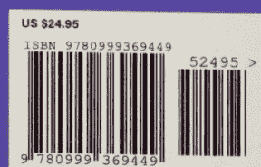

