# 光与无线通信：机器学习与人工智能的应用

## 编辑简介

**Sushank Chaudhary** (IEEE 高级会员，SM-OPTICA，M-SPIE) 是中国广东石油化工科技大学计算机学院副教授，自 2023 年起在该校任职。他在马来西亚北方大学（Universiti Utara Malaysia）获得博士学位，积累了丰富的博士后经验，特别是在中国科学院福建物质结构研究院（2018–2020 年），以及作为泰国曼谷朱拉隆功大学（Chulalongkorn University）声誉卓著的 C2F 奖学金获得者（2020–2023 年）。Chaudhary 博士在国际领先期刊和会议上发表了 100 多篇研究论文。他的荣誉包括中国晋江市政府授予的人才奖（2019 年），以及 2023 年获得欧盟颁发的玛丽·斯克沃多夫斯卡-居里博士后基金，其关于自由空间光学技术的研究提案获得了卓越奖。除了研究贡献外，Chaudhary 博士还担任 `PLOS One`、`Frontiers in Physics` 和 `Journal of Sensors` 的副编辑。他的研究主要关注自动驾驶、光子雷达、空分复用、自由空间光学、可见光通信系统、元宇宙和数字孪生。

**Amir Parnianifard** 自 2022 年 5 月起担任格拉斯哥大学和电子科技大学（UESTC）兼任教授。他此前曾在朱拉隆功大学担任研究助理。Parnianifard 在马来西亚博特拉大学（University of Putra Malaysia）获得博士学位。他是 IEEE 高级会员和认证项目管理专业人士 (PMP)，专注于计算智能、不确定性量化和优化。

**Abhishek Sharma** (IEEE 高级会员，ECM-OPTIC) 自 2024 年 8 月起担任 NIT Hamirpur 的教员。Sharma 博士在国际领先期刊和会议上发表了 50 多篇研究论文。他的研究主要关注自动驾驶、光子雷达、可见光通信系统和自由空间光学。

## 贡献者

- **Geeta Arora** 于 2011 年获得印度理工学院（IIT Roorkee）博士学位。她目前担任印度旁遮普邦洛夫利专业大学（Lovely Professional University）数学系教授。

- **Priya Chaudhary** 在马尼帕尔斋浦尔大学担任研究学者。她的研究领域是光通信、人工智能以及人工智能集成到先进通信系统中。

- **Sushank Chaudhary** (IEEE 高级会员，SM-OPTICA，M-SPIE) 是中国广东石油化工科技大学计算机学院副教授，自 2023 年起在该校任职。他在马来西亚北方大学获得博士学位，积累了丰富的博士后经验，特别是在中国科学院福建物质结构研究院（2018–2020 年），以及作为泰国曼谷朱拉隆功大学声誉卓著的 C2F 奖学金获得者（2020–2023 年）。

- **Pinkey Chauhan** 是位于北方邦诺伊达的 Jaypee 信息技术学院的助理教授。她的研究兴趣是软计算。

- **Divya C D** 是印度卡纳塔克邦迈索尔的 Vidyavardhaka 工程学院计算机科学与工程系的副教授。她的研究兴趣包括优化算法、机器学习、人工智能以及它们在无线通信系统和车载网络中的应用。

- **Samarth V Gangadikar** 是印度卡纳塔克邦迈索尔的 Vidyavardhaka 工程学院计算机科学与工程系的研究学者。他的研究兴趣包括优化算法、机器学习、人工智能以及人工智能在无线通信系统和车载网络中的应用。

- **Sonam Gour** 现于马尼帕尔斋浦尔大学（Manipal University Jaipur）担任学者。她的研究领域涵盖光通信、人工智能以及人工智能在先进通信系统中的集成。

- **Jaya Gupta** 已获得博士学位，目前担任印度旁遮普邦洛夫利专业大学（Lovely Professional University）数学系的研究员。

- **Pravesh Kumar** 现于北方邦比杰诺尔国立工程学院（Rajkiya Engineering College Bijnor (UP)）数学系助理教授。

- **Nouman Latif** 巴基斯坦拉霍尔信息技术大学（Information Technology University）电气工程系的研究员。他的研究重点是优化算法、人工智能应用以及人工智能在现代通信系统中的集成。

- **Shubham Mishra** 现于印度旁遮普邦洛夫利专业大学（Lovely Professional University）数学系助理教授。

- **Srushti M. P.** 现于印度卡纳塔克邦迈索尔维迪亚瓦德哈卡工程学院（Vidyavardhaka College of Engineering）计算机科学与工程系的研究员。她的研究兴趣包括优化算法、机器学习、人工智能以及人工智能在无线通信系统和车载网络中的应用。

- **Hum Nath Parajuli**（IEEE 会员）通过欧盟资助的 Erasmus Mundus 奖学金分别获得日本大阪大学和意大利圣安纳高等学校学院（Scuola Superiore Sant’Anna）的硕士学位，并在欧盟资助的 Marie Curie ITN 项目下获得匈牙利布达佩斯科技大学的博士学位，专攻光子工程。

- **Amir Parnianifard** 自 2022 年 5 月起出任格拉斯哥大学（UofG）和中国电子科技大学（UESTC）兼任助理教授。他此前曾担任朱拉隆功大学的研究助理，并于 2019 年在马来西亚博特拉大学（University of Putra Malaysia）获得工业工程博士学位。

- **Amit Rathi** 现任马尼帕尔斋浦尔大学教授。他的研究领域涵盖光通信、人工智能以及人工智能在先进通信系统中的集成。

- **Saanvi Ravi** 现于印度卡纳塔克邦迈索尔维迪亚瓦德哈卡工程学院（Vidyavardhaka College of Engineering）计算机科学与工程系的研究员。他的研究兴趣包括优化算法、机器学习、人工智能以及人工智能在无线通信系统和车载网络中的应用。

- **Demostenes Zegarra Rodriguez** 巴西拉夫拉斯联邦大学（Federal University of Lavras）计算机科学系教授。他的研究兴趣包括人工智能、深度学习和神经网络，重点关注其在各种通信系统中的应用。

- **Muhammad Saadi** 旁遮普中央大学（University of Central Punjab）工程学院电气工程系副教授兼系主任。他于泰国朱拉隆功大学获得博士学位，曾担任过 NECTEC 的研究助理、KMUTNB 的讲师以及 Aimagin 的技术内容作家。

- **Samjith T S** 现于印度卡纳塔克邦迈索尔维迪亚瓦德哈卡工程学院（Vidyavardhaka College of Engineering）计算机科学与工程系的研究员。他的研究兴趣包括优化算法、机器学习、人工智能以及人工智能在无线通信系统和车载网络中的应用。

- **Abhishek Sharma** 自 8 月起担任哈米尔普尔国立理工学院（NIT Hamirpur）教职工。他的研究重点是光通信、人工智能以及人工智能在先进通信系统中的集成。

- **Shivani Sharma** 现任于认定大学（Deemed University）助理教授。她在印度鲁尔基理工学院（Indian Institute of Roorkee）获得博士学位。她的研究重点是光通信与网络。

- **Pushkar V** 现于印度卡纳塔克邦迈索尔维迪亚瓦德哈卡工程学院（Vidyavardhaka College of Engineering）计算机科学与工程系的研究员。他的研究兴趣包括优化算法、机器学习、人工智能以及人工智能在无线通信系统和车载网络中的应用。

- **Megha Varney** 现于北方邦比杰诺尔国立工程学院（Rajkiya Engineering College Bijnor (UP)）数学系担任研究员。

- **Avani Vyas** 现于贾兰达尔国立理工学院（National Institute of Technology, Jalandhar）信息技术系。她从罗帕尔理工学院（IIT Ropar）获得博士。她的研究兴趣包括智慧医疗和网络技术。

# 1 光与无线通信进展导论：机器学习与人工智能的作用

Abhishek Sharma, Sushank Chaudhary, and Amir Parnianifard

DOI: [10.1201/9781003472561](https://doi.org/10.1201/9781003472561)

## 1.1 引言

### 1.1.1 光与无线通信概述

光通信和无线通信是现代电信网络的两大支柱，实现了数据的快速、可靠传输。光通信主要依靠光波通过光纤传输信息，提供低损耗、低干扰的高速远距离通信。自 20 世纪 70 年代诞生以来，光纤技术改变了数据传输的方式，推动了互联网指数级增长。

另一方面，无线通信依靠射频（RF）波在空中传输数据。自 19 世纪末无线电报出现以来，这项技术经历了显著演变，导致了移动电话、Wi-Fi、卫星通信以及最新的 5G 网络的发展。无线通信提供了移动灵活性，在当今互联的世界中不可或缺，涵盖了从智能手机连接到物联网（IoT）的一切领域。

光与无线技术的结合对于满足不断增长的带宽和连接需求至关重要。光通信用于高速传输数据并连接不同地点（这是通信骨干网所需的），而无线技术则用于将这种连接性交付给用户。

### 1.1.2 新兴趋势与挑战

新数字时代的增长以及新设备的飞速发展，丰富了光通信和无线通信领域。5G 网络、云服务特别是物联网（IoT）等趋势似乎要求这些领域得到进一步发展。

在光通信中，波分复用（WDM）的进步以及相干光技术的发展使得更高数据传输率和更高效的光谱利用成为可能[[15–20]]。这些技术对于支持现代应用产生的海量数据流量至关重要。此外，自由空间光（FSO）通信的创新正为在传统光纤不实用的环境中的高速视距通信开辟新的可能性[[21–23]]。

无线通信也并非这一浪潮的例外；现代技术，如大规模 MIMO（多输入多输出）[[24–31]]、毫米波通信、波束赋形，都是 5G 网络中涉及的一些技术。这些技术旨在根据对更高数据速率和移动性日益增长的需求，构建无线网络的能力、范围和有效性。此外，人工智能（AI）以及机器学习（ML）在增强无线网络方面具有巨大的潜力，涵盖资源管理、干扰和安全等方面。

## 1.2 光与无线通信的基础

### 1.2.1 光通信

光通信是指通过光信号传输数据，通常通过光纤传输。由于这种通信能够远距离、低损耗地传输大量数据，它已成为现代电信网络的基础。

#### 1.2.1.1 基本原理

光通信的核心原理是对光进行调制以携带信息。光（通常由激光器或发光二极管（LED）产生）通过调制对数据进行编码，然后通过光纤传输[[2,4,32]]。这些光纤由玻璃或塑料制成，纤芯被包层包围，这确保了光被捕获在纤芯内，使其能够以最小的衰减传输远距离[[33]]。

#### 1.2.1.2 关键技术

已经开发了多项技术来增强光通信系统的性能：

*   **波分复用（WDM）：** 波分复用（WDM）是一种通过允许多个光波长同时通过单根光纤发送，来增强光纤数据传输能力的技术。每个不同的波长传输其自己的数据流，从而显著增加了光纤的整体容量[[15–18,34,35]]。

*   **无源光纤网络（PON）：** 无源光纤网络（PON）用于为用户提供宽带网络接入。利用点对多配置，它们允许单根光纤连接并服务于多个终端，包括家庭或企业[[36–38]]。

*   **相干光传输：** 该方法涉及调整光波的幅度和相位以增强数据传输能力。相干系统能够支持更高数据速率并扩展传输距离，非常适合骨干网络[[32,39]]。

#### 1.2.1.3 在现代网络中的应用

光通信在现代网络的各个方面起着至关重要的作用：

*   **骨干网络：** 光纤形成了全球电信基础设施的骨干，连接了数据中心、互联网交换中心和其他场所。

*   **数据中心：** 高速数据传输，支持了云计算、大数据分析和其他数据密集型应用。

*   **5G 回传：** 光纤对于从基站到核心网络的无线回传至关重要，支持 5G 网络的需求。

### 1.2.2 无线通信

无线通信通过电磁波、微波或无线波在空气中传输数据，它是移动网络、Wi-Fi、卫星通信以及许多无线技术的基础。

#### 1.2.2.1 基本原理

无线通信涉及在发射器和接收器之间传输电磁波。数据通过幅度调制（AM）、频率调制（FM）和相位调制（PM）等各种技术编码到这些波上。相比光纤，无线介质更容易受到干扰和噪声的影响，需要先进技术。

#### 1.2.2.2 关键技术

已经开发了多项关键技术来增强无线通信的性能：

*   **多输入多输出（MIMO）：** 多输入多输出（MIMO）技术通过在发送和接收端使用多个天线提高无线通信性能。这种设置允许同时传输多个数据流，从而增强无线网络的容量[[21,31,40–42]]。

*   **波束赋形：** 波束赋形是一种将信号传输或接收聚焦到特定方向而非扩散到所有方向的技术。这种方法可以提高信号质量，特别是在用户密集的区域[[43–45]]。

*   **毫米波通信：** 毫米波通信工作在 30–300 GHz 频率范围内，与传统的微波通信相比，它提供了显著更高的数据速率和带宽。作为 5G 网络的关键组件，它为增强现实、虚拟现实和自动驾驶汽车等高级应用提供了高速连接[[18,19]]。

#### 1.2.2.3 频谱管理与干扰挑战

频谱管理是无线通信中的一个关键问题。频谱是有限资源，无线服务的需求日益增长导致许多频段出现拥堵。有效的频谱管理涉及为不同的服务和用户分配频率，以最小化干扰并最大化频谱利用。

干扰（来自其他无线设备和环境因素）是另一个挑战。自适应调制、纠错和干扰消除等技术用于减轻干扰影响并确保通信可靠。

#### 1.2.2.4 在现代网络中的作用

无线通信在现代网络中无处不在：

*   **移动网络：** 无线通信是移动网络的骨干，为全球数十亿用户提供语音、数据和多媒体服务。

*   **Wi-Fi：** Wi-Fi 网络在家庭、办公室和公共场所提供无线接入，连接从手机到智能家居电器的各种设备。

*   **卫星通信：** 卫星通信将无线连接扩展到偏远和欠发达地区，提供天气预报、GPS 和全球广播等关键服务。

## 1.3 机器学习与人工智能在光通信中的作用

机器学习（ML）和人工智能（AI）已成为现代通信系统中强大的工具，它们具有显著提升性能、优化操作以及解决传统方法难以应对的复杂挑战的潜力 [[46–49]]。在光通信背景下，`ML` 和 `AI` 技术正被越来越多地采用，以改进系统的各个方面，从信号处理、网络优化到故障检测与管理。

`ML` 涉及使用能够从数据中学习，并基于数据进行预测或做出决策的算法。`AI` 是一个更广泛的概念，涵盖了 `ML` 以及其他使机器能够执行通常需要人类智能完成的任务，例如模式识别、决策制定和问题解决。`ML` 和 `AI` 集成到光通信系统的驱动力源于面对日益增长的网络复杂性和数据流量需求时，对更高效率、适应性和鲁棒性的迫切需求。

### 1.3.2 机器学习在光通信中的应用

#### 1.3.2.1 信号处理

`ML` 在光通信中产生重大影响的主要领域之一是信号处理 [[48,50–52]]。光信号往往受到各种损伤的影响，如噪声、色散和非线性，这些因素会降低信号质量并限制系统性能。传统的信号处理技术可能难以补偿这些失真，特别是随着数据速率的增加和系统复杂性的增长。

`ML` 为信号处理提供了一种更具自适应且数据驱动的方法。深度学习等技术（其涉及在大型数据集上训练神经网络）可用于建模和补偿复杂的信号失真。例如，`ML` 算法可以经过训练来预测和纠正光纤中的非线性失真，提高信号质量并实现更高数据速率。

例如，一个特定的案例研究涉及应用深度学习技术来增强相干光通信系统。通过使用深度学习技术增强相干光通信系统，`ML` 算法可以经过训练来预测和纠正光纤中的非线性失真，提高信号质量并实现更高数据速率。

#### 1.3.2.2 网络优化

网络优化是另一个 `ML` 应用的关键领域。光通信网络是复杂的，高效管理资源（如带宽分配）对于最大化网络性能至关重要 [[53,54]]。

`ML` 算法可以预测网络拥堵并动态调整路由，从而减少延迟并提高吞吐量 [[55,56]]。

#### 1.3.2.3 故障检测与管理

故障检测和管理是维护网络可靠性和可用性的关键方面。光纤、放大器或其他组件的故障可能导致服务中断，必须尽快检测并解决问题 [[11]]。

`ML` 和 `AI` 技术越来越多地用于增强故障检测和管理。通过分析海量网络数据，`ML` 算法可以识别出故障模式，从而实现预测性维护并减少停机时间 [[57]]。

## 1.4 机器学习与人工智能在无线通信中的作用

### 1.4.1 机器学习增强无线通信

由于对更高数据速率、更好覆盖和优质服务质量（QoS）的需求增加，无线通信系统在过去几十年发生了显著演变。随着这些系统变得日益复杂，传统的网络管理和优化方法正达到极限。`ML` 和 `AI` 已成为解决这些挑战的强大工具，提供了增强无线通信性能和效率的新方法。

#### 1.4.1.1 频谱管理

频谱是无线通信中的关键资源，其高效管理对于最大化网络性能至关重要。随着连接设备数量不断增加，频谱资源的竞争加剧，导致了拥塞和干扰。传统的静态频谱分配方法在这种动态环境下已变得不再适用 [[59]]。

#### 1.4.1.2 信道估计

`ML` 为信道估计提供了一种数据驱动的方法，通过训练模型根据历史数据来预测信道特性。特别是深度学习在这一领域展现了巨大的潜力，神经网络被用于模拟复杂的信道行为并提高估计准确性。这些模型可以适应变化的环境，提供更稳健、更准确的信道估计，从而增强 `MIMO` 和 `波束赋形` 等技术的性能 [[63–65]]。

例如，传统的信道估计可能依赖于固定的导频符号和预定义的算法，这些算法可能无法很好地适应城市峡谷或高速车辆通信等快速变化的环境。相比之下，在多种信道条件上训练的深度学习模型可以实时动态调整参数，与传统方法相比，估计准确性可提高高达 30%。这种估计的提高直接转化为更高效的频谱利用和更好的整体网络性能。

#### 1.4.1.3 网络安全


随着无线网络变得无处不在且对日常生活至关重要，确保其安全性是重中之重。传统的安全机制（如加密和身份验证）是必须的，但可能不足以防御针对无线通信系统日益复杂的网络威胁 [66]。

ML 和 AI 可以通过实现更先进的威胁检测和响应能力来显著增强无线网络安全。监控网络流量中可疑活动的入侵检测系统（`IDS`）可以通过 ML 算法得到极大改进。这些算法可以分析海量流量数据以检测指示潜在攻击的模式，例如未经授权的访问尝试、分布式拒绝服务（`DDoS`）攻击或数据泄露 [67]。

例如，作为 ML 子集的异常检测技术可用于识别偏离正常流量模式的偏差，这些偏差可能预示着安全漏洞。一旦检测到异常，AI 驱动的系统可以自动启动应对措施，例如隔离受影响的网段或阻塞恶意流量 [68–70]。

此外，ML 可用于通过优化密钥管理过程和识别加密算法中的漏洞来增强加密技术。通过利用 AI，无线网络可以对新兴威胁更具韧性，确保数据的机密性、完整性和可用性。

### 1.4.2 AI 在先进无线技术中的集成

AI 在无线通信中的集成不仅限于频谱管理、信道估计和安全。它还延伸到塑造无线网络未来的各种先进技术，特别是在 5G 及以后的背景下。

#### 1.4.2.1 大规模 MIMO 和波束赋形

`Massive MIMO` 被认为当今无线网络的关键技术和 5G 网络的核心要素。基站的大规模天线配置使其能够支持大量用户，同时增加容量和频谱效率。尽管如此，这些优势的实现受到大规模 `MIMO` 系统带来的两个关键挑战的限制；这些分别是信道估计、信号处理和资源分配 [71–73]。

发现 `massive MIMO` 的这些元素通过应用 ML 进行改进具有广阔前景。例如，深度学习算法可以用于改进信道估计，从而最少地使用导元并提高系统的整体性能。此外，ML 可应用于增强 `波束赋形`，使信号被引导至特定方向或从特定方向接收，旨在提高信号质量并减少干扰影响。通过实时输入，算法可以持续优化波束赋形计划以适应变化的情况，并始终保持最有效的方案。

#### 1.4.2.2 毫米波通信

`毫米波通信` 工作频率在 30 GHz 到 300 GHz 之间，是 5G 及以后的另一项关键技术。与传统的微波通信相比，它提供了更高的数据速率和带宽，但也面临着高路径损耗、易受阻挡和范围有限等挑战 [74–76]。

ML 可以通过实现更高效的资源管理和自适应传输策略帮助应对这些挑战。例如，AI 算法可以预测信号阻塞的概率（例如来自建筑物或树木等障碍物的影响）并相应调整传输参数，从而提高毫米波通信的可靠性和性能。此外，ML 可用于优化毫米波网络中的切换过程，确保用户在不同小区之间移动时的无缝衔接。

## 1.5 使用 AI 实现光通信与无线通信集成

### 1.5.1 光网络与无线网络的融合

光系统与无线系统的组网是电信市场的一个新趋势，其产生由于全球用户对高速、可靠连接的需求。这种集成是一种双管齐下的策略，它基于光技术和无线技术的特性，为通信系统提供更高的有效性。

`光通信` 实现了高带宽和低延迟的需求，适用于通信网络骨干和远距离高容量数据传输 [77]。另一方面，`无线通信` 为“最后一公里”连接提供了移动性和灵活性，允许终端用户轻松地访问互联网。当这两种技术在网络中实现时，后者可以同时具有光通信的高速性以及无线通信的易用性与无处不在 [78]。

AI 在光网络与无线网络融合中的作用超越了基础的流量管理 [79,80]。它涉及利用预测分析来预测网络需求并主动分配资源，确保光段和无线段都以最高效率运行。例如，AI 可以预测移动网络中的高流量时段，并预先分配额外的光带宽以处理增加的负载，从而在拥塞发生之前进行预防。

#### 1.5.1.1 集成网络的优势

光与无线网络的集成提供了多项优势：

*   **增强网络性能**：光技术和无线技术的结合通过优化跨网络不同段的数据传输，显著增强网络性能。光网络可以处理大部分数据流量，而无线网络为终端用户提供灵活、高速的访问。
*   **改进的可扩展性**：集成网络具有更好的可扩展性，允许在需求增长时更容易扩展。AI 的使用使得资源分配成为可能，确保网络能够适应变化的流量负载和用户需求。
*   **成本效益**：通过利用这两种技术的优势，集成网络可以降低运营成本。例如，在高需求期间，无线网络可以将数据卸载到光网络，从而减少对昂贵的无线基础设施升级的需求。

AI 在光网络与无线网络的成功融合中发挥着至关重要的作用。它使智能系统的成为可能，能够管理并优化这类通信技术之间复杂的相互作用。

### 1.5.2.1 流量管理与优化

在光纤和无线分段之间管理数据流是集成网络的一个重大挑战。AI 驱动的流量管理系统可以通过持续监控网络状况并动态将数据路由到最高效的分段来克服这一挑战，从而增强性能并减少拥塞。

例如，AI 算法可以预测流量趋势并相应地在范围内分配资源。在高流量期间，系统可能会通过将延迟敏感型数据路由通过光网络来优先处理它们，而将不关键的数据交由无线分段管理。这种自适应方法确保了两个网络分段都能保持最高效率。

AI 的预测能力（例如使用 `ML` 模型在网络拥塞发生之前进行预判）在这些集成系统中至关重要。例如，在大型直播活动期间，AI 可以分析历史和实时数据以预测用量峰值，允许系统调整光纤和无线分段之间的资源分配，以维持最佳网络性能。

### 1.5.2.2 资源分配

在集成网络中，高效的资源分配对于维持高水平的性能和可靠性至关重要。AI 可用于开发的资源分配算法，考虑多种因素，包括网络负载、用户需求和环境条件。

例如，AI 可以优化光纤和无线分段之间的带宽分配，确保每个分段都有足够的资源来满足用户需求。它还可以管理混合网络中的切换过程，确保用户在不同分段之间移动时能够体验到无缝连接。

### 1.5.2.3 网络切片

网络切片是一种能够在单一物理基础设施内创建多个虚拟网络的技术，每个虚拟网络都为满足不同应用程序或服务的特定需求而定制。这在集成网络中特别有用，因为集成网络中不同类型的服务有不同的需求。AI 可以通过动态调整分片配置来增强网络切片，例如，在视频直播期间，系统可能会重新分配资源，以支持高流量的视频分发。

### 1.5.3 应用场景

光纤与无线网络的集成为各种应用带来了新的可能性，这种集成在 AI 的驱动下正开启着新的领域。以下是一些用例：

#### 1.5.3.1 智慧城市

智慧城市依赖于产生大量数据的传感器。光纤与无线网络的集成为这些设备提供了高容量的数据传输支持。例如，AI 可以管理来自传感器的流量，优化流量模式以确保安全。它还可以根据用户需求相应地分配资源，防止拥塞。

#### 1.5.3.2 增强移动宽带 (eMBB)

增强移动宽带是 5G 的关键用例之一，集成网络通过结合光纤的高容量和无线网络的灵活性来支持高速互联网接入。AI 可以通过管理光纤和无线分段之间的切换过程来优化 `eMBB` 服务，确保数据快速、可靠地交付。

#### 1.5.3.3 高可靠低延迟通信 (URLLC)

高可靠低延迟通信 (`URLLC`) 是 5G 的一项关键应用，特别是对于自动驾驶汽车、远程医疗和工业自动化等对可靠性和极低延迟要求的场景。集成网络通过结合光纤的低延迟数据传输和无线网络的实时通信能力来满足这些需求。AI 可以通过预测潜在网络问题并主动调整网络配置来增强 `URLLC`。例如，在自动驾驶网络中，AI 可以确保来自传感器和控制系统的数据以最小延迟传输，从而确保安全运行。

### 1.5.4 挑战与未来方向

虽然光纤与无线网络的集成具有许多优势，但也面临着若干挑战。主要挑战之一是确保两种网络之间的无缝互操作性，它们通常使用不同的技术和协议。AI 可以通过提供智能管理和优化解决方案来帮助解决这一挑战，但这些解决方案的开发需要大量的研究。

另一个挑战是确保集成网络的安全性，特别是随着技术融合导致攻击面的增大。AI 驱动的安全系统可以帮助降低这些风险，但它们必须经过精心设计并不断更新以应对新兴威胁。

## 1.6 光纤与无线通信现状

光纤与无线通信的格局不断演变，在对更高比特率、更大容量和更可靠连接的需求推动下，取得了快速发展。本节概述了这些领域的最新进展，重点介绍了光纤和无线通信技术的现状。

### 1.6.1 光纤通信的最新进展

光纤通信近年来取得了重大创新，新技术和技术推向数据传输容量、效率和范围的边界。这些进步对于满足现代网络日益增长的需求至关重要，特别是在数据中心、骨干网络和 `5G` 基础设施背景下。

#### 1.6.1.1 相干光通信

相干光通信是该领域最重要的进展之一。与传统的强度调制直接探测 (`IM-DD`) 系统不同，相干通信系统利用光波幅和相位来编码数据，显著增加了光纤链路的数据容量。这项技术已成为长距离光纤传输的标准，现在也被应用于更短距离的应用中，例如数据中心互连。

相干系统也受益于先进的数字信号处理（DSP）技术，这些技术有助于缓解色散和偏振模式散等损害。相干检测与复杂的 DSP 的结合使得单波长传输速率达到了 400 Gbps 及以上，目前的研究重点是进一步将这些速率推向更高水平 [92–94]。

#### 1.6.1.2 空间分用复用 (SDM)

随着数据需求的不断增长，传统的 WDM 系统正在接近其容量极限。空间分用复用（SDM）是一项新兴技术，它通过增加用于数据传输的空间通道数量来提供解决方案 [95–97]。

SDM 可以通过多芯光纤（MCFs）或少模光纤（FMFs）实现，这允许多个数据流通过独立的空间通道同时传输。这种方法在不需要额外带宽的情况下，显著增强了光网络的整体容量。SDM 仍处于研究阶段，但它对未来的光通信系统具有巨大的前景，特别是在需要极端数据容量的场景下。

#### 1.6.1.3 光接入网络和 PON 技术

无源光网络（PON）对于为终端提供高速宽带接入至关重要。PON 技术的最新进展集中在提高这些网络的数据速率和覆盖范围。下一代 PON（NG-PON2）正在部署中，提供高达 10 Gbps 的对称数据速率并支持多个波长，从而提供了更大的灵活性和容量 [91,98,99]。

研究仍在进行新的调制格式和编码方案，以进一步增强 PON 的性能，同时还在开发软件定义网络（SDN）和网络函数虚拟化（NFV）解决方案，以实现更具动态性和可编程的光接入网络。

#### 1.6.1.4 自由空间光 (FSO) 通信

FSO 通信作为传统光纤网络的补充技术，正受到重新关注。FSO 利用光通过空气传输数据，在短距离内提供高数据速率和低延迟。它在铺设光纤不实际或成本过高的情况下特别有用，例如城市地区、偏远位置或灾后恢复场景。

FSO 技术的最新进展包括用于减轻大气湍流的自适应光学技术，以及混合 FSO/RF 系统，结合了光通信和射频通信的优点以提高可靠性和性能 [2,15,75, 100–103]。

在过去的五年里，FSO 通信在硬件和软件方面都取得了显著改进，实现了更可靠、更高容量的链路 [13, 14,87,104–111]。最初为天文学开发的自适应光学系统现在被转用于 FSO，以纠正大气条件引起的畸变，导致即使在恶劣天气下也能拥有更稳定的通信链路 [112]。

### 1.6.2 无线通信的最新进展

在 5G 网络部署和 6G 持续研究的驱动下，无线通信技术正在快速演进。这些进展旨在解决日益密集的异构网络环境中应对更高数据速率、更低延迟和更可靠连接的挑战。

#### 1.6.2.1 5G 及以后

5G 网络的铺设通过提供比前几代快得多的数据速率、更低的延迟和更大的容量，正在彻底改变无线通信。几项关键技术支撑着 5G 的功能，包括大规模 MIMO（Massive MIMO）、毫米波通信和网络切片。

* **大规模 MIMO**：该技术利用基站的大型天线阵列为多个用户提供服务，从而提高频谱效率和网络容量。机器学习（ML）的进步通过优化波束成形和通道估计等过程，进一步增强了大规模 MIMO 系统 [24]。
* **毫米波通信**：毫米波通信在 30–300 GHz 频率范围内运行，为 5G 服务提供必要的带宽。最近的创新专注于解决信号衰减和阻塞等挑战，解决方案包括先进的波束成形技术和 AI 驱动的自适应传输策略 [113,114]。
* **网络切片**：该技术能够在单一物理基础设施上创建多个虚拟网络，每个网络都针对特定应用（例如：增强移动宽带、物联网、URLLC）进行定制。这种适应性对于适应 5G 网络中各种各样的用例至关重要。

#### 1.6.2.2 AI 增强型无线网络

将 AI 和 ML 引入无线网络正显著地改变网络管理和优化的格局。AI 驱动的策略正在改进无线通信的几个关键方面，包括：

* **自适应频谱管理**：AI 算法根据实时需求和干扰模式动态调整频率分配，从而提高频谱效率。
* **自动网络优化 (SON)**：AI 是 SON 开发的核心，它可以自动优化功率设置、频率使用和切换协议等。这种自动化提升了网络性能并降低了运营成本。
* **增强的安全措施**：AI 被用于加强无线网络安全，能够实时识别并缓解威胁，从而保护数据传输的完整性和机密性。

#### 1.6.2.3 与边缘计算的集成

边缘计算在无线通信中变得越来越重要，特别是随着 5G 的推出和物联网的发展。通过在数据源处理数据，边缘计算减少了延迟和带宽消耗，提高了延迟敏感型应用（如自动驾驶、远程手术和实时分析）的性能。

该领域的最新进展包括开发 AI 驱动的边缘计算平台，平台可以动态分配资源、优化数据处理并确保与核心网络的无缝集成。

### 1.6.3 案例研究

光和无线通信的前沿技术正应用于各种现实场景中，展示了它们改变行业和改进连接的潜力。

#### 1.6.3.1 智能交通系统

智能交通系统正在利用光和无线通信技术来实现联网汽车、智能交通管理和实时数据共享。例如，先进的光网络为数据传输提供骨干支持，而 5G 无线网络实现了车一切联（V2X）通信，提高了道路的安全性和效率 [115–118]。

#### 1.6.3.2 工业自动化与工业 4.0

在工业 4.0 的背景下，工厂和工业环境正通过物联网设备和无线通信网络变得日益紧密。光通信支持工业过程中产生的大数据集的高速传输，而无线网络则实现了实时监控和控制。人工智能在优化这些集成系统方面起着至关重要的作用，确保数据得到快速、高效的处理和响应。

#### 1.6.3.3 远程医疗

在通信技术的进步推动下，远程医疗和远程医疗服务正在快速扩展。高速光网络支持医学影像和其他大型数据集的传输，而无线网络实现了患者与医疗服务提供者之间的实时通信。AI 驱动的解决方案通过实现预测诊断、远程监控和个性化治疗方案增强了这些服务 [12,89,119–122]。

## 1.7 挑战与未来方向

光和无线通信技术的快速进步，特别是 `ML` 与 `AI` 的集成，改变了全球通信网络的格局。然而，这些创新也带来了一系列需要解决的挑战，以充分发挥它们的潜力。此外，还有一些充满前景的未来方向可以进一步彻底改变这些领域。

### 1.7.1 技术挑战

随着 `AI`、光和无线通信技术的集成不断演进，必须解决若干技术挑战，以确保这些系统的成功部署和运行。

#### 1.7.1.1 数据可用性与质量

将 `AI` 应用于光和无线通信的重大挑战之一，是难以获取并确保训练 `ML` 模型所需的高质量数据。强大的的数据集对于构建能够做出准确预测和知情决策的 `AI` 模型至关重要。然而，获取、多样化且标记良好的数据集（特别是对于网络故障或安全漏洞等低频事件）是非常挑战性的。

为了克服这一障碍，研究人员正在探索数据增强、迁移学习和合成数据生成等方法。这些策略可以帮助创建更全面的数据集，这对开发更有效、更可靠的 `AI` 模型至关重要。

#### 1.7.1.2 计算复杂度与功率效率

`AI` 算法（特别是深度学习模型）通常是计算密集型的需要大量的处理能力和能量。在资源受限的环境中，如移动设备或边缘计算节点，这种计算复杂度可能成为限制因素。

为了解决这个问题，目前正在研究开发可以在这些限制内运行的更高效的 `AI` 模型和算法。模型压缩、量化和 `edge AI`（计算分布在靠近数据源的地方）等技术正在探索中，以减轻计算负担并提高能效。

#### 1.7.1.3 互操作性与标准化

随着光无线网络变得更加集成，确保不同技术和标准之间的互操作性是一项重大挑战。标准化协议和接口的缺乏会导致兼容性问题，阻碍集成网络的无缝运行。

标准化工作对于克服这一挑战至关重要。行业机构和研究机构致力于开发统一的框架和标准，以促进光无线技术的集成。此外，AI 驱动的解决方案可以帮助管理和优化互操作性，动态地适应不同的网络条件和配置。

#### 1.7.1.4 安全与隐私

`AI` 接入通信网络引入了新的安全和隐私担忧。`AI` 系统（特别是基于 `ML` 的系统）容易受到 `adversarial ML` 等攻击，恶意攻击者通过操纵输入数据来欺骗模型。

确保 AI 驱动的通信网络的安全和隐私需要稳健的防御机制。这包括开发安全的 `AI` 模型、实施加密和验证协议，以及持续监控潜在威胁。此外，`AI` 本身也可以通过检测和缓解攻击来增强网络安全。

### 1.7.2 伦理与隐私考量

随着 `AI` 深度集成到通信网络中，伦理和隐私考量变得越来越重要。使用 `AI` 管理和优化通信网络引发了关于数据隐私、透明度和问责的问题。

#### 1.7.2.1 数据隐私

人们在各种大数据常见的应用中使用 `AI` 系统；这引发了对数据如何获取和使用的担忧。在涉及数据隐私时，安全性是一个关注关注，特别是通过不同通信通道交换的信息。

为了缓解这些问题，必须采取严格的数据治理措施和程序。这包括消除个人识别数据、对数据的妥善存储和保护以及用户对数据的控制。为了防止用户数据的滥用，正在考虑采用理想的 AI 隐私保护方法，包括 `differential privacy` 和 `federated learning` 等。

#### 1.7.2.2 透明度与可解释性

关于 `AI` 模型（尤其是深度学习模型）的已知事实之一是，它们是不透明的，换句话说——是“黑箱”；它们的内部决策并不容易解释。在需要决策的领域，用人类语言使 `AI` 系统的决策具有可解释性至关重要。

构建 `XAI` 或“透明且可解释的 AI”是一个持续研究的领域，旨在设计能够为其行为或选择提供理由的模型。这些实践对于建立对 `AI` 系统的信任并确保此类系统得到恰当应用非常重要。

#### 1.7.2.3 AI 的伦理使用

在通信网络中伦理地使用 `AI` 涉及确保 `AI` 系统的设计和部署是公平、无偏见且不损害用户的。这包括避免可能导致歧性结果的算法偏差，确保 `AI` 系统用于增强而非取代人类决策，并考虑 `AI` 部署对社会的更广泛影响。


为通信网络中的`AI`使用开发伦理指南和框架对于解决这些担忧至关重要。业界、学术和政策制定者之间的合作对于确保`AI`被负责任地使用并造所有用户至关重要。

### 1.7.3 未来研究方向

展望未来，光和无线通信领域还有几个充满前景的研究方向，特别是关于`AI`的集成。

#### 1.7.3.1 AI 驱动的网络自动化

随着网络变得日益复杂，网络管理和运行对自动的需求日益增长。`AI`驱动的自动化可以帮助管理现代网络的复杂性，实现更有效的资源分配、故障检测和性能优化。未来的研究可能会侧重于开发更复杂的`AI`模型以自主管理网络，减少对人工干预的需求并提高整体网络性能。

#### 1.7.3.2 6G 及以后

当`5G`网络仍在部署时，对`6G`网络的研究已经开始进行。`6G`预计将带来更高的数据传输率、更低的延迟和更可靠的连接，支持如全息通信、沉浸式增强现实和先进物联网（`IoT`）等应用。

`AI`将在`6G`中发挥核心作用，实现新的通信范式并优化网络性能。该领域的研究可能会侧重于将`AI`更深地整合到通信网络的核心中，探索新的频段（如太赫兹频段）并开发利用`AI`的新型通信技术。

#### 1.7.3.3 量子通信

量子通信是一个新兴领域，具有彻底改变安全通信网络的潜力。通过利用量子力学原理，量子通信可以提供理论上不可破解的安全性，使其成为需要高水平数据保护的应用中极具吸引力的选择。

`AI`与量子通信的结合是一个令人兴奋的研究领域。`AI`可以帮助优化量子通信协议、管理量子网络，并开发利用量子通信独特属性新应用。

#### 1.7.3.4 用于环境可持续性的 AI

由于通信网络的环境成本问题日益受到关注，重点已放在创建环保型技术上。能源效率在未来也提供了可能，通过关注功率利用、功率减少以及对网络容量更合理的消费，来协助这一过程。

未来的工作可能会研究`AI`辅助的绿色通信网络，其主题涵盖了如使用高能数据中心、低功耗无线网络和绿色通信技术等内容。

## 1.8 结论

在`ML`和`AI`集成的推动下，光通信和无线通信的快速进步开启了连接和技术创新的新时代。在本章中，我们探索了这些通信技术的基础方面、`AI`的变革性作用、领先水平，以及面临的挑战和未来方向。

### 1.8.1 关键点总结

光通信与无线通信技术的融合正在重塑全球网络格局。光通信凭借其无与伦比的容量和效率构成了现代电信系统的骨干，而无线通信则提供了“最后一公里”连接所需的灵活性和可访问性。这两个领域的整合，特别是通过`AI`的应用，使得创建更动态、高效和智能的网络成为可能。

我们首先探索了光通信和无线通信的基础知识，强调了每个领域的关键技术、原理和挑战。随后讨论转向了`AI`在增强这些通信系统中的作用，从优化信号处理和网络管理到提高安全性和故障检测。`AI`从数据中学习、适应变化条件并做出预测性决策的能力，为光网络和无线网络都开启了新的可能性，使其变得更加健壮、高效，并能够满足现代应用的需求。

本章还深入探讨了光通信和无线通信的领先水平（state of the art），展示了相干光通信、空间分分复用、`5G`技术和`AI`增强型无线网络等领域的最新进展。这些创新驱动着通信网络的演进，实现了更快速的数据传输、更低的延迟和更可靠的连接。

然而，随着这些进步也带来了巨大的挑战。将`AI`与通信网络整合的技术复杂性、对大规模高质量数据集的需求、计算效率、互操作性和安全性，都是必须解决的关键问题。此外，`AI`在通信系统中的伦理和隐私影响需要审慎考虑，以确保这些技术以负责任的方式开发和部署。

最后，我们探索了这一快速发展领域的未来方向。从`6G`网络和量子通信的发展，到`AI`驱动的网络自动化和环境可持续性，光通信和无线通信的未来蕴含巨大的前景。`AI`将继续在这一演变中发挥核心作用，推动新的创新并改变我们连接和通信的方式。

### 1.8.2 前行之路

展望未来，`AI`与光、无线通信技术的融合预计将成为下一代通信网络演变的重要催化剂。`6G`网络的出现将优先考虑超可靠低延迟通信、海量连接和增强移动宽带，这将推向无线通信的极限。`AI`将在此转型中发挥核心作用，实现如智能资源管理、动态频谱分配和实时网络优化等创新。

这些技术进步可能会产生深远的社会影响，从根本上改变我们生活、工作和互动的方式。例如，`AI`驱动的通信网络可能带来更高效、适应性强的城市基础设施，扩展欠发达地区的全球连接，并支持医疗、教育和灾害管理等领域的新应用。

为了充分利用这些创新的潜力，业界、学术界和决策者之间的合作将至关重要。开发标准化框架、伦理指南和稳健的安全措施，对于确保`AI`驱动的通信网络安全、可靠并对所有人都有益至关重要。

总之，`AI`与光无线通信技术的整合将重塑全球连接的未来。虽然挑战巨大，机遇更大。随着我们继续创新和探索新领域，在`AI`、光通信和无线通信技术不断进步的推动下，智能互联的世界愿景正变得越来越可行。

## 参考文献

1. K. Zeb, “用于下一代高容量毫米波光纤无线网络的量子冲多波长激光器,” 博士论文，康考迪亚大学。

2. A. Sharma 与 V. Mishra, “通过 RoSO 集成增强基于 RGB 的 5 GHz 波段 WLAN，”期刊。

3. A. Sharma, V. Mishra, K. Singh 和 J. Malhotra, “结合极化分复用方案用于宽带服务的混合 RoF-RoSO 系统，”期刊。

4. A. Sharma, K. Singh 和 J. Malhotra, “结合混合 PDM-MIMO 方案用于室内应用的高 60 Gbps RGB 激光基地光纤通信链路，”期刊。

5. N. J. Gomes, P. P. Monteiro 和 A. Gameiro, *下一代光纤无线通信*，霍霍霍金：John Wiley & Sons，2012。

6. W. Aman, S. Al-Kuwari, M. Muzzammil, M. M. U. Rahman 和 A. Kumar, “水下及水气无线通信的安全：现状、挑战与展望，”期刊。

7. Z. Qadir, K. N. Le, N. Saeed 和 H. S. Munawar, “迈向 6G 物联网：最新进展、用例和开放性挑战，”期刊。

8. W. Xiong, P. Ambichl, Y. Bromberg, B. Redding, S. Rotter, and H. Cao, “强模式耦合多模光纤中光传输的时空控制，”*Physical Review Letters*, vol. 117, p. 053901, 2016.

9. C. Ioannou and V. Vassiliou, “基于支持向量机的 IoT 网络攻击分类，”*Journal of Sensor and Actuator Networks*, vol. 10, p. 58, 2021.

10. S. Yang, P. Liu, and T. H. Lim, “用于水殖业水质监测的物联网水机器人：综述”，见第 11 届机器人智能技术与应用国际会议 (RiTA 2023)，中国太仓， 2023。

11. M. Maurya, I. Panigrahi, D. Dash, and C. Malla, “基于物联网云计算和人工智能技术的旋转机械智能故障诊断系统：综述，”*Soft Computing*, vol. 28, pp. 477–494, 2024.

12. C. Zhang, P. Liang, J. Nebhen, S. Chaudhary, A. Sharma, J. Malhotra*, 等，“用于医疗基础设施的模式分分复用自由空间光系统的性能分析，”*Optical and Quantum Electronics*, vol. 53, pp. 1–14, 2021.

13. A. Sharma 和 R. Kapoor, “光无线通信(OWC)中各种挑战的研究，”*International Journal for Research in Applied Science and Engineering Technology*, vol. 5, pp. 802–807, 2017.

14. A. Sharma 和 D. Thakur, “光纤无线技术的 WLAN 综述，”*The International Journal of Electronics, Communications, and Engineering (IJECE)*, vol. 6, pp. 1–6, 2017.

15. Z. Zhou, H. Zhang, C. Lin, and A. Sharma, “基于双极性和 CSRZ 调制的极化交织高速 WDM-FSO 传输系统性能分析，”*Journal of Optical Communications*, vol. 43, pp. 147–152, 2022.

16. S. Chaudhary, A. Sharma, and N. Chaudhary, “传输指向误差影响下的 6 × 20 Gbps 混合 WDM–PI 星间系统，”*Journal of Optical Communications*, vol. 37, pp. 375–379, 2016.

17. S. Chaudhary and A. Sharma, “6 x 20Gbps 长距离基于 WDM-PI 的高空平台星间通信系统，”*International Journal of Computer Applications*, vol. 122, pp. 41–45, 2015.

18. S. Chaudhary, P. Chauhan, and A. Sharma, “用于 WLAN 的高速 4 × 2.5 Gbps-5 GHz AMI-WDM-RoF 传输系统，”*Journal of Optical Communications*, vol. 40, pp. 285–288, 2019.

19. S. Chaudhary, D. Thakur, and A. Sharma, “用于 5G 应用的 10 Gbps-60 GHz RoF 传输系统，”*Journal of Optical Communications*, vol. 40, pp. 281–284, 2019.

20. A. Sharma, S. Chaudhary, D. Thakur, and V. Dhasrat, “用于毫米波应用的高成本光纤无线系统，”*Journal of Optical Communications*, vol. 41, pp. 177–180, 2020.

21. N. Vishwakarma, R. Swaminathan, P. D. Diamantakis, and G. K. Karagianidis, “基于反射面辅助的光位调 MIMO-FSO 系统性能分析，”*IEEE Transactions on Communications*, vol. 71, pp. 4751–4763, 2023.

22. A. Sood and R. Kaushik, “不同湍流条件下混合 SCM-MDM 的 4× 20 Gbps OFDM RoSO 传输，”*Advances in Electrical and Electronic Engineering*, vol. 21, pp. 48–58, 2023.

23. M. Singh, M. H. Aly, and S. A. Mottaleb, “采用集成 PDM-OAM 传输的 6G FSO 通信系统：印度天气的影响，”*Applied Optics*, vol. 62, pp. 142–152, 2023.

24. S. Khichar, P. Sasith, H. L. Aung, A. Sharma, S. Chaudhary, 等，“毫米波 MIMO-NOMA，”见《5G and Beyond in Smart Cities》，编辑：A. Bajpai, A. Balodi，Boca Raton，pp. 153–168。

25. J. B. Horst, *MIMO Signals and Systems*, 纽约：Springer Science-Business, 2005.

26. N. B. Sinha, M. C. Sn, and M. Mitra, “高数据速率网络 MIMO-OFDM 性能增强，”*International Journal of Computer Science and Application*, 2010, pp. 122–128.

27. H. V. Balan, R. Rogalin, A. Michalakos, and G. Caire, “在分布式 MIMO 系统中实现数据速率，”见第 18 届移动计算与网络国际会议，土耳其斯坦，2012，pp. 41–52.

28. M. Singh, R. Singh, H. Kaur, and P. Chohan, “相干检测 PDM-QPSK112 Gbps UWOC 链路中空气引起的湍流缓解及性能增强，”*Optical and Quantum Electronics*, vol. 54, p. 472, 2022.

29. M. A. Sejan, M. H. Rahman, A. Aziz, D.-S. Kim, Y.-H. You, and H.-K. Song, “MIMO 可见光通信综述：当前研究、机器学习和未来趋势，”*Sensors*, vol. 23, p. 739, 2023.

30. S. Sinha, C. Kumar, M. Alsharari, and K. Ali, “大气湍流下空间复用 MIMO-FSO 系统的探索性研究，”*IEEE Access*, vol. 11, pp. 55071–55080, 2023.

31. Z. Yang, Y. Fang, L. Lv, X. Yu, and Y. L. Guan, “带有 GSM 的 MIMO-VLC 系统低延迟迭代解码架构，”见 2023 IEEE/CIC 通信会议 (ICCC Workshops)，中国大连，2023，pp. 1–6.

32. L. Li and A. Sharma, “湍流影响下高速基于 RGB 的双极性编码可见光通信系统，”*Frontiers in Physics*, vol. 10, p. 944623, 2022.

33. A. Sharma, K. Singh, and J. Malhotra, “用于室内应用的混合 PDM-MIMO 方案高速 60 Gbps RGB 激光基 FSOC 链路，”*Journal of Optical Communications*, 2023.

34. A. Tripathi, S. Gupta, and A. Mandloi, “大气湍流下正交极化和 60 GHz 双通道 18 × 2.5 Gb/s DWDM-交织混合 FSO 系统，”*Optical and Quantum Electronics*, vol. 52, p. 220, 2020.

35. K. H. Shakthi Murugan, A. Sharma, and J. Malhotra, “采用混合 WDM-MDM 方案的 80 Gbps Ro-FSO 系统性能分析，”*Optical and Quantum Electronics*, vol. 52, p. 505, 2020.

36. I. B. Kovacs, M. S. Faruk, and S. J. Savory, “使用极化复用 PAM4 相干检测 200 Gb/s/λ上行 PON，”*IEEE Photonics Technology Letters*, vol. 35, pp. 1014–1017, 2023.

37. P. Mandal, N. Sarkar, S. Santra, B. Dutta, B. Kuiri, K. Mallick*, 等，“用于长距离传输瑞利散射噪声信息的集成 SMF/FSO 链路混合 WDM-FSO-PON，”*Optics Communications*, vol. 507, p. 127594, 2022.

38. E. E. Elsayed, D. Kakati, M. Singh, A. Grover, and G. Anand, “大气湍流下使用改进 OOK/DPPM 调制方案密集波分复用集成 PON-FSO 系统的设计与分析，”*Optical and Quantum Electronics*, vol. 54, p. 768, 2022.

39. N. Chi, M. Zhang, Y. Zhou, and J. Zhao, “采用相位移位曼彻编码 PAM8 调制的 3.375-Gb/s RGB-LED 基 WDM 可见光通信系统，”*Optics Express*, vol. 24, pp. 21663–21673, 2016.

40. S. Chaudhary, A. Sharma, Q. Li, Y. Meng, and J. Malhotra, “通过具有天气天气 IMO 和 IIR 滤波的光子雷达技术进步增强可持续交通，”*Sustainability*, vol. 16, p. 5426, 2024.

41. S. Taba, “大规模 MIMO 通信系统高级技术的开发,” 博士论文，盖尔玛大学，2023。

42. S. Sun, F. Yang, J. Song, 和 R. Zhang, “用于 MIMO VLC 的智能反射面：面型配置与收发机信号处理的联合设计，” *IEEE 无线通信学报*，第 22 卷，pp. 5785–5799, 2023。

43. S. Hamid, S. R. Chopra, A. Gupta, S. Tanwar, B. C. Florea, D. D. Taralunga, 等, “下一代通信技术大规模 MIMO 中的混合波束成形，” *传感器*，第 23 卷，p. 7294, 2023。

44. K. S. Mohamed, M. Y. Alias, M. Roslee, 和 Y. M. Raji, “迈向 5G 系统的绿色通信：波束成形概念综，” *IET 通信*，第 15 卷，pp. 142–154, 2021。

45. J. Zhang, X. Yu, 和 K. B. Letaief, “5G 及超越毫米波系统的混合波束成形：全局视角，” *IEEE 通信学会开放期刊*，第 1 卷，pp. 77–91, 2020。


46. M. R. Mahmood, M. A. Matin, P. Sarigiannidis, 和 S. K. Goudos, “用于人工智能/机器学习算法赋能未来物联网迈向 6G 时代的综述，” IEEE Access，第 10 卷，pp. 87535–87562, 2022。

47. S. S. Gill, M. Xu, C. Ottaviani, P. Patros, R. Bahsoon, A. Shaghaghi, 等, “下一代计算的 AI：新兴趋势与未来方向，” 物联网，第 19 卷，p. 100514, 2022。

48. S. Chaudhary, A. Sharma, K. Singh, S. Khichar, 和 J. Malhotra, “恶劣天气下结合 MDM-WDM 和机器学习分类器的高效光子雷达，” Plos One，第 19 卷，p. e0300653, 2024。

49. A. Sharma, J. Malhotra, S. Khichar, A. Parnianifard, 和 S. Chaudhary, “结合电子均衡方案的高效调频连续波基光子雷达，” 光学与量子电子，第 55 卷，p. 797, 2023。

50. E. Reyes-Vera, A. Valencia-Arias, V. García-Pineda, E. F. Aurora-Vigo, H. Alvarez Vásquez, 和 G. Sánchez, “光纤传感中的机器学习应用：研究议程，” 传感器，第 24 卷，p. 2200, 2024。

51. Y. Zhou, Y.-N. Zhang, Q. Yu, L. Ren, Q. Liu, 和 Y. Zhao, “机器学习在光纤传感器中的应用，” 测量，第 228 卷，p. 114391, 2024。

52. S. Chaudhary, A. Sharma, S. Khichar, Y. Meng, 和 J. Malhotra, “复杂交通场景下利用基于 SVM 的光子雷达多目标检测增强自动驾驶导航，” 科学报告，第 14 卷，p. 17339, 2024。

53. S. A. Saad, I. Shayea, 和 N. M. O. Sid Ahmed, “5G 窝窝网络移动鲁棒性优化算法的人工智能线性回归模型，” 历山大工程期刊，第 89 卷，pp. 125–148, 2024。

54. R. Chataut, M. Nankya, 和 R. Akl, “6G 网络与 AI 革命——探索技术、应用与新兴挑战，” 传感器，第 24 卷，p. 1888, 2024。

55. A. Karapantelakis, P. Alizadeh, A. Alabassi, K. Dey, 和 A. Nikou, “移动网络中的生成式 AI：综述，” 通信年鉴，第 79 卷，pp. 15–33, 2024。

56. S. Mahboob 和 L. Liu, “变革未来的连接：6G 中 AI 赋能的星地网络当代综述，” IEEE 通信与教程，第 26 卷，pp. 1279–1321, 2024。

57. A. R. Sahu, S. K. Palei, 和 A. Mishra, “数据驱动的工业设备诊断，” 专家系统，第 41 卷，e13360, 2024。

58. A. Abid, M. T. Khan, 和 J. Iqbal, “故障检测与诊断综述：基础与超越，” 人工智能评论，第 54 卷，pp. 3639–3664, 2021。

59. M. C. Hlophe 和 B. T. Maharaj, “AI 遭遇 CRNs：深度架构应用的展望综述，” IEEE Access，第 9 卷，pp. 11954–11996, 2021。

60. R. D. Apaza, E. J. Knoblock, 和 H. Li, “未来 NAS 的频谱管理，” 2020 AIAA/IEEE 第 39 次数字航空电子系统 (DASC)，德克萨斯州圣安东尼奥，pp. 1–7。

61. Y. C. Liang, J. Tan, J. Zhang, 和 L. Zhao, “实现星地网络的智能频谱管理，” 通信与网络期刊，第 6 卷，pp. 32–43, 2021。

62. K. Thakkar, A. Goyal, 和 B. Bhattaryya, “深度学习与估计，” 2020 第 6 次高级计算与系统国际会议 (ICACCS)，印度大米培尔，pp. 745–751。

63. E. C. Vilas Boas, J. D. S. Silva, F. A. P. Figueiredo, L. L. Mendes, 和 R. A. Souza, “B5G/6G 通信多载波系统中信道估计的人工智能：综述，” EURASIP 无线通信与网络期刊，2022，p116。

64. A. K. Gizzini, Y. Medjahdi, A. J. Ghandour, 和 L. Clavier, “走向无线通信的可解释 AI，” IEEE 车辆技术，第 73 卷，pp. 7389–7394, 2024。

65. Y. Jin, J. Zhang, S. Jin, 和 B. Ai, “通过深度学习实现无小区大规模 MIMO 信道估计，” IEEE 车辆技术，第 68 卷，pp. 10325–10329, 2019。

66. A. S. Jacobs, R. Beltiukov, W. Willinger, R. A. Ferreira, A. Gupta, 和 L. Z. Granville, “网络安全的 AI/ML：皇帝没有裸体，” 2022 ACM SIGSAC 计算机与通信安全会议，加州洛洛杉矶，2022。

67. Y. Siriwardhana, P. Porambage, M. Liyanage, 和 M. Yliantila, “AI 与 6G 安全：机会与挑战，” 2021 联合欧洲网络与通信及 6G 峰会 (EuCNC/6G Summit)，葡萄牙，2021，pp. 616–621。

68. E. Bertino, M. Kantarcioglu, C. G. Akcora, S. Samtani, S. Mittal, 和 M. Gupta, “用于安全的 AI 以及用于 AI 的安全，” 第十一届 ACM 数据与应用安全与隐私会议，虚拟活动，2021。

69. M. Waqas, S. Tu, Z. Halim, S. U. Rehman, G. Abbas, 和 Z. H. Abbas, “人工智能和机器学习在无线网络安全中的作用：原理、实践与挑战，” 人工智能评论，第 55 卷，pp. 5215–5261, 2022。

70. L. Xiao, X. Wan, X. Lu, Y. Zhang, 和 D. Wu, “基于机器学习的 安全 技术：IoT 设备如何使用 AI 增强安全？” 信号处理杂志，第 35 卷，pp. 41–49, 2018。

71. T. Maksymyuk, J. Gazda, O. Yaremko, 和 D. Nevinskiy, “5G 移动网络基于深度学习大规模 MIMO 波束成形，” 2018 IEEE 第 4 次无线系统国际研讨会（智能数据采集与高级计算系统国际会议 IDAACS-SWS），乌克兰利沃，2018，pp. 241–244。

72. E. Ali, M. Ismail, R. Nordin, 和 N. F. Abdulah, “5G 大规模 MIMO 系统波束成形技术：概述、分类与未来研究趋势，” 信息技术与电子前沿，第 18 卷，pp. 753–772, 2017。

73. M. Kanaka Chary, C. H. Vamshi Krishna, 和 D. Rama Krishna, “利用人工智能实现大规模 MIMO 5G 精确信道估计和混合波束成形，” AEU – 国际电子与通信期刊，第 173 卷，p. 154971, 2024。

74. S. Chaudhary 和 A. Amphawan, “大气湍流下的 AMI-MDM-RoFSO 优化，” EPJ Web Conferences, vol. 162, p. 01020, 2017.

75. A. Amphawan, S. Chaudhary, R. Din, 和 M. N. Omar, “用于 RoFSO 的 5Gbps HG 0, 1 和 HG 0, 3 光模式复用,” 见于 `2015 IEEE 11th International Colloquium on Signal Processing & Its Applications (CSPA)`, 马西亚吉隆坡, 2015, pp. 145–149.

76. S. Chaudhary, A. Sharma, M. A. Naeem, 和 Y. Meng, “挑战性环境中的目标检测：用于 5G 自动驾驶车辆的混合复用方案光子雷达,” Sustainability, vol. 16, p. 991, 2024.

77. R.-J. Essiambre 和 R. W. Tkach, “光通信网络的容量趋势与极限,” Proceedings of the IEEE, vol. 100, pp. 1035–1055, 2012.

78. H. Kaushal 和 G. Kaddoum, “空间光通信：挑战与缓解技术,” IEEE Communications Surveys & Tutorials, vol. 19, pp. 57–96, 2016.

79. L. Song, X. Hu, G. Zhang, P. Spachos, K. N. Plataniotis, 和 H. Wu, “AI 网络系统：论计算与通信的融合,” IEEE Internet of Things Journal, vol. 9, pp. 20352–20381, 2022.

80. J. Mata, I. de Miguel, R. J. Durán, N. Merayo, S. K. Singh, A. Jukan, 等, “光网络中的人工智能 (AI) 方法：综合综述,” Optical Switching and Networking, vol. 28, pp. 43–57, 2018.

81. A. Luusua, J. Ylipulli, M. Foth, 和 A. Aurigi, “城市 AI：理解人工智能在智能城市中的新兴角色,” AI & Society, vol. 38, pp. 1039–1044, 2023.

82. M. E. Zamponi 和 E. Barbierato, “人工智能在发展智能城市中的双重角色,” Smart Cities, vol. 5, pp. 728–755, 2022.

83. I. P. Chochliouros, N. Yi, A. S. Spiliopoulou, A. Kostopoulos, N. Gomes, U. Herzog, 等, “作为 5G 促进者的增强移动宽带：来自 5G-DRIVE 项目框架的行动,” 见于 `Artificial Intelligence Applications and Innovations, AIAI 2019: MHDW and 5G-PINE 2019, Proceedings`, 编: I. Maglogiannis, L. Iliadis, J. MacIntyre, and E. Pimenidis, Cham: Springer, 2019, pp. 31–45.

84. L. Zhang, Y. C. Liang, 和 D. Niyato, “6G 愿景：移动超宽带、超级物联网与人工智能,” China Communications, vol. 16, pp. 1–14, 2019.

85. A. Salh, L. Audah, N. S. M. Shah, A. Alhammadi, Q. Abdullah, Y. H. Kim, 等, “深度学习用于 6G 无线系统极高可靠低延迟通信挑战的综述,” IEEE Access, vol. 9, pp. 55098–55131, 2021.

86. J. Park, S. Samarakoon, H. Shiri, M. K. Abdel-Aziz, T. Nishio, A. Elgabli, 等, “极高可靠低延迟通信,” Nature Electronics, vol. 5, pp. 133–141, 2022.

87. A. Sharma 和 V. Kumar, “空间湍流影响下的高速远距离 DPSK-OFDM-Is-OWC,” International Journal of Computer Applications, vol. 975, p. 887, 2018.

88. A. Sharma 和 R. Kapoor, “OWC 的各种挑战研究,” Journal of Research in Applied Science (IJRASET), vol. 5, pp. 802.

89. S. Chaudhary, L. Wuttis, J. Nebhen, A. Sharma, D. Rodriguez, 和 S. Kumar, “利用模式复用实现的 TB 级 (400 Gbps) 系统,” PLoS One, vol. 17, p. e02604, 2022.

90. X. Zhou 和 C. Xie, “高光谱效率相干技术,” John & Sons, 2016.

91. J. Zhang 和 Z. Jia, “用于 100G 的相干接入：最新进展与展望,” IEEE Network, vol. 36, pp. 1–23.

92. X. Tang, Z. Ghassem, S. Rajhand, 和 W. Popoola, “空间分分中的相干外差,” Journal of Lightwave Technology, vol. 30, pp. 2689.

93. V. Sharma, M. Lumba, 和 G. Kaur, “基于正交频的严重大气湍流影响,” Optik, vol. 125, pp. 5705, 2014.

94. R. Ryf, C. Bolle, A. Gnauck, P. Winzer, 和 S. Randel, “三芯光纤中的空间分复用,” 见于 `National Fiber Optic Engineers Conference`, Los Angeles, CA, p. PDP10.

95. V. Samuthira Pandi, A. Singh, J. Grover, J. Malhotra, 和 S. Singh, “空间分复用 FSO 系统的性能分析,” International Journal of Communication, vol. 35, p. e5310, 2022.

96. T. M. Olaleye, P. A. Ribeiro, 和 M. Raposo, “光角动量在空间分复用中的应用,” Photonics, vol. 10, p. 664, 2023.

97. A. Amphawan, S. Chaudhary, T. K. Neo, M. Kakavand, 和 M. Dabbagh, “使用三芯光纤的无线空间分复用系统,” Wireless Networks, vol. 27, pp. 211–225, 2021.

98. W. A. Imtiaz, H. Y. Ahmed, M. Zeghid, 和 Y. Sharief, “一种减少光纤影响的优 OCD 架构,” Optical Fiber Technology, vol. 54, p. 10207, 2020.

99. W. A. Imtiaz, H. Y. Ahmed, M. Zeghid, 和 Y. Sharief, “二维优化增强对角码 OCDMA 光网络,” Optical and Quantum Electronics, vol. 52, p. 33, 2019/12/13 2019.

100. M. Singh, J. Kříž, M. Kamruzzaman, V. Dhasarathan, A. Sharma, 和 S. A. Abd El-Mottaleb, “一种支持 5G 数据服务和智能城市应用的 EDW OFDM-SAC-OCDMA FSO 系统设计,” Frontiers in Physics, vol. 10, p. 934848, 2022.

101. A. Amphawan, S. Chaudhary, 和 V. Chan, “带模式复用的 2 × 20 Gbps-40 GHz OFDM Ro-FSO 传输,” Journal of the European Optical Society-Rapid publications, vol. 9, 2014.

102. H. Sarangal, A. Singh, J. Malhotra, 和 S. Chaudhary, “湍流下的低成本 100 Gbps 混合 MDM–OCDMA–FSO 系统,” Optical and Quantum Electronics, vol. 49, p. 184, 2017.

107. A. Sharma and R. Kapoor, “Study of various challenges in is OWC: A review,” International Journal for Research in Applied Science and Engineering Technology (IJRASET), vol. 5, pp. 802–807, 2017.

108. A. Sharma and S. Rana, “Implementation of radio over fiber technology with different filtration techniques.” International Journal for Research in Applied Science & Engineering Technology (IJRASET), vol. 5, pp. 783–789, 2017.


# 参考文献

109. A. Sharma, V. Kumar, and V. Gupta, “A review on inter-satellite optical wireless communication,” *International Journal of Computer Applications*, vol. 180, pp. 13–17, 2018.

110. A. Sharma and P. Chauhan, “High speed radio over fiber system for wireless local area networks by incorporating alternate mark inversion scheme,” *Journal of Optical Communications*, vol. 42, p. 273, 2021.

111. S. Chaudhary, D. Thakur, and A. Sharma, “10 Gbps-60 GHz RoF transmission system for 5 G applications,” *Journal of Optical Communications*, vol. 40, p. 281, 2019.

112. A. Sharma and J. Malhota, “Performance investigation of photonic radar for autonomous vehicles’ application under various degrading conditions,” in *Signals, Machines and Automation*, ed. A. Rani, B. Kumar, V. Shrivastava, and R. C. Bansal, Singapore: Springer, 2023, pp. 505–512.

113. S. Chaudhary, A. Sharma, S. Khichar, S. Shah, R. Ullah, A. Parnianifard, et al., “A salinity-impact analysis of polarization division multiplexing-based underwater optical wireless communication system with high-speed data transmission,” *Journal of Sensor and Actuator Networks*, vol. 12, p. 72, 2023.

114. A. Sharma and J. Malhotra, “Performance enhancement of photonic radar sensor for detecting multiple targets by incorporating mode division multiplexing,” *Optical and Quantum Electronics*, vol. 54, p. 410, 2022.

115. A. Sharma and J. Malhotra, “Simulative investigation of FMCW based optical photonic radar and its different configurations,” *Optical and Quantum Electronics*, vol. 54, p. 233, 2022.

116. A. Sharma, S. Chaudhary, J. Malhotra, M. Saadi, S. Al Otaibi, and L. Wuttisittikulkij, “Speed-direction sensing under multiple vehicles scenario using photonic radars,” *CMC-Computers Materials & Continua*, vol. 73, pp. 5399–5410, 2022.

117. A. Sharma, S. Chaudhary, J. Malhotra, A. Parnianifard, and L. Wuttisittikulkij, “Measurement of target range and doppler shift by incorporating PDM-enabled FMCW-based photonic radar,” *Optik*, vol. 262, p. 169191, 2022.

118. A. Sharma, S. Chaudhary, J. Malhotra, S. Khichar, and L. Wuttisittikulkij, “Photonic sensor for multiple targets detection under adverse weather conditions in autonomous vehicles,” *Journal of Sensor and Actuator Networks*, vol. 11, p. 60, 2022.

119. S. Chaudhary, A. Sharma, S. Khichar, X. Tang, X. Wei, and L. Wuttisittikulkij, “High resolution-based coherent photonic radar sensor for multiple target detections,” *Journal of Sensor and Actuator Networks*, vol. 11, p. 49, 2022.

120. A. Sharma, J. Malhotra, S. Chaudhary, and V. Thappa, “Analysis of 2 × 10 Gbps MDM enabled inter satellite optical wireless communication under the impact of pointing errors,” *Optik*, vol. 227, p. 165250, 2021.

121. A. Sharma, S. Chaudhary, J. Malhotra, M. Saadi, S. Al Otaibi, J. Nebhen, et al., “A cost-effective photonic radar under adverse weather conditions for autonomous vehicles by incorporating a frequency-modulated direct detection scheme,” *Frontiers in Physics*, vol. 9, p. 467, 2021.

122. S. Chaudhary, A. Sharma, and V. Singh, “Optimization of high speed and long haul inter-satellite communication link by incorporating differential phase shift key and orthogonal frequency division multiplexing scheme,” *Optik*, vol. 176, pp. 185–190, 2019.

# 第 2 章：利用机器学习讨论移动网络优化潜力的研究

Geeta Arora, Jaya Gupta, and Shubham Mishra

DOI: [`10.1201/9781003472506-2`](http://doi.org/10.1201/9781003472506-2)

## 2.1 引言

主动性网络是未来信息-物理-社会系统（CPSS）的基石。它们提供了独特的服务组合：高速宽带、极可靠低延迟通信以及海量机器通信，这使其成为未来信息-物理-社会系统格局中连接万物的理想选择。5G 及其继任者必须实现惊人的 600 倍到 2500 倍容量增长、亚 1 毫米级延迟，并支持每个小区站 10,000 个或更多低速率设备 [1,2]。尽管显著的改进提升了 5G 网络质量，但同时也带来了运营成本（OPEX）和优化复杂性的剧增，根据一项研究，这种增长几乎可能高出近 60 倍 [3]。如果不加干预，某些移动运营商在本世纪末前的支出可能会比收入还多 [4]。

5G 的主动性优化预示着一场革命，但挑战依然存在。目前的努力在考虑网络切片不确定性的同时，难以收集高分辨率的用户数据。尽管在线信息提供了一种可能的解决方案，但其准确性和可靠性受到平台偏差和稀疏性的限制。本章探讨了利用机器学习处理在线信息大数据分析以进行主动网络优化的潜力。

### 2.1.1 从响应式到主动式网络优化

该研究关注无线资源管理（RRM）和网络部署，涵盖了调度、缓存和干扰管理等关键优化函数。历史上，RRM 高度依赖工程知识，手动配置在 20 世纪 90 年代占据主导地位。2010 年后方法转向响应式数值优化，将专家驱动函数与参数推理相结合。为了理解主动优化的前沿领域，我们首先回顾一下优化在历史上是如何演变的。

#### 2.1.1.1 主动网络性能管理

早期的 2G 网络高度依赖射电工程师，他们通过监控统计数据并手动调整设置来提高性能指标（关键性能指标，KPI）。他们的决策基于现场知识以及从路测等活动中积累的经验 [7]。然而，这种手动方法可能需要数小时来诊断和修复问题，导致网络恢复时间过长。3G 开启了自动化时代以减少人工干预。研究人员和运营商探索了解决方案，例如 3GPP 的路测最小化（MDT） [8] 以及用于 WCDMA 网络流量卸载的马尔可夫决策树优化 [9]。这些进展旨在减少对工程师的依赖，但仍需频繁调整配置，且无法针对单个用户进行个性化。优化通常针对更广泛的服务区域或服务类型，例如最大化城市速度或确保用户之间的公平性。此外，即使是这些自动化调度器在网络恢复方面仍然表现出明显的延迟，在某些情况下需要超过一小时 [10]。

#### 2.1.1.2 自优化的演进格局

4G 时代随着 3GPP Release 8 中引入自组织网络（SON）而发生了重大变化 [11]。SON 旨在实现网络优化的自动化，使小区能够管理自身的覆盖范围、容量、能量消耗和负载平衡 [12,13,14,15]。`强化学习` 和 `模糊控制` 等技术被运用于其中 [12,15]。然而，一个关键挑战也随之出现：这些机器学习方法所使用的数据往往缺乏关键维度。信道估计和服务质量（QoS）报告等有限信息限制了个性化和主动优化能力 [14]。结果是，先进的 SON 引擎通常需要超过 10 分钟才能对网络问题做出响应 [11,14]。

#### 2.1.1.3 数据使用缺口的挑战与解决方案

无线资源管理（RRM）和网络优化领域的近期研究高度依赖移动网络数据（用户级和小区级） [16,17,18,19]。然而，这种方法具有局限性。虽然通用用户行为至关重要，将其简化为数学模型和统计假设可以提供有价值的见解，但难以涵盖现实用户需求的全部复杂性。大多数技术诉诸于模拟单用户侧测量，忽略了丰富的用户行为特征 [3,18]。

### 2.1.2 利用关键工具开启主动优化

3GPP 的移动数据影响强调了网络的一个关键因素：用户行为 [21]。为了实现这一目标，优化需要考虑用户（UE）的状态 [22,23]。这种丰富的上下文被称为 `context-aware`（语境感知）或 `context-awareness`（上下文感知） [22,23]。通过利用云边计算，算法从多种来源智能地收集数据 [11]。

#### 2.1.2.1 在线数据

社交媒体平台是用户生成数据的宝库：位置、公开更新和其他细节 [24]。这些数据提供了观察用户意图的直接窗口，使网络优化转变为以用户为中心且主动的工作的理想来源。下面描述了一些核心组成部分。

#### 2.1.2.2 社交网络数据

社交媒体的兴起将用户从被动的消费者变成了信息的积极创作者和分享者。这个丰富的生态系统不仅提供了大量的公开和个人数据，还为预测未来网络需求提供了实时见解 [11]。正如研究强调的，CPSS 旨在提供高质量的服务以及主动且个性化的体验 [25,26]。这正是在线信息的大数据分析发挥不可替代作用的地方。

我们框架中的复杂计算依赖于分布式云边计算架构，类似于在 [25,29,30] 中提出的架构。这些框架根据数据大小和处理需求，在云端和边缘之间划分数据处理任务。云平面具有卓越的处理能力和存储容量，负责大规模、长期的大数据分析（云计算）——即前面提到的“全局数据”。与此同时，边缘平面的位置更接近网络用户和设备，处理小规模、实时的数据处理任务（边缘计算）——即“本地数据”处理。我们的工作采用了类似的方法，利用远程云（数据驱动主动优化模块）和边缘云，分别类比于云平面和边缘平面。遵循类似的方法，我们的系统利用远程云进行数据驱动的主动优化，并利用边缘云镜像了云边计算架构的结构。远程云位于网关和核心网之间，这类似于缓存模块放置在核心到边缘网络中基站附近的方式 [31]。这种分布式方法受益于分析、学习和数据存储，但它取决于为实时优化维持可接受的低延迟。该框架的功能将在后续部分说明。

### 2.1.3.1 数据

这一关键步骤为有效分析奠定了基础。它涉及数据采集、清洗和存储。虽然我们关注这些核心阶段，但详细的工作将该过程进一步细分为数据组织、表示、清洗、削减和集成——得益于边缘计算的能力，这些在 CPSS 中都是成熟的实践。数据采集涉及从各种离线和在线源收集与我们感兴趣的信息，例如政府数据库、业务记录和传感器网络。数据在完整性和细节上可能在工业和城市等不同地区之间存在差异 [32]。对于互联网数据，供应商通常提供应用程序编程接口 (`APIs`)，允许对公共数据集进行授权访问。原始数据可能存在噪声和冗余。在将数据存储在边缘或云数据中心进行进一步分析之前，清洗过程（例如排序、过滤）对于系统性地组织数据至关重要。基于张的方法专注于识别关键特征对大数据分析非常有效 [33]。这些方法可以通过可扩展阶数张量等技术处理结构化和非结构化数据。如 [34,35] 等研究展示了如何在云边计算环境中利用张量。大流式数据为实时处理带来了另一个挑战。该技术对于处理实时优化场景中的连续数据流具有价值。

### 2.1.3.2 预测消费者行为

网络流量是一个动态的实体，随着用户行为不断演变。这一步通过构建模型来预测这些需求波动来应对这一挑战。这些模型利用在线数据作为输入，旨在预测不同用户上下文和网络切片中不同流量需求水平的概率。通过描述这些预测的“后验分布”（本质上是可能结果的范围），可以生成消费者需求的时空地图。该地图是预测关键网络性能指标 (`KPIs`) 的强大工具。

### 2.1.3.3 对网络 KPI 的影响

相关模型充当桥梁，将预测的用户行为转换为网络 KPI（例如网络流量）。多项回归和统计分析（例如 `Pearson correlation`）是构建这些模型的两种流行方法。这些模型将不同用户行为的概率（如上一步预测）作为输入，并生成各种 KPI 结果的概率作为输出。例如，模型可能会预测网络出现“高负载”场景的概率。

### 2.1.3.4 主动网络优化

主动优化之处在于使用预测的网络 KPI（来自相关模型）来引导网络配置。优化算法需要预先配置网络参数以应对变化的情况，实现特定的性能目标。例如，[36] 中的一项研究提出了一种主动且节能的网络优化框架。他们的解决方案利用了一个位于核心网和基带单元 (`BBUs`) 池之间的智能平台。该平台分析用户行为和流量模式。

## 2.2 多维度方法：数据驱动的网络优化策略

数据驱动的方法正在彻底改变 5G 优化。研究工作集中在几个关键领域：

*   **大数据分析**：如 [37] 等研究探索了利用大数据进行 5G 网络优化。作者提出了一个集成运营商数据的框架并展示了用例。

*   **自组织网络 (SON) 架构**：如 [38] 等开创性综述回顾了用于移动网络的 SON，深入探讨了项目、特性、标准和设计指南。


*   **机器学习**：机器学习是 SON 中的一个热点。Klaine 等人 [39] 回顾了其在该领域的应用，而 Chen 等人 [40] 提供了使用人工神经网络 (`ANNs`) 执行主动缓存等无线通信任务的全面教程。该研究探索了各种 ANN 类型，包括深度神经网络、循环、脉冲和前馈网络。

*   **用于移动预测的大数据**：基于现有的大数据移动性研究 [41]，该研究通过分析用户位置模式和移动趋势探索了定位预测的方法。他们还比较了 `GPS`、`GSM` 和 `Wi-Fi` 记录等数据源对于数据分析和模型的性能。

### 2.2.1 数据分析的关键技术

这些方法可以分为两个领域：数据采集和数据分析。

#### 2.2.1.1 数据采集

为了理解和预测社会行为，我们深入研究了三类关键在线数据：

1.  **社交网络（例如 `Twitter`, `Facebook`）**：这些平台提供了丰富的用户交互和公共信息。地理标记的社交网络数据特别宝贵，因为它揭示了用户的地理背景，提供了对其活动更深层的理解。

2.  **内容共享平台（例如 `YouTube`, `Instagram`）**：这些平台通过用户共享的多媒体内容提供了关于用户偏好和消费习惯的信息。通过分析用户参与的视频或照片类型，我们可以获得关于其兴趣和行为的宝贵线索。

### 2.2.1.2 用户评论与评分（例如：电子商务评论、论坛讨论）

这些平台为观察用户观点和情感提供了窗口。通过分析评论和讨论，我们可以理解用户对特定产品或主题的体验和偏好。

传统上，`APIs` 是收集此类数据的首要方法。`APIs` 充当访问在线平台提供的特定数据集的授权网关。通过利用 `APIs`，我们可以收集为用户活动及其元数据建模所需的信息——这是社会行为预测的关键步骤。

收集在线社交网络数据有三种主要方法，每种方法都有其自身的优缺点：

*   **应用程序编程接口 (APIs)：** 这种广泛使用的方法提供了一种直接从服务提供者处收集自动化且经济的方式。`Search API` 和 `Stream API` 等 `APIs` 属于这一类。然而，其局限性包括潜在的效率低下、获取历史数据的困难以及服务提供者施加的数据收集限制。

*   **构建自有数据集：** 这种方法提供了更大的控制权和可能更完整的数据集。研究人员可以从同意参与的志愿者处收集数据（例如 Xie 等人的研究 [42]，包含 19,484 名用户），或从服务提供商处购买数据。贡献奖励等激励 [43,44] 可以提高参与度，但会增加成本并需要伦理审批。

*   **开放数据集：** 利用来自 Kaggle [45] 或欧盟开放数据等组织的公开可用数据集可以显著降低收集成本。例如，用于蜂窝流量预测的意大利电信运营商数据集 [46] 以及来自诸如 `DAWN4IoE`（蜂窝流量数据和 Twitter 密度）等公共研究项目的数据集 [47,48,49]。然而，研究人员需要选择合适的数据集并对原始数据进行预处理以进一步分析。

#### 2.2.1.3 数据分析

可扩展机器学习的近期兴起使得计算机系统能够从海量在线数据集中学习用户行为。研究中讨论了针对图 2.1 中主动优化需求的最常用机器学习方法，以及使用这些方法的范畴。算法复杂度有助于我们估计实现所需结果的计算次数。

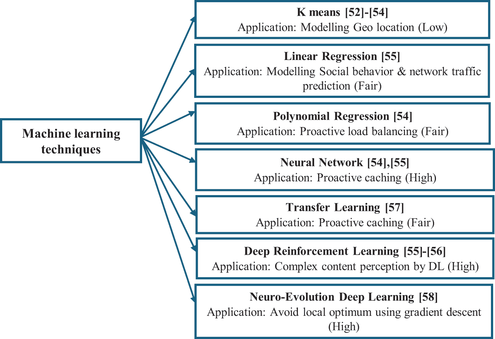

图 2.1 机器学习的类型、其应用以及预期结果的复杂程度。

### 2.2.2 在保护隐私的同时增强数据效用

隐私是数据分析中的首要关注问题。挑战在于如何在保证可用性、完整性和机密性的同时，最大化数据的效用 (`utility`) [50]。确保用户数据安全需要共同努力。运营商和数据提供者必须优先考虑数据加密和严格的访问控制，以防止未经授权的数据访问。在数据效用和隐私之间找到正确的平衡需要三管齐下的方法：

1.  **透明度与用户同意：** 许多用户目前并不知道个人数据的收集，导致了对潜在滥用的焦虑。提供清晰的通知并获得知情同意可以缓解这些担忧。例如，物联网（IoT）可以根据欧盟《通用数据保护条例》（GDPR）[51] 等法规的要求，通知用户数据隐私实践（例如“知情权”）。然而，这种方法依赖于用户对数据存储和使用实践的信任。

2.  **数据安全与加密：** 存储的数据必须为了隐私和真实性而受到保护。加密方案（如认证加密 [52]）可以使用对称密钥机制将数据转换为密文以满足这些需求。

3.  **数据保护与攻击缓解：** 数据保护不仅仅是加密。根据无线信道信息对用户进行分类等技术可以帮助识别潜在的攻击者 [53]。Hamedani 等人的研究 [54] 探索了使用循环神经网络（`RNNs`）来检测各种攻击变体，而 Atat 等人 [55] 则对网络物理系统中的安全考虑提供了更广泛的综述。

### 2.2.3 社会行为建模

理解用户行为和态度对于优化通信服务至关重要。人们对不同的通信方法（例如视频、音频）表现广泛的行为和观点。通过分析这些行为，我们可以为下文描述的每个用户选择最合适的服务类型。

#### 2.2.3.1 内容流行度

用户频繁访问的内容生成了大量的网络流量。理解内容流行度——本质上即什么内容最受喜爱、访问和分享——对于优化网络性能至关重要。

内容流行度建模有两个主要目标：

1.  **预测流行度：** 预测哪些内容将变得流行以便采取主动措施。

2.  **估算流行度水平：** 准确衡量流行度水平有助于在主动缓存系统中做出关于传输、内容放置和存储的明智决策。

用于流行度的传统统计模型（如 Zipf 分布）缺乏机器学习方法的灵活性。利用在线数据的机器学习为构建更准确的流行度模型提供了一条前景良好的路径。例如，可以使用回归方法分析发布的 YouTube 视频的流行度，从而对新视频做出主动缓存决策。在缓存背景下，由于回传成本高，即使是很小的错误也是昂贵的 [56]（误差容忍 < 0.5%）。因此，持续更新这些模型以最小化开销并优化资源分配至关重要 [57]。

#### 2.2.3.2 用户情感

用户情感反映了用户对特定内容的服务的感知（正面或负面），并影响后续行为（例如继续使用、投诉）。理解用户情感具有重要价值：

*   **提高服务质量 (QoS)：** 通过将服务与用户偏好匹配，我们可以提升整体用户体验（QoS）。

*   **主动内容缓存：** 识别感兴趣的内容可以进行主动缓存，让用户更容易获取并减轻网络负载。

在网络优化中，用户情感可以揭示性能区域和内容偏好。社交网络分析为用户情感提供了洞察，因为用户经常在这些平台上表达他们的体验（正面或负面）。情感分类技术可以应用于将社交媒体上的用户投诉按服务类型进行分类。例如，一项研究利用 Twitter 数据（作为空间用户情感分析的数据源）实现了网络覆盖盲区检测的 F1 分数超过 0.6——展示了伦敦桥的案例研究。同样，用户对特定内容的请求反映了他们的偏好。类似 [56] 的研究探索了在用户预期轨迹沿线的基站处缓存用户偏爱的内容。

#### 2.2.3.3 用户关系

Facebook 和 Twitter 等在线平台通过好友关系和订阅等连接捕获用户之间的关系。这些关系可以建模为图，其类型包括好友关系图、交互图、潜在图和关注图。分析这些社交连接可以提供理解用户社交角色之外的宝贵洞察。它们还为观察信息传播模式提供了窗口，可以利用这些模式来优化内容交付 [58]。诸如 [58,59] 等研究表明，社交关系的强度会影响信息在社交-物理网络中的传播方式。在网络优化的背景下，利用社交连接可以显著减轻核心网络的压力。一种方法是根据分析的社交关系，识别并在朋友圈内策略性地共享缓存内容 [27]。例如，Zhu 等人的研究 [28] 探索了利用 Facebook 好友关系进行协作缓存。

### 2.2.4 用于数据驱动主动网络优化的小区与在线信息处理

在线数据分析的力量在于其揭示隐藏模式和预测用户行为的能力。这些洞察可以被用于预测小区流量模式，为从响应式到主动网络优化的范式转变铺平道路。本节探讨了如何将这些分析能力转化为实现主动优化的实际实施策略 [60]。

#### 2.2.4.1 小区流量预测

准确的网络流量预测对于主动网络优化至关重要，特别是在主动负载均衡中。传统方法依赖于基于历史网络记录的一步预测模型，专注于核心网络或小区级的预测。然而，这些方法在预测更细粒度流量方面存在局限。一种很有前景的解决方案是分析来自各种来源的高分辨率 GPS 数据（异构数据集），并将其与小区流量相关起来 [61]。Yang 等人的研究 [48] 证实了网络流量、在线数据量与网络用户数量之间正相关。这表明在线社交网络不仅可以预测激增需求，还能为运营商的流量预测和资源分配决策提供宝贵的洞察。

传统的空间流量预测方法依赖于 `Zipf distribution` 和 `α-stable distributions` 等数学统计方法。然而，这些方法缺乏机器学习方法的灵活性。与使用 `maximum likelihood estimation`（在不最小化梯度的情况下估算参数）等技术的传统方法不同，`neural networks` 等机器学习算法可以利用 `gradient descent` 等参数优化技术。虽然机器学习在预测准确性方面具有优势，但当前面临的挑战之一是生成的预测结果中缺乏固有的不确定性量化。这种可量化不确定性的缺失使得难以评估潜在错误，并为未来的决策权衡成本效益。解决不确定性量化的有前景的解决方案包括 `Gaussian processes` 和 `deep Gaussian processes`，它们可以产生作为后验分布的预测，从而从本质上捕捉不确定性。

随机流量突峰对网络流量预测构成了巨大挑战，因为在没有用户行为额外信息的情况下，很难解释和预测它们。为了应对这一局限性，数据分析已不再局限于小区网络数据，而是整合了如 Twitter 等异构数据源。目前的方法通常依赖线性回归来模拟小区流量与社交网络活动之间的正相关性。虽然统计方法可以量化这种相关性的强度，但它们可能无法有效捕捉底层动态机制 [62, 63]。一个关键挑战在于预测这些随机流量突峰，它们通常源于抗议或非周期活动等不可预见的事件。异常检测技术为区分常规模式和异常突峰提供了有前景的解决方案。这些技术通常结合聚类算法（例如 `K-means`）来区分流量模式，并使用回归模型（例如 `neural networks`）来预测流量量。然而，神经网络中传统的 `gradient descent` 优化可能会导致局部最优，可能阻碍预测准确性。神经进化深度学习通过引入进化技术来解决这一挑战，帮助神经网络跳出局部最优，并通过精调的权重获得更好的长期性能。

### 2.2.5 主动负载均衡

负载均衡对于管理由用户需求分布不均引起的流量不平衡至关重要 [40]。它旨在通过策略性地将移动用户 (`UEs`) 从拥塞小区转移到附近的空闲小区来优化网络性能。这是通过调整切换偏移值、阈值以及切换次数等技术实现的 [13]。

SON 算法的开发是为了自动化这些调整，通常使用模糊逻辑控制器进行切换裕量调节 [20]。然而，这些基于控制器的方法面临局限性：

*   **对流量突峰响应后：** 它们对突然流量突峰做出反应，导致响应时间缓慢，且对快速变化的网络负载适应性有限 [11]。

*   **潜在振荡：** 在某些情况下，基于控制器的方法可能会引入振荡，导致目标小区再次过载。

主动负载均衡方法利用机器学习来克服这些挑战。机器学习算法可以分析网络数据，预测未来的流量模式 [64]，并主动调整呼叫阻塞率 (`CBR`) 等关键参数以优化网络性能，并提供关于以下内容的信息：

1. 通过预测流量平衡负载，通过呼叫阻塞平衡负载
2. 比例或 UE 位置
3. 宏基站卸载
4. 小基站关闭
5. 数据驱动的用户关联
6. 基于在线信息的主动负载均衡

### 2.2.6 主动缓存

移动边缘缓存算法通过根据预测的用户需求策略性地在附近的基站 (`BSs`) 上存储相关数据来解决网络流量需求。这种方法通过增强吞吐量（数据传输率）和延迟（响应时间）显著提高网络性能。为了提高移动边缘缓存的效率，主动考虑以下因素至关重要：

*   **内容选择：** 识别最受欢迎或频繁请求的内容以优先缓存。
*   **内容放置：** 决定在哪些基站存储特定内容，考虑用户位置和移动模式等因素。
*   **内容交付：** 优化缓存内容的用户交付，减少延迟和网络拥塞。
*   **存储利用率：** 高效管理基站的缓存存储容量以容纳最相关的内容。

通过主动处理这些元素，移动边缘缓存算法可以确保内容在网络边缘更接近用户，从而显著改善用户体验，并解决以下问题：

1. 内容放置
2. 内容交付
3. 存储利用率
4. 结合移动预测的动态缓存
5. 冷启动问题

### 2.2.7 基于在线信息的主动缓存

## 2.3 结论

本研究探索了在线数据分析领域的前沿进展，这些进展对于将 5G 网络优化从响应式模式转变为主动模式具有巨大潜力。不断增长的在线数据提供了丰富的信息织体，涵盖了个人用户上下文（例如：个人轨迹、偏好和人际关系）以及更广泛的社会上下文（例如：热门区域、内容流行度和网络流量模式）。利用机器学习和环境数据，我们可以预测不同用户组和位置的流量模式。这些预测为主动网络优化提供了支持，使我们能够预分配资源以满足多样化需求，并适应不断变化的网络动态。这最终带来了卓越的用户体验。

## 参考文献

1. J. Yao, T. Han, and N. Ansari, “On mobile edge caching,” IEEE Commun. Surveys Tuts., vol. 21, pp. 2525–2553, 3rd Quart., 2019

2. J. G. Andrews, S. Buzzi, W. Choi, S. V. Hanly, A. Lozano, A. C. K. Soong, and J. C. Zhang, “What will 5G be?” IEEE J. Sel. Areas Commun., vol. 32, no. 6, pp. 1065–1082, Jun. 2014.

3. A. Imran and A. Zoha, “Challenges in 5G: How to empower SON with big data for enabling 5G,” IEEE Netw., vol. 28, no. 6, pp. 27–33, Nov. 2014.

4. Juniper Research Finds. (Nov. 2014). Mobile Operator Costs Pass$800bn Annually as Margins Become Squeezed. [Online]. [www.juniperresearch.com/press/mobile-operator-costs-pass-800bn-annually-as-margins-become-squeezed-juniper-research-finds/#:~:text=Hampshire%2C%20UK%20%E2%80%93%2018th%20November%202014%3A%20A%20new,the%20end%20of%20the%20decade%20without%20remedial%20action]

5. Aware Service Delivery in RAN for LTE; (Release 14), document 3GPP TR 36.933 V14.0.0, 3rd Generation Partnership Project, 2017.

6. Technical Specification Group; Services and System Aspects; System Architecture for the 5G System; Stage 2 (Release 15), document 3GPP TS 23.501 V0.0.0, 3rd Generation Partnership Project, 2017.

7. A. R. Mishra, Fundamentals of Cellular Network Planning and Optimisation 2G/2.5G/3G... Evolution to 4G. Hoboken, NJ, USA: Wiley, 2007.

8. Technical Specification Group TSG RAN Minimization of Drive Tests for E-UTRAN and UTRAN; Overall Description; Stage 2 (Release 10), document 3GPP TS 37.cde V0.3.0, 3rd Generation Partnership Project, 2010.

9. R. Joyce and L. Zhang, “Self-organising network techniques to maximise traffic of road onto a 3G/WCDMA small cell network using MDT UE measurement reports,” in Proc. IEEE Global Commun. Conf., Dec. 2014, pp. 2212–2217.

10. D. Fagen, P. A. Vicharelli, and J. Weitzen, “Automated wireless coverage optimization with controlled overlap,” IEEE Trans. Veh. Technol., vol. 57, no. 4, pp. 2395–2403, Jul. 2008.

11. A. Aguilar-Garcia, S. Fortes, A. Fernandez Duran, and R. Barco, “Context-aware self-optimization: Evolution based on the use case of load balancing in small-cell networks,” IEEE Veh. Technol. Mag., vol. 11, no. 1, pp. 86–95, Mar. 2016.


## 参考文献

12. R. Razavi, S. Klein, and H. Claussen, “Self-optimization of capacity and coverage in LTE networks using a fuzzy reinforcement learning approach,” in *Proc. 21st Annu. IEEE Int. Symp. Pers., Indoor Mobile Radio Commun.*, Sep. 2010, pp. 1865–1870.

13. I. Viering, M. Dottling, and A. Lobinger, “A mathematical perspective of self-optimizing wireless networks,” in *Proc. IEEE Int. Conf. Commun.*, Jun. 2009, pp. 1–6.

14. A. Lobinger, S. Stefanski, T. Jansen, and I. Balan, “Coordinating handover optimization and load balancing in LTE self-optimizing networks,” in *Proc. IEEE 73rd Veh. Technol. Conf. (VTC Spring)*, May 2011, pp. 1–5.

15. W. Guo and T. O’Farrell, “Dynamic cell expansion with self-organizing cooperation,” *IEEE J. Sel. Areas Commun.*, vol. 31, no. 5, pp. 851–860, May 2013.

16. 3GPP Work Items on Self-Organizing Networks, document v0.1.

17. S. Bassoy, M. Jaber, M. Imran, and P. Xiao, “User-centric CoMP for 5G,” *IEEE Access*, vol. 4, pp. 2895–2906, 2016.

18. B. Keshava Murthy and M. Ashraf, “Conceptual design of SON based on big data: A novel shift in paradigm,” *Proc. Int. Syst. Adv. (SMART)*, 2016.

19. W. Zuo, Y. Lin, H. Hu, and Z. Cai, “A load balancing algorithm for context-aware networks,” *Amer. J. Netw.*, vol. 2, no. .

20. L.-C. Wang, S. Cheng, and A.H., “Ultra-dense cells,” *IEEE 84th Veh. Technol. Conf. (VTC-Fall)*, 2016.

21. Technical Specification Group Services and System Aspects; Study on Non-MTC, document 3GPP TR 36.933, 2011.

22. J. Wu, C. Gniad, M. Valla, and H. Li, “Context networking and communications: Part 1,” *IEEE Commun. Mag.*, vol. 52, no. 6, pp. 14–15, 2014.

23. J. Wu, C. Gniad, M. Valla, and H. Li, “Context networking and communications: Part 2,” *IEEE Commun. Mag.*, vol. 52, no. 8, pp. 64–65, 2014.

24. J. Krum, N. Davies, and C. Narwami, “User-generated content,” *Pervasive Comput.*, vol. 7, no. 4, pp. 10–11, 2008.

25. X. Wang, L. T. Yang, X. Xie, J. Jin, and M. J. Deen, “Cloud-physical-social services,” *IEEE Commun. Mag.*, vol. 55, no. 11, pp. 80–85, 2017.

26. X. Wang, L. T. Yang, J. Han, and B. O. Apduhan, “NQA: An anti-collision algorithm for RFID systems,” *ACM Trans. Embedded. Syst.*, vol. 18, no. 4, pp. 1–21, 2019.

27. E. Bastug, M. Bennis, and M. Debbah, “Living on the edge: The role of proactive caching in 5G,” *IEEE Commun. Mag.*, vol. 52, no. 8, pp. 82–89, 2014.

28. K. Zhu, W. Zhi, L. Zhang, X. Chen, and X. Fu, “Social-aware incentivized caching for D2D communications,” *IEEE Access*, vol. 4, pp. 7585–7593, 2016.

29. X. Wang, L. T. Yang, J. Feng, X. Chen, and M. J. Deen, “A tensor-based big service framework for enhanced living environments,” *IEEE Cloud Comput.*, vol. 3, no. 6, pp. 36–43, 2016.

30. X. Wang, L. T. Yang, H. Liu, and M. J. Deen, “A big data-as-a-service framework: State-of-the-art and perspectives,” *IEEE Trans. Big Data*, vol. 4, no. 3, pp. 325–340, 2018.

31. D. Liu, B. Chen, C. Yang, and A. F. Molisch, “Caching at the wireless edge: Design aspects, challenges, and future directions,” *IEEE Commun. Mag.*, vol. 54, no. 9, pp. 22–28, Sep. 2016.

32. N. Gupta, H. Crosby, D. Purser, S. Javis, 和 W. Guo, “跨行业的 Twitter 使用情况：时空分析，”发表于 *Proc. IEEE 5th Int. Conf. Big Data Comput. Service Appl. (Big Data Service)*，2018 年 3 月，第 64–71 页。

33. X. Wang, L. T. Yang, X. Chen, J.-J. Han, 和 J. Feng, “一种用于信息-物理-社会大数据的张量计算与优化模型，”*IEEE Trans. Sustain. Comput.*, 第 4 卷，第 4 期，第 326–339 页，2019 年 10 月。

34. X. Wang, L. T. Yang, L. Kuang, X. Liu, Q. Zhang, 和 M. J. Deen, “一种异构网络中基于张量的大数据驱动路由推荐方法，”*IEEE Netw.*, 第 33 卷，第 1 期，第 64–69 页，2019 年 1 月。

35. L. Kuang, L. T. Yang, X. Wang, P. Wang, 和 Y. Zhao, “一种用于改进软件定义网络 QoS 的基于张量的数据模型，”*IEEE Netw.*, 第 30 卷，第 1 期，第 30–35 页，2016 年 1 月。

36. Y. Li, Y. Zhang, K. Luo, T. Jiang, Z. Li, 和 W. Peng, “超密集异构网络遇到大数据：绿色框架、技术与方法，”*IEEE Commun. Mag.*, 第 56 卷，第 6 期，第 56–63 页，2018 年 6 月。

37. K. Zheng, Z. Yang, K. Zhang, P. Chatzimisios, K. Yang, 和 W. Xiang, “面向 5G 的移动网络大数据驱动优化，”*IEEE Netw.*, 第 30 卷，第 1 期，第 44–51 页，2016 年 1 月。

38. O. G. Aliu, A. Imran, M. A. Imran, 和 B. Evans, “未来蜂窝网络自组织综述，”*IEEE Commun. Surveys Tuts.*, 第 15 卷，第 1 期，第 336–361 页，2013 年第一季度。

39. P. V. Klaine, M. A. Imran, O. Onireti, 和 R. D. Souza, “应用于自组织小区窝网络的机器学习技术综述，”*IEEE Commun. Surveys Tuts.*, 第 19 卷，第 4 期，第 2392–2431 页，2017 年第四季度。

40. M. Chen, U. Challita, W. Saad, C. Yin, 和 M. Debbah, “基于人工神经网络的无线网络机器学习：教程，”2017, arXiv:1710.02913。[在线]。可用：`arxiv.org/abs/1710.02913`

41. G. Xu, S. Gao, M. Daneshmand, C. Wang, 和 Y. Liu, “用于位置预测的移动性大数据分析综述，”*IEEE Wireless Commun.*, 第 24 卷，第 1 期，第 111–119 页，2017 年 2 月。

42. R. Xie, Y. Chen, Q. Xie, Y. Xiao, 和 X. Wang, “我们了解你在新城市的偏好：挖掘和建模旅行者的行为，”*IEEE Commun. Mag.*, 第 56 卷，第 11 期，第 2835 页，2018 年 11 月。

43. F. Zeng, R. Wang, 和 J. Wu, “口碑模式下的移动众包中移动贡献者如何相互交互，”*IEEE Access*, 第 7 卷，第 14523–14536 页，2019 年。

44. A. Tsakalidis, M. Liakata, T. Damoulas, B. Jellinek, W. Guo, 和 A. I. Cristea, “结合异构用户生成数据以感知福祉，”日本大阪：COLING 2016 组委会，2016 年。

45. Kaggle 上的数据集。访问日期：2020 年 2 月 19 日。[在线]。可用：`https://www.kaggle.com/datasets`

46. C. Zhang, X. Ouyang, 和 P. Patras, “ZipNet-GAN：通过生成式神经网络推断移动流量模式，”发表于 *Proc. 13th Int. Conf. Emerg. Netw. Technol. (CoNEXT)*，2017 年，第 363–375 页。

47. G. Khodandelou, V. Gauthier, M. Fiore, 和 M. A. Elahi, “利用移动元数据估计静态和动态城市人口，”*IEEE Trans. Mobile Comput.*, 第 18 卷，第 9 期，第 2034–2047 页，2019 年 9 月。

48. B. Yang, W. Guo, B. Chen, G. Yang, 和 J. Zhang, “利用 Twitter 估计移动需求，”*IEEE Wireless Commun. Lett.*, 第 5 卷，第 4 期，第 380–383 页，2016 年 8 月。

49. B. Yang, W. Guo, B. Chen, G. Yang, 和 J. Zhang, “利用 Twitter 估计移动需求，”2016。访问日期：2021 年 4 月 19 日。[在线]。可用：`https://doi.org/10.5061/dryad.35q`

50. L. M. Kaufman, “云计算中的数据安全，”*IEEE Security*, 2019 年。注. 修正：原文应为第 7 卷，第 4 期，第 61–64 页。

51. S. Ioannidis, A. Chaintreau 和 L. Massoulié, “无线网络中的最后一公里，”*ACM Mobile Comput. Commun.*, 第 13 卷，2009 年 6 月。

52. D. Maimut, M. S. Seddiki, S. Stoyanov 和 D. Trossen, “社交网络中的身份验证，”*IEEE Security*, 第 12 卷，2014 年。

53. S. Chen, H. Wen, J. Wu, L. Liu, C. Chen, “用于 5G 的储层计算，”*无线网络*, 2018 年。

54. K. Hamed, L. Liu, R. Atat, J. Wu, “基于延迟反馈的智能电网负载均衡，”*IEEE Trans. Ind.*, 第 14 卷，第 2 期，第 734–743 页，2018 年 5 月。

55. R. Atat, L. Liu, Z. Zhang, P. Zhang, “物理系统中的储层计算：综述，”*IEEE Access*, 第 6 卷，第 73603–73636 页，2018 年。

56. M. Chen, W. Saad, C. Yin, 和 M. Debbah, “用于无线接入主动缓存的储层网络，”*IEEE Trans. Wireless.*, 第 16 卷，第 6 期，第 3520–3535 页，2018 年 6 月。

57. S. Ioannidis, A. Chaintreau 和 L. Massoulié, “移动网络的内容分发，”*ACM Mobile Comput. Commun. Rev.*, 第 13 卷，2009 年 6 月。

58. Y. Yi, Z. Zhang 和 C. Gan, “社交连接对复杂网络中信息传播的影响，”*Phys. A Stat. Mech. Appl.*, 第 509 卷，第 783–794 页，2018 年 11 月。

59. Y. Yi, Z. Zhang 和 C. Gan, “社交网络上信息传播的爆发阈值，”*Phys. A Stat. Mech. appl.*, 第 526 卷，第 121128，2019 年 7 月。

60. C. Qiu, Y. Zhang, Z. Feng, P. Zhang, 和 S. Cui, “基于循环神经网络的时空流量预测，”*IEEE Wireless Commun. Lett.*, 第 7 卷，第 4 期，第 554–557 页，2018 年 8 月。

61. B. Yang, W. Guo, B. Chen, G. Yang, 和 J. Zhang, “利用 Twitter 估计移动需求，”*IEEE Wireless Commun. Lett.*, 第 5 卷，第 4 期，第 380–383 页，2016 年 8 月。

62. A. Sathiaseelan, M. S. Seddiki, S. Stoyanov 和 D. Trossen, “社交 SDN：无线网络规划中的在线社交网络集成，”*ACM Conf. (SIGCOMM).*, 纽约纽约, 第 44 卷，第 4 期，第 375–376 页，2014 年。

63. B. Yang, W. Guo, B. Chen, G. Yang, 和 J. Zhang, “利用 Twitter 估计移动需求，”*IEEE Wireless Commun. Lett.*, 第 5 卷，第 4 期，第 380–383 页，2016 年 8 月。

64. A. Lobinger, S. Stefanski, T. Jansen 和 I. Balan, “LTE 自优化网络中的下行负载均衡，”发表于 *Proc. IEEE 71st Veh. Technol. Conf.*，2010 年 5 月，第 1–5 页。

## 3.1 移动网络管理与人工智能应用

移动网络是一种由如智能手机、平板电脑和其他可以连接到网络的无线移动设备构成的电信网络。移动网络也被称为蜂窝网络 [1]。地理区域被划分为多个小区。每个小区都包含一个基站，基站是配备了天线和收发器的物理结构。基站为其所在小区内的移动设备与蜂窝网络的其他部分提供连接。随着无线通信技术的发展，网络规模和移动设备提供的服务也在不断增长。移动网络支持的各种通信服务包括语音通话、短信（SMS）、多媒体短信（MMS）以及互联网访问等数据服务。用户设备的移动性对通信网络提供的服务质量（QoS）构成了挑战。本章将讨论涉及移动网络管理的关键方面，以及人工智能在改善用户移动网络体验方面的应用。

### 3.1.1 移动网络管理

移动网络管理的关键方面包括：

1.  **网络监控**：涉及维护网络性能参数和容错能力。最重要的网络性能指标是延迟、丢包和带宽利用率。而容错能力涉及检测和识别网络故障，以最大限度地减少停机时间和业务中断。
2.  **流量管理**：流量管理处理移动网络中的负载调度，以优化数据流、防止拥塞并增强资源利用。
3.  **服务质量（QoS）管理**：移动网络的 QoS 取决于流量管理和网络监控。一个分布良好且具有最优资源利用的网络流量负载，预计可以提高延迟、丢包和带宽利用率等网络性能参数。
4.  **安全管理服务**：在网络广泛连接的情况下，实施安全机制至关重要。移动网络的安全管理涉及防止未经授权的访问，并控制对网络及其资源的访问。

### 3.1.2 人工智能在移动网络管理中的范围


# 人工智能（AI）技术通过增强网络寿命、效率和安全需求，对移动网络管理做出了巨大贡献 [2,3]

预测、机器学习（ML）、深度学习、专家系统和强化学习等 AI 技术可以通过以下方式应用于移动网络管理：

1.  **预测性维护：** 基于 AI 的数据分析工具可预测网络故障并对网络设备进行维护，同时进行实时监控。预测有助于实施主动维护策略，以解决可能导致服务中断的问题。

2.  **动态资源分配：** `ML` 模型可以实现在移动网络中，用于分析流量模式并动态分配网络资源（如带宽），以满足用户不断的需求。总体而言，可以设计 `ML` 算法用于移动网络中的智能流量管理。

3.  **设计自优化网络：** AI 算法被用于自动优化网络参数（如天线配置和功率电平），以提升整体用户体验。

4.  **改进网络安全方面：** `AI/ML` 算法用于检测异常流量模式和异常，并识别网络中未经授权的访问。同样，AI 算法用于在识别出非法行为时生成自动响应。

5.  **用于绿色通信的 AI：** 预测性 AI 在设计绿色通信网络方面非常有用。可以对各种网络组件编写智能睡眠模式，以优化电池电源的使用，从而延长网络服务时间。

6.  **用于未来代通信的 AI：** AI 技术可以优化波束赋形、网络切片和边缘计算。

## 3.2 移动网络管理的传统方法

本节讨论了为移动网络管理设计的非基于 AI 的传统方法。

### 3.2.1 移动网络优化

移动网络优化的目标是提高网络效率、最大化资源利用率、减少拥塞并最终提高 `QoS`。这些目标通过优化射频规划、实施负载均衡以及采用算法更高效地管理流量和资源来实现。Rodriguez 等人 [4] 解决了 5G 网络中随着移动用户数量增加而网络管理压力增加的问题。挑战主要包括无线频谱的重用以及在网络分类增加的情况下处理切换。作者们在无线环境地图上使用了随机几何方法来提高网络的接入概率和覆盖概率。蒙特卡洛模拟结果显示，与其他小区关联技术相比，该方法改进了覆盖概率和切换率。Saad 等人 [5] 同样处理了小区可用性有限的情况下移动用户增加的问题。作者研究了各种切换控制参数设置的权衡和调优。他们得出结论，自动自优化是处理此类挑战的最佳方法，而不是手动处理。负载均衡是移动网络中一个研究充分的问题，涉及在热小区（过载小区）和冷小区（欠载小区）之间平衡流量 [6–8]。传统的负载均衡方法包括以信息中心的网络、基于代价函数的算法 [9] 以及参数收敛算法 [10]。

### 3.2.2 移动网络性能管理

移动网络性能管理的目标是识别改进领域并对数据吞吐量、延迟和网络可用性等指标进行持续监控。Sherif 等人 [11] 通过解决机会移动网络（`OMN`）中的自私节点问题改进了移动网络的性能。`OMN` 涉及可能没有持续连接的节点之间的通信。此类网络中的通信取决于移动节点的机会性遇到，这有时会增加通信延迟。因此，使用中间或中继节点来转发断开节点的消息，以增加数据吞吐量并降低延迟。然而，有时中间中继可能会表现得自私，不配合转发消息，从而影响网络性能和用户体验。Sherif 等人 [11] 和 Jedari 等人 [12] 使用看门狗机制来监控和检测 `OMN` 中的异常节点。多年来，已经提了许多此类算法用于检测和处理移动网络中的异常节点。Kampitaki 等人 [13] 对此类算法进行了全面的综述。

### 3.2.3 移动网络资源分配

移动设备包含的能量和计算资源有限。然而，实时跟踪系统等现代应用需要高计算能力和持续的电池支持。为了支持这些消耗资源的大型移动应用，网络中使用了任务卸载机制。任务卸载是将计算任务从移动设备转移到另一个计算资源（通常是更强大的服务器）的过程。计算结果随后从服务器传回到移动设备 [14]。然而，将计算任务从移动设备传输到服务器再传回移动设备会增加应用程序的通信延迟。当多个移动设备在小小区内同时请求任务卸载时，需要无线资源分配方法 [15]。所提的解决方案包括最优子信道分配 [15]、基于性能的启发式优先级方法 [14] 以及可以组合成非线性规划问题的多个参数 [16]。

综之，传统的移动网络管理方法包括设计多目标函数，以及使用如 `Watchdog` 算法和基于博弈的方法来优化网络性能。然而，这些方法难以随着网络维度和用户的变化而进行更新。现代网络是时变的，需要自适应解决方案来适应现代移动应用。

## 3.3 移动网络的人工智能

本节详细讨论了人工智能（AI）在移动网络管理中的现有用途。

### 3.3.1 基于 AI 的移动网络优化

#### 3.3.1.1 自愈网络

自愈是指在无需人工干预的情况下自动检测、诊断和缓解问题的能力。Moysen 等人 [17] 设计了一种基于强化学习的自动自愈方法，用于识别和诊断长周期演进（`LTE`）网络中的小区中断。启用 AI 的基站会自动调整下行传输功率水平，并为覆盖中断区域寻找最佳天线倾斜值。Asghar 等人 [18] 在网络性能矩阵上使用 `ML` 算法来持续检测网络中的异常。检测到后，使用模糊逻辑自动确定补偿措施。此外，还设计了一种基于启发式的持续优化工具，用于对网络进行增量改进。Reshmi 等人 [19] 也设计了一个自愈框架，利用网络性能矩阵检测网络中的异常。Riaz 等人 [20] 讨论道，现有的自愈网络工作集中在单基站和单故障上。此外，他们强调，如果训练期间没有密集的用户数据集，现有的基于 AI 的方法将无法运行。为了弥补这一研究空白，Riaz 等人 [20] 设计了一个使用 `CNN` 和图像修复技术的自愈框架，该框架在高度稀疏的用户设备数据集上优于许多 `ML` 模型。

#### 3.3.1.2 能量效率

Hossain 等人 [21] 预测了网络负载和预期能量利用，并在此此切片决策。他们将计算负载分配在不同的设备之间。Peesapati 等人 [22] 解决了多运营商无线接入网络（`RAN`）共享的概念，即多个网络运营商协作利用相同的物理基础设施。这种共享模型旨在提高效率并降低成本。采用 AI 在保持性能的同时对网络做出智能决策和调整。

#### 3.3.1.3 负载均衡

AI 在移动网络的负载均衡中显示出重要性。Gures 等人 [23] 对此类负载均衡技术进行了详细调查。Alsuhli 等人 [24] 处理了蜂窝网络中的移动性问题。研究重点是动态分配网络资源以适应移动模式。作者使用深度强化学习来动态分配网络资源，以适应移动模式。Saad 等人 [25] 强调，小区密度随着用户设备的增加而增加，这需要优化的切换。[26] 中的作者为异构网络设计了一种基于模糊逻辑的自优化切换方案。将三个参数——即用户速度、`SINR` 值和小区负载输入到设计的模糊系统中，以估计切换控制。

### 3.3.2 移动网络中的智能流量管理

移动网络中的智能流量管理涉及使用先进技术和算法来优化数据和资源的流。目标是在面对变化的网络条件、用户需求和应用要求时，增强整体性能、效率和服务质量。智能流量管理涵盖了一系列技术和策略，用于动态分配资源、优先处理流量并响应实时网络状况。传统的移动/互联网流量管理方法利用排队论来处理移动网络中的瓶颈缓冲区队列 [27]。随着 AI 的引入，研究人员开始利用 AI 方法来处理网络流量。Liu 等人 [28] 设计了一种基于模糊逻辑的控制器，用于自动测量路由器队列大小。设计的模型有助于根据测量的路由器队列大小采取主动措施。Fu 等人 [29] 讨论了 5G 网络提供的服务，以及利用 AI 提高网络性能的潜力。作者提到了在 5G 网络的云、雾和边缘节点部署分布式 `ML` 算法的潜力。Shen 等人 [30] 讨论了异构网络中的 `QoS` 问题。在异构网络中，通过网关等连接设备组合不同网络。不同的网络具有不同的流量速率和服务需求。Shen 等人 [30] 在 `convolution neural networks` 的不同层级进行分类和管理，以设计智能多维异构流量控制。

AI 技术也用于基于预测的流量管理 [31]。Morales 等 [32] 使用人工神经网络预测网络流量，并调整虚拟网络的拓扑结构，以支持增长的流量需求。虚拟网络通过为网络添加更多计算能力为移动网络提供了扩展。Morales 等 [32] 以小时为单位预测每对源-目的对之间的最大比特率，并调整虚拟网络拓扑结构以满足预测的流量需求。同样，AI 技术也应用于光网络。光网络为移动网络提供回传连接，用于在基站、核心网和外部数据中心在内的各种网络元素之间传输移动网络流量 [33–35]。这确保了数据传输的高效与可靠。Leung 等 [36] 使用单隐藏层神经网络估计光网络中当前网络流量状况的阻塞概率。在 Vinchoff 等 [37] 的另一项贡献中，他们利用图卷积神经网络（`GCN`）和生成对抗网络（`GAN`）预测光中的高流量状况。研究表明，与传统的 `LSTM` 模型相比，`GCN-GAN` 模型预测流量突发更加准确。

### 3.3.3 用于移动网络规划的机器学习

移动网络规划涉及设计、优化和配置移动通信网络元素，以确保高效且可靠的服务交付。

#### 3.3.3.1 网络覆盖规划

Fauzi 等 [38] 强调确定性网络规划技术无法满足移动网络日益增长的需求。他们声称 `ML` 算法在估计传播模型方面比传统经验方法更有用。作者使用随机森林 `ML` 算法预测参考信号接收功率，并设计了一种在线覆盖估计工具。Dai 等 [39] 也强调使用 `ML` 算法代替传统的传播模型来估计网络覆盖，因为后者模型既复杂又耗时。他们还考虑了通信距离、地理位置和基站配置参数等有用参数，设计了一种基于 `ML` 的网络评估工具。不同的 `ML` 模型在真实数据集上进行训练，以估计接收信号强度（`RSS`）。考虑到数据集的比较结果显示，与最近邻、决策树、随机森林和神经网络模型相比，`SVM` 实现了更好的 `RSS` 预测精度。Mohammadjafari 等 [40] 使用 `ML` 算法估计无线覆盖，并为特定的地理位置确定最佳无线发射器位置。他们发现，基于现有特征创建并添加新特征到 `ML` 模型中可以进一步提高模型的预测能力。Mahboubi 等 [41] 使用 `K-means` 聚类来增加移动传感器网络的覆盖区域。Lyu 等 [42] 使用监督学习模型估计移动网络的覆盖范围。他们还使用 AI 生成合成数据集并与真实数据集相结合。最终数据集随后用于训练和测试监督学习模型。同样，多年来，人们已经设计并探索了许多用于增强蜂窝网络的 `ML` 技术 [43]。

#### 3.3.3.2 回传规划

回传是连接核心网或骨干网与网络边缘小型子网（通常是接入网络）的网络部分。回传必须具有足够的容量来处理接入点产生的数据流量。随着对高速数据服务需求的增加，回传链路的容量对于确保响应迅速且高效的网络至关重要。Mahmood 等 [44] 使用 `ML` 算法预测未来的网络需求。预测有助于根据预测的流量动态配置无线回传网络。这种灵活性允许网络实时响应不断需求模式，并确保资源分配在最需要的地方。Abdelmoaty 等 [45] 使用深度强化学习设计分层回传拓扑。

## 3.4 用例与应用

多个电信行业正转向 AI 驱动的服务。正如本章之前讨论，主要目标是为用户提供自动自愈和自适应服务，以处理无缝切换和网络停机。在 Frost and Sullivan 最近的一份调查报告中 [46]，71% 的受访电信公司经历了客户服务的改进，63% 的公司使用 AI 优化了网络管理。德国政府资助了 510 万欧元用于爱立信的“AI4Mobile”项目 [47]。“AI4Mobile”为连接移动和工业 4.0 的连接质量预测提供了改进结果。AI 在支持移动网络方面的现有贡献不仅限于此讨论。数字孪生正成为最强大的 AI 工具，可以以多种方式改进电信服务。

### 3.4.1 用于移动网络的数字孪生

数字孪生是物理对象、系统或过程的虚拟表示或数字副本。它是一个将现实世界数据与虚拟建模及仿真相结合的概念，创建一个实体的动态数字对应物。其目标是在实体的整个生命周期内实现监控、分析和优化。数字孪生提供了一种在真实平台上虚拟测试的机制，而不会实际导致任何物理损坏或成本。Sun 等 [48] 设计了一个移动网络的数字孪生网络，用于快速管理服务水平协议（`SLA`）。所有更新的网络策略首先在数字孪生网络上针对 `SLA` 要求进行验证，而不会影响物理部署的网络服务。图 3.1 显示了真实物理网络的数字孪生适配。

![Figure 3.1 Digital twins for mobile networks [48].](html/images/9781032751245_C003_001.jpg)

图 3.1 用于移动网络的数字孪生 [48]。

Deng 等人 [49] 指出通过将数字孪生网络集成到机器学习算法中，可以进一步提高其性能。目前提出的自适应机器学习技术依赖物理网络进行训练样本采集和适配，这会导致数据采集、训练和部署的延迟。作为解决方案，作者考虑了当前物理网络的数字孪生，并利用专家知识来预测网络的下一个状态。然后，使用强化学习进行优化。最终的优化方案被部署在物理网络上。同样，数字孪生在移动网络安全和隐私服务的的设计与测试中发现了其潜在用途 [50]。Ahmadi 等人 [51] 讨论了数字孪生在 6G 网络中的应用。他们讨论了“网络化孪生”的概念，指的是网络内部互连数字孪生所组成的协作生态系统。这包括单个设备、组件甚至整个系统的数字孪生相互作用，共享数据并共同为整个网络的优化做出贡献。

## 3.5 兴起技术

### 3.5.1 移动网络中的边缘计算与人工智能

边缘计算涉及在靠近数据源的地方处理数据，从而重新降低延迟并提高实时响应能力。边缘计算与人工智能的结合促进了网络边缘的实时决策。这对于需要即时响应的应用程序（如自动驾驶汽车和智能城市）特别具有价值。像神经网络之类的 AI 算法需要极高的处理能力，而移动设备的计算资源有限。主要的处理任务（如自适应 AI 模型的定期训练）通常在资源丰富的云网络中执行。然而，由于移动设备与云端之间需要交换数据和训练模型参数，移动网络会经历通信延迟。因此，该领域的主要工作在于利用分布式边缘资源为 AI 移动网络以提高响应速度。Li 等人 [52] 在边缘和移动设备之间划分了深度神经网络的计算，以实现实时适配并改善用户体验。Tran 等人 [53] 提出了通过直接在基站中集成移动边缘计算（`MEC`）能力来升级移动网络基础设施的理念，以进一步优化边缘网络支持的服务。对所提的基础设施通过三个案例研究进行了评估，包括一个计算密集型应用、发送到服务器之前的大数据预处理以及感知感知服务。结果表明，设计的 `MEC` 和边缘异构资源池证明了其在 5G 网络中的潜在应用价值。

### 3.5.2 用于移动通信网络安全的 AI

移动网络中的安全威胁对数据和服务的机密性、完整性和可用性构成风险。随着移动网络的演进，新威胁不断出现，现有的威胁也可能变得更加复杂。例如，移动网络中常见的安全威胁包括网络欺骗、未经授权和身份验证攻击、窃听和拒绝服务攻击。传统的密码学和安全方法在复杂的时变移动网络中提供服务面临挑战。这为基于人工智能的方法处理时变参数并提供自动化和自适应安全机制提供了空间。Fang 等人 [54] 探索了基于机器学习的 5G 网络认证方法，该方法利用了载波频率偏移、信道脉冲响应和 `RSSI` 值等物理层参数。模式识别算法对于识别时间序列数据集中的异常有用，这些异常可能导致移动网络中的安全威胁。Ali 等人 [55] 使用聚类算法识别了由于无线网络衰减和 `SDN` 配置错误导致的异常。干扰攻击是移动网络中的常见威胁，会导致拒绝服务。Krayani 等人 [56] 使用动态贝叶斯网络检测正交频分复用载波中的干扰。尽管 AI 方法在改进移动网络服务方面有用，但它们容易受到安全攻击。Qiu 等人 [57] 测试了针对白盒和黑盒攻击的深度神经网络模型，并证明 AI 模型可以通过修改参数或篡改数据集被欺骗。这要求针对移动网络中基于 AI 的安全管理的漏洞采取进一步行动。

## 3.6 结论

本章讨论了机器学习模型、预测分析、神经网络模型和强化学习在增强移动网络管理服务方面的应用。本章概述了移动网络管理的传统方法，随后讨论了用于设计自愈移动网络、自动负载重平衡、自动化网络和回传规划的最新 AI 技术。数字孪生技术对移动网络具有变革性潜力，能够产生重大的积极影响。通过使用数字孪生，可以用更低的复杂性和更短的时间完成繁琐的实时测试。

## 参考文献

1. M. Sauter, From GSM to LTE: An Introduction to Mobile Networks and Mobile Broadband. Hoboken: John Wiley & Sons, 2010.

2. A. Havolli and M. Fetaji, “Improving radio network planning and design in next-generation mobile networks using AI and ML algorithms,” in *2023 12th Mediterranean Conference on Embedded Computing (MECO)*, pp. 1–5, 2023.

3. G. Luo, Q. Yuan, J. Li, S. Wang, and F. Yang, “Artificial intelligence powered mobile networks: From cognition to decision,” IEEE Network, vol. 36, no. 3.

4. A. Sharma, A. Roy, S. Ghosal, and U. Bhattacharya, “Load balancing in cellular network: A review,” in *2012 Third International Conference on Computing, Communication and Networking Technologies (ICCNT’12)*, pp. 1–5, IEEE, 2012.

5. T. Semong, T. Maupong, S. Anokye, K. Kehulakae, S. Dimakatso, G. Boipelo, and S. Sarefo, “Intelligent load balancing techniques in software defined networks: A survey,” Electronics, vol. 9, no. 7, p. 1091, 2020.


# 参考文献

6. M. R. Belgaum, S. Musa, M. M. Alam, and M. M. Su’ud, “A systematic review of load balancing techniques in software-defined networking,” *IEEE Access*, vol. 8, pp. 98612–98636, 2020.

7. Y. Yang, P. Li, X. Chen, and W. Wang, “A high-efficient algorithm of mobile load balancing in LTE system,” in *2012 IEEE Vehicular Technology Conference (VTC Fall)*, pp. 1–5, IEEE, 2012.

8. Q. Ye, B. Rong, Y. Chen, M. Al-Shalash, C. Caramanis, and J. G. Andrews, “User association for load balancing in heterogeneous cellular networks,” *IEEE Transactions on Wireless Communications*, vol. 12, no. 6, pp. 2706–2716, 2013.

11. B. V. Sherif 和 P. Salini, “改进的基于社交看门狗和动态功率 AODV 协议的机会性移动网络自私节点管理”, *International Journal of Information Technology*, vol. 14, p. 3253–3264, 2022.

12. B. Jedari, F. Xia, H. Chen, S. K. Das, A. Tolba, 和 Z. AL-Makhadmeh, “用于检测机会性移动网络中自私节点的社交看门狗系统”, *Future Generation Computer Systems*, vol. 92, pp. 777–788, 2019.

13. D. G. Kampitaki 和 A. A. Economides, “移动自组织网络中的自私性：检测技术与防御机制的文献综述”, *IEEE Access*, vol. 11, pp. 86895–86909, 2023.

14. T.-Y. Kan, Y. Chiang, 和 H.-Y. Wei, “移动边缘计算系统中的任务卸载与资源分配”, *2018 第 27 届无线与光通信会议 (WOCC)*, pp. 1–4, IEEE, 2018.

15. Y. Cao, T. Jiang, 和 C. Wang, “蜂窝网络移动任务卸载的最优无线资源分配”, *IEEE Network*, vol. 28, no. 5, pp. 68–73, 2014.

16. H. Chen, D. Zhao, Q. Chen, 和 R. Chai, “小小区无线蜂窝网络中的联合计算卸载与无线资源分配”, *IEEE Transactions on Green Communications and Networking*, vol. 4, no. 3, pp. 745–758, 2020.

17. J. Moysen 和 L. Giupponi, “基于强化学习的 LTE 网络自愈解决方案”, *2014 年 IEEE 第 80 届车辆技术会议 (VTC2014-Fall)*, pp. 1–6, IEEE, 2014.

18. M. Z. Asghar, F. Ahmed, 和 J. Hämäläinen, “人工智能赋能的移动网络自动化自愈”, *2021 IEEE Globecom 工作会议 (GC Wkshps)*, pp. 1–6, IEEE, 2021.

19. T. Reshmi 和 M. Azath, “利用预测分析的 5G 网络改进自愈技术”, *Peer-to-Peer Networking and Applications*, vol. 14, no. 1, pp. 375–391, 2021.

20. M. S. Riaz, H. N. Qureshi, U. Masood, A. Rizwan, A. Abu-Dayya, 和 A. Imran, “用于自愈蜂窝网络多故障诊断的深度学习框架”, *2022 年 IEEE 无线通信与网络会议 (WCNC)*, pp. 746–751, IEEE, 2022.

21. M. A. Hossain, A. R. Hossain, 和 N. Ansari, “6G 中的人工智能：异构网络的高效机器学习”, *IEEE Network*, vol. 36, no. 6, pp. 84–91, 2022.

22. S. K. G. Peesapati, M. Olsson, S. Andersson, C. Qvarford, 和 A. Dahlen, “AI 辅助的多运营商共享网络共享”, *Telecom*, vol. 4, pp. 334–368, MDPI, 2023.

23. E. Gures, I. Shayea, M. Ergen, M. H. Azmi, 和 A. A. El-Saleh, “异构网络中基于机器学习的负载均衡：综述”, *IEEE Access*, vol. 10, pp. 37689–37717, 2022.

24. G. Alsuh, K. Banawan, K. Attiah, A. Elezabi, K. Seddik, A. Gaber, 和 Y. Gadallah, “蜂窝网络中的移动管理”, *IEEE Transactions on Mobile Computing*, vol. 22, pp. 1581–1598, 2021.

25. W. K. Saad, I. Shayea, A. Alhamadi, M. Sheikh, 和 A. El-Saleh, “5G 网络中的切换与负载均衡自优化”, *Engineering Science and Technology*, vol. 42, p. 10148, 2023.

26. A. Alhamadi, W. Hassan, A. El-Saleh, I. Shayea, M. Mohamad, 和 W. Saad, “4G/5G 网络的智能协调自优化”, *ICT Express*, vol. 9, no. 2, pp. 276–281, 2023.

27. D. Chalmers 和 M. Sloman, “移动计算服务质量综述”, *IEEE Communications Surveys*, vol. 2, no. 2, pp. 1–10, 1999.

28. J. Liu 和 O. W. Yang, “利用模糊逻辑为高速网络提供流量管理”, *IEEE Transactions on Network and Service Management*, vol. 10, no. 2, pp. 148–161, 2013.

29. Y. Fu, S. Wang, C.-X. Wang, 和 S. McLaughlin, “管理 5G 网络的人工智能”, *IEEE Network*, vol. 32, no. 6, pp. 58–64, 2018.

30. J. Shen, T. Zhou, K. Wang, 和 L. Pan, “异构网络的人工智能多维流量”, *IEEE Network*, vol. 32, no. 6, pp. 84–91, 2018.

31. A. Chen, J. Law, 和 M. Aibin, “通信网络中人工智能流量预测综述”, *Telecom*, vol. 2, pp. 518–535, MDPI, 2021.

32. F. Morales, M. Ruiz, L. Gifre, M. Contreras, 和 L. Velasco, “基于数据分析的流量预测虚拟网络拓扑”, *Journal of Optical Communications and Networking*, vol. 9, no. 1, pp. A35–A45, 2017.

33. M. Singh, J. Křížz, M. Kamruzzaman, V. Dhasarathan, A. Sharma, 和 S. Abd El-Mottaleb, “支持 5G 数据服务和智能城市应用的基于 EDW 代码的高速 OFDM-SAC-OCDMA FSO 系统设计”, *Frontiers in Physics*, vol. 10, p. 93488, 2022.

34. A. Sharma 和 J. Malhotra, “评估材料反射率和大气衰减对自由空间光通道光子雷达性能的影响”, *Journal of Optical Communications*, 2023.

35. A. Sharma, V. Kumar, 和 V. Gupta, “星间光通信综述”, *International Journal of Computer Applications*, vol. 180, pp. 13–17, 2018.

36. H. C. Leung, C. S. Leung, E. W. Wong, 和 S. Li, “用于估计无缓冲区 OBS/OPS 网络阻塞概率的极端机器学习”, *Journal of Optical Communications and Networking*, vol. 9, no. 8, pp. 682–692, 2017.

37. C. Vinchoff, N. Chung, T. Gordon, 和..ibin, “利用图卷积对抗网络进行光网络流量预测”, *2020 第 22 届透明光网络会议 (ICTON)*, pp. 1–4, IEEE, 2020.

38. M. F. A. Fauzi, R. Nordin, N. F. Abdullah, H. A,. Behjati, “基于机器学习的在线覆盖估计器 (MLOE)：推进移动网络规划与优化”, *IEEE Access*, vol. 11, pp. 3096–3109, 2023.

39. L. Dai, H. Zhang, 和 Y. Zhuang, “通过机器学习进行未来 5G 网络的无模型覆盖评估”, *2018 年 IEEE 第 29 届个人室内移动无线通信会议 (PIMRC)*, pp. 1–5, IEEE, 2018.

40. S. Mohammadjafari, S. Roginsky, E. Kavurmacioglu, M. Cevik, J. Ethier, 和 A. B. Bener, “城市环境下基于机器学习的无线覆盖预测”, *IEEE Transactions on Network and Service Management*, vol. 17, no. 4, pp. 2117–2130, 2020.

41. H. Mahboubi, S. Blouin, 和 A. G. Aghdam, “移动传感器网络覆盖优化的机器学习辅助方法”, *IEEE Transactions on Industrial Informatics*, vol. 19, pp. 7301–7311, 2022.

42. F. Lyu, C. Cheng, J. Zhu, X. Cheng, L. Xu, Z. Wang, J. Qiao, L. Liu, 和 Z. Di, “基于人工估计数据集的监督学习模型的移动网络覆盖估计”, *2021 年灾害管理信息与通信国际会议 (ICT-DM)*, pp. 214–220, IEEE, 2021.

43. P. V. Klaine, M. A. Imran, O. Onireti, and R. D. Souza, “应用于自组织蜂窝网络的机器学习技术综述”, *IEEE Communications Surveys & Tutorials*, vol. 19, no. 4, pp. 2392–2431, 2017.

44. A. Mahmood, M. L. M. Kiah, M. R. Z’aba, A. N. Qureshi, M. S. S. Kassim, Z. H. A. Hasan, J. Kakarla, I. S. Amiri, and S. R. Azzuhri, “基于流量预测的无线回传网络容量与频率优化”, *IEEE Access*, vol. 8, pp. 23264–23276, 2020.

45. A. Abdelmoaty, D. Naboulsi, G. Dahman, G. Poitau, and F. Gagnon, “无线回传的韧性拓扑设计：深度强化学习方法”, *IEEE Wireless Communications Letters*, vol. 11, no. 12, pp. 2532–2536, 2022.

46. Frost & Sullivan, “电信服务提供在人工智能（AI）领域的全球增长机会”, 2023. [www.marketresearch.com/Frost-Sullivan-v383/Global-Growth-Opportunities-Telecommunications-Service-34113479](http://www.marketresearch.com/Frost-Sullivan-v383/Global-Growth-Opportunities-Telecommunications-Service-34113479)

47. Ericsson, “通过 AI 改进移动通信基础设施：AI4Mobile 项目提升工业和运输部门的性能”, 2023. [www.ericsson.com/en/news/3/2023/improving-mobile-communications-infrastructure-through-ai-ai4mobile-project-boosts-performance-for-industry-and-transport](http://www.ericsson.com/en/news/3/2023/improving-mobile-communications-infrastructure-through-ai-ai4mobile-project-boosts-performance-for-industry-and-transport)

48. X. Sun, C. Zhou, X. Duan, and T. Sun, “用于端到端网络服务水平协议（SLA）保障的数字孪生网络解决方案”, *Digital Twin*, vol. 1, p. 5, 2021.

49. J. Deng, Q. Zheng, G. Liu, J. Bai, K. Tian, C. Sun, Y. Yan, and Y. Liu, “移动网络自优化的数字孪生方法”, *2021 年 IEEE 无线通信与网络会议 (WCNC)*, pp. 1–6, 2021.

50. Y. Wang, Z. Su, S. Guo, M. Dai, and Y. Liu, “数字孪生综述：架构、关键技术、安全与未来展望”, *IEEE Internet of Things Journal*, vol. 10, no. 17, pp. 14965–14987, 2023.

51. H. Ahmadi, A. Nag, Z. Khar, Sayrafian, and S. Rahardja, “网络孪生与网络孪生：数字孪生与 6G 关系的概述”, *IEEE Communications Magazine*, vol. 5, no. 4, pp. 154–160, 2021.

52. E. Li, L. Zeng, Z. Zhou, and X. Chen, “边缘 AI：通过边缘计算按需加速深度网络推理”, *IEEE Transactions on Wireless Communications*, vol. 19, no. 1, pp. 447–457, 2019.

53. T. X. Tran, A. Hajisami, P. Pandey, and D. Pompili, “5G 网络中的协作移动边缘计算：新范式、场景与挑战”, *IEEE Communications Magazine*, vol. 55, no. 4, pp. 54–61, 2017.

54. H. Fang, X. Wang, and S. Tomasin, “5G 及未来无线网络中智能认证的机器学习”, *IEEE Wireless Communications*, vol. 26, no. 5, pp. 55–61, 2019.

55. J. Ali-Tolppa, S. Kocsis, B. Schultz, L. Bodrog, and M. Kajo, “未来 5G 认知网络中的自愈与韧性”, *2018 ITU Kaleidoscope：面向 5G 未来的机器学习*, pp. 1–8, 2018.

56. A. Krayani, M. Farrukh, M. Baydoun, L. Marcenaro, Y. Gao, and C. S. Regazzoni, “通过为认知无线电学习动态贝叶斯模型检测 M-QAM-OFDM 中的干扰”, *2019 年第 27 届欧洲信号处理会议 (EUSIPCO)*, pp. 1–5, IEEE, 2019.

57. J. Qiu, L. Du, Z. Tian, X. Du, and M. Guizani, “5G 网络中的人工智能安全示例”, *IEEE Vehicular Technology*, vol. 15, no. 3, pp. 95–100, 2020.

# 第 4 章：进化算法在无线传感器网络优化中的应用

Amir Parnian, Abhishek Sharma 和 Sushank Chaudhary

DOI: [10.1201/978138350334](http://doi.org/10.1201/978138350334)

## 4.1 引言


# 网络覆盖优化综述

网络覆盖对于采集信息和交付服务至关重要，是无线传感器网络（WSN）面临的主要问题之一 [1]。传感器网络通常包含大量节点并在环境中运行。然而，随机分布节点可能会导致某些区域节点过多或过少，产生盲区。因此，必须通过优化技术动态调整位置 [2]。在 WSN 中，覆盖常用作服务质量的指标。从这个角度来看，覆盖指的是传感器对目标区域的有效监测 [3]。文献高度关注 WSN 覆盖问题，通过最大化监测区域 [1, 4–6]。

在满足特定需求的同时确保足够的覆盖通常面临 NP 困难挑战。这些复杂性源于需要策略性地部署传感器，同时考虑能耗、网络连接等因素 [7–9]。随着待部署传感器的数量增加，搜索空间呈指数级增长，即假设每个传感器有 `m` 个可选位置，那么 `n` 个传感器的搜索空间可能有 `m^n` 个可能点 [10]。许多研究人员探索了元启发式技术（也称为进化算法）解决覆盖问题，取得了显著进展 [11]。

这些方法涵盖了计算智能多种优化技术。遗传算法（`GA`）[12] 利用自然选择原理，通过选择、交叉和变异等操作迭代进化解决方案，模拟生物进化。粒子群优化（`PSO`）[13] 模拟鸟类或鱼类的群体行为，根据个体和群体经验不断优化方案。蚁群算法（`ACO`）[14] 灵感来自蚂蚁的觅食行为，利用信息素路径寻找最优路径并解决复杂问题。蚁狮优化算法（`ALO`）[15] 复制了蚁狮的捕食策略，利用陷阱机制有效探索和开发搜索空间。差分进化算法（`DE`）[16] 是一种基于种群的方法，通过随机选择对之间的差异来迭代进化方案，以提高质量和收敛速度。最后，灰狼优化算法（`GWO`）[17] 是一种新型群体智能算法，模仿灰狼的捕猎战术和分级社会结构，在寻找最优的同时平衡探索与开发。

通常，这些算法广泛适用于无线传感器网络（WSN）中的一系列关键优化挑战。例如，它们被用于定位问题 [[18–21]]，其目标是准确地确定网络内传感器节点的位置。它们还被用于设计最小能量拓扑结构 [[22]]，旨在在保持网络连接性和性能的同时最小化能量消耗。另一个关键应用涉及数据传输的最短路径优化 [[23,24]]。该优化目标旨在最大限度地减少与汇聚节点相关的传输成本以及数据采集所需的时间，从而显著提高 WSN 中数据采集过程的效率和有效性。这一优化任务对于确保在大规模传感器网络部署中实现及时且具有效益的数据检索至关重要。此外，这些算法还被用于最大化信号覆盖范围 [[25,26]]，确保监控区域被传感器节点充分覆盖，以便检测事件并可靠地传输信息。

然而，本章专门关注常见的 WSN 覆盖优化问题 [[1,4]]，解决如何确定传感节点的最佳位置以在最大化覆盖区域的同时最小化使用的传感器数量的挑战。这一重点至关重要，因为有效的覆盖直接影响网络准确、高效地监测和报告环境状况的能力。本研究探索了各种元启发式算法来解决这些覆盖问题，并对它们在不同场景下的性能进行了全面的比较和分析。

本研究旨在通过结构化的比较分析，评估四种最常见的元启发式技术——`PSO`、`GWO`、`GA` 和 `DE`——在解决实际 WSN 覆盖优化挑战方面的性能。研究对这些优化器生成的结果进行了统计评估，重点关注以下三个主要标准：

- **准确性（Accuracy）**：该标准衡量优化器的解与已知最佳解或真实最优解的接近程度。高准确性表明优化器能够一致找到接近最优值的解，证明了其在解决给定问题上的有效性。
- **鲁健性（Robustness）**：鲁健性评估优化器在多次运行中产生一致结果的能力。如果优化器在初始条件变化或优化过程中的随机元素影响仍能提供可靠稳定的性能，则被认为是鲁健的。这通常通过多次迭代获得的适应度值的标准差来进行评估。
- **计算时间（Computational Time）**：该指标评估优化器收敛到最优解所需的总时间。它包含了所有迭代和函数评估所需的时间。高效的优化器应该在提供准确且鲁健的解的同时尽可能地减少计算时间，使其适用于实时或大规模应用。

我们的贡献体现在两个方面：(i) 我们系统地比较并评估了这四种在 WSN 覆盖优化中常用的成熟元启发式技术；(ii) 我们提供了实务性指导，帮助从业人员在考虑准确性、鲁健性和效率的因素下，针对涉及 30–60 个传感器集合坐标设计变量的大规模覆盖优化问题，选择最合适的方法。

本章的结构如下：第 4.2 节回顾了文献；第 4.3 节涵盖了每个优化器的基本方法；第 4.4 节提述了问题陈述；第 4.5 节包含了基准函数和仿真；对获得的结果进行了统计分析和讨论；第 4.6 节总结本章。

## 4.2 相关工作

为了提高设计质量并缩短周期，优化技术日益被应用于工程设计中。优化通常涉及识别一组设计变量 `X` 的最优水平，以实现一个或多个目标 `f(X)`，同时满足约束 `g(X)`。这些约束可以表示为等式或不等式，限制了设计空间并增加了寻找最优解的复杂度。尽管存在这些挑战，数学模型的通用框架可以描述如下：

```
\begin{array}
\text{Min or Max:} & f(X) \\
\text{Subject to:} & g_j(X) \leq 0, j = 1, 2, \ldots, J
\end{array}
```

### 4.2.1 问题

目标函数 `f(X)` 和不等式约束 `g_j(X)`（其中 `X` 代表决策变量）构成了大多数工程设计的基础 [27]。由于工程设计通常涉及约束 [28–30]，因此有效的方法对于鲁健地处理这些约束至关重要。满足这些约束并寻找最优解的优化方法大致分为基于模型和基于元模型（或代理模型）的策略 [31–35] 以及 [36]。

经典的基于模型的技术包括元启发式方法，如 `GA`、`PSO`、`DE` 和 `GWO` [37]。这些方法不仅受到计算机科学家的青睐，也受到跨学科研究人员的推崇，因为它们实现简单、适应性强、且具有跳出局部最优的能力 [17]。

在涉及“昂贵优化”问题的场景下（例如在计算机辅助设计或基于仿真的优化中遇到的问题），研究人员倾向于使用将代理模型与元启发式算法相结合的基于元模型的方法 [38–43]。这些基于代理的方法通过用代理模型替代计算昂贵的目标函数，允许对设计空间进行高效探索，从而减少整体计算负担。本章的范围限于基于模型的元启发式方法，这些方法在解决各种 WSN 优化问题方面显示出显著优势 [20,44,45]。

覆盖率是无线传感器网络（WSNs）众多应用中的一项基础指标，因为它决定了监控区域的有效性和范围。传感器节点的部署策略在这方面起着至关重要的作用，因为高效的节点布局可以显著提高能量效率和网络服务的整体质量 [46,47]。在许多场景下，传感器节点随机分布在给定的空间内，这往往会导致节点数量过多。这种过剩会导致由于传感器网络中的重叠和冗余，从而降低覆盖范围和监控质量 [47,48]。因此，优化传感器的放置位置对于在实际运行环境中最大化无线传感器网络的覆盖率至关重要。

当处理大规模传感器网络时，寻找最优节点布局策略的挑战变得尤为复杂，因为节点数量和需要覆盖的区域非常大 [49]。在这种背景下，传统方法由于无法有效处理该问题的组合性质而可能力不从心。因此，研究人员越来越多地转向元启发式算法来解决这些优化挑战，导致了无线传感器网络覆盖领域的重大进展。

元启发式技术以其能够为复杂问题找到近优解而闻名，在无线传感器网络中得到了广泛的研究和应用。例如，Song 等人 [50] 提出了一种果蝇优化算法的新型改进，该算法引入了一种专门旨在增强覆盖的新变化步长。与传统方法相比，这种变体在优化传感器节点布局方面表现出更好的性能。同样，Liao 等人 [51] 应用了 `ACO` 算法来扩大覆盖区域。`ACO` 算法受蚂蚁觅食行为的启发，被证明在寻找传感器节点的最优路径和位置方面是有效的，从而最大化了覆盖范围。

另一项显著贡献来自 Ari 等人，他们利用细菌觅食优化技术 [52] 来提高覆盖率。该方法灵感源于细菌的觅食模式，通过模拟细菌的运动和相互作用成功地优化了传感器的放置，导致了更好的覆盖性能。这些元启发式方法中的每一个都展示了此类算法在解决无线传感器网络传感器部署复杂问题上的潜力和通用性。

此外，这些算法的应用不仅限于理论上的改进。实际实现表明，元启发式方法可以有效用于真实的无线传感器网络部署，以增强监控能力。这些算法的持续开发和完善确保无线传感器网络能够获得更高的覆盖率、更好的能量效率和改进的服务质量，这对环境监测、安全监控和工业自动化等各种应用至关重要，见 [1,4–6]。

Vilovic 等人 [53] 利用 `ACO` 方法优化发射器位置，以最大化平均接收功率为目标。这种方法涉及模拟蚂蚁的行为以寻找最优路径，在这一背景下，这意味着为传感器寻找最佳位置。比较研究显示，`PSO` 和 `GA` 产生类似的收敛性，而 `ACO` 通常需要更多的迭代 [10,54,55]。

Mirjalili 等人 [17] 引入的 `GWO` 在无线传感器网络领域迅速普及。该算法模拟了灰狼的领导和狩猎行为，并得到了 Miao 人的支持 [56,57]。

## 4.3 元启发式算法

在本节中，将解释参与本工作的四种优化器（例如 `PSO`、`GWO`、`GA` 和 `DE`）的基本概念和术语。

### 4.3.1 粒子群优化

参考文献 [13] 引入了标准的 `PSO` 算法，该算法模拟了鱼群和鸟群等社交动物观察到的群体行为。该算法利用粒子群，每个粒子代表优化问题的潜在解。`PSO` 的关键参数包括粒子的数量、每个粒子在解空间中的坐标和速度。此外，邻域结构定义了粒子之间的通信模式，影响了它们在优化过程中的交互和集体行为。这种拓扑通信对于决定粒子如何利用个人和邻域最佳位置来交换信息、调整运动并收敛于最优解起着关键性作用。`PSO` 算法从初始化种群开始，每个粒子在解空间内分配随机的位置和速度。每个粒子的位置代表一个可能的解，其速度指示运动的方向和大小。然后，算法根据预定义的适应度函数评估所有粒子的适应度值，该函数量化了给定解解决问题的程度。

```
v_{id}^{t + 1} = v_{id}^{t} + c_{1} \cdot r_{1} \cdot (p_{id}^{t} - x_{id}^{t}) + c_{2} \cdot r_{2} \cdot (p_{gd}^{t} - x_{id}^{t})
x_{id}^{t + 1} = x_{id}^{t} + v_{id}^{t + 1}
```

在公式 (4.2) 中，各项定义如下：

- `v_{id}`：粒子 `i` 在维度 `d` 上第 `t` 次迭代的速度。
- `x_{id}`：粒子 `i` 在维度 `d` 上第 `t` 次迭代的位置。
- `p_{i}`：粒子 `i` 到此为止发现的最佳位置。
- `p_{g}`：所有粒子邻居到此为止发现的最佳位置。
- `c_{1}`：缩放因子（通常称为认知系数），控制 `p_{i}` 对粒子运动的影响。
- `c_{2}`：缩放因子（通常称为社交系数），控制 `p_{g}` 对粒子运动的影响。
- `rand(0,1)`：在 0 和 1 之间均匀分布的随机数。

`PSO` 中的探索与开发平衡通过比较 `p_{i}` 与 `x_{id}` 之间的差异以及 `p_{g}` 与 `x_{id}` 之间的差异来决定：

- **探索（Exploration）**：当个体最佳位置 (`p_{i}`) 与粒子 `i` 的当前位置 (`x_{id}`) 之间，或 `p_{g}`（最佳邻居位置）与 `x_{id}` 之间存在显著差异时发生。这一阶段涉及粒子探索解决方案的新区域，以发现超越其当前位置的潜在更好解。它通过鼓励粒子进入探索较少的区域，允许算法搜索全局最优，从而增强搜索的多样性并防止过早收敛到局部最优。
- **开发（Exploitation）**：当这些值之间的差异很小时发生，表明粒子正在利用局部或全局最佳位置。

这些原则指导 `PSO` 算法在搜索空间中通过连续迭代向更好的解决方案移动。`PSO` 算法通过利用粒子的社交行为，有效地结合了局部和全局搜索策略。其简单性、易于实现以及寻找高质量解决方案的能力使其成为解决广泛优化问题的流行选择。

### 4.3.2 灰狼优化器 (Grey Wolf Optimizer)

原始的 `GWO` 算法由 Mirjalili 等人 [17] 引入，代表了群体智能算法领域的重大进展。`GWO` 的原理源于灰狼在自然环境中表现出的复杂社会结构和狩猎动态。在这个框架下，潜在解种群按照严格的层级结构组织。种群中的最优解被指定为 alpha (`α`) 狼，它负责领导并做出最关键的决策。第二和第三最优解分别被称为 beta (`β`) 狼和 delta (`δ`) 狼。这些狼协助 alpha 进行决策和制定策略。种群中的所有其他解被归类为 omega (`ω`) 狼，它们跟随领导者并完成层级结构。这种层级结构允许 `GWO` 在优化过程中有效平衡探索与开发。该算法模拟灰狼的自然狩猎过程，包括跟踪、追逐和攻击猎物，以向最优解收敛。这种独特的方法使得 `GWO` 在各种优化问题中都能稳健地运行。

在狩猎过程中，灰狼模拟围捕猎物，这是它们捕食策略的关键方面。这种行为在 `GWO` 算法中通过以下方程进行数学建模：

```
\vec{X}(t + 1) = \vec{X}_{p}(t) - \vec{A} \cdot | \vec{C} \cdot \vec{X}_{p}(t) - \vec{X}(t) |
```

在此语境下，`t` 代表当前的迭代索引，系数向量由 `\vec{A}` 和 `\vec{C}` 表示，猎物的位置向量由 `\vec{X}_{p}` 表示。表达式 `\vec{X}` 表示灰狼的位置向量。包围机制使灰狼在优化过程中逐渐接近并收敛于其目标（最优解）。

系数向量 `\vec{A}` 和 `\vec{C}` 使用以下方程计算：

```
\vec{A} = 2 \vec{a} \cdot \vec{r}_{1} - \vec{a}
\vec{C} = 2 \vec{r}_{2}
```

这里，`\vec{r}_{1}` 和 `\vec{r}_{2}` 是分量取自区间 [0,1] 的随机向量。向量 `\vec{a}` 随着迭代次数从 0 开始线性减少，遵循方程：

```
\vec{a}(t) = 2 - \frac{2t}{\text{MaxIter}}
```

这种递减有助于随着算法的推进减少随机性的影响，从而平衡探索与开发，允许狼向最优解收敛。

灰狼根据 alpha (`α`)、beta (`β`) 和 delta (`δ`) 狼（到目前为止发现的最佳解）的位置更新它们的位置。这种层级更新策略对于 `GWO` 的有效性至关重要，确保搜索过程受到每次迭代中最佳解的引导。狼的更新位置受这三只狼位置的影响，它们在搜索空间中充当引导者。


$$\overset{\rightarrow}{X}\left( \left( ,{t + 1}, \right) \right) = \frac{1}{3}\left( \left( ,\begin{array}{l} {{\overset{\rightarrow}{X}}_{\alpha}\left( \left( ,t, \right) \right) - {\overset{\rightarrow}{A}}_{1}\,\,\,\,\,\,\,\,\,\,\,\,\bullet \left| \left| ,{{\overset{\rightarrow}{C}}_{1}\,\bullet \,{\overset{\rightarrow}{X}}_{\alpha}\left| \left( ,t, \right) \right| - \overset{\rightarrow}{X}\left| \left( ,t, \right) \right|}, \right| \right|} \\ {+\overset{\rightarrow}{X}}_{\beta}\left( \left( ,t, \right) \right) - {\overset{\rightarrow}{A}}_{2\,}\,\,\bullet \\\,\left| \left| ,{{\overset{\rightarrow}{C}}_{2\.} \bullet \,{\overset{\rightarrow}{X}}_{\beta}\left( \left( ,t, \right) \right| - \overset{\rightarrow}{X}\left| \left( ,t, \right) \right|}, \right| \right|} \\ {+\overset{\rightarrow}{X}}_{\delta}\left( \left( ,t, \right) \right) - {\overset{\rightarrow}{A}}_{3}\,,\, \bullet \\\,\left| \left| ,{{\overset{\rightarrow}{C}}_{3}\,, \bullet \,{\overset{\rightarrow}{X}}_{\delta}\left( \left( ,t, \right) \right| - \overset{\rightarrow}{X}\left| \left( ,t, \right) \right|}, \right| \right|} \\ \end{array}, \right) \right)$$

(4.6)

其中 ${\overset{\rightarrow}{A}}_{.}$ 和 ${\overset{\rightarrow}{C}}_{.}$ 的获取方式如公式 (4.4) 所示，参见 [17, 57]。

### 4.3.3 遗传算法

遗传算法受达尔文自然选择理论 [58,59] 的启发，通过从种群中选择适应性最好的个体开始。这些个体进行繁殖，并将特征传递给下一代。适应性更好的父母后代表现更好，重复这一过程，最终产生最适应环境的一代。这种方法通过评估潜在解决方案并选择最优方案来解决搜索问题。遗传算法涉及：

*   **初始种群：** 个体代表编码为二进制字符串的潜在解决方案。
*   **适应度函数：** 根据分配的适应度评分评估个体的竞争力。
*   **选择：** 选择最适应的个体进行繁殖。
*   **交叉：** 在选定的父母之间交换基因以产生后代。
*   **变异：** 偶尔的随机变化以维持遗传多样性并防止过早收敛。

### 4.3.4 差异进化

DE 首先由 Storn [60] 提出，他还以技术报告的形式发表了关于该主题的第一论文。此时，DE 已成为学术界解决优化挑战的热门选择 [61]。启动和进化是 DE 运行的两个阶段。首先随机形成种群。然后，进化阶段，生成的种群反复经过变异、交叉和选择过程，直到满足终止条件为止 [62]。DE 的算法步骤可以总结如下：从 `[x[L], x[U]]` 中随机选择个体，其中 `x[L]` 和 `x[U]` 代表下限和上限。每个选中的个体都会经历变异、重组和选择。变异在扩展搜索空间方面起着至关重要的作用。对于任何个体 `u`，随机选择三个不同的参数 `r[1]`、`r[2]` 和 `r[3]`。变异向量 `r[i+1]` 的计算公式为 `r[i+1] = r[1] + α(r[2]-r[3])`，其中 `α` 称为变异因子，范围在 0 到 2 之间。这一过程增强了种群的多样性和探索。如果这三个参数大于 `CR`，则替换个体 `u`，其中 `CR` 是 `[0,1]` 中的常数概率。如果更新后个体的适应度小于原始个体 `u`，则替换 `u`。在满足停止条件之前，持续进行变异、重组和选择。

### 4.4 传感器网络（WSN）覆盖说明

传感节点的覆盖区域定义为具有恒定半径的圆形区域，决定了范围内位置的包含。该指标对于评估无线传感器网络如何有效地监控二维（2D）区域至关重要。为了量化网络在该区域的覆盖率，将整个空间系统地划分为 `M × N` 个像素。覆盖率本身被定义为被覆盖点 (`x`) 与总像素数 (`M × N`) 的比率，衡量了 WSN 检测和监控指定区域内活动的全面程度。该评估假设整个区域具有均匀特性，并通过忽略来自监控区域边界的潜在影响来简化分析。

在具有 `N` 个传感节点的监测区域内，每个节点的感知半径为 `R`，记为 `T = {t[1], t[2], ..., t[N]}`，第 `i` 个传感器节点 `t[i]` 的坐标为 `(x[i], y[i])`。同样，第 `j` 个监测节点 `h` 的坐标为 `(x[j], y[j])`。`h` 与 `t[i]` 距离由以下公式表示：

$$d(t[i] - h) = ((x[i] - x[j])^2 + (y[i] - y[j])^2)^{1/2} \tag{4.7}$$

本研究采用二进制感知范式，传感器 `t[i]` 检测监测节点 `h` 的概率通过以下表达式量化：

$$p(t[i] - h) = \left\{ \begin{matrix} 1, & d(t[i] - h) \leq 0 \\ 0, & d(t[i] - h) > 0 \end{matrix} \right. \tag{4.8}$$

当 `p(t[i]-h) = 1` 时，传感器 `t[i]` 有效覆盖监测点 `h`。相反，如果 `p(t[i]-h) = 0`，则传感器 `t[i]` 不覆盖 `h`。由于多个传感器节点可能同时观测同一位置，监测点 `h` 被节点集合 `T` 检测到的概率可以表示为：

$$p(T,h) = 1 - \prod_{t[i] \in T} (1 - p(t[i] - h)) \tag{4.9}$$

节点集合 `T` 在整个区域的百分比覆盖率为：

$$R_c = \frac{\sum_{h \in M \times N} p(T,h)}{M \times N} \times 100 \tag{4.10}$$

在本章中，为了在具挑战性的设计空间中测试优化器，我们在整个设计区域 `M × N` 上假设了一些障碍区域。图 4.1 显示了当前对比研究使用的基准函数测试区域的示意二维地图（100×100）。

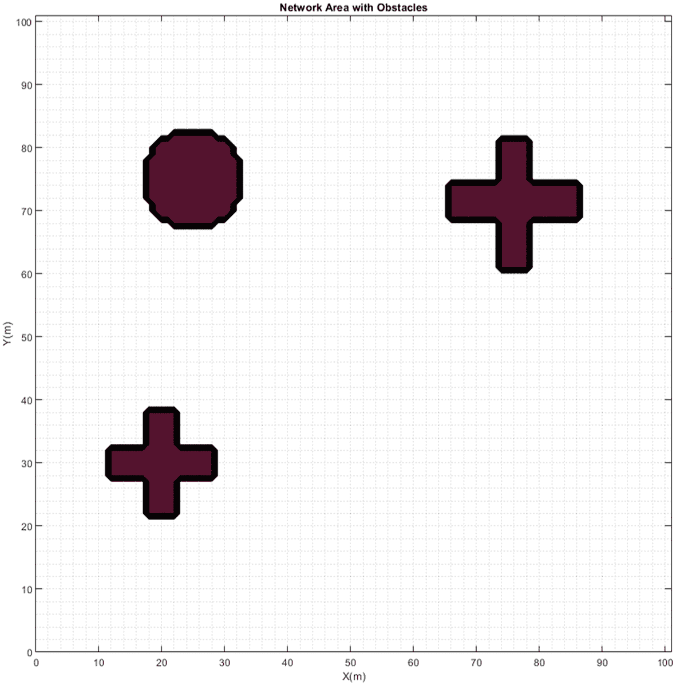

图 4.1 带有障碍物的网络区域示意图。自由像素（不包括障碍坐标）被视为需要传感器节点和设计空间覆盖的区域区域。

$$R_{c} = \frac{\sum_{h \in Mf \times Nf}p\left( {T,h} \right)}{Mf \times Nf} \times 100 \tag{4.11}$$

其中 `Mf × Nf` 是 `XY` 方向（二维）图中自由区域的坐标（像素），图中不包含障碍物区域的像素。这里，无线传感器网络（WSN）覆盖优化问题的适应度函数基于公式 (4.11) 的公式。

## 4.5 优化器的系统比较

### 4.5.1 仿真设置

在本研究中调查了六种不同的 WSN 覆盖优化问题，以比较不同的优化器，详见表 4.1。

表 4.1 优化器比较中采用六种不同问题

| **案例编号** | **传感器数量** | **优化器最大函数评估次数** |
| --- | --- | --- |
| 1 | 15 | 150 |
| 2 | 15 | 300 |
| 3 | 15 | 600 |
| 4 | 30 | 300 |
| 5 | 30 | 600 |
| 6 | 30 | 1,200 |

这些案例在传感器节点数量以及为每个优化器定制的最多函数评估次数上有所不同。在二维监控区域中，搜索代理的维度（设计变量数量）沿 `X` 方向和 `Y` 方向均是传感器节点数量的两倍。例如，具有 15 个传感节点的案例在第一、第二和第三种案例中涉及 30 个设计变量，在第四、五、六种案例中涉及 60 个变量。

为了确保在指定的函数评估次数内实现最优收敛，相应地调整了每个优化器的最大迭代次数。例如，在表 4.1 中，案例 1–6 初始根据函数评估次数设置的优化器最大迭代次数分别为 5、10、20、5、10 和 20。

在初始化阶段，所有传感节点的初始坐标设置为优化器的初始输入值，对应于初始种群规模。这些传感器节点随机分布在指定区域内，每个算法中的每个搜索代理代表一种传感器节点放置技术。

每个优化模型产生的结果包含两个关键方面：最优百分比覆盖率（衡量 WSN 有效覆盖监控区域的程度），以及部署在网络中每个传感节点的精确空间坐标。这些结果对于评估每个优化策略在增强 WSN 覆盖能力方面的性能和效果至关重要。仿真使用 `Matlab®/R2022b` 构建并模拟每个问题的优化模型。为了确保比较结果的稳健性，每个问题在六种不同案例中经过 10 次独立重复评估。

在这些实验中，监控区域尺寸为 100 × 100m，传感器的感知覆盖半径设置为 10m，网络区域被分为 10,000 个像素。然而，为了增加复杂性并进一步挑战优化器，网络区域内的某些像素被指定为障碍物，如图 4.1 所示。具体而言，有 1,636 个像素被阻塞，留下 8,362 个像素由监控和传感器节点坐标进行监控。

优化器的适应度函数基于 WSN 的百分比覆盖率，公式如式 (4.11)，其目标是最大化该适应度函数。该研究重点评估了四种优化器——`PSO`、`GWO`、`GA` 和 `DE` 在求解六个优化问题每一个时的性能。

### 4.5.2 结果与讨论

对于表 4.1 概述且在前节详细说明的每个特定案例，对所有四个优化器——`PSO`、`GWO`、`GA` 和 `DE` 进行了系统评估。每个优化器的任务是优化网络区域内传感器节点的放置，目标是将百分比覆盖率作为适应度函数最大化。获得的结果包括所有传感器的最优位置和相应的最优适应度函数值。

为了确保发现的可靠性，每个优化问题在相同条件下重复 10 次，以便对每个优化器的性能进行全面评估。评估标准包括三个关键指标：所有重复的平均适应度函数值（准确性）、重复之间适应度函数值的标准差（Std）（稳健性）以及每个优化器在所有重复中所需的总计算时间。

这种严谨的方法能够彻底分析每种元启发式算法在各种条件和问题复杂度下的表现。从每个案例获得的结果将在后续章节中经过仔细检查和讨论，以对每个优化器在解决 WSN 覆盖优化挑战方面的有效性和效率提供见解。

#### 案例 1

在第一个案例中，涉及优化 15 个传感器节点的放置，每个优化器带有 30 个对应于这些传感器坐标的设计变量运行。该场景的特点是分配给每个优化器的函数评估次数最少，具体为 150 次评估。因此，该案例中的优化配置为固定 5 次迭代，初始种群规模设置为 30。

此外，为 `PSO` 仔细选择了特定参数。速度限制因子、认知常数和社交常数均设置为 2。惯性权重在 0.4 到 0.9 之间动态变化，以确保探索与开发之间的平衡。

使用每个优化器 `PSO`、`GWO`、`GA` 和 `DE` 的优化过程分别进行了十次重复。根据获得的结果，不同优化器的十次重复的相关箱图、总耗时间和适应度函数表示（覆盖率）见图 4.2。

```
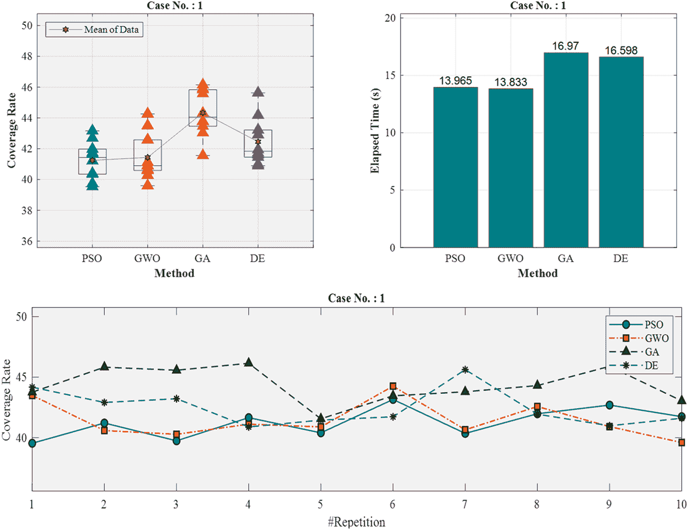
```

图 4.2 第一案例不同优化器十次重复的箱图、总耗时间和适应度函数表示（覆盖率）。

第一案例不同优化器的统计结果汇总在表 4.2。

表 4.2 各优化器在案例 1 WSN 覆盖问题中取得的统计结果

| **方法** | **平均值** | **标准差** | **最大值** | **最小值** | **耗时 (s)** |
| --- | --- | --- | --- | --- | --- |
| PSO | 41.24 | 1.22 | 43.16 | 39.54 | 13.97 |
| GWO | 41.44 | 1.50 | 44.26 | 39.60 | 13.83 |
| GA | 44.34 | 1.50 | 46.15 | 41.56 | 16.97 |
| DE | 42.45 | 1.53 | 45.62 | 40.89 | 16.60 |

从表中可以看出，`GA` 算法提供了更高的覆盖率，`DE` 紧随其后位第二。`GWO` 和 `PSO` 提供了竞争性的结果，位第四，以获得最佳适应度函数。然而，尽管 `GA` 的准确性更高，但与其他方案相比，在研究传感器节点最优坐标时该算法消耗了更多的计算时间。`GWO` 方法的运行比其他三种方法快一点。

#### 案例 2

在这种特殊情况下，我们通过在模型中考虑 15 个传感器节点的相同配置来保持一致性。与之前的场景相同，每个优化器都处理 30 个设计变量，并采用相同的初始种群设置。然而，在这一次中，我们将所有方法的最大迭代次数增加到 10 次，总共进行 300 次函数评估。所有优化器的其他参数与上一个案例保持不变，以确保公平比较。

优化过程使用每个优化器独立地严谨执行 10 次，以确保结果的稳健性和可靠性。对结果的详细分析，包括全面的箱线图、总耗时的详细表示，以及各种优化器在这些 10 次独立运行中实现的适应度函数（覆盖率）的图表描述，请参见图 4.3 并汇总在表 4.3 中。

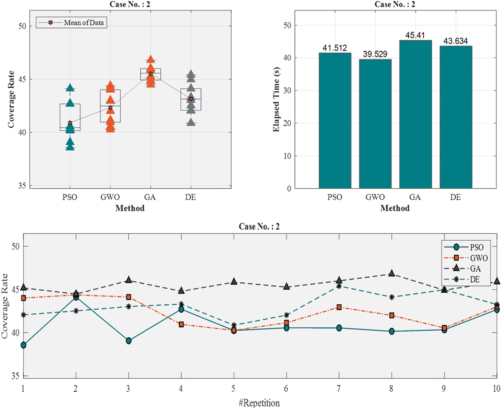

图 4.3 WSN 覆盖优化问题第二种情况下，不同优化器在 10 次独立重复的箱线图、总耗时以及所获适应度函数（覆盖率）的表示。

表 4.3 案例 2 WSN 覆盖优化问题中各种优化器实现的统计结果

| 方法 | 平均值 | 标准差 | 最大值 | 最小值 | 耗时 (s) |
| :--- | :--- | :--- | :--- | :--- | :--- |
| PSO | 40.90 | 1.74 | 44.12 | 38.57 | 41.51 |
| GWO | 42.34 | 1.56 | 44.38 | 40.27 | 39.53 |
| GA | 45.52 | 0.71 | 46.80 | 44.48 | 45.41 |
| DE | 43.16 | 1.39 | 45.41 | 40.86 | 43.63 |

仔细检查这些结果显而易见，所有优化器的性能与案例 1 相比仍保持一致的竞争力。尽管函数评估次数从上一个案例的 150 次显著增加到当前案例的 300 次，但观察到所有算法覆盖率的提高微乎其微，维持在 1% 左右。这些发现强调了 WSN 覆盖优化问题中计算量与可实现的优化收益之间微妙的平衡。

#### 案例 3

本案例考虑了相同数量的传感器节点（15 个传感器）；然而，所有优化器的允许函数评估次数达到了 600 次。与之前的两个案例相同，对优化程序进行了调整，并将最大迭代次数设置为 20 次。获得了使用四种优化器中的每一种进行 10 次独立重复的优化结果。相关结果如图 4.4 所示，统计结果描述在表 4.4 中。

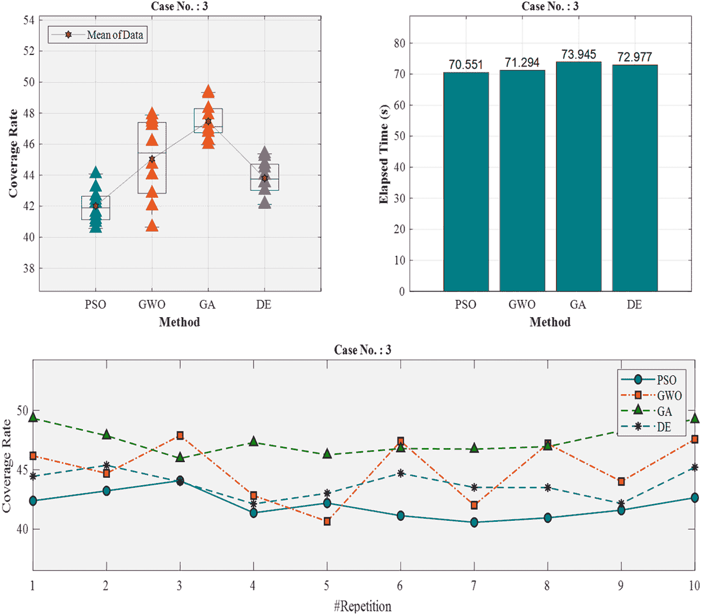

图 4.4 WSN 覆盖优化问题第三种情况下，不同优化器在 10 次独立重复的箱线图、总耗时以及所获适应度函数（覆盖率）的表示。

表 4.4 案例 3 WSN 覆盖优化问题中各种优化器实现的统计结果

| 方法 | 平均值 | 标准差 | 最大值 | 最小值 | 耗时 (s) |
| :--- | :--- | :--- | :--- | :--- | :--- |
| PSO | 42.01 | 1.10 | 44.08 | 40.56 | 70.55 |
| GWO | 45.04 | 2.59 | 47.88 | 40.65 | 71.29 |
| GA | 47.47 | 1.18 | 49.33 | 45.96 | 73.95 |
| DE | 43.80 | 1.16 | 45.37 | 42.12 | 72.98 |

从该表中可以看出，`GA` 优化器仍然提供了较高的覆盖率（最佳适应度函数），但耗时最长。次优性能属于 `GWO` 优化器，其次是 `DE` 和 `PSO`。`PSO` 可以以最小的计算耗时间获得最优解。

#### 案例 4


与之前的三个案例不同，第四到第六种场景涉及传感器节点数量增加到 30 个。因此，优化模型现在包含 2D 网络区域中的 60 个设计变量，对应所有传感器的坐标。每个优化器的初始种群大小相应地调整为 60 个个体。在这种案例中，最大迭代次数设置为 10 次，以适应总共 300 次函数评估。优化过程在 10 次独立运行中进行，结果如图 4.5 所示。

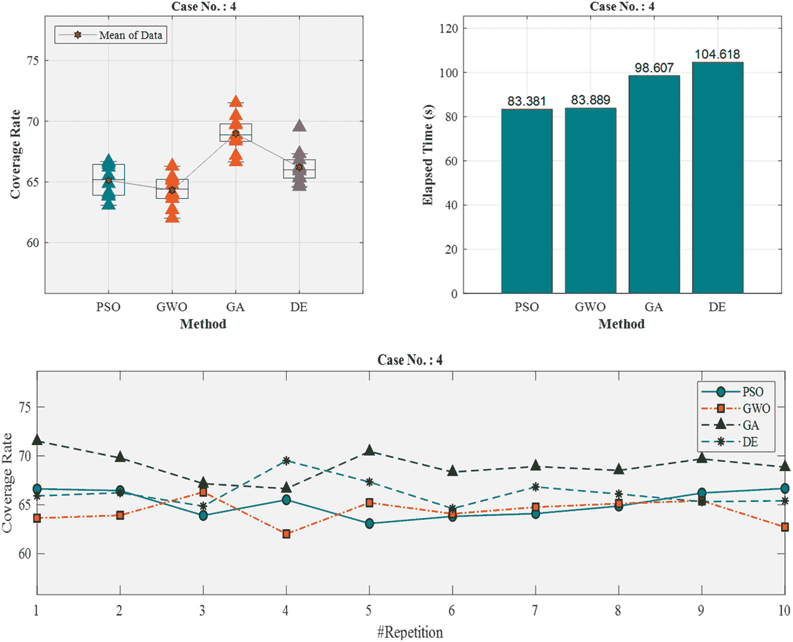

图 4.5 WSN 覆盖优化问题第四种情况下，不同优化器在 10 次独立重复的箱线图、总耗时以及所获适应度函数（覆盖率）的表示。此外，全面的统计分析呈现于表 4.5 中。

表 4.5 案例 4 WSN 覆盖优化中各种优化器实现的统计结果

| 方法 | 平均值 | 标准差 | 最大值 | 最小值 | 耗时 (s) |
| :--- | :--- | :--- | :--- | :--- | :--- |
| `PSO` | 65.12 | 1.34 | 66.67 | 63.08 | 83.38 |
| `GWO` | 64.32 | 1.30 | 66.30 | 62.02 | 83.89 |
| `GA` | 68.98 | 1.46 | 71.51 | 66.65 | 98.61 |
| `DE` | 66.21 | 1.43 | 69.50 | 64.61 | 104.62 |

值得注意的是，`GA` 通过获得更高的覆盖率（最佳适应度函数）展示了对其他方法的优越性。然而，由于与其他优化器相比标准差较高，`GA` 在重复执行中表现出较低的稳健性。关于优化耗时间，`DE` 证明较慢，而 `PSO` 和 `GWO` 收敛更快。

### 案例 5

与上一个问题相比，在本问题中，函数评估次数增加到 600 次。因此，我们将算法的最大迭代次数调整为 10 次。四种优化器中的每一种（例如 `PSO`、`GWO`、`GA` 和 `DE`）在优化过程十次迭代中均被独立使用。图 4.6 显示了相关的箱线图、总耗时以及各种优化器在 10 次不同重复中获取的适应度函数（覆盖率）。

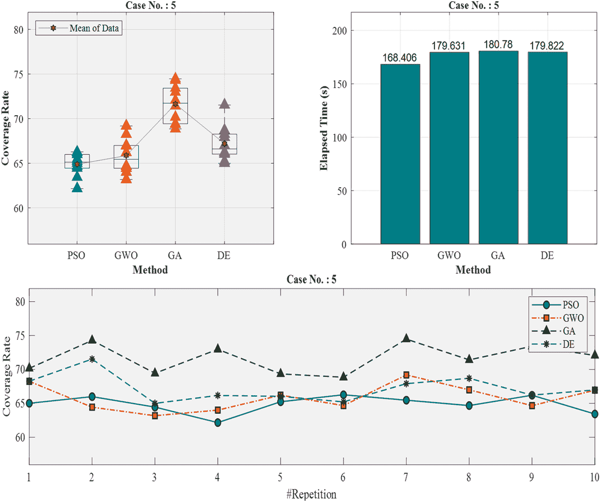

图 4.6 WSN 覆盖优化问题第五种情况下，不同优化器在 10 次独立重复的箱线图、总耗时以及所获适应度函数（覆盖率）的表示。表 4.6 也包含了从优化结果中获得的相关统计结果。

表 4.6 案例 5 WSN 覆盖优化问题中各种优化器实现的统计结果

| 方法 | 平均值 | 标准差 | 最大值 | 最小值 | 耗时 (s) |
| :--- | :--- | :--- | :--- | :--- | :--- |
| `PSO` | 64.89 | 1.29 | 66.26 | 62.16 | 168.41 |
| `GWO` | 65.85 | 1.97 | 69.18 | 63.18 | 179.63 |
| `GA` | 71.64 | 2.11 | 74.47 | 68.85 | 180.78 |
| `DE` | 67.20 | 1.97 | 71.53 | 65.00 | 179.82 |

正如预期，`GA` 的表现优于 `DE` 方法之后的其他替代方案，提供了更高的覆盖率（分别为 71.64% 和 67.20%）。然而，这两种方法在寻找最优解上花费的时间更长，而 `PSO` 显示出比其他三种方法更快的功能。

### 案例 6

最后一个案例允许所有四个优化器使用 1,200 次函数评估来研究具有 60 个设计变量的无线传感器网络（WSN）覆盖问题的最优解（涉及二维网络区域中 30 个传感器节点的坐标）。对于每个优化器，初始种群的大小调整为 60，最大迭代次数相应调整为 20 次。每个优化器单独重复 10 次，以检查该方法在当前案例中的可靠性。记录了所有优化结果。图 4.7 展示了每种元启发式算法在当前案例中最大化百分比覆盖率的结果。

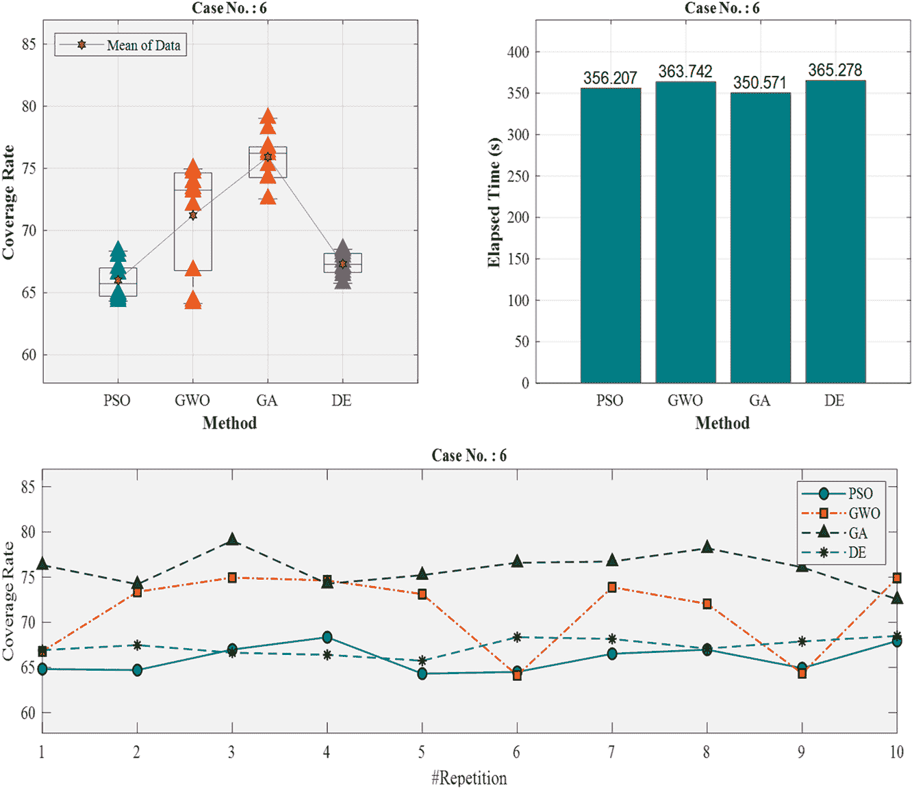

图 4.7 WSN 覆盖优化问题第六案例中，不同优化器在 10 次独立重复的箱线图、总耗时以及获得的适应度函数（覆盖率）的表示。

此外，统计结果在表 4.7 中。

表 4.7 各种优化器在案例 6 WSN 覆盖优化问题中实现的统计结果

| 方法 | 平均值 | 标准差 | 最大值 | 最小值 | 耗时 (s) |
| :--- | :--- | :--- | :--- | :--- | :--- |
| `PSO` | 66.00 | 1.52 | 68.34 | 64.31 | 356.21 |
| `GWO` | 71.22 | 4.37 | 74.95 | 64.14 | 363.74 |
| `GA` | 75.92 | 1.94 | 79.04 | 72.54 | 350.57 |
| `DE` | 67.31 | 0.91 | 68.49 | 65.75 | 365.28 |

很明显，`GA` 仍然优于其他替代方案并提供了更高的覆盖率，其次是 `GWO`。令人惊讶的是，在当前案例中，通过考虑比上一个案例多 10 次的迭代次数（20 次迭代），`GA` 的运行速度更快，耗时最短，优于包括 `PSO`、`GWO` 和 `DE` 在内的其他方法。

### 总体结果

图 4.8 中的图表显示了每个方法在每个案例中 10 次独立重复中获得的 15 个传感器节点最大覆盖率的最优位置分布。

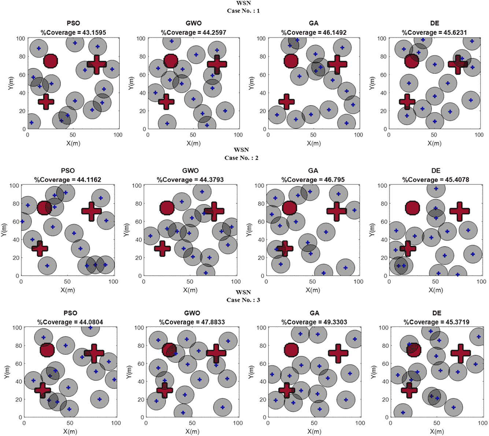

图 4.8 在具有 15 个传感器的第一、第二和第三案例中，使用在最高覆盖率重复（10 次独立重复中之）中获得的结果进行节点分布（最优传感器位置）比较。

相同的图表位于图 4.9 中，适用于 30 个传感器节点。

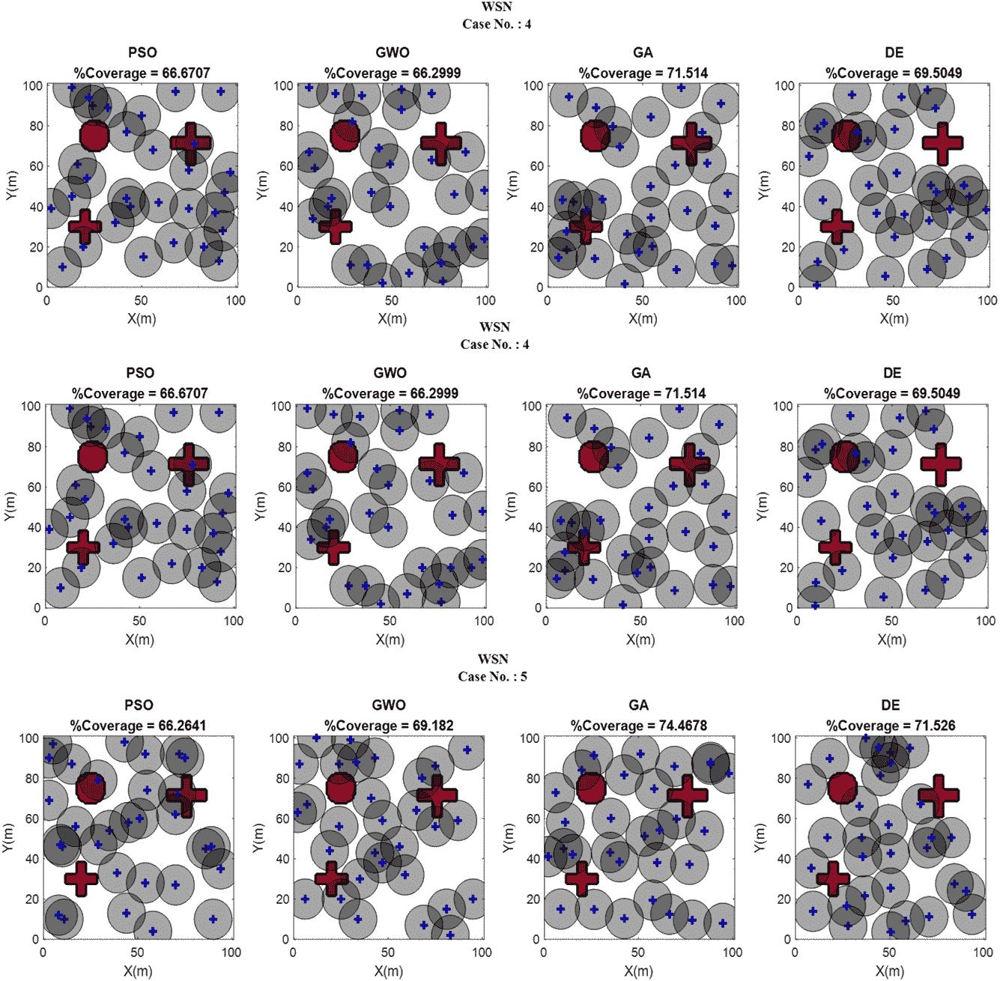

图 4.9 在具有 30 个传感器的第四、第五和第六案例中，使用在最高覆盖率重复（10 次独立重复中之）中获得的结果进行节点分布（最优传感器位置）比较。

此外，图 4.10 显示了每个优化器在 10 次独立重复中覆盖率（适应度函数）的总体概览和总耗时。

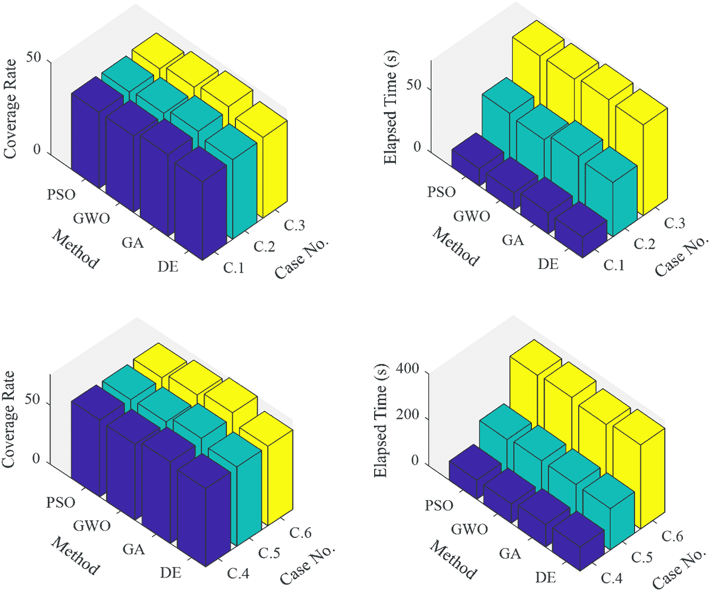

3. S. Meguerdichian, F. Koushanfar, M. Potkonjak, and M. B. Srivastava, 无线自构传感器网络中的覆盖问题，收于 IEEE INFOCOM 2001. 计算机通信会议。IEEE 计算机与通信学会第二十届年度联合会议 (Cat. No. `01CH37213`), 2001, 3, pp. 1380–1387.

4. A. Parnianifard 等, 混合元模型/元启发式算法辅助的多发射器布局规划，Computers, Materials & Continua, 68, (1), pp. 569–587, 2021.

5. X. Wang, H. Zhang, S. Fan, and H. Gu, 基于 `RPSO` 的物联网 传感器网络覆盖控制，IEEE Internet of Things Journal, 5, (5), pp. 3521–3532, 2018.

6. L. Baidar, A. Rahmoun, P. Lorenz, and M. Mihoubi, 分布式无线传感器网络优化问题的鲸鱼优化算法，ACM International Conference Proceeding Series, (May 2020), 2019.

7. A. Duttagupta, A. Bishnu, and I. Sengupta, 无线传感器网络中的最大破口：几何表征与算法，收于传感器系统、无线网络和分布式机器人算法与实验国际会议，2007, pp. 126–137.

8. A. Gogu, D. Nace, A. Dilo, and N. Mertnia, 无线传感器网络中的优化问题，收于 2011 复杂、智能和软件密集型系统国际会议，2011, pp. 302–309.

9. O. Zorlu 和 Ö. K. Şahıngöz, 用于异构 WSN 最大覆盖的演化算法节点布局，收于 2017 第 25 次信号处理与通信应用会议 (SIU), 2017, pp. 1–4.

10. A. Jauhri, J. D. Lohn, and D. S. Linden, 天线布局算法的比较，收于 GECCO 2014 – 2014 遗传与进化计算会议论文集，2014, pp. 1223–1230.

11. R. V Kulkarni 和 G. K. Venayagamoorthy, 无线传感器网络中的粒子群优化：简要调查，IEEE Transactions on Systems, Man, and Cybernetics, Part C (Applications and Reviews), 41, (2), pp. 262–267, 2010.

12. D. Whitley, 遗传算法教程，Statistics and Computing, 4, (2), pp. 65–85, 1994.

13. R. Eberhart 和 J. Kennedy, 粒子群优化，收于 IEEE 国际神经网络会议集，1995, 4, pp. 1942–1948.

14. M. Dorigo 和 M. Birattari, 蚂蚁优化算法。Springer, 2010.

15. S. Mirjalili, 蚁狮优化器，Advances in Engineering Software, 83, pp. 80–98, 2015.

16. M. Pant, H. Zaheer, L. Garcia-Hernandez, and A. Abraham, 差演化：二十余年的研究回顾，Engineering Applications of Artificial Intelligence, 90, p. 103479, 2020.

17. S. Mirjalili, S. M. Mirjalili, and A. Lewis, 灰狼优化器，Advances in Engineering Software, 69, pp. 46–61, 2014.

18. S. Afzal, 无线传感器网络定位技术综，Journal of Basic and Applied Scientific Research, 2, (8), pp. 7795–7801, 2012.

19. S. Kumar, R. Sharma, and E. R. Vans, 无线传感器网络定位：神经网络方法，International Journal of Computer Networks and Communications, 8, (1), pp. 61–71, 2016.

20. R. Rajakumar, J. Amudhav, P. Dhaval, and T. Vengaraman, `GWO-LPWSN`: 用于传感器网络节点定位问题的灰狼优化算法，Journal of Computer Networks and Communications, 2017, pp. 1–10.

21. S. Afzal 和 H. Beigy, 大规模移动传感器网络的定位算法：学习方法，Journal of Supercomputing, 69, (1), pp. 98–120, 2014.

22. X. Cheng, B. Narahari, R. Simha, and D. Liu, 无线网络中的强拓扑：NP-完全性与启发式算法，IEEE Transactions on Mobile Computing, 2, (3), pp. 248–256, 2003.

23. W. A, G. Mateus, and F. Quintao, 带移动节点的无线网络优化问题，收于国际优化会议，2007, pp. 1–6.

24. B. Yuan, M. Orlowska, and S. Sadiq, 无线网络中的最优路由问题，IEEE Transactions on Knowledge and Data Engineering, 19, (9), pp. 1252–1261, 2007.

25. W. Liu 和 Z. Fan, 基于混沌群算法的传感器网络覆盖优化，Journal of Computer Applications, 2, 2011.

26. N. A. B. Aziz, A. Mohemmed, and M. Y. Alias, 基于粒子群优化和泰森图的无线传感器网络覆盖算法，收于 2009 网络、感知与控制国际会议，2009, pp. 602–607.

27. H. G. Beyer 和 B. Sendhoff, 鲁棒优化——综述，Computer Methods in Applied Mechanics and Engineering, 196, (33), pp. 3190–3218, 2007.

28. A. Parnianifard, R. Chancharoen, G. Phanomchoeng, and L. Wuttisittulkij, 使用仿真实验进行低维约束设计的新方法，International Journal of Computational Intelligence Systems, 13, (1), pp. 1663–1678, 2020.

29. J. Stork 等, 模型辅助化的开放问题，收于 Bartz-Zielstein T., Filipič B., Korošec P., Talbi EG (编) 高性能仿真优化。Studies in Computational Intelligence, 833, Springer, Cham, 2020, pp. 225–244.

30. N. Bartoli 等, 用于气动翼设计的约束全局优化适应建模策略，Aerospace Science and Technology, 90, (April), pp. 85–102, 2019.

31. A. Parnianifard 和 A. S. Azfanizam, 基于元模型的多环整数和分数阶 PID 控制器鲁棒仿真优化辅助设计，International Journal of Numerical Modelling: Electronic Networks, Devices and Fields, 33, (1), p. e2679, 2020.

32. A. Parnianifard, M. Fakhfakh, M. Kotti, A. Zemouche, and L. Wuttisittikulkij, 随机整数和分数阶 PID 控制系统的鲁棒调优与敏感性分析：基于代理模型的鲁棒仿真优化，International Journal of Numerical Modelling: Electronic Networks, Devices and Fields, 34, (2), p. e2835, 2020.

33. A. Parnianifard, A. S. Azfanizam, M. K. A. Ariffin, and M. I. S. Ismail, 不确定性直流电机直接速控制中的 Kriging 辅助鲁棒黑盒仿真优化，IEEE Transactions on Magnetics, 54, (7), pp. 1–10, 2018.

34. F. A. C. Viana, T. W. Simpson, V. Balabanov, and V. Toropov, 多学科设计优化中的元建模：我们到底进展到哪里了？AIAA Journal, 52, (4), pp. 670–690, 2014.

35. A. Mohammad Nezhad 和 H. Mahlooji, 用于约束仿真优化的神经网络元模型，Journal of the Operational Research Society, 65, (8), pp. 1232–1244, 2013.

36. A. Parnianifard, S. Chaudhary, S. Mumtaz, L. Wuttisittikulkij, and M. A. Imran, 使用改进多项回归进行基于代理模型的工程差快速量化，Structural and Multidisciplinary Optimization, 66, (3), p. 61, 2023.

37. E. Bonabeau, D. de R. D. F. Marco, M. Dorigo, and G. Theraulaz, 群体智能：从自然到人工系统，(1). Oxford University Press, 1999.

38. A. Parnianifard, A. S. Azfanizam, M. K. A. Ariffin, and M. I. S. Ismail, 鲁棒设计混合元建模概述：不确定性过程优化的先进方法，International Journal of Industrial Engineering Computations, 9, (1), pp. 1–32, 2018.

39. A. Parnianifard, A. Azfanizam, M. Ariffin, M. Ismail, and N. Ebrahim, 基于元模型的鲁棒性黑盒仿真优化的最新进展：概述，Decision Science Letters, 8, (1), pp. 17–44, 2019.


# 参考文献

40. A. Parnianifard, V. Rezaie, S. Chaudhary, M. A. Imran, and L. Wuttisittikulkij, 一种新型自适应代理模型结合群优化器的方法以降低动态生产-库存控制系统的调节成本，IEEE Access, 9, pp. 144054–144066, 2021.

41. A. Parnianifard, A. Zemouche, R. Chancharoen, M. A. Imran, and L. Wuttisittikulkij, 信息物理系统中五连杆机器人 FOPID 控制器的鲁棒优化设计：一种新的仿真-优化方法，PloS One, 15, (11), p. e0242613, Nov. 2020.

42. A. Parnianifard, A. S. Azfanizam, M. K. A. Ariffin, and M. I. S. Ismail, 交叉加权不确定场景辅助的无分布元模型鲁棒仿真优化，Engineering with Computers, 36, (1), pp. 139–150, 2019.

43. A. Parnianifard, A. S. Azfanizam, M. K. A. Ariffin, and M. I. S. Ismail, 不确定性下高成本及半成本仿真模型的元建模与采样设计比较研究，Simulation, 96, (1), pp. 89–110, May 2019.

44. S. Wang, X. Yang, X. Wang, and Z. Qian, 一种虚拟力算法-Lévy 嵌入灰狼优化算法用于无线传感器网络覆盖优化，Sensors (Switzerland*), 19, (12), p. 2735, 2019.

45. H. Faris, I. Aljarah, M. A. Al-Betar, and S. Mirjalili, 灰狼优化器：近期变体与应用的综述，Neural Computing and Applications, 30, (2), pp. 413–435, 2018.

46. X. Wang, H. Gu, Y. Liu, and H. Zhang, 一种两阶段 RPSO-ACS 协议：移动计算中传感器网络聚类与路由的新方法，IEEE Access, 7, pp. 113141–113150, 2019.

47. D. Wang, H. Wang, X. Ban, X. Qian, and J. Ni, 一种移动无线传感器网络的自适应离散空间定向狼群优化算法，Sensors, 19, (19), p. 4320, 2019.

48. A. Adulyasas, Z. Sun, and N. Wang, 无线传感器网络连接覆盖调度优化，IEEE Sensors Journal, 15, (7), pp. 3877–3892, 2015.

49. S. Wang, X. Yang, X. Wang, and Z. Qian, 一种虚拟力算法-Lévy 嵌入灰狼优化算法用于无线传感器网络覆盖优化，Sensors, 19, (12), p. 2735, 2019.

50. R. Song, Z. Xu, and Y. Liu, 基于果蝇算法的无线传感器网络覆盖优化，International Journal of Online Engineering, 14, (6), pp. 58–70, 2018.

51. W.-H. Liao, Y. Kao, and R.-T. Wu, 基于蚁群优化的无线传感器网络部署协议，Expert Systems with Applications, 38, (6), pp. 6599–6605, 2011.

52. A. A. Ari 等 al.* 无线传感器网络感知的细菌觅食优化方案，International Journal of Wireless Networks, 24, (3), pp. 254–267, 2017.

53. I. Vilovic, N. Burum, and Z. Sipus, 基站位置优化的蚁群方法，2009 3rd European Conference on Antennas and Propagation, 2009, pp. 2882–2886.

54. C. K. Ting, C. N. Lee, H. C. Chang, and J. S. Wu, 使用多目标变长遗传算法的无线异构发射器布局，IEEE Transactions on Systems, Man, and Cybernetics, Part B (Cybernetics*), 39, (4), pp. 945–958, 2009.

55. R. L. Haupt and D. H. Werner, 电磁学中的遗传算法。John Wiley & Sons, 2007.

56. Z. Yangyang, J. Chunlin, Y. Ping, L. Manlin, W. Chaojin, and W. Guangxing, 移动通信中基站选址的粒子群优化，IEEE International Conference on Networking, Sensing and Control, 2004, 1, pp. 428–432.

57. Z. Miao, X. Yuan, F. Zhou, X. Qiu, Y. Song, and K. Chen, 增强层次的灰狼优化器及其在无线传感器网络覆盖问题的应用，Applied Soft Computing, 96, (August), p. 106602, 2020.

58. J. J. Grefenstette, 遗传算法与机器学习，第六届计算学习理论年会会议，1993, pp. 3–4.

59. S. Mirjalili and S. Mirjalili, 遗传算法，Mirjalili S. (编) 进化算法与神经网络：理论与应用，Springer, Cham, pp. 43–55, 2019.

60. R. Storn, 差分进化算法在函数优化中的应用，北美模糊处理会议集，1996, pp. 519–523.

61. Bilal, M., H. Garcia-Hernandez, and A. Abraham, 差分进化：二十年研究的综述，Engineering Applications of Artificial Intelligence, 90, (January), p. 103479, 2020.

62. K. V Price, 差分进化，Zelinka I., Snǎel V., Abraham A. 优化手册：从经典到现代方法，Springer, Berlin, pp. 187–214, 2013.

# 第 5 章 通信系统中的机器学习基础

Shivani Sharma and Avani Vyas

DOI: [10.1201/978103472506-5](https://doi.org/10.1201/978103472506-5)

## 5.1 引言

新应用、服务和设备对安全性、可用性和性能的需求正以超出最初预期的速度增长。实时响应在电子医疗、交通管理和工业运营等应用领域至关重要，这要求通信网络能够自主做出实时决策。然而，传统的通信网络历史上一直遵循不同的轨迹，依赖于人工对流量波动、网络功能更新、安全事件和故障等因素的响应。这种对人机交互的依赖导致了网络停机、安全漏洞的增加以及诸多挑战。

机器学习（`ML`）系统广义可分为几类，包括监督学习、无监督学习、半监督学习和强化学习。在监督学习中，系统根据标记的训练数据预测输出数据，而无监督学习则侧重于识别输入数据中的模式和关联。半监督学习涉及结合已标记和未标记的输入数据进行训练，旨在对未标注数据标记或为新输入数据预测输出。在强化学习中，系统学习采取能够使累积奖励最大化的行动。

这些机器学习技术赋予了系统智能，能够根据可用信息增强其性能。在通信网络背景下，整合机器学习学科、技术和方法变得至关重要。这种整合有助于降低与人工控制相关的风险，使网络能够自主自适应、自控并对动态条件做出响应。

机器学习还可能有助于提高认知无线电在频谱共享中的性能，并优化异构接入网络中的资源。新兴技术如软件定义网络（`SDN`）、网络函数虚拟化（`NFV`）和多接入边缘计算（`MEC`）提供了动态网络操作，但也带来了挑战，例如网络中潜在的瓶颈。研究 `ML` 如何适应这些环境至关重要，而 `ML` 是一个极具前景的候选方案。

## 5.2 用于物理层的机器学习

物理层通常表示为 `Layer 1`，代表通信的基础层。在该层开发 `ML` 确保了传输的可靠性。在本节中，将讨论关键的 `ML` 应用。

### 5.2.1 神经网络在数字失真中的应用

数字系统中的非线性失真特别是高功率放大器（`HPAs`）带来了巨大挑战。数字预失真（`DPD`）是一种缓解这些影响的技术。使用人工神经网络（`ANNs`）对这些非线性进行建模是一种有效的方法。在通信系统中使用 `ANNs` 可以实现自滤波和干扰消除。

数字系统中 `ANNs` 的性能通常与传统方法相比，后者可能缺乏适应动态环境所需的灵活性。在物理层集成 `ML` 对于实现高性能至关重要。

### 5.2.2 学习解码

信道编码是用于管理噪声信道错误的策略。使用 `ANNs` 进行解码在提高纠错率方面显示出前景。解码算法中的 `ML` 学习能够更好地适应各种信道条件。

解码中 `ANNs` 的架构涉及各种结构，例如卷积神经网络（`CNN`）和循环神经网络（`RNN`）。这些模型可用于学习数据流中的复杂模式。`ML` 在解码中的应用是一个不断增长的研究领域，具有显著增强通信可靠性的潜力。

`ANN`（神经网络）被用于预测波束赋形权重。这种神经波束赋形器利用 `ANN` 微调相控阵列的角度，确保来自不同天线的发射信号能够精确地收敛到目标用户的方向。径向基函数人工神经网络（`RBF ANN`）的概念由 Southall 等人进行了扩展 [8]。在这项工作中，作者采用了一种通过梯度下降算法训练的自适应 `RBF ANN`，以及一种基于线性代数并使用 `LMS` 误差解的网络。尽管 `ANN` 波束赋形器展现了高性能，但在面对遭受近场散射条件的数据时，仍面临挑战。

Lovato 和 Gong [9] 引入了一种用于实现天线阵列波束赋形的新 `ANN` 结构。该 `ANN` 包含两个隐藏层，第一层被分为与输入数量相等的子层。这些子层与第二个隐藏层全连接。该 `ANN` 使用来自最小方差无真响应（`MVDR`）波束赋形的数据进行训练。所提出的 `ANN` 结构在波束赋形性能方面超越了传统的 `ANN` 结构。

## 5.3 用于介质接入层的机器学习

在无线网络中，频谱是有限资源，需要一种稳健的介质接入（`MAC`）协议来促进多个用户的信道接入。其目标是最大化频谱利用并确保服务质量（`QoS`）。随着连接设备数量的不断增加，优化领域随着参数的增加和严格的 `QoS` 要求而扩大，`MAC` 协议预计面临前所未有的复杂性。`MAC` 协议的复杂性取决于网络架构、通信模型和双工机制（例如时分双工 `TDD`、频分双工 `FDD` 和全双工）。无线网络的不断演进引入了灵活双工、自适应帧结构体系以及异构无线网络与多接口无线设备的收敛等新技术组件，进一步增加了 `MAC` 任务的复杂性。

将其视为具有多种 `QoS` 约束的大规模控制问题，使用基于规则的传统算法优化 `MAC` 是次优的。目前的 `MAC` 无线资源分配算法通常采用优化方法，通过做出假设来简化非凸问题，但由于复杂性阻碍了对完整非凸问题的求解，导致了次优解。

此外，无线网络通过对用户设备和网络实体的持续测量，以无线和系统数据的形式产生大量数据。然而，现有的 `MAC` 协议未能充分利用这些数据，由于老化和用户移动性，这些数据被认为具有时效性和局部性。机器学习（`ML`）和无线网络的演进提供了从多个维度利用此类数据的机会，创建出在动态环境中更稳健、更自主的数据驱动型无线网络。本节全面概述了未来无线网络将 `ML` 算法集成到 `MAC` 协议设计中产生的潜在研究方向及相关挑战。

### 5.3.1 干扰预测

多个设备在共享的空气介质中以同一频率传输信号，会干扰信号接收，这种现象被称为“干扰”。尽管在使用干扰对齐等方法对无线网络中的干扰动态学建模方面取得了进展 [10]，但研究人员一直难以开发出能够充分利用干扰知识来增强通信 `QoS` 的算法。

干扰对齐的基本概念涉及协调多个发射器以对齐接收处的相互干扰。然而，目前正在探索机器学习的集成，例如使用自回归（`AR`）模型（根据过去状态预测下一个状态）来增强干扰对齐算法的性能 [11]。利用干扰信息的关键挑战在于由于移动性导致其具有随机性和短时间的有效性。此外，在多个干扰源中识别干扰的的确切源头，加上每个时间点干扰源的随机性，进一步增加了问题的复杂性。

### 5.3.2 用户移动性与关联

许多研究人员深入研究利用机器学习（`ML`）技术进行定位，旨在通过使用相位信息训练算法，并通过 `ML` 使用相位指纹法估计到达角来提高算法准确性 [12–15]。在 Ezpeleta 等人 [12] 中，一种基于 `KNN` 的室内定位算法利用历史数据来估计移动用户的位置。同样，该算法提出了一种基于深度神经网络（`DNN`）的定位估计算法。该算法采用堆叠去噪自编码器（`SDA`）和隐藏马尔可夫模型（`HMM`）来最小化特征集，在不损害信息内容的情况下平滑原始位置。

Zhang 等人 [13] 结合支持向量机（`SVM`）和 `ANN`，根据接收信号强度指示（`RSSI`）估计用户位置。然而，这项工作的重点是边界定位而非精确的用户位置。在 Berruet 等人 [15] 中，引入了一种基于信道频率响应（`CFR`）的室内定位指纹技术。同样，还提出了另一种方案，即基于 `RSSI` 的深度长短期记忆（`LF-DLSTM`）室内定位方法，减少噪声影响以提高定位精度。

然而，许多提出的定位算法存在一个普遍问题，无论是基于 `ML` 技术还是基于 `OTDOA`、`UTDOA`、`RSSI` 和 `Cell-ID` 等传统方法，都依赖于单值估计（`SVEs`），如相位信息、到达角或 `RSSI`。定位估计严重取决于这些 `SVEs` 的质量，而在无线环境中，由于多径和非视距（`NLOS`）等因素，这些质量会下降或表现出高度随机性。为了充分利用学习技术在用户移动性和定位方面的潜力，一个值得探索的途径是通过 5G 与摄像头、设备对设备（`D2D`）链路、`GPS` 等其他数据的融合进行协作定位。此外，由于通信和定位目标经常重叠，联合优化代表了一个充满前景的方向。

### 5.3.3 无线资源调度

机器学习（`ML`）算法为解决无线网络中的异步流量适应提供了创新解决方案，特别是通过增强 5G 网络的灵活双工能力——这是一种基于上下行流量需求优化资源的有前景的技术 [16]。灵活双工旨在考虑非对称上下行流量的情况下实现自适应资源分配，在时频域进行优化并模糊 `TDD` 和 `FDD` 之间的区别，甚至完全消除它们。在 Malik 等人 [17] 中，作者引入了基于灵活双工的无线资源分配，以减轻小区间干扰。

为了充分利用灵活双工的潜力并自适应优化资源，预测或学习网络流量行为变得至关重要。许多研究人员探索了使用线性模型进行流量预测，例如自回归模型（`AR`）、自回归移动平均模型（`ARMA`）和移动平均模型（`MA`）[18,19]，并在小规模稀疏网络中取得了成功。然而，考虑到无线网络不断演变的特性，许多非线性因素（如多依赖性和突发性）会显著影响性能。因此，近期的工作重点集中在基于机器学习的模型，涉及神经网络（`ANN`）、支持向量机（`SVM`）、最小二乘支持向量机（`LSSVM`）、长短期记忆（`LSTM`）等[20]。这些模型从历史流量数据中学习以理解随机性并改进流量预测。在 Zhao 等人[20]的研究中，`2D-LSTM`模型实现了自优化和用于容错的智能响应，展示了机器学习技术为异构网络（`HetNets`）提供必要的自-X 特性的能力。

此外，未来的无线系统（如 `NB-IoT` 和 `LTE-M`）由于半双工频分双工（`HD-FDD`），预计将采用上下行的对称频率分配。然而，考虑到流量的非对称性，这种对称分配会导致频谱资源利用不足。机器学习技术可以智能地应对此类挑战，特别是在物联网网络中，预计上行数据流量高于下行，这可能避免资源浪费。同样，在以下行流量为主的宽带通信中，机器学习技术可以提供智能解决方案，无缝集成环境参数并实现主动 `MAC` 功能，从而脱离传统的响应式方法。

## 5.4 网络层中的机器学习

在网络研究领域，网络层通过计算跨越网络的路由来编排端到端数据包传输发挥着至关重要的作用[21]。随着通信实体的格局变得日益复杂多样，网络需要在最少的人为干预下自主配置路由节点迫在眉睫。这种配置涉及调整网络设备（如路由器和交换机）的行为，以促进来自各种应用程序的流量无缝传输。然而，这种增加的复杂性引入了一系列挑战。

传统的网络流量控制系统通常依赖僵化的、预定义的策略，使得网络对动态环境的适应性降低，并容易停滞。这种局面在无线网络中尤为明显，因为流量模式和数量的突发变化非常常见。因此，迫切需要新的机制来确保弹性且最优的端到端数据包传输。在网络研究领域，机器学习（`ML`）已成为解决和克服网络配置和流量控制中挑战的最有效机制之一。

### 5.4.1 网络流量控制

有效控制网络流量对于优化整体性能至关重要，无论是在固定网络[22]、无线网络[23,24]还是虚拟网络[25]中。网络流量工程通过在多路径之间分配负载在减少拥塞和提高利用率方面起着关键作用。通过这种方式，通信网络能够在链路或路由器故障的情况下在两点之间优化地传输数据。然而，当今网络独立执行故障恢复和流量工程的主流方法往往导致复杂且妥协的流量控制系统[26]。新型服务和设备的演变格局需要自动化的网络流量控制系统，促使了基于机器学习的高效应用。


# 深度学习在网络流量控制中的应用

深度学习（DL）已被用于智能流量控制，正如 Fadlullah 等人[27]所示，作者概述了与网络流量控制系统相关的先进深度学习架构和算法。网络流量控制系统的核心功能是在两个实体之间高效地路由数据包。传统的路由协议由于缺乏智能性，无法从过去的事件中学习以做出自主决策[28]。因此，目前正发生着转变，将依赖人类专家算法见解的传统网络协议替换为数据驱动、预测性或基于机器学习的方法。流量引导是另一个利用机器学习技术的途径，可以避免网络中的拥塞路径或在现有的替代路径之间最大化服务质量（QoS），例如 Adachi 等人通过 `Q-learning` [29] 所示。图 5.2 展示了一个使用机器学习的简单网络流量控制系统，其中流量模式被用于训练系统以获得最优路由路径。

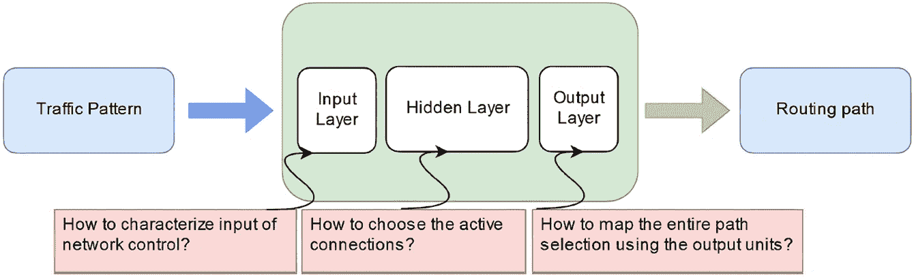

图 5.2 网络流量控制的通用学习方法。

后续章节将深入探讨针对不同网络架构和网络技术的机器学习辅助路由协议。

## 5.4.2 路由

Valadarsky 等人[30]探索了机器学习在路由中的应用。这项工作的重点是评估是否可以有效利用机器学习自动生成最优路由配置。该研究在域内流量工程[31]的背景下作为一个案例研究。它深入探讨了单个自管理网络内部机器学习引导的路由优化，特别关注了 (i) 将路由建模为机器学习问题，以及 (ii) 识别学习领域内输入和输出的表示。作者得出结论，数据驱动路由或基于机器学习的路由在增强网络性能方面具有巨大潜力，但如果应用不当，也会带来显著挑战。这些挑战与网络开销和延迟有关，特别是当没有仔细选择适当的技术和学习参数时。

Salani 等人[32]证明了机器学习在提高光网络传输质量方面的有效性。所提出的路由和频谱分配集成方法利用了基于机器学习的传输质量的概率输出。这种方法节省了高达 30% 的频谱，并减少了超过误比特率阈值的风险光路径数量。

在流量预测领域，Musumeci 等人[33]探索了利用历史数据和用户配置的监督学习机制。这些机制在预测未来流量需求相应的资源需求方面证明是有效的。

## 5.4.3 动态（AD-HOC）网络中的路由

在 Sharma 等人 [34]中，提出了一种基于机器学习（ML）的自组织网络高效路由协议。该路由协议通过集成 ML 技术，根据跳数计数、缓冲区容量、节点能量、节点移动速度、节点流行度以及成功传输次数等多种因素进行自训练，增强了 `PROPHET+` 协议 [35]的性能。该 ML 算法利用过去的路由数据来评估节点向目标目的地投送消息的能力。该研究采用了两种 ML 模型——`ANN` 和决策树（`DTs`）来计算消息正确传输的概率。所提出的协议在提高传输概率的同时，最小化了平均延迟、开销和对缓冲区大小的需求。

同样，在 Zhi-yuan 等人 [36]中，利用小波神经网络预测模型实现无线网格网络的多路径路由，展示了其对链路故障和拥塞更强的适应性和鲁棒性。然而，正如 Kato 等人 [37]所讨论的，传统的 ML 技术（如 `ANNs`）在用于路由时在可扩展性和计算效率方面存在局限性。因此，在数据平面或路由设备上通过 ML 引入额外的资源限制，可能会加剧现有的拥塞和延迟挑战。在采用基于 ML 的路由技术之前，评估其成本与收益至关重要。

## 5.5 用于边缘计算的 ML

移动和物联网（IoT）服务的流行架构由三层结构组成，包括本地用户接口、传感器数据采集以及边缘执行，而服务和应用逻辑则集中在位于云和设备之间的数据中心。这种三层模型具有许多优势，例如本地层面的资源效率和全局服务的可用性。然而，边缘范式面临着来自两个显著趋势的巨大挑战：传感器和用户生成数据的快速增长，以及现代应用（包括增强现实和虚拟现实）对实时性的需求 [38]。

目前的集中化云架构在满足此类数据密集型和实时应用及服务的性能与扩展性需求方面已表现出不足 [38,39]。这一认识引发了人们在终端用户/物联网设备与云架构之间建立智能边缘的增长兴趣。这种智能边缘旨在解决应用和服务的不断变化的需求，特别是在数据量激增和对实时处理及响应能力要求提高的背景下。ML 在优化边缘和雾网系统的运行以及为移动应用提供服务方面发挥着双重作用。在雾网层面，ML 可作为优化各种应用功能放置的工具，对如何跨本地、边缘和云/数据中心层分配计算任务做出决策。雾网级优化的示例包括确定计算任务的划分。在边缘层面，ML 用于预测工作负载的变化、编排和启动边缘计算资源，以及在考虑边缘节点工作负载和用户跨越边缘平台移动性等因素的情况下，做出应用卸载的决策。

图 5.3 直观地展示了 ML 在优化边缘/雾网系统运行和为移动应用提供服务的双重作用。

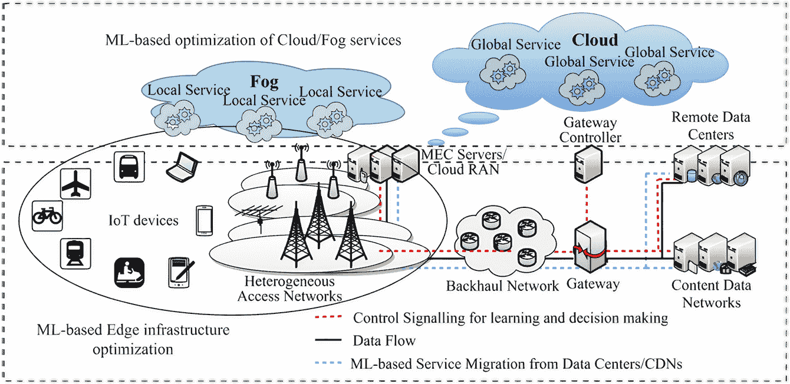

图 5.3 用于服务和基础设施优化的 ML 与边缘。

在第二个作用中，ML 从底层的边缘/雾网平台获取输入以增强其运行。在无线网络上考虑延迟和可靠性等因素的情况下，在边缘进行 ML 训练提供了新的研究方向。基于边缘/雾网平台的行为和工作负载信息的 ML 优化具有许多优势，例如能够预测与时空约束和用户移动性相关的工作负载变化。

### 5.5.1 基于 ML 的云/雾网服务优化

在 Aryal 和 Altmann [40]中，引入了一种利用遗传算法的智能资源分配算法，用于边缘和云资源的优化分布。所提出的算法通过将云提供资源与特定的应用需求相匹配来提供解决方案。评估表明，该算法在实现云提供资源的帕累托最优匹配方面是有效的，并且可以根据需求进行定制。作者强调了未来的方向，特别是提供者资源排名和预测应用用户行为的重要性。然而，挑战在于针对多个应用提供者和运营者的多目标资源优化利用。每个应用的独特优化目标，加上资源的异构性，增加了实现应用最优资源分配的复杂性。

在 Calo 等人 [41]中，提出了一种在云端组合分析功能并部署到边缘使用的架构。该架构促进了数据流处理的受控分布，密集且结构良好的处理在边缘进行。作者识别了边缘计算（EC）的主要优点是减少延迟、减少数据移动和保护本地数据隐私。研究探索了观察者和控制器组件之间的功能划分，并确定了高效组合分布式协作分析应用所需的系统工具。其总体目标是通过生成策略模型支持协作自主系统。

提案和方法解决了 MEC 平台和基于 MEC 网络中的任务和资源优化问题。在 Wang 等人 [42]中，引入了一种多栈强化学习算法用于 MEC，以优化用户的任务或资源分配。所提出的算法增强了收敛速度和学习效率。

### 5.5.2 基于 ML 的边缘基础设施优化

研究了在复杂设备和服务配置参数日益增加的情况下，如何利用 ML 高效利用 MEC 资源。Rodrigues 等人 [43]的工作也识别了与 MEC 相关的计算和通信挑战，这些挑战可以通过各种 ML 解决方案解决。Wu 等人 [44]提出并评估了基于 ML 的边缘与集中云资源之间的协作，而 Nduwayezu 等人 [45]则利用深度强化学习（DRL）增强非正交多接入的在线计算卸载。

若干项提案侧重于通过机器学习（ML）干预来实现 MEC 中的特定技术。例如，Cao 等人 [46] 和 Cui 等人 [47] 分别在 MEC 中使用多智能体强化学习（RL）进行协作缓存和任务卸载。很少有针对边缘端深度强化学习（DRL）的机器类通信能效任务卸载的研究。此外，一些研究利用深度神经网络（DNN）来最小化 5G MEC 中的每比特能耗，通过开发真实系统的数字孪生并在其中训练深度学习（DL）系统来提高用户的能量效率。同样，Cui 等人 [48] 提出了 MEC 的随机在线学习，旨在最小化 MEC 的时间平均运行成本。Subramanya 等人 [49] 关注 MEC 中基于 ML 的服务功能链放置和缩放，但目前 MEC 中仍需要基于 AI 或 ML 的卸载技术，并对该方向的前沿研究进行综述。

### 5.5.3 基于边缘的 ML 优化

联邦学习（FL）成为边缘 ML 训练架构的一种引人注目的方法，Chen 等人 [50] 和 Shlezinger 等人 [51] 已讨论。FL 允许计算节点协作学习共享预测模型，同时保持训练数据在各个设备本地化。在 McMahan 等人 [52] 中，提出了一种基于迭代模型平均的深度网络联邦学习方法，证明了其对不平衡和非独立同分布（non-IID）数据分布的鲁棒性。通信成本被认为是主要限制，但实验表明 FL 在约束环境中是可行的，与同步随机梯度下降相比，它可以用较少的通信轮次训练出高质量模型。作者强调了 FL 的实际隐私优势，包括通过差分隐私、安全多方计算及其结合提供更强的保障。他们认为 FL 是未来研究的一个非常有前景的途径。

Chen 等人 [50] 引入了一个在无线网络中实现 FL 算法的框架，优化了蜂窝基站与无线用户之间的协作，以解决无线网络固有的挑战。Chen 等人 [53] 和 [54] 探索了 FL 中的收敛时间优化，重点是在资源受限的蜂窝无线环境中在增强 FL 性能的同时最小化收敛时间。

在 Konecný 等人 [55] 中，研究了利用本地训练数据优化 ML 预测模型的 FL。作者提出了一种稀疏凸问题的新算法，证明了在任何阶段都不离开源节点的情况下利用本地训练数据设计高效算法的可能性。这项工作为未来的研究方向奠定了基础，包括开发所提算法的完全异步版本以及更深入的理论理解。

此外，Lim 等人 [56] 进行了关于在 MEC 平台上使用 FL 的综述。文章探讨了 FL 在 MEC 中的背景、实现挑战，并概述了未来的研究方向。

## 5.6 未来研究方向

在这里，我们讨论了几个需要重大贡献的重要研究领域：

1. **物理层 ML 的未来**：ML 的应用对于增强物理层具有巨大的前景。然而，仍需要解决若干固有的挑战。其中一个挑战涉及对基准测试和数据集的必要性；尽管如此，目前缺乏特定于物理层的此类基准。需要进一步探索如何将 ML 学科（特别是深度学习 `DL`）应用于物理层，从不同视角解决问题。此外，将物理层的智能化与网络较高层相结合，有望创建一个多功能且智能的整体网络。通过 ML 技术对跨层智能的探索仍旧不足，为未来的研究提供了一个引人入胜的途径。

2. **介质访问层 ML 的未来**：虽然通过集成学习技术在主动 MAC 算法方面已取得进展，但仍迫切需要探索并制定更稳健、更严格的解决方案，以解决干扰预测、资源分配、功率优化和移动性预测等挑战。进一步的研究方向包括授权频谱与非授权频谱的融合，以及频谱可用性的利用。

3. **网络层 ML 的未来**：除了网络控制与数据转发面的分离外，ML 的应用还有至关重要的考量。具体而言，大量研究探索了将 ML 集成到移动自组织网络（MANETs）的路由协议中。此外，这些算法的安全性构成了重大挑战。在分布式系统中，零散设备发布的误导性或错误信息会对网络整体行为或路由协议产生不利影响。因此，基于延迟或时间限制在 MANET 中利用 ML 以及确保网络安全是两个极具吸引力的研究挑战。这些挑战延伸了 MANET，涵盖了几乎所有类型的网络，在这些网络中，路由协议面临由于为了学习而检索信息导致的网络开销、基于学习决策的延迟以及确保学习环境安全等问题。

4. **边缘计算 ML 的未来**：未来研究的潜在方向包括推进方法论，将 ML 作为应用和服务数据分配及处理中决策过程的关键要素。这涉及确定哪些组件应该在本地管理，哪些在边缘，哪些应该导向数据中心（即雾化计算）。

## 5.7 结论

本章全面审查了应用于通信网络领域的机器学习（ML）学科、技术和工具的最新现状。讨论首先阐明了机器学习在无线网络中的多样化应用，涵盖了物理层、MAC 层和网络层。随后，本章探讨了机器学习在 `SDN`、`NFV` 和 `MEC` 等创新技术范式中的应用。特别重点阐述了机器学习在网络安全中的作用，强调了其对于加强无线网络安全运营的必要性。本章强调了连接机器学习学科与通信网络技术的重要研究工作的融合。鉴于机器学习在无线网络中的部署尚处于起步阶段，本章确定了许多值得进一步研究的趣味性问题。因此，它概述了从物理层到网络层、涵盖新兴网络技术和服务的未来前景研究方向。

## 参考文献

1. M. Ibnkahla, 数字卫星通信神经网络预失真技术，发表于 2000 IEEE International Conference on Acoustics, Speech, and Signal Processing, vol. 6, 2000 年 6 月, pp. 3506–3509.

2. F. Langlet, H. Abdulkader, D. Roviras, A. Maller, and F. Castanie, 使用多层感知器的固态功率放大器自适应预失真，发表于 GLOBECOM’01. IEEE Global Telecommunications Conference, vol. 1, 2001 年 11 月, pp. 325–329.

3. J. Bruck, and M. Blaum, 二进制 n 立方体神经网络、纠码和多项式，IEEE Transactions on Information Theory, vol. 35, no. 5, pp. 976–987, 1989.

4. G. Zeng, D. Hush, and N. Ahmed, 神经网络在纠错码解码的应用，发表于 IEEE International Symposium on Circuits and Systems, vol. 2, 1989 年 5 月, pp. 782–785.

5. W. R. Caid, and R. W. Means, 用于块码和卷积码的神经网络纠错解码器，发表于 [Proceedings] GLOBECOM ’90: IEEE Global Telecommunications Conference and Exhibition, vol. 2, 1990 年 12 月, pp. 1028–1031.

6. F. Liang, C. Shen, and F. Wu, 用于信道解码的迭代 BP-CNN 架构，IEEE Journal of Selected Topics in Signal Processing, vol. 12, no. 1, pp. 144–159, 2018.

7. W. Lyu, Z. Zhang, C. Jiao, K. Qin, and H. Zhang, 深度信道解码性能评估，发表于 2018 IEEE International Conference on Communications (ICC), 2018 年 5 月, pp. 1–6.

8. H. L. Southall, J. A. Simmers, and T. H. O’Donnell, 带有神经网络波束形成器的相控阵列方向查找，IEEE Transactions on Antennas and Propagation, vol. 43, no. 12, pp. 1369–1374, 1995.

9. R. Lovato and X. Gong, 使用卷积神经网络的相控天线阵列波束形成，发表于 2019 IEEE International Symposium on Antennas and Propagation and USNC-URSI Radio Science Meeting, 2019 年 7 月, pp. 1247–1248.

10. R. K. Ganti and M. Haenggi, ALOHA 主机网络干扰的时空相关性，IEEE Communications Letters, vol. 13, no. 9, pp. 631–633, 2009.

11. M. Ozawa, T. Ohtsuki, W. Jiang, and Y. Takatori, 基于自回归模型的信道和权重预测的时变信道干扰对齐，发表于 IEEE Global Communications Conference (GLOBECOM), 2015, pp. 1–6.

12. S. Ezpeleta, J. Claver, J. Pérez-Solano, and J. Martí, 使用插值函数减少映射的射频基定位，Sensors, vol. 15, no. 10, pp. 2732–2740, 2015.

13. W. Zhang, K. Liu, W. Zhang, and J. Gu, 用于室内外环境无线定位的深度神经网络，Neurocomputing, vol. 194, pp. 279–287, 2016.

14. Y. Tifani, B. Lee, and E. Jeong, 使用人工神经网络和 SVM 的室内定位，Journal of Theoretical & Applied Technology, vol. 95, no. 16, 2017.

15. B. Berruet, O. Baala, A. Caminada, and V. Guillet, DelFin: IoT 背景下基于深度学习指纹识别，发表于 International Conference on Indoor Positioning and Navigation (IPIN). IEEE, 2018, pp. 1–8.

16. Q. Liao, 灵活双工网络中的动态上行/下行资源管理，发表于 2017 IEEE International Conference on Communications (ICC), 2017, pp. 625–631.

17. H. Malik, M. M. Alam, H. Pervaiz, L. Moullec, S. Parand, and L. Regiani, NB-IoT 系统的无线资源管理：干扰预测与灵活双工赋能，IEEE Network, vol. 34, no. 1, pp. 144–151.

18. Y. Li, H. Hu, Y. Wen, and J. Zhang, 通过深度神经网络进行数据中心运营的基于功率预测，发表于 Proceedings of 5th International Workshop on Energy Data Centres, ser. E2DC16. New York, NY: ACM, 2016, pp. 6:10.


# 参考文献

19. H. Feng and Y. Shu, 网络流量预测研究，发表于 International Conference on Communications, Networking and Mobile Computing, vol. 2, 2005, pp. 1041–1044.

20. Z. Zhao, W. Chen, X. Wu, P. C. Chen, and J. Liu, LSTM 网络：一种短期流量预测的深度学习方法，IET Intelligent Transport Systems, vol. 11, no. 2, pp. 68–75, 2017.

21. R. J. Perlman, 具有拜占性的网络层协议，马萨诸理工学院博士论文，1988.

22. A. Feldmann, A. Greenberg, C. Lund, and N. Reingold, NetScope: IP 流量工程，IEEE Network, vol. 14, no. 2, pp. 11–19, 2000.

23. R. Li, Z. Zhao, X. Zhou, J. Palicot, and H. Zhang, 蜂窝网络流量预测：从熵理论到网络实践，IEEE Communications Magazine, vol. 52, no. 6, pp. 234–240, 2014.

24. W. Juan, S. Min, Z. Yan, W. Xijun, and L. Yuzhou, 基于特性的异构无线网络动态资源管理，China Communications, vol. 11, no. 1, pp. 1–11, 2014.

25. F. Morales, M. Ruiz, L. Gifre, L. Contreras, and V. Velasco, 基于数据分析的虚拟网络拓适应性，IEEE/OSA Journal of Optical Communications and Networking, vol. 9, no. 1, pp. A35–A45, 2017.

26. M. Suchara, D. Xu, R. Doverspike, D. Johnson, and J. Rexford, “联合故障恢复与流量工程的网络架构，”发表于 ACM SIGMETRICS Joint International Conference on Measurement and Modeling of Computer Systems, ser. SIGMETRICS ’11. New York, NY, USA: ACM, 2011, pp. 97–108. [在线]. 获取 http://doi.acm.org/10.1145/1993744.1993756

27. Z. M. Fadlullah, F. Tang, B. Mao, N. Kato, O. Akashi, T. Inoue, and K. Mizutani, 深度学习现状：迈向未来智能网络流量控制的机器智能进化，IEEE Communications Surveys & Tutorials, 19(4), pp. 2432–2455, 2017.

28. F. Tang, B. Mao, Z. M. Fadlullah, N. Kato, O. Akashi, T. Inoue, and K. Mizutani, 移除未来无线网络中的路由协议：一种智能流量控制的实时深度学习方法，IEEE Wireless Communications, vol. 25, no. 1, pp. 154–160, 2018 年 2 月.

29. K. Adachi, M. Li, P. H. Tan, Y. Zhou, and S. Sun, 基于 Q 学习的异构网络智能流量引导，发表于 *2016 IEEE 83rd Vehicular Technology Conference (VTC Spring)*, 2016, pp. 1–5.

30. A. Valadarsky, M. Schapira, D. Shahaf, and A. Tamar, 一种基于机器学习的方法，arXiv preprint arXiv:1708.03074, 2017.

31. N. Feamster, J. Borkenhagen, and J. Rexford, 域间流量工程指南，SIGCOMM Computer Communication Review, vol. 33, no. 5, pp. 19–30, 2003 年 10 月. [在线]. 可用：`doi.acm.org/10.1145/963985.963988`

32. M. Salani, C. Rottondi, and M. Tornatore, 弹性光网络中集成基于机器学习的 QOT 估计的路由与频谱分配，发表于 *IEEE INFOCOM 2019 – IEEE Conference on Computer Communications*, 2019 年 4 月, pp. 1738–1746.

33. F. Musumeci, C. Rottondi, A. Nag, I. Macaluso, D. Zibar, M. Ruffini, and M. Tornatore, 光学网络中机器学习技术应用的综述。IEEE Communications Surveys & Tutorials, 21(2), pp. 1383–1408, 2018.

34. D. K. Sharma, S. K. Dhurandher, I. Woungang, R. K. Srivastava, A. Mohananey, and J. J. P. C. Rodrigues, 一种用于机会网络高效路由的基于机器学习协议，IEEE Systems Journal, vol. 12, no. 3, pp. 2207–2213, 2018 年 9 月.

35. T. Huang, C. Lee, and L. Chen, PRoPHET+: 一种用于机会网络的基于 PRoPHET 自适应路由协议，发表于 *2010 24th IEEE International Conference on Advanced Information Networking and Applications*, 2010 年 4 月, pp. 112–119.

36. L. Zhi-yuan, W. Ru-chuan, and B. Jun-lei, 无线网格网络中基于流量预测的多路径路由算法，发表于 *2009 Fifth International Conference on Natural Computation*, vol. 6, 2009 年 8 月, pp. 115–119.

37. N. Kato, Z. Fadlullah, B. Mao, O. Akashi, T. Inoue, and K. Mizutani, 异构网络控制深度学习愿景：建议与未来展望。IEEE Communications, vol. 24, no. 3, pp. 146–153, 2017 年 6 月.

38. Q. Pham, F. Fang, V. Ha, M. Piran, L. Le, W. Hwang, and Z. Ding, 5G 及以后多接入边缘计算综述：基础知识、技术集成与前沿技术，IEEE Access, vol. 8, pp. 9674–9717, 2020.

39. J. Park, S. Samarakoon, M. Bennis, and M. Debbah, 边缘无线网络智能。Proceedings of the IEEE, 107(11), pp. 2204–2239, 2019.

40. R. G. Aryal and J. Altmann, 使用多目标优化算法在云与边缘资源联邦中动态应用部署，发表于 *2018 Third International Conference on Fog and Mobile Edge Computing (FMEC)*, 2018 年 4 月, pp. 147–154.

41. S. B. Calo, M. Touna, D. Verma, and A. Cullen, 将 AI 应用于 IoT 的边缘计算架构，发表于 *2017 IEEE International Conference on Big Data (Big Data)*, 2017 年 12 月, pp. 3012–3016.

42. S. Wang, M. Chen, X. Liu, S. Cui, and H. V. Poor, 一种移动边缘计算网络中任务与资源分配的机器学习方法，IEEE Internet of Things Journal, vol. 8, pp. 1–1, 2020.

43. T. K. Rodrigues, K. Suto, H. Nishiyama, J. Liu, and N. Kato, 机器学习在演进边缘与云中的计算与通信控制：挑战与未来展望。IEEE Communications Surveys & Tutorials, 22(1), pp. 38–67, 2019.

44. H. Wu, Z. Zhang, C. Guan, K. Wolter, and M. Xu, 分布式深度学习协同边缘与云计算用于智能城市物联网，IEEE Internet of Things Journal, vol. 7, no. 9, pp. 8099–8110, 2020.

45. M. Nduwayezu, Q. Pham, and W. Hwang, 基于 NOMA 的多接入边缘计算中的在线计算卸载：一种深度强化学习方法，IEEE Access, vol. 8, pp. 9099–9110.

46. W. Jiang, G. Feng, S. Qin, and Y. Liu, 基于深度强化学习的边缘内容缓存，IEEE Access, vol. 7, pp. 9156–9167.

47. Z. Cao, P. Zhou, R. Li, S. Huang, and D. Wu, 针对物联网 4.0 的深度强化学习多通道接入与任务卸载，IEEE Internet of Things Journal, vol. 7, 2020.

48. Q. Cui, Z. Gong, W. Ni, Y. Hou, X. Chen, X. Tao, and P. Zhang, 边缘计算中的在线学习：从变化学习，IEEE Magazine, vol. 57, no. 3, 2019.

49. T. Subramanya, D. Harutyunyan, and R. Riggio, 机器学习驱动的 MEC 网络中服务功能链放置与扩展，Computer Networks, vol. 166, p. 10690, 2020.

# 第 6 章 基于鹰探索策略的布谷搜索优化器

Megha Varshney, Pravesh Kumar, Pinkey Chauhan, 和 Geeta Arora

## 6.1 引言

元启发式优化算法由于灵感源自自然事件或过程，近期因其有效解决挑战性问题的能力引起了广泛关注。在传统优化方法效率低下或不可行的情况下，这些算法被用于在巨大的解空间中搜索和探索，以寻求最优或接近最优的解决方案[1]。

由于元启发式算法可应用于各种问题领域，包括但不限于工程、金融、医疗保健、物流和调度，它们以其卓越的适应性和多功能性而闻名。遗传算法、粒子群优化、蚁群算法、模拟退火和布谷算法都是元启发式算法的一些著名示例。

元启发式算法能够快速且粗略地解决困难问题，这是导致其广受欢迎的关键因素之一。与需要耗时搜索或复杂的数学公式描述的精确优化方法相比，元启发式算法能够以廉价的计算成本快速产生近优解。因此，它们适用于现实世界的情况，在这些情况下，确定精确的最优解在计算上可能是不实际或极其耗时的。

元启发式算法还能够以非确定性、自适应的方式来探索和利用解空间。它们具有避开局部最优（即陷入传统优化技术陷阱糟糕解）的能力，并能根据问题的性质和环境来修改其搜索策略。

此外，由于元启发式算法通常提供许多答案，决策者可以从多种权衡不同目标的可能性中进行选择。这有助于决策者在多目标优化的情况下做出更明智的决策，为他们提供了灵活性以及对竞争目标之间权衡的洞察。

在元启发式领域，布谷算法（CS）因其灵感源于某些布谷鸟类寄生行为独特方法而颖而出[2,3]。CS 由 Yang 和 Deb [3]引入，由于其在处理连续甚至是 NP 困难（非确定性多项式时间）问题上的有效，受到了广泛关注。CS 的核心原理模拟了布谷鸟在其他鸟巢产蛋的策略。在优化背景下，每个鸟巢代表一个潜在解，布谷蛋象征新解。该算法结合了三个理想规则：

*   **用于探索的 Lévy 飞行：** 布谷鸟采用 `Levy flight` 觅食策略，其特点是长跳穿插短距离的探索运动。这种机制允许 CS 有效地探索搜索空间，避免过早收敛到局部最优[4]。

*   **发现与替换：** 一部分宿主鸟（现有解）可能会发现外来布谷蛋（较差解）。这些发现的蛋会被遗弃或用新蛋替换，从而促进更好解生存。

*   **选择与改进：** 具有较高适应度值的解（巢）被继承到下一代，逐步识别出最优解。

### 6.1.1 CS 的演变及其局限性

尽管 CS 取得了成功，但由于容易过早收敛而受到批评，特别是在具有许多局部最优的复杂问题中[5,6]。研究人员通过对原始 CS 框架提出各种改进来解决这一局限性。这些改进变体结合了多种策略，如与其他元启发式算法的混合方法、参数调优技术和自适应搜索机制[7,8,9]。

2021 年，Abualigah 和 Elaziz 展示了一种名为 `Aquila optimizer` 的革命性元启发式优化技术。它旨在通过模拟鹰的觅食技术来有效解决优化问题。`Aquila optimizer` 使用的探索方法改进了算法的探索能力，使其能够在挑战性问题领域寻找最优或近优解。该方法采用了一系列受鹰捕猎行为启发的算子（如捕获、探索和逃逸算子），反复更新解空间并增强迭代过程中解的质量。由于其在各种优化任务中表现出的优异性能，`Aquila optimizer` 作为优化研究领域的一种潜在元启发式算法引起了关注。

以下是在 CS 算法中使用 `Aquila optimizer` 探索策略的一些潜在益处：

*   **增强探索能力：** `Aquila optimizer` 以其强大的探索能力而闻名。其灵感来自鹰捕猎行为的位置更新策略允许对解空间进行更广泛的搜索。这对于 CS 特别有利，因为 CS 有时会在陷入局部最优过早收敛方面挣扎。通过引入鹰的探索方法，结合的 `Aquila-cuckoo search` (ACS) 算法可以探索更多样化的解。

*   **提高搜索多样性：** `Aquila optimizer` 利用了如“探索”和“逃逸”等各种算子，鼓励离开潜在优解向未探索区域移动。这可以帮助 ACS 在群体中保持健康的适应性水平，防止它们过快地聚集在局部最优附近。

*   **减少过早收敛：** 如前，CS 的主要缺点是倾向于过早收敛。通过整合鹰的探索策略，ACS 潜在地避免陷入局部最优。鹰策略中的探索算子可以帮助算法逃离这些区域。

*   **快速收敛的潜力：** 虽然鹰策略的主要重点是探索，但它也包含了开发（关注有前景的区域）的元素。这种结合方法与基础 CS 算法相比，可能导致 ACS 在最优解上更快地收敛。通过高效地探索并然后开发搜索空间中有前景的区域，ACS 可以在更少的迭代中找到最优解。

*   **对复杂问题的适应性：** 鹰策略的探索优势对于处理具有许多局部最优的复杂优化问题特别有价值。通过利用鹰的多样搜索方法，ACS 可能能够更好地导航此类具有挑战性的格局并定位全局最优解。

需要注意的是，这些都是潜在的益处，鹰策略在 CS 中的实际效果将取决于所解决的具体问题以及 ACS 算法的实现细节。然而，理论优势表明，这两种算法的结合具有成为优化任务强大工具的潜力。

本研究安排如下：`Aquila optimizer` 和布谷算法的操作将在第 6.2 节解释。提出的 `ACS` 在第 6.3 节描述。参数配置、模拟结果以及与其他算法的对比将在第 6.4 节。结论见第 6.5 节。

## 6.2 基础算法

本节解释了布谷算法和鹰探索策略的详细运行机制。

### 6.2.1 布谷算法

某些布谷鸟基于 `Levy’s flight` 的强制性寄生是 CS 算法的基础。

CS 过程的解释如下：

*   布谷鸟每次产蛋时都会在一个独立的巢中产下一个蛋。
*   产蛋结果最好的巢穴会被传递给下一代。
*   可用的宿主巢数量有限。

宿主鸟有概率 `Pa` 发现杜鹃鸟蛋。在这种情况下，宿主鸟有两个选择：它可以放弃巢穴并建立新巢，或者丢弃这些蛋。在这种情况下，每只蛋都可以被视为一个可能的修复方案。

在 CS 过程的第一阶段，当在第 `(k+1)` 代中创建第 `i` 个解时，每个解都是随机形成的。巢穴或蛋的位置通过公式 (6.1) 更新。

`xi = xi + α ⊗ L(λ)` (6.1)

其中

`xi` 是种群中第 `(k + 1)` 代巢穴的第 `i` 个位置，
`α` 是一个实数，表示步长，
`⊗` 表示逐元素乘法，且
`L(λ)` 是由 Levy 分布产生的随机搜索向量。

### 6.2.2 鹰的探索策略

鹰的探索存在两种方法 [10]。

#### 探索 6.1：扩展探索 (`X[1]`)

该方法涉及鹰在较高的高度飞过搜索区域进行大面积探索，一旦确定目标位置，就会进行俯冲寻找猎物。该行为的数学表述如下：

```
X₁(k + 1) = X_best(k)(1 - k/T) + (X_M(k) - X_best(k) * rand)
```
(6.2)

```
X_M(k) = (1/N) Σᵢ₌₁ᴺ Xᵢ(k), ∀ i = 1,2,…,Dim
```
(6.3)


在此方程中，`Xbest` 代表直到当前迭代的最优位置，`XM` 代表当前迭代 `g` 中所有鹰的平均位置，`g[max]` 代表最大迭代次数。`N` 表示种群规模，而 `r` 是 0 到 1 之间的概率。

#### 探索 6.2：收缩探索 (`X[2]`)

鹰经常使用这种狩猎技术，在目标区域俯冲的同时进行短距离滑翔，环绕猎物，然后进攻。位置更新的数学公式为：

```
X2 = Xbest × Levy(λ) + XR + (y−x) × rand
``` (6.4)

其中 `XR` 是随机生成的鹰位置，`lambda` 表示维度，`rand` 是 0 到 1 之间的随机数。Levy 飞行由 `Levy(λ)` 函数表示，其数学表示如下：

```
Levy(λ) = s × (u × σ) / |v|^(1/β)
``` (6.5)

```
σ = (Γ(1 + β) × sin(πβ/2)) / (Γ((1 + β)/2) × β × 2^((β-1)/2))
``` (6.6)

`u` 和 `v` 是 0 到 1 之间的随机数，`s` 和 `β` 分别为 0.01 和 1.5 的常数。在搜索过程中，变量 `y` 和 `x` 用于指示螺旋形状，其计算公式如下：

```
x = r sin θ
y = r cos θ
r = r1 + U × D1
θ = -ω × D1 + θ1
θ1 = 3π/2
``` (6.7)

其中 `r`, `r1`, `U`, `D1`, `theta`, `omega`, 和 `theta1` 是计算中使用的变量。

### 6.3 提出的 ACS 算法

产蛋结果最好的巢穴会被传递给下一代。可用的宿主巢数量有限。宿主鸟发现杜鹃鸟蛋的概率 [[10]]。在这种情况下，宿主鸟有两个选择：它可以放弃巢穴并建立新巢，或者丢弃这些蛋。在这种情况下，每只蛋都可以被视为一个可能的修复。

在 CS 过程的第一阶段，当在第 `(k+1)` 代中创建第 `i` 个解时，每个解都是随机形成的。巢穴或蛋的位置通过公式 (6.1) 更新。

```
xi = xi + α ⊗ L(λ)
``` (6.1)

其中 `xi` 是种群中第 `(k + 1)` 代巢穴的第 `i` 个位置，`α` 是一个实数，表示步长，`⊗` 表示逐元素乘法，且 `L(λ)` 是由 Levy 分布产生的随机搜索向量。

鹰的探索存在两种方法 [10]。

**探索 6.1：扩展探索 (`X[1]`)**

该方法涉及鹰在较高的高度飞过搜索区域进行大面积探索，一旦确定目标位置，就会进行俯冲寻找猎物。该行为的数学表述如下：

```
X1(k + 1) = Xbest(k)(1 - k/T) + (XM(k) - Xbest(k) * rand)
``` (6.2)

```
XM(k) = (1/N) Σ(i=1 to N) Xi(k), ∀ i = 1,2,...,Dim
``` (6.3)

在此方程中，`Xbest` 代表直到当前迭代的最优位置，`XM` 代表当前迭代 `g` 中所有鹰的平均位置，`g[max]` 代表最大迭代次数。`N` 表示种群规模，而 `r` 是 0 到 1 之间的概率。

**探索 6.2：收缩探索 (`X[2]`)**

鹰经常使用这种狩猎技术，在目标区域俯冲的同时进行短距离滑翔，环绕猎物，然后进攻。位置更新的数学公式为：

```
X2 = Xbest × Levy(λ) + XR + (y−x) × rand
``` (6.4)

其中 `XR` 是随机生成的鹰位置，`lambda` 表示维度，`rand` 是 0 到 1 之间的随机数。Levy 飞行由 `Levy(λ)` 函数表示，其数学表示如下：

```
Levy(λ) = s × (u × σ) / |v|^(1/β)
``` (6.5)

```
σ = (Γ(1 + β) × sin(πβ/2)) / (Γ((1 + β)/2) × β × 2^((β-1)/2))
``` (6.6)

`u` 和 `v` 是 0 到 1 之间的随机数，`s` 和 `β` 分别为 0.01 和 1.5 的常数。在搜索过程中，变量 `y` 和 `x` 用于指示螺旋形状，其计算公式如下：

```
x = r sin θ
y = r cos θ
r = r1 + U × D1
θ = -ω × D1 + θ1
θ1 = 3π/2
``` (6.7)

其中 `r`, `r1`, `U`, `D1`, `theta`, `omega`, 和 `theta1` 是计算中使用的变量。

*   **应用了鹰（Aquila）探索策略**：蛋的位置可能会根据其与鹰的距离进行更新（使用捕获范围 `Eq. (6.2)`、逃逸范围和 `Eq. (6.4)`）。
*   **新蛋的莱维飞行**：使用莱维飞行技术生成新的杜鹃蛋（潜在解决方案），该机制是原始 CS 算法中的一种，以其促进大距离探索的能力而闻名。
*   **适应度评估与替换**：评估新生成蛋的适应度。在一定概率（`pa`）下，如果新蛋的适应度值更好，则替换现有的杜鹃蛋。
*   **选择与更新**：处理种群中所有的蛋后，可能会根据它们的适应度值进行排序。迭代计数器加 1。
*   **终止**：循环持续直到达到最大迭代次数。

总而言之，ACS 算法将 CS（探索与开发）的优势与鹰优化器强大的探索能力相结合。通过根据鹰的探索策略策略性地更新杜鹃蛋的位置，ACS 旨在对搜索空间进行更彻底的探索，并防止过早收敛于局部最优。

## 6.4 仿真结果与讨论

我们使用几个久名的标准测试平台来评估所提出的 ACS 算法。表 6.1 显示了这些测试问题的搜索范围和特征。上述提到的算法均为最小化问题。从 F1 到 F4，函数是单峰且可扩展的；从 F5 到 F9，函数是多峰的，F10 是固定维的多峰函数。

*   **系统设置**：该算法使用 MATLAB 实现。此外，系统运行在频率为 3.20 GHz 的 Intel Core i5 处理器上，并运行 64 位 Windows 7 操作系统。
*   **参数设置**：本研究使用的算法的参数设置见表 6.1。
*   **基准函数**：为了评估结合 CS 和鹰的 ACS 算法并与其他算法进行比较，从文献中选取了以下基准函数 [12–16]，并列于表 6.2。

### 表 6.1 算法参数设置

| 算法 | 参数 | 值 |
| --- | --- | --- |
| **CS** | `Pa` | 0.25 |
| **AO** | `α`, `β` | `[0.1]` |
| **PSO** | I. W. Velocity | 从 0.9 递减到 0.1，维度范围的 10% |
| **GWO** | `a` | 从 2 递减到 0 |
| **WOA** | `w1`, `w2`, `v` | `[[2, 0]]`, `[[-1, -2]]`, `[1]` |
| **SMA** | `vb` and `vc` | 从 2 减少到 0 |

### 表 6.2 基准函数、属性及其范围

| 函数 | 名称 | 属性 | 范围 |
| --- | --- | --- | --- |
| **F1** | 球形函数 | 单峰 | `[-100, 100]` |
| **F2** | Schwefel 1.20 函数 | 单峰 | `[-100, 100]` |
| **F3** | Schwefel 2.21 函数 | 单峰 | `[-30, 30]` |
| **F4** | Rosenbrock 函数 | 单峰 | `[-100, 100]` |
| **F5** | Schwefel 2.26 函数 | 多峰 | `[-500, 500]` |
| **F6** | Rastrigin 函数 | 多峰 | `[-5.12, 5.12]` |
| **F7** | Ackley 函数 | 多峰 | `[-32, 32]` |
| **F8** | Griewank 函数 | 多峰 | `[-600, 600]` |
| **F9** | Penalized 函数 | 多峰 | `[-50, 50]` |
| **F10** | Kowalik 函数 | 固定维多峰 | `[-5, 5]` |

### 表 6.3 AO、CS 和所提 ACS 算法在经典基准函数上的结果；维度固定为 10

| 函数编号 | 性能衡量指标 | 鹰优化器 (AO) | 杜鹃搜索 (CS) | ACS |
| --- | --- | --- | --- | --- |
| **F1** | 最差/平均/最佳/标准差 | 0.0×10⁰ / 0.0×10⁰ / 0.0×10⁰ / 0.0×10⁰ | 3.2×10⁻⁹ / 9.7×10⁻¹⁰ / 1.7×10⁻¹⁰ / 7.8×10⁻¹⁰ | 0.0×10⁰ / 0.0×10⁰ / 0.0×10⁰ / 0.0×10⁰ |
| **F2** | 最差/平均/最佳/标准差 | 0.0×10⁰ / 0.0×10⁰ / 0.0×10⁰ / 0.0×10⁰ | 5.9×10¹ / 2.8×10¹ / 6.2×10⁰ / 1.8×10¹ | 0.0×10⁰ / 0.0×10⁰ / 0.0×10⁰ / 0.0×10⁰ |
| **F3** | 最差/平均/最佳/标准差 | 3.4×10⁻²¹ / 9.9×10⁻²¹ / 2.3×10⁻²² / 0.0×10⁰ | 2.8×10¹ / 1.0×10¹⁰ / 8.8×10⁻² / 6.5×10⁻¹ | 2.4×10⁻⁸ / 2.1×10⁻⁹ / 1.5×10⁻¹¹ / 4.9×10⁻⁹ |
| **F4** | 最差/平均/最佳/标准差 | 7.2×10⁻³ / 1.8×10⁻³ / 5.8×10⁻⁵ / 2.5×10⁻³ | 2.5×10¹ / 2.1×10¹ / 1.8×10¹ / 1.5×10⁰ | 2.1×10⁻¹ / 1.7×10⁻³ / 1.7×10⁻¹ / 1.4×10⁻¹ |
| **F5** | 最差/平均/最佳/标准差 | 1.5×10⁻³ / 8.2×10⁻⁴ / 3.6×10⁻⁵ / 4.8×10⁻⁴ | 2.7×10⁻² / 1.3×10⁻² / 5.2×10⁻³ / 5.2×10⁻³ | 1.3×10⁻³ / 6.4×10⁻⁴ / 3.9×10⁻⁴ / 3.8×10⁻⁴ |
| **F6** | 最差/平均/最佳/标准差 | 1.4×10³ / 2.2×10³ / 2.7×10³ / 4.7×10² | 6.4×10³ / 7.1×10³ / 7.7×10³ / 3.3×10² | 1.3×10³ / 1.1×10³ / 1.2×10³ / 4.4×10² |
| **F7** | 最差/平均/最佳/标准差 | 0.0×10⁰ / 0.0×10⁰ / 0.0×10⁰ / 0.0×10⁰ | 5.2×10¹ / 4.0×10¹ / 2.5×10¹ / 6.9×10⁰ | 0.0×10⁰ / 0.0×10⁰ / 0.0×10⁰ / 0.0×10⁰ |
| **F8** | 最差/平均/最佳/标准差 | 8.7×10⁻¹⁶ / 8.5×10⁻¹⁶ / 8.9×10⁻¹⁶ / 0.0×10⁰ | 3.3×10⁻¹ / 3.0×10⁻² / 6.0×10⁻⁵ / 6.9×10⁻² | 5.5×10⁻¹⁶ / 7.3×10⁻¹¹ / 1.4×10⁻¹² / 1.2×10⁻¹⁰ |
| **F9** | 最差/平均/最佳/标准差 | 0.0×10⁰ / 0.0×10⁰ / 0.0×10⁰ / 0.0×10⁰ | 7.5×10⁻³ / 2.4×10⁻⁴ / 9.4×10⁻¹⁰ / 1.2×10⁻³ | 0.0×10⁰ / 0.0×10⁰ / 0.0×10⁰ / 0.0×10⁰ |
| **F10** | 最差/平均/最佳/标准差 | 8.4×10⁻⁴ / 5.5×10⁻⁴ / 4.0×10⁻⁴ / 1.9×10⁻⁴ | 2.0×10¹ / 1.7×10¹ / 1.2×10¹ / 1.9×10⁰ | 6.9×10⁻⁴ / 3.4×10⁻⁴ / 1.1×10⁻⁵ / 1.4×10⁻⁴ |
| | 平均排名 | 2.0×10⁰ | 2.1×10⁰ | 1.2×10⁰ |

### 表 6.4 其他算法求解经典函数的结果，维度为 10

| 函数编号 | 性能衡量指标 | ACS | PSO | WOA | SMA |
| --- | --- | --- | --- | --- | --- |
| **F1** | 最差/平均/最佳/标准差 | 0.0×10⁰ / 0.0×10⁰ / 0.0×10⁰ / 0.0×10⁰ | 6.2×10⁻⁹ / 1.6×10⁻⁹ / 2.8×10⁻² / 2.5×10⁻² | 1.4×10⁻⁵ / 7.0×10⁻⁵ / 3.3×10⁻⁵ / 5.5×10⁻⁵ | 1.6×10⁻² / 2.3×10⁻² / 0.0×10⁰ / 0.0×10⁰ |
| **F2** | 最差/平均/最佳/标准差 | 0.0×10⁰ / 0.0×10⁰ / 0.0×10⁰ / 0.0×10⁰ | 8.9×10⁻¹ / 2.4×10⁻⁵ / 3.1×10⁻⁷ / 3.7×10⁻⁵ | 5.9×10⁻² / 4.1×10⁻² / 5.8×10⁻² / 2.5×10⁻² | 9.1×10⁻² / 8.4×10⁻² / 0.0×10⁰ / 0.0×10⁰ |
| **F3** | 最差/平均/最佳/标准差 | 2.4×10⁻⁸ / 2.1×10⁻⁹ / 1.5×10⁻¹¹ / 4.9×10⁻⁹ | 9.0×10⁻⁴ / 2.4×10⁻⁴ / 2.0×10⁻⁵ / 3.7×10⁻⁴ | 5.9×10⁻⁵ / 2.1×10⁻⁵ / 2.3×10⁻⁶ / 2.5×10⁻⁵ | 4.1×10⁻¹ / 6.2×10⁻¹ / 4.1×10⁻² / 1.5×10⁻² |
| **F4** | 最差/平均/最佳/标准差 | 7.2×10⁻³ / 1.8×10⁻³ / 5.8×10⁻⁵ / 2.5×10⁻³ | 2.5×10¹ / 2.1×10¹ / 1.8×10¹ / 1.5×10⁰ | 2.1×10⁻¹ / 1.7×10⁻³ / 1.7×10⁻¹ / 1.4×10⁻¹ | 2.5×10¹ / 2.1×10¹ / 6.8×10¹ / 1.5×10⁰ |
| **F5** | 最差/平均/最佳/标准差 | 1.5×10⁻³ / 8.2×10⁻⁴ / 3.6×10⁻⁵ / 4.8×10⁻⁴ | 2.7×10⁻² / 1.3×10⁻² / 5.2×10⁻³ / 5.2×10⁻³ | 1.3×10⁻³ / 6.4×10⁻⁴ / 3.9×10⁻⁴ / 3.8×10⁻⁴ | 8.9×10⁻³ / 5.2×10⁻³ / 1.9×10⁻³ / 3.3×10⁻³ |
| **F6** | 最差/平均/最佳/标准差 | 9.9×10⁻⁴ / 4.9×10⁻⁴ / 6.3×10⁻⁵ / 3.9×10⁻⁴ | -1.2×10⁻³ / -1.2×10⁻³ / -1.2×10⁻³ / 4.4×10⁻² | -1.5×10⁻³ | | |


| -2.1×10^(\-3) | -2.5×10^(−3) | 4.4×10^(−3) | -2.8×10^(−3) | -2.7×10^(−3) |
| -3.4×10^(−3) | 3.4×10^(−2) | -2.3×10^(−3) | -3.1×10^(−3) | -3.8×10^(−3) |
| 4.5×10^(−2) | -4.1×10^(−3) | -4.1×10^(−3) | -4.1×10^(−3) | 1.8×10^(−1) |
| F7 | 最差 | 平均 | 最优 | 标准差 |
| :--- | :--- | :--- | :--- | :--- |
| 0.0×10⁰ | 0.0×10⁰ | 0.0×10⁰ | 0.0×10⁰ | 1.3×10 |
| 5.6×10 | 1.9×10 | 4.3×10 | 1.5×10^(\−1) | 4.3×10^(−0) |
| 0.0×10^(−0) | 6.6×10^(−0) | 1.4×10^(−4) | 2.8×10^(−5) | 0.0×10^(−0) |
| 6.3×10^(−5) | 0.0×10⁰ | 0.0×10⁰ | 0.0×10⁰ | 0.0×10⁰ |
| F8 | 最差 | 平均 | 最优 | 标准差 |
| :--- | :--- | :--- | :--- | :--- |
| 5.5×10^−⁶ | 7.3×10^−¹ | 1.4×10^−² | 1.2×10^−⁰ | 1.1×10^(−9) |
| 7.0×10^(−0) | 3.2×10^(−0) | 3.7×10^(−0) | 1.5×10^(−4) | 1.1×10^(−4) |
| 7.9×10^(−5) | 3.5×10^(−5) | 7.9×10^(−5) | 4.4×10^(−5) | 8.8×10^(−6) |
| 3.5×10^(−5) | 8.8×10^(−6) | 8.8×10^(−6) | 8.8×10^(−6) | 0.0×10^(−0) |
| F9 | 最差 | 平均 | 最优 | 标准差 |
| :--- | :--- | :--- | :--- | :--- |
| 0.0×10⁰ | 0.0×10⁰ | 0.0×10⁰ | 0.0×10⁰ | 5.3×10^(−1) |
| 2.4×10^(−1) | 1×10^(−1) | 1.7×10^(−1) | 5.9×10^(−2) | 1.3×10^(−2) |
| 0.0×10^(−0) | 2.5×10^(−2) | 2.4×10^(−1) | 9.7×10^(−2) | 0.0×10^(−0) |
| 1.3×10^(−1) | 0.0×10⁰ | 0.0×10⁰ | 0.0×10⁰ | 0.0×10⁰ |
| F10 | 最差 | 平均 | 最优 | 标准差 |
| :--- | :--- | :--- | :--- | :--- |
| 6.9×10^−⁴ | 3.4×10^−⁴ | 1.1×10^⁵ | 1.4×10^−⁴ | 4.7×10^(−1) |
| 3.9×10^(−1) | 3.3×10^(−1) | 5.0×10^(−2) | 1.0×10^(−2) | 2.1×10^(−3) |
| 5.7×10^(−0) | 4.9×10^(−3) | 9.4×10^(−1) | 5.6×10^(−1) | 3.5×10^(−1) |
| 2.3×10^(−1) | 1.0×10^(−2) | 4.3×10^(−3) | 2.2×10^(−7) | 6.0×10^(−3) |
| | 平均 | 排名 |
| :--- | :--- | :--- |
| 1.2×10⁰ | 1 |
| 5.9×10^(−0) | 4 |
| 5.0×10^(−0) | 3 |
| 6.2×10^(−0) | 5 |
| 4.7×10^(−0) | 2 |

### 6.4.1 ACS 的强化能力

表 6.3 的结果显示了基础算法 `AO`、`CS` 与 `ACS` 的对比。获得的结果显示 `ACS` 优于 `CS`。因此，将鹰搜索能力与布卵结合取得了良好的结果。为了评估 `ACS` 利用全局解的能力，我们使用了一组只有一个全局最优值的单峰函数 `F1–F4`。表 6.4 展示了 `ACS` 和其他竞争者在单峰基准测试中的结果（`F1–F4`），包括发现的最差和最优解，以及多次运行的平均值和标准差。我们的发现支持了 `ACS` 优于其竞争者的结论，因为它在达到六个函数的最差值和最优值，以及具有高可靠性和一致性（标准差 `STD`）方面均表现更佳。然而，对于 `F7` 函数，这一见解显示了 `ACS` 在增强解方面的卓越技能。提出的 `ACS` 算法采用了两种开发策略，即扩展开发和收缩开发，它们主要关注局部搜索区域。这些策略通过显式和广泛地针对搜索区域来促进优化过程。

### 6.4.2 ACS 的多样化能力

分析多个多峰基准可以评估启发式算法（`MHs`）探索空间的能力。在我们的研究中，我们使用多维 `F5–F9` 和固定维 `F10` 测试了 `ACS` 的性能。表 6.4 提供了多维 `F5–F9` 和固定维 `F10` 函数的研究结果，以及所分析函数的最差、平均、最优和标准差值。我们的调查显示 `ACS` 在大多数高维多峰基准上优于其竞争者。事实上，在该集合的六个函数中有五个，`ACS` 提供了最差、平均和 `STD` 值。如表 6.4 所示，`SMA` 是 `ACS` 的唯一主要对手。我们的发现显示，由于专注于全局搜索区域的两种探索策略，`ACS` 表现非常好。这些策略使 `ACS` 能够准确高效地探索搜索空间，优于近期展示的算法。在大区域搜索通过两种方式管理优化过程：广泛和局部。

### 6.4.3 ACS 定性收敛分析

为了验证 `ACS` 模型的有效性，我们使用了如 `F1`、`F2` 和 `F10` 等标准函数的收敛曲线，如图 6.1 所示。

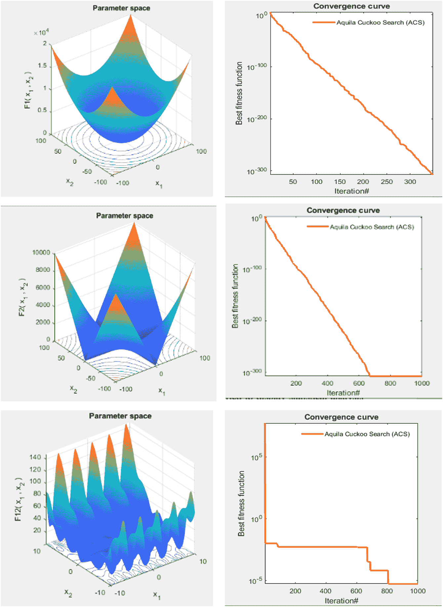

图 6.1 F1、F2 和 F12 函数的收敛曲线和参数空间。

图 6.1 的第二列展示了收敛曲线，而第一列显示了函数的二维形状，表示定性测量。

## 6.5 结论

研究提出了一种新算法 `ACS`，解决了 `CS` 的一个主要局限性——陷入局部解。

## 参考文献

1. `Yang, X.`, *Optimization and Metaheuristic Algorithm*, Elsevier. ISBN 978-0-12-398296-4, 2013.

2. `Pentapalli, V.`, 布鸟搜索优化：综述。*International Journal of Advanced Research in Computer and Engineering*, 5(11), 556–562, November 2016.

3. `Yang, X.S.`, 基于 Lévy 飞行的布鸟搜索。*Proceedings of the World Congress on Nature and Biologically Inspired Computing-NaBIC*, Coimbatore, India, December, pp. 210–214, 2009.

4. `Shehab, M.`, 布鸟算法的应用及其变体综述。*Applied Soft Computing*, 61, 1041–1059, September 2017.

5. `Kamoona, M.`, 一种用于优化的改进布鸟搜索算法*.2018 IEEE Congress on Evolutionary Computation (CEC)*, Rio de Janeiro, Brazil, July 2018.

6. `Al-Abaji, M.A.`, 布鸟搜索算法文献综述。Journal of Education and Practice, 11(8), 1–8, 2020.

7. `Fister Jr, I.`, 布鸟搜索：简要文献综述。Studies in Computational Intelligence Book Series, 11, 49–62, 2020.

8. `Yang, X.S.`, 布鸟搜索近期进展与应用。Neural Computing and Applications, 24, March, 169–174, 2013.

9. `Abualigah, L.`, 算术优化算法。Computer Methods in Applied Mechanics and Engineering, 376, 113609, 2021.

10. Abualigah, L., Yousri, D., Abd Elaziz, M., Ewees, A.A., Al-qaness, M.A.A., Gandomi, A.H., Aquila 优化算法：一种新型元启发式优化算法。Computers & Industrial Engineering, 157, 107250, 2021.

11. Varshney, M., Kumar, P., Ali, M., Gulzar, Y.. 使用灰狼-天鹰协同算法解决结构工程中的设计问题。Biomimetics, 9, 54, 2024. [`doi.org/10.3390/biomimetics9010054`](https://doi.org/10.3390/biomimetics9010054)

12. Gupta, S., Deep, K., Heidari H.M.J.E.S., Wang, W.A., 基于先进过渡规则原理与分析的对立学习哈里斯鹰优化算法。*Expert Systems with Applications*, 158, 113510, 2020.

13. Hakli, H., Uğuz, H., 一种带有莱维飞行特性的的新型粒子群优化算法。Applied Soft Computing, 23, 333–345, 2014.

14. Hatta, N., Zain, A.M., Sallehuddin, R., Shayfull, Z., Yusoff, Y.. 灰狼优化器（`GWO`）优化方法的近期研究（2014–2017）。Artificial Intelligence Review, 52, 265–283, 2019.

15. Mirjalili, S., Mirjalili, S.M., Lewis, A., 灰狼优化算法。Advances in Engineering Software, 69, 46–61, 2014.

16. Precup, R.E., David, R.C., Roman, R.C., Szedlak, A.I., 系统的基于算法的成本效益模糊控制器调优。International Journal of Computational Intelligence, 14, 1042–1052, 2019.

# 第 7 章：语义分割技术、挑战及其在智能交通系统中的应用

Nouman Latif, Muhammad Saadi and Demostenes Zegarra DOI: 10.1201/506-7

## 7.1 引言

人工智能正在帮助人类几乎每一个领域。例如，当我们使用手机拍照时，人工智能（`AI`）被用于对照片进行修饰。在使用社交媒体时，你可以看到 `AI` 在工作。`AI` 帮助检测和预防疾病，在保护环境方面发挥作用，帮助银行家、商人以及几乎所有人进行分析并做出决策，并开始成为汽车、小设备、医疗设备等的不可或缺的一部分。`AI` 有许多应用，并且正在日益进步。通信领域是许多被 `AI` 变革的领域之一。通信用于许多应用，整个世界通过通信系统在不同层面上连接。它通过不同的设备连接人们。现在，随着 `AI` 的进步，不仅人类在通信，机器之间也在相互通信。机器之间的通信被称为物联网（`IoT`）。这项技术允许不同的传感器和机器共享数据。`IoT` 的变体是车联网（`IoV`）。在 `IoV` 中，不同车辆在道路上相互通信并共享信息，这对于安全至关重要。这一领域的出现是因为自动驾驶技术的进步。自动驾驶系统（`ADS`）需要来自不同类型传感器和其他车辆的信息来做出决策。最重要且计算量最大的数据之一是图像，它在环境感知中起着至关的作用。在车内通信中，图像从传感器传输到车辆控制器；在车车通信（`V2V`）中，图像从一辆车辆传输到其他车辆；在车路通信中。除了智能交通系统外，在任何系统中传输图像都是挑战性的。`AI` 也用于提高此任务的效率，无论是有线通信还是无线通信。此应用程序的技术利用不同的深度学习方法，从图像中提取语义信息，丢弃冗余信息，并仅通过通信通道传输语义信息。本章将讨论语义分割、其类型以及在通信系统中的实现，以实现高效且低延迟的图像传输。

## 7.2 图像分割

任何 `AI` 系统都需要信息以便其做出决策并执行任何任务，例如预测房价、生成图像、写故事、确定患者是否患病、引导自动驾驶汽车。对于 `AI` 系统需要像人类一样感知世界的任务（例如预测网络攻击），图像分割是可见的。它是机器视觉的一项基础技术，用于从图像或视频中提取信息。如果将图像分割成某些部分，那么提取的信息是有用的。图像分割根据像素的相似性对像素进行这种划分。例如，考虑图 7.1 中的图像，它包含了不同的对象：

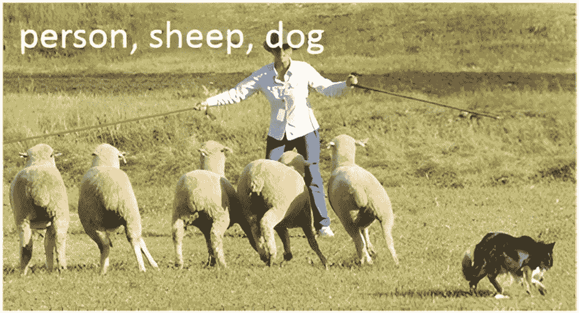

图 7.1 具有不同对象的人物、羊、狗和背景的原始图像 [1]

如果我们想要 `AI` 系统定义这张图像，那么如果图像信息被划分为草、绳子、人、羊和狗，它可以高效地做到。图像分割以这种方式对像素分组：属于人的像素组成一个片段，狗的像素组成另一个片段，有一个羊的片段，然后是草。利用这些关于图像片段的有用一致信息，现在 `AI` 系统或机器视觉系统可以解释此图像。图像分割通过衡量像素特征（如纹理、强度或颜色）的相似性将图像划分为意义部分。图 7.2 显示了分割后的图像，其中图 7.1 中的不同对象用不同的颜色标记，例如背景像素标记为绿色，与人类相关的像素标记为蓝色，狗用红色像素表示。

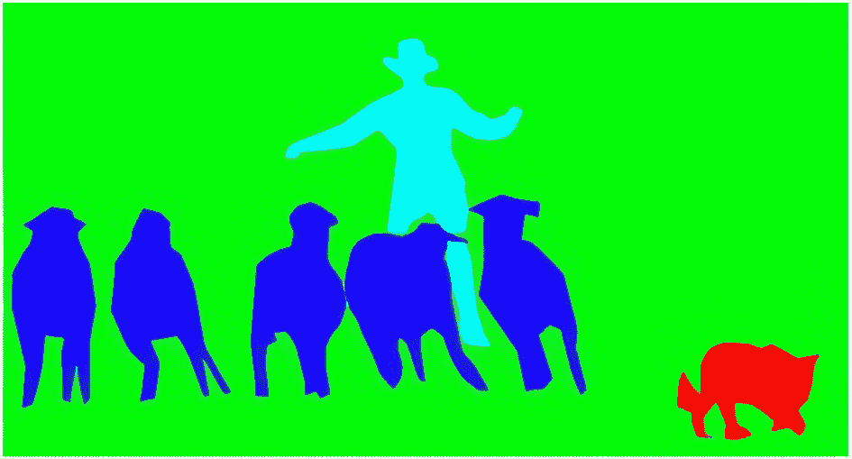

图 7.2 图像分为不同的类别。每个类别都用不同的像素突出显示 [1]。

### 7.2.1 图像分割的类型

#### 7.2.1.1 基于阈值的分割

图像由像素组成，每个像素的值介于 0 到 255 之间。如果是灰度图像，则只有一个通道；如果是彩色图像，则会有三个通道。在阈值处理中，如果物体像素值与背景之间存在显著差异，会设定一个阈值。低于阈值的像素被归为一组，而大于阈值的像素被分配到另一组。这种技术也称为图像的二值化，因为输出只有两个部分。例如，所有背景像素被转换为黑色，所有感兴趣区域的像素被转换为白色。这在图 7.3 中可以观察到。图中，感兴趣区域变为白色，背景变为黑色。

![图 7.3 (a) 显示不同类别的原始图像 (b) 阈值分割后的图像，感兴趣区域由黑色像素表示，背景由白色像素表示。2

图 7.3 (a) 显示不同类别的原始图像 (b) 阈值分割后的图像，感兴趣区域由黑色像素表示，背景由白色像素表示。2]

#### 7.2.1.2 基于边缘的分割

为了区分图像中的不同物体，可以使用边缘检测来识别边界。它的工作原理是当我们通过图像中的边缘时，会观察到剧烈的变化。这种变化可以告诉我们此处存在边界。例如，如果我们想将汽车从背景中区分开，可以参考图 7.4 来理解这一概念。在图 7.4a 中，显示了不同类型，通过基于边缘的检测，我们可以观察到这些类型之间的边界。图 7.4b 清晰地区分了图像中的类型。

![图 7.4 (a) 显示不同类型；(b) 基于边缘的分割，图像中不同类型之间有清晰的边界。3

图 7.4 (a) 显示不同类型；(b) 基于边缘的分割，图像中不同类型之间有清晰的边界。3]

#### 7.2.1.3 基于聚类的分割

在机器学习中，聚类是一种无监督学习类型，数据没有标签，根据不同数据点的相似性形成聚类。对于分割，这种方法可以用于区分图像中的物体，因为图像中的像素也是未标记的。基于聚类的分割技术之一是 `K`-means 聚类，它根据等于聚类数量的不同中心值。例如，在图 7.5 中，`K` 的值为 2，这意味着图像被分割成了两个类：一个是背景，另一个是动物。

![图 7.5 (a) 带有背景的原始图像 (b) 使用 2 个聚类进行分割的图像，动物由深灰色像素表示，背景由浅灰色像素表示。4

图 7.5 (a) 带有背景的原始图像 (b) 使用 2 个聚类进行分割的图像，动物由深灰色像素表示，背景由浅灰色像素表示。4]

#### 7.2.1.4 基于图的分割

分割是关于像素之间一致性的，将图像中的不同部分分组为段。机器学习中新兴且快速增长的技术之一是图神经网络（`GNN`）。这种方法用于各种类型的数据，但也可以将其用于图像分割。为了此目的，图像被转换为图形表示，像素作为节点，并通过边显示像素之间的一致性。图 7.6 显示了使用图的图像分割。原始图像的图被分为子图，根据像素之间的相似性，形成了不同的聚类，如图 7.6b 所示。

![图 7.6 (a) 具有多个物体的原始图像 (b) 使用图进行分割的图像，不同物体使用不同的颜色表示。5

图 7.6 (a) 具有多个物体的原始图像 (b) 使用图进行分割的图像，不同物体使用不同的颜色表示。5]

#### 7.2.1.5 语义分割

之前讨论的不同类型与语义分割之间的区别在于，根据像素之间的相似性为图像中的不同物体赋予标签。此外，用于此目的的方法在本质上是监督的，例如一种称为全卷积网络（`FCN`）的技术。考虑图 7.7 中的示例。在原始图像中，我们可以观察到自行车上有骑手，然后是道路和观众。语义分割位于图 7.7b 中；可以观察到自行车、人类和背景的像素被分组为不同的段。


#### 7.2.1.6 基于实例的分割

这种分割类型比语义分割更进一步，因为它甚至区分或标记了同一类别的像素。为了理解这一概念，首先考虑图 7.7，其中人类被归为一个聚类，背景为一个聚类，观众另一个聚类。实例分割不仅根据相似性对像素进行分组，还可以对聚类内部进行分组。它还会标记人类，例如左侧骑自行车的 Mike 和右侧骑自行车的 John。图 7.8 显示了实例分割的示例。


图 7.8 (a) 具有不同物体的原始图像 (b) 不同人类赋予了不同的标记。7

在图 7.8a 中，有三个人，然后是一个带有不同对象的背景。如果我们使用实例分割来区分人类和背景，它会将人类分分到不同的簇中，如图 7.8b 中用不同颜色所示。如果这是语义分割，所有人类都将被涂上相同的颜色。因此，实例分割提供了更细粒度的语义信息。

#### 7.2.1.7 基于深度学习的分割

在之前所有的类型中，我们都讨论了图像中的不同对象是根据它们的相似性进行分割的。这种相似性存在于代表物体的纹理、颜色或边缘之间。通常，这些特征首先使用手工技术提取，但在深度学习中，端到端的工作流程可以自动提取这些特征并执行分割。深度学习方法是基于卷积神经网络（`CNN`）的。图 7.9 展示了如何通过采用深度学习方法来提高分割质量。

![图 7.9 使用深度学习的图像分割。(a) 带有不同对象的原始图像；(b) 分割后的图像 [8]。](html/images/9781032751245_C007_009.jpg)

图 7.9 使用深度学习的图像分割。(a) 带有不同对象的原始图像；(b) 分割后的图像 [8]。

## 7.3 智能交通系统 (ITS)

随着人口增加，对运输的需求也在增加。随着地面交通的扩张，对安全、效率和可靠性的不断提高。为了处理该系统的不同方面，ITS 利用了不同的技术，包括信息、控制和通信。ITS 是一个巨大的领域，涵盖了交通系统的各个方面，例如：

* 交通管理
* 交通监控与监测
* 智能停车管理
* 车联网通信
* 车路云
* 自动驾驶系统（`ADS`）
* 智能收费系统
* 事故/意外检测系统
* 智能应急响应系统

此列表并非详尽，但 ITS 还包含许多其他方面。如果我们观察上述 ITS 元素，可以认为图像分类几乎用于每项任务，例如检测车辆的移动；视频用于交通管理、监控和监测；可以使用车辆或车牌的图像；对于停车管理系统，可以使用空位的图像。

此外，还可以注意到，在所有这些元素中，我们可以看到不同节点之间需要通信，包括图像或视频的传输和接收。

### 7.3.1 语义分割在 ITS 通信系统中重要性

如前所述，在智能交通系统（ITS）中，数据传输是一个至关重要的模块，负责传输接收不同类型的数据，如图像、文本、视频或音频。但大多数需要交换视觉信息。此外，这种数据交换必须足够快，因为关键决策需要基于这些信息。ITS 中有两种通信类型，一种是有线的，另一种是无线的。作为线通信的示例，我们可以讨论自动汽车，传感器、控制器和执行器之间需要传输大量数据。这被称为车内通信，包括人与车以及车与物之间的交互。这种通信应该是快速、稳健且准确的，因为车辆的安全取决于它。无线通信的示例涉及道路上不同车辆之间的数据交换，它们相互提供信息以增强道路上所有自动汽车 `ADS` 的决策能力。这种车辆之间或从车辆到基础设施的通信也被称为 `IoV` 或车间通信。图 7.10 展示了不同的通信模式，如车内、车间（`V2V`）和车路（`V2I`）。

![图 7.10 车联网显示了车间（V2V）和车路（V2I）通信 [9]。](html/images/9781032751245_C007_010.jpg)

图 7.10 车联网显示了车间（`V2V`）和车路（`V2I`）通信 [9]。

无论使用哪种通信模型，数据通信系统都应该具有低延迟、高吞吐量并利用更少的带宽。为了理解语义在通信中的重要性，首先要理解语义含义，即上下文或意义。作为人类，如果我们看到一张图像，不仅知道图像中所有的物体，还理解图像中发生了什么。为了理解这个概念，请考虑图 7.11。

![图 7.11 一张显示不同人物和对象的图像。图像中有高层信息，例如有人人和物体，然后是低层信息，例如人们心情很好或会议成功 [10]。](html/images/9781032751245_C007_011.jpg)

图 7.11 一张显示不同人物和对象的图像。图像中有高层信息，例如有人人和物体，然后是低层信息，例如人们心情很好或会议成功 [10]。

如果没有上下文，我们可以看到这张图像有一定数量的人；有如桌子、笔记本电脑和公告板等物体。没有上下文的理解不足以掌握图像中的完整信息。因此，如果我们结合上下文看这张图像，我们将得出图像正在进行会议的结论，可能已经达成了一笔交易或两小组达成了共识，这就是为什么他们正在握手且每个人都很开心。

传统的通信系统不关心图像中的上下文，它只是以 1 和 0 的形式传输像素信息。它以位的形式传输原始数据。

但在通往接收方的路径上，在信道中，即使是微小的噪声扭曲了数据，图像在接收端也无法高效重建。但如果信息带有上下文或定义上下文的图像特征发送，那么即使在很水平的噪声下，图像也可以以高精度重建。

在文本、图像、音频或视频中获取语义是具有挑战性的，但随着通信硬件和人工智能的快速发展，用语义通信代替传统通信正变得可能。

以下是使用语义通信的一些优点，使其对于智能交通系统等实时和安全关键型的应用非常有用：

* 在语义通信中，提取的是描述图像上下文的特征。这使得数据不易受噪声影响，并且在接收端更容易重建。此外，如果接收端获得更关注且相关的数据，它可以高效地重建图像。
* 只传输提取的特征或感兴趣区域（`ROIs`）而不是整个图像，以节省带宽，因为带宽在 ITS 中是有限的，特别是在车内通信中。
* 对于交通监控和监测等应用，仅发送对应用有用的图像分段部分是高效的。例如，如果只需要车牌，为什么要发送整辆汽车的图像呢？
* 如果一张图像包含多个对象，且这些对象被不同的应用需要，那么我们需要传输整幅图像。但如果这些应用不需要所需的对象或 ROI（感兴趣区域），则可以对图像进行分段，并根据使用的需求优先级发送聚类。例如，考虑一个类似于图 7.12 的场景。想象汽车的传感器捕获了一张包含多个对象的道路图像。这些对象可能是直接在汽车正方的行人、邻近车道的其他车辆，以及位于 100 米外的左转标志标志。

![图 7.12 自动驾驶车辆在具有不同物体（如树、行人、信号和车道线）的环境中移动的场景描述。如果对图像进行分段，可以对不同物体的信息进行优先级排序 [11]。](html/images/9781032751245_C007_012.jpg)

图 7.12 自动驾驶车辆在具有不同物体（如树、行人、信号和车道线）的环境中移动的场景描述。如果对图像进行分段，可以对不同物体的信息进行优先级排序 [11]。

现在，如果图像被分段，就不必将图像中的所有对象发送到 `ADS`（自动驾驶系统）控制单元，而是可以先发送与前方行人相关的信息，以便控制执行停止车辆机制。然后，它可以发送黄灯信号的分段，以便 `ADS` 据此做出决策。此时不需要发送来自邻近车道车辆的信息，因为车辆将由于行人而停止，然后由于信号变红而保持该状态。因此，这个例子清楚地表明，对分段进行优先级排序可以通过消除图像中的通信开销来节省带宽、降低处理时间和延迟。

## 7.4 语义分割与语义通信的技术

此时，我们已经理解了语义分割的概念及其重要性和类型。现在，我们将讨论用于语义分割的一些技术，从较传统的方法开始，然后是基于深度学习的端到端方法。此外，我们将讨论基于语义分割数据的完整通信系统。

### 7.4.1 语义分割的传统方法

首先，图像通过一些预处理层，其中涉及逆透视变换（`IPM`）、图像增强和 ROI 提取等步骤 [12]。下一步涉及将 ROI 从背景中分离出来，这被称为检测。对于候选区域检测或特征提取，使用了梯度直方图（`HOGs`），它根据所有方向上像素组的梯度来表示对象的特征 [13]。最大极稳定极值区域（`MSERs`）也可用于检测目的 [13,14]。检测之后是识别或分类，在其中提取的特征根据其类别进行标记。最初，识别是使用模板匹配完成的，即创建一个与符号相关的特征数据库，然后将其与未知图像进行比较 [15]。正如前所讨论的，使用传统方法进行图像分类涉及单独的层，且每层都使用不同的算法。由于每层都负责解决特定任务，因此当对某层进行任何更改时，很难确定它将如何影响整个系统。使用传统层进行图像识别的层如图 7.13 所示。

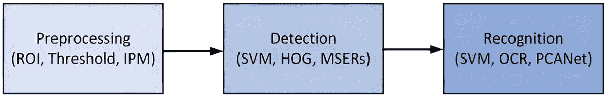

图 7.13 传统图像分类方法的流程图，从图像预处理开始，然后使用不同的技术（如支持向量机 `SVM`、梯度直方图等）进行检测，然后进行识别。所有这些阶段都是独立的。

### 7.4.2 语义分割的端到端方法

图像分类的端到端（`E2E`）方法是指通过单一模型训练可能复杂的学习系统。这些模型代表了完整的目标系统，并跳过了传统设计中通常存在的中间层。这意味着 `E2E` 模型可以在给定输入的情况下直接预测输出。在文献中，有很多用于语义分割的技术，但我们将讨论其中用于 ITS（智能交通系统）应用的技术。在 ITS 中，最重要的任务是环境感知，它使用了对行人、其他车辆、信号、道路车道和符号道路标记（`SRMs`）等对象的分类。因此，我们将讨论那些用于语义分割的方法。

### 7.4.3 SegNet —— 用于图像分割的深度卷积编码器-解码器架构

SegNet [16] 由编码器和解码器组成。该技术专注于道路场景感知，并在 CamVid 道路场景数据集上测试。考虑图 7.14 中的 SegNet 架构。

![图 7.14 使用编码器-解码器方法的 SegNet 架构 [16]。](html/images/9781032751245_C007_014.jpg)

图 7.14 使用编码器-解码器方法的 SegNet 架构 [16]。

编码器与 `VGG16` 的卷积层相同，但它没有全连接层，不过目的是相同的，即产生特征图。是解码器及其实现技术区分了 SegNet 其他语义分割技术。解码器利用编码器池化层的特征，恢复由于编码器池化层产生的空间信息；因此，它增强了边界划分，减少了训练参数的数量，并可以在少量更改适用于任何编码器-解码器配置。为了展示算法的真实性能，作者使用了对照基准测试并在整个端到端训练中使用随机梯度下降（`SGD`），但由于梯度反传播问题和大量参数优化的非收敛性，增加了模型与优化之间的冲突，从而提供了 57.7% 的准确率和 60 毫的推理时间。

### 7.4.4 ENet：用于实时语义分割的深度神经网络架构

ENet [17] 专注于道路场景语义分割的实时实现以用于高速推理。该技术在 Cityscapes 数据集上进行了测试，准确率达到 58.3%，容量为 79 fps，推理时间为 13 ms，与 `SegNet` 相比有所提高。该技术使用了编码器/解码器结构，但没有后处理步骤，采用了更小的解码器尺寸，并在解码器中使用最大池化层索引进行上采样，这通过最小化内存需求提高了速度。但是，为了减少浮点函数的数量，观察到在非线性操作期间，由于内存调用的增加，推理时间随之增加。

### 7.4.5 FCN: 端到端深度神经网络

Long 等人 [18] 提出了一种像素级分类的端到端训练方法，保持输入输出尺寸相等。这使得算法能够处理任意尺寸的输入图像，而不是固定尺寸，从而提高了实时实现的准确性。考虑图 7.15 中 `FCN` 的架构。

![图 7.15 用于语义分割的全卷积网络 (FCN) 架构 [18]。](html/images/9781032751245_C007_015.jpg)

图 7.15 用于语义分割的全卷积网络 (FCN) 架构 [18]。

`FCN` 利用编码器和解码器产生保留空间信息的特征图，通过跳跃连接将低层特征信息传递到高层。该技术在 PASCAL VOC 上经过了测试，准确率为 65.3%，2 fps，推理时间为 500 ms。但在基于 `VGG16` 的 `FCN` 中，如果减少步长数量以实在上采样期间获取更细致的信息，全卷积滤波器的尺寸会显著增加，这不仅增加了计算成本，还使得学习大型滤波器变得困难，影响了该方法的整体性能。此外，在学习过程中，梯度消失问题会导致特征信息丢失。该技术涵盖了由于池化层导致的特征信息丢失，但并未解决导致准确率饱和的梯度消失问题 [19]。

### 7.4.6 FRNN: 带跳跃连接的全分辨率残差网络

He 等人 [19] 讨论了层数增加时引起的梯度消失问题。所提方法使用了残差网络，将特征信息从低层传输到高层。Pohlen 等人 [20] 利用残差网络进行道路场景语义分割，不仅解决了空间视角丢失问题，还解决了梯度消失问题，从而提高了密集预测和定位的精度。这种方法被称为全分辨率残差网络 (`FRNN`)，并在流水线中引入了两个元素：一个是执行残差操作以保持空间分辨率的残差元素，另一个是池化元素，它通过卷积和池化获取特征图。该算法在 Cityscapes 数据集上进行了测试，准确率为 71.8%。然而，该技术不适用于实时应用，因为其推理时间为 496 ms。

### 7.4.7 Dilation 10

由 Yu 和 Koltun 引入的 [21] 深度神经网络采用了改进的卷积架构，消除了池化层和下采样层，从而在输出中保留输入图像的空间分辨率。使用了扩张卷积，有助于感受野的指数级增长，避免分辨率的丢失。该模块与现有的密集预测算法配合，并在许多城市场景数据集如 CamVid、`KITTI` 和 cityscapes 数据集上进行了测试，相应的准确率分别为 65.3%、59.2% 和 67.1%。该算法不是语义分割的完整流水线，而是一个可以嵌入现有流水线中的单个模块；因此，该解决方案不提供端到端训练。

### 7.4.8 LDFNet

一种提高计算效率的深度神经网络 [22] 将深度深度和亮度信息与红、绿、蓝 (`RGB`) 数据结合，通过减少参数数量来提高计算效率。表 7.1 显示了与其他 `RGB` 技术相比时，它减少了多少参数数量，并由于参数数量的减少而提高了速度。`LDFNet` 与某些 `RGB` 技术的比较显示参数数量大幅下降，从而以最少量的参数提高了特征图的推理速度特征，并使用深度和亮度 (`D&Y`) 编码器来改进准确性与速度之间的平衡。该网络在 cityscapes 数据集上进行了测试，准确率为 71.3%，速度为 18.4 fps。与许多现有方法相比，这种技术非常独特，因为它们只利用 `RGB` 信息。仅在 cityscapes 上测试这种方法限制了其性能，因为该数据集没有准确的视差图像 [23]。

表 7.1 `LDFNet` 与其他用于语义分割的神经网络对比

| 方法 | 参数 | 速度 (FPS) |
| --- | --- | --- |
| Dilation 10 | 148.8M | 0.25 |
| FCN-8s | 134.5M | 2.0 |
| SegNet | 29.5M | 16.7 |
| LDFNet | 2.31M | 18.4 |

上述讨论的技术是语义分割图像的一些方法。现在，让我们讨论一些实现语义通信的重要方法。

### 7.4.9 方法 1 [24]

一个典型的通信系统包含三个部分。

1. 发送端
2. 信道
3. 接收端

图像在发送端阶段通过将图像转换为二进制流进行传输。然后通过有线或无线通信信道进行传输。图 7.16 显示了该技术的架构。接收端随后重构图像。如前所述，这种方法更容易受到噪声影响，图像在接收端无法正确重构。另一方面，在这种方法中，通信元素也是三个，但传输的语义分割被用于特征提取，然后这些特征通过通信信道传输。图 7.16 显示了使用语义分割传输图像的通信系统。

![图 7.16 语义通信架构，其中语义信息在发送端被提取，压缩后通过信道传输，并使用解码器在接收端重构图像 [24]。](html/images/9781032751245_C007_016.jpg)

图 7.16 语义通信架构，其中语义信息在发送端被提取，压缩后通过信道传输，并使用解码器在接收端重构图像 [24]。

第一部分是发送器，它包含一个使用语义分割技术的特征提取块、一个语义编码器和一个压缩块。对于语义分割，使用了一种名为 `U-Net` [25] 的方法。这是一种 `CNN`，可以对图像中的对象进行像素级标记。它包含一个编码器和一个解码器。这些每一个都具有不同的层，如 `convolution`、`maxpool` 和整流线性单元（`ReLU`）。编码器对图像进行下采样，并获取图像中不同对象的特征或上下文。相反，解码器的目的是对图像进行上采样并融合提取的特征，以重建具有像素级标记信息的图像。我们的目标是从图中获取 `ROI`（感兴趣区域）和非感兴趣区域（`RONI`）。因此，使用了两个 `U-Net` 模型。这样，语义分割块提供像素级标记图像，语义编码器 1 提供 `ROI`，而语义编码器 2 提供 `RONI`。在此阶段存在一个问题，即 `convolution` 层的使用。图像在通过 `convolution` 层时其尺寸会减小。在语义通信中，保持输入和输出尺寸相同至关重要。因此，我们使用了 `zero-padding` 来执行相同卷积，解决了这一问题。语义解码器用于接收端，利用 `ROI` 和 `RONI` 的信息重建图像。


在发送器端，获取 `ROI` 和 `RONI` 后，特征通过通信信道传输到接收端。来自编码器 1 和编码器 2 的数据将同时传输，但数据是稀疏的，大部分区域为黑色像素或 `0` 值，这增加了通信开销。因此，在传输之前压缩数据至关重要。卷积后为了保持图像尺寸相同的填充产生了一个大部分包含黑色像素的稀疏矩阵。为了压缩这些数据，该方法使用了稀疏矩阵压缩。通过这种方法显著减少通信开销，因为它只会选择重要像素或非黑色像素进行传输。在这里，我们可以看到之前讨论的语义通信的优势。

现在，数据准备好通过通信信道传输。该方法中的人员模拟了信道而不是使用物理信道。在仿真中，通信信道是完美的，因为信道中不存在实时问题。使仿真与实时信道不同的主要因素是噪声。因此，为了观察信道中噪声的影响，该方法使用了“加性高斯噪声”或 `AWGN`。此外，还使用了 `Rayleigh fading channel` 来模拟多径传播对信号的影响。信噪比（`SNR`）被用于衡量通信信道的性能。

接收端也拥有与发送器三个元件，但目的不同。当接收到数据时，进行数据恢复以解压缩。之后，数据通过语义解码器，后者重建图像的两个部分，然后将这两个部分融合以形成最终图像。该算法的性能通过接收端的 `SNR` 和压缩率来衡量。

### 7.4.10 方法 2 [26]

在前一种方法中，只传输了高级信息。然而，图像可以具有多级信息或特征。高级特征提取器提供图像的整体上下文或含义，而低级特征提取器则研究更多细节。例如，在图 7.10 中，高级特征将显示图像正在进行会议或任何文本，但低级细节将包括人们很高兴、衣服的颜色或衣服的纹理。

所讨论的方法也用于通过多级语义信息传输图像以实现高效带宽利用。这主要通过减少通信开销来实现，但减少信息也会导致信息丢失。这就是为什么该方法被设计为从多个层面从图像提取特征。更具体地说，它提取图像中的高级特征（如文本和基于分割的含义）以及低级特征（如形状、纹理或颜色信息）。多级语义通信可以在图 7.17 中看到。

![图 7.17 语义通信方法，能够在发送端从图像中提取高级和低级语义，然后在接收端进行重建 [26]。](html/images/9781032751245_C007_017.jpg)

图 7.17 语义通信方法，能够在发送端从图像中提取高级和低级语义，然后在接收端进行重建 [26]。

该语义通信系统也使用了编码器和解码器方法。编码器从输入图像（`S`）中提取多级特征，将数据编码为符号，然后通过噪声信道传输。接收端的解码器从符号中提取特征，然后利用这些信息重建图像（`S′`）。该方法首先将图像像素值归一化在 0 和 1 之间。使用三个不同的神经网络来提取不同级别的特征。为了获取文本形式的语义信息，使用了基于 `ResNet-152` [28] 和长短期记忆（`LSTM`）[29] 的 `CaptionNet` [27]。该网络根据高级特征生成说明或文本嵌入。基于分割的特征使用金字塔场景解析网络（`PSPNet`）[30]提取。为了提取低级信息，使用 `concatenation` 技术将归一化的图像和基于分割的特征相结合。编码器转换这些多级信息并通过通信信道传输。该信道具有与方法一相同的 `AWGN` 噪声。一旦在接收端接收到数据，就使用解码器去除噪声并提取多级特征信息。然后将这些数据融合以重建图像。

### 7.4.11 方法 3 [31]

在前两种方法中，提到使用语义分割重建图像具有良好的质量。但在当今图像共享的世界中，特别是移动网络上，通信系统需要高质量图像的传输、接收和重建。这种方法不仅实现了语义通信，还确保在接收端重建高质量图像。该方法应用了端到端语义通信，由发送器、信道和接收器组成。它也使用了编码器和解码器方法。该系统是 `GAN`（生成对抗网络），根据提供的数据产生或生成新图像。它用于接收端。这种基于 `GAN` 的语义通信的基本功能显示在图 7.18 中。

![图 7.18 语义通信系统，其中发送端和接收端使用相同数据集进行训练。接收端使用 GAN 进行图像的高效重建 [31]。](html/images/9781032751245_C007_018.jpg)

在发射端，使用在常见物体上下文（COCO）数据集上预训练的网络对图像进行语义分割制处理 [32]。请注意，接收端的 `GAN` 在相同的数据集上进行了预训练。这意味着该数据集是发射端和接收端的知识库。在将图像转换为分割图后，使用二相移键控（BPSK）编码方案进行信道编码。这些数据通过噪声信道（AWGN）传输并在接收端进行检测。接收端首先进行信道解码，然后将数据输入到 `GAN`，`GAN` 利用共享的知识库和接收到的数据构建实时高质量图像。通过这种技术实现了 20 的压缩率，显示出良好的性能。

## 7.5 结论

从带宽的角度来看，传输图像是昂贵的。在许多系统中（例如 `ADS`），并不需要图像中的所有信息。发送完整图像会产生通信开销，从而增加带宽利用率和延迟。此外，通信系统中的图像是以位的形式传输的，这代表了图像中的所有像素。由于接收端不够准确，这些信息容易受到噪声影响，且图像重建可能存在偏差。在本章中，我们介绍了一种名为语义分割的技术，它对图像中的物体进行分割。使用这种方法，还可以理解图片的上下文。通过使用这种技术，可以只传输所需的信息以减少通信开销，同时，关于上下文或语义的信息也有助于接收端高效地重建图像。

## 参考文献

1. Lin, Tsung-Yi, Michael Maire, Serge Belongie, James Hays, Pietro Perona, Deva Ramanan, Piotr Dollár, and C. Lawrence Zitnick. “Microsoft coco: Common objects in context.” In *Computer Vision–ECCV 2014: 13th European Conference, Zurich, Switzerland, September 6–12, 2014, Proceedings, Part V 13*, pp. 740–755. Springer International Publishing, 2014.

2. Mustaffa, M. T., N. M. Z. Hashim, N. M. Saad, N. A. A. Hadi, A. Salleh, and A. S. Ja’afar. “Biomedical signal and image processing in Matlab.” International Journal for Advance Research in Engineering and Technology, 3, no. IX (2001): 29–32.

3. Ma, Wei-Ying, and Bangalore S. Manjunath. “EdgeFlow: A technique for boundary detection and image segmentation.” IEEE Transactions on Image Processing, 9, no. 8 (2000): 1375–1388.

4. Mittal, Himanshu, Avinash Chandra Pandey, Mukesh Saraswat, Sumit Kumar, Raju Pal, and Garv Modwel. “A comprehensive survey of image segmentation: Clustering methods, performance parameters, and benchmark datasets.” Multimedia Tools and Applications, 81, no. 24 (2021): 1–26.

5. Felzenszwal, Pedro F, and Daniel P. Huttencher. “Efficient graph-based image segmentation.” International Journal of Computer Vision, 59 (2004): 167–181.

6. Guo, Yanming, Yu Liu, Theodoros Georgiou, and Michael S. Lew. “A review of semantic segmentation using deep neural networks.” International Journal of Multimedia Retrieval, 7 (2018): 87–93.

7. Romera-Paredes, Bernardino, and Philip Hilaire Sean Torr. “Recurrent instance segmentation.” In Computer Vision–ECCV 2016: 14th European Conference, Amsterdam, Netherlands, October 11–14, 2016, Proceedings, Part VI 14, pp. 312–329. Springer International Publishing, 2016.

8. Ghosh, Swarnendu, Nibaran Das, Ishita Das, and Ujjwal Maulik. “Understanding deep learning techniques for image segmentation.” ACM Surveys, 52, no. 4 (2019): 1–35.

9. Cheng, Jiu, Jun Cheng, Meng Zhou, Fuqiang Liu, and Cong Liu. “Routing in vehicles: A review.” IEEE Transactions on Intelligent Systems, 16, no. 5 (2015): 2339–2352.

10. Pexels. `www.pexels.com/search/group%20people/`

11. Graziano, Leonardo, “Autonomous mobility interface,” Online, 2014, 2018-02-3. Available: `https://vimeo.com/9916086`

12. Bailo, Oleksandr, Seokju Lee, Francois Rameau, Jae Shin Yoon, and In Kwe. “Robust road marking detection and recognition using density-based grouping and machine learning techniques.” In 2017 IEEE Winter Conference on Applications of Computer Vision, Santa Rosa, CA, March 24–31, 2017.

13. Dalal, Navneet, and Bill Triggs. “Histograms of oriented gradients for human detection.” In 2005 IEEE Society on Computer Vision and Pattern Recognition, San Diego, CA, June 7–12, 2005.

14. Greenhal, Jack, and Majid Mirneh. “Semantic classification of road markings from geometric primitives.” In 2015 4th International Conference on Pattern Recognition: Applications and Methods (IPRAM), Lisbon, Portugal, January 10–12, 2015, pp. 124–140. Springer.

15. Ghosh, Swarnendu, Paul Newman, and A. S. Ja’afar. In 2018 IEEE 21st International Conference on Intelligent Transportation Systems (ITSC), Maui, HI, November 4–7, 2018, pp. 387–393. IEEE.

16. Badrinarayanan, Vijay, Alex Kendall, and Eugenio Culurci. “Segnet: A deep encoder-decoder architecture for semantic segmentation.” IEEE Transactions on Pattern Analysis and Machine Intelligence, 39, no. 12 (2017): 2481–2495.

17. Paszke, Adam, and Vladlen Koltun. “Enet: A deep neural network for real-time semantic segmentation.” *arXiv arXiv:1606.02147* (2016).

18. Long, Jonathan, Evan Shelhamer, and Trevor Darrell. “Fully convolutional networks for semantic segmentation.” In Proceedings of the IEEE Conference on Computer Vision and Pattern Recognition, Boston, MA, June 7–12, 2015, pp. 3431–3440.

19. He, Kaiming, Xiangyu Zhang, Shaoqing Ren, and Jian Sun. “Deep residual learning for image recognition.” In Proceedings of the IEEE Conference on Computer Vision and Pattern Recognition, Las Vegas, NV, June 27–30, 2016, pp. 770–778.

20. Pohlen, Tobias, Alexander Hermans, Markus Mathias, and Bastian Leibe. “Full-resolution residual networks for semantic segmentation.” In Proceedings of the IEEE Conference on Computer Vision and Pattern Recognition, Honolulu, HI, July 21–26, 2017, pp. 4151–4160.

21. Yu, Fisher, and Vladlen Koltun. “Multi-scale context aggregation by dilated convolutions.” *arXiv arXiv:1511.07122* (2015).

22. Hung, Shang-Wei, Shao-Yuan Lo, and Hsueh-Ming Hang. “Incorporating luminance, depth and color information by a fusion-based network for semantic segmentation.” In 2019 IEEE international conference on image processing (ICIP), Taipei, Taiwan, September 22–25, 2019, pp. 2374–2378. IEEE.

23. Seichter, Daniel, Mona Köhler, Benjamin Lewandowski, Tim Wengefeld, and Horst-Michael Gross. “Efficient RGB-D semantic segmentation for indoor scene analysis.” In 2021 IEEE International Conference on Robotics and Automation (ICRA), Xi'an, China, May 30 to June 5, 2021, pp. 13525–13531. IEEE.

24. Wu, Jiale, Celimuge Wu, Yangfei Lin, Tsutomu Yoshinaga, Lei Zhong, Xianfu Chen, and Yusheng Ji. “基于语义分割的图像传输语义通信系统。” Digital Communications and Networks, 10, no. 3 (2023): 519–527.

25. Ronneberger, Olaf, Philipp Fischer, and Thomas Brox. “U-Net: 用于医学图像分割的卷积网络。” In *Medical Image Computing and Computer-Assisted Intervention–MICCAI 2015: 18th International Conference, Munich, Germany, October 5–9, 2015, Proceedings, Part III 18*, pp. 234–241. Springer International Publishing, 2015.

26. Zhang, Zhenguo, Qianqian Yang, Shibo He, Mingyang Sun, and Jiming Chen. “多级语义信息辅助的无线图像传输。” In *2022 International Symposium on Wireless Communication Systems (ISWCS), Hangzhou, China, October 19–22, 2022*, pp. 1–6. IEEE, 2022.


# 27. Yang, Longyu, Hanli Wang, Pengjie Tang, and Qinyu Li. “CaptionNet: 一种用于生成图像描述定制递归神经网络。” IEEE Transactions on Multimedia, 23 (2020): 835–845.

# 28. Athisayamani, Suganya, Robert Singh Antonyswamy, Velliangiri Sarveshwaran, Meshari Almeshari, Yasser Alzamil, and Vinayakumar Ravi. “利用残差深度卷积神经网络 (ResNet-152) 进行特征提取和优化的特征维度降维用于 MRI 脑肿瘤分类。” Diagnostics, 13, no. 4 (2023): 668.

# 29. Sunny, Md Arif Istiake, Mirza Mohd Shahriar Maswood, and Abdullah G. Alharbi. “基于 LSTM 和双向 LSTM 模型的深度学习股价预测。” In 2020 2nd Novel Intelligent and Leading Emerging Sciences Conference (NILES), Giza, Egypt, October 24–26, 2020, pp. 87–92. IEEE, 2020.

# 30. Yan, Lingfei, Dawei Liu, Qi Xiang, Yang Luo, Tao Wang, Dali Wu, Haiping Chen, Yu Zhang, and Qing Li. “基于 PSP net 的前列腺磁共振成像自动分割网络模型。” Computer Methods and Programs in Biomedicine, 207 (2021): 106211.

# 31. Lokumarambage, Maheshi U., Vishnu Sai Sankeerth Gowrisetty, Hossein Rezaei, Thushan Sivalingam, Nandana Rajatheva, and Anil Fernando. “基于语义通信的无线端到端图像传输系统。” IEEE Access, 11 (2023): 37149–37163.

# 32. Lin, Tsung-Yi, Michael Maire, Serge Belongie, James Hays, Pietro Perona, Deva Ramanan, Piotr Dollár, and Lawrence Zitnick. “Microsoft coco: 场景中的常见物体。” In *Computer Vision–ECCV 2014: 13th European Conference, Zurich, Switzerland, September 6–12, 2014, Proceedings, Part V 13*, pp. 740–755. Springer International Publishing, 2014.

# 33. Minaee, Shervin, Yuri Boykov, Fatih Porikli, Antonio Plaza, Nasser Kehtarnavaz, and Demetri Terzopoulos. “深度学习图像分割：综述。” IEEE Transactions on Pattern Analysis and Machine Intelligence, 44, no. 4.

优化技术的交响乐始于确定性算法的经典优雅，例如基于梯度的方法和牛顿法。这些算法在解决具有平滑目标函数的良定义问题时，展现了极高的精度和效率。然而，它们对梯度信息的依赖使得它们容易陷入局部最优，限制了它们在处理复杂、多模态且充满噪声的优化图谱时的有效性。

当我们视线转移时，会遇到进化算法的魅力，例如遗传算法（`GA`）和差异变异算法（`DE`）[1]。这些算法模拟了自然选择和演化的原理，探索搜索空间的不同区域，并在处理复杂多模态问题时表现出卓越的鲁健性。尽管如此，评估大型种群解的计算负担以及平衡探索与开发的挑战，仍然是值得关注的因素。

当我们沉浸在元启发式算法的世界时，交响乐推向了高潮，创新通过探索与开发的精妙平衡而蓬勃发展。粒子群优化（`PSO`）和蚁群算法（`ACO`）[2,3] 受鸟类和蚂类觅食行为的启发，展示了群体智能的力量。这些算法中的涌现协作推动着它们走向具有前景的解决方案。然而，缺乏全局收敛保证以及对过早收敛的敏感性需要仔细的审视。

当交响乐达到顶峰，我们发现自己被群体智能迷人的舞步所吸引，探索与开发的和谐在此回响，具有深远的意义。萤火虫算法（`FA`）[4]的魅力之处在于其闪烁的光芒，萤火虫通过光信号进行通信以吸引彼此，反映了优化中吸引力的本质。和谐搜索的和谐性也令我们着迷[5]，它的灵感源于音乐和的即兴本质，解决方案和谐地合作以达到最优状态。然而，这些算法虽然引人注目，但也有其局限性，例如需要微调参数，并且在高维问题中容易发生过早收敛。

在这场优化策略的交响乐中，蛾火优化算法（Moth Flame Optimization）绚烂的光芒吸引了我们的注意力[6]。`MFO` 的魅力源于其对蛾类启发策略的巧妙结合，并被火焰空灵的舞动所增强。从蛾类对光源不懈的吸引中汲灵感，`MFO` 将自然的辉煌与人类智慧相结合，创建了一种能够探索搜索空间、收敛至最优解并在处理各种优化挑战时表现出卓越稳健性的算法。

我们通过文献之旅为理解 `MFO` 的独特性铺平了道路，并激发了探索其在解决现实优化问题中潜力的好奇。当我们接触 `MFO` 时，深受启发如下：

## 8.3 方法论

### 8.3.1 蛾火优化 (MFO)

在 `MFO` 算法中，使用了几个基本概念：

1.  **蛾种群 (`M`)**：蛾种群是指一组蛾的集合，其中 `N` 是蛾的数量，`D` 是解向量的维度。
2.  **火焰矩阵 (`F`)**：火焰矩阵 `F` 是一个 `N` × `D` 矩阵，与 `M` 尺寸相同，代表已发现的解。
3.  **火焰强度**：火焰强度量化了解的质量。火焰越高，解越好。
4.  **吸引行为**：`MFO` 的核心概念是蛾对光源的吸引行为。
5.  **对数螺旋运动**：为了模拟蛾的运动，`MFO` 使用对数螺旋公式。
6.  **探索与开发**：探索是指广泛搜索解空间以发现新区域，而开发涉及密集地关注已有前景的区域。

`MFO` 的流程图如图 8.1

*图 8.1：MFO 算法的流程图。*

#### 8.3.1.1 所提算法

所提算法的流程图如图 8.2 与最差火焰的适应度值 (`OF[worst_flame_index]`)。如果 `OM[i]` 更好，则用当前蛾替换 `F` 中的最差火焰并相应更新 `OF`。


*图 8.2：所提算法的流程图。*

*   使用公式 (3) 更新下一次迭代的火焰数量 (`n`)：`n = max_flames - (max_flames - 1) * l/max_iterations`
*   根据 `F` 中对应的最佳火焰更新飞蛾：
*   对于 `M` 中的每只飞蛾：
*   根据适应度值相似性或其他标准，在 `F` 中选择对应的最佳火焰。
*   使用对数螺旋线公式更新飞蛾的位置：`x_new = x_old + exp(-b * t) * cos(2 * pi * t) * (x_old - x_best_flame)`, `y_new = y_old + exp(-b * t) * sin(2 * pi * t) * (y_old - y_best_flame)`（其中 `(x_old, y_old)` 是飞蛾的当前位置，`(x_best_flame, y_best_flame)` 是对应最佳火焰的位置，`t` 是一个随时间减小螺旋范围的随机变量）。

### 步骤 3. 收敛检查：

*   检查是否满足终止标准（例如，解决方案达到了可接受的适应度水平，或达到了最大迭代次数）。如果是，则停止优化过程；否则继续下一次迭代。

### 步骤 4. 输出

*   在火焰矩阵 `F` 中找到最优解。

### 8.3.1.2 核心组件：

`MFO` 算法是一种受自然启发的元启发式优化算法，旨在寻找优化问题的最优解。将提供的更新版本与初始描述中提到的现有版本相比，以下是一些潜在的优势和改进：

1.  **增强的探索与开发**：更新版本引入了火焰数量随迭代次数的动态自适应。通过逐渐减少火焰数量，算法将其重点从探索（使用更多火焰）转移到开发（使用较少火焰）。这促进了在探索搜索空间和开发潜力区域之间取得更好的平衡，从而可能更良好地收敛到全局最优解。
2.  **改进收敛性**：使用对数螺旋线公式更新飞蛾的位置，使得能够在火焰附近进行更有效的探索，并向最佳解决方案收敛。基于螺旋的运动模式使飞蛾能够沿着平滑轨迹向火焰移动，这可以提高收敛速度。
3.  **自动火焰管理**：基于当前迭代更新火焰数量的方法允许算法自适应地调整其种群规模。这一特征通过随着时间的推移减少火焰数量并关注最有潜力的区域，防止算法陷入局部最优。
4.  **对最佳解决方案的高效记忆**：算法维护一个火焰矩阵 `F` 来存储到为止找到的最佳解决方案。这种记忆机制有助于在迭代过程中保留有潜力的解决方案，并促进对价值信息进行更好的利用。
5.  **可调参数**：在对数螺旋线公式中引入用户定义的参数（例如 `b`），提供了更大的灵活性，可以根据问题特征微调算法行为。
6.  **简单性与紧凑性**：与某些复杂的元启发式算法相比，该算法相对紧凑且实现简单，易于理解和使用。

然而，需要注意的是，`MFO` 算法更新版本的有效性可能仍很大程度上取决于各种因素，例如问题领域、参数调优以及优化问题本身的性质。

#### 8.3.1.3 伪代码

所提方法的伪代码如下所示：

#### 8.3.1.4 参数设置与动态自适应

**静态参数设置**：传统上，`MFO` 依赖于静态参数设置，其中关键参数（如种群规模、最大距离和吸引因子）在整个优化过程中保持不变。

**动态集成**：为了赋予 `MFO` 额外的优势并提升其性能，研究人员开始探索动态参数自适应。通过向算法注入能够根据优化进度实时调整的动态参数，该过程获得了新的灵活性。

### 8.3.1.5 性能评估

##### 8.3.1.5.1 基准函数

为了敏锐地审视 `MFO` 的实力，使用了一组精心挑选的基准函数，这些函数展示了各种单峰和多峰特征。这些基准函数充当熔炉，用于审视算法挖掘全局最优解的能力。

##### 8.3.1.5.2 实验设置

实验设置包括使 `MFO` 和其他对比算法对所选函数进行严苛检查。这种检查涉及在指定的代数内迭代运行，终止标准根据最大代数限制或解决方案质量阈值来决定停止。

##### 8.3.1.5.3 比较分析

为了确定结果的稳健性，利用平均值和标准差等统计分析方法从实证结果中得出见解。这些精心设计的实验结果被揭晓，详细地阐述了 `MFO` 的实力。性能指标引人注目地说明了收敛速度、解决方案准确性和韧性。

## 8.4 MFO 的应用

### 8.4.1 现实世界问题解决

`MFO` 的巨大魅力远超理论推测，因为它已经在现实世界的优化问题中找到了强大的位置。这些迷人的应用跨越了不同的领域，超越了机器学习、工程和金融的边界。`MFO` 已经披上了解决强大问题的外衣。

### 8.4.2 MFO 在灾害响应规划中的应用

#### 8.4.2.1 问题描述

灾害响应规划涉及协调应急服务、资源和人员，以有效应对自然灾害，如地震、飓风、洪水和森林火灾。优化灾害响应规划对于高效分配资源、缩短响应时间以及拯救生命至关重要。然而，灾害响应规划是一个复杂且动态的问题，灾害的严重程度、位置和时间存在不确定性。

#### 8.4.2.2 MFO 如何提供帮助

`MFO` 在探索和开发之间取得平衡的能力使其非常适合灾害响应规划的动态和不确定性。算法可以探索不同的资源分配策略和疏散计划，同时利用成功的解决方案来优化关键的灾害响应性能指标。

### 8.4.3 MFO 在供应链优化中的应用

#### 8.4.3.1 问题描述

供应链管理涉及对各种活动、资源和利益相关者的协调，以确保货物和服务从从供应商到终端消费者的顺利流动。优化供应链运营对于最小化成本、缩短交付周期、提高客户满意度以及增强整体效率至关重要。然而，由于涉及多个相互关联的流程以及在需求、供应和运输中的不确定性，供应链优化是一个复杂且动态的问题。

### 8.4.3.2 MFO 如何提供帮助

`MFO` 平衡探索（`exploration`）与开发（`exploitation`）的能力使其适用于处理供应链优化的多维度和动态性特征。该算法可以探索不同的供应链配置和决策策略，同时利用成功的解决方案来优化关键的供应链性能指标。

### 8.4.3.3 未来研究

该领域的未来研究可以关注将实时数据和情境感知集成到优化模型中，探索多目标优化以平衡冲突的灾害响应目标，并在灾害规划中考虑社区级的参与。此外，探索将 `MFO` 与机器学习技术相结合的混合方法，用于需求预测和资源分配，也可能进一步改进灾害响应规划。

该领域的未来研究可以关注在优化模型中引入更多因素，例如可持续性考虑、供应商性能和需求预测。此外，探索将 `MFO` 与机器学习技术相结合以进行需求预测和供应链风险管理的混合方法，可以进一步增强供应链优化的有效性。

`MFO` 算法在各种优化场景中展现了广阔的前，但其历程远未结束。随着研究人员继续突破元启发算法的边界，出现了几个有趣的未来研究方向，以进一步增强和探索 `MFO` 的潜力。未来的潜在研究领域包括：

**参数自适应**：为 `MFO` 探索更复杂且自适应的参数设置，可能会提高其在处理复杂动态优化景观方面的性能。可以探索动态参数适应策略，使 `MFO` 能够在优化过程中动态调整其参数，从而增强其响应能力和效率。

**与其他算法混合**：探索与其他优化算法的混合可能在创建新颖强大的优化方法方面卓有成效。将 `MFO` 的优势与其他元启发式算法（如 `GAs`、`PSO` 或蚁群算法）相结合，可能会产生具有更强全局搜索能力的混合算法。

**多目标优化**：扩展 `MFO` 以解决多目标优化问题是未来研究中令人兴奋的一个方向。开发一种能够高效找到帕累托最优解集的的 `MFO` 多目标变体，将满足广泛具有冲突目标的现实世界应用。

## 8.5 结论

在本章中，我们开启了一场变革性的之旅，这段之旅不仅揭示了 `MFO` 算法的秘密，还展示了这种迷人的自然启发启发式算法的改进和增强版本。通过我们的探索，我们试图理解 `MFO` 的核心，同时为其注入创新的改进，以提升其性能和通用性。

| 实验 | MFO 性能 | 无线通信影响 |
| --- | --- | --- |
| 实验 1 | 与传统算法相比，显著提升了收敛速度。 | 收敛加速导致数据传输延迟的降低。 |
| 实验 2 | 在多个参数上实现了稳健优化，产生了最优解。 | 增强了资源分配和网络配置以提高信号质量。 |
| 实验 3 | 有效处理高维空间的非线性优化问题。 | 为数据传输提供了高效的调制方案和自适应编码技术。 |
| 实验 4 | 对动态优化场景进行了探索，保持了适应性。 | 自适应信道策略确保了无缝通信。 |
| 实验 5 | 对干扰具有鲁棒性，保持了稳定性。 | 抗噪声通信协议确保了可靠传输。 |
| 实验 6 | 在规模化挑战中证明了可扩展性。 | 促进了网络的高效扩展以满足用户需求。 |
| 实验 7 | 对比分析显示了与最先进方法相比的竞争性性能。 | 在优化系统以提高效率方面提供了竞争优势。 |

在无线通信领域，`MFO` 算法成为了一个有力的竞争者，在各个实验中表现出卓越的性能和变革性影响。通过利用 `MFO` 导航复杂景观的内在能力，无线通信系统经历了以加速收敛、增强资源分配和对动态条件的适应性为特征的范式转变。`MFO` 的实力与无线通信的融合产生了协同效应，推动了优化并确保了无缝传输。正如实验所示，`MFO` 不仅在精炼传统挑战方面表现出色，还作为变革通信的有力催化剂，将连接性和效率推向了所未有的高度。

`MFO` 的起源在于飞蛾被明火吸引的迷人行为，这种迷人的灵感导致了这种强大的优化算法的发展。当我们沉浸于对 `MFO` 的探索时，我们意识到其基础组件的卓越：象征多样性和探索的飞蛾种群、反映向最优解收敛的磁力吸引机制、火焰之舞代表的精炼和优化，以及导航搜索空间的飞翔方程。

从探索精神出发，我们努力通过引入动态参数自适应策略来增强 `MFO` 算法。通过允许算法在优化过程中动态调整其参数，我们试图提高其对不同问题景观的稳健性和响应能力。动态参数设置的引入为 `MFO` 应对复杂动态优化场景开启了新途径。

我们穿越研究领域的历程揭示了增强 `MFO` 算法的潜力，它是自然智慧与人类创造力的和谐结晶。在本章结束之际，我们对优化的未来感到兴奋，增强 `MFO` 将激发研究与应用的新前沿。

在这一动态解决问题的时代，创新改进与自然的辉煌为优化算法承诺了光明的未来。随着研究人员和从业者不断突破优化的边界，增强 `MFO` 作为引导光，照亮了通往全局优化的道路，并在启发式领域产生了深远影响。

## 参考文献

1.  Das, S, 与 Suganthan, P. N. (2011). 差异演化：综述。IEEE Transactions on Evolutionary Computation, 15(1), 31。
2.  Kennedy, J, 与 Eberhart, R. (1995). 粒子群优化。IEEE International Conference on Neural Networks, 4, 1942–1948。
3.  Dorigo, M, Maniezzo, V., 与 Colorni, A. (1996). 蚁群系统：通过协作代理进行优化。IEEE Transactions on Systems, and Cybernetics-Part B: Cybernetics, 26(1), 29–41。
4.  Luo, R, Jiao, L., 与 Gong, W. (2019). 火火虫算法：最新进展与应用。Applied Sciences, 9(22), 4931。


5. Liang, J. J, Qin, A. K., Suganthan, P. N., 以及 Baskar, S. (2006). 用于多峰函数全局优化的综合粒子群优化器。IEEE Transactions on Evolutionary Computation, 10(3), 281–295。

6. Yang, X. S. (2016). 蛾蛾优化算法：一种用于全局优化的新型自然启发式方法。见于：Yin, H., Gao, Y., 与 Zeng, Z.（编辑），群体智能进展。Springer, Cham, 25–36。

7. Gandomi, A. H, Yang, X. S., 与 Talatahari, S. (2013). 结构与基础设施中的元启发式应用。Springer, Berlin, Heidelberg。

# 第 9 章：基于人工智能的光通信与信号处理

Sonam Gour, Priya Chaudhary 和 Amit Rathi

DOI: [10.1201/9781003472506-9](http://doi.org/10.1201/9781003472506-9)

## 9.1 引言

光学线的主要目的是纳米尺度光控制与操控。因此，天线的另一个名称是纳米天线或光学纳米天线。尽管它们工作在电磁光谱的光学或近红外区域，但与射频天线非常相似。金、银或铝等贵金属常用于这些天线，是因为它们在纳米尺度上具有强烈的光相互作用，这归功于它们卓越的等离激性质 [1]。通过将电磁场集中在极小空间内，它们促进了纳米级光学操控以及光学天线中的粒子捕获，从而增强传感器的灵敏度并提高光探测器的性能。

将光聚焦到亚波体积内是光学天线的一个主要特征。它允许超越衍射极限操控光。这一特征使得光谱学、纳米成像以及新型光电器件的发展成为可能 [2]。光学天线的研究重点在于提高其带宽、效率以及与纳米光子组件的集成，用于成像、电信、传感和量子信息处理等各种应用。

## 9.2 光学天线的设计要求

各种应用是光学天线设计的参数。下节讨论了一些主要应用：

### 9.2.1 等离激性质

材料的选择影响天线的等离激性质，包括共振频率和场增强。使用金、银或铝等贵金属来设计光学天线。

### 9.2.2 几何结构

天线的尺寸、形状和组件排列决定了它的许多光学特性。纳米棒、纳米盘、蝴蝶结天线和纳米孔是这些例子。

### 9.2.3 共振频率

光学天线的共振频率与它们旨在相互作用的光波长匹配。为了增强吸收、散射，共振频率需要进行调整。

### 9.2.4 偏振敏感性

天线的的光响应可能受到入射光偏振的影响。对于某些应用，偏振选择性特性是有用的，但对于其他应用，可能需要偏振不敏感的行为。

### 9.2.5 效率

光学天线的目标是将光有效地转化为所需的过程。减少辐射阻尼、金属吸收和其他损耗是必要的。

### 9.2.6 近场增强

光学天线的主要用途是将电磁场聚焦在亚波区域。这对于光谱学、非线性光学至关重要。

### 9.2.7 与制造的兼容性

材料的选择、天线的几何形状以及衬底规格都应与制造方法兼容。电子束光刻专注于模板辅助和束加工。纳米制造经常用于创建光学天线 [4]。

### 9.2.8 集成

可能需要将光学天线与光探测器、波导或发射器等光学组件连接。除了集成考虑外，它们还用于耦合效率、对准精度以及与现有工艺的兼容性。

### 9.2.9 环境稳定性

考虑到许多因素，包括湿度和温度。天线周围的材料可能会影响天线的学特性。能够在正确环境下可靠工作。

### 9.2.10 可扩展性

对于实际应用，光学天线需要在尺寸上具有可扩展性、制造成本低且与大规模生产兼容。

所有目标必须通过跨学科方法进行考虑，通常需要结合光学、纳米制造、材料科学和器件工程等理念。

## 9.3 光学天线的优势

光学天线在各种应用中具有优势，因为与传统的光学结构和组件相比，它们提供了许多好处。主要优势如下：

### 9.3.1 纳米尺度光限制

通过将光聚焦到亚波体积内，光学天线可以显著增强周围的电磁场。这种特性增强了非线性光学效应、光探测效率和传感器灵敏度，因为它在纳米尺度上允许更多的光与相互作用。

### 9.3.2 等离激共振

光学天线利用贵金属纳米结构的等离激共振，这些共振可以匹配特定的光波长。这些共振对于波长选择性滤波、表面增强光谱和显示色彩调节非常有益。

### 9.3.3 增强的光能捕获

光学天线通过将入射光引导向半导体结或量子点等活性区域，具有增强光伏和光电探测设备中光收集效率的潜力。这种改进在设备性能方面的优点包括更高的光电流产生量和灵敏度。

### 9.3.4 亚波成像

光学天线实现了超越传统光学衍射极限的亚波成像技术。光线被引导向亚波纳米结构或孔径；光学天线被用于实现大于光波本身限制的分辨率。这使得纳米尺度上的图像特征和结构成为可能 [5]。

### 9.3.5 定制光学特性

通过改变形状、尺寸和材料组成，可以调整光学天线的光性质。由于其可调控性，它们被用于光捕获、生物传感和等离激催化等频率范围。具有可调极化灵敏度、光学响应和光谱选择性的天线可以针对各种应用进行定制。

### 9.3.6 集成的灵活性

波导、光子电路和成像平台可以利用带有各种光学组件和系统的光学天线。它们与当前纳米制造工艺的兼容性可以无缝地用于复杂的设备和系统。

### 9.3.7 动态控制

光学天线可以显示动态光学响应，因为它们通过暴露电场、温度变化或光激发等外部刺激受到主动控制 [6]。在可重构光学和光电学的应用中，这种动态可调性使得可重构光学系统、开关等离激元共振和自适应超表面成为可能。

### 9.3.8 多功能性

光学天线的应用可以涵盖广泛的行业，例如量子传感、技术、光谱学、成像和电信。由于其适应性和多功能性，它们是创建定制以满足特定应用需求的尖端光学系统和设备的有用组件。

综合所有方面的考量，光学天线的特殊品质和能力使其成为扩展纳米光子领域以及促进多个技术领域创新的引人入胜的选择。

## 9.4 生物医学天线的物理属性

尽管光学天线及其射频（`RF`）和微波对应物非常相似，但在它们的缩放行为和物理特性之间存在重要差异。这些差异的大多数源于金属在光频下是强关联等离子体，被称为自由电子气体，而非理想导体。电化学驱动也不常用于驱动光学天线。

通过使用光学天线，发射器或接收器可以与自由光相互作用。元素量子吸收器或发射器，例如原子、离子、分子、量子点或固体中的缺陷中心，是接收器或发射器的最佳形式 [7]。

辐射场与发射器或吸收器之间的相互作用通过天线得到了改善。因此，它提供了在单个量子系统水平上管理光与相互作用的可能性。如图 9.1

图 9.1 光学天线理论。

## 9.5 用于生物医学应用的光纤天线

由于其高灵敏度、低侵入性和与生物环境的兼容性，基于光纤的天线在生物医学应用中具有特殊优势。以下是一些优点和可能的用途：

### 9.5.1 生物兼容性

由于光纤通常由二氧化硅等生物兼容材料组成，因此可以与生物组织和液体密切接触。由于其生物兼容性，可以使用低侵入性的传感和成像方法，从而减少组织损伤和患者不适感 [8]。

### 9.5.2 小型化

生产直径仅几微米的光纤的能力使得制造用于特定生物区域的微型天线成为可能。小型化对于需要精确空间分辨率和定位的应用（例如靶向药物递送和体内成像）受益。

### 9.5.3 远程医疗

光纤天线远传输光信号的能力允许远程探测和观察发生在人体深处的生物活动。这种能力在内镜成像等场景中是无价的，在这些情况下，大型传统天线可能会产生干扰或不实用。

### 9.5.4 多路复用

通过将许多光纤集成到单个探针或导管中，可以同时成像和传感许多生理特征或生物标志物。多路复用增强了基于光纤的天线的信息内容和诊断能力，实现了全面的生物医学评估。

### 9.5.5 极灵敏

由于光纤对折射率、吸收和散射等光学变化的非常敏感，它们是无标记生物分子和细胞过程检测的理想选择 [9]。通过特定的配体或受体修饰光学天线，可以选择性收集目标物，实现对感染和疾病标志物的敏感检测。

### 9.5.6 现场观察

光学天线通过提供生理指标的实时输入，对患者的状态和疾病进展进行持续监测。实时监测对于需要快速响应患者护理的动态过程（例如药物代谢、组织灌注和大脑活动）特别有帮助。

### 9.5.7 高分辨率成像

将光学天线与多光子显微镜、光学相干层扫描（`OCT`）和共聚焦显微镜等先进模式结合，可以对生物组织和结构进行高分辨率成像。高分辨率成像对细胞形状、组织结构和疾病病理的准确调查能力支持了早期诊断和治疗计划。

除了用于传感和成像外，光学天线还可以用于光动力疗法和光疗法等治疗应用。

由于光学天线可以通过将光能直接引导至目标区域选择选择杀死肿瘤、消除感染并激活生物过程，它们在癌症治疗和感染管理方面具有潜力。综合来看，基于光纤的天线在各种生物医学应用（如监测、治疗和诊断）方面非常有前景。预计该领域的进一步研究和开发将为医疗保健问题产生创造性的答案并改善患者结果。

## 9.6 光纤天线的工作原理

通过光纤光光的传输和接收对于基于光纤的天线的运行至关重要。其工作原理如下：

### 9.6.1 光信号的传输

通过全反射，光纤充当波导器，沿着其长度引导光传输。射入光纤一端的光信号将沿着纤芯传输，散射或反射产生的损耗降至最低。为了编码信息，可以通过多种方式对信号进行调制，包括相位调制和强度调制。

### 9.6.2 光纤天线结构

在光纤末端耦合光子或等离激元纳米结构是基于光纤天线的常用配置。与传统电磁系统中的天线类似，这种纳米结构充当辐射元件。可以对纳米结构进行设计以改善光与物质的相互作用，例如将光聚焦在亚波长体积内或形成等离激元共振。

### 9.6.3 光与物质的相互作用

天线的光与纳米结构的光特性相互作用。这种相互作用会导致各种效应，包括散射、增强发射或吸收，所有这些取决于纳米结构的设计。等离激元纳米结构可以通过诱导表面等离激元将电磁场聚焦到纳米级体积内。

### 9.6.4 光信号辐射

由于光与纳米结构之间的相互作用，光信号可以释放到环境中。它们产生的信号包含了入射光的调制。这些信号可以被外部光接收器检测。天线的效率和辐射方向图取决于许多因素，例如纳米结构的材料成分、几何形状和激发条件。

### 9.6.5 光信号接收

当光纤天线工作在接收模式时，它可以感知来自周围的入射光信号。通过天线末端外部光信号与纳米结构之间的相互作用，可以改变共振偏移和强度调制等光学特性。

### 9.6.6 针对特定应用的设计

光纤天线可用于特定应用，包括传感、成像和通信。传感应用天线可以调整为对环境变化的高灵敏度，而成像应用天线可能被设计为实现高对比空间空间分辨率。

光纤天线利用纳米结构的独特特性来传输接收信号。

## 9.7 光纤天线的材料设计

应用、制造方法、所需的光学以及环境兼容性是决定光纤天线构造的要素。以下材料经常用于制造光纤天线：

### 9.7.1 石英基光纤

二氧化硅用于光信号传输最广泛的波导。它们具有极低的光损耗、良好的机械柔活性以及在可见光和近红外波段范围内的高透明度。通常使用锗或磷掺杂二氧化硅纤维以改变其光学特性，包括色散和折射率。

### 9.7.2 贵金属（如金和银）

金、银等贵金属经常用于在光纤末端创建等离激元天线的纳米结构。这些金属显示出强表面等离激元共振，可以改善纳米级的光与物质相互作用。等离激元光纤天线常用的纳米结构包括蝴蝶天线、纳米棒、纳米盘以及金银纳米颗粒。

### 9.7.3 介质材料

聚合物、硅、氮化硅和二氧化钛（`TiO2`）是介质材料的示例。为了减少光学损耗并与互补金属氧化物半导体（`CMOS`）兼容，可以将光纤与介质波导和光子晶体结合。

### 9.7.4 半导体材料

硅（`Si`）和砷化镓（`GaAs`）是两种提供光源（如激光器）和光探测器（如光电管）的半导体材料。可以通过外延生长和晶圆键合等技术将它们结合。

### 9.7.5 功能涂层

可以在光纤表面覆盖功能涂层以改变其光学特性或提高特定用途的性能。例如用于生物传感的生物分子涂层和用于抗反射的介质涂层。

### 9.7.6 混合材料

通过在混合结构中结合多种材料（例如半导体-金属混合或金属-介质复合材料），可以产生单独使用组件材料无法实现的光学特性或功能。混合光纤天线可以将性材料的缺点降至最低。

生物兼容性（用于生物医学应用）、机械强度、成本效益、光学性能以及与制造工艺的兼容性是影响光纤天线材料选择的一些因素。为了最大特定应用的性能和设计，经常使用结合材料科学、光子学和器件工程的多学科方法。

## 9.8 光纤天线使用的设备

光纤天线所需的工具取决于使用的天线类型和特定应用。以下是典型设备列表：

### 9.8.1 光纤

光纤天线的关键部分是光纤。光信号通过它们引导至天线结构并从中返回。光纤在材料成分（塑料、石英）、纤芯直径和类型（单模、多模）方面有所不同。

### 9.8.2 光源

为了产生通过光纤传输的光信号，需要光源。根据应用需求，可以是激光器、发光二极管（`LEDs`）或宽带光源。

### 9.8.3 光探测器

光探测器是一种帮助天线将光信号转换为电信号的设备。雪崩光电管（`APDs`）、光倍增管（`PMTs`）和光电管是光探测器的常见形式。

### 9.8.4 分光与合成

将光信号耦合进光纤分别是光耦合器和分路器的功能。它们可能是有源的（如光调制器）或无源的（如光耦合器和分路器）。

### 9.8.5 光放大器

光放大器用于增加光信号的功率，特别是在需要低灵敏度检测或远距离传输的应用中。两个示例是半导体光放大器（`SOAs`）和掺铒光纤放大器（`EDFAs`）。

### 9.8.6 光调制器

它们用于在光信号通过光纤传输过程中改变其偏振、相位或强度。这些可能是马赫-曾亥尔干涉仪（`MZIs`）、声光调制器或电光调制器。

### 9.8.7 光滤波器

光学滤波器用于根据特定的波长或频带对光信号进行滤波。可以使用薄膜干涉滤波器、光纤布拉格光栅或法布里-珀罗腔来实现。

### 9.8.8 频谱分析仪

它们用于测量光信号的带宽、波长和功率水平等光谱特性。它们对于描述光系统和光纤天线的功能至关重要。专门用于光信号分析的光谱分析称为光光谱分析仪，简称 `OSA` [12]。它们能够识别具有极窄线宽的特征，并提供光光谱的高分辨率测量。

### 9.8.9 光显微镜

光纤天线上或周围的纳米结构使用光显微镜进行检查和表征。它们对于对准、质量保证和天线性能优化是必要的 [13]。

### 9.8.10 信号发生器和分析仪

这些设备用于产生和检查与天线系统光组件通信的电信号 [14]。它们对于调试和验证系统的整体功能是必要的。

### 9.8.11 对准工具

为了精确对准基于光纤的天线系统内的光学元件和纳米结构，使用了如压电平台、微操作器和自动对准系统等对准工具。

这些只是经常与光纤天线一起使用的设备实例。根据天线系统的用途、复杂性和性能需求，需要不同的设备。

## 9.9 带有信号处理的光通信天线

数字信号处理处理光信号在从模拟信号转换为数字信号后的修改。为了使光通信系统能够有效处理基于光的数据传输的复杂性，信号处理是必要的。为了提高信号质量、减轻信道困难的影响并降低噪声，它包含了多种技术，包括调制、编解码、滤波和均衡。信号处理通过利用当前的载波频率提供高数据率通信。为了提高高速光通信中数据传输、纠错和整体系统性能，信号处理处理由光信号产生的电信号。在提供超快速无线通信系统（如光无线通信 `OWC` 系统）的竞争中涌出了各种技术。对于 `OWC`，数字信号处理对于在空间、空气或水下等复杂情况下优化数据传输的效率和可靠性至关重要。

### 9.9.1 光无线通信 (OWC)

光无线通信通过光在短中距离内提供高速无线数据传输。对于跨越大气的数据传输，`OWC` 系统利用 `OWC` 发射器调制可见光、红外光或紫外光束。`OWC` 系统为传统的射频通信提供了替代方案，并为无线系统带宽限制提供了解决方案 [15]。

基于近红外光（主要为 850、1310 和 1550 nm）的天线对于近红外无线光通信系统中的数据传输非常有用。`OWC` 系统使用激光二极管和 `LED` 传输光信号，这与光纤系统类似。由于 `OWC` 系统可以在高数据速率工作并具有短线宽和高效率，激光二极管经常被用作此类系统的光源。对于近红外 `OWC` 天线中作为光源的激光二极管，III–V 半导体材料的选择至关重要，特别适用于光纤通信、近红外光谱和生物医学应用。硅、InP、GaAs、InGaAs、GaAsSb、InPSb 和 AlGaAs 等几种半导体材料非常适合这类应用并被广泛使用。`OWC` 系统包括红外和可见光通信的潜性方法。`OWC` 系统有几大主要类型，如自由空间光学 (`FSO`)、水下无线光通信 (`UWOC`) 和星间光无线通信 (`IsOWC`)，每种都提供了独特的优势和机遇。

#### 9.9.1.1 自由空间光学 (FSO)

自由空间光学通过光（通常通过激光）在两个具有视线的点之间传输数据。它被用于大城市和建筑之间，在那里建立物理连接是不可能的。`FSO` 系统非常适合宽带接入，因为它可以以高数据率远距离。

#### 9.9.1.2 水下无线光通信 (UWOC)

`UWOC` 系统使用可见光（通常是蓝色或绿色波长）跨水传输数据。由于高衰减或带宽限制，无线电等传统技术在水下环境中效率低下。在这些情况下，这项技术特别有用。环境监测、海洋通信和水下探索都依赖于 `UWOC`。

#### 9.9.1.3 星间光无线通信 (IsOWC)

在星间 `OWC` 中，使用激光束促进卫星间的通信。由于其极高的数据率和极延迟，深空通信、全球互联网覆盖和卫星网络都依赖这项技术。在 `IsOWC` 系统中，光天线需要良好的对准，并能够抵抗太空的恶劣条件。

### 9.9.2 AI 在光无线通信天线中的作用

深度学习、机器学习和神经网络等人工智能 (`AI`) 技术可以应用于 `OWC` 系统，以优化系统设计，从而提高性能、增强安全性和对变化情况的实时适应。

#### 9.9.2.1 天线设计的优化

`AI` 用于开发适用于特定 `OWC` 应用的高性能天线。为了优化天线设计，`AI` 系统（特别是机器学习模型）可以检查材料质量、设计参数和环境因素的大型数据集。这产生了具有更高增益、方向性和效率的天线。

#### 9.9.2.2 实时系统适应

`AI` 在各种环境情况下都能保持良好的通信能力。`AI` 对通信环境的实时分析允许实时修改系统参数，包括功率水平、调制方案和波束赋形。尽管情况变化，这意味着光无线系统始终以最高效率运行。

#### 9.9.2.3 自适应信号处理


# AI 在困难情况下提高数据传输的质量和可靠性

AI 通过持续适应变化的信道条件来改进信号处理。AI 驱动的自适应滤波通过减少 FSO 系统中大气扰动和 UWOC 系统中散射的影响，确保错误率降低并改善信号接收。

## 9.9.2.4 增强的安全性

AI 确保了数据传输的安全性。AI 可以监控流量模式，识别可能指向安全风险（如信号干扰或间谍）的异常情况。AI 具有改进加密方法的能力，增加了应对网络威胁通信安全性。

## 9.10 光纤天线在生物医学中应用的综述

根据文献综述，关于光纤天线在生物医学领域可能用途的研究日益增 [16]。一项研究展示了光纤法布里-珀罗干涉传感器，可用于非常敏感且准确的生理参数测量（包括血压和温度），该研究强调了光纤传感器微型化、生物相容性和多路复用能力在生物医学应用中的优势 [17]。为了促进无侵入性疾病诊断，作者创建了一种微型光纤聚焦显微镜，用于以亚细胞分辨率对生物组织进行体内成像。

研究展示了 `OCT` 在早期识别眼部疾病方面的潜力，开发了一种基于光纤天线的 `OCT` 系统，用于视网膜结构和血管的高分辨率成像 [18]。作者的一项关于利用基于光纤的天线在局部药物递送应用中受控释放治疗性剂的研究表明，与传统方法相比，它对药物释放具有更优越的时空控制。

作者证明了光热疗法治疗癌症的有效性，研究了金涂层光纤作为光热执行器以靶向杀死癌细胞。

为了无标记地检测 `DNA` 和蛋白质等生物分子，作者创建了一种基于等离激元天线的光纤生物传感器，该传感器对于生物医学诊断具有高灵敏度和特异性 [19]。在他们对用于生物医学传感的光纤表面增强拉曼散射（`SERS`）传感器最新进展的概述中，他们强调了该传感器在敏感且快速识别生物标志物方面的前景。

利用光纤天线可以实现深脑区神经元活动的光遗传操控，为神经治疗应用开辟了新可能性，并提供了对神经回路的精确控制 [20]。

这些研究突显了天线在广泛应用中日益增长的重要性。天线的独特特性，包括高灵敏度、小尺寸和在生物环境中运行的能力，使其在推进生物医学诊断、治疗和研究方面具有广前景。该领域的进一步研究具有重大的治疗应用。

## 9.11 结论

由于其独特的能力和特性，光纤天线具有广泛的生物学应用。光纤天线在多种生物医学领域、给药、生物分析、神经接口、传感和成像方面发挥了作用。它被用于开发与生物系统通信的微型、生物相容性设备。由于其适应性和小尺寸，它们非常适合集成到生物医学设备和微创手术中。光纤天线是检测细胞、生物分子和组织的敏感且选择性的手段。

它们能够实现具有良好检测限和特异性的无标记传感，并用于增强纳米尺度上的光物相互作用。基于光纤的天线用于生物组织和结构的高分辨率成像。它有助于疾病的早期检测和诊断。它通过特定身体部位的治疗效应对药物递送提供细粒度的控制。它包括光遗传学、光热疗法和靶向药物释放，可用于再生医学、神经治疗和癌症治疗。基于光纤的天线使得生理数据和神经活动的实时监测成为可能。

光纤天线实现了与神经组织的双向通信。这对于假体设备和脑机接口的发展至关重要。将光纤天线与其他光学和元件集成，用于创建具有增强功能和性能的多功能生物医学设备。它们与现有制造技术的兼容性使其易于集成到生物系统和技术中。光纤天线的使用极大推进了生物医学研究、诊断和治疗。预计该领域的进一步研发将提高患者监测结果，并扩展我们对复杂生物系统的认知。

## References

1. H. Gersen, M. F. García-Parajó, L. Novotny, J. A. Veerman, L. Kuipers, and N. F. van Hulst, “Influencing the angular emission of a single molecule,” `Phys. Rev. Lett.` 85, 5312 (2000).

2. C. Huang, A. Bouhelier, G. C. des Francs, A. Bruyant, A. Guenot, E. Finot, J.-C. Weeber, and A. Dereux, “Gain, detuning, and radiation patterns of nanoparticle optical antennas,” `Phys. Rev. B` 78, 155407 (2008).

3. R. Carminati, M. Nieto-Vesperinas, and J.-J. Greffet, “Reciprocity of evanescent electromagnetic waves,” `J. Opt. Soc. Am. A` 15, 706–712 (1998).

4. T. H. Taminiau, F. D. Stefani, and N. F. van Hulst, “Enhanced directional excitation and emission of single emitters by a nano-optical Yagi-Uda antenna,” `Opt. Express` 16, 1085.

5. T. H. Taminiau, and N. F. van Hulst, `ICFO—The Institute of Photonic Sciences`, Barcelona (personal communication, 2008).

6. K. Shimizu, and D. A. B. Miller, “Surface-enhanced emission,” `Phys. Rev. Lett.` 89, 01702 (2002).

7. P. Bharadwaj, and H. J. Eisler, “Single quantum dot coupled to a scanning optical antenna: a tunable superemitter,” `Phys. Rev. Lett.` 95 (2005).

8. L. Tang, and L. Novotny, “Spectral dependence of single molecule,” `Opt. Express` 15, 14266–14274 (2007).

9. R. Loudon, `The Quantum Theory of Light`, 2nd ed. (Oxford Science, 1983).

10. L. Tang, and D. A. B. Miller, “Nanometre-scale germanium photodetector enhanced by a near-infrared dipole,” `Nat. Photonics` 2, 226–229 (2008).

11. D. Tosi, S. Poeggal, I Iordachita, and E. Schena “Fiber optic sensors for biomedical applications,” in H. Alemohammad ed., `Opto-Mechanical Fiber Optic Sensors`, pp. 301–303, (Butterworth-Heinemann, 2018).

12. H. Lamela, D. Gallego, R. Gutierrez, and A. Oraevsky “Interferometric fiber optic sensors for biomedical applications of optoacoustic imaging,” `J Biophotonics` 4(3), 184–192 (2011).

13. L. Chin, and W. M. Whelan “Optical fiber sensors for biomedical applications,” in A. J. Welch, M. J. C. Gemert eds., `Optical-Thermal Response of Laser-Irradiated Tissue`, pp. 661–712, (Springer Science+Business Media B.V., 2011).

14. D. P. Fromm, A. Sundaramurthy, A. Kinkhabwala, P. J. Schuck, G. S. Kino, and W. E. Moerner, “Exploring the chemical enhancement for surface enhanced Raman scattering with Au bowtie nanoantennas,” `J. Chem. Phys.` 124, 061101 (2006).

15. O. Alsulami, A. T. Hussein, M. T. Alresheedi, and J. M. H. Elmirghani “光学无线通信系统，综述，” *arXiv preprint arXiv:1812.11544* (2018)。

16. R. M. Stöckle, Y. D. Suh, V. Deckert, and R. Zenobi, “尖增强拉曼光谱的纳米尺度化学分析，” Chem. Phys. Lett. 318, 131–136 (2000)。

17. Hartschuh, E. Sanchez, X. Xie, and L. Novotny, “单壁碳纳米管的高分辨率近场拉曼微镜，” Phys. Rev. Lett. 90, 095503 (2003)。

18. H. Hartschuh, H. Qian, A. J. Meixner, N. Anderson, and L. Novotny, “单壁碳纳米管的尖增强光光谱，”  S. Kawata, V. M. Shalaev 编. *尖增强：纳米光学与纳米光子学进展*，页码 157–176 (Elsevier, 2007)。

19. H. R. Stuart 和 D. G. Hall, “使用金属岛膜的绝上器硅波导中的吸收增强，” Appl. Phys. Lett. 69, 2327–2329 (1996)。

20. K. R. Catchpole 和 S. Pillai, “偶极散射到硅波导导致的吸收增强，” J. Appl. Phys. 100, 044504 (2006)。

# 第 10 章：微波光子雷达引言与信号处理挑战

Hum Nath Parajuli

DOI: [10.1201/9781003472506-10](http://doi.org/10.1201/9781003472506-10)

无线电探测和测距（雷达）系统传统上用于确定目标的距离、速度和成像。传统的雷达系统依赖于电子技术。然而，光子技术的最新进展对基于微波光子学（MWP）的雷达系统产生了巨大兴趣。与传统的电子雷达相比，这些系统提供了显著优势，例如高带宽、高频信号的生成与处理，且噪声极小。此外，它们允许雷达信号在带宽、调频率和频率方面具有可配置性。这种进步潜力可能会改变雷达技术的未来。本章概述了基于 MWP 的雷达，重点强调了它们的优势以及对未来雷达系统的潜力。

各种雷达信号处理技术对于准确提取所需的测量值至关重要。这些技术包括针对特定应用定制的波形设计；路径损耗、噪声和干扰的减轻；以及距离、多普勒和成像性能的增强。讨论所有这些信号处理挑战超出了本章的范围。然而，本章介绍了光子雷达系统的雷达-雷达干扰（IM）减轻技术，随着各种应用技术的进步，雷达用户数量不断增加，这种技术变得越来越重要。本章通过探索两个关键策略解决干扰问题：设计抗干扰波形以及应用深度学习技术来有效抑制多雷达干扰的影响。这些技术在推进雷达技术和应对新兴的多雷达干扰挑战方面具有巨大潜力。

## 10.1 雷达系统引言

无线电探测和测距（雷达）传感系统使用宽频率电磁波，从远程（10 MHz 到 1 GHz）到短程（1 GHz 到毫米波），以确定目标的距离、速度、方向和成像。根据工作频率（从 HF 段 3–30 MHz）到毫米波段 40–300 GHz）的不同，雷达应用各异 [1]。雷达的最初应用可以追溯到世界大战，当时它被用于军事定位。从那时起，雷达系统已应用于多个领域，包括国防、遥感、工业、航空导航、海洋，以及最近的汽车、农业和医疗行业 [2–7]。

雷达可以根据工作频率、波形类型和检测方法分类。例如，脉冲雷达使用短脉冲探测目标物体，应用于军事、机场和天气监测领域。连续波（CW）雷达使用连续信号来测量回声信号（物体反射信号）的频率偏移，这有助于确定目标的距离和速度。连续波雷达的一个子类型是调频连续波（FMCW）雷达，它使用具有线性频率调制（LFM）的连续波形 [8–10]。LFM 雷达在汽车应用中非常流行，因为它具有良好的脉冲压缩特性，提供了更精细的距离和多普勒（速度）分辨率。同样，合成孔径雷达（SAR）利用高频连续信号结合运动来获取高分辨率图像，使其在遥感领域广受欢迎。在一个典型的雷达系统中，雷达发射机产生指向目标的波形或脉冲，雷达接收机捕获回声。通过分析接收回声的属性（如幅度、相位、频率和延迟），可以确定目标的距离、速度、形状和大小。各种雷达信号处理技术对于准确提取这些属性至关重要。这些技术包括针对特定应用的设计波形；减轻路径损耗、噪声和干扰的影响；通过先进信号处理方法（包括深度学习）增强距离、多普勒和成像性能。

传统的雷达系统主要依赖电子技术。然而，随着光子技术的进步，开发基于 MWP 的雷达受到了极大关注，特别是在学术领域。由于光子相比电子系统具有许多优势，它具有彻底改变雷达系统的潜力。下一节将要介绍基于 MWP 的雷达。

## 10.2 用于雷达的微波光子学（MWP）

雷达中的 MWP 涉及光子和微波技术的集成，用于生成、传输和处理通常在 1–100 GHz 范围内。这种跨学科方法利用了光子的优点（如低损耗传输、宽带宽和对电磁干扰的免疫）来增强雷达系统性能。基于 MWP 的雷达系统可以在自由空间光（FSO）信道中运行，它们受益于相同的优点，但也面临与传统 FSO 系统类似的环境挑战 [11–13]。这些挑战包括大气湍流、吸收、散射以及雾、雨、雪等天气，所有这些都会影响信号质量和整个系统的可靠性 [14–19]。尽管存在这些挑战，MWP 技术在现代雷达系统中变得越来越重要，提供了更优的信号质量、更大的设计灵活性以及与其他光子系统集成的潜力。

对于雷达应用，MWP 技术提供了可配置的高带宽、高频信号生成、下变频、上变频、解调和波束形成功能 [20–22]。

在这些优势中，高带宽信号产生尤为重要，因为距离分辨率是区分物体的能力，它取决于雷达信号的带宽，其公式为 $\Delta R = \frac{c}{2B}$，其中 `c` 是光速，`B` 是雷达信号的带宽。雷达信号带宽越高，距离分辨率越细，从而能够更精确的测量 [23–26]。相比之下，通过电子器件实现这些能力具有挑战性，因为电子器件面临高路径损耗、电磁干扰、高频和高带宽信号下噪声增加，以及高频操作的可重构性有限等。

## 10.2.1 用于可重构雷达信号生成的 MWP

MWP 能够产生具有可重构参数（如频率、带宽、相位和调频率）的任意雷达波。在光领域，带宽为 30 GHz 的雷达信号已得到演示 [27]。高带宽信号对于在目标检测中实现更精细的距离分辨率至关重要，特别是在使用 LFM 波形时。基于光学的雷达信号生成的常用技术如下：

### 10.2.1.1 光学外频

该技术利用两个不同波长的激光器或具有多个波长的单模激光器创建一个产生拍频的光信号，该信号可以转换为微波信号。通过在光探测器上改变并拍频波长，可以产生包括 LFM 在内的各种雷达波形 [28–31]。使用光外频技术可以实现高稳定性、极小的相位噪声和多种波形 [32]。

### 10.2.1.2 光学倍法

在这些技术中，利用电光调制器产生的侧带来生成雷达波形。将低频和带宽的预期雷达波形输入调制器，产生高阶侧带。当光探测器中的高阶侧带发生拍频时，即可产生高频和高带宽的微波雷达信号。这些技术具有高效率、低噪声以及生成高频高带宽倍频复杂雷达波形等优势。这些技术具有增强各种应用雷达系统性能和的能力 [33,34]。

### 10.2.1.3 光学注入技术

在这种微波雷达信号生成技术中，两束激光发生拍频，使得一束光的注入导致另一束激光的发射波长发生偏移。当将外部光（也称为主激光）注入具有不同光波长的半导体激光（也称为从激光）时，会发生红移现象，通过注入波长与半导体激光器的红移波长拍频，即可产生微波信号。这种现象可用于生成具有可重构频率、带宽和调频率的雷达波形 [35–37]。

## 10.3 光雷达系统中的信号处理

在基于光学的雷达（Ph-radar）中，电子信号处理任务与基于电子器件的雷达类似。这些任务包括设计针对特定应用的雷达波形、对接收回波信号去噪、去调频（de-chirping）、自适应滤波、增强距离多普勒和成像分辨率等性能参数，以及减轻外部雷达干扰的影响。讨论所有的信号处理挑战超出了本章的范围。然而，本章介绍了光雷达系统的雷达-雷达干扰（IM）技术，由于目前和未来雷达使用的增加，这些技术变得越来越重要。这些技术有望推进雷达技术并解决新兴挑战。

### 10.3.1 雷达-雷达干扰简介

如今，雷达广泛应用于许多领域，包括遥感、国防、农业、工业、汽车应用和消费电子产品。随着雷达应用的增加，来自外部雷达源（如干扰雷达，IR）的信号可能会干扰合法的雷达，即受害雷达（VR）。当 IR 在与 VR 相同或附近的频段工作时，就会产生严重问题。这种 IR 信号通过增加噪声和产生虚目标会严重影响 VR 的性能。在多雷达环境中，这种干扰会降低 VR 的检测能力，并对雷达系统的安全有效运行带来风险。因此，减轻多雷达环境中的干扰是非常关键的。

在各种雷达波形中，LFM 是最常见的。它可以被描述为：

```
$T_{x}\left( \left( ,t, \right) \right) = A_{tx}\cos\left( \left( ,\left( \left( ,{2\pi\left( \left( ,{f_{c} - \frac{B}{2}}, \right) \right)t + \pi\alpha_{tx}t^{2}}, \right) \right), \right) \right),\,\,\text{for}\,,, 0 \leq t \leq T$(10.1)
```


其中 `A[tx]` 代表发射信号的幅度，`f[c]` 是中心频率，`B` 表示工作带宽，`α[tx]` 是调频率（`B/T`），`T` 是 LFM 的持续时间。在 $0 \le t \le T$ 期间，发射信号的频率从 $f_c - B/2$ 线性增加到 $f_c + B/2$。当该发射信号从 $K$ 个目标反射时，接收信号 `Rx` 可以表示为

$$R_{x}\left( \left( ,t, \right) \right) = \sum_{k = 1}^{K}A_{Rk}\cos\left( \left( ,\left( \left( ,{2\pi\left( \left( ,{f_{c} - \frac{B}{2}}, \right) \right)\left( \left( ,t - \tau_{dk}}, \right) \right) + \pi\alpha_{tx}\left( \left( ,t - \tau_{dk}}, \right) \right)^{2}}, \right) \right), \right) \right)$$

其中 `A[Rk]` 是来自 k 个目标的反射信号的幅度，`τ[dk]` 代表雷达与第 k 个目标之间距离引起的延迟。LFM 信号的距离分辨率（指示区分两个目标的能力）与频率偏移成正比，公式为 $\Delta R = \frac{c}{2B}$，其中 `c` 是光速，`B` 是雷达信号的带宽。

现在考虑 IR 信号，它也是 LFM 且作用于接收器。它可以表示为：

$$R_{I}\left( \left( ,t, \right) \right) = \sum_{y = 1}^{Y}A_{Iy}\cos\left( \left( ,\left( \left( ,{2\pi\left( \left( ,{f_{c} - \frac{B_{Iy}}{2}}, \right) \right)\left( \left( ,t - \tau_{Iy}}, \right) \right) + \pi\alpha_{Iy}\left( \left( ,t - \tau_{Iy}}, \right) \right)^{2}}, \right) \right), \right) \right)$$

(10.3)

其中 `A[Iy]` 是第 `y` 个 IR 信号的幅度，`α[Iy]` 是调频率，`τ[Iy]` 是 IR 信号相对于 VR 信号的延迟。IR 信号的调频率 `α[Iy]` 计算为 $\frac{B_{Iy}}{T_{Iy}}$，其中 `B[Iy]` 为第 `y` 个 IR 信号的带宽，`T[Iy]` 为持续时间。当 VR 信号和 IR 信号的调频率相同时（`α[Iy] = α[tx]`）时，被称为相干干扰；如果它们不同（`α[Iy] ≠ α[tx]`），则称为非相干干扰。在存在 IR 信号的情况下，无论是相干还是非相干，接收器的输出都是 VR 回波和 IR 信号的混合。为了简单起见，考虑一个包含一个 VR 源和一个 IR 源的场景。IR 信号 `RI` 在去调频后产生的拍频公式为：

```
f[bi] = (*α[Iy]−*α[tx])*t* + *α[Iy]*τIy
```

图 10.1 展示了在存在具有相同或不同调频率的 IR 信号时，LFM VR 信号及其在接收端的去调频信号。在图 10.1a-i 中，IR 信号的调频率与 VR 信号相同，在接收器输出处观察到两个恒定的拍频 `f[bo]` 和 `f[bi]`，如图 10.1a-ii 所示。这些拍频落在接收器的带宽范围内，表明存在两个目标物体，包括如图 10.1a-iii 距离图中所示的一个虚假目标。在图 10.1b-i 中，调频率不同，观察到来自实际目标物体的恒定拍频 `f[bo]` 以及伴随变化的拍频 `fbi`，如图 10.1b-ii 所示。这种变化的拍频在接收信号中引入了额外的不期望频率分量，并增加了距离图中的噪声底，如图 10.1b-iii 所示。这两种类型的干扰，无论是相干的（图 10.1ab），都会通过产生虚假目标或增加噪声底，在多雷达环境中严重损害 VR 的检测性能。图 10.1 展示了一个目标物体和一个干扰信号在接收回波中起作用的场景。但在现实应用中，应该在存在各种干扰信号的同时进行多目标检测。可以通过多种方法在多 IR 源环境中工作时尽可能减少 IR 信号对 VR 信号的影响。本章介绍了通过设计抗干扰雷达波形以及基于深度学习（DL）的解决方案来减轻干扰影响的技术。

![图 10.1 干扰效应示意：(a) 相干干扰，b) 非相干干扰。(i) 回声加干扰信号的 F-t 图，(ii) 接收器内生成的拍信号的 f-t 图，(iii) 最终距离图 [38]。](html/images/9781032751245_C010_001.jpg)

图 10.1 干扰效应示意：(a) 相干干扰，b) 非相干干扰。(i) 回声加干扰信号的 F-t 图，(ii) 接收器内生成的拍信号的 f-t 图，(iii) 最终距离图 [38]。

### 10.3.2 雷达-雷达干扰抑制

在各种雷达波形中，LFM 波形因其卓越的脉冲压缩能力而流行，这增强了距离-多普勒分辨率。然而，LFM 波形的抗干扰能力较差，特别是当 IR 信号与 VR 信号相干干扰时。目前大多数 IM 方法依赖于雷达接收器内部复杂的信号处理方法。因此，设计具有固有 IM 能力的雷达波形对于实时目标检测至关重要。本章介绍了抗干扰波形的设计。此外，基于 DL 的 IM 技术最新进展引起了雷达研究界的关注，因为这些技术可以通过抑制干扰来重建回波信号，无论涉及什么样的 VR 和 IR 信号。因此，在本章中介绍了一种光电雷达系统的基于 DL 的 IM 技术。

#### 10.3.2.1 抗干扰波形设计

在多雷达环境中，干扰是一个重要因素。随着雷达的使用越来越广泛，多个雷达的操作会导致干扰。为了减轻干扰，研究人员开发了多种信号处理技术 [31,39]。干扰会增加噪声底并在距离图中引入虚假目标，导致能力下降。在电子领域，此类解决方案的示例包括 [44,45,46,47,48,49]。在光子领域，已经提出了混沌雷达等技术。此外，距离-多普勒分辨率也是准确性的关键指标。LFM 波形因其良好的压缩特性可提供距离-多普勒分辨率而流行。然而，LFM 波形抵抗干扰的效果有限，特别是当 IR 与 VR 相干工作时。因此，改进的 LFM 波形对于实现距离-多普勒分辨率和有效的 IM 至关重要。

Parajuli 等 [50] 引入了一种改进的 LFM 波形，称为基于光电生成的正交上下调频对的多调频 LFM 波形（Ph-O-MLFM)，作为一种抗干扰波形。该波形因其正交性以及使用不同调频率的级联 LFM 波形而与众不同。与单个 LFM 信号相比，信号的正交性增强了压缩特性 [39,51]。这种特征通过上下 LFM 的级联引入 Ph-O-MLFM 波形中。此外，使用不同调频率的级联 LFM 波形通过将信号拍频移到接收器带宽之外防止相干干扰。结果，多个级联 LFM 有效减少了距离图中干扰的影响。

图 10.2 展示了 IR LFM 如何影响雷达接收器 (Rx) 中的拍频 (`Δf`)，涵盖了两种不同的雷达波形：常见的基于光子的 LFM (Ph-LFM) 波形和 Ph-O-MLFM 波形。图 10.2a-i 和 b-i 分别显示了 Ph-LFM 和 Ph-O-MLFM VR 波形接收到的发射信号、回波和干扰信号。如图 10.2a-ii 所示，Ph-LFM 波形经历了严重的相干干扰，因为信号与干扰的拍频落在雷达接收带宽 (BW) 内，使其难以抑制干扰。相反，图 10.2b-ii 表明，对于多线性频 Ph-O-MLFM 波形，大部分的信号与干扰的拍频落在接收带宽之外，从而从源上减轻了干扰的影响。

为了演示 Ph-LFM 和 Ph-O-MLFM 波形的检测能力，作者建立了一个模拟多雷达环境，其中两种波形均被生成并用于目标检测评估。对于 Ph-LFM，使用了 2-GHz、1-µs LFM 信号；而 Ph-O-MLFM 波形则是使用两个 2-GHz、1-µs、三线性频 LFM 信号输入双驱动马赫-森德调制器 (DDMZM) 生成的。通过调整 DDMZM 参数实现了基于光子的带宽合成，在光电检测后产生 4-GHz、1-µs 的 Ph-LFM 和 Ph-O-MLFM 射频 (RF) 信号。这些波形随后与不同调频的 4-GHz LFM 信号相结合，并使用匹配滤波技术对间隔 6 cm 的两个目标进行了检测分析。

图 10.3 展示了多雷达环境中生成和分析 Ph-LFM 和 Ph-O-MLFM RF 信号的设置。该设置包含一个基于 DDMZM 的 MWP 系统，通过 DDMZM 产生的侧带的光子拍频产生 RF 雷达信号。该设置使用输出功率为 0 dBm、线宽为 10 MHz 的 CW 激光，以及一个热噪声电流谱密度为 `10e^(−12)` A/Hz^(1/2) 的光探测器来模拟真实的噪声条件。来自光探测器的 RF 信号随后使用增益为 20-dB、噪声电流谱密度为 `20e^(−12)` A/Hz^(1/2) 的 RF 放大器进行放大，并通过四阶贝塞尔带通滤波器。

![图 10.3 干扰雷达信号影响下的雷达信号生成和检测分析示意图 [50]。](html/images/9781032751245_C010_003.jpg)

图 10.3 干扰雷达信号影响下的雷达信号生成和检测分析示意图 [50]。

在图 10.3 虚线框所示的多雷达设置中，配置了 VR 单元、IR 单元和目标间隔单元。VR 单元发射光子生成的 RF Ph-LFM 和 Ph-O-MLFM 波形，并接收来自间隔 `ΔL` = 6 cm 目标的回波。IR 单元生成具有不同调频率和周期的 4-GHz LFM 干扰信号，并指向 VR 接收器 (Rx)。这些 IR 信号与回波混合，信噪比为 0 dB 的加性高斯噪声 (AWGN) 模拟了噪声回波和干扰信号的接收。存在 LFM 干扰的目标检测通过分析获取距离图中归一化互相关 (`C-Corr.`) 幅度、距离分辨率以及峰值旁瓣功率 (`PSL`) 值来评估。

![图 10.4 Ph-LFM 信号生成。(a) DDMZM 输出的光谱，(b) 光探测器后的信号幅度-时间图，(c) 滤波后生成信号的 RF 频谱，以及 (d) 生成信号的频率-时间图 [50]。](html/images/9781032751245_C010_004.jpg)

图 10.4 Ph-LFM 信号生成。(a) DDMZM 输出的光谱，(b) 光探测器后的信号幅度-时间图，(c) 滤波后生成信号的 RF 频谱，以及 (d) 生成信号的频率-时间图 [50]。

为了生成 4-GHz Ph-LFM 信号，创建一个 2-GHz 带宽和 1-µs 周期的 2–4 GHz LFM 驱动信号，并以相同的相位应用于 DDMZM 的 `RF[1]` 和 `RF[2]` 端口。DDMZM 使用载波抑制双边带 (OCS-DSB) 方案工作，所得的光谱如图 10.4a 所示。图 10.4b-ii 描述了信号的幅度-时间图。图 10.4c 显示了滤波后生成信号的 RF 频谱，而图 10.4d 是生成信号的频率-时间图 [50]。

![图 10.5 Ph-O-MLFM 信号生成。(a) DDMZM 输出的光谱，(b) 光探测器后的信号幅度-时间图，(c) 滤波后生成信号的 RF 频谱，以及 (d) 生成信号的频率-时间图 [50]。](html/images/9781032751245_C010_005.jpg)

图 10.5 Ph-O-MLFM 信号生成。(a) DDMZM 输出的光谱，(b) 光探测器后的信号幅度-时间图，(c) 滤波后生成信号的 RF 频谱，以及 (d) 生成信号的频率-时间图 [50]。

为了评估生成信号的性能，进行了两种目标检测分析。图 10.6a 和 b 分别显示了使用 `Ph-LFM` 和 `Ph-O-MLFM` 信号时在无干扰情况下检测到的目标距离分布图。主瓣的 −3 dB 脉冲宽度，`Ph-LFM` 为 3.8 cm，`Ph-O-MLFM` 为 4 cm。`Ph-LFM` 的 `PSL` 为 12.8 dB，`Ph-O-MLFM` 为 11.6 dB。目标检测精度保持在 2 mm 的最大误差范围内。尽管包含了不同调频斜率的 `LFMs`（这可能会增强相位噪声并降低 `PSL` 和距离分辨率），但 `Ph-O-MLFM` 信号的距离分辨率和 `PSL` 与 `Ph-LFM` 信号相当。这种性能很大程度上归功于 `Ph-O-MLFM` 波形的正交性，由于其由正交的上/下 `LFM` 对组成，降低了旁瓣的幅度。

![图 10.7 在不同调频斜率的干扰信号下 `Ph-LFM` 波形的目标检测图，调频斜率为 (a) 4 GHz/µs，(b) 8 GHz/µs 和 (c) 16 GHz/µs。(i) 频率-时间表示和 (ii) 距离分布结果 [50]](html/images/9781032751245_C010_007.jpg)

图 10.7 展示了不同调频斜率的干扰信号下 `Ph-LFM` 波形的目标检测图，调频斜率为 (a) 4 GHz/µs，(b) 8 GHz/µs 和 (c) 16 GHz/µs。(i) 频率-时间表示和 (ii) 距离分布结果 [50]。

为了评估干扰对生成的 `Ph-LFM` 和 `Ph-O-MLFM` VR 信号的影响，生成了调频斜率和周期分别为 `I[LFM1]`(4 GHz/µs, 1 µs)、`I[LFM2]`(8 GHz/µs, 0.5 µs) 和 `I[LFM3]` (16 GHz/µs, 0.25 µs) 的 `LFM-IR` 信号并与 VR 信号结合。图 10.7 显示了这些 `LFM` 干扰如何影响 `Ph-LFM` 信号的距离分布。图 10.7a-i、b-i 和 c-i 分别描绘了存在 `I[LFM1]`、`I[LFM2]` 和 `I[LFM3]` 干扰信号时的回波信号频率-时间图。图 10.7a-ii 中的距离分布显示，当 `Ph-LFM` 受到相干干扰时，会出现虚假目标。然而，在使用 `I[LFM2]` 和 `I[LFM3]` 时并未观察到虚假目标。尽管如此，与无干扰情况相比，`PSL` 值降低了 0.5 dB。

对 `Ph-O-MLFM` 信号进行了类似的分析，如图 10.8 所示。在图 10.8a-ii 所示的距离分布中，虚假目标信号不再出现，与图 10.7a-ii 不同。对于图 10.8a–c 中所示的所有 `IR` 信号，均实现了超过 11 dB 的 `PSL` 和 4 cm 的 −3 dB 脉冲宽度。如图 10.6b 所示，与无干扰情况相比，目标保持可分辨，没有发生显著退化。仅观察到 `PSL` 下降了 0.4 dB，这表明 `Ph-O-MLFM` 信号在抑制干扰方面的有效性。获得的 4 cm 距离分辨率接近 4-GHz LFM 信号 3.87 cm 的理论距离分辨率。

![图 10.8 在不同调频斜率的干扰信号下 `Ph-O-MLFM` 波形的目标检测图，调频斜率为 (a) 4 GHz/µs，(b) 8 GHz/µs 和 (c) 16 GHz/µs。(i) 频率-时间表示和 (ii) 距离分布结果 [50]](html/images/9781032751245_C010_008.jpg)

图 10.8 展示了不同调频斜率的干扰信号下 `Ph-O-MLFM` 波形的目标检测图，调频斜率为 (a) 4 GHz/µs，(b) 8 GHz/µs 和 (c) 16 GHz/µs。(i) 频率-时间表示和 (ii) 距离分布结果 [50]。

观察到，在得到的距离分布中，`Ph-LFM` 波形受到了相干干扰。然而，`Ph-O-MLFM` 波形有效地抑制了这些干扰，实现了超过 11 dB 的 `PSL` 和 4 cm 的距离分辨率，这接近 3.87 cm 的理论距离分辨率。

#### 10.3.2.2 基于深度学习的干扰抑制


# 深度学习在雷达干扰抑制中的应用

深度学习（DL）近年来在雷达系统中引起了广泛关注。在各种架构中，卷积神经网络（`CNN`）和长短期记忆网络（`LSTM`）被用于抑制干扰。例如，`LSTM` 网络在处理雷达信号的时间序列方面非常有效。

## 模型超参数配置

| 参数 | 数值 |
| --- | --- |
| 每层节点数 | (32, 16, 8, 1) |
| 学习率 | 0.004 |
| 批量大小 | 32 |
| 迭代次数 (Epoch) | 25 |

使用四层结构和 0.004 的学习率，确定每层的最优节点数为 (32, 16, 8, 1)。训练过程中的优化函数旨在最小化损失函数，该函数衡量了 `LSTM-RNN` 输出（带干扰抑制的回波）与预期输出（无干扰的回波）之间的误差。

## 性能评估指标

为了评估模型性能，在测试信号上计算 `R²` 值，其公式如下：

```
$R^{2} = \\,\,\left\lbrack \left\lbrack ,{1 - \\\\\,\frac{1}{N}\sum\limits_{n = 1}^{N}\left\lbrack \left( ,{y\left\lbrack \left\lbrack ,n, \right\rbrack \right\rbrack - \widetilde{y}\left\lbrack \left\lbrack ,n, \right\rbrack \right\rbrack}, \right) \right\rbrack^{2}}, \right\rbrack \right\rbrack$(10.5)
```

其中，`N` 代表样本长度，`y[n]` 表示期望值，`ỹ[n]` 表示由 `LSTM-RNN` 计算的值。

在雷达系统中，外部干扰通常会导致距离剖面出现两个主要问题：
1. 非相干干扰导致噪声底升高
2. 相干干扰导致虚目标的出现 [62–64]

`SINR` 和 `EVM` 值用于雷达检测性能的定量衡量。因此，为了评估无干扰回波信号与抑制后回波信号在距离剖面上的相似性，进行了 `EVM` 和 `SINR` 计算。`EVM` 的计算方法如下 [54]：

```
$\text{EVM} = \\,\,\frac{1}{N}\sum\limits_{n = 1}^{N}\frac{\left| \left| ,{S\left\lbrack \left\lbrack ,n, \right\rbrack \right\rbrack - \widetilde{S}\left\lbrack \left\lbrack ,n, \right\rbrack \right\rbrack}, \right| \right|}{\left| \left| ,{S\left\lbrack \left\lbrack ,n, \right\rbrack \right\rbrack}, \right| \right|}$(10.6)
```

其中 `|x|` 表示信号 `x` 的绝对值，`S̃[[n]]` 代表干扰抑制回波信号的归一化距离剖面值，而 `S[n]` 代表参考回波信号归一化距离剖面的值。此外，`SINR` 可以从 `EVM` 推导出：`SINR [dB] = 10 × Log((1/EVM))`。`SINR` 的计算不仅考虑了剩余干扰，还考虑了干扰抑制回波信号相对于参考回波信号的所有失真 [54]。

## 实验结果分析

### 时频图分析

图 10.10 显示了不同阶段的光谱图。图 10.10a-i 和 b-i 分别显示了发射和接收回波信号的时频图。图 10.10b-i 展示了受多个相干和非相干干扰影响的回波信号的时频图。同样，图 10.10c-i 描绘了多个相干干扰对回波信号的影响。图 10.10b-ii 和 c-ii 显示了对图 10.10b-i 和 c-i 中的案例应用 `LSTM-RNN` 后恢复的回波信号。如图 10.10b-ii 和 c-ii 所示，`LSTM-RNN` 有效抑制了多种干扰。

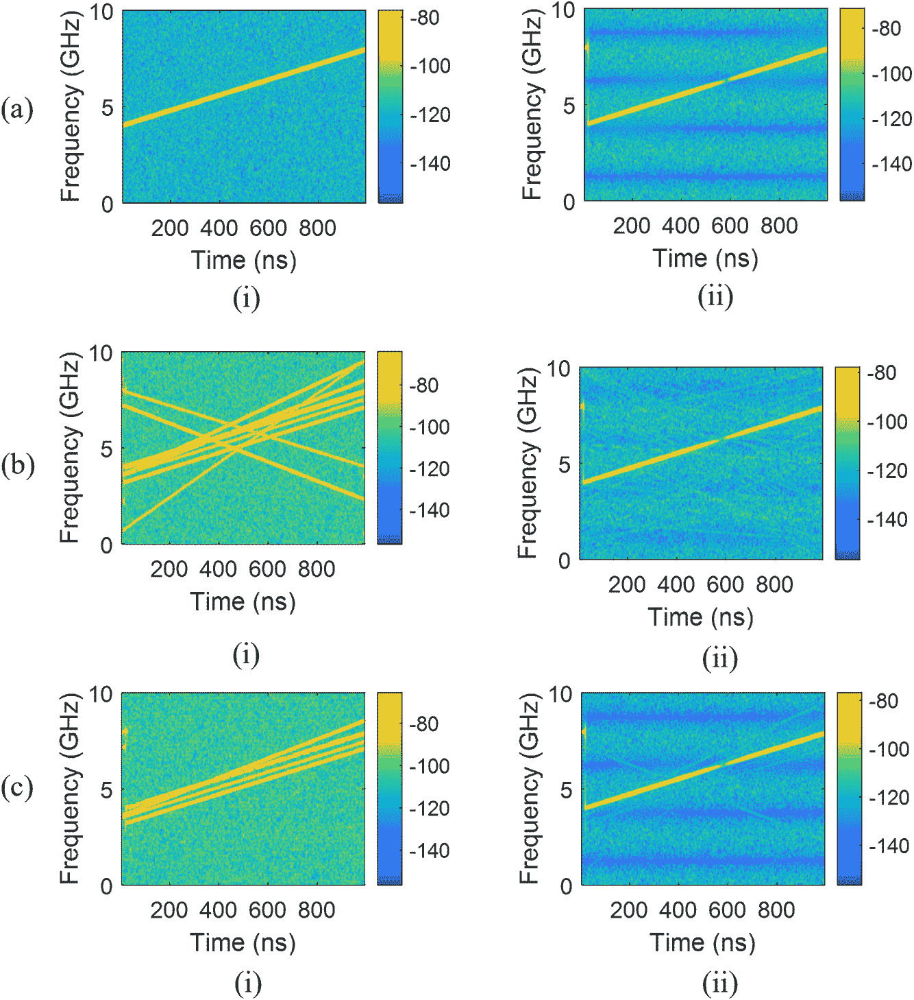

图 10.10 时频图。(a) VR 信号；(i) 发射信号 (Tx) 和 (ii) 回波信号。应用 LSTM-RNN 前的回波信号光谱图；(b-i) 具有多种混合干扰和 (c-i) 具有多种相干干扰。(b-ii) 和 (c-ii) 使用 LSTM-RNN 减轻干扰后的光谱图。

### 距离剖面分析

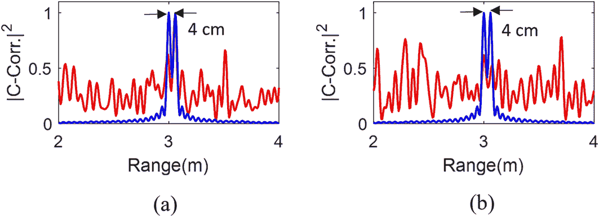

图 10.11 展示了不同测试场景下的距离剖面结果。为了测试目的，在目标回波中加入了相干和非相干干扰信号。图 10.11a 对应于图 10.10b 所示的具有相干和非相干干扰的情况，而图 10.11b 对应于图 10.10b 所示的相干干扰作用于回波信号的情况。深灰色表示使用 LSTM-RNN 减轻干扰后的距离剖面，浅灰色波形表示带有干扰的状态。

## 参考文献

5. S. Pisa, E. Pittella, and E. Piuzzi, “医疗应用的雷达系统概述，” *IEEE Aerospace and Electronic Systems Magazine*, vol. 31, pp. 64–81, 2016.

6. S. C. Steele-Dunne, H. McNairn, A. Monsivais-Huertero, J. Judge, P.-W. Liu, and K. Papathanassiou, “农业冠层雷达遥感：综述，” *IEEE Journal of Selected Topics in Applied Earth Observations and Remote Sensing*, vol. 10, pp. 2249–2273, 2017.

7. A. D. Brown, “反无人机任务中的雷达挑战、现状及未来进展，” *IEEE Aerospace and Electronic Systems Magazine*, vol. 38, pp. 34–50, 2023.

8. S. Chaudhary, L. Wuttisittikulkij, M. Saadi, A. Sharma, S. Al Otaibi, J. Nebhen, et al., “多天气条件下自动驾驶车辆的相干检测光子雷达，” *PLoS One*, vol. 16, p. e0259438, 2021.

9. A. Sharma, S. Chaudhary, J. Malhotra, M. Saadi, S. Al Otaibi, J. Nebhen, et al., “结合频率调制直接检测方案用于恶劣天气自动驾驶车辆的高成本光子雷达，” *Frontiers in Physics*, vol. 9, p. 467, 2021.

10. A. Sharma and J. Malhotra, “基于调频连续波（FMCW）的光子雷达及其不同配置的仿真性研究，” *Optical and Quantum Electronics*, vol. 54, p. 233, 2021.

11. P. Sood, A. Sharma, and Chandni, “FSO 系统（自由空间通信）及其挑战分析——综述，” *International Journal of Computer Applications*, vol. 179, pp. 42–45, 2018.

12. Z. Zhou, H. Zhang, C. Lin, and A. Sharma, “基于极化交替的双二值调制和 CSRZ 调制用于高速 WDM-FSO 传输系统的性能分析，” *Journal of Optical Communications*, vol. 43, pp. 147–152, 2018.

13. K. Shakthi Murugan, A. Sharma, and J. Malhotra, “结合混合 WDM-MDM 方案的 80 Gbps Ro-FSO 系统性能分析，” *Optical and Quantum Electronics*, vol. 52, pp. 1–12, 2020.

14. A. Sharma and V. Kumar, “空间湍流影响下的高速远距离程 DPSK-OFDM-Is-OWC，” *International Journal of Computer Applications*, vol. 975, p. 8887, 2018.

15. A. Sharma and R. Kapoor, “is OWC 中各种挑战的研究：综述，” *International Journal for Research in Applied Science and Engineering Technology (IJRASET)*, vol. 5, pp. 802–807, 2017.

16. S. Chaudhary, D. Thakur, and A. Sharma, “用于 5G 应用的 10 Gbps-60 GHz RoF 传输系统，” *Journal of Optical Communications*, vol. 40, pp. 281–284, 2017.

17. S. Chaudhary, P. Chauhan, and A. Sharma, “用于 WLAN 的高速 4 × 2.5 Gbps-5 GHz AMI-WDM-RoF 传输系统，” *Journal of Optical Communications*, vol. 40, pp. 285–288, 2019.

18. S. Chaudhary, D. Thakur, and A. Sharma, “用于 5G 应用的 10 Gbps-60 GHz RoF 传输系统，” *Journal of Optical Communications*, vol. 40, pp. 281–284, 2019.

19. A. Sharma, V. Mishra, K. Singh, and J. Malhotra, “结合极化分分复用方案用于宽带服务的混合 RoF-RoFSO 系统，” *Journal of Optical Communications*, 2023. [`doi.org/10.1515/joc-2023-0309`](https://doi.org/10.1515/joc-2023-0309)

20. S. S. Panda, T. Panigra, S. R. Parne, L. Sabat, and L. R. Cenkeraddi, “微波光子雷达的进展与未来方向：综述，” *IEEE Sensors Journal*, vol. 21, pp. 2144–2158, 2021.

21. P. Ghelfi, F. Laghezza, S. Serafino, P. Pinna, D. Onori, et al., “雷达系统中的光子学，” *IEEE Magazine*, vol. 16, pp. 74–83, 2015.

22. S. Pan and Y. Zhang, “微波光子雷达，” *Journal of Lightwave Technology*, vol. 38, pp. 5450–5484, 2020.

23. S. Chaudhary, A. Sharma, S. Khichar, X. Tang, X. Wei, and L. Wuttisittulkij, “用于多目标的高分辨率相干光子雷达，” *Journal of Sensor and Actuator Networks*, vol. 11.

24. A. Sharma, S. Khichar, X. Tang, X. Wei, and L. Wuttisittulkij, “用于多目标的高分辨率相干光子雷达，” *Journal of Sensor and Actuator Networks*, vol. 11.

25. A. Sharma, S. Khichar, X. Tang, X. Wei, and L. Wuttisittulkij, “用于多目标的高分辨率相干光子雷达，” *Journal of Sensor and Actuator Networks*, vol. 11.

26. A. Sharma, S. Khichar, X. Tang, X. Wei, and L. Wuttisittulkij, “用于多目标的高分辨率相干光子雷达，” *Journal of Sensor and Actuator Networks*, vol. 11.

27. A. Sharma, S. Khichar, X. Tang, X. Wei, and L. Wuttisittulkij, “用于多目标的高分辨率相干光子雷达，” *Journal of Sensor and Actuator Networks*, vol. 11.

28. A. Sharma, S. Khichar, X. Tang, X. Wei, and L. Wuttisittulkij, “用于多目标的高分辨率相干光子雷达，” *Journal of Sensor and Actuator Networks*, vol. 11.

29. A. Sharma, S. Khichar, X. Tang, X. Wei, and L. Wuttisittulkij, “用于多目标的高分辨率相干光子雷达，” *Journal of Sensor and Actuator Networks*, vol. 11.

30. A. Sharma, S. Khichar, X. Tang, X. Wei, and L. Wuttisittulkij, “用于多目标的高分辨率相干光子雷达，” *Journal of Sensor and Actuator Networks*, vol. 11.

31. A. Sharma, S. Khichar, X. Tang, X. Wei, and L. Wuttisittulkij, “用于多目标的高分辨率相干光子雷达，” *Journal of Sensor and Actuator Networks*, vol. 11.

32. A. Sharma, S. Khichar, X. Tang, X. Wei, and L. Wuttisittulkij, “用于多目标的高分辨率相干光子雷达，” *Journal of Sensor and Actuator Networks*, vol. 11.

33. A. Sharma, S. Khichar, X. Tang, X. Wei, and L. Wuttisittulkij, “用于多目标的高分辨率相干光子雷达，” *Journal of Sensor and Actuator Networks*, vol. 11.

34. A. Sharma, S. Khichar, X. Tang, X. Wei, and L. Wuttisittulkij, “用于多目标的高分辨率相干光子雷达，” *Journal of Sensor and Actuator Networks*, vol. 11.

35. A. Sharma, S. Khichar, X. Tang, X. Wei, and L. Wuttisittulkij, “用于多目标的高分辨率相干光子雷达，” *Journal of Sensor and Actuator Networks*, vol. 11.

36. A. Sharma, S. Khichar, X. Tang, X. Wei, and L. Wuttisittulkij, “用于多目标的高分辨率相干光子雷达，” *Journal of Sensor and Actuator Networks*, vol. 11.

37. A. Sharma, S. Khichar, X. Tang, X. Wei, and L. Wuttisittulkij, “用于多目标的高分辨率相干光子雷达，” *Journal of Sensor and Actuator Networks*, vol. 11.

38. A. Sharma, S. Khichar, X. Tang, X. Wei, and L. Wuttisittulkij, “用于多目标的高分辨率相干光子雷达，” *Journal of Sensor and Actuator Networks*, vol. 11.

39. A. Sharma, S. Khichar, X. Tang, X. Wei, and L. Wuttisittulkij, “用于多目标的高分辨率相干光子雷达，” *Journal of Sensor and Actuator Networks*, vol. 11.

40. A. Sharma, S. Khichar, X. Tang, X. Wei, and L. Wuttisittulkij, “用于多目标的高分辨率相干光子雷达，” *Journal of Sensor and Actuator Networks*, vol. 11.

41. A. Sharma, S. Khichar, X. Tang, X. Wei, and L. Wuttisittulkij, “用于多目标的高分辨率相干光子雷达，” *Journal of Sensor and Actuator Networks*, vol. 11.

42. A. Sharma, S. Khichar, X. Tang, X. Wei, and L. Wuttisittulkij, “用于多目标的高分辨率相干光子雷达，” *Journal of Sensor and Actuator Networks*, vol. 11.


## 参考文献

43. A. Sharma, S. Khichar, X. Tang, X. Wei, and L. Wuttisittulkij, “用于多目标的高分辨率相干光子雷达,” *Journal of Sensor and Actuator Networks*, vol. 11.

44. A. Sharma, S. Khichar, X. Tang, X. Wei, and L. Wuttisittulkij, “用于多目标的高分辨率相干光子雷达,” *Journal of Sensor and Actuator Networks*, vol. 11.

45. A. Sharma, S. Khichar, X. Tang, X. Wei, and L. Wuttisittulkij, “用于多目标的高分辨率相干光子雷达,” *Journal of Sensor and Actuator Networks*, vol. 11.

46. A. Sharma, S. Khichar, X. Tang, X. Wei, and L. Wuttisittulkij, “用于多目标的高分辨率相干光子雷达,” *Journal of Sensor and Actuator Networks*, vol. 11.

47. A. Sharma, S. Khichar, X. Tang, X. Wei, and L. Wuttisittulkij, “用于多目标的高分辨率相干光子雷达,” *Journal of Sensor and Actuator Networks*, vol. 11.

48. A. Sharma, S. Khichar, X. Tang, X. Wei, and L. Wuttisittulkij, “用于多目标的高分辨率相干光子雷达,” *Journal of Sensor and Actuator Networks*, vol. 11.

49. A. Sharma, S. Khichar, X. Tang, X. Wei, and L. Wuttisittulkij, “用于多目标的高分辨率相干光子雷达,” *Journal of Sensor and Actuator Networks*, vol. 11.

50. A. Sharma, S. Khichar, X. Tang, X. Wei, and L. Wuttisittulkij, “用于多目标的高分辨率相干光子雷达,” *Journal of Sensor and Actuator Networks*, vol. 11.

51. A. Sharma, S. Khichar, X. Tang, X. Wei, and L. Wuttisittulkij, “用于多目标的高分辨率相干光子雷达,” *Journal of Sensor and Actuator Networks*, vol. 11.

52. A. Sharma, S. Khichar, X. Tang, X. Wei, and L. Wuttisittulkij, “用于多目标的高分辨率相干光子雷达,” *Journal of Sensor and Actuator Networks*, vol. 11.

53. A. Sharma, S. Khichar, X. Tang, X. Wei, and L. Wuttisittulkij, “用于多目标的高分辨率相干光子雷达,” *Journal of Sensor and Actuator Networks*, vol. 11.

54. A. Sharma, S. Khichar, X. Tang, X. Wei, and L. Wuttisittulkij, “用于多目标的高分辨率相干光子雷达,” *Journal of Sensor and Actuator Networks*, vol. 11.

55. A. Sharma, S. Khichar, X. Tang, X. Wei, and L. Wuttisittulkij, “用于多目标的高分辨率相干光子雷达,” *Journal of Sensor and Actuator Networks*, vol. 11.

56. A. Sharma, S. Khichar, X. Tang, X. Wei, and L. Wuttisittulkij, “用于多目标的高分辨率相干光子雷达,” *Journal of Sensor and Actuator Networks*, vol. 11.

57. A. Sharma, S. Khichar, X. Tang, X. Wei, and L. Wuttisittulkij, “用于多目标的高分辨率相干光子雷达,” *Journal of Sensor and Actuator Networks*, vol. 11.

58. A. Sharma, S. Khichar, X. Tang, X. Wei, and L. Wuttisittulkij, “用于多目标的高分辨率相干光子雷达,” *Journal of Sensor and Actuator Networks*, vol. 11.

59. A. Sharma, S. Khichar, X. Tang, X. Wei, and L. Wuttisittulkij, “用于多目标的高分辨率相干光子雷达,” *Journal of Sensor and Actuator Networks*, vol. 11.

60. A. Sharma, S. Khichar, X. Tang, X. Wei, and L. Wuttisittulkij, “用于多目标的高分辨率相干光子雷达,” *Journal of Sensor and Actuator Networks*, vol. 11.

61. A. Sharma, S. Khichar, X. Tang, X. Wei, and L. Wuttisittulkij, “使用半导体激光器的多线性频分线性频率调制微波产生,” *IEEE Photonics Technology Letters*, vol. 35, pp. 821–824, 2023.

62. E. Eliahu, S. Ganji, S. Williams, “利用光频复用的光子产生周期振荡,” *Optical and Quantum Electronics*, vol. 55, p. 797 of 2022.

63. Q. Guo, F. Zhang, P. Pan, “利用光频四倍产生双频 LFM,” *IEEE Photonics Technology Letters*, vol. 29, pp. 1320–2273, 2017.

64. B. Nakarmi, G. Bakhtiyarov, “用于毫米雷达的低噪声光子混频,” *Nature Communications*, vol. 12, p. 4397, 2021.

65. F. Zhang, Q. Guo, P. Pan, “利用光频四倍产生双频 LFM,” *IEEE Photonics Technology Letters*, vol. 29, pp. 1320–2273, 2017.

66. S.-C. Chan, S.-K. Hwang, and J.-M. Liu, “使用光注入激光器的光子微波周期振荡,” *Optics Express*, vol. 15, pp. 14921–14935, 2007.

67. X.-Q. Qi and J.-M. Liu, “双光光注入激光的动力学场景,” *IEEE Journal of Quantum Electronics*, vol. 47, pp. 762–769, 2011.

68. B. Nakarmi, B. Y. Song, H. N. Parajuli, I. A. Ukaegbu, W. Xiangchun, and S. Pan, “使用半导体激光器的多线性分线性频率调制微波产生,” *IEEE Photonics Technology Letters*, vol. 35, pp. 821–824, 2023.

69. H. N. Parajuli, G. Bakhtiyarov, B. Nakarmi, and I. A. Ukaegbu, “基于 LSTM 的循环神经网络多雷达环境下的干扰消除,” 在 *International Conference on Intelligent Human Computer Interaction*, Ahmedabad, India, 2023, pp. 151–161.

70. W.-Q. Wang and H. Shao, “用于分布式雷达传感器网络的雷达间间干扰抑制,” *Remote Sensing*, vol. 6, pp. 740–755, 2014.

40. G. M. Brooker, “毫米波雷达系统的相互干扰,” *IEEE Transactions on Electromagnetic Compatibility*, vol. 49, pp. 170–181, 2007.

41. J. Bechter and C. Waldschmidt, “通过重建和消除干扰分量减轻汽车雷达干扰,” in *2015 IEEE MTT-S International Conference on Microwaves for Intelligent Mobility (ICMIM)*, 德国海德堡, 2015 年 4 月 27–29 日, pp. 1–4.

42. S. Chaudhary, A. Sharma, S. Khichar, Y. Meng, and J. Malhotra, “复杂交通场景下基于 SVM 的光子雷达多目标检测增强自动驾驶导航,” *Scientific Reports*, vol. 14, p. 17339, 2024.

43. S. Chaudhary, A. Sharma, M. A. Naeem, and Y. Meng, “挑战性环境下的目标检测：用于 5G 自动驾驶的混合复用方案光子雷达,” *Sustainability*, vol. 16, p. 991, 2024.

44. S. Chaudhary, A. Sharma, K. Singh, S. Khichar, and J. Malhotra, “在恶劣天气下结合 MDM-WDM 和机器学习分类器的高效光子雷达,” *Plos One*, vol. 19, p. e0300653, 2024.

45. Z. Xu 和 Q. Shi, “使用正交噪声波形减轻汽车雷达的干扰,” *IEEE Geoscience and Remote Sensing Letters*, vol. 15, pp. 137–141, 2017.

46. F. Uysal, “相编码 FMCW 汽车雷达：系统设计与干扰减轻,” *IEEE Transactions on Vehicular Technology*, vol. 69, pp. 270–281, 2019.

47. Y.-S. Son, H.-K. Sung, and S. W. Heo, “使用单车调频序列减轻汽车调频连续波雷达干扰,” *Sensors*, vol. 18, p. 2831, 2018.

48. C. Ma, Y. Yang, F. Cao, X. Wang, X. Liu, C. Meng, 等, “具有稀疏步频调频信号的高分辨率微波光子雷达,” *IEEE Transactions on Geoscience and Remote Sensing*, vol. 60, pp. 1–10, 2022.

49. F.-Y. Lin 和 J.-M. Liu, “使用非线性激光动力学的混沌雷达,” *IEEE Journal of Quantum Electronics*, vol. 40, pp. 815–820, 2004.

50. H. N. Parajuli, B. N Nakarmi, A. Ashimbayeva, and I. A. Ukaegbu, “抗干扰光子产生正交对多调频-LFM 波形,” in *2023 国际微波光学专题会议 (MWP)*, 中国南京, 2023 年 10 月 15–18 日, pp. 1–4.

51. G. Galati 和 G. Pavan, “用于多通道应用的正交互补雷达信号,” in *2011 第 8 届欧洲雷达会议*, 英国曼彻斯特, 2011 年 10 月 12–14 日, pp. 178–181.

52. T. Oyedare, V. K. Shah, D. J. Jakubisin, and J. H. Reed, “深度学习抑制抑制：当前方法与开放挑战,” *IEEE Access*, vol. 10, pp. 66238–66266, 2022.

53. J. Rock, W. Roth, M. Toth, P. Meissner, and F. Pernkopf, “用于汽车雷达干扰减轻的资源高效深度神经网络,” *IEEE Journal of Selected Topics in Signal Processing*, vol. 15, pp. 927–940, 2021.

54. J. Wang, R. Li, X. Zhang, and Y. He, “基于空洞卷积对比学习的汽车 FMCW 雷达干扰减轻,” *IEEE Transactions on Intelligent Transportation Systems*, vol. 25, pp. 545–558, 2023.

55. J. Fuchs, A. Dubey, M. Lübke, R. Weigel, and F. Lurz, “使用卷积自编码器的汽车雷达干扰减轻,” in *2020 年 IEEE 国际雷达会议 (RADAR)*, 美国华盛顿特区, 2020 年 4 月 28–30 日, pp. 315–320.

56. M. Rameez, S. Javadi, M. Dahl, and I. Pettersson, “使用 Bi-LSTM 用于汽车雷达减轻的信号重建,” in *2021 第 18 届欧洲雷达会议 (EuRAD)*, 英国伦敦, 2022 年 4 月 5–7 日, pp. 74–77.

57. J. Hille, D. Auge, and A. Knoll, “使用循环神经网络进行 FMCW 雷达检测,” in *2022 雷达会议 (RadarConf22)*, 纽约州纽约市, pp. 1–6.

58. R. Koizumi, X. Wang, “基于 RNN 的雷达仿真评估,” in *2023 国际人工智能会议 (ICAI)*, 印度尼西亚巴达, pp. 242–23.

59. S. Hochreiter, M. Parajuli, 等, “Long-term Memory,” *Journal of Computation*, 1997.

60. M. Gopp, A. Ashimbayeva, 等, “基于滑动窗口的光子干扰,” *Journalwave Technology*, vol. 42, pp. 756–757.

## 索引

### 深度学习
7, 9, 10, 20, 22, 48, 52, 62, 122, 128, 154, 160, 209, 216, 217, 230

### F

*   **自由空间光通信 (FSO)**: 2, 17, 209, 210, 217
*   **未来**: 15, 22, 23, 63, 106, 128, 129, 192

### G

*   **遗传算法 (GA)**: 68, 80, 81, 83, 85, 89, 94, 102, 104, 106, 175, 182, 192
*   **灰狼优化器 (GWO)**: 80, 81, 83, 85, 87, 88, 94, 103, 105, 106, 146, 148

### I

*   **物联网 (IoT)**: 2, 13, 18, 19, 23, 48, 114, 121, 124, 153, 154

### L

*   **长短期记忆网络 (LSTM)**: 68, 120, 121, 173, 231, 235
*   **线性调频调制 (LFM)**: 216, 218, 220, 231

### M

*   **机器学习**: 1, 2, 6, 8, 39, 41, 46, 49, 51, 54, 62, 68, 113, 114, 118, 121, 128, 157, 158, 191, 192, 209, 210
*   **移动边缘计算 (MEC)**: 71, 114, 126, 128, 130
*   **多输入多输出 (MIMO)**: 2, 5, 9, 10, 17

### N

*   **网络**: 3, 5, 7, 9, 11, 13, 16, 18, 22, 39, 40, 43, 46, 48, 51, 61, 66, 68, 69, 72, 79, 122, 123, 129, 167, 168
*   **神经网络**: 7, 9, 46, 51, 52, 71, 115, 169, 173, 209

### O

*   **优化**: 7, 12, 18, 39, 42, 45, 51, 63, 65, 79, 82, 83, 85, 97, 101, 102, 125, 127, 146, 148, 180, 183, 185, 191, 193, 195
*   **光通信**: 3, 5, 15, 16, 18
*   **光无线 (OWC)**: 208

### P

*   **粒子群优化 (PSO)**: 80, 81, 83, 87, 94, 103, 105, 106, 146, 148, 192

### R

*   **射频 (RF)**: 1, 5, 17, 63, 200, 225, 228

### V

*   **虚拟现实 (VR)**: 5, 124, 219, 225, 228, 231, 232, 234, 235

### W

*   **波分复用 (WDM)**: 2, 3, 7, 16
*   **无线传感器网络 (WSN)**: 79, 85, 90, 92, 102, 104, 106
