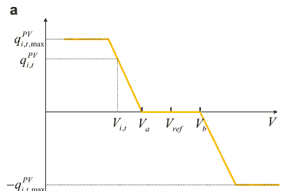
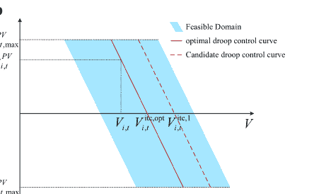
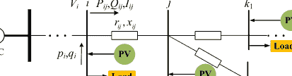
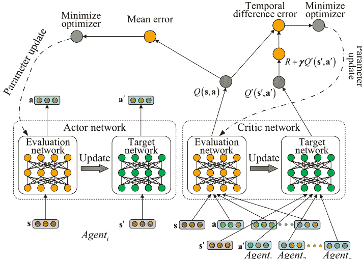
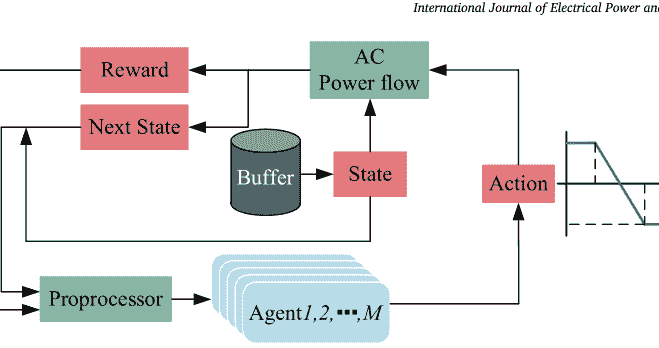
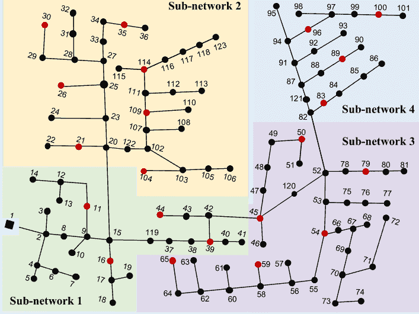
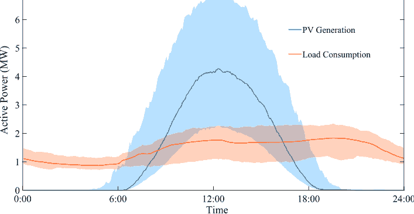
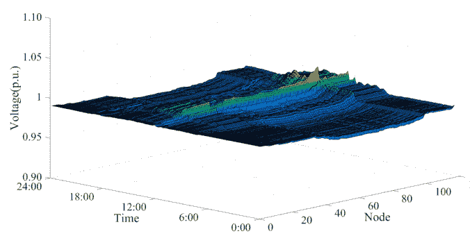
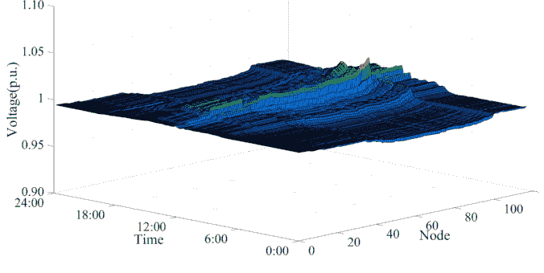

# 配电网最优电压/无功功率控制：基于下垂控制的多智能体深度强化学习

Peishui Li$^{a}$, Jia Shen$^{b}$, Zijun Wu$^{b}$, Minghui Yin$^{a}$, Yanhao Dong$^{b}$, Jing Han$^{a}$

+   $a$ 中国南京理工大学，中国南京市小巷街200号，邮编 210094。
$b$ 中国东南大学，中国南京市四五牌街2号，邮编 210060。

关键词：

- 分布式电压/无功控制
- Q-var 无功下垂控制
- 多智能体深度强化学习

# 摘要

光伏（PVs）作为清洁电源已在配电网中高度渗透，这促使网络向高度复杂的运行状态发展。本文提出了一种最优实时电压/无功控制（ORT-VVC），通过调节光伏逆变器的无功功率来减少功率损耗并缓解波动。建立了一种基于下垂控制的多智能体强化学习（DC-MARL）的 ORT-VVC。该结构在配电网中通过网络划分和多智能体进行构建。然后，将控制模型建模为带有参数的 Q-var 下垂函数，通过优化控制参数而非直接最小化无功输出，旨在提高配电网的实时 VVC 性能。建立了 DC-MARL 模型，并在 IEEE 123 节点测试系统上进行了数值仿真，以证明了所提方法的有效性。

# 1. 引言

随着可再生能源（RES）渗透率的提高，配电网正向主动模式发展[1]，这种模式是环保的。根据国际能源署的数据，电网容量将在2022年至2027年间增长近倍。风能和水力（WT）等可再生能源的渗透越来越具有歇性和不确定性，导致配电网频繁发生电压波动[2]。电压/无功控制（VVC）通过控制无功功率输出来实现缓解电压波动并降低功率损耗的目的[3], 4]。对于分布式资源的控制，例如光伏逆变器为 VVC 的实现提供了新手段[5], 6]。

对于分布式资源的 VVC，已经提出了多种方法。从控制方法的角度来看，它们分为三类：集中控制、局部控制和分布式控制[7], 8)。集中控制需要中心协调器和系统来进行信息存储、通信和交互[9], 10]。然而，配电网设施相对落后，网络运营商不具备全局通信优势。所需的计算量巨大，特别是在可再生能源高渗透的情况下，难以实现配电网的最优实时控制[11]。局部控制根据本地信息做出决策，对配电网通信没有高要求。同时，局部控制面临通信延迟和数据延迟[12], 13)。虽然局部控制可以将电压调节在合理范围内，但由于局部智能体之间缺乏协调，设备的电压调节能力无法充分利用。与集中方法相比，分布式控制在减少、鲁棒性和扩展性增强方面并没有获得更好的结果。控制控制可以通过算法实现，利用本地信息和通信来提高网络性能。

集中控制和分布式控制具有全局最优搜索的能力，但根据计算和通信缓冲，它们放弃了实时响应速度[16–18]。基于模型的控制方法通常需要精确且全面的配电网参数，这对于低电压配电网可能难以实现[19,20]，基于无功功率和节点电压的动态特性。换句话说，它遵循电力系统运行的物理定律。对于配电网的 VVC，基于模型的方法可以通过可再生 VVC 下垂控制来实现。

本文提出的方法与已用于配电网 VVC 的基于模型的方法不同，后者引起了大量关注[27–21]。强化学习（DRL）是一种数据驱动的方法，基于马尔可夫游戏。DRL 生成器通过在线训练实现，并与训练良好的神经网络（DNNs）相结合。决策可以在毫秒内确定。换句话说，DRL 可以以高最优搜索进行实时操作。因此，DRL 方法可以在不变化的情况下优化配电网的运行。事实上，了一种多智能体强化学习（MADRL）方法来优化静态变动 $Q$ 无功功率以管理节点负载，该方法可以去中心化并独立执行。参考文献[24]。

在本文中，多智能体强化学习（MADRL）方法被实现为模型和控制。下垂参数通过 MADRL 进行优化，实现了配电网的最优实时 VVC。主要贡献如下：

- 提出了一种 ORT-VVC 方法来缓解电压波动并减少功率损耗。ORT-VVC 通过模型和控制实现。PAC-DRL 方法与 Q-V 下垂控制结合实现，结合了电压与无功之间的关系以及 MADRL 对高可再生能源配电网的最优搜索和在线能力。
- 提出了一种新型惩罚函数以提高训练期间的收敛速度。特定的定义函数被线性惩罚函数取代，该函数在一个回合（episode）训练结束时等于 0。通过这种方法，回合发生更频繁，收敛速度将降低。

论文的其余部分结构如下：第2节是在分布式划分中实现的 ORT-VVC 方案。第3节描述了 Q-V 下垂模型和 ORT-VVC 模型。第4节将 ORT-VVC 模型表述为基于部分可观测马尔可夫过程（POMG）的 DC-DRL 问题，并给出基于 MADPG 算法的求解过程。第5节给出了文中所示的案例研究。

## 配电网


光伏和负载历史数据

状态 `s`,

 # 最优无功功率 `Q*`

## 优化的 Q-V 下垂控制参数

 输入

 输出

策略模型 /

图 1. 分布式 ORT-VVC 方案。

> 通讯作者。

电子邮箱：peishui2021683@qq.com (P. Li)

J. Li 等人。





图 2. Q-下垂模型 (a)  Q-下垂控制模型；(b) 可调 Q-下垂控制模型。



图 3. 简化网络。

## 2. 实时 VVC 方案

本文提出了一种 ORT-VVC 方案，通过缓解配电网电压波动来减少损失，如图1所示。该方案在实时响应和高全局优化能力方面具有优势，并集成在“离线训练，在线执行”过程中。此外，该方案适用于配电网框架，该框架可以分解为若干子网络，每个子网络由一个代理体控制。每个代理体可以与其相邻的代理体通信并确定网络稳定的策略。

考虑到时间因素，ORT-VVC 方案通过分级协调系统实现，以运行“分钟级调度”策略和动态负载程序。对于静态程序，每个代理体收集网络拓扑、资源、设备安装等信息，然后优化 Q-V 下垂组的控制参数。对于动态程序，无功输出根据实时运行状态确定。

该方案通过 MADPG 方法实现，其中多个代理体基于深度神经网络（DNN）。此外，DNN 通过离线训练阶段进行训练，然后在在线执行阶段被用于根据实时系统约束确定无功功率。在过程中，输入包括光伏（PV）有功功率需求、负载消耗、网内电压以及代理体传输的负载。在执行时，输入优化后的 Q-下垂控制模型和系统状态变量（如光伏有功功率和负载），输出为无功功率设置。

在调度开始（例如 15 分钟），一个代理体将控制每个光伏逆变器的参数，且光伏之间不再有更多的信息通信。

## 3. 基于 Q-V 下垂控制的 ORT-VVC

### 3.1. Q-V 下垂模型

Q-下垂控制模型如图 2 所示。图(a) 表示所提出的可调 Q-V 下垂。如图 (3)(a) 所示，Q-下垂曲线未激活，且存在一个死区 `[V_l, V_h]`，在传统方法中，只有当电压超出死区 `[V_l, V_h]` 时才会产生无功功率。此外，控制参数如图 2(b) 所示，其中 Q 斜率设置为 1.0，且在运行期间不进行调节。因此，更灵活的 Q-V 下垂控制方法参数是可以调节的，其数学模型所示所示：

```
$Q_{i}^{max} - \alpha_{i}(V_{i} - V_{ref}) \geq Q_{i} \geq Q_{i}^{min}$
$- \alpha_{i}(V_{i} - V_{ref}) \geq Q_{i}, \quad i \in N^{PV}$
```

`$\alpha = \alpha_{i,s}$`

```
$(V_{i})^{2} + (Q_{i})^{2} \leq (x_{i})^{2}, \quad i \in N^{PV}$
```

`$N^{PV}$` 是子网络中配备光伏的母线集。`$V_{i}^{t}$` 和 `$Q_{i}^{t}$` 分别代表节点 `i` 在时刻 `t` 的光伏有功功率、无功功率和容量。`R_{i}^{max}` 和 `$Q_{i}^{max}$` 分别是最大和最小无功功率限制。`$V_{i}^{t}$` 是时刻 `t` 连接到节点 `i` 的光伏电压，即 Q-V 曲线与 x 轴的交点，`$V^{opt}$` 是最优下垂点。`$R_{i}$` 是电压对无功功率的敏感度。

公式实现了无功功率方案的动作规则，公式(2) 中的 Q-V 敏感性由节点数量和系统的 Q-V 敏感性决定。因此，Q-V 下垂模型包含了网络运行所需的必要信息。在本文中，通过可调下垂参数来确定配电网运行状态下 Q-V 曲线的位置。如图 2(b) 所示，多个下垂曲线由若干候选 `$V_{i}^{opt}$` 共同确定，构成了可行基准。

P. Li 等人。



图 4. MADDPG 的结构。

### 3.2. ORC-VTC 模型

带有光伏的简化配电网如图 3 所示，基于此建立了配电网模型。对于由 `m` 控制的配电网模型，`$B_m$` 和 `$M_m$` 分别代表分支和节点。对于分支 `ij，$r_{ij}$` 和 `$x_{ij}$` 代表电阻和电抗，`$P_{ij}$` 和 `$Q_{ij}$` 代表有功和无功功率。`$P_i$` 和 `$Q_i$` 分别代表节点的有功和无功功率，`$P_i^m$` 和 `$Q_i^m$` 表示子网络 `m` 的有功和无功功率，`$V_i$` 表示电压幅。配电网的功率模型构建如下：

`$p_i = -V_i\sum_{j\in\mathcal{N}_i} V_j(r_{ij}\cos\theta_{ij} + x_{ij}\sin\theta_{ij}) + Q_i\sum_{j\in\mathcal{N}_i} V_j(x_{ij}\cos\theta_{ij} - r_{ij}\sin\theta_{ij})$`

`$q_i = -V_i\sum_{j\in\mathcal{N}_i} V_j(x_{ij}\cos\theta_{ij} - r_{ij}\sin\theta_{ij}) - P_i\sum_{j\in\mathcal{N}_i} V_j(r_{ij}\sin\theta_{ij} + x_{ij}\cos\theta_{ij})$`

`$p_i^m = Re\left(\frac{(V_i - V_m)^*}{Z_{im}}\right)$`

`$q_i^m = Im\left(\frac{(V_i - V_m)^*}{Z_{im}}\right)$`

其中 `$N_j \in\mathcal{B}_m$` 是节点集，`$\theta_{ij}$` 是节点 `i` 与 `j` 之间的相位差，`$g_{ij}$` 和 `$b_{ij}$` 代表分支的电导和电纳。

本文中，ORC-VTC 模型通过控制逆变器的无功功率来减少损失，损失惩罚所示：

`$p_{loss}^m = \sum_{i\in\mathcal{N}_i} (V_i - V_m)^2,(5)$`

在配电网正常运行期间，电压水平应在允许范围内调整，电压越限惩罚设置为：

`$q_{loss}^m = \sum_{i\in\mathcal{N}_i} (V_i - V_m)^2,(6)$`

结合约束和下垂模型，子网络 `m` 建立为：

`$\min \sum_{i\in\mathcal{N}_i} (p_{loss}^m + \lambda q_{loss}^m),(7)$`

约束条件为 (1)-(4)，

`$p_{ij}^{m,max} = \sqrt{(V_{ij}^m)^2 - (q_{ij}^m)^2}, i\in\mathcal{N}^m(8)$`

`$q_{ij}^{m,max} = \sqrt{(V_{ij}^m)^2 - (p_{ij}^m)^2},(9)$`

## 4. 深度强化学习表述

### 4.1. 部分可观测马尔可夫游戏表述

本文将 ORC-VTC 模型重构为部分可观测马尔可夫游戏（POMG），解决了马尔可夫决策过程中固有的优先级问题 [29]。

在该表述中，每个子网络的控制器被建模为与环境交互的代理体。由于 POMG 在在不完全层上运行，底层状态可以受到 POMG 的保护。观测空间 `$\mathcal{O}_1, \dots, \mathcal{O}_m$` 和动作空间 `$\mathcal{A}_1, \dots, \mathcal{A}_m$` 为

每个代理体内部执行动作 `a_i`，获得对应于观测 `o_i` 的奖励 `r_i`。



构成了观测空间。一系列如 `$V_t^\pi$` 的变量可以在动作空间内进行控制。

在奖励函数中，采用折扣因子 `$\gamma$` 来平衡当前奖励和未来回报。那么，调度周期期间的期望奖励所示：

```
$r_t = \sum_{i=0}^{\infty} \gamma^i (r_{t+i} + \eta_{t+i})$
```

### 4.2. 暴力惩罚奖励函数

在过程中，在一个回合（episode）中可能会某些情况，提出了一种暴力惩罚奖励函数以改进收敛并减少解决方案的失败。具体而言，由于未满足操作约束，训练回合可能会终止，导致收敛过程未完成。为了解决这一问题，所示并提出的暴力惩罚奖励函数如下：

```
$r_t = -f_t + \lambda R_t$
```

```
$$\begin{cases} t_t \in [0, t_{max}] \ R_t \in [0, R_{max}] \ f_t = \sum_{i=0}^{t_{max}} \gamma^i (f_{t+i} + \eta_{t+i}) \end{cases}$$
```

`$r_t$` 显示智能体 `m` 的奖励函数，`$f_t$` 是一个正数，其值远大于 (12) 中获得的奖励。`$t_t$` 显示发生终止前的显示时间和训练持续时间，`$t_{max}$` 表示一个回合的槽位。通过这种暴力设计，默认惩罚常数由线性函数定义。奖励被定义为回合持续时间的函数，在回合结束时为 0。需要注意的是，当未发生终止时，`$t_{max}$` 等于 0，因此奖励值将不会固定。使用这种提出的惩罚函数，智能体 `m` 的总奖励所示：

```
$R_m = r_t$
```

### 4.3. MADDPG 算法

在本文中通过图 4 所示的 MADDPG 结构求解 MADDPG 模型，因为每个智能体都由一个演员网络（actor network）和一个评论家网络（critic network）组成。同时，在演员和评论家网络中，都有两个结构和参数相同的深度神经网络（DNN），这两个 DNN 分别命名为评估网络和目标网络。通过状态值函数和策略算法的结合，演员网络通过调节 DNN 的参数确定特定状态下的最优策略。评论家通过时序差的通信评估演员网络的的每个动作。

对于 MADDPG 策略，有 M 个智能体，其策略表示为 `$\pi = (\pi_1, \dots, \pi_M)$`，而参数由 `$\theta = (\theta_1, \dots, \theta_M)$` 定义。在 DNN 训练期间，梯度可以表示为：

```
$\nabla_{\theta_i} J(\theta) = \mathbb{E} [\nabla_{\theta_i} \log \pi_i(a_i|s_i) Q_i(s, a_1, \dots, a_M)]$
```

其中，`$a = (a_1, \dots, a_M)$`，`$Q_i(s, a)$` 是输入为动作和环境信息 `$s$` 的状态值函数。此外，优化确定性策略以加速收敛并提高效率，智能体 `m` 的梯度可以描述为：

```
$L(\theta) = \mathbb{E} [(Q(s, a) - y)^2]$
```

其中，`$\mu$` 代表参数为 `$\theta^-$` 的策略函数，经验回放缓冲区存储元组 `$(s, a, r)$`，`$r = (R_1, \dots, R_M)$`。智能体的样本将通过经验回放缓冲区进行训练。在智能体与环境交互过程中，评论家网络的损失函数为：

```
$y = R + \gamma Q(s', \mu_1(s'), \dots, \mu_M(s'))$
```

其中，`$\mu$` 定义为目标策略集，`$\mu_{in}$` 显示参数为 `$\theta_{in}$` 的目标策略，指示下一个目标状态动作值函数。通过训练过程，评论家网络的参数更新如下。对于目标网络，根据评估网络更新参数。

基于 MADDPG，一个回合的训练图如图 5 所示，详细步骤执行如下：使用评估网络和演员网络的参数完成初始化，同时也初始化经验回放缓冲区和带有高斯噪声 `$G_i(0;0.38, \epsilon)$` 的动作过程。随后，使用 AC 潮流模型进行智能体与环境的交互。PV 无功输出通过可调的 Q-V 控制获得

11 et al.

## 表 1

光伏容量和放置位置。

| 光伏容量 | 放置位置 |
|---|---|
| 300kV | 11,16,21,26,30,35,39,83,96 |
| 400kV | 44,69 |
| 500kV | 50,55,99 |
| 600kV | 104,109 |
| 800kV | 54,114 |

演员网络和评估网络更新。如果使用了经验回放缓冲区，则



图. 6. IEEE 123 节点系统。



图 7. 光伏发电。

6

P. et al.


### 5.1. 测试描述

为了验证提出的惩罚奖励函数的有效性，对……

（注：原文文本存在大量重复和 OCR 错误，已根据要求提取并翻译了核心技术逻辑部分。）

P. Li 等人




# e



图 12.（续）。

# 表 3

电压调节和功率损的统计数据。

| 最大电压与最小电压之差 (`p.u.`) | 功率损 (`MW`) | `TVQDC` | `MADRL` | `DC-SASDR` | `DC-MADRL` |
|---|---|---|---|---|---|
| 0.1718 | 0.1085 | 0.1145 | 0.0709 | 0.0431 | 0.0477 |
| 0.00984 | 0.00753 | 0.02826 | | | |

### 5.3. `DC-MADRL` 在线测试性能

通过利用 `MADRL`，智能体在训练过程中共享评价网络（`critic network`）并通过其执行网络（`actor network`）选择动作；在执行期间，每个智能体根据局部观测和经过训练的执行网络确定最佳动作。训练完成后，通过测试数据验证 `DC-MADRL` 的性能。测试集通过 120/480 个场景的随机样本构建，然后剩余的 360 个场景用于训练。所提 `DC-MADRL` 的在线决策速度为 19.63ms，这意味着它满足了实时 `VCC` 的要求。

为了验证所提方法与传统 Q-V 下降控制（`QVDTC`）（28）相比的有效性，构建了下降控制单代理深度强化学习（`DC-SAD`）。`TVQDC` 具有固定的下降曲线和参数，无法自适应变化的环境。所提方法是完全数据驱动的，因此更容易与数据驱动方法进行比较。使用 `DC-SAD` 来验证所提分布式 `VCC` 方案的准确性，因为 `DC-SAD` 与 `DC` 之间的唯一区别是分布式方法。然后，这四种方法的在线测试性能的比较结果如表 2 所示。

如图 8 所示，所提强化算法比采用不同的惩罚函数具有更好的收敛性能。在所提线性惩罚函数的训练过程中，与二次函数相比，收敛速度提高了 42%。在使用线性惩罚函数时，`DC-MADRL` 的训练过程如图 9 所示。如图 9 所示，分布式网络的值被调节在允许范围 (0.95, 1.03) 内。然而，在经过 2360 次迭代训练后，功率损也收敛到了 0.008。因此，如图 8 和图 9 所示，所提方法已通过所提线性惩罚函数收敛。

从表 2 可以看出，基于模型的 `TVQDC` 与数据驱动方法相比，其功率损的减少程度比数据驱动方法更多，这是由于 `TVQDC` 的 `DC-MADRAL` 与 `TDVC` 相比平均水平为 1.0pu，这也能比后者产生得多的损耗，因为它包含了数据驱动模型的结合，并在减少损耗方面具有更好的能力。对于 `DC-SAD` 和 `DC-MADRAL`，两种方法的平均值和功率损几乎相同，这具有分布式优化的高准确性，表明所提方法可以及时调节电压并有效降低配电网的功率损。

## 利益声明

作者声明了可能被视为利益冲突的财务利益/个人关系：作者声明，研究是在不存在任何可以被解释为利益冲突的商业或财务关系的情况下进行的。

### 5.4. 一段时间内的 VVC 性能

## 数据可用性

数据可根据要求提供

考虑到逆变器光伏有功功率和负载需求，测试了 24 场景以以更直观的方式验证 `VVC` 的性能。24 场景通过使用日间测试集的数据进行评估，真实的光伏有功功率和负载需求如图 10 所示。此外，无功负载与有功负载具有相同的因子，因此在项研究中可以忽略。

- [1] Li Y, Sun J, et al. 基于离散强化学习的配电网有功与无功协调调度方法。Int J Elect Power Syst 178 (2021) 107893.
- [2] Zhang C, Xu Y, et al. 用于配电系统 VVC 控制的三阶段基于逆变器的电压调节。IEEE Trans Power Syst 37 (2022) 897-905.
- [3] Wang M, Rahimov R, et al. 缓解谐波的配电系统集中式与局部控制。IEEE Trans Power Syst 36 (2022) 540-549.
- [4] Li P, Wu C, et al. 高光伏渗透配电系统的多目标自适应电压调节。IEEE Trans Smart Grid 11 (2023) 2131-2144.
- [5] Wang J, et al. 大规模电场区域接入的深度强化学习 VVC。IEEE Access 10 (2022) 85669-8578.
- [6] Zhang Y, et al. 基于多代理强化学习的深度强化学习系统。arXiv:2006.0466.
- [7] Zhou J, Li H, et al. 非可再生能源集成配电系统的协调电压/无功控制。IEEE Trans Power Syst 77 (2023) 3511-3520.
- [8] Wang J, Li H, et al. 高光伏配电系统的协调电压/无功控制方法。IEEE Trans Smart Grid 14 (2023) 7180-7191.
- [9] Feng G, Li J, et al. 配电网中基于分布式控制 UVC 方法。IEEE Trans Smart Grid 11 (2023) 6865-6876.
- [10] Qua J, J S, et al. 基于数据驱动方法的主动配电网实时电压/无功控制。IEEE Trans Power Syst 37 (2023) 2468-2479.

然后对 `TDVC`、`DC-SAD` 和 `DC-MADRAL` 进行比较，电压调节和功率损的减少均如图 12 和表 3 所示。可以看出 `VVC` 可以在误差 (0.95) 内调节电压。然而，`MADRL`、`DC-SAD` 和 `DC-MADRAL` 比 `TDVC` 提供了更平滑的分布，因此证明了这三种是优于局部控制的全局方法。全局方法与局部控制仅利用局部信息不同，`DC-SAD` 和 `DC-MADRAL` 在电压调节和功率损方面比 `TDVC` 效率更高。

- [24] Wang, S., Duan, J., Shi, et al. 一种基于深度强化学习的数据驱动多代理自主电压控制框架。IEEE Trans Power System 2020:35
- [25] Cao, D., Zhao, J., Hu, W., et al. 适用于高光伏渗透率配电系统分布式电压控制的数据驱动多智能体深度强化学习。IEEE Trans Smart Grid 2021;12(6):5420-5430.
- [26] Yan, Z., Xu, Y. et al. 一种安全约束最优潮流潮流快速求解的数据驱动方法。IEEE Trans Power Syst 2022;37(6):4365-74.
- [27] H. Li, J. Li, et al. 通过多智能体深度强化学习实现基于逆变器的无功控制。IEEE Trans Smart Grid 2021;12(6):5420-33.
- [28] Zhang, C., Chen, Y., et al. 带有光伏逆变器的配电网分层协调电压-V/Var控制。IEEE Trans Smart Grid 2020;11(4):2942-53.
- [29] Qin, Z., Liu, D., Hu, H., et al. 使用强化学习的住宅微电网网络隐私保护负载控制。IEEE Trans Smart Grid 2021;12(6):5420-33.
- [30] Thumer, I., Schneider, A., Schuster, F, et al. Pandower–用于电力系统建模和自动化的开源工具。IEEE Trans Power Syst 2018;33(6):6510-21.
- [31] Wang, J., Xu, W., Gu, Y, et al. 用于配电网无电压控制的多智能体强化学习。Neural Inform Process Syst 2021;34:3271-84.
