# 网络安全措施最优支出：风险管理

**塔拉·基顺** 是一位多重认证的 IT 风险与安全领导者，在技术领域拥有超过 20 年的经验，在金融服务行业拥有 13 年的经验。她在大型组织的技术、IT 风险和信息安全项目与计划中持续取得成功。她被公认为领导者、安全架构师和值得信赖的顾问，擅长与跨职能团队合作，实现短期和长期的业务目标。

# 前言

本书的目的是讨论组织在使用概念性网络安全风险管理框架时进行网络安全投资的决策过程。大多数概念模型考虑动态环境，该环境可适应决策过程中发生的变化。这些模型和框架依赖于特定场景或受控条件。由于网络安全行业内部的动态环境，缓解策略不断演变以应对新兴行业威胁。这些变化影响了先前框架和经济模型中使用的条件。组织内部关于网络安全支出的决策因利益相关者而异——具体来说，可用资金与合规所需推荐安全措施之间的对比。这些高管决策可能因对组织内保护相关信息资产所需的适当安全基线的偏见而带有色彩。实施安全措施的成本与实施所获益处之间的权衡不易衡量。因此，缺乏此信息可能会影响企业领导者为安全措施提供资金的决策，以及为推动创新、业务增长和客户满意度而进一步投资于开发新技术的选择。

本书关注组织在实施网络安全措施时所做的战略决策，属于风险管理领域，借鉴了 (1) 经济学、(2) 组织决策和 (3) 网络安全领域内的各种模型，以确定网络安全措施的最优支出，其中包括面向承担风险组织的预防性方法。本书提供了一个网络安全风险管理框架，并通过案例研究展示了该流程的应用。本书讨论了组织中的风险管理实践，并定义了将网络安全风险降至最低的战略方法。

本书通过协助企业领导者在实施网络安全措施时选择适当的风险缓解策略，为行业做出了贡献。该框架在组织内的应用将协助利益相关者做出有关网络安全支出的决策。通过审查其他研究，本书旨在利用案例研究方法论，证明在实施网络安全措施时，基于风险的决策是必要的。案例研究方法论深入探讨了承担风险组织在教育环境范围内的风险缓解策略，重点关注数字网络风险模型中确定的以下五个领域：(1) 技术格局，(2) 数据分类，(3) 风险管理实践，(4) 网络安全措施的成本效益分析，(5) 业务目标。

# 1 Introduction

## Introduction

本书分享了一种战略框架，可供参与实施网络安全措施以保护敏感数据的各利益相关方使用。现有文献表明，在网络安全决策过程中，广泛的原则都是相关的。特定的安全措施很重要，应适当实施以缓解网络安全威胁。本书提供的信息给出了必要的数据，以表明网络安全决策过程与风险管理方法论和信息安全经济学（包括当前的机会成本模型）已明确集成。

信息安全的经济优化是大多数组织中研究人员和高管关注的领域。从财务角度看，成本-效益分析对于证明网络安全支出的必要性和影响力至关重要，因为它与安全措施相关。以往的作者要么专注于传统的风险管理实践，要么专注于使用成本-效益分析的信息安全投资的组织决策过程。

本书旨在讨论网络安全支出中组织决策的集成，以有效阐述网络安全风险的业务影响。它侧重于将风险管理实践与经济学相结合，以支持网络风险管理的平衡方法。对每个领域进行了深入审查，以提供其在网络安全中的应用以及在评估和投资各种安全措施时所使用的决策过程的理解。分析了三个全球行业领域，以进一步了解当前的差距，如后文所述。

## 2 Introduction

### *Why are current implementations of cybersecurity frameworks effective in identifying, monitoring and responding to cybersecurity threats?*

在分析行业数据时，很明显，组织在实施网络安全措施时目前利用政府和行业框架。大多数利益相关方做出的决策的基础是确保遵守政府法规、行业标准和内部政策。

此外，大多数组织匿名表示，他们经历过一种网络安全泄露，优先级如下：
- 恶意软件/勒索软件
- 钓鱼
- 丢失/被盗计算机介质
- 外部/数据泄露

其中，94%的受访者表示平均美元损失在0美元至100万美元之间。组织利益相关方认为他们可以检测、响应和监控安全事件；然而，他们无法持续防止其环境中发生安全事件。

这些利益相关方认为其组织符合政府和行业标准。组织根据以下优先级衡量已实施网络安全框架的有效性：
- 合规性
- 审计/保证测试
- 关键绩效指标（KPIs）
- 能力成熟度模型
- 成本

并考虑组织的风险概况。

### *What factors are used by an organization when investing in cybersecurity controls?*

组织在评估和实施不同安全措施时使用的决策机制主要关注：
- 遵守政府和行业法规
- 投资成本
- 泄露或罚款的影响
- 声誉或品牌风险
- 业务使用的便捷性

### *What decision-making mechanisms are organizations using when evaluating different security measures prior to implementation?*

在组织内就网络安全措施做出决策的利益相关方包括以下人员：
- 首席技术官（CTO）
- 首席信息安全官（CISO）
- 业务线负责人
- 首席信息官（CIO）
- 董事会

CTO和CISO是主要负责就其组织内的投资提供建议和资助的利益相关方，每个组织的年度投资预算在100万至500万美元之间。利益相关方在实施网络安全措施期间以以下方式参与：
- 直接参与决策机制
- 出席关于评估网络安全措施的会议
- 参与与网络安全措施相关的实施活动
- 支持网络安全职能

很明显，组织已积极实施网络安全框架；然而，需要增强决策过程，以减少泄露的数量和类型，同时加强已实施的网络安全框架，以促进更强的预防方法。此外，组织在投资网络安全控制时使用的因素高度集中于遵守政府和行业法规。最后，在评估、实施和投资网络安全控制时使用的决策过程偏向于技术组织，因此可能基于竞争优先级而存在偏差。

大多数组织在决定与网络安全措施相关的资金时面临众多选择。为提供安全环境而资助投资成本可能很复杂。

成本-效益分析、风险偏好和业务权衡是整体决策过程中考虑的一些领域。大多数利益相关方表示，在为网络安全措施分配资金时，组织决策过程中的以下领域至关重要。

### Allocation of budget

虽然利益相关方认为其组织已分配足够大的预算来响应或检测网络安全泄露，但很明显，其组织的网络安全预算不足，无法确保采取适当的网络安全措施来防止此类泄露。

### Ability to prevent a cybersecurity breach

虽然利益相关方认为其组织可以及时检测网络安全泄露，但很明显，其组织无法防止网络安全泄露，因为一些利益相关方表示其组织已遭遇超过15起泄露。

## 4 Introduction

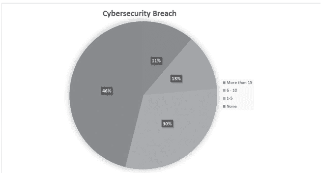

图 1.1 关于组织防止网络安全泄露的能力，30%的受访者经历了五起或更少的网络安全泄露。

### Measuring the effectiveness of implemented frameworks

利益相关方认为其组织当前的信息安全框架实施在防止网络安全泄露方面无效。此外，很明显，大多数组织通过以下方式衡量其当前信息安全框架实施的有效性：
- 政策合规性
- 审计和保证测试
- KPIs
- 成本
- 能力成熟度模型

### Risk level

利益相关方表示，其组织的决策过程与风险方法论保持一致，正如大多数行业公认的经济模型中所述，该方法论直接影响成本-效益分析。

### Importance of decision-makers

在大多数组织中，很明显，CIO和业务线负责人做出的决策在以下方面有相似的优先级：
- 资助投资成本
- 实施信息安全措施
- 审查风险偏好声明

这种并行决策

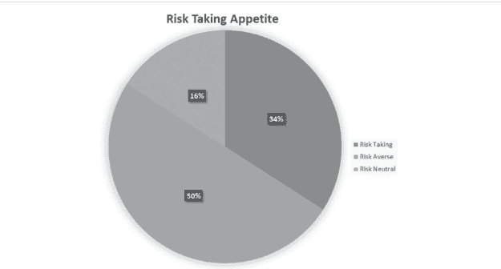

图 1.2 34%的组织具有风险承担型风险偏好（Kisssoon, 2020）。

过程可能对资助网络安全措施的决策产生不利影响，尤其是在观点截然不同的情况下。

本书研究风险管理实践和适用框架，以定义适当的网络风险投资模型。

# 2 企业风险管理框架

Risk-management methodologies stem from the enterprise risk-management (ERM) framework. This is defined as an organization’s ability to understand, control and articulate the nature and level of risks taking into account the business strategy, coupled with accountability for organizational risk. One of the main benefits of the ERM framework is an enhanced viewpoint and focus on risk management within the organization. ERM addresses the following organizational questions:

- 是否应推进此举措？这与战略、风险偏好、文化和伦理相一致。
- 能否实现此举措？这与人员、流程、结构和技术能力相一致，即运营风险。
- 是否已完成此举措？这是对预期结果、持续学习和强大的制衡系统的评估。

ERM promotes strategies that assist organizations in holistically managing risk. ERM is a governance structure that provides a horizontal view of the risk disciplines and operational risks of an institution.

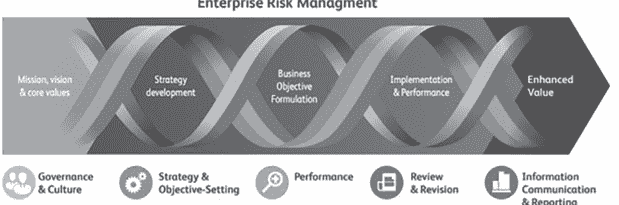

图 2.1 COSO 内部控制框架（COSO，2020）。

The elements of the ERM framework are detailed in the following sections.

## 内部环境

Management determines the philosophy regarding risk and establishes the level of risk the organization is willing to assume, known as risk appetite. The internal control environment provides the basis of how risk and controls are assessed and managed by an organization. The importance of ERM is communicated by executive management throughout the organization.

## 风险通用语言

The risk-management approach must involve establishing a common risk terminology with appropriate training and awareness of the terminology by stakeholders within the organization. A common definition of risk is “the potential for loss, or the diminished opportunity for gain, which can obstruct the achievement of an organization’s business objectives”. Common terminology will facilitate communication across business units:

- 风险是事件发生并对目标实现产生不利影响的可能性。
- 风险文化是管理层向组织人员传达的 ERM 体现及其态度。管理层的行动是否与已实施的 ERM 战略保持一致？”（COSO，2020）。

## 风险管理指导委员会

It is important to establish a senior management-level committee to provide oversight of the implementation of the ERM framework. In addition, the committee will help delineate roles, responsibilities and accountabilities as identified within the framework.

Roles and responsibilities: They must be clearly defined and communicated throughout an organization.

Board of directors and CEO: They have ultimate accountability for all risks. Risk-management practices must be discussed periodically, and risk-management-related policies must be reviewed and approved.

Senior management: Senior managers are responsible for designing, implementing and maintaining an effective framework. In addition, they should develop policies and procedures, establish and monitor the risk appetite level and report regularly to the board of directors.

Business units: They (1) promote a risk-aware culture; (2) identify, (3) assess, (4) measure, (5) monitor, (6) control and (7) report risks to senior management; (8) manage relevant risks within the framework established by senior management; and (9) ensure compliance with policies and procedures.

Support departments—that is, legal, HR, and information technology (IT): They provide support to business units in developing and enforcing policies and procedures.

Internal audit and compliance: They monitor and provide independent assurance of the effectiveness of the framework.

Risk management: Risk managers coordinate the establishment of the framework and provide expertise.

## 目标设定

Objectives must exist before management can identify potential events affecting the achievement of organizational goals. ERM ensures that management has a process in place to set objectives and that the chosen objectives support and are aligned and consistent with an organization’s mission and risk appetite.

## ERM 方法论

The development of a methodology for the ERM framework should include definitions of key risk terms, descriptions of roles and responsibilities and clear procedures for risk identification, assessment, measurement, mitigation, monitoring and reporting. The methodology should be expressed in a formally written document that comprises all the key business areas. The document should consider the organization’s strategic direction and objectives and clearly outline its capacity to take risks and its tolerance of potential loss. In addition, the risk appetite level must be regularly reviewed and approved by the senior management and board of directors.

## 风险偏好

Risk appetite is the amount of risk, on a broad level, that an organization is willing to accept as it tries to achieve its goals and provide value to stakeholders. It reflects the ERM philosophy and in turn influences the organization’s culture and operating style.

## 风险容忍度

Risk tolerance is the acceptable level of variation relative to the achievement of a specific objective and is often measured using the same units as the related objective. In setting risk tolerance, management considers the relative importance of the related objective and aligns risk tolerance with risk appetite to ensure that it operates within its risk appetite level.

## 事件识别

Potential events from internal or external sources that might have an impact on the organization and affect the achievement of its objectives must be identified. Event identification includes distinguishing between events that represent risks, those that represent opportunities and those that may represent both risks and opportunities.

## 风险评估

The identified risks are analysed and associated with objectives that may be affected to form a basis for determining how they should be managed. Risks are assessed on both inherent and residual bases, and the assessment should consider both risk likelihood and impact. Risk assessment must be performed continuously and throughout an organization.

### 定量风险评估

Quantitative risk assessment refers to attempts to assign a monetary value to the assets being assessed, a monetary cost to the impact of an adverse event and percentages to the frequency of threats and the likelihood of events.

### 风险计算

Risk = Asset Value × Threat × Vulnerability
资产价值通常是最容易衡量的；然而，某些资产（如机构声誉）难以量化。
威胁可能很难衡量其造成伤害的潜力，尽管来自外部来源的信息很有用。
漏洞可以使用自动化计算设备漏洞工具进行测量以提供信息，但并非所有漏洞都可以量化。

### 定性风险评估

Qualitative risk assessments are scenario driven and do not attempt to assign monetary value to the assets being assessed or to the impact of an adverse event. They aim to rank the impacts of threats and criticality of assets into categories such as low, medium and high.

## 风险响应

The organization identifies and evaluates possible responses to risks, which include avoiding, accepting, reducing and sharing risks. Management selects a set of actions to align risks with the organization’s risk tolerance and risk appetite. The ERM framework advocates the following responses:

- 避免意味着组织停止导致风险的活动。避免的示例包括终止产品线、出售部门或决定不扩张。
- 降低意味着采取行动以减轻风险可能性和影响。
- 分担意味着通过分担一部分风险来降低风险可能性和影响。一种极常见的分担响应是保险。
- 接受意味着不采取行动来影响风险可能性或影响。

## 控制活动

Policies and procedures are established and implemented to ensure that the risk responses selected by management are effectively carried out.

## 风险识别

Risk identification can be completed through a risk control self-assessment (RCSA) approach coordinated by risk management and conducted with subject-matter experts. This method uses a risk taxonomy to identify applicable risks, inherent risk levels, quality of internal controls and residual risk levels.

The process consists of the following steps:

- 识别适用风险，并描述使业务单元面临每种风险的业务活动。
- 建立固有风险水平（H、M、L）和典型年度损失。固有风险在不考虑内部控制的情况下阻碍业务目标的实现。典型年度损失，如果适用，

可根据业务单元的主观判断进行估算，并应同时考虑过去（实际损失）和潜在的未来发生情况。

- 评估并对内部控制的质量（H、M、L）及其评估原因进行排序。内部控制可降低固有风险，并涉及政策、程序和标准的实施。

- 计算考虑相关内部控制后剩余的残余风险等级（H、M、L）。例如，中等固有风险和低质量的内部控制会导致高残余风险等级。

## 风险优先级

通过使用各业务单元的RCSA结果，应根据残余风险等级对关键风险进行优先级排序。所有高残余风险都应与风险管理指导委员会讨论，并应制定风险缓解计划（RMPs）。

## 风险缓解计划

RMPs必须采用基于风险的方法建立，以解决控制弱点最大和潜在损失最大的领域。组织通常会在耗尽风险之前耗尽资源；因此，必须对高风险项目进行优先级排序。

应设定目标完成日期，并选定负责人以促进风险缓解过程。

## 信息与沟通

相关信息以能够使人们履行职责的形式和时间范围进行识别、捕获和传达。实体各级都需要用于识别、评估和应对风险的信息。

## 监控

ERM受到监控，并根据需要进行修改。这样一来，组织就能动态响应，根据情况变化进行调整。

## 风险监控与报告

已识别的关键风险必须受到监控，并定期向高级管理层和董事会报告。

## 情景规划与压力测试

在管理者可用于战略分析的众多工具中，情景规划可以以具体细节捕捉广泛的可能性。通过识别基本趋势，技术高管可以定义一系列情景，以帮助组织减少决策过程中的错误。

> “情景是对商业环境可能如何延伸到未来的全面且可能的看法”（Ringland，2002）。

### 步骤1：头脑风暴未来情景

在第一步中，时间范围根据以下因素确定：

- 产品的生命周期。
- 国内政治状况。
- 竞争对手分析。
- 技术进步。

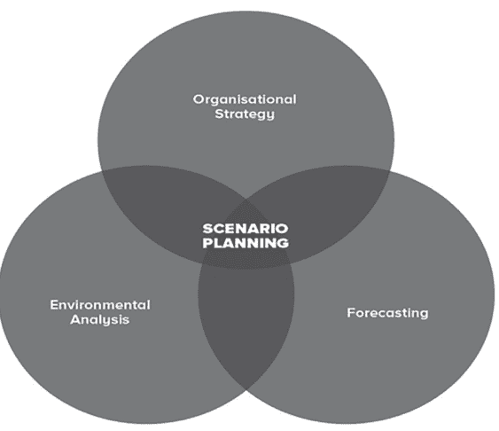

图2.2 情景规划的要素（Ringland，2002）。

### 步骤2：识别趋势和驱动力

考虑以下因素：

- 谁对这些决策感兴趣？
- 谁会受到它们的影响？
- 谁可能影响它们？

明显的驱动力包括但不限于供应商、客户、竞争对手、员工、股东和政府。识别以下因素也是必不可少的：

- 驱动力的当前角色。
- 他们的利益。
- 他们在该领域的地位。
- 他们随时间的进展。

### 步骤3：创建情景规划模板

环境的驱动力是从步骤2中识别的关键因素中识别出来的。这些驱动力可能源于以下领域：

- 社会及其结构，包括人口、经济和政治因素，以及公众舆论。
- 市场和客户行为。
- 技术和创新。
- 组织在其行业内的竞争结构。
- 组织的组织能力和核心竞争力。

应识别高度可预测的力量，以便组织可以专注于不太可能发生的影响。

### 步骤4：制定情景

情景规划的基本任务是制定实际情景。通过此阶段，应构建一个包含先前步骤中评估的每个因素并考虑市场特征和趋势的情境。在构建情景时，应识别并考虑计划的优势和劣势。

### 步骤5：评估情景

通过系统的逐步程序，情景团队可以基于知识和经验的合理判断，在创造力和自由形式的想象之间取得平衡。

## 情景分析

情景分析展示了运营风险的前瞻性视角，以补充历史内部和外部数据。这些练习使利益相关者能够通过业务决策和风险缓解策略来识别和管理风险敞口。

威胁行为者分析：识别对组织构成威胁的行为者。

影响分析：确定组织重点保护的领域。

情景选择：确定可能对组织产生灾难性影响的情景。

至少，情景应包括以下内容：

情境：导致不利结果的一系列事件的说明。这些可能因行业和组织而异，但必须包括以下项目：

- 业务连续性计划（BCP）事件。
- 黑客、竞争对手或政府机构的外部攻击。
- 恶意内部人员窃取信息。
- 机密信息意外泄露。
- 供应商和第三方对数据的处理不当。

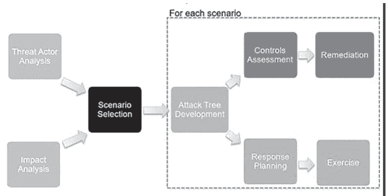

图2.3 情景分析的过程。

结果：应明确识别对组织不利且由事件导致的结果。一个事件可能有多个结果；例如，同一情景可能导致收入损失、法律费用和监管罚款。每个结果都应明确列出，并描述其影响。

现有控制：控制作为独立的防御线，有时按顺序运作，有时相互作用，以帮助防止不利事件的发生。通常，一个控制的正确运作可能提供足够的保护或缓解。如果控制彼此独立运作（如常见情况），则它们同时全部失效的综合概率通常显著低于其中任何一个失效的概率。

发生频率：情景实现的频率或可能性应是情景分析的一部分，最好在与管理层的讨论中进行估算。

结果的严重性：应分别估算每个不利结果的严重性。

情景示例如下：

- 情景#1：补丁管理。
- 情景#2：网络勒索软件/恶意软件攻击。
- 情景#3：非计划攻击。
- 情景#4：金融入侵/外部攻击。
- 情景#5：云安全漏洞。

攻击树开发：为每个情景开发详细的攻击树。

控制评估：将控制映射到攻击树并评估其有效性。

补救：使用控制评估来规划解决控制缺口的补救项目。

响应规划：创建或增强现有响应计划，以应对极端情景。

演练：测试控制强度、响应计划和整体准备情况。

### 步骤6：相应更新策略和政策

情景实施后一两个月，必须评估战略计划并更新政策。此评估和更新过程应定期完成。

# 3 与企业风险管理的对齐

## 运营风险管理

国际清算银行（BIS）将运营风险定义为“因内部流程、人员和系统不足或失败，或因外部事件导致的损失风险（战略风险和声誉风险不包含在此定义中，用于最低监管运营风险资本收费的目的）”（巴塞尔银行监管委员会，2001）。法律风险包含在此定义中。因此，运营风险是运营、信息系统、合规和法律风险的总和。

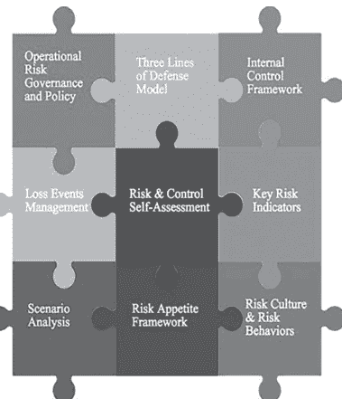

图3.1 通过Sergio Galanti运营风险拼图的运营风险管理要素（Caldas，2006）。

除了保护组织资产免受当前环境中存在的威胁的责任之外，当信息系统处理敏感信息（即个人身份可识别信息（PII））时，风险管理人员还必须考虑并管理对个人的风险。

## 运营风险的信息安全方面

安全风险管理提供了一种手段，以更好地理解安全威胁的性质及其在个人、组织或社区层面的相互作用（Standards Australia, 2006, p. 6）。一般而言，风险管理流程可以应用于安全风险管理环境。ISO 31000 倡导的风险管理流程应作为组织风险管理的基础；然而，安全风险管理有几种其他风险管理形式不考虑的独特流程。

安全风险管理的核心与第 2 章中讨论的 ERM 相同，但增加了信息评估，例如威胁、关键性登记册和漏洞评估。安全风险管理是风险管理与这些评估形式的集成。

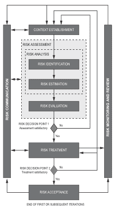

图 3.2 信息技术 – 安全技术 – 信息安全风险管理流程（ISO, 2020）。

## 网络安全风险评估流程

信息安全风险管理是系统地应用管理政策、程序和实践，以建立信息安全风险的背景，并识别、分析、评估、处理、监控和传达这些风险。

ISO 27005 是国际标准化组织（ISO）发布的“信息技术 – 安全技术 – 信息安全风险管理”标准，用于为实施有效的信息安全管理体系（ISMS）所需的信息安全风险管理流程提供指导。尽管该标准被视为风险管理标准，但其很大一部分涉及信息安全风险评估，而风险评估是风险管理计划的关键部分。

ISO 27005 与 NIST SP 800–30 保持一致，与其他框架相比，是从高层次角度编写的。ISO 27005 有五个主要主题领域：

- 信息安全风险评估。
- 信息安全风险处理。
- 信息安全风险接受。
- 信息安全风险沟通。
- 信息安全风险监控与审查。

### 风险识别

信息安全风险评估组织及其利益相关者可能因其信息系统的运行及其运行环境相关的威胁和漏洞而产生的影响。减轻信息安全相关风险的主要手段是选择、实施、维护并持续监控预防性、检测性和纠正性安全控制，以保护信息资产免受泄露，或在发生泄露时限制对组织的损害。

风险识别包括五项主要活动，将在以下各节中讨论。

### 资产识别

此活动的目标是识别风险评估范围内的资产，包括资产所有者。在 ISO 27005 中，资产分为主要资产和次要资产。主要资产是核心流程、活动和信息，次要资产是硬件、软件、网络、人员、场所和结构。

### 威胁识别

此步骤的目标是为每个资产准备潜在威胁列表。根据 ISO 27005，资产所有者、用户、人力资源人员和设施管理等利益相关者可以协助识别这些威胁。ISO 27005 还指出，应考虑内部经验，特别是基于以前的事件或评估。ISO 27005 最有用的贡献之一是包含标准化威胁目录。

### 现有控制识别

此活动的目标是识别现有控制。ISO 27005 为该活动提供的指导是开放式的，并未具体涉及控制审查的标准或规模。ISO 27005 确实提供了可能有助于此活动的信息来源参考。此部分审查的信息来源示例如下：

- 包含控制信息的文档。
- 负责信息安全的人员。
- 现场审查。
- 内部审计结果审查。

### 漏洞识别

目标是通过以下操作识别资产的漏洞：

- 漏洞扫描和渗透测试。
- 代码审查。
- 访谈。
- 问卷。
- 实地检查。
- 文档分析。

### 后果识别

此活动的目标是确定由“事件场景”或其他框架所称的威胁场景可能造成的损害或后果。ISO 27005 提供了一系列可用于识别和衡量后果的影响因素。

### 风险表达与衡量

信息安全风险“按事件发生的可能性及其后果的组合进行衡量”。

它进一步定义为信息安全事件，即“系统、服务或网络状态的已识别发生情况，表明可能违反信息安全政策或防护措施失效，或可能与安全相关的先前未知情况”。

在衡量风险时，重要的是不是单个关键事件的风险，而是由所有可能关键事件组成的风险总体图谱。这使评估者能够确定总风险，尤其是可能发生或特别严重的事件。有两个基本风险领域允许在分析过程中根据其对组织正常运作的重要性对可能的关键事件进行分类。第一个是运营安全，第二个是业务连续性。

### 风险分析

风险分析包括确定和评估以下内容：

- 使组织任务得以实现的流程。
- 破坏性现象及其发生的概率。
- 资源脆弱性，即破坏性现象的规模及其对组织活动的潜在影响。

风险分析是随后处理风险的前提。风险处理涉及控制风险，使其保持在可接受的水平。风险可以通过应用安全措施来降低。风险还可以：

- 通过外包或保险共享，
- 避免，以及
- 接受，即组织接受安全事件可能造成的影响。

安全事件发生的可能性是威胁出现以及威胁能够成功利用相关系统漏洞的可能性的函数。安全事件发生的后果是事件可能对组织造成的可能影响的函数，该影响是由于组织资产遭受的损害而产生的。

### 风险评估与量化

风险评估是将风险分析结果与定义的风险评估标准进行比较，以确定网络风险是否可接受的过程。风险评估流程的基本步骤如下：

- 识别。
- 概率和影响。
- 已识别风险。
- 处理。
- 次生风险。
- 剩余风险。
- 监控与审查。

应评估组织范围的安全和隐私风险，并应持续更新风险评估结果。风险评估有两种类型：

- 定性。
- 定量。

### 风险缓解规划与验证

风险缓解规划是制定选项和行动以增强机会并减少对项目目标的威胁的过程。风险缓解实施是执行风险缓解行动的过程。风险缓解进度监控包括跟踪已识别风险、识别新风险并在整个计划期间评估风险流程的有效性。

风险缓解步骤涉及制定旨在管理、消除或将风险降低到可接受水平的缓解计划。一旦计划实施，将持续监控以评估其效果，并在必要时修订行动方案。

应用风险缓解管理选项的一般指南基于对已识别风险发生概率和后果严重性的组合进行评估。

## 风险处理

### 风险修改

引入一个可能对风险产生正面或负面影响的额外因素。

### 风险转移

识别转移风险的方式和手段，无论是通过购买保险（即网络保险）还是通过外包。

### 风险规避

选择不开展会导致风险出现的业务活动。

### 风险接受

对已识别的风险水平进行有意识和深思熟虑的接受，不通过修改或转移进行任何其他变更。

### 风险修复

选择一系列策略、技术和程序，以减少资产被攻破的易感性。

### 风险沟通

风险沟通是传播信息和改善对风险管理决策理解的重要工具。这种理解和信息使利益相关者能够就决策将如何影响其利益和价值做出明智的决策。

### 风险监控与审查

风险监控与审查是识别、分析和规划新发现风险以及管理已识别风险的过程。在整个过程中，风险所有者跟踪已识别的风险，揭示新风险，实施风险响应计划并评估风险响应计划的有效性。

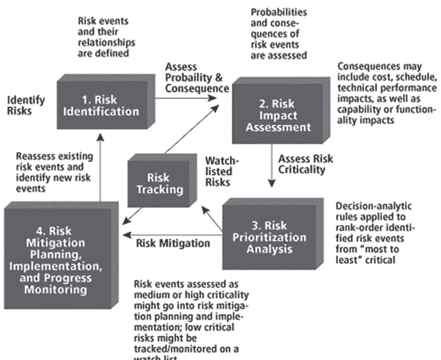

图 3.3 基础风险管理流程（MITRE 研究所，2007）。

## 损失事件管理

理解和管理损失事件对于有效的操作风险管理计划至关重要。此过程包括损失事件的频率、金额、类型和来源以及损失事件的综合列表。

## 安全度量

度量可以提供有关信息安全计划有效性、法规遵从水平以及员工和部门处理其负责的安全问题的能力的洞察。度量还可以帮助识别不采取某些缓解措施的风险水平，从而为优先投资未来资源提供指导。由于度量提供了传播风险的具体事实和共同词汇，因此还可用于提高组织内的安全意识水平。

安全度量是通过收集、分析和报告相关绩效数据来促进决策、改进绩效和问责制的工具。IT 安全度量基于 IT 安全绩效目标和宗旨。

有效的度量通常被称为 SMART（具体、可衡量、可达成、可重复和时效性）。这些度量还应指示安全目标实现的程度，并促进改进组织整体安全计划的行动。需要考虑以下几点：

- 收集特定度量的准确数据可能有多困难。
- 度量可能被误解的潜在风险。
- 定期审查正在跟踪的度量并根据需要进行更改的必要性。

## 关键绩效指标

关键绩效指标（KPI）是一种常用的绩效衡量标准，用于帮助组织定义和评估其成功程度，通常以朝着长期组织目标取得进展为准。

以下是一些可跟踪且易于向相关利益相关者展示的明确网络安全度量示例。

- **准备程度**：组织网络上有多少设备已完全打补丁并保持最新？
- **内部网络上的未识别设备**：组织网络上有多少此类设备？
- **入侵尝试**：攻击者攻破组织网络的次数是多少？
- **平均检测时间（MTTD）**：安全威胁未被察觉的时间有多长？MTTD 衡量组织意识到潜在安全事件所需的时间。
- **平均解决时间（MTTR）**：一旦发现威胁，组织需要多长时间来响应？
- **打补丁天数**：组织实施安全补丁需要多长时间？
- **网络安全意识培训结果**：谁参加了（并完成了）培训？他们是否理解了材料？
- **报告的网络安全事件数量**：用户是否向组织报告网络安全问题？
- **安全评级**：通常，向非技术同事传达度量的最简单方式是通过易于理解的记分卡。

## 关键风险指标

关键风险指标（KRI）是管理层用来指示与活动相关的风险的衡量标准。KRI 是组织用来提供企业各个领域风险敞口增加早期信号的度量。

### KRI 示例

- 信息安全培训完成度。
- 政策例外/偏差。
- 钓鱼活动失败率。
- 未解决的审计发现。
- 风险评估评级。
- 按系统划分的补丁覆盖率。
- 事件和事故。
- 违规/泄露。
- 按严重性和年龄划分的漏洞。
- 账户管理。

## 风险文化与风险行为

风险文化是组织中存在的价值观和行为体系，它塑造了管理层和员工的风险决策。风险文化的一个要素是对组织及其业务目的的共同理解。

组织的风险文化可能会：

- 决定组织政策被员工内化并在日常行为中体现的程度，
- 决定员工对超出明确规定的操作指南的威胁或情况的响应，以及
- 影响组织在监管机构、客户和更广泛市场中的声誉。

# 4 风险管理实践 – 漏洞管理

补丁和漏洞管理是一种旨在主动防止利用企业系统中存在的 IT 漏洞的安全管理实践。预期结果是减少组织在处理针对组织的意外/故意攻击（即恶意软件/勒索软件）的影响时所花费的时间和资金。主动管理系统中的漏洞将减少或消除被利用的潜在可能性。将此实践整合到风险管理实践中，为高管团队提供了关注点，即当现有漏洞得到适当监控时，其组织所承担的适当风险水平。

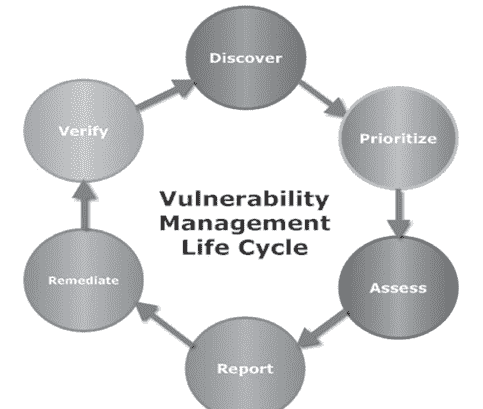

图 4.1 漏洞管理流程的要素（Huntsman，2017）。

补丁是开发用于解决软件中通常称为错误的问题的附加代码片段。它们可启用额外功能或解决程序中的安全缺陷。漏洞是恶意实体可以利用的缺陷，以获取其在计算机系统上被授权拥有之外的更大访问权限或特权。并非所有漏洞都有相关补丁；因此，系统管理员不仅必须了解适用的漏洞和可用的补丁，还必须了解其他修复方法——即设备或网络配置更改以及限制系统暴露于漏洞的员工培训。

组织应实施漏洞管理计划，通过识别、分类、修复和缓解漏洞的全面且持续的过程来解决其信息安全漏洞。

## 维护资产清单

组织内的利益相关者应维护 IT 资源的资产清单，以确定正在使用的硬件、操作系统（OS）和软件应用程序的类型。此外，利益相关者应作为系统配置管理过程的一部分，定期更新 IT 资产清单。组织有责任确定清单的目的和用途，并仅维护这些用途所需的信息。清单中的资源应分组并分配优先级，以便于修复工作，并可能包括以下内容：

- 1 关联系统名称。
- 2 资产编号。
- 3 IT 资源的所有者——即主要用户。
- 4 系统管理员。
- 5 物理位置。
- 6 连接的网络端口。
- 7 软件配置。
  - a 操作系统和版本号。
  - b 软件包和版本号。
  - c 网络服务。
  - d IP 地址（如果是静态的）。
- 8 硬件配置。
  - a 中央处理器。
  - b 内存。
  - c 磁盘空间。

- d 以太网地址——即网卡。
- e 无线功能。
- f 输入/输出功能——即通用串行总线、FireWire。
- g 固件版本。

## 优先处理资产

组织应在资产清单中为每台设备定义风险和关键价值。识别设备的重要性以及负责批准访问该设备的个人非常重要。

了解战略因素并清晰掌握详细信息时，以下因素非常重要：

- 风险偏好。
- 风险承受水平。
- 每台设备的风险缓解实践和政策。
- 剩余风险处理。
- 每台设备或服务的对策（如果服务与设备相关联）。
- 业务影响分析。

## 评估漏洞

以下部分描述了使用任何自动化或手动工具有效完成漏洞评估过程所采用的方法。

## 系统基线定义

在漏洞评估之前会收集系统信息，并审查以下信息：

- 设备是否具有适当的开放端口、进程和服务。
- 应安装在设备上的批准驱动程序和软件。
- 每台设备的基本配置；例如，如果设备是边界设备，则不应将其配置为包含默认管理员用户名。

## 漏洞扫描

漏洞扫描器在许多组织中常被用来识别主机和网络上的漏洞。漏洞扫描器不仅识别主机及其上的开放端口，还识别关联的漏洞。会识别主机操作系统和活动应用程序，然后将其与已知漏洞数据库进行比较。

漏洞扫描器分为两种类型。

网络扫描器用于绘制组织网络图并识别开放端口、易受攻击的软件和配置错误的服务。它们可以安装在网络上的单个系统上，并能快速定位和测试大量主机。

网络扫描器通常无法有效收集使用个人防火墙的主机的准确信息，除非个人防火墙配置为允许网络扫描活动。

主机扫描器必须安装在要测试的每个主机上。这些扫描器主要用于识别特定主机操作系统和应用程序的配置错误及漏洞。主机扫描器具有高检测粒度，通常不仅需要主机（本地）访问权限，还需要根或管理员帐户。某些主机扫描器提供修复配置错误的功能。

组织的漏洞扫描器提供以下功能：

- 识别网络上的活动主机。
- 识别主机上的活动和易受攻击的服务（端口）。
- 识别与发现的操作系统和应用程序关联的漏洞。
- 测试主机应用程序使用/安全策略的合规性。
- 识别过时的软件版本以及适用的补丁或系统升级。

在开始漏洞扫描之前，组织的技术团队应将适用的合规性要求集成到配置中。推荐的方法包括在被评估平台上使用相关工具和插件：

- 最佳扫描——即热门端口。
- CMS Web 扫描——即 Joomla、WordPress、Drupal、通用 CMS。
- 快速扫描。
- 最常见端口最佳扫描——即 65,535 个端口。
- 防火墙扫描。
- 隐蔽扫描。

## 激进扫描

- 全扫描，识别利用攻击和分布式拒绝服务（DDoS）攻击。
- 开放 Web 应用安全项目（OWASP）Top 10 扫描和 OWASP 检查。
- Web 应用程序的 PCI DSS 准备。
- 健康保险可携性和责任法案（HIPAA）合规性策略扫描。

## 漏洞评估报告

漏洞评估报告应包括以下内容：

- 基于资产关键性和结果的风险缓解技术。
- 与结果和系统基线定义之间可能存在的任何差距相关的发现——即任何配置错误和发现的偏差。
- 纠正偏差和缓解可能漏洞的建议。

报告中应详细说明高危和中危漏洞，包括以下内容：

- 漏洞名称。
- 发现日期。
- 基于常见漏洞与披露（CVE）数据库的评分。
- 漏洞的详细描述。
- 受影响系统的详细信息以及纠正漏洞的流程。
- 如果可能，系统的漏洞概念验证（PoC）。
- 用于漏洞负责人、纠正漏洞所花费的时间、下一次修订以及从漏洞识别到最终解决方案之间的对策的空白字段。

## 优先处理漏洞修复

利益相关者应确定组织处理漏洞修复的顺序。技术组织负责监控安全来源中的漏洞公告、补丁和非补丁修复以及与组织清单内软件相对应的威胁。应监控多种来源，以确保相关利益相关者了解所有新发现的漏洞。

## 安全问题类型

技术组织负责监控漏洞、修复和威胁：

- 漏洞是导致系统安全性出现弱点的软件缺陷或配置错误，可被恶意实体利用以违反策略。
- 修复包括三种主要方法：
  - 安装软件补丁。
  - 调整配置设置。
  - 删除受影响的软件。
- 威胁是恶意实体开发的用于利用漏洞并可能对计算机系统或网络造成损害的攻击能力或方法。威胁通常以利用脚本、蠕虫、病毒、根套件和特洛伊木马的形式出现。

系统管理员应监控其控制下运行不在组织清单内的软件的系统，以查找漏洞、修复和威胁。

## 监控漏洞、修复和威胁

有多种资源可用于监控漏洞、修复和威胁的状态。每种资源都有其自身的优势和劣势。

建议使用多种类型的资源以确保准确和及时的了解。最常见的资源类型如下：

- 供应商网站和邮件列表。
- 第三方网站。
- 第三方邮件列表和新闻组。
- 漏洞扫描器。
- 漏洞数据库。
- 企业补丁管理工具。

组织可以使用以下资源类型来监控漏洞、修复和威胁：

- 企业补丁管理工具，用于从受支持的供应商处获取所有可用补丁。
- 供应商安全邮件列表和网站，用于从企业补丁管理工具不支持的供应商处获取所有可用补丁。
- 漏洞数据库是国家漏洞数据库或邮件列表，用于获取所有已知漏洞和建议修复的即时信息。
- 第三方漏洞邮件列表——即 US-CERT 网络安全警报，突出显示最关键的漏洞。

对新漏洞、修复或威胁进行初步评估后，技术团队应继续监控更新和新信息。

## 优先处理漏洞修复

技术团队在设定漏洞修复优先级时，应考虑每个威胁及其对组织的潜在影响。此评估包括以下内容：

- 确定威胁或漏洞的重要性。
- 确定哪些系统易受攻击或暴露，重点关注对运行至关重要的系统和其他高优先级系统。
- 评估如果漏洞未被删除并被利用，对系统、组织和网络的影响。
- 确定相关蠕虫、病毒或利用攻击的存在、范围和传播情况。
- 查明是否已发布恶意代码及其分发级别。
- 确定造成的损害，例如系统访问、信息泄露、任意代码执行或拒绝服务。
- 确定应用补丁或非补丁修复所涉及的风险。
- 通过研究和测试，识别修复是否会影响其他软件应用程序或服务的功能。
- 确定可接受的风险程度。

## 维护特定修复数据库

技术组织应维护组织内要应用的修复数据库。企业补丁管理工具通常提供相关数据库。技术组织还可以手动维护补丁管理工具不支持的 IT 技术的单独数据库。

## 执行修复的通用测试

技术组织应在使用标准化配置的 IT 设备上测试补丁和非补丁修复。系统管理员负责测试补丁和非补丁修复以缓解

技术组未监控的软件中识别出的漏洞和威胁。修复测试指南可能包括以下内容：

- 大多数厂商提供某种身份验证机制。下载的补丁应根据厂商提供的任何真实性验证方法进行检查，包括加密校验和、签名和数字证书。

- 安装前还应对所有补丁运行病毒扫描。在运行扫描之前，系统管理员应确保防病毒程序中的病毒特征数据库是最新的。

- 补丁和配置修改应在非生产系统上进行测试，因为修复可能轻易产生意外后果。

- 安装一个补丁可能还会无意中卸载或禁用另一个补丁。如果存在依赖关系，确保补丁按正确顺序安装非常重要。

- 应对一组能够准确代表已部署系统配置的系统进行测试，因为可能的系统配置非常多，厂商不可能全部测试。

## 部署漏洞修复

组织应将漏洞修复部署到适用的系统中，包括那些不面临立即被利用风险的系统。漏洞修复还应纳入组织主机的标准构建和配置中。

可应用于受影响系统的三种主要修复方法。

## 安全补丁安装

- 应用安全补丁（也称为修复程序或热修复）可以修复漏洞，因为补丁包含修改软件应用程序以解决和消除问题的代码。

- 从厂商网站下载的补丁通常是最新的，并且通常不包含恶意代码。

## 配置调整

- 调整应用程序或安全控制的配置可以有效阻断攻击向量并降低被利用的威胁。常见的配置调整包括禁用服务和修改权限，以及更改防火墙规则和修改路由器访问控制。

  - 易受攻击的软件应用程序的设置可以通过调整文件属性或注册表设置来修改。

## 软件移除

- 移除或卸载受影响的软件或易受攻击的服务可以消除漏洞及任何相关威胁。当系统上不需要某个应用程序时，这是一个实用的解决方案。

- 确定系统的使用方式、移除不必要的软件和服务，以及仅运行系统用途所必需的内容，是推荐的安全实践。

在安装补丁之前，管理员应确保正在打补丁的系统保持当前的完整备份。无论修复涉及自动打补丁还是手动更新，系统管理员可能认为建议修复的缺点大于其优点。他们可能不希望安装补丁或执行配置修改。这些决策背后的原因应予以记录，并传达给技术团队，再传达给相应的管理层以供批准。

## 评估风险

必须仔细权衡延迟修复的风险。确定网络风险量的风险评估是帮助确定企业内漏洞管理状态的另一种方式。

技术团队可以使用风险评估信息来确定哪些资产应首先打补丁，或者是否有任何系统可以承受与其相关的风险。然而，在不知道这种风险将如何影响网络连接资产的情况下，很难对新漏洞的风险进行评级。

在评估风险时，技术团队应考虑以下各节中讨论的问题。

## 威胁等级

需要修复的系统是否面临众多和/或重大威胁？例如，公共 Web 服务器和大多数联邦政府组织可能面临高威胁等级。

## 被攻破风险

被攻破的可能性有多大？如果漏洞容易被利用，则应迅速应用修复。

## 被攻破的后果

被攻破的后果是什么？如果系统是关键系统或包含敏感数据，则应立即执行修复。
即使对于非关键系统，如果成功利用会导致攻击者完全控制系统，此原则同样适用。

## 将漏洞和修复信息分发给本地管理员

技术团队负责向本地管理员通报与团队范围内且在组织软件清单中的软件包相对应的漏洞和修复。

## 补丁管理

广泛的手动打补丁计算机是无效的，因为需要安装的补丁数量很多，个人使用这种方法保持系统更新是不切实际的。虽然打补丁和漏洞监控通常看起来是一项艰巨的任务，但通过经过测试和集成的打补丁流程（该流程高效利用自动打补丁技术），可以持续缓解组织漏洞。企业补丁管理工具允许技术团队或与其密切合作的团队自动且快速地将补丁推送到许多计算机。

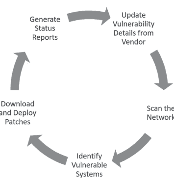

图 4.2 补丁管理生命周期（ManageEngine，2020）。

## 使用分阶段方法部署企业补丁管理工具

分阶段实施补丁管理工具可以在一致部署补丁应用程序之前，先与小组解决流程和用户沟通问题。大多数组织首先将补丁管理工具部署到标准化桌面系统和配置相似的单平台服务器场。完成此操作后，组织应解决集成多平台环境、非标准桌面系统、旧计算机和配置异常的计算机这一更困难的问题。对于自动打补丁工具不支持的操作系统和应用程序以及某些配置异常的计算机，可能需要使用手动方法。对于这些类型的系统，应制定并实施手动打补丁流程的书面程序，技术团队应协调本地管理员的工作。

## 执行补丁的自动部署

技术团队应使用企业补丁管理工具自动将补丁部署到 IT 设备。一旦选择了补丁管理技术，组织的 IT 管理员负责设计解决方案架构、执行测试、部署和保护解决方案以及维护运营和安全。

## 技术安全

在企业内部署企业补丁管理工具可以通过减少漏洞来增强组织的安全态势。当这些工具包含用于防范安全风险和威胁的内置安全措施时，通常会提高安全性。使用这些工具存在一些风险：

- 补丁可能已被篡改（无意或故意）。

- 凭证可能被滥用。

- 解决方案组件（包括代理）中的漏洞可能被利用。

- 实体可能监控工具通信以识别漏洞（尤其是当主机位于外部网络上时）。

组织可以通过应用部署任何企业级应用程序时应使用的标准安全技术来降低这些风险。

对策示例包括以下内容：

- 保持补丁解决方案组件安全，包括对其进行补丁。
- 加密网络通信。
- 在安装补丁之前验证其完整性——即，使用校验和。
- 在部署前测试补丁以识别损坏。

## 补丁管理流程

以下各节讨论了组织应整合到其补丁管理流程中的基本考虑因素。

### 发现

技术组确保组织拥有全面、准确的网络资产清单，包括以下内容：

- 了解设备类型。
- 操作系统。
- 操作系统版本。
- 第三方应用程序。

### 标准化和分类

技术组应实施标准化方法，以尽可能确保设备运行相同的操作系统、使用相同的硬件、以相同方式配置并运行相同的应用程序。技术组应根据风险和优先级，依据以下方面对托管系统和/或用户进行分段：

- 机器类型——即，服务器、笔记本电脑等。
- 操作系统。
- 操作系统版本。
- 用户角色。

### 补丁管理策略创建

技术组应通过确定打补丁的内容、时间和条件来制定补丁标准。例如，应考虑以下内容：

- 补丁周期的频率——即，笔记本电脑最终用户的补丁计划可能是每周一次，而服务器的补丁频率可能较低且更多是手动操作。
- 补丁推出周期——即，浏览器更新与操作系统更新，关键更新与非关键更新。
- 识别维护窗口以避免中断——即，考虑“跟随太阳”补丁的时区。
- 创建例外。

### 监控新补丁和漏洞

技术组应实施流程以有效：

- 了解供应商补丁发布计划和模型，并识别可靠来源以及时披露漏洞，以及
- 创建评估紧急补丁的流程。

### 补丁测试

技术组应确保有适当的测试环境，以

- 在生产部署前测试补丁是否正常工作，
- 在必要时创建备份以便轻松回滚，
- 验证部署成功，以及
- 监控不兼容或性能问题。

### 配置管理

技术组应建立机制，以捕获补丁过程中所做的任何更改。

### 补丁部署

补丁部署应有详细文档，并附上应用补丁后将发生的变更计划概述。技术组应拥有自动化补丁管理流程，以便安排定期更新扫描，并确保在非高峰时段应用补丁。应针对补丁部署问题制定明确的回滚策略。

### 补丁审计

技术组应建立补丁审计流程，以识别任何失败或待处理的补丁，包括持续监控任何意外的不兼容或性能问题。

### 报告

技术组应建立机制，以便在需要时生成补丁合规性报告。这包括记录风险接受以及可能出现的任何例外。

### 审查、改进和重复

技术组应建立既定节奏，以重复和优化补丁管理流程，包括以下内容：

- 淘汰或隔离任何过时或不受支持的机器。
- 审查适用的策略。
- 重新审视例外，以验证它们是否仍然适用或必要。

### 通过网络和主机漏洞扫描验证漏洞修复

技术组和系统管理员应验证他们是否已按预期成功修复或缓解漏洞。

技术组应确认修复已适当执行，以避免安全事件或非计划停机。这可以通过多种方法实现：

- 验证修复旨在纠正的文件或配置设置已按供应商文档所述进行更改。
- 使用漏洞扫描器扫描主机以检测已知漏洞。
- 审查补丁日志以验证推荐补丁是否已正确安装。
- 使用利用程序或代码尝试利用漏洞——即，执行渗透测试。

通常，利用测试涉及在网络或主机上发起实际攻击，这种测试仅应针对特定漏洞在非生产设备上执行。

### 审查补丁日志

日志文件跟踪系统的历史记录。补丁日志可帮助技术组以及系统管理员跟踪和验证已安装的补丁。使用补丁日志监控组织的系统有助于实现与修复计划的一致性和合规性。

组织的补丁日志提供以下功能：

- 识别系统上安装了哪些补丁，从而轻松确认已应用适当的补丁集。
- 通过比较日志文件，确保补丁在整个组织中一致应用。
- 验证补丁是否已正确安装。
- 确定补丁或后续更新是否不当移除或损坏了之前的补丁。

### 检查补丁级别

组织应考虑验证主机的补丁级别。在大多数部署中，每个主机都运行一个代理，用于监控各种特征，例如操作系统、应用程序补丁和防病毒更新。当主机尝试连接到网络时，路由器等网络设备会向主机代理请求信息。如果主机未响应请求，或者响应表明主机未完全打补丁，则网络设备会将主机置于单独的虚拟局域网（VLAN）上。这使组织能够在严格限制功能的同时更新未打补丁的主机。一旦 VLAN 上的主机完全更新，它会自动从 VLAN 移动到组织的常规网络。VLAN 策略对于确保移动主机完全打补丁尤其有帮助。

### 漏洞修复培训

组织应培训管理员如何应用漏洞修复。在依赖最终用户打补丁的组织中，技术组还必须培训用户执行此功能。

### 部署安全度量

本节讨论了在按系统测量特征的背景下开发补丁和漏洞度量。此处的“系统”指一组 IT 资产、流程、应用程序及相关资源，它们处于相同的直接管理和预算控制之下，具有相同的功能或任务目标，具有基本相同的安全需求，并位于相同的一般运行环境中。

### 补丁和漏洞度量的类型

补丁和漏洞度量有三个主要类别：

- 易受攻击性。
- 缓解响应时间。
- 成本。

组织易受攻击的程度可以通过多种测量来近似。组织可以测量以下内容：

- 所需补丁数量。
- 漏洞数量。
- 按系统运行的网络服务数量。

这些测量应分别针对系统中的每台计算机进行，然后汇总结果以确定系统级结果。原始结果和比率——即，每台计算机的漏洞数量——都很重要。原始结果有助于揭示系统面临的总体风险，因为漏洞、未应用的补丁和暴露的网络服务越多，系统被攻破的可能性就越大。因此，由许多计算机组成的大型系统本质上比规模较小且配置相似的系统安全性更低。

组织在比较多个系统的安全计划有效性时，应考虑使用比率。比率允许系统之间进行有效比较。两种结果都应按适当情况对每个系统进行测量和发布，因为两者都有用且用途不同。初始测量方法不应考虑系统安全边界架构——即，防止攻击者直接访问系统计算机上漏洞的防火墙。默认立场应是保护系统中的所有计算机，即使系统受到强大安全边界的保护。

由于大多数系统出于各种原因不会完全安全，因此应在考虑系统安全边界架构的情况下重新计算测量结果。这将提供系统实际易受外部攻击者攻击程度的有意义测量。例如，如果无法通过系统的主防火墙利用计算机上的漏洞、网络服务或所需补丁，则第二次测量不应计算这些内容。

在对系统受攻击易感性进行初始衡量时，不应考虑系统安全边界架构，但可能需要考虑单台计算机的安全架构。例如，如果计算机的个人防火墙能够阻止此类利用尝试，那么可通过网络连接利用的漏洞可能不予计入。

## 补丁数量

已部署企业补丁管理工具的组织，衡量每个系统所需的补丁数量是很自然的事，因为这些工具会自动提供此类数据。所需补丁数量在近似衡量组织受攻击易感性方面具有一定价值，但该衡量方法的效果有限，因为特定安全补丁可能修复一个或多个漏洞，且这些漏洞的严重程度可能各不相同。此外，没有可用补丁的漏洞也经常被公布。这些漏洞加剧了组织面临的风险，但无法通过衡量所需补丁数量来捕捉。可以通过考虑发布厂商评为关键的补丁数量，并比较关键补丁和非关键补丁的数量，来提高该衡量方法的质量。

## 漏洞数量

每个系统中存在的漏洞数量是衡量组织受攻击易感性的更好指标。该指标应作为组织漏洞扫描工具的报告输出包含在内。与衡量补丁类似，组织应考虑漏洞的严重性评级，并按每个严重性级别或严重性级别范围对漏洞数量进行分组。只有在组织环境的背景下审查每个漏洞，才能确定其真实影响。此外，漏洞对系统的影响取决于系统的网络位置；也就是说，当系统可从互联网访问时，漏洞通常更为严重。

## 每个系统运行的网络服务数量

该指标背后的概念是，每个网络服务都代表一组潜在漏洞，因此当系统运行额外的网络服务时，安全风险会增加。

在大型系统上，此衡量可以指示对网络攻击的易感性，包括当前和未来的攻击。在多个系统之间比较运行的网络服务数量也很有用，以识别那些在最大限度减少其网络服务方面做得更好的系统。

## 衡量补丁和漏洞管理的有效性

补丁和漏洞指标分为三类：受攻击易感性、缓解响应时间和成本，包括衡量计划失败业务影响的指标。系统或IT安全计划中对补丁和漏洞指标的强调应反映补丁和漏洞管理的成熟度级别。例如，每个系统的补丁数量、漏洞数量和网络服务数量等受攻击易感性指标，对于成熟度较低的计划通常比对于成熟度较高的计划更有用。组织应记录每个系统将使用哪些指标以及每个指标的详细信息。应将每个指标的现实性能目标传达给系统所有者和系统安全官员。一旦这些目标实现，就可以设定更具雄心的目标。仔细提高补丁和漏洞安全的标准非常重要，以避免让系统安全官员和系统管理员不堪重负。

## 缓解响应时间

同样重要的是衡量组织识别、分类和响应新漏洞并缓解潜在影响的速度。主要有三种响应时间衡量：

- 漏洞和补丁识别。
- 补丁应用。
- 紧急安全配置更改。

## 漏洞和补丁识别的响应时间

该指标衡量技术团队了解新漏洞或补丁所需的时间。计时应从漏洞或补丁正式公布之时开始。此衡量应针对不同补丁和漏洞的样本进行，并应包括技术团队用于收集信息的各种资源。

## 补丁应用的响应时间

该指标衡量在系统内所有相关IT设备上应用补丁所需的时间。计时应从技术团队得知补丁之时开始。此衡量应在技术团队相对容易验证补丁安装的情况下进行。此衡量应包括以下活动所花费的单独和总时间：

- 补丁分析。
- 补丁测试。
- 配置管理流程。
- 补丁部署工作。

验证可以使用企业补丁管理工具或通过漏洞扫描（包括基于主机和基于网络的扫描）来进行。对关键和非关键安全补丁都进行此衡量可能很有用。

## 紧急配置更改的响应时间

该指标适用于存在必须缓解但没有可用补丁的漏洞的情况。在这种情况下，组织应利用能够实现紧急配置更改的变更管理流程。该指标应衡量从技术团队得知漏洞之时到可接受的临时解决方案被应用并验证之时所花费的时间。以下列表包含可以计时的紧急流程示例：

- 防火墙或路由器配置更改。
- 网络断开连接。
- 入侵预防设备激活或重新配置。
- 电子邮件过滤规则添加。
- 计算机隔离。
- 员工紧急通知。

## 针对计划成熟度的指标

系统或IT安全计划中对补丁和漏洞指标的强调应反映补丁和漏洞管理的成熟度级别。成熟度较低的计划很可能拥有受攻击易感性较高的系统，因此漏洞比率等指标应列为最高优先级。更成熟的计划会定期修复所有漏洞；因此，受攻击易感性指标的用处较小。这些计划应专注于与其应对新兴威胁和漏洞的响应时间以及优化成本相关的指标。

诚然，所有指标对各成熟度级别的计划都很重要，但本讨论旨在确定指标实施的优先级。

NIST SP 800-26，《信息技术系统安全自评指南》定义了IT安全计划各个方面的成熟度级别：

- 级别1 – 控制目标已在安全策略中记录。
- 级别2 – 安全控制已记录为程序。
- 级别3 – 程序已实施。
- 级别4 – 程序和安全控制已经过测试和审查。
- 级别5 – 程序和安全控制已完全集成到全面的计划中。

## 补丁和漏洞指标表

补丁和漏洞指标表应按每个系统的基础进行分析（表4.1）。

## 表4.1 补丁和漏洞管理的指标。

| 指标名称 | 单位 | 目标成熟度级别（NIST） |
|---|---|---|
| 漏洞比率 | 漏洞/主机 | 3 |
| 未应用补丁比率 | 补丁/主机 | 3 |
| 网络服务比率 | 网络服务/主机 | 3 |
| 漏洞和补丁识别的响应时间 | 时间 | 4 |
| 补丁响应时间（关键） | 时间 | 4 |
| 补丁响应时间（非关键） | 时间 | 4 |
| 紧急配置响应时间 | 时间 | 4 |

# 5 风险管理实践 – 系统开发生命周期

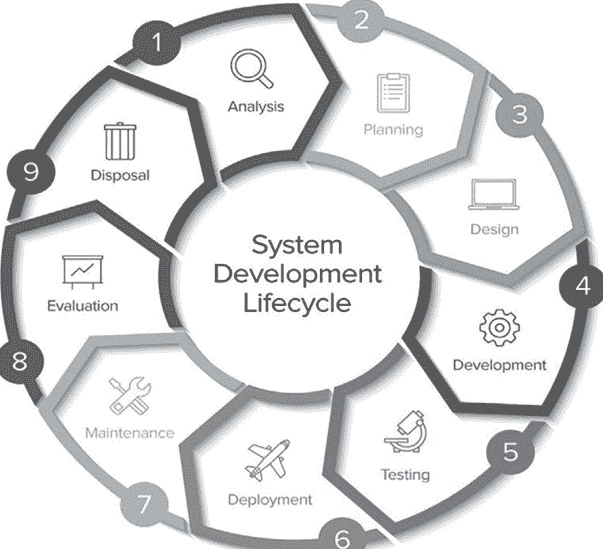

图 5.1 系统开发生命周期的要素（SmartSheet，2020）。

## 安全系统开发生命周期

安全系统开发生命周期（SDLC）流程可确保渗透测试、代码审查和架构分析等安全保证活动是开发工作的组成部分。各阶段内的活动有助于缓解漏洞并管理风险。

## 规划

在系统开发流程的第一阶段，会确定为实现业务战略目标所需的新系统。这是一份初步计划或可行性研究，用于获取修改或改进服务所需的资源。此步骤的目的是确定问题范围并识别解决方案。此阶段应考虑资源、成本、时间和效益。

可行性研究应包含以下内容：

- 对现有环境影响的评估。
- 员工发展和资源需求。
- 项目开发成本分析。
- 计划维护成本。
- 对替代项目实施方法的评估，例如自建与购买以及外包。
- 拟议解决方案的描述。
- 与拟议解决方案相关的风险。
- 效益分析，包括降低成本、减少错误、新客户和改善客户服务。
- 让信息安全团队参与，以确保已将适当的安全问题纳入可行性研究。

## 需求

此阶段定义组织将如何关注其问题的根源或变更的需求。在出现问题时，应提交并分析可能的解决方案，以确定解决项目目标的最合适方式。

应制定业务和运营需求规范，以确保理解支持业务目标所需的项目需求。用户和开发团队通常主导此过程。业务需求应考虑以下问题：

- 支持系统或应用所需的数据及其与其他数据的关系。
- 系统或应用的使用频率。
- 在线处理所需的响应时间。
- 功能与其他组件的关系和依赖。
- 适用的法律或监管要求或约束的识别。
- 系统或应用的预期生命周期。

运营需求应考虑以下问题：

- 安全需求。
- 应急需求。
- 分布式和集中式处理需求。
- 数据输入策略和责任。
- 数据保留需求。
- 输出分发需求。
- 预期交易量，包括项目交易增长。
- 关键系统性能需求。

信息安全团队应在整个业务和运营需求阶段参与，以确保安全问题得到妥善处理并在需求文档中体现。风险评估方法主要在此阶段执行，以便为项目团队提供早期安全视角。

## 设计

此阶段涉及描述满足拟议系统功能需求所需的规范、特性和操作。它包括将业务和运营需求转换为功能需求的能力，以反映与系统或应用相关的预期用户体验。功能规范反映用户视角，并已转化为初步设计。对于维护和增强活动，重点是使用前后描述来记录将发生的变更。

功能规范应包括以下内容：

- 数据流图：追踪数据通过所有处理点。
- 数据定义：定义数据、数据关系和命名约定。
- 屏幕定义：定义输入字段并检查范围。
- 输入：输入源、数据类型和数据描述。
- 报告定义：描述报告、每份报告中包含的数据、数据值的推导方式以及使用特定报告的用户。
- 控制和安全要求：输入编辑要求、从源点到处置点的关键数据审计日志轨迹以及特权使用审计日志轨迹，并识别关键处理区域。
- 系统接口要求：识别此系统与其他系统之间的交互点、预期输入和输出、响应时间预期以及其他系统间依赖。
- 备份、重启和恢复：确定备份频率、备份依据、备份保留要求、指定应用程序应如何重启的重启要求以及恢复要求。
- 应急要求：进行分析以确定应用程序在业务受影响前可不可用多长时间，并识别需要在异地处理中心恢复的数据集、软件和其他项目。
- 硬件要求：确定通信需求、磁盘空间和处理设备。
- 服务级别要求：确定正常运行时间要求、所需响应时间、关键时间窗口、输入截止日期和报告分发截止日期。
- 容量要求：确定交易量和预期增长。
- 转换要求：开发用于在新系统上创建数据的方法、转换期间对账数据的方法、切换要求以及验证转换数据的过程。

在功能规范过程中，信息安全团队通常应参与支持项目团队捕获系统或应用的初步设计和功能描述。功能规范应包含安全相关信息，例如技术特性——即访问控制和运营实践（即意识和培训）。信息安全团队应在详细设计阶段之前审查此文档并提供反馈。

## 开发

此阶段涉及让程序员、网络工程师和/或数据库开发人员参与项目。工作包括使用流程图确保流程有序。开发阶段标志着流程初始部分的结束和代码开发的开始。具体来说，代码是根据设计阶段产生的需求生成的。

在开发阶段，系统或应用的安全功能被开发、配置和启用，并使用程序规范来描述程序逻辑和处理要求。程序规范作为此阶段的一部分在编程开始之前制定。这些规范提供了确定编码程序所需步骤的必要要求。

信息安全团队应保留对系统或应用关键方面（包括用户身份验证、授权和财务交易）进行源代码审查的权利。源代码审查应重点关注第三方（包括离岸开发组织）提供的代码。

## 测试

此阶段涉及程序和流程的系统集成和系统测试，通常由质量保证（QA）专业人员执行，以确定拟议设计是否满足最初的一组业务目标。测试可能会重复进行，具体用于检查错误、缺陷和互操作性，并应持续执行直到最终用户认为结果可接受。此阶段的另一部分是验证和确认，两者都将有助于确保成功完成。

### 单元测试

单元测试是敏捷软件开发流程的组成部分，旨在通过审查隔离的代码序列来识别和解决缺陷。单元测试标准应包括以下内容：

- 文件更新、合并和排序。
- 所有决策逻辑。
- 所有系统或应用接口和集成测试。
- 无效交易及相关错误处理例程。
- 重启/恢复例程。
- 压力测试。
- 错误条件。
- 页面计数器和溢出标头。

### 系统测试

在系统测试阶段，项目的代码开发已完成，并执行测试以确保所有功能按要求运行。

系统测试环境通常由所有程序员共享，对环境的更改实行严格控制。系统测试标准应包括以下内容：

- 验证所有功能均按功能和设计规范执行。
- 程序接口。
- 其他系统接口。
- 重启和恢复程序。
- 事务验证和拒绝。
- 事务处理周期。
- 系统或应用性能标准。
- 系统或应用输出生成。
- 压力测试。
- 错误处理。
- 输入/输出验证。
- 关于生产数据使用的程序和限制。
- 完整且准确的审计日志跟踪。
- 安全测试——即身份验证和授权。
- 系统或应用安全测试——即道德黑客攻击。
- 对关键代码段和外部开发代码的代码审查。

在可能的情况下，系统或应用安全测试应使用自动化测试工具执行。这将支持创建可用于未来增强期间回归测试的测试和程序。

## 并行测试计划

当存在现有系统或应用程序时，并行测试确保模拟生产环境中的功能与现有流程等效。

在系统测试阶段，信息安全团队应深入参与审查项目/测试团队编写的安全测试，并验证安全测试结果。安全团队还可以选择执行渗透测试，以确保开发团队考虑常见安全漏洞。

## 部署

部署涉及新开发系统和/或应用程序的实际安装。此步骤通过直接切换将数据和组件从旧系统移至新系统，从而将项目投入生产。尽管这可能是一个复杂的过渡，但切换通常在非高峰时段进行，从而最大限度地降低风险。

切换/安装计划记录了从旧系统或应用程序到新系统或应用程序的过渡。该计划应涉及任何未执行的生产数据迁移。它还应涉及安装活动及与系统用户的协调。应在发生错误过渡时定义回退程序。

## 维护

此阶段涉及维护，并需要定期更新。在此步骤中，最终用户可以优化系统以提升性能、添加新功能或满足额外的用户需求。它还包括实施后审查、符合性和缺陷跟踪。

## 实施后审查

实施后审查确保系统或应用程序以令人满意的水平运行。此审查涉及征求用户对项目整体效果以及需求和时间表实现情况的反馈。这些信息为未来项目提供了宝贵的见解，并识别 SDLC 中的潜在不足。

安全团队应参与实施后审查，以确认已部署的安全功能令人满意。

此时，为支持系统或应用程序而做出的所有安全决策的文档将最终确定，并记录与现有安全策略和标准的偏差。如果允许暂时性偏差，将启动跟踪以确保它们按照商定的时间表得到解决。

## 符合性和缺陷跟踪

项目管理流程应确保符合 SDLC 的所有方面。在此语境下，符合性是指确保先前列出的文档在 SDLC 的下一阶段之前被创建、审查和批准。

对文档的任何修改，一经批准，都应接受审查，所有受影响的团队应同意该更改。应使用缺陷检查工具在所有测试阶段监控和跟踪已识别的缺陷。这为就任何缺陷的状态和解决做出明智决策提供了依据。

## 安全软件开发生命周期

安全软件开发生命周期（SSDLC）是在 SDLC 流程中包含安全工件的过程。

SSDLC 是一个框架，定义了组织从应用程序的构思到退役所使用的流程。多年来，已提出多种标准 SDLC 模型（瀑布、迭代、敏捷），并通过多种方式集成到各种组织环境中。

## 规划和需求

任何举措的第一步是制定规划流程。在此阶段，组织必须确定发布主题、内容和时间表。此阶段通常包括诸如收集最终用户

![img/8bcb92bad95ddd74218ba966f2798d54_61_0.png]

图 5.2 安全软件开发生命周期中的元素（Digital Maelstrom，2020）。

需求、确定要包含在发布中的用户故事，以及规划发布阶段和日期。

此阶段的关键考虑事项包括以下内容：

- 确保应用程序满足业务需求。
- 进行威胁建模/安全设计。
- 选择开发过程中使用的语言和库。
- 将测试用例映射到业务和功能需求。

## 架构和设计

在架构和设计阶段，组织的技术团队应遵循架构和设计指南以应对已识别的风险。此外，此阶段评估计划的系统设计及其与其他系统的潜在集成，以及共享服务和常见安全控制的纳入，包括以下内容：

- 身份验证。
- 灾难恢复（DR）。
- 入侵检测。
- 事件报告。

当在设计阶段早期解决漏洞时，流程包括威胁建模和架构风险分析，以帮助简化并提供安全的开发流程。

## 测试规划

在测试阶段应用安全控制应仔细考虑并合理规划。其目的是将控制集成到现有系统中；因此，应尽早发现对系统性能的挑战。此外，某些安全控制可能会限制或阻碍正常的开发活动。

对于新的信息系统，相应系统安全计划中识别和描述的安全要求应被设计、开发和实施。

运行中的信息系统的系统安全计划可能需要开发额外的安全控制来补充现有控制，或修改被认为效果不佳的控制。

在此阶段，决策基于集成挑战和权衡进行。记录重大决策和业务/技术驱动因素非常重要。

在无法或不宜应用计划控制的情况下，应考虑并记录补偿控制。

## 编码

在开发阶段，组织的开发团队应培训开发人员进行安全编码实践。在执行常规代码审查以确保项目具有指定功能和特性的同时，开发人员应通过集成安全编码实践（即 OWASP）来最大限度地减少代码中引入的安全漏洞。具体来说，应定期使用自动化工具或手动抽查审查源代码，以查找对系统安全性有不利影响的常见编程错误，包括以下内容：

- 跨站点脚本漏洞。
- 缓冲区溢出。
- 竞争条件。
- 对象模型违规。
- 用户输入验证和错误处理不当。
- 暴露的安全参数。
- 明文密码。
- 作为软件开发 QA 流程一部分的声明安全策略、模型或架构违规。
- 安全地使用开源组件。
- 静态代码分析。
- 漏洞扫描。

## 测试和结果

为减少冗余的功能和安全测试活动，提出以下建议：

- 功能测试计划应尽可能包含一般安全功能测试。
- 应在功能测试期间对基本安全控制进行初步测试，以尽早减少或消除开发周期中的问题——即强制访问控制、安全代码开发和防火墙。
- 初步测试被视为开发级测试，而非认证和授权（C&A）测试，如果没有发生更改，测试结果应在 C&A 中尽可能重复使用。

- 对于高可见性和高敏感性的系统，应考虑进行独立开发测试。
- 应在组件或安全区域级别完成初步测试，以确保每个组件或安全区域作为实体是安全的。
- 应捕获生命周期中发生的所有安全测试的过程和结果，以供评估、问题识别和潜在重用。

本阶段还应考虑以下漏洞评估：

- 动态代码分析。
- 渗透测试。
- 道德黑客。
- 密码破解。

## 发布与维护

部署和实施后，软件维护期间应遵循安全实践。应用程序应定期更新并按以下方式评估：

- 安全评估。
- 漏洞扫描。
- 渗透测试。
- 道德黑客。

## 云环境

漏洞管理是识别、分类、修复和缓解漏洞的过程，尤其是针对软件和固件。在基于云的环境中，此过程会变得复杂，因为各种技术层可以根据实现方式由不同组织管理。组织的漏洞管理计划应扩展到确保供应商管理的基于云的解决方案已建立适当的控制措施，以与组织的风险偏好和风险承受能力保持一致。

## 云环境中的漏洞扫描

传统技术环境与基于云的环境之间的差异主要源于（1）组织将拥有和控制云服务基础设施的能力外包给外部供应商，以及（2）组织无法访问云原生服务的漏洞数据。由于 CVE ID 通常不分配给云原生漏洞，因此无法将数据与云原生漏洞关联。因此，作为客户的组织很难就易受攻击的云服务做出明智的、基于风险的决策。例如，组织应在何时决定拒绝风险并停止使用云服务，或接受风险并继续使用该服务？

此外，即使为云原生漏洞分配了 CVE ID，传统环境与云环境之间的差异也非常大，以至于传统环境中通常与 CVE 关联的漏洞数据对于云服务漏洞来说是不充分的。例如，在传统 IT 环境中，CVE 与软件版本相关联，组织可以通过检查版本来确定软件应用程序是否存在漏洞。在云服务中，软件版本通常仅为云服务提供商所知。因此，作为客户的组织可能无法应用安全控制或其他缓解措施来解决漏洞风险。

## 示例：Amazon Web Services Elastic Container Registry 中的漏洞扫描

Amazon Web Services (AWS) Elastic Container Registry (ECR) 是一个完全托管的容器注册表，可让开发人员轻松存储、管理和部署容器镜像。镜像扫描是 ECR 中的自动化漏洞评估功能，通过扫描广泛的 OS 漏洞，帮助提升组织应用程序容器镜像的安全性。

## 为容器实施镜像扫描

容器安全涉及开发人员、安全运维工程师和基础设施管理员的一系列活动和工具。云原生供应链中一个关键环节是扫描容器镜像中的漏洞并获得可操作的洞察。ECR 镜像扫描使用 ECR 原生解决方案，并为特定用例和计划重新扫描提供实施策略作为基础。

## 防止带有已知漏洞的镜像进入生产环境

组织可以为其仓库启用镜像扫描或推送，以确保每个镜像都会自动针对聚合的 CVE 集进行检查。如果可用，AWS ECR 使用上游分发源中的 CVE 严重性；否则，可以使用通用漏洞评分系统 (CVSS) 分数来获取国家漏洞数据库漏洞严重性评级。这可以帮助组织在将镜像提升并部署到生产环境之前，对容器镜像漏洞进行自动检测和响应。

有两种扫描类型：

静态扫描在部署前的环境中执行，这意味着开发人员（或 SecOps）可以在容器启动前检测漏洞。ECR 镜像扫描属于此类；也就是说，它使组织能够扫描容器镜像中的 OS 软件包以查找 CVE（已知安全威胁的公开列表），而无需组织自行搭建扫描基础设施或购买第三方扫描许可证。

动态扫描在运行时环境中执行，并识别在测试、QA 或生产环境中运行的容器的漏洞，从而可以识别由构建后安装的软件引入的漏洞以及零日漏洞。对于动态（或运行时）容器安全，有多种第三方选项可供选择

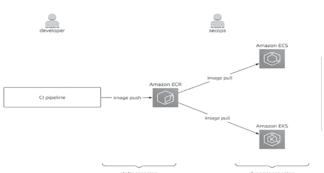

图 5.3 Amazon ECR 中的原生容器镜像扫描 (AWS, 2019)。

由第三方提供，从 CNCF Falco 等开源解决方案到通过 AWS 容器能力合作伙伴提供的服务，包括 Aqua Security、Trend Micro 和 Twistlock。

应用程序投入生产后，验证它们是否仍然没有漏洞。组织还可以使用应用程序编程接口 (API) 命令扫描镜像，从而设置对运行中的容器镜像进行定期扫描，以确保持续监控。扫描完成后，ECR 会发送通知，结果可在控制台和通过 API 获得。

## 用例

此用例展示了用于生产环境的容器镜像的计划重新扫描。例如，该人员担任 SecOps 角色，负责管理多个 ECR 仓库，与其手动扫描镜像并查看镜像扫描的详细结果，不如使用高级概览并按仓库下钻的功能。示例设置包含四个 Lambda 函数，用于提供管理扫描配置的 HTTP API 并处理镜像扫描的调度，以及一个 S3 存储桶用于存储扫描配置：

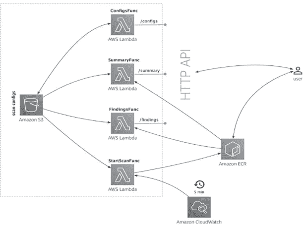

图 5.4 Amazon ECR 中的原生容器镜像扫描 (AWS, 2019)。

## 配置管理审计

安全配置组织的云技术环境是组织与 AWS 之间的共同责任。组织提供安全配置设置的要求，并期望 AWS 提供一种机制来实施和定期审计现有配置。

## 风险管理实践 – DevOps

DevOps 是一个术语，用于描述应用程序开发专业人员与基础设施运维专业人员之间更好的沟通与协作。它指一组新兴实践，旨在使开发人员和运维专业人员能够协同工作。开发人员希望更频繁地发布软件，而运维专业人员希望保护基础设施的稳定性。DevOps 是一种业务策略，通过重叠传统的运营和开发领域，创造一个环境，通过开发人员和运维人员的交叉融合来不断改进运营。DevOps 的总体战略目标是最大化投资成果，并确保客户以满足其需求的方式持续获得更高的服务质量和功能。本分析将重点放在将风险管理实践集成到 DevOps 框架中。

DevOps 的总体目标是提高 IT 工作的业务价值，并专注于以下目标：

- 通过持续且高质量的服务交付提供可衡量的业务价值。
- 在技术、流程和人为因素等所有领域强调简单性和敏捷性。
- 通过实现信任与共享、所有权、支持创新和鼓励协作，打破开发与运维之间的障碍。
- 管理动态合规，因为访问/共享法律变化迅速。

DevOps 代表了 IT 文化的变革，通过在面向系统的方法背景下采用敏捷、精益实践，专注于快速 IT 服务交付。DevOps 强调人员（和文化），并寻求改进运维团队与开发团队之间的协作。DevOps 实施利用技术——尤其是自动化工具，这些工具可以从生命周期角度利用日益可编程和动态的基础设施。

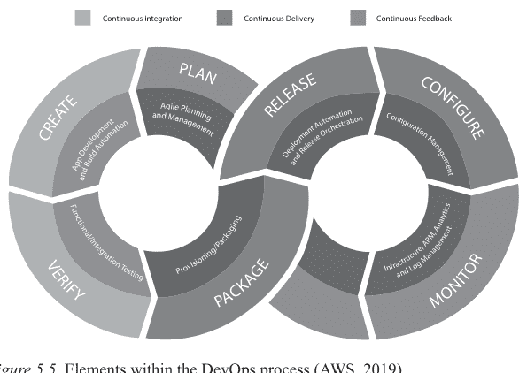

- 1 敏捷和精益是指团队进行迭代，具有短开发周期和快速反馈。敏捷关注文化，与所使用的工具无关。
- 2 DevOps是指工程组织如何使用跨职能团队进行协作。DevOps从文化开始，推动向工具发展。
- 3 系统可靠性工程（SRE）是指工程组织如何实现自动化，将高度规模化的运营交给具有软件工程思维的人员。SRE从工具开始，推动向文化发展。
- 4 DevOps变体（如“SecDevOps”）涉及在SDLC早期插入或添加另一个组织/实践，这些不同类型DevOps的普遍性表明现代组织中功能集成程度不断提高。

DevOps包含许多主题的变体。然而，大多数观察者都会同意，以下能力几乎是所有DevOps文化共有的：(1) 协作，(2) 自动化，(3) 持续集成，(4) 持续交付，(5) 持续测试，(6) 持续监控和(7) 快速修复。

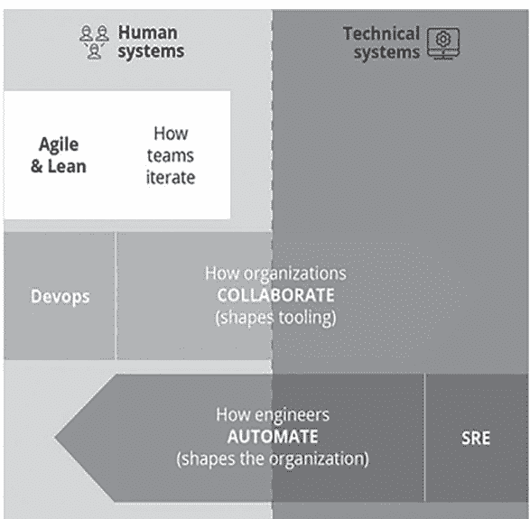

图 5.6 SecDevOps的要素（Humble & Molesky，2011）。

## 协作

开发和IT运维协同工作，由于协作的需求，DevOps远远超出了IT组织的范围，延伸到软件交付的所有利益相关方。

> “DevOps成功的基础在于团队和个人在整个企业中协作的程度，以便更快速、高效和有效地完成工作”——Tony Bradley，《在DevOps中扩展协作》，DevOps.com。

## 自动化

DevOps高度依赖自动化和工具以及工具链，以自动化端到端软件开发和部署过程的大部分。

| 健康 - 状态 安全工具/服务 | Web - 应用程序开发工具/服务 | 操作系统(OS)工具/服务 | 治理验证管理工具/服务 | 基础设施平台工具/服务 |
|---|---|---|---|---|
| 监控 警报 趋势 | 应用服务器 | Linux 编译器和调试器 | 应用程序开发 | IAAS 和 PAAS |
| 安全 | 数据库 | Unix 编译器和调试器 | 配置管理 | Web服务器 |
| 流程 | 可视化平台 | Windows 编译器和调试器 | 测试和构建 | 队列和缓存 |
| 日志记录 | | Mac OS | | 容器化工具 |

图 5.7 DevOps的工具和服务（Humble & Molesky，2011）。

## 持续集成

持续集成在DevOps文化中至关重要，因为DevOps源于敏捷文化，而持续集成是敏捷方法的基本原则：

> 持续集成（CI）是DevOps的基石，这是一种由Grady Booch设计和命名的技术，它不断将团队中所有开发人员的源代码更新合并到共享主干中。这种持续合并防止开发人员的本地软件项目副本随着其他人添加新代码而偏离太远，从而避免灾难性的合并冲突。
>
> – Aaron Cois，“DevOps中的持续集成”，DevOps博客，卡内基梅隆大学软件工程研究所

敏捷开发的持续集成原则对开发团队有文化影响。强制开发人员频繁（至少每天）将其工作集成到其他开发人员的工作中，比瀑布开发方法更早地暴露集成问题和冲突。然而，为了获得这一好处，开发人员必须彼此更频繁地沟通。

## 持续测试

根据Gartner的说法，DevOps的测试环节容易被忽视：“鑒于软件故障成本和影响的不断上升，你不能承诺发布可能会破坏现有用户体验或引入使组织面临新的安全、可靠性或合规性风险的新功能。”

持续测试不仅仅是QA职能；事实上，它始于开发环境。开发人员将质量构建到代码中并提供测试数据集。QA工程师配置自动化测试用例和测试环境。

在QA方面，速度至关重要。测试工程师不仅通过自动化测试过程来应对快速周转的挑战，还通过重新定义测试方法论：

> 持续测试创建了一个集中的决策系统，帮助您评估每个应用程序对组织带来的业务风险。持续应用，它指导开发团队满足业务期望，并为管理人员提供可见性，以便做出明智的权衡决策，优化发布候选版本的业务价值。
> –《IT领导者持续测试》，Parasoft。

运维可以确保监控工具到位且测试环境配置正确。他们可以参与功能、负载、压力和泄漏测试，并根据其在生产环境中运行的类似应用程序的经验提供分析。

DevOps环境中的测试职能帮助开发人员平衡质量和速度。使用自动化工具降低了测试成本，并使测试工程师能够更有效地利用时间。最重要的是，持续测试通过允许在流程早期进行集成测试来缩短测试周期。

持续测试还通过虚拟化的依赖服务消除了测试瓶颈，并简化了虚拟化测试环境的创建，这些环境可以随着系统变化而轻松部署、共享和更新。这些功能降低了配置和维护测试环境的成本，并通过允许在生命周期早期进行集成测试来缩短测试周期时间。

## 持续交付

AWS团队将持续交付定义为一种DevOps“软件开发实践，其中代码更改会自动构建、测试并准备发布到生产环境”。它通过在构建阶段后将所有代码更改部署到测试环境和/或生产环境来扩展持续集成。当持续交付正确实施时，开发人员将始终拥有一个已通过标准化测试过程的可部署构建产物。

实际发布频率因公司的遗留系统和目标而异。使用DevOps的高绩效组织每天实现多次部署，而中等绩效组织每周发布一次到每月发布一次。

具体发布的内容因组织而异。在一些组织中，QA和运维对潜在发布进行分类：(1)许多直接发布给用户，(2)一些退回开发，(3)少数根本不部署。相比之下，其他组织将开发人员的所有内容推送给用户，依靠实时监控和快速修复来最大限度地减少罕见故障的影响。需要注意的是，由于每次更新都很小，任何一次更新导致故障的机会都显著降低。

持续交付使企业能够缩短周期以更快地获得用户反馈，降低部署的风险和成本，了解交付过程本身，并更有效地管理软件交付风险。

从风险和合规性角度来看，持续交付是应用控制以满足监管要求的一种比传统自动化和手动活动组合更成熟、高效和有效的方法。

## 持续监控

鉴于持续交付环境中发布数量庞大，要实施瀑布开发方法通常要求的严格预发布测试是困难的。在DevOps环境中，故障必须实时发现和修复。通过持续监控，团队衡量软件的性能和可用性以提高稳定性。持续监控有助于快速识别问题的根本原因，以主动防止宕机并最大限度地减少用户问题。一些监控专家甚至主张，服务的定义必须包含监控，因为监控被视为服务交付不可或缺的一部分。

与测试类似，监控始于开发阶段。用于监控生产环境的相同工具可以在开发中使用，以便在产品进入生产环境之前识别性能问题。DevOps需要两种监控：(1)服务器监控和(2)应用程序性能监控。

## DevOps中风险管理实践的集成

截至2015年，与实现DevOps计划目标相关的80%风险源于组织变革的管理方式。

风险管理流程展示了如何进行评估，从缺乏内部控制开始，这被称为固有风险。通过包含适当的代码认证，这表明整个系统按预期运行且其环境保护其免受不当影响，风险得以降低。安全功能使利益相关者能够采取主动措施，例如隔离，即在敏感或非公开信息通过未经授权的暴露对其能力产生负面影响并导致品牌、声誉、财务、法律或网络安全风险之前，从其网络中移动或删除此类信息。应授权利益相关者执行以下操作：

- 持续监控所有网络并自动执行操作。
- 发现、分类并处理所有涉及已被识别为敏感、关键或机密数据的交易，以创建信息隐私解决方案。
- 根据适用的本地和全球法律，促进遵守适用于数据、用户和交易的所有法律法规。
- 随信息和足迹的增长进行扩展，并及时、经济高效地提供数据保护，从而实现可预测的持续任务结果。
- 在合理的时间内轻松安装、部署和更新组织使用的所有应用程序，且不会中断最终用户的预期。
- 通过为信息隐私解决方案和数据防泄漏创建自动预定义操作，最大限度地减少对IT监督的需求。
- 理想情况下，开发一个与网络管理系统类似并集成的数据安全和数据隐私仪表板。
- 提供每日、每周、每月和每年的报告，可用于满足审计请求。
- 降低业务风险和责任。

在IT组织中不实施DevOps和持续交付的一个常见原因是，除非考虑风险管理流程，否则这种方法不符合行业标准和法规。经常引用的两种控制措施是职责分离和变更管理。

法规和标准要求组织证明他们知道发生了什么以及原因。因此，保护信息和服务并进行准确报告至关重要。遵守主管部门获取特定数据的要求以及用于保护所获取数据的机制，是当今许多讨论的焦点。大多数IT组织都受到监管并实施控制措施以确保合规。控制措施在降低损失风险方面也是必不可少的，这种损失可能会影响信息的机密性、完整性、可用性和隐私性。

利用风险管理方法有助于在实施内部控制后理解剩余风险。这将使企业能够了解剩余风险与其风险概况的一致性。

# 6 风险管理实践 – 业务连续性管理

业务连续性管理（BCM）计划通过实施业务连续性的IT就绪性来管理组织的业务中断风险。ICT服务故障可能会导致安全问题，例如系统入侵和恶意软件感染。组织的业务连续性ICT就绪性（IRBC）基于ISO 27031，包括事件准备、灾难恢复规划以及应急响应和管理。

BCM是一种整体管理流程，用于识别组织业务活动连续性的潜在威胁，并通过有效响应提供构建韧性和能力的框架，以保护组织免受中断影响。

作为组织BCM流程的一部分，IRBC是该计划的一个组成部分。

IRBC专注于管理一个或多个系统，这些系统补充和支持组织的BCM计划，以提高组织对以下方面的就绪性：

- 应对不断变化的风险环境。
- 确保由相关ICT服务支持的关键业务运营持续进行。
- 在检测到一项或一系列相关事件（这些事件会变成事件）之前，做好在ICT服务中断发生前响应的准备。
- 响应并从事件/灾难和故障中恢复。

图 6.1 业务连续性流程（phoenixNAP，2020）。

## 关键原则

组织的BCM计划应基于以下关键原则：

- 事件预防 – 保护IT服务（ITS）免受环境和硬件故障、操作错误、恶意攻击和自然灾害等威胁，对于维持组织所需的系统可用性水平至关重要。
- 事件检测 – 应在最早机会检测到事件，以最大限度地减少对服务的影响，减少恢复工作并保持服务质量。
- 响应 – 以最恰当的方式响应事件将带来更高效的恢复并最大限度地减少停机时间。
- 恢复 – 识别并实施适当的恢复策略可确保服务及时恢复并保持数据完整性。了解恢复优先级可使最关键的服务首先恢复。性质不那么关键的服务可能会在稍后恢复，或者在某些情况下被停用。
- 改进 – 应记录、分析和审查从小型和大型事件中吸取的教训。了解这些教训将使组织能够更好地准备、控制和避免事件及中断。

## 关键要素

组织IRBC的关键要素可总结如下：

- 人员：具备适当技能和知识的专家以及合格的备份人员。
- 设施：ICT资源所在的物理环境。
- 技术：
  - 硬件，包括机架、服务器、存储阵列、磁带设备和固定装置。
  - 网络，包括数据连接、语音服务、交换机和路由器。
  - 软件，包括操作系统、应用软件以及它们之间的链接或接口。
  - 应用程序和批处理例程。
  - 数据：应用程序数据、语音数据和其他类型的数据。
  - 流程，例如用于描述ICT资源配置并支持这些服务有效运行、恢复和维护的支持文档。
- 供应商：端到端服务的其他组件，其中ICT服务提供依赖于外部服务提供商或供应链中的另一个组织——即金融市场数据提供商、电信运营商或互联网服务提供商。

## 使用计划-执行-检查-行动建立组织的ICT就绪性

### 政策

组织的IRBC政策提供了其所追求的有记录的原则，并据以衡量其有效性。它应该

- 建立并展示管理层对IRBC计划的承诺，
- 包含或引用组织的IRBC目标，

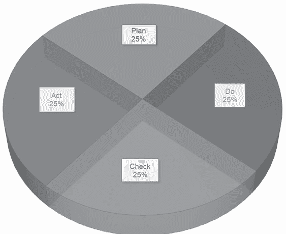

图 6.2 ICT就绪性流程的要素（ISO，2020）。

- 定义IRBC的范围，包括限制和排除项，
- 获得管理层批准并签字确认，
- 向适当的内部和外部利益相关者传达，
- 识别并提供相关权限，以确保预算和人员等资源的可用性，从而按照IRBC政策开展活动，以及
- 在计划的间隔以及发生重大变化（例如环境变化或组织业务和结构变化）时进行审查。

### 规划

规划阶段的主要目标是建立组织的ICT就绪性要求，包括以下内容：

- 支持已定义范围及组织业务连续性目标和宗旨实现所需的法律、法定和监管要求的IRBC策略和IRBC计划。
- 组织监控实现这些目标和宗旨所需的ICT就绪性程度所需的绩效标准。

### 资源

作为政策授权的一部分，组织将IRBC计划的需求定义为其整体BCM目标的一部分，并确定和提供建立、实施、运行和维护IRBC计划所需的资源。

应定义并记录IRBC的角色、职责、能力和权限。

管理层应执行以下任务：

- 任命或提名一位具有适当资历和权限的人员，负责IRBC政策和实施。
- 任命一名或多名合格人员，无论其他职责如何，都应实施本计划的各项要素。
- 按计划所述维护IRBC管理系统。

### 员工能力

组织应确保所有被分配IRBC职责的人员都具备执行所需任务的能力。

## 定义需求

作为其业务连续性管理（BCM）计划的一部分，组织应根据业务影响分析确定的连续性优先级对其活动进行分类，并定义每项关键活动需要执行的最低水平。

管理层应就组织的业务连续性要求达成一致，这些要求将针对每个产品、服务或活动的最低业务连续性目标（MBCO）产生恢复时间目标（RTO）和恢复点目标（RPO）。RTO 从中断发生之时开始，直到产品、服务或活动恢复为止。

## 了解关键服务

可能存在多项关键 ICT 服务，这些服务对于实现恢复是必需的。每项关键 ICT 服务都应针对 ICT 服务的 MBCO 拥有其自身的文档化 RTO 和 RPO。目标可能包括 ICT 服务交付的各个方面，例如服务台。关键 ICT 服务的 RTO 优先级始终低于业务连续性的 RTO。组织应识别并记录其关键 ICT 服务，包括简要描述以及在服务用户层面对组织有意义的名称。这将确保业务和 ICT 人员之间达成共识，因为同一 ICT 服务可能会使用不同的名称。列出的每项关键 ICT 服务都应识别其支持的产品或服务，管理层应就 ICT 服务及相关的 IRBC 要求达成一致。

对于每项已识别并达成一致的关键 ICT 服务，应描述并记录端到端服务的所有 ICT 组件，以展示它们如何配置或链接以交付每项服务。应记录常规 ICT 服务交付环境和 ICT 连续性服务交付环境的配置。

对于每项关键 ICT 服务，应从预防角度审查当前的连续性能力——即单点故障的存在——以评估服务中断或降级的风险，这可以作为整体 BCM 风险评估练习的一部分。还应寻求改善 ICT 服务弹性并从而降低服务中断可能性和/或影响的机会。此类审查还可能突出早期检测和响应 ICT 服务中断的机会。组织可以决定是否有针对已识别机会投资以改善服务弹性的商业依据。此风险评估可能构成组织整体风险管理框架的一部分，也可能为增强 ICT 服务恢复能力的商业依据提供参考。

## 识别 ICT 就绪能力与业务连续性要求之间的差距

对于每项关键 ICT 服务，应将当前的 ICT 就绪安排（例如预防、监控、检测、响应和恢复）与业务连续性要求进行比较，并记录任何差距。

管理层应被告知关键 IRBC 能力与业务连续性要求之间的任何差距。此类差距可能表明风险以及对额外弹性和恢复资源的需求，例如：

- 人员，包括人数、技能和知识。
- 用于容纳 ICT 设备的设施——即计算机机房。
- 支持技术、工厂、设备和网络。
- 信息应用程序和数据库。
- 财务或预算分配。
- 外部服务和供应商。

管理层应对 ICT 服务定义、关键 ICT 服务的文档化列表以及关键 IRBC 能力与业务连续性要求之间已识别差距相关的风险进行签字确认。

这应包括（在适当情况下）对已识别风险进行签字确认。然后应通过确定 IRBC 策略来探讨解决已识别差距和风险的选项。

## 确定 IRBC 策略选项

IRBC 策略应定义实施所需弹性策略的方法，以确保事件预防、检测、响应、恢复和复原的原则到位。

应评估一系列完整的 IRBC 策略选项。所选策略应支持组织的业务连续性要求。

组织在制定策略时应考虑实施和持续资源需求。可以聘请外部供应商提供在支持策略方面发挥重要作用的专业服务和技能。

IRBC 策略应足够灵活，以适应不同市场的不同业务策略。

此外，策略应考虑内部约束和因素，例如：

- 预算。
- 资源可用性。
- 潜在成本和收益。
- 技术约束。
- 组织的风险偏好。
- 组织现有的 IRBC 策略。
- 法规义务。

## IRBC 策略选项

组织应考虑其关键 ICT 服务事件就绪的一系列选项。这些选项应允许增加保护和弹性，并为非计划中断后的恢复和复原提供保障，可能包括内部安排。提供给组织的服务可以由一个或多个第三方在外部提供。

选项应考虑确保关键 ICT 服务连续性和恢复所需的各种组件。

## 技能和知识

组织应识别维护核心 ICT 技能和知识的适当策略。这可能超出员工范围，扩展到承包商和其他拥有广泛 ICT 专业技能和知识的利益相关者。保护或提供这些技能的策略可能包括：

- 记录执行关键 ICT 服务的方式。
- 对 ICT 员工和承包商进行多技能培训，以增强技能冗余。
- 分离核心技能以降低风险集中度。
- 知识保留和管理。

## 设施

根据已识别的风险，组织应制定策略以减少常规 ICT 设施不可用的影响。这些策略可能包括以下一项或多项：

- 组织内部的替代设施，包括转移其他活动。
- 其他组织提供的替代设施。
- 第三方专家提供的替代设施。
- 在家或其他远程站点工作。
- 其他商定的合适工作设施。
- 在既定站点使用替代劳动力。
- 可以运输到中断现场并用于直接替换部分相关物理资产的替代设施。

ICT 设施策略可能差异很大，可能有多种选项可用。不同类型的事件或威胁可能需要实施多种策略，这些策略部分取决于组织的规模、活动范围、地点、技术和预算。

在考虑使用替代场所时，应考虑以下事项：

- 站点安全。
- 员工访问。
- 与现有设施的接近程度。
- 可用性。

## 技术

关键业务活动依赖的 ICT 服务应在依赖的关键业务活动恢复之前可用。所需解决方案应确保应用程序在特定时间范围内可用；也就是说，RTO 应作为业务影响分析（BIA）的一部分来确定。技术平台和应用软件应在组织要求的时间范围内到位。支持关键 ICT 服务的技术通常需要复杂的安排来确保连续性，在选择 IRBC 策略时应考虑以下事项：

- 支持 BCM 计划识别的关键活动的关键 ICT 服务的 RTO 和 RPO。
- 技术站点之间的位置和距离。
- 技术站点的数量。
- 系统的远程访问。
- 冷却要求。

- 电源要求。
- 无人站点的使用。
- 电信连接和冗余路由。
- “回退”的性质——即，手动或自动干预——这是激活替代ICT供应所必需的。
- 所需的自动化级别。
- 技术过时。
- 外包服务提供商连接和其他外部链接。

## 数据

此外，关键业务活动可能依赖于提供最新或近乎最新的数据。数据连续性解决方案应设计为满足组织各关键业务活动的RPO（恢复点目标），这些RPO与关键业务活动相关。所选的IRBC选项应确保支持关键活动的关键数据的持续保密性、完整性和可用性。数据存储和IRBC策略应满足组织的业务连续性要求，并应考虑以下事项：

- 数据如何安全存储——即，磁盘、磁带或光学介质；应建立适当的备份和恢复机制，以确保数据安全且处于安全环境中。
- 信息存储、传输或发送的位置；距离；位置、网络链接、现场、异地或第三方；以及备份介质检索的预期时间范围。
- 恢复时间范围，由数据量、数据存储方式以及技术恢复过程的复杂性驱动，同时结合服务用户的要求和组织连续性的需求。

对组织内数据“端到端”使用的理解至关重要，可能包括与第三方之间的信息馈送。

## 流程

在选择其IRBC策略时，组织应考虑确保该策略可行性所需的流程，包括事件预防、事件检测、事件响应和灾难恢复（DR）所需的流程。组织还应识别有效实施这些单个流程所需的任何因素——即，关键技能集、关键数据、关键使能技术或关键设备/设施。

## 供应商

组织应识别并记录支持ICT服务提供的外部依赖关系，并采取充分措施，确保关键设备和服务能够由其供应商在预先确定并商定的时间范围内提供。此类依赖关系可能存在于硬件、软件、电信、应用程序、第三方托管服务、公用事业以及环境问题（例如空调、环境监测和灭火系统）方面。

这些服务的策略可能包括以下内容：

- 在另一地点存储额外的设备和软件副本。
- 与供应商安排短期内交付替换设备。
- 在设备故障时快速修复和/或更换故障部件。
- 电力和电信等公用事业的双重供应。
- 应急发电设备。
- 识别替代/备用供应商。

组织应在与合作伙伴和服务提供商的合同中纳入ICT和BCM要求。合同附表应包括对各方义务、商定的服务水平、重大事件响应、成本分配、演练频率和纠正措施的引用。

## 签字批准

所选的IRBC策略选项应提交给管理层，并附带基于风险偏好和成本的决策建议。应告知管理人员所选的IRBC策略选项是否无法满足业务连续性要求，如果是，则应告知其当前能力。管理人员应从提供的选项中选择IRBC策略，并批准和签署记录的选项，以确认这些选项已得到妥善执行并支持整体业务连续性要求。

所选的IRBC策略选项应

- 应对可能的中断风险及其影响，
- 与组织选定的业务连续性策略相集成，以及
- 在其风险偏好范围内，适合实现组织的整体目标。

## 增强IRBC能力

### 增强韧性

组织应在其高级别IRBC策略和计划中引用特定的IRBC能力增强措施，这些措施是满足其已识别的IRBC要求所必需的。这些增强措施可以通过预防性和纠正性行动，以及其他针对组织BIA和风险偏好的相关响应的特定流程或方法来实现。

## ICT就绪性绩效标准

### 识别绩效标准

在任何ICT环境中，都存在许多潜在的威胁事件，例如硬件故障和安全入侵，组织应能够监控威胁并了解IRBC系统是否能够妥善应对这些威胁。因此，组织应定义绩效标准来衡量其ICT就绪性的有效性。这些标准可用于确定对中断响应的期望质量，包括其有效性和效率。IRBC的绩效标准应基于IRBC要求以及在事件响应和连续性要求方面的整体BCM目标。

## 实施IRBC策略要素

### 意识、技能和知识

对ICT服务要素（包括人员、设施、技术、数据、流程和供应商以及其关键组件）的就绪性的普遍认识，对于确保业务连续性治理和管理体系（包括ICT就绪性）所需的支持至关重要。

因此，组织应：

- 通过为相关员工开展持续的教育和信息计划，提高、增强和保持意识，并建立评估意识传递有效性的流程。
- 确保员工了解自己如何为实现IRBC目标做出贡献。

组织应确保所有被分配IRBC管理职责的人员都具备执行所需任务的能力，方法是

- 确定此类人员所需的能力，
- 对此类人员进行培训需求分析，
- 提供培训，
- 确保已达到所需的能力，以及
- 保存教育、培训、技能、经验和资格的记录。

### 设施

ICT恢复系统和关键数据应尽可能与运营站点物理分离，以防止它们受到同一事件的影响。在实施策略时，应考虑所有ICT环境的位置。例如，如果可能，培训或开发ICT系统应在逻辑上与生产系统分离，因为在发生灾难时，这些系统可能会被重新配置以快速恢复生产服务。

应审查不同实施技术的整体可扩展性、可管理性、可支持性、性能和成本特征，以确定哪些最适合所选策略并支持整体业务连续性目标和宗旨。

### 技术

应实施ICT技术策略，可能包括以下一种或多种实现和安排：

- 热备用，其中ICT基础设施在两个站点之间复制。
- 温备用，恢复在次要站点进行，该站点的ICT基础设施已部分准备。
- 冷备用，在备选地点从头构建或配置基础设施。
- 运入安排，由外部服务提供商提供硬件。
- 前述策略的复合安排：一种“按需选择”的方法。

### 信息安全

组织的信息安全要求应纳入业务连续性和灾难恢复规划。组织应确保制定有记录的计划以及响应和恢复程序，并且

经批准，详细说明组织将如何管理破坏性事件，并根据管理层批准的信息安全连续性目标，将其信息安全维持在预定水平。

根据组织的信息安全连续性要求，组织应建立、记录、实施和维护以下内容：

- 业务连续性或灾难恢复（DR）流程、程序及支持系统和工具中的信息安全控制。
- 为维护现有信息安全而进行的流程、程序和实施变更。
- 不利情况下的控制。
- 在不利情况下无法维护的信息安全控制的补偿控制。

信息处理设施应实施足以满足可用性要求的冗余。组织应识别信息系统可用性的业务需求。在无法使用现有系统架构保证可用性的情况下，应考虑冗余组件或架构。

在适用的情况下，应测试冗余信息系统，以确保从一个组件到另一个组件的故障转移按预期工作。

## 数据

为数据可用性确定的安排应与IRBC管理策略中确定的要求保持一致，并可能包括以下内容：

- 以确保在业务连续性计划中确定的时间范围内数据可用性的格式进行的额外数据存储。
- 数据存储的替代位置，可以是物理或虚拟的，前提是维护数据的安全性和机密性。
- 适当的访问程序：如果通过第三方安排信息存储，信息所有者应自行确认已建立适当的控制措施。

## 流程

IRBC流程应清晰且详细地记录，以使合格员工能够执行。其中一些流程可能与日常运营不同。IRBC程序可能取决于实际发生的情况，在实践中，可能需要根据中断情况进行调整——即损失或损坏的程度、组织的运营优先级以及利益相关者的要求。

## 供应商

组织应确保关键供应商能够支持组织所需的IRBC服务能力。这些供应商应拥有自身已记录并经过测试的业务连续性和IRBC计划，具备支持客户并发激活事件或恢复计划的能力。组织应在接纳其服务前建立评估供应商能力和胜任力的流程，并在接纳后持续监控和审查供应商的能力。符合相关标准中的要求/良好实践是判断供应商能力的有用手段——例如，托管/管理替代处理设施并提供ICT灾难恢复服务的供应商采用ISO/IEC 24762最佳实践。

## 事件响应

对于任何ICT事件，都应有事件响应来

- 确认事件的性质和范围，
- 掌控局面，
- 遏制事件，以及
- 与利益相关者沟通。

事件响应应触发适当的IRBC行动。此响应应与整体BCM事件响应集成，并可能启动事件管理团队。负责事件管理的个人应制定事件响应的激活、运行、协调和沟通计划。

## IRBC计划文档

组织应拥有文档来管理潜在中断，从而实现ICT服务的连续性和关键活动的恢复。ICT事件管理、业务连续性和技术恢复计划可能会快速连续或同时激活。组织可以制定特定的计划文档来恢复或恢复ICT服务并返回“正常”状态。但是，直到事件发生后的一段时间，可能无法定义“正常”是什么样子；因此，可能无法立即实施恢复计划。因此，组织应确保连续性安排能够支持更广泛的业务连续性进行长时间运行，为制定“恢复正常”恢复计划留出时间。

## 计划文档内容

组织的ICT响应和恢复计划应简洁，并可供计划中定义职责的人员访问。计划应包含以下各节讨论的要素。

## 目的和范围

每个特定计划的目的和范围应明确界定，经管理层同意，并由将启动该计划的人员理解。与组织内其他相关计划或文档（特别是BCP）的任何关系都应明确引用，并应描述获取和访问这些计划的方法。

每个事件管理和ICT响应及恢复计划都应就以下方面建立优先级目标：

- 待恢复的关键ICT服务。
- 恢复的时间范围。
- 每个关键ICT服务活动所需的恢复级别。
- 可启动每个计划的情况。

在适当的情况下，计划还可包含支持事后审查流程的程序和检查清单。

## 角色和职责

在事件期间及之后，拥有决策权和支出权的人员和团队的角色和职责应明确记录。

## 计划启动

响应期间损失的时间无法挽回。与其错过及早遏制事件并防止升级的机会，不如启动ICT响应并随后将其停止，这几乎总是更好的选择。因此，组织应将其更广泛的业务连续性事件管理计划中包含的事件管理升级和启动协议作为管理潜在ICT相关服务中断的基础。ICT响应和恢复计划的启动方法应明确记录。此过程应允许在潜在破坏性事件发生之前或事件发生后立即，以最短的时间启动相关计划或其部分。计划应包含以下内容的清晰精确描述：

- 如何动员指定的个人或团队。
- 立即集合点。
- 后续团队会议地点以及任何替代会议地点的详细信息。
- 认为IRBC响应不必要的情况——即即使是关键ICT服务，也可由正常的帮助台和支持安排及协议管理的轻微故障和中断。
- 事件结束后停止ICT响应团队并恢复正常业务的流程。
- ICT响应和恢复计划文档的所有者。
- ICT响应和恢复计划文档的所有者将如何对定期审查和更新文档负责。
- 将如何采用版本控制系统，正式通知所有相关方，并保存正式的连续性计划文档分发记录。
- 联系方式。

## ICT响应和恢复计划文档

ICT响应和恢复计划文档应

- 灵活、可行且相关；
- 易于阅读和理解；以及
- 为管理被认为值得进行IRBC响应的严重问题提供基础，通常是在发生重大中断事件之后。

文档应定义恢复计划组织所在的总体框架，涵盖以下内容：

- 总体策略。
- 具有RTO/RPO的关键服务。
- 恢复时间表。
- 恢复团队及其职责。

The plans should be documented such that competent personnel can use them in the event of an incident and include the following:

- Objectives: A short description of the objectives of the plans.
- Scope: Covering the following, with reference to the results of the BIA:
- The criticality of services: Description of the relevant services and identification of their criticality.
- Technology: An overview of the main technology that supports services, including where it is maintained.
- Business units: An overview of the entities that manage the technology.
- Documentation: An overview of the main documentation for the technology, including the locations where it is stored.
- Availability requirements: Business-defined requirements for the availability of services and related technology.
- Information security requirements: Requirements for the information security of services, systems and data, including confidentiality, integrity and availability requirements.
- Technology recovery procedures: Description of the procedures to be followed to recover ICT services, including the following:
- A list of activities—that is, desktop support and restoration contact information.
- A list of activities for recovering networks, systems, applications and databases to an agreed-upon level at an alternative location, considering the changed environment—that is, how it could affect line capacity and system-to-system communications.
- A list of activities for restoring basic functionality, such as security, routing and logging.
- Coordination within the application or among applications, data synchronization and potential automated procedures for handling a backlog of information.
- The process needed to restore ICT services and turn them over to their users to operate in recovery mode.
- Backup procedures.
- Where and how people can obtain further information and instructions—that is, hotline numbers and steps to return to normal.
- Appendices
- Inventory of information systems, applications and databases.
- Overview of network infrastructure and server names.
- Inventory of hardware and systems software.
- Contracts and service-level agreements (SLAs).
- Key ICT suppliers
  - Business-as-usual suppliers.
  - Recovery service suppliers.

## Awareness, competency and training programme

A coordinated programme should be implemented to ensure that processes are in place to regularly promote IRBC awareness in general and to assess and enhance the competency of all personnel who are relevant to the successful implementation of IRBC.

## Document control

### Control of IRBC records

Controls should be established over IRBC records to

- ensure that they remain legible, readily identifiable and retrievable and
- provide for their storage, protection and retrieval.

### Control of IRBC documentation

Controls should be established over IRBC documentation to ensure that

- documents are approved prior to issuance;
- documents are reviewed, updated and re-approved as needed;
- changes and the current revision status of documents are identified;
- relevant versions of applicable documents are available at points of use;
- documents of external origin are identified, and their distribution is controlled; and
- the unintended use of obsolete documents is prevented, and such documents are suitably identified if they are retained for any purpose.

## Monitoring and review

## Maintaining IRBC

With change comes risk—not only the risk of failure but also the risk of destabilizing existing policies and strategies. IRBC strategies should therefore be resilient and adaptable. Any change to ICT services that may affect IRBC capability should be implemented only after the business continuity implications of the change have been assessed and addressed.

The following steps are necessary to ensure that the IRBC strategies and plans remain appropriate for the organization:

- Management should ensure that the IRBC strategies continue to support the organization's BCM requirements.
- The change management process should include all parties responsible for the planning and implementation of IRBC strategies.
- The development process for new ICT services should include sign-off that resilience has not been compromised by even the simplest upgrades or improvements.
- Due diligence on merger and acquisition activity should include a resilience assessment.
- ICT component decommissioning should be reflected within related IRBC management systems.

## Monitoring, detection and analysis of threats

The organization should establish a process to continuously monitor and detect the emergence of ICT security threats, including but not limited to the following areas:

- Retention of staff, skills and knowledge.
- Management of facilities to house ICT equipment—that is, by monitoring the amount and nature of security.
- Incidents/vulnerabilities related to computer rooms.
- Changes in supporting technology, plants, equipment and networks.
- Changes in information applications and databases.
- Finance or budget allocation.
- The effectiveness of external services and suppliers.

## Testing and exercising

The organization should test not only the recovery of the ICT service but also the protection and resilience elements to determine whether

- the service can be protected, maintained and/or recovered regardless of the incident severity,
- the IRBC management arrangements can minimize the impact on the business and
- the procedures for returning to business as usual are valid.

### Test and exercise programme

In most instances, the whole set of IRBC elements and processes, including ICT recovery, cannot be proved in one test and exercise.

A progressive exercising regime might therefore be appropriate for building a full simulation of a real incident. The programme should include different levels of exercise, from familiarization to computer room resilience, and should consider all aspects of end-to-end ICT service delivery.

There are risks associated with tests and exercises, and such activities should not expose the organization to an unacceptable level of risk. The test and exercise programme should define how the risk of individual exercising is addressed. Management sign-off on the programme should be obtained, and a clear explanation of the associated risks should be documented.

The test and exercise programme objectives should be fully aligned with the wider BCM scope and objectives and should complement the organization’s broader exercise programme. Each test and exercise should have both business objectives, even where there is no direct business involvement, and a defined technical objective to test or validate a specific element of the IRBC strategy.

Exercising individual elements in isolation at the component level is complementary to full system exercising and should be maintained as part of an ongoing test and exercise programme.

The test and exercise programme should define the frequency, scope and format of each exercise. The following are high-level examples of exercise scope:

- Recovery of a single data file or database following corruption.
- Recovery of a single server, including a full rebuild.
- Recovery of an application, which may consist of several servers, sub-applications and infrastructure.
- Failover of services hosted on a high-availability platform—that is, clustering simulating the loss of any member of a cluster.
- Data recovery from tape—that is, recovery of single files or series of files from offsite tape storage.
- Network testing.
- Communications infrastructure failover tests.

Exercises should be progressive to include an increasing test of dependencies and interrelationships and relevant end-user communities.

### The scope of exercise

Exercising should be carried out to

- build confidence throughout the organization that the resilience and recovery strategy will meet the business requirements;
- demonstrate that critical ICT services can be maintained and recovered within agreed-upon service levels or recovery objectives regardless of the incident;
- demonstrate that the critical ICT services can be restored to the pre-test state in the event of an incident at the recovery location;
- provide the opportunity for staff to familiarize themselves with the recovery process;
- train staff and ensure that they have adequate knowledge of IRBC plans and procedures;
- check that IRBC remains synchronized with ICT infrastructure and general infrastructure;
- identify any improvements required for the IRBC strategy, architecture or recovery processes; and
- provide evidence for audit purposes and demonstrate the organization’s ICT service competence.

Exercising should apply to the entire ICT environment and all the components that deliver end-to-end service, from the computer room through the user desktop or any other service delivery channel.

### Elements of service recovery

The organization should exercise all elements of the ICT service recovery as appropriate for its size, complexity and BCM scope. The exercise should not focus solely on service recovery and resumption but should include the reliability of resilience capability, system monitoring and alert management. The organization should exercise from the component level through full location-based system testing to achieve high levels of confidence and resilience.

The following elements should be exercised:

- Computer rooms: Physical security, fire and water leak detection systems and evacuation processes.
- Heating, ventilation and air conditioning; environmental monitoring and alert protocols and electrical services.
- Infrastructure, including the overall resilience of the network connectivity and network diversity.

- 网络安全，包括防病毒防护和入侵预防与检测。
- 硬件，包括服务器、电信设备、存储阵列和可移动介质。
- 软件。
- 数据。
- 服务。
- 供应商的角色和响应。

## 规划演练

为确保演练不会导致事件或削弱服务能力，应仔细规划以最大限度地降低因演练直接导致事件发生的风险。这种风险管理——即服务恢复的要素——应与所进行的演练级别相适应。这可能包括以下内容：

- 确保在演练前立即备份所有数据。
- 在隔离环境中进行演练。
- 将演练安排在“非工作时间”或业务周期的安静时期进行，并了解最终用户的主要和次要桌面流程恢复模拟。

演练应真实、经过仔细规划并与利益相关方达成一致，以最大限度地降低对业务流程造成中断的风险。演练的规模和复杂性应与组织的恢复目标相适应。

每项演练都应有“参照条款”，由演练发起人预先同意并签字批准，可能包括以下内容：

- 描述。
- 目标。
- 范围。
- 假设。
- 约束。
- 风险。
- 成功标准。
- 资源。
- 角色和职责。
- 高级时间表/日程。
- 演练数据捕获。
- 演练/事件日志记录。
- 总结。
- 演练后行动、后续跟进和报告。

演练应规划为使组织能够实现已识别的成功标准。

## 管理演练

应建立清晰的演练指挥结构，并将角色和职责分配给适当的个人。演练指挥结构可能包括以下内容：

- 演练指挥官和参与者，对测试和演练拥有整体控制权。
- 演练通信。
- 确认有足够的工作人员可安全开展演练。
- 足够的观察员和/或协调员，以记录演练过程并维护问题日志。
- 演练关键里程碑。
- 演练结束协议。
- 演练紧急停止协议。

演练指挥应确保以下内容：

- 目标和关键里程碑得以实现。
- 所有演练材料和活动都具有适当的保密级别。
- 任何持续风险都受到监控和缓解。
- 任何访客/观察员都已获授权。
- 演练过程以一致的方式记录。
- 所有参与者都接受总结，并汇总反馈。

## 验证、审查和评估信息安全连续性

组织应定期验证已建立和实施的信息安全连续性控制措施，以确保它们在不利情况下仍然有效且适用。无论是在运营环境还是连续性环境中，组织、技术、程序和流程的变化都可能导致信息安全连续性要求的变化。在这种情况下，应针对变更后的要求审查信息安全的流程、程序和控制措施的连续性。

组织应通过以下方式验证其信息安全管理连续性：

- 演练和测试信息安全连续性流程、程序和控制措施的功能，以确保它们与信息安全连续性目标一致；
- 演练和测试操作信息安全连续性流程、程序和控制措施的知识和常规，以确保其性能与信息安全连续性目标一致；以及
- 当信息系统、信息安全流程、程序和控制措施或BCM/DR管理流程和解决方案发生变化时，审查信息安全连续性措施的有效性和适用性。

## 审查、报告和后续跟进

演练结束时，应及时审查和跟进调查结果。这应包括以下内容：

- 收集结果和调查结果。
- 就演练目标和成功标准分析结果和调查结果。
- 识别任何差距。
- 分配带有明确时间表的行动事项。
- 创建演练报告，供演练发起人正式审议。
- 汇总并跟进演练报告中的行动事项。

## IRBC内部审计

IRBC内部审计计划应定义并记录审计标准、范围、方法和频率，且IRBC内部审计应每年进行一次。审计计划应确保仅任命合格的内部审计员执行审计。审计员的选拔和审计的执行应确保审计过程的客观性和公正性。进行IRBC内部审计的审计员应具备胜任该任务的能力。例如，他们应接受相关审计员培训以获得必要的技能和知识。

应建立程序，以确保IRBC内部审计中发现的缺陷得到纠正。审计计划还应涵盖外部各方。

例如，应对外包供应商进行审计，以评估其在日常运营以及应对灾难和从灾难中恢复期间支持组织IRBC策略和计划的能力。

当与IRBC范围或IRBC要求相关的关键ICT服务或业务连续性要求发生重大变化时，应进行内部审计。

IRBC内部审计结果应予以记录和报告。管理层应审查IRBC内部审计结果以及后续纠正措施的状态。

## 管理评审

管理层应确保IRBC管理体系在计划的间隔内进行审查。此次审查可基于内部或外部审计或自我评估的输入。审查应包括评估改进机会以及对IRBC管理（包括IRBC政策和目标）进行变更的必要性。此外，管理层应每年审查已商定的IRBC要求，包括ICT服务定义、关键ICT服务的文档化列表以及关键ICT就绪能力与业务连续性要求之间已识别差距相关的风险。审查结果应明确记录，并应保存记录。

### 审查输入

管理评审的输入应包括以下方面的信息：

- 内部服务水平。
- 外部服务提供商保持适当服务水平的能力。
- 相关审计的结果。
- 利益相关方的反馈，包括独立观察。
- 预防和纠正措施的状态。
- 剩余风险水平和可接受风险水平。
- 以前管理评审的后续行动和建议。
- 从测试和演练、事件、教育和意识计划以及新兴最佳实践和指南中吸取的教训。

### 审查输出

审查输出应由管理层签字批准，并包括以下内容：

- 变更IRBC管理体系的范围。
- 提高IRBC管理体系的有效性。
- 修订后的IRBC要求，包括ICT服务定义、关键ICT服务的文档化列表以及关键ICT就绪能力与业务连续性要求之间已识别差距相关的风险。
- 根据需要修改IRBC策略和程序，以应对可能影响ICT服务的内部和/或外部事件，包括对以下内容的变更：
  - 业务要求，
  - 弹性要求，以及
  - 风险水平和/或风险接受水平。
- 资源需求。
- 资金和预算要求。

## ICT就绪性能标准的衡量

组织应通过实施已定义的ICT就绪性能标准的衡量过程来监控和衡量其ICT就绪性。

### 定量和定性性能标准

IRBC的性能标准可以是定性的或定量的。定量标准可能包括以下内容：

- 在给定期间内，中断前未被检测到的事件数量。
- 事件检测时间。
- 无法有效控制以减少影响的事件数量。
- 通过事件趋势监控指示事件出现的数据源可用性。
- 对已检测到的新兴事件做出反应和响应的时间。

定性标准在确定IRBC性能方面是主观的，但在衡量过程中通常需要较少资源。它们可

包括确定用于规划、准备和执行IRBC活动的流程的效率，并可通过以下方式衡量

- 使用结构化或非结构化问卷的调查，
- 参与者和利益相关者的反馈，
- 反馈研讨会以及
- 其他专题小组会议。

## IRBC改进

组织应通过应用与其业务影响分析（BIA）和风险偏好所确定的潜在影响相适应的预防和纠正措施，持续改进IRBC。

## 纠正措施

组织应采取措施纠正ICT服务和IRBC要素的任何实际故障。纠正措施的文档化程序应定义以下要求：

- 识别故障，
- 确定故障原因，
- 评估为避免不符合项而采取行动的必要性，
- 确定并实施所需的纠正措施，
- 记录已采取行动的结果以及
- 审查已采取的纠正措施。

## 预防措施

组织应识别IRBC要素中的潜在弱点，并为以下方面建立文档化程序：

- 识别潜在故障，
- 识别故障原因，
- 确定并实施所需的预防措施以及
- 记录和审查已采取行动的结果。

# 7 网络安全风险管理框架

## 网络风险投资模型

网络风险投资模型由以下要素组成：

- 1 技术格局。
- 2 数据分类。
- 3 风险管理实践。
- 4 网络安全措施的成本效益分析。
- 5 业务目标。

图7.1 网络风险投资模型，包含（1）技术格局和应用组合，（2）以数据为中心的关注，（3）风险管理实践，（4）成本效益分析和（5）战略发展（Kissoon，2020）。

## 技术格局

技术格局被定义为企业架构中现有的技术和信息安全措施。该格局通常通过企业架构工件来描绘，包括但不限于技术的可视化布局、系统接口、通信渠道、应用组合、技术栈和安全措施。该格局从本地环境延伸到供应商、服务提供商、代理商和合作伙伴。

## 数据分类

在网络风险管理的背景下，数据分类是指根据数据对组织的影响程度对数据进行分类，包括收集、使用、披露和保留。数据保护基于数据分类级别——即公开、内部使用、机密或受限。这些级别定义了应采取何种防护措施来充分保护数据，无论数据如何存储。数据保护包括旨在最大限度地减少丢失、盗窃、未经授权的访问、使用、披露、复制和修改的防护措施。

## 风险管理实践

所有组织都面临可能对其业务产生负面影响的风险。金融服务领域的风险管理实践侧重于识别、衡量和分析这些威胁，以减少物质、声誉、机会及其他成本。这些实践采用ERM框架，该框架与信息安全、隐私风险、漏洞管理、系统和应用程序开发生命周期以及BCM相集成。

## 网络安全措施的成本效益分析

成本效益分析是管理组织所有资源的广泛接受的经济原则。该原则要求将活动的成本与其效益进行比较。当效益超过成本时，开展这些活动是有价值的；反之，如果成本超过效益，则情况相反。当活动的成本和效益相等时，决策者可以将其他定性措施纳入决策。与网络安全通常相关的三项主要活动是（1）保护信息免受信息授权用户的影响，（2）及时向授权用户提供信息以及（3）保护信息免受完整性缺陷的影响。

## 业务目标

业务目标是组织在关注增长、盈利能力、效率和稳定性时希望实现的具体且可衡量的目标。这些目标与企业战略相互关联，并直接体现在业务战略和多年路线图中。

## 网络安全风险管理框架

风险是指可能发生在当前或未来流程中并可能影响流程内要素的不确定事件。在软件工程背景下，一些额外定义很有用。风险被定义为一个两部分的函数：（1）事件发生时会产生的不利影响以及（2）事件发生的可能性。

为了进一步理解风险，必须了解什么是不利事件。这些不利事件可以从多个抽象层次来看待，并可能发生在不同的成熟度阶段。成熟度级别通常分为以下三种类型之一：故障、错误和缺陷。这些术语常被错误地认为可以互换，但在风险管理和软件测试的范围内，它们具有显著不同的含义。

- 故障是指程序相对于规范和/或预期行为的故障。
- 错误是指发生故障的程序状态。
- 缺陷是导致错误状态的代码库或环境中的根本原因，并与“缺陷”（bug）一词互换使用。

风险管理的目标是让组织实施一个涵盖与其环境相关的风险工作的框架。目标是以系统化、程序化的方式持续识别、分析和评估与组织相关的风险。在许多情况下，风险管理可以帮助减轻不利事件的风险，并为一个或多个已识别风险发生的情况准备响应。大量研究致力于标准化风险管理方法论，无论是在软件项目范围内还是在更一般的术语中。一项经常被引用的研究是美国国家标准与技术研究院（NIST）SP 800–39《风险管理流程》，该研究指出，组织的风险管理流程中应进行核心活动以确保其充分。这些活动概述如下：

- 1 风险界定是定义风险背景并识别潜在风险因素的步骤。
- 2. 风险评估是检查风险因素的概率和潜在影响的步骤。
- 3. 风险响应是关于如何应对不利事件以及如何处理已评估的风险因素做出决策的步骤。
- 4. 风险识别本身没有固有价值；通过响应计划和风险规避来减轻负面价值才能产生价值。
- 5. 风险监控是监控通过其他步骤确定的风险管理计划的实施和有效性的过程。这一步骤是风险管理的持续方面，负责识别新风险、开发更高效的解决方案以及跟踪。

风险评估是任何组织流程（即业务、技术和软件）的重要组成部分，并可能涉及外部第三方，如供应商、代理商和供应商。有许多不同的定义，但从最基本的角度来看，它是收集与感兴趣的流程或流程相关的信息以评估与其相关的风险的过程。它通常包括估计事件对组织产生负面影响的可能性——即流程、技术和项目——以及该逆境对组织的影响程度。这是一个复杂的过程，需要分析与特定流程、技术和项目相关的相关数据，以及与组织和潜在最终用户相关的数据。

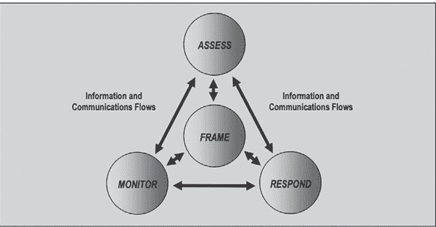

图7.2 风险管理流程的要素（NIST，2020）。

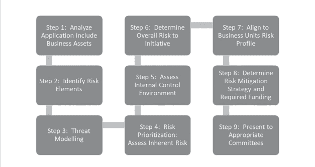

图 7.3 数字化网络安全风险管理评估流程（Kissoon, 2020）。

## 风险评估流程

风险评估流程识别关键风险要素，一些示例如下：

- 1 数据分类。
- 2 战略/业务需求。
- 3 应用程序开发。
- 4 供应商关系。
- 5 技术格局。
- 6 法律/监管问题。
- 7 品牌/声誉问题。
- 8 运营问题。
- 9 财务问题。
- 10 安全和欺诈问题。

## 威胁建模

威胁建模使得在保护有价值事物的背景下，能够识别、传达和理解威胁及其缓解措施。威胁建模可应用于广泛的项目，包括软件、应用程序、系统、网络、分布式系统、

## 表 7.1 威胁风险评估示例（Kissoon, 2020）。

| 威胁 | 威胁类型 | 风险等级 | 缓解措施 | Microsoft Teams 中的缓解措施 |
|---|---|---|---|---|
| 欺骗：进程、机器、人员 | 冒充 | 高 | 访问控制身份验证 | 使用电话或短信实施多因素身份验证 (MFA) • 一次性密码 • 条件访问策略 |
| 篡改：进程、内存 | 恶意代码 | 高 | 完整性权限 | 高级威胁防护 (ATP) |
| 否认：进程、人员 | 冒充 | 高 | 责任追究 欺诈预防 日志记录 签名 | 信息屏障 • 电子发现：日志记录、保留：团队聊天、消息传递、与 MS Stream 集成用于视频 |
| 进程中的信息泄露 | 恶意代码 数据泄露 | 高 | 机密性 权限 加密 | 安全链接 • 数据丢失防护 (DLP) |
| 信息泄露：数据存储、数据流 | 钓鱼 数据泄露 | 高 | 机密性 权限 加密 | 安全链接 • DLP |
| 拒绝服务 | 破坏 | 高 | 可用性 | 审查云设计 |
| 特权提升 | 冒充 | 高 | 访问控制 授权 隔离 | 自定义策略设置：共享敏感信息 • 信息屏障 |

## 表 7.2 威胁风险评估示例（Kissoon, 2020）。

| 可能出错的情况 | 威胁类型 | 缓解措施 |
|---|---|---|
| 1 缺乏具有适当管理批准的用户访问管理流程 | 身份验证 | 1 已建立经批准的用户 (AU) 访问管理流程。 2 凭据和身份验证机制在存储和传输过程中均受加密保护。 3 协议能够抵御暴力破解、字典和重放攻击。 4 强制执行强密码策略。 5 使用受信任服务器身份验证而非 SQL 身份验证。 6 密码使用带盐哈希存储。 7 密码重置不会泄露密码提示或有效用户名。 8 账户锁定不会导致拒绝服务攻击。 9 启用所有管理活动的审计和日志记录。 |
| 2 创建未经授权的管理员/等效管理员账户 | | |
| 3 创建流氓账户 | | |
| 4 滥用管理员/等效管理员账户 | 授权 | 1 使用强访问控制列表 (ACL) 来强制执行对资源的授权访问。 2 使用基于角色的访问控制来限制对特定操作的访问。 3 系统对用户和服务账户遵循最小权限原则。 4 在表示层、业务层和数据访问层中正确配置了特权分离。 5 启用所有管理活动的审计和日志记录。 |
| 5 滥用流氓账户 | | |
| 6 恶意代码注入 | | |
| 7 更改当前配置设置 | 配置管理 | 1 使用最小权限进程，服务账户没有管理功能。 2 启用所有管理活动的审计和日志记录。 3 限制管理员访问配置文件和管理员界面。 |
| 8 发起钓鱼攻击的能力 | | |
| 9 信息泄露 | 存储和传输中的数据保护 | 1 使用标准加密算法和正确的密钥长度。 2 使用哈希消息身份验证码 (HMAC) 保护数据完整性。 3 密钥（即密钥、机密数据）在传输和存储过程中均受加密保护。 4 使用内置安全存储来保护密钥。 5 不以明文发送凭据或敏感数据。 |
| 10 更改应用程序代码 | 数据验证/参数验证 | 1 强制执行数据类型、格式、长度和范围检查。 2 验证从客户端发送的所有数据。 3 没有安全决策基于可操纵的参数（例如 URL 参数）。 4 使用白名单验证进行输入过滤。 5 使用输出编码。 |
| 11 中断应用程序的能力 | 错误处理和异常管理 | 1 所有异常均以结构化方式处理。 2 在发生错误和异常时，将特权恢复到适当级别。 3 对错误消息进行清理，以确保不会向攻击者泄露任何敏感信息。 |
| 12 敏感信息泄露 | 用户和会话管理 | 1 Cookie 中不以明文存储任何敏感信息。 2 身份验证 Cookie 的内容已加密。 3 Cookie 配置为过期。 4 会话能够抵御重放攻击。 5 使用安全通信通道保护身份验证 Cookie。 6 执行关键功能时，强制用户重新进行身份验证。 7 会话在注销时过期。 |
| 13 恶意活动未被察觉 | 审计和日志 | 1 不记录敏感信息（例如密码、PII）。 2 对日志文件强制执行访问控制（例如 ACL）以防止未经授权的访问。 3 对日志文件强制执行完整性控制（例如签名）以提供不可否认性。 4 日志文件为敏感操作和关键事件的日志记录提供审计跟踪。 5 在多个服务器的各层级中启用审计和日志记录。 |

物联网和业务流程。识别和分类威胁的一种方法是 STRIDE，这是一种了解使业务资产面临风险的威胁的有效方法。

示例：威胁风险评估——Microsoft Teams 构建在 Office 365 超大规模企业级云上，并提供以下安全和合规功能。

漏洞：匿名个人可以使用访客账户连接到 Microsoft Teams。

## 风险优先级：评估固有风险

风险评估流程基于问卷，为每个风险要素制定一组问题。问题类别的示例包括以下内容：

- 财务损失。
- 媒体关注。
- 需向监管机构报告。
- 对供应商和员工的影响。
- 信息系统损失或损坏，停机时间非常有限。

每个问题可以以五种方式之一回答，风险程度递增，以便根据两个评分标准（即可能性和影响）为该问题分配 1 到 5 之间的风险评分。可以为每个问题、每个风险要素和整个项目计算定量固有风险评分，如下所示：

- 每个问题的风险评分：可能性和影响评分的乘积。
- 每个要素的风险评分：累加每个问题的数值评分，然后除以风险要素的问题数量。
- 整体计划的风险评分：累加每个风险要素的数值评分，然后除以每个项目中的风险要素数量。

此定量固有风险评分被分配一个定性风险评分，分类为高、中或低。定性固有风险评分显示哪个要素承担的风险最大，从而使决策者更容易决定在哪里分配资源。

## 影响评分标准

表 7.3 显示了基于 1–5 评分的影响评分定量标准。

表 7.3 影响评级量表示例 (Kissoon, 2020).

| 影响 | 标准 |
| :--- | :--- |
| 严重 5 | • 财务损失超过 500 万美元。
• 国际短期负面媒体报道，影响市场份额。
• 需向监管机构报告，并需要制定纠正行动计划和实施日期。
• 法律和监管影响包括以下内容：费用、罚款、诉讼、合规执行和高管影响。
• 对供应商和员工产生重大影响。
• 信息系统遭受重大损失或永久性损坏，停机时间过长，超过预期 RTO 的三倍。 |
| 重大 4 | • 财务损失 100 万至 500 万美元。
• 国内短期负面媒体报道，可能失去市场份额。
• 需向监管机构报告，并需要制定纠正行动计划。
• 部分高级管理人员受到影响。
• 对供应商和员工产生影响。
• 信息系统遭受重大损失或损坏，持续停机，预期 RTO 增加。 |
| 中度 3 | • 财务损失 50 万至 100 万美元。
• 短期负面媒体报道。
• 需向监管机构报告，可能需要提供纠正计划。
• 对供应商和员工影响最小。
• 信息系统部分损失或损坏，间歇性停机，可能实现预期 RTO。 |
| 轻微 2 | • 财务损失 10 万至 50 万美元。
• 无声誉损害。
• 无媒体关注。
• 无需向监管机构报告的事件。
• 对供应商和员工影响最小。
• 信息系统损失或损坏最小，停机时间很短。 |
| 可忽略 1 | • 财务损失最高 10 万美元。
• 无媒体关注。
• 无需向监管机构报告。
• 对供应商和员工无影响。
• 信息系统无重大损失或损坏，停机时间非常有限。 |

## 可能性评级量表

表 7.4 显示基于 1–5 得分的影响评级定量量表。

表 7.4 可能性评级量表示例 (Kissoon, 2020).

| 可能性 | 标准 |
| :--- | :--- |
| 几乎肯定 5 | • 几乎肯定。
• 至少每 6 个月一次。
• 在资产或项目生命周期内发生的概率大于 90%。 |
| 可能 4 | • 可能。
• 至少每 1 年一次。
• 在资产或项目生命周期内发生的概率为 60% 至 90%。 |
| 有可能 3 | • 有可能。
• 至少每 5 年一次。
• 在资产或项目生命周期内发生的概率为 30% 至 60%。 |
| 不太可能 2 | • 不太可能。
• 至少每 10 年一次。
• 在资产或项目生命周期内发生的概率为 10% 至 30%。 |
| 罕见 1 | • 罕见。
• 至少每 20 年一次。
• 在资产或项目生命周期内发生的概率小于 10%。 |

## 定性固有风险评级

表 7.5 显示基于定量固有风险得分的定性固有风险评级量表。

表 7.5 定性固有风险评级量表示例 (Kissoon, 2020).

| 固有风险 | 定量风险计算 |
| :--- | :--- |
| 高 | 范围：10+ |
| 中 | 范围：4–10 |
| 低 | 范围：1–4 |

## 评估内部控制

## 内部控制环境

控制环境和监控活动是组织有效管理其信息安全风险敞口的基础。如 2013 年 COSO 框架所述，

控制环境是为在整个组织中开展内部控制提供基础的标准、流程和结构的集合。董事会和高级管理层就内部控制的重要性和预期行为标准确立了“从上而下”的基调。

## 网络安全和隐私风险框架

隐私框架处理隐私风险的方法涉及将隐私事件视为个人可能遇到的潜在问题，这些问题源于系统、产品或服务对数据的操作，无论数据是数字形式还是非数字形式，贯穿从数据收集到处置的完整生命周期。

## 隐私框架功能

五个隐私框架功能在以下章节中定义。

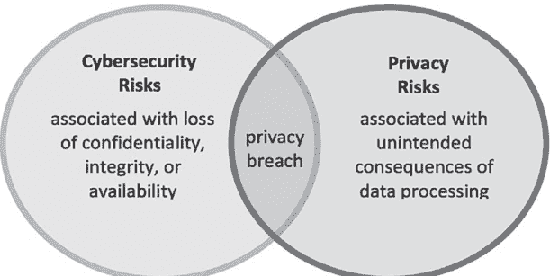

图 7.4 网络安全和隐私风险关系 (NIST, 2020).

## IDENTIFY-P

IDENTIFY-P 帮助组织了解如何管理因数据处理而产生的对个人的隐私风险。识别-P 功能中的活动是有效使用隐私框架的基础。梳理数据处理的情形，了解组织直接或间接服务或影响的个人的隐私利益，并进行风险评估，使组织能够了解其运营的业务环境，并识别和优先处理隐私风险。

## GOVERN-P

GOVERN-P 制定和实施组织的治理结构，以便持续了解由隐私风险所指导的风险管理优先事项。治理-P 功能同样是基础性的，但侧重于组织层面的活动——例如，(1) 建立组织的隐私价值观和政策，(2) 识别法律/监管要求，以及 (3) 了解风险承受能力，这使组织能够以符合其风险管理策略和业务需求的方式集中精力并确定工作优先级。

## CONTROL-P

CONTROL-P 制定和实施适当的活动，使组织能够以足够的粒度管理数据，从而了解隐私风险。控制-P 功能与从组织和个人两个角度进行的数据处理管理相关。

## PROTECT-P

PROTECT-P 制定和实施适当的数据处理保障措施。保护-P 功能涵盖数据保护，以防止与网络安全相关的隐私事件，并代表隐私与网络安全风险管理的交叉点。

## COMMUNICATE-P

COMMUNICATE-P 制定和实施适当的活动，使组织能够可靠地了解数据的处理方式及相关隐私风险。

沟通-P 功能包括认识到，组织和个人可能都需要知道数据是如何处理的，以便有效管理隐私风险。

## 隐私风险评估

隐私风险管理是一套跨组织的流程，帮助组织了解其系统、产品和服务可能如何为个人带来担忧，以及如何开发有效的解决方案来管理这些风险。隐私风险评估是识别和评估特定隐私风险的子流程。通常，隐私风险评估产生的信息可以帮助组织权衡数据处理的益处与风险，以确定适当的响应。

内部控制环境被定义为企业架构中已有的技术和信息安全控制。这一图景通常通过企业架构工件来描绘，包括但不限于图表、接口、通信渠道以及应用程序/技术组合。此外，它从本地环境延伸到供应商、服务提供商、代理和合作伙伴。因此，除了内部评估外，还会利用外部第三方保证报告来协助内部控制环境评估。

## 网络安全框架

一些组织利用基于风险的网络安全框架来管理网络安全风险。行业框架通过 NIST 建立，由以下三部分组成：框架核心、框架实施层级和框架概要。每个框架组件都加强了网络安全活动与业务驱动因素之间的集成。

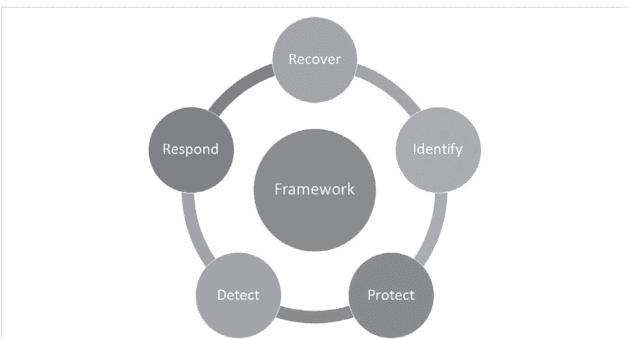

图 7.5 NIST 网络安全框架 (NIST, 2020).

框架核心是一组网络安全活动、期望结果和适用参考，这些内容在关键基础设施领域中是通用的。核心以一种方式提供行业标准、指南和实践，使得能够从高管层面到实施/运营层面传达网络安全活动和结果。

框架核心由五个并发且持续的功能组成——识别、保护、检测、响应和恢复。当整体考虑时，这些功能通过评估内部控制环境，为组织管理网络安全风险的生命周期提供高层战略视角。框架核心随后识别每个功能的特定结果的底层关键类别和子类别。这些结果与每个子类别的信息性参考（如现有标准、指南和实践）相等同。

## 厂商保证报告

由于外包服务提供商（OSPs）管理着大量的客户数据、系统、流程和运营，他们在满足日益增长的合规要求的同时管理相关风险的能力，往往成为优先事项。许多服务提供商因其报告组合缺乏全面可见性，而对第三方报告采取被动应对。创建企业范围的要求库，并将单个义务映射到相应的控制措施，可以帮助识别差距和重叠。例如，一个组织可能有一个用于监管其数据中心物理访问的控制措施，但它可能与20个不同的内部和外部要求相一致。集成的要求和控制测试库可以更容易地编制以客户为中心的报告。

外包是一项日益增长的趋势，公司越来越依赖第三方提供商来提供关键服务。第三方报告（即SOC2或ISAE3402审查）的目的是为客户审计师提供一份客观报告，表达对服务组织控制环境的意见。这些报告旨在提供关于服务组织中现有控制措施有效性的保证（即，SOC for Service Organizations: Trust Services Criteria (SOC2）评估用于处理客户信息的系统的安全性、可用性或处理完整性，或该信息的机密性或隐私性）。

## 确定组织风险偏好

组织的风险偏好是指组织在试图实现其目标并为利益相关者创造价值时，在宏观层面愿意接受的风险量。

## 表7.6 示例剩余风险评级量表（Optiv，2011年）。

| 控制有效性 | 低 | 中 | 高 |
|---|---|---|---|
| 高度有效 | 低 | 低 | 中–低 |
| 有效 | 低 | 中–低 | 中 |
| 部分有效 | 低 | 中–低 | 中–高 |
| 无效 | 低 | 中 | 高 |

在风险评估过程中，会评估组织的剩余风险，以确定实施内部控制措施后的剩余风险。

评估此风险会向组织显示存在差距或内部控制缺失的领域。通常，这是关键利益相关者在进行成本效益分析并确定风险缓解策略时关注的领域。本质上，剩余风险应与组织/业务单元的风险概况保持一致，并在风险容忍水平内。

具体来说，剩余风险评分是一种定性评分，比固有风险评分更细致。固有风险被分配三个评分之一——即高、中或低——而剩余风险通常根据五个或更多可能的评分进行评估——即高、中高、中、中低和低。这种细致程度突显了控制措施随时间的实施进展，并更好地反映了整体风险的变化。

## 风险缓解策略

在某些情况下，为了使剩余风险与组织/业务单元的风险偏好保持一致，需要进一步的缓解措施。因此，组织需要就为网络安全活动提供资金做出决策，以符合各利益相关者的观点。表7.7列出了一个风险处理量表，该量表将影响、可能性和固有风险评级量表相结合，以识别可能需要通过高级管理层监督和额外网络安全措施进行治理和风险缓解的领域。

成本效益分析是管理组织资源的广泛接受的经济原则。该原则要求将活动的成本与其收益进行比较。当收益超过成本时，开展这些活动是值得的，而如果成本超过收益，

## 表7.7 示例风险处理量表（昆士兰财政和贸易部，2011年）。

| 可能性 | 微不足道 | 轻微 | 中等 | 重大 | 严重 |
|---|---|---|---|---|---|
| 罕见 | 低：接受风险，例行管理 | 低：接受风险，例行管理 | 低：接受风险，例行管理 | 中：特定责任，风险缓解计划 | 高：季度高级管理层审查 |
| 不太可能 | 低：接受风险，例行管理 | 低：接受风险，例行管理 | 中：特定责任，风险缓解计划 | 中：特定责任，风险缓解计划 | 高：季度高级管理层审查 |
| 可能 | 低：接受风险，例行管理 | 中：特定责任，风险缓解计划 | 中：特定责任，风险缓解计划 | 高：季度高级管理层审查 | 高：季度高级管理层审查 |
| 可能性大 | 中：特定责任，风险缓解计划 | 中：特定责任，风险缓解计划 | 高：季度高级管理层审查 | 高：季度高级管理层审查 | 极高：每月高级管理层审查 |
| 几乎确定 | 中：特定责任，风险缓解计划 | 中：特定责任，风险缓解计划 | 高：季度高级管理层审查 | 极高：每月高级管理层审查 | 极高：每月高级管理层审查 |

情况正好相反。当活动的成本和收益相等时，决策者可以将其他定性措施纳入决策。

与网络安全通常相关的三项主要活动是：(1)保护信息授权用户的信息，(2)及时向授权用户提供信息，以及(3)保护信息免受完整性缺陷的影响。

与这些活动相关的成本是巨大的，因为组织将产生成本来检测和纠正无法预防的安全漏洞。网络安全的收益与防止网络安全漏洞所带来的成本节约（即成本回避）相关。成本–收益框架指出，组织的目标应当是实施安全程序，直到收益减去成本达到最大化的点。在此框架下，超过该点实施网络安全活动意味着增量成本大于额外安全措施的增量收益。本质上，超过最大点实施增量网络安全措施的净收益为负，因此对组织来说代表一项财务成本。

相比之下，网络安全风险管理框架有四个考虑领域：(1)与组织风险偏好的一致性，(2)与风险评估过程的一致性，(3)对成本–收益分析的理解，以及(4)对风险缓解策略的论证。尽管成本–收益分析从财务角度具有影响力，但在某些情况下，需要考虑其他因素，以充分了解不实施额外安全措施的影响。产生预防性安全措施的成本是必要的，因为在大多数成本–收益分析中，修复网络安全漏洞的实际成本尚未实现。具体来说，大多数组织没有数据来适当评估网络安全漏洞对组织的成本/影响，例如其对组织品牌/声誉、法律/监管环境、运营/技术环境、取证/电子发现相关事项以及第三方供应商的影响。因此，为了充分实施网络安全措施，除了进行成本–收益分析外，利益相关者应实施一套详细的决策过程，以确定充分保护组织免受网络安全漏洞影响并符合其风险偏好所需的额外安全措施。

# 8 案例研究

## 案例研究 #1 – Möbius 解决方案

Möbius 是一个行业领先的数字学习平台，擅长为全球高等教育机构创建和部署交互式教学和评估内容。目前，ABC大学使用 Maple TA，这是一种供应商构建的本地测试和评估软件解决方案。此举旨在将该平台迁移到该解决方案的软件即服务（SaaS）版本，即 Möbius。Möbius 平台为对攻读科学、技术、工程和数学课程感兴趣的 ABC大学学生提供交互式、在线方式。此举还将促进与大学学习管理系统（LMS）的集成。学生的信息、成绩和课程将存储在此应用程序中。

### 问题

1. 确定固有风险。
2. 使用 NIST 网络安全框架：核心组件评估内部控制环境。
3. 确定风险偏好、风险承受能力和风险概况。
4. 评估剩余风险，并在适当时提供建议。
5. 制定风险缓解策略。

### 解决方案

### 业务概览

在市场上拥有超过 15 年历史的 Möbius 平台被全球一些最大机构的学生、助教和教授使用。Möbius 是一个强大的在线创作和交付环境，专为满足科学、技术、工程和数学（STEM）课堂的需求而设计。它包括一套工具和功能，供作者设计和开发面向学生或同行的数字资产，以及一个交付环境，通过结合教学材料和动手活动，使用户能够并促进深度和主动学习。

Möbius 平台提供以下功能：

- 创建和部署在线 STEM 课程的机制。
- 课程、评估和交互式学习活动，为 STEM 学生在引导但自定义的节奏下获取知识提供潜力。
- 具有世界一流数学引擎的复杂 STEM 学科。
- 创建和使用强大的多媒体可视化效果以锚定关键 STEM 概念的能力。
- 向学生提供即时且有意义的反馈，并向教师提供学生参与度和理解度的数据。
- 具有算法生成和随机问题的高级问题类型。
- 访问由课程专家创建的高质量内容。
- 与 ABC 的 LMS 无缝集成。

### 技术概览

Möbius 平台由 DigitalEd 供应商拥有。此基于云的解决方案托管在 Google Cloud Platform (GCP) 系统和阿里云中。

### 风险评估

### 影响和可能性

影响和可能性评级标准概述了每个保护要求的保护要求级别的评估。表 8.1 显示了适用于风险要素的影响和可能性评级。

### 固有风险

固有风险已根据高、中、低三个分数之一进行分配，如表 8.2 所示。

ABC大学 (AU) 员工和学生

DigitalEd 员工

Möbius 课件

阿里云位置：中国
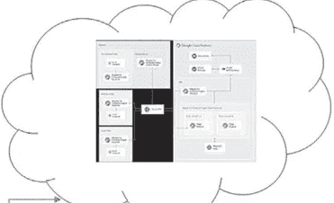

Google Cloud Platform (GCP) 位置：1) 北美，2) 欧盟和英国，3) 澳大利亚
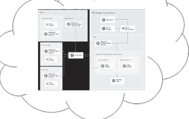

图 8.1 Möbius 平台的技术概览。

表 8.1 适用于风险要素的影响和可能性评级标准。

| 风险要素 | 影响 | 可能性 |
| :--- | :--- | :--- |
| **1 数据分类** PII：PII 的保护受常规风险评估流程约束。隐私影响评估 (PIA) 由 ABC 的 FOIP 办公室管理。PII 元素通过此云托管 Web 应用程序平台捕获和存储——具体而言，包括但不限于有关 ABC 学生的任何个人信息，如下所示： • 学生信息。 • 成绩。 • 课程信息。 • 与学习工具互操作性的连接。  敏感身份验证数据 (SAD)：这是支付卡在购买时用于身份验证的信息。这包括来自完整磁条、卡安全码 (CSC, CVV2, CID, CAV2) 和个人识别号码 (PIN) 的数据。Möbius 平台促进 ABC 个人的支付卡交易，因此 DigitalEd 要求保护 SAD。 | 重大 | 频繁 |
| **2 业务要求** Möbius 平台在 ABC 学生环境中使用，以提供一个专注于 STEM 学生独特需求的综合在线课件平台。 | 中度 | 可能 |
| **3 应用程序开发** 应用程序开发最小化，以包括与 Möbius 平台的集成。开发包括大学 LMS 中的标准接口以及与学习工具互操作性 (LTI) 的连接。 | 轻微 | 有可能 |
| **4 供应商关系** DigitalEd 是一家加拿大私营公司，全球约有 65 名员工。DigitalEd 是一家在线学习公司，其简单而富有共鸣的目标是通过数字学习塑造世界。DigitalEd 于 2017 年春季推出了 Möbius 平台，旨在改善 STEM 课堂中作者、教师和学生的在线学习体验。 | 中度 | 可能 |
| **5 技术格局** 供应商和第三方合作伙伴包括 GCP 系统和阿里云。 | 重大 | 频繁 |
| 6 法律/法规 受特定监管要求约束的数据披露。 失去或泄露数据（即 PII）的受害者提起的诉讼。 监管机构评估的罚款和处罚。 | 重大 | 有可能 |
| 7 品牌/声誉 由于媒体报道而导致损害 ABC 品牌的不利或负面宣传。 由于数据发布或泄露而导致客户信心丧失。 | 轻微 | 有可能 |
| 8 运营 授权用户无法运营和使用系统。 | 中度 | 可能 |
| 9 财务 因故意/无意用户造成的任何损害而产生的恢复/修复的重大成本。 | 轻微 | 有可能 |
| 10 安全和欺诈问题 由于身份验证凭据泄露、DDoS 攻击或恶意软件攻击而导致敏感数据（即 PII）的丢失和/或操纵。 | 重大 | 频繁 |

表 8.2 适用于风险要素的固有风险评级标准。

| 风险要素 | 影响 | 可能性 | 评级 | 定性固有风险评级 |
| :--- | :--- | :--- | :--- | :--- |
| 1 数据分类 | 4 | 5 | 20 | 高 |
| 2 业务要求 | 3 | 4 | 12 | 高 |
| 3 应用程序开发 | 2 | 3 | 6 | 中 |
| 4 供应商关系 | 3 | 4 | 12 | 高 |
| 5 技术格局 | 4 | 5 | 20 | 高 |
| 6 法律/法规 | 4 | 3 | 12 | 高 |
| 7 品牌/声誉 | 2 | 3 | 6 | 中 |
| 8 运营 | 3 | 4 | 12 | 高 |
| 9 财务 | 2 | 3 | 6 | 中 |
| 10 安全和欺诈问题 | 4 | 5 | 20 | 高 |
| 平均值 | | | 12.6 | 高 |

### 内部控制环境：有效

NIST 网络安全框架的核心组件被用于充分评估支持 Möbius 平台的 DigitalEd 环境。具体而言，以下供应商和第三方合作伙伴提供了内部控制文档：(1) 高等教育社区供应商评估工具 (HECVAT)—Lite：DigitalEd，(2) 系统和组织控制 (SOC) 2 类型 II 报告：GCP 系统，期间为 2019 年 5 月 1 日至 2020 年 4 月 30 日，以及 (3) 支付卡行业 (PCI) 数据安全标准 (DSS) 自我评估问卷 (SAQ)，截至 2019 年 3 月 21 日。

### 资产管理

- 供应商和第三方合作伙伴（即 DigitalEd 和 Google）中的物理设备和系统已列入清单。
- 供应商和第三方合作伙伴（即 DigitalEd 和 Google）中的软件平台和应用程序已列入清单。
- 组织沟通和数据流已映射。
- 外部信息系统已编目。
- 资源（即硬件、设备、数据、时间、人员和软件）根据其分类、关键性和业务价值进行优先级排序。
- 整个员工和第三方利益相关者（即供应商、客户和合作伙伴）的网络安全角色和职责已建立。
- Google 已制定政策和程序，以建立信息资产的可接受使用。
- Google 已制定政策和准则，以管理数据分类、标记和安全。

### 业务环境

- 大学在供应链、关键基础设施及其行业领域中的角色已识别并传达。
- 已建立并传达 DigitalEd 的使命、目标和活动的优先级。
- 已建立交付关键服务的依赖关系和关键功能。
- 已为所有运行状态（即在压力/攻击下、恢复期间或正常运行期间）建立支持交付关键服务的弹性要求。

### GOVERNANCE

- 已建立并传达组织网络安全政策。
- 网络安全角色和职责已协调并与内部角色及外部合作伙伴保持一致。
- 已理解并管理有关网络安全的法律和监管要求，包括隐私和公民自由义务。
- 治理和风险管理流程涉及网络安全风险。
- Google人员必须遵守行为准则以及内部隐私和信息安全政策。
- Google已建立针对违反行为准则、安全政策及其他人员要求的纪律处分流程，可能包括解雇、诉讼和/或刑事起诉。
- 正式的组织结构已存在，Google员工可在公司内部网上查阅。内部网提供下钻功能，用于识别每个功能团队的员工。
- 每个Google团队建立自己的标准操作程序，并对其进行文档化和维护，供员工访问。

### RISK ASSESSMENT

- 已识别并记录资产漏洞。
- 从信息共享论坛和来源接收网络威胁情报。
- 已识别并记录内部和外部威胁。
- 已识别潜在业务影响和可能性。
- 威胁、漏洞、可能性和影响用于确定风险。
- 已识别并确定风险响应的优先级。
- Google开发并维护了风险管理框架，以将风险管理在可接受水平。
- Google至少每年进行一次正式风险评估，使用定性和定量方法确定已识别风险的可能性和影响。每个风险相关的可能性和影响均独立确定，并考虑每个风险类别。
- 在Google内部，根据风险标准（包括由管理层制定、记录并批准的解决时间框架），将风险降低到可接受水平。

### RISK-MANAGEMENT STRATEGY

- 风险管理流程由关键利益相关者建立、管理和批准。
- ABC的风险承受能力已确定并明确表达。
- ABC对风险承受能力的确定受其在关键基础设施中的作用和行业特定风险分析的影响。

### SUPPLY CHAIN RISK MANAGEMENT

- 网络供应链风险管理流程由ABC利益相关者识别、建立、评估、管理和批准。
- 信息系统、组件和服务的供应商及第三方合作伙伴通过网络供应链风险评估流程进行识别、优先级排序和评估。
- 与供应商和第三方合作伙伴的合同用于实施适当措施，旨在满足组织网络安全计划和网络供应链风险管理计划的目标。
- 供应商和第三方合作伙伴定期接受审计、测试结果或其他形式的评估，以确认其履行合同义务。
- 与供应商和第三方提供商进行响应和恢复计划及测试。
- Google已制定管理第三方关系的政策和程序。
- Google与供应商签订协议，其中包括应对信息安全风险的要求。
- Google供应商安全评估团队采用基于风险的方法审查供应商的安全实践和供应商产品的安全态势。审查可能包括自动和手动评估，具体取决于正在处理的数据的敏感性或正在授予的访问权限。
- Google通过定期评估子处理器的控制环境来管理子处理器的绩效。
- Google设有内部审计职能，并定期聘请第三方对组织管理信息安全方法的有效性进行独立审查。
- Google设有既定的内部审计职能，用于评估管理层对Google身份管理、源代码管理和基础设施控制的合规性。
- Google已制定管理第三方关系的政策和程序。
- Google与供应商签订协议，其中包括应对信息安全风险的要求。

### IDENTITY MANAGEMENT, AUTHENTICATION AND ACCESS CONTROL

- Möbius平台使用角色（学生、讲师和管理员）来授予访问级别。除非使用LTI或LDAP，否则这些角色在应用层进行管理；如果使用，则从这些服务提供的信息中映射。
- 软件对托管实例的访问被安全地授予Möbius开发人员，以建立和维护软件。所有访问均基于“需要知道”的最佳实践进行授予/撤销。DigitalEd的工具通过强制执行需要访问权限的用户创建的公共RSA密钥来处理对机器的访问。员工在执行管理功能时必须使用唯一凭据。
- Möbius完全交互式，并提供验证和错误消息以帮助指导用户。
- 每个Möbius实例都部署在GCP上的自己的容器中，所有数据都存储在隔离的数据库中。
- 要访问Möbius，用户必须使用有效的用户名和密码进行注册和身份验证。
- Möbius服务的用户可以通过外部LDAP或API服务进行身份验证。
- 已启用所有访问、错误和系统消息以及应用程序日志。审计日志包含登录、注销、源Internet协议（IP）地址以及执行的各种操作。
- 所有流向Möbius的流量都经过Web应用程序防火墙（WAF）。对于选定的路径，DigitalEd可以将该流量定向到WAF，进行标准检查和针对应用程序的特定检查。DigitalEd可以按需更改路径集。
- 软件对托管实例的访问被安全地授予Möbius开发人员，以设置和维护软件。所有访问均基于“需要知道”的最佳实践进行授予/撤销。软件通过强制执行需要访问权限的用户创建的公共RSA密钥来处理对机器的访问。
- GCP在数据中心级别采用各种下一代威胁防护（NGPT）技术，如这里所述：https://storage.googleapis.com/gfw-touched-accounts-pdfs/google-cloud-security-and-compliance-whitepaper.pdf。
- Google管理层定期评估内部身份、身份验证和源代码管理控制。
- Google制定了一项既定政策，规定对信息资源（包括数据以及存储或处理数据的系统）的访问基于最小权限原则进行授权。
- Google维护正式的用户注册和注销程序，用于授予和撤销访问权限。
- Google已建立正式的密码指南，以管理身份验证机制的管理和使用。
- 访问敏感的Google系统和应用程序需要采用用户ID、密码、安全密钥和/或证书形式的双因素身份验证。
- Google通过根据职责和最小权限授予用户访问权限，并将访问限制在仅授权用户，从而分离个人职责。
- 通过访问控制列表管理对Google生产机器、支持工具和网络设备的访问。对访问控制列表的修改由管理员记录和批准。
- 访问Google的企业网络、生产机器、网络设备和支持工具需要唯一ID和经过验证的凭据。
- 访问Google的网络设备通过用户ID、密码、安全密钥和/或证书进行身份验证。
- 只有拥有授权私钥的Google用户才能获得SSH访问生产机器的权限。
- 访问Google内部支持工具仅限使用批准凭据的授权人员。
- 在授予访问权限之前，外部Google系统用户通过Google帐户身份验证系统进行识别和身份验证。
- 远程访问企业机器需要在连接设备上安装Google颁发的数字证书，并采用用户ID、密码、安全密钥和/或证书形式的双因素身份验证。
- 用于异地冗余的存储介质在受控区域外运输过程中使用安全存储容器进行保护和控制。

### AWARENESS AND TRAINING

- Google已建立隐私和信息安全培训计划，并要求相关人员每年完成此培训。
- Google设有专门的安全团队，负责向Google员工和承包商进行安全教育。Google已制定经管理层批准并在内部网上发布的安全政策，所有员工和承包商均可访问。

- 特权用户了解其角色和职责。
- 第三方利益相关方—即供应商、客户和合作伙伴—了解其角色和职责。
- 高级管理人员了解其角色和职责。
- 物理和网络安全人员了解其角色和职责。

### DATA SECURITY

- 多租户通过独立的数据库和容器进行隔离，因此不存在数据交叉污染的可能性。
- 向数据存储的通信和数据传输通过 TLS 1.2 协议进行加密。
- 加密用于在 Google 生产设施之间的光纤上传输的流量。
- Google 已建立密钥管理流程，以支持组织使用密码技术。
- 上传或创建的客户数据在静止状态下均已加密。
- 密码使用 bcrypt 加密方案存储在 Möbius 数据库中。
- 数据库部分加密；即，密码已完全加密，但所有表信息并未完全加密。
- DigitalEd 使用 Google Cloud Platform 数据中心作为主机。
- 使用了三个数据中心，具体如下：
  - 北美数据托管在加拿大蒙特利尔。
  - 欧盟和英国数据托管在德国。
  - 澳大利亚和日本数据托管在澳大利亚。
- 此外，来自中国的客户使用阿里云。
  - 中国数据托管在中国。
- 已部署反病毒、钓鱼检测、安全编码以及反恶意软件/反垃圾邮件工具，以保护 Google 的信息资产。使用工具检测生产机器上偏离预定义操作系统配置的情况并予以纠正。
- 离开 Google 设施的可移动介质上的 PII 已获批准并加密。
- 除非数据已加密，否则 Google 禁止使用可移动介质存储 PII 和 SPII。
- Google 数据中心服务器楼层、网络机房和安全系统与公共区域和/或送货区域在物理上隔离。
- 访问敏感数据中心区域需要授权人员批准，并通过徽章读卡器、生物识别机制和/或物理锁进行控制。
- Google 数据中心为所有系统使用冗余电源系统和环境控制，以确保可靠性。

### INFORMATION PROTECTION PROCESSES AND PROCEDURES

- Google 已制定管理安全开发生命周期的政策和程序。
- Google 应用程序和配置更改在部署到生产环境之前进行测试。
- Google 系统更改在转入生产环境之前由独立的技术资源审查和批准。
- DigitalEd 使用应用程序生命周期管理工具来管理产品和配置的所有更改。该流程在每个版本中都会审查，并由所有工程人员遵循。该流程征求了多个利益相关方以及评审人的意见。
- DigitalEd 的政策或环境的任何更改都将直接通知相应联系人，并通过以下隐私政策页面进行通知：www.digitaled.com/privacy。
- 在可能影响 Möbius 服务的紧急情况下，客户联系人会立即收到任何相关信息和解决方案。
- DigitalEd 可以通过电话、电子邮件和通过横幅的应用内消息进行沟通。
- DigitalEd 每年审查和更新业务连续性计划（BCP）。
- 在可能影响 Möbius 服务的紧急情况下，可以使用备份（现场和异地）在其他位置恢复功能，且数据损失最小。
- 下面列出的每个区域都有三个可用区用于提供连续服务。但是，数据按如下方式保存在相应的区域：
  - 北美数据托管在加拿大蒙特利尔。
  - 欧盟和英国数据托管在德国。
  - 澳大利亚和日本数据托管在澳大利亚。
- DigitalEd 目前正在更新灾难恢复计划（DRP）；更新后，将对其进行审查和测试。
- DigitalEd 工程团队有一份安全相关问题和测试的检查清单，用于确保产品安全开发和实施。
- Google 有针对机密性、完整性和可用性的安全政策，已获管理层批准并发布在所有员工均可访问的内联网上。
- Google 建立安全政策和程序，明确界定所有员工的信息安全职责。在信息安全政策和程序中，Google 将职责分配给 Google 信息安全团队。
- Google 通过将风险识别和资源优先级排序方面的决策委派给直接支持 Google 产品和服务运营的各个工程团队来管理运营风险。
- Google 已建立管理密码控制使用的政策和程序。

### MAINTENANCE

- DigitalEd 有一个名为站点可靠性团队的独立团队，用于管理和维护支持 Möbius 的系统。
- 该团队拥有多种工具，用于管理系统更改并确保更改经过审查并被充分理解。
- 资产的维护和修理使用经过批准和控制的工具执行并记录。
- 资产的远程维护经过批准、记录，并以防止未经授权访问的方式执行。

### PROTECTIVE TECHNOLOGY

- 审计/日志记录根据政策确定、记录、实施和审查。
- 可移动介质受到保护，其使用根据政策受到限制。
- 通过配置系统仅提供基本功能，将最小功能原则纳入其中。
- 通信和控制网络受到保护。
- 已实施故障安全、负载均衡和热插拔等机制，以在正常和不利情况下实现弹性要求。
- 已实施机制以防止并断开来自未经授权设备对 Google 网络的未经授权访问。
- Google 根据服务类型、用户和信息系统对网络进行隔离。
- Google 已建立密钥管理流程，以支持组织使用密码技术。
- Google 的系统及其边界的描述可通过与客户的持续沟通或通过 Google 的官方博客文章提供给授权的外部用户。
- Google 拥有专门团队，负责监控、维护、管理和保护网络。网络设备的访问仅限于授权人员，并定期审查。设备需要有效的机器证书才能访问企业网络。企业无线网络的连接已加密。已有机制保护生产环境免受各种应用层拒绝服务攻击。
- Google 根据服务类型、用户和信息系统对网络进行隔离。

### ANOMALIES AND EVENTS

- 已建立并管理用户和系统的网络操作及预期数据流基线。
- 检测到的事件会被分析，以了解攻击目标和方法。
- 事件数据从多个来源和传感器收集并关联。
- 确定事件的影响。
- 已建立事件警报阈值。
- 当 Google 确定发生违规时，存在政策和程序，以确保客户根据披露法律或合同协议及时收到通知。

### SECURITY CONTINUOUS MONITORING

- DigitalEd 有每年进行安全和渗透测试的政策，包括将经验教训纳入软件开发生命周期。
- 2019 年 11 月，Info-Transec 对 2019.2 版本进行了安全渗透测试。
- 在发现安全/渗透测试漏洞的情况下，将对其进行优先级排序，并在版本中优先解决最关键的问题。
- 监控网络以检测潜在的网络安全事件。
- 监控物理环境以检测潜在的网络安全事件。
- 监控人员活动以检测潜在的网络安全事件。

- 已实施恶意和未经授权的代码检测。
- 对外部服务提供商活动进行监控，以检测潜在的网络安全事件。
- 对未经授权的人员、连接、设备和软件进行监控。
- 云服务器拥有众多现场安全团队和人员，对系统进行监控，以提供 24 x 7 服务。
- 已建立机制，保护 Google 生产环境免受各种应用层拒绝服务攻击。
- Google 已实施漏洞管理计划，以检测和修复系统漏洞。

### 检测流程

- 检测的角色和职责已明确界定，以确保问责制。
- 检测活动符合所有适用要求。
- 检测流程经过测试。
- 事件检测信息已传达。
- 检测流程持续改进。
- Google 已制定事件响应政策，概述了管理职责和程序，以确保对信息安全事件做出快速、有效且有序的响应。
- 监控工具根据预定标准向运营人员发送自动警报。事件按政策升级。

### 响应计划

- 响应计划在事件期间或之后执行。
- 信息安全事件按 Google 的事件响应政策进行记录。从这些事件中收集的信息用于防止未来事件，并可作为信息安全培训的示例。

### 通信

- 在需要响应时，人员了解自己的角色和操作顺序。
- 事件按既定标准报告。
- 信息按响应计划共享。
- 与利益相关方的协调按响应计划进行。
- 与外部利益相关方自愿共享信息，以实现更广泛的网络安全态势感知。

### 分析

- 对检测系统的通知进行调查。
- 了解事件的影响。
- 执行取证。
- 事件按响应计划进行分类。
- 已建立流程，以接收、分析和响应来自内部和外部来源（即内部测试、安全公告或安全研究人员）向组织披露的漏洞。

### 缓解

- 事件得到遏制。
- 事件得到缓解。
- 新发现的漏洞得到缓解或记录为可接受的风险。

### 恢复计划

- 恢复计划在网络安全事件期间或之后执行。
- Google 每年进行一次灾难恢复（DR）测试，为基础设施和应用团队提供一个协调场所，以测试通信计划、故障转移场景、运营过渡和其他应急响应。所有参与 DR 演练的团队都会制定测试响应和事后分析，记录测试结果和经验教训。

### 改进

- 恢复计划吸取了经验教训。
- 恢复策略已更新。

### 通信

- 管理公共关系。
- 事件后修复声誉。
- 恢复活动已传达给内部和外部利益相关方，以及高管和管理团队。

### 组织的风险偏好

Möbius 平台的剩余风险评级为 MEDIUM LOW。

### 风险缓解策略

可利用进一步的风险缓解建议，使其与业务单元的风险概况和 NIST 网络安全框架的核心组件保持一致。

### 供应链风险管理

- ABC 大学应确保使用审计、测试结果或其他形式的评估定期评估 Aliyun，以确认其履行合同义务。
- ABC 大学应确保与供应商和第三方提供商进行响应、恢复计划和测试。

### 身份管理、身份验证和访问控制

- 应审查 ABC 大学内现有的技术和流程，并实施适当的安全控制，以包括与 ABC 大学 LMS 的集成。
- 基于 Web 的界面应支持身份验证，包括基于标准的单点登录 (SSO)，利用 MFA 和密码/口令有效期要求。

### 信息保护流程和程序

- DigitalEd 应考虑实施已批准的 DR 流程文档。
- DigitalEd 的 DRP 所有组件应至少每年审查一次，并根据需要更新以反映变化。
- 与 PII 相关的信息安全控制：
  - 保护从 ABC 大学到云托管环境（即 Google、Alibaba）的数据传输。
  - 安全应用程序编程接口 (API) 的示例包括以下内容：
    - 为客户端应用程序创建帐户。
    - 帐户更新以使用 HTTP 基本身份验证。
    - 访问控制的粒度，以确保每个客户端应用程序都能访问其适用操作所需的功能。
- 云托管环境中包含 PII 的数据库应
  - 保护 PII 元素（即加密、掩码和哈希）；
  - 为数据库中管理员/等效管理员账户的日志记录提供报告，供 ABC 大学管理层审查；以及
  - 对数据库和系统日志实施完整性控制。

### 意识和培训

- 实施持续培训，并确保员工了解适当处理和处理 PII 及数据隐私。

### 安全监控

- 在 DigitalEd 环境中监控入侵的能力。
- 将安全/数据相关的违规政策和程序与 ABC 的事件管理流程集成。

## 案例研究 #2：Chime Live 解决方案

作为其 50 周年庆典的一部分，并回应学习者调查，ABC 大学原计划于 2020 年举办两场线下毕业典礼：一场于 9 月 18 日在 ABC 举行，另一场于 10 月 2 日在多伦多举行。由于 COVID-19 大流行，ABC 大学做出了艰难的决定，取消了原计划于 2020 年举办的线下毕业典礼。为 ABC 学习者提供引人入胜且有影响力的毕业典礼，是大学对学习者和社区的重要基础承诺。出于此原因，大学选择 Chime Live 作为虚拟活动平台来举办 2020 年毕业典礼。ABC 有机会在其 50 周年之际重新构思毕业典礼，使其与其他高等教育机构有所不同，并真正凸显其“数字优先”使命。Chime Live 平台将提供这一机会，因为它是一个“虚拟活动”平台，能够实现学习者、宾客和 ABC 团队成员之间的实时互动。

2020 年春季，世界面临着前所未有的局面，各国实施封锁，居家令生效，对于会议和活动行业来说，无法聚集。关于虚拟会议的即时需求出现了疑问。为了帮助行业专业人士弥补差距，PSAV 及其旗下公司于 2020 年 4 月 2 日制作了一场全球网络直播，邀请了一支专家团队。该团队描述了从头到尾规划、制作和推广世界级虚拟活动的实际应用和解决方案。该活动包括以下内容：

- 六小时的实时直播。
- 覆盖五十七个国家。
- 八场互动环节。
- 二十位远程演讲者。
- 一万三千人。

一切是如何汇聚在一起的：传统角色转变为具有类似职责的虚拟角色。来自世界各地的多个跨职能团队汇聚一堂，提供其专业服务，包括制作服务、技术支持、内容开发、创意设计和演讲者辅导。

### Chime Live 平台

ABC 大学选择 Chime Live 作为虚拟活动平台来举办 2020 年毕业典礼。Chime Live 平台的目的是举办并增强大学重新构思的毕业典礼，以便大学能够与 ABC 学习者和 ABC 社区一起庆祝。Chime Live 是一个独立平台，不会与 ABC 大学拥有的技术环境集成或连接。

Chime Live 通过交互式功能连接远程演讲者和参与者，帮助克服分心并保持高参与度。无论是在家、在工作场所还是在活动现场，Chime Live 都能简化流媒体过程，并轻松直播主题演讲、主题流和计划分组会议。此解决方案的目的是通过允许一定的实时互动，增强学习者在重新构思的毕业典礼期间的体验。这种方法符合学习者对线下典礼的期望，因为它使他们能够与同届毕业生互动和联系。

利用 Chime Live 将实现的毕业典礼的期望目标和支持性目标包括以下内容：

- 1 在 2020 年典礼上以有意义的方式庆祝学习者的成就：
  - a 允许按学院或专业进行毕业生“实时”社交。
  - b 包括所有本科生、研究生，以及文凭和证书课程的学生。

图 8.2 Chime Live 通过交互式功能连接远程演示者和参与者。

- 2. 开发一个具有影响力和参与感的虚拟毕业典礼体验，包括以下元素：
  - a. 典礼历史与传统。
  - b. 关注参会者体验。
  - c. 建筑和场地的虚拟现实导览。
  - d. ABC 团队的祝贺视频。

- 3. 在庆祝 ABC 成立 50 周年之际，包含以下传承项目：
  - a. 为毕业典礼制作“节日”类型的互动体验，包括 Beyond 50 装置（博物馆在盒子里），并为学院、系所和中心提供虚拟信息展位。
  - b. 为毕业生创建特别的毕业照片滤镜。
  - c. 允许在社交墙上实时祝贺，分享视频和图片，并捕获这些内容以供历史存档。
  - d. 包含 2020 年 6 月 25 日 ABC 的“点亮之夜”活动录像，以及埃德蒙顿高层大桥和卡尔加里塔的点亮场景。

PSAV 员工访问 AWS 基础架构中 ABC 数据的授权方式如下：

- 访问 AWS 控制台受 ACL 限制，并需要 MFA。
- 数据库静态加密，所有数据库交互传输过程加密。
- 数据库备份以加密形式存储。
- 所有加密均使用 AWS 密钥管理系统完成。
- 加密密钥访问权限仅限授权网络管理员。
- 密钥每年轮换一次。
- ABC 数据访问权限通过各种访问控制系统仅限授权人员。
- 系统访问权限通过加密虚拟专用网络（VPN）访问仅限授权人员。

### 问题

- 1. 确定固有风险。
- 2. 使用 NIST 网络安全框架：核心组件评估内部控制环境。
- 3. 确定风险偏好、风险承受度和风险概况。
- 4. 评估剩余风险，如有需要提供建议。
- 5. 制定风险缓解策略。

## 案例研究 #3：营销自动化工具

目前，ABC 大学的大学关系部门使用多种工具，包括但不限于 MailChimp、Unbounce 和 Sprout Social，来管理和跟踪其营销活动——即电子邮件培育、登陆页面和转化，以及向潜在学生发布社交媒体内容。由于缺乏对这一局面的整合视图，招聘、营销和沟通团队成员难以协调工作。HubSpot Marketing Hub 将通过在单一视图体验中集成营销自动化来解决这一挑战。HubSpot Marketing Hub 将与 Ellucian CRM Recruit 产品（ILE）集成，以提供对潜在学习者的端到端管理，包括他们与 ABC 营销和招聘活动的行为互动和体验。HubSpot Marketing Hub 将帮助实现活动目标，包括提高学习者/利益相关者满意度、获得更大市场份额，以及提高运营效率以推动学习者申请和注册。

HubSpot Marketing Hub 的实施将使 ABC 的营销和招聘工作能够高效扩展，因为大学关系部门继续提升其以程序化和个性化营销工作服务学院的能力。这些策略目前正在开发中，并与 ABC 的 imagine 战略、大学关系部门的目标以及 ABC 战略招生管理（SEM）计划中概述的招生/增长目标保持一致。

HubSpot 是全球领先的入站营销、销售和服务平台。自 2006 年以来，它逐步将其解决方案全球化。如今，来自 90 多个国家的数万名客户使用 HubSpot 软件、服务和支持来改变他们吸引、互动和服务客户的方式。HubSpot 的入站营销软件由 VentureBeat、GetApp、Capterra 和 G2Crowd 评为第 1 名，并将社交媒体发布和监控、博客、搜索引擎优化（SEO）、网站内容管理、电子邮件营销以及报告和分析整合在一个平台中。

HubSpot 销售中心和 CRM（HubSpot 获奖的销售应用程序）使销售和服务团队能够与线索、潜在客户和客户进行更有效的对话。HubSpot 服务中心是创建无摩擦环境和令人满意的客户体验的最佳解决方案。

HubSpot 产品以 SaaS 解决方案形式提供。这些解决方案通过专门构建的 Web 应用程序、API 和电子邮件插件向大学提供。

HubSpot 投资的主要受益方将是 ABC 的营销和学生招聘团队，因为这将帮助他们提高战略性服务潜在学习者的能力。

### 业务功能

HubSpot Marketing Hub 为 ABC 提供了包容性的入站营销软件，便于开展以下活动：

- 1. 内容开发。
- 2. 定向在线流量。
- 3. 识别潜在客户的能力。
- 4. 消费者行为的跟踪和报告。
- 5. 提供基于软件的工具，以在内部组织和管理信息。

| Marketing Hub（基于 HubSpot CRM 构建）功能 | | | | |
|---|---|---|---|---|
| 表单 | 移动端优化 | 电话支持 | 子域可用性 | 自定义报告 |
| 广告管理 | 用户角色 | 博客与内容创建工具 | 营销自动化 | 活动报告 |
| 对话收件箱 | Messenger 集成 | SEO 与内容策略 | Salesforce 集成 | 网站流量分析 |
| 团队电子邮件 | 登陆页面 | Google Search Console 集成 | 智能内容 | 计算属性 |
| 实时聊天 | 广告再营销 | 社交媒体 | 归因报告 | 层级团队 |
| 对话机器人 | 自定义属性 | 行动号召 | A/B 测试 | 自定义事件触发器和报告 |
| 电子邮件营销 | 多币种 | 标准 SSL 证书 | 视频托管与管理 | 基于事件的细分 |
| 列表细分 | 记录自定义 | 竞争对手 | 团队 | 预测性线索评分 |
| SSO | 分区 | CMS 会员 | 电子邮件发送频率上限 | YouTube 集成 |
| 社交权限 | 过滤分析视图 | 事件 API | 多触点收入归因 | 自适应测试 |

### 问题

- 1. 确定固有风险。
- 2. 使用 NIST 网络安全框架：核心组件评估内部控制环境。
- 3. 确定风险偏好、风险承受度和风险概况。
- 4. 评估剩余风险，如有需要提供建议。
- 5. 制定风险缓解策略。

## 案例研究 #4：CatchMyData

### 当前状态

CatchMyData 是一家第三方组织，受 ABC 大学 IT 服务部（ITS）委托，收集 ABC 学生财务援助课程注册计划表单的数据。与 CatchMyData 的长期关系超过 10 年，通过注册办公室管理贷款学习计划申请。ABC 隐私办公室完成了隐私影响评估（PIA），并指出 PII 通过此 Web 应用程序被捕获和存储。通过此表单收集的数据被发送到 CatchMyData，在一个后端数据库中进行管理。数据库位于由 Alentus 管理并位于埃德蒙顿 Rogers 数据中心的安全数据中心内。最初，贷款学习计划前端 Web 应用程序大约 10 年前由大学开发和管理。

CatchMyData 捕获的数据来自大学历史上创建和管理的网页，即课程注册计划（又称贷款学习计划）。从申请人处收集的与 PII 相关的项目由大学为其自身用途定义。用户可识别项目包括申请人提交的姓名、地址、电话号码、电子邮件、SIN、ABC ID 和省 ID。

CatchMyData 不共享或分发这些数据。对捕获数据的所有更改均由 ABC 学生贷款办公室自行决定和指导。捕获的数据存储在独立且分离的数据库中，不与任何其他 CatchMyData 客户数据混合。CatchMyData 提供的 ABC 客户端应用程序通过 TLS v.1.2 加密会话访问，其中 ABC 学生贷款办公室用户的登录名和密码被传输。

PII 数据存储在加拿大的第三方安全云服务中，服务器访问权限仅限于两个不同的 IP 地址，第三方组织无权访问。ABC 用户由管理员 Barrie Jackson 或经理 Valmir Oppenager 提供访问权限。CatchMyData 中的学生财务援助顾问登录由 Barrie Jackson 创建和管理，他是 ABC 大学唯一拥有此数据库管理权限的个人。

用户访问权限通过 ABC 大学 IT 访问策略授予，并根据用户在大学内的职能授予访问权限。因此，对管理员或经理角色的任何更改均需由 ABC 大学管理层直接授权。

### 未来状态

大学提出的变更是翻新课程注册计划页面，以便更快速地适应课程变更和会话时间安排。提出使用 CatchMyData 的智能表单对课程注册计划进行结构性更改。用于捕获数据的应用程序代码将基本保持不变，与最初

由 ABC 创建，并将在 CatchMyData 环境中维护。CatchMyData 作为一家公司将继续在安全性、应用程序维护和备份方面遵守原始 ABC 合同。

### 问题

- 1. 确定固有风险。
- 2. 使用 NIST 网络安全框架：核心组件评估内部控制环境。
- 3. 确定风险偏好、风险承受能力和风险概况。
- 4. 评估剩余风险，并在适当时提供建议。
- 5. 制定风险缓解策略。

## 案例研究 #5：Moneris Solutions

SAD 是指购买时用于身份验证的支付卡上的信息，包括完整磁条数据、卡安全码（CSC、CVV2、CID、CAV2）和 PIN。在支付卡处理模型中，ABC 大学与其收单银行建立了商户关系以接受支付卡交易。ABC 大学已将支付卡数据的交易处理外包给第三方服务提供商 Moneris Solutions。大学的供应商负责遵守监管和法律法规，以及保护此类信息不被未经授权的第三方获取。本风险评估报告为信用卡服务费模型项目提供了剩余风险概况。

大学已与 Moneris Solutions 建立现有关系，为 ABC 客户提供交易处理。当前关系详情如下。

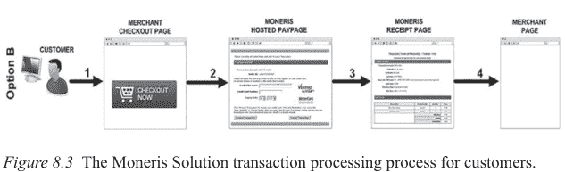

托管支付页面（HPP）流程如下：

- 1. 客户到达 ABC 大学网站（应用程序）。此时，大学必须确定交易金额并收集任何其他数据。
- 2. 一旦持卡人准备付款，大学结账页面将向 Moneris HPP 提交 HTTP 表单 POST。此时，客户将从大学网站重定向到 Moneris HPP URL。
- 3. 在 HPP 上，持卡人将提供安全支付详细信息，例如卡号，并提交交易。此时，Moneris 将处理交易，然后向客户提供收据。
- 4. 一旦客户准备继续，他或她将被重定向回大学网站，即 HPP 配置中提供的响应 URL。

大学提议的变更是在大学收据中添加服务费——具体来说，便利费。便利费计划旨在允许商户向持卡人收取费用，以提供替代支付渠道的便利。仅在以替代支付渠道形式提供真正的“便利”时才适用。便利费是消费者为所购买商品和/或服务支付的费用之上的单独费用，该费用将作为消费者账单上的单独行项目出现。从信息安全角度来看，此变更的影响很小。已确认不需要隐私影响评估（PIA），因为个人身份信息（PII）不在本项目增强范围内。此外，新收据将不包含任何需要大学内额外安全控制的敏感数据。大学通过服务提供商 Moneris Solutions 维持其当前的交易处理关系。

### 问题

- 1. 确定固有风险。
- 2. 使用 NIST 网络安全框架：核心组件评估内部控制环境。
- 3. 确定风险偏好、风险承受能力和风险概况。
- 4. 评估剩余风险，并在适当时提供建议。
- 5. 制定风险缓解策略。

## 案例研究 #6：校友学习联盟

校友学习联盟（ALC）是一个新的网络研讨会平台，旨在满足校友协会的特定需求。马里兰大学和另外 11 所学院和大学组成了 ALC，由 Professional Book Club Guru（PBC Guru）管理。

### 当前计划

ALC 是一个可以协助 ABC 大学创建在线课程以推动校友参与的组织。ABC 大学与 PBC Guru 合作，利用 CloudWays 网络托管平台。该解决方案为大学提供了一个 ABC 品牌网站，用于向 ABC 校友管理和交付内容，提供以下服务：

- 1. 直播平台 – 向国际参与者托管网络研讨会和直播活动，活动或参与者数量不限，包括以下内容：
  - 无限活动、注册和观看人数。
  - 一个带有学校品牌的微型网站，允许校友注册即将举行的直播、观看直播和回看过去的活动。
  - 注册并参加每个项目的个人分析。
  - 个性化屏幕视图，允许屏幕品牌化，支持网络研讨会、小组讨论和现场活动直播。
  - 与 ALC 创建的白标直播无缝集成。
  - 每个在线活动注册页面上的年度基金捐款请求。
  - 技术支持和平台培训。

- 2. 白标网络研讨会——来自畅销书作者和职业专家的节目，面向各个生命阶段的校友。ALC 每月制作两到四场网络研讨会，面向所有成员学校的校友开放。这些网络研讨会涵盖职业、生命阶段和终身学习等多个主题，以吸引 ABC 校友的不同群体。每场网络研讨会都是“白标”的，这意味着它在校友网络研讨会页面上为 ABC 品牌化，为 ABC 校友创造无缝的观看体验。由于 ALC 网络的规模，该联盟可以将顶级演讲者带到 ABC 校友面前。

- 3. 专业协会——与其他联盟成员联系，学习最佳实践以实现专业发展。

- 4. 专家支持——专为校友协会成功而设计。

### 托管服务提供商（MSP）模型

PBC Guru 利用 CloudWays 提供的云托管平台，为 ABC 品牌网站提供开发、内容交付和运营。CloudWays 利用由 Digital Realty Data Centre Services 管理的安全数据中心，Data Centre NYC3 托管支持此解决方案的技术。ABC 大学负责管理、更新和维护 ABC ALC 网站。因此，ABC 配备了专门的网站管理员，为 ABC ALC 网站提供整体管理。

### 问题

- 1. 确定固有风险。
- 2. 使用 NIST 网络安全框架：核心组件评估内部控制环境。
- 3. 确定风险偏好、风险承受能力和风险概况。
- 4. 评估剩余风险，并在适当时提供建议。
- 5. 制定风险缓解策略。

## 案例研究 #7：Cascade 软件

ABC 大学是一个半虚拟组织，学习者、员工和其他利益相关者群体依赖于用户界面（网站）来访问在线信息和资源——即课程、项目和服务。这些界面的可用性和有效性，包括其数字内容的质量，对于建立有效的数字体验至关重要。然而，大学当前的数字体验日益分散。此外，其现有解决方案（Alfresco Web Content Management）中的网页发布功能不再由供应商提供或支持，需要一个可扩展的基于云的解决方案来支持大学战略目标的实现。本风险评估旨在审查与 Cascade 计划相关的内容管理和内容交付功能的变更。本次评估不包括任何现有流程，其中包括但不限于利用大学的身份和访问管理流程。

SSO 认证机制。需要注意的是，敏感数据并未故意存储在 CMS 托管架构中。

Cascade 计划将执行以下操作：

- 在 ABC 的云中实施新的 DX 平台和 DNS 服务器，以满足互联网和内联网发布要求。
- 为 ABC 的互联网和内联网开发新的可扩展高可用性架构，包括用于评估性能的监控机制。
- 制定互联网和内联网网站改版与实施计划，包括审计现有网站的方法、制定识别“高价值网站”的标准、开发并实施 SEO 策略，并与利益相关方合作，根据新的网页设计和发布标准及工作流程对主要网站进行改版和部署（或停用和归档）。
- 通过 API 和配置，将网站改进和数字资产管理（DAM）工具与 DX 平台集成。
- 对所有已识别的网站进行合理化和分类。
- 改版并部署被认定为“高价值”主要网站的新网站，并停用和/或归档旧网站。
- 为未来的改版和部署制定次要和三级网站列表，次要和三级网站的改版不在本次范围内。
- 为所有已部署的主要网站建立分析——即 Google Analytics。

该应用程序包含两个组件：内容管理和内容分发。前者是一个发布引擎，将内容分发到用户定义的目标。后者是 Cascade 软件产品使用的一种任意解决方案，用于向最适合业务的受众提供网页内容。

网站根据关键性评级进行分类：

- 关键——中等容量（10,000+），与事件或业务流程或重要通信资产相关。
- 重要——低容量（<10,000）偶尔使用，不关键迁移且可以等待。
- 非关键——面向当前学生和员工的教职员工网页内容。
- LSS——低容量，不支持业务流程；但是，可能包含历史信息。
- 范围外——高容量（50,000+）每日使用——学生和员工。

Cascade 网络内容管理系统为发布 ABC 大学面向学生和教职员工的学术资源以及面向员工的就业资源信息提供了手段。大学网站是与受众沟通的主要方式；因此，这是一款业务关键型应用程序。本项目中包含了以下网站索引、站点搜索功能和 DAM 服务：

1. SiteSearch360—Batman Option，作为 Google Mini Search Appliance 的替代方案。该服务的所有者是 SEMKNOX GmbH，涉及将简单的 JavaScript 插入 Cascade 网站以便于搜索功能——具体为四行代码。因此，托管或供应商参与不在范围内。Site Search 360 已获得各项行业要求，如下：

   - PCI DSS 合规性。
   - ISO/IEC 27001:2013 数据中心认证。
   - 一般数据保护条例（GDPR）要求的数据处理协议（DPA）。
   - SEMKNOX GmbH（Site Search 360 背后的法人实体）和 Hoster 提供的技术和组织措施。

2. 企业级 DAM 解决方案使用由 Brandfolder 管理的外包数据中心，其功能包括执行以下操作的能力：

   - 对资产进行标记和分类。
   - 管理资产元数据——即名称、日期和描述。
   - 创建工作流——即内部和外部受众的权限、评审和批准以及通知。
   - 实施版本控制和权限管理——即用户限制。
   - 在各团队之间实施资产共享——即光箱和资产跟踪。
   - 执行搜索——即 DAM 中的简单搜索和高级搜索。
   - 编辑资产——即 DAM 中的图像——并转换为不同格式。
   - 替换 DAM 中的资产，并使替换内容在网站上同步更改。
   - 在 DAM 中创建画廊。
   - 实施报告。

大学不会故意在网络内容管理系统中存储敏感或机密信息。但是，此类信息意外存储和分发的可能性存在。

### Questions

1. 确定固有风险。
2. 使用 NIST 网络安全框架：核心组件评估内部控制环境。
3. 确定风险偏好、风险承受度和风险概况。
4. 评估剩余风险，并在适当时提供建议。
5. 制定风险缓解策略。

## Case study #8: Chrome River travel and expense

本风险评估的目的是评估实施 Module 财务升级第 2 阶段：差旅与费用申报模块所关联的风险。敏感的 ABC 数据在此系统中被收集、传输和存储，风险评估审查了现有控制措施，以充分保护 ABC 数据，符合大学的数据分类标准操作程序的要求。

Chrome River 应用程序利用多年的安全领导经验，采用（1）安全设计，通过多层加密能力、安全系统框架和年度风险分析实现；（2）强制标准、经过测试的流程和专用工具来保护客户数据；以及（3）面向员工的年度安全教育和认证，以遵守既定的商业行为准则。运营安全通过最先进的扫描和入侵检测来强制执行，并持续更新以领先于新的攻击向量。Chrome River 定期进行审计，以验证运营安全是否符合控制要求，并且已建立全球安全事件流程，该流程每天 24 小时、每周 7 天、每年 365 天（24×7×365）进行监控。Chrome River 服务旨在保护 ABC 的专有内容和数据。

2018 年 4 月，ABC 启动了 Module 财务与 HR 升级项目，将财务、工资和职位控制模块从 Module 版本 8 升级到 Module 版本 9，因为 Ellucian 将在 2018 年底停止对 Module 版本 8 的支持。项目的这一阶段特别仅包含核心模块，差旅与费用管理系统（Module TEM）等项目被列为范围外。项目团队于 2018 年 11 月成功实施了此次升级。

在核心财务和 HR 模块升级到受支持版本后，财务和行政部门审查了项目中范围外模块的支持状态。Module TEM 于 2019 年 1 月 1 日进入维护支持状态。Ellucian 受支持的费用管理解决方案变成了 Chrome River 费用管理解决方案，项目赞助人请求将此模块的升级纳入 Module 财务与 HR 升级项目的第二阶段。数字治理于 2019 年 2 月批准了项目变更请求，以实施 Chrome River 费用管理和发票管理模块。旧版 Module TEM 及其关联模块工作流产品已被停用。

本项目的目的是实施 Module 财务升级第 2 阶段：差旅与费用申报模块。

### Questions

1. 确定固有风险。
2. 使用 NIST 网络安全框架：核心组件评估内部控制环境。
3. 确定风险偏好、风险承受度和风险概况。
4. 评估剩余风险，并在适当时提供建议。
5. 制定风险缓解策略。

# Bibliography

Alali, M., Almogren, A., Hassan, M. M., Rassan, I. A. L. & Bhuiyan, M. Z. A. 2018. 使用模糊逻辑推理系统改进网络安全风险评估模型. Computer & Security, 74, 323–339.

Albrechtsen, E. & Howden, J. 2009. 信息安全管理人员与用户之间的信息安全数字鸿沟. Computer & Security, 28, 476–490.

Alexiou, S. 2019. 实用补丁管理与缓解. ISACA Journal, 3.

Alkaabi, A. 2014. 阿联酋信息安全风险最小化战略框架. 博士论文，贝德福德郡大学.

Avgerou, C. 2000. 信息系统：它是什么样的科学？Omega (West-Port), 28, 567–579.

AWS. 2019. Amazon ECR 中的原生容器镜像扫描 (AWS, 2019)，2020 年 3 月查阅，aws.amazon.com/blogs/containers/amazon-ecr-native-container-image-scanning.

Bang, S. K., Chung, S., Choh, Y. & Dupuis, M. 2013. 现代 Web 应用程序的扎根理论分析：DevOps 的知识、技能与能力. 信息技术与系统，华盛顿大学塔科马分校技术学院.

Baranyj, J. & Buss da Silva, N. 2017. 使用预测模型优化决策风险. 国际食品微生物学杂志, 240, 19–23.

巴塞尔银行监管委员会. 2001. 操作风险，国际清算银行.

Bin Ishaq Alseçai, K. 2015. 与信息技术相关的风险意识管理 (MERIT). 博士论文，格洛斯特大学.

Birks, M. & Mills, J. 2015. 扎根理论：实用指南. 伦敦，英国：SAGE 出版社.

Bojanc, R. & Jerman-Blazic, B. 2008. 信息安全风险管理的经济建模方法. 国际信息管理杂志, 28, 413–22.

Bojanc, R., Jerman-Blažič, B. & Tekavčič, M. 2012. 使用定量建模管理信息安全技术投资. 信息处理与管理, 48, 1031–1052.

Borgonovo, E., Cappelli, V., Maccheroni, F. & Marinacci, M. 2018. 风险分析与决策理论：一座桥梁. 欧洲运筹学杂志, 264, 280–293.

Caldas, A. 2006. Sergio Galanti运营风险之谜，2020年3月查阅，www.riskmanagementguru.com/operational-risk/risk-puzzle

Campos, J., Sharma, P., Jantunen, E., Baglee, D., Fumagalli, L. & Slotwiner, D. J. 2016. 网络安全框架保护先进维护所需数据面临的挑战. Procedia CIRP, 47, 222–227.

Caralli, R., Stevens, J., Young, L. & Wilson, W. 2007. 介绍OCTAVE Allegro：改进信息安全风险评估流程. 卡内基梅隆大学，美国.

Carty, M., Pimont, V. & Schmid, D. 2012. 衡量信息安全投资价值. Intel IT白皮书.

Cavusoglu, H., Mishra, B. & Raghunathan, S. 2004. 评估IT安全投资的模型. ACM, 47, 87–92.

Cavusoglu, H., Raghunathan, S. & Raghunathan, W. 2008. IT安全投资的决策论和博弈论方法. 管理信息系统, 25, 281–304.

Cherdantseva, Y., Hilton, J., Rana, O. & Ivins, W. 2016. 信息保障与安全参考模型的多维评估. 计算机与安全, 63, 45–66.

Cho, S. 2003. 信息安全风险分析与管理. 博士论文，皇家霍洛威学院，伦敦大学.

Comes, T., Hiete, M., Wijngaards, N. & Schultmann, F. 2011. 决策图：在严重不确定性下多准则决策支持的框架. 决策支持系统, 52, 108–118.

Committee of Sponsoring Organizations of the Treadway Commission. 2020年3月查阅，www.coso.org.

Cremonini, M. & Nizovtsev, D. 2006. 理解并影响攻击者决策：对安全投资策略的影响. 2006年6月26–28日，在剑桥，英国举行的信息安全经济学研讨会上发表.

de Bruijn, H. & Janssen, M. 2017. 构建网络安全意识：基于证据的框架策略的必要性. 政府信息季刊, 34, 1–7.

Digital Maelstrom. 2020. 安全软件开发生命周期中的要素，2020年3月查阅，www.digitalmaelstrom.net/it-security-services/secure-software-development-lifecycle-ssdlc.

Dildy, T. 2017. 企业漏洞管理. ISACA杂志, 2.

Dor, D. & Elovici, Y. 2016. 信息安全投资决策过程模型. 计算机与安全, 63, 1–13.

Dresner, D. G. 2011. 信息系统中的标准与风险缓解研究. 博士论文，曼彻斯特大学.

Dutta, A. & McCrohan, K. 2002. 网络经济中管理在信息安全中的作用. 加州管理, 45, 67–87.

Easterby-Smith, M., Thorpe, R. & Jackson, P. R. 2015. 管理与商业研究. 伦敦，英国：Sage.

Ericson, C. A. I. 2005. 系统安全的危害分析技术. John Wiley & Sons.

European Union Agency for Networks and Information Security, Octave v2.0. 2020年5月查阅，www.enisa.europa.eu.

Far roha, B. S. & Far roha, D. L. 2014. DevOps环境中管理任务需求、合规性和信任的框架. 2014年IEEE军事通信会议.

Fazlida, M. R. & Said, J. 2015. 信息安全：风险、治理与实施挫折. 程序经济学与金融, 28, 243–248.

Feng, N., Wang, H. J. & Li, M. 2014. 信息系统安全风险分析模型：风险因果关系与漏洞传播分析. 信息科学, 256, 57–73.

Fiegenbaum, A. & Thomas, H. 1988. 对风险的态度与风险-回报悖论：前景理论解释. 管理学院期刊, 32, 85–106.

Fielder, A., Panousis, E., Malacaria, P., Hankin, C. & Smeraldi, F. 2013. 网络安全投资的决策支持方法. 决策支持系统, 86, 13–23.

Finne, T. 1998. 信息安全管理的概念框架. 计算机与安全, 17, 303–307.

Garvey, P. R. 2008. 风险管理的分析方法：系统工程视角. 博卡拉顿，伦敦和纽约：Chapman-Hall/CRC-Press，Taylor & Francis Group.

Ge, X.-Y., Yuan, Y.-Q. & Lu, L.-L. 2011. 信息安全成熟度评估模型. 程序工程, 24, 335–339.

Gordon, L. A. & Loeb, M. P. 2002. 信息安全投资的经济学. ACM信息与系统安全事务, 5, 438–457.

Gordon, L. A. & Loeb, M. P. 2006. 管理网络安全资源：成本效益分析. McGraw-Hill.

Gordon, L. A., Loeb, M. P. & Lucyshyn, W. 2003. 计算机系统安全信息共享：经济分析. 会计与公共政策期刊, 2, 461–485.

Gordon, L. A., Loeb, M. P., Lucyshyn, W. & Zhou, L. 2015. 信息共享对网络安全投资不足的影响：真实期权视角. 会计与公共政策期刊, 34, 509–519.

Gordon, L. A., Loeb, M. P. & Zhou, L. 2016. 投资网络安全：来自Gordon-Loeb模型的洞见. 信息安全期刊, 7, 49–59.

Greene, F. 2015. 网络安全侦探控制：监控以识别和响应威胁. ISACA杂志, 5.

Grunske, L. & Joyce, D. 2008. 基于显式建模攻击配置的组件式系统定量风险导向安全预测. 系统与软件期刊, 81, 1327–1345.

Hausenblas, M. & Nguyen, R. 2019. Amazon ECR中的原生容器镜像扫描. Amazon Web Services (AWS).

Henriques de Gusmão, A. P., Camara e Silva, L., Silva, M. M., Poletto, T. & Costa, A. P. C. S. 2016. 使用模糊决策理论的信息安全风险分析模型. 国际信息管理杂志, 26, 25–34.

Huang, C. D. & Behara, R. S. 2013. 预算约束下并发异构攻击情况下信息安全投资的经济学. 国际生产经济学杂志, 141, 255–268.

Huang, C. D., Hu, Q. & Behara, R. S. 2008. 风险厌恶型企业最优信息安全投资的经济分析. 国际生产经济学杂志, 114, 793–804.

Humble, J. & Mosley, J. 2011. 为什么DevOps必须采用持续交付来实现持续交付？信息技术管理期刊, 24(8), 6–12.

Huntsman. 2017. ASD基本八项：补丁与漏洞管理——如何做得正确. 2020年3月–5月查阅，www.huntsmansecurity.com.

Information Systems Audit and Control Association (ISACA). 2009. 风险IT框架. 2020年4月查阅，www.isaca.org.

Information Systems Audit and Control Association (ISACA). 2017. 漏洞评估. 2020年4月查阅，www.isaca.org.

International Standards Organization (ISO). 2020年3月–5月查阅，www.iso.org.

Jegers, M. 1991. 前景理论与风险-回报关系：一些比利时证据. 管理学院期刊, 34, 215–225.

Johnson, A. 2009. 企业与安全高管对信息安全投资驱动因素的看法：德尔菲研究结果. 信息隐私安全, 5, 3–27.

Joshi, C. & Singh, U. K. 2017. 信息安全风险管理框架：减轻大学网络安全风险的一步. 信息安全与应用期刊, 35, 128–137.

Jouini, M., Rabai, L. B. A. & Khedri, R. 2015. 安全威胁定量评估的多维方法. 程序计算机科学, 52, 507–514.

Kemkhadze, N. 2004. 投资与风险衡量中的信息与优化. 博士论文，沃里克大学，沃里克商学院.

Kissoon, T. 2020. 网络安全措施的最优支出. Emerald Publishing Ltd.：《变革政府：人员、流程与政策》, 14, 417–431.

Kissoon, T. 2021. 网络安全措施的最优支出：第二部分. 信息安全期刊, (第12卷 第1期, 2021年1月).

Kolkowska, E., Karlsson, F. & Hedström, K. 2017. 迈向分析信息安全不合规的理由：制定基于价值的合规性分析方法. 战略信息系统期刊, 26, 39–57.

Kossiakoff, A. & Sweet, W. N. 2003. 系统工程原理与实践. John Wiley and Sons, Inc., 第98–106页.

Lavine, M. K. 2007. 美国网络安全信息共享：包含风险管理和控制影响的实证研究，2000–2003. 博士论文，伦敦城市大学.

Lee, S., Kim, S., Choi, K. & Shon, T. 2017. 基于博弈论的社交物联网安全漏洞量化. 未来计算机系统, 1–9.

Lee, Y. J., Kauffman, R. J. & Sougstad, R. 2011. 客户信息安全的企业利润最大化投资. *决策支持系统*, 51, 904–920.

Leuprecht, C., Skillicorn, D. B. & Tait, V. E. 2016. 超越城堡模型：网络风险与网络安全. *政府信息季刊*, 33, 250–257.

Lundberg, K. & Warvsten, A. 2020. *自动化模糊逻辑风险评估及其在 DevOps 工作流中的作用*. 硕士论文, 隆德大学, 计算机科学系.

ManageEngine. 2020. 补丁管理生命周期, 2020年3月查阅, www.manageengine.ca.

Mayadunne, S. & Park, S. 2016. 评估风险型中小企业信息安全投资的经济模型. *国际生产经济期刊*, 182, 519–530.

The MITRE Institute. 2007. *MITRE 系统工程（SE）胜任力模型*, 第 1 版, 第 10, 40–41 页.

Mortazavi-Alavi, R. 2016. *信息安全中人为因素分析的风险驱动投资模型*. 博士论文, 东伦敦大学.

Mukhopadhyay, A., Chatterjee, S., Saha, D., Mahanti, A. & Sadhukhan, S. K. 2013. 网络风险决策模型：投保 IT 还是不投保？*决策支持系统*, 56, 1–26.

National Cyber Security Centre. 2016. *风险方法和框架摘要*. 英国.

National Institute of Standards and Technology (NIST). 2020年3月至5月查阅, www.nist.gov.

Nazareth, D. & Choi, J. 2015. 信息安全管理的系统动力学模型. *信息管理*, 52, 123–34.

Ochoa, D. C. R., Correia, R., Peña, J. I. & Población, J. 2015. 征收风险、投资决策与经济部门. *经济建模*, 48, 326–342.

Optiv. 2011. 残余风险评级量表, 2020年3月查阅, www.optiv.com.

Oroojlo, H. & Azgomi, M. A. 2017. 基于博弈论的网络物理系统安全建模与量化方法. *工业计算机*, 88, 44–57.

Palmaers, T. 2013. *实施漏洞管理流程*. SANS 研究所.

Pettigrew, A. 2009. *组织决策的政治*. Routledge.

Posey, C., Roberts, T. L., Lowry, P. B. & Hightower, R. T. 2014. 弥合分歧：信息安全专业人员与普通组织内部人员信息安全思维模式的定性比较. *信息与管理*, 51, 551–567.

Purser, S. A. 2004. 提高安全管理流程的投资回报率. *计算机安全*, 23, 542–546.

Rahimian, F., Bajaj, A. & Bradley, W. 2016. 缺陷风险估计与信息安全控制优先级排序：一种以数据为中心的方法. *国际会计信息系统期刊*, 20, 38–64.

Rhee, H. S., Ryu, Y. U. & Kim, C.-T. 2012. 信息安全管理中的非现实主义乐观. *计算机与安全*, 31, 221–232.

Ringland, G. 2002. *商业中的情景*. John Wiley & Sons.

Rodriguez, E. 2010. *企业风险管理中的知识管理应用*. 博士论文, 阿斯顿大学.

Roldán-Molina, G., Almache-Cueva, M., Silva-Rabadaño, C., Yevseyeva, I., & Bastos-Fernandes, V. 2017. 网络安全风险分析工具比较. Centeris – 企业信息系统国际会议, 2017 年巴塞罗那, 西班牙. 计算机科学前沿, 121, 568–575.

Rose, S., Spinks, N. & Canhoto, A. I. 2015. 管理研究：应用原则. Abingdon, Oxon: Routledge.

Rue, R., Pfleeger, S. & Ortiz, D. 2007. 支持政策和决策制定的网络安全投资模型分类与比较框架. 第六届信息安全经济学研讨会 (WEIS07).

Ryan, J. J. C. H., Mazzuchi, T. A., Ryan, D. J., Lopez de la Cruz, J. & Cooke, R. 2012. 基于专家判断引出量化信息安全风险. 计算机与运筹学, 39, 774–784.

Saleh, M. S. & Alfantookh, A. 2015. 企业信息安全风险管理的新综合框架. 经济与财务前沿, 28, 243–248.

Shameli-Sendi, A., Aghababaei-Barzegar, R. & Cheriet, M. 2016. 信息安全风险评估（ISRA）分类法. 计算机与安全, 57, 14–30.

Sharkasi, O. 2015. 应对网络安全漏洞. ISACA 期刊, 5.

SmartSheet. 2020. 系统开发生命周期要素, 2020年3月查阅, www.smartsheet.com/system-development-life-cycle.

Standards Australia. 2006. HB 167:2006 安全风险管理. 悉尼: 澳大利亚国际标准有限公司.

Tsiakis, T. & Stephanides, G. 2005. 信息安全的经济方法. 计算机与安全, 24, 105–108.

van Schaik, P., Jeske, D., Onibokun, J., Coventry, L., Jansen, J. & Kusev, P. 2017. 网络安全风险感知与预防行为. 人类行为中的计算机, 75.

van Staalduinen, M. A., Khan, F., Gadag, V. & Reniers, G. 2017. 功能性定量安全风险分析（QSRA）以协助保护关键流程基础设施. 可靠性工程与系统安全, 157, 23–24.

von Neumann, J. & Morgenstern, O. 2007. 博弈论与经济行为. 新泽西州普林斯顿: 普林斯顿大学出版社.

von Solms, R. & van Niekerk, J. 2008. 从信息安全到网络安全. 计算机与安全, 38, 97–102.

Webb, J., Ahmad, A., Maynard, S. B. & Shanks, G. 2014. 信息安全风险管理的情境意识模型. 计算机与安全, 57, 14–30.

Wiseman, R. M. & Gomez-Mejia, L. R. 1998. 管理者风险承担的行为代理模型. 管理学评论, 23, 133–153.

Wu, Y., Feng, G., Wang, N. & Liang, H. 2015. 信息安全投资博弈：攻击类型和网络漏洞的影响. 专家系统与应用, 42, 6132–6146.

Wynn, J. 2014. 威胁评估与修复分析 (T4RA). Mitre 公司.

Yevseyeva, I., Morisot, C. & van Moorsel, A. 2016. 信息安全决策影响力建模与分析. 性能评估, 98, 36–51.

Zavgorodniy, V., Lukyanov, P. & Nazarov, S. 2014. 信息风险管理机制选择算法. 计算机科学前沿, 31.

# Index

注意：对应页面中，*斜体*页码表示图，**粗体**页码表示表。

- 主动扫描 29–30
- 与企业风险管理对齐：沟通 22；网络安全风险评估流程 18；评估与量化 21；表达与衡量 20；基础风险管理流程 23；信息安全方面 17；关键风险指标 (KRI) 25；损失事件管理 23；监控与审查 22；运营风险管理 16–17；修复 22；风险分析 20–21；风险识别 18–20；风险缓解规划与验证 21；安全指标 23–24；处理 22
- 校友学习联盟 (ALC) 139–140；专家支持 140；直播平台 139；托管服务提供商 (MSP) 模型 140；专业学会 140；白标网络研讨会 139
- Amazon ECR 59
- Amazon Web Services (AWS) 64 应用程序开发 60, 96, 99
- 应用程序可编程接口 (API) 59, 129
- 架构：与设计，SSDLC 54；企业 96, 108；系统安全边界 41–42
- 评估：固有风险 103, 104–105；内部控制 106–108；风险 34–35；漏洞 28–33
- 资产：识别 18–19；清单 27–28；优先级排序 28；风险识别 18–19；价值 9
- 攻击树开发 15
- 配置管理审计 60 自动化 62, 133–135
- AWS 电子容器注册表 (ECR) 57
- 国际清算银行 (BIS) 16
- BCM 另见 业务连续性管理 (BCM)
- 品牌/声誉问题 99, 117
- 软件中的错误 27
- 业务：目标 7, 10, 47, 87, 97；需求 47, 54, 80, 88, 93, 99, 116–117
- 业务连续性管理 (BCM)：员工胜任力 71；定义需求 72；要素 69–70；管理评审 92–94；监控与审查 86–88；规划 71；政策 70–71；原则 69；流程 68；资源 71；服务恢复，要素 88–91；了解关键服务 72–73；另见 业务连续性 ICT 准备 (IRBC)

- 业务连续性规划 (BCP) 14

- 业务影响分析 (BIA) 75

- Cascade Software 140–143

- 案例研究：Alumni Learning Consortium (ALC) 139–140; Cascade software 140–143; CatchMyData 135–137; Chrome Live 解决方案 130–133, 132; Chrome River 差旅与费用 143–144; 营销自动化工具 133–135; Möbius 解决方案 113–130; Moneris Solutions 137–138

- CatchMyData 135–137

- Chrome Live 解决方案 130–133, 132

- Chrome River 143–144

- 云环境 56–60

- 云原生漏洞 57

- 代码审查 19, 46, 50–51, 55

- 编码 55–56, 123

- 协作 60–62

- 常见漏洞和披露 (CVE) ID 57

- 常见漏洞和披露 (CVE) 30

- 常见漏洞评分系统 (CVSS) 分数 58

- 沟通-P 107

- 妥协：后果 35; 妥协风险 34

- 配置调整 33

- 配置管理 27, 38, 44, 60

- 符合性 52

- 持续交付 64–66

- 持续集成 (CI) 61, 63–64

- 持续监控 39, 61, 65, 126–127

- 持续测试 61, 63–64

- 合同进度表 77

- 控制活动 10

- 控制评估 15

- 控制-P 107

- COSO 框架 106

- 成本避免 112

- 成本效益分析 1, 4, 95, 95, 110–112; 用于网络安全措施 96; 和风险缓解策略 110–112

- 成本效益框架 112

- 切换/安装计划文档 52

- CVE 参见 常见漏洞和披露 (CVE)

- CVSS 参见 常见漏洞评分系统 (CVSS) 分数

- 网络风险投资模型 95, 95

- 网络安全：活动 112; 投资 95, 95; 和隐私风险框架 106; 风险评估流程 18

- 网络安全漏洞 2–3, 106; 成本效益分析 112; 成本/影响 112; 组织 4

- 网络安全框架：并发和连续功能 109; 框架核心 109; 实现 2; NIST 108, 118, 129

- 网络安全措施 2–3, 5; 成本效益分析 96; 增量式 112; 风险缓解策略 110

- 网络安全风险管理框架：目标 97; 业务目标 97; 并发和连续功能 109; 核心 109; 成本效益分析 96; 网络风险投资模型 95; 网络安全框架 108–112; 数据分类 96; 数字 99; 元素 98; 影响评级量表 103, 104; 内部控制 106–108; 可能性评级量表 105; NIST 网络安全框架 108; 优先级排序 103, 104–105; 定性固有风险评级 105; 风险评估 98, 99; 风险管理实践 96, 98; 技术格局 96; 威胁建模 99–103

- 数据分类 96, 116–117, 118, 143

- 决策流程 1–5, 12, 112; 预算分配 3; 业务权衡 3; 成本效益分析 3; 网络安全漏洞，预防 3, 4; 决策者 4–5; 已实施框架，有效性 4; 风险偏好 3; 风险等级 4; 利益相关者 2–3

- 缺陷检查工具 52

- 缺陷跟踪 52

- 部署 52–53

- DevOps：自动化和工具 62; 持续交付 64–65; 持续集成 63; 持续监控 65; 内部元素 61–62; 基础 62; 目标 60; 实现 60; 监控 65; 风险管理实践集成 65–67; 工具和服务 63; 变体 61

- 数字网络风险模型 参见 网络安全风险管理框架

- 数字网络安全风险管理评估流程 99

- 数字网络安全风险管理框架 97–108; 另参见 网络安全风险管理框架

- 数字风险评估流程 18, 99, 103, 110, 112, 120

- 分布式拒绝服务 (DDoS) 攻击 29

- 文档控制，IRBC 85

- 动态代码分析 56

- 动态扫描 58–59

- “端到端”数据使用 76

- 企业 DAM 解决方案 142

- 企业风险管理 (ERM) 框架 6–8, 10, 96; 沟通 22; 网络安全风险评估流程 18; 评估与量化 21; 表达与衡量 20; 基础性 23; 信息安全方面 17; 内部环境 7; 关键风险指标 (KRI) 25; 风险表述 7; 损失事件管理 23; 方法论 8–11; 监控与审查 22; 目标设定 8; 运营风险管理 16–17; 补救 22; 风险分析 20–21; 风险识别 18–20; 风险管理指导委员会 7–8; 风险缓解计划与验证 21; 情景规划与压力测试 12–15; 安全指标 23–24; 处理 22; 另参见 与企业风险管理的对齐

- 道德黑客 51, 56

- 事件识别 9

- 外部供应商 73

- 可行性研究 47

- 财务/金融 1, 15, 26, 50, 66, 103–104, 117; 成本 112; 损失 103; 市场数据提供商 70; 服务业 96

- 基础风险管理流程 23

- 情景频率 15

- 功能规格流程 48–49

- 功能测试 55

- 治理-P 107

- 健康保险可携性和责任法案 (HIPAA) 策略扫描 30

- 托管支付页面 (HPP) 流程 138

- 主机扫描器 29

- HubSpot Marketing Hub 133–134, 135

- ICT 业务连续性就绪性 (IRBC) 68; 审计 91–92; 能力 78; 能力，差距识别 73; 能力 78; 元素 70; 内部审计 91–92; 绩效标准 78; 计划 71, 81–85, 88; 计划文档 81–85; 流程 70, 80–81; 策略 71–81, 87–88, 93; 使用 计划-执行-检查-处理 70–73

- ICT 服务 68, 70, 72–75, 77–78, 81–88, 92–94

- 识别：资产 18–19; 后果 19–20; 现有控制 19; 威胁 19; 漏洞 19

- 识别-P 107

- 影响：分析 14, 28, 72, 75; 评级量表 103, 104–105

- 事件：检测 69, 76; 预防 69, 73, 76; 响应 76, 78, 81, 127; 情景 19–20

- 信息：与沟通 11; 处理设施 80

- 信息安全 79-80; 管理 91; 团队 48-50

- 信息安全管理系统 (ISMS) 18

- 信息安全风险 20; 接受 18; 评估 18; 沟通 18; 管理 18; 监控与审查 18; 处理 18

- 信息技术 – 安全技术 – 信息安全风险管理流程 17

- 固有风险 66

- 内部审计计划，IRBC 91-92

- 内部控制：评估 11, 106-108; 环境 7, 106, 108-109, 118-128

- 国际标准化组织 (ISO) 18

- IRBC 参见 ICT 业务连续性就绪性 (IRBC)

- ISO 27005 18-20

- ISO 27031 68

- ISO 31000 17

- 关键绩效指标 (KPI) 2, 4, 24

- 关键风险指标 (KRI) 25

- 法律/监管问题 99, 107, 112, 117

- 法律风险 16-17

- 可能性 9-10, 15, 20, 34, 72, 97-98, 103, 105, 110, 111, 114, 116-117, 119

- 可能性评级量表 105, 114, 116-117

- 损失事件管理 23

- 损失事件 23

- 维护 38, 48, 52, 56, 125

- 可管理性 79

- 营销自动化工具 133-135

- MBCO 参见 每个产品最小业务连续性目标 (MBCO)

- 平均检测时间 (MTTD) 24

- 平均解决时间 (MTTR) 24

- 每个产品最小业务连续性目标 (MBCO) 72

- 缓解响应时间 41, 43

- Möbius 解决方案 113-130; 影响和可能性评级量表 114, 116-117; 固有风险评级量表 114, 117; 内部控制环境 118-128; 风险偏好 129; 风险缓解策略 129-130; 技术概览 115

- Moneris Solutions 137, 137-138

- 监控：业务连续性管理 85-88; ERM 方法论 11; 风险 98; 风险评估与量化 21; 安全持续监控 126-127; 工具 127

- 美国国家标准与技术研究院 (NIST) SP 800-39 风险管理流程 97

- 网络扫描器 29

- NIST SP 800-30 18

- NIST SP 800-26 45

- 开放 Web 应用安全项目 (OWASP) 30

- 运营 117; 错误 69; 信息系统 54; 优先级 81; 需求 47-48; 风险 6, 14, 17; 风险管理 16, 16-17, 23; 安全 143

- 组织风险偏好 109-110

- OSPs 参见 外包服务提供商 (OSPs)

- 外包服务提供商 (OSPs) 109

- 整体可扩展性 79

- 并行测试 51

- 密码破解 56

- 补丁和漏洞指标 40-45, 45

- 补丁 27, 29, 31-44; 审计 39; 部署 38, 44; 级别 40; 日志 39-40; 管理 15, 31-32, 35-39, 42, 44; 测试 38, 44

- 补丁管理流程：审计 39; 自动化部署 36; 配置管理 38; 部署补丁管理工具 36; 发现 37; 生命周期 35; 监控新补丁和漏洞 38; 补丁部署 38; 策略制定 37-38; 报告 39; 审查、改进和重复 39; 标准化和分类 37; 技术

- 安全 36–37
  - 测试 38
  - 漏洞监控 35
- 渗透测试 19, 46, 56, 126
- 性能
  - 和成本特性 79
  - 标准，IRBC 78
- 计划-执行-检查-处理 70
- 实施后 52
- 初步测试，安全控制 55–56
- 优先级排序
  - 资产 28
  - 漏洞修复 30, 32
- 隐私
  - 框架 106–107
  - 风险评估 108
- 隐私影响评估 (PIA) 116, 136, 138
- 概念验证 (PoC) 30
- 保护 P 107
- 定性固有风险评级 105, 117
- 定性风险评估 10
- 质量保证 (QA) 50
- 定量和定性绩效标准，IRBC 93–94
- 定量固有风险评级 117
- 定量风险评估 9
- 恢复 72, 128
  - 数据 87
  - 灾难 54, 68, 128
  - IRBC 计划文档 81–82
  - 组织的业务连续性管理计划 69
  - 计划文档 83
  - 资源 73
  - 服务 88–91
  - 技术恢复程序 84
- 恢复点目标 (RPO) 72
- 恢复时间目标 (RTO) 72
- 修复 15, 22, 27, 30–35, 39–40, 61, 65
  - 部署漏洞 33–34
  - 通用测试 32–33
- 剩余风险 10–11, 21, 28, 67, 92, 110, 137
- 剩余风险评分 110
- 弹性 72–74, 78, 86–88, 93, 118, 125
- 响应
  - 应急配置变更 44
  - 组织的业务连续性管理计划 69
  - 补丁和漏洞指标表 45
  - 补丁应用 43–44
  - 规划 15, 127
  - 供应链风险管理 120
  - 面向计划成熟度的指标定位 44–45
  - 时间 43–45
- 风险
  - 接受 22, 39, 93
  - 分析 20–21, 54, 120, 143
  - 风险偏好 3–4, 5, 6–10, 28, 56, 74, 77–78, 94, 109–110, 112–113, 129
  - 规避 22, 98
  - 行为 25
  - 计算 9
  - 沟通 18, 22
  - 文化 7, 25
  - 要素 99, 103, 114, 116–117
  - 评估 21
  - 修改 22
  - 优先级排序 11, 103
  - 评级量表 110
  - 修复 22
  - 响应计划 10, 22
  - 容忍度 9–10, 28, 56, 99, 107, 110, 113, 120
  - 转移 22
  - 处理 18, 20, 22, 28, 110, 111
  - 处理量表 110, 111
- 风险评估 9, 17–18, 21, 25, 34, 107, 119, 140, 143
  - 关键 ICT 服务 72
  - 网络安全风险管理框架 98, 99
  - 定义 98
  - 数字 18, 99, 103, 110, 112, 120
  - 隐私 108
  - 定性 10
  - 定量 9
  - 问题类别 103
  - 风险要素识别 99
  - 安全视角 48
  - 漏洞管理现状 34
  - 威胁 100–102
- 风险控制自我评估 (RCSA) 10
- 风险识别 8, 10–11, 125
  - 资产 18–19
  - 后果 19–20
  - 现有控制 19
  - 威胁 19
  - 漏洞 19
- 风险管理
  - 流程，基础 23
  - 标准 18
  - 指导委员会 7–8
- 风险管理实践 1, 5, 7, 60, 65, 96
  - 业务连续性管理 68–94
  - 系统开发生命周期 46–67
  - 漏洞管理 26–45
- 风险缓解
  - 规划 11, 21
  - 策略 110–112, 111, 129
  - 技术 30
- 风险监控 11, 18, 22
  - 和报告 11
  - 和审查 18, 22
- 场景
  - 分析 14–15
  - 选择 14
- 场景规划
  - 头脑风暴未来场景 12
  - 开发 13
  - 评估 13–15
  - 场景规划模板 13
  - 和压力测试 12–15
  - 趋势和驱动力识别 13
  - 根据更新策略和政策 15
- SDLC 参见 安全系统开发生命周期 (SDLC)
- SecDevOps 61, 62
- 安全系统开发生命周期 (SDLC): 46–52, 53
- 安全
  - 和欺诈问题 99, 117
  - 指标 23–24, 40–41
  - 补丁 24, 33, 42, 44
  - 风险管理 17
- 信息技术系统安全自我评估指南 45
- 敏感身份验证数据 (SAD) 116, 137
- 服务组织控制 II 型 (SOC2) 109
- 服务恢复 73, 88–91
  - 演练指令 90
  - 演练规划 89–90
  - 审查、报告和后续跟进 91
  - 验证、审查和评估信息 90–91
- 结果严重性 15
- 单点登录 (SSO) 身份验证机制 141
- 站点可靠性团队 125
- SiteSearch 360 142
- SMART (具体、可衡量、可达成、可重复和时限性) 24
- 软件开发生命周期 (SSDLC) 53
- 软件移除 34
- 静态扫描 58
- 战略招生管理 (SEM) 计划 134
- 压力测试 12–15
- STRIDE 103
- 供应商能力 81
- 支持性 79
- 系统基线定义 28, 30
- 系统开发生命周期
  - 架构和设计 54
  - 云环境 56–60
  - 编码 55
  - DevOps，风险管理实践 60–67
  - 要素 46
  - 规划和需求 53–64
  - 发布和维护 56
  - 安全系统开发生命周期 (SDLC) 46–52
  - 测试和结果 55–56
  - 测试规划 54–55
- 系统可靠性工程 (SRE) 61
- 系统测试 50–51, 88
- 技术
  - 组 34
  - 格局 95–96, 99, 116–117
- 测试和演练 87, 90
- 测试和演练，ICT 服务 86–88
- 第三方报告 109
- 威胁
  - 行为体分析 14
  - 识别 19
  - 级别 34
  - 建模 54, 99–103
  - 监控 31–32
  - 场景 20
  - 安全问题 31
- 单元测试 50
- 供应商
  - 保证报告 109
  - 关系 99, 116–117
- 供应商托管的云解决方案 56
- 漏洞 31
  - 评估报告 30
  - 数据库 31
  - 识别 19
  - 和补丁识别 43
  - 修复 32
  - 扫描/扫描器 19, 28–29, 31, 39–45, 55–57
- 漏洞管理
  - 评估 28–33
  - 评估风险 34–35
  - 资产清单 27–28
  - 部署漏洞修复 33–34
  - 要素 26
  - 网络和主机漏洞扫描 39–45
  - 补丁和 26–27
  - 补丁管理 35–39
  - 优先处理资产 28
- 漏洞修复 30, 32–33, 39–40
  - 检查补丁级别 40
  - 网络和主机漏洞扫描 39–45
  - 按系统运行的网络服务数量 42
  - 补丁数量 42
  - 漏洞数量 42
  - 补丁和漏洞 41–45
  - 审查补丁日志 40
  - 安全指标，部署 40–41
  - 培训 40
- 易受攻击的云服务 57
- 零日漏洞 58–59
