# 人工智能与机器学习技术在可持续酶生产中的优化

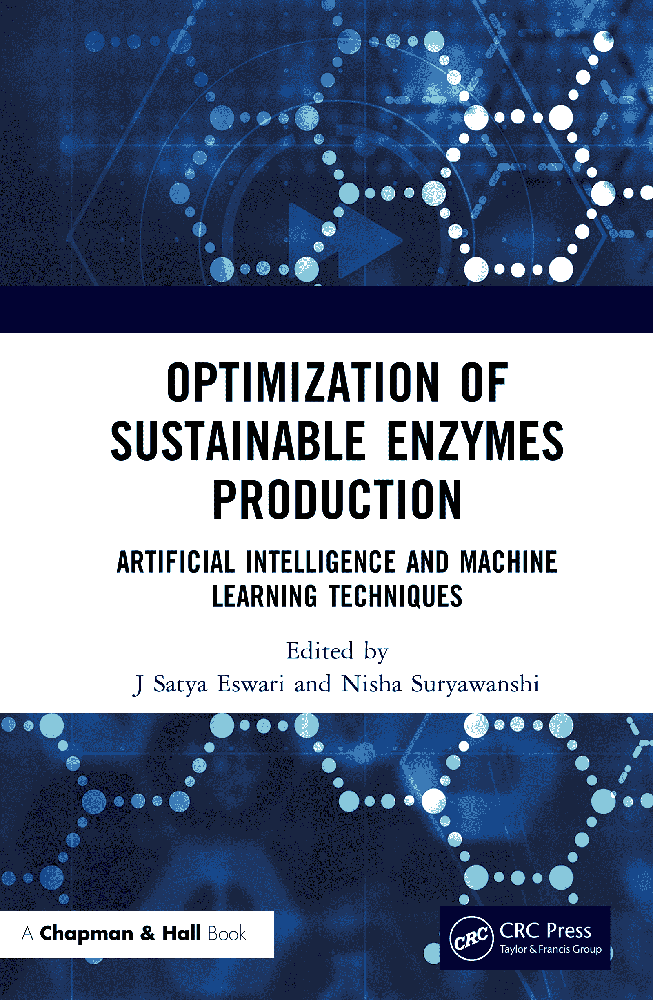

For permission to photocopy or use material electronically from this work, access [www.copyright.com](http://www.copyright.com) or contact the Copyright Clearance Center, Inc. (CCC), 222 Rosewood Drive, Danvers, MA 01923, 978-750-8400. For works that are not available on CCC please contact mpkbookspermissions@tandf.co.uk

*Trademark notice*: Product or corporate names may be trademarks or registered trademarks and are used only for identification and explanation without intent to infringe.

*Library of Congress Cataloging‑in‑Publication Data*

## Preface

人工智能已经彻底改变了工业流程。降低优化计算成本是人工智能最常见的应用之一。提出并测试了若干算法，每个算法都基于其假设来解决问题，各自拥有不同的假设条件。本书描述了优化的原理，并运用遗传算法（GA）、人工神经网络（ANN）、粒子群优化（PSO）、微分演化（DE）和人工蜂群算法（ABC）等若干优化技术，对酶研发的过程优化进行案例研究，并完整开发和讨论了各种模型。机器学习因其在传统方法已达限度时能够节约资源、加工时间和能源、同时提高产量而受到激励。这是一项复杂的任务，涉及大量可控参数，这些参数以某种方式影响生产。要在 100 个可控参数之间进行调整以找到所有因素的最佳组合是必要的。优化问题是识别这些参数的最佳组合，以最大化生产率。本书采用系统的方法，对基于群体的、具有进化性和自然启发性的搜索算法进行了考察。

目前已出版的优化书籍主要涉及机器学习和过程优化的算法，或描述各种用于优化的算法。关于各种机器学习模型或算法的应用，特别是在酶生产过程优化方面的研究报道并不多。本书旨在汇集不同的机器学习模型，用于优化工业重要酶的生产过程参数。书中详细阐述了由不同微生物生产的各种酶的生产与优化。

优化、运筹学、人工智能、数据挖掘、机器学习、计算机科学和管理科学领域的学生和研究人员将通过详细的例子和算法比较，了解各种算法的优缺点。

**Dr. J. Satya Eswari**

**Dr. Nisha Suryawanshi**

**Dr. J. Satya Eswari** has been an assistant professor for more than 8 years at the Biotechnology Department of the National Institute of Technology (NIT), Raipur, India. She did her M.Tech in Biotechnology at the Indian Institute of Technology (IIT) Kharagpur and a Ph.D. at the IIT, Hyderabad, India. During her research career, she worked as a Scientist (Woman Scientist – Department of Science and Technology (DST)) in the Indian Institute of Chemical Technology (IICT), Hyderabad. She has published more than 60 SCI/Scopus research papers, 6 books, a few book chapters, and 40 international conference proceedings. Her research contributions have received wide global citations. She completed one DST woman scientist project (22 lakhs) and is currently handling one DST-Early career research project (43 lakhs) and one CCOST (4 lakhs). She has more than 7 years of teaching experience and 3 years of research experience. Dr. Eswari has been a guest editor for the *Indian Journal of Biochemistry and Biophysics* (SCI) and the *Journal of Chemical Technology and Biotechnology*. She has rigorously pursued her research in the areas of Environmental bioremediation, wastewater treatment, bioprocess, and product development and bioinformatics. She gained pioneering expertise in the application of mathematical and engineering tools to Biotechnological processes. She has received the IEI Young Engineer award, the Outstanding Woman by Venus International award, and the DK Best Faculty award. Dr. Eswari has already guided three Ph.D. students and is currently guiding three other Ph.D. students.

Dr. Nisha Suryawanshi 目前在印度中央邦索格尔政府艺术与商务学院动物学系担任客座教员。

她在古鲁古哈西达斯中央大学（Chhattisgarh, India）获得生物技术（荣誉）理科学士（B.Sc.），在德里·哈里·辛格·古尔中央大学（Madhya Pradesh）获得生物技术硕士（M.Sc.），在印度工程学院拉贾普尔（Chhattisgarh, India）生物技术系获得哲学博士（Ph.D.）。她在研究领域的同行评审 SCI 期刊上发表了十篇论文。她在博士期间主要从事生物过程和产品开发方面的工作。她还通过国家级考试 CSIR-NET-JRF（生命科学）、GATE（生物技术）、ICAR-NET（农业生物技术）以及州级考试 MPSET 取得了资格认证。

## Contributors

- K. S. Anantharaju, Dayananda Sagar College of Engineering, Bangalore, India
- P. V. Atheena, Manipal Institute of Technology, Manipal, India
- Khashti Dasila, Kumaun University, Bhimtal, India
- J. Satya Eswari, National Institute of Technology, Raipur, India
- Karan Kumar, Indian Institute of Technology, Guwahati, India
- Rajeev Kumar, Dayananda Sagar University, Bangalore, India
- Vijayanand S. Moholkar, Indian Institute of Technology, Guwahati, India
- Sunil S. More, Dayananda Sagar University, Bangalore, India
- Uday Muddapur, KLE Tach University, Hubli, India
- Ajay Nair, Dayananda Sagar University, Bangalore, India
- Monalisa Padhan, Siddheswar College, Amarda Road, Balasore, Odisha, India
- Sushri Priyadarshini Panda, Sambalpur University, Burla, India
- Archana S. Rao, Dayananda Sagar University, Bangalore, India
- Keyur Raval, National Institute of Technology Karnataka, Surathkal, India
- Ritu Raval, Manipal Institute of Technology, Manipal, India
- Heena Shah, Mandsaur University, Mandsaur, India
- Dheeraj Shootha, Kumaun University, Bhimtal, India
- C. Sowmya, Sapthagiri College of Engineering, Bangalore, India
- Nisha Suryawanshi, Government Arts and Commerce College, Sagar, India
- A. V. Narasimha Swamy, JNTUA, Anantapur, India
- Pooja Thathola, Kumaun University, Bhimtal, India
- S. M. Veena, Sapthagiri College of Engineering, Bangalore, India

A. V. Narasimha Swamy

DOI: [`10.1201/9781003292333-1`](https://dx.doi.org/10.1201/9781003292333-1)

JNTUA, Anantapur, India

## 1.1 Introduction

There are diverse applications of enzymes in various fields and many more applications are being explored by scientists all over the world. Interestingly the present applications of enzymes include detergents like Surf excel, Ariel, Nirma, etc., and it became an essential constituent of detergents. If Biocon industries of Bangalore has ventured into producing enzymes on large scale in India, Novo enzymes Denmark has captured a major market segment in India.

Living organisms contain enzymes which are made of protein molecules. Enzymes act at a certain regulating rate at which biochemical reactions occur without being altered in the process. It is a characteristic feature of enzymes that they are highly specific in their action in catalyzing only one reaction step. Commercial production and utilization of enzymes are based on two facts: 1) Enzymes are produced by living cells. 2) Enzymes can exert their specific action independent of living cells. They play an important role in controlling major biochemical reactions which take place in the human body. The reactions which are performed by enzymes in various bioprocesses are economically viable and ecofriendly, when compared to reactions performed by chemical catalysts are costly and may not be always ecofriendly. The biochemical reactions that are carried out by enzymes are applied to different industries like food processing, leather processing, and textile processing. The various sectors like disease identification by means of diagnosis and monitoring incorporate enzymes of microbial origin.

The interior and exterior part of the cell encompasses the biochemical reactions that are carried out by enzymes. These enzymes are complex molecules of protein. The usage of enzymes in preserving food and beverage processing had been followed for ages. The enzymes can be derived either from microorganisms or from animal or plant resources and the enzymes that are derived from microorganisms exhibited better activity and stability.

However, the enzymes can be cultivated in a short time in huge quantities in novel bioreactors by fermentation and thus become an alternate source for enzyme production. The demand for enzymes is increasing in various sectors and this prompts the need of developing new strains of microorganisms. Certain cancers can be treated by employing enzymes of pancreatic origin (Wang et al., 2012). The defense mechanism of the body that acts against cancer contains proteolytic enzymes in the pancreas. Hence, these proteolytic enzymes may be used as anticancer agents in the future. The expression of gene action is primarily supported by the complex protein molecules derived from microbial origin. And the derived complex proteins participate in various biochemical reactions. The lower energy pathways for the reactants and products are provided by complex protein molecules that participate in biochemical reactions as biocatalysts.

The enzymes which are presently available on market are those which act on amylose, lipids, cellulose, and proteins. As of now, nearly 5% of about 4000 enzymes known are available in the market. DuPont, Roche, and Novozymes share the major enzyme market in the world now.

## 1.2 Structure

The protein structure is shown in `Figure 1.1`


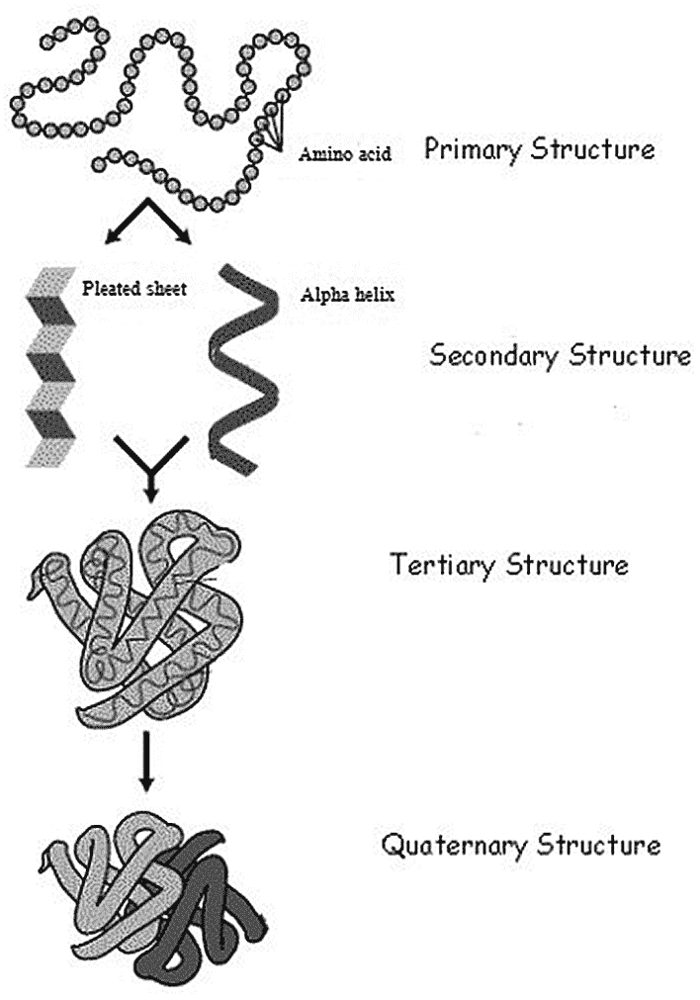

Figure 1.1 Structure of protein.

The peptide bond *exists* between the amino group (-NH[2]) of one amino acid and the carboxyl group (-COOH) of another.

The peptide bond I protein is shown in Figure 1.2.

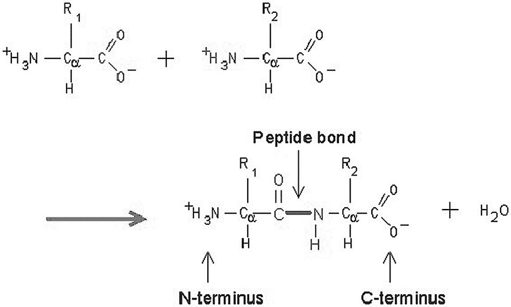

Figure 1.2 Peptide bond in protein.

Analysis of protein structure can be evaluated with the help of the following advanced analytical techniques.

* The determination of amino acids within an enzyme and the molar ratios of each can be analyzed by an amino acid analyzer.
* The sequence of amino acids in the enzyme can be analyzed by peptide mapping, Edman degradation, or mass spectroscopy.
* The secondary structure of an enzyme can be determined by circular dichroism (CD) spectroscopy. The tertiary structure of an enzyme can be determined by fluorescence spectroscopy.
* X-ray crystallography or nuclear magnetic resonance (NMR) analysis can be used to obtain a high-resolution analysis of the 3D structure of an enzyme.
* Enzyme structure has four levels namely primary, secondary, tertiary, and quaternary.
* The amino acid sequence of an enzyme is called its primary structure.
* The interaction of amino acids in a chain is the secondary structure of enzymes.
* The two types of secondary structures are helical (called αhelices) and pleated sheets (called βpleated sheets).
* The arrangement of amino acids in three-dimensional spaces is the Tertiary structure. Quaternary structure refers to the interaction between protein subunits.
* Analysis of enzyme structure can be done with the help of advanced analytical techniques/equipment such as amino acid analyzer, peptide mapping, Edman degradation, mass spectroscopy, circular dichroism spectroscopy, fluorescence spectroscopy, X-ray crystallography, NMR.

## 1.3 Enzyme Classification

The enzyme classification was basically done on the type of reaction carried out. The seven types of reactions are given in Table 1.1.

用于细菌和真菌来源酶的培养基已通过一次考虑一个参数的方式由 Hajji 等人(Hajji et al., 2008)优化，从而获得了高酶产量。

过程参数的评估和调节并不容易实现(Wang et al., 2012)。有趣的是，固态发酵和浸润发酵均成功用于几种酶的生产。使用橙皮进行浸润发酵和固态发酵被发现对生产转化酶有利。酒精饮料如乙醇可以由酶(Lincoln & More, 2017)生产。*Aspergillus* 物种能够利用含有木质纤维素的农业基质生产类似纤维素酶(Pachauri et al., 2018)。批次反应器和 fed‑batch 反应器已用于微生物发酵以生产工业酶。fed‑batch 反应器被用于通过 *Alcaligenes* 细菌生产蛋白酶，用于洗涤剂(Aishwarya et al., 2013)。

工业酶的微生物生产已通过不同的统计方法进行优化。采用 Plackett–Burman 方法优化过程参数，以提高 *Aspergillus* 物种的单宁酶产量(Xiao et al., 2015;Souza et al., 2015)。培养基中的 Tween 80 也可能刺激如 *Bacillus* 等细菌产生酶。表面活性剂修饰细胞膜，促进化合物摄取，从而提高脲酶释放(Niyonzima & More, 2014a)。使用像特罗尼 (triton) 这样的表面活性剂作为发酵基质，可提高 *Penicillium* 物种的外源酶分泌。芳香化合物也作为诱导剂，促进蘑菇产生脲酶(Usha et al., 2014)。使用农业残余等廉价底物可以大幅降低环境污染。通过使用低廉底物，可最小化微生物的生产成本(Niyonzima & More, 2019)。如鸡羽毛等原料可代替碳和氮源，用于大量生产蛋白酶。由于工业酶需求巨大，微生物在同一培养基中同时产生多种酶，以使过程更具成本效益。在相同培养基中同时产生的酶（如脂肪酶、蛋白酶和纤维素酶）在去除污渍时被使用。同时在同一培养基中产生的蛋白酶可防止脂肪酶、淀粉酶和纤维素酶的水解。当 *Bacillus* 物种在同一发酵基质中同时产生脂肪酶和淀粉酶时，未发现淀粉酶的水解。兼容性良好的保护性酶（如纤维素酶和脂肪酶）已被发现可在洗涤剂配方中共存。*Bacillus megaterium* B69 的碱性淀粉酶在与碱性蛋白酶共同产生时也未受到水解。通过将农业副产品作为廉价原料加入，可提高工业酶的产量。淀粉酶和蛋白酶可通过固态发酵使用低廉底料生产。脱油的芥菜籽 cake 也可作为经济的淀粉酶和蛋白酶底料使用。同样，农业基质廉价原料被用于 *Bacillus* 物种产生脂肪酶和淀粉酶的发酵。使用农业残余等廉价原料可降低工业酶生产的发酵成本。

诸如搅拌速度、孵育时间、种子浓度、pH、微量营养素和大量营养素等过程参数对工业酶生产有贡献。通过优化过程参数可提高工业酶的产率。过程参数通常逐一优化，保持其他因素不变，优化的因素随后在后续实验中按顺序使用。实现酶的经济可行发酵生产可通过优化营养因素、发酵条件和过程参数来实现。

The enzymes that abundantly exist in the market include, amylose degrading, protein degrading, and cellulose-degrading enzymes. Amylose degrading enzymes have huge applications in the enzyme industry mainly due to the abundance of starch and are useful in the conversion of starch to sugar syrups. The enzyme applications can be further widened by developing amylase enzymes which have thermophilic, thermo–tolerant, and pH-tolerant characteristics. These thermophilic amylase enzymes would be directed to improve the gelatinization of starch, reduce the viscosity of the medium, and speed up biocatalysis. The most thermo-stable α-amylase presently used in industrial processes is obtained from *B. licheniformis*. It can sustain at a temperature of 90°C, for a long time.

The applications of Lipases as biocatalysts have increased tremendously in the present due to their high stability in organic solvents. Enzymes’ participation in esterification, transesterification, aminolysis, and oximolysis reactions, would be desirable for green synthesis. It is interesting to note that the usage of enzymes like lipase is not predominant due to its low stability in process conditions and low activity on certain substrates. Therefore, it became essential to solving the problem of low activity and it may be solved by adopting two ways. i) to develop highly powerful enzymes from extremophilic microorganisms, which can withstand high temperature, pH, and concentration of salts. The method that evolved is systems microbiology and it has become a useful tool.

Cellulose degrading enzymes are largely applied in textile units for a long time and gained significance due to their capability to degrade lignocellulosic materials. The enzymatic conversion of lignocellulosic waste biomass to bioethanol has become a costly proposition due to a lack of feasible technology. This lead to cost reduction of Cellulase preparations by i) changing enzyme production method using new strains and ii) enhancing the activity of the enzyme to reduce the quantity of enzyme required when compared to enzyme action by consortia. Some organizations developed novel cellulase enzymes with gene modifications and optimized enzyme release. An enzyme by the brand name Cellic was the outcome of Novozymes research which has the capability of converting agricultural biomass into bioethanol. This Cellic enzyme is better than the previously developed product by the same company and gives desired results even at low doses. This development is useful in bringing down the cost of bioethanol to about $2.0 per gallon and it is highly competitive when compared to present fuels.

### 1.4.1 Enzymes in Food Processing

The present lifestyle change in Europe, the USA, and the Pacific nations, toward high-quality, durable, and tasty foods lead to the evolution of new enzymes in food units. The present trend focuses on better quality in foods pertaining to natural aroma and pleasant taste. The enzyme application in the area of the food industry and beverage industry and future demand is expected to be $1.5 billion (Saibabu et al., 2013).

The applications of food-grade enzymes encompass the baking industry, fruit juice and cheese manufacturing, and wine making and brewing to enhance their flavor, texture, digestibility, and nutritional value. Enzymes are used either as processing aids or additives in food units. Examples of food additives are Lysozyme and Invertase. Enzymes used in food processing are typically sold as enzyme preparations, which contain not only the desired enzyme but also metabolites from the production strain and several added substances such as stabilizers. All these materials are expected to be safe as per good manufacturing practice (GMP).

The key item in evaluating enzyme preparation safety is the safety assessment of the production strain. Only about nine recombinant microorganisms are issued as Generally Recognized as Safe (GRAS) based on FDA regulations from a relatively small number of bacterial and fungal species primarily *Aspergillus oryzae*, *Aspergillus niger*, *Bacillus subtilis*, and *B. licheniformis*. In order to increase the enzyme production level, modifications including protease-deficient and sporulation-deficient were introduced to the wild-type host microorganisms.

### 1.4.2 Enzymes in Cosmetics


The predicted growth rate of enzymes by market experts in personal care is about 6% per year, due to developments in the enzyme production process. An example for technological progress is the usage of superoxide dismutase (`SOD`) Enzyme in personal care products for capturing free radicals to prevent skin problems. `SOD` and peroxidase may be mixed together in skin ointments as free radical removal to avert UV-prompted skin diseases. Also, protease enzyme is used in skin ointments for peeling off dead skin to evolve smooth skin. Further, it may be inevitable to stop skin irritations, which is the result of enzyme action on the skin.

However, many patents are being applied for enzyme usage in personal care products. Of course, the number of patent applications has increased since 2003 in the skin and cosmetic enzymes field.

The enzyme applications are given in Table 1.4.

Table 1.4 Enzyme Applications

| S. No. | | Enzyme | Application |
| --- | --- | --- | --- |
| 1 | | `Laccase` | Hair dye |
| 2 | | `Lipase` | Skin rash prevention |
| 3 | | `Endoglycosidase` | Toothpaste/mouthwash for, whitening of teeth, odor removal |
| 4 | | `Papain` | Toothpaste/mouthwash for whitening of teeth, odor removal |
| 5 | | `Catalase` | Skin protection for whitening of teeth, odor removal |

## 1.5 Commercially Important Enzymes

The main industrial enzymes may be divided into three categories: `carbohydrate degrading`, `protein degrading`, and `lipid degrading`. `Amylases` `come under` the `carbohydrase` group, `along with` `cellulases`, `glucose isomerase`, `glucose oxidase`, `pectinases`, `xylanases`, `invertase`, and `galactosidase`. The `amylose degrading` enzymes that exist in typically `in` markets are `α-amylase` and `glucoamylase`. A pertinent source of `α-amylase` is the bacteria `B. licheniformis`, whereas `A. oryzae` and `A. niger` are `frequently used` for `glucoamylase` industrial production. The `usual` industrial applications of `α-amylase` are in, beverage (beer and distilled spirits), and `commercial` ethanol production; cleaning products; bakery products; textile processing; pulp and paper processing; animal feed; and digestive pharmaceuticals. `Glucoamylase` is basically used industrially for starch-based ethanol, with reducing market use in corn-steep liquor. `α-amylase` and `glucoamylase` put together accounted for 60% of the total `carbohydrase`.

The enzyme `α-amylase` is deployed in the industry due to its high thermal stability, and it is mostly obtained from microbial sources. The other sources of `α-amylase` are fungi and plants. The plant-based `α-amylase` sources are rice, corn, potato, and beetroots. For `α-amylase`, the annual growth rate of market demand in North America is expected to increase, by 2%, while the market growth rate in Asia is expected to increase by 6%.

The demand for `glucoamylase` was increased about two and a half fold in since last decade, whereas the main contribution is from `glucoamylase`, specifically for biofuels, as the main application, but for use in food and beverage processing, it was stable. The major industrial players of `glucoamylase` are Novozymes, DuPont, Amano Enzyme, AB Enzymes, Royal DSM, Verenium, Shandong Longda, VTR, SunHY, YSSH, and BSDZYME. The key markets are located in North America, China, Japan, India, Southeast Asia, and Europe.

## 1.6 Typical Enzyme Production Process

- [工业酶](https://wiki.example.org/feynmans_learning_method)在制药工业中是通过细菌和真菌发酵生产的。细菌和真菌菌株被选用是因为它们易于操作、生长速率快，并且在大型发酵罐中容易扩大规模。最常用的细菌是`Escherichia coli`、`B. subtilis`，而主要使用的真菌是`A. oryzae`、`A. niger`等。

### 1.6.1 工业酶

微生物工业酶的生产日益受到重视。微生物工业酶的生产包括重要的步骤，如隔离、筛选和鉴定产酶微生物，以及优化过程参数。纯化和表征纯化后的酶。

`微生物`通过`Figure 1.3`的传统微生物学方法进行筛选。用于隔离合适微生物的目标包括：(a) 大量释放酶且代谢产物少，(b) 缩短发酵周期，(c) 在廉价可得的培养基中培养微生物。随后，隔离的微生物通过`株改良`和`培养基配方`进行酶产量优化。微生物菌株通过`致敏化学试剂`和`紫外线`进行改造。

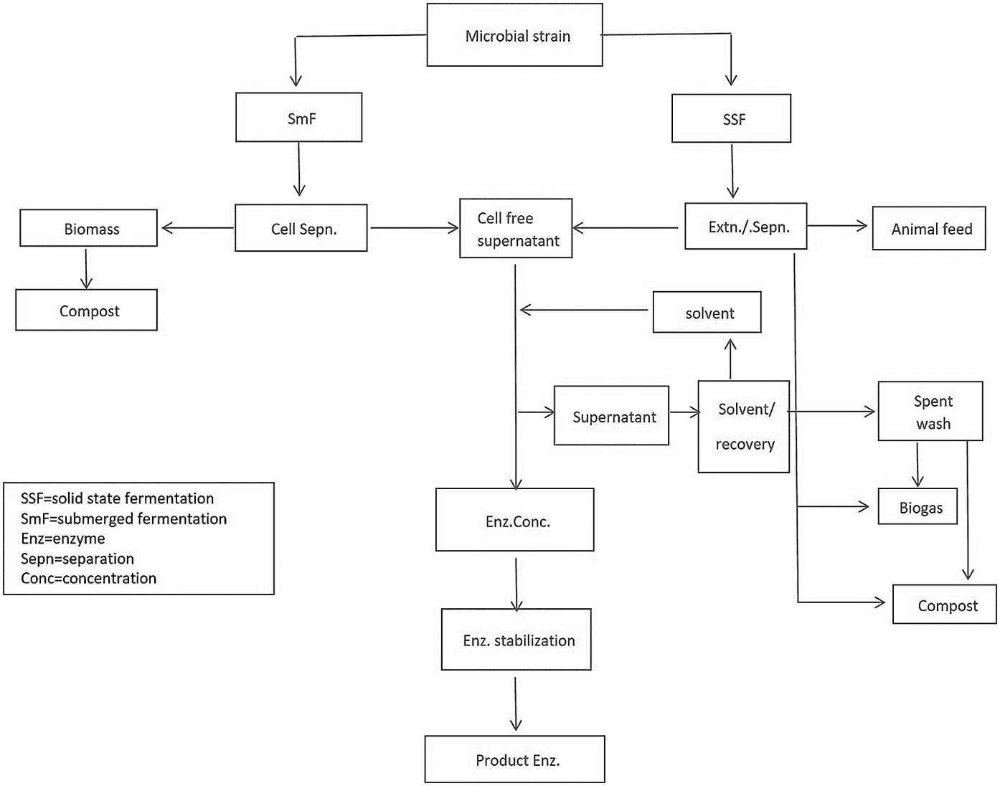

Figure 1.3 Microbial isolation.

通过`致敏`处理的酶产菌株通过`孢子`和`菌丝`的增殖来开发。

选择能够大量产酶的微生物是工业酶生产的首要任务。

(1) `细胞外酶`不需要细胞破碎即可分离，因此被首选。(2) 产高酶量的微生物培养物被培养。(3) 选择`产量稳定`的菌株。(4) 该生物应能在廉价底物上生长。(5) 能够`容易分离`培养基或提取液。(6) 选择`不产生毒性物质`的微生物菌株。

### 1.6.2 培养基配方与制备

培养基被配制以实现`大量酶的生产`，同时`抑制微生物菌株的生长`。该培养基应具有`廉价的碳源、氮源、氨基酸、生长促进剂、微量元素`，以及`较少的盐类`。在菌株开发过程中，应维持`最佳发酵条件`，如 pH 和温度。典型培养基可能含有(1) `碳水化合物`，如糖蜜、大麦和玉米；(2) `蛋白质`，如大豆、花生和玉米糊精。

### 1.6.3 培养基灭菌

培养基通过`批量灭菌`实现，连续灭菌方法正在被考虑用于特定应用。灭菌后，接种`无菌培养基`进行发酵，这是下一步。

酶的生产可以通过`表面培养技术`或`沉液培养技术`实现。表面培养技术用于生产某些真菌酶，如`淀粉酶`、`蛋白酶`和`果胶酶`。

维持`最佳发酵条件`，如 pH、温度和氧气。通过在发酵过程中`加入油脂`控制起泡。酶在培养基中培养 1–7 天后生产。大多数酶在`指数增长阶段`或结束时产生。发酵后的糖浆中约`10%的代谢产物`在纯化过程中被去除。发酵结束后，糖浆被保持在`3–5°C`的范围内。

### 1.6.4 酶的纯化

酶纯化的步骤包括：i) `真空蒸发`浓缩；ii) `过滤`对酶溶液进行抛光；iii) `添加保护剂`，如`钙盐、糖、酒精`和`氯化钠`；iv) 使用`丙酮、酒精、氯化铵等`沉淀酶；v) 通过`真空干燥`干燥沉淀物；vi) `包装`。

## 1.7 世界市场

`全球预测酶市场自 2015 年以来每年将增长约 7–8%。` 酶在`纺织工业`、`淀粉加工单位`、`制药单位`和`生物过程研究`中有无数种应用。酶在`食品加工单位`和`饮料单位`的巨大需求推动了酶市场的全球发展。酶工业的增长主要受`酿酒业`和`植物油加工单位`中酶的使用所驱动。酶在`亚太地区`的增长可能较为有限，因为欧洲和美国已经处于主要发展阶段。酶工业的快速增长体现在`诊断酶试剂盒`在`医疗保健和健康护理`领域的巨大需求。洗涤剂及清洁酶制造单位因`去污`需求大而迅速发展。显然，`生物途径`生产酶是正确的选择。

## 1.8 总结

本章简要介绍了`酶的结构`、`分类`、`商业酶的重要性`以及`全球市场`。更多关于酶的信息将在后续章节中提供。

## 思考题

1. 什么是酶？
2. 肽键在哪两个基团之间形成？
3. 解释酶的工业应用。
4. 酶是如何纯化的？
5. 简要说明酶的全球市场现状。
6. 简要说明酶在化妆品中的一些应用。

- Kumar, A., and Chandra, R. 2020. “纤维素酶及其降解环境中木质素-纤维素废弃物的机理。” Heliyon *6*(2), e03170.
- Kumar, A., and Singh, S. 2012. “定向进化：为工业应用定制生物催化剂。” Critical Reviews in Biotechnology 33(4):365–378.
- Kumar, C.G., Malik, R.K., and Tiwari, M.P. 1998. “创新型酶基消毒剂：印度视角。” Current Science 75(12): 1312–1318.
- Kumar, D., Kumar, A., Sondhi, S., Sharma, P., and Gupta, N. 2018. “碱性细菌脲酶：用于天然前体聚合合成染发剂的应用。” 3 Biotech *8*(3): 1–10.
- Kumar, V., Khokhar, D., Sangwan, P., and Agrawal, S. 2012. “椰酸酯和脂肪酶在人体健康中的作用。” Indian Farmers Digest 45(5): 42–44.
- Kumar, V., Sangwan, P., Singh, D., and Gill, P.K. 2014a. “工业酶市场的全球概况。” In Industrial Enzymes: Trends, Scope and Relevance, edited by Vikas Beniwal, and Anil Kumar Sharma 176–196. Nova Science Publishers, New York.
- Kumar, V. Singh, D. Sangwan, P., and Gill, P.K.2014b. “工业酶的全球市场概况。” In: Beniwal, V., and Sharma, A.K. (eds), Industrial Enzymes: Trends, Scope and Relevance, pp. 173–196. Nova Science Publishers, New York.
- Laachari, F., El Bergadi, F., and Ibnsouda, S.K. 2015. “从 *Aspergillus flavus* 中分离并表征一种新型耐热脂蛋白酶。” International Journal of Research 2(2): 342–352.
- Lalor, E., and Goode, D. 2010. “使用酶进行啤酒酿造。” In: Whitehurst, R.J., and van Oort, M. (eds). Enzymes in Food Technology, 2nd edn. Chapter 8, pp. 163. Wiley.
- Law, J., and Haandrikman, A. 1997. “乳酸菌的蛋白酶。” International Dairy Journal **7**: 1–11.
- Laxman, R.S., Sonawane, A.P., More, S.V.,et al. 2005. “优化并规模化 *Conidiobolus coronatus* 的碱性蛋白酶生产。”Process Biochemistry 40: 3152–3158.
- Li, G., Liu, X., and Yuan, L. 2017. “通过吸收发酵和营养载体提高 *Funalia trogii* 的脲酶产量。” Journal of Bioscience and Bioengineering 124(4): 381–385.
- Lyons, T.P. 1991. Biotechnology in the Feed Industry. Alltech Technical Publications.
- Madhavi, J., Srilakshmi, J., Rao, M.R., and Rao, K.R.S.S. 2011. “高温细菌蛋白酶在皮革去毛中的高效脱毛。” International Journal of Bio-Science and Bio-Technology 3: 11–26.
- Madhu, A., and Chakraborty, J.N. 2017. “酶在纺织加工中的应用进展。” Journal of cleaner production 145: 114–133.
- Malathi, S., and Chakraborty, R. 1991. “从新 *Aspergillus flavus* 株中在固体基质发酵条件下生产碱性蛋白酶，用于脱毛剂。” Applied and Environmental Microbiology 57: 712–716.
- Mane, P., and Tale, V. 2015. “微生物治疗酶的概述。” International Journal of Current Microbiology and Applied Sciences 4(4): 17–26.
- Martinez, A., and Maicas, S. 2021. “酯切酶：工业生产的特性与见解。” Catalysts 11(10): 1194.
- Matama, T., Carneiro, F., Caparrós, C., Gübitz, G.M., and Cavaco Paulo, A. 2007. “利用硝基酶对丙烯酸纤维表面进行改性。” Biotechnology Journal: Healthcare Nutrition Technology 2(3): 353–360.
- Mehta, A., Bodh, U., and Gupta, R. 2017. “真菌脂肪酶综述。” Journal of Biotech Research 8.


# 参考文献

- Mehta, A., Guleria, S., Sharma, R., and Gupta, R. 2021. “脂肪酶及其在食品工业中的应用，重点综述。” In Microbial Biotechnology in Food and Health, edited by Ramesh C. Ray, 143–164. Academic Press.
- Mehta, P.K., and Sehgal, S. 2019. “微生物酶在食品加工中的应用。” In: Husain, Q., Ullah, M. (eds), Biocatalysis, 255–275. Springer, Cham.
- Meshram, A., Singhal, G., Bhagyawant, S.S., and Srivastava, N 2019. “植物来源酶：食品生物技术的宝贵资源。” In Enzymes in Food Biotechnology, edited by Mohammed Kuddus, 483–502. Academic Press.
- Mojsov, K. 2011. “酶在纺织工业中的应用综述。” In: II International Congress "Engineering, Ecology and Materials in the Processing Industry", Proceedings, 2011, 09-11 March, pp. 230–239, Jahorina, Bosnia and Hercegovina.
- Mokashe, N., Chaudhari, B., and Patil, U. 2017. “来自新分离耐盐 `Salinicoccus` sp. UN-12 的耐洗涤剂强碱性蛋白酶。” Journal of Surfactants and Detergents 20(6): 1377–1393.
- Mukram, I., Nayak, A.S., Kirankumar, B., Monisha, T.R., Reddy, P.V., and Karegoudar, T.B. 2015. “分离并鉴定一种水解腈的细菌，并同时利用芳香族和脂肪族腈。” International Biodeterioration & Biodegradation 100: 165–171.
- Nair, I.C., and Jayachandran, K. 2019. “食品工业中的天门冬酶。” In: Parameswaran, B., Varjani, S., Raveendran, S. (eds), Green Bio-processes, 15–30. Springer, Singapore.
- Nair, S.G., Sindhu, R., and Shashidhar, S. 2008. “真菌半乳糖苷酶产量在固态和亚沸发酵条件下的研究。” African Journal of Microbiology Research 2: 82–86.
- Naveed, M., Nadeem, F., Mehmood, T., Bilal, M., Anwar, Z., and Amjad, F. 2021. “蛋白酶 – 一个多用途且环保的生物催化剂，具有多个工业应用：更新综述。” Catalysis Letters 151(2): 307–323.
- Ni, H., Chen, F., Cai, H., Xiao, A., You, Q., and Lu, Y. 2012. “表征并制备 `Aspergillus niger` 的 naringinase，用于柑橘汁去苦。” Journal of Food Science 77(1): C1–C7.
- Nisha, M., and Satyanarayana, T. 2016. “微生物耐热拉古兰酶及其蛋白工程和应用特性。” Applied Microbiology and Biotechnology 100(13): 5661–5679.
- Niyonzima, F.N., and More, S.S. 2015. “合成洗涤剂兼容的细菌酶及去渍效果评价。” Journal of Basic Microbiology 55(10): 1149–1158.
- 欧哈, B.K., 斯里, P.K., 和 斯里瓦斯塔瓦, N. 2019. “酶在动物饲料工业中的作用。” 在《酶在食品生物技术中的应用》, 由 Mohammed Kuddus 编辑, 93–109. Academic Press.
- 奥苏吉, A.C., 埃, S.O.O., 奥西, E.E., 和 乔拉卡, F.C. 2014. “部分从大蒜中提纯的过氧化物酶对工业重要染料的生物漂白。” Scientific World Journal 2014: 183163.
- 欧塔伊, S. 2020. “酶在食品工业中的近期应用。” Journal of Current Research on Engineering, Science and Technology 6(1): 17–30.
- 潘达,T., 和 戈里什南卡尔,B.S. 2005. “酯化酶的生产与应用。” Applied Microbiology and Biotechnology 67: 160–169.
- 潘迪, A., 尼加姆, P., 索科尔, C.R., 索科尔, V.T., 斯辛, D., 和 摩罕, R. 2000. “微生物淀粉酶的进展。” Biotechnology and Applied Biochemistry 31(2): 135–152.
- 潘迪, D., 帕特尔, S.K., 斯辛, R., 康普, P., 拉尔, V., 和 乔, D. 2019. “溶剂耐受的 `Bacillus` sp. APB-6 的酰胺酶的分离与表征。” Indian Journal of Microbiology 59(4): 500–507.
- 潘迪, K., 斯辛, B., 潘迪, A.K., 巴德丁丁, I.J., 潘迪, S., 米沙, V.K., 和 詹, P.A. 2017. “微生物酶在工业废水处理中的应用。” International Journal of Current Microbiology and Applied Sciences 6(8): 1243–1254.
- 潘迪, A., 拉林根南, S., 拉, J.R., 卡米, N.R., 和 古特曼, M.K. 2016. “廉价的 α-淀粉酶的生产与在皮革加工中的纤维分离应用。” RSC Advances 6(39): 33170–33176.
- 帕特尔, A., 斯里尼, R.R., 和 潘迪, A. 2016. “应用于食品工业的新型酶工艺。” Current Opinion in Food Science 7: 64–72.
- 帕特尔, A.K., 斯里尼, R.R., 和 潘迪, A. 2017. “微生物酶的生产、纯化与应用。” 在《微生物酶的生物技术》中, 由 Goutam Brahmachari, Arnold Demain, and Jose Adrio 编辑, 13–41. Academic Press.
- 彭, Y.H., 和 施, Y.H. 2013. “微生物降解某些卤代化合物: 生化和分子特征。” 在《有害和特殊产品的生物降解》中, 由 R. Chamy, and F. Rosenkranz 编辑, 51–69.
- 佩利阿托, M., 费罗, F., 焦安蒂, M., 莫索托, R., 和 英齐尼, R. 2011. “蛋白酶对酸性染料对羊毛染色的影响。” Open Chemistry 9: 157–164.
- 佩亚特, L.A., 彭法南塔基斯, N., 乔治萨基, K., 乌阿扎尼, J., 杰尼尔, O., 特鲁加科斯, I.P., 和 福亚利基斯, N. 2019. “陆地微生物: 具有皮肤保护应用的生物活性分子的细胞工厂。” Molecules 24(9): 1836.
- 法姆, L.T.M., 金, S.J., 和 金, Y.H. 2016. “通过在长距离电子传递路径中嵌入电子中继提高木质纤维素降解酶的催化性能。” Biotechnology for Biofuels 9(1): 1–10.
- 波尔森, P.B., 和 克劳斯·布赫尔兹, H. 2003. “酶学史与食品生产的重点。” 在《食品酶学手册》中, 由 J.R. Whitaker, A.G.J. Voragen, and D.W.S. Wong 编辑, Marcel Dekker, New York.
- 普里, M. 2012. “关于 naringinase 的最新研究: 结构与生物技术方面。” Applied Microbiology and Biotechnology 93: 49–60.
- 赖, S.K., 罗, J.K., 和 姜, A.K. 2010. “表征一种耐洗涤剂的碱性蛋白酶, 来自新型耐热菌株 `Paenibacillus tezpurensis` sp. nov. AS-S24-II。” Applied Microbiology and Biotechnology 85(5): 1437–1450.
- 拉贾库马尔, R., 杰亚普里扬, K.R., 和 仁格萨, R. 2011. “从 `Bacillus megaterium` RRM2 中分离并表征一种蛋白酶, 用于洗涤剂和脱毛工业。” Journal of Basic Microbiology 51: 614–624.
- 拉托雷, D.S., 赛德, M., 和 斯辛, S.P. 2021. “海洋梭形菌: 微生物技术的新前沿——生物修复。” 在《微生物技术的最新进展》中, 由 Chandrama Prakash Upadhyaya, Joginder Singh, Ram Prasad, and Vivek Kumar 编辑, 425–449. Springer, Singapore.
- 拉维德兰, S., 帕尔梅斯瓦兰, B., 乌姆亚, S.B., 阿布拉罕, A., 马修, A.K., 马德瓦恩, A., 里贝尔, S., 和 潘迪, A. 2018. “微生物酶在食品工业中的应用。” Food Technology and Biotechnology 56(1): 16–30.
- 罗宾逊, W.G., 和 霍克, R.H. 1964. “里西奈酰胺酶 I. 反应产物和底物特异性。” The Journal of Biological Chemistry 239: 4257–4262.
- 罗兹尔, J.D., 和 波莫里乌斯, A.S. 2002. Enzyme Catalysis in Organic Synthesis, 2nd ed., edited by K. Drauz, and H. Waldmann, vol. II, 873893. Wiley-VCH, Weinheim, Germany.
- 萨布, A. 2003. “微生物治疗酶的来源、性质与应用。” Indian Journal of Biotechnology 2(3): 334–341.
- 萨达希瓦姆, S., 萨维塔, S., 斯瓦米南南, K., 和 林, F.H. 2008. “从新孤立的 `Trichoderma harzianum` WL1 中分离、纯化并表征中红潜力的淀粉酶。” Process Biochemistry 43: 736–742.
- 桑吉, A., 盖格, N., 古普塔, V.K., 米特尔, A., 和 克哈德, R.C. 2010. “一步纯化和表征一种由碱性 `Bacillus subtilis` ASH 产生的无纤维素木糖兰酶。” Brazilian Journal of Microbiology 41: 467–476.
- 施赫, T., 克, O., 和 Borchert, T.V. 2002. “技术应用酶。” 在《生物聚合物》中, 由 S.R. Fahnestock, and S.R. Steinbüchel 编辑, 377–437. Wiley-VCH, Weinheim, Germany.
- Sharma, H.P., Patel, H., 和 Sharma, S. 2014. “酶的果汁提取与澄清: 综述。” Trends Post Harvest Technology 2(1):1–14.
- Sharma, P.K., 和 Chand, D. 2012. “从 Pseudomonas sp. XPB-6 中分离出耐热纤维素酶。” International Research Journal of Biological Sciences 1(5): 31–41.
- Shi, K., Jing, J., Song, L., Su, T., 和 Wang, Z. 2020. “酶的聚酯水解: `Candida antarctica` 脂肪酶和 `Fusarium solani` 纤蛋白酶对 ε-卡普罗内酯的降解。” International Journal of Biological Macromolecules 144: 183–189.
- Shiroya, A.J. 2021. “淀粉酶酶的最新进展” In Industrial Biotechnology: A Review. Pharma News.
- Singh, D., 和 Chen, S. 2008. “芽孢乳杆菌 `Phanerochaete chrysosporium` 的条件对木质素降解酶的生产的影响。” Applied Microbiology and Biotechnology 81: 399–417.
- Singh, P., 和 Kumar, S. 2019. “微生物酶在食品生物技术中的应用。” 在《酶在食品生物技术中的应用》中, 由 Mohammed Kuddus 编辑, 19–28. Academic Press.
- Singh, R., Sulaiman, O., Hashim, R., Rupani, P.F., 和 Peng, L.C. 2010. “利用不同真菌物种对木质纤维素材料的生物降解: 综述。” Reviews in Environmental Science and Biotechnology 9: 141–151.
- Singh, R., Kumar, M., Mittal, A., 和 Mehta, P.K. 2016. “微生物酶: 21 世纪工业进展。” 3 Biotech 6(2): 1–15.
- Singh, R., Singh, A., 和 Sachan, S. 2019. “食品工业中的酶: 朋友还是敌人?。” 在《酶在食品生物技术中的应用》中, 由 Mohammed Kuddus 编辑, 827–843. Academic Press.

## 3 发酵工艺优化：对工业酶生产的影响

Ajay Nair 和 Archana S. Rao  
Dayananda Sagar University, Bangalore, India  

S. M. Veena  
Sapthagiri College of Engineering, Bangalore, India  

Uday Muddapur  
KLE Tach University, Hubli, India

K. S. Anantharaju 和 Sunil S. More  
Dayananda Sagar University, Bangalore, India

DOI: [10.1201/9781003292333-3](https://dx.doi.org/10.1201/9781003292333-3)

### 3.1 Introduction

#### 3.1.1 On the Production of Enzymes

生物催化酶是现代生物技术行业的基石，服务于人类利用生物体进行多种商业目的的追求。这些目的中的一些，如酿酒和酿造，可以追溯至历史的开端。酶相当于发酵酵母细胞，它们促进底物转化为诸如酒等可取产物。现代工业中酶潜力的最初明确迹象来自一个引人入胜的观察：从麦芽提取物中沉淀的酒精表明存在一种热敏性生物分子，该分子能将淀粉转化为可发酵的糖。该酶后来被称为`diastase`，因为它能将淀粉转化为可溶性的糖苷。19 世纪后期，其他酶如过氧化物酶、肽酶、半缩酶等也被发现。由 `Aspergillus oryzae` 产生的胶体酶（Taka-Diastase）是第一种被专利保护的酶（Headon and Walsh 1994）。

一旦工业界认识到酶的重要性，尤其是在调节生物技术工业流程中酶的作用，科学家便不断探索生物体，以寻找多种潜在酶。近年来，从工业材料的生产到诊断试剂、治疗药物等多种应用都高度依赖于酶（Aftab et al. 2018）。尽管生物来源多样，但大多数酶主要通过发酵过程从微生物中获得（Wiseman and Gould 1971; Fogarty 1983; Rose 1980）。

酶来源的选择是设计酶生产工作流程的关键。植物、动物和微生物都是酶生产的可能来源。使用微生物合成商业酶的一个根本原因是这些简单生物体能够在短时间内大量产生该生物分子。近年来的发酵工艺已得到优化，能够大量、按需生产酶（Fogarty 1983）。此外，微生物来源的酶通常比从动物和植物来源获得的酶更稳定，即使在最佳储存条件下长期保存也仍保持较高活性。

微生物来源酶的另一个优势是它们大多为细胞外酶。细胞外酶简化了后续的下游处理步骤，只需通过离心或过滤将产生细胞与细胞外培养基分离，随后即可从培养基中沉淀出酶。常见的细胞外酶包括蛋白酶和胶体酶，此外还有果胶酶和纤维素酶（Schwardt 1990）。


与微生物相比，植物作为工业酶来源似乎不够便利。然而，仍有多种值得关注的酶是从植物中获得的。从植物中获取目标蛋白的限制包括季节性因素、植物生长特性以及大多数植物酶为细胞内酶。尽管如此，一些关键酶如蛋白酶仍是工业上最受追捧的酶（Moffat 1992）。大量重要且应用广泛的酶也来源于动物，尤其是尿液或蛇毒。Rennin（也称胰蛋白酶）是工业上重要的酶，广泛用于奶酪生产及消化辅助品的制备。传统上，Rennin 从 suckling calves（哺乳小牛）的胃中提取，通过将条状组织浸泡在 5–10% 盐溶液中含有的 boric acid（硼酸）来获得。Rennet（凝血剂）是由 Rennin 提取的混合物，含有多种蛋白酶及其他酶，虽然这些酶尚未完全表征，但它们显然具有巨大的催化潜力。然而，纯净凝血剂的供应完全依赖于牺牲年轻小牛。其他动物来源的酶具有治疗潜力。例如，Ancrod 是一种丝氨酸蛋白酶，来源于马来西亚铲齿蛇的毒液（Headon and Walsh 1994），它能在血纤维形成血栓前降解纤维，表现出作为治疗性抗凝血剂的能力。另一种丝氨酸蛋白酶 Urokinase 广泛用于纤溶治疗，用于降解血栓（Ratzkin 1981）。Urokinase 由人类肾脏分泌，经人尿液提纯，通过一系列凝胶和离子交换层析分析获得。

通过将突变研究与系统的筛选和选择技术相结合，工业界已能够培育出能够大量分泌动物特异性酶的微生物。然而，通过重组 DNA 技术产生的酶产量并未显著超过自然产生的水平，尤其是治疗性酶。使用基因工程的另一个重要原因是避免通过感染的动物样本可能引起的疾病传播风险。利用重组 DNA 技术使生物体能够合成相同蛋白质，从而规避上述问题。例如，组织型纤溶酶激活剂（tPA）具有纤溶特性。基因操作技术已用于在多种宿主中表达该蛋白。最流行的宿主之一是将其表达在转基因小鼠的乳中（Gordon 1987）。重组 DNA 包含了小鼠乳头酸性蛋白基因的促进子和调控序列与人类 tPA 基因序列融合（Gordon 1987）。基因工程使得在广泛的动物宿主中实现酶的高产量成为可能。基因工程人源 DNAse 已被证明对囊性纤维化（cystic fibrosis）的治疗有效（Collins 1992）。囊性纤维化的特征是产生极度粘稠的痰液，严重影响肺功能。痰液因细菌感染引发的免疫反应而形成。传统上，痰液通过对患者胸部进行有力拍打并吸出。吸入重组 DNAse（通过雾化）可促使酶驱动的致病性 DNA 降解，从而显著降低痰液的粘稠度（Edgington 1993）。重组 DNA 技术还应用于其他重要的工业酶，如淀粉酶和蛋白酶。例如，*B. amyloliquefaciens* 的 α-淀粉酶基因已在 *S. cervisiae*（酵母）中表达。该酶随后分泌至细胞外培养基中并被纯化，用于淀粉的降解（Svensson and Sogaard 1992）。α-淀粉酶是淀粉加工中使用最广泛的酶之一，重组酶在热稳定性和 pH 范围的适应性方面表现更佳（Pen 1992）。

在大多数情况下，虽然微生物是酶生产的主要来源，但只有有限数量的微生物被认为是工业上重要的。限制微生物数量的原因在于它们必须遵守某些关键标准，如被公认为安全（GRAS）；必须是非致病性和非毒性的；此外，它们通常不产生抗生素。*Bacilli* 和 *Aspergilli* 种类是工业中最常用的 GRAS 列表酶生产菌株（Lambert and Meers 1983）。

微生物酶生产的系统性流程始于根据 GRAS 标准筛选理想的候选微生物。初步筛选包括在含有酶所需底物的琼脂板上培养候选菌株（Howson and Davis 1983）。通过检测底物水解区来确认酶的分泌。初步筛选虽然后续能提供多个潜在生产者，但并不足够，因为需要进一步的技术检测来选择高产菌株。随后的优化过程包括仔细审视和调节发酵条件（McNeil and Harvey 1980）。通常，从筛选到获得所需数量和类型的特定酶的微生物分离需要数年时间。重组 DNA 技术的进步为开发高产菌株提供了一定帮助。

### 3.1.2 酶生产中的发酵技术

发酵技术作为一种方法，利用微生物生产不仅包括酶，还包括许多在能源、材料、医药、食品等工业中有用的生物活性化合物。尽管该技术已取得长期成功，但在满足可持续化合物生产需求方面仍有不足，因此致力于改进发酵过程和工艺设计（Campbell-Platt 1994）。商业酶生产主要采用两种方法：浸液发酵和固体发酵（SSF）（Table 3.1）。

Table 3.1 Industrially Relevant Enzymes and Their Sources of Origin

| 酶 | 来源 | 所采用的发酵工艺 | 工业用途 |
| --- | --- | --- | --- |
| Proteases | *B. subtilis*, *A. oryzae*, *Streptomyces* spp. | 浸液发酵 | 广泛用于烘焙、皮革和洗涤剂工业中的水解蛋白 |
| 淀粉酶 | *Bacilli* spp. | 固体发酵 | 淀粉的液化 |
| 反转酶 | *Saccharomyces* spp. | 固体发酵 | 水解蔗糖生成简单糖 |
| 酪氨酸酶 | *E. coli*, *Streptomyces* spp. | 重组 DNA 技术结合浸液发酵 | 半合成青霉素的合成 |
| 果胶酶 | *A. niger* | 固体发酵、浸液发酵 | 水解果胶，广泛用于果汁生产 |
| 奇异纤溶酶 | 犊牛胃 | 重组 DNA 技术结合浸液发酵 | 用作血栓溶解剂 |
| 糖基转移酶 | *Bacilli* spp. | 批次和连续发酵 | 从淀粉中生产环糊精 |

#### 3.1.2.1 浸液发酵

浸液发酵是指将微生物培养在营养液中。温度、pH 和搅拌在标准化水平下维持，以获得更高的产量。选定的微生物（细菌、真菌）在封闭容器中以营养液培养，产生的酶是微生物利用介质中的营养物质而合成的。通常，所使用的容器容量可达 1000 立方米。大多数工业酶在发酵过程中被微生物释放到发酵液中，以分解玉米、糖、大豆等碳源和氮源原料。虽然发酵技术中有两种最常见的工艺——批量进料工艺，即在发酵罐内按生物量增长的需求向罐中加入液体营养物质；以及连续工艺，即以相同速率持续向发酵罐供给培养基，同时以相同速率排出已使用的发酵液。连续工艺确保细胞始终获得新鲜培养基，同时产物和废液同步移除，还能延长发酵罐的使用寿命。尽管连续发酵在诸多方面优于批量发酵，但其在广泛的工业领域中使用仍有限，主要原因包括容易受到污染以及非线性过程调节困难等性能问题（Renge et al. 2012）。

#### 3.1.2.2 固体发酵

固体发酵是一种替代性工业酶生产方法。通常，从真菌来源中提取酶的过程遵循表面发酵技术，也称为科吉发酵、托盘培养或薄层培养。常用的底物包括纸浆和农业废弃物，如小麦麸、稻米麸、木屑等。pH、温度、通气和湿度等多种因素会影响酶的成功产生（Renge et al. 2012）。与浸液发酵相比，固体发酵在以下方面表现更优：生产量更大、产量更高且产生的废液更少，最重要的是设备更为简便。固体发酵的底物选择主要取决于成本和可获得性，同时也受底物颗粒大小和含水量的影响。小颗粒虽提供更大的微生物生长表面积，但过小可能阻碍细胞呼吸，进而抑制微生物生长和酶产量。相反，较大的颗粒虽然减少了表面积，但能提供更好的通气，有利于细胞生长和酶的产生。固体发酵要求底物饱和于水分，因此需要标准化含水量以支持最佳微生物生长。固体发酵中工业相关酶的例子包括蛋白酶、果胶酶、麸糖酶、纤维素酶等（Suganthi 2011）。

### 3.2 发酵过程工程中的操作问题

- 与简单化学过程相比，生物过程（如酶的生产）所涉及的过程工程需要考虑所有与过程建模、设计和控制策略选择相关的要素。因此，工业界在标准化控制技术方面投入了大量关注（Henson 2003）。通常，发酵生物过程建模分为两类：第一类是无结构动力学，第二类是结构化动力学。生化过程通常依赖于无结构动力学建模，这是一种非机理方法，假设产物抑制呈线性或指数形式。换句话说，酶分泌的动力学取决于底物浓度、底物类型以及微生物种类。虽然该模型在大多数实验数据中表现良好，但在工业规模的复杂生物过程（如微生物酶的工业化生产）建模时仍显示出有限的潜力。这主要归因于几个未得到解决的计算问题（Moser and Starzak 1994）。相反，结构化动力学模型将细胞过程划分为以下几类：

> 1.  代谢途径，底物被分解为能量和较小的分子  
> 2.  合成途径，底物前体被合成为生物量前体  
> 3.  前体的乘积形成生物量  
> 4.  整体维持措施，以保持生物过程的运行  
> （Starzak et al. 1994）

与无结构模型相比，结构化模型能够更好地考虑导致酶或产物形成的所有中间生化反应。此外，无结构模型无法体会环境因素对代谢分支点的影响。分支点能够描述底物被引导至预期产物的程度。分支点动力学模型还能预测底物转化为产物的速率（Figure 3.1）。

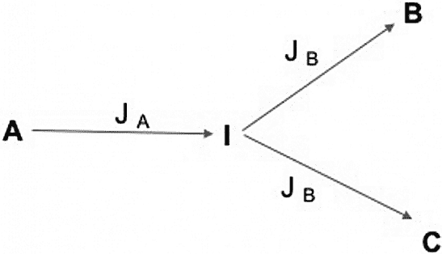

Figure 3.1 Metabolic branch point.

在 Figure 3.1 中，`A` 代表底物，`B` 代表产物，`C` 代表副产物；`I` 代表代谢物，`J` 代表通量。为提高产物形成，需要最小化 `C` 的通量（`J[C]`）。同时，需通过将更多碳流向 `B` 来提升 `J[B]`。对代谢物 `I` 周围通量的改变需要对整个代谢网络有深入理解（Bideaux et al. 2006），换言之，需要结构化模型的动力学。结构化模型动力学已用于葡萄糖发酵乙醇的生产，其中甘油为副产物。有趣的是，该模型显著降低了乙醇生产过程中的甘油形成。

### 3.2.1 发酵过程控制特点

调节发酵过程的主要挑战包括：

1.  在整个工艺的关键节点难以获得合适的传感器  
2.  适用于多种发酵控制的选择算法  

例如，模型无法预测微生物细胞浓度和活性等变量。还有其他输入-输出变量根本无法被无结构动力学模型覆盖，使得发酵过程极为棘手，尽管已取得传感器和数字通信技术的进展。因此，研究者被激励探索更佳的发酵过程控制与解释方法。最广泛研究的选项包括自适应控制、神经网络、模糊控制和基于模型的控制等（Arbel et al. 1996; Schügerl 2001）。与许多其他结构化或无结构动力学模型不同，神经网络不依赖于对各过程变量之间的联系及整体过程的了解。为了评估神经网络在预测生物量和底物浓度方面的有效性，其性能与使用典型的扩展卡尔曼滤波器（EKF）的结果进行了比较。EKF 本身在优化发酵过程方面相当高效，能够实时预测细胞生长和浓度等方面。但与神经网络相比，EKF 无法全面、准确地预测动态发酵过程的结构。尽管神经网络已取得显著成功，但它们仍处于初创阶段。

### 3.3 影响发酵过程的因素

在所有可能决定工业酶成功生产的因素中，影响发酵过程的因素影响最大。主要调节酶通过发酵生产的因素包括非生物因素和生物因素，如培养基组成、温度、pH、机体应力、通气程度以及微生物细胞形态。每个因素均单独优化，然后研究其协同效应（Flowchart 3.1）。

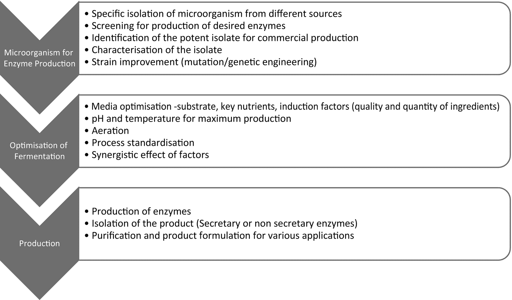

Flowchart 3.1 Steps involved in microbial production of enzymes.

#### 3.3.1 媒体组成

媒体标准化在发酵酶生产中起着关键作用。媒体的化学组成直接影响整体产量。任何培养基都应提供基本需求，如能源来源、碳源、氮源、生长因子以及促进因子，以支持微生物的生长和酶的生产。优化媒体组成不仅能最大化产量，还能防止未使用的组分被浪费。媒体不能统一适用于细菌和真菌。媒体组分、诱导因子和关键需求均为株特定。高微生物生长速率不一定意味着高酶产量。生长可通过碳源、氮源和能源来源得到支持，同时也有因子能够诱导或抑制酶的生产（Ire 2011; Kumar and Takagi 1999）。

媒体优化通常采用单因素变化法或统计方法。工业上主要使用细菌和真菌进行酶的生产。酶的特异性和稳定性是选择微生物的重要考虑因素。微生物酶可分为细胞内酶或分泌酶。工业生产中，分泌酶始终是更佳选择，因为其分离和纯化更为简便。基因改造或融合蛋白技术可高效实现酶的分泌。基因改造微生物也常用于提升酶产量或适应发酵条件。发酵条件（温度、pH、通气）应尽量低能耗。微生物需通过培养基中的激活因子来诱导酶的产生。

- 用于发酵的底物，特别是固态发酵（SSF），是农业工业废弃物或副产品。这使得发酵过程成本更低，可减少约 30%。利用此类底物还有助于生物修复。小麦麸、鸡羽、椰子壳、茶梗、锯屑、米糠、厨余有机废弃物等都是用于生产酶类（如淀粉酶、转化酶、酪蛋白酶、苯氧化酶、单宁酶、木糖酶、纤维素等）的廉价底物（Table 3.2）。另一方面，浸液发酵需要昂贵的合成培养基来促进微生物生长和产品生成。一些酶（如转化酶）可通过两种发酵方式由 *Aspergillus* spp. 产生。例如，用于洗涤剂的酶，可通过单一生产介质同步产生。此类情况下，培养基应含有所有酶所需的诱导因子（Niyonzima 2019）。

Table 3.2 Commonly Used Media Components for Microbial Enzyme Production

| 碳源/能源来源 | 糖蜜、麦芽大麦、淀粉、秸秆、纸浆、油脂、玉米酒糟、小麦麸、米糠、厨余有机废弃物等 |
| --- | --- |
| 氮源 | 玉米酒糟、酵母提取物、肽水解物、大豆蛋粕等 |
| 矿物质 | 钴、铜、铁、锰、钼、锌等 |
| 螯合剂 | EDTA、柠檬酸、聚磷酸盐等 |
| 维生素/生长因子 | Fe、Cu、Mn、Mo、维生素 B 等 |
| 前体 | 色氨酸、亮氨酸、桉檬烯、柠檬醛 |
| 诱导剂 | 特定酶（如纤维素、纤维糖、纤维糖二棕榈酸酯用于纤维素酶；双糖、异麦芽糖、异麦芽糖二棕榈酸酯用于淀粉酶；蔗糖、蔗糖单棕榈酸酯用于转化酶） |
| 抑制剂 | 甲酸、乙酸 |
| 水 | 蒸馏/矿物化水 |
| 防沫剂 | 蓖麻油、硅衍生物、糖醇等 |

介质中营养物质的浓度会对酶产量产生巨大影响。微生物生长和代谢活动既取决于培养基原料的质量，也取决于其数量。因此，培养基优化应追求在最小微生物生长的前提下实现最大产物形成。这可以减少副产物生成、毒素积累和高成本等缺点（Singh et al. 2017）。

### 3.3.2 pH

pH 是影响微生物生长的主要因素。pH 变化会影响微生物生长、发酵速率和副产物形成。即使是微小的偏离最适 pH，也可能导致微生物生长不良和产量低下。例如，*Trichoderma viride* 产生的 β-葡萄糖苷酶最适 pH 为 5.5。任何偏离此值（更酸或更碱）都会阻碍微生物生长或酶的生产（Ikram-ul-Haq et al. 2006）。此外，非最适 pH 还会影响多种 *A. niger* 物种的酶生产和分泌。最适 pH 通过限制营养物质的可及性来实现（Bajpai 1997）。像阿米拉塞等广泛使用的酶，其产量可能既依赖 pH，也独立于 pH，取决于微生物。*A. oryzae* 产生的阿米拉塞需要 pH 7–7.5，而 *A. ochraceus* 则在 pH 3–6 左右产生阿米拉塞（Nahas and Waldemarin 2002）。

### 3.3.3 Temperature

温度对微生物生长和随后酶产量的影响无可匹敌。因此，为实现与生物量增长成比例的高产量，提供适宜温度至关重要。温度控制可通过三种方式实现：

> 1. 在单一且恒定的温度下进行发酵  
> 2. 在两个阶段进行发酵，每个阶段在不同温度下  
> 3. 在动态温度变化下进行发酵  
> (Zheng et al. 2001; Zhang et al. 2002)

温度的影响已被证明会特定地影响微生物对酶浓度的反应；微生物生长速率、发酵速率、细胞存活率、滞后期/对数期持续时间等（Jackson 2000）。另一项研究发现，当温度从最佳值升高时，酵母的滞后期缩短，净生长增加，碳转化为生物量的量提升。但总体产量因此显著下降（Sener and Canbas 2007）。枯草杆菌属（Bacilli spp.）在恒定 30°C 下培养时，弹性蛋白酶的发酵产量达到最大。此外，反应器的操作参数（如温度、培养基流速、底物浓度等）的波动也可能影响酶产量。例如，当反应器温度升高时，生物量增加但酶的生产受损。然而，当温度降至 27°C 时，产量时间从 92 小时缩短至 76 小时，且酶的生产未受影响（Yuan et al. 2005）。

### 3.3.4 Mechanical Forces and Aeration

在生物反应器中，搅拌强度和氧氧化程度极大地影响微生物的形态。机械曝气引起的物理应力已被证明会损伤真菌丝。因此，必须标准化搅拌速率以维持细胞存活率。最近关于通过浸液发酵生产脂蛋白酶的研究一致表明，通过搅拌和全氟碳酶提高氧传递率可最大化酶的生产（Frost and Moss 1987）。全氟碳酸酯有潜力增加氧气的溶解度，从而提高氧气向细胞的净传递率（Riess and LeBlanc 2082）。另一项研究比较了两种脂蛋白酶生产模式：一种是控制氧浓度，另一种是控制曝气速率。结果显示，氧气供应速率对酶的生产影响大于微生物生长（Murat and Dursun 2000）。对 *A. oryzae* 的曝气效应研究表明，酶的生产效率下降是由于细胞形态改变、生物量降低以及因曝气不当导致的混合不足（Amanullah et al. 1999）。超过最佳搅拌速率会使细胞形成小而紧实的颗粒。颗粒的形成首先是表面胶层被剥离，其次是强力搅拌破坏颗粒（Taguchi et al. 1968）。

## 3.4 Optimization of Fermentation Process Technology


## 3.4 发酵工艺优化策略

在任何发酵过程中，培养基和整体发酵过程在生理和生化层面上发挥着关键作用。这是因为这两方面决定了所需产物的整体浓度和产量。因此，必须严格采取优化措施以寻找最佳培养基和最佳工艺（Schmidt 2005）。然而，过程优化并非看似简单，它面临诸多挑战，包括需要大量实验设置、耗时耗力且成本高昂。由于不断向微生物群体中引入大量突变菌株，进行多种标准化实验的设置至关重要。每个优化过程都需要标准化不同组合的工艺条件和培养基成分，并评估其对应的产物产出（Stanbury et al. 1997）。

广泛采用的发酵工艺优化策略包括封闭系统和开放系统。在封闭系统中，被评估的参数数量和类型是已知或固定的。但其局限性在于可探索的参数组合数量有限。相反，开放系统能够探索无数种参数和组合，以优化发酵工艺。此外，开放系统被认为更为合适，因为它不偏向任何特定参数，不预设哪个参数组件可能是该发酵工艺的最佳选择（Kennedy and Krouse 1999）。

### 3.4.1 文献检索

该方法通过文献调查获取培养基的条件和成分，包括所使用的微生物菌种或种类。但该方法的问题在于选项过于丰富。因此，需要筛选出关键的参数和成分数量。不过，与其他方法相比，该方法相对简单，因为它不需要任何先前的数学技能（Kennedy and Krouse 1999）。

### 3.4.2 营养替换

这是一种开放系统的优化策略，仅比较培养基中的一种成分类型。该方法仅测试用替代成分替换培养基中的某一成分所产生的影响。由于该优化策略未评估成分间的相互作用变异性，因此可视为基础策略。尽管如此，该方法仍有优点，例如有助于筛选不同碳源和氮源，以实现发酵基质的整体标准化。例如，通过替换技术筛选出最佳碳源和氮源，用于麦 vastatin 和枸橼酸的生产（Ahamad et al. 2006）。

### 3.4.4 一元素一因子法

该方法采用封闭系统对发酵工艺优化。尽管是封闭系统，该方法仍可对培养基的多种成分以及基于质量平衡策略的细胞生长进行优化。但使用该方法的主要局限性在于其成本高昂、操作繁琐且耗时较长。该方法的一个优势是能够提供对培养基不同微观和宏观成分对微生物生长影响的洞察（Kennedy and Krouse 1999）。它适用于培养基成分的标准化以及发酵工艺参数的调整。该方法基于的策略是：在保持其他因素恒定的前提下，对单一变量进行实验（Alexeeva et al. 2002）。尽管该方法相对简单，但当变量数量过多时，其耗时且成本高昂。此外，该方法忽略了不同成分之间的相互作用。尽管如此，一元素一因子法仍是应用于发酵工艺优化的最受欢迎的封闭系统策略（Kumar et al. 2003）。

### 人工神经网络

在封闭系统中，当处理大量数据变量时，人工神经网络（ANN）表现最佳，无需对实验系统进行任何机械描述。这在优化介质组分（Kennedy and Krouse 1999）时尤为有用。ANN 最初通过一系列试验实验构建模型，随后创建网络连接数据点。随着数据点（无论是介质组成还是工艺条件）的连接，系统便学习不同数据点之间的相互作用。基于此学习，ANN 以微生物性能和产物（酶）产量的形式预测输出。由于其能够关联实验变量并预测其相互作用，ANN 通过消耗最少时间（Patnaik 2005）标准化发酵过程。

### 3.4.10 Fuzzy Logic

该优化技术基于一系列规则来优化发酵过程。规则本质上涵盖从定义发酵介质中组分的高低水平、最小组分数量，到理解组分之间的协同作用（Ul-haq and Mukhtar 2006）。一旦将介质输入模糊逻辑程序，即可预测特定菌株的性能及其产物结果（Anderson and Jayaraman 2005）。

### 3.4.11 Genetic Algorithm

在其他优化工具之中，遗传算法（GA）是一种非统计方法。无需经验模型，这一随机搜索工具能够显著优化发酵过程。在标准化发酵介质组分或发酵工艺条件时，GA 将每个介质成分视作染色体中编码的基因。完成第一轮实验后，选择产量最大的染色体。多个同类染色体被比较，以确定最佳菌株及对应的发酵条件。该技术的唯一缺陷是无法在每个优化阶段存储信息（Zuzek et al. 1996）。因此，人们普遍认为将 GA 与其他策略（如 RSM、EVOP、ANN）结合使用，可在产出最大化的同时实现发酵过程的最优标准化（Figure 3.2）（Nagata and Chu 2003）。

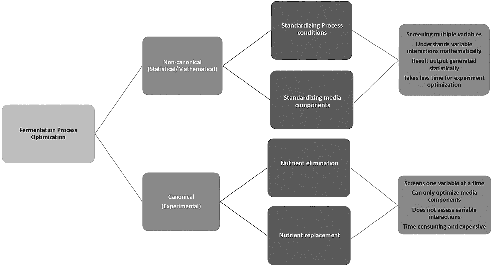

Figure 3.2 Strategies for fermentation process optimization.

## 3.5 Conclusions

全球对具有广泛应用前景的经济性酶的需求，已通过发酵技术得到广泛满足，这得益于传统发酵工艺的长期成功。但近年来，对可持续、成本效益、环保的酶生产的需求日益迫切，对现有技术提出了新的挑战。虽然存在多种微生物菌株，具备天然产生大量酶的能力，但其实际产量仍低于理想水平（Dubey et al. 2008；Singh et al. 2009）。

发酵过程优化，特别是介质的优化，一直是研究热点。传统的介质标准化主要通过调节介质组分，然后评估最适合的组分，然而这种方法并不教人如何理解各组分之间的相互作用。传统方法亦耗时耗力、成本高昂且耗时，促使大规模研究寻找替代优化手段。随着数学/统计工具的进步，研究者能够利用这些工具对发酵过程进行优化。随机算法已成功用于同时标准化介质的多种组分（如消除或替代碳源、氮源等）以及过程条件（pH、温度等），从而评估最佳产品产出（Wang et al. 2011；Gupte and Kulkarni 2003）。此外，现代优化技术还能够缩短实验时间并降低生产成本。长期而言，这些优势使生物技术行业更加环保且具成本效益。

## 参考文献

-   Gupte, M. and Kulkarni, P. 2003. 一项利用完全因子设计对 *Thermomonospora* sp MTCC 3340 产生抗真菌抗生素的研究。*J. Chem. Technol. Biotechnol*. 78: 605–610. doi: [10.1002/jctb.818](http://dx.doi.org/10.1002/jctb.818).

-   Headon, D.R. and Walsh, G. 1994. 酶的工业生产。*Biotechnol. Adv*. 12(4): 635–646. doi: [10.1016/0734-9750(94)90004-3](http://dx.doi.org/10.1016/0734-9750%2894%2990004-3).

-   Henson, M.A. 2003. 连续生化反应器中酵母细胞群体的动态建模与控制。*Comp Chem Eng*. 27: 1185–1199.

-   Howson, S. and Davis, R. 1983. 部分真菌产生的酯化酶（hydrolysing enzyme）。*Enz. Microbiol. Technol*. 5: 377–382.

-   Ikram-ul-Haq, S., Mahmmod, M.J., Zafar S. and Tehmina S. 2006. 通过营养和环境控制诱导 *Trichoderma viride* UVNG-4 产生葡萄糖苷酶。*J. App. Sci. Res*. 2: 884–889.

-   Ire, F.S. 2011. 影响培养条件对 *Aspergillus carbonarius* 产生蛋白酶的亚浸没发酵。*Afr. J. Food Sci*. 5, 353–365.

-   Jackson, R.S. 2000. *Wine Science*，Academic Press，美国，2。

-   Kar, B., Banerjee, R. and Bhattachaaryya, B.C. 2002. 利用演化算法-因子设计技术优化儿茸酸的生产物理化学参数。*Process Biochem*. 37: 1395–1401.

-   Kennedy, M. and Krouse, D. 1999. 提高发酵基质性能的策略综述。*J. Ind. Microbiol. Biotechnol*. 23: 456–475.

-   Kumar, C.G. and Takagi, H. 1999. 微生物碱性蛋白酶：从工业角度看。*Biotechnol. Adv*. 17: 561–594.

-   Kumar, D., Jain, V.K., Shanker, G. and Srivastava, A. 2003. 使用甘蔗渣进行固态发酵的乙酸生产。*Process Biochem*. 38: 1731–1738.

-   Lambert, P. and J. Meers. 1983. 工业酶的生产。*Phil. Trans. of the Royal Soc. London*, B300: 63–282.

-   McNeil, B. and Harvey, L. 1980. *Fermentation, a Practical Approach*。IRL Press，牛津。

-   Moffat, A. 1992. 高科技工厂有望带来新产品丰收。*Science* 256, 770–771.

-   Moser, A. and Starzak, M. 1994. 酒精发酵的宏观动力学模型——以 *Saccharomyces cerevisiae* 为例。*Chem. Eng. J*. 54: 221–240.

-   Murat, E. and Dursun, O. 2000. 氧传递对 *Rhizopus arrhizus* 产生脂蛋白的影响。*Process Biochem*. 36: 325–329.

-   Nagata, Y. and Chu, K.H. 2003. 使用神经网络和遗传算法优化发酵基质。*Biotechnol. Lett*. 25: 1837–1842.

-   Nahas, E. and Waldemarin, M.M. 2002. 控制 *Aspergillus ochraceus* 的淀粉酶生产及生长特性。*Revista Latinoamericana de Microbiologia*. 44: 5–10.

-   Naveena, B.J., Altaf, M., Bhadriah, K. and Reddy, G. 2005. 利用 Plackett–Burman 设计选择基质组分，以固态发酵法生产 *Lactobacillus amylophilus* GV6 的 L (+) 乳酸。*Bioresour. Technol*. 96: 485–490.

-   Niyonzima, F.C. 2019. 微生物工业酶的生产。*ASMI*. 2(12): 75–89. doi: [10.31080/ASMI.2019.02.0434](http://dx.doi.org/10.31080/ASMI.2019.02.0434).

-   Patnaik, P.R. 2005. 用模拟工业条件优化多羟基丁酸（poly-b-hydroxybutyrate）的神经网络设计。*Biotechnol. Lett*. 2(7): 409–415.

-   Pen, J. 1992. 在烟草中生产活性 *Bacillus licheniformis* α-淀粉酶，并用于淀粉糊化。*Bio. Technol*. 10: 292–296.

-   Plackett, R.L. and Burman, J.P. 1946. 最优多因子实验设计的设计。*Biometrika*. 33: 305–325.

-   Ratzkin, B. 1981. 在 *E. coli* 中表达人类尿素酶编码基因。*Proc. of the Nat. Acad. of Sci*. USA, 78: 3313–3317.

-   Renge, V., Khedkar, S. and Nandurkar, N.R. 2012. 通过发酵法合成酶的综述。*Sci Rev Chem Comm*. 2(4): 585–590.

-   Riess, J.G. and LeBlanc, M. 1982. 与血液替代及其他生物医学应用相关的全氟化学品的溶解度及传输现象。*Pure Appl. Chem*. 54: 2383–2406.

-   Rose, A.H. 1980. *Economic Microbiology*，第 5 卷：微生物酶及生物转化。Academic Press，伦敦。

-   Sayyad, S.A., Panda, B.P., Javed, S. and Ali, M. 2007. 利用响应面方法优化 *Monascus purpureus* MTCC 369 在亚浸没发酵中生产 lovastatin 的营养参数。*Appl. Microbiol. Biot*. 73: 1054–1058.

-   Schmidt, F.R. 2005. 工业发酵工艺的优化与放大。*Appl. Microbiol. Biotechnol*. 68: 425–435.

-   Schügerl, K. 2001. 过去 20 年在监测、建模和控制生物过程方面的进展。*J. Biotechnol*. 85: 149–173.

-   Schwardt, E. 1990. 淀粉及其他多糖降解酶的生产与应用。*Food Biotechnol*. 4: 337–351.

-   Sener, A. and Canbas, A. 2007. 发酵温度对酒酿菌种生长动力学的影响。*Turk. J. Agric*. 31: 349–354.

-   Singh, V., Haque, S., Niwas, R., Srivastava, A., Pasupuleti, M. and Tripathi, C.K.M. 2017. 发酵基质优化策略综述。*Front. Microbiol*. 7: 2087. doi: [10.3389/fmicb.2016.02087](http://dx.doi.org/10.3389/fmicb.2016.02087).

-   Singh, V., Khan, M., Khan, S. and Tripathi, C.K. 2009. 利用人工神经网络和遗传算法优化 *Streptomyces triostinicus* 产生抗青霉素 V 的生产。*Appl. Microbiol. Biotechnol*. 82: 379–385. doi: [10.1007/s00253-008-1828-0](http://dx.doi.org/10.1007/s00253-008-1828-0).

-   Stanbury, P.F., Whitakar, A. and Hall, S.J. 1997. 发酵技术原理。Elsevier，伦敦，英国。

-   Starzak M., Krzystek, L., Nowicki, L. and Michalski, H. 1994. 酒精发酵的宏观动力学模型——以 *Saccharomyces cerevisiae* 为例。*Chem. Eng. J*. 54: 221–240.

-   Suganthi, R. 2011. 使用农业废弃物进行固态发酵的 *Aspergillus niger* 淀粉酶生产。*Int. J. Eng. Sci. Technol*. 3(2): 1756–1763.

-   Svensson, B. and Sogaard, M. 1992. 淀粉酶的蛋白工程。*Biochemical Soc. Trans*. 20: 34–42.

-   Taguchi, H., Yoshida, T., Tomita, Y. and Teramoto, S. 1968. 搅拌对发酵罐中菌丝球破坏的影响。*J. Ferment. Technol*. 46: 814–822.

-   Tunga, R., Banerjee, R. and Bhattachaaryya, B.C. 1999. 利用演化算法-因子设计技术优化 n 变量生物实验。*J. Biosci. Bioeng*. 87: 125–131.

-   Ul-Haq, I. and Mukhtar, H. 2006. 使用模糊逻辑控制生物反应器，提高 *Bacillus subtilis* 碱性菌株产生碱性蛋白酶的产量。*Curr. Microbiol*. 52: 224–230.

-   王, Y., 方, X., 安, F., 王, G. 和 张, X. 2011. 通过响应面法优化培养基，提高 *Xenorhabdus bovienii* 的抗生素活性。 *Microb. Cell Fact*. 10: 1–15. doi: [10.1186/1475-2859-10-98](http://dx.doi.org/10.1186/1475-2859-10-98).

-   Wiseman, A. 和 Gould, B.J. 1971. *Enzymes, Their Nature and Role*. Hutchinson Education Ltd., 伦敦, 英国。

-   Yuan, Q.-P., Wang, J.-D., Zhang, H. 和 Zhang, M.-Q. 2005. 温度转移对 *Aspergillus niger* 产纤维素酶的影响。 *Process Biochem*. 40: 3255–3257。

-   Zhang, J.A., Wei, X.S., Xie, D.M., Sun, Y., Liu, D.H. 2002. 在甘油发酵后期，通过振荡温度和通入氮气或二氧化碳的影响。 *J. Chem. Ind. Eng*. 53: 980–983。


- Zheng, M.Y., Du, G.C., Gu, W.G. 和 Cheng, J. 2001. 批量微生物转肽酶发酵中的温度转移策略。*Process Biochem*. 36: 525–530。

- Zuzek, M., Friedrich, J., Cestnik, B., Karalic, A. 和 Cimerman, A. 1996. 通过改进的遗传算法优化发酵基质。*Biotechnol. Tech*. 10: 991–996.

## 4 Reforming Process Optimization of Enzyme Production Using Artificial Intelligence and Machine Learning

Rajeev Kumar, Ajay Nair, and Archana S. Rao

Dayananda Sagar University, Bangalore, India

S. M. Veena

Sapthagiri College of Engineering, Bangalore, India

Uday Muddapur

KLE Tach University, Hubli, India

K. S. Anantharaju and Sunil S. More

Dayananda Sagar University, Bangalore, India

DOI: [10.1201/9781003292333-4](https://dx.doi.org/10.1201/9781003292333-4)

## 4.1 Introduction

当前对人工智能（AI）的理解可以追溯到 McCulloch and Pitts (1990) 的工作，他们提出，设计得当的网络能够学习（Russel 2010）。阿兰·图灵（1950）提出的问题“机器能思考吗？”激发了对人工智能的动力。术语“人工智能”或“AI”源自约翰·麦卡锡在 1956 年达尔文特工作坊（Dartmouth workshop）的倡议和追求，他的名称建议被采纳。当前对人工智能的关注是由于计算机处理能力的提升、学习算法的发展以及大数据的产生而汇聚的结果。

AI 可定义为使机器具有人类学习、推理、问题解决能力和感知能力的科学与工程。人工智能的目标是让计算机（机器）具备人类的学习、推理、问题解决能力和感知能力。该领域的关键动机是开发具有类似人类思维的计算机，能够执行类似人类的行为。人工智能驱动的技术已经开始影响社会生活。人工智能研究的两大主要范式是 弱人工智能（weak AI）和 强人工智能（strong AI）。弱人工智能指的是利用计算机在功能有限、无需人类认知能力的情况下完成任务的 AI。例如，Siri（AI 语音助手）、Sophia（社交类人形机器人）、AlphaGo（能够下围棋的程序）以及自动驾驶汽车（无人驾驶汽车）。弱人工智能将 AI 方法作为解决问题的工具。强人工智能指的是产生具有认知状态的计算机程序（Searle 1980）。拥有强人工智能的计算机将具备思考和像人类一样做出决策的能力。目前尚不存在强人工智能技术，但它是活跃的研究领域。

机器学习（ML）是人工智能的核心领域。它正在制造制造业、广告、金融、医疗保健和交通等多个行业的应用。机器学习技术用于描述和预测系统，是数据科学与人工智能之间的重要桥梁。过程制造是一个高度竞争的工业部门。AI 和 ML 可以在多种方面提升制造工厂的运行，如提高产品质量、识别生产流程中的瓶颈、自动化各种流程以及提前发现设备故障迹象。

酶在食品加工、动物饲料、洗涤剂、化工和医药、生物燃料、纺织和皮革等多个行业被广泛使用——直接使用或用于制造其他产品。目前，酶已用于制造超过 700 种商业产品，涵盖 40 多个工业部门（Patel et al. 2016; Arnau 2020）。工业酶的全球市场约为 65 亿美元，预计将以约 4.9% 的复合年增长率增长，到 2027 年达到约 80 亿美元（来源：PR Newswire 网站）。酶是作为催化剂的生物分子，能够支持化学反应。酶需要最佳温度、压力和 pH 才能发挥作用，其活性也对底物或产物抑制敏感。酶的分离、纯化成本高，产量低是生产酶时的常见挑战（Bhatia 2018; Johannes et al. 2016）。在酶作为过程催化剂在恶劣条件下工作时，也是酶生产的主要挑战（Saran 2019）。酶的生产成本是商业产品生产的最重要决定因素（Klein-Marcuschamer et al. 2012）。酶的工艺优化是降低生产成本的有效策略（Ferreira et al. 2018）。

本章专注于 AI-ML 方法在酶生产工艺优化中的应用。为了理解 AI-ML 方法的作用，本文先简要概述酶生产的各个环节。随后，探讨关键工艺环节的优化需求，重点阐述 AI-ML 方法在酶生产工艺优化中的相关性和有效性。文中将以已发表的案例说明 AI-ML 方法在工艺优化中的各种角色。最后，讨论使用 AI-ML 方法的优势、劣势以及未来挑战。

## 4.2 Process of Enzyme Production

工业酶来源于不同生物，包括真菌、细菌、动物或植物。植物来源的常见工业酶有 phytase、papain 和 lipoxygenase。动物来源的工业酶包括 trypsin、pepsin、pancreatin、动物脂肪酶和 lysozyme。然而，微生物是工业酶生产的首选，因为其生产过程更为便捷。微生物生产酶的工艺可分为以下步骤：

1. 微生物的分离：选择微生物时需考虑酶含量高、发酵周期短、培养基成本低等特性。各种微生物学技术用于从培养基中分离微生物。

## 2. 发酵菌株的发育与接种菌种

在分离微生物后，合适的菌株的发育是下一步要求。菌株通过多种发育技术进行开发，包括紫外线和化学试剂等致突变剂。该步骤需要确定所需的培养基成分和培养条件，如 pH 和温度。培养基成分的设计旨在支持微生物的生长，以用于酶的生产。在配制培养基时，另一个重要考虑是它不应诱导微生物的营养生长。典型的培养基含有碳源、氮源、蛋白质、生长因子、维生素和盐类。在配制培养基时，需考虑微生物的好氧或厌氧特性。应注意保持培养基的离子强度（如发酵基质的 pH）。

在菌株发育完成后，接种菌种通过在培养基或发酵液中增殖其孢子或菌丝来产生。接种菌种随后转移到发酵罐中，以启动发酵过程。

## 3. 发酵过程

传统发酵可能包括以下类型：

1. 表面发酵：在表面发酵中，接种菌种被转移到培养基的上层。

2. 深层发酵：在深层发酵中，接种菌种被转移到发酵基质的培养基内部。Niyonzima and More 2013。深层发酵是首选的发酵方法，因为相比表面发酵，其感染风险更低。

3. 固态发酵：在固态发酵中，微生物的培养在固体基质上进行，如谷物、米或小麦麸皮 Lincoln and More 2017。

根据操作模式，发酵过程可分为两种：

1. 批次发酵：在批次发酵中，发酵在充满培养基的反应器中进行。

2. 连续发酵：在连续发酵中，培养基持续添加到反应器中，而反应器中的液体则持续排出。

## 4. 酶的生产

在发酵过程中，生长条件被维持。通常，向发酵基质中添加油脂以抑制起泡。细胞外酶在 30–150 小时的孵育后产生。

## 5. 酶的分离

发酵结束后，培养基被保持在低温（5°C）以防止污染。酶从培养基中分离出来。分离过程取决于酶的产生部位——细胞外或细胞内。在真菌中，分离过程通常通过简单的过滤完成。然而，细菌培养物的酶分离过程较为困难。在从细菌培养物中分离酶时，会加入氯化钙以分离细菌细胞。

## 6. 酶的纯化

酶在分离后进行纯化。任何代谢产物都会被去除，因为它们会阻碍酶的活性。纯化的主要步骤包括以下内容：

1. 含酶的基质通过蒸发或超滤进行浓缩。

2. 通过过滤或加入化学试剂（如氯化钙、蛋白质、淀粉、糖、酒精、氯化钠、苯甲酸）去除污染微生物。

3. 酶通过丙酮、酒精或有机盐沉淀。

## 7. 酶的包装

纯化的酶被包装用于商业供应。

影响酶生产的因素被称为过程参数。酶生产的工艺优化可在不同水平进行——实验室、试验规模和工业规模。工业规模生产范围约为 1–100 g/L Kennedy et al. 2009。酶的工业生产效率约为 50 g/L Patel et al. 2017。在实验室中，1–100 mg/L 的产量被认为是试验规模生产的良好表现 Kennedy et al. 2009。

### 4.2.1 酶生产工艺优化的必要性

酶生产的工艺优化需要了解影响酶生产的各种因素的作用。酶生产过程涉及多个步骤（简要描述于 Figure 4.1）。在酶生产的优化中，通常考虑的因素包括培养基组分、操作条件（如温度和 pH）以及接种菌种 Kennedy and Krouse 1999。在这些因素中，培养基组分被认为是最重要的因素。其他因素在生产过程的运行中可能成为关键。

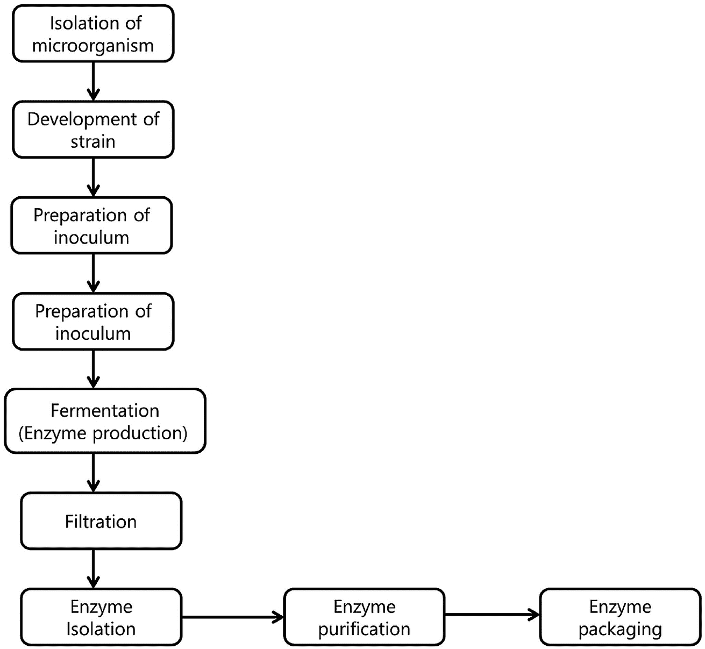

Figure 4.1 酶生产的步骤。

基质的优化是工艺优化中最重要的因素 Singh et al. 2017。基质组成的设计至关重要，原因如下：

1. 基质组成影响产品浓度、产量和体积生产率。

2. 微生物在不同生长阶段的营养需求可能不同。酶的生产通常在 stationary phase（静止阶段）最高，但在某些情况下，指数阶段的生长也至关重要。

3. 不同物种的基质组成需求不同，同一物种的不同菌株也可能有不同的营养要求。

4. 基质组成可影响下游产品分离的成本。

5. 在生产过程中引入新菌株时，需要知道新加入菌株的基质组成。

在设计基质时，面临许多挑战。无法在搅拌罐中设计基质组成，因此采用摇瓶系统进行设计，并将结果 extrapolate 到大规模搅拌罐。然而，这种 extrapolate 并不总是直接可行，因为两种系统在 pH 和氧气条件上存在差异 Kennedy et al. 1992。因此，需要更多数据来评估基质组成的放大。菌株开发中的基质设计复杂，基质组成依赖于菌株，而菌株的开发又依赖于基质组成，这种相互依赖性在基质设计时需要妥善处理。实际上，基质往往来源于已发表的结果，这些结果可能包含昂贵的成分，不适合工业生产。已发表的基质也可能含有过多的成分，其作用不明确，不利于酶的生产。

- [机器学习模型](https://example.org)在酶生产中的作用通过描述两种常见技术——人工神经网络（ANNs）和遗传算法来阐述。

### 4.4.1 人工神经网络（ANN）

人工神经网络的基本思想源自 1943 年神经生理学家 Warren McCulloch 和数学家 Walter Pitt 的工作，他们提出了一种基于神经元“全或无”属性的神经网络。神经元接收信号并将其处理为二进制输出。因此，简单的 McCulloch–Pitt 神经元可以用来表示逻辑操作，并被适应到机器学习技术中。

- ANN 由输入层、隐藏层和输出层三种类型的层组成，每层可包含许多神经元。一个层的神经元通过称为“边”的网络与下一层的神经元相连，每条边都有一个可根据经验修改的数值权重。如果相连边的总和满足称为激活函数的设定阈值，则下一层的神经元会被激活；若总和未达到阈值，则激活函数失效，导致全有或全无的情况（Oliver 2017）。如图 Figure 4.3 所示，输入层和输出层与隐藏层相连。根据问题的性质，可有多个隐藏层。不同层神经元之间的连接类似于生物中的突触。下图 Figure 4.3 展示了一个简单的人工神经网络示意图。

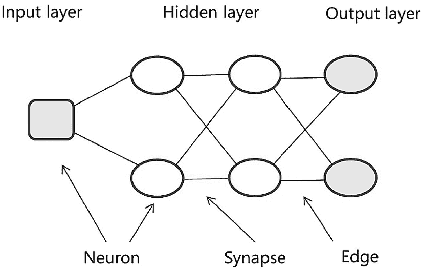

Figure 4.3 Schematic showing the artificial neural network.

- 输入到神经网络的被称为特征。任何事物都可以作为特征。例如，在酶生产的工艺优化中，任何工艺参数都可以作为特征。酶生产的工艺优化可以设为监督学习问题，其中酶产量或目标变量为输出，感兴趣的因素（影响酶产量的因素）作为特征。神经网络模型的预测输出与实际输出进行比较。预测输出与实际输出的差值称为代价值或代价函数。神经网络模型的参数（如每条边的权重）会持续调整，直到代价函数最小化。通常调整过程从输出层向输入层进行，这称为反向传播方法。当达到期望的代价值时，模型即为训练完成。该训练好的模型可用于优化工艺参数。

- 该技术非常适合用于设计培养基。在设计培养基时，输入可以是培养基成分的组合，酶量为输出。如上所述，可通过最小化代价函数来寻找培养基成分的最佳组合。

- 在设计最佳培养基时，Imandi and Garapati (2006) 使用四种培养基成分——谷氨酸、枸橼酸、甘油和氯化铵，作为输入，输出为聚-γ-谷氨酸的量。他们在工作中采用了 4-6-1 的网络配置，即输入层 4 个神经元，隐藏层 6 个神经元，输出层 1 个神经元。他们利用以往数据估计模型中的权重。

- Dutta et al. (2004) 使用人工神经网络模型找出最佳条件，包括 pH、温度和接种量，用于从新合成的 *Pseudomonas* sp. 中生产外源性蛋白酶。他们将人工神经网络模型的结果与统计学方法——响应面法进行比较，发现人工神经网络模型预测更准确。Ismail et al. (2019) 同样发现，在优化 *Alternaria* sp. 偈的外粒壳酶生产（涉及七个变量）时，神经网络模型也表现更好，产量提升约 8.5 倍（3.4–28.9 U/干重基质）。

- 热酶（Thermoenzymes）适用于恶劣的工业过程，因为它们在高温下仍能保持活性。(Khoramnia et al. 2010) 采用普通的前向传播-反向传播人工神经网络，确定了 *Staphylococcushyicus xylosus* 用于生产脂蛋白的最佳操作条件（pH、温度、接种量、搅拌转速），结果显示脂蛋白产量提升了 3.5 倍。(Ebrahimpour et al. 2008) 则通过人工神经网络模型优化了 pH、温度、孵育周期、培养基体积、接种量和搅拌速率等条件，从 *Geobacillus* sp. 株 ARM（DSM 21496 = NCIMB 41583）中获得 4.7 倍的脂蛋白活性提升。

- 固态基质发酵中微生物酶的生产受多种因素影响——固体基质（如小麦麸、稻麸、芥菜油蛋糕）、孵育温度、培养基 pH、固体基质粒径以及基质含水量。Mishra et al. (2016) 利用人工神经网络模型研究了这些工艺参数对 *Gliomastix indicus*（MTCC 3869）产生的 α-淀粉酶活性的影响。他们以芥菜油蛋糕为基质，通过人工神经网络模型优化各项参数，以实现 α-淀粉酶活性的最大化。

- 该技术的优势在于其领域独立性，无需对系统本身的信息，因此很容易适应用于酶生产的工艺参数优化。

### 4.4.2 遗传算法（GA）

遗传算法由 J. H. Holland 及其合作者在 1960 年代和 1970 年代发展，该方法基于两种生物现象——自然选择和有性生殖。自然选择决定生物体的生存取决于其成功繁殖，而有性生殖则确保后代基因的混合与重组（Holland 1975）。因此，遗传算法的形式是对生物进化的抽象。

一个简单的遗传算法包含五个步骤（Melanie 1999）。遗传算法的基本步骤如图 Figure 4.4 所示。它从随机生成的可能解空间（即“种群”）开始。该种群包含基于文献或猜测的最优参数值。种群中的个体代表任何可能的解，类比于生物染色体，染色体上携带基因（Haefner 2005）。一个基因包含一组参数，基因组合成称为染色体的字符串。染色体可以用位元串表示。下一步是使用适应度函数计算适应度值。适应度函数为种群中每条染色体计算得分。根据适应度得分，选择两个个体（父染色体）进行后续操作。随后对选定的父染色体执行选择、交叉和变异三个遗传操作。这些操作步骤如图 Figure 4.4 所示。

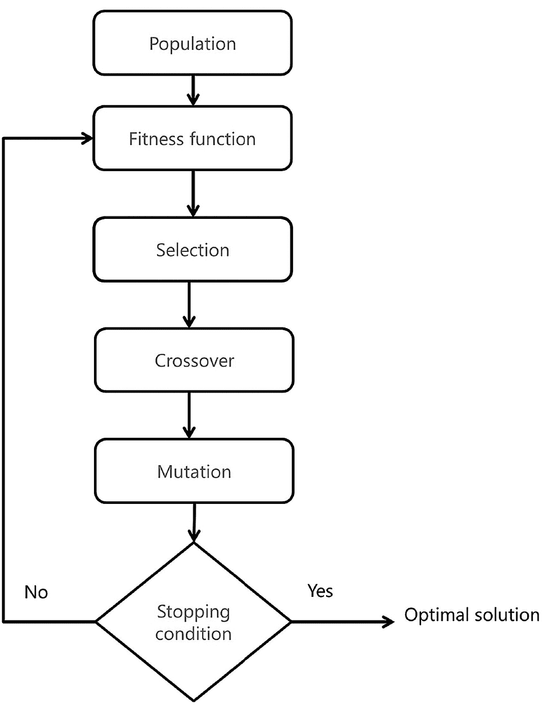

Figure 4.4 The steps of genetic algorithms.

- 选择：根据适应度函数从父染色体中选择一对染色体。

- 交叉：交叉是在第某一随机位置交换染色体的部分，从而生成两个后代。如果不进行交叉，则两个后代分别为父染色体的完全复制。

- 变异：在每个位点上，后代以一定概率发生变异，该概率由随机过程决定。

当前种群被新种群取代。新种群的适应度值被计算，选择、交叉和变异步骤在适应度值收敛（即不再发生变化）时重复进行。

每一次迭代称为一代。典型的运行会进行 50–500 次迭代。每次运行结束后，种群中会出现一个或多个适应度极高的染色体（Figure 4.5）。

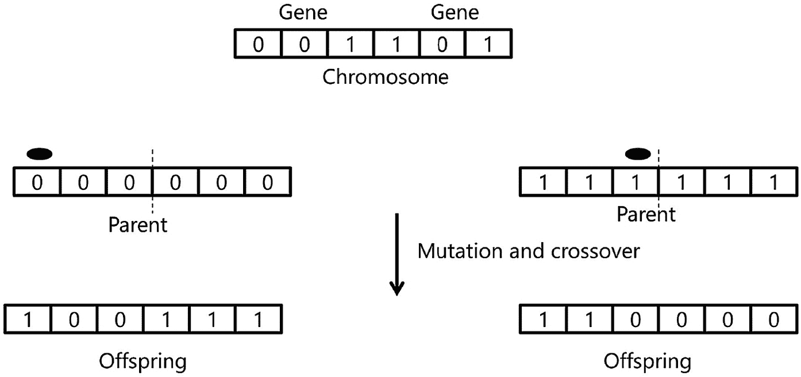

Figure 4.5 染色体含有基因，是参数值的集合。染色体以两个基因的比特字符串表示。突变是基因值的随机逐位更改。重组交换比特字符串的部分。点表示突变位置，虚线表示重组位置。

因此，遗传算法（GA）步骤的操作遵循自然选择的一般原则。基因从亲本流向后代，适应度最佳的亲本被选中。GA 是一种从可用解空间中寻找最优解的搜索技术。

GA 算法是解决酶生产介质组成优化复杂问题的合适技术。介质的每种成分可以代表染色体上的一个基因。GA 的遗传操作步骤能够创造出适应度更高的新组合。该新组合可以用于提高酶的产量。

GA 可以有效改进酶的生产过程。Weuster-Botz and Wandrey (1995) 成功在甲基 otrophic 酵母 *Candida boldinii* 的 flavin dehydrogenase (FDH) 生产过程中使用 GA。FDH 以甲醇为能源和碳源，在 *C. boldinii* 体内作为细胞内酶生产。FDH 生产的限制因素之一是高盐营养盐浓度导致过滤器堵塞。在他们的工作中，他们在 125 次实验中优化了 14 种培养基成分（微量元素和维生素）的浓度，同时最小化营养盐浓度的使用。与之前使用的培养基相比，优化后的培养基使 FDH 特定活性提高了 40%。


Mevinolin 是一种强效的竞争性抑制剂，抑制 hydroxymethylglutaryl‑coenzyme A 还原酶，是降 cholesterol 的药物（Buckland et al. 1989）。它由真菌 `Aspergillus terreu` 合成。`GA` 与回归模型结合用于优化发酵基质（Žužek et al. 1996）。在四代发酵实验中，他们实现了产量比对照基质提高三倍。

`GA` 用于优化 `Streptomyces sindenensis`‑M‑46 变异株的抗 actinomycin D 生产中的通气速率（`VVM`）和搅拌速率（`RPM`）（Khan and Tripathi 2011）。通过 `GA`，抗生素浓度几乎比在摇瓶实验的最佳点所得到的最大值提高了 55%。

废弃物回收是降低环境污染的重要步骤。淀粉降解酶有助于回收废弃物。或者，`GA` 被用于优化三个参数 — — 搅拌速度、%H₂O₂ 以及培养时间 — — 用于从豌豆荚中生产纤维素酶（Sirohi et al. 2018）。

使用 `GA` 的主要优势是能够处理大量变量（培养基成分）。人工神经网络（`ANN`）的性能取决于输入数据的质量。`GA` 可以提供 refined 的输入数据集给神经网络模型。Nagata and Chu (2003 将 `GA` 与 `ANN` 模型集成，以最大化 `Agrobacterium radiobacter` 的缬氨酸酶（hydantoinase）产量。他们构建了一个以酶浓度为唯一输出、四个培养基浓度为输入的 `ANN` 模型。`GA` 用于优化神经网络的输入空间，以寻找酶产量的最佳设置。`GA` 与 `ANN` 模型结合，用于优化 `Enterobacter aerogenes` MTCC 111 生产 L-天冬氨酸酶（L-asparaginase）的孵育时间、pH、底物浓度和接种量（Reddy et al. 2017）。他们通过优化过程参数实现了酶活性三倍提升。

`GA` 可以根据优化问题的特性进行改造。改造包括提供初始值、参数取值范围（约束）、交叉点数量以及代数数量。采用半随机初始种群来启动良好种群，并剔除最差的种群，以提高在 `Daedalea flavida` 静止培养中优化八个过程变量的搜索效率（Singha and Panda 2014）。

除了 `ANN` 和 `GA` 之外，模糊逻辑方法也因其在非线性优化问题建模和优化方面的流行而著名。模糊逻辑由 Latfi Zadeh 提出，灵感来源于人类认知在不确定决策中的作用。它是一种多值逻辑（介于布尔 0 和 1 之间），用于估计项目对特定集合的隶属度。模糊逻辑使用一系列基于模糊隶属函数的规则。Ali and Ul Haq (2014 采用模糊逻辑提升 `Aspergillus niger` 的枯草芽孢菌的枯草酸产量。他们获得了几倍的特定活性提升。模糊逻辑可以与其他机器学习技术如 `ANN` 结合（Uzuner and Çekmecelioglu 2016），在数据噪声较多的环境中表现尤为出色。

### 4.5 人工智能和机器学习的优势

酶生产的过程优化需要理解各种过程参数对酶产量的影响。建模和优化是研究这些影响的重要工具。建模有助于分离生产过程的不同步骤并作出关键决策。确定最佳培养基组成和运行条件是酶生产过程优化的两个重要组成部分。使用全阶乘设计进行培养基设计会产生大量数据。基于机器学习的模型可以相比全阶乘设计减少数据量。Kennedy et al. (1992 研究了三个因素（糖蜜浓度、硝酸铵浓度和酵母提取物浓度）在 `Rhodotorula gracilis` 中生产细胞内油的发酵基质设计。全阶乘设计需要 27 次实验（每个因素三个浓度），而神经网络模型仅用 10 次实验即可训练并获得合理的预测精度。因此，基于机器学习的方法可以在过程优化中降低成本和时间。

机器学习可以处理大量数据并发现隐藏的模式和关联。在酶生产的过程优化中，大量数据在各个步骤产生，包括培养基组成、运行条件以及发酵罐的运行情况。机器学习有助于识别这些数据与酶产量之间的关联。机器学习可以使用任何数据作为输入，而不需要系统相关信息（McCord-Nelson and Illingworth 1991）。相比之下，机械模型需要特定的输入和系统结构，其参数难以获得。机器学习模型不受此类限制，是域间独立的，因此不依赖于特定领域知识，从而提高了机器学习模型在过程优化中的适用性。

# 基于人工智能的优化模型在预测结果方面优于基于统计回归的优化技术 (`Haider et al. 2008`; `Nagata and Chu 2003`). 其神经网络模型的高性能归功于其处理非线性关系的能力 (`Lek et al. 1996`; `Somers and Casal 2009`). 人工神经网络 (`ANN`) 在输入和输出之间提供了非线性映射 (`Masoumi et al. 2011`). 多种微生物系统的酶产量表现出可诱导表达的模式 (`Sahu et al. 2019`)，其本质上是非线性的。另一种流行的统计优化技术基于对响应的线性二次相关性假设 (`[Sahu et al. 2019](#ch4.xhtml#ref4_4.4`="content<unk><unk><unk><unk><unk><unk><unk><unk><unk><unk><unk><unk><unk><unk><unk><unk><unk><unk><unk><unk><unk><unk><unk><unk><unk><unk><unk><unk><unk><unk><unk><unk><unk><unk><unk><unk><unk><unk><unk><unk><unk><unk><unk><unk><unk><unk><unk><unk><unk><unk><unk><unk><unk><unk><unk><unk><unk><unk><unk><unk><unk><unk><unk><unk><unk><unk><unk><unk><unk><unk><unk><unk><unk><unk><unk><unk><unk><unk><unk><unk><unk><unk><unk><unk><unk><unk><unk><unk><unk><unk><unk><unk><unk><unk><unk><unk><unk><unk><unk><unk><unk><unk><unk><unk><unk><unk><unk><unk><unk><unk><unk><unk><unk><unk><unk><unk><unk><unk><unk><unk><unk><unk><unk><unk><unk><unk><unk><unk><unk><unk><unk><unk><unk><unk><unk><unk><unk><unk><unk><unk><unk><unk><unk><unk><unk><unk><unk><unk><unk><unk><unk><unk><unk><unk><unk><unk><unk><unk><unk><unk><unk><unk><unk><unk><unk><unk><unk><unk><unk><unk><unk><unk><unk><unk><unk><unk><unk><unk><unk><unk><unk><unk><unk><unk><unk><unk><unk><unk><unk><unk><unk><unk><unk><unk><unk><unk><unk><unk><unk><unk><unk><unk><unk><unk><unk><unk><unk><unk><unk><unk><unk><unk><unk><unk><unk><unk><unk><unk><unk><unk><unk><unk><unk><unk><unk><unk><unk><unk><unk><unk> 

-   Aissani, Nassima, Bouziane Beldjilali, and Damien Trentesaux 2008. 使用机器学习持续改进实时异构制造控制系统性能的研究. International Journal of Industrial and Systems Engineering 3, no. 4: 474–497.

-   Ali, Sikander, and Ikram Ul Haq 2014. 利用模糊逻辑优化枯草芽孢菌的柠檬酸生产. Pakistan Journal of Botany 46, no. 3: 1055–1059.

-   Arnau, José 2020. 发展工业酶的策略与挑战——基于真菌细胞工厂. In Grand Challenges in Fungal Biotechnology, edited by Debbie Yaver, and Carsten M. Hjort, 179–210. Cham: Springer.

-   Bhatia, Saurabh 2018. 制药生物技术导论（第 2 卷）：酶、蛋白质和生物信息学. Bristol, England: IOP Publishing ltd.

-   Bishop Christopher, M. 2009. 模式识别与机器学习. New York, NY: Springer.

-   Buckland, B., K. Gbewonyo, T. Hallada, L. Kaplan, and P. Masurekar 1989. 新型微生物产品在医药和农业中的应用. Society for Industrial Microbiology, 161–169. Amsterdam, the Netherlands: Elsevier Science Ltd.

-   Cappello, Vincenzo, Cécile Plais, Christophe Vial, and Frédéric Augier 2021. 发酵反应器放大：CFD 验证及在 Trichoderma reesei 酶生产中的应用. Chemical Engineering Science 229: 116033.

-   del Rio‐Chanona, Ehecatl Antonio, Jonathan L. Wagner, Haider Ali, Fabio Fiorelli, Dongda Zhang, and Klaus Hellgardt 2019. 基于深度学习的代理模型和优化方法在微藻生物燃料生产与光生物反应器设计中的应用. AIChE Journal 65, no. 3: 915–923.

-   Dutta, Jayati Ray, Pranab Kumar Dutta, and Rintu Banerjee 2004. 利用响应面法和人工神经网络模型优化新孤立的假单胞菌属产外源蛋白酶的培养参数. Process Biochemistry 39, no. 12: 2193–2198.

-   Ebrahimpour, Afshin, Raja Noor Zaliha Raja Abd Rahman, Diana Hooi Ean Ch’ng, Mahiran Basri, and Abu Bakar Salleh 2008. 基于响应面法和人工神经网络的新孤立耐热盐杆菌属菌株 ARM 的耐热脂肪酶生产培养参数优化研究. BMC Biotechnology 8, no. 1: 1–15.

-   Ferreira, Rafael da Gama, Adriano Rodrigues Azzoni, and Sindelia Freitas 2018. 低成本酶的工业生产经济分析——以重组β葡萄糖苷酶为例. Biotechnology for Biofuels 11, no. 1: 1–13.

-   Haefner, James W. 2005. 模型生物系统：原理与应用（第 2 版）. New Delhi, India: Springer.

-   Haider, M. A., K. Pakshirajan, A. Singh, and S. Chaudhry 2008. 采用人工神经网络-遗传算法方法优化培养基成分，提高土壤微生物产酶产量. Applied Biochemistry and Biotechnology 144: 225–235.

-   Hoffmann, Achim G. 2014. 机器学习的一般局限性. In *ECAI, ECAI’90: Proceedings of the 9th European Conference on Artificial Intelligence*, Stockholm Sweden, 345–347. [`www.prnewswire.com/news-releases/industrial-enzymes-market-size-to-reach-usd-8400-4-million-by-2027-at-a-cagr-of-4-9--valuates-reports-301395010.html`](https://www.prnewswire.com)

-   Holland, John H. 1975. 自然与人工系统中的适应. Ann Arbor, MI: The University of Michigan Press.

-   Imandi, Babu Sarat, and Hanumantha Rao Garapati 2006. 利用人工神经网络和遗传算法优化培养基，提高γ-谷氨酸生产. Research Journal of Microbiology 1: 520–526.

-   Ismail, Shaymaa A., Ahmed Serwa, Amira Abood, Bahgat Fayed, Siham A. Ismail, and Amal M. Hashem 2019. 采用深度人工神经网络优化抗真菌外源壳聚糖酶的生产，并与响应面法比较. Jordan Journal of Biological Sciences 12, no. 5: 543–551.

-   Johannes, Tyler, Michael R. Simurdiak, and Huimin Zhao 2016. 生物催化. Encyclopedia of Chemical Processing 1: 101–110.

-   Kennedy, M., and Donal Krouse 1999. 提高发酵基质性能的策略综述. Journal of Industrial Microbiology and Biotechnology 23, no. 6: 456–475.

-   Kennedy, M.J., S.L. Reader, R.J. Davies, D.A. Rhoades, and H.W. Silby 1994. 利用摇瓶发酵工艺放大γ-亚油酸的生产——以 Mucor hiemalis IRL 51 为例. Journal of Industrial Microbiology 13: 212–216.

-   Kennedy, M. J., S. L. Reader, D. Krouse, and S. Hinkley 2009. 从发现到生产的生物技术产品过程优化策略. In BIOTECHNOLOGY-Volume IV: Fundamentals in Biotechnology. [`www.eolss.net/ebooklib/sc_cart.aspx?File=E6-58-04-04`](https://www.eolss.net)

-   Kennedy, Max J., S. G. Prapulla, and M. S. Thakur 1992. 设计发酵基质：神经网络与因子设计的比较. Biotechnology techniques 6, no. 4: 293–298.

-   Khan, M., and C. K. M. Tripathi 2011. 优化发酵参数以最大化拟南芥内酯酶的产量. Journal of Chemical and Pharmaceutical Research 3: 281–289.

-   Khoramnia, Anahita, Oi Ming Lai, Afshin Ebrahimpour, Carynn Josue Tanduba, Tan Siow Voon, and Suriati Mukhlis 2010. 新孤立的假单胞菌属菌株产热稳定脂肪酶：工艺优化与表征，利用响应面法和人工神经网络. Electronic Journal of Biotechnology 13, no. 5: 15–16.

-   Klein-Marcuschamer, Daniel, Piotr Oleskowicz-Popiel, Blake A. Simmons, and Harvey W. Blanch 2012. 生物燃料生产中酶成本的挑战. Biotechnology and Bioengineering 109, no. 4: 1083–1087.

-   Larose, Daniel T. 2005. 从数据中发现知识——数据挖掘导论. Hoboken, NJ: Wiley.

-   LeCun, Yann, Yoshua Bengio, and Geoffrey Hinton 2015. 深度学习. Nature 521, no. 7553: 436–444.

-   Leisola, Matti 2001. 工业酶的应用. In Industrial Use of Enzymes, edited by Jouni Jokela, Ossi Pastinen, Ossi Turunen, and Hans Schoemaker. Oxford: Eolss Publishers.

-   Lek, Sovan, Marc Delacoste, Philippe Baran, Ioannis Dimopoulos, Jacques Lauga, and Stéphane Aulagnier 1996. 采用神经网络对生态学非线性关系进行建模. Ecological Modelling 90, no. 1: 39–52.

-   Lincoln, Lynette, and Sunil S. More 2017. 利用甘蔗副产品糖蜜-乙醇混合物筛选并增强中性转化酶的产量. Advances in Bioresearch 8, no. 4: 103–110.


- Masoumi, Hamid Reza Fard, Anuar Kassim, Mahiran Basri, Dzulkifly Kuang Abdullah, and Mohd Jelas Haron 2011. 利用人工神经网络对三乙醇胺（TEA）基酯基阳离子表面活性剂的生物合成进行多变量优化. Molecules 16, no. 7: 5538–5549.
- McCord-Nelson, Marilyn, and William T. Illingworth 1991. 神经网络实用指南. Boston, MA: Addison-Wesley Longman Publishing Co., Inc.
- McCulloch, Warren S., and Walter Pitts 1990. A logical calculus of the ideas immanent in nervous activity. Bulletin of Mathematical Biology 52, no. 1: 99–115.
- Melanie, Mitchell 1999. An Introduction to Genetic Algorithms. Cambridge, MA/London, England: MIT Press.
- Mishra, Santosh Kumar, Shashi Kumar, Surendra Kumar, and Ravi Kant Singh 2016. Optimization of process parameters for-amylase production using Artificial Neural Network (ANN) on agricultural wastes. Current Trends in Biotechnology and Pharmacy 10, no. 3: 248–260.
Moor, J. 2006. The Dartmouth College artificial intelligence conference: The next fifty years. AI Magazine 27, no 4: 87–89
- Nagata, Yuko, and Khim Hoong Chu 2003. Optimization of a fermentation medium using neural networks and genetic algorithms. Biotechnology Letters 25, no. 21: 1837–1842.
- Niyonzima, Francois N., and Sunil S. More 2013. Screening and optimization of cultural parameters for an alkaline protease production by Aspergillus terreus gr. under submerged fermentation. International Journal of Pharma and Bio Sciences 4, no. 1: 1016–1028.
- Oliver, Theobald 2017. Machine Learning for Absolute Beginners. A Plain English Introduction. Stanford (Calif.): Scatterplot Press.
- Patel, Anil Kumar, Reeta Rani Singhania, and Ashok Pandey 2016. Novel enzymatic processes applied to the food industry. Current Opinion in Food Science 7: 64–72.
- Patel, Anil Kumar, Reeta Rani Singhania, and Ashok Pandey 2017. Production, purification, and application of microbial enzymes. In Biotechnology of Microbial Enzymes, edited by Arnold L Demain, Goutam Brahmachari, and Jose L Adrio, 13–41. London: Elsevier.
- Psichogios, Dimitris C., and Lyle H. Ungar 1992. A hybrid neural network-first principles approach to process modeling. AIChE Journal 38, no. 10: 149–1511.
- Reddy, Erva Rajeswara, Rajulapati Satish Babu, Potla Durthi Chandrasai, and Pola Madhuri 2017. Neural network modeling and genetic algorithm optimization strategy for the production of Lasparaginase from Novel Enterobacter sp. Journal of Pharmaceutical Sciences and Research 9, no. 2: 124–130.
- Reddy, V. R., D. N. Baker, and J. N. Jenkins 1985. Validation of GOSSYM: Part II. Mississippi conditions. Agricultural Systems 17, no. 3: 133–154.
- Russell, Stuart J. 2010. Artificial Intelligence 2010. Prentice Hall Series in Artificial Intelligence. Upper Saddle River, NJ: Prentice Hall.
- Sahu, Shraddha, Shailendra Singh Shera, and Rathindra Mohan Banik 2019. Optimization of process parameters for cholesterol oxidase production by Streptomyces Olivaceus MTCC 6820. The Open Biotechnology Journal 13: 47–58.
- Saran, Saurabh 2019. A Handbook on High Value Fermentation Products, vol. 2, edited by Vikash Babu, and Asha Chaubey. Human Welfare: John Wiley & Sons.
- Searle, John R. 1980, Minds, brains, and programs. Behavioral and Brain Sciences 3, no. 3: 417–424.
- Silveira, R.G., T. Kakizono, S. Takemoto, N. Nishio, and S. Nagai 1991. Medium optimization by an orthogonal array design for the growth of Methanosarcina barkeri. Journal of Fermentation and Bioengineering 72: 20–25.
- Singh, Vineeta, Shafiul Haque, Ram Niwas, Akansha Srivastava, Mukesh Pasupuleti, and C.K.M. Tripathi 2017. Strategies for fermentation medium optimization: An in-depth review. Frontiers in Microbiology 7: 2087.
- Singha, Siddhartha, and Tapobrata Panda 2014. Improved production of laccase by Daedalea flavida: Consideration of evolutionary process optimization and batch-fed culture. Bioprocess and Biosystems Engineering 37, no. 3: 493–503.
- Sirohi, Ranjna, Anupama Singh, Ayon Tarafdar, and N. C. Shahi 2018. Application of genetic algorithm in modelling and optimization of cellulase production. Bioresource Technology 270: 751–754.
- Somers, Mark John, and Jose C. Casal 2009. Using artificial neural networks to model nonlinearity: The case of the job satisfaction—Job performance relationship. Organizational Research Methods 12, no. 3: 403–417.
- Thiel, Teresa, Judith Bramble, and Selena Rogers 1989. Optimum conditions for growth of cyanobacteria on solid media. FEMS Microbiology Letters 61: 27–31.
Turing, Alan 1950. Computing machinery and intelligence. Mind LIX, no 236: 433–460.
- Uzuner, S., and D. Çekmecelioglu 2016. Comparison of artificial neural networks (ANN) and adaptive neuro-fuzzy inference system (ANFIS) models in simulating polygalacturonase production, BioResources 11, no. 4: 8676–8685.
- Weuster-Botz, Dirk, and Christian Wandrey 1995. Medium optimization by genetic algorithm for continuous production of formate dehydrogenase. Process Biochemistry 30, no. 6: 563–571.
- Zhu, Y., A. Rinzema, J. Tramper, and J. Bol 1996. Medium design based on stoichiometric analysis of microbial transglutaminase production by Streptoverticillium mobaraense. Biotechnology and Bioengineering 50, no. 3: 291–298.
- Žužek, Mateja, Jožica Friedrich, Bojan Cestnik, Arem Karalič, and Aleksa Cimerman 1996. Optimization of fermentation medium by a modified method of genetic algorithms. Biotechnology Techniques 10, no. 12: 991–996.

# 5 Scale-Up Models for Chitinase Production, Enzyme Kinetics, and Optimization

P. V. Atheena

Manipal Institute of Technology, Manipal, India

Keyur Raval

National Institute of Technology Karnataka, Surathkal, India

Ritu Raval

Manipal Institute of Technology, Manipal, India

DOI: [10.1201/9781003292333-5](https://dx.doi.org/10.1201/9781003292333-5)

## 5.1 Introduction

Chitin (C[8]H[13]O[5]N) n is a biopolymer found in abundant amounts after cellulose. It was first isolated from mushrooms by Henri Braconnot in 1811 (Muzzarelli et al. 2012). Structurally, it is very similar to cellulose except for the acetamide group at the second position instead of the hydroxyl group found on the glucose monomer in cellulose. Chemically, chitin is a linear polysaccharide consisting of β (1-4) linked 2-acetamido 2-deoxy-β-D-glucose (N-acetyl-D-glucosamine GlcNAc (Kuddus and Ahmad 2013) and is found in the extracellular matrix of sponges, nematodes, arthropods, fungi, mollusks, etc. Growth in the global fisheries industry has significantly increased the amount of shell waste in the environment and is a source of pollution. Recycling such wastes cost-effectively is a major challenge (Poria et al. 2021). Chitinases, a group of hydrolytic enzymes, catalyze chitin degradation (Figure 5.1).

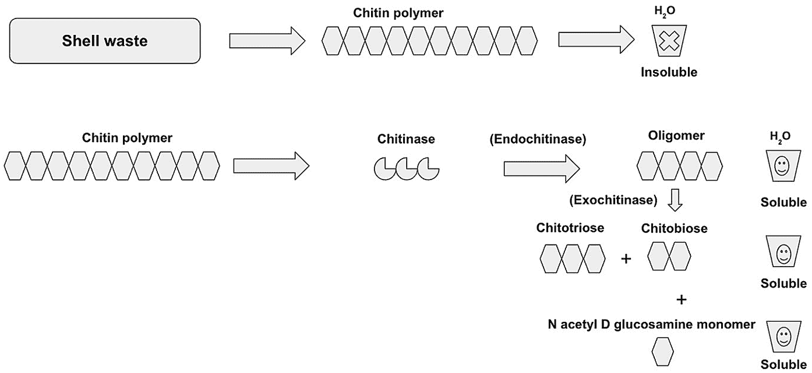

Figure 5.1 Mechanism of action of chitinase.

Chitinases come under glycoside hydrolase (GH) families 18 and 19. Various bacterial strains have produced chitinases, including *Melghiribacillus thermohalophilus* (Mohamed et al. 2019) and *Paenibacillus* (Poria et al. 2021, Asmani et al. 2020). Upscaling microbial chitinase production is difficult due to its inducible nature, low titer, high cost, and susceptibility to severe environments (Singh et al. 2020). The components of growth media are crucial in the efficient production of chitin-degrading enzymes (Box and Draper 1987).

[众多影响壳聚糖生产效率的因素](https://wiki.example.org/feynmans_learning_method)无法通过实验室的试错方法来理解。因此，高级统计工具在优化酶生产中的各种因素方面发挥重要作用。这类方法在工艺优化中的使用统称为设计实验（DoE）或实验设计（(Zhou et al. 2010)）。统计分析的基本原则，如随机化、重复、复制和预测设计，用于优化酶生产。实验设计旨在通过减少从一组数据中提取最大信息的步骤数量来实现目标（(Reddy et al. 2003）。在此过程中，重要变量被识别，非显著变量被消除。它还有助于研究变量之间的相互作用，并允许对数据进行外推。还可以在此研究为了获得最佳产品所需的显著变量的不同水平。统计方法可大致分为单因素实验和多因素实验。单因素（One Factor at a Time, OFAT）是一种单因素方法，被多位研究者用于培养基优化（(Narasimhan et al. 2013a)）。但它通常耗时且步骤繁多（(Seltman 2018)）。参数的选择要么随机，要么基于以往研究。多因素实验更高效，能显著减少为优化过程所需进行的实验次数（(Dahiya et al. 2005, Box and Draper 1987)）。响应面方法、工艺模拟、模式识别等是多因素方法的例子。


## 5.2 响应面方法（Response Surface Methodology）

响应面方法（RSM）是一套数学和统计技术，用于构建经验模型。在变量`x`和`y`取连续值的实验中，有时`X`与`Y`之间的真实关系未明确。对响应函数`y = f(x1, x2) + e`（其中`e`为误差函数）的近似被称为响应面方法（Shen and Morris 2016）。它们主要分为三类：（a）一阶、（b）二阶、（c）三级分层因子设计。如果响应可以表示为自变量的线性函数，则近似函数为一阶模型。一阶设计的例子包括`2^k`因子设计（`k`为控制变量数）、普拉塞特-伯曼设计和单纯形设计。当响应面出现弯曲时，应选择更高次数的多项式。包含两个参数的近似函数称为二阶模型。例子包括中心复合设计（CCDs）和博克斯-本克设计（BBDs）。通常，所有 RSM 研究都使用其中一种模型或两者的组合。RSM 的主要目的是寻找最佳或最优响应（Bradley 2007）。中心复合设计（CCD）是大多数统计实验的基础。变量值最初通过“单因素优化”方法进行优化，随后应用 RSM 研究所选变量组合的影响。为了生产壳聚糖酶，将 RSM 曲线以壳聚糖酶产量作为其他变量的函数来绘制。以往使用 RSM 进行优化的出版物摘要列于（Table 5.1）。结果通过方差分析（ANOVA）分析变量间的相互作用，然后进行实验验证。由于筛选参数的单位各不相同，它们首先被归一化，以使其对依赖变量（响应）产生统一影响（Ba and Boyaci 2007；Figure 5.2）。

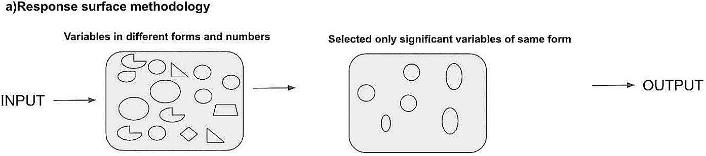

Figure 5.2 Mechanism behind the working of response surface methodology.

## 5.3 Plackett–Burman 设计

Plackett–Burman 设计是选择关键参数的主要工具，实验通常在摇瓶规模进行。Plackett–Burman 设计适合用于初步筛选，尽管它不考虑自变量之间的相互作用（Vaidya et al. 2003）。Plackett–Burman 方法的主要步骤如下：

1. 识别并选择因素
2. 为因素赋予不同的水平
3. 构建 Plackett–Burman 设计矩阵
4. 随机化并进行实验
5. 重复设计
6. 构建模型
7. 分析效应
8. 解释和结论

首先，在进行筛选设计时，必须选择因素，并定义它们的水平。

## 5.7 人工神经网络（Artificial Neural Network）

一个多层前馈网络由以下组成：（a）输入层，（b）隐藏层，（c）输出层神经元。隐藏层连接输入层和输出层，并实现基于输入的预测和决策。第一个隐藏层的神经元输入来自输入层的源节点，这些节点提供激活模式的相应元素。就像一个连续的循环，现在第一个隐藏层的输出成为第二个隐藏层的输入。最后一个隐藏层的信号成为输出层的信号。网络的输出层根据输入层的源节点提供的激活模式生成一组神经元输出信号。这就是网络对激活模式的反应方式（Zhang et al. 2018）。如果隐藏层的数量超过一个，则称为深度网络。在前向神经网络中，每个神经元会从所有前置层（包括偏置单元）获取权重。偏置单元对每个神经元是特定的。在前向网络中，如果我们知道`X`向量（输入）以及所有权重（包括偏置），我们就能预测`Y`向量或输出。在人工神经网络（ANN）模型中，对数据分布或属性没有任何假设。因此，ANN 在实际应用中更为有用。与某些需要测试假设的统计模型不同，ANN 不需要测试任何假设。基于 ANN 的模型提供灵活、容错的数据降维，包括非线性回归和判别模型。因此，它们能够处理数据不完整、噪声以及非线性问题。此外，经过训练的 ANN 可以快速泛化并做出准确预测。

## 5.8 Genetic Algorithm

遗传算法是基于种群的算法，其计算模型受进化启发。它们是智能搜索技术，维护一个给定问题的候选解决方案种群，并通过应用各种算子在种群空间中搜索。GA 模拟自然选择的过程以实现优化。在自然界，诸如变异和交叉等过程有助于推动自然选择，从而使种群中适应性最强的个体存活。GA 尽力复制这种过程。为了实现这一点，这些 GA 使用变异和交叉算子（Mathew 2012）。这里的另一个重要参数是搜索空间。GA 设计会随机考虑搜索空间中的许多不同点，旨在覆盖整个搜索空间。这些点沿搜索空间分布，以提高种群的多样性。GA 中的随机种群通常使用高斯分布生成。GA 使用适应度函数（Kallel 1998）对种群中每个个体的适应度进行评估。对于搜索空间中已知适应度函数的每个点，必须选择最佳点。这类似于从自然种群中选择适应性最强的个体。这种选择导致最适合的个体在下一代的产生中贡献更多。这些被选中的个体在产生第二代时，其平均适应度高于第一代，这种趋势会持续下去，在后续世代中不断前进，以获得适应性最强的个体。这是遗传算法的基本思想。GA 中的搜索高度具有剥削性，主要通过随机算子实现，而非确定性规则。通过代际持续评估适应度函数值，可以达到接近最优解。在实际过程中，潜在解决方案被编码在类似染色体的数据结构中。编码可以是二进制编码、排列编码、实数编码等。根据适应度，父代通过交叉和变异算子（Mirjalili 2019）持续应用，以保留染色体（也称为字符串）的良好部分。影响 GA 的重要参数包括种群规模、交叉概率、变异率和变异类型。总体而言，GA 是一种易于构建且灵活的优化工具，可用于噪声环境（Whitley 1994；Figure 5.4）。

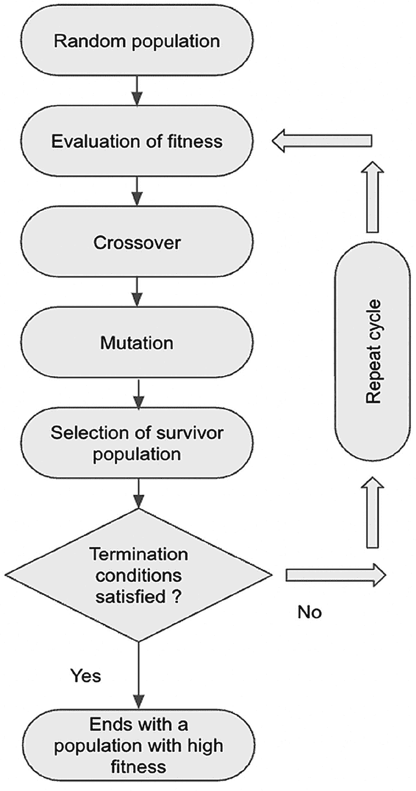

Figure 5.4 Mechanism behind the working of genetic algorithm.

## 5.9 Particle Swarm Optimization

一种可以规避传统优化问题的新方法是 PSO（Suryawanshi and Eswari 2022）。Kennedy 和 Eberhart 的首次思想主要是利用基本的社会互动来产生计算智能。Kennedy 和 Eberhart 首次在 1995 年提出了这种生物启发方法（Kennedy and Eberhart 1995）。PSO 从若干随机点（称为粒子）开始，每个粒子具有两个主要特征：位置（`x`）和速度（`v`）。每个粒子会在随机方向上寻找最小点，就像鸟群中的个体在随机方向上寻找食物。个体粒子曾经探索的最小点以及整个群体曾经探索的最小点被视为获得最佳值的依据。个体粒子本身力量较弱，进步是通过粒子间的交互实现的（Dongare et al. 2012）。PSO 有两个版本：（a）全局和（b）局部。对于每个粒子，最佳位置称为`pbest`，群体的最佳位置称为`gbest`。在全局版本中，`pbest`和`gbest`都被跟踪；在局部版本中，`pbest`和“所有粒子的最佳位置”（即`nbest`）被跟踪。经过多次迭代，`pbest`和`gbest`会被更新，直到达到目的。PSO 的稳健性高度依赖于种群规模（Poli et al. 2007）。实验设计的各要素概览如 Figure 5.5 所示。

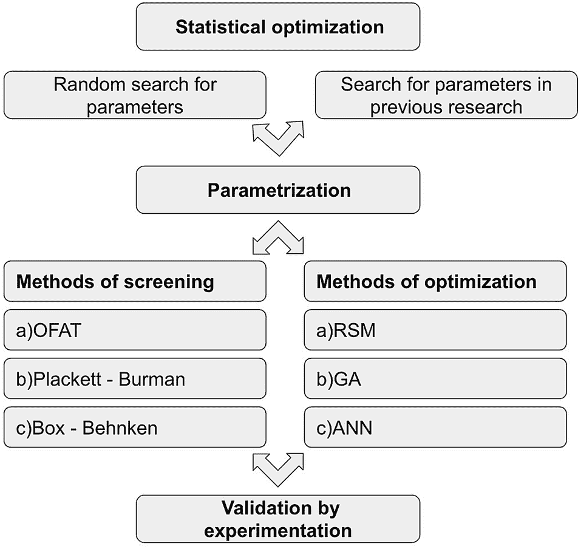

Figure 5.5 Overview of design of experiments.

## 5.10 Enhancement of Production – Significant Studies

Narasimhan 等人对 *Bacillus subtilis* 使用 OFAT 法生产三种黏菌酶，结果显示在优化培养基中 chitinase 生产显著提高，相比未优化培养基。实验测试了 12 种碳源、8 种氮源、5 种表面活性剂和 9 种金属离子。优化培养基含有羧甲基纤维素（10 g/L）、玉米胗精液或 KNO₃（1 g/L）、CaCl₂ 以及 TritonX100（0.1% v/v）。最佳 `pH` 为 6.0 和 11（可能存在的 chitin 同分异构体），最佳温度为 55 °C。通过该方法，chitinase 生产提升了最高 5.49 倍（Narasimhan et al. 2013b）。

在一项用于通过 RSM 优化蛤蟆素（chitinase）产量的研究中，多因素如孵育时间、初始湿度水平以及底物混合比的相互作用被确认（Dahiya et al. 2005）。RSM 还用于确定反应的动力学常数，如`K[m]`（米氏常数）、`K[max]`（最高速率）、`E[a]`（活化能）、温度系数等。传统方法采用 Lineweaver-Burk 图，操作繁琐（Beg et al. 2002）。Nawani 和 Kapadnis 的研究在 *Streptomyces* 菌株中利用 RSM 优化了蛤蟆素的产量，发现 NK1057 菌株产量提升 29%，NK528 提升 9.3%，NK951 提升 28%（Nawani and Kapadnis 2005）。

另一项类似研究使用 Taguchi 正交表对 *Serratia marcescens* 的蛤蟆素产量进行优化，尽管实验设计未考虑更高层次的交互作用，但仍能考虑两因素交互（V. Singh et al. 2017）。对 NaCl、蛤蟆素、`pH`、温度四个因素在三个不同水平进行测试，结论是温度和 `pH` 对产量的影响更大（Zarei et al. 2010）。Dahiya 等人利用固态发酵（*Enterobacter* sp.）研究蛤蟆素的产量，采用 CCD 和 RSM，模型产生的蛤蟆素活力为每克固体底物 1475 U，达到预测值的 97%（Dahiya et al. 2005）。研究小组利用 RSM 对 *Bacillus pumilus* 的蛤蟆素产量进行优化，最初使用 Plackett–Burman 设计筛选九个变量：（a）蛤蟆素，（b）酵母提取物，（c）MnSO₄，（d）FeSO₄，（e）KH₂PO₄，（f）酵母提取物，（g）`pH`，（h）孵育时间和温度。筛选后，采用 BBD 进一步分析，最终通过方差分析（ANOVA）和剖面等高线图确定最佳条件。结论指出，蛤蟆素浓度、酵母提取物、FeSO₄、KH₂PO₄、酵母提取物和 `pH` 为显著参数。产量从 3.36 U/mL 提升至 23.19 U/mL，实现 6.9 倍的增长（Beg et al. 2002）。

Demir 等人将鸡羽毛作为蛤蟆素的底物，采用 Plackett–Burman 设计进行参数化。实验在 50 mL 烧瓶中进行摇瓶培养，变量响应可通过一阶多项式方程预测。随后在 250 mL 烧瓶中加入 50 mL 矿物盐培养基，转移样品并在 150 rpm 条件下测定，并进一步放大至 2 L 搅拌罐反应器。该模型通过`F`值（`F`）和决定系数（`R²`）进行验证，`R² = 0.9356`表示模型能解释 93.56% 的变异。鸡羽毛作为底物在实验中表现不如温度和时间显著。最高蛤蟆素活性为 487 U/mL（28 °C），而模型预测值为 412 U/mL（Demir et al. 2015）。

利用 Plackett–Burman 因子设计和 RSM，对 *Chitinolyticbacter meiyuanensis* 的蛤蟆素产量影响因素进行筛选，研究涵盖 14 项变量。首次采用 inulin 作为主要碳源（Hao et al. 2012）。实验得到的最高蛤蟆素活性为 15.17 U/mL，约是原始活性的 15 倍，验证了实验设计的可靠性，相关显著文献已列于（Table 5.1）。

Suryawanshi 等人利用 MATLAB 软件的粒子群算法（PSO）对培养基组分进行优化，初始种群规模为 40，惯性权重为 0.2，运行 50 代。模型中将蛤蟆素活性`Y`设为因变量，胶体蛤蟆素、Tween 80、葡萄糖和酵母提取物为自变量。实验在 PSO 模型下将蛤蟆素活性提升至 115.8 U/mL（Suryawanshi and Eswari 2022）。

Ismail 等人尝试使用人工神经网络（ANN）取代 RSM，以提升 *Alternaria* sp. 的外蛤蟆素（exochitinase）产量（Ismail et al. 2019）。实验显示蛤蟆素产量提升 8.5 倍，决定系数`R² = 0.996`，而 RSM 的`R²`仅为 0.76。通过 Plackett–Burman 设计筛选出七个关键参数，其中温度、蔗糖渣的添加以及湿润剂的用量为显著变量，随后采用博克斯-本克设计（BBD）进行进一步优化。由于模型的`R²`小于 0.9，ANN 被引入。深度 ANN 比普通 ANN 更为复杂，包含三层隐藏层（8、7、8 个神经元），数据分析显示`R² = 0.996`，远优于 RSM。最佳培养基含有（每支锥形瓶）小麦胚芽 5 g、蔗糖渣 1 g、蛤蟆素 75 mg（用 5 mL SR 盐溶液湿润），并用 2 mL 五日生的孢子悬液接 inoculum，培养 16 天于 27 °C（Ismail et al. 2019）。另一项研究使用 ANN 对 *Thermomyces* sp. 的蛤蟆素活性进行优化（Suryawanshi et al. 2020）。输入层 3 个神经元分别代表孵育时间、`pH` 和接种量，隐藏层 5 个神经元，输出层为蛤蟆素活性，实验得到的最高产量为 128.53 U/mL，并通过实验验证。

## 5.11 使用先进工具进行过程优化的优势

统计模型如 RSM、OFAT 等在测试影响生产的大量参数时受限于只能在有限水平上进行实验。此时可采用 ANN、GA 等方法获得更精准的结果。ANN 的数据覆盖范围大于 RSM，这在 ANN 模型的准确性上有所体现（Yazdi et al. 2010）。ANN 近年在科研界日益流行。其主要吸引力在于能够识别非线性和复杂参数及其相互作用（Schmidt 2005）。在大多数实时发酵系统中，酶产量随变量的关系呈非线性。由于 ANN 模型高度经验性，数据充足时其表现最佳、灵活且易于拟合。通常采用前馈神经网络进行建模和过程优化，输出进一步通过 ANN 与 GA 进行分析（Subba Rao et al. 2008）。多层前馈神经网络包括输入层（参数）、输出层（蛤蟆素活性）以及隐藏节点，用于将输入层转化为有利于输出层的表示。实验值与预测值的差值之和为均方误差（MSE），MSE 越小，模型越符合实验数据。

## 5.12 ANN 在发酵放大中的作用

数据统计工具的数据被用于大型发酵罐的开发，以准确预测影响产量的变量。来自生物传感器的离散信号以及变量对产量的非线性影响常常使得对发酵过程的控制变得困难。一项研究采用了 ANN，该 ANN 评估生物传感器测量以控制酒精 fed-batch 发酵（Ferreira et al. 2001）。研究中使用了多层神经网络。输入层有两个神经元，输出层有一个神经元，隐藏层的神经元数量在 2 到 5 之间变化。底物浓度是受控变量，进料流量是被操控的变量。尽管网络的性能优于实验数据，但这仍可视为在工业中使用 ANN 控制生物传感器的第一步。Zhang et al. (2020) 成功构建了一个基于 ANN 的 *Clostridium butyricum* 1,3-丙二醇发酵过程的强健软传感器。深度 ANN 等先进的神经网络能够识别非线性和高度复杂、显而易见、隐蔽的过程参数之间的关系，并据此设计过程模型。由于生物传感器和其他系统的使用，它们能够通过预测生理漂移及其对产量和质量的影响，以及相应调整设定点和过程剖面，对过程偏差作出即时的短期响应（Schmidt 2005）。因此，神经网络工具可用于优化过程控制，并识别适合的工艺放大优化策略。它也是一种基于数据的算法，能够以任意精度逼近合理的函数。ANN 不需要事先了解变量之间的复杂关系，而是通过学习改变其结构，利用人工神经元的相互连接网络（Geyikçi et al. 2012），而在 RSM 中则是对因变量与自变量之间的未知形式进行逼近。统计模型的决定系数（`R²`）用于说明统计模型的整体效率。一个良好的模型应具有`R²`值小于 1。在 RSM 中，添加变量会使`R²`值提升，但不考虑其统计显著性，这限制了可测试的变量数量及其形式。RSM 主要用于在考虑显著参数后，找到最大或最小响应及其对应的最佳条件（Nair et al. 2014）。相反，ANN 利用所有数据点得到响应值，对数据的数量和形式更具灵活性（Bezerra et al. 2008）。已编译了一份比较 RSM 与 ANN 效率的重要出版物列表，见 Table 5.2。

Table 5.2 Summary of Publications that Compares Improvement in Production Using RSM and ANN

| Sl No. | Aim of the Study | Determination Coefficient (R²) RSM | Determination Coefficient (R²) ANN | Reference |
| --- | --- | --- | --- | --- |
| 1) | Analysis of heavy metal contamination | 0.67 | 0.89 | Geyikçi et al. (2012) |
| 2) | Extraction of Oleonolic acid from *Ocimum sanctum* | 0.91 | 0.94 | Khamparia et al. (2020) |


| 序号 | 研究内容 | R² | 调整R² | 参考文献 |
|---|---|---|---|---|
| 3) | Compressive strength of recycled concrete aggregates | 0.98 | 0.99 | Hammoudi et al. (2019) |
| 4) | Alkylbenzene synthesis over H14\[NaP5W30O110\]/SiO2 catalyst | 0.92 | 0.99 | Hafizi et al. (2013) |
| 5) | Extraction of artemisinin from *Artemisia annua* | 0.90 | 0.99 | Pilkington, Preston, and Gomes (2014) |
| 6) | Modeling of waste coconut oil ethyl esters production | 0.95 | 0.99 | Samuel and Okwu (2019) |
| 7) | Fluid extraction of phytochemicals from *Terminalia chebula* pulp | 0.997 | 0.998 | Jha and Sit (2021) |
| 8) | Production of bioethanol from pumpkin peel wastes | 0.97 | 0.99 | Chouaibi et al. (2020) |
| 9) | Optimization of gypsum-bonded fiberboards | 0.90 | 0.98 | Nazerian et al. (2018) |
| 10) | Optimization of Aegle marmelos Oil Extraction for Biodiesel Production | 0.97 | 0.99 | Selvan et al. (2018) |

## 5.13 结论

过去二十年，机器学习、人工神经网络（ANN）等技术的进步使得建模和优化的传统方法面临颠覆性挑战。响应面方法（RSM）是一种 widely 使用的优化工具，已被多个行业采用以优化并提升生产。RSM 是一个能够根据变量组合预测响应的优秀系统。对实验及前人研究的深入了解有助于最大化 RSM 方法的有效性。ANN、遗传算法等正在吸引大量研究者和科学家的关注。这类高级方法不依赖过程先验知识，而是通过构建所有可能数据点之间的连接来获得输出。诸如粒子群优化（PSO）等先进技术前景广阔，其目标是实现完全自适应、无需参数调制的优化器。此类技术在迭代过程中会调节参数并选择显著参数。通过将机器知识应用于酶的生产，未来可显著降低成本、步骤数量，从而提升规模化生产的可行性。

## References

*   Abiodun, Oludare Isaac, Aman Jantan, Abiodun Esther Omolara, Kemi Victoria Dada, Nachaat AbdElatif Mohamed, and Humaira Arshad. 2018. “State-of-the-Art in Artificial Neural Network Applications: A Survey.” Heliyon 4 (11). Elsevier: e00938.

*   Asmani, Katia Louiza, Khelifa Bouacem, Akli Ouelhadj, Merzouk Yahiaoui, Sofiane Bechami, Sondes Mechri, Fadoua Jabeur, Kahina Taleb-Ait Menguellet, and Bassem Jaouadi. 2020. “Biochemical and Molecular Characterization of an Acido-Thermostable Endo-Chitinase from *Bacillus Altitudinis* KA15 for Industrial Degradation of Chitinous Waste.” Carbohydrate Research 495 (September). Elsevier Ltd. doi:[10.1016/j.carres.2020.108089](http://dx.doi.org/10.1016/j.carres.2020.108089).

*   Ba, Deniz, and Ismail H. Boyaci. 2007. “Modeling and Optimization I: Usability of Response Surface Methodology.” Journal of Food Engineering 78 (3). Elsevier Ltd: 836–845. doi:[10.1016/j.jfoodeng.2005.11.024](http://dx.doi.org/10.1016/j.jfoodeng.2005.11.024).

*   Beg, Qasim Khalil, R. K. Saxena, and Rani Gupta. 2002. “Kinetic Constants Determination for an Alkaline Protease from *Bacillus Mojavensis* Using Response Surface Methodology.” Biotechnology and Bioengineering 78 (3): 289–295. doi:[10.1002/bit.10203](http://dx.doi.org/10.1002/bit.10203).

*   Bezerra, Marcos Almeida, Ricardo Erthal Santelli, Eliane Padua Oliveira, Leonardo Silveira Villar, and Luciane Amélia Escaleira. 2008. “Response Surface Methodology (RSM) as a Tool for Optimization in Analytical Chemistry.” Talanta. Elsevier. doi:[10.1016/j.talanta.2008.05.019](http://dx.doi.org/10.1016/j.talanta.2008.05.019).

*   Bottou, Léon, Frank E. Curtis, and Jorge Nocedal. 2018. “Optimization Methods for Large-Scale Machine Learning.” Siam Review 60 (2). SIAM: 223–311.

*   Box, George E. P., and Norman R. Draper. 1987. Empirical Model-Building and Response Surfaces. John Wiley & Sons.

*   Bradley, Nuran. 2007. “The Response Surface Methodology.” PhD diss., Indiana University South Bend.

*   Buczak, Anna L., and Erhan Guven. 2016. “A Survey of Data Mining and Machine Learning Methods for Cyber Security Intrusion Detection.” IEEE Communications Surveys and Tutorials 18 (2). Institute of Electrical and Electronics Engineers Inc.: 1153–1176. doi:[10.1109/COMST.2015.2494502](http://dx.doi.org/10.1109/COMST.2015.2494502).

*   Chhaya, Ronak, and H. A. Modi. 2013. “Submerged Fermentation of Laccase Producing Streptomyces Chartreusis Using Box-Behnken Experimental Design.” Journal of Pharmacy and Biological Sciences 6 (4): 46–53.

*   Dahiya, Neetu, Rupinder Tewari, Ram Prakash Tiwari, and Gurinder Singh Hoondal. 2005. “Chitinase Production in Solid-State Fermentation by Enterobacter Sp. NRG4 Using Statistical Experimental Design.” Current Microbiology 51 (4): 222–228. doi:[10.1007/s00284-005-4520-y](http://dx.doi.org/10.1007/s00284-005-4520-y).

*   Demir, Tuğçe, E. Esin Hameş, Suphi S. Öncel, and Fazilet Vardar-Sukan. 2015. “An Optimization Approach to Scale up Keratinase Production By Streptomyces Sp. 2M21 by Utilizing Chicken Feather.” International Biodeterioration and Biodegradation 103 (September). Elsevier Ltd: 134–140. doi:[10.1016/j.ibiod.2015.04.025](http://dx.doi.org/10.1016/j.ibiod.2015.04.025).

*   Dilipkumar, M., M. Rajasimman, and N. Rajamohan. 2011. “Optimization of Inulinase Production from Garlic by Streptomyces Sp. in Solid State Fermentation Using Statistical Designs.” Biotechnology Research International 2011 (March). Hindawi Limited: 1–7. doi:[10.4061/2011/708043](http://dx.doi.org/10.4061/2011/708043).

*   Dongare, A. D., R. R. Kharde, Amit D. Kachare, et al. 2012. “Introduction to Artificial Neural Network.” International Journal of Engineering and Innovative Technology (IJEIT) 2 (1). Citeseer: 189–194.

*   Farmer, J. Doyne, Norman H. Packard, and Alan S. Perelson. 1986. “The immune system, adaptation, and machine learning.” Physica D: Nonlinear Phenomena 22. Elsevier: 187–204.

*   Ferreira, L. S., M. B. De Souza Jr, and R. O. M. Folly. 2001. “Development of an Alcohol Fermentation Control System Based on Biosensor Measurements Interpreted by Neural Networks.” Sensors and Actuators B: Chemical 75 (3). Elsevier: 166–171.

*   Ferreira, S. L.C., R. E. Bruns, H. S. Ferreira, G. D. Matos, J. M. David, G. C. Brandão, E. G.P. da Silva, et al. 2007. “Box-Behnken Design: An Alternative for the Optimization of Analytical Methods.” Analytica Chimica Acta 597. Elsevier: 179–186. doi:[10.1016/j.aca.2007.07.011](http://dx.doi.org/10.1016/j.aca.2007.07.011).

*   Geyikçi, Feza, Erdal Kiliç, Semra Çoruh, and Sermin Elevli. 2012. “Modelling of Lead Adsorption from Industrial Sludge Leachate on Red Mud by Using RSM and ANN.” Chemical Engineering Journal 183. Elsevier: 53–59. doi:[10.1016/j.cej.2011.12.019](http://dx.doi.org/10.1016/j.cej.2011.12.019).

*   Goldberg, David E., and John Henry Holland. 1988. “Genetic Algorithms and Machine Learning.” In Machine Learning, Springer.

*   Goupy, Jacques. 2005. “What Kind of Experimental Design for Finding and Checking Robustness of Analytical Methods.” Analytica Chimica Acta, 544. Elsevier: 184–190. doi:[10.1016/j.aca.2005.01.051](http://dx.doi.org/10.1016/j.aca.2005.01.051).

*   Hao, Zhikui, Yujie Cai, Xiangru Liao, Xiaoli Zhang, Zhiyou Fang, and Dabing Zhang. 2012. “Optimization of Nutrition Factors on Chitinase Production from a Newly Isolated Chitiolyticbacter Meiyuanensis SYBC-H1.” Brazilian Journal of Microbiology, 43. Springer: 177–186. [www.ncbi.nlm.nih.gov](http://www.ncbi.nlm.nih.gov).

*   Ismail, Shaymaa A, Ahmed Serwa, Amira Abood, Bahgat Fayed, Siham A. Ismail, and Amal M. Hashem. 2019. “A Study of the Use of Deep Artificial Neural Network in the Optimization of the Production of Antifungal Exochitinase Compared with the Response Surface Methodology.” Jordan Journal of Biological Sciences 12 (5).

*   Jordan, Michael I., and Tom M. Mitchell. 2015. “Machine Learning: Trends, Perspectives, and Prospects.” Science 349 (6245). American Association for the Advancement of Science: 255–260.

*   Kallel, Leila. 1998. “Inside GA Dynamics: Ground Basis for Comparison.” In International Conference on Parallel Problem Solving from Nature, pp. 57–66. Springer, Berlin, Heidelberg.

*   Kennedy, J., and R. Eberhart. 1995. “Particle Swarm Optimization.” In Proceedings of ICNN’95 - International Conference on Neural Networks, 4, pp. 1942–1948. IEEE. doi:[10.1109/ICNN.1995.488968](http://dx.doi.org/10.1109/ICNN.1995.488968).


- Kuddus, M., and I. Z. Ahmad. 2013. “`Isolation of Novel Chitinolytic Bacteria and Production Optimization of Extracellular Chitinase`.” `Journal of Genetic Engineering and Biotechnology` 11 (1). `Elsevier`: 39–46.

- Mathew, Tom V. 2012. “`Genetic Algorithm`.” `Report Submitted at IIT Bombay`.

- Miller, A., and R. R. Sitter. 2001. “`Using the Folded-over 12-Run Plackett-Burman Design to Consider Interactions`.” `Technometrics` 43 (1). `American Statistical Assoc`: 44–55. `doi:`[10.1198/00401700152404318](http://dx.doi.org/10.1198/00401700152404318).

- Mirjalili, Seyedali. 2019. “`Genetic Algorithm`.” In `Studies in Computational Intelligence`, 780, pp. 43–55. `Springer Verlag`. `doi:`[10.1007/978-3-319-93025-1_4](http://dx.doi.org/10.1007/978-3-319-93025-1_4).

- Mohamed, Sara, Khelifa Bouacem, Sondes Mechri, Nariman Ammara Addou, Hassiba Laribi-Habchi, Marie Laure Fardeau, Bassem Jaouadi, Amel Bouanane-Darenfed, and Hocine Hacène. 2019. “`Purification and Biochemical Characterization of a Novel Acido-Halotolerant and Thermostable Endochitinase from Melghiribacillus Thermohalophilus Strain Nari2AT`.” `Carbohydrate Research` 473. `Elsevier`: 46–56. `doi:`[10.1016/j.carres.2018.12.017](http://dx.doi.org/10.1016/j.carres.2018.12.017).

- Muzzarelli, Riccardo A A, Joseph Boudrant, Diederick Meyer, Nicola Manno, Marta DeMarchis, and Maurizio G. Paoletti. 2012. “`Current Views on Fungal Chitin/Chitosan, Human Chitinases, Food Preservation, Glucans, Pectins and Inulin: A Tribute to Henri Braconnot, Precursor of the Carbohydrate Polymers Science, on the Chitin Bicentennial`.” `Carbohydrate Polymers` 87 (2). `Elsevier`: 995–1012.

- Nair, Abhilash T., Abhipsa R. Makwana, and M. Mansoor Ahammed. 2014. “`The Use of Response Surface Methodology for Modelling and Analysis of Water and Wastewater Treatment Processes: A Review`.” `Water Science and Technology` 69 (3). `IWA Publishing`: 464–478. `doi:`[10.2166/wst.2013.733](http://dx.doi.org/10.2166/wst.2013.733).

- Narasimhan, Ashwini, Deepak Bist, Samantha Suresh, and Srividya Shivakumar. 2013a. “`Optimization of Mycolytic Enzymes (Chitinase, 1, 3-Glucanase and Cellulase) Production by Bacillus Subtilis, a Potential Biocontrol Agent Using One-Factor Approach`.” `NISCAIR-CSIR`, India.

- Narasimhan, Ashwini, Deepak Bist, Samantha Suresh, and Srividya Shivakumar 2013b. “`Optimization of Mycolytic Enzymes (Chitinase, Β1,3-Glucanase and Cellulase) Production by Bacillus Subtilis, a Potential Biocontrol Agent Using One-Factor Approach`.” `Journal of Scientific & Industrial Research` 72.

- Nawani, N. N., and B. P. Kapadnis. 2005. “Optimization of Chitinase Production Using Statistics Based Experimental Designs.” Process Biochemistry 40. Elseveir: 651–660. doi:[10.1016/j.procbio.2004.01.048](http://dx.doi.org/10.1016/j.procbio.2004.01.048).

- Poli, Riccardo, James Kennedy, and Tim Blackwell. 2007. “Particle Swarm Optimization: An Overview.” Swarm Intelligence 1. Springer: 33–57. doi:[10.1007/s11721-007-0002-0](http://dx.doi.org/10.1007/s11721-007-0002-0).

- Poria, Vikram, Anuj Rana, Arti Kumari, Jasneet Grewal, Kumar Pranaw, and Surender Singh. 2021. “Current Perspectives on Chitinolytic Enzymes and Their Agro-Industrial Applications.” Biology 10. MDPI: 1319. doi:[10.3390/biology10121319](http://dx.doi.org/10.3390/biology10121319).

- Reddy, P. Rama Mohan, B. Ramesh, S. Mrudula, Gopal Reddy, and G. Seenayya. 2003. “Production of Thermostable $β$-Amylase by *Clostridium Thermosulfurogenes* SV2 in Solid-State Fermentation: Optimization of Nutrient Levels Using Response Surface Methodology.” Process Biochemistry 39 (3). Elsevier: 267–277.

- Schmidt, F. R. 2005. “Optimization and Scale up of Industrial Fermentation Processes.” In Applied Microbiology and Biotechnology. Springer Verlag. doi:[10.1007/s00253-005-0003-0](http://dx.doi.org/10.1007/s00253-005-0003-0).

- Seltman, Howard J. 2018. “Within-Subjects Designs.” In Experimental Design and Analysis, pp. 339–356. Carnegie Mellon University, Pittsburgh, PA.

- Shen, Lu, and Max D. Morris. 2016. “Augmented Plackett–Burman Designs with Replication and Improved Bias Properties.” Journal of Statistical Planning and Inference 179 (December). Elsevier B.V.: 15–21. doi:[10.1016/j.jspi.2016.07.003](http://dx.doi.org/10.1016/j.jspi.2016.07.003).

- Singh, Raj, Sushil Kumar Upadhyay, Manoj Singh, Indu Sharma, Pooja Sharma, Pooja Kamboj, Adesh Saini, et al. 2020. “Chitin, Chitinases and Chitin Derivatives in Biopharmaceutical, Agricultural and Environmental Perspective.” Biointerface Research in Applied Chemistry. AMG Transcend Association. doi:[10.33263/BRIAC113.998510005](http://dx.doi.org/10.33263/BRIAC113.998510005).

- Singh, Vineeta, Shafiul Haque, Ram Niwas, Akansha Srivastava, Mukesh Pasupuleti, and C. K.M. Tripathi. 2017. “Strategies for Fermentation Medium Optimization: An in-Depth Review.” Frontiers in Microbiology. Frontiers Research Foundation. doi:[10.3389/fmicb.2016.02087](http://dx.doi.org/10.3389/fmicb.2016.02087).

- Subba Rao, Ch, T. Sathish, M. Mahalaxmi, G. Suvarna Laxmi, R. Sreenivas Rao, and R. S. Prakasham. 2008. “Modelling and Optimization of Fermentation Factors for Enhancement of Alkaline Protease Production by Isolated *Bacillus Circulans* Using Feed-Forward Neural Network and Genetic Algorithm.” Journal of Applied Microbiology 104. John Wiley and Sons: 889–898. doi:[10.1111/j.1365-2672.2007.03605.x](http://dx.doi.org/10.1111/j.1365-2672.2007.03605.x).

- Suryawanshi, Nisha, and J. Satya Eswari. 2022. “Chitin from Seafood Waste: Particle Swarm Optimization and Neural Network Study for the Improved Chitinase Production.” Journal of Chemical Technology and Biotechnology 97 (2). John Wiley and Sons: 509–519. doi:[10.1002/jctb.6656](http://dx.doi.org/10.1002/jctb.6656).

- Suryawanshi, Nisha, Jyoti Sahu, Yash Moda, and J. Satya Eswari. 2020. “Optimization of Process Parameters for Improved Chitinase Activity from *Thermomyces Sp*. by Using Artificial Neural Network and Genetic Algorithm.” Preparative Biochemistry and Biotechnology 50 (10). Bellwether Publishing, Ltd.: 1031–1041. doi:[10.1080/10826068.2020.1780612](http://dx.doi.org/10.1080/10826068.2020.1780612).

- Vaidya, Rajiv, Pranav Vyas, and H. S. Chhatpar. 2003. “Statistical Optimization of Medium Components for the Production of Chitinase by *Alcaligenes Xylosoxydans*.” Enzyme and Microbial Technology 33 (1). Elsevier Inc.: 92–96. doi:[10.1016/S0141-0229\(03\)00100-5](http://dx.doi.org/10.1016/S0141-0229\(03\)00100-5).

- Van Leeuwen, J. A., B. G. M. Vandeginste, G. Kateman, M. Mulholland, and A. Cleland. 1990. “An Expert System for the Choice of Factors for a Ruggedness Test in Liquid Chromatography.” Analyrica Chimica Acta. 228. Elsevier Science Publishers B.V.

- Vanaja, K., and R. H. Shobha Rani. 2007. “Design of Experiments: Concept and Applications of Plackett Burman Design.” Clinical Research and Regulatory Affairs 24 (1). Taylor & Francis: 1–23.

- Wang, Dongshu, Dapei Tan, and Lei Liu. 2018. “Particle Swarm Optimization Algorithm: An Overview.” Soft Computing 22 (2). Springer Verlag: 387–408. doi:[10.1007/s00500-016-2474-6](http://dx.doi.org/10.1007/s00500-016-2474-6).

- Wang, Sun-Chong. 2003. “Artificial Neural Network.” In *Interdisciplinary Computing in Java Programming*.

- Whitley, Darrell. 1994. “A Genetic Algorithm Tutorial.” Statistics and Computing 4. Springer: 65–85.

- Xu, B., J. Zhu, and Q. Chen. 2010. Ant Colony Optimization. New Advances in Machine Learning, pp. 1155–1173. InTech, Jiangsu, China.

- Yazdi, M. R. Soleymani, and A. Khorram. 2010. “Modeling and Optimization of Milling Processby Using RSM and ANN Methods.” International Journal of Engineering and Technology 2 (5). IACSIT Press: 474.


* Zarei, Mandana, Saeed Aminzadeh, Hossein Zolgharnein, Alireza Safahieh, Ahmad Ghoroghi, Abbasali Motallebi, Morteza Daliri, and Abbas Sahebghadam Lotfi. 2010. “*Serratia Marcescens* B4A Chitinase Product Optimization Using Taguchi Approach.” Iranian Journal of Biotechnology 8 (4). National Institute of Genetic Engineering and Biotechnology: 252–262.

* Zhang, Ai Hui, Kai Yi Zhu, Xiao Yan Zhuang, Lang Xing Liao, Shi Yang Huang, Chuan Yi Yao, and Bai Shan Fang. 2020. “A Robust Soft Sensor to Monitor 1,3-Propanediol Fermentation Process by *Clostridium Butyricum* Based on Artificial Neural Network.” Biotechnology and Bioengineering 117. John Wiley and Sons: 3345–3355. doi:[10.1002/bit.27507](http://dx.doi.org/10.1002/bit.27507).

* Zhang, Zhihua, Khelifi Zhang, and A Khelifi. 2018. Multivariate Time Series Analysis in Climate and Environmental Research. Springer, Cham.

* Zhou, Wen Wen, Yun Long He, Tian Gui Niu, and Jian Jiang Zhong. 2010. “Optimization of Fermentation Conditions for Production of Anti-TMV Extracellular Ribonuclease by *Bacillus Cereus* Using Response Surface Methodology.” Bioprocess and Biosystems Engineering 33. John Wiley and Sons: 657–663. doi:[10.1007/s00449-009-0330-0](http://dx.doi.org/10.1007/s00449-009-0330-0).

# 6 Genetic Algorithm for Optimization of Fermentation Processes of Various Enzyme Productions

Karan Kumar

Indian Institute of Technology, Guwahati, India

Heena Shah

Mandsaur University, Mandsaur, India

Vijayanand S. Moholkar

Indian Institute of Technology, Guwahati, India

DOI: [10.1201/9781003292333-6](https://dx.doi.org/10.1201/9781003292333-6)

## 6.1 Introduction

酶是当务之急，因其在农业、食品加工、医药、化工和绿色能源生产等各个工业过程中的广泛应用而受到全球认可 (`Malani et al. 2019`; `Kumar et al. 2021`). 酶是由氨基酸构成的大型生物大分子——生物催化剂，具有极高的效率 (`Al-Maqtari et al. 2019`). 酶催化的过程凭借成本效益、反应时间短、能耗低、无毒且环保等优势，正在与其他催化过程竞争 (`Lee and Ra 2021`). 鉴于上述固有特性，酶在相关过程中的使用不可避免. 此外，工业酶的全球市场规模在 2021 年已达到约 66 亿美元，预计到 2026 年将增至 91 亿美元，复合年增长率 (CAGR) 为 6.6% (`Industrial Enzymes Market Global Outlook, Trends, and Forecast to 2026 | MarketsandMarkets 2022`). 因此，随着对生物催化剂需求的扩大，商业酶生产的兴趣也随之上升. 随着全球人口加速增长，对不可再生化石资源的需求也在上升，可持续且环保的资源寻求正在全球范围内受到关注 (`Malani et al. 2019`; `Kumar et al. 2021`; `Singh et al. 2022`). 酶的工业生产主要通过微生物发酵实现. 发酵是一种生物技术过程，利用可再生底物在微生物（如细菌、酵母和真菌）的帮助下转化为有价值的产物，包括有机酸、生物醇、治疗酶、商业酶、生物聚合物等 (`Al-Maqtari et al. 2019`). 主要的工业酶生产模式为液体发酵（SmF）和固体发酵（SSF），这两种模式均被广泛探索 (`Erva et al. 2017`). 发酵过程复杂，需要同时优化多个参数（如碳源和氮源浓度、接种量、pH、温度、发酵周期、曝气速率等）以获得高效的酶产量. 传统的“单因素优化”（OFAT）方法会导致过程冗长、耗时且成本高，且精度有限 (`Schmidt 2005`; `Carboué et al. 2017`). 鉴于化工、医药、能源等行业对发酵过程的迫切需求，开发高效、精准的发酵工艺优化方法势在必行. 数学优化技术如遗传算法（GAs）可并行调节多个过程参数，因为它们基于数学建模 (`Balen et al. 2015`; `Almadhoun and Hamdan 2018`; `Mondal et al. 2021`). 在‑sílico 步骤首先通过构建虚拟响应面方法（RSM）或人工神经网络（ANN）模型来优化培养基投料，随后遗传算法在 ANN 模型的基础上寻找最佳输入参数 (`Roeva 2006`; `Almadhoun and Hamdan 2018`). 与传统优化方法相比，GA 具备多项优势，能够提供更具全局性的优化解决方案. GA 根植于达尔文进化论，结合遗传学与自然选择的概念，利用历史信息使算法逐步趋向最优 (`Holland 1992`; `Roeva 2006`; `Zheng et al. 2017`; `Salim et al. 2019`). GA 从一组称为种群的个体开始，随后通过父代产生的后代形成新的种群. 选择过程确保新种群相较旧种群更具适应性 (`Mondal et al. 2021`; `Sales de Menezes et al. 2021`). 本章旨在阐明遗传算法在发酵过程优化中的应用，后续章节将讨论工业酶生产过程、传统与现代工艺优化技术概述，以及 GA、ANN 等前沿技术的实际应用. 最后，本章总结 GA 在解决各类发酵酶生产工艺参数优化问题方面的优势与解决方案，并展望 GA 在发酵技术中的当前与未来发展前景.

发酵是一种在厌氧或好氧条件下，微生物或其酶的作用下将复杂有机分子分解的过程. 微生物被广泛用作细胞工厂，因为它们能够将众多化合物转化为有价值的产物，如有机酸、酒精、维生素、酶、蛋白质等. 由于其生长迅速且生化多样性广泛，微生物是优秀的治疗及商业酶来源 (`Stanbury et al. 2013`). 酶的发酵生产技术已深入研究数十年，包括 cellulases、xylanases、proteases、amylases、lipases、L‑glutaminases、β‑glucosidases、L‑asparaginase、α‑galactosidase 等. 由于经济性和环境优势，发酵技术在工业规模生产中是最广泛使用的方法 (`Soccol et al. 2017`).

发酵过程涉及微生物产品发酵生产中的一系列操作。工业酶的发酵生产主要包括三个主要阶段，即上游、中游和下游。发酵的初始步骤是上游处理，包括介质配制、灭菌、分离/获取、改良和培养工业菌株，以获得更高量的目标产品。随后，菌株在含有合适培养基的种子罐中接种，以获得接种菌或母菌。接种菌建立后，需要配制含有微生物基本和特定生长要求的培养基，并有利于提高产品浓度、提升产品周转率和提高生物量产量。上游过程通过将灭菌的发酵基质和接种菌转移到发酵罐中，启动发酵过程（`Mustefa Beyan et al. 2021`）。接下来是中游阶段，也称为发酵阶段，该阶段旨在提供并维持所有最佳的物理和化学生长参数，以便高效进行发酵，从而实现最大产量。由于酶对 pH 和温度极为敏感，可能导致酶变性，因此必须在整个发酵过程中保持所有参数在最佳水平（`Erva et al. 2017`）。因此，了解底物转化为产物的化学计量学和能量学、生长和产物周转的动力学、热传递与质传递速率等是必不可少的。

下游阶段包括从发酵液中分离、提取和纯化产品。微生物细胞合成细胞外和细胞内酶。细胞外酶的回收通过过滤实现，而细胞内酶的分离需要细胞破碎或裂解。酶从 spent medium（已用过的培养基）中分离通常通过离心和过滤，随后使用超速离心、沉淀和层析技术（如离子交换、凝胶过滤等）进行浓缩和纯化（`Kiruthika and Murugesan 2020`; `Rangel et al. 2020`）。``

```
Figure 6.1 Schematic representation of steps involved in industrial enzyme production.
```

### 6.2.1 Fermentation Methods

发酵法是一种特别有前景的酶生产方法。微生物对不同酶的生产主要采用浸没法（submerged）和固体发酵法（SSF）。

#### 6.2.1.1 Solid-State Fermentation

SSF 是一种微生物在无水或近无水环境中于固体支持上生长的过程，但底物必须含有足够的水分以支持微生物的生长和代谢。SSF 类似于微生物的自然栖息地。大多数 SSF 过程涉及丝状真菌和霉菌（`Soccol et al. 2017`）。在 SSF 中，细菌和真菌被允许在固体基质或底物上生长，这些底物包括农业残渣，如谷物麸皮、甘蔗渣、木薯渣、果皮和果渣、稻草、玉米棒、纸浆等。这些材料富含纤维素、半纤维素、木质素和淀粉。固体基质具有两大功能：一是作为营养吸收和微生物生长的固体载体，二是作为有机营养的来源。为了达到最佳生长，培养基需补充必需营养物质。磷、硫、钾、镁、钙、锌、锰、铜、铁、钴、碘等宏量和微量元素是培养基中常用的营养元素。SSF 的目标是将培养微生物与底物拉近，以实现从底物中获取并利用最大浓度的营养物质进行发酵（`Singhania et al. 2009`; `Soccol et al. 2017`; `Sadh et al. 2018`）。SSF 被认为是商业酶生产的有前景的方法。任何生物过程技术的成功都依赖于若干重要的物理化学参数，这些参数对发酵过程有显著影响，在开发生物过程时必须予以考虑，包括 SSF。

#### 6.2.1.2 Submerged Fermentation

SmF 是一种在自由流动的液体培养基（如糖蜜和浓汤）中培养微生物（好氧/厌氧）的成熟方法。该方法最适合对水分需求高的微生物（如细菌），也最适合用于细胞外酶的合成。在此技术中，选定的微生物在封闭容器中培养，液体发酵基质中进行培养。发酵过程中，所需产物会分泌到培养基中。SmF 的底物会迅速被消耗，因此必须不断补充和补充底物。SmF 的三大模式为批次（batch）、连续（continuous）和 fed-batch。近年来，SmF 在商业酶生产中的应用获得了巨大的重要性。例如，90% 的商业木糖苷酶（xylanases）通过 SmF 生产；其他酶如淀粉酶（amylases）和蛋白酶（proteases）也大多通过 SmF 生产（`Polizeli et al. 2005`）。在工业规模酶生产中，SmF 的应用得益于对过程参数的严格控制、持续的高产率、易于自动化以及下游处理（`Doriya et al. 2016`）。

### 6.2.2 Fermentation Parameters

发酵工艺的效率由多种参数决定，包括微生物的选择和底物、温度、pH、通气、搅拌、水活度和含水量、所使用的发酵罐类型、所使用的固体底物的性质等 (`Singhania et al. 2009`; `Farinas 2015`)。根据一些作者的说法，发酵基质的组成和培养条件应更加关注，因为生长基质的成本占文化过程生产成本的 30–40% (`Rangel et al. 2020`)。固体发酵（SSF）操作中最关键的组成部分是水分，它来源于所使用的固体底物的性质。水分的选择受所使用微生物以及底物特性的影响。真菌需要的水分较少，40–60% 的水分即可，但底物的选择受多种参数影响，包括成本和可获得性，可能需要筛选大量农业残余物。水分相互作用是 SSF 系统中最重要的方面之一，必须得到彻底研究。微生物活性受底物的水活度（`a_w`）影响 (`Webb 2017`)。`a_w` 的重要性自研究者开始深入探讨以来就一直是焦点，因为它决定了在 SSF 中能够生长的细菌种类。底物的 `a_w` 已被确定为影响微细胞中水分和溶质质量传输的关键参数。控制该参数可以用于改变微生物的代谢产物或排泄量 (`Singhania et al. 2009`; `Costa et al. 2018`)。接种菌种的准备是生物过程的关键步骤，因为它能显著影响产量和产出。因此，在将菌种转移到实验室或中试规模发酵罐之前，应监测接种菌种的稳定性和产出 (`Stanbury et al. 2013`; `Singh et al. 2017`)。必须保持微生物在最适温度、pH、氧气水平和底物浓度下，以实现发酵液中最大生长和产物浓度。

## 6.3 优化策略以提高酶产量

尽管发酵工艺已使用了几代，但酶产量低和产品质量不一致等挑战仍是任何发酵工艺商业化的主要障碍 (`R. Singh et al. 2016`)。虽然已报道了多种微生物能够产生各种酶，但所获得的酶产量往往不足且未达工业标准。此外，规模放大也是任何发酵工艺面临的另一个关键问题 (`Thiry and Cingolani 2002`; `Schmidt 2005`)。随着发酵技术的长期应用，市场对满足生产容量的需求日益增加，使得发酵过程更受关注。为满足市场/行业的需求，需要大量高质量的产品。优化过程参数、基质组成和培养条件在工业发酵过程中起着至关重要的作用，因为它们决定了发酵终端产物及副产物的生成、数量和质量，进而影响整个工艺的经济性。因此，为了获得更高的收益，必须重点关注发酵工艺的优化，这可以通过优化发酵基质和条件来实现 (`Schmidt 2005`)。过去几个世纪，研究者采用了基质优化策略，这仍然是提高产量的主要研究方向之一。1970 年以前的时期采用经典方法，如单因素实验法（OFAT），这些方法耗时、费力且范围广泛 (`Desai et al. 2006`; `Singh et al. 2017`)。正如前文所述，发酵过程和培养条件在工业生产中发挥关键作用，优化过程参数对于实现可持续生产和保持产品质量至关重要。随着数学和统计方法的进步，基质和工艺优化技术逐渐转向更高效、更经济、更具鲁棒性的方向。`Figure 6.2` 总结了用于优化基质组成和过程参数的各种技术和算法。

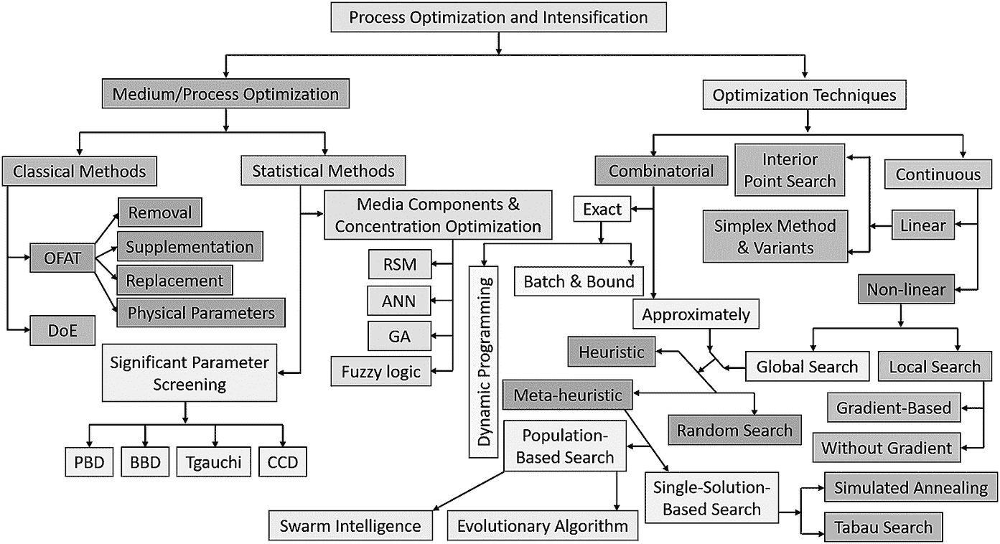

Figure 6.2 Various process optimization techniques and their classification. Abbreviations: OFAT: One-factor at a time; DoE: Design of experiments; PBD: Plakett–Burman design; BBD: Box–Behnken design; CCD: Central composite design.

### 6.3.1 基质优化方法

传统/经典的基质优化技术包括单因素实验法（OFAT）和实验设计（DoE）方法，用于优化基质组分。在 OFAT 方法中，仅在一段时间内改变一个依赖变量或过程参数，而其他参数保持不变。根据所应用的方法，OFAT 技术可以进一步分为四类：

1. 移除实验：从参数集合中移除一个参数，逐一研究其对产量的影响

2. 补充实验：研究营养物质的补充对产量的影响

3. 替换实验：改变某些重要底物的来源，以研究其对产量的影响

4. 物理参数实验：在一段时间内改变生物和环境参数（如 pH、温度、搅拌速度和通气需求）的影响


该方法的优势在于实验操作简便，结果分析容易。然而，OFAT 技术无法研究过程参数之间的相互作用，这是其主要缺点。相较于经典技术，可以使用统计技术优化基质组分和配方过程。根据优化阶段和目标，统计方法可分为两类：显著参数筛选和基质组分与浓度优化。顾名思义，显著参数筛选技术用于识别对发酵过程至关重要的关键过程参数。这些技术包括普莱特-伯曼设计（PBD）、盒-宾斯设计（BBD）、塔吉特设计和中心复合设计（CCD）。另一方面，在确定显著参数后，可进一步进行基质组分与浓度优化技术。这类方法包括响应面法（RSM）、人工神经网络（ANN）、遗传算法（GA）和模糊逻辑。本章将重点讨论 GA 及其在发酵工艺优化中的应用。但如果想了解其他算法和基质优化技术，读者可参考之前的文献，如 `Singh et al. (2017)` 和 `Thiry and Cingolani (2002)`。

## 6.4 遗传算法作为发酵工艺优化技术

优化发酵过程包含多种约束，如成本、人工劳动、开放式和耗时的工艺，这些工艺包含多个步骤。持续地，新的菌株和突变体在生物过程工业中被引入，因此需要进行优化实验（`Stanbury et al. 2013`）。随着发酵过程的加快，将需要技术来在低成本下获得高产量的终端产物，这将与传统的发酵工艺方法竞争。目前，遗传算法（GAs），一种非统计优化技术，被用于优化发酵过程。遗传算法是一种随机优化模型，可以通过模拟自然进化来找到最优或近似最优的解（`Adeyemo and Enitan 2011`）。GAs 是与概率论理论相关的强大随机搜索算法。GA 的核心概念是遗传学和自然选择过程，历史信息被用于将算法引向最佳水平。GAs 基于“适者生存”的原则，即在反复的变异步骤后，只有最佳个体才会存在。为了识别理想或最佳解集，算法模拟自然种群中的进化原因。在单一步骤中，从当前种群中 GAs 随机选择父染色体（一些个体解）以产生后代用于下一代。随着连续代数的重复，种群会演化为最适合的解决方案。同样，GAs 负责通过进化生物学、概率论和搜索算法来生产高产量的产品或解决方案，以优化发酵过程。在 GA 中，初始解集可以被理解为一个具有特定染色体的个体（属于种群）。选择两个染色体集作为父染色体，通过重组和突变过程得到后代种群（`Vasant and Barsoum 2009`）。每条染色体由多个基因组成，这些基因定义特定参数，每个位点描述该参数的值。决定下一代的三个过程是“选择”、“交叉”和“变异”。选择挑选父染色体，交叉将它们结合起来形成后代，就像自然界中的重组一样。变异在每个循环中对染色体引入随机变化（`V. Singh et al. 2017`）。选择通常基于染色体的适应度，由适应度因子定义（`Doganis et al. 2006`）。GA 相较于传统优化技术具有多项优势。它能够解决复杂的问题描述，并可并行运行。GA 可处理各种优化方法，其适应度（或目标）函数可采用多种形式，如带有随机噪声、线性/非线性、静态/非静态（随时间变化）以及连续/不连续。由于种群中的多个后代作为独立代理，样本组（或种群）可以在多个方向上并行探索搜索（或解）空间。由于这一特性，GA 通过并行化算法加快了寻找最优解的过程。此外，GAs 能够同时处理多个参数和不同的编码字符串组（`Table 6.1`）。

Table 6.1 Microbial Sources of Various Enzymes and Their Optimization Using Conventional Optimization Techniques

| Microbial Source | Enzyme | Applications | Optimization Method | Reference |
| --- | --- | --- | --- | --- |
| *Bacillus subtilis JK-79* | L-glutaminase | Therapeutic enzyme | PBD and RSM | `Kiruthika and Murugesan (2020)` |
| *Aeromonas veronii* | L-glutaminase | Anti-cancer enzyme | PBD and CCD | `Jesuraj et al. (2017)` |
| *Alcaligenes faecalis KLU102* | L-glutaminase | Anti-cancer enzyme | RSM | `Pandian et al. 2014` |
| *Trichoderma reesei QM9414* | Cellulases | Cellulolytic enzyme | CCRD | `Sirohi et al. 2019` |
| *Penicillium citrinum YL-1* | Alkaline protease | Proteolytic | PBD and RSM | `Xiao et al. 2015` |
| *Streptomyces griseoloalbus* | α-galactosi-dase | Glycoside hydrolase enzyme | RSM | `Anisha et al. 2008` |
| *Bacillus subtilis RSP-GLU MTCC 9727* | L-glutaminase | Deamidation/aminohydrolase enzyme | RSM | `Sathish et al. 2018` |
| *Serratia marcescens NCIM 2919* | L-asparagi-nase | Therapeutic enzyme | RSM | `Ghosh et al. 2013` |
| *Enterobacter aerogenes MTCC111* | L-asparagi-nase | Therapeutic enzyme | RSM | `Erva et al. 2017` |
| *Bacillus* sp. *VUVD101* | Lactase | Lignocellulolytic enzyme | PBD | `Karlapudi et al. 2018` |

Abbreviations: CCD – Central composite design, RSM – Response surface methodology, PBD – Plakett–Burman design

### 6.4.1 History of GA

GAs 被认为是全局、并行且随机的搜索算法。它们基于达尔文的进化理论，涉及自然选择和遗传学的概念。该算法始于一组称为种群的染色体。种群的后代用于创建下一代种群。选择方式确保新种群优于前一代。这些解决方案是根据其适应度选择的，适应度越高，越有可能进行繁殖。直到满足条件为止，这种迭代过程持续进行。遗传算法是人工智能的一个蓬勃发展的领域，属于进化计算。进化计算由 Rechenberg 在 1960 年代的《Evolution strategies》工作中发起，其他研究者在此基础上进一步发展。John Holland 发明了遗传算法，其学生和同事随后对其进行了开发，随后于 1975 年出版了 Holland 的著作 *Adaptation in Natural and Artificial Systems*。GA 在 1992 年由 John Koza 用于进化函数以执行特定任务，并将该方法称为“遗传编程”（`GP`）。自 Holland（`Holland 1992`）发现简单遗传算法（`SGA`）后，对其进行了多项修改。`SGA` 通常通过将多个目标视为仅有一个目标的线性集合来解决问题。如果某些目标不匹配，`SGA` 会产生多个最优解。为克服 `SGA` 的此类问题，提出了多目标遗传算法（`MOGA`）（`Dehuri and Mall 2006`）。根据是否使用帕累托原则，`MOGA` 被分为两类。非帕累托模型根据计算的客观值（如向量评估 GA（`VEGA`）和 Hajela 的和 Lin 的 GA（`HLGA`））来判断个体的生存能力。帕累托模型则检查个体的主导关系，非占优染色体具有更好的生存能力。帕累托模型的 MOGA 示例包括 Niched Pareto GA（`NPGA`）、非占优先制 GA（`NSGA`）和 `NSGA II`（`Horn et al. 1994`；`Zitzler and Thiele 1999`）。GA 还可以与各种神经网络模型结合，这些模型指导算法（`Chen and Ramaswamy 2002`）。

### 6.4.2 遗传算法在优化发酵过程中的应用

培养基的组成是决定产物及其产量的主要参数。已有多项努力通过遗传算法（GA）寻找发酵过程的最佳培养基。`Marteijn et al. (2003)` 通过遗传算法优化了用于生产 *Helicoverpa zea* 昆虫细胞的连续批次培养基，以提高细胞密度。培养基包含 11 种营养成分或参数，每种的浓度均由 5 位数字代码描述，因此代表个体的字符串总长度为 55 位。计算时使用种群规模为 20、交叉概率为 95%、变异概率为每位 1%。优化后的培养基在生物反应器中测试，细胞密度达到 19.5 × 10⁶ 细胞/mL，比受控生物反应器中的商业培养基提高了 550%。`Zheng et al. (2017)` 将人工神经网络（ANN）与 GA 结合，优化了小麦胚芽发酵过程中 16 种营养浓度，产生两种抗癌化合物：2,6-二甲氧基-ρ-对苯醌（DMBQ）和对苯醌（MBQ）。每条染色体含 16 个基因，初始有 30 条染色体。使用 ANN 导出的适应度函数选择最佳染色体，以计算下一代，交叉概率为 0.9，变异概率为 0.01。优化后的营养浓度显示微量和大量营养物质对 MBQ 和 DMBQ 的产量影响大于维生素，总含量为 0.939 mg/g。`Zheng et al. (2016)` 还优化了其他发酵参数，如发酵时间、温度、搅拌速度和初始 pH，用于 MBQ、DBMQ 和类黄酮的生产。ANN 与 `NSGA II` 结合用于获得结果。`Subba Rao et al. (2008)` 通过遗传算法提高了 *Bacillus circulans* 的碱性蛋白酶产量。选取了六个因素：温度、葡萄糖浓度、pH、大豆蛋粕浓度、接种量和培养基体积。遗传算法与前馈神经网络（FFNN）结合，初始 60 条长度为 60 的染色体，变异概率为 0.01，交叉概率为 0.9。获得的参数值使酶产量提升超过 2.5 倍，达到 8320 单位。在任何发酵过程中，温度都是另一项关键参数。保持温度在最佳范围内是实现最大产量的关键。`de Andres-Toro et al. (1997)` 在啤酒发酵中也进行了类似尝试，使用 MATLAB 中的 GA。每条染色体（个体）包含 150 个基因（对应 150 小时的研究），每个基因的取值范围在 8°C 到 18°C 之间。初始种群包含 1000 条随机生成的个体。每代增加 400 条新个体，交叉概率为 0.8，变异概率为 0.008。输出提供了啤酒生产的温度剖面，甚至能够将发酵时间缩短至 130 小时。遗传算法可以与统计建模方法（如 ANN 和 RSM）结合，有效优化发酵过程中的输入参数。例如，底物量、培养基组成、提取时间、初始 pH、发酵时间、搅拌速度、微量元素平衡、温度、频率、固液比（S/L）、水分含量、曝气速率等均可优化（`Muthusamy et al. 2019`）。GA 的使用比传统发酵方法提供了更可靠且优越的结果，因为 GA 结果可与实验结果比较，从而确认参数的优化（`Pedrozo et al. 2021`）。GA 用于研究数学建模，以寻找更好的模型或比较模型，从而找到问题的最优解。模型参数通过 GA 进行优化。遗传算法已被用于提高各种酶和生物活性化合物的发酵产量，通过比较动力学模型及其参数（如 `Table 6.2` 所述）。Monod 和 Moser 动力学模型在使用 GA 对连续常规生物反应器（CCBR）和连续膜生物反应器（CMBR）的乙醇产率及回收率进行了比较（`Esfahanian et al. 2016`）。更多 GA 及其混合模型的应用列在 `Table 6.2`。

| Microbial Source | Enzyme | Applications | Optimization Method | Reference |
| --- | --- | --- | --- | --- |
| *Thermomyces lanuginosus VAPS-24* | Xylanase | Lignocellulosic pretreatment, saccharification | CCD, GA-RSM | Kumar et al. (2017) |
| *Bacillus circulans* | Alkaline protease | Proteolytic | FFNN–GA | Subba Rao et al. (2008) |
| *Bacillus licheniformis (MG5)* | Alkaline protease | Proteolytic | GA-PSO | Ghovvati et al. (2015) |
| *Streptomyces* sp. *KP314280* | α-amylase | Starch liquefaction | (RSM-CCD) and (ANN-GA) | Ousaadi et al. (2021) |


| *Streptomyces rimosus MTCC 10792* | | 链霉菌 *Streptomyces rimosus* MTCC 10792 | | 脂肪醇氧化酶 | | 甾醇的生物转化，治疗酶 | | PBD 和 RSM-GA | | Srivastava et al. (2018) |
| *Penicillium Roqueforti ATCC 10110* | | 外链葡聚糖酶 | | 纤维素酶 | | 简化中心设计和人工蜂群算法 | | da Silva Nunes et al. (2020) |
| *Trichoderma stromaticum AM7* | | 纤维素酶 | | 纤维素酶 | | ANN-GA | | Bezerra et al. (2021) |
| *Pleurotus ostreatus PVCRSP-7* | | 多孔酶 | | 脱木质素/木质素酶 | | CCD, ANN-GA | | Chiranjeevi et al. (2014) |
| *Staphylococcus arlettae JPBW-1*, | | 脂蛋白酶 | | 脂解酶 | | CCD, ANN-GA | | Chauhan et al. (2013) |
| *Aspergillus terreus MTCC 1782* | | L-天冬氨酸酶 | | 脱氨酶/酰胺水解酶 | | RSM (PBD-CCD) 和 ANN-GA | | Baskar and Renganathan (2012) |
| *Rhizopus microsporus var. oligosporus CCT 3762* | | α-淀粉酶 | | 淀粉液化 | | ANN-GA | | Fernández Núñez et al. (2017) |
| *Penicillium roqueforti ATCC 10110* | | 脂蛋白酶 | | 脂解酶 | | ANN-GA | | Sales de Menezes et al. (2021) |
| *Bacillus sp BGS* | | 碱性蛋白酶 | | 保护性活性 | | RSM 和 GA | | Moorthy and Baskar (2013) |
| *Acinetobacter johnsonii* | | 新型双氧酶（二酮裂解酶，Dke1） | | 去氧化活性 | | GA | | Hofer et al. (2004) |
| *Bacillus subtilis RSP-GLU (MTCC 9727)* | | L-谷氨酸酶 | | 脱氨酶/酰胺水解酶 | | ANN-GA | | Sathish and Prakasham (2010) |
| *Aspergillus niger* | | α-淀粉酶 | | 淀粉糖化 | | PSO 和 GA | | Rajulapati and Lakshmi Narasu (2011) |
| *Trichoderma reesei QM9414* | | 纤维素酶 | | 纤维素酶 | | GA | | Sirohi et al. (2018) |
| *Trichoderma harzianum* | | L-蛋氨酸酶 | | L-蛋氨酸的去氨化和去甲基化 | | RSM 和 ANN-GA | | Salim et al. (2019) |
| *Aspergillus niger* | | α-淀粉酶 | | 淀粉糖化 | | RSM 和 GA | | Rajulapati and Lakshmi Narasu (2011) |
| *Pleurotus sajor-caju CCBIt 020* | | 锰过氧化酶 (MnP) 和多孔酶 (Lac) | | 木质素修饰酶 (LMEs) | | RSM 和 ANN-GA | | Vilar et al. (2021) |
| *Pseudomonas* sp. *RAJR 044* | | 保护蛋白酶 | | 保护性活性 | | GA | | Dutta et al. (2005) |
| *Enterobacter aerogenes MTCC 111* | | L-天冬氨酸酶 | | 脱氨酶/酰胺水解酶 | | ANN-GA | | Reddy and Babu (2017) |
| *Aspergillus terreus MTCC 1782* | | L-天冬氨酸酶 | | 治疗酶 | | RSM 和 ANN-GA | | Baskar and Renganathan (2012) |
| *Pseudomonas fluorescens BL 915 ORF1 pSZexM2* | | 卤化酶 | | 卤化反应 | | GA | | Muffler et al. (2007) |
| *Trichoderma reesei* | | 纤维素酶 | | 纤维素酶 | | RSM-GA | | Saravanan et al. (2012) |
| *Rhizopus oryzae NRRL 3562* | | 脂蛋白酶 | | 脂解酶 | | GA 和 PSO | | Garlapati et al. (2010) |
| *Alternaria* sp. | | 抗真菌外壳酶 | | 木质素降解酶 | | DANN | | Ismail et al. (2019) |
| *Aspergillus* sp. | | 碱性蛋白酶 | | 保护性活性 | | RSM-GA | | Mustefa Beyan et al. (2021) |

Abbreviations: CCD – Central composite design, RSM – Response surface methodology, GA – Genetic algorithm, FFNN – feed-forward neural network, PSO – Particle swarm optimization, ANN – Artificial neural network, PBD – Plakett–Burman design

---

## 6.5 优化技术中的问题与瓶颈

发酵优化涉及大量实验，这些实验也包括人工成本。令人遗憾的是，摇瓶实验（实验室规模研究）得到的结果很少与发酵罐研究完全一致。所有实验室规模的研究主要受四个主要弱点的影响：不可控制的 pH、O₂ 传递能力差、蒸发间歇性以及发酵过程中混合效率低下。此外，工业规模发酵介质通常面临批次间的变异性、生物量价格的不断波动、产品运输成本的差异以及大量储存时的问题。此外，微生物本质上具有动态性，拥有众多内部控制机制，但大多数过程优化技术将其视为黑盒，或仅利用经验数据。在这种情况下，下一代过程优化技术应考虑代谢通路的调控机制。与此同时，微生物的突变率也应予以考虑，因为介质组分会影响期望的产量或目标产物。未来的研究还应探讨在介质优化研究中使用突变株（如果有）的影响，这可能为开发新的成本效益工艺提供新思路，其中可以使用廉价的介质。最重要的是，与液体培养基发酵相比，固态或半固态发酵（SSF）的优化研究相对匮乏，而这正好是当前水资源稀缺的迫切需求。此外，几乎所有在优化实验中进行的研究者都会遇到一个问题：何时应该停止优化过程，或者优化研究在哪一步结束。产量取决于多种物理和生化因素，因此为发酵设计最佳介质可能是一个永无止境的问题。该领域的专家一直在寻找新的介质组分或介质，以实现期望的产量。

目前，`GA`s 被用于解决各种与优化相关的搜索问题，包括概率函数优化、分子对接、参数拟合、调度、制造、聚类、机器学习（ML）等。`GA` 也被用于微生物生长的同时参数优化，因为微生物生长是发酵中的重要指标，受多种因素影响，如竞争、有毒化合物的释放以及代谢活性（Pedrozo et al. 2021）。然而，`varName = avar + bvar` 的主要缺点在于，`GA`s 与 `ANN` 方法的结合在发酵过程优化中更具盈利性。这种方法的结合基于以下思想：在达到期望的 `ANN` 后，

- da Silva Nunes, Nájila, Lucas Lima Carneiro, Luiz Henrique Sales de Menezes, Marise Silva de Carvalho, Adriana Bispo Pimentel, Tatielle Pereira Silva, Clissiane Soares Viana Pacheco, et al. 2020. “Simplex-Centroid Design and Artificial Neural Network-Genetic Algorithm for the Optimization of Exoglucanase Production by Penicillium Roqueforti ATCC 10110 Through Solid-State Fermentation Using a Blend of Agroindustrial Wastes.” BioEnergy Research 13 (4): 1130–1143. doi:[10.1007/s12155-020-10157-0](http://dx.doi.org/10.1007/s12155-020-10157-0)

- de Andres-Toro, B., J. M. Giron-Sierra, J. A. Lopez-Orozco, and C. Fernandez-Conde. 1997. “Evolutionary Optimization of an Industrial Batch Fermentation Process.” In *1997 European Control Conference (ECC)*, 2401–2406. Brussels: IEEE. doi:[10.23919/ECC.1997.7082465](http://dx.doi.org/10.23919/ECC.1997.7082465)

- Dehuri, S., and R. Mall. 2006. “Predictive and Comprehensible Rule Discovery Using a Multi-Objective Genetic Algorithm.” Knowledge-Based Systems 19 (6): 413–421. doi:[10.1016/j.knosys.2006.03.004](http://dx.doi.org/10.1016/j.knosys.2006.03.004)

- Desai, K.M., S.K. Akolkar, Y.P. Badhe, S.S. Tambe, and S.S. Lele. 2006. “Optimization of Fermentation Media for Exopolysaccharide Production from Lactobacillus Plantarum Using Artificial Intelligence-Based Techniques.” Process Biochemistry 41 (8): 1842–1848. doi:[10.1016/j.procbio.2006.03.037](http://dx.doi.org/10.1016/j.procbio.2006.03.037)

- Doganis, Philip, Alex Alexandridis, Panagiotis Patrinos, and Haralambos Sarimveis. 2006. “Time Series Sales Forecasting for Short Shelf-Life Food Products Based on Artificial Neural Networks and Evolutionary Computing.” Journal of Food Engineering 75 (2): 196–204. doi:[10.1016/j.jfoodeng.2005.03.056](http://dx.doi.org/10.1016/j.jfoodeng.2005.03.056)

- Doriya, K., N. Jose, M. Gowda, and D.S. Kumar. 2016. “Solid-State Fermentation vs Submerged Fermentation for the Production of l-Asparaginase.” Advances in Food and Nutrition Research 78: 115–135. doi:[10.1016/bs.afnr.2016.05.003](http://dx.doi.org/10.1016/bs.afnr.2016.05.003)

- Dutta, Jayati Ray, Pranab Kumar Dutta, and Rintu Banerjee. 2005. “Modeling and Optimization of Protease Production by a Newly Isolated Pseudomonas Sp. Using a Genetic Algorithm.” Process Biochemistry 2 (40): 879–884. doi:[10.1016/j.procbio.2004.02.013](http://dx.doi.org/10.1016/j.procbio.2004.02.013)

- Erva, Rajeswara Reddy, Ajgebi Nath Goswami, Priyanka Suman, Ravali Vedanabhatla, and Satish Babu Rajulapati. 2017. “Optimization of L-Asparaginase Production from Novel Enterobacter Sp., by Submerged Fermentation Using Response Surface Methodology.” Preparative Biochemistry & Biotechnology 47 (3): 219–228. doi:[10.1080/10826068.2016.1201683](http://dx.doi.org/10.1080/10826068.2016.1201683)

- Esfahanian, Mehri, Ali Shokuhi Rad, Saeed Khoshhal, , - no obvious,

- Kiruthika, Jambulingam, and Saranya Murugesan. 2020. “Studies on Optimization of L-Glutaminase Production under Submerged Fermentation from Marine Bacillus Subtilis JK-79.” African Journal of Microbiology Research 14 (1). Academic Journals: 16–24. doi:`[10.5897/AJMR2019.9107](http://dx.doi.org/10.5897/AJMR2019.9107)`

- Kumar, Karan, Kuldeep Roy, and Vijayanand S. Moholkar. 2021. “Mechanistic Investigations in Sonoenzymatic Synthesis of N-Butyl Levulinate.” Process Biochemistry 111 (December): 147–158. doi:`[10.1016/j.procbio.2021.09.005](http://dx.doi.org/10.1016/j.procbio.2021.09.005)`

- Kumar, Vishal, Deepak Chhabra, and Pratyoosh Shukla. 2017. “Xylanase Production from Thermomyces Lanuginosus VAPS-24 Using Low Cost Agro-Industrial Residues via Hybrid Optimization Tools and Its Potential Use for Saccharification.” Bioresource Technology 243 (November): 1009–1019. doi:`[10.1016/j.biortech.2017.07.094](http://dx.doi.org/10.1016/j.biortech.2017.07.094)`

- Lee, Se Yeon, and Chae Hun Ra. 2021. “Comparison of Liquid and Solid-State Fermentation Processes for the Production of Enzymes and Beta-Glucan from Hulled Barley.” Journal of Microbiology and Biotechnology, December. doi:`[10.4014/jmb.2111.11002](http://dx.doi.org/10.4014/jmb.2111.11002)`

- Malani, Ritesh S., Sachin B. Umriwad, Karan Kumar, Arun Goyal, and Vijayanand S. Moholkar. 2019. “Ultrasound–Assisted Enzymatic Biodiesel Production Using Blended Feedstock of Non–Edible Oils: Kinetic Analysis.” Energy Conversion and Management 188 (May): 142–150. doi:`[10.1016/j.enconman.2019.03.052](http://dx.doi.org/10.1016/j.enconman.2019.03.052)`

- Marteijn, R. C. L., O. Jurrius, J. Dhont, C. D. de Gooijer, J. Tramper, and D. E. Martens. 2003. “Optimization of a Feed Medium for Fed-Batch Culture of Insect Cells Using a Genetic Algorithm.” Biotechnology and Bioengineering 81 (3): 269–278. doi:`[10.1002/bit.10465](http://dx.doi.org/10.1002/bit.10465)`

- Mondal, Payel, Anup Kumar Sadhukhan, Amit Ganguly, and Parthapratim Gupta. 2021. “Optimization of Process Parameters for Bio-Enzymatic and Enzymatic Saccharification of Waste Broken Rice for Ethanol Production Using Response Surface Methodology and Artificial Neural Network–Genetic Algorithm.” 3 Biotech 11 (1): 28. doi:`[10.1007/s13205-020-02553-2](http://dx.doi.org/10.1007/s13205-020-02553-2)`

- Moorthy, Innasi Muthu Ganesh, and Rajoo Baskar. 2013. “Statistical Modeling and Optimization of Alkaline Protease Production from a Newly Isolated Alkalophilic Bacillus Species BGS Using Response Surface Methodology and Genetic Algorithm.” Preparative Biochemistry & Biotechnology 43 (3): 293–314. doi:`[10.1080/10826068.2012.719850](http://dx.doi.org/10.1080/10826068.2012.719850)`

- Muffler, Kai, Marco Retzlaff, Karl-Heinz van Pée, and Roland Ulber. 2007. “Optimisation of Halogenase Enzyme Activity by Application of a Genetic Algorithm.” Journal of Biotechnology 127 (3): 425–433. doi:`[10.1016/j.jbiotec.2006.07.008](http://dx.doi.org/10.1016/j.jbiotec.2006.07.008)`

- Mustefa Beyan, Surafel, S. Venkatesa Prabhu, Tsegazeab K. Mumecha, and Mesfin T. Gemeda. 2021. “Production of Alkaline Proteases Using Aspergillus Sp. Isolated from Injera: RSM-GA Based Process Optimization and Enzyme Kinetics Aspect.” Current Microbiology 78 (5): 1823–1834. doi:`[10.1007/s00284-021-02446-4](http://dx.doi.org/10.1007/s00284-021-02446-4)`

- Muthusamy, Shanmugaprakash, Lakshmi Priya Manickam, Venkateshprabhu Murugesan, Chandrasekaran Muthukumaran, and Arivalagan Pugazhendhi. 2019. “Pectin Extraction from Helianthus Annuus (Sunflower) Heads Using RSM and ANN Modelling by a Genetic Algorithm Approach.” International Journal of Biological Macromolecules 124 (March): 750–758. doi:`[10.1016/j.ijbiomac.2018.11.036](http://dx.doi.org/10.1016/j.ijbiomac.2018.11.036)`

- Ousaadi, Mouna Imene, Fateh Merouane, Mohammed Berkani, Fares Almomani, Yasser Vasseghian, and Mahmoud Kitouni. 2021. “Valorization and Optimization of Agro-Industrial Orange Waste for the Production of Enzyme by Halophilic Streptomyces Sp.” Environmental Research 201 (October): 111494. doi:`[10.1016/j.envres.2021.111494](http://dx.doi.org/10.1016/j.envres.2021.111494)`

- Pandian, Sureshbabu Ram Kumar, V. Deepak, S. Sivasubramaniam, H. Nellaiah, and K. Sundar. 2014. “Optimization and Purification of Anticancer Enzyme L-Glutaminase from Alcaligenes Faecalis KLU102.” Biologia. doi:`[10.2478/s11756-014-0486-1](http://dx.doi.org/10.2478/s11756-014-0486-1)`

- Pedrozo, Hector A., Andrea M. Dallagnol, and Carlos E. Schvezov. 2021. “Genetic Algorithm Applied to Simultaneous Parameter Estimation in Bacterial Growth.” Journal of Bioinformatics and Computational Biology 19 (1): 2050045. doi:`[10.1142/S0219720020500456](http://dx.doi.org/10.1142/S0219720020500456)`

- Polizeli, M. L. T. M., A. C. S. Rizzatti, R. Monti, H. F. Terenzi, J. A. Jorge, and D. S. Amorim. 2005. “Xylanases from fungi: properties and industrial applications.” Applied Microbiology and Biotechnology 67 (5). doi:`[10.1007/s00253-005-1904-7](http://dx.doi.org/10.1007/s00253-005-1904-7)`

- Rajulapati, Satish Babu, and M. Lakshmi Narasu. 2011. “Studies on A-Amylase and Ethanol Production from Spoiled Starch Rich Vegetables and Multi Objective Optimization by P.S.O and Genetic Algorithm.” In *International Conference on Green Technology and Environmental Conservation (GTEC-2011)*, 37–41. doi:`[10.1109/GTEC.2011.6167638](http://dx.doi.org/10.1109/GTEC.2011.6167638)`

- Rangel, Albert E. T., Jorge Mario Gómez Ramírez, and Andrés Fernando González Barrios. 2020. “From Industrial By-products to Value-added Compounds: The Design of Efficient Microbial Cell Factories by Coupling Systems Metabolic Engineering and Bioprocesses.” Biofuels, Bioproducts and Biorefining 14 (6): 1228–1238. doi:`[10.1002/bbb.2127](http://dx.doi.org/10.1002/bbb.2127)`

- Reddy, Erva Rajeswara, and Rajulapati Satish Babu. 2017. “Neural Network Modeling and Genetic Algorithm Optimization Strategy for the Production of L-Asparaginase from Novel Enterobacter Sp.” Journal of Pharmaceutical Sciences 9: 7.

- Roeva, O. 2006. “A Modified Genetic Algorithm for a Parameter Identification of Fermentation Processes.” Biotechnology & Biotechnological Equipment 20 (1): 202–209. doi:`[10.1080/13102818.2006.10817333](http://dx.doi.org/10.1080/13102818.2006.10817333)`

- Sadh, Pardeep Kumar, Surekha Duhan, and Joginder Singh Duhan. 2018. “Agro-Industrial Wastes and Their Utilization Using Solid State Fermentation: A Review.” Bioresources and Bioprocessing 5 (1): 1. doi:`[10.1186/s40643-017-0187-z](http://dx.doi.org/10.1186/s40643-017-0187-z)`

- Sales de Menezes, Luiz Henrique, Lucas Lima Carneiro, Iasnaia Maria de Carvalho Tavares, Pedro Henrique Santos, Thiago Pereira das Chagas, Adriano Aguiar Mendes, Erik Galvão Paranhos da Silva, Marcelo Franco, and Julieta Rangel de Oliveira. 2021. “Artificial Neural Network Hybridized with a Genetic Algorithm for Optimization of Lipase Production from Penicillium Roqueforti ATCC 10110 in Solid-State Fermentation.” Biocatalysis and Agricultural Biotechnology 31 (January): 101885. doi:`[10.1016/j.bcab.2020.101885](http://dx.doi.org/10.1016/j.bcab.2020.101885)`

- Salim, Nisha, A. Santhiagu, and K. Joji. 2019. “Process Modeling and Optimization of High Yielding L-Methioninase from a Newly Isolated Trichoderma Harzianum Using Response Surface Methodology and Artificial Neural Network Coupled Genetic Algorithm.” Biocatalysis and Agricultural Biotechnology. Elsevier Ltd. doi:`[10.1016/j.bcab.2018.11.032](http://dx.doi.org/10.1016/j.bcab.2018.11.032)`

- Saravanan, P., R. Muthuvelayudham, R. Rajesh Kannan, and T. Viruthagiri. 2012. “Optimization of Cellulase Production Using Trichoderma Reesei by RSM and Comparison with Genetic Algorithm.” Frontiers of Chemical Science and Engineering 6 (4): 443–452. doi:`[10.1007/s11705-012-1225-1](http://dx.doi.org/10.1007/s11705-012-1225-1)`

- Sathish, Thadikamala, Devarapalli Kezia, P. V. Bramhachari, and Reddy Shetty Prakasham. 2018. “Multi-Objective Based Superimposed Optimization Method for Enhancement of l -Glutaminase Production by Bacillus Subtilis RSP-GLU.” Karbala International Journal of Modern Science 4 (1): 50–60. doi:`[10.1016/j.kijoms.2017.10.006](http://dx.doi.org/10.1016/j.kijoms.2017.10.006)`

- Sathish, Thadikamala, and Reddy Shetty Prakasham. 2010. “Enrichment of Glutaminase Production by Bacillus Subtilis RSP-GLU in Submerged Cultivation Based on Neural Network—Genetic Algorithm Approach.” Journal of Chemical Technology & Biotechnology 85 (1): 50–58. doi:`[10.1002/jctb.2267](http://dx.doi.org/10.1002/jctb.2267)`

- Schmidt, F. R. 2005. “Optimization and Scale up of Industrial Fermentation Processes.” Applied Microbiology and Biotechnology 68 (4): 425–435. doi:`[10.1007/s00253-005-0003-0](http://dx.doi.org/10.1007/s00253-005-0003-0)`

- Singh, Neha, Karan Kumar, Arun Goyal, and Vijayanand S. Moholkar. 2022. “Ultrasound-Assisted Biodiesel Synthesis by in–Situ Transesterification of Microalgal Biomass: Optimization and Kinetic Analysis.” Algal Research 61 (January): 102582. doi:`[10.1016/j.algal.2021.102582](http://dx.doi.org/10.1016/j.algal.2021.102582)`

- Singh, Rajendra, Manoj Kumar, Anshumali Mittal, and Praveen Kumar Mehta. 2016. “Microbial Enzymes: Industrial Progress in 21st Century.” 3 Biotech 6 (2): 174. doi:`[10.1007/s13205-016-0485-8](http://dx.doi.org/10.1007/s13205-016-0485-8)`

- Singh, Vineeta, Shafiul Haque, Ram Niwas, Akansha Srivastava, Mukesh Pasupuleti, and C. K. M. Tripathi. 2017. “Strategies for Fermentation Medium Optimization: An In-Depth Review.” Frontiers in Microbiology 7 (January). doi:`[10.3389/fmicb.2016.02087](http://dx.doi.org/10.3389/fmicb.2016.02087)`

- Singhania, Reeta Rani, Anil Kumar Patel, Carlos R. Soccol, and Ashok Pandey. 2009. “Recent Advances in Solid-State Fermentation.” Biochemical Engineering Journal 44 (1): 13–18. doi:`[10.1016/j.bej.2008.10.019](http://dx.doi.org/10.1016/j.bej.2008.10.019)`

- Sirohi, Ranjna, Anupama Singh, Ayon Tarafdar, and N.C. Shahi. 2018. “Application of Genetic Algorithm in Modelling and Optimization of Cellulase Production.” Bioresource Technology 270 (December): 751–754. doi:`[10.1016/j.biortech.2018.09.105](http://dx.doi.org/10.1016/j.biortech.2018.09.105)`

- Sirohi, Ranjna, Anupama Singh, Ayon Tarafdar, Navin Chandra Shahi, Ashok Kumar Verma, and Anurag Kushwaha. 2019. “Cellulase Production from Pre-Treated Pea Hulls Using Trichoderma Reesei Under Submerged Fermentation.” Waste and Biomass Valorization. Springer, Netherlands. doi:`[10.1007/s12649-018-0271-4](http://dx.doi.org/10.1007/s12649-018-0271-4)`

- Soccol, Carlos Ricardo, Eduardo Scopel Ferreira da Costa, Luiz Alberto Junior Letti, Susan Grace Karp, Adenise Lorenci Woiciechowski, and Luciana Porto de Souza Vandenberghe. 2017. “Recent Developments and Innovations in Solid State Fermentation.” Biotechnology Research and Innovation 1 (1): 52–71. doi:`[10.1016/j.biori.2017.01.002](http://dx.doi.org/10.1016/j.biori.2017.01.002)`

- Srivastava, Akanksha, Vineeta Singh, Shafiul Haque, Smriti Pandey, Manisha Mishra, Arshad Jawed, P. K. Shukla, P. K. Singh, and C. K. M. Tripathi. 2018. “Response Surface Methodology-Genetic Algorithm Based Medium Optimization, Purification, and Characterization of Cholesterol Oxidase from Streptomyces Rimosus.” Scientific Reports 8 (1): 10913. doi:`[10.1038/s41598-018-29241-9](http://dx.doi.org/10.1038/s41598-018-29241-9)`

- Stanbury, Peter F., Allan Whitaker, and Stephen J. Hall. 2013. Principles of Fermentation Technology. Elsevier.

- Subba Rao, Ch., T. Sathish, M. Mahalaxmi, G. Suvarna Laxmi, R. Sreenivas Rao, and R.S. Prakasham. 2008. “Modelling and Optimization of Fermentation Factors for Enhancement of Alkaline Protease Production by Isolated Bacillus Circulans Using Feed-Forward Neural Network and Genetic Algorithm.” Journal of Applied Microbiology 104 (3): 889–898. doi:`[10.1111/j.1365-2672.2007.03605.x](http://dx.doi.org/10.1111/j.1365-2672.2007.03605.x)`

- Thiry, Michel, and Doriano Cingolani. 2002. “Optimizing Scale-up Fermentation Processes.” Trends in Biotechnology 20 (3): 103–105. doi:`[10.1016/S0167-7799\(02\)01913-3](http://dx.doi.org/10.1016/S0167-7799\(02\)01913-3)`

- Vasant, Pandian, and Nader Barsoum. 2009. “Hybrid Genetic Algorithms and Line Search Method for Industrial Production Planning with Non-Linear Fitness Function.” Engineering Applications of Artificial Intelligence 22 (4–5): 767–777. doi:`[10.1016/j.engappai.2009.03.010](http://dx.doi.org/10.1016/j.engappai.2009.03.010)`

- Vilar, Débora S., Clara D. Fernandes, Victor R. S. Nascimento, Nádia H. Torres, Manuela S. Leite, Ram Naresh Bharagava, Muhammad Bilal, Giancarlo R. Salazar-Banda, Katlin I. Barrios Eguiluz, and Luiz Fernando Romanholo Ferreira. 2021. “Hyper-Production Optimization of Fungal Oxidative Green Enzymes Using Citrus Low-Cost Byproduct.” Journal of Environmental Chemical Engineering 9 (1): 105013. doi:`[10.1016/j.jece.2020.105013](http://dx.doi.org/10.1016/j.jece.2020.105013)`

- Webb, Colin. 2017. “Design Aspects of Solid State Fermentation as Applied to Microbial Bioprocessing.” Journal of Applied Biotechnology & Bioengineering 4 (1). doi:`[10.15406/jabb.2017.04.00094](http://dx.doi.org/10.15406/jabb.2017.04.00094)`

- Xiao, Yun-Zhu, Duan-Kai Wu, Si-Yang Zhao, Wei-Min Lin, and Xiang-Yang Gao. 2015. “Statistical Optimization of Alkaline Protease Production from Penicillium Citrinum YL-1 Under Solid-State Fermentation.” Preparative Biochemistry & Biotechnology 45 (5): 447–462. doi:`[10.1080/10826068.2014.923450](http://dx.doi.org/10.1080/10826068.2014.923450)`

- Zheng, Ziyi, Xiaona Guo, Kexue Zhu, Wei Peng, and Huiming Zhou. 2016. “The Optimization of the Fermentation Process of Wheat Germ for Flavonoids and Two Benzoquinones Using EKF-ANN and NSGA-II.” RSC Advances 6 (59): 53821–53829. doi:`[10.1039/C5RA27004A](http://dx.doi.org/10.1039/C5RA27004A)`

- Zheng, Zi-Yi, Xiao-Na Guo, Ke-Xue Zhu, Wei Peng, and Hui-Ming Zhou. 2017. “Artificial Neural Network – Genetic Algorithm to Optimize Wheat Germ Fermentation Condition: Application to the Production of Two Anti-Tumor Benzoquinones.” Food Chemistry 227 (July): 264–270. doi:`[10.1016/j.foodchem.2017.01.077](http://dx.doi.org/10.1016/j.foodchem.2017.01.077)`

- Zitzler, E., and L. Thiele. 1999. “Multiobjective Evolutionary Algorithms: A Comparative Case Study and the Strength Pareto Approach.” IEEE Transactions on Evolutionary Computation 3 (4): 257–271. doi:`[10.1109/4235.797969](http://dx.doi.org/10.1109/4235.797969)`

# 7 使用人工神经网络优化各类酶的工艺参数

Rajeev Kumar

Dayananda Sagar University, Bangalore, India

S. M. Veena 和 C. Sowmya

Sapthagiri College of Engineering, Bangalore, India

Ajay Nair 和 Archana S. Rao

Dayananda Sagar University, Bangalore, India

Uday Muddapur

KLE Tach University, Hubli, India

K. S. Anantharaju

Dayananda Sagar College of Engineering, Bangalore, India

Sunil S. More

Dayananda Sagar University, Bangalore, India

DOI: [`10.1201/9781003292333-7`](https://dx.doi.org/10.1201/9781003292333-7)

## 7.1 入 介

酶是生物催化剂，能够在可行的生理化学条件下促进化学反应。酶或其产物被用于人类许多应用。酶的工业生产呈持续增长趋势。微生物是工业酶的首选来源，其使用范围在乳制品、烘焙、饮料、动物饲料、纸浆与造纸、洗涤剂、皮革化妆品、有机合成以及废物处理等行业中不断扩大（Singh et al. 2016）。酶工业采用不同类别的酶，如淀粉酶、蛋白酶和脂肪酶。酶的生产成本是酶工业发展和可持续性的最重要因素（Klein-Marcuschamer et al. 2012）。决定酶生产成本的多种因素（工艺参数）包括培养基组成和发酵操作条件（Kennedy and Krouse 1999）。因此，优化显著的工艺参数是实现酶生产的可取且必要的策略。

目前，用于优化工艺参数以提高酶产量的多种策略已经被采用（Singh et al. 2017）。最简单的优化方法是“单因素变化法”。然而，该方法耗时且不适合处理优化过程中涉及的复杂数据集。1951 年，响应面方法（RSM）的出现使统计方法在优化过程中的应用变得流行，并被广泛使用（Mandenius and Brundin 2008）。

机器学习（ML）模型属于人工智能（AI）的子领域。人工智能的核心动机是让计算机成为能够辅助决策的智能机器。人工神经网络（ANN）是为实现人工智能而发展的关键技术。人类大脑的运作机制是 ANN 发展的指导原则。ANN 可以用于挖掘复杂数据集中隐藏的模式。酶生产过程产生的数据集因各工艺参数之间的复杂关系而显得尤为复杂。利用 ANN 优化工艺参数的兴趣日益增长，这得益于优化算法的发展以及计算机算力的提升。图像处理技术与 ANN 技术的成功融合已广泛应用于包括自动驾驶在内的多种 AI 驱动技术。这些成功可以在发酵行业的运行中复制，以提升酶的产量。

本章旨在探讨 ANN 模型在优化各类酶的工艺参数以提高产量方面的应用。本章讨论了优化的基本策略，并详细描述了 ANN 方法，重点放在 ANN 在酶工艺参数优化中的应用上。同时简要介绍了 RSM 方法，并将其与 ANN 进行比较。核心问题是：ANN 是否能够为工艺参数优化提供替代方案。最后，本文在结论部分讨论了 ANN 在酶工艺参数优化中的实际应用。

## 7.2 解决优化问题的策略

优化是通过在给定情形下选择输入的组合来获得最佳结果的过程。当过程的结果取决于多个因素时，优化尤为重要。通过改变控制结果的因素，利用优化可以操纵结果。优化的目标是找到期望的结果，通常涉及最大化或最小化结果。这些目标称为优化的目标，而被调节的因素称为决策变量。生物体系是典型的优化系统。例如，动物（包括人类）小肠的褶皱已经进化以最大化营养物质的吸收面积。同样，生物体的演化也体现了优化的例子，这些都激励我们开发更高效的人类使用系统。优化问题可分为受约束和不受约束两类。在受约束优化中，优化需在满足一定条件的前提下进行；而在不受约束优化中，则不存在此类条件。

酶的产量取决于多种因素，包括培养基组成、操作条件以及反应器的工作状态。因此，酶工艺的优化对酶的生产至关重要。

建模与仿真是解决酶工艺参数优化的重要手段。动力学建模是一种机理方法，用于优化工艺参数。然而，确定相关参数并不易，在所有情况下都不切实际。因此，我们需要另一种方法来获得最佳的工艺参数组合。

数学模型是优化过程的必要条件。这些模型可以简单或复杂。简单的经验数学函数可作为简易模型，用于优化；复杂的模型则可以从数据中推导或基于系统特性构建。获得优化问题解的三大策略主要区别在于变量、优化函数和约束的特性（Balaman 2019）。

1. 线性规划（LP）：线性规划要求目标函数和约束必须为线性，变量与目标函数之间应呈比例关系。该方法的目标是通过最大化或最小化线性目标函数，获得决策变量的最优值集合。根据约束的数量，线性规划可分为小规模（少于 1000 个约束）、中规模（1000 到 2000 个约束）和大规模（超过 2000 个约束）（Dantzig and Thapa 1997）。

The main requirement in the application of linear programming is that systems must operate in a linear range. Möller et al. (2018) used linear programming to understand the behavior of cancer cells in the utilization of glucose. Cancer cells convert glucose into lactate even in the presence of sufficient oxygen. This is known as the ‘Warburg effect’. Möller et al. (2018) developed a minimal model and used linear programming with maximizing the ATP production rate as an optimization function and with different combinations of constraints on enzymes. Using this approach, the model predicted the oxidation of glucose under the reduction in glucose concentration or uptake process. Torres et al. (1996) identified the requirements for the substrate pool and the range of enzyme activity and several enzymes to increase the glycolytic flux for the production of citric acid in *Aspergillus niger* by formulating a linear optimization problem. They used linear programming and identified seven or more enzymes that could increase citric acid production by 3-fold.

2. Dynamic programming (DP): Time is an important factor in this strategy of obtaining a solution for an optimization problem. This strategy can be applied in situations such as maximizing the return of an investment. In order to maximize the return of an investment, money has to be allocated in different portfolios. A decision needs to be taken when some return is obtained after some time which again needs to be reallocated to increase the final return. Dynamic programming is characterized by two features – recursive operation of the execution of the program and multi-stage decision-making process (Gluss 1961). In this method, the solution is improved after each stage of decision-making. Ilkova and Petrov (2008) applied dynamic programming in the estimation of optimal initial concentration of biomass, substrate, and feed substrate in a fed-batch fermentation process using laboratory *Escherichia coli*. They also reported the reduction in the iteration of obtaining the desired optimization function.

3. Non-linear programming (NLP): Non-linear programming addresses the optimization problems where the optimization function and constrain operate in a non-linear fashion. Such situations are common in industrial operations. One of the common issues is finding the global minima during an optimization process. NLP is primarily developed to address the problem of finding the global minima. The common strategy adopted in NLP is searching the global minima by iterative approach. The NLP method form a good strategy to solve the complex optimization problem in combination with linear programming methods (Luenberger 1973). Evolutionary programming and simulated annealing are common examples of NLP.

Machine learning methods are being increasingly used in solving optimizing problems (Sun et al. 2019). The solution to an optimization problem is built in the formulation of a machine learning model. The main learning processes – classification and clustering – are the optimization techniques. The linear regression model and decision tree algorithms are employed in solving the optimization problem of a relatively simple nature. The more complex optimization problems can be addressed by ANNs.

## 7.3 Description and Architecture of Artificial Neural Networks

Warren McCulloch and Water Pitts opened the field of ANNs in 1943 (McCulloch and Pitts 1943). They proposed a simple model of a biological neuron. Their model was formulated on Boolean logic and the model output was in a binary form. This model was less flexible as the model used to input in binary form and could perform simple tasks. Frank Rosenblatt put forward a refined version of the neuron model and called it a perceptron (Rosenblatt 1962). Perceptron was a single-layer neural model which could take real input. This model could learn using different algorithms. By the 1960s, the ANN was used to understand the simple text and human faces. The model was able to differentiate between male and female faces. Minski and Papert (1969) identified the limitation of perceptron in solving the XOR problem. The XOR problem is related to the processing of two unequal inputs (the expected outcome is false) and two equal inputs (the expected outcome is true). This problem was resolved with the advent of the backpropagation method (Rumelhart et al. 1986). The backpropagation method enabled the neural network to train a multi-layer ANN. The application of ANNs gained popularity after 2000 with the developments in the computing power of computer and image processing algorithms.

The architecture of typical ANNs contains networks of nodes. These nodes are organized into three types of layers – an input layer, a hidden layer, and an output layer. Each layer contains several neurons. The neurons of each layer are connected to the neurons of the next layer. There is one layer of input and output, but the hidden layer can contain multiple layers. The number of hidden layer determines the processing power and computational cost of the model. The hidden layer is not visible to the user and therefore this model is referred to as a black-box model. The basic topology of an ANN is shown in Figure 7.1.


Figure 7.1 A typical topology of ANN containing 2 input neurons, 2 hidden layer neurons, and 2 output neurons (2-2-2).

The architecture of neural networks can be of different types depending upon the presence of layers and feedback loops. The following are the three main variants of neural networks:

1. Single-layer feed-forward network: In this type of network, the neuron of the input layer is connected to the neuron of the output layer. Since there is no computation is done on the neurons of the input layer, this is called a single-layer feed-forward network.

2. Multi-layer feed-forward network: This is a typical neural network containing all three layers – input, hidden, and output.

3. Recurrent neural network: In such a network, neurons of one layer are connected to other neurons of the same layer via a feedback loop.

The geometry of interconnection among different neurons is integral to the functioning of ANN. One neuron of each layer in the network receives signals from many other neurons from different layers. The connections between two neurons are called edges. Each edge is associated with some numerical weight. Each neuron performs two functions. It integrates all the input signals and sends the integrated signal in the form of activation functions. The next neuron receives the activation function as an input. This is shown in Figure 7.2. The activation functions contain two factors – summation of the input signal and a factor called signal bias. This is shown as mathematical Equations (7.1) and (7.2) (Tarafdar et al. 2021). The weighting functions and signal bias factors are unknown and estimated using the experimental training data set.

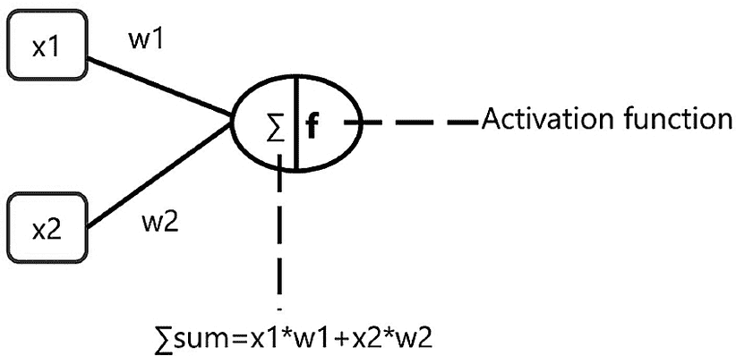

Figure 7.2 The neuron, edge, and summation/activation function.

(7.1)

```


$$Y_{j} = f^{y}\left( {\\sum\\limits_{i = 1}^{n}I_{i} \\ast w_{ij} + b_{j}} \\right)$$

```
where `Y[j]` 是隐藏层的第 `j` 个神经元，`I[i]` 是输入层的第 `i` 个神经元，`n` 是输入神经元的数量，`w[ij]` 是从输入层第 `i` 个神经元到隐藏层第 `j` 个神经元的权重，`b[j]` 是偏置项，`f^(*y*)` 是激活函数。
```

(7.2)

```math
O_{K} = f^{o}\\left( {\\sum_{j = 1}^{m}Y_{j} \\ast w_{jk} + b_{k}} \\right)
```

其中 `O[k]` 是输出层的第 `k` 个神经元，`Y[j]` 是隐藏层的第 `j` 个神经元，`m` 是隐藏层的神经元数量，`w[jk]` 是从隐藏层第 `j` 个神经元到输出层第 `k` 个神经元的权重，`b[k]` 是偏置项，`f^o` 是激活函数。

激活函数可以有多种类型。常见的激活函数如下：

1. 线性激活函数：激活函数本质上是线性的。例如，

   ```math
   f(x) = x + b
   ```

   其中 `x` 是加权和，`b` 是偏置项。

2. Heaviside 步函数：激活函数呈阶跃形式。例如，

   ```math
   f(x) \\left\\{ \\begin{matrix} {1\\ x \\geq a} \\\\ {0\\ x < a} \\\\ \\end{matrix} \\right.
   ```

   其中 `x` 是加权和，`a` 是阈值。

3. sigmoidal 函数：该函数的形式如下：

   ```math
   f(x) = \\frac{1}{1 - e^{- x}}
   ```


其中 `x` 是加权和，`e` 是指数函数。

线性函数通常是输出层中常见的激活函数形式。在生物过程（如酶的产生）中，隐藏层常用 sigmoidal 函数。

### 7.3.1 ANN 作为优化器

`ANN` 模型包含两个关键参数——权重和信号偏置。网络复杂度不同，这些参数的数量可能达到数百万。训练 `ANN` 模型需要利用训练数据集估计这些参数。由于步函数（step function）是不可微的，单层感知器（perceptron）的训练十分困难。sigmoidal 函数取代了步函数，因为它是可微的，这得益于反向传播（backpropagation）方法的出现。

权重和偏置参数通过优化器（optimizer）来估计。优化器是一个包含成本（cost）或优化函数的算法，其策略是最小化该成本函数。反向传播使得通过梯度下降最小化成本函数成为可能。成本函数是一个数学函数，用来衡量模型预测值与实验值之间的偏差。

`ANN` 中大量参数导致优化问题高度非凸（non-convex）。非凸优化问题表现为众多局部谷（local minima）以及非常狭窄的全局最小值，这使得深层网络的训练变得困难，需要适当的技术来解决。已有许多技术用于最小化目标函数。最常用的策略是梯度下降（gradient descent）方法，它是基于导数的方法，也是一种迭代优化技术。在此技术中，会在随机位置计算导数（斜率），随后按照目标函数梯度的负方向进行相应步长的更新。若斜率较大，则取大步；若斜率较小，则取小步。由于难以得到全局最小值，已提出多种技术，包括随机梯度下降（SGD）(Robbins and Monro 1951)、对抗生成网络（NAG）以及自适应矩估计（ADAM）(Kingma and Ba 2015)。在随机梯度下降方法中，每次迭代都会改变目标函数和训练数据集。所有这些算法的根本目标都是寻找全局最小值。`ANN` 模型的过拟合（overfitting）是常见问题之一，通过在优化过程中“脱落”部分神经元来缓解，该方法称为丢弃（drop-out）(Srivastava et al. 2014)。

`ANN` 可用于酶生产过程参数的优化。`ANN` 在输入方面极其灵活，输入被称为特征（features），可以是任何内容。这一特性使得模型具备领域独立性。过程参数作为输入提供给 `ANN` 模型，模型的输出是酶的产量。使用 `ANN` 进行优化可视为监督学习问题。优化函数定义为模型输出的酶产量与实验产量之间的差值。实验数据分为训练集、测试集和验证集三类。模型通过最小化目标函数进行训练，并在事先设定的终止准则之前停止。终止准则决定了成本函数的可接受最小化程度，通常基于实验数据的噪声以及模型与实验输出之间的可接受误差。输入值（过程参数）的最优集合即为所需产量的最佳值。设置过程参数优化流程的工作流程如下图 Figure 7.3 所示。

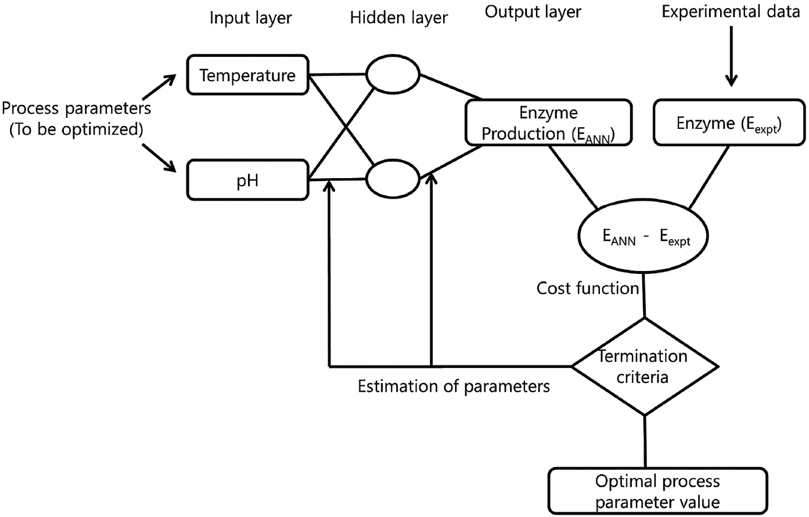

Figure 7.3 Workflow of using ANN as an optimizer.

### 7.3.2 ANN 在酶类过程参数优化中的示例

`ANN` 可用于建模生物过程并预测发酵变量（Thibault et al. 1990）。使用 `ANN` 进行优化的主要优势是它可以接受任意输入并函数（Cybenko 1989）。这些方法适用于过程优化（del Rio-Chanona et al. 2016; Mondal et al. 2021）。

淀粉酶（amylases）是将淀粉转化的酶，广泛应用于食品、发酵、纺织、洗涤剂、纸张、制药等行业。酶学行业是最大的酶类行业之一（Bui et al. 2020）。淀粉酶可从不同来源——动物、植物和微生物——生产，但由于微生物（细菌和真菌）发酵（固体基质或液体基质）更为便捷，故偏好使用微生物来源进行生产和纯化。

Prabhakar and Madhu (2010) 使用 `ANN` 对六个输入（底物含量（香蕉皮）、肽、pH、孵育时间、接种量）进行优化，以利用 *Bacillus subtilis* MTCC 441 生产 α-淀粉酶。模型采用三层结构（6-39-1），即 6 个输入神经元、39 个隐藏层神经元、1 个输出神经元。他们使用了 36 条实验数据，其中 36 条作为训练集，10 条作为验证集。实验结果与 `ANN` 预测的酶活性之间的相关系数 *R* 达到 0.986，显示出模型的良好推广能力。

Mishra et al. (2016) 采用了简单的三层前馈神经网络，以在最佳工艺条件下生产 *Gliomastix indicus* 的 α-淀粉酶。他们采用固体表面发酵，使用芥末油蛋糕作为固体基质。在使用人工神经网络（`ANN`）进行优化时，他们固定了 α-淀粉酶的目标活性，并确定了水分含量、孵育时间、孵育温度、pH 以及氯化钠和硝酸铵（氮源）的浓度的最佳条件。测试数据集的低绝对误差为 2.37，表明 `ANN` 模型对最佳工艺条件的预测具有可推广性。

合成底物在 α-淀粉酶的生产中成本很高。Ousaadi et al. (2021) 使用柑橘果皮作为底物，在浸没发酵中利用 *Streptomyces* sp. 生产 α-淀粉酶。他们将四个过程参数——底物含量（橙皮）、氯化钠粉、接种量和 pH——作为输入输入人工神经网络（`ANN`）。他们确定了 `ANN` 的最佳配置为 4 个输入神经元、3 层隐藏神经元和 1 个输出神经元。在最佳条件下，他们实现了 α-淀粉酶活性的 4 倍提升。

人工神经网络（`ANN`）中的激活函数是其在优化工艺参数以生产酶类时的重要决定因素。葡萄糖酶是作用于部分加工淀粉的重要酶，广泛用于食品和饮料行业。Chang et al. (2006) 通过三层人工神经网络，利用溶解氧和温度两个输入，确定了隐藏层的对数-锥形函数以及输出层的线性函数，以实现 *Monascus anka* 葡萄糖酶的最佳生产。

Inulinases 是水解酶，主要作用于果寡糖、左旋糖果糖和蔗糖，在食品工业中有众多应用，包括高果糖糖浆的生产。Mazutti et al. (2009) 使用人工神经网络研究五个常见变量——培养时间、pH、初始糖蜜浓度、初始玉米糖蜜浓度（CSL）以及初始总还原糖（TRS）浓度——对使用批次培养的酵母 *Kluyveromyces marxianus* NRRL Y-7571 生产 inulinase 的影响。基于实验结果，他们建立了 5-10-3 配置的 `ANN`（5 个输入神经元、10 个隐藏神经元、3 个输出神经元），并发现 `ANN` 的预测优于传统的动力学模型，可用于优化 inulinase 生产的输入变量。

Cellulase 酶降解纤维素和部分多糖，在纺织业有广泛应用。人工神经网络可用于通过优化培养条件和底物浓度来提升 cellulase 的生产。Lakshmi et al. (2020) 采用人工神经网络选取并验证了四个关键因素——pH、温度、底物浓度和孵育时间——的最佳值，用于 *Streptomyces durhamensis* vs15 的 cellulase 生产。他们通过诱变获得了改进的 *S. durhamensis* 菌株， cellulase 产量提高了 1.87 倍。人工神经网络用于寻找重要因素的最佳取值，采用三层人工神经网络，输入 4 个神经元，隐藏 7 个神经元，输出 1 个神经元。人工神经网络还可用于研究 cellulase 生产中特定感兴趣的因素。Singh et al. (2008) 使用人工神经网络验证了湿度对 *Trichoderma reesei* 在固体表面发酵中使用甘蔗渣作为诱导剂时对 cellulase 生产的影响。他们将人工神经网络对湿度的影响预测与实验数据进行比较，发现人工神经网络是一个合适的预测工具，能够近似多元函数。

Chitinase 降解纤维素，是继纤维素之后最丰富的天然物质。纤维素存在于昆虫、甲壳类动物壳体和细菌中。纤维素酶可用作农药，并在临床和制药领域有众多应用（Rathore and Gupta 2015）。Suryawanshi et al. (2020) 使用 *Thermomyces lanuginosus* MTCC 9331 真菌优化孵育时间、pH 和接种量，以提高 chitinase 的产量。他们采用 3 个输入神经元、5 个隐藏神经元、1 个输出神经元的 `ANN` 配置。在 5 天孵育时间、pH 5.6 和 4% 接种量的条件下，获得了 128.53 U/L 的 chitinase 产量，并实现了 >0.9 的 R² 相关系数，表明 `ANN` 预测值与实验数据之间存在非常良好的相关性。

Ismail et al. (2019) 采用深度神经网络（DNN）优化 *Alternaria* sp. 菌株在固体表面发酵中产生外切糖苷酶的工艺参数。深度神经网络是人工神经网络的一种具有更多隐藏层的变体。他们使用了七个工艺参数进行优化，并通过深度神经网络实现了 8.5 倍的酶产量提升（从 2.3–28.931 IU/g 干 substrate 到更高水平）。

人工神经网络可以与其他优化技术（如遗传算法）集成。其他技术可用于缩小输入空间或提升优化过程。人工神经网络与其他技术的结合增强了其能力，使其能够处理更复杂的数据集。该组合已成功应用于酶类生产的工艺参数优化。

碱性蛋白酶是重要的蛋白酶，广泛用于洗涤剂、皮革、银回收、药品、废水处理和食品工业（Sharma et al. 2019）。Subba Rao et al. (2008) 采用人工神经网络优化六个工艺参数，以提高 *Bacillus circulans* 的碱性蛋白酶产量。他们使用了 6 个输入神经元、13 个隐藏层神经元和 1 个输出神经元的 `ANN` 拓扑（6-13-1），并结合遗传算法对输入参数进行精细搜索。这种混合方法使酶产量提升了超过 2.5 倍。类似的方法可用于扩大酶类生产规模。

脂肪酶是水解酶，能将三酰甘油转化为甘油酯、单酰甘油、甘油和脂肪酸。它们在食品加工、洗涤剂配方、药品、纺织、化妆品和造纸等多个行业中应用广泛。脂肪酶在销售量上仅次于蛋白酶和淀粉酶，位列第三大酶类（Hasan et al. 2006）。Aziz et al. (2020) 采用人工神经网络与遗传算法的混合方法，优化了 *Nocardiopsis* sp. 菌株 NRC/WN5 的 11 个工艺参数，用于碱性脂肪酶的生产。他们使用了 11 个输入神经元、100 个隐藏层神经元和 1 个输出神经元的 `ANN` 配置，以优化介质组成和工艺条件。

Laccase 催化酚化合物的氧化降解，并在许多生物技术行业中被使用。Chiranjeevi et al. (2014) 采用人工神经网络-遗传算法混合方法对固态发酵中使用 *Pleurotus ostreatus* 优化六个工艺参数以生产 laccase。他们通过优化六个参数（包括葡萄糖浓度、酵母提取物浓度、硫酸铜、温度和接种量）实现了 laccase 产量翻倍。

## 7.4 描述与应用响应面方法用于工艺优化

RSM 由 Box 和 Wilson 于 1951 年提出，作为化学生产工艺优化的方法（Box and Wilson 1951）。Box 和 Wilson 方法也称为 RSM。该优化方法的动机是最大化产率，而产率被视为一个随不同输入值变化的表面。RSM 与实验设计相关联。该方法采用不同的方式来确定输入变量的最优值。响应面图（即产率表面）的可视化有助于识别变量的敏感性。最陡上升表明变量的增加会提高产率。响应面图帮助识别朝向响应面峰值的最陡上升方向。通过实验得到响应面峰值。常见的实验设计是二水平因子设计。使用 Box 和 Wilson 方法的一个重要发现是，最陡上升可能不足以在工业生产规模上最大化产率，因为不同输入之间存在相互作用。因此，他们建议在优化过程中估计曲面以获得所需的表面。Box 和 Wilson 引入了复合中心设计（CCD），该设计有助于估计曲率和交互作用效应。CCD 类似于五级因子的部分因子设计。实现输入变量最优值的另一个重要策略是识别图中的静止区域。静止区域在表面图中表示优化过程的稳健性。沿最陡下降的路径指示响应面峰值的存在方向。对响应面进行可归一化分析以定位静止点。静止点可以被分类为最优点、鞍点或仅为鞍线。可归一化分析需要全因子设计或部分因子设计来估计产率表面（Chen 1994; Teruel et al. 1997）。

RSM 用于酶生产工艺参数的优化。优化步骤如下：

1. 步骤 1：识别预计会影响酶生产并提高酶产率的工艺参数。常见的工艺参数包括培养基组成、操作条件（pH、时间、温度）、接种量和搅拌速度。

2. 步骨：使用统计设计选择用于优化的参数。

3. 步骤 3：选择实验设计（DOE），采用已选的工艺参数。市面上有许多软件包用于执行实验设计。例如 `Minitab` 和 `Design-Expert`。

4. 步骤 4：执行优化过程。该步骤涉及多变量回归模型的开发。这些模型将因变量（酶产率）与自变量（工艺参数）相关联。实验结果使用 RSM 进行分析。

RSM 适用于酶生产工艺参数的优化，因为该方法能够评估工艺参数对响应（酶产率）的影响。Rath et al. (2022) 通过 RSM 优化了 *Bacillus mycoides* 的操作条件（pH、温度和过氧化氢）以生产木质素过氧化酶，获得了比未优化条件下的酶活性提高 1.76 倍。Vaidya et al. (2003) 通过使用 RSM 方法优化 *Alcaligenes xylosoxydans* 的培养基组分，实现了 1.47 倍的 chitinase 生产量增长。Handa et al. (2016) 采用 RSM 方法提高 *Rhizopus* sp. 的 pectinase 生产，并使用中心复合设计在固态发酵下退化数据。

RSM 方法促成了化工行业（包括发酵方法）中统计方法的应用。这些方法已被广泛用于许多生化合物的产量优化（Gouveia et al. 2001; Gouveia et al. 2001; Singh and Tripathi 2008; Praveen et al. 2008; Banga and Tripathi 2009）。

## 7.5 ANN 与 RSM 方法的比较

RSM 是一种与实验设计相关联的统计方法。RSM 通过单个或多个变量对酶生产（响应）的影响提供可视化的表面图，便于工艺参数的优化。ANN 是为处理复杂数据集而开发的机器学习模型。ANN 训练过程需要利用训练数据集估计模型参数。ANN 的拓扑结构是训练过程的关键步骤，因此 ANN 比 RSM 更耗时。

RSM 涉及多变量回归模型的开发。这些模型可以是一阶或二阶，取决于是否存在变量间的交互作用。然而，二阶多项式方程往往产生次优解（Baishan et al. 2003）。ANN 提供多种适用度函数，可根据数据集的复杂程度进行调整，使其适合处理数据的非线性。

ANN 模型不限制优化过程中的输入数量，任何输入都可以用于 ANN 模型。此外，这些模型与领域独立，可适用于多种应用。相比之下，RSM 在变量较多时，优化过程的应用变得困难。

- 多项研究已发表，比较了 RSM 和 ANN 方法在酶生产过程参数优化中的表现。与 RSM 相比，ANN 能更好地匹配实验数据中的预测最优参数值和酶产率。[Dutta et al. (2004) 通过优化嗜肠弧菌的蛋白酶生产的标准化均方误差（MSE），发现 ANN 模型的 MSE 为 0.05%，而 RSM 模型为 0.1%。同样，Sahu et al. (2019) 发现 ANN 在优化嗜链菌的胆固醇氧化酶生产中比 RSM 预测能力更强。他们比较了皮尔逊相关系数（ANN 0.98 > RSM 0.95）、回归系数（ANN 0.96 > RSM 0.90）以及平均绝对偏差（ANN 3.46% < RSM 9.87%）。Ismail et al. (2019) 还报告称，在优化产生外壳纤蛋白酶的过程中，ANN 的回归系数显著更高（ANN 0.99 > RSM 0.76）。Desai et al. (2008) 优化纤维葡聚糖的发酵介质组成，发现 ANN-GA 混合模型的预测误差低于 RSM 模型（ANN-GA 为 2%，RSM 为 8%）。ANN 模型预测结果的更好匹配表明神经网络模型在处理过程参数与酶产量之间的非线性关系方面具有优势。

ANN 模型的酶产量优于 RSM 模型。Aziz et al. (2020) 通过结合遗传算法的神经网络，在优化发酵条件后，获得了 Nocardiopsis spp.的热稳定性脂蛋白平均产率提高 1.24 倍。同样，Prabhakar and Madhu (2010) 通过 ANN 优化参数，使 B. subtilis 的淀粉酶产量更高，ANN 优化的孵育时间仅为 10.12 小时，而 RSM 方法则为 19.6 小时，显示 ANN 能预测更高效的生产条件。

## 7.6 Conclusions

提高酶的低成本生产是酶行业日益增长的需求。这可以通过为生产过程分配最优资源来实现。涉及介质组成和运行条件的各种过程参数优化需要强大且能够发展的技术。ANN 满足这些要求，因为它能够灵活地使用不同类型的输入。ANN 是跨领域的，有助于将其他领域的进展用于酶生产过程参数的优化。本章讨论了优化过程中的关键策略。实际生产过程中产生的数据复杂，可能无法通过单一策略解决。ANN 能够根据需求灵活地整合所需的改变。

本章通过发表的结果展示了 ANN 在优化各类酶的过程参数中的应用。不同类别酶的 ANN 底层方法相同，但 ANN 的拓扑结构可能因数据而异，这需要有经验的人员进行优化过程。

本章将 ANN 方法与 RSM 进行比较。这种比较有助于理解两种方法的区别。ANN 模型在预测精度和处理过程参数与酶产量之间的非线性关系方面表现优越。ANN 与 RSM 的出版性能表明，ANN 可作为酶生产过程参数优化的良好替代方案。

## References

* Aziz, Mohamed M. Abdel, Eman W. Elgammal, and Roba G. Ghitas 2020. Comparative study on modeling by neural networks and response surface methodology for better prediction and optimization of fermentation parameters: Application on thermo-alkaline lipase production by Nocardiopsis sp. strain NRC/WN5.25. Biocatalysis and Agricultural Biotechnology 25: 101619.

* Baishan, F., C. Hongwen, X. Xiaolan, W. Ning, and H. Zongding 2003. Using genetic algorithms coupling neural networks in a study of xylitol production: Medium optimization. Process Biochemistry 38: 979–985.

* Balaman, Ş. Y. 2019. Modeling and Optimization Approaches in Design and Management of Biomass-Based Production Chains. In *Decision-Making for Biomass-Based Production Chains*, pp. 185–236.

* Banga, J., and C. K. M. Tripathi 2009. Response surface methodology for optimization of medium components in submerged culture of Aspergillus flavus for enhanced heparinase production. Letters in Applied Microbiology 49: 204–209.

* Box, G. E. and K. B. Wilson 1951. On the experimental attainment of optimum conditions. J Royal Statistical Society: Series B (Methodological), 13, no. 1: 1–38.

* Bui, Alexander T., Barbara A. Williams, Emily C. Hoedt, Mark Morrison, Deirdre Mikkelsen, and Michael J. Gidley 2020. High amylose wheat starch structures display unique fermentability characteristics, microbial community shifts and enzyme degradation profiles. Food & Function 11, no. 6:5635–5646.

* Chang, Jyh-Shyong, Jinn-Tsair Lee, and Audrey-Chingzu Chang 2006. Neural-network rate-function modeling of submerged cultivation of Monascus anka. Biochemical Engineering Journal 32, no. 2: 119–126.

* Chen, Hung-Chang 1994. Response-surface methodology for optimizing citric acid fermentation by Aspergillus foetidus. Process Biochemistry 29, no. 5: 399–405.

* Chiranjeevi, Potu Venkata, Moses Rajasekara Pandian, and Sathish Thadikamala 2014 Integration of artificial neural network modeling and genetic algorithm approach for enrichment of laccase production in solid state fermentation by Pleurotus ostreatus. BioResources 9, no. 2: 2459–2470.

* Cybenko, George 1989. Approximation by superpositions of a sigmoidal function. Mathematics of Control, Signals, and Systems 2, no. 4: 303–314.

* Dantzig, George B., and Mukund N. Thapa 1997 Linear Programming. 1, Introduction {Springer Series in Operations Research}. Springer-Verlag, New York.

* del Rio-Chanona, Ehecatl, Antonio, Emmanuel Manirafasha, Dongda Zhang, Qian Yue, and Keju Jing 2016. Dynamic modeling and optimization of cyanobacterial C-phycocyanin production process by artificial neural network. Algal Research 13: 7–15.

* Desai, Kiran M., Shrikant A. Survase, Parag S. Saudagar, S. S. Lele, and Rekha S. Singhal 2008 Comparison of artificial neural network (ANN) and response surface methodology (RSM) in fermentation media optimization: Case study of fermentative production of scleroglucan. Biochemical Engineering Journal 41, no. 3: 266–273.

* Dutta, Jayati Ray, Pranab Kumar Dutta, and Rintu Banerjee 2004 Optimization of culture parameters for extracellular protease production from a newly isolated Pseudomonas sp. using response surface and artificial neural network models. Process Biochemistry 39, no. 12: 2193–2198.

* Gluss, Brian 1961. An introduction to dynamic programming. Journal of the Staple Inn Actuarial Society 16, no. 4: 261–274.

* Gouveia, E. R., A. Baptista-Neto, A. C. Badino, Jr., and C. O. Hokka 2001. Optimization of medium composition for clavulanic acid production by Streptomyces clavuligerus. Biotechnology Letters 23: 157–161.

- Handa, Shweta, Nivedita Sharma, and Shruti Pathania 2016. 多参数优化法在固态发酵中提高 Rhizopus sp. C4 产青霉素的产量. Fermentation 2, no. 2: 10.

- Hasan, F., A.A. Shah, and A. Hameed 2006. 微生物脂肪酶的工业应用. Enzyme and Microbial Technology 39, no. 2: 235–251.

- Houde, Alain, Ali Kademi, and Danielle Leblanc 2004. 脂肪酶及其工业应用. Applied Biochemistry and Biotechnology 118, no. 1: 155–170.

- Ilkova, Tatiana, and Mitko Petrov 2008. 连续和神经动态优化批次发酵工艺. In *International Conference on Artificial Intelligence: Methodology, Systems, and Applications*, pp. 365–369. Springer, Berlin, Heidelberg.

- Ismail, Shaymaa A., Ahmed Serwa, Amira Abood, Bahgat Fayed, Siham A. Ismail, and Amal M. Hashem 2019. 利用深度人工神经网络优化抗真菌外切糖苷酶的生产，并与响应面方法进行比较. Jordan Journal of Biological Sciences 12, no. 5: 541–551.

- Kennedy, Max, and Donal Krouse 1999. 改善发酵介质性能的策略综述. Journal of Industrial Microbiology and Biotechnology 23, no. 6: 456–475.

- Kingma, D. P., and Ba, J. L. 2015. Adam: 随机优化的自适应矩估计方法. In *International Conference on Learning Representations*, pp. 1–13.

- Klein-Marcuschamer, Daniel, Piotr Oleskowicz-Popiel, Blake A. Simmons, and Harvey W. Blanch 2012. 生物燃料生产中酶成本的挑战. Biotechnology and Bioengineering 109, no. 4: 1083–1087.

- Lakshmi, Ega Soujanya, Manda Rama Narasinga Rao, and Muddada Sudhamani 2020. 响应面方法-人工神经网络优化及 Streptomyces sp. 纤维素酶产量的菌株改良. Bioscience Journal: 1390–1402. [`seer.ufu.br/index.php/biosciencejournal/article/view/48006/28992`](https://seer.ufu.br/index.php/biosciencejournal/article/view/48006/28992)

- Luenberger, D.G. 1973. 线性和非线性规划导论. Addison-Wesley Publishing Company, Reading, MA.

- Mandenius, Carl-Fredrik, and Anders Brundin 2008. 使用设计实验法的生物过程优化. Biotechnology Progress 24, no. 6: 1191–1203.

- Mazutti, Marcio A., Marcos L. Corazza, Maria Isabel Rodrigues, Fernanda C. Corazza, and Helen Treichel 2009. 利用农业残留作为底物的批次生物反应器中纤维素酶的生产. Bioprocess and Biosystems Engineering 32, no. 1: 85–95.

- McCulloch, W. S., and W. Pitts 1943. 神经活动中隐含的逻辑计算. The Bulletin of Mathematical Biophysics, 5(4): 115–133.

- Minski, M. L., and S. A. Papert 1969. 单层感知机: 计算几何的入门. MIT Press, Cambridge, MA.

- Mishra, Santosh Kumar, Shashi Kumar, Surendra Kumar, and Ravi Kant Singh 2016. 利用人工神经网络优化农业废弃物产纱糖的工艺参数. Current Trends in Biotechnology and Pharmacy 10, no. 3: 248–260.

- Möller, Philip, Xiaochen Liu, Stefan Schuster, and Daniel Boley 2018. 线性规划模型可解释发酵产物的呼吸. PLoS One 13, no. 2: e0191803.

- Mondal, Payel, Anup Kumar Sadhukhan, Amit Ganguly, and Parthapratim Gupta 2021. 利用响应面方法和人工神经网络-遗传算法优化废弃米饭的生物酶和酶解糖化工艺以生产乙醇. 3 Biotech 11, no. 1: 1–18.

- Ousaadi, Mouna Imene, Fateh Merouane, Mohammed Berkani, Fares Almomani, Yasser Vasseghian, and Mahmoud Kitouni. 2021. 利用嗜盐链霉菌 sp. 优化农业工业橙废的酶的生产. Environmental Research 201: 111494.

- Prabhakar, A., and G. M. Madhu 2010. 利用香蕉皮通过 Bacillus subtilis MTCC 441 生产淀粉酶的统计优化和神经模型. International Journal of Food Engineering 6, no. 4. doi: [10.2202/1556-3758.1980](http://dx.doi.org/10.2202/1556-3758.1980)

- Praveen, V., D. Tripathi, C. K. M. Tripathi, and V. Bihari 2008. 利用统计方法优化新的 Streptomyces sindenensis 株的抗生素 D 生产. Indian Journal of Experimental Biology 46: 139–144.

- Rath, Subhashree, Manish Paul, Hemanta Kumar Behera, and Hrudayanath Thatoi 2022. 响应面方法优化的 Bacillus mycoides 产纤维蛋白酶. Journal, Genetic Engineering & Biotechnology 20, no. 1: 1–20.

- Rathore, Abhishek Singh, and Rinkoo D. Gupta.2015. 从细菌到人类的纤蛋白酶: 性质、应用及未来展望. Enzyme Research [`www.ncbi.nlm.nih.gov/pmc/articles/PMC4668315/`](https://www.ncbi.nlm.nih.gov/pmc/articles/PMC4668315/)

- Robbins, Herbert, and Sutton Monro.1951. 随机逼近方法. In The Annals of Mathematical Statistics: 400–407.

- Rosenblatt, F. 1962. 神经动力学原理. Science Editions, New York.

- Rumelhart, D. E., G. E. Hinton, and R. J. Williams 1986. 通过误差反向传播学习表示. Nature, 323(6088), 533.

- Sahu, Shraddha, Shailendra Singh Shera, and Rathindra Mohan Banik 2019. 利用工艺参数优化的酵母菌产胆固醇酶. The Open Biotechnology Journal, 13, no. 1: 47–58.

- Sharma, Mayuri, Yogesh Gat, Shalini Arya, Vikas Kumar, Anil Panghal, and Ashwani Kumar 2019. 微生物碱性蛋白酶综述: 工业应用的重要工具. Industrial Biotechnology 15, no. 2: 69–78.

- Singh, Aruna, Divya Tatewar, P. N. Shastri, and S. L. Pandharipande 2008. 使用人工神经网络预测 Trichoderma reesei 在固态发酵条件下的纤维素酶和木糖苷酶产量. Indian Journal of Chemical Technology 15: 53–58.

- Singh, Rajendra, Manoj Kumar, Anshumali Mittal, and Praveen Kumar Mehta. 2016. 21 世纪工业酶的进展. 3 Biotech 6, no. 2: 1–15.

- Singh, V., and C. Tripathi 2008. 通过统计优化生产新的 olivanic 酸. Process Biochemistry, 43, no. 11: 1313–1317.

- Singh, Vineeta, Shafiul Haque, Ram Niwas, Akansha Srivastava, Mukesh Pasupuleti, and C.K.M. Tripathi 2017. 发酵介质优化策略综述. Frontiers in Microbiology 7: 2087.

- Srivastava, N., G. Hinton, A. Krizhevsky, I. Sutskever, and R. Salakhutdinov 2014. 脱落: 防止神经网络过拟合的简单方法. The Journal of Machine Learning Research, 15, no. 1: 1929–1958.

* Subba Rao, Ch, T. Sathish, M. Mahalaxmi, G. Suvarna Laxmi, R. Sreenivas Rao, and R. S. Prakasham 2008. Modelling and optimization of fermentation factors for enhancement of alkaline protease production by isolated *Bacillus circulans* using feed-forward neural network and genetic algorithm. Journal of Applied Microbiology 104, no. 3: 889–898.

* Sun, Shiliang, Zehui Cao, Han Zhu, and Jing Zhao 2019. A survey of optimization methods from a machine learning perspective. IEEE Transactions on Cybernetics 50, no. 8: 3668–3681.

* Suryawanshi, Nisha, Jyoti Sahu, Yash Moda, and J. Satya Eswari 2020. Optimization of process parameters for improved chitinase activity from *Thermomyces* sp. by using artificial neural network and genetic algorithm Preparative Biochemistry & Biotechnology 50, no. 10: 1031–1041.

* Tarafdar, Ayon, Ranjna Sirohi, Vivek Kumar Gaur, Sunil Kumar, Poonam Sharma, Sunita Varjani, Hari Om Pandey et al 2021. Engineering interventions in enzyme production: Lab to industrial scale. Bioresource Technology 326: 124771.

* Teruel, A. M. L., E. Gontier, C. Bienaime, J. Nava Saucedo, and J.-N. Barbotin 1997. Response surface analysis of chlortetracycline and tetracycline production with K-carrageenan immobilized *Streptomyces aureofaciens*. Enzyme and Microbial Technology 21: 314–320.

* Thibault, Jules, Vincent Van Breusegem, and Arlette Chéruy 1990. On-line prediction of fermentation variables using neural networks. Biotechnology and Bioengineering 36, no. 10: 1041–1048.

* Torres, Néstor V., Eberhard O. Voit, and Carlos González-Alcón 1996. Optimization of nonlinear biotechnological processes with linear programming: Application to citric acid production by *Aspergillus niger* Biotechnology and Bioengineering 49, no. 3: 247–258.

* Vaidya, Rajiv, Pranav Vyas, and H. S. Chhatpar 2003. Statistical optimization of medium components for the production of chitinase by *Alcaligenes xylosoxydans*. Enzyme and Microbial Technology 33, no. 1: 92–96.

# 8 Advanced Evolutionary Differential Evolution and Central Composite Design: Comparative Study for Process Optimization of Chitinase Production

Nisha Suryawanshi

Government Arts and Commerce College, Sagar, India

J. Satya Eswari

National Institute of Technology, Raipur, India

DOI: [10.1201/9781003292333-8](https://dx.doi.org/10.1201/9781003292333-8)

## 8.1 Introduction

Chitinase (EC 3.2.2.14), a glycosyl hydrolases (GH) enzyme, belongs to the family GH-18, well-known to hydrolyze the 𝛽-1,4 linkages of GlcNAc found in the chitin (Bhattacharya et al. 2007; Chen et al. 2017). Chitinases have been classified as endochitinases and exochitinase, where endochitinases degrade the chitin polymer by hydrolyzing the internal glycosidic bonds and creating oligomers with a small molecular mass. Chitobiosidases and N-acetylglucosaminidases are the two forms of exochitinase, which cause the NAG dimers to be released from the nonreducing end, and cleaves oligomers and dimers obtained by endochitinases and chitobiosidases into a single molecule of N-acetyl glucosamine (GlcNAc), respectively (Sahai and Manocha 1993). Chitinases from thermophilic organisms are known to have inherent thermostability; because of this property, chitinases show potential for efficient degradation of chitin into its oligosaccharides (chito-oligomers). Thermostable enzymes are known to give higher manufacturing process yields and also have the added advantage that it reduces microbial pollution caused by mesophilic species. Chitinase from thermophilic microbes which are thermostable has numerous industrial, medical, environmental, pharmaceutical, and biotechnological applications since chitinase is highly balanced at unfavorable temperatures and pH levels. The thermophilic deuteromycete *Thermomyces lanuginosus* is a broadly dispersed fungus and grows at a temperature between 20°C and 60°C, and 50°C is the optimal temperature for growth (Singh et al. 2003). A few strains of this fungus have been discovered to secrete a significant number of thermostable enzymes involving invertase, protease, trehalase, xylanase, and chitinase(Karn and Kumar 2019; Karn and Duan 2017). Chitinases are utilized in various applications, comprising waste management in agriculture as pest control and in human health care. Chitinase is also used as an antifungal agent, blended with antifungal drugs in rehabilitation for many fungal infections (Oranusi and Trinci 1985).

Chito-oligomers have also gained much attention in pharmaceutics due to their biocompatibility and nontoxicity. Chitooligomers and GlcNAc obtained from Chitin are used in various applications, comprising pharmaceuticals and the food industry. Moreover, chitooligomers are also consumed for numerous reasons, such as antimicrobial activity, antioxidant effect, and drug delivery. It is generally observed that the yield of chitinase is higher in the presence of chitin as a substrate in the production medium. Chitin is a polymer with a high molecular weight that is insoluble in water. As a result, chitin polymer consumption and degradation within the cell by microorganisms are problematic. Therefore, microbes produce enzymes that would dissolve chitin into simpler forms, which can then absorb nutrients. The favorable media components are necessary for chitinase production, which can help microbes develop faster while also increasing the development of chitin-degrading enzymes.

Furthermore, a production medium must be developed for a cost-effective process. There is a wealth of knowledge available for optimization based on one-factor-at-a-time (OFAT) and statistical methods for the formulation of the medium components to promote microorganism growth and the development of chitin-degrading enzymes (Kumar et al. 2012). However, dealing with many variables proved to be a lengthy, costly, and unmanageable process using the OFAT method (Dahiya et al. 2005).

Furthermore，this experimental approach necessitates many trials to find the optimum levels，which are inconsistent (`Vaidya et al. 2003`). Experiments with a statistical design will help overcome the OFAT method’s limitations and maximize the medium’s influencing variables (`Khandelwal et al. 2007`; `Mak et al. 1995`; `Montgomery 2001`; `Chandrasekhar et al. 2021`; `Chandrasekhar et al. 2020`). The application of a statistical design process has several benefits，including the fact that it is fast and accurate for nutrient shortlisting；it is simple to understand the value of media constituents at various concentrations，and it can drastically decrease the number of trials performed. The statistical approach’s benefits include saving electricity，time，glassware，and chemicals (`Vaidya et al. 2003`). To develop the medium components，statistical models，including response surface methodology (`RSM`) (`Roudi et al. 2020`)，are effective tools (`Montgomery 2003`; `Doddapaneni et al. 2007`; `Alslaibi et al. 2013`; `Eswari et al. 2013`). The simplest way to easily identify the important variable from many variables is to use experiment design in statistical techniques. One method is the Plackett–Burman design (`PBD`) which is widely used to screen many variables simultaneously (`Plackett and Burman 1946`; `Yu et al. 1997`). `RSM` has been used for the optimization of chitinase production from filamentous fungi (`Wasli et al. 2009`; `Kumar et al. 2012`; `Dhillon et al. 2011`; `Kumar et al. 2017`; `Liu et al. 2013`). Despite the limitations of well-defined threshold aspects in `RSM`，complementary optimization approaches to find the actual goals are encouraged. The biological demonstration，which can give explanations to a wide range of complicated normalization challenges，is encouraging rapid advances in the field of computational approaches. Biologically encouraged evolutionary algorithms cover various nature-inspired approaches，comprising genetic algorithms and evolution strategies，which are some of the other possibilities for conventional optimization approaches.

`Storn and Price (1997)` suggested an evolutionary computation-based approach *viz*. differential evolution (`DE`) that is remarkably easy，prompt，and vigorous for resolving large standardization-related complications. The probability is more to finding the real optimal of a complication by defeating the drawbacks of other evolutionary approaches: elevated computational rate and time-consuming merging cost (`Bhattacharya et al. 2011`). This research aims to optimize variables to formulate a fermentation medium that will produce the chitinase enzyme from `T. lanuginosus` by applying `PBD` and `RSM`. The regression model developed by `RSM` was subsequently optimized by the advanced evolutionary `DE` approach. To the extent of the author’s belief，this is the first time `RSM` and `DE` have been used to optimize chitinase.

## 8.2 Methods and Materials

### 8.2.1 Microorganism and Growth Condition

`T. lanuginosus` (`MTCC 9331`) lyophilized culture was obtained from MTCC Institute of Microbial Technology，Chandigarh. The organism was grown for 7 d at 50°C on slants of saboured dextrose agar (SDA)，stored at 4°C，and subcultured once a month to use later.

### 8.2.2 Substrate Preparation (Colloidal Chitin)

The procedure for making colloidal chitin was obtained from literature (`Roberts and Selitrennikoff 1988`; `Suryawanshi and Jujjawarapu 2020`). Shrimp shell chitin flakes (5 g) were dissolved in 100 mL concentrated HCl and stirred for 2 h. The mixture was added to pre-chilled distilled water and continuously stirred for 2 h. Following gentle mixing，the mixture was centrifuged at 10，000 rpm for 10 min at 4°C. To achieve a neutral pH，the colloidal chitin was cleaned in distilled water many times. Further，the colloidal chitin was heat sterilized at 121°C for 15 min and kept at 4°C for further use. Chitin (5 g) was transformed into 15 g of colloidal chitin (wet weight).

### 8.2.3 Production of Chitinase

To produce the chitinase enzyme 100 mL of production media containing 10 g/L colloidal chitin，0.87 g/L，K[2]HPO[4]，0.68 g/L KH[2]PO[4]，0.2 g/L KCl，1.0 g/L NH[4]Cl，0.2 g/L MgSO[4]. 7H[2]O，and 4.0 g/L yeast extract (pH 6.5) (`Zhang 2014`) was poured into an Erlenmeyer flask with a capacity of 250 mL and a 5% seed culture was inoculated into the medium. After that，the culture medium was incubated for 6 d at 50°C and 150 rpm. After 6 d of incubation，the medium was centrifuged for 10 min (10，000 rpm，4°C). Chitinase activity was calculated using the supernatant as a crude enzyme (`Suryawanshi and Jujjawarapu 2020`).

### 8.2.4 Chitinase Enzyme Activity Assay

The chitinase activity was carried out on colloidal chitin as a substrate (`Purushotham et al. 2012`). The substrate colloidal chitin (1%) was formed in a 50 mM phosphate buffer of pH 6.5. For the reaction，500 μL of 1% substrate colloidal chitin and 500 μL of culture supernatant were taken. The reaction mixture was kept at 50°C for 1 h in a shaking incubator followed by a water bath for 10 min at 100°C. After that，the resulting mixture was centrifuged for 10 min at 10，000 rpm. The supernatant was then analyzed to estimate the concentration of the N-acetyl-glucosamine using HPLC with Aminex HPX-87H column. The amount of chitinase used to liberate 1 micromole of NAG under reaction conditions is determined as 1 unit of chitinase activity.

### 8.2.5 Statistical Optimization of Medium Components

#### 8.2.5.1 Plackett–Burman Design

With 19 variables，including four dummy variables，the PBD was used to obtain the most significant factors influencing the chitinase activity (`Plackett and Burman 1946`). Low-level (`-1`) and high-level (`+1`) analyses were conducted on the variables (`Table 8.1`). The evaluation of chitinase activity was done with 20 experiments. The experimental design of Plackett–Burman (`Table 8.2`) was prepared in the “Design-Expert version 12”，State-Ease Inc.，Minneapolis，USA，statistical software with 19 variables for 20 experiments. The experiments were conducted thrice and evaluated by the same software.

Table 8.1 Placket–Burman Design for Optimization of 19 Factors Each at Two Levels for the Production of Chitinase Enzyme

```markdown


| Factor | Name | Low Level (−1) | High Level (+1) |
| --- | --- | --- | --- |
| A | Colloidal chitin | 1 | 10 |
| B | Glucose | 0.2 | 2 |
| C | KNO[3] | 2 | 10 |
| D | Yeast extract | 0.5 | 5 |
| E | KH[2]PO[4] | 0.14 | 0.68 |
| F | Na[2]HPO[4] | 0.14 | 0.7 |
| G | MgSO[4] | 0.02 | 0.2 |
| H | MnSO[4] | 0.0001 | 0.001 |
| J | CaCl[2] | 0.005 | 0.05 |
| K | KCl | 0.2 | 2 |
| L | ZnSO[4] | 0.0001 | 0.001 |
| M | FeSO[4] | 0.002 | 0.02 |
| N | CoCl[2] | 0.0001 | 0.001 |
| O | Tween 80 | 0.1 | 1 |
| P | Triton X | 0.1 | 1 |
| Q | Dummy 1 | −1 | 1 |
| R | Dummy 2 | −1 | 1 |
| S | Dummy 3 | −1 | 1 |
| T | Dummy 4 | −1 | 1 |

**Table 8.2 Experimental Design and Results of Placket–Burman Design**

| Run | A:Colloidal Chitin | B:Glucose | C:KNO[3] | D:Yeast Extract | E:KH[2]PO[4] | F:Na[2]HPO[4] | G:MgSO[4] | H:MnSO[4] | J:CaCl[2] | K:KCl | L:ZnSO[4] |
| --- | --- | --- | --- | --- | --- | --- | --- | --- | --- | --- | --- |
|  | % | % | % | % | % | % | % | % | % | % | % |


| 1 || −1 || 1 || 1 || −1 || −1 || 1 || 1 || 1 || 1 || −1 || 1 |
| --- | --- | --- | --- | --- | --- | --- | --- | --- | --- | --- | --- |
| 2 || −1 || −1 || −1 || 1 || 1 || −1 || 1 || 1 || −1 || −1 || 1 |
| 3 || 1 || 1 || −1 || 1 || −1 || 1 || −1 || −1 || −1 || −1 || 1 |
| 4 || −1 || 1 || −1 || 1 || −1 || −1 || −1 || −1 || 1 || 1 || −1 |
| 5 || 1 || 1 || −1 || −1 || 1 || 1 || 1 || 1 || −1 || 1 || −1 |
| 6 || −1 || −1 || 1 || 1 || 1 || 1 || −1 || 1 || −1 || 1 || −1 |
| 7 || 1 || −1 || 1 || −1 || 1 || −1 || −1 || −1 || −1 || 1 || 1 |
| 8 || 1 || 1 || −1 || 1 || 1 || −1 || −1 || 1 || 1 || 1 || 1 |
| 9 || −1 || −1 || −1 || −1 || −1 || −1 || −1 || −1 || −1 || −1 || −1 |
| 10 || 1 || 1 || 1 || −1 || 1 || −1 || 1 || −1 || −1 || −1 || −1 |
| 11 || 1 || −1 || 1 || 1 || −1 || −1 || 1 || 1 || 1 || 1 || −1 |
| 12 || −1 || 1 || 1 || 1 || 1 || −1 || 1 || −1 || 1 || −1 || −1 |
| 13 || −1 || −1 || 1 || 1 || −1 || 1 || 1 || −1 || −1 || 1 || 1 |
| 14 || 1 || −1 || 1 || −1 || −1 || −1 || −1 || 1 || 1 || −1 || 1 |
| 15 || 1 || −1 || −1 || −1 || −1 || 1 || 1 || −1 || 1 || 1 || −1 |
| 16 || 1 || −1 || −1 || 1 || 1 || 1 || 1 || −1 || 1 || −1 || 1 |
| 17 || −1 || −1 || −1 || −1 || 1 || 1 || −1 || 1 || 1 || −1 || −1 |
| 18 || −1 || 1 || 1 || −1 || 1 || 1 || −1 || −1 || 1 || 1 || 1 |
| 19 || 1 || 1 || 1 || 1 || −1 || 1 || −1 || 1 || −1 || −1 || −1 |
| 20 || −1 || 1 || −1 || −1 || −1 || −1 || 1 || 1 || −1 || 1 || 1 |
| M:FeSO[4]  || N:CoCl[2] || O:Tween 80 || P:Triton X || Q:Dummy 1 || R:Dummy 2 || S:Dummy 3 || T:Dummy 4 || R1 (Chitinase Activity) || R2 (Biomass) |
| --- | --- | --- | --- | --- | --- | --- | --- | --- | --- | --- | --- |
| % || % || % || % || % || % || % || % || U/L || g/L |
| −1 || 1 || −1 || −1 || −1 || −1 || 1 || 1 || 8.04 || 0.21 |
| --- | --- | --- | --- | --- | --- | --- | --- |
| 1 || 1 || 1 || −1 || 1 || −1 || 1 || −1 || 11.95 || 0.83 |
| 1 || −1 || 1 || 1 || −1 || −1 || 1 || 1 || 16.54 || 1.07 |
| 1 || 1 || −1 || −1 || 1 || 1 || 1 || 1 || 7.51 || 0.845 |
| 1 || −1 || −1 || −1 || −1 || 1 || 1 || −1 || 15.27 || 0.775 |
| −1 || −1 || −1 || 1 || 1 || −1 || 1 || 1 || 9.30 || 0.885 |
| −1 || 1 || 1 || −1 || −1 || 1 || 1 || 1 || 24.03 || 1.405 |
| −1 || 1 || −1 || 1 || −1 || −1 || −1 || −1 || 34.18 || 0.475 |
| −1 || −1 || −1 || −1 || −1 || −1 || −1 || −1 || 15.31 || 1.045 |
| 1 || 1 || −1 || 1 || 1 || −1 || −1 || 1 || 12.55 || 0.84 |
| 1 || −1 || 1 || −1 || −1 || −1 || −1 || 1 || 32.67 || 0.67 |
| −1 || −1 || 1 || 1 || −1 || 1 || 1 || −1 || 28.58 || 1.185 |
| 1 || 1 || −1 || 1 || −1 || 1 || −1 || −1 || 9.23 || 0.745 |
| 1 || −1 || −1 || 1 || 1 || 1 || 1 || −1 || 20.36 || 0.55 |
| −1 || 1 || 1 || 1 || 1 || −1 || 1 || −1 || 25.44 || 0.485 |
| −1 || −1 || −1 || −1 || 1 || 1 || −1 || 1 || 22.78 || 0.84 |
| 1 || 1 || 1 || 1 || −1 || 1 || −1 || 1 || 11.59 || 0.52 |
| 1 || −1 || 1 || −1 || 1 || −1 || −1 || −1 || 14.58 || 0.5 |
| −1 || 1 || 1 || −1 || 1 || 1 || −1 || −1 || 28.54 || 0.87 |
| −1 || −1 || 1 || 1 || 1 || 1 || −1 || 1 || 22.70 || 1.045 |
#### 8.2.5.2 The Central Composite Design and the Response Surface Methodology

The four very significant variables (yeast extract, Tween 80, glucose, and colloidal chitin) obtained from the PBD were then standardized for optimum levels by utilizing a central composite design to boost the activity of chitinase. The objective factors were evaluated with five levels, i.e., −*α*, −1, 0, +1, +*α*, (−1 = low level, +1 = high level, *α* = 2*k*/4, where k is the no. of factors), 30 experiments (Table 8.3) was performed with 8 axial points, 16 factorial points, and 6 center points. The results obtained by experiments were evaluated using statistical software “Design-Expert version 12”, State-Ease Inc., Minneapolis, USA. The mean value of chitinase activity was reffered to as response (R). Analysis of variance (ANOVA) was done to obtain an accurate model that reveals the importance of objective variables and determines their interaction. The regression equation described the nature of the model-

Table 8.3 Central Composite Design Model Experimental Design Matrix (n = 4)

|  || Factor 1 || Factor 2 || Factor 3 || Factor 4 || Response Observed || Response Predicted |
| --- | --- | --- | --- | --- | --- | --- |
| Run || A: Colloidal Chitin || B: Glucose || C: Tween 80 || D: Yeast Extract || R1 || R1 |
| --- | --- | --- | --- | --- | --- | --- |
|  || % || % || % || % || U/L || U/L |
| 1 || 1 || 0.25 || 0.07 || 6 || 90.51 || 90.19 |
| 2 || 1 || 0.25 || 0.03 || 6 || 86.74 || 80.86 |
| 3 || 1 || 0.15 || 0.07 || 6 || 101.82 || 98.54 |
| 4 || 0.8 || 0.2 || 0.05 || 5 || 77.93 || 79.57 |
| 5 || 1.2 || 0.2 || 0.05 || 5 || 73.73 || 73.75 |
| 6 || 1.4 || 0.25 || 0.07 || 6 || 105.12 || 94.38 |
| 7 || 1 || 0.25 || 0.03 || 4 || 75.42 || 76.51 |
| 8 || 1.2 || 0.2 || 0.05 || 5 || 73.76 || 73.74 |
| 9 || 1 || 0.25 || 0.07 || 4 || 82.18 || 77.29 |
| 10 || 1.2 || 0.3 || 0.05 || 5 || 75.52 || 83.87 |
| 11 || 1 || 0.15 || 0.03 || 4 || 72.41 || 77.03 |
| 12 || 1.2 || 0.2 || 0.05 || 5 || 73.90 || 73.74 |
| 13 || 1.4 || 0.15 || 0.07 || 6 || 103.13 || 97.01 |
| 14 || 1.2 || 0.2 || 0.01 || 5 || 82.62 || 83.53 |
| 15 || 1.2 || 0.1 || 0.05 || 5 || 84.23 || 87.02 |
| 16 || 1.2 || 0.2 || 0.09 || 5 || 87.66 || 97.87 |
| 17 || 1.4 || 0.15 || 0.03 || 6 || 84.69 || 83.45 |
| 18 || 1.6 || 0.2 || 0.05 || 5 || 78.93 || 88.42 |
| 19 || 1.4 || 0.25 || 0.07 || 4 || 92.35 || 89.73 |
| 20 || 1.4 || 0.15 || 0.03 || 4 || 86.39 || 81.69 |
| 21 || 1 || 0.15 || 0.03 || 6 || 89.44 || 87.04 |
| 22 || 1.2 || 0.2 || 0.05 || 5 || 73.35 || 73.74 |
| 23 || 1.4 || 0.25 || 0.03 || 6 || 84.62 || 82.98 |
| 24 || 1.4 || 0.15 || 0.07 || 4 || 86.94 || 86.70 |
| 25 || 1.2 || 0.2 || 0.05 || 5 || 73.82 || 73.74 |
| 26 || 1 || 0.15 || 0.07 || 4 || 83.36 || 79.97 |
| 27 || 1.4 || 0.25 || 0.03 || 4 || 89.73 || 86.89 |
| 28 || 1.2 || 0.2 || 0.05 || 3 || 74.19 || 75.09 |
| 29 || 1.2 || 0.2 || 0.05 || 7 || 79.50 || 89.74 |
| 30 || 1.2 || 0.2 || 0.05 || 5 || 73.93 || 73.74 |
(8.1)  

$$Y = \\beta\_{0} + \\sum\\limits\_{i = 1}^{3}\\beta\_{i}X\_{i} + \\sum\\limits\_{i = 1}^{3}\\beta\_{ii}X\_{i}^{2} + \\sum\\limits\_{ij = 1}^{3}\\beta\_{ij}X\_{ij}$$  

where *Y* = expected response, *β*[0] = balanced term, *β*[*i*] = constant for the linear terms, *β*[*ii*] = constant for square terms, and *β*[*ij*] = constant of interactive terms. The optimum levels of four significant factors were determined using the regression equation.

### 8.2.6 Machine Learning Approach: Differential Evolution

#### 8.2.6.1 Differential Evolution in the Context

- Kenneth and Storn (1997) 引入了 DE，它被公认为在过去几年中建立的元启发式搜索算法（MSAs）中，解决复杂优化问题的更为显著的优化器。DE 是一种基于群体的方法，常用于解决各种优化问题，并且属于进化算法（EA）家族。与其他 EA 相比，它们通过带有梯度变异向量的困扰解来开发后代，而 DE 则在特定条件下重组解来产生新的后代。如果新的后代解决方案超过当前个体解决方案，则会被替换（Price et al. 2006）。由于其搜索过程由多个自动化过程变量（包括缩放因子和交叉率）所控制，DE 被视为一种强健且简洁的算法。DE 与其他 EA 类似，有三种方式生成新的后代解决方案：变异、交叉和选择。变异和交叉都被认为对算法的搜索效率有更大的影响（Qin et al. 2009）。尽管近年来基于自然现象的大量 MSAs 被提出，DE 仍因其显著的竞争优势，成为学术界和实践者解决广泛真实世界优化问题的主要 MSAs 之一。首先，DE 的部署比其他 MSAs 更简单、更易于使用（Das and Suganthan 2010）。这一特性使得没有强大编程专业知识的操作者能够对 DE 进行小幅修改，以解决其特定领域的挑战。其次，由于结构简单，DE 在处理具有非线性、多模态和不可分离等困难特征的各类优化问题时，表现优于其他 MSAs。再次，自 2005 年以来，各种 DE 形式始终在最大进化计算（CEC）比赛的最佳优化器行列中，表明 DE 形式具备解决具有竞争搜索效率、搜索耐久性和更快收敛的实际问题的潜力（Pant et al. 2020）。最后，与其他可能在困难优化问题上表现良好的 MSAs 相比，DE 具有最小空间复杂度这一最受期待的特性（Das and Suganthan 2010）。此外，由于空间需求最小，DE 在解决大规模和计算密集型优化任务时，比某些现有 MSAs 拥有更大的灵活性。
#### 8.2.6.2. The Fundamentals of DE Algorithms

初始化、变异、交叉和选择是基本 DE 算法框架的四个阶段，如 Figure 8.1 所示。初始化是一次性步骤，而随后的三个过程会在 DE 在 D 维解空间中的搜索过程中，直到满足终止条件为止，反复进行。

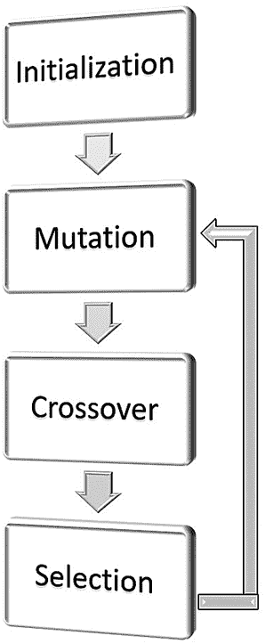

Figure 8.1 Subsequent stages of differential evolution.

##### 8.2.6.2.1 Initialization

初始化是 DE 在 D 维实际约束空间中寻找通用最优结果的第一步。针对特定多维优化任务的初始结果是 NP 实际值约束向量，其中 NP 表示 DE 的种群规模。

在 t‑th 迭代中，第 i 个 DE 结果可以表示为 (Equation (8.2)) 的 D 维向量：

(8.2)  

*X*[*i*]^(*t*) = (*X*[*i*, 1],*X*[*i*, 2],……,*X*[*i*, *D*])  

其中 *I* = 1, 2, …, NP 为整数。

在 *t* = 0 时，初始种群状态被建立。初始阶段可以利用结果检查空间的下限和上限（分别由 (Equations (8.3) 和 (8.4)) 给出）来生成初始候选解：

(8.3)  

*X*[min] = (*X*[min , 1],*X*[min , 2],…*X*[min , *D*])  

(8.4)  

*X*[max] = (*X*[max , 1],*X*[max , 2],…*X*[max , *D*])  

每个 *i*‑th DE 解的第 j 个维度可以通过在 *X*[min, *j*] 与 *X*[max, *j*] 之间任意生成一个值来初始化，如 (Equation (8.5)) 所示：

(8.5)  

*X*[*i*, *j*]^((0)) = *X*[min , *j*] + *rand*[*i*, *j*]\0,1\  

其中 *rand*[*i*, *j*]\[0, 1\] 是均匀分布，能够生成 0 到 1 之间的任意实数。

##### 8.2.6.2.2 Mutation

在生物学中，突变被描述为染色体基因特征的瞬时改变。突变是进化算法中用于指定决策变量的随机扰动方法。

在 DE 哲学中，表示为 *Y*[*i*]^(*t*) 的变异向量（或 donor vector）是基于指定的目标向量 *X*[*i*]^(*t*) 通过变异过程生成的（Pant et al. 2020, Neri and Tirronen 2010）。DE 变异技术通常表示为 “DE/\*/*n*”，其中 *n* 表示参与变异的向量数量，\* 表示在变异过程中评估的客观向量。下面的公式展示了五种常见的 DE 变异策略：

*   DE/rand/1:

    (8.6)  

    *Y*[*i*]^(*t*) = *X*[*r*[1]]^(*t*) + *F*(*X*[*r*[2]]^(*t*)−*X*[*r*[3]]^(*t*))  

*   DE/rand/2:

    (8.7)  

    *Y*[*i*]^(*t*) = *X*[*r*[1]]^(*t*) + *F*(*X*[*r*[2]]^(*t*)−*X*[*r*[3]]^(*t*)) + *F*(*X*[*r*[4]]^(*t*)−*X*[*r*[5]]^(*t*))  

*   DE/best/1:

    (8.8)  

    *Y*[*i*]^(*t*) = *X*[*b**e**s**t*]^(*t*) + *F*(*X*[*r*[1]]^(*t*)−*X*[*r*[2]]^(*t*))  

*   DE/best/2:

    (8.9)  

    *Y*[*i*]^(*t*) = *X*[*b**e**s**t*]^(*t*) + *F*(*X*[*r*[1]]^(*t*)−*X*[*r*[2]]^(*t*)) + *F*(*X*[*r*[3]]^(*t*)−*X*[*r*[4]]^(*t*))  

*   DE/current-to-best/1:

    (8.10)  

    *Y*[*i*]^(*t*) = *X*[*i*]^(*t*) + *F*(*X*[*b**e**s**t*]^(*t*)−*X*[*i*]^(*t*)+*F*(*X*[*r*[1]]^(*t*)−*X*[*r*[2]]^(*t*))  

    其中 *r*[1] 表示被选为社区向导的 DE 结果的索引，*r*[2]、*r*[3]、*r*[4]、*r*[5] 则分别表示用于生成变异向量的随机选取的 DE 结果索引，且 *r*[1]、*r*[2]、*r*[3]、*r*[4]、*r*[5] 均属于 [NP] 且互不相同，且不等于 *i*；*X*[*b**e**s**t*]^(*t*) 表示目标向量是从 DE 种群的最优个体解中选取的；*F* 是控制变异幅度的尺度参数，取值范围为 \[0,1\]。选择合适的 *F* 值对于平衡算法的探索与开发非常重要，可避免早期收敛或收敛速度慢等缺点。

##### 8.2.6.2.3 Crossover

在该步骤中，变换后的目标向量和变异向量以随机方式交叉其元件，形成试向量。目标向量可以通过此交叉过程获得给定解的特征或从变异向量中获取特性。常用的交叉操作包括均匀交叉和指数交叉。控制均匀交叉的交叉率（CR）取值范围为 \[0,1\]。均匀交叉的试解可以表示为 (Equation (8.11))：

(8.11)  

$$Z\_{i}^{t} = \\left\\{ \\begin{array}{l} {Y\_{i.j}^{t}\\quad{if}\\ r\\ \\mathit{an}d\_{i,j}\\left\\lbrack {0,1} \\right\\rbrack \\leq CR\\ \\mathit{or}\\ j = k} \\\\ {X\_{i.j}^{t}\\mspace{9mu}{Otherwise}} \\\\ \\end{array} \\right.$$  

where `rand`[`i`, `j`] 是一个在 0 到 1 之间的随机值，`k` ∈ {1, 2…, `D`} 是随机选择的测量指南，用于确认至少一个一维元素的试验解 `Z`[`i`]^(`t`) 是 `Y`[`i`, `j`]^(`t`) 给出向量的后代。

对于指数交叉，参考向量的维度索引是从整数 `n` ∈ {1, 2, …….., `D`} 中随机选取的。用于生成试验解的从捐赠或突变向量获取的维度元素数量由整数 `L` ∈ {1, 2, …, `D`} 表示。试验解 `Z`[`i`]^(`t`) 可通过 (方程 8.12) 使用 `n` 和 `L` 的值来获得：

(8.12)  

```


$$Z_{i}^{t} = \left\{ \begin{array}{l} {Y_{i.j}^{t}\quad{if}\ j = \left\langle n \right\rangle_{D},\mspace{9mu}\left\langle {n + 1} \right\rangle_{D},\ldots,\left\langle {n + L - 1} \right\rangle_{D}} \\ {X_{i.j}^{t}\mspace{9mu}{Otherwise}} \\ \end{array} \right.$$

其中，`D` 模函数记为 〈.〉[`D`]。

具有邻近选择变量关联的优化算法，特别是那些具有邻近选择变量关联的算法，据说与对数交叉效果更好。

##### 8.2.6.2.4 选择

该过程使 DE 能够在以下重复 (`X`[`i`]^(`t` + 1)) 中判断目标（父）解或试验（后代）解是否存活，同时保持 DE 种群的规模不变。生成新一代种群后，变异、交叉和选择的循环进程会反复进行，直至满足终止条件。选择分为局部和全局两种（Xiao et al. 2019）。DE 选择过程的数学描述如下：

(8.13)

```
$$X_{i}^{t + 1} = \left\{ \begin{array}{l} {Z_{i}^{t}\quad{if}\ f\left( Z \right)_{i}^{t} \leq fX_{i}^{t}} \\ {X_{i}^{t}\ {Otherwise}} \\ \end{array} \right.$$
```

其中 `f(.)` 是用于确定个体解的适应度函数或预测值的运算符。在下一迭代中，如果最新的试验向量 `Z`[`i`]^(`t`) 的函数值是公正的，则当前的目标向量 `X`[`i`]^(`t`) 将被 `Z`[`i`]^(`t`) 替换。DE 的选择过程可以同步或异步进行。同步模式下，DE 种群一次性全部更新；异步模式下，DE 种群逐个更新。

简要地说，差分演化实验基于用于全局优化的常数球面种群，按易度、效率和强度分类（Bhattacharya et al. 2011）。它的工作原理是为每个元素在每一代构造一个转化向量。该突变向量是通过增加随机选取的两个种群成员之间的距离来生成的。基于转化向量，通过交叉过程生成试验向量，以关联当前元素和转化向量的元素。试验向量与当前一代相关的元素以及根据目标函数的最佳元素进行比较，较佳的那个会被移到下一代种群。下面是对改进的 DE 算法（Bhattacharya et al. 2011）的摘要：

* 步骤 1：准备一代；
* 步骤 2：估计一代；
* 步骤 3：在新种群中组装，使每个单独候选者得到等价的参考：
  1. 从一代中随机选择三个不同的候选者 `r1`、`r2`、`r3`，且它们与 `i` 不同；
  2. 预备一个试验向量；
  3. 通过可能控制参数，使用单一最小匹配将该向量的匹配纳入；
  4. 若候选解不可接受，则通过将候选者改为相邻的一个来更改其不可接受的匹配；
  5. 估计候选解；
  6. 若候选解与现有个体同样好，则将其应用于下一代种群；
* 步骤 4：循环步骤 3，直至满足终止条件。

基于计算的差分演化是一种有效的方法，可用于优化生物分子的生产所需的发酵基质。要在 MATLAB 中运行差分演化，需要三段代码，即 `DE`、`Sphere` 和 `main`。下面是从 Mostapha Kalami Heris 获得的 MATLAB 差分演化代码（URL: [`yarpiz.com/231/ypea107-differential-evolution`](https://yarpiz.com)），(Yarpiz, 2015)：

**DE**

**Sphere**

**Main**

### 8.2.7 验证实验

通过在预测条件下执行实验，验证了 CCD 所得模型。采样每 24 小时一次，并分析纤维素酶活性。验证实验的结果与使用基质媒体得到的结果进行了比较。

### 8.3 结果与讨论

#### 8.3.1 Plackett–Burman 设计

PBD 用于筛选影响纤维素酶活性的重要变量。共涉及 19 个变量，进行 20 次实验，发现纤维素酶产量存在显著差异；纤维素酶活性在 7.51–34.18 U/L 的范围内最低和最高（Table 8.2）。这种活性的变化表明，为了获得 *T. lanuginosus* 的更高纤维素酶产量，需要对培养基成分进行优化（Zeng et al. 2018）。PBD 实验结果通过 ANOVA（Table 8.4）进行评估，以确定显著变量。在 15 个变量中，纤维素酶产量最显著的变量为酵母提取物、 Tween 80、葡萄糖和胶体壳聚糖。高 F 值（49.21）表明模型显著。这意味着模型的 P 值（> *F*）小于 0.0001，即模型出现如此大的 F 值（49.21）仅有 0.01% 的概率是由于噪声引起的。R² 值为 0.9883，说明模型能够解释 98.83% 的数据变异。此外，极低的变异系数（8.05%）也表明模型可靠。所有 P 值小于 0.05 的变量被认定为对纤维素酶产量显著。通过 Pareto 图，选取了正向和负向影响的变量（Figure 8.2）。观察到，胶体壳聚糖、CaCl₂、Tween 80、酵母提取物、KCl 和 MnSO₄ 表现出正向影响；而 FeSO₄、NaH₂PO₄ 和 CoCl₂ 则对纤维素酶产量产生负向影响；葡萄糖、Tween 80、酵母提取物和 KH₂PO₄ 则呈正向影响；CaCl₂、MnSO₄、NaH₂PO₄、CoCl₂、FeSO₄、MgSO₄ 和 ZnSO₄ 则对 biomass 产生负向影响。为进一步优化，选取了四个对纤维素酶活性和 biomass 产生负面影响的变量，并使用中心复合设计进行进一步优化。总体而言，Plackett–Burman 设计已被多位研究者成功用于筛选影响纤维素酶产量的重要培养基成分，以制定最佳培养基（Mishra et al. 2012; Patel et al. 2007; Nawani and Kapadnis 2005）。

Table 8.4 Experimental Effects of the Plackett–Burman Design for Chitinase Production by *T. lanuginosus* Were Analyzed Using the Analysis of Variance

| Source | Sum of Squares | df | Mean Square | F-Value | P-Value |  |
| --- | --- | --- | --- | --- | --- | --- |
| **Model** | 1317.92 | 12 | 109.83 | 49.21 | < 0.0001 | Significant |

| --- | --- | --- | --- | --- | --- | --- |
| A-胶体壳聚糖 | 437.63 | 1 | 437.63 | 196.09 | < 0.0001 |  |
| D-酵母提取物 | 49.25 | 1 | 49.25 | 22.07 | 0.0022 |  |
| F-Na[2]HPO[4] | 117.59 | 1 | 117.59 | 52.69 | 0.0002 |  |
| H-MnSO[4] | 16.31 | 1 | 16.31 | 7.31 | 0.0305 |  |
| J-CaCl[2] | 81.26 | 1 | 81.26 | 36.41 | 0.0005 |  |
| K-KCl | 17.41 | 1 | 17.41 | 7.80 | 0.0268 |  |
| M-FeSO[4] | 222.21 | 1 | 222.21 | 99.57 | < 0.0001 |  |
| N-CoCl[2] | 31.31 | 1 | 31.31 | 14.03 | 0.0072 |  |
| O-Tween 80 | 192.77 | 1 | 192.77 | 86.38 | < 0.0001 |  |
| Q-Dummy 1 | 19.44 | 1 | 19.44 | 8.71 | 0.0214 |  |
| S-Dummy 3 | 68.89 | 1 | 68.89 | 30.87 | 0.0009 |  |
| T-Dummy 4 | 63.87 | 1 | 63.87 | 28.62 | 0.0011 |  |
| **Residual** | 15.62 | 7 | 2.23 |  |  |  |
| **Cor Total** | 1333.55 | 19 |  |  |  |  |
| *Note:* Significant model terms are indicated by values of “Prob > *F* < 0.0500”. |
| --- |

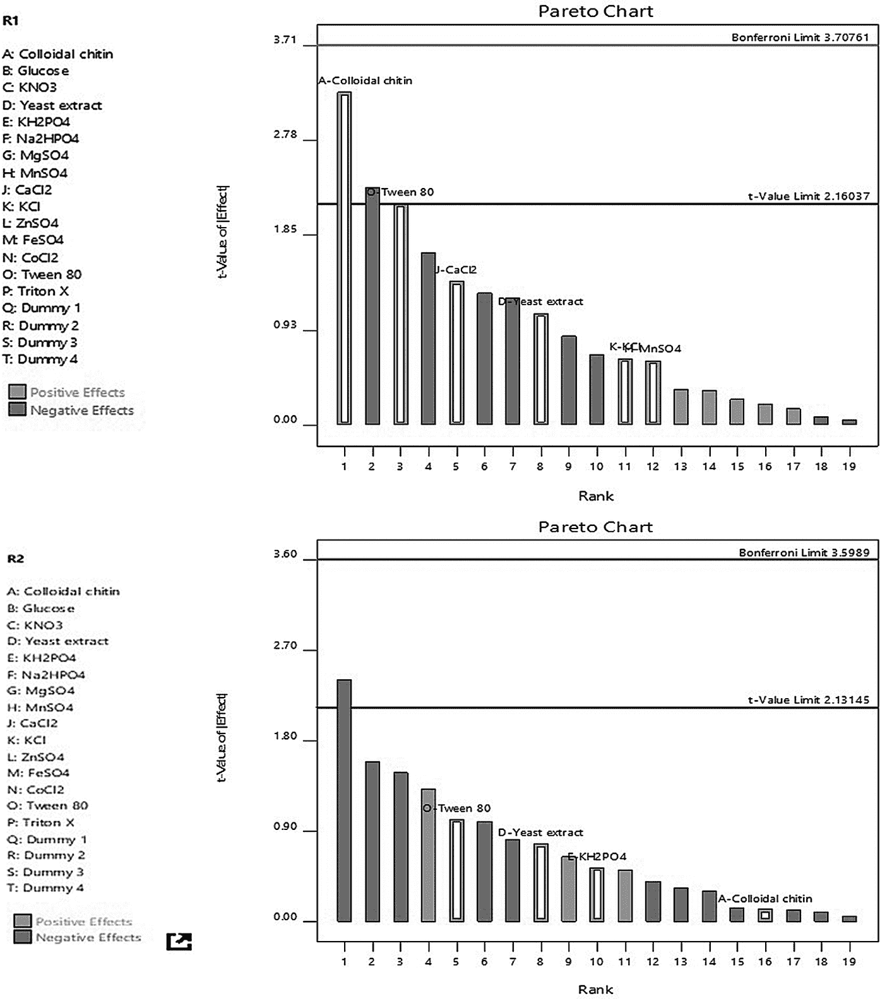
Figure 8.2 Pareto chart showing the negatively and positively affecting variables for chitinase activity (R1) and biomass (R2) obtained by Placket–Burman design.

### 8.3.2 Central Composite Design

An economic production medium is required for the cost-effective production process of biocatalysts used in industries. Optimization studies for enhanced production of enzymes are improved by employing an RSM that involves selecting a significant variable and optimal concentration for the best outcomes. The four variables (*k* = 4) *viz*. yeast extract, Tween 80, glucose, and colloidal chitin selected by PBD were analyzed for their effect and interaction at five coded levels with the help of a central composite design (Table 8.3). With the central composite design results, ANOVA was performed, and a second-order polynomial equation (Suryawanshi and Jujjawarapu 2020) was constructed to explain the output of chitinase as a function of the analyzed variables (Equation (8.2)).

(8.14)

```
$$\begin{array}{ll} {R =} & {73.75 + 2.21 \times A - 0.79 \times B + 3.58 \times C + 3.66 \times D + 1.43 \times A \times B} \\ & {+ 0.52 \times A \times C - 2.06 \times A \times D - 0.54 \times B \times C - 1.42 \times B \times D} \\ & {+ 2.14 \times C \times D + 2.56 \times A^{2} + 2.92 \times B^{2} + 4.2 \times C^{2}} \\ & {+ 2.17 \times D^{2}} \\ \end{array}$$
```


`R` stands for chitinase activity (U/L), and `A`, `B`, `C`, and `D` stand for colloidal chitin, glucose, Tween 80, and yeast extract, respectively.

ANOVA was employed for the chitinase activity, where the large F-value of 2.71% and the P-value of the model is 0.0334 was showing that the model is fit, and there are only 3.24% chances that the large F-value (2.71%) of the model was occurred due to the noise (Table 8.5). The `R`² value of 0.7170 revealed that the model could describe a 71.70% variation in data. Moreover, a very less coefficient of variance, i.e., 8.12%, implies that the model is sufficient to optimize the medium components. Adequate precision is a quantity of response to the deviation (signal to noise) ratio, and its value larger than 4 is usually appropriate. In this study, the adequate precision value of 5.1891 has shown a satisfactory indication that the model can be employed to direct the design space. Model terms that have a P-value < 0.05 were deliberated as significant. The model terms that have a P-value > 0.1 are deliberated as insignificant. ANOVA results (Table 8.5) showed that the Tween 80, yeast extract, and the squared terms of glucose and Tween 80 significantly affected the chitinase activity. Among them, Tween 80 was found the most affecting variable for chitinase activity. The contour plot showed the effect of yeast extract and Tween 80 on chitinase activity (Figure 8.3).

Table 8.5 ANOVA for the Quadratic Response Surface for Chitinase Production by *T. lanuginosus*

| Source | Sum of Squares | df | Mean Square | F-Value | P-Value |  |
| --- | --- | --- | --- | --- | --- | --- |
| **Model** | 1734.78 | 14 | 123.91 | 2.71 | 0.0324 | Significant |
| **A-Colloidal chitin** | 117.49 | 1 | 117.49 | 2.57 | 0.1295 |  |
| **B-Glucose** | 14.91 | 1 | 14.91 | 0.3265 | 0.5762 |  |
| **C-Tween 80** | 308.44 | 1 | 308.44 | 6.76 | 0.0201 |  |
| **D-Yeast extract** | 322.17 | 1 | 322.17 | 7.06 | 0.0180 |  |
| **AB** | 32.65 | 1 | 32.65 | 0.7150 | 0.4111 |  |
| **AC** | 4.26 | 1 | 4.26 | 0.0932 | 0.7643 |  |
| **AD** | 68.09 | 1 | 68.09 | 1.49 | 0.2409 |  |
| **BC** | 4.70 | 1 | 4.70 | 0.1029 | 0.7528 |  |
| **BD** | 32.11 | 1 | 32.11 | 0.7032 | 0.4149 |  |
| **CD** | 73.24 | 1 | 73.24 | 1.60 | 0.2246 |  |
| **A²** | 180.14 | 1 | 180.14 | 3.95 | 0.0656 |  |
| **B²** | 234.62 | 1 | 234.62 | 5.14 | 0.0386 |  |
| **C²** | 493.03 | 1 | 493.03 | 10.80 | 0.0050 |  |
| **D²** | 128.97 | 1 | 128.97 | 2.82 | 0.1135 |  |
| **Residual** | 684.88 | 15 | 45.66 |  |  |  |
| **Lack of Fit** | 684.65 | 10 | 68.47 | 1521.88 | < 0.0001 | Significant |
| **Pure Error** | 0.2249 | 5 | 0.0450 |  |  |  |
| **Cor Total** | 2419.66 | 29 |  |  |  |  |

*Note:* Significant model terms are indicated by values of “Prob > `F` < 0.0500”.

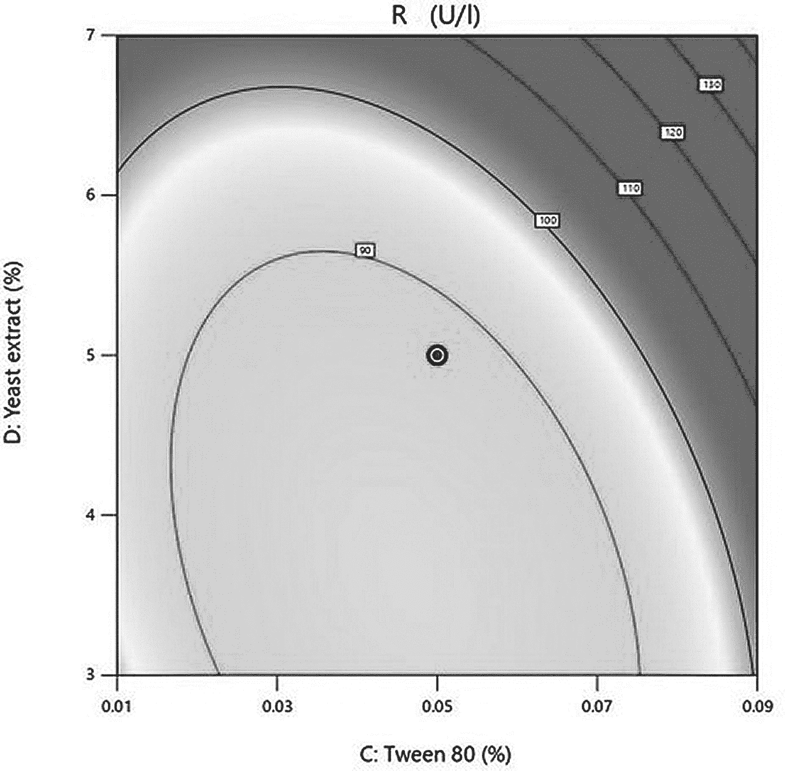

Figure 8.3 Contour plot depicting the effect of yeast extract and Tween 80 on chitinase activity.

However, the effect of the interaction of all variables was insignificant. Statistical optimization for medium composition to enhance the chitinase activity was effectively used by various researchers (Jha and Modi 2018; Rawway et al. 2018; Kumar et al. 2018; Sukalkar et al. 2018, Wang et al. 2014; De-hui et al. 2011). Exploiting the RSM instead of the OFAT process gives the advantage of analyzing the influence due to interaction among the independent factors on the response. There is no effect found on the interaction of independent factors. The predicted values (%) obtained by CCD were yeast extract, 6; Tween 80, 0.07; glucose, 0.25, and colloidal chitin 1.4. The predicted highest chitinase activity of 94.38 U/L. Validation was performed with these conditions to find out the significance of the model. The regression equation was further applied in DE to estimate the variables’ optimum values with enhanced activity of chitinase and compare the model results with differential evolution.

### 8.3.3 Differential Evolution (DE)

The polynomial equation obtained by CCD-RSM was applied in the algorithm of differential evolution. The three significant regulatory parameters of differential evolution, *viz*. scaling factor, crossover operator (`CR`), and population (`NP`) were chosen by an efficient analysis. In this study, the magnitude of the population was 50. For the selection of `CR`, the differential evolution algorithm was performed with different `CR` values from 0.0 to 0.6. The other parameters were kept as follows: `beta max`, 0.8; `beta min`, 0.2; `C`, 25; `max iteration`, 50; `number of populations`, 50; with four variables. With all the different `CR` values, chitinase’s maximum activity was obtained as 122.84 U/L with the optimum value of variables (%), i.e., yeast extract, 4; Tween 80, 0.03; glucose, 0.1790, and colloidal chitin, 1 (Figure 8.4).

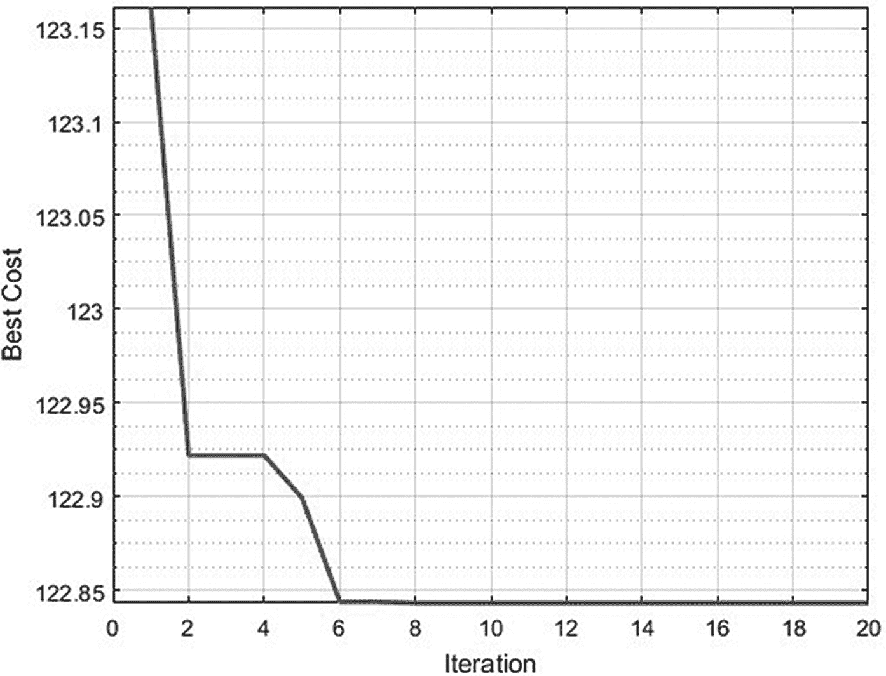

Figure 8.4 Objective function value variation with the 20 iterations; the number of populations is 50, and CR is 0.6.

### 8.3.4 实验模型验证

通过 CCD-RSM 获得的实验模型经过了验证，并与基础培养基进行了比较。在预测的实验条件下，枯草芽孢素酶的最高活性达到了 92.496 U/L，而基础培养基中获得的最高活性为 42.75 U/L (Figure 8.5)。这表明枯草芽孢素酶的活性在优化培养基中提高了两倍。

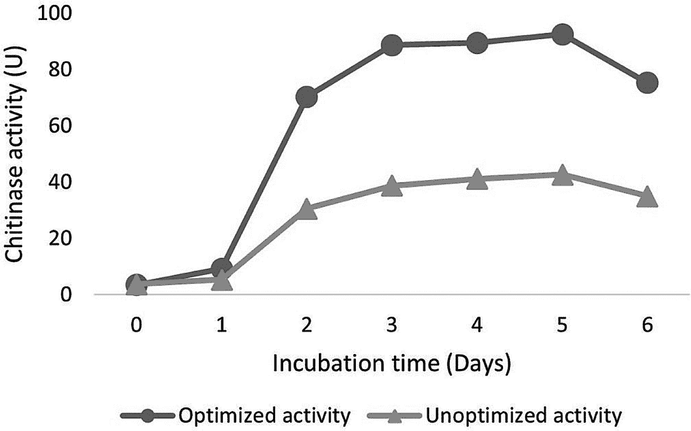

Figure 8.5 Comparison of improved chitinase activity with the activity obtained by basal media.

## 8.4 结论

通过优化培养基组分，成功构建了枯草芽孢素酶生产培养基。采用了普拉塞特-伯曼设计法（Plackett–Burman’s design）来确定显著变量。CCD-RSM 能够有效找到变量之间的模型和相互作用。RSM 获得的二阶多项式方程被应用于差分演化（differential evolution）中。RSM 结果表明模型拟合良好，实验验证也证实了这一点。基于 RSM 预测模型，枯草芽孢素酶活性相较于基础培养基提高了两倍。实际获得的活性更接近 RSM 模型的预测值。通过差分演化（DE）优化，发现枯草芽孢素酶的最高活性达到了 122.84 U/L，对应的变量浓度为：酵母提取物 4%、 Tween 80 0.03%、葡萄糖 0.1790%、胶状壳聚糖 1%，这一活性远高于 CCD-RSM 所得结果，证明了计算差分演化（computational differential evolution）可以作为一种有效的优化技术。

## 致谢

Nisha Suryawanshi 感谢 CSIR New Delhi 提供的奖学金，同时感谢印度国立技术学院 Raipur（NIT Raipur）为她的学习提供帮助。

## 参考文献

* Alslaibi, Tamer M, Ismail Abustan, Mohd Azmier Ahmad, and Ahmad Abu Foul. 2013. “Application of response surface methodology (RSM) for optimization of Cu^(2+), Cd^(2+), Ni^(2+), Pb^(2+), Fe^(2+), and Zn^(2+) removal from aqueous solution using microwaved olive stone activated carbon.” Journal of Chemical Technology & Biotechnology 88 (12):2141–2151.

* Bhattacharya, Debaditya, Anand Nagpure, and Rajinder K Gupta. 2007. “Bacterial chitinases: Properties and potential.” Critical Reviews in Biotechnology 27 (1):21–28.

* Bhattacharya, Sukanta Shekhar, Vijay Kumar Garlapati, and Rintu Banerjee. 2011. “Optimization of laccase production using response surface methodology coupled with differential evolution.” New Biotechnology 28 (1):31–39.

* Chandrasekhar, K, Roent Dune A. Cayetano, Ikram Mehrez, Gopalakrishnan Kumar, and Sang-Hyoun Kim. 2020. “Evaluation of the biochemical methane potential of different sorts of Algerian date biomass.” Environmental Technology and Innovation 20:101180.

* Chandrasekhar, K., A. Naresh Kumar, Gopalakrishnan Kumar, Dong-Hoon Kim, Young-Chae Song, and Sang-Hyoun Kim. 2021. “Electro-fermentation for biofuels and biochemicals production: Current status and future directions.” Bioresource Technology 323:124598.

* Chen, Junpeng, Yangdongfang An, Ashok Kumar, and Ziduo Liu. 2017. “Improvement of chitinase Pachi with nematicidal activities by random mutagenesis.” International Journal of Biological Macromolecules 96:171–176.

* Dahiya, Neetu, Rupinder Tewari, Ram Prakash Tiwari, and Gurinder Singh Hoondal. 2005. “Chitinase production in solid-state fermentation by Enterobacter sp. NRG4 using statistical experimental design.” Current Microbiology 51 (4):222–228.

* Das, Swagatam, and Ponnuthurai Nagaratnam Suganthan. 2010. “Differential evolution: A survey of the state-of-the-art.” IEEE Transactions on Evolutionary Computation 15 (1):4–31.

* De-Hui, Dai, Li Wei, Hu Wei-Lian, and Sa Xiao-Ying. 2011. “Effect of medium composition on the synthesis of chitinase and chitin deacetylase from thermophilic Paenibacillus sp. Hul.” Procedia Environmental Sciences 8:620–628.

* Dhillon, Gurpreet Singh, Satinder Kaur Brar, Surinder Kaur, Jose R Valero, and Mausam Verma. 2011. “Chitinolytic and chitosanolytic activities from crude cellulase extract produced by A. niger grown on apple pomace through koji fermentation.” Journal of Microbiology and Biotechnology 21 (12):1312–1321.

* Doddapaneni, Kiran Kumar, Radhika Tatineni, Ravichandra Potumarthi, and Lakshmi Narasu Mangamoori. 2007. “Optimization of media constituents through response surface methodology for improved production of alkaline proteases by Serratia rubidaea.” Journal of Chemical Technology & Biotechnology: International Research in Process, Environmental & Clean Technology 82 (8):721–729.

* Eswari, Jujjavarapu Satya, Mohan Anand, and Chimmiri Venkateswarlu. 2013. “Optimum culture medium composition for rhamnolipid production by pseudomonas aeruginosa AT10 using a novel multi-objective optimization method.” Journal of Chemical Technology & Biotechnology 88 (2):271–279.

* Jha, Sneha, and H.A. Modi. 2018. “Statistical optimization of chitinase production by Streptomyces rubiginosus SP24 and efficacy of purified chitinase to control root-knot nematode infection in Vigna radiata under controlled conditions.” Chemical and Biological Technologies in Agriculture 5 (1):20.

* Karn, Santosh Kr, and Jizhou Duan. 2017. Perspective on Microbial Influenced Corrosion.

* Karn, Santosh Kumar, and Awanish Kumar. 2019. “Protease, lipase and amylase extraction and optimization from activated sludge of pulp and paper industry.”

* Kenneth, Storn R., and Rainer M. Storn. 1997. “Differential evolution-a simple and efficient heuristic for global optimization over continuous spaces.” Journal of Global Optimization 11 (4):341–359.

* Khandelwal, Amit Kumar, Vinod Kumar Nigam, Bijan Choudhury, Medicherla Krishna Mohan, and Purnendu Ghosh. 2007. “Optimization of nitrilase production from a new thermophilic isolate.” Journal of Chemical Technology & Biotechnology: International Research in Process, Environmental & Clean Technology 82 (7):646–651.

* Kumar, D. Praveen, Rajesh Kumar Singh, P.D. Anupama, Manoj Kumar Solanki, Sudheer Kumar, Alok K. Srivastava, Pradeep K. Singhal, and Dilip K. Arora. 2012. “Studies on exo-chitinase production from Trichoderma asperellum UTP-16 and its characterization.” Indian Journal of Microbiology 52 (3):388–395.

* Kumar, Manish, Amandeep Brar, V. Vivekanand, and Nidhi Pareek. 2017. “Production of chitinase from thermophilic Humicola grisea and its application in production of bioactive chitooligosaccharides.” International Journal of Biological Macromolecules 104:1641–1647.

* Kumar, Manish, Amandeep Brar, V. Vivekanand, and Nidhi Pareek. 2018. “Process optimization, purification and characterization of a novel acidic, thermostable chitinase from Humicola grisea.” International Journal of Biological Macromolecules 116:931–938.

* Liu, Chao-Lin, Tsung-Han Lin, and Ruey-Shin Juang. 2013. “Optimization of recombinant hexaoligochitin-producing chitinase production with response surface methodology.” International Journal of Biological Macromolecules 62:518–522.

* Mak, Kenneth W.Y., Miranda G.S. Yap, and Wah Koon Teo. 1995. “Formulation and optimization of two culture media for the production of tumour necrosis factor-β in Escherichia coli.” Journal of Chemical Technology & Biotechnology: International Research in Process, Environmental AND Clean Technology 62 (3):289–294.

* Mishra, P., P.R. Kshirsagar, S.S. Nilegaonkar, and S.K. Singh. 2012. “Statistical optimization of medium components for production of extracellular chitinase by Basidiobolus ranarum: A novel biocontrol agent against plant pathogenic fungi.” Journal of Basic Microbiology 52 (5):539–548.

* Montgomery, D.C. 2001. Design and Analysis of Experiments, 5th edn, John Wiley & Sons, Inc.: New York.

* Montgomery, D.C. 2003. Design and Analysis of Experiments. John Wiley & Sons (ASIA) Pvt. Ltd.

* Nawani, N.N., and B.P. Kapadnis. 2005. “Optimization of chitinase production using statistics based experimental designs.” Process Biochemistry 40 (2):651–660.

* Neri, Ferrante, and V. Tirronen 2010. “Recent advances in differential evolution: A survey and experimental analysis.” Artificial Intelligence Review 33 (1–2):61–106.

* Oranusi, Nathaniel A., and A.P. Trinci. 1985. “Growth of bacteria on chitin, fungal cell walls and fungal biomass, and the effect of extracellular enzymes produced by these cultures on the antifungal activity of amphotericin B.” Microbios 43 (172):17–30.

* Pant, Millie, Hira Zaheer, Laura Garcia-Hernandez, and Ajith Abraham. 2020. “Differential evolution: A review of more than two decades of research.” Engineering Applications of Artificial Intelligence 90:103479.

* Patel, Bharat, Vipul Gohel, and Bhairavsinh Raol. 2007. “Statistical optimisation of medium components for chitinase production byPaenibacillus sabina strain JD2.” Annals of Microbiology 57 (4):589–597.

* Plackett, Robin L., and J. Peter Burman. 1946. “The design of optimum multifactorial experiments.” Biometrika 33 (4):305–325.

* Price, Kenneth, Rainer M. Storn, and Jouni A. Lampinen. 2006. Differential Evolution: A Practical Approach to Global Optimization. Springer Science & Business Media.

* Purushotham, Pallinti, P.V.S.R.N. Sarma, and Appa Rao Podile. 2012. “Multiple chitinases of an endophytic Serratia proteamaculans 568 generate chitin oligomers.” Bioresource Technology 112:261–269.

* Qin, A., V. Huang, and P. Suganthan. 2009. “Differential evolution algorithm with strategy adaptation for global numerical optimization.” IEEE Transactions on Evolutionary Computation 13:398–417.

* Rawway, Mohammed, Ehab Aly Beltagy, Usama Mohamed Abdul-Raouf, Mohamed Ahmed Elshenawy, and Mahmud Saber Kelany. 2018. “Optimization of process parameters for chitinase production by a marine Aspergillus flavus MK20.” Journal of Ecology of Health & Environment 6:1–8.

* Roberts, Walden K., and Claude P. Selitrennikoff. 1988. “Plant and bacterial chitinases differ in antifungal activity.” Microbiology 134 (1):169–176.

* Roudi, Anita Maslahati, Hesam Kamyab, Shreeshivadasan Chelliapan, Veeramuthu Ashokkumar, Ashok Kumar, Krishna Kumar Yadav, and Neha Gupta. 2020. “Application of response surface method for total organic carbon reduction in leachate treatment using Fenton process.” Environmental Technology and Innovation 19:101009.

* Sahai, A.S., and M.S. Manocha. 1993. “Chitinases of fungi and plants: Their involvement in morphogenesis and host-parasite interaction.” FEMS Microbiology Reviews 11 (4):317–338.

* Singh, Suren, Andreas M Madlala, and Bernard A. Prior. 2003. “Thermomyces lanuginosus: Properties of strains and their hemicellulases.” FEMS Microbiology Reviews 27 (1):3–16.

* Storn, Rainer, and Kenneth Price. 1997. “Differential evolution–A simple and efficient heuristic for global optimization over continuous spaces.” Journal of Global Optimization 11 (4):341–359.

* Sukalkar, Swati R., Tukaram A. Kadam, and Hemlata J. Bhosale 2018. “Optimization of chitinase production from streptomyces macrosporeus M1.”

* Suryawanshi, Nisha, and Satya Eswari Jujjawarapu. 2020. “Chitin from seafood waste: Particle swarm optimization and Neural network study for the improved chitinase production.” Journal of Chemical Technology and Biotechnology. doi: [`doi.org/10.1002/jctb.6656`](https://doi.org/10.1002/jctb.6656).

* Vaidya, R.J., S.L.A. Macmil, P.R. Vyas, and H.S. Chhatpar. 2003. “The novel method for isolating chitinolytic bacteria and its application in screening for hyperchitinase producing mutant of Alcaligenes xylosoxydans.” Letters in Applied Microbiology 36 (3):129–134.

* Wang, Kai, Pei-sheng Yan, and Li-xin Cao. 2014. “Chitinase from a novel strain of Serratia marcescens JPP1 for biocontrol of aflatoxin: Molecular characterization and production optimization using response surface methodology.” *BioMed Research International 2014*.

* Wasli, Azaliza Safarida, Madihah Md Salleh, Suraini Abd-Aziz, Osman Hassan, and Nor Muhammad Mahadi. 2009. “Medium optimization for chitinase production from Trichoderma virens using central composite design.” Biotechnology and Bioprocess Engineering 14 (6):781–787.

* Xiao, Peng, Dexuan Zou, Zhenglong Xia, and Xin Shen. 2019. “Multi-strategy different dimensional mutation differential evolution algorithm.” *AIP Conference Proceedings*.

* Yu, X., S.G. Hallett, J. Sheppard, and A.K. Watson. 1997. “Application of the Plackett-Burman experimental design to evaluate nutritional requirements for the production of Colletotrichum coccodes spores.” Applied Microbiology and Biotechnology 47 (3):301–305.

* Zeng, Wei, Guiguang Chen, Yange Wu, Mengna Dong, Bin Zhang, and Zhiqun Liang. 2018. “Nonsterilized fermentative production of poly-γ-glutamic acid from cassava starch and corn steep powder by a thermophilic Bacillus subtilis.” Journal of Chemical Technology & Biotechnology 93 (10):2917–2924.

* Zhang, Meng. 2014. “The chitinolytic enzyme system of the compost-dwelling thermophilic fungus Thermomyces lanuginosus.”

# 9 Artificial Bee Colony for Optimization of Process Parameters for Various Enzyme Productions

Dheeraj Shootha, Pooja Thathola, and Khashti Dasila

Kumaun University, Bhimtal, India

DOI: [10.1201/9781003292333-9](https://dx.doi.org/10.1201/9781003292333-9)

## 9.1 Introduction

优化是许多设计优化过程的核心和关键部分，无论是用于商业计划还是机器学习。优化目的可以是任何事物；它用于最小化能源消耗、实验耗时、浪费、成本以及其他环境影响（`pH`、`Temperature`、`agitation speed` 等）或最大化响应，即工作的表现、利润、效率和可持续性。在实际应用中，时间和金钱是有限的；因此，针对这一问题有很多解决方案。其中之一是实验设计，它受到一系列复杂约束的限制（Tsai et al. 2009）。为了解决这些问题，需要使用优化技术。正如重新发布的问题一样，大多数问题都存在非线性项，因此需要使用这些关键且高级的工具来处理此类问题。目标的累积和估计过程进一步耗时，是设计领域的主要问题。因此，在自然启发算法中，人工蜂群优化（Artificial Bee Colony Optimization，`ABC`）是最常见的群体智能（Karaboga and Basturk 2007），它受到生物计算领域的启发，将蜂群的综合行为应用于不同领域的过程参数优化等问题求解。研究人员被蜜蜂在算法中的快速性能所吸引。这些蜜蜂的累积行为被称为群体行为。昆虫学家研究工程师和生物群体的行为，并将这些模型应用于框架中以解决复杂问题。群体智能是人工智能的一种，主要通过蜂群个体之间的集体行为（无需监督）来实现。在将算法分发之前，任何用于算法设计的努力都用于解决社会性动物的问题（Zhu and Kwong 2010）。群体智能的主要优势是可扩展性、容错性、速度、适应性和并行性。劳动分工和自我组织是群体智能的两个关键参数。在自组织系统中，遇到的局部刺激单元可能会个体响应，并通过劳动分工在全局范围内完成任务，而无需集中监督。整个安排应具备在内外部变化时自如适应的能力。自我组织主要依赖于四个基本属性：正反馈、负反馈、多重交互和波动（Mohapatra et al. 2017）。正反馈表示，某个个体通过指令（如舞蹈蜜蜂）引导另一个个体前往食物来源；负反馈表示食物来源枯竭；波动指的是个体在探索新站点时的随机行为（Beg et al. 2012）。`ABC` 可以应用于多种问题，包括人工神经网络（`ANN`）的训练、`IIR`（无限脉冲响应）的设计（Zhang et al. 2010）、受约束优化问题的求解（Sonmez 2011）以及蛋白质三级结构预测（Tsai et al. 2009）。`ABC` 算法对其他算法（如粒子群优化（`PSO`）、遗传算法（`GA`）、粒子群启发进化算法（`PS-EA`）、微分演化（`DE`）以及不同进化策略）的优化表现也有研究（Liu et al. 2018）。上述所有参数均能够处理特定类型的聚类。然而，该领域仍存在许多待解决的问题（Chang and He 2014；Garoudja et al. 2015）。首先，要深入理解算法需要对经验集进行深入了解。算法的性能很大程度上取决于参数的质量。其次，某些代码只能在有限的潜在解上运行良好，而不能在其他情形下工作。参数是为大量酶生产而优化的（Babaeizadeh and Ahmad 2014）。在所有不同的酶生产参数中，应当优化那些能使过程表现最佳的条件（Zhu and Kwong 2010）。通常，提高酶生产的过程会使用不同的变量，如温度、反应时间、pH 和营养浓度（Ilie and Bǎdicǎ 2013）。要实现更高的酶生产，变量的优化通常无法采用“一变量一次”的方法（Baykaso et al. 2007）。在生物技术过程中，研究者开始采用统计优化和自然启发的优化方法来提高酶的生产（Agrawal et al. 2016；Garlapati and Banerjee 2010；Liu and Tang 2018；Mahapatra et al. 2009）。为了支持前述事实，研究必须开始利用各种自然发展基础的简易计算方法来优化酶的增产（El-Abd 2011）。`ABC` 是一种利用蜜蜂进行优化的优化技术，它适用于广泛的优化领域。从 2005 年到 2022 年，关于 `ABC` 优化的大量报告已发表，如图所示（Figure 9.1）。


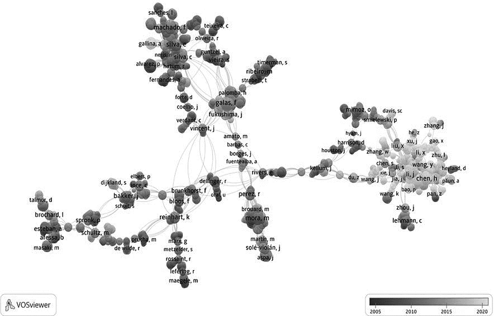


Figure 9.1 Publications related to ABC optimization from 2005 to 2021.

## 9.2 ABC Algorithm Motivations

`ABC` 算法是一种常见的群体方法，主要受蜜蜂觅食行为的启发（`Karaboga et al. 2014`）。在优化过程中，`ABC` 算法表现出局部和全局探索（`Li et al. 2015`）。然而，`ABC` 的局部精度搜索并不十分可接受（`Zhu and Kwong 2010`），因此提出了大量的改进措施。为解决这一缺陷，已提出的 `ABC` 变体主要从以下三个路径进行调整：(i) 引入外部世界的新原则，(ii) 将 `ABC` 与其他元启发算法结合，以及 (iii) 调整局部搜索的自适应性（`Gao et al. 2014`）。由于 `ABC` 在比较数值实验中的统计显著性，很难分析其优越性（`Xiang and An 2013`）。深入的数学分析使这些算法变得宝贵。与前两种变体不同，`ABC` 变体是自适应的（即第三种方法），这一特性直观可理解（因为不涉及外部世界或复杂原理），并延续了传统算法的创新框架。

蜜蜂可以有效地确定自然界中最高质量的食物来源。因此，智能的蜜蜂觅食行为是为解决与优化相关的问题提供一个良好的解决方案（Li et al. 2015；Sathesh Kumar and Hemalatha 2014；Sharma et al. 2021；Zhang et al. 2021）。总体而言，在寻找食物来源时，蜜蜂群主要分为三类，即雇用蜂、观察者蜂和侦查蜂（Figure 9.2）。对于花蜜来源的开采，雇用蜂负责（Bansal et al. 2011）。它们会前往已知的食物位置，并向观察者蜂提供食物质量的信息。然后，观察者蜂在蜂巢中等待，决定探索食物来源的信息。为了寻找新的花蜜来源，侦查蜂会在环境中随机搜索，要么依赖内部动机，要么依据外部线索（Hakli and Kiran 2020）。花蜜位置暗示了优化问题的可能解，花蜜来源的盈利性对应于可能解的质量。相应的雇用蜂应利用花蜜来源（Hu et al. 2021；Kasihmuddin et al. 2021；Gautam et al. 2019）。花蜜来源的数量等同于雇用蜂和观察者蜂的数量（Bansal et al. 2011）。在此方法中，雇用蜂和观察者蜂（即 spectator bees）获得的良好解决方案有助于提高收敛速度，而侦查蜂主要提升消除局部最优的能力（Babaoglu 2015）。

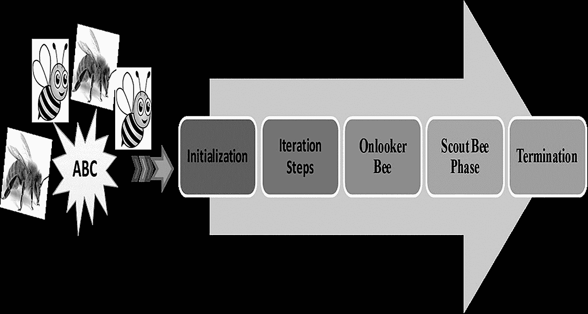

Figure 9.2 Honey bee colony according to the food source.

## 9.4 蜜蜂觅食行为

蜜蜂群可以在广阔的场地中觅食大量的食物来源，并飞行高达 11 公里去获取食物。蜂群中的工蜂大约占其成员的一个区域作为采集者。觅食过程由侦查蜂寻找有前景的花朵斑块来启动（Brezočnik et al. 2018；Zhang et al. 2012）。在收获期间，整个季节性蜂群保持侦查蜂的比例。当蜜蜂识别出花朵斑块时，它们会继续寻找，希望找到更好的斑块。为了识别更好的斑块，侦查蜂会随机搜索（Li et al. 2019；Harrison et al. 2018；Leu and Yeh 2012）。侦查蜂会向蜂巢中休息的同类蜜蜂更新花蜜来源的数量，这也包括糖分含量。侦查蜂将花蜜沉积在蜂巢前的“舞池”上，并通过一种称为“摇摆舞”的舞蹈形式与其他蜜蜂进行交流（Babaeizadeh and Ahmad 2014；Bansal et al. 2011；Chuang et al. 2008）。

## 9.5 ABC 算法中的迭代步骤

ABC 研究主要遵循三个最重要的步骤（Akay and Karaboga 2012）：（i）雇用蜂进行食物来源的识别；（ii）收集食物来源的信息并选择花蜜的质量——食物来源的保障由观察者蜂决定，雇用蜂收集信息并决定蜂群蜜蜂感兴趣的来源的优劣；（iii）到达食物来源。在初始阶段，蜜蜂随机选择食物来源的位置，并测量其花蜜的质量。随后，雇用蜂将花蜜来源的信息传递给在蜂巢舞蹈区域等待的观察者蜂。信息分发后，每只雇用蜂会前往食物来源检查前一个循环中的某些阶段，当食物位置被回忆起并结合在食物来源中观察到的信息时。在最终阶段，在食物来源区域，观察者蜂检索雇用蜂的信息。因此，花蜜中花蜜质量的信息通过雇用蜂传递。随后，选择其他食物来源主要取决于经验信息。侦查蜂会随意在被遗弃的交换中生成新的食物来源，由观察者蜂负责。

### 9.5.1 群体初始化

ABC 算法有三个主要过程参数，即种群，通常是食物来源的数量，用于后续食物来源数量的测试，它们主要被选为荒凉（上限）以及终止标准，主要取决于循环数。最初，Karaboga 等人（2014）表明，ABC 对食物来源的数量等同于雇用蜂和观察者蜂的数量。最初，假设食物来源（SN）呈规则分布，每个食物来源 `x[*i*]`（其中 *i* = 1, 2, …, *SN*）主要是 D 维向量。随后通常用于每个食物来源的方程如下：

(9.1)

`x[*i*, j] = x[*j*]^(min) + φ*i*, *j* + x[*j*]^(min))`

其中 `φ[*i*, *j*]` 是等距分布的 (0,1) 实数，`i = 1,2, …, SN`，`j = 1, …, D`，`x[*j*]^(max) 和 x[*j*]^(min)` 分别是上下限的维度。

### 9.5.2 观察者蜂

为观察者蜂设计的食物来源数量类似于雇用蜂的食物来源数量。在此期间，所有雇用蜂会将新的食物来源信息关于可用性与观察者蜂共享。观察者蜂通常会确定每只雇用蜂所生成的食物来源的选择概率（Gao et al. 2014）。计算概率的多种方案必须包含适用性。对于每个食物来源，概率通常基于其能力，如下所示的方程 (9.2)：

(9.2)

`$$P_i = \\frac{{fit_{i}}}{\\sum_{i = 1}^{SN}f_i t_i}$$`

其中 `fit[i]` 是最小化问题的适应度值。

### 9.5.3 侦查蜂阶段

试验数量主要与每个未进一步更新或改进的食物来源相关。如果食物来源未被雇用蜂和观察者蜂预定的尝试次数所改进，则该食物来源被视为荒凉，相关的雇用蜂会转变为侦查蜂，侦查蜂的阶段随即初始化。随后，食物来源被替换，侦查蜂寻找新的食物来源。一个关键的控制参数是 ABC 的拒绝限制（limit for rejection），它表示预定循环的最大次数（Banharnsakun et al. 2010）。此时，侦查蜂被插入到新的食物来源中。

### 9.5.4 终止

ABC 的灭绝准则通常基于群体数量的先进值或最大循环数（MCN）（Rao et al. 2008）。该循环数由工蜂在 ABC 算法模拟开始前设定。

蜜蜂觅食行为主要有四个特征，定义了自我组织性，并依赖以下表达式。

1. 正向反馈：如果花蜜增加，食物来源的数量也相应增加，观察者蜂的访问比例也会随之增加。
2. 负向反馈：对劣质食物来源的开采会被蜜蜂停止。
3. 泛化：Scout 蜜蜂可以随机进行搜索程序，以识别新的食物来源。
4. 多次交互：食物来源的信息由在舞蹈区等待的雇佣蜜蜂（观察者）与巢友之间转移。上述重新检查由蜜蜂的觅食行为解释，完全满足`Millonas (1993)` 所定义的原则。

## 9.6 ABC 在过程优化方法论中

ABC 优化方法通常基于模拟自然环境中蜜蜂的觅食行为（`El-Abd 2011`; `Hakli and Kiran 2020`）。蜜蜂自然地聚集在蜂巢周围，相互交流、传递食物来源信息，以维持群体的繁荣。前文提到的两类蜜蜂（雇佣蜜蜂和观察者蜜蜂）各自承担不同的任务，以发现能够维持群体的最佳食物来源（`Figure 9.3`）。观察者蜜蜂和雇佣蜜蜂在其局部环境中发展食物来源。随后，蜜蜂在确定性选择雇佣蜜蜂和概率选择观察者蜜蜂的方案上进行搜索。Scout 蜜蜂随机尝试寻找新的食物来源，以探索新的搜索空间区域。这些模拟蜜蜂在高维搜索空间中飞行。在 ABC 方法中，这些蜜蜂结合局部搜索方法，对邻域食物来源进行搜索，这称为 **开发过程**（exploitation process），由观察者蜜蜂和雇佣蜜蜂执行；而通过全局食物来源进行的新区域搜索称为 **探索过程**（exploration process），由 Scout 蜜蜂负责并管理（`Babaeizadeh and Ahmad 2014`）。

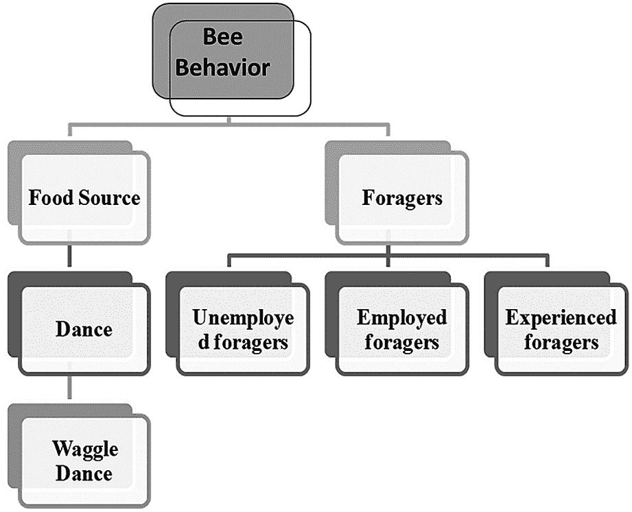

`Figure 9.3 Steps involved in artificial bee colony methodology.`

在觅食过程中，大多数蜜蜂被视为观察者蜜蜂。为了彼此社交交流，蜜蜂会进行摆舞运动（`Figure 9.4`）。通过这种摆舞，Scout 蜜蜂向雇佣蜜蜂更新食物来源的优劣（`Wang et al. 2010`）。

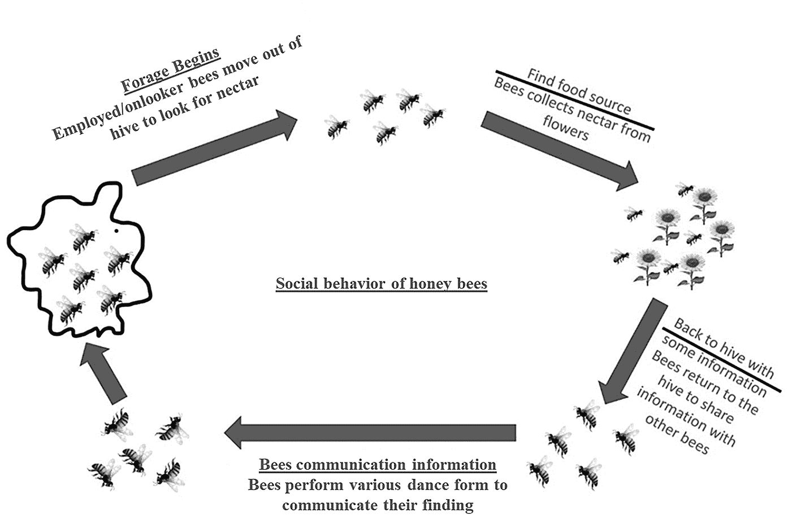

`Figure 9.4 Social behavior of honey bees.`

## 9.7 新型改进型 ABC（MABC）

新型改进型人工蜜蜂群（MABC）通常通过带有指数函数的自适应步骤来构建。该 MABC 主要采用反向理论用于学习，并使用 𝑆 型改进方法进行分组，初始种群按照轮盘赌敏感性-信息素选择的原始方式给出（`Figure 9.5` 和 `Table 9.1`）。特别是，指数自适应步骤会随机设计用于替换原始步骤的函数，且观察者蜜蜂和雇佣蜜蜂的数量相等（`Mohapatra et al. 2017`; `Kashan et al. 2012`）。这带来了 ABC 方法的诸多优势，如简洁性、实现便捷性以及出色的性能。然而，ABC 算法仍存在诸多缺陷：
(i) 初始种群为随机分布的种子提供领先解，直接影响搜索能力。
(ii) 所有蜜蜂都在整个搜索空间进行定向搜索，可能导致搜索效率下降。
(iii) 种群再生使用随机步长，而在邻域搜索时步长应受限，否则会影响算法的精度和收敛速率（`Kashan et al. 2012`）。因此，为克服现有算法的不足，MABC 的目标是改进种群结构、种群组合以及种群更新机制。MABC 按照以下步骤进行：

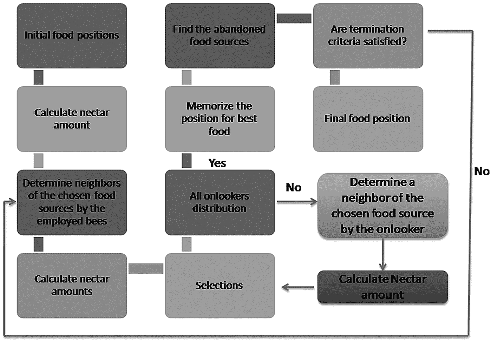

`Figure 9.5 Different steps followed by a honey bee in ABC.`

`Table 9.1 Summary of ABC Algorithms’ Recent Modifications`

| Algorithm Name | Description of Modifications | Problem | References |
| --- | --- | --- | --- |
| MABC | Incorporated Deb’s rule in the selection of food sources employed and onlooker bees | Constrained Optimization | `Karaboga et al. (2014)` |
| --- | --- | --- | --- |
| ABC-AP | Adaptive penalty constraint and Deb’s rule were used in the modification | Weight of truss structures | `Sonmez (2011)` |
| MABC | Control parameter introductions | Real-parameter optimization | `Akay and Karaboga (2012)` |
| IABC | Onlooker bee’s movement was changed using universal gravitation force | Numerical optimization | `Tsai et al. (2009)` |
| ABCgBest and ABCgBestDist | Incorporated guest and distance-based reference selection movement of the onlooker | benchmark functions | `Akdaǧli et al. (2011)` |
| PABC-RC | Information about the integration exchange of ripple communication strategy | Benchmark functions | `Liu et al. (2018)` |
| ABC | For path search, Deb’s rules were directly incorporated | Data clustering | `Zhang et al. (2010)` |
| ABC-PTS | Addition of new variables to the neighborhood search equation | Peak-to-average power ratio | `Wang et al. (2020)` |
| ABC | Addition of GRAH and two neighborhood structures for employed and onlooker bees | Generalized assignment | `Baykaso et al. (2007)` |
| ABC-PTS | Solution initialization transformation of ABC from continuous space vector into a discrete vector | Peak-to-average power ratio | `Zhu and Kwong (2010)` |
| DisABC | Use a differential expression to measure dissimilarity between binary vectors | Binary optimization | `Karaboga and Basturk (2007)` |
| ABC | Decision variables uses in indexes | Discrete optimum design of truss structures | `Sonmez (2011)` |
| OABC | Opposition concept number used | Black-Box Optimization Benchmarking (BBOB) | `El-Abd (2011)` |
| ES-ABC, MSABC, MH-ABC, and HH-ABC | ES-ABC local search, a master-slave technique in MS-ABC, multi-hive approach in MH-ABC, and combined MS-ABC and MH-ABC in HH-ABC were used | Numerical benchmark data | `Gao et al. (2014)` |
| binABC, normABC AMABC | Modified concept based on bin PSO and normalized DE, and angle-modulated PSO and DE | Binary optimization | `Kashan et al. (2012)` |
| DABC | Use of NM to start the population and local integrate search to ABC | Flow shop benchmark | `Wang et al. (2020)` |

1. 初始化阶段
   CS/2 = 食物数量，相当于种群初始化时食物来源数量的一半（基于反向学习）
   计算适应度值
   对 S 型子种群进行分组
   零 = 试验次数（食物编号 1）。试验应为零
   初始化优秀食物来源的精英
   为记住最佳食物来源，Iter = 0；而通过敏感性-信息素选择，当 Iter ≤ 最大迭代次数时选择更优的精英
   雇佣蜜蜂的食物编号 i = 1
   生成新解并更新每个食物来源的步长
   新解评估
   Iter = Iter + 1

- [敏感费罗蒙的选择](https://wiki.example.org/feynmans_learning_method)被应用在当前解 𝑖 与其其他解之间。其他解在满足条件时被应用，即概率条件更优于当前解，即更优于当前解。

2. 观察者蜜蜂

食物来源选择使用敏感费罗蒙

每个观察者蜜蜂，每个食物来源都会生成新的解并更新步长长度

Iter = Iter + 1

应用敏感费罗蒙到当前解。但现有解决方案优于其他解。否则，应将其实验对最佳解的计数记录在案。

3. scouts 蜜蜂的阶段

试验食物来源的确定应超过“限制”值，或者在每次交互中，只有一只 scouts 蜜蜂被接受。

用于随机食物编号搜索的 scouts 蜜蜂在达到最大迭代次数后会返回到最佳解决方案。

## 9.8 不同参数在 ABC 用于酶优化中的影响

ABC 算法在 scouts 蜜蜂的食物来源数量（*N*）、食物来源数量（*M*）、选定食物来源数量、被派遣到选定食物来源的蜜蜂数量（Nre）、被派遣到其他食物来源的蜜蜂数量（Nsp）、搜索区域半径（Ngh）以及迭代次数（*I*[max]）(Zhang et al. 2010) 时更具生产力。初始食物来源位置在满足条件的情况下被表示为该算法的明确问题范围内。

(9.3)

*X*[*i**j*] = *X*[*j*]^(min) + *r**a**n* (0,1)(*X*[*j*]^(min)−*X*[*j*]^(min))

where *i* = 1, …, *N* and *j* = 1, …, *j* are ranges in the equation. *N* is the number of parameters. In every area, subsequently, the new solutions created during ABC algorithm *V*[*jk*] within *X*[*k*] are demonstrated in Equation (9.4):

(9.4)

*V**j**k** = *X**j**k** + *φ**j**k**(*X**j**k**−*X**w**k**)

*K* = int  (*r**a**n**d* *X* *N*) + 1

where *ø*[*jk*] and *X*[*jk*] represent the random numbers uniform distribution and the *j*th solution from among the solution set of the *k*th parameter. Though, the *ø*[*jk*] area and parameter *k* are selected casually from the domains \[1 and −1\] and \[1 and *N*\], respectively.Beyond these situations, the explanation for each problem in a suitable way is replaced by the earlier one. The earlier solution is replaced if the new solution is more adaptable. After that, solutions for each bee are selected by the scout bees (Liu et al. 2018).

## 9.9 ABC 用于优化的控制参数

ABC 优化/参数调整是为了在进行分析时选择最合适的参数设计。ABC 算法在参数优化后能够提供最佳参数。早期的 ABC 版本在基本函数上最为高效。尽管 ABC 算法在处理复合和非分离约束问题及函数时的收敛性能并不十分有效（Karaboga et al. 2014; Sonmez 2011）。收敛速率和改进（Karaboga and Basturk 2007）通过扰动控制参数频率变化的方法进行分析，该方法通常被称为缩放因子，它通过改变相邻解和参数上限来决定参数的幅度，由 ABC 性能控制。提出的修改版本旨在解决实参优化问题的高效优化。人工蜜蜂群算法（ABCA）的常见修改集中在扰动过程的控制上。基本版本的 ABC 在生成新解时，将频率固定，导致收敛速度缓慢，仅针对单个参数；这是预期结果的父解。但在提议的 ABCA（Mohapatra et al. 2017）中，引入了新的控制参数——修改率（MR）。

## 9.10 ABC 算法的修改

ABC 子部分的变化可能导致不同研究者在参数调节与性能提升之间观察到的差异。为了解决优化问题的受限性，在 ABC 选择过程中的工蜂通常使用 Deb 的规则来调节策略，而不是贪婪的选择程序。ABC 的新变体性能与两种方法相关，即粒子群优化（PSO）和遗传算法（DE），结果相似，ABC 的性能明显。对于大规模问题的解决方案，ABC 被应用（Karaboga and Basturk 2007）。对有限处理技术的应用限制了 ABC 选择阶段，使得整个搜索空间的可行区域得以到达。在选择观察者蜜蜂和工蜂时，引入了 Deb 的规则。针对选择和修改的 ABC 进行了三种策略。这三种策略的修改在 ABC 中被报告为 Zhu and Kwong (2010) 用于数值基准优化。食物来源的选择由观察者蜂进行，以防止早期收敛并提高种群多样性。这些策略包括基于排名选择的选择（RABC）、锦标赛选择（TABC）以及扰动选择（DABC）。修改后的 ABC 性能主要与基本版本和改进版本的结果相关，这三种选择策略分别展示了基本版本和改进版本的表现，并用于提高种群多样性和防止收敛。

## 9.11 ABC 摘要

1. 采集行为通常受蜜蜂的觅食行为启发
2. 为了优化目的，ABC 采用全局搜索
3. 数值优化最初提出（Karaboga and Basturk 2007）
4. 组合优化问题在优化过程中被分析（Pan et al. 2011）
5. 同时用于无约束和受约束优化问题（Djaballah and Nouibat 2022; Karaboga et al. 2014; Kasihmuddin et al. 2021）
6. 用户预先确定控制参数（即种群规模、最大迭代次数和限制）
7. 它相对简单、灵活且稳健（Rao et al. 2008; Singh 2009; Lin et al. 2021）

## 9.12 ABC 的应用

ABC 因其易于应用和稳健性而成为最常用的算法。研究人员成功地将其应用于许多不同领域的复杂问题。首先，Karaboga et al. (2014) 的数学问题被扩展到受约束优化问题，随后应用于大脑神经网络（Karaboga and Basturk 2007）、医学模式分类以及聚类问题（Table 9.2）(Seyman and Taşpınar, 2013; Ilie and Bădicǎ 2013)。

Table 9.2 Applications of ABC in Different Fields

| S. No. || Application of ABC || Reference |
| --- | --- | --- |
| 1 || ABC is used for training the multilayer perceptron neural network for classifying the acoustic emission signal toward their particular source || Omkar and Senthilnath (2009) |
| 2 || Investigation of the comparison of the RBF neural network training algorithms in inertial sensor-based terrain classification || Kurban and Beşdok (2009) |

| 3 || 在下倾钻井中，他们使用`ABC`对压力井下预测的神经网络进行训练 || Irani and Nasimi (2011) |
| 4 || 为了建模日均参考蒸发散（ET），他们在神经网络训练中使用了`ABC` || Ozkan et al. (2011) |
| 5 || 使用`ABC`设计目标导向`C`的克隆模板，用于神经结构的细胞网络 || Parmaksızoğlu [Selami and Alçı Mustafa (2011)](#ch9.xhtml#ref9_59) |
| 6 || 提出了一种基于`ABC`的神经网络合成方法 || Garro et al. (2011) |
| 7 || 他们介绍了一个集成系统，该系统主要基于`ABC`的股票预测，结合小波变换和神经网络招募 || Hsieh and Yeh (2011) |
| 8 || 他们描述了一种基于`ABC`的方法，通过引入突触权重，在最大化人工神经网络准确性的同时最小化连接数量 || Kurban and Beşdok (2009) |
| 9 || `ABC`被用于`MLP`的训练，并表明`MLP`-`ABC`的性能优于用于时间序列数据的`MLP`-`BP` || Shah et al. (2012) |
| 10 || 将 S-系统神经网络描述为`ABC`神经网络模型在生化网络中的基础 || Yeh and Hsieh (2012) |

## 9.13 Conclusions and Future Prospects

实际优化问题的复杂性提升了科学家们对强大、快速且准确的优化算法的兴趣。在连续和离散空间中，`ABC`算法是一种基于种群的新型、更简单的优化方法。它是一种灵活且简洁的`ABC`算法，参数需求少于其他算法。原始的`ABC`算法及其改进和混合算法用于求解连续、约束、组合、多目标、二进制、混沌等各类优化问题。文献中进行的各种实验证明，`ABC`的高效性、准确性和有效性均可应用于所有与`ABC`相关的问题。据报道，它在实际基准问题上超越了某些进化算法（EAs）和其他启发式搜索方法。然而，控制参数较少且未能高效利用，导致在多模态和多维优化问题上的表现不佳（Zhang et al. 2021）。初始参数值对`ABC`影响不大，且随维度增加而出现问题，这与其他概率优化算法不同。`ABC`还存在早熟收敛和停滞的固有缺陷，这限制了其在探索和开发方面的能力（Sharma et al. 2021）。尽管过去两年发表了大量论文，但仍有许多未解的问题和新的应用领域，以及需要在该算法的多个维度上进行改进。下面列出了未来`ABC`研究的关键方向：

- 完整搜索空间的调查与对任意搜索算法在任意迭代中保持多样性的区域管理，应当平衡，以确保能够找到最优解。
- 改进`ABC`中雇佣蜂和观察者蜂阶段的更新公式如下：

```
```


`v[i j]` = `A` × `x[i j]` + `B` × (`x[i j]` − `x[k j]`)


该公式表明，修改后的位置`v[ij]`是食物源位置`x[ij]`的加权和以及两个食物源位置`x[ij]`与`x[kj]`之差的加权和，其中`A`表示目标食物源的质量，`B`表示随机分布在实数范围[-1, 1]中的`ϕ[ij]`的质量差。在基本的`ABC`中，`A`通常设为1，而`B`则随机均匀分布在[-1, 1]范围内。

- 许多研究都对`ϕ[ij]`的变化进行了探讨，以实现更好的搜索机制（Karaboga et al. 2014）。为了获得更好的输出，还需对数值和取值范围进行精细调整。
- 为提升性能，`ABC`的有效修改和实现应当被广泛采用。可以观察到，`ABC`的许多部分可以并行执行。为了评估性能和适应度，唯一的方法是对每个解进行并行实现；否则，蜜蜂会分布在不同处理器上，无法在独立求解之间获得改进。虽然蜜蜂之间存在依赖关系，但考虑到共享内存架构的实现，并行化`ABC`是必要的，以消除这些依赖。
- `ABC`的观察者蜂基本阶段采用轮盘赌选择方案，其中每个片段的适应度值直接比例于选择合适食物源的概率（Zhu and Kwong 2010）。
- `ABC`是多目标优化算法，旨在同时优化两个或多个目标（Banharnsakun et al. 2010）。随着目标数量的增加，传统的以 Pareto 为基础的方法（如 MOEA）可能表现不佳。为解决这一问题，`ABC`的多目标变体应当在其特性研究中得到扩展（Gao et al. 2014）。

- Baykaso, Adil, Lale Özbakır, and Pınar Tapkan。2007。人工蜜蜂群算法及其在广义分配问题中的应用。Swarm Intelligence: Focus on Ant and Particle Swarm Optimization。
- Beg, Mirza Samiulla, Akhilesh A. Waoo, Ritu Gautam, Prableen Kaur, Manik Sharma, Yan Song, Lidong Huang, et al. 2012。改进二进制粒子群算法用于基因表达数据的特征选择。计算生物学与化学 32 (1)，29–38。doi:[10.1016/j.compbiolchem.2007.09.005](http://dx.doi.org/10.1016/j.compbiolchem.2007.09.005)。
- Brezočnik, Lucija, Iztok Fister, and Vili Podgorelec。2018。蜂群智能算法用于特征选择：综述。应用科学（瑞士）8 (9)。doi:[10.3390/app8091521](http://dx.doi.org/10.3390/app8091521)。
- Chang, Po Chun, and Xiangjian He。2014。宏观不确定性群优化（MISO）算法用于实参数搜索。2014 IEEE 进化计算会议论文集，1571–1578。doi:[10.1109/CEC.2014.6900281](http://dx.doi.org/10.1109/CEC.2014.6900281)。
- Chuang, Li Yeh, Hsueh Wei Chang, Chung Jui Tu, and Cheng Hong Yang。2008。改进二进制粒子群算法用于基因表达数据的特征选择。计算生物学与化学 32 (1)，29–38。doi:[10.1016/j.compbiolchem.2007.09.005](http://dx.doi.org/10.1016/j.compbiolchem.2007.09.005)。
- Djaballah, Chouaib Ben, and Wahid Nouibat。2022。基于全局和局部最优的新型多种群人工蜜蜂算法用于数值优化。集群计算。doi:[10.1007/s10586-021-03507-w](http://dx.doi.org/10.1007/s10586-021-03507-w)。
- El-Abd, Mohammed。2011。对抗式人工蜜蜂群算法。遗传与进化计算会议，GECCO’11，第 1 期，109–115。doi:[10.1145/2001576.2001592](http://dx.doi.org/10.1145/2001576.2001592)。
- Gao, Wei Feng, San Yang Liu, and Ling Ling Huang。2014。通过利用更多信息基于搜索方程增强人工蜜蜂群算法。信息科学 270，112–133。doi:[10.1016/j.ins.2014.02.104](http://dx.doi.org/10.1016/j.ins.2014.02.104)。
- Garlapati, Vijay Kumar, and Rintu Banerjee。2010。基于进化和群体智能的酶提取从发酵液中的优化方法。工程生命科学 10 (3)，265–273。doi:[10.1002/elsc.200900086](http://dx.doi.org/10.1002/elsc.200900086)。
- Garoudja, Elyes, Kamel Kara, Aissa Chouder, and Santiago Silvestre。2015。使用人工蜜蜂群优化对光伏模块参数的长期预测。第 3 届控制、工程与信息技术国际会议，CEIT 2015。doi:[10.1109/CEIT.2015.7232993](http://dx.doi.org/10.1109/CEIT.2015.7232993)。
- Garro, Beatriz A., Humberto Sossa, and Roberto A. Vazquez。2011。通过人工蜜蜂群（ABC）算法进行人工神经网络合成。2011 IEEE 进化计算会议论文集，331–338。doi:[10.1109/CEC.2011.5949637](http://dx.doi.org/10.1109/CEC.2011.5949637)。
- Gautam, Ritu, Prableen Kaur, and Manik Sharma。2019。基于自然启发式计算算法的慢性人类疾病诊断综述。进展人工智能 8 (4)，401–424。doi:[10.1007/s13748-019-00191-1](http://dx.doi.org/10.1007/s13748-019-00191-1)。
- Hakli, Huseyin, and Mustafa Servet Kiran。2020。改进的人工蜜蜂群算法，以平衡连续优化中的局部和全局搜索行为。机器学习与网络学报 11 (9)，2051–2076。doi:[10.1007/s13042-020-01094-7](http://dx.doi.org/10.1007/s13042-020-01094-7)。
- Harrison, Kyle Robert, Andries P. Engelbrecht, and Beatrice M. Ombuki-Berman。2018。自适应粒子群优化：综述与收敛分析。Swarm Intelligence。第 12 卷。Springer US。doi:[10.1007/s11721-017-0150-9](http://dx.doi.org/10.1007/s11721-017-0150-9)。
- Hsieh, Tsung Jung, and Wei Chang Yeh。2011。基于正交设计蜜蜂群算法的网格方案最小二乘支持向量机用于知识发现。IEEE 系统、人、和 cybernetics 部分 B：cybernetics 41 (5)，1198–1212。doi:[10.1109/TSMCB.2011.2116007](http://dx.doi.org/10.1109/TSMCB.2011.2116007)。
- Hu, Yu, Zhensheng Sun, Lijia Cao, Yin Zhang, and Pengfei Pan。2021。基于塔布搜索人工蜜蜂群和改进遗传算法的混合方法用于涡扇发动机气路传感器配置优化。航空科学与技术 112。doi:[10.1016/j.ast.2021.106642](http://dx.doi.org/10.1016/j.ast.2021.106642)。
- Ilie, Sorin, and Costin Bădicǎ。2013。多智能体分布式框架用于群体智能。程序计算机科学 18，611–620。doi:[10.1016/j.procs.2013.05.225](http://dx.doi.org/10.1016/j.procs.2013.05.225)。
- Irani, Rasoul, and Reza Nasimi。2011。基于人工蜜蜂群神经网络的井下压力预测在下平衡钻井中的应用。石油科学与工程 78 (1)，6–12。doi:[10.1016/j.petrol.2011.05.006](http://dx.doi.org/10.1016/j.petrol.2011.05.006)。
- Karaboga, Dervis, and Bahriye Basturk。2007。人工蜜蜂群（ABC）算法：一种强大且高效的数值函数优化算法。全球优化期刊 39 (3)，459–471。doi:[10.1007/s10898-007-9149-x](http://dx.doi.org/10.1007/s10898-007-9149-x)。
- Karaboga, Dervis, Beyza Gorkemli, Celal Ozturk, and Nurhan Karaboga。2014。人工蜜蜂群（ABC）算法及其应用综合调查。人工智能评论 42 (1)，21–57。doi:[10.1007/s10462-012-9328-0](http://dx.doi.org/10.1007/s10462-012-9328-0)。
- Kashan, Mina Husseinzadeh, Nasim Nahavandi, and Ali Husseinzadeh Kashan。2012。DisABC：一种用于二进制优化的新型人工蜜蜂群算法。应用软计算期刊 12 (1)，342–352。doi:[10.1016/j.asoc.2011.08.038](http://dx.doi.org/10.1016/j.asoc.2011.08.038)。
- Kasihmuddin, Mohd Shareduwan Mohd, Mohd Asyraf Mansor, Shehab Abdulhabib Alzaeemi, and Saratha Sathasivam。2021。通过人工蜜蜂群算法的径向基函数神经网络进行满足性逻辑分析。国际交互多媒体与人工智能期刊 6 (6)，164–173。doi:[10.9781/ijimai.2020.06.002](http://dx.doi.org/10.9781/ijimai.2020.06.002)。
- Kurban, Tuba, and Erkan Beşdok。2009。RBF 神经网络训练算法在惯性传感器基于地形分类中的比较。传感器 9 (8)，6312–6329。doi:[10.3390/s90806312](http://dx.doi.org/10.3390/s90806312)。
- Leu, Min Shyang, and Ming Feng Yeh。2012。灰粒子群优化。应用软计算期刊 12 (9)，2985–2996。doi:[10.1016/j.asoc.2012.04.030](http://dx.doi.org/10.1016/j.asoc.2012.04.030)。
- 李, 白, 穆林, 乔刘, 亚李, 以及张俊周。2015。 “基于改进的人工蜜蜂群算法的 3D 离线模型蛋白折叠优化。” *Journal of Molecular Modeling* 21 (10)。doi:[10.1007/s00894-015-2806-y](http://dx.doi.org/10.1007/s00894-015-2806-y)。
- 李, 纳鲁, 华阳, 及穆·安列。 2019。 “改进的灰粒子群优化算法和新的卢斯-雅科拉混合算法优化了多种机翼振动系统的 IMC-PID 控制器。” *Complexity* 2019。doi:[10.1155/2019/8283178](http://dx.doi.org/10.1155/2019/8283178)。
- 林, 兖红, 景旺, 夏林, 李, 袁子, 张, 黄, 绍国。2021。 “改进的人工蜜蜂群算法用于 QSAR 特征选择。” *Algorithms* 14 (4)。doi:[10.3390/a14040120](http://dx.doi.org/10.3390/a14040120)。
- 刘, 江山, 玉梅, 张, 白, 绍林。2018。 “基于全局最佳指导的人工蜜蜂群算法。” *Proceedings – 13th International Conference on Computational Intelligence and Security, CIS 2017 2018-Janua*: 211–215。doi:[10.1109/CIS.2017.00053](http://dx.doi.org/10.1109/CIS.2017.00053)。
- 刘, 义, 及唐, 盛青。2018。 “人工蜜蜂群优化算法在图像边缘检测中的应用。” *ICNC-FSKD 2017 – 13th International Conference on Natural Computation, Fuzzy Systems and Knowledge Discovery*。IEEE，923–929。doi:[10.1109/FSKD.2017.8393400](http://dx.doi.org/10.1109/FSKD.2017.8393400)。
- 马哈帕特拉, 帕米塔, 安纳普纳·库马里, 维杰·古尔帕蒂, 里图·班纳吉, 及阿希纳·纳格。2009。 “通过响应面法优化的根多极体固定酶的果味酯的酶催化合成。” *Journal of Molecular Catalysis B: Enzymatic* 60 (1–2): 57–63。doi:[10.1016/j.molcatb.2009.03.010](http://dx.doi.org/10.1016/j.molcatb.2009.03.010)。
- 米尔纳斯, 马克·M. 1993。 “‘群体、相变与集体智能。’” *ArXiv: Adaptation and Self-Organizing Systems*。
- 摩哈帕特拉, 普拉布吉特, 克达尔·纳特·达斯, 及桑坦努·罗伊。2017。 “用于大规模优化问题的修改竞争群体优化算法。” *Applied Soft Computing Journal* 59。Elsevier B.V.: 340–362。doi:[10.1016/j.asoc.2017.05.060](http://dx.doi.org/10.1016/j.asoc.2017.05.060)。
- 奥马尔, S.N., 及 J. 塞斯蒂尔纳特。2009。 “人工蜜蜂群算法用于声发射信号源的分类。” *International Journal of Aerospace Innovations* 1 (3): 129–143。doi:[10.1260/175722509789685865](http://dx.doi.org/10.1260/175722509789685865)。
- 欧坎, 康斯坤, 奥兹古尔·基西, 及巴里耶·阿卡伊。2011。 “人工蜜蜂群算法用于日射参考蒸发量建模。” *Irrigation Science* 29 (6): 431–441。doi:[10.1007/s00271-010-0254-0](http://dx.doi.org/10.1007/s00271-010-0254-0)。
- 潘, 权克, M. Fatih 泰吉特伦, P. N. 斯坎森, 及 T. J. 丘, 华。2011。 “离散人工蜜蜂群算法用于批流车间调度问题。” *Information Sciences* 181 (12)。Elsevier Inc.: 2455–2468。doi:[10.1016/j.ins.2009.12.025](http://dx.doi.org/10.1016/j.ins.2009.12.025)。
- 拉奥, R. Srinivasa, S. V. L. 那拉西姆哈, 及 M. 拉马林加拉朱。2008。 “利用人工蜜蜂群算法减少配电网损耗的优化。” *International Journal of Electrical and Computer Engineering* 2 (9): 1964–1970。doi:[10.5281/zenodo.1057591](http://dx.doi.org/10.5281/zenodo.1057591)。
- 萨特什·库马尔, K., 及 M. 海拉塔。2014。 “使用模糊人工蜜蜂群算法的规则优化创新潜力。” *Research Journal of Applied Sciences, Engineering and Technology* 7 (13): 2627–2633。doi:[10.19026/rjaset.7.578](http://dx.doi.org/10.19026/rjaset.7.578)。
- 塞拉米, 普尔马克斯, 及阿尔西·穆斯塔法。2011。 “基于人工蜜蜂群算法的 CNN 基于成像传感器边缘检测的新克隆模板设计方法。” *Sensors* 11(5): 5337–5359。doi:[10.3390/s110505337](http://dx.doi.org/10.3390/s110505337)。
- 塞曼, M. N., 及 N. 塔斯平尔。2013。 “使用人工蜜蜂群算法对 MIMO-OFDM 系统的导频优化。” *Wireless Personal Communications* 71(1): 151–163。 [doi.org/10.1007/s11277-012-0807-z](https://doi.org/10.1007/s11277-012-0807-z)。
- Shah, Habib, Rozaida Ghazali, and Nazri Mohd Nawi。2012。混合蚂蚁-蜜蜂群算法用于火山温度预测。在: Chowdhry, B.S., Shaikh, F.K., Hussain, D.M.A., Uqaili, M.A. (eds) Emerging Trends and Applications in Information Communication Technologies. IMTIC 2012. Communications in Computer and Information Science, vol 281. Springer, Berlin, Heidelberg。 [doi.org/10.1007/978-3-642-28962-0_43](https://doi.org/10.1007/978-3-642-28962-0_43)。
- Sharma, Kavita, P. C. Gupta, and Nirmala Sharma。2021。 “以裂纹启发的人工蜜蜂群算法用于数值优化。” *Evolutionary Intelligence* 14 (3)。Springer Berlin Heidelberg: 1345–1353。doi:[10.1007/s12065-020-00430-8](http://dx.doi.org/10.1007/s12065-020-00430-8)。
- Singh, Alok。2009。 “人工蜜蜂群算法用于受叶约束的最小生成树问题。” *Applied Soft Computing Journal* 9 (2): 625–631。doi:[10.1016/j.asoc.2008.09.001](http://dx.doi.org/10.1016/j.asoc.2008.09.001)。
- Sonmez, Mustafa。2011。 “人工蜜蜂群算法用于三角结构的优化。” *Applied Soft Computing Journal* 11 (2)。Elsevier B.V.: 2406–2418。doi:[10.1016/j.asoc.2010.09.003](http://dx.doi.org/10.1016/j.asoc.2010.09.003)。
- Tsai, Pei Wei, Jeng Shyang Pan, Bin Yih Liao, and Shu Chuan Chu。2009。 “增强的人工蜜蜂群优化算法。” *International Journal of Innovative Computing, Information and Control* 5 (12): 5081–5092。doi:[10.1002/elps.200900194](http://dx.doi.org/10.1002/elps.200900194)。
- Wang, Juan, Xu Honglei, Kok Lay Teo, Jie Sun, and Jianxiong Ye。2020。 “混合整数极值动态优化用于甘油代谢网络的结构识别。” *Applied Mathematical Modelling* 82。Elsevier Inc.: 503–520。doi:[10.1016/j.apm.2020.01.042](http://dx.doi.org/10.1016/j.apm.2020.01.042)。
- Wang, Yajun, Wen Chen, and Chintha Tellambura。2010。 “基于人工蜜蜂群算法的 OFDM 信号 PAPR 减小方法。” *IEEE Transactions on Wireless Communications* 9 (10): 2994–2999。doi:[10.1109/TWC.2010.081610.100047](http://dx.doi.org/10.1109/TWC.2010.081610.100047)。
- Xiang, Wan Li, and Mei Qing An。2013。 “高效且稳健的人工蜜蜂群算法用于数值优化。” *Computers and Operations Research* 40 (5)。Elsevier: 1256–1265。doi:[10.1016/j.cor.2012.12.006](http://dx.doi.org/10.1016/j.cor.2012.12.006)。
- Yeh, Wei Chang, and Tsung Jung Hsieh。2012。 “人工蜜蜂群算法-神经网络用于生化网络 S 系统模型的近似。” *Neural Computing and Applications* 21 (2): 365–375。doi:[10.1007/s00521-010-0435-z](http://dx.doi.org/10.1007/s00521-010-0435-z)。
- Zhang, Changsheng, Dantong Ouyang, and Jiaxu Ning。2010。 “人工蜜蜂群方法用于聚类。” *Expert Systems with Applications* 37 (7)。Elsevier Ltd: 4761–4767。doi:[10.1016/j.eswa.2009.11.003](http://dx.doi.org/10.1016/j.eswa.2009.11.003)。
- 张建春, 李磊, 陈志伟。2021 年。“利用人工蜂群算法解决多状态系统的强度-冗余分配问题。” 可靠性工程与系统安全 209（2020 年 9 月）。Elsevier Ltd: 107494。doi:[10.1016/j.ress.2021.107494](http://dx.doi.org/10.1016/j.ress.2021.107494)。
- 张祥荣, 王文娜, 李阳阳, 焦 L. C. Jiao。2012 年。“基于粒子群的超光谱图像分类自适应相关性判定与特征选择系统。” 电子信件 48（2012 年）：1263–1265。doi:[10.1049/el.2012.0539](http://dx.doi.org/10.1049/el.2012.0539)。
- 朱国普, 沙克昂。2010 年。“用于数值函数优化的最佳引导人工蜂群算法。” 应用数学与计算 217（7 期）。Elsevier Inc.: 3166–3173。doi:[10.1016/j.amc.2010.08.049](http://dx.doi.org/10.1016/j.amc.2010.08.049)。

# 索引

## A

- 激活函数, 84, 150–152
- 自适应矩估计, 153
- 参数调整, 208
- 曝气率, 122, 133
- 农业, 122, 125, 166
- 农业副产品, 126
- AI-Ml 方法, 77
- 碱性蛋白酶, 6, 3
- 阿法-淀粉酶, 56
- Aminex HPX-87H 列, 169
- 氨基酸, 4
- 淀粉酶, 7, 10, 21, 24, 29, 30, 31, 32, 33, 34, 35, 37, 38, 40, 58, 146, 154, 157
- 方差分析, 101, 104, 110, 172, [184](ch8.xhtml#table8_4), [187](ch8.xhtml#table8_5)
- ANN, 68
- 抗真菌剂, 166
- 抗微生物活性, 166
- 抗氧化效应, 166
- 人工蜂群优化, 196
- 人工神经网络, 105, 106, 107, 111, 112, 113, 114, 122–123, 129, 133, 137, 138

## B

- B. Licheniformis, 9
- 反向传播方法, 149, 152
- 烘焙行业, 23, 24
- 最佳解决方案, 129
- 生物催化剂, 02, 08, 19, 35, 41, [122](ch6.xhtml#p122), 186
- 生物相容性, 166
- 生物量, 08, [28](ch2.xhtml#table2_1), 57, 59, 61, 64, 84, 93, 124, 136, 185
- 漂白, 21, 29, 30, 31
- Box–Behnken, 101, 104, 129, 137

## C

- 碳水化合物酶, 10
- 催化酶, 9, 23, 34
- 细胞密度, 132–133
- 细胞工厂, 123
- Cellic 酶, 8
- 纤维素酶, 7, 8, 30, 32, 35, 59, 123
- 中心复合设计, 102, 128, 129, 131, 136, 158, 160, 165, 172, [173](ch8.xhtml#table8_3), 185, 186
- 纤维素, 100, [102](ch5.xhtml#table5_1), 110, 111, [136](ch6.xhtml#table6_2), 156, 165, 166, 167, 168, 169
- 纤维素酶生产, 165, 166, 167, 184, 185, 187, 190
- 纤维素酶, 100, 101, [102](ch5.xhtml#table5_1), 110, 111, 112
- 纤糖苷酶, 166
- 纤糖寡糖, 166
- 染色体, 130, 132–133
- 封闭系统, 65, 66
- 聚类问题, 209
- 决定系数, 113
- 胶体纤维素, 102, 111, 165, 168, 169, 170, 172, [173](ch8.xhtml#table8_3), 184, 186, [187](ch8.xhtml#table8_5), 188, 190
- 计算方法, 167
- 共同体, 8
- 受限优化, 147
- 化妆品, 20, 36, 37
- 成本函数, 85, 152, 153
- 交叉, 87, 88, 90, 107, 108, 130, 133, 137, 172, 173, 174, 178, 180, 187
- 粗酶, 168
- 培养基, 77, 85

## D

- 乳制品行业, 22
- Deb’s 规则, 205, 208
- 决策变量, 147–148
- 变性, 124
- 实验设计, 100, 109, 128, 146, 170
- 洗涤剂, 20, 21, 37, 38
- 变形真菌, 166
- 差分演化, 165, 167, 172, 178, 179, 183, 187, 190
- DNase, 56
- 下游, 124, 126
- 药物递送, 166
- 动态编程, 148

## E

- Evolutionary theory, [123](ch6.xhtml#p123), [132](ch6.xhtml#p132)
- Evop, [67](ch3.xhtml#p67), [68](ch3.xhtml#p68), [71](ch3.xhtml#p71)
- Exochitinase, [86](ch4.xhtml#p86), [111](ch5.xhtml#p111), [136](ch6.xhtml#table6_2), [156](ch7.xhtml#p156), [160](ch7.xhtml#p160), [166](ch8.xhtml#p166)
- Extracellular enzymes, [55](ch3.xhtml#p55)
- Extracellular, [124](ch6.xhtml#p124)

## F

- Factorial design, [66](ch3.xhtml#p66), [67](ch3.xhtml#p67), [81](ch4.xhtml#p81), [90](ch4.xhtml#p90)
- Features, [83](ch4.xhtml#p83), [85](ch4.xhtml#p85)
- Feed industry, [20](ch2.xhtml#p20), [24](ch2.xhtml#p24), [29](ch2.xhtml#p29)
- Feed-forward neural network, [133](ch6.xhtml#p133)
- Fermentation, [2](ch1.xhtml#p2), [6](ch1.xhtml#p6), [57](ch3.xhtml#p57), [60](ch3.xhtml#p60), [63](ch3.xhtml#p63), [66](ch3.xhtml#p66), [67](ch3.xhtml#p67), [68](ch3.xhtml#p68), [70](ch3.xhtml#p70), [89](ch4.xhtml#p89), [90](ch4.xhtml#p90), [110](ch5.xhtml#p110), [112](ch5.xhtml#p112), [113](ch5.xhtml#p113), [122–127](ch6.xhtml#p122), [129–137](ch6.xhtml#p129)
- Fitness score, [87](ch4.xhtml#p87)
- Food industry, [8](ch1.xhtml#p8), [19](ch2.xhtml#p19), [22](ch2.xhtml#p22), [24](ch2.xhtml#p24), [25](ch2.xhtml#table2_1), [26](ch2.xhtml#table2_1), [28](ch2.xhtml#table2_1), [155](ch7.xhtml#p155), [156](ch7.xhtml#p156), [166](ch8.xhtml#p166)
- Food number search, [207](ch9.xhtml#p207)
- Food source amount, [207](ch9.xhtml#p207)
- Foraging processes, [199](ch9.xhtml#p199)
- Fuzzy logic method, [90](ch4.xhtml#p90)
- Fuzzy logic, [68](ch3.xhtml#p68), [71](ch3.xhtml#p71), [73](ch3.xhtml#p73), [129](ch6.xhtml#p129)
- F-value, [111](ch5.xhtml#p111), [184](ch8.xhtml#p184), [186](ch8.xhtml#p186), [187](ch8.xhtml#table8_5)

## G

- Genes, [130](ch6.xhtml#p130), [133](ch6.xhtml#p133)
- Genetic algorithm (GA), [105](ch5.xhtml#p105), [107](ch5.xhtml#p107), [108](ch5.xhtml#p108), [114](ch5.xhtml#p114), [122–123](ch6.xhtml#p122), [127](ch6.xhtml#p127), [129–138](ch6.xhtml#p129)
- Global minima, [149](ch7.xhtml#p149), [152–152](ch7.xhtml#p152)
- Global optimization, [123](ch6.xhtml#p123), [138](ch6.xhtml#p138), [178](ch8.xhtml#p178)
- Glucoamylase, [10](ch1.xhtml#p10), [24](ch2.xhtml#p24), [59](ch3.xhtml#p59)
- Glycoside hydrolase, [100](ch5.xhtml#p100)
- Glycosidic bonds, [27](ch2.xhtml#table2_1), [166](ch8.xhtml#p166)
- Glycosidic hydrolases, [166](ch8.xhtml#p166)
- Gradient descent, [152](ch7.xhtml#p152)
- Growth medium, [124](ch6.xhtml#p124), [126](ch6.xhtml#p126)

## H

- Heaviside step function, [152](ch7.xhtml#p152)
- Hidden layer, [150–152](ch7.xhtml#p150), [154–157](ch7.xhtml#p154)
- HPLC, [169](ch8.xhtml#p169)
- Hydrolases, [24](ch2.xhtml#p24), [34](ch2.xhtml#p34), [40](ch2.xhtml#p40)

## I

- Industrial biocatalysts, [19](ch2.xhtml#p19), [20](ch2.xhtml#p20)
- Industrial enzymes, [19](ch2.xhtml#p19), [20](ch2.xhtml#p20), [22](ch2.xhtml#p22)
- Industrial processes, [54](ch3.xhtml#p54)
- Industrial production, [122](ch6.xhtml#p122), [123](ch6.xhtml#p123), [127](ch6.xhtml#p127)
- Inoculum stability, [126](ch6.xhtml#p126)
- Input layer, [150](ch7.xhtml#p150)
- Intracellular, [124](ch6.xhtml#p124)
- Invertase, [8](ch1.xhtml#p8)
- Isolation, [124](ch6.xhtml#p124)
- Isomerase, [21](ch2.xhtml#p21), [24](ch2.xhtml#p24)
- Iteration number, [207](ch9.xhtml#p207)

## L

- Lab-scale studies, [136](ch6.xhtml#p136)
- Laccases, [7](ch1.xhtml#p7), [9](ch1.xhtml#p9), [31](ch2.xhtml#p31), [32](ch2.xhtml#p32), [35](ch2.xhtml#p35), [37](ch2.xhtml#p37), [39](ch2.xhtml#p39), [157](ch7.xhtml#p157)
- Leather industry, [33](ch2.xhtml#p33), [34](ch2.xhtml#p34)
- Linear activation function, [151](ch7.xhtml#p151)
- Linear function, [152](ch7.xhtml#p152), [155](ch7.xhtml#p155)
- Linear programming, [148](ch7.xhtml#p148)
- Lipases, [7](ch1.xhtml#p7), [8](ch1.xhtml#p8), [9](ch1.xhtml#p9), [21](ch2.xhtml#p21), [23](ch2.xhtml#p23), [30–35](ch2.xhtml#p30), [37](ch2.xhtml#p37), [38](ch2.xhtml#p38), [64](ch3.xhtml#p64), [86](ch4.xhtml#p86), [123](ch6.xhtml#p123), [146](ch7.xhtml#p146)
- Lipolytic enzyme, [24](ch2.xhtml#p24)
- Lysozyme, [8](ch1.xhtml#p8)

## M

- Machine learning model, [82–83](ch4.xhtml#p82), [91–93](ch4.xhtml#p91)
- Machine learning, [104](ch5.xhtml#p104), [105](ch5.xhtml#p105), [113](ch5.xhtml#p113)
- Mannanases, [7](ch1.xhtml#p7), [32](ch2.xhtml#p32), [38](ch2.xhtml#p38)
- Mathematical modelling, [122](ch6.xhtml#p122)
- Mathematical optimization, [122](ch6.xhtml#p122)
- Maximum cycle number, [201](ch9.xhtml#p201)
- Mechanistic model, [91](ch4.xhtml#p91)
- Media composition, [78–81](ch4.xhtml#p78), [89](ch4.xhtml#p89), [93](ch4.xhtml#p93)
- Media formulation, [124](ch6.xhtml#p124)
- Medical patterns, [209](ch9.xhtml#p209)
- Medium optimization, [80](ch4.xhtml#p80), [110](ch5.xhtml#p110), [121](ch6.xhtml#p121), [127](ch6.xhtml#p127), [128](ch6.xhtml#p128), [129](ch6.xhtml#p129), [136](ch6.xhtml#p136), [137](ch6.xhtml#p137)
- Metabolic branch point, [59](ch3.xhtml#p59), [60](ch3.xhtml#p60)
- Microbial enzymes, [21](ch2.xhtml#p21), [22](ch2.xhtml#p22), [23](ch2.xhtml#p23), [24](ch2.xhtml#p24)
- Microbial sources, [123](ch6.xhtml#p123)
- Midstream, [124](ch6.xhtml#p124)
- Multilayer feedforward network, [106](ch5.xhtml#p106), [112](ch5.xhtml#p112)
- Multilayer perceptron, [210](ch9.xhtml#p210)
- Multi-objective genetic algorithm (moga), [132](ch6.xhtml#p132)
- Multiobjective optimization, [211](ch9.xhtml#p211)
- Multivariate regression model, [159](ch7.xhtml#p159)
- Mutation, [87](ch4.xhtml#p87), [88](ch4.xhtml#p88), [107](ch5.xhtml#p107), [108](ch5.xhtml#p108), [129](ch6.xhtml#p129), [130](ch6.xhtml#p130), [133](ch6.xhtml#p133), [136](ch6.xhtml#p136), [137](ch6.xhtml#p137), [173](ch8.xhtml#p173), [174](ch8.xhtml#p174), [175](ch8.xhtml#p175), [176](ch8.xhtml#p176), [177](ch8.xhtml#p177)

## N

- N-acetyl-glucosamine, [166](ch8.xhtml#p166), [169](ch8.xhtml#p169)
- Natural selection, [107](ch5.xhtml#p107), [132](ch6.xhtml#p132)
- Nectar, [198](ch9.xhtml#p198), [199](ch9.xhtml#p199), [200](ch9.xhtml#p200)
- Nestmates, [203](ch9.xhtml#p203)
- Network for adversary generation (NAG), [153](ch7.xhtml#p153)
- Non-linear programming, [149](ch7.xhtml#p149)
- Nontoxicity, [166](ch8.xhtml#p166)
- Novo enzyme, [1](ch1.xhtml#p1), [8](ch1.xhtml#p8)
- Numerical optimization, [205](ch9.xhtml#p205), [209](ch9.xhtml#p209)

## O

- Objective function, [148](ch7.xhtml#p148), [152–153](ch7.xhtml#p152)
- OFAT, [101](ch5.xhtml#p101), [110](ch5.xhtml#p110), [112](ch5.xhtml#p112), [122](ch6.xhtml#p122), [127](ch6.xhtml#p127), [128](ch6.xhtml#p128), [167](ch8.xhtml#p167), [186](ch8.xhtml#p186)
- Offspring, [123](ch6.xhtml#p123), [129–132](ch6.xhtml#p129)
- Oligomers, [166](ch8.xhtml#p166)
- Open ended system, [65](ch3.xhtml#p65)
- Optimization function, [148–149](ch7.xhtml#p148), [152–153](ch7.xhtml#p152)
- Optimization techniques, [122](ch6.xhtml#p122), [123](ch6.xhtml#p123), [127–130](ch6.xhtml#p127), [136](ch6.xhtml#p136), [196](ch9.xhtml#p196), [197](ch9.xhtml#p197)
- Optimization, [100](ch5.xhtml#p100), [101](ch5.xhtml#p101), [102](ch5.xhtml#table5_1), [105](ch5.xhtml#p105), [107](ch5.xhtml#p107), [108](ch5.xhtml#p108), [109](ch5.xhtml#p109), [110](ch5.xhtml#p110), [111](ch5.xhtml#p111), [112](ch5.xhtml#p112), [113](ch5.xhtml#p113), [114](ch5.xhtml#p114)
- Optimizer, [152](ch7.xhtml#p152), [154](ch7.xhtml#fig7_3)
- Oxidoreductase, [24](ch2.xhtml#p24), [34](ch2.xhtml#p34)

## P

- Papain, [9](ch1.xhtml#p9)
- Parameters, [122–129](ch6.xhtml#p122), [131–134](ch6.xhtml#p131), [137](ch6.xhtml#p137)
- 父母, [123](ch6.xhtml#p123), [129–130](ch6.xhtml#p129)
- 部分阶乘设计, [158](ch7.xhtml#p158)
- 粒子群优化, [105](ch5.xhtml#p105), [109](ch5.xhtml#p109)
- pectinase, [7](ch1.xhtml#p7)
- pepsin, [23](ch2.xhtml#p23), [33](ch2.xhtml#p33)
- 肽键, [3](ch1.xhtml#p3)
- 单胞菌, [149](ch7.xhtml#p149), [152](ch7.xhtml#p152)
- 过氧化酶, [9](ch1.xhtml#p9), [36](ch2.xhtml#p36)
- 扰动过程, [208](ch9.xhtml#p208)
- 害虫防治, [166](ch8.xhtml#p166)
- 医药和分析工业, [29](ch2.xhtml#p29)
- 试验向量, [177](ch8.xhtml#p177), [178](ch8.xhtml#p178)
- Plackett–Burman 设计, [5](ch1.xhtml#p5), [99](ch5.xhtml#p99), [101](ch5.xhtml#p101), [102](ch5.xhtml#table5_1), [103](ch5.xhtml#p103), [104](ch5.xhtml#p104), [110](ch5.xhtml#p110), [111](ch5.xhtml#p111), [129](ch6.xhtml#p129), [137](ch6.xhtml#p137), [165](ch8.xhtml#p165), [167](ch8.xhtml#p167), [169](ch8.xhtml#p169), [183](ch8.xhtml#p183), [184](ch8.xhtml#table8_4), [190](ch8.xhtml#p190)
- 聚合物, [166](ch8.xhtml#p166)
- 人口, [122–123](ch6.xhtml#p122), [129–132](ch6.xhtml#p129), [137](ch6.xhtml#p137)
- 基于人口的方法, [210](ch9.xhtml#p210)
- 概率算法, [211](ch9.xhtml#p211)
- 过程优化, [75](ch4.xhtml#p75), [77](ch4.xhtml#p77), [79](ch4.xhtml#p79), [80](ch4.xhtml#p80), [82](ch4.xhtml#p82), [84](ch4.xhtml#p84), [85](ch4.xhtml#p85), [165](ch8.xhtml#p165)
- 生产介质, [62](ch3.xhtml#p62), [166](ch8.xhtml#p166), [167](ch8.xhtml#p167), [186](ch8.xhtml#p186), [190](ch8.xhtml#p190)
- 生产流程, [54](ch3.xhtml#p54)
- 产量, [126](ch6.xhtml#p126), [134](ch6.xhtml#p134)
- 保护酶, [5](ch1.xhtml#p5), [7](ch1.xhtml#p7), [21](ch2.xhtml#p21), [23–41](ch2.xhtml#p23), [55](ch3.xhtml#p55), [58](ch3.xhtml#p58), [59](ch3.xhtml#p59), [123](ch6.xhtml#p123), [146](ch7.xhtml#p146), [157](ch7.xhtml#p157), [166](ch8.xhtml#p166)
- p-value, [184](ch8.xhtml#p184), [186](ch8.xhtml#p186), [187](ch8.xhtml#table8_5)

## R

- 选择性选择, [208](ch9.xhtml#p208)
- 重组, [130](ch6.xhtml#p130)
- 回归方程, [172](ch8.xhtml#p172), [187](ch8.xhtml#p187)
- 回归模型, [89](ch4.xhtml#p89), [149](ch7.xhtml#p149), [159](ch7.xhtml#p159), [168](ch8.xhtml#p168)
- 强化学习, [83–84](ch4.xhtml#p83)
- Rennin, [23](ch2.xhtml#p23), [33](ch2.xhtml#p33)
- 反应面
- 反应面方法 (rsm), [67](ch3.xhtml#p67), [68](ch3.xhtml#p68), [82](ch4.xhtml#p82), [86](ch4.xhtml#p86), [101](ch5.xhtml#p101), [103](ch5.xhtml#p103), [122](ch6.xhtml#p122), [129](ch6.xhtml#p129), [133](ch6.xhtml#p133), [137](ch6.xhtml#p137)

## S

- 饱和葡萄糖琼脂, [168](ch8.xhtml#p168)
- 规模放大, [127](ch6.xhtml#p127)
- 摇瓶实验, [136](ch6.xhtml#p136)
- 摇瓶, [81](ch4.xhtml#p81), [89](ch4.xhtml#p89), [92–93](ch4.xhtml#p92)
- 虾壳, [168](ch8.xhtml#p168)
- 正态函数, [152](ch7.xhtml#p152), [155](ch7.xhtml#p155)
- 简单遗传算法 (SGA), [132](ch6.xhtml#p132)
- 社会行为, [203](ch9.xhtml#p203)
- 固态发酵, [4](ch1.xhtml#p4), [57](ch3.xhtml#p57), [58](ch3.xhtml#p58), [59](ch3.xhtml#p59), [62](ch3.xhtml#p62), [68](ch3.xhtml#p68), [78](ch4.xhtml#p78), [122](ch6.xhtml#p122), [124–126](ch6.xhtml#p124), [158](ch7.xhtml#p158)
- 统计方法, [5](ch1.xhtml#p5), [62](ch3.xhtml#p62), [81](ch4.xhtml#p81), [82](ch4.xhtml#p82), [127](ch6.xhtml#p127), [129](ch6.xhtml#p129), [146](ch7.xhtml#p146), [159](ch7.xhtml#p159), [167](ch8.xhtml#p167)
- 统计技术, [129](ch6.xhtml#p129)
- 最陡上升, [82](ch4.xhtml#p82), [157](ch7.xhtml#p157)
- 步骤, [204](ch9.xhtml#p204)
- 灭菌, [124](ch6.xhtml#p124)
- 随机梯度下降, [153](ch7.xhtml#p153)
- 随机搜索算法, [129](ch6.xhtml#p129), [132](ch6.xhtml#p132)
- 股票预测, [210](ch9.xhtml#p210)
- 计量学, [124](ch6.xhtml#p124)
- 强人工智能, [76](ch4.xhtml#p76)
- 亚埋酶发酵, [5](ch1.xhtml#p5), [57](ch3.xhtml#p57), [62](ch3.xhtml#p62), [64](ch3.xhtml#p64), [78](ch4.xhtml#p78), [122](ch6.xhtml#p122), [125–126](ch6.xhtml#p125)
- 底物的水活性, [126](ch6.xhtml#p126)
- 超氧化物歧化酶, [9](ch1.xhtml#p9)
- 监督学习, [83–84](ch4.xhtml#p83)
- 表面发酵, [78](ch4.xhtml#p78)
- 适者生存, [129](ch6.xhtml#p129)
- 群体方法, [198](ch9.xhtml#p198)

## T

- Taguchi 设计, [129](ch6.xhtml#p129)
- Taguchi 正交表, [110](ch5.xhtml#p110)
- 纺织工业, [34](ch2.xhtml#p34)
- 概率论, [129](ch6.xhtml#p129)
- Thermomyces lanuginosus, [32](ch2.xhtml#table2_4), [134](ch6.xhtml#table6_2), [156](ch7.xhtml#p156), [166](ch8.xhtml#p166), [167](ch8.xhtml#p167), [168](ch8.xhtml#p168), [184](ch8.xhtml#p184), [187](ch8.xhtml#table8_5)
- 热带性, [7](ch1.xhtml#p7), [166](ch8.xhtml#p166)
- 热带性淀粉酶, [7](ch1.xhtml#p7)
- 耐热性, [37](ch2.xhtml#p37), [166](ch8.xhtml#p166)
- 赛跑选择, [208](ch9.xhtml#p208)
- 明胶, [33](ch2.xhtml#p33)
- Tween 80, [5](ch1.xhtml#p5), [111](ch5.xhtml#p111), [173](ch8.xhtml#p173), [184](ch8.xhtml#p184), [186](ch8.xhtml#p186), [187](ch8.xhtml#table8_5), [188](ch8.xhtml#p188)
- 两水平阶乘, [157](ch7.xhtml#p157)
- 多酚酶, [29](ch2.xhtml#p29), [36](ch2.xhtml#p36)

## U

- 受约束优化, [147](ch7.xhtml#p147)
- 无监督学习, [83–84](ch4.xhtml#p83)
- 上游, [124](ch6.xhtml#p124)

## V

- 验证, [153](ch7.xhtml#p153), [154](ch7.xhtml#p154), [165](ch8.xhtml#p165), [183](ch8.xhtml#p183), [187](ch8.xhtml#p187), [188](ch8.xhtml#p188), [190](ch8.xhtml#p190)
- 向量适应性遗传算法, [132](ch6.xhtml#p132)

## W

- 摇摆舞, [199](ch9.xhtml#p199), [203](ch9.xhtml#p203)
- 浪费管理, [40](ch2.xhtml#p40), [146](ch7.xhtml#p146), [166](ch8.xhtml#p166)
- 浪费处理, [34](ch2.xhtml#p34), [39](ch2.xhtml#p39), [40](ch2.xhtml#p40)
- 弱人工智能, [76](ch4.xhtml#p76)

## X

- 谷蛋白酶, [7](ch1.xhtml#p7), [29](ch2.xhtml#p29), [30](ch2.xhtml#p30), [32](ch2.xhtml#p32), [35](ch2.xhtml#p35), [123](ch6.xhtml#p123), [126](ch6.xhtml#p126), [166](ch8.xhtml#p166)

## Y

- 酵母提取物, [63](ch3.xhtml#table3_2), [102](ch5.xhtml#table5_1), [110](ch5.xhtml#p110), [111](ch5.xhtml#p111), [168](ch8.xhtml#p168), [169](ch8.xhtml#table8_1), [170](ch8.xhtml#table8_2), [172](ch8.xhtml#p172), [173](ch8.xhtml#table8_3), [196](ch9.xhtml#p196), [196](ch9.xhtml#p196), [184](ch8.xhtml#p184), [186](ch8.xhtml#p186), [187](ch8.xhtml#table8_5), [188](ch8.xhtml#p188)
    - 𝑆-type 子种群, [206](ch9.xhtml#p206)
    - 𝑆-type, [203](ch9.xhtml#p203)
