# 优化 AI 与机器学习解决方案：构建高影响力 ML/AI 解决方案终极指南

# 献给

我亲爱的妻子

## 关于作者

自 2009 年来，Mirza Rahim Baig 一直在探索、实践、学习和教授有关机器学习/人工智能的一切知识。他是一位丰富的数据科学专家和著名的思想领袖。在跨越多个领域和地区的职业生涯中，Rahim 擅长使用 `AI/ML` 解决复杂的业务问题。除了许多职位外，他的重点始终是使用数据科学解决业务问题并创造高影响力。

Rahim 还是作家、演讲者和教育工作者。除了这本书，他还撰写了两本广受好评的书：《The Deep Learning Workshop》和《Data Science for Marketing Analytics》。在他所有的著作中，Rahim 都专注于应用和结果，并分享从经验中获得的最佳实践。他工作的一个核心特点是其方法：不仅关注模型构建，而且关注整个端到端的解决方案构建过程。得益于他多年教学形成的风格，即使对于非技术学习者来说，这些解释也通俗易懂。

Rahim 是数据科学领域的知名领域专家，曾与大多数流行的教育科技平台合作，为硕士级课程设计课程并提供内容。他是 `NMIMS` MBA 项目的客座教师。除了多次出版著作外，Rahim 还在各个平台上就数据科学进行演讲。

## 关于评审员

Sujit Pal 是 `Elsevier Health Markets` 的技术研究总监，在那里担任搜索与 `Machine Learning` 交叉领域的应用研究员。他的兴趣在于 `信息检索`、`自然语言处理`、`知识图谱` 和 `机器学习`，以及最近的 `大语言模型` 和 `生成式 AI`。他合著了两本关于 `深度学习` 的书和一本关于基于图的自然语言处理的书。

# 致谢

在编写这本书时，我的目标是利用我有限的知识造福他人。然而，如果声称这些章节包含的所有见解和知识完全源于我，那将是不诚恳的。很多内容来自我出色的导师和优秀的老师。

我想感谢开源社区取得的成就。在过去的几年里，这个社区以前所未有的方式民主化了人工智能和机器学习。

非常感谢 `BPB Publications` 团队在编写本书期间提供的指导。与非常出色的编辑、评审员和技术专家的合作是一次丰富的经历。最后，我想感谢所有对本书感兴趣的读者的支持。

# 前言

构建高影响力的 ML/AI 解决方案适用于以下几类读者：

- 创建数据科学的开发者（数据分析师/科学家）
- 管理数据科学项目的专业人士
- 想要学习更多技巧的初级数据科学家
- 对学习使用数据科学构建解决方案感兴趣的任何人

与市场上的其他书籍的主要区别在于，这本书为数据科学问题提供了一个整体视角。在书中，不断提醒业务影响和实用性至关重要，并提醒学习者要务实。本书使用原则方法处理数据科学。机器学习模型构建是框架中的许多步骤之一，本书对此也相应处理。

这本书并不专注于构建解决方案的算法，也不是侧重算法书籍的替代品。然而，这本书将为你提供足够的直觉、功能信息和参考，帮助你制作复杂的深度学习模型。通过这本书，你可以在不实现详细数学操作的情况下创建模型。相反，尽可能使用抽象和帮助库来创建代码。在后面的章节中，书中甚至会教如何使用迁移学习将现成的 ML 和 AI 模型作为解决方案的一部分。你不需要大量的机器学习经验，本书将一步步引导你。

通过这本书，你将能够以系统的方法处理 ML/AI 解决方案，优化解决方案构建过程的每一步。你将能够创建高影响力、高价值的机器学习/人工智能解决方案——这是每个数据科学专业人士的最终目标。

### 代码包

请点击链接下载 `Code Bundle`：

[`https://rebrand.ly/zce3ew`](https://rebrand.ly/zce3ew)

书中的代码也托管在 GitHub 上：[`https://github.com/bpbpublications/Optimizing-AI-and-Learning-Solutions`](https://github.com/bpbpublications/Optimizing-AI-and-Learning-Solutions)。

### 勘误说明

我们对 BPB Publications 的工作感到非常自豪，并遵循最佳实践以确保内容的准确性，为订阅者提供愉悦的体验。读者是我们的镜子，我们利用他们的反馈来反映并改进出版过程中可能出现的人为错误。为了让我们保持质量并帮助我们联系到任何可能因不可见错误而遇到困难的读者，请通过以下邮箱与我们联系：

`errata@bpbonline.com`

你知道吗？BPB 为出版的每本书都提供 eBook 版本，并提供 `PDF` 和 `ePub` 文件。你可以在 `www.bpbonline.com` 升级到 eBook 版本，作为纸质书客户，你有权获得电子版的折扣。请通过以下邮箱联系我们：

`business@bpbonline.com`

### 盗版声明

如果你在互联网上遇到任何形式的我们作品的非法副本，请为我们提供地址或网站名称，我们将不胜感激。请通过该材料链接联系我们：`business@bpbonline.com`。

如果您在某个领域拥有专业知识，并且对编写或贡献书籍感兴趣，请访问 [www.bpbonline.com](https://www.bpbonline.com)。我们曾与像您一样的数千名开发者和技术专业人士合作，帮助他们向全球技术社区分享他们的见解。您可以提交一份通用申请、申请我们正在招募作者的特定热门话题，或者提交自己的想法。

## 评论

请留下您的评价。在您阅读并使用此书后，为什么不在您购买的网站上发表评价呢？潜在的读者可以查看并参考您的公正意见做出购买决策。我们 BPB 理解您对产品的看法，我们的作者也可以看到您对本书的反馈。感谢！

更多关于 BPB 的信息，请访问 [www.bpbonline.com](https://www.bpbonline.com)。

## 加入我们的书籍 Discord 空间

加入书籍的 Discord 工作区，获取最新更新、优惠、全球科技动态、新书发布以及与作者的交流：

**[`discord.bpbonline.com`](https://discord.bpbonline.com)**


## 局部最优与全局最优

## 机器学习的数值优化

# 索引

本章将提供机器学习（ML）的概述，随后将探讨机器学习中的各种实际挑战。本章将介绍一些关键理念，这些理念将在后续章节中进行阐述。我们将区分“简单地构建模型”与“为业务问题仔细设计端到端解决方案”之间至关重要的区别。我们将学习一种处理此类端到端解决方案的框架，学习在每一步进行优化的含义，并最终开发出真正优化的机器学习/人工智能解决方案。

在本章中，我们将对机器学习领域进行良好且全面的回顾。本章将介绍一些关键理念，这些理念将在后续章节中进行阐述。我们将区分“简单地构建模型”与“为业务问题仔细设计端到端解决方案”之间至关重要的区别。我们将学习一种处理此类端到端解决方案的框架，学习在每一步进行优化的含义，并最终开发出真正优化的机器学习/人工智能解决方案。本章中的各种示例和案例研究将使理念变得具体。

请将本章视为门户——在这里你将获得创建高影响、优化的机器学习/人工智能解决方案步骤的概述。我们在本章中讨论的每个步骤/理念将在随后的章节中进行详细介绍。

考虑一位在在线时尚巨头 `Azra Inc.` 工作的数据科学家，为了让产品详情页对购物者最有帮助。产品页面包含了有关产品的详细信息，包括评分、评论以及用户对产品的问题。用户问题部分特别受到关注。问题存在严重的重复。用户以语言上细微的差异提问同一个问题。例如：

```
images/Figure_1.1.png
```

机器学习过程是从数据中学习模式的过程。机器学习的模式随后可以用于进行某些估计/预测。学习过程的结果通常是一个数学模型，它捕捉了输出与输入之间的关系。学习过程也经常被称为模型构建或数据挖掘。

监督机器学习的一个关键特征是，提供模型的数据也包含目标。输入数据由特征和目标组成，如图 1.4 所示。特征包含了用于预测目标的信息。在未来使用该模型时，输入特征将对我们可用，并用于预测目标。机器学习过程学习如何使用输入特征来预测目标，如图 1.4 所示：

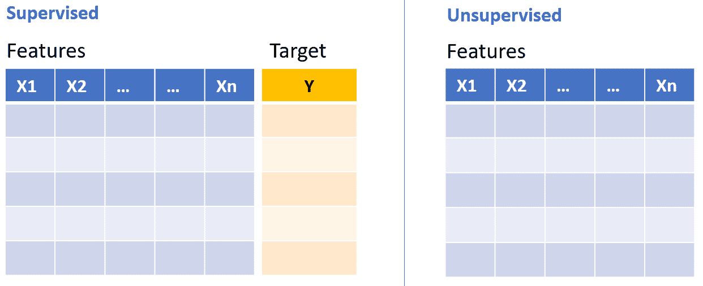

图 1.4 展示了如何进行监督。建模技术会看到真实的目标值（通常称为标签）及其预测值，使用误差的概念对它们进行比较，并更新模型，直到真实值与预测值之间的差异减到最小。对于这种风格的机器学习，可靠且带有标签的数据是一个关键要求。学习到的模型随后被用于进行预测。例如，一个用于通过 X 光片诊断肺癌的监督模型，将在几张 X 光片图像作为输入进行训练，并带有每张图像的真实诊断结果（癌症/无癌症）供机器学习过程使用。该模型随后就可以用于预测任何新的 X 光片预测患者是否患有肺癌。

正如我们将在下一节中看到的，无监督机器学习的学习行为非常不同。

相比之下，无监督机器学习没有目标的标签/地面事实（`ground truth`）来监督学习过程。如图 1.4 所示，输入过程的数据不包含任何关于目标的信息。机器通常学习数据中的某些结构性模式，通常是压缩数据集中包含的信息。

此类模型的一个常见用途是组织数据并将其划分为相似组（簇）。一些常见应用包括客户细分、图像分割、关联规则挖掘等。另一个常见用例是减少数据维度——降维——以便在保留大部分包含信息的同时使其更易于处理。`Principal Component Analysis (PCA)`、`Singular Value Decomposition (SVD)`、`Non-Negative Matrix Factorization (NMF)` 和 `T-SNE` 是一些流行的降维方法示例。

这些方法中没有一种方法需要其输出值的地面真值概念。对于无监督学习方法，必须由人类向模型提供一些指导，以使输出有用（通过设置参数或通过对结果进行迭代）。现在让我们来理解强化学习是如何工作的。

机器学习的强化风格与其他两种风格不同。在某种意义上，它与监督学习相似，因为有反馈/监督，但相似性仅此于此。提供反馈的方式也是不同的。这种学习风格最显著的特征是通过试错来学习。

在强化学习中，代理（或执行者）在不同的状态（或情况）下尝试各种动作（在给定的动作集中进行选择）。环境向代理提供反馈，无论移动是否良好。在提供反馈的各种情况下经过多轮试错后，代理学会了为了实现目标必须采取的良好动作序列。自动驾驶汽车是这种学习风格更优的例子。

许多机器根据当前情况决定下一个最佳动作的情况都可以表述为强化学习任务。也许股票交易机器人可以使用强化学习进行训练，以优化投资组合并实现投资收益最大化。强化学习也可以用于推荐系统，其中可以考虑用户状态、平台变量和平台目标来为用户做出下一个最佳推荐。

互联网上有许多速查表（`cheat sheets`），告诉你在任务中应该使用哪种机器学习风格。其中许多来自声誉良好的机构。此外，还有速查表甚至可以告诉你在特定情况下哪种技术最好。这些速查表提供了如下建议——如果你正在预测一个类别并且有超过 N 条记录，请使用 `XGBoost` 分类器。从表面上看，这似乎非常有帮助。

我们将很快讨论这种选择并不简单。第 2 章 `ML Problem Formulation: Setting the Right Objective` 专门讨论这个主题。首先，选择正确的 ML 风格并不是显而易见的。正确的技术是另一个选择，随着你参与到解决方案的构建过程中，你需要做出许多选择以使解决方案的价值最大化。这是一门艺术，而不是科学，即使那些数据科学大师们误导你相信事实如此。本书的大多数章节都在思考这些决策以及涉及的权衡。

底线是——由于 ML/AI 解决方案往往以一种过度简化和削减的方式被审视，没有考虑到构建解决方案通常涉及的复杂性。这种疏忽是许多 ML/AI 解决方案失败的原因。让我们更好地理解这一方面，并通过这一过程发现使用 ML/AI 解决问题的各个方面。

并不是秘密，许多提议的 ML/AI 解决方案并没有见到光，即没有成功部署。事实上，各种研究表明，约 70% 的 ML/AI 项目未能产生任何影响。在非常详细的层面上，似乎每个失败都有一个特定的、独特的原因。退后一步观察大局，我们可以将所有问题抽象为一个单一原因，即解决方案开发过程中每一步都缺乏优化。

我们还没有充分讨论这个开发过程。我们将在下一节进行讨论，提供一个开发数据科学解决方案的正式框架。我们还将定义过程每一步中优化的含义。为了让这个想法更具体，我们将查看一些 ML/AI 解决方案失败的最常见原因。

通过问题建模，我们指的是将业务问题转换为一个范围明确、具体的数据科学问题。例如，业务可能需要电子商务平台上显示给购物者的搜索结果与用户的兴趣和意图相关。这看起来是一个表述相当清楚的业务问题。然而，作为一个数据科学问题，这还远不够具体。从数据科学的角度来看，这可以被表述为一个排序问题，在用户旅程的语境下，被用户点击概率最高的项目将获得更高的排名。这些是完全不同的表述。

- 排序/生存问题，根据客户流失的概率对其进行排名，并对最有价值的客户提供激励（奖金、优惠券等）以留住他们。
- 详细分析以识别流失的驱动因素（例如客户停止使用平台的主要原因）并采取纠正措施。这可以通过设计良好的用户问卷来实现。

经过进一步思考，你可能会针对这一个业务问题识别出更多的数据科学问题方案。正如我们所理解的，并非所有方案都是等同的。每种方案都带有特定的需求和权衡。重新回顾文本去重的示例，不同的方案可能会从根本上改变数据需求，并成为成功与失败的区别。

在第 2 章 `ML 问题制定：设定正确的目标` 中，对这一主题通过各种示例和权衡进行了非常详细的讨论，该章节专门负责这一主题。

`Azra Inc.` 的数据科学团队正在构建一个更好的点击预测模型，用以预测用户是否会点击特定物品。其想法是为与客户相关的物品提供更高的可见性，从而带来更好的客户体验。这似乎是一个合理的方法。让我们花一点时间来意识到这种推理过程中的一些重大假设：

- 用户只会点击与用户意图相关的物品。这一假设很难验证，主要是因为用户意图通常是未知的。用户可能是来买鞋的，但极可能出于好奇点击另一个物品，而并没有购买的意图。
- 客户兴趣在数据收集与模型部署之间不会发生变化。
- 平台环境（更新的时尚、风格、全新的物品类别、客户细分分布）足够相似。

思考一下，你就会发现这种推理中的其他假设。如果这些假设失效，即使是准确率最高的模型也无法解决问题。在设计机器学习/人工智能解决方案时，必须意识到自己所做出的假设，并使用数据对它们进行验证。

让我们重新回到 `Azra Inc.` 的文本去重示例，团队做出的最大假设是会有几千条标记记录可以作为模型的训练数据。这种对数据的未满足需求就足以让解决方案偏离正轨。考虑另一种情况：数据科学家假设人口统计学数据（例如 `gender`、`age`）可用于建模。许多国家的各种组织和数据保护法现在禁止使用此类特征。这些特征对模型本非常有用，但遗憾的是无法获取。再次，数据的可用性变成了障碍。

每当设计一个使用监督学习来解决的问题时，都假设有足够的标签数据。对于建模的各种输入特征的可用性也存在假设。这里存在一个隐含假设，即可用数据足够可靠，且质量问题是可控的。这些假设中的任何一个失败，都会让你回到起点重新开始。

考虑在信用卡购买中检测欺诈交易的情况。通常，只有极小比例（通常小于 `0.5%`）的交易真的是欺诈。假设我们拥有针对该任务的可靠、标记数据，我们继续使用监督机器学习模型完成此任务。你构建的模型可能表现出极高的准确率（99.5%），但对该任务可能完全没有用。

为了理解为什么，考虑一个预测所有交易均为非欺诈的模型。你可以拥有 99.5% 的准确率，却没有检测到一个欺诈交易。这在欺诈检测问题中很常见，因为类别是不平衡的，即某一类（`non-fraud`）在数据中的存在远高于另一类（`fraud`）。数据不平衡从两个大方面影响建模过程：

一个良好的解决方案必须有一个经过仔细考虑的模型评估过程，并确保模型从两个类别中都学到足够足够的知识以区分它们。

在第 5 章 `不平衡机器学习` 中，对这些方面进行了非常详细的讨论，该章节专门负责这一主题。

例如，考虑一种情况：数据科学家开发了一个模型，为每个购物者 `x` 和物品组合预测用户是否会点击该物品。数据科学家为模型使用了几个极具信息量的特征。他们处理了数据，如用户在过去 6 个月看过的所有物品、过去一年所有的点击等。这是海量的数据，必须由模型进行存储、检索和处理，以预测一个用户 `x` 和物品组合的结果。平台每天可能有数百万用户，可能有十亿个组合需要预测。很可能这些步骤（即存储所需数据、检索和高速度处理）无法获得基础设施的支持。也可能出现模型对某类物品效果良好，但对所有物品类别都不实用。该解决方案无法扩展。

这种考虑适用于那些为了发现洞察而非一次性分析的情况。对于自动化预测解决方案，模型的可扩展性是一项基本特性（而不是可有可无的特性）。

这种失败的一个例子是：期望机器学习/AI 解决方案能辅助决策并为决策者提供清晰、可操作的建议。相反，解决方案仅输出一个类别的概率。决策者（最终消费者）要么不知道如何使用这些概率，要么觉得太繁琐，要么不理解/信任该模型。在所有情况下，解决方案都没有被利用，并未能产生影响。

比例如，假设作为 `Azra Inc.` 的数据科学家，你建立了一个以高准确率预测用户是否会点击物品的模型。该模型预测耗时 30 毫秒。工程团队拒绝了这一解决方案，因为 30 毫秒太长了，会降低平台性能。团队表示预测必须在 5 毫秒内完成。你得到了一个高准确率的模型，但却是不可行的解决方案。

有多种方法会导致陷入这种局面，这些可以归为一个原因，即缺乏对终端消费的优化。解决方案必须尊重其将部署的环境的限制。无论是近实时预测模型，还是针对决策者的及时建议/洞察。


我们在讨论不平衡数据时触及了这一方面。模型评估指标（例如 `accuracy`）可能显示出巨大的潜力，但在实践中，这可能等同于糟糕的模型，完全没有帮助解决问题（或者以不实际的代价实现的）。可能还有其他方法会导致模型评估存在缺陷并具有误导性。考虑电子商务平台搜索结果点击预测的示例。一种仅关注准确预测点击的模型评估方法可能会将廉价（且低质量）的物品排在高质量产品之前。如果部署了这一解决方案，我们可能会在短期内看到点击率 (`CTR`) 的提高。然而，所示物品的质量较低可能会反感客户，降低转化（订单/访问），增加退货率并降低客户留存率，从许多方面对业务产生负面影响。

ML/AI 模型与业务目标必须保持一致。这说起来容易做起来难。要找到一个既能捕捉业务目标，又能作为模型目标的指标是极其困难的。在这种情况下，模型目标必须尽可能地（作为代理）接近业务目标。如果无法实现直接的代理，则模型目标必须接近业务指标的某些已知驱动因素。作为一项良好的实践，数据科学家首先应该在小部分受众中通过实时系统（A/B 测试）测试模型性能。解决方案不能通过为 A/B 测试设置的护栏（`guardrails`）损害业务指标。只有这样，模型才适用于整个受众。

第 4 章“模型评估与调试”将详细讨论更具原则的评估方法和各种考虑因素。

归根结底，要让一个机器学习/人工智能解决方案取得成功，必须理解并优化整个解决方案的流程/周期。让我们在下一节中了解这一过程以及一个优秀的框架。

## ML / AI 模型对比端到端解决方案

直到最近，数据科学团队的输出通常是一个预测模型。它可以是一个指定了预测组件的脚本（例如线性回归的方程）。也可以是一个压缩的模型对象（例如 `pickle` 文件），它在正确使用时期望特定的输入格式并输出预测结果。从数据科学家的角度来看，这就是解决方案，如图 1.5 所示。数据工程团队将根据这些输出来部署模型，即创建一个从端到端处理数据并开始交付的系统。模型开发被认为是数据科学家的工作，而模型部署则是工程师的任务。

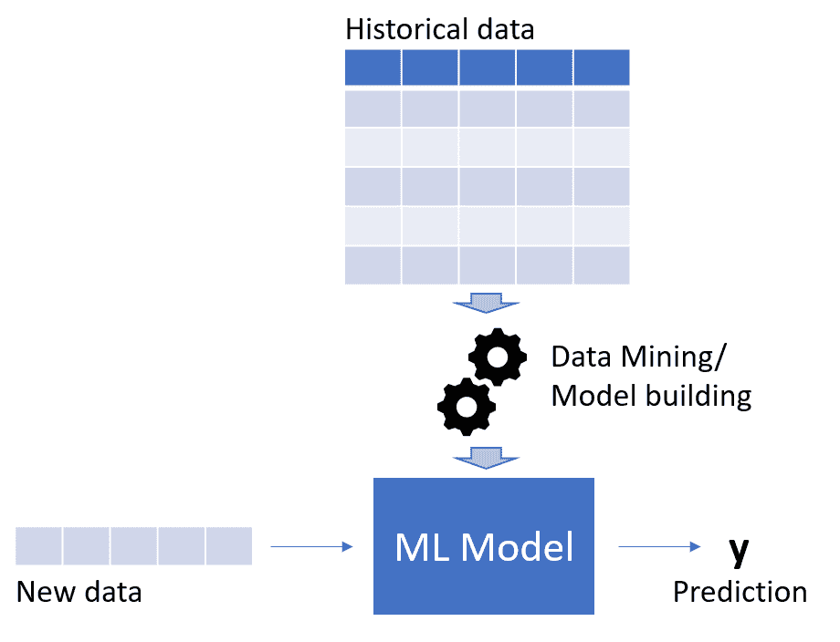

这种安排依赖于工程团队（未开发模型的团队）来从数据挖掘过程中获得价值。这是次优的。可以预料到，这会加剧模型部署、消费和可扩展性方面的许多挑战。如果创建模型的团队也理解模型的消费并确保模型的可扩展性，会更好。同样，开发模型的团队理想情况下也必须很好地理解业务考虑，从而从模型中产生最大的价值。这得出了自然的结论：开发数据科学解决方案的团队必须理解并拥有端到端的过程，如图 1.6 所示：

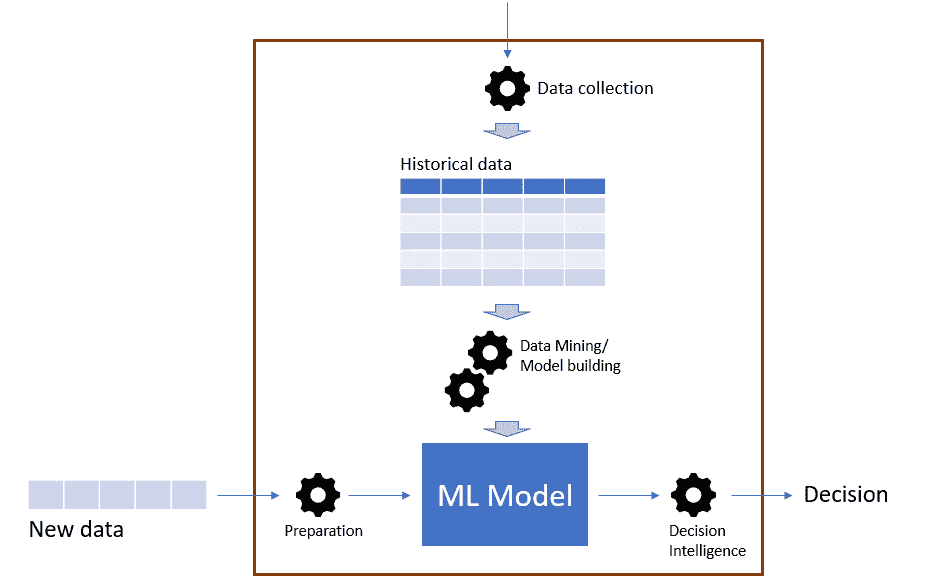

因此，现代数据科学家不能只考虑孤立的模型，而必须考虑整个端到端的数据科学解决方案，如图 1.6 所示。现在让我们学习一个处理这一过程的框架。

我们之前讨论过，现代数据科学家必须以解决业务问题的解决方案而非孤立的模型来思考。业务问题通常不是静态的、孤立的一次性事件。业务问题通常是复杂的，具有许多方面和细微差别。问题在开始时并没有被完全定义，而且通常没有可以快速实现的单一终点。解决此类问题需要处理大量的不确定性，并随着每次新的学习不断完善方法。在充分理解问题后，创建数据科学解决方案是一个通常需要迭代并非常强调消费者终端实用性的过程。所有这些勤奋的努力可能只是让我们得到第一个解决方案，为未来的改进铺平道路。它也可能让我们学到一些新信息，使我们重新回到起点板，重新审查我们的假设和推测，为问题创建一个不同的方法。

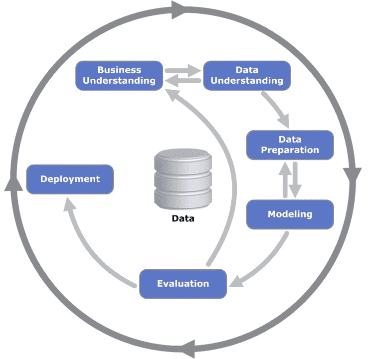

这种解决问题的迭代性质在“跨行业标准数据挖掘过程框架”（称为 CRISP-DM 框架）中得到了很好的体现。如图 1.7 所示，该框架适用于各种类型的问题和领域。它是通用的。

CRISP-DM 框架是一个通用的数据挖掘框架，帮助我们构建可靠的数据科学解决方案。该框架包含 6 个步骤，每一步都捕捉了解决方案构建过程的重要步骤。要构建高影响力的数据科学解决方案，你必须理解框架的每一步。要优化解决方案，你必须优化 CRISP-DM 框架中列出的每一步。让我们理解每一步优化的含义。为了使想法更具体，让我们也看看 Azra Inc 文本去重案例研究中的优化将是什么样的。

### 业务理解

在本节中，我们将讨论业务问题。识别我们处理的是单个问题还是多个较小问题的组合至关重要。我们需要评估紧迫性。我们还需要评估我们是否能够负担得起研究并花时间构建解决方案的成本。在这一步中，我们制定要解决的业务问题——即将一个模糊、高层次的问题陈述转换为一个定义良好、范围明确的特定问题。在此阶段，我们不决定建模技术。设计解决方案还需要回答其他问题。我们是在构建一个原型/最小可行性产品 (MVP)，还是在构建一个旨在长期运行的解决方案？这些决策对我们最终开发的解决方案有很大影响。

我们还需要定义解决方案的消费方式。我们需要评估在设计良好的仪表板中提供来自数据科学过程的洞察是否足够。或者，我们需要明确是否需要一个具有多个组件的系统。每个组件都可以是一个数据科学模型。这些组件可以智能地缝合在一起，形成必要的解决方案。这些是开发解决方案时的额外考虑因素。

业务理解还包括对当前问题性质的理解。业务团队或数据科学团队通常对问题以及潜在的解决办法持有假设。这些假设可能是：问题位于客户细分 X 中，即试图定位问题。它们可能是这种类型——改进退货体验将有助于留住客户，这尝试捕捉可能解决问题的行动。尽管如此，这两种都是假设，必须使用数据进行评估。对于开始决定解决问题所需的数据的性质，理解是至关重要的。

我们需要理解这一步中优化的含义。让我们再次回顾文本去重案例研究，并尝试定义我们在这一步需要的优化。

这一步的优化如下：

对于文本去重案例研究，如下：

*   将其表述为监督问题还是无监督问题
*   设计用于进行预测的系统
*   识别延迟需求和数据存储/检索设置

回答这些问题并没有结束这个过程。图 1.7 显示了“业务理解”步骤和“数据理解”步骤之间的往复。让我们了解下一步，并更好地理解这种依赖关系。

### 数据理解

这一关键步骤由三个子步骤组成：

第一步，即定义要收集和分析的正确数据，对后续所有的效率具有显著影响。在 `Business understanding`（业务理解）步骤中生成的假设是定义这些数据的起点。数据收集是一个极其耗时的步骤，有时需要几个月才能获得所需的数据。组织可能没有记录所需的数据，并且可能需要构建追踪这些数据的能力。在某些情况下，此类数据可能需要从外部供应商购买。读者可能已经意识到 `Business understanding` 阶段对这一步的重要性和影响。上一步的错误决策在这一步可能会变得非常昂贵。

接下来，对收集的数据进行探索，以理解其中包含的各种模式。探索通常采用几种不同复杂程度的数据分析技术。这种探索的结果是为问题提供更明智的方法。在 `Business understanding` 步骤中生成的各种假设现在通过此类探索得到验证或证伪。数据科学家可能会发现一些有趣的模式，从而产生新的假设，并提高对问题的整体理解。这一步的发现可能会让你回到起点，重新审视解决问题的宏观方法。事实上，这就是 `Data understanding`（数据理解）和 `Data preparation`（数据准备）步骤之间的反复迭代，如图 1.7 所示。让我们理解这一步的优化意味着什么。让我们再次回顾文本去重案例，看看我们可以如何优化这一步。

对于我们的文本去重案例，具体如下：

*   收集相关文本数据
*   探索文本长度、语言、重复模式分布
*   评估数据质量与标注可行性

### 数据准备

仅仅收集和探索数据点并使其能够输入模型是不够的。在建模之前，我们必须进行一些工作，即准备数据以适用于建模。这可能意味着：

需要注意的是，这部分取决于任务、数据的性质和要求。这是模型的一个步骤。数据科学家必须尊重系统和部署环境带来的约束，因为它们将成为解决方案的约束。

到这一阶段，你已经选择了机器学习风格。例如，对于欺诈检测，选择了监督学习方法，我们将在第 2 章 `Problem Formulation: Setting the Objective`（问题制定：设定目标）中详细介绍。

对于文本去重案例，具体如下：

*   为输入文本创建端到端流水线

### 建模

我们已经到了构建数学模型的阶段。对于预测任务，该模型将捕捉输入与我们想要预测的输出之间的关系。如果 AI 解决方案是躯体，那么模型就是大脑。现在，你可能已经意识到这个模型不需要过于复杂就能被称为模型。它可能是一个提供必要洞察的简单透视表。

在解决方案开发的这一阶段，给任何数据科学家的最好建议就是理解约束。遵循直到此阶段的所有步骤后，数据科学家将意识到来自各种来源的各种约束。模型的透明度和可解释性可能存在约束。在某些情况下，监管机构可能要求可解释性并对模型进行审计。同样，其他考虑因素包括离线 vs 在线预测、实时 vs 低预测、延迟需求、数据刷新需求等。数据科学家必须尊重环境带来的约束，因为它们将成为他们可以开发的解决方案的约束。

模型构建是本书的核心关注，几乎在所有的章节中都会讨论。关于某些特定方面，第 5 章 `Imbalanced Machine Learning`（不平衡机器学习）教授了处理类别不平衡的策略。第 6 章 `Hyper-parameter Tuning`（超参数调优）教授了按原则调优模型设置的方法以获得最大性能并从数据中提取最大价值。其他章节教授了如何进行模型构建。

对于文本去重案例，具体如下：

*   在迁移学习（最新的基于 transformer 的模型）和从零开始开发解决方案之间选择
*   选择正确的深度学习架构（循环网络 vs transformers）

### 评估

在这一时刻，你可能会由于得到的结果而决定公式可能需要更改。回顾欺诈检测的示例，你可能一直将其作为一个监督学习问题来处理。在尝试了许多监督学习方法后，你可能决定无监督方法值得尝试。这样做，你需要回到上一步，为无监督机器学习以不同的方式准备数据。

在实践中，评估的某些部分必须在上一步中解决。例如，为建模技术选择最佳超参数，需要一个良好的模型来从许多选项中进行选择和优化。最佳模型并不总是准确率最高的那一个，正如我们将在第 4 章 `模型评估与调试` 中详细讨论的那样。我们讨论过数据科学解决方案必须遵守几项约束。在这种情况下，我们有多个符合我们要求的候选模型，其中最佳模型能够最好地解决（业务）问题，并为消费者提供最大的价值。

这种评估需要一种良好的模型评估方法。我们的评估标准必须贴近业务结果。如果模型目标与业务目标不一致，你最终可能会得到一个失败的解决方案。在模型验证步骤中，我们确保拥有一套评估方案，并能够评估模型的泛化性能。这种性能可以与业务结果联系起来。

对于文本去重案例，考虑以下内容：

*   设计贴近业务指标的评估体系（如精确率/召回率权衡）
*   离线指标与在线 A/B 测试指标的关联分析

更具原则性的评估方法和各种考虑将在第 4 章 `评估与调试` 中详细讨论。

### 部署

根据解决方案的性质，部署可以是一个复杂程度各不相同的过程。当数据科学解决方案的结果是可操作的洞察时，部署将涉及以最有效的格式传递这些洞察。即使是一个设计精良、提供必要建议的仪表板可能也足够了。对于提供近实时决策的解决方案，这需要建立一个端到端的流程，快速转换输入、做出预测，并在预测上应用必要的智能以做出微决策。

部署是机器学习/AI 解决方案的最后一里路，良好地执行对于解决方案交付的价值及其所产生的影响至关重要。例如，一个使用最新深度学习架构的高准确率模型，如果其预测的消费设计得不当，可能会在实践中毫无用处。在另一种情况下，一个准确率较低的简单模型如果能提供带有支持性解释的建议，就能解决业务问题。因此，这一步的一个重点是对针对消费进行优化。

一旦模型上线（被用于其实际目的），就对其进行监控。监控的应用包括：确保模型在新的数据上准确率持续良好、检测数据漂移和概念偏移（模型仍然有效，数据的性质没有变化）、监控模型延迟，并确保良好的推理/预测时间。

*   创建一个端到端处理数据和输出的流水线

> **注意**：对于在长时间内进行循环预测的系统（例如电子商务平台上的点击预测模型），模型性能监控是必要的。每种情况都需要经过仔细评估，这要求对数据、技术设置以及模型对业务指标有良好的理解。

对于文本去重案例研究，考虑以下内容：

*   部署为低延迟推理服务
*   建立数据/概念漂移监控告警机制
*   设计模型版本回滚与灰度发布策略

## 总结

在本章中，我们讨论了在使用数据科学时必须理解的关键思想。许多数据科学解决方案失败了。原因有很多，可以归纳为：此处，我们指的不是数学模型。CRISP-DM 框架是开发适用于所有行业和领域的解决方案的极佳方法。它始于业务理解，结束于部署。优化数学模型只是优化整体解决方案的一小部分，且解决方案必须遵守施加在其上的各种约束——业务、部署以及监管机构。数据科学专业人员必须理解每一步，并意识到优化机器学习/AI 解决方案需要 CRISP-DM 的每一步。有了这种理解，我们离深入每一步细节又近了一步。

---

# 第 2 章 问题制定：设定目标

本章将讨论涉及机器学习问题建模的数据科学项目中最重要的步骤之一。问题可以通过不同的解决方案以多种方式建模：机器学习或非机器学习。此外，还有多种可能的机器学习方法。某些问题可以作为监督分类问题来解决，而另一些则作为聚类问题。此外，因变量和特征集是影响机器学习模型性能的选择。本章阐述了解决当前业务问题设定正确目标的想法；定义建模方式以获得最佳结果。最后，我们看到，为了让机器学习解决方案产生最大的影响，模型目标应当与业务目标保持一致。

在接下来的章节中，我们将讨论以下主题：

*   混合机器学习风格

## 2.1 问题识别与机器学习适用性

在本章中，我们将讨论机器学习/人工智能项目中的首个关键步骤——将业务问题表述为机器学习问题。首先，我们将学习如何识别适用于机器学习的问题。然后，我们将看到一个问题是否可以通过采用不同的机器学习（ML）方法以多种方式解决。我们将看到一些经验法则，并理解这些边界在现实世界中是如何模糊的。我们还将看到选择正确的因变量和特征如何为项目的成功奠定基础。我们将这样一个观点作为本章的总结：当模型目标与业务目标对齐时，就能产生最大的影响。在本章结束时，你将能够为你的业务问题确定正确的表述方式，并为机器学习/人工智能事业的成功做好准备。

在通过机器学习解决问题时，我们使用数据来让模型学习做出决策/预测所需的模式。机器学习的意义在于，它消除了手动将你的知识和领域理解编码为一组规则的需求。你可以向模型投喂成千上万甚至数百万个数据点，它几乎像变魔术一样计算出进行预测所需的所有信息。机器学习方法已经变得如此突出，以至于许多数据问题被直接视为机器学习问题，有时取得了巨大的成功，有时也吸取了惨痛的教训。对于任何数据科学专业人员来说，理解并非所有问题都需要作为机器学习问题来解决是非常关键的。

机器学习有自己的一套要求和挑战。流行的机器学习方法最常见的需求是大量的训练数据，机器需要从中进行学习以创建模型。此外，构建稳健的机器学习模型是一个耗时的过程，涉及多个步骤——获取数据、清洗、其他预处理和转换、模型构建、评估和评分。在某些情况下，投入的时间和精力是值得的，但并非总是如此，特别是考虑到竞争性的基于规则的解决方案可能会以更少的精力更快地提供可接受的结果。

考虑一个新的在线职位申请门户，用户可以按照 PDF 格式提交个人简介，并遵循简历格式的特定指南。该门户将自动从简历中提取信息，如联系方式、职位、毕业日期等。此类任务属于“信息提取”任务类别，这是自然语言处理的一个领域。在有足够的训练数据和训练时间的情况下，基于深度学习的模型在此类任务上表现出了卓越的性能。

另一种方法是使用正则表达式——一种基于模式的文本匹配和提取技术。建模人员可以定义字段中预期的模式，以便从文中提取该信息。例如，如果电话号码具有（一些）一致的格式，那么建模人员就可以使用正则表达式描述模式并轻松地提取电话号码。同样，正则表达式也可以用于提取其他相关信息。由于门户对简历格式有指南，我们预计模式在不同简历之间将是一致的。这意味着我们可以预期基于正则表达式的解决方案可以在机器学习方法所需时间的一小部分内提供良好结果。在这种情况下，基于机器学习的解决方案是大材小用，一个简单的基于规则的解决方案就能胜任。

考虑另一种情况，在线快时尚巨头 Azra 希望理解为什么其净推荐值（NPS）一直在下降，也就是说，他们希望理解对客户满意度产生负面影响的因素。使用机器学习，可以通过识别影响平台的因素来解决这一问题。机器学习解决方案的理想模板是：你有足够的数据、充足的时间以及对准确率更高要求的问题。

对于需要立即修复且对高准确率没有要求的情况，基于规则的方法通常足够了。此外，如果情况需要一个临时方案，且该方案最终会被一个彻底、复杂的解决方案所取代，那么第一次尝试完全可以是一个基于规则的解决方案。同样，扩展性需要采用机器学习，因为基于规则的系统难以维护，更难以扩展。你如何决定手头的问题是否需要机器学习？这里有一些考虑因素：

*   你有多少时间可用？
*   你有足够的数据吗？
*   它需要高准确率吗？
*   解决方案需要是可扩展的吗？
*   它是最小可行性产品（MVP）吗？换句话说，它是会被取代的版本吗？
*   它是一个需要频繁训练和维护的长期解决方案吗？

有了这些指南，你应该能够判断手头的问题可以使用基于规则的方法解决，还是它们确实需要机器学习解决方案。

## 2.2 机器学习风格选择

我们在上一章中讨论了一些机器学习风格。选择合适风格的隐式、简单决策过程如图 2.1 所示。它捕捉了做出此类选择的最流行的指南：

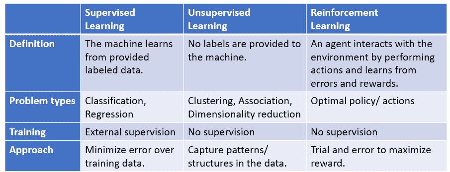

此外，对于为特定任务/情况选择机器学习问题的特定表述，还有各种经验法则：

上一章中提到，在某些情况下，ML 风格与问题表述之间的边界可能是模糊的。现在，我们将那个小注扩展为一个核心观点：你可以恰当地表述问题，并在各种 ML 风格之间进行选择。事实上，这种表述可以对你的数据科学项目的成功产生决定性的影响。

## 2.3 欺诈检测：多表述视角

欺诈是一个影响几乎所有行业的问题。在电子商务以及银行、金融服务和保险（BFSI）领域，这是一个特别严峻的问题。仅在电子商务领域，2021 年因支付欺诈而导致的损失就高达 2000 亿美元。汽车保险公司每年损失约 290 亿美元。2019 年，全球机构因欺诈损失了超过 5 万亿美元。显然，欺诈是一个大问题，而且机器学习技术经常被用来对抗这一问题。事实上，欺诈检测是机器学习最具影响力的用例之一。有趣的是，针对这个问题，有（至少）两种主要的机器学习方法。

检测欺诈的一种显然方法将其视为一个监督分类任务。结果/因变量是交易是否欺诈的二分类指标（0/1），它是基于与用户及其行为以及交易本身相关的许多特征预测的。事实上，这是用于欺诈检测的最常用表述方式。这种方法是有效的，但也带来了许多挑战。

```
Pr (Y = 1) = f (user attributes, transaction attributes)
```


# 机器学习问题表述与融合方法

## 欺诈检测中的类别不平衡

欺诈的发生率低——这意味着通常只有极少数的客户/交易是欺诈性的。例如，只有约 0.1% 的信用卡交易是欺诈性的——1000 次中 1 次是一个很低的发生率/出现率。数字随行业而异，但欺诈交易/用户通常占所有交易/用户的 <1%。在监督机器学习的术语中，这存在严重的类别不平衡——多数类记录（非欺诈）的数量远多于少数类记录（欺诈性）。这种严重的不平衡总是会有问题的，因为模型很难学习区分这两个类别所需的模式，仅仅是因为欺诈案例的信息和表示太低了，无法从中进行学习。要从监督分类模型中获得满意的结果几乎总是具有挑战性的。幸运的是，还有另一种（完全不同的）潜在方法，可以更好地处理类别不平衡。

这个想法简单而强大——欺诈交易/客户具有与常规交易非常不同的特定行为。例如，欺诈交易通常使用最近开的账户进行，电子邮件地址中包含更多数字，偏好某些支付方式，并且更常见地来自某些地点。此外，用户尝试交易的次数或交易中的物品数量可能异常高。如果所有信息都用数据表示出来，并且正确地进行了聚类——欺诈交易将作为一个单独的簇出现。或者，它们将表现为远离常规非欺诈交易簇的疏散点。如图 2.2 所示，所有微小的簇和单个点都与大部分交易有所不同，因此它们是欺诈的良好候选。

```
images/Figure_2.png
```

正如你所怀疑的那样，无监督方法并不会自然发现类别不平衡。两种方法哪种更好取决于情况。

## 问题表述的多样性：以产品收入预测为例

你是在线时尚巨头 Azra 的一名数据科学家。你正在从事的任务是识别显示在主页上的新商品。只显示收入前 10% 的商品。你拥有的数据是关于产品的属性——例如颜色、品牌、类别、风格等。

`Y (Revenue) = f (product attributes)`

停下来思考一下：你需要预测精确的销售额，还是预测产品进入前 10% 就足够了？这两种表述方式不同吗？

这是该任务的一种自然表述方式，也是目前最流行的方法。但考虑一下——你知道只有前 10% 的收入重要。精确的值对你来说并不重要；相反，进入前 10% 是关注点。这种认识引导我们采用不同于监督的表述。因变量/结果变量将是产品进入前 10% 的指标。

这种表述方式的优势是现在不需要精确预测销售额。收入通常很难预测，因为它们在产品之间通常表现出高方差。因此，回归的模型评估指标（例如 `R²`）会显示较低的值。虽然这本身并不是问题，但它是误导性的，因为建模者会专注于获得更高的精确度，而这并不那么重要。

## 文本去重任务中的表述选择

这个问题在这一节前面的部分曾作为一个思想实验提出过：让我们现在尝试回答它。假设你是在线电商 Azra 产品页面团队的一名数据科学家。产品页面包含有关产品的详细信息，包括客户提供的评分和评论，以及用户对产品的问题。产品页面上的问题似乎存在严重的重复，用户似乎用细微的语言提问相同的问题。例如，“这种材料耐用吗？”可以被视为“这件衣服耐用吗？”的重复。你的任务是识别重复的问题。

循环神经网络以及最近基于 Transformer 的架构在文本分类任务中取得了巨大的成功。事实上，深度学习方法在大多数与文本相关的任务中都提供了最先进的结果。因此，第一种表述方式是一个监督分类问题。具体来说，你可以获取成对的问题，并将其输入一个模型来预测这对问题是否仅仅是重复的问题，如图 2.3 所示：

```
img/Figure_2.3.jpg
```

这在直觉上是合理的，因为如果我们有足够的标注数据，我们期望深度学习方法在这种情况下能大放异彩。深度学习方法是极端的数据饥渴型模型，需要大量数据才能发挥作用。对于我们这种这样的文本去重任务，我们至少需要标注几千对问题。问题在于，标注成千上万对问题并不容易。从理论上讲，可以手动进行标注，这将消耗大量的人力，并且需要为标注者提供一些可靠的指南，以确保他们的标签一致。显然，从零开始准备此类训练数据可能需要很长时间，也许需要几周。我们注意到，监督分类方法是有前景的，但我们假设这种表述方式需要大量的数据支持。幸运的是，无监督聚类的另一种方法可以解此眉。

无监督聚类不需要任何标注数据。因此，这种表述方式立即消除了对成千上万对问题的的需求。这种表述在概念上非常简单——对问题进行聚类。如果聚类得很好（应用了适当的距离量），我们期望重复的问题会形成非常紧凑的簇。在理想情况下，我们期望簇的数量与数据中唯一问题的数量一样相等。这种简单的方法非常强大，也许是我们这种情况的唯一可行解决方案。

总结本节，一个机器学习问题通常可以用多种方式进行表述。显而易见的首选表述可能具有我们无法满足的要求，并且可能不可行。替代的表述方法最初可能并不明显或直观，但对于你的情况来说可能要实用得多。因此，明智的数据科学家意识到特定任务有多种表述方式，并能够识别适用于任务的正确表述至关重要。这种选择可能很大程度上影响机器学习项目的成功。但我们真的必须在这些表述之间进行选择吗？或者是否有办法可以让我们从各种表述的优势中获益？现在让我们讨论一个核心思想——机器学习风格的融合。

## 机器学习风格的融合

我们看到，有些问题可以使用多种方法解决，而哪种方法的效果更好取决于情况。每种方法都可能有一些缺点/优点，数据中可能存在某些情况使得一种算法的效果比另一种更好。这里有一个看起来很疯狂的想法——为什么不把不同的机器学习风格结合起来？如果你能以某种方式很好地做到这一点，组合方法将比单一方法更好——其中一种方法可能克服了另一种方法的缺点。好消息是，这种方法的“**融合**”是可以实现的。

让我们重新回顾在上一节中讨论的欺诈检测问题。我们理解，严重的类别不平衡对于纯监督方法来说是一个问题，但无监督方法并不那么受此问题的困扰。此外，回想无监督方法，我们获得了一些怀疑是离群值的簇，需要进一步的分析来识别欺诈案件。因此，每种方法都有缺点。考虑一下这一点：如果我们使用无监督方法创建了一些簇，并将这些簇作为监督分类模型的特征会怎样？

| 结果 | 特征 |
| --- | --- |
| 欺诈 (y) | 用户特征、交易特征、簇 |

表 2.1：将无监督簇作为监督模型的特征

表 2.1 显示了如何非常简单地实现这一点——实例的无监督聚类分配被简单地作为预测器包含在分类模型的训练数据中。这种方法的有用之处是，新特征 `Cluster` 包含极其丰富的信息，尽管存在严重的类别不平衡，它也能帮助监督模型表现得更好。通过添加这个新特征，特征被多数类信息所主导的问题得到了减轻。总的来说，我们得到了一个融合解决方案，它的效果可能比单一方法更好。

融合监督和无监督方法在处理高维数据（大量特征）和许多训练记录时也很有帮助。在银行、金融服务和保险 (BFSI) 领域，使用几百个（甚至数千个）预测因子进行预测建模是常见的情况。即使只有几十万条记录，使用一千个预测器的模型也会变得臃肿，以至于无法实施。

```
img/Figure_2.4.jpg
```

一种常见的策略是使用主成分分析 (PCA) 和奇异值分解 (SVD) 等降维技术。在这两种方法（`PCA` 和 `SVD`）中，原始特征被用于推导出新的维度或组件。这些新组件是原始特征的线性组合，捕捉了数据集中包含的大部分信息。通常，极少数的维度就能捕捉一千个特征所包含的信息。事实上，50 个维度就能捕捉大约一千个原始特征包含的大部分信息。这是维度的大幅减少——从大约 1000 到 50——并提高了模型的速度。这是另一个融合方法可以带来显著效率收益的例子。

### 为了更好的数据表示

大多数现代语言处理 (NLP) 任务采用了无监督和监督学习方法的结合。在 2013 年之前，表示文本流行的方法是使用词频——每个文本记录由数千个特征/列表示（对应整个训练数据中找到每个词，10000 列并不罕见）。2013 年，Mikolov 等人提出了可扩展的词嵌入（低维向量），这迅速成为表示文本数据的常用方法。这些嵌入从以下两个方面提供了帮助：

1. 降维：词嵌入的大小小得多（通常在 50 到 300 之间）。
2. 捕捉“含义”的更好表示：这些嵌入的推导方式代表了概念，并且证明这些嵌入捕捉了词之间的许多关系。

嵌入的推导大部分不关心数据中的标签（例如目前最流行的 `word2vec` 算法），因此在意义上是无监督的。将特征集从 10,000 个相对愚笨的频率减少到大约 100 个捕捉含义的智能特征：这是一个通过融合方法可能实现的重大益处。

我们现在理解并体会到，机器学习问题可以使用多种表述形式来解决，每种形式都有其优缺点。我们还看到，并不总需要在竞争的表述形式之间做出选择。相反，我们可以以不同的方式融合多种方法，并从数据挖掘巨大的价值。现在，让我们关注转向问题表述的另一个方面——因变量的选择。

## 选择正确的因变量

在“问题 2：预测高销销产品”章节中，我们看到也可以调整因变量/结果变量的选择。结果变量可以是产品的收入（在显而易见的表述中），但我们决定可以改为建模该产品是否会处于产品排行的前 10%。这一选择将表述从一个 `Regression`（回归）问题转变为一个 `Classification`（分类）问题。更重要的是，第二种表述形式防止了我们仅仅关注追求精确的收入预测，转而让我们专注于能够与业务目标高度契合的结果。显然，选择正确的因变量是一个影响解决方案有效性的重要决策。

考虑另一种情况：作为热门在线时尚平台 Azra 搜索团队的数据科学家，你的目标是提高搜索结果的相关性。更好的排名将使更相关的产品出现在结果的靠前位置，帮助购物者更容易找到他们想要的东西。你确定这是一个监督学习问题，并且你有大量的历史数据可以建模。关键问题是：因变量应该是什么？让我们先思考一下选项，并从目前行业的方法中寻求灵感。

一种非常流行的表述是预测对搜索结果的点击。如果前 `N`（预定义的数量）结果中的任何一个被点击，搜索就是成功的。因此，因变量 `Y` 为：

- `0`: 如果前 `N` 个结果都没有被点击
- `1`: 如果前 `N` 个结果中的任何一个被点击

注意，这种表述并不关心点击的位置。点击了最后一项（例如第 `40` 个）的搜索，被认为与用户点击最顶部的项的搜索一样是成功的。这合理吗？人们可能会认为点击位置极其相关——较高的点击位置（`rank 1` 是最高位置）表示搜索结果集更好。

这引出了我们的另一种表述；将问题视为一个排序问题。注意，这仍然是一种监督学习方法。但我们不再仅仅关注点击，而是尝试让点击出现在最顶部的结果中。在这种表述中，因变量可以简单是点击位置，数值越小越好。最小化该值的模型将把更相关的项推到顶部，并认为可能更符合我们的目标。

注意，这种表述选择在推荐系统中很常见——这两种表述（即排序 vs. 点击预测）在行业中被经常采用。

因此，我们对因变量的选择进行反思非常重要。虽然通常有一个效果良好的自然选择，但在某些情况下，你可能会选择一个更符合手头任务的因变量。

## 业务目标 vs 机器学习目标

让我们继续讨论上一节中讨论的搜索相关性示例。数据科学项目的目标是提高搜索结果的相关性。我们讨论了因变量的几种选择，并讨论了将其视为点击预测问题或排序问题。在这两种表述中，首要目标都是让用户点击某个项目。

电商行业众所周知，低价商品会获得更多点击。考虑一种始终将非常便宜的物品放在顶部的搜索排名算法。你对这种算法的点击率（`Searches with Clicks/Total Searches`）有什么预期？当然，它会导致更多的点击（因为用户会点击更便宜的物品）。这意味着这种算法对平台更好吗？

答案是否定的。将更便宜的物品放在顶部大多数情况下会导致更多点击并提高点击率指标。然而，这种方法可能有几个缺点：

- 平台的整体收入可能会下降，仅仅因为平均销售价格可能会下降。
- 顶部的低质量物品（更便宜的物品可能是低质量物品）可能会对平台的感知产生损害。
- 低质量物品可能导致更高的退货率，因此不仅损失收入，还会产生逆向物流成本。
- 在不考虑与购物者距离的情况下展示更便宜的物品，可能会导致物流成本增加并降低公司的利润率。
- 总体转化率（购买/访问）可能会下降，因为点击后，低质量物品的详情及其评论可能会阻碍购物者购买。
- 本质上，对于像排序这样的任务，有多种潜在的竞争目标。仅关注搜索点击率的方法可能会（可能就会）对业务的其他目标产生负面影响。因此，机器学习建模过程的目标必须与业务目标紧密对应至关重要。

对于我们的示例来说，建模一个融合了点击率和货币价值（或其他目标）的指标会有所帮助。例如，可以最大化点击产生的预估收入。这种指标将点击概率与点击带来的收入相结合，并帮助平衡两个目标。即使你不使用这种融合指标，跟踪与其它业务目标对应的指标也是一个好主意。毕竟，目标是解决业务问题，任何可接受的解决方案都应该改善而不是损害现状。

## 结论

机器学习具有巨大的前景，通过解决多个业务问题创造了巨大的价值。然而，并非所有问题都需要机器学习——许多问题可以使用简单得多的基于规则的方法解决。我们讨论了一些考虑因素让你做出决定。接下来，我们讨论了从业人员可以选择的各种 ML 风格，并看到风格之间的界限可能是模糊的。通过多个领域的示例，我们看到问题可以具有不同 ML 风格的多种表述。智能的数据科学家必须能够识别出任务的正确表述。这一选择完全可以决定机器学习项目的成败。

我们随后看到融合 ML 风格是一种强大的方法。这样做有几个动机——降维、更高的准确性、更好的数据表示——将监督学习和无监督学习方法结合起来是产生巨大收益的常见做法。选择正确的因变量也是表述的一部分，我们看到这种选择不仅可以极大地简化建模过程，还可以获得更好的结果。最后，我们看到，要增加真正的价值，机器学习项目的目标应该与业务目标良好对齐。

# 数据收集与预处理

## 引言

“垃圾进，垃圾出”（Garbage in, garbage out）——你可能以前关于系统的有效性听过这句格言。对于机器学习过程也是如此。无论机器学习技术的水平如何，使用低质量的数据都会导致糟糕的结果。随着渴数据型深度学习方法的普及，人工智能和机器学习系统需要越来越多的数据。但**优质的数据始终比大量的数据更重要**，因此理解如何获取正确的数据至关重要。

在本章中，我们将学习更多关于 `CRISP-DM` 框架中的数据理解和数据准备步骤。理解影响数据收集过程的各种因素以及你应该如何处理相关问题至关重要。我们将整个预处理过程视为一条流水线，并对其采用一种有原则的方法。通过案例研究的帮助，我们将学习流水线的各种细节并进行实操。

## 章节结构

在本章中，我们将涵盖：

*   构建机器学习解决方案
*   案例研究
*   预处理过程
    *   步骤 1：收集数据 + 基础检查 + 修正
    *   步骤 2：划分为训练集和测试集
    *   步骤 3：离群值处理
    *   步骤 4：缺失值处理
    *   步骤 5：类别特征处理
    *   步骤 6：数值特征转换
*   案例研究步骤回顾

## 目标

在本章中，我们将学习如何处理数据，以便在建模之前将其精炼到最佳状态。我们将首先学习影响数据以及你对数据理解的各种因素。我们将学习数据中可能的各种问题以及如何识别和处理它们。我们将介绍一种有原则的数据预处理方法，该方法可以适用于不同的解决方案。我们将学习避免常见陷阱（如数据泄露）的方法，并学习极其实用的数据清理方法。然后我们将学习如何对数据中的特征进行操作（特征工程），专注于当前的任务。我们将从整体上观察数据预处理流水线。我们将在一个真实的案例研究中应用所有的概念。

在本章结束时，你将能够掌握数据理解和数据准备的过程。你将能够识别领域和数据的特殊之处，并据此处理问题。你将能够进行广泛的数据清理以提高数据质量。你还能够对数据进行各种转换，以从你的机器学习/人工智能解决方案中获得最大的性能提升。

## 构建机器学习解决方案

构建基于机器学习的解决方案不仅仅是将模型拟合到数据的技术练习。解决方案的构建始于业务理解，它指导解决方案的设计和随后的步骤。除非处理正确，否则可能会危及整个机器学习解决方案。理解数据和数据准备是接下来的两个步骤。数据理解涉及对数据的探索和对模式的理解。利用这种理解，可以最好地准备数据，以从中提取最大价值并构建最好的机器学习解决方案。只有在这些步骤之后，我们才进入建模、评估和部署阶段。整个过程封装在数据挖掘跨行业标准过程模型（`CRISP-DM`）框架中，如图 3.1 所示：

```
img/Figure_3.1.jpg
```

要点是，模型拟合部分是该过程中的许多步骤之一。理解和准备步骤可以被称为预处理。模型拟合过程更具技术性，如果预处理做得恰当，它的部分内容可以标准化，甚至可以自动化。另一方面，预处理部分很少是标准化的，它取决于数据收集过程、数据的性质、某些特定领域的考虑因素以及当前的任务。预处理是从业者技能产生巨大差异的地方；这些部分既是艺术，也是科学。让我们了解每个方面是如何影响预处理过程的。

### 数据收集过程

数据是如何收集的？你是在从多个不同的系统汇集数据吗（涉及复杂的连接操作）？还是你正在从一个经过标准化且质量良好的表中读取数据？在前者的情况下，多个字段出现缺失值并不奇怪。理解根源可能需要精力并与工程团队进行讨论。在后者的情况下，缺失值的原因会有充分的研究，你也会知道如何解释这些值。

### 数据的性质

让我们考虑问卷。你能想到问卷回复生成的数据的特殊之处吗？首先，问卷数据存在志愿者偏差，意味着它通常不能代表所有用户。另一种现象是光环效应。对产品某个方面有糟糕体验的用户通常会对所有方面给出低分，对某个方面体验良好的用户也是如此。第三，通常有些问题用户可能不愿诚实回答。因此，用户要么跳过问题要么添加不诚实的值（对你的任务可能没用）。处理问卷数据的科学家必须理解这些数据的特殊之处，才能从中创建任何有价值的解决方案。同样，来自电子商务平台的交易数据可能没有挑战，但可能有其它的特殊之处。

### 特定领域方面

考虑你的数据集包含 `age`（年龄）字段，在样本中，你遇到了一个 `300` 的值。这会让你感到惊讶吗？如果数据是关于红杉树的，你可能会遇到较幼树木的数据。那么 `600` 的值就会很奇怪了。现在，假设你正在处理人类的数据。`300` 按年计算应该是惊讶的，但按月份计算，`300` 月相当于 `25` 年，这就不那么奇怪了。负值呢，例如 `age` 列中的 `-4`？如果你看的是分娩中心尚未出生的婴儿的数据，这并不太奇怪，负值突然变得合理了。核心思想是，领域的特定方面反映了数据的特殊之处。聪明的科学家必须理解这些特殊之处并考虑它们，以创建有价值的机器学习/人工智能解决方案。

### 对当前任务的影响

无监督机器学习问题的考虑因素通常与监督问题非常不同。因此，所需的数据处理也大不同。例如，聚类活动可能要求你对特征进行标准化以赋予它们相同的权重，输出在与不标准化之间会有巨大差异。

## 案例研究


Azra Inc. 是一家领先的私立金融机构，提供多种金融产品和财富管理服务。该银行希望为其新产品（一种高回报的存款方案）开展电话营销活动。银行在几个月前曾针对类似产品开展过类似的活动，并希望利用这些数据来识别最有可能转化的客户。

假设是，对上一次活动做出积极反应的客户，在本次活动中也可能做出同样的反应。数据科学的目标是构建一个高性能的预测模型。第一步是收集和预处理数据。数据位于 `Azra_Bank_Marketing_v1.zip` 文件中，这是一个压缩的 CSV 文件。前几条记录如图 3.2 所示：

数据集中关键字段的描述如下：

* `age`: 客户年龄
* `job`: 客户职业
* `education`: 客户最高教育程度（从小学到高等教育）
* `balance`: 活动期间的余额
* `housing`: 客户是否有住房贷款（是/否）
* `loan`: 客户是否有个人贷款（是/否）
* `contact`: 客户偏好的联系方式（电话/手机）
* `month`: 活动中联系的月份
* `duration`: 电话通话时长（秒）
* `poutcome`: 本次活动之前的活动结果
* `deposit`: 客户是否购买了产品（是/否）

因此，模型将如下：

```
deposit = (age, job, ..., poutcome)
```

注意：我们看到的所有列最终可能都不会成为模型的一部分。特征选择是选择所需特征集的过程。此外，我们可能会从现有特征中创建一些新特征。这是特征工程的一部分，我们将在整个章节中使用这些数据并进行案例研究。我们将执行所有数据预处理步骤以使这些想法具体化。但这些步骤是什么？是否存在一个适用于所有任务的标准流水线？让我们在下一节中讨论。

## 预处理过程

预处理是指从数据收集到准备好拟合模型之间的所有步骤。这包括基础检查（如修复错误）和复杂操作（如缺失值插补）。通常，这些步骤可以被视为过程的一部分。图 3.3 显示了其中一个流水线。你可以看到这个过程中包含了各种任务。我们将在章节中详细研究每一步，并将所学知识应用于案例研究。重要的一点是，这些步骤中没有任何一个具有标准流水线。正如我们在整个章节中所讨论的，必须考虑大量数据和领域特定性。这使得标准化变得困难。你可能会自动化单个步骤的某些部分，甚至有一个指导模板。然而，明智的数据科学家不应该将这一关键步骤交给自动化过程，必须始终执行最终检查。

### 第一步：收集数据 + 基础检查

处理流水线的第一步是获取数据。这可能意味着将 CSV 文件加载到 Python 或与数据库交互。这可能意味着读取单个表或使用分布式存储连接多个表。这可以使用单个脚本完成，也可以使用多个脚本与数据库反复交互以从多个源创建数据集。也可以使用 API 获取数据的 JSON 格式。正如上一节关于数据收集中提到的，作为数据科学家，你必须理解这个过程以及它在数据中产生的产物。

然后你需要检查数据加载是否正确并修复任何问题。例如，如果你发现加载过程导致了格式错误或没有正确读取某些字符，你必须更改加载过程来修复这些问题。通常，存在日期格式读取错误的问题，你必须手动修复。将此认为是“数据的基础清理”。

注意：我们稍后将再次对数据进行清理，包括异常值处理、缺失值处理等。你可以认为这与本节提到的清理是“深度清理”。对于我们 Azra Inc. 银行营销的案例研究，我们将通过读取 CSV 文件到 Python 并执行一些检查来获取数据。

#### 练习 3.1：加载和探索银行营销数据集

在此练习中，我们将为 Azra Inc. 的银行营销案例研究收集数据，并进行一些基础探索以理解数据，随后识别问题（并修复相关问题）：

* 使用以下代码导入 `pandas`、`numpy` 以及来自 `matplotlib` 和 `seaborn` 的 `pyplot`：

```python
import numpy as np, pandas as pd
import matplotlib.pyplot as plt, seaborn as sns
%matplotlib inline
```

* 使用 `Pandas` 中的 `read_csv` 函数读取名为 `Azra_Bank_Marketing_v1.zip` 的 CSV 文件。由于你读取的是压缩文件，请在命令中指定 `compression='zip'`：

```python
bank0 = pd.read_csv('Azra_Bank_Marketing_v1.zip', compression='zip')
```

文件已成功加载到 Python。

* 使用 `pandas.DataFrame` 的 `head` 方法获取数据集前 5 行的预览：

```python
bank0.head()
```

图 3.4 显示了输出：

你可以看到数据集的列和一些值。我们将在下一节中更好地理解这些值。现在，我们可以看到大多数这些列都有文本值，并且似乎有 3 个数值列 `age`、`duration` 和 `balance`：

* 使用 `pandas.DataFrame` 的 `info` 方法获取简单的数据概览。

```python
bank0.info()
```

参考下图查看输出：

`info` 方法的基本概览显示了记录和列的数量、列的数据类型以及非空值的数量。`deposit` 列特别受关注（我们案例研究的结果），让我们接下来了解它的分布。

* 使用以下代码通过 `pandas.Series` 的 `value_counts` 方法列出此列中的值及其计数：

```python
bank0.deposit.value_counts()
```

输出应当为：

```
no 5869
yes 5284
Name: deposit, dtype: int64
```

* 为了获得归一化计数（总和为 100%），请在以下命令中使用指定 `normalize=True` 的 `value_counts`：

```python
bank0.deposit.value_counts(normalize=True)
```

输出应当为：

```
no 0.526226
yes 0.473774
Name: deposit, dtype: float64
```

大约 47% 的记录在 `deposit` 列中为 `yes`。

通过这些简单的命令，你已经收集了数据，执行了一些基础分析，检查了一些样本记录，并调查了感兴趣特定列的唯一值和计数。利用这些输出，让我们更好地了解数据集和案例研究。

对数据集的基础分析显示，它总共有 12 列和 11,162 条记录。分析还显示，所有列的非空值数量与记录数都不匹配，这意味着某些列存在缺失值。对目标列（`deposit`）进行基础分布检查，我们看到约 52% 的客户没有存款，而活动对约 47% 的客户是成功的。接下来，我们应该对数据进行更多检查并进行一些基础修正。

在此阶段，我们应该检查数据中的缺陷并修复那些可以修复的。加载过程中的数据格式问题很常见，因为 Python 可能无法正确检测到所有问题（例如日期字段）。我们必须识别并修复此类问题。某些格式被正确加载了，但对我们来说并非最优。例如，在数据集中，我们看到 `deposit` 是一个值为 `yes` 和 `no` 的分类字段。为了建模，我们需要将其转换为数值（`0/1`）。

另一个极其重要的检查是识别缺失信息。注意，这并不像识别空值数量那么简单。数据日志/创建过程在真实值不可用时会输入一个占位符，这些值通常显示为 `N/A`。在其他情况下，对于此类缺失信息有特定的领域代码。因此，理解业务领域对于正确识别缺失值也至关重要。

注意：在此阶段，我们只识别缺失值而不进行处理。处理将在稍后的阶段进行。唯一的例外是目标变量中的缺失值，对于所有其他值，我们需要进行仔细处理。

#### 练习 3.2：修复格式和识别缺失值

在本次练习中，我们将进一步探索数据集，以识别格式问题并检测缺失值。首先，我们将目标变量（`deposit`）转换为数值。接下来，我们将识别“空值”和“隐藏”的缺失值。我们还将删除那些确定不会用于建模的必要列。让我们开始吧：

* 首先，在修改前复制数据集以防丢失原始数据：`bank1 = bank0.copy()`

* 接下来，修改目标变量，使 0 和 1 分别对应 `no` 和 `yes`。检查值的分布以确保更改执行正确：

```python
bank1.deposit = bank1.deposit.map({'yes':1, 'no':0})
bank1.deposit.value_counts(normalize=True)
```

以下是输出：

```
0.0 0.526226
1.0 0.473774
Name: deposit, dtype: float64
```

* 获取明显缺失值的计数（即空值数量）并打印非零值：

```python
nulls = bank1.isnull().sum()
nulls[nulls>0]
```

结果是：

```
age 10
poutcome 23
deposit 9
```

* 打印字段 `poutcome`、`contact`、`education` 的值分布：

```python
bank1.poutcome.value_counts()
```

```
unknown 8309
failure 1226
success 1069
other 535
Name: poutcome, dtype: int64
```

```python
bank1.contact.value_counts()
```

结果是：

```
cellular 8042
unknown 2346
telephone 774
```

```python
bank1.education.value_counts()
```

输出应该是：

```
secondary 5476
tertiary 3689
primary 1500
unknown 497
```

* 删除 `deposit` 字段缺失的记录：

```python
bank1 = bank1.dropna(subset=['deposit'])
```

* 删除 `duration` 列：

```python
bank1.drop('duration',axis=1, inplace=True)
```

#### 警告：预处理期间的泄露

在训练/测试划分之前进行这些活动可能会导致泄露——详细的单变量分析、相关性和其他多变量分析、特征缩放/标准化以及异常值处理。不幸的是，这些操作有时会在训练/测试划分之前完成。这不是一种良好的做法并会导致泄露，即你最终从测试集中学习了信息并将其用于预处理。

#### 警告：在训练/测试划分之前进行类别编码

在训练/测试划分之前处理分类数据（例如独热编码）是常见的。但在现实世界的情况下，如果测试集包含训练集中未遇到过的新值，这可能会产生问题。作为最佳实践，此类处理应在训练/测试划分之后进行。

### 第二步：分离为训练集和测试集

大多数预测模型的主要目的不是在已经有地面真值的现有数据上表现良好。事实上，预测模型的真实价值在于它能够对模型从未遇到过的新数据做出有效的预测。我们只能相信模型具有良好的泛化能力并可以使用。

只有当专门为此保留一个数据集时，对模型性能的评估才是可能的。这是通过将可用数据集分为两个部分：训练集和测试集来实现的。这是常见的验证方案，即评估模型通用性能的方法。从数据中派生这两个集合的行为被称为“训练测试划分”。现在让我们了解如何最好使用训练集和测试集：

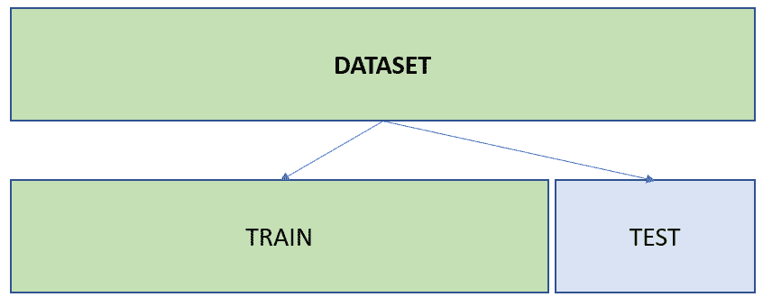

#### 使用训练集

在整个学习和训练过程中，理解字段的分布、定义和处理异常值的逻辑，以及为预处理流水线中的八步骤的任何一步提供信息。训练集最终用于拟合模型、决定模型的超参数（第 6 章，超参数调优）以及进行调试（第 4 章，模型评估与调试）。

#### 使用测试集

测试集仅用于验证模型性能，在此之前不会从该数据集中得出任何信息。你不能使用测试集学习任何模式或做出任何关于训练决策，该数据集应一直保留到最后。

```python
df_train, df_test = train_test_split(bank1, test_size=0.2, random_state=42, stratify=bank1.deposit)
df_train.shape, df_test.shape
```

打印出的形状如下：

```
((8922, 11), (2231, 11))
```

我们可以看到，测试集包含了总记录的约 20%，这符合预期。

**注意**：这里并不一定需要分层划分，但这通常是一种良好的实践。它确保了测试集和训练集具有相同的结果标签分布。这在记录数较少的情况下非常有用，特别是在处理类别不平衡问题（即标签分布不均）时非常有用。

* 使用以下代码打印训练数据集中数值字段的平均值、标准差和中位数：

```python
df_train.apply([np.mean, np.median, np.std])
```

输出结果：

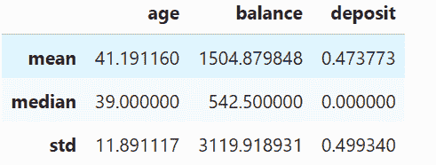

* 为了检查训练集和测试集的划分是否相似，我们也对测试集打印相同的指标：

```python
df_test.apply([np.mean, np.median, np.std])
```

其输出应如下所示：

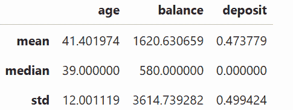

从之前的输出中可以看出，训练-测试集的划分是按照 80-20 的比例正确执行的。数值摘要显示，测试集和训练数据集之间的平均值、中位数和标准差非常相似。这告诉我们划分是正确的，我们已经准备好进入下一步：离群值检测和处理。

### 第三步：离群值处理

定义（单变量）离群值的方法有很多，合适的选择取决于特征的性质和观测到的值。因此，第一个问题应该是：对于这个特征，对我来说什么是离群值？

这里有几个需要澄清的问题：高值和低值都是离群值吗？离群值仅是指那些足够大的值吗（例如，对于高中生来说，25 岁的年龄是一个高值）？还是说足够小的值也是离群值（例如，高中生的年龄为 5 岁）？负值是离群值吗（例如，商品交付时间）？

让我们来看一下“离群值”这一术语的几种定义：

* 通常/经典的定义：数据中与其他值不同的异常值。这种定义将离群值定义为通常比普通值高得多或低得多，仅通过数值方法就能识别出此类离群值。
* 更全面的定义：在这种定义中，某些值可能很罕见，但从领域角度来看是合理的且并不意外。这些值可能指向我们观察到的真实极端情况（例如，一个 25 岁的高中生），尽管很少见。另一个例子是负银行余额，它很罕见，但并不意外，且从领域角度来看完全合理。

需要注意的是，我们必须对每个特征单独考虑离群值的定义。

**注意**：记住，定义离群值、识别它们的规则以及处理策略**必须全部**仅基于训练数据。否则，这将构成典型的数据泄露案例。一旦决定，只能将离群值检测逻辑和处理方法应用于测试集。

一旦你定义了每个特征什么是令人意外的，就可以继续使用以下（非详尽）列表中的方法之一：

* 分位数阈值/截断（例如 `p99`、`p995`）
* Z-score 方法
* 箱线图 / Tukey 原则

让我们简要理解每种方法。

#### 分位数阈值法

当我们认为一个足够大或足够小的值是离群值时，就会使用这种方法。考虑一家电商巨头的商品交付时间。电商公司通常通过分位数 `p95`（第 95 分位数）或 `p99`（第 99 分位数）来跟踪交付时间，这些是常见的衡量标准，公司对这些指标有一个健康水平的概念。例如，5 天的 `p99` 值是可以接受/预期的，但 `p99` 值上升到 10 天可能意味着存在重大问题。简单来说，1% 的订单在 10 天后交付可能是令人警觉的。

因此，此类分位数值捕捉了什么是意外值，是离群值检测的好方法。同样，电子商务平台上的订单价值也会出现意外值。

停下来思考一下：对于一个特征，什么是意外的值？以 `balance`（余额）为例——5 天的 `p99` 值是可以接受/预期的，但 `p99` 值上升到 10 天可能意味着存在重大问题。简单来说，1% 的订单在 10 天后交付可能是令人警觉的。

（注：原文中存在大量重复片段，此处已整合 `p99` 和 `quantile(0.99)` 的核心逻辑）。

```python
p99 = df_train['balance'].quantile(0.99)
```

#### Z-score 方法

当我们认为特征符合高斯分布时，Z-score 方法是合适的。对于每个观测值，Z-score 的计算如下：

```
Z-Score = (X - mean) / std
```

其中 `mean` 是平均值，`std` 是标准差。常见的阈值是 3 或 2.5。

#### 箱线图 / Tukey 原则

另一种非常流行的方法是 Tukey 原则。在数学上，超出以下范围的值被视为离群值：

```
Q1 – k * IQR, Q3 + k * IQR
```

其中 `IQR`（四分位距）定义为 `Q3`（第 75 分位数） – `Q1`（第 25 分位数）。`k` 的一个常用值为 `1.5`。该值被应用于箱线图的标准实现中（包括 Python 中的 `matplotlib` 和 `seaborn` 包）。

暂停并思考：考虑一种像银行余额那样的指数分布。你认为 Tukey 准则/箱线图方法适用于这种情况吗？

通过这些，我们学习了检测离群值的 3 种方法。作为一名明智的数据科学家，你必须理解这些方法、使用每种方法的注意事项以及它们的优缺点。现在，让我们在银行营销案例研究中尝试这些方法。

#### 练习 3.4：离群值检测与处理

在本次练习中，我们将所学的离群值检测技术应用于 Azra Inc 的营销案例研究。我们将对两个数值字段 `age` 和 `balance` 进行离群值评估。如果检测到离群值，我们将针对每个情况采用合适的离群值处理方法。让我们开始。


1. 使用 `pandas` 系列的 `plot` 方法和以下代码为 `df_train` 数据集的 `age` 特征创建一个箱线图：

```python
df_train.age.plot.box(figsize=[3,5])
plt.show()
```

你应该得到以下输出：

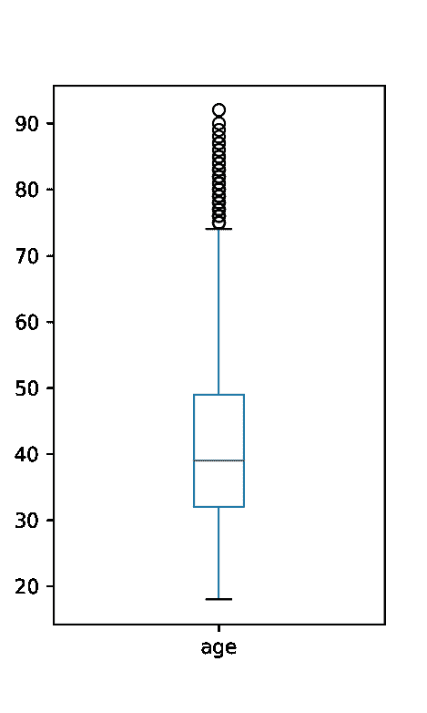

箱线图显示在 75 以上有一些高值。根据 Tukey 准则，这些可以被认为是潜在的离群值（即截断点为 75）。让我们根据 Tukey 准则检查真实的截断点。

2. 计算 `Q1`、`Q3`、`IQR` (`Q3 – Q1`)，并随后根据 Tukey 准则计算上下阈值。显示得到的阈值。使用以下代码：

```python
Q3 = df_train.age.quantile(0.75)
Q1 = df_train.age.quantile(0.25)
IQR = Q3 - Q1
print("Lower cutoff:", Q1 - 1.5*IQR, "; Upper cutoff:", Q3 + 1.5*IQR)
```

截断点应打印为：

```
Lower cutoff: 6.5; Upper cutoff: 74.5
```

注意，上限与箱线图匹配。

根据我们的领域知识，75 之前的数值没有问题，我们不认为这些是真实的离群值，因此不对它们进行处理。

注意：`age` 列具有连续范围，并带有几个高值。这些值并不远，似乎与主值相连。这些似乎是真实的高值，而不是真正的离群值。一种方法是不对该列执行任何离群值处理。相反，我们可以将此列转换为任何偏的分布（在随后的章节中）。

3. 使用以下代码为 `balance` 特征创建一个箱线图：

```python
df_train.balance.plot.box(figsize=[4,5])
plt.show()
```

这将产生以下输出：

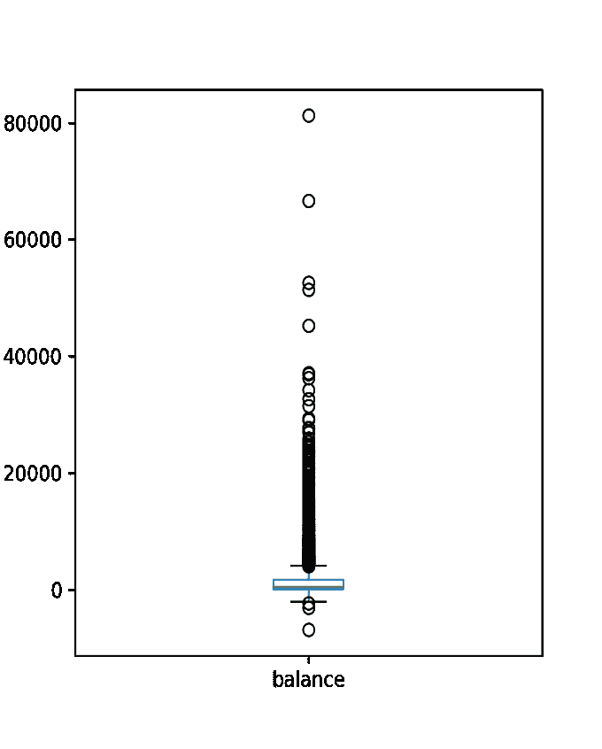

我们似乎有一些偏离常范围的值，像 60,000 这样的值远高于中位数，而中位数似乎接近 0。让我们根据 Tukey 准则找出阈值。

4. 根据 Tukey 准则计算并显示 `balance` 的阈值。使用以下代码：

```python
Q3 = df_train.balance.quantile(0.75)
Q1 = df_train.balance.quantile(0.25)
IQR = Q3 - Q1
print("Lower cutoff:", Q1 - 1.5*IQR, "; Upper cutoff:", Q3 + 1.5*IQR)
```

阈值打印为：

```
Lower cutoff: -2245.5; Upper cutoff: 4062.5
```

上限似乎是 4,062.5，远低于观测到的 80,000 左右的高值。回想我们预期 `balance` 特征不符合高斯分布，而是指数/幂分布。让我们看看它的高分位数：

5. 为 `balance` 变量计算分位数 `p95`、`p99`、`p995`：

```python
df_train.balance.quantile([0.95, 0.99, 0.995])
```

你应该得到以下输出：

```
0.950 5915.900
0.990 13341.160
0.995 20061.165
Name: balance, dtype: float64
```

第 95 分位数约为 5.9K（注意这高于 Tukey 准的值）。同样，注意 5.9K 有合理的观测值数量。因此，较高的截断点是合适的，20K 左右的截断似乎更合适。

6. 使用 20K 作为截断，删除所有高 `balance` 值的记录。打印 dataframe 的形状查看更新后的记录数：

```python
cutoff_balance = 20000
df_train = df_train[df_train.balance <= cutoff_balance].copy()
df_train.shape
```

维度打印为：

```
(8876, 11)
```

7. 现在，将相同的截断应用于测试数据中的 `balance` 离群值。打印测试集的更新维度：

```python
df_test = df_test[df_test.balance <= cutoff_balance].copy()
df_test.shape
```

更新后的维度为：

```
(2220, 11)
```

在此练习中，我们对数据集的数值字段应用了不同的离群值检测方法。

### 步骤 4：缺失值处理

缺失值是数据科学项目的现实，困扰着几乎每一个机器学习项目。每个机器学习从业者在他们的第一个机器学习项目中都会遇到它们。这个问题特别具有挑战性，因为处理缺失值并不简单。正确处理涉及多个步骤，以及对数据、领域和当前任务的深入理解。让我们讨论一些考虑因素。

注意：关于当前任务的影响。对于时间序列预测，处理缺失值的方法与观测值独立的预测模型完全不同。时间序列中的新观测值本质上依赖于之前的。处理缺失值的策略不在本书的范围内。这篇 Arxiv 论文 `https://arxiv.org/abs/2011.11347` 讨论了一些方法。

首先，并不是所有缺失值都是显而易见的。在练习 3.2 中，我们在 Pandas dataframe 中看到了一些易于识别的明显空值。我们还看到三列具有表示信息某种程度上缺失的值——`p_outcome`、`contact` 和 `education` 具有未知值。这表明信息是缺失的，但因为这些不是 dataframe 中的空值，因此很难检测到。这是一个隐藏缺失值的良好例子。

一旦识别出缺失值，从业者必须思考这些缺失值的原因。这种理解（在你的能力范围内）对于良好的结果至关重要。有时，缺失值可能是由于与客户或其信息无关的随机因素导致的（例如，在记录高事件率的流数据时的随机丢包）。此类缺失值被称为完全随机缺失（MCAR）。这些是最无害的缺失值，因为它们确实是不提供信息的，且不会对数据产生系统性问题。

另一种隐蔽、极端的情况是非随机缺失（MNAR）情况。在这种情况下，存在一种底层逻辑，导致某些观测值或特征比其他特征更容易缺失。回顾问调查数据示例，包含潜在敏感问题的问卷可能会某些受访者比其他人更容易跳过。在这种情况下，这些缺失值并不是没有提供信息，缺失这一事实本身就是信息。处理这些缺失值时必须格外小心。

处理缺失值的方法取决于缺失值的类型以及产生这些数值的机制。考虑一个电子商务客户数据的案例，其中一个字段是过去一个月内的订单数量。对于许多客户，该字段可能是缺失的。但这可能仅仅是因为数据连接的方式导致没有下任何订单的客户产生了空值。在这种情况下，缺失值是有意义的。处理这种情况可以简单地将空值替换为 0。

通常情况下，处理缺失值有以下几种方法：

* 根据真实含义替换（如果已知）。
* 用简单的中心趋势（均值和中位数）替换（插补）。
* 使用多变量分析估计（插补）可能出现的值。
* 删除记录。
* 使用可以处理缺失值的技术。

我们已经看到了选项 1 的示例——即电子商务数据，其中空值可以替换为它们的真实含义，即 0。选项 2 和 3 之间存在联系，因为它们都将缺失值替换为某些期望值，其中第二种方法更为复杂。选项 5 也是安全的，尽管它限制了你可以使用的机器学习技术选择。选项 4 是一个特殊情况，而且是一个棘手的问题。

丢失记录会丢失数据集中潜在的信息，这些信息可能有助于提高你预测模型的性能。如果缺失值很少且是完全随机缺失的，这可能是一个可行的方案。但如果你认为这些不是随机缺失的（即是系统性缺失），那么删除这些将会丢失信息，并可能丢失一些重要的记录。数据集可能无法代表通用数据，模型的真实性能将受到影响。因此，我们必须谨慎，只有在我们不怀疑存在系统性缺失时才删除。

处理此类情况有多种方法，选项 5 就是其中之一。此外，如果必须删除某个字段，该字段在某些记录中缺失这一事实本身可能包含信息，并且可以使用指示变量提供给模型：当原始字段缺失值时，该变量为 1，否则为 0。如果缺失中存在某种模式，模型可能会在该字段的帮助下可能检测出这种模式。

注意：我们在这里讨论的所有技术都是用于特征/独立变量的。在预测建模练习中，结果值缺失的记录必须删除，正如我们在练习 3.2 中对 `deposit` 字段执行的那样。

注意：处理缺失值是一个非常复杂的话题。在过去的几十年里，已经开发了许多处理这些问题的技术。虽然这些技术可能很复杂，但原理与我们讨论的并没有区别。

重要的是，对数据中缺失值的处理应该对训练集和测试集分别进行。即使你采用简单的均值插补方法，均值也必须仅使用训练数据计算，使用整个数据集会导致数据泄露。

让我们在下一个练习中实际应用这些技术，并处理数据中的缺失值。

### 步骤 5：分类特征处理

通常情况下，数据集将具有混合类型的变量（数值型和分类型）。Python 中所有预测建模技术的实现都是为了处理数值特征而构建，且大多数 Python 中的预测建模技术实现并不处理分类值。因此，必须将分类值编码为数值值。但在开始编码之前，你可以采用一些智能方法。这些方法通常被忽略，但可以极大地简化这部分预处理工作，并帮助避免从数据中丢失潜在信息。一个更整体的方法包含以下步骤：

1. 减少特征中的水平（将相似的水平归类）：

   我们查看特征中的唯一值以及它们与结果/目标的关系。包含相似信息且与目标有相似关系的水平（例如，相似的平均结果值）可以合并/压缩为一个单一水平。单此一步就能帮助你显著减少水平数量。

2. 合并具有相似/互补信息的特征：

   通常，我们拥有包含相似甚至互补信息的特征。健康领域的一个经典例子是体重和身高。我们经常拥有包含相似或甚至互补信息的特征。在心脏疾病预测中，体重和身高包含互补信息，这些可以合并为体重质量指数（BMI）。

3. 编码（哑变量、目标、效应等）：

   在完成这些简化后，我们可以通过多种策略转换为数值。独热编码、标签编码、目标编码、效应编码都是一些示例。在这个过程结束，原始分类字段将被替换为一个或多个数值特征。注意：步骤 1 和 2 是非标准的，且取决于任务。我们将在稍后关于特征工程的章节中详细讨论这些步骤。

#### 解决我们的案例

在针对 Azra Inc. 的营销案例中，我们有几个分类特征：

* `job`: 职业
* `education`: 受受教育程度（从小学到高等）
* `housing`: 是否有房贷
* `loan`: 是否有个人贷款
* `contact`: 偏好的联系方式（电话/手机）
* `month`: 联系月份
* `poutcome`: 本次活动之前的活动

停下来思考：对于我们的案例，你已经想哪些策略？哪些特征可以可能合并？你想要对哪些列进行收缩？

首先，我们将探索列中的不同值以及它们与目标/结果的关系。这将帮助我们识别可以可能合并的候选水平。实现此目标最简单的方法是计算分类特征中每个水平的平均值并进行绘图。让我们从对 `job` 列开始。使用以下代码绘制每个职业类别的平均目标值：

```python
bank1.groupby('job')['deposit'].mean().sort_values().plot.barh()
plt.title()
plt.show()
```

输出应如下：

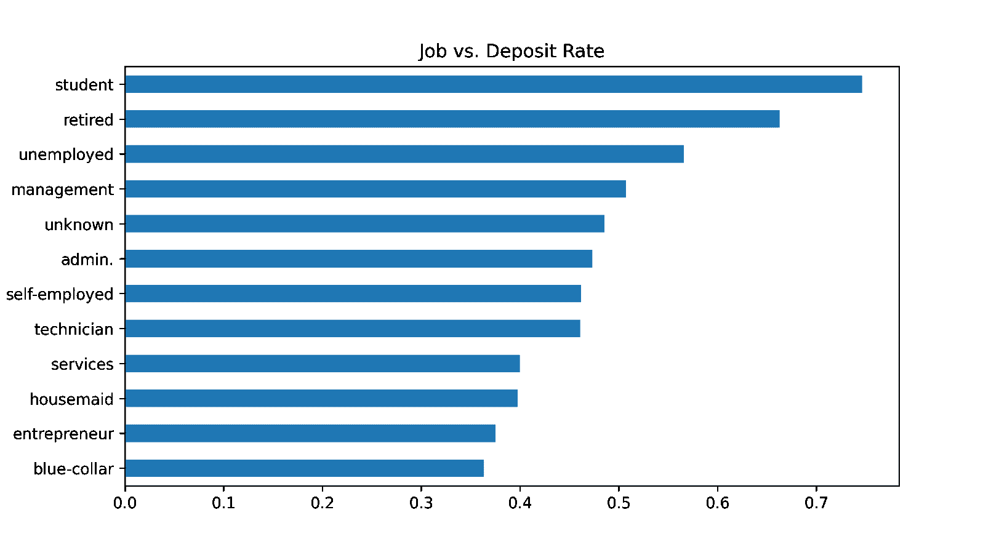

我们注意到字段中有 12 个唯一的职业类别，我们可以看到成功率随类别而显著变化。我们也观察到某些类别虽然在逻辑上不同，但其结果似乎非常相似。这种理解在处理该特征时将极大帮助。让我们一次性为所有分类特征创建类似的视图。使用以下代码：

```python
cat_cols = df_train.select_dtypes("object").columns
plt.figure(figsize=[15,12])
for ind, col in enumerate(cat_cols):
    plt.subplot(3,3,ind+1)
    bank1.groupby(col)['deposit'].mean().sort_values().plot.barh()
    plt.title(col)
plt.show()
```

输出应如下：

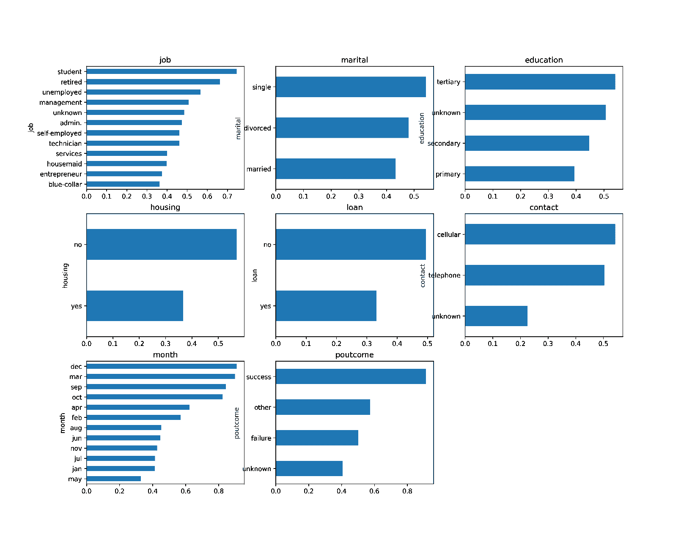

图 3.12 提供了丰富的信息。必须对每个子图进行分析以理解每个特征并获得处理它们的初步想法。让我们从处理职业特征的策略开始。

我们看到 `job` 特征具有 12 个唯一级别。直接在该特征上使用 `Dummy Encoding`（哑编码）或 `One Hot Encoding`（独热编码）等编码方案会从单个特征创建出 11 或 12 个新特征。这不是一个好主意，因为会增加模型的复杂度，而且在之后删除某些新特征时，可能会丢失信息。更好的主意是进行目标编码。让我们深入了解一下它。

职业类别 `services`、`housemaid`、`entrepreneur` 和 `blue-collar` 的成功率相似。这些工作本身非常不同，但对于我们的建模活动，预计它们对结果的影响是相似的。因此，在我们的编码中，可以为这些类别分配相似的数值。该值仅仅是目标值的平均值。如果我们将类别替换为平均目标值，那么在单列中每个级别都有一个不同的值，而且级别之间的差异也被保留了。

**注意**：这里的另一种选项是将类别合并。然而，由于职业类别在逻辑上非常不同，我们没有根据领域知识将它们合并。此外，数据集中可能包含与职业类别相关的其他信息，我们不想丢失这些信息。

#### 职业的目标编码

让我们为 `job` 特征实现目标编码。为此，我们可以自己创建简单的映射，也可以在 Python 中使用 `category_encoders` 库。我们推荐使用该库，因为它包含许多其他方法，你可以使用 `sklearn` 风格的语法轻松调用。你可以使用 `pip` 命令安装该包：

```bash
pip install category_encoders
```

关于该包的更多细节可以在 `https://pypi.org/project/category-encoders/` 找到。

让我们首先通过以下代码从 `category_encoders` 包导入并实例化目标编码器：

```python
from category_encoders.target_encoder import TargetEncoder

enc_target = TargetEncoder()
```

为了拟合编码器（即计算平均结果水平）并提取这些值，我们将使用编码器的 `fit_transform` 方法。我们将这些值提取到 `df_train` 数据集创建的一个新列 (`job_encoded`) 中。该方法需要两个输入：要编码的分类列和目标值。使用以下代码：

```python
df_train['job_encoded'] = enc_target.fit_transform(df_train.job, df_train.deposit)
```

这个简单的命令应该可以完成工作。为了验证执行是否正确，我们可以使用以下 `groupby` 命令并查看分配给每个级别的值：

```python
df_train.groupby(['job','job_encoded']).size()
```

输出应该是：

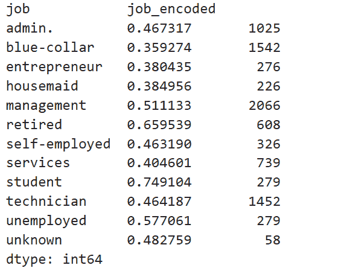

我们可以看到，对于每个职业类别，`job_encoded` 字段都有一个值。很容易验证这些值与我们之前在探索性图表中看到的值相同。目标编码就是如此。现在，我们需要将此编码应用于测试数据。请注意，我们是在训练集上进行拟合，但仅在测试数据上进行转换。使用以下代码：

```python
df_test['job_encoded'] = enc_target.transform(df_test.job)
```

**警告**：由于目标编码直接使用目标值来创建特征，存在过拟合的风险，因此对新数据的泛化能力可能。因此建议在使用目标编码时应用某些平滑或正则化。这可以通过目标编码的某些变体（如 `Leave One Fold Out`）或添加噪声来实现。或者，可以在建模过程中通过显式正则化来实现（将在后续章节中详细介绍）。

到此，`job` 字段的目标编码已完成。原始列 `job` 可以从训练集和测试集中删除。使用其他编码器也同样简单，语法也相似。

#### 处理结果分类字段

现在我们来处理 `outcome` 分类字段。我们之前在图 3.12 中看到该字段有 4 个级别。重新查看该图，我们观察到不同类别的成功率不同，但一个脱颖而出的类别是 `success`。之前对活动做出积极响应的客户更有可能对新活动做出积极响应。从领域的角度来看，这符合逻辑。其他类别的值彼此相似。对于我们的任务，我们可以看到其中一个类别是特殊的。

一种自然的策略是将级别从 4 个压缩到 2 个。这两个级别将是 `success` 和所有所有。注意，如果我们减少到两个级别，就不需要创建 2 个新类别。相反，我们可以创建一个指示特征。该特征的值为 1 表示成功，否则为 0。我们可以通过简单的映射来实现这一点，就像我们在练习 3.2 中对 `deposit` 列所做的那样。

#### 婚姻状况的独热编码

现在我们处理 `marital` 字段。我们看到有 3 个级别，且成功率都不同。没有哪个类别是特殊的。独热编码/哑编码是此类情况的好选择。本质上，我们为每一列创建指示变量。因此，将三个指示变量，分别对应 `married`、`single` 和 `divorced`。让我们使用 `category_encoders` 中的 `OneHotEncoder` 方法来实现此目的。首先使用以下代码导入并实例化 `onehotencoder`：

```python
from category_encoders.one_hot import OneHotEncoder

enc_onehot = OneHotEncoder(return_df=True, use_cat_names=True)
```


指定`use_cat_names`确保指示变量的名称具有描述性，并包含级别名称作为前缀。指定`return_df`确保返回一个dataframe以便与主数据集合并。现在，让我们使用以下代码使用`marital`特征拟合并转换`df_train`数据集，并打印结果的前5条记录：

```python
dumms = enc_onehot.fit_transform(df_train.marital)
```

输出应该是：

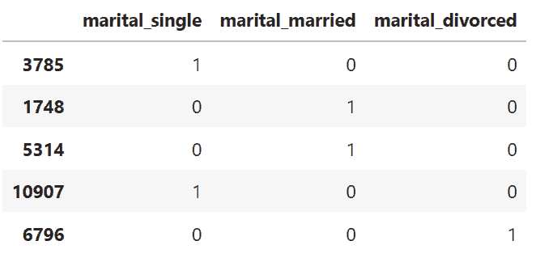

我们可以看到，如所预期，编码器创建了3列，每个级别一个。需要注意的是，这3列中存在冗余，推断婚姻状况并不这3列都是需要的。例如，如果`married`和`divorced`的指示器均为0，那么原始值必须是`single`。因此，我们可以删除其中一个。让我们删除`divorced`列并将其添加到原始dataframe中。让我们删除`df_train`中的原始列`marital`以移除所有冗余。使用以下代码：

```python
df_train = df_train.join(dumms.drop('marital_divorced', axis=1))
df_train.drop('marital', axis=1, inplace=True)
df_train.head()
```

你应该会得到以下结果：

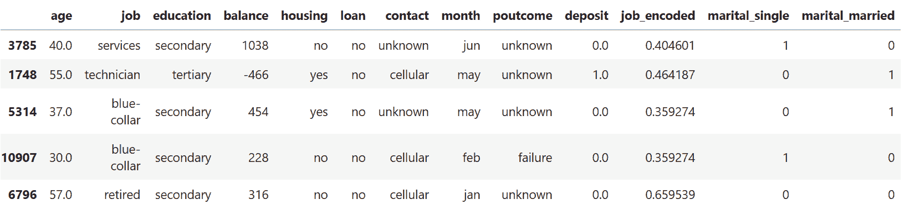

为了完成对该字段的处理，我们还需要将此编码应用于测试数据。使用以下代码：

```python
dumms_test = enc_onehot.transform(df_test.marital)
df_test = df_test.join(dumms_test.drop('marital_divorced', axis=1))
df_test.drop('marital', axis=1, inplace=True)
```

到此，我们也完成了`marital`字段的编码。到目前，我们已经讨论/处理了3个字段。剩余的分类字段可以采用类似的方法。`month`字段可以进行目标编码。`education`字段可以进行哑编码。指示特征对`poutcome`字段可能有用。在下一个练习中，我们将处理案例中大部分剩余特征。

### 练习 3.5：处理剩余分类特征

在这个练习中，我们首先为`poutcome`字段创建一个指示变量。同样，我们将为`contact`创建一个指示特征，以指示值是否为未知。然后，我们将对`month`列进行目标编码。让我们开始。

1. 使用以下代码创建一个指示变量来替换原始的`poutcome`特征以指示成功。对测试集也执行此操作：

```python
df_train['poutcome'] = np.where(df_train.poutcome == "success", 1, 0)
df_test['poutcome'] = np.where(df_test.poutcome == "success", 1, 0)
```

2. 创建一个指示变量来替换原始的联系（contact）特征，指示该值是否未知。对测试数据集执行同样的操作：

```python
df_train['contact'] = np.where(df_train.contact == "unknown", 1, 0)
df_test['contact'] = np.where(df_test.contact == "unknown", 1, 0)
```

3. 对月份（month）特征进行目标编码（target encoding）。同样对测试数据集进行转换：

```python
enc_target = TargetEncoder()
df_train['month_enc'] = enc_target.fit_transform(df_train.month, df_train.deposit)
df_test['month_enc'] = enc_target.transform(df_test.month)
```

4. 为教育（education）创建一个指示特征，当值为小学（primary）或中学（secondary）时为1。这些是成功率较低的类别。对测试数据执行相同的操作。通过打印原始值与对应值的对比来验证其在训练集上有效：

```python
ind_vals = ['primary', 'secondary']
df_train['edu_enc'] = np.where(df_train.education.isin(ind_vals), 1, 0)
df_test['edu_enc'] = np.where(df_test.education.isin(ind_vals), 1, 0)
df_train.groupby(['education', 'edu_enc']).size()
```

输出如下：

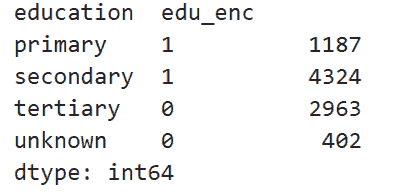

5. 通过删除原始列education、month、job来清理数据集。打印训练数据的前五记录：

```python
df_train.drop(['job','education','month'], axis=1, inplace=True)
df_test.drop(['job','education','month'], axis=1, inplace=True)
df_train.head()
```

输出如下：

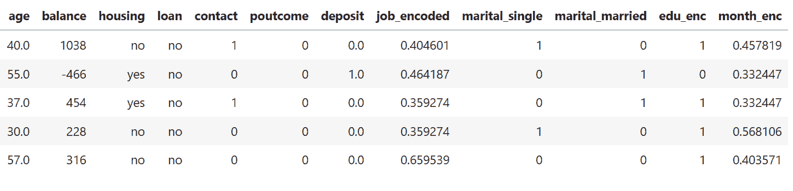

在练习中，我们实现了所学的分类数据处理技术。我们已经完成了除了住房（housing）和贷款（loan）之外的所有分类特征的处理。我们将它们留到最后，因为为了处理它们，我们将采取略有不同的方法。这是一个非标准步骤，但需要注意，因为它有助于将两个或多个列的值合并为一个列。让我们学习一下。

让我们再次查看住房和贷款字段中的值与结果之间的关系。图3.18显示了这种关系。我们看到，在客户有贷款的两种情况下，成功率都要低得多。这是很合理的，因为已经办理了贷款的客户通常没有足够的流动性来办理定期存款。由于这两个特征捕获了相似的信息（客户办理了贷款），并且它们在水平上的值非常相似，因此它们是合并为单个特征的良好候选者。我们可以创建一个名为`loan_any`的特征，当住房或贷款任一为“yes”时值为1，否则为0：

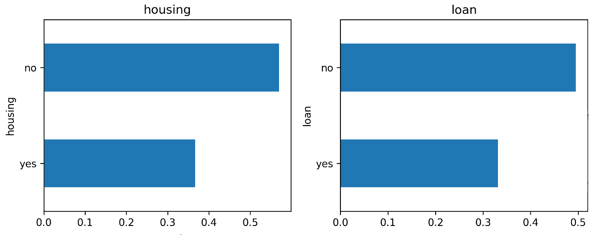

现在我们首先在训练数据集上创建这个新列`loan_any`。我们将住房和贷款的值连接到一个新列中，该列的值将类似于“yesyes”、“yesno”等。值“nono”表示客户既没有这种类型的贷款，或者我们可以为此值创建一个指示。使用以下代码：

```python
df_train['loan_any'] = df_train.housing + df_train.loan
df_train.loan_any = np.where(df_train.loan_any=='nono',1,0)
```

### 第 6 步：特征转换

数值特征的另一种常见预处理步骤是转换。转换的几种常见形式包括缩放、标准化或归一化。它们通常尝试将不同的数值特征转换为相似的范围。根据任务的不同，这一步可能是必不可少的还是可选的。

对于大多数机器学习任务，缩放特征不会剧烈影响模型准确性。但对于涉及大型数据集的技术（如神经网络），优化算法对缩放非常敏感。当特征是中心化的（均值为0）且值在相似的范围内时，优化算法预期运行得更快。因此，为了效率，缩放特征是一个好主意。

对于机器学习而言，缩放的另一个优点是易于解释。例如，在线性或逻辑回归模型中，如果尺度相同，则可以更容易解释每个特征的影响。在没有缩放的情况下，从业者不得不通过计算标准化系数来比较。

一些常用的转换包括：

- **标准缩放**：使字段均值为0，标准差为1（Z分数）。
- **极差值缩放**：将值限制在0到1之间。
- **其他转换**：使用分位数/幂/对数转换将分布转换为近似高斯分布（或均匀分布）。

注意：要查看sklearn实现的更多转换列表，可以参考官方文档：`https://scikit-learn.org/stable/modules/classes.html#module-sklearn.preprocessing`

对于大多数情况，将不同特征限制在相似的值就足够。标准缩放将值有效地替换为Z分数，使其均值为0，标准差为1。执行这些命令后，我们已经完成了对所有特征的处理。打印训练数据集的5行以确认这是否有效：

```python
# 示例代码逻辑
```

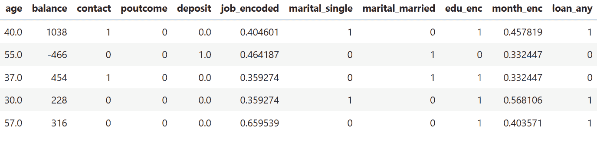

执行这些命令后，我们已经完成了对所有特征的处理。图3.20显示了处理后的数据集情况：

#### 练习 3.6：转换数值变量

在练习中，我们将对Azra Inc.营销数据集中的两个数值特征年龄（age）和余额（balance）进行转换。注意，我们不想改变值的分布方式（即不使用幂/对数/分位数转换），仅仅改变值的范围。我们将使用标准缩放方法。让我们开始转换。

1. 首先，使用箱线图绘制两个变量，以便更好地理解它们的分布：

```python
vars_num = ['age', 'balance']
df_train[vars_num].plot.box(subplots=True, figsize=[10,5])
plt.show()
```

2. 检查列当前的均值和标准差：

```python
df_train[vars_num].apply([np.mean, np.std])
```

打印结果如下：

| | age | balance |
| --- | --- | --- |
| Mean | 41.148850 | 1360.832470 |
| Std | 11.861231 | 2233.509819 |

表 3.1：当前的均值和标准差

3. 针对这两个特征，我们将进行标准化处理。从`sklearn`导入并实例化标准缩放器：

```python
from sklearn.preprocessing import StandardScaler
scaler_std = StandardScaler()
```

4. 现在，使用`fit_transform`方法对训练集上的特征进行转换。检查这些列的新均值和标准差以确保操作生效：

```python
df_train[vars_num] = scaler_std.fit_transform(df_train[vars_num])
df_train[vars_num].apply([np.mean, np.std])
```

你应该得到以下输出：

| | age | balance |
| --- | --- | --- |
| Mean | 6.162063e-17 | 4.140822e-17 |
| Std | 1.000056e+00 | 1.000056e+00 |

表 3.2：更新后的均值和标准差

正如我们预期的，均值几乎为0，标准差为1。

5. 使用`transform`方法将缩放应用于测试数据中的列。检查测试数据列的均值和标准差：

```python
df_test[vars_num] = scaler_std.transform(df_test[vars_num])
df_test[vars_num].apply([np.mean, np.std])
```

| | age | balance |
| --- | --- | --- |
| Mean | 0.020065 | 0.040063 |
| Std | 1.009910 | 1.053442 |

表 3.3：测试数据的均值和标准差

**注意：** 在对测试数据集应用缩放器时，值可能并不完全符合预期。如果使用了标准化，测试数据列的均值可能不完全等于0，标准差可能不完全等于1。这是因为训练数据的均值和标准差可能与测试数据略有不同（通常情况下如此）。这完全没有问题，不会导致模型性能出现任何显著下降。

6. 打印训练数据集的前5条记录，以查看预处理后的结果：

```python
df_train.head()
```

记录打印如下：

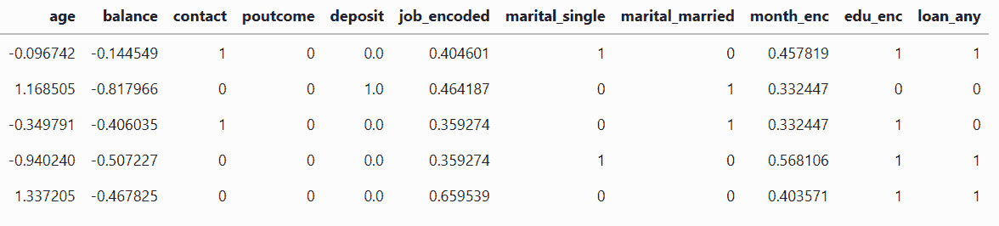

此练习结束了我们数据预处理流水线的第八步也是最后一步。数据现在已准备好提供给模型，现在可以开始整个模型拟合过程了。

## 广告点击预测案例研究

Azra Inc.是一家跨国快时尚巨头，每天有数百万活跃用户访问其移动应用程序。应用程序的首页是优质的数字地，品牌热于展示自己的品牌/款式以获得最大的曝光率。电子商务平台上的平台广告非常受欢迎，是平台极大的收入来源。然而，Azra Inc.需要确保广告与客户相关联。不相关的广告会稀释客户体验并影响客户留存。因此，Azra Inc.需要识别出与客户相关的广告。


一种流行的方法是只显示那些客户点击概率较高的广告。广告被点击是相关性的合理指标；客户不太可能点击不相关的广告。与大多数主流平台一样，Azra Inc. 希望部署一个点击预测模型，用于预测用户是否会点击特定广告。这种模型可以用于对广告进行排序，公司可以仅展示点击概率高的广告。此类模型的输入通常包括（但不限于）客户的人口统计信息、上下文信息（设备类型、操作系统等）以及广告本身的信息（商品类别、品牌等）。

Azra Inc. 收集了历史数据，其中包含了一些关于客户的人口统计信息、预估薪水以及他们是否点击了显示的广告。你作为数据科学家的任务是使用这些数据创建一个广告点击预测模型。也就是说，在给定用户人口统计数据的情况下，预测他们是否会点击广告。让我们了解我们手头的数据。

### 练习 4.1：加载并准备数据

让我们从理解案例研究的数据开始，这些数据将贯穿整个章节。

执行以下步骤：

1. 使用以下命令导入必要的库（`numpy`、`pandas`、`seaborn`）：

```python
import pandas as pd, numpy as np, seaborn as sns
import matplotlib.pyplot as plt
%matplotlib inline
```

2. 使用 `read_csv` 方法将文件读取到 `pandas dataframe` 中，并显示前 5 行：

```python
inp0 = pd.read_csv("Social_Network_Ads.csv")
inp0.head()
```

你应该得到如下输出：

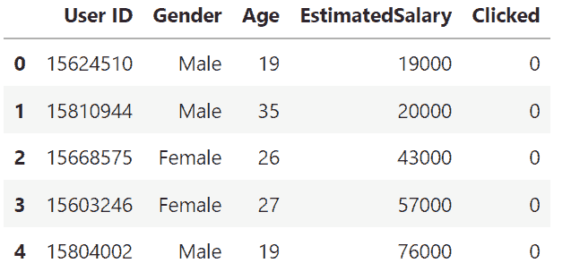

3. 使用以下命令删除 `User ID` 列，因为我们不会使用它：

```python
inp0.drop("User ID", axis=1, inplace=True)
```

4. 通过将男性映射为 0、女性映射为 1，将 `gender` 列转换为数值字段。按照以下命令显示修改后 `gender` 列中值的计数：

```python
inp0['Gender'] = inp0.Gender.map({'Female':1,'Male':0})
inp0['Gender'].value_counts()
```

你应该得到如下输出：

```
Female    204
Male      196
Name: Gender, dtype: int64
```

5. 使用 `head()` 打印修改后数据集的前 5 记录：

```python
inp0.head()
```

你将得到如下输出：

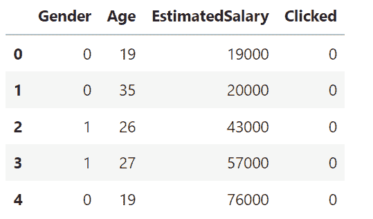

## 模型评估考虑因素

重新回顾数据：你会如何定义一个好模型？在这种情况下，我们需要关注某些具有特定要求的情况，这些要求决定了指标的选择，我们将在下一节学习这些内容。

综合考虑，我们现在对适用于我们情况的好模型有了一个概念：

在示例中，最后讨论了准确率。事实上，准确率只是评估模型的衡量标准之一。通常，在评估模型时有几个考虑因素。参考下图：

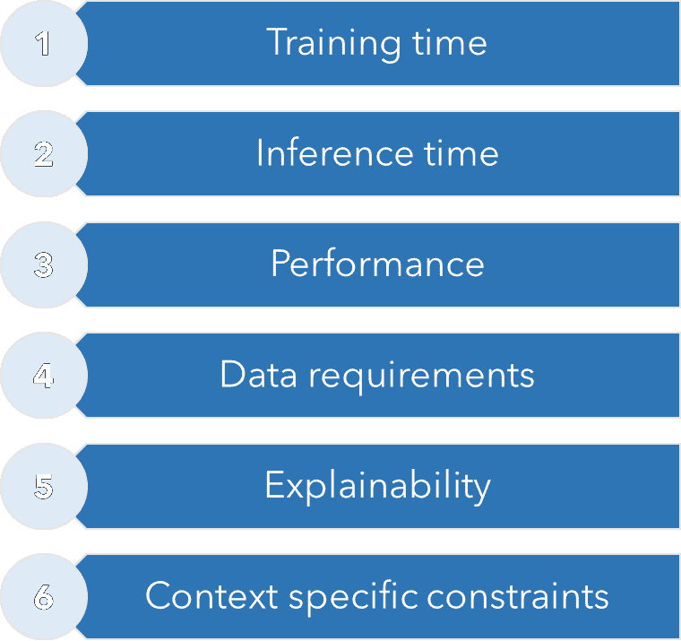

以下列表是主要的考虑因素：

- **训练时间**：更长的训练时间通常意味着更高的成本，并可能让频繁的重新训练耗时且昂贵。例如，每月需要重新训练一次的模型可以承受比每天需要重新训练的模型高得多的训练时间。

- **推理时间**：这是模型预测记录的时间。在在线、近实时系统中，推理时间具有必须遵守的硬性限制才能发挥作用（例如，推理时间最多为五毫秒）。在预测次数较少的离线评分系统中，较高的延迟是可以接受的。

- **性能**：我们指的是模型预测结果的优坏。对于分类问题，这可以是简单的准确率、精确率、召回率或许多可用衡量方法之一。对于回归问题，可以是 `R2`、`MAE`、`MAPE` 等。

- **可解释性**：在模型偏差可能导致严重后果的情况下，要求模型必须具有可解释性并能够对公平性进行审计，这是多个监管环境的必要要求。此外，对于解释性模型（目的是解释行为）来说至关重要。然而，在某些情况下，可解释性并不是问题。

- **数据需求**：线性回归模型和深度神经网络对数据的需求显然不同。前者几百条记录即可，但后者通常至少需要数千条。在某些领域，数据量小是常态，这些领域对数据饥渴型模型的需求较低。另一方面，拥有数百万用户的平台通常拥有数百万个数据点，数据量达到 TB，可以使用复杂的模型。

- **特定场景的约束**：约束也可能源于特定的背景，不遵守这些约束的模型将是徒用的。例如，如果某种情况需要预测具有置信区间，那么只有少数模型可以被考虑。

总之，模型评估有多个考虑因素，准确性仅仅是其中之一。我们必须尊重模型将要应用的系统约束，否则模型将毫无用处。一个好的模型取决于具体情况，这需要数据科学家利用领域理解和判断来选择最佳模型。在下一节中，我们将详细学习模型评估指标，以帮助我们具体地评估模型性能。在开始之前，为了让情况更具体，让我们先准备一个用于预测广告点击的基准模型。

### 练习 4.2：构建竞争模型

我们将构建 3 个模型——决策树模型、随机森林模型和支持向量分类器。本章的后续章节将评估并比较这些模型的性能。执行以下步骤：

1. 使用 `sklearn` 中的 `train_test_split` 方法将数据划分为训练集和测试集，如下代码所示。打印训练集和测试集的形状（shape）：

```python
from sklearn.model_selection import train_test_split

df_train, df_test = train_test_split(inp0, train_size=0.7, random_state=42)

df_train.shape, df_test.shape
```

形状打印结果如下：

`((280, 4), (120, 4))`

2. 使用以下代码分离特征和目标（`X_train`、`y_train`、`X_test`、`y_test`）。打印 `X_train` 数据集的前 5 条记录：

```python
X_train = df_train.drop("Clicked", axis=1)

y_train = df_train['Clicked']

X_test = df_test.drop("Clicked", axis=1)

y_test = df_test['Clicked']

X_train.head(5)
```

你应该得到以下输出：

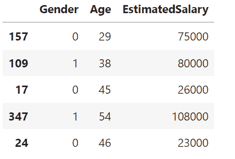

3. 从 `sklearn` 导入决策树，实例化并将 `random_state` 分配 42（为了结果的可重复性），将 `max_depth` 设置为 5，在训练数据上拟合。使用以下代码：

```python
from sklearn.tree import DecisionTreeClassifier

dt = DecisionTreeClassifier(max_depth=7, random_state=42)

dt.fit(X_train, y_train)
```

4. 从 `sklearn.ensemble` 导入 `RandomForestClassifier`，实例化并将 `random_state` 分配 42，`max_depth` 设置为 5，使用 50 个估计器，在训练数据上拟合。使用以下代码：

```python
from sklearn.ensemble import RandomForestClassifier

rf = RandomForestClassifier(max_depth=7, \
                              random_state=42, \
                              n_estimators=50)

rf.fit(X_train, y_train)
```

5. 从 `sklearn.svm` 导入 `SVC`，实例化并将 `random_state` 分配 42，在训练数据上拟合。使用以下代码：

```python
from sklearn.svm import SVC

svc = SVC(random_state=42)

svc.fit(X_train, y_train)
```

通过这几行代码，你已经训练了 3 个预测模型。在接下来的几节中，我们将如何对这些模型进行深度评估，诊断性能不良的原因并修复它们。让我们从下一节的评估指标开始。

## 模型评估指标

模型性能评估用于衡量模型预测结果的优劣——它是评估模型好坏的核心标准。虽然在通常情况下这不是唯一标准，但正如我们在上一节中看到的，在某些情况下，它是决定性因素。因此，数据科学从业者必须通过熟练地识别以下内容来精通模型性能评估：

- 用于评估的正确指标
- 能够可靠估计模型泛化性能的评估方案

稍后将讨论各种评估方案。本节将重点关注用于评估的正确指标，正如你将学到的，这涉及各种考虑。让我们从理解机器学习问题开始；有许多指标可以评估模型性能。我们将列出并定义用于分类和回归问题的指标，并在点击预测案例研究中计算它们。让我们从分类问题的指标开始。

### 分类问题的指标

在分类问题中，任务是正确预测项目所属的结果/标签/类别。结果可以有两个或多个类别。对于二分类问题，结果有两个可能的值。我们点击预测案例研究的结果可以是“已点击”或“未点击”。同样，垃圾邮件检测模型的结果也将是“垃圾邮件”或“不是垃圾邮件”。事实上，二分类问题无处不在——预测客户流失、设备故障、广告点击、贷款违约、线索转化等。

多分类问题有比两个更多的类别待预测。

#### 准确率 (Accuracy)

我们已经在第 3 章“数据收集与预处理”中看到并使用了准确率。准确率衡量了分类正确的案例比例，即模型预测其真实类别/标签的比例。如果 100 条记录中有 90 条被正确预测，我们则说准确率为 90%。这是一个非常实用的指标，也是常用指标之一。

值得注意的是，准确率并不考虑标签的差异。它不将正样本和负样本分开对待，认为正确预测一个正样本与正确预测一个负样本一样好。作为对比，它认为错误预测一个正样本与错误预测一个负样本同样有问题。因此，我们需要跳出准确率，考虑更符合我们业务需求并使模型更合适的指标。让我们来看一些选项。

停下来思考：想象一个检测 HIV（艾滋病毒）的模型。漏诊 HIV 与将非 HIV 案例误判为 HIV 阳性相比，你认为避免哪种类型的错误更重要？

#### 混淆矩阵 (Confusion matrix)

我们看到普通的准确率不考虑类别，只看模型的整体正确性。通常，我们更关注某一个结果，并希望比另一个结果更准确。回到关于 HIV 检测的问题——我们问识别一个结果是否比另一个更重要。你可能已经意识到这个问题需要更具体。让我们通过理解这种情况下可能发生的错误类型来更好地表述它。

对于二分类问题，有两个真实结果和两个预测结果。这意味着每次预测/记录可能会发生四种情况，混淆矩阵可以方便地表示这些情况。表 4.1 显示了一个通用混淆矩阵。行表示实际结果，列包含预测结果。表 4.1 使用正/负标签表示结果，但如果结果是 1/0、True/False 等，混淆矩阵同样适用。

| 混淆矩阵 | 预测 | |
| --- | --- | --- |
| 真实值 (Ground truth) | 正 | 负 |
| 正 (Positive) | 真阳性 (A) | 假阴性 (B) |
| 负 (Negative) | 假阳性 (C) | 真阴性 (D) |

表 4.1：显示可能情况的混淆矩阵

这四种情况通过 A 和 D 表示，易于理解。A 和 D 是模型正确的情况：

- 真阳性 (True positives)：正结果被正确预测为正。
- 真阴性 (`D`)：负性结果被正确地预测为负性。

虽然情况 `B` 和 `C` 是模型犯的错误：

- 假阴性 (`B`)：正性结果被错误地预测为负性。
- 假阳性 (`C`)：负性结果被错误地预测为正性。

为了使情况更具体，请查看表 4.2 中我们广告点击预测案例研究的概念混淆矩阵。行代表真实情况（实际的点击或未点击），而列包含模型的预测结果。结合案例研究，这四种情况意味着：

- 真正性：模型正确预测的点击。
- 真阴性：模型正确预测的未点击。
- 假阳性：将未点击错误地预测为点击。
- 假阴性：将点击错误地预测为未点击。

| 点击预测混淆矩阵 | 预测 | | |
| --- | --- | --- |
| 真实真值 | 点击 | 未点击 |
| 点击 | 真正性(A) | 假阴性(B) |
| 未点击 | 假阳性(C) | 真阴性(D) |

表 4.2：点击预测案例研究的混淆矩阵

回到之前的问题：在所有情况下，所有错误类型都同等严重吗？以 HIV 检测为例，思考每种错误类型的后果。假阳性（即一个健康患者被错误地识别为 HIV 阳性）通常随后会进行另一项确认测试以排除错误。虽然这可能会给患者带来一段时间的情感创伤，但错误通常会被识别出来。现在，考虑假阴性，即一个未检测出的 HIV 阳性病例。该患者将在不知道自己真实状况的情况下出门，冒着生命危险，并可能危及周围其他人的安全。假阴性的后果可能是灾难性的。因此，HIV 检测模型必须专注于检测所有真实病例，即使这意味着会产生多一些假阳性。混淆矩阵是检查这种细分并识别这些情况的完美工具。现在，让我们为广告点击预测案例研究创建混淆矩阵，并评估各种模型的性能。

### 练习 4.3：点击预测模型的混淆矩阵

在本次练习中，我们将为广告点击预测案例研究训练的 3 个模型创建混淆矩阵。我们将在训练数据上评估不同模型的假阳性和假阴性。继续在我们一直使用的 Jupyter notebook 中。执行以下步骤：

1. 使用以下命令从 `sklearn` 导入 `ConfusionMatrixDisplay` 和 `confusion_matrix` 模块：

```python
from sklearn.metrics import confusion_matrix
from sklearn.metrics import ConfusionMatrixDisplay as CM
```

2. 打印训练数据上 `Decision Tree Classifier` 的简单混淆矩阵（不带格式）：

```python
confusion_matrix(y_train, dt.predict(X_train))
```

矩阵的打印结果如下：

```
array([[180, 4], [5, 91]])
```

虽然这包含了信息，但格式可以更好。让我们绘制一个格式化更好的混淆矩阵。

3. 使用 `ConfusionMatrixDisplay` 模块为决策树绘制混淆矩阵：

```python
CM.from_estimator(dt, X_train, y_train, cmap="Blues", colorbar=None)
plt.show()
```

你应该得到以下输出：


4. 使用 `RandomForest` 模型为 `RandomForest` 模型绘制混淆矩阵：

```python
CM.from_estimator(rf, X_train, y_train, cmap="Blues", colorbar=None)
plt.show()
```

你应该得到以下输出：

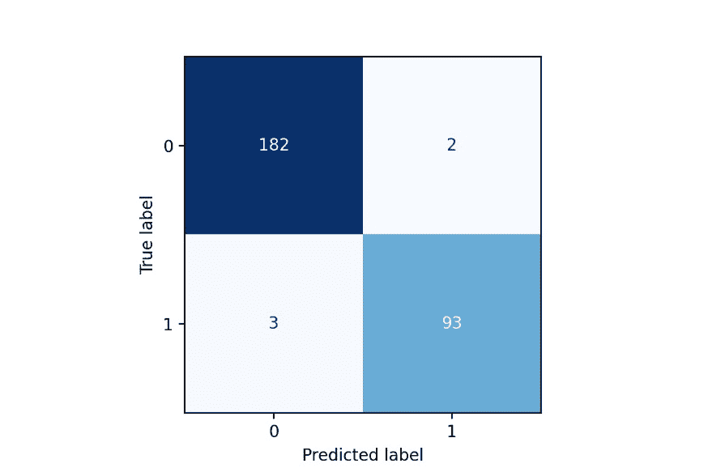

5. 同样，为 `SVC` 模型绘制混淆矩阵：

```python
CM.from_estimator(svc, X_train, y_train, cmap="Blues", colorbar=None)
plt.show()
```

你应该得到以下输出：

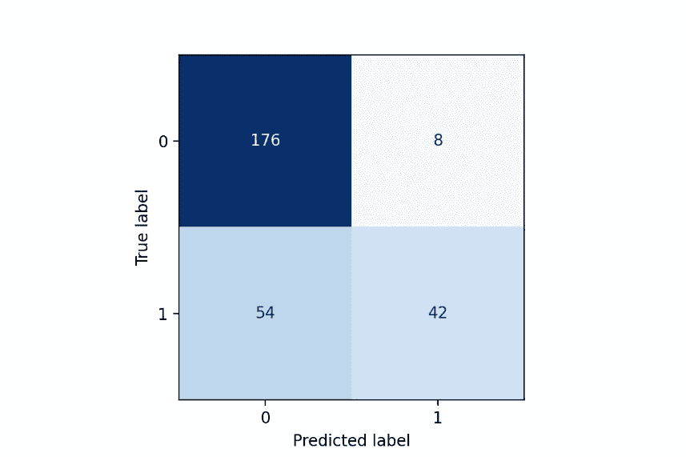

我们为三个模型创建了混淆矩阵以理解它们的性能。从混淆矩阵中我们可以看到哪些类被分类错误。现在我们来看一些指标。

#### 精率、召回率和 F1 分数

正如之前提到的，在许多情况下，我们对一个类比另一个类更关注。我们在表 4.3 中定义了这些指标。让我们通过示例更好地理解这些指标。

| 指标 | 计算方法 | 直观理解 |
| --- | --- | --- |
| 精率 (Precision) | 真正性 / 预测正性 | 预测正性的正确的比例 |
| 召回率 (Recall) | 真正性 / 实际正性 | 检测到的实际正性的比例 |
| F1 分数 (F1 Score) | 2 * (精率 * 召回率) / (精率 + 召回率) | 平衡精率和召回率的综合衡量 |

精率回答了预测的正性中有多少比例是正性的？在欺诈检测情况下，这指示了我们识别为欺诈的病例比例。自然，我们不希望模型将真实交易识别为欺诈。对于广告点击预测情况，低精率意味着许多预测为点击的情况并非点击。

召回率回答了我们检测到了多少比例的正性？这在处理欺诈时特别相关，召回率告诉我们模型检测到的欺诈病例的比例。在事件检测情况下（例如疾病检测），我们希望召回率越高越好。高召回率意味着我们可以检测最多的点击。

F1 分数试图平衡精率和召回率。但为什么需要这种平衡呢？因为精率和召回率之间存在权衡。增加模型的召回率通常是以牺牲精率为代价的，即当我们尝试增加检测到的正性比例时，往往也会增加假阳性的数量，即不是正性但被预测为正性的病例。同样，提高精率会导致召回率下降。因此，F1 分数是一个衡量精率和召回率平衡的必要指标。

正如你可能已经发现的，这些指标都可以通过简单的计算从混淆矩阵中得出。然而，这是可选的，因为所有这些指标都可以通过 `sklearn` 中的单个 `classification_report` 方法非常方便地导出。我们可以像下面的代码所示，为 `SVC` 模型的广告点击预测示例使用 `classification_report` 方法：

```python
print(classification_report(y_train, svc.predict(X_train)))
```


上述单行命令提供了图 4.10 所示的非常详细的输出。该命令计算了两个类别的精确率、召回率和 `F1` 分数。正如所讨论的，我们对正类的这些指标感兴趣。输出的第二行对应正类，包含了精确率、召回率 `F1` 分数。对于我们的示例，`recall`（`0.44`）远低于精确率。因此，`F1` 分数为 `0.58`，正如预期的那样更偏向于较低的值（`Recall`）。总体准确率在输出的第三行中，为 `0.78`。请参考图 4.8：

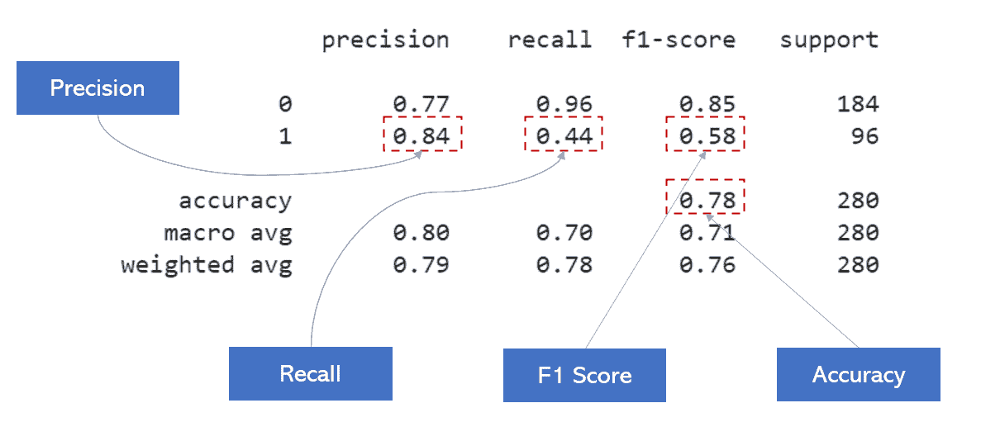

> **注意**：虽然分类报告提供了许多详细指标，但只有当你对任何特定指标感兴趣时，才能使用这种方法。如果只想获取模型的精确率、召回率或 `f1` 分数，可以使用 `sklearn.metrics` 中的 `precision_score`、`recall_score` 和 `f1_score` 方法。

为了只计算精确率、召回率或 `F1` 分数，你可以使用 `sklearn.metrics` 中相关的方法。让我们计算三个模型在训练数据集上的准确率和召回率值。首先使用以下代码从 `sklearn` 导入函数：

```
from sklearn.metrics import accuracy_score, recall_score
```

接下来，生成决策树模型在训练数据集上的预测并存储到 numpy 数组中，并像下面的代码所示使用 `accuracy_score` 和 `recall_score` 方法：

```
y_train_pred = dt.predict(X_train)
print("DT Accuracy:", accuracy_score(y_train, y_train_pred))
print("DT Recall:", recall_score(y_train, y_train_pred))
```

你应该得到如下输出：

```
DT Accuracy: 0.9678571428571429
DT Recall: 0.9479166666666666
```

同样，使用以下代码计算 `RandomForest` 模型的训练准确率和召回率：

```
y_train_pred = rf.predict(X_train)
print("RF Accuracy:", accuracy_score(y_train, y_train_pred))
print("RF Recall:", recall_score(y_train, y_train_pred))
```

你应该得到如下输出：

```
RF Accuracy: 0.9821428571428571
RF Recall: 0.96875
```

最后，打印 `SVC` 模型的训练准确率和召回率：

```
y_train_pred = svc.predict(X_train)
print("SVC Accuracy:", accuracy_score(y_train, y_train_pred))
print("SVC Recall:", recall_score(y_train, y_train_pred))
```

输出应如下：

```
SVC Accuracy: 0.7785714285714286
SVC Recall: 0.4375
```

我们观察到 `RandomForest` 模型的准确率和召回率最高，其次是决策树模型，`SVC` 模型则落后。

精确率、召回率和 `F1` 分数对于正类来说是非常有用的指标。对于数据科学家来说，在某一类更有趣且极其常见的情况下，理解并精通这些指标至关重要。但在某些情况下，模型应该平衡两个类的性能，并在区分类别方面表现出高水平。ROC 曲线及其下面积是此类情况下必须学习的指标。让我们学习并实现它们。

## ROC 曲线下的面积 (AUC)

受试者工作特征（ROC）曲线下的面积是另一个非常有用且流行的指标。这个名字很长，但直觉上直观。ROC 曲线下的面积衡量了模型平衡假阳性和假阴性的良好程度。图 4.9 释了 ROC 曲线的思想以及如何使用它：

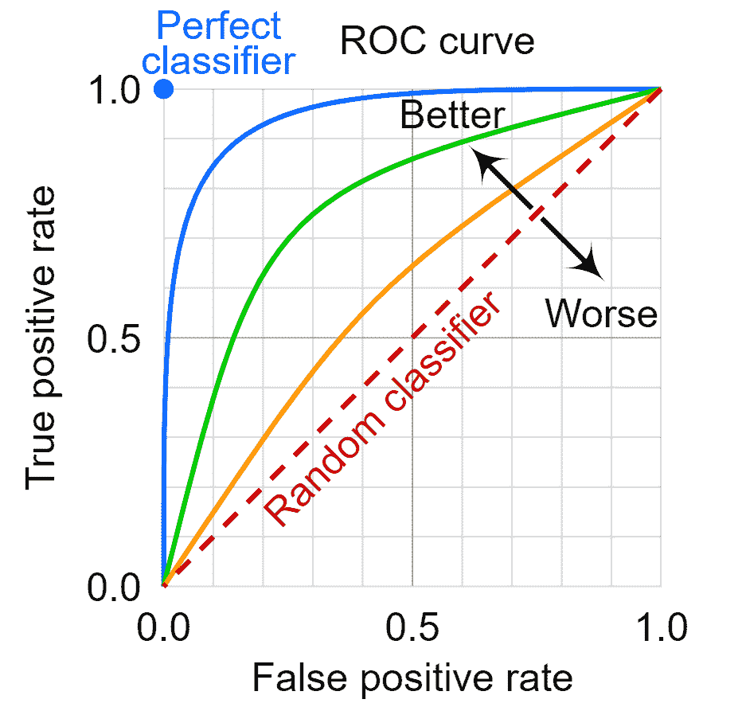

假阳性率（`FPR`）构成 X 轴，而 Y 轴代表真阳性率（`TPR`）。假阳性率（`False positives/ Total actual negatives`）衡量了模型预测错误的负例的比例。真阳性率（`True positives/Total actual positives`）衡量了被正确预测的正例的比例。因此，`TPR` 关注正例，而 `FPR` 关注负例。该曲线使用从 0 到 1 的不同阈值生成，并在图上绘制出获得的 `TPR` 和 `FPR` 点。因此，ROC 曲线显示了模型有多熟练，即模型区分类别的能力如何。

一个完美的模型不会有任何假阳性（`FPR` 为 `0`），并且具有 100% 的真阳性率。如图 4.9 所示，完美的分类器将由左上角的点表示，因为它具有 0 `FPR` 和 100% 的 `TPR`。一个没有技能的模型，即与随机分配类别等好的模型（例如使用硬币抛掷），在所有阈值下都具有相等的 `TPR` 和 `FPR`。图 4.9 中的对角虚线表示了这一点。因此，总结模型性能的方法是该曲线下的面积。

无技能的随机分类器在曲线下的面积为 50%，因为它代表对角线。完美分类器在曲线下的面积为 100%，因为它具有 100% 的 `TPR` 和 0% 的 `FPR`，并立即到达左上角。大多数模型处于无技能模型和完美分类器之间，即大多数模型的 ROC 曲线下面积在 0.5 到 1 之间。这在图 4.9 中有视觉表示。随着曲线越靠近左上角，模型的技能越高，ROC 曲线下的面积也就越大。

> **注意**：关于 ROC 曲线的解释及其它如何在数学上与其他概念相关的更详细说明，你可以参考维基百科页面 - `https://en.wikipedia.org/wiki/Receiver_operating_characteristic`

让我们为 `SVC` 模型的广告点击预测案例研究绘制 ROC 曲线并计算 `AUC`（ROC 曲线下的面积）。使用以下代码从 `sklearn` 导入绘制模块并在训练数据上绘制 ROC 曲线。`RocCurveDisplay` 的 `from_estimator` 方法需要训练过的分类器、特征以及生成 ROC 曲线所需的真实标签。参考以下代码：

```
from sklearn.metrics import RocCurveDisplay as roc
roc.from_estimator(svc, X_train, y_train)
plt.show()
```

你应该得到如下输出：

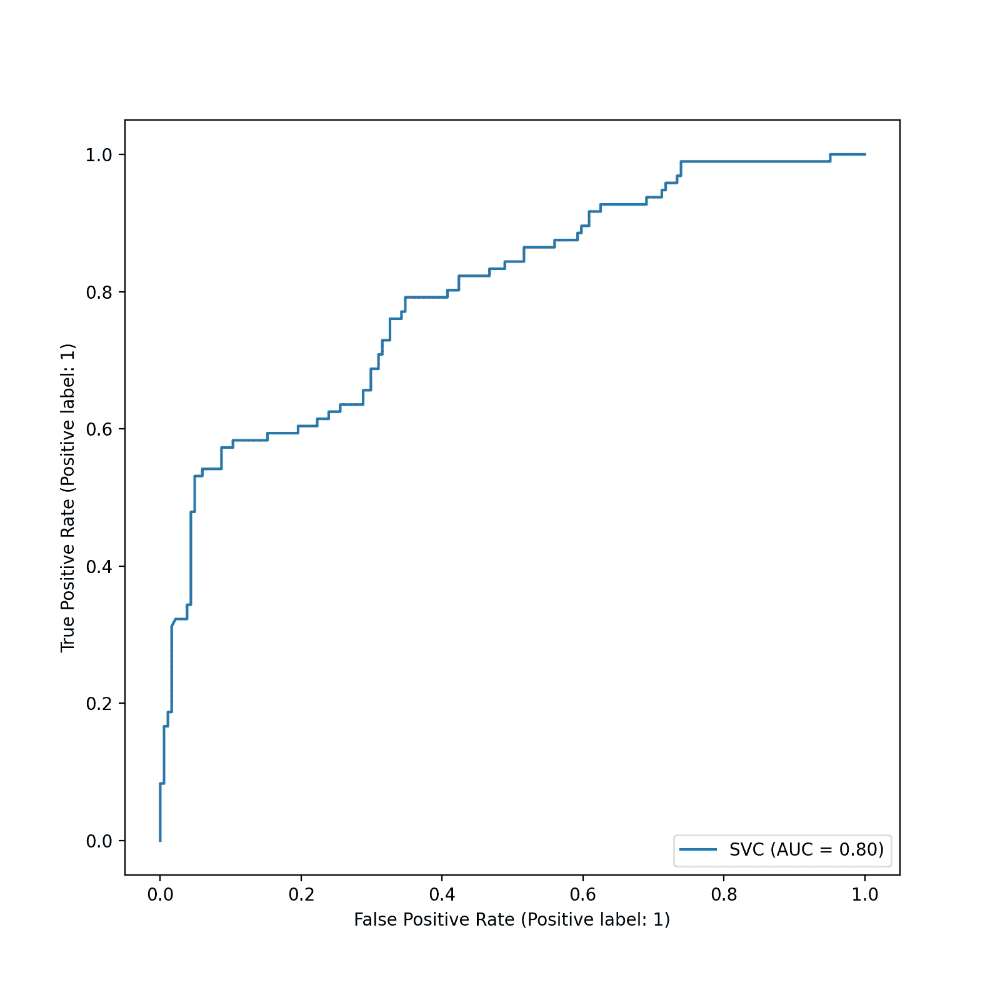

我们的 `SVC` 模型（在训练数据上）的 ROC 曲线表现良好。如图像所示，`AUC` 为 0.8，显著优于无技能分类器（0.5）。注意，只有当你对 `AUC` 感兴趣时才能绘制整个曲线。`AUC` 可以使用 `sklearn.metrics` 中的 `roc_auc_score` 方法计算。`roc_auc_score` 方法需要类别概率来计算不同阈值下的 `TPR` 和 `FPR`。我们从 `SVC` 的 `predict_proba` 方法中提取概率。让我们在以下代码中使用：

```python
from sklearn.metrics import roc_auc_score
y_pred_train_probs = svc.predict_proba(X_train)[:,1]
roc_auc_score(y_train, y_pred_train_probs)
```

打印出的 `AUC` 为 `0.7967`，这与 ROC 曲线上的数值（保留两位小数）相符。`roc_auc_score` 可以直接比较多个模型的性能。

PR 曲线下的面积（AUPRC）与 ROC 曲线（平衡 TPR 和 FPR）类似，精确率-召回率曲线（PR 曲线）可用于观察模型如何平衡精确率和召回率。如前所述，精确率和召回率之间存在权衡，召回率的提高往往以精确率降低为代价，反之亦然。因此，PR 曲线展示了模型进行这种权衡的效果如何。

如图 4.11 所示，PR 曲线的 X 轴代表召回率，Y 轴代表模型的精确率。为了生成图表，会记录并绘制不同概率阈值的精确率和召回率值。完美的分类器将具有 100% 的精确率和 100% 的召回率，用右上角的点表示。随机分类器的精确率类似于事件率（正样本百分比），召回率则随阈值线性下降，即图 4.11 中的虚线：

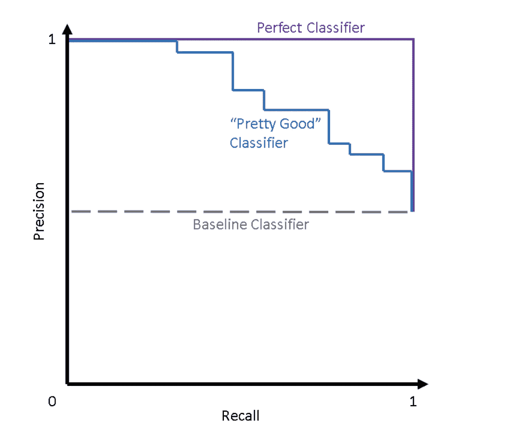

PR 曲线下的面积在 0 到 1 之间变化，总结了模型在精确率和召回率之间的权衡。让我们针对训练数据上的 SVC 模型，在广告点击预测案例研究中绘制 PR 曲线并检查其下面积。我们将使用 `sklearn` 中的 `PrecisionRecallDisplay` 模块，如下代码所示：

```python
from sklearn.metrics import PrecisionRecallDisplay as prc

prc.from_estimator(svc, X_train, y_train)

plt.show()
```

> **注意**：与 `roc_auc_score` 方法类似，你可以使用 `pr_auc_score` 仅提取 PR 曲线下的面积。

结果得到的 PR 曲线如图 4.12 所示。PR 曲线下的面积如图表所示为 0.72。这显著高于无技能的分类器（其面积为 0），我们在训练数据上的表现良好。由于这是在训练数据上，模型的真实性能是未知的，只能在未见过的数据上进行评估：

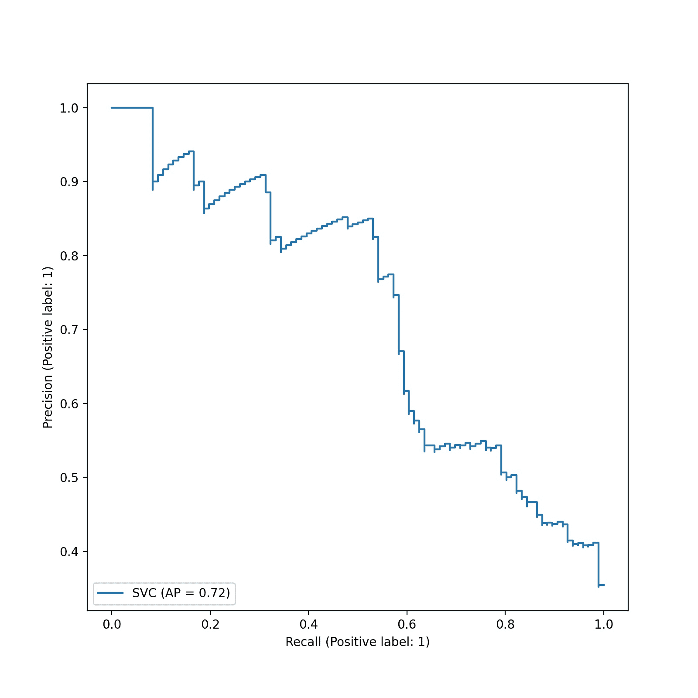

总结来说，PR 曲线是另一个极有用的模型评估指标，它捕捉了精确率和召回率之间的权衡。当关注某特定类别时，这种方法非常有用。值得注意的是，在类别严重不平衡的情况下（例如欺诈检测，事件率通常很低），PR 曲线是 ROC 曲线更可靠的性能指标。我们将在第 6 章“不平衡机器学习”中更详细地讨论这一点。

我们已经详细讨论了分类指标。现在让我们关注回归问题。我们将查看用于评估回归任务模型性能的最常用且有效的指标。

## 回归指标

在回归问题中，目标/结果是一个数字（与分类问题的类别相反）。回归任务的一个经典示例是预测电子商务平台上的产品销售量。同样，股票价格预测、产品评分预测、交付时间预测、乘车到达时间预测和温度预测都是回归任务。

因此，回归任务中误差的概念是预测值与真实值之间的距离。例如，预测销售量与产品实际销售量相有多远。如果 `y_true` 是实际值，`y_pred` 是该记录的预测值，那么在简单形式下该记录的误差可以定义为：

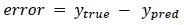

该项也被称为残差（residual）。所有记录的聚合误差为我们提供了整体模型误差或拟合优度。有多种方法可以在所有记录上聚合该误差项并进行多种方式的归一化，从而产生若干种评估回归模型的指标。让我们来看其中几个，从流行的 R 方（决定）开始。

回归模型的 R 方定义为：

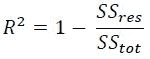

其中 `SSres` 是残差平方和（即误差平方和），`SStot` 是结果的总方差。因此，R 方指标代表了模型所解释的结果方差的比例。完美模型具有 0 误差并完美预测结果（`SSres` 为 0），此时 R 方为 1。无法解释结果方差的糟糕模型其值更接近 0。R 方是一个归一化指标，不依赖于记录的数量，因此是回归分析中一种广泛使用的指标。R 方的缺点是它使用了平方误差项，单个巨大的误差值可能会显著影响其数值。因此，我们还必须查看对误差值中的离群值更具稳健性的指标。

中位数绝对百分误差（MAPE）是一个非常稳健的替代方案。MAPE 的定义为：

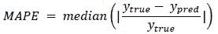

MAPE 使用误差的绝对值，并通过实例的真实值进行归一化。这确保了每个实例的值都于 0 到 1 之间。由于，由于取的是该值的中位数，它不受极高或极低值的影响。MAPE 指标的另一个优点是它具有高度的可解释性，反映了相对于数据的典型误差有多糟糕，并提供了对模型优劣的直观理解。

## 模型评估方案

在大多数现实情况中，模型在历史数据上进行训练，以用于较新的数据。例如，在历史数据上训练的贷款违约预测模型只有在它可以帮助识别未来的违约案例时才有用。事实上，对模型优的真实评估是其在未见过数据上的表现。这就是训练-测试划分方案的原因。部分数据被留作测试集，用于最终验证，如图 4.13 所示。图中的 80-20 划分只是一个示例，如果数据科学家认为适合情况，完全可以选择完全不同的划分方式。

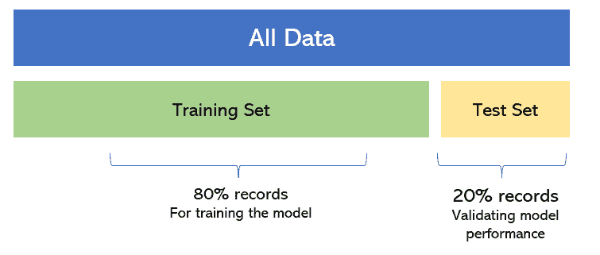

单次留验证（holdout validation）方法有其优点，也有一些缺点。首先，测试集只需要在开发过程的末尾使用。这使得在任何中间步骤估计泛化性能变得困难。其次，在测试集上的评估是基于单个样本，因此估计可靠性较低。在较小的数据集中，这种估计可能基于非常少的记录，正如你预期的那样，会导致估计变得不可靠。

更好的方法是交叉验证方法；其中一个流行的例子是 k 折交叉验证技术。图 4.14 展示了 k 折交叉验证的工作原理，以 5 折为例。数据被分为 5 份。每次，其中一折作为验证折，而其他折形成模型的训练数据。对于第一行，数据的最后 20% 记录成为验证集。模型在剩余的 4 折（占总数据的 80%）上进行训练。接下来，第 4 块变为验证集，剩余的 4 折组成训练数据。通过这种方式，每次都留出一折作为验证集，而其他块被用于训练。在该过程结束时，每一折都曾作为一次验证集。每次验证集对于模型来说都是未曾见过的。这 5 折性能的平均值是模型泛化性能的最终估计。在 5 折上取平均值合理认为是一个更稳健的估计。参考图 4.14：


> **注意**：对于超参数调优，我们将使用稍微修改的 K 折方案。我们将在第 6 章“超参数调优”中详细介绍此。

> **注意**：使用的折数各不相同，取决于你手头的数据量、你愿意花时间进行评估以及你个人对这些数字的信任程度。通常使用 3-5 折。

现在让我们在准备好的广告点击预测模型上实际演示使用交叉验证进行模型评估。

## 练习 4.4：使用交叉验证进行模型评估

本次练习将使用 3 折交叉验证评估三个广告点击模型。我们将选择 `precision`（精确率）、`recall`（召回率）和 `accuracy`（准确率）作为指标。我们将每个模型这些指标的平均值，以获得泛化准确率的概念。继续在之前一直使用的 Jupyter notebook 中执行以下步骤：

1. 从 `sklearn.metrics` 导入 `cross_validate` 方法并创建一个包含要用指标的列表，代码所示：

```python
from sklearn.model_selection import cross_validate

scoring = ['accuracy','precision','recall']
```

2. 使用以下代码指定 `cv =3`，通过 3 折交叉验证评估决策树模型。以 pandas dataframe 的形式打印每一折的指标：

```python
cv_scores = cross_validate(estimator=dt,
X = X_train,
y = y_train,
cv = 3,
scoring = scoring)

pd.DataFrame(cv_scores)
```

你应该会得到以下输出：

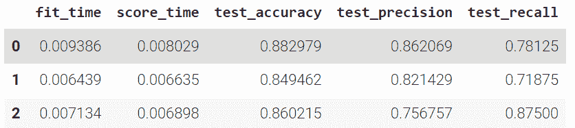

> **注意**：该方法还提供了关于拟合评分时间的详细信息。当评分和训练时间成为模型选择决策标准时，这可能非常有价值。

> **注意**：输出使用 `test_accuracy` 一术来指代验证折上的准确率。这与我们最终评估的测试集（最终留存数据）上的准确率是分开的。

3. 我们对平均值感兴趣。打印拟合评分时间的平均值以及各项指标的性能表现：

```python
pd.DataFrame(cv_scores).mean()
```

以下是输出：

```
fit_time       0.007653
score_time      0.007187
test_accuracy   0.864219
test_precision  0.813418
test_recall     0.791667
```

预计泛化准确率在 87% 左右，精确率和召回率在 81%。

4. 评估 `RandomForest` 模型并打印平均分：

```python
cv_scores = cross_validate(estimator=rf,
X = X_train,
y = y_train,
cv = 3,
scoring = scoring)

pd.DataFrame(cv_scores).mean()
```

以下是输出：

```
fit_time         0.178056
score_time      0.029179
test_accuracy   0.885648
test_precision  0.816784
test_recall     0.864583
```

我们观察到 `RandomForest` 模型的准确率召回率比决策树高得多。

5. 评估 `SVC` 模型并打印平均分：

```python
cv_scores = cross_validate(estimator=svc,
X = X_train,
y = y_train,
cv = 3,
scoring = scoring)

pd.DataFrame(cv_scores).mean()
```

以下是输出：

```
fit_time         0.014643
score_time      0.005495
test_accuracy   0.771334
test_precision  0.833007
test_recall     0.416667
```

我们观察到 `RandomForest` 模型的准确率召回率比决策树高得多，训练和评分时间也是如此。记住，虽然准确率是一个重要的考虑，但在许多情况下训练时间也很重要，你对模型的评估必须考虑所有相关标准。

## 模型调试

敏锐的读者会注意到训练性能与模型交叉验证性能之间的巨大差异。这对于决策树和随机森林模型而言尤其如此。表 4.4 列出了三个模型的训练和交叉验证召回率：

| 模型 | 训练召回率 | 交叉验证召回率 | 差异 |
| --- | --- | --- | --- |


| 决策树 | 94.8% | 79.2% | -15.6% |
| 随机森林 | 96.9% | 86.4% | -10.5% |
| SVC | 43.8% | 41.7% | -2.1% |

表 4.4：训练与交叉验证召回率之间的差异

专注于决策树模型以理解其行为，我们看到它在可见数据上的性能很高。

### 过拟合与欠拟合

在上一节中，我们研究了训练和交叉验证性能。它们是过拟合和欠拟合的极佳示例。

#### 过拟合

重新审视决策树的性能，数据告诉我们如下：

- 树在训练数据上的表现良好吗？是
- 树在未见数据上的表现良好吗？否

这是经典的过拟合。考虑一个非常灵活且复杂的模型，它甚至会学习噪声。这种模型预计在训练数据上的表现会极佳。事实上，复杂的基于树的模型（如 `XGBoost`、`GBM` 等中的提升树）和神经网络可以学习数据集中的每一个点，给出接近 100% 的准确率。图 4.16 说明了这一点。

然而，过拟合模型预计会在未见数据上表现良好吗？我们预期的未见数据中存在相同的噪声吗？显然不是。模型预计在新数据上的表现很差。

#### 欠拟合

现在考虑 `SVC` 模型在广告点击案例研究中的表现。

- SVC 在训练数据上的表现良好吗？否
- SVC 在未见数据上的表现良好吗？否

从这些信息中得出的自然推论可能是 `SVC` 模型灵活不足以捕捉数据中的模式。欠拟合的情况是边界不够灵活以区分两个类别。

- 该技术的设置参数不允许足够的灵活性（例如，`KNN` 方法中的 `k`，或者浅层 vs. 深层决策树，更多内容请参见第 6 章“超参数调优”）。
- 输入特征提供的信息不足。
- 数据中噪声过多，缺乏足够的模式或信号（与第 2 点相关；关于灵活性问题）。
- 模型训练时间不够（这对于神经网络等通常采用批次增量训练的技术来说尤为如此）。

因此，处理欠拟合可以通过妥善解决上述每一点来实现。这通常通过使用更复杂的模型、添加更多信息丰富的特征，或者有时简单地让模型训练更长时间来完成。在我们开始修复模型中的这些问题之前，我们需要能够检测出过拟合或欠拟合。训练/学习曲线是实现这一目的的极佳工具。让我们更好地了解它们，并学习如何在我们的广告点击预测案例研究中运用它们。

## 验证曲线与拟合优度

我们已经了解到，模型复杂性/灵活性是性能的关键因素，并对模型的拟合程度有巨大影响。高复杂度模型通常是过拟合的主要原因，而低复杂度往往是欠拟合的原因。

模型中的复杂度可能源于：

- 高度灵活的建模技术（例如，线性回归与 神经网络的对比）
- 模型参数选择（浅层 vs. 深层决策树）
- 大量的特征
- 训练过度的模型（适用于按批次学习的技术，例如神经网络或提升树）

识别模型过拟合/欠拟合的一种简单但极强有力的方法是通过验证曲线（其变体也称为学习曲线）。这种常见的变体如图 4.17 所示。X 轴代表模型复杂度，Y 轴代表模型准确率（任何指标，如召回率、准确率等）。在这些轴上绘制了两条曲线：训练误差和验证误差。这个直观的视图可以告诉我们许多关于学习情况的信息。

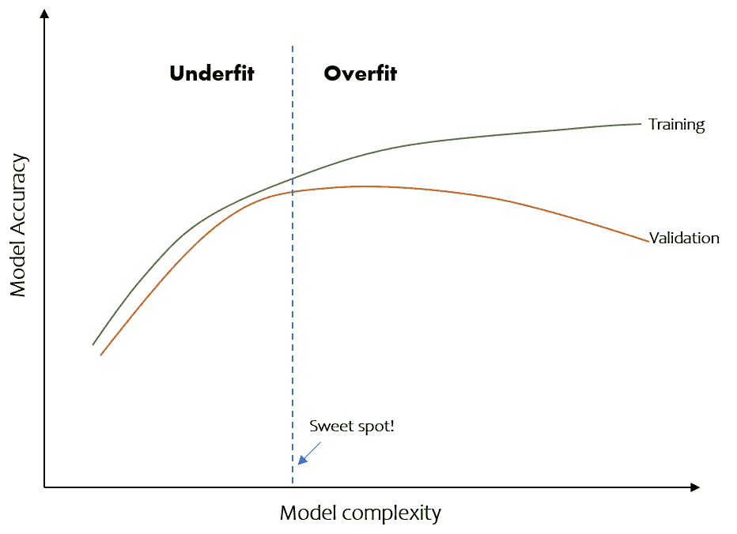

注意：X 轴上的模型复杂度可以用许多方式表示。它可以是训练批次的数量（例如神经网络），也可以是定义灵活性的参数（基于树的方法中树的深度）。还可以是特征的数量。

随着模型复杂度的增加，模型变得更加灵活，并在某一点之后开始学习噪声分量。这种情况可以通过观察验证准确率来检测，验证准确率代表在未见数据上的泛化性能。只要模型学习的是真实模式，其训练和验证准确率就会提高。这是因为这些真实模式在验证数据上也同样良好。当模型开始过度地学习数据（包括噪声）时，我们看到训练和验证曲线开始发散。进一步的训练只会增大这些曲线之间的差距。因此，最佳点是一个复杂度水平，在该水平下模型在训练数据和验证数据上的表现都良好。找到这一点可以优化模型的拟合效果。

从验证曲线的另一种变体中也可以得出类似的理解。我们不绘制准确率，而是绘制模型在训练数据和验证数据上的损失。注意，关键区别在于误差或损失的定义也可以与模型所执行的底层优化相关（通常利用损失函数）。在原理和实践中，这条曲线带给我们的结果与之前的版本（Y 轴准确率）相似。在过拟合时，模型持续减少训练数据中的误差。然而，验证误差保持稳定，或者随着噪声影响模型并使其无法泛化而持续增加。参考图 4.18：

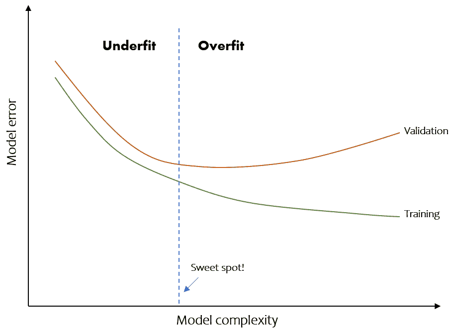

为了让这种理解更具体并亲自测试这些想法，让我们为 Azra Inc. 准备的广告点击预测模型创建这样的验证曲线，并评估我们从何时开始过拟合数据。

## 练习 4.5：广告点击预测的验证曲线

在本次练习中，我们将继续进行 Azra Inc. 的广告点击预测案例研究。我们将为决策树模型绘制验证曲线。我们将使用方便的工具。

模型变得复杂的简单方法之一是添加了远超所需的特征。即使对于像 `linear regression` 这样经典的灵活性较低的模型也可能发生这种情况。对于 `boosted trees` 或 `neural networks` 这样灵活性更高的模型，这种影响更为显著。从本质上说，具有 3 个特征的 `linear regression` 比具有 200 个特征的要简单得多。

数据科学家收集的特征往往比他们最终在模型中使用的多。拥有更多特征并将其消除，比只有极少数特征并在枯燥且冗长的项目中逐个创建它们要好。但是，模型中应该包含多少特征以及应该包含哪些特征呢？首先，丢入所有可能的特征很少是一个好主意。对于需要维护的模型来说更是如此。维护包含 200 个特征的流水线比包含 10 个特征的要复杂得多。那么我们该如何选择呢？

最实用且直观的方法是围绕递归/迭代/逐步特征选择。原则上，使用了三种方法：

- 逐步特征添加（正向）：从一个特征开始，只添加那些能提供显著性能提升的特征。持续此过程，直到添加任何更多特征不再有益为止。
- 逐步特征消除（反向）：从模型中的所有特征开始，逐个消除特征，每次丢弃对模型贡献信息最少的特征。持续此过程，直到丢弃任何进一步特征都会导致性能大幅下降为止。
- 递归特征消除（混合）：一种结合了添加和删除特征的方法。在每一步中，该方法评估某个特征是否可以在不丢失显著性能的情况下被删除。然后，模型检查添加任何剩余特征是否能提供性能提升。持续此过程，直到我们获得最优特征集。

注意，所有这些方法都可以结合，而且实际上结合 `cross-validation` 来确定我们是否影响了性能，效果会更好。

注意：`sklearn` 中的特征选择模块（`sklearn.feature_selection`）提供了一个 `Recursive Feature Elimination` 的实用实现，即 `RFE`。更多细节和一些示例可以在 <a href="https://scikit-learn.org/stable/modules/generated/sklearn.feature_selection.RFE.html">官方文档</a>中找到。

## 参数控制

我们已经看到某些模型设置控制着其复杂性/灵活性。我们看到 `max_depth` 设置是 `decision tree` 的一个超参数，并且更改此设置可以显著提高模型的泛化能力。这是一个关于超参数可能产生影响程度的好例子。让我们先看看更改决策树 `max_depth` 的影响，看看我们是否可以获得更具通用性的结果。

让我们先从 `sklearn` 实例化一个 `max_depth` 为 4 的 `DecisionTreeClassifier`。使用以下代码：

```python
from sklearn.tree import DecisionTreeClassifier

dt_4 = DecisionTreeClassifier(max_depth=4, random_state=42)
```

现在，让我们使用以下代码计算该模型的（3 折）交叉验证准确率：

```python
cv_scores = cross_validate(estimator=dt_4,
                           X=X_train, y=y_train,
                           cv=3, scoring="accuracy")

pd.DataFrame(cv_scores).mean()
```

验证准确率将接近 90%，如下输出所示：

```
fit_time      0.008755
score_time    0.005416
test_score    0.896324
```

现在，让我们创建另一个 `max_depth` 为 10 的决策树，并使用以下代码计算其交叉验证准确率：

```python
dt_10 = DecisionTreeClassifier(max_depth=10, random_state=42)

cv_scores = cross_validate(estimator=dt_10,
                           X=X_train, y=y_train,
                           cv=3, scoring="accuracy")

pd.DataFrame(cv_scores).mean()
```

如下输出所示，`max_depth` 10 的树的泛化准确率约为 86%：

```
fit_time      0.004431
score_time    0.001893
test_score    0.860673
```

深度 4 的 90% 验证准确率与深度 10 的 86% 准确率相比，很明显超参数可以显著影响结果。

## 正则化

将深度 4 的 90% 验证准确率与深度 10 的 86% 准确率相比，很明显超参数可以显著影响结果。决策树本身有几个超参数：`max_depth`、`features to consider`、`min_samples_split`、`min_samples_leaf` 和 `max_features`。当使用 `XGBoost` 时，会有更多的。

注意：超参数调优是模型优化的核心主题，我们将在后面的章节中学习这些。

正则化是一个通用的机器学习概念，非常适用于深度学习。“收缩”（shrinkage）一术语在经典机器学习中已经存在了几十年。例如，一个线性回归模型可能由于许多预测变量而变得复杂。正则化意味着减少预测变量的系数。注意，这并不意味着丢弃预测变量，而是抑制预测变量的影响。效果是降低模型的灵活性。图 4.20 阐释了这种影响。

线性回归模型的正则化为我们提供了如 `ridge regression` 和 `lasso` 等技术，这两者的正则化方式略有不同。虽然 `ridge regression` 抑制了所有系数的值，但 `lasso` 可以将某些系数减为 0。因此，`lasso` 也有助于特征选择。如果你想在这些方法之间取得折中方案，还可以使用 `ElasticNet` 方法，它是 `ridge` 和 `lasso` 的加权组合。

注意：`Ridge` 和 `lasso` 回归并不流行，但在 `sklearn` 中得到了很好的支持。这些方法与其他 `sklearn` 工具配合得很好，易于使用。

### 数据增强

数据增强技术主要用于深度学习中的图像和文本数据。然而，它们也可以应用于表格型数据的经典机器学习方法。数据增强可以被认为是高度复杂模型的另一种正则化形式。高度复杂的模型在小数据集上非常容易过拟合，增加数据大小应该缓解这一问题。

然而，有时获取更多数据是不切实际的。一种聪明的变通方法是生成数据变体，为模型提供更多示例供学习。考虑一个用于检测图片中狗的图像分类模型。为了创建更多训练示例，你必须对图像进行微小的修改。例如，你可以将图像旋转几度、稍微放大，并对其进行水平和垂直翻转。在所有情况下，你都没有改变图像的主体以及它包含狗这一事实。实际上，你可以从同一个标签的样本生成多个样本。通过这种方式，数据增强通过以下方法帮助你从数据中获得更多价值：

- 为模型学习创建更多数据的多样性；在许多情况下，它提供了急需的变异
- 正则化并使模型具有更好的泛化能力

作为数据科学家，数据增强是你工具箱中非常有用的工具。我们将在稍后的章节中详细研究这一点。

### 优化训练（早停）

对于分批次学习或从数据顺序学习的模型技术，在正确的时间停止可以防止过拟合。对于神经网络，这意味着选择正确的 `epochs` 数量。对于其他技术，这可能意味着设置正确的学习迭代次数。以神经网络为例，当整个数据集通过网络进行一次训练后，即通过了一个 `epoch`。神经网络通常在几十、数百甚至几千个 `epochs` 上进行训练。这会增加训练时间，并显著地增加过拟合的倾向。

一种防止过拟合并选择最佳 `epochs` 数量的实际且有效的策略是使用**早停**。其原理很简单：在训练神经网络时，持续监控验证损失/准确率。如果验证损失在几个 `epochs` 内没有下降（或准确率没有增加），模型将停止进一步训练。其合理性现在应该是显而易见的。如果训练分在增加，但验证分没有增加，说明我们正在过拟合。这种方法非常有效，并且在实践中被广泛应用并取得了巨大成功。

注意：关于神经网络防过拟合技术以及如何使用早停的详细探讨，将在第 8 章《优化深度学习模型》中介绍。

## 结论

在本章中，我们看到了一种比较模型的原则方法。我们从这样的观点开始：精度是选择模型时的众多考虑因素之一。我们看到了精确率、召回率、ROC 曲线、PR 曲线、F1 分数等指标的应用。我们学到它们可以帮助确保在不同情况下模型性能与业务目标保持一致。

然后我们看到，由于模型需要在未见的数据上运行，因此我们需要它们具有良好的泛化能力。我们看到了评估训练数据的陷阱，研究了不同的评估方案来估计泛化性能，并针对不同的模型实施了 `K-fold cross-validation` 交叉验证方案。

在这个过程中，我们意识到过拟合是困扰大多数机器学习项目的常见问题。我们学习了过拟合和欠拟合，以及使用学习/验证曲线来诊断它们的方法，在这些中我们看到了模型性能与复杂性的关系。我们讨论了多种方法，并在广告点击预测案例研究中实现了一些方法。这完成了关于模型评估的非常重要的章节。

在下一章中，我们将讨论并克服几个真实世界机器学习问题中另一个极其常见的挑战——类别不平衡。

***

1 来源：<a href="https://upload.wikimedia.org/wikipedia/commons/1/13/Roc_curve.svg">roc 曲线 (wikimedia.org)</a>

2 来源：<a href="https://hasty.ai/docs/mp-wiki/metrics/precision-recall-curve-and-auc-pr">精确率-召回率曲线和 AUC-PR - Hasty.ai</a>

3 来源：<a href="https://www.ibm.com/cloud/overfitting">什么是过拟合？ | IBM</a>

如果你注意到了，大多数这些任务都是关于预测或检测感兴趣的事件（例如疾病的存在）。该事件发生罕见，因此具有很低的发生率（发生事件的记录/总记录）。在上述所有任务中，检测某一个结果更为重要。常见的不平衡场景包括：

- 欺诈检测（银行、电子商务）
- 垃圾邮件检测
- 疾病（例如癌症）预测
- 设备故障预测（情况不异）
- 客户转化预测
- 邮件营销点击预测
- 异常检测
- 离群点检测

# 第 5 章 不平衡机器学习

## 引言

在之前的章节中，当我们处理二分类时，类别分布是相对均匀的（接近 1:1），这很方便。然而，在许多现实场景中，你会发现某一类别的记录远多于其他。欺诈检测（即识别欺诈交易）是一个典型的例子，通常情况下欺诈占比小于 0.1%（或更少）。重要的是，这种情况并不罕见。

在本章中，我们将理解并亲手观察这两个问题。从模型评估开始，我们将看到准确率等标准指标是不够的，需要更复杂的评估来使模型有用。我们将探索关键替代指标并在同一任务上比较它们。在理解了更好的评估方法后，我们将应对下一个挑战：处理不平衡。我们将使用信用卡欺诈检测作为问题陈述，手动实现所有这些方法。

让我们从理解最重要的方面开始：模型评估的困难。在此之前，让我们理解要解决的业务问题并熟悉现有数据。

## 结构

在本章中，我们将讨论以下主题：

- 理解业务问题
- 模型评估的困难
- 不平衡类别的评估指标
  - F1 分数
  - 精确率-召回率曲线
  - 模型评估总结
- 处理不平衡
  - 调整代价函数
  - 数据平衡
- 欠采样
  - 使用重平衡进行模型评估
  - 使用管道评估重平衡数据
  - Tomek Links
  - 采样方法：编辑最近邻
- 过采样
  - SMOTE
  - ADASYN
- 欠采样与过采样的结合
- 比较方法

读完本章后，你能够应对机器学习/人工智能领域中最常见且最具挑战性的问题之一。你将理解不平衡如何影响我们对模型的评估，并能够诊断由于不平衡引起的问题。你将识别更好的评估指标。你还将能够使用多种方法来处理不平衡。此外，你能够熟练使用欠采样/过采样技术来更好地平衡数据集，以获得更优的机器学习解决方案。

## 理解业务问题

Aiza, Inc. 是一家领先的保险公司，提供人寿、健康、财产和责任险类产品。公司希望扩展到四轮车险。鉴于现有的投保人已经拥有保险单，可以假设他们更有可能购买新产品，因此他们是一个自然的细分目标。此外，公司拥有足够的客户详细信息，可以对其进行有效投放。

Aiza, Inc. 最近开展了一项大型营销活动，联系了约 3.7 万名现有投保人。活动数据结合客户的一些人口统计信息（`Gender`、`Age`）以及对他们车辆的一些了解，可能为哪些客户更有可能转化提供良好的见解。训练一个预测客户是否会转化的机器学习模型，通过将目标锁定在转化概率较高的人群，对于优化未来的营销活动非常有用。

营销活动的响应数据通常是不平衡的，我们的数据也不例外。在本章中，我们将以此作为案例研究，帮助构建一个高性能模型来识别更好的潜在客户，并在此过程中学习如何处理不平衡类别。首先，让我们加载、理解并准备数据。

### 练习 5.1：理解和分阶段处理数据

在本次练习中，我们将使用各种简单的分析来更好地理解数据和业务问题。让我们开始吧。


1. 首先，让我们使用以下命令导入必需的库：

```python
import numpy as np, pandas as pd
import matplotlib.pyplot as plt, seaborn as sns

%matplotlib inline
```

2. 接下来，我们将数据从文件 `Aiza Insurance Data.csv` 导入 `Pandas` 数据框中，并打印前 5 条记录。使用以下代码：

```python
ins0 = pd.read_csv('Aiza Insurance Data.csv')
ins0.head()
```

这将产生如图 5.1 所示的输出：

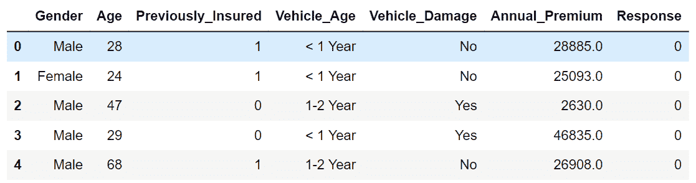

我们拥有一些基础的人口统计信息，如客户的性别年龄。此外，我们还有他们来自 Hina, Inc. 的保险历史以及有关他们当前车辆的相关细节。目标变量是 `Response`，它捕捉了客户在营销活动期间是否转化。

3. 现在让我们使用数据框的 `info` 方法检查数据类型和记录数，如下输出所示：

```python
ins0.info()
```

你将看到如图 5.2 所示的数据详情：

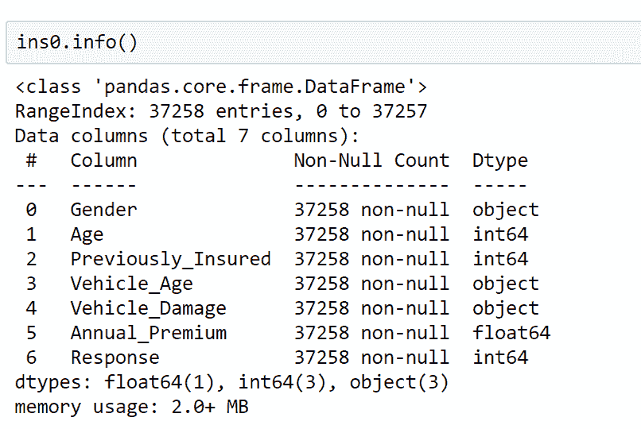

我们看到数据集中有 37,258 条记录。数据中没有任何缺失值，这非常方便。现在让我们检查目标字段 `Response`。

4. 使用 `Pandas` 序列的 `value_counts` 方法，我们打印 `Response` 中每个类别的响应数量，并打印每个类别的百分比：

```python
ins0.Response.value_counts()
```

我们看到如图 5.3 所示的计数：

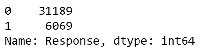

```python
ins0.Response.value_counts(normalize=True)
```

我们看到如图 5.4 所示的百分比：

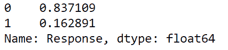

类别之间似乎存在显著的不平衡，只有约 16.3% 的记录属于少数类。这可能会导致问题，正如我们很快在下一节中看到的。让我们继续并为建模准备数据。

特征 `Gender`、`Vehicle_Age` 和 `Vehicle_Damage` 是类别变量。

5. 让我们使用 `Pandas` 的 `get_dummies` 方法对这些特征进行哑编码以获取数值表示，如下代码所示：

```python
ins1 = pd.get_dummies(data=ins0, 
columns=['Gender', 'Vehicle_Age', 'Vehicle_Damage'], 
drop_first=True)
ins1.head()
```

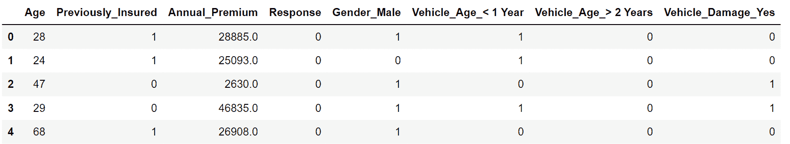

注意：在这种情况下，我们确切知道类别特征中将出现的值，因此在训练-测试划分之前进行哑编码没有任何坏处。如果你预见到模型在生产环境中类别字段中会出现新值，则应该显式地处理未知类别。`sklearn.preprocessing` 模块中的编码器值得探索，并且具有处理未见类别的选项。

通过此，我们完成了数据的基本预处理。我们承认类别是显著不平衡的。现在让我们理解不平衡是如何产生问题的。

## 模型评估的困难

在第 4 章“模型评估与调试”中，我们讨论了模型崩溃或建模过程崩溃的最人意料的方式之一，就是评估没有根据目标和数据特征进行。这对于不平衡数据集或一个类别远多于另一类的情况来说特别为棘手。处理不平衡数据集需要大量的仔细考虑，并对业务目标和模型的应用有良好的理解，以获得良好的评估方法。像分类准确率这样的常规指标通常是不够的。简单回顾一下，考虑你正在为欺诈检测创建一个模型的情况。假设只有 0.1% 的交易是欺诈的。现在，假设你有一个预测所有交易均为非欺诈的模型。该模型的准确率是多少？准确率仍为 99.9%。

停下来思考一下：假设你正在评估一个检测 HIV 等严重疾病的模型。以下哪个错误更严重？假阳性（没有 HIV 但被诊断为患有），还是假阴性（患有 HIV 但未被检测出来）？

提示：考虑每种错误的后果。是一个不知情的 HIV 感染患者，还是一个被结果吓坏的健康人？

虽然这种性能在纸面上看起来很棒，但该模型对目标完全没有用。这是因为在我们的情况下，我们并不关心正确识别非欺诈案件。相反，我们对检测欺诈案件感兴趣。我们更关注少数类。准确率指标是不可靠的，因为它不区分少数类和多数类。

到目前你可能已经意识到解决方案很简单，至少在概念上是这样。我们需要不对称指标，让我们对一个类的权重比另一个更高。让我们在下一个练习中亲自看看准确率是否适用于我们的保险案例研究。

### 练习 5.2：不平衡类别的准确率

我们现在将使用准确率作为指标构建并评估机器学习模型。首先，我们将对数据进行训练-测试划分，然后对数值特征进行标准化。预处理完成后，将在数据上训练一个逻辑回归模型。在查看模型准确率的同时，我们将通过分析单个类别的性能进行深入的评估。请记住，我们的类别是不平衡的，因此我们需要进行分层划分，以确保在派生数据集中保持类别比例。执行以下步骤。

1. 让我们首先使用以下代码对数据进行 70:30 的训练-测试划分：

```python
from sklearn.model_selection import train_test_split

df_train, df_test = train_test_split(ins1, test_size=0.3, random_state=42, stratify=ins1.Response)

df_train.shape, df_test.shape
```

新数据集的形状如图 5.6 所示：

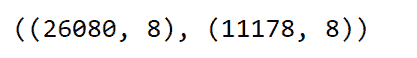

2. 为了确认新数据集中保持了类别比例，请使用 `value_counts` 方法打印两个数据集的计数结果：

```python
df_train.Response.value_counts(normalize=True)
df_test.Response.value_counts(normalize=True)
```

我们看到的输出如图 5.7 所示：

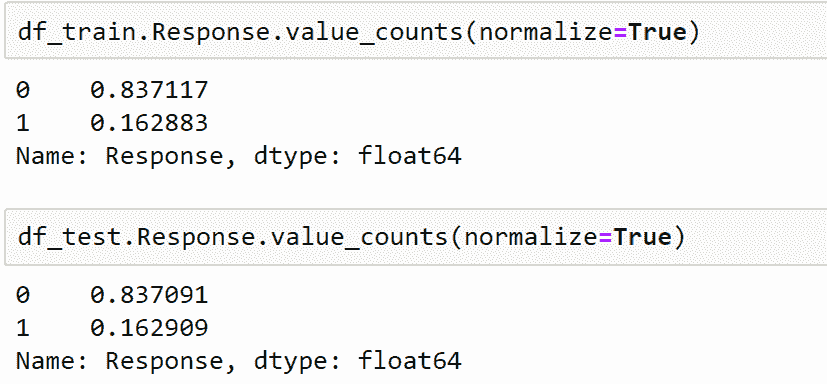

类别比例从原始数据集中保留了下来，正如我们预期的那样。

3. 使用 `sklearn` 中的 `StandardScaler` 工具对数值特征（`Age`、`Annual_Premium`）进行缩放，如下代码所示。记住在训练集上使用 `fit_transform`，并在测试集上使用 `transform`：

```python
df_train[cols_to_scale] = scaler.fit_transform(df_train[cols_to_scale])
df_test[cols_to_scale] = scaler.transform(df_test[cols_to_scale])
```

4. 打印这些列的平均值以确认缩放有效：

```python
df_train[cols_to_scale].mean()
df_test[cols_to_scale].mean()
```

我们看到的输出如图 5.8 所示：

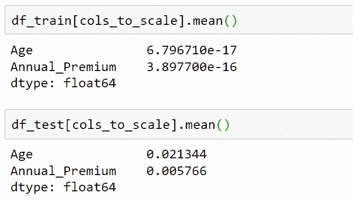

训练集的平均值实际上为 0。测试集的值也接近 0，正如我们预期的那样，由于数据集之间的平均值可能会略有变化，它们并不完全为零。

5. 使用以下代码将训练集和测试集的数据为 `X` 和 `Y` 变量：

```python
X_train = df_train.drop('Response', axis=1)
y_train = df_train['Response']
X_test = df_test.drop('Response', axis=1)
y_test = df_test['Response']
```

6. 使用 `sklearn` 在训练集上拟合 `Logistic Regression`（逻辑回归）模型，并指定随机种子 42 以确保结果的可重复性：

```python
from sklearn.linear_model import LogisticRegression
logreg = LogisticRegression(random_state=42)
logreg.fit(X_train, y_train)
```

模型已经训练。让我们在训练集上评估模型性能。

7. 导入必要的工具并计算并打印准确率：

```python
from sklearn.metrics import accuracy_score, confusion_matrix, classification_report
y_train_pred = logreg.predict(X_train)
accuracy_score(y_train, y_train_pred).round(3)
```

你应该得到以下准确率：

0.837

第一次尝试的准确率看起来很令人深刻，但它真的好吗？记住，我们更关注那些转化的客户。我们的模型对他们表现如何？让我们打印出混淆矩阵，以更好地展示类别情况。

8. 使用以下代码打印混淆矩阵：

```python
confusion_matrix(y_train, y_train_pred)
```

矩阵的打印如图 5.9 所示：

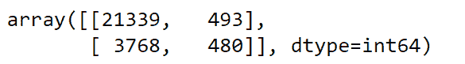

第二行属于转化的客户，第二列代表预测为转化的客户。让我们先谈谈转化的“检测率”。在 4,248 名转化的客户中，模型仅正确预测了 480 名。这意味着模型只能检测出大约 11% 的转化。此外，在模型预测会转化的 973 名客户中，只有 480 名（或 49%）是实际转化。因此，模型的精确率（precision）为 49%，召回率（recall）为 11%。

注意：如果你需要复习，请重新查看第 4 章“评估与调试”中的定义。

9. 让我们看看 `classification_report` 工具计算的精确率和召回率：

```python
print(classification_report(y_train, y_train_pred))
```

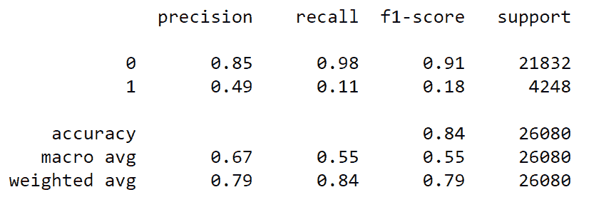

分类报告为每个类别提供了详细的报告。此视图确认了转化的精确率约为 49%，召回率约为 11%。

模型即使在训练集上的表现也不佳。该模型的性能是不够的。很明显，在评估不平衡类别的性能时，准确率不是一个好的指标。我们总是需要进行更详细的分析，并根据我们的情况选择成功指标。让我们讨论一下此类不平衡情况下的某些潜在指标。

## 不平衡情况下的评估指标

我们在第 4 章“评估与调试”中已经讨论了准确率、精确率和召回率。对于不平衡类别，我们需要更好的指标。在某些情况下，精确率和召回率之间存在权衡。在这种情况下，我们需要一个有效的指标。是精确率还是召回率更重要？

### F1 分数

我们知道精确率和召回率之间存在权衡，高精确率会导致低召回率，反之亦然。F1 分数在两个变量都高时达到最高。即使其中一个变量的值很低，调和平均也会下降，即使另一个变量接近 1。因此，精确率和召回率都很高时才会获得高 F1 分。如图 5.11 所示：

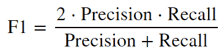

如图 5.12 所示，精确率和召回率都很高，说明两者之间存在良好的权衡。

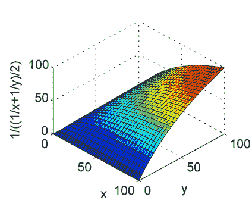

需要注意的是 F1 分数的隐含假设，因此适合使用 F1 分数的情况如下：

- F1 分数假设假阳性与假阴性的代价同样糟糕。
- 真负例是不重要的，因为我们关注的是精确率和召回率，这两者都关注正类。

在实践中，F1 分数是不平衡类别中非常流行的指标。F1 分数指标在 `sklearn` 的许多其他指标中方便可用。因此，该指标可以轻松用于交叉验证的其他 `sklearn` 模块，有助于我们优化模型性能以获得更好的 F1 分。

## 警告：不要使用 ROC 曲线面积！

在处理不平衡数据集时，最常见的错误之一就是使用 ROC 曲线。这种错误非常普遍，以至于许多数据科学人士都会犯。我们知道一些拥有十年以上统计模型构建经验的人也会犯这种错误。因此，这可以被认为是人们应该极其谨慎的数据科学“罪”。

让我们为我们的案例研究绘制 ROC 曲线，亲眼看看它是如何具有误导性的。我们将使用 `sklearn` 中的 `plot_roc_curve` 工具，代码如下所示：

```python
from sklearn.metrics import plot_roc_curve
plot_roc_curve(logreg, X_train, y_train)
plt.show()
```

ROC 曲线图如图 5.13 所示：


ROC 曲线下的面积为 0.87，这令人深刻。但我们已经看到该模型对于我们的目的没有用。因此，ROC 曲线下的面积具有误导性。但为什么呢？让我们深入了解。

ROC 曲线（如第 4 节“评估与调试”所示）试图衡量模型区分两个类别的能力。高技能的模型能够很好地区分这些类别，而低技能的模型则极容易产生混淆。一个常见的错误是在高度不平衡的情况下使用 ROC 曲线。从表面上看，这个想法似乎是有道理的：如果一个模型能很好地区分两个类别，那么不平衡就不应该成为一个问题。但要理解为什么这会有问题，我们需要理解 ROC 曲线基于的指标：真阳性率（True Positive Rate）和假阳性率（False Positive Rate）。真阳性率等于 `Recall`（召回率），因此 `Recall` 部分在某种程度上被包含了。但另一个指标更多关注总负样本被识别为正样本的比例（`False Positive/Total Negatives`）。当存在严重不平衡时，由于分母（`Total Negatives`）通常很高，`False Positive Rate` 避免会非常低。更好的替代方案是使用 `Precision-Recall`（精确率-召回率）曲线下的面积——这是我们下一个学习的一个非常有用的指标。

#### 精确率-召回率曲线

PR 曲线的生成方式类似于 ROC 曲线，但使用的是精确率（precision）和召回率（recall）指标。这通常是与我们最相关的权衡（trade-off）。鉴于 `recall` 指标精确地关于检测真阳性情况的，而 `precision` 指标是关于不产生过多的假阳性的，该曲线下的面积对于评估不平衡情况要有用得多。

使用 `sklearn` 中的 `plot_precision_recall_curve` 工具绘制 PR 曲线也非常简单。让我们使用以下代码为我们的车辆保险营销模型绘制该曲线：

```python
plot_precision_recall_curve(logreg, X_train, y_train)
plt.show()
```

曲线图如图 5.14 所示：


如图 5.14 所示，PR 曲线下的面积仅为约 0.46。这远低于 ROC 曲线下的面积（0.87）。PR 曲线为我们提供了更可靠的模型性能图景。原因是，用于生成此曲线的 `precision` 和 `recall` 两个指标对于我们这样的情况都至关重要。

#### 模型评估总结

有许多指标可以评估模型，即使对于不平衡的情况也是如此。关键在于理解哪一个与问题描述最相关。在某些情况下，单一指标（如 `F1 score`）可能足够。在其他情况下，可以使用指标的组合，将其中一个作为主要指标，另一个作为护栏（guardrail）。这在模型可能产生重大的业务影响或用于关键应用时尤为如此。如果你不确定，请确保从业务团队获取输入，并对良好模型的标准标准。

在解决了模型评估的首要挑战后，让我们转向机器学习中处理不平衡类别的第二大挑战：让模型处理不平衡，从而提高模型性能。让我们讨论实现这一目标的主要方法。

## 处理不平衡

通过对评估模型的正确方法有了更好的理解，我们现在准备好评估单个模型以及比较多个模型了。这现在也允许我们对模型进行改进，或者至少知道一个模型为什么比另一个模型好。但核心问题仍然：我们如何改进模型？我们在训练过程中让模型更多地关注某一类别？我们如何让模型学习我们希望它学习的模式？现在有几种方法可以实现。我们将查看 3 种主要方法。

### 调整代价函数

第一种方法是影响机器学习模型“学习”的方式，这影响了模型训练本身。回想第 1 节“优化机器学习/人工智能解决方案”中的内容，“模型训练”简单来说就是让模型学习数据中的模式，同时提供一个模型需要最小化的目标或代价函数（objective or cost function）。在训练期间，如果我们可以告诉模型更多地关注某一类别，并且正确识别少数类比正确识别多数类更重要，那么我们就接近一个更好的解决方案了。

例如，如果你能告诉模型，正确分类一个欺诈案例比正确分类一个非欺诈案例重要 10 倍，那么模型将检测到更多的欺诈案例。从毕竟，模型训练本质上是一个优化问题。所有优化问题都有代价或目标函数。如果你可以修改目标函数以给某一类更大的权重，那么模型学习就可以很容易地受到影响。这确实是处理不平衡的一种简单、直接且强大的第一种方法。

逻辑回归损失函数如图 5.15 所示：


通过类权重（Class weights）给某一类赋予比另一类更高的权重如图 5.16 所示：


简单的方法是修改 `sklearn` 中多个分类模型具有的权重设置。让我们通过以下代码重新查看 `sklearn` 中 `LogisticRegression` 模块的参数：

```bash
?LogisticRegression
```

你将看到图 5.17 中的模型参数：


注意 `class_weight` 参数。默认情况下，它设置为 `None`，这意味着代价函数对两个类赋予相同的权重。要了解更多关于该参数以及如何使用它，请在帮助弹出窗口向下滚动，查看 `LogisticRegression` 文档字符串的 `Parameters` 部分。你将看到如图 5.18 所示的该参数描述：


我们可以使用字典为每个类指定权重。此权重将用于 `LogisticRegression` 调整后的代价函数。如果你希望正类别的权重是负类别的 10 倍，可以指定类权重为 `{0:1, 1:10}` 作为示例（权重不需要相加等于 1，重要的是比例）。如果你想按照类别在数据中比例的反比来加权，请使用 `balanced`。如果少数类和多数类之间的比例是 1:5，使用 `balanced` 方案将分配 5:1 比例的类权重。注意：虽然我们在 `LogisticRegression` 的范围内看到了 `class_weight` 参数，但 `sklearn` 中的大多数分类方法都实现了 `class_weight` 参数。

#### 练习 5.3：调整 class_weight

在本次练习中，我们将评估调整类权重对逻辑回归模型的影响。我们将使用分层 K 折交叉验证方案（stratified k-fold validation）来获取泛化的性能评分。执行以下步骤。

1. 创建一个指定 `class_weight` 为 `balanced` 的 `LogisticRegression` 实例：

```python
logreg_wt = LogisticRegression(class_weight='balanced', random_state=42)
```

2. 为了评估模型性能，使用 3 折评分方案并将交叉验证分数打印为 dataframe。使用以下命令中的代码：

```python
from sklearn.model_selection import StratifiedKFold
from sklearn.model_selection import cross_validate
folds = StratifiedKFold(random_state=42, n_splits=3, shuffle=True)
cv_scores = cross_validate(logreg_wt, X_train, y_train, cv=folds, scoring=['precision','recall','f1'])
pd.DataFrame(cv_scores)
```

CV 分数打印如图 5.19 所示：


这是一个极其简单且基础的洞察：模型从呈现给它们的数据中学习模式。如果你希望模型能够更好地捕捉到与检测少数类相关的模式，它只需要更多的表征。我们经常遇到这样的情况，即数据中的不平衡非常严重，以至于仅仅修改代价函数是不够的。在这种情况下，我们需要探索数据平衡的选项。数据平衡意味着我们减少数据中类别之间的不平衡状态，这意味着从百分比来看，我们看到了更多来自少数类的记录。这将帮助模型看到更多的少数类记录，而且模型学习到的模式将较少受多数类的主导。我们并不总是需要将类别完全平衡为 50:50，即使是 5:1 也比 999:1 有显著的改进。

我们该如何做到这一点？嗯，我们只有两个选择：欠采样（undersampling）和过采样（oversampling），有时你可能会结合两者的使用。欠采样是指取多数类记录的子集。例如，在一个包含 100 万条记录的数据集中，多数类可能有 999,000 条记录，而少数类只有 1,000 条记录，比例为 999:1。但在准备训练数据时，我们不必选择所有 999,000 条记录，而可以只选择 5000 条。这 5000 条记录可以使用随机欠采样（Random under-sampling）来选择，即随机选择记录，或者其他更复杂的策略（例如，近邻法 Near Miss）。这将创建或将比例修改为 5:1。正如之前讨论的，5:1 仍然有些不平衡，但相对于 999:1 来说是一个巨大的改进。这两种方法如图 5.20 所示：


过采样的思路类似，在准备数据集时，我们包含了更多来自少数类的记录。实现这一点的最简单方法是仅仅对少数类的记录进行复制或创建副本，要么复制所有记录，要么选择随机部分（随机过采样 Random Oversampling）进行复制。最先进的方法不仅仅是复制点，而是生成与现有数据点相似的新数据点。像 `SMOTE` 和 `ADASYN` 等技术就属于这一类。我们将在本章的后续部分理解并实现这些内容。

欠采样和过采样的结果是相同的；即为少数类提供一个更有利的比例。但两种方法之间的实际差异可能是巨大的，在对多数类进行欠采样时，你可能会丢失数据中的某些重要信息或模式。信息的丢失会导致极差的性能，特别是当标签存在严重不平衡时。因此，在执行欠采样时要格外小心。作为一个常识性的指导原则，始终应优先保留信息，而不是丢失信息。

停下来思考一下：对少数类进行简单的过采样，与为少数类分配更高的类别权重相比，在本质上有显著区别吗？在这两种情况下，我们都没有提供任何新信息，并且实际上都是为少数类赋予了更高的权重。

## 欠采样 (Undersampling)

我们看到欠采样背后的原理极其简单：通过减少多数类的记录，使类别向少数类平衡。最简单、最朴素的方法是在准备训练数据集时直接丢弃多数类中的某些或许多记录。通过执行随机欠采样，我们可以选择从多数类中丢弃或保留记录的比例。

### 练习 5.4：数据的随机欠采样

为了理解它是如何工作的，让我们看看随机欠采样的实际操作。我们将使用 `imblearn` 库来进行随机欠采样以及所有后续讨论的方法。如果你没有安装该库，请使用以下命令安装：

```
!pip install imblearn
```

我们将使用 `imblearn` 中方便的 `fit_resample` 方法来平衡数据。正如你所预料的，在对多数类进行欠采样时，你可能会丢失数据中的某些重要信息或模式。信息的丢失会导致极差的性能，特别是当标签存在严重不平衡时。因此，在执行欠采样时要格外小心。作为一个常识性的指导原则，始终应优先保留信息，而不是丢失信息。

我们现在了解到，在类别重平衡的模型评估中，正确的顺序如下：

划分为 k 折 | 对训练折进行重平衡 | 在未触碰的测试折上进行评估

这可以使用循环手动编写代码。手动编码将使你对该过程中的每一步具有完全的控制权。请注意，上述列出的步骤只是一个通用大纲——在过程中可能会有针对特定任务的步骤。通常，循环会把数据划分为折，然后执行所有必要的重平衡步骤（有时多于一次），并在训练折上拟合模型。最后，在验证折上进行评估并存储分数。如之前提到的，这可以手动编码，但与 `imblearn` 库中方便的 `Pipeline` 工具相比，它就不那么方便了。`Pipeline` 模块允许我们将多个步骤链成单一的流水线，其中包含了重平衡步骤，也可以包含模型。`pipeline` 模块方便地处理了循环和折的划分部分。它允许你方便地指定重平衡步骤。它还允许你将预测模型作为流水线的一个组件。折的创建、重平衡、模型拟合和评分都由 `pipeline` 模块非常容易地处理。让我们通过以下步骤查看它是如何工作的：

1. 首先，使用以下代码从 `imblearn` 导入 `Pipeline` 工具：

```python
from imblearn.pipeline import Pipeline
```

2. 接下来，实例化作为随机欠采样器的重平衡器以及 `LogisticRegression` 实例。以下代码执行了这一操作：

```python
u_sampler = RandomUnderSampler(random_state=42)
logreg = LogisticRegression(random_state=42)
```

3. 接下来，将这两个步骤组合在流水线中。流水线中的步骤可以指定为命名步骤，如下代码所示：

```python
p_steps = [('under', u_sampler), ('model', logreg)]
pipeline = Pipeline(steps = p_steps)
```

4. 现在流水线已准备就绪，它的工作方式就像 `sklearn` 模型一样。你可以像对 `sklearn` 模型使用 `cross_validate` 方法一样，通过使用它来评估此流水线的交叉验证性能：

```python
cv_scores = cross_validate(pipeline, X_train, y_train, cv=folds, scoring=['precision','recall','f1'])
pd.DataFrame(cv_scores)
```

输出如图 5.25 所示：


这种性能要可靠得多，并且更接近我们到为止看到的性能。泛化召回率很高，但精确率很低，导致 F1 分数与我们看到使用 `class_weight` 参数时看到的相似。

这种性能要可靠且真实得多，因为流水线恰恰执行了需要的操作。欠采样器仅应用于在 K 折划分后创建的训练折。测试折没有被重平衡。在预测时，欠采样器步骤不会执行任何操作（它只是直接将值透传下去）。得益于 `imblearn` 中的 `Pipeline` 模块，我们现在有了与重平衡方法配合的更好的模型评估方案。现在让我们把注意力转向更多的重平衡方法。

### 欠采样方法：Tomek Links

随机欠采样（Random undersampling）的方法极其简单。在从多数类中丢弃记录时，它对等对待所有点。这并不是一个好主意。属于多数类和少数类的点在空间上并不一定分得很好。在决策边界附近，我们可能有来自两个类别的点靠在一起。这可能会给模型带来困扰，由于“不干净”的空间，模型可能无法识别出清晰的决策边界。因此，非常接近少数类点的多数类点（反之亦然）是困扰模型的“干扰”点。

一种更聪明的欠采样方法会识别出，丢弃此类干扰点比丢弃远离少数类点的多数类点更有益。来自相反类别且互为彼此最近邻居的点构成了一个 `Tomek Link`。`Tomek Link` 如图 5.26 所示。`Tomek Links` 中的点可以被认为是困扰模型的“干扰”点。


使用 `Tomek Links` 的欠采样方法会丢弃这些干扰点。图 5.27 显示了使用 `Tomek Links` 进行欠采样的操作。初始空间中有许多相反类别的点非常接近的情况（形成 `Tomek Link`）。欠采样器识别出这些链接，并丢弃属于这些链接的多数类点。结果是一个干净得多的空间，相反类别之间分离得更好。该技术的详细工作原理请参考图 5.27：


需要注意的是，这种方法并不是真正的重平衡方法。该方法并不保证，而且在大多数情况下也不会导致类别的良好平衡。这是因为只删除了来自 `Tomek links` 的记录。不属于 `Tomek Links` 的点不会被遗漏。因此，基于 `Tomek Links` 的欠采样器可以被认为一种清理方法，而不是一种强大的欠采样器。我们现在将在保险案例研究中查看 `Tomek Links` 欠采样器的运行。

### 练习 5.5：应用于保险数据的 Tomek Links

在这次实践练习中，我们将根据保险案例研究的采样执行 `Tomek Links` 并评估模型性能。让我们开始吧：

1. 首先，使用以下代码从 `imblearn` 中的 `under_sampling` 模块导入 `TomekLinks` 工具：

```python
from imblearn.under_sampling import TomekLinks
```

2. 接下来，使用 `fit_resample` 方法实例化 `TomekLinks` 欠采样器，并如代码所示重平衡训练数据：

```python
u_sampler = TomekLinks()
X_train_under, y_train_under = u_sampler.fit_resample(X_train, y_train)
```

3. 为了验证重平衡的程度，显示应用前后的类别频率。使用以下代码：

```python
y_train.value_counts()
y_train_under.value_counts()
```

输出如图 5.28 所示：


从输出中注意到，多数类中丢弃了极少数点（1309 个）。类别之间仍然存在大量不平衡。让我们看看模型性能是否良好。为了评估这种欠采样方案，我们将像对随机欠采样时那样使用 `imblearn` 流水线方法。

4. 创建一个包含 `TomekLinks` 欠采样器和 `LogisticRegression` 步骤的流水线：

```python
u_sampler = TomekLinks(n_jobs=-1)
logreg = LogisticRegression(random_state=42)
p_steps = [('under', u_sampler), ('model', logreg)]
pipeline = Pipeline(steps = p_steps)
```

5. 使用我们一直使用的交叉验证方案评估模型，并使用以下代码以 Pandas dataframe 显示结果：


```python
cv_scores = cross_validate(pipeline, X_train, y_train, cv=folds, scoring=['precision','recall','f1'])
pd.DataFrame(cv_scores)
```

模型性能打印结果如图 5.29 所示：


与我们之前看到的随机过采样器相比，这种性能非常差。请注意，这种性能仍然优于完全不平衡的数据。这并不令人意料，因为考虑到我们已经理解 `Tomek Links` 并没有在很大程度上实现重平衡。尽管如此，使用 `Tomek Links` 进行欠采样是一个极其重要的概念方法，我们将在本章的后续章节中探索它的全部潜力。现在，我们评估另一种强大的欠采样方法，基于编辑最近邻的（Edited Nearest Neighbour）的欠采样。

我们看到，在采样方法下的 Tomek 链接（`Tomek Links`）是一种清理方法，当多数类的一个点是少数类某个点的最近邻居时，它会删除形成 Tomek 链接的点。我们发现这种方法删除的点非常少，在我们的案例研究中，它并没有对不平衡产生显著影响。编辑最近邻（Edited nearest neighbour）方法是这种方法的一种变体。对于每个点，该方法形成一个包含 K 个最近邻的邻域（`sklearn` 实现中的默认值为 3），并尝试通过删除不一致的点来清理该邻域。例如，如果一个邻域主要包含少数类，那么该邻域中的多数类点将被删除。这种方法可能会删除更多点并能更好地清理空间，从而可能使数据达到更好的平衡。同样地，这这也是一种清理方法，我们无法确定数据再平衡的精确程度。让我们看看这种方法在我们的保险案例研究中表现如何。

### 练习 5.6：编辑最近邻欠采样

在这次上手练习中，我们将基于保险数据集执行基于采样的编辑最近邻。我们将使用 `imblearn` 中 `under_sampling` 模块的 `EditedNeighbours` 工具，类似于我们之前使用 TomekLinks 并评估性能的方法。请执行以下步骤：

1. 导入 `EditedNeighbours` 工具，实例化并将其应用于训练数据。显示采样前后的类别频率：

```python
from imblearn.under_sampling import EditedNeighbours
u_sampler = EditedNeighbours(n_jobs=-1)
X_train_under, y_train_under = u_sampler.fit_resample(X_train, y_train)
y_train.value_counts()
y_train_under.value_counts()
```

频率输出结果如图 5.30 所示：


注意，这次我们删除的点更多（865 个）。这比 TomekLinks 有改进，平衡性也略好，但我们仍然存在不平衡，这在预料之中，因为编辑最近邻是一种清理方法。让我们看看这种方法在数据上的表现如何。

2. 创建一个包含编辑最近邻和逻辑回归的管道（pipeline），并使用以下代码评估其性能：

```python
p_steps = [('under', u_sampler), ('model', logreg)]
pipeline = Pipeline(p_steps)
cv_scores = cross_validate(pipeline, X_train, y_train, cv=folds, scoring=['precision','recall','f1'])
pd.DataFrame(cv_scores)
```

性能输出如图 5.31 所示：


现在的召回率（recall）超过了 80%，F1 分数高于 56%。这在精确率（precision）方面有了改进，也是我们目前在 F1 分数上获得的最优。编辑最近邻方法比 Tomek Links Better 清理了数据并提升了模型性能。到目前，我们已经看到了欠采样方法的几种变体。随机欠采样是最简单的方法，它删除了大量的多数类点并可以完美地平衡类别。它等对待所有多数类点，因此是一种朴素的方法。而像 Tomek Links 和编辑最近邻这样的数据清理方法则是在清理空间。这些方法尝试清理多数类和少数类点相互靠近的空间，并删除这些点以使该区域的混合程度降低。这些方法不能保证类别平衡。事实上，在我们的数据上，Tomek 链接方法删除的多数类点很少，模型性能很差。编辑最近邻方法删除了更多点并给了我们更好的模型性能。注意，在所有欠采样方法中，我们都丢失了数据点，因此丢失了数据中包含的信息。有了这个总结，让我们来看平衡类的另一种方法：过采样。

## 过采样

欠采样通过省略多数类的点来尝试更好地平衡类别。过采样具有相同的目标，但方法是增加少数类的记录。有多种方法可以实现这一点。最简单最朴素的方法仅仅复制或创建少数类记录的副本。你可以根据需要反复这样做以达到更好的平衡。其中一种方法是随机过采样（Random Oversampling），即随机选择一定比例的记录进行复制。过采样的优点与欠采样不同，我们没有丢失数据的任何信息。我们很快就会看到更好的过采样方法。但让我们先实现随机过采样并亲自评估模型性能。

执行过采样时我们需要做一个重要决定：想要实现的平衡程度。我们可以通过少数类与多数类的比例来衡量不平衡程度。在我们的问题描述中，该比例为 4248/21832，即 0.195。我们确实希望增加这个比例以实现更大的平衡。在极端比例的情况下（例如初始比例为 1:1000），重新平衡到 1:1 的比例意味着将少数类复制 1000 次。正如直觉告诉的那样，这不是一个好主意。正如之前提到的，1:10 的比例比 1:1000 好得多。必要的再平衡程度因情况而异，数据科学家应该目标是在不过度复制数据的情况下获得最佳性能。对于我们的案例研究，我们将重新平衡到 0.75 的比例，即少数类记录数/多数类记录数将等于 0.75 (3:4)。`imblearn` 包中的过采样算法可以通过 `sampling_strategy` 参数提供。如果未指定，默认值为 1，即类别的完全再平衡。让我们在以下步骤中观察这些操作：

1. 我们首先使用以下代码从 `imblearn.over_sampling` 模块导入 `RandomOverSampler` 工具：

```python
from imblearn.over_sampling import RandomOverSampler
```

2. 接下来，创建一个 `RandomOverSampler` 实例 `o_sampler`，指定 0.75 为 `sampling_strategy`，42 为 `random_state`：

```python
o_sampler = RandomOverSampler(random_state=42, sampling_strategy=0.75)
```

3. 现在，使用采样器的 `fit_resample` 方法，并提供 `X_train` 和 `y_train`。该方法返回 `X_train` 和 `y_train` 的重采样版本——使用以下代码将它们收集在 `X_train_over` 和 `y_train_over` 中：

```python
X_train_over, y_train_over = o_sampler.fit_resample(X_train, y_train)
```

4. 使用 `value_count` 方法检查 `y_train` 中每个类别的计数：

```python
y_train_over.value_counts()
```

你将在图 5.32 中看到频率：


类别 0 的记录没有变化，但类别 1 显著增加（之前是 4284）。类别之间的比例现在为 16374/21832，正好是 0.75，正如我们使用 `sampling_strategy` 参数指定的那样。

5. 现在，使用 42 作为 `random_state` 创建 `LogisticRegression` 实例，并创建一个带有过采样器后接逻辑回归的管道：

```python
logreg = LogisticRegression(random_state=42)
p_steps = [('over', o_sampler), ('model', logreg)]
pipeline = Pipeline(steps = p_steps)
```

指定管道后，现在我们将使用目前一直使用的 3 折交叉验证方案来评估该方法的性能。打印精确率、召回率和 F1 分数的交叉验证性能：

```python
cv_scores = cross_validate(pipeline, X_train, y_train, cv=folds, scoring=['precision','recall','f1'])
pd.DataFrame(cv_scores)
```


我们观察到流水线的精确率（precision）并不是最优，但整体召回率（recall）尚可。整体的 F1 分数似乎也可以接受。过采样策略的整体表现似乎还可以。但这是我们拥最好的过采样方法吗？

注意：再次强调，类别之间不需要完美的 1:1 平衡。特别是对于极端不平衡的情况（例如，类别比例为 1:1,000），完美的重新平衡意味着对少数类进行 1,000 次过采样。无论你采用什么技术，你可能都没有添加显著的有用信息。

停下来思考一下：如果你将 `sampling_strategy` 值增加到 1，你预期召回率会有什么变化？你认为它会增加还是减少？为什么？

需要注意的是，在执行 `Random Oversampling`（随机过采样）时，你并没有向数据集中添加任何新信息。你可以认为这种方法与简单地调整模型中的类别权重没有区别。我们创建的额外观测值只是现有记录的盲目复制。更智能的方法是利用数据中的模式来生成新记录。`SMOTE` 和 `ADASYN` 等数据生成方法正是这样做的。现在让我们了解这些方法，并看看它们是否真的有助于提高模型性能。

### 合成少数类过采样技术

合成少数类过采样技术（`SMOTE`）。`SMOTE` 技术背后的思想既优雅又强大。图 5.34 展示了该技术的工作原理。该技术并不是创建所有记录或从少数类中随机选择记录的副本，而是通过插值点生成代表少数类的合成观测值。具体来说，`SMOTE` 算法有 3 个步骤：

1. 从少数类中识别一个点
2. 在少数类中找到其最近的邻居
3. 在该点与最近邻居之间的连线上创建一个合成观测值

对于少数类中的每个点，`SMOTE` 算法都会查看其几个最近邻居（在 `imblearn` 实现中默认为 5 个）。在点与其邻居之间建立一条连接，新的合成点就位于这些连接上。从设计上讲，`SMOTE` 旨在创建位于少数类点“之间”的少数类合成记录。创建点的数量取决于指定的重新平衡程度。参见图 5.34，它展示了 `SMOTE` 的工作原理：


你可以想象，类别之间的分离并不总是像插图中那样清晰。我们可能会（而且通常确实会）发现少数类的点正好位于多数类的点之间。这可能导致你拥有新生成的少数类点，尽管数据中这种点在原始数据中并不存在。这会导致数据产生“噪声”，因为我们现在看到了对我们的目标没有帮助的数据。然而，对于较大的数据集，这可能是一个优势。额外的点实际上扩大了决策边界，有效地导致了正则化。当使用较大的数据集和高方差分类器时，`SMOTE` 因此可以提供性能提升。因此，使用 `SMOTE` 的数据科学家应该始终意识到算法本质所带来的后果。

注意：`SMOTE` 技术在边缘离群值和内点之间插值了大量点，导致噪声样本。这个问题可以通过清理过采样产生的空间来解决，我们将在后续关于结合过采样和欠采样方法的章节中探讨这一议题。

### 练习 5.7：使用 SMOTE 生成合成数据

在这次实践练习中，我们将使用 `SMOTE` 利用少数类点生成合成样本以平衡数据。我们将使用 `imblearn` 中过采样模块的 `SMOTE` 工具。执行以下步骤。

1. 导入 `SMOTE` 工具并创建一个过采样器实例，指定 0.75 为 `sampling_strategy`。使用以下代码：

```python
from imblearn.over_sampling import SMOTE
o_sampler = SMOTE(sampling_strategy=0.75)
```

2. 使用 `SMOTE` 和 `LogisticRegression` 创建一个流水线，并使用我们一直使用的 3 折交叉验证评估模型性能：

```python
logreg = LogisticRegression()
p_steps = [('over', o_sampler), ('model', logreg)]
pipeline = Pipeline(steps=p_steps)
cv_scores = cross_validate(pipeline, X_train, y_train, cv=folds, scoring=['precision','recall','f1'])
df = pd.DataFrame(cv_scores)
```

性能结果如图 5.35 所示：


我们注意到性能与随机采样的性能非常相似。在此阶段进行详细诊断尚为稳妥，但我们怀疑由于其特性，`SMOTE` 技术可能创建了对模型没有帮助的点。现在让我们讨论另一种克服 `SMOTE` 缺点的方法。

### ADASYN - 自适应合成

记得 `SMOTE` 的问题在于，对于靠近多数类的少数类点，它会产生许多使分类困难的点。`ADASYN` 通过降低此类点的权重解决了这个问题。`ADASYN` 为周围点较少的少数类点创建更多的合成点，这就是名称中“自适应”的。

理论上，`ADASYN` 的表现优于 `SMOTE`。让我们来看看在车辆保险案例中是否如此。

### 练习 5.8：使用 ADASYN 生成合成数据

在这次实践练习中，我们将使用 `ADASYN` 生成合成样本。我们将使用 `imblearn` 中过采样模块的 `ADASYN` 工具。让我们通过以下代码导入 `ADASYN` 并创建一个过采样器实例（采样策略为 0.75）：

```python
from imblearn.over_sampling import ADASYN
o_sampler = ADASYN(random_state=42, sampling_strategy=0.75)
```

现在，创建一个包含 `ADASYN` 后接 `LogisticRegression` 的流水线，并使用我们一直使用的 3 折交叉验证评估模型性能：

```python
logreg = LogisticRegression(random_state=42)
p_steps = [('over', o_sampler), ('model', logreg)]
pipeline = Pipeline(steps=p_steps)
cv_scores = cross_validate(pipeline, X_train, y_train, cv=folds, scoring=['precision','recall','f1'])
df = pd.DataFrame(cv_scores)
```

结果打印如图 5.36 所示：


如图 5.36 所示，F1 分数没有提高。然而，召回率有所提高。请注意，召回率的提高是以精确率下降为代价的。

你总是需要对类别进行 1:1 的重新平衡吗？大多数现实世界的情况在类别之间并没有完美的平衡，那么我们真的总是需要对它们进行重新平衡吗？答案取决于数据本身以及机器学习算法。如果可以使用可用特征轻松区分观测值，那么像 `Logistic Regression` 和带有线性核的 `SVC` 等技术在不进行极端重新平衡的情况下也可以运行良好。在其他情况下，诸如 `Boosting` 和 `RandomForest`（具有足够深度时）算法在类别分布不均匀的情况下也可以运行良好。当然，想要预先知道（`Apriori`）哪种方法方法效果更好是不切实际的。因此，我们需要评估哪种方法最适用于我们的情况。在上面的示例中，我们使用 `0.75` 作为少数类与多数类的比例，这似乎对我们的情况效果良好。尝试不同程度的重新平衡是一个好主意。

注意：少数类与多数类观测值的比例是用户的选择，会影响模型的性能。因此，它是一个超参数。我们将在第 7 章“超参数调优”中学习如何调整超参数。

## 欠采样与过采样结合

对多数类进行欠采样可能会删除大量记录，从而丢失数据中的信息。另一方面，在某些情况下，对少数类进行过采样可能不会增加显著价值，并可能导致对已包含数据的复制。此外，我们讨论过像 `SMOTE` 和 `ADASYN` 等过采样方法是有效的，但存在潜在的“噪声”问题，即这些技术在插值时会生成一些噪声样本。修复此问题的方法是“清理空间”。

`Tomek Links`（或 `Edited Nearest Neighbours`）等欠采样方法可以通过删除这些噪声记录来帮助我们清理空间。其原理非常简单：在 `SMOTE` 步骤之后的流水线添加一个清理步骤。`SMOTE` 会从少数类生成合成样本（尽管带有噪声），而 `Tomek Links` 方法会减少这种噪声。我们可以手动构建由这些组件组成的流水线。例如，我们可以链链 `SMOTE` 和 `ENN` 来创建一个组合流水线。然而，对我们非常方便的是，流水线已经在 `imblearn` 包中实现。这意味着像 `SMOTE Tomek` 或 `SMOTEENN` 这样的组合采样器可以像任何其他采样器一样使用。让我们在下面的练习中看看它的运行情况。

### 练习 5.9：使用过采样和欠采样结合

在此练习中，你将评估结合过采样和欠采样来重新平衡数据。首先，你将使用 `SMOTE + Tomek Links` (`SMOTETomek`) 创建一个流水线，并评估模型的交叉验证性能。然后，你使用 `SMOTE + Edited Nearest Neighbours` (`SMOTEENN`) 进行重新平衡，并比较两种方法的性能。执行以下步骤：


1. 从 `imblearn.combine` 模块导入 `SMOTEENN` 和 `SMOTETomek` 工具：

```python
from imblearn.combine import SMOTEENN, SMOTETomek
```

2. 创建 `LogisticRegression` 实例，指定 `42` 为 `random_state`：

```python
logreg = LogisticRegression(random_state=42)
```

3. 创建一个 `SMOTETomek` 实例，指定 `0.75` 为 `sampling_strategy`：

```python
combo_sampler = SMOTETomek(random_state=42, sampling_strategy=0.75)
```

4. 创建一个 `SMOTETomek` 和 `LogisticRegression` 的流水线，计算并打印交叉验证分数（以精确率、召回率和 F1 分作为指标）的 dataframe：

```python
p_steps = [('combo', combo_sampler), ('model', logreg)]
pipeline = Pipeline(steps=p_steps)
cv_scores = cross_validate(pipeline,
                          X_train,
                          y_train,
                          cv=folds,
                          scoring=['precision','recall','f1'])
pd.DataFrame(cv_scores)
```


5. 创建一个 `SMOTEENN` 实例，指定 `0.75` 为 `sampling_strategy`：

```python
combo_sampler = SMOTEENN(random_state=42, sampling_strategy=0.75)
```

6. 创建一个 `SMOTEENN` 和 `LogisticRegression` 的流水线，计算并打印交叉验证分数（以精确率、召回率和 F1 分作为指标）的 dataframe：

```python
p_steps = [('combo', combo_sampler), ('model', logreg)]
pipeline = Pipeline(steps=p_steps)
cv_scores = cross_validate(pipeline,
                          X_train,
                          y_train,
                          cv=folds,
                          scoring=['precision','recall','f1'])
pd.DataFrame(cv_scores)
```

你观察到了什么？哪种效果更好？

结果很接近，大多数方法都达到了相似的召回率。

## 比较方法

我们首先创建一个包含想要评估的技术列表。根据交叉验证的结果，我们看到以下方法效果最好：

- 随机采样
- 编辑最近邻居
- ADASYN
- SMOTEENN

我们创建一个包含这 4 个采样器的 `sampler_list`。我们将指定 `0.75` 为 `sampling_strategy`。

```python
sampler_list = [EditedNearestNeighbours(),
               RandomOverSampler(random_state=42, sampling_strategy=0.75),
               ADASYN(random_state=42, sampling_strategy=0.75),
               SMOTEENN(random_state=42, sampling_strategy=0.75)]
```

实例化一个 `LogisticRegression` 分类器。从 `sklearn.metrics` 导入工具 `precision_score`、`recall_score` 和 `f1_score`。

```python
logreg = LogisticRegression(random_state=42)
from sklearn.metrics import precision_score, recall_score, f1_score
```

对于每个采样器，创建一个流水线（采样器 + 逻辑回归）并在训练集上训练。然后我们将预测测试类别，并计算并打印每个采样器在测试集上的精确率、召回率和 F1 分数。

```python
for sampler in sampler_list:
    p_steps = [('sampler', sampler), ('model', logreg)]
    pipeline = Pipeline(steps=p_steps)
    pipeline.fit(X_train, y_train)
    print(sampler)
    y_pred = pipeline.predict(X_test)
    print('Precision:', precision_score(y_test, y_pred).round(2), 
          'Recall:', recall_score(y_test, y_pred).round(2),
          'F1 Score:', f1_score(y_test, y_pred).round(2), '\n')
```

采样方法的性能打印如图 5.39 所示：


从结果中观察到，如果 F1 是我们唯一的标准，那么编辑最近邻（Edited Nearest Neighbour）方法将是明显的获胜者。然而，我们需要获得良好的召回率。注意结果很接近，大多数方法都达到了相似的召回率。`SMOTEENN` 方法 F1 分数为 `0.54`，召回率为 `0.9`，精确率为 `0.39`。这个结果看起来是最平衡的。对于我们的车辆保险案例研究，我们因此继续使用 `SMOTEENN`。

机器学习中的类别不平衡是一个常见现象，许多现实世界的情况中类别的平衡都是倾斜的。这在目标是“检测”某项事件（例如电子商务平台上的购买行为或某种疾病）时尤为常见。我们首先讨论了不平衡给模型评估带来的困难。我们看到，不需要局限于简单的准确率，还有多种指标可供选择。深思熟虑的指标选择对于我们取得成功至关重要。

通过构建一个处理不平衡的高性能机器学习模型来处理类别不平衡并非易事。有几种方法，大致可分为两类：多数类采样和少数类过采样。虽然两者的目标都是实现更平衡的类别表示，但方法可能大相径庭。欠采样方法可以随机从数据中丢弃点（`RandomUnderSampler`），也可以对数据进行复杂的清理（`TomekLinks`、`EditedNearestNeighbours`），以使建模技术更容易进行分类。欠采样会丢弃数据点，因此可能会丢失数据集中包含的某些信息。

与此相反，过采样不会丢失任何数据。它从现有的少数类点中派生新的数据点。这种派生可能是简单的复制，如 `RandomOverSampler` 所示；或者如 `SMOTE` 和 `ADASYN` 所示，我们可以生成与少数类点相似的新点。我们注意到这些方法倾向于生成噪声数据。组合方法——先使用过采样后进行数据清理——也是一个很有前景的选项。我们在车辆保险案例研究中看到了这些方法的应用。

类别不平衡在现实世界的问题中非常常见。因此，不平衡机器学习是数据科学家在当今世界脱颖而出的必备技能。除了对问题陈述和领域有良好的理解外，解决不平衡问题还需要对机器学习有良好的理解。通过本章，你已经学习了这些技能并实施了它们。做得好！

在下一章中，我们将学习一种优化模型的直接方法：修改模型的超参数。超参数调优是获取最优化 ML/AI 技能的最强大方法之一，任何数据科学家都必须精通。

**加入我们书籍的 Discord 社区**

加入书籍的 Discord 工作区以获取最新更新、优惠、全球科技动态、新发布以及与作者的互动会议：

`https://discord.bpbonline.com`


# 第 6 章 超参数调优

## 引言

你是银行营销团队的一名数据科学家。银行正为下一次大型营销活动做准备。要推广的产品不是新品，过去也进行过营销活动。无疑，过去活动的数据可以用于改进即将到来的活动。一个很好的假设是，对之前的活动做出积极反应的客户将再次做出积极反应。因此，你可以分析数据以识别可能做出积极反应的客户群体。限制条件是：输出/模型应该被非技术性的营销人员所理解。营销团队需要采取的群体数量应该是有限的。高准确率并不是重要要求。

停下来思考：你认为哪种建模技术在这种情况下效果最好？

在与团队充分讨论后，你选择使用 `DecisionTreeClassifier`。但你如何影响模型呢？深度过低可能导致模型过于简单且性能低下。

在另一种情况下，唯一的要求是获得最高准确率，但时间有上限。假设你正计划使用 `DecisionTreeClassifier`、`RandomForestClassifier` 等。在所有上述情况下，任务都是相似的——你希望在尊重约束的同时寻找最佳设置。这种寻找最佳设置的过程被称为 `hyperparameter tuning`（超参数调优）。让我们了解 `hyperparameters`（超参数）以及 `tune`（调优）它们的含义。

## 结构

在本章中，我们将涵盖以下主题：

- 参数与超参数
- 超参数的重要性
- 超参数调优及方法
- 手动循环
- `GridSearchCV` - 交叉验证的网格搜索
- 穷举法的局限性
- `RandomizedSearchCV`
- 网格搜索与随机搜索
- 选择超参数调优方法
- 选择 `best` 模型
- 在全量数据上进行训练并做出预测
- 完整流程

## 目标

阅读本章后，你将能够通过为模型寻找最佳 set `settings`（即 `hyperparameters`）来优化模型，获得最佳的泛化性能。你将能够评估 `hyperparameters` 对模型性能的影响并选择 `best` 模型。你还将学习在定义“最佳”时的一些考虑。你将学习多种搜索最佳 `hyperparameters` 的自动化方法——从 `grid search`（网格搜索）等穷举方法，到对更大数据集和超参数组合效果更好的 `random search`（随机搜索）等方法。你随后能够使用这些超参数在整个数据集上进行训练，获得最佳的泛化性能，并开始对未见数据做出预测。

## 参数与超参数

超参数是模型 `external`（外部）的参数，控制模型的行为和学习。`external` 意味着模型不学习这些参数。相反，这些参数需要由用户提供给建模算法。它们不与 `model parameters`（模型参数）混淆。

让我们先了解 `model parameters`。以线性回归模型为例。线性回归模型的输出是与预测变量对应的系数。系数定义了模型，而学习这些系数就是训练的过程。这些系数是模型内部的，并在模型在训练过程中学习的。根据定义，超参数不是由模型学习的。

为了让这个概念更加具体，让我们以决策树为例。决策树的一个非常重要的特征是它的深度，即树的层级数量，或者为了得到预测所允许的决策/问题的最大数量。深度仅为 1 的树只会通过一个问题来做出预测——即通过一个问题来决定例如，某个人是否会发生贷款违约。这种决策树桩（decision stump）是最简单的模型。另一个极端可能是深度为 15 的决策树——这意味着它可能提 15 个问题才能得出预测，因此要复杂得多。建模包对决策树有一个标准的“设置”，称为“最大深度”（maximum depth）——允许树生长的最大深度。决策树本身不会学习这一点，而是需要由用户提供。根据指定的“最大深度”，生成的树以及相应的模型可能会非常不同。因此，树的最大深度是一个超参数（hyperparameter）。

**停下来思考一下：** 我们是基于一个关键特征来定义——超参数需要由用户指定。但如果这可以自动化的呢？如果我有一段代码可以自动为决策树找到最佳深度，那么它会变成一个参数吗？

**提示：** 超参数是模型外部的，并影响模型的训练。

每个算法都有自己一组不同的超参数。对于 `KNeighborsClassifier` 分类器，邻居的数量是用户必须指定的重要超参数。同样，对于 `KMeans` 聚类，簇的数量需要由用户指定。对于 `Deep Neural Networks`（深度神经网络），激活函数是许多超参数之一。对于 `SVC`，需要指定 `Kernel`（核）类型。这些与其他一些关键超参数一起控制算法如何学习并影响生成的模型。

对于大多数标准包，你可以轻松找到该算法允许用户指定的超参数列表。例如，对于 SciKit Learn 中的 `DecisionTreeClassifier`（决策树分类器），你可以使用以下代码查找可用超参数：

```python
from sklearn.tree import DecisionTreeClassifier

?DecisionTreeClassifier
```

你将看到类 `DecisionTreeClassifier` 的签名（图 6.1），包含了用户可以提供的参数：


以上所有都是你可以指定的超参数。我们看到，对于像 `DecisionTreeClassifier` 这样简单的算法，你可以有多个控制树模型生长的超参数。转向基于树的集成方法只会增加超参数的数量。

**任务 1：** 继续去查看你感兴趣的任何其他算法的超参数。如果你想不出算法，可以尝试 `LogisticRegression`（逻辑回归）。你认为哪些超参数最重要？在之前的章节中，你已经调整了其中的哪些？

## 超参数的重要性

我们提到过超参数会影响模型学习的方式，不同的超参数选择会导致生成的模型大不相同。让我们继续使用决策树的例子，因为它非常合适，并且是说明超参数重要性的极佳案例。我们不再从理论上讨论，而是将演示这种重要性。

让我们先创建一个最大深度为 2 的决策树。在创建 `DecisionTreeClassifier` 实例时，指定的参数是 `max_depth`。我们不会指定任何其他超参数。使用以下代码：

```python
from sklearn.tree import DecisionTreeClassifier

dt = DecisionTreeClassifier(max_depth=2)

dt.fit(X_train, y_train)
```

至此，最大深度为 2 的第一个决策树已完成。为了理解这棵树并看到它的什么样，我们可以使用 `sklearn` 中的 `plot_tree` 方法。你可以使用以下代码来实现：

```python
from sklearn.tree import plot_tree

plt.figure(figsize=[10,6])

plot_tree(dt, feature_names=X_train.columns, filled=True, rounded=True)

plt.show()
```

你应该得到一个如图 6.2 所示的树：


图 6.2 中的决策树有两个层级，即它最多提两个问题来到达叶子节点（包含预测结果）。这棵树易于阅读，很容易看出决策是如何做出的。如果你对理解图 6.2 的树有困难，请确保阅读以下可选的说明。注意，本章不需要理解树本身，即使你对树的解释不是完全清晰，也可以继续进行。

### 可选：解读决策树

决策树可以像流程图一样读取和解释，这是一个相当简单的图。箭头指示了你需要移动的方向。箭头从上到下，意味着你从顶部（根节点）开始并遍历到底部（叶子节点）。每个节点处都会问一个问题。如果问题的答案是“是”，那么在下一层你就向左移动。“否”意味着你向右移动。

考虑图 6.2 中通往橙色框（最后一行从左起第二个）的路径。在顶部（根节点）提出的第一个问题是之前的输出结果是否 <= 0.5（即 0，意味着失败）。假设答案是“是”，即之前的输出是失败。因此，你在下一层向左移动。下一个被问的问题是 `contact_unknown <= 0.5`（即 0，意味着失败）。如果该问题的答案是“否”（即接触未知），你就向右移动到下一层。这会导致叶子节点，那里不再有问题。

上述读取树的方法是解读任何树的标准。如果你需要更多解释和示例，请访问以下链接：https://www.ibm.com/topics/decision-trees

现在，让我们训练另一个决策树；这次不限制深度。实验“查看”这棵深度更大的树将会有趣的。不要指定任何 `max_depth` 值，这将允许树生长到最大程度。训练模型并像之前那样绘制树。注意，如果树深度很高，可能需要一些时间来显示：

```python
dt = DecisionTreeClassifier(random_state=42)

dt.fit(X_train, y_train)

plt.figure(figsize=[15,10])

plot_tree(dt, feature_names=X_train.columns, filled=True, rounded=True)

plt.show()
```


显然，第二棵树比第一棵复杂得多。在图中，这棵树甚至是不可读的。如果你不想花精力理解这棵树，是被允许的——我们也是如此。

现在让我们比较模型在训练集和测试集上的性能。对于第一个模型，我们使用以下代码计算训练集和测试集上的准确率，并记录这些分数：


```python
y_train_pred = dt_2.predict(X_train)

print("训练准确率:", accuracy_score(y_train, y_train_pred))

y_test_pred = dt_2.predict(X_test)

print("测试准确率:", accuracy_score(y_test, y_test_pred))
```

训练和测试准确率分别为 0.609 和 0.593。简单模型在训练集和测试集上的性能相似。现在让我们看看不限制深度的复杂模型表现如何：

```python
y_train_pred = dt.predict(X_train)
```

```python
print("Train accuracy:", accuracy_score(y_train, y_train_pred))

y_test_pred = dt.predict(X_test)

print("Test accuracy:", accuracy_score(y_test, y_test_pred))
```

训练准确率应该在 `0.999` 左右——几乎是完美的预测。然而，测试性能低得多，在 `0.63` 左右。显然，这个模型过拟合了！

| 深度 | 评估 |
| --- | --- |
| 2 | + 简单且可解释<br>- 欠拟合 |
| Max | - 非常复杂<br>- 过拟合 |

表 6.1: 比较两棵决策树

模型不仅看起来非常不同，它们的性能也存在惊人的差异。表 6.1 显示了这两棵树的简单比较。关键结论是，超参数的选择可能导致截然不同的模型。我们只使用了一个超参数——这是两次训练之间的唯一区别。在其他情况下，你可能需要设置多个超参数，从而导致生成的模型之间产生更大的差异。因此，超参数极其重要，并对最终模型产生重大影响。因此，我们理解寻找正确超参数集合的方法至关重要，这一过程通常被称为“超参数调优”。树的可视化见图 6.4：


## 超参数调优

到目前，我们已经看到超参数对最终模型影响巨大。超参数选择不当往往是模型性能不尽人意的原因。即使你有良好的数据并且使用了极其强大的算法，糟糕的超参数集也会导致一个糟糕的模型，该模型无法利用数据中的信息或算法的潜力。从另一个角度来看这个问题是——

选择正确的超参数集可以让你从数据和建模算法中获得最大收益。

确定正确的超参数集可以被视为一个搜索问题。回到决策树的例子——非常低的深度（`2`）给了一个太简单了简单的模型，而高深度（不控制深度）的模型则是不必要地复杂且过拟合的。在这两个极端情况之间存在一个最优模型——即具有良好泛化性能的模型。在这个例子中，超参数调优就是找到决策树模型最大深度的最优值。

通常情况下，我们处理的是多个超参数。因此，超参数调优可以被认为是寻找超参数的正确组合以获得最优的模型性能。与一般的搜索问题一样，超参数调优有多种方法。这些方法可以是手动的或自动的，可以是穷举搜索，也可以是快速定位到最优值的更智能搜索。然而，这些方法的本质是相同的，可以简化为几个关键步骤。对于给定的数据集、估计器（建模算法）、成功指标如下如下：

1.  对训练数据进行 `k-fold` 划分。
2.  对于一组候选超参数集（即特定的组合），使用指定的评分指标获取交叉验证得分。
3.  存储候选超参数组合、其交叉验证得分、训练得分和计时详情。
4.  选择提供“最佳”性能的估计器作为“最佳估计器”。

> **注意**：在此处重要的是要记住，“最佳”的定义取决于具体情况，并且在宣布一个估计器为“最佳”时有若干种考虑因素。我们在第 4 章“模型评估与调试”中提到过这个观点。我们将在本章的“选择‘最佳’模型”部分中进一步讨论。

评分指标也由用户指定。回想第 4 章“模型评估与调试”中的讨论，这是一个定义你的模型效用的重要选择，必须与项目的整体目标保持一致。

> **注意**：注意我们使用交叉验证得分进行模型评估，而不是训练得分或测试得分。我们在第 4 章“模型评估与调试”中广泛讨论了模型评估，并看到交叉验证得分是估计模型在未见数据上泛化性能的一种极好的方法。由于这个原因，大多数超参数调优算法使用交叉验证得分来评估候选超参数集。

上述步骤是任何超参数调优方法的通用步骤。已有大量研究致力于通过智能地识别高潜力的候选组合，以用最少的资源尽可能快地解决这个搜索问题。这产生了多种超参数调优算法。我们将讨论一些著名的方法。但首先，我们将以最简单的方法手动执行这种搜索——手动循环。

## 手动循环超参数

第一种方法足够简单，让我们能够轻松地自己编写代码。我们将手动遍历候选超参数组合，计算并存储交叉验证得分。然后我们可以根据性能选择最好的。让我们开始吧！

手动循环方法非常简单，可以描述为 4 个简单步骤的序列：

1.  将超参数的候选值存储在列表中。
2.  遍历列表，并对每个候选值拟合模型。
3.  计算并存储交叉验证得分。
4.  选择提供“最佳”性能的估计器作为“最佳估计器”。

### 执行你自己的手动超参数调优

我们将继续使用相同的数据集并使用决策树建模算法。我们将为实现选择一个超参数——`max_depth`。我们将遍历从 `1` 到 `15` 的值，增量为 `1`，并使用 4 折交叉验证方案存储交叉验证得分。

> **注意**：我们需要留意计划执行的模型拟合次数。在前面的示例中，我们将尝试 15 个超参数值，每次都执行 4 折交叉验证。对于这个例子来说这是一个很小的数字，但如果超参数更多可能会失控。

从定义列表 `depth_vals` 开始，它包含 1 到 15 的范围。此外，定义一个空列表 `candidate_score`，如下：

```python
depth_vals = range(1, 16)
candidate_score = []
```

接下来，我们将遍历深度值。对于每个深度值，我们将根据该深度实例化 `DecisionTreeClassifier`。然后，使用 4 折交叉验证方案计算平均交叉验证得分，并将其添加到 `candidate_score` 列表中。我们使用以下代码执行此操作：

```python
for depth in depth_vals:
    dt = DecisionTreeClassifier(max_depth=depth, random_state=42)
    cv_scores = cross_val_score(estimator=dt, X=X_train, y=y_train, cv=4, scoring='accuracy')
    candidate_score.append(cv_scores.mean())
```

`candidate_score` 现在包含每个深度值的得分。为了视觉化分析结果，我们将使用以下代码绘制每个深度值的得分图：

```python
plt.figure(figsize=[10, 6])
plt.plot(depth_vals, candidate_score)
plt.xlabel("Max Depth")
plt.ylabel("Cross Validation Accuracy")
plt.show()
```

我们得到了图 6.5 所示的图：


图 6.5 中精度与最大深度的关系图显示，当深度为 `9` 时精度达到最大，略低于 70%。这是模型为我们提供最佳泛化性能的地方，也是该参数的最优值。

我们使用的手动方法非常有用，因为它赋予了我们大量的控制权。我们不需要局限于只存储平均准确率——我们可以添加更多指标和自定义指标。我们还可以添加更多细节——也许是训练时间、不同折的中位数准确率，甚至是训练准确率。你明白我的意思。我们对自己编写的代码有完全的控制权，并在需要时可以进行深度定制。这种方法非常有用，我们鼓励你尝试相同方法的变体，以包含更多关于性能的细节。

虽然前景广阔，但手动循环方法也存在几个局限性：

- 添加更多细节并将其扩展到多个超参数组合，手动编写代码可能会非常繁琐。
- 该方法采用的是暴力法，从某种意义上说它是笨的，因为它必须遍历所有组合。

尽管有这些缺点，在某些需要极高定制化的情况下，这种方法可能是你唯一的选择。但总的来说，我们现在有了涵盖了大多数典型用例的标准库。从这个意义上说，你不需要重新发明轮子，可以使用 Scikit Learn 等流行包中的可用方法。这些方法非常易用、非常方便，并存储了你通常需要的许多细节。让我们开始了解 Scikit Learn 中提供的第一种自动化方法——`GridSearchCV`。

## GridSearchCV - 带交叉验证的网格搜索

`GridSearchCV` 搜索与手动循环方法并没有不同。但它是以自动化的方式进行的，极大地减少了我们的编码工作并帮助节省大量时间。如果你需要调整多个超参数，`GridSearchCV` 会让代码变得简单得多。注意，这仍然是一种穷举的简单方法，会尝试特定超参数的所有可能组合。

现在让我们使用方便的 `GridSearchCV` 方法对同一个银行营销示例进行超参数调优。我们将对 `GridSearch` 评估相同的候选，并亲自发现它的优缺点。

首先，让我们了解 `GridSearchCV` 所需的参数。使用以下命令从 sklearn 导入它：

```python
from sklearn.model_selection import GridSearchCV
```

使用以下命令调用该方法的详细描述和用法示例：

```bash
?GridSearchCV
```

参数将如图 6.6 所示打印：


并不是所有参数对我们都同等重要。你需要以下关键参数：

- `estimator`：你想使用的预测器。
- `param_grid`：你想要尝试的超参数及其值，以字典的形式传递。
- `cv`：用于指定你想使用的交叉验证方案；你可以提供一个整数，它将被视为 k 折交叉方案中的折数。例如，使用 4 表示 4 折交叉验证。

此外，你还可以使用以下参数进一步定制过程：

- `scoring`：用于评估性能的指标。你可以选择准确率、精确率、召回率或 sklearn 中提供的任何标准指标。如果未指定评分，则使用估计器的默认测量标准，对于大多数分类器来说是‘准确率’。
- `n_jobs`：如果可用，则利用多核心设置进行并行处理。如果提供 -1，可以利用所有可用核心以获得最大的执行速度。
- `verbose`：进度更新的详细程度。如果为 0，则不显示进度。数字越大，打印给你的细节就越多。值 2 为大多数情况提供了足够的信息。
- `return_train_score`：设置为 True 将同时返回训练折的性能。默认情况下，它是 False，只返回验证集的性能。

### 使用 GridSearchCV 进行超参数调优

现在让我们使用 `GridSearchCV` 复刻我们之前用手动循环完成的示例。让我们从实例化估计器开始：

```python
dt = DecisionTreeClassifier(random_state=42)
```

注意，除了 `random_state` 外，我们没有给分类器指定任何参数。这将确保 `random_state` 固定在我们要求的值上。如果还有其他你想固定的参数，可以在实例化命令中通过指定它来实现。例如，如果你使用了 `DecisionTreeClassifier(random_state=42, max_features=4)`，那么 `random_state` 和 `max_features` 将分别被固定为 42 和 4。剩余参数将取其默认值，或通过 `GridSearchCV` 进行调优。

要调优的超参数及其要尝试的值通过“参数网格”（一个字典）来指定。对于我们的情况，我们想为 `max_depth` 超参数尝试 1 到 15 的值。“参数网格”字典如下：

```python
hyper_params = {'max_depth': range(1, 16)}
```

我们还将使用一个 4 折交叉验证方案，因此 `cv` 将为 4。我们将 `verbose` 设置为 2 以获取一些基本的进度状态。为了返回训练评分，我们将 `return_train_score` 设置为 True，并将 `n_jobs` 设置为 -1 以利用所有核心。我们将返回训练评分：

```python
model_cv = GridSearchCV(estimator=dt,
                        param_grid=hyper_params,
                        scoring='accuracy',
                        cv=4,
                        n_jobs=-1,
                        verbose=2,
                        return_train_score=True)
```

前面的命令指定了我们的设置，并返回一个 `GridSearchCV` 对象到 `model_cv`。与拟合任何 sklearn 模型一样，我们需要对数据进行 `fit` 操作：

```python
model_cv.fit(X_train, y_train)
```

这将拟合数据并尝试不同的超参数组合。由于我们使用了 `verbose = 2`，进度将在屏幕上显示，如图 6.7 所示：


有 15 个候选超参数组合。由于我们使用了 4 折交叉验证方案，每个候选进行了 4 次拟合，总共 60 次。这非常有用，因为有时当你尝试多个超参数时，组合的数量会失控，这是一种很好的提醒。

在尝试了超参数后，让我们看看哪个 `max_depth` 值给了我们最好的交叉验证准确率。我们可以使用 `model_cv` 的 `best_estimator_` 和 `best_score_` 属性找到最佳估计器及其交叉验证性能：

```python
print(model_cv.best_estimator_)
print(model_cv.best_score_)
```

输出应如图 6.8 所示：


`max_depth` 的最佳值似乎是 9，这与我们通过手动循环得到的结果一致。交叉验证准确率也与我们得到的结果非常接近。这表明 `GridSearchCV` 完成了我们使用手动循环所做的一切，只是方式更简洁、模块化。

到目前为止，我们只看了最佳估计器及其交叉验证评分。`GridSearchCV` 在 `cv_results_` 属性中存储了更多的信息。它包含了关于每个验证折性能、评分时间、拟合时间等更多信息，让你对性能有比单纯总分更深入的理解。让我们将这些信息提取到 Pandas DataFrame 中并进行一些探索，使用以下代码：

```python
cv_df = pd.DataFrame(model_cv.cv_results_)
print(cv_df.shape)
cv_df.head()
```

你将看到输出如图 6.9 所示：


数据集中共有 15 行——每行代表一种尝试过的参数值/组合。共有 19 列，为你提供了关于每次拟合的详尽细节。请探索该数据集并亲自查看可用的细节。你会发现，它为我们承担了大量工作，而我们只需要极少的编码技能。稍后我们将利用这些详细信息来查看除了最高准确率之外这些信息的用途。

### 多超参数的 GridSearchCV

在同时调整多个超参数时，`GridSearchCV` 的真正用途显而易见。超参数及其尝试的值以字典的形式提供给 `param_grid` —— 这是你在处理多个超参数时在代码中需要的所有更改。

让我们继续决策树示例并同时调整多个超参数。我们将调整 `max_depth`、`max_features` 和 `min_samples_leaf`。使用以下代码设置参数网格：

```python
hyper_params = {'max_depth': [3, 5, 7, 9, 11, 13, 15],
                'max_features': [3, 4, 5, 6, 7],
                'min_samples_leaf': [5, 10, 15, 20, 35, 50]
}
```

这里我们正在尝试的组合很容易理解。我们正在尝试多个深度值——从 3 到 15，步增量为 2。我们正在尝试从 3 到 7 的 `max_features`。我们还尝试在 `[5, 10, 15, 20, 35, 50]` 中寻找 `min_samples_leaf` 的最佳值。`GridSearchCV` 将尝试这些超参数的所有组合。会有多少种组合？组合数量等于每个超参数所尝试的唯一值数量的乘积——7 x 5 x 6，即 210 种组合。

现在让我们使用 `GridSearchCV` 来寻找这 3 个超参数的最佳组合——通过以下代码提供超参数网格并在训练数据上进行拟合：

```python
model_cv = GridSearchCV(estimator=dt, 
                        param_grid=hyper_params,
                        verbose=1,
                        cv=4,
                        n_jobs=-1,
                        return_train_score=True)

model_cv.fit(X_train, y_train)
```

你应该会得到以下输出：


我们看到有 210 个候选方案，正如我们预期的那样，并且总共有 840 次拟合（因为我们正在使用 4 折交叉验证方案）。请注意，即使只多增加一个参数，这个数字也会显著增加，因为候选数量是呈倍数（乘法）增长的。

现在搜索完成，最佳超参数组合是什么？它的性能如何？使用以下代码找出：

```python
print(model_cv.best_estimator_)
print(model_cv.best_score_)
```


最佳估计器具有以下超参数：

- `max_depth`: 13
- `max_features`: 7
- `min_samples_leaf`: 15

### 每个参数的影响

```python
from sklearn.ensemble import RandomForestClassifier

rf = RandomForestClassifier(n_estimators=100, random_state=42, n_jobs=-1)
```


我们指定了估计器的数量（`n_estimators`），固定了 `random_state` 以确保结果的可复现性，并将 `n_jobs` 设置为 `-1` 以使用所有可能的处理器核心来加快执行速度。我们将使用与之前用于 `Decision Tree` 模型时相同的 `param_grid`。使用以下代码调整超参数并观察耗时：

```python
hyper_params = {
    'max_depth': [3, 5, 7, 9, 11, 13, 15],
    'max_features': [3, 4, 5, 6, 7],
    'min_samples_leaf': [5, 10, 15, 20, 35, 50]
}

rf_grids = GridSearchCV(
    estimator=rf, 
    param_grid=hyper_params,
    verbose=1,
    cv=4,
    n_jobs=-1,
    return_train_score=True
)

%%time
rf_grids.fit(X_train, y_train)
```

你应该得到以下输出：


注意：这里的运行时间仅供参考，而且它显然会根据你所使用的系统而异。尽管如此，任务的相对持续时间应该是相似的。因此，如果你在比较不同方法的耗时，结论应该是相同的。

拟合（fits）的次数与之前相同，因为我们没有更改参数网格或交叉验证方案。`%%time` 单元格魔法告诉我们该单元格运行了超过 2 分钟。现在搜索完成，让我们看看它找到的最佳超参数组合以及最佳估计器的交叉验证准确率：

```python
print(rf_grids.best_estimator_)
print(rf_grids.best_score_)
```

你将得到以下输出：


超参数组合与我们之前得到的不同。这并不意外，因为现在的模型已经有了很大不同。最佳估计器的准确率显著提高，达到了约 72%。

停下来思考一下：随机森林的最佳超参数集与决策树有些许不同。你认为哪种超参数的差异最为显著？另外，准确率现在显著提高了。这是符合预期的吗？

让我们讨论一下耗时。2 分钟看起来确实很长。但考虑一下——我们使用了一个相当小的数据集（约 8K 条记录）和有限的超参数。如果我们在具有 200K 条记录的数据集上相同的设置（相同的超参数）会怎样？耗时肯定会增加好几倍。我们甚至没有尝试不同的估计器数量——尝试几百个估计器并不罕见。如果我们还在一个例如 500K 条记录的数据集上尝试更多的 `n_estimators` 值和其他超参数值呢？运行时间的估计将是几小时，甚至几天。

对于许多行业场景来说，几天的训练时间并不实际。这是穷举法（即使在并行化并使用所有处理核心之后）的局限性。

**核心要点**：穷举法对于小规模数据集非常好，因为它们非常彻底。然而，它们需要大量的时间和计算，这可能导致它们在面对大型数据集和许多超参数时变得不实际。

穷举法之所以很好，因为你可以尽所彻底地进行操作，并确信所有可能的指定值都已尝试。通过手动循环，你对处理过程和存储的信息有更多的控制权。`GridSearchCV` 是另一种解决方案，它用最少的代码为你提供更丰富的信息。但这两种方法在处理大型数据集时都非常吃力。虽然有用，但这两种方法在某种意义上是很笨的，因为它们尝试了每种可能的组合。它们非常努力，但我们需要更“智能”的方法。我们需要不是遍历所有候选者，而是允许我们识别出高潜力的候选者并快速锁定它们。其中一种方法就是 `RandomizedSearchCV`。让我们理解并探索这种方法。

## RandomizedSearchCV

`RandomizedSearchCV` 使用的方法与不同。它不是遍历所有的超参数值，而是通过采样来尝试固定次数。考虑一种你正在调整多个超参数，且候选者（唯一组合）数量为 2,000 的情况。`GridSearchCV` 会尝试所有 2,000 个候选者。但如果你使用 `RandomizedSearchCV` 并指定最多尝试 50 种组合，`RandomizedSearchCV` 会遵循这一要求。这是第一个主要区别，你可以看到这可以显著缩短运行时间。但 `RandomizedSearchCV` 如何从 2,000 个候选者中选择这 50 个呢？

这就是名称中“随机”的来源。`RandomizedSearchCV` 随机选择 50 个（或任何指定的数量）组合。在尝试值的方式上还有另一个区别。网格搜索只尝试网格中可用的值。对于连续超参数（例如 Boosting 的学习率），这并不是理想的，因为你需要提供离散的步骤或非常有限的值。而使用 `RandomizedSearchCV` 时，你可以指定超参数是连续的，甚至可以使用分布来选取值。这使得对连续超参数的搜索变得好得多。这种方法的差异如图 6.18 所示：


图 6.18 显示了具有两个超参数的情况。`GridSearchCV` 只搜索网格中的值。而 `RandomizedSearchCV` 可以从搜索空间中随机选择，并可能选择“网格之外”的值。

停下来思考一下：你认为随机搜索（除了速度之外）还有其他好处吗？你预期随机搜索的效果与网格搜索一样好吗？如果是，在什么条件下？提示：随机搜索更快，但是以彻底性为代价的。

让我们在数据上运行 `RandomizedSearchCV` 看看得到什么结果。首先，从 `sklearn.model_selection` 导入 `RandomizedSearchCV` 并按照下面的代码实例化 `RandomForestClassifier`。使用与我们用于 `GridSearchCV` 相同的超参数网格：

```python
from sklearn.model_selection import GridSearchCV
rf = RandomForestClassifier(n_estimators=100, random_state=42, n_jobs=-1)
# ... 上面定义的 hyper_params ...
```

注意：在之前的示例中，我们通过手动创建列表来指定值。也可以提供范围甚至分布。例如，你可以使用 `scipy.stats`（或其他任何分布）提供均匀分布。对于连续超参数，使用分布允许你搜索更多可能的值。

注意 `RandomizedSearchCV` 使用的是 `param_distributions`，而我们在 `GridSearchCV` 中使用的是 `param_grid`。正如提到的，这是因为你也可以提供分布而不是列表。还要注意 `n_iter` 的值。它告诉 `RandomizedSearchCV` 尝试次数不超过 10 次。当然，这是你可以更改的。但为了开始，让我们使用这个小值并看看得到什么结果。让我们像之前一样，使用 `fit` 方法来调整这些超参数。`RandomizedSearchCV` 的语法与 `GridSearchCV` 非常相似：

```python
rf_randoms = RandomizedSearchCV(
    estimator=rf, 
    param_distributions=hyper_params,
    cv=4,
    n_iter=10,
    verbose=1,
    n_jobs=-1
)

%%time
rf_randoms.fit(X_train, y_train)
```

输出应该如下：


你可以看到我们正在尝试 10 个候选方案——正如预期的那样，因为我们将 `n_iter` 指定为 10。但看看它所花费的时间——仅用了 4 秒！`GridSearchCV` 花费了大约 140 秒。执行时间上的差异并不令人意外，因为与网格搜索（GridSearch，210 组合）相比，我们尝试的组合非常少。我们达到了想要的速度。但结果好吗？最优参数集是否接近真实值？让我们通过提取最佳估计器及其准确率来寻找答案：

```python
print(rf_grids.best_estimator_)
print(rf_grids.best_score_)
```

你得到的输出如图 6.20 所示：


将此与网格搜索得到的最佳估计器和准确率进行比较。你会发现结果是相同的。我们在极短的时间内获得了相同的结果！我们仅仅是运气好吗？也许吧。但这提出了了一个重要的问题——这两种方法中哪种表现更好，或者我们应该如何在它们之间进行选择？我们将在下一节回答这个问题。

## 网格搜索与随机搜索

网格搜索（Grid Search）和随机搜索（Randomized Search）是两种不同的方法，将它们对比归根结底就是一种方法相对于另一种方法的优点——穷式搜索与随机搜索。

我们重申，每种方法都有其优势，但你还需要了解并从针对该主题已进行的广泛研究中受益。

2012 年，Bergstra 和 Bengio（https://www.jmlr.org/papers/v13/bergstra12a.html）在各种数据集上广泛研究了这两种方法的性能。他们还采用了从极其简单到如深度置信网络（Deep Belief Nets）等复杂的算法。他们证明，在大多数情况下，随机搜索的性能与网格搜索相当，在某些情况下甚至更好。这在初看起来看起来可能违背直觉，因为我们有充分的理由保持务实，例如：

- 网格搜索是详尽的，而随机搜索不是。
- 随机搜索快得多，我们预计为了获得这种速度会牺牲一些性能。

事实证明，随机搜索表现良好有几个原因。

首先，在现实情况中，特别是预测变量数量多且数据量较大的情况下——存在多个局部极值。这意味着并不一定存在一个优于其他所有方案的唯一黄金解决方案。相反，许多优秀的解决方案在性能上彼此接近。通过随机搜索所做的随机采样，只要迭代次数足够，你就有很大机会遇到这些“良好”解决方案之一。

第二个原因是，并不是所有的超参数对于调优都同样重要。网格搜索在评估所有组合时非常详尽。这些许多组合仅仅是浪费的，因为它们是不重要超参数的变体。因此，即使随机搜索搜索的组合较少，它也不一定会丢失很多有价值的组合。

第三个主要原因是随机搜索可以探索更多范围并进行更精细的搜索。当你为连续超参数提供分布时，这一点尤为真实。网格搜索是在“网格上”搜索，因此其尝试范围受到限制。如果你作为用户将搜索间隔设置得过于细粒，网格搜索的表现可能不会理想。考虑图 6.21，这是 Bergstra 和 Bengio 2012 年论文中的一个示例。这个例子完美地说明了这一点。在数据中，性能对真实最大值所在的小区间内的重要超参数极其敏感。网格搜索的间隔可能很宽并错失这一点。另一方面，随机搜索更具探索性，有更高的概率发现真实最大值，因为它没有被强制遵循宽而僵硬的间隔。这在图 6.21 中所示：


## 选择超参数搜索方法

我们已经看到了不同的方法，自然会问——我们该如何选择？是否存在“最佳方法”？这里有一些建议和考虑因素，帮助你根据自己的情况选择最佳方法。

如果数据集较小且对性能没有要求，那么可以使用网格搜索或随机搜索。如果超参数是整数值，那么网格搜索是详尽的。如果你为连续超参数提供分布，那么随机搜索可能是是更好的选择。如果你作为用户将搜索间隔设置得太细，网格搜索的表现可能不佳。如果你在大型数据集上使用计算密集型算法，那么随机搜索更具吸引力。如果超参数很多，网格搜索可能是唯一可行的方案。

注意：另一种日益流行的方法是对超参数进行贝叶斯优化。它从指定的分布中采样。scikit-optimize 中提供了 `BayesSearchCV` 实现。你可以在这里阅读更多信息：https://scikit-optimize.github.io/stable/modules/generated/skopt.BayesSearchCV.html

尽管如此，请记住这些仅仅是指南，并不适用于所有情况。在这种情况下，理解你项目的约束和要求并做出选择。如果有时间，明智的做法是探索网格搜索和随机搜索。事实上，另一个好主意可以是使用随机搜索进行粗调，然后使用网格搜索进行精调。没有固定的规则，你可以创造性地寻找你的方法。

停下来思考：超参数调优本质上是一种搜索活动，有各种搜索/优化算法可以快速找到最大值/最小值。你能想到哪些搜索方法吗？

## 选择“最佳”模型

在本节中，我们将讨论“最佳”的概念。我们已经在第 4 章模型评估与调试中讨论过，“最佳”取决于上下文和目标。在本章开头，我们展示了三种目标和约束不同的情况。为了更好地理解这些想法和考虑因素，让我们回顾手动循环的示例并重新检查结果：

注意深度为 9 时达到了最高准确率，但其他值也很接近。在深度 6 时，准确率也超过了 69%（精确来说是 69.4%）。在这一阶段，你应该思考为了这微小的准确率提升而增加 3 层决策深度和额外复杂度是否值得。此外，如果最高准确率不是首要任务且解释性很重要，那么你应该认真考虑选择深度 4，那里有大约 68% 的准确率，且解释性高得多（与深度 9 相比）。在我们章节开始的情况下——即解释性重要且准确率合理——深度 4 是首选方案。

注意：还可以使用多个指标并推导出一个最佳方案。搜索方法的 `scoring` 参数接受自定义的评分函数。可以在此处找到简单的示例：https://scikit-learn.org/stable/modules/model_evaluation.html#multimetric-scoring。

让我们再次回到存储在 dataframe（`cv_df`）中的决策树网格搜索（Grid Search）结果。我们不再查看所有的列，而是将范围限制在我们调优的超参数以及 `mean_test_score` 上。通过对 `mean_test_score` 列进行排序，查看前 20 组超参数组合。使用以下代码：

```python
sel_cols = ['param_max_depth', 'param_max_features', 'param_min_samples_leaf', 'mean_test_score']
cv_df.sort_values(by='mean_test_score', ascending=False)[sel_cols].head(20).reset_index(drop=True)
```

表现最好的 10 个模型如图 6.23 所示打印。我们可以看到，前 20 个模型的性能非常接近。假设我们将“最佳”定义为既能提供良好性能又最简单的模型。在以下超参数组合中，哪一个是“最佳”的？


答案发生了变化。当我们纯粹性能时，第一组（索引 0）是最好的。但根据将“简单性”纳入标准的“最佳”新定义，第 13 组（索引 12）要更有吸引力。

## 在整个数据上训练并进行预测

到目前为止，我们使用交叉验证方案来评估超参数候选。正因如此，我们从未在完整的训练数据上训练过模型。即使是网格搜索（Grid Search）或随机搜索（Random Search）中的 `best_estimator_` 也是基于交叉验证评分。对于 4 折交叉验证方案，我们最多使用 75% 的训练数据，剩下的 25% 用于验证。因此，我们对泛化性能的估计源于未见过整个训练数据的模型。为什么不使用整个训练数据呢？

在超参数调优活动结束后，我们知道了最佳的超参数组合。下一步是使用这些超参数并在整个训练集上训练模型。这样，最佳超参数组合就能获得最多的数据来训练出最好的模型。

让我们在示例中进行操作。为了简单起见，我们将“最佳”定义为“最高准确率”。首先，通过使用 `best_estimator_` 属性从网格搜索中提取最佳估计器。然后在整个训练数据集上对其进行训练。使用以下代码：

```python
dt_best = model_cv.best_estimator_
dt_best.fit(X_train, y_train)
```

你应该能看到以下输出，确认模型已完成训练：


接下来，我们来到模型的真正测试——它在未见数据集上的性能，即我们在开始时预留的测试数据集。我们将使用决策树分类器的 `predict` 方法进行预测并计算准确率评分。使用以下代码：

```python
y_test_pred = dt_best.predict(X_test)
print(accuracy_score(y_test, y_test_pred))
```

输出的准确率约为 68%。这是不错的，与交叉验证评分的估计没有显著差异。所选超参数的性能在未见数据集上确实具有泛化性。

## 完整流程

这完成了超参数调优以及使用最佳结果模型的过程。以下是涉及步骤的高级总结。对于一个数据集和一个建模算法：

1. 定义你想要评估的超参数组合。
2. 使用任何超参数搜索方法并评估候选方案。
3. 使用带有选择指标的交叉验证评分来衡量性能。
4. 根据你的需求选择“最佳”候选方案。
5. 使用最佳超参数在整个训练数据上进行训练。
6. 使用测试集评估真实的模型性能。

记住，你作为数据科学家需要做很多选择。这些可能是关于使用何种搜索方法的选择，也可能是针对特定搜索方法的候选方案选择。同样重要的是对结果模型中“最佳”的定义。

## 结论

在从数据和建模算法中获得最大收益时，选择正确的超参数是一个重要步骤。超参数是模型外部的参数——这些不是由算法学习的，但会显著影响它的学习方式并影响最终的模型。我们看到了三种超参数调优的方法，从最简单且能提供最大控制权和灵活性的方法开始——手动循环超参数候选。网格搜索方法在手动循环的基础上进行了一项改进，因为它以最少的代码提供了多得的信息。

这两种方法都是穷举的，会评估每个候选方案，因此是“笨”的。随机搜索（Random Search）随机选择预设数量的候选方案进行评估，并能更好地处理连续超参数。我们在银行案例研究中实现并对比了所有这些方法，并从该主题的研究中学习了知识。我们现在已经精通超参数调优，这是优化我们机器学习模型中极其重要的一步。

现在我们已经理解了如何优化建模算法的学习方式，让我们关注监督机器学习中的一个常见挑战——类别不平衡。第 5 章《不平衡机器学习》（Imbalanced Machine Learning）将教导你类别不平衡的问题以及如何处理它们以优化机器学习模型并从解决方案中获得最大的影响。

### 加入我们书籍的 Discord 空间


# 第 7 章：参数优化算法

## 引言

数学优化是机器学习的核心。所有的机器学习算法，无论是监督学习、无监督学习还是强化学习，都使用了优化。机器学习本质上是从数据中学习模式。例如，监督机器学习方法尝试捕捉数据中的关系并最好地预测变量。一个好的模型的预测足够真实，也就是说它最小化了真实值与预测值之间的差异。这是一种优化形式，正如你可能意识到的那样。

同样，其他机器学习风格也以某种方式执行优化，从业者从中获益。理解数学优化的基础有助于从业者理解模型的原理，并帮助他们做出重要选择（例如，我们在本章中学习损失函数和优化算法），以提高模型性能。

## 结构

在本章中，我们将讨论以下主题：

- 机器学习中的优化
- 数值优化的基础
    - 目标/损失函数
    - 局部最优与全局最优
    - 凸与非凸损失函数
- 机器学习的数值优化
    - 回归
    - 分类
    - 正则化
- 通用求解方法
    - 停止准则
    - 梯度下降
- 更快的梯度下降变体
    - 动量
    - AdaGrad 优化器
    - RMSProp 优化器
    - Adam 优化器
    - 选择优化方法

## 目标

在本章中，我们首先会对数学优化的核心组件进行整体理解。然后，我们将看到它如何应用于机器学习背景，并讨论一些使机器学习优化具有独特性的方面。此外，我们将学习一种解决优化问题的通用且原则性的方法。随后，将讨论针对机器学习（特别是深度神经网络）开发的各种变体。我们将通过一个实操案例研究来实现这些方法。在本章结束时，你将能够学习现代机器学习的优化算法，并做出所有正确的选择以开发出真正优化的机器学习解决方案。

## 机器学习中的优化

机器学习无论何种风格（监督与无监督），都是从数据中学习模式。为了学习这些模式，机器学习算法必须优化某些结果。例如，在监督学习中，我们试图捕捉自变量和因变量之间的关系。自然，我们希望模型能够准确地描述这种关系，并且误差尽可能低。拟合模型就是学习这些模式。

到目前，我们在书中已经拟合了许多模型。拟合模型的过程本质上是优化——找到最佳描述数据的模型参数。例如，在线性回归中，拟合模型等同于寻找正确的系数，以最好地捕捉数据中的关系（从而最小化误差）。当我们在 `sklearn` 中使用 `fit()` 方法时，它会在后台启动一个优化过程，并在优化完成后拟合/训练即告完成。

在无监督学习中，我们寻找数据中的结构/分组。例如，聚类试图在数据中寻找自然分组并将相似点归为类。为了评估任何特定的点分组并进行迭代，存在需要被最小化的数值量（例如，`k-means` 算法中的平方和）。像聚类这样的无监督方法其核心也是优化。另一个例子是主成分分析 (`PCA`)，它试图寻找新的特征（主成分）来捕捉数据中的信息。重要的是要注意如何评估这种信息损失的程度。简单来说，通常使用重构误差——原始数据与使用新主成分重构的数据之间的差值。这对于其他降维方法也同样适用。

正如引言中提到的，理解数学优化的基础有助于从业者理解模型的工作原理，并帮助他们在模型构建过程中做出重要选择。我们将学习优化的各个方面，将其置于机器学习背景，并讨论解决此类优化问题的原则性方法。让我们从理解数学优化的核心思想和显著特征开始。

## 数学优化的基础

一个优化问题由以下三个组件组成：

- 一个需要最小化或最大化的目标函数 `f(x)`
- 可以选择的决策变量 `x`
- 需要遵守的约束条件

让我们先从理解最重要且影响最深远的组件开始，即目标函数，也称为损失函数。

### 目标函数/损失函数

目标函数/损失函数衡量了给定参数集合的优化质量。找到使损失函数具有最优（最小）值的参数选择是优化过程的目标。因此，目标函数必须表示为待调优参数的函数。参数角度损失函数的通用表述如下：

损失函数：`f(w) = f(w1, w2, ..., wn)`

其中 `w1` 到 `wn` 是参数。

该函数可以是简单的，也可以是涉及许多参数的复杂函数。在机器学习背景下，损失函数通常需要被最小化。这捕捉了实际值与预测值之间的差异。

> **注意**：损失函数的设计会导致不同的结果。正如之前提到的，大多数机器学习技术都有不同的目标函数。一个很好的例子是岭正则化（系数的平方）或 Lasso 正则化（系数的绝对值）。

损失函数的形状对于是否存在良好解起着至关重要的作用。我们找到的解可能不是全局最优，而只是局部最小值之一。让我们更好地理解这些概念。

### 局部最优与全局最优

数学优化通过在数据中寻找驻点来工作。这些是曲线斜率变为 `0` 的点。在数学上，这些是导数为 `0` 的点。图 7.1 展示了不同类型的驻点。虽然该图针对单个参数，但这些原理也适用于多个参数。请看图 7.1：

```
(images/Figure_7.1.png)
```

重要的是，损失函数可能有多个最小值。在图 7.1 中，`b` 和 `d` 都是最小值。然而，`d` 是全局最小值，而 `b` 只是局部最小值。点 `c` 是局部极大值，因为函数在 `x` 较小时具有更高的值。你可能已经猜到，对于具有多个驻点和最小值的函数，寻找全局最小值是挑战性的。这种定义函数是否具有多个最优值的属性被称为凸性。让我们理解这个重要的概念。

### 凸损失函数与非凸函数

曲线的凸性通过 1D 函数在视觉上最容易理解。简单来说，凸函数的形状像一个杯子。这导致了一些对优化非常有利的特性。最重要的是，凸函数严格只有一个最小值。对于此类函数，局部最小值和全局最小值是同一个。这些属性在极高维空间中也成立。此外，优化是容易的，因为从哪里开始优化过程并不重要，你最终都会到达全局最小值。这在图 7.2 中所示：

```
(images/Figure_7.2.png)
```

相比之下，非凸函数更复杂。它可以有不规则的形状和多个最小值。人们可能会陷入局部最小值，却错误地认为他们找到了全局最优。此外，正如我们将在章节后续部分讨论的，优化的起点会影响我们最终得到的解。这使得非凸函数的优化更具挑战性。

## 机器学习的数值优化

在上一节中，我们对数值优化有了通用的理解。现在，让我们将这种理解置于机器学习的背景中，并发现一些使得机器学习优化具有特殊性的细微差别。我们首先来讨论机器学习中损失函数的概念，并查看一些流行的机器学习算法的损失函数。

## 回归

对于监督回归问题，机器学习模型预测的是一个数值。自然地，一个良好模型的预测值应该接近真实值。损失函数衡量了这些值之间的差距。有很多方法可以量化真实值与预测值之间的差异。

最常用的基础线性回归算法是`普通最小二乘法` (`OLS`) 回归。该方法以其损失函数命名：普通最小二乘法。具体而言，该方法最小化误差的平方和，因此得名最小二乘。该损失函数也称为`残差平方和` (`RSS`)：


`RSS` 损失函数是凸的、可微的，因此易于优化。这是大多数线性回归实现中的默认损失函数。`Sklearn` 也使用此损失函数作为默认值。其他值得注意的损失函数还有`平均绝对误差` (`MAE`) 和 `Huber loss`。`Huber loss` 是 `RSS` 和 `MAE` 之间的平衡。现在让我们来看一些用于分类的损失函数。

## 分类

在分类问题中，任务是识别记录正确的标签。输出通常是一个数值，捕捉了项目属于特定类别的概率。将该概率与真实标签进行比较以评估预测的质量。`交叉熵损失`（cross-entropy loss）或 `log loss` 能够很好地捕捉这种差异。损失函数的定义如下：


注意，在该公式中  代表样本属于该类别的概率得分。

> **注意**：在 `log loss` 的公式中，如果真实标签为 1 预测概率为 0，公式的第一项将变为 $-\infty$，即负无穷。在实践中，通常使用一个很大的负常数来代替，以使计算可行。

该损失函数是凸且可微的，因此易于优化。由于这个原因，`log loss` 到目前是应用于分类问题最常用的损失函数，也是大多数软件包/算法的默认选择。

分类问题还有其他几种损失选项，每种都有其优缺点。其中一些损失函数已在图 7.3 中可视化。这些函数在 `sklearn` 中可用。


我们已经看到了用于分类和回归问题的通用损失函数。对这些函数进行参数优化等同于在数据上训练模型。这些损失函数对于简单的用例是足够的。在实践中，你还需要在构建模型时通过正则化来防止过拟合。修改损失函数是实现正则化的直接方法。让我们在下一节中深入研究正则化。

## 正则化

正则化的方法之一是在损失函数中引入惩罚项。惩罚项通常位于参数系数上。系数越大，惩罚越大。这种方法将系数控制在范围内，并实际上控制了模型的灵活性方差。这种对损失函数的修改是正则化最流行的方法。例如，`岭回归` (`Ridge regression`) (`L2 penalty`) 的损失函数如下：


其中，

 是添加到正则回归损失函数中的惩罚项。当  的值接近 0 时，该项很小。因此，惩罚项确保了系数的较低值。参数  是控制正则项影响的调节参数。如果  较高，系数会被压缩得更多。同样，`Lasso 回归` (`L1 penalty`) 也有与系数幅度成正比的惩罚项。注意，相比之下，`岭回归` (`L2 penalty`) 的惩罚项是与系数平方成正比的。

大多数算法都提供了正则化项。`Python` 中的 `Scikit-learn` 提供了一个惩罚参数，允许你选择想要应用的惩罚类型。在此时拟合模型将优化修改后的损失函数。这是修改损失函数以造你之利的一种简单直接的方法。

现在我们已经理解了典型机器学习问题如何定义损失函数，也理解了最小化这些损失是如何被表述为数学优化问题的。我们准备好学习如何解决这些优化问题了。让我们学习一种求解的基本方法。

## 通用解决方法

用于最小化通用函数 `f` 的数值优化方案工作如下：

- 从初始点 `w0` 开始最小化过程。
- 采取标记为 `w1`, `w2`, ..., 的迭代步骤，向 `f` 的驻点向下移动。
- 重复步骤 2，直到点序列收敛到 `f` 的驻点（或直到满足停止标准）。
- 过程从 `w0` 开始，可以任意选择。在第一步下行后，我们到达 `w1`。再经过几步后，我们到达 `wk`，它是函数的最小值。如图 7.4 所示：


这个想法在概念上很简单。重要的部分是从数学上决定步的方向和大小。最常用的方法（在机器学习中广泛使用）是 `梯度下降`。让我们来理解这种方法。

### 梯度下降

`梯度下降` 方法通过计算代价函数对参数的梯度（偏导数）来工作。记得，导数/梯度捕捉了函数在该点的斜率。因此，梯度越大，代价函数的增加就越大。该方向相反的方向就是最陡下降的方向。重复采取步骤，每次都向最陡下降的方向（梯度的反方向），将引导至最小值。如图 7.5 所示：


注意的是，对于凸代价函数（局部最小值和全局最小值相同），`梯度下降` 方法将引导至全局最小值。对于非凸和复杂的代价函数，应用一次该方法将导致局部最小值。如图 7.6 所示：


通过数值优化找到的非凸函数的驻点取决于初始点 `w0` 的选择。在图 7.7 的左面板中，我们的初始化引导我们找到了全局最小值。在右面板中，初始化可能导致局部最小值也可能导致全局最小值。因此，尝试不同的起点和高次数的迭代是现代优化算法的共同特征。我们将在整个章节中讨论克服这一问题的方法。

梯度的负方向提供了步长的方向。我们还必须定义另一个超参数，即步长的大小。这个参数被称为优化器的学习率 (`𝜂`)。当步长过大时，可能会导致优化过程越过最小值。相反，选择非常小的步长意味着收敛（到达解决方案）可能需要大量的步数，从而显著减慢优化过程。

> **注意**：我们将在第 8 章“优化深度学习模型”中学习如何优化深度神经网络的学习率。

梯度下降法是一种实用的解决方案，在深度神经网络中取得了巨大成功。它为我们提供了一种数学方法来寻找可以操作的移动方向。我们还看到，步长是另一个必须仔细选择的超参数，否则收敛可能永远不会发生，或者发生得极其缓慢。这引出了优化算法的另一个重要方面：停止条件。即知道何时停止。让我们进一步了解这一点。

## 停止条件

在最朴素的梯度下降实现中，当我们达到最小值时，梯度恰好为 `0`。这意味着不需要采取进一步的步骤，算法将以理想的方式收敛。需要注意的是，恰好停在驻点上并不是易事。正如所讨论的，糟糕的步长/学习率会导致你越过最小值，或者花费极其长的时间才能到达那里。因此，我们需要一种有理依据的方法来决定何时停止。

一种方法是限制迭代次数，即在预定义的次数后停止过程。这是一种非常原始的方法，但在没有其他标准的情况下对于终止过程是有用的。另一种方法是在额外的步骤未能为损失函数提供足够减量时停止。这也是一种与迭代次数限制结合使用的常用方法。

> **注意**：我们将在第 8 章“优化深度学习模型”中看到这些策略的应用。

这两个组件——搜索逻辑和停止标准构成了核心方法，并对大多数用例产生奇妙的效果。多年来，这种方法进行了多次改进，使其运行更快并增加找到全局最小值的概率。深度神经网络具有极其复杂的损失函数，优化过程极其耗时。因此，深度神经网络从这些更新中受益匪浅。我们现在来学习最重要的变体。

## 更快的梯度下降变体

我们在上一节讨论的简单梯度下降法在理论上足以解决我们在构建深度神经网络时遇到的优化问题。在实践中，这个朴素版本是无效的。我们已经讨论过，问题之一是对步长高度敏感，导致优化收敛极缓慢，或者根本不收敛。另一个显著且实际的问题是缺乏动量。让我们理解这个重要的概念。

### 动量

Geoffrey Hinton 提供的类比对于理解动量概念非常有效。球着斜坡滚下最初移动缓慢，但随着进展，它不断积累动量。球在梯度平缓但一致的方向上积累速度。在获得大量动量后，球不会因为地形的微小变化而容易改变方向。这使得球更加稳定。尽管途中地形有一些细微变化，这样的球也能更快地到达底部。

基于动量的优化原理也是类似的。优化器将在梯度一致的方向上迈更大的步，并在下降过程中更加稳定。简单梯度下降只会采取小小的常规步骤，可能需要更长的时间到达最小值。实现上的关键区别在于，简单梯度下降不考虑之前的梯度（或方向；导致其不规则且不稳定），而动量法考虑了之前的方向/梯度。它利用之前迭代的统计信息使收敛过程更加健壮、快速。

基于动量的方法的一个关键超参数是动量（用 `β` 表示）。它控制积累的动量水平以及对梯度变化的有效敏感性。动量项的值通常在 `0` 到 `1` 之间。动量参数值较高会导致对变化的敏感性降低，从而向最小值的移动更加平滑。原则上这听起来是好的。让我们讨论一下动量优化的优缺点。

优点：

- 更快的收敛速度
- 更好地克服局部最小值

缺点：

- 需要调优另一个超参数 (`β`)

动量是一个简单但强大的想法，在实践中提供了显著收益。简单梯度下降优化器很少用于深度神经网络，它被基于动量的变体所取代。在过去的十年里开发了许多此类变体。Keras 中可用的一些著名的优化器变体如图 7.7 所示：


> **注意**：有关优化主要方法的概述，请参考 Bottou 等人 2018 年的这篇论文 `1606.04838.pdf` (arxiv.org)。

注意，实现动量的简单梯度下降优化器是图 7.7 中的随机梯度下降优化器 (`SGD`)。我们已经在本节中讨论了它的工作原理。图 7.7 中列的一些优化器是对基础方法的细微变体。例如，`Adam`、`AdamW` 和 `Nadam` 是 `Adam` 优化算法的改进。我们现在来理解最著名的基础方法，从 `AdaGrad` 优化器开始。

### AdaGrad 优化器

标准随机梯度下降法（无论带不带动量）的特点是它使用单一学习率值 (`𝜂`) 来更新所有参数。这种方法太简单了，因为它没有考虑到现有数据和损失函数的真实几何结构。此外，学习率不是自适应的，即不会根据优化的进展改变。`AdaGrad` 优化器通过引入两个核心思想改进了标准方法：

- 参数特定的学习率
- 自适应学习率

第一个核心思想是每个权重都有不同的学习率。这种简单的修改在实践中产生了巨大的差异。在现实数据中，并不是所有的特征及其参数都同样重要或密集。某些特征极其稀疏（例如，文本词袋特征的大部分值通常为 `0`，而另一些极其密集）。在这些情况下，通用学习率并不是最优的。在 `AdaGrad` 中，频繁出现的特征相对于低频率特征具有较低的学习率。因此，这种方法也可以帮助关注那些具有预测性但稀缺的特征。这种使用不同权重的简单修改使得 `AdaGrad` 优化器比简单梯度下降具有性能优势。

详细说明第二个想法，`AdaGrad` 根据优化的进展自适应（每个参数的）学习率。算法随时间衰减学习率。对于斜率较缓的维度，这种衰减较小；对于斜率陡峭的维度，衰减较快。注意，这种修改也减少了预设学习率的影响。也就是说，我们不需要非常仔细地调优超参数 `𝜂`。在理解了原理后，让我们看看 `AdaGrad` 的优缺点。

优点：

- 更快的收敛（针对简单问题）
- 关注稀疏但具有预测性的特征

缺点：

- 对于复杂的深度神经网络停止过早

`AdaGrad` 优化器的缺点对于大型神经网络来说可能是致命的。在实践中，它很少被使用。尽管如此，它的理念和带来的更新是非常重要的，并将帮助我们理解下一个主要的变体——`RMSProp` 优化器。

### RMSProp 优化器

`RMSProp` 方法在原理上与 `AdaGrad` 相似，并继承了它的优点。`AdaGrad` 的问题在于它收敛得太快，对于大型神经网络来说可能无法收敛。`RMSProp` 克服了这一缺点。`AdaGrad` 优化器在进行更新时有效地考虑了所有的历史梯度。相比之下，`RMSProp` 应用了指数衰减，因此有效地只考虑了最近的几次迭代。


`RMSProp` 的名字源于该算法维护梯度平方的移动平均值。当然，该平均值通过指数衰减有效地对早期的迭代进行了加权。然后将梯度除以该移动平均值的平方根，从而解释了其命名的由来。`RMSProp` 中的关键区别步骤是：

- 维护梯度平方的移动（指数衰减）平均值
- 将梯度除以该平均值的平方根

注意，衰减率是另一个超参数。但与其他参数不同，你不需要仔细地调整衰减率。默认率 `0.9` 在通常情况下效果良好。在大多数情况下，你完全不需要调整这个参数。现在让我们来看算法的优点和缺点：

### 优点

- 收敛速度更快（与 `AdaGrad` 相比）
- 在深度神经网络上表现良好

### 缺点

- 被更新的优化器取代（例如，`Adam`）

### Adam 优化器

`Adam` 优化器是一种非常实用、高性能的优化器，在不需要许多微调的情况下就能运行良好。`Adam` 算法结合了简单动量（momentum）和 `RMSProp` 方法的思想，并优雅地克服了它们的局限性。结果是一个计算效率高的算法，内存需求较小，适用于大型深度神经网络等问题。

自适应动量估计（`Adam`）估计了梯度的一阶和二阶矩。关于这一技术细节你可以在这里学习更多：https://arxiv.org/abs/1412.6980。其直觉是，`Adam` 像简单动量方法一样使用过去梯度的加权平均值。优化器还像 `RMSProp` 算法一样使用平方梯度（经过衰减和平均化）。这两个想法共同作用，以最小化优化器在达到全局最小值时的震荡。同时，优化器还会迈出足够大的步长，以至于陷入局部最小值。

Bock 等人于 2018 年发表的论文 `An improvement of the convergence proof of the ADAM-Optimizer` 证明了 `Adam` 显著优于其他优化器。比较见图 7.8，该图比较了在相同数据集上多次迭代后的损失/代价函数：


论文为将 `Adam` 作为默认选项提供了强有力的论据。然而，重要的是，这一结果可能无法通用于所有情况。让我们学习一些在优化器之间选择的方法。

### 选择优化方法

理解了一些主要的优化方法并深入研究了三个著名的优化器后，我们需要能够根据情况选择正确的算法。从理论上讲，所有方法都应该收敛到相同的解（尽管速度不同）。然而，需要对真实数据进行经验分析，以更好地理解权衡。

Kingma 等人于 2015 年发表的论文 `Adam: a Method for Stochastic Optimization` 显示 `Adam` 优化器的性能优于 `RMSProp` 和 `SGD`。然而，这种提升是微小的，并且可能无法推广到其他解决方案。因此，如果以纯性能为标准，我们可能没有一个明确的胜者。

然而，`Adam` 优化器具有极易于用的优点。该优化器在许多方面都是自适应的。作为用户，你不需要仔细选择围绕衰减的初始超参数，默认值即可工作。因此，`Adam` 在许多情况下开箱即用。

然而，如果纯模型性能（最低误差）是最重要的，那么我们建议也尝试带有超参数调优的 `RMSProp`。最近的研究也显示，经过仔细超参数调优的 `SGD` 也是一个不错的选择。请参考这篇关于 https://arxiv.org/abs/1910.05446 的论文。

### 结论

在本章中，我们首先理解了一些优化的核心思想。优化算法，特别是对于机器学习，定义了优化问题。我们看到了回归和分类任务中的损失函数。我们也看到了如何轻松地实现正则化。

为了解决这些问题，我们讨论了梯度下降的基础。它是最常用的方法，但对于深度学习问题，简单的梯度下降表现不足。动量方法是目前的趋势。一些著名的动量方法包括 `SGD`、`AdaGrad`、`RMSProp` 和 `Adam`。这三种方法相比简单的梯度下降都有显著的提升。在选择其中一种时，`Adam` 是一个很好的通用首选。但为了高精度，我们建议尝试 `RMSProp` 和 `SGD`。

这引出了下一章的重点，深度模型的超参数调优。深度学习问题是超参数调优的特殊情况，在下一章中，我们将学习实现高性能深度学习模型的原则方法。

# 第 8 章：优化深度学习模型

## 引言

你是一家领先在线时尚公司的数据科学家，目前面临着一个问题。当新商品列在平台上时，卖家需要提供商品所属的类别——无论是连衣裙、外套、运动鞋还是任何其他类别。团队发现卖家处存在越来越多的分类错误案例，这导致商品被销售到了错误的类别中。这也意味着客户在想要的类别中找不到这些商品。这显然是一个问题。

作为数据科学家，你断言这个问题可以通过深度学习来解决。在这一刻，你需要做出若干决定。使用哪种神经网络架构？不带卷积的网络是否足够，还是说卷积是必须的？模型应该有多深，即包含多少层？模型应该是深而窄，还是浅而宽？你应该使用类似 ResNet 的架构还是像 LeNet 那样简单的设计？你还听说 Transformer 架构在图像任务上也很好——你应该尝试它们吗？有很多问题——你还没有开始考虑激活函数和学习率等超参数。

停下来思考：在没有系统方法的情况下，你认为寻找良好设置甚至是合理起点的最佳选择是什么？尝试想出试错之外的几种方法。

显而易见，神经网络架构中极高的灵活性要求数据科学家做出更多决策。传统的机器学习算法很大程度上具有与模型训练相关的超参数，而其结构已经基本定义。相比之下，神经网络还额外拥有关于结构的决策/超参数。任何想要从深度神经网络中获得最佳结果的实践者，除了调整训练相关的超参数（这些参数也很多）之外，还必须学会如何调整结构。

深度学习模型的另一个方面是，它们通常包含大量的参数（通常是数百万个）。当参数数量超过数据点数量时，问题就变成了“过参数化”。深度学习模型的一个大问题是，它们足够复杂，以至于完全过拟合数据。当然，强大的预测能力伴随着不拟合的巨大责任。这意味着，在训练深度学习模型时，防止过拟合以使模型有用是一项持续考虑的因素。

作为从业者，我们需要解决处理神经网络的这两个方面的问题。正如你预期的那样，训练神经网络要复杂得多。但一种遵循原则的、系统化的方法总是有帮助。让我们在本章中讨论一些高效优化深度学习模型的方法，以发挥它们的最大价值。

## 结构

在本章中，我们将涵盖以下主题：

* 图像处理案例研究
    * 整体建模方法
* 构建基准模型
* 神经网络中的超参数
    * 激活函数
    * 学习率
    * 网络结构
    * 优化器
    * 其他超参数
* 粗调与精细调的结合
* 调整神经网络的实用技巧
* 超参数之外：提升性能的其它方法
    * 正则化
    * 更多数据
    * 数据增强
    * 集成学习
    * 通过特征引入领域知识

## 目标

在本章中，我们将学习如何优化神经网络，以从数据和建模技术中获得最佳效果。神经网络的优化有几个方面。当然，一个主要方面是超参数调优。回想第 6 章“超参数调优”，超参数调优是设置正确参数的过程，这些参数位于建模算法之外，但定义了模型从数据中学习的方式。正如我们处理经典机器学习算法的那样，也将对深度神经网络执行自动超参数调优。请注意，在本章中我们将关注一种简单的深度学习架构——全连接网络。这是为了保持对超参数调优的关注。在第 9 章“优化图像模型”和第 10 章“优化 NLP 模型”中，我们将分别学习用于图像和文本的特殊架构以及如何优化它们。

然后，我们将介绍除超参数调优之外改进模型性能的其他方法。我们将讨论增加数据如何帮助神经网络从数据中提取更多模式，以及如何观察此类模型以利用更多数据做得更好。我们将讨论数据增强等技术如何通过从现有数据派生更多样本来实现更好的性能。我们还将讨论从多个模型构建集成几乎总能帮助你获得更好的性能。最后，我们将讨论可能最被低估的方法——通过手动添加特征注入你对领域和数据的理解。

## 图像处理案例研究

Fashion-MNIST 数据集由 Zalando SE（欧洲领先的在线时尚零售店）的研究团队于 2018 年引入。它由约 70,000 张产品图像及其标签组成。图像被缩放为 28x28 的灰度图像。数据中共有 10 种独特的产品类别，需要使用图像进行预测。该数据集中的一些示例图像如图 8.1 所示：


注意：关于数据集的更多细节可以参考 TensorFlow 文档：`tensorflow.org/datasets/catalog/fashion_mnist`。

以下链接还提供了该数据集极具交互性的可视化：`knowyourdata-tfds.withgoogle.com/#tab=STATS&dataset=fashion_mnist`

数据集中的 10 种独特产品类别及其标签在表 8.1 中：

| 标签 | 描述 |
| --- | --- |
| 0 | T恤/上衣 |
| 1 | 裤子 |
| 2 | 毛衣 |
| 3 | 连衣裙 |
| 4 | 外套 |
| 5 | 凉鞋 |
| 6 | 衬衫 |
| 7 | 运动鞋 |
| 8 | 包 |
| 9 | 踝靴 |

表 8.1：Fashion-MNIST 数据集中的产品类别及其标签

该数据集作为 Tensorflow 内置数据集存在，位于 Keras 的 `datasets` 模块中（Tensorflow 2 的一部分）。这使得我们非常方便地加载数据集并划分为训练集和测试集。让我们探索并理解我们将处理的数据。理解数据是构建良好模型的第一步。我们首先使用以下代码加载 Tensorflow 和常用的库：

```python
import matplotlib.pyplot as plt
import numpy as np
import tensorflow as tf

np.random.seed(42)
tf.random.set_seed(42)
```

注意，通过设置 `Numpy` 和 `Tensorflow` 的随机种子，我们确保结果是可重复的。现在我们已经导入了 Tensorflow，可以使用 `fashion_mnist` 模块加载 Fashion-MNIST 数据集。`load_data` 函数方便地将数据分为训练和测试。使用以下代码导入数据：

```python
fashion_mnist = tf.keras.datasets.fashion_mnist
(train_images, train_labels), (test_images, test_labels) = fashion_mnist.load_data()
```

数据集已加载到变量中。让我们检查训练和测试图像形状：

```python
train_images.shape, test_images.shape
```

形状如下：

`((60000, 28, 28), (10000, 28, 28))`

正如预期的那样，有 60,000 个训练示例和 10,000 个测试示例。每个示例都是一个对应于 28x28 灰度图像的矩阵。让我们使用以下命令确认数据中的唯一类别：

```python
np.unique(train_labels, return_counts=True)
```

类别的值及其计数打印如下：

`(array([0, 1, 2, 3, 4, 5, 6, 7, 8, 9], dtype=uint8), array([6000, 6000, 6000, 6000, 6000, 6000, 6000, 6000, 6000, 6000], dtype=int64))`

到此我们完成了对 Fashion-MNIST 数据集的探索和理解。我们已经完成了基础的预处理步骤，现在准备好开始构建一些神经网络，仅根据图像预测产品的类别。但在此之前，我们需要简要讨论一下我们对整个模型构建过程的总体方法。我们还需要充分理解并体会“超参数”的概念，以及调整这些参数的意义。让我们从制定行动计划开始。

注意：完整代码可以在书开头提到的 GitHub 链接中找到。

## 整体建模方法

既然我们已经准备好了用于预测建模的数据集，那么在动手之前，仔细思考我们的方法并制定行动计划是至关重要的。首先，我们需要定义一个用于评估模型的成功指标。这是一个多分类问题，目标中的 10 个标签都是类别平衡的。在这样的情况下，直接使用整体准确率指标就足够了。因此，我们将使用 `accuracy` 作为我们的模型评估指标。

在确定了成功指标后，我们需要决定模型的构建过程。一个合理的计划如下：

1. 构建一个不调优的基准模型。
2. 从调整一个关键超参数开始。
3. 利用目前为止学到的最佳超参数调整更多的超参数。
4. 以自动化的方式调整多个超参数。

让我们从构建基准模型开始。这有助于我们复习一些相关的 Tensorflow 知识以及在 Python 中训练深度神经网络的相关代码。

## 构建基准模型

在开始系统地调优模型之前，我们需要一个基准模型。基准模型是我们对合理神经网络设计的首次猜测。它的性能为我们提供了一个数字来锚定预期，并为我们提供了第一个要超越的基准。一种朴素的方法是从某些任意的设计开始。更好的基准模型可以受到类似数据集和任务的现有结果的启发。我们将在本章后面的部分回到这个主题。

在行业中，我们经常处理独特的数据集，很难识别出已知有效的架构。因此，我们将从一个简单且相当任意的架构开始。

首先，我们将导入 Keras 以及所有必要的模块。这包括我们想要使用的特定层以及用于性能监控和训练控制的工具。使用以下代码：

```python
from tensorflow.keras.models import Sequential
from tensorflow.keras.layers import Flatten, Dense, Dropout
from tensorflow.keras.callbacks import EarlyStopping, ModelCheckpoint
```

我们的简单模型将使用 `Dense` 层作为隐藏层，并使用基础的 sigmoid 激活函数。为了将 28 x 28 的图像矩阵转换为模型处理的扁平 `record`/行，我们将使用 `Flatten` 层。此外，我们将使用 `Dropout` 层进行正则化，即降低模型过拟合的概率。

模型中的层如下：

* `Flatten` 层（28 x 28 对应图像大小）
* 具有 64 个单元和 sigmoid 激活的 `Dense` 层
* 具有 20% 丢弃的 `Dropout` 层
* 具有 10 个单元和 softmax 激活的输出 `Dense` 层

初始化一个简单的 `Sequential` 模型并逐添加层。使用以下代码按描述添加层：

```python
model1 = Sequential()
model1.add(Flatten(input_shape=(28,28)))
model1.add(Dense(64, activation='sigmoid'))
model1.add(Dropout(0.2))
model1.add(Dense(10, activation='softmax'))
```

现在架构已经定义，我们需要编译模型。我们将使用 `adam` 优化器、`sparse_categorical_crossentropy` 损失函数和 `accuracy` 指标。

```python
model1.compile(optimizer='adam', loss='sparse_categorical_crossentropy', metrics=['accuracy'])
```

为了避免过拟合，我们将使用 `EarlyStopping` 回调。这有助于我们在验证准确率停止改进时停止训练，并保留最佳权重。

```python
callbacks = EarlyStopping(monitor='val_accuracy', patience=5, restore_best_weights=True)
```

设置好回调后，我们现在将在训练数据上拟合模型。我们将实现的额外设置如下：

* 20% 的验证集划分
* 限制训练 50 个 epoch
* 使用 256 的 `batch_size`

使用以下代码训练模型，并将每个 epoch 的性能存储在 `history` 变量中：

```python
history = model1.fit(train_images, train_labels, validation_split=0.2, shuffle=True, epochs=50, batch_size=256, callbacks=[callbacks])
```

在训练期间，每个 epoch 后都会打印进度，并打印训练集和验证集的准确率。使用 `summary()` 方法查看模型摘要：

```python
model1.summary()
```

我们将绘制学习曲线，以查看训练和验证准确率随训练过程中每个 epoch 如何发展。


```python
plt.plot(history.history['accuracy'], label='Train Accuracy')
plt.plot(history.history['val_accuracy'], label='Validation Accuracy')
plt.xlabel("Epochs")
plt.ylabel('Accuracy')
plt.legend()
plt.show()
```

我们得到的准确率约为 88%。对于一个任意基准模型来说，这是一个不错的成绩。现在，我们必须优化并改进模型。在开始通过“调整超参数”来“优化模型”之前，我们必须理解什么是超参数、调整它们意味着什么，并讨论一种原则性且系统的方法来对其进行调优以获得最佳模型。

## 神经网络中的超参数

神经网络中的超参数并不匮乏。我们有定义神经元如何触发以及使用其他神经元输出的核心超参数，即 `activation functions` 激活函数。然后，某些超参数控制网络如何学习——`learning rate` 学习率、`batch size` 批次大小等等。我们还有针对优化算法的特定超参数（例如学习率衰减、`momentum` 动量）。使用 `dropout` 是另一种选择，其程度也是如此。然后是 `loss function` 损失函数的选择，它直接影响你的模型如何从预测错误中学习。

神经网络的结构也是灵活的，因此也需要优化。像层数和每层中的神经元数量等超参数定义了神经网络的结构。所有这些因素都会影响神经网络的行为，从而影响其性能。

我们并不会处理每一个可能的超参数，而是将关注一些对神经网络性能有较大影响的关键超参数。调优这些超参数将帮助你更快地充分利用你的模型。

### 激活函数

观察激活函数的一种简单方法是，它们定义了神经元如何根据输入被激活。正如我们所知，神经元的输入可以是前层神经元的输出。因此，激活函数在这些神经元如何汇合协作方面起着关键作用。激活函数还引入了强大的非线性，使得神经网络能够以惊人的精度解决复杂的现实世界问题。

在过去的几十年里，已经开发出了多种激活函数——从简单谦逊的 `sigmoid` 函数，到主流的 `ReLu`，到现在流行的 `ELu`（此外还有 `Swish`、`Mish` 等）。为了简洁起见，我们将省略可用激活函数的详细列表。图 8.5 展示了一些关键激活函数：

> **注意**：对于好奇的读者，维基百科有一份很棒列表可以阅读。
> `en.wikipedia.org/wiki/Activation_function`

有关 `Keras` 目前支持的激活函数列表，请查看以下链接中的 Keras 文档：
`keras.io/api/layers/activations/`


仅凭理论解释不足以理解激活函数对神经网络性能的影响。因此，我们将通过演示来看这种影响。TensorFlow Playground 是此目的一个非常有用的资源。你可以在网络浏览器中参考 `https://playground.tensorflow.org`。这是一个视觉化尝试神经网络的极佳方法。你可以通过几次点击修改神经网络设计，更改某些设置，并查看它在示例玩具数据集上的表现。当你进入该页面时，你应该能看到如图 8.6 所示的设置：


在此演示中，我们不会修改预定义的模型架构和任务。任务是设计一个能够正确分类或分离两个类别（蓝色和橙色）的神经网络。速度快的配置对我们的目标更好。我们拥有的神经网络架构如下：

- 第一个隐藏层有 4 个神经元
- 第二个隐藏层有 2 个神经元

我们感兴趣的是观察激活函数的影响。为此，我们将运行两次模型——一次使用 `Sigmoid` 激活函数，然后使用 `TanH`。让我们从 `Sigmoid` 激活函数开始。从激活函数的下拉菜单中选择 `Sigmoid`，如图 8.7 所示。保持其他选项不变：


在此演示中，我们不会修改预定义的模型架构和任务。现在，你有一个配置了 2 个隐藏层并使用 `Sigmoid` 作为激活函数的神经网络。让我们继续并观察该模型的表现。

点击 `Run` 按钮并等待模型正确分类输出。经过大约 600 个 epoch（见图 8.8），模型很好地分离了类别。


> **注意**：由于神经网络的性质，获得良好输出所需的 epoch 数量可能会变化。

我们现在从下拉菜单中选择 `TanH` 激活函数。架构相同，仅更改了激活函数。点击 `Run` 按钮并监控输出。图 8.9 显示：


我们看到只需要 70 个 epoch（可能略有不同）就得到了解决方案。显然，在这种情况下，`TanH` 更快地提供了良好的模型。

## 调优激活函数

在第 6 章“超参数调优”中，对于经典机器学习算法的调优，我们使用了后期-learn 中方便的调优工具（`GridSearchCV`、`RandomizedSearchCV`）或类似的模块（`hyperband`）。对于神经网络，我们也有许多帮助完成任务的库。从现在起，我们将广泛使用 `Keras Tuner` 来调优深度模型。`Keras Tuner` 易于使用，并为神经网络调优提供了丰富的选项。它包含了新的 `hyperband` 以及一些最新的贝叶斯算法。此外，它还包含了内置的可调优算法，如 `HyperResNet` 和 `HyperXception`，这些都是计算机视觉领域很好的现成模型——稍后在第 9 章“优化模型”中会介绍。Keras tuner 的通用调优循环如图 8.10 所示，这也是我们在后期-learn 中看到的标准超参数调优方法。


> **注意**：可以通过以下命令 pip 安装 Keras tuner：`pip install keras-tuner`

上面的示例是针对用于演示的小型合成数据集的。这不是可能的。Keras 中有多种调优器。我们将使用一些流行的方法。鼓励你使用更多类型。

可选：要更详细地了解该库中的不同方法和选项，请参考以下链接：
`keras.io/guides/keras_tuner/getting_started/`

我们将继续使用 Fashion MNIST 数据集，尝试从图像中预测产品的类别。首先，我们将构建一个与之前用于基准模型架构相同的简单神经网络。这一次，我们不再固定激活函数，而是进行超参数调优，在 `Sigmoid`、`Tanh`、`ReLu` 和 `ELu` 之间找到合适的激活函数。

使用函数式方法来定义神经网络（而不是手动硬编码每一层）现在正大派用用场。`Keras Tuner` 同样采用了函数式方法，即通过函数允许 `Keras Tuner` 向 `Keras` 提供各种超参数，以创建不同的模型。让我们来看看 `Keras Tuner` 的实际运行，并用它为我们的模型选择最佳的激活函数。以下是我们要做的简单概述：

1. 为 `Keras Tuner` 定义一个模型构建函数，以调优激活函数。
2. 使用搜索算法初始化调器（tuner）。
3. 使用调器搜索超参数空间。
4. 分析搜索结果。
5. 提取并评估最佳模型。

让我们从修改适用于 `Keras Tuner` 的模型定义函数开始。

我们首先定义一个模型构建函数。它接收一个超参数参数（例如 `hparams`），你可以从中其中采样超参数。超参数候选者可以以列表的形式提供供选择，也可以以取值范围的形式供探索。某些像激活函数这样的超参数是分类的，并使用 `hparams.Choice` 方法从提供的列表中进行选择。

例如：

```python
hparams.Choice('activation', ['sigmoid', 'relu'])
```

这将告诉 `Keras tuner` 尝试将 Sigmoid 和 ReLu 作为激活函数。

如果你正在探索更大范围的可能值，例如学习率或层中隐藏单元的数量，你可以使用 `hparams.Int` 方法从范围中选择并指定步长进行尝试。例如：

```python
hparams.Int('units', min_value=32, max_value=512, step=32)
```

对于我们的目标，我们希望选择最佳的激活函数。模型的架构将保持与之前相同。该模型构建函数如下：

```python
def model_builder(hparams):
    model = Sequential()
    model.add(Flatten(input_shape=(28, 28)))
    hp_activation = hparams.Choice('activation', ['sigmoid', 'tanh', 'elu', 'relu'])
    model.add(Dense(units=64, activation=hp_activation))
    model.add(Dropout(0.2))
    model.add(Dense(units=10, activation='softmax'))
    model.compile(optimizer='adam',
                  loss='sparse_categorical_crossentropy',
                  metrics=['accuracy'])
    return model
```

接下来，我们将设置调器以使用 `Keras Tuner` 的 `RandomSearch` 方法来执行随机搜索。该方法的一些关键参数如下：

* `hypermodel`：一个可调用对象，接收超参数并返回模型实例（即我们所说的 `model_builder`）。
* `objective`：我们想要最大化的目标。
* `max_trials`：尝试的次数或候选对象的数量。
* `overwrite`：设置为 `True`；这告诉调器开始新的搜索。
* `seed`：类似于随机种子，使用固定值以获得可复现的结果。

对于我们的情况，将 `max_trials` 指定为 4，并将 `seed` 设置为 42。使用以下代码完成此操作并将 `model_builder` 函数提供给调器。调器将根据模型构建器对象确定搜索空间：

```python
tuner = kt.RandomSearch(
    model_builder,
    objective='val_accuracy',
    max_trials=4,
    overwrite=True,
    seed=42
)
```

较低的学习率使权重发生更小的变化，而较高的学习率则会迈出更大的步。学习率过低可能需要极长的时间才能收敛到良好的解决方案。相反，高学习率可能导致我们永远无法达到最优解。图 8.15 从理论上阐释了这一点。在左侧，我们看到较小的学习率需要大量的步骤才能到达最低点，即最优解。在右侧，我们看到了高学习率的情况。所采取的步长太大，以至于我们可能永远无法到达最优解，而反复来回移动。让我们尝试一下，亲眼观察学习率的影响。


回到 `playground.tensorflow.org` 并使用以下架构重建我们之前做的设置：

* 第一个隐藏层有 4 个神经元
* 第二个隐藏层有 2 个神经元
* `ReLu` 激活函数

从下拉菜单中选择学习率为值为 `0.0001` 并点击 `Run`（运行）按钮。你会发现学习过程非常缓慢。图 8.16 显示，即使在约 2,000 个轮次（epochs）之后，模型的性能仍然很差。模型正在学习，尽管速度极其缓慢。


现在，将学习率改为高值 `10` 并开始训练。你观察到了什么？我们看到现在也如此；模型没有学好。图 8.17 显示，在约 2,000 个轮次后，我们的损失值（loss）非常高，说明模型什么也没有学到。我们了解到在 `0.0001` 和 `10` 之间的某个地方是最优学习率。我们还了解到糟糕的学习率会使得所有的预测潜力变得毫无用处：


> **任务**：尝试不同的学习率。什么学习率能让你获得最快的收敛？

再次，这是一个玩具级数据集，你可以真实地“看到”模型的进展和性能。现在是转向真实数据并由自己进行学习率调优了。

### 调优学习率

我们将继续进行产品类别分类案例研究。之前我们调优了激活函数。现在我们将调优学习率。我们需要定义想要尝试的超参数候选范围。从之前调优激活函数中，我们看到 `ReLu`、`ELu` 和 `TanH` 似乎对这项任务有效。我们将激活函数的搜索限制在这三个值中。对于学习率，从业者通常会尝试很宽范围——从非常小的值（例如 `10^-5`）到相对较大的值（例如 `10`），每次尝试一个不同数量级的值。对于我们的案例，我们将尝试的值如下：

激活函数：`ReLu`、`ELu`、`TanH`

学习率：`0.00001`、`0.0001`、`0.001`、`0.01`、`0.1`

> **注意**：近年来，已经开发了许多实现良好学习率的方法。你可能会发现旨在寻找正确学习率以提取一些增量性能的复杂方法。这些方法超出了本文的范围，并且缺乏稳定的实现。你也可以利用从业者和研究人员积累的一些“部落知识”。例如，`3e-4` 是从业者在使用 `Adam` 优化器时经常尝试的一个值。这是基于 Andrej Karpathy 的推文，他称 `3e-4` 是 `Adam` 优化器的最佳值。Karpathy 后将其定为一个笑话，但这个值流传了下来。

注意，学习率和激活函数的正确组合可能比仅调优其中一种提供好得多的性能。因此，我们将与学习率一起调优激活函数。正如你看到的，使用 Keras tuner 调优多个超参数同样简单。让我们开始。

定义模型构建函数以整合激活函数和学习率的组合。使用以下代码：

```python
def model_builder(hparams):
    model = Sequential()
    model.add(Flatten(input_shape=(28, 28)))
    hp_activation = hparams.Choice('activation', ['elu', 'relu', 'tanh'])
    model.add(Dense(units=64, activation=hp_activation))
    model.add(Dropout(0.2))
    model.add(Dense(units=10, activation='softmax'))
    hp_lr = hparams.Choice('learning_rate', [1e-5, 1e-4, 1e-3, 1e-2, 0.1])
    model.compile(optimizer=tf.keras.optimizers.Adam(learning_rate=hp_lr),
                  loss='sparse_categorical_crossentropy',
                  metrics=['accuracy'])
    return model
```

> **注意**：训练神经网络尤其是超参数调优非常消耗资源且耗时很长。从本章现在，我们将训练轮次限制为 25 次。这将帮助我们快速方便地探索更多方法。即使对于像我们这样的小型数据集，所需的超参数调优时间也可能达到数小时。

初始化调优器并将 `max_trials` 设置为 `10`。使用 `patience` 为 `10` 的早停（early stopping），并使用 `256` 的批大小进行训练。以下代码执行了这些操作：

```python
tuner = kt.RandomSearch(model_builder,
                        objective='val_accuracy',
                        max_trials=10,
                        overwrite=True,
                        seed=42)

stop_early = EarlyStopping(monitor='val_accuracy',
                          patience=10,
                          restore_best_weights=True)

tuner.search(train_images, train_labels,
             validation_split=0.2,
             epochs=25,
             batch_size=256,
             callbacks=[stop_early])
```

这次搜索花费的时间较长。但一旦搜索完成，找出表现最好的激活函数和学习率组合。使用 `get_best_hyperparameters` 方法：

```python
res = tuner.get_best_hyperparameters()[0]
res.values
```

最佳组合打印如下：

`{'activation': 'relu', 'learning_rate': 0.001}`

`ReLu` 配合 `0.001` 的学习率证明是最好的。但它接近吗？其他组合如何？让我们来看看。使用 `results_summary` 方法查看前三个：

```python
tuner.results_summary(3)
```

前三个组合如图 8.18 所示：


我们看到 `ELu` 随其后。`ReLu` 和 `ELu` 在 `0.001` 的相同学习率下表现良好。现在，使用以下代码在测试集上提取并评估最佳模型：

```python
best_lr_model = tuner.get_best_models()[0]
best_lr_model.evaluate(test_images, test_labels)
```

输出结果如下：

`0.8774999976158142`


注意这与我们在调优激活函数时从 `ReLu` 模型得到的 88% 非常接近。你知道这是为什么吗？事实证明 `Adam` 优化器的默认学习率是 `0.001`。这意味着当我们尝试 `ReLu` 时，我们正在尝试带有 `0.001` 学习率的 `ReLu`，也就是我们现在尝试的组合。

我们取得了巨大的进展！我们学会了如何调优学习率和激活函数，并且同时优化了两者。在之前的示例中，我们假设了一个神经网络架构——带有 64 个神经元的单层。我们之前承认过这是任意的。现在是时候学习如何优化结构本身了。

注意：完整代码可以在书开头提到的 GitHub 链接中找到。

### 网络结构

神经网络在架构上极其灵活，由你作为数据科学家来选择正确的架构。这使得网络结构成为了显而易见的超参数。每当你创建一个神经网络时，都需要选择层数和每层中的节点数。

隐藏单元是神经网络的核心组件。这些核心组件单独来看都非常简单且低效。然而，正是这些隐藏单元的协作赋予了神经网络预测能力。不言而喻的是，神经网络中隐藏单元的数量是最重要的超参数之一，必须对其进行调优。层数的数量也是一个重要的决策。我们知道，在深层网络中，每一层都在前层的信息和变换的基础上构建，从而产生一些复杂的特征，这些特征驱动了神经网络的性能。现在，让我们学习如何调整神经网络的结构。

## 调整隐藏单元的数量

在构建我们的简单基准模型时，我们相当武断地选择了 64 个隐藏单元。好消息是，我们可以做得更好，而方便的 `Keras Tuner` 软件包也允许我们调整隐藏单元的数量。这在 `Keras Tuner` 中非常直观，你只需要提供一个取值范围（使用 `hparams.Int`）或一个列表（使用 `hparams.Choice`）即可。

我们将尝试一个相当宽的范围——从 32 开始，到 512 结束，步长为 32。这意味着我们可能会尝试 32、64、96 等值，直到 512。我们将使用 `hparams.Int` 方法提供一个范围。

此外，我们知道根据网络的结构，最佳性能的激活函数可能会改变。因此，我们还将同时尝试 `ReLu` 和 `ELu` 激活函数，因为它们的表现一直良好。学习率也可以进行测试，我们将尝试 0.001 和 0.0001。

为 Keras 定义一个 `model_builder` 函数，包含以下超参数候选：

- 隐藏单元：32 到 512，步长为 32
- 激活函数：`ReLu` 和 `Elu`
- 学习率：0.001 和 0.0001

使用以下代码：

```python
def model_builder(hparams):
    model = Sequential()
    model.add(Flatten(input_shape=(28, 28)))
    hp_units = hparams.Int('units', min_value=32, max_value=512, step=32)
    hp_activation = hparams.Choice('activation', ['elu', 'relu'])
    model.add(Dense(units=hp_units, activation=hp_activation))
    model.add(Dropout(0.2))
    model.add(Dense(units=10, activation='softmax'))
    hp_lr = hparams.Choice('learning_rate', [1e-4, 1e-3])
    model.compile(optimizer=keras.optimizers.Adam(learning_rate=hp_lr),
                  loss='sparse_categorical_crossentropy',
                  metrics=['accuracy'])
    return model
```

设置调优器在 `Random Search` 中进行 15 次试验，并将种子设置为 42。使用耐心度为 10 的早停机制。从批大小为 256 的开始调优，最多运行 25 个 epoch。使用以下代码：

```python
tuner = kt.RandomSearch(model_builder,
                        objective='val_accuracy',
                        max_trials=15,
                        overwrite=True,
                        seed=42)

stop_early = EarlyStopping(monitor='val_accuracy',
                          patience=10,
                          restore_best_weights=True)

tuner.search(train_images, train_labels, validation_split=0.2,
            epochs=25, batch_size=256,
            callbacks=[stop_early])
```

这可能需要一些时间，因为我们允许了更多的试验，并且有大量隐藏单元的候选方案。当调优完成后，你应该看到以下消息：


搜索时间比之前稍长一点。获得的最佳验证准确率为 89.7%，与我们目前取得的准确率相比有所提高。然而，只有在测试数据上评估模型后，我们才能知道它的真实性能。哪种组合最好？它在测试数据上的表现如何？使用以下命令提取最佳超参数：

```python
res = tuner.get_best_hyperparameters()[0]
res.values
{'units': 256, 'activation': 'relu', 'learning_rate': 0.001}
```

我们看到，256 个隐藏单元配合 `ReLu` 激活函数和 0.001 的学习率表现最佳。接下来，使用以下代码提取该模型并在测试集上评估性能：

```python
best_units_model = tuner.get_best_models()[0]
best_units_model.evaluate(test_images, test_labels)[1]
```

我们得到的输出如下：

```
0.8897
```

我们在测试集上实现了近 89% 的准确率。这与我们开始时相比有所提高，但进步并不巨大。

注意：完整的代码可以在书开头提到的 GitHub 链接中找到。

## 调整层数

“向宽扩展还是向深发展？”是定义网络架构时最常见的问题之一。你应该有多少层？它们应该具有相同数量的隐藏单元吗？你如何决定正确的组合？

理论上，一个具有足够数量隐藏单元的单隐藏层可以作为一个通用函数逼近器。换句话说，它应该能够很好地处理任何任务。但我们知道，在深层网络中，层在前层的信息和变换的基础上构建，从而产生一些驱动神经网络性能的复杂特征。训练成千上万个隐藏单元并不最优。另一种方法是增加深层。

你如何得出架构？大多数从业者和专家表示没有固定规则。他们主要通过以下方式得出架构：

1. 直觉（通过经验）
2. 灵感（在类似任务上的表现）
3. 试错

超参数调优本质上就是试错。到目前我们已经看到这个过程是可以自动化的。因此，神经网络的最佳层数也可以调整。幸运的是，`Keras Tuner` 允许我们同时调整层数和单元数：

```python
model = Sequential()
model.add(Flatten(input_shape=(28, 28)))
for layer in range(hparams.Int("num_layers", 1, 5)):
    model.add(Dense(
        units=hparams.Int("units_" + str(layer),
                        min_value=32, max_value=256, step=32),
        activation="relu"))
```

### 优化器

到目前为止，我们一直使用 `Adam` 优化器。`Adam` 代表自适应动量，是一个受欢迎的优化器选择，原因有两个：

- 它比简单的随机梯度下降收敛更快。
- 它对其他次优超参数不敏感，这意味着即使其他超参数设置得不好，它也能表现良好。

`Adam` 通常是构建深度学习模型的安全首选。但 `Adam` 并不是唯一的选择，正如我们在第 7 章优化算法中所讨论的那样。

重要的是，所有这些方法都严重依赖梯度下降，你可以将它们看作是对原始梯度下降的改进，以便更快收敛。这意味着，如果给予足够的时间和正确的超参数，所有这些方法都能提供非常相似的结果。到目前我们理解，优化模型时准确率不是唯一的考虑因素。如果准确率至关重要且训练时间不重要，随机梯度下降（`SGD`）是一个很好的选择。如果需要更快的收敛，以牺牲一些微小的准确率为代价，那么应该尝试诸如 `Adagrad`、`Adam`、`Nadam` 等其他优化器。

选择最佳优化算法（即调优这一超参数）也可以使用我们目前为止使用的方法系统地进行。`Keras Tuner` 可以像调优任何其他超参数一样被用于调优优化算法。

任务：继续产品类别分类案例研究，使用 `Keras Tuner` 为模型寻找最优优化算法。该模型应具有以下结构：包含一个 192 个单元的单全连接层，使用 `ReLu` 激活函数和 20% 的 dropout。优化器的候选对象有：`adam`、`nadam` 和 `sgd`。

## 其他超参数

我们讨论了一些通常对模型性能产生重大影响的关键参数。这并不意味着其他参数是无关紧要的。仅仅意味着我们讨论的超参数影响更大，或者在不同案例中性能表现出更大的变异。剩余的某些超参数如果使用得当，也可以帮助提升性能。

考虑丢率——到目前为止，我们在章节中一直使用 20% 的丢率。这是一个随机的选择。你完全可以尝试优化丢率。高丢率会导致高正则化，且模型训练变得极缓慢。极低丢率则无法起到正则化作用，深度学习模型容易产生过拟合。

批量大小另一个你可能想要调优的超参数。较大的 batch size 在每次更新之前会考虑更多数据点，因此速度更快。较小的 batch size 则会增加训练时间。然而，batch size 对性能的影响非常有趣，且大多是根据经验来理解的。减少 batch size 具有正则化效果，有助于减少过拟合，从而获得更好的泛化能力。

## 粗调加精调

我们在第 6 章“超参数调优”中详细讨论过这种方法，但回想一下该章节的教训是有价值的。粗加精调方法指的是先进行粗调，以找到一个效果良好的参数“范围”。然后通过尝试超参数的更小变动来通过精调，以找到最优组合。我们在第 6 章中看到，这种方法非常实用，因为它能帮助我们更快地获得最优组合。

这种方法对于深度神经网络来说特别有用，因为其需要调优的超参数数量极其庞大。在大多数情况下，对所有相关参数进行精粒度调优是不现实的。对某些关键超参数（例如学习率、激活函数、单元数和层数）进行粗调，可以提供一个初始的、经过某种优化的配置。这个配置是精调其他某些超参数的绝佳起点，这些参数可以帮助你充分利用数据和深度学习技术。这是我们调优深度神经网络的关键实用技巧之一。我们还将分享更多关于调优神经网络的实用技巧。

## 神经网络调优的实用技巧

我们已经多次看到，调优更多的超参数可以识别出最佳性能组合，而这种组合在一次仅调优极少数、甚至一个超参数时很容易被忽略。一个自然的问题是：我们应该总是尝试一次性调优所有的超参数吗？特别是对于深度学习，我们看到有很多需要设置的超参数。

答案是肯定的否定。特别是对于深度学习模型。一个简单的现实原因是训练深度学习模型需要花费大量时间。在大多数情况下，一次性调优几十个超参数甚至按顺序调优都是不现实的。事实上，在许多情况下，调优几个超参数可能需要额外好几天的训练时间。在许多工业应用中，投入这种方面的精力并没有足够的回报。


停下来思考一下：你能想到某些工业应用，在这些应用中，准确率或其他性能指标提高 0.1% 就会对模型的实用性和收益产生巨大影响？提示：考虑低事件率（高类别不平衡）或影响人类生命的应用。

另一个更务实的原因是简约哲学，即“以少胜多”。深度学习模型的复杂度没有限制；如果你愿意，可以任意添加一个带有一百个更多单元的层。但你需要它吗？它在准确率上带给你足够显著收益吗？它会让你的模型变得不稳定吗？更复杂的模型会增加推理时间吗？我们之前讨论过此类考量。我们将分享更多关于调优神经网络的实用技巧。

模型是从数据中学习模式。然而，深度神经网络的独特之处在于，它们似乎能从更大规模的数据中获益更多。传统的 `ML` 模型的性能可能并不会通过增加更多数据而获得提升。但对于深度学习模型来说，更多的数据意味着潜在可以学习到更精细的模式。因为它们通常具有更多数量的参数，它们有潜力学习到更精细的模式。

因此，如果你已经通过超参数调优和正则化达到了性能的瓶颈，请尝试为模型安排更多的训练数据。增加可用数据的行为可能恰恰带给你所需的性能提升。即使你无法获得新的且独特的训练数据，`Data Augmentation` 等技术也可以帮助你从现有样本中派生更多数据。让我们接下来讨论这一点。

### 数据增强

数据增强在深度学习图像处理中的应用是最为明显的。很多时候，为了让你的模型更好，多获取一千张图像可能是不可行的。但如果你能从现有图像中派生出图像呢？

想象你正在制作一个模型来将图像分类为猫或狗。自然地，你拥有各种猫狗的照片。但你的数据集非常小，模型很快就出现了过拟合。此外，对于某些稀有犬种，如 `Bluetick Coonhound`（图 8.20），你只有一张照片。更多的照片无疑会有帮助。


这就是数据增强大显身场的地方。想象如果图像水平翻转，它仍然显示是一只 `Bluetick Coonhound`。轻微的旋转、稍微向左或向右移动、图像向上或向下移动——这些都不会改变图像的主体，它仍然会是一张良好的狗的照片。就这样这样——从一张图像，你现在有了 6 张这种稀有犬种的图像！这就是数据增强的基本思想。


数据增强同样适用于文本应用。对于情感分类设置，你可以通过添加不改变情感的变体来增加数据量。对于主题建模任务，你可以添加不改变主题但进行其他细微变化的变体。你有很多方法可以发挥创意。只需小心，不要意外地模糊了对于任务至关重要的数据特征。

如果我们之前没有说得足够清楚，数据增强通过以下方式帮助你从数据中获取更多：

* 为模型学习创建更多的数据多样性；在许多情况下，它提供了这种急需的变换。
* 正则化并使模型泛化得更好。

数据增强是从数据中获取更多信息的简单方法。我们将在第 9 章 `Optimizing Image Models` 中详细讨论这一点，并进行实操数据增强。

## 集成

集成学习的核心是在同一个数据集上使用多个多样化的模型，并结合它们的预测来创建一个集成模型。集成模型的性能通常优于任何单个模型。没有理由认为集成学习的益处不适用于深度学习方法。事实上，考虑到深度学习模型带来的高方差和过拟合倾向，创建一个集成是获取性能更高、泛化能力更好的模型的绝佳主意。

当然，考虑到在大型数据集上训练深度学习模型，由多个深度学习模型组成的集成可能会花费更长的时间。但如果你负担得起，它是值得的。或者，你不需要将集成仅限制在深度学习模型。例如，一个包含深度学习模型、`SVM` 分类器和一个 `XGBoost` 模型的文本分类模型可能显著优于单个模型。如果你的情况允许，请尝试集成，这可能非常值得，并可能带给你那额外的优势。

## 通过特征注入领域知识

尽管深度学习承诺了有效的自动特征生成，但根据你对数据和领域的知识来添加特征仍然是一个好主意。考虑一种情况：你正在从事文本分类，并意识到某些模式是特定类别的明确指示。只需几行代码，你就可以创建一个新特征来指示此文本模式的存在。现在，每当模型看到类别标签并发现指示器与其强相关时，模型将使用该特征来使分类更准确，并从而使模型表现更好。

你带入的领域知识和数据知识是无价的，注入它们只会提高模型的性能。

## 结论

神经网络在架构和超参数方面是极其强大且灵活的。因此，数据科学家必须仔细做出选择，以从数据中获得最佳结果。我们看到了一些关键参数：`activation function`、`learning rate`、`number of hidden units`、`number of layers` 和 `optimizer`。我们还学习了如何使用 `keras` 调优它们。我们看到了一些训练神经网络的实用技巧。

此外，我们看到神经网络的优化不仅限于超参数调优。`data augmentation` 和 `regularization` 等技术可以帮助防止过拟合。我们学习了从单个模型创建 `ensembles` 可以以额外的复杂度代价获得更高的性能。最后，我们学习了注入领域知识的智能特征工程可以成为输出价值的差异因素。

在下一章中，我们将继续学习优化深度学习。我们将专注于图像模型；讨论它们的特殊性和特殊超参数，并提供获取高性能模型的实践知识。

## 额外阅读

有关 `Keras Tuner` 库中不同方法和选项的详细指南，请参考以下链接：

https://keras.io/guides/keras_tuner/getting_started/

Andrej Karpathy 关于训练神经网络的实用技巧：

https://karpathy.github.io/2019/04/25/recipe/

**加入我们的书籍 Discord 空间**

加入书籍 Discord 工作空间获取最新动态、优惠、全球科技新闻、新发布以及与作者的交流：

[`discord.bpbonline.com`](https://discord.bpbonline.com)


# 第 9 章：优化图像模型

## 引言

模型是从数据中学习模式。然而，深度神经网络的独特之处在于，它们似乎能从更大规模的数据中获益更多。传统的 `ML` 模型的性能可能并不会通过增加更多数据而获得提升。但对于深度学习模型来说，更多的数据意味着潜在可以学习到更精细的模式。因为它们通常具有更多数量的参数，它们有潜力学习到更精细的模式。

制作一个复杂的、一次性的、离线模型作为概念验证是一回事。而创建一个经过优化的、可扩展的、能够进行近实时预测的机器学习/人工智能解决方案则完全是另一回事了。在图像处理/计算机视觉的背景下，考虑因素和要求是非常高的。我们通常处理的是数据渴求型、复杂的模型（例如具有 50 层的深度学习模型），这些模型具有强大的预测能力。然而，我们很少能为任务/领域获得精确的数据。因此，图像处理/计算机视觉解决方案的优化还有一些我们需要注意的额外方面。

注意：第 8 章“优化深度学习模型”中讨论的概念和技术也适用于图像模型。本章将跳过超参数调优技术和超参数。相反，我们将关注图像模型特有的模型优化新方面。我们鼓励你尝试将第 8 章“优化深度学习模型”中讨论的技术应用于我们在本章中创建的模型中。

在本章中，我们将学习学习上述所有方面，并学习如何创建优化的解决方案。从卷积滤波的概念开始，我们将看到这种简单的数学操作如何帮助图像处理任务创建强大的特征。它构成了大多数现代图像处理模型的骨干。为了学习如何使用卷积神经网络的基础构建块构建高效、高性能的模型，我们将研究各种流行架构中的设计模式。我们将这些神经网络视为卷积前端和稠密后端的组合。从简单的卷积神经网络到流行的视觉几何组（VGG）和强大的残差网络（ResNet）架构，我们将亲手编写这些网络，以最大地提高我们的实践学习。

由于我们通常处理的是复杂模型和小规模数据，模型的泛化能力是开发图像处理任务解决方案的一个重要方面。我们首先亲眼看到即使是简单的模型也会非常快地发生过拟合。然后，我们将学习解决过拟合的多种方法。具体来说，我们将学习各种丢弃方法、极其实用的批次归一化技术的威力，以及极具价值的数据增强技术。我们将对所有这些主题进行大量的实践实现。通过我们所有的实验和学习，我们将总结出一些为图像处理和计算机视觉设计高性能、优化的机器学习/人工智能解决方案的关键指南。

## 结构

在本章中，我们将讨论以下主题：

* 图像处理的应用
* 案例研究：自动图像分类
* 使用卷积进行特征检测
* 传统的卷积神经网络
* 参数正则化
    * 空间丢弃
    * 批次归一化
    * 数据增强
* 流行架构
    * VGG 设计方法
    * ResNet 方法
* 图像网络的设计指南

## 目标

阅读本章后，你将理解用于图像处理任务的深度学习模型优化。本章将从图像模型特有的概念、架构和参数开始，然后演示如何使用 `TensorFlow 2.0` 对这些进行优化。整个章节将使用一个案例研究进行实操。我们将学习各种流行模型方法的设计，并实现我们自己的 `VGG` 和 `ResNet` 模型。你还将学习如何使用各种方法进行正则化——丢弃、数据增强以及强大的批次归一化技术。本章以一些关于为图像任务设计深度学习模型的通用指南结束。

## 图像处理的应用

我们在引言部分列出了图像处理的一些应用。图像模型无处不在，且作为数据被广泛应用于。例如，考虑电子商务平台从图片中提取特征。此类系统被大型电商公司使用，以提高搜索结果的点击率。考虑到我们在该领域的飞速发展，列举所有应用是不可能的。然而，我们可以将这些应用分为几类大类。

图像处理的一个极其实用的应用是目标检测，即检测图像中的内容/对象。这可以是简单的判断图像是否为猫，也可以识别不同对象及其边界的复杂应用，用于自动驾驶汽车。目标检测大致有三种类型，如图 9.1 所示：

```
![](images/Figure_01.png
```

* 图像分类：任务是分类图像属于哪个类别。一个示例是从用户上传的照片中识别产品类别。你分类的标签可以是几个（例如猫或狗），甚至是数千（例如 ImageNet 挑战）。
* 带定位的分类：比图像分类更进一步，任务还涉及提供物体的位置。输出包括边界框，以及物体属于特定类别的概率。
* 检测：任务是识别图像中不同对象的类别。对于图像中的每个检测对象，模型都会判断其属于哪个定义的类别。然后，对于每个对象，模型会识别其位置并输出边界框。流行的 You Look Once YOLO 模型就是一个很好的例子。它是一个基于深度学习的模型，将图像划分为网格并计算每个网格中对象的概率。
* 图像分割是一项广泛应用于图像处理各种应用的重要技术。任务是将数字图像划分成不同的段/区域。图像中的对象被识别（使用标签），图像中的每个像素都被分配一个标签。这种技术将图像分解为组件。该技术是某些上述目标检测模型的一部分，并作为产生物体位置的输入。对于自动驾驶汽车，定位任何行人都是一项关键任务，图像分割是解决方案的重要组成。

注意：图像分割是计算机视觉的一个整个子领域，有大量的研究。为了建立视角，我们建议阅读图像分割的维基页面，它提供了一个全面的概述：`https://en.wikipedia.org/wiki/Image_segmentation`

我们在下面的列表中简要查看了图像处理的其他一些著名应用。对于每个应用，我们鼓励你探索并寻找更多例子。

* 人脸识别：每当你通过将手机摄像头对准脸来解锁手机时，你都在使用这项技术。任务是识别新脸是否与参考脸足够匹配。
* 人脸识别：任务是识别图片中的人脸是否属于数据库中的某个人脸。限制区域基于人脸识别的访问需要将输入的人脸与数据库中的人脸进行查询，只有在匹配时才允许用户访问。
* 神经风格迁移：这种技术修改数字图像/视频，以采用另一张图像的视觉风格。通过这种技术，你可以让你的照片看起来像毕加索或克林特的作品。图 9.2 展示了这种技术，其中一张狗的图像被修改以模仿瓦西里·康丁斯基的风格：


我们已经看了图像处理任务的各种示例，并获得了宏观视角。现在，我们准备好讨论创建自己的解决方案的实际细节和步骤。为了此，我们将进行一个案例研究。让我们接下来了解这项研究。

## 案例研究：自动图像分类

零售巨头 Azra Inc. 拥有受欢迎的平台 Re-Fashion。Re-Fashion 是一个用户买卖物品的市场。这些物品大多由个人列出。其中许多人并不精通技术，经常在将物品列入正确类别时出错（例如，不小心将一双鞋列为连衣裙）。错误的分类对购物者的体验没有好处，并会影响卖家的销售，因为物品的可见性在错误的类别中被浪费了。Azra Inc. 目前雇佣了一批手动检查员，他们每周审核成千上万个列表以验证用户选择的类别是否与真实类别匹配。手动审核过程花费了大量时间，这是 Azra Inc. 希望减少的成本。这个问题非常适合机器学习/人工智能。

作为团队中的数据科学家，你将承担这项挑战：建立一个能够识别产品真实类别的自动分类系统。如果可能，建议在本章的代码中使用 GPUs 或 TPUs。第一步是将数据下载到我们的工作目录。数据可以在开头提到的 GitHub 链接中找到。以下命令将克隆包含数据的仓库并在你的工作目录中创建一个名为 `clothing-dataset` 的新文件夹：

```
!git clone https://github.com/alexeygrorev/clothing-dataset-git
```

我们需要了解目录结构以访问文件。文件夹结构如图 9.3 所示。主文件夹中有三个文件夹：`test`、`train` 和 `validation`。每个每个都进一步包含十个文件夹，每个对应一个产品类别。打开 t-shirt 文件夹，我们看到这一底层包含了该类别下所有产品的图像。


为了进一步探索数据，我们将使用以下代码导入导入一些常用库：

```python
import numpy as np
import matplotlib.pyplot as plt
import tensorflow as tf
from tensorflow import keras
```

让我们将训练数据中的一张图像加载到内存并查看它。这将帮助我们更好地理解数据的格式。我们需要 Keras 内置工具中的 `load_img` 实用。使用以下代码加载并显示一张鞋的图像：

```python
from tensorflow.keras.preprocessing.image import load_img
path = 'clothing-dataset-small/train/shoes'
img = 'd09be031-92c0-4b14-bb7d-6d49263f6e2.jpg'
full_path = path + '/' + img
load_img(full_path)
```

输出图像显示在图 9.4 中：


让我们将图像数据收集到一个变量中并理解它的维度。我们期望得到一个矩阵，将其转换为 numpy 数组以便查看其维度。使用以下代码：

```python
sample_img = load_img(full_path)
np.array(sample_img).shape
```

形状被打印为：

`(533, 400, 3)`

图像数据有三个维度，正如预期的。每个通道（红、蓝、绿）的像素强度以 533 x 400 矩阵（图像的分辨率）的形式存在。在第 8 章“优化深度学习模型”中，我们处理过灰度图像（Fashion MNIST 数据集），它们可以用 2 维来表示。在本章中，我们将处理颜色信息并使用所有三个通道的信息。

现在我们已经理解了数据文件夹的结构，可以从它创建训练和验证数据集了。对于我们手头的嵌套结构，Tensorflow 有一个非常实用的工具叫做 `image_dataset_from_directory`。该工具理解文件夹结构，并根据主文件夹内文件夹的名称推断标签。数据生成器对于训练更大的模型和处理更大的数据非常有用。它分批向模型提供数据，以执行所有必要的计算并更新参数。通常情况下，使用数据生成器而不是将整个数据加载到内存是一个良好做法，即使你有一个小型数据集。官方 Tensorflow 文档有关于使用此工具的更多细节和示例。

按照以下步骤创建训练和验证数据集：

1. 首先，我们使用以下两个命令定义包含训练和测试图像的文件夹路径：

```python
train_dir = "clothing-dataset-small/train"
val_dir = "clothing-dataset-small/validation"
```

2. 接下来，我们使用以下命令导入 `image_dataset_from_directory` 工具：

```python
from tensorflow.keras.utils import image_dataset_from_directory
```

3. 我们将为工具提供图像的目标尺寸、批量大小以及文件夹路径，并设置种子以获得可复现的结果。使用后续代码。注意，我们在本章的所有活动中将使用 128 x 128 的图像大小。我们选择这个数字是为了更快执行：

```python
img_dim = 128
train_ds_gen = image_dataset_from_directory(
    train_dir,
    image_size = (img_dim, img_dim),
    batch_size=32,
    seed = 42)
```

这些步骤的输出应如下：

`Found 3068 files belonging to 10 classes.`

同样，我们使用以下代码从验证文件夹导入验证数据：

```python
val_ds_gen = image_dataset_from_directory(
    val_dir,
    image_size = (img_dim, img_dim),
    batch_size=32,
    seed = 42)
```

输出应该如下：

`Found 341 files belonging to 10 classes.`

让我们使用以下命令打印训练数据中的类别名称并将其存储在变量中：


```python
class_names = train_ds_gen.class_names
print(class_names)
```

名称打印如下：

`['dress', 'hat', 'longsleeve', 'outwear', 'pants', 'shirt', 'shoes', 'shorts', 'skirt', 't-shirt']`

现在我们理解了数据格式和文件夹结构。通过 `image_dataset_from_directory` 工具，我们现在有了用于训练和验证数据集的数据生成器。让我们回到理解图像网络的一些关键概念。

## 卷积神经网络核心概念

在本节中，我们将简要介绍一些专门用于图像处理的思想，这些思想是卷积神经网络架构的基石。

### 卷积滤波器与特征生成

第一个核心思想是使用卷积滤波器进行特征生成。从最简单的角度来看，卷积滤波器就是一个滤波器。它指示底层图像中是否存在某种模式。该滤波器本质上会遍历整个图像，并将某种模式与图像中的像素进行比较。如果存在该模式（矩阵中的一组数字），卷积操作就会产生一个高值。如果没有匹配到模式，则该值很低。这一概念在随后的图 9.5 中得到了展示，它代表了单个滤波器的输出。我们通常在卷积层中使用多个卷积滤波器来检测更多特征：


这个简单的想法非常强大。当我们把多个卷积层串联起来时，可以预见第二层将学习第一层特征检测的组合。因此，第二层可能会学习更复杂的特征。级联多个层有助于我们学习越发复杂的特征。当它与另一个重要思想——池化结合使用并应用于多个层时，它赋予了网络可能检测图片中复杂模式（例如整个物体，如鼻子）的能力。

### 池化操作

在 CNN 中，通常在连续卷积层之间插入池化层。池化操作的关键目的是缩小特征向量的大小。这有助于减少模型所需的计算量，并在某种程度上控制过拟合。图 9.6 展示了一个使用 2x2 滤波器和步长为 2 的简单最大池化操作：


池化层使用左上象限的四个值并输出最大值 6。同样，每个象限的最大值都会被保留。如果我们使用平均池化，它将输出每个象限四个值的平均值。在平均池化和最大池化之间的选择是一个超参数。然而，最大池化正日益成为更常见的选择。输出的维度很重要。4x4 的输入被减少为 2x2 的输出，从而实现了降维。注意，我们可以在每个池化层中使用多个滤波器。池化层对每个滤波器的输出独立进行操作。这如图 9.7 所示：


图 9.7 显示了池化层如何保留卷积层输出的深度。卷积层输出的深度等于层中滤波器的数量。由于池化层独立地作用于每一层，因此池化层的输出具有相同的深度，同时在高度和宽度上进行了显著的下采样。如果操作正确，池化允许我们在不丢失重要信息的情况下降低维度。

> **注意**：要了解更多关于这些概念的操作化细节及其背后的数学原理，你可以参考斯坦福 CS231 网站上的这篇优秀教程：https://cs231n.github.io/convolutional-networks/

这两个思想以及它们如何协同工作是理解卷积神经网络有效性和工作原理的关键。现在让我们理解传统卷积神经网络的架构，使这些思想更加具体。

## 传统卷积神经网络架构

卷积神经网络可以使用三种类型的层进行设计：

*   卷积层（`Convolutional layer`）
*   池化层（`Pooling layer`）
*   全连接层（`Dense layer`）

卷积层配合池化层构成了网络的前端。全连接层形成了后端。换句话说，卷积网络可以被认为是在深度神经网络中添加了一个卷积前端。这一思想如图 9.8 所示，它展示了最简单的卷积神经网络：


如图 9.8 所示，卷积层构成了前端。该前端的目的是学习强大的特征并缩小特征向量的大小。当使用多个卷积层时，初始层学习非常粗糙的特征，而后续层学习越发精细的特征。最大池化层在不丢失特征图信息的情况下管理尺寸。

全连接层构成了分类/预测后端。通常有多个全连接层。来自卷积前端的输出通常是一个特征向量，后端处理该向量以做出预测。这种设计直观且易于理解和实现。极其成功的 VGG 类模型就是这种简单方法的流行示例。

### 案例研究：构建简单 CNN

对于我们的案例研究，我们将为图像分类任务构建一个简单的卷积神经网络。我们将使用一个简单的架构，前端有三个卷积层，后端（除预测层外）有一个全连接层。该架构如图 9.9 所示：


让我们先开始使用以下命令创建一个名为 `num_classes` 的变量来存储数据集中的总类别数。这将有助于避免在后续模型中每次手动输入类别数量：

```python
num_classes = len(class_names)
```

接下来，让我们从 Keras 导入必要的工具类。我们将导入 `Sequential` 模型和层来定义架构：

```python
from keras.models import Sequential
from keras.layers import Rescaling, Conv2D, MaxPooling2D, Flatten, Dense
```

我们现在可以定义图 9.9 所示的模型架构。首先，让我们添加 `Rescaling` 层。这个缩放层将确保所有像素值都在 0 到 1 之间，并将所有图像调整为相同的目标尺寸（128 x 128）：

```python
model_conv = Sequential()
model_conv.add(Rescaling(1./255, input_shape=(img_dim, img_dim, 3)))
```

接下来，让我们定义 CNN 前端。我们将使用三个尺寸为 3 的 `Conv2D` 层。我们将使用 `ReLU` 激活函数并指定 `same` 填充。层分别包含 16、32 和 64 个滤波器。每个层后面都跟着一个 `MaxPooling2D` 层：

```python
model_conv.add(Conv2D(16, 3, padding='same', activation='relu'))
model_conv.add(MaxPooling2D())
model_conv.add(Conv2D(32, 3, padding='same', activation='relu'))
model_conv.add(MaxPooling2D())
model_conv.add(Conv2D(64, 3, padding='same', activation='relu'))
model_conv.add(MaxPooling2D())
```

现在让我们定义 DNN 后端。首先，我们使用 `Flatten` 层将所有特征提取到一个向量中。其后跟一个具有 64 个神经元带有 `ReLU` 激活的全连接层。最后的预测层将是一个 10 个神经元的密集层（对应每个类别标签），使用 `softmax` 激活函数：

```python
model_conv.add(Flatten())
model_conv.add(Dense(64, activation='relu'))
model_conv.add(Dense(num_classes, activation='softmax'))
```

前端和后端已经定义，我们现在可以编译模型。我们将使用 `Adam` 优化器，它通常是一个很好的默认选择。我们将使用 `sparse_categorical_crossentropy` 损失函数，并按照下面的代码打印模型摘要：

```python
model_conv.compile(optimizer='adam',
                   loss='sparse_categorical_crossentropy',
                   metrics=['accuracy'])
```

摘要打印结果如图 9.10 所示：


摘要显示有约 1.07M 个参数。注意，这些参数大部分来自于第一个全连接层。我们预期有 `(16,384 + 1) x 64 = 1,048,640` 个参数，这正是我们得到的结果。很容易看出展平层中的 16,384 个参数仅仅是最后一个最大池化层维度 `(16 x 16 x 64)` 的乘积。

现在，我们可以在训练数据生成器上拟合模型，并提供验证数据生成器进行验证评分。我们将训练 10 个 epoch：

```python
epochs = 10
history = model_conv.fit(train_ds_gen, validation_data=val_ds_gen, epochs=epochs)
```

（截断的）输出应该类似于图 9.11：


> **注意**：由于随机性，你观察到的值可能与我们的略有不同。然而，其模式应该是一致的。

注意模型在训练数据和验证数据上的准确率差异巨大——97% 对比 66%。这在最后几个 epoch 中似乎确实如此。为了更好地研究这种分歧，我们将绘制学习曲线——即所有 epoch 中训练集和验证集的准确率：

```python
train_acc = history.history['accuracy']
val_acc = history.history['val_accuracy']
x = np.arange(1, epochs+1)
plt.plot(x, train_acc, label="Training Accuracy")
plt.plot(x, val_acc, label="Validation Accuracy")
plt.ylim(0,1); plt.legend(); 
plt.show()
```

或者，我们可以定义以下函数以备重复复用：

```python
def plot_perf(hist, epochs):
    train_acc = hist.history['accuracy']
    val_acc = hist.history['val_accuracy']
    x = np.arange(1, epochs+1)
    plt.plot(x, train_acc, label="Training Accuracy")
    plt.plot(x, val_acc, label="Validation Accuracy")
    plt.ylim(0,1); plt.legend()
    plt.show()
```

使用该函数，我们可以通过以下单行命令绘制模型性能图。输出必须与使用整个代码的结果相同：

```python
plot_perf(history, epochs)
```

输出的图表应该类似于图 9.12：


我们可以看到，这是一个典型的过拟合教科书案例。训练准确率很快就超过了验证准确率并持续增加，而验证准确率保持稳定在 60% 左右。这表明模型并没有在学习任何泛化模式，而是在记诵训练数据。

事实上，过拟合对于具有多层和高参数数量的卷积神经网络来说是一个大问题。因此，避免过拟合是构建卷积神经网络的一个重要方面。现在让我们学习并实现一些避免过拟合以及提高模型泛化性能的方法。

## 参数正则化

我们已经在第 5 章“不平衡机器学习”和第 6 章“超参数调优”中讨论过调整代价函数（`L1` 或 `L2` 惩罚）。到目前为止，我们一直在使用普通的全连接丢弃。现在，我们将学习一种更适用于卷积神经网络的 dropout 版本。之后，我们将学习并实现批归一化，这是一种构建深度神经网络极其有用的技术。

### 空间 Dropout

使用 dropout 是一种非常直接且极其有效的正则化方法。除了简单丢弃某些连接的常规丢弃外，过去几年还开发了许多有趣的方法。`SpatialDropout2D` 就是一个对卷积模型非常有用的例子。它丢弃的是整个特征图，而不是单一的权重，如图 9.13 所示：


空间 dropout 是卷积神经网络的常用技术。dropout 层通常添加在池化层之后。我们将在本章中使用空间 dropout。然而，还有其他有趣的 dropout 技术（不限于 CNN）值得探索：

*   `Gaussian dropout`（向权重中注入噪声）
*   `DropConnect`（在每次正向传播期间将随机权重置零）
*   `DropBlock`（丢弃 CNN 中的整个块结构）
*   `Variational dropout`（用于循环网络，对每个时间步使用相同的掩码）
*   `Attention dropout`（用于 transformer/注意力模型，丢弃注意力单元）

> **注意**：前述列出的 dropout 方法的原始论文和代码细节可以在此处找到：https://paperswithcode.com/methods/category/regularization

这些是 dropout 方法的一些突出例子。我们鼓励你探索并学习更多这些方法。现在让我们看看 dropout 的实际应用，并评估它对 Azra Inc 图像分类案例研究的影响。

#### 练习 9.1：带有 Dropout 的卷积模型

在此活动中，我们将使用 dropout 来对图像模型进行正则化。我们需要两种 dropout，即 `Dropout` 和 `SpatialDropout2D`。`Dropout` 是我们用于全连接层的常规方法。`SpatialDropout` 将用于掩盖整个特征图。我们将在每个池化层之后使用空间 dropout，并在展平层之后使用常规 dropout。我们的模型架构将与之前的模型相同。让我们开始创建模型：

1. 使用以下命令从 Keras 导入 dropout 层：

```python
from keras.layers import Dropout, SpatialDropout2D
```

2. 实例化一个模型，添加缩放层和 `Conv2D` 层，随后是 `MaxPooling2D`。添加一个具有 50% dropout 的 `SpatialDropout2D` 层：

```python
model_dropout = Sequential()
model_dropout.add(Rescaling(1./255, input_shape=(img_dim, img_dim, 3)))
model_dropout.add(Conv2D(16, 3, padding='same', activation='relu'))
model_dropout.add(MaxPooling2D())
model_dropout.add(SpatialDropout2D(0.5))
```

3. 为了完成前端，仅在第二个卷积层之后添加空间 dropout（50%）：

```python
model_dropout.add(Conv2D(32, 3, padding='same', activation='relu'))
model_dropout.add(MaxPooling2D())
model_dropout.add(SpatialDropout2D(0.5))
```

4. 在添加展平层之后添加常规 dropout（50%）。添加全连接层并使用 `Adam` 优化器和稀疏交叉熵作为损失函数编译模型：

```python
model_dropout.add(Flatten())
model_dropout.add(Dropout(0.5))
model_dropout.add(Dense(64, activation='relu'))
model_dropout.add(Dense(num_classes, activation='softmax'))
model_dropout.compile(optimizer='adam', loss='sparse_categorical_crossentropy', metrics=['accuracy'])
model_dropout.summary()
```

（截断的）输出应该类似于图 9.14：


从前面的图中，我们可以看到参数数量与之前的模型相同，正如预期的那样。现在让我们训练模型。

5. 训练 10 个 epoch 并绘制学习曲线：

```python
epochs = 10
history = model_dropout.fit(train_ds_gen, validation_data=val_ds_gen, epochs=epochs)
plot_perf(history, 10)
```

学习曲线绘制图如图 9.15 所示：


这个练习清楚地展示了 dropout 在管理过拟合方面的威力。

### 批归一化

另一种重要且间接的正则化方法是批归一化。需要注意的是，批归一化最初是为了解决深度神经网络中出现的 `Internal Covariate Shift`（内部协变量偏移）问题。简单来说，这个问题在于 `ReLU` 不是零中心化的，这导致输入分布随时间发生偏移。结果是，深度神经网络的学习速度非常缓慢。批归一化的开发是为了解决这个问题，从而让模型学习更快。

以下是批归一化技术的工作原理：

简单地对每个批（batch）的网络内权重进行归一化。在层的输入处测量该批的均值和标准差。然后使用这些值对输入的激活进行归一化。结果每个批次的零均值为单位标准差。这是在训练过程中完成的。模型训练完成后，为了进行预测，将使用整个训练数据的均值和标准差。

> **注意**：关于 `Internal Covariate Shift` 的细节以及准确理解批归一化如何帮助处理它的，请参考此处的 2015 年关于批归一化的论文：https://arxiv.org/pdf/1502.03167.pdf


它的主要意图是解决 `Internal Covariate Shift` 问题以加速训练。然而，研究人员观察到批归一化也有助于正则化，帮助模型更好地泛化。最近的一篇论文从理论上解释了这一现象，是感兴趣机制的推荐读物。你可以在此处找到该论文：`arxiv.org/pdf/1809.00846.pdf`

让我们在案例中使用批归一化，并评估是否观察到任何正则化效果。注意，我们使用它并不是为了加速收敛。然而，我们强烈建议你使用批归一化来加速收敛。你可能想将其与其他正则化技术结合使用，并尝试调整学习率。让我们开始吧。

我们需要 `BatchNormalization` 层和 `ReLU` 层。我们将在应用卷积之后、在 `ReLU` 激活函数生效之前应用批归一化。为了这个目的，我们需要将激活应用作为一个独立的 `ReLU` 层。在本次练习中，我们不会使用任何 dropout，否则模型架构将与之前的练习相同。让我们先使用以下命令从 Keras 导入额外的层：

```
from keras.layers import BatchNormalization, ReLU
```

像以前一样，通过添加缩放层和 `Conv2D` 层开始定义前端。然后，使用以下代码添加 `BatchNormalization` 层，随后是 `ReLU` 层和 `MaxPooling2D`：

```python
model_norm = Sequential()
model_norm.add(Rescaling(1./255, input_shape=(img_dim, img_dim, 3)))
model_norm.add(Conv2D(16, 3, padding='same'))
model_norm.add(BatchNormalization())
model_norm.add(ReLU())
model_norm.add(MaxPooling2D())
```

同样，我们添加剩余的卷积层以及批归一化、`ReLU` 激活和最大池化层。使用以下代码：

```python
model_norm.add(Conv2D(32, 3, padding='same'))
model_norm.add(BatchNormalization())
model_norm.add(ReLU())
model_norm.add(MaxPooling2D())
model_norm.add(Conv2D(64, 3, padding='same'))
```

```python
model_norm.add(BatchNormalization())
model_norm.add(ReLU())
model_norm.add(MaxPooling2D())
```

前端定义现在完成了。现在我们来定义 DNN。我们使用与之前练习相同的后端。

```python
model_norm.add(Flatten())
model_norm.add(Dense(64, activation='relu'))
model_norm.add(Dense(num_classes, activation='softmax'))
```

编译模型，训练几个 epoch 并绘制曲线：

```python
model_norm.compile(optimizer='adam', loss='sparse_crossentropy', metrics=['accuracy'])
history = model_norm.fit(train_ds, validation_data=val_ds, epochs=10)
```

获取学习曲线如图 9.16 所示：

```python
plot(history)
```

需要注意的是，批归一化并不是纯粹的正则化。从图 9.16 中我们可以看到变换对于标签是不不变的。数据增强扩大了数据集并为模型创建了额外的示例。考虑图像分类任务。在旋转时，图像仍然清晰地表示了一只猫。

然而，在选择数据增强的变换时，我们必须极其小心。简单来说，变换不应该影响类别。考虑图 9.18 中的示例。在数字识别任务中，旋转变换可能会导致标签改变。9 可能会变成 6，反之亦然。因此，我们必须仔细检查变换，并确保标签对所有变换都是不变的。

列出所有的变换列表是不可能的，因为不同的情况需要不同的变换。一些常用的变换如图 9.19 所示。对于大多数任务，翻转、旋转、随机裁剪和对比度变化是安全的选择，它们属于随机空间变换。

### 数据增强

- 特空间增强
- 基于 GAN 的增强
- 元学习

现在让我们自己实现数据增强，看看这些变换能产生什么样的输出。让我们也看看在 Keras 中使用数据增强有多方便。大多数常用的变换都可以作为 Keras 层可用。我们将使用 Keras 中的几种不同的变换。让我们先从 Keras 导入 layers 模块：

```python
from keras import layers
```

接下来，我们定义了一系列层/序列来执行各种增强。该序列可以作为层本身用于任何 Keras 模型中，正如我们在下一个练习中看到的。我们将使用的变换有：随机翻转、随机旋转、随机缩放、随机对比度和添加高斯噪声。使用以下代码定义增强层：

```python
data_augmentation = keras.Sequential(
[
  layers.RandomFlip("horizontal_and_vertical", input_shape=(img_dim, img_dim, 3)),
  layers.RandomRotation(0.2),
  layers.RandomZoom(0.3),
  layers.RandomContrast(0.3),
])
```

```python
layers.GaussianNoise(0.2)
```

一旦定义，该层也可以直接应用于一组图像。让我们从训练数据生成器中取一张图像，并对其进行各种变换。然后，让我们在图像上绘制 9 种不同的变换组合。使用以下代码：

```python
for images, _ in train_ds_gen.take(1):
    for i in range(9):
        augmented_images = data_augmentation(images)
        ax = plt.subplot(3, 3, i + 1)
        plt.imshow(augmented_images[0].numpy().astype("uint8"))
        plt.axis("off")
```

输出如图 9.20 所示：


注意图 9.20，仅需几个变换的组合就为单个输入图像提供了许多变体。这在数据量较少，或者在类别不平衡（某一特定类别的示例较少）的情况下非常有用。我们鼓励你尝试更多作为 `Keras` 层提供的变换。现在由于我们已经了解了数据增强的工作原理以及如何使用 `Keras` 来应用它，让我们将增强应用于 Azra Inc. 的图像分类案例研究中。

### 练习 9.2：带有数据增强的卷积模型

在此练习中，我们将使用数据增强来改进 Azra Inc. 图像分类案例研究的模型。我们将为此任务使用一些简单的变换——水平翻转、随机旋转（20%）和随机缩放（30%）。我们将使用与之前练习中相同的模型架构。让我们开始创建模型并评估数据增强的影响：

1. 首先，使用上述增强步骤定义增强层。使用以下代码：

```python
data_augmentation = keras.Sequential([
    layers.RandomFlip("horizontal", input_shape=(img_dim, img_dim, 3)),
    layers.RandomRotation(0.2),
    layers.RandomZoom(0.3),
])
```

2. 实例化一个顺序模型，并添加缩放层，随后是我们的数据增强层。使用以下代码：

```python
model_aug = Sequential()
model_aug.add(Rescaling(1./255, input_shape=(img_dim, img_dim, 3)))
model_aug.add(data_augmentation)
```

3. 使用卷积层和全连接层定义剩余的架构。不应有 dropout 层或批量归一化。可以使用以下代码完成：

```python
model_aug.add(Conv2D(16, 3, padding='same', activation='relu'))
model_aug.add(MaxPooling2D())
model_aug.add(Conv2D(32, 3, padding='same', activation='relu'))
model_aug.add(MaxPooling2D())
model_aug.add(Conv2D(64, 3, padding='same', activation='relu'))
model_aug.add(MaxPooling2D())
model_aug.add(Flatten())
model_aug.add(Dense(64, activation='relu'))
model_aug.add(Dense(num_classes, activation='softmax'))
```

4. 编译模型并在数据上训练 20 个轮次（epochs）。使用以下代码绘制学习曲线：

```python
model_aug.compile(optimizer='adam', loss='sparse_categorical_crossentropy', metrics=['accuracy'])
epochs=20
history = model_aug.fit(
    train_ds_gen,
    validation_data=val_ds_gen,
    epochs=epochs)
```

你应该得到如图 9.21 所示的图：


图 9.21 中的学习曲线显示模型的泛化能力有了显著提高。训练和验证准确率曲线更加接近并同步移动。这意味着模型没有出现显著的过拟合。注意，我们通过这种简单且相当随机的数据增强选择实现了这一点。一个经过充分研究和调优的方法可以提供更好的结果。为了获得最佳效果，建议结合使用我们讨论过的正则化技术。一个包含数据增强、批量归一化以及 dropout 的模型，经过一些微调，预计将提供更好的结果。

这结束了我们对正则化的讨论。我们讨论了处理此任务的三种不同方法，并看到了每种方法的独立性能。我们看到这些方法易于实现，并且可以显著提高模型的泛化能力，并帮助解决过拟合问题。现在，让我们继续讨论神经网络设计的另一个重要方面——架构。

## 流行架构

到目前为止，我们在案例研究中使用的架构是相当随机的。此时一个自然的问题是——我们如何选择这种架构？为了对架构做出良好的决策，我们首先需要意识到架构是一种系统设计选择。了解常用架构中采用的一些常见设计模式，对于形成你自己的设计见解非常有帮助。

卷积网络领域的几种架构赢得了普及并推动了研究。其中一些如下。这些架构通过在 ImageNet 大规模视觉识别挑战（ILSVRC）或简单称为 ImageNet 挑战中获得优异表现而闻名。

注意：我们将跳过一些旧的架构，如 `LeNet` 和 `AlexNet`。

* `GoogLeNet`：该模型在 2014 年赢得了 ImageNet 挑战。最新的 `Inception` 模型是 `GoogLeNet` 模型的后续者。
* `VGGNet`：该模型在 2014 年赢得了 ImageNet 挑战。（注：原文此处描述可能有误，VGG 通常与 2014 年相关）
* `ResNet`：2015 年的挑战由 `ResNet` 赢得。`ResNet` 的核心思想是使用“捷径”（shortcuts），允许数据更自由地传播到后续层。

除了这些，还有许多其他流行的架构在图像处理任务中表现出色。建议你查找最新的 SOTA 模型并尝试理解它们的工作原理。我们鼓励你这样做，重点理解它们采用的设计方法，以帮助建立你对网络架构的观点。现在，让我们更好地了解 `VGG` 模型及其设计。

### VGG 设计方法

`VGGNet` 模型是一个非常流行的 SOTA 模型，是 2014 年 ILSVRC 竞赛的亚军。该模型的显著贡献是展示了架构深度对于高性能有多么重要。除此之外，该模型相当简单，使用了小感受野和在块中使用大小相同的卷积层。该架构如图 9.22 所示：


正如图 9.22 所示，VGG 架构的显著特征是：

* 在块中使用相同的卷积层
* 在随后的块中将滤波器数量翻倍（64、128、256 然后是 512）。
* 在卷积块末尾使用池化。
* 使用小感受野（3x3）。

注意：我们将在第 11 章“迁移学习”中学习如何使用在 ImageNet 数据库上训练的原始 VGG16 模型。

原始 VGG 架构是在 ImageNet 数据库上训练的，包含属于 1000 个类别的百万张图像。然而，我们的训练图像要少得多（仅有 3068 张）。尽管如此，让我们现在学习如何编写 VGG16。

我们需要添加大约 13 个卷积层，这需要大量的重复工作。为了让代码更整洁，我们将使用一个过程/函数来创建一个具有特定卷积层和过滤器的卷积块。所有层的过滤器尺寸将为 3 x 3。以下代码实现了这一点：

```python
def conv_block(num_layers, num_filters):
    for n in range(num_layers):
        model_vgg.add(Conv2D(num_filters, (3,3), strides=(1,1), padding='same', activation='relu'))
    model_vgg.add(MaxPooling2D((2,2), strides=(2,2)))
```

注意，最大池化层仅在卷积块的末尾添加。此外，请注意我们已经在函数中指定了模型对象的名称为 `model_vgg`。这是我们将在后续练习中创建的 VGG16 模型版本的名称。

### 练习 9.3：从零创建 VGG16

在此练习中，我们将创建自己版本的 VGG16，帮助 Azra Inc. 自动将用户提交的产品图像归类为 10 个预定义的产品类别。注意，我们使用的输入尺寸将是 128 x 128（原始 VGG16 使用的是 224x224）。此外，我们将有 10 个最终标签（原始模型为 1000 个）。这意味着我们模型中的参数将要少得多（VGG16 有 1.4 亿个参数）。

我们将使用在上一节中定义的 `conv_block` 函数来添加卷积块。注意，我们将手动定义第一个卷积层，因为它需要指定图像维度。

此外，我们将使用 `visualkeras` 库来可视化我们创建的模型。如果你还没有安装它，可以使用以下命令进行安装：

```bash
!pip install visualkeras
import visualkeras
```

让我们开始吧。

1. 使用以下代码实例化一个顺序模型并添加带有 ReLU 激活函数的第一个卷积层：

```python
model_vgg = Sequential()
model_vgg.add(Conv2D(64, (3,3), strides=(1,1), padding='same', activation='relu', input_shape=(img_dim, img_dim, 3)))
```

2. 使用 `conv_block` 函数定义卷积前端，块的数量如之前的图 9.23 所示，即 64, 128, 256, 512 和 512：

```python
conv_block(1, 64)
conv_block(2, 128)
conv_block(3, 256)
conv_block(3, 512)
conv_block(3, 512)
```

3. 定义 DNN 后端，包含一个展平层、两个各有 4096 个神经元的全连接层以及一个具有 10 个神经元和 softmax 激活函数的预测层：

```python
model_vgg.add(Flatten())
model_vgg.add(Dense(4096, activation='relu'))
model_vgg.add(Dense(4096, activation='relu'))
model_vgg.add(Dense(num_classes, activation='softmax'))
```

4. 使用 Adam 优化器和稀疏分类交叉熵损失编译模型，并使用以下代码打印摘要：

```python
model_vgg.compile(optimizer='adam', loss='sparse_categorical_crossentropy', metrics=['accuracy'])
model_vgg.summary()
```

输出如图 9.24 所示：


5. 使用以下命令通过 `visualkeras` 中的 `layered_view` 方法绘制模型的前图：

```python
visualkeras.layered_view(model_vgg, legend=True, type_ignore=[Flatten, Dense], max_xy=300)
```

注意：我们排除了展平层和全连接层，以省略全连接后端。

你应该得到如图 9.25 所示的输出：


图 9.25 中的深色（红色）块代表池化层，而浅色代表卷积层。我们在前端有 13 个卷积层。这是一个相当深的模型，在它开发时被认为是非常深的。

6. 在数据上训练模型 20 个 epoch，并绘制学习曲线：


```python
epochs = 20
history = model_vgg.fit(train_ds_gen, validation_data=val_ds_gen, epochs=epochs)
plot_perf(history, epochs)
```

你应该得到如图 9.26 所示的输出：


图 9.26 显示模型表现出严重的过拟合，以至于实际上记住了整个训练数据集。对于我们的小型数据集很容易被记忆。

### ResNet 设计

VGG16 架构表明更高的深度可以提高性能。然而，高深度会导致我们讨论过的问题导致模型退化。ResNet 架构的设计是为了解决这个问题，并找到一种让我们在不丢失信息的情况下进一步加深的方法。

ResNet 的核心元素是恒等连接（identity link），也称为捷径（shortcut）。如图 9.27 所示，恒等连接是一个简单的概念。输入数据不仅提供给卷积层，还被复制并添加（不修改）到第二个卷积层的输出中。图 9.27 中的最后一步表示“链接”这些值的操作。“链接”操作本质上仅仅是将输入 `x` 和来自第二个卷积层的输出相加。这个简单的想法帮助我们加深。

为了让恒等连接的概念更加具体，让我们自己创建一个带有恒等连接的残差块（residual block）。注意，以下代码将使用 Keras functional API。functional API 允许我们创建非线性拓扑的模型（如我们的恒等连接）。更多细节和快速课程，请参考：`keras.io/guides/functional_api/`

```python
x_shortcut = x
x = Conv2D(64, (3,3), strides=(1,1), padding='same')(x)
x = ReLu()(x)
x = Conv2D(64, (3,3), strides=(1,1), padding='same')(x)
x = ReLu()(x)
x = layers.add([x_shortcut, x])
```

该块包含两个具有相同数量和相同尺寸过滤器的普通卷积层。这是 ResNet 架构的一个重要特征。前述代码中的最后一个命令使用 `add` 层简单地将输入（到块的输入）与第二个卷积层的输出相加。这就是我们有效地创建链接的部分。ResNet 架构还包含普通的卷积块。关键区别在于缺少链接。现在恒等连接和架构中各种块的想法已经很清楚了，让我们来看看 ResNet34 模型的完整架构，如图 9.28 所示：


图 9.28 中的架构看起来很复杂，但理解起来其实很简单。输入和输出之间带有实线连接的块表示残差块（residual blocks）。虚线连接的块表示普通卷积块（regular convolutional block）。如图 9.28 所示，该架构具有一种模式：即一个普通卷积块，随后跟随着多个相同层大小的残差块。这引出了 ResNet 模型的显著特征，如下：

* 它使用“捷径”（shortcuts）允许数据向后续层进行自由传播。
* 它在所有块中使用了相同数量的卷积层。
* 它大量使用了批次归一化（batch normalization）。
* 它在最后的池化阶段使用全局平均池化（这显著降低了维数）。
* 它的后端只使用了一个全连接层（dense layer）。

注意：ResNet 架构的后续变体引入了更多技术（例如瓶颈结构 bottleneck）。然而，核心思想被保留了下来。

为了完成对 ResNet 架构的学习，现在让我们从头开始编写自己的 ResNet34 模型。为了更好的可重用性，我们定义了函数来创建具有特定滤波器数量的残差块和普通卷积块。以下代码创建了残差块：

```python
def block_residual(num_filters, x):
    x_shortcut = x
    x = Conv2D(num_filters, (3,3), strides=(1,1), padding='same', activation='relu')(x)
    x = Conv2D(num_filters, (3,3), strides=(1,1), padding='same', activation='relu')(x)
    x = add([x_shortcut, x])
    return x
```

我们还需要一个普通卷积块的函数。它与上函数的唯一区别是缺少了连接。以下代码定义了函数：

```python
def block_conv(num_filters, x):
    x = Conv2D(num_filters, (3,3), strides=(1,1), padding='same', activation='relu')(x)
    x = Conv2D(num_filters, (3,3), strides=(1,1), padding='same', activation='relu')(x)
    return x
```

完成必要的定义后，我们可以开始定义模型架构。首先，我们从 Keras 导入必要的工具：

```python
from keras.layers import Conv2D, MaxPool2D, Dense, GlobalAveragePooling2D
from keras.layers import add, Input
from keras import Model
```

我们使用以下命令通过 `Input` 层定义输入：

```python
inputs = Input(shape=(img_dim, img_dim, 3))
```

现在让我们定义第一个卷积层和随其后的最大池化层：

```python
x = Conv2D(64, (7, 7), strides=(2, 2), padding='same', activation='relu')(inputs)
x = MaxPool2D(pool_size=(3, 3), strides=(2, 2), padding='same')(x)
```

现在，我们可以使用 `block_residual` 函数，通过以下代码添加三个各具有 64 个滤波器的残差块：

```python
x = block_residual(64, x)
x = block_residual(64, x)
x = block_residual(64, x)
```

现在使用 `block_conv` 函数定义普通块：

```python
x = block_conv(64, x)
```

到此，我们学习了如何从零开始开发高性能图像模型。然而，这并不是解决图像问题的唯一方法。有时，从零开始开发模型可能是不可行的，我们需要利用现有的模型/学习。这将是第 11 章`迁移学习`的重点，在该书中，你将学习如何使用 SOTA（最先进）图像模型来完成你的任务。让我们继续探索机器学习/人工智能模型的掌握之旅。在下一章，第 10 章`优化文本模型`中，我们将学习处理另一种极其常见的非结构化数据类型——文本的技术。

***

1 来源：`https://stanford.edu/~shervine/`

2 来源：`https://www.tensorflow.org/tutorials/generative/style_transfer`

3 来源：`stanford.edu/~shervine`

**加入我们书籍的 Discord 社区**

加入书籍的 Discord 工作区以获取最新更新、优惠、全球科技动态、新发布以及与作者的交流会议：

[`discord.bpbonline.com`](https://discord.bpbonline.com)


# 第 10 章 优化自然语言处理模型

## 引言

自然语言数据无处不在。对于普通人来说，语音和文本是交流和信息消费的主要形式。因此，机器学习/人工智能解决方案也无处不在。垃圾邮件分类模型保护我们免受恶意邮件。新闻推荐模型根据内容和我们的偏好对文章进行排序。虚拟助手（`Siri`/`Google`）理解我们的指令并代表我们编写并发送电子邮件。你喜欢的翻译应用会在我们说话时立即将语音转录并翻译成另一种语言。我们被自然语言处理（`NLP`）的机器学习/人工智能模型所包围。

`Open ChatGPT` 是目前最流行的聊天机器人，也是历史上最成功的人工智能产品之一。它在发布后两个月内就达到了 1 亿用户。这令人印象深刻，其自然语言能力令从业者和研究人员都感到惊叹。深度学习之父`Geoffrey Hinton`表示，该领域的进展比预期快得多。`ChatGPT` 引发了大语言模型（`LLMs`）的竞赛，所有主要机构都在竞于利用这项强大的技术。

现在，`NLP`无疑是人工智能快速发展的核心。`NLP` 绝不是一个新领域。事实上，如今的从业者受益于 20 世纪 30 年代的语言学工作。过去几年发生变化的是数据获取能力、更好的计算能力以及一些轻松超越所有过去基准的创新新模型。在本章中，我们将学习 `NLP` 机器学习/人工智能中成功的某些关键因素。我们将学习处理文本的各种考虑因素，学习学习用于文本处理的新颖架构，并学习如何优化这些模型。

## 结构

在本章中，我们将讨论以下主题：

* `NLP` 中的关键任务
* 序列处理的重要性
    * 文本分类的案例研究
* 文本预处理
* 文本表示
    * 基于计数的特征
    * 文本嵌入
* `NLP` 架构
    * 循环架构
    * Transformer 架构
* 网络超参数调优
    * 练习 10.1 - `GRU` 模型的超参数调优
* 使用卷积进行 `NLP`
    * 使用 `1D` 卷积和 `RNNs`
* 使用预训练嵌入
    * 优点
    * 缺点
    * 练习 10.2 - 使用预训练嵌入进行文本分类
    * 显著的预训练嵌入

## 目标

在本章中，我们将学习如何优化 `NLP` 模型以处理自然语言数据的特殊性。从文本预处理开始，我们将通过嵌入进一步学习文本表示。我们将学习两种主要方法以及相应的序列架构，即循环架构和 Transformer 架构。我们将学习任何选择架构的超参数调优。我们将学习优化 `NLP` 模型的技巧，例如使用 `1D` 卷积和预训练嵌入。我们将完成一个案例研究。在本章结束时，你将掌握优化 `NLP` 模型的技能。

## NLP 中的关键任务

`NLP` 涉及帮助机器理解自然语言。`NLP` 不是一个大任务，而是许多小任务的术语。因此，理解 `NLP` 的任务类型非常重要。让我们来看一些显著的任务：

* 文本摘要：提供长文本的简洁摘要，而不丢失文本中包含的要点。一个例子是总结新闻文章，一篇千字的新闻可以缩短为 100 字的摘要。这确实是文本摘要的一个热门应用。
* 问答：根据提供的输入数据，模型为用户的问题提供答案。训练数据可以是大型语料库（例如整个维基百科），可能是互联网的大部分内容（`ChatGPT` 等大语言模型的训练数据）。
* 文本生成：给定用户的提示词，模型创建文本。`OpenAI` 的 `ChatGPT` 根据提示词创建高质量的人类输出而闻。你可以要求它写一首关于脚趾撞击家具的说唱，它可以做到。
* 文本分类：自然语言处理的一种热门应用是文本分类。垃圾邮件检测是一个例子，仇恨言论检测是另一个。文本去重、抄窃检测新闻主题分类只是文本分类多种应用中的示例。
* 翻译：如名所示，任务是将输入文本转换为另一种目标语言。例如，假设我们作为游客访问德国，需要询问路线。我们可以使用翻译应用程序立即得出一个结构良好、（在大多数）语法正确的德语问题。
* 文本表示（编码）：表示是 `NLP` 任务中一个极其重要的预处理步骤。能够捕捉文本含义或其他信息的良好表示对最终解决方案的性能有重大影响。以 `Universal Sentence Encoder`（由 `Google` 开发，基于 `BERT` 模型）为例，你可以使用模型为文本找到良好的通用表示。
* 命名实体识别（NER）：`NER` 任务是识别文本中的关键信息并将其归类为一组预定义的类别。作为信息提取的一个子任务，`NER` 通常涉及识别文本中的人物、地点、组织、时间表达式（以及更多）。当你要求 `Siri` 在 `Chili` 与 `Maria` 预约下午 7 点的会议时，`NER` 使 `Siri` 能够识别命令中包含的地点、人物和信息。

请注意，这些只是自然语言处理的一些热门应用。列出详尽的列表是不现实的，因为随着领域研究的不断发展，NLP 正被应用于越来越多的场景中。然而，无论任务是什么，自然语言数据的本质都是不容忽视的。让我们更好地理解这一方面。

## 序列处理的重要性

自然语言是术语/单词的序列。单词按照顺序组合在一起，它们之间存在依赖关系，形成一个表达连贯思想的单词字符串。打乱单词会让有意义的句子变成乱码。因此，理想的机器学习/人工智能解决方案可以从将文本数据视为其序列中获益。从经验来看，NLP 任务几乎总是受益于将文本作为术语/标记的序列。主题模型是一个显著例外，流行的方法忽略了文本中的顺序。对于上一节列出的任务，我们必须处理序列并适应不同长度的文本。

让我们花一点时间思考人类在阅读时在大脑中是如何处理文本的。表 10.1 是一个简单的演示。从上到下，句子不断显示出一个新词。每一行处理的文本包含了该步骤为止已处理的文本。“情感”（Sentiment）列捕捉了直到该步骤所显示的文本的情感关联。在第一行中，我们只有一个术语 `I`。与其相关的情感很大是中性的，正如情感列中的条目所示。下一个显示的术语是 `have`，目前已处理的文本变为 `I have`。现在这个短语是中性偏向积极的，但肯定不是负面的。随着第三个术语 `no` 的出现，句子更新为 `I have no`。正如你可能同意的，其情感是负面的。最后显示的术语是 `issue`。因此，整个句子变成了 `I have no issue`。该陈述中的情感是积极的。看下表：

| 步骤 | 处理的文本 | 情感 |
| --- | --- | :--- |
| 1 | I | 中性 |
| 2 | I have | 中性/积极 |
| 3 | I have no | 负面 |
| 4 | I have no issue | 积极 |

表 10.1: 情感随录入术语的变化

我们从表 10.1 所示的示例可以看出，随着每个新术语的出现，我们对陈述中所含情感的评估都会得到更新。最后一个术语的出现完全将我们的评估从负面翻为积极。考虑到语音数据的性质，不仅要考虑当前/最新的单词，还要考虑其之前的相关单词。这里的关键在于需要考虑整个序列。在接下来的章节中，我们将探索各种适用于此任务的神经网络架构。然而，在深入这些细节之前，让我们先熟悉一个案例研究，它将提供具体的示例以更好地掌握这些概念。

## 文本分类案例研究

Azra Movie Database (AMDb) 是一个提供电影、剧和其他娱乐内容信息的在线平台。电影的总分（基于投票）是 AMDb 和其他类似平台用于电影排名的重要指标。AMDb 希望使用一种新的电影排名系统，该系统不仅使用标题的总分，还使用收到的文本评论中的情感。为了此目的，AMDb 需要将每条评论的情感分类为积极或消极。这是一个经典的文本分类任务。

AMDb 认为他们收到的文本评论在语言和内容上与互联网电影数据库（IMDb）上的评论极其相似。因此，AMDb 计划使用 IMDb 评论数据集来训练模型，并用它来分类 AMDb 评论的情感。IMDb 评论数据集包含 50,000 条极具倾向性的电影评论及其情感。使用该数据集的处可以通过 `Keras` 方便地作为 `TensorFlow` 数据集可用，也可以在 `TensorFlow hub` 上获得。此外，该数据集包含更长的序列（1000 字评论并不罕见），这可以帮助我们更好地理解处理长文本时的考虑因素。

```python
from tensorflow.keras.datasets import imdb

size_vocab = 10000
(X_train, y_train), (X_test, y_test) = imdb.load_data(num_words=size_vocab)

word_idx = imdb.get_word_index()
word_idx.get('text')

idx_word = {id:token for token, id in word_idx.items()}
idx_word.get(3001)

def showreview(inp_ids):
    return " ".join([idx_word.get(x-3,'#') for x in inp_ids])

print(showreview(X_train[46]))
```

我们看到某些术语被 `#` 替换了。这是因为该术语不在我们有限词汇的 10,000 个词中。请注意，你也可以选择 15,000 的词表大小。这是一个必须由你选择的参数。一种简单的方法是丢弃频率低于阈值的术语。该阈值可以根据你的领域知识得出，也可以根据词频的分位数得出。请注意，任务的性质在这一选择中起着重要作用。几篇论文可以帮助你进一步探索这一主题——

* 2019 年的论文《文本分类需要多大的词汇？词汇选择的变分方法》（链接：`https://aclanthology.org/N19-1352.pdf`）探索了文本分类分类方法。
* 关于机器翻译词汇大小选择的选择，2020 年的论文《寻找神经机器翻译的最佳词汇大小》（链接：`https://aclanthology.org/2020.findings-emnlp.352.pdf`）是一篇很好的读物。

通过这些内容，我们对正在处理的数据有了相当的了解。在继续之前，我们需要理解下一个主要步骤，即：文本预处理。

## 文本预处理


文本数据可能充满了缺陷或特定领域的细微差别。正如你预期的，法律文件中出现的文本数据语言和语法与 Twitter 上的推文不同。表情符号（Emojis）和俚语在法律文件中可能不存在，但在社交媒体数据中极其常见。在一个领域中被视为异常的特征，在另一个领域中可能是宝贵的特征。此外，手头的任务会极大影响我们可能认为哪些信息是重要的。因此，文本预处理是数据处理中极其重要的一步，它对下游模型的性能有显著影响，从而影响机器学习/人工智能解决方案的成功。2017 年的一篇为《文本预处理在神经网络架构中的作用：基于文本分类和情感分析的评估研究》的论文表明，简单的文本预处理步骤可以显著提高或降低神经网络模型的性能。

我们重申，预处理的性质取决于所处理的数据/领域/任务。再举一个例子，表情符号可能与主题分类无关。然而，表情符号是一个极其重要的特征，可以扭转我们对文本中所含情感的理解。主要的结论是，不存在一种通用的、与任务无关的文本预处理流水线。

然而，一些清理或预处理步骤是经常使用的。预处理文本数据的第一个重要步骤是分词（tokenization），将文本分解为可工作的单元。如果我们正在构建一个字符级模型，我们的标记（token）就是一个字符。如果我们处理的是句子，那么句子就是我们的标记。最常见的是，我们将单词作为标记。将原始输入文本拆分为标记并不是一项轻易的任务，但现代 NLP 工具的性能极佳，大多数情况下不需要过多的人工微调即可直接使用。

自然语言通常具有一个基词的多种变体。例如，`ran`、`running` 和 `runs` 都构成了基词 `run`。这些是预料中的有效形态变化，而不是错误。其他类型的变体可能是拼写错误甚至是缩写。将这些变体映射回基础术语被称为规范一化（canonicalization）。许多清理和预处理步骤都属于这一类。

其他清理步骤涉及诸如移除低价值术语、大小归一化、移除某些特殊字符/标记以及处理数据/领域特定的细微差别等任务。以下是文本预处理主要步骤的简短描述：

*   **分词 (Tokenization)**：将原始输入文本拆分为构成我们工作单元的标记。标记可以是一个字符、单词、短语、句子，甚至是整个段落。

*   **大小归一化 (Case normalization)**：在文本大小写不重要的情况下，执行大小归一化以获取所有术语的统一大小写。如果大小写很重要，可以跳过此步骤。

*   **词干提取/词形还原 (Stemming/lemmatization)**：两者都是尝试将文本规范化。词干提取是一种基于规则的方法，通过切掉术语的后缀来获得词干。词形还原是一种更复杂的、基于词典的方法，它考虑术语的词性以转换为基本形式。

*   **拼写检查 (Spell correction)**：拼写检查在许多领域都是一项重要任务，并有多种方法。虽然现代文本表示方法可以在某种程度上处理拼写变体，但建议进行拼写检查。流行的方法包括噪声通道模型和语音哈希（phonetic hashing）。噪声通道模型是一种通用纠错器，而语音哈希解决由于发音引起的拼写变体（例如 `Dilli` 与 `Delhi`）。

*   **停用词移除 (Stop word removal)**：在自然语言中，有很多不增加信息的填充术语。这些通常被称为停用词，是如 `the`、`of` 和 `and` 这样的通用/功能性术语。它们对某些任务没有价值，可以移除。我们需要注意价值的概念取决于任务。填充词对主题分类可能有用，但对机器翻译至关重要。此外，还有上下文停用词需要处理。例如，在包含手机评论的数据集中，`phone` 术语可能没有太大价值，因为它会出现在大量评论中。注意，你也可以采用所引论文中的观点来选择词表大小。

*   **其他 (Others)**：列出详尽的各种杂文本预处理和清理任务是不可能的，因为许多任务取决于数据/领域/任务。缩写处理就是一个例子，我们需要告诉模型 `Television` 和 `TV` 指的是同一个东西。处理领域特定的编码是另一个任务，数据可能包含某些具有特定特定代码。例如，医学文本中的 `Rx` 意味着处方/配方/服用。处理特殊字符和表情符号是另一个例子。处理搭配（collocations），即识别并标记 `Hong Kong` 是一个术语，是另一项预处理任务。

明智的数据科学家会考虑各个方面，并仔细地创建适用于特定任务的数据预处理流水线。拥有预处理的备查表/指南是有用的，但谨慎的数据科学家必须仅将其作为指导，并在每个预处理步骤中保持小心。一旦清理完成，下一个重要任务是表示。让我们更好地理解这一步以及如何优化它。

## 文本表示

特征工程/数据表示是机器学习/人工智能中最重要的步骤之一。自然语言处理（NLP）也不例外。表示法在 NLP 中尤为重要，因为模型无法直接解释文本，我们必须将文本序列转换为数字列表。我们的任务是将诸如 `world` 这样的文本术语转换为机器可以理解的数字，也就是说我们需要从文本中提取特征。这些特征最终进入模型，而此时我们已经深知“垃圾进，垃圾出”（garbage in is garbage out）的道理。

虽然有很多创造性的方法可以从文中推导出特征，但我们将讨论两种基本且常见的方法。一种方法是使用基于计数的特征，也称为词袋模型（bag of words）方法。另一种方法是使用嵌入（embeddings）。让我们更好地了解这每种方法。

### 基于计数的特征

基于计数的特征是一种突出的方法。其思路极其简单：整个文本语料库中的每个术语对应一个列。如果考虑的文档包含该术语，则该术语在文档中的计数就是该列的值。总的来说，表示数据的列数与整个语料库中的单词数一样。通常，这是几千个。例如，如果语料库包含 10,000 个唯一术语，则每个文档/行将由 10,000 个数字表示。其中，只有对应文档中出现术语的列是非零的。列中的值可以是原始计数，也可以是归一化计数（`tfidf`、`PM25`）。

这种方法的一个主要缺点是表示单行需要大量的列（例如 10,000 列），且大多数值为 0。另一个更大的缺点是这些特征不足以捕捉含义。除非从业者投入大量精力，否则这种表示无法识别出 `footpath` 和 `pavement` 这两个术语具有相似的意思。下一种方法即词嵌入（word embeddings），试图同时解决这两个问题，并已成为文本机器学习的主流方法。

注意：维基百科为词嵌入主题提供了详尽的概述和进一步学习的极佳资源。`https://en.wikipedia.org/wiki/Word_embedding`

创建这些向量有多种方法。对于我们的案例研究和大部分讨论，我们将在构建情感分类模型时，从零开始创建这些嵌入。其他方法旨在于创建能够捕捉术语含义的嵌入。我们将在“使用预训练嵌入”章节中重新回顾这些。现在让我们学习如何为特定任务创建我们自己的嵌入。

### Keras 中的嵌入层

为了从零开始创建自己的嵌入，我们需要为每个术语学习适合我们任务的表示方法。这是通过模型中的嵌入层（embedding layer）实现的。简单来说，嵌入层仅仅是一个查找（lookup）。也就是说，该层返回与输入术语对应的低维向量。嵌入层始终是任何模型的第一层，因为它提供了可以由神经网络后续层处理的数值输出。该层的工作原理如图 10.1 所示：

```

```

嵌入层可以仅仅是一个查找表/矩阵，返回与术语对应的向量。嵌入层总是随机初始化的。随着模型的训练，它像任何其他层一样进行训练，并针对任务优化表示。这种架构是深度学习模型中的常见特征。这带我们进入了 NLP 的有趣话题。

## NLP 架构

文本数据总是序列，在“序列处理的重要性”章节中，我们讨论了 NLP 几乎总是受益于处理。

| 步骤 | 处理的文本 | 情感 |
| :--- | :--- | :--- |
| 1 | 无 | 中性 |
| 2 | 无 | 中性 |
| 3 | 无 | 负性 |
| 4 | 无 | 积极 |

表 10.2：情感随输入术语的变化

记住，随着每个新术语的出现，我们的评估就会更新。最终术语的出现完全改变了我们的评估为积极。目前有两种主要方法：

- 存储已处理的信息，并随着每个输入术语更新评估。
- 一次处理整个序列，同时考虑词之间的依赖关系。

循环神经网络（RNN）遵循第一种方法。它们设计用于逐个处理文本，存储到目前为止并更新评估。Transformer 架构遵循第二种方法。它使用某些简单巧妙的机制查看整个序列，并关注其中的某些部分。我们将在后续章节中详细学习这两种方法。在 NLP 架构的讨论中，了解我们如何达到当前的现状是非常重要的。NLP 不是新领域，但深度学习直到最近在 NLP 任务上取得了突破。理解 NLP 使用模型的发展顺序对未来的道路同样重要。我们将限制在著名的架构上，流行模型的发展顺序如图 10.2 所示：

```

```

让我们从理解循环架构开始。

### 循环架构

如前所述，循环结构是为序列处理而设计的。文本可以一次一个词/标记（token）地输入到神经网络。新词由网络进行处理，并结合到目前为止遇到过的词的信息。新词结合先验信息被用于做出预测。实现这种处理的主要特征是循环。RNN 内部包含循环，允许网络访问与上一步接收到的数据对应的某些隐藏信息。图 10.3 展示了循环的思想：

```

```

展开视图中的 `Xs` 是不同时间戳的输入标记。考虑时间戳 `t`。输入到隐藏层的 `ht` 不仅包含新词 `Xt`，还包含来自 `ht-1` 的数据（即上一个时间戳的隐藏状态）。这两者都用于生成输出 `Ot`。同样，时间 `t+1` 的下一步将使用来自时间 `t` 的隐藏层数据。这就是 RNN 中循环发生发生的方式。

注意：关于不同主流 RNN 工作原理的细节，你可以参考此教程。`https://arxiv.org/abs/1808.03314`

图 10.4 帮助我们理解普通前馈神经网络与循环神经网络架构之间的区别。一个自然的区别是，前馈网络一次性读取整个输入数据。架构上的关键区别在于循环，它仅仅是一种复制当前隐藏状态并在下一个时间戳使用它的方法。注意，还需要另一个权重矩阵 `Whh` 用于将隐藏状态数据传递到下一个隐藏状态。正如你所预期的，由于循环部分存在额外的权重，循环神经网络中的参数更多。请看下图：

```

```

为了估算循环层中的参数数量，我们需要回想起两种权重：前馈权重和循环权重。参数总数将：`(n + 1) x m + m x m`

其中 `n` 是输入维度，`m` 是循环单元的数量。

我们在图 10.4 中看到的插图对应于最简单的、纯粹的香草 RNN（plain vanilla RNN）。它是其他复杂 RNN 变体的基础。让我们看看简单 RNN 的运行，看看它在我们的评论情感分类案例中表现如何。

首先，我们需要确保结果的可复现性（在可能范围内）。为此，我们将导入 `numpy` 和 `tensorflow`，并将这两个包的随机数生成种子都设置为 `42`。使用以下代码完成此操作：

```python
import tensorflow as tf
import numpy as np

tf.random.set_seed(42)
np.random.seed(42)
```

设置种子后，我们现在预期多次运行之间以及多个机器之间将得到非常相似的结果。

注意：尽管为 `Tensorflow` 和 `Numpy` 设置了种子，你的结果可能与我们的不完全一致。这是因为存在难以控制的额外随机源。无论如何，你得到的结果应该与我们的非常相似。

这一步的细节是，我们的输入序列长度仍然不一。也就是说，数据中既有非常短的评论（少于 50 个单词），也有长评论（超过 1000 个单词）。为了让模型正常工作，我们需要为需要处理的词设置一个上限。对于我们的案例研究，我们将将其固定为 `200`。将长度设置为 `200` 需要对较长的评论进行截断并对较短的评论进行填充。可以使用 Keras 中的 `pad_sequences` 方法轻松完成。让我们使用以下命令导入它：

```python
from tensorflow.keras.preprocessing import sequence
```

接下来，我们使用 `pad_sequences` 方法通过以下代码将所有评论获取为 200 个词：

```python
max_len = 200
X_train_proc = sequence.pad_sequences(X_train, max_len)
X_test_proc = sequence.pad_sequences(X_test, max_len)
```

为了查看这是否有效，让我们再次打印第 47 条评论（其长度约为 50 个单词）。使用以下命令：

```python
X_train_proc[46]
```

输出如下：

```
array([ 0, 0, 0, 0, 0, 0, 0, 0, 0, 0, 0, 0, 0, 0, 0, 0, 0, 0, 0, 0, 0, 0, 0, 0, 0, 0, 0, 0, 0, 0, 0, 0, 0, 0, 0, 0, 0, 0, 0, 0, 0, 0, 0, 0, 0, 0, 0, 0, 0, 0, 0, 0, 0, 0, 0, 0, 0, 0, 0, 0, 0, 0, 0, 0, 0, 0, 0, 0, 0, 0, 0, 0, 0, 0, 0, 0, 0, 0, 0, 0, 0, 0, 0, 0, 0, 0, 0, 0, 0, 0, 0, 0, 0, 0, 0, 0, 0, 0, 0, 0, 0, 0, 0])
```

注意模型以及不同层中的参数总数。嵌入层有 320,000 个参数，我们有一个 10,000 个词汇表，每个标记由 32 个数字表示。循环层的参数数量预计为 `(n + 1) x m + m x m`，其中 `n` 是输入维度，`m` 是循环单元的数量。将公式中的值代入，我们得到 `33 x 32 + 32 x 32`，它等于 2,080。需要注意的是，即使对于这个微型网络，我们也拥有超过 30 万个参数，这主要来自嵌入层。

现在模型已经定义，我们需要定义拟合过程。我们将使用早停法（early stopping）在没有显著改进时停止训练。我们将 `patience` 参数设置为 10，以便在经过 10 个轮次（epochs）仍没有进一步改进时停止训练。我们将 `restore_best_weights` 参数设置为 `True`，以便根据验证集准确率恢复最佳权重。这是通过以下命令完成的：

```python
stop_early = EarlyStopping(monitor='val_accuracy', patience=10, restore_best_weights=True)
```

我们已经准备好训练模型了。定义 20% 的验证划分和 256 的批次大小（batch size）。我们将最多训练 20 个轮次。使用以下命令开始训练：

```python
model_rnn.fit(X_train_proc, y_train, epochs=20, validation_split=0.2, callbacks=[stop_early], batch_size=256)
```

最后几个轮次的结果如图 10.6 所示：

```

```

我们看到模型获得了大约 85.8% 的验证准确率。对于一个完全没有优化的初始尝试来说，这是一个相当不错的结果。现在让我们学习一种更复杂的 RNN 类型。

## 长短期记忆 (Long Short Term Memory)

普通 RNN 的思想非常简单，对于非常短的文本效果良好。然而，对于较长的文本，存在一些问题。当序列很长时，训练（也是在时间步上进行的）会遇到梯度消失等问题（误差向早期时间步的反向传播微乎其微）。这使得 RNN 在处理长文本和文本中的长程依赖关系时不再好用。

LSTM 的设计是为了更好地处理梯度消失问题。LSTM 不是让所有信息和误差通过所有时间步和激活函数，而是使用显式的单元状态（cell states）。这些单元状态是像“高速公路”一样的信息。这些高速公路上的信息流由一些门控机制调节。显式单元状态不会遇到任何激活，因此梯度消失问题对它们无关。这种关键区别允许 LSTM 能够模拟长程依赖关系。

进一步阅读：LSTM 的 Wikipedia 页面提供了 LSTM 及其发展时间线的良好概述。`https://en.wikipedia.org/wiki/Long_short-term_memory`。要理解 LSTM 的详细内部原理，请参考这篇优秀的博客：

事实上，LSTM 极其强大，但这种能力是有代价的。由于额外的门控机制，LSTM 要复杂得多。为了实现这些机制，LSTM 拥有更多的参数。根据设计，LSTM 单元的参数数量是普通 RNN 的 4 倍。让我们为评论情感分类案例研究创建一个自己的 LSTM 模型，看看结果是否有任何改进。

我们将继续使用相同的代码笔记本。代码与我们用于构建普通 RNN 模型的代码非常相似。唯一的区别在于模型定义阶段，我们将使用 LSTM 层代替 `SimpleRNN` 层。开始之前，使用以下命令从 Keras 导入 LSTM 层：

```python
from tensorflow.keras.layers import LSTM
```

现在，像我们之前一样定义 `Sequential` 模型。使用以下代码添加嵌入层和空间丢弃（spatial dropout，40%）：

```python
model_lstm = Sequential()
model_lstm.add(Embedding(input_dim=size_vocab, output_dim=32))
model_lstm.add(SpatialDropout1D(0.4))
```

现在让我们向网络中添加 32 个 LSTM 单元。架构的结果保持不变，定义相同。使用以下代码：

```python
model_lstm.add(LSTM(32))
model_lstm.add(Dropout(0.4))
model_lstm.add(Dense(1, activation="sigmoid"))
```

现在，使用上一个练习中 `SimpleRNN` 相同的配置编译模型，并使用以下代码打印模型摘要：


```python
model_lstm.compile(loss='binary_crossentropy', optimizer='adam', metrics=['accuracy'])
model_lstm.summary()
```

模型摘要如图 10.7 所示：


注意 `LSTM` 层中的参数。如前所述，`LSTM` 单元的参数是普通 `RNN` 的 4 倍。这很容易验证，`LSTM` 层具有 8,320 个参数，正好是 2,080 的 4 倍。使用与之前相同的方案和相同的批次大小训练模型：

```python
stop_early = EarlyStopping(monitor='val_accuracy', patience=10, restore_best_weights=True)
model_lstm.fit(X_train_proc, y_train, epochs=20, validation_split=0.2, callbacks=[stop_early], batch_size=256)
```

训练输出如图 10.8 所示：


```python
model_gru.add(GRU(32, reset_after=False))
model_gru.add(Dropout(0.4))
model_gru.add(Dense(1, activation="sigmoid"))
```

其余代码保持不变。模型摘要给我们带来了如下所示的结果，如图 10.9 所示：


`GRU` 层中的参数数量为 6,240。我们可以看到，这个数字是 `SimpleRNN` 层参数数量（2,080）的 3 倍，是 `LSTM` 层参数数量（8,320）的 75%。在训练模型时，我们看到某些轮次的验证准确率超过了 87%。

注意：为了简洁起见，我们跳过了完整模型训练和评估的代码。我们鼓励您为 `GRUs` 创建整个模型，并将您的结果与我们的进行比较。

在我们的案例研究中，我们看到 `GRU` 模型的参数更少，且性能与 `LSTM` 模型相当。`LSTM` 和 `GRU` 模型都为我们提供了 87% 以上的验证准确率，证实了 `GRUs` 成功捕捉了 `LSTMs` 的能力，同时训练速度更快。尽管如此，我们尚未挖掘递归架构的全部潜力。对 `RNN` 单元的一些创意性使用帮助我们获得了更好的结果。双向递归网络就是这种想法之一。让我们学习一下它。

## 双向递归架构

我们目前为止看到的架构是根据之前的标记/词来预测下一个标记/词。从这个意义上说，它们是单向的。在某些情况下，知道目标词之后的词是有帮助的。例如，在执行命名实体识别时，目标词紧后的词对性能至关重要。翻译任务也显著受益于这种前瞻性的查看。双向架构允许这种前瞻查看。双向递归网络的架构如图 10.10 所示：


双向网络的关键属性是有一个额外的递归层，它按反序处理标记。这意味着，新的隐藏层首先接收（序列中的）最后一个标记。因此，双向模型并行采用两个 `RNNs`，即正向层和反向层。在每个时间步上，正向层和反向层的状态被组合以形成输出。

该思想适用于所有变体型的 `RNNs`。也就是说，你可以拥有纯式 `RNNs`、`GRUs`、`LSTMs` 或任何其他变体的双向网络。许多任务受益于这种允许前瞻查看的架构。机器翻译、命名实体识别和词性标记就是一些显著例子。在 `Transformer` 架构引入之前，双向 `RNNs`（通常是 `LSTMs`）存在于先进模型中。`LSTMs` 是最流行的方法，以前的最先进模型如 `ELMO` 和 `ULMFiT` 都是基于它们的。

## 带有注意力机制的递归架构

使用编码器和解码器的 `RNN` 架构需要在单个隐藏状态中记忆整个输入序列。对于较长的文本，这个想法直觉上似乎并不完美。对于不同的任务，句子不同的部分可能是重要的。例如，对于翻译用例，句子的多个部分都是重要的并需要强调。为了这一目的，引入了注意力头。注意力层让网络访问整个输入序列。注意力层给输入序列的不同部分赋予不同的权重，使其能够关注或注意某些部分。它使用第二个递归层来选择性地对序列部分加权。

通常，注意力可以应用于两个句子并与它们对齐。这种对齐的结果是识别不同句子之间某种形式的相关性或匹配。在一般情况下，注意力模型允许我们对齐。为了使这一想法清晰，请参考 Bahdanau、Kyungyun Cho 和 Yoshua Bengio 的论文（https://arxiv.org/abs/1409.0473）所示的注意力机制：


该层随后可以像其他层一样使用（使用函数符号法），如下所示所示。注意重复的输入 `(x,x)`，它执行了自注意力机制。执行以下代码：

```python
x = MultiHeadAttention(key_dim=head_size, num_heads=num_heads) (x, x)
```

使用 `Keras` 层实现一个简单 `transformer` 运行的完整工作示例可以参阅此链接：https://keras.io/examples/timeseries/timeseries_transformer_classification/

注意：从零开始手动实现高性能的 `Transformer` 模型是繁琐的，并且需要大量的调优和训练。因此，我们将在第 11 章“迁移学习”中使用针对 `transformer` 模型的库，届时我们将采用最先进的 `transformer` 模型。

至此，我们完成了关于 NLP 各种架构的重要讨论。我们看到在架构上我们有多种选择，每种选择都有其优势。在仔细选择架构后，我们需要优化其超参数，以从模型和数据中获得最大的性能。让我们学习如何调整文本模型的超参数。

## 调整网络超参数

到目前为止，我们看到 NLP 任务与普通的机器学习/人工智能任务在两个主要方面有所不同。

* 首先，高性能需要正确的数据表示，这通常通过词嵌入实现。
* 第二，将文本作为序列进行处理需要特殊的架构，如循环和注意力。

这两者都是现代 NLP 模型的常见特征，因此必须与其他方面一起进行优化。我们将学习如何调整文本分类任务的超参数。正如我们在第 8 章“超参数优化”中所学到的，该逻辑可以用于调整其他超参数。

我们将使用 `GRU` 作为案例研究，因为它非常强大而且训练速度快。

在第 8 章“超参数优化”中，我们已经学习了如何使用 `Keras Tuner` 为深度神经网络调整超参数。我们在本章的练习中继续使用 `Keras tuner`。如果你还没有读过第 8 章“超参数优化”，我们建议去过一遍，这样本节部分的代码将更容易理解。

如果尚未安装 `Keras tuner`，请使用以下命令进行安装：

```bash
!pip install keras-tuner -q
```

你应该会收到如所示的完成消息：

176.1/176.1 kB 4.6 MB/s eta 0:00:00

安装完成后，使用以下命令导入 `Keras tuner`：

```python
import keras_tuner as kt
```

现在我们准备好为文本分类模型调整超参数，并调整文本相关的特定细节（如嵌入大小）。让我们在下一个练习中进行。

### 练习 10.1：GRU 模型的超参数调优

在本次练习中，我们将使用超参数调优来优化用于 AMDb 文本分类案例研究的基于 `GRU` 的模型参数。我们将使用 `Keras tuner` 进行搜索，并采用随机搜索方法。我们将调整嵌入大小、`GRU` 单元的数量以及 `GRU` 单元的激活函数。

我们将参数搜索空间定义如下：

* 嵌入大小：从 16 到 64，步长为 16
* `GRU` 单元数：16 到 64，步长为 16
* `GRU` 激活函数：`ELu`、`ReLu` 和 `TanH`

我们将使用与练习 10.3 相同的网络架构，以及相同的丢弃层和丢弃百分比。让我们开始吧。

注意：为了说明和加快执行，我们为参数定义了有限的搜索空间。为了获得更好的结果，我们鼓励你尝试更多的超参数值。

1. 为 `Keras tuner` 定义一个 `model_builder` 函数，使用之前定义的超参数进行进行调优。提示：参阅第 6 章“超参数调优”。

使用以下代码：

```python
def model_builder(hparams):
  model = Sequential()
  hp_embedsize = hparams.Int('embedsize', min_value=16, max_value=64, step=16)
  hp_units = hparams.Int('units', min_value=16, max_value=64, step=16)
  hp_activation = hparams.Choice('activation', ['elu', 'relu', 'tanh'])
  model.add(Embedding(input_dim=size_vocab, output_dim=hp_embedsize))
  model.add(SpatialDropout1D(0.4))
  model.add(GRU(units=hp_units, activation=hp_activation, reset_after=False))
  model.add(Dropout(0.4))
  model.add(Dense(1, activation='sigmoid'))
  model.compile(loss='binary_crossentropy', optimizer='adam', metrics=['accuracy'])
  return model
```

2. 使用 10 次试验初始化随机搜索调优器：

```python
tuner = kt.RandomSearch(model_builder, objective='val_accuracy', max_trials=10, overwrite=True)
```

`tuner` 已初始化。现在我们可以设置早停。

3. 现在设置耐心值为 5 的早停，并恢复最佳权重。

```python
stop_early = EarlyStopping(monitor='val_accuracy', patience=5, restore_best_weights=True)
```

4. 接下来，开始搜索并指定 20 个 epoch 和 20% 的验证集。

```python
tuner.search(train_images, train_labels, epochs=25, validation_split=0.2, callbacks=[stop_early])
```

搜索需要一些时间。根据你的系统，这可能需要几分钟到一小时。搜索完成后，你应该会收到类似下面的确认消息：

Trial 10 Complete [00h 06m 12s] val_accuracy: 0.879400014877319

注意，由于系统差异，你输出中的时间和准确率可能会不同。

5. 现在打印 `tuner` 识别出的最佳超参数设置。

```python
res = tuner.get_best_hyperparameters()[0]
res.values
```

结果如下：

{'embedsize': 48, 'units': 64, 'activation': 'tanh'}

最佳组合似乎是嵌入大小为 48，64 个 `GRU` 单元并使用 `TanH` 激活函数。

6. 使用 `tuner` 的 `results_summary` 方法打印前三个模型的验证性能。

```python
tuner.results_summary(3)
```

前三个超参数组合及其验证评分如图 10.14 所示。

卷积被用于深度学习图像处理。正如第 9 章《优化图像模型》中所述的，卷积之所以流行有几个原因。首先，卷积有助于模型从图像中学习局部特征。其次，卷积有助于减少参数数量。好消息是，卷积的这些优势也适用于 NLP 任务，只是在应用卷积的方式上略有不同。对于图像，我们使用 2D 卷积，而对于文本，我们需要使用 1D 卷积，因为输入是 1D 的标记标记序列。在图像情况下，过滤器从图像中提取补丁以提供输出特征。在一维情况下，过滤器将从输入序列中提取子序列，并为输出特征提供一个值。

使用卷积还有助于处理数据中的依赖关系。在同一文本上使用多个内核有助于在提取词项组的同时，识别词项之间的依赖关系。大小为 `2` 的过滤器有助于提取双词组合。同样，大小为 `3` 的过滤器可以捕捉三词组/单词三元组之间的关系，以此类推。后续一个池化层，特征将得到进一步下采样。这有助于减少模型中的特征数量和参数数量，从而在性能不出现显著下降的情况下获得更的模型。在处理具有多个层的大型神经网络时，效率的提升是显而易见的。

让我们将 1D 卷积结合 `GRUs` 应用于 `AMDb` 情感分类案例研究，亲眼看看混合模型的性能是否与我们目前为止构建的模型相当。请注意，我们预计 1D 卷积的优势在较大的神经网络中会更加明显。我们的小型神经网络可能无法获得同样的增益，但足以用于说明。让我们开始吧。

### 练习 10.2：使用 1D 卷积和 RNN

在这个练习中，我们将继续对 `AMDb` 的评论情感分类案例进行研究。我们将使用 `GRU` 作为模型的基循环单元，并使用与之前相同的架构。嵌入层将继续作为第一层。我们将在嵌入层之后添加一个 1D 卷积层，以便 `GRU` 不仅处理单个标记标记，还能处理来自标记组合的数据。让我们开始吧：

1. 首先，使用以下命令从 `Keras` 导入 `Conv1D` 层：

```python
from tensorflow.keras.layers import Conv1D
```

2. 初始化一个序列模型，添加一个输出维度为 `32` 的嵌入层，并添加 `40%` 的空间丢弃。使用以下代码：

```python
model_comb = Sequential()
model_comb.add(Embedding(input_dim=size_vocab, output_dim=32))
model_comb.add(SpatialDropout1D(0.4))
```

3. 使用以下代码添加具有 `32` 个大小为 `2` 且使用 `relu` 激活器的 1D 卷积层：

```python
model_comb.add(Conv1D(32, 2, activation='relu'))
```

4. 添加具有 `32` 个单元、`40%` 丢弃和一个用于预测的单密集神经元的 `GRU` 层：

```python
model_comb.add(GRU(32, reset_after=False))
model_comb.add(Dropout(0.4))
model_comb.add(Dense(1, activation="sigmoid"))
```

5. 使用 `binary_crossentropy` 作为损失函数并使用 `Adam` 优化器编译模型。此外，设置早停并启用恢复最佳权重。使用以下代码：

```python
model_comb.compile(loss='binary_crossentropy',
                  optimizer='adam',
                  metrics=['accuracy'])
stop_early = EarlyStopping(monitor='val_accuracy', 
                           patience=10, 
                           restore_best_weights=True)
```

6. 在训练数据上拟合模型。指定批大小为 `256`，验证集划分为 `20%` 并训练 `20` 轮：

```python
model_comb.fit(X_train_proc, y_train, 
               epochs=20, validation_split=0.2, 
               callbacks=[stop_early], 
               batch_size=256)
```

部分输出记录如下：


我们看到有几个轮次的验证分超过了 `86%`。

7. 使用 `evaluate` 方法在未见过的测试数据上评估模型：

```python
model_comb.evaluate(X_test_proc, y_test)
```

输出打印如下：

782/782 [==============================] - 11s 14ms/step - loss: 0.4035 - accuracy: 0.8613

0.8613200187683105

准确率良好，且与之前的模型相当。正如之前提到的，对于更大的神经网络，效率的提升是非常显著的。此外，我们没有对特征使用任何池化。

将卷积与循环网络结合是提高模型性能的一个实用技巧。我们现在将看看另一个非常有用的技巧，它可能非常方便手，特别是在处理较小的数据集时。

## 使用预训练嵌入

训练特定任务嵌入的另一种替代方案是使用预训练嵌入。这是迁移学习的一种形式，其中你使用一些预训练的模型/特征映射。在最简单的形式，我们可以使用现成的词项映射（简单如字典）来简单查找词项的向量。更复杂的预训练嵌入模型将提供整个输入文本的嵌入。对于我们的情感分类案例研究，这样的模型将无论长度如何都为我们提供一个单一向量。这两种方法都有其优点，值得在你的机器学习/人工智能解决方案中尝试。

注意：使用预训练嵌入只是迁移学习的许多形式之一。我们将在第 11 章《迁移学习》中详细学习迁移学习的类型和模型。


# 流行的预训练模型

流行的预训练模型是在百万文档的数十亿标记上训练的。这种训练对于个人来说是不切实际的。受益于迁移学习和开源社区的力量，这些强大的表示供任何人使用。让我们先了解使用预训练嵌入的优缺点。

为了让使用预训练嵌入的想法和力量更具体，让我们将其用于我们的案例研究。

我们首先安装并导入必要的库，`TensorFlow Hub` 和 `TensorFlow Datasets`。以下代码执行这些操作：

```python
!pip install tensorflow-hub -q
!pip install tensorflow-datasets -q

import tensorflow as tf
import tensorflow_hub as tfhub
import tensorflow_datasets as tfds
```

接下来，我们使用 `TensorFlow Datasets` 中的 `load()` 函数加载 IMDb 评论数据，指定 80% 为训练数据，并预留 20% 的数据用于测试。使用以下命令：

```python
train_data, valid_data, test_data = tfds.load(
    name="imdb_reviews",
    split=('train[:80%]', 'train[80%:]', 'test'),
    as_supervised=True
)
```

现在数据集的迭代器已准备就绪。我们可以通过以下代码从数据中打印一个示例评论：

```python
train_examples_batch, _ = next(iter(train_data.batch(10)))
train_examples_batch[3]
```

评论的打印结果如图 10.16 所示：


我们可以看到，训练数据包含原始评论文本。而我们之前使用的数据集版本是经过分词的索引。这是一个重要且有用的区别。如果你想以自定义的方式对原始文本进行预处理，那么原始文本版本会更有用。在我们的情况下，我们希望使用一个接收原始文本的嵌入模型。因此，这个原始文本版本更为合适。

我们将从 `TensorFlow Hub` 中选择一个嵌入模型作为案例研究，因为正如我们很快看到的，它在 `TensorFlow` 和 `Keras` 中作为普通层使用非常方便。我们将使用 Google 的 `Universal Sentence Encoder`（通用句子编码器）模型。这是一个非常强大的模型，通过深度平均网络（`DAN`）编码器在多种英文文本上进行了训练。它为任何输入的（原始）文本输出一个长度为 512 的向量。该模型针对长度大于单词的文本进行了优化。也就是说，该模型旨在为短语、句子或短段落创建表示。这非常符合我们的目的。

> **注意**：`Universal Sentence Encoder` 是一个很好的通用编码器，可以为各种任务提供高质量的嵌入。要学习更多关于 `USE` 的信息，`TensorFlow` 的官方文档是一个很好的起点。该页面还有一个指向实用的 demo notebook 模型链接。参考：https://tfhub.dev/google/universal-sentence-encoder/4

`TensorFlow Hub` 上还有许多其他预训练的文本嵌入。一个很好的替代方案是 `google/nnlm-en-dim128/2`，它输出 128 维的嵌入。较小尺寸的嵌入可能会加速模型的训练和执行，但可能会导致准确率降低，因为较低维度捕捉的信息较少。如果你的文本包含标点符号或额外字符，你可以尝试模型 `google/nnlm-en-dim128-with-normalization/2`。该模型与 `nnlm` 模型类似，但带有额外的文本标准化/预处理。你可以在 `TensorFlow Hub` 上探索更多的文本嵌入模型：https://tfhub.dev/s?module-type=text-embedding

我们使用的模型无论输入文本长度如何，都会输出固定长度的向量。需要意识到，这意味着由于输入文本长度不再相关，我们不再需要递归结构了。让我们亲自尝试一下。

首先，我们将模型加载到 `Keras` 层中。我们安装的 `TensorFlow Hub` 包允许我们直接将模型作为 `Keras` 中的一个层加载，它可以像任何普通的 `Keras` 层一样添加到任何模型中。我们需要指定路径以及该层是否需要可训练的。注意，使用 `TensorFlow Hub` 上的其他模型只需更改对模型的引用即可。使用以下代码：

```python
embedding = "https://tfhub.dev/google/universal-sentence-encoder/4"
hub_layer = tfhub.KerasLayer(
    embedding,
    input_shape=[],
    dtype=tf.string,
    trainable=False
)
```

在我们的情况下，我们不希望重新训练嵌入模型，因此我们指定了 `False`。`hub_layer` 对象现在可以作为独立的编码器使用，或者像 `Keras` 模型中的普通嵌入层一样使用。让我们看看它是如何工作的。

嵌入向量捕获的信息不仅取决于用于训练的数据，还取决于创建它们时的任务。当我们为 `RNN` 模型使用 `Embedding Layer` 从头开始创建嵌入向量时，词项向量是针对当前任务（即情感分类）进行优化的。如果说我们得到的嵌入向量是通用型嵌入，或者说这些嵌入向量捕获了词项的含义，将是不正确的。这些嵌入是专门针对情感分类任务的，源自电影评论数据。幸运的是，研究人员已经进行了多次尝试，以构建可以用于多个任务的更具通用性的嵌入。我们在上一个练习中使用的 `Universal Sentence Encoder` 就是其中一个例子。

`Stanford NLP Group` 开发的 `GloVe` 项目是另一个极具价值的项目。该小组在数百万份文档的数十亿个标记上训练了词嵌入，并将其公开。不同的数据集提供了嵌入向量供可用：`Wikipedia`、`Common Crawl` 和 `Twitter`。每个数据集都包含数十亿个标记。此外，向量有不同的尺寸，因此你可以下载 `50-dimensional` 向量甚至 `200-dimensional` 向量。来自 `GloVe` 项目的向量有一些令人印象深刻的演示，并因捕获词与词之间非常有趣的规律而闻名。图 10.19 显示了 `GloVe` 向量捕获的一些语义规律。请查看下图：


> **注意**：通过以下链接更多关于 `GloVe` 项目的信息并访问不同的词向量：`https://nlp.stanford.edu/projects/glove/`

Google Research 还公开了基于 `Word2Vec` 算法的词向量，这些向量包含包含 1000 亿单词的 `Google News` 数据集上进行了训练。这些向量似乎也捕获了词项之间的语义规律。使用这些词向量，我们可以计算任何目标词项的最近邻。图 10.20 显示了一些测试词的最近邻。我们可以看到，这些邻词非常有意义，并且在语义上非常接近。请查看下图：


`GloVe` 和 `Word2Vec` 并不是唯一的候选方案。`Facebook Research` 组使用他们的 `FastText` 算法在 157 种语言的大量数据上训练了词向量，并将其公开。可以按照此页面上的指令下载向量：`https://github.com/facebookresearch/fastText/blob/master/docs/crawl-vectors.md`

> **注意**：关于嵌入以及它们捕获的各种类型规律和关系的通用插图概述，请参阅以下链接：`https://colah.github.io/posts/2014-07-NLP-RNNs-Representations/`

无论我们选择哪种预训练嵌入，我们都将从这些组织为开发这些嵌入而利用的海量数据和计算资源中受益。这些嵌入非常强大，因为它们似乎掌握了语义模式并具有某种程度的含义，使得它们接近通用型嵌入。配备了开源模型/数据的能力以及我们学过的 `NLP` 模型优化技术，你现在应该完全准备好构建高性能模型了。

## 结论

我们看到自然语言数据具有某些特殊性，良好的机器学习/人工智能解决方案必须考虑这些因素。对于大多数任务，模型必须将数据作为序列进行处理。

让我们来看一个例子。作为时尚巨头 `Azra` 的一名数据科学家，你希望对客户在热门社交媒体平台上发布的各种图像进行排序，并识别包含时尚单品的图像：如连衣裙、外套、鞋子等。这将帮助组织更好地识别趋势并预判需求。这似乎是机器学习/人工智能模型的完美应用场景，而你作为一名数据科学家，可以在此创造巨大的价值。解决这个问题，你可以采取几种方法。

第一种方案是从零开始开发自己的解决方案。这需要涉及第 1 章《优化 ML/AI 解决方案》中概述的 `CRISP-DM` 框架的所有步骤。深度学习模型是这项任务的自然选择，因此你需要大量的标记图像，至少要有几万张。此外，模型需要是复杂的，即具有许多层（`SOTA` 模型的层数超过了 300 层！）。这自然意味着训练时间非常长（可能需要几天或几周），因此成本也高昂。这显然是一项艰巨的任务。

考虑另一种方案：站在巨人的肩膀上，使用预训练的 `SOTA`。预训练意味着模型已经在海量数据集上进行过训练，现在可以供我们使用并从中获益。如果这个模型是免费的，并且只需几行代码即可使用将会怎样？这正是迁移学习为我们实现的事情，其他诸如此类。

在本章中，我们将首先学习迁移学习，这是一种极其强大的方法，可以从开源社区数千名研究人员和贡献者的辛勤工作中获益。通过多个案例研究，我们将看到迁移学习如何应用于各种场景和多种用例：直接使用模型进行预测、从模型中提取特征，以及在新的数据集上对模型进行微调。

# 使用 SOTA 图像分类模型

首先，我们从 `Keras` 导入必要的模块——`EfficientNetB5` 及其配套的 `decode_predictions()` 方法，以便理解预测结果。然后，我们使用 `EfficientNetV2S()` 函数将模型加载到内存中，代码如下：

```python
from keras.applications.efficientnet_v2 import EfficientNetV2S, decode_predictions

model = EfficientNetV2S(weights='imagenet')
```

现在模型可以进行预测了。你已经掌握着一个在数百万图像上训练过的 `SOTA` 模型。为了测试它是否有效，让我们尝试一张皮草大衣的图像。该图像可以在此处找到：https://github.com/mirzarahim2197/Optimizing-AI-and-Data-Science-Models/tree/main/Chapter11/data

我们需要从 `Keras` 导入一些图像预处理工具。让我们也导入 `NumPy` 用于基础数组操作，使用以下代码。然后，加载图像并将其调整为模型预期的 `384x384`：

```python
from tensorflow.keras.preprocessing import image
import numpy as np

img = image.load_img("Furcoat.webp", target_size=(384, 384))
```

`Img`


图像现在也加载到内存中了。作为预处理步骤，需要通过以下代码将图像转换为形状为 `1x384x384x3` 的数组，以符合模型的输入预期：

```python
img_array = image.img_to_array(img)
img_array = img_array.reshape((1, 384, 384, 3))
```

现在，可以将图像传递给模型以获取预测结果。`decode_predictions()` 函数将提供模型预测的前 5 个标签以及它们的概率，并执行以下代码：

```python
myresult = model.predict(img_array)
decode_predictions(myresult)
```

输出如图所示：


查看模型的前 5 个预测结果，我们可以看到模型对图像中的物体是一件皮草大衣非常有信心。第二高概率分仅为 0.2%。这种清晰度自然是受青睐的，因为我们希望模型不要经常混淆。

仅需 2 行代码就能将功能完全的模型加载到内存中，总共 9 行代码即可对用户提供的图像进行预测。结果也非常出色。你使用的模型来自 `EfficientNet` 系列；这是处理该任务最优秀的模型之一。

> **思考**：在案例研究中，我们使用了迁移学习进行深度学习。你能想出一个不涉及深度学习的迁移学习示例吗？
>
> **提示**：即使是数据表示模块也是迁移学习的解决方案。

下图展示了传统机器学习与迁移学习之间的基本区别：


图 11.4 展示了传统机器学习与迁移学习学习过程的差异。在传统机器学习中，学习侧重于当前的数据和任务。系统/模型学到的模式/知识并不打算用于另一个语境。相比之下，迁移学习过程试图从源任务和数据（通常是海量数据集）中提取知识并将其整合到模型中。这正是我们希望在另一个任务中利用的知识。这个目标任务可能与源任务不同，数据集通常也不同。为了更好地理解为什么这样做有益，让我们在下一节中看看迁移学习的应用。

# 迁移学习的应用

在上一节中我们已经理解了迁移学习的大致。知识的利用有多种应用场景。让我们了解一些主要的应用，并看看它们如何造福人工智能领域。

## 使用即取即用的预训练模型

回到上一节的 `EfficientNet` 示例，我们遇到了迁移学习释放巨大价值的典型情况之一。在案例研究考虑的情况下，从零开始开发高性能模型是不切实际的。然而，通过迁移学习，我们可以非常高效地利用一个用于图像分类的 `SOTA` 深度学习模型（具有 312 个隐藏层和超过 3000 万参数），并在我们的任务上获得良好的结果。这是一个开箱即用使用模型的例子，我们在不对模型进行任何修改的情况下直接对其进行预测。

在我们的案例研究中，我们不需要开发就可以使用该模型并获得良好的结果。在许多情况下，这些结果已经足够使用该模型了。如果没有，这些结果至少足够形成一个良好的基准，作为比较未来解决方案的基准。假设你希望构建一个高度定制的模型，以理解领域数据的细节并提供更高的准确率。自然地，这种开发是有成本的，并且需要理由，以及该解决方案必须超越的基准。如果你打算创建的解决方案无法超越迁移学习的基准，那么这样做可能不是好主意（因为更高的准确率是主要目标）。

## 微调模型

仅仅因为模型在数百万张图像上进行过训练，并不意味着该模型在你的任务上同样会表现得极其出色。事实上，`SOTA` 模型并不总是与你的应用相同的任务和数据上训练的。我们需要在 `SOTA` 模型开箱即用时提供的基准进行改进。改进来自于对模型进行微调。虽然微调有不同的方法，但微调的简短解释是对基础模型进行修改，使其在目标数据和任务上表现得更好。我们将在本章稍后的“通用迁移学习工作流”部分中更详细地介绍这一点。

## 数据表示/特征提取

我们并不总是需要使用整个（有时是巨大的）模型。深度神经网络的模块化特性使我们能够提取模型的部分，然后可以在不同情况下以不同的方式采用这些部分。一个常见的用例是使用迁移学习来获取良好的数据表示，即特征提取。

考虑在数百万张图像上训练的 `Inception` 模型。该模型的初始层已经在数百万张图像上经过了广泛的训练，以学习对输入图像非常强大的表示。事实上，通过优质的特征获得良好的数据表示是模型性能的关键决定因素。在处理小数据集时，使用良好的表示可以对模型性能产生巨大影响。

# 迁移学习的优势

迁移学习有很多益处。因此，我们不会详细讨论这些点。相反，我们将在本章中通过各种实践活动亲身体验这些益处。迁移学习益处的简要概述如下：

- **只需极少开发即可获得基准**：通常情况下，通过少量修改（有时不需要修改），基础模型提供了一个良好的起点。如果源任务和数据是相似的。
- **提高学习速度（即通过更快的基准）**：因为你可以更快地获得基准，你学习问题的速度更快，可以更快地创建 MVP 并测试假设。
- **只需几行代码即可访问 SOTA 模型**：如果免费提供 `SOTA` 模型，它们将是迁移学习的自然选择。预训练模型使得我们可以用极少的代码使用这些模型。在“使用 SOTA 图像分类模型”部分，我们只需两行代码就获得了 `EfficientNetV2` 模型。
- **无需或几乎无需标记数据即可创建解决方案**：如果目标任务和数据类似于基础模型，你可能可以直接使用它而无需新数据。如果任务和数据略有不同，且你希望为数据优化模型，这可以通过数百个数据点实现。
- **丰富的特征生成**：通过迁移学习，我们可以利用在数百万图像/数十亿标记上训练的模型的特征表示。对于数据量较小的问题，特征会产生巨大差异，而迁移学习让你使用最好的。

迁移学习是否有缺点/局限性？让我们在下一节中找出。

# 迁移学习的局限性

尽管迁移学习有很多优点，但它也有一些缺点，明智的数据科学家在使用下一个数据科学解决方案之前必须意识到这些缺点。缺点如下：

- **仅当源问题和目标问题足够相似时才有效**：很容易理解这是一个局限性。如果模型是在胸部 X 光片上训练的，它可能不适用于分类图像中的动物是猫还是狗。同样，在法律文本语料上训练的模型可能不适用于分类推文的情绪。
- **微调很复杂**：在微调模型时，必须做出许多选择以及许多超参数——冻结的层数、这些层的位置、重新训练的学习率等。此外，让我们不要忘记模型本身也是我们需要做的选择。微调可以被看作是一门艺术而非科学。
- **容易过拟合**：如果你使用一个具有十亿参数的 `SOTA` 模型，并在数百条记录的数据集上进行微调，你可能会极快地过拟合数据。数据科学家在微调时必须非常小心并密切监控训练，使用适当的学习率、正则化和数据增强等技术。


- **输入数据中的偏差传播**：为了理解这一考虑，让我们来看看流行的 NLP（自然语言处理）模型。这些模型是在公有领域的文本上进行训练的，包括在线讨论论坛和社交媒体上的评论。这些模型会学习数据中存在的毒性和偏见。任何该模型的用户都会在无意中将这种偏差传播到他们的应用程序中。同样，对于图像模型，许多图像来自公有领域或精选的数据集。例如，这些图像可能无法充分地代表所有性别和肤色的人群，导致系统表现出现差异，从而在使用此类模型的解决方案中引入偏差。

从这些点中得出的结论是，虽然迁移学习非常强大，并让你真正受益于数据科学社区所取得的巨大进展，但数据科学家在使用迁移学习时必须极其小心。它伴随着其自身的一系列挑战。

### 预训练模型的来源

目前有许多可用来源，几乎任何连接了互联网的人都可以开始利用迁移学习提供的海量知识。这些来源/平台在可用模型/数据的成熟度和易用性上各不相同。以下是一些引人显著的例子：

#### Keras Applications

对于喜欢 `Keras` 提供的抽象和简单性的人，它提供了几个作为 `Keras Applications` 可用的预训练模型。使用这些应用程序的好处是它们非常容易加载，然后你可以像操作任何 `Keras` 模型一样来操作它们。`Keras` 文档还包含几个使用迁移学习的非常有用的示例，可以帮助你快速上手。

网站：`https://keras.io/api/applications/`

图 11.5 显示了当前可用的部分模型。


#### Tensorflow Hub

对于 `Tensorflow` 用户来说，`Tensorflow Hub` 上的模型并不匮乏——这是一个包含数百个（如果不是数千个的话）模型的仓库。这些模型可以通过极少的代码进行加载，你可以轻松地复用频繁添加到仓库中的先进模型。

网站：`https://tfhub.dev/`

下图图显示了 `Tensorflow` 界面：


#### Hugging Face

`Hugging Face` 目前是开源模型和迁移学习最热门的之一。深度学习中的 Transformer 架构曾席卷深度学习社区，它最早通过 `Hugging Face` 的 `transformers` 库向大众开放。现在，`Hugging Face` 是一个繁荣的社区，可以在这里找到大多数 SOTA（先进）模型。`Hugging Face` 还有 `Spaces`，允许个人/组织托管展示模型能力的演示应用程序。该平台还有几门关于深度学习的课程。在本章中我们将大量使用 `Hugging Face` 的 transformer 库。

网站：`https://huggingface.co`

下图显示了 `Hugging Face` 界面：


#### Kaggle

`Kaggle` 曾经是一个机器学习竞赛的平台，现在是通用数据科学最受欢迎的平台之一。除了教育类笔记本、课程、竞赛和内核，`Kaggle` 还有几个预训练模型可供在 `Kaggle` 内核中使用，甚至可以直接下载。

网站：`https://www.kaggle.com/models`

下图显示了 `Kaggle` 界面：


#### GitHub

`GitHub` 仓库长期一直是许多优秀 Python 库/包的来源。并不意外的是，`GitHub` 还托管了大量的模型仓库，社区不仅可以对其做出贡献，还可以通过简单克隆仓库将其用于迁移学习。

网站：`https://github.com/`

下图显示了 `GitHub` 界面：


#### 文本的词嵌入

除了用于预测/微调的全功能模型外，你也可以从强大的数据表示中受益。这对于文本问题特别有用，其中预训练的词嵌入可以用来表示单词/句子/语料库。词嵌入是标记的低维表示，如果训练得当，可以捕捉单词之间的语义规律，这些规律可以被理解为捕捉术语含义的表示。`Stanford NLP` 组的全局词向量（`GloVe`）项目向所有人免费提供在数十亿个标记上训练的词向量。Google 也拥有在约 1000 亿个标记上训练的 `Word2Vec` 嵌入。此外，在 `Hugging Face` 和 `Kaggle` 平台上还有其他几种词嵌入，并且通过 `Gensim`、`SpaCy` 等许多 Python 包可以使用。

既然我们已经了解了各种预训练模型的来源，让我们学习如何将它们应用于我们的应用程序。

## 通用迁移学习工作流

我们之前讨论过使用迁移学习的三种方法：直接用于预测、特征提取和微调。在“使用 SOTA 图像分类模型”一节中，我们看到使用预训练模型进行预测非常简单，少于 10 行代码即可实现。现在，让我们理解使用迁移学习微调强大的预训练模型的过程，以便它们在我们的任务中表现得更好。

微调过程通常包括以下步骤：

1. 从加载了预训练权重的基础模型开始（例如，图像模型的 `ImageNet` 权重）。
2. 冻结不需要重新训练的层（大多数层，通常是所有层）。
3. 添加头部新的层。
4. 在数据集上训练这个新模型。

根据数据量和你希望进行的重训程度，步骤 2 可以冻结不同数量的层。图 11.10 以图像模型为例说明了这一点。左侧的图说明了只训练模型末层/层的方法。其他层被冻结，即它们的权重在训练期间不会改变。因此，末层权重是模型中唯一的训练部分，可以使用常规学习率进行训练。这种方法使训练极快，并保留了模型早期层包含的大部分知识。

第二方法（图 11.10 中的右图）显示了另一种方法，我们允许训练模型的所有层，即模型的所有权重都可以被修改。在这里，必须极其小心。如果学习率过高，我们可能会迅速丢失原始模型的知识，从而丢失在数百万图像上训练获得的信息。这种现象被称为灾难性遗忘。因此，合理的方法是在训练时使用非常小的学习率。虽然这看起来像是对模型的重训，但实际上这是针对当前任务和数据的模型真正的微调。下图显示了微调的策略：


虽然我们是从图像处理领域的例子，但这些原理和方法同样适用于文本问题。在接下来的几节中，我们将看到如何将迁移学习应用于文本和图像问题，通过几行代码，我们将自己采用 SOTA 模型。

## 图像的迁移学习

迁移学习并不是一个新概念。计算机视觉社区已经实践了多年，用于学习特征，甚至使用了完整的预训练模型。`ImageNet` 项目显著加速了图像领域迁移学习的采用，它展示了训练数据的数量和质量对模型性能的重要性。大多数用于图像处理的最先进（SOTA）模型都是在 `ImageNet` 数据集上训练的。让我们进一步了解一下 `ImageNet` 数据库。

## ImageNet 数据库

在过去几十年的图像处理领域，最重要的进展之一就是 `ImageNet` 项目的开发。它对研究持续产生重大影响，并为我们周围图像任务的人工智能进步做出了巨大贡献。该数据集最初发布于 2009 年，包含了来自 1000 个不同类别的 120 万训练实例。它是当时最大的可用数据集之一。该数据集和项目一直在不断演进，截至 2023 年 7 月，数据集包含约 1420 万张图像。“ImageNet 大规模视觉识别挑战赛”（`ILSVRC`）基于 `ImageNet` 数据集，对推进深度学习和计算机视觉研究起了关键作用。

注意：你可以在此处了解更多关于 `ImageNet` 项目的信息：`https://www.image-net.org/index.php`

丰富的 `ImageNet` 数据集免费公开，是训练和测试模型的极佳资源。随着时间的推移，`ImageNet` 数据集已成为研发的首选资源。加速迁移学习的一个关键见解是：在 `ImageNet` 数据集上训练的权重可以用于其他任务。因此，大多数 SOTA 模型都以某种方式在 `ImageNet` 数据集上进行过训练。这些带有 `ImageNet` 训练权重的模型可以针对特定任务进一步进行微调。为了更好地理解我们是应该开箱使用 SOTA 模型还是需要进行微调，我们需要了解一些考虑因素。让我们在下一节中讨论。

## 选择迁移学习方法

微调的最佳情况是训练模型时的数据和任务与你的应用程序相同或相似。在这种情况下，可能可以直接使用该模型。这意味着我们不进行任何微调，并像我们在“使用 SOTA 图像分类模型”章节中所那样使用该模型。然而，我们的任务与模型之间的这种对齐是罕见的。

例如，你的任务是将时尚服装图像分为衬衫/裤子/鞋子等。在 `Fashion MNIST` 或类似数据集（使用全彩色图像）上训练的模型是该任务的绝佳候选。可能会出现的情况是，原始模型是为了识别例如 20 个物品类别，而你只需要识别 5 个。在这种情况下，使用预训练模型并修改最后的 `dense` 层（负责预测的层）以调整类别数量可能是一个很好的起点。其核心思想是，预训练模型的许多层已经学习了一些非常棒的特征表示，你可以利用这些表示自己获得高性能。下表显示了迁移学习方法的选择：

| 新数据集的大小 | 大 | 从头开始训练模型 | 微调 |
| :--- | :--- | :--- | :--- |
| 小 | 使用来自预训练模型的高层特征。从预训练模型中学习低层特征。 | | |

表 11.1：迁移学习的选择

（注：由于原文中表格格式异常且存在重复，此处已根据文本逻辑进行了清理和核心翻译。）

我们还可以冻结/解冻模型中的特定层。`Keras` 模型类使层变为可迭代的，因此我们可以对它们进行循环并采取操作。以下命令将基础模型除最后 5 层以外的所有层变为可训练状态。执行以下代码：

```python
model_base.trainable = True

for layer in model_base.layers[:-5]:
    layer.trainable = False
```

图 11.13 显示了模型的（截断）摘要。我们大约有 100 万个可训练参数。这些属于我们冻结的最后 5 层。你可以尝试更改冻结的层数，并验证可训练参数的数量是否发生了相应变化。


注意：冻结多少层是一个选择，因此它是另一个超参数。因此，数据科学家在做此选择时必须小心。正如在之前的几个章节中讨论的，虽然超参数优化的某些部分可以自动化，但深入理解数据和手头的任务对于最大化模型性能至关重要。

现在我们已经理解了如何冻结/解冻模型的部分，并学会了如何构建基础模型。在这个基础模型上，我们需要添加自己的层并在新数据上进行训练。让我们在下一节中学习如何操作。

### 微调模型

我们这次学习的案例将是图像分类任务，我们的模型将识别其中包含的场景是农村还是城市。在具有智能功能的现代汽车中，识别交通是一项重要任务。一个常见的应用是通过检测合适的标志来检测并通知用户限速的变化，这些标志的频率和性质在农村和城市环境之间可能不同（例如，限速通常较低）。因此，识别用户是否处于农村/城市环境是一项重要任务。我们将使用一个精小的、精选的城市和农村图像数据集对一个 SOTA（最先进）模型进行微调。数据中的一些示例图像如图 14 所示：


图 14 的第一行包含农村图像样本，底行包含城市环境的图像。我们可能已经从这些示例图像识别出两类之间存在显著差异。尽管如此，要阐述这些差异并不简单，因此对模型来说也不是易事的任务。我们需要采用一个学习了一些优秀表示的复杂模型。让我们定义解决此问题的方法。我们将遵循的方法如下：

1. 从具有预训练权重（`ImageNet`）的基础模型开始。
2. 将所有层设为可训练（我们将使用非常低的学习率进行训练）。
3. 添加预测头最后几层。
4. 在数据集上训练这个新模型。

我们将使用来自 `Keras Applications` 的 `EfficientNetB5` 模型。该模型是 SOTA 模型，拥有 3000 万个参数，深度为 32。该模型已经在 `ImageNet` 上训练过，因此已经学习了特征。我们将使用该模型的大部分层，并利用其中包含的广泛知识。但首先，让我们加载并准备用于建模的数据集。

注意：对于后续步骤，请确保 `rural_urban.zip` 文件已添加到你的工作目录中。

首先，让我们在工作目录中解压数据集。可以使用以下命令简单地完成：

```bash
!unzip "rural_urban.zip"
```

这将在工作目录中创建两个额外的文件夹：`train` 和 `val`，它们各包含一个农村和城市图像的文件夹。注意，如果你没有使用 Google Colab，外观可能会不同，并且可能缺少 `sample_data` 文件夹。结构如图 15 所示：


这种结构是组织图像数据的常用方式，`keras` 有一个实用程序允许我们从目录加载数据。让我们使用以下命令导入实用程序：

```python
import keras
from keras.utils import image_dataset_from_directory as load_images
```

现在可以使用 `load_images` 直接从目录读取数据。我们有单独的训练和验证文件夹。要为训练图像创建数据集生成器，我们可以使用以下代码：

```python
train_ds = load_images(
    "train",
    seed=42,
    image_size=(224, 224),
    label_mode='categorical',
    batch_size=12
)
```

命令的输出是：`Found 72 files belonging to 2 classes`。我们指定了 `seed` 42，以便生成的批次是一致的，并从数据中创建了 6 个批次。总共只有 72 张图像，所以我们的数据集很小。图像大小为 224 x 224。接下来，使用以下代码为验证图像创建一个生成器：

```python
val_ds = load_images(
    "val",
    seed=42,
    image_size=(224, 224),
    label_mode='categorical',
    batch_size=20
)
```

输出应如下：`Found 20 files belonging to 2 classes`。

有了 `train` 和 `validation` 的数据集生成器，我们就可以加载并开始配置模型了。让我们通过以下代码加载模型，排除预测顶部，并指定输入大小为 224 x 224：

```python
from keras.applications.efficientnet import EfficientNetB5, decode_predictions
model_base = EfficientNetB5(
    weights='imagenet', 
    include_top=False, 
    pooling='avg',
    input_shape=(224,224,3)
)
```

模型现在已按预期地实例化。下一步是确保模型的所有层都是可训练的。我们通过以下命令实现：

```python
model_base.trainable = True
```

基础模型已就绪。现在，我们必须进行修改。我们将保持简单，仅添加一个具有 32 个神经元的层和一个用于 2 个类别的密集层。注意这是一个选择，你也可以添加更多层。让我们查看以下代码：

```python
from keras.models import Sequential
from keras.layers import Dense, Dropout
model_upd = Sequential()
model_upd.add(model_base)
model_upd.add(Dense(32,activation='relu'))
model_upd.add(Dense(2,activation='softmax'))
```

模型架构现在已经定义。模型的摘要如图 11.16 所示：


注意图 11.17 中的可训练和不可训练参数。大多数层都是可训练的。图 11.17 还确认了基础模型（`efficientnet5`）已整合到新架构中。现在让我们使用以下代码指定优化器并编译模型。我们将使用 3e-5 的极低学习率。执行以下代码：

```python
optimizer = keras.optimizers.Adam(learning_rate=3e-5)
model_upd.compile(loss='categorical_crossentropy', 
                 optimizer=optimizer, 
                 metrics=['accuracy'])
```

现在，我们使用以下代码在训练数据上训练模型 15 个 epoch：

```python
history = model_upd.fit(train_ds, 
                        epochs=5,
                        validation_data=val_ds,
                        validation_steps=1, 
                        verbose=1)
```

为了评估模型在验证数据上的性能，让我们使用以下代码绘制学习曲线：

```python
import matplotlib.pyplot as plt
plt.plot(history.history['val_accuracy'])
plt.title("Validation accuracy")
plt.show()
```

输出应该类似于图 11.17 所示：


我们可以从图 11.19 中看到最后我们在验证数据上获得了 95% 的准确率。考虑到我们的数据量很小，而且只花了几分钟就得到了这个结果，这可以被认为是一个不错的结果。

上述案例对图像迁移学习的收获进行了很好的总结。请注意，在这一过程中我们需要做出若干选择。我们还讨论了在做出这些选择时的各种考虑因素。我们使用了 SOTA（最先进）的 `EfficientNetB5` 模型（3000 万个参数，深度为 312），并在几分钟内针对我们的任务对其进行了微调。我们得到了非常令人印象深刻的结果，这突显了迁移学习的力量，也展示了任何人都可以轻松地使用 SOTA 模型。现在，让我们将注意力转向文本的迁移学习，这是一个极其令人兴奋的领域，每周都在发生快速发展。

## 文本迁移学习

就像计算机视觉/图像处理任务一样，迁移学习对于文本/NLP 任务来说也是巨大的福音。迁移学习的应用如下：

- 使用预训练模型进行预测
- 特征提取
- 微调

正如对图像用例的考虑因素一样，我们还需要留心于手头的任务以及我们拥有的数据。我们在第 10 章《优化 NLP 模型》中讨论了自然语言处理中的各种任务。让我们来了解迁移学习如何为 NLP 任务带来益处。

### 文本迁移学习的应用

Transformer 模型（使用 transformer 架构的模型）的最新进展使得机器在许多（如果不是大多数）NLP 任务上的表现超过了人类。随着开源模型变得流行，这些任务上的大多数最先进模型现在都可以通过迁移学习供公众使用。

Hugging Face 是开源运动中一个领先的组织，它让大多数 SOTA 模型都能以 Python 形式轻松获取。关于这一点将在下一节中介绍。`SpaCy` 是另一个很棒的包，它通过简单的 API 提供了许多任务的模型。`Stanford NLP` 是另一个显著的例子，为社区提供了一些出色的 NLP 研究工作。让我们看看如何将这些工具用于迁移学习的三大主要应用。

#### 使用预训练模型进行预测

对于上一节中列出的大多数 NLP 任务，你可以通过 Hugging Face 的 `transformers` 库轻松找到 SOTA 模型的稳定实现。正如我们在下一节中看到的，这些模型通过易于使用的 API 提供，因此 Hugging Face 对初学者非常友好。`SpaCy` 也拥有整洁且易于使用的 API，以及适用于多个 NLP 任务的高性能模型。

#### 特征提取

词嵌入（Word embeddings）是表示文本含义的一种极其流行的方式。`Stanford NLP` 组提供了在海量数据集上训练的预训练词向量（例如来自 Twitter 推文的 270 亿标记的嵌入）。同样，Facebook 创建了供所有人使用的 `FastText` 嵌入。Google 的 `Universal Sentence Encoder`（`USE`；可在 `TensorFlow hub` 上获取）是一个相对较新的模型（基于 `BERT` transformer 模型），有助于生成强大的句子表示。Hugging Face 还提供了其他各种 Transformer 模型，你可以将它们用于特征提取。

> **注意**：要了解更多关于词嵌入以及它们捕捉含义的奇妙方式，并学习 `Stanford NLP` 的 `GloVe`，请访问 `https://nlp.stanford.edu/projects/glove/`

#### 微调

Hugging Face 是一个显著的例子，允许对大多数任务的大多数模型进行轻松微调。可以使用 `TensorFlow`、`PyTorch` 或 `Flax` 进行调优。

#### 用于迁移学习的 Hugging Face

在此时，`transformers` 库是最流行的。流水线（pipelines）的使用方法随任务略有不同，因此 API 非常通用。例如，用于文本分类的流水线使用方法与摘要任务相似。

要访问这些模型，你需要按照如下命令所示安装 `transformers` 库：

```bash
pip install transformers
```

要了解更多关于这些模型，请访问 `https://huggingface.co/`。要访问数据集，请安装 `datasets` 库：

```bash
pip install datasets
```

成功执行后，你将拥有一个情感分析流水线：

```python
from transformers import pipeline

classifier = pipeline("sentiment-analysis")
```

```python
res = classifier("No good acting or great story in this movie.")
res
```

输出打印结果如下：

```
{'label': 'NEGATIVE', 'score': 0.9997885823249817}
```

模型预测文本中的情感为负面，且具有很高的置信度（0.99978 概率）。尽管存在像 `good acting` 和 `great story` 这样非常积极的单个短语，但模型识别出句子开头的 `no` 否定了所有的积极短语。请尝试其他一些输入句子，亲自评估预测结果是否准确。

这非常简单，我们只需要几行代码，就可以使用 SOTA 模型对任意输入数据进行情感分析。这个示例再次强调了迁移学习在文本领域的强大之处。在接下来的章节中，我们将看到使用 transformer 库执行各种 NLP 任务的示例。

### 情感分析

在上节中，我们看到了一个情感分类任务的示例。为了简单起见，我们使用了默认模型并仅用一个句子作为模型的输入。然而，transformers 库允许我们在 pipeline 中选择要使用的模型。例如，如果你正在处理推文并希望为此这一目的使用 Twitter RoBERTa 模型，那么为 pipeline 选择模型只需使用以下命令即可：

```python
classifier = pipeline("sentiment-analysis", "cardiffnlp/twitter-roberta-base-sentiment")
```

> **注意**：模型使用的确切引用可以在 Hugging Face 网站上的模型页面上找到：`https://huggingface.co/cardiffnlp/twitter-roberta-base-sentiment`。要获取可用模型的完整列表，请通过以下链接访问 Hugging Face 网站：`https://huggingface.co/models`。

此外，我们并不限于仅提供单个输入字符串。我们可以轻松提供一个字符串列表，pipeline 将以列表形式提供与每个字符串对应的输出。此外，数据也可以分批（使用生成器）提供给 pipeline。让我们在下一个练习中用这个经过 Twitter 数据训练的模型测试几个不同的输入文本。

### 练习 11.1：使用 RoBERTa 进行推文情感分类

在此练习中，我们将使用 Twitter RoBERTa 模型对几条输入推文进行情感分类。`roBERTa-base` 模型已在约 5800 万条推文上进行了训练，专门用于情感分析。因此，我们预计该模型能够处理一些非标准的语言用法以及推文的常见特征（例如标签、表情符号）。让我们执行以下步骤。

1. 首先，从 transformers 库导入 `pipeline`，并使用 Twitter RoBERTa 模型实例化 `pipeline`。请确保使用我们在上一节中使用的模型引用。使用以下代码：

```python
from transformers import pipeline
classifier = pipeline("sentiment-analysis", "cardiffnlp/twitter-roberta-base-sentiment")
```

2. 创建一个包含几个带有表情符号的简单句子列表，如下所示：

```python
input_tweets = ['Love the mountains! :D #blessed', 'Super supper wid besties xoxo #livingitup', 'Dis is it. Njoy it to the fullest #YOLO :D']
```

3. 通过 `classifier` 运行推文并打印输出，如下代码段所示：

```python
res = classifier(input_tweets)
res
```

打印如下输出：

```
{'label': 'LABEL_2', 'score': 0.988944411277771}, {'label': 'LABEL_2', 'score': 0.9282486438751221}, {'label': 'LABEL_2', 'score': 0.9688595533370972}
```

所有三条推文都被正确标记为正面情感，且具有高置信度。我们必须承认，从零开始创建一个能够处理此类非标准文本的模型需要花费大量的精力。有了 transformers 库，我们只需要几行代码就能解决。

### 文本生成

NLP 中的另一个热门任务是文本生成。在文本生成的常见形式中，用户提供一些初始文本为模型提供必要的上下文。模型随后生成指定数量的序列。

注意，由于没有指定模型，库默认使用了 `GPT2`。现在，我们只需要提供初始文本、最大长度以及要返回的序列数量。查看以下：

```python
generator = pipeline("text-generation")
res = generator("A father's love for his daughter", max_length=30, num_return_sequences=3)
```

### 零样本分类

在通用的机器学习上下文中，零样本学习（Zero-shot Learning）是指模型在没有任何先验训练的情况下预测类别。在 NLP 语境，零样本分类允许在没有任何先验训练的情况下进行预测。用户仅提供输入文本和标签选项。让我们使用以下代码创建一个简单的零样本分类 pipeline：

```python
classifier = pipeline("zero-shot-classification")
```

现在，让我们创建 `input_corpus`（模型必须正确映射到候选标签的句子）。我们必须创建一个包含模型从中选择的候选变量列表。使用以下代码：

```python
inp_corpus = ["The family will meet at my uncles place", "A CEO must be organised.", "My niece is super annoying."]
labels = ["business", "politics", "family"]
```

接下来，我们类似地使用 pipeline。这次，pipeline 需要一个额外的输入 `candidate_labels`。使用以下代码进行预测并打印：

```python
res = classifier(inp_corpus, candidate_labels=labels)
res
```

### 语言翻译

使用 Hugging Face transformers 库进行语言翻译，其用法与它的 pipeline 模块非常相似。请注意，对于翻译任务，我们必须指定源语言和目标语言。pipeline 中的模型也需要相应选择。例如，如果我们要把文本从英语翻译成法语，那么 pipeline 中的模型必须是一个从英语到法语的模型。让我们为此任务创建一个简单的 pipeline。

按照下面的代码，创建一个以 `translation_en_to_fr` 为任务的 pipeline：

```python
en_to_fr = pipeline("translation_en_to_fr")
```

输出如图所示：


请注意，由于没有指定模型，系统选择了 T5。T5 是一个在非常大的语料库上训练的强力翻译模型。更多细节可以在此处查找到：`https://huggingface.co/t5-base`

pipeline 准备就绪后，翻译变得像向 pipeline 提供源语言文本一样。使用以下代码：

```python
text_en = "Aiza is moving to London"

text_fr = en_to_fr(text_en)

text_fr
```

输出如下：

```
[{'translation_text': 'Aiza déménage à Londres'}]
```

得到的翻译结果确实是人们预期的标准翻译。再次，像 T5 这样在数十亿个 token 上训练的 SOTA 模型只需几行代码即可轻松调用。

### 微调 SOTA NLP 模型

到目前，我们已经看到使用 Hugging Face 的预训练模型处理各种 NLP 任务是多么简单。但有时，我们需要微调模型，使其在我们的领域/数据上表现得更好。transformers 库允许你使用一些工具以及对 TensorFlow、PyTorch 和 JAX 的支持，轻松地进行微调。

该过程中的关键步骤为：

1. 导入要微调的数据集。
2. 导入用于任务的预处理工具（`tokenizer`）。
3. 选择并加载为任务设计的预训练模型。
4. 使用必要的设置（优化器、损失函数等）编译模型。
5. 拟合模型（Fit）。

初始决策涉及选择合适的 `tokenizer`，它负责将输入文本字符串划分为模型处理的标记（tokens）序列。选择与当前特定任务匹配的 tokenizer 至关重要。例如，在处理 Twitter 推文时，建议使用在 Twitter 数据或类似的社交媒体数据集上训练的 tokenizer。在接下来的章节中，我们将探索 tokenizer 的用法及其应用。

我们将使用来自 `BERT` 的 tokenizer，这是一种流行的 transformer 模型，在语言建模和后续序列预测任务中取得了巨大成功。`BERT` 模型的 tokenizer 也可以用于其他模型。在我们的情况下，我们将使用 `BERT` Case 模型进行分词。让我们先从 transformers 库导入 `AutoTokenizer` 工具。执行以下代码：

```python
from transformers import AutoTokenizer
```

使用 `AutoTokenizer` 工具，我们可以通过以下命令从 `BERT` Case 模型加载 tokenizer：

```python
tokenizer = AutoTokenizer.from_pretrained("bert-base-cased")
```

tokenizer 已经准备好处理输入文本。它可以接收迭代对象并返回 `numpy` 张量，这些张量可以用于 TensorFlow 或 PyTorch。

> **注意**：`tokenizer` 必须与你打算使用的最终模型兼容。例如，如果你想使用 `BERT` Case 模型进行微调/预测，那么基于 Twitter 的 `RoBERTa` tokenizer 就**不是**一个好选择。

你必须做的第二个选择是你想要微调的预训练模型。HuggingFace 提供了大量的模型列表。你必须识别出适用于你的任务且与你选择的 `tokenizer` 兼容的模型。对于加载文本模型，一个常用的工具是 transformers 库中的 `TFAutoModelForSequenceClassification`。这是一个通用的模型类，可以用于获取特定的模型。它返回一个你可以通过以下代码在 TensorFlow 或 Keras 中使用的模型对象：

```python
from transformers import TFAutoModelForSequenceClassification as TFA
```

要加载特定的预训练模型，你只需要使用以下命令，其中 `model_name` 需要替换为你想要加载的模型名称。使用以下代码：

```python
model = TFA.from_pretrained("model_name")
```

通过这条命令和上一个命令，你现在有了一个可训练的 SOTA 模型供进行预测或微调。它可以像任何其他 TensorFlow/Keras 模型一样使用。要对它进行微调，你可以编译模型，提供数据集并使用非常低的学习率拟合模型。请注意，取决于数据集的大小、训练设置和微调的程度，微调活动可能会花费非常短或很长时间。

#### 练习 11.2：微调 BERT 模型

在本次练习中，将在通用语言理解评估（GLUE）数据集的一个 NLP 任务上微调 `BERT` Case 模型（该模型在公共领域的大量文本上训练过）。它包含围绕 9 个关于自然语言理解/建模的 NLP 任务的数据。GLUE 基准格式与模型无关，因此可以对许多类型的模型进行基准测试和比较。

> **注意**：关于 GLUE 基准测试的更多信息、涉及任务的详细说明、一些启动代码、数据集以及 GLUE 任务上表现最佳模型的排行榜，可以在此处查找到：`https://gluebenchmark.com/`

我们将为语言接受性语料库（CoLA）任务微调 `BERT` 模型。该任务是分类提供的英语句子是否符合语法。它包含 10,657 个句子以及指示其是否语法正确的标注。数据集的更多细节可以在此处找到：`https://nyu-mll.github.io/CoLA/`。

遵循给步骤：

1. 从 datasets 库导入 GLUE 数据集中的 CoLA 。使用 `load_dataset` 方法：

```python
from datasets import load_dataset
dataset = load_dataset("glue", "cola")
```

（截断）输出所示：


2. 提取训练集。打印 `train_ds` 变量的内容。使用以下代码：

```python
train_ds = dataset["train"]
train_ds
```

输出：

```
Dataset({ features: ['sentence', 'label', 'idx'], num_rows: 8551 })
```

输出显示数据集有 8551 个训练句子和一个标签。

3. 打印 5 个句子及其对应的标签以检查数据，使用以下代码：


```python
train_ds["sentence"][40:45], train_ds["label"][40:45]
```

输出如下：

```text
(['They caused him to become angry by making him.', 'They caused him to become president by making him.', 'They made him to exhaustion.', 'They made him into a monster.', 'The trolley rumbled through the tunnel.'], [0, 0, 0, 1, 1])
```

可以看出前三个句子符合语法，相应的标签证实了这一点。

### 4. 使用 transformers 库中的 `AutoTokenizer` 工具并从 `bert-base-cased` 模型加载 tokenizer

使用以下代码：

```python
from transformers import AutoTokenizer
tokenizer = AutoTokenizer.from_pretrained("bert-base-cased")
```

### 5. 将其转换为字典以便处理

使用以下命令应用 tokenizer 生成训练标记：

```python
train_tokens = tokenizer(dataset["sentence"], return_tensors="np", padding=True)
train_tokens = dict(train_tokens)
```

### 6. 标签在列表中

使用以下代码将其复制到 numpy 数组：

```python
import numpy as np
labels = np.array(train_ds["label"])
```

训练数据现在准备好提供给模型。

### 7. 接下来，导入 `TFAutoModelForSequenceClassification` 并通过以下代码导入我们的目标模型，即 `bert-base-cased`

```python
from transformers import TFAutoModelForSequenceClassification as TFA 

model = TFA.from_pretrained("bert-base-cased")
```

### 8. 从 Keras 导入 Adam 优化器并使用 `3e-5` 的低学习率编译我们的 BERT 模型

如下代码所示：

```python
from tensorflow.keras.optimizers import Adam

model.compile(optimizer=Adam(3e-5))
```

模型和数据现在已就绪。我们可以开始训练过程了。

### 9. 使用以下代码对模型进行 3 个轮次（epochs）训练

使用 20% 的验证集划分：

```python
history = model.fit(train_tokens, labels, \
 epochs=3, \
 validation_split=0.2, \
 verbose=2)
```

训练应该需要几分钟。输出如图所示：


在短短的三个轮次和极短的训练时间内，我们在序列分类任务上实现了约 84% 的准确率。这一结果是通过我们极少的代码工作实现的，无需深入研究 SOTA 模型实现的复杂细节。

**注意**：出于教学考虑，我们只使用了 3 个轮次。请根据需要训练更多轮次以获得更好的结果。当然，这需要更多的时间和计算。

在本次练习中，我们展示了仅需几行代码即可微调前沿 NLP 模型的简单性。得益于 HuggingFace `transformers` 库提供的抽象功能，我们可以轻松地完成这一操作，而无需处理模型复杂的实现细节。这种便利性让任何人能够在其应用程序中有效利用 SOTA 模型。

在之前的章节中，关于文本迁移学习的讨论中，我们看到随着 transformer 模型的出现，仅需几行代码就能利用 SOTA 模型已经变得非常容易。像 HuggingFace 的 `transformers` 库这样优秀的软件包抽象了细节，使任何人都能在自己的应用中开始使用 SOTA 模型。

## 结论

在本章中，我们学习了迁移学习——这是一种从人工智能和机器学习领域的最新进展中获益的强大方法。我们看到迁移学习可以有三种方式：预测、特征提取和微调。虽然它有许多优点，但我们也承认迁移学习也有其局限性，数据科学家在采用时必须意识到这些局限性。

我们看到了通用的迁移学习过程，包括针对不同目标任务微调 SOTA 模型的流程。对于图像问题，我们使用了 `Keras`，它让我们能够以最少的代码方便快速地使用 SOTA 模型（`Keras Applications`）。我们还看到，可以使用 `Keras` 轻松地对这种微调做出若干选择，并且我们可以像训练任何 `Keras` 模型一样使用所有工具对模型进行微调。

最后，我们学习并实践了针对各种任务的 NLP 迁移学习。我们看到 Hugging Face 的 `transformers` 库是访问各种 NLP SOTA 模型的极佳方法。我们使用了许多 SOTA transformer 模型来处理不同的任务。我们还为一个 NLP 任务微调了 `BERT` 模型，仅需几个轮次的训练就获得了良好的性能。

你现在不仅知道如何从零创建自己的端到端模型，还知道如何通过有效利用迁移学习从机器学习和人工智能领域的快速进步中获益。

### 加入我们书籍的 Discord 空间

加入书籍的 Discord 工作空间以获取最新更新、优惠、全球科技动态、新发布以及与作者的交流会议：

[`discord.bpbonline.com`](https://discord.bpbonline.com)


# 索引

### A

- AdaGrad 优化器
- Adam 优化器
- ADASYN
- 点击预测案例研究
- 数据加载
- 数据准备
- 迁移学习的应用
- 数据表示/特征提取
- 模型微调
- 准备就绪的预训练模型

### B

- 银行、金融与保险 (BFSI) 行业
- 基础模型
- 构建
- 批量归一化
- 业务目标

### C

- 规范化
- 案例研究
- 深度学习
- 卷积层
- 卷积
- 文本分类

### D

- 数据增强
- 卷积模型
- 数据泄露
- 数据挖掘
- 电子商务网站
- 数据分层

### E

- 欠采样
- 高效网络（EfficientNet）
- 集成学习
- 评估指标、分类类别

### F

- 阳性率（FPR）
- 损失函数
- F1 分数
- 准确率-召回率

### G

- 门控循环单元（GRUs）
- 通用语言理解（GLUE）数据集
- 梯度下降
- 梯度下降变体
- 全局最优
- 词向量表示（GloVe）
- GoogLeNet

### I

- 图像模型
- 图像处理应用
- ImageNet 大规模视觉识别挑战（ILSVRC）
- 互联网电影数据库（IMDb）

### K

- Kaggle
- Keras Applications
- Keras Tuner

### L

- 大语言模型（LLMs）
- 长短期记忆（LSTM）模型

### M

- 机器学习
- 机器学习问题
- 机器学习解决方案
- 机器学习优化
- 数学优化
- 数值优化

### N

- 自然语言处理 (NLP)
  - 1D 卷积的使用
  - 卷积的使用
  - 关键任务
  - 净推荐值 (NPS)
  - 网络超参数
  - 调优
  - `GRU` 模型的调优
- 神经网络
  - 调优的实用技巧
  - NLP 架构
  - 循环架构
  - transformer 架构
- 非负矩阵分解 (NMF)
- 针对 ML 的数值优化
  - 分类
  - 回归
  - 正则化

### O

- 目标检测
- 优化方法
- 选择
- 异常值处理
- 箱线图/Tukey 标准
- 异常值检测的应用
- 分位数阈值法
- `Z score` 方法
- 过拟合处理
- 数据增强
- 特征选择
- 超参数控制
- 最佳训练
- 正则化
- 过采样
- 与过采样结合
- 随机过采样 (Random Oversampling)
- `SMOTE`
- 使用 `ADASYN` 生成合成数据
- 使用 `SMOTE` 生成合成数据

### P

- 参数正则
- 批量归一化
- 数据增强
- 空间丢弃 (Spatial Dropout)
- 参数
- 超参数
- 流水线 (pipelines)
- 池化
- 池化层
- 精率召回率曲线 (PR 曲线)
- 预处理过程
  - 银行营销数据集
  - 类别特征处理
  - 数据收集
  - 数据划分训练集和测试集
  - 格式问题修复
  - 缺失值识别
  - 缺失值处理
  - 数值特征转换
  - 异常值处理
  - 训练集和测试集的分离
- 预训练嵌入
  - 优点
  - 缺点
  - 著名的预训练嵌入
  - 文本分类
  - 使用
- 预训练模型来源
  - `GitHub`
  - `Hugging Face`
  - `Kaggle`
  - `Keras Applications`
  - `Tensorflow Hub`
- 用于文本的词嵌入
- 主成分分析 (PCA)
- 预测问题
- 精确率

### R

- 随机搜索
  - 对比网格搜索 (Grid Search)
  - `RandomizedSearchCV`
- 随机过采样
- 循环架构
- 门控循环单元
- 长短期记忆 (LSTM)
- 带注意力机制
- 循环神经网络 (RNN)
- 正则化
- 强化学习
- `ResNet`
- 架构
- `RMSProp` 优化器
- R 方 (R squared)
- 强化学习

### S

- 序列处理
- 奇异值分解 (SVD)
- `OTEENN`
- SOTA 图像分类模型
- 使用
- SOTA NLP 模型
- 微调
- `SpaCy`
- 空间丢弃 (Spatial Dropout)
- 带 dropout 的卷积模型
- `Stanford NLP`
- 陡坡下降
- 随机梯度下降优化器 (SGD)
- 分层划分
- 监督机器学习
- 合成少数类采样技术 (`SMOTE`)
- 序列分类
- 监督机器学习
- 监督回归方法
- 监督分类方法
- 总结

### T

- `TensorFlow Hub`
- 测试集
- 使用
- 文本分类案例研究
- 文本预处理
- 文本表示
- 基于计数的特征
- `Keras` 中的嵌入层
- 文本嵌入
- 分词 (tokenization)
- `Tomek Links`
- 应用保险数据
- 传统卷积神经网络
- 训练集
- 使用
- 训练划分
- 翻译
- 文本

### U

- 欠采样
  - 与过采样结合
  - 欠采样
  - 重新平衡的模型评估
  - 使用流水线进行重新平衡数据评估
  - 保险数据的随机欠采样
  - 欠采样方法
  - 编辑最近邻域 (edited nearest neighbour)
  - `Tomek Links`
- 通用句子编码器模型
- 通用句子编码器 (USE)
- 无监督机器学习
- 无监督学习
- 无监督聚类

### V

- VGG16
  - 创建
  - VGG 架构
  - VGGNet

### Z

- 零样本分类 (Zero-shot classification)
