# 街道峡谷相邻外部空间交通污染物浓度降低的街区形态优化：一种机器学习方法


# 摘要

位于道路旁环境中的居住街区暴露于交通相关空气污染中，不利影响居民健康。街道峡谷相邻外部空间（AES）中的行人高度区域受交通污染物影响最为严重。为了寻找能够减轻该区域污染物浓度的街区形态优化策略，研究了机器学习（ML）回归模型以替代耗时的计算流体动力学（CFD）模型。使用了1000个CFD模拟案例的数据来训练ML模型。选出了最佳代理模型，并将其与优化算法相耦合。讨论了基于区域浓度参数的单目标和多目标优化问题。结果表明，街区的建筑高度标准差（BHsd）是一个关键的形态参数，能有效影响污染物浓度。街区不同位置的建筑高度对不同区域污染物浓度的影响机制也各不相同。通过与ML模型耦合的优化得到的最优街区配置有助于降低污染物浓度。本研究为居住街区设计优化提供了一个框架，可帮助城市设计师高效评估和选择有利于减轻交通污染物影响的街区布局。

# 1. 引言

城市交通排放是空气污染的主要驱动因素之一，随着城市化的发展，其排放量有所增加。交通引起的颗粒物（PM）、氮氧化物（NOx）和一氧化碳（CO）都可能对人类健康、气候和环境造成危害 [1]。大量流行病学研究表明，肺功能受损、哮喘、呼吸道癌症、心血管和脑血管疾病、乳腺癌及甲状腺功能退化等导致的发病率和死亡率与交通相关空气污染密切相关 [2–4]。估计显示，2014年和2020年，中国北京分别有8379例和1908例因交通污染导致的过早死亡病例 [5]。因此，发现切实可行的措施以减轻交通污染并提升城市宜居性至关重要。

居住在街道峡谷附近的城市居民因交通相关空气污染而面临严重健康问题的风险 [6,7]。街道峡谷是建筑物如峡谷般排列的城市特征，影响移动汽车产生的污染如何扩散。交通引起的空气污染物对居住区影响的程度取决于多种变量，包括风向、道路类型、街区形状、交通量等。一般来说，次要道路的影响范围较小，可能在50 m以内，但高速公路和主干道的影响范围更广，可能达到300 m或更远 [8]。研究表明，CO从道路源扩散的最远距离在100 m至200 m之间 [9]，这与道路附近居住区的范围相吻合。在街道峡谷中减轻空气污染物影响的更有效方法是将它们引导至城市冠层，而不是利用强风稀释。这能防止污染物扩散到邻近街区并扩大暴露区域 [10–12]。这也能降低行人行走区域的浓度。

以往研究主要关注街道峡谷中交通污染物的扩散及其对行人的影响 [13–18]。然而，这些研究忽略了这些污染物如何扩散到周围街区，以及如何减轻其对街道相邻外部空间（AES）内居民的影响。AES是指

| 术语 | 定义 |
|---|---|
| AES | 街道相邻的外部空间 |
| ML | 机器学习 |
| CFD | 计算流体动力学 |
| GA | 遗传算法 |
| NSGAII | II代非支配排序遗传算法 |
| CO | 一氧化碳 |
| BHstd | 建筑高度标准差 |
| FAR | 容积率 |
| Rbc | 建筑覆盖率 |
| LHS | 拉丁超立方采样 |
| RF | 随机森林 |
| GB | 梯度增强 |
| XGB | 极端梯度增强 |
| LGBM | 光梯度增强机 |
| Cpod | 裙房体积内的归一化浓度 |
| Cped | 行人体积内的归一化浓度 |
| AQI | 空气质量指数 |

街道峡谷相邻的街区外部区域，通常是街区内相邻建筑排与第二排建筑之间的次级街道区域。这些空间拥有自身的微气候，有时与周围气候显著不同 [19]。AES通过允许更多活动在室外进行更长时间，使场所更加宜居（图1）。街区内AES较温和的微气候促进了户外空间的更多使用，而更多的室外时间则增强了人们对空间的归属感和控制感，并增加了与他人相遇的机会，从而促进社区形成。此外，封闭空间的空间清晰度有助于形成更清晰的认同感和归属感，这也可能导致该空间被更多地使用。由于这些区域常用于室外活动，因此监测其中的交通污染物浓度至关重要 [20]。

城市形态（即建筑物和街道的形状与排列）是影响交通污染物扩散和浓度的一个因素。城市形态可以影响城市街区和街道峡谷中的气流模式、湍流强度和通风性能。之前的论文总结了许多街区形态参数对交通污染物扩散的影响，例如容积率（FAR）[21–23]、建筑覆盖率（Rbc）[24,25]、建筑高度 [26,27] 等。与风环境和污染物扩散模拟研究中常用的理想街区模型相比，实际街区的布局更加多样和复杂 [28]。例如，建筑高度标准差（BHstd）是表征实际街区建筑高度差异的形态指标，但在理想化街区研究中常被忽略。许多实地研究已证实，它对交通污染扩散有显著影响 [25,29]。建筑高度偏差会影响水平和垂直方向的平均流动，从而改变污染物传输的路径和速率 [30]。然而，关于该参数如何与街区建筑布局相互作用以影响污染物扩散的研究甚少。

以前的研究模拟了各种形态参数组合，以考察它们对风环境和社区污染物浓度的影响 [31,32]。结果分析了污染物浓度分布如何随街区布局变化，并解释了街区形态如何影响污染物扩散 [15,24]。然而，通过交叉组合多个形态参数很难全面涵盖多样的社区形式 [33]。同一个形态指标可以对应多种街区配置。因此，探讨和优化哪种布局更有利于降低街区内交通污染物浓度是有价值的。

优化算法是通过最小化或最大化衡量解决方案质量的函数来寻找问题最佳解的方法。复杂的城市街区模型可以通过优化算法多次迭代，以产生符合预期的更好设计结果 [34–37]。优化算法通常包含三个要素：决策变量、约束条件和目标函数。优化目标的选择需要谨慎考虑。它可以是单目标或多目标，并可以关注全局或局部层面。这些选择可能导致不同的优化结果 [38–40]。

在传统的城市街区环境优化问题中，研究者受限于模拟数据获取的耗时性 [41]。因此，优化迭代次数仍然有限，解空间难以进行全局搜索 [42,43]。为了克服这一挑战，代理模型替代了耗时或难以获取的计算流体动力学（CFD）模拟数据。代理模型是对难以轻易测量或计算的感兴趣结果的近似数学模型。代理模型可以帮助降低涉及昂贵或复杂模拟的优化问题的计算成本和复杂性 [44]。应用于CFD的代理模型包括响应面法 [45]、克里金法 [34]、多项式回归 [40] 和机器学习 [46–49]。机器学习（ML）是人工智能的一个分支，使计算机能够从数据中学习并在无需显式编程的情况下提高性能。ML可以通过加速计算、提高精度、降低复杂性以及实现新应用来增强CFD [50]。基于ML模型的优化算法可以大大提高计算效率，并能更详细地探索解集空间。

本研究旨在填补关于交通污染物对AES居民影响方面的文献空白。尽管AES比其他区域更容易暴露于污染物，但它常常被忽略。本研究还考察了街区形态（尤其是BHstd）和街区布局如何影响不同区域的污染物扩散。BHstd是一个以前模拟研究中常被忽略的重要形态参数。为实现这一目标，本研究利用ML创建街区污染物浓度的回归模型作为CFD的代理模型。接着，它将ML模型与优化算法相结合，以探索能够降低AES中污染物浓度的最优街区设计策略。本文结构如下：第2章概述了本研究的研究框架；第3章描述了本研究中使用的案例条件、CFD、ML和优化设置；第4章和第5章展示并讨论了本研究的主要发现；第6章总结了本文并提出一些启示。

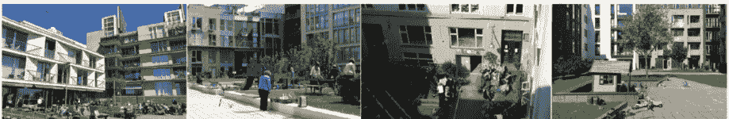

图1. 居民在街区内进行户外活动 [19]。


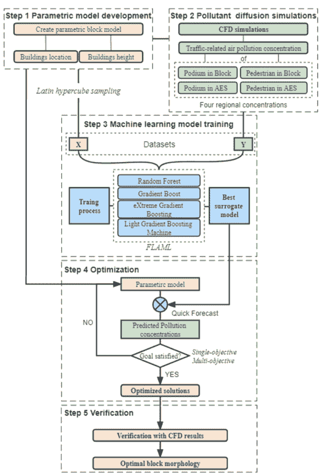

由于街区内建筑位置和高度的组合可能性众多，因此采用了该技术。LHS技术将每个变量的范围划分为相等间隔，并从每个间隔中随机选择一个值[51]。LHS还确保了ML数据的更均匀分布。详细的参数模型设置在第3章第1节中描述。

# 2. Description of framework

本研究提出了一种用于街区设计的优化框架，该框架使用基于计算流体动力学（CFD）模拟数据训练的机器学习（ML）模型。该框架包含五个步骤（图2）：（1）基于建筑高度标准差（BHstd）和街区布局创建参数模型，并使用拉丁超立方抽样（LHS）对案例进行采样；（2）对采样案例运行CFD模拟，并计算目标区域的污染物浓度值；（3）使用ML技术开发污染物浓度的代理回归模型；（4）将ML模型与优化算法相结合，进行单目标和多目标优化；（5）使用CFD模拟验证和分析优化结果。

## 2.1. Step 1: parametric model development and sampling

本研究的第一步是界定所研究的物理问题，并为目标街区和背景建筑创建参数模型。多个设计参数对3D模型进行了约束，以避免因几何不正确或不一致而导致网格或CFD求解器失败[34]。参数模型使用Grasshopper生成，Grasshopper是一种与Rhino软件协同工作的参数化建模平台。Grasshopper允许用户使用算法和数学逻辑创建复杂的街区和建筑。设置了两个指标：目标街区内的建筑位置和高度，以生成满足城市形态参数的街区模型。为了尽可能多地采样街区布局，使用了拉丁超立方抽样（LHS）

## 2.2. Step 2: CFD simulations

在此步骤中，对采样案例进行了CFD模拟，以分析各种条件下与交通相关的空气污染物浓度分布。同时，计算了每个样本四个区域的平均污染物浓度值。CFD模拟结果作为ML模型的数据库。因此，在CFD模拟边界条件设置、探针设置和后处理中，排除了设计参数以外的变量。该设置确保模拟浓度结果仅依赖于关注的参数。本研究中的风环境和污染物模拟基于开源CFD模拟软件OpenFOAM。该软件连接到Grasshopper平台界面，以实现参数化建模、网格生成和CFD模拟过程的自动化。具体的CFD模拟设置在第3章第2节中提供。

## 2.3. Step 3: machine learning model

此步骤涉及使用第一步生成的案例参数和从模拟中获得的浓度指标，分别作为ML的输入变量和目标。数据集根据特定比例分为训练集和测试集。采用了四种模型来进行预测回归，并根据特定指标评估模型的学习效率。回归结果最佳的模型将用作CFD模拟的代理模型。选择由微软研究院开发的快速轻量级AutoML库FLAML来训练这些数据进行回归[52]。FLAML自动化了学习者和超参数的选择。更详细的ML设置在第3章第3节中提供。

## 2.4. Step 4: optimization algorithms

在此步骤中，ML被用作CFD的代理模型，以快速预测交通污染物，并与优化算法相结合，以探索导致较低污染物浓度的街区配置。选择优化目标是为了比较聚焦于不同目标区域所获得结果的相似性和差异性。单目标优化对应于相对局部区域的污染物浓度指标，而多目标优化则是更全局的区域浓度指标。Grasshopper的优化插件Galapagos和Wallacei被用作本文的优化平台。这两个插件都可以与参数化建模相关联。更详细的优化设置在第3章第3节中提供。

## 2.5. Step 5: optimal block morphology

在此步骤中，通过对单目标和多目标优化所获得的最优解进行CFD模拟，验证了优化框架中ML模型的可行性。在局部和全局区域比较了这些最优解的污染物浓度性能。还分析了与优化结果相对应的街区形态对交通相关空气污染物扩散的影响。最后，总结了有利于降低AES内污染物浓度的街区设计策略。详细的最优结果在第4章中提供。

(a) 街区中有5×7个布点，总共有35个可安排建筑的位置。

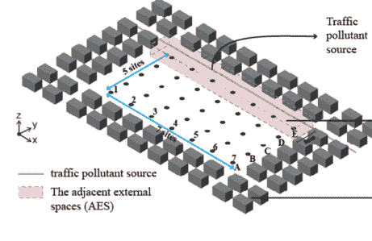

(b) 35个位置中有21个被建筑占据。

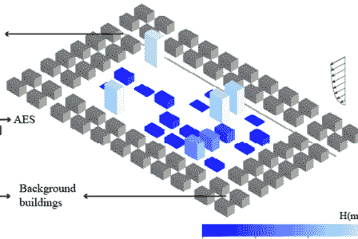

(c) 对照组A

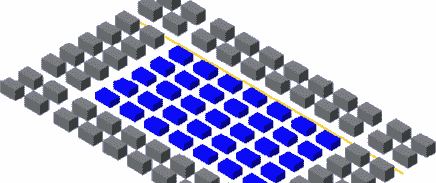

FAR=2.3
Rb_c=0.37
Building height=18.86m
BHstd=0m

(d) 对照组B

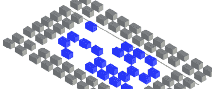

FAR=2.3
Rb_c=0.22
Building height=31.43m
BHstd=0m

(e) 街区和AES的范围。

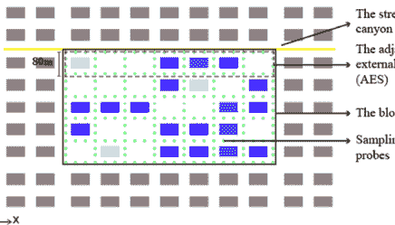

(f) 行人和裙房高度的采样探针

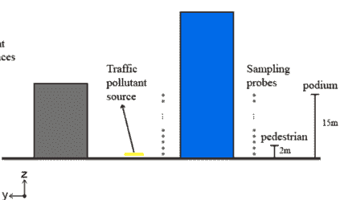

Fig. 3. Parametric model.

# 3. Case study

## 3.1. Parametric model development

实际城市街区的复杂性以及大量形态属性使得难以全面分析形态对污染物扩散的影响[53]。因此，基于街区形态的多样性，需要选择建筑高度标准差特征更明显的街区类型进行讨论。案例研究利用了基于先前研究[28]中武汉住宅街区形态聚类结果之一的街区基本形态设置。这些街区具有相对较大的BH_std，范围从20米到35米。为了考察BH_std和街区布局如何影响交通污染物浓度，模型将FAR和Rb_c分别固定在2.3和0.22，同时改变街区的BH_std从10米到35米。本文计算建筑高度标准差的公式如公式(1)所示[54]：

```
BH_{std} = \sqrt{\frac{1}{n}\sum_{i=1}^{n} (h_i - \bar{h})^2} (1)
```

其中n为目标街区内的建筑数量，本文中为21。h_i为每栋建筑的高度。\bar{h}为街区内建筑的平均高度，为31.43米。街区规模也根据此类街区固定：长边530米，宽边270米。目标街区有35个建筑布置位置（图3a），但仅21个位置被占用（图3b），总建筑面积为330,000平方米，以保持FAR和Rb_c一致。这些建筑布置沿Y轴按A-E编号，沿X轴按1-7编号（图3a）。本研究仅考虑了目标街区内21栋建筑的高度和位置。不同的BH_std对应不同且独特的建筑高度组合，高度限制在3-99米。例如，如果BH_std为28.69米，21栋建筑的高度分别为3、3、3、6、6、9、15、15、18、18、24、24、24、24、33、45、54、78、81、81和96米。一组随机


建筑占用的位置编号也已生成。无建筑的场地被赋予零值；有建筑的场地被赋予其高度值。这些值按场地 ID 排列。这两组数据合并生成了一个 35 维的街区布局参数。

由于这些参数维度较高，对它们全部进行 CFD 模拟具有挑战性。因此有必要对这些参数进行采样。采样方法直接影响代理模型的精度和计算成本 [34]。为了使机器学习模型尽可能多地捕捉样本的多样性，有必要保证街区形态足够丰富。寻找合适的空间填充方法以减少所需模拟次数是设计计算实验中的一个挑战性问题 [55]。本研究采用拉丁超立方采样（LHS）技术生成 1000 个样本作为数据库。LHS 是一种统计方法，用于从多维分布中生成参数值的近似随机样本。该采样方法常用于构建计算机实验或蒙特卡洛积分。尽可能地，本研究 1000 个样本中包含了街区建筑组合的所有模式。这些包括建筑分布更分散或更集中的街区、高层建筑位置不同的街区等（图 S1）。

为了展示建筑高度在污染物扩散中的作用，基于统一建筑高度建立了两个额外对照组。对照组 A 是传统模拟研究中的理想街区，街区内所有场地均被建筑占据，导致 Rb_c 略高，为 0.37。为确保容积率（FAR）与普通情况一致，街区内所有建筑高度均为 18.86 m（图 3c）。另一对照组 B 采用与普通情况相同的建筑布局，但所有建筑高度设为 31.43 m（图 3d）。

研究街区周围环绕着 30 m×50 m×30 m 的背景建筑。为调查车辆排放，交通污染源位于研究街区上风侧街道峡谷内。源位于地面上方 0.3 m 处，宽 2.5 m，覆盖整条街道峡谷。悬挂污染源的设计旨在更接近车辆排气管高度。污染源宽度基于车道宽度设置 [28,56]。与在地面上传统布置线源相比，这种污染源设置方式更贴近实际。使用 CO 作为示踪气体，表示交通污染物的连续均匀释放（图 3e 和 3f）。街区内污染源 80 m 范围内的区域定义为街道峡谷区域，即交通污染最严重的区域 [28]。采样探针均匀分布在街区 0–15 m 高度区域，以调查污染物扩散情况（图 3e 和 3f）。高度为 0–2 m 和 0–15 m 的区域分别定义为行人高度体量和裙房高度体量 [21]。建筑间隙中的采样探针确保计算出的平均污染物浓度不受探针位置干扰，且所有工况的探针数量一致。采样探针根据水平和垂直分布分为四部分：街区内裙房和行人高度范围内的采样探针、AES 内裙房和行人高度范围内的采样探针。各部分采样探针数量分别为 3180、424、900 和 120。

## 3.2. 污染物扩散评估

统计了采样探针的浓度，以比较不同工况下的污染物分布。污染物浓度进行了无量纲化，如参考文献 [57] 所示并如公式 (2) 所述。

$c^* = \frac{U_H H^2}{m}$ (2)

其中，$c^*$ 为无量纲浓度，$\bar{c}$ 为探针处的污染物浓度 [kg/m^3]，$U_H = 2m/s$ 为 H = 10 m 处的参考风速，$m$ 为污染物源排放速率 [kg/s]。所有工况的污染物释放速率一致，根据交通流量和机动车排放设置为 3.7×10^-6 kg/s [58,59]。

本研究计算了四个不同组分采样点处污染物浓度的平均值。街区在裙房体量和行人体量内的平均无量纲浓度分别表示为 C_pod_Block 和 C_ped_Block。同样，C_pod_AES 和 C_ped_AES 分别表示 AES 在裙房体量和行人体量内的平均无量纲浓度。在这些指标中，C_pod_Block 和 C_ped_Block 为全局指标，而 C_pod_AES 和 C_ped_AES 为局部指标。

空气质量指数（AQI）被引入作为评价指标，以评估交通相关空气污染物对各工况的影响。以往研究表明，污染物可渗透至 100 m–200 m 远的社区 [60]。然而，此类发现并未限制会影响人体健康的污染物浓度。因此，本研究提出使用 AQI 来确定会影响居住生活的污染物浓度标准，并权衡污染物在水平和垂直方向的影响范围。

在本研究中，AQI 根据中国环境空气质量标准（HJ633-2012）[61] 简化了一种空气污染物（CO）的浓度进行计算。AQI 已分为不同等级 [62]：I（AQI：0–50）、II（AQI：51–100）、III（AQI：101–150）、IV（AQI：151–200）、V（AQI：201–300）和 VI（AQI：301 以上），分别表示空气质量为优、良、轻度污染、中度污染、重度污染和严重污染，对应公式 (3) 和 (4)：

$IAQI_{Co} = \frac{IAQI_{Hi} - IAQI_{Lo}}{BP_{Hi} - BP_{Lo}} (C_p - BP_{Lo}) + IAQI_{Lo}$ (3)

$AQI = IAQI_{Co}$ (4)

其中，IAQI_Co 为 CO 的空气质量指数，C_p 为采样探针浓度，BP_Hi 表示 CO 的上限 AQI 值，BP_Lo 表示 CO 的下限 AQI 值，IAQI_Hi 为 CO 上限的污染物截断浓度，IAQI_Lo 为 CO 下限的污染物截断浓度。CO 的空气质量指数及相应污染物浓度限值见表 1。

**表 1** CO 的空气质量指数及相应污染物浓度限值。

| IAQI | 0 | 50 | 100 | 150 | 200 | 300 | 400 | 500 |
|---|---|---|---|---|---|---|---|---|
| CO (mg/m^3) | 0 | 2 | 4 | 14 | 24 | 36 | 48 | 60 |

## 3.3. CFD 模型

通过总共进行 1000 次雷诺平均纳维-斯托克斯（RANS）模拟生成了用于机器学习的数据集。CFD 计算域根据日本建筑学会（AIJ）指南 [63] 定义。模型到入流边界的距离为 5H，到出流边界的距离为 15H，到两侧对称边界的距离为 6H。计算域高度为 6H，其中 H 为该工况中最高建筑高度（图 4）。首先使用 blockMesh 工具构建六边形网格来定义计算域和背景网格，然后通过内置 snappyHexMesh 工具进行细化。各工况网格数量在 0.6 百万至 1.5 百万个单元之间变化。

使用 OpenFOAM 5.0 构建并求解了数值模型。基于内置 simpleFoam 求解器开发了自定义求解器 tsSimpleFoam，以包含对流-扩散浓度输运方程。SIMPLE（压力-方程半隐含联合算法）算法在 RANS 方程中数值求解压力场与速度场之间的耦合。

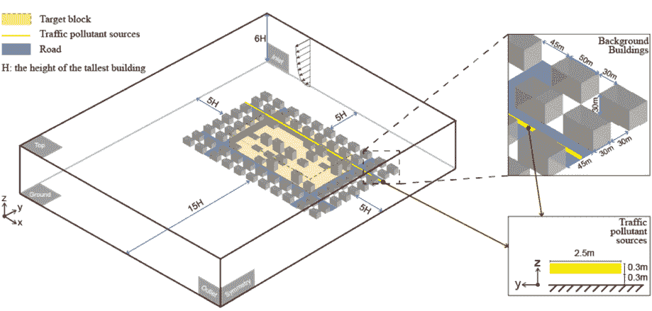

图 4. CFD 计算域。

**表 2** OpenFOAM 中场变量的边界条件。

| 物理量 | U | P | k | ε | νt | CO |
|---|---|---|---|---|---|---|
| 变量 | U | P | k | epsilon | nut | C |
| 入口 | codedFixValue | zeroGradient | codedFixValue | codedFixValue | zeroGradient | zeroGradient |
| 出口 | zeroGradient | fixedValue | zeroGradient | zeroGradient | zeroGradient | zeroGradient |
| 地面 | noslip | zeroGradient | kqRWallFunction | epsilonWallFunction | nutkWallFunction | zeroGradient |
| 建筑 | noslip | zeroGradient | kqRWallFunction | epsilonWallFunction | nutkWallFunction | zeroGradient |
| 源 | zeroGradient | zeroGradient | zeroGradient | zeroGradient | zeroGradient | fixedValue |
| 顶面 | slip | | | | | |
| 左右侧 | symmetry | | | | | |

收敛准则根据残差的变化设定。收敛时，Ux、Uy、Uz、压力、k 和 epsilon 的典型残差达到 10^-3，浓度残差达到 10^-4。RNG k-epsilon 模型被选为湍流模型。

引用文献 [64] 报告的入口剖面被设置为入流边界条件。速度剖面 (U)、湍动能剖面 (k) 和湍流耗散率剖面 (ε) 可定义如下：

U(z) = (U*/κ) * ln((z+z0)/z0)   (5)
k(z) = U*^2 / sqrt(Cμ)   (6)
ε(z) = U*^3 / (κ(z+z0))   (7)

其中，z 表示高度坐标 (m)，z0 为空气动力学粗糙度长度 (m)，κ 为 von Karman 常数 (0.4187)。入口处强加了 10 m 高度处 2 m/s 的风速。U* 为 0.0774 (m/s) 处的大气边界层摩擦速度，Cμ 为常数 (0.09)。

污染物浓度通过求解稳态时间平均对流-扩散方程进行计算：

∂(ρcui)/∂xi = ∂/∂xi (K * ∂c/∂xi) + S   (8)

其中，c 表示污染物浓度。S 表示污染源项。K 为浓度的质量扩散系数，为分子扩散系数 (D) 与湍流扩散系数 (DT) 之和。湍流扩散系数定义如下：

Dt = νt / Sc_t   (9)

其中，Sc_t 为湍流施密特数，在 RANS 模型中为 0.2 至 1.3 之间的常数 [65]。在本研究中，施密特数为 0.4。具体边界条件汇总见表 2。

## 3.4. 验证与网格敏感性

汉堡大学开展的一项风洞实验用于验证 RNG k-ε 湍流模型和近壁面函数。在布拉西乌斯 风洞中，以 1:200 的缩尺测量了矩形建筑模型有限阵列（CEDVAL B1-1）周围的气流与扩散情况。实验模型包含 3 × 7 栋建筑阵列，四个污染源位于一个目标建筑的背风侧。采用欧洲科学技术合作组织（COST）指南推荐的指标来验证模型性能 [66]。矢量速度分量利用命中率 (q) 进行了定量分析，而 FAC2 验证了标量浓度。这些指标可表示如下：

q = N/n = (1/n) * Σ(Ni with Ni) = { 1 for |Pi - Ei| ≤ W; 0 else }   (10)


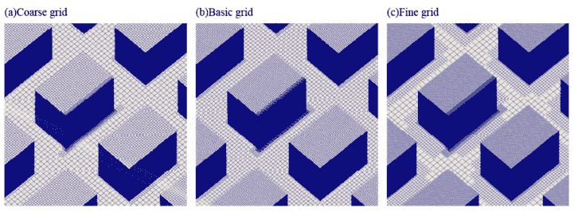

图 5. 用于网格灵敏度分析的不同网格分辨率。

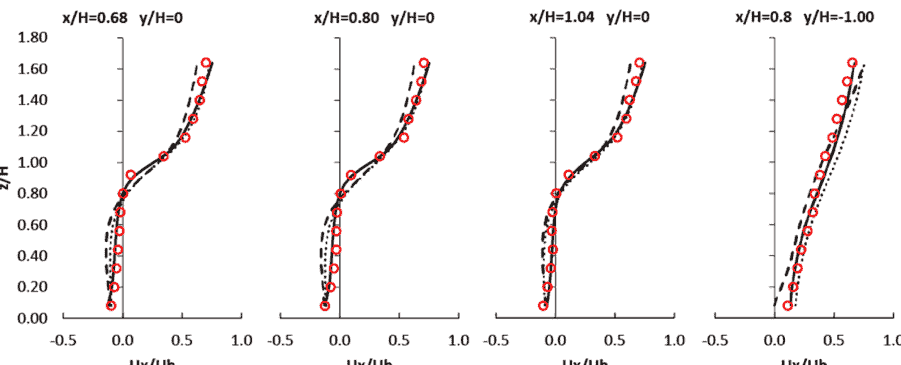

(a) Ux/Uh 分布

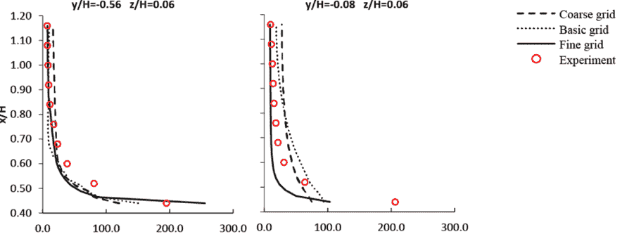

(b) 标量浓度分布

图 6. Ux/Uh 和标量浓度分布。

\(FAC2 = \frac{N}{n} = \frac{1}{n} \sum_{i=1}^{n} N_i \text{with } N_i = \begin{cases} 1 \text{ for } 0.5 \le \frac{P_i}{E_i} \le 2.0 \\ 1 \text{ for } E_i \le W \text{ and } P_i \le W \\ 0 \text{ else} \end{cases}\) (11)

其中，\(E_i\) 和 \(P_i\) 分别为第 \(i\) 个样本给定变量的实验值和预测值；\(N\) 为数据点数量。上划线表示数据集的均值。允许的绝对差值 \(W\) 对 q 设为 0.06，对 FAC2 设为 0.1。质量保证的验收标准为 q \(\ge\) 0.66 且 FAC2 \(\ge\) 0.5。

采用三种不同网格尺寸研究了网格独立性：粗网格（1,095,000 个单元）、基准网格（2,261,000 个单元）和精细网格（3,468,000 个单元）（图 5）。四条垂直线上的 \(U_x/U_h\) 分布和两条水平线上的标量浓度分布如图 6 所示。基准网格与精细网格之间有令人满意的对应关系，表明具有良好的网格独立性，并验证了基准网格在此研究中是适当的。速度的 q 为 0.72，浓度的 FAC2 为 0.67，如

| ML 模型 | 参数 |
|---|---|
| RF | n_estimators, max_depth, max_features, min_samples_split, min_samples_leaf, 和 bootstrap |
| GB | 学习率, n_estimators, alpha, 和 min_samples_leaf |
| XGB | n_estimators, subsample, learning_rate 和 gamma |
| LGBM | num_leaves, learning_rate, max_depth, min_child_samples, subsample, colsample_bytree |

的基准网格中。仿真结果与风洞实验数据一致，表明 RNG k-ε 模型能够很好地预测速度剖面。

## 3.5. 机器学习模型设置

35 维输入街区布局参数及其对应的 BH_std 被用作机器学习模型的输入特征。每个案例使用四个平均浓度值作为标签。1000 个 RANS 案例被随机分为 800 个训练案例和 200 个测试案例，大约相当于 80–20% 的分割。本文选择了四种机器学习模型——随机森林 (RF)、梯度提升 (GB)、eXtreme Gradient Boosting (XGB) 和 Light Gradient Boosting Machine (LGBM) —— 这些模型经过精细调整，以准确预测各区域的污染物浓度。

随机森林 (RF) 回归模型是一种在训练期间构建多个决策树并输出各棵树平均预测的学习方法 [67]。梯度提升 (GB) 是一种用于回归和分类问题的机器学习技术，它生成一组弱预测模型，通常是决策树 [68]。eXtreme Gradient Boosting (XGB) 是一种集成方法，用于训练拟合先前树残差的小深度树。每棵加入树的权重由学习率超参数控制 [69]。Light Gradient Boosting Machine (LGBM) 是一种使用梯度提升创建弱预测模型集成（通常是决策树）的机器学习算法，用于回归任务。它以其处理大型数据集和高维特征的速度和效率而闻名 [70]。

在本研究中，四种回归模型在 FLAML 中同时进行了训练、调优和比较。表 3 列出了每种机器学习方法所探索的参数范围及所使用的最优参数。每种机器学习模型允许的超参数调优最大时间为 300 秒，每个模型均在该时间内满足收敛准则。这些估计器根据四个区域分别进行了四次训练和调优。然后从中选择一个最优模型作为该区域对应的平均污染物浓度预测模型。这种用于预测模型构建的子区域方法可以突出街区空间效应对污染物浓度的异质性，并提高模型预测精度 [47]。

为评估这些机器学习模型，分别分析了测试案例上的均方根误差 (RMSE) 和测试案例的平均 R<sup>2</sup> 值，对应公式 (12) 和 (13)：

\(RMSE = \sqrt{\frac{1}{n} \sum_{i=1}^{n} (c_i - \widehat{c}_i)^2}\) (12)

\(R^2 = 1 - \frac{\sum (\widehat{c}_i - c_i)^2}{\sum (\overline{c_i} - c_i)^2}\) (13)

其中，\(\widehat{c}_i\) 是预测浓度，\(c_i\) 是仿真得到的浓度，\(\overline{c_i}\) 是测试案例上的平均浓度。

## 3.6. 优化求解器设置

表 4 列出了优化参数，即 BH_std 和建筑位置。优化目标是最小化污染物浓度。单目标优化问题中的优化目标是 C_pod,AES，一个局部指标。多目标优化问题的目标是包含全局和局部指标的四个区域的污染物浓度。

本研究采用了两种优化算法：用于单目标优化的遗传算法 (GA) 和用于多目标优化的非支配排序遗传算法 II (NSGA II)（表 4）。GA 算法使用了 50 的种群大小。如果目标值在 20 代内未下降，则认为已收敛。保留率为 10%，近交率为 80% [71]。为确保其他算法的迭代次数与 GA 一致，NSGA II 的种群大小和代数分别限制为 50 和 100。

| 指标 | 单目标优化 | 多目标优化 |
|---|---|---|
| 参数 | BH_std, 建筑位置 | |
| 目标 | C_ped,AES | C_pod,Block, C_pod,AES, C_ped,AES |
| 算法 | GA | NSGA II |
| 种群大小 | 50 | 50 |
| 代数 | 100 | 100 |
| 保留率 | 10% | |
| 近交率 | 80% | |
| 交叉概率 | | 0.9 |
| 交叉分布指数 | | 20 |
| 变异分布指数 | | 20 |
| 随机种子 | | 1 |

# 4. 结果

## 4.1. 采样街区的 CFD 仿真结果

1000 个样本条件的仿真结果表明，全局浓度指标低于局部浓度指标。裙房体积中的平均污染物浓度低于行人体积。C_pod,Block 显著低于 C_ped,AES。本质上，AES 区域中所有样本的归一化平均浓度比街区高 1.5–2.5 倍。对 1000 个案例的四种污染物浓度与 BH_std 和布局参数之间的相关性分析表明，BH_std 与全局指数之间的线性系数相对较高，而与局部指数的相关性较低（图 7）。BH_std 与 C_pod,Block 之间的相关系数为 -0.64，表明 BH_std 与全局污染物浓度存在显著负相关。靠近污染源的建筑行——E 行——都显示出建筑高度与污染物浓度之间的负相关。建筑物越靠近街区内的下风向方向，高度与污染物浓度之间的相关性就越正。然而，街区内建筑高度与所有区域污染物浓度之间的线性相关系数并不高。可以假设，建筑高度和布局与污染物浓度分布之间不存在简单的线性关系。

## 4.2. 机器学习模型性能

表 5 列出了机器学习模型在污染物浓度预测四个区域的 Test R<sup>2</sup> 和 RMSE 性能。测试 R<sup>2</sup>


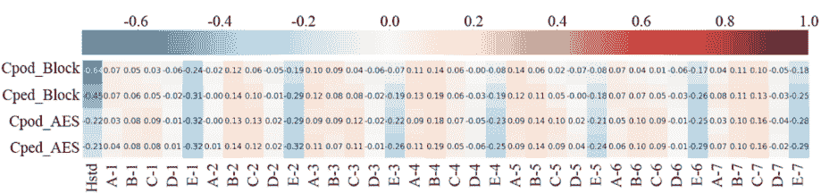

图 7. 浓度指数与街区布局之间的相关性。

表 5
四种 ML 模型的测试 R² 和 RMSE。

| ML 模型 | Cpud_Block R² | RMSE | Cped_Block R² | RMSE | Cpud_AES R² | RMSE | Cped_AES R² | RMSE |
|---|---|---|---|---|---|---|---|---|
| RF | 0.666 | 0.015 | 0.664 | 0.013 | 0.655 | 0.018 | 0.724 | 0.029 |
| GB | 0.700 | 0.009 | 0.708 | 0.010 | 0.732 | 0.013 | 0.786 | 0.030 |
| XGB | 0.811 | 0.006 | **0.859** | **0.007** | **0.837** | **0.009** | 0.848 | 0.023 |
| LGBM | **0.817** | **0.004** | 0.818 | 0.005 | 0.800 | 0.012 | **0.878** | **0.021** |

加粗数值对应最优浓度预测代理模型。

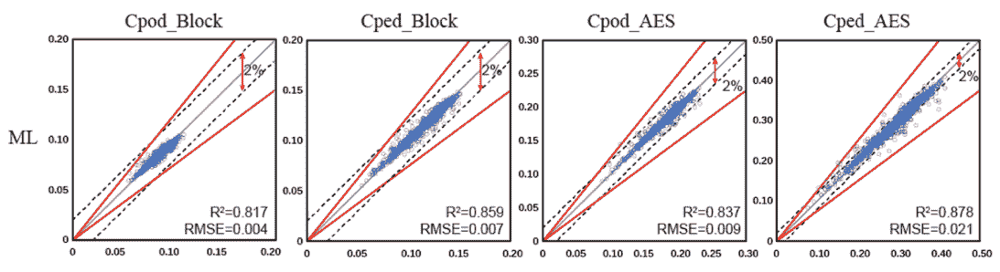

图 8. CFD 值与 ML 模型预测值对比。

XGB 和 LGBM 回归模型的数值均高于 0.8。相比之下，RF 和 GB 表现略差。这四个选定的最优模型的 RMSE 相对较小，均低于 1%，Cped_AES 的 LGBM 回归模型除外，其 RMSE 为 2.1%。因此，Cpod_Block 和 Cped_AES 选择 LGBM 作为代理预测模型，而 Cped_Block 和 Cpod_AES 选择 XGB 作为代理预测模型。

为展示 ML 模型的性能，将这些模型预测的污染物浓度分布与 1000 个样本案例的 CFD 结果进行了对比。图 8 说明了 CFD 模拟值与 ML 模型预测值的对比。1000 个样本的代理模型预测结果误差范围在 2% 以内；因此，代理模型的精度是可接受的。使用 ML 代理模型预测一组 BH_std 和街区布局对应的区域平均污染物浓度仅需几秒钟。相比之下，使用 16 个 CPU 核心的 CFD 模拟过程需 30 分钟或更长时间（表 6）。

## 4.3. 优化结果

单目标和多目标优化均在 100 次迭代内收敛（图 9）。单目标优化的最优结果 Cped_AES 为 0.080，而多目标优化的结果更低，Cped_AES 为 0.035，其他区域的三个浓度值均在 0.03 至 0.05 之间。无论单目标还是多目标，纳入 ML 代理模型的优化框架生成的街区配置污染物浓度均低于 1000 个采样案例。传统的 CFD 模拟优化过程需要超过两个月才能完成如此大量的迭代。相比之下，纳入 ML 代理模型的优化过程仅需 3 小时即可满足此要求（表 6）。

表 6
| | 单个案例 | 与优化算法耦合进行 5000 次迭代 |
|---|---|---|
| CFD | 30 min | 2500 h |
| ML 模型 | 1.5 s | 3 h |

单目标优化中 Cped_AES 最低的前 5 个解列于图 11。比较这五个解的街区配置可发现，BH_std 较高，为 34.38 m。建筑高度和布局相对相似，较高建筑（>80 m）位于靠近街道峡谷污染源的 E 行和 D 行。街区内部建筑高度低于 E 行，大多低于 24 m。分别选取了各区域污染物浓度最低的四个解以及一个更平衡的折中解，用于多目标优化 Pareto 前沿解的比较。与单目标优化相比，多目标优化选择在邻近街道峡谷的行中布置更多高层建筑。多目标优化的这五个结果几乎占据了 E 行的所有场地，除了最小化 Cpod_Block 的结果（M1）外。两个最小化全局目标解的 BH_std 大于单目标优化，为 34.75 m（M1 和 M2），而两个最小化局部目标解的 BH_std 较小，为 34.11 m（M3 和 M4）。然而，总体优化结果的 BH_std 差异不大，均处于优化区间较高的 34–35 m 范围内。

控制组 A 是传统 CFD 模拟研究中常用的理想街区。控制组 B 的平面布局更加多样化，但仍未能反映街区建筑高度的离散程度。优化的街区配置在形态特征上比控制组更接近实际街区。这些街区不仅在平面布局上具有真实街区的复杂性，而且在建筑高度上也表现出街区的非均质性。

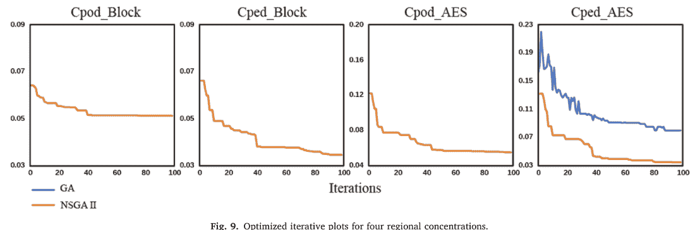

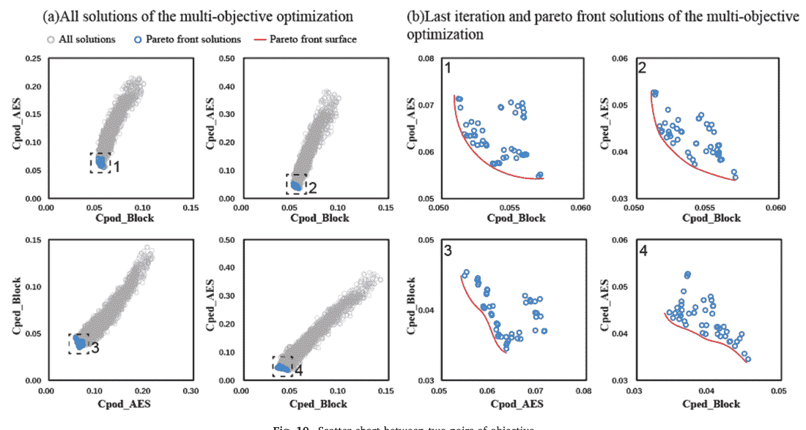

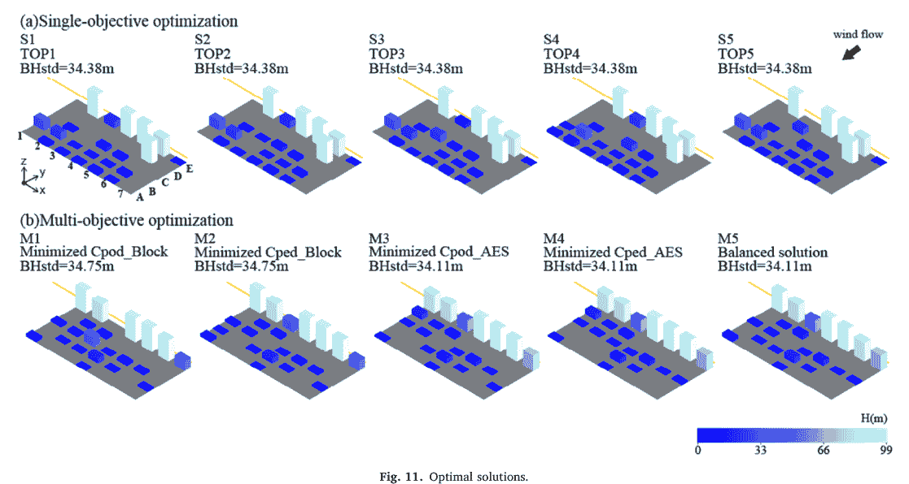

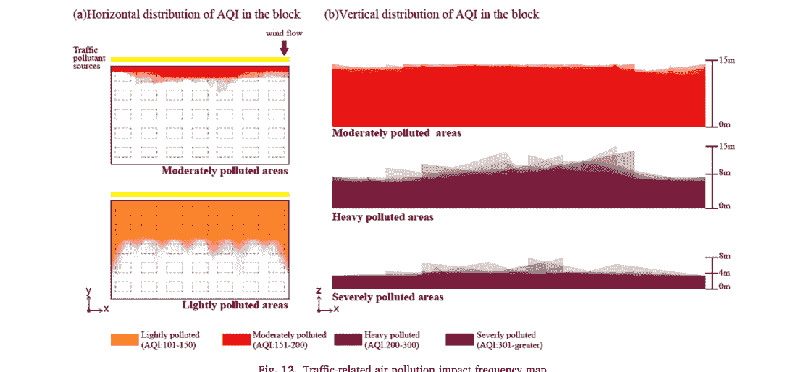

# 5. 讨论

## 5.1. 采样街区的 AQI 分布

对 1000 个样本进行 CFD 模拟后，计算了街区中每个探测点的 AQI。将 AQI 超标的探测点连接起来，形成不同污染程度的区域。每个采样案例的污染区域叠加，形成街区受交通相关空气污染影响范围和频率的地图（图 12）。每种颜色代表污染程度，颜色的透明度代表可能污染的频率。AQI 的水平分布显示，随着距离交通污染源的增加，污染暴露的强度和频率降低。街区一半区域将暴露于轻度污染，AES 的部分区域将处于中度污染（图 12a）。重度和严重污染几乎未进入街区内部，而是沿街道峡谷分布。对 AQI 垂直分布的分析显示，轻度和中度污染区域占据了裙房几乎整个高度。相比之下，重度污染分布在裙房高度中部以下，严重污染分布在底部。图 12b 说明了临近密集交通的街区边缘行人对重度和严重污染的脆弱性。在 AES 中经常在户外活动且居住在五楼以下的居民也容易受到中度和轻度污染的影响。

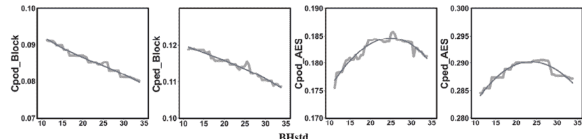

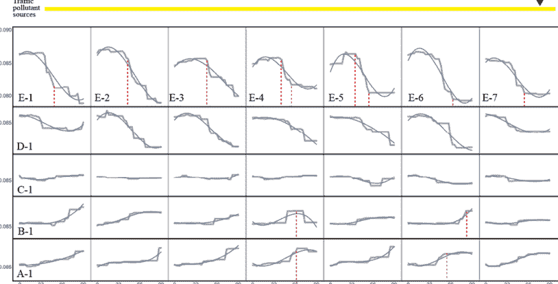

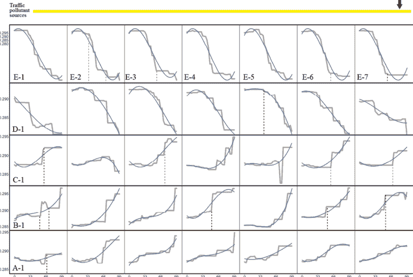

图 13. BH_std 与各场地建筑高度的部分依赖图。

采样案例的 AQI 分布显示，AES 易受轻度和中度污染的影响。尽管 AES 内的污染物浓度低于街道峡谷区域，但 AES 也是居民经常在户外活动的社区区域 [72]。在轻度和中度污染区域进行长时间户外活动，仍会给居民带来更大的交通相关空气污染物暴露风险。长期暴露于轻度污染区域可能会刺激健康人群，因此建议儿童、老年人以及患有心脏和呼吸道疾病的人减少长时间、高强度的户外运动 [61]。因此，需要更多关注 AES 的空气环境，并提出能够改善该区域空气质量的设计策略。

## 5.2. 街区配置对污染物浓度的影响

ML 模型可用于生成部分依赖图，以考察单个变量对污染物浓度的非线性影响。部分依赖图（PDP）常用于解释 ML 模型。它们展示了在考虑所有其他特征平均效应的同时，当某个特征变化时目标预测如何变化 [73]。分别分析了 BH_std 与四个区域污染物浓度指标之间的关系。研究发现，BH_std 对全局和局部指标的影响不相同（图 13a）。与第 4 章第 1 节的结果一致，BH_std 与全局指标 Cpod_Block 和 Cped_Block 几乎呈线性关系。BH_std 越大，街区内的平均污染物浓度越低。这表明，街区内建筑高度错落程度的增加对降低污染物浓度有正面影响 [30,74]。然而，许多实证研究也指出，BH_std 与污染物浓度之间不存在单一的线性关系 [25,28]。也有文献表明，需要讨论 BH_std 正面影响的范围 [54]。在本研究中，BH_std 低于 25 m 反而会导致局部指标的污染物浓度增加。只有当 BH_std 超过 25 m 时，污染物浓度才随其增加而降低（图 13a）。这说明，AES 区域交通污染物浓度影响的缓解并不仅依赖于增加 BH_std。BH_std 对污染物浓度的影响存在空间异质性。

分析街区不同位置的建筑高度与污染物浓度之间的关系，可以解释 BH_std 在全局和局部指标中影响机制的差异。图 13b 和 13c 分别展示了街区不同位置的建筑高度如何影响 Cpod_Block 和 Cped_AES。总体而言，建筑高度对 Cpod_Block 的影响小于对 Cped_AES 的影响。随着位置深入街区内部，建筑高度对这两个区域污染物浓度的影响逐渐减弱。特别是，C 行建筑高度与 Cpod_Block 的回归曲线趋于水平线。这表明，在关注 AES 区域污染物浓度时，仍需审视整体街区的建筑配置。A 行和 B 行建筑的影响趋势不尽相同，但高度增加会导致 Cpod_Block 略微上升。C 行建筑对 Cpod_Block 影响较小，但与 Cped_AES 存在更显著的正相关。A、B 和 C 行建筑与 Cped_AES 呈正相关。建筑高度增加会导致 Cped_AES 显著增长，尤其是当该区域建筑高度大于 66 m 时。可以观察到，E 行和 D 行的建筑高度与两个区域的污染物浓度呈负相关。E 行建筑高度对全局和局部指标的影响趋势也非常一致。两个污染物浓度指标先保持高位不变，随后随建筑高度增加而急剧下降，直至达到临界点，之后保持不变。唯一的区别可能是这两个拐点出现的位置。导致 Cpod_Block 快速下降的 E 行建筑高度范围在 40 至 60 m 之间，而导致 Cped_AES 下降的区间范围略广，为 33 至 66 m。这说明，需要一定高度（至少 33 m）的临街建筑作为屏障，阻挡街道峡谷中的交通相关空气污染物进入街区。不同位置建筑高度对污染物浓度影响的差异，解释了全局和局部浓度指标之间的权衡。这也解释了为什么优化这两个污染物浓度指标会产生 Pareto 前沿解。总体而言，临街道峡谷处的建筑越高，街区内部的建筑越低，越有利于防止污染物进入街区。

表 7
优化解集的 CFD 模拟结果及与对照组的比较。

(a) 单目标优化

| 解 | S1 | S2 | S3 | S4 | S5 |
|---|---|---|---|---|---|
| Cpod_Block | 0.049 | 0.049 | 0.047 | 0.047 | 0.045 |
| Cped_Block | 0.043 | 0.043 | 0.041 | 0.040 | 0.040 |
| Cped_AES | 0.079 | 0.078 | 0.075 | 0.075 | 0.078 |
| Cpod_AES | 0.061 | 0.061 | 0.060 | 0.058 | 0.063 |
| 与对照组 A 对比 ΔC=(Ccontrol A-C)/Ccontrol A | | | | | |
| ΔCpod_Block | 51% | 52% | 54% | 54% | 56% |
| ΔCped_Block | 71% | 71% | 72% | 73% | 73% |
| ΔCpod_AES | 60% | 61% | 62% | 62% | 61% |
| ΔCped_AES | 83% | 84% | 84% | 84% | 83% |
| 与对照组 B 对比 ΔC=(Ccontrol B-C)/Ccontrol B | | | | | |
| ΔCpod_Block | 57% | 58% | 59% | 59% | 60% |
| ΔCped_Block | 72% | 73% | 74% | 74% | 74% |
| ΔCpod_AES | 60% | 60% | 62% | 59% | 61% |
| ΔCped_AES | 82% | 82% | 83% | 82% | 82% |

(b) 多目标优化

| 解 | M1 | M2 | M3 | M4 | M5 |
|---|---|---|---|---|---|
| Cpod_Block | 0.050 | 0.050 | 0.056 | 0.056 | 0.056 |
| Cped_Block | 0.047 | 0.043 | 0.052 | 0.052 | 0.051 |
| Cpod_AES | 0.077 | 0.072 | 0.090 | 0.089 | 0.088 |
| Cped_AES | 0.065 | 0.049 | 0.049 | 0.073 | 0.070 |
| 与对照组 A 对比 ΔC=(Ccontrol A-C)/Ccontrol A | | | | | |
| ΔCpod_Block | 50% | 51% | 45% | 44% | 44% |
| ΔCped_Block | 68% | 71% | 65% | 65% | 65% |
| ΔCpod_AES | 61% | 64% | 55% | 55% | 56% |
| ΔCped_AES | 82% | 86% | 80% | 80% | 81% |
| 与对照组 B 对比 ΔC=(Ccontrol B-C)/Ccontrol B | | | | | |
| ΔCpod_Block | 56% | 56% | 51% | 50% | 48% |
| ΔCped_Block | 70% | 72% | 67% | 66% | 66% |
| ΔCpod_AES | 61% | 64% | 54% | 54% | 54% |
| ΔCped_AES | 81% | 86% | 78% | 78% | 79% |

## 5.3. 优化结果的 CFD 模拟分析

单目标优化的前五个解分别通过 CFD 进行了单独模拟。所得 Cped_AES 排名与 ML 模型预测略有偏差。如表 7a 所示，最初预测 Cped_AES 排名最低的 S1，在五个案例中实际模拟浓度排名第四。最初预测 Cped_AES 较高的 S4，在模拟结果中表现最佳，浓度最低为 0.056。将优化结果与对照组 A 进行比较，所有结果均使 Cped_AES 降低了 83% 以上，Cpod_Block 降低了至少 50%。为确定 BH_std 在稀释街区内污染物浓度中的作用，建立了与五组优化结果对应的具有同质高度的控制组 B。与控制组 B 相比，S3 表现最佳，全局和局部指标分别降低了 59%、74%、62% 和 84%。这表明，BH_std 在降低此街区配置的污染物浓度方面更为关键。

同样，五组多目标优化结果通过 CFD 进行了模拟。最低污染物浓度出现在


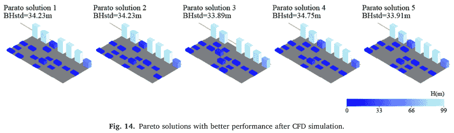

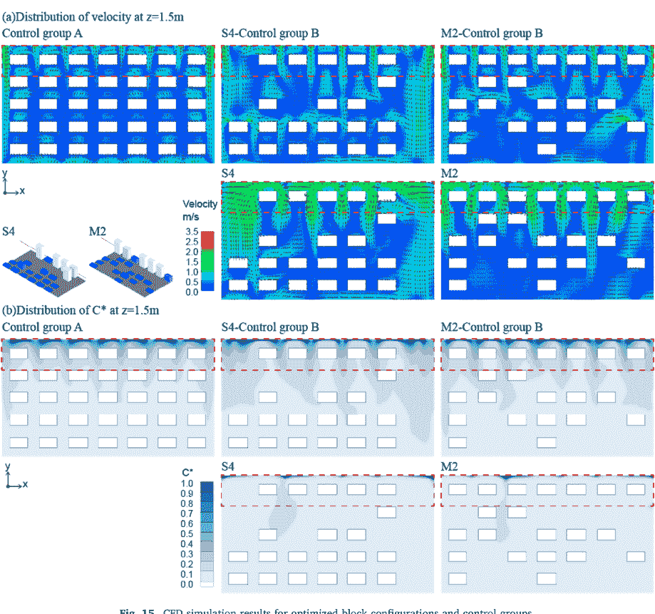

情形 M2（表 7b）。这一结果也与 ML 模型对各区域最小污染物浓度的预测有所不同，但总体差异不显著，约为 0.02。与对照组 A 和 B 相比，M2 同样表现最佳，C_pod-Block 减少了 51% 以上，C_ped-AES 减少了 86%。多目标优化的帕累托解均通过 CFD 进行了模拟，并从模拟得到的较低污染物浓度值的五个案例中在图 14 中选取了结果。与图 11b 对比发现，通过 CFD 模拟得到的优秀解集与 ML 模型预测的结果在街区形态上并不相差太远。综合策略均将高层建筑布置在污染源相邻区域，将低层建筑布置在街区中部和后部。尽管 ML 模型在预测极值点时存在一些误差，但仍在可接受范围内。ML 模型与优化算法相结合的框架，仍探索出了更多有效的设计策略，以降低交通污染对 AES 和街区的影响。

利用案例 S4 和 M2 分别作为单目标和多目标优化结果的代表，探讨了街区配置对交通污染物扩散的影响机制（图 15）。与对照组 A 相比，对照组 B 在街区内部具有更高的风速，这是由于街区的 Rbc 较低（图 15a）。

### (a)等值面 C*=0.1、C*=0.5、C*=1
对照组 A

### S4-对照组 B

### M2-对照组 B

### (b)污染物流线
对照组 A

### S4-对照组 B

### M2-对照组 B

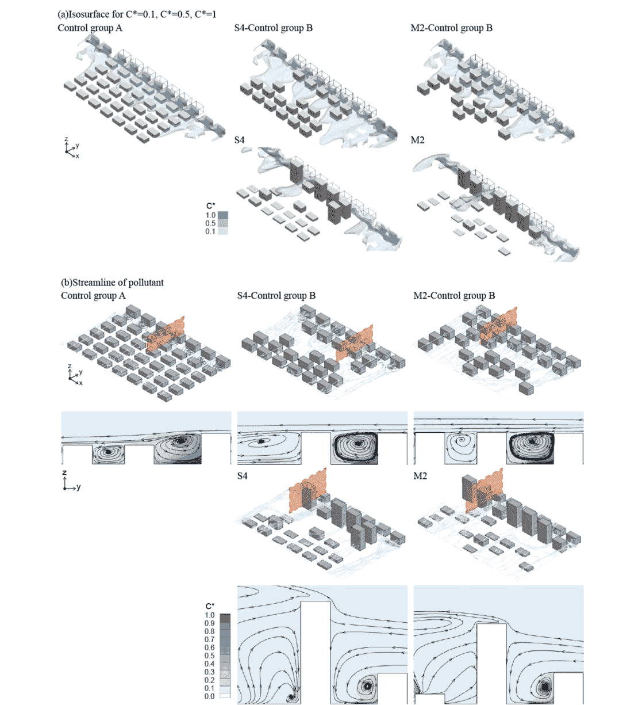

### 图 16. 优化街区配置与对照组的污染物扩散。

然而，这也导致污染物在街道内部向街区内部的后续扩散，以及 AES 中行人高度（z = 1.5 m）处污染物浓度的增加（图 15b）。这说明仅依靠街区平面布局来缓解交通污染物对 AES 的影响是不切实际的。在优化街区平面布局时，需要考虑建筑高度的变化。

图 15a 显示，靠近街道的高层建筑形成了强烈的峡谷效应 [75]，街道内的风速大幅增加。与对照组 A 和 B 相比，AES 的风速也显著增加。然而，这两种情况下的风速增加并未导致污染物向街区内部的加速扩散（图 15b）。这是因为面向街道的高层建筑在背风侧形成了与主导风向相反的气流，并随流体阻止污染物进一步进入街区。S4 与 M2 的比较分析表明，案例 S4 的 AES 区域污染程度高于 M2，但 M2 街区内部的静风区相对更大，可能导致行人活动不舒适。原因可能是 M2 街道侧的 E 排全部被建筑占据，使得洁净空气难以穿过建筑间隙流通。先前的研究还表明，BHstd 可能会显著增强较高建筑产生的阻力并增加动量通量，同时通过平均流减少污染物稀释能力，但增强城市区域内的湍流特性 [30,76]。由于平均流和湍流扩散都有助于城市区域的污染物去除，因此 BHstd 可能会削弱或增强通风能力。

如图 16a 所示，当 BHstd = 0 时，街道中的污染物可以越过建筑屋顶翻滚进入街区（对照组 A），或穿过街区迎风面第一排建筑间隙进入街区（对照组 B）。当 BHstd > 34 m 且迎风建筑为一排高层建筑时，由于建筑迎风面形成了巨大的涡流，污染物难以进入街区。与对照组 A 和 B 相比，两个优化案例中的污染物并未在街道峡谷内积聚，而是随横向 3D 涡流扩散到目标街区的两侧。优化案例的结果表明，污染物通过 E–2 和 E–3 建筑之间的间隙进入街区。由于 E–3 建筑较低，污染物可以从屋顶翻滚进入 AES。当单目标优化侧重于 Cped,Block 时，街区构建保护 AES 免受污染物积聚，但忽略了污染物进一步向街区内部扩散。与 S4 相比，M2 的 E 排占据了更多的建筑。可以推测，这是因为该多目标优化过程中对全局和局部指标有更全面的关注。

本文中对 BHstd 的讨论仍基于与街道峡谷垂直的风向。然而，一些文献表明，大角度环境风向（例如 30° 和 45°）会增加建筑阻力，并比小角度将更多动能转化为湍动能。因此，大角度通常会降低 3D 城市型几何中的污染物扩散能力 [77]。当占主导的风向与街道峡谷的夹角时，能够减轻污染物对 AES 影响的街区形式值得在未来工作中探讨。同时，调整数据集大小并调参以更好地与优化算法耦合，可以进一步提高 ML 模型对污染物浓度的预测精度。城市设计中的其他因素也可以加入优化目标以供未来工作讨论，例如采光和热舒适度，以得出哪种街区形式更有利于居民活动。

# 6. 结论

本文对不同 BHstd 和布局的大量街区配置案例进行了采样和 CFD 模拟，以获得与街区形式和交通空气污染物扩散相关的数据集。基于 ML 方法，该数据集生成了用于污染物浓度预测的代理模型。通过 ML 模型与优化算法的结合，本研究总结了降低 AES 和街区污染物浓度的各种形态策略。本文的主要结论如下。

对在此区域进行户外活动的人群来说，与交通相关的空气污染物。

- 街区内建筑高度标准差（BHstd）高于 33 m 可有效降低 AES 中的污染物浓度。优化结果表明，将高层建筑布置在污染源相邻区域并使低层建筑后退，是减少污染物向街区扩散的合理策略。与建筑高度均质化布局相比，该策略可将 AES 区域的污染物浓度降低至少 48%，街区污染物降低 86%。

- 街道上的 40–60 m 建筑高度可防止污染物进入街区。街区内下风侧建筑越高，越容易导致污染物积聚。因此，建筑高度应控制在 60 m 以下。建筑高度对 AES 区域平均污染物浓度的影响大于街区。当关注 AES 区域的污染物浓度水平时，仍有必要审视整个街区的建筑配置。

- 无论优化目标侧重于全局还是局部指标，都可能导致不同的优化策略。在街区污染物扩散问题研究中，关注区域的变化可能导致结论的差异。

- ML 可将 CFD 模拟加速至少 800 倍。采用本研究中 CFD、ML 和优化算法的工作流，可以高效解决城市设计中的多因素、多变量决策问题，这可以为城市规划师和建筑师提供一些参考。

# CRediT 作者贡献声明

Yunni Wu：撰写初稿。Hong Chen：审阅与编辑。

# 竞争利益声明

作者声明，没有已知的竞争性财务利益或个人关系可能影响本文所报道的工作。

# 数据可用性

应要求可提供数据。

# 致谢

本研究得到中国国家自然科学基金会（编号 51778251）的支持。数值计算在合肥先进计算中心进行。

# 附录 A. 补充数据

本文的补充数据可在线查阅：https://doi.org/10.1016/j.buildenv.2023.110587。

# 参考文献

- [1] 世界卫生组织，《WHO 全球空气质量指南：颗粒物（PM2.5 和 PM10）、臭氧、二氧化氮、二氧化硫和一氧化碳》，2021 年。

- [2] G. Bowatte 等，《交通相关空气污染与哮喘及低肺功能的发生发展和持续》，环境国际期刊，113（2018 年 4 月）170–176，https://doi.org/10.1016/j.envint.2018.01.028。

- [3] A.G. Ribeiro 等，《巴西圣保罗呼吸道癌症的发病率和死亡率与交通相关空气污染》，环境研究，170（2019 年 3 月）243–251，https://doi.org/10.1016/j.envres.2018.12.034。

- [4] Maryam Shekarrizfard 等，《多种暴露指标对交通相关空气污染与乳腺癌和前列腺癌风险影响的研究》，交通健康期刊，11（2018 年）34–46，https://doi.org/10.1016/j.jth.2018.09.006。


- [5] X. Wu 等, 城市北京道路边空气污染物的长期表征及相关公共卫生影响, 环境研究 212 (2022年9月), https://doi.org/10.1016/j.envres.2022.113277.

- [6] C.J. Matz, M. Egyed, R. Hocking, S. Seenuudn, N. Charmon, N. Edmonds, 交通相关空气污染 (TRAP) 对人类健康的影响：一份范围综述方案, 系统评论 8 (1) (2019年8月29日), https://doi.org/10.1186/s13643-019-1106-5. 生物医学中心有限公司.

- [7] N. Hilker 等, "道路附近的交通相关空气污染：辨别局部影响与背景", doi: 10.5194/amt-2019-112.

- [8] R.E. Ducret-Stitch, M.Y. Tsai, M.S. Ragettli, A. Ineichen, N. Kuenzli, H.C. Phuleria, 瑞士阿尔卑斯山谷中高速公路交通对空气污染物空间时序分布的作用, 科学总环境 456 (457) (2013年7月) 50-60, https://doi.org/10.1016/j.scitotenv.2013.03.065.

- [9] S.V. Liu, F. Lin Chen, J. Xue, 基于浓度衰减率的选定近路空气污染物的Meta分析, Heliyon 5 (8) (2019年8月), https://doi.org/10.1016/j.heliyon.2019.e02236.

- [10] T. Ming 等, 基于场协同理论的城市街道峡谷污染物扩散评估, 大气污染研究 12 (2) (2021年2月) 341-356, https://doi.org/10.1016/j.apr.2020.11.015.

- [11] T. Ming 等, 街道峡谷中污染物扩散的流体协同分析及通过增加捕风塔进行优化, 建筑模拟 14 (2) (2021年4月) 391-405, https://doi.org/10.1007/s12273-020-0720-4.

- [12] Z. Li 等, 城市地区污染物扩散综述—部分A：机械因素和城市形态的影响, 建筑环境 190 (2021年3月1日), https://doi.org/10.1016/j.buildenv.2020.107534. 艾尔维尔有限公司.

- [13] J. Shen, Z. Gao, W. Ding, Y. Yu, 基于六个现实案例的街道形态对环境空气质量影响的调查, 大气环境 164 (2017) 85-101, https://doi.org/10.1016/j.atmosenv.2017.05.047.

- [14] R. Buccolieri, A.P.R. Jeanjean, E. Gatto, R.J. Leigh, 树木对中央伦敦Marylebone Rd街道峡谷不同高度街道通风、NOx和PM2.5浓度的影响, 可持续城市与社会 41 (2018年8月) 227-241, https://doi.org/10.1016/j.scs.2018.05.030.

- [15] D. Voordeckers, F.J.R. Meeysmans, P. Billen, T. Tytgat, M. Van Acker, 街道峡谷形态和交通量对安特卫普街道峡谷中NO2值的影响, 建筑环境 197 (2021年6月), https://doi.org/10.1016/j.buildenv.2021.107825.

- [16] S. Yousefian, M. Pourjafar, M. Moshfeghi, 和 M. Mahdaviniejad, "使用CFD评估城市峡谷方向对气流模式和CO扩散的影响（德黑兰个案研究）."

- [17] X. Huang, H. Wang, L. Gao, 3D街道峡谷中气流和扩散的数值模拟：大气温度分层的影响, 环境技术, 英国, 2022, https://doi.org/10.1080/09593330.2022.2036247.

- [18] L. Ehrnsperger, O. Klemm, 城市街道峡谷中的空气污染：来自高分辨率交通信息和气象学的新见解, 大气环境X 13 (2022年1月), https://doi.org/10.1016/j.aeaoa.2022.100151.

- [19] David Sim, 软城市：日常生活的建筑密度, 岛屿出版社, 2019.

- [20] Y. Peng, Z. Gao, R. Buccolieri, J. Shen, W. Ding, 典型住宅街道的城市通风及建筑形式变化的影响, 可持续城市与社会 67 (2021), https://doi.org/10.1016/j.scs.2021.102735.

- [21] M. Liu, H. Chen, D. Wei, Y. Wu, J. Li, 基于移动测量和梯度提升决策树模型的城市形态与街道层PM2.5和CO的非线性关系, 建筑环境 205 (2021年11月), https://doi.org/10.1016/j.buildenv.2021.108265.

- [22] F. Trindade da Silva, N.C. Reis, J.M. Santos, E.V. Goulart, C. Engel de Alvarez, 城市街区拓扑对污染物扩散的影响, 风工程与工业空气动力学杂志 210 (2021), https://doi.org/10.1016/j.jweia.2021.104524.

- [23] A.M. Hassan, A.A. Elmakadem, N.A. Megahed, O.M. Abo Elenein, 城市形态作为促进室外空气质量的被动策略, 建筑工程杂志 29 (2020年5月), https://doi.org/10.1016/j.jobe.2020.101204.

- [24] F. Trindade da Silva, N.C. Reis, J.M. Santos, E.V. Goulart, C. Engel de Alvarez, 城市街区拓扑对污染物扩散的影响, 风工程与工业空气动力学杂志 210 (2021), https://doi.org/10.1016/j.jweia.2021.104524.

- [25] M. Liu, H. Chen, D. Wei, Y. Wu, J. Li, 基于移动测量和梯度提升决策树模型的城市形态与街道层PM2.5和CO的非线性关系, 建筑环境 205 (2021), https://doi.org/10.1016/j.buildenv.2021.108265.

- [26] L. Chen, J. Hang, M. Sandberg, L. Claesson, S. Di Sabatino, H. Wigo, 理想化城市模型中建筑高度变化和建筑密度对流场调整和城市透气性的影响, 建筑环境 118 (2017年6月) 344-361, https://doi.org/10.1016/j.buildenv.2017.03.042.

- [27] Z. Jiang, H. Cheng, P. Zhang, T. Kang, 城市形态参数对空气污染物分布和扩散的影响：中国个案研究, 环境科学（中国） 105 (2021年7月) 163-172, https://doi.org/10.1016/j.jes.2020.12.035.

- [28] Y. Wu, H. Chen, 基于空间形态聚类的不同住宅街区交通污染物扩散, 建筑环境 228 (2023年1月), https://doi.org/10.1016/j.buildenv.2022.109860.

- [29] C. Huang 等, 基于移动监测和机器学习的高密度城市街区城市形态对空气污染分布的影响, 建筑环境 219 (2022年7月), https://doi.org/10.1016/j.buildenv.2022.109173.

- [30] J. Hang, Y. Li, M. Sandberg, R. Buccolieri, S. Di Sabatino, 建筑高度变异对理想化高层城市地区污染物扩散和行人通风的影响, 建筑环境 56 (2012) 346-360, https://doi.org/10.1016/j.buildenv.2012.03.023.

- [31] D. Wei, X. Hu, Y. Chen, B. Li, H. Chen, 城市空间形态指标与街区风环境定量相关性的研究, 大气 12 (2) (2021年2月), https://doi.org/10.3390/atmos12020234.

- [32] Y. Peng, Z. Gao, R. Buccolieri, W. Ding, 城市形态参数与室外通风效率指数定量相关性的研究, 大气 10 (1) (2019年1月), https://doi.org/10.3390/atmos10010033.

- [33] F. Trindade da Silva 等, 大气扩散与城市规划：城市建模的一种跨学科方法, 可持续城市与社会 70 (2021), https://doi.org/10.1016/j.scs.2021.102882.

- [34] M. Shirzadi, Y. Tominaga, 行人层风环境的多保真形状优化方法, 建筑环境 204 (2021年10月), https://doi.org/10.1016/j.buildenv.2021.108076.

- [35] K. Javanroodi, V.M. Nik, B. Adl-Zarrabi, 城市地区气候适应性建筑形式设计的多目标优化框架, 载于：IOP会议系列：地球与环境科学, IOP出版有限公司, 2020年11月, https://doi.org/10.1088/1755-1315/588/3/032036.

- [36] H. Rahimbakhsh, M.E. Kohansal, A. Tarkashvand, M. Faizi, M. Rablar, 利用NSGA-II的早期设计阶段自然监视和隐私的多目标优化, 自动化建设 143 (2022年11月), https://doi.org/10.1016/j.autcon.2022.104547.

- [37] Z. Kaseb, M. Rabbah, 面向基于CFD的城市风况优化：遗传算法、粒子群优化和混合算法的比较, 可持续城市与社会 77 (2022年2月), https://doi.org/10.1016/j.scs.2021.103565.

- [38] S.S. Wang, Y.K. Yi, N.X. Liu, 中国以采光、视觉和室外热指标为中心的高层住宅建筑布局多目标优化 (MOO), 建筑环境 205 (2021年11月), https://doi.org/10.1016/j.buildenv.2021.108263.

- [39] R. Ooka, H. Chen, S. Kato, 使用多目标遗传算法和对流、辐射及传导耦合模拟设计宜人室外环境的树木最佳布局研究, 风工程与工业空气动力学杂志 96 (10-11) (2008年10月) 1733-1748, https://doi.org/10.1016/j.jweia.2008.02.039.

- [40] B. Xia, Z. Li, 基于性能分析的中尺度城市形态设计优化方法：以住宅城市街区为例, 可持续城市与社会 64 (2021年1月), https://doi.org/10.1016/j.scs.2020.102489.

- [41] Yongyu Hu, Yunlong Peng, Zhi Gao, Fusuo Xu, 集成到城市和建筑设计平台的CFD插件用于性能模拟的应用：文献综述, 建筑研究前沿 12 (148-174) (2022), https://doi.org/10.1016/j.foar.2022.06.005.

- [42] Z. Kaseb, M. Hafezi, M. Tahbaz, S. Delfani, 城市地区行人层风况改进框架：CFD模拟与优化, 建筑环境 184 (2020年10月), https://doi.org/10.1016/j.buildenv.2020.107191.

- [43] Z. Li 等, 城市地区污染物扩散综述—部分B：局部缓解策略、优化框架和评价理论, 建筑环境 198 (2021年7月1日), https://doi.org/10.1016/j.buildenv.2021.107890. 艾尔维尔有限公司.

- [44] J. Kudela, R. Matousek, 有限元法计算中代用模型的最新进展和应用：综述, 软计算 26 (24) (2022年12月1日) 13709-13733, https://doi.org/10.1007/s00500-022-07362-8. 施普林格商业媒体德国有限公司.

- [45] Y. Du, C.M. Mak, Y. Li, 确定架空层设计以实现最佳风舒适性的多变量优化方法应用, 建筑环境 131 (2018年3月) 242-254, https://doi.org/10.1016/j.buildenv.2018.01.012.

- [46] Y. Wu, Q. Zhan, S.J. Quan, Y. Fan, Y. Yang, 面向微气候敏感型城市设计实践的代用辅助优化框架, 建筑环境 195 (2021年5月), https://doi.org/10.1016/j.buildenv.2021.107661.

- [47] K. Hashad 等, 使用机器学习设计道路边绿色基础设施以缓解交通相关空气污染, 科学总环境 773 (2021年6月), https://doi.org/10.1016/j.scitotenv.2020.144760.

- [48] K. Hashtad 等, "辅助信息：使用机器学习设计道路边绿色基础设施以缓解交通相关空气污染."

- [49] D. Panchigar, K. Kar, S. Shukla, R.M. Mathew, U. Chadha, S.K. Selvaraj, 基于机器学习的CFD仿真：综述、模型、公开威胁与未来策略, 神经计算与应用 34 (24) (2022年12月1日) 21677-21700, https://doi.org/10.1007/s00521-022-07838-6. 施普林格商业媒体德国有限公司.

- [50] D. Kochkov 等, 机器学习加速的计算流体动力学, 2023, https://doi.org/10.1073/pnas.2101784118/-/DCSupplemental.y.

- [51] M.D. McKay, R.J. Beckman, W.J. Conover, 计算机代码输出分析中输入变量值选择三种方法的比较, 技术计量 42 (1) (2000) 55-61, https://doi.org/10.1080/00401706.2000.10485979.

- [52] C. Wang, Q. Wu, M. Weimer, E. Zhu, FLAML：一个快速轻量级AutoML库, 2019年11月 [在线]. 可用：http://arxiv.org/abs/1911.04706.

- [53] M. Zhang 等, 中国南京典型住宅街区类型及其对夏季行人层微气候影响的调查, 建筑研究前沿 11 (2) (2022年4月) 278-296, https://doi.org/10.1016/j.foar.2021.10.008.

- [54] Y. Shi, X. Xie, J.C.H. Fung, E. Ng, 使用移动监测识别高密度建成环境中街道层空气污染物扩散的关键建筑形态设计因素, 建筑环境 128 (2018年1月) 248-259, https://doi.org/10.1016/j.buildenv.2017.11.043.

- [55] M. Shirzadi, P.A. Mirzaei, M. Naghashzadegan, 开发自适应流出系数以提高交叉通风气流精度


- 建筑能源模拟工具中的计算，Build. Environ. 127 (2018年1月) 277–290, https://doi.org/10.1016/j.buildenv.2017.10.019.

- [56] Y. Xiong, H. Chen, 遮阳板对车辆污染物扩散和室内空气质量的影响：等温和非等温条件的比较，Build. Environ. 197 (2021年6月), https://doi.org/10.1016/j.buildenv.2021.107854.

- [57] S. Nosek, V. Fuksa, L. Kukacka, Z. Klučáková, Z. Janouř, 街道峡谷污染与城市空气复杂性：侧向和平均污染通量的作用，Build. Environ. 138 (2018年6月) 221–234, https://doi.org/10.1016/j.buildenv.2018.04.036.

- [58] W.Y. Ng, C.K. Chau, 街道和建筑配置对孤立深层城市峡谷中个人空气污染物暴露影响的建模调查，Sci. Total Environ. 468 (469) (2014年1月) 429–448, https://doi.org/10.1016/j.scitotenv.2013.08.077.

- [59] J. Hang, Z. Luo, X. Wang, L. He, B. Wang, W. Zhu, 理想化城市峡谷中街道布局和高架桥设置对日常一氧化碳暴露和吸入分数的影响，Environ. Pollut. 220 (2017年1月) 72–86, https://doi.org/10.1016/j.envpol.2016.09.024.

- [60] X. Guo, M. Zhang, Z. Gao, J. Zhang, R. Buccolieri, 交通相关PM2.5的邻域尺度扩散：南京九个典型住宅案例的模拟，Sustain. Cities Soc. 90 (2023年3月), https://doi.org/10.1016/j.scs.2023.104393.

- [61] 中华人民共和国生态环境部，环境空气质量指数技术规定，2012年。

- [62] C. Miao, S. Yu, Y. Zhang, Y. Hu, X. He, W. Chen, 城市街道峡谷中室外空气质量的垂直评估及其对微气候因素的响应，J. Environ. Sci. (China) 124 (2023年2月) 923–932, https://doi.org/10.1016/j.jes.2022.02.021.

- [63] Y. Tominaga, 等，围绕建筑物行人风环境中CFD实际应用的AJJ指南，J. Wind Eng. Ind. Aerod. 96 (10–11) (2008) 1749–1761, https://doi.org/10.1016/j.jweia.2008.02.058.

- [64] P.J. Richards, R.P. Hoxey, 使用k-e湍流模型的计算风工程模型的适当边界条件，J. Wind Eng. Ind. Aerod. 46 (47) (1993年8月) 145–153, https://doi.org/10.1016/0167-6105(93)90124-7.

- [65] Y. Tominaga, T. Stathopoulos, 各种流场CFD分析的湍流Schmidt数，Atmos. Environ. 41 (37) (2007年12月) 8091–8099, https://doi.org/10.1016/j.atmosenv.2007.06.054.

- [66] M. Schatzmann, 欧洲科学基金会，中尺度气象模型质量保证Cost Action 732国际研讨会论文集/研讨会，与欧洲科学基金会在汉堡联合举办，2005年。德国，7月28/29日。

- [67] A. Cutler, D.R. Cutler, J.R. Stevens, 随机森林，载于：集成机器学习，Springer US，波士顿，MA，2012年，第157–175页，https://doi.org/10.1007/978-1-4419-9326-7_5.

- [68] J.H. Friedman, 贪婪函数逼近：梯度提升机，1999年。

- [69] T. Chen, C. Guestrin, XGBoost：可扩展的树提升系统，载于：ACM SIGKDD知识发现与数据挖掘国际会议论文集，计算机协会，2016年8月，第785–794页，https://doi.org/10.1145/2939672.2939785.

- [70] J. Yan, 等，LightGBM：通过集成学习加速基因设计的作物育种，Genome Biol. 22 (1) (2021年12月), https://doi.org/10.1186/s13059-021-02492-y.

- [71] S. Sangwan, A. Dahiya, 遗传算法文献综述，研究国际期刊。2018年[在线]。可用：https://edupediapublications.org/journals.

- [72] H. Zhang, M. Han, 英文和中文文献中的口袋公园：综述，城市森林与城市绿化。61（2021年6月1日），https://doi.org/10.1016/j.ufug.2021.127080. Elsevier GmbH.

- [73] C. Molnar, T. Freiesleben, G. König, G. Casalicchio, M.N. Wright, B. Bischl, 将部分依赖图和排列特征重要性与数据生成过程相关联 [在线]。可用：http://arxiv.org/abs/2109.01433，2021年9月。

- [74] L. Chen, J. Hang, M. Sandberg, L. Claesson, S. Di Sabatino, H. Wigo, 理想化城市模型中建筑高度变化和建筑密度对流场调整和城市透气性的影响，Build. Environ. 118 (2017年6月) 344–361, https://doi.org/10.1016/j.buildenv.2017.03.042.

- [75] W.J. Farrell, L. Devile Cavelin, S. Weichenthal, M. Goldberg, M. Hatzopoulou, 利用空间分析工具捕捉大型道路网络中城市峡谷效应对颗粒物数浓度的影响，Build. Environ. 92 (2015年10月) 328–334, https://doi.org/10.1016/j.buildenv.2015.05.004.

- [76] Z.L. Gu, Y.W. Zhang, Y. Cheng, S.C. Lee, 非均匀街道峡谷中不均匀建筑布局对气流和污染物扩散的影响，Build. Environ. 46 (12) (2011) 2657–2665, https://doi.org/10.1016/j.buildenv.2011.06.028.

- [77] J. Hang, M. Sandberg, Y. Li, L. Claesson, 不同城市形态理想化城市模型中污染物扩散，Atmos. Environ. 43 (38) (2009) 6011–6025, https://doi.org/10.1016/j.atmosenv.2009.08.029.

