# 利用人工智能和元启发式算法优化边缘与雾计算应用


雾计算和边缘计算是两种新兴的范式，旨在解决物联网（IoT）时代数据处理和管理面临的挑战。这两种模型都涉及将计算和数据存储移动到更靠近数据源的地方，但在架构和应用范围上存在细微差异。这些差异是*使用人工智能和元启发算法优化边缘与雾计算应用*一书中涵盖的主题之一。书中涵盖的其他主题还包括：

- 设计感知边缘和雾层资源约束的机器学习（ML）算法，以确保计算资源的高效利用
- 使用机器学习和深度学习模型的资源感知模型，这些模型可以根据可用资源调整其复杂度并平衡负载，从而实现更好的可扩展性
- 实现安全的机器学习算法和模型，以防止对抗攻击并确保数据隐私
- 加固边缘设备、雾节点与云之间的通信通道，以保护模型更新和推理过程
- 跨 Kubernetes 容器编排，用于在多个边缘设备上进行雾模型训练，而无需共享原始数据

书中讨论了雾计算和边缘计算中的资源优化对于实现数据源端的高效、有效处理至关重要。它解释了雾计算和边缘计算如何增强系统性能、降低延迟并提高整体资源利用率。它研究了所需的智能算法、有效通信协议和动态管理策略的结合，以适应不断变化的条件和工作负载需求。书中解释了雾计算和边缘计算的安全性需要技术措施、先进技术、用户意识和组织政策的结合，以有效保护数据和系统免受不断演的安全威胁的侵害。最后，书中展望了未来，涵盖了正在进行的研究，这对于完善优化技术以及确保雾计算和边缘计算环境的可扩展性和可持续性至关重要。

**Madhusudhan H S** 是印度密斯苏鲁 Vidyvardaka 工程学院计算机科学与工程系的副教授。

**Punit Gupta** 是印度古吉拉特邦潘迪迪迪塔尔能源大学（Pandit Deendayal Energy University）计算机与通信工程系的副教授。

**Dinesh Kumar Saini** 是印度雅加浦马尼帕尔大学（Manipal University）计算与信息学院的全教授。


## 主编

Madhusudhan H S 是印度 Vidyvardaka 工程学院计算机科学与工程系的副教授。他在国际期刊和会议上发表过研究论文，包括 SCI 索引和 Scopus 索引期刊。他的研究领域包括云计算、人工智能、机器学习和计算机网络。他拥有印度卡纳塔克邦维斯韦瓦拉亚科技大学（VTU）的智能与机器学习博士学位。

Dinesh Kumar Saini 拥有计算机科学博士学位、软件系统硕士学位以及印度顶尖大学之一 BITS Planani（拉贾斯斯坦邦）的技术硕士学位。Dinesh Kumar Saini 是印度雅加浦马尼帕尔大学（Manipal University）计算与信息学院计算机与通信工程系的教授。Dinesh Kumar Saini 在印度大学（如 BITS Planani）及海外拥有丰富的学术经验——作为教授、研究人员和管理者，在高等教育和中等教育领域拥有卓越的领导力。他曾担任阿曼苏哈大学计算与信息技术学院院长。自 2008 年以来，他担任苏哈大学的副教授，并在 2010 年至 2015 年担任澳大利亚昆士兰大学的兼任副教授和研究员。他还担任了10多年的商业信息技术系创始人协调人和系主任。他凭借名为“建模人类”的文章荣获 2018 年 Emerald Literati 奖。


发表在《泛在计算与通信国际期刊》上的“疏散过程中的群效应影响因素”。除了通过不同的可量化指标恰当衡量的学术成就（例如：ResearchGate 评分 36.36、Google 引用次数 1858 次、H 指数: 19 以及 i10 指数: 42），Dinesh Kumar 博士相信团队精神，因此通过鼓励和支持同事及青年教师在期刊上发表论文和参加会议，不断增强和巩固了学院的研究能力建设。这在他与学院同事合作的若干出版物中可见一斑。他为了学术目的访问了美国、英国、法国、德国、奥地利、阿联酋、澳大利亚、俄罗斯、巴林和沙特阿拉伯，并在这些发达国家的大学中学到了许多良好实践。

## 贡献者

- Swathi B. H.
计算机科学与工程系
Vidyavaradhha 工程学院
印度卡纳塔克邦，迈索尔

- Manisha Gupta
拉贾斯坦邦女子工程学院
印度拉贾斯坦邦，斋浦尔

- Deepti Bhat
计算机科学与工程系
Vidyavaradhha 迈索尔学院，印度卡纳塔克邦，迈索尔

- Pratik Gupta
Jaypee 工程技术大学
印度米雅普普拉邦，古纳，拉加哈尔-维杰贾普

- Ansh Chauhan
计算机科学与工程系
Vidyavaradhha 迈索尔学院，印度卡纳塔克邦，迈索尔

- Punit Gupta
计算机科学系
印度甘提纳加尔 Pandit Deendayal 能源大学以及爱尔兰都柏柏林国立学院计算学院

- Kavitha D. N.
计算机科学与工程系
Vidyavaradhha 迈索尔学院，印度卡纳塔克邦，迈索尔

- Yash Jain
计算机科学与工程系
Jaypee 工程技术大学
印度米雅普普拉邦，古纳大学，拉加哈尔-维杰贾普

- Arbaz Adib Dalwai
计算学院
爱尔兰都柏柏林国立学院

## 贡献者

- Shivani Jaswal
爱尔兰都柏柏林国立学院计算学院

- Rajkumar Nagulsamy
爱尔兰都柏柏林国立学院计算学院

- Harshitha Kamal Kannan
Vidyavardhaka 工程学院计算机科学与工程系
印度卡纳塔克邦，迈索尔

- Anirudh Negi
计算学院
DIT 大学
印度乌达拉坎德邦，德拉杜恩

- Gayana J. Kumar
计算机科学与工程系
Vidyavardhaka 工程学院
印度卡纳塔克邦，迈索尔

- Sahil Raj
计算学院
DIT 大学
印度乌达拉坎德邦，德拉杜恩

- Pradeep Kumar Rawat
计算学院
DIT 大学
印度乌达拉坎德邦，德拉杜恩

- Nidhi Kushwaha
国立技术学院
印度贾姆德浦

- Chirashi S.
计算机科学与工程系
Vidyavardhaka 工程学院
印度卡纳塔克邦，迈索尔

- Priyanshi Mishra
Jaypee 工程技术大学
印度米雅普普拉邦，古纳大学，拉加哈尔-维杰贾普

- Bhavna Saini
拉贾斯坦中央大学
拉贾斯坦邦，阿杰梅尔

- Devadathi N.
计算机科学与工程系
Vidyavarardhaka 工程学院
印度卡纳塔克邦，迈索尔

- Saanch Sapra
Jaypee 信息技术大学
印度希马恰普尔邦，瓦克纳哈特

- Chiranth Nagaprasadanna
计算机科学与工程系
Vidyavarardhaka 工程学院
印度卡纳塔克邦，迈索尔

- Bharat Singh
印度信息技术学院
印度贾尔坎邦，兰奇

## Nayana Singh
Jaypee 信息技术大学
印度希马恰普尔邦，瓦克纳哈特

## Prateek Kumar Soni
Jaypee 信息技术学院
印度北方普拉德邦，诺伊达

## Shristi Sonam

## Rohit Verma
Jaypee 信息技术大学
印度希马恰普尔邦，瓦克纳哈特
爱尔兰国立学院计算学院
爱尔兰，都柏柏林

## Vivek Kumar Verma
曼尼帕尔斋浦尔大学
印度拉贾斯坦邦，斋浦尔


## 第1章

## 雾与边缘计算中的资源优化简介

Pratik Gupta 和 Prateek Kumar Soni

雾计算和边缘计算中的资源优化涉及计算、存储和网络资源的有效分配、管理和利用。对于以下方面至关重要：

- 性能增强：雾和边缘计算中的资源优化对于需要快速响应的实时应用（如自动驾驶汽车和医疗监测）至关重要。通过在靠近源头处理数据，任务延迟降低，确保更快的决策。优化的任务调度、负载均衡和对时间敏感负载的优先级排序进一步增强了响应能力。通过并行处理、动态资源供给和数据聚合技术实现了高吞吐量，使系统能够高效处理大量数据。这些优化共同确保了实时应用以最小的延迟和最大的效率无缝运行。
- 能源效率：能效在雾和边缘计算中至关重要，特别是对于电池供的边缘设备。通过优化资源使用并尽量减少不必要的计算或数据传输，可以降低能量消耗。任务卸载技术（将计算转移到能效的雾节点）以及低功耗硬件的使用可以延长电池寿命。此外，动态资源缩放和感知感知调度确保边缘设备仅在需要时才消耗能量，平衡了性能需求与功率效率。这种优化有助于延长边缘设备的寿命并降低运营成本。
- 成本降低：在雾和边缘计算中，通过高效的资源利用降低成本，即对计算、存储和网络资源进行优化分配和管理。通过避免过度供给和利用率不足，机构可以最小化基础设施成本。动态扩展等技术允许按需配置资源，确保在任何时候只使用必要的量。当本地处理效率低下时，将任务卸载到雾节点或云节点，进一步降低了维护高性能边缘设备的成本。这种方法确保了资源得到有效利用，降低了资本支出和运营开支。
- 可扩展性：雾和边缘计算确保系统能够容纳日益增的设备和应用程序而不牺牲性能。通过动态供给资源并将工作负载分布在多个边缘和雾节点上，系统能够适应不断增长的需求。有效的资源管理策略（如负载均衡和弹性缩放）确保了新设备或应用程序的顺利集成。这种扩展性确保了即使网络扩大，性能也能保持一致，防止出现瓶颈并为所有连接设备维持高吞吐量和低延迟。
- 服务质量 (QoS)：满足不同应用程序的特定需求，包括可靠性、延迟和带宽。在雾和边缘计算中，QoS 确保具有独特需求的各种应用程序获得适当的服务水平。QoS 管理解决了实时应用的低延迟、关键系统的高可靠性以及数据密集型任务的高带宽需求。通过流量优先级、动态资源分配以及实施高效的路由和调度，QoS 确保应用程序符合其特定的性能指标。这种方法有助于各种用例（从医疗和工业监测到自动系统）无缝运行，确保网络在不损害服务质量的情况下处理不同类型的需求 [1]。

### 主要挑战

- 1. 异构性：雾和边缘环境涉及具有不同计算能力、存储和能量限制的多样化设备。


### 资源优化简介 ■ 3

雾计算和边缘环境的特点是具有多种计算能力、存储容量和能量限制各异的设备。这些环境通常包含资源丰富的设备（如强大的边缘服务器）和资源受限的设备（如物联网 (IoT) 或移动设备）的混合。这些设备的异构性为高效管理工作负载、确保数据处理针对可用资源进行优化，以及在不断变化的能量限制下维护系统可靠性带来了挑战 [2–5]。因此，解决方案必须具有自适应和扩展性，以适应雾网和边缘网络中设备的多样化特征及其特定的运行需求。

- 2. 动态工作负载：实时应用产生波动的工作负载，需要自适应资源分配。

实时应用通常会产生波动的工作负载，这在很大程度上取决于用户需求、环境变化或系统状况等因素。这些应用包括流媒体、游戏和自动系统，需要以最小的延迟对数据进行及时处理。为了确保最佳性能，需要对计算能力、存储和网络带宽等资源进行动态分配，并实时调整以满足这些工作负载的需求。这种适应性对于防止瓶颈、保持响应能力和高效利用资源至关重要，因为系统必须快速应对工作负载强度的预期和突发性波动。

- 3. 资源限制：边缘设备的计算能力和存储通常少于云数据中心。

边缘设备靠近数据源或终端用户，与中心化的云数据中心相比，其计算能力、存储容量和能量资源较少。这些设备旨在执行本地处理和分析，但也受到处理速度有限、内存较小和电力受限等限制。云数据中心受益于稳健的基础（包括强大的服务器和海量的存储网络），而边缘设备必须在这些限制内高效运行。因此，在边缘管理资源分配需要精细的优化，在性能和能耗之间取得平衡，同时确保关键任务可以在不严重依赖云资源的情况下执行。

- 4. 地理分布：设备分散在各个位置，增加了资源协调和任务调度的复杂性。

在雾和边缘计算环境中，设备通常地理上分布在不同的地点，从城市中心到偏远或农村地区不等。这种广泛的分布增加了资源协调和任务调度的复杂性，因为它引入了网络延迟、带宽限制和资源可用性差异等挑战。任务的分配不仅要取决于设备的能力，还要取决于它们与数据源、用户位置或特定区域需求的接近程度。


## 4 使用 AI 优化边缘和雾计算应用

高效管理这些分布式资源需要智能调度和负载均衡算法，这些算法能够考虑到地理分布，确保任务在可以高效完成的地方进行处理，最大限度地减少延迟并优化整个网络的资源使用 [6]。

- 5. 安全与隐私：在不使资源受限设备过载的情况下，确保数据传输和计算的安全。
在资源受限的设备上确保数据传输和计算的安全，需要在强大的加密方法和高效的资源管理之间取得平衡。可以使用轻量级加密算法，例如椭圆曲线密码学 (ECC) 或轻量级对称密码，在减少计算开销的同时保持强大的安全性。此外，数据可以在传输前在设备上进行本地加密，仅在接收端解密，以确保隐私。针对低功耗优化协议并利用边缘计算或分布式处理，可以进一步减轻资源受限设备的压力，使其能够在不牺牲性能或安全的情况下安全地处理敏感数据。

- 1. 卸载：根据资源可用性和应用需求，决定在本地、雾层或云端处理任务 [1, 7, 8]。
任务卸载是一个策略性决策过程，根据资源可用性、网络状况和应用需求等因素，将任务动态分配到不同的计算层——本地设备、雾节点或云端。当低延迟和快速响应至关重要时，优先选择本地处理；而雾端通过提供更接近用户的计算资源提供了折中方案，在不使本地设备过载的情况下降低延迟。云端对于资源密集型任务或需要大规模数据处理和存储的情况是最的，尽管可能会由于网络传输引入较高的延迟。通过考虑计算能力、能量效率和实时需求等因素，任务卸载确保了资源的有效利用和最佳的系统性能。

- 2. 负载均衡：在设备之间分配工作负载以防止瓶颈并确保高效利用。
负载均衡涉及将工作负载分配到多个设备或资源上，以防止单一设备过载，从而避免瓶颈并确保可用资源的高效利用。通过根据处理能力、当前工作负载、网络状况等因素智能分配任务，负载均衡有助于保持一致的系统性能、最小化延迟并最大化吞吐量。在具有多种计算资源的系统（如边缘设备、雾节点和云服务器）中，有效的负载均衡可确保没有单一层或设备被过载，同时优化整体效率、减少延迟并提高应用的响应能力 [9]。

- 3. 感知计算：设计在不影响性能的情况下最小化能耗的算法。
感知计算涉及设计在不损害性能的前提下优化能耗的算法和系统。通过智能管理处理能力、减少不必要的操作或将任务卸载到更具能量效率的层（例如雾或云），感知计算算法旨在平衡能量效率与所需的性能水平。这种方法在移动、物联网和边缘计算环境中至关重要，在这些环境中能量资源有限，设备必须长时间运行而不频繁充电。通过负载均衡、硬件级优化和自适应处理，感知计算有助于延长设备电池寿命，同时确保应用程序有效运行。

- 4. 缓存与数据放置：优化数据存储和检索以减少延迟和带宽使用。
缓存和数据放置涉及策略性地将数据存储在优化访问速度并减少网络资源需求的地方。通过将经常访问的数据放置在更靠近用户或中间节点（如边缘或雾服务器）的位置，缓存可以最大限度地减少延迟，并减少从远程存储位置（如云）重复检索数据。有效的数据放置进一步确保数据存储在访问效率最高，考虑了使用模式、资源可用性和网络状况等因素。这种方法不仅加速了数据检索，还通过减少网络传输的数据量降低了带宽使用，提升了整体系统性能和用户体验 [10, 11]。

- 5. 人工智能 (AI) 与机器学习：利用预测模型根据历史和实时数据动态自适应资源分配 [10–15]。
资源分配中的人工智能和机器学习涉及使用预测模型，根据历史数据和实时状况动态调整资源。通过分析过去使用情况、系统性能和环境因素的模式，这些模型可以预测未来需求并优化


相应地分配资源。例如，机器学习算法可以预测何时会需要大量的计算资源或何时能耗会发生激增，从而允许系统预先分配资源或调整流程以保持效率。这种自适应方法确保了资源的最优利用，减少了浪费，提高了性能，并通过对实时变化的条件做出智能响应增强了用户体验。

### 1.3 应用

#### 智慧城市：为交通管理、监控和废物管理等应用优化资源。

智慧城市利用雾计算和边缘计算来优化交通管理、监控和废物管理等关键应用的资源。通过在更接近数据源的地方处理数据，这些技术降低了延迟，实现了实时决策并增强了系统的响应能力。例如，交通管理系统可以动态调整以缓解拥堵，监控系统可以分析视频以进行即时威胁检测，而废物管理可以根据垃圾桶的实时水平来优化收集计划。这种本地化的数据处理提升了运营效率，减少了资源浪费，并改善了城市生活质量。

#### 医疗保健：增强远程健康监测和诊断系统的性能。

在医疗保健领域，雾计算和边缘计算通过在更接近患者和医疗提供者的地方处理数据，增强了远程健康监测和诊断系统的性能。这降低了延迟，实现了生命体征的实时分析、异常的早期检测以及更快的决策。例如，可穿戴设备可以持续监测患者健康，并将关键数据传输到附近的服务器进行即时分析，向医疗专业人员报警潜在问题。此外，诊断系统可以在本地处理和共享医学成像数据，最大限度地缩短诊断和治疗的延迟。这种本地化方法改善了患者预后，优化了资源利用，并支持提供及时且个性化的医疗保健服务。

#### 工业物联网 (IIoT)：管理工业自动化和预测性维护中的资源。

在工业物联网中，雾计算和边缘计算在管理工业自动化和预测性维护资源方面发挥着至关重要的作用。通过在边缘处理数据，这些技术最小化了延迟，并实现了对机器和系统的实时监控。例如，制造设备上的传感器可以持续收集性能并在本地进行分析，在故障发生前检测到潜在问题，从而减少停机时间。同样，自动化系统可以根据本地数据做出快速响应，以优化生产流程。这种方法不仅提高了运营效率，还延长了设备的使用寿命并降低了维护成本，使行业更具韧性和成本效益。

#### 自动驾驶汽车：降低实时决策和数据处理的延迟。

在自动驾驶汽车中，雾计算和边缘计算对于降低实时决策和数据处理的延迟至关重要。这些技术允许车辆直接在车载或附近的边缘服务器上处理大量的传感器数据，例如来自摄像头、激光雷达 (LiDAR) 和雷达的信息。这种本地化处理确保了对动态驾驶状况（如障碍物、穿过交通流或应对突发危险）的快速响应。例如，当行人意外穿过马路时，边缘计算允许车辆立即处理传感器数据并执行刹车，而无需依赖远端云服务器。通过最小化延迟，雾计算和边缘计算增强了安全性，提高了导航效率，并支持自动驾驶系统在现实环境中的可靠运行。

雾计算和边缘计算中的资源优化在满足现代应用需求方面起着作用。通过应对挑战并采用有效策略，这些范式释放了它们的全部潜力，以支持广泛场景。

### 1.4 雾与边缘计算中的资源优化：详细概述

雾计算和边缘计算中的资源优化对于解决这些分布式环境带来的独特挑战至关重要，这些环境将计算、存储和网络带到了物联网设备等数据源旁。通过最小化延迟，这些范式增强了应用性能，实现了实时响应和高效运营。然而，边缘设备的有限计算能力、动态网络条件以及能效与性能需求的平衡，需要创新的资源优化技术。有效策略确保这些系统能够充分发挥潜力，支持多样化的延迟敏感型应用，同时克服分布式架构固有的复杂性。

雾计算和边缘计算将计算、存储和网络移动到更靠近数据源（如物联网设备）的地方，以降低延迟并提高应用性能。

然而，这些分布式环境带来了独特的挑战，需要有效的资源优化技术。

- 1. 资源优化的挑战

- 资源优化中的挑战

- a. 异构性
异构性是雾计算和边缘计算中最具挑战性的问题之一。异构性意味着在计算能力、存储容量和可用可用方面存在差异。为了有效管理这种异构环境中的资源，优化策略需要关注以下方面：

- i. 计算能力（例如物联网传感器与边缘服务器）。
边缘计算环境中的设备计算能力差异巨大。例如：

- 物联网传感器：这些设备主要用于数据收集，通常配备低功耗处理器。

- 边缘网关：虽然比传感器强大，但与云服务器相比，其计算资源有限。这意味着需要大量计算能力的任务（如 AI 模型训练、大规模分析和视频处理）必须被简化、在多个设备间分布或卸载到附近的云节点。挑战在于如何在保持低延迟和高可靠性的同时，智能地分配或卸载任务。

- ii. 存储容量（例如低容量边缘节点与中心化数据中心）。
设备的存储能力差异显著：

- 低容量边缘节点：许多边缘节点只能缓存短期的数据，这对于实时或近实时应用是足够的，但对于长期存储则不足。

- 中心化数据中心：它们拥有海量存储资源，非常适合归档和分析。有效的存储优化策略需要决定哪些数据在边缘缓存，哪些传输到云端，哪些丢弃。

- iii. 能量可用性（例如电池供电设备与市电节点）。
能量限制是异构环境中的一个关键因素：

- 电池供电设备：许多物联网传感器和边缘设备依靠电池，这使得能效成为首要任务。这些设备必须在性能和节能之间取得平衡，以延长其使用寿命。

- 市电节点：连接电源的设备（如边缘服务器和网关）可以执行更耗能的操作，而无需担心电池耗尽。资源优化策略必须考虑设备的能量特征，优先考虑电池供电节点的节能运行，同时最大化市电设备性能。


## 使用 AI 优化边缘和雾计算应用

通过数据重要性、访问频率和存储可用性，在不影响性能的情况下优化存储使用率。

vi. 与其他设备或云端通信时的带宽限制。

带宽限制严重影响了边缘设备与其他设备或云端通信的能力。关键挑战包括：

- **连接性限制**：许多边缘环境依赖无线网络，这些网络可能面临带宽有限、延迟或间歇性连接的问题。
- **数据传输成本**：从边缘设备向云端传输大量数据可能昂贵且低效，特别是对于需要高频更新的应用而言。
- **网络拥塞**：随着连接设备数量的增加，带宽限制可能导致网络拥塞，从而导致延迟和性能下降。为了缓解这些挑战，资源优化必须侧重于通过数据压缩、智能数据过滤和本地处理等技术来减少发送到云端的数据量。

b. 动态负载
IoT 应用会产生不可预测的、波动的负载。在 IoT 应用中，负载会根据众多连接设备的各种任务和事件而发生不可预测的波动。动态平衡这些负载对于防止某些设备过载而其他设备处于低利用率状态至关重要。这需要对每个设备的容量进行实时监控，并相应调整任务分配，以确保资源的最优利用防止性能问题。适当的平衡可以提高效率、降低延迟、增强可靠性并优化能量消耗（特别是电池供电设备），使整个 IoT 系统更具响应且更可靠。在设备之间平衡任务对于在防止节点过载的同时利用其他节点至关重要 [11, 17]。

c. 地理分布
雾和边缘节点在地理上是分散的，使得协调和资源共享具有挑战性。随着节点之间距离的增加，网络延迟也会增加，导致数据通信延迟。此外，数据传输成本往往随距离增加，因为跨越长网络发送信息需要更多资源。这些因素使得在雾和边缘计算环境中高效管理负载并在地理分散的设备之间保持快速、高效的通信变得困难。网络延迟和数据传输成本随距离增加。

d. 能量效率

IoT 系统中的许多边缘设备受到能量限制，通常依赖有限的电池电运行。为了确保可持续的长期功能，实施优化使用的的功率感知算法至关重要。这些算法动态管理设备活动，调整处理负载并最大限度地减少不必要的数据传输，在保持性能的同时帮助节能。通过优先考虑能量效率，这些算法延长了设备寿命，减少了频繁充电或更换的需求，并对 IoT 系统的可持续性做出贡献。许多边缘设备受到能量限制，依靠功率感知算法确保可持续运行。

e. 安全与隐私

在 IoT 系统中，在边缘处理的数据包含敏感信息，使得安全和隐私成为首要任务。然而，在资源受限的边缘设备上实施加密等稳健的安全措施面临巨大挑战，因为这些设备的处理能力、内存和能量都有限。在强加密需求与边缘设备限制之间平衡，需要不损害设备性能或电池寿命的轻量级安全算法。这种微妙的平衡对于在维护 IoT 网络功能和效率的同时确保数据隐私至关重要。边缘处理的数据包含敏感信息。在不负载资源受限设备的情况下加密等安全措施是一个巨大的挑战。

## 2. 优化技术与策略

a. 任务卸载

定义：任务卸载涉及根据资源可用性将任务从资源受限的边缘设备传输到更强大的雾节点或云数据中心，以帮助优化性能。

目标：任务卸载的主要目标是最小化：

- **延迟**：通过在靠近数据中心的更强大的节点上执行任务来减少延迟。
- **能量消耗**：将计算密集型任务卸载到具有更高能量资源的设备，从而保护边缘设备的电池寿命。

任务卸载的方法：

1. 全卸载：
- **描述**：所有任务都发送到雾节点或云数据中心执行。
- **收益**：最大化了雾/云环境中的计算能力和资源，确保任务被快速处理而不给边缘设备带来过负担。
- **缺点**：增加了网络流量和数据传输成本，整个任务必须传输到远程服务器。如果节点之间距离较远，延迟可能会成为问题。

部分卸载：
- **描述**：将任务分为若干部分，部分部分在边缘设备上本地执行，其他部分卸载到雾/云节点。
- **收益**：在本地处理和卸载之间取得平衡，在需要时利用云/雾资源优化边缘设备的资源利用。
- **缺点**：增加了任务管理以及本地与远程组件之间同步的复杂性。

b. 负载均衡

定义：负载均衡涉及将负载分布到多个节点上，以确保没有单个节点变得过载。

负载均衡技术：

1. 轮询调度：
- **描述**：按顺序分配任务，每个节点接收等份额的工作。
- **收益**：实现简单，并确保任务的均匀分布。
- **缺点**：未考虑节点的当前负载或容量，可能导致效率低下。

2. 基于优先级的调度：
- **描述**：对具有较高 QoS 要求的任务给予优先考虑。
- **收益**：保证关键任务最先处理，优化系统性能。
- **缺点**：低优先级任务可能会遇到延迟，导致任务分配不平衡。

3. 动态分配：
- **描述**：根据对资源的实时监控（例如 CPU、内存和带宽）来分配任务。
- **收益**：通过根据实际系统负载不断调整任务分配，实现资源利用的最大化。
- **缺点**：需要更复杂的算法和决策开销。

c. 能量感知优化 定义：
能量感知优化侧重于通过应用策略和技术来减少系统的能量消耗，在不影响性能的情况下最小化功耗使用，特别是对于资源受限的设备。

1. 能量高效调度：
- **描述**：将任务分配给能耗较低的节点，避免为非密集型任务使用高耗设备。
- **收益**：通过为特定任务选择更高效的节点来减少总能耗。
- **缺点**：如果持续为需求性任务选择较弱的节点，可能会导致性能下降。

2. 动态电压频率调整：
- **描述**：根据负载需求实时调整器的功率级别。当系统处于低负载时，降低电压和频率以节能；当负载增加时，则提高它们。
- **收益**：有助于在功耗与性能需求之间取得平衡，在低需求期间节能。
- **缺点**：持续缩放可能会引入延迟，如果系统未优化调整，会导致效率低下。

3. 睡眠/唤醒策略：
- **描述**：将空闲或利用率不高的设备置于低功率状态（睡眠模式），仅在需要时唤醒。
- **收益**：通过确保设备在不使用时消耗最少功率，显著减少能量消耗，延长电池寿命。


## 使用 AI 优化边缘和雾计算应用

- 缺点：设备从睡眠模式唤醒可能会有延迟，这会影响系统的响应速度，特别是在对时间敏感的应用中。
- 能量感知优化技术旨在平衡节电需求与系统运行需求之间的关系，在保持功能性能的同时提高整体效率。

### d. 缓存与数据放置

定义：
缓存和数据放置涉及将频繁访问的数据存储在离终端用户或设备更近的地方，通过避免远距离数据传输来减少延迟并改进数据检索。

缓存与数据放置的方法：

- 1. 主动缓存 (Proactive Caching)：
   - 描述：根据用户行为预测未来的数据需求，并将数据预存在在附近的节点，以最大限度地减少未来的访问延迟。
   - 优点：通过确保最可能被访问的数据本地可用，从而降低延迟，提高响应时间和用户体验。
   - 缺点：需要准确的预测算法，实施起来较为复杂，且如果预测不准确，可能会导致过度缓存，浪费存储资源。

- 2. 数据复制 (Data Replication)
   - 描述：在不同节点上存储数据的多个副本，以确保可靠性和更快的访问。如果某个节点故障或距离太远，可以从另一个副本检索数据。
   - 优点：增强了数据的可用性和可靠性，确保在节点故障或高需求情况下数据仍然可访问，同时通过在不同位置分布副本来提高访问速度。
   - 缺点：增加了存储需求，而维护相同数据的副本可能会耗费资源且成本高昂，特别是在大规模系统中。

- 这两种方法都侧重于提高数据访问速度和降低延迟，其中主动缓存针对未来的数据需求，而数据复制侧重于可靠性和可用性。

### e. 人工智能与机器学习

应用：
人工智能和机器学习日益应用于物联网（IoT）和分布式系统，通过智能算法优化性能、增强决策并提高效率。

## 人工智能与机器学习的应用：

- 1. 预测性任务调度 (Predictive Task Scheduling)：
   - 描述：分析历史数据以预测未来的负载，帮助优化任务在节点间的分布，减少延迟或资源过载。
   - 优点：通过预测工作负载峰值并动态调整任务调度，确保提前有效分配资源，从而提高系统效率。
   - 缺点：需要准确的历史数据和复杂的模型来确保预测的可靠性；预测不佳会导致资源分配不当。
- 2. 异常检测 (Anomaly Detection)：
   - 描述：使用 AI 模型识别资源使用或系统行为中的异常模式，能够在潜在问题或故障影响性能之前及早发现并进行检测。
   - 优点：通过主动识别问题帮助维护系统可靠性，防止系统停机和崩溃。
   - 缺点：需要持续监控和准确的模型训练，以最大限度地减少误报或漏检异常，这些操作可能是复杂且耗费资源的。
- 3. 强化学习 (Reinforcement Learning)：
   - 描述：系统通过与环境交互并接收性能反馈来学习资源分配的最优策略，使其随时间推移不断适应和改进。
   - 优点：实现动态的自优化系统，这些系统可以根据实时反馈持续改进资源分配，使其具有极高的适应性和效率。
   - 缺点：训练强化学习模型可能非常耗时且计算成本高，系统可能需要很长时间才能收敛到最优。

- 这些人工智能和机器学习应用通过智能预测、及早检测异常以及持续优化资源管理，增强了系统性能，从而带来更高效、可靠的物联网和分布式系统。

### f. 网络优化

定义：
网络优化通过管理带宽、通信路径和流量等资源来提高网络性能，以增强效率、减少延迟并避免拥塞。

## 网络优化技术：

- 1. 带宽管理 (Bandwidth Management)：
   - 描述：将关键数据流的优先级高于不重要的流，确保重要数据以最小的延迟和拥塞进行传输。
   - 优点：确保高优先级任务（如实时通信或关键数据传输）不会被不敏感的数据延迟，提高整体系统响应。
   - 缺点：需要准确识别优先级数据并动态调整带宽分配，这会增加复杂性和开销。
- 2. 边缘到通信 (Edge-to-Edge Communication)：
   - 描述：允许边缘节点（网络边缘的设备）之间直接通信，减少通过中央服务器或云基础设施发送所有数据的需求。
   - 优点：减少网络流量和对中央服务器的依赖，通过允许节点更高效地交互来降低延迟并提高系统响应。
   - 缺点：要求边缘设备之间建立稳健且安全的通信协议，如果节点地理位置分散或缺乏足够的连接，则可能无法可行。

这两种技术都旨在通过最小化拥塞、减少延迟和改进数据流来优化网络性能，从而带来更高效、响应快的系统性能。

## 资源优化在智慧城市中的应用

- 1. 交通监控与控制：
   - 智能交通灯：自适应信号控制系统根据实时交通流量调整交通灯定时，减少拥堵并改善交通流。
   - 智能停车：传感器和应用程序帮助驾驶员寻找空闲车位，最大限度地减少停车耗时并减少拥堵。
   - 实时交通分析：从车辆、摄像头和传感器收集的数据有助于预测交通模式并相应调整交通信号。
   - 拥堵管理：诸如拼车、道路定价或替代路线建议等资源优化策略有助于减少交通瓶颈。

## 公共安全与监控系统

- 智能监控：具有面部识别和实时监控功能的 AI 驱动摄像头可以增强安全性并检测可疑活动，从而缩短响应时间。
- 应急响应优化：使用分析预测并优化应急服务（警察、消防和救护车）的响应时间，以提高公共安全。
- 预测性警务：分析犯罪数据有助于预测犯罪热点，并高效部署执法资源。
- 灾害管理：资源优化有助于在自然灾害期间进行有效的疏散计划、资源分配和协调。

## 垃圾与水务管理

- 智能垃圾收集：放置在垃圾桶中的传感器可检测填充水平，优化垃圾收集路线和频率，节省时间与燃料。
- 垃圾分类与回收：垃圾分类的自动化有助于更好地回收，减少垃圾填埋场的使用并提高资源利用率。
- 水漏检测：传感器和物联网设备实时监控水系统，以检测泄漏并防止水浪费。
- 用水优化：智能水表和数据分析有助于管理水务分配效率，减少浪费并确保公平分配。
- 雨水收集系统：资源优化策略可以促进雨水的收集和利用，确保城市供水的可持续性。

资源优化在医疗保健领域的应用：

- 实时健康监测（例如可穿戴设备）
- 持续监控：可穿戴设备实时跟踪心率、血压和血氧水平等生命体征，提供持续的健康数据。
- 早期检测：这些设备有助于及早发现异常（如心律不齐或血糖水平），从而实现及早干预并减少就诊次数。
- 个性化医疗：从可穿戴设备收集的数据可以进行分析，以创建个性健康计划并优化个人治疗。
- 健康行为洞察：可穿戴设备提供日常活动、睡眠和压力水平的反馈，帮助个人做出更健康的生活方式选择。


# 使用 AI 优化边缘与雾计算应用

2. 远程诊断与远程医疗：

- **虚拟会诊：** 远程医疗平台允许患者进行远程咨询，减少了面对面访问的需求并优化了医疗服务的获取，特别是在偏远或服务不足的地区。
- **远程监控：** 医疗专业人员可以通过连接设备远程监控患者的健康状况，在无需住院的情况下提供及时的干预。
- **诊断工具：** 远程医疗能够远程进行诊断测试（如血压测量、心电图等），提高了诊断的速度和效率。
- **获取专家资源：** 农村或偏远地区的患者可以通过远程医疗与专科医生联系，优化了专科医疗资源的利用。

3. 应急响应系统

- **优化的救护车调度：** 数据分析和人工智能根据紧急情况的位置优化救护车的分配，确保更快的响应速度。
- **实时通信：** 应急团队可以接收患者状况的实时信息（例如来自可穿戴设备），允许他们提前做好准备并在到达后优化护理。
- **健康数据集成：** 应急响应系统整合来自各种来源的数据（例如可穿戴设备和电子健康记录），能够在关键情况下实现明智的决策和资源分配。
- **高效的资源分配：** 通过分析过去的应急趋势，可以更有效地分配医疗资源（人员、设备），确保它们为高需求时期做好准备。

工业物联网 (IIoT) 中的预测性维护 [18–20]

- **状态监控：** 传感器持续监控机器的健康状况，检测振动、温度和其他可能预示潜在故障的性能指标。
- **数据分析：** 对收集的数据进行分析，以预测机器何时可能发生故障，从而进行及时维护并避免昂贵的停机。
- **最小化停机时间：** 在问题造成重大损害之前解决它们，预防性维护确保了最少的生产停机时间，并减少了对昂贵应急维修的需求。
- **延长设备寿命：** 根据实时数据优化维护计划有助于延长机器的使用寿命，减少整体资本支出。

## 资源优化导论 ■ 19

生产线的实时监控：

- **流程优化：** IoT 传感器跟踪生产线的各个方面，包括速度、质量和输出，确保最佳性能并快速识别不低效之处。
- **质量控制：** 实时监控允许立即检测缺陷或偏离质量标准的偏差，从而实现快速调整并最大限度地减少浪费。
- **自动化报告：** IoT 系统自动生成生产状态报告，减少了对人工检查的需求并改进了决策。
- **资源分配：** 来自生产线的数据帮助帮助经理更有效地分配劳动力和资源，优化运营工作流并减少瓶颈。

工业设施的能源管理：

- **智能电表：** IoT 设备跟踪不同机器和部门的能源使用情况，提供能源模式的实时洞察。
- **能效优化：** 通过分析能源数据，IoT 帮助识别能源浪费的区域并优化消耗，降低成本和对环境的影响。
- **需求响应系统：** 支持 IoT 的系统可以在需求高峰期间调整能源使用情况，自动缩小运营规模或切换到替代能源以降低成本。
- **预测性功耗：** 利用来自生产计划和设备性能的数据，IoT 系统预测并优化能源需求，确保高效使用能源而不过度。

自动驾驶车辆导航的实时决策：

- **动态路线调整：** 自动驾驶车辆持续分析来自传感器、全球定位系统和交通更新的实时数据，做出关于最佳路线的决策，避免交通拥堵和道路阻塞。
- **对变化条件的适应性：** 车辆根据天气状况、施工区或事故等变化因素调整路线和速度，从而优化旅行时间。
- **智能交通导航：** 使用人工智能和机器学习算法，自动驾驶车辆可以预测并响应交通信号、路标和行人移动，确保顺畅高效的导航。

# 使用 AI 优化边缘与雾计算应用

- **高效能源利用：** 通过优化速度和加速度模式，自动驾驶车辆最大限度地减少能量消耗，减少整体燃料消耗或电池电量。

避障与路线优化：

- **传感器集成：** 摄像头、LIDAR 和雷达等传感器持续扫描环境中的潜在危害（包括其他车辆、行人和障碍），以避免碰撞。
- **实时风险评估：** AI 算法处理来自传感器的数据以评估风险并做出避免事故的决策，包括刹车、转向或调整速度。
- **最佳路径选择：** 通过分析交通流、路况和潜在风险，自动驾驶车辆可以选择最安全、最高效的路线，减少时间消耗和燃料消耗。
- **车云通信 (V2V)：** 车辆之间可以共享速度、位置和意图信息，帮助防止事故并优化交通流。

车辆与基础设施之间的通信 (V2X)：

- **车与基础设施通信 (V2I)：** 自动驾驶车辆可以与交通信号、路标和其他基础设施通信，接收路况、信号变化和交通模式的实时更新，以优化其移动。
- **协调交通流：** V2X 通信有助于车辆移动与交通管理系统同步，减少拥堵并确保交通流更顺畅。
- **智能停车和充电解决方案：** V2X 可以让车辆高效找到停车位或充电站，减少搜索时间并优化资源利用。
- **为了更好规划的数据共享：** 自动驾驶车辆可以与城市基础设施系统共享数据，帮助城市规划人员根据实时交通模式优化道路布局、信号定时和公共交通策略。

零售与商业中的个性化营销与推荐：

- **数据驱动的洞察：** 人工智能和机器学习算法分析客户行为、购买历史和偏好，提供个性化的营销内容和产品推荐。
- **定向广告：** 零售商使用客户数据创建极具针对性的广告活动，确保营销工作将相关产品触达正确的受众。

## 资源优化导论 ■ 21

- **动态定价：** 根据客户行为、需求波动和竞争对手定价优化价格，确保消费者获得最具竞争力的价格以提高利润。
- **忠诚度计划：** 基于购买模式的个性化优惠和促销鼓励客户忠诚重复购买。

库存管理与供应链优化：

- **需求预测：** 预测分析帮助零售商准确预测需求，确保在正确的时间提供正确数量的库存，减少过度积货。
- **自动补货：** 利用实时销售数据和库存水平，系统会自动触发补货订单，防止供应短并减少人工干预。
- **仓库管理：** IoT 和 AI 驱动的系统优化仓库的存储、货架管理和拣货过程，减少提取产品的时间和精力。
- **供应链可视化：** 先进追踪和分析提供了供应链的实时可见性，帮助零售商识别低效率环节并改进资源分配，减少延迟和成本。

自动结算系统：

- **自助结算站：** 自动结算系统允许客户在没有收银员协助扫描并支付物品，减少等待时间并提高客户满意度。
- **射频识别 (RFID) 和 IoT 技术：** 使用 RFID 标签自动检测物品并添加到客户购物车，使结算过程变得无缝且快速。
- **移动支付解决方案：** 客户可以使用手机 App 扫描并支付产品，进一步简化结算流程并减少对传统支付系统的依赖。
- **防欺：** AI 算法实时分析交易数据以检测异常模式并防止欺诈交易，确保结算安全高效。

## 3. 资源优化的未来方向

- a. 云边协作 [12, 21]

- **分布式计算：** 边缘、雾和云资源协同工作，以更有效地分配计算任务，通过在靠近数据源（边缘）处理数据来降低延迟，同时利用云进行重型计算。


# 使用 AI 优化边缘与雾计算应用

- **优化的资源分配：** 工作负载根据与数据源的距离和资源可用性进行动态分配，确保时间敏感的任务在边缘端处理，而不紧急的任务则在云端进行处理。

- **多层架构：** 边缘设备处理实时数据采集和处理，雾节点管理本地数据存储和中间处理，而云端则负责大规模数据存储、分析和长期处理。

- **成本效益：** 通过将非本质或对时间敏感性较低的任务卸载到云端，并将对延迟敏感的任务保留在边缘，这种协作优化了基础设施成本，平衡了本地资源使用与计算费用。

### 实时数据处理与低延迟

- **用于低延迟应用的边缘：** 边缘设备处理时间敏感的任务（如实时传感器数据处理），能够在自动驾驶汽车、工业物联网和智能城市等应用中实现更快的决策。

- **用于本地数据过滤的雾：** 雾节点通过在发送到云端之前对边缘设备的数据进行过滤和聚合，减少传输的数据量并提高系统的整体响应速度。

- **用于重型数据分析的云端：** 云端可以管理资源密集型任务，如大数据分析、机器学习模型训练和长期数据存储，而边缘和雾节点则处理即时需求。

### 动态负载均衡与可扩展性

- **实时负载均衡：** 资源优化算法根据当前负载和资源可用性，在边缘、雾和云之间动态分配任务，确保没有单一层级被过载，且资源得到有效利用。

- **可扩展的基础设施：** 随着需求的波动，系统可以自动扩展或收缩云资源，确保性能和成本得到持续优化。

- **资源的弹性：** 边缘设备和雾节点充当中间处理器，帮助平衡云与边缘之间的负载，实时适应对性能和存储不断变化的需求。

### 数据隐私与安全

- **边缘数据本地化：** 敏感数据可以在边缘或雾级进行处理，最大限度地减少将数据传输到云端的需求，增强医疗、金融和政府等应用的隐私性和安全性。

- **分布式安全措施：** 边缘、雾和云端资源协作实施安全协议，确保数据在数据流水线中的所有点（本地处理、传输和云存储）都受到保护。

- **访问控制与身份验证：** 使用边缘和雾节点处理身份验证和授权，可以通过在靠近数据源的地方执行策略，降低未经授权访问的风险。

## 5. 能源效率与可持续性：

- **感知能量资源管理：** 边缘和雾节点在本地处理方面通常更具节能，减少了持续云端数据传输的需求并最小化了能量消耗。

- **智能能量分配：** 边缘、雾和云之间的协作可以优化为以最可持续的方式使用能源资源，考虑到本地设备和云端数据中心的能源成本。

- **降低数据传输成本：** 通过在边缘或雾节点本地处理数据，减少了向云端传输大规模数据的需求，从而降低网络能量消耗和成本。

## 6. AI 驱动的优化与自动化：

- **自主决策：** AI 算法根据当前系统性能、数据紧急程度和资源可用性，自主决定何时将任务卸载到边缘或云端，提高整体效率。

- **自优化网络：** 边缘云协作系统可以使用机器学习预测资源使用模式，自动优化所有三层之间的任务分配和能量消耗。

- **预测性维护：** AI 可预测边缘或雾节点中的硬件何时可能故障，允许进行主动的资源分配以防止系统停机。

### b. 跨分布式边缘设备的联邦学习：

#### 1. 训练 AI 模型：

- **去中心化模型训练：** 联邦学习允许在位于边缘设备上的分布式数据集上进行 AI 模型训练，避免了在单一服务器中存储中心数据的需求。

- **本地数据的有效利用：** 每个边缘设备使用其自己的数据在本地训练模型，在不将原始数据传输到云端的情况下为共享全局模型做出贡献。

- **协作学习：** 多设备通过聚合更新来协作提高模型准确性，利用跨分布式系统的多样化数据集。

- **增强隐私：**
- 数据本地性：敏感数据（如医疗记录或个人用户信息）保留在边缘设备上，显著降低了数据泄露的风险。
- 安全聚合： 联邦学习采用同态加密和差分隐私等技术来确保聚合模型更新的安全性，确保任何单个设备的数据都无法被重构。
- 符合隐私法规： 联邦学习符合如《通用数据保护条例》(GDPR) 和《健康保险流通性与责任法案》(HIPAA) 等隐私法律的控制。

- **减少带宽占用：**
- 模型更新传输：仅将模型更新（例如梯度或权重）传输到中央服务器进行聚合，而不是原始数据，减少了在网络上交换的数据量。
- 边缘设备优化：通过在本地训练，联邦学习最小化了频繁上传和下载数据的需求，服务于网络带宽并降低了延迟。
- 自适应同步：边缘设备与中央服务器之间的通信可以进行智能调度以优化带宽使用，例如在非峰时段或批量更新期间。

- **提高资源效率：**
- 可扩展学习框架： 联邦学习通过利用边缘设备的空闲计算能力实现了可扩展训练，减少了对中心化云基础设施的依赖。
- 能源效率：通过在本地处理数据，边缘设备与持续将数据传输到云端进行中心化训练相比消耗更能量。
- 任务优先级： 联邦学习框架可以为可用性或处理能力更强的设备优先分配资源。

- **现实场景中的应用：**
- 医疗保健：联邦学习促进医院之间在不共享患者数据的情况下进行协作研究。
- 智能手机和物联网：个性化功能（如预测文本或推荐系统）在本地进行训练。
- 自动驾驶：自动汽车中的边缘设备使用联邦学习协作改进导航和目标检测，同时保持传感器隐私。
- 金融：联邦学习允许金融机构在不共享客户数据的情况下协作开发欺诈检测模型。

## 6. 6G 及以后

### 1. 更快的通信与增强的连接

- **超高速率：** 6G 预计速率比 5G 快 100 倍，为增强现实、虚拟现实和全息呈现等数据密集型应用提供无缝通信。
- **低延迟：** 1 毫秒或更低的延迟延迟将支持自动驾驶、远程手术和工业自动化等实时应用。
- **全球覆盖：** 地面与卫星网络的整合将为偏远地区提供无处不在的连接，确保全球范围内的优化。

### 2. 高级资源分配

- **AI 驱动的网络管理：** AI 将根据实时数据动态分配网络资源，优化带宽使用并确保高质量的服务。
- **网络切片：** 6G 网络将支持针对特定应用的高度定制网络切片，例如低延迟游戏或高可靠性工业自动化。
- **频谱优化：** 利用更高频段（如太赫兹频率），6G 将增强频谱效率，实现可用带宽的更好利用。

### 3. 边缘-云集成

- **增强的边缘计算：** 凭借 6G 的超高速，边缘设备可以在极低延迟在本地处理和共享数据，减少对中心化云基础设施的依赖。
- **协作资源共享：** 6G 将实现边缘、云和雾计算系统之间的无缝协作，确保根据资源可用性和应用需求高效分配计算任务。


- 智能能源分配：跨边缘和云系统的优化能源使用将确保在保持高性能的同时，实现资源的可持续利用。

- 对新兴应用的支持：
  - 扩展现实 (XR)：6G 将提供极速且低延迟的连接，支持 XR 中的沉浸式体验，增强游戏、教育和培训领域的应用。
  - 智能城市与物联网 (IoT)：6G 海量机器类通信能力将优化物联网生态系统中的资源使用，包括智能电网、交通系统和公共安全网络。
  - 全息通信：得益于 6G 处理海量数据的能力，全息呈现将变得可行，彻底改变远程协作与通信。

- 可持续性与绿色技术：
  - 节能网络：6G 将重点设计高能效的通信协议和硬件，以最大限地减少无线技术的碳足迹。
  - 动态功率分配：AI 驱动的系统将根据网络负载动态调整功率使用，减少低流量期间的能耗。
  - 与可再生能源整合：6G 基础设施可能会整合可再生能源，为下一代网络的可持续性目标做出贡献。

- 增强的安全与隐私：
  - 量子通信集成：6G 预计将引入量子通信技术来实现极安全的数据传输，保护关键应用中的敏感信息。
  - 去中心化安全模型：先进的加密和基于区块链的技术将确保 6G 网络中的安全通信和资源分配。
  - 隐私保护机制：6G 中的数据共享和处理将利用联邦学习和基于边缘的数据分析来增强隐私与安全。


#### 去中心化资源管理：
- 分布式资源分配：区块链实现了去中心化系统，边缘设备协作管理资源而不依赖于中央权威，确保了透明度和信任。
- 动态任务分配：智能合约可以根据边缘设备的可用性和容量，自动在设备之间分配计算任务，从而优化分布式资源的利用。
- 高效效的资源共享：区块链促进了点对点的资源共享，允许设备动态、安全地交换存储、处理能力和带宽。
- 全球可扩展性：由区块链驱动的去中心化系统可以无缝扩展，使其成为设备广泛分布的物联网应用的理想选择。

## 2. 边缘设备间的安全交易

- 不可篡账：区块链确保边缘设备之间的所有交易都记录在不可篡改的账上，为资源使用和交换提供可靠且防篡改的记录。
- 无信任协作：设备之间无需预先信任即可交互并共享资源，因为区块链通过共识机制和加密验证强制信任。
- 身份验证与授权：区块链可用于安全地验证边缘设备，防止未经授权的访问并增强网络安全。
- 安全支付：设备可以使用加密货币或基于令牌的系统进行自动微交易，实现对计算算力、存储或能源无缝支付。

### 3. 增强的隐私与数据完整性

- 去中心化数据管理：边缘设备收集的数据保持去中心化，降低了数据泄露的风险并增强了用户隐私。
- 数据溯源：区块链提供了数据生成和使用的透明历史，确保维护数据完整性且其来源可追溯。
- 隐私保护机制：将区块链与零知识证明等先进加密技术相结合，可以使交易和数据交换在保持私性的同时仍是可验证的。

### 4. 能源成本效率

- 激励参与：区块链通过代币或积分奖励贡献资源的设备，从而鼓励对空闲资源的利用。
- 优化的共识机制：新的区块链技术（例如状态证明或权威证明）减少了与传统工作量证明等传统共识方法相关的能源成本，使其更适用于边缘网络。
- 成本效益管理：通过消除资源交易中的中间环节，区块链降低了运营成本，使资源优化更具成本效益。


## 5. 在物联网与边缘计算中的应用：

- 智能电网：区块链促进了智能电网参与者之间安全且去中心化的能源交换，优化能源分配和使用。

- 医疗健康：区块链确保物联网设备之间敏感数据的安全共享和管理，增强患者隐私和数据可靠性。

- 供应链优化：区块链实时跟踪货物移动，确保透明性并优化跨分布式网络的物流。

- 自动驾驶车辆：车辆可以与其他车辆及基础设施安全地交换数据和资源，实现高效的交通管理和导航。

### 用于加速优化的量子计算：

- 解决复杂优化问题：量子算法（如量子近似优化算法 QAOA）可以比经典算法快指数级地解决组合和资源分配问题。

- 实时决策：量子计算能够快速处理海量数据，使其成为动态和时间敏感型资源优化的理想选择，例如交通管理或供应链物流。

- 并行求解：量子叠加允许同时评估多个解决方案，加速识别资源分配的最优配置。

## 2. 资源管理效率的增强：

- 改进的调度：量子算法可以优化资源调度，例如在数据中心或边缘网络中分配计算能力或带宽，具有无与伦比的精度。
- 减少能耗：通过更快地识别最优解，量子计算最小地减少了计算开销，降低了处理大规模优化任务所需的能量。

- 供应链优化：量子计算可以通过同时分析所有变量，更高效地建模和优化供应链，从而减少成本和延迟。

### 3. 处理大规模数据

- 量子机器学习：将量子计算与机器学习模型相结合，可以为资源优化任务（如预测性维护或异常检测）提供更快的训练和预测。

- 可扩展优化：量子系统可以处理极大数据集的优化，这些在物联网、自动系统和智能城市中非常常见。

- 高级仿真：量子计算机擅长模拟复杂系统（如气候模型或电网），允许对这些系统内的资源进行精确优化 [24–26]。

- 各领域应用：
  - 智能城市：量子算法可以实时优化城市基础设施，如交通流、能源分配和废物管理，增强效率。
  - 医疗健康：量子计算可以优化医疗资源的分配，如病床、设备和人员，特别是在紧急情况或大流行期间。
  - 电信：量子计算可以优化网络路由、带宽分配和频谱管理，以增强性能并降低延迟。
  - 金融：利用量子算法可以更快、更准确地执行组合优化、风险评估和欺诈检测。

### 应对量子资源优化的挑战

- 噪声与纠错：虽然量子系统容易产生错误，但量子纠错的发展正在提高量子优化解决方案的可靠性。
- 混合量子经典模型：将量子计算与经典系统相结合，允许组织利用两者的优点，确保资源优化的实用性和扩展。
- 量子硬件的可扩展性：随着量子硬件的成熟，其处理更大更复杂优化问题的能力将不断，使其成为资源管理的格局改变者。

## 变革性影响

- 颠覆性进展：量子计算解决以前无法解决问题的能力将重新定义行业处理资源优化的方式，开启效率和创新的新水平。
- 跨行业收益：从物流到能源、医疗及其他领域，量子驱动的优化将彻底所有主要领域的资源分配策略。
- 伦理资源分配：量子计算可以模拟公平公正的资源分配策略，解决能源短缺和资源不平等等全球性挑战。


资源优化是雾计算和边缘计算的核心，是应对延迟敏感、资源密集型应用所挑战的关键。通过将计算推向数据源，这些范式降低了延迟，提高了实时响应能力，并增强了整体性能。任务卸载、负载均衡和能效计算等先进策略确保了资源被有效利用，最大限度地减少了浪费并实现了输出化。

AI、区块链、量子计算和联邦学习等新兴技术进一步提升了资源优化的潜力。AI驱动的系统能够实现动态、预测性的资源分配，而区块链确保了去中心化环境下的安全和透明管理。量子算法在解决复杂的优化问题方面有望突破，而联邦学习通过在分布式设备上训练模型而不共享原始数据，兼顾了隐私保护与效率。

下一代无线连接（如 6G）的集成通过实现无缝连接、快速数据传输和智能边云协同，加强了资源优化。此外，对能效和可持续性的强调确保了雾计算和边缘系统不仅性能更好，还为更绿色的技术未来做出贡献。

通过利用这些策略和创新，雾计算和边缘计算可以实现无与伦比的效率、可扩展性和可持续性，使其成为驱动未来技术和现代应用不可或的动力。

## 参考文献

- 1. Soni, P. K., and Dhur, H. "Challenges and Open Issues in Cloud Computing Services." Advanced Computing Techniques for Optimization in Cloud, 1st ed., CRC Press LLC, 2024. Routledge Tyler and Francis Group. www.routledge.com/Advanced-Computing-Techniques-for-Optimization-in-Cloud/Madhudashan-Gupta-Rawat/p/book/9781032600070
- 2. Rawat, P., and Soni, P. K. "Resource Management in Cloud Using Natural-Inspired Algorithm." Advanced Computing Techniques for Optimization in Cloud, 1st ed., CRC Press LLC, 2024. Routledge Tyler and Francis Group. www.routledge.com/Advanced-Computing-Techniques-for-Optimization-in-Cloud/Madhudashan-Gupta-Rawat/p/book/9781032600079
- 3. Rawat, P., and Soni, P. K. "Efficient Virtual Machine Allocation Techniques Based on Hybrid Approach." Advanced Computing Techniques for Optimization in Cloud, 1st ed., CRC Press LLC, 2024. Routledge Tyler and Francis Group. www.routledge.com/Advanced-Computing-Techniques-for-Optimization-in-Cloud/Madhudashan-Gupta-Rawat/p/book/9781032600078
- 4. Rawat, P. S., and Soni, P. K. "Roles of Soft Computing Methodologies in Service-Oriented Computing." Soft Computing Principles and Integration for Real-Time Service-Oriented Computing, 1st ed., Auerbach Publications, 2024, p. 83. www.routledge.com/Soft-Computing-Principles-and-Integration-for-Real-Time-Serv-Oriented/Gupta-Kumar-Sain-Sainia/p/book/9781032551883
- 5. Rawat, P. S., and Soni, P. K. "Smart IoT System for Agricultural Production Improvement and Learning-Based Prediction." Soft Computing Principles and Integration for Real-Time Service-Oriented Computing, 1st ed., Auerbach Publications, 2024, p. 174. www.routledge.com/Soft-Computing-Principles-and-Integration-for-Real-Time-Service-Oriented/Gupta-Kumar-Sain-Zia/p/book/9781032551883
- 6. Rawat, P. S., et al. "Landslide Monitoring Using IoT Systems with Cloud Platform." 10th IEEE Uttar Pradesh State International Conference on Communication, Electronics and Computer Engineering (UPCON), 2023. IEEE. https://ieeexplore.ieee.org/document/1034461
- 7. Gupta, R, et al. "Resource Optimization in Fog Computing for IoT Applications." IEEE Transactions on Industrial Informatics, 17, no. 3, pp. 2018–2030, 2021. https://ieeexplore.ieee.org/document/905376
- 8. Soni, P. K., and Du, H. "Introduction to Next Generation Optimization in Cloud Services." Advanced Computing Techniques for Optimization in Cloud, 1st ed., CRC Press LLC, 2024. Routledge Tyler and Francis Group. www.routledge.com/Advanced-Computing-Techniques-for-Optimization-in-Cloud/Madhudashan-Gupta-Rawat/p/book/9781032600079
- 9. Rawat, P. S., Soni, P. K., & Gupta, P. (2024). Performance Analysis of Intelligent System in Fog Computing Environment. International Conference on Data & Information Sciences (pp. 425–435). Springer: Springer Nature.
- 10. Shi, W., and Dastar, S. "The Promise of Edge Computing." Computer, vol. 49, no. 5, pp. 78–81, 2016. https://ieeexplore.ieee.org/document/745797
- 11. Bonomi, F., Milito, R., Zhu, J., and Adepalli, S. "Fog Computing and IoT in the Internet of Things." Proceedings of the First Edition of MCC Workshop on Mobile Computing, 2012, pp. 13–16. https://dl.acm.com/doi/10.1145/234209.2342154
- 12. Mustapha, S. D., and Gupta, P. "DBSCAN Inspired Scheduling for Cloud Infrastructure." Internet of Threads and Cyber-Physical Systems, vol. 4, pp. 32–39, 2024.
- 13. Gupta, P., Rawat, P. S., Kumar Jain, D., Vidarthi, A., and Alharia, M. "Neural Network Inspired Based Task Scheduling for Cloud Infrastructure." Alexandria Engineering journal, vol. 73, pp. 217–230, 2023.
- 14. Madhusudhan, H. S., Gupta, P., Saini, D. K., and Tan, Z. "Dynamic Virtual Machine Allocation in Fog Computing." Internet of Things, vol. 5, no. 2, pp. 1275–1284, 2018.
- 15. Rawat, P. S., Gaur, S., Barthwal, V., Gupta, P., Ghosh, D., and Rodrigues, J. "Efficient Virtual Machine Placement in Cloud using Hybrid Technique." Alexandria Engineering journal, vol. 110, pp. 145–152, 2023.
- 16. Mao, Y., You, C., Zhang, J., and Huang, K. "A Survey on Edge Computing: The Perspective." Communications Surveys & Tutorials, vol. 19, no. 4, pp. 1275–1296, 2017.
- 17. Deng, R., Li, C., Tian, H. "Optimal Workflow Allocation in Fog-Cloud Delay and Power Consumption." Internet of Things Journal, vol. 3, no. 6, pp. 854–864, 2016. https://ieeexplore.ieee.org/document/7550391
- 18. Gupta, P., Anand, A. "Federated Learning in Edge Computing." PLOS ONE, vol. 19, no. 6, art.034067, 2024.
- 19. Gupta, P., Agarwal, P. "Scalable Task Scheduling for Cloud Infrastructure." Internet of Things and Cyber-Physical Systems, vol. 4, pp. 268–279, 2024.
- 20. Gupta, V., Hadid Dasterji, A., Ghosh, S. K., and Buyya, R. "FogSim: A Toolkit for Modeling and Simulation of Resource Management Techniques in the Internet of Edge and Fog Computing Environments." Software: Practice and Experience, vol. 47, no. 9, pp. 1275–1296, 2017.
- 21. Bittencourt, L., et al. "The Internet of Things, Fog and Continuum: Integration." Internet of Things, vol. 3, pp. 134–155, 2018. https://www.scienceirect.com/science/pii/S2542065801197
- 22. Satyanarayanan, M., and Patnaik, P. K. "The Role of Edge Computing in 5G." Consumer Electronics Magazine, vol. 9, no. 1, pp. 24–29, 2020. https://ieeexplore.ieee.org/document/8955088
- 23. Dash, S. K., Mohapatra, S., and Pattanik, P. K. "A Survey on Applications of Wireless Sensor Network Using Cloud Computing." International Journal of Computer Science and Engineering Survey, vol. 2, no. 1, pp. 37–54, 2011. https://airairline.com/ijces/V2NI/11ijces04
- 24. Chiang, M., and Zhang, T. "Fog and IoT: An Overview of Research Opportunities." Internet of Things Journal, vol. 3, no. 6, pp. 854–864, 2016.
- 25. Premsankar, G., Di Francesco, M., and Taleb, T. "Edge Computing for the Internet of Things: A Case Study." Internet of Things Journal, vol. 5, no. 2, pp. 1275–1284, 2018.


# 第2章

## 边缘计算中的深度学习启发调度

Kavitha D. N., Gayana J. Kumar, 和 Vedavathi N.

云计算与物联网（IoT）设备之间相对较远，近年来一直以来难以适应对移动性或延迟有严格要求的应用，例如实时目标检测和实时视频流传输 [1, 2]。云计算的这些缺点现在可以通过边缘计算（EC）范式来解决。移动用户在边缘计算中创建任务，然后将这些任务传输到边缘节点（边缘服务器）进行处理。

由于节点位于网络边缘且处理能力受限，高效的任务调度引起了广泛关注。通过有效的作业调度，可以在边缘计算中显著降低能耗并改善服务水平协议违规（SLAV）的情况。

研究人员基于线性、动态、贪心和其他编程技术改进并建议了多种优化技术，以创建更好的调度方法。由于深度学习的进步，基于深度强化学习（DRL）的优化技术最近引起了越来越多的关注。与传统的优化技术相比，基于 DRL 的算法可以获得更有效的调度方法。然而，由于现实世界中复杂的边缘计算背景 [3, 4]，基于 DRL 的算法继续面临两个重大障碍。

首先，为了节省能量或满足处理需求，现实边缘计算场景中的某些节点可以动态地开启或关闭。此外，活动任务和等待任务的数量也存在动态变化。然而，节点和任务的动态波动对于目前使用的基于 DRL 的算法来说太大了。因此，一个巨大的困难在于如何高效地描述动态环境以适应节点和任务的波动并增强算法的可扩展性。

其次，边缘计算场景涉及许多不同的节点和任务，而现有的 DRL 算法假设环境的状态和动作集较小。这需要处理大量数据。此外，每个任务都有自己的属性（如资源请求、分配等），而节点也具有资源能力等。

这些导致了维度灾难，并使得直接存储所有数据变得具有挑战性。因此，另一个重大困难是如何高效存储环境数据、计算能力并做出快速选择。

为了解决上述问题，需要数据压缩和降维技术。维度灾难问题可以通过将高维状态空间压缩并连接到低维向量空间，同时减少对原始数据关系的影响，从而有效表示环境状态。

为了降低 DRL 的状态维度并动态表示边缘计算环境，本研究需要引入并增强表示学习。相似关系和实体是表示学习的主要构建模块。此外，关系通常被理解为作用在实体低维表示上的平移。

边缘计算中的实体和关系在表示学习之前最初建立了两个层级，如图 2.1 所示 [5]。

第一级实体（资源节点和任务本身）是无属性的。关于任务与其属性的关系，而资源使用定义了节点与其属性之间的关系。接下来，环境（由任务和节点组成）以及具有匹配特征的任务被指定为第二级实体。

当任务进入特定环境时，第二级实体之间的关系被识别为调度决策，即提取关系以获取匹配节点。这种方法具有高度的可扩展性，因为表示学习可以为边缘计算中新到达的任务、设备以及设备间通信轻松构建各种实体和关系。设备之间的向量和距离可以分别表示实体和关系。

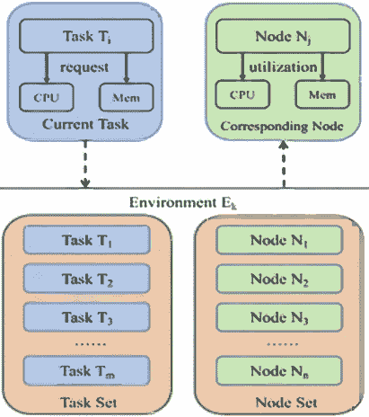

**图 2.1 任务与节点之间的关系（两级）。**

利用上述的实体和关系，提出了一种新的表示模型 TransEC，它将边缘计算任务、节点和环境转换到不同的向量子空间。

特别是，任务和节点最初使用嵌入层嵌入到各种子空间中。然后使用线性变换和卷积神经网络检索环境的潜在特征，并将知识映射到动态子空间。最后，使用我们的 TransEC 模型来提取第二级实体之间的关系。

动态且大规模边缘计算环境中的调度决策，可以通过具有 TransEC 模型能力的 DRL 来解决，该模型有效减少了状态维度。在许多强化学习算法中，选择了深度 Q 学习（DQL）算法，因为它有助于快速决策。

此外，调整了 TransEC-DQL 算法的训练频率，以兼顾该时隙周围的状态信息以及当前时隙的知识（后者涉及任务和节点资源状况的分布）。还使用了双 Q 学习（double Q-learning）来随时间推移增强 DQL 的性能 [6]。参考文献7–12] 中提出了许多使用混合方案的解决方案。

## **文献综述：**

论文《部分连接边缘网络中的工作流跨时间最小化：基于深度强化学习的方法》[13] 通过结合关键路径分析、动态任务排序和独特的基于强化学习的工作流嵌入（RLWE）方案，解决了改进部分连接边缘网络中工作流执行的问题。通过将调度过程建模为马尔可夫决策过程，该技术协调任务放置和多路径路由，同时利用不交子图机制在优先考虑路径质量和避免拥塞的同时来缩短跨时间。虽然 RLWE 在计算延迟和跨各种网络配置及工作流的资源使用优化方面优于 DPE、FixDoc 和 HEFT 等传统方法，但该研究强调了任务调度和多路径路由的复杂性、混合系统的可扩展性问题等挑战，实验数据显示 RLWE 是成功的，显著缩短了跨时间并增强了资源利用。

论文《边缘计算中基于深度强化学习的负载调度》[14] 提出了一种新技术，以优化具有资源限制和显著不可预测性的边缘计算系统中的负载调度。它使用多层架构和 Q 网络（DQN）来平衡负载、改进服务时间并减少失败任务的数量。该技术将调度问题表示为马尔可夫决策过程（MDP），包括状态、动作空间以及旨在减少延迟的奖励函数。DQN 模型通过将经验回放与神经网络相结合改进了资源分配决策。在 EdgeCloud 上的模拟表明，该技术优于确定性策略梯度（DDPG）和近端策略优化（PPO）等替代方案，特别是在服务时间、虚拟机使用和任务完成率方面，同时在高设备密度下保持了效率。然而，该研究识别了局限性，如对大规模或混合系统的可扩展性不足、对实时环境动态的建模不足以及对能效的关注。尽管存在这些限制，结果表明所建议的计算负载调度技术是稳健且有效的。

文章《边缘计算中的资源调度：综述》[15] 检查了边缘计算环境中资源管理的进展，以满足物联网应用日益增长的需求。它研究了三个主要主题：计算卸载、资源分配以及集中式和分布式技术中的资源供应。该研究将调度模型分为三类：物-边缘以及边缘-边缘协作。它研究了二进制和部分卸载；计算、通信和存储的资源分配策略；以及任务分配和边缘资源放置等动态供给方法。在强调这些技术在提高服务质量（QoS）和体验质量（QoE）方面的有效性的同时，该研究也发现了如时间适应能力不足、能量效率低下以及大型网络可扩展性问题等局限性。通过结合延迟、能耗和成本等性能指标，报告


强调了对动态、可扩展且高效框架进行进一步研究的必要性。

“Representation and Reinforcement Learning for Job Scheduling in Edge Computing”一研究提供了一种结合表示学习与强化学习（DRL）的新框架，以解决边缘计算（EC）中的任务调度问题。该方法解决了节点变化和调度崩溃等困难，并使用EC模型描述实体（任务和节点）及其交互。主要方法包括在子空间中嵌入任务和特征，使用卷积神经网络描述环境，并使用基于双Q学习的DRL策略进行动态决策。实验结果表明，该方法在降低能量消耗方面比基准方法提升了18%，在调度效率方面提升了94%。然而，研究揭示了增强网络架构的可扩展性问题。

“Multiagent-Reinforcement Learning for Optimized Task Scheduling in Heterogeneous Edge Computing Systems” [16]关注于具有资源限制、频谱拥塞和非特性的边缘计算（MEC）环境下的任务调度。通过多智能体马尔可夫决策（MDP）范式，论文定义了非合作博弈，并提出了针对静态系统的近端策略优化（PPO）方法。为了提高非平稳系统的灵活性和学习效率，主要方法包括状态表示近似、基于局部观测的策略优化，以及结合强化学习以改进收敛。研究结果显示，该方法在任务执行延迟和队列延迟方面取得了显著性能增益。多智能体协调在动态情况下的内在复杂性和传统方法中的延迟适应被识别为问题。

“Machine and Deep Learning for Resource Allocation in Multi-Access Edge Computing (MEC): A Survey” [17] 详细综述了多接入边缘计算（MEC）中使用机器学习（ML）和深度学习（DL）方法进行资源分配。论文重点关注三大类任务：任务卸载、任务调度和联合资源分配，增强了ML/DL机制优于传统启发式和优化方法的优势。方法论包括用于自适应卸载的强化学习、用于特征提取的卷积神经网络以及用于隐私保护的联邦学习。研究强调了计算复杂性、对动态情况的适应以及资源受限MEC设备中ML/DL的高集成等主要问题。调查结果显示，在AI降低延迟、能量效率和整体服务质量方面，优化边缘和雾计算应用取得了进展。然而，在可扩展性、实时灵活性和MEC系统异构性等领域仍存在缺陷。未来的目标包括改进模型优化、建立混合技术并利用量子计算等新范式来实现更好的资源分配。


“Improved Double Q Network-Based Task Scheduling Algorithm in Edge Computing for Makespan Optimization”论文提出了一种使用改进型双Q网络（DDQN）的调度技术，以优化EC环境中的完成时间。它解决了动态多样化背景下的工作调度、静态调度算法的限制以及经典Q学习方法由于状态爆炸导致的效率低下问题。该过程涉及在两个网络上拆分目标Q值的计算和动作选择、创建新的奖励函数，并通过使用控制单元最大化数据消耗来改进经验。利用增强的粒子群优化（PSO）技术预训练评估网络，提供初始解决方案并缩短收敛时间。实验结果表明，在各种负载和机器配置下，该算法在完成时间和负载均衡方面优于先来优先（FCFS）、短作业优先（SJF）、粒子群优化（PSO）、模拟退火（SA）、DDQN和经典DQN等竞争技术。尽管取得了成功，但障碍包括对大量训练数据的需求以及强化学习的计算需求。研究表明，建议的技术显著增强了EC的任务调度性能，并建议对工作流调度进行更多研究。

“Edge Computing Sleep Mode Task Scheduling Based on Deep Reinforcement Learning”提供了一种用于EC系统的任务调度技术——基于睡眠模式的近端策略优化任务调度（PPO-TSSM），解决了空闲能耗和资源限制的困难。建议的方法通过最大化作业完成时间、能量消耗和满足截止日期来工作。使用基于睡眠的边缘架构，研究将任务调度建模为马尔可夫决策过程（MDP），并应用PPO算法，系统不断在激活和睡眠模式之间切换。实验结果显示，与没有睡眠模式的系统相比，该方法能量消耗降低了74.76%，完成时间仅增加了了5.33%。容器重构导致的延迟被识别为问题。未来的工作将通过包含动态网络变化来增强系统。

“Dependency-Aware Assigning and Scheduling in Edge Computing”探索了EC中依赖感知程序分配和调度。它识别了任务相互依赖、资源有限以及未知的时空分布等问题。研究将应用程序建模为有向无环图（DAG），并提出了一种在在线环境中同时进行任务分配和调度的独特方法，解决了NP难题。Daar使用启发式技术评估任务优先级，迭代地分配和调度活动以优化资源使用并满足应用截止日期。关键发现，Daar比基准方法提供了多20%的截止机会，在大规模案例中最多提升了38%。方法上的局限性包括未考虑存储限制、计算时间的不可预测性以及对边缘服务器和基站连接的简化。缺点包括该解决方案的启发式特性无法保证全局最优，以及迭代优化带来的计算成本。尽管存在这些缺点，Daar为动态EC环境中的依赖应用提供了一个有用且高效的框架。


该算法优于以往的技术，随着任务负载的增加，具有更高的调度成功率、更低的延迟以及更好的资源利用。然而，该方法需要大量的训练，并在大型应用中会产生计算开销。总体而言，这项研究通过在 EC 环境中性能、效率和节能之间取得平衡，极大提高了智能建筑系统的任务调度能力 [22]。

论文《边缘计算网络中基于强化学习的任务调度》侧重于减少云边网络中的任务调度延迟，特别是针对延迟优化的非多项式时间（NP）困难任务调度算法，该算法基于异步优势 Actor-Critic（CECS-A3C）DRL 架构。这种方法动态分配资源并优化任务卸载决策，同时考虑了边缘和云资源的限制。现有系统频繁依赖在线同步训练可能利用经验回放机制，而 CECS-A3C 使用并行代理的异步机制，消除了对回放的需求并提高了可扩展性。任务通过实时状态变化进行规划，以最大化对任务延迟敏感性的累积奖励。实验结果显示，CECS-A3C 与 DQN 和 RL-G 算法相比，分别减少了 28.3% 和 46.1% 的延迟，同时在各种任务下实现了更快的收敛和更高的可扩展性。然而，其对去中心化决策的依赖可能会限制高度分布式系统的可扩展性，且真实世界的实现还包括不可预测的网络动态以及收集可靠状态信息的能力。总体而言，所提框架提高了调度效率，实现了 EC 网络中任务的及时执行和优的资源利用 [23]。

论文《边缘计算中基于强化学习的在线服务部署与计算资源分配》为 5G 赋能的 EC 系统服务部署和资源分配提供了一种创新策略，目标是最小化任务延迟。它处理了动态和意外任务到达、边缘资源限制、服务迁移开销以及部署与资源决策之间的相互依赖等问题。该问题被表示为具有双向连续动作空间的 MDP，其中延迟分量（切换、服务和卸载）影响着奖励函数。所提出的 PDQN 结合了两个神经网络——一个用于资源分配，另一个用于评估混合动作 Q 值——并采用双网络拓扑结构和经验回放等技术来提高稳定性。大量实验表明，该方法在降低各种系统特征（CPU 容量、服务多样性和存储限制）下的延迟方面优于基准方法。虽然研究结果看起来令人鼓舞，但存在若干局限性，例如扩展性问题、强化学习的计算成本以及可能限制实际应用的简化假设。尽管如此，它证明了 DRL 在解决 EC 系统中挑战性优化问题的价值 [24]。

论文《低延迟边缘计算系统的深度强化学习算法》研究了使用 DRL 模型——Q-Learning、Double Q-Learning、DQN 和 DDQN——来改进 EC 环境下的资源分配和任务调度，重点关注降低延迟。它解决了由于多样化资源需求导致的任务调度复杂性、由于大量任务队列导致的高延迟，以及动态低延迟环境中对智能决策的需求。该研究使用 MDP 表示问题，证明了 DDQN 的改进性能，DDQN 通过将动作选择和评估分离来增加稳定性并减少 Q 值的过估计。使用神经网络和经验回放等方法来改进训练和决策。虽然 Q-Learning 和 DQN 在整个模拟过程中提供了高效的资源分配和较低的平均延迟（0.97–1.03 秒）。结果显示 DDQN 可以提供更多的奖励和更一致的结果，使其成为智能 EC系统的可行选择。然而，论文指出了 DRL 模型的可扩展性和计算复杂性等限制，建议未来引入 DQN 等先进算法以进一步改进。最后，文章发现 DRL 模型（特别是 DDQN）极大地提高了边缘系统的性能 [25]。

论文《通过深度强化学习实现移动边缘计算并发任务的去中心化调度》提供了一种 MEC 去中心化任务调度技术，在动态、资源受限的背景下降低了延迟和任务丢失率。论文处理了集中化技术中的通信成本、并发执行问题以及异构边缘网络等问题。所提技术将任务卸载视为延迟感知优化问题，并使用 DRL 进行求解。使用了 Double DQN、DQN、优先回放内存和递归神经网络（RNN）等技术来提高灵活性和收敛性。分布式优化与调度算法（DOSA）将 DRL 网络分为用户设备和服务器，使每个设备能够以很小的复杂度做出卸载决策。仿真结果显示，与基准方法（如贪心、随机和集中化 DRL 方法）相比，DOSA 极大地减少了任务延迟和丢包任务。然而，缺点包括训练成本高、难以实现去中心化环境，以及缺乏对任务依赖图和各种服务器缓存等现实复杂性的考虑。识别出的需求可能是扩展模型以处理可分任务并使用边缘缓存来提高调度性能。尽管存在这些限制，结果证明了 DOSA 通过快速学习和对变化的 MEC 设置的适应性在平衡可扩展性和性能方面的效率 [26]。

论文《使用强化学习的资源高效任务调度系统》描述了一种新的基于 RL 的任务调度系统，该系统优化了多核心 CPU 场景下的资源效率。建议的方法通过适应动态计算环境，克服了经典启发式和硬编码调度算法的局限性，在大幅降低资源利用的同时确保了同等或增强的性能。RL 模型将调度问题视为 MDP，状态表示系统配置，动作允许将作业分配给工人，奖励则惩罚负载不平衡和过量的数据传输成本。调度器使用深度 Q 学习算法学习可以有效泛化到以前遇到的任务的规则，在从 7 到 8 个工人（基准方法为 40 个）范围内显示出灵活性，证明了在效率和可扩展性方面的巨大优势。然而，该技术存在缺点，包括高昂的训练成本收益，例如缺乏对分布式系统和 GPU 特定调度的支持。未来的工作尝试解决这些局限性，使该架构更适用于分散和异构计算设置 [27]。

论文《边缘计算环境中基于深度 Q 学习的任务调度优化机制》提出了一种基于 DRL（DQN）的技术，用于优化边缘设置中作为 DAG 用户请求调度。该技术通过将调度问题建模为 MDP，寻求降低长期平均系统延迟并提高作业完成率。系统将资源利用率和任务队列状态描述为状态，调度决策为动作，延迟和截止日期为惩罚。该方法使用深度 Q 网络、经验回放和 e-greedy 策略随时间学习优化调度策略。实验结果显示，与随机技术相比，特别是在请求到达率高时。尽管初始训练不稳定且在高维状态空间存在困难，该机制实现了近乎完美的作业完成。然而，缺乏分布式边缘智能和实时设置中的计算成本仍然存在。未来的研究将考虑分布式调度解决方案 [28]。

论文《无人机辅助边缘计算中深度强化学习延迟感知任务卸载》描述了一种在具有无人机中继的多接入边缘计算（MEC）环境中最大化卸载的独特技术。针对移动终端所提出的基于 DDPG 的任务卸载策略（DTOP）通过利用 DRL 在满足延迟限制的同时做出有效的卸载决策来降低能量消耗。系统将任务表示为


一种具有连续状态和动作空间的马尔可夫决策过程（MDP），包含一个对能量浪费和任务超时进行惩罚的奖励函数。任务均衡方法确保了无人机（UAV）以平衡的方式使用资源。仿真结果表明，与基础算法相比，动态任务卸载协议（DTOP）显著降低了能量消耗和任务延迟，同时利用 Jain 公平性指数提供了公平分配。尽管初始训练具有复杂性且存在可扩展性问题，但该系统能够快速稳定下来。该论文最后讨论了未来潜在的路径，例如实时实现、可扩展性改进和安全性考量 [29]。

论文《基于粒子群优化和深度强化学习的工业边缘网络任务分配》探索了工业边缘网络中的作业分配，重点侧重于降低能耗。作者提出了一种改进的整数线性规划（ILP），用于高效的多工作流任务分配，这比先前的启发启发式算法有所改进。我们提供了粒子群优化（PSO）和深度强化学习（DRL）作为替代方案，并对它们的可扩展性和效率进行了测试。主要问题包括追踪任务分配问题的 NP-hard 性，以及处理大型网络中 ILP 计算效率低下的问题。虽然 PSO 和 DRL 的执行时间比 ILP 短，但它们为了可扩展性牺牲了准确性，PSO 在较小规模的问题上表现良好，而 DRL 在更大规模的情况下表现更好。在方法论上，ILP 在资源和能力限制内优化网络和连接的能量使用。PSO 使用元启发式技术近似答案，DRL 使用近端策略优化（PPO）基于任务-节点映射进行迭代学习。结果表明，PSO 在问题规模较大时实现了 7.7% 的中位最优性差距，DRL 为更大的问题提供了更低的上界且执行速度更快，在不到 1 秒内完成。差距在于，PSO 无法高效地处理大规模作业，并且缺乏对网络设置中异构性的关注。未来的研究应该关注结合了 PSO 准确性与 DRL 可扩展性的混合模型 [30]。

论文《一种基于深度强化学习的计算环境高效资源调度算法》提供了一种结合 DQN 和遗传算法（GA）的混合方法，以解决计算边缘（EC）环境中的调度问题。其目标是通过使用 DQN 为 GA 生成初始种群来缩短执行时间，提高收敛速度和优化效率。潜在问题包括子依赖、GA 初始状态的不可预测性以及经典优化方法在大规模分布式环境中的低效率。在方法论上，该技术将调度问题表示为 MDP，并使用 DQN 进行精炼。在真实工作流（Montage_25, Sipht_60 和 Epigenomics_46）上的实验表明，DQN-GA 的性能优于已知技术，如异构最早完成时间（HEFT）、预测最早完成时间（PEFT）和随机初始化的遗传算法（GA），相比 PEFT 跨度缩短了 5.16%，相比 GA 缩短了 4.91%。结果显示其收敛更快、优化质量更高，但存在某些缺点，如对多目标和动态情况的处理能力有限。未来的研究可能会调查多目标扩展以及对动态 EC 设置的适应性 [31]。

论文《基于深度强化学习的云边缘系统多资源交叉任务调度》引入了 DeepMIC，一种基于 DRL 的多资源交叉策略，用于改进云边缘计算系统中的任务调度。它解决了使用单个边缘节点优化资源队列以减少加权和延迟的问题。DeepMIC 采用 PPO 算法在多种资源之间动态交错作业，提高了资源利用率并降低了延迟。云边缘系统的动态性带来了挑战，如管理任务依赖性、资源竞争和高计算复杂性。一个显著的缺点是，该方法在多目标情况或严重网络状态下的效能需要进一步研究。在方法论上，该问题被定义为超图匹配问题，允许对交叉执行进行高效的任务分组。实验揭示了 DeepMIC 优于以往的方法，资源利用率提高了 1.67 倍，平均响应时间缩短了30.9%，证明了其提高云边缘系统性能的潜力。未来的研究应关注动态网络环境和多目标优化 [32]。

## 2 结论

为了解决 EC 中的调度问题，我们建议结合强化学习来训练任务表示。任务调度问题首先通过 EC 模型表示，然后进行计算。

## 参考文献

- 1. G. 等, 2017. 用于视频分析的深度强化学习。Computer, 50(10), 58-67.
- 2. L. 等, 2019. 边缘计算的深度学习。第25届 ACM Conference.
- 3. M. 等, 2016. 边缘计算中的深度强化学习。Workshop on Networks.
- 4. H. 等, 2018. 用于移动现实的深度强化学习。IEEE Transactions on Vehicles, 7(11), 10190-10203.
- 5. S. 等, 深度强化学习的资源调度。第15届 IEEE International Conference.
- 7. S. 等, 2024. 深度强化学习启发的任务调度。Internet of Things and Cyber-Physical Systems, 4, 32-39.
- 8. P. 等, 2023. 用于云基础设施的深度强化学习。Alexandria Engineering Journal, 73, 217-230.
- 9. D. 等, 2025. 基于 PSO-ANN 的云虚拟机部署。Journal of Circuits, Systems, 3, 235018.
- 10. P. 等, 2024. 象群算法启发的虚拟机部署。Alexandria Engineering Journal, 110, 145-152.
- 11. M. 等, 2024. 蚁群算法启发的边缘调度。PLOS, 19(6), e03467.
- 12. P. 等, 2024. 深度神经网络启发的任务调度。Internet of Things and Cyber-Physical Systems, 4, 268-279.
- 13. K. 等, 2022. 基于部分连接强化学习的工作流最小化。IEEE Journal of the Computing Society, 3, 518-529.
- 14. T. 等, 2022. 基于深度强化学习的边缘计算负载调度。Journal of Cloud Computing, 11(1), p3.
- 15. Q. 等, 2021. 边缘计算中的资源调度：综述。IEEE Surveys & Tutorials, 23(4), 2131-2165.
- 16. L. 等, 2023. 异构边缘计算系统中的优化任务调度多智能体强化学习。IEEE Internet of Things Journal, 10(12), 10519-10531.
- 17. H. 等, 2022. 多接入边缘计算资源分配中的机器学习和深度学习：综述。IEEE Surveys & Tutorials, 24(4), 2449-2494.
- 18. H. 等, 2024. 边缘集群升级中的延迟感知容器调度：一种深度强化学习方法。IEEE Transactions on Services Computing, 17(5), 2530-2543.


+ 19. Zeng, L., Liu, Q., Shen, and Liu, X., 2023. 边缘计算中用于优化完跨时间的改进深度Q网络调度算法. 清华科学技术, 29(3), pp. 806–817.

+ 20. Tao, S., Feng, E., Yao, Y., Xia, and Liu, T., 2023, August. 基于深度强化学习的边缘计算休眠模式任务调度. 2023年第9届大数据计算与通信国际会议 (BigCom) (pp. 231–239). IEEE.

+ 21. Liao, H., Li, X., Guo, D., Kang, W. and Li, J., 2021. 边缘计算中的依赖感知应用与调度. IEEE Internet of Things Journal, 9(6), pp. 4451–4463.

+ 22. Chen, Y., Wang, Y., Zhang, Z., Fu, Q., Wang, H. and Liu, Y., 2022. November. 智能建筑边缘网络任务调中的深度强化学习. 2022年第10次高级云与大数据国际会议 (CRD) (pp. 312–317). IEEE.

+ 23. Qi, F. A., N, L., and Lin, C., 2020, August. 边缘计算中基于深度强化学习的任务调度. 2020年 IEEE/CIC中国通信国际会议 (ICCCC) (pp. 835–840). IEEE.

+ 24. Liu, T., Ni, S., Li, X., Zhu, Y., Kong, L., and Yang, Y., 2022. 边缘计算中基于深度强化学习的在线服务放置与资源分配方法. IEEE Transactions on Mobile Computing, 22(7), pp. 3870–3881.

+ 25. Kumaran, F., and Sasikala, E., 2023, March. 低延迟边缘计算系统的深度强化学习算法. 2023年第3届人工智能与信号处理国际会议 (AISP) (pp. 1–5). IEEE.

+ 26. Fan, Y., Ge, J., Zhang, S., Wu, J. and Luo, B., 2023. 基于深度强化学习的移动边缘计算并发任务去中心化调度. IEEE Transactions on Mobile Computing, 23(4), pp. 2675–2779.

+ 27. Mordchi, C., Chiu, C. H., Zhou, Y. and Huang, T. W., 2024, January. 使用深度强化学习的资源高效任务调度系统. 2024年第29次亚洲和太平洋地区设计自动化会议 (ASP-DAC) (pp. 89–95). IEEE.

+ 28. Zhang, Y., Li, R., Zhao, Y. and Li, R., 2021, May. 边缘计算环境中基于深度Q-学习的请求调度机制. IEEE INFOOC 2021-IEEE计算机通信工作坊 (INFOCOM) (pp. 1–2). IEEE.

+ 29. Huang, M., Sun, K., Huang, Y., Ze., Wang, Y., and He, H., 2022, December. UAV辅助边缘计算中基于深度强化学习的延迟感知任务调度 (pp. 1–8).

+ 30. Buschmann, P., Shorim, M. H., Helm, M., Proceedings of the 52th International Conference on Algorithms, Computing and Artificial Intelligence, Brüring, A. and Carle, G., 2022, November. 粒子群优化与深度强化学习在工业边缘网络中的任务分配. 第12次物联网国际会议论文集 (pp. 239–247).

+ 31. Xue, F., Hai, Q., Dong, T., Cui, Z. and Gong, Y., 2022. 用于边缘计算环境高效资源调度的深度深度强化学习混合算法. Information Sciences, 608, pp. 362–374.

+ 32. Pei, X., Sun, P, Hu, Y., Li, D., Tian, L. and Li, Z., 2024. 深度强化学习用于云边系统中任务调中的多资源交织. Future Generation Computer Systems, 160(November), pp. 522–536.

## 雾计算环境下负载均衡的监督学习

雾计算已成为一种解决移动设备、传感器和物联网挑战的范式。它提供了一个最小化延迟和减少带宽消耗的框架。通过利用强化学习，系统可以优化分布式环境中的任务调度和资源分配。

监督学习是这些系统中的基础方法。它涉及在标记数据上训练模型训练，以对新的输入数据进行预测。

### 3.2 雾计算：概述

为了评估模型的性能，会使用多种评估指标。这些指标有助于确定模型对未见数据的泛化能力。

- 准确率（Accuracy）：在总预测次数中正确预测标签的比例。它是常用指标，但如果类别不平衡，可能会产生误导。
- 精确率（Precision）：在所有正性预测（真阳性+假阳性）中，真阳性（正确预测的正类类）的比例。它衡量了正性预测的准确性。
- 回召率（Recall/Sensitivity）：在所有实际正例（真阳性+假阴性）中真阳性的比例。它衡量了模型捕捉所有正例的能力。

### 1. 分类算法

当输出标签为类别值时使用这些算法。目标是将输入分配到几个类别之一。

- 决策树（Decision Trees）：一种树形结构，每个节点代表一个决策，每个分支代表一个可能的结果。模型通过遍历到叶节点进行预测。

### 2. 回归算法

当输出为连续值时使用这些算法。模型尝试根据输入特征预测数值。

- 线性回归（Linear Regression）：最简单的算法之一，线性回归将输入特征与输出之间的关系建模为直线。它通过寻找最优合线来预测连续值。
- 回归决策树：与分类决策树相似，但在回归中，每个叶代表一个预测的连续值而非类别标签。
- 支持机回归（SVR）：与SVM相似，SVR为回归任务设计。它试图找到在特定容差范围内最拟合数据的超平面。
- 随机森林（Random Forests）：决策树的集合，每棵树都基于训练数据的子集构建。在回归中，通过平均森林中所有树的输出来做出预测。

### 用于负载均衡的监督学习

- 支持机（SVM）：SVM旨在找到区分不同类别的超平面。它最大化数据点（即支持向量）之间的间距。
- K近邻（KNN）：KNN是一种简单算法，模型通过观察“K”个标记数据点并分配它们之间常见的标签来对输入分类。
- 逻辑回归（Logistic Regression）：尽管名称如此，但逻辑回归是一种用于二分类任务的分类算法。它根据输入特征的线性组合计算输入属于特定类别的概率。


## 使用 AI 优化边缘和雾计算应用

- F1 分（F1 Score）：精确率和召回率的调和平均数。当你需要在精确率和召回率之间取得平衡时（特别是在不平衡的数据集中），非常有用。

- 混淆矩阵（Confusion Matrix）：用于评估分类模型性能的表格。它总结了每个类的正确预测和错误预测。

- 混淆矩阵：用于评估分类模型性能的表格。回归任务
  - 平均绝对误差（MAE）：预测值与实际值之间绝对差异的平均值。它提供了预测的绝对误差衡量。
  - 均方误差（MSE）：与 MAE 类似，但在平均化之前对差异进行平方，使其对离群值更敏感。
  - 均方根误差（RMSE）：MSE 的平方根，将误差恢复到数据的原始比例。
  - R 方（R-squared）：衡量模型解释数据方差的程度，指示自变量解释因变量比例。

### 监督学习中的过拟合与欠拟合

- 过拟合（Overfitting）：当模型从训练数据中学习了过多信息（包括噪声和无关模式）时发生。结果是在训练数据上表现优异，但在未见的测试数据上表现很差。过拟合可以通过正则化技术、交叉验证来缓解。
- 欠拟合（Underfitting）：当模型太简单，无法捕捉数据中的模式时发生。这导致在训练和测试数据上的性能都很差。欠拟合可以通过增加模型复杂度、使用相关特征或正则化来解决。

### 训练、验证和测试数据集

监督学习的典型工作流涉及将数据分为三个：

- 训练数据集：用于训练模型，允许其从输入-输出对中学习。
- 验证数据集：在训练阶段用于调整超参数并验证模型的性能。
- 测试数据集：用于训练完成后评估模型的泛化能力。

## 用于负载均衡的监督机器学习 ■ 53

### 负载均衡概述

负载均衡是分布式系统和网络中的关键概念，涉及将入入流量或计算任务分配到多个资源（如服务器、网络链路或处理单元）。负载均衡的目标是优化资源利用、提高响应时间并确保没有单一资源被大量工作过载。在计算中，负载均衡通常用于增强系统的可用性、可靠性和性能，特别是在资源分布在多个节点或数据中心的大规模环境中。

负载均衡的概念对于高可用性和容错至关重要的场景尤为重要。这些场景包括云计算、内容分发网络（CDN）以及必须协同工作提供无缝服务的雾计算系统。负载均衡允许这些系统通过确保负载均衡来实现高效扩展。

### 负载均衡的类型

1. **网络负载均衡（Network Load Balancing）：**在网络负载中，目标是将接入流量均匀分布到服务器设备组，以确保最佳网络性能并防止单一设备过载。这种负载均衡最常用于 Web 服务器、应用服务器甚至电信系统。通过根据算法分配请求，负载均衡器有助于减少单一服务器或网络链路过载的可能性（这会导致服务中断或响应缓慢）。

2. **任务负载均衡（Task Load Balancing）：**任务负载均衡也称为计算或应用级负载均衡，是指将计算任务分配到系统的不同资源或节点。这种负载均衡通常应用于并行计算等场景，需要将大量小任务分配到一组处理器。其目标是最小化处理器的空闲时间，通过确保每个处理器或计算节点分配的任务可以与其他任务并行处理，来实现更高效的计算。任务负载均衡常见于高性能计算系统或云环境等分布式计算环境。

3. **全局负载均衡（Global Load Balancing）：**全局负载均衡是指将流量或计算任务跨多个数据中心或地理区域分布的过程。它有助于用户根据位置、负载状况和可用性访问响应最快的服务器或应用程序。全局负载均衡可以利用基于地理位置的路由，将用户引导至最近或负载最低的数据中心。它通常用于大型 Web 应用程序、CDN 以及在多个区域运行的企业级系统。

4. **本地负载均衡（Local Load Balancing）：**本地负载均衡关注在单个数据中心或服务器场内的资源之间分配流量或任务。其目标是优化本地基础设施内的资源利用，并确保没有单一服务器成为瓶颈。本地负载均衡可以通过软件或硬件设备处理，通常用于流量或任务集中在特定物理或逻辑位置的情况。

### 负载均衡算法

负载均衡常用的常用的算法都有自己的优点和权衡。这些算法旨在确定如何将接入请求或任务分配到各种资源。一些最常用的负载均衡算法包括：

1. **轮询（Round Robin）：**轮询是最简单且最广泛的负载均衡算法之一。它通过循环方式将请求或任务分配给下一个服务器，而不考虑服务器的当前负载。这种方法的简单性使其易于实现，但在具有不同处理能力或流量模式不均匀的系统中，可能无法始终获得最佳性能。

2. **最少连接（Least Connections）：**最少连接算法将接入请求导向活动连接或任务最少的服务器。这种方法在服务器负载变化很大时非常有益，因为它目标是平衡可用服务器之间的并发连接数。这种方法可以防止服务器因任务过多而过载，但它要求负载均衡器能够实时访问服务器计数信息。

3. **加权轮询（Weighted Round Robin）：**加权轮询是基础轮询算法的扩展，考虑了服务器容量。在该算法中，每个服务器根据其处理能力被分配权重，负载均衡器根据这些权重请求请求。例如，高权重服务器将接收比低权重服务器更多的请求。这种方法确保了更强大的服务器处理更多的流量，从而实现更平衡、高效的系统。

4. **响应时间（Response Time）：**在响应时间算法中，新请求会被发送到响应时间最短的服务器。这种方法在服务器性能波动很大时特别有用，因为它确保用户访问最快、响应最灵敏的资源。但如果服务器波动很高，该算法可能并不总是有效的。


由于网络拥塞或外部系统依赖等因素导致的响应时间。

- **基于哈希的负载均衡：** 基于哈希的负载均衡通过哈希函数分配请求，通常应用于请求中的特定参数，如 IP 地址或话 ID。这种方法确保相同哈希值的请求被发送到同一服务器，这对于会话持久化或维护状态交互非常有帮助。虽然在数据倾斜时可能会导致分布不均，但对于需要会话亲和性或特定服务器节点一致处理请求的系统来说是有效的。

- **动态负载均衡：** 动态负载均衡涉及根据实时反馈（如服务器负载、资源可用性或网络状况）调整请求或任务的分配。这种类型的负载均衡具有自适应性，能够持续响应系统内部不断变化的情况，使其更适用于负载波动或不可预测的环境。动态负载均衡通常需要更复杂的算法以及能够实时监控和分析系统的系统。

### 负载均衡的挑战
虽然负载均衡带来了显著收益，但也伴随着一系列挑战。这些挑战源于管理分布式系统的复杂性、维护高可用性以及确保资源的最优利用。

- **可扩展性：** 随着资源或请求数量的增加，负载均衡必须能够有效扩展。系统设计需要能够处理不断增加的服务器或任务，而不会在请求处理中引入性能瓶颈或延迟。

- **容错性：** 负载均衡器必须能够优雅地处理故障。当某台服务器或资源发生机机时，负载均衡器应自动将流量重定向到可用服务器，确保对用户的干扰降最低。实现容错能力需要实时监控所有服务器的健康状况和性能指标。

- **流量分配：** 高效地分配流量是一项关键挑战，特别是在资源可能具有不同处理能力的异构系统中。负载均衡算法必须考虑不同服务器的差异能力，以避免某些资源过载。

- **延迟与响应时间：** 负载均衡决策的速度和响应能力会显著影响整体性能。负载均衡器必须快速做出决策以确保低延迟并避免处理请求的延迟。高延迟决策可能导致性能下降和用户体验不良。

- **安全性：** 安全性是负载均衡的另一个挑战，特别是在云端或 Web 应用中。负载均衡器必须确保自己免受分布式拒绝服务（DoS）攻击等威胁的侵害，这些攻击可能会使负载均衡系统本身崩溃。确保流量路由到安全的受信任资源对于维护系统完整性至关重要。

### 雾计算中的负载均衡
负载均衡是指将计算任务均匀分布在可用资源上。在雾边缘环境中，负载均衡必须考虑：

- **异构资源：** 雾节点在计算能力、内存和网络带宽上各不相同 [7]。
- **动态负载：** 物联网设备产生波动的负载，需要自适应策略 [8]。

### 静态负载均衡
静态技术根据预定义的规则分配任务，例如：

- **轮询算法（Round Robin）：** 任务在节点之间循环分配 [9]。
- **加权轮询：** 容量较高的节点接收更多任务 [10]。

虽然静态方法简单且易于实现，但它们缺乏适应实时变化的灵活性，可能在可变负载下导致效率低下。例如，在医疗监控网络中，静态分配可能会导致监控关键患者的节点过载，危及数据处理的及时性 [11]。

### 动态负载均衡
动态方法考虑 CPU 使用率、内存和网络延迟等实时指标。示例包括：

- **最小连接数法：** 将任务分配给连接数最少的节点 [12]。
- **最小响应时间法：** 优先考虑响应时间最短的节点 [13]。

这些方法需要持续监控和计算开销，但显著提高了适应性和效率。例如，智能城市的实时流量管理可以从这些方法中获益，通过动态将资源重定向到拥堵区域 [14]。

### 用于负载均衡的监督机器学习

### 预测分析与机器学习集成
                通过监督机器学习集成预测分析，可以增强动态方法。这些模型可以预测负载激增并预测资源需求，从而实现主动的任务再分配 [15]。

### 用于负载均衡的监督机器学习
监督机器学习涉及在标记的数据集上训练模型以进行预测。在雾边缘环境中，此类模型可以预测负载模式和资源可用性，从而实现主动的任务分配。

### 集成步骤

- **数据收集：** 从雾节点收集 CPU 使用率、内存消耗和网络延迟等指标。这些数据构成了训练机器学习模型的基础。物联网数据日志和实时监控框架（如 MQTT）等技术可以促进全面的数据收集 [16]。
- **特征工程：** 识别并预处理关键特征（如负载强度和网络状况），确保模型关注关键参数。高级特征选择方法（如主成分分析 PCA）可以在保留基本数据特性的同时降低维度 [17]。
- **模型选择：** 回归模型（如线性回归）预测负载 [18]。分类模型（如决策树）根据资源需求对任务进行分类 [19]。例如，随机森林模型已被证明在负载预测场景中由于其处理复杂交互的能力，性能优于更简单的算法 [20–24]。
- **模型训练与评估：** 在历史数据上训练模型，评估准确率、精确率和召回率等指标。交叉验证确保了性能的稳健性。使用网格搜索等技术进行超参数调优可以优化模型准确性 [21, 31–34]。
- **部署与持续学习：** 将训练好的模型部署在实时环境中，持续更新它们以适应不断变化的负载。TensorFlow Lite 等轻量级框架可以在资源受限的雾节点上实现高效部署 [22]。

### 高级技术

- **集成学习：** 结合多个模型以提高准确性和稳健性（例如随机森林）[23]。
- **深度学习：** LSTM 和 CNN 捕捉时间和空间模式，增强复杂环境下的预测能力 [24]。
- **强化学习：** 通过基于反馈机制优化负载均衡策略，补充监督学习 [25]。

## 用于负载均衡的监督学习模型
监督学习模型是机器学习技术的一个子集，利用数据集训练算法，使其能够根据输入特征做出预测或决策。在负载均衡的背景下，监督学习可以根据历史数据预测最优资源分配、任务分布或管理策略。从过去模式中学习并适应未见数据的能力，对于云计算、雾计算和 Web 应用等复杂动态环境中的负载均衡特别有利，这些环境的网络流量和负载会实时波动。

### 监督学习如何增强负载均衡
传统的负载均衡技术（如轮询、最小连接随机分布）使用固定规则或简单的启发式方法来分配资源。虽然这些方法在某些情况下是有效的，但它们往往无法考虑复杂模式和变化状况，例如变化的服务器性能、波动的网络流量以及资源的动态可用性。相反，监督学习可以在历史数据上进行训练以识别模式并做出数据驱动的决策，具有多个优势：

- **适应性：** 监督学习模型可以适应变化的流量状况和服务器负载。通过从过去的数据中学习，这些模型可以识别趋势并预测未来的资源需求，允许实时动态调整负载均衡决策。
- **精确性：** 与静态方法相比，监督学习模型可以识别规则系统可能无法察觉的细微模式。例如，模型能够识别服务器性能与入流量模式之间的相关性，从而实现更高效的资源分配。
- **预测能力：** 监督学习模型可以预测特定资源（如服务器和网络链路）何时变得过载，从而实现主动的负载均衡决策，在性能下降或系统故障发生前进行预防。
- **优化：** 通过不断从新数据中学习，监督学习模型可以随时间推移优化负载均衡，随着更多训练数据的可用，做出改进的决策，从而提高整体系统性能。

### 在负载均衡中实现监督学习的关键步骤
要将监督学习应用于负载均衡，通常涉及以下步骤：


1. **数据收集与预处理：** 应用监督学习到负载均衡的第一步是从系统中收集相关数据。这些数据通常包括：

- 服务器负载（例如 CPU、内存和磁盘利用率）
- 网络流量（体积）
- 响应时间和延迟
- 服务器健康状况和可用性
- 历史负载均衡决策（例如资源分配和任务分配）

随后对数据进行预处理，以确保其整洁、结构化并准备好训练。

2. **特征选择：** 选择正确的特征对于监督学习模型的成功至关重要。在负载均衡的背景下，重要的特征可能包括：

- 当前服务器负载（例如 CPU 使用和内存消耗）
- 请求速率（例如每秒请求数）
- 之前的服务器性能数据（例如平均响应时间和任务完成时间）
- 资源利用模式（例如随时间内存的变化）
- 网络状况（例如带宽使用和丢包率）

选择合适的特征有助于模型学习与负载均衡最相关的模式。

3. **模型训练：** 数据准备好并选择了特征，下一步是训练监督学习模型。模型从标记数据中学习，将输入特征（例如服务器负载和网络流量）映射到相应的输出标签（例如哪个服务器应该处理下一个请求）。一些常用的监督学习算法包括：

- **线性回归：** 该算法可用于预测连续值，例如根据历史数据预测服务器负载。它对输入特征与服务器负载之间的关系，为优化资源分配提供预测。

- **决策树：** 决策树根据特征值将数据划分为子集，并根据服务器负载和网络状况等因素做出负载均衡决策。它们易于解释并可以处理分类数据。

- **随机森林：** 随机森林是一种集成方法，构建多个决策树并结合它们的预测。它们比单个决策树更健壮，并且处理特征之间的复杂关系。

## 使用 AI 优化边缘和雾计算应用

- **支持向量机：** SVM 可用于负载均衡中的分类任务，例如确定哪个服务器应该处理接入请求。它寻找最优边界（超平面）来分离不同类别的数据，确保最佳分配决策。

- **K 近邻：** KNN 可以根据新请求与历史数据的相似性进行分类。对于负载均衡，它可以根据具有相似的过去请求预测哪个服务器可能是处理新请求的最佳匹配。

4. **模型评估与测试：** 训练模型后，使用独立的测试数据集评估其性能至关重要。测试数据不应与训练数据重叠，以确保模型良好地泛化到新的实例上。使用多种指标来评估监督学习模型的性能，取决于任务类型：

- 对于回归任务（例如预测服务器负载），通常使用 MSE 或 R 方等指标。

- 对于分类任务（例如选择哪个服务器处理请求），通常使用准确率、精确率、召回率和 F1 分数等指标。

通过评估模型的性能，我们可以识别改进领域，并通过调整超参数或引入额外特征来微调负载数据中的模型。

5. **部署与实时预测：** 一旦模型经过训练和评估，就会被部署到负载均衡系统中进行实时预测。模型持续从系统接收数据（例如服务器负载和流量模式），并对哪些资源应该处理接入的任务做出预测。这些预测用于指导负载均衡决策，确保系统在不同条件下保持高效和响应。

模型可以根据新数据定期更新，以提高其性能并适应随时间推移系统的变化。这种持续学习的方法确保了负载均衡机制随着系统扩展或使用模式发生变化而演进。

### 使用监督学习进行负载均衡的优势

1. **动态和自适应负载均衡：** 监督学习模型可以适应流量模式、服务器性能和网络状况的动态变化。通过从历史数据中学习，这些模型可以预测未来的负载场景并相应调整资源分配，确保资源被有效利用。

2. **提高资源利用率：** 使用监督学习可以帮助最大化资源利用。

3. **主动故障管理：** 监督学习模型可以预测故障或性能下降，减少停机时间。

4. **可扩展性：** 监督学习模型可以处理系统增长的数据量。

5. **优化响应时间：** 通过准确预测负载和流量模式，监督学习模型为用户提供了更快的响应。

### 3.4 挑战与注意事项

监督学习为负载均衡带来了许多优势，但存在一些需要考虑的挑战：

1. **数据质量与可用性：** 监督学习的性能取决于历史数据的质量和数量。如果数据存在噪声、不完整或不能代表真实情况，模型的预测可能会不准确。

2. **模型复杂度：** 监督学习模型（特别是深度学习模型或集成方法）在训练和部署时可能需要大量的计算资源。这对于对延迟至关重要的实时系统可能会引入开销。

3. **过拟合：** 过拟合是指模型在训练数据上表现良好，但在泛化到新的未见实例时失败。正则化技术和交叉验证对于防止过拟合并确保模型的鲁棒性是必要的。

4. **动态环境：** 动态环境（如云或雾计算）中的负载均衡对监督学习模型是一个挑战，因为系统状态变化很快。为了解决，模型需要定期重新训练或使用在线学习技术来适应新数据，而不是从头开始。

### 3.5 负载均衡的数学公式

为了理解负载均衡的原理，请考虑：

1. **负载估计公式：**

其中：

2. **优化问题：**

满足条件：
- $\sum_{i=1}^{N} L_i \leq \text{总负载容量}$
- $L_i \geq 0$

这些公式有助于设计在优化资源利用的同时防止过载的算法。

### 3.6 应用与案例研究

- **智慧城市：** 预测性机器学习模型优化了流量和资源分配，提高了城市基础设施的效率。例如，拥堵预测算法会动态调整交通灯时间以减少延迟。
- **医疗保健：** 模型预测了可穿戴设备网络的负载激增，确保了患者数据的及时处理。在关键情况下，模型会优先为处理紧急数据流的节点分配资源。
- **工业物联网：** 监控控制系统动态将任务分配给机器，减少了停机时间并提高了生产力。预测性维护模型利用传感器数据预先处理潜在故障，减少生产中断。


- 4. 农业：支持物联网的智能农场使用雾节点来监测土壤状况和天气模式。ML 模型预测灌溉需求，确保水资源的有效利用和作物的最优生长 [29]。
- 5. 灾害管理：在灾害多发地区，雾网促进了实时监控和通信。预测性 ML 模型可以检测早期预警信号，从而采取主动措施来降低风险 [30]。

### 3.7 挑战与未来方向

#### 3.7.1 挑战

- **数据质量与规模**：高质量、标记的数据集对于训练有效的模型至关重要。处理噪声或不完整的数据仍然是一项重大挑战 [31]。
- **实时适应**：在动态环境中确保低延迟的预测 [32]。
- **资源限制**：在 ML 的计算开销与有限的雾节点资源之间取得平衡 [33]。
- **伦理考量**：ML 驱动系统中的隐私和数据安全问题需要稳健的治理框架 [34]。

#### 3.7.2 未来研究方向

- 1. 联邦强化学习：将联邦学习与强化策略相结合，可以在雾网络中实现去中心化的、保护隐私的决策 [35]。
- 2. 块链集成：使用区块链在雾节点之间进行安全、透明的数据共享，可以增强信任和系统可靠性 [36]。
- 3. 多目标优化：在负载均衡算法中纳入延迟、能效和服务质量（QoS）之间的权衡，以实现全面改进 [37]。
- 4. AI 驱动的韧性模型：开发能够预测并适应节点故障的 AI 系统，确保服务的连续交付 [38]。
- 5. 绿色计算：优先考虑高效的算法，以减少大规模雾网络对环境的足迹 [39]。

### 3.8 结论

监督 ML 为雾环境中复杂的负载均衡挑战提供了稳健的解决方案。通过利用预测分析和自适应策略，这些模型增强了资源利用率、系统可靠性和用户体验。随着雾计算的演进，集成先进的 ML 技术将在解决未来挑战和释放分布式计算系统全部潜力方面发挥关键作用。

## 参考文献

- 1. Bonomi, F., Milito, R., Zhu, J., & Addepalli, S. (2012). Fog Computing and its role in the Internet of Things. Proceedings of the First Edition of the MCC Workshop on Mobile Cloud Computing.
- 2. Madsen, H., Albaneau, G., Potentiu-Vladiescu, F., & Zhang, Z. (2013). Reliability in the Utility Computing era: Towards reliable Fog Computing. International Conference on Signals, Random Forests. Machine Learning.
- 3. Breiman, L. (2001). Random Forests.
- 4. Goodfellow, I., Bengio, Y., & Courville, A. (2016). Deep Learning. MIT Press.
- 5. Pedregosa, F., Varouaux, G., Gramfort, A., Michel, V., Thirion, B., Grisel, O., & Duchesnay, E. (2011). Scikit-learn: Machine learning in Python. Journal of Machine Learning Research, 2, 2825–2830.
- 6. Abawaj, J., & Hassan, M. M. (2019). Machine Learning for Fog Computing: Principles and Applications. Springer, Vol. 1, 1–23.
- 7. Singh, S., & Chana, I. (2016). QoS-aware autonomic resource management in Cloud Computing: A systematic review. ACM Computing Surveys, 3, 1–46.
- 8. Li, W., & Liu, J. (2015). Reinforcement learning for dynamic resource optimization in Fog Computing. Journal of Parallel and Distributed Computing, 25, 1–23.
- 9. Alsadie, D. (2024). Artificial intelligence techniques for securing Fog environments: Trends, challenges, and future directions. IEEE, 12, 15198–151648.
- 10. Mastorakis, G., Mavromoustakis, C. X., Batalla, J. M., & Pallis, E. E. (Eds.). (2020). Convergence of artificial intelligence and the Internet of Things. Switzerland: Springer International Publishing, 1–9.
- 11. Islam, M. S. U., Kumar, A., & Hu, Y. C. (2021). Context-aware scheduling in Fog computing: A survey, taxonomy, challenges and future directions. Journal of Network and Computer Applications, 180, 10308.
- 12. Lin, Z., Lu, L., Shuai, J., Zhao, H., & Shahidine, A. (2023). An efficient and autonomous planning for deploying IoT in fog computing: A heuristic-based approach. IEEE Transactions on Computational Systems, 11(1), 1415–1429.
- 13. Heilig, L.-Ruiz, E., Voss, S., Buyya, R. (2018). Metaheuristics in cloud computing. Software: Practice and Experience, 48, 1729–1733.
- 14. Mouradian, C., Naubousi, D., Glitho, S., Morrow, M. J., & Polakos, P. (2017). A comprehensive survey on fog computing: State-of-the-art and challenges. IEEE Communications & Tutorials, 20, 416–464.
- 15. Gupta, H., Vahid, D., & Goudar, R. (2019). Resource allocation in Fog Computing: A review. Journal of Cloud Computing, 12, 1–23.
- 16. Chollet, F. (2018). Deep Learning with Python. Manning Publications, Vol. 1, pp. 1–55.
- 17. Real, Esteban. (2020). AutoML: Evolving machine learning from scratch. International Conference on Machine Learning, 1,–9.
- 18. Aggarwal, C. (2018). Neural Networks and Deep Learning. Cambridge Law.
- 19. Khan, K., Yaqoob, I., Tran, N., Kazmi, S., Dang, T., & Hong, S. (2020). Fog computing with large-scale IoT for smart cities. IEEE Internet of Things, 7, 4187–4200.
- 20. Mustafa, S. D. S., & Gupta, P. (2024). Dynamic virtual machine allocation in cloud computing using elephant herd optimization scheme. Journal of Circuits, Systems and Computers, 32(11), 2350188.
- 21. Gupta, P., Rawat, P., Kumar Saini, D., Vidyarthi, A., & Alharbi, M. (2023). Neural network inspired evolution based task scheduling for cloud infrastructure. Alexandria Engineering Journal, 73, 217–230.
- 22. Madhusudhan, H. S., Gupta, P, Saini, D. K., & Tan, Z. (2023). Dynamic virtual machine allocation in cloud computing using elephant herd optimization scheme. Journal of Circuits, Systems and Computers, 32(11), 2350188.
- 23. Rawat, P. S., Gaur, S., Barthwal, V., Gupta, P, Ghosh, D., Gupta, D., & Rodrigues, J. J. C. (2025). Efficient virtual machine placement in cloud computing environment using BSO-ANN based hybrid technique. Alexandria Engineering Journal, 110, 145–152.


# 第 4 章

# 雾-边缘系统中的基于区块链的安全数据共享系统

Harshitha Kamal Kannan

随着物联网（IoT）在医疗、工业和农业等所有领域技术的发展，数据生成量变得极其巨大。以高效的方式存储数据并构建一个具有低延迟、高带宽规格和高安全性的网络关重要。传统系统无法满足所有规格要求 [1]。为了克服这些挑战，我们采用了基于区块链的雾-边缘计算系统。这是一个关键问题，因为数据在多个设备和边缘节点之间去中心化并共享，确保其完整性、访问控制和机密性是一项挑战。

雾计算提供了一种去中心化的架构，通过将存储、数据处理和分析靠近数据源（如边缘设备和物联网设备）扩展到云端，而不是通过网关将数据传输到云端 [2]。云端和设备之间存在中间雾层，以提高效率并减少与网络相关的延迟和带宽限制，从而允许更好地利用资源并更快速决策。雾计算的功能如下：在设备生成数据后，附近的雾节点对数据进行分析和过滤。接下来，如果需要任何实时操作，雾将根据定义的规则执行操作。关键数据和长期数据被传输到云端进行深度分析、复杂计算和存储 [3]。

另一方面，边缘计算在数据生成和消费的网络边缘对数据进行处理和存储。这使得决策更快、实时分析更快捷，减少了延迟。它还导致了带宽消耗降低。边缘计算支持网关、边缘服务器、物联网传感器和移动设备等设备。只有关键数据以及需要更多处理（如高级分析和深度学习模型）的数据会被设置为云端 [4]。边缘计算的未来是人工智能驱动的边缘分析，涉及实时图像识别和预测分析。作为服务的边缘计算允许企业在无需重大基础设施投资的情况下利用计算资源。与区块链集成的边缘计算形成了防篡网络，并增强了数据认证和集成。

区块链提供了安全性、透明度和去中心化，使其成为数字经济的重要组成部分。它提供了本质上是数字的分布式账本。它涉及哈希函数并记录上一个区块的哈希函数。所有事务都维护时间戳。交易启动后，节点之间启动点点网络。然后，使用工作量证明（PoW）或权益证明（PoS）来验证共识机制 [5]。验证后，它被分组到区块链网络的区块中。所有交易都是永久且不可更改的，确保了一致性和透明度。

因此，结合这三种技术为现代数据问题提供了高效的解决方案。

[6] 中的作者提出了一种利用物理不可克隆能力的物联网框架的轻量级验证规范。文中展示了两种规范：一种用于两个物联网设备之间的安全通信，另一种用于物联网设备与服务器之间的通信。建议的图表给出了各种应用在计算、能量和其他连续边界方面的不同安全努力措施。对于大规模物联网部署，验证物联网客户端面临着重大的技术挑战。在任何情况下，区块链技术提供了一种去中心化的信任模型，每个物联网客户端可以在不依赖中心点的情况下验证 [7]。

椭圆曲线密码学（ECC）已成为一种有效方法；此外，它在不同应用中的验证非常高效，特别是在物联网和远程传感器网络等资源受限的环境。在 [8] 中，作者提出了一种轻量级安全的认证策略，专门设计用于用户网关（U-GW）物联网网络模型。该技术对于保障物联网设备典型环境中的安全通信至关重要。

该方法使用传输记录来安全地维护网络数据，同时确保车载雾计算环境中车辆和路侧单元（RSU）之间的共同认证。建议的方案表明，它改进了安全特性并减少了计算和通信开销，使其成为真实世界应用的实际选择 [9, 10]。

在 [11] 中，作者为多服务器提出了一种基于 RSA 的双因子认证规范。详尽的研究和复制结果证明了它在面对各种安全威胁时的有效性，同时保持了较小的计算开销。

建议的规范使用了密码和智能卡的结合，并配合 RSA 加密系统 [12]。根据作者的，它解决了已知的安全问题，维护了密钥协商，并确保了客户端与应用服务器之间的共同验证。共同验证的准确性和协商密钥的新颖性还通过拜叶斯逻辑模型 [13] 得到了确认。

综合考虑，他们工作的突出局限性包括记忆密码、在大规模框架中处理智能卡的传输。ECC 已被证明是一种有效的方法；此外，在各种应用中具有良好的可靠性，特别是在物联网和远程传感器网络等资源受限的环境中 [14, 15]。

在 [16] 中，作者提出了一种验证和密钥交换方案记录，以安全地维护网络数据，同时确保车载雾计算环境中车辆和路侧单元（RSU）之间的共同认证。建议的方案表明，它改进了安全特性并减少了计算和通信开销，使其成为真实世界应用的实际选择 [17, 18]。

他们实际上解决了已知的安全风险，维护了协商安排，并确保了客户端与应用服务器之间的共同验证 [19]。共同验证的准确性和协商密钥的新颖性通过拜叶斯逻辑模型得到了确认。综合考虑，他们工作的主要限制是在多服务器的大规模框架中记忆智能卡的传输。

在 [20] 中，作者提出了一种专门用于物联网（IoT）设备的轻量级安全双因子确认。建议的方案被证明对不同类型的攻击都是有效的。然而，主要的障碍是该方案很大程度上取决于物理不可克隆函数（PUFs）的可靠性。如果 PUF 因为环境因素或组装异常运行不稳定，整个验证周期的安全性可能会受到损害 [21]。

### 4.3 方法论

基于区块链的安全数据系统增强了数据交换的安全性、效率隐私。传统的云方法面临高延迟、脆弱性和资源利用率低下等挑战，而这些可以通过区块链方法来克服。本节概述了使用区块链部署的系统。

区块链可以用于物联网应用。建议的框架涵盖了多个阶段，如设备配置、注册、验证、密钥交换和保存以及数据检索阶段。物联网设备产生的数据必须保护数据交易的完整性和安全性才能被保存。为此，部署了基于 Merkle 树的数据完整性机制。椭圆曲线迪菲-赫尔（ECDH）这种混合加密方法用于数据的加密和解密。随着心血管疾病数量的增加，物联网穿戴设备连接到患者身上持续监测心电图（ECG）。它收集数据并将心率和节奏数据传输到云端，供各种医生进行实时分析。该系统雾辅助 EHR 使用区块链技术，集成了各种物联网传感器和系统，以监测和分析收集的数据。它在网络边缘处理 ECG 图数据。图 4.1 显示了系统的架构。涉及的实体包括医院、雾网关、雾节点、分布式区块链存储和医学专家。

模型生成了如雾启用系统中的数据完整性攻击等威胁，以防止入侵者产生虚假读数和更改生命体征，这可能会误导医疗决策。它还防止数据机密性攻击以保护患者的隐私数据，并防止对患者数据的未经授权的访问，且认证仅提供给医生、医疗设备和护士。

物联网节点形成一个网络以进行数据共享通信。在雾端部署了两个软件代理：一个用于形成和监控网络，另一个用于在设备之间建立通信。向网络添加新设备时，需获得已连接网络的批准，然后添加该设备。

物联网节点生成数据并以区块的形式存储。区块链网络包含上一个区块的哈希值和


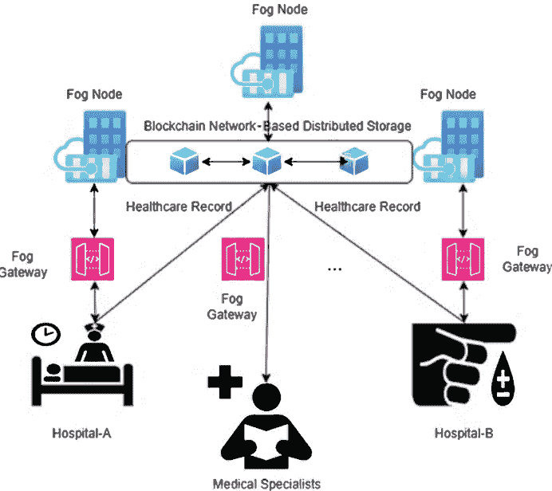

图 4.1 基于区块链的雾计算辅助智能医疗系统。

当前区块；使用 SHA 256 进行哈希。每个区块都包含其添加的时间戳，且区块大小是预定义的。工作量证明（Proof of Work）检查用户是否正试图干扰区块，需要由 IoT 设备进行检查，并且在区块添加到区块链之前必须经过验证。

SAN（存储区域网络）负责 IoT 设备的对点网络，旨在支持数据共享。为了确保安全性，遵循以下步骤：生成组密钥，使用 AES 进行安全共享，并使用安全哈希算法（SHA）查找哈希值。图 4.2 显示了系统的架构。

在云、边缘和雾服务中基于区块链的以信息中心的网络计算可以基于去中心化和安全的数据共享环境进行设计，这提高了云服务的效率。定义的架构有三层，即为终端用户提供接口的应用层、提供数据安全的区块链层以及提供路由服务的网络层。

## 使用 AI 优化边缘和雾计算应用

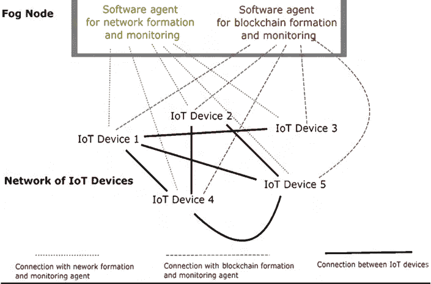

图 4.2 系统模型。

与传统的云系统相比，该系统提供了更高的安全性、效率和透明度。整个系统的集成取决于智能合约，它还提供了服务的自动化。在雾计算中，大部分工作在边缘设备上完成，这些设备侧于数据存储的计算。通常，边缘设备在功率和内存方面受到限制。

区块链对包括 IoT 设备在内的以信息中心存储的影响提供了系统的整体安全性。另一个影响是它催生了商业模式，有助于数据货币化为组织和个人产生收入。

这些网络的一些局限性是它们在交易中使用大量区块会导致系统变慢并产生延迟。另一个局限是不同系统之间的互操作性导致了安全担忧。

接下来，基于区块链的边缘计算也可以用于工业网络。工业 4.0 需要基于边缘的分布式资源来维护实时工业过程。它利用多接入边缘计算和 5G 技术为本地应用提供高性能。

所提的工作由三部分组成：与区块链服务集成的 IoT 边缘网络、雾网络和云网络。案例研究讨论了涉及各种承包商和分包商的智能建筑建设。建筑商进一步分配承包商的各种任务。该用例的主要要求是需要低延迟服务、信任的数据共享、优化的可扩展性、安全的过程监控、安全的卸载和经过的访问控制。

这里使用的各种元素是本地设备级提供的不同类型的 IoT 节点。接下来是 IoT Cluster，包括根据协议提供服务的分包商。与其他网络节点相比，边缘节点拥有更多资源。系统使用轻级区块链模型进行数据共享。雾节点在处理数据方面比其他节点具有更多能力。它使用中心云进行存储。图 4.3 显示了系统的架构。

另一个系统使用 Hyperledger fabric 来跟踪医疗数据的哈希。这些值使用 SHA256 算法计算，以定义数据的认证。Hyperledger fabric 基于区块链系统，它是开源的并使用即插即用的组件。Hyperledger fabric 一同共识在保护模式下维护数据。它还支持对点网络并维护公共账本以记录交易。

该架构包含三层：智能合约、共识和分布式账本。雾层充当终端用户和云层之间的连接层，并支持分布式计算将外围节点连接到云端。雾层在数据源节点处理数据以简化系统的架构。它还与 Hyperledger fabric 连接。图 4.4 显示了系统的架构。哈希值在云端计算并与账本值进行比较。

系统的流程如下：首先，雾从 IoT 设备收集数据。接下来，在雾端计算哈希值并与原始数据通过 Hyperledger 传输到云端。接下来，云端计算数据的哈希值并与 Hyperledger 值进行比较。如果两个值匹配，则没有发生数据篡改。

该模型表现出由于私钥生成而涉及额外成本开销。

下一个问题是关于启用雾资源访问服务。考虑到比特币系统，开发了一个区块链系统来维护分布式数据库，使用数据结构记录所有区块以防止数据被篡改。

智能合约是一种促进不信任双方之间达成协议的软件，它们不依赖第三方运行。当智能合约与雾资源结合时，它们为每个节点提供去中心化的认证和资源授予。订阅者通过解密访问密钥访问资源。

## 图例

- IoT 集群/分包商
- 边缘节点
- 本地区块链/私有链
- 雾节点/承包商
- 雾区块链/公链
- BLE/LoRA/WiFi
- 3G/4G
- 4G/5G/有线

### 全局网络

### 本地（IoT-边缘）网络

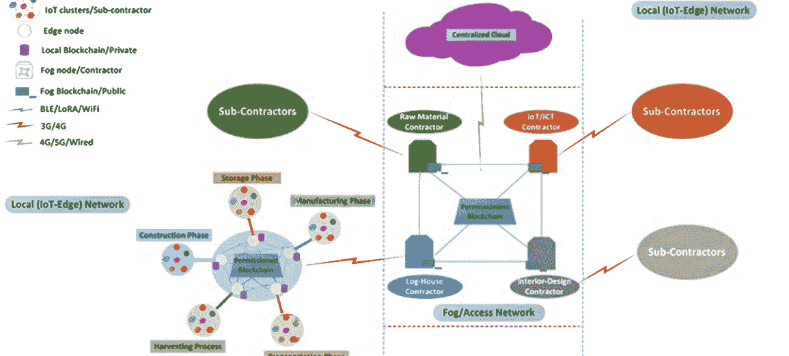

分包商

分包商

原材料承包商

IoT/JCT 承包商

存储阶段

制造阶段

### 本地（IoT-边缘）网络

施工阶段

许可区块链

无许可区块链

木木屋承包商

室内设计承包商

分包商

收割过程

运输阶段

雾/接入网络

## 基于区块链的安全数据共享系统 ■ 75

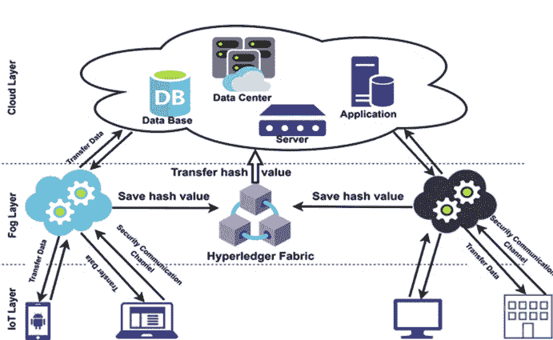

**图 4.4** 雾计算与 Hyperledger 的集成。

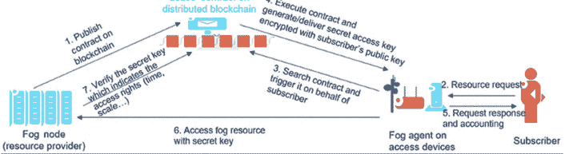

**图 4.5** 部署在接入设备上的雾代理。

智能合约动态部署用于资源授予。多个以太客户端组成一个区块链，并将设备传输到以太节点。图 4.5 显示了基于此概念构建的合约。调用者向提供者发送少量数字币以履行协议，然后自动生成秘密代码，然后用调用者的地址进行加密。执行者的签名在合约确认时被采取。

下一个系统描述了移动边缘计算中的假检测。系统从社交媒体平台收集数据并检测假数据。该系统还使用自然语言处理（NLP）方法构建特定的单词。

系统构建在三层：处理社交媒体新闻的边缘层，以及使用传输控制协议（TCP）的下一层。下一层是服务器层，接收源层的消息。第三层是边缘层，使用卸载技术确定假数据。这里使用的技术消除了标点以识别单词。最后，发送到云端，并使用预训练的 BERT（双向编码器表示）来检测假数据和原始新闻。架构如图 4.6 所示。


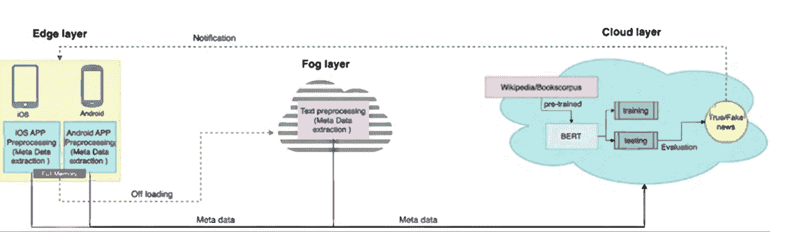

图 4.6 EdgeFNF 系统架构。

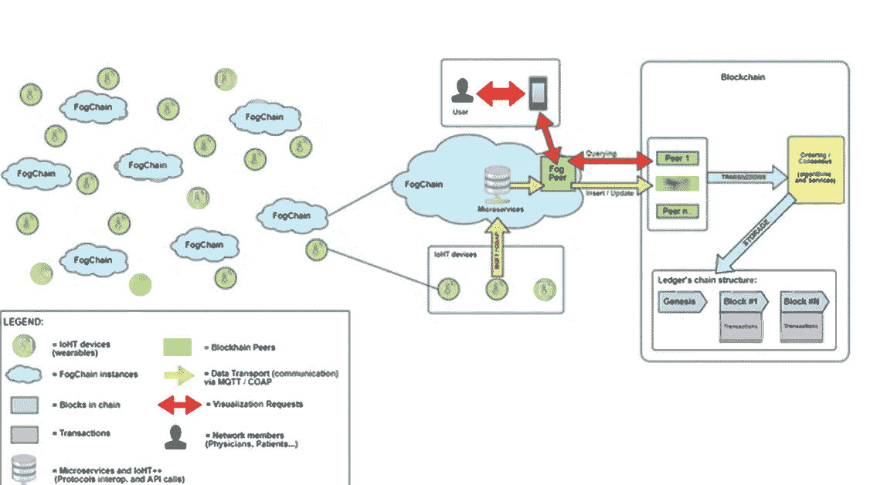

图例：

- IoT 设备（可穿戴设备）
- 区块链节点
- FogChain 实例
- 通过 MQTT / COAP 进行数据传输（通信）
- 链中的区块
- 可视化请求
- 交易
- 网络成员（医生、患者……）
- 微服务和 IoT++（协议互操作性与 API 调用）

图 4.7 FogChain 可视化。

用法。其他节点也可以交换它们使用情况并在彼此之间建立通信。

该架构包含三层：第一层是设备层，包含 IoT 设备；第二层是分布式雾计算层，它靠近 IoT 设备。该层靠近边缘，以提高设备的可扩展性和可靠性。这些节点通过区块链技术连接，并建立了点对点网络。智能合约的使用确保了每个节点都能平等参与网络。此外，雾操作系统（OS）虚拟化用于应用程序的部署。

网络维护一个分布式注册表，用于存储所有运行应用程序的日志。它包含了 IP 地址、端口以及运行程序所需的资源规范。系统包含一个监控器和一个管理器。监控器检查集群中每个节点的状态，并在发生策略不符时警告管理器，而管理器则检查系统中虚拟化的工作情况。该架构如图 4.8 所示。

下一个系统模型描述了具有容错能力的、结合雾计算的 IoT 设备区块链系统。该架构包含六个实体：第一个是数据所有者，负责定义访问策略并管理网络中设备的注册。

第二个实体是用户，他们向 IoT 网络发送请求，负责加密，如果交易通过智能合约验证有效，则获取授权令牌。

第三个实体是区块链，用于存储网络策略并管理雾节点。网络中的所有活动都以去中心化的方式进行管理。

第四个实体包括雾节点，它们提供雾服务和虚拟化，以降低延迟并提高系统提供的服务质量。

第五个实体包括 IoT 设备，每个设备映射到雾节点以检查容错性，且其处理能力有限。

最后，云代表第六个实体，它聚合来自雾节点的数据。

系统工作原理如下：数据所有者通过提供密钥认证与区块链关联，并将加密转换为智能合约策略。接下来，IoT 设备在网络中注册。随后，提交用户进程以生成请求，该请求被重定向到区块链以检查请求的有效性。系统包含负载均衡机制以高效利用资源。负载均衡通过使用 min-min算法来实现。系统防止中间人攻击、重放攻击和 DDoS 攻击。系统的整体架构如图 4.9 所示。

### 云层

### 分布式雾计算层 (HIDRA)

雾节点

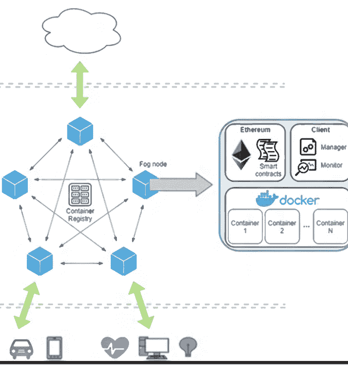

### 设备层

图 4.8 使用 HIDRA 的系统模型。

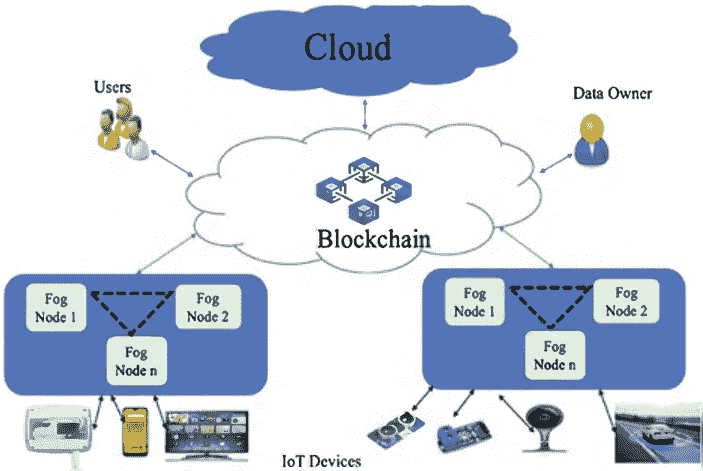

图 4.9 具有容错能力的系统架构。

### 4.4 结论

区块链与雾-边缘计算的结合为 IoT 环境中获取去中心化且高效的数据共享提供了一种全面的方法。传统的云系统存在如安全漏洞、单点故障、带宽限制和延迟等局限性。这些基于区块链的系统在解决传统系统缺点方面显示了改进空间。在本章中，我们研究了区块链如何通过去中心化方法为雾环境的数据安全提供解决方案。我们检查了架构框架、共识算法、安全机制和智能合约功能，以实现 IoT 节点之间可信且不可篡改的数据交换。

## 参考文献

- 1. Hemant Kumar Aparat, and Bibhudatta Sahoo, “Blockchain Assisted Fog Computing for Secure Storage for IoT Applications,” Journal of Industrial Integration, 42, 739–751, 2024.
- 2. Debasis Mahapatra, Sourav Kumar Jena, Soumya Ranjan Nayak, and Ankansa Seninha, “Security Scheme to Support Fog-Based Internet of Things,” Microprocessors and Systems, 89, 45–55, 2022.
- 3. Pranav Zambade, Ititali Panchal, and Ankit Chlouhan, “Blockchain Unleashed: Empowering Information-centric Cloud, Fog and Edge Service,” In 14th International Conference on Computing and Networking Technologies (ICCNT), pp. 1–6, 2023.
- 4. Manish Kumar Gupta, Rajendra Kumar Devi, “Blockchain-Based Secure and Efficient Scheme for Medical Data,” IEEE Transactions, 10(5), 231–251, 2023.
- 5. Gang Liu, Jinsong Wu, and Wang, “Blockchain-Enabled Fog Resource Access and Intelligent and Converged Networks, 2(2), 108–114, 2021.
- 6. M.N. Aman, K.C. Chua, and B. Sikdar, “Mutual Authentication in IoT Systems Using Unconditional Functions,” Internet of Things Journal, 4(5), 1327–1340, 2017.
- 7. Sawan Ali, and Feras M. Awyesha, “EdgeFNF: Toward Real-Time Detection on Mobile Edge Computing,” In Seventh International Conference on Fog and Mobile Edge Computing (FMEC), pp. 1–3, 2022.
- 8. C. Patel, “Secure Lightweight Authentication for Multi User Environment,” arXiv preprint:2220.10533, 2022.
- 9. Andre Henri Mayer, Vinicius Ricardo, Cristiano Da Rocha, Alex Rocha, and Rodolfo Stoffel, “FogChain: A Fog Computing Architecture Integrating Blockchain and Internet of Things for Personal Health Records,” IEEE Access, 9, 7223–7237, 2021.
- 10. Carlos Perez-Gomez, Carmen, and Blanca Caminoero, “HIDRA: A Distributed Blockchain-Based Architecture for Fog/Edge Computing,” IEEE Access, 9, 5231–5251, 2021.
- 11. Ruhul Amin, S.K. Hafiz Ismail, Muhammad Khurram Khan, Arijit Karati, Debasis Gari, and Sarum Kumari, “A Two-Factor RSA-Based Robust Authentication for Multiserver Environments,” Security and Communication Networks, 7(1), 598–611, 2017.
- 12. Oussama Mounna, Abdelkim Ouatassim, Otman Manad, Tarik Hidar, Abnas El Kabul, Noureddine Ibnafar, “Privacy-Aware Authentication Based on Blockchain with Fault Tolerance for IoT Edge Computing,” In Fifth International Conference on Fog and Mobile Edge Computing (FMEC), pp. 347–352, IEEE, 2020.
- 13. Shyamalendu Kand, and Abhishek Ghosh, “Smart Card Based Remote User Authentication in Multierver Environment using Chebyshev Map,” Wireless Personal Communications, 133(4), 2657–2685, 2024, 10.1007/s11277-024-10895-w.
- 14. Shuan Sun, Weixin Bian, Dong Xie, Deqin Xu, and Yi Huang, “Lightweight and Privacy-Preserving Multi-server Authentication Scheme Based on PUF and Biometrics,” Journal of Intelligent and Fuzzy Systems, 45(1), 911–928, 2023, 10.3233/JIFS-221354.
- 15. Y. Liu, J. Zhang, and J. Zhan, “Privacy Protection for Fog Computing and the Internet of Things Data Based on Blockchain,” Cluster Computing, 2020.
- 16. P.K. Sharma, and J.H. Park, “Blockchain-Based Secure Mist Computing Network Architecture for Intelligent Transportation Systems”, IEEE Transactions on Intelligent Transportation Systems, 22(8), 5168–5177, 2020.
- 17. T.A. Oyewobi, S. Misra, and C. Lal, “Mobility as a Service (MaaS) Enabled Fog Computing: An Innovative for Smart City Infrastructure,” Journal of Ambient Intelligence and Humanized Computing, 10(1), 1–17, 2019.
- 18. T.A. Rahoof, and V.R. Deepthi, “HealthChain: A Secure Health Care Data Management System Using BC,” In Proceedings of International Conference on Distributed Computing and Internet Technology, 2020, pp. 380–391.
- 19. G. Li, M. Dong, L.T. Yang, K. Ota, J. Wu, and J. Li, “Preserving Edge Knowledge Sharing among IoT Services: A BC-Based Approach”, IEEE Transactions on Emerging Topics in Computational Intelligence, 4(5), 653–665, Oct. 2020.
- 20. P. Gope, and B. Sikdar, “Lightweight and Privacy-Preserving Two-Factor Authentication for IoT Devices,” IEEE Internet of Things Journal, 6(1), 580–589, 2018.
- 21. G. Srivastava, J. Crichigno, and S. Dhar, “A Light and Secure Healthcare Blockchain for IoT Medical Devices,” 2019 IEEE Canadian conference of electrical and computer engineering (CCECE) (pp. 1–5). IEEE., 2019.


# 第5章

# 使用机器学习模型保障物联网安全

Arbaz Adib Dalwai, Shivani Jaswal 和 Rohit Verma

物联网（IoT）可以被描述为革命性技术之一，因为它连接了事物、数据和云，以提高运营效率和集成性。但这种扩展的环境给 IoT 环境带来了严重的弱点，使其暴露在各种类型的网络威胁之下。在这些威胁中，分布式拒绝服务（DDoS）攻击相当独特，因为它们会淹没网络资源，导致服务无法运行。此类威胁不仅影响依赖 IoT 的操作或渐进控制，还会损害云平台 [1]。防火墙和入侵检测系统（IDS） [2] 等常见的安全解决方案已经在减少许多漏洞方面发挥作用。然而，攻击手段的不断进步要求在 IoT 背景下更强大、更智能的安全防护。由于传统的模式匹配在 IoT 架构有限带宽和计算能力的范围内，实时分析和分类变化的攻击方面存在局限性，因此必须切换到一种更好且对攻击更具韧性的系统。这些局限性促成了构建混合系统的必要性，该系统将先进的机器学习 [3]（ML）模型与 IDS 和安全信息和事件管理（SIEM）等系统技术相结合，以提高对 IoT 网络中 DDoS [4] 攻击的检测和区分能力。通过将基于规则和基于机器学习的方法集成到云环境中，系统的整体检测能力可以得到大幅提升。

为了应对动态云环境中不断演变的威胁格局带来的挑战，本研究调查了以下问题：

使用 SIEM、IDS 和机器学习模型的云端实时安全监控系统如何自适应且有效地区分类针对 IoT 设备的 DDoS 攻击？

本研究的首要目标是设计并实现一种混合安全解决方案，该方案将基于规则的检测与机器学习模型相结合，以增强系统准确识别模式的适应性，并最终保障 IoT 设备的安全。该研究将在仿真环境下进行测试来评估系统性能，仿真将模拟真实环境，以确定其能够实时检测和分类威胁。

图 5.1 展示了所提系统的核心组成部分。

本研究旨在通过几个关键点为网络安全领域做出贡献，例如展示 SIEM、IDS 和机器学习模型的实际集成：

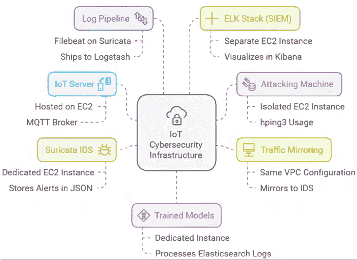

图 5.1 网络安全威胁检测布局。

旨在创建一个混合检测框架，该框架能够通过防御 DDoS 等攻击保障 IoT 系统。通过 Kibana 仪表板提供视觉告警，本研究提供了实时洞察，帮助分析师做出更好的决策。尽管有这些贡献，研究并非没有限制。实验设置依赖模拟攻击流量，可能无法完全捕捉攻击的复杂性，这要求未来在更复杂的设置下测试该框架。

本章结构如下：5.2 节介绍了相关工作，详细说明了该领域现有研究的分析。5.3 节介绍了方法论概述，包含研究框架和实验计划的信息。5.4 节介绍了设计规范，5.5 节讨论实现，侧重于研究的技术方面。5.6 节提供了由实验结果和讨论组成的评估。最后，5.7 节总结本章并提出未来的改进方向。

### 5.2 相关工作

网络安全领域在过去几年中经历了巨大变化，集成了 SIEM 和 IDS 等先进工具进行实时威胁检测 [2,6]。此外，传统的网络安全实践也取得了许多进展，其中引入了机器学习模型。这些技术在不同攻击的检测和监控技术的整体增强中起着至关重要的作用。接下来的小节将讨论为本研究进行的文献综述。关键领域包括用于实时监控的 SIEM 和 IDS 的、IoT 系统及其相关的攻击/安全挑战，以及用于 DDoS 检测的机器学习模型实现。文献综述为本研究的方法论和实现部分奠定了基础。

#### 5.2.1 网络安全中的 SIEM、IDS 和机器学习模型

许多近期研究已彻底调查了 SIEM 和 IDS 解决方案的使用，定义了这些工具在云安全领域的重要性。Tuishime 等人（2023）[7] 的研究提出了一种基于 SIEM 的方法，通过虚拟机、负载均衡器和 Web 应用防火墙等组件进行云环境的威胁监控，以便建立日志分析的中心点。它特别强调了 SIEM 在生成自动告警以缩短响应时间方面，同时尝试评估框架在处理大量数据时的扩展性。然而，它主要关注系统架构和运行效率，在识别特定攻击类型方面的工作非常有限。Granadillo、Zarzosa 和 Diaz（2021）[8] 通过对现有 SIEM 解决方案进行全面分析（包括其功能、优势和局限性），进一步扩展了这一理解。它主要关注在网络安全基础设施中集成 SIEM 的必要性，同时也指出了解决方案必须面临的挑战。同样，Lee 等人（2017）[9] 的研究扩展了这些观点，设计了一种用于云端安全即服务（SeCaaS）的 SIEM 架构。该研究描述了在将 SIEM 系统适配于云原生应用时的关键因素，包括扩展性、灵活性和多租户性。然而，这项研究缺乏用于在真实场景中测试系统的评估集。

为了进一步改进 SIEM 技术，Ayu 等人（2024）[10] 提出了将机器学习与 SIEM 集成的概念，以改进传统基于规则系统的缺陷。研究人员使用随机森林（RF）分类器在 CSE-IDS-2018 数据集上实现了异常检测，该数据经过了主成分分析的预处理。尽管结果良好，但该研究未在实时数据上评估模型性能，且仅关注一个特定的数据集。同样，Saeed 等人（2022）[3] 提出了一种为云环境定制的机器学习 IDS，通过整合多种算法（如朴素贝叶斯分类器、决策树分类器、支持向量分类器、逻辑回归和 RF 分类器）来分析网络流量并检测异常。该研究强调实施机器学习技术可以降低误报并增强云基础设施中 IDS 的检测能力。而 Innab 等人（2024）[11] 展示了云环境中的不同安全攻击，评估了应对这些攻击的不同 IDS 类型和技术，将 IDS 分为基于签名、基于异常、基于混合和其他方法，并分析了它们在处理和检测安全事件方面的有效性。他们的研究指出，基于签名的攻击可以有效检测已知威胁，但无法检测未知威胁；基于异常的攻击以检测未知威胁而闻名，但误报率较高；而混合方法平衡了两者并提供了更高的检测准确率。尽管这项研究很全面，但缺乏任何实际实现来展示研究结果。

#### 5.2.2 IoT 设备

在 Munshi 等人（2020）[12] 的研究中，作者解释了 IoT 设备对 DDoS 攻击日益增长的敏感性，以及 IoT 网络扩展所带来的严重安全风险。该论文概述了集成 IoT 设备如何提高设备的可用性和功能，而这些


攻击者所应对的新型威胁和风险。它强调了基础性风险，例如识别和识别设备交互协议的方法不当或无效，这使得 IoT 设备在 DDoS 攻击期间面临着与其他接入设备同等水平的风险。反，为了解决这些问题，作者建议通过改进身份验证机制、安全协议和网络监控来构建和增强安全性，以便能够识别并实时中和攻击。这项工作对于 IoT 场景下的威胁研究具有特别的相关性，同时强调了使用动态方法应对 DDoS 攻击风险的重要性。此外，这些发现与本研究的目标相匹配，并为考虑基于 IoT 的系统的 DDoS 威胁向量和设计检测方法提供了理论背景。

#### 5.2.3 DDoS 检测机制

针对 DDoS 检测的广泛研究表明，已经有多种使用 SIEM 和机器学习（ML）技术来应对这种日益复杂的攻击的方法。Cakmakçı 等人（2021）[13] 提出了一个通过 SIEM 检测各种类型 DDoS 攻击的框架。它包含了 SIEM 内部的事件检测引擎，用于识别攻击模式。它还拥有一个推理引擎，可以在检测后自动建议响应和恢复步骤，从而缩短对正在进行的攻击的反应时间。未来对该框架的研究可以在多样化的网络环境中测试时，增强该系统的检测能力 [13]。使用极端梯度提升（XGBoost）对基于聚类的局部离群因子（LOF）进行特征工程进行补充，用于检测 DDoS 攻击。该模型在 CIC-IDS 2017 和 CIC-IDS 2018 上进行了实现和测试，实现了 99.99% 的准确率和 100% 的精确率。然而，其有效性尚未在动态环境中得到测试。同样，Chen 等人（2018）[15] 使用 XGBoost 算法检测软件定义云环境中的 DDoS 攻击。提出的模型在检测正常和恶意流量方面具有高水平，，证明了使用 XGBoost 的有效性。它还表明 XGBoost 能够有效处理动态云环境中的大量数据。探索具有不同流量和攻击类型的真实世界噪声数据的影响，将真正测试本研究所缺乏的性能。总而言之，这些研究突显了 SIEM 和高级机器学习模型（尤其是 XGBoost）在提高 DDoS 检测方面的效率。

### 表 5.1 现有技术发现

| 方面 | 发现 | 识别出的差距 | 研究贡献 |
|---|---|---|---|
| SIEM 和 IDS | SIEM 被认为是事件管理的关键组件，而 IDS 提高了检测率。 | 机器学习模型与 SIEM 和 IDS 的集成不足，不足以创建新的混合系统。 | 将机器学习模型与 SIEM 和 IDS 结合，以提高整体检测率。 |
| DDoS 检测 | 从机器学习模型（RF 和 XGBoost）获得的结果在识别 DDoS 攻击方面具有更高的准确率。 | 模型未在真实动态数据上进行测试，因此扩展性受到质疑。 | 设计了一个用于云环境中 DDoS 检测机器学习模型进行实时评估的框架。 |
| 循环出现的差距 | 缺乏实时实验，且基于规则的预测与基于机器学习的方法结合不充分。 | 在实时条件下对混合系统中的结果评估不足。 | 提出了一种在实时云设置中集成基于规则和基于机器学习的预测的系统，并评估其有效性和扩展性。 |

### 5.2.4 总结

本节探讨了针对 SIEM、IDS 和高级机器学习技术在各种环境（尤其是云环境）中检测包括 DDoS 在内的不同攻击的现有研究。表 5.1 简要列出了其他发现的总结，同时提出了本研究可以提供的解决方案。

### 5.3 研究方法论

本研究采用实验和定量的方法论设计，其中对攻击的受控模拟、使用 SIEM 和 IDS 进行监控和分析反映了实验方面，而收集的日志的数值性质以及使用机器学习模型和评估指标对其进行分析则类似于定量方面。所设计的系统同时使用了基于规则和基于机器学习的检测技术，以识别和分析 DDoS 攻击。该方法论被结构化并分为以下标准研究类别。

设计了一个由三个主要部分组成的实验方法——模拟攻击、监控网络活动和检测机制——以有效回答所述的研究问题。

第一部分包括对 DDoS 攻击的模拟。攻击通过 Amazon Web Services (AWS) EC2 实例上的攻击设置启动，模拟设计的设计旨在反映真实世界的威胁场景。DDoS 攻击专门针对托管在 EC2 实例上的 IoT 服务器，使用来自攻击机制中 docker 服务的 `hping3` 命令生成了海量流量。这台服务器是用于 MQTT 代理上构建 IoT 设备的同一台服务器。攻击模拟步骤经过设计和实施，以便在 IDS 上生成并捕获大量的网络活动日志。

如前所述，第二部分是实时监控云环境中的所有活动。对于开源 IDS Suricata，它被部署在与 IoT 服务器相同的虚拟私有云 (VPC) 中的 EC2 实例上，通过 AWS 上的流量镜像确保 IDS 能够捕获设计中描述流量的所有日志。IDS 包含了所有新兴的威胁规则，确保 IDS 是最新的。为了确保 IDS 能够检测设计中的流量，涵盖了所有新兴威胁规则。Filebeat 也在同一实例上进行了安装和配置，以将日志发送到 ELK（Elasticsearch, Logstash 和 Kibana），这确保了 SIEM 收到的日志是经过处理的。


## 表 5.2 元数据

| 捕获字段 | 理由 |
|--- | --- |
| 源 IP (src_ip) | 网络流量的源头 |
| 目的 IP (dest_ip) | 目标系统或服务 |
| 源端口 (src_port) | 与源应用程序关联的端口 |
| 目的端口 (dest_port) | 目标攻击的服务，TCP/IP(端口 1883) 预留给 MQTT 使用 |
| 协议 | 使用的网络协议（例如 TCP 和 UDP）。 |
| 时间戳 | 记录活动的精确时间 |
| 事件类型 (event_type) | 分类网络活动的性质，是告警、流还是正常 |
| 发到服务器的字节数 (bytes_toserver) | 发送到目标服务器的总数据量 |
| 发到服务器的数据包 (packets_toserver) | 发送到目标服务器的数据包数量 |

准备工作涉及对存储在 Elasticsearch 中的原始 JSON 日志进行清洗和特征工程，以确保用于训练模型的数据是准确的。该过程从从原始 JSON 日志中过滤字段开始。在协议、源 IP、目的 IP、源端口、目的端口、发到服务器的字节数、发到客户端的字节数、数据包和发到客户端的数据包等特征被认为对于检测 DDoS 攻击至关重要。这些字段包含了网络流量的源和目的、流量大小以及数据包数量：对于扫描带有攻击的大流量至关重要。这些数据组合后可用于有效的威胁检测。然后使用 pandas 将其组织成表格格式。这一过程确保了数据适用于训练和进一步分析。此外，应用了数值编码将 IP 地址等类别特征转换为数值表示。这是通过自定义函数完成的，确保了数据的一致性并与 ML 模型兼容。`src_port` 和 `dest_port` 等特征由于其整数结构被予以保留。缺失值通过分配默认值或排除不完整的记录来处理。这很重要，因为它确保了生成的数据集能够为分析提供一致且可靠的数据数据。

然后将其标记为相应的模拟攻击场景。数据主要被标记分为两类：DDoS 和正常。DDoS 日志根据高流量模式（例如 `bytes_toserver` 超过 29,000 且 `packets_toserver` 超过 650）进行识别和标记，这是 SYN 洪水攻击或其他容量型攻击模式的特征，而其余数据被标记为正常。一旦数据完全准备好进行分析，它们就会被分为训练集和测试集，确保没有不平衡。还对特征进行了标准化处理，以便将数据放入正确的格式以增强模型性能。因此，使用清洗和预处理过的数据来训练 RF 和 XGBoost 模型，以确保有效的评估。清洗和标记的数据集成了在 DDoS 检测背景下对模型进行准确评估的基础。

### 5.3.4 实验设置

该设置完全在 AWS 上设计和执行，确保了环境的完全控制和隔离，因为它涉及攻击模拟、实时日志收集以及随后的评估。接下来将解释该设置的主要组件。

- IoT 服务器：托管在 EC2 实例上的 IoT 服务器运行着 MQTT 代理器，它是管理 IoT 设备通信的重要组件。它是一个在 IoT 设备及其应用程序之间进行轻量级、实时消息交换的代理器。选择 MQTT 代理器是因为在 IoT 环境中，它是一个广泛接受的 IoT 设备操作中心。对 IoT 设备进行了模拟以反映真实体验，例如智能传感器和智能设备。Node-RED 是一种广泛使用的基于流的开发工具，用于视觉编程，主要用于 IoT 应用。该设置模拟包含了虚拟设备，这些设备会报告温度传感器、湿度传感器和运动检测器的位置。这些设备被设置为持续向 MQTT 代理器发送数据，为实验目的创建了一个真实的 IoT 生态系统。MQTT 代理器是 IoT 生态系统的核心，任何由于 DDoS 攻击导致的中断都可能导致 IoT 设备故障，从而影响实时操作。出于此原因，该代理器被选为 DDoS 攻击的首选目标。图 5.2 Node-RED 设计设置在 IoT 服务器的端口 1880 上，模拟了虚拟 IoT 设备。

- Suricata IDS：它部署在专用的 EC2 实例上，用于监控网络相关的实时流量。这不仅捕获并分析恶意和正常流量，还会生成日志并将其存储为 JSON 格式以便进一步处理。

- 流量镜像：虽然 IoT 服务器和 IDS 实例部署在同一个 VPC 内，但需要额外的配置来建立它们之间清晰的连接，以确保 IDS 捕获来自这些源的网络流量，并配置了流量镜像以建立和维护这种连接。

## 使用 AI 优化边缘和雾计算应用

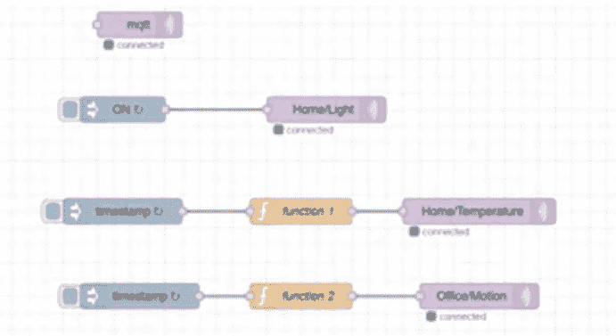

图 5.2 Node-RED 上的虚拟 IoT 设备。

- 日志流水线：为了数据的平滑无缝传输，filebeat 在 Suricata 实例上进行了部署和配置。它用于将来自 IDS 的日志实时存储到 Logstash 实例。Logstash 在发送并存储到 Elasticsearch 之前对数据进行处理和结构化。这种流为数据传输提供高效的方法。
- ELK 栈 SIEM：这再次部署在单独实例上，负责运行 Elasticsearch、Logstash 和 Kibana。此处 SIEM 的主要功能是集中维护来自 IDS 的日志，在 Kibana 中对规则集触发的告警进行可视化处理，并将其显示在仪表板上。它不仅输入来自 IDS 的数据，还输入来自 ML 模型实例的数据并进一步显示其预测结果。
- 训练模型（EC2 实例）：部署了一个独立的专用实例来运行训练模型，它可以从 Elasticsearch 获取数据，根据训练模型进行分类，并将预测结果索引回 Elasticsearch。
- 攻击机器：部署了一个独立的实例来生成网络流量，当上述设置显示检测功能时，该实例在隔离的环境上通过 hping3 命令模拟攻击。


Node-RED 和 MQTT 代理、用于监控网络流量的 IDS（入侵检测系统）、用于集中日志记录和可视化流量的 SIEM 系统，以及最后通过其自适应能力增强系统检测能力的 ML 模型。

该设计优先考虑了解决方案的可扩展性和自适应性，这使得系统能够处理实时流量并支持多种检测策略。该设置完全在 AWS 上进行实现，是因为其具有极高的灵活性和强大的计算资源，这对于模拟真实攻击场景以及无延迟地分析网络流量活动至关重要。

### 5.4.2 架构概述

5.3 显示了设计系统的架构，主要由五个 AWS EC2 实例组成，分别负责处理 IoT 服务器、Suricata IDS、ELK 堆栈 SIEM、训练过的 ML 模型（RF 和 XGBoost）以及攻击机的功能。所有实例必须相互连接，以实现它们之间的无缝交互，从而实现实时威胁检测。方案的执行还允许系统根据实验目的进行完全隔离和控制。IoT 服务器托管 Node-RED 上的虚拟 IoT 设备，并与 MQTT 代理通信作为 DDoS 攻击的主要目标，因为它代表了任何 IoT 设置中不可或缺的一部分。攻击机通过 Docker 容器用于模拟 DDoS 攻击，该容器使用 `ping3` 命令生成 SYN 和 UDP 洪水攻击。流量镜像通过在 IoT 服务器和 IDS 之间建立镜像会话（mirror session）在 AWS 上完成。这种方法确保了对资源的完整监控。Suricata IDS 负责分析这些捕获的流量并为所有网络活动生成详细日志。这些日志在 filebeat（一种轻量级传输器）的帮助下传递到 SIEM 服务器，在其中日志被索引并在实时仪表板中显示。ML 模型部署并运行在 EC2 实例上，并将它们连接到 SIEM 以进行实例检测。这种连接有助于 SIEM 将日志发送到实例，模型可以在那里对 DDoS 和正常流量进行分类并预测攻击。在 Elasticsearch 内部，维护着两个不同的索引：一个用于 Suricata 生成的基于规则检测，另一个用于 ML 模型分析的日志。这些索引有助于划分来自两个源的结果，确保了全面的分析。最后，Kibana 被用可视化层，为基于规则和基于 ML 的检测结果提供更具吸引力的仪表板。作为生成系统告警的核心组件，仪表板赋予了管理员系统活动的可视性，并暴露可能的攻击及其趋势和分类，这对于管理网络活动非常有用。

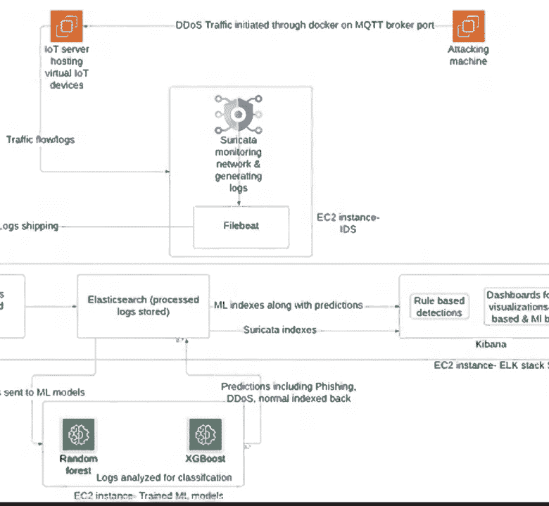

图 5.3 系统架构。

## 使用 AI 优化边缘和雾计算应用

所选的所有工具和技术均符合当前网络安全领域的需求，确保研究设置在实施实际案例的同时，保持良好的学术相关性。

- Suricata (IDS)：该 IDS 作为一个开源且高度自定义的系统，在执行实时网络流量分析方面表现出色。它能生成捕获网络活动的详细日志，这是研究的首要需求。它还支持新兴的威胁规则集，不仅可以对 DDoS 和攻击模式进行实时检测，还可以检测数百种其他攻击。由于所有这些优势，特别是由于其高效处理海量数据的能力，其原生的多线程技术使其成为比其他开源 IDS（如 Snort IDS）更好的选择 [17] (Waleed, Jamali and Masood, 2022)。
- ML 模型 (RF 和 XGBoost)：两者均为集成学习模型，提升了分类率并能显著减少过拟合。虽然 RF 是一种通常用于处理大型数据集的稳健 ML 模型，但 XGBoost 在不平衡数据集上提供了优的性能，考虑到它们的速度和有效性，两者都是实时环境中自适应检测的理想选择。
- Node-RED：Node-RED 具有基于流的界面且用户友好，被选择用于模拟 IoT 设备，因为它有助于快速原型设计和 IoT 数据流可视化。它提供了一个简单的平台来创建真实设备的功能（如温度传感器、运动检测器和湿度监测器），并将它们保存到 MQTT 代理。
- MQTT 代理：MQTT 代理的主要优势是其专为人工设备和低带宽高延迟环境设计的轻级协议；因此它被选为 IoT 通信的枢纽。与基于 HTTP 的通信不同，MQTT 提供了开销更低的消息，适用于设备密集的 IoT 场景。
- AWS EC2 实例：由于上述工具需要大量的计算能力和存储来处理并充分满足其需求，因此为它们提供基础非常重要，而 EC2 实例凭借其巨大的扩展性和灵活性提供了一次性部署多个组件的能力。它也有助于为我们的系统分配弹性 IP。
- ping3：这是一个非常灵活的命令行工具，可以生成不同强度的自定义数据包以模拟攻击 (Arifin et al., 2021) [18]。

### 5.4.4 设计考虑与限制

在设计整个系统时，真实性、可扩展性和适应性之间的平衡是核心。可扩展性被优先考虑，因为系统必须处理模拟攻击期间产生的大流量；这些流量需要被处理以给出实时结果。因此，使用 AWS EC2 实例变得至关重要，因为它为部署具有不同计算需求的组件提供了灵活性，例如用于攻击服务器和其他机器的轻量级实例，以及用于 IDS 和 SIEM 的高性能、高存储实例。此设置完全位于 AWS 环境中，确保模拟攻击不会对外部系统产生任何问题。在攻击机上部署了 Docker 容器以区分两种攻击的流量源。这使得能够控制流量生成，而不会出现日志交叉污染的问题。下一个需要构成的大项是真实性，因为整个设置必须复制真实世界的攻击场景。MQTT 代理的使用模拟了 IoT 设备与其中心枢纽之间发生的实际通信。此外，系统包含了 Suricata 针对新兴威胁的规则集，系统终止 DDoS 攻击的能力得到了增强，并良好地配备了行业标准。

在完成这些工作时，实施过程中出现了一些挑战，这些挑战需要被解决和克服以建立一个弹性系统。最初，实现了 AWS lambda 和 AWS Sagemaker 来部署 ML 模型。但由于配置和连接问题，以及由于 IAM 限制引起的问题，这种方法不可行，因此被采用 EC2 实例的方法取代。此外，对于 ML 模型，早期阶段面临的另一个大问题是模型最初是在样本数据集上训练的，但 IDS 生成的原始日志与现有的样本数据集完全不同。

各种资源，这导致了巨大的特征不匹配，使得需要根据从实验设置获取的原始 JSON 日志数据集对模型进行重新训练。数据集与实时预测之间的对齐，获得的结果是无与伦比的。filebeat、Logstash 和 Elasticsearch 之间的连接问题通过反复试验和测试得到了解决，确保了日志传输流水线的准确运行。EC2 实例在处理海量数据时的资源限制已通过提升/升级实例类型并找到能够平衡系统负载的准确类型得以解决。这些考虑因素和限制总体构成了整个系统的架构，产生了一个健壮且可靠的设计。

### 5.5 实现

#### 5.5.1 基础设施搭建

表 5.3 显示了配置了特定角色和资源分配的 EC2 实例。

#### 5.5.2 详细配置

- Suricata 配置：将 Suricata 作为入侵检测系统（IDS）部署在 Ubuntu 上的专用 t3.micro 实例上，存储空间为 17 GB。所有主配置均在自定义的 `suricata.yml` 文件中修改。该实例还被设置为镜像目标，以从 IoT 设备获取清晰的镜像会话。这些服务器的 IP 已添加到 Suricata 配置文件的 Home Net [20] 部分，使其能够顺畅地捕获流量。随后，通过 `suricata-update` 命令从 IDS 中的 Emerging Threat 点导入了规则集，以确保 IDS 的检测能力到位。这包括涵盖了多种攻击模式的关键规则，特别是识别在 SYN 洪水攻击和 UDP 洪水攻击场景下的 DDoS 攻击 [21]。所有这些规则都在系统中被提升并激活。

- Filebeat 配置与集成：Filebeat 部署并配置在 IDS [22] 服务器上，由于其轻量级方法，它将 `eve.json` 日志转发到 SIEM [19] 服务器中的 Logstash。这主要通过通过 `sudo filebeat enable Suricata` 启用 filebeat 上的 Suricata 模块来实现。通过这种方式，Suricata 日志被自动解析并结构化，消除了在 `filebeat.yml` 文件中自定义输入配置的需求。然而，必须在 `filebeat.yml` 中设置输出配置，指向 IP 为 35.172.58.180 的 Logstash 服务器，该服务器在端口 5044 上监听数据。这允许 filebeat 转发结构化日志。

表 5.3 EC2 实例

| 组件 | 实例名称 | 弹性 IP | 实例类型 | 角色 | 配置细节 |
| :--- | :--- | :--- | :--- | :--- | :--- |
| IoT 服务器 | IoT devices | 54.81.38.135 | t3.micro | 托管 IoT 设备 | 使用 Node-RED 和 MQTT 代理模拟 IoT 设备。 |
| IDS 服务器 | IDS server | 34.192.113.33 | t2.micro | 监控网络流量 | 配置了新兴威胁规则。部署了 filebeat 并连接到 SIEM。 |
| SIEM 服务器 | SIEM server | 35.172.58.170 | t3a.large | 托管 Elasticsearch, Logstash 和 Kibana | Logstash 接收数据。Elasticsearch (端口:9200)，Kibana (端口:5601)。 |
| 训练模型服务器 | ML models | 52.30.159 | t3.micro | 运行训练模型 | 连接到 SIEM 实例以获取日志并推送预测。 |
| 攻击机 | Attacking machine | 3.226.63.94 | t2.micro | 模拟 DDoS 攻击 | 通过 docker 使用 hping3 进行 DDoS 攻击。 |

- Logstash 配置与集成：Logstash 在整个 SIEM 服务器中着重要作用，因为它监听来自 filebeat 发送的原始日志并将其传输到 Elasticsearch。所有通信都定义在 Logstash 中的 `filebeat-suricata.conf` 文件中。配置主要分为输入（input）、过滤（filter）和输出（output）三部分，用于有效处理 Suricata 日志。输入部分描述了在端口 5044 上监听 Json 日志，与 filebeat 配置中的输出部分对齐。接下来，在过滤部分，它识别并处理告警类型的事件。文件的输出部分定义为将日志发送到托管在同一 SIEM 服务器上的 Elasticsearch，端口为 9200。这些日志被索引索引在一个命名为 `suricata-logs-*` 的单独索引模式中。通过指定格式为 `index => suricata-logs-%[YYYY.MM.dd]`，该文件还确保每天创建一个带有不同日志的单独索引。此配置通过使用命令对流水线进行密集测试，并检查实时日志是否在 Elasticsearch 中被索引进行了验证。

Elasticsearch 和 Kibana 配置：Elasticsearch 部署为单节点集群。它被配置为监听端口 9200 上的所有网络接口 (0.0.0.0)，以便接受来自本地主的连接。这对于确保与其它 SIEM 组件（如 Logstash 和 Kibana）的无缝连接至关重要。增加了 `xpack.security` 模块以支持通过 API 密钥进行身份验证和安全访问。另一方面，Kibana 也配置为绑定所有网络接口作为服务器，其 `server.host` 设置为端口 5601 上的 0.0.0.0，以便从任何系统通过网络与 Elasticsearch 交互进行访问。虽然 Elasticsearch 和 Kibana 初始化配置为开发使用的本地主机，但这些参数已通过更改以修复分式集群结构。Elasticsearch 通过 API 密钥访问其功能和安全性。（注：原文此处存在大量重复噪声，翻译已根据逻辑进行了清理）。

- 攻击模拟设置：攻击机实现在一个 AWS EC2 实例 (t3.micro) 上，带有运行 `ping3` 工具的 Docker 容器。该工具用于目标 IoT 服务器的端口 1883，使用 `ping3 -S p 1883 -flood 54.81.38.135`。该命令从 容器 `4laabe808e3` 执行以隔离攻击流量。攻击指向位于 IoT 服务器上的 MQTT 代理，通过攻击分配给它的端口并使用 SYN 洪水向目标发送尽可能多的 SYN 数据包。这种方法使得模拟看起来像是 IoT 通信协议可能被利用的实际场景。因此，当流量从攻击机器镜像时，Suricata 会接收所有日志。

## 评估

本部分将从多个方面评估实现的 IoT 实时安全系统的性能和可靠性：系统性能（描述检测机制的效率和稳定性）和检测准确性（显示基于规则和基于机器学习的方法在识别 DDoS 攻击方面的有效性）。结果针对检测时间、系统可靠性和分类性能等指标进行了分析，并与研究目标保持一致。

### 5.6.1 系统性能

图 5.4 显示了单个事件的检测时间，显示检测时间大多在 0.2 ms 到 1.0 ms 之间波动。检测机制在整个过程中保持一致，没有出现显著的峰值或延迟。


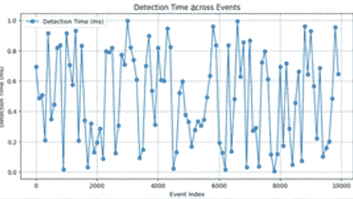

**图 5.4** 跨事件检测时间。

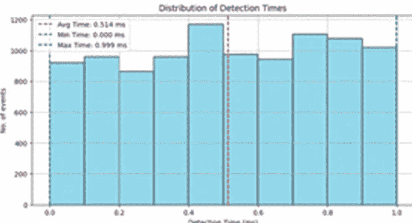

**图 5.5** 检测时间的分布。

整体检测时间保持在适当的毫秒级范围内，这表明系统能够快速处理事件。此外，即使检测时间存在波动，最高 1.0 ms 的上限也反映了其实时响应能力。系统处理海量数据并持续保持最小检测时间线的能力，与实时监控的研究目标一致。结果中所示的这种一致性能提升了系统的可靠性。

### 表 5.4 RF（随机森林）分类报告

| 指标 | 精确率 (Precision) | 召回率 (Recall) | F1 分数 | 支持数 (Support) |
|---|---|---|---|---|
| 良性 (0) | 0.97 | 0.99 | 0.98 | 3760 |
| 攻击 (1) | 0.96 | 0.94 | 0.95 | 6240 |
| 准确率 | | | | 10000 |
| 宏平均 (Macro Avg) | 0.97 | 0.97 | 0.97 | 10000 |
| 加权平均 (Weighted Avg) | 0.97 | 0.96 | 0.96 | 10000 |

精确率：随机森林模型具有高精确率，特别是对于良性 (0)，这意味着它在实际为攻击时，很少将其预测为良性。

召回率：它很好地捕捉了良性样本 (99%)，但漏掉了一些攻击（攻击 (1) 的召回率为 94%）。该模型对良性案例敏感，确保了正常流量很少被标记为攻击。

### 表 5.5 XGBoost 分类报告

| 指标 | 精确率 (Precision) | 召回率 (Recall) | F1 分数 | 支持数 (Support) |
|---|---|---|---|---|
| 良性 (0) | 0.98 | 0.98 | 0.98 | 3760 |
| 攻击 (1) | 0.95 | 0.96 | 0.95 | 6240 |
| 准确率 | | | | 10000 |
| 宏平均 (Macro Avg) | 0.96 | 0.97 | 0.96 | 10000 |
| 加权平均 (Weighted Avg) | 0.97 | 0.97 | 0.97 | 10000 |

精确率：XGBoost 优先考虑了良性 (0) 和攻击 (1) 的精确率，能够以极少的误报略好地识别真实攻击。

召回率：它对两类类别保持了平衡的召回率，确保攻击和良性流量都能被准确标记。

图 5.5 展示了检测时间的频率分布，范围从 0.0 ms 的最小时间到 0.999 ms 的最大时间，平均检测时间为 0.514 ms。这里的重要发现是突显了监控系统检测事件的效率。对于 10,000 个事件的数据集，低检测得分也反映了系统的扩展性，表明其能够高效地处理大规模工作负载。这一评估描述了系统检测机制的稳健性。即使事件中还包含高密度流量流（如 DDoS 模拟），系统仍然可以在不产生性能下降的情况下处理这些情况。

- RF – 表 5.4 展示了 RF 的分类报告。
- XGBoost – 表 5.5 展示了 XGBoost 的分类报告。

### 表 5.6 模型间的主要差异

| 特性 | 随机森林 (Random Forest) | XGBoost |
|---|---|---|
| 优势 | 对良性场景敏感（对正常流量的误报率低）。 | 攻击与良性检测之间平衡良好。 |
| 整体准确率 | 96% | 97% |

### 标签分布：DDoS 与良性

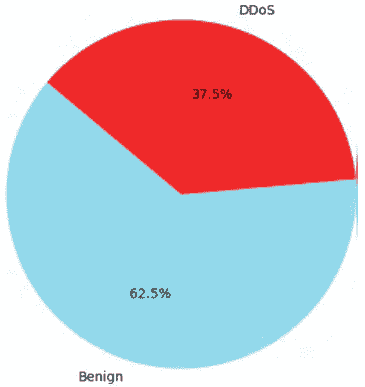

**图 5.6** 标签分布：DDoS 与良性。

表 5.6 显示了模型之间的主要差异。

### 5.6.3 检测事件分布（机器学习预测）

图 5.6 的饼图描述了基于机器学习预测的检测事件分布。这些预测来源于不同时间段的数据集，确保了在反映实时日志分析的动态输入数据时保持准确性，这与训练模型时静态数据集不同。该图显示了机器学习模型的准确发现，即考虑到 DDoS 攻击产生的巨大流量，DDoS 占了所分析总日志的 37.5%，而 62.5% 被归类为良性。这种视觉化展示了机器学习模型的能力，证明了它如何在模拟物联网网络中区分恶意流量和正常流量。良性流量和攻击流量的使用使得数据集更加平衡，避免了结果过于乐观。这种平衡验证了模型的稳健性，证实了其在处理大量良性流量的同时，能够准确检测 DDoS 攻击。该图还突显了模型跨不同数据集（实时日志）的适应能力。


## 使用 AI 优化边缘和雾计算应用

该研究探索了使用自适应方法对云端环境进行监控以检测威胁。虽然该研究展示了混合系统的潜力，但也暴露了与研究相关的若干局限性。攻击场景是在受控环境中进行的，未能捕获实际环境中可能发生的所有攻击变体。

- 真实世界集成：尽管我们的系统设计为在真实世界条件下运行，但目前仅通过仿真实现，因此，通过真实网络流量日志来验证系统至关重要，以捕捉数据中的不可预测性和多样性。这可以通过与组织合作，从这些组织获取大量的真实日志来实现。

- 自适应学习模型：系统的未来发展可以通过集成自适应模型来实现，这些模型将根据不同的网络活动或攻击模式进行动态更新。这将使得系统在识别零日攻击方面更加可靠。

- 商业化潜力：所提出的框架足够健壮，通过开发用户友好界面并对系统进行商业化封装，可以部署在中小型企业，因为它可以为他们提供一种可靠、可扩展且具有成本效益的防御策略。

## 参考文献

- 1. Korkos, R. (2023) Powering the Growth of Cloud Computing: Infrastructure Challenges and Solutions. Available at: www.forbes.com/councils/forbestechcountil/2023/07/24/powering-the-growth-of-cloud-computing-infrastructure-challenges-solutions/ [Accessed 25 November 2024].

- 2. Ahmadi, S. (2024) ‘Network Intrusion Detection in Cloud Environments: A Comparative Analysis of Approaches’, International Journal of Advanced Computer Science and Applications (IJACSA), 15(3), 2024. http://dx.org/10.14569/IJACSA.2024.015301

- 3. Saed, M. S., Saurabh, R., Basheme, S. R. and Nazarov, A. N. (2022) ‘Machine Based Intrusion Detection System in Cloud Environment’, in 2022 International Conference on Information Technology and Nanotechnology (ITNT). Samara, Russia Federation, 23-27 May 2022, pp. 1–6. https://doi.org/10.1109/ITNT55410.2022.9846811

- 4. NCCS (2024) Traffic GeneratorDDoS Tool. Available at: https://nccs.gov.in/public/events/DDoS%20Presentation%2017092024.pdf [Accessed 15 October 2024].

- 5. Oracle (2023) Design Guidance for SIEM Integration. Available at: https://docs.oracle.com/en-us/iaas/Cloud-adoption-framework/siem-integration.html?u [Accessed 27 November 2024].

## 使用 ML 模型保障 IoT 系统安全

- 6. Proofpoint (2024) Community Alert: Ongoing Malicious Campaign Impacting Microsoft Azure Cloud Environments. Available at: https://www.proofpoint.com/us/blog/cloud-security/community-alerting-malicious-campaign-impacting-azure-cloud-environments [Accessed 25 November 2024].

- 7. Tuisime, E., Balan, T. C., Cofas, P. A., Cofas, D. T., and Rekeraho, A. (2023) ‘Enhancing Cloud Security–Proactive Threat Monitoring and Detection Using a SIEM-Based Approach’, Applied Sciences, 13(22), 12359. https://doi.org/10.3390/app132212359

- 8. González-Granadillo, G., González-Zarzosa, S. and Diaz, R. (2021) ‘Security Information and Event Management (SIEM): Analysis, Trends, and Usage in Critical Infrastructures’, Sensors, 21(14), 4759. https://doi.org/10.3390/s21144759

- 9. Lee, J.-H., Kim, Y. S., Kim, J. H. and Kim, I. K. (2017) ‘Toward the SIEM architecture for cloud-based security’, in 2017 IEEE Conference on Communications and Network Security (CNS). Las Vegas, NV, 09–11 October 2017, pp. 398–399. https://doi.org/10.1109/CNS.2017.822869

- 10. A, A., Erlangga, D., Mantoro, T. and Handayani, D. (2024) ‘Enhancing Security Information and Event Management (SIEM) by Incorporating Machine Learning for Cyber Attack’, in 2023 IEEE 9th International Conference on Computing, Engineering and Design (ICED). Kuala Lumpur, Malaysia, 07–08 November 2023, 102328

- 11. Innab, N., Atoum, I., Alghaday, F., Abu-Zanoona, M., Alrubayi, N. and Basudan, F. (2024) ‘Intrusion Detection Systems in Cloud Computing: Techniques and Opportunities’, in 2024 3rd International Conference on Computer Applications & IoT (ICAS). Riyadh, Saudi Arabia, 26–28 February 2024, pp. 1–5. https://doi.org/10.1109/ICCR6006.2024.1053293

- 12. Munshi, A., Alqani, N. and Abdullah Ali, M. (2020) ‘DDoS Attack on IoT Devices’, in 2020 3rd International Conference on Computer Applications & Security (ICAS). Riyadh, Saudi Arabia, 19–21 March 2020, pp. 1–5. https://doi.org/10.1109/ICAS45589.2020.3090681

- 13. Çakmak, S. D., Hustchenreuter, H., Mader, C. and Kemmerich, T. (2021) ‘DDoS Attack and Response using SIEM’, in 2021 IEEE International Conference on Communications (ICCW). Montreal, QC, 14–17 June 2021, pp. 1–6. https://doi.org/10.1109/ICCW5038.97619

- 14. Dhahir, S. (2024) ‘A Hybrid Approach for DDoS Detection in SDN’, Journal of Future Intelligence and Technologies, 1(2), 174–190.

- 15. Chen, Z., Jiang, F., Cheng, X., Liu, W. and Peng, J. (2018) ‘Configuring Rule of Intrusion Detection System in IoT’, in 2018 IEEE International Conference on Big Data (BigComp). Shanghai, China, 251–256. https://doi.org/10.1109/BigComp4763.8984

- 16. Rochim, F. R. and Sunartyas, S. U. (2021) ‘Design an Intrusion Detection System Raspberry Pi for Home Network’, in 2021 17th International Conference on Quality in Research (QIR). Depok, Indonesia, 43–48. https://doi.org/10.1109/QIR354.9761

- 17. Arifin, S. H., Chong, J. L. and Wahab, N. H. (2021) ‘Configuring Rule of Intrusion Detection System in Cloud’, in 26th IEEE Asia-Pacific Conference on Communications (APCC). Kuala Lumpur, Malaysia, 298–303. http://doi.org/10.1109/APCC4927.5

- 18. Yasar, K. (2022) Elastic Stack. Available at: www.techtarget.com/searchopt/definition/Elastic-Stack [Accessed 20 October 2024].

- 19. [OCR 中未提供第 19 项的内容，已合并序列流]

- 20. Waldorf, A. (2022) 'Microsoft DDoS attack disrupted cloud services', TechTarget, 31 July. Available at: www.techtarget.com/searchsecurity/news/36659923/Microsoft-confirms-DDoS-attack-disrupted-cloud-services [Accessed 25 November 2024].

- 21. Waleed, A., Jamali, A. and Masood, A. (2022) 'Which open-source IDS?, Suricata or Zeek', Computer Networks, 213, p. 109116. https://doi.org/10.1016/j.comnet.2022.109116

## 第六章：协作预测性维护的联邦机器学习算法聚合策略

预测性维护（PdM）是工业 4.0 的组成部分，自动化、数字化转型和物联网（IoT）是升级工业过程的关键。PdM 通过利用实时传感器数据、云计算和高级分析来实现自动化决策过程，从而消除了对事后性维护和手动指令的需求。工业 4.0 的目标包括开发无需人工干预即可智能运行的自优化系统，这与此高度契合。此外，IoT 设备集成的无缝连接使得预测模型能够持续评估设备状况并建议预防措施。


生态系统确保企业在不断变化的技术背景下保持其竞争力 [1]。

非计划停机是工业领域面临的一个严重问题，经常会导致巨大的财务损失、运营延迟和声誉损害。预测性维护（PdM）通过在潜在设备故障发生前对其进行处理来降低这些风险，从而节省大量资金。例如，研究表明，非计划停机每小时可能给企业带来高达 260,000 美元的损失，而能源部门的故障（包括停电或轮机故障）可能导致数百万美元的收入损失。运输行业的设备故障会导致服务延迟、增加维护成本并中断关键的供应链。PdM 不仅降低了这些成本，还通过延长机械寿命和减少不必要的维修，实现了资源分配的最大化。

由于企业优先考虑成本效益，PdM 的经济效益使其成为可持续运营至关重要的策略。PdM 被应用于许多行业，每个行业都有自己的需求和困难。支持 IoT 的风力发电机可以跟踪温度、转速和振动等变量，允许在可再生领域早期识别发电机问题或叶片疲劳。类似地，电网中支持 IoT 的变压器和变电站可以预测过热或与电压激增相关的故障，确保电力供应并缩短维护时间。

在各种工业中，这些示例展示了 PdM 如何不仅提高效率，而且保证安全和可靠性。本章关注雾计算（Fog）和边缘（EDGE）计算环境中的 PdM，旨在对联邦学习（FL）内部的算法聚合方案进行彻底分析。探讨了最新文献中发现的解决方案，重点关注数据异构性、通信障碍和资源限制等关键问题。图 6.1 展示了用于协作 PdM 的 FL 架构，其中许多边缘设备（包括带有传感器的工业机器）是核心组成部分。

为了构建一个整合整个设备群知识的全局模型，中央服务器汇总所有参与设备的更新。为了确保每个人在不损害数据隐私的情况下从集体学习中受益，全局模型会被重新分配到边缘设备。在预测模型达到所需的准确度和可靠性水平之前，这种本地训练、中央聚合和全球传播的迭代过程会不断重复。组织利用 FL 架构，可以在遵守严格数据隐私规则的同时，改进其 PdM 方法并确保及时干预。如图 6.2 所示，在集中式 PdM 设计中，多个工业设备和传感器的数据被发送到单个服务器进行处理和分析。

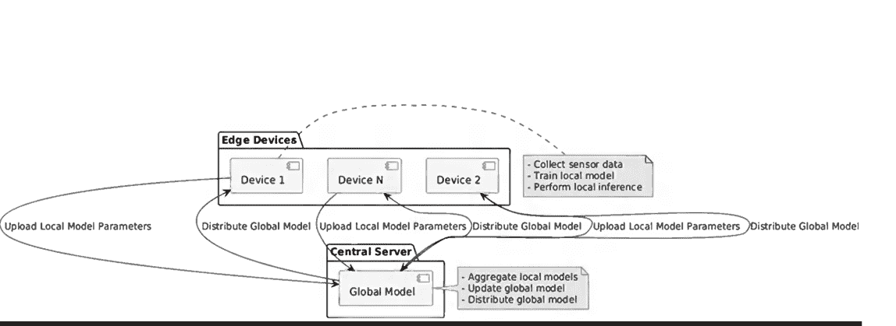

图 6.1 用于预测性维护的联邦学习。

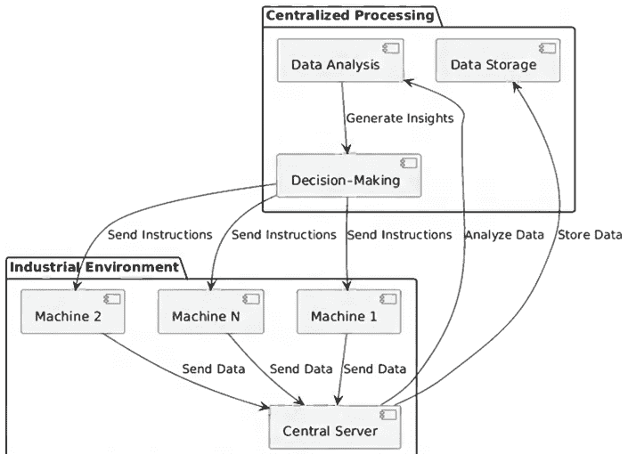

图 6.2 集中式预测性维护。

在智能电网或工厂装配线等高频数据环境中，将原始数据传输到中央服务器进行处理，然后将可操作的见解返回给边缘设备可能是极其耗费时间的。在 实现中，网络可靠性和带宽限制进一步加剧了延迟问题。基于边缘的 PdM 解决方案可以在靠近源头的地方处理数据，并以最小延迟提供实时见解，这些限制凸显了它们的必要性。传统的 PdM 技术通常依赖集中式学习模型，由中央服务器处理来自多个设备和传感器的原始数据。

尽管这种综合分析是可能的，但它引发了严重的隐私和安全问题，特别是在处理敏感数据的医疗和关键基础设施等部门。此外，集中式系统增加了存储和传输过程中发生数据泄露的可能性，这在具有严格合规性要求的环境中（如《通用数据保护条例》 GDPR [2]）尤为棘手。此外，集中式基础设施可能无法处理现代工业系统中 IoT 设备产生的海量数据，这可能导致瓶颈和系统效率下降 [3]。这些挑战凸显了 FL 等去中心化策略的必要性，这些策略可以在促进强大的预测性分析的同时，保持数据本地化。

### 6.1.1 延迟问题

由于数据处理和传输过程中产生的延迟，集中式 PdM 系统在及时决策方面能力受限。在需要迅速采取行动以避免设备故障或安全问题的工业环境中，这种延迟可能会产生灾难性的影响 [4]。例如，在智能电网或工厂装配线等高频数据环境中，将原始数据传输到中央服务器、进行处理并将可操作的见解传给边缘设备的时间可能是无法接受的 [5]。此外，在跨越遥远位置的 IoT 实现中，网络稳定性和带宽限制加剧了延迟问题 [6]。这些缺点强调了基于边缘的 PdM 系统的必要性，这些系统可以在更靠近源的地方处理数据并以极小的延迟提供实时见解。

如图 6.3 所示，在集中式 PdM 架构中，来自多个工业机器和传感器的数据被发送到中央服务器进行处理和分析。由于处理延迟和数据传输，这种集中式解决方案可能会引入显著延迟。这在需要实时决策以避免安全问题或设备故障的情况下尤为棘手。此外，在跨越遥远位置的 IoT 实现中，网络稳定性和带宽限制加剧了延迟。

### 6.1.2 资源限制

由于工业 IoT 设备产生大量数据，集中式 PdM 解决方案通常需要大量的处理存储能力。边缘或雾设备的处理能力有限，这是一个问题，特别是在资源受限的环境中 [7]。集中方法显著增加了管理计算负载和维护安全数据中心的成本。向中央服务器持续传输数据会导致高能耗和网络带宽压力，这对于许多企业来说是不可持续的 [9]。这些局限性强调了 FL 等轻量级去中心化技术的必要性，以便保持 PdM 效率的同时最大化资源消耗，因为集中式系统在分布式和资源受限的应用中实用性较低。

在图 6.4 所示的系统中，大量 IoT 设备持续将大量的运行数据传输到中央服务器进行分析。为了处理这些输入的数据流，这种集中方法需要中央服务器具备大量的处理能力和存储空间。

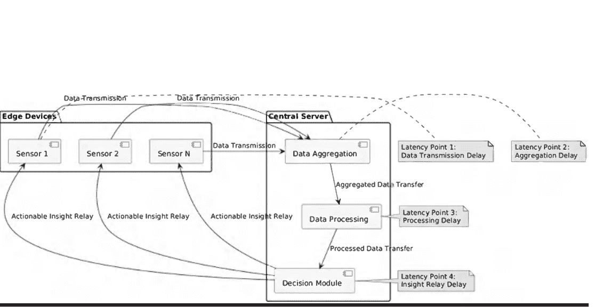

图 6.3 集中式预测性维护中的延迟。


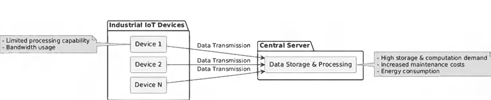

图 6.4 集中化预测性维护中的资源限制。

在分布式和资源受限的环境中，集中化系统的实用性较低，这凸显了轻量化去中心化技术（如 FL）的必要性，以便在保持 PdM 功效的同时最大化资源利用。

### 6.2 联邦学习：协作预测性维护的范式

在许多行业中，PdM 已成为提高效率和减少机时间的关键组件。传统的 PdM 技术通常依赖于集中数据采集和分析，这引发了数据安全、隐私和延迟问题。通过允许在多个设备或组织之间进行模型训练而无需共享原始数据，FL 作为一种解决这些问题的范式脱而出。FL 允许个人在 PdM 背景下在其本地数据上训练模型，仅与中央服务器共享模型参数。除了保护数据隐私外，这种去中心化的策略还利用每个人的集体智能来创建可靠的预测模型。通过将 FL 集成到 PdM 策略中，组织可以实现更准确、及时的预测，从而采取主动维护措施并节省成本。

#### 6.2.1 预测性维护概述

为了在故障发生前识别出可能的故障，PdM 是一种主动方法，它使用数据分析工具和技术来识别运行过程和设备中的异常。通过在最方便的时间安排维护任务，这种方法使企业能够最大限度地减少意外停机并降低运营成本。PdM 的实施是对机器使用多种传感器进行的持续观察，这些传感器收集温度、振动、压力和其他相关指标等变量的信息。这些数据经过复杂的分析和机器学习算法处理，以预测设备故障并优化维护计划 [10]。由于机器学习的使用，PdM 在近年来变得更加有效。

传统的维护技术，如反应性维护和在预定间隔时间进行的预防性维护，可能会导致不必要的维护任务或计划之外的设备故障机。相比之下，PdM 使用数据驱动的洞察来预测故障，在延长设备使用寿命的同时，还增强了运行效率和安全性 [11, 12]。工业物联网（IIoT）的出现进一步加速了 PdM 的使用。IIoT 使机器和设备能够无缝连接，从而更容易实时收集和分析海量数据。这种连接使得对设备状态和功能的更精确预测成为可能，产生更好的维护计划。

#### 6.2.2 FL 在 PdM 中的应用具有若干优势

FL 通过将原始数据存储在本地设备上并通信模型参数，解决了数据安全和隐私问题。这对于处理敏感数据的行业至关重要。

- 减少带宽占用和延迟：该方法通过传输模型参数降低了设备与中央服务器之间传输的数据量，从而减少了带宽占用和延迟。
- 可扩展性：FL 通过允许 PdM 系统跨多个设备和位置进行扩展，消除了对集中数据存储库的需求。近期，人们研究了将 FL 集成到 PdM 系统中。例如，Ahn 等人 [13] 提出了一种一维卷积神经网络-双向短期记忆网络（1DCNN-BiLSTM）模型，用于检测制造过程中的时间异常并执行 PdM。

该模型通过将双向 LSTM 与一维卷积神经网络相结合，有效地从序列化数据中提取特征并识别异常。研究表明，通过将此模型与 FL 框架相结合，可以有效地进行 PdM。所提出的框架测试准确率达到 97.2%，在实际应用中显示出前景。Pruckovskaja 等人 [14] 在另一项研究中评估了质量控制和 PdM 背景下几种 FL 聚合技术的有效性。数据本身以及其在客户端之间的分布情况对 FL 的成功有重大影响。FL 有时可以作为传统集中或本地训练技术的有效替代方案。

为了给 FL 在工业环境中的实际应用提供有用见解，该研究还展示了一个来自真实质量检查计的新 FL 数据集。还提出了一种使用旋转机械振动传感器进行状态监测和 PdM 的 FL 技术 [15]。该方法通过在靠近观测计算机的边缘设备上进行分布式训练，保护了数据隐私并减少了网络负载。使用真实数据集进行评估发现，该方法在大幅降低资源和网络利用的同时，提供了与之前结果相当的竞争性能。

这些研究证明了 FL 如何通过解决数据隐私问题、降低延迟和增强可扩展性来改进 PdM 系统。然而，为了充分利用 FL 在 PdM 应用中的益处，必须仔细考虑包括数据异构性、通信开销以及边缘和雾计算环境中的资源限制在内的问题。

图 6.5 联邦学习 (FL) 聚合策略。

对每个客户端都是最好的。为了解决这个问题，人们创建了复杂的聚合方法。例如，GFedAvg 算法通过在聚合之前根据数据相似性对客户端进行分类改进了 FedAvg [18]。收集每个组内的模型更新，并通过组合组级聚合结果来更新全局模型。通过这种方式，在聚合期间相似的数据分布被考虑在一起，这应该增强非 IID（非独立同分布）情况下的模型性能。所选聚合方法对 FL 过程的有效性、稳健性和收敛性都有很大影响。

### 6.3.1 基础聚合算法

FL 是一种去中心化的机器学习技术，允许多个客户端协作构建全局模型，而不交换本地数据。通过允许个人数据源留在设备上，这种范式降低了与集中数据存储相关的风险，这在数据隐私至关重要的情况下特别有利。基础聚合方法 FedAvg 算法是 FL 的核心。在 FedAvg 的运行过程中，一组参与的客户端接收一个初始模型。然后，每个客户端使用私有数据进行本地训练，并在必要时调整参数。本地训练完成后，客户端将更新的模型参数传回中央服务器。

为了创建一个新模型，服务器通过计算加权平均来组合这些更新，权重通常取决于每个客户端的数据集。模型收敛到一个令人满意的性能水平，这一迭代过程持续进行。FedAvg 算法非常适合 FL，因为它有很多优点。首先，原始数据从未跨网络传输，通过保留本地数据提高了隐私保护。其次，由于客户端和服务器仅交换模型参数而非数据集，它降低了通信开销。这种有效性在带宽较低或客户端资源有限的环境下尤为关键。然而，FedAvg 也面临某些困难。一个问题是数据异构性，即数据在客户端之间并非均匀分布且独立（非 IID）。在这种情况下，在不同数据上训练的本地模型可能差异巨大，导致全局模型对所有客户的效果都不佳。此外，不同客户端的计算能力和参与率也会影响训练过程的稳定性和收敛。专家们对 FedAvg 提出了许多改进建议以解决这些问题。


### 6.3.2 高级聚合技术

联邦学习（FL）允许多个客户端在不交换本地数据的情况下共同训练一个公共模型，这作为一种去中心化的学习技术受到了广泛关注。通过允许单个数据源留在设备上，这种模式降低了与中心化数据存储相关的风险，这在数据隐私和安全至关重要的情况下特别有利。作为基础聚合方法，FedAvg 算法是联邦学习的核心。

服务器通过结合这些更新并计算加权平均值创建一个全局模型，通常基于每个客户端数据集的大小。这一迭代过程持续进行，直到模型收敛到合适的性能水平。由于具有许多优势，FedAvg 算法非常适合联邦学习。首先，它通过将数据保留在本地改进了隐私保护，因为数据从不过网络传输。其次，它降低了通信开销，因为客户端和服务器仅交换模型参数而非完整数据集。在带宽有限或客户端为资源受限设备的设置中，这一点至关重要。然而，FedAvg 确实面临困难。

客户之间的数据分布不是独立同分布的（非-IID），这是由数据异质性引起的一个主要问题。当这种情况发生时，在不同数据集上训练的本地模型可能会有很大差异，这导致全局模型对所有客户都不是最优的。多样化的客户参与率和计算能力也会影响训练过程的稳定性和收敛。学者们已经提出了这些困难，并对算法提出了若干改进。例如，某些方法添加了正则化技术以减少非-IID数据的影响，而另一些方法修改了聚合权重以考虑数据质量或客户端信任度。尽管有了这些进展，FedAvg仍然是联邦学习聚合策略的基石，为许多现代算法的发展提供了基础。

#### 6.3.2.1 FedProx

联邦学习实现了跨多个设备的去中心化模型训练，允许每个设备在其本地本地数据上进行训练，并与中央服务器共享模型更新。联邦学习中的一个重大挑战是系统异质性，即设备具有不同的计算能力和数据分布。这种变异可能会导致训练过程中出现不稳定和发散。为了应对这些挑战，引入了联邦近端（FedProx）算法。FedProx 通过在本地损失函数中引入近端项来修改标准的联邦学习目标。该近端项充当正则化因子，限制本地模型更新使其保持与当前全局模型参数接近。通过这种方式，FedProx 减轻了系统异质性的影响，确保本地更新不会过度偏离全局模型；FedProx 中的近端项由参数 $\mu$ 缩放，该参数控制正则化的强度。较大的 $\mu$ 允许更强调保持本地更新与全局模型一致，这在高度异质的环境中有益的 [20]。相反，较小的 $\mu$ 允许更显著的本地更新，这在设备具有相似的数据分布和计算能力时可能是有利的。这种灵活性使得 FedProx 能够适应不同程度的系统异质性，在本地适应与全局一致性之间取得平衡。实证研究表明，与传统的联邦学习算法相比，FedProx 提供了更稳健的收敛，特别是在异质性明显的设置下。通过允许设备执行可变的本地计算并引入近端项，FedProx 有效地解决了系统变异性带来的挑战，提升了联邦学习的性能和稳定性。

FedProx 算法通过在目标函数中引入近端项，解决了与系统和统计异质性相关的挑战。该近端项作为正则化因子，限制本地更新保持与全局模型参数接近，从而增强了训练期间的稳定性。例如，在一个协作开发患者入院预测模型的医院网络中，每个医院在其私有的患者数据上训练本地模型，并与中央服务器共享更新后的模型参数。由于患者人口统计和治疗方案的差异，医院之间的数据分布是异质的。FedProx 通过引入近端项减轻了这种异质性的影响，确保本地更新不会过度偏离全局模型，从而实现了网络范围内更稳健的收敛和改进的模型性能。

在联邦学习背景下，FedProx 算法通过向目标函数引入近端项解决了与系统和统计异质性相关的挑战。该近端项作为正则化因子，限制本地更新保持与全局模型参数接近，从而增强了训练期间的稳定性。例如，在一个协作开发患者预测模型的医院网络中，每个医院在其私有的患者数据上训练本地模型，并与中央服务器共享模型参数。由于患者人口统计和治疗方案的差异，医院之间的数据分布是异质的。FedProx 通过引入近端项减轻了这种异质性的影响，确保本地更新不会过度偏离全局模型，实现了网络范围内更稳健的收敛和改进的模型性能（图 6.6）。

## 使用 AI 优化边缘和雾计算应用


图 6.6 医疗领域的 FedProx

在联邦学习中，聚合来自非独立同分布（非-IID）数据的客户端模型面临着重大挑战。联邦匹配（FedMA）算法通过逐层构建全局模型来解决此问题。具体而言，FedMA匹配并平均隐藏元素——例如卷积层中的通道、LSTM 中的隐藏状态以及全连接层中的神经元——这些元素在客户端模型中具有显著的特征提取。通过对齐和组合这些类似的组件，FedMA 增强了全局模型在非-IID 设置下的性能。实证研究表明，在深度架构 [21] 上不仅优于 FedAvg 等传统联邦学习算法，而且减少了训练期间的通信开销 [22]（图 6.7）。

在联邦学习中，客户端异质性（源于本地数据分布和计算能力的差异）会导致模型更新不一致，不利收敛。为了解决这个问题，联邦标准化（FedNova）算法根据每个客户端执行的本地迭代次数对本地更新进行归一化，确保每个客户端对全局模型的贡献都经过适当缩放。这种归一化考虑了客户端计算的差异，在不同的客户端环境中实现了更一致、更稳定的收敛（图 6.8）。

客户端设备通常在计算能力和数据分布上存在显著差异，导致每个客户端在训练轮次中执行的本地更新次数存在不同。这种异质性会导致目标


图 6.7 FedMA 聚合模型


不一致性问题是指全局模型收敛到一个不匹配目标函数的驻点，这可能偏离真实目标。FedNova 算法通过对每个客户端训练过程中的本地更新进行归一化来解决这一问题。具体而言，FedNova 通过考虑每个客户端执行的本地更新次数来调整本地模型的聚合，消除了不一致性并保持了快速误差收敛。这种方法确保了全局模型能够准确反映所有客户端的贡献，无论其个体计算能力或数据异构性如何。

### 6.3.3 通过元启发算法进行优化

在联邦学习（FL）中，优化聚合算法对于平衡计算效率和模型性能至关重要，特别是在资源有限的情况下。为了改进这些聚合技术，使用了元启发算法（遗传算法，GAs）和粒子群优化（PSO）。PSO 从鸟群的社会行为中获得灵感，通过不断增强与特定质量相关的潜在解决方案来优化问题。PSO 可用于联邦学习以寻找最佳聚合权重，从而提高全局模型的准确性和收敛速度。联邦学习中本地模型的选择和组合也通过使用 GA 优化，GA 模拟了自然过程。

GA 能够通过进化候选解种群，高效地寻找平衡资源使用与性能的最优或近优聚合程序。元启发技术为改进 聚合提供了自适应且有效的方法，特别是在处理多样化数据分布和客户端特定处理资源时。在资源有限的背景下，聚合策略优化对于平衡计算效率和模型性能至关重要。鱼群或鸟群的社会行为为 PSO 提供了灵感。PSO 可应用于联邦学习，寻找将本地模型合并为全局模型的最佳权重。[23–27]

种群中的每个粒子都是权重的聚合，可能是一个解决方案。为了收敛到能够最小化预定义损失函数的理想权重，这些粒子根据自身和邻近的经验修改其位置。例如，当服务器客户端对全局模型做出贡献时，PSO 可以最大化每个客户端模型更新的贡献，提高收敛速度和准确性。通过选择、交叉和变异等操作在世代间演化解决方案，GA 复制了自然选择的过程。GA 能够以最优方式在联邦学习中选择和组合本地模型。例如，种群中的每个成员代表被选取聚合的客户端模型子集。通过迭代进化，GA 找到了某些子集，这些子集组合后可产生性能良好的全局模型。当由于资源限制或客户端数据质量差异难以选择最佳客户端模型子集时，这种方法特别有帮助。

全局目标函数 $F(w)=\sum p_k F_k(w)$，其中 $p_k$ 是客户端 $k$ 的相对贡献权重，$F_k(w)$ 是客户端 $k$ 的本地目标函数。元启发算法的目标是通过优化聚合权重 $p_k$ 来最小化全局损失 $F(w)$。PSO 中的粒子将其位置（权重）调整为受个体和集体影响的速度向量。通过迭代，GA 中的候选解决方案（聚合技术）被不断开发，以增强全局模型的性能。通过将元启发优化技术集成到联邦学习聚合策略中，可以在模型准确性与计算资源利用之间实现更高效的平衡，增强联邦学习系统的整体效果。

### 6.4 雾计算与边缘环境中的挑战

标准云计算的限制已通过雾计算和边缘计算得到，它们已成为新的范式，特别是对于需要实时处理和低延迟的应用。这些方法通过数据处理去中心化并将其置于靠近数据源的地方，提高了响应速度并降低了带宽消耗。然而，雾计算和边缘环境的分布式特性也带来了许多困难。在网络边缘部署雾节点暴露了敏感数据，使其成为网络攻击的潜在目标，引发了对数据隐私的严重关注。大量连接的设备和网关（每个设备都有自己的漏洞）使得安全问题变得更加糟糕。另一个重大问题是互操作性；广泛的边缘设备和雾节点通常缺乏既定协议，难以集成和工作。

此外，管理分布式基础设施引入了复杂性，需要强大的工具和技术来提高性能。为了让边缘计算系统能够有效运行，必须解决某些问题。

#### 6.4.1 数据异构性

边缘计算环境中的有效模型训练和收敛受到数据异构性的严重阻碍。网络去中心化的结构使得创建可靠的模型变得更加困难，因为设备提供了各种非 IID（非独立同分布）数据。聚类联邦学习（CFL）被提出作为解决这一问题的方案。通过对具有相似分布的设备进行聚类，CFL 能够在每个集群内训练专门的模型。这种方法根据每个集群的数据特征调整学习程序，提高了模型性能。例如，迭代聚类算法通过切换用户簇和优化每个簇的模型参数，高效地处理了联邦学习环境中的异构性。

#### 6.4.2 通信开销

边缘设备与中央服务器之间模型更新的迭代传输为边缘计算环境中的联邦学习带来了巨大的通信成本。在带宽有限的环境中，这种频繁的通信会对网络资源造成负担并增加延迟。模型压缩和梯度疏化等技术被开发用于减轻这些困难。梯度疏化通过只发送最重要的梯度，在不牺牲模型性能的情况下减少数据量。例如，在无线流量预测中使用梯度疏化可以在模型训练期间实现显著的数据压缩。通过降低设备与服务器共享的模型参数的大小，量化和编码等模型压缩技术进一步降低了通信成本。

#### 6.4.3 资源限制

边缘环境中的设备经常面临严格的资源限制，如内存、计算能力能量限制。这些限制使得执行联邦学习变得困难，因为联邦学习通常在通信和模型训练方面都需要大量的资源。针对这些困难，研究人员设计了选择参与和量化更新等方法，为资源有限的环境产生轻量级算法。通过降低模型参数传输时的精度，量化更新减少了服务器与设备之间交换的数据量。例如，通过为深度学习网络层分配不同的位宽，混合精度量化成功地平衡了资源使用与模型准确性。


通过根据本地数据重要性或当前资源可用性等因素仔细选择参与者。例如，自适应联邦学习系统可以允许边缘设备独立更新本地模型，从而适应间歇性连接和波动的资源限制。通过实施这些策略，联邦学习（FL）系统可以在雾节点和边缘设备上良好运行，鼓励在资源有限的环境下采用去中心化学习。

### 6.5 联邦学习在预测性维护中的应用

预测性维护（PdM）旨在通过分析从机械收集的数据来预测设备故障，从而优化维护计划并减少意外停机。联邦学习已成为该领域的一项关键技术，能够在保护数据隐私的同时，实现跨去中心化设备的协作模型训练。本节将探讨联邦学习在 PdM 中的应用，重点关注设备监控、故障诊断和能量优化。

#### 6.5.1 设备监控

在工业环境中，持续的设备监控对于维持运行效率至关重要。传统的集中式状态监测方法通常需要将大量的传感器数据传输到中央服务器，这给数据隐私和网络可靠性带来了挑战。联邦学习通过在机器附近的边缘设备上直接进行机器学习模型的去中心化训练，解决了这些问题。例如，Becker 等人 [29] 提出了一种基于自动编码器的联邦学习方法，利用旋转机械的传感器数据。这种方法实现了本地的分布式训练，允许在不共享原始数据的情况下跨组织边界进行传输，从而保护了隐私并减轻了网络负载。

#### 6.5.2 故障诊断

准确的故障诊断对于防止设备故障和确保安全至关重要。联邦学习通过在来自多个源的多样化数据集上训练鲁棒模型，且不损害机密性，增强了故障诊断。通过聚合来自各种工业环境的知识，基于联邦学习的模型可以获得更好的泛化和故障检测能力。这种协作方法允许识别在孤立数据集中可能无法发现的故障模式，从而实现更可靠、及时的故障诊断。

#### 6.5.3 能量优化

能量消耗是工业操作中备关注的问题，无论是从成本还是环境角度来看。联邦学习通过促进分析运行数据以识别节约机会的模型开发，有助于能量优化。通过在不同设施之间协作训练模型，组织可以发现导致能源消耗减少的最佳实践和操作调整。这种去中心化的方法确保敏感的运行数据留在本地，在解决隐私担忧的同时，促进了整个行业的能效实践。联邦学习通过为设备监控、故障诊断和能量优化提供协作、保护隐私的模型训练，为 PdM 提供了一种变革性的方法。它在工业环境中的应用不仅提高了预测模型的准确性，而且在不损害数据安全的情况下促进了组织协作。

### 6.6 主要研究空白与未来方向

联邦学习因其在不损害数据隐私的情况下实现协作训练的潜力而受到了广泛关注。然而，仍存在一些研究差距阻碍了其广泛应用和效率。本节深入探讨了需要进一步探索的三个关键领域：自适应聚合机制、增强的隐私措施和扩展性挑战。

#### 6.6.1 自适应聚合机制

在联邦学习中，中央服务器聚合来自分布式客户端的更新以形成全局模型。传统的聚合方法（如 FedAvg）通常假设类别之间的数据分布是同的。但在实际场景中，数据通常是非独立同分布（non-IID），导致模型性能欠优。为了解决这个问题，研究人员提出了考虑数据异性的自适应聚合技术。例如，Yeganah 等人 [30] 引入了反距离聚合方法，根据本地与全局模型参数之间的距离为客户端更新分配权重，从而减轻了离群值的影响并增强了收敛速度。

#### 6.6.2 增强的隐私机制

虽然联邦学习通过将原始数据留在本地设备上固有促进了数据隐私，但仍然存在漏洞，特别是关于从模型更新中重建敏感信息的推理攻击。为了加强隐私，研究人员探索了多种技术。差分隐私（DP）在模型更新中引入噪声，掩盖单个数据的贡献。安全多方计算（SMC）允许在不暴露个人输入的情况下进行协作计算。尽管有了这些进展，隐私与模型效用计算效率之间的挑战依然存在。最近的综述提供了这些隐私保护方法的全面概述，并强调了需要能够在联邦学习框架内有效整合 DP 和 SMC 的新型解决方案。

#### 6.6.3 扩展性挑战

扩展性仍然是联邦学习中的备受关注的问题，特别是在处理大量客户端和大型模型尺寸时。同步聚合方法可能会导致通信瓶颈和延迟增加，因为中央服务器必须等待更新。异步聚合提供了一个潜在的解决方案，允许服务器在客户端更新到达时立即更新全局模型，而无需等待。Nguyen 等人 [31] 提出了一种缓冲异步方法 FedBuff，它结合了同步和异步方法的优点。FedBuff 维护一个输入更新的缓冲区，在保持与安全聚合等技术兼容的同时实现了高效聚合。实验结果表明 FedBuff 增强了联邦学习的效率和扩展性。解决这些研究差距对于联邦学习在各个领域的进展和实际部署至关重要。未来的工作应侧重于开发稳健的聚合策略，在不损害模型性能的情况下增强隐私保护机制，并设计能够处理多样化大规模客户端网络的可扩展联邦学习架构。

### 6.7 结论

联邦学习已成为 PdM 中的一种变革性方法，能够在保护数据隐私的同时实现跨去中心化设备的协作模型训练。通过促进无需中心化数据存储即可进行的设备分析，联邦学习解决了与数据机性和网络可靠性相关的关键问题。研究已经证明了联邦学习在各种工业应用中的有效性。尽管 FL 固有地通过将原始数据留在本地设备上促进了数据隐私，但仍然存在漏洞，特别是关于可以从模型更新中重建敏感信息的推理攻击。为了加强隐私，探索了多种技术。隐私与模型效用和计算效率之间的挑战依然存在。提供了这些隐私保护方法的全面概述，并强调需要能够在 FL 框架内有效集成 DP 和 SMC 的新解决方案。扩展性仍然是 FL 中的一个备受关注的问题，特别是在处理大量客户端和大型模型尺寸时。同步聚合方法可能会导致通信瓶颈和延迟增加，因为中央服务器必须等待更新。异步聚合提供了一个潜在的解决方案，允许服务器在客户端更新到达时立即更新全局模型，而无需等待。Nguyen 等人 [31] 提出了一种缓冲异步方法 FedBuff，它结合了同步和异步方法的优点。FedBuff 维护一个输入更新的缓冲区，在保持与安全聚合等技术兼容的同时实现了高效聚合。实验结果表明 FedBuff 增强了 FL 的效率和扩展性。解决这些研究差距对于 FL 跨多个领域的进展和实际部署至关重要。未来的工作应侧重于开发稳健的聚合策略，在不损害模型性能的情况下增强隐私保护机制，并设计能够处理多样化和大规模客户端网络的可扩展 FL 架构。FL 已成为 PdM 中的一种变革性方法，能够在保护数据隐私的同时实现跨去中心化设备的协作模型模型训练。通过促进无需中心化数据存储即可进行的设备分析，FL 解决了与数据机性和网络可靠性相关的关键问题。研究已经证明了 FL 在各种工业应用中的有效性。

## 参考文献

- 1. McMahan, B., et al. (2017). Communication-efficient learning of deep networks. AIST.
- 2. Kairouz, P., et al. (2021). Advances and open problems in federated learning. Foundations and Trends in Machine Learning 14(1–210).
- 3. Zhao, Y., et al. (2018). Federated learning with non-IID data. NeurIPS.
- 4. Li, T., et al. (2018). Federated learning in heterogeneous networks. MLSys.
- 5. Yang, Q., Liu, Y., Chen, T. and Tong, Y. (2019). Federated learning: Concept and applications. ACM Transactions on Intelligent Systems and Technology (TIST) 10(2), 1–19.
- 6. Bonawitz, K., et al. (2019). Towards federated learning at scale: System design.
- 7. Du, J., Qin, N., Huang, D., Jia, X. and Zhang, Y. (2023). Lightweight FL: A Low-Cost Federated Learning Framework for Mechanical Fault Diagnosis with Training Optimization and Model Pruning. IEEE Transactions on Instrumentation and Measurement 73, 1–14.
- 8. de Melo Rosa, G. L., Mohanram, P., Gilerson, A. and Schmitt, R. H. (2023). Architecture for edge-based predictive maintenance of machines using federated learning and multi sensor platforms. Preprints.org: preprints2023053.1563v1. DOI: 10.20944/
- 9. Han, P., Wang, S. and Leung, K. K. (2020, November). Gradient sparsification for federated learning: An online learning approach. In 2020 IEEE 40th International Conference on Distributed Computing Systems (ICDS) (pp. 300–310). IEEE.
- 10. Felbab, V., Kiss, P. and Horváth, T. (2019, September). Optimization in federated learning. In ITAT (pp. 58–66).
- 11. Sun, W., Lei, S., Wang, L., Liu, Z. and Zhang, Y. (2020). Adaptive federated learning and digital twin for industrial internet of things. IEEE Transactions on Industrial Informatics 17(8), 5605–5614.
- 12. Wangni, J., Wang, J., Liu, J. and Zhang, T. (2018). Gradient sparsification for communication-efficient distributed optimization. Advances in Neural Information Processing Systems 31, 1–11.


# 使用 AI 优化边缘与雾计算应用

- 13. Ahn, J., Lee, Y., Kim, N., Park, C. and Jeong, J. (2023). 制造过程中利用时间序列分布偏移进行预测性维护和异常检测的联邦学习。Sensors 23(17), 7331. https://doi.org/10.3390/s23177331
- 14. Pruckovskaja, V., Weissenfeld, A., Hestracher, C., Graser, A., Kafka, J., Leputsch, P., Schall, D. and Kommitz, J. (2023). 工业应用中预测性维护和质量检测的联邦学习。arXiv preprint arXiv:2304.11011. https://arxiv.org/abs/2304.11011
- 15. Ke, A., Han, Y. and Kim, T-K. (2023). 基于编码器的联邦学习增强分布式电力系统的异常检测。PLoS One 18(8), e0290337.
- 16. Ahn, J., Lee, Y., Kim, N., Park, C. and Jeong, J. (2023). 制造过程中利用时间序列分布偏移进行预测性维护和异常检测的联邦学习。Sensors 23(17), 7331.
- 17. Liu, J., Lou, J., Xiong, L., Liu, J. and Meng, X. (2021). 异构差分隐私的投影平均。Proceedings of the VLDB Entertainment 15(4), 828–840.
- 18. Le, K., et al. (2024). 用于联邦泛化的高效组配归一化层和正则化。Proceedings of the IEEE/CVF Conference on Computer Vision and Pattern Recognition.
- 19. Ma, X., et al. (2022). 联邦学习中非独立同分布（non-iid）数据解决综述。Generation Computer Systems 135, 244–258.
- 20. Yuan, X. and Li, P. (2022). 关于 FedProx 的收敛：局部不相似不变边界、非单调及超越。Advances in Neural Information Processing Systems 35, 10752–10765.
- 21. Gupta, P., Anand, A., Agarwal, P. and McArthur, G. (2024). 神经网络启发的云基础设施可扩展任务调度。Internet of Things and Cyber-Physical Systems 4, 268–279. 
- 22. Wang, H., et al. (2020). 匹配平均的联邦学习，arXiv preprint arXiv:2002.06440.
- 23. Mustapha, S. D. S. and Gupta, P. (2024). DBSCAN 启发的云基础设施任务调度。Internet of Things and Cyber-Physical Systems 4, 32–39.
- 24. Gupta, P., Rawat, P. S., Kumar Saini, D., Vijayarthi, A. and Alharbi, M. (2023). 神经网络启发的云基础设施差分进化任务调度。Alexandria Engineering Journal 37, 217–230.
- 25. Madhusdan, H. S., Gupta, P., Saini, D. K. and Tan, Z. (2023). 使用大象群优化方案的云计算中动态虚拟机分配。Journal of Circuits, Systems and Computers 32(11), 2350188.
- 26. Rawat, P. S., Gaur, S., Barthwal, V., Gupta, P., Ghosh, D., Gupta, D. and Rodrigues, J. C. (2023). 云计算中的虚拟机放置。Alexandria Engineering Journal 11, 145–152.
- 27. HS, M. Gupta, P. (2024). 基于 ANN 的联邦学习预测性维护。PLoS One 19(6), e030467.
- 28. S., et al. (2019). 边缘计算中的联邦学习场景与挑战。Future Internet 11(3).
- 29. Becker, S., Stoll, O., Kao, O. (2022). 神经网络启发的状态监控。IEEE BigData 4–8. 
- 30. Yegan, Y., et al. (2020). 物联网中的分布式联邦学习。Springer 2020.
- 31. Nguyen, J., et al. (2022). 联邦学习中的异步聚合。International Conference on Artificial Intelligence and Statistics. PMLR.

## 第 7 章：高级机器学习 预测性维护

## 针对中心化模型的机器学习聚合策略

预测性维护（PdM）是机器学习（ML）的一项关键应用，旨在减少停机时间并提高效率。然而，依赖于中心化数据的传统方法面临着许多挑战：

- **数据隐私担忧**：由于监管限制，行业无法共享数据。
- **高传输成本**：向中央服务器发送大量数据是不可持续的。
- **可扩展性限制**：随着连接设备数量增加，中心系统的负担随之增加。

为了解决这些问题，联邦学习（FL）成为了一种具前景的替代方案。它允许本地进行训练，仅向中央服务器共享更新，从而确保数据隐私。聚合策略的选择会影响模型的性能、鲁健性和适应性。本文探讨了 FL 中使用的各种聚合策略及其优势和适用性。

## 联邦预测性维护中的挑战

虽然 FL 提供了一种去中心化的方法，但其实现面临许多需要解决的挑战，例如数据安全和数据的变异性。

### 7.2 数据隐私与安全

在预测性维护中使用 FL 的动力之一是保护数据隐私和安全。工业环境产生大量的敏感数据，包括性能指标、错误日志和传感器读取。将这些数据共享给中央服务器会引发若干担忧：

- **合规性**：医疗、制造和能源行业受到严格数据保护法规（例如 GDPR 和 HIPAA）的限制。
- **机密性规则**：由于竞争考虑，公司往往不愿意共享机器数据，因为这些数据可能包含商业秘密或策略。
- **网络攻击风险**：中心化数据存储使系统容易受到网络威胁，包括未经授权的访问、数据泄露和工业间谍活动。

FL 通过允许本地训练缓解了这些风险，但还需要额外的安全措施（如安全聚合、加密和差分隐私）以防止对抗性攻击和模型反向破解。在工业设置中，传感器数据收集自各种机器，每种机器都有差异：

- **传感器类型和配置**：不同的设备制造商使用不同的传感器，导致格式、分辨率和测量单位的差异。
- **数据采样率**：某些机器以高频率生成数据，而另一些则不定期记录。
- **数据质量和噪声**：环境的变化、传感器老化和校准引入了数据质量的不一致。

这种异质性为训练泛泛化的联邦模型带来了挑战。如果局部数据分布差异巨大（非 IID 数据），全局模型可能无法收敛，或偏向某些机器类型。解决这一需要先进的聚合技术、自适应学习率和个性化联邦学习模型。


-   **带宽限制**：工业环境的网络带宽通常有限，导致频繁传输大型模型更新的成本高昂。

-   **网络延迟**：在分布式网络上同步多个设备会导致延迟，特别是当设备位于连接不稳定的远程位置时。

-   **异步更新**：某些边缘设备的计算能力可能高于其他设备，导致*长尾效应（straggler effects）*，即较慢的设备会延迟整个训练过程。

为了优化通信效率，通常采用**压缩更新**、**稀疏模型共享**和**异步联邦学习**等技术，在保持模型性能的同时减少网络拥塞。

## 7.2.4 模型收敛

与数据均匀且分布良好的集中式训练不同，联邦训练必须在本地数据集存在差异的情况下确保*全局模型收敛* [3]。其面临的挑战包括：

- **发散的本地模型**：每个设备在独特的数据子集上训练，本地模型可能会产生偏差，对全局模型性能产生负面影响。

- **不平衡的数据贡献**：某些机器产生的数据远多于其他机器，偏偏训练过程并导致模型不平衡。

- **数据分布漂移**：设备行为和运行条件随时间演变，导致数据分布偏移并降低模型准确性。

为了实现稳定收敛，可以采用*自适应联邦优化算法*，如*联邦平均（FedAvg）*、*动量聚合*和*个性化联邦学习*，以平衡本地更新并防止全局模型出现剧烈偏差。

## 7.3 用于预测性维护的联邦学习框架

FML 为预测性维护（PdM）提供了一种去中心化的方法，允许多个边缘设备（如工业传感器、IoT 设备和智能控制器）协作训练共享机器学习模型。与需要汇总原始汇总的传统机器学习模型不同，FML 确保数据保留在边缘设备上，改进了隐私、减少了网络拥塞并增强了扩展性。

本节详细介绍了基于 FML 的预测性维护框架的架构、工作流和关键组件。

#### 7.3.1 概述

PdM 中 FML 框架 [5] 的主要目标是在保护数据隐私的同时，构建高精度的故障预测模型。单个边缘设备不再将原始传感器数据传输到中央服务器，而是执行本地训练，仅将模型更新（如梯度或权重）发送到中央协调器。中央协调器聚合来自多个边缘设备的更新以精炼全局模型，然后将其分发以进一步训练。这种迭代过程持续进行直到全局模型达到最佳准确率和收敛水平。

FML 在 PdM 中的主要优势包括：

- 1. **数据隐私与安全**：原始数据不离开本地设备，确保符合工业隐私法规。
- 2. **减少通信开销**：仅传输模型更新而非整个数据集，降低了带宽占用。
- 3. **可扩展性**：系统可以支持大量边缘设备，而不会使中央服务器负载过重。
- 4. **对边缘环境的适应性**：本地训练考虑了机器行为和环境条件的变化，提高了模型的鲁棒性。

#### 7.3.2 工作流

用于 PdM 的 FML 框架遵循迭代训练过程，涉及步进中边缘设备与中央协调器之间的多轮通信。以下是该工作流的逐步拆解：

- 1. **初始化**
- 中央协调器使用随机或预训练权重初始化全局模型。
- 定义模型架构和超参数，例如学习率和训练轮数（epochs）。
- 将全局模型发送到参与的边缘设备（如工业传感器和 PdM 单元）。
- 2. **边缘设备上的本地训练**
- 每个边缘设备接收全局模型，并使用自己的传感器数据进行本地训练。
- - 训练过程包括：
- 特征提取：将原始传感器数据（如振动、温度和压力）处理为有意义的特征。
- 异常检测：识别机器退化的早期迹象。
- 故障预测：训练模型根据历史趋势预测故障。

训练完成后，每个设备计算模型更新（如权重和梯度），而不共享原始数据。

- 3. **本地更新的聚合**
- 将所有参与边缘设备的本地模型更新发送到中央协调器。
- 协调器使用选定的聚合策略聚合这些更新：
- FedAvg：计算模型参数的加权平均值。
- FedProx：FedAvg 的改进版，当设备具有非独立同分布（non-IID）数据时稳定训练。
- 动量聚合：为最近的更新更高的权重以实现更快的收敛。
- 对聚合后的模型进行精炼以提高准确性和鲁棒性。

- 4. **全局模型更新与重新分发**
- 新的全局模型分发回边缘设备。
- 每个设备用更新后的全局模型替换其本地模型。

- 5. **迭代训练与收敛**
- 重复步骤 2-4 多轮，直到模型达到工厂级性能。
- 根据验证准确率、损失减少和异常检测性能等指标评估模型收敛情况。
- 部署最终的全局模型用于实时 PdM。

#### 7.3.3 实现的额外考虑

- - **优化模型更新以降低通信成本**
- 由于频繁的模型更新可能会导致网络过载，可以采用以下技术：
- 梯度压缩：减小传输更新的大小。
- 稀疏更新：仅发送显著的参数变化。
- 异步更新：允许边缘设备在不同的间隔发送更新。

- - **处理数据和设备异构性**
- 为了确保在数据分布和设备能力存在差异的情况下模型鲁棒性，实施了以下技术：
- 个性化联邦学习：在单个设备上微调全局模型以适应独特的数据模式。
- * 自适应学习率*：调整高质量或低质量数据设备的贡献权重。

- * **安全增强**
- 由于攻击者可能会篡改模型更新，应用了以下技术：
- 安全聚合：加密更新以防止投毒攻击。
- 差异隐私：在更新中添加噪声以增强数据机密性。

## 7.4 联邦学习中的算法聚合策略

在预测性维护 FML 中，聚合策略对于将多个边缘设备的本地模型更新组合成稳健模型至关重要。聚合算法的选择直接影响模型精度、收敛速度、通信效率以及处理数据异构性的能力。本节详细阐述了关键聚合策略及其工作原理、优势和相关挑战。

#### 7.4.1 联邦平均

**概念**：FedAvg 是 FML 中应用最广泛的聚合策略。边缘设备不是在每个本地训练步骤后传输更新，而是执行多次本地更新，然后将最终的模型参数发送到中央服务器。服务器根据每个边缘设备的数据数量计算这些本地模型的加权平均值，其中参数：

* 全局模型参数
* 来自设备的本地模型参数
* 设备上的训练样本数量
* 所有设备的训练样本总数
* 参与设备的数量


在数据分布为 IID（独立同分布分布）的同质环境中表现良好。

## 挑战：

- 非 IID 会导致性能下降——如果边缘设备的数据分布存在巨大差异，全局模型可能收敛不佳。
- 数据集较小的设备贡献较少——FedAvg 优先考虑数据集较大的设备，可能会忽略规模较小但重要的数据集。
- 拖后者问题——缓慢的边缘设备可能会延迟全局更新，需要异步解决方案。

概念：FedSVRG 的设计旨在提高高度非 IID 设置下梯度更新的稳定性。它引入了一种方差还原估计器，有助于平衡全局模型更新与局部变化之间的关系。FedSVRG 不仅仅依赖于最新的更新，还维护一个历史梯度估计来稳定训练过程。
其中参数为：

- 标期的梯度
- 之前的梯度估计
- 本地模型梯度更新
- 全局模型的梯度
- 之前梯度估计的平均值
- 学习率

优势：

- 提高收敛速度——减少梯度方差，使训练更稳定。
- 在非 IID 设置下比 FedAvg 更高效——能够处理多变的本地数据分布。
- 减少通信开销——只需较少的更新即可获得训练良好的模型。

## 挑战：

- 计算负担增加——每个设备都需要额外的内存和处理来进行方差还原。
- 需要对超参数进行微调——选择合适的步长和学习率是非常复杂的。

#### 7.4.3 联邦近端 (FedProx)

**概念：** FedProx 通过添加一个正则化本地更新的近端项来扩展 FedAvg，用以防止模型参数发生剧烈变化。这有助于在边缘设备能力或数据分布存在异质性时稳定训练。FedProx 优化函数包含一个近端项：其中参数为：

- 正则化目标函数
- 设备上的本地损失函数
- 当前模型参数
- 之前的全局模型参数
- 近端项权重（控制本地更新偏离全局模型的程度）

## 优势：

- 处理异质性边缘设备——适应不同的计算和存储限制。
- 防止本地模型的极端偏差——降低更新不一致的风险。
- 在非 IID 环境下稳定模型训练——正则化确保本地更新不会偏离过远。

## 挑战：

- 计算成本高——每个本地更新都需要额外的正则化计算。
- 收敛速度慢——近端约束可能使训练更加保守。

## 7.4.4 联邦集成学习

**概念：** 与合并模型参数的 FedAvg 不同，联邦集成学习允许每个边缘设备独立训练模型。最终决策不是通过聚合权重来实现，而是使用集成技术生成的，例如：

- 多数投票——每个本地模型进行预测，并选择最常见的预测结果。
- 加权平均——准确率较高的本地模型在最终预测中获得更大的权重。
- 堆叠（Stacking）——使用元学习器组合本地模型的输出。

优势：

- 对异质数据分布具有高度鲁棒性——每个模型都专注于其自己的数据领域。
- 提高容错性——如果一个模型失败，其他模型仍贡献预测。
- 可以结合多种模型架构——允许不同设备使用不同的算法进行训练。

挑战：

- 需要额外的存储和计算能力——必须存储并处理多个模型。
- 难以管理集成多样性——相似的本地模型可能无法提供太额外价值。
- 推理延迟较高——组合多个模型的预测会增加预测时间。

#### 7.4.5 聚合策略的比较

这种结构化方法确保根据联邦预测性维护（PdM）的特定挑战有效应用聚合策略（表 7.1）。

表 7.1 不同的聚合技术

| 策略 | 最佳场景 | 主要优势 | 关键挑战 |
|---|---|---|---|
| FedAvg | 同质环境 | 简单且广泛使用 | 非 IID 数据下失效 |
| FedSVRG | 非 IID 数据，不稳定的梯度 | 更快的收敛速度 | 边缘设备额外的计算 |
| FedProx | 异质化设备和数据 | 稳定更新 | 计算复杂度增加 |
| 联邦集成 | 高度多样化的模型 | 对故障的鲁棒性 | 高存储和计算成本 |

## 7.5 预测性维护联邦学习系统架构

预测性维护联邦学习系统架构由多个协同工作的组件组成，旨在保护数据隐私的同时实现去中心化的模型训练。该架构确保了实时监控、高效的本地模型更新以及全局模型聚合，而无需传输原始数据。

#### 7.5.1 数据收集与预处理

#### 7.5.1.1 数据收集

预测性维护依赖于工业机器生成的传感器数据，这些数据为设备健康提供了宝贵的见解。这些传感器持续监控参数，例如：

- **温度**——检测过热的组件。
- **振动水平**——识别机械不平衡。
- **压力**——监控液压或气动系统。
- **声学信号**——识别机器中的异常声音。
- **电压和电流**——检测电气故障。

每个设备（如 IoT 网关或工业控制器）都会实时从这些传感器收集数据。

#### 7.5.1.2 数据预处理

原始传感器数据通常由于传感器故障、环境变化或通信错误而包含噪声、缺失值或不一致之处。预处理确保数据是：

- **经过清洗的**——移除离群值并处理缺失值。
- **标准化**——将特征归一化到统一范围。
- **特征工程**——提取滚动平均值、趋势分析或通过傅里叶变换提取频率特征。
- **标记的**（如果使用监督学习）——根据记录分配故障标签。

预处理后，结构化数据存储在本地。

### 7.5.2 本地训练机制

每个边缘设备（如 IIoT 节点或工厂服务器）都利用其数据独立训练本地预测维护模型。训练机制取决于以下因素：

#### 7.5.2.1 模型类型

- 深度学习模型（卷积神经网络 [CNN]、长短期记忆网络 [LSTM]）[6,7]——用于复杂的序列分析和异常检测。
- 传统机器学习模型（随机森林和支持向量机 [SVM]）——用于具有历史记录的结构化表格数据。

#### 7.5.2.2 硬件能力

- 强大的边缘设备——训练深度学习模型。
- 低功耗 IoT 节点——使用轻量级模型。

#### 7.5.2.3 训练频率

- 批量训练——按间隔训练（例如每 24 小时）。
- 实时适应——根据流数据动态更新模型。

训练完成后，边缘设备不共享原始数据，而是将模型更新（梯度或权重）传输到聚合服务器。

### 7.5.3 聚合服务器

聚合服务器在结合多个边缘设备的本地更新并重新发改进后的全局模型方面起着至关重要的作用。它可以通过以下方式实现：

#### 7.5.3.1 中心化和本地聚合服务器

单一云端或本地协调服务器收集本地更新，对其进行聚合（使用 FedAvg、FedProx 或 FedSVRG），并将新的全局模型发送回边缘设备。

- 优势：聚合速度快，实现简单。
- 挑战：单点故障、在大规模部署中可能存在瓶颈。


## 7.5.3.2 基于区块链的去中心化聚合

区块链账本以安全、可验证的方式记录来自每个边缘设备的模型更新。智能合约实现了聚合过程的自动化，而无需中心化服务器。

- 优势：去中心化、防篡改，且在多个工业设施间具有可扩展性。
- 挑战：共识机制的计算开销较高。

## 7.5.4 预测性维护中的联邦学习训练周期

1. 初始化——聚合服务器初始化一个全局预测性维护模型。
2. 本地训练——每个边缘设备使用其自身的传感器数据训练模型。
3. 安全传输——对本地模型更新（而非原始数据）进行加密并发送到聚合服务器。
4. 聚合——服务器使用 FedAvg、FedSVR 或集成策略计算新的全局模型。
5. 重新分发——将更新后的全局模型发送回所有边缘设备，进入下一个训练周期。
6. 持续改进——该过程重复，直到模型性能趋稳定。

### 7.6 性能指标

评估联邦机器学习（FML）在预测性维护（PdM）中的有效性需要一套定义良好的性能指标。这些指标有助于评估模型的预测准确性、通信开销和资源效率，确保其在工业环境中的实际落地。

#### 7.6.1 模型准确率

模型准确率是评估 FML 系统在预测设备故障方面可靠性的基础基准。其关键方面包括：

- 精率（Precision）与召回率（Recall）：在 PdM 中，假阳性（错误的故障预测）和假阴性（漏掉故障）可能会导致严重后果。精确率衡量预测故障中有多少比例是真实的故障，而召回率评估了模型检测所有真实故障的能力。
- F1 分数：精确率和召回率的和谐平均数，为模型进行准确故障预测的能力提供了平衡评估。
- 与中心化学习的比较：将 FML 模型与传统的中心化学习进行比较，以确定去中心化学习效率与预测性能之间的权衡。一个成功的 FML 模型在保护数据隐私的同时，其性能应与中心化对应模型相当，甚至优于后者。

良好优化的准确率指标可以确保维护行动及时及时，减少非计划停机时间并提高运行效率。

#### 7.6.2 通信效率

通信效率在联邦学习中至关重要，边缘设备通过交换模型更新而非原始数据进行协作。模型收敛所需的通信轮数直接影响带宽和延迟。影响通信效率的关键因素包括：

- 通信轮数与模型收敛：模型收敛所需的通信轮数越少，带宽和计算开销越低。优化通信轮数可以降低开销。
- 通信技术：如压缩和稀疏化等方法可以减少模型更新的大小。
- 异步训练：允许设备以不同频率更新模型，解决由于慢节点导致的瓶颈。

在联邦学习中，边缘设备通过交换模型更新而非原始数据进行协作。

#### 7.6.3 功耗

能耗是一个关键考虑因素，特别是在资源受限的边缘计算环境中。

- 本地训练——本地模型更新（而非原始数据）被加密并发送到聚合服务器。
- 模型传输——发送模型更新的开销影响了设备的的消耗。
- 聚合——服务器使用 FedAvg、FedSVR 或集成策略计算新的全局模型。
- 重新分发——更新后的全局模型被发送回所有边缘设备。

### 7.7 案例研究

FML 已成功应用于多个行业，以增强 PdM 并解决数据隐私、通信效率和资源限制问题。本节探讨了制造业、能源和医疗领域的实际应用。

### 7.7.1 制造业：基于 FML 的数控机（CNC）设备预测性维护

CNC 设备广泛用于材料的切割、钻孔和成型。设备的意外故障会导致昂贵的停机、生产损失和维护费用增加。

#### 传统预测性维护的挑战

- 由于使用情况不同导致设备变异。
- 跨工厂共享数据的隐私担忧。
- 向中心服务器传输大量传感器数据的通信成本。

#### FML 解决方案

- 安装在 CNC 设备上的 IoT 传感器监控振动、电机温度和工具磨损。
- 本地设备使用历史数据训练异常检测模型，以识别早期故障。
- 不传输原始数据，仅与聚合器共享模型更新，从而保护隐私并减少带宽使用。
- 聚合器使用 FedAvg 提炼全局模型并将其分发到所有机器，提高预测准确性。

#### 影响

- 通过早期故障检测减少停机时间。
- 通过将运行数据保留在本地增强数据安全性。
- 通过减少云传输的需求降低通信成本。

### 7.7.2 智能电网系统：协作边缘学习的变压器故障预测

变压器在电力传输和分配中起着至关重要的作用。这些组件的故障会导致大规模停电、经济损失和危害。

#### 传统故障预测的挑战

- 去中心化的电网基础设施增加了收集数据的难度。
- 异构的变压器规格和运行条件导致数据分布不均。
- 延迟和带宽限制使得实时故障检测变得困难。

#### FML 解决方案

- 变压器的智能仪表和边缘传感器监控电压波动、温度负载变化。
- 每个变压器的边缘设备使用历史故障模式和实时传感器数据本地训练故障分类模型。
- 模型梯度或权重更新被发送到区域控制中心进行聚合，减少网络拥塞。
- 聚合后的全局模型被分发给所有连接的变压器，以提高预测能力。

#### 影响

- 通过实时边缘学习实现快速故障检测。
- 通过提高变压器寿命和性能增强电网稳定性。
- 通过优化维护计划和降低带宽使用降低运营成本。

### 7.7.3 医疗设备维护：通过远程监控医疗设备预识别运行故障

磁共振成像（MRI）扫描仪、呼吸机和输液泵等医疗设备在医疗设施中至关重要。设备故障会干扰护理并导致严重的医疗风险。


## 传统医疗设备维护面临的挑战：

- 严格的数据隐私保护法规（例如 HIPAA 和 GDPR）限制了医疗机构之间的数据共享。
- 医疗设备故障检测延迟导致的高昂停机成本。
- 特定制造商的维护模型使得开发通用的预测系统变得困难。

### FML 解决方案：

- 连接到医疗设备上的边缘设备持续监控温度、压力和机械运动等运行参数。
- 医院的本地服务器训练预测性维护模型以检测故障的早期迹象。
- 不传输原始患者相关数据，仅将加密的模型更新与由医疗设备制造商托管的中央聚合器共享。
- 聚合模型在提高故障预测准确性的同时，确保符合隐私法规的规定。

## 影响：

- 通过及时的预测性维护增强了设备可靠性。
- 通过避免直接共享敏感患者数据，符合隐私法律。
- 通过优化预防性维护计划和减少应急维修节省了成本。

## 案例研究的主要启示：

- 增强数据隐私：敏感的运行数据保留在本地，降低了泄露风险。
- 可扩展的预测性维护：基于边缘的训练支持跨行业的大规模部署。
- 减少通信开销：带宽高效型学习最小化了网络拥塞和运营成本。
- 对异构环境的适应性：FML 模型能够适应不同的设备行为，确保了稳健的预测性能。

通过利用 FML，行业可以实现成本效益、安全且智能的预测维护，驱动更高的运营效率和可靠性。

## 7.8 未来研究方向

随着 FML 的不断演进，新的技术和方法不断出现，以增强其在预测性维护（PdM）中的有效性。本节探讨了三个关键的未来研究方向：区块链支持的联邦学习、用于 FML 的迁移学习以及与 6G 集成。

#### 7.8.1 区块链支持的联邦学习

联邦学习依赖中央聚合器来模型多个这带来了设备的安全和信任挑战。区块链技术可以建立去中心化的信任机制，实现安全透明的模型聚合。

### 传统 FML 模型聚合的挑战：

- 依赖单一聚合器带来的信任和安全风险
- 容易受到模型中毒攻击和数据完整性问题的影响
- 模型更新缺乏透明度和可验证性

### 区块链支持的解决方案：

- 去中心化的模型聚合消除了对中央服务器的依赖
- 模型更新的不可变记录确保了数据完整性和可追溯性
- 使用加密令牌的激励机制鼓励诚实参与

### 潜在影响：

- 增强安全性以及对对抗攻击的韧性
- 多个利益者之间的无信任协作
- 提高模型训练的透明度和可审计性

### 7.8.2 用于 FML 的迁移学习

工业环境通常包含具有不同运行特性的多样化机械，这使得训练通用的 PdM 模型变得困难。迁移学习可以增强模型对不同设备类型的适应性，减少对大量标注数据的需求。

### 当前 FML 实现中的挑战：

- 不同机器之间存在异构数据分布
- 某些设备的标注故障率有限
- 为每种机器类型训练独立模型的高计算成本

### 迁移学习方法：

- 预训练的全局模型作为新机种的起点
- 微调特定的模型层以适应新环境
- 少样本学习减少对新机器的数据需求

### 潜在影响：

- 提高在不同工业环境下的泛化能力
- 更快部署预测性维护模型
- 减少计算和数据采集成本

### 7.8.3 与 6G 网络的集成

6G 网络的出现将实现超低延迟通信和增强的边缘计算能力，使 PdM 应用的实时联邦模型训练成为可能。

### 当前网络基础设施（4G/5G）的挑战：

- 大规模联邦学习部署中的延迟问题
- 高开销导致的网络拥塞
- 边缘环境中对实时处理的支持有限

### 6G 支持的增强：

- 亚毫秒级延迟允许近乎瞬间的模型更新
- 先进的边缘计算能力支持去中心化处理
- AI 驱动的网络优化降低了边缘设备的能耗

### 潜在影响：

- 工业设备的实时故障预测
- 跨大规模物联网（IoT）网络的可扩展联邦学习部署
- 通过优化的通信协议降低成本

随着这些研究方向的进展，它们将进一步加强联邦学习在 PdM 中的潜力，推动创新并提高工业效率。

### 7.9 结论

FML 通过在保护数据隐私的同时实现建模去中心化，为决策（Dec）提供了一种变革性的方法。行业可以利用 FML 实现可扩展、安全且高效的维护解决方案，而无需暴露敏感数据。通过优化通信效率、增强模型稳健性并集成区块链和 6G 等新兴技术，未来的研究可以进一步完善 FML 应用，驱动各个领域的创新。联邦学习的持续演进将为更智能、自维持的维护系统铺平道路，确保可靠性、成本效益和运营效率。

## 参考文献

1. Kairouz, P., et al. (2021). Advances and open problems in federated learning, Foundations and Trends in Machine Learning 14(1–2), 1–210.
2. Li, T., et al. (2020). Federated learning: Challenges, methods, and future directions. IEEE Signal Processing Magazine, 3(5), 50–60.
3. Smith, V., Chiang, C. K., Sanjabi, M., & Talwalkkar, A. S. (2017): Federated multi-task learning. Advances in Neural Information Processing Systems, 30.
4. Yang, Q., et al. (2019). Federated machine learning: Concept and applications. ACM Transactions on Intelligent Systems and Technology, 10(2).
5. McMahon, B., et al. (2017). Communication-Efficiency Learning of Deep Networks from Decentralized Data. AISTATS.
6. Gupta, P., Anand, A., Agarwal, P., & McArdle, G. (2024). Neural network inspired Antlion based orchestration for cloud infrastructure. Internet of Things and Cyber-Physical Systems, 4, 268–279.
7. HS, M., & Gupta, P. (2024). Federated learning inspired task scheduling for Edge computing. PLoS Open, 19(6), art.e030467.
8. Mustafa, S. D., & Gupta, P. (2024). DBSCAN inspired task scheduling for cloud infrastructure. Internet of Things and Cyber-Physical Systems, 4, 32–39.
9. Gupta, P., Rawat, P. S., kumar Saini, D., Vidyarthi, A., & Alharbi, M. (2023). Neural network inspired differential based task scheduling for cloud infrastructure. Alexandria Engineering Journal, 73, 217–230.
10. Madhusdan, H. S., Gupta, P., Saini, D. K., & Tan, Z. (2023). Dynamic virtual machine allocation in cloud computing using elephant herd optimization. Journal of Circuits, Systems and Computers, 32(11), 2350188.
11. Rawat, P. S., Gaur, S., Barthwal, V., Gupta, P., Ghosh, D., Gupta, D., & Rodrigues, J. C. (2025). Efficient virtual machine placement in cloud computing environment using BSO-ANN hybrid technique. Alexandria Engineering Journal, 110, 145–152.

# 第 8 章

# 雾计算与边缘计算环境下基于人工智能和机器学习的预测性维护

由于软件、硬件和无线通信技术在过去几十年中快速发展，物联网（IoT）设备数量急剧增长，实现了从物理到网络的数据分析和测量 [1]。将处理、数据存储和应用程序软件移动到云端数据中心的过程已所见。因此，应用程序可以请求访问共享的处理和存储资源。云计算方法提供了许多优势，包括高可扩展性、可用性、可访问性和廉宜的部署成本 [2]。物联网广泛应用于制造、智能城市、智能家居、自动驾驶和工业物联网，通常具有极小的内存和低处理能力。物联网设备持续产生大量数据，这些数据必须被收集并


向云端服务器发送大量数据会增加通信成本和网络带宽压力，延迟系统响应并损害数据隐私 [3]。雾计算或边缘计算最近被认为是解决这一问题的解决方案，其中数据处理和计算发生在靠近数据源的实际地点 [3, 4]。

工业 4.0 的定义是边缘-雾-云计算的融合，这种融合正驱动着下一波数字化转型浪潮；以及人工智能（AI），其包括增强智能、机器学习（ML）和深度学习（DL）。为了充分释放智能物联网（IoT）的潜力，有必要通过跨公司协作（如协作者网络之间的多方计算、汇聚分析、数据共享和数据交换）来缓解数据碎片化 [6, 7]。

物联网、人工智能和数字化变革都由数据驱动。然而，当数据可供多个小组可用并使用时，它是健康的 [8]。但目前，物联网数据广泛分散在由多个方所有或控制的孤岛中，由于各种实施因素，每个方只能看到图景的一角。例如：不统一的技术和数据标准、数据主权、隐私、信任、企业间的治理政策、知识产权、行政障碍、法律和合规问题，以及对技术驱动突破和发现的抑制 [7, 8]。

事实上，传统的基于 ML/DL 的解决方案（如异常检测和故障预测）并不直接适用于具有分散边缘设备的工业物联网（IIoT）去中心化应用。起作用因素有两个：

- 隐私担忧：跨多个方集成物联网数据可以产生巨大的机器学习能力；然而，企业/工厂及相关的边缘设备对于于相互共享安全敏感的采集数据，导致了数据孤岛和隔阂。
- 缺乏高质量数据：获取高质量的标记数据通常成本高昂且具有挑战性，这会显著影响模型的泛化能力和健壮性 [9]。

在准确性和可靠方面，最近使用了一些策略来解决这些问题（如知识迁移方法、迁移学习方法和合成数据生成）；然而，它们未能提供增加训练数据集规模的解决方案。为了生成自己的预测，ML 算法在数据中寻找模式并通过经验获取知识。工程师创建计算机程序并向其提供指令，允许它们将输入数据转换为所需的输出 [10]。

相比之下，ML 是构建软件以便在几乎或没有人类交互的情况下逐渐学习。来自不同领域的研究人员发现 ML 具有吸引力，因为它具有卓越的性能、在回归和分类问题中的巨大前景，以及应用监督和无监督学习方法的能力 [11]。随后的研究证明了 ML 在该领域显而易见的应用范围包括：

- 产品推荐和电子商务
- 语音、图像和模式识别
- 用户行为分析和上下文感知手机应用
- 医疗保健服务
- 交通和流量预测
- 物联网和智能城市
- 威胁情报和网络安全
- 情感分析和自然语言处理
- 可持续农业和工业应用

这种预测故障并在发生前进行维护以停止它们的方法被称为预测性维护（PdM）。在工业 4.0 和智能生产时代，这种方法至关重要。PdM 通过利用传感器读数、过程参数和其他运行特征，降低意外故障的概率并减少不必要的维修次数，从而最大化设备寿命。通过最大化设备运行时间并降低成本，这种方法提高了生产力。由于大多数工业作业都使用流水线生产，机器故障会产生连锁效应 [9, 10]。因此，避免生产线停机至关重要。必须在合理的时间内收集并分析大量的相关数据，以产生准确且理想的预测 [10]。

用于数据分布式处理的智能边缘计算解决方案有助于解决相关问题。在边缘设备或靠近数据生成源的本地服务器上分析数据被称为边缘计算。这减少了传输到中心化服务器的数据量，并实现了源端数据处理。边缘设备通过向中央服务器发送所需信息进行实时数据分析，降低了系统负载 [11]。通过在不需要共享数据的情况下在分散的物联网设备上实现 AI，联邦学习（FL）已成为一种流行的分布式协作 AI 技术，可以支持广泛的智能物联网 [12]。

## 使用 AI 优化边缘和雾计算应用

联邦学习指的是一种方法，在数据去中心化的场景下，中央服务器和多个本地客户端协作学习全局框架。

本地客户端可以是智能手机、物联网设备和其他设备 [13]。FL 使机器学习成为可能，而无需担心数据泄露或隐私问题。FL 为 AI 开辟了新的研究方向 [14]。

FL 是一种边界训练技术，用于在不损害用户隐私的情况下创建定制模型。随着 AI 芯片的出现，客户端计算能力变得更加强大。同样，AI 模型训练正中央服务器转向终端设备 [15]。通过终端仪器处理能力有效训练模型，FL 是一种隐私保护技术，可以在传输过程中将私人信息隐藏起来。大多数 DL/ML 模型依赖于海量数据进行学习，这可能会带来安全和隐私风险。FL 在本地进行学习，将数据保留在每个人的客户端而非中央服务器上，并使用模型参数来更新中央服务器上的模型。在避免与一个或多个中央服务器发生数据冲突的同时保护隐私 [16]。通过仅获取本地模型的更新，FL 可以在训练阶段网络流量和费用增加时降低成本。FL 的基本原则是来自中央服务器的本地更新对齐全局模型 [17]。

FL 和分布式学习密切相关。分布式计算和存储与分布式系统竞争。Android 客户端的 FL 模型更新初始具有相当的可比性 [18]。最新的分布式 ML 研究也非常关注保护隐私的分布式系统，尽管 FL 已经强调了保护个人隐私。FedAvg 是基础的 FL 框架。然而，它可能无法处理某些非独立同分布（non-ID）数据。它在结构异构性和巨大的通信开销方面继续挣扎。

尽管 FL 与常见的大数据保护技术（如差分隐私和 k 阶无意识）不同，但其主要特征是保护用户隐私。通过传输加密限制，FL 主要通过防止入侵者访问基础数据来保护处理者的机密 [19]。这保证了 FL 不违反 GDPR 或其他法规，也不会在数据层面损害处理者的机密。因为用户对本地数据有完全控制权，强调了数据所有者的匿名性。这是 FL 保证机密性的组成部分。FL 环境有两种不同的隐私保护机制。常用的加密技术包括安全聚合和同态加密。另一种流行方法是在方法限制中机密地包含方差噪声。谷歌提出的联邦学习结合了安全和差分隐私来保护隐私。为了实现机密性强化，其他仅使用同态编码强化设置。


# 表 8.1 联邦学习的基础

| 标题 | 描述 |
| --- | --- |
| 目标 | 处理来自异构数据源的各种数据 |
| 数据集 | 异构数据集 |
| 节点 | 通常是低功耗设备，如智能手机和物联网设备，连接到可靠性较低的网络上，这会导致它们发生故障或退出计算 |

在联邦学习（FL）范式中，来自客户端的数据通过协作处理来训练模型 $mFL$，其方式使得任何客户端 $lci$ 都不会向他人暴露其数据。此外，$mFL$ 的准确率（记为 $A(mFL)$）应该非常接近深度学习网络 $mDL$ 的准确率（记为 $A(mDL)$）[21]。形式上，设 $\delta$ 为一个非负实数；那么 FL 算法具有 $\delta$-准确率损失：

$|A(mFL) - A(mDL)| < \delta$

FL 有助于减少以下内容：

- 经授权访问数据的潜在风险，因为不需要在网络上进行数据传输。
- 通过减少网络传输的数据量，降低信息传输的成本和时间。
- 对中央计算集群和集群存储的需求。
- 网络流量。

表 8.2.1 展示了 FL的基础 [22]。

#### 8.2.2 预测性维护

一种名为预测性维护（PdM）的新型预防性技术延长了设备寿命并确保了可持续运营管理，从而提高了工业性能和效率。因此，停机时间、停线时间和维修费用将会减少 [23]。将工业设备保持在最佳状态并以最高效率运行至关重要。需要相关技术通过减少机器停机并在问题发生前避免它们来确保设备的有效性。鉴于 PdM 依赖于从许多传感器收集的数据，需要处理包括隐私、运营和开发成本在许多问题 [24]。

维护可以分为四类。当部件故障时，最简单的步骤就是直接更换它们。第二种方案具有缺陷预测基础方法的优点，即开发基于物理的模型，这些模型包含了机器退化过程的物理描述。如今，如果主要使用基于数据的方法，那么选择基于物理的模型会更合适，特别是在某些领域 [29]。这种数学技术将磨损现象与组件的可用寿命联系起来。在创建物理数学模型时检查的变量中，有几个物理值表征了分析组件的热学、机械、化学和电气特性。

领域专家也依赖构建基于知识的模型，这些模型试图模仿专家的能力和行为。因此，一旦知识被形式化，它就可以被自动复制和应用。专家系统是结合专家在特定领域的专业知识和推理过程的程序，用于模拟思维的同时提供支持和实际解决方案。基于规则的系统和模糊逻辑是实现此类模型最常用的技术。基于规则的系统具有设计简单、易理解的优点，但它们表现良好，特别是在需要复杂情况或大量规则时。

统计和随机方法允许我们处理其演化时间难以预测的复杂系统 [30]。正如我们在这一部分看到的，将统计方法应用于系统生存概率和平均使用寿命的预测、估计和优化，在某些特定情况下对机械部件的运行是有益的。

基于 AI 的 PdM 有六个主要组成部分：数据预处理、AI 算法、决策模块、通信与集成、用户界面和报告。

传感器是 PdM 系统中的主要数据采集器。这些专用设备被战略性地安置在设备和机器上，持续监测各种特征，包括温度、压力、振动等 [31]。传感器数据提供了关于设备健康状况的深度洞察，并作为 PdM 分析的基础。原始数据通常是噪声且不一致的。

数据准备是数据准备的第一阶段 [32]。它涉及数据清洗、归一化缺失数据管理。准确的 PdM 建模需要高质量的数据。机器学习（ML）和深度学习（DL）等方法作为 PdM 系统的大脑。

算法检查数据以确定与潜在故障的关键特征。它们利用以前的数据预测设备故障、异常和剩余使用寿命（RUL）。

AI 算法生成洞察和预测，由决策模块进行处理。这些模块负责识别何时需要维护。它们可以开具预防性和纠正维护任务、安排维护，并根据需要向维护人员发送通知 [22]。

通信与集成确保系统的发现完全转化为行动。该组件与包括维护人员在内的多种利益相关者交互。此外，与企业资源计划（ERP）和资产管理软件等公司系统的连接，有助于 PdM 与整体目标保持一致 [32]。

为了让维护人员和决策者能够获得这些洞察，需要用户界面和报告。这些工具通过整合数据可视化、仪表板和报告功能，使用户更容易理解复杂的数据模式并做出明智决策。数据可视化工具和仪表板帮助维护团队和决策者理解数据洞察。

## 8.2.3 用于预测性维护的联邦学习

设备故障会对生产力产生负面影响。因此，开发用于过程执行的系统化 PdM 至关重要，以便在减少能源浪费和事故的同时维持生产计划和质量。为了这一目标，我们检测设施收集的传感器数据，与其当前的正常状态进行比较，并为设施的未来状态开发预测模型。PdM 是分布式机器学习与工业应用的集成，旨在提高可靠性和效率。FL允许多个设备或组织在不共享敏感数据的情况下协作训练 ML 模型，这使其成为数据隐私和安全至关重要的理想 场景。通过利用各种来源的去中心化数据，FL 允许创建能够在各种环境和运行条件下识别并预测设备故障的鲁棒模型。

## 8.3 相关工作

分布式机器学习方法正越来越多地通过边缘计算和雾计算实现，特别是在资源有限的情况下。Ucar涵盖了在边缘、雾和云层之间分配负载的策略。本文还强调了通信、安全、隐私、机器学习和硬件领域实施中的争议和问题 [35]。通常来说，该领域有两个子部分。关于 FL 和优化策略、分布方法和分层 FL 的大部分相关研究包含在边缘、雾和云端的机器学习中。在预测性维护（PM）中使用 FL 的大部分相关工作。


## 使用 AI 优化边缘和雾计算应用

第二类包含了用于协作预测维护（PM）场景的应用和分布式机器学习，即用于协作维护的分布式机器学习（DML）。

为了促进共享维护，中心化云计算是数据集成的最佳选择。然而，由于数据隐私和工业竞争，制造公司不会满足于企业共享生产数据。由于法律考虑，组织可能偶尔会犹豫于将从多个生产现场收集的资产故障数据进行集中化。此外，将任何原始数据集中到云端是非常昂贵且无法负担的 [27]。因此，边缘计算和雾计算为制造业部门提供了一种连接不同数据岛的方法，以便在保护业务智能的同时改进模型 [32]。

由于每个算法都有独特的通信模式，很难设计出一个允许机器学习高效分布的系统。DML 是一个不断发展的系统，具有多种在性能、效率、算法和架构方面不同的解决方案。

Wang 等人 [36] 研究了在不将原始数据传输到中心位置（如云或雾）的情况下，使用多个边缘节点上的扩展数据来学习模型参数。为了训练包括 SVM 模型、卷积神经网络 (CNN)、K-means 和线性回归在内的模型，他们开发了一种基于分布式梯度下降的方法。他们证明了非独立同分布（non-IID）数据被纳入用于分布式学习的建议基于梯度下降技术的收敛率中 [29]。

由于联邦学习（FL）研究的爆炸式增长，该领域产生了许多综述，这些综述对 FL 的全面概述，并从五个维度——系统异构性、通信架构、机器学习模型、隐私方法和数据分区对其进行分析，并讨论了边缘设备和物联网中 FL 算法面临的主要通信问题 [28]。

对于分布式优化中的 FL，有很多可用算法。其中大多数算法，如 FedAvg、FedProx、CO-OP 和联邦随机方差缩减梯度已经过评估和对比。为了使 FedAvg 算法运行，训练任务在边缘设备上执行，它们与中央服务器共享一个整体模型——所有参数的平均值。

根据研究，可以利用计算能力大于边缘设备的雾计算来实现用于 PM 应用的机器学习算法。

FL 使 PM 能够在边缘层针对不同生产位置的跨公司数据、甚至是分散在多个企业中的数据进行协作。这种方法的目标是在不披露原始信息的情况下提供单个资产的故障模式信息，这可以被视为私人业务信息 [37]。

某些边缘设备可能没有足够的功率及时训练全局模型，这是在 PM 应用中采用 FL 的问题之一。这些客户端可能会阻碍其他边缘设备对故障模式的有效协作学习，延迟模型聚合，甚至在训练迭代期间断开连接。协作 PM 的 Split Pred 框架提供了一种跨设备 FL，以便在边缘设备上进行可靠的训练，被开发作为解决此问题的方案 [38]。

提出了一种实时边缘计算检测系统。基于运行在后端的长短期记忆（LSTM）循环神经网络，他们采用了带有单板机计算机的实时故障检测器的双层架构。Yang 等人 [39] 执行了一项用于基于物联网的制造的、基于边缘的 PM 应用的系统架构。他们证明了边缘计算中的分布式学习在带宽优化和边缘控制延迟响应方面具有某些优势。为了说明边缘、雾和云端资源的操作，研究了边缘、雾和云计算之间的协作机制 [39]。

Ning Ge 等人 [40] 给出了一项关于基于 FL 的生产线故障预测的实证调查。对于横向 FL 场景，他们创建了联邦 SVM 方法；对于纵向 FL 场景，他们创建了联邦随机森林算法。此外，他们对比了 FL 效率与中心化学习。根据他们的发现，用于故障维护和预测的中心化算法可以用分布式算法取代 [40]。

### 8.4 结论

这是一个快速扩展的研究领域，具有许多优势和挑战，特别是在预测维护（PM）应用中，跨边缘设备与雾云协作的分布式机器学习 [42]。已经证明，使用联邦机器学习技术可以提高边缘设备的通信效率和系统响应、隐私和安全性。在协作 PM 应用中，此项研究开发了两个分布式模型：联邦支持向量机（FedSVM）和联邦长记忆网络（FedLSTM），允许 FL 在云端级别联合训练全局模型。使用两种不同的通信拓扑检查了 FedSVM 的准确性和收敛时间。FedSVM 在训练期间非常快。使用商业航空推进系统（CMAPSS）数据集，FedSVM 和 LSTM 的结果与中心化算法相当，并且提高了通信效率和系统响应。未来的研究将重点放在改进模型聚合过程，以处理异构硬件、非独立同分布数据以及在边缘设备上发生的各种异常 [41, 44]。

### 8.2 联邦机器学习概念与应用

| 联邦机器学习概念与应用 | 解决问题的随机方差缩减方法 | [23] |
| :--- | :--- |
| 针对非独立同分布数据的横向和纵向 FL | [29] |
| 数据分区、模型和通信 | [39] |
| FL 概述、技术、协议 | [41] |
| FedSVM 模型及其准确性和收敛时间被评估 | [36] |
| 神经元之间的异步和同步算法用于精确 RUL 预测 |
| FedSVM 和 LSTM 的结果与中心化算法相当 | 基于 CMAPSS 的 RUL 预测 | [44] |

## 参考文献

1. Awotunde, J. B., Jimoh, R. G., Ogundukun, R. O., Misra, S., & Abikoye, O. (2022). 基于物联网的数据分析：智能医疗系统。云和边缘计算中的人工智能（页 181–208）。Cham: Springer International Publishing.
2. Zhang, C., Hu, X., Xie, Y., Gong., & Yu, B. (2020). 用于人脸检测、地标定位、姿态估计和生成器的隐私保护多任务学习框架。Neurobotics，13, 112.
3. Xie, Y., Wang, H., Yu., B., & Zhang, C. (2020). 安全协作少样本学习。知识库系统，203, 10157.
4. Bonawitz, K., Ivanov, V., Kreutner, B., Marcedone, A., McMahon, H., Patel, S., & Seth, K. (2017). 用于隐私保护机器学习的实用聚合。2017 ACM SIGSAC 计算机与安全会议（页 1175–1191）。
5. Yang, Q., Liu, Y., Chen, T., & Tong, Y. (2019). 联邦学习：概念与应用。智能系统与技术（TIST），10(2), 1–19.
6. Nguyen, D. C., Ding, M., Pham, Q. Y., Pathirana, P. N., Le, L. B., Senivrate, A., & Poor, H. (2021). 联邦学习遇到边缘计算：机遇与挑战。IEEE Internet of Things Journal，8(16),12806–12815.
7. Lee, H., & Kim, J. (2021). 分布式平台数据共享的区块链和联邦学习趋势。泛在与未来技术国际会议（ICFN）（页 430–433）。IEEE.
8. Li, L., Fan, Y., & Lin, K. Y. (2020). 联邦学习综述。2020 IEEE 控制与自动化国际会议（ICCA）（页 791–796）。
9. Yu, S., Chen, X., Zhou, Z., Gong, X., & Dureau, J. (2020). 当强化学习遇到联邦学习：5G 超密集网络组播边缘计算的智能多用户资源管理。IEEE Internet of Things Journal，8(4),2238–2251.
10. Leroy, D., Coucke, A., Lavril, L., Gisselbert, T., & Ivan (2019). 用于关键词序列的联邦学习。ICASSP-2019–2019 IEEE 声学信号处理国际会议（ICASSP）（页 6341–6345）。
11. Feng, J., Rong, C., Sun, E., Guo, D., & Li, Y. (2020). PMF：通过联邦学习进行隐私保护的人移动预测。ACM 交互、移动和泛在技术会议，4(1),1–21.
12. Nguyen, D. C., Ding, M., Pathirana, P. N., Senivrate, A., Li, J., & Poor, H. W. (2021). 用于物联网的联邦学习：全面综述。IEEE Communications Surveys & Tutorials，23(3),1622–1658.
13. Ahn, J., Lee, Y., Kim, Park, C., & Jeong, J. (2023). 针对制造过程中时间序列数据偏移的联邦学习用于预测维护和异常检测。Sensors，23(17),7331.
14. Fausings Olesen, J., & Shaker, H. R. (2020). 泵系统和热力电厂的预测性维护：现状综述、趋势和挑战。Sensors，20(8),2425.


# 使用人工智能优化边缘与雾计算应用

- 15. Chong, K. E., Ng, K. C., & Goh, G. G. G. (2015, 12月). 半导体制造商通过集成维护失效模式与影响分析 (FMEA) 提高设备设备效率 (OEE)：案例研究。2015 IEEE 工业工程与工程管理国际会议 (IEEM) (pp. 1427–1431). IEEE.
- 16. Bousdeikis, A., Lepenoti, K., Apostolou, D., & Mentzas, G. (2019). 预测性维护中的决策：工业4.0文献综述与研究议程。IFAC-PaperOnLine, 52(13), 607–612.
- 17. Compare, M., Bardi, P., & Zio, E. (2019). 工业4.0 物联网预测性维护面临的挑战。物联网杂志, 7(5), 4585–4597.
- 18. Servynk, M., Fung, C. C., & Han, Z. (2020, 12月). 用于平衡数据的无监督联邦学习。在 GLOBCOM 2020-2020 IEEE 全球通信会议 (pp. 1–6). IEEE.
- 19. Haq
- 20. Calikus, E., Nowacki, S., Sant’Anna, A., & Dikmen, O. (2020). 没有免费午餐只有廉便宜的晚餐：流式异常检测的通用框架。应用系统, 155, 113453.
- 21. Marchiningrum, A. U. (2022, 12月). 用于棕油加工机器预测性维护的数字孪生。在第62届信息技术、信息系统与电气工程国际会议 (ICITSEE) (pp. 1–6).
- 22. Kholod, I., Yanaki, E., Fomiche, D., Shalagun, E., Novikov, E., Filippov, E., & Nordlund, M. (2021). 用于物联网的开源联邦学习框架：对比综述。Sensors, 21(16), 167. https://doi.org/10.3390/s21160167
- 23. Konečný, J., McMahon, B., & Ramage, D. (2015). 联邦优化：跨数据中心的分布式优化。arXiv预印本 arXiv:1511.02455.
- 24. Lim, W. Y. B., Lu, N. C., Ho, D., Yao, J., Liang, Y., Yang, Q., ... & Miao, C. (2020). 移动边缘网络中的联邦学习：综合综述。IEEE Surveys & Tutorials, 22(3), 2031–2063.
- 25. Saputra, Y. M., Ho, D. T., Nguyen, D. N., Dkiewicz, E., Mueck, M. D., & Srikanteswara, S., (2019). 用于电动汽车网络的联邦学习能源需求预测。在2019 IEEE 全球会议 (GLOBECOM) (pp. 1–6).
- 26. Silva, S., Guzman, A. B., Romero, E., Thompson, P. M., Altmann, A., & Lorenzi, M. (2019). 分布式医疗数据库中的联邦学习：大规模皮层脑数据分析。在2019 IEEE第16届生物医学成像国际会议 (ISBI 2019) (pp. 270–274). IEEE.
- 27. Lu, Y., Huang, X., Maharajan, S., & Zhang, Y. (2019). 用于物联网的区块链联邦学习。IEEE工业事务, 16(6), 4177–4186.
# 基于机器学习的预测性维护

- 28. Bonawitz, K. (2019). 扩展性联邦学习。arXiv预印本:1902.0064.
- 29. Zhu, H., Xu, J., & Jin, S. (2021). 非IID数据的联邦学习。神经计算, 465, 371–390.
- 30. Zeng, T., Semari, O., Mozaffari, C., & Bennis, W. (2020). 空中的联邦学习。2020 IEEE通信会议 (ICC) (pp. 1–6).
- 31. Aled, M., Razzak, R., & Saeed, F. (2020). 用于预测性维护的联邦学习：技术综述。IEEE Access, 8.
- 32. Moldega, M., Młys-Mrozek, D., & Sundaram, W. (2023). 从维修到预测性维护。Sensors, 22(13), 5970. https://doi.org/10.3390/s2216970
- 33. Tinga, T., & Loenderslo, R. (2019). 基于物理模型的预测与健康监测。预测性维护：先进方法与现实应用 (pp. 313–353). Springer.
- 34. Arena, F., Colotta, M., Ruggieri, M., & Termine, F. G. (2022). 汽车领域的预测性维护。数学与计算应用, 27(1), 2. https://doi.org/10.3390/mca2702
- 35. Ucar, A., Karaseok, M., & Kırcılık, N. (2024). 用于预测性维护的人工智能：概念与趋势。应用科学, 14(2).
- 36. Xu, G., Liu, M., Wang, Y., & Shen, F. (2019). 数据驱动的预测性维护故障诊断。2019 IEEE自动化科学与工程国际会议 (CASE) (pp. 103–108).
- 37. Bemani, M., Dhoubi, A., & Raad, R. (2022). 用于预测性维护的联邦学习。Sensors, 22(16), 252. https://doi.org/10.3390/s2216252
- 38. Metwally, M., Mostafa, H., & Hassaan, G. (2023). 预测性维护的联邦学习综述。Sensors, 23(4), 2112.
- 39. Yang, Y., Chen, J., & Liu, S. (2020). 空中的联邦学习：联合功率调度。IEEE。 (pp. 1–6).
- 40. Ge, C., Xie, L., & Wang, Y. (2021). 移动边缘网络中的联邦学习：综合综述。IEEE Surveys & Tutorials, 22(3), 2031–2063.
- 41. Zhang, L., Liu, S., & Wang, J. (2022). 非IID数据的联邦学习：综述。神经计算, 465, 371–390.
- 42. Arena, F., Colotta, M., Ruggieri, M., & Termine, F. G. (2022). 汽车领域的预测性维护：文献综述。数学与计算应用, 27(1), 2.
- 43. Achouch, M., Dimitrova, K., & Ziane, R. (2022). 用于预测性维护的联邦学习：概念、模型与挑战。应用科学, 14(2), 898.
- 44. Metwally, M., Mostafa, H., & Hassaan, G. (2020). 使用人工智能进行旋转机械诊断。在开放创新会议 (STRUCT), 572–582.


## 9.1.3.2 基于 DRL 的调度的优势

- **自适应决策** – DRL 能够根据不断变化的工作负载和资源可用性进行动态调整。
- **自学习与优化** – 与启发式算法不同，DRL 随着时间的推移不断提高性能。
- **降低延迟和能耗** – 优化的调度决策可实现更高效的资源利用。
- **可扩展性** – DRL 可以处理具有异构设备和网络的高复杂边缘环境。

## 9.1.3.3 挑战与未来方向

尽管 DRL 在边缘计算任务调度方面具有巨大潜力，但挑战依然存在：

- **高计算开销** – 在资源受限的边缘设备上训练深度学习模型是非常困难的。
- **探索与利用的权衡** – 在尝试新的调度策略与优化最优策略之间寻找平衡。
- **模型泛化能力** – 确保 DRL 模型能够在无需重新训练的情况下适应不同的边缘计算场景。

未来的研究可以探索联邦学习 (FL) 以将训练分布在多个边缘节点上；结合 DRL 与启发式算法的混合调度模型以实现快速收敛；以及部署在边缘设备上的轻量级 DRL 框架。

## 9.1.3.4 结论

基于 DRL 的任务调度为边缘计算环境中的计算负载管理了一种变革性的方法。通过利用自适应学习，DRL 可以优于传统的启发式方法，从而提高效率、降低延迟并优化资源利用。随着人工智能和边缘计算的不断进步，DRL 在优化分布式系统的实时任务调度方面将发挥日益至关重要的作用。

## 9.2 边缘计算任务调度中的挑战

由于边缘环境的独特性，如去中心化的资源管理、动态的工作负载以及严格的实时性，边缘计算中的任务调度是一个高度复杂的过程。与资源集中且可扩展的传统云计算不同，边缘计算需要高效且自适应的任务调度，以在优化性能的同时解决若干关键挑战。[2–5]

## 9.2.1 资源限制

### 9.2.1.1 计算能力有限

边缘计算设备的计算能力差异巨大，范围从低功耗 IoT 设备（例如传感器和嵌入式系统）到强大的边缘服务器不等。与拥有几乎无限处理能力的云数据中心不同，边缘节点具有有限的 CPU（中央处理器）、GPU（图形处理器）和内存资源。低效的调度可能导致计算过载，降低系统整体性能并导致任务执行延迟。

- 示例：在一个工业物联网 (IIoT) 环境中，用于缺陷检测的智能摄像头实时视频流可能因为处理能力有限而难以处理多个高分辨率的视频流。糟糕的调度决策可能会导致制造缺陷检测的延迟。

### 9.2.1.2 存储限制

边缘设备的存储容量受限，使得在本地存储大型数据集具有挑战性。与提供海量存储资源的云环境不同，边缘节点谨慎地管理其数据，确保存储限制不会阻碍处理效率。

- 解决方案：有效的任务调度应包含数据感知策略，根据存储的可用性以及高效处理或卸载数据的能力来分配任务。

### 9.2.1.3  电力与能量限制

许多边缘节点依赖电池供电或低功耗设备，这使得能源效率成为一个关键挑战。持续的高功率计算会迅速耗尽电池，缩短边缘设备的寿命并影响系统可靠性。

- 示例：在远程环境监控系统中，收集气候数据的传感器和无人机必须在任务执行效率与功耗之间取得平衡，以避免频繁更换电池。
- 解决方案：能源感知调度算法可以根据节点的能量水平动态调整任务分配，确保在节省电力的同时执行关键任务。

## 9.2.2 动态工作负载

边缘计算环境因用户需求和环境条件的变化而经历波动的工作负载。任务到达率可能具有高度不可预测性，需要能够动态适应这些变化的调度机制 [6,7]。

- 示例：分析实时流量模式的智能交通管理系统在全天范围内的工作负载会有变化。如果任务调度不具适应性，高峰时段的流量激增可能会导致边缘节点过载。

### 9.2.2.2 自适应负载均衡

由于资源限制和网络波动，云计算中传统的负载均衡技术不直接适用于边缘环境。边缘任务调度必须动态平衡工作负载以优化性能。

- 示例：在智能医疗监控系统中，收集患者数据的传感器需要在边缘服务器之间平衡任务，以确保不会单个节点过载。
- 解决方案：基于强化学习的调度模型可以根据工作负载的变化不断调整分布。

### 9.2.2.3 任务优先级与截止限制

许多边缘计算应用需要根据紧急和重要性对任务进行优先级排序。例如，医疗系统中的紧急警报等任务应立即处理，而非关键任务（如后台数据同步）可以以较低优先级调度。

- 示例：在自动驾驶网络中，车车通信任务必须以最小延迟执行以避免碰撞，而系统更新可以以较低优先级调度。
- 解决方案：考虑任务优先级、执行截止时间和系统负载的延迟感知调度技术可以提高时间敏感型应用。

## 9.2.3 延迟敏感性

边缘计算支持需要瞬时数据处理的应用，如自动驾驶、增强现实 (AR) 和实时医疗诊断。任何调度延迟都会导致系统故障或用户体验下降。

- 示例：在智能眼镜等 AR 应用中，处理叠加层的任何延迟都会导致滞后，影响用户体验。
- 解决方案：将任务分配给近可用节点的距离感知调度算法可以显著降低延迟。

### 9.2.3.2 网络延迟考虑

由拥塞、链路不稳定或带宽波动引起的网络延迟会影响任务执行时间。与通过高速光纤连接提供稳定通信的云计算不同，边缘设备通常依赖于 Wi-Fi、5G 或具有波动可靠性的低功耗广域网 (LPWAN)。

- 示例：在智能监控系统中，如果网络拥塞延迟了视频分析处理，系统可能无法实时检测安全威胁。
- 解决方案：延迟感知调度应根据实时网络状况动态调整任务放置，确保任务在通信开销最低的节点上处理。

## 9.2.4 异构基础设施

### 9.2.4.1 多样的计算能力

边缘计算涉及一个高度异构的环境，其中边缘节点的计算能力、架构和功能各异。高效调度任务需要了解每个处理能力以及与不同应用程序的兼容性。

- 示例：智慧城市基础设施可能包括树莓派的边缘节点、强大的边缘服务器和带有 AI 加速器的 5G 基站。调度必须将 AI 任务（如图像识别）分配给支持 GPU 的节点，并将简单的计算任务分配给较弱的节点。
- 解决方案：硬件感知的任务调度技术可以根据可用边缘节点的处理能力优化任务放置。

### 9.2.4.2 多变的网络连接

边缘设备运行在各种连接环境中，从城市地区的高速 5G 网络到远程工业场地的低功耗 LPWAN。这些连接差异为调度决策增加了复杂性。


-   示例：农村地区的远程气象站可能依赖间歇性的卫星通信，导致频繁卸载任务变得不可行。调度应优先考虑本地任务执行，而非云卸载。

-   解决方案：考虑网络状况和带宽可用性的自适应网络感知调度可以提高系统的可靠性。

## 9.2.4.3 多层架构复杂性

边缘计算通常涉及包含边缘节点、雾计算层和云集成的多层架构。有效的任务调度必须决定是否：

- 在边缘端本地执行任务（低延迟但资源受限）。
- 将任务卸载到雾节点（中等延迟，更优的资源）。
- 将任务发送到云端（高延迟，计算能力无限）。

示例：在智能工厂中，机器故障检测可以在边缘端处理（以实现实时警报），而历史数据分析可以卸载到云端以获取长期洞察。

解决方案：混合调度算法可以根据负载类型、延迟需求和系统限制智能地决定任务放置位置。

## 9.2.4.4 结论

边缘计算中的任务调度是一项多方面的挑战，涉及优化资源利用率、适应波动的负载、最小化延迟以及处理异构基础设施。传统的调度方法难以满足边缘环境的动态性和去中心化特性。

为了克服这些挑战，人工智能驱动的方法（如深度强化学习 DRL、联邦学习 FL 和混合调度技术）提供了具前景的解决方案。先进方法可以增强调度效率，提高实时响应能力，并确保边缘环境中的最优资源利用。随着边缘计算的不断演进，智能自适应调度机制的研究对于释放其潜力至关重要。

### 9.3 用于任务调度的强化学习

由于资源限制、动态负载和延迟敏感型应用，边缘计算为任务调度带来了巨大挑战。传统的基于启发式的调度方法无法高效地适应变化的环境。DRL 通过允许智能调度机制通过与环境交互来不断学习并改进其决策，提供了一种有前景的解决方案 [9]。

### 9.3.1 强化学习基础

### 9.3.1.1 定义与核心概念

强化学习（RL）是机器学习的一个分支，智能体（Agent）通过与环境交互学习做出最优决策 [10]。智能体不再依赖预定义的规则，而是探索不同的动作，观察其结果，并根据基于奖励的反馈系统完善其策略。

强化学习的关键要素包括：

- 1. 智能体 (Agent)——与环境交互的决策者。
- 2. 环境 (Environment)——智能体交互的系统（例如边缘计算基础设施）。
- 3. 状态 (S)——环境的当前状况，如资源可用性和任务队列长度。
- 4. 动作 (A)——智能体可以做的一组可能的决策，例如将任务分配给边缘节点。
- 5. 奖励 (R)——指示动作质量的反馈信号（例如，降低延迟的正向奖励）。
- 6. 策略 (π)——从状态到动作的映射，定义了智能体的决策策略。
- 7. 探索与利用（Exploration vs. Exploitation——智能体必须平衡探索（尝试新动作以发现更好的策略）与利用（选择已知最优动作以最大化奖励）。

### 9.3.1.2 强化学习如何在任务调度中工作

在边缘计算场景中，可以训练 RL 智能体通过与环境交互来优化任务调度。随着时间的推移，它会学习哪些调度决策能带来更好的结果，例如更低的延迟、更低的能耗和高效的资源利用。

### 9.3.2 深度强化学习

### 9.3.2.1 传统 RL 在任务调度中的局限性

虽然 RL 在结构化环境决策中有效，但传统的 RL 方法难以应对边缘计算中的高维状态空间。系统参数（如 CPU 利用率、带宽和任务优先级）的庞大数量使得传统的 RL 算法难以处理复杂的调度场景。

### 9.3.2.2 DRL 如何克服这些局限性

DRL 通过引入深度神经网络（DNN）扩展了 RL，允许智能体高效处理大型状态空间并识别系统动力学中的复杂模式。DRL 使调度器能够在不依赖僵化定义规则的情况下动态学习最优任务分配策略。

### 9.3.2.3 用于任务调度的关键 DRL 算法

- 深度 Q 网络（Deep Q-Network）——使用 DNN 近似 Q 值，帮助智能体选择最佳调度动作。
- 策略梯度方法（PPO, A3C）——直接优化智能体的策略，使其非常适用于连续且复杂的决策空间。
- 深度确定性策略梯度（Deep Deterministic Policy Gradient）——处理连续动作空间，使其成为边缘计算中精细资源分配的理想选择。

### 9.3.2.4 DRL 用于边缘任务调度的优势

- 处理复杂环境——即使在动态和异构的边缘网络也能学习最优调度策略。
- 自适应性——根据实时反馈不断改进其决策。
- 可扩展性——可以部署在不同的边缘节点上，根据资源能力调整策略。

### 9.3.3 用于边缘任务调度的 DRL 框架

基于 DRL 的任务调度系统由三个关键组件组成：状态空间、动作空间和奖励函数。这些组件定义了智能体如何感知环境、采取调度动作以及从反馈中学习。

### 9.3.3.1 状态空间 (S)

状态空间代表边缘计算环境的当前状态。它包含了影响调度决策的系统参数，例如：

- 1. CPU 利用率——衡量每个边缘节点的处理负载以避免过载。
- 2. 内存可用性——跟踪可用 RAM 以确保任务不超过存储限制。
- 3. 网络带宽——代表数据传输能力，影响任务卸载。
- 4. 任务队列长度——指示每个节点的待处理任务数量，防止瓶颈。
- 5. 电量水平——监控电力受限设备中的电池状态以优化调度。
- 6. 延迟需求——确保对时间敏感的任务（如 AR 应用）在约束内得到处理。

示例：在智能医疗监控系统中，如果患者的心电图（ECG）数据需要实时分析，则状态空间应应包含网络延迟和可用的计算资源。

### 9.3.3.2 动作空间 (A)

动作空间定义了 DRL 智能体为了高效调度任务可以采取的所有可能决策。这些包括：

- 1. 任务卸载——决定是在边缘节点本地处理任务还是将其卸载到云端。
- 2. 资源分配——将计算能力、内存和网络带宽分配给特定任务。
- 3. 任务优先级——根据紧急程度、截止日期重要性对任务进行排序。
- 4. 负载均衡——将负载分布在多个边缘节点以防止瓶颈。
- 5. 电源感知调度——将任务分配给节能节点以最大化电池寿命。

示例：在 IoT 系统中，调度智能体可能会决定将复杂的 AI 缺陷检测任务卸载到高性能边缘节点，同时在本地处理简单的温度监控任务。

### 9.3.3.3 奖励函数 (R)

奖励函数为 DRL 智能体提供反馈，引导其做出最优调度决策。该函数应平衡多个目标，包括：

- 1. 延迟优化——智能体因最小化任务执行延迟而获得奖励。


## 基于深度强化学习的任务调度 183

- 2. 能源效率 – 较低的功耗会带来更高的奖励，防止不必要的能量浪费。
- 3. 公平资源利用 – 确保所有节点都参与任务处理，而不是让单个节点过载。
- 4. 遵循截止日期 – 如果智能体未能在指定的截止日期内完成任务，将受到惩罚。
- 5. 网络效率 – 通过最小化数据传输成本和避免网络拥塞来获得奖励。
- 示例：如果任务在截止日期内完成且能耗降至最低，智能体将获得高奖励。如果任务超过截止日期或消耗过多电力，智能体将受到低奖励惩罚。

智能体持续持续的学习：

1. 观察系统状态 – 智能体监控边缘计算环境。
2. 选择动作 – 根据其策略，智能体做出调度决策（例如，任务卸载）。
3. 执行并接收奖励 – 决策影响系统性能，智能体接收奖励。
4. 更新策略 – 智能体根据观察到的奖励完善其策略。
5. 重复过程 – 随着时间的推移，智能体学习到最优调度策略。

考虑一个自动车辆网络，汽车依赖边缘计算来实时处理传感器数据。基于 DRL 的调度器：

- 将碰撞检测任务的优先级高于娱乐系统更新。
- 分配高带宽网络资源以确保安全警报。
- 在流量低峰期将非关键计算（如地图更新）卸载到云端。

基于 DRL 的任务调度系统为管理边缘工作负载提供了一种动态且自适应的方法。通过定义高效的状态空间、动作空间和奖励函数，DRL 智能体可以优化任务分配、最小化延迟并增强资源利用。通过持续学习，它优于传统的调度方法，使边缘计算系统更智能、更快、更高效。

### 9.4 用于任务调度的 DRL 算法

DRL 采用各种算法来优化边缘计算环境中的任务调度。这些算法可以分为三大类：基于价值的方法（深度 Q 网络）、基于策略的方法（策略梯度方法）和混合方法（Actor-Critic 算法）。每种方法都有其独特的优势，使其适用于不同的调度挑战。

### 9.4.1 深度 Q 网络

### 9.4.1.1 概述

DQN 是一种基于价值的强化学习算法，通过引入深度神经网络（DNN）来处理大型状态空间，扩展了传统的 Q-learning 方法。它非常适用于离散动作空间，在该空间中，调度决策涉及从一组可能的动作中进行选择（例如，从多个可用边缘节点中选择一个来处理任务）。

### 9.4.2 DQN 如何在任务调度中工作

DQN 估计 Q 值函数，该函数代表了在给定状态下采取特定动作的预期累积奖励。该算法迭代更新 Q 值以完善调度决策：

- **状态表示** – 调度器观察系统参数（例如 CPU 负载、网络带宽和任务优先级）。
- 动作选择 – 智能体选择一种调度动作（例如，将任务分配给边缘节点）。
- 奖励计算 – 智能体根据系统性能接收奖励（例如较低的延迟和更好的资源利用率）。
- Q 值更新 – 神经网络使用经验回放（experience replay）和目标网络更新 Q 值，以稳定学习。

### 9.4.1.3 DQN 用于边缘计算的关键特征

- 使用 DNN 处理大型状态空间。
- 在没有预定义规则的情况下动态学习最优调度策略。
- 使用**经验回放**通过存储过去的经验并对其进行随机训练，来提高学习效率。

### 9.4.1.4 示例：智能交通管理系统

基于 DQN 的调度器可以动态分配计算资源，以处理智能城市的实时交通摄像头流。

- 如果交叉路口交通拥堵严重，智能体可能会优先分配 GPU 资源以快速处理视频分析。
- 如果检测到低流量区域，可以分配较少的计算资源以降低能耗。
- 随着时间的推移，调度器根据历史交通模式学习哪些交叉路口需要更多或更少的计算资源。

### 9.4.1.5 DQN 的局限性

- 对于连续动作空间（例如细粒度资源分配）效率低下。
- 由于经验回放，具有较高的内存和计算开销。
- 在大规模调度环境中收敛速度缓慢。

### 9.4.2 策略梯度方法

### 9.4.2.1 概述

与基于价值的方法不同，策略梯度（PG）方法通过最大化预期奖励来直接学习策略。

### 9.4.2.2 流行的梯度算法

1. 近端策略优化（PPO）– 使用裁剪目标函数防止策略更新过大。
2. 信任区域策略优化（TRPO）– 强制执行信任区域以确保更新稳定。

### 9.4.2.3 策略梯度方法如何在任务调度中工作

1. 智能体观察系统状态（例如 CPU 使用率）。
2. 它选择一个动作（例如卸载任务）。
3. 奖励函数对决策进行评估。

### 9.4.2.4 策略梯度方法的关键特征

- 在连续动作空间（例如调整频率）中更有效。
- 通过采样多样化策略实现更好的探索与开发平衡。
- 与 DQN 相比，训练更稳定。

### 9.4.2.5 示例：云辅助任务调度

基于 PPO 的调度器可以动态决定为边缘节点分配多少处理能力。

- 如果系统负载较低，它会分配较少的 CPU 核心。
- 如果检测到视频分析，它会分配 GPU 资源。

### 9.4.2.6 策略梯度方法的局限性

- 收敛速度比基于价值的方法慢。
### 学习中的方差大，需要基线减法等技术。

### 9.4.3 Actor-Critic (AC) 算法

### 9.4.3.1 概述

AC 算法结合了基于价值和基于策略的方法，以利用两者的优势。这些方法由两个部分组成：

- Actor（演员）– 学习最优策略（做出决策）。
- Critic（评论员）– 使用价值函数评估 Actor 采取的动作。

### 9.4.3.2 流行的 Actor-Critic 算法

1. 异步优势网络（A3C）– 通过并行运行多个智能体加速训练。
2. 深度确定性策略梯度（DDPG）– 处理连续动作空间（例如调整任务优先级）。

### 9.4.3.3 Actor-Critic 如何在任务调度中工作

1. Actor 选择调度动作（例如，将任务发送到边缘节点）。
2. Critic 通过估计 Q 值对动作进行评估。
3. Actor 根据 Critic 的反馈更新策略。
4. 随着时间的推移，调度器通过学习更好的资源分配策略来提高效率。

### 9.4.3.4 Actor-Critic 方法的关键特征

- 在高维状态动作空间中高效。
- 与单独的策略梯度方法相比，学习过程更稳定。
- 在实时环境中比 DQN 收敛更快。

### 9.4.3.5 示例：基于边缘的视频流优化

在视频流服务中，A3C 可以：

- 根据实时拥堵水平动态分配网络带宽。
- 为高需求用户优先高清流，同时降低低优先级请求的分辨率。
- 优化多个边缘节点的资源分配，以确保在减少缓冲的情况下流畅播放。

### 9.4.3.6 Actor-Critic 方法的局限性

- 由于涉及多个神经网络，实现复杂。
- 计算开销较高，对于轻量级边缘节点来说资源密集型。


## 9.4.3.7 用于任务调度的 DRL 算法比较

表 9.1 DRL 算法

| 算法 | 类型 | 优点 | 缺点 | 适用场景 |
| --- | --- | --- | --- | --- |
| DQN | 基于价值 (Value-based) | 适用于离散动作空间，能动态学习最优调度策略 | 对于连续任务效率低下，在大规模环境中收敛慢 | 选择最佳边缘节点 |
| PPO/TRPO | 基于策略 (Policy-based) | 训练稳定 | 方差大，比 DQN 收敛慢 | 任务卸载 |
| A3C/DDPG | 演员评论 (Actor-Critic) | 在高维空间中高效，平衡了探索与利用 | 实现复杂，计算开销高 | 动态任务调度 |

## 9.4.3.8 结论

选择合适的 DRL 算法取决于具体的挑战：

- DQN 适用于选择边缘节点等离散决策。
- 策略梯度方法（PPO 和 TRPO）适用于连续资源分配。
- Actor-Critic 方法（A3C 和 DDPG）为复杂的环境提供了平衡的方法。

通过利用这些先进的 DRL 技术，边缘计算系统可以实现更好的资源利用、更低的延迟和更高的能量效率，最终提高实时应用的性能，如表 9.1 所示。

### 9.5 系统架构

边缘计算任务调度的 DRL 部署涉及多个阶段，包括数据收集、模型训练和部署。这些步骤确保调度器不断学习并适应动态负载、资源可用性和系统约束。

## 9.5.1 数据收集

### 9.5.1.1 概述

为了让基于 DRL 的调度器做出最优决策，需要来自边缘节点的数据。这有助于模型理解资源可用性、负载模式系统性能。

### 9.5.1.2 收集的数据类型

1. **资源可用性** – CPU 利用率、内存使用、电池电量。
2. **任务到达** – 任务频率、复杂性和截止日期。
3. **系统性能指标** – 任务执行时间、能量消耗和任务完成率。

### 9.5.1.3 数据收集在边缘环境中的工作

- **实时监控** – 每个边缘节点持续跟踪并报告其资源使用情况和传入任务。
- **历史数据日志** – 存储过去的调度数据以训练和微调 DRL 模型。
- **云辅助数据聚合** – 如果边缘节点存储有限，收集的数据可以定期发送到云服务器进行进一步分析和训练。

### 9.5.1.4 示例：智能医疗系统

在远程监控系统中，可穿戴设备（如智能手表和心电监测仪）持续收集并传输健康数据（心率、血压和氧水平）到边缘服务器。

- 如果患者体征显示异常，紧急任务将调度在边缘节点进行实时处理。
- 如果数据收集是例行的，可以较低优先级进行调度以优化资源使用。

## 9.5.2 DRL 模型训练

### 9.5.2.1 概述

一旦收集了足够的数据，就会使用历史数据和模拟负载训练集中或分布式 DRL 模型。目标是开发一个能够在不同条件下预测最优调度决策的智能调度器。

### 9.5.2.2 训练过程

- **状态定义** – 代表系统参数（CPU 使用率、任务队列长度和网络延迟）；
- **动作定义** – 包括调度决策（任务卸载、CPU 分配）。
- **奖励函数** – 根据延迟减少、能量效率和任务完成率等指标分配奖励。
- **模型优化** – DRL 代理经历多次训练周期，从过去的调度决策中学习并随时间改进。

### 9.5.2.3 集中式与分布式式训练

表 9.2 不同训练方法

| 方法 | 描述 | 优点 | 挑战 |
| --- | --- | --- | --- |
| 集中式训练 | 在云或高性能计算环境中训练 DRL 模型 | 计算能力强、全局优化更好 | 需要高带宽连接传输数据 |
| 分布式训练 | 边缘节点训练本地 DRL 模型并定期共享更新 | 延迟低、边缘实时学习 | 需要节点间的同步 |

### 9.5.2.4 示例：视频监控系统

在智能城市网络中，数以万计的摄像头产生了大量的数据。

- 使用历史片段训练 DRL 模型，以学习哪些任务（例如运动检测和人脸识别）需要立即处理，哪些可以卸载或延迟。
- 分布式 DRL 模型允许边缘节点在本地学习，适应特定位置（例如犯罪高发区与安静社区），而无需依赖中央云，如表 9.2 所示。

## 9.5.3 部署

### 9.5.3.1 概述

训练后，DRL 模型被部署到边缘节点，在其中动态调度任务。模型随着与新数据的交互而不断改进，适应变化的负载、资源可用性和环境条件。

### 9.5.3.2 部署步骤

- **模型分** – 将训练好的 DRL 模型直接部署在边缘节点上，或
- **实时决策** – 模型与环境交互以做出即时调度。
- **持续学习** – 模型适应变化的负载、资源可用性和环境条件。

### 9.5.3.3 部署策略

表 9.3 部署策略

| 策略 | 描述 | 最佳用例 |
| --- | --- | --- |
| 设备侧部署 | DRL 模型在边缘节点上本地运行 | 需要极低延迟的应用 |
| 云-边缘混合部署 | 模型部分运行在云端，部分运行在边缘端 | 平衡计算效率和响应时间的系统 |
| 联邦学习部署 | 边缘节点训练自己的模型并更新全局模型 | 隐私敏感型应用 |

### 9.5.3.4 示例：自动驾驶

在自动驾驶汽车中，车载设备通过摄像头、激光雷达和雷达传感器数据做出实时决策。

- DRL 调度器决定哪些计算应本地处理（例如障碍物检测和车道变换），哪些可以卸载到附近的边缘服务器（例如高精地图更新）。
- 联邦学习（FL）方法允许多个车辆协作训练共享模型，而不共享敏感数据，如表 9.3 所示。

## 9.5.3.5 要点

1. 数据收集确保边缘节点获取资源可用性、任务需求和系统性能的关键信息，为智能调度奠基础。
2. DRL 模型训练利用历史和模拟数据创建一个无需人工干预即可预测调度策略的模型。
3. 部署实现了边缘端的持续适应调度，减少了延迟、优化了资源使用并提高了系统效率。

通过集成持续学习和动态适应，基于 DRL 的调度使下一代边缘计算解决方案能够确保在各行业中更快的响应速度、更好的资源分配和更高效的任务执行。

## 9.6 性能评估

为了评估边缘计算环境中基于 DRL 的任务调的有效性，使用了多种性能指标。此外，与传统调度方法的对比分析突出了基于 DRL 方法的优点和挑战。

### 9.6.1 评估 DRL 调度的指标

评估基于 DRL 的调度涉及多个关键性能指标（KPI），用于衡量延迟、能量效率和吞吐量的改进。

### 9.6.1.1 延迟减少

定义：衡量与传统方法相比，使用基于 DRL 的调度时任务响应时间的改进情况。

- 公式：延迟减少 = $\frac{\text{传统延迟} - \text{基于 DRL 的调度延迟}}{\text{传统延迟}} \times 100\%$
- 为什么重要：许多边缘计算应用（例如自动驾驶、增强现实和远程医疗）需要极低延迟才能有效运行。


- 示例：
  - 在自动驾驶中，实时障碍物检测等任务必须在毫秒内完成处理。基于启发式的调度器可能需要 500 ms，而基于 DRL 的调度器可以优化任务卸载将其降低至 200 ms，实现了 60% 的延迟降低。

## 9.6.1.2 能量效率

**定义：** 通过基于 DRL 的任务调度优化资源利用并减少不必要的计算，评估节省的能量。

- 公式：节能率 = $\frac{\text{传统能耗} - \text{DRL 能耗}}{\text{传统能耗}} \times 100\%$

- 重要性：许多边缘节点运行在有限的电源上（例如无人机、IoT 传感器、电池供电设备）。

- 示例：
  - 在智能农业应用中，节点分析土壤湿度和天气状况来调度灌溉任务。传统调度器可能会所有任务分配高功率，而基于 DRL 的调度器通过学习优先处理关键任务并将非紧急任务卸载到云端，降低了能耗 30%。

## 9.6.1.3 吞吐量

**定义：** 评估单位时间内成功执行的任务数量，指示系统效率。

- 公式：吞吐量 = $\frac{\text{完成的任务数}}{\text{总耗时}}$

- 重要性：高吞吐量确保更多任务在给定时间范围内被处理，这对于实时应用（视频监控、工业自动化）至关重要。

- 示例：
  - 在基于边缘的监控系统中，多个摄像头传输视频流进行实时运动检测。传统的轮询调度器可能会平均分配任务，而基于 DRL 的调度器动态分配任务，将吞吐量提升了 40%。

## 9.6.1.4 任务完成率

定义：** 衡量在截止日期前成功完成的任务百分比。

- 公式：完成率 = $\frac{\text{准时完成的任务}}{\text{提交的任务}} \times 100\%$

- 重要性：许多应用具有严格的时间限制，例如制造业中的预测性维护或医疗领域的应急响应。

- 示例：
  - 在医院的应急响应系统中，传统调度器准时完成 70% 的紧急处理任务，而基于 DRL 的调度器通过动态重新分配资源可以将这一比例提高到 90%。

## 9.6.2 比较分析

为了证明基于 DRL 调度的有效性，将其与传统的启发式和基于机器学习的调度方法进行了对比。

### 9.6.2.1 传统启发式调度

- 定义：使用预定义的规则（例如先来先服务 [FCFS]、轮询 [RR]、最短作业优先 [SJN]）来调度任务。

- 优点：
  - 简单易于实现。
  - 在工作负载预测的静态环境中表现良好，见表 9.4。

### 表 9.4 启发式与 DRL 的对比

| 调度方法 | 延迟 (ms) | 能量效率 | 任务完成率 | 吞吐量 |
| :--- | :--- | :--- | :--- | :--- |
| 轮询 (RR) | 500 | 低 | 70% | 中 |
| 基于 DRL 的调度 | 200 | 高 | 90% | 高 |

- DRL 通过根据实时数据动态分配资源来降低延迟并提高能量效率。

- 缺点：
  - 无法动态适应变化的工作负载。
  - 在高度多变的环境中会导致资源利用率低下。

### 9.6.2.1.1 示例对比（启发式 vs DRL）

### 9.6.2.2 基于机器学习的调度

- 定义：使用监督学习（例如决策树、支持向量机）预测最优调度决策。

- 优点：
  - 可以从历史数据中学习以改进调度。
  - 在动态环境中的表现优于启发式。

- 缺点：
  - 需要标记训练数据，可能难以获取。
  - 缺乏适应性——一旦训练完成，模型就不会进行实时更新。

### 9.6.2.3 混合方法（启发式 + ML vs DRL）

- 某些系统将启发式方法与基于 ML 的预测相结合，但它们仍然缺乏 DRL 的完全适应性。

- 示例：
  - 基于规则的启发式方法（例如 SJN）对于小工作负载可能有效。
  - 机器学习模型可以通过预测任务优先级来提高性能。
  - 然而，只有 DRL 能够在实时持续改进和优化调度。

### 表 9.5 不同的调度方法

| 调度方法 | 适应性 | 计算效率 | 从实时数据中学习 |
| :--- | :--- | :--- | :--- |
| 监督 ML (SVM, 决策树) | 中 | 高 | 否 |
| 基于 DRL 的调度 | 高 | 中 | 是 |

DRL 持续学习并适应实时系统变化，这与依赖静态训练数据的传统 ML 模型不同。

## 9.6.2.4 核心总结

### 9.6.2.41 为什么基于 DRL 的调度更优越

- 自适应性：从实时工作负载中学习并动态调整调度决策。
- 节能性：通过减少不必要的计算来优化功耗。
- 高性能：实现了更低的延迟、更高的吞吐量和更好的任务完成率。
- 可扩展性：在具有多重资源限制的异构边缘环境中表现良好。

### 9.6.2.42 何时应改用传统方法

- 对于工作负载可预测的静态环境，启发式方法可能更简单高效。
- 如果已有标记数据但不需要实时适应，则可以使用传统方法。

通过利用 DRL 进行边缘任务调度，系统可以显著提高效率和适应性，如表 9.5 所示

### 9.7 案例研究

基于 DRL 的任务调度在多个行业具有变革性意义。它通过动态分配资源和优化计算负载来增强效率。以下探讨了 DRL 显著提升性能的三个主要领域：

## 9.7.1 智能医疗

### 9.7.1.1 概述

智能医疗系统依赖实时患者监测、医学影像分析和应急响应机制。基于 DRL 的调度确保关键任务以最小延迟执行，从而提升性能。

### 9.7.1.2 DRL 如何增强医疗

实时患者监测：
- 可穿戴 IoT 设备（例如智能手表、心电图监测仪、血糖传感器）持续收集生命体征。
- DRL 为紧急情况（异常生命体征）调度即时处理。
医学影像分析：
- AI 驱动的图像处理（例如磁共振成像 [MRI] 和计算机层扫描 [CT]））需要巨大的计算能力。
- DRL 通过优先处理关键病例（例如肿瘤检测）而非常规检查来优化调度。
远程手术与远程医疗：
- 低延迟任务执行对于机器人手术至关重要。
- DRL 有助于动态分配计算资源，以确保视频传输和机器人控制。

### 9.7.1.3 示例：远程患者监测

智能重症监护室 (ICU) 系统实时监测患者生命体征。当患者心率突然下降时，DRL 在边缘立即调度告警和分析，而不是将数据发送云端，将响应时间从 5 秒缩短到 1 秒——这在紧急情况下至关重要。

### 9.7.1.4 DRL 在医疗领域的益处：

- 降低紧急数据的延迟。
- 提高电池供电设备设备的能量效率。
- 提高关键任务的优先级。

## 9.7.2 自动驾驶

### 9.7.2.1 概述

自动驾驶系统必须实时处理海量传感器数据（激光雷达、摄像头、雷达和 GPS）以做出秒级决策。基于 DRL 的调度有助于高效分配计算资源，确保导航的安全与响应。


## 9.7.2.2 DRL 如何增强自动驾驶车辆调度

- 传感器数据处理：
  - 自动驾驶汽车同时从多个传感器收集数据。
  - 基于 DRL（深度强化学习）的调度将关键任务（例如行人检测和碰撞规避）的优先级置于不那么紧急的任务（例如交通标志识别）。

- 导航中的决策制定：
  - DRL 优化路径规划、换道和避障的调度调度，以确保驾驶安全。
  - 它根据交通拥堵情况、天气状况和道路危害动态调整计算资源。

- V2X 通信（车万一切）：
  - 自动驾驶车辆与交通信号、其他车辆以及边缘服务器通信，以提高道路安全。
  - DRL 在最小化带宽使用的同时，调度并优化实时数据共享。
- 示例：实时碰撞规避

一辆自动驾驶汽车检测到前方 100 米处有障碍物。传统的调度可能会由于正在进行的计算而延迟处理。然而，基于 DRL 的调度器会瞬间预测障碍物检测，确保反应时间小于 50 毫秒，防止事故发生。

## 9.7.2.3 DRL 在自动驾驶车辆中的优势

- 降低决策延迟，提高导航安全性。
- 增强车载计算单元的资源利用率。
- 平衡车载处理器与边缘/云服务器之间的工作负载。

## 9.7.3 工业物联网与智能制造

### 9.7.3.1 概述

工厂和工业园区从传感器、机器人和生产线产生海量数据流。高效的任务调度对于预测性维护、负载均衡和实时流程优化至关重要。基于 DRL 的调度能够提高效率并减少停机时间。

### 9.7.3.2 DRL 如何增强工业物联网调度

- 预测性维护：
  - 传感器跟踪机器状态（例如振动、温度和压力）。
  - DRL 在故障发生前调度维护任务，减少意外故障。

- 制造中的工作负载平衡：
  - 工业机器人和机器具有不同的计算负载。
  - DRL 根据机器的可用性和功耗动态分配工作负载，优化能源效率。

- 供应链与物流优化：
  - 基于 DRL 的调度优化仓库库存跟踪和出货处理。
  - AI 驱动的机器人分类系统根据订单优先级和资源可用性分配拣货和包装任务。

### 9.7.3.3 示例：智能工厂预测性维护

一家智能工厂使用 IoT 传感器监控传送带电机。DRL 检测到过热的早期迹象，并在故障发生前调度维护检查，防止了可能导致工厂每月损失 50,000 美元的非计划停机。

### 9.7.3.4 DRL 在工业物联网中的优势

- 通过防止意外故障降低维护成本。
- 优化资源分配，提高能源效率。
- 正如表 9.6 所示，通过平衡跨机器的工作负载来增强制造产出吞吐量。

### 9.7.3.5 核心总结

| 应用领域 | 关键挑战 | DRL 如何帮助 | 示例 |
| :--- | :--- | :--- | :--- |
| 智能医疗 | 紧急响应延迟高 | 优先处理紧急医疗任务 | 远程 ICU 患者监测 |
| 自动驾驶车辆 | 实时传感器处理延迟 | 优化任务优先级 | 碰撞规避系统 |
| 工业物联网 | 意外故障导致停机 | 实现预测性维护 | 智能工厂调度 |

基于 DRL 的任务调度通过降低延迟、提高效率和优化跨行业的资源分配，正在彻底改变边缘计算。


### 9.8 未来方向

随着边缘计算的演进，基于 DRL 的调度将与新兴技术相结合，以提高效率、安全可扩展性。以下是可能彻底改变边缘环境中 DRL 驱动任务调度的三个关键未来方向。

## 9.8.1 用于基于 DRL 任务调度的联邦学习

### 9.8.1.1 概述

联邦学习（FL）是一种去中心化的机器学习方法，其中多个边缘设备在不共享原始数据的情况下协作训练一个共享模型。通过将 FL 与 DRL 集成，边缘节点可以在本地训练调度模型，同时保护隐私和可扩展性。

### 9.8.1.2 FL 如何增强基于 DRL 的隐私保护模型：

- 隐私保护模型：
  - 敏感数据（例如健康记录、工业日志、车辆导航数据）保留在本地边缘节点上，减少了隐私忧虑。
  - FL 使 DRL 模型能够在多个设备之间学习调度模式，而无需将原始数据暴露给云服务器。
- 改进的可扩展性和适应性：
  - 模型不是使用单一的中心化 DRL 模型，而是多个边缘设备训练本地模型并仅共享模型更新。
  - 这减少了通信开销，并允许调度模型适应区域性工作负载的变化。
- 增强的安全性和合规性：
  - 许多行业（例如医疗、金融和国防）具有严格的数据法规（如 HIPAA 和 GDPR）。
  - FL 通过保持用户数据去中心化来确保合规性，同时仍优化任务调度。

### 9.8.1.2.1 示例：智能医疗中的 FL 驱动 DRL

一家智能工厂使用 IoT 传感器监控传送带电机。DRL 检测到过热的早期迹象，并在故障发生前调度维护检查，防止了可能导致工厂每月损失 50,000 美元的非计划停机。（注：原文此处似乎存在内容重复或逻辑跳跃，已按字意翻译）
9.8.1.3 联邦学习对 DRL 的优势：

- **隐私保护模型**：敏感数据保留在本地边缘节点。
- **改进的可扩展性与适应性**：允许调度模型适应区域工作负载变化。
- **增强的安全性和合规性**：确保合规性。

## 9.8.2 用于任务调度的多智能强化学习 (MARL)

（注：原文此处编号 9.8.1.2 重复，已按逻辑顺序翻译）

## 9.8.2 用于任务调度的多智能强化学习 (MARL)

### 9.8.2.1 概述

传统的 DRL 方法涉及单一代理。然而，在大规模边缘环境中，分布式边缘节点必须进行协调。MARL 引入了多个协作的代理。

### 9.8.2.2 MARL 如何增强边缘调度：

- 跨节点的协作调度：
  - 每一个边缘节点作为独立的 RL 代理进行决策，并协作。
- 负载均衡与容错性：
  - MARL 在多个节点之间动态分配任务。
- 减少计算瓶颈：
  - 不再依赖单一全局调度器，MARL 在多个节点之间调度。

### 9.8.2.3 示例：自动驾驶车队中的 MARL

在智能交通管理系统中，每辆自动驾驶车辆都作为一个 RL 代理动态调度计算任务（例如碰撞检测、导航规划）。

### 9.8.2.4 多智能强化学习的优势

- **去中心化调度**：边缘节点做出本地决策。
- **可扩展且稳健**：如果一个节点故障，其他节点会进行适应。
- **优化的资源利用率**：跨多个边缘节点平衡工作负载。

## 9.8.3 与 6G 网络集成以增强调度

### 9.8.3.1 概述

随着 6G 网络（预计2030年）的出现，基于 DRL 的任务调度将由于超低延迟、高带宽和原生 AI 通信系统的巨大改进。

### 9.8.3.2 6G 如何增强基于 DRL 的调度：

- 1. 超低延迟（亚毫秒级响应时间）：
  - 6G 网络将延迟降至1毫秒以下，实现即时任务决策。
  - 对于实时机器人手术、无人机群和全息通信等应用至关重要。
- 2. AI原生网络与边缘智能：
  - 与之前的代（4G和5G）不同，6G 将内置 AI/ML 支持，允许 DRL 模型直接在网络基础设施上运行。
  - DRL调度器将根据实时网络状况持续学习并适应。
- 3. 无缝任务迁移与边缘云集成：
  - 6G 将实现边缘节点与云数据中心之间快速的任务迁移。
  - 当边缘资源受限时，DRL 将将计算密集型任务卸载到云端。

### 9.8.3.3 示例：智能城市的 6G 增强 DRL 调度

一个 6G 智能城市部署了边缘监控摄像头、交通传感器和 AI 驱动的应急响应系统。基于 DRL 的调度在本地边缘节点和云 AI 模型之间动态分配处理任务，确保公共安全和城市管理的实时决策。


## 9.8.3.4 6G 集成 DRL 调度的优势：

- **近乎瞬时的任务执行**：为关键应用提供实时 AI 处理。
- **提高网络适应性**：DRL 智能体能够根据网络拥塞和可用性动态调整调度策略。
- **无缝云边协作**：实现边缘节点与远程云服务器之间平滑的任务任务迁移。

## 9.8.3.5 核心总结与未来展望

| 未来技术 | 对基于 DRL 调度的关键影响 | 示例用例 |
| --- | --- | --- |
| 联邦学习 | 增强隐私性和可扩展性 | 在不暴露患者记录的情况下进行安全的医疗健康数据处理。 |
| 多智能体强化学习 | 实现多个边缘节点之间的协作调度 | 自动驾驶车辆车队优化实时导航。 |
| 6G 网络 | 提供超低延迟和 AI 原生网络 | 具有实时 AI 驱动决策能力的智能城市基础设施。 |

通过集成联邦学习、多智能体强化学习和 6G 网络，基于 DRL 的调度将开启边缘计算环境中效率、可扩展性和智能的新水平！

### 9.9 结论

DRL 已成为边缘计算中任务调度的一种 transformational 解决方案，解决了资源受限、动态工作负载、延迟敏感性和基础设施异构性等固有挑战。传统的调度方法（如基于启发式和静态规则的方法）往往无法适应快速变化的环境，导致资源利用率低下和延迟增加。如表 9.7 所示，DRL 通过利用持续学习和自适应决策，为优化资源分配、减少计算开销和提高边缘系统的整体效率提供了一个稳健的框架。

基于 DRL 调度的最显著的优势之一是它能够从实时系统状态中动态学习，并在无需预定义规则的情况下做出智能调度决策。通过将 `DNN`（深度神经网络）与强化学习过程集成，DRL 能够高效地处理高维系统参数（如 CPU 利用率、网络带宽和能耗），以确定最有效的调度动作。与需要大量标记数据和静态训练的传统机器学习不同，DRL 通过与环境的交互不断改进其调度策略，确保其在不断变化的情况下保持有效。

DRL 在边缘任务调度中的实现遵循结构化框架，涉及数据收集、模型训练和实时部署。边缘节点持续收集关键系统信息（包括资源可用性和任务到达），这些信息用于训练分布式 DRL 模型。训练后的模型随后被部署到边缘设备上，由其自主管理调度决策以优化工作负载分布、最小化延迟并提高能效。通过这种方法，DRL 实现了低延迟任务执行，确保具有严格限制的应用（如自动驾驶汽车、增强现实和医疗监控）在现实场景中无缝运行。

边缘计算已探索了多种基于强化学习的算法，它们提供了独特的优势。`DQN` 有效地处理离散调度动作，使其非常适合 IoT 环境下的任务卸载。策略梯度方法（`PPO` 和 `TRPO`）通过直接最大化奖励来优化调度策略，使其对波动的工作负载具有更好的适应性。Actor-critic 算法（`A3C` 和 `Soft Actor-Critic (SAC)`）在基于价值的学习和基于策略的学习之间取得了平衡，改进了调度决策中的探索与利用。这些先进技术使得 DRL 在吞吐量、响应时间和功率效率方面优于传统的调度方法。

基于 DRL 调度的现实影响 [11] 在多个领域都是显而易见的。在智能医疗领域，DRL 优先考虑紧急监控任务，缩短了响应时间并改进了能量处理。在自动驾驶领域，实时调度确保了快速决策，增强了车辆导航和安全性。在 IoT 中，DRL 的预测性维护减少了停机时间。展望未来，联邦学习、多智能体强化学习和 6G 网络集成将为 DRL 在边缘计算中的应用提供隐私保护、协作、超低延迟和 AI 原生架构。

总结来说，联邦学习将增强 DRL 在边缘计算中的应用，至关重要。

## 基于深度强化学习的任务调度 ■ 205

## 参考文献

- 1. Lin, K., Li, Y., Zhang, Q., & Fortino, G. (2021). Deep learning task scheduling for 6G-enabled mobile. Internet of Things, 8(7), 5264–5273.
- 2. Mustafa, S. & Gupta, P. (2024). Neural network inspired task scheduling for cloud infrastructure. Internet of Things and Cyber-Physical, 4.
- 3. Gupta, P., Saini, D., & Vidyarthi, A. (2023). Dynamic virtual machine allocation in cloud computing using elephant herd optimization. Internet of Circuits, Systems and Computers, 32,235018.
- 4. Rawat, P., Gaur, S., Barthwal, V., Gupta, P., Ghosh, D., Gupta, D., & Rodrigues, J. (2025). Federated learning inspired Antlion in cloud computing using BSO-ANN hybrid technique. Alexandria Engineering Journal, 110–152.
- 5. Rawat, P., Saini, D. (2023). Neural network differential evolution. Alexandria Engineering Journal, 73.
- 6. HS, M. & Gupta, P. (2024). Federated learning inspired Antlion orchestra for Edge computing. PLoS One, 19(6), e03467.
- 7. Gupta, P., Anand, A., Agarwal, P., & McArdle, G. (2024). Neural network inspired scalable task scheduling for cloud infrastructure. Internet of Things and Cyber-Physical, 4, 268–279.
- 8. Li, Y., et al. (2020). Reinforcement learning for resource management in edge computing. IEEE Transactions on Mobile Computing, 1–22.
- 9. Sutton, R. S., & Barto, A. G. (2018). Reinforcement Learning: An Introduction, The MIT Press, Cambridge, Massachusetts, 322 pp, ISBN 0-262-19398-1.
- 10. Mnih, V., et al. (2015). Human-level control through deep reinforcement learning. Nature, 518(7540), 529–533.
- 11. Silver, D., et al. (2016). Mastering the game of Go with deep neural networks and search. Nature, 529(7587), 484–489.


源自一个或多个数据源 [2]。这种方法的核心在于从集中化的数据、计算和治理向分布式和去中心化架构的转变。它赋予个人利用其本地数据协作训练机器学习模型的能力，无需承担原始数据共享给中央实体的风险 [3]。在联邦学习（FL）中，每个客户端使用其自己的数据训练本地模型。这些本地模型随后由中央服务器聚合以创建一个全局模型，然后将其分发给客户端进行进一步完善。这种迭代过程一直持续，直到获得满意的结果。尽管联邦学习具有前景，但一些关键问题仍然存在，特别是在对抗攻击、隐私泄露和数据异构性方面。

本章在第 10.2 节介绍了 FL 的当前问题，随后在第 10.3 节探讨了加强它的必要性。第 10.4 节涵盖了差异隐私（DP）的通用作用，而 10.5 节讨论了各种算法在 FL 架构中的影响； 10.6、10.7 和 10.8 节讨论了 FL 背景下的元学习及其形式以及卷积神经网络。最后，第 10.9 节提供了结论，其后是参考文献部分。

## 10.2 联邦学习的问题

虽然联邦学习方法看起来很有前景，但仍存在一些显著的担忧。Song 等人（2020）表明，通过某些对抗攻击，可以从 FL 参与者上传的模型参数中重构原始训练数据，这可能导致隐私泄露 [4]。涉及到对抗者时，主要分为两类：主动和被动。主动攻击者是那些故意操纵训练数据或模型以实现恶意目标的人。这可能涉及修改模型以防止全局模型收敛，或微妙地对特定样本进行误分类，以对全局模型的整体性能产生最小影响。另一方面，被动攻击者不修改数据或模型，但可能对数据隐私构成威胁。例如，他们可能通过梯度或模型更新从公开的模型中推断出本地训练数据等敏感信息 [3]。

对抗攻击可以采取多种形式，例如模型投毒、数据投毒和数据重构攻击，前者本质上是主动的，后者是被动的。模型投毒可以通过拜占庭攻击发生，通过篡改共享的模型参数来影响全局模型。它可能涉及将权重设置为零的零模式攻击、用随机值更改权重的随机模式攻击，或者全局模型向相反方向的翻转模式。此外，数据投毒攻击可能涉及标签翻转，导致某些样本数据分类错误。另一方面，数据重构攻击主要通过训练好的本地或全局模型发生。一个示例是从梯度深度泄露（DLG）攻击，它从公开共享的梯度中推断本地训练数据 [3]。然而，最近的动态后门攻击提出了一个独特的挑战，它允许攻击者实时修改攻击模式，持续调整被投毒的数据集并使传统的防御失效 [5]。

## 10.3 加强联邦学习

由于存在无数可能的对抗攻击，采取额外步骤来加强联邦学习中保护客户端数据隐私这一主要目标之一至关重要。一种可能性是安全聚合，服务器在不学习单个更新的情况下聚合客户端的模型更新。这确保了服务器只接收更新，而不是单个更新本身。虽然这种方法可以防止恶意服务器或针对服务器的攻击，但仍然需要一种实现，使得即使访问了本地模型或参数，无法破解本地客户端数据的性质。

一个直观的步骤是同态加密，它是一种在加密数据上执行计算的密码学技术。这意味着服务器可以在不解密本地模型更新的情况下，对加密的本地模型更新进行计算。虽然这可能是很好的补充，但需要考虑的因素是计算成本。每次都加密所有数据然后在加密数据上进行计算可能会影响结果并产生额外的计算成本。有了这些方法及其影响，DP 方法在运运而生，它更优化地解决了隐私问题。

## 10.4 差异隐私的作用

DP 由 Dwork 等人在 2006 年提出 [6]，是一种先进的解决方案，通过使用严谨的数学测量添加随机噪声来产生输出 [7]。这导致原始聚合数据集与添加了差异噪声的数据集之间的结果在统计上是无法区分的。DP 可以采取许多形式；例如，标签 DP 考虑了只有标签是必须保护的敏感信息的情况，并通常应用于差异隐私联邦学习 [8]。此外，贝叶斯 DP 关注后验分布的变化，确保个人贡献不被暴露。

对抗攻击可以采取多种形式，例如模型投毒、数据投毒和数据重构攻击，前者本质上是主动的，后者是被动的。模型投毒可以通过拜占庭攻击发生，通过篡改共享的模型参数来影响全局模型。它可能涉及将权重设置为零的零模式攻击、用随机值更改权重的随机模式攻击，或者全局模型向相反方向的翻转模式。此外，数据投毒攻击可能涉及标签翻转，导致某些样本数据分类错误。另一方面，数据重构攻击主要通过训练好的本地或全局模型发生。一个示例是从梯度深度泄露（DLG）攻击，它从公开共享的梯度中推断本地训练数据 [3]。然而，最近的动态后门攻击提出了一个独特的挑战，它允许攻击者实时修改攻击模式，持续调整被投毒的数据集并使传统的防御失效 [5]。

## 10.5 算法影响

由于存在无数可能的对抗攻击，采取额外步骤来加强联邦学习中保护客户端数据隐私这一主要目标之一至关重要。一种可能性是安全聚合，服务器在不学习单个更新的情况下聚合客户端的模型更新。这确保了服务器只接收更新，而不是单个更新本身。虽然这种方法可以防止恶意服务器或针对服务器的攻击，但仍然需要一种实现，使得即使访问了本地模型或参数，无法破解本地客户端数据的性质。

一个直观的步骤是同态加密，它是一种在加密数据上执行计算的密码学技术。这意味着服务器可以在不解密本地模型更新的情况下，对加密的本地模型更新进行计算。虽然这可能是很好的补充，但需要考虑的因素是计算成本。每次都加密所有数据然后在加密数据上进行计算可能会影响结果并产生额外的计算成本。有了这些方法及其影响，DP 方法在运运而生，它更优化地解决了隐私问题。


同样，联邦迁移学习（Federated Transfer Learning）框架集成了差分隐私（DP），以增强从多个异构数据源学习的能力，同时确保数据隐私。引入联邦差分隐私（Federated Differential Privacy）可以在不需要受信任中央服务器的情况下提供保障 [19]。此外，一项研究调查了隐私限制和数据异构性对三个经典统计问题中统计估计误差率的影响：单变量均值估计、低维线性回归和高维线性回归。联邦虚拟客户端（FedVC）和联邦重要性重加权（FedLR）通过减少不平衡和非独立同分布提升了性能。研究人员使用了两个反映真实世界分布模式的大型数据集——一个用于地标识别，另一个用于物种分类（iNaturalist）来评估了他们的方法 [20]。

另一种，基于 BFV 的同态加密（Brakerski/Fan-Vercauteren 方案）[21] 是一种基于环（ring-based）的全同态加密类型，支持对加密数据进行安全且高效的计算。它同时支持对密文进行加法和乘法操作，其安全性源于误差学习（Learning with Errors）问题的困难性。FedCC 似乎提供了可靠的聚合，实验结果显示它在非独立同分布（non-IID）数据环境中运行良好，并能够防止针对性和非针对的模型投毒或后门攻击。当应用 FedCC 应对针对性攻击时，全局模型可以恢复最高的准确率。FedCC 还保留了测试准确率，消除了针对性后门攻击的攻击信度 [22]。

根据几篇研究论文，显而易见，没有单一算法可以很容易决定。每种算法都从不同视角改进安全性、隐私或异构性，并在不同参数下表现更好。算法步骤和应用点是决定算法实现结果的两个关键因素。图 10.1 展示了各种算法如何应用于联邦学习（FL）架构中。

## 10.6 元学习

在安全关注问题高度存在的情况下，存在一个需要处理的异构性问题。元学习通过在客户端数据上进行更快速、更高效的训练，显著增强了 FL 中模型的适应性。传统 FL 的一个主要局限性是无法有效适应跨设备之间多样的数据分布，这通常导致在处理非-IID 数据时模型性能下降。正如 Stojkovic 等人所指，“联邦学习由于其分布式特性、异构环境和缺乏数据可见性，面临许多其他挑战” [15]。元学习通过以下方式解决这个问题

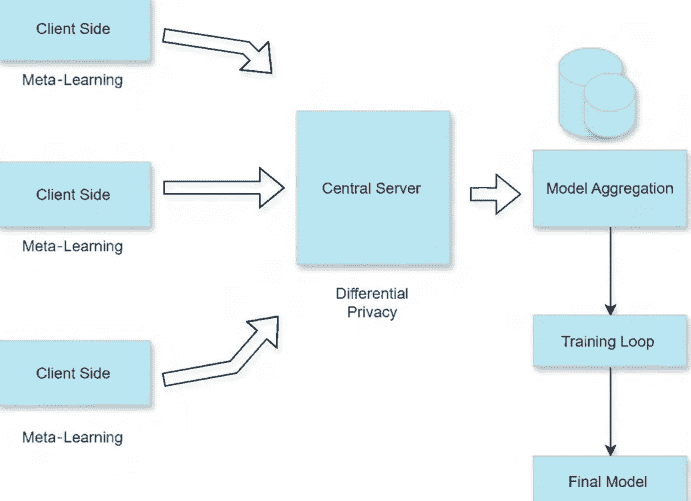

**图 10.1** 联邦学习中的元学习和差分隐私。

赋予本地模型从少量数据样本中快速学习的能力，从而即使在稀疏或异构数据下也能提高其性能。最近，许多工作开始利用各种个性化技术 [23] 以获取“个性化模型”来解决这个问题。然而，这些方法无法实现灵活的个性化，并可能忽略通信瓶颈挑战，这在网络应用中值得考虑。Per-FedAvg 算法 [24] 结合 MAML [25] 与 FedAvg [26]，可以快速获得适应设备数据的个性化模型，它的灵感来自 [23] 公式中提出的混合本地和全局模型的思想。它允许客户端使用通信高效个性化联邦元学习算法中引入的个性化系数（α）来定制全局模型。该系数控制了本地客户端对全局模型与其本地模型之间的依赖程度。通过调整此参数，可以实现对数据分布的更好适应。此外，为了解决 FL 中的通信瓶颈，可以使用表示学习（representation learning）将高维数据编码为低维表示，从而以更低的带宽传输。表示学习有助于减少通常阻碍 FL 的通信开销。通过采用模型压缩和高效数据编码技术，可以在不牺牲模型性能的情况下最小化通信成本。近年来存在多种适用于云端、边缘的混合模型 [27–31]。

## 10.7 联邦学习中的 CNN

CNN 是机器学习模型的一类，即深度学习算法，非常适用于分析视觉数据。CNN 有时被称为卷积网络（convnets），利用线性代数原理（特别是卷积操作）来提取特征并识别图像中的模式。CNN 具有很强的适应性，随着人员开发更复杂的架构而不断进化。迁移学习算法允许预训练的 CNN 针对特定任务进行微调，减少了从零训练所需的数据和资源。

在 FL 的背景下，CNN 可以部署在多个客户端，允许它们使用自己的数据进行本地训练，以解决异构性问题。CNN 架构如Network in Network（NIN）、视觉几何组 9 层网络（VGG-9）和扩展修改美国标准技术学院合并数据集（EMMNIST）可用于分类任务，通过对抗训练方法和聚合来优化性能和收敛 [33]。此外，使用 3D U-Net 进行图像分割可以结合多个 CNN 模型以提高准确率和不确定性估计。对抗攻击和数据泄露等安全问题可以通过安全聚合、同态加密和差分隐私（特别是本地 DP 以保护客户端通信）来应对 [32]。

此外，可以通过隐私保护框架探索 FL 和 DP 的应用 [36]。医疗数据是敏感的，由于 GDPR 和健康保险流通与责任法案（HIPAA）等隐私法规，无法在机构间轻松共享。FL 通过在分布式数据集上本地训练模型来实现协作学习。


# 表格 10.1 现有各种方法对比分析

| 标题 | 方法 | 优点 | 局限性 |
|---|---|---|---|
| 边缘网络中的通信高效型个性化联邦元学习 [1] | 提出了通信高效联邦元学习以减少边缘网络中的通信开销。引入了个性化参数以增强模型适应性。 | 降低通信成本；允许资源受限设备参与；平衡了全局和本地模型的性能。 | 实现复杂性；对于不同环境可能需要大量的调优；个性化会增加收敛难度。 |
| 边缘计算中防止投毒攻击的差分联邦学习模型 [2] | 设计了一种基于权重的算法，对设备上传的模式进行异常检测，以最小的通信成本提高检测率。 | 提供强有力的隐私保障；最小化通信开销；有效应对投毒攻击。 | 诚实客户端的假设在实践中可能不成立；添加噪声可能导致准确率权衡。 |
| FEDSECURE：联邦学习 LLM 攻击与防御基准 [3] | FedSec 框架的方法围绕两个核心组件构建：FedAttacker（联邦攻击者）和 FedDefender（联邦防御者）。FedAttacker 在联邦学习（FL）训练期间模拟各种对抗攻击。 | 强大的基准测试能力和灵活性。它涵盖了广泛的攻击和防御，是评估 FL 系统安全性的健壮工具。 | 防御机制的引入可能会对全局模型的性能产生负面影响，需要在安全效率之间仔细平衡。 |
| PADP-FedMeta：用于 AloT 的个性化自适应差分隐私联邦学习机制 [4] | 该方法结合了联邦学习（FL）和差分隐私（DP），以解决传统 FL 方法的局限性，特别是在非独立同分布环境中。 | PADP-FedMeta 通过确保稳健的个性化和隐私且不牺牲性，显著改进了现有的 FL 方法。 | 对差分隐私的依赖仍然会引入噪声，可能会略微降低模型准确率。 |
| 针对联邦学习的动态后门攻击 [5] | 讨论了联邦学习背景下的后门攻击。引入了共生网络，通过在训练期间修改本地模型来增强其对动态攻击的鲁棒性。 | 增加了对后门攻击的鲁棒性；为联邦环境下的对抗机器学习提供了见解。 | 关注特定的攻击场景；可能无法推广到所有联邦学习环境；实现过程可能复杂。 |
| 联邦学习中的隐私保护技术：基于 GDPR 视角的深度综述 [7] | 综述了 FL 中的隐私保护技术，重点关注 GDPR 合规性。讨论了如安全聚合、差分隐私、同态加密、数据匿名化和 SMC 等先进技术。 | 解决了关于数据隐私的重要法律和伦理问题；提供了隐私保护技术的全面概述；强调了对 GDPR 的合规性。 | 可能受限于现实 FL 场景中实现隐私技术的复杂性。 |
| 差分隐私联邦学习：系统性综述 [8] | 一种系统性方法，分类并分析了超过 70 篇关于差分隐私联邦学习（DP-FL）的研究。引入了基于隐私定义的新分类法。 | 分类 DP 模型提供了全面且结构化的方法。提出了一种新分类以提高 DP 模型的清晰度。 | 缺乏实证验证——缺乏验证理论主点的实验。 |
| FedCC：针对投毒攻击的基于 CNN 的稳健联邦学习 [22] | 提出了一种联邦框架，在 CNN 训练期间检测并缓解投毒攻击。通过使用异常检测技术识别恶意客户端来实现。 | 对数据投毒和模型投毒攻击表现出高度的稳健性；改进了协作学习中的准确性和模型安全性。 | 该方法增加了训练时间的大量开销；对针对复杂对抗攻击的鲁棒性评估有限。 |
| 用于智能和隐私保护故障诊断的个性化元学习方法 [18] | 引入了基于细粒度分类器重的联邦元学习（FedFGCR），用于工业环境下的个性化故障诊断。该框架分两个阶段：本地训练阶段和服务器聚合阶段。 | 在维护隐私的同时提高了故障分类的准确率；适用于对数据隐私有高关切要求的行业；协作优化分类器。 | 受限于本地数据的质量；实现复杂性；在确保跨客户端的公平性和效率方面面临挑战。 |
| 异构数据上的差分隐私联邦学习 | 论文提出了 SCAFFOLD，该算法将差分隐私（DP）与 SCAFFOLD 框架相结合，以解决联邦学习（FL）中的两个主要挑战：处理异构数据和确保针对“诚实但好奇”服务器的隐私。 | DP-CACAFF 通过利用控制变量和添加噪声来最小化用户漂移和方差，有效平衡了 FL 中的隐私和效用。 | 对噪声添加与本地更新次数之间的权衡敏感，如果调优不当，可能会影响性能。 |
| 通过模型无关元学习改进联邦学习个性化 | 论文通过将联邦平均（FedAvg）算法解释为一种元学习算法，将联邦学习（FL）与模型无关元学习（MAML）联系起来。提出了一种新的 FedAvg 修改版，通过两个阶段的训练和微调来优化个性化性能。 | 通过连接 FL 和 MAML 提供了新见解，表明 FedAvg 可以被视为一种元学习算法，并强调了 FL 中个性化性能重要性。 | 提出的两阶段训练和微调增加了 FL 系统的复杂性。 |
| 用于深度网络快速适应的模型无关元学习 [25] | 论文提出了模型无关元学习（MAML）算法，该算法训练模型以使用少量数据快速适应新任务。 | MAML 方法具有通用性且模型无关，意味着它可以适用于任何通过梯度下降训练的模型。它在少样本学习场景中提供了领先的性能，并在不同领域均有效。 | 一个主要局限性是由于更新过程所需的二阶导数导致的计算复杂度。 |

## 从去中心化数据进行通信高效深度学习 [26] 论文引入了联邦学习。FedAvg 方法通过限制轮数和设备与服务器之间交换的数据量来降低通信成本。 | 联邦学习的隐私保护特性是一个大优点，因为它消除了数据中心化的需求，显著降低了隐私风险。 | 主要局限性是处理大规模非 IID 数据的复杂性。 |

## 全局与本地模型混合的联邦学习 [23] | 论文提出了一种新的优化方法，通过惩罚参数 $\lambda$ 来控制权衡。作者开发了无圈本地梯度下降（L2GD）算法，该算法采用随机步骤和方差消除技术来解决该公式。 | 提出的方法能够高效处理异构数据，不需要假设设备之间的数据相似性。它通过最小化收敛所需的通信次数提高了通信效率。 | 本地步骤中的随机性引入了变异，可能会影响跨设备的收敛速度。实现带有方差消除的多种 SGD 变体的复杂性给实际部署带来了挑战。 |

## 应用联邦学习：隐私感知设置下稳健高效学习的架构设计 [15] | 论文展示了一种联邦学习架构，连接服务器端和设备端数据以在隐私感知环境中训练模型，专注于二分类器。模型训练在本地进行，更新被发送到可信执行环境（TEE）中的服务器进行安全聚合。 | 通过将用户数据保留在设备上并应用差分隐私，该架构在保护用户隐私的同时实现了大规模模型训练。 | 移动设备上的联邦学习明显慢于中心化训练，导致模型开发周期延迟。 |


# 表 10.1（续）

| 标题 | 方法论 | 优点 | 局限性 |
|---|---|---|---|
| 通信受限联邦学习中的对抗训练 [33] | 该文探索了联邦学习（FL）框架下的对抗训练（AT），以增强 CNN 模型在通信受限和非独立同分布（non-IID）数据条件下对对抗攻击的鲁棒性。 | FedDynAT 的引入有效平衡了通信开销和模型准确性，使其成为对抗训练联邦学习的实用解决方案。 | FedDynAT 的动态调度机制增加了训练过程的复杂性，这可能在大规模或资源受限的环境中增加实施的难度。 |
| 用于医学图像分割的联邦交叉学习 [34] | 该文提出了联邦交叉学习（FedCross），以解决非 IID 数据上进行医学图像分割的联邦学习（FL）面临的挑战。 | FedCross 通过避免模型聚合有效解决了非 IID 问题，提升了模型在分布式医疗数据上的性能。 | | FedCross 的一个潜在弱点是灾难性遗忘，因为顺序训练方法可能导致模型在一段时间未遇到的数据集上表现不佳。 |
| 用于隐私保护 CNN 模型的基于 BFV 同态加密 [21] | 该文提出的在联邦学习（FL）设置中结合卷积神经网络（CNN）与基于 BFV 同态加密的隐私保护框架。 | 使用基于 BFV 同态加密确保了敏感数据和模型更新永远不会暴露，为联邦学习提供了稳健的隐私保障。 | 同态加密计算开销巨大，特别是当应用于大型 CNN 模型时，会导致训练速度变慢和资源消耗增加。 |
| 用于医学图像分析的联邦学习与差分隐私 [36] | 结合联邦学习（FL）和差分隐私（DP），在不共享数据的情况下训练组织病理图像分类（特别是肺癌亚型）的模型。使用 FedAvg 进行去中心化训练，使用差分隐私随机梯度下降（DP-SGD）确保隐私，通过裁剪梯度和添加高斯噪声。 | 证明了带有 DP 的 FL 可以匹配中心化训练的性能，同时提供强大的隐私保障。能够有效处理真实的医学图像数据，允许医院之间在不直接共享数据的情况下协作。 | DP-SGD 对超参数敏感，需要仔细细调以同时维持隐私和性能。当医院之间数据分布差异显著时，性能会下降。 |
| 基于无噪声差分隐私的联邦模型蒸馏 [16] | 该文提出了一种名为 FEDMIFDP 的新型联邦模型蒸馏框架，其利用无噪声差分隐私（NFDP）机制在不添加噪声的情况下确保隐私。该方法涉及一个两步过程，每个部分首先消化一个... | 在不具有添加噪声副作用的情况下实现了差分隐私。NFDP 机制允许各方之间进行有效的知识共享，同时保持强大的隐私保障。 | NFDP 可能仍然受到用于模型更新的公开数据集引入的偏差的影响。所提方法的性能可能会根据公开和私有数据的分布而异。 |
| （续） | | | |

# 表 10.1（续）

| 标题 | 方法论 | 优点 | 局限性 |
|---|---|---|---|
| 带有差分隐私的 Gboard 语言模型联邦学习 [17] | 利用带有差分隐私（DP）的联邦学习（FL）训练用于下一词预测和其他功能的 Gboard 语言模型（LMs）。实现了具有自适应裁剪的 DP-Follow-the-Regularized-Leader，以限制用户贡献并改进保障。 | 成功部署了超过 20 个具有正式 DP 保证的 Gboard 模型，在不牺牲实用性的情况下提供了强大的用户数据保护。 | 超参数调优和实现最佳隐私-效用权衡仍然具有挑战性，特别是在需要大规模客户端参与的情况下。 |
| FEDCONV：增强卷积神经网络以处理联邦学习中的数据异构性 [32] | 使用平滑激活函数（如 SiLU）修改 CNN，减少激活/归一化层，并适应更大的内核，以提高其在具有异构数据的联邦学习（FL）中的鲁棒性。 | 新颖的 FedConv CNN 架构大幅提升了准确率（例如在 COVID-FL 上达到 92.21%，在 iNatural 上达到 54.19%）。 | 所提出的架构修改（如较大的内核尺寸和重叠卷积）可能会引入更高的计算成本，特别是在资源受限的情况下。 |
| 带有差分隐私的联邦迁移 [19] | 该文引入了一种联邦迁移框架，利用差分隐私（FDP）在增强从多个异构数据源学习的同时确保隐私。 | 所提出的 FDP 框架提供了稳健的隐私保障。 | 该研究承认，当源集与目标数据显著不同时，所提方法的性能可能会下降。 |

| 标题 | 方法论 | 优点 | 局限性 |
|---|---|---|---|
| 基于本地差分隐私的物联网联邦学习 [9] | 该文提出了一种结合联邦学习（FL）与本地差分隐私（LDP）的混合方法，以增强物联网（IoT）的隐私。它引入了四种 LDP 机制，提供多种输出可能性以在最小化通信成本的同时提高准确性。 | 多个 LDP 机制的引入增加了灵活性性能。 | 虽然所提方法改进了现有的 LDP 技术，但随着连接设备数量的增加，在扩展性方面可能会面临困难。 |
| 真实数据分布的联邦视觉分类 [20] | 该文引入了一种投影联邦平均（PFA）方法，利用差分隐私（DP）增强实用性。 | 创新的聚合策略有效平衡了公开和私有客户端的隐私优势。 | PFA 仍然容易受到公开客户端偏差的影响，其更新可能会主导全局模型。 |
| 通过规模解锁高精度差分隐私分类 [35] | 该文采用了差分隐私随机梯度下降，并探索了噪声、批量大小、计算预算和学习率之间的相互作用，在保持隐私保障的同时优化性能。 | 该论文的一大优点是其能够在 DP 约束下解锁高精度的分类，在学术数据集上实现了领先水平。 | 将其应用于真实的敏感数据涉及关于隐私预算和潜在代表性子群体准确率下降的额外考虑。 |

# 表 10.1（续）

| 标题 | 方法论 | 优点 | 局限性 |
|---|---|---|---|
| 带有异构差分隐私的投影联邦平均 | 该文引入了投影联邦平均（PFA），通过解决解决异构隐私预算的挑战来优化联邦学习（FL）。 | PFA+ 的使用显著减少了通信开销——为私有客户端减少了超过 99% 的通信——且没有牺牲多少模型准确性。 | 一个关键局限性是来自公开客户端的潜在偏差，其更新可能会主导全局模型并影响公平性。 |


在保留模型效用的同时，保护客户端数据。PFA 通过在客户端之间存在异构隐私预算时，通过优化通信效率和提高全局模型的准确性来改进这一点。尽管计算成本高昂，但同态加密仍然为敏感应用（如医学图像分析）提供了稳健的隐私保障，尽管对于此类应用，必须在计算成本和隐私利益之间进行高标准的权衡。现实世界的应用证明了这些技术的可行性和益处。例如，基于 CNN 的联邦学习（FL）已广泛应用于医学分类任务，如肺癌亚型的组织病理学分型，其中 DP-SGD 确保了对 HIPAA 等隐私法规的合规。同样，使用 LDP（局部差隐私）的隐私保护框架已应用于各种视频监控系统和工业故障检测场景，同时确保了去中心化数据集之间的安全协作。

表 10.1 提供了跨 FL、DP、CNN 和元学习领域的几项现有研究工作的对比分析。文中对它们的主要方法论以及可能遇到的关键优势和局限性进行了总结。这凸显了目前仍然存在的差距和局限性，这些问题可能可以通过其他研究工作得以克服。

## 10.9 结论

综而言，FL 为去中心化机器学习提供了一个相对很有前景的框架，通过避免共享原始数据来确保隐私。然而，对抗性攻击、隐私泄露和数据异质性的挑战构成了巨大的障碍。本章研究了潜在的解决方案，特别是 DP 和元学习，它们在增强安全性和适应性方面显示出前景。DP 的集成通过引入噪声来保护敏感信息，而元学习提供了对多样化客户端数据的适应性。此外，在图像分类的 CNN 领域，这些技术可以为平衡隐私和适应性需求铺平道路。然而，在保持 CNN 分类理想模型准确率的同时，如何维持这些因素方面仍存在不确定性。未来，安全性、适应性和性能之间的平衡将至关重要。需要进一步研究以在 CNN 背景下，优化 FL 架构和算法中 DP 与元学习的联合应用点。

## 参考文献

- 1. Yu, F., Lin, H., Wang, X., Garg, S., Kaddoum, G., Singh, S., & Hassan, M. M. (2023). Communication-efficient personalized federated meta-learning in Optimizing Edge and Fog Computing Applications with AI. IEEE Transactions on Network and Service Management, 20(2). https://doi.org/10.1109/TSNM.2023.3263831
- 2. Zhou, J., Wu, N., Wang, Y., Gu, S., Cao, Z., Dong, X., & Choo, K-K. R. (2022). A differentially private federated learning model for poisoning attacks in edge computing, IEEE Transactions on Dependable and Secure Computing, 20(3), 1941–1951. https://doi.org/10.1109/TDSC.2022.3168556, Learning on Heterogeneous Data. AISTATS Conference, Vol. 151.
- 3. Anonymous. (n.). Feasibility: A benchmark for attacks and defenses in federated learning LLMs. As a paper at ICLR 2024.
- 4. Dong, F., Ge, X., L., Q., Zhang, J., Shen, D., Liu, S., Liu, X., G., Wu, F., & Luo, J. (2023). PADFedMeta: A scalable and adaptive differentially private federated meta learning for AoT. Journal of Systems Architecture, 134, Art. 12754. https://doi.org/10.1016/j.sysarc.2022.102754
- 5. Huang, A., & WeBank AI Lab (2020). Dynamic backdoor attacks against federated learning. arXiv.
- 6. Dwork, C. (2006). Differential Privacy. International Colloquium on Automata, Languages and Programming (ICALP), vol. 2006, pp. 1–12. https://link.springer.com/chapter/10.1007/978-11787006-1
- 7. Truong, N., Kan, S., Wang, F., Data Science Institute, Imperial College London, Department of Computer Science, & Hong Kong Baptist University. (2021). Privacy preservation in federated learning: An insightful survey over the GDPR privacy. Computers & Security, 110, 102402. https://doi.org/10.1016/j.cose.2021.102402
- 8. Fu, J., Hong, Y., Lin, X., Ran, X., Sun, Z., Chen, W., & Cao, Y. (2024). Differentially private federated learning: A systematic review. arXiv, 2405.
- 9. Zhao, Y., Zhao, J., Wang, M., Wang, T., Lyu, L., Naito, M. (2021). Local differential privacy-based federated learning for internet of things. IEEE Internet of, 8(1).
- 10. Li, T., Falt, B. (2019). Federated learning of deep networks. arXiv.
- 11. McMahon, H. B., Moorte, E., Ramage, D., Hamilton, S., & Google, Inc. (2017). Communication-efficient learning of deep networks from decentralized data. In Proceedings of the 20th International Conference on Artificial Intelligence and Statistics (AIATS) 2017 (Vol. 54).
- 12. Hanzely, F., Richtár, P., & King Abdullah University of Science and Technology. (2021). Federated learning of a mixture of global and local models.
- 13. Finn, C., Abbeel, P., Levine, S., University of California, Berkeley, & OpenAI. (2017). Model-agnostic meta-learning for fast adaptation of deep networks. In Proceedings of the 34th International Conference on Machine Learning: Vol. PMLR 70.
- 14. Xu, Z., Zhang, Y., Han, L., Sig, F. (2023). Federated learning with noise-free privacy. arXiv.
- 15. Madhusdan, H. S., Gupta, P., Saini, D. K., & Tan, Z. (2023). Dynamic virtual machine allocation in cloud computing using elephant herd optimization scheme. Journal of Circuits, Systems and Computers, 32(11), 2351088.
- 16. Rawat, P. S., Gaur, S., Barthwal, V., Gupta, P., D, D., Gupta, D., & Rodrigues, J. J. C. (2025). Efficient virtual machine placement in cloud environment using BSO-ANN hybrid technique. Alexandria Engineering Journal, 110, 145–152.
- 17. HS, M., & Gupta, P. (2024). Federated learning inspired Antlion based orchestration for Edge computing environment. PLOS One, 19(6), e0304067.


# 使用 AI 优化边缘与雾化计算应用

- 30. Gupta, P., Anand, A., Agarwal, P., & McArdle, G. (2024). 神经网络启发的云基础设施高效可扩展任务调度。*物联网与信息物理一体系统*, 4, 268–279.
- 31. HS, M., Gupta, P., & McArdle, G. (2023). 一种用于云数据中心能量和资源高效型虚拟机放置的哈里斯角隼优化系统。*PLoS One*, 18(8), e0289156.
- 32. Wu, P., Wang, Z., Mei, J., Qu, L., Yille, A., Xie, C., & Zhou, Y. (2023). FEDCON: 赋予卷积神经网络处理联邦学习中的数据异构性。arXiv:2310.04412v1 [CV] 2023年10月6日, 1. https://arxiv.org/abs/2310.04412v1
- 33. Shah, D., Dubes, P., Chakraborty, S., Verma, A., & I.B.M.T.J. Watson 研究中心. (2021). 伊利诺伊大学，厄巴纳-香昌槟，通信受限联邦学习中的对抗训练。arXiv。
- 34. 用于医学图像分割的联邦学习。(2023). 载于*机器学习研究进展集* (pp. 1–12)。https://github.com/DIAL-RPI/FedCross
- 35. De, S., Berrada, L., Hayes, J., Smith, S. L., & Rolle, B. (2022). 通过规模解锁高精度差分图像分类。arXiv:2204.13650v2 (pp. 1–2)。 https://arxiv.org/abs/2204.13650v2
- 36. Adnan, M., Kalra, S., Cresswell, J. C., Taylor, G. W., & Titizoh, H. R. (2022). 用于医学图像分析的联邦学习与差分隐私。*Scientific Reports*, 12(1)。 https://doi.org/10.1038/s41598-022-05539-7
- 37. Mustapha, D. S., & Gupta, P. (2024). 云基础设施中 DBSCAN 启发的任务调度算法。*物联网与信息物理一体系统*, 4, 32–39.
- 38. Gupta, P., Rawat, P. S., Kumar Saini, D., Vidyarthi, A., & Alharbi, M. (2023). 云基础设施中神经网络启发的基于差分演化的调度。*亚历山大工程期刊*, 73, 217–230.
- 39. Madhusudhan, H. S., Gupta, P., Saini, D. K., & Tan, Z. (2023). 使用大象群优化调度的云计算动态车辆机器分配。*电路、系统与计算机期刊*, 32(11). 文章 235018.
- 40. Rawat, P. S., Gaur, S., Barthwal, V., Gupta, P., Ghosh, D., Gupta, D., & Rodrigues, J. J. C. (2025). 使用 BSO-ANN 混合减少技术进行云计算中的高效虚拟机放置。*亚历山大工程期刊*, 110, 145–152.

# 第11 章

# EP-MPCHSS: 基于多核和并行堆栈结构的边缘服务器云微卸载

Rajkumar Nagulsamy, Manisha Gupta, Punit Gupta

在当今云计算领域，移动技术开始利用具有高计算需求的应用。因此，任务资源管理已成为移动资源卸载的关键研究领域。在过去的十年里，云计算已成为通过基础设施托管应用程序的最吸引人的方案之一。云计算是基于位于数据中心的集中计算资源。这种做法减轻了基础设施管理的负担，并使服务提供商能够以合理的成本提供服务。

云计算作为数字化转型的催化剂，导致移动技术近期出现了许多应用场景，包括增强现实、移动应用设计、跨平台游戏等。这些场景继续提高人们使用软件的标准。随着这些解决方案的出现，云计算集中在少数全球性基础设施（如 Google、Azure 和 Amazon）中，导致了由于终端设备距离远而产生的延迟。这种距离导致应用程序的实时需求无法匹配。

因此，使用边缘计算及其在卸载移动任务中的核心作用是不可避免的。云原生应用（如亚马逊云服务 AWS 和谷歌云平台 GCP）在任务卸载方面存在高延迟，且带宽受限，导致了不可预见的服务不可用情况。在边缘网络使用小规模计算可行云微中心是可行的方案。本研究提出的基于虚拟机（VM）的卸载方案……


由于云端进程的卸载而导致。因此，需要对持续迁移的需求。

借助计算进行数据转换的必要性需要具有云计算能力的高端服务器。上述研究展示了缺乏能够卸载云微单元（cloudlet）任务的高计算和高存储容量的解决方案（RG1）。

## 11.2.2 智能卸载机制

Xu 等人（2018）提出了一种结合卷积神经网络和循环神经网络的深度神经网络，用于为智能卸载系统创建一种混合深度强化学习算法。卷积循环神经网络（CRNN）用于移动边缘计算（MEC）中的卸载过程。所提技术与传统的卸载算法相比，降低了 25% 的能量消耗。

Yu 等人（2022）[10] 解决了 MEC 的计算延迟和高延迟限制。他们提出了一种双路深度 Q 网络（Duel Deep Q network）来优化多用户、多集群和多租户环境下资源分配的调度。他们提出了一种高效且特定损失的优化算法，分别在 D2D 和通用云场景下降低了 11.54% 和 20.83% 的能量消耗。此外，Vaiswan 等人（2016）[11] 针对二进制系统延迟增加和带宽降低提出了解决方案。该研究讨论了使用蒙特卡洛分布方法的陷阱，并提出了基于决策树成本优化的随机枚举，为基于计算资源对作业进行有效采样和放置提供了智能化的方法。

上述研究表明，在解决拥塞丢包、进程饥饿、传输安全和延迟威胁等关注问题方面存在显著的研究空白（RG2，见第 11.2.3.1 节）。

## 11.2.3 使用深度强化学习将云微单元卸载到边缘网络

Zuxhu 等人（2021）[12] 为 D2D 的资源分配云卸载 提出了一种智能深度强化学习（DRL）方法。该研究调查了在卸载过程中发生的资源分配问题。在考虑数据中心电池电量时，面向 MEC 的实时系统是感知能量的卸载系统。该论文展示了能量节约的效果，接近 $10^4 \times 10^4$ 焦耳。该研究细致地使用了 MATLAB 平台执行该技术，并为值为 0.2、0.4、0.6、0.8 和 1.0 的参数提供了深度权重参数。该研究提供了一种优化的卸载策略，以最短延迟和最低计算成本为优化目标，并应用 Q-learning 解决该问题。

## 基于边缘服务器的云微单元卸载

同样，Ullah 等人（2023）[13] 研究了从中心化云服务器卸载到 D2D 设备的边缘计算。它提出了一种基于可用计算资源和设备位置卸载云微单元的 DRL 算法。该研究使用马尔可夫决策过程对底层中心化云服务器系统的延迟和带宽问题进行建模。该研究提出的 DDQEC 是一种基于 Q learning 并使用 DRL 的边缘计算资源分配算法。

Mourita 等人（2023）[14] 的工作致力于提高移动应用的计算能力、高带宽和低延迟。论文指出 MEC 卸载需要实时优化。为了实现这一目标，论文利用了边缘计算的计算属性。基于深度学习的 MEC 实时卸载系统在提高性能、可扩展性和效率方面具有巨大潜力。该技术在仿真中实现了高达 40% 的能量效率降低和 60% 的延迟增加。

上述论文讨论的关键问题是需要创建一个基于优先级的系统，能够减少网络流量并增强带宽。目前的研究使用简单的方法卸载云微单元，导致了进程饥饿、高延迟，并需要高计算和存储容量（RG1，见第 11.2.3.1 节）。

- RG1：对高计算和高存储容量的需求。
- RG2：拥塞丢包、进程饥饿、传输安全和延迟威胁。
- RG3：减少网络流量，增强带宽。


# 工作流 1

# 工作流 2

用户 1

用户 2

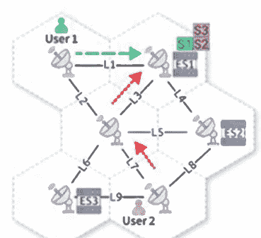

图 11.2 网络架构图。

一个流程图。它允许两个工作流，每个工作流由用于卸载的服务或云单元组成。图 11.2 描述了完整编排的架构设置。它连接了 ES 实例（即边缘服务器 S1、S2、S3），即使用网络交换机（L1、L2、L3、.... L8）。CIRA 分为两个部分，即放置算法和迁移算法。

### 11.3.2.2 放置算法

EdgeSimPy 框架由多个单元组成的资源分配机制构建。放置算法是资源分配单元的基础骨干，因为它负责在网络交换机的帮助下，将来自相应用户请求的云单元放置到边缘服务器上。这对于优化边缘服务器整体编排的性能以及资源利用至关重要。放置算法基于公式 11.1 描述的云单元、公式 11.2 描述的边缘服务器，其中 $R_i$ 定义了服务 $i$ 的资源，$C_i$ 定义边缘服务器的容量，而 $L_{(i,j)}$ 定义了之间的延迟。

```
$C=\{C_1, C_2, C_3\}$
```

```
$E=\{E_1, E_2, E_3\}$
```

```
$$\sum_{j=1}^{m} R_{ej}^* x_{ij} < C_{ej} (11.3)$$
```

```
$$\sum_{j=1}^{m} x_{ij}=1\forall i\in{1,2,3,...n\} (11.4)$$
```

公式 11.3 定义了由 $X_{ij}$ 定义的每个服务所需的最小容量。公式 11.4 定义每个服务只能放置在一个边缘服务器上，以防止任何冗余任务。

### 11.3.2 迁移算法

迁移算法允许通过根据可用的动态映射重新评估参数和任务计算的可能性，持续集成公式 11.3 和 11.4，并重新平衡每个服务器上的负载；简单来说，它可以被看作是一个重新平衡代理，而放置算法可以被视为负载均衡单元。在任务分配的阶段，放置算法对于负载分布是必要的。然而，迁移技术是一种持续运行的服务，会在需要时进行重新平衡。

迁移算法确保了卸载到边缘服务器的云单元的持续集成和处理。因此，通过优化时间收益，迁移算法是一种试图最小化公式 11.5 的优化技术。

```
$$\sum_{i=1}^{m}\sum_{j=1}^{m}(L_{ci,ej}^*+M_{ci,ej}^*+\alpha T_{ci}^*)*y_{ij} (11.5)$$
```

公式 11.5 描述了优化函数，其中 $M_{ci,ej}^*$ 是将云单元 $i$ 移动到边缘 $j$ 的迁移成本，$\alpha T_{ci}^*$ 是饥饿参数。

```
$$\sum_{j=1}^{m} y_{ij}=1\forall i\in{1,2,3,...n\} (11.6)$$
```

公式 11.6 描述了全局云单元卸载参数，其值应始终为 1，因为每个云单元必须放置在边缘服务器上。

```
$$\alpha T_{ci}^* (11.7)$$
```

公式 11.7 定义了在 EdgeSimpy 机制内，迁移策略允许云单元在边缘服务器之间无缝切换，这对于服务的连续性至关重要，同时实现了持续集成和持续处理。

## 11.3.3 使用多核和并行堆结构的边缘优先级放置 (EP-MCPHS)

EP-MCHPS 结合了多延迟处理，以从堆函数的退化最小优化中受益。该算法分为三个部分：并行堆创建 (PhC)、配置以及 PhC 与并行处理的结合。

#### 11.3.3.1 基于优先级的资源分配的并行堆创建

优先级队列被用作最小化的配置机制，它实现了最小堆以允许将最少的资源分配给云单元，确保资源浪费最小。PhC 算法使用公式 11.8。所使用的堆是基于计算需求的边缘部分最小堆。

```
$H_i = Heapify\left(\left(h_{\text{CPU,Memory,Disk}}\right)_{\ell}, e\in ES\right)\forall i\in\{1,2,\dots,n\} (11.8)$
```

公式 11.8 描述了负责基于优先级分配的堆函数。它记录了可以成功卸载云单元的最小边缘服务器。这允许边缘服务器进行优化，使资源利用最大化，并且由于边缘服务器以最大容量运行，迁移速率较低。因此，基于优先级的分配不仅减少了延迟和数据流，还最大化了资源优化，并根据需求任务分配创建运行的边缘服务器。

#### 11.3.3.2 配置

配置算法验证边缘服务器处理发送云单元的能力。它比较由 CPU、RAM 或磁盘给出的参数。

$\eta(x,y)=1,\text{ if }(x>y)\text{ else } 0 (11.9)$

公式 11.9 反而创建了由 11.0 给出的函数。

## 使用 AI 优化边缘和雾计算

```
$Prov(e_j, c_i)^w = \{1, \text{ if }\eta(e_j, c_i) > 0, \text{ else}\} (11.0)$
```

### 11.3.3.3 多核并行处理的 PhC 结合

并行处理允许 PhC 计算更快、更优。公式 11.1 展示了可用的并行线程。

```
$T=\{T_2, T_3\} (11.1)$
```

图 12 展示了每个线程如何在不同的云单元上操作，其中 $C_k$ 是云单元的划分。

```
$C=\cup_{k=1}^p C_k (11.2)$
```

并行处理 PhC 结合的时间复杂度由公式 11.3 给出。

```
$T_p=O\left(\frac{m}{p}\right) (11.3)$
```

所提算法通过使用带有资源优化的最小堆减少未使用的资源的饥饿，优化了放置算法。此外，它包含一个并行处理领域以减少计算时间，使云单元快速检索到边缘计算处理。多核并行堆结构将资源单元划分为更小的单元，并旨在单个单元内满足尽可能多的云单元，而堆强调允许基于资源的优先级进入流水线。它确保了云单元的饥饿得到减少，因为它还有迁移技术来修复饥饿的云单元。多核并行处理既适用于基于优先级的资源分配，也适用于自动减少云单元的饥饿。所提出的 EP-MCPHS 承诺减少延迟和开始处理的时间，并根据基于堆的处理系统的能力增强流量。算法 11.1 展示了我们放置算法的设计的设计。

## 算法 11.1 EP-MCPHS

```python
class EdgeServerWrapper:
    def __init__(self, edge_server):
        self.edge_server = edge_server

    def __lt__(self, other):
        # 根据组合的可用资源 (CPU,
        # memory, disk) 比较边缘服务器
        return (self.edge_server.cpu, self.edge_server.memory,
        self.edge_server.disk) < \
        other.edge_server.cpu, other.edge_server.memory,
        other.edge_server.disk)

    def provision_service(self, service, edge_server_heap):
        while edge_server_heap:
            edge_server_wrapper = heapq.heappop(edge_server_heap)
            edge_server = edge_server_wrapper.edge_server

            if edge_server.has_capacity_to_host(service):
                service.provision(target_service=edge_server)
                logging.info(f"服务 {service.id} 已部署到边缘服务器\n{edge_server.id}")
                return True
        except Exception as e:
            logging.error(f"处理服务 {service.id} 时在边缘服务器\n{edge_server.id} 出错")
            logging.warning(f"未找到适合服务 \nservice.id}")
            return False

def my_algorithm(parameters):
    services = [service for service in Service.all() if service.server is None and not
    service.being_provisioned]
    edge_servers = [EdgeServerWrapper(edge_server) for
    edge_server in EdgeServer.all()]
    heapq.heapify(edge_servers)

    with ThreadPoolExecutor(max_workers=10) as executor:
        futures = [executor.submit(provision_service, service, edge_servers) for
        service in services]

    for future in futures:
        try:
            future.result()
        except Exception as e:
            logging.error(f"在 \n部署过程中出错: {e}")
```


### 11.3.4 测试与评估框架

本研究对所提的 EP-MCPHS 与最小极大公平算法 (MMFA) 进行了对比分析。MMFA 在 EdgeSimPy 架构的基础论文中提出的。本研究对两种技术的带宽、延迟、资源利用率和数据流速率进行了深入分析。研究进一步通过统计分析下的平均值和标准差，展示了 EP-MCPHS 架构相对于基准 MMFA 的评估结果。研究详细讨论了数据传输的减少和延迟的增强是如何通过内置的最小堆的任务优先级系统实现的。在随后的章节中，还通过 5、10、15 和 20 秒周期的柱状图对比了结果，展示了该架构在不同时间范围和后续云节点中的稳健性。

### 11.4 结果与讨论

### 11.4.1 评估指标

在此，我们主要比较了开始时间、结束时间、实际带宽和数据传输的结果。让我们详细讨论这些指标的意义和用途。

开始时间和结束时间显示了处理云节点的实际流逝时间。边缘服务器尽可能减小两者之间的差异。实际带宽指的是提供更多服务的潜力，该值应越高越好。这也体现了边缘服务器的低延迟。最后，数据流是实现最优化云节点放置的主要效果，这允许算法具有低数据流，并适应高带宽和低延迟。

### 11.4.2 边缘服务器

边缘服务器详情展示了实例、坐标。CPU 需求、RAM 需求、磁盘需求以及服务（表 11.1）。这些将用于下文的仿真。

### 11.4.3 仿真结果

本节展示了通过比较仿真数据集 2（表 11.2）获得的结果。用户数据包含计数、平均值、标准差、最小值、25% 分位数、50% 分位数、75% 分位数和最大值的统计测量，这些数据是跨时间步和实例 ID 计算的。

使用先来先得算法的网络流展示了跨时间戳、实例 ID、开始、结束时间、源、目标、带宽和数据传输率的统计测量（表 11.3）。

#### 表 11.1 边缘服务器详情

| 时间步 | 实例 ID | 坐标 | CPU 需求 | RAM 需求 | 磁盘需求 | 服务 |
|---|---|---|---|---|---|---|
| 0 | 1 | [0, 0] | 0 | 0 | 0 | [] |
| 0 | 2 | [0, 2] | 0 | 0 | 0 | [] |
| 0 | 3 | [6, 0] | 0 | 0 | 0 | [] |
| 0 | 4 | [1, 3] | 0 | 0 | 0 | [] |
| 0 | 5 | [7, 1] | 1 | 1024 | 1017 | [] |
| 0 | 6 | [6, 2] | 0 | 0 | 0 | [] |
| 1 | 1 | [0, 0] | 6 | 12288 | 82 | [] |
| 1 | 2 | [0, 2] | 0 | 0 | 0 | [] |
| 1 | 3 | [6, 0] | 0 | 0 | 0 | [] |
| 1 | 4 | [1, 3] | 0 | 0 | 0 | [] |
| 1 | 5 | [7, 1] | 1 | 1024 | 1017 | [] |
| 1 | 6 | [6, 2] | 0 | 0 | 0 | [] |
| 2 | 1 | [0, 0] | 6 | 12288 | 82 | [1, 2] |
| 2 | 2 | [0, 2] | 0 | 0 | 0 | [] |
| 2 | 3 | [6, 0] | 0 | 0 | 0 | [] |
| 2 | 4 | [1, 3] | 0 | 0 | 0 | [] |
| 2 | 5 | [7, 1] | 1 | 1024 | 1017 | [] |
| 2 | 6 | [6, 2] | 0 | 0 | 0 | [] |
| 3 | 1 | [0, 0] | 6 | 12288 | 82 | [1, 2] |
| 3 | 2 | [0, 2] | 0 | 0 | 0 | [] |
| 3 | 3 | [6, 0] | 0 | 0 | 0 | [] |
| 3 | 4 | [1, 3] | 0 | 0 | 0 | [] |
| 3 | 5 | [7, 1] | 1 | 1024 | 1017 | [] |
| 3 | 6 | [6, 2] | 0 | 0 | 0 | [] |
| 4 | 1 | [0, 0] | 6 | 12288 | 82 | [1, 2] |
| 4 | 2 | [0, 2] | 0 | 0 | 0 | [] |
| 4 | 3 | [6, 0] | 0 | 0 | 0 | [] |
| 4 | 4 | [1, 3] | 0 | 0 | 0 | [] |
| 4 | 5 | [7, 1] | 1 | 1024 | 1017 | [] |
| 4 | 6 | [6, 2] | 0 | 0 | 0 | [] |
| 5 | 1 | [0, 0] | 6 | 12288 | 82 | [1, 2] |
| 5 | 2 | [0, 2] | 0 | 0 | 0 | [] |
| 5 | 3 | [6, 0] | 0 | 0 | 0 | [] |
| 5 | 4 | [1, 3] | 0 | 0 | 0 | [] |
| 5 | 5 | [7, 1] | 1 | 1024 | 1017 | [] |
| 5 | 6 | [6, 2] | 0 | 0 | 0 | [] |
| 6 | 1 | [0, 0] | 6 | 12288 | 82 | [1, 2] |
| 6 | 2 | [0, 2] | 0 | 0 | 0 | [] |
| 6 | 3 | [6, 0] | 0 | 0 | 0 | [] |
| 6 | 4 | [1, 3] | 0 | 0 | 0 | [] |
| 6 | 5 | [7, 1] | 1 | 1024 | 1017 | [] |
| 6 | 6 | [6, 2] | 0 | 0 | 0 | [] |
| 7 | 1 | [0, 0] | 6 | 12288 | 82 | [1, 2] |
| 7 | 2 | [0, 2] | 0 | 0 | 0 | [] |
| 7 | 3 | [6, 0] | 0 | 0 | 0 | [] |
| 7 | 4 | [1, 3] | 0 | 0 | 0 | [] |
| 7 | 5 | [7, 1] | 1 | 1024 | 1017 | [] |
| 7 | 6 | [6, 2] | 0 | 0 | 0 | [] |
| 8 | 1 | [0, 0] | 6 | 12288 | 82 | [1, 2, 3, 4, 5, 6] |
| 8 | 2 | [0, 2] | 0 | 0 | 0 | [] |
| 8 | 3 | [6, 0] | 0 | 0 | 0 | [] |
| 8 | 4 | [1, 3] | 0 | 0 | 0 | [] |
| 8 | 5 | [7, 1] | 1 | 1024 | 1017 | [] |
| 8 | 6 | [6, 2] | 0 | 0 | 0 | [] |

## 使用 AI 优化边缘和雾计算应用

#### 表 11.2 用户数据

| 统计测量值 | 时间步 | 实例 ID |
|---|---|---|
| 计数 | 54 | 54 |
| 平均值 | 4 | 3.5 |
| 标准差 | 2.60623 | 1.72386 |
| 最小值 | 0 | 1 |
| 25% 分位数 | 2 | 2 |
| 50% 分位数 | 4 | 3.5 |
| 75% 分位数 | 6 | 5 |
| 最大值 | 8 | 6 |

同样，在表 11.4 中，EP-MCPHS 网络展示了跨时间戳的带宽变化。表 11.5 比较了 EP-MCPHS 和 MMFA，展示了所提算法在平均值、标准差、25%、50% 和 75% 方面具有更短的结束时间，这意味着在第一个时间单位内大多数任务已放置。EPMCPHS 算法的效用从 MMFA 的 3.81128 增加到 6.42851。该算法还减少了顶部边缘服务器的数据传输率。因此，较小任务需要迁移，这在 MMFA 的 6.53（标准差 7.54）处为 4.91。图 11.3 比较了 EP-MCPHS 和 MMFA 的开始、结束和数据传输，其中数据传输从 6.53 增加到 4.91。表 11.6 展示了时间分析。边缘计算作为一个范式可以从云中心到边缘提供最小延迟。为了确保边缘计算从承诺变为现实，需要有效的资源管理以获得潜在优势。

#### 表 11.3 使用最小极大公平的网络流

| 统计测量值 | 时间步 | 实例 ID | 开始 | 结束 | 源 | 目标 | 带宽 | 数据传输 |
|---|---|---|---|---|---|---|---|
| 计数 | 31.000000 | 31.000000 | 15.000000 | 31.000000 | 31.000000 | 31.000000 | 31.000000 |
| 平均值 | 4.612903 | 2.451613 | 1.225806 | 3.600000 | 5.0 | 1.0 | 3.811828 | 6.532258 |
| 标准差 | 2.275631 | 1.120676 | 0.425024 | 2.898275 | 0.0 | 1.511640 | 8.107522 |
| 最小值 | 1.000000 | 1.000000 | 1.000000 | 5.000000 | 1.0 | 0.000000 |
| 25% | 3.000000 | 1.500000 | 1.000000 | 5.000000 | 1.0 | 2.041667 | 0.000000 |
| 50% | 5.000000 | 2.000000 | 1.000000 | 5.000000 | 1.0 | 4.166667 | 1.875000 |
| 75% | 6.500000 | 3.000000 | 1.000000 | 6.500000 | 5.0 | 1.0 | 4.687500 | 12.875000 |
| 最大值 | 8.000000 | 4.000000 | 2.000000 | 7.000000 | 5.0 | 1.0 | 6.250000 | 23.75000 |

#### 表 11.4 EP-MCPHS 网络流

| 时间步 | 实例 ID | 开始 | 结束 | 源 | 目标 | 带宽 | 数据传输 |
|---|---|---|---|---|---|---|---|
| 计数 | 42.000000 | 42.000000 | 42.000000 | 26.000000 | 42.000000 | 42.000000 | 42.000000 | 42.000000 |
| 平均值 | 3.500000 | 4.000000 | 1.0 | 2.615385 | 5.0 | 2.714286 | 6.428571 | 4.916667 |
| 标准差 | 1.728527 | 2.024243 | 0.0 | 1.626700 | 0.0 | 1.686181 | 3.857320 | 7.548959 |
| 最小值 | 1.000000 | 1.000000 | 1.000000 | 1.000000 | 5.0 | 1.000000 | 2.000000 | 0.000000 |
| 25% | 2.000000 | 2.000000 | 1.0 | 1.000000 | 5.0 | 1.000000 | 2.000000 | 0.000000 |
| 50% | 3.500000 | 4.000000 | 1.0 | 3.000000 | 5.0 | 2.000000 | 6.250000 | 0.000000 |
| 75% | 5.000000 | 6.000000 | 1.0 | 4.000000 | 5.0 | 4.000000 | 6.250000 | 10.000000 |
| 最大值 | 6.000000 | 7.000000 | 1.0 | 5.000000 | 5.0 | 6.000000 | 12.500000 | 23.750000 |


## 表 11.5 EP-MCPHS 与最大最小公平性的比较

| 算法 | 统计分析 | 开始 | 结束 | 实际带宽 | 待传输数据 |
|---|---|---|---|---|---|
| EP-MCPHS | 平均值 | 1.0 | 2.615385 | 6.428571 | 4.916667 |
| | 标准差 | 0.0 | 1.626700 | 3.857320 | 7.548959 |
| | 25% | 1.0 | 1.000000 | 2.000000 | 0.000000 |
| | 50% | 1.0 | 3.000000 | 6.250000 | 0.000000 |
| | 75% | 1.0 | 4.000000 | 6.250000 | 10.000000 |
| 最大最小算法 | 平均值 | 1.225806 | 3.600000 | 3.811828 | 6.532258 |
| | 标准差 | 0.425024 | 2.898275 | 1.511640 | 8.107522 |
| | 25% | 1.0 | 1.000000 | 2.041667 | 0.000000 |
| | 50% | 1.0 | 3.000000 | 4.166667 | 1.875000 |
| | 75% | 1.0 | 4.000000 | 4.687500 | 12.875000 |

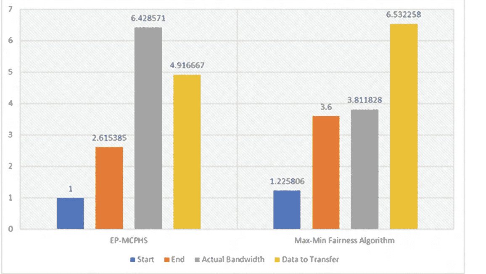

图 11.3 EP-MCHS 与最大最小公平算法的比较。

## 表 11.6 跨时间间隔的仿真分析

| 间隔 | 统计分析 | 开始 | 结束 | 实际带宽 | 待传输数据 |
|---|---|---|---|---|---|
| 5 | 平均值 | 1.0 | 2.615385 | 6.428571 | 4.916667 |
| | 标准差 | 0.0 | 1.626700 | 3.857320 | 7.548959 |
| 10 | 平均值 | 1.000881 | 2.615 | 6.428578 | 4.916667 |
| | 标准差 | 0.0715 | 1.62686 | 3.857320 | 7.548959 |
| 15 | 平均值 | 1.000081 | 2.6185 | 6.428561 | 4.916667 |
| | 标准差 | 0.00006 | 1.62579 | 3.857320 | 7.548959 |
| 20 | 平均值 | 1.000094 | 2.6159 | 6.428577 | 4.916667 |
| | 标准差 | 0.00051 | 1.626709 | 3.857320 | 7.548959 |

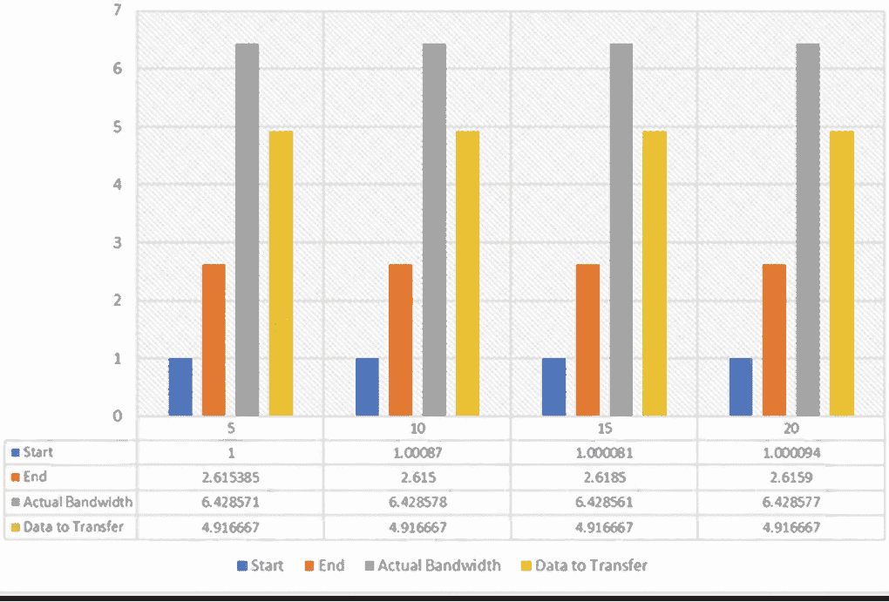

图 11.4 跨间隔仿真分析。

## 基于边缘服务器的卸载

边缘计算正在显著增长。当今移动应用需要计算、低延迟、高带宽等，导致了一个需要快速边缘计算的场景，而高延迟的通用服务器无法满足这些高需求。为了缓解这一点，选择了这些资源。在本研究中，EP-MCPHS 的提议允许使用多处理技术来减少空闲边缘服务器的负载，降低延迟并增加带宽以满足服务请求。我们的实验见第 11.4 节，比较显示了 EP-MCPHS 架构在边缘服务器中部署云端任务的优越性。它将带宽从 3.811828 增加到 6.428571，并降低了网络有效流量。本研究旨在创建一个能够管理负载、降低延迟、增加带宽并减少云端卸载的动态架构。该研究的未来范围可以通过对 DRL 机制进行特征选择测试来展示。

## 参考文献

- 1. Roman, R., Lopez, J., Mambo, M. (2018). 边缘计算，雾化计算：安全威胁综述。Future Generation Computer Systems, 78, 680–698.
- 2. Shahzadi, S., Iqbal, M., Dagiuk, T., Qayyum, U. (2017). 多接入边缘计算：开放问题、挑战与未来展望。Journal of Cloud Computing, 6, 1–13.

## 使用 AI 优化边缘与雾计算

- 3. Mao, Y., Zhang, J., Huang, K., Lataief, K. (2017). 移动边缘计算综述：通信视角。IEEE Communications Surveys, 19, 2322–2358.
- 4. Satyanarayanan, M., Klas, G., Silva, M., Mangiante, S. (2019). 边缘原生应用的关键作用。2019 IEEE 边缘计算会议，33–40。
- 5. Satyanarayanan, M., Bahl, P., Caceras, R., Davies, N. (2009). 移动计算中基于 VM 的云案例。IEEE Pervasive Computing, 8, 14–23.
- 6. Zhao, H., Deng, S., Liu, Y., Jin, Y., Dustardar, S. (2020). 边缘端微服务的分布式冗余调度。IEEE Transactions on Services Computing, 15(3), 1732–1745.
- 7. Wang, J., Feng, Z., George, S., Iyengar, R., Pillai, P., Satyanarayanan, M. (2019). 可扩展自适应边缘应用。ACM/IEEE 边缘计算研讨会，152–165。
- 8. Souza, P., Ferretti, T., Rossi, F. (2022). 联邦边缘中的延迟感知服务迁移。国际计算与服务科学会议，288–295。
- 9. Souza, P., Ferretti, T., Rossi, F., Calheiros, R. (2022). 边缘基础设施的位置感知策略。IEEE Communications Letters, 26, 848–852.
- 10. Yu, Z., Xu, W. (2022). 基于深度学习的边缘计算任务卸载与资源分配策略。计算智能与神经科学，2022, 1–11. https://doi.org/10.1155/2022/1427219
- 11. Vaisman, R., Krose, D. P., Getsbakh, I. B. (2016). 相干系统组合不变变量的改进映射方案。IEEE Transactions on Reliability, 65(1), 410–424. https://doi.org/10.1109/TR.2015.246471
- 12. Li, X. (2021). 移动边缘计算系统中基于深度强化学习的卸计算资源分配方案。Journal of Grid Computing, 19, 253.
- 13. Ullah, I., Hasan, M., Seo, Y., Han, Y. (2023). 边缘计算中深度强化学习的任务卸载与资源分配。IEEE Access, 8, 5407–5418.
- 14. Alfikah, T., Hasan, M., Gumaehi, A., Savaglio, C., Martino, G. (2020). 基于 sarsa 的移动边缘任务卸载与资源分配。IEEE Access, 8, 5424–5436.
- 15. Yang, H., Xu, C., Liu, S., Zhang, Y. (2021). 多用户边缘计算的随机无线与计算资源管理。IEEE Transactions on Wireless, 16(9), 5994–6009.
- 16. Alghamandi, I. (2027). 移动边缘计算计算。博士论文，格拉斯哥大学。
- 17. Cardellini, V., De Nitro, V., Grassi, F., Piccialli, V. (2016). 移动云的能效卸载。Mathematical Programming, 157, 421–449.


# 索引

A
准确率，24, 43, 51, 53, 57, 59, 60, 69, 87–89, 103, 105, 106, 108, 114, 120, 121, 129–131, 133, 139, 141–144, 147, 150–152, 154, 159–161–163, 168–209, 213, 215–217, 220–225, 228
聚合，124, 208
人工智能，31, 32, 44, 65, 86–88, 96, 99, 121, 132–137, 151, 166, 207, 205, 208, 211, 226, 231–233, 255
AI/ML，202
基于人工智能的，164
算法，28, 30, 31, 34, 35, 37–44, 46, 47, 50, 51, 54, 59, 65, 71, 73, 79, 88, 113–111, 117, 119, 121, 123–127, 129, 131, 133, 135–139, 141, 146, 147, 149, 153, 153, 155, 156, 162, 167, 181, 184, 188, 205, 209, 218, 219, 222, 231–246, 247, 249, 250, 253
分配，1, 3, 5, 8, 12, 15, 18, 21–26, 28–32, 36–38, 40, 41, 43, 45, 46, 53, 56, 60, 62, 64, 108, 114, 136, 157, 171, 174, 176, 178, 183, 185, 187, 188, 192, 199, 203, 205, 227, 228, 230–233, 236–240, 254
Android，161
Apache，207
架构，22, 36, 39, 40, 42, 49, 67, 70–73, 74, 76, 77, 79, 81–83, 95–97, 100, 109, 114, 115, 142, 148, 166, 179, 189, 204, 207, 211, 214, 218, 219, 222, 223, 231, 236, 237, 242, 253
自动编码器，137
AWS，90, 93, 96, 99, 103, 230
Azure，111, 230
B
贝叶斯，206
BFV，211, 220, 221
偏置，141, 220–223
区块链，26–28, 30, 63, 65, 67–73, 75, 76, 79, 81–83, 150, 155, 157, 169, 170
C
云，2–5, 7–12, 16, 21–26, 30–33, 36, 40, 44–49, 53, 56, 58, 61, 64–68, 70–73, 76, 79, 81–82, 84–90, 95, 96, 102, 109–113, 130, 136, 148, 149, 153, 157, 165–169, 189–191, 197, 198, 200, 205, 213–227, 242, 246, 254
基于云的，39, 50, 87
云边缘，44
云原生，229–243, 245, 247, 249, 251, 255
CNN，213, 214, 216, 217, 220–223, 225, 227
传统的，33, 121, 170, 183, 193, 209, 216, 217
新冠，222
CPU，12, 40, 56, 57, 59, 72, 176, 180, 181, 184–186, 188–190, 204, 234, 239–245
积分，27
D
DDQN，38, 39, 41
去中心化，7, 8, 23, 24, 26–28, 30, 41, 46, 63, 67, 71, 75, 79, 81, 116, 117, 120, 123, 124, 130, 132–135, 138, 139, 141, 148, 150, 151, 153, 155, 157, 160, 165, 175, 179, 200, 202, 204, 210, 218–221, 225, 227
决策，7, 19, 20, 35, 40–42, 44, 55, 56, 58–61, 116, 117, 174, 175, 178, 180–182, 184, 188–191, 195–197, 201–204, 233, 255
DML，166
DNN，174, 181, 203
Docker，90, 91, 94, 96, 99, 101
DRL，34, 35, 37, 39–44, 174, 175, 179, 181–184, 188–204, 232, 233, 254
DVFS，13
E
EC2，90, 91, 93, 94, 96, 99–101
边缘云，23, 30, 254
边缘，34, 254
边缘规模，230
EdgePy，234, 236–238, 242, 253
能效的，23, 192, 205
轮次（Epochs），142
以太坊，75
伦理的，29, 63, 91, 216
演化，31, 45, 65, 129, 133, 157, 164, 205, 228
探索，143, 173, 175, 179, 191, 200
F
1, 52, 60
故障，53, 55, 61, 79, 82, 132–135, 147, 152, 153, 167, 171, 201, 202, 216
联邦学习，23–26, 30, 32, 47, 63, 113–115, 117, 119, 129, 133, 135–137, 139–141, 143–148, 151, 152, 155–157, 160, 161, 165–177, 179, 191, 200, 201, 203, 205, 208–228, 254
联邦SVM，167
防火墙，76, 78
雾网边缘，29, 73, 75, 77, 79, 83
预测，21, 160, 168
模糊的，123, 164
G
遗传算法，43, 44, 129
网关，32, 108
高斯，24, 214, 222
地理，38, 53
地理位置，3, 10, 38, 49
Google，227, 230
GPS，197
GPU，42, 176, 178, 185, 186
梯度，36, 38, 50, 88, 131, 135, 143, 145, 166, 174, 181–184, 204, 209, 210, 213, 218–225
H
医疗保健，1, 2, 6, 17, 18, 22, 24, 29, 49, 56, 62, 65, 67, 70, 83, 116, 126, 140, 152–154, 160, 168, 177, 182, 189, 192, 194, 197, 199, 203, 204
蜜罐节点，112
超参数，52, 60, 142, 146, 213, 220, 221
I
ICU，179
入侵检测系统，84–91, 93, 94, 96, 98–101, 108, 109, 112, 131
IoT，6, 18, 19, 120, 139, 149, 159, 176
基础设施，2, 3, 16, 20, 22, 24–26, 28, 31, 32, 45, 54, 62, 63, 85, 87, 90, 100, 110, 116, 130, 136, 147, 148, 149, 152, 156, 157, 174, 178, 180, 182, 189, 193, 197, 201, 204, 205
包含，110–114
IoT，3, 5, 11, 14, 15, 21, 22–25, 29–33, 36, 38, 48, 49, 56, 57, 62, 64, 65, 67–73, 76, 79, 81–93, 101, 105, 109, 111–114, 116, 117, 148, 149, 152, 156, 158, 162, 166, 174, 178, 189, 193, 197, 199, 200, 204
IP，55, 79, 92, 100
K
KNN，51, 60
L
Lambda，99
层，4, 5, 6, 71–73, 76, 79, 96, 120, 215, 214, 233
基于学习的，175, 177, 179, 181, 183, 185, 187, 189, 191, 193, 195, 197, 201, 203
损失，59, 90, 124, 129, 130, 143, 146, 162, 233
M
恶意的，88, 93, 107, 108, 111, 207, 208, 216, 217
最大值，247, 249
MDP，36, 37, 39–43
媒体，75, 76
中位数，43
方法论，39
迁移，202, 203, 230–234, 237–239, 254
挖矿，9, 65
最小值，79
机器学习驱动的，6
MLSys，113
MMFA，242, 246, 253
模型，9, 15, 22–24, 28, 29, 35–41, 44, 52–56, 57, 59–61, 68–70, 72, 73, 76, 80, 88, 94, 95, 98, 102, 103–105, 107, 109, 114–120, 129–135, 138–157, 161–168, 175–192, 195, 200, 201, 204–226, 237, 233
MSE，60
多任务，169
N
纳米技术，110
神经网络，31, 32–37, 40, 41, 45, 65, 121, 126, 135, 139, 141, 157, 166, 174, 184, 187, 205, 200–207, 223–228, 232, 253
NLP，76
归一化，134, 136, 213, 214
目标，11, 44, 63, 85, 91, 109, 124, 126
卸载，8, 9, 23, 42, 176, 179, 182, 183, 193, 201
优化，1, 3–5, 7–11, 13–17, 19–25, 27–31, 33–36, 46, 50, 58, 62, 63, 65, 66, 129, 130, 132, 133, 135, 136, 141, 157, 161, 165, 167, 170, 174, 178, 185, 187, 190, 198, 199, 205, 214, 218, 219, 226, 232, 233, 238
编排，32, 234, 237
过拟合，52, 61
过载，155
模式，65, 84, 102, 136, 160, 166, 167, 236
PCA，57
PDM，113, 114, 116, 117, 120, 132, 135, 138, 139, 141, 143, 148, 150, 152, 155, 157, 162
P，106
流水线，23, 94, 95, 100, 232, 240
人口，43
端口，79, 92, 93, 95, 100
PPO，36, 37, 39, 44, 174
协议，16, 43, 76, 98, 234
PSO，38, 43, 129, 130
Python，64, 65, 95, 236, 255
Q
Q-learning，37, 42, 45, 46, 232
Q-net，184
QoS，2
Quantum，26–30
召回，5, 52, 57, 60, 105, 150, 151
回归，50, 52, 57, 59, 60, 149, 160, 161
强化，2, 9, 10, 14, 25, 28, 29, 50, 53, 61, 63, 74, 79, 103, 104, 123, 132, 139, 150, 154, 157, 163, 176, 178, 179
远程，3, 6, 12, 18, 25, 26, 29, 82, 141, 143, 156, 177, 178, 189, 192, 197, 199, 203
2, 8, 99, 90, 95, 96, 98, 108, 109, n2, 21, 23
RMS，12
RMSE，52
RNNs，41
基于规则的，84, 87, 88, 91, 96, 107, 109
S
Sikit，64
分段，213, 220, 228
半导体，170
敏感，1, 4, 7, 11, 14, 16, 22, 24, 28, 30, 49, 52, 105, 106, 116, 121, 130, 133, 134, 139, 140, 154, 157, 165, 182, 191, 207, 209, 214
传感器，3, 4, 7, 9, 16–20, 68, 70, 93, 98, 111, 114, 116, 117, 120, 132, 136, 138, 139, 141, 143, 148, 150, 152, 155, 157, 162, 164, 166, 167, 170, 174, 176, 177, 178, 179, 197, 199, 202
SIEM，84, 90, 94, 98, 102
偏斜，55
切片，25
群，38, 43, 46, 129
协同，165
软件定义，88
UAV，88
无处不在的，25, 31
土壤，6, 15
Ubuntu，90, 94
超，114
未结构化的，5
结构化，70, 108
未加密的，5
无监督的，104
V
虚拟，111
VPC，92
W
TCP，76
仓库，90
TensorFlow，57
时间戳，34, 64
工作流，35
WSNS，76
X
XBoost，88–90
Y
调优，57, 146
