# pc go! 技巧与诀窍 1998年1月至2001年8月


## 如何使用“研讨会存档”

当您从 CD-ROM 的主菜单启动“研讨会存档”时，会出现主目录和下图所示的菜单栏。借助其中描述的功能，您可以轻松操作数据库。如果要打印，可以在“文件”菜单下的“打印”中找到该功能。

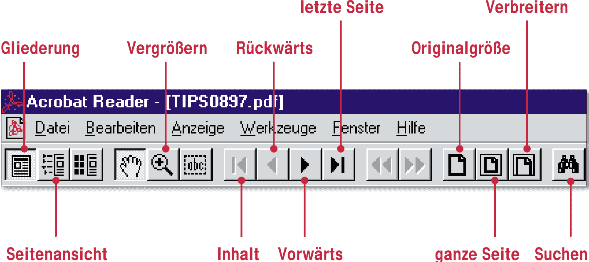

## 下拉菜单

下拉菜单是指输入框旁带有向下箭头的菜单。单击此箭头会展开更多菜单项（英语：drop down）。下拉菜单在网页上很常见。通过它们可以选择预设的输入选项。

## 筛选

通过筛选，可以显示符合特定条件的数据。所有其他数据将不显示。当您想快速了解表格中的数据概览时，这非常有用。Excel 中有自动筛选功能。通过它，您可以将预设的筛选应用于某行或某列的数据。

## 单元格

屏幕上，Excel 表格被划分为许多小方框。这些小方框称为单元格。每个单元格都有一个特定的“名称”，该名称取决于其在表格中的位置。表格又由列和行组成。列用字母命名（A, B, C ...），行用数字命名（1, 2, 3 ...）。由此得到各个单元格的名称，例如 B7（即第二列第七行）。

## 工作簿

Excel 中的每个文件都是一个工作簿。它可以包含多个表格或图表。当您有多个主题相关的表格或图表时，这很方便。这些表格不再需要单独保存。在屏幕底部、表格下方，会显示工作簿包含多少张表格或图表。

## Excel 中的字体

当您启动 Excel 并在表格中输入数据时，这些数据将以 Arial 字体、10 磅大小显示。以下是更改 Excel 中默认字体和大小的方法。

- 1. 选择“工具”菜单，并选择其中的“选项”项。
- 2. 单击“常规”选项卡。
- 3. 在“标准字体”和“字号”字段中，您可以输入自己的设置。
- 4. 单击当前设置旁边的箭头。然后从“下拉菜单”中选择新的字体和字号。


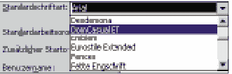

## 使用筛选

Excel 中一个非常有用的功能是筛选。通过它，您可以指定某行或某列中仅显示某些值。使用自动筛选，您可以显示例如十个最高值，或符合特定条件的值。

- 1. 创建一张您选择的表格。单元格中可以包含名称或数字。将第一行留空。稍后我们将在那里插入自动筛选。
- 2. 标记整个表格，方法是单击“A”列旁边、“1”行上方的灰色方框。或者标记您要为其设置筛选的列或行。
- 3. 在“数据”菜单中选择“筛选”项。然后点击子项“自动筛选”。
- 4. 如果您标记了整个表格，第一行的每个单元格中会出现一个带箭头的灰色小方框。您可以在此处设置自动筛选。
- 5. 单击其中一个箭头。此时会打开一个“下拉菜单”，其中会显示一些筛选选项。
- 6. 如果您单击其中一个选项，则指定仅显示此列中满足这些条件要求的单元格。例如，如果您标记了包含数字的一列，然后点击“前 10 个”筛选，则只显示具有十个最高值的单元格。如果您点击包含特定数字的筛选，则只显示包含该值的单元格。这对于包含文本内容的单元格也很有用。
- 7. 如果您想删除筛选并恢复原始表格，请再次选择“数据”菜单。点击“筛选”项，然后点击“自动筛选”。这样，筛选将被再次清除。

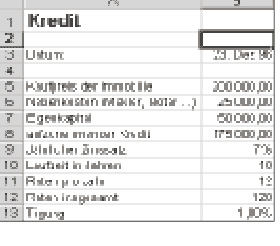


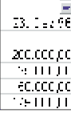


## 新建文件夹

您是否曾尝试在 Windows 资源管理器中新建文件夹？这非常麻烦。您必须依次点击“文件”->“新建”->“文件夹”菜单项，或者按“Alt”键，然后输入字母“D”、“N”、“O”。在 Microsoft Office 自己的程序中，即 Word、Excel 等中，操作会更快。

- 1. 通过单击“文件”菜单中的“另存为”，保存要存放在新目录中的表格。
- 2. 在此窗口中，单击带有箭头标记的图标。
- 3. 输入新文件夹的名称。
- 4. 单击“打开”。只有这样，文件才能保存在该文件夹中。


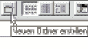

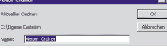


## 共享工作簿

如果要让多个用户同时访问一个表格，您必须共享工作簿。

- 1. 在“工具”菜单中选择“共享工作簿”项。


- 2. 若要允许多个用户同时访问该表格，您必须激活以下复选框：


- 3. 如果单击“设置”选项卡，您可以指定是否创建修改日志、表格保存的频率以及同时修改时的处理方式。

## 在 Excel 表格中与 Word 文档建立链接

在 Excel 97 中，有超链接，您可以通过双击直接从表格跳转到 Word 文档。在 Excel 95 中，您可以在表格单元格中插入一个链接。该行中会插入一个图标。当您点击此链接图标时，文本会被加载，您可以直接在 Word 中编辑它。

- 1. 打开您想要与 Excel 表格链接的 Word 文本。
- 2. 使用组合键“Ctrl”+“A”标记整个文本，或在“编辑”菜单中选择“全选”命令。

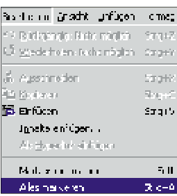

- 3. 单击“编辑”菜单项，然后点击“复制”。整个文档将被放入剪贴板。


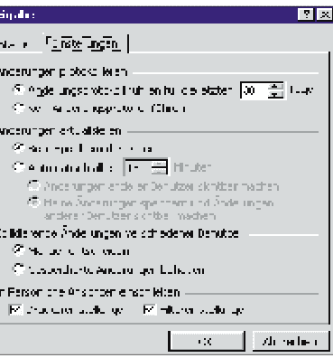

下次当您打开一个同时被其他用户使用的表格时，不再询问您是否要创建文件副本，而是您直接在该表格中工作。

- 4. 切回 Excel。最快的方法是同时按“Alt”键和“Tab”键。
- 5. 在“编辑”菜单中选择“选择性粘贴”项。

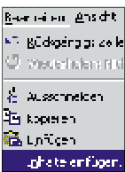

- 6. 在此处选中“链接”和“显示为图标”前面的复选框。“作为:”下应显示“Word 文档”。然后点击“确定”。

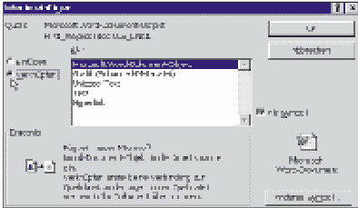

- 7. Word 图标将被插入 Excel 表格中。双击该图标，Word 文件就会被打开。

您现在可以直接在 Word 中编辑该文档。


## Office

英语术语“Office”实际上意为“办公室”。但在计算机程序中，它指的是一类特定的程序——即那些常在办公室或工作场所使用的程序。这些程序包括文字处理、电子表格、数据库和图形演示程序。这四种程序通常组合在一个 Office 软件包中。无论是由 Microsoft、Corel、StarDivision 还是 Lotus 公司出品，每个现代 Office 软件包如今都包含这些程序。

## 超链接

超链接是使互联网闻名于世的技术之一。它是对另一个文件的引用。在互联网上，您可以借此从一台计算机跳转到另一台，而您甚至不会察觉。但在互联网之外，超链接技术也已得到广泛应用。您可以在文本或表格中设置一个超链接，当您点击该超链接时，就会跳转到相应的文件或文本标记。在百科类 CD 中，超链接也同样普及。这样您就可以从一个主题跳到另一个主题。

## 链接

通常，在不同程序和文件之间建立连接非常重要。为了实现这一点，会在一个文件或文档中插入指向其他文件或文档的链接。例如，程序会以图标的形式插入到文本或表格中。当您点击此图标时，您会被直接引导到另一个文件。如果您不想频繁地在不同程序之间切换，这会很有帮助。


## Excel
### 去掉空格
经常会出现表格中插入了不必要的空格。导入表格或数据库时也会出现这种情况。这样就可以去掉空格。

1 在“插入”菜单中选择“函数”命令。


2 在“类别”字段中选择“文本”项，在“函数”字段中选择“清理”项。

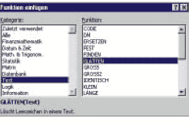

3 您现在只需指定要在表格的哪个区域，即哪些单元格中删除空格。第一种方法：手动输入单元格区域（例如 C1:C18；这样将检查 C1 到 C18 之间所有单元格的空格）。第二种方法：只需用鼠标标记要执行此操作的单元格。松开鼠标按钮后，表格区域会自动填入相应的字段（“文本”）中。

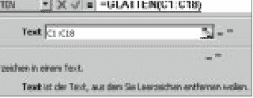

4 单击“结束”。Excel 现在会删除单元格开头或结尾的所有空格。但两个单词之间的空格不会被删除。


## Software
Make Sense 是一款翻译程序，可在德语和英语之间以及反向翻译。程序操作非常简单，它还能集成到 Word 和 Excel 等 Office 程序中。通过右键单击，您可以查看单词的翻译并直接翻译单词。唯一的缺点是：只能翻译单个单词，不能翻译整段文本。对于如此优惠的价格，Make Sense 还是值得推荐的。


## Excel
### 拼写检查
您可以先在撰写文本前就启用拼写检查，也可以等到最后再启动拼写检查。如果一开始就已激活，未识别的单词会用红色波浪线标出。Word 会检查这些单词是否在其词典中包含。如果没有，您可以向词典中添加新单词。添加的单词会保存在文件“benutzer.dic”中。

### 自动文本
通过快捷键使用自动文本，您可以将整句话插入到文本中。只需标记句子或短语并将其定义为自动文本。下次输入所选缩写后按“F3”键，自动文本就会自动插入。

### 安全副本
为了确保在计算机崩溃时万无一失，Word 会为文档创建安全副本。如果您正常保存并关闭文本，同一目录下会同时创建一份安全副本。Word 中的安全副本可以通过文件扩展名“.wbk”识别。

### 选项卡
您几乎可以在 Office 套件的所有菜单中找到选项卡。位于窗口顶部的选项卡上显示了可供您进行的不同设置的统称。选项卡可以节省屏幕上的大量空间。

### 搜索时的预览
您想搜索特定表格，但不想逐一打开它们？这时就可以使用预览。但请注意：如果预览无法工作，请查看本提示的结尾！

1 从“文件”菜单中选择“打开”命令或单击相应的符号。

2 在工具栏中单击“预览”符号。Excel 现在会向您显示表格的一个片段。

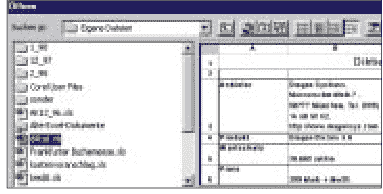

但这仅在您激活了特殊功能时才有效。为此，在“文件”菜单中单击“属性”。在此激活“保存预览图形”前的复选框。

### 到第一或最后一单元格
就像您在 Word 中使用键盘组合键跳转到文本开头或结尾一样，在 Excel 中也一样。

1 按下“Ctrl”和“Pos1”键盘组合键，即可跳转到表格的 A1 单元格。

2 使用“Ctrl”和“End”键盘组合键通常可以到达最后一行已填写的单元格。如果您删除了表格中更下方某个单元格的内容，则使用该组合键会跳转到那里。

### 文本块的名称
如果您经常使用相同的文本，最好为其命名。这样可以节省输入或复制的时间。

1 在单元格中输入您以后想快速调用的文本。


2 标记该单元格。然后在“插入”菜单中选择“名称”，然后选择“定义”。

3 为文本指定一个简短的名称，然后单击“确定”确认。


4 下次输入此缩写时，整个文本会作为提示自动显示。然后按“回车键”确认，文本将被填入单元格中。

### 复制工作簿内容
只需一个命令，您就可以将整个工作簿（包含表格和图表）的内容复制到一个新工作簿中。

1 选择“窗口”菜单，然后单击“新建窗口”。


2 会打开一个具有相同内容的工作簿。您应该以其他名称保存此工作簿。另一种仅复制当前表格的方法是复制表格的全部内容。使用“Ctrl”和“A”键盘组合键标记表格，然后从“编辑”菜单中选择“复制”。在新表格中选择“粘贴”。

## Excel
### 填充行
如果您的表格中有数字序列（例如 1,2,3...）或日期，您不必手动逐个输入每个值。使用“填充”命令即可自动完成。


在黄色框中会显示将要输入到最后一个单元格中的值。

1 输入一个星期几或一个数字。

2 标记该单元格并单击鼠标右键。

3 将鼠标移动到单元格的右下角。鼠标指针会变成一个加号。

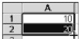

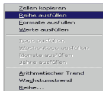

4 用鼠标右键单击，按住不放，然后将标记向右或向左拖动。

5 松开鼠标按钮后会出现一个上下文菜单，您可以在其中选择如何填充标记的单元格。

6 根据您是想复制第一个单元格、填充一个序列还是输入其他内容，单击相应的选项。

### 填充行 II
如果您事先就知道是想填充一个序列还是复制一个值，操作会更快。

1 重复之前的步骤 1 到 3。

2 但这次用鼠标左键单击标记的单元格并将标记拖动到所需方向。

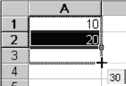

3 黄色框会显示序列是否继续或值是否仅被复制。在按住鼠标按钮的同时按“Ctrl”键可在两种可能性之间切换。

### 链接
在 Excel 97 中插入指向 Word 文件的链接非常简单。标记一个单元格，从“插入”菜单中选择“超链接”，然后输入所需文件的路径。文件随后会作为超链接出现在单元格中。

## 工作簿
在 Excel 中，文档或文件由一个工作簿组成。该工作簿中可以包含多个表格或图表。如果您有多个与同一主题相关的表格或图表，这就很方便。表格不再需要单独保存，而是作为工作簿的内容。屏幕底部的表格下方会显示工作簿包含多少个表格或图表，以及它们的名称

### 插入多行或多列
您以前是否总是逐行将行插入表格？只需两次鼠标点击，您就可以插入任意多行和列。

1 标记您想要插入的那么多行或列。单元格中是否有内容无关紧要。

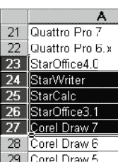

2 右键单击标记的单元格并从上下文菜单中选择“插入”。

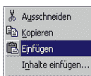

3 在已描述的行或列之前会插入新的空白行或列。

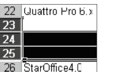

### 单元格
屏幕上的 Excel 表格被划分为许多起初大小相同的方块。这些方块称为单元格。每个单元格都有一个特定的“名称”，该名称取决于其在表格中的位置。因为表格又分为列和行。列用字母命名（A、B、C...），行用数字命名（1,2,3...）。由此得出各个单元格名称，例如 B7（即第二列，第七行）。您可以随意更改单元格的高度和宽度。

### 行列互换
您是否也遇到过这种情况？您设计了一张表格，最后才发现行和列最好是反过来的。这样就可以重新组织您的表格。

1 标记您想要重新排列的表格区域。

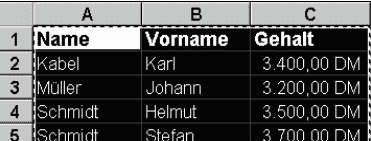

2 在“编辑”菜单中选择“复制”项或单击相应的符号。

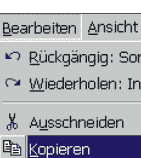

3 选择要插入更改后表格的位置并单击该单元格。


4 在“编辑”菜单中选择“粘贴内容”命令。

会打开一个菜单，您可以在其中选择要粘贴的确切内容。这里除了“转置”复选框外，其他内容都不重要。单击该复选框并用“确定”确认。


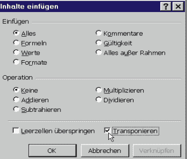

表格现在会以相反的形式插入到标记的位置。


然后删除表格的旧部分。遗憾的是，您不能简单地剪切标记的区域然后粘贴重组的表格。

### 超链接
这是一种互联网技术。超链接是对另一文件的引用。在互联网上，您可以这样从一台计算机跳转到下一台，而不会注意到。但在文本和表格中，超链接技术也已普及。您在文本或表格中设置一个超链接，当您单击该超链接时，就会跳转到相应的文件或文本标记。


## Excel

## 工作簿

在 Excel 中，一个文档或文件由一个工作簿组成。在此工作簿中可以包含多个表格或图表。表格无需再单独保存，而是工作簿的内容。屏幕底部（表格本身下方）会显示工作簿包含多少个表格或图表以及它们的名字。

## 单元格

表格的最小单位是单元格。在这里输入数据和公式。单元格呈灰色边框。

## 阅读角

互联网不必是天书。入门比您想象的要容易。此外，您无需会编程语言就能创建自己的主页。这也可以用“Microsoft Office”程序来完成。如何正确地使用 Office 97、“Internet Explorer”和“Outlook Express”上网，书籍《Mit Microsoft-Programmen ins Internet》展示了这一点。尤其是初学者在这里能找到一些宝贵的提示；例如如何发送电子邮件，如何在互联网上移动以及去向何处。通过小小的逐步指导，您还可以学习如何将 Word 或 Excel 文档发布到全球网络上。随附的 CD 上有一些互联网程序。唯一的缺点：这本书的版面可以设计得更清晰一些。


## 同时向多个表格输入数据

经常在多个表格中出现相同的数据，例如月份说明或表格的标题。通过一个简单的技巧，您可以在一个→工作簿的多个表格中输入数据。

1 Drücken Sie die "Strg"-Taste und klicken Sie gleichzeitig auf die Registerkarte am unteren Ende der Tabelle, in der die Namen der Tabellen eingetragen sind.
1 按住 "Strg" 键，同时点击表格底部用于输入表格名称的选项卡。

2 Die Namen der Tabellen, die Sie angeklickt haben, sind jetzt weiß hinterlegt. Das heißt, sie sind aktiv.
2 您点击的表格名称现在以白色突出显示。这意味着它们处于活动状态。

3 Wenn Sie jetzt Werte in eine Zelle eingeben, werden sie automatisch in den anderen Tabellen übernommen. Aber aufgepasst: Wenn Sie Daten wieder nur in eine Tabelle eingeben wollen, müssen Sie noch einmal die Registerkarten mit den Tabellennamen anklicken; sonst geben Sie überall die selben Daten ein.
3 如果您现在在单元格中输入值，它们会自动复制到其他表格中。但请注意：如果您只想再次向一个表格输入数据，必须再次点击带有表格名称的选项卡；否则您会在所有表格中输入相同的数据。

## 方便数据输入

如果您需要在表格中输入大量数据，最好尽可能快。如果您在输入值后按回车键，单元格标记会自动跳到下面的→单元格。分两步操作，您可以设定改为选择右侧、左侧或上方的单元格。

1 Wählen Sie aus dem Menü "Extras" den Punkt "Optionen". Hier klicken Sie auf die Registerkarte "Bearbeiten".
1 在菜单“Extras”中选择“Optionen”。在这里点击“Bearbeiten”选项卡。

2 Unter den Einstellungen sehen Sie einen Punkt "Markierung nach dem Drücken der Eingabetaste verschieben". Als Standard ist hier "Unten" eingetragen. Klicken Sie auf den Pfeil neben dem Feld. Wählen Sie die gewünschte Richtung aus, also "oben", "rechts" oder "links".
2 在设置中您会看到一个“按回车键后移动标记”的选项。默认情况下这里填写的是“Unten”。点击字段旁边的箭头。选择所需的方向，即“oben”、“rechts”或“links”。

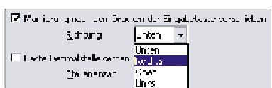

Nach einem Klick auf "OK" wird die Markierung bei der Dateneingabe jetzt so verschoben, wie Sie es festgelegt haben.
点击“OK”后，数据输入时的标记会按您设定的方式移动。

## 表格中不显示零值

表格中的零值是可以避免的；您只需选择正确的选项，显示的就不是“0”，而是一个空单元格。

1 Wählen Sie aus dem Menü "Extras" den Punkt "Optionen". Hier klicken Sie auf die Registerkarte "Ansicht".
1 在菜单“Extras”中选择“Optionen”。在这里点击“Ansicht”选项卡。

2 Im Feld "Fensteroptionen" ist das Kästchen vor "Nullwerte" aktiviert. Klicken Sie den Haken weg und es erscheinen keine Nullwerte mehr.
2 在“Fensteroptionen”字段中，“Nullwerte”前的复选框是激活的。取消勾选后就不会再显示零值了。

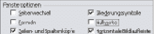

## 快速定位表格

如果您在一个工作簿中创建了许多表格，很难保持概览。此外，下方的表格栏中只能容纳少数几个表格名称。这样您就可以通过鼠标点击在表格之间切换：
在上下文菜单中会显示工作簿的所有表格。


1 Klicken Sie mit der rechten Maustaste auf die Pfeiltasten vor den Namen der Tabellen.
1 右键点击表格名称前的箭头按钮。

2 Wählen Sie die entsprechende Tabelle an. Jetzt wechseln Sie direkt dorthin.
2 选择相应的表格。现在您会直接切换过去。

## 工作簿密码

Excel 中有些工作簿比其他工作簿更机密。因此您可以为工作簿设置密码。此外，您可以设定工作簿在没有密码的情况下是否不能读取（读取保护）或不能更改（写入保护）。

1 Nachdem Sie eine Arbeitsmappe angelegt haben, klicken Sie im Menü "Datei" auf den Befehl "Speichern unter".
1 在创建工作簿后，在菜单“Datei”中点击命令“Speichern unter”。

2 Klicken Sie anschließend auf die Schaltfläche "Optionen". Es erscheint ein Fenster, in dem Sie zwei Dinge angeben können: Sie legen fest, dass mit der Speicherung gleichzeitig eine →安全备份 angelegt wird und Sie vergeben ein Passwort für den Lese-, bzw. Schreibschutz.
2 然后点击“Optionen”按钮。会出现一个窗口，您可以在其中指定两件事：您设定在保存的同时创建一份→安全备份，并为读取或写入保护设置密码。

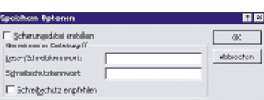

3 Geben Sie ein Passwort für den Schreib- und Leseschutz sowie nur für den Schreibschutz ein.
3 输入写入和读取保护的密码以及仅写入保护的密码。

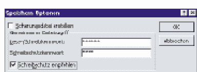

Bevor ein Benutzer die geschützte Datei öffnen kann oder sie speichern will, fragt Excel nach dem Passwort.
在用户可以打开受保护的文件或保存文件之前，Excel 会询问密码。

4 Wenn Sie das Kästchen vor "Schreibschutz empfehlen" anklicken, passiert folgendes: Wenn jemand anderes eine Datei öffnet, die Sie gespeichert haben, kann er diese nur schreibgeschützt öffnen. Will der Benutzer trotzdem die Datei speichern, muss er das unter einem anderen Namen tun.
4 如果您勾选“Schreibschutz empfehlen”前的复选框，会发生以下情况：如果其他人打开您保存的文件，他只能以只读方式打开。如果用户仍想保存文件，必须使用另一个名称保存。

Wenn Sie diesen Tip befolgen, sind Ihre Daten und Tabellen vor fremden Zugriffen sicher.
如果您遵循此提示，您的数据和表格就会免受他人访问。

## 恢复标准工具栏

有时您做得太过分：工具栏可以随意调整，但清晰度却不会因此提高。也许您丢失了一条→工具栏，而您急需它？这样您就可以恢复原始工具栏：

1 Suchen Sie aus dem Menü "Ansicht" den Punkt "Symbolleisten" heraus und wählen Sie dort "Anpassen".
1 在菜单“Ansicht”中找到“Symbolleisten”项并选择“Anpassen”。

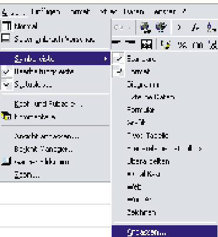

2 In diesem Fenster klicken Sie auf die Schaltfläche "Zurücksetzen".
2 在此窗口中点击“Zurücksetzen”按钮。

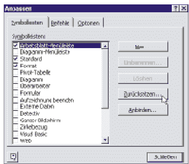

Sie werden noch einmal gefragt, ob Sie sich wirklich sicher sind. Bejahen Sie das. Jetzt stehen Ihnen die Symbolleisten der ersten Stunde Ihrer Excel-Geschichte zur Verfügung.
系统会再次询问您是否真的确定。确认即可。现在您可以使用 Excel 历史上最初的工具栏了。

3 Wenn Sie doch ein paar Änderungen an Ihren Symbolleisten machen wollen, tun Sie das ebenfalls über das Menü "Extras", "Anpassen". Klicken Sie dann auf die Registerkarte "Befehle". Dann wählen Sie die einzelnen Menüpunkte an und ziehen die Befehle auf Ihre Symbolleiste.
3 如果您仍想对工具栏做一些更改，也可以通过菜单“Extras”、“Anpassen”进行。然后点击“Be­fehle”选项卡。然后选择各个菜单项并将命令拖到您的工具栏上。

## 安全备份

Microsoft Office 中的安全备份功能意义不大。如果程序或您的电脑崩溃，最后打开的文档会被恢复——无论您是否创建了安全备份。文档的安全备份只有在您保存文档时才会保存。您可以通过文件扩展名“.wbk”识别安全备份。如果您后来不小心删除了原始文件，可以改用安全备份加载。

## 工具栏

在工具栏中汇集了最常用命令的符号（例如打开文件）。如今 Office 程序中的功能如此之多，以至于一个工具栏已不再足够。您可以单独更改工具栏或将新的工具栏调到屏幕上。

## PCgo! 提示 软件角落

您属于捡便宜的人群吗？那么您可以在 CD Superschnäppchen 上找到您热情的食粮。在一个数据库中，您可以根据单个关键词、邮政编码、地点或行业进行搜索。命中列表除了对优惠的简短描述外，还包含地址、路线说明、节省机会以及公司的营业时间。应通过互联网扩展该优惠。搜索结果也可以打印出来。数据库本身本可以更大一些。


## Excel

### 从十进制数变为整数

### 保存多个文件

### → 单元格
单元格是表格中最小的单位。它用于接收数据（文本、数字或公式）。每个单元格都通过在行和列中的确切位置来确定。可以按连续的字母识别列，单元格可按从 1 开始的连续数字识别。

### → 工作簿
工作簿是数据被编辑和存储的文件。每个工作簿可以包含不同数量的工作表。此外，您可以在单个文件中存储各种相关数据。

### → 工作区文件
工作区文件本质上是一个集合文件，其中存储了所有打开工作簿的信息。其中包括存储位置、窗口大小以及屏幕位置等。

### → 记录
记录是数据库的一部分。在此记录中存储所有重要信息，例如姓名、地点、街道等。各个记录按顺序存储，类似于归档到文件柜中。通过不同的查询模式可以再次访问每个记录。

如何从十进制数得到整数？这里可以用一个小技巧来帮助。 要删除已输入数字中的小数位，只需将数字乘以相应的十次幂（根据小数位数乘以 10、100、1000 等）。分步如下：

- 1. 在一个空的 →单元格中输入相应的数字。
- 2. 通过菜单项 "编辑/复制" 复制单元格。
- 3. 现在标记要更改小数位的单元格（标记的单元格必须相邻）。
- 4. 现在从 "编辑" 菜单中选择 "粘贴内容"。

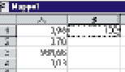

- 5. 在打开的对话框中，然后选择 "乘以"。点击 "确定" 确认。

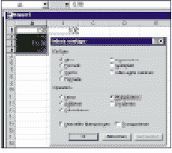

要从一开始就避免使用小数，请按以下操作：

- 1. 在 "工具" 菜单中打开 "选项"。
- 2. 在下一个窗口中选择 "编辑" 选项卡。
- 3. 取消选中 "固定小数位" 复选框。
- 4. 点击 "确定" 确认。然后将不再显示小数。

在 Excel 中，您可以通过创建自定义工作区并在其中保存所有所需数据，一步打开一整组 →工作簿。这种方法特别适用于与当前工作簿密切相关的常用文件。具体操作如下：

- 1. 通过 "打开" 菜单打开应作为组打开的工作簿，然后选择相应的文件。

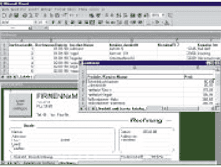

- 2. 现在设置工作簿窗口的大小和位置，以便在下次使用工作簿时按此显示。
- 3. 在 "文件" 菜单中点击 "保存工作区"。
- 4. 在 "文件名" 字段中输入工作区文件的名称。

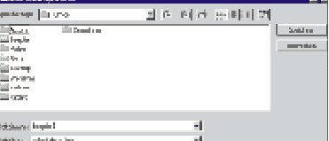

您可以通过 "打开" 命令随时打开您的 →工作区文件。但工作区文件不包含工作簿本身。您必须直接在工作簿中进行更改并在那里保存。为了快速访问工作区文件，请将其保存在 "XLstart" 文件夹中。将工作簿保存在常用目录中。要同时关闭所有工作簿，请按住 Shift 键并从 "文件" 菜单中选择 "全部关闭" 命令。

## Excel

### 查找重复记录

在数据库应用程序中，例如庞大的地址文件，经常会出现以下问题：→记录被重复输入。为了减少此类 "错误输入" 的堆积，您应每月花一些时间删除重复项。但不用担心：这不需要几个小时；如果按以下方式操作，只需几次鼠标点击即可实现：

- 1. 通过 "文件/打开" 菜单打开要检查的文件。
- 2. 现在在数据库中标记任意一个单元格。在 "数据" 菜单中选择 "筛选" 菜单项和子项 "高级筛选"。这样可以更好地概览记录。

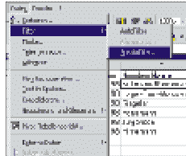

- 3. 删除 "条件区域" 字段中的默认值，然后激活 "无重复项" 复选框。

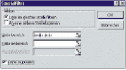

- 4. 点击 "确定" 确认对话框。

在您确认后，整个数据库将被评估并检查重复记录。根据数据库的大小，这可能需要一些时间。

搜索完成后，状态栏会出现以下消息："x Datensätze von y gefunden"

重复记录的数量显示为 x 和 y 两个值之间的差值。如果两个值一致，则不存在重复项。

### 兼容性

如果不同程序可以无问题地交换数据，则它们之间具有兼容性。但不同程序版本之间也存在问题。例如，较旧的版本无法理解较新版本的文件格式。为了避免这种情况，您在保存时应选择两种程序都支持的格式。

### 下拉列表

下拉列表是一个可展开的选择列表，其中包含您可以单独选择的各种菜单项。您可以通过小黑箭头识别它，您可以用鼠标点击它。随后会出现一个包含条目的新菜单。

### 文件格式兼容性问题

"Excel 97" 比早期版本包含更多功能。这也带来了一些问题，因为 97 版本有自己的文件格式——而早期版本无法再读取该格式。这在与仍使用旧版 Excel 的其他人交换数据时尤其会导致所谓的 →兼容性问题。为了确保您的数据以兼容格式保存，有两种方法：

- 1. 您将工作表以 "Microsoft Excel 5.0/95" 格式保存。但这有一些缺点，因为所有 Excel 97 特定内容都会丢失。但是文件可以在 Excel 5.0/95 中读取和写入。
- 2. 保存时您也可以选择 "Microsoft Excel 97 & 5.0/95 工作簿" 格式。现在 Excel 虽然将您的工作簿保存在一个文件中，但采用两种格式：一次为特殊的 Excel 97 格式，一次为 Excel 5.0/95 版本。这样不会丢失任何内容，工作簿仍然可供早期版本读取。

一个小技巧可以帮助您在保存时节省手动选择格式的步骤。具体操作如下：

- 1. 在 "工具" 菜单中调用 "选项"。
- 2. 在下一个窗口中点击 "转换" 选项卡。
- 3. 从 →下拉列表 "另存为的标准文件类型" 中选择 "Microsoft Excel 97 & 5.0/95 工作簿" 格式。点击 "确定" 确认条目。

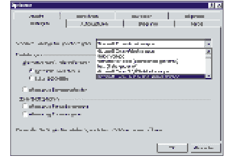

之后 Excel 将以您想要的格式保存您的工作簿。

### PCgo! TIP 软件角

ClipArt 总是需要用到。无论您是想快速设计邀请函或名片，还是只是想美化一封信。ClipArt 集合多如牛毛。有趣的 ClipArt 就难找多了。富士的 "Cartoons Vol. 1 和 Vol. 2" 就是一个不错的例外。您可以在各种主题领域找到 1,000 个有趣的卡通，可以快速插入到任何程序中。图片以 ".wmf" 格式保存，但也可以转换为最常见的其他格式并保存到硬盘。拖放插入 however 不起作用。只能通过剪贴板迂回。


## 标记框架
标记框架是一种辅助工具。通过它，您可以对所选内容进行视觉控制。标记框架有多种形式出现。当您在表格中标记多个单元格时，框架以实线显示。使用需要您进行选择的函数时，框架将以闪烁的线条显示。

## 表格文本旋转
表格的数据可以用一个小技巧来突出显示。您可以将文本在 -90 度到 +90 度之间旋转。

- 1 标记您想要编辑文本的单元格。

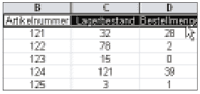

- 2 打开菜单项“格式/单元格”。将显示一个名为“单元格”的新菜单。在这里点击“对齐”选项卡以查看更多设置选项。

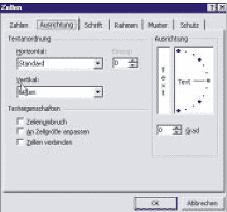

- 3 在“对齐”字段中，您可以随意更改文本对齐方式。为此在“度数”选择中设置所需的值。或者，您也可以在上方的窗口中用鼠标移动度数指示器。

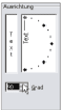

- 4 接下来更改 →文本排列。这是为了使更改后的文本在表格单元格中居中显示。为水平和垂直设置选择“居中”值。

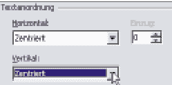

- 5 然后通过点击“确定”关闭选择菜单。您将在表格中立即看到更改的结果。

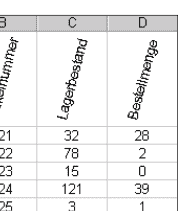

## 单元格
Excel 的工作区分为列和行。单元格是列与行之间的交点。可以输入任意数据或函数。您可以将工作区与格子纸进行比较。每个单独的方格就相当于 Excel 中的一个单元格。

## 文本排列
文本排列定义了文本在单元格中的定位方式。排列分为水平和垂直对齐。水平对齐中，您可以确定文本是左对齐、右对齐还是居中对齐。垂直对齐决定文本是位于单元格的上边缘、下边缘还是中间。

## 快捷键
快捷键是指用于调用命令的键盘组合。与其通过菜单项选择功能，只需一个键盘组合即可。这样可以更快地工作。在菜单中，快捷键以带下划线字母的菜单项形式显示。

## 快速插入日期和时间
在 Excel 中，您可以非常快速地将当前日期和时间插入到表格中。您可以省去通过“插入/函数...”菜单的繁琐步骤。改用 →快捷键。

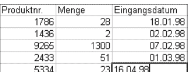

- 1 要插入当前日期，请点击应包含日期的 →单元格。然后同时按下“Strg”和“.”键。通过此键盘组合，今天的日期将以 →格式 TT.MM.JJ 插入到您选择的单元格中。

- 2 对于时间，也先通过点击选择一个单元格。然后同时按下“Strg”、“Umschalten”和“.”键。时间将以 HH.MM 格式显示。

当前日期和时间取自控制面板的设置。因此如果插入了错误的日期，这不是 Excel 的问题。打开控制面板。在“日期/时间”菜单中可以更改设置。

## Excel

## 快速求和
您是否经常在表格中使用求和函数？那么有一个方便的方法可以将所需的公式插入到单元格中。

|   | A | B | C | D |
|---|---:|---:|---:|---:|
| 1 | 11 | 3 | 73 |   |
| 2 | 18 | 10 | 74 |   |
| 3 | 3 | 11 | 96 |   |
| 4 | 9 | 4 | 98 |   |
| 5 |   |   |   |   |
| 6 |   |   |   |   |
| 7 |   |   |   |   |
| 8 |   |   |   |   |

- 1. 标记应显示总和的单元格。

- 2. 按下“Alt”、“Umschalten”和“O”键。求和函数将被插入到单元格中。同时 Excel 会建议应求和的范围。相关单元格将以滚动框架显示。

如果您想求和另一个范围或扩大所选范围？用鼠标左键点击您想要标记的范围的开头。按住鼠标按钮并将鼠标指针移动到范围的末尾。根据 **→ 标记框架**，您可以立即识别哪些单元格包含在您的选择中。

|   | A | B | C | D |
|---|---:|---:|---:|---:|
| 1 | 11 | 3 | 73 |   |
| 2 | 18 | 10 | 74 |   |
| 3 | 3 | 11 | 96 |   |
| 4 | 9 | 4 | 98 |   |
| 5 |   |   | =SUMME(B1:C2) |   |
| 6 |   |   |   |   |
| 7 |   |   |   |   |
| 8 |   |   |   |   |

- 4. 如果您对选择满意，请按 Return 键。现在在您之前选择的单元格中会出现标记单元格的总和。


## 格式
格式规定了不同行的内容应如何显示。格式可以包含文本对齐的说明以及数字显示的定义。如果您想定义格式，请先标记受影响的单元格。从菜单中选择命令“格式/单元格”以进行进一步设置。例如，您可以更改字体或添加边框。点击六个选项卡之一后，您会看到更多选项。尝试一些功能。您可以随时更改设置。

## 助手
助手是有用的帮手，旨在支持您的工作。如今它们已存在于 Microsoft Office 系列的每个产品中。有了助手，即使您还不熟悉程序的操作，也能快速完成例行工作。使用助手时，您将逐步引导至所需结果。较新的助手还提供对各个工作步骤的详细帮助功能。

## 查找重复数据记录
在管理数据时，一个问题反复出现：地址、数据或其他信息会被意外重复输入。这样随着时间的推移会积累大量无用的数据。为了查找重复数据记录，Excel 的筛选技术特别适用。将此功能用作 →助手；然后只需几次鼠标点击即可解决问题。

- **1** 在数据库中标记任意一个单元格。选择菜单“数据/筛选/高级筛选”。

- **2** 如果在条件区域中有预设，请删除它们。现在激活复选框“无重复项”。


- **3** 通过点击“确定”确认所有更改和输入。

然后 Excel 检查整个数据库。这可能需要一些时间，具体取决于数据量。检查完成后，在 →状态栏中会出现以下形式的提示：“x Datensätze von y gefunden”。值 x 和 y 之间的差值是重复数据记录的数量。如果两个值相等，则没有重复项。

## 状态栏
状态栏在下方关闭工作区，并作为消息输出行。在其中显示所有当前信息，如就绪指示、使用的公式等。

## 交换行和列
创建大型表格通常需要花费大量时间和精力。太晚才发现列更适合作为行，行更适合作为列显示。在这种情况下，通过一个小技巧可以避免重新创建此表格：只需使用“复制”和“粘贴”编辑功能。这样就可以将表格旋转到合适的形式。

- **1** 首先标记您想要更改的表格。

- **2** 然后通过菜单“编辑/复制”或键盘组合“Strg”和“C”将表格复制到 →剪贴板。

- **3** 将鼠标指针移到构成新表格最左上角（即最左上角单元格）的单元格。然后从“编辑”菜单中选择“粘贴内容”项。

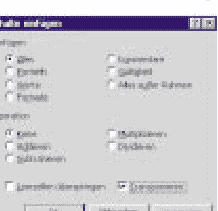

- **4** 现在会打开一个对话框。在这里通过鼠标点击激活“转置”选项前的复选框。然后点击“确定”。之后 Excel 会交换列和行。

## 剪贴板
这是一个临时存储区域，专为应用程序中的数据交换保留，特别是剪切、复制和粘贴时。

## 滚动
滚动是指在水平或垂直方向上移动屏幕内容。为此大多数应用程序提供了一个所谓的滚动条。它在两端各有一个箭头，中间有一个位置指示器。您可以点击两个箭头之一或移动位置指示器来移动屏幕内容。

## Excel 7：相加时间
在相加时间时通常会出现相同的效果。例如，如果您将时间 2:30、12:50 和 17:30 相加，您会得到值 8:50。Excel 在这里按 24 小时制计算。有时这个实际上合乎逻辑的值并不期望。更希望显示总小时数。为此您必须按如下操作：

- **1** 用鼠标标记稍后将输出时间总和的所需字段。

- **2** 现在从“格式”菜单中选择“单元格”项。

- **3** 选择 →选项卡“数字”。用鼠标点击“时间”类别。作为格式选择选项“26:30:55”。然后点击“确定”。

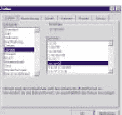


## Excel
### 选项卡

在某些菜单项选择后会出现一个新窗口。如果这里有大量设置可供选择，您会在窗口顶部边缘看到小的标签。这些就是所谓的选项卡。它们将多个、通常主题相关的选项汇总在一起。这样您就能随时清晰地掌握所有选择项。通过点击一个标签，您可以在各个选项卡之间切换。

这样 Excel 就能在超过 24 小时限制的情况下进行计算，并将时间相加得到期望的结果 "32:50:00"。

仍在使用旧版 Excel 的用户，可在选择菜单中使用格式 "[h]:mm:ss"。

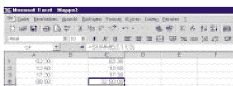

### 用鼠标进行标记

鼠标在需要快速操作时是一个很好的帮手。因此在 Excel 中，使用鼠标标记表格区域比通过菜单或键盘输入要快得多。但问题在于，当表格超过 35 行时。只要按住鼠标键，屏幕通常就会不受控制地向下滚动。这里有一种略有不同的鼠标技术可以帮助：

- 1 用鼠标双击最上方单元格的下边缘。然后您会直接到达该列的最后一个已填写区域。
- 2 如果您例如想标记整列 A1:A51，请按住 Shift 键并再次双击该单元格的下边缘。
- 3 这也适用于条目超出可见区域（字母 L）的列。只需双击最左侧单元格（A）的右边缘即可。
- 4 您例如可以通过按住 Shift 键双击单元格 A1 的右边缘来标记 A1:O1 的区域。

### Shift 键

Shift 键是指用于在大小写之间切换的键。在普通键盘上，该键有两个。它用指向上方的箭头表示。

### 通过快捷键插入函数

如果您在创建表格时经常需要使用函数，肯定会觉得通过“插入/函数”菜单的漫长路径很麻烦。这里使用快捷键要快得多：

按“Shift”和“F3”键组合。这样，功能选择窗口“插入函数”的对话框框就会出现在屏幕上。当然，Excel 的其他功能也有类似的快捷键。


### 快捷键

快捷键是快速键的同义词，在大多数情况下是一个按键或按键组合，用于执行命令。

### 单元格中的多行文本

有时单元格的宽度不足以容纳输入的文本。为了仍然在一行中显示多行文本，请按如下操作：

- 1 首先标记要格式化的单元格。
- 2 在“格式”菜单中点击“单元格”，并在此选择“对齐”选项卡。或使用上下文菜单。
- 3 在文本属性中激活“自动换行”复选框并用“确定”确认选择。
- 4 要在特定位置实现换行，请用鼠标在编辑栏或单元格中点击要稍后插入换行的位置。然后按“Alt”和“回车”键组合。换行将被执行，您会立即看到结果。

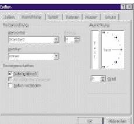

### 上下文菜单

上下文菜单是一个扩展的选择菜单。您始终用右键调用它。它包含与您选择的区域相关的命令。您可以用这些命令进行各种设置或调用命令。上下文菜单的优点是调用速度快且菜单占用空间小。

## Excel
### 始终显示日期

如果您想在工作表的打印输出中显示页码或当前日期，必须插入页眉或页脚。在其中放置字段，相应的说明会自动填入。

第一个符号用于确定说明的字体。接下来的两个符号用于页码说明。点击第一个符号会插入页码，第二个符号会插入总页数。这样您就可以构造出如下说明：“第 1 页，共 2 页”。不过“第”和“共”必须额外输入。这可能看起来像这样：

- 1 在“文件”菜单中选择“页面设置”。在这里选择“页眉/页脚”选项卡。对于包含所需说明的新页脚，点击“自定义页脚”。


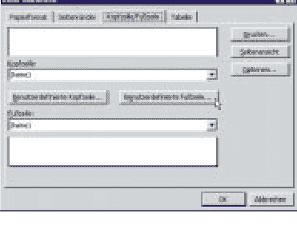

### 页脚

页眉和页脚特别适合放置您必须在文档或表格中反复出现的说明。其中包括页码、日期、时间或文件名。页眉或页脚的位置是独立于实际页边距设置的。您当然应注意它们位于文本开头或结尾的上方或下方，因为页眉或页脚和实际文本可能会重叠。页眉和页脚的属性可通过“文件”菜单和“页面设置”点进行更改。

- 2 您可以将说明放在左侧、中间或右侧。要插入说明，您可以使用以下符号。


- 3 接下来的两个符号用于日期和时间。日期以以下格式显示：“08.06.98”，时间如下所示：“14:19”。同样适用：如果您想在日期和时间之间放置特殊说明，必须输入字符，无论是字母还是空格。
- 4 最后两个符号用于插入文件名和工作表名称。这里您也必须再插入分隔符或自己的文本。在屏幕上页脚不会出现，只在分页预览中出现。

### 将表格压缩到一页

您是否厌倦了不断更改表格的页边距以使其适应单页？这样您只需点击一下即可将表格压缩到一页：

设置您的表格总共应打印在多少页上。您可以选择表格应宽或高多少页。

### 缩放

这是放大或缩小的另一种说法。如果您缩放文本或图形，它/它将被调整到所需大小。在 Excel 中，您可以缩放表格内容，使其在打印时适应特定数量的纸张。100 % 的缩放表示保持原始大小。

- 1 从“文件”菜单中选择“页面设置”。在这里点击“纸张格式”选项卡（如果它尚未处于活动状态）。
- 2 在“缩放”字段中点击“适应”前的按钮。在这里您可以设置表格总共应打印在多少页上。您可以选择表格应宽或高多少页。

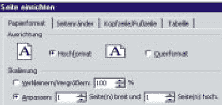

- 3 用“确定”确认。然后打印文档；它现在适合一页。文档本身不会被更改（无论是页边距还是字体或字号）。设置将作为标准保存。因此下次打印时，请考虑是否仍想应用该选项。如果不想，请在“缩放”字段中点击“缩小/放大”并选择“100%”。这样标准大小将被恢复。


## Excel 中的宏

Word 能做的，Excel 当然也能做：→ 使用宏录制器录制宏。这样您可以为大量的命令序列分配一个组合键。

- 启动 Excel 95，从“工具”菜单中选择“录制宏”。在 Excel 97 中，请选择“宏”，然后选择“录制”。

- 在“宏名”字段中为宏命名。在 Excel 95 中，请单击“选项”。然后您可以为宏指定一个自定义菜单命令。勾选“工具菜单中的命令”前的复选框，并输入一个名称。该名称稍后会出现在“工具”菜单中。勾选“→ 快捷键”前的复选框，然后点击“Ctrl+”后面的框，输入一个字母或组合键。在“保存到”字段中，选择“个人宏工作簿”。只有这样，您才能在每一本工作簿中应用该宏。

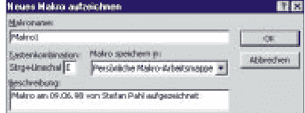

单击“确定”确认后，宏录制将开始。

- 录制开始时，会显示一个窗口。如果单击该按钮，录制将结束。现在开始输入数据或进行格式化。在此过程中，只有结果才是重要的，因此您可以允许自己在输入时犯一些错误。


## 宏

宏可以帮助您加快操作流程。在 MS Office 中，宏是用 Visual Basic 语言编写的。借助录制器，录制宏非常容易。然后，为宏分配一个特定的快捷键。按下该快捷键，录制的程序就会运行，并完成分配给它的任务。

## 快捷键

使用快捷方式或快捷键可以执行命令。这通常比先点击图标要快。宏也可以使用组合键调用。

- 例如，输入一个月份列表。在单元格“B1”中键入“一月”。然后让这些行自动填充。为此，请单击另一个单元格，然后再单击“B1”。现在将鼠标移动到单元格的右下角。鼠标指针会变成一个十字。按住鼠标左键，向单元格“M1”的方向拖动选区。在黄色小框中会显示后续月份。松开鼠标按钮后，月份名称将被填入。然后选中该行，选择另一种字体和字号。随后，单击“停止录制”。

- 关闭文件并打开一个新文件。然后按下您分配给宏的组合键。您之前输入并格式化的所有内容都将自动填入。宏也适用于其他一些功能，例如格式化图表或插入公式。

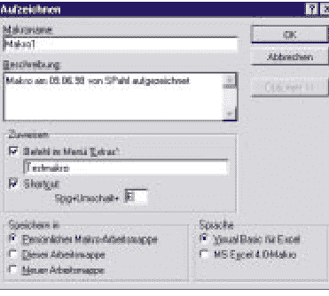

在 Excel 97 中，单击“组合键”下方的字段。输入一个字母或组合键，用于启动宏。在“保存宏到”字段中，再次选择“个人宏工作簿”。

## 打印多份

您需要一份打印输出的多份副本，但又不想跑去复印机那里吗？那么只需打印您的文档的多份即可。

- 在“文件”菜单中选择“打印”，但不要单击打印机图标。

- 在“份数”字段中，设置要打印的表格份数，此外还可以对副本进行排序。您还可以选择先将所有首页等连续打印出来。

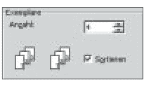

## PCgo! 提示 阅读角

如果您需要一本真正全面且最新的计算机词典，那么应该选择《贝克计算机词典》。这本词典共 900 多页，汇集了比特和字节世界中最重要的术语。各个关键词的条目都很详尽，而且大多通俗易懂。不过，您还是应该对 PC 有一定了解。词典尤其重视互联网新术语，DVD 或 3D 显卡等最新技术也得到深入讲解。对于您一直想了解的所有术语，《计算机词典》无疑是一本完整而权威的参考书。


## 使用方案进行计算

如果……会怎样？当您正在进行计算并尝试各种可能性时，方案管理器可以为您提供帮助。通过不断输入新值并据此试用各种→方案，您可以进行简单的假设分析。

- 打开我们 PCgo! CD 上“Excel”目录中的示例文件“Kalkulation.xls”，或者输入以下值。请注意，以下四个单元格包含公式。请在单元格中依次输入冒号后面的所有内容：

```
D4: =D2-D3   D6: =D4*D5   E6: =D6*52
E14: =SUMME(E8:E13)   E15: =E6-E14
```


- 最好现在为所有单元格命名。这可以提高以后输入新数据时的清晰度。以后要更改的数据位于单元格 D2、D3、D5 以及 E8 到 E13 中。单击某个值（例如单元格 D2 中的值），然后点击编辑栏旁边的名称框，输入一个易记的名称，然后按回车键。


- 在“工具”菜单中选择“方案管理器”。点击“添加”按钮。


- 现在输入方案名称。然后点击“可变单元格”字段。将鼠标指针移到表格上，选中单元格 D2、D3、D5 以及 E8 到 E13。要选中多个单元格，请在选中时按住“Ctrl”键。单元格将自动填入窗口中。


- 点击“确定”。您将看到一个用于可变单元格的输入掩码，其中包含表格中已输入的值。


- 现在为变量输入新值。更改后，点击“确定”，然后点击“显示”。在表格中，您将看到更改后的值和计算结果。点击“关闭”以采用更改。如果要撤消更改，请点击“→ 撤消”图标。


- 如果稍后想再次输入新值，请像之前一样启动方案管理器，选择该方案，然后点击“编辑”。

- 为了更好地概览更改内容，您可以自动生成一份→报告。为此，请输入新值，但不要选择“显示”，而是点击“报告”。确认关于结果行的询问。然后您就会看到生成的报告。它会被作为新的工作表插入工作簿中。


## 光盘上的文件

在我们的 PCgo! CD 上，您可以找到与我们的提示“使用方案进行计算”对应的示例文件。在“Excel”目录中，有一个文件“Kalkulation.xls”。其中已输入所有示例数据。您只需按照我们提示中的步骤操作即可。

## → 方案

使用方案，您可以模拟假设情况。借助方案管理器，您可以指定一些稍后可更改的值。然后，如果在计算中更改这些值，您将看到新的结果是如何产生的。这比直接在表格中更改值要方便得多。此外，您还可以使用方案管理器撰写报告并对比更改后的值，从而更好地进行比较。

## → 撤消

在 Word 和 Excel 中，有一个撤消列表，您可以使用它来撤消或恢复最近执行的命令。也可以通过“编辑”菜单中的“撤消”来实现同样的操作。

## → 报告

报告基于表格中的数据。通过报告，这些数据被分类并以更清晰的方式呈现。报告由多个层级组成，您可以显示这些层级。这样，您就只会看到自己感兴趣的数据。


## 密码保护

通过密码保护，您可以防止重要、个人数据被他人访问。这通常通过特定的密码来实现。密码有两种类型：静态密码，用户一次性设置密码。它一直有效，直到用户再次更改为止。另一种形式是动态密码。在这种情况下，用户会在设定的间隔内被要求更改密码。

## 单元格

单元格是表格中最小的单位。文本、数字或公式等所有数据都输入其中。每个单元格都由行和列的确切位置确定。列通过连续的字母识别，行通过从 1 开始的连续数字识别。

## PCgo! TIP 阅读角

您是否在寻找一本从 Excel 初学者到专业人士的路上陪伴您的书？那么请看一下 Excel 97 – 手册。在近 1,000 页的内容中，您可以找到从表格布局基础到使用 VBA 进行高级宏编程的一切。在此过程中，您始终使用实践示例。您将学习如何输入公式、格式化数据、排序、筛选等等。随附的 CD 上包含本书的示例文件以及 Excel 97 的工具和加载项。


## 带密码保护的文档

您是否与多人共用一台电脑？那么您应该对仅涉及您自己的文件设置 →密码保护。这样它们就会免受他人窥视。操作如下：

在新的对话框 "Speichern Optionen" 中，在 "Lese/Schreib-kennwort" 下输入您的密码。点击 "OK"。


- 1. 保存您的工作表。为此在菜单 "Datei" 中选择条目 "Speichern unter"。
- 2. 现在在打开的对话框中——像往常一样——输入您希望保存文件的名称和路径。
- 3. 然后点击 "Optionen" 按钮。
- 4. 系统会要求您通过再次输入来确认密码。之后再次点击 "OK"。
- 5. 最后通过单击 "OK" 保存您的文档。如果您现在想打开文件，系统会先要求您输入密码。但请注意！如果您丢失或忘记此密码，您也无法再查看此文件。

## 每页的列标题

大多数表格跨越多页：为了不必在每个工作表上重新输入标题，您可以为列标题和行标题指定一个区域。这样可以大大简化您的工作。

- 1. 首先在菜单 "Datei" 中选择条目 "Seite einrichten"。
- 2. 在 "Tabelle" 选项卡中，将光标放在 "Wiederholungszeilen" 字段中。
- 3. 标记所有标题。此设置仅适用于打印和页面视图。表格视图保持不变。这对于列标题也适用：仅在步骤 2 中将插入点定位到 "Wiederholungsspalten" 字段即可。

## 隐藏单元格内容

在庞大的表格中，可能存在您不希望他人访问或看到的数据，例如在处理工资表或类似内容时（数据保护）。如果您减小单元格高度或列宽，可以使这些单元格几乎不可见。但这种方法并不总是最佳的。这里有一个使用数字格式的小技巧，可以帮助您轻松舒适地隐藏单元格内容。


- 1. 首先打开工作表。标记您想要隐藏内容的 →单元格。
- 2. 在菜单 "Format" 中选择条目 "Zellen"。在那里点击一次 "Zahlen" 选项卡。
- 3. 然后在 "Kategorien" 列表框中标记条目 "Benutzerdefiniert"。
- 4. 切换到 "Formate" 输入字段。在那里将 "********" 字符作为数字格式输入。
- 5. 点击 "OK" 将新格式分配给自定义条目。之后，被格式化的单元格中的条目就会消失。相关单元格的公式仍然在输入行中可见；但在表格中以及打印输出中只会出现 "********" 字符。

## Excel

## 不要让标题视线丢失

表格通常很大，以至于它们会从屏幕的可见区域“移出”。例如，当列宽变大、列中条目的数量趋向于 ABC 的后三分之一，或行数增加到 100 左右时就会发生这种情况。这也有一个缺点，那就是标题不再可见。

对于这种情况，Excel 提供了一个实用的 →功能。这样标题始终保持在用户的视野中。操作如下：

- 1 用鼠标标记所需的行或列。
- 2 在菜单 "Fenster" 中选择条目 "Fixieren"。冻结的下边缘现在可以在黑色线上看到。这样该区域将始终在屏幕上可见。该区域下方的其余部分可以继续滚动。


## 函数

函数是 Excel 中的一种特殊指令。通过它，您基本上告诉程序它应该做什么。函数总是以等号开头，然后是函数名称，最后是函数中要使用的值。示例：=SUMME(C2:C8) 计算单元格 C2 到 C8 中所有值的总和。

## 重新找到隐藏的窗口

个人 →工作簿 "PERSONAL.XLS" 通常在每次启动 Excel 时都会加载。它通常还包含个人宏。为了使该文件在正常使用 Excel 时不造成干扰，可以通过 "窗口" 菜单中的 "Fenster ausblenden" 功能将其设为不可见。需要时，可通过菜单项 "Fenster/Einblenden" 将其重新调出。如果您选择了 "Fenster ausblenden" 功能，则当前位于前台的文件将被隐藏，并且也

不再出现在打开窗口的列表中。如果不小心隐藏了唯一打开的文件或所有文件，情况就会很棘手。因为屏幕上只剩下 "Datei" 和 "Hilfe" 菜单。其他内容保持不可见。

Excel 在这里提供相应的帮助。您可以在 "Datei" 菜单中找到 "Einblenden" 条目。选择 "Einblenden"，所有隐藏的文件都会重新出现。

## 工作簿

工作簿是数据被编辑和保存的文件。每个工作簿可以包含不同数量的工作表。此外，您还可以将各种相关数据存储在单个文件中。

## 调整标签

大多数表格中经常会出现一个问题：标签太长，超出列宽。迄今为止，您必须使用 "Spaltenbreite" 功能、更改字体大小或在单元格中使用换行符进行实验。

在 Excel 97 中，这得到了更舒适的解决。只需要几个鼠标点击：

- 5 使用 "OK" 确认选择。之后 Excel 会相应地调整单元格内容。

对于已完成的表格，您也可以这样操作；您只需标记整个表格区域。这样，所有单元格大小会一次性根据内容进行调整。

- 1 用鼠标标记相应的单元格。
- 2 从菜单 "Format" 中选择条目 "Zellen" 或按键盘快捷键 "Strg" + "1"。
- 3 切换到 "Ausrichtung" 选项卡。
- 4 激活复选框 "An Zellgröße anpassen"。


## PCgo! TIP 软件提示

精简 Excel 97：通过多媒体 Excel 97 基于计算机的培训，您可以学习有关 Excel 97 的所有知识。在此过程中，您不会翻阅书籍，而是在屏幕上和实际应用中直接学习。通过视频序列，各个功能可以清晰地展示。贴近实践的示例尤其有助于初学者理解复杂的电子表格。虽然您不必放弃书籍，但在 300 页的内容中，CD 的内容得到了良好的结构化描述。总之：本多媒体课程无条件推荐，并以良好的性价比著称。
INFO Learn Key GmbH, ISBN-Nr. 3-933084-05-9 Preis: 39,80 Mark


## Excel

### 自动输入

如果您在某一列中输入文本，Excel 会尝试自动补全。此时它会在同一列中查找已有的单词。您也可以另作他用。将鼠标指针移到表格中下一空单元格。随后按下“Alt”和“向下箭头”组合键。您会看到一个下拉菜单显示。里面列出了当前列的所有条目，您可以方便地插入。


### 重要快捷键

在表格编辑中，有许多工作步骤您会反复使用。如果您了解相应的键盘快捷键，可以节省大量时间。以下是一些重要快捷键的汇总：

- **文本加粗：** "Ctrl", "Shift", "F"
- **文本斜体：** "Ctrl", "Shift", "K"
- **文本下划线：** "Ctrl", "Shift", "U"
- **采用上方单元格的值：** "Ctrl", ";"
- **隐藏列：** "Ctrl", "8"
- **隐藏行：** "Ctrl", "9"
- **求和函数：** "Alt", "Shift", "0"
- **插入日期：** "Ctrl", ";"

许多菜单命令也都有键盘快捷键。要查找它们，请在主菜单栏中打开一个菜单项。各个命令旁边，如有的话，会显示相应的快捷键。

### 插入注释

对于大型表格，很容易很快失去概览。或者某些表格条目需要更好地解释。但单元格又太小。这种情况下注释会有所帮助。这样可以在不改变表格的情况下容纳大量信息。

1. 标记您想要添加注释的单元格。为此用鼠标左键单击该单元格。随后使用鼠标右键调出上下文菜单。


2. 选择命令“插入注释”。一个黄色背景的窗口会打开。第一行显示撰写注释的人的名字。第二行您会看到一个闪烁的输入框。在这里您可以输入您的备注。完成后，单击注释窗口外的任意位置即可。

3. 您编辑的单元格在右上角会用红色标记。这样您即可立即识别哪些单元格存在注释。当您将鼠标指针移到该单元格上时，注释会被显示出来。


### 保护工作表

您是否想将表格的某些部分免受他人访问？或者您想防止其他用户意外删除表格中的公式和数据？那么您应该使用工作表保护和单个单元格的释放。这样您对表格发生了什么有更好的控制。

1. 首先，您必须释放所有即使在保护激活时仍应接受输入的单元格。为此标记这些单元格。您也可以按住“Ctrl”键来选择多个单元格。


2. 从菜单“格式”中选择命令“单元格...”。在那里单击“保护”标签。取消选中复选框“锁定”。这样这些单元格就被释放用于数据输入。用单击“确定”关闭菜单。


3. 接下来保护工作表。相应命令可在“工具 / 保护 / 工作表...”下找到。在“保护工作表”菜单中激活全部三个复选框。可选地您也可以输入密码。关闭菜单后，保护立即生效。如果有人尝试覆盖受保护的单元格，会出现相应提示。


### 识别公式

在较大的表格中经常使用许多公式。如果您以后想修改公式或查找错误，并非总是很简单。经常无法识别公式中计算了哪些单元格。Excel 在此为您提供“侦探”功能。必要时可从菜单“工具”中调用。或者您也可以显示相应的工具栏。

1. 从菜单“工具”中调用命令“侦探”。随后选择“侦探工具栏”项。您可以将工具栏放置在屏幕的任意位置或主工具栏上。


2. 标记包含待编辑公式的单元格。随后在“侦探工具栏”中单击最左边的第一个符号（追踪前驱）。在您的表格中，所有导致该公式的单元格都会用蓝色点标记。此外，蓝色箭头从这些点指向包含公式的单元格。


3. 如果不再需要显示，请单击最左边的第二个符号（移除追踪前驱）。标记将被隐藏。有了此功能，您更容易追踪公式。

### 交换行和列

经常是等到太晚才发现，例如表格只有五行，却有 20 列。此时表格无法在不使用滚动条的情况下查看。如果您交换列和行，一切又能在一屏显示。这借助一个小技巧非常简单。即使是庞大的表格也能轻松调整。


1. 首先标记要更改的完整表格。然后从菜单“编辑”中调用命令“复制”。然后单击要插入更改后表格的区域的第一个单元格。新的区域不得与旧表格重叠。

2. 选择命令“粘贴内容...”。您也可以在菜单“编辑”中找到它。会出现一个菜单窗口。右下角找到“转置”选项。激活此选项。随后单击“确定”。菜单关闭，Excel 处理您的命令。


3. 在之前确定的位置插入一个新表格。它与复制的表格完全对应。只是行和列被交换了。如果一切都令您满意，您可以删除旧表格。


### 显示长文本

您在表格中使用需要容纳长文本的单元格吗？如果文本长于单元格宽度，后续将不再显示。为防止这种情况，您可以指示 Excel 执行自动换行。


通过文本属性您可以随意更改文本。

1. 标记要激活换行的单元格。然后从菜单“格式”中调用命令“单元格”。随后单击“对齐”标签。

2. 在“文本属性”下找到“换行”选项。激活它并通过单击“确定”关闭菜单。Excel 在标记区域执行换行。此时会放大单行，以便完整显示文本。


有了换行，长文本也会显示。

### 易懂的公式

如果您为单元格区域分配名称，公式会更易懂。这样函数“Summe(A2:A5)”就变成函数“Summe(支出)”。如果公式涉及单个列或行，您无需额外分配名称。只要存在相应的列或行标题，Excel 也能识别该区域。在上述示例中，单元格“A1”中就会有条目“支出”。

### 文本长度

有时需要确定文本的长度。为避免手动逐个计数字符，使用函数“长度”。为此用鼠标单击工作表上的一个空单元格。用键盘组合“Shift” + “F3”调用函数向导。在类别下选择条目“全部”。随后在右侧窗口中查找函数“长度”。选择后会出现一个输入窗口。在这里输入要计算文本长度的单元格名称（例如 B52）。结果会给出包含所有空格的文本长度。

### 合并单元格内容

借助一个简单的函数，您可以将不同单元格的内容合并。此时显示的值被视为文本。无论是数字、货币金额、文本等。公式也会被忽略。例如，如果您想关联“A2”和“D3”的单元格内容，请使用公式“=A2&D3”。

### 复制整个工作表

您想在现有表格中更改公式？那么最好使用表格的副本。如果出现问题，您仍然有原始表格作为备份。为避免必须标记表格或遗漏某些内容，直接复制整个工作表。这是最快、最安全的方法。您只需要使用鼠标。

1. 在 Excel 窗口底部您会看到一个选择栏。它显示文件中的所有表格（表格1、表格2 等）。活动表格可通过白色标签识别。要复制工作表，请用鼠标左键单击标签并按住。同时按下“Ctrl”键并保持按住。


2. 移动鼠标指针。在鼠标指针下方会出现一个带中间小加号的纸张符号。将该符号移动到表格序列的末尾。随后松开按住的键。在所选位置会插入您工作表的副本。它与原件同名并带有一个括号“2”。


## 更改列宽

在 Excel 中，您可以通过多种方式更改行高或列宽。方法一是通过格式菜单。具体操作如下：

- 1 用鼠标选中相应的列。在“格式”菜单中选择“列/宽度”项。
- 2 在下一个输入框中输入所需的宽度。


但使用鼠标更轻松、更快捷。具体操作如下：

- 3 将鼠标移到列标题按钮的边缘上，按住鼠标并拖动即可调整大小。您还可以同时更改多个连续或不连续列的宽度。
- 4 为此，请按住“Ctrl”键的同时用鼠标单击相应的列按钮，并将其拖至所需宽度。松开“Ctrl”键后，要更改的列区域即被标记。
- 5 现在松开鼠标左键，所有标记的列区域都会以相同宽度完成更改。如果要更改行高，请按相应方式对行按钮进行操作。

## 恢复默认工具栏

您是否已使用许多新工具栏按照自己的需求自定义了 Excel，却突然发现其中一个工具栏不见了？以下步骤将向您展示如何恢复原始工具栏：

- 1 选择“视图”菜单，然后点击其中的“工具栏”项。接着单击“自定义”。系统会弹出“自定义”对话框。在该对话框中单击“重置”按钮。在随后的询问中确认“是”，从此原始工具栏将再次可用。
- 2 如果您仍想对工具栏进行一些更改，也可以使用“工具/自定义”命令操作。在“自定义”对话框


中，只需将各个菜单中所需的命令拖到相应的工具栏上即可。

## 单元格内换行

您肯定熟悉以下问题：有时 Excel 表格会变得相当庞大。各个列通常都很窄，尤其是当它们仅包含数字时。这时要将文本可读地放入列中就变得特别困难。一种方法是用更改文本对齐方式。或者您在单元格中插入一个换行符。

- 1 单击您想要输入文本的单元格。开始输入文本。
- 2 当文本到达单元格末尾时，按下“Alt”和“Enter”的组合键。这样即可在同一单元格内实现换行。

## 使用快捷键设置边框

为单元格区域添加边框的最简单方式是通过所谓的快捷键。要为标记的区域添加完整边框，只需按下“Ctrl”、“Shift”和“_”的组合键。如果您想一次性移除所有边框，只需按下“Ctrl”、“Shift”和“>”即可。

## 插入快捷键

在插入新工作表时，您无需通过“插入/表格”菜单这条繁琐的路径，只需按下“F1”、“Shift”和“Alt”的组合键即可。

## → 工作簿

工作簿是用于编辑和保存数据的文件。每个工作簿都可以包含数量不同的工作表。此外，您还可以将各种相关数据保存在一个单独的文件中。

## 快速选择菜单命令！

您可以使用键盘选择菜单栏或可见工具栏中的任意菜单命令。按“Alt”键以选择菜单栏。如果要选择工具栏，请按“Ctrl”和“Tab”。重复此步骤，直到选中所需的工具栏。然后输入包含所需命令的菜单名称中带下划线的字母。

## Excel

## 删除加载项

在 Excel 的加载项管理器中，缺少删除已安装的 →加载项的功能。但即便如此，仍有两种方法可以绕过 Excel 的限制。一种是通过 →注册表数据库，并执行以下步骤：

Excel 97: HKEY_CURRENT_USER/Software/Microsoft/Office/7.0/Excel

- 1 进入“工具”菜单，选择“加载项管理器”，并停用所有您要删除的加载项。然后退出 Excel。


- 2 通过 Windows 开始按钮进入“运行”，搜索 Windows 目录，并启动注册表编辑器 REGEDIT.EXE。
- 3 根据您的 Excel 版本，搜索以下注册表项：
Excel 95: HKEY_CURRENT_USER/Software/Microsoft/Excel/7.0
- 4 现在单击树形结构中的“加载项管理器”。此时，右侧窗口将显示所有已安装且当前未激活的加载项。
- 5 在那里标记您要移除的加载项，并在“编辑”菜单中选择“删除”命令。在安全询问中回答“是”，之后您便可以继续删除其他加载项，或退出注册表编辑器。

如果您对编辑注册表数据库没有足够的把握，也可以欺骗加载项管理器：

- 6 退出 Excel 后，切换到资源管理器。删除或移动相应加载项的文件。然后启动 Excel 并调用“工具/加载项管理器”菜单。
- 7 单击您刚刚在资源管理器中删除或移动的加载项条目。由于 Excel 找不到该文件，程序会提供从列表中删除该加载项的选项。


## 从文字处理程序插入封面页

想为您的表格添加一个封面页？没问题，因为在 Excel 95 和 97 中您都可以插入封面页；无论您使用哪种文字处理程序制作它。但 95 版本在页面缩放方面存在问题。我们以文字处理程序 Word 为例，向您展示如何最好地导入封面页：

- 1 打开您要插入封面页的 →工作簿。在其中选择最后一张空白工作表。
- 2 现在单击“插入”菜单中的“对象”项，然后选择“由文件创建”。
- 3 保持插入的封面页不变，使用“编辑/复制”命令或“Ctrl”、“C”组合键将其放入 →剪贴板。
- 4 现在单击要嵌入封面页的工作表标签。通过“编辑”菜单中的“选择性粘贴”项将封面页从剪贴板中取出。此时，请选择“图片（增强型图元文件）”作为源，而不是“Microsoft Word 文档对象”。


- 5 现在回到最后一张工作表，删除已嵌入的对象。再切换回包含封面页的工作表，并根据需要调整图片对象的大小。


## 滚动时保持标记

如果您在关闭滚动锁定模式的情况下使用滚动键（例如“Page Up”和“Page Down”），标记将被移除。如果希望在滚动期间保持标记，请先启用滚动锁定模式。

## 剪贴板

剪贴板（Clipboard）是 Windows 在操作系统或应用程序中为数据交换保留的临时存储区。例如，应用程序的“复制”功能会将之前标记的文本或图片区域存放在那里，以便稍后通过“粘贴”在另一个位置或其他程序中使用。

## 加载项

加载项通常指集成到程序中的一组附加功能或选项。它们扩展了程序的功能范围，并增加了通常是新的额外属性。

## 注册表数据库

注册表数据库（Registry）是 Windows 95/98 中的内部数据库，记录了所有配置数据。它取代了 DOS 下使用的配置文件“config.sys”和“autoexec.bat”以及 Windows 的初始化文件。

## 为表格添加彩色设计

有时，一点颜色确实有助于提高可读性，尤其是对于非常大的表格。以下步骤展示了如何简单快速地完成这项操作：

- 1 首先用鼠标选中所需的单元格区域。接着单击“边框”按钮上的下拉箭头。


包含边框选项的面板将打开。在其中选择所需的边框。标记的单元格区域随即被加上边框。
- 2 如果您想要彩色背景，请先标记单元格区域，然后直接单击此工具栏中的下一个“填充颜色”按钮。
- 3 彩色的文字怎么样？为此，请标记所需的单元格区域，并单击“字体颜色”按钮。在那里您可以选择相应的字体颜色。

## 在多个工作表中输入数据

有时您会遇到一些表格，其中反复出现相同的数据；例如月份、标题或您在自建的多年度家庭账本中固定的年租金。通过一个简单的技巧，您可以将数据输入到工作簿的多个工作表中。


- 1 载入相应的工作表。然后按住“Ctrl”键，同时单击工作表底部记录工作表名称的标签。被点击的工作表名称会以白色背景显示。这表示这些工作表处于活动状态。
- 2 此时如果您在某个单元格中输入数值，它将自动被应用到其他工作表。但您应注意，数据的输入适用于所有活动工作表。如果您只想在单个工作表中输入数据，就必须再次单击工作表名称取消关联。

## 调整文本

表格中经常出现一个常见问题：单元格中的文本太长。但通过列宽或换行进行繁琐调整的时代已经过去。您可以通过一个简单的技巧解决此问题。

- 1 在“格式”菜单中调用“单元格”项，或按下“Ctrl”和“1”的组合键。


- 2 现在切换到“对齐”选项卡。


- 3 只需勾选“缩小字体填充”复选框并点击“确定”确认。此后，Excel 会自动调整单元格中的字体大小，使字符串能够适应单元格。


## ➜ 快捷键

这是一个键盘组合键，可以快速执行特定命令。快捷键在 Excel 中通常已预定义。因此在菜单栏中，用来通过键盘打开相应菜单的字母会被下划线标出。例如按下“Alt”和“N”键组合，就会打开“数据”菜单。

## 每页的单元格标识

对于大型表格来说，如果在第二页不再打印行和列的标识就很不方便。通过几个简单的操作，您可以轻松更改这一点。

首先标记您希望在每页上打印的列或行。为此，请单击 A、B、C 或 1、2、3，具体取决于您想标记行还是列。如果您希望同时打印第一行和第一列，请先单击“1”，然后按住“Strg”键并单击“A”。现在在按住鼠标按钮的情况下，将标记拖动到您想要的范围。

然后单击左上角的编辑栏。在输入行中输入“打印标题”。

现在如果您将整个 Excel 表格完全打印并且跨越多个打印页，则标记的区域将在每张纸上打印出来。这有助于在后续页面上进行定位。


## 为单元格命名

您经常需要的数据，即使在庞大的表格中也可以快速调到屏幕上。例如，您就不再需要记住 1997 年的销售额在哪个单元格中。不过为此需要做一些前期工作：

- 1. 标记您想要命名的单元格。
- 2. 单击左侧屏幕边缘的编辑栏。
- 3. 在此处输入您想要保存标记单元格的名称。例如可以是“Umsatz 1997”。
- 4. 今后只需右键单击编辑栏旁边的黑色三角形，并在选择框中点击“Umsatz 1997”。Excel 工作表中会立即显示相应的位置。


## Excel 中的旋转文本

如果将 PowerPoint 中的旋转文本导出到 Excel，会丢失其旋转角度。因为 PowerPoint 与 Excel 只能有限兼容。为了仍然保留旋转角度，请按如下操作：

在 Excel 8.0 中进入菜单项“编辑”，“插入对象”。在“插入对象”对话框中，您必须选择格式“图形 (Enhanced Metafile)”。

- 1. 在 PowerPoint 中标记旋转的文本元素。然后使用 → 快捷键“Strg”和“C”将其复制到剪贴板。
- 2. 然后通过菜单项“编辑”，“插入对象”将其插入 Excel 8.0。
- 3. 在“插入对象”对话框中选择格式“图形 (Enhanced Metafile)”。
- 4. 带有旋转文本的绘图元素现在将作为图形插入。但旋转的文本将无法再编辑。


## 创建自定义工具栏

Excel 中的符号选择虽然很丰富；但许多功能根本不需要或很少使用。因此一个单独的 → 工具栏可以节省屏幕空间并保持清晰。

在菜单栏中选择“视图”，“工具栏”，然后“自定义”。

现在选择 → 选项卡“工具栏”。在此激活您想要更改的工具栏。如果已激活，则其名称前方的框中会出现一个复选标记。此外工具栏也会显示出来。

要进行更改，请单击您想要删除的符号。按住鼠标按钮并将符号从栏中拖出。现在松开鼠标左键。

如果您想撤销操作，请单击“重置”。


## 在单元格和工作表中输入相同数据

- 1. 您想在整个 Excel 工作表中为特定单元格输入相同数据？为此您不必在每个单元格中单独输入文本或使用复制功能传输。也可以更简单：
- 2. 标记所有应包含相同文本的单元格。如果您想标记相邻的单元格，请按住 "Shift" 键。如果您想标记不相邻的单元格，请在每次鼠标点击时按住 "Strg" 键。
- 3. 现在开始在标记的单元格之一中输入文本。您也可以输入超出单元格边界的文本。
- 4. 现在按下快捷键 "Strg" 和 "Return" 键。现在文本会出现在所有标记的单元格中。


- 5. 如果您想在多个工作表中输入相同数据，必须标记所有工作表。为此请在左下方单击选项卡 "Tabelle1"。再次按住 "Shift" 键以标记相邻的工作表，或按住 "Strg" 键以标记不相邻的工作表并标记它们。现在输入文本。它会自动出现在所有标记的工作表中。

## 快速创建图表

- 1. 如果您想快速将特定数据以图形形式显示出来，请用鼠标标记工作表上的数据区域。但请注意，所有单元格都必须被标记。
- 2. 现在按下 "F11" 键。会从标记的单元格创建图表。同时打开图表工具栏；如果您愿意，可以用它进一步编辑图表。

## 删除网格线

- 1. 输入时 Excel 中的网格结构是一大帮助。但通常无干扰的视图更有意义。打印时也通常希望去掉线条。

在菜单“工具”，“选项”中选择。在此选择选项卡 "Ansicht" 并停用选项 "Gitternetzlinien"。现在该框前不应再有勾选标记。
- 2. 如果您只想要无线的视图，请在菜单项 "Extras" 中选择命令“Gitternetzlinien”。

- 3. 这种关闭线条的方法与打印无关。线条仍会被打印。要防止这种情况，请选择 "Datei" 然后 "Seite einrichten"。激活选项卡 "Tabelle" 并在此处停用选项 "Gitternetzlinien"。

## 调整标签

- 1. 几乎每个表格中都存在这个问题：标签太长。以前在这种情况下，您会尝试调整列宽、单元格中的换行或字体大小，直到得到理想的结果为止。

从菜单栏调用 "Format" 和 "Zellen"。
- 2. Excel 97 让您轻松操作：如果标签不能完全放入单元格中，请调用对话框。
- 3. 切换到选项卡 "Ausrichtung"。在此激活复选框 "An Zellgröße anpassen"。用 "Ok" 确认。Excel 会自动调整字体大小，使文本恰好适合单元格。

## ➜ 兼容性

如果不同程序可以无问题地交换数据，则其兼容性得到保证。但不同程序版本之间存在问题。较旧的版本无法理解较新版本的格式。在数据交换时可能会因此造成损失。这也适用于不同应用之间的数据交换。例如在 PowerPoint 中进行的格式设置在 Excel 中不一定可以再现。

## ➜ Excel 工作表

这是 Excel 表格的专业术语。它包括所有工作表、嵌入的公式、格式设置以及与数据集、企业自有应用等的链接。

## ➜ 选项卡

在某些菜单项中，选择后会出现一个新窗口。如果这里有很多设置可供选择，您会在窗口顶部边缘看到较小的标签。这些就是所谓的选项卡。它们将多个、通常主题相关的选项组合在一起。这样您就可以随时清晰地掌握所有选择。

## ➜ 工具栏

许多程序除了菜单栏外还有额外的区域，上面排列着符号——即工具栏。通过在小图片上单击一次鼠标，您可以在几秒钟内向程序发出命令。

## ▼ 绘图时使用 Alt 和 Shift

- 1. 就像许多图形程序一样，绘图时在 Excel 中“Alt”和“Shift”键也有特殊功能。在 Excel 中不按住任何键时，您可以放置任意大小和自由放置的矩形到表格中，而这两个键会限制灵活性，从而使精确工作变得更容易。
- 2. 例如，如果您在绘制矩形或椭圆时按下“Shift”键，只能生成正方形或圆形。
- 3. 将“Shift”键与线条和箭头一起使用时，Excel 只绘制水平和垂直线条。


- 4. 在开始绘图前按下“Alt”键，您只能逐个单元格地改变矩形、箭头、文本框、圆弧和线条的大小。
- 5. 相反，如果在对象起点已确定后才按下“Alt”键，起点会保持原位，但终点始终与单元格角重合。
- 6. 另一种以一个或多个单元格大小绘制矩形的方法是“添加阴影”功能。您可以轻松地用阴影边框突出标记的区域。为此，请用鼠标标记要以阴影边框突出显示的单元格区域。单击“添加阴影”按钮后，Excel 会以标记区域大小绘制一个矩形。您可以像其他对象一样移动和调整此对象的大小。
- 7. 后续更改列宽或行高时，已绘制对象的大小也会相应改变。用户也可以限制这一点。
- 8. 如果您想使对象的大小独立于单元格大小，请标记该对象并右键单击它。在弹出菜单中选择条目“对象格式”。如果在“属性”选项卡中为条目“取决于单元格位置和大小”设置复选标记，则该对象今后将不受单元格大小变化的影响并保持其形状。


## ▼ 对齐小数点后位数

- 1. 如果您有大量长度不同的小数位，Excel 表格看起来往往很混乱。但您可以用一个小技巧将数字对齐。
- 2. 标记您想要对齐的单元格。
- 3. 通过菜单“格式”选择选项“单元格”。单击选项卡“数字”。
- 4. 在“类别”下的选择框中单击“自定义”。
- 5. 然后标记“格式”选项下的“标准”行。输入“0,???”。

注意！问号的数量必须与小数位数最多的数字相符。示例：如果您标记了 4,58964，则必须输入五个问号。

- 6. 用“OK”确认输入。现在您标记单元格中的数字已得到最佳对齐。


## 格式化

格式化是指对表格或文本进行视觉设计。这里可以使用不同的字号、字体和颜色。在表格中，可以放大、合并、隐藏或缩小单元格。所有这些都有助于提高工作表的清晰度，尤其是长工作表。

## 单元格

单元格是表格中最小的单位。它用于容纳文本、数字或公式等数据。每个单元格由其在行和列中的精确位置确定。列通过字母标识来识别，行通过连续的数字来识别。

## 选项卡

自 Office 97 起，微软开始使用选项卡。点击一个上级命令，就会打开一个菜单。在这里，您可以在选项卡标签上获得各种其他选择项。这样，许多功能可以被集中并清晰地排列。此外，这还可以在已经拥挤不堪的屏幕上节省空间。

## 导入

不同程序之间的数据交换通过导入/导出功能进行。遗憾的是，并非每个应用程序都为其他所有程序提供合适的过滤器。在这种情况下，必须考虑到数据丢失。例如，文字处理中最常见的过滤器是 .txt 或 .rtf 格式。这样，来自所有应用程序的文本都可以进行转换。

## 更改启动工作簿

- 1. 每次启动 Excel 以及调用“新建”和“文件/新建”功能后出现的 →默认工作簿，您可以根据自己的需要进行调整。之后，在打开新的空白工作表时，将自动使用您的设置。
- 2. 根据您的需要→格式化该工作簿，然后将文件保存为“C:\msoffice\excel\xlstart\mappe.xlt”。目录“xlstart”也可能位于“C:\Programme\Microsoft Office\Office”中。请注意，新文件的扩展名必须为“.xlt”。Excel 在保存时会额外添加一个“.xls”。
- 3. 退出 Excel 并重新启动。从现在起，每次启动 Excel 时，您都可以使用这个新工作簿。


## 天数-年份转换

- 1. 例如，如果租赁期限以天为单位给出，您可以通过输入以下公式自动计算以年为单位的年限。

  ```
  Die Formel lautet:
  =ganzzahl((jetzt()-Zelle)/365,25)
  ```

- 2. 同样，您也可以反过来计算天数，而不是年份。那么适用以下公式："=ganzzahl(jetzt()-Zelle)"。得出的结果是天数。
- 3. 对于“Zelle”，请填入存放天数或年份值的单元格名称。

## 隐藏单元格

- 1. 借助一个简单的技巧，您可以创建所谓的“隐藏”单元格。输入到这些→单元格中的内容既不会被打印，也不会显示在屏幕上。只有在这种单元格的编辑栏中，内容才是可见的。
- 2. 在菜单栏中选择“格式”，然后选择其中的“单元格”。
- 3. 在“分类”选项下，单击最后一个条目“自定义”。
- 4. 在右栏中单击任意一种格式。按一次回车键删除输入行。改为输入“;;;”（三个分号，不带引号）。用“确定”确认。
- 5. 现在，在当前单元格中输入任意文本或值。您可以在编辑栏中看到它显示出来。一旦您选择了另一个单元格，该文本也会消失。


## 有用的键盘快捷键

- 1. 您可以通过组合键“Ctrl + Shift + ;”插入当前时间。
- 2. 您可以通过组合键“Ctrl + ;”插入日期。
- 3. 您可以通过选中所有相关单元格，同时向多个单元格输入文本或值。然后输入所需内容，并按组合键“Ctrl+Enter”。

## 计算表格区域

- 1. 当您在包含大量公式的大型表格中工作时，通常希望激活手动重算。您可以在菜单栏的“工具”和“选项”下找到此功能。在此，单击 →“计算”选项卡，并选中“手动”前的单选按钮。这样，您就可以避免每次输入后都要等待几分钟，直到 Excel 重新计算完所有公式。


- 2. 您也可以按“F9”键自行决定重新计算的时间。
- 3. 然而，在某些情况下，您可能希望至少计算表格中的一部分→公式，因为您可能想检查某个输入。通常，您只能将整个表格重新计算一遍。不过，还是有一个小小的省力技巧：如果您只想重新计算单个公式，只需按一次“F2”，然后按“回车键”即可。
- 4. 尽管如此，您仍然可以使用一个技巧来计算 Excel 中的某个区域。在一个设置为“手动重算”（见步骤 1）的表格中，选中您希望更新其公式的单元格。
- 5. 在菜单栏中选择“编辑”，然后选择其中的“替换”。
- 6. 在“查找内容”和“替换为”中分别输入一个等号（“=”）。
- 7. 现在单击“全部替换”，将所有等号替换为它们自身。这样虽然不会更改单元格内容，但可以使→标记区域中的公式重新计算。所有其他公式不受影响，因此您无需等待整个表格的计算。

## → 公式

公式是 Excel 中的一种特殊指令。通过公式，您可以告诉程序要做什么。函数总是以等号开头，后面依次是函数名称，最后是该函数要使用的值。例如：=SUMME(C2:C8) 计算 C2 到 C8 单元格中所有值的总和。

## → 名称区域

您可以通过“插入”菜单，并在其中的“名称/定义”和“名称/应用”功能为选定的区域命名。只要所标识的单元格包含可计算的内容，这些名称就可以在公式和函数中用于计算。

## → 剪贴板

剪贴板，也称为 Clipboard，是 Windows 在应用程序（如 Excel）中的一个临时存储区。应用程序的“复制”功能会将之前选中的文本或图像区域放置到那里，以便以后通过“粘贴”在另一个位置或其他程序中再次使用。

## → 选中

如果您以后想要更改某个单元格中的输入，必须先选中该单元格。为此，请将鼠标指针移到该单元格上，然后按下鼠标左键。该单元格会显示为黑色背景。现在，您可以进行更改。这些更改将只应用于当前选中的区域。

## 隐藏图片和解除连接

- 1. 利用 Excel 的功能，您可以在工作表或图表中添加线条、箭头、矩形、弧形或多边形。也可以绘制手绘图形。为此，您需要“绘图”工具栏。您可以在菜单栏的“视图”、“工具栏”和“绘图”下找到它。单击“绘图”，包含所有工具的工具栏将显示在屏幕底部。现在，单击您在设计时所需的工具和形状。
- 2. 如果您已经绘制了一些形状和图片，屏幕可能会变得有些杂乱。此外，工作表（工作簿）和每张新图形的构建时间也相对较长。您可以通过一个小技巧节省这段时间。
- 3. 在菜单栏中选择“工具”和“选项”，然后选择“视图”选项卡。在新的选择菜单中，激活“全部隐藏”复选框。


- 4. 图形通常与位于图形下方的单元格相连接。当基础单元格的大小发生变化时，这种自动连接可能会成为一个缺点。为了防止这种情况，请选中要设置为不随单元格大小变化的图形对象。
- 5. 选择“格式”菜单，然后选择其中的“自选图形...”。在此，激活“属性”。单击“不随单元格位置和大小改变”复选框。它必须处于选中状态，即其中必须出现一个黑色圆点。


## 找回注释

您在 Excel 表格的某处隐藏了注释。您再也找不到它们了。您可以省去寻找这些消失的笔记的漫长搜索。因为有一个技巧可以让您更轻松。 使用“转到”功能。但注意！ 仅标记一个单元格以搜索整个表格。如果您标记多个单元格，则只会在这些单元格中而不是整个表格中搜索。现在在菜单栏中选择“编辑”和“转到”。在这里点击“内容”按钮。选择“注释”选项按钮，如果要标记分配了注释的单元格。以相同的方式，您可以标记其他内容。为此选择所需的选项。

## 标记特定单元格区域

1. 如果单元格区域可以通过名称或单元格引用识别，则可以非常快速和有效地标记它们。按键盘上的“F5”键。现在会出现“转到”菜单。在这里您会看到可以标记显示的单元格区域列表。点击您需要的选项。

2. 更快地，您可以通过 →名称框访问标记。通常它位于工作表上方左上角。您可以通过简单的鼠标点击激活它，并让它标记您选择的选项。


3. 如果您想标记两个或更多区域，则像往常一样使用 Ctrl 键。只需在标记过程中一直按住它。这样您就可以选择任意多个单元格。

4. 如果您想标记命名区域之外的单元格，则选择“编辑”，然后选择“转到”。在文本字段“引用”中输入要标记的单元格或所需单元格区域的单元格引用。

## 使用图形应用程序的符号

1. 您可以在 Excel 中通过“视图”、“→工具栏”和“自定义”功能自行组装工具栏并使用新符号。但是 Excel 也提供将其他符号——例如来自 Corel Draw 等图形应用程序的符号——集成到其工具栏中的可能性。

2. 启动图形应用程序并将要采用的符号复制到 →剪贴板。通常使用快捷键“Ctrl+C”进行复制。


3. 打开 Excel（或通过在任务栏中点击激活它）。

4. 选择“视图”、“工具栏”和“自定义”，然后选择“命令”选项卡。在这里用鼠标指针标记您想要更改的符号。

5. 右键单击打开上下文菜单并激活“插入按钮符号”选项。符号将被 →导入。

6. 为了排除失真或模糊显示，在复制时最好只采用与已集成按钮符号大小相同的符号。小符号的常见尺寸为 16x15，大按钮为 24x23。

## → 工具栏

大多数 Windows 程序都使用这些光学命令栏。通常这里可以找到菜单栏的所有命令。通过“视图”菜单和“工具栏”，您可以在 Excel 中显示所有可能的符号。但程序也允许个性化组合。将鼠标指针停留在符号上片刻，会显示一个图例，更详细地解释其功能。

## 更改引用类型

1. 在 Excel 表格中，每个单元格都精确定义。也就是通过 A、B、C 等纵坐标和垂直坐标 1、2、3、... 等。这种命名方式您也可以更改。然后您将不再得到水平的字母序列，而是得到数字。

2. 为此选择“工具”和“选项”。点击这里的“常规”选项卡，然后点击“引用类型”。现在激活 Z1S1 引用类型的选项按钮。


3. 您可以取消此操作，只需再次取消选中 Z1S1 复选框即可。

## → 默认工作簿

Excel 每次都使用此“基本布局”启动。个性化设置必须手动进行。

## 超链接

超链接实际上是一种来自互联网的技术。用它可以在一台或多台计算机上的多个文档之间建立链接。如果您点击超链接，您将跳转到另一个文档。文档可以保存在完全不同的位置。超链接现在也出现在文字处理和电子表格中。通常超链接通过文本中特殊格式化的区域来识别。它们是彩色下划线或通过图形元素标记以便点击。在文本或表格中，它们也可以作为跳转到其他文本或表格的跳板。

## 巧妙链接

超链接不一定必须指向互联网：只需少量工作，您也可以将其用于在工作簿内快速导航。

1. 在菜单栏中选择“插入”、“名称”和“定义”，为每个您想通过超链接到达的区域分配一个名称。输入一个名称。


2. 点击超链接应出现的单元格并输入文本；例如：“销售计划”。选择“插入”和“超链接”。对话框中的第一个输入字段可以保持为空，因为超链接引用当前文件。点击下方的输入字段旁边的“浏览”命令。


3. 如果链接的目标位于 Excel 中的另一个工作表中，标记字段中的相应条目。激活“已定义名称”选项。代替当前工作簿的工作表名称，现在将显示所有可用名称。标记所需目标并用“确定”确认您的选择。

4. 当前单元格的内容将被蓝色下划线。只要您点击该单元格，Excel 就会自动跳转到之前定义好的区域。

## 图表

这些是图表，用来将表格图形化。有不同类型的图表：柱状图、饼图、折线图等等。每种类型都适合特定表格。在选举预测中通常使用饼图。如果有多个变量，则柱状图或折线图更合适。Excel 中已集成大量预格式化的图表。

## 显示错误值

错误值在 Excel 中并不总是真正显眼。找到出现错误的单元格很费力。为了避免这项西西弗斯的工作，请执行以下操作：

1. 激活您想要检查错误的表格，激活“编辑”然后“转到”。点击“内容”。

2. 在这里标记“公式”。不同的复选框决定要标记什么。取消选中所有复选框，只保留“错误值”，然后用“确定”退出对话框。

3. 当前表格中出现的所有错误值都将被标记。

4. 调用“格式”和“单元格”，以醒目的格式标记有问题的单元格。现在您就有概览了。


## 工具栏

这里菜单栏中最常用的命令再次以按钮形式显示。工具栏可以通过“视图”菜单选择。这里某些功能已分类。例如在格式工具栏中包含粗体、字体大小、居中等命令。工具栏使工作更轻松，因为它们可以快速执行命令。

## 快速访问图表

在 Excel 中通常不使用单独的图表，而是图表直接嵌入到表格中。可以定位和改变大小。如果插入了多个图表，选择所需图形可能会很困难。可以为每个图表命名，但缺少专门选择的功能。借助这个技巧会更好：

1. 在菜单栏中选择“编辑”和“转到”。

2. 点击“内容”。激活“对象”选项并用“确定”确认。Excel 现在会标记表格中的所有对象。


3. 使用“Tab”和“Shift+Tab”分别选择下一个或上一个对象，这样您可以在几秒钟内找到所需的图表。之后点击任意单元格以取消标记。


## 优化表格

假设您从一张表格中创建了一个柱形图，但排序不正确。您希望不要使用升序，而是使用降序。

- 要实现这一点，请双击水平（x）轴。
- 在对话框中，选择“刻度”选项卡。勾选“分类次序反转”选项。该→图表会立即重新绘制。


- 如果要移动图表的文字标签，例如标题、轴标题和图例，只需用鼠标单击它们，并在按住鼠标按钮的同时将其拖到相应位置。若要更改图表标题，双击标题即可。随后会出现一个对话框。借助→“字体”选项卡，您可以进行格式设置。
- 您还可以为柱形图的背景着色。为此，请单击图表区的空白处。此时会打开一个图表工具栏。单击其中的手形图标，将出现“图表区格式”对话框。在此处的“图案”选项卡中，您可以选择合适的填充颜色和边框。边框是可选的。为了获得美观的设计，可通过“填充区域”按钮选择多种设计方案。点击合适的纹理即可。


- 除了预设的纹理和图案外，您也可以导入现成的图片。这些图片可以通过“其他纹理”按钮，或通过“图片”选项卡和“选择图片”命令导入。


## → 模板

如果您经常需要相同的信函或类似的发票，建议将它们保存为模板。为此，只需输入固定不变的部分，例如地址块、日期和称谓。将这些部分格式设置正确后，每次制作新发票时，只需替换收件人地址，再将其作为文档保存即可。

## → 自动输入

当某些输入重复出现时，就会启用自动输入功能。例如，如果您已经在工作表的某处输入了“Konto”和“Kunde”，则只需输入前两个字母，Excel 就会在需要时自动补全名称。因此，输入“Ku”，Excel 就会将其补全为“Kunde”。如果不想使用补全，继续输入即可。若要采用建议，请按回车键。如果这种自动输入方式令您困扰，请在菜单栏中选择“工具/选项”。在“编辑”选项卡下，取消选中“启用单元格值的自动输入”复选框。

## → 图表

图表是将表格以图形方式呈现的示意图。图表的类型多种多样：柱形图、饼图、折线图等等。每种类型适用于特定的表格。在选举预测中，通常使用饼图。如果存在多个变量，则适合使用柱形图或折线图。Excel 中已内置了大量预先设置好格式的图表。添加标签也非常简单。

## 撤销多个命令

Excel 97 新增了同时撤销多个命令的功能。因此，您不必按顺序逐一撤销最后五个命令，而是一次性完成。

- 这既可以通过“编辑”菜单（中的“撤销”命令）实现，也可以通过工具栏实现。在编辑栏中会始终显示当前正在撤销的操作。
- 在→工具栏中，单击蓝色箭头符号旁边的黑色三角形。将打开一个选择列表。在这里，您需要选中要撤销的操作。可以进行多重选择。


## 在打印输出中命名工作簿

您已创建了一个表格，并希望在打印输出中自动插入工作簿的名称——不含目录路径。

- 若要输入包含目录路径的文件名，只需使用一个 Excel 函数即可。请在相应单元格中输入以下内容：

```
=ZELLE("Dateiname")
```

- 如果只想插入文件名，可以使用以下函数：

不过，文件必须先保存一次，该函数才能生效。为此，请在菜单栏中选择“文件”，然后选择“另存为”。为文件命名并保存到正确的文件夹中。


## → 工具栏

这里将菜单栏中最常用的命令以按钮形式重新呈现。可以通过“视图”菜单选择工具栏。在这里，特定功能已经被分类。例如，“格式”工具栏中包含加粗、字号、居中命令等。工具栏使操作更方便，因为可以快速选中命令，而无需先打开菜单。

## → 选项卡

在 Office 套件的几乎所有菜单中，都可以找到选项卡。选项卡位于窗口顶部，上面标注着不同设置的统称。单击选项卡，将进入另一个包含修改选项的菜单。这种分组方式让屏幕内容一目了然。

## → 单元格

在屏幕上，单元格显示为带灰色边框的方框。其中可以包含数字、公式或文本。每个单元格都有明确定义。它由字母和数字共同标识：列使用字母，行使用数字。因此，工作表第一个单元格的地址为“A1”。

## 提示：添加与删除行

要快速插入一行，请按以下步骤操作：选中该行，然后按快捷键“Ctrl”和“+”。要删除一行，请选中该行，然后按“Ctrl”和“-”。

## 复制到已有数据的单元格

通常需要复制或移动工作表中的数据。如果要将数据移入的区域已经包含数据，就会产生问题。不过，您可以在粘贴前将已输入的内容向右或向下移动。

- 首先选中所有要移动的→单元格。为此，请单击区域中的第一个单元格，按住鼠标按钮，然后将框拖过整个区域。
- 将该区域拖到新位置。为此，请将鼠标指针移到单元格边框上。如果要在新位置插入该区域，请同时按住鼠标右键和“Shift”键。这样，原始单元格格式会被清除。如果不按“Shift”键，格式会保留，而这些格式您可能并不需要。复制时请按住“Ctrl”和“Shift”组合键。松开鼠标后，您可以选择要在此处插入的内容。

## 条件格式

“条件格式”是一种非常有用的功能。当数值满足特定条件时，会以绿色或红色等颜色显示。首先，选中要在年度结算表中标记最高值和最低值的单元格区域。然后在菜单栏中单击“格式”，再单击“条件格式”。

- 将打开一个对话框，您最多可以输入三个条件。


- 在“条件1”的第一个文本框中选择“单元格值”，然后在下拉框中选择“大于或等于”。在旁边的第三个文本框中，您可以指定一个特定值（如“20000”），或指定一个单元格地址（如“C1”）。
- 然后点击“格式”按钮，为该条件指定绿色。所选颜色会显示在对话框中。


- 现在点击“添加”。接着可以输入第二个条件。再次选择“单元格值”，这次选择“小于或等于”。通过“格式”选择一种红色作为标识。所有满足第一个条件的数字将显示为绿色，满足第二个条件的数字将显示为红色。
- 条件格式仅在相应条件满足时显示。如果更改数值，条件会被重新检查。当然，条件格式也可以应用于包含公式的单元格。若要删除条件格式，请重新打开条件格式对话框，并单击“删除”按钮。与所有其他格式一样，条件格式也可以使用格式刷应用到其他单元格。

## 同时关闭所有文件

您可以同时关闭所有已打开的文件，而不必每次只关闭一个文件。

- 您甚至不必事先分别保存所有文件。在将鼠标移到菜单栏之前，先按住“Shift”键。
- 单击“文件”。您会看到“全部关闭”命令。如果某些文件尚未保存，您可以稍后补存。


## → 链接

借助链接，您可以确保您的数据始终在任何地方都是最新的。例如，如果您将 Excel 表格的部分内容导出到 Word，然后更改表格中的值，则在启用链接的情况下，Word 中的值也会更新。

## → 参数

参数是公式的一个元素。公式本身由多个参数组成。例如，在“RmZ”函数中，一个参数是利率，另一个是利率的期限，等等。

### TIP 设计自己的图表

要设计自己的图表类型，请选择一个标准类型并按您的意愿对其进行格式化。然后选择“图表”和“图表类型”。在此点击“特殊”。现在选择“自定义”并点击“添加”。输入名称并点击“确定”。下次您就可以通过刚刚分配的名称访问自己的图表。

### TIP 删除分页符

打印时 Excel 通常已定义了自己的分页符。您不能随意删除它们。唯一的方法：您在 Excel 定义的分页符上方自行设置一个分页符。如果您将其设置在下方，则两者都会执行。

## 设置 Excel 链接

- 1 首先打开包含数据的 Excel 文件，例如您想要与 Word 文档 →链接 的数据。
- 2 现在也打开 Word 文档。按 "Alt" + "Tab" 键。反复按 "Tab" 键，直到蓝色边框出现在 Excel 程序图标周围。
- 3 现在标记您想要链接的表格区域并按快捷键 "Strg+C" 复制该区域。
- 4 现在切换到 Word。在菜单栏中选择“编辑”，然后选择“粘贴内容”。
- 5 在“粘贴内容”对话框中激活“链接”选项。然后从列表中选择“Excel 工作表”。点击“确定”。


对 Excel 文件进行更改时，Word 文件也会更新。

- 6 如果您还想在链接对象周围绘制一个边框，请右键单击该对象。现在在菜单栏中选择“格式”，然后选择“对象”。点击“颜色和线条”选项卡。选择任意设置。点击“确定”，边框将被插入。
- 7 双击插入的 Excel 文件将启动 Excel 并重新打开原始应用程序。

## 从行到列

复制的数据不一定必须以相同的排列方式粘贴。例如，行中的数据完全可以排列成列。

- 1 为此，标记您想要复制数据的区域。然后按快捷键 "Strg+C" 复制数据。
- 2 用鼠标左键选择目标区域的第一个单元格。现在右键单击一次。上下文菜单将打开。
- 3 在此处选择“粘贴内容”。现在将打开一个对话框。
- 4 在选择菜单中激活“转置”复选框。点击“确定”。之前复制的数据现在排列在列中。


## 另一种复制方式

现在每个人大概都熟悉通过菜单或键盘的常规复制操作。但您知道 Excel 也会复制刚刚输入的公式吗？

- 1 例如，您在单元格 A1 中输入了汽车的月付款额。单元格 A2 中显示应支付的月付款次数。现在您想知道总共需要支付多少，并在单元格 A3 中输入相应的公式。
- 2 如果您需要在相邻列 B3、C3 等中为车队中的其他汽车使用该公式，那么在输入时复制就很合适。
- 3 标记 A3 到 C3 的区域。输入“=”并点击 A1。输入乘法符号并点击 A2。按住“Strg”键并按“Return”键。现在第一个单元格（A3）的所有信息将被传输到所有其他仍被标记的单元格。

## 正确的旋转

过去，在单个单元格中巧妙且个性化地排列文本极其困难。最简单的方法仍然是死板的水平对齐。Excel 97 改变了这一点。文本可以任意旋转。

- 1 标记您想要旋转的单元格区域。然后在菜单栏中选择“格式”，然后选择“单元格”。选择“对齐”选项卡。如果您想将文本从上到下排列，请右键单击垂直对齐窗口。
- 2 如果您想以特定角度排列文本，请点击右侧字段。
- 3 然后点击预览窗口中的“文本”一词。按住鼠标按钮并将单词向上或向下拖动。这样您可以自行设置角度。
- 4 当然也可以通过数字方式进行，方法是输入“角度度数”字段中的相应数字。用“确定”确认您的设置。文本现在将显示为旋转。单元格的高度也会自动调整为最长单词的高度。


## → Rtf

Rich Text Format 是一种可以在任何编辑器上读取来自不同文字处理软件的文本的方法。例如，如果您将文本以 Word 格式保存，在加载到另一个程序时，不仅格式会丢失，而且字母也无法辨认。因此 RTF 是一种基本格式，仅保存文本，而不保存格式。

## 值而不是公式

通常，单元格中始终显示的是公式的结果，而不是公式本身。在编辑栏中则正好相反。复制时通常复制的是公式而不是值。您可以更改这一点。

- 1 选择包含要复制公式的单元格。点击工具栏中的“复制”符号或从“编辑”菜单中选择命令。
- 2 点击要插入公式副本或相应值的位置。
- 3 现在在菜单栏中选择“编辑”，然后选择子项“粘贴内容”。点击“值”。现在点击“确定”。单元格中现在仅存储值，而不再是公式。


### TIP 插入长表格

如果您想在 Word 中插入的 Excel 表格很长且跨页，则不要将其作为 Excel 表格对象插入。相反，选择 →Rtf 作为格式。然后数据看起来像 Word 表格，但在这里可以进行分页符，否则是不可能的。如果您选择“未格式化的文本”而不是 Rtf，则 Excel 数据将显示为由制表符分隔的数字。这有时看起来相当令人困惑。最好逐案测试如何最佳地处理您的数据。

## 分配区域名称

当不同的人在表格上工作时，通常很有意义的是为值分配特定的区域名称，而不是使用神秘的公式。因为对于外人来说，看到 (Zinsrate/12,Periode,Kredit) 比看到 (B2/12,B3,B1) 更容易阅读。这样每个人都知道是什么意思。

- 1 采用 RMZ 函数提示中的数据（参见上方第 XX 页）。
- 2 现在标记单元格 B4。在菜单栏中选择“插入”，然后选择“名称”，“定义”。
- 3 Excel 已分配了一个名称。您可以保留或更改它。点击“添加”和“确定”。对其他单元格也这样操作。
- 4 现在您已定义了所有单元格名称，可以将它们插入公式。为此，点击输入函数的单元格 B4。现在用文字输入公式：=RMZ(Zinsrate/12,Periode,Kredit) Excel 现在计算与下一个提示相同的内容，但现在每个人都可以无需长时间思考就理解公式。


### TIP 所有工作表的列表

您可以在 Excel 中命名并添加任意数量的工作表。但是，如果您当前位于最后一个工作表，则理论上必须使用箭头返回。这很麻烦。更简单的方法是右键单击左下角的其中一个选项卡箭头。现在会出现一个菜单，其中包含所有更深层的工作表。在这里点击您想要的那个，然后完成。


## Excel

### Die RMZ-Funktion

Die RMZ (regelmäßige Zahlung)-Funktion zeigt, daß nicht einfach immer nur Werte eingegeben werden können, sondern daß es auf eine Vielzahl diverser →Argumente ankommt. Dabei fällt es dem Laien aber oft schwer, sich immer an die Art der Argumente zu erinnern. Hier kann die Option "Funktion einfügen" helfen.

RMZ（定期付款）函数显示，并非只能简单地输入值，而是取决于多种不同的 →参数。对普通用户来说，记住参数的类型往往很困难。这里“插入函数”选项可以帮助。

1. Geben Sie eine Datenliste ein, wie sie unsere Abbildung zeigt.

1. 输入一个数据列表，如图所示。

|   | A         | B      |
|---|-----------|--------|
| 1 | Kredit    | 35000  |
| 2 | Zinsrate  | 6%     |
| 3 | Periode   | 36     |

|   | A         | B      |
|---|-----------|--------|
| 1 | 贷款    | 35000  |
| 2 | 利率  | 6%     |
| 3 | 期间   | 36     |

2. Wählen Sie in der Menüleiste "Einfügen" und hier "Funktion".

2. 在菜单栏中选择“插入”，然后选择“函数”。

3. Wählen Sie links die Option "Finanzmathematik" und klicken Sie auf der rechten Seite auf die Funktion "RMZ".

3. 在左侧选择“财务数学”选项，并在右侧点击“RMZ”函数。

4. Bestätigen Sie mit "OK". Sie benötigen jetzt noch die Argumente für den Zinssatz, die Anzahl der Raten und den Kreditbetrag. Im Textfeld "Zins" klicken Sie auf die Zinsrate in Zelle B2. Teilen Sie diese durch 12, also: "B2/12".

4. 点击“确定”。您现在还需要利率、期数和贷款金额的参数。在“利率”文本框中，点击 B2 单元格中的利率。将它除以 12，即：“B2/12”。

5. Klicken Sie auf "ZZR". Hier wählen Sie die Zelle B3 aus.

5. 点击“期数”。在这里选择 B3 单元格。

6. Klicken Sie nun auf "BW". Klicken Sie dann auf B1, um den Kreditbetrag einzugeben und bestätigen Sie mit "Ende".

6. 现在点击“现值”。然后点击 B1 输入贷款金额，并点击“结束”确认。


7. Die monatliche Rate wird in Rot angezeigt, da Sie ja bezahlen müssen. Wollen Sie das nicht, dann doppelklicken Sie auf die Zahlung in Zelle D9 und setzen Sie vor die Funktion ein Minuszeichen.

7. 月付款额会以红色显示，因为您需要付款。如果不想这样，双击 D9 单元格中的付款，并在函数前加上一个减号。

8. Drücken Sie auf die Funktionstaste "F2" auf Ihrer Tastatur, können Sie die Formel immer wieder in der Bearbeitungsleiste überarbeiten.

8. 按键盘上的功能键“F2”，您可以在编辑栏中反复修改公式。

### Clip-Arts in Diagrammen verwenden

Sie können Grafiken beliebig in ein Diagramm kopieren und diese dann als Balkeneinheiten verwenden.

您可以在图表中随意复制图形，然后将其用作条形单元。

1. Öffnen Sie Excel und klicken Sie auf ein bereits von Ihnen erstelltes Diagramm.

1. 打开 Excel 并点击您已创建的图表。

2. Ändern Sie den Diagrammtyp in eine Säulengrafik. Dazu klicken Sie einmal mit der rechten Maustaste und wählen aus dem Kontextmenü "Diagrammtyp".

2. 将图表类型更改为柱状图。为此，右键单击一次并从上下文菜单中选择“图表类型”。

3. Nun klicken Sie mit der Maus auf einen der Balken und markieren diesen.

3. 现在用鼠标点击其中一个柱条并选中它。

4. Wählen Sie nun in der Menüleiste "Grafik" und hier "Aus Datei". Suchen Sie sich die Datei heraus, in der die Grafik gespeichert wurde.

4. 现在在菜单栏中选择“图表”，然后选择“来自文件”。找到存储图形的文件。


5. Suchen Sie sich eine Ihrer Grafiken aus und klicken Sie auf "Einfügen". Diese Grafik wird nun in die Balken des Diagramms eingefügt. Natürlich können Sie die Grafik auch in das Diagramm einfügen. Dazu markieren Sie die gesamte Diagrammfläche und verfahren dann wie gerade beschrieben.

5. 选择其中一个图形并点击“插入”。该图形现在将被插入到图表的柱条中。当然，您也可以将图形插入到图表中。为此，选中整个图表区域，然后按上述方法操作。


6. Wollen Sie die Formatierung ändern, klicken Sie mit der rechten Maustaste auf einen der Balken und wählen Sie "Datenreihen formatieren".

6. 如果要更改格式，右键单击其中一个柱条并选择“设置数据系列格式”。

7. Wählen Sie im Dialogfeld unter "Muster" die Option "Ausfüllen". Aktivieren Sie das Kästchen "Stapel" im Dialogfenster zu den Fülleffekten. Bestätigen Sie zweimal mit "OK".

7. 在对话框中，在“图案”下选择“填充”选项。在填充效果对话框中激活“堆叠”复选框。两次点击“确定”。

### Tipp: Seitenanzahl selbst definieren

Sie können eine Tabelle beim Drucken auf beliebig viele Seiten verteilen. Wählen Sie dazu das Dialogfenster "Seite einrichten" im Menü "Datei". Hier geben Sie dann die gewünschte Seitenzahl an. Nun können Sie die Schrift beliebig vergrößern oder verkleinern.

### 提示：自行定义页数

您可以在打印时将表格分布到任意多页。为此，在“文件”菜单中选择“页面设置”对话框。在这里输入所需的页数。现在您可以随意放大或缩小字体。

### Tipp: Nur ein paar Gitternetzlinien

Wollen Sie nur für ein paar Zellen die Linien ausgedruckt haben, dann dürfen Sie die Option "Gitternetzlinien" nicht verwenden. Statt dessen müssen Sie zunächst den Zellbereich markieren, der von Linien umrandet werden soll. Wählen Sie dann "Format" und "Zellen". Klicken Sie auf die Registerkarte "Rahmen". Wählen Sie aus, wo Sie die Linien haben möchten und wählen Sie einen Stil aus. Klicken Sie auf "OK". Nun werden nur für diesen Bereich die Gitternetzlinien ausgedruckt.

### 提示：仅打印部分网格线

如果只想为某些单元格打印线条，则不要使用“网格线”选项。相反，您必须先标记要加线框的单元格区域。然后选择“格式”和“单元格”。点击“边框”选项卡。选择想要线条的位置并选择一种样式。点击“确定”。现在仅对该区域打印网格线。

### 100 Euro Fonts

Der PC hat mit dem Euro seine liebe Not. Viele Schriftarten unterstützen das Euro-Zeichen nicht, viele Drucker bzw. deren Treiber sind ebenfalls echte Euro-Gegner. Von der Firma Greenstreet gibt es jetzt eine Komplettlösung für Euro-Schriftarten – und das für nur fünf Mark. Integriert ist ein FontManager, mit dem Sie die neuen Schriftarten ansehen, hinzufügen und löschen können. Bei allen Schriftarten ist das Euro-Zeichen integriert. Darüber hinaus sind einige sehr schöne Schriften in guter Qualität. Zusätzlich gibt es ein Tool zum Suchen und Einsetzen tastaturfremder Sonderzeichen.

### 100欧元字体

PC 对欧元束手无策。许多字体不支持欧元符号，许多打印机或其驱动程序也是真正的欧元反对者。Greenstreet 公司现提供欧元字体的完整解决方案——仅需五马克。内置了 FontManager，可让您查看、添加和删除新字体。所有字体均已集成欧元符号。此外，还有一些质量上乘的非常漂亮的字体。此外还提供了一个用于搜索和插入键盘外特殊字符的工具。


Info: Koch Media, Tel. (0 89) 8 57 95 - 120, Preis: 5 Mark

信息：Koch Media，电话 (0 89) 8 57 95 - 120，价格：5 马克


### Viewer

In Computern herrscht ein undurchsichtiges Gewirr an verschiedenen Dateiformaten. Oft lassen sich bestimmte Dateien nur mit einem einzigen Programm öffnen. Das umgehen Viewer. Mit diesen kleinen, meist kostenlosen, Programmen können Sie Dateien aus anderen Anwendungen ansehen, aber nicht bearbeiten. Beim Excel-Viewer ist aber immerhin das Kopieren der Daten möglich.

### 查看器

计算机中存在各种文件格式的混乱。通常只能用一个程序打开某些文件。查看器可以绕过这个问题。通过这些小巧、通常免费的程序，您可以查看来自其他应用程序的文件，但不能编辑它们。在 Excel 查看器中，至少可以复制数据。

### Tipp: Excel-Viewer auf CD

Auf unserer CD 1, im Microsoft-Forum, finden Sie einen Viewer für Excel, den Sie selbst nutzen, aber auch an andere Anwender weitergeben können – damit diese wiederum Ihre Tabellen besser betrachten können. Diese Funktion bietet der → Viewer:

- Öffnen: Der Viewer zeigt Dateien von Excel für Windows ab Version 2.0 und von Excel für Macintosh ab Version 2.2a. Sie können Arbeitsmappen und Vorlagen ansehen, einschließlich Diagrammen, Notizen und Pivot-Tabellen. Das Ändern der Daten ist allerdings nicht möglich.

- Sortieren: Sie können die geöffneten Dateien mit einem Auto-Filter sortieren. Es stehen die Funktionen "Suchen", "Zoom" und "Gehe zu" zur Verfügung.

- Kopieren: Es ist möglich, Daten über die Zwischenablage in eine andere Anwendung zu kopieren. Daten aus der Zwischenablage kann man jedoch nicht in die Tabellen einfügen.

- Drucken: Jedes einzelne Tabellenblatt oder einen ganzen Bereich können Sie ausdrucken.

- Links: Sollte in einer Excel-Datei ein Link zu Zielen auf der Festplatte, im Intranet oder im Internet bestehen, und ist der Internet Explorer auf dem System installiert, funktioniert auch das.

### 提示：CD 上的 Excel 查看器

在我们的 CD 1、Microsoft 论坛中，您可以找到一个 Excel 查看器，您可以自己使用，也可以传递给其他用户——以便他们更好地查看您的表格。→ 查看器提供以下功能：

- 打开：查看器显示自 Windows 版 Excel 2.0 起的文件，以及自 Macintosh 版 Excel 2.2a 起的文件。您可以查看工作簿和模板，包括图表、注释和数据透视表。但是无法更改数据。

- 排序：您可以使用自动筛选器对打开的文件进行排序。提供“查找”、“缩放”和“转到”功能。

- 复制：可以借助剪贴板将数据复制到其他应用程序。但是不能将剪贴板中的数据粘贴到表格中。

- 打印：您可以打印单个工作表或整个区域。

- 链接：如果 Excel 文件中存在指向硬盘、局域网或互联网目标的链接，并且系统上安装了 Internet Explorer，则该功能也有效。

### Arbeitsblatt in eine Datei sichern

Manchmal ist es sinnvoll, ein Tabellenblatt aus einer umfangreichen Excel-Arbeitsmappe herauszulösen. Das vereinfacht beispielsweise das Teilen eines Berichtes, der von verschiedenen Personen oder Kunden ausgefüllt werden soll.

1. Zuerst verkleinern Sie ein Dokument im Vollbild auf die Fensterdarstellung. Dazu klicken Sie auf das mittlere Symbol in der rechten oberen Bildschirmecke.

2. Ziehen Sie das gewünschte Blattregister (am unteren Ende der Tabelle) mit der Maus in den Hintergrund der Arbeitsfläche von Excel; auf diese Weise erscheint das Blatt in einer eigenen Arbeitsmappe.

3. Wollen Sie das Blatt nicht verschieben, sondern in eine eigene Datei kopieren, drücken Sie zusätzlich die [Strg]-Taste.

4. Danach können Sie über den Menüpunkt "Datei" und hier "Speichern unter" dieses eine Arbeitsblatt einzeln speichern. Standardmäßig wird der Name "Mappe1.xls" vergeben. Diesen können Sie natürlich nach Belieben verändern. Dies gilt auch für den Ordner, in dem die Datei abgelegt werden soll.

有时将工作表从大型 Excel 工作簿中分离出来是有意义的。例如，这可以简化一份需要由不同人员或客户填写的报告的共享。

1. 首先将全屏文档缩小为窗口视图。为此，点击屏幕右上角的中间图标。

2. 用鼠标将所需的工作表标签（位于表格底部）拖到 Excel 工作区的背景中；这样工作表就会出现在自己的工作簿中。

3. 如果您不想移动工作表，而是想将其复制到自己的文件中，请同时按住 [Ctrl] 键。

4. 然后，您可以通过菜单项“文件”中的“另存为”单独保存该工作表。默认情况下，名称为“Mappe1.xls”。您可以随意更改。这也适用于文件应保存到的文件夹。


### Autokorrektur der Jahreszahlen

Excel versucht, zweistellige Jahreszahlen automatisch mit einer Angabe des Jahrhunderts zu komplettieren. Dabei richtet es sich nach folgender Regel: Geben Sie Jahre von 00 bis 29 ein, wandelt Excel die Angabe in ein Jahr des 21. Jahrhunderts um. Bei Zahlen zwischen 30 und 99 bleibt Excel beim 20. Jahrhundert.

1. Die Eingabe "12.11.02" erscheint nach einem Druck auf [Enter] als "12.11.2002". Mit der Eingabe des "23.04.98" erhalten Sie das Datum "23.04.1998".


2. Ist diese Umwandlung nicht erwünscht, geben Sie die Jahreszahl mit dem Jahrhundert ein oder formatieren Sie die Zelle als Text. Dazu wählen Sie in der Menüleiste "Format" und hier "Zellen". Im folgenden Auswahlmenü markieren Sie die Option "Text" und bestätigen das Ganze mit "OK".


Excel 尝试自动用世纪信息补全两位数的年份。其遵循以下规则：输入 00 至 29 年的年份，Excel 会将其转换为 21 世纪的年份。30 至 99 之间的数字仍保留在 20 世纪。

1. 输入“12.11.02”后按 [Enter]，会显示为“12.11.2002”。输入“23.04.98”会得到日期“23.04.1998”。

2. 如果不希望进行此转换，请输入包含世纪的年份或将单元格格式化为文本。为此，在菜单栏中选择“格式”，然后选择“单元格”。在以下选择菜单中标记“文本”选项并点击“确定”确认。

### Deckblatt aus Word einfügen (Excel 95)

Excel 95 und Excel 97 erlauben es, ein mit der Textverarbeitung angelegtes Deckblatt in die Tabelle 1 einzubauen. Im Gegensatz zu Excel 97 kann Version 95 das Blatt jedoch nicht richtig an die Größenverhältnisse der Tabelle anpassen: Die Zeilenumbrüche verschieben sich bei dem Versuch, die Größe zu skalieren. Aus diesem Grunde sollten Sie in Excel 95 den Import aus Word anders gestalten. In Excel 97 taucht dieses Problem nicht auf, Sie können das Objekt einfach über den Befehl "Einfügen", "Objekt" in der Tabelle platzieren.

1. Im ersten Schritt fügen Sie in die aktuelle Arbeitsmappe und deren letzte leere Tabelle das gewünschte Word-Dokument ein. Dazu verwenden Sie das Kommando "Einfügen", "Objekt", "Von Datei erstellen".

2. Passen Sie die Größe der Abbildung nun nicht weiter an, sondern legen Sie das neue Objekt über "Bearbeiten", "Kopieren" oder [Strg + C] in die Zwischenablage.

3. Klicken Sie auf das Register der Tabelle, in die Sie das Deckblatt einbauen wollen. Sie holen das Blatt nun aus der Zwischenablage, indem Sie "Bearbeiten", "Inhalte einfügen" wählen und als Quelle nicht "Word-Dokument" angeben, sondern "Picture (Bild)".

4. In der letzten Tabelle löschen Sie das anfangs eingebaute Objekt. Zurück in der eben genutzten Tabelle können Sie das Bildobjekt nach Belieben skalieren, d.h. dessen Höhe und Breite verändern.

### 从 Word 插入封面页（Excel 95）

Excel 95 和 Excel 97 允许将使用文字处理程序创建的封面页插入到表 1 中。与 Excel 97 相比，版本 95 无法正确调整工作表以适应表格的尺寸比例：在尝试缩放大小时，换行会发生变化。因此，您应该在 Excel 95 中以不同的方式进行 Word 导入。在 Excel 97 中不会出现此问题，您只需通过“插入”、“对象”命令将对象放置在表格中即可。

1. 第一步，在当前工作簿及其最后一个空工作表中插入所需的 Word 文档。为此，使用命令“插入”、“对象”、“从文件创建”。

2. 现在不要再调整图像大小，而是通过“编辑”、“复制”或 [Ctrl + C] 将新对象放入剪贴板。

3. 点击要插入封面页的工作表的标签。您现在可以通过选择“编辑”、“粘贴内容”并将来源指定为“Picture (Bild)”而不是“Word 文档”来从剪贴板中获取工作表。

4. 在最后一个工作表中删除最初插入的对象。返回到刚才使用的表格后，您可以随意缩放图像对象，即更改其高度和宽度。


## 自定义页眉和页脚


页眉和页脚所能表达的内容比乍看之下更多。在“文件”、“页面设置”、“页眉/页脚/自定义”菜单项下，Excel 97 为您提供了一个完整的编辑器，可用于实现您自己的设想。


- 1. 其中包括时间、日期、工作表名称等。您当然也可以输入文本。
- 2. 顺便说一下：如果您在名称中使用和号（&），请在此处双击输入。单个和号会被 Excel 识别为控制字符，不会在屏幕和打印机上输出。

## 日期函数：月的最后一天


对于许多任务——例如结算——必须在单元格中放置一个月的最后一天。只有当年份和月份分别位于不同的单元格中时，才会变得棘手。
- 1. 使用公式 =DATUM(Zelle_Jahr;Zelle_Monat+1;1)-1 可正确使用 DATUM() 函数。它接收三个参数，分别对应年份、月份和日期。也就是说，该函数查看年份（Zelle_Jahr）和下一个月份（Zelle_Monat+1），您通过下个月的第一天来确定最后一天。
- 2. Excel 将日期值作为序列号处理，也就是说，可以从计算出的第一天简单减去 1，以得到前一天——即上个月的最后一天。
- 3. 那么完整的公式如下：=DATUM(JAHR(HEUTE());MONAT(HEUTE())+1;1)-1

## Intellimouse：设置缩放因子


也许您不想先费力地滚动更大的表格，而是希望通过缩小显示快速查找细节。如果您拥有 Intellimouse，这就非常简单了。可惜此功能仅在 Microsoft IntelliMouse 上受支持。单击“工具”、“选项”，并在其中切换到“常规”选项卡。在其中激活“使用 IntelliMouse 滚动”选项。虽然此选项不会在您转动鼠标滚轮时滚动，但它会通过细微的级别将表格缩放至最大放大。转动滚轮向自己或远离自己即可缩小。

## 利用互联网内容（Excel 97）


由于与互联网和局域网的连接越来越紧密，Excel 也会接触到来自这些来源的图形。为此提供了一个新过滤器，您可以在“插入”菜单下的“图形”中找到它。借助它，您可以将最重要的图形格式（GIF 和 JPG）插入到表格中。此外，Excel 如同 Office 97 中的其他程序一样，配备了一个助手，可帮助您在互联网上发布自己的图表。您可以在“工具”、“向导”、“Web 表单”下找到它。通过它，您可以在六个步骤中构建一个表单——作为网页设置后——可以定期将输入的数据返回到服务器进行分析。只需按照向导操作即可。

## Excel 技巧

可在 CD1/主菜单/研讨会/Tips 中找到

### 提示 用文本框代替批注

不使用批注，您也可以用文本框来解释 Excel 表格。其优点是与批注不同，它们始终显示。操作方法如下：首先单击“绘图”符号。现在绘图工具栏会出现在屏幕底部。点击这里的“文本框”图标。现在将光标移动到 Excel 表格中的空白位置，用鼠标左键单击并按住。拖动光标以设置文本框的大小。

### 提示 在区域中移动

有时将数据输入到标记的区域是有意义的。使用以下键可在区域内移动：
- "Enter": 向下移动一个单元格
- "Umschalt"+"Enter": 向上移动一个单元格
- "Tab": 向右移动一个单元格
- "Umschalt"+"Tab": 向左移动一个单元格

### 提示 批注去哪了？

如果 Excel 97 中的批注虽然肯定已集成到表格中，但在屏幕上不可见，则必须激活视图。通过“工具”、“选项”打开“视图”选项卡，并在“批注”下的“仅指示符”前用鼠标单击放置一个点，然后单击“确定”关闭。

### 导入文本文件

如果您想将来自其他文件格式的数据导入 Excel，97 版本已提供一系列可直接采用的文件类型。但文本文档也可以嵌入：为了确保后续一切正确，文本向导可在此帮助您。
- 1. 单击菜单项“文件”和“打开”后，首先在“文件类型”字段中选择“文本文件”。然后切换到包含要导入文本文件的文件夹，并双击该文件。
- 2. 在文本向导的第一步中，您决定 Excel 列的划分是根据逗号等特殊字符分隔还是根据固定宽度进行：通常应选择第一个选项。窗口下部您已可以看到数据的预览。


- 3. 如果在预览中看到各个数据未按预期分离，请单击“取消”并使用文字处理程序编辑数据。在那里，您有更多可能性，通过系统地替换特定字符使数据“规范化”。这项额外的工作绝对值得！
- 4. 单击“下一步”将打开向导的下一步：在此指定哪些特殊字符应按列分隔数据。在“其他：”下，您可以输入任意字符。


- 5. 再次单击“下一步”即可进入最后一步。在此设置各个列的数据格式。首先标记第一列，然后选择格式。
- 6. 对其他列按相同方式继续操作，最后单击“结束”。使用导入的数据，您现在可以像平常一样继续工作。

### 仅限 Excel 97：混乱中的批注

Excel 表格很快就会被数字填满。但您或其他人几个月后是否还知道其背后的含义？批注可以帮助您。通过这些简短的段落，您可以为每个单元格添加说明。
- 1. 标记您想要添加批注的单元格。在菜单栏中单击“插入”和“批注”。一个带有当前编辑者姓名的小窗口会弹出，您可以直接在其中书写。


- 2. 完成描述后，只需单击表格中的任意位置即可。也就是说，批注窗口消失，单元格右上角会标记一个小红三角。
- 3. 一旦将光标移动到该单元格上，批注就会显示出来。
- 4. 如果您想再次修改批注，请标记相应单元格并通过“插入”、“编辑批注”打开书写框。如果批注框太小，只需单击边框标记并用鼠标将其拖大即可。
- 5. 要隐藏批注，请通过菜单栏中的“工具”项、“选项”打开“视图”选项卡。在那里，在“批注”下单击“无”前的圆圈，然后单击“确定”。


## 正确设置数据查询

在大型表格中手动搜索特定数据集毫无意义：Excel 会自动汇总符合您条件的数据。以下面的共享软件和免费软件合集为例。


- 通过菜单项“数据”→“筛选”激活“自动筛选”功能。


- 现在每列的右上角会出现一个黑色箭头。在本例中，如果要选择所有德语程序，只需单击“语言”列中的黑色箭头。在列表中勾选“d”（代表德语）后，将只显示德语软件。箭头颜色变为蓝色，表示您已做出选择。


- 如果您已在某一列中使用了筛选功能，则其他列中的筛选功能仍保持可用。在本例中，双重或多重筛选还可以只查找不超过特定文件大小的德语程序。

- 此外，还可以进行更复杂的查询。单击某一列中的箭头，然后选择“自定义”项。在出现的新对话框中，您还可以在同一列内使用“与”和“或”进行连接。打开“名称”字段，会看到一系列条件可供选择。这些条件从“始于”、“小于”一直到“不包含”。

- 通过“数据”→“筛选”→“全部显示”可清除筛选。

## 在 Excel 启动时自动加载数据

如果您始终使用相同的工作簿，并且不想每天重新加载，则可以在 Excel 程序启动时自动打开它们。为此，文件必须存放在 Excel 的“启动文件夹”中。

- 请先打开要自动加载的 Excel 文件。然后只需将它们保存到正确的目录即可。通过“文件”→“另存为”（按“F12”键更快），找到“Office”文件夹下的子目录“Xlstart”，然后“保存”到那里。下一个文件也照此操作。


- 如果您更愿意将数据保留在硬盘上的常用位置，则可以定义一个附加启动文件夹，程序启动时会自动加载其中的数据。


- 通过菜单栏中的“工具”→“选项”，打开“常规”选项卡。在下部区域的“附加启动文件夹”字段中，输入相应目录及完整路径，然后点击“确定”完成。

- 请确保在设定的启动文件夹中确实只存放 Excel 能够处理的文件。因为程序会尝试打开其中所有文件——包括文件格式完全不同的文件。

## 提示 打印批注

如果您不仅想在屏幕上看到 Excel 97 中的批注，还可以将其打印出来：通过“文件”→“页面设置”，选择“工作表”选项卡。在窗口中间，在“批注：”字段中设置“工作表末尾”或“如同工作表中的显示”。点击“确定”完成操作。打印时，批注也会一同显示。


## 提示 保持概览

为了在大型数据表中保持概览，将屏幕拆分为两个或多个窗口是明智的。例如，您可以输入新值，同时仍能看到重新计算后的结果，即使该结果位于较远的单元格中。若要垂直拆分窗口，请标记要进行拆分的列，然后通过菜单栏“窗口”→“拆分”。同样，如果标记一行，窗口将水平拆分。现在，您可以在两个窗口部分中通过滚动条彼此独立地移动。通过“窗口”→“取消拆分”可撤销该设置。

## 提示 仅通过密码打开

若要限制他人查看您的 Excel 数据，请在“另存为”时点击“选项”，并在其中输入“读写密码”。

## Office 技巧：Excel


## 基础

### 63 在多个窗口中显示多个工作簿

如果您想同时看到正在使用的所有工作簿，有一种方法：

- 首先打开所有需要的工作簿。在菜单栏中选择“窗口”→“重排”。选择其中一个选项并点击“确定”。若要查看同一工作簿中的多个工作表，请从窗口菜单中选择“新建窗口”选项。


- 现在从菜单栏选择“窗口”切换到新窗口。对要查看的每个工作表重复这些步骤。然后从窗口菜单中选择“重排”。激活对话框底部的“活动工作簿的窗口”复选框。这样，工作簿中的工作表就会同时显示在屏幕上。

### 64 隐藏列或行

如果要暂时隐藏某一列，请先单击列标识（列用字母标识）。在菜单栏中选择“格式”→“列”。在子菜单中选择“隐藏”。该列即消失。要重新显示它，请选择“格式”→“列”→“取消隐藏”。同样的方法也适用于显示/隐藏行。


### 65 插入列和行

如果要插入列或行，请单击要插入区域旁边的列或行标题。新列总是插入到标记的右侧，新行总是插入到标记的下方。然后右键单击标记区域并选择“插入单元格”。

### 66 插入新工作表

如果要在当前活动工作表之前插入工作表，请从菜单栏中选择“插入”→“工作表”。要删除工作表，请调用要删除的工作表，选择“编辑”→“删除工作表”。

### 67 输入和编辑数据

在单元格中输入数据后，如果要继续编辑这些数据，必须始终先按回车键。不过，您也可以单击编辑栏中的绿色对勾，效果相同。如果在输入过程中要更正字符，请使用退格键，这会删除最后输入的字符。按住删除键，整个单元格内容将消失。若要删除多个单元格内容，请单击区域左上角的单元格，按住鼠标左键拖动标记覆盖整个要删除的区域，然后按删除键。

### 68 复制单元格格式

一旦您完成了一个单元格的格式设置，就可以快速完成所有其他需要相同外观的单元格。只需先标记刚刚完成格式设置的单元格。然后在工具栏中选择“格式刷”图标。接着标记要应用相同格式的单元格。如果要将格式应用到多个单元格，请双击“格式刷”图标。这样您才能多次应用该格式。


### 69 格式化整个表格

自动套用格式非常适合设计整个表格。首先标记要设计的区域。然后在菜单栏中选择“格式”→“自动套用格式”。此时将打开一个对话框。在“格式”选择框中点击各个选项。右侧窗口会显示预览。找到合适的内容后，点击“确定”确认。如果只想采用自动套用格式表格中的部分内容，请点击“选项”。然后您可以选择要采用哪些格式以及不采用哪些格式。


### 70 在表格中正确导航

方向键：始终沿箭头方向移动一个单元格
向上/向下翻页键：使用这些键可每次向上或向下滚动一屏。
Ctrl+Home：跳转到工作表开头
Ctrl+End：跳转到数据区域末尾。
您也可以借助两个滚动条进行移动。如果同时按住 Shift 键，滚动速度会明显加快。

### 71 单元格中的文本或数字

Excel 在处理单元格数据时，从根本上区分数字和文本。如果您不确定 Excel 是否正确识别了您的输入，有一个小技巧帮助您判断：数字和日期通常右对齐显示。文本左对齐。之后您仍可以自行更改对齐方式。

### 72 自动输入序列

自动用序列填充单元格是一个很实用的功能。例如，如果您需要所有月份


## Office-Tips: Excel


输入，然后只需输入一月即可。如果这样做，请用鼠标左键单击单元格右下角的小黑方块。这就是“填充柄”。鼠标指针会变成一个十字。现在拖动一个框，覆盖接下来的十一个列。然后松开鼠标按钮。所有日历月份现已填入。

整个过程自然也适用于数字。为此，将前两个数字分别输入到一个单元格中。现在选中这两个单元格。现在单击填充柄并向下拖动列。如果您先例如输入了 2 和 5，那么下一个值每次都会增加三。

|  |  |
|---|---|
|14|  |
|15|5|
|16|8|
|17|11|
|18|14|
|19|17|

### 73 重新排序和转置数据

如果您想以其他方式排序数据，则必须使用“数据转置”功能。这样，您可以将原本排列在一行中的数据重新排序为列。为此，首先标记要排序的区域。按 Ctrl+C 键复制单元格。现在单击目标区域的第一个单元格。右键单击调出上下文菜单。在这里选择“粘贴内容”。选中“转置”复选框并使用“确定”确认操作。


### 74 在工作表中搜索数据

要在工作表中查找单个或多个字符，请在菜单栏中选择“编辑”，然后选择“查找”。现在您可以

输入要查找的术语或数字。单击“替换”，然后您可以在整个工作表中将一个值替换为另一个值。


### 75 自动保存工作簿

Excel 也可以自动保存您的数据。此功能无论如何都建议使用，以便在系统崩溃时也能挽救大部分数据。首先在菜单栏中选择“工具”，然后选择“加载项管理器”。现在激活“自动保存”选项并单击“确定”。现在再次单击“工具”菜单，然后您会看到“自动保存”功能。选中该选项前的复选框。现在您可以设置自动备份的时间间隔。此外，您还可以指定是否只备份活动工作簿或所有打开的工作簿。还激活“确认保存”，然后每次自动保存后您都会在屏幕上收到一条消息。


### 76 打开和关闭多个文件

通过“打开”对话框，您不仅可以打开一个工作簿，也可以根据需要同时打开多个。

- 1 在菜单栏中选择“文件”和“打开”。在这里标记第一个要打开的文件。然后按住 Ctrl 键并标记所有其他文件。现在单击“打开”，所有标记的文件将被打开。

- 2 关闭操作也适用。按住 Shift 键并选择“文件”。在这里现在单击“全部关闭”。所有仍打开的工作簿都将被关闭。如果需要再次保存某个文件，Excel 会提示您。

### 77 搜索特殊文件和内容

您还可以按特定内容搜索文件。为此在菜单栏中选择“文件”和“打开”。在对话框的右侧输入要搜索的文本或值。现在单击“搜索”按钮。找到的所有文件都将在列表框中显示。


### 78 保存表格的工作区

您经常需要在计算机上同时打开多个文件（并且通常是相同的）。然后建议将相应的文件作为工作区保存。那么下次您就不必手动打开每个文件。您只需要记住工作区名称即可。

- 1 因此首先打开两个或三个文件。现在选择“文件”和“保存工作区”。指定一个合适的名称并按 Return 键。


- 2 现在按住 Shift 键，选择“文件”，然后选择“全部关闭”。要打开工作区文件，请选择“文件”和“打开”。在这里，您现在会在与所有其他 Excel 文件相同的列表中看到工作簿。如果您之前在拆分窗口中编辑了两个或三个文件，则 Excel 也会保留此排列。

### 79 共享工作簿

如果多个用户需要同时处理，您可以共享 Excel 工作簿。打开文件并选择“工具”，然后选择“共享工作簿”。在随后出现的对话框中，选中“允许多于一个用户同时更改”复选框。然后在列表框中可以看到谁当前正在访问工作簿。


## 使用函数

### 80 如何输入公式

如果您想在 Excel 中进行计算，则需要相应的公式。公式总是以输入“=”符号开始。因此在单元格 A1 到 A4 中分别输入一个数字。现在将光标置于单元格 A5。现在单击“求和”符号。求和公式将被插入到单元格 A5 中。现在按 Return 键确认公式。单元格 A1 到 A4 中的值将被相加。

### 81 不同的数字格式

如果您想格式化已输入的数字，可以使用工具栏或菜单。首先标记要更改数字格式的单元格。然后单击相应的按钮或在菜单栏中选择“格式”和“单元格”。在那里，您可以在十一个预定义区域中进行选择。

### 82 旋转表格单元格中的字体

旋转字体的功能是 Excel 97 中的一项新功能。标记要旋转的单元格区域。选择“格式”，然后选择“单元格”。单击“对齐”选项卡。现在您有选择：要么单击垂直显示窗口。然后文本将从上到下对齐。或者单击用于以角度对齐的右侧字段。在后一种情况下，单击单词“文本”并按住鼠标按钮。现在您可以移动该单词以设置正确的角度。另一种方法是文本字段，您可以在其中输入正确的度数。按确定确认，文本将被旋转。


### 83 正确使用格式模板

所有用于格式化单元格的设置最好保存为格式模板。这对于复杂的格式尤其建议。

- 1 要定义自己的格式，首先标记相应的区域。现在从菜单中选择“格式”和“样式”。


- 2 单击“更改”。通过不同的选项卡组合所需的格式。在“样式包含”字段中，您可以（取消）激活相应的元素。现在在“样式名称”下输入一个有意义的名称并使用“确定”确认。

- 3 如果您已在另一个工作簿中定义了样式，则单击“合并”按钮。现在选择要使用模板的工作簿。选择样式模板并在此处也单击“合并”。

### 84 使用鼠标输入公式

您可以通过在编辑栏中输入单元格地址和运算符手动输入公式。例如，按小时工资计算工作的付款金额为“=B2(工资)*B5(小时数)”。而不是输入单元格地址，您也可以先仅输入 = 符号。然后使用鼠标并单击您需要用于公式的单元格。在我们的例子中，即单元格 B2 和 B5。中间再放置乘法运算符。

### 85 将公式复制到其他单元格

如果您创建了一个公式并且在其他地方再次需要相同的公式，您可以简单地复制它。因为 Excel 的优点是公式引用可以轻松调整。

- 1 因此，如果单元格 D2 和 D5 中有 Müller 先生的数据，您可以简单地复制上面创建的公式。然后标记单元格 D6 并单击“粘贴”按钮。

- 2 但还有另一种方法。这个技巧适用于您事先知道可以在哪里使用相同公式的情况。单击单元格 B6 并标记所有单元格直到 D6。现在为 B 列创建小时工资公式。然后按住 Ctrl 键，同时按 Return 完成公式。公式现在将被复制到所有先前标记的单元格中。

### 86 表格中的公式和值

单元格中通常只显示公式的值。公式本身只能在编辑栏中找到。但是在复制单元格时，您可能并不总是想要复制公式，而是真正只复制值。选择相应的单元格。单击“复制”符号。现在单击要插入副本的位置。在菜单栏中选择“编辑”。然后选择“粘贴内容”。在这里单击“值”条目。使用“确定”确认操作。


### 87 绝对或相对单元格引用

通常公式中的单元格引用都具有相对值。也就是说，在复制时单元格引用也会相应更改。但是您可能也需要真正的原始单元格引用。为此，必须永久固定单元格引用。为此，只需在永久引用前加上美元符号即可。示例：您有公式 D2*D8。现在您希望在移动时仍保留第 8 行。因此，您将上面的公式写为：D2*$D$8。

### 88 公式错误消息

#Div/0: 尝试除以零
#N/A: 公式所需的值不可用


#Name?: 使用了 Excel 不认识的名称
#Null: 两个区域的交集，但它们根本不相交。
#Num: 公式中的数字错误
#ref: 公式中的单元格错误
#value: 使用了错误的自变量或运算符

### 89 什么是函数？

函数是预先制作好的公式。借助它们可以在相对短的时间内完成通常复杂的计算步骤。最简单的函数是求和函数。不过 Excel 拥有超过 250 个函数。在菜单栏中选择“插入”和“函数”。现在在这里选择合适的函数。一旦双击它，它就会被插入到单元格中。然后也会立即出现一个向导，解释公式和您需要输入的值。

### 90 在表格中分配名称

对于复杂的函数来说，分配名称很有价值。因为与仅仅读取单元格引用相比，使用名称通常能让您更好地理解。例如，单元格不再叫 C2，而是叫“月份”。您可以标记要命名的单元格来分配名称。然后选择“插入”、“名称”和“定义”。点击“添加”并分配一个有意义的名称。


确认全部操作后点击“确定”。现在您可以在工作表的任何公式中使用这些名称。

### 91 使用公式：年金计算

根据所选函数说明 Excel 公式的工作方式。假设您申请了一笔贷款，现在想计算出您每月需要支付的金额。使用 Excel 您几乎不需要再手动计算。

- 1 您选择“插入”，然后选择“函数”。在“类别”下点击“财务数学”，然后在右侧框中选择“RMZ”函数。
- 2 现在会打开一个输入面版。一旦您将光标置于文本框中，下面会说明您在这里需要输入的内容。对于 RMZ 函数，首先是贷款的利率。然后您必须说明需要支付多少笔款项。最后 Excel 还需要贷款总额。最后两个文本框是可选的。只有加粗突出显示的字段必须填写。

## 使用图表

### 92 简单方式创建图表

为了说明数据，图表通常是一个有用的补充。如果您想插入图表，请先标记要说明的单元格区域。现在在工具栏上点击图表向导。选择图表的类型。在图表向导的过程中，您还可以影响格式。标题、轴标签或辅助线也可以在这里设置。


### 93 带分离元素的饼图

除了通常的圆形饼图，您也可以切出一块蛋糕。为此，首先使用图表向导创建一个饼图。选择子类型时再选择 3D 饼图。现在点击饼图。如果它被标记了，然后点击您想要突出的扇区。按住鼠标左键并将该块拉出您喜欢的程度。整个操作也可以用于多个扇区。


### 94 在图表中插入剪贴画

首先使用图表向导创建一个标准的柱形图。点击图表中的一个柱条。在菜单栏中选择“插入”和“来自文件的图形”。为您的图表选择一张合适的图片。点击“插入”。

### 95 在表格中使用地图

作为一种特殊的图表形式，有地图，它们主要适用于统计分析或销售额的可视化。

- 1 首先将数据输入 Excel 表格中。一列应包含国家代码，另一列例如包含销售额。然后标记数据区域。
- 2 在工具栏上点击“地图”按钮。鼠标指针会变成十字。用它绘制一个矩形，地图将出现在其中。现在在对话框中选择一张地图。地图会连同对话框一起出现，您可以在其中进行更多设置。可能需要您稍后从 Office CD 安装此功能。


### 96 在图表中绘图

如果您已经创建了图表，那么您还可以突出显示特定数据。为此需要“绘图”工具栏。您可以通过“视图”和“工具栏”激活它。“绘图”前应出现一个勾选标记。首先选择箭头符号。将箭头放在图表柱上，然后点击文本框。将它拖到箭头尖端。这里可以插入说明性文字。为了让整体更有色彩，请选择相应的填充和线条颜色。


## 完美打印

### 97 打印多样性和页面设置

Excel 允许您打印工作簿、仅选择一个工作表、合并区域等等。点击标准工具栏上的“打印”按钮，则只会打印当前工作表。相反，如果选择“文件”然后“打印”，则可以进行大量其他设置。默认情况下，Excel 的设置如下：

|  |  |
|---|---|
| Seitenorientierung | Hochformat |
| Vergrößerung | 100% |
| Papiergröße | DIN A4 |
| Oberer Rand | 2 cm |
| Unterer Rand | 2 cm |
| Linker Rand | 2 cm |
| Rechter Rand | 2 cm |
| Kopfzeile/Fußzeile | keine |
| Blatt | keine Gitternetzlinien |

### 98 打印工作簿

如果您保存了工作簿，也可以完整打印其内容。为此选择“文件”和“打印”。点击选项按钮“整个工作簿”。所有工作表上的所有页面都将被打印。页码将在整个工作簿的所有工作表上连续编号。如果需要多份副本，请点击“副本”组中的箭头按钮来确定打印份数。


### 99 打印多个工作表

您可以当然打印工作簿中的每个单独工作表。但更简单的方法是先将所有要打印的页面分组，然后一次打印。为此按住 Ctrl 键并点击每个工作表的工作表标签。现在在菜单栏中选择“文件”和“打印”。“选定工作表”选项将被标记。现在点击“预览”，以查看打印机将输出什么内容。如果在这里只看到您标记内容的一部分，您可能之前设置了打印区域。然后按住 Shift 键并点击一个工作表标签来取消分组。选择“文件”和“打印区域”，然后选择“取消打印区域”。对每个工作表执行此操作。然后重新开始分组。

### 100 手动分页符

如果您不希望 Excel 自动分页，请设置自己的分页符。

- 1. 将光标定位在新页面应开始的行线上。在菜单栏中选择“插入”和“分页符”。点击“视图”菜单中的“分页预览”按钮。在这里，您也可以通过将鼠标移到其上并按住鼠标按钮移动来更改分页符的开始位置。
- 2. 要删除分页符，请将指针定位在您分页的行线上。现在选择“插入”和“取消分页符”。您无法删除自动分页符。唯一的方法：您在自动分页符上方设置自己的分页符。如果将其设置在下方，则 Excel 会采用两个分页符。如果您需要在同一位置为多个工作表设置分页符，请先对它们进行分组。按住 Shift 键并点击该组的最后一个工作表。现在设置一次分页符，它将被应用到所有标记的工作表。

### 101 在一页上打印全部内容

为了节省纸张并使打印件更清晰，您也可以强制在一页上打印。为此字体大小会自动减小。但请注意字体不要太小。

- 1. 如果您想将工作表缩小到一页，请先打开相应的工作表。点击“文件”菜单中的“页面视图”。您可以看到文件包含多少页。
- 2. 现在关闭页面视图并选择“文件”和“页面设置”。在“纸张格式”选项卡下，激活“调整”前的选项并设置页数。或者您可以通过“缩放”选项设置每页容纳多少内容。为此分配相应更高或更低的百分比值。点击“预览”即可查看结果。

### 102 横向和纵向打印

另一种获得清晰打印件的方法是横向格式。打开表格的相应页面并再次点击“文件”和“页面设置”。在这里选择“纸张格式”选项卡。现在点击“横向”。如果您想以横向格式打印工作表的所有页面，请按住 Ctrl 键标记各个表格页面以对它们进行分组。


### 103 将打印内容居中于纸张

Excel 基本上首先打印到纸张的左上角。如果您现在只有几行要打印，看起来通常很奇怪。您也可以将打印内容居中于打印页面。选择“文件”和“页面设置”。点击“页边距”选项卡。标记对话框底部两个水平和垂直的复选框。点击“确定”。如果您想看到效果，请切换到页面视图。


### 104 打印表格的区域

您可以让 Excel 只打印数据的特定区域。

- 1. 为此标记您想要打印的区域。选择“文件”和

## Office 技巧：Excel

### 106 在所有页面上重复特定行和列

当工作表很长需要跨多页打印时，您在表格开头编写的标题行只会打印在第一页，而不会打印在后续页面。列和行标识符的处理方式也相同。

- 1 有一个名为“打印标题”的选项，可让您在每页打印输出上重复列和行标题。选择“文件”并“页面设置”。单击“表格”选项卡。单击“打印标题重复行”部分并将对话框移出视野。现在将您希望在每页打印上看到的行调到屏幕上。
- 2 按住鼠标左键拖动以选中这些单元格。现在单击要在左侧文本框中重复的列。单击对话框右侧的“页面视图”按钮。这样您就可以在打印前获得预览。


### 107 打印单元格批注

通过“插入”和“批注”您可以为每个单元格添加自己的批注。当鼠标悬停在单元格上时，这些批注会显示出来。您还可以打印工作表中所有批注的内容。

- 1 选择“文件”和“页面设置”。单击“表格”选项卡，然后单击“批注”下拉列表框。
- 2 现在在菜单栏中选择“视图”和“批注”。然后单击一个批注并将光标移动到边缘，直到它显示为十字。现在单击批注的角落并将其拖动到表格末尾的新位置。


“打印”。现在在“打印”下单击“标记”前的复选框。一旦您打印了标记的区域，您可以再次单击标准工具栏中的打印符号。Excel 将再次打印同一区域。

- 2 如果要删除该区域，请选择“文件”、“打印区域”，然后选择“取消打印区域”。如果要打印多个区域，请先标记第一个区域。然后按住 Ctrl 键并标记其他区域。单击“文件”和“打印”。在“打印”下再次激活“标记”前的复选框。区域将单独打印在单独的页面上。


- 3 您不能将多个区域打印在同一页上，但您可以隐藏位于多个打印区域之间的列和行。标记列/行标识符并按右键。在上下文菜单中单击“隐藏”。这样您可以缩小工作表，并在必要时将重要区域放在一页打印纸上。

### 105 为打印区域命名

您还可以为不同的打印区域分配名称。然后在打印或标记时可以引用这些名称。标记要命名的打印区域。选择“插入”“名称”和“定义”，并输入该区域的名称。现在单击“添加”按钮，然后单击“确定”。您的名称中不得包含空格。必要时可以使用下划线来表示名称中的分隔。重复这些步骤，为每个要分配名称的区域执行操作。

如果要打印已命名的区域，请单击工具栏中名称框中的箭头。标记相应区域并选择“文件”、“打印”。再次在此处激活“标记”。

## Office 技巧：Excel

“搜索条件”按钮。您使用空白模板来设置条件。按 Enter 键，Excel 会搜索下一个相应的数据记录。要查看所有相应的记录，您必须单击“下一个搜索”。要删除输入的条件，请单击“搜索条件”，然后单击“清除内容”按钮。

### 115 快速排序数据

如果要在列内对数据进行排序，请先标记相应的列。然后单击工具栏中的两个“排序”按钮之一：升序按字母顺序或从低到高的数字排序。降序则完全相反。

### 116 多重排序选项

对于对行进行排序，排序按钮非常适用。但是，如果您想在排序中再次进行另一项排序等，则必须使用菜单栏。选择“数据”和“排序”。首先确保“标题”按钮已激活。因为此选项可防止列标题与剩余数据一起排序。现在您可以输入三个排序选项，并每次决定是否希望升序或降序排序。


### 117 自定义排序

如果要对月份进行排序，字母排序帮助不大。对于这种情况，Excel 提供自定义排序。为此选择“工具”和“选项”。单击“自动填充”选项卡。现在单击“列表条目”。在那里输入您想要排序的名称。每次输入后按 Return 键。最后单击“插入”和“确定”。现在单击任意单元格并选择“数据”和“排序”。在“主要关键字”区域中选择相应的选项。现在单击“选项”按钮。在下拉字段中选择刚刚创建的相应列表。单击“确定”。

### 118 设置自动筛选

借助此功能，您只能显示当前相关的數據，计算部分结果等。

- 1 单击表格中的任意单元格。选择“数据”和“筛选”，然后选择“自动筛选”。选择列标题旁边的自动筛选下拉箭头。


- 2 Excel 显示所有已有的输入。一旦您标记一个条目，只会筛选出属于该条目的数据并向您展示。对每一列重复这些步骤。一旦自动筛选被激活，被筛选的数据会以蓝色突出显示。屏幕底部会出现一条状态栏，显示已筛选的数据数量。

### 119 自定义筛选

如果您不仅想设置一个筛选器，还想使用各种因素的组合，则需要“高级筛选”选项。

- 1 首先确保自动筛选功能已打开。 (“数据”、“筛选”、“自动筛选”) 单击列标题之一旁的下拉列表框箭头，然后在列表框中单击“自定义”选项。现在将显示执行高级筛选功能的字段名称。
- 2 现在单击黑色箭头并选择“大于或等于”。按 Tab 键跳到下一个字段。在那里输入一个值，例如 10000。
- 3 现在选择“和”，然后选择“小于或等于”。在文本框中输入 30000。按“确定”确认。现在将筛选出所有值在 10,000 到 30,000 之间的数据。


### 120 分级汇总功能

分级汇总功能允许您按特定字段对数据进行数学汇总。这可以是总和、平均值、最大值、乘积等。单击要计算分级汇总的列，然后单击“升序排序”或“降序排序”按钮。选择“数据”和“排序”以定义不同的排序条件。您要计算分级汇总的列必须事先排序。现在选择“数据”和“分级汇总”。在“按字段分组”后面输入一个条件。在“使用函数”字段中，使用黑色箭头选择例如求和函数。在“汇总项”下再次选择相应的范围。单击“确定”。

### 121 使用数据透视表

数据透视表是所谓的交叉表。它们使您可以随意对数据进行排序和重新排列，以便快速从表中提取不同的信息并更好地分析结果。

- 1 为练习起见，先创建一个小表。单击表格并选择“数据”，然后选择“数据透视表报表”。“MS Excel 数据库或列表”选项应处于激活状态。
- 2 现在指定要处理的数据范围。通常 Excel 已预设一个范围。现在单击“下一步”。
- 3 现在将字段拖到相应区域以设置布局。单击“下一步”。指定数据透视表应出现在表格中的位置。现在单击“完成”，报表将被创建。


## Office 技巧：Excel


## 宏

### 122 什么时候需要宏？

如果您经常重复编辑步骤，那么使用宏无疑是明智的选择。您可以录制重复的按键或鼠标操作，然后在需要时自动运行。例如，您是否经常导出数据、反复以相同方式格式化某些数据集，或者经常更改打印区域？所有这些都可以通过宏实现自动化。使用“宏录制器”录制宏，可在“工具”→“宏”→“录制”中找到它。

### 123 录制宏

如果您已通过“工具”→“宏”→“录制”激活了宏录制器，那么在录制过程中，请不要再进行任何不希望被录制的键盘或鼠标操作。

- 1 在我们的第一个宏中，将录下您的姓名和地址。请先单击工作表中的某个单元格，然后按上述方法激活宏录制器。


- 2. 为宏指定一个合适的名称，例如 MeineAdresse。

- 3 在“说明”中，可以进一步描述该宏，以便两个月后您仍知道它的作用。若要通过组合键启动宏，请在该处输入组合键。按“确定”确认。

- 4 现在屏幕上会出现一个新的工具栏。请在表格中输入您的地址，地址的每一部分各占一行。接下来，用鼠标拖动选中这些行，单击“加粗”按钮，并将字号增大到“15”。然后点击姓名和地址部分下方的下一个空行。最后在宏录制器中选择“停止录制”按钮。

### 124 轻松运行宏

现在要启动录制的宏。为安全起见，请先保存当前打开的文件。然后将光标定位在工作表的空白区域。选择“工具”→“宏”→“宏”。接着选择一个名称，单击“开始”。Excel 将执行该宏。若想再次重复宏，请按 Ctrl+Y 键。

### 125 注意！相对引用

如果在设置宏时未启用“相对引用”选项，可能会出现一个小问题。该按钮集成在宏录制器中。如果您希望 Excel 以当前单元格位置为基准记录您的操作，而不是紧盯着光标所在的单元格，请点击“相对引用”。否则，当光标没有正好位于正确单元格时，宏将无法正常启动。

### 126 通过键盘调用宏

事后再为宏创建组合键也是可以的。打开包含该宏的工作簿。选择“工具”→“宏”→“宏”。选中您的宏，单击“选项”。此时可以指定组合键。对于宏，固定使用 Ctrl 键作为前缀。因此，如果您想要“Ctrl+Y+C”组合键，只需再按 Y 和 C。单击“确定”，然后“取消”。在工作表中单击一个单元格，并按组合键，宏就会启动。注意：如果该组合键已被分配给 Excel 的某个菜单命令，那么用它触发宏时会立即取消原有分配。

### 127 创建宏工具栏

您还可以将宏以自定义图标的形式添加到现有或新建的工具栏中。这样既不必记住快捷键，又能节省时间。选择“工具”→“自定义”。单击“命令”选项卡。找到“宏”菜单项，选中它后，您会在命令栏中看到“自定义按钮”。将该按钮拖到工具栏上，关闭“自定义”对话框。单击新按钮，在“指定宏”对话框中选择宏的名称，单击“确定”。


## 更多 Excel 技巧请参见 CD 1：主菜单/工作坊/技巧

## 函数

Excel 提供了大量预置公式，您只需在其中输入相应值即可。通过“插入”→“函数”，可看到所有可用计算列表。借助公式向导，每一步都能清晰执行。

### 提示：打印背景图形

如果您在 Excel 中设置了背景图形，该图形默认不会随表格一起打印，这样可节省不少打印时间。如果确实需要打印该图形，请单击“格式”菜单，在“工作表/背景”下激活要随表格输出的图形。

### 提示：显示分页符

在 Excel 表格中，您可以将分页符显示为虚线。为此，请在“工具”菜单中单击“选项”，在“视图”选项卡中启用相应功能。

### 提示：快速命名单元格

选中的单元格区域可以快速命名。只需在编辑栏的“名称框”中输入名称，然后按 Enter 键确认。

## 了解单元格区域的全部信息

有时您需要更仔细地查看表格中的特定区域。例如，如果您想知道一张大型表格中有多少文本或数字，Excel 提供了相应的函数：区域中被占用的单元格。最后，您可以使用 “=ANZAHLLEEREZELLEN()” 确定区域中有多少个空单元格。当然，您也可以将这些表达式组合起来进行更多分析。

- 1. 在菜单栏中选择“插入”→“函数”。在“类别”中选择“全部”，右侧列表将显示以下可用函数。

- 2. 使用 “=ZEILEN()” 函数，您可以确定区域的行数。通过 “=ANZAHL()” 可以查询其中有多少个数值。如果使用 “=ANZAHL2()”，您将得到该区域中被占用单元格的数量。


## Excel 查看器——实用的查看工具

Microsoft 在其网站 www.microsoft.com/germany 的“下载”区域提供了一个 Excel 查看器（CD 9806xlview）。您不仅自己可以使用，也可以分发给其他用户，以便他们更好地查看您的表格。查看器提供以下功能：

排序。此外，还可以使用“搜索”、“缩放”和“定位”功能。

- 1. “打开”：查看器可显示 Excel for Windows 2.0 及以上版本、Excel for Macintosh 2.2a 及以上版本的文件。您可以查看工作簿和模板，包括图表、批注和数据透视表。但不能修改数据。

- 2. “排序”：使用此命令，可以用自动筛选对打开的文件进行排序。

- 3. “复制”：可以将数据通过剪贴板复制到其他应用程序中，但不能将剪贴板中的数据粘贴到表格中。

- 4. “打印”：您可以选择打印单个工作表或整个区域。

- 5. “链接”：如果系统安装了 Internet Explorer，则可以打开指向本地硬盘、Intranet 或 Internet 中目标的链接。

## 将标题跨多列居中

当标题居中显示在表格各列上方时，Excel 表格会显得更加清晰，查看者一眼便能知道表格中列出了哪些数字。要让标题跨越多列，需要先将一行中的几个单元格合并。

在这个区域中，您可以输入标题。按 [Enter] 键，标题将居中显示。


- 1. 选中表格上方的相关单元格，然后在“格式”工具栏中单击“合并并居中”按钮。网格线将消失。

- 2. 现在可以按任意方式格式化标题。最简单的是通过右键菜单更改字体和字号。


## 在 Excel 95/97 中使用自动文本

在大型项目中，某些名称会反复出现。例如公司名称，通常应出现在表格标题中。您无需每次都重新输入这些字符串。有一种方法可以让 Excel 来处理：


- 在“插入”/“名称”/“定义”菜单中，首先在“工作簿中的名称”下输入一个缩写，就像您在 Word 中习惯的那样。在“引用位置”中，最后输入完整的名称或完整的名字。
- 注意！请在引号中输入字符。因为这是一个单元格引用。输入缩写并按 Enter 确认后，名称将被补全。

## 提示 时间值以分钟为单位

尤其是对于时间结算，在 Excel 中缺少一种可以表示分钟的格式。您可以轻松自行定义这种格式：选中一个单元格并单击“格式 / 单元格”。在对话框中选择“自定义”类别，并在“格式代码”下输入字符串“[m]”。单击“确定”以分配格式。将此格式分配给所有需要以分钟列出时间值的单元格。

## 通过上下文菜单设置彩色边框线

→如果在不同类别之间插入水平和垂直线，电子表格会显得清晰得多。如果线条需要特定颜色，最快的方法是通过上下文菜单实现。


- 选中您想要用线条分隔的单元格。在此选择上右键单击，并在上下文菜单中选择“设置单元格格式”。单击“边框”选项卡，并在“线型”下选择线条粗细。在“颜色”条目下，通过鼠标单击选择一个颜色方块。
- 然后在“边框”预览窗口中单击相应的边框线符号。用“确定”确认您的选择。

您的表格将在所需位置获得边框线。这样可以轻松为右侧、左侧、下方或上方设置不同类型的线条和颜色。

## 电子表格

这是表格工作表本身的英文术语。

## 信息 在 Excel 中使用欧元符号

Microsoft 在 www.eu.microsoft.com/windows/downloads 提供两个补丁，分别用于 Windows NT（CD 9806euront）和 Windows 95/98（CD 9806euro95），将欧元符号集成到系统的字符集中。双击 EXE 文件后，这些补丁会自动安装。重新启动后打开控制面板并选择“区域设置”。在“货币”选项卡中插入欧元符号。在 Excel 中使用该符号如下：单击“格式 / 单元格”。打开“数字”选项卡并单击“货币”区域。欧元符号在那里列出。注意：在货币列表中只会出现一个方框，因为该对话框中使用的字体不支持该符号。但这不会影响其功能。在 Excel 表格中，欧元符号在 Arial、Courier New 或 Times New Roman 字体中正确显示。

## 按钮编辑器：绘制符号

在 Excel 中，您可以像在其他 Office 应用程序中一样设计按钮：右键单击工具栏并在上下文菜单中单击“自定义”。


- 在“工具栏”选项卡下双击您想要重新设计符号的工具栏。然后右键单击相应的符号。在上下文菜单中，您可以通过“编辑按钮符号...”创建自己的符号，或通过“更改按钮符号...”选择新符号。
- 要设计一个按钮，请在图像中单击单个方块。您可以使用一些简单的绘图工具和颜色。

## Excel 技巧

您可以在 CD 1 的主菜单/研讨会/技巧中找到


## 提示 隐藏干扰的网格线

对于某些演示，完全足够通过投影仪或幻灯片投影仪显示简单的 Excel 表格，而无需使用 PowerPoint 对条目进行繁琐的编辑。但 Excel 的网格可能会造成干扰。因此只需将其隐藏：单击“工具 / 选项”并选择“视图”选项卡。在那里取消选中“网格线”选项。顺便说一下，在此选项下有一个“颜色”选择列表。借助它，您还可以为网格线着色——这与表格中的彩色线条结合可产生更多效果。

## 信息 分配超链接

您也可以在 Excel 中通过“绘图”工具栏设计对象。然后可以为其分配一个指向互联网页面的引用。为此选中该对象。单击超链接符号并输入链接目标。

## 提示 编辑注释

当鼠标悬停在相应单元格上时，较长的单元格注释经常会被截断。您可以通过上下文菜单解决此问题：在那里选择“编辑注释”命令，然后更改注释框的大小。为此将鼠标指针移到框边界上，并将框拖动到所需大小。

## 在 Word 中插入 Excel 图表

要将图表与 Word 关联，首先必须在 Excel 中激活图表工作表。单击图表。图表被选中后，您会看到其控制点。

- 在“编辑”菜单中选择“复制”条目（顺便说一下：使用快捷键“Ctrl + C”复制更快）。使用“Alt + Tab”切换到 Word，并将光标置于要插入图表的位置。
- 选择“编辑 / 选择性粘贴”。激活“链接”选项框。来源是“Microsoft Excel 图表对象”。用“确定”确认操作。现在如果更改 Excel 表格中的数据，它们将自动传输到链接的图表中；因此始终是最新的。


- 如果插入后图表太大，右键单击并在上下文菜单中选择“设置对象格式”命令。在对话框中打开“大小”选项卡。在“缩放”区域中将高度和宽度例如更改为 40%，并用“确定”确认。但请注意，标签仍然清晰可读。最好通过试打印来查看。

## 逻辑或比较运算符

除了基本运算之外，Excel 当然还能做更多。例如所谓的逻辑或比较运算符。这些用于将一个值与另一个值进行比较。它们被称为逻辑运算符，因为由此产生的结果要么为真要么为假。根据定义，这些术语可以转换

- 用于此类比较函数的运算符如下符号：=、<、>、<=、>=、<>。
- 公式 =Wenn(B8>5000,"Wucher","kaufen") 因此检查单元格 B8 中的值。如果该值大于 5000，Excel 不会显示“假”作为消息，而是在这种情况下显示“Wucher”。如果值较小，Excel 会报告“kaufen”。

## 使用分页符

如果您想打印超出一页的工作表，Excel 会通过插入自动分页符将其分成多个页面。这些分页符根据指定的纸张格式和页面边距设置确定。这样表格就会在任意位置被截断。最好自己负责合理的分页。

- 要强制分页符，请调用“插入 / 分页符”命令。然后 Excel 会在所选单元格的右侧或上方插入分页符。可以通过虚线识别。单击要开始新页面的单元格上方单元格的标题，即可获得水平分页符。然后在“插入”菜单中单击“分页符”。
- 如果单击列标题，则可获得垂直分页符。如果在“插入”菜单中单击“分页符”，则会在该列左侧插入分页符。
- 在打印表格之前，请务必通过“视图 / 页面分页预览”菜单检查分页符是否位于正确位置。如果需要，您仍可以更改分页符的位置。为此只需将虚线拖动到相应的新位置。


## 带有彩色墙面的三维图表

Excel 生成的三维图表带有灰色的墙和数值线作为边界。图表墙的颜色可以通过上下文菜单更改。

- 1. 右键单击图表墙，然后选择“设置图表墙格式”命令。在接下来的对话框中，单击“填充效果”按钮。
- 2. 通过“填充效果”对话框，您可以随心所欲地设计图表墙。

例如，您可以通过“渐变”选项卡将有趣的渐变颜色应用到图表墙上。通过“纹理”、“图案”和“图片”选项卡，您还可以为图表墙定义更多效果，从而使图表更加有趣。不妨试一试！


## 提示 删除分页符

手动插入的分页符可以通过上下文菜单轻松删除。切换到“分页预览”视图。在水平分页符内部或垂直分页符右侧单击，然后在上下文菜单中选择“取消分页符”条目。通过上下文菜单中的“重置所有分页符”命令，您可以一次删除所有分页符。

## 移动图形

当图形集成到表格中时，这些图像始终绑定到特定单元格。如果仍在处理表格，则可能会发生单元格引用变化的情况。问题：图形不会随之移动。不过，这个问题很容易解决。

- 1. 右键单击图形。在上下文菜单中选择“设置对象格式”命令。
- 2. 在“设置图片格式”对话框中，单击“属性”选项卡。在“对象位置”条目下，启用“仅依赖单元格位置”选项。然后，图形将随相应单元格一起移动。


## 提示 横向格式更清晰

打印表格时，选择横向格式通常更实用。特别是当您有很多列但只有少量行时。要更改纸张格式，请在菜单栏中选择“文件”->“页面设置”。在“纸张格式”选项卡中，单击横向格式。如果要以横向格式打印多个页面，请在按住 Ctrl 键的同时单击工作表标签。工作表将进行分组。然后按照上述说明设置横向格式。

## 保存工作区

如果您经常同时处理多个 Excel 文件，那么逐个打开这些文件会很麻烦。如果将这些文件保存为工作区，则可以打开所有保存的工作簿。

- 1. 首先打开要保存在工作区中的所有文件。在“文件”菜单中选择“保存工作区”命令：为工作区输入一个合适的名称。此工作区的文件扩展名为“.xlw”。


- 2. 如果想稍后重新打开已保存的工作区，只需选择“文件 / 打开”命令。双击打开工作区。Excel 将打开该工作区中保存的所有文件，并记住可能已拆分的窗口或页面布局。

## 信息 快速转换

通过 `CONVERT()` 函数，各种计量单位的转换变得易如反掌。只需创建一个包含常用单位的表格即可。您可以在“插入”菜单的“工程函数”下找到该函数。选择该函数后，只需输入原始数值即可。因此，您可以快速将升转换为品脱或加仑。函数向导会指导您完成操作。先决条件：通过加载项管理器安装工程函数。

## Excel


## Excel 提示

您可以在 CD 1 的主菜单/研讨会/提示下找到。

## 提示 添加时间

对于时间，Excel 默认使用 24:00 格式。这导致时间值的相加只有在不超过 24 的情况下才是正确的。但如果您要加上多个小时，例如进行时间记录时，则始终只显示超过 24 的值。可以通过“格式”对话框中的设置来解决此问题。选中要相加时间的单元格。在“格式”菜单中单击“单元格”条目。在“数字”选项卡的“类别”区域中，单击“时间”条目。在“类型”列表中选择时间格式“26:30:55”，然后用“确定”关闭对话框。


在选定的单元格区域中，时间将正确相加，即使它们的总和超过 24。

## 彩色地图

如果您经常在 Excel 工作表中插入地图，您一定会注意到这些地图看起来相对单调。不妨借助 PowerPoint 为地图增添一些色彩，让您的地图变得五彩缤纷。

- 1 首先在 Excel 中插入地图。这可以通过“插入”菜单完成。在那里选择“地图”命令，然后用鼠标指针在工作表上拖出一个矩形。所选地图将插入到该位置。
- 2 单击表格中的任意位置以退出地图的编辑模式。然后再次单击地图。鼠标指针会变成带有双箭头的十字。选中地图后，按下组合键“Ctrl + X”。地图将进入剪贴板。
- 3 使用“空白演示文稿”启动 PowerPoint。选择“空白幻灯片”，然后使用“Ctrl + V”插入地图。


右键单击地图。将打开一个上下文菜单。选择“组合”命令，然后在随后的子菜单中选择“取消组合”。确认安全提示。

- 4 再次按“Ctrl + C”，将由不同单独部分组成的图形重新复制到剪贴板。切换回 Excel，然后使用“Ctrl + V”将图形粘贴到那里。要取消选中，请单击表格中的空白区域。
- 5 如果要为地图的各个部分设置不同颜色，请双击其中一个联邦州。在“设置自选图形格式”对话框中，在“填充”区域中，单击向下箭头选择所需颜色。将显示调色板。通过鼠标单击设置相应颜色。


## Excel 中的小技巧

您是否知道 Excel 中隐藏着一个飞行模拟器？如果您想看点别的而不是枯燥的数字序列，不妨启动这个小游戏。如果您在 Windows NT 下使用 Excel 97，则无法找到飞行模拟器。要进入飞行模拟器，您必须使用一个小技巧。

- 1 新建一个工作簿。按 F5。“定位”对话框将打开。在“引用”框中输入单元格引用“X97:L97”，然后用“确定”关闭对话框。
- 2 第 97 行的整个单元格区域被选中。按 Tab 键。同时按下 Shift 和 Ctrl 键，单击工具栏上的“图表向导”。屏幕会先变黑。然后出现一个虚拟景观，您可以飞越其上。使用鼠标和方向键进行控制。左键加油门，右键刹车。飞行高度受方向键影响。如果幸运的话，您会看到一块带有深色凸起的灰色岩石。在这个纪念碑上，程序开发人员留下了他们的名字。
- 3 要退出这个小游戏，请按 Esc 键。然后您将返回 Excel 窗口。如果您在长时间工作后想再次用飞行模拟器休息一下，则必须重新启动 Excel。因为飞行模拟器每次启动 Excel 只能运行一次。

## 提示 绕过工作表保护

您忘记了工作表密码，但仍需要修改表格。只需将受保护的工作表复制到新的工作表中即可。但是，如果单个公式受到保护，即您在“格式 / 单元格”菜单的“保护”选项卡中激活了“隐藏公式”选项，则整个操作就会变得棘手。此技巧此时无法使用。


## TIP 带超链接的地图

我们在上一页的提示中已解释地图可以着色。地图上还可以设置超链接。例如，您可以直接从图形表示跳转到数据表。插入地图。剪切它并打开 PowerPoint。在空白幻灯片上插入地图。取消组合（参见第3点的地图提示），再次剪切地图。切换到您的 Excel 工作表并重新插入地图。通过命令“Ansicht / Symbolleisten”调出绘图工具栏。点击插入文本框的图标。依次指向各个联邦州，并为每个联邦州插入一个带有相应名称的文本框。点击文本框边框，使文本输入光标消失。要设置超链接，请在菜单“Einfügen”中点击条目“Hyperlink”。在以下对话框中指定要在此处引用的工作表或文件。一旦您用“OK”确认输入，超链接即处于活动状态，您可以快速切换到相应的数据表。


## Hyperlink

超链接是对另一文件或文本位置的交叉引用。点击鼠标上的超链接时，会自动跳转到相关位置。超链接在互联网上发挥特别重要的作用。在那里，通过超链接可以到达其他网站。

## Zellinhalte löschen

将鼠标指针移到活动单元格的右下角，会出现一个小黑方块（即所谓的 Ausfüllkästchen）。可借此激活填充或复制等功能。此工具还可以启动另一项操作：删除单元格内容。


- 1 标记要删除的区域。可以是单个或多个单元格。将鼠标指针移到标记区域的左下角，直到出现黑色十字。
- 2 按住左鼠标键并将鼠标指针移回标记的左上角。整个区域现在看起来呈灰色背景。松开鼠标键后，该区域的内容将被删除
- 3 此操作相当于在菜单 Bearbeiten 中使用命令“Löschen / Inhalte”。重要提示：仅删除内容，而不删除单元格的格式。要同时删除格式，请在拖动鼠标时额外按住 Strg 键。

## Hyperlinks in großen Tabellen

对于可能包含多个工作簿的庞大表格，从一个区域切换到另一个区域很麻烦。但您可以插入所谓的超链接。这些可以引用表格中的特定位置、其他工作表甚至其他文件。


- 1 要集成对特定表格区域的引用，必须为所有要引用的区域命名。为此标记一个单元格区域。点击名称框（输入框左侧），并用有意义的名称（例如“Ausgaben_Oktober”）覆盖单元格引用（例如“A1”）。
- 2 在表格开头插入几行。这些行用于超链接。在单元格 A1 中输入刚刚设定的其中一个区域名称，例如“Ausgaben_Oktober”。在单元格 A1 仍被标记时，在菜单“Einfügen”中选择命令“Hyperlink”。
- 3 在对话框“Hyperlink einfügen”中，在区域“Name einer Stelle in der Datei (Optional)”上点击按钮“Durchsuchen”。在以下对话框中激活选项“Festgelegter Name”。通过双击选择所需目标。区域名称会出现在相应的文本框中。用“OK”关闭对话框。
- 4 单元格 A1 中的超链接现在处于活动状态。您可以通过其下划线并显示为蓝色的样式识别出来。点击此超链接，即可自动跳转到定义的单元格区域。类似地，您也可以创建指向其他文件的超链接。然后您需要在对话框“Hyperlink einfügen”中在上部在字段“Verknüpfung zu Datei oder URL”旁点击按钮“Durchsuchen”以指定文件路径。如果要为工作簿中的另一张表创建超链接，请在下部选择“Durchsuchen”并在后续对话框中点击选项“Blattname”。

## Excel TIPS

## Automatisches Füllen vordefinierter Zellen

通常存在用相同内容填充彼此分离的单元格的问题。为了避免在每个单元格中进行耗时输入，建议采用一种特殊的自动填充预先标记单元格的方法。

因此在此过程中不要点击其他单元格！为了避免意外取消标记，请直接在光标所在的单元格中输入所需的值或术语！输入所需值或术语后，同时按住“Taste”Strg 和 Eingabetaste。您的期望值就会出现在所有标记的单元格中。

## TIP Bewegen in Markierungen

您应特别注意在标记字段中的移动。例如，一旦您标记了字段并在工作表中意外点击鼠标，标记将不可逆地丢失。为了仍能无问题地在标记字段中移动，请每次按 Tabulatortaste 向前移动。每次按 Tabulatortaste，光标都会移动到下一个标记字段。您想在标记内向后移动吗？这也没问题。通过同时按住“Taste”Shift 和 Tabulatortaste 即可向后移动。

- 1 首先标记要填充所需值的单元格。但如何标记不相邻的单元格？首先标记标记序列中的第一个单元格。所有其他单元格通过同时按住“Strg”-Taste 并点击所需单元格来标记。“Strg”-Taste 必须在整个标记过程中一直按住，或在每次标记前再次按下。标记时请小心，因为在未同时按住“Strg”-Taste 的情况下意外点击会使您之前的标记失效！然后您必须重新开始标记。通过在按住“Strg”-Taste 的同时再次点击单元格，可以选择性地删除标记。


- 3 您也可以一次性格式化标记的单元格，格式会同时作用于所有标记的单元格。例如，该图是这样格式化的：Schriftart Arial，Schriftgrad 11，Fett，Kursiv，Hintergrundfarbe Gelb，Schriftfarbe Rot，Ausrichtung 45 Grad。您当然也可以类似地选择其他对齐方式和格式。


- 2 现在在其中一个标记中输入所需的值。总体标记必须保持；您需

## Pivot-Tabellen in Excel 2000

通过绕过数据透视表的版式设置，您可以节省大量时间。从 Excel 版本 2000 开始，您可以直接在工作表中定义数据透视表结构。

- 1 将字段名称从 Pivot-Tabellen-Symbolleiste 拖到表格结构的框定区域中。必须至少设置列和行标签以及数据的字段。请仔细考虑将哪些字段放在结构中的哪个位置，否则您将得不到所需的结果。
- 2 如果在拖动字段时弄错了，您可以随时通过移动字段来更正您的 Pivot-Bericht。


如果您弄错到无法再修改结构的程度，点击“Rückgängig”-Symbol 会有帮助。然后您可以再次将字段拖到所需位置。

## TIP Euro-Zeichen installieren

如果您已安装欧元符号，在自定义格式时无需输入“EURO”，您可以直接输入欧元符号。如果您的键盘上没有欧元符号，可以通过同时按住“Alt-Gr” 和字母“E”来获得。


## 根据单元格值的格式设置

在数字列的计算结果中，“令人担忧”的值并不会立即显现。这带来了忽略关键值的风险。在这种情况下，根据单元格值的自动格式设置会有所帮助。

选择一个值，然后在对话框下部单击“格式”按钮。现在选择一种格式，例如字体“粗体”和颜色“红色”。设置格式后，将为您显示条件格式的预览。

- 1 创建一个包含“产品”、“进货价”、“售价”和“利润”列的表格。
- 2 为产品输入名称，并为“进货价”和“售价”输入价格。
- 3 根据“售价 – 进货价”之间的差额计算各自的利润。
- 4 现在选中利润列中的值。
- 5 在菜单中单击“格式”，然后在随后出现的子菜单中单击菜单项“条件格式”。
- 6 在“条件 1”中选择“单元格值是”，然后在下一个窗口的下拉菜单中例如选择“小于”。在右侧字段中输入所需的值。
- 7 如果要设置更多条件，请单击对话框窗口下部区域的“添加”按钮。设置条件格式时按第 6 点所述操作；但要设置其他选择标准和格式。
- 8 这样，您就可以例如将低于您设定的值的利润标为红色，高于该值时例如标为绿色。


Excel 技巧可在 CD 1 的主菜单/研讨会/技巧 中找到

## 这是一张数据透视表

数据透视表用于对大量数据进行浓缩展示。您也可以使用其他 Excel 分析工具来分析数据，但数据透视表具有一个决定性的优势：在常规 Excel 分析中，您必须事先知道所有需要考虑的条目，即回答选项的范围，而数据透视表在分析时会自动发现回答选项。此外，您可以让数据透视表自行处理排序以及小计和总计的生成，它会为您最优地完成任务。

## 设置欧元格式

从 Excel 2000 版本开始，欧元符号已默认提供。但如果您仍在使用 Excel 95 或 97 怎么办？只需自行创建欧元格式即可。

通过输入带点的井号可实现千位点分隔，通过输入“0,00”可实现小数表示。务必将值“EURO”用引号括起来，以便正确显示。如果您忘记将“EURO”一词放在引号中，Excel 会生成错误消息，您将无法完成格式设置。

- 1 首先创建一个包含一些值的电子表格。随后选中这些值。然后在菜单中单击“格式”，在随后出现的子菜单中单击菜单项“单元格”。在现在显示的“单元格”对话框中单击“数字”选项卡。对话框左侧会显示一个包含现有类别的列。对话框右侧会显示当前选中类别的预览。现在单击“自定义”类别。
- 2 在对话框右侧的“格式”字段中输入以下字符序列：#.##0,00 "EURO";-#.##0,00 "EURO"。通过


## Excel 2000

《视觉手册》是这本微软电子表格书籍的副标题。作者试图以另一种方式呈现公式、数字和表格本身略显枯燥的主题，即以视觉方式呈现。您几乎不需要阅读文字，一切都通过符号、箭头和 Excel 的屏幕截图来演示。相比之下，书籍的结构则比较传统。开头先解释操作界面，然后是基础知识，“专家”知识如数据透视表等也未被忽视。尽管如此：这本书不仅面向初学者，也面向那些不想通读一本“普通”Excel 书籍的人。


INFO 市场与技术, ISBN: 3-8272-5559-7 价格: 44 马克


## 每页打印的标题

表格在打印时并不总是适合一页。如果表格内容跨越多页，后续页面的标题就会丢失。您当然可以对表格进行处理，以便在每次换页时重新输入标题。但这是一种多余的工作。此外，如果您想对表格进行排序，就不能采用这种方法。后续页面的标题也会被排序：这会导致无意义的结果。但 Excel 的打印功能提供了一种方法，即使标题在表格中只出现一次，也可以在所有页面上打印标题。

- 3 在“打印标题”区域中，设置要在每页上重复打印的区域。通过在“重复行上方：”字段中输入区域来设置行标题，在“重复列左侧：”字段中定义列标题，如有需要。
- 4 通过“页面视图”按钮，您可以再次检查设置的结果，确保一切都如您所愿显示。单击“打印”后，所选标题将被添加到所需页面并打印出来。


## 提示 复制和移动行

与提示“无悔的拖放”类似，您也可以复制一行并同时移动它。为此，首先选中该行。然后同时按下“Ctrl”键和“Shift”键，保持按住这两个键，然后用鼠标左键单击行标记线外的下部标记线。继续按住“Ctrl”键、“Shift”键和鼠标键，将标记拖动到所需行。现在松开鼠标键和另外两个键。选中的内容将作为额外行复制到现有行之间。在此过程中需特别小心。如果您忘记按下“Shift”键，现有行的内容将被无警告地覆盖！

- 1 当您完成跨越多页打印的表格的编辑并设置好标题后，请在菜单栏中单击“文件”然后单击“页面设置”。
- 2 在“页面设置”对话框中单击“表格”选项卡。在顶部区域，如果您不想打印整个表格，可以设置所需打印区域。

## 无悔的拖放

表格在首次编辑后通常还未完成。经常需要插入新行。或者需要移动行。有时也需要复制行。对于此操作，使用 Excel 标准功能“复制”、“插入行”、“插入内容”虽然可行，但通过拖放操作会更简单。不过，使用此技术时需要注意一些特殊情况，否则数据会很快丢失。

- 1 如果您想移动一行，请先用鼠标选中所需行。然后用鼠标左键单击行标记线外的下部标记线，按住鼠标键并将标记拖动到所需行。现在松开鼠标键。会发生什么？您会收到警告消息：“是否要覆盖目标区域的单元格内容？”现在请小心，因为如果您单击“确定”按钮，现有的单元格内容将被部分覆盖而不会有进一步提示。因此这种方法还不符合我们的预期。因此请单击“取消”按钮。
- 2 如果在移动时不想覆盖现有单元格内容，请再次用鼠标选中要移动的行。然后按下“Shift”键，保持按住，然后用鼠标左键单击行标记线外的下部标记线，按住“Shift”键和鼠标键，将标记拖动到所需行。现在松开鼠标键和“Shift”键。选中的内容现在将作为额外行插入现有行之间，而不会覆盖任何单元格内容。


## 提示 选择有效性标准

关于输入时有效性标准的作用，我们在下一页的提示“设置数据输入的有效性规则”中进行了描述。除了那里描述的有效性标准之外，您还可以选择“整数”、“列表”（在此设置下，输入的值将与指定范围内的值进行比较）、“日期”、“时间”、“文本长度”和“自定义”（对于此设置，您必须输入公式）。输入消息和错误消息的工作方式与提示中所述相同。


## 提示 固定列和行

在大型表格中，标题无法在每个屏幕显示中同步显示，这很烦人。为了在工作表的任意屏幕页面中看到所需标题，您可以固定行和列。要精确固定列或行，必须先准确定义固定区域。因此，要固定上方的水平区域，请标记应进行分割位置下方的行。要固定左侧垂直区域，请标记分割位置右侧的列。随后在菜单中点击“窗口”和“固定”。如此您便可以随心所欲地浏览数据，而不会丢失任何标题。如果要取消固定，请再次在菜单中点击“窗口”和菜单项“取消固定”。

## 设置数据输入的有效性规则

通常，您可以在每个 Excel 单元格中输入任意数据。如果单元格尚未设置格式，Excel 会尝试根据输入自动判断输入格式（文本、数字、日期、时间）。但您也可以通过覆盖来破坏字段的格式。当错误输入被用于公式时，问题尤其严重，这会导致不可避免的计算错误。因此，您应为敏感字段设置有效性规则。


1. 要创建有效性检查，您必须首先标记需要应用此检查的区域。完成该操作后，在菜单中点击“数据”，并在随后的子菜单中点击“有效性”项。

2. 在“有效性”对话框中，点击“设置”选项卡。在有效性标准中，“允许”字段中已激活“任意值”项。若要更改，请选择例如“整数”。请激活“忽略空单元格”选项，否则您在数据输入时会受到过多限制。您还可以通过输入最小值和最大值来限制允许的数据范围。

3. 现在点击“输入信息”选项卡。如果“选定单元格时显示输入信息”复选框已激活，您可以设置标题和输入信息。

4. 点击“出错警告”选项卡，有必要时可设置错误警告。通过选择“样式”来确定对错误的响应方式。选择“停止”时，您必须输入正确值。选择“警告”时，遇到错误输入，您可以自行决定输入值是否有效。选择“信息”时，您仅会收到一个提示。

## 注释省去询问

在复杂表格中，总是会出现后续编辑表格时，复杂情况已不在记忆中的情况。问题往往是：“我到底是怎么得出这个结果的？”如果第三方还要继续使用您创建的表格，问题就更严重了。因此，最好在处理困难过程时附加一条注释。

1. 单击要加注释的字段。之后，在菜单栏中点击“插入”和“注释”。会打开一个小窗口，您可以在其中输入所需注释。用鼠标在注释窗口外单击一次，注释即被保存。单元格右上角的小红三角表明该处隐藏着一条注释。若要显示注释，只需将鼠标指针移到该字段上方，注释便会弹出。

    

2. 要使注释永久可见，请右键单击带注释的字段。随后会打开上下文菜单。在这里选择“显示注释”项。注释现在会一直显示。但由于它会覆盖现有单元格，所以此设置仅在特殊情况下有意义。若要取消注释的永久显示，请再次右键单击包含注释的字段，并在上下文菜单中点击“隐藏注释”项。

3. 您也可以删除多余的注释。为此，请右键单击包含注释的字段，然后在其上下文菜单中点击“删除注释”项。

## 提示 修订注释

如果要对注释进行再次修订，请再次右键单击包含注释的字段，然后在上下文菜单中点击“编辑注释”项。现在您可以编辑和补充现有文本。由于注释字段是文本框，您可以通过调节手柄改变其大小，因此也可以存放较长的文本作为注释。注释窗口的位置可以通过在调节手柄之间用鼠标点击并拖动，将注释窗口放置在屏幕窗口内的任意位置。

## 为工作表命名

Excel 中的表格也称为工作表，而整个文件则称为工作簿。如果您在一个工作簿中使用多个工作表，则应对它们重命名。与其使用默认名称“Sheet1”到“Sheet n”（n=最后一个工作表的编号），不如赋予其有意义的名称。这样您能获得更好的概览，并始终清楚每张表中隐藏的内容。

1. 单击要赋予自定义名称的工作表。

2. 在表格底部，右键单击名称标签（示例：Sheet2）。上下文菜单随即打开。在上下文菜单中选择“重命名”项。

    

3. 标签名称“Sheet n”会被标记，您就可以为该工作表输入新名称。（注意：在 Excel 95 中，还会额外显示一个用于输入的对话框。）按“Enter”键结束输入。

4. 您不是右键单击的爱好者？那么您也可以通过双击鼠标左键进入工作表标签的编辑模式。请双击要更改的工作表名称，然后覆盖旧名称。

## 保护工作表

构建良好的工作表可能会因不受控制的操作而迅速被破坏。尤其当他人继续使用您创建工作簿时更是如此。因此，您应保护工作簿，并仅允许在特定区域内输入数据。但要注意，默认情况下，工作表中的所有单元格都受到保护。需要编辑的字段必须明确解除锁定。

1. 要保护您的工作表，首先点击要保护的工作表标签。如果有多个工作表要保护，则必须逐个明确保护每个工作表。

2. 标记您允许输入数据的字段或区域。标记完成后，在菜单中点击“格式”项，然后点击“单元格”。屏幕上会显示单元格对话框。在这里点击“保护”选项卡。“锁定”复选框已激活。用鼠标点击对话框中的对勾来停用它。

    

    对勾消失，标记的单元格被指定为可编辑。点击“确定”按钮后，这些单元格再次被解除锁定。

3. 在“工具”菜单中选择“保护 / 工作表”命令。出现“保护工作表”对话框。在此处确定是否保护内容、对象或方案。设置一个密码。但注意：请记住密码，否则您将无法再更改您的工作簿！

    

4. 现在，如果尝试在锁定区域输入数据，会出现错误消息“您正在尝试更改只读单元格”。但如果点击未受保护的区域，则可以轻松输入数据。

5. 要取消工作表保护，请在菜单中点击“工具 / 保护 / 取消工作表保护”。如果已设置密码，则需在此处重新输入。

## 提示 选择更多工作表

默认情况下，Excel 打开时包含三个工作表。但如果您通常需要更多或更少的工作表，则可以在 Excel 中设置默认数量。为此，请在 Excel 菜单栏中点击“工具”和“选项”。在打开的“选项”对话框中切换到“常规”选项卡。在此处中部区域可找到“新工作簿中的工作表数：”项。在此字段中输入您希望 Excel 将来启动时使用的工作表数量。随后点击“确定”按钮。接着退出 Excel。将来每次启动 Excel 以及创建新工作簿时，都会打开您所指定数量的工作表。


## 提示 用鼠标复制

这里再给鼠标爱好者一个提示：按住“Ctrl”键并保持按住，同时按住鼠标左键，将选定的工作表拖到标签中要复制到的位置。然后松开“Ctrl”键，再松开鼠标左键。这样也可以。


## Excel

### 工作簿属性

鲜为人知的是查看工作簿属性的可能性。在属性中不仅包含有关工作簿的信息，您也可以在其中自行输入有关工作簿的重要信息。

- 1 在打开的工作簿中点击菜单上的“文件”，然后在随后的子菜单中点击“属性”。
- 2 属性对话框出现。在“常规”选项卡中，您可以看到存储位置、文件大小、创建日期、文件上次修改时间和上次打开时间。此外，您还可以获知文件是否受保护。
- 3 点击“文件信息”选项卡。在这里您可以自行操作，为工作簿指定标题，大致描述主题，声明自己为该文件的作者，并输入其他信息（经理、公司、类别、关键词、注释）。这些信息最迟在您将工作簿交给第三方时变得重要。这样一目了然即可看出工作簿的内容、作者是谁等等。
- 4 对话框左下角的“保存预览图形”选项也很重要。如果您勾选此选项，则在“打开”对话框中会显示表格的预览。这通常很有意义，但只有在您点击“打开”对话框中的“预览”符号时才有效。
- 5 “统计”选项卡会告知您工作表何时创建、何时最后打开和修改。此外，您还可以在这里了解到它最后何时打印以及最后由谁保存。
- 6 点击“内容”后，您可以清晰地看到工作簿中包含哪些表格和哪些图表。
- 7 点击“自定义”选项卡以进行文件存储设置。您还可以在此处通过标记一个类别并点击“添加”来添加“部门”、“处理人”等信息。


### TIP 复制工作表

整个工作表连同格式可以快速标记并复制：在上下文菜单中右键单击“移动/复制”条目。在随后的对话框中，您必须在对话框下部激活“复制”选项框。否则，您的表格只会被移动，而不会被复制！决定复制的工作表应插入的位置。点击“确定”后，工作表将被复制到所需位置。


### 移动工作表

创建多个工作表后，您经常才会注意到它们不在最佳位置。但表格可以非常简单地相互移动。

- 1 首先激活您想要移动的工作表。
- 2 在工作表中右键单击。在出现的上下文菜单中点击“移动/复制”。“移动/复制”对话框打开。在上部字段中，您可以输入是否要在工作簿内保留，或将标记的工作表移动到另一个工作簿。我们保留在当前工作簿中，因此不更改条目。
- 3 在对话框窗口的下部，指定标记的工作表应在哪个工作表前插入。点击“确定”后，工作表将被移动。
- 4 如果您更喜欢用鼠标操作，也可以这样做：按住鼠标左键，将标记的工作表拖动到标签页内所需的位置，然后松开鼠标左键。
- 5 以同样的方式处理其他工作表，以便在操作结束时为工作簿的各个工作表确定最佳顺序。

### TIP 插入绘图对象

您不必创建复杂的图表来美化表格。简单的图形也能产生良好的效果。通过“视图/工具栏/绘图”激活绘图工具栏。除了简单的绘图元素，您还可以插入所谓的自选图形。为此点击“自选图形”，选择一个自选图形，例如雷电。鼠标指针会变成一个小十字。按住鼠标左键在表格内将闪电拖动到所需的位置和大小。


### 快速传输多种格式

在 Excel 中，单个单元格通常同时具有多种格式特征。为了同时传输这种格式组合，Excel 提供了一个特殊命令。

- 1 在您的工作表中，用特殊特征（如字体、前景色、背景色和对齐方式）格式化一个单元格。
- 2 首先点击具有所选格式的字段，然后在工具栏上点击“格式刷”符号（画笔符号）。


格式信息现在将被写入您 PC 的剪贴板。

- 3 然后点击您想要传输格式的单元格。所有格式特征将被传输到该单元格，“格式刷”功能将被重置。
- 4 如果您想将格式信息传输到多个单元格，而无需每次都再次点击“格式刷”符号，请选择具有要传输格式的单元格并双击 (!) “格式刷”符号。现在，每次您点击的单元格都会被应用格式。当所有所需单元格都应用了所选格式后，按下“Esc”键。随后功能将被重置，您可以继续正常工作。

### 使用筛选器创建前十名

评估工作表时，您无需手动计数条目。借助筛选器，您可以自动显示表格的“前十名”。“前十名”不必恰好包含十个条目；您可以自由设置前列的数量。

- 1 加载包含数字的工作簿。因为“前十名”只能基于数值确定，对于文本列程序会拒绝此功能。
- 2 加载要评估的工作簿后，请确保标题行与其他表格的格式不同。只有这样才能进行明确的筛选分配。
- 3 在菜单栏中点击“数据”条目，然后点击“筛选”条目。在现在激活的子菜单中点击“自动筛选”。您的表格标题行将被选择栏标记。
- 4 选择要评估的列。它必须包含数值。

现在点击选择符号并选择“前 10 ...”条目。“前 10 - 自动筛选”对话框出现。


- 5 现在选择您想要筛选“最高”还是“最低”的前十名。随后设置要筛选的元素数量。点击“确定”后，筛选后的元素将被显示。
- 6 前十名选择的一个特殊功能是：您也可以通过百分比而不是元素数量进行筛选。例如，您可以设置筛选所选列中最高的 10%。
- 7 筛选功能自然也可以再次禁用。为此，在菜单中点击“数据”、“筛选”，然后取消“自动筛选”前的选择标记。表格即可再次以未筛选状态使用。

### TIPP 按内容筛选

借助筛选功能，您可以从表格中选择特定条目。为此在菜单栏中点击“数据”、“筛选”和“自动筛选”。您的表格标题将配备选择按钮。点击您想要筛选条目的列：现有条目的选择将出现。选择所需条目，随后将显示匹配的条目。要再次查看所有条目，请再次点击选择按钮并选择“全部”条目。


### TIPP 将公式转换为值

如果您想将 Excel 中的数据在其他程序中继续编辑，将公式转换为值是明智的。许多程序无法处理 Excel 公式。标记您想要将公式转换为值的区域。然后在菜单中点击“编辑”和“复制”。然后点击您想要从该处开始输入值的单元格。然后在菜单中点击“编辑”和“粘贴内容”。“粘贴内容”对话框随之打开。选择“值”选项。点击“确定”按钮后，公式的值将被填入。


## TIPP 节省空间：单元格中的换行

为了节省空间，表格中的标题经常分布在多个单元格中。但这并非必要，因为您也可以在单元格内换行。为此，请点击相应的单元格，并在菜单中选择“格式”和“单元格”。单元格格式对话框将显示。点击“对齐”选项卡，并激活“自动换行”复选框。现在文本将自动换行。


您也可以在精确定义的位置换行文本：点击相应字段，然后在编辑字段中点击希望进行换行的位置。按下“Alt”和“Enter”键组合。现在换行将在单元格内精确地在您定义的位置执行。

## TIPP 居中标题

在设计表格时，您应将标题居中于整个表格上方。为此，首先将标题写在表格上方的左列中。然后标记从第一列到最后一列的表格内容，并点击“合并并居中”符号。这样标题中的单元格将被连接起来，形成一个单一单元格。随后标题将在该单元格中居中。


## 紧急帮助：函数向导

一些标准函数，例如求和，在 Excel 中不成问题。但如果您想计算某些内容却不知道相应的函数怎么办？在这种情况下，内置的函数向导会帮助您。


- 1 例如，您面前有一张 PC 报价表。您现在想计算出最优惠的报价，但不知道使用哪个函数。首先点击应计算出最优惠报价的字段，然后在菜单中选择“插入”，在子菜单中选择“函数...”。“插入函数”对话框将被显示。
- 2 左侧您会看到类别的选择。对于最优惠报价的选择，即某个区域的最小值，是一项统计函数。因此请在类别选择中点击“统计”。
- 3 右侧现在会显示“统计”类别下的所有函数。由于您想计算某个区域的最小值，请选择“MIN”函数。窗口下部已对该函数进行了说明。
- 4 点击“确定”按钮后，会打开一个用于设置计算范围的对话框。现在点击“数字1”输入行右侧的符号。对话框将被最小化：您可以标记要计算最小值的区域。
- 5 标记所需区域后，点击缩小对话框的输入行符号。对话框将恢复正常大小，标记区域的信息将显示在“数字1”字段中，结果在预览中也会显示。点击“结束”按钮后，公式将被复制到您的单元格中并显示结果。

## 更简单的方法：命名单元格

在创建公式时，很容易失去概览。为避免这种情况，请为单元格命名；因为使用有意义的名称，那些原本较为神秘的公式会更清晰。


- 1 您想知道在特定贷款金额、预定义期限和特定利率下，您的月度负担有多大？此计算的公式为：“=RMZ(利率/12;期限*12;贷款金额-本金;1)”。
- 2 为了在 Excel 中清晰地显示此公式，请为您的字段命名。点击要描述的第一个字段，并在名称框中输入所需名称，该名称框位于表格左上角，目前显示单元格标识符（A1 或其他）。
- 3 对每个要命名的单元格重复此操作。您只能使用每个命名一次，以保持单元格引用的唯一性。
- 4 在为所有相关字段命名后，创建您的公式。现在点击相应的单元格引用时，公式中将使用您输入的单元格名称代替神秘的位置标识。您也可以手动输入公式并使用名称。

## Excel 提示

### TIPP 转换分数

如果您在表格中使用分数，例如 2/4，Excel 会将其解释为日期并将其转换为 4 月 2 日。为了避免这种情况，必须正确格式化单元格。标记相应单元格，然后在“格式”菜单中点击“单元格”。在随后出现的对话框中，在“数字”选项卡下的“类别”中点击“分数”。对话框右侧会出现一个新的列表框。在此处选择所需的显示格式。点击“确定”按钮关闭对话框。分数将以所需形式显示。


### 复制内容

在 Excel 中复制单元格时，默认情况下会复制公式。但如果您只需要结果，即原始数字，则必须使用扩展复制功能。

- 1. 点击要复制的单元格或单元格区域，然后点击工具栏中的复制符号。
- 2. 标记粘贴区域，然后在“编辑”菜单中点击“粘贴内容”。
- 3. “粘贴内容”对话框将打开。默认情况下，“全部”复选框处于激活状态。要仅传输数字，请通过鼠标点击激活“值”选项。点击“确定”关闭对话框。


### 一目了然地识别损失

长列表很快就会变得难以概览。为了让您立即识别重要信息，例如负数，可以通过正确的单元格格式突出显示值。

- 1. 标记应突出显示负数的区域。点击“格式”菜单中的“单元格”。
- 2. “单元格”对话框将打开。在“数字”选项卡中，通过鼠标点击在列表框中选择“数字”项。右侧会出现“负数”列表，您可以在其中选择合适的格式，例如“-1234,10”。点击“确定”按钮结束对话框。


### TIPP 以公式形式显示结果

如果您想在大型表格中检查公式，应让公式显示出来。您可以通过简单的键盘组合实现此操作。按下“Ctrl + #”键组合。Excel 会显示活动表格中的所有公式。再次按下此键盘组合即可返回到熟悉的值显示。


### 设置有效性规则

如果多人共同处理表格，很容易出现错误。可以通过所谓的有效性规则来限制此类错误。通过下拉列表，您可以指定在特定单元格中允许哪些条目。实用之处在于：这些列表还能加快数据输入。允许的条目只需通过鼠标点击即可复制到单元格中。

窗口区域已显示。按顺序输入允许的条目，以分号分隔。如果这些条目已存在于您的表格中，请点击“来源”文本框中的符号。然后在表格中标记包含所需条目的区域。按 Enter 键返回对话框。通过点击“确定”关闭。

- 1. 标记只允许特定条目的单元格。在“数据”菜单中点击“有效性”。
- 2. 在随后出现的对话框中，在“允许”下的列表框中点击“列表”。“来源”输入框将在下部窗口区域显示。
- 3. 使用“确定”按钮结束对话框后，标记单元格旁边会出现一个箭头。点击此箭头会弹出下拉菜单，您可以看到在此单元格中允许的条目。通过鼠标点击选择正确的条目。


## 控制单元格光标

默认情况下，按下回车键后 Excel 会将单元格光标移动到下方行中的下一个单元格。但此方向是可以设置的。

1 要根据您的需求调整单元格光标，请在菜单栏中单击菜单项“工具”。在菜单中选择“选项”项。打开“选项”对话框。在该对话框中单击“编辑”选项卡。


2 复选框“按 Enter 键后移动选择”默认处于激活状态，即带有勾选标记。单击复选框取消勾选后，以后按回车键时单元格光标将继续停留在活动单元格中。

3 如果您不希望这样，请再次单击鼠标激活复选框，使勾选标记重新显示。现在您可以使用选择框“方向：”来影响光标的行为。

4 您可以使用“向下”、“向上”、“向右”和“向左”方向。根据选择，按下回车键时单元格光标会向所需方向移动。单击“确定”即可采用您的设置。

## 为小数点数字带来秩序

在输入具有固定小数位数数字列时，您可以节省大量工作：让 Excel 自动设置小数点。

1 单击“工具”菜单中的“选项”项。打开“选项”对话框。选择“编辑”选项卡。

2 激活复选框“设置固定小数位”，并确定所需的小数位数，在我们的示例中为“2”。


3 单击“确定”，并输入您的数字列。

4 在输入数字时，Excel 现在会主动为您自动插入逗号。这种输入方式起初不太习惯。输入“12999”时，Excel 会在按下回车键时将其转换为值“129,99”。经过短暂的适应期后，您会觉得此选项非常有帮助。

5 输入完数字列后，请不要忘记再次停用该选项。为此，请在菜单中单击“工具”，然后在随后的子菜单中单击“选项”。激活“编辑”选项卡，并取消选中复选框“设置固定小数位”。单击鼠标上的“确定”即可像往常一样输入值。

## TIPP 无需公式快速计算

如果您很着急，即使不输入公式也能得到正确的计算结果：在 Excel 工作表中标记多个数字字段。在状态栏中，Excel 会自动显示所有标记单元格的总和。这在很多情况下已经是一种快速的帮助，但 Excel 还能提供更多功能。如果您在状态栏的总和值上右键单击，会出现一个上下文菜单。通过此菜单，您还可以计算标记单元格的最小值、最大值、数量和平均值。也可以对标记的单元格进行计数。但请注意：Excel 只计算具有数值内容的单元格，不计算文本字段。

## TIPP 隐藏的特殊格式

在 Excel 中，您经常需要特殊格式，例如邮政编码。这些特殊格式已隐藏在格式命令中。要访问特殊格式，请在菜单中单击“格式”，然后在随后的菜单中单击“单元格”。出现“单元格”对话框。在那里选择“数字”选项卡。在类别中，您可以找到“特殊格式”项。单击此项一次。在右侧窗口部分，您将在格式选择菜单中看到特殊格式“邮政编码”、“保险证明号”和“ISBN 格式”。Excel 会在预览中直接显示特殊格式的结果。

## 最优设置打印区域

并非总是要打印整个工作表。更常见的是只有其中一部分用于打印。为此，请在打印前设置打印区域。

1 在菜单栏中单击命令“文件”。在随后出现的子菜单中选择“页面设置”项。新的“页面设置”对话框打开。

2 单击“表格”选项卡，并在“表格”选项卡内选择打印区域的输入字段。

4 用鼠标选择所需的打印区域。Excel 会将坐标传输到对话框中。

3 现在输入打印区域。使用“折叠对话框”按钮会更方便。然后对话框会缩小到打印区域的输入字段。

5 单击“折叠对话框”。“页面设置”窗口会恢复到常规大小。单击“确定”即可设置打印区域。

## TIPP 清晰的错误信息

Excel 在公式和引用错误时会发出错误信息，这些信息通常无法准确识别错误原因。因此我们在此概述最常见的错误信息。

#Bezug! 此错误值表示无效的单元格引用。您已删除或覆盖了在公式中出现的某个单元格。
#DIV/0! 尝试除以零。
#NAME? 在公式中使用的区域名称未找到。它是否被放在引号中？
#NULL! 您可能在公式中输入了空格而不是逗号。
#WERT! 您在公式中引用了错误的数据类型。
#ZAHL! 选择了错误的参数。
### 公式正确，但结果太长，无法显示。请加宽列。

## 为工作表添加背景

Excel 工作表通过背景图片看起来更专业。因此，最好不要使用 Excel 工作表的默认白色背景，而是嵌入图片或图形。这只需几次鼠标点击即可实现。

1 打开您想要添加背景图片的工作表。

2 在菜单中单击“格式”项。在随后的子菜单中将光标移动到“工作表”项。在现在显示的子菜单中单击“背景”。

3 “背景”对话框打开，您可以搜索所需图片或图形文件。找到后，双击文件名。工作表的背景就会被相应的图片覆盖。对于小图片，背景会“壁纸化”，即图片会不断重复，直到屏幕被填满。

4 要撤消之前进行的背景设置，请激活命令序列：“格式”、“工作表”和“删除背景”。


## 定期自动保存

许多 Excel 用户怀念 Word 中已知的自动保存功能。实际上也有一种技巧可以自动保存 Excel 工作簿。不过您必须先安装此功能。

1 将您的 Excel 或 Office CD 放入 CD-ROM 驱动器中。

2 在菜单中单击“工具”项。在随后打开的子菜单中单击“加载宏管理器”。

3 “加载宏管理器”对话框打开。所有可用的加载宏都以列表形式显示，已用勾选标记标记的加载宏处于激活状态。

4 通过单击相应的复选框激活“自动保存”选项。确认“确定”并按照说明操作。


5 Excel 现在会根据预设的预设每十分钟保存一次您的工作簿。要更改此时间设置，请在菜单中单击“工具”，然后在随后的子菜单中单击“自动保存”。


6 “自动保存”对话框出现。在此设置 Excel 应自动保存工作簿的分钟数。单击“确定”即可采用新的保存时间。Peter Schnorr/pm


## TIPP 打印部分区域

如果您只想打印表格的一部分，有一种简单的方法进行部分打印：标记要打印的表格区域。在菜单中单击命令“文件”，然后在子菜单中单击“打印”。打开“打印”对话框。在“打印”字段中激活“所选内容”选项。单击“确定”即可打印标记的区域。


## Excel 技巧

### 按需放置符号

并非总是有符号在您希望的位置。Excel 因此为您提供将图标按需移动的可能性。

1. 如果您想更改工具栏中图标的顺序，请在工具栏上右键单击。在随后出现的上下文菜单中选择“自定义”命令。
2. 然后“自定义”对话框窗口位于前台。您现在可以在后台根据个人需求移动符号。
3. 移动符号后，请在仍位于前台的“自定义”对话框窗口中单击“关闭”。

### 设置大符号

如果您以 1280 x 1024 或更高的高分辨率运行 PC，工具栏中的符号会显示得相当小。这会使在 Excel 中工作变得困难。因为您每次都必须用鼠标非常精确地瞄准。Excel 也提供更大的符号：为此，请在工具栏上右键单击任意符号。在上下文菜单中选择“自定义”，然后在出现的对话框中单击“选项”选项卡。在此激活“大按钮”复选框。

### Excel 作为彩票之王

彩票中六个数字全中——不赖。Excel 允许您使用随机数工作。公式“=Zufallszahl()”提供“0”到“1”之间的数字。使用公式“=Zufallszahl() * (b-a)+a”可以扩大此范围。其中“b”是最大数，“a”是最小出现数。我们以“6/49”为例进行说明。

1. 在任意单元格中输入公式“=Zufallszahl() * (49-1) + 1”。使用“Enter”键确认公式。
2. 隐藏所有小数位。为此，请一直单击“删除小数位”符号，直到不再显示小数位。您需要按下的次数取决于预设。这有助于概览：毕竟彩票只接受整数。
3. 按一下功能键“F9”，所有值会立即改变。不过请注意：您的彩票系统中也可能出现重复数字。使用功能键“F9”更新您的数据。

### 打开时动画菜单

Excel 可以图形化地动画显示菜单的打开。由于此动画会降低较慢计算机的性能，因此该功能默认处于禁用状态。要激活动画效果，请在 Excel 中单击任意图标，并在上下文菜单中选择“自定义”命令。在对话框中切换到“选项”选项卡。在“菜单动画”列表框中选择所需的选项，如“交替”、“展开”或“滚动”。

### 自定义符号

如果您对工具栏中的符号感到厌倦，请根据自己的想法调整它们。您也可以完全重新设计符号。但此功能隐藏得很好，因此您只能通过迂回的方式到达。

1. 要更改或重新设计符号，请在工具栏上右键单击图标。在出现的上下文菜单中激活“自定义”命令。
2. 在“自定义”对话框窗口位于前台时，右键单击要更改的图标。在上下文菜单中选择“编辑按钮符号”。
3. 现在会出现“按钮编辑器”，您可以在其中编辑符号。您可以随意更改或重新绘制图标。


4. 要删除条目，请在颜色区域单击“删除”字段，并在图形中标记要删除的像素。
5. 要重新绘制图形，请单击所需颜色并按您的想法在图形区域设置像素。在底部区域，您在“视图”下可以看到新符号或更改后符号的预览。单击“确定”保存您的符号。
6. 如果您现在在“自定义”对话框中单击“关闭”按钮，您的新符号将出现在工具栏中。

### 计算可变值

**提示：在多个表格中输入**

如果您想在多个工作表中同一单元格位置输入数据，则可以一次为所有所需工作表完成此操作。为此，请按住“Ctrl”键依次单击屏幕底部边缘的选项卡，以标记一系列工作表。这样所有选定的工作表都处于活动状态。在工作表的任意位置输入一个单词或公式。这样，该值或公式也会出现在所有标记的工作表中。


如何取消标记？为此，请单击当前标记工作表旁边的任意工作表。现在同时标记已取消，您可以正常输入更多数据。

如果您想计算工资税，您会遇到一个困难：税率根据收入分级。收入越高，工资税越多。在这种情况下，“SVERWEIS”函数会有所帮助。该函数基于矩阵工作。


1. 在以下示例中，您根据销售额计算佣金。在空白工作表中输入不同的销售额。在销售额列表下方构建佣金列表。这是“SVERWEIS”函数所需的矩阵。
2. 在矩阵中请注意，您必须按排序输入值。佣金列在输入佣金值之前必须获得“百分比格式”格式。为此，请标记该区域，并在工具栏中选择“百分比格式”。
3. 单击要计算其佣金的值所在的单元格，在示例中为 B2。单击工具栏中相应的符号调用函数向导。在“插入函数”对话框中选择“矩阵”类别和“SVERWEIS”函数。
4. 将悬浮对话框窗口向右拖动，以便您可以同时看到表格和矩阵。在“插入函数”对话框中单击“确定”。
5. 出现“SVERWEIS”对话框。首先需要搜索条件。在示例中它位于单元格 B2。在“SVERWEIS”对话框中单击“矩阵”字段。输入矩阵范围，在示例中为 B16 到 C24 (B16:C24)。该范围必须包含绝对单元格引用。整个示例如下所示：“$B$16:$C$24”。
6. 确定列索引，即要输出的值应位于哪一列。它是矩阵第二列中的佣金率。因此在示例中在“列索引”字段中输入“2”。
7. “Bereich_Verweis”字段保持空白。单击“结束”按钮，公式将被采用。完整的公式因此为：“=SVERWEIS(B2;$B$16:$C$24;2)”。
8. 将公式复制到所有相关字段：您的佣金表已完成。

**提示：这样可以节省打字工作**

“自动输入”功能很巧妙——但经常被忽视。如果让单元格值自动完成，可以节省大量打字工作。例如，在一个单元格中输入一次“Hamburg”。在下面的单元格中输入“Berlin”。再向下移动一个单元格，输入“H”。您的“H”将变成“Hamburg”。这里“自动输入”发挥了作用。

使用回车键确认条目。此功能仅适用于您当前工作的列。

您可以通过在菜单栏中单击“工具”并选择“选项”来打开或关闭“自动输入”。激活“编辑”选项卡并打开或关闭“启用单元格值的自动输入”复选框。


## 用于自动填充的自定义列表

使用“自动填充”功能，您可以快速有效地组织管理工作。例如，您可以创建一份熟人或员工的名单，随时可将其完整或部分自动插入到 Excel 表格中。

1. 在菜单栏中点击“工具”命令，并在子菜单中点击“选项”。激活“自动填充”标签页。

2. 要创建列表，在“用户列表”窗口中选择“新建列表”项。点击旁边右侧的“列表条目”窗口。

3. 在此处输入新列表的条目。注意输入内容不得包含逗号或分号。输入每个词条后，使用“Enter 键”进行换行。

4. 列表完成后，使用“插入”进行确认。Excel 会将新列表插入到左侧窗口的“用户列表”中。点击“确定”完成。

5. 如果数据已包含在表格中，无需重新录入。您可以“自动填充列表”


也可从现有表格中导入。为此按上述说明调用“自动填充”标签页，并在“从单元格导入列表”对话框中输入要导入的区域。点击“导入”。Excel 现在将标记的词条作为列表插入，并将该列表作为新条目添加到对话框的“命令列表”窗口中。

6. 要在工作表中激活列表，输入“自动填充列表”中的一个词条并点击该单元格。将鼠标指向标记框右下角的填充柄。当光标变为加号形状时，标记所需填充区域并释放鼠标按钮。Excel 会将您自定义列表中的所有词条填入标记区域。

### 提示 表格背景颜色

有些工作表以单调的白色为背景显得过于苍白。不如选择彩色背景。为此，点击列标题“A”左侧和第一行上方的按钮选中整个表格。在菜单栏中使用“格式”命令，并在其子菜单中选择“单元格”。点击“图案”标签页。在调色板中选择所需背景色并点击“确定”。您的 工作表即已着色。


### 提示 单元格内换行

若要在单元格内强制换行，可使用一个技巧。因为单独使用“Enter”键会使 Excel 跳转到新单元格。只有同时按下“Alt”和“Enter”键，才能在单元格内实现换行。

## 计算到某事件的时间

使用 Excel，您可以计算到某个事件（例如生日或假期）的天数。

1. 例如在单元格“A1”中输入您下一个假期，在我们的计算示例中为 2000 年 8 月 1 日。

2. 在下面的单元格“A2”中输入公式“=heute()”。这样 PC 的当前系统日期将被写入该单元格。

3. 在单元格“A3”中输入计算公式“=A1-A2”。

4. Excel 将天数作为日期输出。这里有一个技巧可助一臂之力：点击菜单中的“格式”，然后在子菜单中点击“单元格”。在弹出的“格式”对话框中激活“数字”标签页。将“类别”区域中的单元格格式设为“常规”。这样 Excel 就会显示到事件剩余的天数。


5. 如果输入的日期已过去，则会用负数表示。通过函数“=heute()”，Excel 在每次打开工作簿时都会重新计算天数。“今天”的值始终保持更新。

## 使用 Excel 查询系统数据

通过特殊函数，您可以在 Excel 中查询特定于系统的信息。然后将结果显示在单元格中。为此，将特殊函数“Info”与允许的参数之一结合使用。

```
=INFO(„version“)
=INFO(„rechenmodus“)
=INFO(„dateienzahl“)
=INFO(„gesamtspeich“)
=INFO(„benutztspeich“)
=INFO(„verfspeich“)
```

1. 输入您希望作为系统信息输出的内容。在右侧相邻单元格中输入函数“=INFO(„system“)”。结果将输出您当前系统的信息。

2. 在以下单元格中输入“Info”函数的可能参数：

```
=INFO(„system“)
=INFO(„sysversion“)
=INFO(„Verzeichnis“)
```

3. 结果将获得相应的系统信息。

| A | B | C | D |
|---|---|---|---|
| 1 | 系统 | | PCDOS |
| 2 | 系统版本 | | Windows (32-bit) 4.10 |
| 3 | 目录 | | C:\Eigene Dateien\ |
| 4 | 版本 | | 8.0 |
| 5 | 计算模式 | | 自动 |
| 6 | 文件数 | | 9 |
| 7 | 总内存 | | 1370400 |
| 8 | 已用内存 | | 3218224 |
| 9 | 可用内存 | | 1048576 |

### 提示 快速切换到绝对地址

Excel 区分绝对和相对单元格地址。这在例如将包含相对地址的公式如“Summe(A3:B5)”从一个表格单元格复制到另一个单元格时很重要。此时 Excel 会自动将公式中的地址调整为目标工作表。但这并不总是期望的。如果复制包含绝对地址的公式，如“Summe($A$3:$B$5)”，则不会出现这种情况。美元符号指示 Excel“绝对”复制。此时单元格引用保持不变。那么如何将相对单元格地址转换为绝对地址，反之亦然？为此双击包含所需公式的字段并选中公式。按“F4”键。公式将被转换为绝对地址。然后按“Enter”键——相对地址即变为绝对地址。整个过程也可以反向操作。为此您需要多次按“F4”键，因为每个美元符号会被单独删除。

## 检查公式部分

Excel 提供有用的帮助来查找复杂公式中的错误。您可以计算公式的各个部分，从而找出导致问题的部分。通过这种单独的公式检查，可以快速定位错误。

1. 双击要检查的公式所在单元格。选中要测试的公式部分。按“F9”键。Excel 然后会用计算结果替换标记的公式区域。

2. 如果出现助手错误消息而不是结果，则该公式部分很可能导致问题。

3. 修正有错误的公式部分。再次检查公式部分，直到不再出现错误消息。最后点击“Esc”键，使 Excel 退出检查模式。

| | | | | | |
|---|---|---|---|---|---|
| Nov | 112.000,00 DM | 29% | 32.480,00 DM | 35.780,00 DM | F9 |
| Dez | 199.000,00 DM | =SVERWEIS(B13;0,0;10000;0,06;15000;0,09;20000;0,12;50000;0,24;100000;0,29;9) | | | |
| 913.000,00 DM | #BEZUG! | #BEZUG! | #BEZUG! | #BEZUG! | |

### 提示 保留信息

许多人在首次保存工作簿时忘记填写属性窗口。您可以在此处记录重要信息。如果在首次保存文件时自动显示“属性”对话框会有所帮助。要启用此功能，点击菜单中的“工具”命令，然后在子菜单中点击“选项”。激活“常规”标签页和“自动请求文件属性”复选框。点击“确定”关闭对话框。从现在起，首次保存文件时对话框会自动出现。

## 自定义存储位置

默认情况下，Excel 将文件保存在“C:\Eigene Dateien”文件夹中。如果您更喜欢其他文件夹，并且不想每次保存时手动选择该文件夹，请重新设置默认目录。

1. 在菜单栏中点击“工具”，在子菜单中点击“选项”。在“选项”对话框中激活“常规”标签页。

2. 在“默认工作文件夹”对话框中输入您首选的存储路径。点击“确定”按钮保存设置。文件将保存在您首选的位置。


Peter Schnoor/pm


## TIPP Zeichnen-Werkzeuge einstellen

Mit Excel können Sie frei zeichnen. Um die Zeichenfunktionen zu aktivieren, klicken Sie in der Symbolleiste auf das Symbol „Zeichnen“. Daraufhin erscheint eine spezielle Symbolleiste mit Werkzeugen zum Zeichnen. Jetzt können Sie die unterschiedlichen Symbole zum Zeichnen anklicken und die entsprechenden Elemente zeichnen. Einen Nachteil hat dieses Vorgehen jedoch: Nach jedem gezeichneten Objekt deaktiviert Excel das aktuelle Werkzeug wieder. Möchten Sie beispielsweise mehrere Linien zeichnen, so müssen Sie bei jeder zu zeichnenden Linie wieder das Symbol „Linie“ anklicken. Das lässt sich vermeiden: Um ein Werkzeug zum Zeichnen dauerhaft zu aktivieren, klicken Sie doppelt auf das entsprechende Icon. Jetzt können Sie das aktivierte Element so lange einsetzen, bis Sie mit der „Esc-Taste“ das Werkzeug wieder deaktivieren.

## TIPP Diagramm auf die Schnelle

Es ist hin und wieder ganz praktisch, wenn Sie sich Ihre Daten in einem Diagramm ansehen können. Müssen Sie jedoch jedes Mal den Diagrammassistenten bemühen, um ein Diagramm zu erstellen, vergeht Ihnen bald die Lust dazu, sich die Daten auf die Schnelle in Diagrammform anzusehen. Dabei gibt es einen einfachen Trick, wie Sie Diagramme ohne großen Aufwand erstellen können: Markieren Sie die Daten, die Sie im Diagramm sehen möchten, und drücken Sie die Tastenkombination „Alt“ + „F1“. Excel fügt daraufhin ohne Nachfrage ein neues Diagrammblatt in die Arbeitsmappe ein. In dieser Diagrammtabelle wird Ihr Diagramm dann ganzseitig dargestellt.

## Spezialfilter anwenden

Mit dem benutzerdefinierten Autofilter können Sie bis zu zwei Kriterien gleichzeitig filtern. Excel bietet Ihnen aber auch die Möglichkeit, nach beliebig vielen Kriterien zu filtern. Dazu ist es allerdings nötig, dass Sie den Kriterienbereich an einer Stelle außerhalb der zu filternden Liste erstellen und dann den „Spezialfilter“ einsetzen.

- 1 Sie haben eine Liste von Reiseveranstaltern und deren Angebote erstellt (diese finden Sie auf unserer weißen Heft-CD unter „Excel-Vorlagen“). Sie wollen die günstigsten Angebote nach Frankreich (Maximalpreis: 1499 Mark), in die Türkei (hier sind Sie bereit, maximal 999 Mark zu zahlen) und nach Griechenland (hier wollen Sie nicht mehr als 899 Mark bezahlen) filtern.
- 2 Erstellen Sie außerhalb des Listenbereichs einen Filterbereich. Geben Sie die Überschriften des Filterbereichs ein, zum Beispiel „Urlaubsorte“ und „Günstigste Angebote“. Diese Überschriften müssen identisch mit den Überschriften in der auszuwertenden Liste sein. Auch die Groß- und Kleinschreibung muss übereinstimmen.


- 3 Tippen Sie unterhalb der „Urlaubsorte“ die gesuchten Orte ein, in unserem Beispiel „Frankreich“, „Türkei“ und „Griechenland“. Geben Sie unterhalb der Überschrift „Günstigste Angebote“ die Werte „<1500“, „<1000“ und „<900“ ein.
- 4 Klicken Sie in den Listenbereich Ihrer Urlaubsdaten und auf die Befehle „Daten“, „Filter“ und „Spezialfilter“.
- 5 Excel blendet das Dialogfeld „Spezialfilter“ ein. Wählen Sie hier im Bereich „Aktion“ die Option „Liste an gleicher Stelle filtern“. Der Listenbereich ist durch das vorherige Klicken in die Datenliste bereits richtig markiert. Markieren Sie jetzt im „Kriterienbereich“ den Bereich, in den Sie die Filterkriterien geschrieben haben. Der Bereich muss sowohl die Überschriften als auch die Filterdaten enthalten.


- 6 Mit „OK“ wird die Filterfunktion ausgeführt, und es werden nur noch die gefilterten Datensätze angezeigt. Um wieder alle Datensätze sichtbar zu machen, betätigen Sie im Menü den Befehl „Daten“. Dann gehen Sie im folgenden Untermenü mit dem Cursor auf „Filter“ und klicken auf den Eintrag „Alle anzeigen“.

## Werte im Diagramm ändern

Die in einem Diagramm dargestellten Werte beziehen sich immer auf konkrete Zahlenwerte aus einem Feld der Excel-Tabelle. Im Normalfall werden Werte in einem Diagramm geändert, indem Sie die entsprechenden Werte in der Quelldatei, also im Excel-Arbeitsblatt, ändern. Es funktioniert auch andersherum.

- 1 Klicken Sie im Diagramm den zu verändernden Wert, zum Beispiel einen Balken, zweimal nacheinander an, so dass er markiert ist. Achten Sie dabei darauf, dass Sie keinen Doppelklick ausführen.
- 2 Jetzt greifen Sie den Balken am oberen Markierungspunkt mit dem Cursor an, halten die linke Maustaste gedrückt und ziehen den Balken nach oben oder unten. Sobald der gewünschte Wert erreicht ist, lassen Sie die Maustaste los.
- 3 Damit erzielen Sie nicht nur einen kosmetischen Effekt: Diese Manipulation am Diagramm verändert auch den Wert in der verknüpften Zelle zu diesem Diagramm. P. Schnoor/pm


## TIPP Diagramme aktualisieren

Excel aktualisiert das dazugehörige Diagramm automatisch, wenn Sie einen Datenwert verändern. Doch diese Eigenschaft funktioniert auch in die andere Richtung. Dazu markieren Sie in dem gewünschten Diagramm beispielsweise ein Element eines Balkendiagramms.

Ziehen Sie nun mit der Maus am Rand des Balkens die Säule in die gewünschte Höhe. Je nach Veränderung passt sich der Zahlenwert in der Tabelle ebenfalls an. Allerdings bedarf es bei diesem Vorgehen etwas Fingerspitzengefühl, um einen bestimmten Wert zu erreichen.


## TIPP Datenreihe hinzufügen

Excel bietet die einfache Möglichkeit, ein Diagramm mit wenigen Handgriffen um eine Datenreihe zu ergänzen. Sie müssen also nicht immer ein komplettes neues Diagramm erstellen.

Markieren Sie dazu die neue Datenreihe mit der Maus, und bewegen Sie den Mauszeiger auf die Markierungsumrandung. Halten Sie die linke Maustaste gedrückt, und ziehen Sie die Reihe einfach in das bestehende Diagramm. Nach dem Loslassen der Taste fügt Excel die neuen Daten in die Darstellung ein, und alles erscheint im gleichen Layout.

## Nummerierung abhängig vom Inhalt

Sie möchten in einer Spalte eine automatische Nummerierung ausführen – abhängig davon, ob in der Zelle neben der Spalte ein Eintrag vorhanden ist. Hierzu existieren zwei Möglichkeiten.

- 1. In der ersten Variante orientieren Sie sich an der Zellennummerierung von Excel, also mit dem Wert 1 in der ersten Zelle A1 beginnend. Dabei wird überprüft, ob sich ein Wert in der Spalte B befindet.
- 2. Tragen Sie in der Zelle A1 folgende Formel ein:
= WENN(NICHT(ISTLEER(B1));ZEILE();)
Anschließend kopieren Sie die Formel in die darunter liegenden Zellen.


- 3. Soll hingegen in einer beliebigen Zelle der Spalte A die Nummerierung mit der Zellennummer starten, beispielsweise in der Zelle A12 der Wert 12 stehen, fügen Sie folgende Formel ein:
= WENN(NICHT(ISTLEER(B12));ZEILE(A12);)
- 4. Auch hier kopieren Sie anschließend die Formel nach unten.

## Symbolleisten wiederherstellen

Beim Aufspielen einer neuen (aktuellen) Excel-Version auf den Rechner, gehen definierte Symbolleisten im ersten Schritt verloren, denn sie werden nicht standardmäßig übernommen.

Doch mit einigen Handgriffen richten Sie Ihre Symbolleisten wieder so ein, wie Sie es wünschen.

- 1. Wie vor jeder Änderung einer Software fertigen Sie im ersten Schritt eine Sicherung der aktuellen Konfiguration der Symbolleisten an. Denn der Import lässt sich nicht mehr rückgängig machen.
- 2. Beenden Sie dazu Excel, und starten Sie den Windows Explorer. Suchen Sie im Hauptverzeichnis von Windows (\Windows) und im Unterverzeichnis (\Windows\Anwendungsdaten\Microsoft\Excel) nach Dateien mit der Endung xlb. Hier legt Excel die individuellen Konfigurationen der Symbolleisten ab.
- 3. Arbeiten Sie mit Excel innerhalb eines Netzwerkes, finden Sie eine xlb-Datei mit Ihrem Namen und einer nachgestellten 8 (Beispiel: Mustermann8.xlb). Arbeiten Sie auf einem einzelnen Gerät, halten Sie Ausschau nach der Datei Excel.xlb. Dabei steht die 8 für Excel 97, bei Excel 95 suchen Sie nach einer 5. Die neue Version Excel 2000 verzichtet auf eine Zahl.
- 4. Erstellen Sie eine Sicherungskopie der Datei, indem Sie diese unter einem anderen Namen, zum Beispiel Sicher.xlb, ablegen.
- 5. Starten Sie Excel, und laden Sie über den Menüpunkt Datei und Öffnen die ältere xlb-Datei. Noch ändert sich nichts an Ihrer Symbolleiste. Rufen Sie jedoch den Menüpunkt Symbolleisten unter Ansicht auf, zeigt Excel wieder die alten Symbole an. Beachten Sie, dass die importierten Symbole nun ein fester Bestandteil von Excel sind.

## Werte farbig hervorheben

Sie können in Excel Zahlen, abhängig von ihrem Wert, problemlos farbig darstellen.

- 1. Geben Sie die gewünschten Zahlen in ein Excel-Sheet ein. Dabei ist die Anordnung belanglos. Markieren Sie die Werte.
- 2. Gehen Sie per Maus zu den Menüpunkten Format und Zellen. Im Register Zahlen wählen Sie die Kategorie Benutzerdefiniert. In das Eingabefeld geben Sie folgende Parameter ein: [Blau]< =10]#.##0;[Rot]<15]#.##0;[Grün]#.##0

Bestätigen Sie die Eingabe. Zahlen bis zum Wert 10 werden nun in Rot, von 11 bis 14 in Blau und ab 15 in Grün dargestellt. Allerdings können Sie nicht mehr als drei Farbzuweisungen vornehmen, da sonst Excel Ihre Eingabe ignoriert.


## 只选择可见单元格

如果你想在Excel中快速有效地排序列表，最好使用“自动筛选”功能。但这并不总是产生预期的结果。特别是当表格中存在隐藏行或列时，Excel可能会将隐藏单元格中的值也考虑在内。不过你可以避免这种情况。

- 在表格中标记所需区域。其中可能包含隐藏单元格。
- 选择菜单项“编辑”和“定位”。在对话框中点击“内容”按钮。
- Excel现在会显示一系列选项。选择“只选可见单元格”参数，并用“确定”确认。
- 如果你更频繁地需要此功能，Excel中甚至有一个对应的图标。但这鲜为人知。在“工具”和“自定义”下，用鼠标点击“命令”选项卡。在这里选择“编辑”项。


- 最后，将“选定可见单元格”图标用鼠标拖到工具栏上。


通过单击新图标，Excel仅捕获所选区域内可见的单元格。隐藏单元格不会被包括在内。对选择所做的更改不会影响隐藏单元格。

## 提示 带个性化菜单的Excel

为了掌握Excel 2000中的众多菜单项，开发人员在用户界面设计中采用了一个新概念。因此，第一次鼠标点击不会显示所有菜单项，而只显示主要项目。高级功能在第一步中对用户保持隐藏。只有当你在一个标记的菜单项上停留时，下面的条目才会打开。Excel在此会确定用户迄今为止偏好使用哪些菜单项。那些很少被点击的功能，Excel会继续保持隐藏。这也特别有利于不熟练的用户，他们因此可以更容易地到达主要菜单项。

## 隐藏内容

对于较大的Excel表格，通常不希望显示所有信息。这可以是为了清晰，或者隐藏与安全相关的数据。最简单的方法是大幅缩小数据或将字符着色为背景色。但两种方法都有缺点。然而，你可以更舒适地让数值消失。

- 标记要隐藏内容的单元格。如果只是一个单元格，直接点击它即可。
- 使用菜单项“格式”和“单元格”。在“数字”选项卡中选择“自定义”类别。
- 在输入字段“格式”中输入以下字符作为数字格式：“;;;”。用“确定”确认输入。
- 你仍然可以在输入行中读取数字，但数字在表格本身中不再可见。也无法打印。请注意：相关单元格不得包含超过1024个字符。


- 这样数据并没有完全消失。如果你想重新显示它们，请同样将单元格格式恢复为旧值。这样你就回到熟悉的设置。 W. Lindo/pm

## 提示 快速访问工作表

Excel中一个特别强大的功能是在一个工作簿中管理工作表。这样可以处理多达256个工作表。然而，即使是明显较少数量的工作表，也会失去概览。在单个工作表之间导航变成了一种耐心的游戏。但Excel在暗中提供了一个有用的导航辅助。只需右键单击工作表标签左侧的箭头按钮之一。随后会出现一个可用工作表的列表。每次单击鼠标即可直接跳转到所需的工作表。如果超过14个工作表，则会出现“其他工作表”条目。


## Excel技巧


### 提示 插入新工作表

如果工作簿中的工作表不够用，可以稍后插入新工作表。为此，点击要在其前面插入新工作表的工作表。然后从Excel菜单中选择“插入”命令，并在子菜单中选择“工作表”命令。可以反复执行此操作，直到工作簿最多包含255个工作表。

### 提示 排序选项

如果Excel的普通排序功能不够用，可以打开“排序选项”。为此，在菜单中点击“数据”。在接下来的子菜单中选择“排序”命令。打开“排序”对话框。在这里点击“选项”按钮。在这里可以精确指定是按行还是按列排序。此外，还可以在排序时区分大小写。在“自定义排序顺序”组合框中选择一种特殊排序顺序。相应的条目来自“自动填充”的“自定义列表”选项卡。

### 更正输入

在Excel表格中输入文本和值并不难。但之后如何更正条目呢？如果你点击相应的单元格，输入时内容会被删除。要更正条目，请按以下步骤操作：

- 点击要更正的Excel单元格。
- 按“F2键”。光标会移到相关单元格的末尾，然后你可以用光标移动到要进行更改的位置。


### 关闭网格线

Excel的标准视图总是显示网格线作为输入辅助。这通常是合理的，但如果你想把表格设计成表单，这些结构会干扰。因此，关闭网格线以及行和列标题。

- 单击“确定”按钮后，设置选项即被采用，屏幕将抑制网格线以及行和列标题的显示。反之，也可以通过同样操作重新显示这些线。


### 在屏幕上拆分窗口

对于大型Excel表格，很难保持概览。特别是当你必须同时关注不同的表格部分时。从一个表格部分跳到另一个再跳回来很快就会变得烦人且容易出错。通过一个技巧可以避免这种混乱。

- 点击你正在编辑的表格部分，使其在屏幕上清晰可见。
- 现在考虑是要垂直还是水平拆分屏幕。例如，将窗口拆分为两个垂直部分。为此，用鼠标点击滚动条右上边缘的垂直分隔符，并按住鼠标按钮。然后将光标拖动到要拆分窗口的位置。松开鼠标按钮后，窗口将分成两个垂直且相互独立的部分。


## Excel

### 提示 状态栏中的信息

Excel 屏幕的结尾部分是状态栏。您不应忽视它，因为状态栏包含对您很重要的信息。电子表格程序利用状态栏的左侧区域来显示当前状态。以下内容介绍了最重要的消息含义：

- **就绪：** Excel 等待您的输入。
- **输入中：** 您正尝试向一个此前为空的单元格输入内容。
- **编辑中：** 您正在更改一个已填写单元格的内容。
- **选择：** Excel 期待您选择一个单元格或一个区域。


状态栏的右侧部分会显示特定功能键状态的重要信息：

- **NF：** 数字键盘已打开。您现在可以在小键盘上输入数字和计算符号。
- **大写：** 大写字母切换已激活。
- **SCRL：** “滚动”键已激活。这样使用方向键时不会移动当前单元格，而是移动工作表的可见区域。
- **ERW：** 您按下了功能键“F8”，从而打开了扩展模式。
- **ADD：** 您通过“Shift 键”和“F8 键”的键组合激活了标记更多区域的模式。
- **FIX：** 您已设定固定小数位输入。

3 您现在可以在第二个窗口中独立于第一个窗口滚动到您想要查看或编辑的位置。通过这种窗口分割，您始终可以一览无余。

4 要进行水平窗口分割，请点击水平滚动条顶端的水平分隔条并将其拖到所需位置。因此您也可以将窗口分为四部分。

5 您可以通过将分隔条移回其原始位置来取消屏幕分割。如果要完全取消分割，请选择菜单命令“窗口”，并在子菜单中执行命令“取消分割”。

## 标记特定内容

要标记表格中的单个区域并不总是那么容易。为了捕获具有特定组的单元格和单元格区域，Excel 中有一个鲜为人知的强大功能。例如，您可以用它标记工作表中包含注释的所有单元格。

| 功能 | 作用 |
|---|---|
| 注释 | 标记所有包含注释的单元格 |
| 常量 | 标记所有不以等号开头的单元格 |
| 公式 | 选择所有以等号开头的单元格 |
| 空行 | 标记到最后一个表格条目为止的所有空行 |
| 当前区域 | 选择已占用的单元格区域 |
| 当前数组 | 标记属于某单元格的矩阵 |
| 对象 | 标记所有对象，如图表和按钮 |
| 行差异 | 标记不同的行；必须先标记一行 |
| 列差异 | 标记不同的列；之前必须先标记一列 |
| 前导单元格 | 标记所有引用标记单元格中公式的单元格 |
| 后续单元格 | 标记公式之后的所有单元格 |
| 最后一单元格 | 标记工作表的最后一个已占用单元格 |
| 仅可见单元格 | 隐藏的行和列不会被标记 |
| 条件格式 | 标记包含条件格式的所有单元格 |
| 数据验证 | 标记带有数据验证的单元格 |

1 激活菜单命令“编辑”。在子菜单中选择“转到”。相应的对话框窗口会打开。在此菜单中点击按钮“内容”。

2 对话框“选择内容”出现。在此处选择选项“注释”。


3 点击按钮“确定”后，Excel 会标记您工作表中的所有注释。以下您将获得可能适合您的所有功能的概览：

## 删除行而不留空隙

删除行内容时，表格中会留下难看的空隙。表格因此显得支离破碎。通过一个简单的技巧，您可以使表格再次紧凑地显示而没有空行。为此，请标记整个工作表或受影响的区域。然后点击快速排序符号之一“A-Z”或“Z-A”。排序后，所有空行会自动移到所标记区域的末尾，表格本身又变得紧凑。或者，您也可以标记要删除的行，然后在菜单栏中点击“编辑”并点击“删除单元格”。P. Schnoor/pm

## 再也不忘 Excel 约会

编辑复杂的 Excel 表格工作量很大，可能需要较长时间。在此期间，后续编辑可能会被遗忘。为避免这种情况，有一种便捷的方法可让 Outlook 提醒您此约会。该功能甚至可直接从 Excel 中使用。

1 为了从 Excel 中启动自动任务提醒，首先在 Excel 工具栏中放置一个隐藏命令。为此，从菜单“工具”中选择命令“自定义”。“自定义”对话框将被激活。

2 切换到“命令”选项卡。在“类别”字段列表中选择条目“工具”。

3 在右侧的“命令”窗口中，您可以在很靠下方找到命令“创建 Microsoft Outlook 任务”。

4 关闭对话框窗口并保存当前工作簿。现在点击新按钮时，Excel 会自动启动 Outlook 对话框，您可以在其中输入“到期日”和“提醒”等更多详细信息。


### 提示 防止筛选功能

您可以在 Excel 中通过菜单“数据”、“筛选”和“自动筛选”向表格列表添加自动筛选。在这种情况下，Excel 会在列表中每列标题旁边显示下拉箭头。点击这些箭头即可筛选数据。如果您想防止他人筛选您的数据，请锁定此筛选功能。

下拉箭头是“对象”，它们位于表格表面上。您可以在 Excel 中隐藏所有“对象”。这可通过菜单“工具”和“选项”完成。在那里激活“视图”选项卡，并在“对象”区域中选择选项“全部隐藏”。如果启用此选项，自动筛选将无法再被选中。


### 提示 复制格式

您已完美格式化了一些单元格或单元格区域，并希望将此格式传输到其他单元格？那么请标记已格式化的单元格并点击“格式刷”符号。指定要应用此格式的区域。所标记区域中的单元格会自动获得所有设置的格式。

## 仅允许特定数据

在 Excel 中，您有很大的自由度以任意形式输入数据。在某些情况下——例如多人共同处理一个表格时——限制数据输入的可能性是有意义的。

1 例如，您只想允许 2000 年 11 月 1 日至 2000 年 12 月 31 日之间的日期值。为了防止错误输入，请为数据设置有效性范围。为此，请标记您想要设定限制的单元格。

2 从菜单“数据”中选择命令“有效性”，并在必要时激活“设置”选项卡。

3 在“允许”字段中点击条目“日期”。在此处在“开始日期”字段中输入值“1.11.2000”，在“结束日期”字段中输入“31.12.2000”。使用“确定”确认数值。


4 如果现在有人尝试在此单元格中输入超出有效性范围的数据，将会出现错误消息。

## 使用正确术语进行计算

如果您使用所谓的“命名区域”在 Excel 中创建公式，会更容易。在这种计算方式中，您将单元格块汇总为区域并为这些块分配一个尽可能唯一的名称。该名称在整个工作簿中全局可用。然后在创建公式时只需输入名称即可。


## Excel

### 提示 在一个单元格中输入多行

很多人将文本以单行形式输入到 Excel 表格中。这可能会导致列宽过大。但不必如此，因为一个 Excel 单元格最多可包含 65.535 个字符，并可跨越多行。

若要在单元格内换行，请在希望换行的位置按下快捷键“Alt + Enter”。随后 Excel 会在输入标记的位置在文本中插入一个换行符。接着 Excel 会自动调整行高，使所有行都可见。


### 信息 传输批注

您可以为单元格创建批注，只需单击相应单元格并从“插入”菜单中选择“批注”命令。随后 Excel 会弹出一个批注窗口。您一旦为某个单元格输入了批注，也可以将其传输到其他类似的单元格。

为此，请标记已批注的单元格并单击“复制”符号。标记所需单元格，然后选择“编辑”和“粘贴内容”。激活“批注”选项。


1 一个示例：您想将收入与支出进行比较。为此创建一个包含收入的列和一个包含支出的列。

2 标记收入列。从“插入”菜单调用“名称”命令，并在随后出现的子菜单中调用“定义”命令。

3 如果您在第一个单元格中输入了名称，则会将其作为建议采用。您可以接受该名称或覆盖它。

如果第一个单元格中没有名称，请在此输入所需名称，最好为“收入”。随后选择“添加”。单击“确定”后，将标记的区域作为“名称”采用。

4 标记支出列，并相应地为其分配区域名称“支出”。现在您可以在“结果”列中直接输入公式“=收入 - 支出”，而无需了解单元格引用。

### 将图表标题与单元格连接

在 Excel 中，您可以更改图表内的文本框。较少为人所知但同样有效的是，可以将这些文本框与 Excel 单元格连接起来。这样单元格的内容就会显示在文本框中。妙处在于：您更改连接的单元格中的内容时，文本框的内容也会随之改变。这样您就无需多次输入。

1 在 Excel 中创建一个任意图表，并输入一个标题。完成图表设置。

2 现在您希望图表标题根据单元格的内容显示。

例如在单元格“H1”中输入文本“我已连接！”。

3 现在在图表内单击标题的文本框。激活文本框后，输入等号（=），然后单击其内容应作为文本复制到图表文本框中的单元格，即单击“H1”。示例中的完整输入为“=H1”。

4 按下“Enter”键。结果 Excel 会在文本框中显示单元格“H1”的内容。现在更改单元格“H1”中的值，图表标题会自动调整。

### 快速显示趋势

趋势函数基于过去的值计算出可能在未来适用的数字。其中已知的数值会被分析并通过公式推算。时间序列中通常可以识别出三个组件，它们也可能相互重叠：

- 趋势分析
- 经济周期和季节性分析
- 随机分析

线性上升的趋势假设市场持续增长。该趋势在实践中最常用，因为它易于创建。此外，通过延长趋势线即可轻松确定计划值。在 Excel 中进行趋势分析有一个快速的方法。

1 标记应作为趋势分析基础的区域。然后将光标移至标记的右下角手柄，就像要复制一样。

2 右键单击。按住不放，并将其拖动到您需要趋势数据的范围。

3 松开右键后，Excel 会弹出一个上下文菜单，您可以从中选择“算术趋势”或“增长趋势”的值。标记区域中会计算出趋势值。


### Excel 数据用于互联网

您可以将 Excel 文件中的单个工作表用于互联网。为此 Excel 会将您的工作表转换为互联网语言 HTML。HTML 代表“Hypertext Markup Language”：这是网页的语言。您无需理解这种语言，一个向导会帮助您设计页面并将您的愿望“翻译”为正确的语言。

1 激活您想在互联网上发布的 worksheet。选择“文件”菜单中的菜单命令“另存为 HTML”。互联网向导打开并建议要转换的区域和图表。通过“添加”按钮为您的网页指定更多区域，使用“删除”可将多余区域从转换中移除。


2 单击“下一步”后会出现互联网向导的第二步。如果您对创建网页还不熟悉，请在此对话框中选择选项“创建独立的、可立即查看的、带可格式化文本的 HTML 文档...”。如果您已是成熟的 HTML 专业人士，也可以选择第二个选项“将转换的数据合并到现有 HTML 文档中...”。

3 单击“下一步”后，为您的网页指定一个标题。然后设置页眉、分隔线、最后更新日期、作者和电子邮件地址。

4 作为最后一步，指定一个文件名。请注意使用“htm”作为文件扩展名。您现在可以在浏览器中查看您的 Excel 互联网文档。为此加载以“htm”结尾的页面。

### 在所有页面上放置公司标志

打印工作表时，如果公司标志出现在每一页上会很有利。如果公司标志仅由文本组成，您可以轻松将其插入页眉。但对于图形标志则不行，这里需要一个技巧。

1 将公司标志插入到单元格“A1”。为此单击菜单命令“插入”，并在子菜单中将鼠标光标移至“图形”命令。使用“从文件”命令并选择包含公司标志的文件。单击“确定”后将其导入到工作表单元格“A1”中。

2 在“文件”菜单中选择“页面设置”命令。会出现“页面设置”对话框。在此激活“表格”选项卡。

3 在“打印标题”区域中，您会找到“重复行”输入框。在此处输入字符序列“$1:$1”。Excel借此将该行声明为重复行。因此该行连同其内容会在所有页面上打印。单击“确定”按钮后 Excel 会采用设置。


### 提示 作为邮件发送文件

Excel 文件可以轻松作为文件附件通过电子邮件发送。为此您无需先打开邮件程序再手动将 Excel 文件附加到邮件中。更优雅的方式是直接从 Excel 中发送邮件。为此单击菜单命令“文件”，并在子菜单中将鼠标光标移至“发送到”条目。随后会打开另一个子菜单，您可以在其中选择“电子邮件收件人”命令。邮件程序启动并打开一封新邮件，其中已自动包含您的 Excel 文件作为附件。您只需再选择收件人，Excel 邮件即可发送。


### 提示 直接打印 Excel 文件

如果要特别快速操作，您无需启动“Excel”即可打印 Excel 文件。快速操作也可以这样进行：在资源管理器中标记所需的 Excel 文件并右键单击它。在上下文菜单中选择“打印”——完成。


## 提示 撤销输入
在使用 Excel 工作时，很容易输错字。但如果及时发现，这不是问题。因为您可以在需要时撤销输入——而且可以多级撤销。如果在输入过程中就发现错误，请按“Esc”键。Excel 就会撤回您的输入，您可以重新开始输入。如果输入已经完成，请在工具栏中点击“撤销”符号。错误的输入就被消除了。如果您连续犯了多个错误，请多次点击“撤销”符号，直到所有错误都被消除。如果您不小心使用了太多“撤销”命令，也没关系：借助“重复”符号，您可以让最近的正确输入重新生效。


## 信息 撤销多个命令
要确定可以撤销或恢复哪些命令，请点击“撤销”或“重复”符号旁边的 küçük Auswahlpfeil。选择列表随后会列出所有“已记录”的命令。您也可以在该选择列表中一次选择多个命令。然后所有命令会一次性被撤销或恢复。


## 使用选择列表提高工作效率
在 Excel 中输入长列表很麻烦。尤其是当条目经常重复时。通过一个小技巧，您可以简化工作，同时避免在复杂单词中出现拼写错误。为此 Excel 为您提供了一个特殊功能：选择列表。

- 1 打开包含列表的工作表，或在 Excel 中输入一个新列表。如果您在编辑列表时想重复一个条目，请右键单击要填充的单元格。会打开一个上下文菜单。在这里选择“选择列表”命令。
- 2 然后 Excel 在单元格下方显示一个选择列表，其中按字母顺序列出了该列中所有已做的条目。通过鼠标单击从该选择列表中选择所需条目。Excel 然后将该条目插入到激活的单元格中。


## 从单元格中提取文本部分
如果您想分离文本部分，请使用 Excel 函数“Links”或“Rechts”。该函数在许多情况下非常有帮助。

- 1 选择一个空单元格。要剪切文本的左侧部分，在单元格中输入“=LINKS”，并打开一个括号“(”。
- 2 单击要从中提取文本部分的字段。Excel 然后会自动在括号后输入坐标。现在输入一个分号，并在其后输入要从该字段左侧提取的字符数。
- 3 关闭括号“)”并单击“Enter”键。结果将在单元格中显示。


- 4 您也可以从条目中按从右往左计数的方式过滤出文本部分。相应的函数是“=RECHTS(Bezug;Anzahl Zeichen)”。

## 事后转换图表
默认情况下，Excel 将其图表嵌入到相应的工作表中。为了编辑和显示图表，通常将图表显示在单独的工作表上更为有利。为此 Excel 提供了一种简单的方法来转换图表。

- 1 标记工作表中嵌入的图表，并右键单击它。在上下文菜单中选择“放置”命令。“放置”对话框出现。
- 2 激活“新工作表”选项框，并为新的图表工作表指定一个名称。单击“确定”后，图表将从工作表中分离，并在自己的图表工作表中显示。
- 3 如果您想在编辑后将图表重新嵌入到原始工作表中，请在图表工作表的图表上右键单击。然后从上下文菜单中选择“放置”项。现在单击“作为对象放置在”选项并选择所需的工作表名称。Excel 就会在所选工作表中显示图表。


Peter Schnoor/pm


## 提示 重新设置标准字体
您想将 Excel 中的标准字体更改为您个人的字体，例如从“Times New Roman”更改为“Arial”？为每个表格重新设置字体太费事。因此请为所有新表格永久设置字体。为此在“Extras”子菜单中选择“选项”命令。在“选项”对话框中单击“常规”选项卡。在底部区域是“标准字体”的选择框。单击该字段的选择箭头，并选择您想要的字体。用“确定”关闭窗口。为了使新字体在所有新表格中使用，请关闭 Excel。为此确认命令为“确定”并重新启动 Excel。从现在起，所有新表格都将使用您选择的字体处于活动状态。

## 提示 精确固定行
在较长的表格中输入数据很麻烦，因为当超出屏幕宽度时，列标题不再可见。您可以使用“Excel 固定”来避免这种情况。为此标记列标题下方的一行。在菜单中选择“窗口”命令，并在以下子菜单中选择“固定”项。要取消固定，请单击菜单命令“窗口”。在子菜单中会出现“取消固定”项。单击一下即可取消行固定。

## 抑制显示中的零
在计算中通常希望不显示零值。这样计算表会更清晰。默认情况下 Excel 始终显示零值。通过一个技巧，您可以说服 Excel 抑制零值。

- 1 标记不应显示零值的单元格区域，并在菜单中单击“格式”命令，并在子菜单中单击“单元格”。“单元格”对话框打开。
- 2 激活“数字”选项卡，并在“类别”列表框中选择“自定义”项。在“格式”区域中选择条目：#.##0,00 DM;-#.##0,00 DM
- 3 在上部“格式”窗口中点击最后一个条目之后，输入另一个分号和两个引号。字段中的条目现在应如下所示：#.##0,00 DM;-#.##0,00 DM;""

- 4 格式中的第三个区域，即第二个分号之后的区域，定义零值的显示。由于最后一个分号后没有进一步的条目，零今后将不再显示。
- 5 单击“确定”按钮后，您的格式将被采用，您今后将摆脱显示中烦人的零。

## 在图表中插入次坐标轴
在图表中显示差异很大的值时会出现一个问题：小值通常几乎不可见。借助次坐标轴，您也可以在图表中清晰地显示小值。

- 1 标记要在图表中显示的数据系列。单击“图表向导”符号。图表向导启动。选择图表类型“折线”并选择子类型“带数据点的折线”。单击“下一步”按钮。在“图表向导 第 2 步，共 4 步”中选择选项“系列在：列”并按下“下一步”按钮。
- 2 在下一个向导窗口中按您的意愿输入“标题”、“坐标轴”、“网格线”、“图例”、“数据标签”和“数据表”。单击“下一步”后，您将进入图表向导的最后一个对话框。
- 3 确定您的图表是作为对象放置在表格中，还是您更愿意创建一个新的图表工作表。单击“结束”按钮创建图表。
- 4 右键单击表示小值的线。该数据系列的上下文菜单打开。在这里选择“格式化数据系列”命令。
- 5 “格式化数据系列”对话框弹出。在这里使用“坐标轴”选项卡。激活“次坐标轴”选项。单击“确定”按钮后，为低值插入第二个值轴，即次坐标轴。现在无论光标在表格中的位置如何，您都可以完全掌握您的数据。


## 提示 仅显示千位

当您在包含大数字的表格中工作时，完整显示所有位数往往会造成干扰。为了让表格更清晰，您可以例如只显示千位数。选中需要分配新数字格式的单元格。在菜单栏中选择“格式”命令，在子菜单中点击“单元格”项。在“单元格”对话框中选择“数字”选项卡。在“类别”中激活“自定义”项，并在“格式”字段中输入以下数字格式：“.,###”。请注意最后的井号后面的点。


## 在表格中显示公式

Excel 在公式区域中以两种维度工作：在表格本身中，您默认看到的是第二维度，即公式的结果。第一个维度，即公式本身，仅在编辑窗口中显示。为了能够在表格本身中清晰地看到所有公式，请使用一个技巧。

- 1 激活您想要查看公式的工作表。在菜单栏中点击“工具”命令，在子菜单中点击“选项”项。
- 2 在“选项”对话框中点击“视图”选项卡。在“窗口选项”区域中激活“公式”项，并用“确定”确认。
- 3 现在所有公式都会在表格内显示。要恢复到正常的表格显示，请点击菜单命令“工具”，在子菜单中点击“选项”。现在取消“公式”项前的勾选，并用“确定”确认。您的 Excel 工作表将恢复正常显示。


## 捕获错误信息“#DIV/0!”

当 Excel 需要将一个值除以“0”时，您每次都会收到“#DIV/0!”的显示。在您已预先填入公式但稍后才输入值的表格中，这会很干扰。借助“IF 函数”可以解决此问题。

- 1 选中第一个输出错误信息“#DIV/0!”的值。例如错误由单元格 A1 和 B1 引起，请输入以下函数：

```
=WENN(ISTFEHLER(A1/B1);"";A1/B1)
```

- 2 如果在除法中出现错误，这里是单元格 A1 除以单元格 B1（ISERROR=真），则结果单元格将被分配“”（空）。如果没有错误（ISERROR=假），则将 A1 除以 B1 的除法结果值分配给结果。如此一来，如果出现错误 #DIV/0!，结果单元格的内容将保持为空。
- 3 将您的“如果函数”复制到所有相关字段中。然后该函数可在任何地方使用。

## 信息 自动提示有帮助

一个提示功能可以简化复杂表格中的用户引导。您可以将 Excel-97 工作表中的每个单元格与一条消息关联。当用户将光标移至相应单元格时，Excel 会自动显示这些消息。要创建自动提示，请选择所需单元格。在菜单中点击“数据”命令，在子菜单中点击“有效性”。在“有效性”对话框中激活“输入信息”选项卡。这里必须激活“选择单元格时显示输入信息”选项。输入提示框所需的标题以及说明性文本，然后点击“确定”

## 仅在特定单元格中输入

为了使计算模型中的数据输入更舒适，您可以激活“工作表保护”。默认情况下，Excel 中的所有单元格均预设为“锁定”。在激活工作表保护之前，您必须解锁所有仍想继续编辑的字段。

- 1 选中相应的字段，并点击菜单命令“格式”，在子菜单中点击“单元格”。
- 2 在此点击“保护”选项卡，并取消“锁定”复选框中的勾选。然后点击“确定”确认。
- 3 激活菜单命令“工具”，并将光标移至“工作表保护”项。在那里点击“工作表”并点击“确定”按钮。此后，只有在“格式-单元格”对话框中已停用“锁定”状态的单元格才能被更改。P. Schnoor/pm


## 提示 设置区域

Excel 基本上使用单元格引用。这在例如“Summe()”等函数中尤为明显。Excel 在括号区域内期望任意数量的单元格区域。多个单元格区域用分号分隔。以下列表显示了单元格区域命名的语法：

| A1 | 第 A 列第 1 行的单元格 |
| A1:C20 | 从 A1 到 A20 的单元格、B1 到 B20 的单元格以及 C1 到 C20 的单元格 |
| 2:2 | 第 2 行中的所有单元格 |
| 2:10 | 第 2 行到第 10 行中的所有单元格 |
| B:B | 第 B 列中的所有单元格 |
| A:C | 第 A、B 和 C 列中的所有单元格 |

## 提示 不使用查找对话框进行搜索

如果您在 Excel 中搜索某个特定术语并可能替换它，请通过命令“编辑/查找…”或“编辑/替换…”打开查找对话框。令人烦恼的是，对话框通常会遮挡您要搜索的大部分文本，因此您无法看到所搜词的查找位置。因此，在第一次搜索结果后，您应点击“关闭”按钮，并使用键盘组合“Shift + F4”完成剩余的搜索。

## 创建模板

与 Word 中的文档模板类似，Excel 也有模板。它们是工作簿，其工作表已包含完成特定任务所需的一切：标签、格式、公式、页眉和页脚、打印区域、注释等。

- 1 创建一个新的 Excel 工作簿并设置工作表的数量。您也可以通过双击相关工作表的选项卡并为工作表指定名称来预先为工作表命名。
- 2 按您的意愿格式化工作表。您也可以在此设置公式。
- 3 当您的工作表按您的意愿完成后，点击菜单命令“文件”，在以下子菜单中点击“另存为”。“另存为”对话框将被显示。
- 4 点击“文件类型”选择框右侧的小箭头并选择“模板”项。保存位置将自动切换到 Office 的模板目录。
- 5 Excel 因此将模板保存在中央位置，以便在调用“文件/新建”时可以显示它们。
- 6 为模板指定一个名称，然后按“保存”按钮。
- 7 现在激活菜单命令“文件”并在子菜单中选择“新建”。您的新模板将被显示，您可以进行选择。与标准工具栏中的“新建”按钮不同，此命令不会创建新的空白工作簿。相反，它会使用其中一个已保存的模板并生成其副本作为完全独立的工作簿
- 8 对此表格的更改不会以任何方式影响模板。模板保持不变，您可以随时再次将其用作模板。


## 括号中的数字

Excel 有一个顽固的特点：用括号括起来的数字会被 Excel 转换为负数。未经中间询问，Excel 会去掉括号并在数字前加上减号。您如何仍然可以写出带括号的数字？

- 1 按住“Ctrl”键标记所有应保留括号的单元格。通过在标记时按“Ctrl”键，您可以轻松标记彼此独立的单元格。
- 2 当所有所需单元格都被标记后，在主菜单中选择“格式”选项并调用“单元格”命令。
- 3 “单元格”对话框将被显示。请确保“数字”选项卡已激活。如果没有，请点击它。
- 4 在“类别”列表框中选择“自定义”列表项并输入自定义格式“_(#)”或用文字表示“分号、左括号、井号、右括号”。
- 5 点击“确定”按钮，所有先前标记的值将以括号形式显示。


## 在 Excel 中隐藏单元格

并非 Excel 中的每个条目都是面向所有人的。如果希望某个单元格的内容在屏幕和打印输出上不可见，但在表格中仍然使用该值进行计算，则需要使用一个技巧。

- 1. 选中要隐藏的单元格。接着选择菜单命令“格式”，并在子菜单中选择“单元格”命令。将弹出“单元格”对话框。
- 2. 切换到“数字”选项卡，然后从“类别”列表框中选择“自定义”项。
- 3. 在“格式”字段中，删除现有条目，并输入三个分号（;;;）。
- 4. 单击“确定”按钮关闭对话框。
- 5. 现在，单元格的内容仅在顶部的编辑栏中可见。但该值仍然存在，因此表格会继续使用隐藏值进行计算。如果希望该值不仅显示在编辑栏中，还显示在单元格本身中，请双击该单元格。


### 提示 请重复

有时需要多次重复一个文本。例如，由星号“*”或其他符号组成的分隔线就是如此。与其反复输入该字符直至填满单元格，不如使用“重复”函数。此函数会询问您想要重复的字符。要启用此功能，请单击工具栏中的“函数向导”图标，选择“文本”类别，然后选择“重复”函数。单击“确定”按钮将打开此函数的对话框。在“文本”字段中输入要重复的字符，在“乘数”字段中输入所需的重复次数。单击“结束”按钮即可执行该函数。


## 具有数据库功能的 Excel

Excel 的功能远不止常规的表格功能。您还可以使用 Excel 创建简单的数据库，例如地址数据库。乍一看，Excel 并不提供评估功能。但有一个隐藏功能可用于搜索和筛选表格。借助此功能，您还可以在“Excel 数据库”中输入数据。

- 1. 在工作表的第一行中（从“A1”开始）为数据库字段设计标题。这些标题稍后将用作字段名。
- 2. 选中标题行，并将其格式设置为“加粗”。在标题下方输入第一条数据记录。
- 3. 选中单元格 A1，然后选择菜单命令“数据”。在打开的子菜单中，单击“记录单”项。将打开 Excel 的数据记录单。
- 4. 表中的每一行都被视为一条记录。单击“新建”即可输入一条新记录。它将立即插入到表格的下一行中。
- 5. 如果要在表中搜索特定记录，请单击“条件”按钮。现在，数据记录单用于输入搜索条件。您可以在一个或多个字段中输入要搜索的术语。通过“下一条”或“上一条”按钮开始搜索。
- 6. 使用“删除”按钮可以完全删除当前选定的记录。单击“关闭”按钮退出数据记录单，然后可以像往常一样继续在 Excel 中工作。P. Schnoor/ms


### 信息 按需插入内容

执行“正常”粘贴时，公式、格式和内容会同时插入到所选单元格中。但这并不总是我们想要的。例如，如果要将复杂公式中的值作为固定常量导入工作表，则应选择另一种粘贴方式。像往常一样选中并复制所需的单元格。然后选择“编辑”和“选择性粘贴”命令。将打开“选择性粘贴”对话框。在此选择“数值”选项，然后单击“确定”按钮。这样，只粘贴公式结果，而不粘贴公式本身。


## Excel 的基本设置

为了最佳地使用 Excel，您需要进行一些基本设置。其中一些设置会立即生效，另一些则只有在新建工作簿时才会生效。因此，您应尽早进行基本设置，以便尽快从中受益。

- 1. 激活“工具”菜单命令，并在接下来的子菜单中选择“选项”项。
- 2. 在“视图”选项卡中，在“显示”区域勾选“编辑栏”和“状态栏”。在“对象”区域，单击“全部显示”选项。在“窗口选项”区域，务必勾选“行号列标”、“网格线”、“水平滚动条”、“垂直滚动条”和“工作表标签”。
- 3. 切换到“编辑”选项卡。勾选“按 Enter 键后移动所选内容”复选框，并通过下拉菜单将“方向”设置为“向下”。
- 4. 转到“常规”选项卡。在下部区域，将“新工作簿中的工作表数”设置为您经常在一个工作簿中需要的工作表数量。在“字体”下拉框中，指定您希望在工作簿中使用的标准字体。
- 5. 单击“确定”按钮应用您的设置。要检查修改后的设置，请新建一个工作簿。所有设置都将应用到该工作簿和将来的工作簿中。


### 提示 如何节省纸张

在打印 Excel 文件之前，您应该始终在打印预览中检查它。在打印预览中，您可以在实际打印之前再次彻底检查页面布局。页眉和页脚也会按照打印时的样子在此处显示。选择“文件”菜单命令，并在子菜单中选择“打印预览”。Excel 会在打印预览中显示工作表的当前页。如果生成了多页，请使用打印预览中的“下一页”和“上一页”按钮翻页。如果页面预览符合您的要求，请单击“打印”按钮。

## 更改列的标准宽度

Excel 使用预设的列标准宽度。如果在 Excel 表格中使用特殊的字体和字号，这些标准值可能不合适。此时，您需要更改列的标准宽度。

- 1. 在“格式”和“列”的子菜单中选择“标准宽度”。在“标准宽度”对话框中，会显示出 Excel 预设的标准列宽。
- 2. 输入新标准列宽的所需值。您可以选择 0 到 255 之间的值。
- 3. 反复试验这些值，直到您的字体能够完美适应标准宽度。


### 提示 关闭工作簿

在 Excel 中，同时处理多个文件并不少见。因此，会有多个工作簿处于打开状态。但在结束工作时，逐个关闭每个工作簿非常耗时。不过，只要一个小技巧，您只需一次单击即可关闭所有打开的工作簿：按住 Shift 键，同时单击“文件”菜单命令。“文件”的子菜单发生了变化，菜单中额外出现了“全部关闭”命令。单击此命令，所有打开的工作簿将立即关闭。

## 在 Excel 中插入剪贴画对象

为了让您的 Excel 表格更美观，您可以将 Office CD 中的剪贴画对象插入到工作表中。

- 1. 选择“插入”菜单命令，在接下来的子菜单中将光标移至“图片”项。在弹出的子菜单中单击“剪贴画”命令。
- 2. 选择所需的选项卡。在左侧区域中，您可以确定类别。如果您无法决定某个特定类别，请激活“所有类别”项。在右侧区域中选择所需的对象。现在单击“插入”按钮。所选剪贴画对象将被插入到工作表中。


## 提示 小符号，大作用

您可以通过一个小技巧简化在 Excel 中的工作。在 Excel 中，输入公式总是以等号开始。在编辑栏中输入公式前，点击等号，等号会直接进入编辑栏并打开公式编辑器。如果您现在输入公式，即使是简单的加法或减法，中间结果也会在公式编辑器中持续显示。如果您输入错误，您会立即看到，因为公式编辑器会输出错误值或没有值。输入完成后，点击“结束”按钮。现在您的公式会被采用，结果会显示在工作表单元格中。


## 提示 工作表不够用？

如果您在 Excel 工作过程中发现现有工作表不够用，需要新建工作表，可以通过菜单命令“插入”和子菜单“表格”来创建。但也有更简单的方法：选中要在其前面插入新工作表的工作表，按组合键“Shift + F11”，新工作表就会像变魔术一样插入。

## 跟踪工作表中的更改

如果您想查看您或其他使用者对工作簿所做的更改，必须让 Excel 跟踪更改。

1. 选择菜单命令“工具”，并在子菜单中将光标移动到“跟踪更改”条目上。在当前显示出的菜单中单击“突出显示修订”命令。将显示“记录更改”对话框。

2. 选项“输入时记录更改”默认已激活。在“时间”字段中确定要跟踪哪些更改。此外，您可以激活“谁”和“哪里”字段。在“谁”字段中，从下拉列表中选择要记录谁的更改。大多数情况下，选择“每个人”是合理的。“哪里”字段用于限定要跟踪更改的单元格区域。

3. 在对话框的下部区域，您可以确定是否在屏幕上突出显示更改，和/或记录到新工作表中。

4. 单击“确定”按钮，您的输入将被采用，对话框将关闭。

5. 您对单元格内容的更改现在会在工作表中用彩色边框标记，边框上还带有一个小三角形。Excel 为每个用户使用不同的颜色。如果将光标移到这样的单元格上，会显示更改该单元格的用户，以及日期、时间和更改类型。


## 标记多个工作表

如果您想一次标记多个工作表，例如复制或移动它们，必须注意一些特别之处。

1. 要标记单个工作表，只需单击相应的工作表标签。

2. 要标记连续的工作表区域，请单击要标记的第一个工作表标签，按住 Shift 键，然后点击要标记的最后一个工作表标签。

3. 您也可以标记任意不相邻的工作表。要标记不相邻的工作表，请单击第一个工作表标签，按住“Ctrl 键”，然后通过单击标签标记任意多个其他工作表。所有点击过的工作表都会被额外标记。

4. 如果您想一次标记工作簿中的所有工作表，请右键单击任意工作表标签。然后在上下文菜单中选择“标记所有工作表”命令。

5. 如何取消对多个工作表的标记？为此，请单击一个未标记的工作表标签。该工作表将成为活动工作表，其他工作表的选中状态将被取消。

6. 如果您已标记所有工作表，请右键单击任意工作表标签。在标签的上下文菜单中选择“取消组合”命令。

7. 工作表的分组选择会在标题栏中通过“组”字样显示。

Peter Schnoor/jh


## 提示 一个工作表有多大？

一个 Excel 工作簿（= 文件）由多个工作表（= 表格）组成。每个工作簿最多可以创建 256 个工作表。而一个工作表已经非常大了。它由 65,536 行组成。如果您将这样的工作簿填满并打印，按每打印页 70 行计算，需要打印 937 页 DIN-A4 纸。而且这还只是所有列都能排在一页上的情况，因为每个工作表可以填入 256 列数据。

## 提示 使用全屏

输入数值时不需要菜单栏和工具栏。它们只会不必要地占用工作界面的空间。要仅查看不带工具栏的工作表，请单击菜单命令“视图”，然后在打开的子菜单中选择“全屏”命令。现在您面前就是用于输入的工作表。要返回 Excel 的“正常”视图，请按“Esc 键”或点击“关闭全屏”按钮。


## 将工具栏放在左侧和右侧

Excel 的工具栏包含重要的命令。根据您在当前工作簿中处理的功能，Excel 会显示相应的工具栏。但它们会占用工作界面的空间。最好将工具栏放置在便于您轻松处理数据的位置。

1. 您可以通过双击相应工具栏，将工具栏从顶部停靠区释放并转换为可自由放置的窗口。现在所选工具栏将作为可自由放置的窗口位于您的工作表上。

2. 将鼠标指针移到工具栏的蓝色区域，然后按住鼠标左键，将工具栏一直拖到屏幕左边缘，直到它停靠在那里。

3. 对另一个工具栏也按相同方法操作，并将其停靠在屏幕右边缘。现在您就有了更多空间来处理数据。


## 精确搜索文件

您经常需要较旧的 Excel 文件。但哪里能找到它们呢？在旧文件中随意翻找非常耗时。最好精确搜索您的 Excel 文件。

1. 选择菜单命令“文件”，然后在子菜单中选择“打开”命令。将显示“打开”对话框。

2. 在此对话框中点击“更多...”按钮。将显示“更多搜索”对话框。

3. 在“更多条件”区域中定义搜索条件。在“属性”选择框中选择例如“创建时间”，在“条件”选择框中选择“上月”，以缩小搜索范围。

4. 在“搜索范围”区域中设置搜索路径。如果搜索路径包含子文件夹，请务必通过鼠标点击勾选“搜索子文件夹”复选框。

5. 为了保存您的选择，请启用“保存搜索”按钮，并为该搜索指定一个名称。这样您以后也可以随时重复该搜索。

6. 点击“开始搜索”按钮启动搜索。结果很快就会出现。


## 制定周计划

提前规划一周有很多优点：您可以确定重要日期并密切关注它们，约会不会被遗忘，付款日期也不会被忽略。Excel 通过其自动填充功能帮助您制定周计划。

1. 在第一行中应设置星期一至星期日这几个工作日。第一个单元格保持空白，这样您就可以在单元格“B1”中输入“星期一”。现在用鼠标指针标记单元格“B1”右下角的方块，该


## 自动更正会思考

指针变成十字形。现在按下鼠标左键并慢慢拖动到下一个单元格上。同时注意屏幕显示：当您用鼠标指针移动到每个单元格上时，会在黄色信息窗口中显示下一个对应的星期几。

2 继续拖动光标，直到显示中出现“星期日”，然后松开鼠标左键。星期几将自动填入单元格中。

3 现在还缺少时间。这应在“A”列中输入。因此在单元格“A2”中输入值“8:00”。

4 现在再次标记单元格“A2”右下角的正方形，光标会变成十字形。在按住鼠标左键的同时将光标向下拖动到“A”列，并注意屏幕：对于每个新单元格，都会显示按每小时递增的时钟时间。

5 当时间达到您不再想在周计划中输入内容的时间时，松开鼠标左键。周框架已经就位，您只需再输入您的约会即可。


### TIPP 用菱形代替值？

如果您的 Excel 表格中突然出现菱形而不是值，请不要惊慌。您没有算错，也没有感染病毒：只是列宽太窄，无法显示该值。通过在列标题中双击分隔下一列的分隔线来优化列宽，列会变宽，已输入的值就会显示出来。


拼写错误很容易出现。拼写错误的一个常见原因是字母颠倒，例如“sind”变成“snid”或其他无意义的内容。但如果您启用自动更正，Excel 可以自动为您更正许多最常见的拼写错误。

1 激活菜单命令“工具”。在打开的子菜单中，单击条目“自动更正”。同名对话框打开。

2 在选择框“更改单词开头的两个大写字母”中打勾，这样您就受到了此错误输入的保护，因为自动更正会自动将第二个字母更改为小写字母。

3 选择“每个句子以大写字母开头”可确保在句号等标点符号后始终大写继续书写。

4 在选择框“始终大写星期几”中打勾，您就无法意外地将星期几写成小写。

5 一个常见的错误：意外按下大写锁定键，所有内容都会大写。选择“更正大写锁定键的意外使用”可保护您免受此错误的影响。

6 特别重要的是在选择框“输入时替换”中打勾。这样，您在下方列表中看到的所有条目在错误输入时都会被替换。您可以用自己的条目补充此列表。如果您知道自己经常拼错某个单词，请以错误的拼写将其输入到“替换”字段中。正确的单词写在“替换为”字段中。单击“添加”按钮即可将您的新条目添加到列表中。

7 单击“确定”按钮即可采用您的设置，并今后保护您免受很大一部分错误输入的影响。Peter Schnoor/jh


### TIPP 打印宽表格

表格会迅速变大。如果您的表格不再适合一页，您可以横向打印此页。通过命令序列“文件”和“页面设置”即可到达“页面设置”对话框。在这里单击“横向”选项，并通过单击“确定”按钮关闭设置。但如果页面即使这样也不合适呢？Excel 提供了一个巧妙的解决方案：从“文件”菜单命令中选择“页面视图”命令。在页面视图中选择“版式”命令。“页面设置”对话框将被调出。现在在“缩放”区域中单击“调整为1页宽和1页高”选项。Excel 就会将您的文件缩放以使其适合一页。通常占用约1.5页的表格在此缩放下仍然可读。单击“确定”按钮即可将您的页面合适地放在一张纸上。


## 使用多个 Excel 文件

如果您经常同时使用多个 Excel 文件，那么逐个打开这些文件就很麻烦。Excel 中有一个技巧：保存所有所需文件为一个“工作区”。然后通过打开此“工作区”，您可以一次性打开所有保存的工作簿，而无需逐个加载每个文件。

1 首先在 Excel 中依次加载所有要保存在工作区中的文件。现在在“文件”菜单中选择“保存工作区”命令。

2 为您的“工作区”输入一个合适的名称。注意！此工作区不会获得原始的 Excel 文件扩展名“.xls”（Excel 工作表），而是“.xlw”（Excel 工作区）。

3 如果您以后想重新打开已保存的工作区，请选择“文件/打开”命令。通过双击打开您的工作区。Excel 会打开此区域中保存的所有文件，并记住可能已分割的窗口或页面划分。

4 单击菜单命令“窗口”会在下方显示所有打开的文件。在这里选择您想要编辑的文件。


## 当 Excel 导航变得太慢时

在大表格中可能存在许多图表和图形。因此在 Excel 中翻页会变得缓慢且费力。但您也可以根据需要重新加速 Excel。为此您必须放弃嵌入式图表和图形的视图。

1 单击菜单命令“工具”，然后在随后的子菜单中单击“选项”命令。“选项”对话框出现。

2 激活“视图”选项卡。在“对象”区域中选择“显示占位符”选项。这样图形元素所需的空间仍会被保留，但图形或图表本身则不可见。这样表格中的翻页又会变得顺畅舒适。

3 或者您也可以选择“全部隐藏”选项。通过此选项，所有图表和图形都将被隐藏，包括为其预留的空间。由于总页数减少，您的表格翻页会更快。


## 自动命名区域

表格越大就越不清晰。为了有效组织表格，您应为重要的表格区域命名。这样公式会变得更容易理解。Excel 提供了自动命名单个区域的功能。

1 在第一列输入特定的类别，例如“专业文献”、“旅游文献”、“历史文献”和“侦探小说”。

2 为类别创建四个季度，在其中记录您为每个类别支出的费用。

### TIPP 复制格式

如果您已完美格式化一个单元格或单元格区域，并希望以相同方式格式化其他单元格或单元格区域，则无需再次逐步重复所有设置。最好使用工具栏中的“格式刷”。标记已最佳格式化的单元格，然后单击“格式刷”符号。现在标记您想要格式化的区域。单元格现在将获得源单元格的所有格式设置。如果您想将格式传输到多个区域，请双击“格式刷”符号。“格式刷”属性将保持活动状态，直到您按下“Esc 键”。

### TIPP 快速创建边框

通常将某些数据在视觉上归为一组非常重要。为此归类提供了一个边框。您可以用键盘组合键瞬间创建它。为此，标记您想要用边框在视觉上突出的区域。然后按键盘组合键“Ctrl – Shift – 连字符”。标记的区域就会被加上边框。


## Excel

3. 标记已填充的表格区域，然后激活菜单命令“插入”。在子菜单中，将鼠标指针移到“名称”项上，在随即显示的子菜单中单击“创建”命令。将显示“创建名称”对话框。

4. 选中“首行”和“最左列”复选框。然后点击“确定”按钮。对话框关闭。

如果您知道要输入数据的区域，可以用一个小技巧简化数据记录的输入。

- 1. 首先标记要输入数据的区域，例如“A1”到“C4”。
- 2. 输入数据。每次使用“回车键”切换到下一个输入字段。

3. 在单元格“A4”中，要到达单元格“B1”时，不要使用鼠标，而是使用“回车键”。输入标记会自动跳到单元格“B1”，您无需进行任何操作。

4. 单元格“B4”也是如此。按下“回车键”，光标无需再点击鼠标即可位于单元格“C1”中。

通常需要将数据从一个工作表移动到另一个工作表。您不一定需要使用 Excel 的标准剪切和粘贴功能，还可以更简单地操作。

- 1. 标记要移动到另一个工作表的区域。
- 2. 将鼠标指针移到标记的下边缘。按住“Alt 键”并同时按住鼠标左键。状态栏中会出现提示：“在工作表标签上拖动会将标记移动到另一个工作表”。

Excel 在计算时过于精确。要避免这种情况，您必须使用一个让 Excel 按商业规则四舍五入的公式。将值“3,1479”输入单元格“A2”。在单元格“A3”中使用公式“=A1*A2”将值相乘。结果将为“3,5886”。在单元格“A4”中输入四舍五入公式：“=RUNDEN(A3;2)”。结果将为“3,5900”。公式中分号后的数字表示小数位数。

如果输入多个日期值，每次都写完整日期很麻烦。最好这样操作：标记要放置日期值的区域。然后选择菜单命令“格式”，在子菜单中选择“单元格”。激活“数字”选项卡，并在“类别”列表框中选中“日期”。选择合适的格式（例如“03.04.97”），然后点击“确定”按钮。在这些字段中输入日期时，可以简化输入，例如“10.10.2001”：只需输入“10-10”，Excel 会自动补充当前年份，并根据您的设置重新格式化显示。

如果只想打印表格的特定部分，请标记要打印的区域，然后选择菜单命令“文件”。在子菜单中，将鼠标指针移到“设置打印区域”项上。单击“打印预览”图标即可显示结果：只有标记的区域才会被打印。要取消打印区域，请从“文件”菜单中选择“取消打印区域”命令。


## 提示：通过数据库记录单输入

如果您习惯使用数据库工作，那么在 Excel 中也不必放弃通过表单编辑数据的便利。为此，请点击要编辑的列表。然后选择菜单命令“数据”，在子菜单中选择“记录单”。一个用于输入和编辑数据的数据库表单便呈现在您面前。要在数据记录中移动，可以使用滚动条或“上一条”和“下一条”按钮。点击“新建”按钮可输入一条新记录。您无需注意光标当前在表格中的位置，因为新记录会自动添加到列表末尾。“删除”按钮会删除当前显示在表单中的记录。借助“条件”按钮，您可以在数据库表单中输入搜索条件，然后通过点击“上一条”或“下一条”按钮查找匹配的记录。


## 如何最快达到目标？

常常会有一个问题：如何更改输入值以达到某个目标值。针对这个问题，Excel 提供了“单变量求解”功能。对于计算来说，重要的是要更改的值必须是数字且不能包含公式，而目标值必须是一个公式。下面的例子说明了“单变量求解”。

在“可用”单元格中达到零结果。为此，请点击菜单命令“工具”。在随即打开的子菜单中选择“单变量求解”命令。“单变量求解”对话框将打开。

1. 打开一个空的 Excel 工作表，在单元格 A1 中输入“收入”。在单元格 A2 中输入“支出”，在单元格 A3 中输入“负担”，在单元格 A4 中输入“可用”。

2. 在单元格“B1”中输入值“5500”。在单元格“B2”中输入值“3300”，在单元格“B3”中输入值“2500”。在单元格 B4 中输入公式“=B1-B2-B3”。结果应为“-800”。

3. 现在的目标是使用“单变量求解”计算收入，使“可用”单元格中的结果达到零。

4. 在“目标单元格”框中输入“B4”。在“目标值”输入框中输入“0”。在“可变单元格”输入框中输入“B1”。单击“确定”按钮，单变量求解将执行并显示结果。

5. 如果您对得到的结果满意，请单击“确定”按钮。单击“取消”按钮将恢复原始数据。


## 使用数据库函数进行数据分析

在 Excel 中，有一个特别出色的数据评估功能：数据库函数。以工资表为例，您可以更详细地了解数据库函数的功能。

1. 首先创建一份工资表。列的标题应如下：“姓名”、“部门”、“工资”。用任意姓名、部门名称和工资填充表格。

2. 为了确保表格能被正确识别，请勿在各行之间插入空行。另外，请标记标题行，并通过单击工具栏上的“加粗”符号（工具条中的 F 符号）将其格式化为粗体。这样 Excel 就会将该列表识别为一个完整的数据区域。

3. 为了评估数据，数据库分析公式需要一个“条件区域”，并从中获取所需数据。要评估某个部门的工资，请在列表外的空白单元格中输入部门标题，即“部门”。在其下方的单元格中写入要评估的部门名称，例如“EK”。

4. 单击列表外空白区域中要显示结果的位置。然后通过单击“函数向导”图标启动函数向导。“插入函数”对话框将出现。

5. 在“类别：”区域中单击“数据库”。在“函数：”区域中单击条目“DBSUMME”。单击“确定”按钮后，将打开该函数的输入掩码。

6. 在“数据库”字段中输入工资表的坐标。最简单的方法是指定数据库区域：单击右侧输入窗口中的小表格，函数输入将最小化为区域引用。现在标记包含标题的整个列表。单击输入区域右侧的符号，函数窗口将再次放大。


## Excel

### 提示 使用选择列表

在条目会重复出现的列表中，您可以用一个小技巧来缩短书写工作。在列表下方点击下一个空单元格并在该处右键单击。在现在弹出的上下文菜单中选择命令“选择列表”。所有已做出的条目都会显示出来，您可以通过单击相应条目方便地将其 übernehmen。


7 在“数据库字段”字段中输入标题“GEHALT”的坐标，例如“C1”。“搜索条件”字段需要输入选择的坐标，在我们的示例中即您写入“ABT”和“EK”的区域。单击“结束”按钮即可计算采购部门的工资总和。

8 如果您更改条件区域中的部门名称，工资的新总和会立即计算并显示。

9 数据库函数都遵循相同的模式：首先必须输入待分析列表的数据区域，然后输入待分析列的标题，最后输入搜索条件。Excel 中共有十二个数据库函数，从计数计算到方差计算。Peter Schnoor/jh


## 利用求解器达到目标

利用 Excel 中的求解器功能解决您的复杂计算问题。在“目标值搜索”中，单个值会不断被更改，直到得到所需结果。如果目标结果取决于多个值，则可以借助“求解器功能”非常轻松地找到它。

使用“求解器”进行计算的最优值由以下元素决定：“目标单元格”、“可变单元格”和“附加条件”。以目标值搜索为例，您也可以尝试“求解器功能”。

1 单击菜单命令“工具”。在下面的子菜单中选择命令“求解器”。“求解器参数”对话框打开。

2 在对话框中的“目标单元格”输入字段中输入值“$B$4”。在“目标值”行中激活选项“值”，然后在“值”字段中输入“0”。

3 在“可变单元格”区域中单击“估算”按钮。Excel 根据预设的目标单元格自动识别区域“$B$1:$B$3”。

4 在“附加条件”区域中单击“添加”按钮。“添加附加条件”对话框显示出来。

5 收入不应低于 5000 DM，因此单击单元格 B1，然后使用选择箭头选择条件“>=”，然后在“附加条件”字段中输入值“5000”。

单击“添加”按钮将添加该条件，您可以设置下一个条件。

6 支出至少将占用收入的一半。因此单元格“B2”的输入为：“>=$B$1/2”。单击“添加”按钮也会将此条件添加到表中。

7 负担绝不会低于 2000 DM。因此最后一个条件为：“$B$3>=2000”。单击“确定”按钮将添加最后一个条件并关闭“添加附加条件”对话框。

8 单击“求解”按钮后，会出现一条消息，表明求解器在遵守附加条件的情况下找到了解决方案。单击“确定”按钮将采用这些值，单击“取消”按钮将恢复初始值。


### 提示 删除选项

Excel 提供多种删除数据的选项，这些选项并不总是清晰易懂。例如，要删除某些单元格内容，请标记要删除的单元格。然后打开菜单“编辑”，在子菜单中将光标移到条目“删除”。然后您可以使用以下删除选项：“全部”：删除该单元格中的所有内容（内容、格式和注释）。“格式”：仅删除所有格式，内容和注释保持不变。“内容”：删除单元格中的数据，所有格式和注释保持不变。“注释”：删除现有注释，标记单元格的内容和格式保持不变。

## 计算不同场景

借助不同的场景，您可以让 Excel 计算未来的发展趋势。在此过程中，您在表格内用其他值替换一系列值。这样您就可以相互比较和评估不同的结果。不同的场景保存在当前表格中。带有乐观和悲观未来评估的账簿列表示例清楚地说明了“场景管理器”的可能性。

1 创建一个包含以下内容的 Excel 表格：

| 分类 | 价格 | 项目 | 销售额 |
|---|---|---|---|
| 简单 | 99,00 DM | 199 | 19.701,00 DM |
| 中等 | 157,00 DM | 159 | 24.963,00 DM |
| 高 | 219,00 DM | 19 | 4.161,00 DM |
| 豪华 | 399,00 DM | 11 | 4.389,00 DM |

2 使用乘法公式“=B2*C2”计算销售额，并将此公式复制到所有带有分类的行。销售额总和使用求和函数“=Summe(D2:D5)”计算。然后保存工作簿。

3 标记整个表格。单击菜单命令“工具”并在子菜单中选择选项“场景管理器”来激活场景管理器。“场景管理器”对话框打开。


4 在“场景管理器”中单击“添加”按钮。“添加场景”对话框显示出来。

在“场景名称”字段中输入“乐观”。将“可变单元格”字段设置为账簿数据区域“C2:C5”。然后单击“确定”按钮。“场景值”对话框显示出来。

5 为每个单元格输入乐观估计。单击“确定”按钮将返回到“场景管理器”对话框。您可以在此处立即设置另一个场景，方法是单击“添加”按钮。现在为其命名为“悲观”并单击“确定”按钮。

6 在现在显示的“场景值”对话框中输入每个账簿值的悲观估计。单击“确定”按钮将再次返回到“场景管理器”。

7 标记其中一个场景，然后单击“显示”按钮。Excel 在表格中显示相应激活的场景结果。单击“报告”按钮将创建一份关于您场景的有意义的报告，以便您可以安静地将初始值与估计值以及由此产生的结果进行比较。


## 地图技巧

Excel 的地图功能为您提供地理可视化数据的可能性。在此过程中，重要的是您先创建数据表，然后再创建地图。此外，重要的是要知道，您只能将地区、国家或大陆指定为地图特征。大城市不会被 Excel 地图功能识别。

| 国家 | 成员 |
|---|---|
| 什勒斯维希-荷尔斯泰因 | 2000 |
| 汉堡 | 1200 |
| 柏林 | 900 |
| 不来梅 | 81 |
| 巴伐利亚 | 2200 |

1 在 Excel 中输入以下值的表格：

2 标记表格并单击地图符号。鼠标指针变为十字。按住左鼠标键拖动此十字越过

### 提示 自动打开工作簿

默认情况下，Excel 会打开一个空工作簿。如果您希望 Excel 自动使用一个或多个工作簿启动，则必须将它们放在一个特殊文件夹中。该文件夹在程序安装时自动创建，名称为“XLSSTART”。该文件夹也称为“启动文件夹”，在 Office 的标准安装中位于路径“Programme/Microsoft Office/Office/”。您存储在此文件夹中的所有工作簿在启动 Excel 时会自动为您提供。要将当前工作簿保存到启动文件夹中，请选择菜单命令“文件”，在子菜单中选择命令“另存为”。在现在显示的“另存为”对话框中，选择启动文件夹“XLSSTART”并在那里保存您的工作簿。如果您不希望此文件夹中存储的工作簿自动打开，请将它们移回您的标准文件夹，例如“我的文档”。


## Excel

应显示您地图的区域。之后松开鼠标左键。

3 德国地图和“地图管理器”对话框将显示。将鼠标指针拖到“地图管理器”中的“值”符号上。

4 鼠标指针变成带握柄的手。将手拖到下方区域“成员”中的第一行。这样地图中的成员数量将以颜色标记。在地图外单击。“地图管理器”将被隐藏并显示地图。

1 要创建图钉幻灯片，首先通过双击激活您的地图。然后单击菜单命令“地图”，在子菜单中单击命令“打开图钉幻灯片”。“图钉幻灯片”对话框将被显示。

2 在字段“输入要创建的新图钉幻灯片的名称”中输入术语“位置”。

3 现在单击“图钉幻灯片”符号。鼠标指针变成图钉。现在在地图上单击您想要输入的所需位置（或该位置的大致位置）。您现在可以额外输入文本，例如您标记的地点名称，方法是键入图钉旁边的标记字段中的名称。

1 在单元格“A1”中输入：“年份：”。在单元格“B1”至“B4”中输入：“1990”、“1992”、“1994”、“1996”。在单元格“C1”中键入“最佳葡萄酒！”。现在文本公式派上用场。

2 由于字段“A1”和“C1”只出现一次，因此必须绝对复制。为此，在公式中标记条目“A1”，然后按“功能键 F4”。条目“A1”变为“$A$1”。现在标记公式部分“C1”并按“功能键 F4”。

3 将光标拖到右下角的复制手柄上并按住鼠标左键将鼠标指针拖到单元格“D4”。公式将被复制并显示相应的内容。P. Schnoor/jh

导入向导的数据格式具有以下影响：
标准：如果存在日期和数字格式，则会保留这些格式。所有其他值将被转换为文本格式。
文本：所有列条目都将被转换为文本格式。
日期：转换为所选的日期格式。

您可以在之后为地图选择更多特征（大城市、机场、高速公路）。为此，右键单击已激活的地图，然后在上下文菜单中选择命令“特征”。激活或停用相应的复选框。

要在 Excel 中标记大区域，您必须使用滚动条在表中移动。这非常麻烦。更简单的方法是相应地缩小缩放区域。然后您可以全面查看数据并轻松标记。要设置缩放区域，请从缩放列表框中选择。


| 国家 | 成员 |
|------|-----------|
| Schleswig-Holstein | 200 |
| Hamburg | 1200 |
| Berlin | 900 |
| Bremen | 81 |
| Bayern | 2200 |
