# 企业计算机安全的培生电子教材——访问卡


献给考特尼、诺亚、菲奥娜、莱拉和亨利。

——兰迪·博伊尔

献给朱莉娅·潘科，她是我长期的网络与安全编辑，也是我遇到过的最优秀的科技人才之一。

——雷·潘科


# 1 威胁环境 1

## 1.1 引言 1
基本安全术语 1
威胁环境 1 • 安全目标 3 • 危害 4 • 对策 4

## 1.2 数据泄露 5
数据泄露的成本 5 • 数据泄露的规模 5
数据泄露为何发生？ 6
数据泄露如何发生？ 7
案例研究：塔吉特数据泄露事件 7
他们是如何做到的？ 7 • 造成的损害 8
新闻动态 10

## 1.3 员工与前员工威胁 11
为什么员工具有危险性 11
员工蓄意破坏 13
员工黑客行为 13
员工财务盗窃与知识产权盗窃 13
员工勒索 14
员工性骚扰或种族骚扰 14
员工计算机与互联网滥用 14
互联网滥用 14 • 非互联网计算机滥用 15
非故意数据丢失 15
其他“内部”攻击者 15

## 1.4 恶意软件 15
恶意软件编写者 16
病毒 16
蠕虫 16
勒索软件 17
混合威胁 17
载荷 18
特洛伊木马与根工具包 18
非移动恶意软件 18 • 特洛伊木马 18 • 远程访问特洛伊木马 19 • 下载器 19 • 间谍软件 20 • 根工具包 20
移动代码 21
恶意软件中的社会工程学 21
垃圾邮件 21 • 网络钓鱼 21 • 鱼叉式网络钓鱼 22 • 恶作剧 22

## 1.5 黑客与攻击 22
传统动机 22
黑客攻击剖析 24
目标选择 24 • 侦察探测 24 • 利用漏洞 25 • 欺骗 25
攻击中的社会工程学 26
拒绝服务攻击 27
技能水平 28

## 1.6 犯罪时代 29
职业罪犯的主导地位 29
网络犯罪 30 • 国际团伙 31 • 高级持续性威胁 31 • 黑市与市场专业化 31
欺诈、盗窃与勒索 32
欺诈 32 • 金融与知识产权盗窃 32 • 针对企业的勒索 33
窃取客户与员工的敏感数据 33
信用卡盗刷 33 • 银行账户盗窃 33 • 身份盗窃 33 • 企业关联 34 • 企业身份盗窃 34

## 1.7 竞争对手威胁 35
商业间谍活动 35
拒绝服务攻击 36

## 1.8 网络战争与网络恐怖主义 36
网络战争 36
网络恐怖主义 37

## 1.9 结论 38
安全工作：Equihax 39
安全技术：网络钓鱼防范 40
安全伦理：爱情机器人的诱惑 42
思考题 44 • 动手项目 44 • 项目思考题 45 • 案例讨论题 46 • 观点题 46

# 2 规划与策略 47

## 2.1 引言 47
防御 47
管理流程 48
管理是难点 49 • 全面安全 49 • 最薄弱环节失效 49 • 需要保护众多资源 50
需要规范化的安全管理流程 50
计划–保护–响应循环 51
计划 51 • 保护 51 • 响应 52
规划中的愿景 53
将安全视为赋能者 53 • 建立对用户的积极愿景 54
战略性IT安全规划 55
新闻动态 56

## 2.2 合规法律与法规 58
驱动力 58
萨班斯–奥克斯利法案 58
隐私保护法律 60
数据泄露通知法律 60
联邦贸易委员会 61
行业认证 61
PCI-DSS 61
FISMA 61


## 2.3 组织 62
首席安全官 62
是否应将安全置于IT部门内？ 63
将安全置于IT内部 64 • 将安全置于IT外部 64 • 混合解决方案 64
高层管理支持 64
与其他部门的关系 65
特殊关系 65 • 所有公司部门 66 • 业务伙伴 66
IT安全外包 66
电子邮件外包 66 • 托管安全服务提供商 67
## 2.4 风险分析 68
合理风险 68
经典风险分析计算 69
资产价值 69 • 暴露因子 69 • 单一损失预期 69 • 年化发生概率（或比率） 69 • 年化损失预期 69 • 对策影响 70 • 年化对策成本与净值 70
经典风险分析计算的问题 71
不均匀的多年度现金流 71 • 事件总成本 71 • 对策与资源之间的多对多关系 71 • 无法计算年化发生率的可能性 71 • “强硬思维”的问题 72 • 视角 73
风险应对 73
风险降低 73 • 风险接受 73 • 风险转移（保险） 73 • 风险规避 73
## 2.5 技术安全架构 74
技术安全架构 74
架构决策 75 • 处理遗留安全技术 75
原则 75
纵深防御 75 • 纵深防御与最薄弱环节 75 • 单点漏洞 76 • 最小化安全负担 77 • 现实目标 77
技术安全架构的要素 77
边界管理 78 • 内部站点安全管理 78 • 远程连接管理 78 • 组织间系统 78 • 集中安全管理 78
## 2.6 策略驱动的实施 78
策略 79
什么是策略？ 79 • 做什么，而不是怎么做 79 • 清晰性 79
安全策略的分类 80
公司安全策略 80 • 主要策略 80 • 可接受使用策略 81 • 针对特定对策或资源的策略 81
策略编写团队 81
实施指南 81
无指南 82 • 标准与准则 83
实施指南的类型 83
程序 83 • 流程 84 • 基线 84 • 最佳实践与推荐实践 84 • 责任 85 • 道德 85
异常处理 86
监督 87
策略与监督 88 • 发布 88 • 电子监控 88 • 安全度量 88 • 审计 89 • 匿名受保护热线 89 • 行为意识 91 • 欺诈 91 • 制裁 92
联邦监控法律 93
国内监控法律 94
## 2.7 治理框架 95
COSO 96
COSO框架 96 • 目标 96 • 合理保证 96 • COSO框架组件 96
COBIT 98
COBIT框架 98 • 在美国的主导地位 99
ISO/IEC 27000系列 99
ISO/IEC 27002 99 • ISO/IEC 27001 100 其他27000标准 100
## 2.8 结论 100
安全工作：共享经济中的安全 101
安全技术：十大应用漏洞 103
安全伦理：保护隐私 103
思考题 105 • 动手实践项目 105
• 项目思考题 106
• 案例讨论题 107
• 观点题 107
# 3 密码学 108
## 3.1 什么是密码学？ 108
加密以实现机密性 109
术语 109
明文 109 • 加密与密文 110 • 密码 110 • 密钥 110 • 保持密钥机密 110
简单密码 110
密码分析 111
替换密码与换位密码 112
替换密码 112
换位密码 112
现实世界中的加密 112
密码与编码 113
对称密钥加密 114
密钥长度 114
密码学中的人为问题 116
新闻动态 116
## 3.2 对称密钥加密算法 — 118
RC4 — 118
数据加密标准（DES） — 119
56位密钥长度 119 • 分组加密 119
三重DES（3DES） — 120
168位3DES运作 120 • 112位3DES 120 • 对3DES的展望 120
高级加密标准（AES） — 120
其他对称密钥加密算法 — 121
## 3.3 密码系统标准 — 122
密码系统 — 122
初始握手阶段 — 122
协商 122 • 初始认证 123 • 密钥建立 123
持续通信 — 123
## 3.4 协商阶段 — 124
密码套件选项 — 124
密码套件策略 — 125
## 3.5 初始认证阶段 — 125
认证术语 — 125
哈希 — 126
使用MS-CHAP的初始认证 — 127
在请求方机器上：哈希 127 • 在验证服务器上 127
## 3.6 密钥建立阶段 — 129
会话密钥 — 129
用于机密性的公钥加密 — 129
两个密钥 129 • 过程 129 • 挂锁与钥匙类比 130 • 高成本与短消息长度 130 • RSA与ECC 130 • 密钥长度 130
使用公钥加密的对称密钥建立 — 131
使用Diffie–Hellman密钥交换的对称密钥建立 — 132
## 3.7 逐消息认证 — 133
电子签名 — 133
用于认证的公钥加密 — 134
使用数字签名的逐消息认证 — 134
数字签名 135 • 通过哈希生成消息摘要 135 • 对消息摘要签名以生成数字签名 135 • 以机密性发送消息 136 • 验证请求方 • 消息完整性 136 • 用于机密性和认证的公钥加密 136
数字证书 — 137
证书颁发机构 137 • 数字证书 138 • 验证数字证书 139 • 数字证书与数字签名的作用 140
密钥哈希消息认证码 — 141
数字签名的问题 141
创建和测试HMAC — 141
不可否认性 — 143
## 3.8 量子安全 — 143
## 3.9 密码系统 — 144
虚拟专用网络（VPN） — 145
为什么使用VPN？ — 146
主机到主机VPN — 146
远程访问VPN — 146
站点到站点VPN — 146
## 3.10 SSL/TLS — 147
非透明保护 — 147
低成本运作 — 148
SSL/TLS网关与远程访问VPN — 148
VPN网关标准 148 • 认证 149 • 将客户端PC连接到授权资源 149 • 服务安全 150 • 客户端上的浏览器 150 • 高级服务需要PC上的管理员权限 150 • 展望 150
## 3.11 IPsec — 151
IPsec的吸引力 — 151
SSL/TLS提供非透明的传输层安全 152 • IPsec：透明的互联网层安全 152 • IPsec同时支持IPv4和IPv6 152
IPsec传输模式 — 152
主机到主机安全 153 • 端到端保护 153 • 设置成本 153 • 传输模式中的IPsec与防火墙 154
IPsec隧道模式 — 154
由IPsec网关提供保护 154 • 比传输模式更经济 154 • 对防火墙友好的保护 154 • 两个站点内部无保护 154
IPsec安全关联（SA） — 155
两个方向上的独立SA 155 • 基于策略的SA 155
## 3.12 结论 — 156
安全工作：社会工程与比特币 — 158
安全技术：Kryptos — 160
安全伦理：逆向工程与隐私 — 161
思考题 163 • 动手实践项目 163 • 项目思考题 164 • 案例讨论题 166 • 观点题 166
# 4 安全网络 — 167
## 4.1 引言 — 167
创建安全网络 — 167
可用性 168 • 机密性 168 • 功能性 168 • 访问控制 168
安全网络的未来 — 169
边界的消亡 169 • 城市的崛起 170
新闻动态 — 170
## 4.2 DoS攻击 — 171
拒绝服务……但并非攻击 — 171
错误编码 172 • 大型网站的引用 172
DoS攻击的目标 — 172
停止关键服务 172 • 降低服务质量 172
DoS攻击的方法 173
直接和间接攻击 174 •
中间人 175 • 反射攻击 178 •
发送畸形数据包 179
防御拒绝服务攻击 180
黑洞路由 180 • 验证握手 180 • 速率限制 180
## 4.3 ARP欺骗 181
正常ARP操作 183
问题所在 183
ARP欺骗 184
ARP DoS攻击 185
防止ARP欺骗 185
静态表 185 • 限制本地访问 186
## 4.4 网络访问控制 186
局域网连接 187
访问控制威胁 187
窃听威胁 187
## 4.5 以太网安全 188
以太网与802.1X 188
成本节约 189 • 一致性 189 • 即时变更 189
可扩展认证协议（EAP） 189
EAP运作 189 • 可扩展性 190
RADIUS服务器 191
RADIUS与EAP 192
## 4.6 无线安全 192
无线攻击 192
未授权网络访问 193
防止未授权访问 193
邪恶双子接入点 195
无线拒绝服务 196
淹没频率 197 • 淹没接入点 197 • 发送攻击命令 197
基于802.11i的无线局域网安全 198
EAP对安全的需求 198 • 为EAP增加安全性 199 • EAP-TLS与PEAP 200
核心无线安全协议 200
有线等效保密（WEP） 200
破解WEP 201
共享密钥与操作安全 201 • 利用WEP的弱点 201
展望 202
Wi-Fi保护访问（WPA™） 203
预共享密钥（PSK）模式 204
无线入侵检测系统 205
错误的802.11安全措施 206
扩频操作与安全 206 • 关闭SSID广播 207 • MAC访问控制列表 207
实施802.11i或WPA更容易 207
## 4.7 结论 208
安全工作：从颂歌到诅咒 209
安全技术：物联网与Mirai 210
安全伦理：工作中的挖矿 211
思考题 213 • 动手实践项目 213 • 项目思考题 214 • 案例讨论题 215 • 观点题 215
# 5 访问控制 216
## 5.1 引言 216
访问控制 216
认证、授权与审计 217
认证 217
超越密码 217
双因素认证 217
个体与基于角色的访问控制 218
组织与人为控制 219
军事和国家安全组织
访问控制 219
多级安全 220
新闻动态 221
## 5.2 物理访问与安全 222
风险分析 222
ISO/IEC 11.1：安全区域 222
物理安全边界 222 • 物理入口控制 223 • 保护办公室、房间和设施 223 • 防范外部和环境威胁 223 • 在安全区域工作的规则 224 • 公共访问、交付和装卸区域 224
ISO/IEC 11.2 设备安全 224
设备选址与保护 224 • 支持设施 225 • 布线安全 225 • 场外设备维护期间的安全 225 • 财产搬离 225 • 场外设备的安全 225 • 设备的安全处置或再利用 225 • 清空桌面和清理屏幕 226
其他物理安全问题 226
恐怖主义 226 • 尾随 226 • 监控设备 226 • 垃圾箱 227 • 台式PC安全 227 • 笔记本安全 228
## 5.3 密码 228
密码破解程序 228
密码策略 228
密码的使用与滥用 229
不在多个站点使用相同密码 229 • 密码有效期策略 229 • 禁止共享账户的策略 229 • 禁用不再有效的密码 230 • 丢失密码 231 • 密码强度 232 • 密码审计 232
密码的终结？ 234
## 5.4 访问卡与令牌 234
访问卡 234
磁条卡 235 • 智能卡 236 • 读卡器成本 236
令牌 236
一次性密码令牌 236 • USB令牌 236
近距离访问令牌 236
应对丢失和被盗 236
物理设备注销 237 • 双因素认证 237


## 5.5 生物特征认证 238
- 生物特征识别 238
- 生物特征系统 238
- 初始注册 238 • 后续访问尝试 240 • 接受或拒绝 240
- 生物特征错误 240
- 误接受率 241 • 误拒绝率 241 • 哪个更糟？ 241 • 供应商声明 241 • 注册失败 242
- 验证、识别与观察名单 242
- 验证 242 • 识别 243 • 观察名单 244
- 生物特征欺骗 244
- 生物特征方法 245
- 指纹识别 245 • 虹膜识别 246 • 人脸识别 247 • 手形几何 247 • 语音识别 247 • 其他形式的生物特征认证 248
## 5.6 密码认证 248
- 第3章要点 248
- 公钥基础设施 249
- 企业作为证书颁发机构 249 • 创建公钥-私钥对 249 • 分发数字证书 249 • 接受数字证书 250 • 证书撤销状态 250 • 预配置 250 • 主要认证问题 250
## 5.7 授权 251
- 最小权限原则 251
## 5.8 审计 253
- 日志记录 253
- 日志阅读 253
- 定期日志阅读 253 • 对日志文件条目进行定期外部审计 253 • 自动警报 254
## 5.9 中央认证服务器 254
- 集中式认证的需求 254
- Kerberos 255
## 5.10 目录服务器 256
- 什么是目录服务器？ 257
- 分层数据组织 257
- 轻量级数据访问协议 258
- 认证服务器的使用 258
- Active Directory 258
- Active Directory 域 259
- 信任 260
## 5.11 完整身份管理 261
- 其他目录服务器和元目录 261
- 联合身份管理 262
- 安全断言标记语言 263 • 视角 263
- 身份管理 263
- 身份管理的好处 264 • 什么是身份？ 264 • 身份管理 265
- 信任与风险 266
## 5.12 结论 267
- 工作中的安全：IRS 不堪重负 269
- 安全技术：开锁和病毒式视频 270
- 安全伦理：网络记录——一切 272
- 思考题 273 • 实践项目 274 • 项目思考题 275 • 案例讨论题 276 • 观点题 276
# 6 防火墙 277
## 6.1 引言 277
- 防火墙基本操作 277
- 流量过载的危险 279
- 防火墙过滤机制 280
- 新闻动态 281
## 6.2 静态数据包过滤 282
- 一次查看一个数据包 282
- 仅查看因特网和传输层头部中的某些字段 282
- 静态数据包过滤的实用性 282
- 视角 283
## 6.3 状态数据包检测 284
- 基本操作 284
- 连接 284 • 状态 284 • 具有两种状态的状态数据包检测 285 • 表示连接 286
- 不尝试打开连接的数据包 286
- TCP连接 286 • UDP和ICMP连接 287 • 攻击尝试 287 • 视角 288
- 尝试打开连接的数据包 288
- 用于连接打开尝试的访问控制列表（ACL） 288
- 著名端口号 289 • 用于入站过滤的访问控制列表 289 • IF-THEN格式 289 • 端口和服务器访问 290 • 禁止所有连接 290
- 对SPI防火墙的视角 292
- 低成本 292 • 安全性 292 • 主导地位 292
## 6.4 网络地址转换 292
- 嗅探器 292
- NAT操作 292 • 数据包创建 292 • 网络和端口地址转换（NAT/PAT） 293 • 转换表 293 • 响应数据包 293 • 还原 293 • 保护 293
- 对NAT的视角 293
- NAT/PAT 293 • 透明性 294 • NAT穿越 294
## 6.5 应用代理防火墙和内容过滤 294
- 应用代理防火墙操作 294
- 应用代理程序与应用代理防火墙的对比 294 • 处理密集型操作 294 • 只有少数应用程序可以被代理 295 • 两种常见用途 295
- 状态数据包检测防火墙中的应用内容过滤 296
- 针对HTTP的应用内容过滤 297
- 客户端保护 298
- 服务器端保护 298
- 其他保护 298
## 6.6 入侵检测系统和入侵防御系统 299
- 入侵检测系统 299
- 防火墙与IDS的对比 299 • 误报（假警报） 300 • 繁重的处理需求 301
- 入侵防御系统 301
- 用于更快处理的ASIC 301 • 攻击识别置信度谱 302
- IPS操作 302
- 丢弃数据包 302 • 限制流量 302
## 6.7 防病毒过滤和统一威胁管理 302
## 6.8 防火墙架构 304
- 主边界防火墙 304
- 屏蔽边界路由器 304
- 内部防火墙 304
- 主机防火墙 304
- 纵深防御 305
- 非军事区（DMZ） 305
- 安全影响 306 • DMZ中的主机 306
## 6.9 防火墙管理 307
- 定义防火墙策略 307
- 为什么使用策略？ 307 • 策略示例 307
- 实施 307
- 防火墙加固 307 • 中央防火墙管理系统 309 • 防火墙策略数据库 309 • 配置后的漏洞测试 310 • 变更授权和管理 310 • 阅读防火墙日志 311
- 理解如何阅读防火墙日志 312
- 日志文件 312
- 按规则对日志文件排序 312
- 回显探测 313
- 对所有内部FTP服务器的外部访问 313
- 对内部Web服务器的访问尝试 313
- 源地址为私有IP的入站数据包 313
- 容量不足 313
- 视角 314
- 日志文件的大小 314
- 记录所有数据包 314
## 6.10 防火墙过滤问题 315
- 边界的消亡 315
- 绕过边界防火墙 315 • 扩展边界 316 • 视角 316
- 攻击特征与异常检测 316
- 零日攻击 317 • 异常检测 317 • 准确性 317
## 6.11 结论 317
- 工作中的安全：监视者之监视 319
- 安全技术：Tor——洋葱路由 320
- 安全伦理：隐私与生产力：BYOD困境 322
- 思考题 323 • 实践项目 323 • 项目思考题 325 • 案例讨论题 326 • 观点题 326
# 7 主机加固 327
## 7.1 引言 327
- 什么是主机？ 327
- 主机加固的要素 327
- 安全基线和镜像 328
- 虚拟化 329
- 虚拟化类比 330 • 虚拟化的好处 331
- 系统管理员 331
- 新闻动态 332
## 7.2 重要的服务器操作系统 333
- Windows Server 操作系统 333
- Windows Server 用户界面 334 • 开始 → 管理工具 334 • Windows Server 管理器 334 • Microsoft 管理控制台（MMC） 334
- UNIX（包括Linux）服务器 336
- 众多版本 336 • Linux 337 • UNIX 桌面环境 337
## 7.3 漏洞与补丁 339
- 漏洞与利用 339
- 修复措施 339
- 变通方法 339 • 补丁 339 • 服务包 340 • 版本升级 340
- 补丁安装的机制 341
- Microsoft Windows Server 341 • Linux RPM 程序 341
- 补丁安装的问题 341
- 补丁数量 341 • 补丁安装成本 341 • 补丁优先级排序 341 • 补丁管理服务器 343 • 补丁安装的风险 343
## 7.4 管理用户和组 343
- 组在安全管理中的重要性 343
- 在Windows中创建和管理用户和组 344
- 管理员帐户 344 • 管理帐户 344 • 创建用户 344 • Windows 组 344
## 7.5 管理权限 346
- 权限 346
- 在Windows中分配权限 347
- 目录权限 347 • Windows 权限 347 • 添加用户和组 347 • 继承 347 • 目录组织 348
- 在UNIX中分配组和权限 348
- 权限数量 349 • 帐户或组数量 349
## 7.6 创建强密码 349
- 创建和存储密码 350
- 创建密码哈希 350 • 存储密码 350 • 窃取密码 351


密码破解技术 351
暴力猜测 351 • 常用词密码的字典攻击 353 • 混合字典攻击 353 • 彩虹表 354 • 真正随机密码 355 • 测试和强制密码强度 355 • 其他密码威胁 355
## 7.7 测试漏洞 356
Windows 客户端 PC 安全 357
客户端 PC 安全基线 357
Windows 安全应用程序 357
Windows Defender 防火墙 358
自动更新 359
反病毒和间谍软件保护 360
实施安全策略 360
密码策略 360 • 账户策略 360 • 审计策略 361
保护笔记本电脑 362
威胁 362 • 备份 362 • 敏感数据策略 362 • 培训 363 • 防盗追踪软件 363
集中式 PC 安全管理 363
标准配置 363 • 网络访问控制 364 • Windows 组策略对象 364
## 7.8 结论 366
Security @ Work: 入侵智能设备 367
安全技术：反病毒行业 369
安全伦理：误诊 370
思考问题 371 • 动手项目 371 • 项目思考问题 372 • 案例讨论问题 373 • 观点问题 374
# 8 应用安全 375
## 8.1 应用安全与加固 375
以受损应用程序的权限执行命令 375
缓冲区溢出攻击 376
缓冲区与溢出 376 • 堆栈 376 • 返回地址 376 • 缓冲区与缓冲区溢出 376 • 执行攻击代码 376 • 一个示例：IIS IPP 缓冲区溢出攻击 377
操作系统少，应用程序多 378
加固应用程序 378
了解服务器的角色和威胁环境 378 • 基本原则 378 • 最小化应用程序 378 • 应用程序最小化的安全基线 380 • 创建安全配置 380 • 安装应用程序补丁和更新 380 • 最小化应用程序权限 380 • 添加应用程序级身份验证、授权和审计 380 • 实施加密系统 381
保护自定义应用程序 381
永不信任用户输入 381 • 缓冲区溢出攻击 381 • 登录屏幕绕过攻击 381 • 跨站脚本攻击 382 • SQL 注入攻击 383 • AJAX 操作 386 • 安全计算培训 386
新闻报道 386

## 8.2 WWW 和电子商务安全 388
WWW 和电子商务安全的重要性 388
WWW 服务与电子商务服务 388
WWW 服务 388 • 电子商务服务 389 • 外部访问 389 • 自定义程序 390
一些 Web 服务器攻击 390
网站篡改 390 • 缓冲区溢出攻击以启动命令 shell 390 • 目录遍历攻击 390 • 使用十六进制字符转义的目录遍历 391 • Unicode 目录遍历 392
修补 Web 服务器和电子商务软件及其组件 392
电子商务软件漏洞 392
其他网站保护 393
网站漏洞评估工具 393 • 网站错误日志 393 • Web 服务器专用应用代理防火墙 394
控制部署 394
开发服务器 394 • 测试服务器 394 • 生产服务器 394
## 8.3 Web 浏览器攻击 395
浏览器威胁 395 • 移动代码 395 • 恶意链接 397 • 其他客户端攻击 397
增强浏览器安全 398
配置 398 • Internet 选项 398 • 安全选项卡 399 • 隐私选项卡 399
## 8.4 电子邮件安全 399
电子邮件内容过滤 399
附件和 HTML 正文中的恶意代码 400 • 垃圾邮件 400 • 不当内容 401 • 外泄预防 401 • 个人身份信息 401
在何处进行电子邮件恶意软件和垃圾邮件过滤 401
电子邮件加密 402
传输加密 402 • 消息加密 403
## 8.5 语音 over IP (VOIP) 安全 404
在电话之间传输语音 404
传输和信令 405
SIP 和 H.323 405
注册 405
SIP 代理服务器 405
PSTN 网关 406
VoIP 威胁 406
窃听 406
拒绝服务攻击 406
呼叫者冒充 407
黑客和恶意软件攻击 407
通信欺诈 407
IP 电话垃圾信息 408
新威胁 408
实施 VoIP 安全 408
身份验证 408
用于保密的加密 408
防火墙 409
NAT 问题 409
分离：反融合 410
Skype VoIP 服务 410
## 8.6 其他用户应用程序 411
即时消息 411
TCP/IP 监督应用程序 411
## 8.7 结论 414
Security @ Work: 彻底作弊 414
安全技术：来自黑帽的新内容 416
安全伦理：免费应用换数据 417
思考问题 419 • 动手项目 419 • 项目思考问题 420 • 案例讨论问题 421 • 观点问题 421
# 9 数据保护 422
## 9.1 引言 422
数据在业务中的作用 422
目标数据泄露 423
保护数据 423
新闻报道 423
## 9.2 数据保护：备份 424
备份的重要性 424
威胁 424
备份范围 425
文件/目录数据备份 425 • 映像备份 425 • 影子复制 426
完全备份与增量备份 427
备份技术 428
本地备份 428 • 集中备份 429 • 连续数据保护 430 • 互联网备份服务 430 • 网状备份 430
## 9.3 备份介质和 RAID 431
磁带 431 • 客户端 PC 备份 431
磁盘阵列—RAID 432
RAID 级别 433
无 RAID 433 • RAID 0 433 • RAID 1 434 • RAID 5 435
## 9.4 数据存储策略 438
备份创建策略 438 • 恢复策略 438 • 介质存储位置策略 439 • 加密策略 439 • 访问控制策略 439 • 保留策略 440 • 审计备份策略合规性 440
电子邮件保留 440
保留的好处 440 • 保留的危险 440 • 意外保留 441 • 第三方电子邮件保留 441 • 法律归档要求 441 • 美国联邦民事诉讼规则 441 • 消息认证 443 • 制定策略和流程 443
用户培训 443
电子表格 444
保险库服务器访问控制 444 • 其他保险库服务器保护 445
## 9.5 数据库安全 445
关系数据库 446
限制数据视图 447
数据库访问控制 449
数据库账户 449 • SQL 注入攻击 449
数据库审计 450
审计内容 450 • 触发器 451
数据库放置和配置 451
更改默认端口 452
数据加密 453
密钥托管 454 • 文件/目录加密与全盘加密 454 • 保护计算机访问 454 • 文件共享的困难 454
## 9.6 数据丢失预防 455
数据收集 455
个人身份信息 455 • 数据屏蔽 456
信息三角测量 456
买卖数据 457
文档限制 458
数字版权管理 458 • 数据外泄管理 458 • 外泄预防 458
数据丢失预防系统 459
网关处的 DLP 460 • 客户端的 DLP 460 • 数据存储的 DLP 460 • DLP 管理器 460 • 水印 460 • 可移动介质控制 461 • 视角 461
员工培训 461
社交网络 462
数据销毁 462
名义删除 462 • 基本文件删除 462 • 擦除/清除 463 • 销毁 464
## 9.7 结论 464
Security @ Work: 大数据...损失 465
安全技术：企业地理围栏 466
安全伦理：付费删除 468
思考问题 469 • 动手项目 469 • 项目思考问题 470 • 案例讨论问题 471 • 观点问题 472
# 10 事件和灾难响应 473
## 10.1 引言 473
事件会发生 473
事件严重程度 473
误报 474 • 小事件 474 • 重大事件 474 • 灾难 474
速度与准确性 475
速度至关重要 475 • 准确性同样重要 475 • 规划 475 • 演练 476
新闻报道 477
## 10.2 重大事件的入侵响应流程 478
检测、分析和升级 478
检测 478 • 分析 478 • 升级 478
遏制 479
断开连接 479 • 黑洞攻击者 480 • 继续收集数据 480

- 恢复 480
  - 持续服务器运行期间的修复 480
  - 从备份磁带恢复 481
  - 完全软件重新安装 481
- 道歉 481
- 惩罚 482
  - 惩罚员工 482
  - 是否追究刑事责任的决定 482
  - 收集和管理证据 482
- 事后评估 484
- CSIRT 组织 484
- 法律考虑 485
  - 刑事法与民事法 485
  - 管辖权 486
    - 美国联邦司法系统 486
    - 美国州和地方法律 487
    - 国际法 487
  - 证据与计算机取证 490
  - 美国联邦网络犯罪法律 491
    - 计算机黑客攻击、恶意软件攻击、拒绝服务攻击和其他攻击（18 U.S.C. § 1030） 491
      - 黑客攻击 491
      - 拒绝服务和恶意软件攻击 491
      - 损害门槛 491
    - 消息传输中的保密性 492
    - 其他联邦法律 492
- 10.3 入侵检测系统 493
  - IDS 的功能 493
    - 日志记录（数据收集） 493
    - IDS 的自动分析 494
    - 操作 494
    - 日志摘要报告 495
    - 支持交互式手动日志分析 495
  - 分布式 IDS 495
    - 代理 495
    - 管理器和集成日志文件 495
    - 批处理与实时数据传输 495
    - 安全的管理器-代理通信 496
    - 厂商通信 496
  - 网络 IDS 497
    - 独立 NIDS 497
    - 交换机和路由器 NIDS 497
    - NIDS 的优势 497
    - NIDS 的弱点 497
    - 主机 IDS 498
      - HIDS 的吸引力 498
      - 主机 IDS 的弱点 498
      - 主机 IDS：操作系统监视器 498
  - 日志文件 499
    - 带时间戳的事件 499
    - 单独日志 499
    - 集成日志 499
    - 手动分析 500
  - 管理 IDS 501
    - 精度调优 501
  - 蜜罐 502
- 10.4 业务连续性规划 503
  - 业务连续性管理原则 505
    - 人在首位 505
    - 决策能力下降 505
    - 避免僵化 505
    - 沟通、沟通、沟通 506
  - 业务流程分析 506
    - 业务流程及其相互关系的识别 506
    - 业务流程优先级排序 506
    - 明确资源需求 506
    - 明确行动和顺序 506
  - 测试和更新计划 507
- 10.5 IT 灾难恢复 507
  - 备份设施类型 508
    - 热备份站点 508
    - 冷备份站点 509
    - 基于云的托管 509
  - 办公 PC 510
    - 数据备份 510
    - 新计算机 510
    - 工作环境 510
  - 数据和程序的恢复 510
  - 测试 IT 灾难恢复计划 510
- 10.6 结论 511
  - Security @ Work：最大！数据！泄露！有史以来！ 511
  - Security Technology：安全教育和认证 513
  - Security Ethics：老大哥可穿戴设备 515
  - 思考问题 516
  - 实践项目 516
  - 项目思考问题 518
  - 案例讨论问题 519
  - 视角问题 519
- 模块 A 网络概念 520
  - A.1 引言 520
  - A.2 网络示例 521
    - 简单家庭网络 521
      - 接入路由器 521
      - 个人计算机 521
      - UTP 布线 521
      - 互联网接入线路 522
    - 建筑物局域网 523
    - 公司的广域网 524
    - 互联网 525
    - 应用 528
  - A.3 网络协议与漏洞 528
    - 内在安全性 528
    - 标准中明确设计的安全性 529
    - 标准旧版本中的安全性 529
    - 缺陷实现 529
  - A.4 分层标准架构中的核心层 529
  - A.5 标准架构 530
    - TCP/IP 标准架构 530
    - OSI 标准架构 531
    - 混合 TCP/IP-OSI 架构 531
  - A.6 单一网络标准 532
    - 数据链路层 532
    - 物理层 533
      - UTP 533
      - 光纤 533
      - 无线传输 533
      - 交换机监督帧 533
  - A.7 互联网互联标准 534
  - A.8 互联网协议 535
    - IP 版本 4 数据包 535
      - 第一行 535
      - 第二行 536
      - 第三行 536
      - 选项 537
    - 源和目标 IP 地址 537
    - 掩码 538
    - IP 版本 6 538
    - IPsec 539
  - A.9 传输控制协议 540
    - TCP：面向连接的可靠协议 540
      - 无连接和面向连接的协议 540
      - 可靠性 542
    - 标志字段 542
    - 序列号字段 543
    - 确认号字段 544
    - 窗口字段 544
    - 选项 545
    - 端口号 545
      - 服务器上的端口号 545
      - 客户端上的端口号 545
      - 套接字 546
    - TCP 安全 546
  - A.10 用户数据报协议 547
  - A.11 TCP/IP 监督标准 548
    - 互联网控制消息协议 548
    - 域名系统 549
    - 动态主机配置协议 550
    - 动态路由协议 551
    - 简单网络管理协议 552
  - A.12 应用标准 553
    - HTTP 和 HTML 554
    - 电子邮件 554
    - Telnet、FTP 和 SSH 554
    - 其他应用标准 554
  - A.13 结论 555
    - 实践项目 556
    - 项目思考问题 557
    - 视角问题 557
- 术语表 558
- 索引 574

# 前言

IT 安全行业每年都在经历巨大的变化。数据泄露、恶意软件、网络攻击和信息战现在已成为主流媒体中的常见新闻报道。IT 安全专业知识传统上是大型组织中少数专家的领域，现在几乎每个人都关心。

IT 安全行业的快速变化要求更频繁地出版和更新本书。本版仅以电子文本形式提供。这将使我们能够更频繁地进行关键更新，并确保内容更准确地反映行业变化。

## 本版新内容？

如果您使用过本书的早期版本，您会注意到您熟悉的几乎所有材料都保持完整。文本的新增内容是由审阅者的要求推动的。更具体地说，审阅者要求提供一本具有新的开篇案例、更多关于数据泄露的内容、更新的新闻文章、新的业务导向文章、新的深入技术文章、新的伦理文章、新的实践项目以及更新的统计数据、标准和法律的教材。

除了这些内容变化外，我们还尝试添加补充材料，使书籍更易于使用并对学生更具吸引力。下面是本版文本的重要变化列表。

**Opening Case**—第 1 章的开篇案例讨论了 Target Corp 的数据泄露。它考察了数据泄露的规模以及黑客究竟是如何窃取数据的机制。然后它考察了数据泄露造成的损害，包括诉讼、罚款、Target 高管被解雇以及支付卡行业的巨大变化。该案例作为当今企业面临的现实威胁环境的例证。

**Expanded Material on Data Breaches**—第 1 章包含一个新部分（1.2），专门讨论数据泄露。新的图表显示了一些最大数据泄露的时间线和规模比较，以及针对企业的攻击类型的趋势。该部分还讨论了与数据泄露相关的成本。

**In the News Articles**—每章都包含与章节内容相关的扩展和更新的新闻文章。所有简短文章都已整理成更大的“新闻”文章，位于每章的第一部分之后。每篇“新闻”文章包含四到五条新闻简报，引用过去两年发生的故事。这些文章显示了章节材料与安全行业实际发生的事情的相关性。

**Security @ Work Articles**—本版引入了一种名为“Security @ Work”的新文章类型，重点关注信息安全对企业的影响。这 10 篇新文章更侧重于安全在财务、组织和战略方面的影响。这些文章旨在促进需要更抽象、系统或概念性思考的课堂讨论。

**Security Technology Articles**—本版还引入了一种名为“Security Technology”的新文章类型，重点关注信息安全的更技术性方面。这九篇新文章深入探讨某些主题的技术细节。这些文章旨在允许对一些在更理论性的教科书中可能缺失的有趣主题进行更深入的分析。

**Security Ethics Articles**—审阅者和行业专业人士要求提供更多关注安全行业员工常见伦理情况的案例。他们希望能够清楚地解释为什么某些行为可能被视为 *unethical*。本版引入了一种名为“Security Ethics”的新文章类型，引导学生通过他们未来工作中可能遇到的问题的假设示例。这些 10 篇新文章要求学生从 *utilitarian* 和 *categorical imperative* 角度审视这些伦理困境。

**New Hands-on Projects**—本版有九个新的和许多更新的实践项目，使用当代安全软件。其中示例包括与动态威胁地图、Untangle、Wigle.net、Have I Been Pwned、经济间谍、Ghostery 和 VeraCrypt 相关的项目。每个项目都直接与章节材料相关。学生被要求截屏以证明他们已完成项目。项目设计为每个学生在完成每个项目后都会有独特的截图。任何项目交付物的共享或复制都是显而易见的。

**Updated Statistics, Standards, and Laws**—本版在每章中都包含更新的统计数据以及对新标准和法律的讨论。例如，第 2.6 节包含对 FISA、CALEA 和美国自由法案的更新讨论。该章节还讨论了 GDPR、FISMA 2014、COBIT 和 ISO 27000 的变化。随着时间的推移，其他标准也有许多更新。例如，第 3 章对哈希算法和数字证书字段有更新的讨论。

表 1 显示了对本版文本所做的详细更改列表。


## 表1 第五版变更

| 章节 | 变更内容 |
|---|---|
| 1 | 关于攻击和成本的新统计数据和图表 |
|  | 新增关于数据泄露的1.2节 |
|  | 新增介绍性案例研究（Target公司数据泄露） |
|  | 新增关于勒索软件的讨论 |
|  | 新增“安全工作”文章（Equifax） |
|  | 新增“安全伦理”文章（爱情机器人的诱惑） |
|  | 更新“安全技术”文章（网络钓鱼） |
|  | 新增“新闻”栏目（Capital One、First American、Facebook、Marriott International及其他数据泄露事件） |
|  | 更新数据泄露统计数据和图表 |
|  | 新增关于高级持续性威胁（APT）的讨论 |
|  | 更新项目2，加入新新闻站点和动态威胁地图 |
| 2 | 2.6节新增美国联邦监控法律（FISA、CALEA和《美国自由法案》）内容 |
|  | 新增“安全技术”文章（十大应用漏洞） |
|  | 新增“安全工作”文章（共享经济中的安全） |
|  | 新增“安全伦理”文章（保护隐私） |
|  | 新增“新闻”栏目（斯诺登、谷歌、边境保护、华为、HIPAA和GDPR） |
|  | 新增关于《通用数据保护条例》（GDPR）的内容 |
|  | 更新数据泄露通知法律相关内容 |
|  | 更新《2014年联邦信息安全管理法案》（FISMA） |
|  | 修订关于安全投资中ROI使用、监督、颁布、员工监控和欺诈检测的讨论 |
|  | 更新《美国自由法案》的讨论 |
|  | 更新COBIT框架讨论 |
|  | 更新ISO 27000系列讨论 |
|  | 新增项目2（Untangle®） |
|  | 更新案例研究，纳入普华永道《2018年全球信息安全状况调查》统计数据 |
| 3 | 新增“新闻”栏目（不再有加密、加密投票、WhatsApp后门、自加密固态硬盘、加密之死） |
|  | 新增“安全工作”文章（社会工程与比特币） |
|  | 新增“安全伦理”文章（逆向工程与隐私） |
|  | 更新“安全技术”文章（Kryptos） |
|  | 更新哈希算法讨论 |
|  | 更新数字证书字段讨论 |
|  | 更新章节图片和统计数据 |
| 4 | 新增“新闻”栏目（反射式拒绝服务攻击、DDoS雇佣攻击、史上最大DDoS攻击、破解WPA3） |
|  | 新增“安全工作”文章（从Anthem到千夫所指） |
|  | 新增“安全伦理”文章（工作中的挖矿） |
|  | 新增“安全技术”文章（物联网与Mirai） |
|  | 更新章节示例和统计数据 |
|  | 更新Tor项目2 |
|  | 新增项目1（Wigle.net） |
| 5 | 新增“新闻”栏目（MoviePass重置、Facebook生物识别诉讼、人脸识别法律、1984至2019年的监控、逼你按指纹） |
|  | 新增“安全工作”文章（共享经济中的安全） |
|  | 新增“安全伦理”文章（网络记录——一切） |
|  | 更新ISO27002内容（安全条款11） |
|  | 增加关于清理桌面和清理屏幕的讨论（ISO 27002，11.2.9） |
|  | 更新章节示例和统计数据 |
|  | 更新图5-6中关于密码强度、密码审计和常见密码的章节 |
|  | 新增应用项目2（Have I Been Pwned） |
| 6 | 新增“新闻”栏目（Capital One的云、中国VPN禁令、可疑VPN、克什米尔网络封锁） |
|  | 新增“安全工作”文章（监视监视者） |
|  | 新增“安全伦理”文章（隐私与生产力：BYOD两难困境） |
|  | 更新“安全技术”文章（Tor——洋葱路由） |
|  | 在众所周知的端口号列表中加入DHCP端口号（图6-9） |
|  | 更新关于知名、注册和临时端口号的讨论 |
|  | 更新项目2（2018年NCSC经济间谍报告） |
| 7 | 新增“新闻”栏目（熔断（Meltdown）、幽灵（Spectre）、预兆（Foreshadow）和僵尸负载（ZombieLoad）、D-Link的审计、被黑智能插头） |
|  | 新增“安全工作”文章（黑客攻击智能设备） |
|  | 新增“安全伦理”文章（误诊） |
|  | 更新“安全技术”文章（杀毒软件行业） |
|  | 更新Windows 10、Windows Server 2019和Linux的图片及参考资料 |
|  | 更新漏洞、杀毒软件、操作系统等章节统计数据 |
|  | 更新Windows安全应用程序、Windows Defender防火墙、移动设备和防盗追踪软件的讨论 |
| 8 | 新增“新闻”栏目（撞库银行、空客和波音软件缺陷、最大银行卡盗窃、漏洞赏金） |
|  | 新增“安全工作”文章（穷尽式作弊） |
|  | 新增“安全伦理”文章（以数据换免费应用） |
|  | 新增“安全技术”文章（Black Hat大会新内容） |
|  | 新增最常用弱密码图表 |
|  | 新增符合Windows 10和IIS 10的图像 |
|  | 扩展SQL注入方法讨论，包括畸形SQL语句、攻击方法（带内、带外和推断式SQL注入）、盲SQL注入，以及防止SQL注入（参数化、清理和使用存储过程） |
|  | 更新全章统计数据 |
|  | 两个新项目（浏览器历史记录和Ghostery） |
| 9 | 新增“新闻”栏目（全国海关中断、生物识别数据丢失、勒索软件瞄准城市、创纪录的Facebook罚款） |
|  | 9.3节新增计算RAID 5奇偶校验位内容 |
|  | 新增“安全工作”文章（大数据……丢失） |
|  | 新增“安全伦理”文章（付费删除） |
|  | 新增“安全技术”文章（面向企业的地理围栏） |
|  | 更新关于SSD擦除、蓝光存储容量、电子邮件保留的讨论 |
|  | 新增项目1（VeraCrypt） |
| 10 | 新增“新闻”栏目（代价高昂的气候灾害、维基解密创始人被捕、不断演进的蜜罐） |
| 10 | 新增“安全工作”文章（史上最大！数据泄露！） |
| 10 | 新增“安全伦理”文章（老大哥可穿戴设备） |
| 10 | 更新“安全技术”文章（安全教育与认证） |
| 10 | 更新十大攻击来源 |
| 10 | 10.5节讨论基于云的托管 |
| 模块A | 更新知名、注册和临时端口号的讨论 |

# 为什么使用这本书？

## 目标读者
本书是为一个学期的信息安全入门课程而编写。主要读者是信息系统、计算机科学或计算机信息系统专业的高年级本科生。本书也适合信息系统硕士（MSIS）、工商管理硕士（MBA）、会计学硕士（MAcc）或其他硕士课程中希望更广泛了解信息安全的研究生。

本书旨在向学生提供与企业安全相关的信息安全知识。它将为进入信息安全领域的学生打下坚实基础。它也可以作为网络安全教材使用。

## 先修要求
已修读过信息系统入门课程的学生可以使用本书。但强烈建议在使用本书前修过网络课程。对于未修过网络课程的学生，模块A提供了网络知识复习，特别关注网络概念中的安全方面。

即使在你所在的学校，网络课程是先修或同修课程，我们也建议涵盖模块A。它有助于复习和强化网络概念。

## 平衡技术与内容管理
我们的学生需要就业。当你询问在职IT安全专业人士他们在新员工身上看中什么时，他们的回答相似。他们需要积极主动、能主动学习、具备强大技术技能并具有业务视野的员工。

业务视野并不意味着纯粹的管理视角。公司希望员工具备扎实的安全管理理解，同时也需要对防御性安全技术有非常深入的了解。一个常见的抱怨是，修过管理课程的学生甚至不知道状态检测包过滤防火墙如何运作，也不知道还有哪些其他类型的防火墙。 “我们不会雇佣这些孩子当安全经理”是常见的评价。

这通常紧接着一句：“他们需要从‘工蜂’做起，而工蜂从技术开始。”

总体而言，我们试图在提供扎实的安全工具技术理解的同时，也提供较强的管理视角。本书大部分内容涉及保护性对策的技术方面。但即使是关于对策的章节也反映了学生管理这些技术所需的知识。你可以通过是否使用每章末尾的“动手项目”来“调节”技术内容的数量。

# 本书如何组织？

本书首先审视当今企业面临的威胁环境。这样可以吸引学生的注意力，并介绍本书后续使用的术语。讨论威胁环境可以论证后续章节中提到的防御措施的必要性。

本书其余部分遵循经典的“规划–保护–响应”周期。第2章涉及规划，第10章涉及事件和灾难响应。中间的章节都涉及旨在保护信息系统的对策。

对策部分从密码学章节开始，因为密码保护是许多其他对策的一部分。后续章节介绍安全网络、访问控制、防火墙、主机加固、应用程序安全和数据保护。总体而言，本书遵循数据从网络、经过防火墙，最终到达主机进行处理和存储的流程。

## 在课堂中使用本书
本书各章设计为一个学期每周覆盖一章。这样会留下几节课用于考试、演示、嘉宾演讲、动手活动或模块内容。每节课开始时演示一个动手项目是吸引学生注意力的好方法。

学生在课堂上学习每章之前先阅读该章很重要。这些章节包含需要仔细研究的技术和概念性材料。我们建议在讲授每章前进行简短阅读测验，或要求学生提交“测试你的理解”问题。

## “安全工作”、“安全技术”和“安全伦理”文章
包含这些文章是为了促进课堂讨论、课堂小组分组活动，或额外布置的家庭作业。一些教师希望开设侧重于组织管理的信息安全课程，而另一些教师则希望更侧重技术。这些文章旨在让教师能够根据教学目标调整教材。伦理文章被认为是关键组成部分，因为越来越多的学校正在整合


课程中各门课程均涵盖伦理。有些学校将伦理模块纳入 AACSB 认证体系，而其他学校则只是希望确保其信息安全课程中包含伦理成分。

## PowerPoint 幻灯片和学习图表
PowerPoint 讲座涵盖了几乎所有内容，书中的学习图表也是如此。学习图表甚至总结了文本中的主要要点。这使得 PowerPoint 演示文稿和书中的图表成为很好的学习辅助工具。

## 测试你的理解问题
每个章节或小节之后都有“测试你的理解”问题。这让学生可以检查自己是否真正理解了刚读的内容。如果没有，他们可以在继续之前回头掌握那小块材料。试题文件中的问题与特定的“测试你的理解”问题相关联。如果你删减了一些材料，很容易知道哪些多选题不使用。

## 综合思考问题
每章末尾都有综合性思考问题，要求学生综合所学内容。它们性质更具一般性，需要在死记硬背之外应用本章材料。

## 动手项目
学生经常评论说他们最喜欢课程的部分是动手项目。学生喜欢动手项目，因为他们可以使用与章节内容相关的当代信息安全软件。每章至少有两个应用项目和随后的项目思考问题。

每个项目要求学生在项目结束时截取一张独特的屏幕截图作为完成项目的证明。每位学生的屏幕截图将包含时间戳、学生姓名或其他唯一标识符。

## 案例研究
每章都包含一个现实案例研究，重点关注信息安全如何影响企业。更具体地说，每个案例研究旨在说明本章介绍的材料如何可能影响一家企业。每个案例研究都附有来自知名年度行业报告的相关主要发现。提供了每个行业报告的链接，可用作补充阅读。案例研究结合相关行业报告的主要发现，应为课堂讨论提供充足的材料。

## 案例讨论问题
案例研究后有一系列开放式问题，用于指导基于案例的课堂讨论。它们为学生提供了在真实商业案例背景下应用、分析和综合本章所介绍材料的机会。

## 视角问题
有两个总体问题要求学生反思所学内容。这些问题让学生有机会从更高层次全面思考本章材料。

## 嘿！攻击软件都去哪儿了？
本书不教学生如何入侵计算机。存在专门设计用于利用漏洞并获取系统访问权限的软件。本书不涵盖此类软件。相反，本书的重点是如何主动防御企业系统免受攻击。

有效保护企业信息系统是一个复杂的过程。学习如何保护企业信息系统需要整本书。一旦学生对如何保护企业系统有良好的理解，他们可能就准备好研究渗透测试软件了。

10 章的内容让你有时间介绍一些进攻性内容。然而，如果你确实教授进攻性内容，请谨慎进行。攻击工具具有成瘾性，学生很少满足于在与学校网络和互联网严格隔离的小型实验室中使用它们。学生发起的几次公开攻击就可能导致信息安全被禁止列入课程。

## 教师补充材料
这是一门难以教授的课程。我们已尽可能内置了大量教师支持。我们的目标是减少教师为准备教授本课程所需花费的总准备时间。

学习新课程材料、关注时事以及管理活跃的研究议程都很耗时。我们希望教师补充材料能让以更少的准备时间教授高质量课程变得更容易。

## 在线教师资源
Pearson 高等教育网站（http://www.pearsonhighered.com）提供了下面讨论的所有补充材料。这些包括 PowerPoint 讲座、试题文件、TestGen 软件、教师手册和示例教学大纲。

## PowerPoint 讲座
每章都有一个 PowerPoint 讲座。它们不是“几张精选幻灯片”。它们是包含详细图表和解释的完整讲座。而且它们不是由在书中看起来漂亮但在幻灯片上不可见的图表制作的。我们已尝试创建 PowerPoint 幻灯片使其具有较强的自解释性。

## 试题文件
本书的试题文件使创建或补充包含具有挑战性的多选题的考试变得容易。试题文件中的问题直接引用各章中出现的“测试你的理解”问题。这意味着考试将直接与本章讨论的概念挂钩。

## 教师手册
《教师手册》提供了如何教授各章的建议。例如，本书以威胁开头。在第一节课中，你可以让学生列出所有可能攻击他们的人。然后让他们想出每个群体可能攻击他们的各种方式。在此过程中，课堂讨论自然可以涉及本章概念，例如病毒和蠕虫的区别。

## 示例教学大纲
如果您是第一次教授本课程，我们提供了示例教学大纲。它可作为构建课程的指南并减少您的准备时间。

## 学生文件
学习指南和作业文件（Word 格式）可通过访问 www.pearsonhighered.com/boyle 下载。

## 给我们发邮件
请随时给我们发邮件。您可以联系 Randy：RandyBoyle@Weber.edu，或 Ray：Ray@Panko.com。您的 Pearson 销售代表可以为您提供支持，但如果您有任何问题，也请随时联系我们。我们也很希望收到有关下一版书籍的建议以及对本版的额外支持建议。

## 致谢
我们要感谢历版的审阅者，尤其是本版的审阅者，包括 Adrian Brown、Li-Chiou Chen、Jae J. Choi、Raymond Curts、Ahmad Ghafarian、Sushma Mishra、Mark Pisano、Rassul Saeedipour、Brenda Wamsley 和 Ping Wang。他们多年来使用过本书，对其十分熟悉。他们的建议、推荐和批评帮助塑造了本版。本书确实是更大学术和研究社区的产物。

我们还要感谢为本版做出贡献的行业专家。他们的专业知识和视角增添了只有多年实践经验才能带来的现实视角。感谢 Dr. Jeffrey Proudfoot、Matt Christensen、Dan McDonald、Amber Schroader、Chris Larsen、David Glod、Andrew Yenchik、Stephen Burton、Susan Jensen 和 Bruce Wignall。

还要感谢我们前任、现已愉快退休的编辑 Bob Horan，多年来给予的友谊、支持和明智建议。最后，像许多大学出版作者一样，我们要对现任编辑 Allie D’Aprile 和 Jenifer Niles 表示衷心感谢。Allie 和 Jenifer 持续为我们提供必要的专业指导，使本书取得巨大成功。

特别感谢实际制作本书的制作团队。大多数读者不会完全理解将作者提供的“原始”内容转变为您现在阅读的成品所需的辛勤工作和奉献精神。Pearson 制作团队的承诺和对细节的关注使本书成为一本好书。我们还要感谢不知疲倦的销售团队，他们在为学生提供最佳教育材料方面发挥着关键作用。他们的专业精神和辛勤工作产生了影响。

最后，也是最重要的，我（Randy）要感谢 Ray。像你们中的许多人一样，我多年来使用过 Ray 的书籍。Ray 的写作风格学生觉得易于理解且直观。Ray 的书籍很受欢迎，并在全国各地的教师中被广泛采用。他的书籍是许多目前在业界工作的网络和安全知识来源。

我很感激 Ray 足够信任我让我参与他的书籍之一。我希望本版能延续 Ray 所著优秀教材的传统。与 Ray 这样慷慨的人合作是一种荣幸。

Randy Boyle
Ray Panko

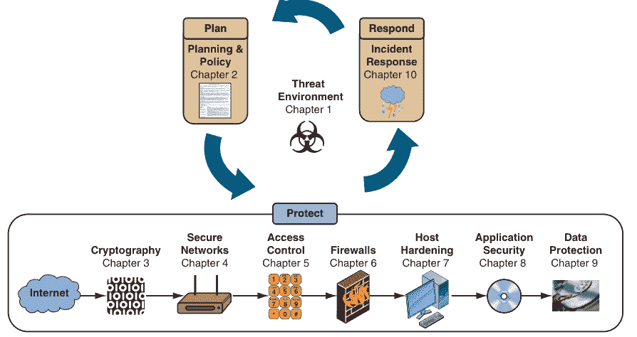


## 关于作者


**兰德尔·J·博伊尔**是韦伯州立大学戈达德商业与经济学院的管理信息系统副教授和威拉德·埃克尔斯学者。他于2003年获得佛罗里达州立大学管理信息系统博士学位。他还拥有公共管理硕士学位和金融学学士学位。他的研究领域包括计算机中介环境中的欺骗检测、数据泄露、安全信息系统、信息技术对认知偏差的影响，以及信息技术对知识工作者的影响。他曾在韦伯州立大学、朗伍德大学、犹他大学和阿拉巴马大学亨茨维尔分校获得学院教学奖。他的教学主要集中在管理信息系统、信息安全和网络方向。他撰写了多本著作，包括*《管理信息系统应用（第11版）》*、*《体验管理信息系统（第9版）》*、*《企业计算机安全（第5版）》*、*《应用信息安全》*和*《应用网络实验》*。


**雷·潘科**是夏威夷大学希德勒商学院信息技术管理荣休教授。他的主要课程是网络与安全。在进入大学之前，他是斯坦福研究所（现为SRI国际）的项目经理，曾为鼠标的发明者道格·恩格尔巴特工作。他在西雅图大学获得物理学学士学位和工商管理硕士（MBA）学位。他在斯坦福大学获得博士学位，其博士论文是根据美国总统办公室的合同完成的。他曾获得希德勒商学院颁发的丹尼斯·钦奖，以表彰其为高级教员中的杰出教师。他还是希德勒学者。

# 第1章
# 威胁环境
## 学习目标

学完本章后，你应该能够：

- 1.1 定义术语*威胁环境*。
- 1.2 描述*数据泄露*的影响。
- 1.3 描述来自*员工*和*前员工*的威胁。
- 1.4 描述来自*恶意软件*编写者的威胁。
- 1.5 描述传统外部*黑客*及其*攻击*，包括入侵过程、社会工程学攻击和拒绝服务攻击。
- 1.6 了解*犯罪分子*已成为当今主要的攻击者，描述他们发起的攻击类型，并讨论他们的合作方式。
- 1.7 描述可能来自企业*竞争对手*的攻击类型。
- 1.8 区分*网络战争*与*网络恐怖主义*。

## 章节大纲

- 1.1 引言
- 1.2 数据泄露
- 1.3 员工与前员工威胁
- 1.4 恶意软件
- 1.5 黑客与攻击
- 1.6 犯罪时代
- 1.7 竞争对手威胁
- 1.8 网络战争与网络恐怖主义
- 1.9 结论

## 1.1 引言
## 1.1 定义术语*威胁环境*。

当今世界对企业而言是一个危险的地方。互联网使企业能够接触数十亿客户和其他商业伙伴，但也让犯罪分子能够接触到数以亿计的企业和个人。犯罪分子无需进入企业所在国，就能攻击网站、数据库和关键信息系统。

企业已严重依赖信息技术（IT），将其视为整体竞争优势的一部分。为了保护其IT基础设施免受各种威胁并维持后续盈利能力，企业必须制定全面的IT安全策略、完善的操作规程、加固的应用程序和安全硬件。

## 基本安全术语

**威胁环境** 如果企业想要保护自己，就需要理解**威胁环境**——即企业面临的攻击者和攻击类型。“理解威胁环境”是“了解你的敌人”的一种雅致说法。如果你不知道自己可能如何受到攻击，就无法计划如何防御。本章将几乎完全聚焦于威胁环境。

> 威胁环境由企业面临的攻击者和攻击类型构成。

我们并不完全了解计算机安全威胁造成的财务和数据损失的程度。当然，人为错误造成的损失是巨大的，但很少有组织计算这些损失，公布出来的更是少之又少。然而，Risk Based Security在2018年的一份安全报告中指出，6515起安全事件中有50亿条记录丢失。

此外，没有人知道计算机犯罪的总成本。首先，没有统一的犯罪成本计算标准。拒绝服务攻击的成本是否包括员工时间的损失、收入损失，或因客户流失而导致的长期收入损失？或者，如果员工丢失了一台价值2000美元的笔记本电脑，成本是否包括其中数据的价值？是否包括更换电脑和重新安装软件所花费的时间成本？又或者，如果有人窃取了明年的财务计划，竞争对手从中获取的价值的成本如何确定？

图1-1显示了埃森哲公司（Accenture plc）和波耐蒙研究所进行的一项调查的结果。该图显示了经历最常见攻击类型的公司百分比。最常见的攻击类型似乎是恶意软件（98%）。不幸的是，这类攻击似乎短期内不会减少。其他类型的攻击随时间也相当稳定，唯独勒索软件急剧增加。我们将在本章后面更详细地讨论这些威胁。图1-2显示这些攻击的成本都随时间不断增加。

除了这些数据，埃森哲还按受损资产类型调查了损失。它发现信息损失是计算机犯罪中代价最高的后果，2018年每家公司年均损失达590万美元。业务中断是第二大成本，为400万美元。设备损失和损坏仅占损失价值的50万美元。显然，价值在于数据，而非硬件！

埃森哲还报告称，与网络犯罪相关的内部成本中，60%来自发现（36%）和遏制（24%）。其次成本最高的是调查（22%）和恢复（18%）。

《2019年计算机犯罪成本研究》深入分析了不同安全策略对计算机犯罪成本节省的影响。归根结底，在实施后续章节讨论的防护措施上投入更多的组织，其遭遇的计算机犯罪更少，且一旦遭遇，损失也更小。安全防护措施确实有效！

## 图1-1 按攻击类型划分的遭受攻击的公司百分比

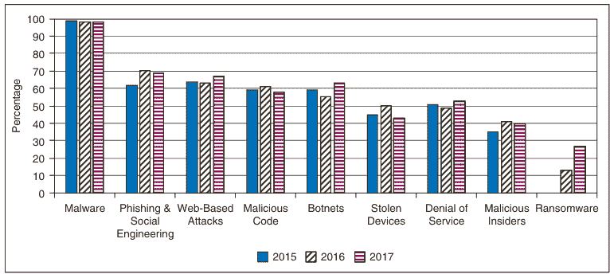

来源：根据埃森哲《网络犯罪成本研究》，2019年3月。

## 图1-2 按攻击类型划分的年度平均计算机犯罪成本

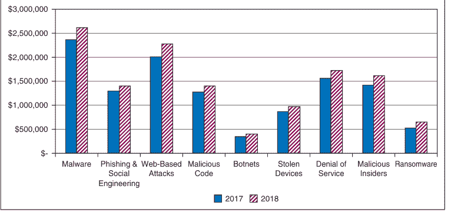

来源：根据埃森哲《网络犯罪成本研究》，2019年3月。

## 安全目标

企业及企业内部小组都有安全目标——即安全人员希望达到的条件。三个常见的核心目标被统称为CIA。这不是中央情报局。这里的CIA代表机密性、完整性和可用性。

# 威胁环境

威胁环境由企业面临的攻击者和攻击类型构成

所有威胁的成本都随时间不断增加

## 安全目标

## 机密性

机密性意味着人们无法读取敏感信息，无论这些信息是存储在计算机上还是在网络中传输。

## 完整性

完整性意味着攻击者无法更改或破坏信息，无论信息存储在计算机上还是在网络中传输。或者，至少如果信息被更改或破坏，接收方能够检测到更改或恢复被破坏的数据。

## 可用性

可用性意味着有权使用信息的人不会被阻止使用。

## 失陷

成功的攻击

也称为事件和破坏

## 防护措施

用于挫败攻击的工具

也称为防护、保护和管控

防护措施的类型

- 预防性
- 检测性
- 纠正性

## 图1-3 基本安全术语（学习图）


- *保密性*—保密性意味着人们无法读取敏感信息，无论它是在计算机上还是在网络中传输时。
- *完整性*—完整性意味着攻击者无法更改或破坏信息，无论它是在计算机上还是在网络中传输时。或者，至少，如果信息被更改或破坏，接收方可以检测到更改或恢复被破坏的数据。
- *可用性*—可用性意味着有权使用信息的人不会被阻止这样做。无论是计算机攻击还是网络攻击都不会阻止他们访问有权访问的信息。

许多安全专家对简单化的 CIA 目标分类法感到不满，因为他们认为公司还有许多其他安全目标。然而，CIA 目标是一个很好的起点。理解事件是一项关键技能。就业务流程模型而言，威胁会将业务流程推离实现一个或多个目标。

> 当威胁成功对企业造成损害时，这被称为事件、泄露或入侵。

## 对策

自然地，安全专业人员试图阻止威胁。他们用来挫败攻击的方法被称为 **对策**、**保障措施**、**保护** 或 **控制**。对策的目标是在存在威胁和实际入侵的情况下，使业务流程保持在实现其业务目标的轨道上。

> 用于挫败攻击的工具被称为对策、保障措施或控制。

对策可以是技术性的、人力性的，或（最常见的是）两者的混合。通常，对策分为三类：

- *预防性*—预防性对策阻止攻击得逞。大多数控制措施都是预防性控制。
- *检测性*—检测性对策识别威胁何时在攻击，特别是何时得逞。快速检测可以最大程度地减少损害。
- *纠正性*—纠正性对策在入侵后使业务流程恢复正轨。业务流程恢复正轨的速度越快，其实现目标的可能性就越大。

## 测试你的理解

- 1. a. 为什么企业了解威胁环境很重要？
- b. 命名三种常见的安全目标。
- c. 简要解释每个目标。
- d. 什么是事件？
- e. 事件的同义词是什么？
- f. 什么是对策？
- g. 对策的同义词是什么？
- h. 对策的目标是什么？
- i. 对策的三种类型是什么？

## 1.2 数据泄露

## 1.2 描述数据泄露的影响。

一次 **数据泄露** 发生在未经授权的人查看、更改或窃取受保护数据时。数据泄露尤其令人担忧，因为它们可能对组织造成的损害程度很大。如前所述，2018 年被窃取的记录超过 50 亿。¹ 考虑到整个地球上只有 77 亿人，其中只有 42 亿人可以在家中访问互联网，很可能几乎每个人在 2018 年至少丢失过一次记录。²

### 数据泄露的成本

为了让你了解这对组织的影响，埃森哲 2019 年的 *网络犯罪成本* 报告指出，平均而言，美国一次数据泄露的成本为组织 1300 万美元。³ 2019 年至 2023 年间数据泄露的估计累计全球成本将为 5.2 万亿美元。处理数据泄露的 *直接* 成本包括支付通知、检测、升级、补救、法律费用和咨询费用。

埃森哲还估计，与声誉损失、异常客户流失和增加的客户获取活动相关的 *间接* 成本在美国平均每起事件额外增加 390 万美元。

因此，数据泄露代价高昂。但你的组织卷入数据泄露的几率有多大？根据超过 2,200 家组织的实际回复，Ponemon 研究所估计，在任何给定的 24 个月期间，发生数据泄露的几率为 28%。⁴ 花点时间考虑一下你组织的数据泄露成本和概率。你的组织在未来一年内丢失记录的几率为四分之一。每条记录的平均成本为 148 美元。⁵ 你的组织在财务、技术和后勤方面是否已为此类泄露做好准备？

### 数据泄露的规模

图 1-4 显示了过去几年中一小部分数据泄露事件，但有一个显著例外。最大的数据点被从图表中省略，因为它大得足以使其他数据点相比之下几乎无法阅读。2016 年，雅虎公司披露了历史上最大规模的数据泄露事件，2013 年发生的事件导致 30 亿客户记录丢失。⁶ 图 1-4 最令人不安的是，它仅显示了丢失超过 1 亿条记录的美国公司的数据泄露事件（13 起数据泄露事件共计 44 亿条记录）。每年有数千家公司经历数据泄露事件，这些事件都不会出现在该图表上。更糟糕的是，考虑到美国只有约 3.3 亿人。现在问问自己，你的信息被盗的几率有多大？或者更好的问题是，你的数据被盗过多少次？

¹ Risk Based Security, “数据泄露快速概览报告 年末 2018”, RiskBasedSecurity.com, 2018 年 1 月。 https://pages.riskbasedsecurity.com/2018-ye-breach-quickview-report.
² InternetLiveStats.com, “互联网用户”, InternetLiveStats.com, 2019 年 6 月 25 日。 www.internetlivestats.com/internet-users.
³ Risk Based Security, “数据泄露快速概览报告 年末 2018”。
⁴ Ponemon Institute, 2018 网络犯罪成本研究：美国, 2018 年 9 月 18 日。 www.ibm.com/security/data-breach.
⁵ Ibid.
⁶ Selena Larson, “每个雅虎账户都被黑客入侵——共 30 亿”, CNN Money, 2017 年 10 月 4 日。 https://money.cnn.com/2017/10/03/technology/business/yahoo-breach-3-billion-accounts/index.html.

## 图 1-4 知名的数据泄露事件

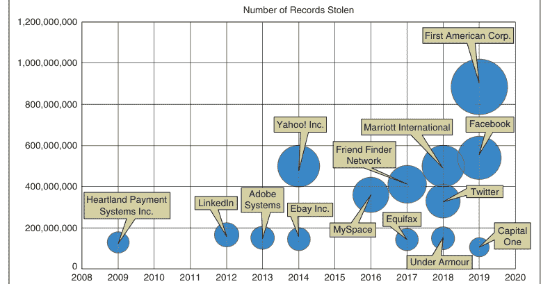

## 为什么会发生数据泄露？

超过 67% 的数据泄露来自试图赚钱的黑客。黑客主要寻找 **个人身份信息 (PII)**，即可用于识别个人的数据。这包括姓名、地址、出生日期、社会安全号码、信用卡号码、健康记录、银行账号、PIN 码和电子邮件地址。

被盗信息通常用于信用卡欺诈。被盗的信用卡信息经过验证后会被打包并在黑市上出售。被盗信用卡的价格根据账户类型可在每张 9 美元至 26 美元之间。有趣的是，如果大量信用卡账户被盗并同时出售，单卡价格可能低至 0.75 美元！这正是 Target 数据泄露事件后发生的情况。

信用卡欺诈并不是罪犯从数据泄露中获利的唯一方式。被盗数据通常用于身份盗窃、勒索和工业间谍活动。任何拥有有价值数据的组织都可能成为目标。例如，一个名为 Rex Mundi 的黑客组织试图通过威胁发布该公司的用户账户详情（姓名、地址、电话号码、电子邮件、密码和披萨偏好）来勒索法国和比利时的 Domino’s Pizza 3 万欧元（约 4 万 5 千美元）。⁸ 目前尚不清楚 Domino’s 是否向黑客组织支付了款项。

并非所有数据泄露都是来自遥远地区的黑客造成的。失职的内部员工窃取数据的能力甚至比外部黑客更强。在一个令人震惊的例子中，一名 39 岁的韩国信用局技术员窃取了近 2000 万韩国人持有的 1.04 亿张信用卡的个人信息。⁹ 这起单一数据泄露事件影响了韩国 40% 的人口。该员工仅被确定为朴先生，他曾被聘用以改善客户数据的安全性。他试图向一家电话营销公司的高管出售被盗信息。

⁷ Armor Defense, Inc., “网络罪犯获利，因为被盗信用卡、银行账户和个人身份在全球范围内价格在 2015 年至 2018 年间上涨 10% 至 83%”, Armor.com, 2018 年 9 月 6 日。 www.armor.com/newsroom/cybercriminals-profit-as-stolen-credit-cards-bank-accounts-and-personal-identities-globally-jump-in-price-10-to-83-between-2015-2018.
⁸ Darren Pauli, “给我们一块，否则我们就把你们所有用户的配料偏好公之于众”, The Register, 2014 年 6 月 16 日。 www.theregister.co.uk/2014/06/16/extortionists_demand_dominos_dough_for_hacked_data/.
⁹ Choe Sang-Hun, “数据盗窃加剧韩国担忧”, The New York Times, 2014 年 1 月 20 日。 www.nytimes.com/2014/01/21/business/international/theft-of-data-fuels-worries-in-south-korea.html.


## 数据泄露是如何发生的？

保护自己免受数据泄露侵害的第一步是了解它们是如何发生的。每一次泄露都不同，因为黑客不断开发新的工具和技术以窃取更多数据。他们尝试新的攻击向量，即攻击目标的方式。他们可能在一周内使用钓鱼诈骗，企图诱使用户为自然灾害捐款。然后，下周他们可能会开发一个 exploit，即用于利用目标应用程序或操作系统中新发现漏洞的软件。

以下段落详细介绍了 2013 年底发生的 Target Corporation 数据泄露。虽然因为泄露而对 Target 产生负面看法很诱人，但这样做并不完全公平。是的，Target 方面存在失误，我们将讨论这些问题。但 Target 对数据泄露的细节披露极其透明，并且处理得非常好。其他涉及数据泄露的公司并没有如此坦诚。例如，LinkedIn 在 2012 年丢失了 1.17 亿个客户账户，但直到 4 年后，即 2016 年中才通知用户。¹⁰ 它也提供了很少的攻击细节。

## 案例研究：Target 数据泄露

现在让我们看一个具体的攻击，以便将这些术语置于上下文中，并展示安全攻击的复杂性。我们将从最著名的客户信息丢失事件之一开始——Target Corporation 的数据泄露。

2013 年 12 月 18 日，Target Corporation 宣布其 4000 万张信用卡和借记卡号码被攻击者窃取。不到一个月后，Target 宣布另外 7000 万个客户账户被盗，包括姓名、电子邮件、地址和电话号码。考虑到两次数据丢失之间的部分重叠，约有 9800 万客户受到影响。¹¹ 这占美国 3.3 亿人口（包括儿童和没有信用卡的人）的 30%。

客户记录是在假日购物季（2013 年 11 月 27 日至 12 月 15 日）期间从 Target 零售店的销售点（POS）系统被窃取的。如果你在这一时期在 Target 购物，很可能你的数据已被丢失。

### 他们是如何做到的？
如图 1-5 所示，攻击者首先购买了专门为他们计划执行的攻击而设计的恶意软件。他们随后使用 **spear phishing**，即针对单个个人的定向钓鱼攻击，来感染 Target 的第三方供应商 Fazio Mechanical Services（提供制冷和 HVAC 服务）。¹² 攻击者在 Fazio 的系统上放置了一款名为 Citadel 的恶意软件，以收集 Fazio 用户的击键、登录凭据和屏幕截图。¹³ 攻击者随后使用从 Fazio 窃取的登录凭据访问 Target 网络上的供应商门户（或服务器）。攻击者在该服务器上提升权限（即接管服务器）并获得了对 Target 内部网络的访问权限。

¹⁰ Jose Pagliery, “黑客出售 1.17 亿 LinkedIn 密码,” CNN Money, May 19, 2016. http://money.cnn.com/2016/05/19/technology/linkedin-hack.
¹¹ Ben Elgin, “Target 信用卡泄露的三个新细节,” Bloomberg Business, March 26, 2014. https://www.bloomberg.com/news/articles/2014-03-26/three-new-details-from-targets-credit-card-breach.
¹² Brian Krebs, “Target 黑客通过 HVAC 公司入侵,” KrebsOnSecurity.com, February 5, 2014. http://krebsonsecurity.com/2014/02/target-hackers-broke-in-via-hvac-company.
¹³ Chris Poulin, “零售商需要从 Target 数据泄露中吸取的教训以防范类似攻击,” Security Intelligence, January 31, 2014. https://securityintelligence.com/target-breach-protect-against-similar-attacks-retailers/.

## 图 1-5 Target 数据泄露的步骤

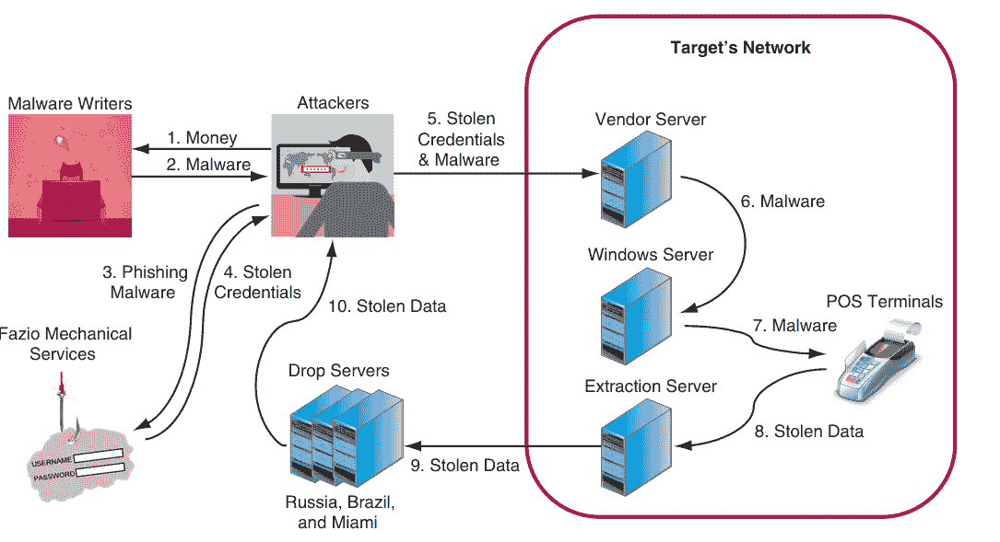

进入 Target 网络后，攻击者入侵了内部 Windows 文件服务器。从该服务器，攻击者使用名为 Trojan.POSRAM 的恶意软件（BlackPOS 的变种）从 POS 终端提取客户数据。BlackPOS 由俄罗斯圣彼得堡的一名 17 岁少年开发，可以从地下网站以约 2,000 美元的价格购买。¹⁴

客户数据会持续从 POS 终端发送到 Target 网络内的提取服务器。然后将其从 Target 网络转送到俄罗斯、巴西和迈阿密的 drop 服务器。从那里，数据被收集并在黑市上出售。

## 造成的损害

对攻击者而言，“损害”相当可观。据估计，攻击者以每张约 26.85 美元的价格出售了约 200 万张信用卡，总利润为 5,370 万美元。¹⁵ 由于供应量大，剩余卡片的价格下降。黑客本可以选择囤积部分被盗信用卡而不是冲击市场，但他们必须尽快出售，因为被盗卡正在被银行取消和更换。Target 被盗信用卡的价格以 10 万张为一批，在 2 个月后下降了 70%。¹⁶ 这很可能是由于信用卡有效率从接近 100% 下降到约 60%。

从黑客的角度来看，这次行动取得了惊人的成功。仅仅几周的工作就获得了可观的回报。不幸的是，这样的回报鼓励了更多的数据泄露。

另一方面，Target 遭受的损失远大于黑客的收益。它被迫升级其支付终端以支持芯片和 PIN 卡（以防止从被盗信息克隆卡），花费超过 1 亿美元。从 2015 年到 2017 年，Target 解决了多起诉讼，包括向 Visa 支付 6,700 万美元，向银行和信用合作社支付 4,000 万美元，向 Mastercard 支付 1,900 万美元，向州政府支付 1,800 万美元，以及在集体诉讼中向客户支付 1,000 万美元。加上 1.54 亿美元的和解付款，它还必须支付更高的保险费、法律费用、消费者信用监控费用和监管罚款。¹⁷

Target 还面临客户信心丧失和收入下降（该季度下降 46%）。在其年度报告中，Target 估计直接损失为 2.02 亿美元，但分析师认为 Target 的损失高达 4.5 亿美元。¹⁸ 该公司失去了 CIO Beth Jacob，支付 CEO Gregg Steinhafel 1,600 万美元离职，¹⁹ 并聘请了首位首席信息安全官（CISO）。²⁰

数据泄露影响的不仅仅是 Target。Target 数据泄露相关的媒体报道可能加速了 2015 年从磁条刷卡向 EMV 合规智能卡的转变。这一转变迫使更换了 8 亿张支付卡和 1,400 万台 POS 终端，成本为 70 亿美元。²¹

好消息是，采用 EMV 合规智能卡将大大减少每年发生的 100 亿美元信用卡欺诈。它还可能减少黑客的信用卡盗窃，因为没有实体卡，被盗信用卡号码价值不大。

¹⁴ Swati Khandelwal, “用于 Target 数据泄露的 BlackPOS 恶意软件由 17 岁俄罗斯黑客开发,” The Hacker News, January 17, 2014. https://thehackernews.com/2014/01/BlackPOS-Malware-russian-hacker-Target.html.
¹⁵ Brian Krebs, “Target 泄露，按数字来看,” KrebsOnSecurity.com, May 6, 2014. https://krebsonsecurity.com/2014/05/the-target-breach-by-the-numbers/.
¹⁶ Brian Krebs, “Target 泄露被窃卡的火速抛售,” KrebsOnSecurity.com, February 19, 2014. http://krebsonsecurity.com/2014/02/fire-sale-on-cards-stolen-in-target-breach/.

### 数据泄露
- 数据泄露发生在未经授权的人查看、篡改或窃取安全数据时
- 每年数千起数据泄露事件中被窃取数十亿条记录，给组织造成数万亿美元的损失
- 最大的数据泄露事件每次涉及超过 1 亿个账户

### 为什么会发生数据泄露？
- 被窃数据常用于信用卡盗窃、身份盗窃、勒索和工业间谍活动
- 个人身份信息（PII）是可以用来识别个人的数据

### 数据泄露是如何发生的？
- 攻击不断演变

### Target 数据泄露
- Target 零售店的销售点系统被窃取了 9800 万条客户记录
- Spear phishing 是针对单个个人的定向钓鱼攻击
- 使用定制恶意软件针对 HVAC 供应商以访问 Target 的内部网络
- 黑客出售数据获利 5400 万美元
- Target 的直接损失为 2.02 亿美元，总损失可能达 4.5 亿美元

## 图 1-6 数据泄露（学习图）

¹⁷ Vincent Lynch, “2013 年 Target 数据泄露成本接近 3 亿美元,” TheSSLStore.com, May 26, 2017. www.thesslstore.com/blog/2013-target-data-breach-settled.
¹⁸ Bruce Horovitz, “数据泄露影响 Target 利润,” USA Today, February 26, 2014. www.usatoday.com/story/money/business/2014/02/26/target-earnings/5829469.
¹⁹ Fred Donovan, “Target 泄露：时间线,” FierceITSecurity.com, February 18, 2014. www.fierceitsecurity.com/story/target-breach-timeline/2014-02-18.
²⁰ Kristin Burnham, “Target 聘请通用汽车高管担任首位 CISO,” InformationWeek, June 11, 2014. www.informationweek.com/strategic-cio/team-building-and-staffing/target-hires-gm-exec-as-first-ciso/d/d-id/1269600.
²¹ Krebs, “Target 泄露，按数字来看.”


## 测试你的理解

- 2. a. 什么是数据泄露？
- b. 为什么数据泄露代价如此高昂？
- c. 为什么会发生数据泄露？
- d. 数据泄露是如何发生的？
- e. 解释数据是如何从 Target 公司被盗的。
- f. Target 数据泄露造成了什么后果？

## 新闻速递

### Capital One 第一资本

2019 年，第一资本公司损失了 1.06 亿客户账户。²² 泄露的信息包括社会保障号码、银行账号、姓名、出生日期、地址、电话号码和申报收入。一名来自华盛顿州西雅图市的程序员被联邦调查局逮捕，并被指控涉嫌从第一资本公司的云存储中窃取数据。联邦检察官表示，一个配置错误的防火墙使黑客得以访问第一资本公司的数据。这名黑客在社交媒体上吹嘘自己窃取数据的行为后被抓。

### First American 第一美国

2019 年，安全研究员布莱恩·克雷布斯告知保险和金融服务公司第一美国，其 8.85 亿客户账户可通过其自有网站轻松访问。²³ 要访问这些记录，攻击者只需修改 URL，加入任意账号即可。虽然没有证据表明任何信息实际被盗，但机密信息确实轻易可得。泄露的信息包括社会保障号码、银行账号、税务文件、驾照影像和电汇信息。

### Facebook 脸书

2019 年，一家名为 Cultura Colectiva 的第三方应用程序开发公司将 5.4 亿个 Facebook 账户发布到了可公开访问的亚马逊服务器上。²⁴ 这 146 GB 的数据包括账户名称、ID、发布信息以及 22,000 名用户的密码。这是一系列令人尴尬的数据泄露事件中的又一起，此前还包括 2019 年初的 150 万账户泄露、2018 年的 5000 万账户泄露，以及 2013 年的 600 万账户泄露。

### Marriott International 万豪国际

2018 年，万豪国际集团报告称，黑客窃取了其 5 亿客人的记录。²⁵ 黑客于 2014 年侵入了万豪旗下喜达屋酒店的系统，并持续访问了 4 年。被盗信息包括护照号码、信用卡号码、电话号码、姓名、地址、旅行地点以及抵达和离店日期。

²² Shaun Nichols, “Capital One Gets Capital Done: Hacker Swipes Personal Info on 106 Million US, Canadian Credit Card Applicants,” The Register, July 30, 2019. www.theregister.co.uk/2019/07/30/capital_one_hacked.

²³ Lily Hay Newman, “Hack Brief: 885 Million Sensitive Financial Records Exposed Online,” Wired.com, May 24, 2019. www.wired.com/story/first-american-data-exposed.

²⁴ Jason Silverstein, “Hundreds of Millions of Facebook User Records Were Exposed on Amazon Cloud Server,” CBSNews.com, April 4, 2019. www.cbsnews.com/news/millions-facebook-user-records-exposed-amazon-cloud-server.

²⁵ Taylor Telford and Craig Timberg, “Marriott Discloses Massive Data Breach Affecting Up to 500 Million Guests,” The Washington Post, November 30, 2018. www.washingtonpost.com/business/2018/11/30/marriott-discloses-massive-data-breach-impacting-million-guests.

## 工业间谍

2019 年，石怡智教授因非法获取并运送特制军用半导体芯片到中国的 18 项罪名成立。²⁶ 这位前加州大学洛杉矶分校兼职教授因其工业间谍活动将面临 219 年监禁。这些芯片是为导弹、军用飞机、制导系统和雷达应用而设计的。芯片被送往并支付给了石怡智在中国拥有的一家公司。

## 1.3 员工和前员工威胁

## 1.3 描述来自*员工和前员工*的威胁。

在考察了一般性威胁、关键安全术语和一次特定的入侵事件之后，我们现在将审视企业威胁环境中的具体要素。我们将从企业内部开始，探讨员工造成的威胁。当企业在 20 世纪 60 年代开始拥有自己的计算机时，他们很快发现心怀不满和贪婪的员工及前员工是严重的安全威胁。随着企业对信息技术的依赖程度越来越高，来自内部人员的威胁也变得更加危险。

### 为什么员工很危险

员工和前员工非常危险，原因有四点：

- 他们通常对系统有广泛的*知识*。
- 他们通常拥有*访问*系统敏感部分所需的凭证。
- 他们了解企业的控制机制，因此通常知道如何*避免*被检测。
- 最后，企业倾向于*信任*自己的员工。事实上，当安全部门坚持要求员工以特定方式行事或解释明显的安全违规行为时，员工的经理通常会保护员工免受“安全干扰”。

> 员工和前员工非常危险，因为他们对系统有广泛的了解，拥有访问系统敏感部分所需的凭证，通常知道如何避免被检测，并且能够受益于通常给予“自己人”的信任。

IT 员工尤其危险，因为他们拥有非凡的知识和访问权限。事实上，2018 年美国网络犯罪状况调查发现，25% 的犯罪很可能来自内部人员。²⁷ IT 安全员工是所有人员中最危险的。司法部有一个网站 www.cybercrime.gov，列出了联邦网络犯罪起诉案件。大约一半案件的被告是 IT 专业人士，甚至包括安全员工和前员工。罗马人曾问：*Quis custodiet custodes?* 这句话翻译过来就是“谁来监督监督者？”这是 IT 安全管理中最棘手的问题之一。

²⁶ Colin Lecher, “Professor Faces 219-Year Prison Sentence for Sending Missile Chip Tech to China,” *The Verge*, July 6, 2019. www.theverge.com/2019/7/6/20683177/china-missile-semiconductors-trial-professor-yi-chi-shih-guilty.

²⁷ CSOnline.com, “2018 U.S. State of Cybercrime,” CSO, U.S. Secret Service, and the CERT Division of Carnegie Mellon Software Engineering Institute, August 2018, www.idg.com/tools-for-marketers/2018-u-s-state-of-cybercrime.

## 员工和前员工是危险的

之所以危险，是因为

- 他们了解内部系统
- 他们通常拥有访问系统的权限
- 他们通常知道如何避免被检测
- 员工通常受到信任

IT 人员，尤其是 IT 安全专业人员，是最大的员工威胁（*Quis custodiet custodes?*）

### 员工蓄意破坏

- 破坏硬件、软件或数据
- 在计算机上植入定时炸弹或逻辑炸弹

### 员工黑客行为

- 黑客行为是指未经授权或超出授权范围故意访问计算机资源
- 授权是关键

### 员工财务盗窃

- 挪用资产
- 盗窃资金

### 员工窃取知识产权（IP）

- 版权和专利（受正式保护）
- 商业机密：公司希望对竞争对手保密的计划、产品配方、业务流程和其他信息

### 员工敲诈勒索

犯罪者通过威胁采取损害受害者利益的行为来试图获取金钱或其他财物

### 对员工的性骚扰或种族骚扰

- 通过电子邮件
- 展示色情材料

### 员工计算机和互联网滥用

- 下载色情内容，可能导致性骚扰诉讼和病毒
- 下载盗版软件、音乐和视频，可能导致版权侵权处罚
- 在工作中过度个人使用互联网

### 非互联网计算机滥用

- 出于好奇访问敏感个人信息
- 在一次安全会议上的调查中，三分之一的人承认曾以与工作无关的方式查看机密或个人信息

### 数据丢失

- 笔记本电脑和存储介质丢失

### 其他“内部”攻击者

- 合同工
- 承包公司的员工

图 1-7 员工和前员工威胁（学习图）


## 员工蓄意破坏

对员工最古老的担忧之一是**蓄意破坏**，即摧毁硬件、软件或数据。*Sabotage*（蓄意破坏）一词源自法语中表示*鞋子*的词，因为据说工业革命早期心怀不满的工人曾把木鞋扔进机器以停止生产。

## 员工黑客入侵

另一个担忧是员工会利用窃取的凭证、内部系统的漏洞或其他欺诈手段入侵（hack）公司的计算机。他们随后可能挪用资金、窃取知识产权，或者只是查看令人难堪的信息。

正如我们将在第10章看到的，美国法律对**黑客入侵**（hacking）的定义是：未经授权或超出授权范围故意访问计算机资源。其他司法管辖区对黑客入侵的定义往往非常相似。28

> 黑客入侵是指未经授权或超出授权范围故意访问计算机资源。

请注意，关键问题是**授权**。29 你是否被明确（或暗示）授权使用你所访问的资源？你是否被授权使用该资源的某部分，而非你访问的具体部分？黑客入侵的动机无关紧要。无论你是企图窃取一百万美元，还是仅仅“测试安全性”，处罚都一样。30

## 员工财务盗窃与知识产权盗窃

员工未经许可或超出许可范围访问资源的原因有很多。有时员工这样做只是出于好奇，或是为了寻找可能让公司难堪的信息。然而，在其他时候，他们抱有纯粹的犯罪目的，例如**财务盗窃**，即挪用资产（比如通过计算机将这些资产分配给自己）或盗窃金钱（例如操纵应用程序以获得奖金）。

另一个犯罪动机是窃取公司的**知识产权**（**IP**），即公司拥有并受法律保护的信息。知识产权包括受正式保护的信息，如版权、专利、商号和商标。尽管许多公司没有此类正式的知识资产，知识产权还包括**商业秘密**，即公司设法保密的敏感信息。这些包括计划、产品配方、业务流程、价格表、客户列表以及公司希望对竞争对手保密的许多其他类型的信息。如果另一家公司以非法方式获取商业秘密，该公司将受到起诉。然而，一些员工会窃取商业秘密卖给另一家公司。

> 知识产权（IP）是公司拥有并受法律保护的信息。商业秘密是公司设法保密的敏感信息。

28 *黑客*一词首次有记载的使用是在史蒂夫·利维（Steve Levy）1984年出版的《黑客》（*Hackers*）一书中（企鹅图书）。利维实际上不赞成用*黑客*一词指代非法侵入计算机的人。相反，他认为黑客是那些能够为困难的计算机问题创造性地想出解决方案的人。一些安全领域的人继续主张利维的观点，用*破解者*（cracker）来指代侵入计算机的人。然而，这并不是安全领域的主流用法，在大众读物中当然也不普遍。*破解*（cracking）现在主要用于指破解密码或加密密钥。

29 为自己辩护时，黑客可以声称他们没意识到需要授权，因为他们入侵的计算机系统是公开的，比如免费的新闻网站。因此，有登录界面甚至公共主页的公司应显著警告用户，使用网站需要特定授权。

30 大多数黑客法律要求损失达到一定严重程度才能起诉黑客行为。然而，黑客完全有可能意外造成所需程度的损失，即使他或她并非故意。访问必须是故意的，但损失不必是故意的。

## 员工敲诈勒索

在某些情况下，员工或前员工会利用其破坏系统或访问机密信息的能力来敲诈公司。在敲诈中，犯罪者试图通过威胁采取不利于受害者的行动来获取金钱或其他财物。例如，员工可能在公司的计算机上植入逻辑炸弹。如果该员工或前员工要求公司付钱以避免遭受损失，这就是敲诈。窃取知识产权并要求支付金钱以换取不泄露信息，同样属于敲诈。

> 在敲诈中，犯罪者试图通过威胁采取不利于受害者的行动来获取金钱或其他财物。

## 员工性骚扰或种族骚扰

尽管黑客入侵、盗窃和敲诈是关键问题，但员工的性骚扰或种族骚扰是更为常见的问题。例如，性骚扰可能包括进行人身威胁、在恋情破裂后实施报复、下载和展示色情内容，或通过扣发晋升和加薪来报复不情愿的性伴侣。

## 员工计算机与互联网滥用

### 互联网滥用

“滥用”一词用于指违反公司IT使用政策或道德规范的活动。在某些情况下，员工滥用其互联网访问权限，最常见的是下载色情内容、下载盗版媒体或软件，或花费大量时间上网浏览个人事务。滥用行为从轻微损害行为到犯罪行为不等。

> 滥用是指违反公司IT使用政策或道德规范的活动。

下载色情内容可能导致针对公司以及责任个人的性骚扰诉讼。反过来，下载盗版音乐、视频和软件可能导致严重的版权侵权处罚。31 下载任何未经批准的文件还可能导致代价高昂的恶意软件感染。

虽然许多雇主不介意少量个人上网行为，但一些员工对互联网使用上瘾，每周在工作时间花费数十小时浏览个人网页。32 此外，当员工从互联网下载大量文件时，很可能下载到病毒或其他恶意软件。

31 此外，盗版软件通常含有病毒，先感染下载者的计算机，然后感染公司中的其他计算机。

32 Salary.com员工，《员工为何以及如何在工作时间浪费时间》，Salary.com，2018年4月17日。www.salary.com/articles/why-how-your-employees-are-wasting-time-at-work.

IT安全部门通常不喜欢查找色情内容和过度个人上网的证据，但在大多数公司，这是工作的一部分。

## 非互联网计算机滥用

员工滥用的另一个方面是好奇的员工未经授权访问内部系统上的私密个人数据。这种行为在2018年被发现，当时一名Facebook员工利用其访问权限，通过查看女性的私人Facebook资料来跟踪她们。他在向一位潜在的Tinder约会对象吹嘘此事后被解雇。33

## 非故意数据丢失

我们目前看到的破坏性员工行为都涉及故意的违规行为。员工也可能仅仅因为粗心大意而危及公司的安全，例如丢失笔记本电脑、光盘和U盘。这些计算机和介质上的数据被未经授权地泄露，可能对公司造成毁灭性影响。即使数据实际上没有被使用，但数据可能被使用这一事实也可能迫使公司采取代价高昂的行动。

## 其他“内部”攻击者

员工并非公司内部的唯一威胁。许多企业会雇佣合同工，他们为公司短期工作。合同工通常会获得访问凭证，而这些凭证在其合同结束后不会被删除。事实上，公司经常雇佣其他公司来完成在原始公司内部进行的承包工作。这些承包公司及其员工也经常获得临时凭证。这些合同工和承包公司造成的风险与员工几乎完全相同。

## 测试你的理解

- 3. a. 给出员工尤其危险的四个原因。
- b. 哪类员工最危险？
- c. 什么是蓄意破坏？
- d. 给出本书对黑客入侵的定义。
- e. 什么是知识产权？
- f. 员工可能窃取哪两类东西？
- g. 区分一般知识产权与商业秘密。
- h. 什么是敲诈勒索？
- i. 什么是员工计算机与互联网滥用？
- j. 除员工外，还有哪些人构成潜在的“内部”威胁？

## 1.4 恶意软件

## 1.4 描述恶意软件编写者带来的威胁。

尽管员工和其他“内部”威胁可能极其危险，公司还必须关注传统的外部攻击者，他们利用互联网向企业发送恶意软件、入侵企业计算机并造成其他破坏。

33 杰夫·约翰·罗伯茨，《Facebook、Uber以及“上帝视角”的麻烦》，《财富》杂志，2018年5月12日，https://fortune.com/2018/05/12/facebook-employee-peeking.


### 图 1-8 ILOVEYOU 病毒代码

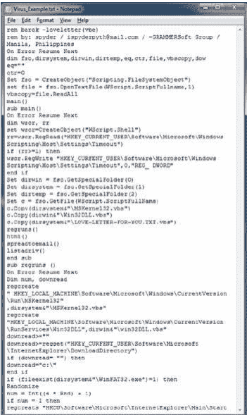

## 恶意软件编写者

第一批外部攻击者就是恶意软件编写者。术语**恶意软件**泛指“邪恶软件”。最广为人知的恶意软件类型是计算机病毒。恶意软件还包括蠕虫、特洛伊木马、RAT（远程访问木马）、垃圾邮件，以及我们将在本节中看到的其他几种类型。恶意软件是一个非常严重的威胁。最近一项研究表明，33% 的计算机感染了恶意软件。³⁴

> 恶意软件是“邪恶软件”的通用术语。

## 病毒

**病毒**是附着在受害者机器上合法程序上的程序。之后，当受感染的程序被转移到其他计算机并运行时，病毒会附着到那些机器上的其他程序上。

> 病毒是附着在合法程序上的程序。

最初，大多数病毒通过软盘传输程序来传播。如今，像图 1-8 所示的病毒通过带感染附件的电子邮件、即时通讯、文件共享程序、来自恶意网站的受感染程序，以及用户故意下载“免费软件”或色情内容来传播。病毒编写者以流行的操作系统和应用程序为目标，以最大限度地扩大其破坏。如今，通过联网应用程序，病毒可以传播得非常迅速。

## 蠕虫

病毒并不是唯一的恶意软件类型。一种特别重要的恶意软件类型是蠕虫。与病毒不同，蠕虫是独立程序，不会附着到其他程序上。

> 蠕虫是独立程序，不会附着到其他程序上。

一般来说，蠕虫的行为与病毒非常相似，可以通过许多相同的方式传播。然而，有些蠕虫具有更加激进的传播方式——无需接收计算机上的用户干预，直接从一台计算机跳到另一台计算机。这种**直接传播蠕虫**利用软件中的漏洞（安全弱点）。当直接传播蠕虫跳到一台具有该蠕虫所针对的特定漏洞的计算机上时，蠕虫可以自行安装在该计算机上，并以该计算机为基地跳到其他计算机——全程无需用户任何操作。

> 直接传播蠕虫直接跳到存在漏洞的计算机上，然后利用这些计算机跳到其他计算机。直接传播无需用户操作，因此直接传播蠕虫可以极其迅速地传播。

³⁴ John P. Mello，“报告：恶意软件毒害全球三分之一的计算机”，*TechNewsWorld*，2014年7月9日。www.technewsworld.com/story/80707.html.

### 图 1-9 经典恶意软件：病毒和蠕虫（学习图）

- **恶意软件**
  - 任何“邪恶软件”的通用名称
- **病毒**
  - 附着在受害者机器上合法程序上的程序
  - 如今主要通过电子邮件传播
  - 也通过即时通讯、文件传输等传播
- **蠕虫**
  - 不附着到其他程序上的完整程序
  - 也通过电子邮件、即时通讯和文件传输传播
  - 此外，直接传播蠕虫可以在不需要接收计算机上人工干预的情况下从一台计算机跳到另一台计算机
  - 计算机必须存在漏洞，直接传播才能起作用
  - 直接传播蠕虫可以极其迅速地传播
- **勒索软件**
  - 在向攻击者付款之前，阻止对系统或数据访问的恶意软件
- **混合威胁**
  - 恶意软件通过多种方式传播——如蠕虫、病毒、包含移动代码的受感染网页等
- **有效载荷**
  - 造成损害的代码片段
  - 由病毒和蠕虫在传播后执行
  - 恶意有效载荷被设计成造成严重破坏

## 勒索软件

勒索软件是一种恶意软件，在向攻击者付款之前阻止对系统或数据的访问。某些形式的勒索软件会加密你的数据（CryptoLocker）、阻止你运行应用程序，甚至让你无法登录操作系统（Reveton）。过去几年，勒索软件已成为一个严重的问题。2017年年中，名为 WannaCry 的勒索软件感染了 100 多个国家的系统，并使医院、铁路系统、电话公司甚至制造工厂陷入瘫痪。³⁵

³⁵ Sylvia Hui, Allen G. Breed, and Jim Heintz，“全球‘WannaCry’勒索软件网络攻击为数据索取现金”，APNews.com，2017年5月13日。https://apnews.com/770946e7df454d2e9acda3bdbd3ed425/Unprecedented-global-‘ransomware’-attack-seeks-cash-for-data.

## 混合威胁

如果说病毒和蠕虫还不够糟糕，那么越来越多的混合威胁既作为病毒又作为蠕虫传播。它们还可以将自身发布到网站上，供人们无意中下载。通过多种方式传播，混合威胁增加了成功的可能性。

赛门铁克掌握着关于病毒、蠕虫和混合威胁的数据。在其 2019 年《互联网安全威胁报告》中，发现每 412 封电子邮件中有 1 封包含病毒、蠕虫或混合威胁。每发送 3000 封电子邮件中就有 1 封是网络钓鱼诈骗，所有电子邮件中有 55% 是垃圾邮件。³⁶

³⁶ 赛门铁克公司，“互联网安全威胁报告”，Symantec.com，2019年2月。www.symantec.com/security-center/threat-report.

## 有效载荷

病毒和蠕虫传播后，通常会执行**有效载荷**，即造成损害的代码片段。良性有效载荷只是在用户屏幕上弹出消息，或造成一些令人讨厌但非致命的损害。遗憾的是，一些病毒和蠕虫具有看似良性的有效载荷，甚至根本没有有效载荷，却能造成重大损害。例如，尽管 Slammer 不含有效载荷，但它传播得如此之快，以至于巨大的流量堵塞了网络，从而实际上使互联网的部分区域瘫痪。

相比之下，**恶意有效载荷**可以造成极端破坏，例如，从受害者的硬盘驱动器中随机删除文件，或安装本节后面描述的其他类型的恶意软件。

病毒和蠕虫的有效载荷还经常“软化”计算机，方法包括禁用其防病毒软件并采取其他措施，使其在后续病毒和蠕虫攻击面前非常脆弱。

## 测试你的理解

- 4. a. 什么是恶意软件？
- b. 区分病毒和蠕虫。
- c. 如今大多数病毒如何在计算机之间传播？
- d. 描述直接传播蠕虫如何在计算机之间移动。
- e. 为什么直接传播蠕虫特别危险？
- f. 什么是病毒或蠕虫有效载荷？

## 特洛伊木马和根套件

### 非移动恶意软件

病毒、蠕虫和混合威胁并不是唯一的恶意软件类型，但它们是唯一能够自行传播到其他受害者的恶意软件类型。其他形式的恶意软件只有被放置到机器上才能传播。获得非移动恶意软件的方式包括以下几种：

- 让黑客将其放置在那里
- 让病毒或蠕虫将其作为有效载荷的一部分放置在那里
- 通过将恶意软件伪装成有用的程序或数据文件，诱使受害者从网站或 FTP 站点下载该恶意软件
- 将恶意的移动代码（后面描述）附加到网页上，当受害者下载该网页时在其计算机上执行

### 特洛伊木马

大多数非移动恶意软件程序都是特洛伊木马。早期的特洛伊木马是伪装成某种东西的程序，例如游戏或商业程序的盗版版本，但实际上是恶意软件。许多这类经典特洛伊木马仍然存在。然而，今天当我们谈论**特洛伊木马**时，我们指的是通过删除系统文件并采用该系统文件的名称来隐藏自身的程序。特洛伊木马很难检测，因为它们看起来像合法的系统文件。

> 特洛伊木马是一种通过删除系统文件并采用该系统文件的名称来隐藏自身的程序。特洛伊木马很难检测，因为它们看起来像合法的系统文件。

### 远程访问木马

一种常见的特洛伊木马类型是远程访问木马（RAT）。RAT 让攻击者远程控制你的计算机。攻击者可以远程搞恶作剧，例如打开和关闭你的光驱，或在你的屏幕上输入内容。然而，攻击者也可以从事更恶意的活动。有许多合法的远程访问程序允许远程用户操作机器或进行诊断。然而，RAT 通常具有隐蔽性，以避免被机器所有者发现。

### 下载器

有些特洛伊木马是下载器（有时称为投放器）。它们通常是比较小的程序，这使得检测变得困难。然而，一旦安装，它们就会下载一个更大得多的、能够造成更大破坏的特洛伊木马。

### 图 1-10 特洛伊木马和根套件（学习图）

- **非移动恶意软件**
  - 通常通过日益增多的攻击技术之一放置在用户计算机上
  - 由黑客放置在计算机上
  - 由病毒或蠕虫作为其有效载荷的一部分放置在计算机上
  - 可以诱使受害者从网站或 FTP 站点下载该程序
  - 在网页上执行的移动代码可以下载非移动恶意软件
- **特洛伊木马**
  - 一种替换现有系统文件并采用其名称的程序
- **远程访问木马**
  - 允许攻击者远程控制你的计算机
- **下载器**
  - 小型特洛伊木马，在下载器安装后下载更大的特洛伊木马
- **间谍软件**
  - 收集有关你的信息并将其提供给对手的程序
    - 存储过多敏感个人信息的 Cookie
    - 键盘记录器
    - 窃取密码的间谍软件
    - 数据挖掘间谍软件
- **根套件**
  - 控制超级用户账户（root、管理员等）
  - 可以隐藏自身，使文件系统检测不到
  - 可以隐藏恶意软件，使其不被检测
  - 极难检测（普通防病毒程序很少能找到根套件）


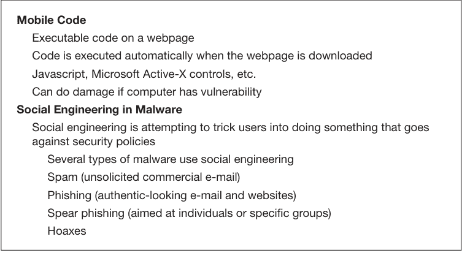

**图 1-11** 其他恶意软件攻击（学习示意图）

### 间谍软件
**间谍软件**一词泛指一类范围广泛的木马程序，它们收集你的信息并将其提供给攻击者。间谍软件有几种类型。

- **Cookie** 是网站存储在个人电脑上的小型文本字符串。下次访问该网站时，网站可以检索该 Cookie。Cookie 有很多好处，例如每次访问时记住你的密码。Cookie 还可以记住一系列屏幕操作中最后发生了什么，从而引导完成购买。然而，当 Cookie 记录了你过多的敏感信息时，它们就变成了间谍软件。（Cookie 本身并不是木马，但我们将其与其他类型的间谍软件放在一起讨论。）
- **键盘记录器**，也称为击键记录器，会捕获你的所有按键操作。然后可以在你的按键记录中搜索用户名、密码、社会保险号、信用卡号和其他敏感信息。它们可以将这些信息发送给攻击者。有些键盘记录器还能记录你访问的网站和运行的程序，甚至能按特定时间间隔截取屏幕。
- **密码窃取型间谍软件**会告诉你，你已从所访问的服务器上注销，并请你重新输入用户名和密码。如果你照做了，该间谍软件就会将你的用户名和密码发送给攻击者。
- **数据挖掘型间谍软件**会搜索你的磁盘驱动器，寻找与键盘记录器所寻求的相同类型的信息。它也会将这些信息发送给对手。

### 根工具包
木马程序会替换合法程序。更深层的威胁是一组名为根工具包的程序。在 Unix 计算机中，**根账户**是一种超级用户账户，对计算机拥有完全的控制权。虽然这种超级用户账户在 Windows 计算机上被称为 Administrator，但超级用户账户通常统称为 root 账户。**根工具包**接管 root 账户，并利用其权限隐藏自身。它们主要通过阻止操作系统查看文件的方法检测到自己的存在来实现这一点。根工具包很少被普通杀毒软件捕获，而根工具包检测程序通常也针对特定的根工具包。

## 测试你的理解

5.
- a. 非移动恶意软件是如何被传送到计算机上的？
- b. 什么是木马？
- c. 什么是远程访问木马（RAT）？
- d. 什么是下载器？
- e. 什么是间谍软件？
- f. 为什么 Cookie 可能是危险的？
- g. 区分键盘记录器、密码窃取型间谍软件和数据挖掘型间谍软件。
- h. 区分木马和根工具包。
- i. 为什么根工具包特别危险？

## 移动代码

当你下载一个网页时，它可能不仅包含文本、图像、声音和视频，还包含可执行代码。这被称为移动代码，因为它会在任何下载该网页的机器上执行。JavaScript 是编写移动代码的一种流行语言。在大多数情况下，移动代码是无害的，而且如果用户希望使用网站的功能，移动代码通常是必需的。然而，如果（且仅当）计算机存在某段特定移动代码所利用的漏洞时，恶意的移动代码才能利用该漏洞。

## 恶意软件中的社会工程学

社会工程学攻击利用人类判断上的缺陷，诱使受害者采取违反安全策略的行为。例如，如果一名员工收到一封警告即将大规模裁员的电子邮件，他或她可能会打开附件，从而下载病毒、蠕虫或木马。尽管技术可以提供许多保护，但公司很难防范人类判断失误。

> 社会工程学攻击利用人类判断上的缺陷，诱使受害者采取违反安全策略的行为。

### 垃圾邮件
所有电子邮件用户的一大祸害是垃圾邮件，它被定义为未经请求的商业电子邮件。虽然 ISP、企业和个人垃圾邮件过滤器已经大大减少了垃圾邮件的数量，但人们仍然不断受到垃圾邮件的轰炸。除了令人烦扰之外，垃圾邮件通常还带有欺诈性，或宣传危险产品。垃圾邮件已成为传播病毒、蠕虫、木马和许多其他类型恶意软件的常见载体。如前所述，赛门铁克报告称 2019 年所有电子邮件中有 55% 是垃圾邮件。

仅仅传输和存储垃圾邮件所带来的网络负载也可能是巨大的。这一点尤其正确，因为许多垃圾邮件发送者现在发送带有图像正文而非文本正文的垃圾邮件，以逃避垃圾邮件扫描程序的检测。图像垃圾邮件比传统文本垃圾邮件大得多。

### 网络钓鱼
在网络钓鱼攻击中，受害者会收到看似来自银行或受害者有业务往来的其他公司的电子邮件。该邮件甚至可能将受害者引导至一个看起来真实的网站。邮件和网站的官方外观常常诱使受害者泄露敏感信息。在所有收到网络钓鱼邮件的人中，有一小部分但可观比例的人会回复，因为这些邮件看起来太真实了。2019 年数据泄露调查报告（DBIR）发现，所有数据泄露中有 32% 涉及某种形式的网络钓鱼。38 如果目标是民族国家，这一数字跃升至 78%。大约 4% 的用户会点击网络钓鱼活动。最近，FBI 估计 2018 年网络钓鱼造成的损失为 13 亿美元。39

## 鱼叉式网络钓鱼

普通的网络钓鱼攻击往往广泛吸引许多人，以便尽可能多地欺骗受害者。相比之下，鱼叉式网络钓鱼攻击针对的是单个个人或小群体。例如，如果攻击者的目标是让某公司的 CEO 下载木马，攻击者可能会精心制作一封电子邮件，内容涉及 CEO 面临的一个紧迫问题，看似来自受信任的人，并且包含只有该受信任者才可能知道的特定细节。

## 恶作剧

有些电子邮件包含恶作剧。在某些情况下，这些恶作剧只是让受害者向别人讲述他们“学到的”东西时感到自己很愚蠢。在其他情况下，恶作剧试图说服受害者删除关键系统文件，从而破坏自己的系统。

## 测试你的理解

6.
- a. 什么是移动代码？
- b. 什么是社会工程学？
- c. 什么是垃圾邮件？
- d. 什么是网络钓鱼？
- e. 区分普通网络钓鱼和鱼叉式网络钓鱼。
- f. 为什么恶作剧是坏的？

## 1.5 黑客与攻击

1.5 描述传统的外部黑客及其攻击方式，包括入侵过程、社会工程学和拒绝服务攻击。

在 20 世纪 70 年代，恶意软件编写者之外又出现了外部黑客，他们开始侵入连接到调制解调器的公司计算机。如今，每家公司都连接到互联网，互联网上潜伏着数百万的外部黑客。黑客能够侵入公司网络、窃取机密数据，或从数千英里之外对关键基础设施造成破坏。

## 传统动机

大多数传统外部黑客并不会为了钱而进行大规模破坏或盗窃。他们的主要动机是入侵带来的刺激、对自己技能的验证以及权力感。此外，外部黑客经常

38 Verizon Corp., “2019 Data Breach Investigations Report,” Verizon.com, May 9, 2019. https://enterprise.verizon.com/resources/reports/dbir.
39 U.S. Federal Bureau of Investigation, “FBI: US Companies Lost $1.3 Billion in 2018 Due to BEC Scams,” ZDNet.com, April 23, 2019. www.zdnet.com/article/fbi-us-companies-lost-1-3-billion-in-2018-due-to-bec-scams.

- 动机是刺激、验证技能和权力感
- 动机是提升在其他黑客中的声誉
- 常常造成破坏作为副产品
- 常常进行轻微犯罪

## 黑客攻击的过程

- 侦察探测
  - IP 地址扫描以识别可能的受害者
  - 端口扫描以了解每个潜在受害主机上开放了哪些服务
- 漏洞利用
  - 攻击者用来入侵计算机的具体攻击方法称为攻击者的漏洞利用
  - 实施漏洞利用的行为称为利用主机

## IP 地址欺骗

- 攻击者经常使用 IP 地址欺骗来隐藏身份
- 在侦察和漏洞利用数据包中放入虚假的源 IP 地址
- 隐藏攻击者的身份
- 然而，攻击者无法收到受害者发送到虚假 IP 地址的回复

## 攻击计算机链

- 攻击者通过一串受害计算机进行攻击
- 探测和漏洞利用数据包包含链中最后一台计算机的源 IP 地址
- 最终的攻击计算机接收回复并将其传回给攻击者
- 通常，受害者可以将攻击追溯到最终的攻击计算机
- 但攻击通常只能再追溯几台计算机

**图 1-12 传统外部攻击者：黑客（学习示意图）**

彼此交流。通过展示自己闯入防御严密的主机的能力，黑客可以在同行中提高声誉。⁴⁰这种类型的攻击者仍然存在。

通常，传统黑客专注于让受害者难堪。例如，2014 年，破坏者闯入了加利福尼亚州旧金山的一个计算机化道路标志，并将其信息改为“哥斯拉来袭！掉头！”⁴¹然而，许多传统外部黑客确实会进行一些直接盗窃、勒索和其他破坏行为，以支持他们的“爱好”。

## 测试你的理解

7.
- a. 传统外部黑客的动机是什么？
- b. 传统外部黑客会进行盗窃吗？

⁴⁰ 其他人有更奇怪的动机。据报道，英国黑客加里·麦金农侵入了 73,000 台美国政府计算机，寻找外星人接触的证据。Ian Grant, “Garry McKinnon Broke into 73,000 U.S. Government Computers, Lords Told,” ComputerWeekly.com, June 16, 2008. 网上已不再可用。

⁴¹ Jim Finkle, “After ‘Godzilla Attack!’ U.S. Warns about Traffic-Sign Hackers,” Reuters, June 6, 2014. www.reuters.com/article/us-usa-hacking-traffic-idUSKBN0EH2CM20140606.


## 黑客攻击剖析

尽管黑客攻击计算机的方式多种多样，但攻击者在试图攻击一家公司的计算机时，通常会遵循一个大致的通用过程。这类似于盗贼想要物理窃取公司计算机时的做法。

### 目标选择

黑客可以随机搜索所有可能的公司以寻找潜在目标，也可以按名称查找特定公司。使用简单的WHOIS查询（www.whois.net）即可解析公司的域名。公司通常拥有连续的IP地址块，分配给其内部计算机使用。一旦黑客知道了目标IP地址范围，就可以开始探测网络中的易受攻击主机。

### 侦察探测

在盗贼入室行窃之前，他/她通常会“踩点”观察街区，寻找容易下手的目标。攻击者随后收集潜在受害房屋的信息，以决定闯入哪些房屋。黑客在侵入计算机之前也倾向于进行侦察。如图1-13所示，攻击者经常向网络发送探测数据包。这些探测数据包旨在诱使内部主机和路由器做出回复。如果内部主机或路由器对这些探测数据包做出响应，其响应信息就能让攻击者了解大量有关该网络的信息。

### IP地址扫描

第一轮探测数据包用于发现活动主机。攻击者向目标范围内的所有IP地址发送IP地址扫描探测。这些探测通常使用模块A中讨论的Internet控制消息协议（ICMP）回显和回显应答消息。当主机收到ICMP回显消息时，应发回ICMP回显应答消息。当攻击者从某个IP地址收到ICMP回显应答消息时，就知道该IP地址处有一台活动主机。

### 端口扫描

一旦攻击者知道了活动主机的IP地址，就需要确定这些已识别主机正在运行哪些程序，因为大多数攻击依赖于特定程序中的漏洞。在服务器主机上，应用程序对应着端口号。用“家”的比喻来说，端口相当于房屋的门。

图1-13 探测与漏洞利用攻击数据包

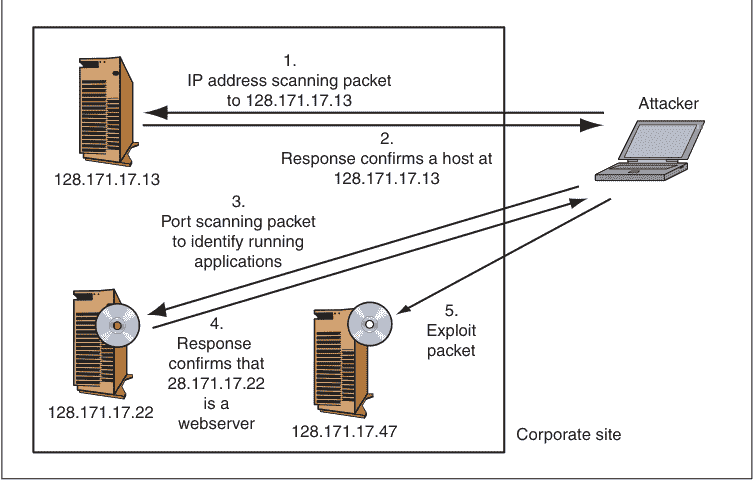

图1-14 源IP地址欺骗

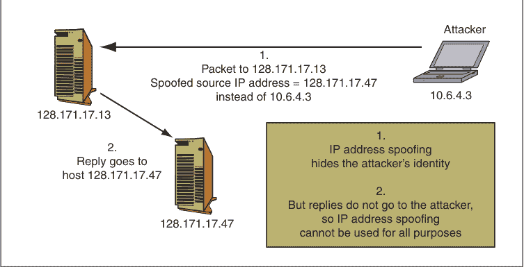

例如，80是HTTP Web服务器的知名端口号。如果80端口开放，那么该计算机很可能是一台Web服务器。在0到1023之间有许多知名端口号，每一个都表明存在特定类型的应用程序。

攻击者向每台已识别主机发送端口扫描探测，以确定该主机正在运行哪些应用程序。通常，端口扫描程序会请求与特定端口号上的某个程序建立连接。42 如果目标发回同意继续的响应，攻击者就知道目标主机正在该端口号上运行某个程序。

### 漏洞利用

一旦识别出潜在的受害主机和端口，攻击就可以开始了。在这种情况下，攻击者向受害主机发送的是漏洞利用数据包，而不是探测数据包。攻击者用来侵入计算机的具体攻击方法被称为攻击者的漏洞利用代码，而实施该漏洞利用的行为被称为利用主机。如果漏洞利用成功，攻击者至少“控制”了一个账户，并且可能“控制”了该计算机本身。控制了计算机后，攻击者就可以为所欲为。

### 欺骗

每个数据包都携带一个源IP地址，就像信封上的寄件人地址一样。源IP地址对黑客来说是危险的，因为它使公司能够定位攻击者。如图1-14所示，攻击者可以通过欺骗源IP地址，即在源IP地址字段中填入一个不同的IP地址，来挫败追踪他们的努力。这样，受害者就无法获知攻击者的真实IP地址。

并非所有数据包都可以被欺骗。例如，攻击者通常必须能够读取对探测数据包的回复。受害者的回复总是发送到探测数据包源IP地址字段所对应的主机。如果攻击者在探测数据包中伪造了IP地址，就不会收到回复。许多漏洞利用也需要收到回复才能成功。

42 如果程序在传输层使用TCP，则请求连接的TCP段会设置其SYN位。表示愿意继续的回复会同时设置SYN和ACK位。

图1-15显示，需要接收回复的攻击者通常借助一系列先前已被攻击者攻陷的攻击计算机来开展工作。43 命令通过该链条传递到最终计算机，由最终计算机发送探测或攻击数据包。回复也经由链条传回攻击者。受害者通常只能追踪到链条中的最后一台计算机，也许还能追踪到链条中的另外一两台主机。受害者很少能将攻击一路追踪到攻击者的主机，因为这条计算机链条跨越了多家公司、多个州和国家。

### 测试你的理解

- 8. a. 区分IP地址扫描和端口扫描。
- b. 什么是漏洞利用？
- c. “控制”计算机是什么意思？
- d. 什么是IP地址欺骗？
- e. 为什么要进行IP地址欺骗？
- f. 攻击者在什么情况下不能使用IP地址欺骗？
- g. 当攻击者必须在探测或漏洞利用数据包中使用有效的IP源地址时，他们如何隐藏自己的身份？

### 攻击中的社会工程学

许多外部（和内部）攻击都会使用社会工程学，正如我们之前所见，社会工程学是试图诱骗用户做出违背安全利益的行为。与技术防护相比，人类的轻信往往更容易被利用。例如，黑客打电话给秘书，声称在与秘书的上司一起工作。然后黑客索要敏感信息，如密码甚至受限制的文件。

社会工程学的其他例子包括：在没有输入通行码的情况下跟随某人通过安全门（这称为尾随），以及在某人输入密码时从背后偷看（这称为肩窥）。在借故套取信息中，攻击者冒充某个客户打电话，以获取该客户的私人信息。

图1-15 攻击计算机链条

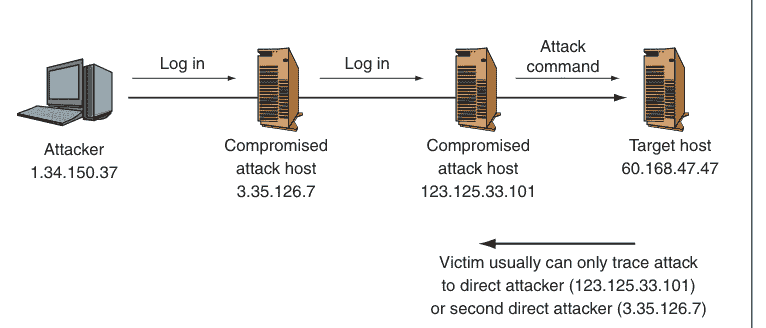

43 例如，攻击者可以使用Telnet从一台计算机跳到另一台计算机。最终，攻击者能够直接向最终计算机输入命令。对于攻击者来说，在操作过程中甚至不会意识到自己和最终计算机之间还有多台计算机。

### 社会工程学

社会工程学常被用于黑客攻击

- 打电话索要密码和其他机密信息
- 发送带有诱人主题的电子邮件攻击消息
- 尾随（通过有权进入者打开的门进入）
- 肩窥（偷看他人输入密码）
- 借故套取信息（冒充某人并询问关于该人的信息）

之所以经常成功，是因为它针对的是人性弱点而非技术弱点

### 拒绝服务（DoS）攻击

- 使服务器或整个网络对合法用户不可用
- 通常向受害者发送大量攻击消息
- 分布式拒绝服务（DDoS）攻击
  - 僵尸程序向受害者发送大量攻击数据包
  - 攻击者控制僵尸程序

### 技能水平

- 专家级攻击者的特点是技术高超、坚持不懈
- 专家级攻击者编写黑客脚本来自动化部分工作
- 还可利用脚本编写病毒和其他恶意软件
- 脚本小子使用这些脚本发起攻击
- 脚本小子的技术水平较低
- 脚本小子因其数量众多而危险

图1-16 攻击者与攻击（学习图）

### 测试你的理解

- 9. a. 社会工程学如何被用来获取敏感文件？
- b. 什么是尾随？
- c. 什么是肩窥？
- d. 什么是借故套取信息？

### 拒绝服务攻击

另一种类型的外部攻击是拒绝服务（DoS）攻击。DoS攻击试图使服务器或网络对合法用户不可用。就先前讨论的CIA安全目标分类而言，DoS攻击是对可用性的攻击。

> 拒绝服务（DoS）攻击通过向服务器或网络发送大量攻击数据包，使其无法为合法用户提供服务。

图1-17 展示了最常见的DoS攻击类型，即分布式拒绝服务（DDoS）攻击。在这种利用中，攻击者首先在许多互联网主机（客户端、服务器，或两者）上植入称为僵尸程序的程序。随后，当要发起DoS攻击时，僵尸网络控制者（或处理者）会向所有


# 图 1-17 分布式拒绝服务（DDoS）泛洪攻击

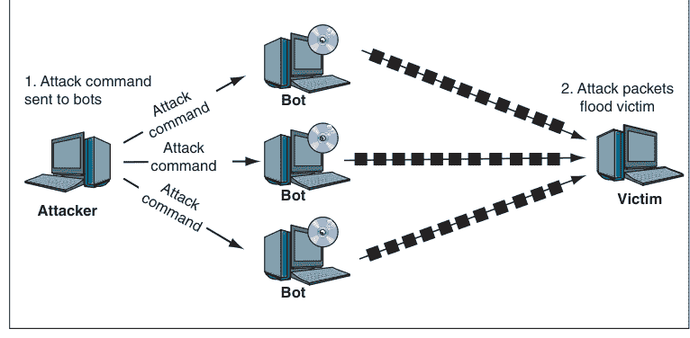

僵尸程序。僵尸程序随后开始用攻击数据包泛洪攻击消息中列出的服务器或网络。不久后，超载的服务器和网络无法为其合法用户提供服务。

要攻击服务器，例如，僵尸程序可能会用 TCP（传输控制协议）连接建立请求（TCP SYN 段）泛洪服务器。服务器在每次收到 SYN 段时都会预留一定量的容量。通过用 SYN 段泛洪计算机，攻击者可以导致服务器耗尽资源，从而崩溃或无法响应合法用户的进一步连接建立尝试。如果攻击流特别沉重，受害公司整个网络将无法通过互联网进行通信。

执行 DoS 攻击还有其他方法。第 4 章将介绍额外的 DoS 攻击方法和减轻其影响的方法。它还将介绍其他类型的网络攻击，例如 ARP（地址解析协议）中毒以及如何保护网络免受外部攻击。

## 测试你的理解

- 10. a. 什么是 DoS 攻击？
  b. 描述 DDoS 攻击。
  c. 详细描述 SYN 泛洪攻击。
  d. 为什么许多僵尸网络会随着时间推移拥有多个所有者？

## 技能等级

好莱坞电影经常把黑客描绘成能在几秒钟内攻破严密保护服务器的天才。事实上，技术高超的黑客通常需要数天甚至数月的不懈努力才能攻破一个防护良好的系统——如果他们成功的话。在此期间，他们会尝试许多不同的攻击。换句话说，技术高超的黑客的特点是技术专长高和顽强的坚持。

为了自动化其攻击的某些方面，黑客经常编写称为黑客脚本的程序。传统上，脚本一词指的是用简单语言编写的相当粗糙的程序。然而，今天的黑客脚本通常具有易于使用的图形用户界面，看起来像商业软件产品。

此外，自动化的黑客脚本和软件在互联网上随处可得。这些易于使用的黑客脚本创造了一种新型黑客——脚本小子。这是熟练黑客对使用这些现成脚本的相对不熟练黑客的贬义称呼。虽然单个脚本小子成功入侵计算机的可能性远低于熟练黑客，但脚本小子的数量远多于熟练黑客。这使得脚本小子作为一个群体极其危险。此外，大量的脚本小子攻击使得公司难以识别公司面临的少量高度危险的攻击，这些攻击来自技术非常熟练的攻击者，需要特别关注。

今天，有用于创建各种漏洞利用的工具。其中最重要的是 Metasploit Framework，它使人们能够轻松地将新的利用方法迅速转变为完整的攻击程序。Metasploit 既被攻击者用于发起攻击，也被安全专业人员用于测试其系统对特定漏洞利用的脆弱性。

## 测试你的理解

- 11. a. 熟练黑客的两个主要特征是什么？
  b. 为什么脚本小子很危险？（给出两个原因。）
  c. 为什么恶意软件和漏洞利用工具包会扩大脚本小子的危险？

## 1.6 犯罪时代

1.6 知道犯罪分子已成为当今的主要攻击者，描述他们进行的攻击类型，并讨论他们的合作方式。

### 职业罪犯的主导

在 2003 年左右之前，大多数外部攻击者是员工、前员工或只对名声和权力感感兴趣的传统外部攻击者。然而，今天大多数外部攻击者是职业罪犯，他们攻击是为了非法赚钱。他们具有传统的职业罪犯动机，他们的许多攻击策略都是传统犯罪的计算机改编。

> 今天，大多数外部攻击者都是职业罪犯。

与普遍看法相反，罪犯并不慢于利用新技术。1888 年，芝加哥警察局的约翰·邦菲尔德警长说：“众所周知，没有哪个阶层的人比罪犯阶级更迅速、更 readily 利用科学的最新成果。”在 1930 年代，约翰·迪林格和许多其他罪犯利用当时价格低廉的汽车抢劫银行，并在警察能够逮捕他们之前消失。车牌主要是为了帮助警察并减少移动罪犯的优势而引入的。

此外，罪犯不会对各种类型的犯罪做出强烈的区分。例如，在 2003 年，VeriSign 检查了攻击来源的 IP 地址。它发现用于黑客攻击的 IP 地址与用于欺诈的 IP 地址之间存在高度相关性。⁴⁴ 举另一个例子，警察在搜查用于身份盗窃的地点时发现了冰毒管道和其他材料，表明罪犯是冰毒吸食者，利用在线身份盗窃来支持他们的冰毒成瘾。他们窃取信息并将其出售给其他犯罪团伙。⁴⁵

### 网络犯罪

网络犯罪——在互联网上执行的犯罪——在很短的时间内已成为一个极其严重的问题。据美国财政部称，2005 年网络犯罪诉讼超过了非法毒品销售诉讼。⁴⁶ 2004 年，德国互联网犯罪仅占所有记录犯罪的 1.3%，但占犯罪造成的物质损失的 57%。⁴⁷

- **犯罪时代**
- 今天，大多数攻击者都是具有传统犯罪动机的职业罪犯
- 将传统犯罪攻击策略改编为 IT 攻击（欺诈等）
- 许多网络犯罪团伙是国际性的
  - 使起诉变得困难
  - 诱使一个国家的公民成为向另一个国家的攻击者转运欺诈性购买商品的中间人
- 网络罪犯使用黑市论坛
  - 信用卡号码和身份信息
  - 漏洞
  - 漏洞利用软件（通常带有更新合同）

- **欺诈、盗窃和勒索**
- **欺诈**
  - 在欺诈中，攻击者欺骗受害者做某事违背受害者的财务自身利益
  - 罪犯正在学习通过网络进行传统欺诈和新欺诈
  - 还有新型欺诈，例如点击欺诈
- **财务和知识产权盗窃**
  - 盗窃金钱或可出售给其他罪犯或竞争对手的知识产权
- **勒索**
  - 威胁发动 DoS 攻击或除非受害者向攻击者付款否则威胁泄露被盗信息
- **窃取客户和员工的敏感数据**
  - 卡类盗窃（信用卡号码盗窃）
  - 银行账户盗窃
  - 在线股票账户盗窃
  - 身份盗窃
    - 窃取足够的身份信息来代表受害者在大型交易中行事，例如购买汽车甚至房屋
- **企业身份盗窃**
  - 盗窃公司的身份

图 1-18 犯罪时代（学习图）

⁴⁴ Carolyn Duffy Marsan, "VeriSign Correlates Hacker, Fraud Activity," NetworkWorldFusion, 2003年11月19日. www.nwfusion.com/newsletters/isp/2003/1117isp2.html.

⁴⁵ Byron Acohido and Jon Schwartz, "'Meth Addicts' Other Habit: Online Theft," USA Today, 2005年12月15日. www.usatoday.com/tech/news/internetprivacy/2005-12-14-meth-online-theft_x.htm.

⁴⁶ Money.cnn.com, "Record Bad Year for Computer Security," 2005年12月29日. http://money.cnn.com/2005/12/29/technology/computer_security/index.htm.

⁴⁷ Associated Press, "Europe Council Looks to Fight Cybercrime: Group Pushes Ratification of International Treaty," 2004年9月15日.


2009年，FBI共收到336,655起与互联网相关犯罪的投诉，报告损失总额达5.597亿美元。[48] 网络犯罪不仅正在成为互联网安全的重要问题，它已经成为最主要的问题。

### 国际犯罪团伙

由于互联网的互联性，国界和护照变得无关紧要。因此，犯罪企业能够自由实施各种网络犯罪，而不必担心外国因他们在本国境内对受害者实施犯罪而起诉他们。即使最终提起诉讼，通常也只是因为检察官的足智多谋。

国际犯罪团伙面临的一个问题是，许多在线卖家不向美国以外的地址发货。为了解决这个问题，犯罪团伙利用美国的**转运商**。这些人在美国办公室接收货物，然后将其运往另一个国家的犯罪团伙。转运商每转运一件包裹可获得一笔费用。通常，转运商是通过互联网招募的，他们从未意识到自己正在帮助犯罪分子。类似地，国际犯罪团伙利用**钱骡**转移资金（钱骡可获得一小笔比例费用）。转运商和钱骡通常通过在线招聘网站招募。

### 高级持续性威胁

**高级持续性威胁（APT）** 是由大型、资金充足的组织（如政府）实施的老练且可能长期进行的计算机入侵。APT可以是进行网络战和网络间谍活动的一种手段。一个APT的例子是一个名为“APT37”或“Reaper”的组织，据称该组织是朝鲜支持的国家级黑客组织。2018年，FireEye的安全研究人员发布了一份详细报告，描述了APT37的工具、战术和程序。[49] 更具体地说，报告展示了APT37如何利用零日漏洞攻击韩国军方、政府和国防工业。随后，APT37将行动扩展到日本、越南和中东的战略性政治目标。如果你在军方或情报机构工作，你即使不参与，也肯定会关注APT。

### 黑市与市场专业化

传统犯罪分子总是合作行事。例如，销赃者以折扣价从窃贼手中购买赃物，然后在看似合法的销售点转售赃物，使商品来源不那么明显。

在国际上，存在许多买卖被盗消费者信息的**黑市网站**。信用卡号甚至有现行价格，价格取决于信用卡号经过验证的程度，例如，用每个卡号小额购买，确保该号码是“有效”的。

2015年，赛门铁克公司（www.symantec.com）报告了黑客论坛上的典型价格。带卡验证码的美国信用卡每张售价在0.10美元到20美元之间。被盗云账户的价格从5美元到8美元不等。向100万个经过验证的电子邮件地址发送垃圾邮件的价格为70至150美元。社交媒体上的1000个粉丝价格为1至12美元。

大多数黑市经营信用卡和身份信息。然而，也有针对恶意软件、僵尸网络和新发现漏洞的黑市。当分析师发现软件中的安全漏洞时，通常会通知软件公司，公司在发布补丁时会致谢该分析师。如今，公司纷纷推出**漏洞赏金**计划，奖励发现漏洞的研究人员。因此，越来越多的分析师花时间赚取赏金。这反过来使公司的软件更加安全，也使研究人员致富。

其他程序员编写漏洞利用软件并在黑市上出售。如今，在大多数情况下，漏洞利用软件出售时附带在线支持和免费更新的条款。购买后，付款甚至可能由第三方托管，直到买方测试了该漏洞利用软件。

在许多方面，网络犯罪正像许多传统市场一样走向成熟。起初，一站式公司通常主导新市场。后来，纵向和横向专业化出现。在网络犯罪中，一些犯罪分子寻找漏洞，另一些开发工具包，还有的专门从事分发和僵尸网络管理，另一些经营身份盗窃和信用卡号码市场，还有一些创建共享代码和库。随着时间推移，新的市场细分领域不断快速出现。

[48] 互联网犯罪投诉中心，“2009年互联网犯罪报告”，2010年10月4日。*www.ic3.gov/media/annualreports.aspx*。

[49] FireEye，“APT37（Reaper）：被忽视的朝鲜行动者”，*Fireeye.com*，2018年2月2日。*www2.fireeye.com/rs/848-DID-242/images/rpt_APT37.pdf*。

## 测试你的理解

- 12.
  - a. 当今最主要的攻击者类型是什么？
  - b. 与非计算机犯罪相比，如今的网络犯罪是否可忽略不计？
  - c. 为什么国际犯罪团伙难以提起诉讼？
  - d. 为什么国际犯罪团伙使用转运商？
  - e. 他们如何使用转运商？
  - f. 他们如何使用钱骡？

## 欺诈、盗窃与敲诈勒索

欺诈、盗窃和敲诈勒索是传统的犯罪攻击。如今，犯罪分子已经学会通过网络实施这些犯罪。

### 欺诈

犯罪分子试图以多种非法方式获取金钱。本章仅列举其中几种。这些犯罪攻击的许多特征之一是他们涉及欺诈。在**欺诈**中，攻击者欺骗受害者做出违背其财务利益的事情。例如，攻击者可能冒充一家真实的付款公司，欺诈一家公司向其提供设备。

> 在欺诈中，攻击者欺骗受害者做出违背其财务利益的事情。

欺诈并非新鲜事。在物理世界中，欺诈自人类产生以来就一直存在。网络犯罪分子只是在学习如何通过计算机网络实施经典欺诈手法。例如，大多数垃圾邮件都使用经典的欺诈方法，并具有经典的欺诈目的。

在其他情况下，犯罪分子正在创造新的针对网络的欺诈。例如，许多网站按点击次数从广告商那里获得报酬。网站访问者每次点击网站上的广告链接，广告商就会向原网站支付一小笔费用。在**点击欺诈**中，犯罪网站所有者创建一个程序来反复点击链接。每一次虚假点击都会从广告商那里骗取资金，而不会产生潜在客户。

### 金融与知识产权盗窃

正如职业犯罪分子长期以来入室行窃和抢劫银行一样，互联网上的职业犯罪分子也实施金融盗窃。

在其他情况下，职业犯罪分子窃取公司的知识产权，出售给其他犯罪分子或企业竞争对手。如前所述，知识产权（IP）包括专利等受正式保护的信息，以及商业秘密，后者是公司采取行动保护的敏感信息，如公司计划甚至价格表。

美国知识产权盗窃委员会最近的一份报告估计，知识产权盗窃每年使美国损失6000亿美元。报告指出，大部分盗窃是通过网络间谍活动进行的。[50]

### 针对企业的敲诈勒索

敲诈勒索是利用伤害威胁使受害者支付金钱以避免伤害。敲诈勒索长期以来一直是现实世界中犯罪攻击的主要手段。利用IT敲诈企业的一种方法是威胁攻击该企业，除非支付保护费。

有时，当犯罪分子窃取信息后，会通过威胁公布信息来敲诈企业，除非支付“封口费”。在许多情况下，黑客泄露被盗信息所产生的负面宣传可能比信息本身的财务成本更具破坏性。企业可能会失去客户，因为他们被视为不愿意或无法保护客户信息。

## 测试你的理解

- 13.
  - a. 什么是欺诈？请具体说明。
  - b. 什么是点击欺诈？
  - c. 犯罪分子如何进行在线敲诈勒索？

## 窃取客户和员工的敏感数据

犯罪分子往往寻找“软目标”，以很少的投入获得高收益。这通常意味着以个人而非企业为目标。我们将按严重程度递增的顺序考察一些针对个人的攻击。

### 信用卡盗刷

对个人最常见的犯罪攻击大概就是信用卡号码盗窃——这种做法被称为信用卡盗刷。如果盗刷者能获得信用卡号、持卡人姓名和三位数的卡验证码，他们就算“中了头彩”。一旦窃贼获得所需信息，就可以一直购物直到卡片失效。幸运的是，如果信用卡盗刷受害者及时报告信用卡号欺诈，根据美国法律，他们只需承担50美元的责任，而且大多数信用卡供应商甚至免除这一责任。

### 银行账户盗窃

然而，如果窃贼盗取了以受害者名义进行在线交易所需的身份验证信息，就可以掏空受害者的银行账户。银行账户盗窃比信用卡号盗窃更为严重。

### 身份盗窃

如果窃贼能窃取更多信息，他或她就可以进行身份盗窃，即冒充受害者达到足以进行大额金融交易的程度。这些交易可能包括以受害者名义申请大额贷款和进行大额购买。身份盗窃的受害者


身份盗窃的受害者可能遭受巨大损失，有些人甚至因身份盗贼的行为而被捕。51 身份盗窃远比信用卡号码被盗严重。

长期以来，犯罪分子在不使用计算机的情况下窃取消费者身份信息。例如，盗卡者传统上在零售店购物时记录信用卡号码。然而，借助计算机网络，窃贼已能窃取成百上千甚至数百万受害者的消费者身份信息。最常见的是，黑客侵入保护不善的企业计算机来窃取这些信息。此外，丢失或被盗的笔记本电脑和备份磁带也是消费者信息窃贼的金矿。而且，不诚实的内部人员也常常参与其中。

美国司法统计局在2019年报告称，在之前的12个月中，16岁及以上的人中有10%曾是身份盗窃的受害者。52 这一比例高于两年前的7%。身份盗窃事件造成的总损失估计每年达170亿美元。收入超过7.5万美元的高收入者遭遇身份盗窃的比例最高。信用卡和借记卡欺诈是最常见的，占报告事件的85%。虽然55%的事件在一天内得到解决，但其他事件则需要数月才能处理完毕。有些损失比其他损失严重得多。例如，身份盗贼将受害者的房屋产权转移给自己，然后出售房屋，这比单纯的信用卡被盗严重得多。

## 企业关联

信用卡盗刷、银行账户盗窃和身份盗窃不仅仅是消费者的问题，它们也是企业的问题。当公司报告其客户数据库被入侵，成千上万甚至数百万人的身份信息遭到泄露时，来自客户和投资者的强烈反对可能相当大。此外，公司还可能面临政府制裁。例如，在美国，联邦贸易委员会拥有广泛的权力，可以对未能妥善实施客户数据保护的公司处以罚款。该委员会还可以在问题发生后的十年或更长时间内，强制要求对公司处理私人信息的情况进行昂贵的独立审计。最后，重大泄露事件往往导致负责被入侵系统的职能经理被解雇。

## 企业身份盗窃

虽然身份盗窃最常发生在个人身上，但也可能发生在企业身上。通过在互联网上收集有关公司的信息，企业身份盗贼可以以受害公司的名义申请、获取和使用企业信用卡。他们还可以以受害公司的名义接受信用卡订单。他们甚至可以提交文件，更改受害公司的法定地址，并更改公司负责人的姓名。

## 理解测试

- 14. a. 什么是信用卡盗刷？
- b. 描述银行账户盗窃和在线股票账户盗窃。
- c. 区分信用卡被盗与身份盗窃。
- d. 为什么身份盗窃比信用卡号码被盗更严重？
- e. 犯罪分子通常如何获得信用卡盗窃和身份盗窃所需的信息？
- f. 如果公司允许其控制下的个人信息被盗，公司会受到怎样的伤害？
- g. 什么是企业身份盗窃？

51 遗憾的是，美国联邦贸易委员会发布了被广泛引用的身份盗窃数据，它对身份盗窃的定义非常宽泛，将简单的信用卡号码被盗也包括在内，而不仅仅指更严重的身份盗窃。52 美国司法部，《2016年身份盗窃受害者》，美国司法统计局，2019年1月。www.bjs.gov/index.cfm?ty=tp&tid=42。

## 1.7 竞争对手威胁

## 1.7 描述可能来自企业竞争对手的攻击类型。

企业竞争对手也可能成为攻击者。他们可以发动多种类型的攻击。我们将重点讨论针对机密性和可用性的攻击。

### 商业间谍活动

在**公开情报收集**中，竞争对手会查看公司的网站和其他公开信息，以寻找受害公司自己泄露的数据。竞争对手还可能查看员工的Facebook页面和其他公开信息。

很少有法庭案件来检验这类行为的合法性，但根据定义，只有公司做出合理努力保守商业秘密，法律才会保护这些商业秘密。请注意，并不需要付出巨大的努力——只需合理的努力即可，这种努力反映了资产的敏感性和行业中的安全实践。

> 只有公司做出合理的努力来保守秘密，商业秘密才受到法律保护。

企业攻击者的一个常见目标是*非法*窃取公司的商业秘密——这种做法称为**商业秘密间谍活动**。在最公然的形式中，竞争对手会截取受害公司的通信、入侵其服务器，或收买受害公司的员工窃取信息。或者，它可能雇佣你的前员工之一，并从前员工那里索取或接受你的商业秘密。

商业间谍活动不仅限于企业竞争对手。据报道，自冷战结束以来，许多国家情报机构已涉足商业间谍活动。国家反间谍与安全中心2018年关于网络空间外国经济间谍活动的报告称，政府经济间谍活动是“对美国繁荣、安全和竞争优势的重大威胁”。53 报告指出，俄罗斯、中国和伊朗是最有能力积极参与经济间谍活动的网络行为者。它们以美国公司为目标，寻找知识产权、技术、商业秘密和专有信息。更具体地说，它们的重点是以下行业：能源、生物技术、国防技术、先进制造、技术和电信。

- **商业间谍活动**
- 对机密性的攻击
- 公开情报收集
- 公司网站和公开文件
- 员工的Facebook页面等
- 商业秘密间谍活动
- 只有在公司对这些秘密提供了合理保护的情况下才可能被起诉
- 合理性反映了秘密的敏感性和行业安全实践
- 商业秘密窃取
- 通过截取、黑客攻击和其他传统网络犯罪进行窃取
- 收买员工
- 雇佣你的前员工并索取或接受商业秘密
- 国家情报机构从事商业间谍活动
- **拒绝服务攻击**
- 对可用性的攻击
- 罕见但可能造成毁灭性影响

图1-19 竞争对手威胁（学习图）

### 拒绝服务攻击

竞争对手还可以对你的公司发动各种其他类型的攻击，例如拒绝服务攻击。尽管这些针对可用性的攻击很少见，但它们可能对依赖在线活动收入的公司造成毁灭性影响。

## 理解测试

- 15. a. 区分公开情报收集与商业秘密间谍活动。
- b. 如果公司希望能够起诉窃取商业秘密的人或公司，它必须对其商业秘密采取什么措施？
- c. 这些保护措施必须有多强？
- d. 谁可能对公司进行间谍活动？

## 1.8 网络战争与网络恐怖主义

## 1.8 区分网络战争与网络恐怖主义。

犯罪攻击者对企业构成严重威胁。然而，网络恐怖分子的攻击可能造成远大于犯罪攻击的损害规模。这些攻击来自有组织的恐怖组织，甚至来自国家政府。这些攻击可能具有前所未有的规模，很少有企业安全计划能够应对。

### 网络战争

如今，国家间开战时使用枪支和炸弹。然而，它们也可以用计算机造成极端破坏。网络战争包括由国家政府发起的基于计算机的攻击。

> 网络战争包括由国家政府发起的基于计算机的攻击。

在现实军事敌对行动开始之前，交战方可以进行计算机间谍活动以了解对手的秘密。俄罗斯、中国和伊朗在网络战间谍活动中尤其活跃，对美国的信息基础设施构成最大威胁。54 在过去十年中，这些政府参与或资助了针对美国国务院、关键基础设施、金融系统和美国军事实验室的攻击。55

53 国家反间谍与安全中心，《网络空间中的外国经济间谍活动》，国家情报总监办公室，2018年7月24日。www.dni.gov/index.php/ncsc-newsroom。
54 理查德·克拉克和罗伯特·克纳克，《网络战争：国家安全的下一个威胁及应对之策》（纽约：Ecco出版社，2012年）。
55 丹尼尔·多布赖戈夫斯基，《网络战争会是什么样子？》，世界经济论坛，2018年4月25日。www.weforum.org/agenda/2018/04/what-would-a-cyberwar-look-like。


## 1.9 结论

本章考察了撰写本文时所处的威胁环境。我们讨论了组织面临的各种攻击类型以及这些攻击可能造成的高昂代价。然而，威胁环境正在迅速变化。每隔一两年，就会出现一种全新的攻击类型并爆炸式增长。安全专业人员必须不断重新评估威胁环境。

此外，每当受害者制定对策时，攻击者都会分析这些对策，并往往能找到绕过的办法。安全并不是处理编程错误；它面对的是能够不断适应企业防御措施的智能对手。

最后，攻击正变得越来越复杂和严重。在美国国家安全局，人们经常引用这样一句格言：“攻击只会变得更好，永远不会变得更糟。”57

我们本章开头首先介绍了一些重要的安全术语。我们首先讨论了三个安全目标：机密性、完整性和可用性。然后我们定义了术语“事件”（也称为入侵或破坏）。最后，我们定义了对策（也称为保护措施或控制）。控制措施通常分为预防性、检测性和纠正性。

随后我们讨论了数据泄露的影响。如今数据泄露的规模如此之大，以至于影响到每一个人。而且这些泄露的代价也高得惊人。本引言以一个重要的案例——塔吉特数据泄露事件——作为结尾，该案例说明了真实数据泄露的复杂性。

尽管许多人在想到IT安全时会设想攻击来自互联网，但许多安全专业人员认为，在职员工和前员工才是企业面临的最大威胁。IT安全专业人员可能是所有威胁中最大的威胁。员工参与的各类攻击行为包括花太多时间浏览网页、财务盗窃、破坏以及知识产权盗窃。

恶意软件是对各种有害软件的统称，包括病毒、蠕虫、勒索软件、混合威胁、移动代码和特洛伊木马。几乎每家公司每年都会遭遇多次恶意软件入侵。许多恶意软件攻击利用社会工程学，诱骗受害者做出违反安全策略的行为，例如打开包含恶意软件的电子邮件附件，因为电子邮件的主题行和正文使得打开附件看起来合理或诱人。

人们往往将攻击者想象成好莱坞电影中的黑客，几乎瞬间就能入侵计算机。事实上，黑客常常需要很长时间才能入侵计算机。他们首先会向网络发送探测数据包，以识别潜在的主机受害者和计算机上运行的应用程序。一旦黑客了解了网络，他或她就会利用漏洞利用程序来实现入侵。然后黑客就可以从容地造成损害。

黑客可以利用社会工程学来诱骗受害者。他们还可以实施拒绝服务（DoS）攻击来降低系统可用性。除了技艺高超的黑客之外，庞大的脚本小子群体也对企业构成严重威胁。

一个让许多人惊讶的事实是，传统上出于声誉和刺激感而行动的外部攻击者，在很大程度上已被职业罪犯、有组织的网络犯罪团伙和国家资助的高级持续性威胁（APT）所取代。这些犯罪分子利用IT技术从事传统犯罪活动，例如财务盗窃、知识产权盗窃、敲诈勒索、盗卡、银行账户盗窃、身份盗窃和间谍活动。犯罪分子经常构建和使用大型僵尸网络来执行攻击。

企业还面临许多其他新兴安全问题，包括员工盗窃和滥权、竞争对手和国家情报机构的间谍活动，以及网络战和网络恐怖主义的噩梦场景。此外，威胁环境正在迅速变化——总是朝着更复杂、更严重的攻击方向发展。

## 工作中的安全

### Equifax

我们都曾有过这样的体验：把手伸进口袋或包里想要拿出某样东西，却发现它不在那里，顿时心中一沉。这种感觉之后很快会涌上一阵肾上腺素飙升和疯狂的头脑风暴，我们拼命回忆最后一次看到或使用这个物品是什么时候。我们常常会翻找其他口袋或包包，沿原路返回，甚至联系可能捡到失物的朋友或家人。有时这些办法奏效；有时则不奏效，东西从此再也找不回来。

在许多情况下，丢失的物品是钱包。于是，我们会为丢失的现金而惋惜，并要面对联系金融机构注销借记卡和信用卡的烦恼。虽然令人不快，但一个人丢失钱包的整体影响相对较小。然而，想象一下，如果超过1.4亿人在同一时间经历类似的事情，那将是怎样的焦虑和沮丧。

### 入侵事件

晚间新闻的头条报道涉及大型企业的网络安全漏洞并不罕见。然而，2017年夏天一个令人震惊的头条是Equifax（艾贵法克斯）大规模数据泄露事件的曝光。Equifax是三大消费信用报告机构之一（另外两家是Experian和TransUnion）。此次泄露涉及极为敏感的个人身份信息（PII）被盗，包括1.43亿人的姓名、地址、出生日期和社会安全号码。58 后续报告显示，另有数百万人的数据也遭到泄露。

Equifax最终成为众矢之的，原因是此次泄露是通过利用Apache Struts中的漏洞实施的。Apache Struts是一个公开可用的开源软件，用于创建网站，而思科早在当年早些时候就已经指出该软件存在一个漏洞。59 尽管Equifax在很大程度上已经修复了该漏洞，但其部分系统仍然易受攻击，而这种脆弱性足以使其基础设施被入侵。60

Equifax泄露事件的性质尤其具有破坏性，因为它在一个数据宝库中为犯罪分子提供了进行大规模欺诈所需的一切，而之前许多泄露事件仅涉及电子邮件地址和密码，或姓名和信用卡号码。Equifax和安全专家建议受影响人群——其中包括美国人口中略少于一半的人——在这三家信用报告机构冻结自己的信用。（这意味着改变信用状态，使得未经个人直接授权“解冻”信用，就无法开立新账户。）

尽管有这些建议，仍有无数人的身份被盗，成为欺诈的受害者。例如，一名受害者收到一封邮件，内容涉及一个他从未真正开通过的信用卡账户，从而意识到出了问题。61 在调查这个流氓账户时，他发现自己的信息还被用来开立了15个不同的欺诈账户。其他受害者也有类似遭遇，欺诈活动影响到了从银行账户、汽车贷款到房屋抵押贷款和驾照等方方面面。62

### 雪上加霜

Equifax因这一事件而遭到强烈抵制。安全专家认为，鉴于Equifax所持有的PII极度敏感，本应采取更严格的安全控制措施。人们还质疑Equifax和其他存储PII的公司是否应该使用集中式数据存储方式，因为这种架构会成为黑客的巨大目标。消费者

（续）

58 AnnaMaria Andriotis、Michael Rapoport和Robert McMillan，《“我们已被入侵”：Equifax黑客事件内幕》，《华尔街日报》，2018年3月26日。www.wsj.com/articles/weve-been-breached-inside-the-equifax-hack-1505693318。
59 同上。
60 同上。
61 Anna Werner，《Equifax大规模数据泄露数月后，受害者仍在艰难恢复》，CBS新闻，2018年3月26日。www.cbsnews.com/news/equifax-data-breach-victims-struggling-to-recover。
62 同上。


## 讨论问题

1. 你或你认识的人是否曾成为任何形式的盗窃（无论是个人财产还是身份盗窃）的受害者？你或此人是如何回应的？采取了什么补救措施？此事件解决花了多长时间？
2. 你认为 Equifax 应该因此次泄露而受到怎样的处理？消费者是否有权/权利要求公司随时应要求删除其数据？政府是否应介入并成为消费者信用报告的清算中心，以提供更强大的安全保障？
3. 文章提到 Equifax 使用集中式结构存储数据，这使其成为黑客非常有吸引力的目标。你能想到使用集中式结构的其他公司/情境吗？鉴于 Equifax 的泄露，你认为应避免这种情况吗？
4. Equifax 员工犯了将与公司应对工作无关的网站 URL 发推的错误。如何验证一个网站是否合法？

他们因多种原因感到沮丧，包括欺诈风险以及他们对自己的 PII 毫无控制权（即信用机构收集每个人的数据，且没有选择“选择退出”让这些公司存储你的数据）。

Equifax 在处理泄露的方式上犯了多项失误，使情况更糟。例如，在报告泄露后不久，公司为人们检查数据是否被泄露创建了一个支持网站，但该网站在其企业域之外创建（即与主网站无关）。这使得网络罪犯可以通过创建各种具有相似 URL 的虚假网站来利用粗心的个人。为了说明这一点，一名网页开发者创建了一个假网站，随后被几名 Equifax 员工引用。令人难以置信的是，他们错误地多次将指向该欺诈网站的链接发推！63 有一份估计报告称，在支持网站创建后的一天内，网络钓鱼者就创建了近 200 个假网站。64

## 安全技术

### 钓鱼攻击

网络钓鱼诈骗被罪犯用来欺骗性地从用户那里提取机密信息。这些诈骗具有创造性、复杂性且组织良好。罪犯通常位于美国境外，使用被入侵的服务器托管一个假网站，该网站收集从用户那里获取的信息并自动传输。以下示例展示了典型的网络钓鱼诈骗是如何运作的。

### 诈骗

一次网络钓鱼诈骗于凌晨 1:09 发送给作者之一（Randy.Boyle@utah.edu），地点在犹他州盐湖城。“收件人”行显示为“info@helpdesk.org”，而不是作者的电子邮件地址。电子邮件中列出的发件人电子邮件地址来自肯塔基州斯科茨维尔的一名县医疗保健管理员。诈骗内容指出用户的邮箱已超出限制，需要登录并“验证”其配额。

此次网络钓鱼诈骗可能源自肯塔基州的电子邮件服务器，也可能没有。然而，很可能县医疗保健组织的电子邮件服务器已被入侵。对电子邮件的追踪显示它来自肯塔基州弗兰克福附近的一台电子邮件服务器。然而，电子邮件地址可能已被伪造，电子邮件可能来自完全不同的电子邮件服务器。在没有这些系统管理员提供更多信息的情况下，很难确定。

此次网络钓鱼诈骗本身运行在北达科他州杰姆敦一家制造墓碑的公司网站内。是的，墓碑。该 IP 地址关联的服务器开放了多个端口，包括 21（FTP）、53（DNS）、80（HTTP）、143（IMAP）、443（HTTPS）、587（Sendmail）和 3306（MySQL）。其中一些服务可能由墓碑公司合法使用，而其他服务可能由诈骗者启动。

被入侵的网站由佛罗里达州坦帕的一家托管公司托管。作者在收到网络钓鱼诈骗后 10 分钟内通过电子邮件联系了该托管公司的管理员。他们被告知其一台机器正在合法网站内托管非法网络钓鱼诈骗。他们从未回应，网络钓鱼诈骗保留了数小时（或更长时间）。

### 诈骗第二部分

一周后，相同的网络钓鱼诈骗再次发送。“收件人”行显示为“admin@helpdesk.org”。发件人的电子邮件地址实际上是美国西部一所大型大学临床外科（肿瘤学）教授的电子邮件地址。

电子邮件追踪显示电子邮件源自同一大学网络上的邮件服务器。新的诈骗网站被修改以包含字段 *Full Name*、*Email ID* 和 *Date Of Birth*。也许第一次诈骗非常有效，诈骗者决定索取更详细的信息。

From: Fitzpatrick, Donnie R (LHD-Allen Co) [DonnieR. Fitzpatrick@ky.gov]
To: info@helpdesk.org
Cc:
Subject: Your mailbox is over its size limit
您的邮箱已超出管理员设定的一个或多个大小限制。

您的邮箱大小为 102145 KB。
邮箱大小限制：
当您的邮箱达到 90000 KB 时，您将收到警告。
当您的邮箱达到 100000 KB 时，您将无法发送邮件。在您减小邮箱大小之前，您可能无法发送或接收新邮件。
为腾出更多空间，
立即增加
未能点击此链接并验证您的配额可能会导致您的邮箱中重要信息丢失/或导致其访问受限。
谢谢
帮助台

### 网络钓鱼诈骗中索取的信息

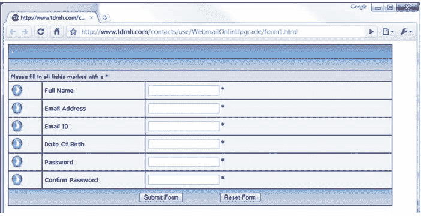

来源：©2018 Google LLC，经许可使用。

### 网络钓鱼诈骗中使用的主机位置

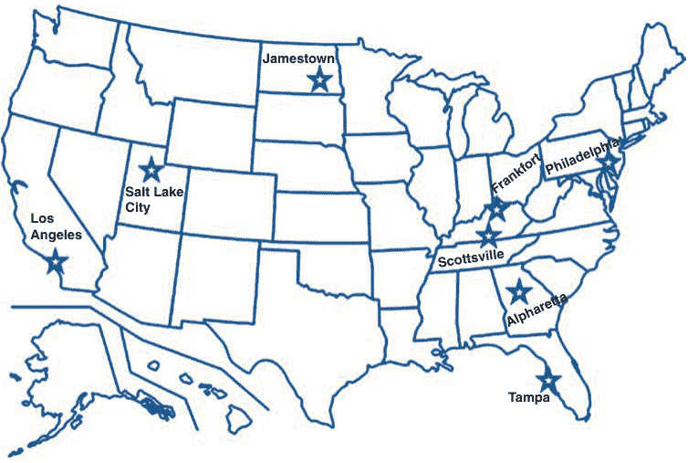

第二次尝试时，网络钓鱼诈骗是佐治亚州阿尔法利塔一家商业卡车公司被入侵网站的一部分。该网站由宾夕法尼亚州费城的一家托管公司托管。在收到网络钓鱼诈骗后 10 分钟内，向该托管公司的管理员发送了电子邮件。该托管公司的管理员几乎立即回应称他们已将该网站隔离。这是极好的回应。

网络钓鱼诈骗通常在多个州和国家使用 web 服务器、电子邮件服务器和被入侵的主机。网络钓鱼诈骗是一种盈利的犯罪企业，可能会在一段时间内继续存在。

用户可以采取以下几种措施来保护自己免受网络钓鱼诈骗。

- 不要点击来自你不认识的人的电子邮件中的链接。
- 如果你不是预期收件人，不要点击电子邮件中的链接。
- 确保电子邮件中的 URL 链接到合法站点。
- 确保电子邮件中的 URL 未被修改。
- 除非你已在等待附件，否则不要打开附件。
- 管理员不需要你的密码，所以不要把它交给他们。
- 立即将网络钓鱼诈骗报告给你的系统管理员。

## 安全伦理

### 爱情机器人的诱惑

几个世纪的哲学思考都探讨过“什么是正确行为？”的问题，我们在这里无法全部讨论。你将在商业伦理课上学到其中的很多内容。就我们的目的而言，我们将使用伦理哲学中的两个主要支柱。

### 定言令式

德国哲学家伊曼努尔·康德将定言令式定义为一个人应只以其希望该行为成为普遍法则的方式行事的原则。偷窃不是这种行为，因为如果每个人都偷窃，就不会有任何东西可以拥有。偷窃不能成为普遍法则。同样，撒谎也不能与定言令式一致，因为如果每个人都撒谎，语言就毫无用处。

当你问一个行为是否与这一原则一致时，一个好的试金石是“你愿意将你的行为公之于众吗？你愿意把它放在你的 Facebook 页面上吗？你愿意告诉所有相关人员你做了什么吗？”如果不愿意，你的行为在康德定言令式的意义上就不是合乎道德的。

康德将义务定义为按照定言令式行事的必要性。完全义务是必须始终履行的行为。不撒谎是完全义务。不完全义务是根据定言令式值得称赞但并非必需的行为。捐赠慈善是 不完全义务的例子。

康德以培养自己的才能为例说明不完全义务，我们可以用这个例子来定义职业责任。商业专业人士有不完全义务获得完成工作所需的技能。

我们也有不完全义务在整个职业生涯中继续发展我们的商业技能和能力。

### 功利主义

根据功利主义，行为的道德性由其结果决定。如果行为导致对最大多数人产生最大利益或最大化幸福并减少痛苦，则被认为是有道德的。以功利主义为指导，杀戮如果导致对最大多数人产生最大利益，则可以是有道德的。如果杀害阿道夫·希特勒阻止了大屠杀，那么它就是有道德的。

同样，功利主义可以评估撒谎或其他形式的欺骗，如果该行为导致对最大多数人产生最大利益，则为有道德。如果向你确定无法康复的绝症患者撒谎能增加其幸福感并减少其痛苦，则该撒谎是有道德的。

现在我们已经定义了定言令式和功利主义，我们将在案例研究和随后的章节中应用这些原则。

### 约会困境

加里·卢卡斯无法停止透过迷宫般的隔间望向办公室另一侧的会议室。他的老板理查德·马修斯正与加里从未见过的五个人进行一场看起来很激烈的讨论。即使没有参加会议或足够接近阅读人们的嘴唇，加里也知道会议的内容是什么。


他工作的公司 Why Wait, Date! 正在挣扎。不仅在线交友行业的竞争激烈，而且由于一个更棘手的问题，该公司的订阅量正在减少：最新的用户统计分析显示，总订阅用户中女性占15%，男性占85%。如果男性用户之间的竞争如此激烈，公司如何留住订阅用户？许多男性订阅用户即使尝试数月也无法找到匹配对象。对负责客户留存的 Gary 来说不幸的是，不满意的客户不会继续付费。尽管进行了营销活动并针对女性用户提供折扣订阅优惠，Gary 仍无法平衡这种不成比例的客户群体。他担心自己的工作岌岌可危。他的继任者可能正坐在他老板的那次会议上。

Gary 刚好回头望向会议室，看见 Richard 打开门并向他招手。Gary 匆忙走向会议室。当他坐在桌子末端时，Richard 对他微笑并说：“Gary，我认为这些顾问有一个能让这家公司起死回生的计划！” Gary 感到如释重负。听起来他的工作暂时安全了——但顾问们到底许下了什么样的奇迹，才让 Richard 对未来如此乐观？

## iMatch

Thomas，这位首席顾问，开始了拯救公司的推介。Richard 点头微笑，听 Thomas 解释他的想法。“在这个类型的网站上保持订阅用户的关键，” Thomas 解释道，“是让他们保持兴趣。我们需要在男性用户因沮丧而达到取消订阅的临界点之前，让他们在网站上获得某种积极的体验。我们的顾问团队基于你们所有的用户数据创建了一个模型，我们能够以很高的准确度预测男性用户何时正处于取消订阅的边缘。”

Gary 打断道：“你们可以访问我们所有的用户数据？”他用困扰的表情看着 Thomas，但 Thomas 示意他冷静下来继续听推介。Thomas 继续说：“现在我们能预测客户何时即将离开，我们就可以采取行动让他保持兴趣。我们知道客户何时需要一个潜在的‘match’才能继续为服务付费。我们所要做的就是从一个虚拟账户向他们发送一些消息，让他们以为有人对他们感兴趣。

“根据你想在我们的解决方案上投入多少，” Thomas 继续说，“我们甚至可以让这些虚拟账户进行持续数周或数月的复杂互动。数周或数月后，虚拟账户会表示它找到了别人。无需任何实际后续；客户只会以为没成功。最好的部分是，你不需要支付员工与客户互动——这一切都可以用我们的 AI 平台完成。这些长期互动会让客户继续付费，并夸大他们实际上会通过你的网站找到某人的希望！”

## Al-Jedi

会议结束后一小时，Gary 坐在办公桌前头脑发晕。他仍在试图接受会议室里发生的事情。他的老板指示他削减所有营销工作80%，并开始物色新人来负责创建虚拟账户。Richard 还与顾问签署了一份为期6个月的合同；他们将从第二天开始实施客户留存工具。

Gary 低头看着顾问在会议后给他的名片——他们都为一家叫 Al-Jedi 的公司工作。Gary 意识到 AI 代表“artificial intelligence”。他不敢相信他们竟然要实质上使用机器人来欺骗人们，让他们以为自己即将在这个网站上找到匹配对象。他突然感到脊背发凉…欺骗人们？他开始怀疑这是否会被视为欺诈甚至非法。如果有人发现他们在做什么？公司将被毁掉。Gary 靠在椅背上，盯着天花板，长叹一口气。他的一部分想去找 Richard 谈谈，告诉他这是个坏主意；另一部分则决定也许是时候开始润色他的简历了。

## Discussion Questions

- 1. 根据本专题中先前定义的伦理原则的定义：
  - a. 你认为根据绝对命令律，在约会网站上使用自动化机器人是合乎道德的吗？
  - b. 你认为根据功利主义观点，在约会网站上使用自动化机器人是合乎道德的吗？
- 2. 虽然这个场景看起来像是科幻电影中的情节，但自动化工具用于决策和客户互动的使用已十分普遍。头脑风暴一下现在可能正在使用自动化工具的其他公司或服务的例子。
- 3. 如果你处于这种情况下，你会离开公司吗？
- 4. 你认为 Gary 尝试与 Richard 谈论使用机器人的风险会有益吗？你认为人们会如何反应，如果传出公司正在使用这种技术来留住客户？

## Thought Questions

- 1. 攻击者侵入企业数据库并删除关键文件。这种攻击针对的是哪项安全目标？
- 2. 侦测性对策如何充当预防性对策？
  - a. 如果你偶然发现某人的密码并用它进入系统，这算黑客行为吗？解释。
  - b. 有人给你发送一个“game”。当你运行它时，它会将你登录到 IRS 服务器。这算黑客行为吗？解释。
  - c. 你会因此被起诉吗？
  - d. 你可以访问服务器上的主页。偶然间，你发现如果按某个键，你可以进入别人的文件。你花了几分钟浏览了一下。这算黑客行为吗？解释。
- 3. Addamark Technologies 发现其 Web 服务器未经授权被竞争对手 Arcsight 的一名员工访问。⁶⁵ Arcsight 的市场营销副总裁驳斥了这次黑客行为，说：“这只是一个要求用户名和密码的屏幕。该员工不觉得自己做了任何非法的事。”该副总裁继续说，该员工不会受到纪律处分。评论 Arcsight 副总裁的辩护。
- 4. 给出文本中未列出的三种社会工程学例子。
- 5. 你认为为什么 DDoS 攻击者使用僵尸来攻击受害者，而不是直接向受害者发送攻击数据包？提出两个原因。
- 6. 为什么使用黑客创建的脚本不会让你获得专家级黑客的经验？
- 7. 你认为支付勒索者的利弊是什么？
- 8. 竞争对手访问你的公共网站并发现他们可以进入你不知道可以到达的目录。在那里，他们找到一份客户名单并利用该名单为自己谋利。他们黑了你的 Web 服务器吗？你起诉他们窃取商业机密时可能会遇到什么问题？

## Hands-On Projects

### Project 1

Nmap® 是一款知名端口扫描器，已存在多年，可在多种操作系统上使用。它具有图形用户界面，使用友好。Nmap 可以告诉你机器运行的操作系统、有哪些服务可用，并可以提供网络的图形表示。Nmap 很长一段时间以来一直是 IT 安全专业人员的行业标准。

> ***警告***：请记住只扫描你自己的计算机或由你的讲师指定的机器。许多组织（公司、政府、大学等）都有入侵检测系统会注意到这些扫描。你稍后将设置蜜罐和 IDS，并用这些端口扫描器对其进行测试。

Note: 如果出现错误，你可以从 www.winpcap.org 获取最新版本的 WinPcap。安装 WinPcap 后 Nmap 应该能正常工作。你可能需要关闭 Nmap 才能正确安装 WinPcap。安装 WinPcap 后你需要重新启动 Nmap。

- 1. 从 https://nmap.org 下载 Nmap。
- 2. 点击标有 nmap-7.70-setup.exe 的下载链接。（很可能有更新版本可用。请下载最新版本。Mac 和 Linux 版本也在页面下方提供。如果不确定下载哪个版本，请咨询你的讲师。）
- 3. 点击保存。
- 4. 选择你的下载文件夹。
- 5. 浏览到你的下载文件夹。
- 6. 双击 nmap-7.70-setup.exe。
- 7. 点击运行，然后再次点击运行。
- 8. 点击我同意、下一步、安装，以及是（如果被要求替换 WinPcap）。
- 9. 点击下一步、关闭、下一步、下一步和完成。
- 10. 点击我同意、安装和关闭。
- 11. 双击桌面上的 Nmap-Zenmap® 图标。
- 12. 在目标文本框中输入你家庭网络中另一台计算机、同学的计算机（经许可）或由讲师指定的计算机的 IP 地址。本示例中使用的 IP 地址（10.0.1.11）属于作者在内部系统上使用的计算机。请勿扫描此 IP 地址。它是非路由的且不会返回正确


结果。如果你不确定要输入什么作为目标，请向你的指导老师询问一个 IP 地址。

- 13. 截图。
- 14. 在 Profile（配置文件）框中，选择 Regular Scan（常规扫描）。
- 15. 按下 Scan（扫描）按钮。
- 16. 扫描完成后截图。
- 17. 点击 Ports/Hosts（端口/主机）选项卡。
- 18. 截图。
- 19. 点击 Host Details（主机详细信息）选项卡。
- 20. 截图。
- 21. 与另一位同学/朋友交换 IP 地址，并扫描他或她的计算机。
- 22. 截图。

## 项目2

如果你刚开始接触 IT 安全领域，或者只是想要一个更易读（即技术性较低）的新闻源，你可能会想阅读 The Register®、eWeek.com® 或 Computerworld® 的安全版块。《The Register》的安全版块以易于阅读的格式，对一些比较重要的 IT 安全动态提供了很好的概要。

- 1. 打开网页浏览器，访问 www.theregister.co.uk/security/。
- 2. 点击一篇你感兴趣的文章。
- 3. 截图。
- 4. 在 Search（搜索）框中输入“DDoS”，然后按回车键。
- 5. 点击一篇你感兴趣的文章。
- 6. 截图。
- 7. 打开网页浏览器，访问 www.eweek.com/security。
- 8. 点击一篇你感兴趣的文章。
- 9. 截图。
- 10. 打开网页浏览器，访问 https://thehackernews.com。
- 11. 点击一篇你感兴趣的文章。
- 12. 截图。
- 13. 打开网页浏览器，访问 ThreatCloud 托管的动态威胁地图：https://threatmap.checkpoint.com/ThreatPortal/livemap.html。
- 14. 点击一个你感兴趣的国家。
- 15. 截图。

## 项目思考题

- 1. 一台计算机上有多少个端口？
- 2. 每个端口上运行哪些程序（服务）？
- 3. 黑客能否利用端口传播恶意软件？如何传播？
- 4. 如何关闭可能已经打开的端口？
- 5. 你的雇主给你多少时间来阅读与你工作相关的时事？
- 6. 阅读当前新闻文章对 IT 安全专业人员的日常工作有何帮助？

## 案例研究

### 网络犯罪的现状

2013年，网络犯罪分子入侵了阿联酋 RAKBANK 和阿曼马斯喀特银行（Bank of Muscat）的数据库。⁶⁶ 窃贼窃取了预付借记卡信息，并将其分发到一个由“提现者”组成的全球网络中，由他们将信息编码到伪造卡上。随后，该犯罪网络分发 PIN 码，在2天内通过从26个国家的3,000多台自动取款机（ATM）取款，盗走了4,500万美元。

美国司法部逮捕了该犯罪团伙在美国的八名成员中的七人。一名被告逃往多米尼加共和国，并在就如何分配不义之财发生争执后死亡。

以下是起诉书的部分内容：

这八名被起诉的被告及其同谋者以纽约市为目标，在数小时内提取了约280万美元。这些被告被分别指控犯有共谋实施访问设备欺诈罪、共谋洗钱罪和洗钱罪。八名被告中有七人已根据起诉书中的指控被捕：被捕的被告是 Jael Mejia Collado、Joan Luis Minier Lara、Evan Jose Peña、Jose Familia Reyes、Elvis Rafael Rodriguez、Emir Yasser Yeje 和 Chung Yu-Holguin，均为纽约州扬克斯市居民。⁶⁷

⁶⁶ John Leyden，“4500万美元银行网络大劫案：七名纽约人被捕”，《The Register》，2013年5月10日。www.theregister.co.uk/2013/05/10/atm_megaheist_arrests.

这个案例说明了网络犯罪与企业所受影响之间的直接联系。计算机安全研究所（CSI）的《计算机犯罪与安全调查》提供了影响各类组织的网络犯罪类型的全面视角。以下是其第15份年度报告的主要发现：⁶⁸

- 1. 恶意软件感染仍然是最常见的攻击类型，67.1%的受访者报告了此类攻击。
- 2. 受访者报告的金融欺诈事件明显少于前几年，只有8.7%的人表示在报告期内见过此类事件。
- 3. 在约半数去年至少经历过一次安全事件的受访者中，足足有45.6%的人报告称，自己至少遭受过一次定向攻击。
- 4. 愿意分享其所遭受损失具体金额的受访者比以往任何时候都少。鉴于这一结果，今年的报告没有公布受访者平均损失的具体金额数字。不过，平均损失似乎很可能比前几年有所下降。
- 5. 受访者表示，法规遵从工作对其安全计划产生了积极影响。
- 6. 总的来说，受访者并不认为恶意内部人员的活动是其因网络犯罪而遭受损失的主要原因。59.1%的人认为此类损失中没有一项是由恶意内部人员造成的。只有39.5%的人能够表示，其损失中没有一项是由非恶意内部人员的行为造成的。
- 7. 略超过一半（51.1%）的受访者表示，其组织不使用云计算。然而，10%的人表示，其组织不仅使用云计算，而且已经部署了云专用安全工具。

## 案例讨论问题

- 1. 本案例中提到的银行如何能够减轻或阻止这些盗窃行为？
- 2. 智能卡在哪些方面比磁条卡更安全？为什么？
- 3. 为什么这种分布式银行盗窃会比传统的强力银行抢劫速度更快、损失更大？
- 4. 网络犯罪活动是否正变得更具针对性？为什么？
- 5. 为什么组织不愿报告与网络犯罪相关的损失？
- 6. 为什么恶意内部人员会成为安全专家关注的焦点？

## 观点问题

- 1. 本章中让你最惊讶的事情是什么？
- 2. 本章中对你来说最困难的事情是什么？

# 第2章

# 规划与策略

## 学习目标

*学完本章后，你应该能够：*

- 1. **2.1** 论证正式管理流程的必要性。
- 2. **2.2** 描述合规性法律与法规。
- 3. **2.3** 描述组织安全问题。
- 4. **2.4** 描述风险分析。
- 5. **2.5** 描述技术安全基础设施。
- 6. **2.6** 解释策略驱动的实施。
- 7. **2.7** 了解治理框架。

## 章节大纲

- 1. 2.1 引言
- 2. 2.2 合规性法律与法规
- 3. 2.3 组织
- 4. 2.4 风险分析
- 5. 2.5 技术安全架构
- 6. 2.6 策略驱动的实施
- 7. 2.7 治理框架
- 8. 2.8 结论

## 2.1 引言

**2.1 论证正式管理流程的必要性。**

> 安全是一个过程，而不是一个产品。
>
> — 布鲁斯·施奈尔（Bruce Schneier）

### 防御

第1章概述了当今企业面临的威胁。该章以对未来的悲观展望结尾——威胁的数量将会增加，并且会变得更加危险。本书的其余部分描述了企业如何应对其资源所面临的威胁。

这不是一本关于如何攻击企业的书，它讲述的是防御。防御是 IT 安全专业人员的主要工作。保护公司及其资产可能是一个复杂的过程。在你掌握了防御的原则和实践之后，对攻击的详细了解将会对你有所帮助。但这本书是写给 IT 安全领域新手的。将重点过多地放在攻击上虽然令人兴奋，但会挤掉学生为实际工作——防御——做好准备所需的内容。

同样重要的是要记住，企业的首要目标是增加股东价值（即创造利润）。IT 安全应当强大且具有保护性，同时又透明且不引人注目。IT 安全的一个很好的比喻是防弹玻璃。如图2-1所示的防弹玻璃可以保护一个人

¹ Lance Hayden，“安全不仅仅是一个过程……它是一种能力”，CSO Online，2015年12月11日。https://www.csoonline.com/article/3013714/security-is-more-than-a-process-its-a-proficiency.html.


## 管理才是最困难的部分

人们倾向于关注技术的一个原因是，思考技术比思考管理更容易。技术是看得见摸得着的，关于安全技术我们能说的东西很多。此外，大多数技术概念都有明确的定义，因此易于讨论。

相比之下，管理是抽象的。你无法展示设备的图片，也无法用详细的图表或软件算法来表述。可以讨论的一般性原则较少，而且这些原则大多需要明确而复杂的流程才能付诸实践。

然而，安全管理远比安全技术重要。美国联邦总务管理局的一位官员曾谈到帮助一系列联邦机构重组其安全技术。在每一个案例中，这些机构在重组后立即获得了良好的安全性。然而，他们的安全性很快便衰退了。这些机构拥有技术，但缺乏让安全长期发挥作用的管理能力。

## 全面安全

这些机构的失败并不令人意外。一方面，攻击者只需找到一条入侵企业的途径即可。相比之下，图2-3表明，组织需要的是全面安全——封堵所有通向系统的攻击路径，让攻击者无门可入。全面安全并非偶然得来。

图2-3 全面安全的必要性（学习用图）

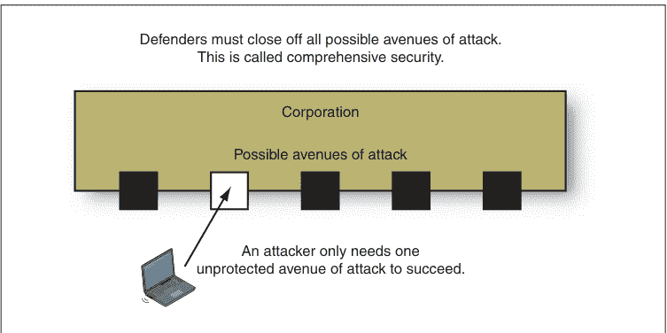

## 最薄弱环节失效

安全管理困难的另一个原因是，有些防护措施包含许多必须协同工作的组件，才能使该对策成功。图2-4给出了一个例子。在此例中，防火墙管理员制定过滤规则。防火墙随后检查所有通过它的数据包，丢弃可证实的攻击数据包，并将丢弃数据包的信息存储到日志文件中。防火墙管理员应每天检查日志文件。

如果此过程中的任何一个环节出现失误，防火墙就会变得毫无用处。如果遗漏了一条重要的过滤规则，可证实的攻击数据包就会通过。或者，如果管理员未能每天查看日志文件，问题可能会在数周或数月内不被察觉。

在单个对策内部的活动链条中，每个环节都必须做好。即使只有一步没有做好，安全可能看起来不错，但实际上并无真正的防护。如果系统中单个元素的失效会毁掉安全性，这就称为最薄弱环节失效。在许多情况下，人为因素正是安全防护中最薄弱的环节。

图2-4 最薄弱环节失效（学习用图）

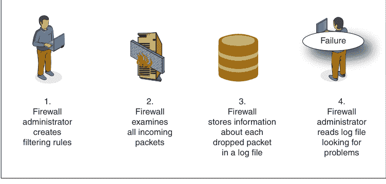

> 如果系统中单个元素的失效会毁掉安全性，这就是最薄弱环节失效。

### 需要保护众多资源

安全管理困难的第三个原因是，企业需要保护大量的资源。其中一些是相对明确界定的资产，如数据库和服务器。另一些则是广泛的组织流程，如财务报告和新产品开发。所有这一切都在快速变化之中。正如本章后面所讨论的，企业需要识别其所有资源，并为每一项资源制定安全计划。这是一项极其艰巨的任务。

### 检验你的理解

- 2.
  - a. 安全管理困难的原因有哪些？
  - b. 什么是全面安全？为什么需要全面安全？
  - c. 什么是最薄弱环节失效？

### 需要规范的安全管理流程

施奈尔在本章开头引文中使用“流程”一词尤为重要。安全过于复杂，无法以非正式的方式进行管理。企业必须制定并遵循正式的安全管理**流程**（有计划的系列行动）。其中一些流程可能包括年度安全规划流程、单项对策的规划与开发流程，以及事件处理流程。

> 流程是有计划的系列行动。

商业战略家们早已指出，质量改进是一个永无止境的过程，而非一次性的努力。一位橄榄球教练曾指出，招募球员就像刮胡子；你漏掉一天，就会看起来像个流浪汉。安全管理同样是一个永无止境的过程。

推动企业正规化其安全流程的一个外部因素是日益增多的合规法律法规。许多合规制度要求企业采用特定的正式治理框架来推动安全规划和运营管理。我们将在本章后面考察其中几个治理框架。

- **复杂性**
  - 无法以非正式方式管理
- **需要正式流程**
  - 安全管理中有计划的系列行动
  - 年度规划
  - 单项对策的规划与开发流程
- **是一个持续过程**
  - 稍有松懈便会失效
- **合规法规**
  - 进一步要求采用规范的安全管理流程

图2-5 安全管理是一个规范的过程（学习用图）

### 检验你的理解

- 3.
  - a. 为什么安全管理中必须要有流程？
  - b. 是什么促使企业采用正式的治理框架来指导其安全流程？

### 规划—防护—响应循环

如果安全流程必须进行全面管理，我们就需要一个正式的顶层安全管理流程。如今，大多数企业都采用一种称为“规划—防护—响应循环”的最高级别安全管理流程来防范威胁，如图2-6所示。

**规划** 该循环始于规划。没有出色的计划，就永远不可能有全面的安全。当然，一旦计划得以实施，其结果将反馈到规划之中。新的威胁和业务状况也会迫使企业重新回到规划。尽管图中显示的三个阶段似乎是一种清晰而有序的过程，但实际上这三项活动始终在同时进行，并不断相互输入。本章将详细讨论规划。在本书中，我们也会经常回到规划这一主题。

**防护** 防护是基于计划的对策创建与运行。安全专业人员的大部分日常工作都花在防护阶段，因此本书几乎全部内容都致力于对策的创建与运行也就不足为奇了。

- *第3章* 讨论加密防护，这些防护可单独使用，也可作为许多其他对策的组成部分。鉴于它们在其他控制措施中的广泛应用，我们将首先介绍这部分内容。在讲授这些章节之前，许多教师会先讲授模块A，该模块回顾网络概念。
- *第4章* 讨论如何保护有线和无线网络。
- *第5章* 讨论访问控制和物理安全。攻击者无法接触到你的资源，就无法对其造成损害。
- *第6章* 讨论一个特殊的访问控制家族——防火墙。虽然防火墙并非万能的防护子弹，但它们极其重要（而且有些复杂）。IT安全人员透彻理解防火墙至关重要。
- *第7章* 讨论主机加固。这一章将探讨如何保护主机操作系统。
- *第8章* 探讨应用安全。如今大多数黑客都是通过攻破应用程序来得逞的。如果攻击者攻破了某个应用程序，攻击者便继承了该应用程序的权限。在许多情况下，这些权限使攻击者能够完全控制计算机。
- *第9章* 探讨如何保护主机和服务器上的数据。数据必须经常进行清理、保护、验证和备份。数据是企业的命脉，必须加以保护。

对于每一类防护，我们都需要管理其系统开发生命周期（SDLC），该周期从最初的规划一直贯穿到实施。信息系统专业人员通常关注SDLC（见图2-7）。然而，对策的大部分生命期在于开发完成之后的运行阶段。如果只教安全专业的学生关注SDLC，就好比训练医生关注产前护理却从不教他们出生后的医疗保健一样。本书专注于在整个**系统生命周期**内管理控制措施，这意味着重点在于措施创建之后的持续管理。

**响应** 即便有了出色的规划和缜密的防护，某些攻击仍然会得逞。第10章讨论事件响应。响应是一个复杂的过程。

图2-6 安全管理的规划—防护—响应循环

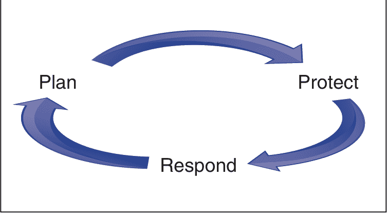


## 图 2-7 系统生命周期

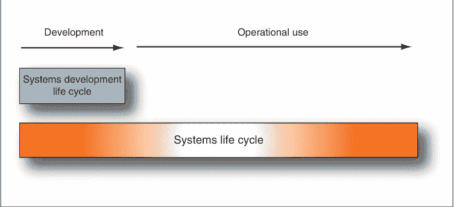

因为事件的严重程度各不相同（从简单的误报到完全的灾难），并且不同级别的攻击严重程度需要不同的响应方法。

**响应**是根据计划进行恢复——这一定义强调，如果响应没有提前仔细规划，将花费太长时间且效果仅部分有效。响应的速度和准确性至关重要，而实现两者的方式是在被入侵发生之前频繁演练事件响应计划。

> 响应是根据计划进行恢复。

## 测试你的理解

- 4.
  - a. 列出计划-保护-响应循环中的三个阶段。
  - b. 各阶段之间是否存在顺序流程？
  - c. 哪个阶段消耗的时间最多？
  - d. 本书如何定义保护？
  - e. 本书如何定义响应？

## 规划中的愿景

IT 安全对其在公司、员工以及外部世界中的角色的愿景驱动着其他一切。

### 将安全视为使能者

对于安全而言，愿景有两个基本要素。首先是需要将安全视为 *使能者* 而不是挫败感的来源。如果一家公司安全措施薄弱，许多创新对其而言都是关闭的，因为它们太危险。然而，如果一家公司安全措施强大，这将使其能够做很多事情。例如，安全强大的公司可以与其他公司参与组织间系统。这可以开拓新市场、带来更好的信息流，并降低运营成本。

> 我们的安全愿景必须将重点放在安全作为使能者而非预防者。

为举例说明，简单网络管理协议（SNMP）使组织能够从单一管理控制台管理数百或数千个远程网络设备。几乎所有公司都使用 SNMP Get 命令，该命令要求受管设备发送回有关设备状态和运行情况的某些数据。这在诊断问题时非常有用。反过来，SNMP Set 命令允许管理员远程重新配置设备，例如，通过指示交换机关闭某个端口或将端口置于测试模式。

这种远程重新配置可以节省大量网络管理人力成本，避免网络人员需要前往远程设备修复问题。它还减少了使系统恢复运行所需的时间。然而，由于攻击者可能冒充 SNMP 管理员并发送恶意 Set 命令以在网络中造成混乱的威胁，许多安全薄弱的公司会关闭 Set 命令。相比之下，管理良好的公司可以自信地使用 Set 并获得其好处。

使安全成为使能者的关键之一是在所有项目中尽早让安全参与。项目生命周期的早期，通常可以相对低成本地添加安全措施，而不会使最终系统变得不灵活。如果安全介入过晚，那么安全改造很可能代价高昂，并且可能降低系统可用性。此外，当然，如果由于不可接受的安全风险而无法开展项目，最好尽早而不是晚些时候发现这一点。

## 培养对用户的积极愿景

愿景的另一个关键方面是对用户持积极态度。一位愤世嫉俗的安全专业人员说，“有两种用户——那些因恶意而做坏事的人和那些因愚蠢而做坏事的人。”虽然可能同情这种观点，但将用户视为敌人是有腐蚀性的。

相反，我们应该将用户视为资源。例如，安全部门需要招募和培训用户成为公司安全防线的最前线。用户通常是第一个发现安全问题的人。如果他们感觉自己是安全团队的一部分，他们可以向安全人员提供早期警告。此外，用户需要接受安全自卫培训，以便他们能够保护自己的资产免受威胁。如果“愚蠢”意味着“训练不足”，那么这是安全部门的过错。

在航空旅行中，将乘客称为“牲畜”的空乘人员很可能会被解雇。安全部门应对以贬低方式称呼员工的安全专业人员采取同样措施。用户不应被告知他们的计算机出现 ID10.T（idiot）或 PEBKAC（Problem Exists Between Keyboard and Chair）错误。贬低用户可能导致敌意、疏离和生产率下降。

在培养对用户的积极愿景时出现的一个问题是谈论用户时经常使用警察或军事意象。这具有吸引力，因为它帮助安全专业人员思考警察或军队会如何处理涉及故意不当行为的特定情况。然而，警察²倾向于用有色眼镜看待嫌疑人，而士兵被教导憎恨敌人。最终，这些都不是有效看待 IT 安全角色的方式。

有其他方式来看待安全与员工的关系。例如，一个形象是安全如母亲。好母亲设定界限，花大量时间解释这些界限，更重要的是，帮助孩子成熟，以便他们在危险情况下保持安全。也可以将安全人员视为教师、个人教练和问题解决者。当一位非常成功的安保主管被问及安全最重要的三件事时，他说，“咨询，咨询，再咨询。”

### 愿景
你对自己相对于公司、员工和外部世界的角色的理解驱动着其他一切

### 安全作为使能者
安全通常被认为是一种预防手段
但安全也是一种使能者
如果一家公司安全良好，可以做否则不可能做的事情
与其他公司参与组织间系统
可以使用 SNMP Set 命令远程管理其系统
必须尽早介入项目以减少不便

### 对用户的积极愿景
必须不将用户视为恶意或愚蠢
愚蠢意味着训练不足，而这是安全的过错
必须对用户持负面看法零容忍

### 不应将安全视为警察或军事力量
造成对用户的负面看法
警察仅惩罚；不预防犯罪；安全必须预防攻击
军队可以使用致命武力；安全甚至不能惩罚（人力资源部门负责）

### 需要新愿景
母亲抚育缺乏经验的后代

### 除非用户愿意与你合作，否则无法有效
咨询，咨询，再咨询

图 2-8 愿景（学习图）

## 测试你的理解

- 5.
  - a. 良好的安全如何成为使能者？
  - b. 成为使能者的关键是什么？
  - c. 为什么对用户的负面看法不好？
  - d. 为什么将安全职能视为警察部队或军事组织是一个坏主意？

## 战略 IT 安全规划

战略 IT 安全规划着眼于大局。它首先评估公司的当前安全状况。然后考虑将推动变化的因素——包括日益复杂和猛烈的威胁环境、合规法律法规的增长、公司结构的变化、合并以及未来将改变条件的任何其他因素。

接下来，它必须制定一份由 IT 安全保护的所有资源的人口普查。这些可能是公司数据库、Web 服务器，甚至电子表格。除非你知道你拥有它，否则你无法保护某样东西。在列出所有资源后，你必须按敏感度对其进行分类。

² 对于安全专业人员将自己视为警察尤其无效。正如大多数警察会告诉你的那样，他们的工作是抓捕罪犯，而不是预防犯罪。相比之下，IT 安全专业人员的工作是预防攻击，抓捕攻击者是罕见的。


## 当前 IT 安全差距

## 驱动因素
- 威胁环境
- 合规法律和法规
- 企业结构变化，例如合并

## 资源
- 列举所有资源
- 按敏感度对每个资源进行评级

## 制定补救计划
- 为所有安全差距制定补救计划
- 为每个资源制定补救计划，除非它已得到充分保护

## 制定投资组合
- 你无法立即关闭所有差距
- 选择能提供最大回报的项目
- 实施这些

## 图 2-9 战略 IT 安全（学习图表）

一旦这项初步工作完成，你将识别出安全方面的许多差距。然后你必须为每个差距制定补救计划。特别是，除非它们已经得到充分保护，否则你需要为所有资源制定补救计划。

如果能立即关闭所有安全差距就好了。然而，你几乎肯定缺乏这样做的资源，即使你有资源，公司在任何给定时间也只能吸收这么多。投资者拥有投资组合，并评估这些投资的回报。他们谨慎投资以在一定风险水平下最大化回报。IT 安全也需要优先考虑其补救项目，重点关注那些能带来最大收益的项目。

## 测试你的理解
- 6. a. 在制定 IT 安全计划时，公司首先应该做什么？
- 6. b. 公司在未来必须考虑的主要驱动因素类别有哪些？
- 6. c. 公司对每个资源应该做什么？
- 6. d. 公司应该为什么制定补救计划？
- 6. e. IT 安全人员应如何将其可能的补救计划清单视为投资组合？

## 新闻动态

## 斯诺登

爱德华·斯诺登，前 NSA 员工，披露了美国政府运营的多个大规模监控计划的机密细节。斯诺登披露的信息包括对所有美国电话的电话元数据的大规模收集、PRISM 系统，该系统允许政府实时访问电子邮件、网络搜索和所有互联网流量，以及对外国官员的许多其他间谍活动。这些监视计划的披露引发了关于国家 IT 安全政策及其对隐私影响的广泛讨论。斯诺登目前居住在俄罗斯莫斯科，在那里他获得了政治庇护。详细描述这些事件的回忆录于 2019 年出版。^3

## 谷歌的隐藏麦克风

2019 年，当人们得知该公司在未经客户知情的情况下在其 Nest Secure 设备中集成了一个麦克风时，谷歌面临了隐私倡导者的强烈反弹。^4 该麦克风并未列在随设备提供的任何文件中。谷歌称麦克风的加入是“错误”，但隐私倡导者称这是科技巨头犯下的又一次严重失误。

## 边境保护

2019 年，名为 Perceptics 的公司发生数据泄露，丢失了 10 万人的旅客照片和车牌号码。^5 Perceptics 受美国海关和边境保护局（CBP）委托，在美国入境口岸提供监控。隐私倡导者认为，如果数据无法得到充分保护，就不应存储这些数据。由于 CBP 希望到 2020 年在所有美国机场强制进行面部扫描，这一论点变得更加相关。

## 禁用华为

2019 年，由于国家安全问题，特朗普总统实际上禁止美国公司使用中国硬件巨头华为制造的任何设备。^6 担忧与可能故意内置于华为硬件中的漏洞有关，这些漏洞可能被中国政府用于间谍活动或潜在的进攻性行动。随后，谷歌也禁止华为获得任何 Android 更新。这对华为来说尤其麻烦，因为 Android 是其移动设备的主要操作系统。中国和美国之间的贸易战似乎很可能继续影响两国经济及其各自的科技公司。

## HIPAA 时间

2019 年，谷歌和芝加哥大学因涉嫌违反《健康保险流通与责任法案》（HIPAA）要求而被起诉。芝加哥大学医学中心与谷歌分享了数十万份医疗记录，目的是利用预测分析改善医疗护理。然而，诉讼称，共享的数据包括日期和医生的笔记，谷歌可利用这些信息识别患者。它认为谷歌可以将收集的位置数据与共享的患者记录上的日期相关联，以识别个人患者。谷歌和芝加哥大学声称他们遵守了法律，诉讼毫无根据。

## GDPR 和英国航空

2019 年，英国航空因违反新的欧盟隐私法《通用数据保护条例》（GDPR）而被罚款 2.22 亿美元（1.83 亿英镑）。^7 2018 年，英国航空在一次数据泄露中丢失了 50 万名客户记录，其中包含信用卡和个人信息。GDPR 于 2016 年通过，于 2018 年 5 月 25 日生效，英国信息专员办公室（ICO）毫不犹豫地开出了罚款。英国航空正在上诉创纪录的罚款，认为没有证据证明被盗数据已被使用或其在存储客户数据方面存在过失。

## 2.2 合规法律和法规

## 2.2 描述合规法律和法规。

## 驱动因素

许多公司拥有相对良好的安全计划、保护措施和响应能力。然而，为了规划未来，即使是准备充分的公司也需要了解将要求它们改变其安全规划、保护和响应的驱动因素。

> 驱动因素是要求公司改变其安全规划、保护和响应的事物。

也许当今对公司最重要的驱动因素集合是合规法律和法规，它们为企业安全创造了要求。在许多情况下，公司必须大幅改善其安全状况以符合这些法律和法规。这在文档和身份管理方面尤其如此。这些改进可能非常昂贵。企业安全面临的另一个问题是合规法律和法规实在太多。

> 合规法律和法规创造了企业安全必须响应的要求。

## 测试你的理解
- 7. a. 什么是驱动因素？
- 7. b. 合规法律的作用是什么？
- 7. c. 为什么合规法律和法规对 IT 安全来说可能很昂贵？

## 萨班斯-奥克斯利法案

大约在 2000 年，发生了几起耗资数十亿美元并导致股市低迷的重大金融欺诈案。国会通过制定 2002 年《萨班斯-奥克斯利法案》作出回应。该法案自大萧条以来对财务报告要求产生了最大变化。

根据《萨班斯-奥克斯利法案》，公司必须报告其财务报告流程中是否存在任何重大控制缺陷。报告存在重大控制缺陷的公司很可能在其股价上遭受打击，并且这些公司的大多数首席财务官在几个月内就会离职。如果首席执行官（CEO）或首席财务官存在欺骗行为，他们可能会入狱。

在重大控制缺陷中，存在“重大缺陷，或重大缺陷的组合，导致年度或中期财务报表出现重大错报而未被防止或发现的可能性超过遥远的可能性”。避免重大控制缺陷是困难的。

根据《萨班斯-奥克斯利法案》，公司不得不详细审视其财务报告流程。在此过程中，他们发现了许多安全弱点，在许多情况下，他们意识到这些安全弱点延伸到了公司的其他部分。鉴于《萨班斯-奥克斯利法案》合规的重要性，大多数公司被迫加强其安全工作。

**合规法律和法规**
合规法律和法规为企业安全创造要求
文档要求很强
身份管理要求往往很强
合规可能很昂贵
合规法律和法规很多，且数量正在迅速增加
**2002 年《萨班斯-奥克斯利法案》**
2002 年发生大规模企业金融欺诈
该法案要求公司报告财务报告流程中的重大缺陷
重大缺陷是指重大缺陷或重大缺陷组合，导致年度或中期财务报表出现重大错报而未被防止或发现的可能性超过遥远的可能性
如果报告重大缺陷，股价会贬值，首席财务官可能会丢掉工作
**隐私保护法律**
通用数据保护条例（GDPR）
许多其他国家都有强大的商业数据隐私法
美国《格雷姆-里奇-布莱利法案》（GLBA）
美国《健康保险流通与责任法案》（HIPAA）适用于医疗保健组织的私人数据
**数据泄露通知法律**
加州 SB 1386
**联邦贸易委员会**
可以惩罚未能保护私人信息的公司
罚款和数年要求的外部审计
**行业认证**
适用于医院等
通常有经认可的安全要求
**PCI-DSS**
支付卡行业数据安全标准
适用于所有接受信用卡的公司
有 12 项总体要求，每项都有具体的子要求
**FISMA**
2002 年《联邦信息安全管理法》
适用于美国政府联邦机构使用或运营的所有信息系统
也适用于代表美国政府机构的任何承包商或其他组织
认证，然后是认可
持续监控
因侧重于文档而不是保护而受到批评


## 测试你的理解
- 8. a. 在萨班斯-奥克斯利法案中，重大控制缺陷是什么？
- b. 为什么萨班斯-奥克斯利法案对信息技术安全很重要？

## 隐私保护法律
还有其他多项法律影响了隐私要求以及私人信息保护要求。其中包括以下（但不限于）：
- **通用数据保护条例 (GDPR)** 是一项于2016年通过的欧盟隐私法，概述了旨在保护个人数据的法规。它规范了欧盟内部个人数据的收集、存储和传输。虽然 GDPR 是最重要的欧盟隐私规则，但与美国企业有业务往来的许多其他国家也在制定强有力的商业数据隐私法律。
- 美国 **格拉姆-里奇-布莱利法案 (GLBA)**，又称1999年《金融服务现代化法案》，要求对金融机构中的个人数据提供强有力保护。
- 美国1996年的 **健康保险流通与责任法案 (HIPAA)** 要求对医疗保健组织中的私人数据提供强有力保护。

这些法律迫使公司审视他们如何保护个人信息，包括这些信息存储在哪里以及如何控制对其的访问。在许多情况下，他们发现这些信息存储在许多地方，包括文字处理文档和电子表格中。他们还发现，访问控制和其他保护措施往往薄弱或根本不存在。

## 测试你的理解
- 9. a. 隐私保护法律迫使公司做了什么？
- b. 他们这样做时发现了什么？
- c. 哪些机构受格拉姆-里奇-布莱利法案约束？
- d. 哪些机构受 HIPAA 约束？

## 数据泄露通知法律
美国最早的数据泄露通知法律之一是加州2002年数据泄露通知法（SB 1386）。此后，所有美国州都通过了类似法律，要求公司在敏感个人身份信息（PII）被盗甚至丢失时通知受影响人员。阿拉巴马州是最后实施数据泄露通知法律的州，时间为2018年。⁸

然而，没有联邦法律要求公司提供数据泄露通知，而且各州通过的法律在要求上并不统一。鉴于围绕数据泄露的新州法律，公司一直在重新思考对中央系统和终端用户应用程序中数据的保护措施。

> ⁸ Fred Donovan, “阿拉巴马是美国最后一个颁布数据泄露通知法的州,” Health IT Security, 2018年4月4日. https://healthitsecurity.com/news/alabama-last-us-state-to-enact-data-breach-notification-law.

## 测试你的理解
- 10. a. 数据泄露通知法律要求什么？
- b. 为什么这导致公司更加关注安全？

## 联邦贸易委员会
在美国，联邦贸易委员会（FTC）有权起诉未能采取合理预防措施保护私人信息的公司。虽然 FTC 的权力有限，但 FTC 已对公司处以巨额罚款。它还有权要求公司多年每年由外部公司进行审计并对这些审计做出响应。

## 测试你的理解
- 11. a. 联邦贸易委员会在何时可以对公司采取行动？
- b. FTC 可以对未能采取合理预防措施保护私人信息的公司施加哪些财务负担？

## 行业认证
许多行业都有自己的会员认证标准。在许多情况下，公司必须证明达到一定的安全水平才能获得认证。医院行业就是一个显著的例子。

## 测试你的理解
- 12. 除了 HIPAA，医院在规划安全时还必须考虑哪些外部合规规则？

## PCI-DSS
我们已经看到萨班斯-奥克斯利法案对所有上市公司都很重要，而且 FTC 也有广泛的管辖权。此外，大多数公司接受信用卡支付。所有这样做的公司都必须遵守一套名为支付卡行业数据安全标准的要求，该标准几乎总是缩写为 PCI-DSS。这些标准是由主要信用卡公司组成的财团创建的。不幸的是，许多公司的 PCI-DSS 合规性滞后。

## 测试你的理解
- 13. PCI-DSS 影响哪些公司？

## FISMA
《联邦信息安全现代化法案》（FISMA）2014年颁布，旨在通过强制信息安全标准和年度审计来加强联邦政府及其附属方（如政府承包商）内的计算机和网络安全。FISMA 2014 取代了其前身2002年的《联邦信息安全管理法案》（FISMA）。

FISMA 要求所有由美国政府联邦机构使用或运营的信息系统，或由承包商或其他组织代表美国政府机构使用或运营的信息系统必须遵循一套流程。这些流程必须遵循《联邦信息处理标准》（FIPS）文件、美国国家标准与技术研究院（NIST）发布的特别出版物 SP-800 系列以及其他与联邦信息系统相关的立法相结合的规定。

FISMA 有两个阶段。第一阶段是由组织本身或外部方对系统进行认证。如果系统的风险类别高于某一阈值，则需要后者。

一旦系统获得认证，安全文档包将由认证官员审查。如果该官员对认证感到满意，他或她将通过签发运行授权（ATO）来认可该系统。

所有获得认可的系统都必须监控一组选定的安全控制措施的有效性，并且系统文档会更新以反映对系统的更改和修改。对系统安全状况的重大更改应触发更新的风险评估，并且经过重大修改的控制措施可能需要重新认证。

FISMA 因专注于文档而非实际保护而受到强烈批评。FISMA 的更新允许使用自动化测试、检测、报告和事件响应系统。

## 测试你的理解
- 14. a. 谁受 FISMA 约束？
- b. 在 FISMA 中区分认证和认可。
- c. 为什么 FISMA 受到批评？

## 2.3 组织
## 2.3 描述组织安全问题。
除非公司组织其安全人员、将其有效地置于组织结构中，并明确其与其他组织单位的关系，否则全面安全是不可能的。因此，规划必须从公司内安全职能的定位开始。

## 首席安全官
不同组织给其安全部门负责人不同的头衔。通常的头衔是首席安全官（CSO）。另一个是首席信息安全官（CISO）。本书将使用 CSO。

## 测试你的理解
- 15. a. 安全部门经理通常被称为什么？
- b. 这个人的另一个头衔是什么？

## 是否应将安全置于 IT 部门内？
企业管理安全的第一步是决定安全职能将在公司的组织结构图中处于何处。关于 CSO 及其安全部门应向谁汇报的问题没有万能答案。然而，一个常见问题是是否将安全部门置于公司 IT 单位内部或外部。

### 首席安全官 (CSO)
亦称首席信息安全官 (CISO)

### IT 安全的定位？
Within IT
- 兼容的技术技能
- CIO 将负责安全

Outside IT
- 提供独立性
- 难以对 IT 和 CIO 提出警告
- 这是最常被建议的选择

Hybrid
- 将规划、政策制定和审计置于 IT 外部
- 将防火墙维护等运营方面置于 IT 内部

### 高层管理支持
- 预算
- 冲突中的支持
- 以身作则

### 与其他部门的关系
Special relationships
- 伦理、合规和隐私官
- 人力资源（培训、招聘、解雇、制裁违规者）
- 法律部门
- 审计部门
  - IT 审计、内部审计、财务审计
  - 可能将安全审计置于其中之一之下
  - 这将使其独立于安全职能
- 设施（建筑物）管理
- 制服安保

All corporate departments
- 不能仅仅把政策抛给对方

Business partners
- 必须将 IT 企业系统连接起来
- 在这样做之前，必须尽职调查评估其安全状况

### 外包 IT 安全
- 仅电子邮件或网络服务
- 受管安全服务提供商（MSSPs）（图 2-12）
  - 甚至独立于 IT 安全
  - MSSPs 具有专业知识和基于实践的专业知识
  - 通常不控制政策和规划

**图 2-11** 组织问题（学习图）


### 在 IT 部门内部定位安全
将 IT 安全部门置于信息技术部门内部具有吸引力，因为安全和 IT 共享许多相同的技术技能。IT 部门以外的管理者可能无法充分理解技术问题以管理安全职能。

另一个好处是 IT 安全将向公司的首席信息官汇报。如果安全部门隶属于 CIO，那么 CIO 将对安全漏洞负责。CIO 很可能会支持安全部门创建安全 IT 基础设施的努力。这也将使 IT 部门实施安全变更变得更容易。

### 将安全置于 IT 之外
尽管将安全置于 IT 内部有若干好处，但它也有一个严重的负面后果：安全缺乏对 IT 的独立性。第 1 章指出，所有企业安全攻击中很大一部分来自 IT 员工本身——有时来自高级 IT 管理人员。如果安全部门向 CIO 汇报，它如何能对 CIO 的行为执行安全措施？举报你的上司违反企业安全规定很可能是一次“限制职业发展的举动”。

此外，虽然安全必须大量处理 IT，但 IT 安全远比 IT 更广泛。将 IT 安全置于 IT 之外可以更轻松地处理对安全成功至关重要的其他部门。

然而，当安全部门在 IT 之外时，必然会遇到让 IT 职能（包括 CIO）接受外部安全职能部门“建议”的困难。即使安全部门向高级主管汇报，也可能难以在 IT 部门内动员对安全的支持，特别是如果 IT 的汇报线经过不同的高级主管。

将 IT 安全作为 IT 之外的职能部门的根本问题在于，分隔会降低问责制。职能部门只能提出建议。除公司最高管理层外——他们已有广泛的关注点——没有线部门的任何个人对企业安全负责。借用哈里·杜鲁门经典言论的变体，“责任到此为止无处可归”。

尽管将安全置于 IT 之外会产生问题，但大多数分析师仍建议这样做。与 IT 独立的需求太重要了，以至于不考虑将安全置于 IT 内部。

### 混合解决方案
一些公司试图在 IT 与 IT 安全的紧密关系与独立需求之间取得平衡。他们通过将 IT 的运营方面（如维护防火墙）置于 IT 内部，同时将规划、政策制定和审计职能置于 IT 之外来实现这一点。

## 测试你的理解
16.
a. 将安全置于 IT 内部的优势是什么？
b. 将安全置于 IT 内部的劣势是什么？
c. 大多数 IT 安全分析师对将 IT 安全置于 IT 内部或不置于内部有何建议？
d. 在将 IT 安全置于 IT 内部或外部的混合解决方案中，安全角色是如何分配的？

## 高层管理支持
很少有公司让 CSO 直接向公司 CEO 汇报。然而，高层管理支持对任何安全计划的成功至关重要。除非高层管理给予坚定且持续的支持，否则像 IT 安全这样无处不在的努力很少能成功。高层管理支持的证明体现在后续行动中。

- 如果高层管理不确保安全拥有充足的预算，任何政策声明都只是口头应付。
- 当安全需求与其他业务职能的需求发生冲突时，高层管理必须支持安全——例如，如果一个安全性不足的新系统被仓促上线。
- 微妙但重要，高层管理人员必须自己遵守安全程序，例如在他们在家工作并远程访问公司资源时。高级管理层所做的一切在象征意义上都很重要。

## 测试你的理解
17. a. 为什么高层管理支持很重要？
b. 高层管理必须做哪三件事来证明支持？

## 与其他部门的关系
要取得成功，IT 安全部门必须与其他部门建立富有成效的关系。

### 特殊关系
公司中有几个组织单位对 IT 安全部门特别重要。

### 道德、合规与隐私官
除了 CSO 外，大多数公司都有道德、合规和隐私总监。如果这些职位不在 IT 安全部门内，那么协调显然是必不可少的。许多公司确实将道德、合规、隐私和安全合并为一个统一部门。如果这样做，则要求部门经理了解所有领域。

### 人力资源部门
人力资源部门与安全部门有着丰富而复杂的关系。人力资源部门负责培训，包括安全培训。此外，人力资源部门负责招聘和解雇员工的关键流程。IT 安全必须与人力资源在招聘和解雇程序上合作，以确保安全问题得到考虑。人力资源始终参与制裁当员工违反安全规则时。

### 法律部门
为确保安全政策在法律上站得住脚，安全部门必须与法律部门协调。法律部门在发生重大安全事件时也会介入。

### 审计部门
大多数公司已有三个审计部门。内部审计部门检查组织单位的效率、有效性和充分控制。财务审计对财务流程做同样的检查。IT 审计部门检查涉及信息技术的流程的效率、有效性和控制。一些公司将 IT 安全审计（但不是安全本身）置于这些部门之一之下，以增加安全审计的独立性。这使得 IT 安全审计在必要时可以对 IT 安全部门甚至 CSO 提出警告。

### 设施管理
运营和维护建筑物是设施管理的职责。对于安全摄像头、建筑物出入口控制和类似事项，安全部门必须与设施管理密切合作。

## 制服保安
公司的制服保安人员当然会执行关于建筑物出入的政策。制服保安人员也需要没收 IT 安全认为涉及金融犯罪或滥用的计算机。在另一个方向上，IT 安全可以帮助制服保安进行监控摄像头以及可能被用于犯罪的设备的取证分析。

## 所有公司部门
除了这些特殊关系外，安全部门需要与其他所有业务职能保持良好关系。IT 安全不能仅仅“把政策抛过墙”就期望它们被遵守。

IT 安全几乎总是被其他部门不信任，因为安全有可能使生活更困难。尽管 IT 安全人员不能总是与其他部门的人员成为朋友，但安全专业人员确实必须学会说其他部门的语言并理解他们的情况。安全应将政策与财务效益分析和现实的业务影响声明相伴随。理解 IT 安全可能如何影响公司及其目标比卓越的技术专长更重要。

## 业务合作伙伴
防火墙和其他一些安全控制的规划往往假设公司与外部世界之间存在边界。然而，近年来最大的趋势之一是公司与其业务合作伙伴之间密切但谨慎的整合，包括买方组织、客户组织、服务组织甚至竞争对手。

为了密切合作，通常需要外部公司访问内部系统。这意味着在防火墙上打洞、在内部主机上授予访问权限以及采取其他可能有风险的行动。公司在与外部公司合作之前必须尽职调查，这意味着他们应在开始合作前仔细调查这些合作伙伴关系的 IT 安全影响。

## 测试你的理解
18.
a. 人力资源部门对 IT 安全为何重要？
b. 区分公司审计单位的三种主要类型。
c. 将 IT 安全审计置于这三个审计部门之一的优势是什么？
d. IT 安全与公司制服保安人员可以建立什么关系？
e. 安全人员可以做些什么来更好地与其他部门相处？
f. 什么是业务合作伙伴？
g. 为什么他们危险？
h. 什么是尽职调查？

## 外包 IT 安全
一个选择是外包部分或全部 IT 安全。完全外包很少见，因为公司担心失去对安全的控制。然而，IT 安全的部分外包很常见。

## 电子邮件外包
最常见的 IT 安全外包是针对电子邮件的。来自互联网和通往互联网的电子邮件连接都通过外包商路由。（在某些情况下，互联网或电子邮件外包商会将其设备放置在客户现场但远程控制设备。）


外包商提供入站和出站过滤。这种过滤包括诸如附件中的垃圾邮件和恶意软件，以及电子邮件正文中的脚本等。

外包电子邮件过滤很有吸引力，因为过滤正在成为一个高度专业化的领域，依赖于对新威胁的快速响应。新的恶意软件不断出现。危险电子邮件来源的列表每小时甚至更频繁地更新。

## 托管安全服务提供商

另一种外包选择是甚至将更多控制权委托给外部公司，称为托管安全服务提供商（MSSP）。如图2-12所示，MSSP监视您的公司。它在您的网络上放置一个中央日志服务器。该服务器将公司的事件日志数据上传到MSSP站点。在那里，扫描程序和安全专家检查日志数据，按严重程度对事件进行分类，并排除误报。

如果MSSP尽职尽责，它每天会检查数百个可疑事件。它会迅速将大多数事件识别为明显的误报。还有一些事件会被归类为威胁，但属于无关紧要的威胁，例如轻微的扫描攻击。在典型的一天中，根据潜在严重程度，可能只有一两个看似严重的威胁会通过寻呼机或电子邮件警报引起客户的注意。通过将大量可疑事件提炼为每天需要客户处理的少数重要事件，MSSP可以将安全人员解放出来处理其他事务。

公司为什么要使用MSSP？正如布鲁斯·施奈尔多次所说，外包安全的原因与公司将消防“外包”给政府的原因相同。公司内部的消防部门几乎一直处于闲置状态。这使得每次灭火的成本极其高昂。更糟糕的是，当这个内部消防力量被调用时，它会缺乏经验，因为它没有市政消防员所拥有的日常灭火经验。

使用MSSP的另一个优势是独立性。如果MSSP员工注意到客户公司的CIO或CSO做了似乎违反客户公司政策的事情，MSSP将通知公司中更高级别的官员。MSSP可以对IT人员甚至IT安全人员起到监督作用，这些人被认为是以公司的最佳利益为行事准则。图2-12显示MSSP还可以进行漏洞测试。

**图2-12 托管安全服务提供商（MSSP）**

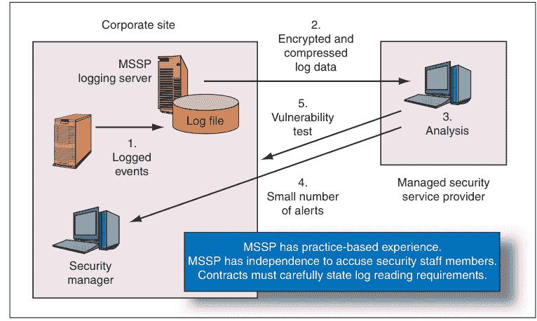

通常，公司不会将所有控制权外包给MSSP。政策和规划过于关键，不能外包给MSSP，尽管MSSP必须充分了解公司制定的政策和程序。

虽然MSSP可能提供很大帮助，但它们有时也做得不好。如果合同规定MSSP将查看日志但没有更具体的要求，那么外包公司可能只是每隔一周左右粗略地扫描日志文件。有一家公司报告说，在服务的前六个月中，MSSP没有向其发送过任何警报。该公司认为这表明外包公司完全疏忽。

### 测试你的理解

19. a. 什么是MSSP？
    b. 使用MSSP的两个主要好处是什么？
    c. 为什么MSSP可能比IT安全部门员工做得更好？
    d. 通常外包哪些安全功能？
    e. 通常不外包哪些安全功能？
    f. 公司在选择MSSP时应该关注什么？

## 2.4 风险分析

**2.4 描述风险分析。**

IT安全规划始终关注风险。大多数人认为IT安全专业人员试图消除风险。然而，在商业中，完全消除风险永远不可能。目标是管理风险。这种观点甚至在“信息保障”一词中得到了体现，即管理与处理、存储和使用信息的信息系统相关的风险。这需要一种称为风险分析的思考风险的方式。

风险分析将可能的损失与安全防护的成本进行比较。花一百万美元保护一台价值2000美元且不含敏感信息的笔记本电脑是没有意义的。当然，这个例子过于简单。在现实生活中，比较成本和收益当然要复杂得多。

> 风险分析将可能的损失与安全防护的成本进行比较。

### 合理风险

“信息保障”这个术语有点误导性，它暗示公司可以保证其信息的机密性、完整性和可用性。这是无稽之谈。毕竟，抢劫自古以来就存在，也没有哪个社会根除了它。绝对的信息安全保护同样是不可行的。相反，公司必须基于风险分析思维来考虑合理风险。

虽然安全可以降低攻击风险，但安全也有负面影响。最明显的是，安全往往会妨碍功能性。生活在高安全环境中可能令人不快，而且通常效率低下。如果你住在一个安静而安全的社区，在窗户上安装铁栅栏会给你一种不愉快的封闭感。要求你每次进家门都记住一个长密码，会减慢你每次进入房子的速度。

**现实**
- 永远无法消除风险
- “信息保障”是不可能的

**风险分析**
- 目标是合理风险
- 风险分析权衡破坏的可能成本与对策的成本
- 此外，安全有必须权衡的负面影响

**图2-13 风险分析（学习图）**

除了这些心理和生产力成本之外，安全从来不是免费的，也很少是便宜的。安全设备很昂贵，实施和操作这些设备的人工成本可能更高。

### 测试你的理解

20. a. 为什么说“信息保障”作为IT安全的名称并不恰当？
    b. 为什么合理风险是IT安全的目标？
    c. IT安全有哪些负面后果？

### 经典风险分析计算

一些IT安全认证考试测试一个简单过程：（1）计算可能损失，（2）计算对策将如何改变损失的可能性，以及（3）决定这些对策是否产生超过其成本的收益。我们称之为经典风险分析计算。如图2-14所示。

**资产价值** 第一行给出要保护的资产的价值。在图2-14中，资产价值为100,000美元。

**暴露因子** 暴露因子是发生破坏时资产价值损失的百分比。在图中，暴露因子为80%。这意味着在安全受损时，资产价值的80%将损失。

**单一损失期望** 单一损失期望是单次破坏中承受的损失金额。单一损失期望等于资产价值乘以暴露因子。在图中，这是80,000美元（100,000美元乘以80%）。

**年化发生概率（或比率）** 现在我们知道单次破坏会造成多少损失，下一个问题是破坏发生的频率。这通常按年度计算。在图2-14中，年化发生概率为50%。这意味着在此示例中，预计攻击大约每两年成功一次。

**年化损失期望** 年化发生概率乘以单一损失期望得到年化损失期望——即该资产每年因这类安全受损而损失的年度平均预期值。在图中，ALE为40,000美元（80,000美元乘以50%）。

|  | 基准情况 | 对策A | 对策B |
|---|---|---|---|
| 资产价值（AV） | $100,000 | $100,000 | $100,000 |
| 暴露因子（EF） | 80% | 20% | 80% |
| 单一损失期望（SLE）= AV*EF | $80,000 | $20,000 | $80,000 |
| 年化发生概率（ARO） | 50% | 50% | 25% |
| 年化损失期望（ALE）= SLE*ARO | $40,000 | $10,000 | $20,000 |
| 对策带来的ALE降低 | 不适用 | $30,000 | $20,000 |
| 年化对策成本 | 不适用 | $17,000 | $4,000 |
| 年化对策净价值 | 不适用 | $13,000 | $16,000 |

**图2-14 经典风险分析计算**

### 对策影响

下一步是评估对策的收益。在图2-14中，对策A将单一损失期望降低75%——从基准情况的80,000美元降至采用对策后的20,000美元。这将使年化损失期望从40,000美元降至10,000美元。这将节省30,000美元。

对策B有不同的效果。它将年化发生概率从每两年一次降低到每四年一次。该对策将使ALE从40,000美元降至20,000美元。这节省了20,000美元。

### 年化对策成本与净价值

到目前为止，对策A看起来比对策B更好，每年额外节省10,000美元。然而，对策从来不是免费的。图2-14显示，考虑对策的成本很重要。为了将此成本与年化对策价值进行比较，成本必须是年化对策成本。

要计算年化对策成本，重要的是同时考虑购买成本和运营成本。图2-14显示，虽然对策A每年节省30,000美元，但它每年花费17,000美元。因此，年化对策净价值仅为每年13,000美元。

对策B仅产生每年20,000美元的收益，但它很便宜，每年只需花费4,000美元。因此，对策B的年化对策净价值为每年16,000美元。

总体而言，虽然对策B在降低年化损失期望方面不如对策A，但对策B的较低成本使其成为更优选择。

考虑所有对策成本很重要，包括安全领域之外的成本。如果某个对策降低系统功能到严重影响用户生产力的程度，则此成本需要作为总对策成本的一部分来考虑。

### 测试你的理解

21. a. 为什么在风险分析计算中要将成本和收益年化？
    b. 如何计算ALE？

22. 一项资产价值为1,000,000美元。在一次攻击中，预计将损失其价值的60%。


对策 X 将使损失减少三分之二。对策 Y 将使损失减少一半。两种对策每年均需花费 20,000 美元。攻击很可能每 10 年成功一次。两种对策均可将发生率降低一半。请对这些对策进行分析并给出建议。

## 经典风险分析计算的问题

虽然经典风险分析计算被广泛教授，但在实践中却难以或不可能使用。

## 多年现金流不均

经典风险分析的一个问题是它假设对策的收益和成本每年都相同。实际上，对策成本往往在第一年最高，之后会降至较低水平。相反，随着对策变得更加熟悉，因而更有可能被更有效地使用，收益往往会随时间增加。之后，随着对策老化，成本可能会上升，收益可能会下降。

当多年间存在不均衡的现金流时，决策者会转向折现现金流分析，也称为投资回报率（ROI）分析。这需要计算净现值（NPV）或内部收益率（IRR）。

## 事件总成本

经典风险分析的一个严重但易于解决的问题是其对损害的衡量——资产价值的损失。这很荒谬，因为损害可能以多种方式发生。例如，如果客户信息被窃取用于身份盗窃，资产的价值根本不会减少。然而，泄露的成本可能巨大。

在不严重扰乱经典风险分析计算的情况下解决此问题的简单方法是，用事件总成本（TCI）值取代单一损失期望值计算，该值可估算出妥协的完整成本，包括维修费用、诉讼费用以及许多其他因素。

## 对策与资源之间多对多的关系

更困难的问题是经典方法假设对策与资源之间是一对一的关系。这种情况很少见。例如，边界防火墙可保护其后面的所有服务器和客户端。换句话说，单一对策可以保护许多资产，而单一资产可以由许多不同的对策保护。在这种情况下，简单的经典计算完全失效。

## 计算年发生率的不可能性

经典风险分析最糟糕的问题是，很少可能估计威胁的年发生率。规划者可以在哪里找到此类概率？简单事实是，甚至没有关于各种类型攻击频率的良好信息的平庸来源，更不用说此类攻击成功的百分比了。简而言之，不可能精确计算年发生概率，因此不可能将对策成本与其收益进行比较。

> 没有攻击可能性数据的来源，因此不可能计算年化损失期望值。

一种替代方法是进行更粗略的损害分析。例如，可能使用关键、重大或轻微等宽泛类别对资源面临的危险进行分类。这将使公司能够优先考虑风险并专注于最高优先级的风险。然后安全人员可以为这些主要风险规划对策。

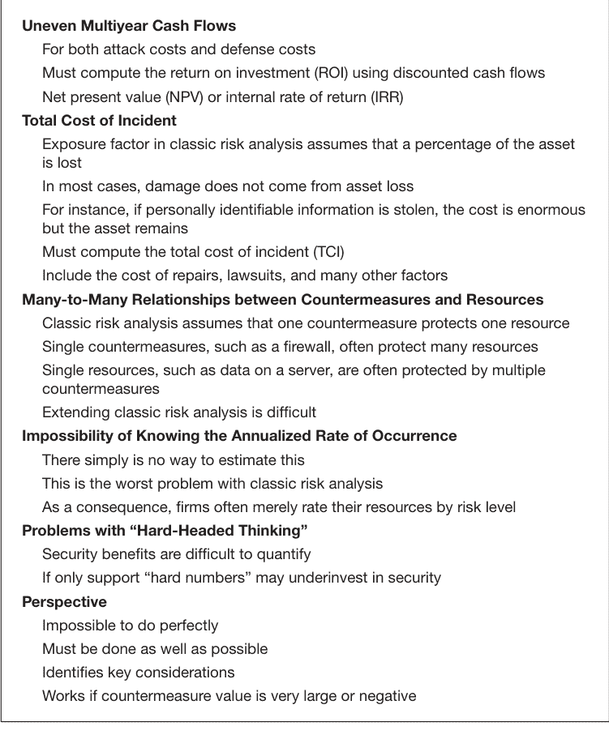

**图 2-15**  经典风险分析计算的问题（研读图）

## “固执己见思维”的问题

虽然硬性数字令人安心且在可能的情况下应使用，但运筹学研究人员也警告说“数字排挤思考”。不易量化的关键考虑因素可能会被忽略或严重淡化。

例如，业务经理在考虑内部项目的资金时，有时会关注 ROI。安全部门可能需要为这些资金竞争。但安全项目的 ROI 是什么？它类似于保险单的 ROI。通常你支付金钱是为了降低风险，而不是为了赚取特定的回报率。支付汽车保险并不会让你的汽车运行更好，但在发生重大车祸时它会保护你。为安全项目分配资金可能没有正的 ROI，但它可能降低发生重大事件的几率。

ROI 在可以使用的地方是一个很好的工具，但数字绝不应排挤思考。ROI 对于安全投资来说难以衡量，甚至不可能衡量。这一事实为盲目使用 ROI 的公司造成了巨大问题。IT 安全投资通常可以防止重大损失，而不是带来额外的财务收益。再加上估计损失概率的困难，向业务经理证明 IT 安全举措的合理性变得困难。

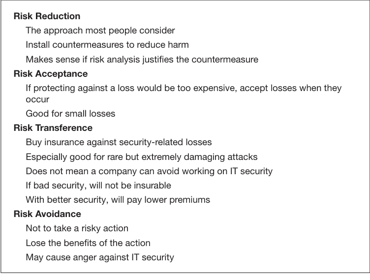

**图 2-16** 应对风险（研读图）

> 风险规避意味着不采取有风险的行动。

## 测试你的理解

- 24.
- a. 应对风险的四种方式是什么？
- b. 哪一种涉及无所作为？
- c. 哪一种涉及保险？
- d. 为什么保险不是不处理安全问题的方式？
- e. 什么是风险规避？
- f. 为什么风险规避不会危及公司其余部分的 IT 安全？

## 2.5 技术安全架构

**2.5**  **描述技术安全基础设施。**

你永远不会在没有建筑师先为房屋的房间及其相互作用方式创建总体设计以提供完整的居住体验的情况下建造房屋。这种总体设计称为架构。

## 技术安全架构

同样，公司不应在没有总体计划的情况下安装技术对策。该计划是公司的**技术安全架构**，它包括公司所有的技术对策——包括防火墙、加固主机、入侵检测系统和其他工具——以及这些对策如何组织成完整的保护系统。

> 公司的技术安全架构包括公司所有的技术对策以及这些对策如何组织成完整的保护系统。

## 架构决策

术语*架构*表明，公司的安全系统不应仅仅在缺乏协调的个人安全投资决策系列中演变。相反，应制定一个连贯的架构计划，使公司能够知道技术安全保护与公司资产保护需求和外部威胁相匹配。主要目标是建立一道全面的墙，使攻击者无法穿过漏洞。

## 处理遗留安全技术

安全架构通常必须考虑公司的**遗留安全技术**，即公司过去实施但现在至少在某种程度上无效的技术。没有公司能负担得起一次性更换所有遗留安全技术。如果遗留技术严重损害安全，则必须更换它。然而，除非升级收益超过升级成本，否则公司必须在遗留安全技术周围工作，在其他领域增加强度以弥补遗留安全技术的局限性。

> 遗留安全技术是公司过去实施且现在至少在某种程度上无效的安全技术。

## 测试你的理解

- 25. a. 公司的技术安全架构是什么？
- b. 为什么需要技术安全架构？
- c. 创建它的最佳时间是什么时候？
- d. 为什么公司不立即简单地更换其遗留安全技术？

## 原则

虽然创建安全架构需要在复杂的情况信息的基础上做出许多决策，但一些一般原则应指导安全架构的设计。

## 纵深防御

第一个原则是纵深防御。有了**纵深防御**，攻击者必须突破多个对策才能成功。例如，要攻击一台服务器，攻击者可能必须突破边界防火墙、内部防火墙，最后突破加固服务器上加固应用程序的防御。

纵深防御的原因很简单。漏洞报告者在几乎每年的每个安全对策中都会发现问题。在一个防御要素的漏洞被修复的同时，防线中的其他要素仍将保持有效，从而挫败攻击者。

## 纵深防御与最薄弱环节

你可能对纵深防御和最薄弱环节之间的区别感到困惑。在纵深防御中，存在*多个独立的对策串联放置*。如果一个对策失效，其他对策仍然存在。


相比之下，在最薄弱环节失效中，存在由多个相互依赖的组件构成的单一对策。相互依赖意味着如果其中一个组件失效，则所有组件都会失效。

## 单点脆弱性

与纵深防御相对的另一个极端是单点脆弱性——即架构中的某个元素，攻击者只需攻破单个系统就能借此造成巨大破坏。例如，在2001年9月11日的恐怖袭击中，人们发现纽约市大多数电信运营商都将自己的传输线路汇集到世界贸易中心下方。双子塔的倒塌并没有让互联网瘫痪，但确实使互联网流量显著下降。单点脆弱性通常存在于企业的DNS服务器（除非企业有多台）、企业网络管理程序的中央管理器以及各个防火墙中。

- 技术安全架构
- 定义
  - 企业所有技术对策，以及这些对策如何组织成一个完整的防护体系
- 架构决策
  - 必须周密规划，以提供强大且少有弱点的安全性
- 处理遗留技术
  - 先前已部署的技术
  - 立即升级所有遗留技术成本过高
  - 若严重损害安全则必须升级
  - 升级必须证明其成本合理
- 原则
- 纵深防御
  - 资源由多重对策串联守护
  - 攻击者必须依次突破所有对策才能成功
  - 如果某一对策失效，资源仍然安全
- 纵深防御与最薄弱环节
  - 纵深防御：多个相互独立的对策，必须被逐一击破
  - 最薄弱环节：由多个相互依赖的组件构成的单一对策，所有组件都必须正常运作，对策才能成功
- 避免单点脆弱性
  - 单点失效可能造成严重后果
  - DNS服务器、中央安全管理服务器等
- 最小化安全负担
- 现实目标
  - 无法一夜之间改变企业的防护水平
  - 尽可能快地成熟起来
- 技术安全架构的要素
  - 边界管理
  - 内部站点管理
  - 远程连接管理
  - 与其他企业的组织间系统
  - 集中化安全管理
    - 提高行动速度
    - 降低行动成本

图2-17 企业技术安全架构（学习图）

并非所有单点故障都能消除。任何设备未受集中控制的安全架构都可能执行不一致的策略，而且为阻止正在进行的攻击而采取的许多行动需要系统性响应，这种响应只能通过集中控制点来实现。随着安全资源集中管理的加强，保护中央安全管理控制台及其与企业安全设备之间的通信将变得越来越重要。

## 最小化安全负担

另一个核心原则是尽量减少对职能部门的安全负担。从某种程度上说，安全不可避免地会降低生产力，并可能因要求创新推出前先解决安全问题而拖慢创新步伐。重要的是选择能够最大限度减少生产力损失和创新放缓的安全架构与要素。

事实上，在高度创新的企业中，安全可能是唯一阻碍增长的因素。职能经理们常抱怨的“你不懂”，往往是正确的。必须谨慎权衡增长价值与安全防护价值。

不过，许多措施可以大大减轻用户负担，例如改用单点登录认证，这样每个人只需记住一个密码即可使用所有内部系统。

## 现实目标

虽然能够在一夜之间消除所有漏洞固然很好，但重要的是为改进设定现实的目标。例如，NASA有自己的内部漏洞评估计划，持续测试内部系统以查找漏洞。它识别网络、软件、数据存储和内部系统中的潜在漏洞，然后对所有漏洞进行详细风险评估，以便优先处理最严重的漏洞。所有组织的资源都有限，因此在改善安全方面设定现实目标非常重要。

## 测试你的理解

- 26.
  - a. 为什么纵深防御很重要？
  - b. 区分纵深防御与最薄弱环节问题。
  - c. 为什么中央安全管理控制台很危险？
  - d. 为什么它们又是可取的？
  - e. 为什么尽量减少安全给企业职能部门带来的负担很重要？
  - f. 你认为为什么为减少漏洞设定现实目标很重要？

## 技术安全架构的要素

在本书中，我们将详细考察企业的许多技术控制措施以及这些控制措施的组织方式。在此，我们仅列出企业使用的几类技术对策。

## 边界管理

传统上，企业会在（相对可信的）内部网络与不可信的外部网络（最常见的是互联网）之间维持一道边界。防火墙一直是边界管理的主要手段，今后也应继续如此。

## 内部站点安全管理

对可信内部网络的内部管理同样至关重要。为进行预防，必须使用内部防火墙、加固的客户端和服务器、入侵检测系统以及其他工具。

## 远程连接管理

在边界之外，企业站点之间、与远程个别员工之间以及与业务伙伴之间都需要远程连接。虚拟专用网络（VPN）技术一直是管理可信用户和站点跨不可信网络（如互联网）进行通信的核心。

员工在家中和酒店客房工作会带来一个特殊问题，尤其是当员工在远程访问计算机上安装个人软件时。事实上，他们经常使用自己的家用电脑访问企业站点。通过远程访问技术管理，可以在一定程度上缓解家庭用户普遍缺乏安全纪律的问题。

## 组织间系统

在组织间系统中，两家公司将其部分IT资产相连，任何一方都无法直接对另一方实施安全管控。事实上，它们往往甚至无法了解对方公司安全措施的细节。

> 在组织间系统中，两家公司将其部分IT资产相连。

## 集中化安全管理

安全架构中的一个重要目标是集中化安全管理——能够从单个安全管理控制台，或至少从数量较少且各自管理一组安全技术的安全管理控制台来管理安全技术。集中化安全管理直接在企业的设备上执行策略，使安全保持一致。它还能通过减少出差降低安全管理成本，并使安全管理操作立即作用于设备。

## 测试你的理解

- 27. a. 为什么边界管理很重要？
  - b. 为什么它不是完整的安全解决方案？
  - c. 为什么来自家庭的远程连接尤其危险？
  - d. 为什么组织间系统很危险？
  - e. 为什么集中化安全管理具有吸引力？

## 2.6 策略驱动的实施

2.6 解释策略驱动的实施。

拥有良好的技术和良好的计划很重要。下一步是实施控制措施，并在其整个生命周期内维护各项对策。为此，企业依赖于策略的制定、实施和监督。


## 政策

### 什么是政策？
政策是对特定情况下*应做什么*的陈述。例如，某项政策可能要求对每位新员工进行彻底的背景调查。

### 什么，而不是怎么做
请注意，政策是对*什么*应做出的陈述，而不是*如何*做。图 2-18 显示政策与实施是分离的。随着时间的推移，公司内各种岗位的敏感性会发生变化。何为彻底的背景调查也会随之变化。政策设定目标和愿景，但不会无意中限制条件变化时未来的实施变更。

> 政策是对应做什么的陈述，而不是怎么做。

### 清晰性
专注于必须做什么而不是怎么做，并不意味着政策对实施者无关紧要。相反，在做出设计决策时，实施者会不断参考政策以获取指导。延续我们的例子，如果进行背景调查有两种替代方案，实施者会问自己这些替代方案是否符合政策的意图。通过关注政策目标，有时关注这些目标的理由，政策带来了关于应做什么的清晰性。实施者不会迷失在细节中。

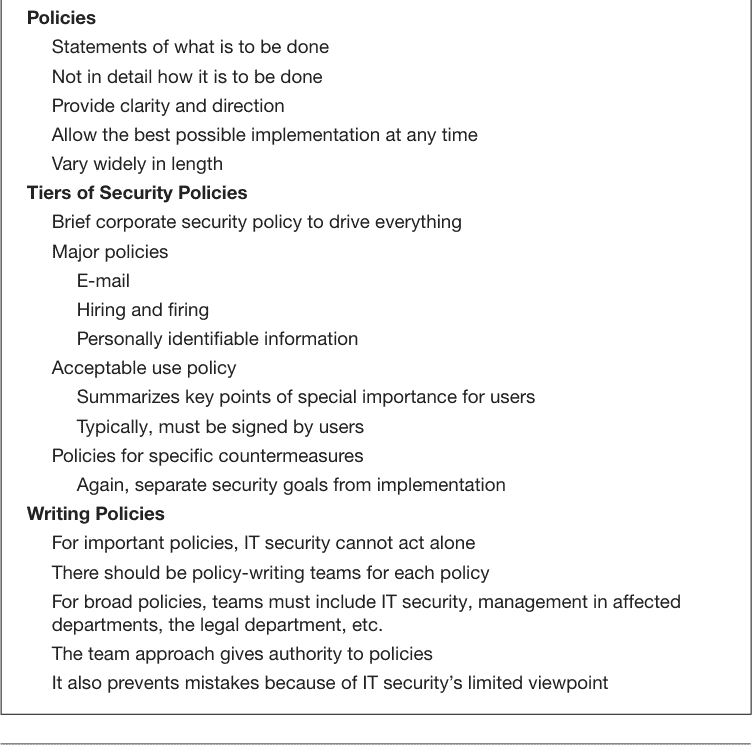

**图 2-18** 政策（研读图表）

## 测试你的理解

- 28.
- a. 什么是政策？
- b. 区分政策与实施。
- c. 为什么政策不应详细规定实施？

## 安全政策的类别

### 企业安全政策
公司需要几种类别的安全政策。最高层是**企业安全政策**。正如我们刚才所指出的，其目标是强调公司对强有力安全的承诺。它简明扼要。

> 企业安全政策的目标是强调公司对强有力安全的承诺。

### 主要政策
在简明企业安全政策的框架下，公司需要关于主要问题的具体政策。这些主要政策比企业安全政策详细得多。

- ***电子邮件政策***几乎存在于所有公司。电子邮件政策规定 IT 员工应如何处理与安全相关的电子邮件问题。它们还应规定电子邮件用户应做什么或不做什么。
- ***招聘和终止政策***是必要的，因为招聘和终止是危险的时期。公司需要在招聘时以及不同类型的终止（自愿离职、裁员、因故解雇等）时制定强有力的背景调查和其他事项的政策。
- ***个人身份信息（PII）***政策规定对敏感个人信息保护。这些政策必须规定访问控制、加密以及可以降低泄露敏感个人信息威胁的其他事项。

**图 2-19** 政策、实施和监督

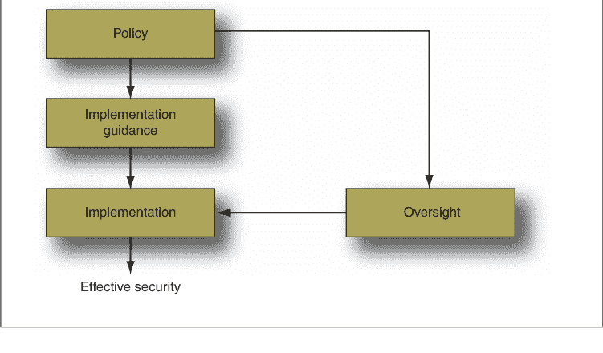

## 可接受使用政策

用户不可能被期望阅读许多详细政策。对于用户，企业制定可接受使用政策（AUP），总结对用户特别重要的要点。例如，AUP 会说明（1）资源是公司财产，不得用于个人用途，（2）电子邮件或其他用途不应被推定享有隐私权，（3）特定类型的行为不被容忍。

通常，公司要求用户阅读并签署 AUP。这提供了法律保护，使用户不能声称自己从未了解公司政策。同样重要的是，签署创造了一种令人难忘的仪式感。强制签署也强调了公司对 IT 安全的承诺。

## 针对特定对策或资源的政策

在最详细的层面上，主要政策对于特定对策（如单台防火墙）或特定资源（如工资数据库）来说不够详细。对策和资源政策提供了这种额外的具体性。再次强调，目标是将安全目标与实施分离。

## 测试你的理解

- 29. a. 区分企业安全政策与主要安全政策。
- b. 区分主要安全政策与可接受使用政策。
- c. 要求用户签署 AUP 的目的是什么？
- d. 为什么需要针对单个对策和资源的政策？

## 政策编写团队

广泛的政策不能由 IT 安全人员单独制定。对于每项政策，公司应组建团队来创建政策。虽然 IT 安全将是团队的重要成员，但可能甚至不担任团队负责人。

例如，考虑一项因员工犯下欺诈或知识产权盗窃而终止雇佣的政策。显然，人力资源部和法务部门应加入团队——任何需要实施该政策的部门也应加入。

团队编写的政策比仅由 IT 安全编写的政策对员工更具分量。它们也更有可能有效，因为它们不基于 IT 安全的有限视角。

## 测试你的理解

- 30. 为什么让企业团队编写政策很重要？

## 实施指导

虽然政策应该是且应是愿景和目标的广泛陈述，但图 2-20 显示公司经常为政策制定实施指导。实施指导限制实施者的自由裁量权，以便简化实施决策，避免在解释政策时做出错误选择，并使实施保持一致。

> 实施指导限制实施者的自由裁量权，以便简化实施决策并避免在解释政策时做出错误选择。

实施指导与所针对的政策是不同的。政策陈述安全目标和愿景以推动实施。实施指导在适当程度上限制实施选择。政策很少改变。实施指导虽然总体稳定，但可能比政策变化更快。

我们现在在图 2-20 中有三个层级。政策管理“做什么”，实施决定“怎么做”。两者之间，实施指导形成了一个可选的中间控制步骤。

## 无指导

如果公司可以信任实施者明智行事，则不应制定实施指导。不提供实施指导使实施者能够开发他们认为的最佳政策实施方式。它还避免了锁定感。这通常是与不提供实施指导所带来的增加风险之间的良好权衡。

- **实施指导**
- 限制实施者的自由裁量权，以便简化实施决策并避免在解释政策时做出错误选择
- **无指导**
- 实施者仅受政策本身的指导
- **标准与指南**
- 标准是强制性指令
- 指南不是强制性的但必须考虑
- **实施指导的类型**
- 可以是标准或指南
- 程序：对某事应如何做进行详细说明
- 职责分离：完成敏感任务需要两个人
- 在电影院，一个人售票，另一个人检票
- 没有个人可以造成损害，尽管
- 请求/授权控制
- 限制可以对敏感事项提出请求的人数
- 允许更少的人能够授权请求
- 授权者绝不能是请求者
- 强制休假以发现需要持续维护的方案
- 工作轮换以发现需要持续维护的方案
- 流程：对应采取什么行动的较少详细说明
- 在管理性和专业性业务职能中必要
- 基线：应做什么的清单
- 最佳实践：其他公司中最适当的做法
- 推荐实践：规范性指导
- 问责制
- 资源所有者承担责任
- 政策的实施可以委托给受托人，但问责制不能委托
- 道德准则

图 2-20 实施指导（研读图表）


## 标准与指南

通常将实施指导分为标准和指南。**标准**是*强制性*的实施指导，意味着受其约束的员工——包括管理人员——没有不遵守的选项。遵守标准的情况很重要进行审计。由于标准的强制性，审计人员相对容易判断在特定情况下是否遵循了标准。

与强制性的标准相比，**指南**是*酌情*的。例如，延续之前的例子，公司可能有一项指南，要求每位新员工都进行背景调查。

尽管决策者*考虑*指南是强制性的，但在有充分理由不这样做时，*遵循*指南并非强制性。例如，假设某项指南规定使用指纹扫描进行访问控制。进一步假设一名建筑工人的指纹损坏无法读取。在这种情况下，负责身份验证的人员可以批准使用不同的身份验证方法。指南适用于复杂且不确定的情况，这些情况无法制定严格的标准。

### 测试你的理解

31. a. 区分标准和指南。
    b. 对于指南，什么是强制性的？
    c. 指南在何时适用？

## 实施指导的类型

有几种标准和指南可用于实施政策。公司应根据需要适当使用每一种。

### 程序

在最详细的层面上，**程序**规定了特定员工必须采取的详细行动。这里的关键词是*详细*。例如，在电影院，一名员工售票，另一名员工收取票让顾客进入影院。如果售票员也允许顾客进入，售票员可能会收钱、在未记录销售的情况下让顾客进入，然后将钱私吞。票证应在销售记录*之后*才打印。除非售票员和检票员串通，否则该安全程序是有效的。

> 程序规定了特定员工必须采取的详细行动。

该影院示例说明了程序设计中最重要的原则之一。在*职责分离*中，完整的操作应需要两人或以上共同完成。这可防止一个人单独行动造成危害。如示例所述，串通可以破坏职责分离，但至少职责分离使有害行为的可能性降低。

职责分离的另一个例子是当某项潜在风险的操作需要授权时。在这种情况下，限制可能*请求*批准的人数很重要，而能够*授权*请求的人数必须更少。最重要的是，授权请求的人*绝不能*是提出请求的人。这称为**请求/授权控制**。

还应有休假和轮岗的规则。如果有人实施未经批准的做法，他们通常需要持续在场才能使其运作。休假应是强制性的，以创造一个人无法采取行动的时期。轮岗至不同的角色或责任区域，如果可行，可发挥相同作用。强制休假或轮岗也有助于减少员工之间的串通可能性。

### 流程

对于文书工作和其他定义明确的工作，程序可能是合适的。然而，对于管理性和专业性工作，指导必须更宽松，因为情况通常并非一目了然。然而，即使对于管理性和专业性工作，公司也遵循流程，即对应该做什么的高层次描述。例如，新产品开发需要一个广泛的流程才能良好运作。该流程将规定如何提名新产品创意、谁应进行初步可行性分析、以及谁应负责不同类型的有前景的新产品。在管理性和专业性工作中，很少能将流程中的每个步骤——包括可行性分析——细化为低层次的程序。然而，流程必须清晰到足以降低风险。

> 流程是对应该做什么的广泛描述。

### 基线

程序和流程描述了实施步骤。相比之下，基线类似于飞机检查清单。基线描述了要实现的目标的细节，而不具体描述如何实现。例如，如果系统管理员需要加固 Web 服务器以抵御威胁，他或她会参考公司基线，该基线规定诸如使用强密码替换特定默认密码等事项。然而，基线不像程序或流程那样描述如何执行。

> 基线描述了要实现的目标的细节，而不具体描述如何实现。

基线必须针对具体情况进行定制。例如，公司需要为加固 Windows Server 2019、Windows Server 2016、Red Hat Linux 等制定不同的基线。如果没有基线，系统管理员很容易忘记更改特定默认密码或打开事件日志记录。

### 最佳实践与推荐实践

尽管公司在政策和实施指导上付出了很大努力，但它们通常希望向外借鉴。最佳实践是对行业中最佳企业在安全方面做法的描述。最佳实践通常由咨询公司整理，但行业协会甚至政府也开始制定它们。

> 最佳实践是对行业中最佳企业在安全方面做法的描述。

最佳实践与推荐实践不同，后者是对公司应该做什么的规范性陈述。推荐实践通常由行业协会和政府机构制定。也许最广为人知的推荐实践集合是稍后讨论的 ISO 27000 系列标准。

> 推荐实践是对公司应该做什么的规范性陈述。

### 问责

一个大致属于实施指导范畴的最终控制是问责制的分配，这意味着如果实施不当需承担制裁责任。应指定一个人作为每个资源和控制措施的所有者。如果出现问题，所有者将被追究责任。如果一个人知道自己将被追究责任，这就是忠实执行政策的有力激励。

通常，所有者会将实施政策的工作委托给他人，即受托人。通常，受托人比所有者拥有更强的技术技能或对具体情况有更好的理解。然而，虽然实施工作可以委托给受托人，但问责制不能委托。

### 伦理

在复杂情况下，硬性指导是不可能的。决策需要基于伦理，即个人的价值体系。伦理决策困难之处在于个人可能具有不同的价值体系。因此，不同善意的人在同一情况下可能做出不同的伦理决策。

为了使伦理决策更可预测，大多数公司都有行为准则，提供一些具体指导。这些行为准则往往包括以下事项（以及其他许多事项）的陈述：

- 行为准则适用于所有人，包括兼职员工和高层管理人员。（事实上，大多数公司对公司董事会和高管还有额外的行为准则。）
- 伦理行为不是可选项；不当的伦理行为可能导致解雇或较轻的纪律处分。
- 如果员工观察到不道德行为，他或她必须向公司伦理官或公司审计委员会报告。
- 员工必须避免利益冲突，这意味着他或她绝不能利用自己的职位谋取个人利益。这包括与亲属的优待交易、投资竞争对手，以及在受雇于公司期间与公司竞争。
- 员工绝不能收受贿赂或回扣，包括任何非微不足道的“礼物”。贿赂是为诱使员工偏袒供应商或其他方而提供的金钱礼物。回扣特指供应商在采购时向公司买方支付的款项。
- 员工必须仅将业务资产用于业务用途，不得用于个人用途。
- 员工绝不能泄露机密信息、私人信息或商业秘密。

### 测试你的理解

32. a. 区分程序和流程。
    b. 各自在何时使用？
    c. 什么是职责分离，其目的何在？
    d. 当有人请求采取可能危险的行动时，应采取哪些保护措施？
    e. 为什么强制休假或轮岗很重要？
    f. 指南与程序和流程有何不同？
    g. 区分最佳实践和推荐实践。
    h. 从问责角度区分资源所有者和受托人。
    i. 所有者可以委托给受托人什么？
    j. 所有者不能委托给受托人什么？


33.
a. 为什么伦理不可预测？
b. 为什么公司制定道德准则？
c. 为什么良好的道德在公司中很重要？
d. 道德准则适用于谁？
e. 高级官员是否经常获得额外的道德准则？
f. 如果员工有道德关切，他或她必须做什么？
g. 如果员工观察到不道德行为，他或她必须做什么？
h. 给出了哪些利益冲突的例子？
i. 为什么贿赂和回扣不好？
j. 区分贿赂和回扣。
k. 员工不应透露哪些类型的信息？

### Ethics
- 一个人的价值观体系
- 在复杂情况下需要
- 不同的人可能在相同情况下做出不同决定
- 公司制定道德准则以在道德决策中提供指导

### Code of Ethics: Typical Contents (Partial List)
- 良好道德的重要性在于拥有良好的工作环境并避免损害公司的声誉
- 道德准则适用于所有人
  - 高级管理人员通常有额外要求
- 不当的道德行为可能导致制裁，直至解雇
- 员工必须报告观察到的不道德行为
- 员工必须避免利益冲突
  - 绝不利用自己的职位谋取个人利益
  - 不得对亲属给予优待
  - 不得投资竞争对手
  - 在受雇于公司期间不得与公司竞争
- 禁止贿赂或回扣
  - 贿赂是由外部方给予以获得优待
  - 回扣是由卖方在下订单时给予以确保本次或未来订单
- 员工必须仅将业务资产用于业务用途，不得用于个人用途
- 员工绝不得泄露
  - 机密信息
  - 私人信息
  - 商业秘密

Figure 2-21 Ethics (Study Figure)

## Exception Handling

如果实施永远不需要对政策或实施指导进行例外处理那就好了，但偶尔例外是必要的。这要求实施指导规范包含例外处理的指导。指导至关重要，因为例外很危险，因此必须严格控制并记录。以下是处理例外的一些一般指导原则。

### Exceptions Are Always Required

### Limiting Exceptions
- 只有某些人应被允许申请例外
- 更少的人应被允许授权例外
- 申请例外的人绝不能是授权者

### Exception Must Be Carefully Documented

具体做了什么以及谁执行了每个操作

### Special Attention Should Be Given to Exceptions in Periodic Auditing

### Exceptions above a Particular Danger Level Need to Be Reported

提交给 IT 安全部门和授权者的直接主管

Figure 2-22 Exception Handling (Study Figure)

- 只有某些人应被允许申请例外。
- 更少的人应被允许授权例外。
- 申请例外的人绝不能是授权例外的人。
- 每个例外都必须仔细记录，具体说明做了什么以及谁执行了每个操作。
- 在定期审计中应特别关注例外。
- 超过特定危险等级的例外应提交给 IT 安全部门和授权者的直接主管。

### Test Your Understanding

34. a. 为什么例外不应被绝对禁止？
b. 为什么需要例外处理的实施指导？
c. 例外的前三条规则是什么？
d. 为什么文档记录和定期审计很重要？
e. 需要向经理报告的危险例子的例子是什么？

## Oversight

理想情况下，政策应在适当实施指导的约束下得到忠实执行。遗憾的是并非总是如此。2015 年，对 1,000 名联邦员工的调查发现，24% 的员工将工作文件发送到个人电子邮件账户，尽管他们知道这违反联邦政策。10 更糟的是，受访员工中有 40% 在工作中使用个人智能手机，尽管他们知道存在锁定移动设备政策。

10 Lookout，“Lookout 研究：近 40% 的政府员工无视禁止使用移动设备的政策，将敏感数据置于风险之中”，Lookout.com，2015 年 8 月 19 日。www.lookout.com/news-and-press/press-releases/lookout-study-nearly-40-percent-of-government-employees-ignore-policies-prohibiting-mobile-device-use-put-sensitive-data-at-risk.

此外，58% 的人表示他们知道自己的行为造成了安全问题，但仍选择违反政策。为什么这些违规如此常见？受访者可能出于便利或缺乏政策执行而这样做。监督是一个过程、职能或工具组，用于改善政策实施和执行。有许多类型的监督。

> 监督是一个过程、职能或工具组，用于改善政策实施和执行。

POLICIES AND OVERSIGHT 图 2-19 显示政策和监督是相关的。就像政策驱动实施一样，同一政策也驱动监督。参与监督的工作人员必须制定适合特定政策的监督计划。

PROMULGATION 创建政策后，安全管理部门的首要工作是让用户了解这些政策。正式宣布、发布或让用户了解新政策称为颁布。如果用户不知道或不理解政策，他们就无法遵守。积极宣传政策并强调特定政策背后的愿景很重要。

正如本章前面所述，让受影响的用户签署政策是有用的。这带来一种安全感，从而提高意识。

宣传政策的一种有争议的方式是对员工进行诱捕。在这些诱捕中，要求员工做违反政策的事情。例如，最近的一项研究发现，20% 的员工会点击钓鱼电子邮件。节假日期间或电子邮件包含“您的扫描文件”等字样时，这一比例会上升。如果员工接受五次培训模拟，钓鱼电子邮件的点击率会降至 0.2%。

进行诱捕有助于提高意识。诱捕也可以用作增加 IT 安全意识培训资金的手段。如果每年重复特定的诱捕，还可以用来显示积极趋势。

诱捕有争议，因为如果处理不当会产生怨恨。为了避免问题，被诱捕员工的身份绝不能透露。此外，它们只能用作教学情况，绝不能用于惩罚。

ELECTRONIC MONITORING 在许多情况下，可以自动电子监控合规行为。最近的一项研究发现，几乎 94% 的公司都在监控员工行为，93% 监控员工访问敏感数据。雇主担心内部威胁，因为访问权限过度（37%）、访问数据的设备太多（36%）以及技术日益复杂（35%）。如果公司要使用电子监控，提前告知员工并解释原因很重要。

SECURITY METRICS 监控提供细节。衡量合规的另一种方法是创建安全指标，即定期测量的少数精心挑选的安全成功或失败的可衡量指标。示例包括

夜间用户 PC 仍开着的百分比、服务器上可破解密码的百分比以及对 Web 服务器应用的关键补丁的百分比。定期测量这些指标表明公司在实施政策方面是做得更好还是更差。

> 安全指标是安全成功或失败的可衡量指标。

## AUDITING

所有上市公司都必须对其财务报表进行审计。审计公司不会查看进入财务报表的每条信息。相反，他们 purposefully 抽样特定的财务数据。根据样本数据，他们对财务报告流程的控制程度形成意见。审计的目的是对控制的健康状况形成意见，而不是寻找可惩罚的不合规实例。

> 审计的目的是对控制的健康状况形成意见，而不是寻找可惩罚的不合规实例。

只有在信息被记录的情况下才能进行审计。因此，大多数合规法律和法规要求大量记录信息。如果信息记录在数据库中，则称为日志信息。如果信息记录在表格或备忘录上，则信息称为文档。

审计对日志和文档信息进行抽样。在某些情况下，审计会衡量不合规的次数，例如例外未获授权。在其他情况下，审计员会制定指标，例如某一类别中违反政策的行动的百分比。

一个关键原则是仔细衡量不合规事件，但要集中关注每一次积极规避合规的情况。规避合规表明蓄意规避安全，始终需要后续调查。

内部审计由组织自身进行。外部审计由外部公司进行。在财务审计中，公司必须同时进行内部和外部审计。对于 IT 安全审计也是如此。

审计应安排得足够频繁以警告日益增长的危险。许多公司每季度进行 IT 安全审计，每年进行一次更严格的审计。定期间隔的审计很有吸引力，因为它允许公司随时间比较结果。然而，定期安排的审计可能有利于规避安全的人。因此，不定期的审计也 desirable。

## ANONYMOUS PROTECTED HOTLINE

公司长期以来都知道，检测欺诈和其他严重滥用的最佳方式是创建匿名受保护热线。通常是同事首先发现安全违规。

协会 of Certified Fraud Examiners 2018 年报告发现，通过举报检测欺诈是最好的方式。超过 40% 的欺诈是通过匿名举报发现的。13 拥有匿名热线的组织获得的欺诈举报（46%）多于没有匿名热线的组织（30%）。

13 Association of Certified Fraud Examiners，“Report to the Nations: 2018 Global Study on Occupational Fraud and Abuse”，ACFE.com，2019 年 4 月 17 日。www.acfe.com/report-to-the-nations/2018.


## 监督

*监督*（Oversight）是一组用于策略执行的工具的统称
策略驱动监督，正如它驱动实施一样

## 颁布

- 传达愿景
- 培训
- 约束员工

## 电子监控

- 以电子方式收集行为信息
- 在企业中广泛使用，并用于解雇员工
- 警告对象并解释监控原因

## 安全指标

- 定期衡量的合规性指标
- 服务器上可破解密码的占比等
- 定期衡量可表明策略实施的进展

## 审计

- 抽样信息以形成关于控制措施充分性的意见
- 日志文件和散文文档中的数据库信息
- 大多数绩效制度要求进行广泛记录
- 规避合规是一个特别重要的发现
- 可以进行内部和外部审计
- 定期审计可提供趋势
- 不定期审计会打乱那些围绕定期审计安排行动的人的计划

## 匿名受保护热线

- 员工往往是第一个发现严重问题的人
- 热线让他们可以举报
- 必须匿名，并保证免受报复
- 是否为欺诈等破坏性极大的活动提供激励？

## 行为意识

- 不当行为往往发生在严重安全漏洞之前
- 欺诈三角指出动机（见图2-24）

## 漏洞测试

- 攻击自己的系统以查找漏洞
- 免费和商业软件
- 未经上级签署明确测试内容的合同，切勿测试
- 合同应规定在发生损坏时你不受指责
- 外部漏洞测试公司拥有专业知识和经验
- 他们应购买针对意外损害和员工不当行为的保险
- 他们不应雇用黑客或前黑客
- 应附上建议修复清单
- 应跟进核实这些修复是否落实

## 制裁

- 如果人们被抓后不受惩罚，其他一切都无关紧要

## 图2-23 监督（学习图）

看到不当行为的员工可能因害怕报复而不愿举报。通过设立匿名举报热线，并保证免受报复，公司可以最大限度地提高员工的参与度。一些公司甚至要求发现严重不当行为的员工使用热线。所有上市公司都必须设立热线以符合《萨班斯-奥克斯利法案》要求。公司可以扩大热线范围，以涵盖所有严重不当行为。

一种选择是提供信息报酬作为激励。这已写入多项合规法律，包括HIPAA。很少公司提供报酬，但如果存在重大欺诈和其他破坏性极大的活动的可能，这样做或许是明智的。

## 行为意识

一种监督控制是关注人类行为。任何严重的员工滥用行为都应被视为危险信号，因为在许多严重安全违规案例中，肇事者都有暴力、威胁或其他不可接受的公开行为史。不注意此类行为属于严重疏忽。

## 欺诈

在欺诈领域，作者们长期讨论欺诈三角，该模型用于理解欺诈行为。它似乎也适用于一般的安全不当行为。因此，我们将称之为欺诈和滥用三角。图2-24显示，该三角考虑了通常在不当行为发生前就存在的人类动机的三个方面。通过对这些动机方面保持敏感，企业也许能在问题发生前发现它，或者至少能对安全滥用者为何这么做有现实的理解。

机会。三角的第一个顶点是机会。显然，如果几乎没有实施滥用的机会，或者肇事者很可能被抓住，滥用就不太可能发生。减少成功机会并增加侦测是通往安全的常规途径。

压力。然而，肇事者的心理同样重要。显然，很少有人有机会实施严重安全滥用却真的去做。机会并不足够。另一个因素是压力。这种压力驱使人们实施滥用。压力的例子包括个人财务问题、贪婪，或希望掩盖可能危及员工工作的不佳表现等。也许最常见的压力形式是不合理的绩效期望。

## 图2-24 欺诈和滥用三角

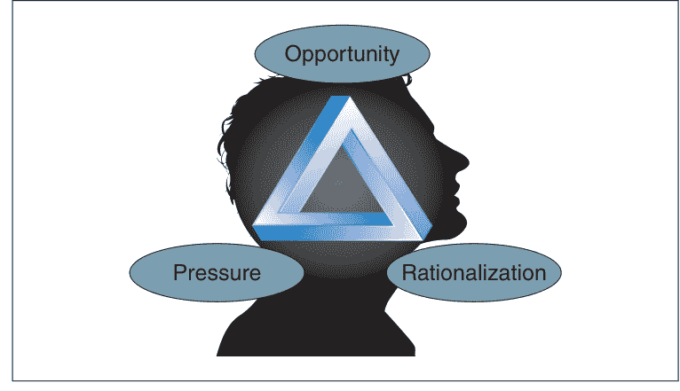

## 合理化。

即使既有压力又有机会，员工也不太可能采取行动，除非他们能在内心将自己的行为合理化。例如，他们可能说服自己相信某个行为是正当的，因为公司有不切实际的绩效期望，或者他们会归还挪用的资金。**合理化**的目标是让肇事者仍然认为自己是个好人。

公司和管理者需要认识到，过高的绩效期望可能使合理化更容易，从而适得其反。重要的是不要低估合理化，也不要忽视好人发动攻击的可能性。

## 漏洞测试。

判断安全策略是否成功的一种方法是自己攻击系统，看看能否在攻击者之前发现漏洞。这称为漏洞测试。

> 漏洞测试是自己攻击系统，看看能否在攻击者之前发现漏洞。

有许多漏洞测试软件。黑客软件通常免费提供，而商业漏洞测试程序造成附带损害的可能性较小。

### 内部漏洞测试。

如果要在内部进行漏洞测试，执行漏洞测试的员工应坚持要求上级签署*合同*授权进行漏洞测试。漏洞测试看起来与真实攻击完全一样。在没有签署合同的情况下进行漏洞测试，即使漏洞测试已列入某人的书面职责清单，也很容易让IT安全专业人员被解雇，甚至更糟。

### 外部漏洞测试。

漏洞测试合同应详细说明将做什么以及何时做。测试期间不得偏离合同。此外，漏洞测试偶尔会使系统崩溃或造成其他损害。如果发生此类损害，合同必须规定内部漏洞测试者不承担责任。

外部漏洞测试公司提供更多独立性，也可能拥有更多专业知识和经验。具体的测试计划也很重要，而且测试公司应购买针对可能损害的保险。最重要的是，测试公司不应雇用现任或前任黑客，因为测试人员会对你系统的详细情况了如指掌。

漏洞测试研究结束后，测试人员应制定一份具体的建议修复清单，并由其上级签署。之后还应进行后续跟进以确认修复措施已完成。

## 制裁

有一条关于制裁的古老格言——你得到你所执行的东西。如果员工违反安全规程，他们应受到适当的**制裁**（纪律处分）。如果不这样做，公司缺乏安全后续行动意图的事实很快就会众所周知。

通常，公司非常不愿制裁高级员工。有一个案例，俄亥俄州行政服务部的一名实习生将一个带备份磁带的备份磁带设备带回家。这位时薪10美元的实习生是被一位更有经验的实习生告知这样做的。主管从未讨论过夜间安全保存备份磁带的程序。有一次，实习生的汽车被撬，设备被盗。磁带上有所有64,467名州雇员、19,388名前雇员和47,245名俄亥俄州纳税人的数据。这次数据泄露预计将使该州损失超过300万美元。实习生受到严厉审讯并被强制辞职。他的主管受到的处罚轻得多——失去一周休假时间。¹⁴

¹⁴ Brian Fonseca, “Ohio Official Loses a Week’s Vacation for Theft of Tape,” *Computerworld*, October 10, 2007. www.computerworld.com/s/article/9042001.


## 测试你的理解
- 35. a. 什么是监督？
- 35. b. 监督与政策有何关系？
- 35. c. 什么是颁布？
- 35. d. 什么是监视员工？
- 35. e. 它的成本与收益是什么？
- 35. f. 电子监控是否被广泛采用？
- 35. g. 在开始监控之前，你应该告诉员工什么？
- 35. h. 什么是安全度量？
- 35. i. 为什么定期测量是有益的？
- 36. a. 审计的目的是什么？
- 36. b. 区分日志文件和文档。
- 36. c. 为什么规避合规是一个严重的危险信号？
- 36. d. 区分内部审计和外部审计。
- 36. e. 为什么定期安排的审计是好的？
- 36. f. 为什么进行计划外审计？
- 37. a. 为什么公司应该设立匿名受保护的热线？
- 37. b. 在使用热线时，为什么匿名和防止报复很重要？
- 37. c. 为什么一般员工不当行为应当引起关注？
- 37. d. 欺诈和滥用三角中的三个要素是什么？
- 37. e. 举一个文本中未讨论的压力示例。
- 37. f. 为什么合理化很重要？
- 37. g. 举两个文本中未给出的合理化示例。
- 38. a. 什么是漏洞测试？
- 38. b. 为什么在没有签署合同的情况下绝不应进行漏洞测试？
- 38. c. 合同中应包含什么？
- 38. d. 你在选择外部漏洞测试公司时应该关注什么？
- 38. e. 为什么需要对推荐的修复措施进行后续跟进？
- 39. a. 为什么制裁违规者很重要？

## 联邦监视法律
到目前为止，我们已经考察了组织监控自己员工的情况。你还需要了解管辖美国政府监控和监视的法律。公司也受到更大的社会层面安全环境的影响。这种宏观安全环境通常由政府塑造，可能影响新产品创新、新市场进入者、现有企业间的竞争、国际贸易等。立法者努力在确保社会安全与提供足够自由以鼓励创新之间寻求平衡。

以下只是美国监视法律中的一小部分。电信公司、互联网服务提供商、电子邮件服务商和代理机构可以被法院命令强制协助这些监控活动。它们可能被强制安装用于监控目的的硬件和软件。

### 国内监视法律
围绕国内监控和监视的法律多年来不断变化。它们已适应新的通信方法和创新。随着立法者试图在国家安全关切与个人公民自由之间找到平衡，这些法律很可能会继续变化。

### 卡茨诉美国案
卡茨诉美国案（1967）裁定，美国宪法第四修正案既适用于物理搜查，也适用于电子监视。最高法院认为“一个人享有受宪法保护的合理隐私预期”，并且“对在这个意义上属于私密场所的电子入侵和物理入侵都可能构成对第四修正案的违反。”

> 人民的人身、住宅、文件和财产不受不合理搜查和扣押的权利不得侵犯，除非有合理根据，以宣誓或郑重声明作保，并具体说明搜查地点和要扣押的人或物，否则不得签发搜查令。
>
> 美国宪法第四修正案

隐私倡导者认为，一些国内监视系统违反了第四修正案，应当予以废止。

### FISA
1978年，国会通过了《外国情报监视法》（FISA）。该法律允许执法部门在对象是外国代理人、外国势力或从事间谍活动的美国公民时，无需搜查令即可进行为期1年的监视活动。

### CALEA
1994年，国会通过了《通信协助执法法》（CALEA）。该法要求电信公司安装具有窃听能力、可供联邦执法机构直接访问的电话交换机。联邦调查局可以直接从符合CALEA标准的交换机获取实时语音和数据流。

### 《美国自由法案》
2015年，国会通过了《美国自由法案》，以取代颇具争议的2007年《保护美国法案》。最初的2007年《保护美国法案》允许联邦机构无需搜查令即可监控美国公民的国际通信。该法案还包含一些条款，强制电信公司在没有法院命令的情况下参与间谍行动。该法最具争议的部分是批量收集美国人的元数据。

《美国自由法案》本应阻止国家安全局收集元数据，但它仍允许电话公司收集元数据，而国家安全局随后可以访问这些数据。该法案还本应允许谷歌、苹果和微软等科技公司讨论与政府机构的信息共享协议。在《美国自由法案》通过之前，它们不能这样做。

## 测试你的理解
- 40. a. 联邦监视如何影响个人和组织？
- 40. b. 卡茨诉美国案如何影响数据和信息系统？
- 40. c. FISA、CALEA 和《美国自由法案》赋予了美国联邦政府哪些监视权力？

## 2.7 治理框架
2.7 了解治理框架。

之前，我们看了指南，它们是政策实施的检查清单。许多在安全规划方面挣扎的公司希望有一个类似于基线的东西来指导它们。事实上，图2-25显示，存在多个治理框架，它们规定了如何进行安全规划和实施。然而，存在多个框架这一事实意味着，选择遵循一个或多个治理框架是一项复杂的决策。

这些治理框架关注的领域有所不同。例如，COSO 广泛关注公司内部和财务控制，而 COBIT 则更具体地关注整个 IT 职能的控制。ISO/IEC 27000 系列标准专门针对 IT 安全。

> 治理框架规定了如何进行安全规划和实施。

## 测试你的理解
- 41. a. 什么是治理框架？
- 41. b. 比较 COSO 与 COBIT 的关注重点。
- 41. c. 比较 COBIT 与 ISO/IEC 27000 系列标准的关注重点。

图 2-25 治理框架

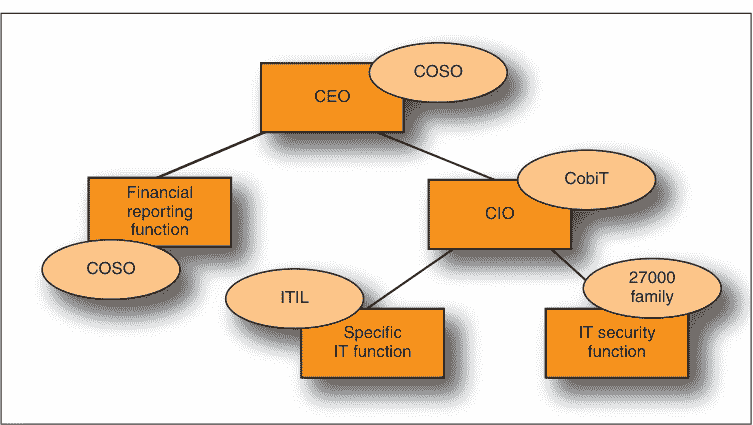

## COSO
《萨班斯-奥克斯利法案》的实施明确要求公司使用一个完善的综合性控制框架。虽然这一实施要求并未强制规定公司必须使用特定框架，但它仅列出了一个可接受的框架，而大多数公司正在使用该框架来实施《萨班斯-奥克斯利法案》。这就是 COSO 框架。

### COSO 框架
尽管 COSO 以其缩写广为人知，但 COSO 框架实际上是一份名为《内部控制——整合框架》（COSO, 1994）的文件。缩写 COSO 来自创建该文件的组织——反虚假财务报告委员会发起组织委员会（www.coso.org）。2004年，COSO 发布了一个新的扩展框架《企业风险管理——整合框架》，该框架更侧重于企业风险管理。

### 目标
控制框架需要目标。在 COSO 框架中，有四个目标。

- *战略*——高层次的、与使命一致并支持使命的目标
- *运营*——有效且高效地利用其资源
- *报告*——报告的可靠性
- *合规*——遵守适用的法律和法规

### 合理保证
良好的控制不能完全保证目标能够实现。然而，有效的控制环境将为实现目标提供*合理*保证。

### COSO 框架组成要素
COSO 框架有八个组成要素。这些是组成要素而非阶段，因为它们之间没有时间顺序。所有要素必须同时发生，并且每个要素持续与其他要素相互输入。

- *内部环境*——内部环境涵盖组织的基调，并为实体人员如何看待和处理风险奠定基础，包括风险管理理念和风险偏好、诚信和道德价值观，以及他们所处的环境。
- *目标设定*——管理层识别可能影响目标实现的潜在事件之前，必须先确定目标。企业风险管理确保管理层有一套设定目标的流程，并确保所选目标支持并符合实体的使命，且与其风险偏好相一致。
- *事件识别*——必须识别影响实体目标实现的内部和外部事件，并区分风险与机会。机会被反馈到管理层的战略或目标设定流程中。
- *风险评估*——对风险进行分析，考虑可能性和影响，作为决定如何管理风险的依据。风险基于固有风险和剩余风险进行评估。
- *风险应对*——管理层选择风险应对方式——规避、接受、降低或分担风险——并制定一系列行动，使风险与实体的风险容忍度和风险偏好保持一致。
- *控制活动*——制定并实施政策和程序，以帮助确保风险应对措施得到有效执行。


- *信息与沟通*—相关信息以使人员能够履行其职责的形式和时间框架被识别、捕获和传达。有效的沟通也在更广泛的意义上发生，在实体内部自上而下、横向以及自下而上流动。
- *监控*—企业风险管理系统会得到监控，并在必要时进行修改。监控通过持续的管理活动、单独的评估或两者结合来完成。

## 测试你的理解

42.
  a. COSO 的四个目标是什么？
  b. 列出 COSO 的八个要素。
  c. 控制活动是什么，为什么它很重要？

### 重点
企业运营、财务控制和合规
有效要求萨班斯-奥克斯利法案合规
目标是合理保证目标得以实现

### 起源
特雷德韦委员会发起组织委员会
(www.coso.org)

### 要素
内部环境
    组织的基调
    风险观的基础
    风险管理理念
目标设定
    管理层建立了设定目标的过程
    所选目标支持并与实体的使命保持一致
事件识别
    影响目标实现事件的识别
风险评估
    考虑可能性和影响
    确定风险如何管理的依据
风险应对
    风险应对——规避、接受、降低或分担风险
    一系列使风险与风险承受度保持一致的行动
控制活动
    建立并实施政策和程序
    确保风险应对措施得到有效执行
信息与沟通
    相关信息被识别、捕获和传达
    沟通在更广泛的意义上发生，在实体内部自上而下、横向以及自下而上流动
监控
    风险管理得到监控，并在必要时进行修改
    持续的管理活动、单独的评估或两者结合

**图 2-26** COSO（学习图）

## COBIT

COSO 是企业通用的控制规划和评估工具。对于 IT 控制，有一个更具体的框架，**信息及相关技术控制目标（COBIT）**。除了创建广泛的控制目标框架外，IT 治理研究所还制定了实施 COBIT 框架的详细指导。

## COBIT 框架

图 2-28 说明了 COBIT 2019 框架。该框架有五个主要领域，遵循一般的系统开发生命周期：

- *评估、指导和监控（EDM）*—EDM 领域有五个高层控制目标，用于评估战略替代方案并帮助高级领导层监控和实现该战略。
- *对齐、计划和组织（APO）*—APO 领域有 14 个高层控制目标，涵盖 IT 的组织方式、如何战略性使用以及应如何支持。
- *构建、获取和实施（BAI）*—在规划之后，公司需要自行构建系统、从外部来源获取系统，然后实施这些系统。该领域有 11 个高层控制目标。
- *交付、服务和支持（DSS）*—大多数 IT 项目的生命周期发生在实施之后。因此，COBIT 框架对交付、服务和支持有六个高层控制目标。
- *监控、评估和审查*—最后，企业必须监控其流程、评估内部控制的充分性、获得独立保证并提供独立审计。这些是四个控制目标。

在 COBIT 的五个主要领域之下，有 40 个高层治理和管理目标。其下还有许多详细的治理实践。COBIT 还包括许多帮助组织了解如何实施该框架的文件。

**COBIT**
信息及相关技术控制目标
许多文件帮助组织了解如何实施该框架
**COBIT 2019 框架**
五个主要领域（图 2-28）
40 个高层控制目标
评估、指导和监控（5）
对齐、计划和组织（14）
构建、获取和实施（11）
交付、服务和支持（6）
监控、评估和审查（4）
许多详细的治理实践
**在美国的主导地位**
由 IT 治理研究所创建，该研究所隶属于信息系统审计与控制协会（ISACA）
ISACA 是 IT 审计的主要专业认证机构
注册信息系统审计师（CISA）认证

图 2-27 COBIT 2019（学习图）

## 图 2-28 COBIT 2019 主要领域

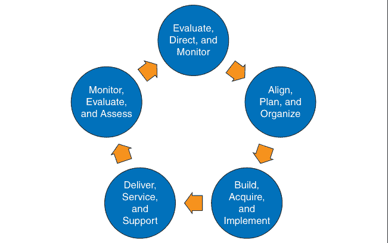

## 测试你的理解

43. a. 区分 COSO 和 COBIT 的关注重点。
   b. 列出 COBIT 的五个领域。
   c. COBIT 有多少个高层控制目标？
   d. COBIT 有多少个详细控制目标？
   e. 为什么 COBIT 深受美国 IT 审计师的青睐？

## 在美国的主导地位

IT 治理研究所由信息系统审计与控制协会（ISACA）创建。ISACA 反过来是美国 IT 审计专业人士的主要专业协会。该协会的注册信息系统审计师（CISA）认证是美国 IT 审计师的主导认证，因此 COBIT 成为美国审计 IT 控制的主导框架也就不足为奇了。

## ISO/IEC 27000 系列

虽然 COBIT 广泛关注 IT 功能的治理，但 ISO/IEC 27000 系列标准专门且详细地关注 IT 安全。该系列中的第一个标准最初称为 ISO/IEC 17799。当决定让所有安全标准都以 27000 开头时，该标准被更名为 ISO/IEC 27000。

## ISO/IEC 27002

该标准将安全分为 14 个广泛领域（如下所列），并为组织内的信息安全控制提供最佳实践。

1. 信息安全政策
2. 信息安全组织
3. 人力资源安全
4. 资产管理
5. 访问控制
6. 密码学
7. 物理和环境安全
8. 运营安全
9. 通信安全
10. 信息系统获取、开发和维护
11. 供应商关系
12. 信息安全事件管理
13. 业务连续性管理的信息安全方面
14. 合规性

## ISO/IEC 27001

2005 年，ISO 和 IEC 发布了 ISO/IEC 27001。该标准规定了如何将组织 *认证* 为符合 ISO/IEC 27000 *标准*。这很重要，因为通过证明合规性，公司可以向业务合作伙伴（及其管理层）保证公司的安全得到良好管理。在其他框架中，包括 COSO 和 COBIT，公司自行认证，有时经外部审计师同意。它们缺乏 ISO/IEC 27001 的第三方认证流程，而外部各方可能高度重视这一点。

然而，认证并不一定使安全完美——仅表明 IT 安全管理职能遵循 ISO/IEC 27000。正如本章开头所述，IT 安全无法保证不会发生安全漏洞。

## 其他 27000 标准

ISO 和 IEC 不断为 27000 系列制定其他标准。下面是其他 ISO 27000 标准的几个示例。

- *ISO/IEC 27004* 将定义如何通过监控、测量、分析和评估来 *管理* 安全职能。
- *ISO/IEC 27005* 侧重于 *风险管理*。
- *ISO/IEC 27007* 侧重于信息安全 *系统审计*。
- *ISO/IEC 27039* 侧重于 *入侵预防*。
- *ISO/IEC 27043* 侧重于 *事件调查*。

## 测试你的理解

44. a. 在 27000 标准系列中，ISO/IEC 27001 的功能是什么？
   b. 在 27000 标准系列中，ISO/IEC 27002 的功能是什么？
   c. 列出 27002 中的 14 个广泛领域。
   d. 为什么 ISO/IEC 27000 认证比 COSO 或 COBIT 认证对企业更具吸引力？

## 2.8 结论

本章以一句强调安全管理和安全技术重要性的引言开始。我们研究了计划-保护-响应周期以及 IT 安全管理的许多复杂性。我们将在整本书中继续看到 IT 安全管理的各个方面，在各种安全保护的背景下。

我们随后研究了几个正在成为 IT 安全管理驱动力的合规法律和法规——萨班斯-奥克斯利法案、隐私法、数据泄露

## ISO/IEC 27000
- 信息技术安全标准族
- 原称 ISO/IEC 17799

## ISO/IEC 27002
- 十四个广泛领域
- 信息安全政策
- 信息安全组织
- 人力资源安全
- 资产管理
- 访问控制
- 密码学
- 物理和环境安全
- 操作安全
- 通信和运营管理
- 信息系统获取、开发和维护
- 供应商关系
- 信息安全事件管理
- 业务连续性管理中的信息安全方面
- 合规性

## ISO/IEC 27001
- 创建于2005年，远在ISO/IEC 27002之后
- 规定由第三方进行认证
  - COSO和COBIT进行自我认证

## Other 27000 Standards
- 正在开发更多标准

Figure 2-29 The ISO/IEC 27000 Family of Security Standards (Study Figure)
图2-29 ISO/IEC 27000 安全标准族（学习图）

notification laws, PCI-DSS, and FISMA. The functioning, placement, general nature of interactions between the IT security department and other organizational departments, and outsourcing to managed security service providers were discussed.
通知法律、PCI-DSS 和 FISMA。IT 安全部门与其他组织部门之间的运作、定位、交互的一般性质，以及向托管安全服务提供商外包的情况进行了讨论。

The chapter then looked at classic risk analysis, its problems, and ways to respond to risk. This led us to a discussion about security architecture, policies, standards, procedures, and best practices within the industry. We saw the need for oversight of existing policies, auditing, and sanctions to prevent internal fraud.
本章随后研究了经典风险分析、其问题以及应对风险的方法。这促使我们讨论行业内的安全架构、政策、标准、程序和最佳实践。我们看到了对现有政策进行监督、审计以及制裁以防止内部欺诈的必要性。

The chapter concluded with a discussion of a few well-known governance frameworks including COSO, COBIT, and ISO 27000. Frameworks help companies by providing a systematic way of approaching IT security planning, implementation, monitoring, and progressive improvement.
本章以对一些知名治理框架的讨论结束，包括 COSO、COBIT 和 ISO 27000。框架通过提供系统化的方法来帮助公司进行 IT 安全规划、实施、监控和持续改进。

## Security @ Work
## 工作中的安全
### Security in the Sharing Economy
### 共享经济中的安全
When was the last time you hailed a taxi? Maybe a better question is whether you have ever hailed a taxi. If not, then you have likely requested an Uber using your phone. If you have used a ride service app or booked a vacation using Airbnb, then you have participated in the sharing economy, or a collaborative economy where goods and services are shared among participants in a peer-to-peer (P2P) network. While the concept of connecting peers who are interested in participating in transactions seems rudimentary, the companies cashing in on the sharing economy are no joke.
上次你招手叫出租车是什么时候？也许更好的问题是，你是否曾经招手叫过出租车。如果没有，那么你很可能用手机叫过 Uber。如果你使用过出行服务应用或通过 Airbnb 预订过度假，那么你就参与了共享经济，或协作经济，即商品和服务在点对点（P2P）网络中的参与者之间共享。虽然连接有意参与交易的同行的概念似乎很基础，但从共享经济中获利的公司绝非儿戏。

For example, Uber has disrupted countless taxi markets around the globe, and the company is worth billions of dollars. Airbnb is worth billions of dollars, too. Clearly, the sharing economy is having an impact. It's becoming an increasingly important part of the overall economy, too. However, there is more to be gained from the sharing economy than just a convenient ride or a cheaper place to stay the night. In fact, many experts believe that adopting practices from the sharing economy could be beneficial in other areas, specifically information security.
例如，Uber 在全球各地扰乱了无数出租车市场，该公司价值数十亿美元。Airbnb 也价值数十亿美元。很明显，共享经济正在产生影响。它也正成为整体经济中越来越重要的一部分。然而，从共享经济中获得的收益不仅仅是方便的出行或更便宜的过夜住处。事实上，许多专家认为，采用共享经济的做法在其他领域，尤其是信息安全方面可能有益。

### Friend or Foe?
### 朋友还是敌人？
By their very nature, companies are competitive and secretive. They often invest heavily in producing a competitive advantage over rivals, which can take many forms—creation of disruptive new products, cultivation of a powerful brand, or development of an exceptional customer service reputation. None of these strategic plans requires sharing information or collaborating with competitors. However, all types of organizations are witnessing an increasing amount of cyber security threats.
公司天生具有竞争性和保密性。它们经常大量投资以在竞争对手中获得竞争优势，这可以采取多种形式——创造颠覆性新产品、培养强大的品牌，或发展卓越的客户服务声誉。没有任何战略计划需要共享信息或与竞争对手合作。然而，所有类型的组织都目睹了日益增多的网络安全威胁。

A survey of more than 50 U.S. organizations found that 100 percent reported cyberattacks in the form of viruses, worms, and Trojan horses; 97 percent reported malware; and just under 60 percent indicated they had experienced at least one phishing attack.17 These incidents can result in millions of dollars in costs and can tarnish the brands of the organizations impacted. Announcing that a company has been breached can also result in follow-up attacks as hackers know that (1) the organization is vulnerable and (2) the organization is likely in a state of chaos as security practitioners try to determine the extent of the breach and recover from it. In light of these costs, many organizations choose to remain secretive about cyber incidents. However, is it possible that organizations would be better off sharing information about breaches with others—even competitors—as quickly as possible?
对 50 多家美国组织的调查发现，100% 的组织报告了以病毒、蠕虫和特洛伊木马形式出现的网络攻击；97% 报告了恶意软件；不到 60% 的组织表示至少经历过一次钓鱼攻击。17 这些事件可能导致数百万美元的成本，并可能损害受影响组织的品牌。宣布公司遭到入侵还可能导致后续攻击，因为黑客知道（1）该组织存在漏洞，（2）该组织很可能处于混乱状态，因为安全从业人员试图确定入侵的程度并从中恢复。鉴于这些成本，许多组织选择对网络事件保持保密。然而，组织是否可能通过尽快与其他组织——甚至竞争对手——共享有关入侵的信息而获得更好的结果？

### Sharing is Caring
### 分享就是关怀
Let's briefly compare cyberattacks to actual warfare. If one country attacks a number of other countries, are the targeted countries better off responding in isolation, or would they fare better by collaborating to defeat the enemy? Even if they do not join forces, the very act of sharing information about the enemy's weaponry, tactics, and capabilities would surely help. This concept holds true with cyberattacks. Sharing information about attack methodologies, malware, and hacking groups helps companies improve their ability to defend against future attacks.
让我们简要比较网络攻击与真正的战争。如果一个国家攻击多个其他国家，被攻击的国家是单独应对更好，还是通过合作击败敌人而表现更好？即使它们不联合行动，共享有关敌人武器、战术和能力的信息的行为也肯定会有所帮助。这一概念同样适用于网络攻击。共享有关攻击方法、恶意软件和黑客组织的信息有助于公司提高抵御未来攻击的能力。

Companies like IBM that are working to promote information sharing about cyberattacks and to promote government regulations that encourage sharing attack information.18 For example, when a breach occurs in which personally identifiable information (PII) has been compromised, the targeted organization must publicly acknowledge the incident per state and federal regulations.19 The idea is that people should be aware that their data may have been leaked. Furthermore, the SEC requires that companies disclose information about material cyber risks (to inform investors about the potential implications of a cyberattack against a company's stock value). However, what constitutes a material cyber risk is not clearly defined. In short, while some regulations are in place, there are loopholes and wiggle room for organizations to not share—or share as little as possible—about the incident.
像 IBM 这样的公司正在努力促进有关网络攻击的信息共享，并推动鼓励共享攻击信息的政府法规。18 例如，当发生个人身份信息（PII）遭到泄露的入侵时，被攻击组织必须根据州和联邦法规公开承认该事件。19 其理念是人们应该意识到他们的数据可能已被泄露。此外，SEC 要求公司披露有关重大网络风险的信息（以告知投资者网络攻击对公司股价的潜在影响）。然而，什么构成重大网络风险并未明确定义。简而言之，虽然有一些法规存在，但组织不共享或尽可能少共享有关事件的信息存在漏洞和回旋余地。

While there are clearly some benefits to increasing information sharing across organizations about cyberattacks, some detractors think that doing so will be ineffective or that it is a bad idea. For example, some argue that not announcing a breach, but collecting information about what hackers are doing, can lead to better insights that can be used to stop future attacks. In fact, government agencies are still breached despite their own information sharing about attacks; this provides little evidence that sharing information across other types of organizations will actually make a difference. With threats, and breaches on the rise, something needs to change, but it remains unclear how an environment of sharing could change the impact of and response to cyberattacks.
虽然在组织之间增加有关网络攻击的信息共享显然有一些好处，但一些反对者认为这样做无效或是不好的主意。例如，有人认为不宣布入侵，而是收集有关黑客正在做什么的信息，可以带来更好的见解，从而用于阻止未来的攻击。事实上，尽管政府机构本身共享有关攻击的信息，但仍会被入侵；这几乎没有证据表明在其他类型的组织之间共享信息实际上会产生差异。随着威胁和入侵事件的增加，某些东西需要改变，但共享环境如何改变网络攻击的影响和应对方式仍然不明确。

### Discussion Questions
### 讨论问题
- 1. Take a minute to consider this hypothetical scenario: You open up your laptop to find that your university e-mail account and your social media accounts have been compromised. The attackers indicate that they are going to post your stolen data on the web. After digging around, you are able to figure out some details about how they were able to access your system. The exploited vulnerability is one that most students at your school also have. Would you want to stand up at the beginning of each of your classes and share information about your breach to help other students avoid being compromised?
- 1. 花一分钟考虑这个假设情景：你打开笔记本电脑，发现你的大学电子邮件账户和社交媒体账户已被入侵。攻击者表示他们将把你被窃的数据发布到网上。经过一番调查，你能够弄清他们是如何访问你的系统的一些细节。被利用的漏洞是大多数你学校学生也有的漏洞。你是否愿意在每节课开始时站起来分享有关你入侵的信息，以帮助其他学生避免被入侵？
- 2. The article makes a comparison between cyberattacks and traditional warfare. Can you think of any ways in which cyberwar is actually different from traditional warfare?
- 2. 文章将网络攻击与传统战争进行了比较。你能想到网络战与传统战争实际不同的任何方式吗？
- 3. Do you think that the SEC, state governments, and the federal government should articulate clearer regulations about disclosing cyberattack information? Why wouldn't the initial policies put in place be more clear/effective?
- 3. 你认为 SEC、州政府和联邦政府是否应该就披露网络攻击信息制定更明确的法规？为什么最初制定的政策不会更清晰/有效？
- 4. The article identifies some arguments against information sharing. Can you think of any other reasons why mandating cyberattack information sharing could be ineffective or harmful?
- 4. 文章指出了一些反对信息共享的论点。你能想到其他任何原因，为什么强制网络攻击信息共享可能无效或有害？

## Security Technology
## 安全技术
### Top 10 Application Vulnerabilities
### 前 10 大应用漏洞
One of the difficulties IT security workers face when performing a classical risk analysis is accurately identifying and estimating threats to their firm. It is difficult to know which threats have the highest probability of affecting the firm. Even if it were possible to accurately assign probabilities to these threats, it would be even more difficult to assign accurate dollar losses associated with each threat.
IT 安全人员在进行经典风险分析时面临的困难之一是准确识别和估计对公司构成的威胁。很难知道哪些威胁最有可能影响公司。即使有可能准确地为这些威胁分配概率，为每个威胁分配准确的美元损失也会更加困难。

The CVE database has information on many hundreds of software vulnerabilities. The variety, severity, and criticality of software vulnerabilities are constantly changing. Below is a list of the top 10 vulnerabilities that are likely to be threats to a firm in 2019.21 For those new to the field, it is a great starting point to learn more about vulnerabilities. You will read more about some of these vulnerabilities in later chapters.
CVE 数据库包含数百种软件漏洞的信息。软件漏洞的种类、严重性和关键性不断变化。下面列出了 2019 年可能对公司构成威胁的前 10 大漏洞。21 对于该领域的新手来说，这是一个了解更多漏洞的绝佳起点。你将在后面的章节中阅读有关其中一些漏洞的更多内容。

Some threats may be more dangerous to certain types of companies. Certain threats may be especially dangerous over a given time period. For example, a known SQL-injection threat could be much more damaging to an online retailer during the peak holiday buying season than it would be to a brick-and-mortar store during the middle of summer.
某些威胁可能对某些类型的公司更危险。某些威胁在特定时间段内可能尤其危险。例如，已知的 SQL 注入威胁在假日购物旺季对在线零售商造成的损害可能远大于夏季中旬对实体店造成的损害。

### MITRE’s CVE Database
### MITRE 的 CVE 数据库
In an effort to identify some of the most harmful vulnerabilities, MITRE (www.MITRE.org) collaborates with several other top IT security organizations around the world to produce a continuously updated database of common vulnerabilities and exposures (CVE).20 This is a list of the most harmful vulnerabilities. This list gives IT security workers a good idea of which vulnerabilities probably need to be addressed as soon as possible. This list also helps programmers write more secure code.
为了识别一些最有害的漏洞，MITRE（www.MITRE.org）与其他全球顶尖 IT 安全组织合作，制作了一个不断更新的常见漏洞和暴露（CVE）数据库。20 这是危害最大的漏洞列表。该列表让 IT 安全人员对哪些漏洞可能需要尽快解决有一个很好的了解。该列表也有助于程序员编写更安全的代码。

| Rank | Name |
|------|------|
| 排名 | 名称 |
| 1 | jQuery File Upload RCE (CVE-2018-9206) |
| 2 | Magecart (CVE-2016-4010) |
| 3 | Wordpress DoS (CVE-2018-6989) |
| 4 | Drupalgeddon 2 (CVE-2018-7600) |
| 5 | Drupalgeddon 3 (CVE-2018-7602) |
| 6 | Telerik's RadAsyncUpload (CVE-2017-11357) |
| 7 | Spring Data Commons (CVE-2018-1273) |
| 8 | Cross Site Scripting (CVE-2018-1999024) |
| 9 | Flash Player Hack (CVE-2018-4878) |
| 10 | Spring OAuth Approval (CVE-2018-1260) |

Top 10 Most Dangerous Software Errors
前 10 大最危险的软件错误

## Security Ethics
## 安全伦理
### Securing Privacy
### 保护隐私
Some organizations have legal requirements to protect the customer data they collect and store, but the laws may be more limited than you think. The Gramm-Leach-Bliley (GLB) Act, passed by Congress in 1999, protects consumer financial data stored by financial institutions, which are defined as banks, securities firms, insurance companies, and organizations that supply financial advice, prepare tax returns, and provide similar financial services.
一些组织有法律要求保护其收集和存储的客户数据，但法律可能比你想象的更有限。1999 年由国会通过的《格雷姆-里奇-比利法案》（GLB）保护金融机构存储的消费者金融数据，金融机构定义为银行、证券公司、保险公司以及提供财务建议、准备纳税申报表并提供类似金融服务的组织。

(continued)
(续)

*1974年《隐私法》*为个人提供了有关美国政府所维护记录的保护，1996年《健康保险携带和责任法案》（HIPAA）的隐私条款赋予个人访问医生和其他医疗服务提供者创建的健康数据的权利。HIPAA还对谁可以读取和接收你的健康信息制定了规则和限制。

其他国家的法律更为严格。例如，在澳大利亚，1988年《澳大利亚隐私法》的隐私原则不仅管辖政府和医疗保健数据，还管辖收入超过300万澳元的企业所维护的记录。

然而，大多数消费者会说，在线零售商有保护客户信用卡和其他数据的道德义务，大多数在线零售商也会同意。或者至少零售商会同意，他们有保护这些数据的强烈商业理由。任何大型在线零售商大量丢失信用卡数据，都会对销售和品牌声誉产生不利影响。

像Acxiom Corporation这样的数据聚合商使个人面临的风险更加复杂，因为他们会建立家庭和个人的完整档案。而且，没有任何联邦法律禁止美国政府从数据聚合商购买信息产品。

但让我们把讨论拉得更近一些。你的大学对它所保存的关于你的数据有什么要求？州法律或大学政策可能管辖这些记录，但没有联邦法律管辖。大多数大学认为提供毕业记录的公开访问是它们的责任。任何人都可以查到你的毕业时间、学位和专业。（写简历时，请记住这项服务。）

大多数教授努力按学号而非姓名发布成绩，而且可能有州法律要求这种分离。但你的作业呢？你写的论文、考试中给出的答案呢？你发给教授的电子邮件呢？这些数据不受联邦法律保护，很可能也不受州法律保护。如果你的教授选择在研究中使用你的作业，她将受版权法约束，而非隐私法约束。你写的内容不再是你的个人财产；它属于学术界。你可以询问教授，她打算如何处理你的课程作业、电子邮件和办公室谈话内容，但这些数据都不受法律保护。

底线是：小心你放置个人数据的地方。大型、信誉良好的组织很可能会认同合乎道德的隐私政策，并拥有强有力且有效的保障措施来落实这一政策。但个人和小型组织则未必。如果不确定，就不要提供数据。

## 讨论题

- 1. 根据本书前文对伦理原则的定义：
  a. 根据*绝对命令*，你认为汇总和转售客户数据是合乎道德的吗？
  b. 从*功利主义*视角来看，你认为汇总和转售客户数据是合乎道德的吗？
- 2. 如正文所述，当你向在线零售商订购时，你提供的数据不受美国隐私法保护。这一事实是否让你重新考虑是否开设一个存储信用卡号码的账户？存储信用卡号码有什么好处？你认为这个好处值得冒风险吗？你是否更愿意在某些公司而不是其他公司承担风险？如果是，请说明你选择承担风险的标准。
- 3. 假设你是学生俱乐部的财务主管，并将俱乐部成员的付款记录存储在数据库中。过去，成员们曾对付款金额产生过争议；因此，当你收到付款时，你会扫描支票或信用卡账单的图像，并将扫描图像存储在数据库中。不幸的是，你把这个数据库放到了一个共享文件夹中。
  有一天，你在当地一家咖啡店使用电脑。一个恶意学生看着你登录。你的名字清晰可见，而且你的密码很短，所以该学生很容易看清。当你享用咖啡时，恶意学生从咖啡店的无线设备获知你电脑的名称，用你的登录名和密码连接到你的共享文件夹，然后复制了俱乐部数据库。你对此毫不知情，直到第二天，一位俱乐部成员抱怨说，一个热门学生网站公布了所有给过你支票的人的姓名、银行名称和银行账号。
  在这件事中你有什么责任？因为你收取学生的钱，你能否被归类为金融机构？（你可以在 www.ftc.gov/privacy/privacyinitiatives/glbact.html 找到 GLB 法案。）如果能，你有什么责任？如果不能，你还有其他责任吗？咖啡店有责任吗？
  即使你没有法律责任，你的行为合乎道德吗？解释你的答案。在这个问题以及第3、4、5题中，请在回答中使用*绝对命令*或*功利主义*。
- 4. 假设你被要求填写一份研究问卷，需要输入身份识别数据以及个人问题的答案。你犹豫是否提供数据，但问卷顶部写着“所有回答都将严格保密。”于是你填写了问卷。
  不幸的是，负责这项研究的人去了你在第2题中去过的那个无线咖啡店，但这一次恶意学生在嗅探数据包，看看能发现什么。研究负责人接入咖啡店的无线网络，并开始查收电子邮件。她的第一封邮件来自一家她刚刚开设账户的小型在线网店。这封邮件部分内容如下：“欢迎！您的账户名是 Emily100，密码是 Jd5478IaE$%$55。”
  “找到了！”恶意学生看着承载该邮件的分组出现在屏幕上，自言自语道。“那看起来是个相当不错的密码。好吧，Emily100，我打赌你会把它用在其他账户上，比如你的电子邮件？”恶意学生用 Emily100 和密码 Jd5478IaE$%$55 登录电子邮件，果然，他进去了。他首先读到的是发给研究监督员的电子邮件，这些邮件的附件中包含所有研究结果。第二天，你的名字和你所有的“保密”回答出现在公开的学生网站上。
  进行研究的人是否违反了法律？她是否做了不道德的事？她犯了什么错误？
- 5. 在第3题中，发送电子邮件的在线网站是否对此损失负有法律责任？它是否做了不道德的事？
- 6. 在第2题中，恶意学生是否做了违法或不道德的事？在第3题中，恶意学生是否做了违法或不道德的事？
- 7. 鉴于这两种情形，请描述在公共无线设施中使用计算机的良好做法。
- 8. 结合你对上述问题的回答，阐述三到五条一般性原则，以指导你在传播和存储数据时的行为。

## 思考题

- 1. 列出 PCI-DSS 的12个控制目标。你需要上网查找。
- 2. 本章讨论了看待IT安全职能的三种方式——警察部队、军事组织和慈爱的母亲。再提出一种观点，并说明它为何是好的。
- 3. 一家公司拥有资源 XYZ。如果发生安全漏洞，公司可能面临10万美元罚款，并另外支付2万美元清理漏洞。公司认为攻击大约每5年可能成功一次。一项拟议中的对策应将发生频率降低一半。公司愿意为这项对策支付多少钱？

## 动手项目

### 项目 1

SANS® 是了解当前IT安全趋势和培训的绝佳来源。它还拥有大量与安全相关的白皮书，帮助你保持知识更新。在本项目中，你将研究一些重要的安全问题，探索安全职业，阅读一份白皮书，并查看多个现成模板中的一个，这些模板旨在帮助你为你的企业或组织编写良好的安全策略。

- 1. 打开网页浏览器，访问 www.sans.org。
- 2. 单击“资源”（Resources），再单击“关键安全控制”（Critical Security Controls）。
- 3. 截图。
- 4. 单击“资源”（Resources）和“阅览室”（Reading Room）。
- 5. 单击“按查看次数排名的前25篇论文”（Top 25 Papers Based on Views）。
- 6. 截图。
- 7. 返回 SANS.org 主页。
- 8. 单击“资源”（Resources）和“安全策略项目”（Security Policy Project）。
- 9. 单击标记为“通用”（General）的链接。
- 10. 单击标记为“电子邮件策略”（Email Policy）的链接。
- 11. 在标题“下载策略模板（Word 文档）”下，单击标记为“DOC”的链接。
- 12. 打开刚刚下载的电子邮件策略文档。
- 13. 在“开始”（Home）选项卡上单击“替换”（Replace）。
- 14. 在“查找内容”（Find what）文本框中输入“<Company Name>”。
- 15. 在“替换为”（Replace with）文本框中输入“YourName Company.”（用你的名和姓替换 YourName。）
- 16. 单击“全部替换”（Replace All）。
- 17. 为你的新策略截图。


## 项目 2

Untangle® 是一个集成多种开源监控软件到单一管理控制台的应用程序。它可以监控流经网络的所有流量。它还具有过滤不需要流量的能力。Untangle Lite® 软件包是免费的并且使用开源软件。在本项目中，你不会安装 Untangle，因为它需要你可能没有的额外硬件（即在内部网络和网关之间传递流量的服务器）。如果你可以访问测试服务器，花时间安装和配置 Untangle 是非常值得的。

在本项目中，你将观看几个视频，探索 Untangle 的功能、对企业价值以及报告能力。你会发现 Untangle 极其易于使用。它还结合了监控和过滤功能。最重要的是，它完全免费。

- 1. 打开一个网页浏览器。
- 2. 浏览至 Untangle 的 YouTube 频道 www.youtube.com/channel/UC12SN_VMVLzfnL3IB5zfYzg。

（如果网址更改，你可以搜索“Untangle YouTube Channel”。）

- 3. 点击 Playlists，并点击标记为 Untangle Case Studies 的播放列表。
- 4. 点击标记为 Untangle Case Study: CTR Data video（2 分钟）的视频。
- 5. 在播放时截取屏幕截图。
- 6. 在浏览器中点击返回以回到 Untangle 的播放列表页面。
- 7. 点击标记为 Untangle 101 Series 的播放列表链接。
- 8. 点击标记为 Untangle 101: Intro to Untangle NG Firewall 的视频并观看视频的前 5 分钟。
- 9. 在播放时截取屏幕截图。
- 10. 在 Untangle 101 Series 播放列表中点击任何其他视频。
- 11. 在播放时截取屏幕截图。

### 项目思考问题

- 1. SANS 从哪里获取所有关于正在发生的攻击的信息？
- 2. 谁为 SANS 阅读室做出贡献？
- 3. SANS 提供什么类型的培训或认证？
- 4. SANS Top-20 列表告诉你什么？

- 5. 你认为 Untangle 对公司有什么价值？
- 6. 实际操作中，你认为设置一台 Untangle 服务器来管理你的网络需要多长时间？
- 7. 你观看的最后一个 Untangle 视频的屏幕截图中显示了什么？
- 8. 在你工作的环境中，Untangle 中的哪个应用程序会增加最多的价值？为什么？

## 案例研究

### 安全政策、领导力和培训

一艘退役的日本海上保安厅船只（Takachiho）被卖给一个亲朝鲜组织，而没有保证导航数据已被删除。这艘退役巡逻艇在使用 250 天期间可能记录了多达 6,000 个位置。²²

该船只很可能被出售以拆解。武器和无线电设备被移除，但没有制定程序来确保导航数据被安全删除。事实上，在处置之前，海军舰艇没有安全的数据删除程序。是否从过去出售处置的舰艇中恢复了导航数据尚不清楚。²³

日本军事数据丢失给朝鲜可能是一次严重的泄密事件。在两国紧张局势加剧时期，这尤其令人担忧。出于国家安全考虑，安全处置政策很可能会适用于所有船只、系统和技术。

本案例指出了定期审查安全政策和程序的重要性。过去的日本海军船只可能无法存储任何导航数据。

²² Phil Muncaster, “日本在出售给平壤的船上忘记数据擦除,” The Register, 2013 年 4 月 29 日. www.theregister.co.uk/2013/04/29/japan_coast_guard_forgets_wipe_data_works.
²³ John Hofilena, “日本海上保安厅船只在未进行‘数据擦除’的情况下出售给亲朝鲜公司,” Japan Daily Press, 2013 年 4 月 29 日. http://japandailypress.com/japan-coast-guard-vessel-sold-to-pro-n-korea-company-without-data-wipe-2927889.

新的海军舰艇可能具有能够存储终身详细信息的系统。手机、地面车辆、复印机等也可能如此。安全政策必须随着技术进步而改变。

普华永道（PwC）2018 年全球信息安全状况调查收集了来自“9,500 名来自 122 个国家的首席执行官、首席财务官、首席信息官、首席信息安全官、首席安全官、副总裁以及信息技术和安全实践的董事”的超过 9,500 份回复。以下内容是其年度报告中的一些关键发现，这些发现提供了关于企业信息安全状况的见解，以及企业内部安全政策制定的驱动因素。24

48% 的组织表示他们没有实施安全意识培训计划。
54% 表示他们没有制定事件响应计划。
45% 表示他们执行了漏洞评估。
40% 表示运营和制造中断是他们最大的担忧。
67% 表示他们已制定物联网安全战略或正在实施中。
29% 报告因安全事件导致内部记录丢失或损坏。
35% 报告客户记录丢失。
30% 表示现任员工是安全事件的主要来源。

### 案例讨论问题

- 1. 为什么日本海上保安厅舰艇上的导航数据未被安全删除？
- 2. 丢失的导航数据如何危及国家安全？
- 3. 日本海上保安厅如何制定有效的数据处置政策？
- 4. 为什么有些公司可能没有实施安全意识培训计划或事件响应计划？
- 5. 为什么一家公司不会实施内部漏洞评估计划？
- 6. 为什么物联网安全战略对一家公司如此重要？
- 7. 为什么现任员工可能代表对公司最大的威胁？
- 8. 该报告的统计数据如何推动公司政策的改变？

### 观点问题

- 1. 你在本章中学到的最令人惊讶的事情是什么？
- 2. 本章中你觉得最困难的材料是什么？

# 第 3 章 密码学

## 学习目标

*学习完本章后，你应该能够：*

- **3.1** 解释密码学的概念。
- **3.2** 描述对称密钥加密以及密钥长度的重要性。
- **3.3** 描述密码系统中使用到的初始握手阶段。
- **3.4** 解释协商阶段。
- **3.5** 解释初始身份验证，包括 MS-CHAP。
- **3.6** 描述密钥管理，包括公钥加密。
- **3.7** 解释电子签名的工作原理，包括数字签名、数字证书和密钥哈希消息认证码（HMAC）。
- **3.8** 描述量子安全。
- **3.9** 描述用于身份验证的公钥加密。
- **3.10** 解释包括 VPN 和 SSL 在内的密码系统。
- **3.11** 描述 IPsec 隧道模式和传输模式之间的权衡。

## 章节大纲

- 3.1 什么是密码学？
- 3.2 对称密钥加密密码
- 3.3 密码系统标准
- 3.4 协商阶段
- 3.5 初始身份验证阶段
- 3.6 密钥阶段
- 3.7 消息逐条身份验证
- 3.8 量子安全
- 3.9 密码系统
- 3.10 SSL/TLS
- 3.11 IPsec
- 3.12 结论

**注意：** 本章包含难度较大的材料。各个主题需要仔细关注，因此请放慢速度。此外，本章包含许多相似的概念。在学习时，请注意区分相似的概念。

## 3.1 什么是密码学？

**3.1** 解释密码学的概念。

大多数人认为信息安全是近期出现的问题。然而，安全发送信息的需求已存在数千年。早期的军事指挥官需要安全地发送命令，而文艺复兴时期的商人王子必须保密其商业信息。今天，企业和政府

同样需要保密。为此，他们转向**密码学**，即使用数学运算来保护在各方之间传输或存储在计算机上的消息。

> 密码学是使用数学运算来保护在各方之间传输或存储在计算机上的消息。

1960 年代，许多人认为密码学将是攻击的主要对策。虽然这种观点已被证明过于局限，但密码学仍然是非常重要的安全对策。此外，密码学是许多其他对策的一部分，因此本章和下一章我们将从密码学开始讨论对策技术。

## 保密的加密

一个常见的安全目标是**保密性**，¹其含义是拦截消息的人无法阅读它们。图 3-1 显示保密性需要一种称为**保密加密**的密码学类型。保密加密是密码学的最初目的。²

> 保密性意味着拦截消息的人无法阅读它们。

## 术语

**明文**  图 3-1 显示原始消息称为**明文**。这个名称似乎暗示密码学仅适用于文本消息。当 *plaintext* 术语被创造时，这确实是真的。然而，今天，明文消息可以是

**图 3-1**  对称密钥保密加密

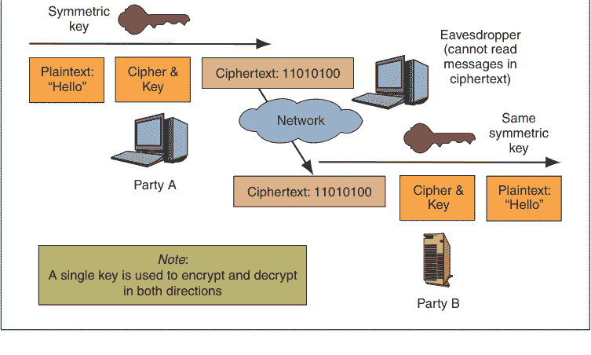

¹ 历史上，保密性也被称为 *privacy*。然而，在过去几年里，*privacy* 已开始表示个人隐私。

² 事实上，“密码学”来自希腊语单词 *kryptos*（隐藏）和 *graphos*（书写）。书写的含义（消息）对除预期接收者之外的所有人都是隐藏的。

图像、声音、视频，或几种数据格式的组合。然而，原名保留了下来，因此任何原始消息都称为明文。

## 加密与密文

加密是一种密码学过程，它将明文转换为称为密文的看似随机的比特流。发送者将此密文发送给接收者。如果窃听者拦截了它，他们将无法理解密文。然而，接收者将能够解密密文，将其转换回原始明文。

## 密码

图 3-1 显示加密和解密需要两件事。第一是密码，即在加密和解密中使用的特定数学过程。有许多密码，它们的操作各不相同。双方必须使用相同的密码，以便接收者能够解密消息。

> 密码是在加密和解密中使用的特定数学过程。

## 密钥

加密和解密所需的第二件事是密钥，即 40 到 4,000 位（1 和 0）的随机字符串。（较长的密钥更难猜测，因此提供更强的保密性。）对于给定的密码，不同的密钥会对同一明文生成不同的密文。

> 密钥是位（1 和 0）的随机字符串。

## 保持密钥秘密

数学家奥古斯特·克尔克霍夫斯认为在实践中保持密码秘密是不可能的。只有少数经过充分测试的密码，通常很容易确定正在使用哪种密码。幸运的是，克尔克霍夫斯证明只要密钥保持秘密，双方仍将具有保密性。克尔克霍夫斯定律指出保持密钥秘密是安全加密的秘诀。

> 克尔克霍夫斯定律指出为了具有保密性，通信双方只需保持密钥秘密，而非密码。

## 简单的密码

图 3-2 说明了一个简单的密码。此密码作用于字母表中的字母。该图有三列。

- 第一列包含相当平凡的明文 nowisthetime。删除大写字母和空格是为了简化示例。
- 第二列包含密钥。此密钥是一系列 1 到 26 之间的数字。
- 第三列是要传输的密文。

在此密码中，明文通过沿字母表向下移动每个字母转换为密文。明文字母向字母表中后移 N 个位置，其中 N 是该字母在密钥中的数字。例如，如果明文字母是 b 且密钥值为 2，则密文符号为 d。

- 示例中明文的第一个字母是 *n*，密钥值为 4。字母表中 *n* 之外的四个位置是 *r*，因此 *r* 是第一个字符的密文符号。
- 下一个明文字母是 *o*。这次的密钥值为 8。因此，密文为 *w*。
- 明文中的第三个字母是 *w*，密钥值为 15。十五步会超出字母表的末尾并重新开始于 *a*。最终的密文符号是 *l*。

到目前为止，我们有密文 *rwl*。你可以在“测试你的理解”问题中完成其余的密码。

如果你看过电视游戏节目 *Wheel of Fortune*，你就知道字母表中最常见的字母是 *e*。这个字母在这个简单消息中出现了两次。然而，每次的密钥值都不同——9 和 25。通过使用随机密钥，此密码可以使通过字母频率分析文本变得不可能。

此示例对明文使用了字母表中的字母。然而，几乎所有计算机信息都编码为一组位。密钥也是由 1 和 0 组成的字符串。此外，真正的密码使用多轮计算。到加密完成时，密文类似于纯随机的 1 和 0 字符串。

| 明文 | 密钥 | 密文 |
|---|---|---:|
| n | 4 | r |
| o | 8 | w |
| w | 15 | l |
| i | 16 | ... |
| s | 23 | ... |
| t | 16 | ... |
| h | 3 | ... |
| e | 9 | ... |
| t | 12 | ... |
| i | 20 | ... |
| m | 6 | ... |
| e | 25 | ... |

**图 3-2** 对称密钥密码示例

## 密码分析

**密码分析员**是破解加密的人。这种最简单的密码分析类型是**暴力密钥破解**——尝试所有可能的密钥，直到密码分析员找到正确的密钥。然而，正如我们将在本章后面看到的那样，如果密钥很长，暴力密钥破解将花费太长时间而无法使用。

在某些情况下，密码分析员可以猜测消息的至少一部分。例如，在第二次世界大战中，日本海军报告通常以相同的标准化开场问候开始。当出现这种规律时，密码分析员可能能够相当快地学习至少部分密钥。

此外，密码的实施可能很差，导致密钥的一部分随着每条消息“泄漏”。802.11 无线局域网传输标准最初使用了一种称为有线等效隐私（WEP）的安全方法。WEP 使用了泄漏信息的 RC4 加密密码实现。今天，WEP 密钥可以在 2 或 3 分钟内被破解。

## 测试你的理解

- 1. **a.** 定义密码学。
- **b.** 什么是保密性？
- **c.** 区分明文和密文。
- **d.** 跨网络传输的是明文还是密文？
- **e.** 什么是密码？
- **f.** 什么是密钥？
- **g.** 在保密加密中必须保持什么秘密？
- **h.** 什么是密码分析员？
- 2. 完成图 3-2 中的加密。

|  | 密钥（第1部分） |  |  |
|---|---|---|---|
| 密钥（第2部分） | 1 | 3 | 2 |
| 2 | n | o | w |
| 3 | i | s | t |
| 1 | h | e | t |

**图 3-3** 换位密码

## 替换密码和换位密码

今天密码中的特定数学过程极其复杂。然而，大多数使用两种基本数学过程的变体——替换和换位。

## 替换密码

在**替换密码**中，一个字符被另一个字符替换，但字符的顺序不变。如果这听起来像图 3-2 中讨论的密码，那是应该的。示例密码是一个非常简单的替换密码。每个字母被字母表中的另一个字母替换。然而，每个字母的位置保持相同。因此，*n-o-w* 变为 *r-w-l*。

> 在替换密码中，一个字符被另一个字符替换。

## 换位密码

在**换位密码**中，字母根据其在消息中的初始位置在消息内移动。字母本身没有改变，就像在替换密码中一样，但它们在消息中的位置会改变。

> 换位密码在消息内移动字母，但字符不会被替换。

图 3-3 显示了一个简单的换位密码。首先，明文（*nowisthet*）写在一个三乘三矩阵中——或尽可能多地容纳在矩阵中的消息。密钥有六个数字（132231）。密钥的第一部分（132）由每列的一个数字组成，第二部分（231）由每行的一个数字组成。

密码决定字母如何从换位框中取出。第一个取出的字母将具有列密钥值 1 和行密钥值 1。这是第一列和第三行。那里的字母是 *h*。因此，*h* 是第一个密文字符。

第二个取出的字母将具有列密钥值 1 和行密钥值 2。这是第一列和第一行。那里的字母是 *n*。因此，*n* 是第二个密文字符。我们现在在密文开头有 *hn*。其余的密文可以通过以类似的列-行顺序从换位框中取出字母来确定。

## 实际加密

在替换密码中，字母被改变但其位置不变。在换位密码中，字母不变，但其在密文中的位置改变。实际密码比我们的示例所示复杂得多。首先，加密是在位上进行的，而不是在字母表字母上。此外，实际密码

## 测试你的理解

- 3. a. 哪些保持字母不变——换位密码还是替换密码？
- b. 哪些保持字母在原始位置——换位密码还是替换密码？
- 4. 完成图 3-3 中的加密。


混合多次置换和替换以获得良好的随机性。幸运的是，在组织中工作的安全专业人员不必了解真实加密密码的具体工作原理。

## 密码与编码

阅读本章时，您可能期望看到的是 code 而不是 cipher 这个术语。然而，密码是一种通用的加密信息方式，而编码则有限制。

在密码中，一个字母被另一个字母替换，或者固定长度的比特串被另一个固定长度的比特串替换。双方只需要知道密钥。如果他们知道，就能传输他们想要的任何内容。代价是加密可能受到密码分析的攻击。

而密码作用于单个字符，编码则使用代码符号代表完整的单词或短语。图 3-4 显示了二战期间使用的日本 JN-25 海军作战密码的简化版本。

对于每个单词或标点符号，都有一个五位数字的代码词。这个代码词代替单词或其他符号发送。要编码一条消息，发件人查找单词或符号并写下五位代码。他或她然后继续下一个单词或符号。首先，他或她查找“from”并看到代码是 17434。发件人以 17434 开始密文。

对于常用单词或符号，密码本会有多个代码编号。例如，STOP 在消息中出现了三次。第一次，它被编码为 34058。第二次，它被编码为 26733。第三次，它被编码为 61552。常用单词和符号拥有多个代码使得密码分析员更难破解密码。⁴

编码很有吸引力，因为人们可以手工进行编码和解码，而无需计算机。缺点是密码本必须提前分发，如果一个密码本被截获，所有保密性都会丧失。

此外，即使是常用术语也只有有限数量的可能代码。因此，对于截获大量通信的密码分析员来说，学习密码本相对比较直接。相比之下，密码可以加密任何内容，如果密码密钥足够长（并且采取适当措施确保人们不会做降低保护的事情），那么密码就极其强大。密码在计算上复杂这一事实已不再是其使用的障碍，这得益于即使在移动电话上也有的高速处理能力。

| 消息 | 代码 |
|---|---|
| From | 17434 |
| Akagi | 63717 |
| To | 83971 |
| Truk | 11131 |
| STOP | 34058 |
| ETA | 53764 |
| 6 PM | 73104 |
| STOP | 26733 |
| Require | 29798 |
| B | 72135 |
| N | 54678 |
| STOP | 61552 |

图 3-4 日本海军作战密码 JN-25（简化版）

## 测试你的理解

- 5. a. 在编码中，代码符号代表什么？
- b. 编码的优势是什么？
- c. 缺点是什么？
- 6. 完成图 3-4 中消息的编码。

⁴该图显示了 JN-25 密码的另一个特征。舰船（赤城）将在下午 6 点抵达特鲁克海军基地。它需要在基地进行一些维护。 instead of stating the exact service, it refers to BN. 这是什么意思？JN-25 密码并未说明。实际上，BN 是代码中的代码。即使 JN-25 密码被完全破解，也不会告诉密码分析员 BN 的含义。完整的 JN-25 密码还有许多其他细微之处。此外，在编码消息创建后，JN-25 使用了一种有限形式的加密来进一步挫败密码分析。

## 对称密钥加密

我们讨论的密码被称为 **对称密钥加密** 密码，因为双方使用 *相同* 的密钥进行加密和解密。在使用对称密钥加密的双向通信中，双方仅使用单个密钥用于双向的加密和解密。

> 在对称密钥加密中，单个密钥用于加密和解密在双向通信中。

对称密钥加密速度很快，对计算机的[content]
混合多次置换和替换以获得良好的随机性。幸运的是，在组织中工作的安全专业人员不必了解真实加密密码的具体工作原理。

## 密码与编码

阅读本章时，您可能期望看到的是 code 而不是 cipher 这个术语。然而，密码是一种通用的加密信息方式，而编码则有限制。

在密码中，一个字母被另一个字母替换，或者固定长度的比特串被另一个固定长度的比特串替换。双方只需要知道密钥。如果他们知道，就能传输他们想要的任何内容。代价是加密可能受到密码分析的攻击。

而密码作用于单个字符，编码则使用代码符号代表完整的单词或短语。图 3-4 显示了二战期间使用的日本 JN-25 海军作战密码的简化版本。

对于每个单词或标点符号，都有一个五位数字的代码词。这个代码词代替单词或其他符号发送。要编码一条消息，发件人查找单词或符号并写下五位代码。他或她然后继续下一个单词或符号。首先，他或她查找“from”并看到代码是 17434。发件人以 17434 开始密文。

对于常用单词或符号，密码本会有多个代码编号。例如，STOP 在消息中出现了三次。第一次，它被编码为 34058。第二次，它被编码为 26733。第三次，它被编码为 61552。常用单词和符号拥有多个代码使得密码分析员更难破解密码。⁴

编码很有吸引力，因为人们可以手工进行编码和解码，而无需计算机。缺点是密码本必须提前分发，如果一个密码本被截获，所有保密性都会丧失。

此外，即使是常用术语也只有有限数量的可能代码。因此，对于截获大量通信的密码分析员来说，学习密码本相对比较直接。相比之下，密码可以加密任何内容，如果密码密钥足够长（并且采取适当措施确保人们不会做降低保护的事情），那么密码就极其强大。密码在计算上复杂这一事实已不再是其使用的障碍，这得益于即使在移动电话上也有的高速处理能力。

| 消息 | 代码 |
|---|---|
| From | 17434 |
| Akagi | 63717 |
| To | 83971 |
| Truk | 11131 |
| STOP | 34058 |
| ETA | 53764 |
| 6 PM | 73104 |
| STOP | 26733 |
| Require | 29798 |
| B | 72135 |
| N | 54678 |
| STOP | 61552 |

图 3-4 日本海军作战密码 JN-25（简化版）

## 测试你的理解

- 5. a. 在编码中，代码符号代表什么？
- b. 编码的优势是什么？
- c. 缺点是什么？
- 6. 完成图 3-4 中消息的编码。

⁴该图显示了 JN-25 密码的另一个特征。舰船（赤城）将在下午 6 点抵达特鲁克海军基地。它需要在基地进行一些维护。而不是说明具体的维修项目，它指的是 BN。这是什么意思？JN-25 密码并未说明。实际上，BN 是代码中的代码。即使 JN-25 密码被完全破解，也不会告诉密码分析员 BN 的含义。完整的 JN-25 密码还有许多其他细微之处。此外，在编码消息创建后，JN-25 使用了一种有限形式的加密来进一步挫败密码分析。

## 对称密钥加密

我们讨论的密码被称为 **对称密钥加密** 密码，因为双方使用 *相同* 的密钥进行加密和解密。在使用对称密钥加密的双向通信中，双方仅使用单个密钥用于双向的加密和解密。

> 在对称密钥加密中，单个密钥用于加密和解密在双向通信中。

对称密钥加密速度很快，对计算机的[content]
混合多次置换和替换以获得良好的随机性。幸运的是，在组织中工作的安全专业人员不必了解真实加密密码的具体工作原理。

## 密码与编码

阅读本章时，您可能期望看到的是 code 而不是 cipher 这个术语。然而，密码是一种通用的加密信息方式，而编码则有限制。

在密码中，一个字母被另一个字母替换，或者固定长度的比特串被另一个固定长度的比特串替换。双方只需要知道密钥。如果他们知道，就能传输他们想要的任何内容。代价是加密可能受到密码分析的攻击。

而密码作用于单个字符，编码则使用代码符号代表完整的单词或短语。图 3-4 显示了二战期间使用的日本 JN-25 海军作战密码的简化版本。

对于每个单词或标点符号，都有一个五位数字的代码词。这个代码词代替单词或其他符号发送。要编码一条消息，发件人查找单词或符号并写下五位代码。他或她然后继续下一个单词或符号。首先，他或她查找“from”并看到代码是 17434。发件人以 17434 开始密文。

对于常用单词或符号，密码本会有多个代码编号。例如，STOP 在消息中出现了三次。第一次，它被编码为 34058。第二次，它被编码为 26733。第三次，它被编码为 61552。常用单词和符号拥有多个代码使得密码分析员更难破解密码。⁴

编码很有吸引力，因为人们可以手工进行编码和解码，而无需计算机。缺点是密码本必须提前分发，如果一个密码本被截获，所有保密性都会丧失。

此外，即使是常用术语也只有有限数量的可能代码。因此，对于截获大量通信的密码分析员来说，学习密码本相对比较直接。相比之下，密码可以加密任何内容，如果密码密钥足够长（并且采取适当措施确保人们不会做降低保护的事情），那么密码就极其强大。密码在计算上复杂这一事实已不再是其使用的障碍，这得益于即使在移动电话上也有的高速处理能力。

| 消息 | 代码 |
|---|---|
| From | 17434 |
| Akagi | 63717 |
| To | 83971 |
| Truk | 11131 |
| STOP | 34058 |
| ETA | 53764 |
| 6 PM | 73104 |
| STOP | 26733 |
| Require | 29798 |
| B | 72135 |
| N | 54678 |
| STOP | 61552 |

图 3-4 日本海军作战密码 JN-25（简化版）

## 测试你的理解

- 5. a. 在编码中，代码符号代表什么？
- b. 编码的优势是什么？
- c. 缺点是什么？
- 6. 完成图 3-4 中消息的编码。

⁴该图显示了 JN-25 密码的另一个特征。舰船（赤城）将在下午 6 点抵达特鲁克海军基地。它需要在基地进行一些维护。而不是说明具体的维修项目，它指的是 BN。这是什么意思？JN-25 密码并未说明。实际上，BN 是代码中的代码。即使 JN-25 密码被完全破解，也不会告诉密码分析员 BN 的含义。完整的 JN-25 密码还有许多其他细微之处。此外，在编码消息创建后，JN-25 使用了一种有限形式的加密来进一步挫败密码分析。

## 对称密钥加密

我们讨论的密码被称为 **对称密钥加密** 密码，因为双方使用 *相同* 的密钥进行加密和解密。在使用对称密钥加密的双向通信中，双方仅使用单个密钥用于双向的加密和解密。

> 在对称密钥加密中，单个密钥用于加密和解密在双向通信中。

对称密钥加密速度很快，对计算机的[content]
混合多次置换和替换以获得良好的随机性。幸运的是，在组织中工作的安全专业人员不必了解真实加密密码的具体工作原理。

## 密码与编码

阅读本章时，您可能期望看到的是 code 而不是 cipher 这个术语。然而，密码是一种通用的加密信息方式，而编码则有限制。

在密码中，一个字母被另一个字母替换，或者固定长度的比特串被另一个固定长度的比特串替换。双方只需要知道密钥。如果他们知道，就能传输他们想要的任何内容。代价是加密可能受到密码分析的攻击。

而密码作用于单个字符，编码则使用代码符号代表完整的单词或短语。图 3-4 显示了二战期间使用的日本 JN-25 海军作战密码的简化版本。

对于每个单词或标点符号，都有一个五位数字的代码词。这个代码词代替单词或其他符号发送。要编码一条消息，发件人查找单词或符号并写下五位代码。他或她然后继续下一个单词或符号。首先，他或她查找“from”并看到代码是 17434。发件人以 17434 开始密文。

对于常用单词或符号，密码本会有多个代码编号。例如，STOP 在消息中出现了三次。第一次，它被编码为 34058。第二次，它被编码为 26733。第三次，它被编码为 61552。常用单词和符号拥有多个代码使得密码分析员更难破解密码。⁴

编码很有吸引力，因为人们可以手工进行编码和解码，而无需计算机。缺点是密码本必须提前分发，如果一个密码本被截获，所有保密性都会丧失。

此外，即使是常用术语也只有有限数量的可能代码。因此，对于截获大量通信的密码分析员来说，学习密码本相对比较直接。相比之下，密码可以加密任何内容，如果密码密钥足够长（并且采取适当措施确保人们不会做降低保护的事情），那么密码就极其强大。密码在计算上复杂这一事实已不再是其使用的障碍，这得益于即使在移动电话上也有的高速处理能力。

| 消息 | 代码 |
|---|---|
| From | 17434 |
| Akagi | 63717 |
| To | 83971 |
| Truk | 11131 |
| STOP | 34058 |
| ETA | 53764 |
| 6 PM | 73104 |
| STOP | 26733 |
| Require | 29798 |
| B | 72135 |
| N | 54678 |
| STOP | 61552 |

图 3-4 日本海军作战密码 JN-25（简化版）

## 测试你的理解

- 5. a. 在编码中，代码符号代表什么？
- b. 编码的优势是什么？
- c. 缺点是什么？
- 6. 完成图 3-4 中消息的编码。

⁴该图显示了 JN-25 密码的另一个特征。舰船（赤城）将在下午 6 点抵达特鲁克海军基地。它需要在基地进行一些维护。而不是说明具体的维修项目，它指的是 BN。这是什么意思？JN-25 密码并未说明。实际上，BN 是代码中的代码。即使 JN-25 密码被完全破解，也不会告诉密码分析员 BN 的含义。完整的 JN-25 密码还有许多其他细微之处。此外，在编码消息创建后，JN-25 使用了一种有限形式的加密来进一步挫败密码分析。

## 对称密钥加密

我们讨论的密码被称为 **对称密钥加密** 密码，因为双方使用 *相同* 的密钥进行加密和解密。在使用对称密钥加密的双向通信中，双方仅使用单个密钥用于双向的加密和解密。

> 在对称密钥加密中，单个密钥用于加密和解密在双向通信中。

对称密钥加密速度很快，对计算机的[content]
混合多次置换和替换以获得良好的随机性。幸运的是，在组织中工作的安全专业人员不必了解真实加密密码的具体工作原理。

## 密码与编码

阅读本章时，您可能期望看到的是 code 而不是 cipher 这个术语。然而，密码是一种通用的加密信息方式，而编码则有限制。

在密码中，一个字母被另一个字母替换，或者固定长度的比特串被另一个固定长度的比特串替换。双方只需要知道密钥。如果他们知道，就能传输他们想要的任何内容。代价是加密可能受到密码分析的攻击。

而密码作用于单个字符，编码则使用代码符号代表完整的单词或短语。图 3-4 显示了二战期间使用的日本 JN-25 海军作战密码的简化版本。

对于每个单词或标点符号，都有一个五位数字的代码词。这个代码词代替单词或其他符号发送。要编码一条消息，发件人查找单词或符号并写下五位代码。他或她然后继续下一个单词或符号。首先，他或她查找“from”并看到代码是 17434。发件人以 17434 开始密文。

对于常用单词或符号，密码本会有多个代码编号。例如，STOP 在消息中出现了三次。第一次，它被编码为 34058。第二次，它被编码为 26733。第三次，它被编码为 61552。常用单词和符号拥有多个代码使得密码分析员更难破解密码。⁴

编码很有吸引力，因为人们可以手工进行编码和解码，而无需计算机。缺点是密码本必须提前分发，如果一个密码本被截获，所有保密性都会丧失。

此外，即使是常用术语也只有有限数量的可能代码。因此，对于截获大量通信的密码分析员来说，学习密码本相对比较直接。相比之下，密码可以加密任何内容，如果密码密钥足够长（并且采取适当措施确保人们不会做降低保护的事情），那么密码就极其强大。密码在计算上复杂这一事实已不再是其使用的障碍，这得益于即使在移动电话上也有的高速处理能力。

| 消息 | 代码 |
|---|---|
| From | 17434 |
| Akagi | 63717 |
| To | 83971 |
| Truk | 11131 |
| STOP | 34058 |
| ETA | 53764 |
| 6 PM | 73104 |
| STOP | 26733 |
| Require | 29798 |
| B | 72135 |
| N | 54678 |
| STOP | 61552 |

图 3-4 日本海军作战密码 JN-25（简化版）

## 测试你的理解

- 5. a. 在编码中，代码符号代表什么？
- b. 编码的优势是什么？
- c. 缺点是什么？
- 6. 完成图 3-4 中消息的编码。

⁴该图显示了 JN-25 密码的另一个特征。舰船（赤城）将在下午 6 点抵达特鲁克海军基地。它需要在基地进行一些维护。而不是说明具体的维修项目，它指的是 BN。这是什么意思？JN-25 密码并未说明。实际上，BN 是代码中的代码。即使 JN-25 密码被完全破解，也不会告诉密码分析员 BN 的含义。完整的 JN-25 密码还有许多其他细微之处。此外，在编码消息创建后，JN-25 使用了一种有限形式的加密来进一步挫败密码分析。

## 对称密钥加密

我们讨论的密码被称为 **对称密钥加密** 密码，因为双方使用 *相同* 的密钥进行加密和解密。在使用对称密钥加密的双向通信中，双方仅使用单个密钥用于双向的加密和解密。

> 在对称密钥加密中，单个密钥用于加密和解密在双向通信中。

对称密钥加密速度很快，对计算机的[content]
混合多次置换和替换以获得良好的随机性。幸运的是，在组织中工作的安全专业人员不必了解真实加密密码的具体工作原理。

## 密码与编码

阅读本章时，您可能期望看到的是 code 而不是 cipher 这个术语。然而，密码是一种通用的加密信息方式，而编码则有限制。

在密码中，一个字母被另一个字母替换，或者固定长度的比特串被另一个固定长度的比特串替换。双方只需要知道密钥。如果他们知道，就能传输他们想要的任何内容。代价是加密可能受到密码分析的攻击。

而密码作用于单个字符，编码则使用代码符号代表完整的单词或短语。图 3-4 显示了二战期间使用的日本 JN-25 海军作战密码的简化版本。

对于每个单词或标点符号，都有一个五位数字的代码词。这个代码词代替单词或其他符号发送。要编码一条消息，发件人查找单词或符号并写下五位代码。他或她然后继续下一个单词或符号。首先，他或她查找“from”并看到代码是 17434。发件人以 17434 开始密文。

对于常用单词或符号，密码本会有多个代码编号。例如，STOP 在消息中出现了三次。第一次，它被编码为 34058。第二次，它被编码为 26733。第三次，它被编码为 61552。常用单词和符号拥有多个代码使得密码分析员更难破解密码。⁴

编码很有吸引力，因为人们可以手工进行编码和解码，而无需计算机。缺点是密码本必须提前分发，如果一个密码本被截获，所有保密性都会丧失。

此外，即使是常用术语也只有有限数量的可能代码。因此，对于截获大量通信的密码分析员来说，学习密码本相对比较直接。相比之下，密码可以加密任何内容，如果密码密钥足够长（并且采取适当措施确保人们不会做降低保护的事情），那么密码就极其强大。密码在计算上复杂这一事实已不再是其使用的障碍，这得益于即使在移动电话上也有的高速处理能力。

| 消息 | 代码 |
|---|---|
| From | 17434 |
| Akagi | 63717 |
| To | 83971 |
| Truk | 11131 |
| STOP | 34058 |
| ETA | 53764 |
| 6 PM | 73104 |
| STOP | 26733 |
| Require | 29798 |
| B | 72135 |
| N | 54678 |
| STOP | 61552 |

图 3-4 日本海军作战密码 JN-25（简化版）

## 测试你的理解

- 5. a. 在编码中，代码符号代表什么？
- b. 编码的优势是什么？
- c. 缺点是什么？
- 6. 完成图 3-4 中消息的编码。

⁴该图显示了 JN-25 密码的另一个特征。舰船（赤城）将在下午 6 点抵达特鲁克海军基地。它需要在基地进行一些维护。而不是说明具体的维修项目，它指的是 BN。这是什么意思？JN-25 密码并未说明。实际上，BN 是代码中的代码。即使 JN-25 密码被完全破解，也不会告诉密码分析员 BN 的含义。完整的 JN-25 密码还有许多其他细微之处。此外，在编码消息创建后，JN-25 使用了一种有限形式的加密来进一步挫败密码分析。

## 对称密钥加密

我们讨论的密码被称为 **对称密钥加密** 密码，因为双方使用 *相同* 的密钥进行加密和解密。在使用对称密钥加密的双向通信中，双方仅使用单个密钥用于双向的加密和解密。

> 在对称密钥加密中，单个密钥用于加密和解密在双向通信中。

对称密钥加密速度很快，对计算机的[content]
混合多次置换和替换以获得良好的随机性。幸运的是，在组织中工作的安全专业人员不必了解真实加密密码的具体工作原理。

## 密码与编码

阅读本章时，您可能期望看到的是 code 而不是 cipher 这个术语。然而，密码是一种通用的加密信息方式，而编码则有限制。

在密码中，一个字母被另一个字母替换，或者固定长度的比特串被另一个固定长度的比特串替换。双方只需要知道密钥。如果他们知道，就能传输他们想要的任何内容。代价是加密可能受到密码分析的攻击。

而密码作用于单个字符，编码则使用代码符号代表完整的单词或短语。图 3-4 显示了二战期间使用的日本 JN-25 海军作战密码的简化版本。

对于每个单词或标点符号，都有一个五位数字的代码词。这个代码词代替单词或其他符号发送。要编码一条消息，发件人查找单词或符号并写下五位代码。他或她然后继续下一个单词或符号。首先，他或她查找“from”并看到代码是 17434。发件人以 17434 开始密文。

对于常用单词或符号，密码本会有多个代码编号。例如，STOP 在消息中出现了三次。第一次，它被编码为 34058。第二次，它被编码为 26733。第三次，它被编码为 61552。常用单词和符号拥有多个代码使得密码分析员更难破解密码。⁴

编码很有吸引力，因为人们可以手工进行编码和解码，而无需计算机。缺点是密码本必须提前分发，如果一个密码本被截获，所有保密性都会丧失。

此外，即使是常用术语也只有有限数量的可能代码。因此，对于截获大量通信的密码分析员来说，学习密码本相对比较直接。相比之下，密码可以加密任何内容，如果密码密钥足够长（并且采取适当措施确保人们不会做降低保护的事情），那么密码就极其强大。密码在计算上复杂这一事实已不再是其使用的障碍，这得益于即使在移动电话上也有的高速处理能力。

| 消息 | 代码 |
|---|---|
| From | 17434 |
| Akagi | 63717 |
| To | 83971 |
| Truk | 11131 |
| STOP | 34058 |
| ETA | 53764 |
| 6 PM | 73104 |
| STOP | 26733 |
| Require | 29798 |
| B | 72135 |
| N | 54678 |
| STOP | 61552 |

图 3-4 日本海军作战密码 JN-25（简化版）

## 测试你的理解

- 5. a. 在编码中，代码符号代表什么？
- b. 编码的优势是什么？
- c. 缺点是什么？
- 6. 完成图 3-4 中消息的编码。

⁴该图显示了 JN-25 密码的另一个特征。舰船（赤城）将在下午 6 点抵达特鲁克海军基地。它需要在基地进行一些维护。而不是说明具体的维修项目，它指的是 BN。这是什么意思？JN-25 密码并未说明。实际上，BN 是代码中的代码。即使 JN-25 密码被完全破解，也不会告诉密码分析员 BN 的含义。完整的 JN-25 密码还有许多其他细微之处。此外，在编码消息创建后，JN-25 使用了一种有限形式的加密来进一步挫败密码分析。

## 对称密钥加密

我们讨论的密码被称为 **对称密钥加密** 密码，因为双方使用 *相同* 的密钥进行加密和解密。在使用对称密钥加密的双向通信中，双方仅使用单个密钥用于双向的加密和解密。

> 在对称密钥加密中，单个密钥用于加密和解密在双向通信中。

对称密钥加密速度很快，对计算机的[content]
混合多次置换和替换以获得良好的随机性。幸运的是，在组织中工作的安全专业人员不必了解真实加密密码的具体工作原理。

## 密码与编码

阅读本章时，您可能期望看到的是 code 而不是 cipher 这个术语。然而，密码是一种通用的加密信息方式，而编码则有限制。

在密码中，一个字母被另一个字母替换，或者固定长度的比特串被另一个固定长度的比特串替换。双方只需要知道密钥。如果他们知道，就能传输他们想要的任何内容。代价是加密可能受到密码分析的攻击。

而密码作用于单个字符，编码则使用代码符号代表完整的单词或短语。图 3-4 显示了二战期间使用的日本 JN-25 海军作战密码的简化版本。

对于每个单词或标点符号，都有一个五位数字的代码词。这个代码词代替单词或其他符号发送。要编码一条消息，发件人查找单词或符号并写下五位代码。他或她然后继续下一个单词或符号。首先，他或她查找“from”并看到代码是 17434。发件人以 17434 开始密文。

对于常用单词或符号，密码本会有多个代码编号。例如，STOP 在消息中出现了三次。第一次，它被编码为 34058。第二次，它被编码为 26733。第三次，它被编码为 61552。常用单词和符号拥有多个代码使得密码分析员更难破解密码。⁴

编码很有吸引力，因为人们可以手工进行编码和解码，而无需计算机。缺点是密码本必须提前分发，如果一个密码本被截获，所有保密性都会丧失。

此外，即使是常用术语也只有有限数量的可能代码。因此，对于截获大量通信的密码分析员来说，学习密码本相对比较直接。相比之下，密码可以加密任何内容，如果密码密钥足够长（并且采取适当措施确保人们不会做降低保护的事情），那么密码就极其强大。密码在计算上复杂这一事实已不再是其使用的障碍，这得益于即使在移动电话上也有的高速处理能力。

| 消息 | 代码 |
|---|---|
| From | 17434 |
| Akagi | 63717 |
| To | 83971 |
| Truk | 11131 |
| STOP | 34058 |
| ETA | 53764 |
| 6 PM | 73104 |
| STOP | 26733 |
| Require | 29798 |
| B | 72135 |
| N | 54678 |
| STOP | 61552 |

图 3-4 日本海军作战密码 JN-25（简化版）

## 测试你的理解

- 5. a. 在编码中，代码符号代表什么？
- b. 编码的优势是什么？
- c. 缺点是什么？
- 6. 完成图 3-4 中消息的编码。

⁴该图显示了 JN-25 密码的另一个特征。舰船（赤城）将在下午 6 点抵达特鲁克海军基地。它需要在基地进行一些维护。而不是说明具体的维修项目，它指的是 BN。这是什么意思？JN-25 密码并未说明。实际上，BN 是代码中的代码。即使 JN-25 密码被完全破解，也不会告诉密码分析员 BN 的含义。完整的 JN-25 密码还有许多其他细微之处。此外，在编码消息创建后，JN-25 使用了一种有限形式的加密来进一步挫败密码分析。

## 对称密钥加密

我们讨论的密码被称为 **对称密钥加密** 密码，因为双方使用 *相同* 的密钥进行加密和解密。在使用对称密钥加密的双向通信中，双方仅使用单个密钥用于双向的加密和解密。

> 在对称密钥加密中，单个密钥用于加密和解密在双向通信中。

对称密钥加密速度快，对计算机的[content]
混合多次置换和替换以获得良好的随机性。幸运的是，在组织中工作的安全专业人员不必了解真实加密密码的具体工作原理。

## 密码与编码

阅读本章时，您可能期望看到的是 code 而不是 cipher 这个术语。然而，密码是一种通用的加密信息方式，而编码则有限制。

在密码中，一个字母被另一个字母替换，或者固定长度的比特串被另一个固定长度的比特串替换。双方只需要知道密钥。如果他们知道，就能传输他们想要的任何内容。代价是加密可能受到密码分析的攻击。

而密码作用于单个字符，编码则使用代码符号代表完整的单词或短语。图 3-4 显示了二战期间使用的日本 JN-25 海军作战密码的简化版本。

对于每个单词或标点符号，都有一个五位数字的代码词。这个代码词代替单词或其他符号发送。要编码一条消息，发件人查找单词或符号并写下五位代码。他或她然后继续下一个单词或符号。首先，他或她查找“from”并看到代码是 17434。发件人以 17434 开始密文。

对于常用单词或符号，密码本会有多个代码编号。例如，STOP 在消息中出现了三次。第一次，它被编码为 34058。第二次，它被编码为 26733。第三次，它被编码为 61552。常用单词和符号拥有多个代码使得密码分析员更难破解密码。⁴

编码很有吸引力，因为人们可以手工进行编码和解码，而无需计算机。缺点是密码本必须提前分发，如果一个密码本被截获，所有保密性都会丧失。

此外，即使是常用术语也只有有限数量的可能代码。因此，对于截获大量通信的密码分析员来说，学习密码本相对比较直接。相比之下，密码可以加密任何内容，如果密码密钥足够长（并且采取适当措施确保人们不会做降低保护的事情），那么密码就极其强大。密码在计算上复杂这一事实已不再是其使用的障碍，这得益于即使在移动电话上也有的高速处理能力。

| 消息 | 代码 |
|---|---|
| From | 17434 |
| Akagi | 63717 |
| To | 83971 |
| Truk | 11131 |
| STOP | 34058 |
| ETA | 53764 |
| 6 PM | 73104 |
| STOP | 26733 |
| Require | 29798 |
| B | 72135 |
| N | 54678 |
| STOP | 61552 |

图 3-4 日本海军作战密码 JN-25（简化版）

## 测试你的理解

- 5. a. 在编码中，代码符号代表什么？
- b. 编码的优势是什么？
- c. 缺点是什么？
- 6. 完成图 3-4 中消息的编码。

⁴该图显示了 JN-25 密码的另一个特征。舰船（赤城）将在下午 6 点抵达特鲁克海军基地。它需要在基地进行一些维护。而不是说明具体的维修项目，它指的是 BN。这是什么意思？JN-25 密码并未说明。实际上，BN 是代码中的代码。即使 JN-25 密码被完全破解，也不会告诉密码分析员 BN 的含义。完整的 JN-25 密码还有许多其他细微之处。此外，在编码消息创建后，JN-25 使用了一种有限形式的加密来进一步挫败密码分析。

## 对称密钥加密

我们讨论的密码被称为 **对称密钥加密** 密码，因为双方使用 *相同* 的密钥进行加密和解密。在使用对称密钥加密的双向通信中，双方仅使用单个密钥用于双向的加密和解密。

> 在对称密钥加密中，单个密钥用于加密和解密在双向通信中。

对称密钥加密处理开销小，计算机负担轻。因此，即使是个人电脑和手持设备也具备足够的[content]
混合多次置换和替换以获得良好的随机性。幸运的是，在组织中工作的安全专业人员不必了解真实加密密码的具体工作原理。
## 密码与编码
阅读本章时，您可能期望看到的是 code 而不是 cipher 这个术语。然而，密码是一种通用的加密信息方式，而编码则有限制。
在密码中，一个字母被另一个字母替换，或者固定长度的比特串被另一个固定长度的比特串替换。双方只需要知道密钥。如果他们知道，就能传输他们想要的任何内容。代价是加密可能受到密码分析的攻击。
而密码作用于单个字符，编码则使用代码符号代表完整的单词或短语。图 3-4 显示了二战期间使用的日本 JN-25 海军作战密码的简化版本。
对于每个单词或标点符号，都有一个五位数字的代码词。这个代码词代替单词或其他符号发送。要编码一条消息，发件人查找单词或符号并写下五位代码。他或她然后继续下一个单词或符号。首先，他或她查找“from”并看到代码是 17434。发件人以 17434 开始密文。
对于常用单词或符号，密码本会有多个代码编号。例如，STOP 在消息中出现了三次。第一次，它被编码为 34058。第二次，它被编码为 26733。第三次，它被编码为 61552。常用单词和符号拥有多个代码使得密码分析员更难破解密码。⁴
编码很有吸引力，因为人们可以手工进行编码和解码，而无需计算机。缺点是密码本必须提前分发，如果一个密码本被截获，所有保密性都会丧失。
此外，即使是常用术语也只有有限数量的可能代码。因此，对于截获大量通信的密码分析员来说，学习密码本相对比较直接。相比之下，密码可以加密任何内容，如果密码密钥足够长（并且采取适当措施确保人们不会做降低保护的事情），那么密码就极其强大。密码在计算上复杂这一事实已不再是其使用的障碍，这得益于即使在移动电话上也有的高速处理能力。
| 消息 | 代码 |
|---|---|
| From | 17434 |
| Akagi | 63717 |
| To | 83971 |
| Truk | 11131 |
| STOP | 34058 |
| ETA | 53764 |
| 6 PM | 73104 |
| STOP | 26733 |
| Require | 29798 |
| B | 72135 |
| N | 54678 |
| STOP | 61552 |
图 3-4 日本海军作战密码 JN-25（简化版）
## 测试你的理解
- 5. a. 在编码中，代码符号代表什么？
- b. 编码的优势是什么？
- c. 缺点是什么？
- 6. 完成图 3-4 中消息的编码。
⁴该图显示了 JN-25 密码的另一个特征。舰船（赤城）将在下午 6 点抵达特鲁克海军基地。它需要在基地进行一些维护。而不是说明具体的维修项目，它指的是 BN。这是什么意思？JN-25 密码并未说明。实际上，BN 是代码中的代码。即使 JN-25 密码被完全破解，也不会告诉密码分析员 BN 的含义。完整的 JN-25 密码还有许多其他细微之处。此外，在编码消息创建后，JN-25 使用了一种有限形式的加密来进一步挫败密码分析。
## 对称密钥加密
我们讨论的密码被称为 **对称密钥加密** 密码，因为双方使用 *相同* 的密钥进行加密和解密。在使用对称密钥加密的双向通信中，双方仅使用单个密钥用于双向的加密和解密。
> 在对称密钥加密中，单个密钥用于加密和解密在双向通信中。
对称密钥加密处理开销小，计算机负担轻。因此，即使是个人电脑和手持设备也具备足够的[content]
混合多次置换和替换以获得良好的随机性。幸运的是，在组织中工作的安全专业人员不必了解真实加密密码的具体工作原理。

## 密码与编码

阅读本章时，您可能期望看到的是 code 而不是 cipher 这个术语。然而，密码是一种通用的加密信息方式，而编码则有限制。

在密码中，一个字母被另一个字母替换，或者固定长度的比特串被另一个固定长度的比特串替换。双方只需要知道密钥。如果他们知道，就能传输他们想要的任何内容。代价是加密可能受到密码分析的攻击。

而密码作用于单个字符，编码则使用代码符号代表完整的单词或短语。图 3-4 显示了二战期间使用的日本 JN-25 海军作战密码的简化版本。

对于每个单词或标点符号，都有一个五位数字的代码词。这个代码词代替单词或其他符号发送。要编码一条消息，发件人查找单词或符号并写下五位代码。他或她然后继续下一个单词或符号。首先，他或她查找“from”并看到代码是 17434。发件人以 17434 开始密文。

对于常用单词或符号，密码本会有多个代码编号。例如，STOP 在消息中出现了三次。第一次，它被编码为 34058。第二次，它被编码为 26733。第三次，它被编码为 61552。常用单词和符号拥有多个代码使得密码分析员更难破解密码。⁴

编码很有吸引力，因为人们可以手工进行编码和解码，而无需计算机。缺点是密码本必须提前分发，如果一个密码本被截获，所有保密性都会丧失。

此外，即使是常用术语也只有有限数量的可能代码。因此，对于截获大量通信的密码分析员来说，学习密码本相对比较直接。相比之下，密码可以加密任何内容，如果密码密钥足够长（并且采取适当措施确保人们不会做降低保护的事情），那么密码就极其强大。密码在计算上复杂这一事实已不再是其使用的障碍，这得益于即使在移动电话上也有的高速处理能力。

| 消息 | 代码 |
|---|---|
| From | 17434 |
| Akagi | 63717 |
| To | 83971 |
| Truk | 11131 |
| STOP | 34058 |
| ETA | 53764 |
| 6 PM | 73104 |
| STOP | 26733 |
| Require | 29798 |
| B | 72135 |
| N | 54678 |
| STOP | 61552 |

图 3-4 日本海军作战密码 JN-25（简化版）

## 测试你的理解

- 5. a. 在编码中，代码符号代表什么？
- b. 编码的优势是什么？
- c. 缺点是什么？
- 6. 完成图 3-4 中消息的编码。

⁴该图显示了 JN-25 密码的另一个特征。舰船（赤城）将在下午 6 点抵达特鲁克海军基地。它需要在基地进行一些维护。而不是说明具体的维修项目，它指的是 BN。这是什么意思？JN-25 密码并未说明。实际上，BN 是代码中的代码。即使 JN-25 密码被完全破解，也不会告诉密码分析员 BN 的含义。完整的 JN-25 密码还有许多其他细微之处。此外，在编码消息创建后，JN-25 使用了一种有限形式的加密来进一步挫败密码分析。


## 密码学中的人为问题

在密钥足够长且使用经过充分测试的密码的情况下，从技术角度来看，对称密钥加密以实现保密是难以破解的。然而，如果发送方或接收方未能保守密钥的秘密，窃听者可能会获知密钥并读取每一条消息。

更广泛地说，一般的通信纪律不良可能会削弱最强的密码和最长的密钥。例如，在第二次世界大战期间，日本海军经常在几乎没有必要的情况下发送消息。这为盟军密码学家提供了大量可供检查的消息。这使得密码分析员的工作比日本使用更好的通信纪律时容易得多。此外，正如本章前面所述，日本海军报告通常以一段冗长的华丽引言开头，长度为数句。这种“已知明文”情况在破解日本密码本方面极具价值。另外，有助于破解的是，传输通常遵循一套固定的格式，用于常见类型的情形，例如报告船舶的速度和罗盘方位。

使用 HTTPS 发送加密电子邮件与使用 HTTP（非加密）连接相比，整体连接速度会略微变慢。然而，使用 SSL 对电子邮件消息的传输进行加密将阻止中间人攻击。HTTPS 现在是所有基于 Web 的电子邮件服务的默认设置。

通信双方甚至可能产生虚假的安全感，因为他们会认为被破解的加密方法仍在保护他们。在第二次世界大战期间，德国拥有一种名为 Enigma 的加密机器，从技术上来说非常先进。然而，波兰军方缴获了一台机器的复制品并对其进行逆向工程以揭示其工作原理。波兰沦陷后，波兰人将他们的研究成果交给了英国人，后者继续了这项工作。最终，英国人能够读取用 Enigma 加密的大量德国消息。过于自信的德国人发送了大量非常敏感的通信，认为自己完全安全。

密码学的现实是，它并不是自动的保护。只有当公司拥有并执行不损害密码技术优势的组织流程时，它才有效。

## 测试你的理解

9. 为什么密码学不是自动保护？

## 新闻动态

### 不再加密

2019 年，英国新任内政部国务大臣普里蒂·帕特尔表示，她希望在所有端到端加密系统中插入后门访问，以便执法部门更容易查看用户数据和通信。这将有效地终结端到端加密并削弱英国的隐私。帕特尔被引述说，“当系统有意使用端到端加密设计时，这会阻止任何形式的访问内容，无论可能促成什么犯罪，我们都必须采取行动。”

### 加密投票

2019 年，微软展示了其名为 ElectionGuard 的新型安全投票系统。该新型电子投票系统为选民提供电子投票或将选票打印在纸上的选项。^9^ 它还为选民提供跟踪代码，让他们可以在线验证自己的选票是否已被计入，而不透露其具体的选票选择。微软已将 ElectionGuard 系统的源代码发布在 GitHub 上供任何人审查，并表示将使代码开源供任何人使用。消费者定期使用在线系统进行银行、查看医疗记录、支付账单和购买几乎所有东西。安全的电子投票可能是下一个。

### WhatsApp 后门

2017 年发现 WhatsApp 中放置了一个后门，允许黑客或 WhatsApp 本身拦截和查看加密消息。^10^ 2016 年，WhatsApp 默认对所有 10 亿用户启用了端到端加密。这对担心其私人消息被查看的用户来说是一个巨大的宽慰。然而，这一新的安全漏洞被一些人视为允许更用户友好的体验的“功能”。其他人则认为 WhatsApp 对端到端安全协议的实现削弱了用户的隐私。

### 自加密 SSD

2018 年，来自荷兰的两名研究人员 Carlo Meijer 和 Bernard van Gastel 发现了几种流行自加密 SSD 驱动器固件中的漏洞，这些漏洞会允许攻击者绕过所有加密保护。^11^ 攻击者随后可以在不知道用户密码或加密密钥的情况下直接访问用户数据。这些漏洞发现于三星和 Crucial 制造的驱动器中，但研究人员警告称，其他制造商的设备可能包含类似漏洞。了解潜在的密码学漏洞很重要，这样用户就不会产生虚假的安全感并丢失机密数据。

### 加密之死

2019 年，Facebook 宣布其计划将“内容审核”推向用户设备。这本质上将允许 Facebook 及其子公司 WhatsApp 和 Instagram 在内容甚至传输之前扫描用户内容。^12^ 端到端加密仅能在用户之间提供保护。但消息的创建和读取位置，即端点，将会持续被扫描。端到端加密承诺的加密保护将被这些新的设备端内容扫描应用程序所击败。用户可以通过从设备中删除 Facebook 的应用程序来保护自己。但如果硬件制造商推出自己的“内容审核”应用程序会怎样？

9. Tim Anderson，“微软演示端到端投票验证系统 ElectionGuard，代码将发布在 GitHub 上”，*The Register*，2019 年 7 月 15 日。 https://www.theregister.co.uk/2019/07/18/microsoft_demos_electionguard_system_will_publish_code_on_github.

10. Mohit Kumar，“WhatsApp 后门允许黑客拦截和读取你的加密消息”，*The Hacker News*，2017 年 1 月 13 日。 https://thehackernews.com/2017/01/whatsapp-encryption-backdoor.html.

11. Swati Khandelwal，“流行自加密 SSD 中的缺陷让攻击者解密数据”，*The Hacker News*，2018 年 11 月 6 日。 https://thehackernews.com/2018/11/self-encrypting-ssd-hacking.html.

12. Kalev Leetaru，“加密辩论已经结束——死于 Facebook 之手”，*Forbes*，2019 年 7 月 26 日。 https://www.forbes.com/sites/kalevleetaru/2019/07/26/the-encryption-debate-is-over-dead-at-the-hands-of-facebook.

## 3.2 对称密钥加密密码

**3.2** **描述对称密钥加密和密钥长度的重要性。**

使用对称密钥加密时，你可以从多种密码中选择。它们都实现了产生加密消息的最终目标。然而，它们的工作方式非常不同，强度、速度和计算需求各不相同。通信双方必须选择特定的对称密钥加密密码才能安全通信。只有少数常见的对称密钥加密密码经过了充分测试，选择其中之一很重要。我们将介绍最常见的经过充分测试的密码：RC4、DES、3DES 和 AES。图 3-6 对比了这些密码。

### RC4

目前常见使用中最弱的密码是 RC4，通常读作“ARK FOUR”。RC4 相对于其他流行的加密算法有两个优势。

首先，RC4 速度极快且仅使用少量 RAM。¹³ 这意味着它非常适合小型手持设备，甚至适用于最早的 802.11 无线接入点。因此，RC4 成为臭名昭著的无线局域网 WEP 加密系统的基础，我们将在第 4 章中看到。

其次，RC4 可以使用广泛的密钥长度。对于大多数密码，密钥越长越好。然而，RC4 广泛使用的主要原因是其最短可选密钥长度为 40 位。正如本章前面所述，许多国家的国家出口限制曾将商业产品限制在 40 位加密。因此，40 位 RC4 成为 WEP 的标准密钥长度。

不幸的是，RC4 是一个危险的密码。如果实现不正确，其保护极小。糟糕的 RC4 实现正是使 WEP 成为无线局域网弱保护系统的原因。

### 测试你的理解

10.
  a. RC4 的两个优点是什么？
  b. 为什么 RC4 密钥长度为 40 位被普遍使用？
  c. 这是一个强密钥吗？

|  | RC4 | DES | 3DES | AES |
|---|---|---|---|---|
| 密钥长度（位） | 40 位或更多 | 56 | 112 或 168 | 128、192 或 256 |
| 密钥强度 | 在 40 位时非常弱 | 弱 | 强 | 强 |
| 处理需求 | 低 | 中等 | 高 | 低 |
| RAM 需求 | 低 | 中等 | 中等 | 低 |
| 备注 | 可使用可变长度密钥 | 创建于 1970 年代 | 使用两个或三个密钥对 DES 应用三次 | 当今的黄金标准，未来可能占主导地位 |

**图 3-6** 主要对称密钥加密密码

¹³ 可以看出 RC4 为何快速的一个方法是注意到 RC4 仅用大约 50 行代码即可实现。相比之下，黄金标准的 AES 算法需要 350 行代码（*www.informit.com*）。代码行数越多通常对应每密钥更长的处理时间。


## 数据加密标准（DES）

1977年，美国国家标准局（现为国家标准与技术研究院 NIST）创建了数据加密标准（DES）。DES迅速成为使用最广泛的对称密钥加密方法。

DES至今仍被广泛使用，因为它除了暴力穷举搜索攻击外经受住了所有考验，因为它广泛可用，并且得到硬件加速器的支持。

### 56位密钥大小

DES密钥长度为56位。它以64位块的形式出现，其中56位代表密钥。其余8位是冗余的，意思是如果知道另外56位就可以计算出它们。这种冗余使各方能够检测出错误的密钥。

今天，56位密钥长度对于主要商业交易和高度敏感的商业机密来说太短了。¹⁴ 然而，它对于大多数居民消费应用来说是足够的，而且正如我们接下来将看到的，密码学家已将DES扩展为3DES以实现工业级安全性。即使是56位DES也消耗中等量的RAM，并且速度仅为中等。

### 块加密

图3-7显示DES是一种块加密标准。DES每次加密64位消息。加密的输入是密钥和64位明文块。输出是64位密文块。¹⁵

### 测试你的理解

- 11. a. DES密钥有多长？
- b. 这是一个强长度吗？
- c. 用DES描述块加密。

图3-7 DES块加密

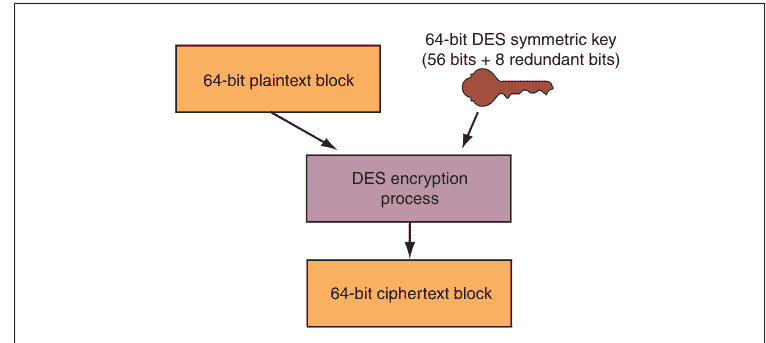

¹⁴ 公平地说，DES的设计仅用于约10年——直到20世纪80年代中期。在那期间，56位密钥是一个相当强的密钥。

¹⁵ 在块加密中，加密的具体方式称为模式。图3-7具体显示了电子密码本模式，这是最简单的DES块加密模式。更复杂的DES模式提供更好的保护。

## 三重DES（3DES）

当企业需要比DES提供的更强的加密时，可以转向**三重DES（3DES）**，它以简单但痛苦缓慢的方式扩展了DES的有效密钥大小，并使用中等量的RAM。

### 168位3DES操作

3DES算法只是为了额外强度连续三次应用DES。¹⁶ 通常，这是用三个不同的DES密钥完成的。这给出了168位（3倍56）的有效密钥长度。这非常强。

### 112位3DES

3DES的一个变体仅使用两个密钥。在这种方法中，发送者的第三次操作是用第一个密钥——即第一步使用的密钥——加密第二阶段的输出。这有效地提供了112位¹⁷加密，这很强，并且只需要安全分发两个DES密钥。

### 对3DES的看法

从安全角度来看，3DES提供了强大的对称密钥加密。然而，从实际角度来看，DES很慢，必须三次应用DES非常慢，因此在处理成本方面很昂贵。

### 测试你的理解

- 12. a. 3DES是如何工作的？
- b. 3DES中两种常见的有效密钥长度是什么？
- c. 这些长度足以用于企业通信吗？
- d. 3DES的缺点是什么？

## 高级加密标准（AES）

为了应对DES密钥长度弱和3DES的处理负担，NIST于2001年发布了**高级加密标准（AES）**。就处理能力和RAM需求而言，AES足够高效，可用于各种设备——甚至包括蜂窝电话和个人数字助理（PDA）。¹⁸

AES提供三种可选密钥长度：128位、192位和256位。即使128位密钥长度也很强。能够在一秒内击败56位DES的暴力破解系统破解128位AES需要超过100万亿年。更长的密钥长度即使对于必须保密多年材料也足够强。许多密码系统现在支持AES，并且AES在不久的将来应主导保密加密。

¹⁶ 实际上，3DES用第一个密钥加密明文块，用第二个密钥解密第一步的输出，然后用第三个密钥加密第二步的输出。加密、解密然后再次加密的模式看起来很奇怪吗？该算法的原因是即使双方仅共享单个DES密钥也能工作。用DES密钥加密明文然后用同一密钥解密第一步的输出会返回原始明文。因此第三次加密相当于传统的单DES。这意味着3DES软件可以处理3DES和DES。此外，仅实现DES的接收器能够通过使用单个密钥与3DES发送器协同工作，反之亦然。当然，当仅使用单个密钥时，有效密钥长度只有56位。

¹⁷ 有些人称这种加密为128位DES。虽然DES密钥只有56位密钥强度，但它们长度为64位。

¹⁸ 3DES加密需要48轮处理。AES仅需要9到13轮处理，具体取决于密钥长度。虽然3DES和AES中的轮次完全不可比较，但这种比较让你感受到AES为何比3DES快得多。

### 测试你的理解

- 13.
- a. AES相对于3DES的巨大优势是什么？
- b. AES提供的三种密钥长度是什么？
- c. 哪种强大的对称密钥加密密码可以用在小型移动设备上？
- d. 哪种对称密钥加密密码可能在不久的将来占主导地位？

## 其他对称密钥加密密码

还有许多其他对称密钥加密密码。然而，只有少数这些密码经受住了多年的广泛密码分析。其中经受住考验并得到广泛使用的有IDEA（尤其在欧洲）、SEED（在韩国）、GOST（在俄罗斯）和Camellia（在日本）。

不幸的是，许多公司自豪地宣传“新颖且专有”的加密密码。他们认为因为攻击者不知道密码的算法，所以无法破解加密。然而，安全专业人士嘲笑这为**通过隐蔽性实现安全**，因为它依赖于保密，或攻击者无法获得有关密码的信息，而不是密码本身的稳健性。如果未经测试的密码的细节被知晓，可能导致灾难性的安全损失。

> > 通过隐蔽性实现安全是指依靠保密来创建安全，通过隐藏潜在漏洞的原则。

实际上，用专有算法加密的密文通常会被迅速破解，即使攻击者不知道详细的密码。创建无漏洞的加密密码极其困难，即使对于该领域的专业人士也是如此。这就是为什么组织中只应使用经过极其充分测试的密码。在计算机科学系的安全课程中，学生通常学习如何设计新的加密密码。相比之下，信息系统安全课程教导学生永远不要创建自己的加密算法。

> > 在计算机科学系的安全课程中，学生通常学习如何设计新的加密密码。相比之下，信息系统安全课程教导学生永远不要创建自己的加密算法。

### 测试你的理解

- 14.
- a. 有人声称新颖且专有的加密密码很好，因为密码分析员不会知道它们。对此发表评论。
- b. 什么是通过隐蔽性实现安全，为什么它很糟糕？

## 3.3 密码系统标准

3.3 描述密码系统中使用的初始握手阶段。

## 密码系统

直到最近，保密性一直是密码学的首要目标。然而，密码学已经成熟到军事和商业组织知道保密加密只是消息交换所需的几种密码保护之一。实际上，这些保护由密码系统提供，密码系统是一套用于保护对话的密码对策包。

> 一个密码系统是一套用于保护对话的密码对策包。

当双方使用密码系统通信时，他们需要使用特定的密码系统标准。该标准指定了要应用的保护措施以及将用于提供保护的数学过程。流行的密码系统标准包括SSL/TLS和IPsec。

## 初始握手阶段

当两个方（设备或程序）通过密码系统标准开始通信时，它们会经历三个握手阶段，如图3-8所示。

### 谈判

几乎所有密码系统标准都提供多种用于通信的密码方法，而几乎所有密码方法都有多种选项。因此，第一个握手阶段是协商通信中使用的密码方法和选项。SSL/TLS中一组特定的选项称为密码套件。在SSL/TLS中的两个方之前

图3-8 密码系统阶段

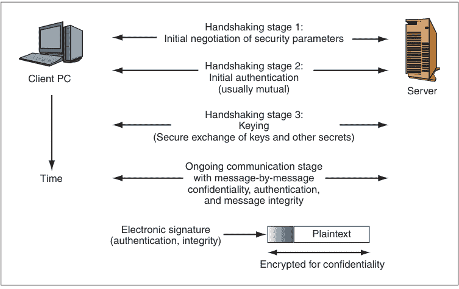


If a connection does anything else, they must negotiate a specific cipher suite for the communication session. (Other cryptographic system standards use different names for combinations of methods and options.)

> 密码套件是针对特定密码系统标准的一组特定选项。

### 初始身份验证
第二次握手阶段是 **初始身份验证**。消息可能由 **冒充者** 发送，因此在双方开始通信之前，它们需要 **相互验证** 身份，即测试通信对方的身份。这被称为初始身份验证，因为它是在通信开始之前完成的。如本节后面所述，双方发送的每条消息也可能进行后续的消息级身份验证。

当双方都验证自己的身份时，这就是 **相互身份验证**。然而，有时身份验证只由一方完成。例如，当你登录服务器时，你必须向服务器验证自己的身份，但服务器通常不会向你验证自己的身份。

> 在身份验证中，通信双方相互证明自己的身份。

请注意，初始身份验证发生在 *协商阶段之后*。原因非常简单。在双方协商身份验证方法以及这些方法中的选项之前，它们无法开始身份验证。

### 密钥协商
第三阶段是密钥协商。如前所述，保密密码需要密钥。正如我们稍后将看到的，身份验证需要 **秘密**。密钥和秘密都只是必须在双方之间保密的长位串。在大多数情况下，密钥和秘密必须安全地发送。安全地发送密钥或秘密通常称为 **密钥协商**。我们将在本章后面看到两种密钥协商方法。

请注意，密钥协商发生在 *身份验证之后*。这是必要的，因为如果不先进行身份验证，许多密钥协商方法容易受到第三方窃取密钥的攻击。

## 持续通信
在双方相互验证身份并交换密钥后，握手阶段结束。持续通信开始，双方来回发送许多消息。在持续通信期间，双方通常按消息为基础应用多种密码保护。

- 首先，发送方为每条消息添加 **电子签名**。这使接收方能够验证每条消息。**逐条消息身份验证** 阻止冒充者将消息插入对话流的企图。
- 其次，所有良好的电子签名技术也提供 **消息完整性**，这意味着如果攻击者捕获并篡改消息（例如更改客户的银行余额），身份验证过程将拒绝该消息。
- 第三，发送方对组合的消息和电子签名进行加密以确保保密性。

## 测试你的理解
15. a. 区分密码学和密码系统。
b. 区分密码系统和密码系统标准。
c. 为什么第一个握手阶段是安全方法和选项的协商？
d. 什么是冒充者？
e. 什么是身份验证？
f. 什么是相互身份验证？
g. 为什么需要安全的密钥协商阶段？
16. a. 密码系统按消息为基础提供哪三种保护？
b. 什么是电子签名？
c. 电子签名通常提供哪两种保护？
d. 区分握手阶段和持续通信。

## 3.4 协商阶段
### 3.4 解释协商阶段。
我们已经相当快速地介绍了密码系统涉及的四个阶段。现在，我们将更详细地介绍这些阶段，从协商阶段开始。

## 密码套件选项
如本章前面所述，密码套件是针对特定密码系统标准（如 SSL/TLS）的一组特定安全方法和选项。密码套件包括用于初始身份验证、密钥交换以及持续消息保密性、身份验证和完整性的特定方法和选项。

| 密码套件 | 密钥协商 | 数字签名方法 | 对称密钥加密方法 | HMAC 的哈希方法 | 强度 |
|---|---|---|---|---|---|
| NULL_WITH_NULL_NULL | 无 | 无 | 无 | 无 | 无 |
| RSA_EXPORT_WITH_RC4_40_MD5 | RSA 出口强度（40 位） | RSA 出口强度（40 位） | RC4（40 位密钥） | MD5 | 弱 |
| RSA_WITH_DES_CBC_SHA | RSA | RSA | DES_CBC | SHA-1 | 较强但不算很强 |
| DH_DSS_WITH_3DES_EDE_CBC_SHA | Diffie-Hellman | 数字签名标准 | 3DES_EDE_CBC | SHA-1 | 强 |
| RSA_WITH_AES_256_CBC_SHA256 | RSA | RSA | AES 256 位 | SHA-256 | 非常强 |

图 3-9 选定的 SSL/TLS 密码套件

图 3-9 显示了本章后面讨论的流行 SSL/TLS 标准提供的可选密码套件中的一小部分。它们按加密强度递增的顺序显示。我们将在本章后面和其他章节中看到图中显示的大多数特定密码方法。

## 密码套件策略
密码系统标准中最弱的密码套件通常提供很少的保护或根本不提供保护。例如，图 3-9 中的第一个密码套件根本不提供任何安全性。第二个仅使用出口级加密，因此虽然更强，但仍然相当弱。最后一个密码套件非常强。

由于 SSL/TLS 密码套件的强度差异很大，公司必须制定基于风险的密码套件选择策略，仅允许与应用程序面临的风险相适应的强度的密码套件。IPsec 密码系统标准（本章后面讨论）可以集中设置安全方法和选项的策略，并将这些策略强加给所有通信方。

**测试你的理解**

17. 
a. 在 SSL/TLS 中，什么是密码套件？
b. 为什么公司希望创建定义在企业合作伙伴之间使用的特定应用程序的安全方法和选项的策略？

## 3.5 初始身份验证阶段
### 3.5 解释初始身份验证，包括 MS-CHAP。
一旦安全协商阶段完成，建立密码系统对话的下一个握手阶段就是身份验证。有几种初始身份验证方法。我们只看其中一种，即 MS-CHAP，它基于服务器上的密码身份验证。

## 身份验证术语
在身份验证中，试图证明其身份的一方称为 **请求方**。另一方是 **验证方**。请求方向验证方发送 **凭证**（身份证明）（图 3-10）。在相互身份验证中，双方轮流担任请求方和验证方。

**测试你的理解**

18. 
a. 在身份验证中，区分请求方和验证方。
b. 什么是凭证？
c. 两个当事人之间的相互身份验证中有多少个请求方和验证方？解释。

## 图 3-10 身份验证：请求方、验证方和凭证
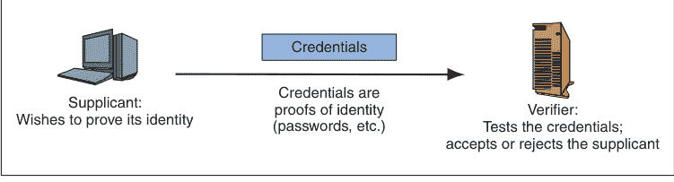

## 哈希
当大多数人想到密码学时，他们往往关注加密。然而，*哈希* 也是密码系统功能的重要组成部分。在考虑 MS-CHAP 初始身份验证（图 3-11）之前，我们需要了解哈希的工作原理。

一种简化的思考哈希的方法是将消息的位视为一个非常大的二进制数并除以一个较小的数。*余数* 可以是哈希值。例如，如果消息是 6,457 而哈希数为 236，则哈希值将进入消息数 27 次，余数为 85。这个余数 85 就是哈希值。实际的哈希比这更复杂，但这个例子让你了解哈希的本质。

当 **哈希** 应用于二进制消息时，结果（称为 **哈希值**）远短于原始消息——通常只有 128 到 512 位长。相比之下，加密产生的密文长度与明文大致相同。

与可以通过解密逆转的加密不同，哈希是 **不可逆的**。没有“去哈希”算法。你不能从几千位的消息开始，创建一个几百位的哈希，然后期望能够恢复整个原始消息。在前面的例子中，如果有人告诉你哈希是 85，就没有办法计算出原始值是 6,457。记住不可逆性的另一种方法是，你无法把汉堡包变回一头牛。

哈希也是可重复的。如果两个人对同一位串应用相同的哈希算法，他们总是得到完全相同的哈希值。

今天使用的一种众所周知的哈希方法是 **MD5**，它产生 128 位哈希值。此外，还有一组强度递增的 **安全哈希算法（SHA）** 变体，包括 SHA-1、SHA-2 和 SHA-3。不幸的是，密码分析学家在 MD5 和 SHA-1（160 位）中都发现了弱点。SHA-1 被发现不安全，不建议在 2010 年后使用。今天只应使用更强的 SHA 版本，而 MD5 根本不应使用。

## 测试你的理解
19.
a. 在哈希中，什么是哈希值？
b. 加密可逆吗？
c. 哈希可逆吗？
d. 哈希可重复吗？
e. 应用哈希算法时，哈希值是固定长度还是可变长度？
f. MD5 的哈希值大小是多少？
g. SHA-1 的哈希值大小是多少？
h. SHA-256 的哈希值大小是多少？
i. 由于已被发现存在漏洞，以下哪些哈希算法不应使用？
j. NIST 目前推荐使用的哈希算法是什么？


## 哈希

哈希算法可应用于任意长度的位串。

计算的结果称为哈希。

对于给定的哈希算法，所有哈希都具有相同的短长度。

### 哈希与加密对比

| 特性 | 加密 | 哈希 |
| --- | --- | --- |
| 结果长度 | 与明文长度大致相同 | 固定短长度，与消息长度无关 |
| 可逆性 | 是；可解密 | 否。无法从短哈希返回到长原始消息 |

### 哈希算法

- MD5（128 位哈希）
- SHA-1（160 位哈希）
- SHA-2（名称中给出哈希长度（以位为单位）：SHA-224、SHA-256、SHA-384 和 SHA-512）

注意：不应使用 MD5 和 SHA-1，因为它们已被证明是不安全的。

**图 3-11 哈希**

SHA-2 是目前由 NIST 推荐的哈希方法。它有六种不同的哈希函数，其哈希长度（以位为单位）直接体现在名称中：SHA-224、SHA-256、SHA-384、SHA-512、SHA-512/224 和 SHA-512/256。SHA-3 于 2015 年发布，但尚未被 NIST 推荐。

### 使用 MS-CHAP 进行初始认证

我们将介绍一种初始认证方法——MS-CHAP，服务器使用它通过可重用密码来认证客户端。在使用密码认证时，绝不能以明文形式（即未经加密保护）发送密码。如果密码以明文形式发送，攻击者就可以截获它，并日后利用该密码入侵用户的账户。

图 3-12 展示了微软质询握手认证协议（MS-CHAP）。当用户登录运行 Microsoft Windows Server 操作系统的服务器时，MS-CHAP 被广泛使用。密码成为请求方（用户）和验证方（服务器）都知道的共享密钥。请求方通过证明自己知道某个账户的密码来完成身份认证。

**图 3-12 微软质询握手认证协议（MS-CHAP）**

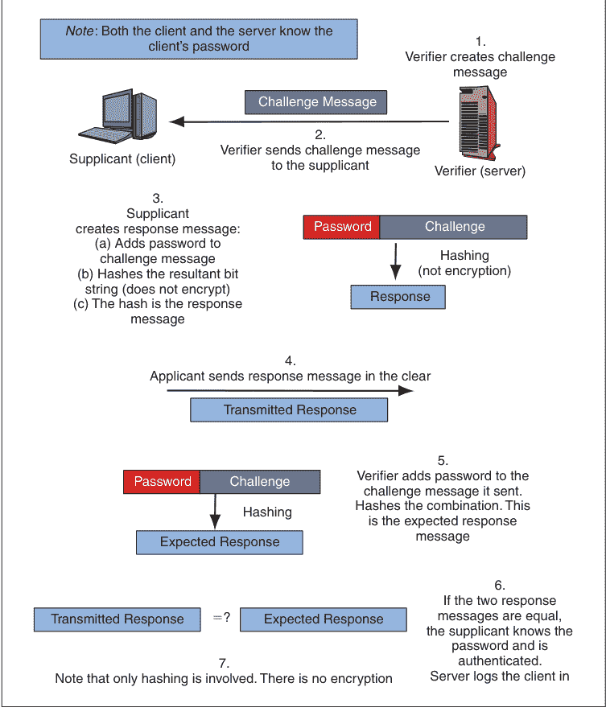

**在请求方计算机上：哈希处理**

在 MS-CHAP 中，服务器（1）向请求方的 PC 发送一条质询消息（2），该消息只是一个随机位串。服务器以明文形式发送此消息，不加密以保密。

然后，请求方的 PC 将请求方的密码附加到这条质询消息上，生成一个更长的比特流。接着，请求方的 PC 对该比特流进行哈希处理，生成响应消息（3），并将此响应消息同样以明文形式发送给服务器（4）。

**在验证方服务器上**

为了验证响应消息，服务器重复客户端的操作。服务器取出它发送给用户的质询消息，附加上它也知道用户密码，并应用与请求方相同的哈希算法（5）。（请记住，哈希是可重复的。）如果服务器的哈希与响应消息完全一致，那么用户必定知道该账户的密码（6）。

### 测试你的理解

- 20.
  - a. MS-CHAP 是用于初始认证还是逐消息认证？
  - b. 请求方如何创建响应消息？
  - c. 验证方如何检查响应消息？
  - d. MS-CHAP 使用什么类型的加密？（这是一个棘手但重要的问题。）
  - e. 在 MS-CHAP 中，服务器会向客户端认证自身吗？

## 3.6 密钥交换阶段

3.6 描述密钥交换，包括公钥加密。

### 会话密钥

在认证阶段之后，双方必须交换一个或多个对称密钥以实现机密性。这些密钥被称为会话密钥，因为它们仅用于单个通信会话。如果双方再次通信，他们将交换不同的会话密钥。我们将探讨组织中广泛使用的两种密钥交换方法。

### 用于机密性的公钥加密

其中一种密钥交换方法使用公钥加密来实现机密性。尽管对称密钥加密在机密性加密中占主导地位，但有时也会使用另一类密码算法来实现机密性。这就是公钥加密密码，也称为非对称密钥加密密码。公钥加密可用于交换对称会话密钥（及其他机密信息）。

**两把密钥。** 在公钥加密中，每一方都有两把密钥——一把私钥和一把公钥。每一方都对自己的私钥保密，但公钥可以被任何人获知而不会产生问题。图 3-13 展示了这两种密钥如何用于机密性。

**过程。** 在图 3-13 中，爱丽丝希望安全地向鲍勃发送一条消息。爱丽丝用鲍勃的公钥对明文进行加密。在接收端，鲍勃使用自己的私钥解密密文。请注意，我们不能简单地说“公钥”和“私钥”，因为每一方都有一把公钥和一把私钥。

**图 3-13 用于机密性的公钥加密**

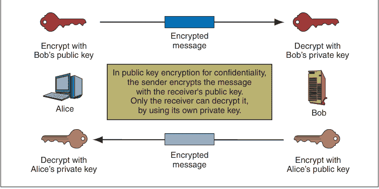

还需注意，发送方使用接收方广为人知的公钥进行加密，而接收方则使用只有自己知道的私钥解密消息。任何人都可以使用某方的非保密公钥向其加密消息。与对称密钥加密不同，这无需事先进行安全的密钥交换。

### 挂锁与钥匙的类比

第一次阅读公钥加密时可能会感到困惑。使用“挂锁与钥匙”的类比可能有助于说明公钥和私钥之间的相互关联关系。

鲍勃去找锁匠，定制了十二把挂锁（挂锁 = 鲍勃的公钥），这些挂锁只能用一把独一无二的钥匙（钥匙 = 鲍勃的私钥）打开。然后鲍勃将未锁上的挂锁交给爱丽丝，自己保留那把独一无二的钥匙。

爱丽丝可以用鲍勃未锁上的挂锁（鲍勃的公钥）将消息锁（加密）在盒子里。即使盒子被截获，也无法被打开。只有鲍勃能打开锁住的盒子，因为他拥有那把独一无二的钥匙（鲍勃的私钥）。事实上，鲍勃可以将他的未锁上的挂锁（鲍勃的公钥）送给任何他想通信的人。只有鲍勃能用他独一无二的私钥打开锁上的挂锁。

如果鲍勃想向爱丽丝发送消息，这个过程可以反过来。每个人都拥有自己的挂锁（公钥），可以自由分发给他人。他们还会拥有一把独一无二的钥匙（私钥），这把钥匙会被保密，用来解锁（解密）自己的挂锁。

挂锁与钥匙的类比是理解公钥和私钥如何确保机密性的一种直观方式。当我们在本章后面讨论使用公钥进行认证（即创建数字签名）时，这个类比将不再适用。然而，对于初次阅读的读者来说，这个类比有助于理解公钥和私钥的工作原理。

### 高成本与短消息长度

对称密钥加密速度快且成本低，但它需要安全地分发会话密钥。公钥加密则恰恰相反。我们刚刚看到，在公钥加密中，为了机密性，无需在加密前秘密分发密钥。无需事先进行密钥交换。这是非常理想的。

然而，公钥加密密码极其复杂，因此使用起来缓慢且成本高昂。（通常，公钥加密加密给定长度的消息所需的时间是对称密钥加密的 100 到 1000 倍。）因此，密码学仅在需要机密性时使用公钥加密来加密非常短的消息。

### RSA 与 ECC

广泛使用的公钥加密密码只有两种。第一种是 RSA 密码，它在公钥加密中占主导地位。更高效的椭圆曲线密码学（ECC）公钥密码曾得到适度使用，但正因量子计算带来的弱点而被逐步淘汰。我们将在本章后面讨论量子计算的影响。

### 密钥长度

对称密钥加密依赖使用时间短暂的会话密钥，而公钥-私钥对则很少更换。例如，为了能够接收加密消息，接收方需要将私钥保护数周、数月甚至数年。随着密钥使用时间的增加，流量也随之增加，因此对于给定的安全强度，密钥长度也必须随之增加。

虽然 112 位的会话密钥在对称密钥加密中已经很强，但公钥需要长得多。对于 RSA 公钥加密，强密钥的推荐最小密钥长度为 1024 位。更长的密钥长度需要更多


加密过程中的处理时间，以及较长的密钥长度是公钥加密如此缓慢且实现成本昂贵的原因之一。

## 测试你的理解

21.
 a. 当 Alice 向 Bob 发送消息时，她会使用什么密钥来加密该消息？
 b. 为什么“公钥”不是问题 21a 的一个好答案？
 c. Bob 会使用什么密钥来解密该消息？
 d. 为什么“私钥”不是问题 21b 的一个好答案？
 e. 在一个有 30 名学生和一名老师的教室里，会有多少个公钥？
 f. 有多少个私钥？

22.
 a. 公钥加密的主要缺点是什么？
 b. 最流行的公钥加密密码是什么？
 c. 另一种常用的公钥加密密码是什么？
 d. 需要更长的是对称密钥还是公钥？请论证你的答案。
 e. 强 RSA 密钥有多长？

23. Julia 使用公钥加密对 David 加密一条消息以确保保密。加密消息后，Julia 能解密它吗？

## 使用公钥加密进行对称密钥分发

虽然公钥加密和对称密钥加密看起来像是竞争对手，但它们实际上是互补的。例如，公钥加密可以安全地传递对称会话密钥，如图 3-14 所示。

- 首先，一方（A 方）生成一个随机比特串，将用作对称会话密钥。
- 其次，A 方用另一方（B 方）的公钥加密该对称会话密钥。因为该密钥是公开的，所以不需要像对称密钥加密用于保密时那样进行事先的秘密密钥分发。
- 第三，A 方将此加密的会话密钥发送给 B 方。
- 第四，B 方用自己的私钥解密加密的会话密钥。它现在可以读取原始明文，即另一方生成的对称会话密钥。
- 第五，现在密钥分配已完成，双方都拥有对称会话密钥，并将使用它通过对称密钥加密安全地发送消息。

## 测试你的理解

24. 解释公钥加密如何促进对称会话密钥交换。

## 图 3-14 用于对称会话密钥的公钥密钥分配

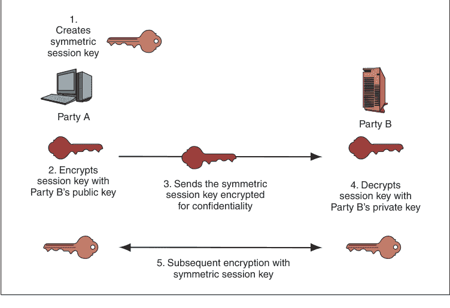

## 使用 Diffie–Hellman 密钥交换进行对称密钥分发

虽然使用公钥加密进行密钥分配很普遍，但它速度极慢。另一种流行的密钥分配方法，**Diffie–Hellman 密钥交换**，速度快得多。该技术以公钥加密的两个创建者命名，他们也创建了这种密钥分配方法。图 3-15 简要说明了 Diffie–Hellman 密钥交换如何进行密钥分配。

该图显示双方在前两次交换（步骤 1 和 4）中交换密钥信息。如果你对数学感兴趣，可以详细跟随该过程，但我们只会查看最重要的要点。

使用这些密钥信息加上各方未传输的信息（随机数 *x* 和 *y*），双方各自计算出 **相同的对称密钥** (*g*<sup>*xy*</sup> mod *p*)。然后他们将此密钥用作后续对称密钥加密的会话密钥（步骤 6）。

双方以明文形式发送其密钥信息。然而，窃听这些交换的窃听者无法获知 A 方和 B 方生成但未传输的随机数 *x* 和 *y*。因此，窃听者仅凭读取传输的密钥信息无法计算出密钥。

## 测试你的理解

25.
 a. Diffie–Hellman 密钥交换的目的是什么？
 b. 捕获交换密钥信息的攻击者能否计算出对称会话密钥？

## 图 3-15 使用 Diffie–Hellman 密钥交换进行密钥分配

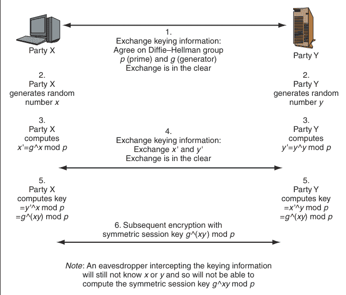

## 3.7 消息逐条认证

3.7 解释电子签名（包括数字签名、数字证书和密钥哈希消息认证码（HMAC））的工作原理。

在双方交换会话密钥后，初始安全协商阶段完成。通信双方随后在持续的通信阶段开始相互发送大量消息。消息逐条认证可以保护这些消息免受中间人攻击和重放攻击。

中间人 (MITM) 攻击是一种攻击形式，攻击者在两方之间发送的消息被拦截并转发。如果正确实现，消息逐条认证将阻止攻击者读取消息。然而，即使攻击者无法读取消息，也可以在稍后重新发送。

重放攻击发生在攻击者拦截加密消息并在稍后再次传输时发生。在设计不良的密码系统中，攻击者可以记录用于登录或执行其他操作的加密命令集，然后回放以产生相同的响应。请注意，即使消息已加密以确保保密且攻击者无法读取它，这也有效。这些攻击可以通过下面讨论的几种方式来阻止。

## 电子签名

对于消息逐条认证，每个消息必须包含电子签名，正如本章前面所述。此电子签名同时提供身份验证和消息完整性。电子签名有两种常见类型——数字签名和密钥哈希消息认证码（HMAC）。22 虽然数字签名在教科书中被广泛讨论，但实际上在实践中使用的频率远低于 HMAC。

## 用于身份验证的公钥加密

之前，我们看到公钥加密可用于保密。发送方使用接收方的公钥加密。接收方然后用其自己仅其知道的私钥解密到达的密文。拦截者完全无法读取消息。

公钥加密也可用于身份验证。本章前面我们看到，在身份验证中，申请人必须通过向验证者发送凭证来证明其身份。只有当这些凭证被验证为属于真实方——申请人声称的那个人——验证者才会接受发送者为真实方。（鉴于冒充的可能性，申请人可能不是真实方。）

> 在身份验证中，真实方是申请人声称的那个人。

在用于身份验证的公钥加密中，申请人必须证明其知道别人不应该知道的东西——真实方的私钥。通过证明其知道真实方的私钥，申请人可以将其自身认证为真实方。为此，申请人用其私钥加密某物。如果服务器能用真实方的公钥解密所得密文，则发送者必须知道真实方的私钥，因此必须是真实方。

## 测试你的理解

26. a. 什么是中间人攻击？
 b. 什么是重放攻击？
 c. 攻击者能否读取重放消息的内容？如果无法读取，为什么黑客会尝试重放它们？
 d. 验证者是否用申请人的公钥解密密文？如果不是，请解释它使用什么密钥。
 e. 谁是真实方？
 f. 发送者试图证明其知道什么，而只有真实方应该知道？

## 使用数字签名进行消息逐条认证

公钥加密用于保密在一种常见的电子签名方法——数字签名中被使用。

> 读者注意：阅读本节时放慢速度。确保你理解图 3-16 中的整体流程，并且理解每个步骤。

22 为什么不称它们为 KHM 什么？当作者与 HMAC 方法的创建者之一交谈时，回答是“没有必要，因为密钥哈希消息认证码总是使用密钥。”


当一方使用自己的私钥对消息摘要进行加密时，这称为**签署**消息摘要。发送者就像在信上签名一样证明自己的身份。发送者使用其私钥“签署”消息摘要，从而创建数字签名。

> 签署消息摘要意味着使用发送者的私钥对其进行加密。

## 以机密性发送消息

使用数字签名进行认证的第三步（3）是发送消息（图3-16）。发送者希望发送的消息由原始明文消息加上数字签名组成。

如果机密性不是问题，发送者可以直接以明文发送合并后的消息。然而，机密性通常很重要，因此发送者通常会加密合并后的原始消息和数字签名。合并后的消息可能很长，所以发送者必须使用对称密钥加密。

在另一端，接收者（验证者）使用用于机密性的对称密钥解密整个消息。同样，这一步是为了机密性，与认证无关。

## 验证请求者

同样，真实方是请求者所声称的人员（或软件进程）。如果发送者是真实方，则发送者将被认证。否则，发送者是冒名顶替者，不应被认证。

在第四步（4）中，验证者使用与请求者所用相同的哈希算法对原始明文消息进行哈希处理。这将产生一个消息摘要。

在第五步（5）中，验证过程开始，接收者首先使用广为人知的*真实方*公钥解密数字签名。如果请求者/发送者使用真实方的私钥签署了消息摘要，这将产生原始消息摘要。

再次注意，验证需要知道*真实方*的公钥。通常，发送者就是真实方。然而，发送者可能是冒名顶替者。因此，验证者不使用发送者的公钥。相反，它从称为证书颁发机构的可信来源获取公钥。证书颁发机构将在下一节讨论。

最后，在第六步（6）中，将消息摘要进行比较。如果以这两种不同方式（如步骤4和5所示）产生的消息摘要匹配，那么发送者必定拥有真实方的私钥，而只有真实方知道该私钥。该消息被认证为来自真实方。²³

²³ 这种数字签名过程被广泛使用，但它并不是通过公钥认证创建数字签名的唯一方式。另一种方法是由美国联邦政府使用的数字签名标准（DSS），它采用数字签名算法（DSA）。美国国家标准与技术研究院，《数字签名标准（DSS）》，联邦信息处理标准出版物（FIPS PUB）186，1994年5月19日。www.itl.nist.gov/fipspubs/fip186.htm.

## 消息完整性

如果有人在中途改变了消息，两个消息摘要将不匹配。因此，数字签名还提供**消息完整性**——拒绝被篡改消息的能力。所有现实世界中的逐消息认证方法都附带提供消息完整性。

## 公钥加密用于机密性和认证

在本章中，我们已经看到公钥加密既用于机密性也用于认证。学生经常感到困惑的一个来源是认证。认证通常来源是**证书颁发机构（CA）**，²⁴ 它是一个独立且可信的关于真实方公钥的信息来源。不幸的是，很少有国家监管CA，因此验证者只能接受其因声誉而信任的证书颁发机构所颁发的数字证书。

一些知名的证书颁发机构包括但不限于IdenTrust（48%市场份额）、Sectigo（24%）、DigiCert（15%）和GoDaddy（7%）。²⁵ 事实上，公司可以颁发自己的数字证书供内部使用。Microsoft Windows Server® 2019 具备颁发和管理数字证书的能力。

顺便说一句，一个常见的误解是证书颁发机构为证书中所列方的诚实性做担保。它们并没有！它们仅仅担保所列方的公钥。尽管行为不当的客户其证书可能会被撤销，但CA很少对其证书持有人的可信度提供强有力的保证。那不是它们的工作。它们的工作是将公钥与名称相关联。

> > 当CA向个人或组织颁发数字证书时，这并不意味着CA为证书中所列方的诚实性做担保。
> > 它仅仅断言某一方拥有某一公钥。

**数字证书** CA将向验证者发送数字证书。数字证书遵循X.509语法。**数字证书**包含许多字段，如图3-18所示。最重要的是，数字证书包含*真实方名称*（在主题字段中）和*真实方公钥*（在公钥字段中，如图3-19所示）。

| 字段 | 描述 |
|---|---|
| 版本号 | X.509标准的版本号。大多数证书遵循版本3。不同版本具有不同字段。此图反映版本3标准。 |
| 序列号 | 证书的唯一序列号，由CA设置。 |
| 签名算法ID | CA用于对其证书进行签名的数字签名算法。 |
| 颁发者名称 | 证书颁发机构（CA）的名称。 |
| 有效期 | 在此时间段之前和之后证书不应使用。注意：证书可能在本期限结束前被撤销。 |
| 主题名称 | 获得证书的个人、组织、计算机或程序的名称。这是真实方。 |
| 公钥算法 | 主题用于使用数字签名签署消息的算法。 |
| 主题公钥 | 主题（真实方）的公钥。 |
| 其他可选字段 | . . . |
| 证书签名算法 | 用于生成签名的算法（例如SHA-256） |
| 证书签名 | 证书的数字签名，由CA使用CA自己的私钥签名。用于测试证书的认证和完整性。用户必须独立知道CA的公钥。 |

**图3-18 X.509数字证书字段**

²⁴ PGP（良好隐私）使用另一种获取公钥的方法。这种方法称为信任圈。如果我信任某人，我会将我信任的人及其公钥列表放到一个列表中，并将此列表提供给他人。这样就避免了需要证书颁发机构。然而，如果一个人被骗将冒名顶替者列入列表，这种错误的信任可能会迅速传播给其他人。

²⁵ W3Techs，“网站SSL证书颁发机构的使用情况”，W3Techs.com，2019年8月3日。https://w3techs.com/technologies/overview/ssl_certificate/all.

## 图3-19 Google.com的数字证书

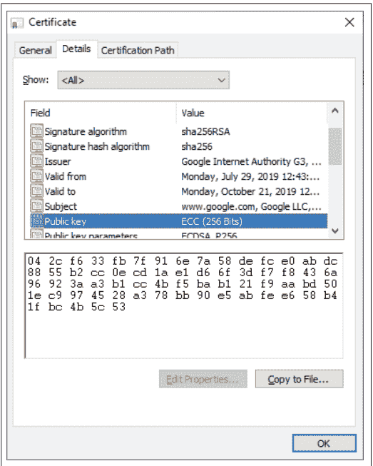

来源：Google.com

验证者查找真实方的数字证书，然后使用该数字证书中的公钥来测试请求者的数字签名。

## 验证数字证书

验证者如何知道数字证书是合法的？答案是验证者必须采取三个步骤。

### 测试证书自身的数字签名

首先，验证者必须检查数字证书是真实的且未被修改。每个数字证书都包含自己的数字签名，该签名由证书颁发机构使用CA的私钥签名。验证者可以使用CA的广为人知的公钥来测试数字证书的数字签名。如果测试有效，那么数字证书必定是真实且未被修改的。所有浏览器都内置了流行CA公钥的列表。26

### 有效期

其次，每个数字证书都有在某个日期之前和之后无效的时间。接收者必须检查数字证书是否在其有效期内。

### 检查吊销

第三，即使在数字证书的有效期内，CA也可能吊销数字证书，例如如果证书主体有不当行为。接收者不应接受已吊销的证书。

要检查吊销，验证者可以下载证书颁发机构的证书吊销列表。如果证书的序列号在该列表中，则CA已吊销该数字证书。

26 实际上，证书颁发机构通常存在层级结构。如果必须处理一个新的证书颁发机构，你必须沿层级向上，直到找到你信任的CA。在层级中的每一步，较高级别CA与较低级别CA的关系都会得到验证。


## 图 3-20 验证数字证书（研读图）

**测试数字签名**

- 数字证书本身具有数字签名
- 使用证书颁发机构的私钥签名
- 必须使用 CA 的众所周知的公钥进行测试
- 如果测试通过，则证书是真实的且未被修改

**检查有效期**

- 证书仅在数字证书中的有效期内有效

**检查是否被吊销**

- 证书可能因不当行为或其他原因被吊销
- 必须检查吊销状态
- 验证者可以从 CA 下载完整的证书吊销列表
- 查看序列号是否在证书吊销列表上
- 如果在列表上，则不应接受该证书
- 或者，验证者可以向 CA 发送查询
- 需要 CA 支持在线证书状态协议

虽然下载证书吊销列表可行，但大型 CA 的吊销列表相当长。下载并检查长证书吊销列表会显著延迟通信的开始。幸运的是，大多数 CA 提供了更简化的吊销检查方式。这就是在线证书状态协议。使用该协议，程序只需将数字证书的序列号发送给 CA。CA 会返回响应，说明该序列号是否有效、已被吊销或未知。

## 数字证书和数字签名的角色

请注意，数字证书本身并不能对申请人进行身份验证。如图 3-21 所示，证书仅为验证者提供真实方的公钥，以便其进行身份验证。

## 图 3-21 身份验证中的数字签名和数字证书

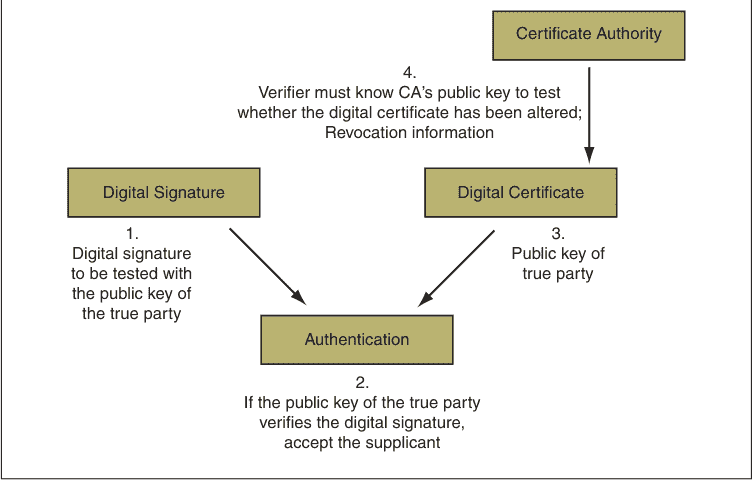

任何人都可以拥有真实方的数字证书，而无需是真实方，因此仅拥有数字证书并不能验证持有该证书的人或进程的身份。

同样，仅凭数字签名，验证者没有可靠的方法知道真实方的公钥。因此，单独的数字签名无法被验证，也就不能对申请人进行身份验证。

总之，在公钥身份验证中，数字证书和数字签名必须一起使用。单独使用都不能提供身份验证。具体来说，数字证书提供了身份验证方法（如数字签名）用来验证申请人的公钥。

> 数字证书提供了身份验证方法（如数字签名）用来验证申请人的公钥。

## 测试你的理解

- 30. a. 验证者可以从什么类型的组织接收数字证书？
  - b. 大多数 CA 是否受监管？
  - c. 数字证书是否表明证书中命名的人或公司是可信的？解释。
- 31. a. 数字证书中两个最关键的字段是什么？
  - b. 数字证书中的哪个字段允许证书接收者确定证书是否已被篡改？
  - c. 证书接收者必须检查哪三件事以确保数字证书有效？
  - d. 检查证书吊销状态的两种方法是什么？
- 32. a. 数字签名本身是否提供身份验证？解释原因。
  - b. 数字证书本身是否提供身份验证？解释原因。
  - c. 数字签名和数字证书如何在身份验证中一起使用？

## 密钥哈希消息认证码

### 数字签名的难题

我们刚刚看到数字签名如何提供逐条消息的身份验证和消息完整性。不幸的是，虽然数字签名提供非常强大的安全性，但它们也消耗大量处理能力。此外，建立公钥基础设施来分发私钥和数字证书极其困难且昂贵。

因此，密码系统通常使用不同的技术来进行逐条消息的身份验证和消息完整性。这就是密钥哈希消息认证码（HMAC）。

### 创建和测试 HMAC

HMAC 使用在初始协商阶段交换的密钥。然而，它并不使用该密钥进行对称密钥加密。相反，如图 3-22 所示，发送方将密钥添加到每条传出消息中（1），然后对组合的消息和密钥进行哈希（2）。该哈希值即为 **密钥哈希消息认证码（HMAC）**。发送方将 HMAC 添加到消息中（3），然后使用对称密钥加密对该组合比特流进行加密（4）。

## 图 3-22 密钥哈希消息认证码（HMAC）

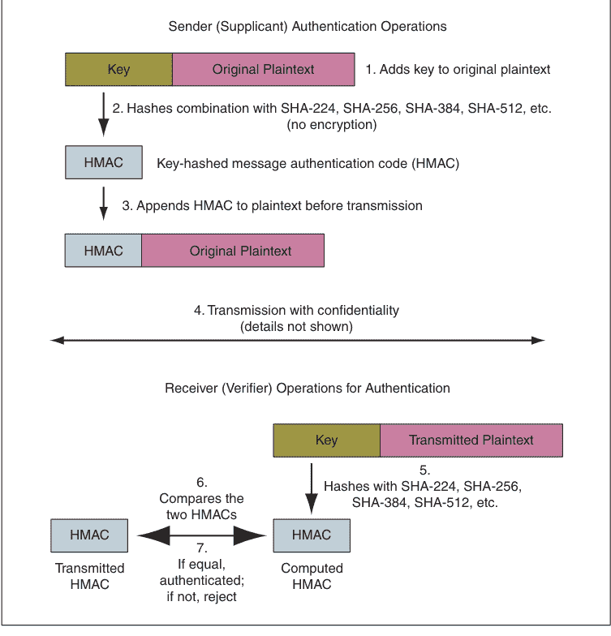

接收方解密传输的比特串以确保保密性。然后它测试 HMAC。它通过将密钥（它也知道）添加到消息中，然后使用发送方使用的相同哈希算法对组合的消息和密钥进行哈希来实现这一点（5）。计算出的 HMAC 应与传输的 HMAC 匹配（6）。如果匹配，则发送方得到身份验证（7）。与数字签名一样，HMAC 也提供消息完整性。

哈希运算比公钥加密快得多，因此成本更低。鉴于会话中交换的消息数量庞大，这一点非常重要。

此外，不需要数字证书。因此，在密码系统中，HMAC 比数字签名更常用于逐条消息的身份验证和完整性。

## 测试你的理解

- 33. a. HMAC 提供哪两种密码保护？
  - b. HMAC 使用对称密钥加密、公钥加密还是哈希？
  - c. HMAC 相对于数字签名的好处是什么？

## 不可否认性

虽然 HMAC 速度很快且消耗的[content]
## 图 3-20 验证数字证书（研读图）

**测试数字签名**

- 数字证书本身具有数字签名
- 使用证书颁发机构的私钥签名
- 必须使用 CA 的众所周知的公钥进行测试
- 如果测试通过，则证书是真实的且未被修改

**检查有效期**

- 证书仅在数字证书中的有效期内有效

**检查是否被吊销**

- 证书可能因不当行为或其他原因被吊销
- 必须检查吊销状态
- 验证者可以从 CA 下载完整的证书吊销列表
- 查看序列号是否在证书吊销列表上
- 如果在列表上，则不应接受该证书
- 或者，验证者可以向 CA 发送查询
- 需要 CA 支持在线证书状态协议

虽然下载证书吊销列表可行，但大型 CA 的吊销列表相当长。下载并检查长证书吊销列表会显著延迟通信的开始。幸运的是，大多数 CA 提供了更简化的吊销检查方式。这就是在线证书状态协议。使用该协议，程序只需将数字证书的序列号发送给 CA。CA 会返回响应，说明该序列号是否有效、已被吊销或未知。

## 数字证书和数字签名的角色

请注意，数字证书本身并不能对申请人进行身份验证。如图 3-21 所示，证书仅为验证者提供真实方的公钥，以便其进行身份验证。

## 图 3-21 身份验证中的数字签名和数字证书


任何人都可以拥有真实方的数字证书，而无需是真实方，因此仅拥有数字证书并不能验证持有该证书的人或进程的身份。

同样，仅凭数字签名，验证者没有可靠的方法知道真实方的公钥。因此，单独的数字签名无法被验证，也就不能对申请人进行身份验证。

总之，在公钥身份验证中，数字证书和数字签名必须一起使用。单独使用都不能提供身份验证。具体来说，数字证书提供了身份验证方法（如数字签名）用来验证申请人的公钥。

> 数字证书提供了身份验证方法（如数字签名）用来验证申请人的公钥。

## 测试你的理解

- 30. a. 验证者可以从什么类型的组织接收数字证书？
  - b. 大多数 CA 是否受监管？
  - c. 数字证书是否表明证书中命名的人或公司是可信的？解释。
- 31. a. 数字证书中两个最关键的字段是什么？
  - b. 数字证书中的哪个字段允许证书接收者确定证书是否已被篡改？
  - c. 证书接收者必须检查哪三件事以确保数字证书有效？
  - d. 检查证书吊销状态的两种方法是什么？
- 32. a. 数字签名本身是否提供身份验证？解释原因。
  - b. 数字证书本身是否提供身份验证？解释原因。
  - c. 数字签名和数字证书如何在身份验证中一起使用？

## 密钥哈希消息认证码

### 数字签名的难题

我们刚刚看到数字签名如何提供逐条消息的身份验证和消息完整性。不幸的是，虽然数字签名提供非常强大的安全性，但它们也消耗大量处理能力。此外，建立公钥基础设施来分发私钥和数字证书极其困难且昂贵。

因此，密码系统通常使用不同的技术来进行逐条消息的身份验证和消息完整性。这就是密钥哈希消息认证码（HMAC）。

### 创建和测试 HMAC

HMAC 使用在初始协商阶段交换的密钥。然而，它并不使用该密钥进行对称密钥加密。相反，如图 3-22 所示，发送方将密钥添加到每条传出消息中（1），然后对组合的消息和密钥进行哈希（2）。该哈希值即为 **密钥哈希消息认证码（HMAC）**。发送方将 HMAC 添加到消息中（3），然后使用对称密钥加密对该组合比特流进行加密（4）。

## 图 3-22 密钥哈希消息认证码（HMAC）


接收方解密传输的比特串以确保保密性。然后它测试 HMAC。它通过将密钥（它也知道）添加到消息中，然后使用发送方使用的相同哈希算法对组合的消息和密钥进行哈希来实现这一点（5）。计算出的 HMAC 应与传输的 HMAC 匹配（6）。如果匹配，则发送方得到身份验证（7）。与数字签名一样，HMAC 也提供消息完整性。

哈希运算比公钥加密快得多，因此成本更低。鉴于会话中交换的消息数量庞大，这一点非常重要。

此外，不需要数字证书。因此，在密码系统中，HMAC 比数字签名更常用于逐条消息的身份验证和完整性。

## 测试你的理解

- 33. a. HMAC 提供哪两种密码保护？
  - b. HMAC 使用对称密钥加密、公钥加密还是哈希？
  - c. HMAC 相对于数字签名的好处是什么？

## 不可否认性

虽然 HMAC 速度很快且消耗的计算资源很少，但它有一个有时很严重的局限性。电子签名的可能目标之一是 **不可否认性**，这意味着发送方不能否认他或她发送了重要消息。

HMAC 无法提供不可否认性，因为发送方和接收方 *都* 知道密钥。因此，被指控的发送方可以在法庭上争辩说接收方可能伪造了消息上的 HMAC；因此 HMAC 并未证明发送方确实发送了它。

相比之下，数字签名 *确实* 提供不可否认性。没有任何冒名者，包括接收方，都可以创建带有有效数字签名的消息，因为只有真实方应该知道其私钥。如果使用真实方的私钥创建数字签名，则只有真实方可能发送了该消息。（当然，如果真实方未保护其私钥，此机制就会失效。）

克服 HMAC 局限性的实用方法是使用它们在互联网层对单个数据包进行身份验证。然后可以在应用程序文档上使用公钥身份验证。这样，虽然单个数据包可能被否认，但应用程序文档——例如合同——就不能被否认。

## 测试你的理解

- 34. a. 为什么 HMAC 不能提供不可否认性？
  - b. 为什么 HMAC 无法提供不可否认性通常不是问题？

## 3.8 量子安全

**3.8 描述量子安全。**

在基本粒子层面，物理变得难以置信地复杂甚至很奇怪。同时，支配小尺度相互作用的量子力学可用于执行在普通设备和电路层面不可能完成的动作。这些差异对安全有两个重要影响。

首先，我们已经看到使用 Diffie–Hellman 密钥交换和公钥加密进行保密的密钥协商。量子力学提供了一种新方法，**量子密钥分发**，它可以向通信双方提供极长的密钥。有了如此长的密钥，传统的密钥破解形式就变得无用。量子密钥分发创建了一个 **一次性密钥**，其长度与整个消息一样长。用与自身一样长的一次性密钥加密的消息不受密码分析的影响。

此外，如果窃听者试图拦截密钥信息，此操作会立即变得明显，两个合法方将丢弃受损的密钥而不是使用它。量子密钥分发


### 图 3-23 量子安全（研读图表）

**量子力学**
描述基本粒子的行为
复杂甚至怪异的结果
**量子密钥分发**
传输一个与消息一样长的非常长的密钥
这是一次性密钥
与消息一样长的一次性密钥无法通过密码分析破解
如果拦截者在传输过程中读取密钥的一部分，这将立即被发现
**量子密钥破解**
同时测试许多密钥
如果它能够处理长密钥，今天认为强健的密钥长度将不再提供保护

量子密钥破解产品已经存在，但传统密钥方法对于几乎所有应用都足够。

其次，**量子密钥破解**可以通过同时尝试数十、数百或可能数千个密钥来快速破解密钥。今天，量子计算机只能破解只有几个比特长的密钥，但如果量子计算机变得更强大，许多传统密码学方法将不再安全，即使使用今天认为强健的密钥长度。

### 测试你的理解

- 35. a. 什么是量子密钥分发？
- b. 量子密钥分发的两个优点是什么？
- c. 为什么量子密钥破解对许多传统密码学方法构成重大威胁？

## 3.9 密码系统

### 3.9 描述用于身份验证的公钥加密。

密码系统将所有密码保护，包括保密性、身份验证和完整性结合成一个单一系统。密码系统保护用户对话免受攻击者侵害，并消除了用户需要理解具体密码细节的需求。

建立密码系统的首要任务是为对话选择一个**密码系统标准**（图 3-24）。得益于密码系统标准，公司无需自行发明定制的密码保护。我们将研究几个更重要的密码系统标准，包括安全套接层（SSL）/传输层安全（TLS）和 IP 安全（IPsec）。

图 3-24 显示，在选择密码系统标准后，其余握手阶段将被执行。这与本章前面讨论的过程相同（图 3-8）。还有几个密码系统标准我们没有时间涵盖。我们将在后面的章节中研究 Kerberos。

### 图 3-24 密码系统

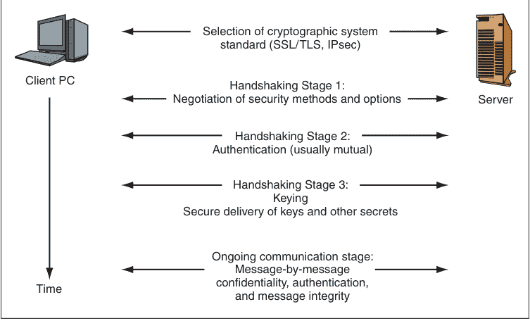

### 虚拟专用网络（VPN）

密码系统通常在不可信网络上使用。图 3-25 显示，**虚拟专用网络（VPN）**是通过使用密码系统在不可信网络（互联网、无线局域网等）上保护通信而创建的。

> 虚拟专用网络（VPN）是通过使用密码系统在不可信网络（互联网、无线局域网等）上保护通信而创建的。

### 图 3-25 虚拟专用网络（VPN）

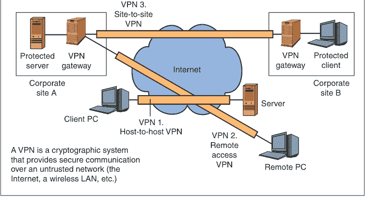

### 为什么使用 VPN？

为什么还要在不可信网络上传输呢？对于互联网 VPN 来说，答案很简单，就是经济性：互联网传输每比特传输的成本远低于帧中继等商业广域网（WAN）。互联网的巨大规模带来了规模经济。

无线局域网上的 VPN 反过来使公司能够享受移动性带来的好处，尽管许多 WLAN（尤其是无线热点中的 WLAN）的安全性值得怀疑。在后面的章节中，我们将看到 VPN 如何抵御针对无线客户端的“邪恶双胞胎”攻击。

### 主机到主机 VPN

图 3-25 说明了三种类型的 VPN。最简单类型是主机到主机 VPN。如 VPN 1 所示例，**主机到主机 VPN**通过不可信网络将单个客户端连接到单个服务器。当你连接到互联网上的电子商务服务器时，服务器通常会在你开始输入信用卡号码等敏感信息之前，在其自身和你的浏览器之间创建一个主机到主机 VPN。

> 主机到主机 VPN 通过不可信网络将单个客户端连接到单个服务器。

### 远程访问 VPN

反过来，**远程访问 VPN**通过不可信网络将单个远程 PC 连接到站点网络（见图 3-25 中的 VPN 2）。远程访问 VPN 为在家工作或旅行的员工提供访问安全内部企业网络的权限。VPN 还可以为选定的客户、供应商代表或其他获批准的通信合作伙伴提供安全的网络访问。

远程访问用户连接到**VPN 网关**，该网关对他们进行身份验证并授予他们访问站点内授权资源的权限。请注意，该网关使远程用户能够访问站点内的*多个*计算机，而主机到主机 VPN 仅让你访问*单个*计算机。

> 远程访问 VPN 通过不可信网络将单个远程 PC 连接到站点网络。

### 站点到站点 VPN

最后，**站点到站点 VPN**（见图 3-25 中的 VPN 3）保护在不可信网络上在两个站点之间流动的所有流量。这些可能是两个企业站点，或一个企业站点和一个客户站点或供应商站点。站点到站点连接对在两个站点各种计算机之间进行的许多同时对话的流量进行加密保护。在站点到站点 VPN 中，发送 VPN 网关加密传出消息。接收 VPN 网关随后解密传入消息并将这些消息传递给接收站点中的正确目标主机。²⁷

²⁷ 尽管许多公司自行构建 VPN，但相当多的公司将其 VPN 外包给托管 VPN 提供商。这些提供商大多数是 ISP，在客户现场安装所有必要的硬件，进行配置，并持续管理客户的 VPN。外包减少了公司安全人员必须具备的技能并降低了内部安全劳动成本。它还提供了可预测的成本。尽管外包 VPN 很方便，但公司通常不愿使用它们，因为客户公司会失去对其 VPN 安全的控制。

站点到站点 VPN 保护在不可信网络上在两个站点之间流动的所有流量。

### 测试你的理解

- 36. a. VPN 的定义是什么？
- b. 为什么公司要在互联网上传输？
- c. 为什么他们要在不可信的无线网络上传输？
- d. 区分三种类型的 VPN。
- e. VPN 网关对远程访问 VPN 起什么作用？
- f. VPN 网关对站点到站点 VPN 起什么作用？
- g. 哪些类型的 VPN 使用 VPN 网关？

## 3.10 SSL/TLS

### 3.10 解释包括 VPN 和 SSL 在内的密码系统。

在总体了解了 VPN 后，我们现在开始研究具体的 VPN 标准。我们将开始研究今天流行的 VPN 标准 SSL/TLS。该密码系统标准广泛用于主机到主机 VPN 和远程访问 VPN。

当你在互联网上购物时，你的敏感流量几乎总是受到一种密码系统标准的保护，该标准在 Netscape 公司创建时最初称为安全套接层（SSL）。Netscape 将标准化工作移交给互联网工程任务组（IETF），后者将其重命名为传输层安全（TLS），以强调它在传输层工作。28 我们将称其为 SSL/TLS，但在实际操作中，人们简单地称其为 SSL 或 TLS。图 3-26 显示了 SSL/TLS 主机到主机 VPN 的运行方式。

尽管 SSL/TLS 最初是作为主机到主机 VPN 标准，但由于 SSL/TLS 网关的出现，它最近已成为远程访问 VPN。然而，我们将看到 SSL/TLS 在这两种 VPN 角色上都有限制。

### 测试你的理解

- 37. a. 区分 SSL 和 TLS。
- b. SSL/TLS 是为哪种类型的 VPN 开发的？
- c. SSL/TLS 越来越多地被用于哪种类型的 VPN？

### 非透明保护

由于 SSL/TLS 在传输层工作，它可以保护封装在传输层消息中的应用层流量。当我们讨论 IPsec 时，我们将再次看到这种在某一层保护更高层通信的密码系统模式。

28 SSL/TLS 也可以被视为在正常传输层之上但在应用层之下工作的额外层。Netscape 将其称为套接字层。然而，IETF 认为该标准仅在传输层的子层中工作，因此 IETF 将标准的名称更改为传输层安全（TLS）。


## 图3-26 主机到主机SSL/TLS VPN

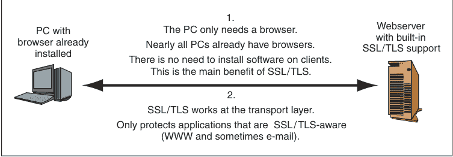

然而，SSL/TLS对应用层消息的保护并非透明，这意味着它不会自动保护所有更高层消息。它只保护支持SSL/TLS的应用程序，也就是说，这些应用程序是专门编写或改写为与SSL/TLS一起工作的。尽管所有浏览器和Web服务器应用程序都支持SSL/TLS，而且许多电子邮件程序将SSL/TLS作为可选保护，但很少有其他应用程序能与SSL/TLS一起工作。

## 运营成本低廉

SSL/TLS最大的吸引力在于，如今每台计算机都有浏览器，而且所有浏览器都知道如何充当SSL/TLS的客户端。这意味着SSL/TLS在客户端无需任何设置。此外，所有Web服务器和大多数邮件服务器都知道如何与SSL/TLS配合使用。因此，使用SSL/TLS几乎免费（除了实现SSL/TLS所需的处理能力）。

## 理解测验

- 38. a. SSL/TLS在哪一层工作？
- b. SSL/TLS可以保护哪些类型的应用程序？
- c. 常用的两种支持SSL/TLS的应用程序是什么？
- d. 为什么SSL/TLS很流行？

## SSL/TLS网关与远程访问VPN

到目前为止，我们已经了解了主机到主机SSL/TLS VPN。如图3-27所示，要将SSL/TLS从主机到主机VPN转变为远程访问VPN，企业会在每个站点的边界放置一个SSL/TLS网关(1)。远程客户端的浏览器(2)与SSL/TLS网关(3)建立单个SSL/TLS连接，而不是与站点内的各个主机建立连接。

> 远程客户端的浏览器与SSL/TLS网关建立单个SSL/TLS连接，而不是与站点内的各个主机建立连接。

## VPN网关标准

SSL/TLS网关标准的状况非常简单：没有标准。SSL/TLS仅管理客户端与SSL/TLS网关(3)之间的链路，并且SSL/TLS只能确切保护客户端与网关(4)之间传输的流量。实际上，就SSL/TLS而言，SSL/TLS网关就是一台Web服务器。没有必要向SSL/TLS标准添加任何内容。

> 就SSL/TLS而言，SSL/TLS网关就是一台Web服务器。
> 没有必要向SSL/TLS标准添加任何内容。

在网关之外，在客户站点内，一切都是供应商特定的。这使得很难概括地讨论VPN网关的操作和服务。然而，SSL/TLS网关往往具有几个共同特征。

## 图3-27 使用网关的SSL/TLS与远程访问VPN

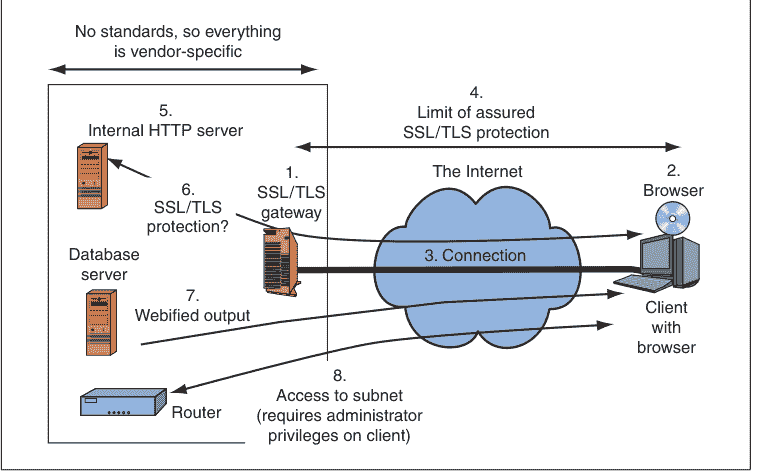

## 身份验证

首先，SSL/TLS网关始终使用公钥身份验证向客户端验证自身身份。这在SSL/TLS网关中是强制性的。在SSL/TLS保护完成后，网关接着要求用户进行身份验证，通常使用用户名和密码。客户端身份验证不在SSL/TLS协议流程之内。

## 将客户端PC连接到授权的资源

如果身份验证成功，SSL/TLS网关允许用户连接到站点内的选定资源。

- 在许多情况下，SSL/TLS网关允许客户端PC连接到多个内部Web服务器(5)。通常，网关仅打开到站点的连接，并忽略超出该连接的流量。
- 在其他情况下，VPN网关将客户端PC连接到数据库服务器或其他不支持浏览器作为客户端的服务器(7)。当客户端传输时，VPN网关将网页转换为数据库查询或其他查询。然后，VPN网关拦截来自服务器的回复。VPN网关将这些消息网页化（将它们转换为网页），供浏览器呈现给用户。不同的VPN网关能够以这种方式处理的应用程序数量以及处理这些应用程序的方式差异很大。
- 在另一些情况下，SSL/TLS网关将客户端PC连接到站点网络的整个子网(8)。然后，客户端可以连接到该子网上的任何服务器。

## 服务的安全

正如刚才所述，SSL/TLS在客户端和SSL/TLS网关(4)之间提供保护。然而，在SSL/TLS网关和网络内资源(6)之间可能有也可能没有安全保护。这完全取决于网关供应商的设计选择。例如，如果内部Web服务器为外部客户端提供服务，SSL/TLS网关可能维护两条安全连接——一条在内部Web服务器和网关之间，另一条在网关和外部客户端之间。或者，VPN网关和内部Web服务器之间可能完全没有安全保护。

## 客户端上的浏览器

客户端使用SSL/TLS需要什么？对于基本操作，不需要额外软件。因此，SSL/TLS可以用于任何连接到互联网的客户端PC，包括工作单位、酒店、网吧以及客户或供应商场所的计算机。这使得SSL/TLS作为远程访问VPN极具吸引力。

## 高级服务要求客户端PC具有管理员权限

为了让客户端透明地访问子网(8)并提供其他一些服务，SSL/TLS网关必须为客户端PC的浏览器下载插件模块。不幸的是，安装该插件需要客户端用户具有客户端PC的管理员权限。网吧和其他公共计算机不太可能向用户提供这种级别的权限。用户访问的大多数其他地方也不太可能。

此外，使用SSL/TLS进行远程访问或与Web服务器的主机到主机连接是危险的，因为用户在结束SSL/TLS会话后，SSL/TLS会在客户端PC的硬盘上留下信息。对于在公共计算机上工作的人来说，这是一个严重的安全风险。许多SSL/TLS网关允许下载可擦除用户会话所有痕迹的插件。然而，用户访问的地方同样不太可能授予安装会话信息清除插件所需的管理员权限。换句话说，在你最需要抹除痕迹的时候——即当你使用的不是自己的计算机时——几乎不可能做到。

## 视角

尽管Netscape设计SSL/TLS的初衷只有一个——保护浏览器与Web服务器之间的通信——但VPN网关大大扩展了它的用途。SSL/TLS网关几乎可以为任何PC提供远程访问，而无需修改或配置。

这使得SSL/TLS成为一种非常有吸引力的远程访问VPN技术。然而，其实现往往受限且笨拙。此外，SSL/TLS网关完全没有标准化，提供的服务差异很大。使用SSL/TLS进行远程访问VPN需要在需求评估和产品分析方面进行严格的尽职调查。同时，往往还需要网络工作人员提供大量操作支持。

此外，SSL/TLS无法创建站点到站点VPN。在大多数公司中，站点到站点VPN承载的流量远多于远程访问VPN。尽管如此，无需向用户远程计算机添加任何软件这一优点极具吸引力，以至于SSL/TLS网关的重要性增长非常迅速。

## 理解测验

- 39. a. SSL/TLS是为主机到主机（浏览器-Web服务器）通信而创建的。什么设备可以将SSL/TLS转变为远程访问VPN？
- b. 在SSL/TLS远程访问VPN中，客户端向什么设备进行身份验证？
- c. 当远程客户端在SSL/TLS VPN中传输数据时，机密传输确切能延伸多远？
- d. SSL/TLS网关通常提供哪三种服务？
- e. 什么是网页化？
- f. 客户端进行基本SSL/TLS VPN操作需要什么软件？
- g. 客户端可能出于什么目的需要额外下载软件？
- h. 为什么在浏览器上安装额外下载的软件可能有问题？
- i. 为什么SSL/TLS作为远程访问VPN技术具有吸引力？
- j. 公司如果将其用作远程访问VPN技术会面临什么问题？
- k. SSL/TLS可以支持三种类型的VPN中的哪几种？

## 3.11 IPsec

3.11 描述IPsec隧道模式与传输模式之间的权衡。

需要最强VPN安全的公司使用一系列IETF密码安全标准，统称为IPsec（IP安全）。²⁹ IP是互联网协议，“sec”是安全的缩写。换句话说，这些标准保护IP（包括IP数据包的数据字段中的所有内容）。

## IPsec的吸引力

图3-28将IPsec与SSL/TLS密码安全标准进行比较。IPsec比SSL/TLS更复杂，因此引入成本更高，但IPsec是VPN安全的黄金标准。它提供最强的保护，并支持企业对所有设备上的所有IPsec操作进行集中控制。

|  | SSL/TLS | IPsec |
|---|---|---|
| 密码安全标准 | 是 | 是 |
| 密码安全保护 | 良好 | 黄金标准 |
| 支持集中管理 | 否 | 是 |
| 复杂性和成本 | 较低 | 较高 |
| 工作层 | 传输层 | 网际层 |
| 透明保护所有高层流量 | 否 | 是 |
| 支持IPv4和IPv6 | 不适用 | 是 |
| 工作模式 | 不适用 | 传输模式、隧道模式 |

图3-28 IP安全（IPsec）与SSL/TLS对比

²⁹ 发音是“eye-‘pee’-sek”，所有音节的重音大致相同。


## SSL/TLS 提供非透明传输层安全

之前，我们看到 SSL/TLS 在传输层运行，只能保护 SSL/TLS 感知的应用程序——主要是 HTTP Web 服务和一些电子邮件系统。我们还看到 SSL/TLS 网关扩展了该标准以处理远程访问，尽管方式笨拙。

## IPSEC：透明互联网层安全

相比之下，IPsec 在互联网层运行。它保护 IP 数据包及其数据字段中的所有内容。这包括 ICMP（互联网控制消息协议）、TCP（传输控制协议）和 UDP（用户数据报协议）消息以及所有应用程序。

> IPsec 在互联网层工作。

在 IPsec 中，高层保护完全透明。无需修改应用程序或传输层协议即可与 IPsec 协同工作。事实上，使用 IPsec 时，传输层协议和应用层协议甚至意识不到 IPsec 的存在。

与 SSL/TLS 相比，IPsec 的透明保护通过减少变通方案降低了实施和运营成本。然而，减少运营成本带来的节省并不能完全抵消。IPsec 的安装仍然更昂贵、更复杂。

> SSL/TLS 在传输层工作，不对应用层消息提供透明保护。IPsec 在互联网层工作，并对传输层和应用层消息提供透明保护。

## IPSEC 同时适用于 IPV4 和 IPV6

IETF 最初为互联网协议最新版本，即 IP 第六版（IPv6）设计了 IPsec。然而，在创建时，IPsec 也被编写为可与当前主流的 IP 版本——IP 第四版（IPv4）协同工作。换句话说，无论网络使用哪种版本的 IP，IPsec 都能保护它。

## 测试你的理解

- 40. a. IPsec 在哪一层运行？
- b. IPsec 保护哪些层？
- c. 比较 IPsec 与 SSL/TLS 中的加密安全程度。
- d. 比较 IPsec 与 SSL/TLS 中的集中化管理。
- e. 与 SSL/TLS 的非透明保护相比，为什么 IPsec 的透明保护具有吸引力？
- f. 哪些版本的 IP 可以使用 IPsec？

## IPsec 传输模式

在 IPsec 中，有两种运行模式：传输模式和隧道模式。图 3-29 说明了这两种模式的工作方式。图 3-30 在表格中比较了它们的特点。

## 图 3-29 IPsec 操作：隧道和传输模式

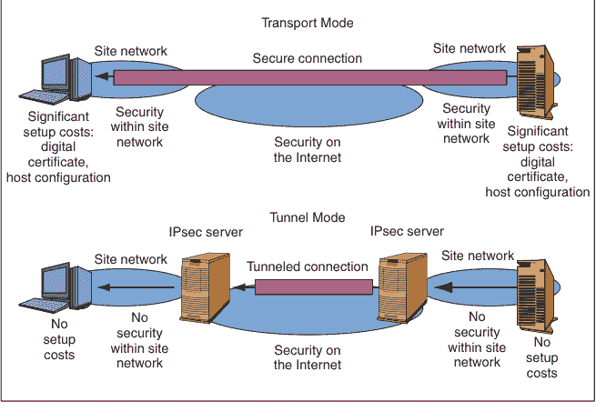

| 特性 | 传输模式 | 隧道模式 |
|---|---|---|
| 是否使用 IPsec VPN 网关？ | 否 | 是 |
| 加密保护 | 从源主机到目的主机全程，包括互联网和两个站点网络。 | 仅在 IPsec 网关之间的互联网上。站点网络内部不提供保护。 |
| 设置成本 | 高。设置需要为每个客户端创建数字证书并进行大量配置工作。 | 低。仅 IPsec 网关必须实现 IPsec，因此只有它们需要数字证书并进行配置。 |
| 防火墙友好性 | 差。站点边界的防火墙无法过滤数据包，因为内容已加密。 | 好。每个数据包都由 IPsec 网关解密。IPsec 网关之后的边界防火墙可以过滤解密后的数据包。 |
| “结论” | 高成本下的端到端安全。 | 低成本，并在数据包行程中最危险的部分提供保护。 |

### 图 3-30 比较 IPsec 传输和隧道模式

### 主机到主机安全
IPsec 传输模式提供主机到主机安全。换句话说，它实现了主机到主机的 VPN。传输模式允许两个主机在不考虑网络上其他情况的情况下安全通信。

### 端到端保护
传输模式具有吸引力，因为它在数据包穿越内部站点网络以及互联网时都提供安全保护。这即使在发送方和接收方的内部网络不可信时也能提供端到端安全。

### 设置成本
在负面方面，传输模式 IPsec 要求企业在每个客户端和服务器上显式设置 IPsec。这涉及生成私钥-数字证书对，将私钥放置在每台计算机上，然后在其生命周期内管理数字证书。此外，虽然所有最近的客户端 PC 操作系统都可以实现 IPsec，但配置它们使用它通常需要手动配置劳动。尽管每个客户端和服务器的人工成本适中，但在拥有大量客户端和服务器的企业中，传输模式安装的人工总成本可能令人望而却步。

## IPsec 传输模式与防火墙

尽管 IPsec 传输模式为对话提供了高度安全，但它降低了另一种安全对策——边界防火墙的有效性。边界防火墙应检查通过它的每个数据包，寻找不可接受内容迹象。然而，对于加密的 IP 数据包，防火墙是无用的，因为它们无法读取数据包的明文内容以进行过滤。如果源主机通过 IPsec 传输模式向目标主机发送攻击数据包，防火墙无法阻止该攻击数据包。

## IPsec 隧道模式

图 3-29 显示 IPsec 隧道模式仅保护不同站点之间两个 IPsec 网关之间的流量。30 这些网关通过互联网在它们之间安全地发送流量。隧道模式创建站点到站点 VPN。

### 保护由 IPsec 网关提供
源 IPsec 网关从其站点主机接收原始（未加密）IP 数据包，对其进行加密并发送到另一个 IPsec 网关。接收 IPsec 网关解密 IP 数据包并以明文形式发送到目标主机。

### 比传输模式更便宜
隧道模式操作的主要优势是成本。所有加密工作都在 IPsec 网关服务器上完成。客户端和服务器仅以明文形式传输和接收其数据包。公司无需对其客户端和服务器做任何更改，而在传输模式下则必须这样做。无需为所有客户端和服务器创建和管理数字证书，使得隧道模式比传输模式便宜得多。

### 友好防火墙保护
此外，IPsec 隧道模式对防火墙友好。数据包仅在两个 IPsec 网关之间加密，因此数据包到达后，可以由放置在每个站点 IPsec 网关之后的防火墙进行过滤。

### 两个站点内部无保护
隧道模式的缺点是，当 IP 数据包在两个站点的站点网络内传输时，它完全不提供任何保护。这使得数据包在站点网络内部容易受到攻击。然而，站点网络内部的传输通常比通过互联网的传输更安全，因此站点内部保护的损失通常被认为是为了 IPsec 隧道模式操作更低的成本和 IPsec 的防火墙友好性而进行的良好权衡。

30 许多人被教导隧道模式的名称意味着 IPsec 在不安全的互联网或不安全的无线局域网中创建安全隧道。如果这有助于你记住 IPsec 的作用，这是好的，但这并不是隧道模式名称的真正由来。在网络标准中，隧道化 simply means 将一条消息放置在另一条消息内部。在 IPsec 隧道模式中，整个原始数据包被封装在发送在两个 IPsec 网关之间新数据包的数据字段中。换句话说，原始数据包被隧道化在新数据包中。相比之下，在传输模式中，保护扩展到原始数据包的部分，但没有将原始数据包放置在另一个数据包内部，即没有隧道化。

## 测试你的理解

- 41. a. 从数据包保护角度区分 IPsec 中的传输模式和隧道模式。
- b. 各自的吸引力是什么？
- c. 各自的问题是什么？

## IPsec 安全关联（SAs）

在两个主机或 IPsec 网关通信之前，它们必须首先建立安全关联。安全关联（SA）是关于两个主机或两个 IPsec 网关将使用哪些 IPsec 安全方法和选项的协议。IPsec 中的 SA 类似于 SSL/TLS 密码套件。

> 安全关联（SA）是关于两个主机或两个 IPsec 网关将使用哪些 IPsec 安全方法和选项的协议。

### 两个方向的单独 SA
图 3-31 说明了通信双方如何协商安全关联。请注意，当两个方通信时，它们必须建立两个 SA——每个方向一个。如果 Sal 和 Julia 通信，则必须有一个 SA 供 Sal 在发送给 Julia 时遵循，以及一个单独的 SA 供 Julia 在发送给 Sal 时遵循。使用两个 SA 允许在每个方向上具有不同的保护级别，如果需要的话。

### 基于策略的 SA
如前所述，加密安全标准中某些允许的安全方法和选项可能不足以满足公司的

### 图 3-31 IPsec 安全关联

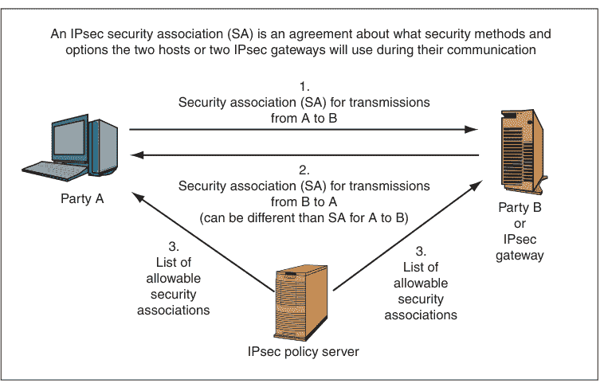


安全需求。公司希望为可接受的安全方法和选项制定策略，并在所有实现该标准的设备上强制执行这些策略。

SSL/TLS 无法集中设置和执行策略，但 IPsec 可以。如图 3-31 所示，IPsec 支持使用 IPsec 策略服务器，这些服务器将合适的策略列表推送到各个 IPsec 网关服务器或主机。从安全管理的角度来看，这是一个关键能力。

## 测试你的理解

- 42. a. 安全关联（SA）指定了什么？（不要只是把 SA 展开。）
- b. 当双方需要双向安全通信时，需要多少个 IPsec SA？
- c. 两个方向上可以有不同的 SA 吗？
- d. 这样做有什么优点？
- e. 为什么公司希望为 SA 制定策略？
- f. 他们能在 SSL/TLS 中这样做吗？
- g. IPsec 如何设置并执行策略？

## 3.12 结论

在本章中，我们探讨了每位 IT 安全专业人员都需要了解的核心密码学概念。我们还探讨了密码系统如何以透明、统一的方式提供安全通信。密码学可能很有挑战性。我们试图总结本章中提到的部分要点。

一种常见的密码保护是用于机密性的加密，即使用密码算法（加密/解密方法）和密钥对原始明文消息进行加密，生成任何截获者都无法读取的密文。接收方使用相同的密钥或另一个密钥（取决于密码算法）反向应用该算法，以恢复原始明文消息。本章探讨了密码算法中常用的两种运算——替换和换位。

在用于机密性的对称密钥加密中，发送方和接收方在两个方向上都使用相同的密钥。在公钥加密中，每一方都拥有一个公钥和一个私钥。在用于机密性的公钥加密中，发送方使用接收方的公钥进行加密，接收方使用自己的私钥进行解密。

为了获得强安全性，密钥必须足够长，以防止通过穷举搜索破解。如今，对称密钥加密算法为了保持强度，密钥长度至少需要 112 位。公钥和私钥为了保持强度必须更长。RSA 密钥至少需要 1,024 位。

另一种重要的密码保护是身份验证，其中请求者（例如客户端 PC）尝试通过发送凭据向验证者（通常是服务器）证明其身份。身份验证通常在通信会话开始时以及在发送每条消息时进行。

我们经常提到三个核心密码过程：对称密钥加密、公钥加密和哈希（hashing）。这些过程很容易相互混淆。

|  | **机密性** | **身份验证** |
|---|---|---|
| *对称密钥加密* | 适用。发送方使用与接收方共享的密钥进行加密。 | 不适用。 |
| *公钥加密* | 适用。发送方使用*接收方的公钥*加密。接收方使用*接收方自己的私钥*解密。 | 适用。发送方（请求者）使用自己的私钥加密。接收方（验证者）使用*真实方的公钥*解密，该公钥通常从真实方的数字证书中获取。 |
| *哈希* | 不适用。 | 适用。用于 MS-CHAP 的初始身份验证，以及 HMAC 中逐条消息的身份验证。 |

**图 3-32** 核心密码过程

图 3-32 比较了这三个过程在机密性和身份验证中的使用方式。

- 请注意，只有公钥加密同时用于机密性*和*身份验证，而且公钥-私钥对在这两个过程中的使用方式*不同*。
- 相比之下，对称密钥加密仅用于机密性。
- 反过来，哈希仅用于身份验证。虽然用于身份验证的哈希确实使用密钥，但这并不使其成为对称密钥加密，后者是一个完全不同的过程。

密码保护很少单独使用。相反，它们几乎总是打包在密码系统中，以全方位的保护确保对话安全。密码系统从三个初始握手阶段开始，然后进入持续通信阶段。

握手阶段首先协商通信双方随后将使用的一组安全方法和选项。公司策略可能会限制可以使用哪些方法和选项集，以防止通信双方使用薄弱的方法和选项。

接下来，双方进行初始身份验证——通常是相互身份验证。我们特别讨论了 MS-CHAP 身份验证，它用于用户登录 Microsoft 服务器。MS-CHAP 对用户的登录密码进行机密性保护。通常，两个通信伙伴会进行相互身份验证。然而，MS-CHAP 只对用户进行身份验证。它不使用加密，而是使用哈希。由于使用可重用的密码作为秘密，并且缺乏相互身份验证，MS-CHAP 是一种较弱的初始密码方法。

最后，在密钥建立（keying）握手阶段，双方必须安全地交换对称会话密钥（以及其他秘密）。会话密钥仅用于单个通信会话。我们了解了如何使用公钥分发和 Diffie-Hellman 密钥交换来实现密钥建立。这结束了握手阶段。

在持续通信阶段，双方安全地交换许多消息。每条消息都带有电子签名，用于逐条消息的身份验证和消息完整性。电子签名有两种类型——HMAC 和数字签名。HMAC 使用哈希和密钥（实际上是一个共享秘密）。HMAC 实现成本低，是使用最广泛的电子签名。数字签名使用公钥加密。发送方使用发送方自己的私钥对消息摘要哈希进行加密。接收方（验证者）使用真实方的公钥解密消息——即请求者声称所代表的方。

数字签名提供极强的身份验证。然而，数字签名使用公钥加密，这非常缓慢，因此成本高昂。此外，用于身份验证的公钥加密通常使用真实方数字证书中的信息进行验证。这需要一个受信任的证书颁发机构系统。证书颁发机构提供真实方的公钥，必须使用该公钥来验证数字签名是否是由真实方的私钥创建的。

本章还包括一个关于量子密钥分发和量子密钥破解的简短小节。

在持续通信阶段，密码系统使用对称密钥加密对每条消息进行加密，以保证机密性。

我们探讨了密码元素如何被打包到密码系统中，这些系统在单个集成包中提供安全元素。特定的密码系统使用密码安全标准。在本章中，我们介绍了一些主要的密码安全标准。

我们探讨了虚拟专用网络（VPN），它是一种密码系统，可在不受信任的网络（互联网、无线局域网等）上提供安全通信。VPN 分为主机到主机、远程访问和站点到站点三种类型。

一种广泛使用的 VPN 标准是 SSL/TLS。SSL/TLS 非常流行，因为客户端只需要一个浏览器，而如今所有客户计算机都有浏览器。我们了解了 SSL/TLS 是如何为主机到主机 VPN（特别是浏览器-Web 服务器 VPN）而创建的。所有浏览器和 Web 服务器都知道如何建立 SSL/TLS VPN，因此使用它们的成本很低。然后我们看到了 SSL/VPN 网关如何将 SSL/TLS 转变为远程访问 VPN 技术。然而，SSL/TLS 并不能为所有应用程序提供透明的保护，而且为远程访问设置 SSL/TLS 网关可能很笨拙。

IPsec 是 VPN 的黄金标准。IPsec 提供极其强大的安全性，包括要求通信双方使用带有数字证书的公钥身份验证来验证自身身份。此外，IPsec 具有强大的策略控制能力，因此通信双方无法选择薄弱的安全选项。这种策略管理是集中的，因此易于管理。

IPsec 以两种模式运行。在传输模式下，IPsec 在源主机和目的主机之间全程提供安全性。然而，IPsec 传输模式成本高昂，因为需要在所有客户端和服务器上进行设置，并且要管理数字证书的整个生命周期。传输模式还使防火墙过滤变得不可能或至少很困难。在隧道模式下，IPsec 仅在各站点的 IPsec 网关之间提供安全性。这消除了计算机设置要求，并允许防火墙过滤。缺点是，隧道模式在站点内部不提供任何安全性。

## 工作中的安全

### 社会工程学与比特币

如果你关注晚间新闻，就会清楚安全漏洞登上头条的频率有多高。显然，由于针对公司、大学甚至政府组织的攻击数量众多，信息安全从业者正在进行一场艰苦的战斗。一个常见的误解是，组织面临的大部分安全威胁来自邪恶的黑客或由外国政府资助的网络犯罪分子。然而，普华永道（PwC）最近进行的一项安全分析报告称，内部人员、第三方供应商以及

承包商构成了日益严重的威胁。31 简而言之，当今困扰组织的许多安全威胁都源自公司内部（或其合作伙伴网络内部）。

在此加密货币或交易价值的一定比例中。

但是挖矿需要极其强大的系统或系统网格，这对于个人单独购买和管理来说可能是不切实际的。社会工程师开始欺骗人们投资于并不存在的挖矿设备，说服受害者贡献其系统的闲置计算能力来挖矿加密货币，但从不为他们的贡献付费，并诱使潜在矿工购买欺诈性硬件（其性能不如宣传的那样强大）用于挖矿。32

## 最薄弱的环节

这一趋势源于人们相对容易被操纵和攻破。黑客经常诉诸于利用人们渴望友好和帮助他人的欲望，而不是利用硬件或软件中的漏洞。这一概念通常被称为社会工程，即操纵个人以访问安全系统、获取机密信息或破坏安全系统的完整性的过程。

虽然社会工程对组织信息安全构成了明确的威胁，但在人们感到压力并做出草率决定的其他环境中，它也可能非常有效。事实上，社会工程已在疯狂的加密货币投资世界中引入了许多新的威胁。

## 社会工程师大发横财

加密货币世界发展迅速，随着比特币价值的飙升，它最近达到了主流化的临界点。从金融专家、技术投资者到精明的高中生，每个人都屈服于自己的投机本性，试图从这一趋势中“快速致富”。然而，加密货币世界很复杂。由于其不成熟，几乎没有任何控制或监管机制来保护参与这一市场的人。鉴于人们对加密货币的疯狂兴趣；买卖或挖矿相关的技术复杂性；以及缺乏任何监督，它很容易被社会工程师利用。

例如，一些骗子正在针对加密货币挖矿设备。加密货币挖矿是对最近的加密货币交易进行验证并将更新的“账本”分发给与该加密货币网络相关联的所有设备的过程。作为执行此功能的回报，矿工可以获得报酬

另一种目前的加密货币诈骗涉及向人们出售实际上并不存在的加密货币。比特币无疑是最引人注目的加密货币市场，但出现了大量首次代币发行（ICO），其中引入了新货币。事实上，在 2018 年第一季度，共有 101 次首次代币发行。33 此外，自 2017 年比特币价值大幅上涨以来，已有超过 300 次 ICO。34

在所有这些活动之下，很难跟踪和验证哪些货币是合法的，哪些具有某种投资价值。市场如此模糊，以至于甚至一些金融机构也被欺骗了。35 参与加密货币淘金热的最佳方式是使用适用于一般金融交易的最佳实践。始终使用常识，核实交易中涉及的各方，避免听起来好得不真实的投资机会，并且，在有疑问时，不要犹豫做更多研究！

## 讨论问题

- 1. 为什么内部人员可能对内部安全系统构成比外部攻击者更大的威胁？内部人员如何成为薄弱环节？
- 2. 什么是社会工程？攻击者如何利用社会工程来破坏安全内部系统？
- 3. 什么是加密货币挖矿？它如何产生资金？
- 4. 攻击者将如何利用社会工程欺骗用户进行挖矿？

## 安全技术

### 克里普托斯

有史以来研究过的最著名的密码信息之一刻在位于弗吉尼亚州兰利中央情报局（CIA）校园的 Kryptos 雕塑上。Kryptos 源自希腊语“隐藏”，由艺术家 Jim Sanborn 于 1990 年创作。

Kryptos 雕塑中有四个面板。面板 1 和 2 包含四条隐藏信息。面板 3 和 4 组合成一个维吉尼亚表。第一条和第二条隐藏信息在面板 1 中，最后两条在面板 2 中。第一条和第三条信息是阴影的。

1999 年，Jim Gillogly 破译了前三条信息。信息 1 使用关键词 palimpsest 和 kryptos 解码。信息 2 使用关键词 abscissa 和 kryptos 解码。信息 3 使用换位法解决。下面是 Gillogly 发布解密信息，包括故意拼写错误。

### 信息 1

在微妙的阴影和光的缺失之间，存在着幻觉的细微差别。

### 信息 2

它完全不可见。怎么可能？他们使用了地球的磁场。x 信息被收集并在地下传输到未知位置。x 兰利知道这件事吗？他们应该知道：它埋在某个地方。x 谁知道确切位置？只有 WW。这是他的最后一条信息。x 北纬三十八度五十七分六点五秒，西经七十七度八分四十四秒。按行标识。

### Kryptos 面板

### 面板 1

```
EMUFPHZLRFAXYUSDJKZLDKRNSHGNFIVJ
YQTAUXQ... [Panel 1 monospaced text continues]
```

### 面板 3

```
ABCDEFG... [Panel 3 monospaced Vigenère tableau text]
```

### 面板 2

```
ENDYAHROHNL... [Panel 2 monospaced text continues]
```

### 面板 4

```
NGHIJLMNQ... [Panel 4 monospaced Vigenère tableau text]
```

### 信息 3

缓慢地，绝望地缓慢地，阻塞门道下部的通道残骸被移除了。颤抖着双手，我在左上角做了一个小小的突破。然后，把洞稍微扩大一点，我插入了蜡烛并探头进去。密室逸出的热空气使火焰闪烁，但不久，房间内的细节从雾中显现出来。x 你能看到任何东西吗？q

最后一条信息仍然是个谜。然而，在 2010 年 Sanborn 发布了一个线索，称字母

NYPVTT（下面加粗）解码正确后将读作 BERLIN。Sanborn 被引用为说，“我假设代码会在相当短的时间内被破解。”39 然后，在 2014 年，Sanborn 发布了另一个线索，称接下来的五个字符 MZFPK 组成单词 CLOCK。在撰写本文时，第四条信息尚未被解码。

?OBKRUOXOGHULBSOLIFBBWFLRVQ
QPRNGKSSOTWTQSJQSSEKZZWATJKLU
DIAWINFBNYPVTTMZF... 
GKUHUAUEKC AR

## 安全伦理

### 逆向工程隐私

Wendy 进入教室，沿着楼梯走到后排。她通常不喜欢坐在房间后面，但在第一节课迟到了，讲师在那节课要求指定座位。学期感觉拖得很长，她迫不及待地想在那个夏天开始在城市的营销实习。她上一个夏天曾在同一家公司工作，她有信心毕业后会被提供全职职位。她对城市生活的思绪被讲师在前面进入并突然开始上课打断了。

整天。如果您见过一个，您可能会认为它在一天中只是循环播放固定的广告组，大约每 10 秒更换一次。然而，广告选择过程非常动态，每个广告显示的时间也很刻意。事实上，广告牌知道在一天中哪些人口统计和社会经济群体正在经过广告牌。”40 班上似乎对这个说法持怀疑态度——这怎么可能？

这门课是商科学生必修的，涵盖了各种技术相关主题。课程以通常的方式开始——概述当前流行的新闻文章。讲师通过讨论一篇迅速吸引全班注意力的文章开始了课程。“你知道广告牌在监视你吗？”他说。“好吧，让我重新表述一下——它们并不完全是监视，但它们确实比你想象的更了解你。”

讲师随后解释了其工作原理。“手机公司收集客户的大量位置数据。这是因为客户的手机在发送和接收数据的过程中不断向蜂窝基站通信其位置。他们还管理识别附近信号最强的基站的过程。作为这一过程的副产品，只要您携带手机，电话公司就知道您一天中的任何时间在哪里。”

### 广告牌在监视

“你可能注意到城市周围出现了许多数字广告牌，”讲师继续说道。“它们可以被编程以显示各种广告

讲师面无表情地笑了笑并继续说：“他们然后将这些包含客户位置数据的庞大数据集出售给第三方，在本例中是通过广告牌做广告的公司。这些公司随后分析位置数据并将人们细分到各种

(continued)


群体——那些多次去过体育场的体育迷、喜欢航海并每个周末都在游艇俱乐部度过的人、每天早上都会在某个特定咖啡店停留的人。一旦这些细分群体被识别出来，广告公司就会确定每个群体中最高数量的人驾车经过数字广告牌的时段，并相应地展示定向广告。

## 请保护隐私

在描述了这些广告牌的工作原理之后，讲师请学生们发言评论。学生们似乎分成了两种截然不同的观点。一些人认为这项技术很酷，基于他们的数据展示定向广告的广告牌正是信息时代创新与无限潜力的又一个例证。另一些人则认为，这些广告牌是公司在消费数据隐私和安全方面肆无忌惮的又一恶劣例证。在两边的多位学生分享了自己的想法后，讲师提供了一些新的见解，以进一步推动讨论。

“你们当中那些担心自己数据安全的人，立场是有道理的。最近有一篇文章讨论了当你允许手机上的应用访问你的位置数据时所达成的协议——你基本上是在同意他们可以将你的数据拿走并出售，而且这些数据在实际用于定向广告之前，可能会经过任意数量的第三方。如果数据遭到泄露，这显然会构成潜在的安全风险。这一点尤其令人担忧，因为公司并没有尽心尽力地移除个人身份信息（PII）。⁴¹ 更糟糕的是，最近有消息披露，即便在基于位置的服务被禁用的情况下，安卓手机仍然在收集和存储位置数据。⁴²

这些披露让全班同学更加激动，也让两组学生的分歧进一步加深。温迪不太确定自己属于哪一派。作为市场营销专业的学生，她认识到创建定向广告活动的巨大潜力。然而，作为一名普通公民，她觉得公司在未经她许可的情况下，知道她从开始使用手机起去过哪里，并且轻易地将这些数据分享给其他组织，这种做法是错误的，也令人不安。她开始思考自己未来在市场营销领域的职业生涯。她能在一家以这种方式利用消费者数据——她的数据——的公司工作吗？

## 讨论问题

- 1. 根据本书前面定义的各种道德原则：
  - a. 根据绝对命令原则（第42–43页），你认为全天追踪客户的实际位置是否符合道德？
  - b. 根据功利主义视角（第42–43页），你认为全天追踪客户的实际位置是否符合道德？
- 2. 你觉得温迪为什么感到矛盾？可以追踪别人却不想自己被追踪，这合适吗？为什么？
- 3. 大多数人在注册新服务时并不会阅读条款。你认为，如果一家公司在合同条款中明确注明了相关内容，它就可以随意使用客户数据吗？如果合同极其冗长、用法律术语写成，并且以很小的字体显示，那么假设普通人会阅读并理解它是合理的吗？公司是否有责任确保客户理解这些条款？
- 4. 假设移动通信公司将客户手机的网络信号强度数据分享给第三方营销公司。这家营销公司随后可以利用这些数据计算出客户在一天中的位置。共享企业的“网络”数据怎么会构成对客户隐私的潜在侵犯？

⁴¹ 克里斯托弗·米姆斯，《你的位置数据正在被出售——通常你并不知情》，《华尔街日报》，2018年4月6日。www.wsj.com/articles/your-location-data-is-being-soldoften-without-your-knowledge-1520168400。
⁴² 斯瓦蒂·坎德尔瓦尔，《谷歌在位置服务被禁用时仍收集安卓位置数据》，《黑客新闻》，2018年4月6日。https://thehackernews.com/2017/11/android-location-tracking.html。

## 思考题

- 1. 微处理器的总处理速度（基于时钟频率和电路数量）大约每年翻一番。如今，一个对称会话密钥需要达到112位才算强密钥。30年后，对称会话密钥需要多长才能被视为强密钥？（提示：考虑如果密钥长度增加一位，解密时间会延长多少。）
- 2. 更长的密钥更难破解。目前大多数对称密钥长度为100到300位。为什么系统不使用更长的对称密钥——比如说，1000位的密钥？
- 3. 暴力破解被用来破解一个100位密钥。结果只尝试了5000次就破解了。这是怎么回事？
- 4. 在实践中，公钥认证被大量用于初始认证，但很少用于逐条消息的认证。考虑到公钥认证所需的强大处理能力，以及公钥认证提供了最强的认证能力，请解释这两种使用模式。
- 5. 我们在本章中看到对称密钥加密用于认证了吗？如果是，它是如何使用的？
- 6. 描述图3-9中第二行的条目，并评述其所选方案的优势。
  - a. 对于图3-9的倒数第二行，评述其对称加密算法和哈希算法的优势。
  - b. 描述图3-9最后一行中的条目，并评述其所选方案的优势。
- 7. 数字证书和驾照有什么相似之处，又有什么不同？
- 8. 数字证书和护照有什么相似之处，又有什么不同？
- 9. 数字证书和大学文凭有什么相似之处，又有什么不同？
- 10. 数字证书和电影票有什么相似之处，又有什么不同？
- 11. 识别与通过数字签名和数字证书进行认证相关的潜在安全威胁。逐一解释每种威胁，并说明你将如何应对。
- 12. 本章描述了公钥认证如何用于数字签名中的逐条消息认证。然而，公钥认证被广泛用于初始认证。如果公钥加密被用于初始的质询-响应认证，描述请求者和验证者将使用的过程。充分利用你对数字签名的理解，但要将这些信息放在质询-响应的语境中。
- 13. 如果请求者给你一张数字证书，你应该接受吗？请解释。（仔细思考这个问题。答案并不明显。）

## 实践项目

### 项目1

AxCrypt® 是一个很棒的第三方加密工具。你只需要选择要加密的文件，输入密码，就完成了。它甚至可以作为右键点击文件时的快捷菜单选项。AxCrypt 会在你修改完文件后自动重新加密。它使用128位AES加密，并且完全免费。让我们来看看 AxCrypt 内置的一些功能。

- 1. 从 www.axcrypt.net 下载 AxCrypt。
- 2. 点击 Download（下载）。
- 3. 点击适合你操作系统的版本。
- 4. 如果程序没有自动打开，请浏览到你的下载文件夹。
- 5. 右键单击 AxCrypt-2-Setup.exe。
- 6. 点击“以管理员身份运行”。
- 7. 如果提示，点击“是”。
- 8. 点击“我同意”。
- 9. 点击“自定义安装”。
- 10. 取消选择所有捆绑软件（来自亚马逊的）。
- 11. 点击“安装”。
- 12. 取消选择“注册”。
- 13. 点击“完成”。
- 14. 保存所有工作，退出所有其他程序，然后重新启动电脑。重启后，你可以继续下一步。
- 15. 右键单击桌面。
- 16. 点击“新建”和“文本文档”。
- 17. 将文件命名为 YourName.txt。用你的名和姓替换 YourName。
- 18. 右键单击名为 YourName.txt 的文件。
- 19. 选择 AxCrypt，然后选择“加密”。
- 20. 输入密码“tiger1234”（不含引号）。


- 21. 单击“确定”。
- 22. 双击你刚刚创建的新文件 YourName-txt.axx。
- 23. 输入密码“tiger1234”（不含引号）。
- 24. 单击“确定”。
- 25. 关闭你刚刚打开的文本文件。
- 26. 截取桌面截图，显示新创建的文件。
- 27. 右键单击名为 YourName-txt.axx 的文件。
- 28. 选择 AxCrypt 和 解密。
- 29. 输入密码“tiger1234”（不含引号）。
- 30. 单击“确定”。
- 31. 右键单击名为 YourName.txt 的文件。（这次你要制作一个可执行文件，任何人都可以打开。 他们无需在计算机上安装 AxCrypt 即可打开 .exe。）
- 32. 选择 AxCrypt，然后 加密复制到 .EXE。
- 33. 输入密码“tiger1234”（不含引号）。
- 34. 单击“确定”。
- 35. 截取你新创建的 YourName-txt.exe 文件的截图。

## 项目 2

本项目使用 Enigma® 机器模拟器。它像二战期间使用的 Enigma 机器一样运行。此示例旨在帮助你更好地了解加密在早期的运作方式。当你首次开始探索密码学主题时，它是一个很好的学习工具。Enigma 机器在当时提供了相当不错的加密强度。现代密码系统比 Enigma 机器安全得多。

注意你在输入时彩色路径的变化。红色路径经过三个转子，反弹到反射器，变为绿色，然后再次经过三个转子。每次按键时右转子都会移动。如果它完成一个完整循环，它将推进中间转子，随后推进左转子。

- 1. 打开网络浏览器并访问 http://enigmaco.de/enigma/enigma.html。
- 2. 使用左右箭头移动顶部三个转子中的每一个，使每个转子都以蓝色选中字母“A”。
- 3. 单击屏幕底部的输入文本框。
- 4. 缓慢输入你的名字和姓氏，中间不要有空格。（在本例中为 Randy Boyle。如果输入错误，可以按退格键重新开始。）
- 5. 截取屏幕截图。

*注意：* 输入文本框中的文本是你输入的内容。输出文本框中的文本是你将发送的内容。现在你要将拨盘重置到原始位置（本例中为 AAA）并在输入文本框中输入你在输出文本框中生成的加密文本（密文）。你可以从刚刚截取的屏幕截图中复制密文。随后，你应该在底部框中看到你的名字被还原。这相当于解密消息。

- 6. 单击输入文本框并退格删除你的名字。（转子应恢复到 AAA 位置。）
- 7. 回顾你刚刚截取的屏幕截图并抄下输出（密文）。（在本例中，“RANDYBOYLE”的密文为“VDOLZYM EAC”。）
- 8. 在输入文本框中输入密文。（慢慢输入，以免出错而需要重新开始！）
- 9. 截取屏幕截图，使你的名字显示在输出文本框中。
- 10. 退格删除输入文本框中的文本。
- 11. 缓慢按下 A 键十次，注意即使每次都按同一个键，通过旋转拨盘输出的加密字母也是不同的。
- 12. 截取屏幕截图。

## 项目思考问题

- 1. 为什么需要一个自解压的加密文件（.exe）？
- 2. AxCrypt 能否处理多个文件或整个目录（文件夹）？
- 3. 即使你用 AxCrypt 加密了一个文件，是否有人能用文件恢复程序恢复该文件的先前版本？提示：AxCrypt 内置了粉碎机。
- 4. 你用 AxCrypt 加密这些文件后，你的网络管理员能否打开它们？为什么不能？
- 5. 为什么 Enigma 机器使用多个转子？
- 6. 二战密码学家是如何知道使用哪些转子设置的？

## 案例研究

### 隐私之战

Bloomberg LP 为华尔街的交易员提供终端，用于各种用途，包括市场研究、阅读新闻、与其他交易员沟通以及达成交易。Bloomberg 在客户使用其终端时维护客户保密的能力受到了攻击。43 在一起案例中，一名 Bloomberg 记者因为一名员工很长时间没有登录其终端，而向高盛的一名高管询问该员工可能的离职情况。

事实证明，一个内置功能（UUID）允许 Bloomberg 记者查看每个终端用户的一般使用统计信息，包括交易员、银行家、经济学家和研究人员。这些统计信息包括用户何时使用终端，以及他们使用的是内置的 15,000 个功能中的哪一个。UUID 功能自系统最初实施 30 年来一直可用。

后续报告显示，来自其终端系统的 Bloomberg 消息数据已在网上被发现。44 该数据包含用户信息、交易数据和敏感通信。Bloomberg Messenger 被交易员广泛用于达成交易。Bloomberg 承认消息会被扫描以获取相关交易信息并发送回其客户。

然而，随着最近的隐私担忧以及过去消息数据被发现在线的披露，很多人都在质疑交易员之间的消息内容是否被不当使用。CNNMoney 的 Cyrus Sanati 指出，“人们还担心公司可能会利用这些信息帮助 Bloomberg Tradebook 或 Bloomberg Pool，即公司正在增长的经纪交易商和暗池交易机构，从而相对于其客户获得信息优势。”

Bloomberg 高管表示他们已禁用 UUID 功能，并任命一名高管调查任何可能的不当使用保密数据的情况。

本案例说明了隐私和保密性在企业内部和企业之间都很重要。公司变得越来越相互关联，越来越依赖外部供应商提供的服务。隐私和保密违规可能影响企业的底线。

电子前沿基金会（EFF）发布了其年度《Who Has Your Back？》报告，列出了为确保你的隐私而采取重大措施的公司。45 EFF 报告“审查了主要互联网公司的政策——包括 ISP、电子邮件提供商、云存储提供商、基于位置的服务、博客平台和社交网络网站——以评估它们是否公开承诺在政府寻求访问用户数据时与用户站在一起。”

| 公司 | 要求对通信内容出具搜查令 | 告知用户政府数据请求 | 发布透明度报告 | 发布执法指南 | 在法庭上为用户隐私权而战 | 在国会为用户隐私而战 |
|---|---|---|---|---|---|---|
| Amazon® |  |  |  |  | * | * |
| Apple® |  |  |  |  |  | * |
| AT&T® |  |  |  |  |  | * |
| Comcast® |  |  |  | * | * |  |
| Dropbox® | * | * | * | * |  | * |
| Facebook® | * |  |  | * |  | * |
| Foursquare® | * | * |  | * |  | * |
| Google® | * |  | * | * | * | * |
| LinkedIn® | * | * | * | * |  | * |
| Microsoft® | * |  | * | * |  | * |
| MySpace® | * |  |  | * | * |  |
| Sonic.net® | * | * | * | * | * | * |
| SpiderOak® | * | * | * | * |  | * |
| Twitter® | * | * | * | * | * | * |
| Tumblr® | * |  |  | * |  | * |
| Verizon® |  |  |  |  |  |  |
| WordPress® | * | * |  | * |  | * |
| Yahoo!® |  |  |  |  | * |  |

评估主要互联网公司保护消费者隐私的努力

43 Mark DeCambra, "Goldman Outs Bloomberg Snoops," New York Post, 2013 年 5 月 9 日. www.nypost.com/p/news/business/goldman_outs_bloomberg_snoops_ed7SopzVLaO02p9foS7ncM.

44 Cyrus Sanati, "Wall Street Traders Are Freaked by Bloomberg Message Leak." CNN Money, 2013 年 5 月 15 日. http://finance.fortune.cnn.com/2013/05/15/traders-bloomberg-spying.

45 Nate Cardozo, "Cindy Cohn, Parker Higgins, Marcia Hofmann, and Rainey Reitman," Who Has Your Back? 2013 年 4 月 30 日. Electronic Frontier Foundation. www.eff.org/who-has-your-back-2013.


下面是他们研究结果的汇总表。有趣的是，公司会随着时间推移改变其政策。有些会改善，有些则会变差。

## 案例讨论问题
- 1. 彭博内部人员如何利用终端数据抢先交易者一步进行交易？
- 2. 彭博应如何处理关于其保护交易者数据能力的问题？
- 3. 彭博如何利用加密来平息交易者的担忧？
- 4. 为什么保密性在企业对企业关系中很重要？
- 5. 为什么 EFF 会发布关于大型互联网公司消费者隐私的报告？
- 6. 隐私问题如何影响客户忠诚度和新产品采用？

## 视角问题
- 1. 本章中你觉得最困难的部分是什么？
- 2. 本章中你学到的最令人惊讶的事情是什么？

# 第4章
# 安全网络
## 学习目标
## 章节大纲

*学习完本章后，你应该能够：*

- **4.1** 描述创建安全网络的目标。
- **4.2** 解释拒绝服务（DoS）攻击的工作原理。
- **4.3** 解释 ARP 欺骗的工作原理。
- **4.4** 知道访问控制对网络为何重要。
- **4.5** 解释如何保护以太网网络。
- **4.6** 描述无线（WLAN）安全标准和潜在攻击。

- 4.1 引言
- 4.2 DoS 攻击
- 4.3 ARP 欺骗
- 4.4 网络访问控制
- 4.5 以太网安全
- 4.6 无线安全
- 4.7 结论

## 4.1 引言

**4.1 描述创建安全网络的目标。**

第3章探讨了密码学如何通过确保消息的保密性、真实性和完整性（CIA）来保护通信。本章将转移焦点，探讨网络本身如何受到攻击。它将探讨攻击者如何恶意改变网络的正常运行。

在现代电信网络之前，消息主要通过人工传递、电话口述或通过无线电波发送。当时的主要安全目标是（1）保持消息保密（保密性），（2）确保消息来自真正的发送者（真实性），以及（3）确保消息未被篡改（完整性）。密码系统能够，也仍然能够实现这些目标中的每一个。

然而，随着现代电信网络的出现，很明显需要解决新的安全问题。传递消息的*手段*可能会被停止、减慢或改变。消息所走的*路线*可能会被改变。消息可能会被*重定向*到虚假的接收者。攻击者还可能获得对以前被认为封闭和保密的通信渠道的*访问*权限。

## 创建安全网络

创建安全网络环境时需要考虑四个广泛的目标。这些目标是第1章中提到的 CIA（保密性、完整性和可用性）框架的扩展。它们包括可用性、保密性、功能性和访问控制。针对网络的攻击通常集中于击败一个或多个这些共同目标。

## 可用性

确保网络可用性意味着授权用户可以访问信息、服务和网络资源。拒绝服务（DoS）攻击是对企业最常见的网络攻击类型之一。它们可以从世界任何地方发起，并产生即时的破坏性影响。

对网络可用性的攻击可能阻止客户、供应商和员工进行业务交易。在线零售商的盈利能力取决于网络服务（如 Web 服务器）的持续可用性。如果消息无法传递，即使是最好的密码系统也变得无关紧要。

## 保密性

保密性一词在网络安全上下文中的含义与之前密码学章节中的含义略有不同，后者意味着拦截消息的人无法阅读它们。

在网络安全上下文中，保密性意味着防止未经授权的用户获取有关网络结构、网络中流动的数据、所用网络协议或数据包头值的信息。

例如，假设一名内部员工大部分时间都登录到一个色情网站，使用加密的 SSL 连接。会话完全加密，雇主无法看到数据包的内容。然而，雇主可以看到发送者的 IP 地址、接收者的 IP 地址、解析主机名（PornographicSite.com）的 DNS 请求、使用的端口号以及发送的数据量。访问数据包的内容可能并非必要。

攻击者可以通过被动监控进入和离开企业网络的流量获得有价值的信息。即使流量被加密，攻击者仍可以看到访问了哪些网站、发送或接收了多少数据以及使用了哪些端口号。如果这些信息是从例如竞争对手研发网络产生的流量中收集的，则可能具有战略重要性。¹

攻击者还可能能够映射内部网络，并根据头部信息被动地指纹识别（基于已知特征识别）内部主机。例如，来自 Microsoft Windows 计算机的数据包默认 TTL 值为 128，而来自 macOS 的数据包默认 TTL 值为 64。

## 功能性

创建安全网络时需要考虑的另一个目标是功能性。确保适当的网络功能意味着防止攻击者改变网络的能力或操作。适当的网络功能包括正确路由数据包、正确解析主机名、排除未经批准的协议、正确分配 IP 地址等等。

例如，一名不满的员工可以使用 ARP（地址解析协议）欺骗来改变内部网络的功能。ARP 欺骗会将网络流量重新路由通过攻击者的计算机。这将允许攻击者扫描通过未加密的本地网络发送的数据包。

该员工将使用中间人（MITM）攻击来窃取他本无权访问的商业机密。ARP 欺骗将在后面更详细地讨论。

# 访问控制

保护网络时需要考虑的最后一个总体目标是访问控制。在网络安全上下文中，访问控制是对系统、数据和对话的访问进行基于策略的控制。本质上，目标是防止攻击者访问任何内部资源。这也包括限制内部员工的访问。

¹ 很少有用户在使用搜索引擎时强制使用 SSL 连接（即 http://encrypted.google.com）。如果未与搜索引擎建立 SSL 连接，则可以通过数据包被动收集搜索词。收集搜索词可能为组织内正在进行的工作提供重要的战略洞察。

访问控制是一个如此重要的总体目标，以至于第5章专门讨论它。虽然本章专门关注网络访问控制，但下一章将重点讨论物理安全（门、建筑物等）、生物识别、审计和目录服务器。

本章将探讨如何控制对以太网和无线网络的访问。更具体地说，它将探讨如何对内部网络的合法访问进行身份验证和授权。

## 安全网络的未来

出于几个原因，保护企业网络很困难。新的攻击向量或攻击网络的方式每年都会出现。曾经被认为“已解决”的旧攻击向量会利用新技术、媒体或协议被重新利用。创建安全网络是一个需要持续教育和适应的过程。

例如，较新的手机具有允许无线笔记本电脑将自身连接到手机并共享其互联网连接的能力。允许手机进入企业网络完全绕过了访问控制程序、防火墙、防病毒保护、数据丢失预防系统等等。

## 周界的死亡

人们对是否可以构建安全网络存在分歧。一些人认为周界防御在很大程度上是无用的。传统的网络防御城堡模型将好人置于内部，将攻击者置于外部。有一个防守严密的单一入口点。网络管理员所要做的就是保护这个入口点，攻击者就会被阻止。

过去几十年里，这种周界思维逐渐消亡。“周界的死亡”是一个由网络管理员使用的短语，用来传达创建 100% 安全网络是不可能的想法。他们认为，强迫组织中的所有信息通过网络中的单一节点是不切实际的，甚至是不可能的。发布一项法令，要求所有员工，包括 CEO，必须将手机留在车里，很可能会遭到抵制。

“好人”和“坏人”之间的界限也变得模糊。有时好人可能在物理网络周界之外，但

- 安全网络的四个主要目标
- 可用性 — 用户可以访问信息服务和网络资源
- 保密性 — 防止未经授权的用户获取有关网络的信息
- 功能性 — 防止攻击者改变网络的能力或正常运行
- 访问控制 — 防止攻击者或未经授权的员工访问内部资源
- 安全网络的未来
- 周界的死亡
- 城堡模型
- 好人在内部，坏人在外部
- 城市的兴起
- 城市模型
- 没有明确的周界
- 基于身份的访问

仍然需要访问内部资源。远程工作的员工以及与其他公司的合作都是需要让边界之外的人员访问内部系统的实例。相反，坏人最终成为现有员工的情况也太常见了。

## RISE OF THE CITY

网络安全更好的范式是**城市模型**。² 城市模型没有明确的边界，进入网络的方式有多种。就像真正的城市一样，你是谁将决定你能够访问哪些建筑。

城市的安全需求比城堡的安全需求复杂得多。城市需要更多的警察、建筑物、门、围栏和锁。从技术角度来说，这意味着需要更多的内部入侵检测系统（IDS）、虚拟局域网、中央身份验证服务器以及加密的内部流量。

技术进步将改变我们*使用*网络的方式。出于必要，我们*保护*网络的方式也将发生变化。以下章节将介绍几种较为人所熟知的攻击网络的方法。

### Test Your Understanding

- 1. a. 解释安全网络的四个总体目标。
- b. 如何从加密的网络流量中收集信息？
- c. 举例说明新技术如何使网络安全性降低。
- d. 城堡模型与安全网络有何关系？
- e. “边界的死亡”是什么意思？
- f. 城市模型与安全网络有何关系？

***Warning***: 以下内容较难。请放慢速度并确保在继续之前理解每个概念。如果您不熟悉网络术语，应复习模块 A。

## In the News

### Reflected DoS Attack

2018年，一种名为*memcached*的流行缓存工具中发现了一个新漏洞。Memcached 的设计目的是通过临时缓存数据来加快网站速度。Memcached 中的漏洞允许外部攻击者使攻击威力增强51,000倍。³ 其结果是反射式 DoS 攻击，能够产生每秒超过1 Tb 的流量。Memcached 本应仅在内部使用，但许多服务器的 memcached 面向互联网。攻击者向运行 memcached 的服务器发送来自受害者伪造 IP 地址的统计 UDP 请求。放大的响应会产生巨大的数据包波浪，压垮受害者。

² Bruce Schneier, “The People Paradigm,” CSOOnline.com, 2004年11月1日。 www.csoonline.com/article/219787/bruce-schneier-the-people-paradigm.

³ Richard Chirgwin, “Popular Cache Utility Exploited for Massive Reflected DoS Attacks,” The Register, 2018年2月28日。 www.theregister.co.uk/2018/02/28/memcached_reflected_dos_attacks.

### DDoS for Hire

2018年，荷兰和英国警方在苏格兰、克罗地亚、加拿大和塞尔维亚逮捕了六名系统管理员，他们运营着一个 DoS 攻击租赁服务。⁴ 网站 WebStresser.org 的管理员会以低至10英镑（12美元）的价格对任何目标发动攻击。WebStresser.org 的管理员拥有超过136,000名注册用户，他们使用电子支付服务或比特币支付服务费用。 authorities 说该团伙攻击了英国一些最大的银行和政府组织。

### Largest DoS Attack Ever

2018年，历史上最大规模的 DoS 攻击针对 GitHub 发起。该攻击以每秒130百万个数据包的速度持续以1.35 Tbps 的速率向 GitHub 服务器发送数据。⁵ 但在2019年出现了一个新的竞争者，当时攻击者向 Imperva 发送了超过每秒580百万个数据包。这次新攻击在数据包数量方面是最大规模的攻击。GitHub 攻击仍然保持着总带宽最大的 DoS 攻击的头衔。卡巴斯基实验室指出，2019年的 DDoS 攻击比前一年增长了100%。攻击持续时间也比前一年增加了4.21倍。如果继续下去，2020年可能是网络攻击之年。

### Hacking WPA3

2019年，纽约大学的 Mathy Vanhoef 和特拉维夫大学的 Eyal Ronen 研究人员演示了针对最新无线安全协议 WPA3 的五次攻击。他们表明，初始握手协议中的缺陷可能允许攻击者在不知道密码的情况下访问网络。他们还演示了一种使用亚马逊网络服务（AWS）的密码攻击，可以花费约125美元找到网络密码。这些漏洞的信息在公开之前已发送给 Wi-Fi 联盟的开发人员。

## 4.2 DoS Attacks

## 4.2 Explain how denial-of-service (DoS) attacks work.

你在新闻中听到的最常见的网络攻击之一是拒绝服务（DoS）攻击。DoS 攻击试图使服务器或网络对合法用户不可用。就前面讨论的总体目标而言，DoS 攻击是降低可用性的一种方式。

> 拒绝服务（DoS）攻击试图通过用攻击数据包淹没服务器或网络，使其无法为合法用户提供服务。

DoS 攻击每天都会发生。企业和政府实体是攻击者的主要目标。第一章中，你曾简要介绍过一种称为分布式 DoS（DDoS）攻击的 DoS 攻击类型。本节将更详细地介绍 DDoS 攻击的机制，以及其他几种 DoS 攻击类型。

### Denial of Service... But Not an Attack

在了解 DoS 攻击的工作细节之前，重要的是要知道并非所有服务中断都是攻击。由于 DoS 攻击的常见性和在媒体上的曝光度，很容易将服务中断归咎于外部攻击者。内部员工和管理人员对本可预防甚至可能造成的停机事件免于指责。

⁴ Mohit Kumar, “Police Shut Down World’s Biggest ‘DDoS-for-Hire’ Service–Admins Arrested,” The Hacker News, 2018年4月25日。 https://thehackernews.com/2018/04/ddos-for-hire-hacker.html.
⁵ Casey Crane, “The Largest DDoS Attacks in History,” TheSSLStore.com, 2019年5月29日。 www.thesslstore.com/blog/largest-ddos-attack-in-history.

#### FAULTY CODING

例如，Newsnet Scotland 声称自己是亲联合主义政治对手 DoS 攻击的受害者。然而事实证明，服务中断是由糟糕的编码造成的。Newsnet Scotland 首席执行官 Alex Porter 发表更正声明称，“我们已经能够确定这并不是之前认为的 DDoS 攻击。问题在于对一个模块的调整本质上创建了一个捷径，导致服务器中出现大量循环活动。”

#### REFERRALS FROM LARGE SITES

当大型网站链接到规模小得多的网站时，另一种常见的非攻击性服务中断就会发生。这在 Slashdot、Drudge Report 和《赫芬顿邮报》等新闻聚合网站链接到托管新闻文章的小型网站时很常见。

小型新闻网站可能会因流量急剧增加而不堪重负。虽然效果与 DoS 攻击相同，但服务中断是无意的。流量的大幅激增或服务中断并不一定意味着恶意的 DoS 攻击。

### Goal of DoS Attacks

DoS 攻击的最终目标是造成伤害。对于企业而言，这可能表现为与在线销售、行业声誉、员工生产力或客户忠诚度相关的损失。DoS 攻击可以通过（1）停止关键服务或（2）随着时间的推移缓慢降低服务来造成伤害。

#### STOP CRITICAL SERVICES

攻击者经常针对组织的<|message|> 重要服务发起 DoS 攻击。攻击者针对的最常见服务是 HTTP。Web 服务是热门目标，因为可以造成经济损失。

例如，在一年中最繁忙的购物季节之一，亚马逊、沃尔玛和 GAP 的网站在大约一小时内无法访问。圣诞节前两天，针对这些大型公司的 DNS 提供商 Neustar 发动了 DDoS 攻击。购物者无法访问或从这些在线零售商处购买任何东西。

除了关闭公司的网站外，攻击者还可能阻止员工访问其电子邮件或文件服务器，或关闭专有应用程序。

#### DEGRADE SERVICES

通常针对关键服务的 DoS 攻击很容易识别且持续时间不长。网络管理员会迅速努力阻止已知攻击。然而，最具破坏性的攻击是无法识别的攻击。这些攻击持续时间很长。

缓慢降低服务的攻击更难检测，因为服务质量没有突然变化。网络管理员无法在网络流量的真实增长和渐进式 DoS 攻击之间做出明确区分。他们可能被迫为额外的带宽、硬件和软件进行不必要的资本支出。

### Test Your Understanding

- 2. a. 什么是拒绝服务攻击？
- b. 除了 DoS 攻击外，还有什么可能导致公司网站服务器崩溃？
- c. DoS 攻击的主要目标是什么？
- d. 缓慢的服务降级是否比完全停止更糟？为什么？


## DoS 攻击的方法

攻击者在实施 DoS 攻击时遵循四种主要方法。他们还可以使用混合 DoS 攻击，结合每种方法的元素。以下内容并非旨在列出每种 DoS 攻击类型的全面清单。相反，它是对 DoS 方法的介绍。

我们将要研究的主要 DoS 攻击方法有（1）直接/间接、（2）中介、（3）反射，以及（4）发送畸形数据包。每种方法都有其自身的优点和缺点。更简单的攻击可能更容易实施，但也更容易被阻止。另一方面，本质上更复杂的攻击可能极难阻止，而不造成额外伤害。

### 不是 DoS 攻击
- 有缺陷的编码
- 来自大型网站的推荐

### DoS 攻击的目标
- 停止关键服务
- 随着时间的推移缓慢降低服务质量

### 直接和间接 DoS 攻击
- 直接 DoS 攻击——直接淹没受害者
- 间接 DoS 攻击——伪造源地址然后淹没受害者
- 来自伪造地址的回波
- 可以发送多种类型的数据包
- SYN 洪泛
- 攻击者向端口发送 TCP SYN 段
- 应用程序返回 SYN/ACK 段并预留资源
- 攻击者从不发送回 ACK，因此受害者一直保留资源
- 受害者很快耗尽资源并崩溃，或无法再为合法流量提供服务

### 中介
- 僵尸网络管理员控制僵尸程序
- 可更新的 DoS 攻击程序
- 处理程序可以更新软件以改变僵尸程序可以执行的攻击类型
- 可能将僵尸网络出售或租赁给其他罪犯
- 处理程序可以更新僵尸程序以修复错误
- 点对点重定向

### 反射
- DRDoS 攻击
- Smurf 洪泛
- 伪造的 ICMP 回显请求
- 配置不当的路由器
- 向内部主机广播

### 发送畸形数据包
- 畸形数据包会导致受害者崩溃
- 死亡 ping
- 死亡短信

## 图 4-3 SYN Flood DoS 攻击

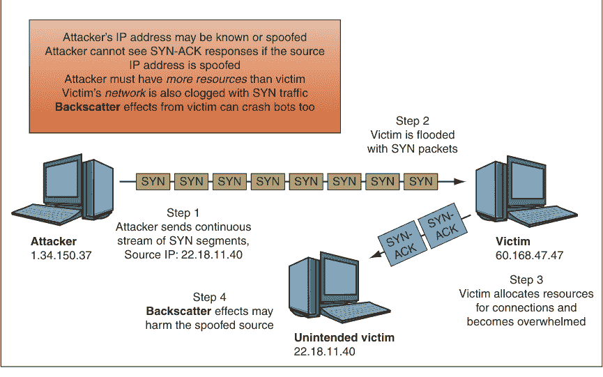

### 直接和间接攻击
DoS 攻击的最简单形式是直接攻击，类似于图 4-3 所示。**直接攻击** 发生在攻击者试图从攻击者计算机直接向受害者发送数据包流时。**间接攻击** 以相同的方式尝试淹没受害者计算机，但攻击者的 IP 地址被 *伪造*（即伪造），攻击似乎来自另一台计算机（步骤 1）。

### 泛洪
只有当攻击者能够向受害者发送比受害者能够处理的请求更多的请求时，直接或间接攻击才能成功（步骤 2）。攻击者必须拥有比受害者更多的带宽、内存（RAM）和/或 CPU 功率（步骤 3）。鉴于大多数企业服务器场的规模，单个用户不太可能产生足够的流量来成功降低现有服务的质量。企业服务器可以处理比单个攻击者能产生的更多请求。

### 伪造
直接攻击很少见。攻击者不喜欢直接攻击受害者，因为他们的源 IP 地址显示在所有传入数据包上。相反，攻击者更喜欢使用隐藏其 IP 地址的伪造 IP 地址。

伪造 IP 地址的缺点是攻击者无法获得有关攻击的直接反馈。他们必须依靠间接手段来监控攻击，例如从另一台计算机向受害者发送请求以测试可用性。

### 回波
攻击者伪造 IP 地址的副作用是回波。**回波** 发生在受害者向攻击者使用的伪造 IP 地址发送 *响应* 时，并无意中淹没了意外的受害者（步骤 4）。回波效应的变体用于专门针对反射攻击中的受害者（稍后讨论）。

### 发送的数据包类型
有时 DoS 攻击是根据攻击期间发送的数据包 *类型* 而命名，而不是攻击 *方法*。本节解释的一些 DoS 攻击可以使用多种类型的数据包（例如 DDoS）。其他攻击方法，如 Smurf 洪泛，使用单一类型的数据包。下面只是可以在 DoS 攻击中发送的数据包类型的几个例子（图 4-4）。

- *SYN 洪泛* 受害者被 SYN 数据包淹没，试图建立许多半开的 TCP（传输控制协议）连接。为每个虚假连接分配内存，导致受害者耗尽内存并崩溃。

|  | 名称 | 描述 |
|---|---|---|
| **TCP** | 传输控制协议 | 在互联网上保证数据包的交付 |
| **SYN** | 同步 | 建立网络连接的三次握手的第一个部分 |
| **SYN-ACK** | 同步-确认 | 作为对 SYN 的响应发送的三次握手的第二部分 |
| **ICMP** | 网际控制报文协议 | 用于在计算机之间发送错误消息的监督协议 |
| **HTTP** | 超文本传输协议 | 用于在网络上发送数据的协议 |

## 图 4-4 DoS 攻击中常用的数据包类型

- *Ping 洪泛* 受害者被 ICMP（网际控制报文协议）数据包（也称为回显请求）淹没，这些数据包看起来像是正常的监督流量。带宽和 CPU 周期被消耗到受害者崩溃的程度。
- *HTTP 洪泛* 受害者，通常是 Web 服务器，被应用层 Web 请求淹没。Web 服务器因内存和 CPU 功率不足而崩溃。

### SYN Flood 示例
**SYN 洪泛**，或半开 TCP 攻击，发生在攻击者向受害者服务器发送大量 TCP SYN 段时（图 4-3）（步骤 1）。每个 SYN 在服务器上开始一个 TCP 会话打开过程（步骤 2）。服务器为连接预留 RAM 和其他资源。然后服务器返回一个 SYN/ACK 段。

攻击者从未通过发送最终 ACK 来完成连接打开。随着攻击者发送更多 SYN 段，受害者主机不断预留资源，直到崩溃或拒绝提供任何更多连接，即使是对合法用户也是如此（步骤 3）。无论哪种情况，攻击者都获胜。

### 中介
攻击者使用的第二种主要 DoS 方法是使用中介来攻击受害者。**中介**，通常称为 **僵尸程序**，实际上是运行由攻击者控制的恶意软件的被入侵主机。当 **僵尸网络管理员**，控制僵尸程序的攻击者，向僵尸程序发送攻击受害者的信号时，DoS 攻击开始。

如图 4-5 所示，攻击者控制僵尸程序对受害者进行协调攻击，被称为 **分布式拒绝服务（DDoS）** 攻击。DDoS 攻击是 DoS 攻击中最常见的形式，原因有几个。首先，攻击者的 *身份* 可以隐藏在多层僵尸程序之后（步骤 1），这些僵尸程序直接攻击受害者（步骤 2）。其次，控制数千个僵尸程序的能力可以为攻击者提供压倒受害者所需的 *资源*（步骤 3）。

### 僵尸程序
如图 4-5 所示，僵尸网络管理员（攻击者）不仅限于向已安装的僵尸程序发送攻击命令。僵尸网络管理员还可以向僵尸程序发送软件 *更新*。最简单的更新用于修复程序代码中的错误。过去，恶意软件发布者经常在发布后发现程序存在意想不到的错误，导致其无法按设计工作。这些缺陷使反恶意软件公司能够销毁其中许多程序。然而，下载更新的能力使恶意软件编写者能够修复错误。

图 4-5 显示僵尸网络管理员可以发送更新，为僵尸程序提供 *新功能*。例如，许多僵尸程序军团最初被编程为发送垃圾邮件。后来，当反垃圾邮件工作阻止这些僵尸程序的 IP 地址时，攻击者可以发送更新，使僵尸程序能够实施 DoS 攻击。然后攻击者可以使用它们进行攻击，或将 **僵尸网络** 租赁给其他罪犯进行 DoS 攻击。截至


## 图 4-5 修复和更新僵尸程序

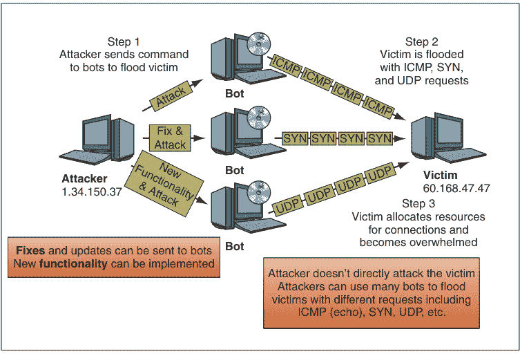

2018年，研究人员估计购买单个僵尸程序的成本约为13.50美元。但租赁整个僵尸网络一段时间可能更具成本效益。租用僵尸网络的成本约为每小时20美元至50美元，具体取决于所需攻击规模。⁸

处理程序。管理数千个僵尸程序可能很困难。处理程序是用于管理大量僵尸程序组（图4-6）（步骤1）的额外被入侵主机层。处理程序有时也称为命令和控制服务器，使协调攻击变得更容易且不那么明显。额外的层也使追踪攻击回原始攻击者变得困难（步骤2）。

图4-6还显示处理程序可以指示僵尸程序发送各种不同的数据包，具体取决于目标服务。攻击者可以针对互联网、传输层和众所周知的应用层服务，包括HTTP、IRC（聊天）、SMTP（垃圾邮件）、FTP、DNS等（步骤3）。受害者甚至可能被不同类型的数据包组合淹没（步骤4）。

## 测试你的理解

- 3. a. 直接和间接DoS攻击有什么区别？
- b. 回波散射是什么？
- c. DoS攻击中可以发送哪些类型的数据包？
- d. 描述SYN洪水攻击。
- e. DDoS攻击是如何工作的？
- f. 处理程序做什么？

⁸ Denis Makrushin, “发起DDoS攻击的成本”, Kaspersky Lab, 2017年3月23日. https://securelist.com/the-cost-of-launching-a-ddos-attack/77784.

## 图 4-6 使用处理程序的DDoS攻击

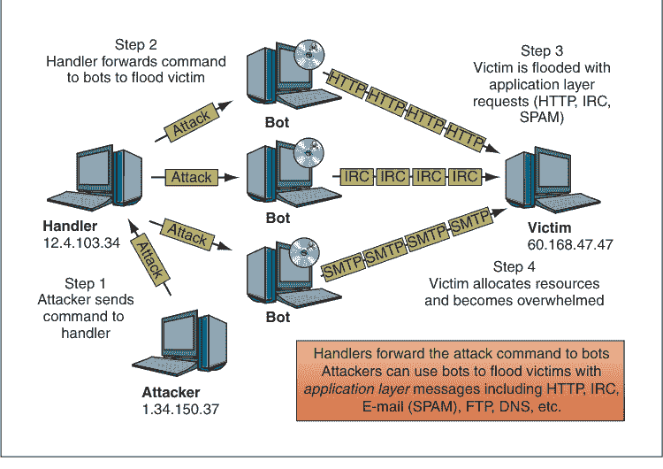

### 点对点重定向
类似于DDoS攻击，**点对点（P2P）重定向攻击**使用许多主机通过正常的P2P流量淹没受害者（图4-7，步骤1）。P2P重定向攻击在几个方面与传统的DDoS攻击不同。攻击者不需要控制用于攻击受害者的每个主机（即使它们成为僵尸程序）。攻击者只需要说服主机将它们的*合法*P2P流量（步骤2）从P2P服务器重定向到受害者（步骤3）。

## 图 4-7 点对点重定向攻击

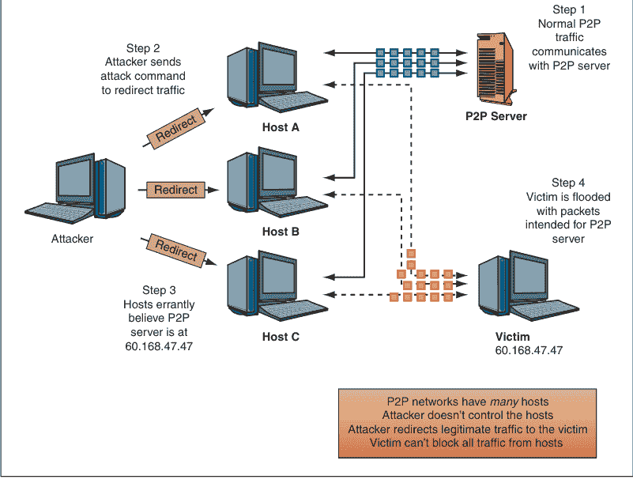

流量模式发生了变化，但总体流量量保持不变。受害者如果不阻止合法用户，就无法阻止所有传入流量（步骤4）。停止攻击取决于P2P网络的大小和受害者阻止特定P2P端口的能力。

P2P重定向相当于在当地分类广告中列出你朋友的家出售（最好以非常低的价格）。受害者被许多合法的购房者淹没。

## 反射攻击

DoS攻击的第三种方法是反射攻击。类似于P2P重定向，反射攻击使用来自合法服务的响应来淹没受害者。图4-8显示攻击者向现有合法服务器发送伪造请求（步骤1）。服务器然后将所有响应发送给受害者（步骤2）。没有流量重定向。

攻击者选择通常接收大量流量并且有足够容量淹没受害者的服务器（步骤3）。从受害者的角度来看，攻击似乎来自合法服务器。

为了阻止攻击，受害者可能会尝试阻止正在反射攻击的服务器。这可能会对受害者造成额外伤害。受害者可能会无意中阻止企业合作伙伴、DNS服务、其电子邮件提供商或其他关键服务。使用僵尸网络进行反射攻击被称为分布式反射拒绝服务（DRDoS）攻击。

## Smurf洪水攻击

Smurf洪水攻击是反射攻击的一种变体，利用配置不当的网络设备（路由器）来淹没受害者。攻击者向启用了向所有内部主机广播的网络设备发送伪造的ICMP回显请求（步骤1）（图4-9）。

网络设备将回显请求转发给所有内部主机（步骤2）。所有内部主机都响应伪造的ICMP回显请求（步骤3），受害者被淹没。攻击者受益于乘数效应，因为单个ICMP请求会被多个主机响应（步骤4）。禁用向内部主机的广播将停止Smurf洪水攻击。

## 图 4-8 反射DRDoS攻击

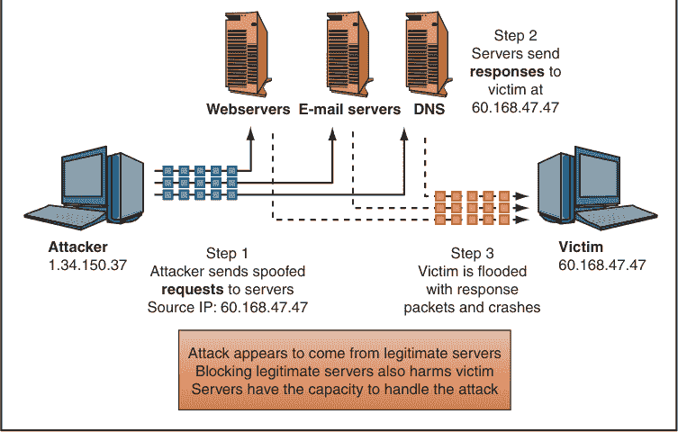

## 图 4-9 Smurf洪水攻击

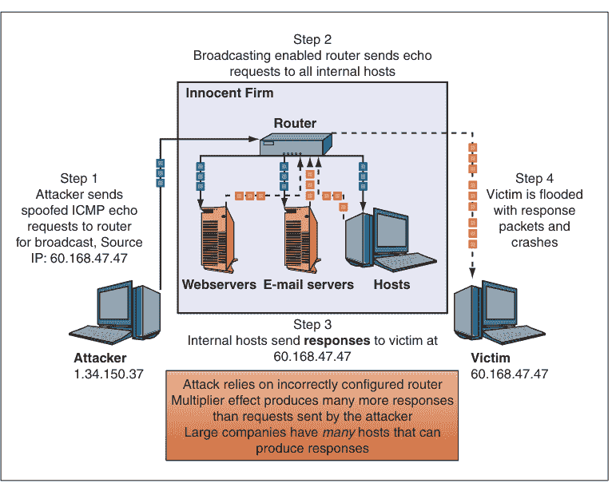

## 发送畸形数据包
攻击者使用的最后一种DoS方法是发送会导致受害者崩溃的畸形数据包。例如，ping of death是众所周知的较旧攻击，使用非法的大型IP数据包使受害者操作系统崩溃。该缺陷已被修复，该攻击现在很少使用。

然而，发送畸形数据包来使主机崩溃的概念仍在使用。2018年底，安全研究员Kevin Backhouse展示了畸形ICMP数据包可用于在Apple操作系统中创建缓冲区溢出。⁹ 攻击者然后可以执行代码并接管Apple设备。

易受畸形数据包影响的主机操作系统的缺陷将继续出现并被利用。修补主机操作系统和应用程序以防止此类攻击将在后面的章节中讨论主机加固（第7章）和应用程序安全（第8章）。

## 测试你的理解

- 4. a. P2P攻击是如何工作的？
- b. 反射攻击是如何工作的？
- c. DRDoS攻击是什么，它是如何工作的？
- d. Smurf洪水攻击是什么？
- e. Smurf洪水攻击中发送了什么类型的数据包？为什么？
- f. 畸形数据包如何导致主机崩溃？

⁹ Judith Myerson, “Ping of Death：它是什么以及Apple如何受影响”, Tech Target, 2019年1月17日. https://searchsecurity.techtarget.com/answer/Ping-of-death-What-is-it-and-how-is-Apple-affected.

## 防御拒绝服务攻击

大多数DoS攻击很容易检测到。然而，即使被检测到，许多攻击也很难阻止。几乎所有主要边界防火墙也执行DoS过滤。第6章（“防火墙”）将更深入地介绍如何配置防火墙以阻止外部攻击。下面是阻止前面提到的DoS攻击的三种常见方法。

## 黑洞路由

阻止DoS攻击的一种可能方法是丢弃来自攻击者的所有IP数据包。这被称为**黑洞路由**。黑洞路由攻击者不是一个好的长期策略，因为攻击者可以快速更改源IP地址。

黑洞路由可能会产生不利影响，如果它自动执行。攻击者可能会故意使用企业合作伙伴的IP地址伪造攻击数据包。自动防御可能会阻止来自该合作伙伴的合法流量并造成额外问题。

## 验证握手

一些防火墙通过预先验证TCP握手来解决SYN洪水攻击。这是通过创建**虚假打开**完成的。每当SYN段到达时，防火墙本身会发送回SYN/ACK段，而不将SYN段传递给目标服务器。

只有当防火墙收到ACK时，即仅在合法连接中才会发生，防火墙才会将原始SYN段发送给其预期的服务器。防火墙在SYN段到达时不会为连接预留资源，因此处理大量虚假SYN段只是一个很小的负担。

## 速率限制

对于更微妙的DoS攻击，可以使用**速率限制**将特定类型的流量减少到合理数量。例如，Smurf洪水的影响可以通过限制进入网络的ICMP数据包数量来减轻。仍可向内部网络广播，但以受限速率进行。

如果攻击针对单个服务器，这是有益的，因为它使传输线路至少部分保持开放供其他通信使用。然而，速率限制会挫败攻击者和合法用户。它有帮助，但不能解决问题。

- **防御DoS攻击**
- 黑洞路由
- 丢弃来自IP地址的所有数据包
- 验证握手
- 创建虚假打开
- 在发送方确认之前不要预留资源
- 速率限制
- 对某些类型的流量设置合理的限制
- 可能挫败合法用户
- **DoS保护是一个社区问题**
- 如果组织的互联网接入线路过载，它无法自行解决问题
- 组织的ISP或其他上游机构必须提供帮助

图 4-10 防御DoS攻击（学习图）


## 图 4-11 阻止 DoS 攻击的难度

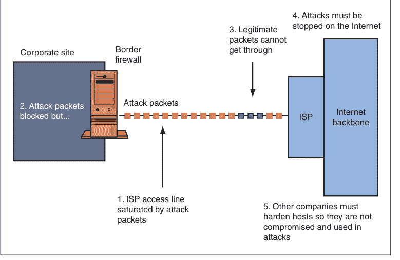

更令人担忧的是，一旦 DoS 流量阻塞了站点通往互联网的接入线路，边界防火墙就无能为力，无法缓解这种情况（图 4-11）。总体而言，DoS 攻击是社区性问题，只有在 ISP 和被攻陷用作僵尸并用于攻击其他公司的计算机所在组织的帮助下才能阻止。

## 测试你的理解

- 5. a. 什么是黑洞路由？
- b. 黑洞路由是对抗 DoS 攻击的有效防御吗？为什么？
- c. SYN 洪泛的影响如何缓解？
- d. 什么是虚假开放？
- e. 为什么速率限制是减少某些 DoS 攻击损害的好方法？
- f. 为什么其有效性有限？
- g. 为什么 DoS 防护是社区问题，而不仅仅是单个受害公司需要解决的问题？

## 4.3 ARP 欺骗

### 4.3 解释 ARP 欺骗的工作原理。

地址解析协议（ARP）用于将 32 位 IP 地址（例如 55.91.56.21）解析为 48 位本地 MAC 地址（例如 01-1C-23-0E-1D-41）。同一网络上的主机在利用 IP 地址发送和接收数据包之前，必须知道彼此的 MAC 地址。主机通过相互发送 ARP 请求和回复来构建 ARP 表，类似于图 4-12 所示的表。

| Internet 地址 | 物理地址 | 类型 |
|---|---|---|
| 55.91.74.11 | f8-66-f2-75-58-7f | 动态 |
| 55.91.74.12 | 00-24-e8-c4-df-b1 | 动态 |
| 55.91.74.13 | 00-22-19-03-1a-ff | 动态 |
| 55.91.74.14 | 00-15-c5-41-d9-04 | 动态 |
| 55.91.74.15 | 5c-26-0a-0f-7d-c9 | 动态 |

**图 4-12** 示例 ARP 表

**ARP 欺骗** 是一种网络攻击，它操纵主机 ARP 表以重定向局域网（LAN）流量。攻击者可以重定向流量进行中间人攻击，或在 **ARP DoS 攻击** 中完全中断它。ARP 欺骗仅对局域网流量有效。这要求攻击者在本地网络上拥有一台计算机才能使 ARP 欺骗生效。

利用 ARP 欺骗重定向流量是对网络的 *功能* 和 *保密性* 的双重攻击。攻击者改变了网络的正常运行，并窃取网络流量信息。ARP DoS 攻击通过将流量重定向到不存在的主机从而使其被丢弃，对网络的 *可用性* 发起攻击。

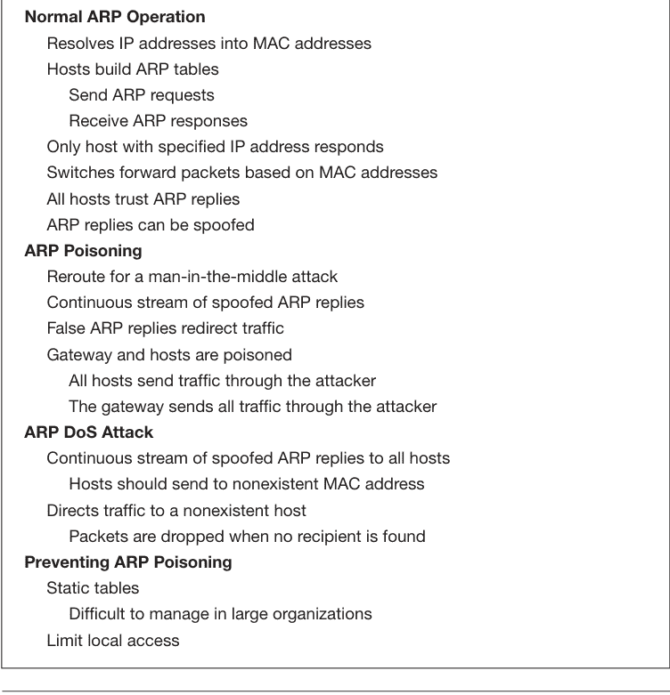

**图 4-13** ARP 欺骗（研读图）

为了理解 ARP 欺骗的工作原理，我们首先来看 ARP 的正常工作方式。然后我们将了解 ARP 请求和回复如何被用于 ARP 欺骗和 ARP DoS 攻击。

## ARP 正常操作

图 4-14 显示了 ARP 在局域网上正常工作的方式。如果网关（路由器）收到发往内部主机（10.0.0.1）的数据包，它会向局域网上的每个主机发送 ARP 请求，询问它们是否拥有该 IP 地址（步骤 1）。

只有拥有所请求 IP 地址的主机才会响应。其他所有主机都会忽略该请求（步骤 2）。在此示例中，主机 A 拥有所请求的 IP 地址（10.0.0.1）。主机 A 用包含其物理地址或 MAC 地址（A1-A1-A1-A1-A1-A1）的 ARP 回复进行响应（步骤 3）。

交换机记录网关和主机 A 的 MAC 地址以及各自的端口号。网关接收 ARP 回复并记录主机 A 的 IP 地址和对应的 MAC 地址（步骤 4）。

现在网关拥有主机 A 的 MAC 地址，它可以转发所有发往 10.0.0.1 的数据包。交换机在数据包从网关传递到主机 A 时只查看 MAC 地址。交换机不查看数据包上的 IP 地址。

由于交换机根据其交换表中的端口号和 MAC 地址转发数据包，局域网上的其他主机无法看到发往主机 A 的任何数据包。由于网关将数据包地址指向 A1-A1-A1-A1-A1-A1，因此它必须从端口 1 发出，如交换表所示。其他主机无法看到主机 A 的流量。

**问题** ARP 请求和回复的问题在于它们不需要身份验证或验证。所有主机都信任所有 ARP 回复。ARP 欺骗使用虚假 ARP 回复将任何 IP 地址映射到任何 MAC 地址。被欺骗的 ARP 回复会广播给局域网上的其他主机。这使得攻击者能够操纵所有局域网主机的 ARP 表。

## 图 4-14 正常 ARP 流量


## 测试你的理解

- 6. a. 主机为什么使用 ARP？
- b. ARP 欺骗能在局域网外使用吗？为什么不能？
- c. 主机为什么发送 ARP 请求？
- d. 什么是 ARP 欺骗？
- e. 攻击者如何利用 ARP 欺骗来操纵主机 ARP 表？

## ARP 欺骗

图 4-15 显示了 ARP 欺骗如何被用于重定向流量进行 MITM 攻击。攻击者通过向局域网上的所有主机（除网关外）发送持续不断的未经请求的 ARP 回复来开始攻击（步骤 1）。这个虚假的 ARP 回复告诉局域网上的其他主机，网关（10.0.0.4）现在位于 C3-C3-C3-C3-C3-C3。

局域网上的主机将其 ARP 表中记录虚假 ARP 回复（步骤 2）。它们现在错误地认为网关（10.0.0.4）位于 C3-C3-C3-C3-C3-C3（攻击者）。它们希望发送的任何数据包都将地址指向 10.0.0.4 的 C3-C3-C3-C3-C3-C3。

由于交换机只查看 MAC 地址，因此无法识别被推送到所有其他主机的错误 ARP 解析。它仅根据 MAC 地址转发所有数据包。它不查看数据包上的 IP 地址。

现在攻击者已成功重定向主机流量，它需要重定向进出网关的流量。它使用类似的欺骗 ARP 回复来污染网关。攻击者向网关发送持续不断的欺骗 ARP 回复，告诉它所有其他内部主机都位于 C3-C3-C3-C3-C3-C3（步骤 3）。

## 图 4-15 ARP 欺骗


网关在其 ARP 表中记录所有内部 IP 地址（10.0.0.1、10.0.0.2 和 10.0.0.3）以及相同的 MAC 地址（C3-C3-C3-C3-C3-C3）。网关接收到的任何数据包都将被转发到同一个内部主机（攻击者），因为所有内部 IP 地址都将解析为相同的 MAC 地址（C3-C3-C3-C3-C3-C3）。

攻击者已成功使用欺骗 ARP 回复在所有内部主机和网关的 ARP 表中记录虚假条目。从内部主机发送到网关的所有流量都将流向攻击者（步骤 4）。来自网关的所有流量也将经过攻击者，并现在通过他的计算机重定向，作为 MITM 攻击的一部分（步骤 5）。

需要注意的是，攻击者必须能够访问本地网络才能使此攻击生效。攻击者还必须发送持续不断的欺骗 ARP 回复，以防止其他主机的 ARP 表自行纠正。

## 测试你的理解

- 7. a. 解释 ARP 欺骗？
- b. 为什么攻击者必须发送持续不断的未经请求 ARP 回复？
- c. 交换机是否记录 IP 地址？为什么不？
- d. 攻击者是否也必须污染网关的 ARP 表？为什么？
- e. 为什么在污染网络后所有网络流量都经过攻击者？

## ARP DoS 攻击

通过稍作修改，相同的欺骗 ARP 回复可用于停止局域网上的所有流量，作为图 4-16 所示的 ARP DoS 攻击的一部分。攻击者向所有内部主机发送持续不断的未经请求的欺骗 ARP 回复，称网关（10.0.0.4）位于 E5-E5-E5-E5-E5-E5（步骤 1）。主机记录网关的 IP 地址和不存在的 MAC 地址（步骤 2）。

内部主机将所有 intended for 网关的流量发送到 E5-E5-E5-E5-E5-E5。问题是 E5-E5-E5-E5-E5-E5 不存在。交换机接收到来自内部主机、地址为 E5-E5-E5-E5-E5-E5 的数据包，但由于主机不存在而无法传递。地址为 E5-E5-E5-E5-E5-E5 的数据包被丢弃（步骤 3）。

同样，交换机不查看数据包上的 IP 地址。它只查看目标 MAC 地址。即使它物理上直接连接到网关，也无法转发数据包。

## 防止 ARP 欺骗

### 静态表
ARP 欺骗可以通过使用静态 IP 和 ARP 表来防止。静态 ARP 表是手动设置的，不能使用 ARP 动态更新。每台计算机都有一个已知的静态 IP 地址，不会更改。局域网上的所有主机都知道每个 MAC 地址（主机）分配了哪个 IP 地址。

使用静态 IP 和 ARP 表的困难在于组织会发生变化。管理一个变化较小的网络是可行的。它将消除 ARP 欺骗的可能性。然而，大多数组织规模太大、变化太快，并且缺乏有效管理静态 IP 和 ARP 表的经验。工作量将不堪重负。


## 图 4-16 ARP DoS 攻击


### 限制本地访问
防止 ARP 欺骗的另一种方法是限制对本地网络的访问。不允许外来主机接入局域网。大多数大型企业在阻止坏人进入方面做得相当不错。事实上，本章的其余部分将重点关注网络访问控制。

## 测试你的理解
- 8. a. ARP 欺骗如何被用作 DoS 攻击？
- b. 如何使用静态 IP 和 ARP 表来防止 ARP 欺骗？
- c. 静态 IP 和 ARP 表能否在大型网络中有效使用？为什么不行？
- d. 为什么限制本地访问可以防止 DoS 攻击？

## 4.4 网络访问控制
## 4.4 了解网络访问控制为何对网络很重要。
在第 3 章中，你看到虚拟专用网络（VPN）的出现是为了保护广域网——具体来说是通过互联网进行机密通信。SSL/TLS 的创建是为了保护互联网电子商务。IPsec 则是 IP 网络的通用 VPN 协议，其中互联网是最突出的。

企业内部的局域网也需要额外的保护，以确保数据在内部网络中传输时的保密性。企业局域网还必须提供访问控制，只允许经过身份验证和授权的人员接入网络。本章的其余部分将重点关注有线（以太网）和无线网络的安全。

## LAN 连接
图 4-17 说明了企业现场的简化局域网。计算机通过以太网交换机连接到局域网。其中一些通过连接到墙上插座的 4 对 UTP 线缆连接。

虽然全无线局域网是可能的，但在局域网中，大多数无线通信用于将无线客户端连接到公司的有线以太网网络。无线客户端通过无线电与无线接入点通信，后者再通过 4 对 UTP 连接到以太网交换机。

为什么客户端需要连接到有线局域网？很简单，无线客户端需要的服务器位于有线局域网上，需要访问互联网的互联网访问路由器也在其上。

## 访问控制威胁
传统上，以太网局域网没有访问控制安全。任何进入企业大楼的入侵者都可以走到任何墙上插座并插入笔记本电脑。入侵者随后将不受限制地访问局域网的计算机，绕过站点的边界防火墙。这是对访问控制的完全崩溃。

无线局域网具有更深层次的访问威胁。与以太网局域网的情况一样，入侵者可以通过无线电连接到未受保护的无线接入点。这再次使攻击者进入网络，绕过边界防火墙。无线入侵者甚至不必进入大楼。驾车路过的黑客可以坐在公司围墙外的车里。实际上，使用高增益天线，入侵者可以远到从建筑物看不见。

## 嗅探威胁
对于有线局域网和无线局域网，一旦入侵者获得访问权限，他们就可以使用数据包嗅探器拦截和读取合法流量。在以太网局域网上，加密很少见，但很难获得对以太网线路或墙上插座的物理访问。

在无线局域网上，然而，无线电传输使窃听变得微不足道，除非流量得到强加密。不幸的是，正如本章将看到的那样，无线流量通常以一种幼稚的方式进行加密，可以用从互联网上轻松下载的黑客软件破解。在某些情况下，根本没有加密。

**图 4-17** 企业局域网


## 测试你的理解
- 10.
- a. 以太网局域网的主要访问控制威胁是什么？
- b. 无线局域网的主要访问控制威胁是什么？
- c. 为什么无线局域网的访问控制威胁更严重？
- d. 窃听通常是对有线局域网、无线局域网还是两者都构成问题？

## 4.5 以太网安全
## 4.5 解释如何保护以太网网络。

## 以太网和 802.1X
我们将从以太网和 802.1X 开始研究局域网安全的具体细节。802.1X 标准提供访问控制，以防止非法客户端与网络关联。我们将从以太网开始，因为 802.1X 在有线局域网中相对容易实现。

图 4-18 说明了以太网和 802.1X 安全的主要元素。802.1X 使以太网工作组交换机¹⁰（3）成为网络的网关。用户的计算机通过 UTP 连接到墙上插座或直接连接到交换机。更准确地说，计算机连接到工作组交换机上的特定端口。该端口是真正的访问控制点。不出所料，802.1X 标准的名称是基于端口的访问控制。

> 802.1X 标准提供访问控制，以防止非法客户端与网络关联。

图 4-18 以太网和 802.1X


¹⁰ 工作组交换机是客户端连接的交换机。相比之下，核心交换机连接交换机到其他交换机。工作组交换机提供对网络的访问，因此在工作组交换机中放置访问控制是显而易见的选择。

当计算机首次连接时，端口处于 *未授权* 状态（5）。它不会允许用户通过网络通信。端口保持未授权状态，直到计算机对自身进行身份验证。身份验证后，端口更改为 *已授权* 状态，计算机可以不受阻碍地访问网络。

尽管交换机端口是主要控制点，但交换机不必承担繁重的身份验证工作。为此，交换机依赖于 **中央身份验证服务器**（4）。该服务器具有用于凭证检查的身份验证数据以及检查密码、生物特征扫描和其他访问凭证所需的处理能力。

使用中央身份验证服务器而不是让每个工作组交换机完成所有工作有三个优点：

**成本节约** 首先，正如刚才所说，这降低了每个工作组交换机的 *成本*。如果一家公司在整个建筑物中有许多工作组交换机，不需要进行繁重的身份验证处理并且不需要在每个交换机上维护身份验证数据库非常重要。

**一致性** 其次，使用中央身份验证服务器带来身份验证的 *一致性*。凭证检查始终以相同的方式进行，无论攻击者连接到哪个工作组交换机。攻击者不能尝试不同的工作组交换机，直到他或她找到一个具有错误的身份验证数据库从而允许攻击者进入的交换机。

**即时更改** 第三，中央身份验证服务器带来即时的访问控制 *更改*。例如，如果你解雇一名员工，你可以在中央身份验证服务器上立即暂停他或她的网络访问，而不必在所有工作组交换机上重新配置凭证检查。

在 802.1X 中，身份验证涉及三个设备。寻求访问的计算机显然是请求方（2），但验证者是什么设备？是工作组交换机还是中央身份验证服务器？显然，验证功能分布在两个设备上。不是称任一设备为验证者，802.1X 将工作组交换机称为 **身份验证器**（3）。中央身份验证服务器仅称为中央身份验证服务器（4）。

## 测试你的理解
- 11. a. 为什么 802.1X 被称为基于端口的访问控制？
- b. 繁重的身份验证工作在哪里完成？
- c. 使用中央身份验证服务器的三个好处是什么？
- d. 哪个设备是验证者？解释一下。（棘手的问题。）
- e. 哪个设备被称为身份验证器？

## 可扩展身份验证协议（EAP）
图 4-19 显示 802.1X 依赖于另一个协议，即 **可扩展身份验证协议（EAP）**，来管理身份验证交互的细节。该图显示了使用 EAP 的简单身份验证对话。

**EAP 操作** 以太网交换机可以感知主机何时连接到其端口之一。当交换机感知到连接时，它会向 RADIUS 服务器发送 *EAP Start* 消息（步骤 1）。这开始了 EAP 会话。


## 图 4-19 可扩展认证协议（EAP）


中央认证服务器向客户端发送一个 EAP 请求消息。此消息包含一个字段，指示该 EAP 请求消息需要智能卡凭据（步骤 2）。请求方无法使用智能卡认证，因此它返回一个包含否定确认的 EAP 响应消息（步骤 3）。

这些消息在认证服务器和请求方之间传递。认证器交换机仅将消息透传。这称为透传操作。

在第一次 EAP 请求失败后，中央认证服务器发送另一条 EAP 请求消息，这次带有代码指示它希望 MS-CHAP 凭据（步骤 4）。该请求消息包含 MS-CHAP 使用的挑战消息，正如我们在第 3 章中所见。这次，请求方遵守请求。它发送回包含 MS-CHAP 响应字符串的 EAP 响应消息（步骤 5）。同样，认证器交换机仅将消息透传。

中央认证服务器评估该字符串，如果请求方已通过认证则返回 EAP 成功消息（步骤 6），如果请求方未通过认证则返回 EAP 失败消息。该消息发送给认证器而不是直接发送给请求方。认证器如何通知客户端（步骤 7）超出了 EAP 的范围。

## 可扩展性

EAP 被称为可扩展的，因为向 EAP 添加新的认证方法很容易。当添加新的认证方法时，EAP 消息的结构完全不会改变。只需将新的选项代码添加到方法列表中即可。

当定义新的认证代码时，请求方和验证方必须在可以使用它之前实现该新方法。然而，认证器的操作不会改变。认证器仅透传处理新认证模式的 EAP 请求和 EAP 响应消息。

一旦公司的许多工作组交换机实现了 EAP，就无需在出现新的认证方法而其他方法过时时对其进行升级。公司拥有许多工作组交换机，因此认证器的这些成本节约非常重要。

## 测试你的理解

- 12.
- a. EAP 会话如何开始？
- b. 哪些类型的消息承载认证信息的请求和对这些请求的响应？
- c. 描述中央认证服务器如何告知认证器请求方是可以接受的。
- d. 认证器如何将此信息传递给请求方？
- e. EAP 在什么意义上是可扩展的？
- f. 当添加新的认证方法时，使用该新方法需要更改哪些设备的软件？
- g. 为什么在添加新的 EAP 认证方法或放弃旧的 EAP 认证模式时无需更改认证器的操作？
- h. 这种免于在交换机中进行更改的自由为何有益？

## RADIUS 服务器

大多数中央认证服务器受 RADIUS 标准管辖。RADIUS 是一种客户端/服务器协议，其中认证器是客户端，中央认证服务器是服务器。图 4-20 说明了 EAP 与 RADIUS 之间的关系。

图 4-20 EAPOL 和通过 RADIUS 的 EAP


### RADIUS 与 EAP

RADIUS 协议提供 *认证*，但不仅限于此。它还提供 *授权*，意味着它可以指定诸如已认证请求方可以连接的服务器、请求方可以在这些服务器上访问的目录以及用户可以在这些目录中执行的操作（读取文件、修改文件等）等事项的限制。RADIUS 还提供可选的连接审计，以便公司稍后可以检查特定计算机连接到的工作组交换机以及连接时长。

尽管 RADIUS 拥有自己的认证通信方法，但图 4-20 显示，EAP over RADIUS 规定了当 RADIUS 管辖认证器与中央认证服务器之间的通信时，如何改用 EAP 进行原生 RADIUS 认证。换句话说，EAP 仅用于 AAA（认证、授权和审计，第 5 章将更详细讨论）中的第一个 A（认证）。

## 测试你的理解

- 13.
- a. 大多数中央认证服务器遵循什么标准？
- b. 从功能上讲，EAP 和 RADIUS 有何关系？
- c. RADIUS 使用什么认证方法？

## 4.6 无线安全

### 描述无线（WLAN）安全标准和潜在攻击。

正如本章开头所述，以太网局域网并不是唯一需要安全保护的网络类型。事实上，无线局域网（WLAN）需要考虑的安全问题比有线局域网更多。例如，无线网络可以被路过黑客攻击，他们甚至无需进入建筑物即可访问局域网。他们可以坐在街对面或相邻建筑物中，并轻松访问内部网络而不会引起怀疑。

无线网络已变得几乎无处不在，因为与传统有线网络相比，它们设置更快、更容易、成本更低。它们还提供更大的移动性、生产力和功能。无线网络的优势推动了企业内部的广泛采用。

不幸的是，保护无线网络的能力未能跟上其快速增长的步伐。网络管理员见证了针对其无线网络的新型攻击。他们还必须实施新的无线认证方法、安全标准和安全策略。

## 无线攻击

如图 4-21 所示，用户使用 IEEE 802.11 工作组开发的 802.11 标准（1）通过无线电波连接到无线接入点（AP）。然后 AP 通过有线连接（2）连接到本地以太网（802.3）网络。AP 在无线和有线网络之间充当中继点。

无线攻击集中在接入点上。无线 802.11 网络通常的范围为 30 至 200 米，从 AP 向所有方向延伸。这使得攻击者可以在不进入企业场地的物理边界的情况下攻击 AP 和内部网络。

我们将要研究的三种无线网络攻击类型是（1）未经授权的网络访问、（2）使用恶意双胞胎的中间人攻击，以及（3）无线拒绝服务攻击。

## 图 4-21 无线网络访问


## 未经授权的网络访问

针对无线网络最常见的攻击是未经授权的访问，即未经许可连接到网络。未经授权的访问可能发生在启用或未启用安全协议的网络上。仅仅因为 WLAN 未“锁定”并不意味着它可以使用。

与你的家类似，门未锁并不赋予邻居进入你家的权利。在访问网络之前必须获得许可。

开放网络可以被任何人合法访问，并且经常如此标示。它们存在于咖啡馆、咖啡店、大学和其他公共场所等公共场所。除非标示，否则最好假设所有其他网络都是私有网络，除非特别授权否则不允许访问。

未经授权访问的最明显形式是攻击者“破解”了安全网络上的无线安全协议。稍后讨论的无线安全协议在无线接入点上启用并配置。配置正确的 AP 会对用户进行认证、加密无线流量并检测入侵。

无线网络的一个严重威胁是如 图 4-22 所示的 rogue 接入点的引入。Rogue 接入点是由个人或部门在几乎没有安全措施的情况下设置的未经授权的接入点。Rogue 接入点为路过黑客提供了进入网络的直接通道，绕过了公司在合法接入点中精心开发的无线安全措施。

> Rogue 接入点是由个人或部门设置的未经授权的接入点。

## 防止未经授权的访问

防止未经授权用户访问本地无线网络的两个原因是（1）防止对内部资源造成损害，以及（2）防止看起来来自您网络的外部损害。

## 内部损害

首先，给未经授权用户（潜在攻击者）访问本地 WLAN 的权限意味着他们已在本地网络上。他们有效地绕过了主防火墙和正常网络流量必须经过的所有安全措施。这增加了成功攻击的可能性。


## 图 4-22 未授权无线访问


攻击者能够更深入地访问内部信息、资源和其他网络流量。他们可以秘密窃取机密信息、读取并记录网络流量、篡改网络设备，或在目标客户端或服务器上植入恶意软件。他们还可能访问那些原本被认为受防火墙保护的网络共享。

数据包嗅探器可用于收集网络信息或用户数据，其中包括明文用户名、密码、电子邮件地址等。攻击者的客户端无线网卡必须支持射频监控（RFMON），才能捕获发往其他主机的无线数据包。攻击者可以以混杂模式捕获数据包，从而接收发往其他用户的消息。

攻击者甚至可以将目标锁定在高价值目标的无线网络上，例如首席执行官、行业竞争对手、研发中心、政府机构或名人。将电子攻击集中于特定高价值目标的行为被称为“捕鲸”。虽然 CEO 所在企业的无线网络可能很安全，但她在私人住宅中的无线网络未必安全。

## 外部损害

其次，由于攻击者可以从你的内部网络接入互联网，因此其流量看起来就像来自你的公司。攻击者看起来像是授权客户端。由此造成的攻击和损害似乎都出自你的组织。

攻击者可以通过该无线网络匿名下载、上传和存储非法内容。更糟糕的是，该网络可能被用作外部攻击的跳板。由于源 IP 地址看起来来自内部网络，因此任何攻击都可能被追溯到该公司。

例如，假设某个未授权攻击者从你不安全的内部无线网络对一家知名在线电子邮件提供商发起 DoS 攻击。该电子邮件提供商可能会屏蔽该公司所属的整个 IP 段。内部用户可能会暂时（或永久）无法访问其电子邮件账户。本质上，未授权的网络访问为外部攻击提供了便利，并随后对企业资源造成了损害。

## 测试你的理解

- 14. a. 针对无线网络最常见的攻击是什么？为什么？
- b. 哪个 IEEE 标准规定了 WLAN 的传输？
- c. 哪种设备在有线和无线网络之间充当中继？
- d. WLAN 的典型覆盖范围是多少？
- e. 开放网络和专用网络有什么区别？
- f. 谁会设置流氓接入点？为什么？
- g. 请举例说明未授权无线访问造成的内部和外部损害。
- h. 如果他人使用你的无线网络实施犯罪，你是否需要承担责任？为什么？

## 邪恶双子接入点

尽管无线网络提供了强大的安全性，但它们仍然容易遭受中间人攻击，这种攻击会在安全设置过程中及设置之后拦截消息。在无线局域网中，中间人攻击利用邪恶双子接入点来改变网络的功能。邪恶双子接入点实际上就是一台装有软件、能够伪装成接入点的 PC。

如图 4-23 所示，攻击者在公司场所外设置一个邪恶双子接入点。攻击者将发射功率调高，因为客户端通常会关联到信号最强的接入点（步骤 1）。如果受害无线客户端正是这样的客户端，它就会与邪恶双子接入点关联，而不是与合法接入点关联（步骤 2）。

## 图 4-23 邪恶双子接入点中间人（MITM）攻击


## 图 4-24 针对邪恶双子接入点攻击的 VPN 防护


随后，邪恶双子会与公司内部的合法接入点关联，伪装成请求认证的用户（步骤 3）。这实际上将自身置于无线客户端和合法接入点之间，随时准备执行中间人攻击。

邪恶双子接入点会拦截所有经过它的流量，然后将流量转发到其目的地（步骤 4）。最初，它会捕获凭据传输和密钥。之后，当加密消息到达时，它可以解密、读取、重新加密并继续转发。邪恶双子还可以冒充受害客户端发送自己的攻击数据包。

邪恶双子接入点攻击更常见于公共热点。¹¹ 当邪恶双子正确执行中间人攻击时，WPA（Wi-Fi 保护访问）和 802.11i 提供的保护将变得毫无意义。

¹¹ 在公共热点中，可以通过明智地决定使用热点内的哪个接入点来降低遭受邪恶双子攻击的风险。不要关联信号最强的接入点，而是检查可用接入点的 SSID（接入点标识符）。然后向知情人士询问官方接入点的 SSID。只关联该接入点。

为了应对这一威胁，一些公司要求通过远程接入进入的客户端同时建立 VPN 连接。如图 4-24 所示。VPN 使用客户端和服务器事先交换的预共享密钥。因此，该密钥无法被邪恶双子拦截。

## 测试你的理解

- 15. a. 哪种中间人攻击对 802.11 WLAN 构成威胁？
- b. 从物理上看，邪恶双子接入点是什么？
- c. 当合法请求认证方将凭据发送给合法接入点时会发生什么？
- d. 邪恶双子可能发起哪两类攻击？
- e. 邪恶双子攻击常见吗？
- f. 它们最常出现在哪里？
- g. 如何应对邪恶双子攻击的危险？

## 无线拒绝服务

我们将讨论的最后一种 WLAN 攻击是无线 DoS 攻击。与上一节讨论的 DoS 攻击类似，无线 DoS 攻击旨在影响网络的*可用性*。有几种方法可以阻止主机访问无线网络。我们将介绍三种。

### 淹没频率

使无线网络不可用的一种粗暴方式是淹没整个传输频率。无线 802.11 网络在 2.4 GHz 和/或 5 GHz 频段上传输。攻击者可以修改无线设备，用**电磁干扰（EMI）**（也称为**射频干扰（RFI）**）淹没这些频段。这种干扰，即**噪声**，会破坏 802.11 信号，使数据包无法读取。

图 4-25 显示，攻击者可以使用婴儿监视器、无绳电话和蓝牙设备等常见家用物品来干扰 802.11 网络。还有一些商业无线干扰设备不仅可以淹没 802.11 频率，还可以淹没蜂窝电话频率。

网络管理员可以使用无线**频谱分析仪**来识别 DoS 淹没攻击。频谱分析仪记录给定射频频段内的所有信号，包括数据包传输。网络管理员可能会看到无线数据包受到严重破坏。这可能是 DoS 淹没攻击的迹象。

然后，管理员可以使用频谱分析仪查看整个频段（包括无线信道）是否被杂散信号淹没。这将是频率淹没 DoS 攻击的迹象。

### 淹没接入点

攻击者可以通过过多的流量使接入点不堪重负。WLAN 上的所有主机共享对 AP 的访问。如果攻击者不断向 AP 发送大量数据包，所有其他主机实际上将被拒绝访问。AP 会将其所有资源用于发送和接收攻击者的数据包。另一种同样有效的淹没方法是多次发送一个非常大的文件。

### 发送攻击命令

我们将讨论的最后一个无线 DoS 方法利用了 802.11 标准中实现的协议。攻击者向客户端、AP 或两者发送攻击命令。其中许多攻击命令实际上是

## 图 4-25 无线 DoS — 解除关联与干扰


802.11 管理帧或控制帧用于管理主机的连接和信号的传输。

例如，攻击者可以使用数据包注入向 AP 发送伪造的解除认证（deauthenticate）消息。伪造的源地址将对应于 WLAN 上的每个无线客户端。解除认证消息表示发送方希望终止已认证的连接。受害客户端必须重新与 AP 进行认证才能进行通信。

持续不断的伪造解除认证消息流可以使客户端无法连接到 AP。攻击者也可以向无线客户端发送解除认证消息。这类攻击之所以有效，是因为消息的来源未经过认证。换言之，消息的来源未被验证。

这种攻击在现实世界中的类似做法是取消你朋友的所有信用卡。如果信用卡公司不核实来电者身份，你就能取消任何人的信用卡。他们必须先申请另一张信用卡，然后才能购物。

除了解除认证消息外，攻击者还可以用请求发送（RTS）帧或允许发送（CTS）帧来淹没无线客户端。RTS 帧告诉其他无线客户端，你想要在给定时间内（传输持续时间）进行传输。CTS 帧告诉其他客户端，你已收到 RTS 帧，并且在指定时间到期之前它们不应传输。

大量带有长传输持续时间的 CTS 帧会让其他客户端一直等待。大量 RTS 帧会产生大量 CTS 帧。两者都会对无线网络造成有效的 DoS 攻击。同样，这些消息也没有经过认证。

RTS/CTS 淹没在现实世界中的类似做法是预订竞争对手航空公司每个航班上的每一个座位。由于所有座位都被预订，乘客将无法搭乘航班。如果不对购票者进行身份验证，这家航空公司很快就会倒闭。

## 测试你的理解

- 16. a. 无线 DoS 攻击会如何进行？
- b. 哪些类型的设备可以被用来淹没 WLAN 的传输频率？
- c. 如果整个频率都被 EMI 淹没，可以用什么设备来识别 DoS 淹没？
- d. 可以发送哪种类型的攻击命令来造成无线 DoS 攻击？
- e. 如果无线网络被 CTS 帧淹没，会发生什么？

## 使用 802.11i 的无线局域网安全

由于后面将要讨论的原因，802.1X 不能直接应用于 802.11 无线局域网。它必须加以扩展，这一扩展被称为 802.11i。图 4-26 展示了有线 LAN 上的 802.1X 以及 802.11 连接的 802.11i。对于 802.11i 连接，你仍会看到熟悉的中央认证服务器。你还会看到请求方（supplicant），即一台无线计算机。认证器已从交换机端口变为无线接入点（5），但这并不是根本性的修改。

## EAP 对安全性的需求

差异在于接入点与无线客户端之间的通信。可扩展认证协议（EAP）是一个很棒的协议，但它有一个严重的安全局限性。它假定请求方与认证器之间的连接是安全的。当然，计算机与以太网交换机之间的 UTP 连接并没有显式的安全性，但有人窃听墙面插座与交换机之间线路的实际风险很小，因此 EAP 在有线网络上对安全性的需求可以忽略不计（3）。

然而，在无线局域网中，EAP 需要额外的安全性。图 4-26 显示无线电传输可能被截获。由于无线传输天生缺乏安全性（7），必须在无线客户端与接入点之间增加安全性，否则 EAP 认证很容易受到攻击。为了提供这种安全性，802.11 工作组增强了 802.1X 标准，使其能够在无线局域网上工作。这一增强后的标准就是 802.11i。

> EAP 假定请求方与认证器之间的连接是安全的。在 802.11 WLAN 中，请求方与接入点之间需要额外的安全性。

## 图 4-26 802.11i 或 WPA 在 802.1X 模式下的无线局域网接入控制


## 为 EAP 增加安全性

这种增强是通过扩展 EAP 标准来增加安全性实现的。所有扩展的 EAP 标准都以相同的方式开始。如图 4-27 所示，认证器首先在认证器与无线客户端之间建立一条 SSL/TLS 安全连接。在这种**外部认证**中，接入点拥有一个数字证书，用它向无线客户端证明自己的身份。

一旦实现了外部认证，无线客户端与接入点之间就建立了安全性，EAP 便可用于其余的认证过程。基于数字证书的认证非常强大。它要求在每台接入点上安装数字证书，但一家公司的接入点数量有限，因此安装数字证书的成本并非不可承受。

下一步是**内部认证**，无线客户端通过 EAP 对自身进行认证。对于内部认证，客户端请求方在外部认证的保护下使用 EAP，通过 EAP 交换与中央认证服务器进行通信。

## 图 4-27 扩展的 EAP 协议


## EAP-TLS 与 PEAP

目前市场上有两种常见的扩展 EAP 标准。第一种是 **EAP-TLS**。在该标准中，内部认证也使用 TLS。这*要求*请求方拥有数字证书。这种方式非常安全，但在每台客户端和服务器上部署数字证书成本高昂。

第二种流行的扩展 EAP 标准是**受保护的 EAP（PEAP）**。对于使用 PEAP 的内部认证，客户端可以使用 EAP 标准中规定的任何方法，从密码到数字证书均可。PEAP 在市场上取得了成功，因为它受到 Microsoft 的青睐，并得到 Cisco 系统的强力支持。此外，公司也喜欢它，因为他们可以应用任何适当级别的客户端认证。

## 测试你的理解

- 17. a. 为什么不能将使用 EAP 的 802.1X 操作直接扩展到 WLAN？
- b. 802.11 工作组创建了什么标准，以便在将 802.1X 操作扩展到 WLAN 的同时为 EAP 提供安全性？
- c. 对于 802.11i，请区分外部认证和内部认证。
- d. 外部认证使用哪种或哪些认证方法？
- e. 目前流行的两种扩展 EAP 协议是什么？
- f. 请区分它们在内部认证上的选项。
- g. 802.11i 的安全性强大吗？请解释。

## 核心无线安全协议

对于 802.11 无线局域网，图 4-28 显示**核心无线安全协议**保护无线客户端与接入点之间的通信。它们并不提供一直到客户端想要访问的服务器的全程保护。

## 有线等效保密（WEP）

1997 年，802.11 委员会制定其标准的最初版本时，创建了**有线**¹²**等效隐私（WEP）**标准，用于在无线接入点和无线客户端之间提供基本安全性。到 1990 年代末，WEP 存在*致命缺陷*已显而易见。

¹² 不是无线。其理念是提供与有线集线器上的以太网 LAN 一样强的安全性。WEP 连这个并不困难的目标都未能实现。

## 图 4-28 802.11 核心安全协议


由于从互联网上可以轻易下载 WEP 破解软件，攻击者可以在几分钟内破解 WEP 安全性。使用 WEP 比没有安全性更糟，因为实施 WEP 的公司可能认为自己受到了保护，而实际上并没有。

## 破解 WEP

### 共享密钥与运行安全

首先，WEP 强制使用**共享密钥**，这意味着接入点和所有使用它的站点在所有的加密保护中使用*相同的共享密钥*。共享密钥提供了事实上的认证。如果某个站点知道共享密钥，就被假定为合法，从而被接受进入网络。这个单一的共享密钥还用于加密消息，以保证机密性。

显然，如果攻击者获得了密钥，所有安全性都将丧失。这表明公司应该频繁更换共享密钥。然而，WEP 没有提供自动重新生成密钥的功能。在拥有许多共享同一 WEP 密钥的接入点的大型公司中，更换每个人密钥的实际困难意味着共享密钥几乎从不更换。此外，由于“人人都知道”这个密钥，即使被告知不要共享，人们也会随意分享密钥。

最糟糕的是，假设一家公司解雇了一名心怀不满的员工。为了安全起见，公司必须在该员工所知的所有接入点上更换密钥。这还需要所有客户端在每个接入点上使用更新后的密钥。即使密钥只在一台接入点上使用，这也很难办。如果密钥在多台接入点甚至所有接入点上使用，那么更换密钥将代价高昂，并会给许多员工带来不便。

### 利用 WEP 的弱点

为了找到 WEP 密钥，黑客可以使用互联网上现成的自动化 WEP 破解软件。WEP 指定使用 RC4 密码进行对称密钥加密。我们在第 3 章中简要介绍过 RC4。RC4 非常高效，因此即使在最早的接入点和无线网络接口卡（NIC）上也能运行。

不幸的是，如果攻击者读取两条使用相同 RC4 密钥加密的消息，就能立即找到密钥。因此，WEP 实际上使用**每帧密钥**对每一帧进行加密，该密钥由共享的 RC4 密钥加上一个 24 位的**初始化向量（IV）**组成，每个帧的 IV 都不同。发送方随机生成 IV，并在帧头中以明文形式传输 IV，以便接收方能够获知。接收方使用已知的共享密钥加上该帧特有的初始化向量来解密帧。

同样不幸的是，24 位 IV 太短了。使用 24 位 IV，许多帧会“泄露”秘密密钥的几个比特。如果一家公司使用相同的秘密密钥加密足够大的流量，攻击者往往能在 2 到 3 分钟内计算出完整的秘密密钥。


## WEP 使用共享密钥

每个使用接入点的站点都使用相同的（共享）密钥
密钥本应保密，因此知道它就“验证”了用户
加密使用此密钥

## 共享密钥的问题

如果共享密钥被获知，靠近接入点的攻击者可以读取所有流量
共享密钥至少应经常更换
但 WEP 没有自动重新密钥的方法
如果用户很多，手动重新密钥成本很高
如果许多或所有站点使用相同的共享密钥，由于需要为许多或所有企业客户端重新密钥所需的工作量，手动重新密钥在操作上几乎不可能
因为“人人皆知”该密钥，员工经常将其透露给陌生人
如果一名危险员工被解雇，必要的重新密钥可能不可能或接近不可能

## RC4 初始化向量（IV）

WEP 使用 RC4 进行快速因此廉价的加密
但如果两个帧使用相同的 RC4 密钥加密，攻击者可以获知该密钥
为了解决此问题，WEP 使用每帧密钥加密，该密钥为共享 WEP 密钥加上初始化向量（IV）
然而，许多帧会“泄露”密钥的几位
在流量大的情况下，使用 readily available 软件的攻击者可以在 2 或 3 分钟内破解共享密钥
（WPA 使用 RC4，但使用 48 位 IV 使密钥位泄露可忽略不计）

## 结论

企业绝不应将 WEP 用于安全

图 4-29 有线等效隐私（WEP）（学习图）

## 观点

鉴于 WEP 可以被如此容易和快速地破解，企业今天使用 WEP 毫无意义。事实上，它只会带来虚假的安全感，这可能比没有安全更糟。

## 测试你的理解

- 18. a. 第一个核心无线安全标准是什么？
- b. 它使用什么加密算法？
- c. 为什么永久共享密钥不理想？
- d. WEP 计算机或接入点在传输时使用什么每帧密钥进行加密？
- e. 802.11 工作组在选择 IV 长度时犯了什么错误？
- f. 今天破解 WEP 可能需要多长时间？
- g. 企业今天应为安全使用 WEP 吗？

## Wi-Fi 受保护访问（WPA™）

WEP 的失败使新兴的 WLAN 行业陷入动荡。许多企业冻结了 WLAN 部署，甚至关闭了现有的 WLAN。这导致 802.11 工作组努力创建 802.11i 标准。然而，开发工作的缓慢进度令制造商沮丧。他们转向 Wi-Fi 联盟，该联盟通常只认证 802.11 设备之间的互操作性。如果设备在包装盒上带有 Wi-Fi 标志，则已通过 Wi-Fi 联盟互操作性认证。

Wi-Fi 联盟采用了 802.11i 标准的早期草案并创建了自己的标准，称之为 Wi-Fi 受保护访问（WPA™）。为了快速推出标准并使 WPA 适用于处理能力和 RAM 有限的早期设备，Wi-Fi 联盟选择了相对较弱的安全方法。

如图 4-30 所示，WPA 在加密中用于保密的相对较弱的 RC4¹³ 密码和用于密钥和重新密钥的仅中等强度的临时密钥完整性协议（TKIP）。尽管至少在撰写本文时，尚未公布针对 WPA 整体的破解，但 TKIP 已被部分破解，安全专业人员对 WPA 的安全方法感到不安。

WPA 主要通过将 IV 从 24 位增加到 48 位来扩展 RC4 的安全性。这种扩展大大减少了泄露，从而使 RC4 更难破解，使 WPA 具有良好的保密安全性。

尽管 WPA 使 WLAN 行业保持增长，但 802.11 工作组于 2002 年完成了 802.11i 标准。Wi-Fi 联盟为互操作性测试目的将该新标准称为 WPA2™。

今天，几乎所有无线接入点和无线网络接口卡都可支持具有更强安全方法的 802.11i。然而，许多公司仍继续使用 WPA，以避免重新配置所有接入点和无线客户端以支持 802.11i 的成本。2018 年，Wi-Fi 联盟发布了新的无线安全标准 WPA3，旨在解决 WPA2 中的一些弱点。随着无线硬件的更换，WPA3 的采用将缓慢进行。

| 密码学特性 | WEP | WPA | 802.11i（WPA2） |
|---|---|---|---|
| 机密性加密算法 | RC4 且实现存在缺陷 | 具有 48 位初始化向量（IV）的 RC4 | 具有 128 位密钥的 AES |
| 自动密钥更新 | 无 | 临时密钥完整性协议（TKIP），已被部分破解 | AES-CCMP 模式 |
| 整体密码强度 | 可忽略 | 较弱 | 更强 |
| 是否可在 802.1X（企业）模式下运行？ | 否 | 是 | 是 |
| 是否可在预共享密钥（个人）模式下运行？ | 否 | 是 | 是 |

图 4-30 802.11 LAN 的核心安全标准

13 已弃用的 WEP 标准也使用 RC4，但 WPA 具有更强的实现。

## 测试你的理解

- 19. a. 什么促使 Wi-Fi 联盟创建 WPA？
- b. 比较 WPA 和 802.11i 的安全性。
- c. Wi-Fi 联盟将 802.11i 称为什么？
- d. 尽管存在安全弱点，为什么许多公司仍继续使用 WPA 而不是 802.11i？

## 预共享密钥（PSK）模式

对于大型企业，使用 802.11i 或 WPA 实现具有昂贵中央身份验证服务器的 802.1X 模式是必要的。对于非常小的企业和个人家庭，使用中央身份验证服务器则过于繁琐。因此，802.11i 和 WPA 都提供了一种非 802.1X 模式，称为预共享密钥（PSK）模式。WPA 基于 802.11i 的早期草案，也包含此模式，但称其为个人模式。具体来说，PSK/个人模式是为仅有一个接入点的家庭或小型企业创建的。

PSK/个人模式是为仅有一个接入点的家庭或小型企业创建的。

图 4-31 显示，所有无线客户端都使用所有客户端使用的共享初始密钥向接入点进行身份验证（步骤 1）。共享密钥通常对安全不利，因为人们倾向于将其视为非保密并将其交给未经授权的人。此外，如果有人离开或被解雇，则必须在接入点上安装新的秘密密钥并与授权用户共享。在大型企业中，这些问题往往是不可克服的。然而，在小型企业和家庭中，共享密钥可以保密。

图 4-31 802.11i 和 EAP 的预共享密钥（PSK）/个人模式


使用共享密钥通常意味着将有大量流量使用相同的密钥加密。这使得密码分析程序破解密钥变得容易得多。一旦密钥被破解，则所有安全都消失了。

为了解决这一问题，802.11i 和 WPA 在 PSK/个人模式下仅在客户端首次向接入点进行身份验证时（步骤 2）非常短暂地使用共享初始密钥。身份验证后，接入点向客户端发送一个未共享的会话密钥（步骤 3）供会话期间使用（步骤 4）。由于只有少量消息使用共享初始密钥传输，密码分析以发现共享初始密钥在实际上是不可能的。

然而，PSK/个人模式有一个严重的操作安全问题。除非共享初始密钥很复杂，否则初始密钥的密码分析将是可能的。实际上，管理员或用户必须在每个无线客户端和接入点中输入密码短语。设备从该密码短语生成密钥。较长的密码短语会产生较强的密钥，但如果密码短语太短，则 802.11i 或 WPA 在 PSK/个人模式下的安全性将非常弱。密码短语必须至少 20 个字符长，更长的密码短语更好。

> 在 802.11i 或 WPA 在 PSK/个人模式下，密码短语必须至少 20 个字符长。

## 测试你的理解

- 20. a. 为什么 802.1X 模式不适合家庭和小型办公室？
- b. 为家庭或仅有一个接入点的小型企业创建了什么模式？
- c. 此模式下的用户如何向接入点进行身份验证？
- d. 为什么使用共享初始密钥并不危险？
- e. PSK/个人密钥是如何生成的？
- f. 密码短语必须多长才能获得足够的安全性？

## 无线入侵检测系统

拥有对众多接入点进行集中管理的公司可以购买集中式无线入侵检测系统软件。如图 4-32 所示，每个接入点都成为无线 IDS 代理，将适当信息发送到中央无线 IDS 控制台。控制台将数据传输到 IDS 数据库。它还筛选数据库中的数据以寻找问题迹象。

集中式无线 IDS 有很大机会识别出 rogue 或 evil twin 接入点。使用集中式无线 IDS 有两种替代方案，但都不是很有效。

第一种是根本不担心入侵检测。鉴于无线攻击的普遍性，这 hardly 明智。第二种替代方案是经常带着装有无线 IDS 软件的笔记本电脑在建筑物内走动。这很可能需要禁止性的劳动量，并且无法捕获无线安全管理员检查站点某部分以寻找威胁后出现的威胁。也不太可能捕获 evil twin 接入点，因为它们只偶尔运行，因此在无线管理员巡查建筑物寻找问题时可能未运行。


## 图 4-32 集中式无线入侵检测系统


## 测试你的理解

- 21. a. 无线入侵检测系统的目的是什么？
- b. 无线入侵检测系统如何获取数据？
- c. 什么是 rogue 接入点？
- d. 使用集中式无线入侵检测系统的两种替代方案是什么？
- e. 为什么它们不具吸引力？

## 虚假的 802.11 安全措施

许多关于 802.11 安全的杂志文章给出的建议现在普遍被认为只提供虚假的安全感。它们是我祖父所说的威士忌疗法。他说，在所有不能治愈感冒的东西中，威士忌是最受欢迎的。

本节中不推荐企业使用的措施可能足以阻挡爱管闲事的邻居。然而，携带良好黑客软件的路过黑客越来越多地在社区游荡，以获取免费的互联网访问并窥探居民电脑。此外，这些拙劣的“保护”措施设置起来所需的工作量与设置完整的 WPA 或 802.11i 安全一样多甚至更多。

## 扩频操作与安全

所有 802.11 无线局域网标准都使用扩频传输，将信号分散到宽频率范围内。许多人听说过军方为安全目的使用扩频传输。然而，802.11 中使用的扩频传输类型不提供任何安全性；事实上，802.11 WLAN 的扩频工作模式专门使各站点更容易找到并听到彼此。14 用户不应因为“我的系统使用扩频传输，无法被截获”而忽视黑客。

14 扩频传输依法被规定用于 802.11 在其中运行的 2.4 GHz 和 5 GHz 无执照无线电频段，以减少传播问题。许多传播困难是频率相关的，使用宽频谱频率可减少频率特定问题的损害。再次强调，扩频并非出于安全目的而强制规定。

## 关闭 SSID 广播

要与接入点配合工作，站点必须知道接入点的服务集标识符（SSID）。为了让站点更容易找到接入点，接入点会频繁广播其 SSID。关闭 SSID 广播似乎会提供安全性。

然而，即使关闭了 SSID 广播，SSID 仍会在每个传输帧的报头中以明文形式传输。嗅探程序读取帧报头中的 SSID 毫不费力。简单地说，企业无法对拥有最低限度黑客软件的攻击者隐藏 SSID。

## MAC 访问控制列表

每个网络接口卡都有唯一的 MAC 地址（例如，00-1C-23-0E-1D-41）。可以配置大多数接入点仅为预先批准的 MAC 地址列表上的站点提供服务。无线接入点会忽略其他站点。然而，MAC 地址必须在每个帧中以明文形式传输，因此路过黑客可以轻松学习它们。

攻击者可以轻松更改其 MAC 地址并发送看起来来自已批准站点之一的帧。管理 MAC 访问控制列表工作量很大且不提供有效的安全性。

## 实现 802.11i 或 WPA 更容易

关闭 SSID 广播和创建 MAC 访问控制列表不仅无效，而且耗时。启用 802.11i 或 WPA 不仅提供完整的安全性（除恶意双胞胎接入点外）。而且工作量更少。

- **扩频操作与安全**
- - 信号分布在宽频率范围内
- - 并非出于安全目的而进行，如军事扩频传输

- **关闭 SSID 广播**
- - 服务集标识符（SSID）是接入点的标识符
- - 用户必须知道 SSID 才能使用接入点
- - 路过黑客需要知道 SSID 才能入侵
- - 接入点频繁广播其 SSID
- - 一些作者主张关闭此广播
- - 但关闭 SSID 广播会使普通用户访问更困难
- - 不会阻止攻击者，因为他或她可以读取 SSID，该 SSID 以明文形式在每个传输帧中传输

- **MAC 访问控制列表**
- - 接入点可以配置 MAC 访问控制列表
- - 仅允许具有列表中 MAC 地址的 NIC 的站点访问
- - 但 MAC 地址在帧中以明文发送，因此攻击者可以学习它们
- - 攻击者随后可以伪造其中一个地址

- **观点**
- - 这些“虚假”方法 however 可能足以阻挡爱管闲事的邻居
- - 但路过黑客甚至会攻击住宅用户
- - 仅应用 WPA 或 802.11i 即可提供更强的安全性且更容易实现

## 测试你的理解

- 22. a. 802.11 中使用扩频传输是否能创造安全性？
- b. SSID 是什么？
- c. 关闭 SSID 广播是否提供真正的安全性？解释。
- d. MAC 访问控制列表是什么？
- e. 它们是否提供真正的安全性？解释。

## 4.7 结论

本章始于对创建安全网络环境时需要考虑的四个广泛目标的讨论。这些目标包括可用性、保密性、功能性和访问控制。我们研究了网络管理员在尝试保护网络时面临的一些困难。

下一节重点讨论拒绝服务（DoS）攻击。虽然公司可能会经历服务中断，但这可能不是 DoS 攻击。它可能是由于编码错误，或仅仅是合法网络流量急剧增加所致。故意 DoS 攻击的重点是停止关键服务或随着时间的推移缓慢降低其性能。

我们研究的 DoS 主要攻击方法有（1）直接/间接、（2）中间人、（3）反射和（4）发送畸形数据包。防御 DoS 攻击的方法包括黑洞化、验证 TCP 握手以及限制传入数据包速率。

我们研究的下一类网络攻击是 ARP 欺骗。更具体地说，我们研究了 ARP 欺骗如何被用于重定向流量以进行中间人攻击，或在 ARP DoS 攻击中完全停止流量。重要的是要记住，ARP 欺骗要求攻击者能够访问本地网络上的计算机。使用 ARP 欺骗重定向流量是对网络功能性和保密性的双重攻击。

我们接下来研究了有线局域网的安全性，有线局域网几乎总是使用 802.3 工作组的以太网技术。另一个工作组 802.1 开发了 802.1X 标准，以防止入侵者只需将笔记本电脑插入墙上插孔即可访问网络。

在 802.1X 模式下，有三种设备。连接到网络的客户端或服务器 PC 是 supplicant。中央身份验证服务器执行凭据检查。该中央身份验证服务器通常受 RADIUS 标准管辖。客户端或服务器 PC 连接到的以太网工作组交换机称为 authenticator。在 PC 得到身份验证之前，其连接的端口未授权，仅会通过身份验证信息。

身份验证交互受可扩展身份验证协议（EAP）管辖。我们研究了连接到工作组交换机端口的计算机进行自我身份验证所需的 EAP 交互。对于大多数交互，工作组交换机 authenticator 仅在连接的计算机和中央身份验证服务器之间传递 EAP 交互。因此，当添加新的身份验证方法时，authenticator 完全不需要更改。

下一节重点讨论无线攻击。我们研究的三种无线网络攻击类型为（1）未经授权的网络访问、（2）使用恶意双胞胎的中间人攻击、（3）无线拒绝服务攻击。

即使企业实施了核心安全协议，如 WPA，安全问题仍然存在。处理恶意双胞胎接入点威胁的最佳方法是建立无线客户端与其最终希望工作的服务器之间的 VPN。此 VPN

可以使用无线计算机与其目标计算机之间的预共享密钥。邪恶双子接入点无法截获预共享密钥，因为这些密钥从不传输。

最初，802.11工作组为无线计算机与无线接入点之间的安全流量制定了WEP核心安全标准。这一标准是一场灾难。WEP已是旧闻，早已被更好的访问控制标准所取代。2002年，802.11工作组完成了802.11i标准，该标准描述了如何在无线局域网中使用802.1X安全（包括EAP）。

802.11i的关键创新在于，在EAP交互开始之前，为无线客户端和接入点之间提供安全性。这是必要的，因为在非安全环境中EAP很容易被攻破。另一个组织——Wi-Fi联盟在802.11i标准完成之前制定了一项临时标准。

基于802.11i的早期草案，该联盟创建了Wi-Fi保护访问（WPA）标准。尽管802.11i现已推出多年，且使用比WPA更强的加密方法，尽管WPA已被部分破解，许多早期投资于WPA安全的公司仍不愿重新配置其大量接入点和无线计算机以使用802.11i。

公司开始从中央管理控制台管理其所有接入点。这样做的公司可以使用无线入侵检测系统来定位问题，例如邪恶双子接入点和流氓接入点，这些接入点由个人和部门设置，通常几乎没有安全性。

我们在本章结尾讨论了虚假的无线安全措施，这些措施需要费心设置，但针对那些可轻松下载攻击软件的过路黑客并无真正安全性。后续关于访问控制（第5章）和防火墙（第6章）的章节将更详细地探讨如何防御本章中介绍的网络攻击。

## 工作中的安全

### 安森：从赞美到诅咒

你是否曾丢失过智能手机，哪怕只是一两个小时？如果有，你可能还记得当以为它可能永远找不回来时涌起的那阵恐慌。丢失任何数字设备都会因多种原因而令人极度烦恼。首先，移动设备和笔记本电脑并不便宜。一想到要花几百美元，甚至对于笔记本电脑来说要花一两千美元来更换丢失的设备，就令人沮丧。然而，最常引发恐慌的是想到现在拥有你设备的人可能会设法访问你的所有数据。

如果你丢失了一个数字设备，你最担心哪些数据——银行数据、电子邮件存档、社交媒体账户、你的照片集，还是其他？这个问题没有对错之分，每个人的回答各不相同。然而，可以肯定的是，未来某人访问你个人数据的可能性是存在的。令人沮丧的是，在大多数情况下，罪魁祸首甚至不需要物理接触你的智能手机或笔记本电脑。你的数据同样容易被存储它的公司从云端窃取。不相信吗？问问2015年2月任何享受安森医疗保险的人就知道了。

### 多云转窃

越来越多的数据被存储在云端。为什么？因为数据存储成本急剧下降，互联网接入变得更快更便宜。1990年，100万只晶体管成本为527美元，1GB存储成本为569美元，每秒1Gb带宽成本为1,245美元。而今天，100万只晶体管成本为0.05美元，1GB存储成本为0.02美元，每秒1Gb带宽成本为15美元。

互联网用户希望轻松访问越来越多的数据。不幸的是，更大的可访问性也意味着黑客更容易访问。

2015年初，安森保险公司报告了一起安全漏洞，导致约8000万客户账户丢失。¹⁶ 黑客窃取了敏感账户数据，如姓名、地址、社会安全号码和薪水。虽然任何全国性公开的安全漏洞都会引起担忧，特别是考虑到近期Target和Home Depot事件的漏洞趋势，但随着关于漏洞性质的细节陆续报道，安森客户变得越来越愤怒。安森最终披露，被窃取的账户数据以明文存储——未加密。这意味着黑客可以立即开始在黑市上出售这些数据，或将其用于其他邪恶目的。

安全专家批评安森没有对敏感的客户账户数据进行加密。许多客户认为安森未能加密账户记录属于疏忽，随后提起了诉讼。

### 对业务不利还是照旧？

如果你的账户数据是安森漏洞事件的一部分，你会作何感想？这一事件会让你想换一家医疗保健提供商，还是会让你认识到大型企业数据泄露只是数字世界中的常态，而新的医疗保健提供商可能同样脆弱？现实是，数据泄露如此普遍，与其说持有你数据的公司是否会遭到黑客攻击，不如说只是时间问题。事实上，在安森数据泄露约一个月后，Premera Blue Cross宣布丢失了1100万条客户记录。丢失的客户记录更加敏感，因为它们包含银行账户和医疗数据。¹⁷

尽管存在这些威胁，公司极不可能开始将数据从云端撤出。消费者显然想要基于Web的服务所提供的易用性。然而，企业的安全实践有可能从一种必要之恶演变为竞争优势。事实上，总有一天，一家公司在信息安全方面的声誉可能比其销售的产品或服务本身更有价值！

### 讨论问题

- 1. 想一想你使用的所有云服务。你现在面临数据被盗的风险有多大？
- 2. 有哪些方法可以降低个人数据被盗的几率？
- 3. 本文说明了安森如何未能加密敏感的账户数据。为什么加密账户数据会使其更安全？
- 4. 此前发生的数据泄露，如Home Depot或Target的那些事件，是否影响了你的消费行为？如何影响的？
- 5. 对安全最佳实践的更多认识如何帮助你当前的工作？

## 安全技术

### 物联网与Mirai

你家或公寓里有多少设备连接到互联网？答案可能会让你惊讶。很难相信，仅10到20年前，大多数美国家庭只有一台连接互联网的台式电脑（如果他们真有电脑或互联网接入的话）。自那时以来，摩尔定律和梅特卡夫定律的实现以及带宽的增加，一直是互联网设备在各处普及的催化剂。

如今，走进一个普通家庭，发现数十台设备连接到互联网并不罕见，包括台式机、笔记本电脑、平板电脑、手机、游戏机、媒体流设备、智能电视、智能音箱、家庭安全设备（如报警系统、安防摄像头、烟雾探测器和视频门铃）、婴儿监视器、AI助手、家电等等。除了这些设备的核心功能外，许多设备还被设计为与其他互联网连接设备互操作，以创建系统和“系统的系统”。这种无需人工干预即可通信和互操作的互联设备生态系统，通常被称为物联网（IoT）。

### 物联网，而非安全性

开发物联网产品的公司必须以一种能够与其他设备高效通信且无需复杂配置的方式来创建设备。早期采用者并不是唯一购买物联网设备的人群；这些产品已变得更加主流，这意味着大多数物联网消费者缺乏解决问题所需的技术技能。因此，物联网设备在设计时往往将安全性视为事后考虑，而非优先事项。每个


通往10楼服务器机房的昏暗楼梯。当他走向走廊尽头时，理查德闻到了汉堡和薯条的香气，这是他在这些夜间系统升级项目中老板的必备餐。他不确定自己更难以忍受的是食物的油腻气味，还是老板史蒂夫的存在。

## 加密狂热者

史蒂夫在公司工作了几十年。唯一能与他的专业知识相媲美的就是他爱抱怨的倾向。史蒂夫的牢骚主要集中在公司高管的无能以及他认为自己应得的加薪上。当理查德每周不情愿地几次与他一起吃午饭时，史蒂夫倾向于喋喋不休地谈论各种技术相关话题。然而，最近史蒂夫似乎对加密货币的激增流行和价值感兴趣。黑客、大学生和科技初创公司不仅在购买比特币等加密货币，他们还在搭建计算机“矿机”来挖掘它们。

理查德并不完全理解史蒂夫怒斥中的所有技术细微差别，但他推断加密货币挖矿是基于计算机汇总该类型加密货币的最新交易并执行复杂的数学计算。当“矿工”的系统成功为该数字账本的更新做出贡献时，他们会收到该类型加密货币的付款。例如，随着比特币价值的增加，越来越多的人投资顶级计算机硬件，以增加其挖矿系统成功与其他矿工竞争的机会，帮助他们尽可能多地积累加密货币。

理查德尤其感兴趣的是了解到对这些强大的矿机的需求正在急剧增加。高端图形处理卡变得难以寻觅，这让游戏社区大为懊恼。²⁰ 更有趣的是加密货币矿工前往冰岛的朝圣之旅，因为自然寒冷的气候使系统更容易保持凉爽，地热和水电资源使电价保持低廉。²¹ 事实上，冰岛矿机消耗的电力超过了该国居民使用的电力！

## 比特币之子

理查德与史蒂夫寒暄几句，收到了当晚的指示，然后退回到毗邻服务器机房的办公室。他们将在接下来的几个小时内开始推出一系列系统更新，但史蒂夫坚持先吃完晚饭再开始。理查德选择穿过服务器机房前往办公室，尽管这不是去办公室的最直接路线。当他进入房间时，他注意到活动和噪音比平时更多。“最好检查一下，”他在解锁办公室门时心想。他调出了几个用于管理服务器的监控工具；一切似乎正常。然后他运行了一些自己开发的脚本，几分钟内他就惊愕地盯着显示器。他慢慢地把键盘推开，并把椅子从终端前移开。

史蒂夫对加密货币挖矿的着迷已达到新水平。他不仅仅是在谈论它；他实际上是在做——在公司的机器上！理查德发现了一个恶意程序，史蒂夫已将其安装在所有服务器上。它被编程为仅在员工下班回家后运行，此时服务器的处理能力大多未被充分利用。这解释了理查德在服务器机房注意到的灯光和噪音的狂热——服务器正在运行挖矿程序。史蒂夫显然低估了理查德的技术能力，因为他几乎没有对自己的程序进行任何隐藏。

理查德不确定该如何处理自己的发现。史蒂夫并没有明显地损害公司——系统在夜间反正也只是闲置着，对吧？即使运行这个程序会给服务器带来“磨损”，它们也会定期更换，而且几乎从未在更换周期开始前就出现故障。公司可能唯一要付出的只是一些额外的电费，但谁会在意电费的上涨呢，尤其是在公司快速发展并定期增加员工和办公室的情况下？

除此之外，史蒂夫是理查德最不想面对或惹怒的人。他可能会严重影响理查德在公司的长期就业以及其他地方的职业前景。史蒂夫在科技界人脉非常广。另一方面，如果其他人弄清楚发生了什么，理查德会被指控为共谋吗？他发出一声呻吟，继续思考该怎么办。

## 讨论问题

- 1. 根据本书中先前定义的伦理原则的定义：
  - a. 你认为根据 *定言命令*（第42–43页），使用公司资源挖矿加密货币是否合乎道德？
  - b. 你认为根据功利主义观点（第42–43页），使用公司资源挖矿加密货币是否合乎道德？
- 2. 理查德可能是公司中唯一能够发现史蒂夫挖矿计划的另一人。在难以轻易审计或检查的职位上拥有合乎道德的员工有多重要？对于这类职位，是雇用行为合乎道德但技术技能有限的人更好，还是雇用技术高超但道德灵活的人更好？
- 3. 公司不太可能有禁止使用过多CPU功率的政策；在加密货币挖矿流行之前，这甚至不是一个问题。即使理查德举报了史蒂夫，史蒂夫是否可以简单地声称他没有违反公司政策？史蒂夫可能会如何为自己的挖矿活动辩解并避免被解雇？
- 4. 假设史蒂夫去找他的老板并告诉她他的想法。他提醒她，总公司支付所有电费，所以他们可以把利润留在IT部门。基本上，他们可以通过“高效”地使用现有资源来增加部门预算。史蒂夫可以暗中从中抽取一小部分为自己所有，同时还能避免被解雇。他甚至可能加薪。如果你是公司的CEO，发现了这种加密货币挖矿活动，你会有什么感受？你会如何回应IT部门？

## 思考问题

- 1. 从功能上区分EAP和RADIUS。
- 2. 为什么希望通过IPsec保护公司所有IP流量是可取的？给出多个理由。
- 3. 802.11i和WPA没有解决哪些无线局域网安全威胁？
- 4. 鉴于商业广域网安全的薄弱，你认为为什么公司仍继续使用没有额外加密保护的广域网技术？
- 5. 如果一家公司使用商业广域网，并且出现了一个漏洞，允许攻击者轻松找到路由信息从而能够窃听公司传输，公司可以做什么？
- 6. 今天802.1X标准主要应用于无线局域网而不是有线局域网。你认为这是为什么？

## 实践项目

### 项目1

Wigle.net® 是一个网站，它提供带有无线网络位置的地理地图。自2001年以来，它已记录了来自近60亿次观测的超过4亿个网络。它几乎拥有美国每一条街道的地图。它还拥有欧洲、亚洲和中东的地图。

Wigle.net的支持者们驾车四处收集观测数据并自动记录。然后他们将这些观测数据上传到Wigle.net以纳入地理地图。他们还收集有关网络观测的一般统计数据。这是一个有趣的网站，可以看到你居住地运营的无线网络的庞大数量。

- 1. 打开Web浏览器并访问 www.wigle.net。
- 2. 在标记为“Search Address”的文本框中输入你的大学名称。（在本例中，是犹他州奥格登的韦伯州立大学。）
- 3. 按Enter。
- 4. 截取屏幕截图。
- 5. 拖动屏幕，使其大致居中于你其中一门课所在的位置。
- 6. 点击放大按钮（+）约4到5次，以便放大查看SSID。（参见图7-8。）
- 7. 截取屏幕截图。
- 8. 点击缩小按钮（-）约12次。（你应该可以看到世界地图。）
- 9. 放大到伦敦（英国），直到可以看到列出的无线网络名称。
- 10. 点击地图顶部卫星按钮。
- 11. 截取屏幕截图。

### 项目2

认为HTTPS提供匿名网页浏览是一个常见的误解。事实并非如此。安全的HTTPS连接可以确保保密性（你发送的内容不能被他人读取）和身份验证（你访问的网站确实是它声称的那个人）。然而，它并不提供匿名性。窃听者无法看到你发送的内容，但他们可以看到你正在向该网站发送内容。


洋葱路由可以通过一个由多台“中继”服务器组成的加密网络来提供匿名性。世界各地的计算机会转发你完全加密的流量。中间的中继服务器并不知道洋葱网络的完整路径。从你发出的请求看起来像是来自世界各地。你拥有完全的匿名性。不过，仍然建议使用安全的端到端 HTTPS 连接，因为最后一台中继服务器与你访问的网站之间的连接并未加密。

- 1. 打开 Web 浏览器。
- 2. 前往 www.google.com。
- 3. 搜索“我的 IP 地址”。
- 4. 按 Enter 键。
- 5. 点击第一个结果。
- 6. 截取显示你的 IP 地址的屏幕截图。
- 7. 前往 www.TorProject.org。
- 8. 点击下载 Tor 浏览器。
- 9. 在 Tor 浏览器套件下点击适用于 Windows 10 的链接。
- 10. 将文件保存到你的下载文件夹。
- 11. 浏览到你的下载文件夹。

- 12. 右键单击 Tor 可执行文件，然后选择“以管理员身份运行”。
- 13. 完成安装过程并启动 Tor 浏览器。（如果 Tor 浏览器没有自动启动，你可以在 Windows 搜索菜单中搜索“Tor 浏览器”。）
- 14. 在 Web 浏览器中，前往 www.Google.com。
- 15. 搜索“我的 IP 地址”。
- 16. 点击第一个结果。（如果你收到关于“不受信任”连接的警告，只需点击“我了解风险”、“添加例外”和“确认安全例外”。）
- 17. 截取显示新 IP 地址的屏幕截图。（这是别人的 IP 地址。）
- 18. 启动 Microsoft Edge。（排列窗口，使 Tor 浏览器和 Microsoft Edge 同时在桌面上可见。）
- 19. 搜索“我的 IP 地址”。
- 20. 点击第一个结果。
- 21. 截取你的桌面（Ctrl-PrintScreen），显示两个 Web 浏览器中的 IP 地址结果。（使用同一网站的结果。每个浏览器应显示不同的 IP 地址。）

## 项目思考题

- 1. 什么是信道？某个信道会比另一个更好吗？
- 2. 为什么 WEP 在密码学上被认为是脆弱的？
- 3. WPA 和 WPA2 有什么区别？
- 4. 为什么有些网络以 11 Mbps 运行，而另一些以 54 Mbps 运行？
- 5. 为什么有人会想要使用 Tor 网络？
- 6. 在 Tor 网络中，中继服务器的作用是什么？
- 7. Tor 网络如何提供匿名性？
- 8. 如果使用 Tor 网络，为什么仍然需要使用 HTTPS 连接？

## 案例研究

### Apt1

Spamhaus 是一个非营利组织，它通过分发与已知违规者相关联的 IP 地址封锁列表来减少垃圾邮件。它在 18 个国家拥有 70 多台服务器，向 ISP、企业、大学、政府和军事网络提供封锁列表。²² Spamhaus 免费保护超过 17 亿个邮箱。

2013 年初，Spamhaus 及其内容分发公司 CloudFlare 遭受了当时已知规模最大的 DDoS 攻击。²³ 一度，Spamhaus 的网站通过使用超过 30,000 个开放式 DNS 解析器的反射式 DNS 攻击，收到了 300 Gbps 的流量。攻击者能够利用开放式 DNS 服务器来放大其 DDoS 攻击。CloudFlare 这样解释道：

> “在 Spamhaus 事件中，攻击者向开放式 DNS 解析器发送了针对 ripe.net 的 DNS 区域文件请求。攻击者将我们为 Spamhaus 签发的 CloudFlare IP 地址伪造成”

作为其 DNS 请求的来源。开放式解析器以 DNS 区域文件作为响应，共同产生了约 75Gbps 的攻击流量。这些请求可能大约有 36 字节长（例如，dig ANY ripe.net @X.X.X.X +edns=0 +bufsize=4096，其中 X.X.X.X 替换为开放式 DNS 解析器的 IP 地址），而响应大约为 3,000 字节，相当于 100 倍的放大系数。24

对 Spamhaus 的攻击展示了攻击者所能调动的协调性、持久性和技术资源水平。一个拥有技术能力和动机对某个组织实施持续行动的组织被称为高级持续性威胁（APT）。知名 APT 的位置、动机和行动都会受到定期监控和记录。

Mandiant 在 2013 年的一份报告中详细描述了被称为“APT1”的规模最大、活动最频繁的组织之一的行动。25 Mandiant 的研究表明，中国的“人民解放军（PLA）第 61398 部队在任务、能力和资源上与 APT1 相似。PLA 第 61398 部队也恰好位于 APT1 活动似乎发源的同一区域。” 政府支持的网络间谍活动可能对企业产生的影响令人担忧。

以下是 Mandiant 报告中的其他一些关键发现。

- 1. APT1 据信是中国人民解放军（PLA）总参谋部（GSD）第三部第二局，通常以部队代号（MUCD）称为第 61398 部队。
- 2. APT1 已系统性地从至少 141 个组织中窃取了数百 TB 的数据。
- 3. APT1 专注于入侵英语国家中广泛行业的各类组织。
- 4. APT1 在世界各地维护着庞大的计算机系统基础设施。
- 5. 在 Mandiant 观察到的 APT1 入侵者连接到其攻击基础设施的 1,905 次中，超过 97% 的情况下，APT1 使用了在上海注册的 IP 地址以及设置为简体中文的系统。
- 6. APT1 的基础设施规模表明，这是一个大型组织，拥有至少数十人，甚至可能有数百名人工操作员。
- 7. 为了强调键盘背后确实有真实的人，Mandiant 正在披露与 APT1 活动相关的三个虚拟身份。
- 8. Mandiant 发布了 3,000 多个指标，以加强针对 APT1 行动的防御。

## 案例讨论题

- 1. Spamhaus 如何缓解垃圾邮件？
- 2. 为什么 Spamhaus 会成为如此大规模 DDoS 攻击的目标？
- 3. Spamhaus 如何避免未来出现类似攻击？
- 4. 为什么国家支持的 APT 令人担忧？
- 5. 为什么国家会进行网络间谍活动？
- 6. 国家进行网络间谍活动的成本和收益是什么？
- 7. 政府是否应该为商业企业提供支持以防止网络间谍活动？如何提供？

## 观点问题

- 1. 你在本章学到的最令人惊讶的事情是什么？
- 2. 哪一部分对你来说最困难？

# 第 5 章

# 访问控制

## 学习目标

## 章节大纲

*学习完本章后，你应该能够：*

- **5.1** 定义基本访问控制术语。
- **5.2** 描述物理建筑和计算机安全。
- **5.3** 解释可重用密码。
- **5.4** 解释访问卡和令牌的工作原理。
- **5.5** 描述生物特征认证，包括验证和识别。
- **5.6** 解释 PKI 如何提供加密认证。
- **5.7** 解释授权。
- **5.8** 解释审计。
- **5.9** 描述中央认证服务器如何工作。
- **5.10** 描述目录服务器如何工作。
- **5.11** 定义完整身份管理。

- 5.1 引言
- 5.2 物理访问与安全
- 5.3 密码
- 5.4 访问卡和令牌
- 5.5 生物特征认证
- 5.6 加密认证
- 5.7 授权
- 5.8 审计
- 5.9 中央认证服务器
- 5.10 目录服务器
- 5.11 完整身份管理
- 5.12 结论

## 5.1 引言

**5.1** 定义基本访问控制术语。

# 访问控制

我们在第 2 章中看到，企业必须为每个敏感资源制定安全计划。该安全计划的一部分将集中于访问控制。无法接触到你资源的攻击者就无法对其造成损害。公司需要规划访问控制，实施所需的控制措施，并在控制失效时做出响应。

正式定义上，**访问控制**是对系统、数据和对话访问的策略驱动控制。控制访问的方式有很多，包括物理屏障、密码和生物特征。许多访问控制机制使用加密保护，因此我们在介绍访问控制之前已经介绍了密码学。然而，许多访问控制技术根本不使用密码学，另一些则只是间接地使用密码学。访问控制不仅仅是密码学。

> 访问控制是对系统、数据和对话访问的策略驱动控制。


策略对于访问控制至关重要。如第2章所述，所有安全都始于为各个资源制定安全策略。策略一旦正确制定，就能协调各方并指导实施与监督。

## 认证、授权与审计

访问控制具有三项功能，统称为AAA（认证、授权和审计）。

认证是评估每个声称有权使用资源的个体身份的过程。请求访问的个人或进程是请求方。提供准入的个人或进程是验证方。请求方通过向验证方发送凭据（密码、指纹扫描等）来认证自己。

授权是指特定已认证用户根据其已认证身份应拥有的具体权限。例如，Bob可能拥有读取文件的权限，但不能修改或删除它。Carol甚至可能没有权限看到该文件的名称。

审计是将个人活动信息收集到日志文件中的过程。日志文件可以实时分析，也可以保存下来供日后分析。没有审计，违反认证和授权策略的行为很可能会猖獗。

### 认证

本章的大部分内容聚焦于认证，它是AAA访问控制中最复杂的部分。要进行认证，你必须向验证方出示基于以下任意一种的凭据：

- 你知道的内容（密码或私钥）
- 你拥有的物品（物理钥匙或智能卡）
- 你的生物特征（指纹），或
- 你的行为特征（你如何具体说出某条口令）。

### 超越密码

曾经，简单的密码足以满足大多数认证需求。然而如今，公司发现它们必须使用日益多样化的认证技术，包括访问卡、令牌、生物识别认证和密码学认证（见第3章）。这种认证方法的多样性使我们能够根据给定资源的相关风险，选择一种具有适当优势的方法。

### 双因素认证

认证中一个日益重要的原则是双因素认证，即访问时必须使用两种不同形式的认证。双因素认证提供了纵深防御，正如我们在第2章中看到的，这是安全规划的基本原则。有些系统甚至使用多因素认证，即使用两种以上形式的认证。

然而，双因素认证所提供的安全性可能远比它最初看起来的要弱。Bruce Schneier¹ 指出，特洛伊木马和中间人攻击可以抵消双因素认证的优势。

- 首先，如果客户端PC感染了特洛伊木马，当用户已经向电子商务网站认证后，木马可以发送交易。如果用户的计算机被攻破，双因素认证就毫无意义。
- 其次，双因素认证常常可以通过中间人攻击被攻破。如果用户登录了一个虚假的银行网站，该虚假网站可以充当真实银行网站的静默中间人。在用户成功认证后，虚假网站可以在真实网站上执行自己的交易。

### 个体与基于角色的访问控制

我们通常认为访问控制规则适用于个体用户和设备。然而，只要有可能，公司就会尝试使用基于角色的访问控制（RBAC），它基于组织角色而非个体人员。一个角色可能是“采购员”。几个人可能被分配到这个角色。虽然他们会用自己的账户登录资源，但访问控制将基于他们作为采购员的角色。

- **访问控制**
- 公司必须限制对物理和电子资源的访问
- 访问控制是对系统、数据和对话访问的策略驱动控制
- **密码学**
- 许多访问控制工具在某种程度上使用密码学
- 然而，密码学只是它们功能和工作原理的一部分
- **AAA保护**
- 认证——请求方发送凭据给验证方以认证请求方
- 授权——已认证用户将拥有的权限
- 他或她能够访问哪些资源
- 他或她对这些资源能做什么
- 审计——记录人们在日志文件中的行为
- 检测攻击
- 识别实施中的故障
- **凭据基于**
- 你知道的内容（例如密码）
- 你拥有的物品（例如访问卡）
- 你的特征（例如指纹）
- 你的行为（例如说出口令）
- **双因素认证**
- 使用两种认证形式来实现纵深防御
- 示例：访问卡和个人识别码（PIN）
- 多因素认证：两种或更多类型的认证
- 但这可能被用户PC上的特洛伊木马攻破
- 也可能被虚假网站的中间人攻击攻破
- **个体与基于角色的访问控制**
- 个体访问控制——基于个体账户制定访问规则
- 基于角色的访问控制（RBAC）
- 基于组织角色制定访问规则（采购员、团队成员等）
- 将个体账户分配给角色，使其能访问该角色的资源
- 比基于个体账户制定访问规则更便宜，且更少出错
- **人员与组织控制**
- 人员和组织力量可能绕过访问保护

图5-1 访问控制（学习图）

- 基于角色创建访问控制规则比单独为每个采购员账户分配访问控制规则*更便宜*，因为需要进行的分配更少。
- 基于角色创建访问控制规则也减少了*错误*发生的机会。
- 最后，一旦某人不再是采购员，只需将他或她从采购员组中移除即可。这比查看每个人的权限并决定在某人不再是采购员时应该删除哪些权限要便宜得多，也更不容易出错。

### 组织与人员控制

我们将在本章中看到的许多访问控制技术提供了极其强大的安全性。然而，这些技术总是嵌入在组织和人员的环境中。这创造了绕过技术的可能性。

例如，如果一名松懈或未经培训的员工将私钥交给了冒名顶替者用于认证，那么公钥认证的强度就毫无意义。再举一个例子，如果一家公司错误地信任了某个商业伙伴（怀有恶意），并为其提供了系统级访问权限，那么所有访问控制工具都毫无意义。

### 测试你的理解

- 1. a. 列出AAA访问控制。
- 1. b. 用一句话解释每一项。
- 1. c. 认证凭据的四个基础是什么？
- 1. d. 双因素认证的承诺是什么？
- 1. e. 特洛伊木马如何破坏这一承诺？
- 1. f. 中间人攻击如何破坏这一承诺？
- 1. g. 什么是RBAC？（不要只拼出缩写。）
- 1. h. 为什么RBAC比基于个体账户的访问控制更便宜？
- 1. i. 为什么它更不容易出错？
- 1. j. 为什么技术上强大的访问控制在真实组织中不能提供强大的访问控制？

### 军事与国家安全组织的访问控制

这是一本关于企业安全的书。在军事和国家安全组织中，会出现额外的访问控制考量。企业通常使用*个体*访问控制或*基于角色的*访问控制。在军事和国家安全组织中，另外两种访问控制形式很常见。

在**强制访问控制**中，部门无法更改上级机构设定的访问控制规则。原则上，这提供了非常强的安全性。在实践中，这很难维持，因为几乎总是需要一定的灵活性。

因此，组织通常被允许使用**自主访问控制**，即部门在上级机构设定的政策标准内，自主决定是否允许个体访问。


## 强制访问控制与自主访问控制
- 强制访问控制 (MAC)
  - 无部门或个人更改上级当局设定的访问控制规则的能力
- 自主访问控制 (DAC)
  - 部门或个人有权更改上级当局设定的访问控制规则
- MAC 提供更强的安全性，但实施起来非常困难

## 多级安全
- 资源按安全级别评定
  - 公开
  - 敏感但未分类
  - 秘密
  - 绝密等
- 人员被赋予相同的许可级别
- 有些规则很简单
  - 具有秘密许可的人员不能阅读绝密文件
- 有些规则很复杂
  - 如果将绝密文件中的一段落放在秘密文件中会怎样？
- 已创建访问控制模型来解决多级安全问题
  - 不会讨论这些模型，因为与企业无关

Figure 5-2 Military and National Security Organization Access Controls
(Study Figure)

## 多级安全
文件和其他资源在敏感性上有所不同。通常，军事和国家安全组织都有一个多级安全系统，按敏感性对文件进行评级。有些文件完全公开，而其他文件则是敏感但未分类 (SBU)。在此基础上，还有几个分类级别，例如秘密和绝密。

授予对机密信息的访问需要仔细考虑。显然，如果某人没有安全许可，他或她就不应被允许阅读绝密文件。其他问题需要更多思考。例如，如果将一份机密文件中的一段落复制到一份敏感但未分类的文件中会怎样？为应对此类问题并处理各种访问情况，使用多级安全的组织必须遵循复杂的访问控制模型。本书侧重于企业安全，而传统的多级安全因多种原因不适用于企业。因此，我们将不讨论访问控制模型。

## 测试你的理解
- 2. a. 区分强制访问控制和自主访问控制。
- b. 什么是多级安全？
- c. 什么是 SBU 文件？
- d. 它们需要在访问控制中考虑吗？
- e. 为什么需要访问控制模型？

## 新闻
### MoviePass 重置
2019 年发现媒体公司 MoviePass 故意重置了至少部分用户的密码，以减缓其自身的折扣电影票系统。² MoviePass 声称这仅针对少数“重度用户”，目的是阻止系统被滥用。MoviePass 用户每月支付 10 美元即可观看无限次电影。然而，MoviePass 声称少数用户滥用系统，为同一场放映购买多张票并与非 MoviePass 用户分享其卡。无论情况如何，阻止用户访问他们付费的服务至少在道德上是值得质疑的。随后发现 MoviePass 还实施了“绊线”，将某些热门电影上映的票数限制在几十万用户。剩余用户会看到一条消息，称已无票可供。

### Facebook 的生物识别诉讼
2019 年，一名法官表示针对 Facebook 的数十亿美元集体诉讼可以继续进行。³ 该诉讼声称 Facebook 的人脸识别技术有助于用户在上传的照片中识别朋友，违反了伊利诺伊州的隐私法。该诉讼对 Facebook 来说是一个重大挫折，因为它依赖人脸识别应用程序，并且计划扩大其对生物识别的使用。如果诉讼成功，将对使用或有意使用其用户获得的生物识别数据的其他科技公司产生寒蝉效应。

### 人脸识别法律
2019 年三个城市通过了禁止人脸识别的法律。加州旧金山和奥克兰，以及马萨诸塞州萨默维尔，都通过了在其市界内禁止人脸识别应用的条例。⁴ 提出法案的立法者表示，人脸识别违反了人们的基本人权。他们指出，该软件可能被用来歧视女性和有色人种，并可能被用来限制言论自由。他们指出中国新的社会信用和监控系统实施后出现的寒蝉效应。有趣的是，旧金山是许多可能从人脸识别应用中获益最大的科技公司所在地，包括 Facebook、Alphabet（Google）、Pinterest、Twitter、Yelp 和 LinkedIn。

### 1984 年的监控到 2019 年
2019 年，一名英国男子因在伦敦大都会警察实施的新人脸识别系统前走过时遮住脸部而被罚款 90 英镑（110 美元），罪名是“扰乱秩序”。⁵ 该男子表示他不想被拍照或进入系统。警官不确定他违反了哪条法律，因此给他开具了扰乱秩序的通用传票。具有讽刺意味的是，《1984》这部描绘压迫性监控国家的著名小说的作者乔治·奥威尔，就埋在男子被开具传票地点约一个半小时车程的地方。伦敦大都会警察一定读过奥威尔的《1984》，但他们严重落后于进度。

² Catie Keck, "MoviePass Changed User Passwords and Activated a ‘Trip Wire’ to Prevent User Access," Gizmodo, August 9, 2019. https://gizmodo.com/moviepass-changed-user-passwords-and-activated-a-trip-w-1837103557.

³ Melissa Locker, "In a Big Blow to Facebook, Court Lets Class-Action Lawsuit over Biometric Data Move Forward," Fast Company, August 8, 2019. www.fastcompany.com/90387974/facebook-lawsuit-class-action-over-biometrics-proceeds.

⁴ Melanie Ehrenkranz, "Another U.S. City Moves to Ban Face Recognition, Citing Threats to Free Speech and Civil Rights," Gizmodo, July 31, 2019. https://gizmodo.com/fourth-u-s-city-bans-facial-recognition-citing-threat-1836858623.

⁵ Katyanna Quach, "Let’s Check In with Our Friends in England and, Oh Good, Bloke Fined after Hiding Face from Police Mug-Recog Cam," The Register, May 16, 2019. www.theregister.co.uk/2019/05/16/police_face_recognition.

## 强迫你的手指
2019 年，马萨诸塞州联邦地区法院法官 Judith Dein 发现执法部门有权强迫你的手指按在生物识别保护的 iPhone 或任何其他设备上，以查看是否解锁它。⁶ 负责酒精、烟草、火器和爆炸物局 (ATF) 的执法人员获得了强制嫌疑人 Robert Brito-Pina 的手指按在 iPhone 上的搜查令。然而，如果使用 *passcode* 来保护手机，Brito-Pina 无需提供它。第五修正案保护个人免于被迫提供自我 incriminating 证据。

## 5.2 物理访问与安全
## 5.2 描述物理建筑和计算机安全。
许多攻击通过网络远程进行。然而，攻击者也可以走进建筑物，走近计算机，然后窃取或入侵它。虽然网络访问控制至关重要，但 IT 安全专业人员需要了解建筑物、建筑物内的高安全区域以及单个计算机的物理访问控制。我们将本节基于 ISO/IEC 27002 的⁷ 安全条款 11 (*Physical and Environmental Security*)。

### 风险分析
安全条款 11 假设风险分析已经完成。IT 安全专业人员需要首先了解建筑物、建筑物内安全区域以及计算机各层级存在的风险。银行显然需要比大学更强的周边安全，而服务器机房需要比普通办公区域更强的安全。

### ISO/IEC 11.1：安全区域
安全条款 11 有两个主要安全类别。第一个是 11.1，**Secure Areas**，它关注物理区域的安全，包括整个建筑物、设备室、办公区域、配送和装运区域以及公众区域。主要安全类别 11.1 有六项控制。

**PHYSICAL SECURITY PERIMETER** 控制建筑入口点很重要。理想情况下，将有一个 **single point of entry**。此外，建筑物与外部之间的墙壁应坚固，且不应有人员可以进入的缝隙。如果安全要求需要有人值守的接待区，应始终有人值守。

尽管单一入口点有利于控制，但每栋建筑都有 **emergency exits**，可在有正当理由时打开以供逃生。如果入侵者建筑内有同伙，同伙可以打开其中一扇门让攻击者进入。因此，应对紧急出口进行报警、监控（最好使用摄像头）并经常测试。

在所有情况下，安全措施必须与消防规范兼容。最重要的是，非法锁闭消防出口以阻止逃生。

⁶ Kieren McCarthy, “FYI: Yeah, the Cops Can Force Your Finger onto a Suspect’s iPhone to See If It Unlocks, Says Judge,” *The Register*, April 24, 2019. www.theregister.co.uk/2019/04/24/judge_forced_finger_toiphone_unlock.

⁷ The current version is ISO/IEC 27002:2013. The 2013 is the date of the last update. Until 2007, ISO/IEC 27002 was known as ISO/IEC 17799. The renumbering was done as part of a comprehensive program to develop new security standards under the 27000 heading.


## 物理入口控制

在操作上，所有物理访问都必须经过授权。（按照COBIT[信息及相关技术控制目标]的术语，进入必须合理、经过授权、记录日志并受到监控——包括紧急情况。）访问授权应经常审查和更新。

访客应登记进出时间，并且在楼内期间应始终有人陪同。楼内所有人都应佩戴身份徽章。

## 保护办公室、房间和设施

建筑物的某些区域尤其敏感。这些区域应获得额外的安保措施，但此类安保必须符合健康与安全标准。敏感区域应配备带钥匙的锁、门禁卡或其他限制进入的机制。

安全区域应远离公共通道，并尽可能不引人注目。公开的室内房间目录和电话目录不应列出这些区域。

## 防范外部和环境威胁

尽管IT安全主要关注人为入侵者，但建筑安全不可避免地也涉及非人为威胁。危险和可燃材料应远离敏感区域，并且应有足够的消防设备。灾难响应设施和备份介质应安全地放置在远离建筑物的地方。⁸

### ISO/IEC 27002 安全条款11 物理与环境安全
必须先进行风险分析

### ISO/IEC 11.1：安全区域
- 保护建筑物的物理周界（单一入口等）
- 实施物理入口控制
- 访问应合理、经过授权、记录日志并受到监控
- 保护办公室、房间和设施
- 防范外部和环境威胁
- 制定在安全区域工作的规则
- 限制无人监督的工作，禁止数据记录设备等
- 保护公共通道、送货和装卸区域

### ISO/IEC 11.2：设备安全
- 设备的选址与保护
- 选址指定位或放置（与site同根）
- 支持性公用设施（电力、水、暖通空调）
- 不间断电源、发电机
- 定期测试
- 布线安全（导管、地下布线等）
- 场外设备维护期间的安全
- 若设备带离现场，需获得敏感信息移除许可
- 财产带离规则
- 场外设备的安全
- 除安全锁定时外需持续有人看管
- 保险
- 设备的安全处置或再利用
- 移除所有敏感信息
- 桌面清空与屏幕清空

图5-3 ISO/IEC 27002:2013 物理与环境安全（学习图）

## 安全区域工作规则

公司应为在安全区域工作的人员制定特殊规则。最重要的是，应避免无人监督的工作。当安全区域无人时，应上锁并定期检查。

在大多数情况下，摄影设备将被禁止，包括手机中的摄像头。数据记录介质，如可写磁盘、U盘和硬盘驱动器，也应被禁止。如今这些介质允许物理渗透攻击者窃取数GB的信息。当然，在许多情况下，未经授权的PC、智能手机和其他计算设备也应被排除在外。

应对进出人员进行安检，以确保禁止记录设备、介质和其他违禁设备的规定得到有效执行。必须告知人员将进行此类搜查，且搜查必须符合公司政策、法律和工会合同。

毋庸置疑，对设备和记录介质的限制在实践中极其难以落实，尽管公司可以利用技术防止记录设备连接到计算机或网络。

## 公共通道、送货和装卸区域

送货和装卸区域是建筑物中的敏感地带。内部人员对送货和装卸区域的访问应受到限制，送货和取货人员不得进入装卸码头以外的任何建筑区域。进货应进行检查并登记。出货应与进货分开，以降低盗窃风险。

## 测试你的理解

- 3. a. 为什么单一入口很重要？
- b. 为什么紧急出口很重要？
- c. 应如何处理它们？
- d. 列出COBIT中进入授权的四个要素。
- e. 为什么装卸码头安全很重要？
- f. 应对装卸码头应用哪些访问控制规则？
- g. 应采取哪些措施来减少环境损害的危险？
- h. 列出在安全区域工作的规则。

## ISO/IEC 11.2 设备安全

主要安全类别11.1涉及场地安全。主要安全类别11.2则侧重于设备安全。它包含八项控制措施。

## 设备的选址与保护

敏感设备应放置在安全区域内，以尽量减少访问。这些区域不应受到烟雾、供水故障、故意破坏和其他威胁的损害。

⁸ 其中一位作者（Raymond Panko）的妻子是一名档案管理员。档案馆位于一栋建筑的底层，如果遭遇飓风或非常严重的风暴，该楼层将被洪水淹没。至少它不像许多档案馆那样位于地下室。

选址是定位或放置的同义词。它来源于词根“site”。

设备的位置应确保未经授权的人员无法读取屏幕上的信息。还应有饮食指南，并对温度和湿度进行良好监控，因为温度和湿度可能对设备和介质造成损害。

## 支持性公用设施

人员和设备需要电力、水、暖通空调（供暖、通风和空调）。这些公用设施的供应必须达到充足水平，并应定期检查和测试。

必须特别关注电力供应，因为电力丢失可能导致可用性丧失甚至永久性损坏。不间断电源（UPS）带有电池，可在断电后短时间内为设备供电。UPS允许在电力故障期间有序关机。对于更长时间的停电，公司可以维护备用发电机，以汽油为燃料。UPS和备用发电机都应定期检查和测试。对于备用发电机，检查应包括燃料供应是否充足。

## 布线安全

如果电力或网络电缆被切断，公司将失去服务。如果网络电缆被搭线窃听，入侵者可以读取数据包的内容。在可能的情况下，布线应走地下或墙内。如果无法做到这一点，电线应穿过导管（最好是铠装导管），且不应穿过公共区域。用于连接各种线束的配线间应上锁并受到监控。

## 场外设备维护期间的安全

设备维护很容易被忽视，但对其可用性至关重要。设备应按照供应商的规格进行维护。如果维护涉及将设备带离现场，即使是暂时性的，也只有经授权的人员才能移除设备。设备必须登记带出和带回。此外，当设备被带离现场时，必须移除所有敏感信息。

## 财产带离

财产带离以进行场外使用或处置时，必须经过适当授权。此外，应限制谁可以给予此类授权。通常，场外使用会有时间限制。设备带进或带出时，也应记录日志。带离政策经常被违反，因此定期抽查非常重要。

## 场外设备的安全

当设备被带离场所进行维护或使用时，必须特别小心。公司不仅失去了实物资产，公司的敏感数据也可能面临被盗或丢失的风险。场外设备不应无人看管。如果设备用于家庭使用，应有可上锁的文件柜，所有文件在非使用时应锁好。最好设备本身也上锁。考虑到便携设备被盗和丢失的重要性，购买保险是可取的。

## 设备的安全处置或再利用

当设备将被丢弃时，必须在设备处置前移除敏感数据。即使设备将在公司内部再利用也是如此。如果设备不再重复使用，应物理销毁硬盘驱动器，或使用不允许数据恢复的驱动器擦除程序（也称为“销毁盘”）进行擦除。（仅格式化驱动器是不够的。）


### 清理桌面与清理屏幕

用户的办公桌上不应放置任何可能包含敏感或机密信息的纸质文件或存储介质。某些类型的信息有必须遵守的法定存储要求。所有敏感文件和存储介质都必须锁好。敏感信息打印后应立即从打印机取走。可能包含敏感信息的计算机、终端和数字设备在不使用时应注销登录、启用屏幕保护或安全锁定。

### 测试你的理解

4.  
   a. 什么是选址？  
   b. 区分不间断电源（UPS）和发电机。  
   c. 如果无法在墙内布线，应采取什么措施保护线路？  
   d. 对于带离办公场所的笔记本电脑，应如何保护？  
   e. 对异地设备维护应实施哪些控制措施？  
   f. 对设备处置或再利用应实施哪些控制措施？  
   g. 对员工将设备带离现场应施加哪些控制？  
   h. 当用户不在办公桌前时，应对桌面上放置或屏幕上显示的敏感信息实施哪些控制？

### 其他物理安全问题

尽管 ISO/IEC 27002 安全条款 11 非常全面，但仍有几个方面需要额外关注。

### 恐怖主义

由于恐怖主义威胁日益增加，在所有的物理安全事务中都必须考虑恐怖袭击。例如，新建筑应远离街道，并用起伏的丘陵景观进行防护。在适当情况下，警卫可以配备武器。可能还需要防弹门来保护敏感区域。

### 尾随

由于一种称为**尾随**的社会工程技巧，执行门禁控制非常困难。（这也被称为**尾随**。）当授权用户用访问设备打开门时，入侵者可能会跟在授权用户身后进入。（通常情况下，入侵者会双手抱满文件走近门，然后装模作样地在口袋里摸索钥匙。）

对大多数人来说，不让别人跟在自己身后进入会显得非常无礼，因此禁止尾随很难执行。然而，如果不消除尾随现象，物理访问安全几乎不可能实现。尽管消除尾随很困难，但只要付出努力是可能的。其中一位作者曾在一家大型计算机公司的门厅花了一个小时观察员工进入，没有一个人尾随他人。这种行为根本不会被其他员工接受或容忍。

### 监控设备

**ISO/IEC 27002** 经常提及监控。通常，这涉及通过电线连接到中央安全中心的远程传感器。这个安全中心通常配备有穿制服的警卫。如果某个传感器被触发，安全中心就会发出警报。如果连接传感器的线路被破坏，也应触发警报。

有时监控涉及**闭路电视（CCTV）**，它让安全人员能够直观地看到某个区域。CCTV 系统的选择必须非常谨慎。公司不应使用录像带系统，因为录像带随着重复使用，画质会迅速下降。

此外，将信息存储在硬盘和数字备份磁带上的数字 CCTV 系统，在**图像分辨率**（即屏幕上的像素数量）方面差异很大。大多数数字监控摄像头分辨率较低，导致目标识别存在疑问。高分辨率摄像头也有，但价格较贵。而且，高分辨率摄像头录制视频所需的存储容量比低分辨率摄像头更大。

为了减轻存储负担，许多系统只在有移动物体时才录制视频信号。有些系统更进一步，不仅仅是简单的**运动检测**，只在出现*特定类型*的移动时才录制视频信号，比如当一个比鸟大的物体从左到右穿过屏幕时。

### 垃圾箱

另一种常见的与建筑相关的威胁是**垃圾搜寻**，攻击者会翻找公司的垃圾箱，寻找文件、备份磁带、软盘和其他承载信息的介质。建筑的垃圾箱应放置在安全且光线充足的区域，最好处于 CCTV 监控之下。该区域必须在*公司场所内*，因为一旦垃圾箱移到公司场所之外，其内的物品通常被视为遗弃，不再受法律保护。

### 台式电脑安全

为了减少被盗的危险，普通办公区域内的每台台式电脑可以用电缆锁在办公桌上——前提是桌上有可以缠绕电缆的物体。此外，每台电脑都应有需要复杂密码的登录屏幕和屏幕保护程序，以防入侵者直接走过去使用。

- **恐怖主义**
  - 建筑远离街道
  - 武装警卫
  - 防弹玻璃
- **尾随**
  - 跟随授权用户通过门
  - 也称为尾随
  - 心理上难以阻止
  - 但可以且应当阻止
- **监控设备**
  - 闭路电视
  - 录像带会磨损
  - 高分辨率摄像头昂贵且占用大量磁盘空间
  - 低分辨率摄像头可能不足以满足识别需求
- **垃圾箱**
  - 保护可能含有敏感信息的垃圾
  - 将垃圾保存在公司场所内，并监控直至被清运
- **台式电脑安全**
  - 将电脑与不可移动物体连接的锁
  - 登录屏幕和带强密码的屏幕保护程序

*图 5-4 其他物理安全问题（学习图）*

### 笔记本电脑安全

对于带离现场使用的笔记本电脑，其安全是一个复杂的主题。我们将在后面的章节中讨论。

### 测试你的理解

5.  
   a. 恐怖主义威胁需要哪些特殊控制措施？  
   b. 为什么必须防止尾随？  
   c. 关于闭路电视，你会给公司什么建议？  
   d. 什么是垃圾搜寻？  
   e. 应如何保护垃圾箱？  
   f. 可以采取哪些措施来降低台式电脑被盗和未经授权使用的危险？

## 5.3 密码

5.3 解释可重用密码。

访问控制技术有很多。毫无疑问，最常见的是密码。例如，登录服务器时，通常需要知道你的账户名（不是秘密）及其秘密密码。这被称为**可重用密码**，因为它在数周或数月内会反复使用。相比之下，**一次性密码**只使用一次。

### 密码破解程序

通过网络，攻击者可以尝试使用不同的可能账户名和密码反复登录。然而，这样的攻击者在几次尝试后几乎总会被锁定。锁定可能会让那些无法进入被锁定账户的用户感到困扰，但锁定不会让攻击者访问其资源。

然而，如果攻击者能够实际进入现场，他们有一种更有效的破解密码的方法——在服务器上安装密码破解程序。这些程序每秒尝试数千种可能的账户名/密码组合，直到找到有效的一种。

利用具有物理访问权限的机器的另一种方法是复制密码文件，然后在另一台机器上破解。与在入侵期间花时间在服务器上运行**密码破解程序**相比，这种方式更隐蔽。

### 测试你的理解

6.  
   a. 什么是可重用密码？  
   b. 为什么通过网络破解密码很难实现？  
   c. 密码破解程序可以通过哪两种方式使用？  
   d. 对破解者来说哪种方式更安全？为什么？

### 密码策略

鉴于可重用密码面临大量威胁，公司需要制定强大的密码策略。良好的密码策略有助于阻止攻击者利用可重用密码固有的弱点。


本节将讨论如何使用密码来控制访问。第7章将讨论如何通过创建不易被破解的强密码来加固系统。安全专业人员需要测试密码的使用方式以及密码本身的强度。定期审计将验证密码策略是否得到遵守，以及组织是否受到保护。

## 密码的使用与误用

尽管创建强密码很重要，但公司还需要制定密码使用和管理策略。

### 不要在多个网站使用相同的密码

人们经常在多个网站使用相同的密码。例如，Dashlane在2018年的一项研究发现，52%的受访者在多个网站使用相同的密码，70%的用户在数据泄露后一年内继续使用已泄露的密码。⁹ 当密码在多个网站使用时，如果一个网站的密码被泄露，那么所有网站的密码都被泄露。事实上，攻击者有时会邀请某人访问一个诱人的网站，让他们自己选择用户名和密码。然后攻击者会在受害者可能使用的其他网站上尝试该用户名和密码。

制定一项要求用户在不同网站使用不同密码的政策很重要，但执行起来非常困难。用户很难记住不同网站的不同密码。即使将密码写在密码本中，使用不同密码也很困难。

为了解决这一使用难题，出现了自动管理多个密码的密码管理程序。这些程序会自动为每个网站生成强密码并记住这些密码。不幸的是，这些前景广阔的程序使用起来有些繁琐，尤其是当用户拥有多台不同的计算机并且必须在这些计算机之间共享密码信息时。

### 密码有效期策略

密码策略还应要求频繁更换密码。用户密码应大约每90天更换一次。这样，如果攻击者获知了密码，他或她只能在有限的时间内使用它。关键密码应更频繁地更换。此外，应禁止用户为账户重复使用旧密码，以防止用户在少量密码之间循环使用。

### 禁止共享账户的策略

一种特别危险的密码做法是让一个组中的多人共享一个账户。每个人都将使用相同的账户名和密码登录。共享账户名和密码有三个坏处：

- 首先，由于需要协调的人数众多，共享密码*很少更换*。密码不变的时间越长，黑客如果破解了密码，就能使用它越久。
- 其次，因为“每个人都知道”共享密码，用户很可能会*随意将其泄露*给不应拥有它的人。
- 第三，也是最严重的是，如果该账户被不当使用，将无法从*审计日志*中判断是组中哪个成员实施了攻击，因为组中任何成员都可能犯下这一违规行为。

总体而言，公司应有明确的政策禁止共享账户。所有操作系统和安全应用程序都允许系统管理员从个人账户列表中创建组。如果系统管理员为组分配访问权限，组内各个成员的账户会自动继承这些权限。然后，个人可以使用自己的账户名和密码登录。这样，在登录和后续审计中就不会丢失个人身份。

> ⁹ Panda Security，“52%的用户重复使用密码，”PandaSecurity.com，2018年6月22日。www.pandasecurity.com/mediacenter/security/password-reuse.

## 图5-5 密码策略（学习图）

### 可重复使用的密码

多次使用的密码
几乎所有密码都是可重复使用的密码

### 通过远程猜测破解密码的难度

账户通常在几次登录失败后被锁定

### 密码破解程序

存在密码破解程序
在计算机上运行以破解其密码，或
在下载的密码文件上运行

### 密码策略

- 不要在多个网站使用相同的密码
- 密码有效期策略
- 共享密码策略（使审计无法进行）
- 禁用不再有效的密码
- 丢失密码（密码重置）
- 社会工程学攻击的机会
- 自动密码重置使用密保问题（你出生在哪里？）
  - 许多问题只需稍作研究就能猜到，从而使密码失效
- 密码策略必须要求密码长而复杂
  - 至少12个字符长
  - 大小写变化，且不在开头
  - 数字（0–9），且不在末尾
  - 其他键盘字符，且不在末尾
  - 示例：tri6#Vial
- 测试和执行密码
- 密码必须存储为安全哈希值
- 密码应定期审计

### 密码的终结？

许多公司希望消除密码，因为密码存在弱点
不少公司已经基本上淘汰了密码

### 禁用不再有效的密码

公司中的许多账户和密码是不合适的，因为（1）该人员已离开公司，（2）该人员在公司中担任不同职位，或（3）该账户是为承包商设立的临时账户。国际数据公司估计，大公司中30%到60%的账户是不合适的。应制定强有力的政策和有效的程序来禁用变得不合适的账户。

不幸的是，保持账户更新很困难。虽然创建账户几乎总是需要特殊操作，但如果之后不采取任何行动，账户通常会永久存在。尽管本章后面讨论的公司级身份管理系统可以在某人离开公司时取消其所有账户，但当某人离开项目团队或在公司中担任不同职位时，通常没有类似的保护措施。

一种选择是指定某人作为逻辑账户组的所有者，并要求此人经常确认账户的适用性。至少，可以要求他们审查最近未使用的账户列表。

### 丢失密码

丢失密码大约占帮助台所有电话的四分之一到三分之一^10。因此，处理丢失密码是一个大问题。同时，处理丢失密码也很危险。

### 密码重置

帮助台员工无法读取现有密码，但他们通常有能力为账户创建新密码。这一操作被称为**密码重置**，尽管这个称呼并不完全准确。通常，这个密码是临时的。用户下次登录时，必须更改密码。

### “丢失密码”社会工程学攻击的危险

一个主要的社会工程学危险是，攻击者会打电话给帮助台，声称自己是账户所有者，并要求重置密码，通常表现出极度紧急和权威的语气。一个忙乱的帮助台员工可能会迫于压力重置账户密码。之后，攻击者实际上将控制该账户。此外，真正的账户所有者将被锁定在外。

另一种旨在获取用户密码的社会工程学攻击是，攻击者打电话给真正的账户所有者。攻击者声称自己是管理员，需要用户的帮助。攻击者直接向用户索要密码，声称这是审计的一部分。如果用户识破并拒绝透露密码，攻击者会声称用户成功通过了审计。这种手段有很多变体，而且不幸的是，它们相当有效。

### 自动化密码重置

密码重置非常昂贵。例如，昆士兰医疗系统每年花费100万美元和25,000小时用于重置密码。^11 为了降低密码重置的成本，WellPoint和许多公司现在使用**自动化密码重置系统**。使用这样的系统时，员工登录密码重置系统并输入他或她的账户名。然后系统会询问“你出生在哪里？”或员工在首次获得账户时回答过的其他问题。如果员工回答正确，他或她就可以为账户创建新密码。

虽然这个想法很简单，但要创建让人们回答的良好密码重置问题却很困难。

- 有些问题本身就是违反安全规定的。例如，有些问题会询问敏感信息，如社会安全号码或母亲的婚前姓氏（许多银行仍用它来识别身份）。
- 有些问题，攻击者只需稍作研究就能回答，例如“你出生在哪个城市？”或“你的宠物叫什么名字？”
- 对于某些问题，用户可能记不住自己的答案。例如，在“你高中时最喜欢的老师是谁？”这个问题中，对于一个在高中时有几位最喜欢的老师的人来说，可能很难记住最初给出的答案。
- 对于某些问题，拼写可能是个问题，例如“你高中时最喜欢的老师的名字是什么？”

总的来说，最好提供几个合理的问题，这些问题不询问敏感信息，也无法通过研究对方来回答，然后让用户选择一个或多个问题进行回答。


## 密码重置安全吗？

尽管密码重置是企业生活中的常态，但它们是一种严重的安全威胁。安全链条的强度取决于其最薄弱的环节，而密码重置可能是密码使用中最薄弱的环节——尤其是自助密码重置。

一种有争议的加强密码安全性的方法是，对于高安全性账户完全取消自助密码重置。这将增加服务台的成本，但风险的降低可能是完全合理的。

事实上，对于高风险账户，通过电话进行服务台密码重置可能会被禁止。如果你丢失了ATM PIN码，通常需要前往银行分行出示身份证明才能获得新的PIN码。此外，在银行总行批准修改后的PIN码期间，你可能需要等待几天。

便利固然好，但在安全风险较高时，密码重置可能需要加以限制。

### 测试你的理解

- 7. a. 为什么在多个网站使用相同密码是一个问题？
- b. 为什么难以执行在每个网站使用不同密码的策略？
- c. 为什么密码有效期策略很重要？
- d. 什么是密码重置？
- e. 为什么密码重置是危险的？
- f. 密码重置如何实现自动化？
- g. 为什么密码重置问题难以创建？
- h. 在高风险环境中，密码重置应如何处理？

## 密码强度

企业制定要求强密码的策略非常重要。例如，企业策略可能要求密码具备以下长度和复杂度特征：

- 长度至少为12个字符。
- 至少有一个大小写变化，且不在密码开头。
- 至少有一个数字（0到9），且不在密码末尾。
- 至少有一个非字母数字字符，且不在密码末尾。

一个符合所有这些规则的密码示例是 tri6#VialOne!。它有13个字符长。虽然它主要使用小写字母，但由于有数字（6）、特殊符号（#和!）以及大写字母（V和O），小写暴力破解将无法奏效。

从具有复杂字符组合的长短语中创建密码也可能很有用。例如，“In 1492, Columbus sailed the ocean blue!”可以生成密码“i1492,Cstob!”（如果允许使用逗号的话）。

## 密码审计

用户名和密码是黑客的主要攻击目标。所有密码必须使用安全的哈希算法存储，并定期测试以确保它们不容易被破解。在公司的计算机上运行密码破解程序之前，务必获得许可，这一点很重要。

审计用户密码的最佳方法之一是像攻击者一样测试它们。尝试使用攻击者会使用的相同字典来破解它们，并查看在给定时间内有多少被破解。事实上，最好能够从一开始就禁止所有常见的已知密码。这将减缓攻击者的速度，并使他们无法进入内部系统。

## 已知密码列表

安全研究员 Troy Hunt 收集了一份持续增长的列表，其中包含超过5.55亿个真实世界中的唯一密码。这些密码是从数千起数据泄露事件中的84亿个被盗账户中收集并匿名化得到的。[12] 图5-6显示了所有数据泄露事件中最常见的20个密码。密码“123456”是用户选择的最常用密码。系统管理员可以使用 Troy Hunt 的列表，禁止内部系统使用曾经泄露过的密码。阻止用户选择弱密码将使内部系统更加安全。

## 数据泄露暴露密码

当你考虑到操作系统会自动对密码进行哈希处理并存储，而在线应用程序和电子商务网站却不会这样做时，密码审计就变得更加重要。例如，2009年，黑客利用一个著名的SQL漏洞从RockYou.com窃取了3200万个密码。RockYou.com将所有用户名、密码和合作伙伴数据以明文形式存储。[13] RockYou.com还通过电子邮件向用户发送明文密码。

即使你使用的是强密码，你所使用的网站也可能无法安全地存储它。如果攻击者窃取了它，你的强密码将会出现在已知密码列表中，然后被攻击者用来访问你的账户。使用已知密码进行定期审计将确保内部系统使用的密码是安全的。可以考虑将 Troy Hunt 的列表与来自不同数据泄露事件的密码进行比较。

图5-6显示了两次真实数据泄露事件中最常用的20个密码，包括RockYou.com（3200万）和Gawker.com（75万）。[14]

| Troy Hunt 排名 | Troy Hunt 出现次数 | Troy Hunt 密码 | RockYou.com 排名 | RockYou.com 出现次数 | RockYou.com 密码 | Gawker.com 排名 | Gawker.com 出现次数 | Gawker.com 密码 |
|---|---|---|---|---|---|---|---|---|
|1|23,174,662|123456|1|290,731|123456|1|2,516|123456|
|2|7,671,364|123456789|2|79,078|12345|2|2,188|password|
|3|3,810,555|qwerty|3|76,790|123456789|3|1,205|12345678|
|4|3,645,804|password|4|61,958|Password|4|696|qwerty|
|5|3,093,220|111111|5|51,622|iloveyou|5|498|abc123|
|6|2,889,079|12345678|6|35,231|princess|6|459|12345|
|7|2,834,058|abc123|7|22,588|rockyou|7|441|monkey|
|8|2,484,157|1234567|8|21,726|1234567|8|413|111111|
|9|2,401,761|password1|9|20,553|12345678|9|385|consumer|
|10|2,333,232|12345|10|17,542|abc123|10|376|letmein|
|11|2,224,432|1234567890|11|17,168|Nicole|11|351|1234|
|12|2,194,818|123123|12|16,409|Daniel|12|318|dragon|
|13|1,942,768|000000|13|16,094|babygirl|13|307|trustno1|
|14|1,593,388|iloveyou|14|15,294|monkey|14|303|baseball|
|15|1,256,907|1234|15|15,162|Jessica|15|302|gizmodo|
|16|1,141,300|1q2w3e4r5t|16|14,950|Lovely|16|300|whatever|
|17|1,081,655|qwertyuiop|17|14,898|michael|17|297|superman|
|18|1,023,001|123|18|14,329|Ashley|18|276|1234567|
|19|980,209|monkey|19|13,984|654321|19|266|sunshine|
|20|968,625|dragon|20|13,856|Qwerty|20|266|iloveyou|

### 图5-6 常见密码

12 由 Troy Hunt 分析的密码更新列表可在 https://haveibeenpwned.com/Passwords 找到。

13 Nik Cubrilovic，《RockYou黑客事件：从糟糕到更糟》，TechCrunch.com，2009年12月14日。http://techcrunch.com/2009/12/14/rockyou-hack-security-myspace-facebook-passwords/.

14 Jon Oberheide，《Gawker密码泄露数据简要分析》，DuoSecurity.com，2010年12月13日。www.duosecurity.com/blog/entry/brief_analysis_of_the_gawker_password_dump.

在这两次事件中，用户名和密码都被窃取，随后公之于众。使用常见密码的用户账户在总账户中占了相当大的比例。第7章将更详细地讨论如何通过创建强密码和哈希并进行适当测试来加固主机以抵御这些攻击。它还将解释密码破解过程的工作原理。

总体而言，更安全的做法是假设贵公司的密码账户数据会被窃取，并采取先发制人的措施。定期密码审计可以防止攻击者轻易破解被盗的密码哈希。

### 测试你的理解

- 8.
- a. 本书推荐的密码长度和复杂度策略是什么？
- b. 如何使用密码破解程序来强制执行密码强度策略？
- c. 在公司的计算机上运行密码破解程序检查弱密码之前，你应该做什么？

## 密码的终结？

尽管密码被广泛使用，但安全专业人士几乎一致认为密码已不再安全。日益增长的计算机算力使得简单密码能被极快地破解，只有最长且最复杂的密码才是安全的。然而，当用户被迫使用非常长且复杂的密码时，他们通常会将其写下来或以其他方式规避密码强度。密码很可能在不久的将来被逐步淘汰。不少公司已经基本上淘汰了密码，许多其他公司也将很快这样做。我们现在将开始研究企业在后密码时代可以使用的替代认证技术。

### 测试你的理解

- 9. 密码的未来可能会怎样？

## 5.4 访问卡和令牌

**5.4** 解释访问卡和令牌的工作原理。

一种替代可重复使用密码的方法，是让人们携带小型物理设备进行身份验证。这些物理设备通常分为两类——访问卡和令牌。

### 访问卡

图5-8显示，**访问卡**是一种塑料卡，通常与信用卡或借记卡大小相同。通常，希望进入门禁或使用计算机的人将访问卡划过读卡器或插入读卡器。这与你在零售店使用信用卡或借记卡时的操作完全相同。


### 访问卡
- 磁条卡
- 智能卡
  - 具有微处理器和随机存取存储器（RAM）
  - 可以为挑战/响应认证实现公钥加密
- 在选择决策中，必须考虑读卡器的成本和可用性

### 令牌
- 用于一次性密码的不断变化的密码设备
- USB插入式令牌

### 近距离访问令牌
- 使用射频识别（RFID）技术
- 请求者只需靠近门或计算机即可被识别

### 应对丢失和失窃
- 两者都经常发生
- 卡的注销
- 注销速度需要有线网络支持
- 如果风险很大，必须迅速注销

### 由于容易丢失和失窃而需要双因素认证
- 个人识别码（PIN）作为第二因素
- 简短：4到6位数字
  - 可以简短，因为尝试是手动的
  - 不应选择显而易见的组合（如1111、1234）或重要日期
- 双因素认证的其他形式
  - 在设备上存储指纹模板；通过指纹读取器验证请求者

图5-7 访问卡和令牌（学习图）

### 磁条卡
最简单的访问卡使用磁条，就像信用卡上的磁条一样。磁条可以存储关于个人的认证数据。如果你最近旅行过，你就知道**磁条卡**常用于酒店房间门禁。

## 图5-8 访问卡和令牌


### 物理设备注销
应对失窃和丢失的一种方法是禁用已受损的设备。例如，在酒店中，如果你丢失了房间门禁卡，前台员工将禁用旧卡对所有锁的访问权限。然后员工会给你一张新房卡。新卡将有一个新的访问码。

注销需要在安全中心和各验证设备之间安装线路。然而，访问设备丢失非常普遍，因此主动处理丢失的访问设备是必须的。（访问设备安全通常还需要连接以记录访问事件，用于审计目的。）

注销必须多快？这是一个风险分析问题，需要在更快注销的成本与注销前可能发生的闯入成本之间进行权衡。

### 双因素认证
我们在本章前面简要介绍过，双因素认证要求使用两种不同的认证方法。访问设备只是其中一种方法。正如本章开头所述，双因素认证存在局限性，但在许多情况下仍然有用。

### 个人识别码（PIN）
一些公司要求员工在使用物理访问设备时键入**个人识别码（PIN）**。通常，这些PIN只有四到六位数字。密码需要较长，因为攻击者每秒可以尝试数百万次比较。然而，人们必须手动输入PIN，因此攻击者每隔一两秒才能输入一次PIN。此外，一个人站在门禁前尝试许多PIN码会非常显眼，因此容易被发现。尽管如此，公司应禁止容易被猜到的PIN，例如1111、2222、1234、用户社会保障号码的后四位，或者以月/日格式表示的重要个人日期，例如请求者的生日或结婚纪念日。

公司应坚决禁止将PIN记录在卡上或用来携带卡的钱包里。这种做法会抵消双因素认证的好处。

### 双因素认证的其他形式
实现双因素认证还有许多其他方式。例如，智能卡可以包含访问设备所有者的指纹。使用物理访问设备的人还必须将手指在指纹扫描器上滑动，以验证其是该设备的合法用户。

## 测试你的理解

10.
a. 区分磁条卡和智能卡。
b. 什么是一次性密码令牌？
c. 什么是USB令牌？
d. 与卡相比，USB令牌的优势是什么？
e. 近距离令牌的吸引力是什么？

11.
a. 为什么禁用丢失或被盗的访问设备很重要？
b. 举一个文中未提及的双因素认证的例子。
c. 什么是PIN？
d. 为什么PIN可以很短——只有四到六位数字——而密码必须长得多？

## 5.5 生物特征认证
5.5 描述生物特征认证，包括验证和识别。

## 生物特征识别
我们会忘记密码。我们会丢失访问卡。然而，尽管有关于把脑袋忘在家里的笑话，我们总是随身带着自己的身体。这使得基于生物（bio）测量（metrics）的生物特征认证成为可能。生物特征认证基于你是什么（你的指纹、虹膜图案、面部、手形等）或你做什么（书写、打字、走路等）。生物特征识别的主要承诺是让可重复使用的密码过时。

> 生物特征识别的主要承诺是让可重复使用的密码过时。

## 测试你的理解

12. a. 什么是生物特征认证？
b. 生物特征认证基于你的哪两个方面？
c. 生物特征识别的主要承诺是什么？

## 生物特征系统
### 初始注册
图5-10展示了一个生物特征认证系统。每个用户必须首先在系统中注册。注册包括三个步骤：

- 步骤1——读取器扫描每个人的生物特征数据。这次注册扫描产生的数据量太大而无法直接使用。此外，每次扫描用户时，扫描数据都会有所不同。

**生物特征认证**
基于生物（bio）测量（metrics）的认证
生物特征认证基于你是什么（你的指纹、虹膜图案、面部、手形等）
或者你做什么（书写、打字等）
生物特征识别的一个主要承诺是让可重复使用的密码过时
**生物特征系统（图5-10）**
注册（注册扫描、提取关键特征、存储模板）
扫描数据是可变的（每次扫描指纹都不同）
从扫描中提取的关键特征应几乎相同
后续访问尝试提供访问数据，这些数据将被转换为关键特征数据以与模板进行比较
生物特征访问关键特征永远不会与模板完全相同
必须有可配置的判定标准来决定需要多接近的匹配（匹配指数）
要求过于精确的匹配指数会导致许多错误拒绝
要求过于宽松的匹配指数会导致更多错误接受

图5-9 生物特征认证（学习图）

### 后续访问尝试
当用户之后希望被认证时，他们会被再次扫描。读取器处理这些**请求者扫描**信息以生成关键特征。这些关键特征成为**用户访问数据**。中央系统将用户访问数据与数据库中该人的模板进行匹配。

### 接受或拒绝
当系统收到访问数据时，它会计算**匹配指数**，即扫描的关键特征与模板之间的差异。永远不会有完美匹配，因为扫描两次的结果永远不会完全相同。如果误差小于称为**判定标准**的值，则请求者被接受为匹配。否则，请求者被拒绝为匹配。

## 测试你的理解

13.
a. 描述注册过程中读取器的三个操作。
b. 什么是关键特征？
c. 为什么它们是必要的？
d. 服务器如何处理注册扫描产生的关键特征？
e. 什么是模板？
f. 什么是用户访问数据？
g. 什么是匹配指数，它们与判定标准有何关系？

## 生物特征错误
访问控制需要高精度。不幸的是，关于各种类型生物特征认证的可靠性存在许多问题。一个问题是**错误率**，它指的是请求者不试图欺骗系统时的准确性。另一个准确性问题是**欺骗率**，即冒充者如果尝试能够欺骗系统的可能性。现在，我们将重点关注错误率。

> 注意：以下内容难以学习，因为有几个相关概念容易混淆。学习本节时请放慢速度，并不断将你正在阅读的内容与已经阅读的内容进行比较。

## 图5-12 后续访问——失败与成功


**来源：** Transcend Information, Inc.


## 假接受率

一个接受意味着该人员与特定模板匹配。正如我们刚才看到的，假接受是对不应建立匹配的模板进行的匹配。假接受次数占总访问尝试次数的百分比称为假接受率（FAR）。

> 一个接受意味着该人员与特定模板匹配。
> 假接受是对不应建立匹配的模板进行的匹配。

假接受对不同用途的影响不同，例如门或计算机访问与恐怖分子监控名单。

- 对于计算机或门的访问，假接受意味着冒充者与合法模板匹配，从而获得访问权限。因此，冒充者可以进入（甚至无需尝试欺骗）。这是一次严重的安全违规。
- 对于恐怖分子监控名单匹配，相比之下，假接受意味着错误地将某人匹配到名单上——换句话说，错误地将无辜者标记为恐怖分子。这会给被错误匹配的人带来不便，但不是安全崩溃。如果假接受太多，投诉可能会迫使系统被停用。
- 对于设备室的监控名单访问，假接受则是安全问题，而假拒绝仅是不便。

> 假接受次数占总访问尝试次数的百分比称为假接受率（FAR）。

## 假拒绝率

在假拒绝中，申请人本应被接受为匹配时，却被错误地拒绝与模板匹配。因此，假拒绝率（FRR）是系统会拒绝应与模板匹配的人员的概率。

> 假拒绝率（FRR）是系统会拒绝应与模板匹配的人员的概率。

请注意，假拒绝与假接受一样，对不同用途的影响也不同——门或计算机访问与恐怖分子监控名单。

- 例如，在计算机访问中，假拒绝意味着合法用户被拒绝访问。虽然从安全角度来看不一定不好，但计算机或门禁的高 FRR 会导致大量用户不满，这可能导致系统被淘汰。
- 对于监控名单，假拒绝意味着本应被识别为在监控名单上的人未被识别。如果这是恐怖分子监控名单，这意味着恐怖分子未被识别。这是一次严重的安全违规。如果是设备室的门禁监控名单，则只是不便。

## 哪个更糟？

那么，哪个更糟——假接受还是假拒绝？取决于上下文。在门或服务器访问中，假接受允许攻击者进入，是严重的违规。假拒绝只是一个不便。然而，对于恐怖分子监控名单匹配，假拒绝（未能将攻击者匹配到监控名单模板）是重大的安全违规。假接受则只是个麻烦。

## 厂商声明

不幸的是，厂商对 FAR 和 FRR 的声明可能具有误导性。它们通常基于理想化情况，而这些情况不能代表现实世界条件。例如，我们已经看到，随着模板数量的增加，假接受率会增加，因为每个模板都有很小的假接受概率。为了利用这一点，厂商可能会基于仅包含少数模板的数据库来估算 FAR。

此外，厂商在理想情况下注册用户，并在访问尝试时提供理想情况。例如，在人脸识别中，他们的测试对象在注册和访问尝试时可能都光线充足且直视前方——这种条件在现实世界中不太可能出现。这可能使厂商报告的假拒绝率低于实际使用中的水平。

## 注册失败

还有另一种类型的错误，即注册失败（FTE）。如果系统无法注册用户，就会发生这种情况。例如，在指纹认证的情况下，由于年龄、多年建筑劳动、大量文书纸张处理或其他原因，一些人没有明确的指纹。在某些情况下，这可能使指纹认证系统毫无用处。

## 测试你的理解

- 14. a. 在生物特征中，什么是匹配？
- b. 区分假接受和假拒绝。
- c. 什么是假接受率（FAR）和假拒绝率（FRR）？
- d. 对于计算机访问，为什么假接受不好？
- e. 为什么假拒绝不好？
- f. 从安全角度来看，哪个更糟？
- g. 从用户接受角度来看，哪个更糟？
- 15. a. 对于罪犯监控名单，什么是假接受？
- b. 对于罪犯监控名单，从安全角度来看，假接受还是假拒绝更糟？解释。
- c. 对于应被允许进入房间的人的监控名单，从安全角度来看，假接受还是假拒绝更糟？解释。
- 16. 什么是注册失败？

## 验证、识别和监控名单

### 验证

生物特征认证有三种可能的目标之一。在验证中，申请人声称自己是特定的人，挑战是测量申请人的生物特征访问数据与他或她声称的人的模板进行比较。当你使用用户名和密码登录服务器时，这就是验证。

> 在验证中，验证者确定申请人是否为特定的人。

每次尝试匹配时，都存在假匹配的危险，意味着模板数据可能与申请人的访问数据匹配，而实际上不应该匹配。这种危险通常很小，而且由于验证仅将访问数据与单个模板匹配，因此只有一次假匹配的机会。

举例来说，如果假接受的概率为千分之一，那么假接受的概率为千分之一，因为只尝试了一次匹配。假接受率为 0.1%。

## 识别

相比之下，在识别中，申请人并不声称自己是特定的人。系统的任务是识别申请人，即确定他或她是谁。

> 在识别中，验证者确定申请人的身份。

在识别中，申请人的生物特征访问数据必须与系统中存储的每个人的模板进行匹配。如果系统找不到匹配项，则拒绝申请人。

在识别中，系统在申请人的访问数据与系统中的模板之间进行多次匹配。每次匹配都存在很小的假匹配（假接受）危险。鉴于识别所需的匹配次数远多于验证所需的单次匹配，识别中假匹配的几率远高于验证。

例如，假设每个模板的假匹配概率为 1/1,000。假设数据库中还有 500 个模板。那么将有 500 次匹配尝试，FAR 将为 1/1,000 乘以 500，即 50%。这是验证假接受率的 500 倍。


**图 5-13** 生物特征验证、识别和监控名单（学习图）

从积极方面看，识别使用户无需输入姓名或账户名。识别最适合门禁控制和其他申请人无法提出身份声明的情况。

## 监控名单

一种有限但日益重要的识别形式是监控名单，它将某人识别为群组成员。例如，匹配可能针对恐怖分子监控名单上的人的模板进行。或者匹配可能针对应被允许进入房间的维修团队成员进行。

监控名单匹配比验证进行更多的访问数据-模板比较，因此更容易出现假接受。然而，监控名单匹配比完整识别进行的比较更少，因此不易受假接受影响。

## 测试你的理解

- 17. a. 区分验证和识别。
- b. 哪个需要对模板进行更多匹配？
- c. 哪个更可能产生假接受？为什么？
- d. 比较识别与监控名单匹配。
- e. 哪个更可能产生假匹配？为什么？
- 18. a. 假设假接受的概率为百万分之一，数据库中有 10,000 个身份，并且有一个包含 100 人的监控名单。验证的 FAR 将是多少？
- b. 识别呢？
- c. 监控名单呢？

## 生物特征欺骗

尽管错误是一个严重问题，欺骗更令人麻烦。如果生物特征系统可以用合理努力有效地被欺骗，即使错误率很低也是无用的。

在欺骗中，攻击者故意试图欺骗系统。例如，许多指纹扫描仪如果对手从玻璃上提取潜指纹（存在但不可见），将其放在明胶手指上，并将假手指放在指纹扫描仪上，就会被欺骗。

> 在欺骗中，攻击者故意试图欺骗系统。

在机场的监控摄像头系统监控名单匹配中，攻击者可能会走进机场，低着头戴有檐帽子来欺骗匹配算法。

现实世界的生物特征欺骗率在很大程度上是未知的，除了指纹扫描仪，使用不 sophisticated 方法欺骗经常有效。

幸运的是，对于许多资产而言，欺骗不是关键问题。例如，没有敏感信息的普通笔记本电脑用户不太可能面临 sophisticated 攻击者。在没有敏感信息的情况下，笔记本电脑上的指纹阅读器主要存在是为了消除密码，而密码太弱且用户经常写下来。


## 测试你的理解

- 19.
  - a. 区分生物识别中的错误率和欺骗。
  - b. 为什么经常会被欺骗的指纹扫描可以接受用于进入供应柜？
  - c. 在什么情况下可能不够？

## 生物识别方法

### 指纹识别
归功于犯罪电影，几乎每个人都熟悉指纹识别。**指纹识别**技术发展成熟且价格低廉。指纹扫描仪便宜到足以添加到计算机甚至小型手持设备上。由于成本低，指纹扫描仪占生物识别市场的绝大部分。


**图 5-14** 生物识别错误与欺骗（学习图）

不幸的是，指纹识别技术通常很容易被欺骗。在一项研究中，研究人员通过从潜指纹（即留在玻璃或其他物体上的不可见指纹）制作凝胶手指，成功击败了 80% 的指纹识别系统。¹⁶ 能够更好地检测欺骗的指纹读取器使用诸如测量皮肤电容甚至脉搏率等措施。然而，这类指纹读取器价格昂贵，因此使用范围较窄。

鉴于指纹扫描仪可能被欺骗，我们注意到它们只应应用于几乎没有严重欺骗危险的应用。例如，登录不包含敏感信息个人电脑。

### 虹膜识别

虹膜是眼睛有色部分。虹膜比指纹复杂且更具个体性。事实上，虹膜识别是最精确的生物识别认证形式，误报率极低。总体而言，虹膜扫描是当今生物识别认证的黄金标准。不幸的是，和黄金一样，它很昂贵。

- **指纹识别**
  - 简单、便宜、经过验证
  - 当今大多数生物识别是 指纹识别
  - 通常可以用复制到凝胶手指上的眼镜上潜指纹来击败
  - 然而，指纹识别可以替代低风险应用中的可重复使用密码
- **虹膜识别**
  - 眼睛有色部分的图案
  - 使用摄像头（不会像好莱坞电影中那样将光线照射进眼睛）
  - 误报率极低
  - 非常昂贵
- **人脸识别**
  - 可以进行秘密识别（在机场等），（在不知情的情况下）
  - 即使没有欺骗，错误率也很高
- **门禁手形几何**
  - 手的形状
  - 读取器体积很大，因此通常用于门禁
- **语音识别**
  - 错误率高
  - 很容易被录音欺骗
- **其他形式的生物识别认证**
  - 手部静脉
  - 击键识别（输入密码的节奏）
  - 签名识别（手写签名）
  - 步态（行走方式）识别

图 5-15 生物识别方法（学习图）

¹⁶ “对指纹安全性的质疑”，BBC 新闻，2002 年 5 月 17 日。 http://news.bbc.co.uk/2/hi/science/nature/1991517.stm.

## 图 5-16 HIIDE™ 眼部扫描


**来源：** PJF Military Collection/Alamy Stock Photo

虹膜扫描仪可以从几厘米到几米远的距离读取虹膜图案。¹⁷ 在电影中，虹膜扫描通常被表现为红色激光束照射到申请者的眼睛。这完全是无稽之谈。使用虹膜扫描仪时，人们只需注视普通摄像头。通常会有一个小型电视监视器，帮助申请者确保其直接注视摄像头。

### 人脸识别
面部特征可以从几米外读取。这使得**人脸识别**对门禁控制有用。然而，人脸识别对计算机中存储的扫描图像与扫描时情况之间的光线差异高度敏感。它对面部特征如胡须的变化也中等敏感，并且经常对人们将脸转向摄像头以外的欺骗非常敏感。

人脸识别的唯一主要好处是它可以被**秘密地**使用，即在受试者不知情的情况下。这使其似乎适用于搜索罪犯和恐怖分子的监控摄像头。然而，其高错误率以及容易被欺骗的特性使其用于罪犯和恐怖分子监控名单的做法极其可疑。

### 手形几何
人类**手形几何**，包括手指长度、手指宽度、手掌宽度和其他特征，测量起来相对容易，并且主要用于门禁控制，因为手形几何扫描仪的尺寸较大。用户只需将手放在相当于教科书大小的扫描仪上。

### 语音识别
指纹、虹膜、人脸、手形几何和静脉识别都是“你是什么”的例子。**语音识别**，相比之下，基于“你做什么”，即说话。不幸的是，语音识别很容易被录音欺骗。此外，高误拒率使语音识别让用户感到沮丧。

¹⁷ 相比之下，视网膜扫描基于眼球后部视网膜的图案，要求用户将眼眶压在读取器上；许多用户不会这样做。虽然电影经常提到视网膜扫描，但实际上很少见。

## 其他形式的生物识别认证

还有许多其他形式的生物识别认证——*手部静脉*的识别、*击键识别*（击键之间的输入节奏）、手写*签名*识别以及*步态*（行走方式）的识别，仅举几例。然而，指纹、虹膜、人脸和手形几何是当今最广泛使用的生物识别认证类型，其中指纹识别占主导地位。

## 测试你的理解

- 20. a. 指纹识别的优势是什么？
  b. 缺点是什么？
  c. 指纹识别适用于何种用途？
  d. 虹膜识别的优势是什么？
  e. 缺点是什么？
  f. 虹膜扫描会向眼睛发射光线吗？
- 21. a. 人脸识别的优势是什么？
  b. *surreptitious*是什么意思？
  c. 手形几何识别用在何处？
  d. 语音识别的缺点是什么？
  e. 最广泛使用的生物识别认证形式有哪些？
  f. 最广泛使用的生物识别形式是什么？

## 5.6 密码学认证

5.6 解释 PKI 如何提供密码学认证。

## 第 3 章要点

在第 3 章中，我们在密码学系统的背景下研究了密码学认证。密码学认证是认证中的黄金标准。如果正确实施，它是最安全的认证形式。和黄金一样，它也是最昂贵的认证形式。第 3 章提出了几个关键点：

- 在密码学系统中，有两种认证形式——对话开始时的*初始认证*以及对话中所有消息的*逐条消息*认证，使用电子签名。
- 我们研究了使用密码进行初始认证的 MS-CHAP。
- 我们随后研究了两种电子签名形式。密钥哈希消息认证码（HMAC）快速且便宜，但缺乏不可否认性。
- 数字签名使用公钥加密和数字证书提供极其强大但缓慢的认证。
- 尽管第 3 章未讨论它，使用数字证书的公钥认证对初始认证也很有用。¹⁸

¹⁸ 更准确地说，这被留作思考题。

## 公钥基础设施

使用数字证书进行公钥认证要求组织建立**公钥基础设施**（PKI）来创建和管理公钥-私钥对以及数字证书。图 5-18 说明了 PKI 的功能。

### 企业作为证书颁发机构
正如第 3 章所述，证书颁发机构（CAs）管理数字证书。该章节还指出 CAs 未受监管，这引发了信任问题。然而，如果企业充当自己的 CA，它们就可以控制整个公钥基础设施的信任。在负面方面，成为证书颁发机构相当昂贵，因为涉及大量人力。

### 创建公钥-私钥对
首先，PKI 需要一种方法为非 PKI 服务器和客户端生成公钥-私钥对。这通常由客户端或非 PKI 服务器而不是 PKI 服务器完成。客户端或服务器生成一个私钥-公钥对，¹⁹ 然后将公钥发送给 CA。这种传输可以明文进行，因为公钥不是秘密。私钥是秘密的，根本不进行传输。

### 分发数字证书
显然，PKI 基础设施必须能够在数字证书中分发公钥。

- **第 3 章要点**
  - 密码学系统具有初始和逐条消息认证
  - MS-CHAP 使用密码进行初始认证
  - 电子签名提供逐条消息认证
    - 密钥哈希消息认证码（HMAC）快速且便宜
    - 带有数字证书的数字签名极其强大但缓慢
  - 第 3 章未提到数字证书也适用于初始认证
- **公钥基础设施**（图 5-18）
  - 企业可以成为自己的证书颁发机构（CAs）
  - 但这需要大量人力
  - 部署
    - 为用户提供访问凭证
    - 人工注册通常是最薄弱的环节
      - 如果冒充者能够欺骗部署机构，系统就会崩溃
      - 控制访问凭证的发放是主要的认证问题
      - 如果冒充者获得凭证，任何技术访问控制都无法发挥作用
      - 限制可以提交注册姓名的人员
      - 限制可以授权注册的人员
      - 制定例外规则
  - 必须有有效的终止程序
  - 监督人员和人力资源部门必须协助


¹⁹ 创建公钥-私钥对很容易。然而，如果已知公钥，计算私钥几乎是不可能的。


## 测试你的理解

- 22.
- a. 最强形式的认证是什么？
- b. 列出PKI的功能。
- c. 公司能否成为自己的证书颁发机构？
- d. 这样做有什么好处？
- e. 谁创建计算机的私钥-公钥对？
- f. CA如何分发公钥？
- g. 什么是预配置？
- h. 主要的认证问题是什么？
- i. 可以采取什么措施来降低这种风险？

关于谁可以提交某人加入、谁可以批准（始终是其他人）、需要什么身份证明以及如何处理例外情况的严格程序。这些程序必须得到认真执行和审计。

## 5.7 授权

## 5.7 解释授权。

访问控制包含三个要素，我们称之为AAA——认证、授权和审计。到目前为止，我们只讨论了认证。然而，知道通信伙伴的身份还不够。还需要定义通信方的具体授权（权限）。并非每个通过认证的人都可以在每个目录中被允许做其想做的任何事情。（打个比方，你可能不会让你认识的某些人开你的车。）

## 最小权限原则

在规划授权时，遵循最小权限原则非常重要。这意味着每个人只应获得其完成工作所绝对需要的权限。如果初始权限分配过窄，可以根据需要授予额外权限。

> 最小权限原则是指每个人只应获得其完成工作所绝对需要的权限。

举个例子，假设系统拥有权限A、B、C、D、E和F，而某个人需要权限A、C和E。假设只授予此人其所需的权限。那么此人将被授予A、C和E。

如果发生错误，此人只获得了A和C，该怎么办？答案是E可以在以后添加。在提供E之前，此人会感到不便，但安全不会受到破坏。分配最小权限意味着系统倾向于安全失败，即在出错时不会给每个用户过多权限。

相反的做法是给每个用户全部权限或广泛权限。这样，用户将总是或几乎总是拥有完成其工作所需的权限。然后可以收回用户不需要的权限。然而，非常容易忘记收回某项权限，而该权限允许用户采取造成严重损害的行动。

继续前面的例子，假设某人被授予权限A到F，而B和D被收回。这里出现了一个错误：权限F没有被移除。在错误被发现和修复之前，此人将拥有权限F，并可能采取违反安全的行动。这是一次安全违规。

简单来说，从最小权限开始，然后根据需要添加权限，很少会引起安全问题。然而，从广泛权限开始，然后再减少权限，造成严重安全问题的可能性要高得多。

## 测试你的理解

- 23. a. 为什么在一个人通过认证后还需要授权？
- b. 授权的另一个名称是什么？
- c. 什么是最小权限原则？
- d. 为什么这是分配初始权限的好方法？
- e. 分配所有权限然后收回用户不需要的权限有什么不好？
- f. 在安全系统中，“安全失败”是什么意思？

## 认证与授权

认证：证明请求者的身份
授权：向个人或角色分配权限（特定授权）
仅仅因为你已通过认证，并不意味着你可以做任何事情

**最小权限原则**
最初只给人们完成工作所绝对需要的权限
如果分配过窄，可以授予额外权限
如果分配过窄，系统会安全失败
系统拥有权限A、B、C、D、E和F
某个人需要A、B和E
如果只给A和B，可以在以后添加E，尽管用户会感到不便
错误往往不会造成安全问题
这会在一定程度上让用户感到沮丧

**一开始就给予广泛或全部权限是不好的**
用户几乎总是拥有完成其工作所需的权限
系统拥有权限A、B、C、D、E和F
某个人需要A、B和E
如果给予全部权限，但只收回C和D，仍然拥有F
错误往往会产生安全问题
权限可以被收回，但这容易出错
此类错误可能给用户过多权限
这可能允许用户采取违反安全策略的行动
给予全部或广泛权限然后再收回一些权限，并不能安全失败

图5-19 最小权限原则（学习图）

**自动警报** 阅读日志文件只能告诉你过去发生了什么。理想情况下，日志系统应具备主动读取日志的功能，针对某些类型的事件向安全管理员发送实时警报。

## 测试你的理解

- 24. a. 什么是审计？
- b. 为什么它是必要的？
- c. 为什么读取日志很重要？
- d. 应对日志文件采取哪三类操作？
- e. 为什么自动警报是可取的？

## 5.9 中央认证服务器

5.9 描述中央认证服务器如何工作。

## 集中式认证的需求

大多数公司拥有数百或数千台服务器。单个员工可能需要获得十几台甚至更多服务器的访问权限和授权。公司通过使用中央认证服务器来满足这一需求。中央认证服务器可以降低成本，无论用户或攻击者从何处进入网络，都能保持认证的一致性，并允许在全公司范围内立即进行更改。

中央认证服务器最广泛使用的标准是RADIUS。图5-21概述了RADIUS中央认证的基本要素。当使用中央认证服务器时，请求者连接到的设备称为认证器。当请求者向任何认证器发送凭据时，认证器会将凭据传递给中央认证服务器。认证服务器检查凭据，并向认证器发送回消息。该消息告知认证器请求者的凭据是否已通过验证。基于此信息，认证器将接受或拒绝请求者。

图5-21 RADIUS中央认证服务器


## 测试你的理解

- 25.
- a. 使用RADIUS服务器的中央认证中的三个设备是什么？
- b. 认证器的作用是什么？
- c. 中央认证服务器的作用是什么？

## Kerberos

尽管RADIUS可以说是最流行的中央认证服务器标准，Kerberos²⁰也很重要，很大程度上是因为微软使用它来将主机连接在一起，我们将在下一节看到这一点。实际上，Kerberos不仅仅是一个中央认证服务器。它还为需要相互通信的各方提供密钥信息，并且也可以提供授权信息。（RADIUS也可以做到这一点。）

图5-22显示，当一台主机希望连接到另一台主机时，它首先登录到Kerberos服务器。如果登录成功，它会获得一张**票据授予票据（TGT）**。这就像进入音乐会或体育赛事时佩戴腕带一样。稍后你可以凭它重新入场，而无需出示原始认证凭据。

接下来，已认证的*请求者*（S）希望与*验证者*主机（V）通信。图5-23显示S联系Kerberos服务器。在此过程中，S将其票据授予票据发送给Kerberos服务器，以证明它已经过认证。如果Kerberos服务器允许与验证者建立连接，它会向S发送一张**服务票据**，S再将服务票据转发给V。验证者拥有一个仅与Kerberos服务器共享的对称密钥。它使用此共享密钥解密Kerberos服务器发送的服务票据。解密后的服务票据包含一个会话密钥，供S用来与V通信。它还可能列出S在V上应拥有的权限。

**图5-22** Kerberos初始登录


²⁰ Kerberos这个名字来源于Kerberos（或Cerberus），即希腊神话中守卫冥界之门的三头犬（是的，有点像《哈利·波特与魔法石》中的“路威”。）在Kerberos神话中，如果接近大门的人已死，Kerberos会允许此人通过。如果接近大门的人还活着，Kerberos就会移除“仍然活着”这一障碍。（真是严格的认证。）之所以选择Kerberos这个名字，是因为Kerberos认证涉及三个设备——两台主机和Kerberos服务器。


## 图5-23 Kerberos 票据授予服务


当 Kerberos 服务器将服务票据发送给 S 时，它还会发送一个供 S 与 V 使用的会话密钥，该密钥使用只有申请者和 Kerberos 服务器共享的密钥进行加密。S 使用这个共享密钥解密出与 V 通信的对称会话密钥。

现在两台主机拥有了相同的对称会话密钥，它们就可以开始来回通信，并使用会话密钥对传输内容进行加密以保证机密性。

如果你一直紧随上述流程，你无疑会问：“嘿，V 怎么知道 S 不是冒名顶替者？”答案是，如果另一台主机（比如 X）截获了服务票据并将其发送给 V，X 将不知道对称会话密钥，也就无法使用该密钥与 V 通信。因此，没有必要明确告知 V，S 已经过认证并且拥有会话权限。V 只是按此假设行事，如果事实并非如此，通信就会中断。换句话说，系统会安全地失败。

## 测试你的理解

- 26. a. 在 Kerberos 中，区分票据授予票据和服务票据。
- b. 服务票据向验证者提供什么信息？
- c. 申请者如何获得对称会话密钥？
- d. 验证者是否会被明确通知申请者已通过认证？请解释。

## 5.10 目录服务器

## 5.10 描述目录服务器如何工作。

RADIUS、Kerberos 和其他中央认证服务器改善了集中化，但在大多数大型企业中仍存在两个问题。

- 首先，大多数大型企业发现自己拥有多个 RADIUS、Kerberos 和其他中央认证服务器。
- 此外，大多数大公司已做出战略决策，使用目录服务器作为公司集中存储数据的地方。

## 什么是目录服务器？

**目录服务器**是有关人员、设备、软件和数据库信息的中央存储库。目录服务器存储安全所需的认证、授权和审计信息。然而，目录服务器并不限于安全信息。它们还存储有关主机配置、员工联系信息（如电话号码）以及大量一般信息。

> 安全信息只是目录服务器信息的一个方面。

## 分层数据组织

数据库课程通常侧重于关系数据库。当访问和更新数量大致相等时，关系数据库是不错的选择。然而，当访问次数远多于更新次数时（如目录服务器的情况），**分层数据库组织**可能更好。如图 5-24 所示，目录服务器使用分层数据库组织。目录服务器数据库模式是**对象（节点）**的分层集合。

- 顶层对象是*组织*（O）。这是组织的名称。在图中，这是怀基基大学。*通用名*（CN）是引用该节点的快捷方式。
- 组织级别以下是几个*组织单位*（OU）对象。在图中，三个组织单位是天文学、商业和计算机科学。图中可能还有几个未显示的 OU。通常，OU 数据的管理至少部分委托给该组织单位。
- 在分层结构中可能存在多个级别的组织单位，但该目录服务器只有一级 OU。
- 下一级由更多节点组成。在这种情况下，节点是应用程序、教职员工和路由器。这强调了目录服务器不仅限于人员信息。
- 在教职员工下，有许多人员对象。其中之一是 Brown。Brown 有通用名（Charlene Brown）、电子邮件地址和数字证书等子节点。

## 图5-24 目录服务器组织


## 测试你的理解

- 27. a. 目录服务器中的信息是如何组织的？
- b. 组织的顶层两个级别是什么？
- c. 目录服务器是否只保存有关人员的信息？

## 轻量级目录访问协议

认证服务器使用轻量级目录访问协议（LDAP）与目录服务器通信。LDAP 主要用于从目录服务器检索数据。然而，它也可用于更新目录服务器中的信息。几乎所有的目录服务器都支持 LDAP。注意，LDAP 并不管理目录服务器的内部操作，只管理目录服务器与其他设备（包括认证服务器）之间的通信。

## 测试你的理解

- 28. LDAP 的目的是什么？

## 认证服务器的使用

在安全领域，目录服务器非常重要，因为它们被 RADIUS 服务器和 Kerberos 服务器等中央认证服务器使用。图 5-25 显示，一个目录服务器可以向许多认证服务器提供认证信息。正如认证服务器因集中认证信息而有价值一样，对于拥有许多中央认证服务器的企业，目录服务器提供了更高级别的集中化。

## 测试你的理解

- 29. a. 中央认证服务器通常如何获取其认证信息？
- b. 这样做有什么好处？

## Active Directory

微软的目录服务器产品称为 Active Directory（AD）。鉴于微软产品在企业中的广泛使用，安全专业人员应该了解 AD。图 5-26 展示了一家拥有多个 Active Directory 服务器的公司。

## 图5-25 使用目录服务器集中认证信息


## ACTIVE DIRECTORY 域

如图 5-26 所示，公司通常将其资源划分为多个 Active Directory 域。AD 域通常是组织单位。例如，在大学中，某个学院或学校可能就是一个域。域的资源通常由该组织单位管理。AD 域可能与 DNS 域对应，但并非必须如此。

## 域控制器

在图 5-26 中，域 X 有一个单一的域控制器服务器，它控制该域中的资源。域控制器同时拥有 Active Directory 数据库和 Kerberos 认证服务器程序。因此，它处理域内的认证和 AD 搜索。

## 图5-26 Active Directory 域和树


## 具有多个控制器的域

域 Y 有*两个*域控制器。这两台服务器的 AD 数据库保持同步，因此其中任何一台都可以处理 Active Directory LDAP 请求。拥有两个（或更多）域控制器可以在一个崩溃或遭到成功攻击时提供可靠性。

## 树

AD 域可以组织成称为**树**的层次结构。图 5-26 中的层次结构包含三个域。然而，树可以拥有*许多*域。

## 林

图 5-26 展示了一个包含多个域的简单树。一些公司也有多棵树。它们可以将自己的*多棵树*连接成一个**林**。

## 复制

在一个域内，域控制器之间存在完全复制。那么树中的复制呢？答案是，域控制器通常会将其部分 AD 数据库复制到上一级的域控制器，但通常不会复制所有数据。跨同级域以及林之间的复制通常更具选择性。

幸运的是，AD 提供了丰富的工具来指定跨特定域的复制。当然，这种丰富性也需要强大的策略控制，以避免混乱和“瑞士奶酪式”的安全漏洞。

## 测试你的理解

- 30.
- a. 微软的目录服务器产品是什么？
- b. Active Directory 中最小的组织单位是什么？
- c. 域控制器包含哪两样东西？
- d. 一个域可以有多个域控制器吗？
- e. 拥有多个域控制器有什么好处？
- f. 域被组织成什么样的更大结构？
- g. 树可以被组织成什么样的更大结构？
- h. 描述单个 AD 域内域控制器之间的复制。
- i. 描述一个域中的域控制器与父域中的域控制器之间的复制。

## 信任

**信任**意味着一个目录服务器将接受来自另一个目录服务器的信息。存在多种类型的信任。

> 信任意味着一个目录服务器将接受来自另一个目录服务器的信息。

- 信任可以是**相互的**（双向的）。然而，**单向**信任也是可能的，即一个目录服务器信任另一个目录服务器，但这种信任不会得到回报。
- 有时，信任是**传递的**。这意味着，如果目录服务器 X 信任目录服务器 Y，并且目录服务器 Y 信任服务器 Z，那么目录服务器 X 将*自动*信任目录服务器 Z。
- 相反，如果目录服务器 X 信任目录服务器 Y，目录服务器 Y 信任目录服务器 Z，但目录服务器 X *不*自动信任目录服务器 Z，那么信任就是**非传递的**。


## 图 5-28 多个目录服务器和元目录服务器


## 测试你的理解

- 32. a. 为什么需要元目录服务器？
- b. 元目录服务器做什么？

## 联邦身份管理

在公司内部，信任是复杂的。公司之间的情况甚至更复杂。公司之间，我们谈论的是联邦身份验证、授权和审计，或更常见的是 **联邦身份管理**。图 5-29 说明了联邦身份管理。

## 图 5-29 联邦身份管理


在此情况下，员工 Dave 首先登录 Firm A 的身份管理服务器并在过程中得到身份验证。员工 Dave 是 Firm A 的买家。他有 10,000 美元的采购限额。Dave 请 Firm A 的联邦身份管理服务器联系 Firm B 的销售服务器，以便他可以从 Firm B 采购物资。

Firm A 的联邦身份管理服务器向其在 Firm B 的对应方发送一个断言。一个 **断言** 是 Firm B 在信任 Firm A 时应接受为真的陈述。断言可能有三个主要元素。

> 一个断言是 Firm B 在信任 Firm A 时应接受为真的陈述。

- 首先，断言可能包含 **真实性** 信息，即 Dave 是该姓名的员工并且已在 Firm A 得到身份验证。
- 断言还可能包含 **授权**，在此情况下 Firm B 应允许 Dave 访问 Firm B 的销售服务器。
- 第三，断言可能包含描述所描述方的 **属性**，例如说明 Dave 是买家并且 Dave 的最高采购限额为 10,000 美元。

请注意 Firm B 不允许查询 Firm A 的身份管理数据库。这对 Firm A 的安全是有好处的，因为它防止 Firm B 潜在地获知其他身份信息，例如 Dave 的薪水和佣金水平。Firm B 只知道断言中的内容，而这就是 Firm B 为进行交易所需了解的全部内容。

同时，Firm B 必须信任 Dave 以便他可以访问其销售服务器进行采购。这要求 Firm B 已与 Firm A 约定信任关系，以便 Firm B 接受 Firm A 的断言。这通常需要一份合同，以保护 Firm B 如果 Firm A 发送不真实的断言。

这似乎会使 Firm B 处于不利地位，但卖家长期以来一直必须信任买家才能做生意。断言实际上与传统的信任方法相比降低了 Firm B 的风险，例如，“哦，是的，我认出 Firm A 的 Jennifer 的声音；我们多年来一直与她做生意。”此外，Firm B 可以指定它只接受断言中的某些属性，实际上会要求某些属性，例如最高采购金额。这样，如果 Jennifer 的采购限额被降低或如果 Jennifer 已离开买方公司并想搞破坏，Firm B 就会受到保护。

## 安全断言标记语言

今天发送安全断言的主导标准是 **安全断言标记语言 (SAML)**。该标准使用 XML 来结构化消息。因此，交互的身份管理系统不必使用相同的软件技术。得益于 XML，SAML 是 **平台无关** 的。两个合作伙伴使用何种编程语言来编程其系统并不重要。这是 SAML 跨公司互操作性的关键。

## 观点

创建联邦身份管理系统极其困难，尤其是在今天相对不成熟的标准下。然而，鉴于联邦身份管理带来的灵活性和潜在成本节约的可能性，企业合作伙伴已经开始在有限范围内实施它。

## 身份管理

我们从身份验证、授权和审计开始讨论。随着我们转向更复杂的主题，*身份管理* 一词开始出现。现在是时候更精确地谈论身份管理了。正式地，**身份管理** 是对人员、机器、程序或其他资源访问企业系统所需的所有信息进行基于策略的管理。

## 测试你的理解

- 33.
- a. 在联邦身份管理中，企业是否会查询彼此的身份管理数据库？
- b. 它们改做什么？
- c. 这种方法避免了发送安全断言的企业面临什么风险？
- d. 如何降低 Firm B 的风险？
- e. 什么是安全断言？
- f. 它可能包含哪三件事？
- g. 一个企业向另一个企业发送安全断言的主要标准是什么？
- h. 使用 XML 的主要好处是什么？

身份管理是对人员、机器、程序或其他资源访问企业系统所需的所有信息进行集中基于策略的管理。

### 身份管理的优势

身份管理可以通过减少管理用户访问所需的冗余工作量来降低成本，包括配置、去配置、密码重置以及许多其他任务。身份管理通过允许在身份管理服务器上进行一次更改来在组织的所有服务器上添加、更改或删除员工的访问权限，从而强制执行一致性。此外，身份管理系统允许对员工在整个公司范围内的所有访问权限进行集中审计。

身份管理的一个潜在好处是 **单点登录 (SSO)**。在 SSO 中，用户只需一次向身份管理系统进行身份验证。此后，每当用户请求访问特定服务器时，就无需额外的登录。

不幸的是，整个公司范围内的完整 SSO 几乎不可能。虽然 SSO 是一个良好的长期目标，但 *减少* 登录是公司今天能够实现的一切。在 **减少登录** 中，员工可以登录一次并从多个服务器接收服务，但不是所有服务器。通常，减少登录会为典型用户提供电子邮件和其他所需的大多数服务的访问，因此登录其他服务器通常不会太负担。

身份管理日益重要另一个原因是许多合规制度（在第 2 章中讨论）要求强大的访问控制，而这只有在强大的身份管理下才可能有效。

### 什么是身份？

虽然 *身份* 可能看起来像一个简单的概念，但在实践中它高度依赖上下文。我们都有家庭身份、工作身份和学校身份。每个身份都涉及关于我们的一些信息，但不包括其他信息。由于这些因素，我们将 **身份** 定义为在特定上下文中必须透露的关于个人或非人类资源的属性集合。我们说“必须”，因为一个核心原则是 **最小身份数据**——不要透露关于个人或资源比特定目的所必需的更多信息。否则，攻击者可能会获得他们不应该获得的信息。

- *去中心化*——理想情况下，身份应由最接近情况的人管理。当然，必须保持适当的分离和政策；因此，去中心化必须精心规划和管理。
- *自助服务功能*——对于非敏感信息，人们可以自行更新。例如，如果某人更改了婚姻状况，并且这没有安全影响，他们应该能够自行在身份管理系统上进行更改，最好是通过网络门户。

## 测试你的理解

- 34.
- a. 什么是身份管理？
- b. 身份管理的优势是什么？
- c. 什么是 SSO？
- d. 为什么完整的 SSO 通常不可能？
- e. 什么是减少登录？
- f. 什么是身份？
- g. 提供最小身份数据为什么是一个重要的原则？

- 35.
- a. 在身份管理中，配置、重新配置和去配置是什么？
- b. 为什么去中心化管理是可取的？
- c. 为什么自助服务功能是可取的？
- d. 应该通过自助服务功能进行哪些更改？

## 信任与风险

许多人对信任的概念感到不舒服。因此，以风险而非信任来思考往往更有用。每当我们与他人打交道时，就存在风险。然而，如果我们要与他人合作，我们必须接受这种风险。正如第 2 章所述，安全实际上是关于管理风险。安全的目的是将风险降低到可接受的水平，而不是完全消除风险。身份管理在其不同强度下带来不同程度的风险降低。公司必须将这些风险降低与在整个生命周期内实施身份管理所需的资金量相平衡。

在考虑风险时，公司必须考虑可能的未来事业，而不仅仅是当前事业。当思考身份管理和风险时要考虑的一个因素是，强大的身份管理系统可能允许在没有强大身份管理的情况下风险过高的新事业。

## 测试你的理解

- 36.
- a. 在什么意义上身份管理实际上只是另一种形式的风险管理？
- b. 身份管理如何降低风险？
- c. 公司应该在身份管理上花费多少钱？


## 5.12 结论

访问控制是对系统、数据和对话的基于策略的访问控制。访问安全始于物理建筑安全。利用警卫和监控设备控制建筑物的出入口非常重要。控制通往建筑物敏感区域的内部门也很重要。控制处置也很重要，这样攻击者就不能通过翻垃圾桶寻找信息。物理安全必须延伸到计算机设备室、台式电脑、移动设备，甚至可移动存储介质。

可重复使用的密码提供较弱的身份验证级别，但人们熟悉且已内置于计算机操作系统中。如果攻击者能够窃取密码文件，他们可以对该文件运行密码破解程序。如果他们破解了 root 账户密码或能够将其权限提升至 root 账户权限，攻击者将“拥有”该机器。企业需要强有力的密码策略，以确保密码足够长（至少八个字符）且复杂（包括大小写字母、数字和其他键盘字符）。它们 specifically 不应是常用词或常用词的轻微变体。公司还需要为丢失的密码开发密码重置系统。为了降低成本，公司可能会使用自动密码重置，但必须非常谨慎地进行。

访问卡和物理令牌将访问限制在拥有物理设备的人。接近式访问令牌甚至可以在远处读取，当人员接近资源时。物理设备可能丢失或被盗，因此大多数公司要求双因素身份验证，其中用户必须输入 PIN 或在使用物理设备时使用其他类型的身份验证。

生物特征身份验证使用身体测量或动作来验证人员。用户必须首先注册系统。从其注册扫描数据中提取几个关键特征，并将其存储在身份验证数据库中作为该人的模板。对于后续的访问尝试，每次访问扫描的数据再次被简化为几个关键特征，并将这些访问关键特征与用户的模板进行比较。生物特征身份验证有望消除可重复使用密码的使用。

不幸的是，不确定的错误率和易受欺骗的影响仍然是主要问题。在误接受中，某人被错误地判定为与身份验证数据库中的模板匹配。在误拒绝中，本应被判定为与模板匹配的人不被视为匹配。生物识别中另一组重要区别是验证（验证声称特定身份的人）、识别（确定人员的身份）和监控名单成员资格之间的差异。

指纹扫描目前主导着生物识别的使用；它提供廉价但安全性较低的身份验证。虹膜扫描主导高安全应用。面部扫描存在争议。它允许秘密识别，但错误率和欺骗率非常高。

密码学身份验证使用数字证书（参见第 3 章）。密码学身份验证要求公司创建公钥基础设施（PKI）。大多数公司成为自己的证书颁发机构。

授权是应授予已验证主体的权限。授权应遵循最小权限原则——为每个主体提供其工作所需的最小权限。

审计对于检测违反策略的行为是必要的。关键访问事件应被记录并定期阅读。还应进行定期外部审计，实时警报也很 desirable。

公司拥有许多用户和服务器，大多数用户需要在多个服务器上拥有访问权限。如果权限在不同服务器上独立分配，这会引起许多问题。身份管理将访问权限集中化。没有公司拥有完整的身份管理，但公司正在朝着这一方向发展。

如图 5-31 所示，第一步是使用集中式身份验证服务器。下一步是使用目录服务器以及由元目录服务器链接的多种类型的目录。我们详细研究了 Active Directory，这是微软的目录服务器产品。最后，联合身份管理允许相互信任的不同公司在彼此之间交换有关员工的身份断言，但不能查看彼此的身份识别数据库。

身份是复杂的东西。身份是在特定上下文中必须透露的关于人或非人类资源的一组属性。出于安全考虑，重要的是将透露的信息限制在上下文所需的最小限度。员工在处理不同上下文时会拥有许多不同的身份，但在集中式身份管理数据库中，每个人只有一个身份数据集合。

身份管理的一个潜在好处是单点登录，它允许任何人在首先使用中央身份验证服务器登录后使用任何资源。实际上，公司只能提供简化登录，其中初始身份验证可以访问有限的资源组。

尽管安全专业人员通常以信任的角度谈论 AAA 保护，但请记住，信任只是看待风险分析的另一种方式。更好的 AAA 保护降低了与个人或组织打交道的风险。此外，非常强大的 AAA 保护可能允许公司从事在没有非常强大的 AAA 保护的情况下风险过高的某些活动。同时，风险降低的好处必须与实现这些好处所需的 AAA 保护成本相权衡。

## 图 5-31 身份验证和身份管理服务器


## 工作中的安全

### 国税局超负荷

当决定更换电脑或手机时，人们最常寻找的迹象是电池迅速耗尽、处理速度缓慢、系统崩溃以及机箱或屏幕遭受过度物理损坏。如果你的设备出现了这些症状中的一些（或全部），为什么还没更换它？在许多情况下，人们选择推迟更换设备，因为他们要么没有资源这样做，要么没有时间。他们只是等到绝对的系统故障时，才别无选择地进行升级。

不出所料，公司在管理其 IT 基础设施时也经常遵循类似的策略。过时的企业系统，也称为遗留系统，随着时间的推移也会出现压力迹象。但只要它们不会严重扰乱业务运营，就会继续使用。这是因为组织内的高管和战略家通常更愿意将资源分配给需求更迫切的业务部分。换句话说，如果系统没有完全损坏，为什么要付钱修复它？不幸的是，遗留系统在最糟糕的时刻失败是很常见的，比如假日购物季的中期，或在国税局的情况下，2018 年 4 月 17 日：报税日。

### 回来吧，7981年后！

国税局在美国人报税截止日期 experienced 关键系统故障。系统从周二凌晨起至下午约 5 点无法访问直接银行账户付款和电子申报服务。22 尽管此次故障时机不佳，国税局多名高级官员仍表示惊讶这种类型的 IT 基础设施崩溃尚未发生。在描述国税局用于处理税款支付的系统（部分系统约建于 1960 年代）时，国税局运营支持副专员评论说，约 64% 的国税局系统被视为老旧，32% 的软件程序落后于行业标准多个版本。23 具有讽刺意味的是，尝试在国税局网站上申报的访客收到一条消息，称系统因计划维护而关闭，但将在 9999 年 12 月 31 日恢复。虽然有些人觉得这条消息很有趣，但过去几年国税局资源的减少对于试图管理这个庞大政府机构运营的人来说绝非可笑。国税局预算从 2010 年的水平下降了 80%。24 进一步加剧问题的是国税局每天遭受的持续网络攻击，该组织必须加以缓解。25

### 国税局的头在云端吗？应该吗？

许多维护自身 IT 基础设施的组织正在转向基于云的运营。这种策略允许高度专业化的专家（受益于管理众多组织基础设施所带来的规模经济）管理您的系统和数据，以便您的组织能够专注于自身的专业知识。就国税局而言，基于云的模式似乎特别合适，因为云运营能够在需求高峰期更轻松地扩展，然后在活动较少时缩减规模。（这显然与报税季的疯狂活动与全年其他时间相吻合，因为大约 15% 的美国人在 2016 年等到最后一周才报税。）26

作为一个可比较的例子，考虑亚马逊，它全年处理持续不断的订单，但在假日季节处理流量的异常增加。具体来说，2017 年亚马逊在感恩节和黑色星期五的 2 天内处理了不到 1300 万份订单。27 也许国税局会跟随大量公司涌向云端的潮流，这样我们都可以等到最后一刻报税而不会导致其系统崩溃！


## 讨论问题
-   1. 是时候升级你的手机或笔记本电脑了吗？如果是的话，你会寻找哪些指标来判断设备开始变得不稳定或出现故障？你还遇到过哪些类型的遗留系统？
-   2. 2018 年 IRS 系统崩溃是美国政府 IT 基础设施丑闻中最新的高调案例。你能想到其他近期与政府相关的 IT 问题案例吗？
-   3. 从安全角度来看，政府使用如此过时的 IT 系统处理纳税申报有哪些利弊？
-   4. 你与云有哪些类型的交互？你会将个人文档（如照片和音乐）备份到云端吗？你是否仅将其用于生产力和协作相关文件？相对于在设备本地存储文件，云对你来说有哪些好处和缺点？

## 安全技术
### 开锁与病毒式视频
传统上，锁是阻止入侵者进入的有效威慑。然而，锁的有效性并非因为设计复杂。事实上，它们是简单的装置，可以在没有原钥匙的情况下相当快速地打开。锁之所以有效，是因为一般人并不了解锁的内部工作原理或如何绕过锁定机制。互联网通过让这种知识对任何人开放而改变了现状。

### 病毒式视频
由于在线视频的存在，学习锁的工作原理和各种开锁技术变得更容易理解和获取。没有任何经验的人可以观看一个 2 分钟的视频，了解如何使用汽水罐打开挂锁。然后他们可以用一对剪刀制作打开挂锁所需的垫片。挂锁可以在不使用钥匙且不损坏锁的情况下瞬间打开。

病毒式视频已成为知识传播的新载体（例如开锁），这种知识此前除少数人群外对大众不可用。锁匠需要花费数年时间学习打开门、锁、汽车等所需的宝贵技能。即使是关于开锁的书籍也缺乏快速传达必要的隐性知识或操作诀窍的能力。在线视频使获得开锁所需知识变得快速而简单。

现在任何人只需观看在线视频几分钟就能学会如何打开锁。互联网还使购买专业预制开锁工具变得容易。

### 垫片、撞击钥匙和开锁
有许多书籍和网站专门介绍锁和开锁。我们将介绍三种既流行又相对容易学习的方法。这三种方法都是控制物理访问的重大威胁。安全专业人员需要意识到这些物理威胁并采取措施加以防范。

### 垫片
垫片是一块扁平的金属或塑料片，用于绕过或规避锁定机制。锁并未被撬开。垫片通过物理方式推动锁定机制直到设备解锁。垫片易于制作，对各种锁都有效。

### 撞击钥匙
撞击钥匙是用于打开特定类型锁的实际钥匙的锉削版本。撞击钥匙部分插入锁中然后被“撞击”，导致锁定机制中的弹子向上跳动。弹子在极短时间内沿剪切线对齐。一旦弹子沿剪切线对齐，锁芯即可旋转，锁被打开。稍加练习，大多数锁可以在几秒钟内无任何损坏地打开。撞击钥匙可以用普通金属锉刀制作或在线购买。通常每种不同类型和型号的锁都需要一把独特的撞击钥匙。

### 开锁
开锁是通过使用开锁工具和张力杆操纵锁机制来打开锁。开锁工具用于单独移动每个弹子，直到它们沿剪切线对齐。一旦所有弹子沿剪切线对齐，就可以使用张力杆旋转锁芯。张力杆还用于在弹子对齐后防止它们移位。

### 挂锁垫片

来源：Randall J. Boyle 友情提供

开锁所需的技能水平远高于使用垫片或撞击钥匙。熟练掌握开锁需要相当长的时间。大多数罪犯宁愿使用钢丝钳或电钻，也不愿花时间撬锁。成为熟练开锁者所需的技能和培训降低了有人用它来攻击公司物理安全控制的可能性。

### 行业应对
锁制造商已开始推出可以防止或至少阻碍这些工具工作的产品。制造商生产“防垫片”和“防撞击”锁。然而，这些新锁并未得到广泛使用。还有新的病毒式视频展示如何规避这些新对策。开发安全物理锁的竞赛很可能将持续多年。

### 开锁工具

来源：Randall J. Boyle 友情提供

### 撞击钥匙

来源：Randall J. Boyle 友情提供

### 了解更多
本文对垫片、撞击钥匙和开锁工作原理的解释是有意简化的。它们可能没有提供足够的信息让一个人实际使用它们打开锁。对于开锁主题的大多数书面材料来说也是如此。

然而，在 YouTube® 上快速搜索就会显示每个主题的许多操作视频。3 分钟的视频就能传达有效使用垫片和撞击钥匙以及进行基本开锁所需的所有信息和诀窍。这些关于如何规避物理安全的病毒式视频的可访问性令人担忧。

安全专业人员需要不断了解规避物理安全的新技术。这些技术的知识传播速度比过去快得多。

## 安全伦理
### 网络记录——一切
Robin 去办公室路上走走停停的交通节奏让她昏昏欲睡。她伸手调高了空调，然后加大了收音机的音量。尽管交通拥堵——而且她很困倦——她仍然喜欢前往剑桥的通勤。她走的路经过瓦尔登湖和列克星敦、康科德等城镇——这些都是这个地区最有意义的地标之一。她喜欢在周末参观这些历史遗址，但感觉已经很久没有机会这样做了。她的热情减退，重新专注于道路。

过去几个月的 工作充满挑战。她一直在加班、周末和节假日工作以跟上进度。她在公司电子商务网站担任的用户体验经理的职位变得越来越关键，因为亚马逊等主要竞争对手和其他规模较小（但正在增长）的竞争对手继续争夺市场份额。保留每一笔潜在销售至关重要。她从上级管理层得到的当前任务是尽可能收集尽可能多的客户互动数据。

想法是，如果她能理解网站用户为何以及如何决定购买某些产品或在购物车中放弃商品，网站就可以进行定制以增加购买量并减少流失销售。公司甚至可以为每个特定访客定制网站。大多数电子商务网站都在进行这种类型的数据收集、分析和定制。然而，她今天实际上正前往市中心与一名数据分析专家会面，讨论收集和分析客户行为的新策略。她对任何可能帮助公司在竞争对手之上获得哪怕一点竞争优势的新事物都持开放态度！

### 魔鬼在细节中
Robin 把车停在地下车库，走到街面，沿着查尔斯河走向约定会面的咖啡店。到达后，她拉开门，立刻从 LinkedIn 个人资料认出了 Marianne。她坐在角落做最后的会前准备。在 Robin 做初步介绍和公司概述后，Marianne 开始解释一些她最近客户发现有用的新型数据收集和分析解决方案。前几种方法都是 Robin 已在公司实施过的，但当 Marianne 开始讨论下一个方法时，Robin 立刻来了兴趣。

Marianne 解释道：“大数据运动最令人兴奋的事情之一，不仅仅是能够捕获和存储庞大的数据宝库，而且能够使用新的数据输入流来实现这一点——这些是人们从未想过要探索或只是没有能力探索的东西。例如，许多网站现在正在存储和分析访客在网站上的*一切*行为——不仅仅是他们访问的页面或添加到购物车的产品，还包括所有鼠标移动、击键和滚动行为。”²⁸

Marianne 继续说道：“如果你决定将此功能纳入你的网站，你可以捕获的关于网站访客的细节程度将呈指数级增长。目前，你只能看到有人是否添加或移除了购物车中的产品。但我所说的技术将允许你看到访客是否不断将鼠标移向特定产品却从未真正将这些产品添加到购物车。换个角度想——现在你只能阅读用户关于他们在网站上互动的‘讲述’的书面记录。有了这项新技术，你将能够观看他们整个‘对话’的视频。你会看到他们在‘说话’之前和之后做了什么，以及他们*如何*‘说话’。最好的是，你几乎不需要做任何事情就能实现这一点。所有这些数据都会传输给第三方公司，由他们为你完成所有分析。你只需要将数据收集部分添加到你的网站即可！”

### 数据挖掘，而非你的
当 Marianne 继续沿着同样的思路说下去时，Robin 不禁让自己的思绪飘向这个想法的所有可能性和影响。这并不是她第一次听说分析鼠标移动以获取有意义的信息。她最近在 *《华尔街日报》* 上读到一篇关于研究人员分析鼠标移动以揭示运动的文章。²⁹ 但她越想 Marianne 的推介，就越开始感到担忧。

如果数据收集工具捕获用户在网络会话期间所做的一切，一些非常敏感的数据（如姓名、地址和信用卡信息）将被

²⁸ Swati Khandelwal，“超过 400 个热门网站记录你的每一个击键和鼠标移动”，*The Hacker News*，2018 年 4 月 4 日。 https://thehackernews.com/2017/11/website-keylogging.html.

²⁹ Daniel Akst，“你的情绪改变了你移动鼠标的方式”，*《华尔街日报》*，2018 年 4 月 4 日。 www.wsj.com/articles/your-moods-change-the-way-you-move-your-mouse-1452268410.


在结账过程中被捕获。如果所有这些数据都被发送给第三方，就可能为客户数据被泄露打开潜在的漏洞。追踪用户所做的一切也感觉很奇怪。这感觉像是某种隐私侵犯，而且如果没有别的，它也挺令人毛骨悚然的。最后，如果客户得知她公司在做这种事，可能会引发公关噩梦。罗宾喝了一口咖啡，继续思考该怎么办。也许她并没有像她自己认为的那样对新想法持开放态度。

## 讨论问题

- 1. 根据本书前面定义的伦理原则的定义：
  - a. 你认为根据定言命令（第42–43页），在网站上秘密监控所有用户行为是否符合伦理？
  - b. 你认为根据功利主义观点（第42–43页），在网站上秘密监控所有用户行为是否符合伦理？
- 2. 罗宾对与第三方公司共享客户数据的担忧是否合理？共享此类数据可能会出现什么样的问题？
- 3. 如果罗宾的公司实施新技术，是否应该更改其网站的条款和条件政策？这如何保护公司及其客户？
- 4. 如果这种类型的数据收集在移动应用程序上启用而不是网站上，是否会更成问题？与网站相比，可以从移动应用程序收集哪些类型的额外数据？

## 思考问题

- 1. 可重复使用的密码安全性很差。你认为是什么阻碍了它们被其他方法取代？
- 2. 创建两个好的密码重置问题。对每个问题，解释你认为它是一个好问题的原因。
- 3. 有人说他们希望用密码或密码保护其台式电脑免受走近攻击者的攻击。给他们建议并说明建议的理由。这不是一个很短的答案。
- 4. （a）给出风险欺骗性高的两种情况。（b）给出风险欺骗性低的两种情况。
- 5. 你的朋友想用指纹扫描或密码访问保护来保护他的或她的台式电脑。给你的朋友提供他或她在做出决定时应该知道的信息。考虑替代方案。这不是一个很短的答案。
- 6. 当使用指纹扫描来保护电脑免受走近攻击时，FRRs是什么意思？什么可能导致较高的FRR？你能想到一种可以减少指纹扫描中此问题的方法吗？
- 7. 一些机场正在安装人脸识别系统以识别恐怖分子和罪犯。约百万分之一通过机场的人是恐怖分子。假设FAR约为1%。FRR约为30%。这个系统可能可行吗？使用合理的假设通过电子表格分析进行解释。将电子表格分析复制并粘贴到你的作业文件中，而不是单独提交。给出一个支持你结论的简短段落。
- 8. 集中化身份验证和授权可降低成本、提高一致性，并允许快速配置和更改。列出通向更大集中化的技术，从独立身份验证器到企业元目录服务器。
- 9. 假设错误接受的概率为每次匹配尝试0.0001。假设数据库中有1,000个模板。验证情况下错误接受的概率是多少？识别情况下错误接受的概率是多少？如果有一个应被授予系统访问权限的50人监视名单，错误接受的概率是多少？
- 10. 列出至少六个你自己的身份，这些身份需要不同的身份验证和授权。
- 11. 你的公司为门禁安装了人脸识别系统。（a）其FRR远不如供应商的声明。可能是什么原因造成的？（b）系统的FRR随时间增加。可能是什么原因造成的？

## 实践项目

### 项目 1

其中最著名的密码审计程序之一是 Solar Designer（Alexander Peslyak）编写的 John the Ripper®（JtR）。你可以在 www.openwall.com/john/ 上阅读所有相关信息并获取免费副本。它已被使用多年，并被证明既稳健又易于使用。

在本项目中，你将在命令提示符（DOS）中运行 JtR。你将对从本书配套网站下载的示例密码文件执行字典攻击和暴力攻击。

- 1. 在你的 C: 驱动器上创建一个名为“security”的文件夹（C:\security\）。
- 2. 从 www.openwall.com/john/ 下载 JtR。
- 3. 向下滚动并点击标有 John the Ripper 1.9.0（64 位 Windows 二进制文件）的链接。（下载可用的最新版本。）
- 4. 点击保存。
- 5. 选择你的 C:\security 文件夹。（如果你尚未创建此文件夹，现在需要创建。）
- 6. 如果程序没有自动打开，浏览到 C:\security。
- 7. 右键点击 john-1.9.0-jumbo-1-win64.zip。（如果有更新的版本可用，此文件可能有略微不同的名称。）
- 8. 选择全部提取并提取。
- 9. 从 www.pearsonhighered.com/boyle/ 下载标有“hackme.txt”的示例密码数据库。（文件可能列在配套网站、第5章和学生项目文件下。这是包含示例密码哈希列表的文件。）
- 10. 将所有学生项目文件（包括 hackme.txt）提取到你的 C:\security 文件夹中。
- 11. 将“hackme.txt”文件从学生项目文件夹复制到 C:\security\john-1.9.0-jumbo-1-win64\run。（hackme.txt 文件必须与 JtR 可执行文件一起位于“run”目录中非常重要。）
- 12. 点击开始。
- 13. 在搜索框中输入 cmd。
- 14. 按 Enter。（这将打开命令提示符。）
- 15. 在命令提示符中输入“cd ..”（不含引号）。
- 16. 按 Enter。（这会将你向上移动一个目录。）
- 17. 在命令提示符中输入“cd ..”（不含引号）。
- 18. 按 Enter。（这会将你向上移动一个目录。你现在应该在 C:\。）
- 19. 输入 cd security。
- 20. 按 Enter。（这会将你移动到 C:\security 目录。）
- 21. 输入 cd john-1.9.0-jumbo-1-win64。
- 22. 按 Enter。（这会将你移动到 C:\security\john-1.9.0-jumbo-1-win64。）
- 23. 输入 cd run。
- 24. 按 Enter。（这会将你移动到 C:\security\john-1.9.0-jumbo-1-win64\run 目录。）
- 25. 输入 dir。
- 26. 按 Enter。（这将列出“run”目录中的文件。你可以确认 john.exe 和 hackme.txt 都在此目录中。）
- 27. 输入 john.exe wordlist=password.lst hackme.txt
- 28. 按 Enter。（这将使用随 JtR 提供的内置字典（password.lst）启动字典攻击。password.lst 文件的扩展名为“.lst”，其中“l”是 L，如 lemon。）
- 29. 输入 time。
- 30. 按两次 Enter。（这将提供时间戳。）
- 31. 截取屏幕截图。
- 32. 输入 john.exe hackme.txt
- 33. 按 Enter。（这将启动暴力攻击。JtR 将开始尝试所有可能的组合，直到破解所有密码。你看到的密码是在字典攻击期间找到的密码之外破解的。）
- 34. 通过按 Ctrl-C 停止暴力攻击。（你可以让它运行几分钟。）
- 35. 截取屏幕截图。
- 36. 输入 notepad john.pot
- 37. 按两次 Enter。（这将打开存储破解密码的 john.pot 文件。）
- 38. 截取显示你已破解的哈希和密码的屏幕截图。

注意：你需要确保在 run 目录中有 hackme.txt 文件的副本。你需要给 john.exe 东西来破解。破解密码后，它们将存储在 C:\security\john-1.9.0-jumbo-1-win64\run 目录中的名为 john.pot 的文件中。

### 项目 2

让我们看看你是否卷入过数据泄露。在本项目中，你将查找一个或多个你的电子邮件地址，看看它们是否曾参与过过去的数据泄露。Troy Hunt 的网站 Have I Been Pwned 允许用户搜索

通过过去的数据泄露数据库查看他们的数据是否丢失。这是一个很好的方式来向人们展示他们真正的脆弱性。大多数人会在发生几天后忘记数据泄露。

当你在该列表中搜索你的电子邮件地址时，想想有多少其他网站可能面临风险，因为你可能在多个网站上使用了相同的密码。此外，阅读数据泄露的详细信息，包括泄露发生的时间以及公司通知用户的时间。这两者之间通常存在很大差距。这个差距使你面临风险。你不知道自己的凭证已被丢失，因此继续使用相同的受损密码来保护数据。这就是为什么经常更改密码很重要。

- 1. 访问 https://haveibeenpwned.com。
- 2. 输入你经常使用的其中一个电子邮件地址。
- 3. 点击 pwned。

- 4. 截取屏幕截图。
- 5. 记录你的数据被泄露的次数。
- 6. 查找你另一个电子邮件地址。
- 7. 截取结果的屏幕截图。
- 8. 查找你认识的人的电子邮件地址。
- 9. 截取结果的屏幕截图。
- 10. 返回 https://haveibeenpwned.com。
- 11. 向下滚动并点击其中一个大型数据泄露的链接。
- 12. 截取屏幕截图。
- 13. 返回 https://haveibeenpwned.com。
- 14. 向下滚动并点击其中一个近期数据泄露的链接。
- 15. 截取屏幕截图。

## 项目思考问题

- 1. 破解程序实际上是如何“破解”密码的？
- 2. 如果使用更大的词表，是否会更快破解密码？
- 3. 你可以使用外语词表吗？
- 4. 为什么特殊字符（例如，@#$%^&*）会使密码难以破解？
- 5. 为什么大小写变化有助于使密码更强？

- 6. 你是否涉及任何数据泄露？哪些？
- 7. 你的其他电子邮件地址或朋友的电子邮件地址是否列在数据泄露中？
- 8. 数据泄露通知的延迟如何伤害用户？
- 9. 为什么你会想避免在电子邮件地址中使用你的名字？（即，你是否可能在尴尬网站的数据泄露中被识别？）
- 10. 你是否对多个账户使用相同的密码？为什么这会是安全风险？

## 案例研究

### 保护超扩展企业

在《Wired》杂志的一篇文章中，Mat Honan 详细描述了安全漏洞如何允许黑客远程删除他在 iPhone、iPad 和 MacBook 上的所有数据。30 黑客还能够删除他的 Google 账户并使用他的 Twitter 账户发布冒犯性评论。不幸的是，他没有备份数据。

黑客使用社会工程学欺骗苹果技术支持，使用来自亚马逊的部分信用卡号码提供对 Honan iCloud 账户的访问权限。

看起来 Honan 为他的 Google 和 Twitter 账户使用了相似的凭证。用户凭证在多个组织和系统之间的交叉传播可能对用户以及提供服务的组织造成问题。

苹果随后在一些国家实施了可选的两因素验证服务。31 Apple's two-factor authentication works by associating an account with a mobile phone number。“一次性验证码将通过短信发送到该号码，用户在被允许登录账户之前必须在常规密码之外输入此验证码。”

如果用户选择使用两因素认证服务，苹果技术支持将无法重置用户的密码。用户将自行负责其恢复密钥。实施两因素认证是为了为用户提供更多安全性的努力。从更广泛的意义上讲，这是解决大多数公司面临的一系列问题的一步。

公司正面临着过去从未遇到过的快速变化的技术环境。公司正试图应对各种新的通信媒介、社会网络的使用、第三方应用供应商的整合、高度集成的供应链、云计算服务的使用、移动设备的空前能力以及快速变化的威胁环境。

RSA³² 的一份报告将这些超扩展企业定义为具有“极高的连接性和信息交换水平，因为企业吸收了各种新的网络和通信技术，并将更多业务流程分配给更多供应商”。他们指出，这些新力量创造了新的商业机会，但也创造了必须解决的独特安全威胁。

以下是该报告中针对超扩展企业的四项（共七项）建议：

- 1. **收紧保护环境—**在当前经济环境下，信息安全项目资源受限。找出更有效利用资源的方法。例如，限制使用安全资源来保护无关的信息资产、存储数据和设备。如果可以减少保护环境，你不仅可以降低风险，还可以释放资源重新分配给高优先级项目和/或实现可用于战略投资的运营成本节约。

- 2. **保持竞争力—**对于许多企业来说，摆脱安全孤岛，转向由信息安全部门向企业各业务客户提供的集中共享服务是有意义的。中央部门的集中程度和提供的服务类型取决于企业需求和组织结构，但其理念是通过将信息安全的部分组件作为集中化服务集提供，不仅可以提高效率，还可以实现更好的风险管理。

- 3. **主动按自己的条件拥抱新技术—**信息安全部门必须接受，简单地说“不”给新的和新兴的网络和通信技术是不切实际的；相反，他们必须想办法使其安全使用。制定路线图并为业务设定切合实际的期望。了解风险并制定缓解风险的计划。此外，关注因其他原因而开发的新兴技术，但可能实际上有助于降低安全风险。

- 4. **从保护容器转向保护数据—**越来越多的企业数据是在企业无法控制的容器中处理和存储的。例如，数据可能由服务提供商设施处理，或保存在单个员工使用的 PDA 中，或保存在拥有多个企业客户的承包商使用的笔记本电脑中。因此，安全需要将重点从保护容器转向保护数据。

30 Mat Honan，“苹果和亚马逊安全漏洞如何导致我的史诗级黑客攻击”，《Wired》，2012年8月6日。 www.wired.com/gadgetlab/2012/08/apple-amazon-mat-honan-hacking/all. 31 Paul Ducklin，“苹果为 Apple ID 引入双因素验证”，《Naked Security》，2013年3月22日。 http://nakedsecurity.sophos.com/2013/03/22/apple-introduces-two-factor-verification-for-apple-ids.

## 案例讨论问题

- 1. 用户凭证的交叉传播如何对用户和企业造成危害？
- 2. 企业如何减轻组织之间交叉传播的负面影响？
- 3. 弱安全政策和实践如何影响企业？
- 4. 一个组织的弱安全实践如何可能伤害其他组织？
- 5. 双因素认证将如何提高用户账户的安全性？
- 6. “超扩展”组织面临哪些新风险？
- 7. 组织如何通过收紧其保护环境变得更安全？
- 8. 竞争性集中提供的安保服务的益处是什么？
- 9. 企业如何在安全的方式下主动拥抱新技术？
- 10. 为什么企业应将重点从保护容器转向保护数据？

## 观点问题

- 1. 本章中哪条信息对你来说最令人惊讶？
- 2. 本章中哪部分内容对你来说最困难？


# 第6章

# 防火墙

## 学习目标

*学完本章后，你应该能够：*

- 6.1 定义防火墙的一般概念（基本操作、架构和过载问题）。
- 6.2 描述静态数据包过滤的工作原理。
- 6.3 解释主边界防火墙的状态检测数据包检查（SPI）。
- 6.4 描述网络地址转换（NAT）的工作原理。
- 6.5 解释应用代理防火墙和SPI防火墙中的内容过滤。
- 6.6 区分入侵检测系统（IDS）和入侵防御系统（IPS）。
- 6.7 描述防病毒过滤。
- 6.8 定义防火墙架构。
- 6.9 描述防火墙管理（定义策略、实施策略、读取日志文件）。
- 6.10 描述与防火墙相关的一些难题。

## 章节大纲

- 6.1 引言
- 6.2 静态数据包过滤
- 6.3 状态检测数据包检查
- 6.4 网络地址转换
- 6.5 应用代理防火墙和内容过滤
- 6.6 入侵检测系统和入侵防御系统
- 6.7 防病毒过滤和统一威胁管理
- 6.8 防火墙架构
- 6.9 防火墙管理
- 6.10 防火墙过滤问题
- 6.11 结论

## 6.1 引言

**6.1** **定义防火墙的一般概念（基本操作、架构和过载问题）。**

### 防火墙基本操作

图6-1显示，防火墙会检查通过它的每个数据包。如果该数据包是一个**可证明的攻击数据包**，防火墙会丢弃该数据包。如果该数据包*不是*可证明的攻击数据包，防火墙会将其传递到目的地。在防火墙中，这被称为**放行/拒绝决策**。

请注意，防火墙会放行所有不是可证明攻击数据包的数据包。这意味着它将放行任何不是*可证明*攻击数据包的真实攻击数据包。这将允许攻击数据包到达其目标。因此，它

### 流量过载的危险

如果流量变得如此之高，以致防火墙没有能力检查所有到达的数据包，会怎样？防火墙会放行它无法检查的数据包，还是会丢弃它们？

答案是，过载的防火墙将*丢弃*所有无法处理的数据包。这是最安全的方法，因为它不会放过攻击数据包。防火墙会安全地失效。

> 如果防火墙因流量而过载，它将丢弃无法处理的数据包。

然而，丢弃防火墙无法处理的数据包实际上会对企业造成自我引发的拒绝服务攻击。企业购买具有足够处理能力以处理其必须检查的流量的防火墙至关重要。

即使防火墙在企业购买时能够处理流量，它以后也可能耗尽容量。

- 最明显的是，流量很可能会增长。
- 此外，随着新威胁的出现，防火墙管理员必须编写更多的过滤规则，处理这些额外规则将需要每个数据包更多的防火墙处理工作。
- 更糟糕的是，在拒绝服务攻击和大量扫描攻击期间，流量会急剧增加。如果防火墙在正常流量水平下运行良好，但在重大攻击期间无法应对流量激增，那么它就是一个非常差的防火墙。防火墙必须能够以**线路速度**过滤流量——即连接到它的线路的最大速度。

### 问题

如果防火墙无法过滤所有通过它的流量，它会丢弃无法处理的数据包。

这是安全的，因为它可以防止攻击数据包通过。

但丢弃合法流量会造成自我引发的拒绝服务攻击。

### 防火墙容量

防火墙必须有能力处理传入的流量。

有些可以处理正常流量，但无法处理高强度攻击期间的流量！

它们必须能够以线路速度处理传入流量——即进入每个端口的数据的最大速度。

### 处理能力正在迅速提高

随着处理能力的提高，更复杂的过滤方法应该成为可能。

我们甚至可以拥有统一威胁管理（UTM），其中一个防火墙可以使用多种过滤形式，包括防病毒过滤甚至垃圾邮件过滤。（传统防火墙不执行这些类型的应用级恶意软件过滤。）

然而，日益增长的流量正在消耗大部分这种不断增长的处理能力。

### 防火墙过滤机制

过滤机制有很多种。

我们将重点关注最重要的防火墙过滤方法——状态检测数据包检查（SPI）。

单个防火墙可以使用多种过滤机制，最常见的是SPI与其他辅助过滤机制结合使用。

随着防火墙处理能力的提高，防火墙将能够执行更复杂的处理。例如，我们将在本章后面看到，入侵防御系统（IPS）可以通过检查每个数据包中的所有层以及检查数据包流中的复杂关系来阻止一些非常隐蔽的攻击。

更重要的是，我们很可能会看到统一威胁管理（UTM）防火墙的发展，它处理传统的防火墙处理、防病毒过滤甚至垃圾邮件过滤。（正如我们稍后将讨论的，传统防火墙不执行防病毒过滤和其他应用级恶意软件过滤。）

当然，流量也在持续增长，这将至少消耗掉防火墙不断增长的部分处理能力。

### 检验你的理解

- 2. a. 如果防火墙无法跟上流量，它会怎么做？
-    b. 为什么这个做法是好的？
-    c. 为什么这个做法是坏的？
-    d. 为什么防火墙通常能跟上流量，但在重大攻击期间却做不到？
-    e. 随着未来处理能力的提高，这对防火墙过滤意味着什么？
-    f. 什么是统一威胁管理（UTM）？
-    g. 防火墙应以线路速度运行是什么意思？

### 防火墙过滤机制

我们一直在使用术语*过滤*，但没有具体定义它。之所以不够精确，是因为有几种检查数据包的**过滤方法**。这些方法包括（1）状态检测数据包检查过滤，（2）静态数据包过滤，（3）网络地址转换，（4）应用代理过滤，（5）入侵防御系统过滤，以及（6）防病毒过滤。我们将在本章中讨论这些过滤方法。

虽然理解所有这些机制很重要，但同样重要的是要理解，几乎所有主边界防火墙都使用状态检测数据包检查（SPI）作为其主要检查机制。然而，它们使用我们将看到的一些其他过滤机制作为辅助过滤机制来补充SPI。

> 几乎所有主边界防火墙都使用状态检测数据包检查（SPI）作为其主要检查机制。

### 检验你的理解

- 3. a. 防火墙过滤机制只有一种吗？
-    b. 几乎所有主边界防火墙都使用哪些过滤机制？
-    c. SPI防火墙是否只进行状态检测数据包检查？

## 新闻

### Capital One的云

2019年，Capital One因防火墙配置错误而丢失了超过1亿条客户记录。Capital One于2015年将数据迁移到云端，以提高可用性、降低成本并改善安全性。¹不幸的是，一名前亚马逊AWS员工（疑似为Paige A. Thompson）发现了Capital One一个配置错误的防火墙，并能够提取各种信息，包括社会安全号码、信用卡申请和银行账号。Capital One表示该配置错误已被发现并修复。

防火墙配置错误的具体细节尚不清楚。但考虑到数据泄露的规模和性质，关于数据如何被盗有很多猜测。如果数据是通过其他公司出现的类似配置错误被盗的，那么身份和访问管理（IAM）凭证有可能通过Web应用防火墙被窃取。希望围绕这次数据泄露的更多细节能被披露，以便其他公司避免类似的数据泄露。

### 中国的VPN禁令

2019年，中国开始对在其境内使用*未经授权*VPN的公民处以145美元罚款。²对于收入中位数为52,300美元的美国公民来说，这听起来可能不算什么。但在中国，这是一笔不小的罚款，那里的收入中位数是12,500美元。中国在2018年禁止了所有未经授权的VPN，直到最近才开始执行这项禁令。超过30%的中国公民经常使用VPN绕过中国的长城防火墙，访问这个严格控制国家之外的网站。用户对使用政府许可的VPN犹豫不决是可以理解的，因为他们的数据会经过VPN提供商传输。

### 可疑的VPN

2018年的一项研究发现，Google和Apple商店中有59%的免费VPN应用与中国有关联，86%有着不可接受的隐私政策。³数百万用户信任这些免费VPN应用，在数据经过不安全的网络时对其加密。不幸的是，被检查的应用中有64%没有网站，52%使用个人电子邮件账户（如Gmail、Hotmail等）提供客户支持，83%的客户支持请求被忽视。

这些免费VPN的可疑性令人担忧，因为中国的所有VPN都必须通过中国政府注册并获得许可。由于用户数据流经VPN提供商，中国政府完全有可能访问这些数据。自2018年起，所有*未注册*的VPN在中国都被禁止。全球使用免费VPN的用户的数据很可能会被路由到中国。具有讽刺意味的是，使用免费VPN使他们的数据*更容易受到攻击*且*更容易被访问*。

### 克什米尔被封锁

2019年，有争议的克什米尔地区被迫完全断网。印度政府封锁了所有互联网、固定电话和移动电话服务以及短信。⁴印度和巴基斯坦之间的长期冲突已经持续了70年。但这并不是印度政府第一次封锁互联网访问。2016年1月至2018年6月期间，印度政府曾159次关闭该国部分地区的互联网访问。⁵

¹ Lawrence Hecht，“Capital One的云配置错误之忧已成为整个行业的恐惧”，*The New Stack*，2019年7月30日。https://thenewstack.io/capital-ones-cloud-misconfiguration-woes-have-been-an-industry-wide-fear.

² Matthew Humphries，“中国开始对使用VPN处以145美元罚款”，*PCMag*，2019年1月9日。www.pcmag.com/news/365860/china-starts-issuing-145-fines-for-using-a-vpn.

³ Andrew Orlowski，“使用免费VPN？何不跳过中间人，直接把数据交给习主席？”，*The Register*，2018年11月19日。www.theregister.co.uk/2018/11/19/vpn_app_investigation.

⁴ James Griffiths，“你可以读到这篇文章。互联网封锁意味着印控克什米尔地区没有人能读到。”，*CNN Business*，2019年8月9日。www.cnn.com/2019/08/08/tech/kashmir-internet-blackout-india-pakistan-intl-hnk/index.html.

⁵ 关于封锁互联网访问的国家的最新列表，可访问 www.accessnow.org/keepiton.


这与其他所有国家*加在一起*的关闭次数相当。其他国家也容易关闭互联网接入，包括巴基斯坦（同期19次）、伊拉克（8次）、叙利亚（8次）、土耳其（7次）和埃塞俄比亚（5次）。

官方对关闭互联网接入的解释包括确保公共安全、制止谣言、监考学校考试、确保国家安全、防止破坏和技术问题。但政府故意关闭网络最可能的实际原因包括阻止抗议、平息政治不稳定、控制选举和控制信息。

## 6.2 静态包过滤

## 6.2 描述静态包过滤是如何工作的。

最早的边界防火墙使用*静态包过滤*，其功能极其有限。如今，主边界防火墙已不再将静态包过滤作为主要过滤机制，但有些防火墙仍将它用作辅助机制，以补充状态化包检查。

### 逐个查看数据包

**静态包过滤**一次只孤立地查看一个数据包。这是一个严重的局限，因为许多攻击只有在理解一个数据包在数据包流中的位置时才能被阻止。

例如，如果内部主机向外部主机发送 TCP SYN 段，外部主机将以合法的 TCP SYN/ACK 段作为响应。那么，如果静态包过滤防火墙收到从外部进入站点的 TCP SYN/ACK 段，会发生什么？这可能是对内部主机 TCP SYN 段的合法响应。然而，它也可能是外部发起的攻击的一部分。外部攻击者可能发送 TCP SYN/ACK 段，希望收到 RST 段作为响应。RST 段将确认在攻击者发送 TCP SYN/ACK 段的目标 IP 地址上存在一台主机。

静态包过滤不知道数据包的上下文，无法区分这两种情况。默认情况下，它必须放行所有包含 SYN/ACK 段的数据包，因为丢弃这些段会切断所有内部发起的通信。这只是一个例子，说明孤立地检查数据包意味着某些攻击无法被静态包过滤阻止。

### 只查看互联网层和传输层头部中的某些字段

除了孤立地查看数据包之外，静态包过滤防火墙还会查看互联网层和传输层的头部，而且通常只查看这些头部中的某些字段。这也意味着它们无法阻止所有攻击，包括需要过滤应用消息或过滤静态包过滤不检查的头部字段的攻击。

### 静态包过滤的用途

尽管许多攻击是静态包过滤无法阻止的，但它也能非常有效地阻止许多攻击。例如，静态包过滤防火墙可以阻止来自外部的互联网控制消息协议（ICMP）回显消息进入站点，因为黑客会利用这些消息作为扫描探测。此外，静态包过滤防火墙可以阻止所有 ICMP 回显应答数据包，以防防火墙漏掉任何传入的回显消息。

静态包过滤防火墙还可以阻止带有伪造源 IP 地址的传入数据包。攻击者可能从外部发送一个源 IP 地址本应仅供站点内主机使用的数据包。内部主机可能信任这些地址，因为它们是“本地的”。此外，如果站点内的某台主机发送带有伪造源 IP 地址的出站数据包，该发送主机可能是一台属于僵尸网络的受感染计算机。

再举一个例子，攻击者可能在 TCP（传输控制协议）头部同时设置 SYN 和 FIN 标志位。这意味着该数据包同时请求打开和关闭连接，这毫无意义。如果目标主机的操作系统没有针对这种异常情况进行过测试，该数据包可能会导致目标主机崩溃，或者导致主机在包含目标主机源 IP 地址的数据包中发回 RST 段。

### 视角

由于孤立地过滤单个数据包以及只查看互联网层和传输层头部中的部分字段的局限性，静态包过滤被证明作为边界防火墙的主要过滤机制是一条死胡同。这使静态包过滤仅限于两种辅助用途。

**静态包过滤**
- 这是最早的防火墙过滤机制

**局限1：一次一包、孤立地检查数据包**
- 无法阻止许多攻击
- 如果它收到一个包含 SYN/ACK 段的数据包，这可能是一个对内部发起的 SYN 段的合法响应
- 防火墙必须放行包含这些段的数据包，否则内部发起的通信就无法进行
- 然而，这个 SYN/ACK 段可能是外部攻击
- 它可能是为了诱使目标发送 RST 段，以确认向该 SYN/ACK 段发送到的 IP 地址上存在受害者
- 静态包过滤防火墙无法阻止这种攻击
- 还有许多其他攻击是静态包过滤防火墙无法阻止的，因为它们只能孤立地过滤单个数据包

**局限2：只查看互联网层和传输层头部中的某些字段**
- 从不读取应用层消息
- 这也意味着某些攻击无法被阻止

**然而，静态包过滤可以非常高效地阻止某些攻击**
- 传入的 ICMP 回显数据包和其他扫描探测数据包
- 对扫描探测数据包的外出响应
- 带有伪造 IP 地址的数据包（例如，源 IP 地址为公司内部主机地址的传入数据包）
- 具有无意义字段设置的数据包——例如同时设置了 SYN 和 FIN 标志位的 TCP 段

**市场现状**
- 不再用作边界防火墙的主要过滤机制
- 可能用作主边界防火墙上的辅助过滤机制
- 也可能在边界路由器上实现，这些路由器位于互联网与防火墙之间
- 阻止简单、高流量的攻击，以减轻主边界防火墙的负载

### 图 6-4 使用静态包过滤的主边界防火墙和屏蔽路由器


- 最重要的是，许多主边界防火墙使用静态包过滤作为辅助过滤机制，因为它能够阻止某些特定攻击，而这些攻击通过其他方式阻止起来更困难，因此代价更高。
- 此外，图6-4表明，一些公司通过添加软件（有时还有内存）将边界路由器转变为静态包过滤防火墙。这些过滤路由器可以阻止许多高流量但简单的入站攻击，以减轻主边界防火墙的负担。这些过滤路由器还可以确保外出的 ICMP 回显应答消息和其他探测响应不会泄露给探测网络的人。

### 测试你的理解

- 4. a. 静态包过滤的两个局限性是什么？解释为什么每个局限性都是不利的。
- b. 为什么如今公司不将静态包过滤用作边界防火墙的主要过滤机制？请给出两个原因。
- c. 公司有时会以哪两种辅助方式使用静态包过滤？

## 6.3 状态化包检查

## 6.3 解释主边界防火墙的状态化包检查（SPI）。

### 基本操作

我们刚刚看到，静态包过滤并未被用作主边界防火墙的过滤机制。相比之下，如今几乎所有的企业边界防火墙都使用状态化包检查（SPI）过滤方法。因此，本章将深入探讨 SPI 过滤。

连接：SPI 专注于连接，连接是不同计算机上不同程序之间持续进行的会话。打个比方，连接就像两个人之间的电话通话。

状态：当你打电话给某人时，在对话的不同阶段有一些应当遵守的隐含行为准则。当被叫方接听时，礼貌的做法是询问对方是否方便交谈。在对话结束时，直接挂断是不礼貌的。在对话的主要阶段，独占话语权是不礼貌的。


**图6-5** 连接中的状态


计算机科学家使用**状态**一词来描述连接中的某个特定时间段，而不是讨论时间段、阶段或步骤。在人类的对话中，有开启状态、持续沟通状态和结束状态。

状态的概念对于SPI过滤至关重要。图6-5展示了一个简单的连接，其中只有两种状态。

> 状态是两个应用程序之间连接中的一个独特阶段。

- 首先，有一个*开启*状态，此时两个应用程序同意打开连接。
- 之后，两个应用程序进入*持续通信*状态。对于大多数连接，流量主要由持续通信状态期间的交换主导。两个应用程序使用相同的端口号和其他条件来回通信。

## 具有两种状态的有状态包检查

状态的概念很重要，因为在不同状态下检查不同内容是合适的。有状态检查正是这样做的：它根据状态改变其具体的检查方法。

> 有状态包检查根据连接状态使用特定的检查方法。

图6-5显示，当数据包到达时，防火墙首先确定该数据包是否属于连接打开尝试的一部分。例如，如果数据包包含TCP段，则只有在SYN位被设置时才尝试打开连接。

该图显示，对于属于连接打开尝试一部分的数据包和不属于连接打开尝试的数据包，适用不同的规则。

绝大多数数据包*不*属于连接打开尝试的一部分。注意图中，对于不尝试打开连接的数据包，有状态包检查很简单。因此，几乎所有数据包都能得到快速、简单且因而成本低廉的处理。

**图6-6** 连接与套接字


对于少数确实尝试打开连接的数据包，有状态包检查防火墙的处理更为复杂。幸运的是，由于尝试打开连接的数据包很少，因此连接打开数据包不会给SPI防火墙带来沉重负担。

## 表示连接

SPI关注不同主机上程序之间的连接。在网络中，连接由套接字表示，套接字指定了特定计算机（IP地址）上的特定程序（由端口号指定）。套接字写作IP地址、冒号和端口号——例如，10.3.47.16:4400。如图6-6所示，连接是不同机器上程序之间的链路。它由两个套接字组成——一个内部套接字和一个外部套接字。

### 测试你的理解

- 5. a. 什么是状态？
- b. 大多数数据包属于连接打开状态还是持续通信状态？
- c. 为什么问题5b的答案对有状态包检查的效率很重要？
- d. 什么是连接？
- e. 不同计算机上的两个程序之间的连接如何表示？

## 不尝试打开连接的数据包

在有状态包检查中，如图6-5所示，当一个不尝试打开连接的数据包到达时，SPI防火墙会检查它是否属于先前已批准连接的一部分。

- 如果它属于连接表中现有连接的一部分，该数据包通常会被放行，不再进行进一步过滤。
- 如果它不属于连接表中现有连接的一部分，则会被丢弃并记录。

### TCP连接

例如，假设一个从外部到达的数据包不尝试打开连接（图6-7中的步骤1）。该数据包的IP源地址为123.80.5.34，TCP源端口号为80，IP目的地址为60.55.33.12，

**图6-7** 针对不尝试打开连接的数据包的有状态包检查（一）


| 类型 | 内部IP | 内部端口 | 外部IP | 外部端口 | 状态 |
|------|-------------|---------------|-------------|---------------|--------|
| TCP | 60.55.33.12 | 4400 | 123.80.5.34 | 80 | 正常 |
| UDP | 60.55.33.5 | 3660 | 1.8.33.4 | 161 | 正常 |

以及TCP目的端口号4400。这与第一行中的连接匹配。因此，该数据包是已批准连接的一部分。防火墙放行该数据包。

### UDP和ICMP连接

尽管ICMP和UDP（用户数据报协议）是无连接的，但SPI防火墙可以处理ICMP和UDP。例如，对于ICMP，存在回声和回声应答交互。如果ICMP回声消息到达，这被视为连接打开尝试。回声应答消息则不会。某些UDP交互也可以用类似方式处理。图6-7显示了一行表示UDP连接。防火墙将放行与该连接匹配的后续数据包。

### 攻击尝试

假设攻击者的主机发送一个数据包，IP源地址为10.5.2.4（一个伪造的IP地址），TCP目的端口为80。这不是连接打开尝试。（TCP段中的SYN标志未被设置。）在图6-8中，我们看到该数据包与连接表中的任何行都不匹配。防火墙丢弃并记录该数据包。

**图6-8** 针对不尝试打开连接的数据包的有状态包检查（二）


| 类型 | 内部IP | 内部端口 | 外部IP | 外部端口 | 状态 |
|------|-------------|---------------|-------------|---------------|--------|
| TCP | 60.55.33.12 | 4400 | 123.80.5.34 | 80 | 正常 |
| UDP | 60.55.33.12 | 3660 | 1.8.33.4 | 161 | 正常 |

**观点** 我们已经看到，对于不尝试打开连接、因此看似属于持续通信状态的数据包，SPI处理非常简单。如果连接位于连接表中，则放行该数据包；如果不在，则丢弃该数据包。

尽管持续通信的基本SPI处理如此简单，但也可以在处理中加入额外的过滤。额外的过滤会增加工作量，从而提高SPI防火墙的成本。然而，对于某些应用来说，这是合理的。

### 测试你的理解

- 6. **a.** 给出针对不尝试打开连接的数据包的简单有状态包检查防火墙规则。
- **b.** SPI对持续通信中数据包的过滤通常是否简单且成本低？请解释。
- **c.** UDP是无连接的。SPI防火墙怎么可能处理UDP连接？

## 确实尝试打开连接的数据包

到目前为止，我们已经了解了SPI防火墙如何处理*不*尝试打开连接的数据包。图6-5显示，有状态检查防火墙对于是否放行*确实*尝试打开连接的数据包也有一个简单的默认行为。（通常，**默认**是指如果你没有明确指定其他内容，你会得到的结果。）

- 默认情况下，SPI防火墙允许从*内部*主机到外部主机的所有打开连接的尝试。这是合理的，因为通常允许内部客户端打开到外部服务器的连接。当内部主机尝试打开到外部主机的连接时，防火墙默认在状态表中添加相应的行。
- 默认情况下，SPI防火墙阻止所有*外部*主机打开到内部主机的连接。这是合理的，因为很少外部客户端应该能够访问内部服务器。此默认行为阻止攻击者连接到内部服务器（或客户端）。

### 测试你的理解

- 7. 给出针对尝试打开连接的数据包的两条简单默认SPI防火墙规则。

### 用于连接打开尝试的访问控制列表（ACLs）

尽管有状态包检查防火墙的默认行为在大多数情况下适用于连接打开尝试，但组织需要有例外情况。对于例外情况，需要覆盖默认行为。

- 例如，公司可能需要允许某些外部发起的连接。例如，外部客户端需要访问公司的内部电子商务服务器。
- 再举一个例子，公司可能需要阻止某些内部发起的到外部的连接。例如，防火墙可能需要阻止内部客户端连接到已知的钓鱼网站。它可能还需要防止内部被入侵主机上的恶意软件攻击外部主机，或将敏感信息发送到站点外部。


为了指定对默认规则的例外，SPI 防火墙对内部和外部的连接建立尝试都有访问控制列表。

**访问控制列表 (ACLs)** 由一系列对默认行为的例外规则组成。

- 对于 *内部* 发起的连接建立尝试，默认规则是 **允许** 所有连接。因此，针对内部发起的连接建立尝试的 ACL 指定在何种条件下应阻止内部发起的连接。
- 对于 *外部* 发起的连接建立尝试，默认规则是 **阻止** 所有连接建立。因此，针对外部发起的连接建立尝试的 ACL 指定在何种条件下应允许某些外部发起的连接建立尝试。

### 众所周知的端口号
ACL 规则通常涉及 TCP 或 UDP 端口号。服务器具有 **众所周知的端口号**，用于指定服务器上运行的特定应用程序。例如，端口 80 是 HTTP 的众所周知的端口号。为了防止访问服务器，SPI 防火墙默认阻止到众所周知的端口号的入站 TCP 和 UDP 连接。图 6-9 显示了一些在 ACL 中经常引用的众所周知的端口号。你将在本章及后续章节中大量使用此图。众所周知的端口号范围从 1 到 1023。

### 入站过滤的访问控制列表
图 6-10 说明了一个用于入站过滤的简单 ACL（检查外部发起的连接建立尝试）。请记住，在入站过滤中，默认行为是自动拒绝外部连接建立尝试。因此，典型的入站 ACL 规则 *允许* 特定的外部源连接（例如到内部 Web 服务器）。

### IF-THEN 格式
图中的规则遵循 **if-then** 格式。如果数据包的某些字段值与某些条件值匹配，则我们说数据包匹配该规则。根据规则的“then”部分，防火墙将允许或禁止连接建立尝试。

| Port | Primary Protocol | Application |
|---:|---|---|
| 20 | TCP | FTP 数据流量 |
| 21 | TCP | FTP 控制连接 |
| 22 | TCP | 安全外壳 (SSH) |
| 23 | TCP | Telnet |
| 25 | TCP | 简单邮件传输协议 (SMTP) |
| 53 | TCP | 域名系统 (DNS) |
| 67–68 | UDP | 动态主机配置协议 (DHCP) |
| 80 | TCP | 超文本传输协议 (HTTP) |
| 110 | TCP | 邮局协议 (POP) |
| 143 | TCP | 因特网消息访问协议 (IMAP) |
| 161 | UDP | 简单网络管理协议 (SNMP) |
| 443 | TCP | HTTP over SSL/TLS (HTTPS) |

*在许多情况下，应用程序既可以使用 TCP 也可以使用 UDP。在这种情况下，两个协议使用相同的端口号。然而，通常 TCP 或 UDP 的使用会占主导地位。*

**图 6-9** 众所周知的端口号

## 关于 SPI 防火墙的视角
### 低成本
虽然决定是否允许连接 somewhat 复杂，但我们在图 6-5 中看到，大多数数据包不是连接建立尝试。相反，它们是已识别连接中的后续数据包。因此，对于绝大多数数据包，状态包检测防火墙只需进行简单的表查找即可立即决定是否放行或丢弃数据包。（无需像连接建立尝试那样考虑 ACL 规则。）这很快，因此成本低廉。

### 安全性
超出检查数据包是否属于连接之外的复杂检查的缺失似乎可能是一个严重的限制。然而，实际上，除应用层攻击之外的攻击很少能通过 SPI 防火墙，除非管理员创建了错误的 ACL。此外，正如我们之前所述，SPI 防火墙 *可以* 超出状态检测并实现其他保护。

### 主导地位
高安全性和低成本的结合使 SPI 防火墙极受欢迎。事实上，我们之前提到，今天几乎所有主要边界防火墙都使用状态包检测。

## 测试你的理解
- 12. a. 为什么状态包检测防火墙成本低廉？
- b. 实际上，它们是否相当安全？
- c. SPI 防火墙是否仅限于 SPI 过滤？
- d. 今天几乎所有主要边界防火墙使用的防火墙检查机制是什么？

## 6.4 网络地址转换
**6.4** 描述网络地址转换 (NAT) 的工作原理。

在本章中，我们研究了防火墙用于对到达数据包做出放行/拒绝决策的几种过滤方法。然而，有一种技术用于几种类型的防火墙，它实际上并不过滤数据包，但有效地提供了大量保护。这就是 **网络地址转换 (NAT)**。它用于使用各种类型的检查方法作为第二种保护的防火墙中。

## 嗅探器
图 6-12 显示黑客有时可以在企业网络之外放置 **嗅探器**。当这些企业网络的数据包通过嗅探器时，嗅探器会捕获它们并记录源 IP 地址和端口号。这使攻击者能够在不发送探测数据包的情况下了解网络的主机 IP 地址和服务器上的开放端口号。嗅探器将能够向这些 IP 地址和端口号发送攻击数据包。

### NAT 操作
图 6-12 说明了名为网络地址转换 (NAT) 的过程如何挫败嗅探器。

### 数据包创建
首先，内部客户端向外部服务器发送一个数据包。该数据包包含客户端的真实 IP 地址，192.168.5.7。它携带的 UDP 数据报或 TCP 段具有端口号 3333。这就是 *源* 套接字 192.168.5.7:3333。除了众所周知的端口号外，客户端还可以使用已注册的端口号（范围从 1024 到 49151），该端口号由互联网号码分配机构 (IANA) 分配给特定服务。客户端还可以使用临时端口号（范围从 49151 到 65535），这是一个未注册的临时端口，可供任何服务使用。

### 图 6-12 网络地址转换 (NAT)


### 网络和端口地址转换 (NAT/PAT)
NAT 防火墙拦截所有外出流量，并将源 IP 地址和源端口号替换为外部（替代）IP 地址和端口号。在本例中，外部 IP 地址为 60.5.9.8，替代端口号为 4444。因此，外出数据包中的替代套接字为 60.5.9.8:4444。NAT 防火墙然后将数据包发送到外部服务器。

### 转换表
NAT 防火墙还将内部套接字和外部套接字放置在转换表中。

### 响应数据包
服务器回复时，将发送数据包到目标 IP 地址 60.5.9.8 和目标端口 4444。

### 恢复
NAT 防火墙注意到套接字 60.5.9.8:4444 存在于其转换表中。它用 192.168.5.7 和 3333 替换外部目标 IP 地址和端口号。防火墙将此数据包发送到客户端 PC。

### 保护
嗅探器无法了解内部 IP 地址或端口号，因此无法使用此信息进行攻击（除非它能立即行动，这很少见）。此外，网络扫描探测会被自动拒绝，因为 IP 地址和端口号不会在转换表中。

## 关于 NAT 的视角
### NAT/PAT
我们讨论的防火墙被称为 NAT 防火墙，但它们同时转换网络地址（IP 地址）和端口地址。因此，似乎将它们称为 NAT/PAT 防火墙是合适的。这种做法很少见，但重要的是要理解 NAT 不仅转换网络 IP 地址，还转换端口号。


## 图6-13 应用代理防火墙的工作原理


防火墙只能处理有限数量的客户端/服务器对。因此，应用代理防火墙不能用作主边界防火墙。它们根本无法处理这么大的流量负载。

## 只有少数应用可以被代理

除了处理每个数据包时速度缓慢之外，应用代理防火墙还有另一个严重的限制。只有少数应用可以被有效地代理。对于大多数应用，没有可以被过滤的特定模式，也没有可以执行的协议。事实上，大多数应用代理防火墙只支持HTTP或SMTP。

## 两种常见用途

曾经，应用代理防火墙被用作主边界防火墙。由于我们刚才看到的原因，它们今天需要太多的处理能力来承担这一角色。然而，应用代理防火墙从未消失。图6-14显示了当今应用代理防火墙的两种常见用途。

第一种作用是保护内部客户端免受恶意外部服务器的侵害。所有客户端到外部服务器的连接都通过单个应用代理防火墙进行代理。该防火墙检查来自外部服务器的所有数据包中的应用内容。如果防火墙检测到危险内容，就会丢弃该数据包。

## 图6-14 当今应用代理防火墙的角色


当今应用代理防火墙的第二种作用是位于内部服务器和外部客户端之间。在这种情况下，应用代理防火墙保护单个服务器。它检查所有传入客户端请求中的应用层内容，以识别危险行为。

## 测试你的理解

- 14. a. 应用代理防火墙与静态包过滤防火墙和SPI防火墙的区别是什么？
- b. 区分代理程序和应用代理防火墙。
- c. 如果你要代理四种不同的应用，你需要多少个代理程序？
- d. 你至少需要多少个应用代理防火墙？
- e. 几乎所有应用都可以被代理吗？
- f. 为什么应用代理防火墙操作是处理密集型的？
- g. 为什么企业不把应用代理防火墙用作主边界防火墙？
- h. 当今应用代理服务器防火墙的两个主要作用是什么？

## 状态包检测防火墙中的应用内容过滤

应用代理防火墙并不是唯一可以提供应用内容过滤的防火墙。如图6-15所示，大多数状态包检测防火墙已开始包含应用内容过滤——通常与应用代理防火墙所做的应用内容过滤类型相同。

状态包检测防火墙不必像应用防火墙那样实现中继操作。这使得SPI防火墙能够更经济地添加应用内容过滤。

| 主题 | 应用代理防火墙 | 状态包检测防火墙 | 备注 |
|---|---|---|---|
| 能否检查应用层内容 | 始终 | 作为附加功能 | |
| 应用层内容过滤的能力 | 稍强 | 稍弱 | |
| 是否使用中继操作，每个客户端/服务器对需要两个连接？ | 是 | 否 | 维护两个连接是高度处理密集型的。无法支持许多客户端/服务器对。因此，应用代理防火墙不能用作主边界防火墙 |
| 速度 | 慢 | 快 | |

图6-15 应用代理防火墙和状态包检测防火墙中的应用内容过滤

## 客户端保护

如前所述，许多企业使用应用代理防火墙来保护内部客户端免受恶意外部服务器的侵害。对于HTTP，代理程序可以执行几种类型的过滤。我们仅列出三种：

- 代理可以检查URL，并将其与已知钓鱼网站、色情网站或娱乐网站的黑名单URL表进行比较。
- 代理可以检查下载网页中的*脚本*，如果脚本看起来是恶意的，或者策略禁止某些类型的脚本或所有脚本，则丢弃这些网页。
- 代理可以检查HTTP响应消息中的*MIME类型*。MIME类型描述消息中下载的文件类型。某些MIME类型的文件可能根据策略被允许或丢弃。

HTTP代理还可以检查从内部客户端到外部Web服务器的传出数据包，以检测客户端的不当行为。例如，代理可以检查URL标头中的方法。HTTP GET方法通常是安全的，因为它用于检索文件。然而，POST方法可以将文件发送到企业外部。许多企业丢弃任何使用POST方法的HTTP请求消息，以提供*防外泄*。

## 服务器保护

对于服务器，HTTP代理程序试图保护服务器免受恶意客户端的侵害。

- 正如刚才所述，代理可以检查URL标头中的方法。POST方法将允许客户端向Web服务器上传文件。策略可能不允许这样做，以防止客户端上传恶意软件、色情内容或任何其他类型的不受欢迎的内容。
- HTTP代理还可能过滤掉看起来包含SQL注入攻击的HTTP请求消息。（我们将在后面的章节中了解这种类型的攻击。）

## 其他保护

除了过滤应用层消息的内容之外，应用代理防火墙还提供其他三种保护。

- *内部IP地址隐藏*——像NAT一样，应用代理防火墙隐藏内部主机的IP地址。离开企业的数据包将其源IP地址设置为应用代理防火墙的IP地址，而不是内部主机的IP地址。这可以挫败数据包嗅探器和网络映射。
- *头部销毁*——回想一下，当数据包到达应用代理防火墙时，代理程序会检查应用层消息。为此，代理程序将应用消息解封装。在此过程中，它会丢弃到达数据包中的互联网层和传输层头部。如果攻击者操纵了互联网层或传输层头部中的字段以造成问题，头部销毁会自动击败这些攻击方法。如果应用代理防火墙通过了应用层消息，它会将消息放入新的传输消息和新的互联网数据包中。攻击者无法影响这些新头部中字段的内容。
- *协议保真*——在操作中，应用代理程序对客户端而言充当服务器，对服务器而言充当客户端。假设客户端和服务器试图通过使用端口80（HTTP的知名端口）来绕过防火墙，以处理不同的程序，例如公司禁止的即时通讯程序。在这种情况下，到应用代理防火墙的连接将失败，因为HTTP代理程序将期望HTTP交互，但不会收到它们。连接将自动断开。

## 测试你的理解

- 16. a. 列出了哪些过滤操作来保护客户端免受恶意Web服务器的侵害？
- b. 提到了哪种过滤操作来防止HTTP中内部客户端的不当行为？
- c. 提到了哪两种过滤操作来保护Web服务器免受恶意客户端的侵害？
- d. 应用代理防火墙仅仅因为其工作方式而提供哪三种自动保护？

## 6.6 入侵检测系统和入侵防御系统

## 6.6 区分入侵检测系统（IDS）和入侵防御系统（IPS）。

正如本章开头所述，防火墙过滤的复杂性受到防火墙处理能力的限制。最早的防火墙只能进行简单的静态包过滤。随着处理能力的提高，状态包检测成为可能，然后成为主导。

如今，SPI开始受到一种新型过滤的挑战，这种过滤称为入侵防御系统（IPS）过滤。这种新的过滤方法能够检测和阻止比早期过滤形式（包括SPI）所能处理的更复杂的攻击。只有时间才能告诉IPS过滤是否能够成为边界防火墙的主导过滤方法。

## 入侵检测系统

入侵防御系统过滤源于一种较早的技术——入侵检测系统。许多家庭和汽车都有防盗警报器，如果检测到可疑移动就会发出声音。同样，许多公司安装入侵检测系统（IDS），它们检查数据包流以寻找表明可能攻击的可疑活动。如果IDS检测到明显严重的攻击，它可能会向安全管理员发送警报消息。（如果攻击看起来不太严重，IDS只会记录它。）

防火墙与IDSs 传统上，防火墙和IDSs之间有很强的区别。防火墙阻止可证明的攻击数据包。如果数据包不是可证明的攻击数据包，防火墙无法丢弃它。相反，IDSs识别可疑数据包，这些数据包可能是也可能不是攻击的一部分。打个比方，警察只有在有合理理由（相对较高的证明标准）时才能逮捕某人。如果有人行为可疑，警察可能只会调查那个人。

> 防火墙阻止可证明的攻击数据包。如果数据包不是可证明的攻击数据包，防火墙无法丢弃它。相反，IDSs识别可疑数据包，这些数据包可能是也可能不是攻击的一部分。


## 误报（假警报）

我们将在第10章更详细地讨论入侵检测系统。本章重点关注入侵检测系统的两个严重局限。第一个局限是，像许多家庭和汽车警报器一样，入侵检测系统往往会产生过多假警报，用入侵检测系统的术语来说，就是误报。就像那个喊“狼来了”太多次的小男孩一样，当疲惫不堪的安全人员收到太多假警报后，往往会忽略入侵检测系统。

可以对入侵检测系统进行调整，将误报数量减少到可忍受的程度。许多规则在特定组织中毫无意义。例如，如果某条规则识别出的数据包在发送到某种特定类型的Unix服务器时具有危险性，而某组织根本没有此类Unix服务器，那么这条规则就可以删除，以消除它可能产生的警报。然而，调整需要耗费大量人力。

入侵检测系统会记录所有可疑活动，但只对某些可疑活动产生警报。除了删除无意义的规则外，调整还可以减少产生警报的攻击特征数量。然而，虽然这会减少警报，但也使得安全管理员必须更加紧迫地定期阅读日志文件，以捕捉不再产生警报的攻击。

规则众多，每一条都必须非常仔细地考虑。因此，调整非常昂贵且耗费资源，很少有组织能完全实施。

- **视角**
- 不断增长的处理器性能使状态化数据包检测成为可能
- 如今，不断增长的处理器性能正使一种新的防火墙过滤方法变得具有吸引力：入侵防御系统（IPS）
- **入侵检测系统（IDS）**
- 防火墙只丢弃可证明的攻击数据包
- 入侵检测系统（IDS）寻找可疑流量
- 不能丢弃，因为数据包仅仅是可疑的
- 如果攻击看起来严重，则发送警报消息
- 问题：误报（假警报）太多
- 警报被忽略，或系统被停用
- 可以通过调整IDS来减少误报
- 删除不适用的规则，例如在纯Windows公司中删除Unix规则
- 减少允许产生警报的规则数量
- 大多数警报仍然是误报
- 问题：由于复杂的过滤，处理需求很高
- 深度数据包检测
- 查看应用内容以及传输层和互联网层报头
- 数据包流分析
- 查看一系列数据包中的模式
- 通常，如果不检查大量数据包，就无法看到模式
- **入侵防御系统（IPS）**
- 使用IDS过滤机制
- 专用集成电路（ASIC）提供所需的处理能力
- 攻击置信度识别谱
- 有些可能，
- 非常可能，
- 可证明
- 允许在攻击置信度谱的高端阻止流量
- 公司决定阻止哪些攻击
- **可能采取的行动**
- 丢弃数据包
- 即使置信度很高，对可疑流量也存在风险
- 对某些类型流量进行带宽限制
- 限制为所有流量的某个百分比
- 比丢弃数据包风险小
- 在置信度较低时有用

图 6-17 入侵检测系统（IDS）和入侵防御系统（IPS）（学习用图）

## 高处理需求

另一个问题是，入侵检测方法非常消耗处理资源。这限制了IDS能够过滤的流量量。

### 深度数据包检测。

IDS处理密集型的原因之一是，IDS不仅仅查看数据包中的几个字段。它们使用深度数据包检测，查看数据包中的所有字段，包括IP报头、TCP或UDP报头以及应用消息。如果防火墙只查看应用内容或只查看互联网和传输层报头，许多攻击就无法被阻止。

### 数据包流分析。

IDS还需要过滤数据包流，而不仅仅是单个数据包。许多攻击从单个数据包中并不明显。例如，单个ICMP回显消息并不能说明什么问题，但一系列尝试不同IP地址的ICMP回显消息则强烈表明公司正在遭受系统性扫描。更微妙的是，应用内容会分布在相当多的数据包中。要分析应用内容，IDS必须重组原始应用消息——有时是连续的应用消息。检查数据包流而不是仅仅检查单个数据包以寻找危险模式，非常消耗处理资源。

## 测试你的理解

- 17. a. 区分防火墙和IDS。
- b. 为什么IDS警报常常是个问题？
- c. 什么是误报？
- d. IDS使用哪两种类型的过滤？
- e. 为什么深度数据包检测很重要？
- f. 为什么深度数据包检测消耗大量处理资源？
- g. 为什么数据包流分析很重要？
- h. 为什么数据包流分析给IDS带来沉重负担？

## 入侵防御系统

如上所述，入侵防御系统源于IDS的处理方式。虽然入侵防御系统（IPS）使用IDS的过滤方法，但它们实际上会阻止某些类型的攻击，而不是像IDS那样仅仅识别攻击并产生警报。这就是它们被称为入侵防御系统的原因。

> 虽然IPS使用IDS的过滤方法，但它们实际上会阻止某些类型的攻击，而不是像IDS那样仅仅识别攻击并产生警报。

## 用于加速处理的ASIC

同样如前所述，IDS/IPS过滤非常消耗处理资源。促成IPS出现的最重要发展是**专用集成电路（ASIC）**的出现，它可以在硬件中进行过滤。硬件过滤比软件过滤快得多，使得IPS即使在高流量情况下也能使用。

## 攻击识别置信度谱

当经验丰富、使用过IDS的安全专业人员听说IPS时，他们起初通常会畏缩。鉴于IDS产生的误报数量，让这些不可靠的过滤机制真正阻止流量，这个想法令人深感不安。

然而，在实践中，入侵检测中总是存在一个**攻击识别置信度**谱。某些攻击，尤其是拒绝服务攻击，可以以非常高的置信度被识别。事实上，如今许多边界防火墙无论其主要过滤技术如何，*已经*能够识别并阻止拒绝服务攻击。其他攻击则无法以如此高的置信度被识别。

## 测试你的理解

- 18. a. 区分IDS和IPS。
- b. 为什么攻击识别置信度谱在决定是否允许IPS阻止特定攻击时很重要？

## IPS的行动

当IPS在攻击识别置信度谱的高端检测到可疑流量时，它会做什么？

### 丢弃数据包

在许多情况下，IPS会丢弃攻击数据包，就像传统防火墙一样。这很危险，但非常有效。

### 限制流量

在其他情况下，IPS将可疑流量限制为总带宽的一定百分比。**带宽限制**可以确保即使无法精确识别并丢弃点对点文件共享流量和其他非法流量，这些不受欢迎的流量至少不会导致网络过载。

## 测试你的理解

- 19. a. 当IPS识别出攻击时，可以采取哪两种行动？
- b. 哪种可能最有效？
- c. 哪种可能造成最大损害？

## 6.7 防病毒过滤与统一威胁管理

## 6.7 描述防病毒过滤。

防火墙通常不进行防病毒过滤。然而，防火墙和防病毒过滤服务器密切配合。所有主要防火墙厂商都有与防病毒服务器协作的协议。图6-18说明了这种动态关系。


**图6-18 防火墙与防病毒服务器**


当数据包到达防火墙时，防火墙决定如何处理它。（实际上，防火墙可能必须将许多数据包组装成电子邮件、网页或图像，然后才能决定如何处理它们。）为了做出决定，防火墙将检查其策略规则库。如果此类对象的规则是将对象传递给防病毒服务器，防火墙将这样做。

防病毒服务器将检查该对象。这种过滤超出了病毒的范围。它还搜索蠕虫、特洛伊木马、垃圾邮件、网络钓鱼、rootkit、恶意脚本和其他恶意软件。过滤后，如果防病毒服务器没有丢弃该对象，它会将该对象返回给防火墙以进行传递，或者防病毒服务器自己将该对象传递给接收者。

有些防火墙确实同时包含传统的防火墙过滤方法和防病毒过滤。如本章开头所述，这些防火墙称为统一威胁管理（UTM）防火墙。尽管UTM产品确实存在，但如今销售的产品往往在某一方面表现良好，而在其他方面有所欠缺。此外，考虑到需要同时进行防火墙和防病毒过滤，大多数UTM产品只有足够的处理能力用于较小的公司或大公司的分支机构。

## 测试你的理解

- 20. a. 防火墙和防病毒服务器如何协同工作？
  - b. 防病毒服务器是否仅限于查找病毒？请解释。
  - c. 防病毒服务器在执行过滤后可能会做什么？
  - d. 哪种类型的防火墙同时执行传统的防火墙过滤和防病毒过滤？

| 传统防火墙 | 统一威胁管理（UTM）防火墙 |
| --- | --- |
| 不进行防病毒过滤 | SPI、防病毒过滤、VPN、DoS防护、NAT |

**图6-19 统一威胁管理（UTM）（学习图）**

相比之下，典型的服务器只有一个应用程序或至多几个应用程序。在这种情况下，创建适当的ACL规则要容易得多。例如，Web服务器主机防火墙通常只需要允许外部访问TCP端口80（HTTP）和443（基于SSL/TLS的HTTP）。

## 纵深防御

使用边界防火墙、内部防火墙和主机防火墙还有一个优势。它创建了纵深防御。如果主防火墙或内部防火墙出现ACL配置错误，单个主机仍将受到保护。

## 测试你的理解

- 21. a. 为什么在防火墙架构中使用屏蔽路由器？
  - b. 为什么需要内部防火墙？
  - c. 为什么为服务器主机防火墙创建适当的ACL规则比边界防火墙更容易？
  - d. 边界防火墙、内部防火墙和主机防火墙的使用如何提供纵深防御？

## 非军事区（DMZ）

在图6-20中，边界防火墙是多宿主的，这意味着它连接到多个子网。在本例中，它连接到三个子网（三宿主）。一个子网仅通向屏蔽防火墙路由器（60.47.1.x子网）。另一个子网（172.18.9.x）通向公司的内部网络。

第三个子网（60.47.3.x）是非军事区（DMZ）。DMZ是一个子网，包含所有必须可供外界访问的服务器和应用代理防火墙。由于这些主机可供Internet上的攻击者访问，它们将面临不断的攻击。因此，它们必须特别加固以抵御攻击。

> 非军事区（DMZ）是一个子网，包含所有必须可供外界访问的服务器和应用代理防火墙。

**非军事区（DMZ）**

- 用于可通过Internet访问的服务器和应用代理防火墙的子网（图6-20）
- DMZ中的主机必须特别加固，因为它们将可供Internet上的攻击者访问

**DMZ使用多宿主主防火墙**

- 一个子网通向边界路由器
- 一个子网通向DMZ（可供外界访问）
- 一个子网通向内部网络
- 从内部子网到Internet的访问不存在或极少
- 从内部子网到DMZ的访问也受到严格控制

**DMZ中的主机**

- 公共服务器（公共Web服务器、FTP服务器等）
- 应用代理防火墙，要求所有Internet流量必须通过DMZ
- 外部DNS服务器，只知道DMZ中的主机名

### 安全影响

多宿主允许边界防火墙为DMZ和内部子网创建单独的访问规则。防火墙应使外部Internet用户相对容易地访问DMZ。但是，它不应允许来自Internet的任何外部发起的连接直接连接到内部子网上的内部客户端或服务器。只有外部发起的到DMZ中主机的连接才有意义，因此只允许这些连接。

那么DMZ与内部子网之间的连接呢？有些DMZ服务器确实需要连接到内部服务器。例如，DMZ中的电子商务应用服务器可能必须连接到内部数据库。再举一个例子，DMZ中的HTTP代理应用服务器需要连接到内部浏览器。DMZ与内部子网之间的所有连接都是危险的。公司限制它们的数量，并严格控制允许的少数连接。

总的来说，多宿主使得制定规则来控制对面向公众的主机和内部主机的访问变得更加容易。

### DMZ中的主机

一般来说，DMZ有三种类型的主机。

**公共服务器** — 在图6-20中，DMZ有一个公共Web服务器（60.47.3.9）。如果它有公共FTP服务器或其他公共服务器，它也会将它们放在DMZ中。公共服务器必须可供Internet上的客户端访问，将它们放在DMZ中可以降低风险。

**应用代理防火墙** — 除了是放置公共服务器的好地方外，DMZ也是放置应用代理防火墙的好地方，这些防火墙也必须连接到外界。放置在DMZ中的应用代理防火墙可用于强制执行一项策略：与外界的所有通信必须通过DMZ。在图中，DMZ中有两个应用代理防火墙——一个HTTP代理防火墙和一个SMTP中继代理防火墙。

当然，可以在同一台服务器上同时运行HTTP和SMTP代理程序。但是，将代理程序放在不同的服务器上可以增强安全性。如果攻击者控制了一台服务器，只有那个应用代理程序会受到破坏。

**外部DNS服务器** — 图6-20中的DMZ包含一个外部DNS服务器60.47.3.4，该服务器是为外界访问而创建的。这允许公司为DMZ中的服务器指定主机名。然而，DMZ中的这个外部DNS服务器只知道DMZ中主机的主机名和IP地址。这样，外部攻击者就无法使用DMZ中的DNS服务器来了解公司内部受保护网络上的主机IP地址。

## 测试你的理解

- 22. a. 什么是多宿主路由器？
  - b. 什么是DMZ？
  - c. 为什么公司使用DMZ？
  - d. DMZ中放置了哪三种类型的主机？
  - e. 为什么公司将公共服务器放在DMZ中？
  - f. 为什么公司将应用代理防火墙放在DMZ中？
  - g. 外部DNS服务器知道哪些主机名？
  - h. 为什么DMZ中的所有主机都必须严格加固？

## 6.9 防火墙管理

6.9 **描述防火墙管理（定义策略、实施策略、阅读日志文件）。**

防火墙不会自动工作。它们需要仔细的规划、实施和日常管理。如果没有大量的初始和持续的管理工作，防火墙在物理上看起来令人印象深刻，但提供的保护却很少。

### 定义防火墙策略

第2章讨论了战略安全规划和资产安全规划。这些规划应导致**防火墙策略**的创建，防火墙策略是指导防火墙实施者的高层陈述。例如，防火墙策略可能要求来自Internet的任何HTTP连接只能连接到DMZ中的服务器。

**为什么要使用策略？** 每条防火墙策略都必须转换为防火墙可以理解的ACL规则（或多条规则）。具有许多规则的访问控制列表可能难以理解。然而，防火墙策略列表相对容易理解。

此外，满足策略的方式可能有很多种。如果指定的是实现方法而不是宽泛的策略，那么实施者就无法自由选择最佳方法来实现策略所陈述的根本目标。

**策略示例** 以下是一家公司可能使用的一些可能防火墙策略的列表。

- 公司将允许内部客户端访问外部Web服务器，但黑名单上涉及色情和其他问题主题的网站服务器除外。
- 只有营销人员才能访问包含公司销售数据的服务器。
- 所有个人必须进行身份验证，然后才允许使用人力资源部的服务器。
- 所有发往工程服务器的流量都必须记录。
- 每当五次身份验证尝试失败时，应发送警报给安全管理员。

### 实施

规划完成后，就该在个别防火墙上实施公司的策略了。

**防火墙加固** 保护防火墙本身免受攻击非常重要，因为如果攻击者控制了防火墙，他或她可能会造成巨大损害。

- **防火墙设备**是预打包的防火墙。公司只需将设备安装在其Internet接入路由器和内部网络之间。操作基本是自动的。防火墙设备在出厂时已经加固。
- 此外，防火墙供应商通常销售带有预先加固的UNIX或Windows版本的防火墙计算机。这些限制了组织在加固操作系统时犯错的可能性。
- 然而，如果公司购买通用计算机并自行安装防火墙软件，则必须采取强有力的措施来加固防火墙计算机。通用计算机加固将在接下来的两章中讨论。


## 没有规划和持续管理的防火墙是无效的

## 定义防火墙策略
- 策略是关于要做什么的高层陈述
- 例如，来自 Internet 的 HTTP 连接只能到达 DMZ 中的服务器
- 策略比实际的防火墙规则更容易理解
- 实现一项策略可能有多种方式
  - 定义策略而不是具体规则，使实施者可以自由选择实现策略的最佳方式

## 实施
- 防火墙加固
  - 防火墙设备在出厂时已加固
  - 供应商销售软件外加一台带有预加固操作系统的服务器
  - 运行在通用计算机上的防火墙软件需要最多的现场加固
- 集中式防火墙管理系统（图 6-23）
  - 创建策略数据库
  - 将策略转换为 ACL 规则
  - 将 ACL 发送到各个防火墙
- 配置后的漏洞测试
  - 总会存在问题
  - 与防火墙配置一样，测试也应基于策略
- 变更授权与管理
  - 限制可以提出变更请求的人数
  - 进一步限制授权者人数
  - 要求请求者和授权者必须是不同的人
  - 以尽可能严格的方式实施规则——让最少的数据包通过
  - 仔细记录所有变更
  - 每次变更后进行漏洞测试
    - 变更应有效
    - 以前的所有行为应仍然有效（回归测试）
  - 经常审计变更
  - 尤其要检查每次变更是否以尽可能严格的方式开放防火墙
- 阅读防火墙日志
  - 应每天或更频繁地进行
  - 这是防火墙管理中最耗费人力的部分
  - 策略是发现异常的流量模式
    - 被丢弃数据包最多的前十个源 IP 地址
    - 今天 DNS 失败次数与平均每天的对比
  - 攻击者可以被黑洞化（其数据包被丢弃）

**图 6-22** 防火墙管理（学习用图）

## 检验你的理解
- 23. a. 区分防火墙策略和 ACL 规则。
- b. 与仅创建一份 ACL 规则列表相比，为什么创建防火墙策略更可取？
- c. 创建文中未列出的三条防火墙策略。

## 集中式防火墙管理系统
如果一家公司有许多防火墙，它很可能会使用集中式防火墙管理系统。图 6-23 显示，该系统的核心是防火墙策略管理服务器，其中有一个保存公司防火墙策略的防火墙策略数据库。

- 防火墙管理员在客户端 PC 上创建策略，并将其发送到防火墙策略管理服务器。
- 第二，管理员选择应由这些策略管辖的防火墙。通常，一条规则会管辖许多防火墙。
- 基于策略，中央配置系统将相应的 ACL 规则发送到各个防火墙。管理员无需在每个防火墙上手动安装规则。

## 防火墙策略数据库
图 6-24 展示了一个较为典型的防火墙策略数据库。它显示每条策略都有多个字段。

- 策略编号字段为每条策略提供一个唯一编号。因此，可以通过编号来引用策略。
- 源字段和目标字段的含义相当明确。它们可以是主机名，也可以是 IP 地址组。某些组（如 Any）由系统自动定义。其他组必须由防火墙管理员手动定义。
- 服务字段描述要过滤的服务。通常，这将是 TCP 或 UDP，外加端口号或应用程序名称。它也可能是 ICMP，或由 IP 报头协议字段中的编号定义的其他服务类型。

图 6-23 集中式防火墙管理系统


- **动作**字段说明防火墙应对该服务采取什么操作。最明显的操作是*通过*和*丢弃*。另一种可能的操作是*认证*，它指示防火墙对用户进行认证。可以根据公司的具体策略定义其他特殊处理操作。
- **跟踪**字段描述防火墙在执行操作后应做什么。这可以是不做任何事（“none”）、将信息记录到日志文件中，或向某人发出告警。
- **防火墙**字段告诉防火墙管理服务器，根据此策略应将 ACL 发送到哪些防火墙或路由器。

图 6-24 中的防火墙策略数据库只有九条规则。大多数策略数据库要长得多。

策略 1 允许所有内部主机访问公司的 DNS 服务器。服务是 UDP 上的 DNS，所有数据包均被放行，并且不进行跟踪。该策略已安装到所有防火墙。策略 2 到 4 处理外部主机、DMZ 中的主机和内部网络中的主机之间流动的 HTTP 流量。

## 配置后的漏洞测试
鉴于防火墙策略的复杂性、将防火墙策略转换为具体 ACL 规则集的复杂性，以及编写单独 ACL 规则的复杂性，防火墙 ACL 规则错误在安装过程中不可避免。安装后进行**漏洞测试**以发现这些错误非常重要。

正如策略指导实施一样，它们也指导漏洞测试。例如，对于客户端黑名单策略，漏洞测试计划会让测试人员从站点或公司不同位置的多个客户端尝试访问几个被列入黑名单的网站。

## 变更授权与管理
资产和威胁不断变化。保持策略数据库最新很重要。尽管更新不可避免，但公司必须以有纪律的方式进行更新。防火墙往往一开始非常坚固，但之后会被*凿出一个个洞*，直到它们看起来像一片片瑞士奶酪。

- 首先，只应允许特定人员*请求*变更，并且应允许更少的人*授权*变更。最重要的是，变更请求者必须始终与变更授权者不同。
- 其次，防火墙管理员应以最严格的方式实施变更——即让最少数据包通过的方式。例如，不要完全开放一个端口，而是尽可能只向特定主机开放该端口。

| 策略编号 | 源 | 目标 | 服务 | 动作 | 跟踪 | 防火墙 |
|---|---|---|---|---|---|---|
| 1 | 内部 | DNS服务器 | UDP DNS | 通过 | 无 | 所有 |
| 2 | 外部 | 内部 | TCP HTTP | 丢弃 | 记录 | 所有 |
| 3 | 外部 | DMZ Web服务器 | TCP HTTP | 通过 | 无 | 边界 |
| 4 | 内部 | 外部 | TCP HTTP | 通过 | 记录 | 边界 |
| 5 | 内部 | 外部 | ICMP | 丢弃 | 无 | 边界 |
| 6 | 内部 | 邮件服务器 | TCP SMTP | 认证 | 失败时记录 | 中央 |
| 7 | 营销部 | 计划服务器 | TCP HTTP | 认证 | 失败时告警 | 营销部 |
| 8 | 任意 | 计划服务器 | TCP HTTP | 丢弃 | 记录 | 营销部 |
| 9 | 任意 | 任意 | 任意 | 丢弃 | 记录 | 所有 |

图 6-24 防火墙策略数据库

- 第三，防火墙管理员应仔细记录变更。除非每次变更都记录得很好，否则防火墙将变得无法理解，未来的变更也可能产生意想不到的后果。此外，许多合规法规*要求*提供大量文档。
- 第四，每次变更后都应对防火墙进行漏洞测试，以确保变更有效，并且以前的所有行为仍然有效。检验以前所有行为仍然有效的测试称为回归测试。
- 第五，公司应经常审计整个过程，以确保符合这些程序。这一点尤其重要，可确保防火墙管理员在实施变更后的策略时尽可能少地开放防火墙。

## 阅读防火墙日志
要了解不断变化的威胁环境，一个关键方法是每天甚至每天多次阅读防火墙日志文件。总体而言，阅读防火墙日志是防火墙管理中最耗时的部分。

> 阅读防火墙日志是防火墙管理中最耗时的部分。

阅读日志文件的基本策略是判断哪些流量不寻常。例如，一位防火墙管理员每小时查看一次日志文件，以查看导致丢弃数据包最多的十个 IP 地址。在扫描攻击中，攻击者的 IP 地址会出现在“前十”列表中。

> 阅读日志文件的基本策略是判断哪些流量不寻常。

如果攻击看起来不太严重，管理员会将此 IP 地址**黑洞化**，即在防火墙上添加一条规则（至少是临时性的）以阻止来自该 IP 地址的所有流量。如果攻击看起来更严重，管理员可能会记录来自该 IP 地址的所有数据包，无论这些数据包是否是攻击数据包。

另一种有用的方法是积累历史数据，然后将某个类别在特定一天中发生的事件数量除以平均事件数量。例如，如果失败的 DNS 查询次数是平常的一百倍，这就是一个强烈信号，表明防火墙管理员应更深入地查看 DNS 查询。总体而言，阅读防火墙日志没有一套固定的规则或策略。

## 检验你的理解
- 24. a. 比较防火墙设备、供应商提供的系统和构建在通用计算机上的防火墙的加固需求。
- b. 列出集中式防火墙管理系统所做的事情。
- c. 文中描述的防火墙策略数据库包含哪些列？能够描述每一列及其提供的选项。
- d. 为什么必须进行漏洞测试？
- e. 为什么防火墙策略应同时指导配置和测试？
- f. 防火墙变更管理的步骤有哪些？
- g. 为什么阅读防火墙日志很重要？
- h. 防火墙管理中最耗时的部分是什么？


## 如何阅读防火墙日志

正如本章开头所述，防火墙管理员每天甚至更频繁地阅读其日志文件非常重要。在本节中，我们将介绍管理员用于扫描其日志文件的一些策略。

### 日志文件

为了帮助您理解防火墙日志文件的阅读方式，图 6-25 显示了边界防火墙的 *入站* 日志文件片段。日志文件包含每个被丢弃数据包的选定数据。此简化日志文件为每个数据包包含六条信息：

- 第一个字段是标识号。在实际日志文件中，没有 ID 号。然而，标识号使我们更容易谈论日志文件中的条目。
- 第二个字段给出数据包到达防火墙的 *时间*，单位为千分之一秒。
- 第三个字段是导致数据包被丢弃的 *规则*。在图 6-24 中，规则未被命名。图 6-25 为规则使用名称，再次是为了便于阅读图表。
- 第四和第五个字段给出数据包的 *源* 和 *目标* IP 地址。
- 表格中的最后一个字段是正在请求的 *服务*。在此表中，服务包括 ICMP、FTP 和 HTTP。

### 按规则排序日志文件

阅读日志文件并没有一套固定的规则。大多数防火墙管理员引用的唯一一般建议是“寻找与正常模式不同的东西”。寻找异常模式的一种方法是按表单中的各个字段对文件进行排序。例如，在图 6-25 中，防火墙管理员可能会按规则列排序，从使用最频繁的规则到使用最少的规则。然后，管理员统计每个规则的事件数量。

| ID | 时间 (hh:mm:sss) | 规则 | 源 IP | 目标 IP | 服务 |
|---|---|---|---|---|---|
| 1 | 15:34:005 | 回显探测 | 14.17.3.139 | 60.3.87.6 | ICMP |
| 2 | 15:34:007 | 回显探测 | 14.17.3.139 | 60.3.87.7 | ICMP |
| 3 | 15:34:008 | 禁止的 Web 服务器访问 | 128.171.17.3 | 60.17.14.8 | HTTP |
| 4 | 15:34:012 | 对内部 FTP 服务器的外部访问 | 14.8.23.96 | 60.8.123.56 | FTP |
| 5 | 15:34:015 | 回显探测 | 14.17.3.139 | 60.3.87.8 | ICMP |
| 6 | 15:34:020 | 对内部 FTP 服务器的外部访问 | 128.171.17.34 | 60.19.8.20 | FTP |
| 7 | 15:34:021 | 回显探测 | 1.124.82.6 | 60.14.42.68 | ICMP |
| 8 | 15:34:023 | 对内部 FTP 服务器的外部访问 | 14.17.3.139 | 24.65.56.97 | FTP |
| 9 | 15:34:040 | 对内部 FTP 服务器的外部访问 | 14.17.3.139 | 60.8.123.56 | FTP |
| 10 | 15:34:047 | 禁止的 Web 服务器访问 | 128.171.17.3 | 60.17.14.8 | HTTP |
| 11 | 15:34:048 | 回显探测 | 14.17.3.139 | 60.3.87.9 | ICMP |
| 12 | 15:34:057 | 回显探测 | 1.30.7.45 | 60.32.29.102 | ICMP |
| 13 | 15:34:061 | 源 IP 地址为私有 IP 的外部数据包 | 10.17.3.139 | 60.32.29.102 | ICMP |
| 14 | 15:34:061 | 对内部 FTP 服务器的外部访问 | 1.32.6.18 | 60.8.123.56 | FTP |
| 15 | 15:34:062 | 回显探测 | 14.17.3.139 | 60.3.87.10 | ICMP |
| 16 | 15:34:063 | 容量不足 | 1.32.23.8 | 60.3.12.47 | DNS |
| 17 | 15:34:064 | 回显探测 | 14.17.3.139 | 60.3.87.11 | ICMP |
| 18 | 15:34:065 | 禁止的 Web 服务器访问 | 128.171.17.3 | 60.17.14.8 | HTTP |

图 6-25 入站防火墙日志文件

### 回显探测

在图中，使用最频繁的规则阻止传入的 **ICMP 回显探测**，这些探测用于 IP 地址扫描。该规则被应用了八次。如果目标 IP 地址的主机通过发送 ICMP 回显应答消息进行响应，攻击者就知道 ICMP 回显的原始目标 IP 地址上存在主机。丢弃带有 ICMP 回显消息的传入数据包可确保不会发送出 ICMP 回显应答。八次 ICMP 回显请求中有六次来自同一个源 IP 地址 14.17.3.139。第一个回显消息发送到 60.3.87.6。随后的 ICMP 回显消息每次将主机部分编号增加 1。

总体而言，这只是一个经典的扫描探测攻击。事实上，这是最不复杂的扫描探测攻击。鉴于其缺乏复杂性和正常频率，这些数据包不会引起关注。防火墙管理员可能会将地址 14.17.3.139 黑洞化（丢弃来自它的所有传入数据包），以防止来自此不 sophisticated 攻击者的攻击噪音（并阻止攻击者发送可能更危险的不同类型的攻击）。

### 对所有内部 FTP 服务器的外部访问

在日志文件涵盖的非常短暂的期间内，禁止对内部 FTP 服务器进行外部访问的规则被应用了五次。这些数据包来自多个源 IP 地址，并发送到多个 FTP 服务器。如果这种模式很少见，并且有来自多个来源对多个目标 FTP 服务器的多次攻击，这可能表明攻击正在试图利用一种或所有 FTP 服务器程序中新发现的漏洞。

攻击来自不同 IP 地址的事实可能表明这是一次复杂的攻击。这需要进一步调查。如果公司有一些可以从外部访问的 FTP 服务器，例如在 DMZ 中，它们应立即进行检查。此外，公司内部的 FTP 服务器可能容易受到内部攻击者的攻击。

### 尝试访问内部 Web 服务器

有三次尝试访问禁止访问的 Web 服务器。全部来自同一个源 IP 地址。它们在时间上非常迅速，因此这是一次自动攻击。这可能是一次常见的攻击，如果只有三次尝试，这可能不构成问题。然而，日志文件只涵盖了非常短暂的时间段，因此我们无法根据尝试的 Web 服务器访问判断这是否是持续攻击的一部分。

### 带有私有 IP 源地址的传入数据包

一个传入数据包被丢弃，因为其源 IP 地址位于私有 IP 地址的 IP 地址范围内——这些地址应仅在公司内部使用，不应通过互联网发送。这是一次笨拙的攻击，在记录期间未重复。因此，它可能不构成威胁。

### 容量不足

最后，一个数据包被丢弃，因为防火墙缺乏足够的容量来处理它。正如本章开头所见，如果防火墙没有处理数据包的容量，它会丢弃该数据包，以防它是攻击数据包。在这 18 个数据包的小样本中，有一个数据包因容量不足而被丢弃。如果这种比例在更长的时间内保持不变，立即升级防火墙的容量是必不可少的。

### 视角

总体而言，只有对 FTP 服务器的攻击似乎构成值得进一步调查的威胁。虽然能够调查所有攻击会很好，但在实践中这是不可能的。

### 日志文件的大小

图 6-25 中的日志文件非常简短，仅代表在 60 毫秒内被丢弃的攻击。当然，实际日志文件涵盖的时间要长得多。理想情况下，日志文件所覆盖的时间应非常长，以便可以检测到分散在时间上的攻击。可以看出，三次非法尝试访问禁止的服务器是孤立的还是更大攻击的一部分。简而言之，很难检测跨越日志文件边界的攻击。

长日志文件需要大量的磁盘容量。此外，随着时间的推移，流量通常会增加，因此足以用于合理日志文件的磁盘容量将需要随着时间的推移缩短日志文件周期。正确配置防火墙的磁盘驱动器非常重要——确保有足够的归档容量来存储旧日志文件，以便它们可用于了解之前期间发生的攻击。

### 记录所有数据包

通常，防火墙配置为仅记录它们丢弃的数据包。然而，许多防火墙可以配置为 *记录所有数据包*，无论数据包是被丢弃还是通过。这种方法的缺点是必须记录的条目数量大幅增加。这不可避免地缩短了每个日志文件可以覆盖的时间段，即使有非常大的磁盘驱动器来存储日志文件。

那么为什么有些公司记录所有数据包呢？答案是它们可以对通过防火墙的流量提出更深入的问题。在前面给出的示例中，主机 14.17.3.139 向公司发送了许多不 sophisticated 的回显探测。防火墙轻松阻止了这些回显探测。然而，如果主机 14.17.3.139 然后切换到更复杂的探测和防火墙无法阻止的黑客攻击怎么办？如果公司记录所有数据包，它就可以查看主机 14.17.3.139 发送的所有数据包，以查看攻击者是否成功将数据包发送到防火墙未丢弃的网络中。

本质上，仅记录被丢弃的数据包只会显示防火墙成功阻止的数据包。更危险的是防火墙未阻止的数据包，如果仅记录被丢弃的数据包，这些数据包将不会被记录。

### 测试您的理解

25.
- a. 日志文件中通常记录哪些数据包？
- b. 请列出图 6-25 所示日志文件中的字段。
- c. 在给出的示例中，日志文件按哪个字段排序？
- d. 从日志文件中，我们可以对回显探测攻击推断出什么？
- e. 此攻击似乎严重吗？解释。
- f. 从日志文件中，我们可以对 FTP 攻击推断出什么？
- g. 此攻击似乎严重吗？解释。
- h. 为什么由于防火墙容量不足而丢弃单个数据包会令人担忧？
- i. 如果日志文件覆盖的时间过短，无法确定什么？
- j. 为什么日志文件难以覆盖较长的时间段？
- k. 记录通过防火墙的所有数据包的优势是什么？
- l. 为什么记录所有数据包存在问题？


## 6.10 防火墙过滤问题
## 6.10 描述与防火墙相关的一些难题。
我们将以三个可能给防火墙带来长期挑战的难题来结束我们对防火墙的讨论。

### 边界的消亡
要使边界防火墙有效，站点网络与外界之间必须存在单一连接点。然而，在真实企业中，单一入口点是不可能维持的。

### 绕过边界防火墙
许多攻击者可以通过完全绕过边界防火墙来避免防火墙过滤。

### 内部攻击者
最根本的是，许多攻击者来自企业内部。根据不同说法，30%到70%的不当行为是由在站点内工作的员工实施的。边界防火墙根本无法阻止此类内部攻击。

### 被入侵的内部主机
即使使用内部计算机的人是诚实的，他/她的个人电脑也可能已被入侵，并可能攻击不受边界防火墙保护的内部主机。

### 无线局域网攻击者
此外，无线局域网可能允许“驾车路过”式攻击者通过接入点进入站点网络。这将使攻击者能够完全绕过边界防火墙。

### 带入站点的家用笔记本、手机、物联网设备及存储介质
用户经常将自家的笔记本电脑、手机和其他便携式物联网设备带入公司，并将它们插入墙壁插座，或通过接入点连接到无线局域网。如果设备中含有病毒或蠕虫，就可能在站点内传播感染。边界防火墙根本没有机会阻止它。光盘和U盘也可能将破坏性软件带入公司，或将商业秘密信息带出公司。

### 内部防火墙
如前所述，内部防火墙可防止站点内子网之间的攻击。许多威胁能够轻易绕过边界防火墙，这将使内部防火墙变得越来越必要。

- 保护边界不再可能
  - 有太多方法可以穿过边界
- 绕过边界防火墙
  - 内部攻击者已经在防火墙内部
  - 被入侵的内部主机在防火墙内部
  - 无线局域网驾车路过式攻击者通过站点内接入点进入
  - 带入站点的家用笔记本、手机和存储介质
  - 内部防火墙可以应对其中一些威胁
- 扩展边界
  - 必须允许远程员工访问
  - 必须允许顾问、外包商、客户、供应商和其他子公司访问
  - 基本上，所有这些都倾向于使用VPN将外部方“内部化”到你的站点

图 6-26 边界的消亡（学习图）

### 扩展边界
边界防火墙的另一个问题是，可能必须允许外部用户和外部地点穿过防火墙，以便他们完成工作。如果这些外部用户不小心，他们可能会在无意中将蠕虫、病毒和其他有害文件发送到网络中。

### 远程员工
员工在出差或在家进行远程访问，是边界最大的问题之一，容易遭受攻击探测和知识产权窃取。内部防火墙为敏感服务器提供保护，防止内部攻击；主机防火墙则直接保护客户端和服务器。公司必须仔细规划其防火墙架构（即如何布置防火墙以提供最大保护）。防火墙通常会记录被丢弃的攻击数据包，安全人员应经常查看这些日志。

防火墙过滤机制有很多种。第一代防火墙使用静态数据包检查，它只独立地检查单个数据包。静态数据包检查无法阻止许多攻击，因此现在仅用作辅助过滤机制或用于屏蔽路由器——如果确实使用它的话。

如今大多数边界防火墙使用状态数据包检查（SPI）作为主要过滤机制。SPI 对试图打开连接的数据包和其他类型的数据包有不同的规则。对于尝试打开连接的数据包（例如携带 TCP SYN 段的数据包），默认允许由内部发起的连接，而默认阻止由外部发起的连接。访问控制列表（ACL）根据公司的防火墙策略适当修改这些默认行为。所有其他数据包（即不尝试打开连接的数据包），如果属于已获准的连接则被放行，否则被丢弃。SPI 防火墙速度快，因此成本低，因为大多数数据包处理简单，而且它们提供了大量的保护。


许多路由器提供网络地址转换（NAT）。NAT 隐藏了内部主机使用的内部 IP 地址和端口号。因此，嗅探器无法获知这些 IP 地址和端口号。NAT 本身并不进行实际过滤，但具有 NAT 保护的网络往往很难被攻击。

应用代理防火墙在应用层提供保护。它们在内部主机和外部主机之间中继数据包，并在中继过程中检查应用内容。应用代理防火墙提供极强的安全性，但需要为每个受保护的应用单独提供代理程序，而且只有少数类型的应用程序适合应用代理保护。最糟糕的是，应用代理防火墙速度非常慢。最常见的情况是，应用代理防火墙部署在单个服务器与试图访问它的客户端之间，或部署在内部客户端与外部 Web 服务器之间。

企业长期使用入侵检测系统（IDSs），它提供深度包检测并检查数据包流，而不仅仅是单个数据包。IDS 的目标是查找可疑数据包并报告它们——但不阻止它们。利用 IDS 方法实际丢弃数据包的新型防火墙称为入侵防御系统（IPSs）。IPS 使用 ASIC 硬件提供实时分析流量的速度（这是丢弃数据包所必需的）。此外，IPS 只有在高度确定看到的是实际攻击而非仅仅可疑活动时才会丢弃数据包。如果 IPS 对数据包流是否为攻击不太确定，它们可能会将该流量限制为总带宽的某一百分比以最大程度地减少损害。

防火墙很少直接执行防病毒过滤。然而，防火墙与防病毒服务器之间通常有紧密的连接。当需要进行防病毒检查的信息到达防火墙时，防火墙会将其传递给防病毒服务器。如果防病毒服务器未丢弃该信息，它要么将信息传递给目标主机，要么将其返回给防火墙以便交付（并可能进行额外过滤）。少数防火墙称为统一威胁管理（UTM）防火墙，它们同时执行防病毒过滤和传统过滤，但目前并不常见。

大多数主要边界防火墙也可以检测和阻止拒绝服务（DoS）攻击。DoS 攻击难以阻止，因为 DoS 数据包与合法数据包形式相同。边界防火墙通常通过限制疑似 DoS 流量的速率以及通过虚假打开保护内部服务器免受半开 DoS 攻击来应对 DoS 攻击。然而，如果攻击流量的体积很大，企业的互联网链路将被饱和，企业将无能为力。ISP 需要帮助防止 DoS 攻击，而拥有受感染计算机的公司必须阻止这些计算机发送 DoS 攻击数据包。

通常，边界路由器是多宿主的，这意味着它连接到多个子网。其中一个可能是通往互联网的子网。第二个可能是通往企业内部网络的子网。第三个子网可称为非军事区（DMZ）。企业将必须从互联网访问的所有服务器都放在 DMZ 子网中。DMZ 中常见的设备包括公共 Web 服务器、应用代理服务器，以及仅知道 DMZ 内主机主机名和 IP 地址的 DNS 服务器。企业必须积极加固 DMZ 中的主机，因为这些主机将面临来自互联网攻击者的持续攻击。

没有强大的管理，防火墙技术毫无用处。企业必须非常谨慎地为防火墙定义策略，这些策略必须指导配置和漏洞测试，以确保防火墙正常运行。企业必须不断更新防火墙策略和 ACL，并非常频繁地阅读防火墙日志文件。许多企业使用集中式防火墙管理系统，可从一台计算机主动管理防火墙。这降低了管理成本。

本章以两个防火墙管理员未来将面临的难题结束。第一个是边界的消亡。边界防火墙只有在攻击者必须通过互联网边界路由器进入时才有用。然而，并非所有攻击者今天都必须这样做。内部攻击者以及通过接入点进入的攻击者已经在站点内部，就像带入恶意软件的员工一样

这些是隐私与安全之间固有紧张关系的例子。新应用、物联网设备和系统的使用往往会引入难以识别和缓解的隐私风险和安全漏洞。最大的风险是，被指定为监视者（即 IT 安全人员）的人往往缺乏适当的监督，以确保他们不会滥用权力。所以，下次你想买彩票时，祈祷监视者正在被监视吧！

## Discussion Questions

- 1. 本文讨论了使用安全审计来确保员工不会在其雇主系统上做不该做的事情。在哪些其他情境下会进行审计？
- 2. 定义什么是 rootkit，并在线搜索 rootkit 被使用的例子。
- 3. 防止 IT 员工违反其广泛系统访问权限的一种策略是“职责分离”。你能想到函数或任务被拆分为多个部分或分配给多个个人以防止滥用的其他例子吗？
- 4. 花点时间思考一下你每天使用的各种设备。这些设备如何被入侵以侵犯你的隐私？这种隐私入侵的风险是否足以让你停止使用这些设备？

## Security Technology

### Tor—洋葱路由

2019 年 7 月，一个名为“0v1ru$”的黑客组织透露，它已入侵由俄罗斯联邦安全局（FSB，Federalnaya sluzhba bezopasnosti）运营的系统并窃取了 7.5 TB 的机密信息。⁶ 在这次大规模窃取中发现的最有趣的事情之一是名为 Nautilus-S 的系统的运行。该系统旨在对 Tor 流量进行去匿名化，并最终识别用户。但为什么世界上最大的情报机构之一要在 Tor 网络上花费如此多的时间和精力？因为 Tor 为用户提供了互联网上几乎不可能实现的一件事——匿名性。

### Tor 用于匿名

吹哨人和记者在互联网上传输和接收数据的一种有效方式是使用洋葱路由。洋葱路由的一种流行实现是 Tor 网络（TorProject.org）。Tor 网络提供几乎完全匿名的互联网访问。它使用一系列加密中继节点将数据包从发送者转发到接收者。

Tor 对居住在或访问禁止访问特定网站或服务（如聊天或即时通讯）的国家的人也很有用。⁷ 它可被政治异见人士用于传递敏感材料。

企业可以通过使用 Tor 网络来隐藏从分析进出公司的流量模式中可能获得的所有信息。竞争对手可以监控流量中的搜索词、访问美国专利商标局、特定制造商之间的通信等。所有这些都可能泄露机密的公司战略或新产品开发的线索。使用 Tor 网络可以防止这种类型的企业间谍活动。

### Tor 的工作原理

### 第 1 步

安装 Tor 客户端后，用户会向目录服务器请求所有 Tor 节点的列表。⁸ Tor 节点将用于在发送者和接收者之间中继数据。用户的计算机也可以充当其他人数据传输的中继节点。

### 第 2 步

然后 Tor 客户端会从本地主机到目标计算机随机选择一条路径。在此例中，目标计算机是 Web 服务器。Tor 客户端在每个 Tor 节点之间建立一系列加密链接。每个 Tor 节点只能看到路径中的下一个跳。它无法看到原始用户、目标 Web 服务器或单个跳之外的任何 Tor 节点。所有流量在节点间传递时都是完全加密的。

### 第 3 步

最终成为到达目标 Web 服务器前最后一个跳的 Tor 节点称为出口节点。出口节点与目标 Web 服务器之间的连接

流量未加密。这是 Tor 网络流量可能被监控的点。事实上，从 Web 服务器的角度来看，所有流量似乎都源自出口节点。

为了防止流量在出口节点被拦截或监控，用户应确保使用 SSL 或 VPN 连接。这将提供端到端加密。Tor 网络 *不会* 自动提供端到端加密。

当用户下次再次连接到同一 Web 服务器时，将会创建一条替代路径。Tor 客户端将选择一条完全不同的路径，并且很可能选择一个新的出口节点。来自同一原始客户端的流量似乎来自不同的出口节点。Web 服务器——以及在传输途中拦截数据包的任何人——都无法识别原始客户端。


Tor 路由

## 隐藏服务和 DNS

Tor 可以隐藏发出 Web 请求的用户身份。然而，它也可以隐藏 Web 服务器。使用 **隐藏服务**，Tor 网络可以在不知道用户身份或 Web 服务器位置的情况下连接用户和 Web 服务。用户可以在不担心报复或审查的情况下发布内容。

Tor 还提供自己的内部 DNS。主机名可以通过将 DNS 请求发送到出口节点来解析。这也有利于使所有 DNS 请求匿名化。


替代 Tor 路由

## 安全伦理

## 隐私与生产力：BYOD 两难

我是 Justin。我在运营部门工作。我的老板让我与 IS 部门创建的一个委员会会面。该委员会的目的是确定我们公司的 BYOD 政策。好吧，这并不完全正确。IS 部门将确定政策，但他们希望在这样做之前听取活跃移动用户的意见。

我们举行的第一次会议真是大开眼界。我以为我们会讨论可以使用哪些设备以及何时使用。我看到一些同事 constantly 检查社交媒体、浏览网页或给朋友发消息。他们显然需要一些指导，知道什么是可以接受的，什么是不可以接受的。毫无疑问，这需要解决。但在我的团队里，我们生活在智能手机上。我们用它们做所有事情，它们确实让我们更高效。我们不会放弃它们。

二十年前，你可以将数据复制到 CD 上带出办公室。后来，你可以使用拇指驱动器或将其带回家到你的笔记本电脑上，如果你想窃取它，就将其复制到你的家庭计算机之一。现在，如果我们愿意，我们可以将数据带到自己的移动设备上。所以，移动设备并不是一种新的数据安全威胁。

现在我再想想，也许威胁的不是我带出去的东西；而是我带进来的东西。IS 部门不知道我的移动设备上有哪些应用程序。这一定就是他们想要“配置”它的原因。也许他们想确保我没有使用应用程序来窃取数据。或者也许他们想确认我没有恶意软件可能会损害公司网络。但他们也提到他们还想在上面添加自己的应用程序。

## 安全问题

## 关于隐私？

我以为会议将讨论如何限制这些设备以提高生产力。天哪，我错了。IS 人员直接开始讨论安全问题。他们担心如何通过新设备防止公司数据泄露。他们想讨论“配置”个人设备的可能性。我震惊了。我明白他们想保护公司的数据。我 100% 同意这一点。但老实说，我觉得他们有点过于愤世嫉俗了。从我所见，我们的人可能有点分心，但他们不是罪犯。

事情变化得有多快真是奇怪。我的祖父在 1960 年代为 IBM 工作。上周末我见了他，当我告诉他关于这个委员会时，他笑了。他说他在 IBM 工作时，曾想过把一台算盘机带回家。我想它只会加减；甚至不会乘法。无论如何，他想在周末带回家做预算，但要把它带出大楼通过安检，他必须有一张由他的老板和设施部门主管签名的许可单。我想那东西重 40 磅。他说当时根本不可能把电脑带回家；它重几吨，需要特殊电源和空调房间。“BYOD！”他说，“他们想让你把自己的电脑带到工作？疯了。我甚至不能把算盘机带出去，他们却想让你把电脑带进来？”然后他问，“是什么阻止你把他们所有的秘密数据都带走？”“这是我们讨论过的事情之一。”“我敢打赌你们讨论了。”

他的故事让我思考数据安全问题从什么时候开始的。我想是在移动设备之前很久。二十

这部分让我很紧张。我听说有一家公司安装了键盘记录器，你知道的，记录用户所有击键到文件中的程序。IS 部门定期检查设备所有者用自己的设备做什么。是什么阻止他们查看我的个人消息或照片或看到我与谁交谈？这听起来像是一个很大的隐私问题。人们不会喜欢这一点的。

此外，在委员会上，我了解到一个计划是安装一个程序，IS 可以用它来远程擦除移动设备上的所有程序，完全由他们控制。他们说如果我们丢失设备就需要它。好吧，我明白了。但如果有人犯了错误怎么办？不小心擦除了我的设备？或者如果我辞职？或者他们解雇我？他们会然后擦除我移动设备上的所有程序吗？他们会拿走我自己的程序吗？

现在，我不知道该怎么办。我告诉我的老板，如果禁止个人设备，我们的生产力和士气会下降。我也告诉他，如果 IS 部门在我们的设备上加载任何类型的监控软件，就会发生全面叛乱。老实说，我怀疑他们能把任何东西加载到任何个人设备上。我们最有才华的人可能会直接辞职。

但从 IS 的角度来看，他们不信任我放在移动设备上的程序。他们对数据带出门也有一些合理的担忧。也许他们应该直接给我买一部智能手机和电脑在工作中使用。他们的硬件成本会上升，但他们可以控制自己的设备。我仍然会把移动设备带到工作，但我会使用自己的无线网络，而不是他们的，而且我不会用它工作。这就是为什么我的老板想让我加入这个委员会吗？

## 讨论问题

1. 根据本书记载的以下伦理原则的定义：
   a. 你认为根据绝对命令（第 42–43 页），在员工个人设备上安装监控软件的决定是否合乎道德？
   b. 你认为根据功利主义观点（第 42–43 页），在员工个人设备上安装监控软件的决定是否合乎道德？

2. IS 部门如何可能不合乎道德地使用监控软件？

3. 如果用户发现 IS 部门正在阅读他们的个人短信或查看他们的浏览历史，他们会如何反应？

4. IS 部门担心员工窃取数据。但员工担心 IS 部门使用监控软件侵犯他们的隐私。
   a. 你认为哪种情况更可能发生？
   b. 你认为哪种情况会对组织造成更大的伤害？为什么？

5. 在你看来，工作中移动设备的更大威胁是员工带出的数据还是他们带入的程序？解释你的答案。

6. 如果组织为员工购买了设备，组织监控员工行为是否合乎道德？请同时考虑绝对命令和功利主义观点。

## 思考问题

1. 修改图 6-10 中的 ACL，以允许外部发起的连接到 SNMP 网络管理服务器 60.47.3.103，并允许常规和 SSL/TLS 连接到内部 Web 服务器 60.47.3.137，但不允许连接到其他 Web 服务器。

2. ACL 在图 6-10 中生效。一个包含 TCP SYN 段的数据包从外部到达状态检测防火墙。SPI 防火墙会采取什么行动？

3. ACL 在图 6-10 中生效。一个包含 TCP ACK 段的数据包从外部到达状态检测防火墙。SPI 防火墙会采取什么行动？解释。

4. 如果策略仅禁止连接到外部 FTP 服务器，为 SPI 防火墙创建出站 ACL。

5. 对比如果被攻击的公司使用 NAT 或应用代理服务器，嗅探器能学到什么。

6. 大多数 IP 地址是公网的，意思是它们可以出现在公共互联网上。然而，一些 IP 地址被指定为私有 IP 地址。一个私有 IP 地址范围是 172.16.0.0 到 172.31.255.255。私有 IP 地址只能在公司内部出现。在图 6-20 中，内部主机使用私有 IP 地址，除 DMZ 中的主机使用公网 IP 地址外。请解释这种差异，如果你能的话。

7. (a) 描述图 6-24 所示防火墙策略数据库中的策略 5。 (b) 对策略 6 重复。 (c) 对策略 7 重复。 (d) 对策略 8 重复。 (e) 对策略 9 重复。

8. 按源 IP 地址对图 6-25 中的日志文件进行排序。从分析中你得出什么结论？这不是一个简单的问题。

9. 一家公司有以下防火墙策略：员工访问互联网服务器应不受限制，且外部客户端只能访问公司的公共 Web 服务器：www.pukanui.com。该公司还拥有一个财务服务器，只能由财务部门的人员访问。服务器和财务部门都位于内部子网 10.5.4.3。公司只有一个大型站点。你将如何实施此策略？为内部和外部连接建立尝试创建防火墙架构和边界防火墙的 ACL。

10. 一个状态检测边界防火墙包含一条规则，允许外部连接到内部公共 Web 服务器：www.pukanui.com。然而，防火墙不允许访问该服务器。提出至少两种导致问题的假设。描述如何测试每个假设。

## 实践项目

## 项目 1

其中最著名的嗅探器之一叫做 Wireshark®（前称 Ethereal®）。它是一个强大的工具，可以捕获、过滤和分析网络流量。它可以以混杂模式捕获有线和无线网络上的流量。它被安全和网络专业人员用于排除网络问题。

在本项目中，你将安装 Wireshark，捕获数据包，并查看数据包的内容。当设备放置正确时，网络管理员可以利用

使用 Wireshark 查看进入和离开网络的所有流量。网络管理员可以，在其他事情中，查看正在请求哪些主机名以及谁在请求它们。上网并非匿名。

- 1. 从 www.wireshark.org/download.html 下载 Wireshark。
- 2. 点击“下载 Windows 安装程序”。（下载最新的稳定版。）
- 3. 点击“保存”。
- 4. 将文件保存在你的下载文件夹中。
- 5. 如果程序未自动打开，请浏览到你的下载文件夹。
- 6. 双击 Wireshark-setup-3.0.3.exe。（随着新版本的发布，软件版本号会略有不同。）
- 7. 完成安装过程。
- 8. 双击桌面上的 Wireshark 图标。（你也可以通过“开始”菜单访问它。）
- 9. 点击“接口列表”。（这将显示计算机上所有可用的网络接口列表。你需要记下流量最多的接口的描述和 IP 地址。在以下步骤中你需要选择此接口。）
- 10. 记下流量最多的接口。（你将在以下步骤中选择此接口。如果网络接口卡（NIC）名称重复，可以使用 MAC 地址的最后三到四个值来识别适当的 NIC。）
- 11. 关闭“捕获接口”窗口。
- 12. 点击“捕获”并选择“选项”。
- 13. 如果尚未选择，请选择你的网络接口卡。
- 14. 截取屏幕截图。
- 15. 关闭当前打开的所有其他程序，除了你的文字处理程序（Microsoft Word、LibreOffice Writer® 等）。
- 16. 点击“开始”。
- 17. 让其运行 10 秒。
- 18. 等待时，打开一个网页浏览器并访问 www.google.com。
- 19. 返回你的 Wireshark 窗口。
- 20. 在文件菜单中，点击“捕获”并选择“停止”（或使用键盘快捷键——Ctrl+E）。
- 21. 向上滚动直到看到绿色和蓝色区域。（这些是你请求 Google 主页时捕获的数据包。）
- 22. 截取屏幕截图。
- 23. 向下滚动直到看到包含 GET/ HTTP/1.1 的行。（你可能需要尝试多个，直到在底部窗格中看到显示“www.google.com”的数据包。）
- 24. 选择该行。
- 25. 在底部窗格中，你会看到左侧有一堆数字。（这是数据包内容的十六进制表示。）就在右侧你会看到数据包内容的一列。
- 26. 选择文本：www.google.com。
- 27. 截取屏幕截图。

## Project 2

在本项目中，你将在 Windows 高级防火墙中创建两个简单的防火墙规则。这可能是你第一次对计算机上的防火墙进行修改。第一条规则将阻止所有 ICMP 流量。这将有效地阻止你使用 ping 命令向其他计算机发送 ICMP 数据包。你将使用命令提示符来验证规则是否生效。

第二条规则将阻止所有传出端口 80 流量。端口 80 传统上与网页流量（HTTP）相关联。一旦你创建并启用该规则，所有传出端口 80 流量将被阻止。你将使用网页浏览器来验证规则是否生效。然而，通过端口 443 运行的安全网页流量（HTTPS）仍然可以访问。

本项目中的两条规则仅适用于传出流量。重要的是记住在项目结束时禁用这些规则，以便你的 ICMP 和端口 80 流量不会被阻止。

- 1. 点击“开始”。
- 2. 在搜索框中，输入 cmd。
- 3. 按 Enter。
- 4. 输入 ping www.google.com
- 5. 按 Enter。（这将 ping www.Google.com。）
- 6. 截取屏幕截图。
- 7. 点击“开始”并输入 Windows Defender Firewall。
- 8. 点击 Windows Defender Firewall。
- 9. 点击“高级设置”。
- 10. 点击“传出规则”。
- 11. 点击“新建规则”（右侧窗格）。
- 12. 点击“自定义”、下一步、再下一步。
- 13. 将下拉框更改为 ICMPv4。
- 14. 点击下一步、下一步、下一步、再下一步。
- 15. 为规则命名为 YourName_Block_ICMP。（用你的名字和姓氏替换 YourName。在本例中，它是 RandyBoyle_Block_ICMP。）
- 16. 点击“完成”。
- 17. 返回你的命令提示符。
- 18. 输入 ping www.google.com
- 19. 按 Enter。（这将 ping www.google.com。你应该会收到“General failure”错误。）
- 20. 截取屏幕截图。
- 21. 打开一个网页浏览器。
- 22. 浏览至 www.Google.com。（这将验证你确实有互联网访问。）
- 23. 返回 Windows Defender Firewall 窗口。
- 24. 点击“传出规则”。
- 25. 点击“新建规则”（右侧窗格）。
- 26. 点击“端口”并下一步。
- 27. 在“特定远程端口”文本框中输入“80”。（这将有效地阻止计算机的所有传出网页流量。你稍后会禁用[或删除]此规则。）
- 28. 点击下一步、下一步、再下一步。
- 29. 为规则命名为 YourName_Block_Port_80。（用你的名字和姓氏替换 Your Name。在本例中，规则命名为 RandyBoyle_Block_Port_80。）
- 30. 点击“完成”。
- 31. 返回你的网页浏览器。
- 32. 浏览到你选择的任何非安全（非 HTTPS）网站。（只要网站不建立 HTTPS 连接（端口 443），你就可以浏览任何网站。你创建的规则仅阻止端口 80 网页流量。）
- 33. 截取被阻止网站的屏幕截图。（在本例中，它是 www.microsoft.com。）
- 34. 返回 Windows Defender Firewall 窗口。
- 35. 选择你创建的两个规则。
- 36. 右键点击所选规则。
- 37. 点击“禁用规则”。（如果你不禁用规则，你的 ICMP 和网页流量仍将被阻止。）
- 38. 截取已禁用规则的屏幕截图。

## Project Thought Questions

- 1. 为什么你的计算机发送这么多数据包？为什么不发送一个大的数据包？
- 2. SYN、ACK、FIN、GET 分别是什么意思？
- 3. 为什么有些数据包有序列号？
- 4. 为什么你的计算机向你请求数据的 Web 服务器发送数据包？
- 5. Wireshark 数据包捕获列表中的不同颜色是什么意思？
- 6. 为什么你的计算机会收到发给另一台计算机的数据包？
- 7. 当你访问网站时，单次鼠标点击你的计算机发送/接收多少个数据包？
- 8. 你能组织或过滤流量使其更容易理解吗？
- 9. 如何通过阻止所有 ICMP 流量来保护你？
- 10. 在启用端口 80 规则的情况下，你仍能访问某些网站吗？为什么？
- 11. 为什么你会想允许传入（而非传出）端口 443，但阻止传入端口 80？
- 12. 恶意软件能否通过改名来穿过防火墙？为什么这样可行？

## Case Study

## R&D versus Espionage

为新药、技术、飞机和清洁能源的研发项目提供资金可能极其昂贵。对于一些公司和政府来说，这些成本过高。但有一种方法可以绕过研发成本——间谍活动。为什么要开发一种新药，而你可以用 1/100 的成本偷到它？

国家反情报和安全中心（NCSC）2018 年的一份报告详细说明了外国收集者通过经济间谍活动对美国公司构成的若干威胁。⁹ 报告指出，被其目标公司抓住的风险很小。使用代理、通过多个网络/主机路由以及定制恶意软件使得识别罪犯变得困难。即使盗窃被发现且网络罪犯被识别，国际引渡的复杂性也会使起诉几乎不可能。

⁹ 国家反情报和安全中心，2018 年《网络空间外国经济间谍活动》，国家情报总监办公室，2018 年 7 月 26 日。www.dni.gov/index.php/ncsc-newsroom/item/1889-2018-foreign-economic-espionage-in-cyberspace.

NCSC 指出，美国是新技术开发的领导者，并且“针对美国的外国经济和工业间谍活动继续对美国的繁荣、安全和竞争优势构成重大威胁。” NCSC 表示以下行业一直是并且将继续是外国经济间谍活动的主要目标：

- 能源/替代能源
- 生物技术
- 国防技术
- 环境保护
- 高端制造
- 信息和通信技术

NCSC 报告说明了美国公司面临的真实且持续的网络威胁。大多数公司将大部分资源和精力集中在保持竞争优势上，最重要的是盈利能力。问题在于公司是否有资源、知识、人员和技能来抵御拥有几乎无限预算的国家支持实体的攻击？

托管 IT 安全服务可能是答案的一部分。公司可能能够像外包其工资单职能一样，将其 IT 安全职能的一部分委托给外部安全公司。Aberdeen Group 的一份报告研究了向托管 IT 安全服务发展的趋势。以下是 Aberdeen 报告关于网络安全托管服务发展的七个关键发现：

- 1. 超过一半（53%）的受访者已外包了至少一项 IT 安全解决方案，相比 Aberdeen 2011 年中期的研究中约三分之一（36%）有所上升。
- 2. 当前对 IT 安全的投资继续由风险（例如，避免负面宣传；实际的安全相关事件或漏洞和威胁；业务中断）和合规性（例如，政府或行业法规；行业标准和最佳实践；实际的审计或合规相关问题）驱动。
- 3. 另一方面，实际安全相关事件最常见的后果是终端用户生产力下降以及非计划停机或系统中断。
- 4. 总体而言，网络安全解决方案似乎反映出非常高的渗透率（根据具体解决方案类别在 60% 至 100% 之间），但增长相对适中（在 3% 至 24% 之间）。
- 5. 然而，更仔细的观察显示，外包/托管模式下的网络安全增长非常高——在 30% 至 95% 之间。
- 6. Aberdeen 对估计总年度成本的分析显示，使用托管安全服务提供商部署每年可节省高达 50% 的成本：
  - 网络防火墙——运营成本降低 57%，安全成本降低 37%，总年度成本降低 49%
  - 入侵检测/预防——运营成本降低 3%，安全成本降低 22%，总年度成本降低 11%
  - 24×7×365 安全监控服务——运营成本降低 45%，安全成本降低 4%，总年度成本降低 35%
- 7. 运营和维护安全、合规且可用的 IT 基础设施不一定是核心竞争力，并且可能对任何规模的组织构成重大机会成本——这一点进一步说明了为什么研究中关于增长和成本的发现如此强烈地支持外包/托管安全服务模式。

## Case Discussion Questions

- 1. 为什么网络间谍活动如此有吸引力？
- 2. 为什么网络间谍活动难以防范？
- 3. 为什么国家会赞助网络间谍活动？
- 4. 为什么国家赞助的间谍活动比传统的企业间谍活动更令人担忧？
- 5. 一个国家如何保护其本国公司免受外国政府的网络间谍活动？
- 6. 为什么 NCSC 报告中提到的行业是外国间谍的目标？
- 7. 如何通过外包 IT 安全职能来降低成本？
- 8. 外包 IT 安全职能如何可能改善安全？
- 9. 如果你所在的行业被列为网络间谍活动的主要目标，你会采取哪些额外措施来提高公司的安全性？

## Perspective Questions

- 1. 本章中哪种材料对你来说最令人惊讶？
- 2. 本章中哪种材料对你来说最困难？


# 第7章
# 主机加固
## 学习目标
学习本章后，你应该能够：
- 7.1 定义主机加固、安全性基线和映像以及系统管理的要素。
- 7.2 了解重要的服务器操作系统。
- 7.3 描述漏洞和补丁。
- 7.4 解释如何管理用户和组。
- 7.5 解释如何管理权限。
- 7.6 解释如何创建强密码。
- 7.7 描述如何进行漏洞测试。

## 章节大纲
- 7.1 引言
- 7.2 重要的服务器操作系统
- 7.3 漏洞和补丁
- 7.4 管理用户和组
- 7.5 管理权限
- 7.6 创建强密码
- 7.7 测试漏洞
- 7.8 结论

## 7.1 引言
**7.1 定义主机加固、安全性基线和映像以及系统管理的要素。**

虽然防火墙可以阻止大多数基于互联网的攻击，但它们永远无法全部阻止。因此，保护单个服务器和其他主机至关重要。事实上，如果你“开箱即用”地安装服务器，即使用操作系统的安装介质和安装默认值然后将服务器连接到互联网，黑客很可能在几分钟甚至几秒钟内就“控制”它。

### 什么是主机？
在网络中，任何具有 IP 地址的设备都是一个 **主机**。这个简单的定义在安全领域同样适用，因为任何具有 IP 地址的设备都可以通过网络连接。因此，术语 *host* 包括服务器、客户端、路由器、防火墙、智能手机以及各种物联网设备。虽然我们通常不会将防火墙和路由器视为主机，但请想想如果黑客接管了防火墙或路由器会造成什么损害。

> 任何具有 IP 地址的设备都是主机。

### 主机加固的要素
保护主机免受攻击的过程称为 **主机加固**。加固不是单一的保护措施，而是一系列往往彼此关联性不大的保护措施。其中包括以下内容：
- 定期 *备份* 主机。没有这一点，其他一切都不重要。
- 限制对主机的 *物理访问*。
- 使用 *安全配置* 选项安装操作系统。特别是，确保所有默认密码都被强密码替换。攻击者知道每一个默认密码。如果你未能更改其中一个，他们就可以立即进入你的系统。
- 最小化在主机上运行的 *应用程序* 和操作系统 *服务* 的数量，以减少黑客通过破坏应用程序或服务接管主机的能力。最小化运行程序的数量可减少主机的“攻击面”。
- 加固主机上剩余的 *应用程序*
- 下载并安装已知操作系统漏洞的补丁
- 管理 *用户* 和 *组*（添加、更改、删除等）
- 安全地管理用户和组的访问 *权限*
- 在适当情况下 *加密* 数据
- 添加主机 *防火墙*
- 定期阅读操作系统 *日志* 以查找可疑活动
- 定期对系统运行 *漏洞测试*，以识别在正常安装或操作过程中未发现的安全弱点

### 安全基线和映像
在一个漫长而复杂的一系列操作中，很容易遗漏某些内容。因此，企业采用标准 **安全基线**——为加固特定类型的主机（Windows、macOS、Linux 等）以及每种类型中的特定版本（Windows 7、Windows 10、Windows Server 2019 等）而采取的具体行动集合。

你还需要为具有不同功能的服务器制定基线，例如 Web 服务器（nginx、Apache、IIS 等）和电子邮件服务器（Sendmail、Microsoft Exchange、Exim 等）。安全基线就像飞机的飞行员检查清单。即使是经验丰富的飞行员，如果起飞前不遵循检查清单也会犯错。

一些公司通过创建几个安全的软件安装并对其进行广泛测试来超越基线。这些公司随后保存这些安装的磁盘 **映像**（完整副本）。未来的安装将基于这些磁盘映像。


**图7-1** 对主机的威胁（学习图）

- 1. 备份
- 2. 备份
- 3. 备份
- 4. 限制对主机的物理访问（参见第5章）
- 5. 使用安全配置选项安装操作系统
- 6. 最小化在主机上运行的应用程序
- 7. 加固主机上剩余的应用程序（参见第8章）
- 8. 下载并安装漏洞补丁
- 9. 安全地管理用户和组
- 10. 安全地管理用户和组的访问权限
- 11. 在适当情况下加密数据
- 12. 添加主机防火墙
- 13. 定期阅读操作系统日志文件以查找可疑活动
- 14. 频繁运行漏洞测试

图7-2 主机加固的要素（学习图）

图7-4 显示了 Windows 部署服务，其中包含多个磁盘映像组，可根据所需的主机配置进行部署。

当需要安装该类型的新计算机时，公司会直接将操作系统映像下载到新计算机中。这可以为每次安装节省资金。它还确保每台服务器都根据公司的安全基线和总体安全策略正确配置。

- **安全基线指导加固工作**
- 安全基线是加固应如何进行的规范
- 需要是因为很容易忘记一步
- 它就像飞行员的检查清单
- 不同操作系统和版本有不同的基线
- 不同功能的服务器有不同的基线（Web 服务器、邮件服务器等）
- 磁盘映像
- 还可以为每个操作系统版本和服务器功能创建经过充分测试的安全实现
- 保存为磁盘映像
- 在新服务器上加载新的磁盘映像
- **服务器管理员称为系统管理员**
- 管理一台或多台服务器
- 实施安全基线操作
- 大型公司拥有许多系统管理员
- 安全基线有助于确保加固的一致性
- 系统管理员通常不负责网络管理

图7-3 安全基线和系统管理员（学习图）

### 虚拟化
在大型企业环境中，公司管理数百个虚拟磁盘映像。它们可以使用虚拟化在各种硬件平台上独立部署。**虚拟化** 允许多个操作系统及其相关应用程序和数据在单个物理机器上独立运行。这些 **虚拟机** 运行自己的操作系统并共享本地系统资源。

虚拟化乍一看似乎违反直觉。大多数用户习惯于一个操作系统安装在一台物理计算机上（例如，戴尔笔记本电脑上安装了 Microsoft Windows 10）。然而，*多个* 操作系统可以在 *单个* 物理计算机上运行，或在多个物理计算机上动态运行。

### 虚拟化类比
有助于理解虚拟化如何工作的类比将（1）物理计算机与建筑物进行比较，（2）操作系统与人进行比较。一个人就像操作系统（例如 Windows 10、macOS 或 Linux）一样，因为它们都与硬件交互并消耗资源（内存、处理能力等）。建筑物就像物理计算机（例如笔记本电脑、台式机或服务器）一样，因为它们都允许操作系统驻留在其中并提供所需资源。

**Bachelor Pad**  大多数终端用户在其个人计算机上拥有相当于“单身公寓”的东西。一个人在一个物理结构中生活。计算等价物是一个操作系统运行在一台物理计算机上。原生操作系统可以完全访问计算机的所有内存和处理能力。

**Single-Family Home**  如果你和家人住在一栋房子里，那么你很可能有多个与你共享一个物理结构的人。计算等价物是多个操作系统运行在一台物理计算机上。例如，你可以在一台 MacBook Pro® 上同时运行 Windows 10 和 macOS。图7-5 显示了在 Microsoft Windows 10 主机中运行的 Linux 虚拟机。

拥有两个操作系统允许你运行可能专属于每个操作系统的应用程序。然而，RAM、CPU 和硬盘空间都是共享的。同时运行两个操作系统可能需要额外的资源。

**Hotel**  酒店允许多个人住在多个物理结构中。计算等价物是一堆物理服务器托管数十个或数百个

### 图7-4 Windows 部署服务


## 图 7-5 运行 Linux 虚拟机的 Windows 10 PC


可以同时运行多个虚拟机。如果有足够的需求，酒店可以通过增建更多实体建筑来容纳更多客人。服务器也是如此。

使用多台物理机器支持多台虚拟机还能提高容错能力。如果一台物理机器发生硬件故障，那么该机器上的所有虚拟机将自动迁移到另一台物理机器上。

## 虚拟化的优势

虚拟化在主机加固过程中提供了多项优势。它允许系统管理员为组织内的每台服务器（或远程客户端）创建单一的安全基线。该服务器的后续实例可以在几分钟内从已有的、已加固的虚拟机克隆出来，而无需花费数小时或数天。

克隆已加固的虚拟机可以最大限度地降低服务器配置出错的风险，减少配置服务器所需的时间，并省去安装应用程序、补丁或服务包的步骤。

除了更安全之外，虚拟环境还能通过降低与服务器管理、开发、测试和培训相关的人工成本来为企业带来好处。它还可以通过关闭未使用的物理服务器来降低公用事业费用，并提高容错能力和可用性。

## 系统管理员

管理单个主机或主机组的 IT 员工称为系统管理员。（不，这个名字并不是很形象。）通常，对特定服务器进行加固工作是该服务器的系统管理员的职责。较大的公司有许多系统管理员，安全基线有助于确保不同系统管理员的加固工作保持一致。一般来说，系统管理员不负责管理网络。

> 管理单个主机或主机组的 IT 员工称为系统管理员。一般来说，系统管理员不负责管理网络。

## 测试你的理解

- 1. a. 我们如何定义主机？
- b. 为什么需要进行主机加固？
- c. 本节提到了哪些主要的主机类别？
- d. 列出主机加固的要素。
- e. 为什么在配置期间更换默认密码很重要？
- f. 什么是安全基线，为什么它很重要？
- g. 与逐台配置主机相比，为什么下载操作系统磁盘镜像是更好的选择？
- 2. a. 什么是虚拟化？
- b. 使用虚拟机有哪些优点？
- c. 系统管理员管理什么？
- d. 系统管理员通常管理网络吗？

## 新闻动态

### Meltdown、Spectre、Foreshadow 和 ZombieLoad

2018年，当安全研究人员表明过去20年生产的所有计算机芯片都存在固有缺陷，使攻击者能够窃取敏感信息时，全世界都感到震惊。¹ 研究人员将这些缺陷命名为 Meltdown 和 Spectre。本质上，它们利用了 CPU 中常用于加速处理的两项技术——缓存和推测执行。攻击者可以使用专门的软件操纵缓存和推测执行功能，从而访问受保护的内存。这使攻击者能够获取密码、银行账号或任何经过 CPU 处理的信息。

比两个几乎让全球每个芯片都可被黑客攻击的硬件漏洞更糟糕的是什么？是四个硬件漏洞。在2018年底和2019年中，研究人员在英特尔芯片中又发现了两个漏洞，分别称为 Foreshadow 和 ZombieLoad。² 这两种缺陷都允许恶意黑客在处理数据时提取数据。这些缺陷影响了自2011年以来生产的几乎所有CPU。安全从业人员对不断收到关于其所有硬件都带有难以修复的内置漏洞的通知感到厌倦。

### D-Link 的审计

2019年，知名的台湾网络设备制造商 D-Link 与美国联邦贸易委员会（FTC）达成诉讼和解。FTC 起诉 D-Link，原因是其网络设备中存在一系列严重的安全缺陷，使使用其产品的用户面临风险。FTC 声称 D-Link 在其 IP 摄像头中安装了不可移除的默认密码，泄漏了路由器安全密钥，并继续发布带有已知注入缺陷的软件。³

D-Link 辩称，没有证据表明任何人因其松懈的安全实践而受到伤害，并要求驳回此案。在和解协议中，D-Link 声称对漏洞不承担责任，但同意接受20年的安全审计，并制定一项新的全面安全计划以保护其设备。

¹ Catalin Cimpanu, “Intel CPUs Impacted by New Zombieload Side-Channel Attack,” ZDNet, May 14, 2019. www.zdnet.com/article/intel-cpus-impacted-by-new-zombieload-side-channel-attack.
² 同上。
³ Max Smolaks, “D-Link Must Suffer Indignity of Security Audits to Settle with the Federal Trade Commission,” The Register, July 3, 2019. www.theregister.co.uk/2019/07/03/dlink_to_suffer_the_indignity_of_security_audits_to_settle_with_the_ftc.

### 被黑客入侵的智能插头

2018年，McAfee 的安全研究人员在 Belkin 制造的物联网智能插头中发现了一个缓冲区溢出漏洞。⁴ Wemo Insight 智能插头中的这一缺陷可能允许攻击者访问连接到本地网络的任何设备。智能插头的弱点凸显了公司必须保护的不断扩大的“攻击面”。随着设备变得*智能*，它们也变得*容易*受到攻击。随着每年更多物联网设备涌入市场，这一点变得更加令人担忧。

## 7.2 重要的服务器操作系统

## 7.2 了解重要的服务器操作系统。

在前面的章节中，我们研究了几种类型的主机，包括服务器、客户端PC、路由器和防火墙。在本节中，我们将介绍几种更常见的服务器操作系统。我们将重点关注服务器操作系统，因为它们是攻击的频繁目标。

攻击者喜欢将攻击重点放在服务器上，因为它们包含有价值的数据，是公司信息系统的关键部分，并提供了极好的平台，攻击者可以从中发起更多攻击。了解这些操作系统并知道如何加固它们以抵御攻击非常重要。

## Windows 服务器操作系统

微软的服务器操作系统是 Windows Server®。早期版本（如 Windows Server NT）安全性很差。后来的 Windows Server 版本（如 Windows Server 2016 和 Windows Server 2019）安全得多。它们通过询问安装者服务器将如何使用，智能地最小化正在运行的应用程序和实用程序的数量。它们还使安装过程变得更简单（并且通常是自动的）以获取更新。

- **Windows Server**
- 微软 Windows 服务器操作系统
- Windows NT, 2016 和 2019
- **Windows Server 安全性**
- 随着时间的推移而改善
- 通过安装过程中询问问题，智能地最小化正在运行的程序和实用程序的数量
- 获取更新简单（通常自动）
- 许多其他改进
- 仍然需要应用许多补丁，但其他操作系统也是如此
- **图形用户界面（GUI）**
- 看起来像 Windows 的客户端版本，便于学习和使用（图 7-7）
- 大多数管理工具位于“开始/Windows 管理工具”下
- **微软管理控制台（MMC）**
- 系统管理员用来管理服务器
- 标准化的组织便于学习和使用（图 7-8）
- 可以添加特定功能的管理单元
- 通常位于管理工具下

图 7-6 Windows 服务器操作系统（学习图）

⁴ Shaun Nichols, “Security MadLibs: Your IoT Electrical Outlet Can Now Pwn Your Smart TV,” The Register, August 21, 2018. www.theregister.co.uk/2018/08/21/mcafee_flaws_smartplugs.


**图 7-7：Windows Server 2019 用户界面**


漏洞补丁的安装非常简单且通常是自动的。它们包括服务器软件防火墙、加密数据以及许多其他安全增强功能的能力。

这些保护措施并不完美。安全漏洞需要每月进行修补。其他操作系统也存在同样的问题。

### Windows Server 用户界面

Windows Server 的所有最新版本都具有与 Windows 客户端版本界面类似的用户界面。这使得学习 Windows Server 相对容易。如图 7-7 所示，Windows Server 2019 配备了许多在 Windows 客户端版本中也能找到的相同应用程序。它附带 Internet Explorer 和文件资源管理器，并且具有一个 *开始* 菜单，其中大多数选项对桌面用户来说都很熟悉。您甚至可以在 Windows Server 上运行标准客户端软件。

### 开始 → 管理工具

如图 7-7 所示，Windows Server 将大多数管理工具放在 *开始* 菜单上的 **管理工具** 选项中。这使得系统管理员更容易猜到所需工具的位置。

### Windows Server 管理器

Windows Server 的日常管理可以通过 Windows Server 管理器完成。新的角色、功能和服务可以通过服务器管理器添加。它还会向管理员发出有关潜在性能问题和意外事件的通知。管理员可以在一个窗口中查看所有潜在问题并直接修复，而无需逐个打开每个应用程序。

### Microsoft 管理控制台 (MMC)

Windows Server 中的大多数管理工具都采用相同的通用格式，称为 **Microsoft 管理控制台 (MMC)**。图 7-8 显示了重要 MMC *计算机管理* 的组织结构。

**图 7-8：计算机管理 Microsoft Management Console (MMC)**


- 首先，有图标栏。当用户在两个下部窗格之一中选择一个对象时，图标指定管理员可以对所选对象执行的操作。其中最重要的选项是 *操作*，它特定于所选对象。
- 其次，在左下窗格中有一个管理应用程序的树状结构（**树形窗格**）。
- 第三，树形窗格上的各个应用程序称为 **快接件**，因为它们可以轻松地从树列表中添加或删除。这允许系统管理员轻松地根据特定需求定制 MMC。在图中，快接件 *服务* 被选中。
- 第四，在右下窗格中，有所选工具（服务）的子对象。在这种情况下，选择了 Windows Defender 防火墙服务。

所有 MMC 都有相同的通用组织结构，包括图标栏、树形窗格和子对象窗格。管理员对所选对象可以执行的操作通过单击操作图标显示。这种一致的用户界面使得学习如何使用新的 MMC 和新的快接件变得相对容易。

## 测试你的理解

- **3a.** 微软的服务器操作系统的名称是什么？
- **3b.** 该操作系统的最新版本提供哪些安全保护？
- **3c.** 为什么 Microsoft Windows Server 易于学习？
- **3d.** 为什么服务器管理员会喜欢使用 Windows Server 管理器？
- **3e.** MMC 是什么？（不要只是拼写出缩写。）
- **3f.** 图标栏图标作用于哪个对象？
- **3g.** 树形窗格中有什么？
- **3h.** 子对象窗格中的项目指的是什么？
- **3i.** 快接件是什么？
- **3j.** 为什么它们被称为“快接件”？
- **3k.** MMC 的标准化布局有什么好处？
- **3l.** 系统管理员如何访问大多数管理工具 MMC？
- **3m.** 选择操作会做什么？

## UNIX（包括 Linux）服务器

UNIX 是大型服务器上流行的操作系统。它也用于一些个人电脑。UNIX 创建于多年以前。这段悠久的历史赋予了它广泛的功能和高可靠性。然而，在某些情况下，其基本架构非常陈旧这一事实在某些限制和与用户交互的陈旧模式中显现出来。

### 多个版本

很难广泛谈论 UNIX 安全，因为 UNIX 不是像 Windows 那样的单一操作系统。相反，存在许多不同的 UNIX 版本。包括 IBM、Sun 和 Hewlett-Packard 在内的主要厂商都有自己的商业 UNIX 版本。公司购买的不仅仅是 UNIX；它购买的是 UNIX 的特定版本。

> 公司购买的不仅仅是 UNIX；它购买的是 UNIX 的特定版本。

这些不同的 UNIX 版本倾向于在 **内核** 层面（操作系统的核心部分）互操作。内核兼容性使它们能够运行大多数相同的应用程序。图 7-10 显示了 Unix 终端的示例。

然而，内核只是操作系统的一部分。不同版本的 UNIX 通常具有不同的管理工具，包括安全工具。如果公司使用不同类型的 UNIX，这会使 UNIX 管理变得困难。


**图 7-9：UNIX 操作系统（学习图）**

**图 7-10：Unix 终端**

```text
boyler@DESKTOP-5514P26:/$ ls -l
total 112
drwxr-xr-x 1 root root 512 Aug 14 17:17 bin
drwxr-xr-x 1 root root 512 May 21 08:42 boot
drwxr-xr-x 1 root root 512 Aug 14 18:06 dev
drwxr-xr-x 1 root root 512 Aug 14 17:17 etc
drwxr-xr-x 1 root root 512 Aug 14 17:17 home
-rwxr-xr-x 1 root root 112600 Dec 31 1969 init
drwxr-xr-x 1 root root 512 May 21 08:41 lib
drwxr-xr-x 1 root root 512 May 21 08:39 lib64
drwxr-xr-x 1 root root 512 May 21 08:39 media
drwxr-xr-x 1 root root 512 Aug 14 17:17 mnt
drwxr-xr-x 1 root root 512 May 21 08:39 opt
dr-xr-xr-x 9 root root 0 Aug 14 18:06 proc
drwx------ 1 root root 512 May 21 08:42 root
drwxr-xr-x 1 root root 512 Aug 14 18:06 run
drwxr-xr-x 1 root root 512 May 21 08:42 sbin
drwxr-xr-x 1 root root 512 Mar 21 03:55 snap
drwxr-xr-x 1 root root 512 May 21 08:39 srv
dr-xr-xr-x 12 root root 0 Aug 14 18:06 sys
drwxrwxrwt 1 root root 512 Aug 14 17:24 tmp
drwxr-xr-x 1 root root 512 May 21 08:39 usr
drwxr-xr-x 1 root root 512 May 21 08:42 var
boyler@DESKTOP-5514P26:/$
```

来源：© 1995–2019 The Open Group

### Linux

对于 PC 上的 UNIX，情况甚至更加混乱。PC 上最流行的 UNIX 版本是 **Linux**。然而，Linux 只是操作系统内核。Linux 厂商实际提供的是将该内核与其他软件结合的发行版。许多软件来自开源 GNU 项目。对于大多数功能，GNU 提供了几种替代程序。因此，Linux 发行版往往差异较大，尤其是在管理和安全方面。

> Linux 是在普通 PC 上运行的 UNIX 版本。实际上，Linux 只是操作系统的内核。实际的 Linux 包是发行版，包含内核和许多其他程序——主要是来自 GNU 项目的通用程序。

Linux 很受欢迎，因为它是免费的，尽管“免费”需要谨慎对待。首先，一些 Linux 厂商会收取使用其 Linux 版本的费用，无论他们是否称之为销售价格。即便如此，Linux 的购买价格远低于商业服务器操作系统，并且一份 Linux 副本可以在多台服务器上安装而无需额外费用。Microsoft Windows Server 或服务器厂商创建的 UNIX 版本绝非如此。

然而，购买价格只是总拥有成本（TCO）的一个因素。许多公司发现 Linux 的管理成本相当高，尤其是在使用来自多个 Linux 厂商的许多发行版时。

存在许多不同的 Linux 发行版这一事实使得加固 Linux 系统变得困难。一些更流行的 Linux 发行版包括但不限于 Mint、Ubuntu、Debian、Manjaro 等。重要的是为你使用的 UNIX 发行版的特定版本建立良好的安全基线。

尽管 Linux 最初是为个人电脑创建的，但现在许多大型服务器都在运行 Linux。服务器采购通常是集中的，因此企业服务器上的 Linux 发行版种类可以得到控制。

### UNIX 桌面环境

即使在 UNIX 的特定版本中，操作系统软件也可能附带几种替代桌面环境。其中一些界面将是类似于 Microsoft Windows 界面的图形用户界面。在 Linux 上，有几种流行的桌面环境


## 图 7-11 带有 MATE 界面的 Linux 桌面


来源：Linux Mint

包括 KDE、MATE、GNOME、Cinnamon 和 Unity。选择桌面环境其实取决于个人偏好。图 7-11 展示了 Linux 的一个发行版，名为 Linux Mint®，带有 MATE 界面。

其他接口将是命令行接口（CLI），UNIX 称之为 shell。在 CLI 中，用户输入命令并按下回车。例如，要查看目录中的文件，用户可以在命令提示符下输入“ls [Enter]”。命令 shell 通常语法挑剔，而且在 UNIX 中，大小写极其重要。

从好的方面看，CLI shell 使用的系统资源比 GUI 少。此外，任何涉及命令序列的过程都可以组合成脚本，每当需要执行这一系列操作时都可以运行该脚本。

许多安全工具只能在 CLI 下工作，因此 UNIX 安全专家往往会发现自己要输入复杂、语法挑剔的命令来完成安全工作。即使使用 GUI，UNIX 系统管理员也经常会切换到命令行执行特定任务。

当前使用中有几个流行的 shell。Bourne shell 是最早的流行 shell 之一。目前的市场领导者可能是 Bourne Again Shell（BASH）。

## 测试你的理解

- a. 为什么 UNIX 系统安全难以一概而论？
- b. 区分 UNIX 和 Linux。
- c. 什么是 Linux 内核？
- d. 什么是 Linux 发行版？
- e. 评述 Linux 的成本。
- f. 特定版本的 UNIX 是否只有单一的桌面环境？
- g. UNIX 的 CLI 被称为什么？
- h. CLI 有哪些好处？
- i. 为什么 CLI 难以使用？

## 7.3 漏洞与补丁

7.3 描述漏洞与补丁。

## 漏洞与漏洞利用

操作系统供应商与黑客之间的军备竞赛是一场无休止的战斗。漏洞发现者不断发现新的漏洞，这些漏洞是使程序遭受攻击的安全弱点。

> 漏洞是使程序遭受攻击的安全弱点。

大多数漏洞发现者会通知软件供应商，以便供应商为这些漏洞开发修复程序。然而，一些漏洞发现者会将漏洞出售给黑客，黑客迅速开发出漏洞利用程序——利用该漏洞的程序。

软件供应商在收到漏洞报告后会创建修复程序。然而，黑客攻击会在这些修复程序创建之前发生。修复程序发布之前发生的攻击被称为零日攻击。

> 修复程序发布之前发生的攻击被称为零日攻击。

讽刺的是，最危险的时期通常是在供应商发布修复程序后立刻到来。攻击者对修复程序进行逆向工程，以了解底层的漏洞。基于逆向工程的漏洞利用通常在一两天内出现，有时甚至几小时内就会出现。公司绝不能拖延对关键漏洞应用新发布的修复程序。

## 测试你的理解

- 5. a. 什么是漏洞？
- b. 什么是漏洞利用程序？
- c. 什么是零日攻击？
- d. 为什么快速应用关键修复程序很重要？

## 修复

当供应商发现自己存在漏洞时，他们会创建修复程序。修复分为四种类型。

## 变通方案

最不令人满意的修复是变通方案，即系统管理员必须通过一系列手动步骤来缓解问题。这不涉及新软件。变通方案往往非常耗费人力。此外，执行复杂的手动修复时很容易出错；即使没有发生攻击，也可能造成灾难性后果。

## 补丁

更好的是供应商创建补丁，补丁是修复特定漏洞的小程序。系统管理员必须下载、安装并运行补丁。微软通常在每月第二个星期二发布补丁。这被亲切地称为“补丁星期二”。5

5 微软公司，“Microsoft 安全更新指南”，Microsoft.com，2019年9月14日。https://portal.msrc.microsoft.com/en-us/security-guidance.

## 补丁安装机制

### MICROSOFT WINDOWS SERVER
在 Microsoft Windows Server 中，安装补丁很简单。自 Windows Server 2003 以来，服务器可以设置为自动检查更新。随后可以批准更新并将其推送到主机。

### LINUX RPM 程序
每个 UNIX 供应商都有自己的补丁下载方法。Linux 供应商也使用不同的方法，不过许多 Linux 供应商遵循 Red Hat（Red Hat Package Manager）方法，这是由 Red Hat 创建的，Red Hat 是领先的 Linux 供应商。该方法以用于启动下载的 rpm 命令命名。

## 测试你的理解

- 7.
- a. 在 Windows Server 2019 中，修补的自动化程度可以有多高？
- b. Linux 中常用的补丁下载方法是什么？

## 修补的问题

尽管修补至关重要，但许多公司未能修补其部分服务器，而修补客户端则更不常见。是什么原因导致这种忽视？

### 补丁数量
主要问题是供应商每年生成的补丁数量庞大。公司通常使用多个不同的操作系统供应商，每个供应商每年都会发布许多漏洞报告和补丁。此外，公司使用许多应用程序，大多数应用程序需要频繁修补。攻击者往往能利用应用程序的漏洞利用程序来接管计算机。

为了让你了解每年发现的漏洞数量，请看 Risk Based Security 发布的 *2018 年终漏洞快速查看报告*。该报告发现 2018 年共有 22,000 个新漏洞，其中 6,780 个被编入 CVE 国家漏洞数据库。⁶ 与 2001 年相比，当时 Activis® 估计，一家只有八台防火墙和九台服务器的公司的安全经理平均每天必须应用五个补丁。⁷ 如今，这种情况要糟糕得多。

### 补丁安装成本
虽然补丁本身免费，但要了解补丁的存在、下载并安装它们所需的人工成本是昂贵的。鉴于每年发布的补丁数量巨大，补丁管理的总成本可能非常庞大。

### 补丁优先级排列
对大多数公司来说，安装所有补丁的成本高得令人望而却步。许多公司按优先级对补丁排序。当然，会使公司面临非常严重攻击的关键漏洞会最先得到修补。公司在漏洞和补丁的优先级列表中筛选到什么程度，取决于风险分析——在成本与威胁之间进行权衡。

> ⁶ Risk Based Security，“2018 年披露的漏洞超过 22,000 个”，*RiskBasedSecurity.com*，2019年2月27日。*www.riskbasedsecurity.com/2019/02/27/more-than-22000-vulnerabilities-disclosed-in-2018.*
>
> ⁷ Dan Vernon，“研究：持续的安全修复使 IT 经理不堪重负”，*Computerworld.com*，2001年11月30日。*www.computerworld.com/s/article/66215/Study_Constant_security_fixes_overwhelming_IT_managers.*

## 补丁机制

- Microsoft Windows Server 自动查找更新（补丁）
- 它还可以自动安装更新
- Linux 发行版通常使用 rpm

## 修补的问题

- 公司被补丁数量压垮
  - 使用许多程序；供应商为每个产品发布许多补丁
  - 对公司的众多应用程序来说尤其是个问题
- 补丁安装成本
  - 每个补丁都需要一些时间并增加人工成本
  - 可通过补丁管理服务器缓解，这些服务器发现漏洞和补丁，然后将其分发给一般服务器
- 优先级排列
  - 往往缺乏应用所有补丁的资源；必须有选择地应用
  - 按关键性对补丁进行优先级排序
  - 如果风险分析证明没有必要，可能不会应用所有补丁
- 补丁管理服务器降低成本
  - 从软件供应商下载补丁
  - 自动发现公司中易受攻击的计算机并向其推送补丁
- 补丁安装的风险
  - 功能降低
  - 导致机器死机或造成其他损害——有时甚至无法卸载
  - 在部署到服务器之前应在测试系统上进行测试

**图 7-13** 应用补丁（学习图）

**图 7-14** Windows Server 更新服务


## 补丁管理服务器

面对沉重的补丁负载，许多公司现在使用内部补丁管理服务器。补丁管理服务器会了解公司服务器上运行了哪些软件。补丁管理服务器随后会主动评估每个主机上需要修补的程序，并将补丁推送到服务器。补丁管理服务器可以大幅降低补丁成本。

在采用 Windows Server 的企业环境中，可以通过 Windows Server Update Services（WSUS）管理补丁、热修复和更新。它允许系统管理员从集中管理的服务器管理下载、分发和应用（图 7-14）。管理员可以确保每台机器都已更新，并在适当时应用补丁。

## 补丁安装的风险

安装补丁并非没有风险。首先，增加的安全性通常以降低功能为代价，而这种代价可能无法证明补丁所提供的额外安全程度是合理的。

其次，一些补丁实际上会使机器冻结或造成其他损害。这如果补丁没有卸载选项，则尤其糟糕。企业通常会在测试系统上下载补丁，并在将补丁推广到所有服务器或客户端之前彻底检查补丁的影响。如果公司为各种类型的主机制定了标准的安全基线，那么测试系统上的体验很可能与其它主机上的体验一致。

## 测试你的理解

- 8. a. 为什么企业在应用补丁方面会遇到困难？
- b. 为什么许多企业会优先处理补丁？
- c. 补丁管理服务器如何提供帮助？
- d. 补丁带来了哪两种风险？

## 7.4 管理用户和组

7.4 解释如何管理用户和组。

## 安全管理中组的重要性

我们接下来要讨论的主机加固方面是创建和管理用户账户和组。每个用户都必须拥有一个账户。此外，通常会创建组，然后将单个用户添加到这些组中。当安全措施，例如要求使用长且复杂的密码，应用于组时，该组中的所有用户都会自动受到这些措施的约束。将安全措施应用于组显然比逐个账户应用这些措施所需的劳动要少得多。

将措施应用于组也有助于减少错误，因为大多数组都有明确定义的角色，从而导致明确的安全要求。相比之下，个人可能具有多个角色且安全要求不同，使得为单个账户分配适当的安全设置变得困难。

## 测试你的理解

- 9. 提出两个将安全措施分配给组而不是分配给组内个人更好的原因。

## 在 Windows 中创建和管理用户和组

对于独立的 Windows 服务器，管理员可以使用计算机管理 MMC。如图 7-16 所示，存在一个本地用户和组管理单元，包含两个子类别——用户和组。已选择用户类别。

在右窗格中显示用户列表。已选择管理员用户。如果系统管理员选择操作菜单或右键单击任何账户，他或她将能够重命名账户、删除它、更改其安全属性或执行其他操作。

## 管理员账户

每个操作系统都有一个超级用户账户，对计算机具有完全控制权。在 Windows 中，超级用户账户是 administrator。在 UNIX 中，它是 root 账户。

任何登录超级用户账户的人都对计算机具有完全控制权。他或她可以看到一切并更改任何内容。因此，黑客的主要目标是接管超级用户账户。由于黑客行为始于 UNIX 计算机，因此在任何计算机上接管超级用户账户被称为 hacking root。

为了最大限度地降低风险，系统管理员应尽可能少地使用超级用户账户。只要不需要超级用户权限，他们就应使用权限很少的个人账户工作。只有在需要超级用户权限时才应登录超级用户账户。

在 Windows Server 中，RunAs 命令允许他们在以管理员身份运行和以其正常账户工作之间切换。在 UNIX 中，su（switch user）命令可以将系统管理员在 root 账户与其受限的个人账户之间切换。

## 管理账户

图 7-18 显示了如果系统管理员右键单击一个账户（在本例中为管理员账户）并选择属性时会发生什么。此操作将用户带到图中所示的对话框。常规选项卡（显示）允许系统管理员对用户设置密码限制。另一个选项卡允许系统管理员将用户账户添加到多个组。

## 创建用户

操作命令（见图 7-16）允许创建新的用户账户。要创建新账户，系统管理员将输入账户名称、密码以及有关账户的其他信息。

## Windows 组

在图 7-16 中，选择组而不是用户将显示组列表。系统管理员将能够查看每个组的成员，然后添加或删除组的成员。

- **账户**
- 每个用户都必须拥有一个账户
- **组**
- 可以将单个账户合并到组中
- 可以将安全措施分配给组
- 由每个组的单个成员继承
- **为什么将安全措施分配给组？**
- 与将安全措施分配给单个账户相比，可降低劳动成本
- 将权限分配给组可减少错误
- 因为组权限比个人权限更明显

图 7-15 管理用户和组（学习图）

## 图 7-16 Windows 中的用户和组


> **超级用户账户**  
> 每个操作系统都有一个超级用户账户  
> 该账户的所有者可以在计算机上查看或执行任何操作  
> 在 Windows 中称为 administrator  
> 在 UNIX 中称为 root  
> 
> **Hacking Root**  
> 目标是接管超级用户账户  
> 然后将“拥有该机器”  
> 通称为 hacking root  
> 
> **超级用户账户的适当使用**  
> 以普通用户身份登录  
> 仅在需要时切换到超级用户  
> 在 Windows 中，命令是 **RunAs**  
> 在 UNIX 中，命令是 **su**（switch user）  
> 超级用户权限不再需要时，迅速恢复到普通账户

## 图 7-17 超级用户账户（学习图）

## 图 7-18 Windows 用户账户属性


## 测试你的理解

- 10.
- a. 用于管理用户和组的 Windows 管理单元是什么？
- b. 该管理单元在哪个 MMC 中可用？
- c. 在该管理单元中，如果管理员单击一个账户，他或她可以做什么？
- d. 管理员如何创建新账户？
- e. 管理员如何将账户添加到组？
- f. 管理员如何创建新组？

- 11.
- a. 超级用户账户有哪些权限？
- b. Windows 中的超级用户账户是什么？
- c. UNIX 中的超级用户账户是什么？
- d. hacking root 是什么，为什么对黑客来说是理想的？
- e. Windows 系统管理员应在何时使用管理员账户？
- f. 管理员如何在 Windows 中访问超级用户账户？在 UNIX 中呢？

## 7.5 管理权限

7.5 解释如何管理权限。

### 权限

仅仅因为有人正确登录并不意味着他们应该可以自由地在服务器上做任何想做的事情。系统管理员为每个账户和组分配 **权限**，这些权限指定用户或组可以对文件、目录和子目录执行或不执行的操作。权限范围从甚至无法查看目录到被允许对其执行任何操作。

> 权限指定用户或组可以对文件、目录和子目录执行或不执行的操作。


图 7-19 Windows 中管理权限（学习图）


## 在 Windows 中分配权限

### 目录权限
要在 Windows 中分配权限，系统管理员可以在“我的电脑”或 Windows 资源管理器下右键单击目录（文件夹）或文件。在图 7-19 和 7-20 中，系统管理员已对“我的音乐”目录执行此操作，并从弹出菜单中选择了 *属性*。系统管理员随后选择了 *安全* 选项卡。请注意，顶部窗格显示了已为此目录分配权限的所有用户和组。

### Windows 权限
底部窗格显示 Windows 中的六个 **标准权限** 以及其中哪些权限已分配给所选用户。如果选择了另一个组或用户，将显示不同的权限。

尽管这些标准权限提供了良好的选项范围，有时需要更详细的权限。*安全* 选项卡上的 *高级* 按钮允许在必要时更详细地分配权限。此按钮导向 13 个专用权限，六个标准权限由此构建。

### 添加用户和组
请注意，有用于添加新用户或组以及删除已分配权限的用户或组的按钮。可以为目录分配权限的用户和组数量没有限制。此外，每个用户和组都可以被分配目录中的不同权限集。

### 继承
在 Windows 中，**继承** 表示目录从父目录接收权限。这意味着子目录对每个用户和组具有与父目录完全相同的权限。Windows 中默认执行此操作。可以通过按下图 7-21 中显示的 *禁用继承* 按钮来禁用继承。个人或组的 effective 权限是从父级继承的权限，加上明确允许的权限，减去明确拒绝的权限。

### 图 7-20 在 Windows 中分配权限


### 图 7-21 权限的高级安全设置


## 继承
除非特意禁用，否则从父目录继承是默认设置

- 总权限包括
  - 继承的权限（如有）
  - 加上在 *安全* 选项卡中勾选的允许权限
  - 减去在 *安全* 选项卡中勾选的拒绝权限
  - 结果即为目录或文件的权限级别

## 目录组织
适当的目录组织可以使继承成为避免劳动的大好工具

示例：假设 *所有已登录用户* 组在 *公共程序* 目录中被授予读取和执行权限，

那么该目录及其子目录中的所有程序都将对所有已登录用户具有读取和执行权限。

无需为子目录及其文件分配权限

### 图 7-22 权限的继承（研读图）

### 目录组织
在大多数情况下，安装程序可以组织顶级目录，使简单继承成为几乎所有目录中的常规过程。例如，如果所有应可供所有已登录用户使用的程序都归类在单个顶级目录 *公共程序* 下，安装程序可以为组 *所有已登录用户* 在 *公共程序* 目录中授予读取和执行权限。默认情况下，读取和执行将被所有子目录中的所有程序继承。只有在需要推翻此默认值时，才需要勾选允许和拒绝框。

## 测试你的理解
- 12.
- a. 在 Windows 中如何对目录应用权限？
- b. 列出每个 Windows 标准权限并简要解释。
- c. 在 Windows 中可以对多少个账户和组应用不同的权限？
- d. 继承如何减少分配权限的劳动成本？
- e. 如何修改继承？
- f. 如何计算用户对目录的有效权限？
- g. 你将如何设置一个公司的公共政策文档的顶级目录，使其可被所有已登录用户读取？

## 在 UNIX 中分配组和权限
与 Windows 中的访问权限相比，UNIX 中的权限有限。这是与 UNIX 计算机安全相关最严重的问题之一。

| 类别 | Windows | UNIX |
|---|---|---|
| 权限数量 | 6 个标准权限，如有需要则 13 个专用权限 | 只有 3 个：读（只读）、写（更改）和执行（用于程序）。称为 rwx |
| 对于文件或目录，可以分配不同权限的对象 | 任意数量的个人账户和组 | 账户所有者、单个组和所有其他账户 |

**图 7-23** 在 Windows 和 UNIX 中分配权限

UNIX 的某些版本比标准分配更细粒度的权限，但标准是 UNIX 的正常行为。图 7-23 比较了 Windows 和 UNIX 中权限的分配。

## 权限数量
如刚才所述，Windows 有六个不同的权限可分配给用户和组。如果需要更精细的粒度，Windows 有 13 个专用权限可分配。

相比之下，UNIX 只有三个权限可分配。**读** 是只读访问（用 **r** 表示）。**写** 允许账户或组进行更改（用 **w** 表示）。**执行** 允许程序执行（用 **x** 表示）。这些权限通常写为 **rwx**。

## 账户或组的数量
如刚才所述，Windows 可以为许多账户和组分配不同的权限。例如，在项目团队的目录（文件夹）中，团队的不同成员和子组可能应被赋予不同的访问权限。

UNIX 然而历史上只能对三个实体分配不同的权限。一个实体是 *拥有* 文件或目录的账户。第二是与目录关联的单个 *组*。第三是 *其他所有人*。无法为多个账户或组分配不同的权限。这是有局限性的。

尽管 UNIX 通常具有良好的安全性，其在处理权限方面的不灵活性是一个严重问题。即使是吹捧 UNIX 安全优势的 UNIX 传教士，在被问及 UNIX 中的权限时也会说，“哦，对，那个。”

## 测试你的理解
- 13. a. UNIX 的三个权限是什么？
- b. 简要描述每个权限。
- c. 将 UNIX 目录和文件权限的数量与 Windows 进行比较。
- d. 在 UNIX 中，可以为特定目录分配权限的三个个人账户或组是哪三个？
- e. UNIX 中可分配权限的账户或组数量与 Windows 相比如何？

## 7.6 创建强密码
## 7.6 解释如何创建强密码。
在计算历史的这个阶段，强化主机最有效的方法之一是使用强密码保护对底层系统的访问。在第 5 章中，我们研究了如何制定有效的密码策略来控制对系统的访问。我们还列出了一些管理密码创建的基本准则。

- 至少 12 个字符长。
- 至少有一个大小写变化，且不在密码开头。
- 至少有一个数字（0 到 9），且不在密码末尾。
- 至少有一个非字母数字字符，且不在密码末尾。

然而，在本章中，我们将更详细地研究密码是如何创建、存储和破解的。尽管他们知道 *应该* 做什么，系统管理员经常忽略既定的密码策略。他们在尝试执行密码策略时可能会收到用户的负面回应。他们也可能无法理解密码数据库很容易被窃取和破解。

密码破解过程高度自动化、复杂且有条理。用户经常对自己的密码被破解的容易程度感到惊讶。希望了解密码是如何创建、存储和破解的将有助于说明为什么执行第 5 章中讨论的策略很重要。

遵守几个简单的密码策略可以大幅降低入侵者在短时间内破解密码的概率。

## 创建和存储密码
2019 年，Facebook 承认一个“缺陷”导致数亿用户密码（可能达 6 亿个密码）以 *明文* 或 **“明文”** 的形式存储。数千名 Facebook 员工可能访问、搜索并复制 Facebook 存储的所有密码。

通常，密码 *不会* 以明文形式存储。当密码从用户传递到哈希函数时，**会创建密码哈希**。哈希函数返回一个固定大小的密码哈希（也称为摘要）。密码哈希随后与相应的用户名和其他账户信息一起存储。密码本身不会被存储。只有密码哈希被存储。

### 创建密码哈希
例如，假设用户想使用“123456”作为他的密码。然后该密码可以传递给多种不同的哈希函数。以下是用于创建密码哈希的一些常见哈希函数的列表。每个哈希函数都使用相同的密码（123456）并返回不同的密码哈希（图 7-24）。

随着时间的推移，操作系统已使用更安全的哈希函数。目前 Microsoft Windows 10 使用 NTLM（NT LAN Manager）来创建其密码哈希。Linux 系统可以使用 DES、MD5、Blowfish 或 SHA。

### 存储密码
Windows 密码存储在 **安全账户管理器**（SAM）注册表文件或活动目录数据库中。Linux 系统将密码存储在 /etc/passwd 或 /etc/shadow 文本文件中。文本文件的每一行代表一个单独的用户账户，多个字段以冒号分隔。

下面的示例显示了 Microsoft Windows 10 系统上两个用户的用户名、用户编号、LM 哈希（本例为空）以及 NTLM 密码哈希（加粗）。

| 哈希函数 | 生成的密码哈希 |
|---|---|
| LM | 44EFCE164AB921CAAA3B435B51404EE |
| NTLM | 32ED87BDB5FDC5E9CBA88547376818D4 |
| DES | aaAN1ZUwJW7to |
| MD4 | 585028AA0F794AF812EE3BE8804EB14A |
| MD5 | E10ADC3949BA59ABBE56E057F20F883E |
| SHA1 | 7C4A8D09CA3762AF61E59520943DC26494F8941B |

**图 7-24** 密码“123456”的哈希值


```
JohnDoe:1012:NO PASSWORD:32ED87BDB5FDC5E9CBA88547376818D4:::
JaneDoe:1013:NO PASSWORD:328727B81CA05805A68EF26ACB252039:::
```

以下示例展示了用户名、表示密码文件已被影藏的“x”、用户标识符、组标识符、描述（GECOS）、每个用户的家目录以及在 Linux 系统上为两位用户启动的 shell。以下是 /etc/passwd 文件的内容。

```
JohnDoe:x:1012:1012:John Doe:/home/JohnDoe:/bin/bash
JaneDoe:x:1013:1013:Jane Doe:/home/JaneDoe:/bin/bash
```

影子文件（/etc/shadow）将密码哈希与其它用户信息分离，并限制访问以便只有超级用户可以访问该文件。/etc/passwd 文件可被所有用户读取，并可由具有 root 访问权限的用户修改。然而，/etc/shadow 文件只能由超级用户访问。

对密码文件进行影藏使得攻击者因访问受限而更难获取密码哈希。攻击者必须拥有 root 权限才能访问影子文件。以下是 /etc/shadow 文件的内容，包括上面 /etc/passwd 文件中显示的同一两位用户的哈希密码（已加粗）。10

```
JohnDoe:$1$teiYJiRh$wcSt61iRv7abpobqbU35z0:0:0:99999:7:::
JaneDoe:$1$Mj1.UYSq$h9Zgw5afTQCF.DR.KAMmx/:0:0:99999:7:::
```

## 盗取密码

实际上，从远程计算机窃取密码哈希可能是一项相当大的障碍。通常，攻击者必须获得系统访问权限、获取管理员级别权限，然后提取一份密码数据库的副本。只有这样，攻击者才能在本地破解密码。

获取在不被发现的情况下远程窃取密码数据库所需的技能集并非易事，可能需要数年时间。这形成了一道基于技能的屏障，阻止了许多攻击。然而，这也可能造成虚假的安全感。系统管理员可能错误地认为攻击者窃取其密码数据库的概率如此之低，以至于他们无需执行密码策略。

## 密码破解技术

密码破解程序通常允许攻击者使用四种破解方法。这些是暴力猜测、字典攻击、混合字典攻击和彩虹表。

### 暴力猜测

密码破解的明显方法是尝试所有（或选定）账户上的所有可能密码。这种暴力方法会尝试所有可能的单字符密码，然后是所有可能的双字符密码，依此类推。

攻击者可以将暴力猜测限制在字母表的 26 个字母、52 个大小写字母、62 个字母数字字符（字母和 0 到 9 的数字），或键盘上可输入的大约 75 个字符。

更广的字符集要求破解者尝试每个字符更多的组合。如果密码长度为 N 个字符，使用简单的 lowercase（或 uppercase）字母时必须尝试 26^N 种可能组合。密码中使用大小写字母会使 N 个字符的组合数增加到 52^N。使用字母数字字符（字母和数字）会使之增加到 62^N，而使用所有键盘字符会使可能组合数增加到约 75^N。密码中使用多种键盘字符类型的密码称为复杂密码。

10 John Doe 和 Jane Doe 账户的密码分别为 123456 和 1234567。相同的密码在 Windows 和 Linux 账户中均被使用。Linux 主机使用 MD5 哈希，由哈希字段开头的 $1$ 表示，并且在加粗的密码哈希之前有一个八字符的盐值。

### 盗取密码数据库
- 远程盗取密码数据库很困难
- 在下载的密码文件上运行

### 暴力密码猜测
- 尝试所有长度为 1、长度为 2 等的可能密码
- 被长且复杂的密码（使用所有键盘字符）所挫败
- *N* 是密码长度，以字符计
- 字母表，无区分大小写：26^N 种可能密码
- 字母表，大写和小写（52^N）
- 字母数字（字母和数字）（62^N）
- 所有键盘字符（~80^N）
- 具有复杂性时，密码长度非常强大（图 7-26）

### 字典攻击
- 然而，许多人不会选择随机密码
- 对常见单词密码的字典攻击几乎是即时的
- 人名和宠物名
- 运动、球队等名称
- 混合字典攻击针对常见单词变体（例如，Processing1）
- 彩虹表使用预计算的索引密码哈希表

### 其他密码威胁
- 击键捕获软件
- 特洛伊木马显示虚假登录屏幕并向攻击者报告其发现

### 肩窥
- 攻击者在受害者输入密码时进行观察
- 即使部分信息也可能有用
- 密码的一部分：P__sw__d
- 密码长度（减少暴力破解所需时间）

## 图 7-25 密码破解（学习图）

> 密码中使用多种键盘字符类型的密码称为复杂密码。

除了密码复杂性之外，**密码长度**对于抵御暴力攻击也很重要。更长的密码要求破解程序尝试更多的组合才能成功。图 7-26 显示了密码长度与密码破解者必须搜索的可能密码数量之间的关系。即使在大小写不敏感的字母密码的简单情况下，可能性的数量也随密码长度迅速增长。

对于双字符密码，使用仅小写密码时存在 676 种可能性。将密码长度增加到四个字符会使可能性增加到超过 400,000 种。六个字符时，存在超过 3 亿种可能性。然而，鉴于可用于密码破解的计算机的速度，今天的密码即使区分大小写并包含数字和特殊字符，也必须至少为 12 个字符长。

> 增加密码长度会成指数级增加暴力密码破解时间。

混合字典攻击尝试对字典文件中包含的常见单词进行简单修改。这些预定义修改称为变形规则。变形规则可自定义，可从单个字典单词创建令人眼花缭乱的可能密码数组。混合字典攻击对常见密码的衍生有效。一些例子包括但不限于以下内容：

- 添加数字（1password，password1，1492password 等）
- 反向拼写（drowssap）
- 输入两次密码（passwordpassword）
- 尝试密码的所有可能大小写变化（PaSsWoRd）
- 使用 leet “1337”拼写（pa55word）
- 删除字符（pswrd）
- 尝试按键模式（asdfghjkl，qwertyuiop 等）
- 添加所有前缀和后缀（passworded，postpassword 等）
- 尝试密码文件中包含的用户名、电子邮件或其他账户信息的衍生

混合字典攻击之所以有效，是因为大多数用户选择的密码来自字典。字典单词易于记忆并且通常对用户有意义。不幸的是，用户往往认为对字典单词进行轻微修改会阻止攻击者猜测他们的密码。攻击者已经了解用户对其密码所做的常见修改。

## 彩虹表

破解密码的另一种方法是查找密码的哈希值在彩虹表中。彩虹表是索引的预计算密码哈希列表。攻击者可以创建大量可能的密码及其哈希值的表。然后攻击者会索引哈希值以加快破解过程。这导致了时间-内存权衡，其中使用更多内存来存储预计算的密码哈希，但破解密码所需的时间大大减少。

例如，可以创建包含每个数字、大写字母、小写字母和特殊字符（非字母数字）的每种可能组合的每个可能密码哈希的 NTLM 哈希彩虹表集合。对于包含一到六个字符的所有密码，创建它大约需要 37 天

## 测试你的理解
- 14. a. 什么是暴力密码猜测？
- b. 为什么不应该只使用所有小写字母作为密码很重要？
- c. 什么是复杂密码？
- d. 为什么密码长度很重要？
- e. 什么是字典攻击？
- f. 为什么字典攻击比暴力猜测更快？
- g. 什么是混合字典攻击？
- h. 如何将变形规则应用于字典单词列表？
- 15. a. 什么是彩虹表？
- b. 彩虹表如何减少破解密码所需的时间？
- c. 是否有可能为包含 1–20 个字符的所有可能密码创建彩虹表？是否实用？


6 GB 的预计算并排序的密码哈希。然而，任何六个字符或更少的密码都可以在 16 分钟内被破解。

当被窃取的密码哈希与预计算的哈希匹配时，攻击者就会知道用于创建被窃取密码的原始密码。

## 完全随机的密码

虽然 tri6#VialOne! 是一个相当强大的密码，但最好的密码是长且真正随机的由大写字母、小写字母、数字和特殊字符组成的字符串。不幸的是，这样的密码几乎不可能记住，很少有用户会尝试记住它们。相反，用户会将它们写在电脑旁边甚至显示器的边缘。这可能比使用用户实际会记住的有点意义的字符串更危险，例如 tri6#VialOne! 或 I82#sofbananas@home。

对于极其重要的账户，例如超级用户账户，超长的随机密码是必须的。这些密码应写下来然后安全地锁好。

## 测试和强制执行密码强度

系统管理员可以对自己的服务器运行密码破解程序，以检查密码长度和复杂性方面的策略违规情况。此外，大多数操作系统现在可以设置以强制用户选择相对较强的密码。

使用破解程序进行密码测试绝不能在没有测试者上级书面许可的情况下进行。即使测试是测试者工作描述中隐含或明确的内容，如果公司怀疑测试者出于非法目的进行特定测试，测试者仍有被解雇甚至被起诉的风险。

## 其他密码威胁

除了黑客窃取密码并尝试破解之外，密码还面临其他威胁。获取某人密码的方式有技术含量较低的方法，所需努力要少得多。但它们可能更危险，因为可能需要物理访问目标机器。

Keystroke Capture and Password-Stealing Programs. 键盘记录程序在用户输入时窃取密码并将击键发送给攻击者。攻击者随后可以从击键数据中挖掘账户名和密码。更直接地说，密码窃取程序会向用户展示一个假的登录屏幕并要求用户再次登录。然后它会将此信息发送给攻击者。12

物理键盘记录器也会记录击键。一些物理键盘记录器完全无法通过软件检测，并且可以存储数年的击键数据。其他设备可以配置为访问本地无线网络并将击键传回其所有者。大多数物理键盘记录器必须被取回才能访问记录的数据（图 7-28）。

Shoulder Surfing. 应制定政策，员工绝不应让他人在他们输入密码时观看——这种做法被称为肩窥。攻击者甚至可能从获取部分信息中受益，例如密码的长度（这将大大减少暴力猜测所需的时间）或关于按下的键（例如 p*ss***d，其中星号表示无法读出的字母）。肩窥者通常会在密码输入过程中与受害者交谈，因为这会减慢打字速度，使字母更容易阅读。

图 7-28 物理 USB 键盘记录器


来源：Randall J. Boyle 友情提供

12 密码窃取程序对于操作系统登录是必要的，在这种情况下，数据仅保存在用户程序（包括键盘记录程序）无法访问的内存区域。大多数当前操作系统都有此保护。当然，插入键盘线缆的物理键盘记录程序并不受益于此保护。

### 测试你的理解

- 16. a. 你能创建一个真正随机的密码吗？它会被使用吗？
- 16. b. 系统管理员应该测试密码吗？为什么？
- 17. a. 特洛伊木马密码捕获程序做什么？
- 17. b. 反病毒软件能否检测键盘记录软件？
- 17. c. 你如何检测物理键盘记录器？
- 17. d. 什么是肩窥？
- 17. e. 肩窥者是否必须读出整个密码才能成功？解释。

## 7.7 测试漏洞

## 7.7 描述如何测试漏洞。

即使公司试图在实施保护方面保持勤勉，由于需要实施的众多保护措施的复杂性，规划者和实施者不可避免地会犯错误。**漏洞测试**试图在攻击者之前发现公司保护套件中的任何弱点，让系统管理员知道仍需完成的工作。

为了进行漏洞测试，安全管理员在其 PC 上安装**漏洞测试软件**，然后将其运行在安全管理员关注范围内的服务器上。这些程序对服务器运行一系列攻击，然后生成详细说明它们在服务器上发现的安全漏洞的报告。虽然漏洞测试软件易于运行，但如果漏洞测试者不完全了解它正在运行的攻击以及漏洞报告的含义，则毫无意义。这些不是无脑操作的工具。

漏洞测试必须非常谨慎地管理，以保护漏洞测试者的职业生涯。攻击者也使用漏洞测试工具。一些安全管理员“转向黑暗面”，使用漏洞测试软件帮助他们攻击自己的公司。

- **加固时会出现错误**
- 所以要进行漏洞测试
- **在另一台计算机上运行漏洞测试软件**
- 对要测试的主机运行软件
- 解释服务器上发现的问题报告
- 这需要广泛的安全专业知识
- 修复它们
- **先获得进行漏洞测试的许可**
- 可能因漏洞测试被解雇
- 看起来像内部攻击
- 漏洞测试计划
- 测试者应准备一份确切的测试活动清单
- 上级必须书面批准以保护测试者
- 上级必须书面同意，如果造成损害则免除测试者责任
- 测试者不得偏离计划

图 7-29 漏洞测试（学习图）

有几起安全管理员因未经适当授权进行漏洞测试而丢掉工作甚至入狱的案例。争辩说这些安全管理员是在其工作描述范围内进行漏洞测试，在公司或法庭上都不奏效。

在进行漏洞测试之前，重要的是制定一份漏洞测试计划，其中包含将要进行工作的详细描述。计划还应警告漏洞测试偶尔会使计算机崩溃并造成其他损害。然后重要的是让测试者的上级签署计划以给予批准并承认可能造成损害。漏洞测试者称这些签署的计划为他们的“免罪金牌”。关于测试计划最后要知道的是，偏离商定的计划会消除所有保护。

### 测试你的理解

- 18. a. 为什么漏洞测试是可取的？
- 18. b. 漏洞测试软件做什么两件事？
- 18. c. 为什么在进行漏洞测试前获得书面批准很重要？
- 18. d. 这份书面批准应特别提及哪两件事？
- 18. e. 为什么在运行测试时绝不能偏离测试计划很重要？

## Windows 客户端 PC 安全

到目前为止，本章主要集中在服务器上。当然，企业也需要保护其客户端 PC，而客户端 PC 的数量远多于服务器。我们将重点关注 Windows 客户端 PC 安全，因为 Windows 在客户端市场占主导地位。

## 客户端 PC 安全基线

为了保护客户端，公司需要为每个操作系统版本制定安全基线。例如，公司需要为 Windows Vista、Windows 7 和 Windows 10 制定安全基线。公司还需为其 Macintosh、Linux 和 UNIX 桌面计算机制定安全基线。此外，对于每个客户端操作系统，公司可能有多个基线，例如台式机与笔记本电脑、内部与外部计算机、普通客户端与具有特别高安全需求的计算机。

### 测试你的理解

- 19. 公司对其客户端 PC 需要哪些不同的基线？

## Windows 安全应用程序

在 Windows 10 中，Windows 安全应用程序为用户提供 PC 主要安全设置的快速状态检查。它提供加固客户端 PC 所需的所有安全组件的快速摘要。图 7-31 显示了 Windows 10 中的 Windows 安全应用程序。这些各个安全组件均可通过控制面板中的“系统和安全”类别进行配置（图 7-32）。


## 客户端 PC 安全基线

对于每个操作系统的每个版本
在操作系统内，针对不同类型的计算机（台式机与笔记本电脑、内部使用与外部使用、高风险与正常风险等）

## Windows 10 中的 Windows 安全应用程序

Windows 安全应用程序是大多数常见安全功能的控制面板
“系统和安全”类别允许访问每个单独组件

## 针对安全漏洞的自动更新

完全自动更新是唯一合理的策略

## 防病毒和防间谍软件保护

- 了解防病毒保护的状态非常重要
- 用户会故意关闭防病毒保护
- 用户会关闭病毒特征码的自动更新
- 用户不支付年度订阅费，因此不再获得更新

## Windows Defender 防火墙

- 有状态检测防火墙
- 自 Windows XP Service Pack 2 起
- 可通过“系统和安全”类别访问

图 7-30 Windows 客户端 PC 安全（学习用图）

为了充分加固客户端 PC，必须启用每个安全组件。这些组件包括 Windows Defender 防火墙、Windows 更新、病毒防护、间谍软件防护、Internet 安全设置、用户账户控制以及网络访问保护。它们共同提供纵深防御，并防范各种威胁。

## 测试你的理解

- 20. a. 如何快速评估 Windows PC 的安全状况？
- b. 什么能够快速汇总加固客户端 PC 所需的安全组件？
- c. 为什么需要多种类型的保护？

## Windows Defender 防火墙

Windows 10 包含一个名为 Windows Defender 防火墙（以前称为 Windows 防火墙）的内置防火墙。自 Windows XP SP2 以来，所有 Windows 客户端版本都包含这种有状态数据包检测（SPI）防火墙。Windows 安全应用程序允许用户检查其 Windows Defender 防火墙安装的状态。Windows 10 自带的防火墙具有自定义入站/出站规则、独立的网络配置文件、更详细的规则以及可通过组策略进行管理等功能。

## 测试你的理解

- 21. a. 自 Windows XP SP2 以来，Windows 客户端版本附带的是哪种 SPI 防火墙？
- b. Windows Defender 防火墙提供了哪些功能？

**图 7-31** Windows 安全


## 自动更新

用户可以设置**自动更新**来自动下载并安装操作系统更新（修补程序）。它还有其他选项，包括通知用户有可下载的内容，并让用户决定何时安装。由于修补程序发布与利用已修补漏洞的漏洞利用代码广泛传播之间的时间很短，因此对于企业 PC 来说，完全自动操作是唯一合理的做法。

## 测试你的理解

- 22. 为什么客户端 PC 上的更新应完全自动进行？

**图 7-32** Windows 系统和安全类别


## 防病毒和防间谍软件保护

防病毒保护至关重要，但很容易让防病毒程序失效。

- 用户可能会*关闭*防病毒程序，因为它会降低计算机速度（确实如此），或者因为它不允许用户下载某些内容或打开附件（这也许是明智的）。
- 更不易察觉的是，用户可能已经关闭了新病毒*特征码*的自动下载，或者将更新安排在计算机已关闭的深夜。这很糟糕，因为用户仍然认为自己受到保护。
- 最后，用户可能不支付年度费用；这种做法的隐患在于，虽然防病毒保护看起来运行正常，但合约结束后将不再有病毒和其他恶意软件的更新。

Windows 安全中心会指示防病毒程序是否有效运行。不过，不同供应商显示的信息会略有差异。

> **测试你的理解**
> 
> **23.** 防病毒保护可能出现什么问题？

## 实施安全策略

第 2 章讨论的安全策略和第 5 章讨论的密码策略，如果不实施就意义不大。安全策略的存在是为了保护计算资源免受损害。公司甚至可能因未实施法律要求的某些安全策略而承担责任。

### 密码策略
图 7-33 显示了 Windows 10 **本地安全策略**控制台中的密码策略设置。密码策略选项允许系统管理员强制实施复杂性要求、最短密码长度、最长密码使用期限和密码历史记录。实施这些密码策略可提高密码作为访问控制机制的有效性。

### 账户策略
通过实施基本账户策略，可以加固主机以抵御外部攻击。这些**账户策略**（如图 7-34 所示）可以防止攻击者无休止地猜测用户密码。在无效登录达到一定次数后，账户将被锁定。该账户还将在指定时间段内保持锁定。这将使密码猜测失效。

**图 7-33** Windows 本地安全策略——密码策略


**图 7-34** Windows 本地安全策略——账户策略


### 审核策略
最后，审核策略将为系统事件提供审核记录。这些系统事件可能是攻击、禁用安全防护的尝试、权限更改等。实施审核策略可为系统管理员提供详细信息，包括谁导致了这些事件的发生（即哪个用户尝试远程登录）、他们可能更改了什么（即未经授权提升了用户权限），以及事件发生的时间。

图 7-35 显示了每个 Microsoft Windows 10 主机上可用的审核策略设置。管理员可以跟踪账户登录事件、账户更改、策略更改、特权使用等。告知用户系统事件会被记录和审核，可以对不当行为起到威慑作用。审核策略还可用于收集有关攻击的信息。这些日志日后可在法律程序中用于对付攻击者。

## 测试你的理解

- 24. a. 为什么实施安全策略很重要？
- b. 实施密码策略有哪些优点？
- c. 实施账户策略有哪些优点？
- d. 实施审核策略有哪些优点？

**图 7-35** Windows 本地安全策略——审核策略


## 保护笔记本电脑

笔记本电脑需要特别保护，因为每年有太多笔记本电脑丢失或被盗窃。

### 威胁
每台笔记本电脑都代表着一笔可观的资本投入。更重要的是，所有未备份的数据都将丢失。在盗窃事件中，硬件虽然昂贵，但丢失数据的价值通常要大得多。第三个考虑因素是，计算机可能包含敏感数据，包括私人客户数据或知识产权；这是最糟糕的情况。

### 备份
被盗（甚至丢失）的电脑很少有被找回的。备份对于防止工作数据和文档丢失至关重要，因为一旦丢失就必须重新创建。笔记本电脑在带离现场前应进行备份。如果离开现场的时间超过几个小时，则在外期间应频繁备份。

### 敏感数据策略
对于敏感数据，公司必须制定强有力的策略，并严格执行这些策略。以下是四项有助于保护敏感数据的策略。

首先，也是最重要的一点，策略应严格*限制*移动设备上可以存储的敏感数据。敏感数据只有在经过仔细考虑后才应被允许存储在移动设备上，并且最好获得签字批准。

- **威胁**
  - 丢失或被盗
  - 资本投入损失
  - 未备份数据的丢失
  - 商业秘密的丢失
  - 私人信息泄露，导致诉讼
- **备份**
  - 带出笔记本电脑之前
  - 在公司外使用期间经常备份
- **使用强密码**
  - 如果攻击者绕过操作系统密码，他们就可以直接访问加密数据
  - 登录密码丢失是一个主要问题
- **敏感数据策略**
  - 四项主要策略：
    1. 限制可以在移动设备上存储的敏感数据
    2. 要求对所有数据进行加密
       如果丢失或被盗的私人信息已经加密，则可能无需通知
    3. 使用强登录密码保护移动设备
    4. 对上述三项策略进行审核
  - 将这四项策略应用于智能手机、平板电脑、USB 驱动器、磁盘驱动器、可存储数据的媒体播放器，甚至可存储数据的 IoT 设备上的所有移动设备数据
- **其他措施**
  - 教授用户防丢失和防盗技术
  - 使用防盗追踪软件
  - 在计算机下次连接到 Internet 时，联系用户或防盗追踪软件公司
  - 用户和追回公司与当地警方联系，以追回被盗设备


人员的上级。甚至可能存在针对某些类型信息的特定政策，这些信息完全不能带离现场，或只有在获得非常高级别的授权后才能带离。

第二，*加密*必须要求在所有移动设备上，无论它们包含何种信息。加密将降低丢失商业机密或私人信息的威胁。在许多州，个人信息的丢失要求通知所有其私人信息被泄露的人。然而，通常情况下，如果私人信息得到妥善加密，则不需要此通知。

第三，移动设备必须通过*强密码*或生物识别技术进行保护。这样，即使有人占有移动设备，他或她也无法使用它。大多数加密对已登录用户是透明的，这意味着任何拥有移动设备登录密码的人甚至不会知道数据已被加密。当然，如果攻击者无法登录，他或她就无法读取加密数据。

第四，要求对前三项政策进行*审计*是一个良好的政策。

这四项政策应适用于移动设备上的所有数据，包括智能手机、平板电脑、USB 驱动器、磁盘驱动器、存储数据的媒体播放器，甚至能够存储数据的物联网设备。

### 培训
另一种保护措施是教导使用便携设备的员工移动设备带来的危险以及如何避免被盗和丢失（例如，在酒店办理入住时，将便携设备放在柜台上，而不是放在脚边）。

### 防盗追踪软件
还可以在笔记本电脑、平板电脑和手机上安装防盗追踪软件，以便恢复部分丢失或被盗的设备。当设备下次连接到互联网时，防盗追踪软件会向用户和恢复公司报告其 IP 地址。用户和恢复公司可以与当地警方合作追回被盗设备。

## 测试你的理解
- 25. a. 移动设备丢失或被盗造成了哪三种危险？
- b. 移动设备应在何时进行备份？
- c. 保护敏感信息需要哪四项政策？
- d. 这些政策应适用于什么？
- e. 应提供什么培训？
- f. 防盗追踪软件做什么？

## 集中式 PC 安全管理
受过训练的系统管理员管理服务器，但普通用户通常自行管理自己的客户端 PC。缺乏主机安全和企业 PC 安全政策方面的培训，用户在使用和配置 PC 时经常会犯错。在某些情况下，他们明知故犯地违反企业 PC 安全政策。公司必须能够集中管理客户端 PC，以确保符合良好实践和企业政策。此外，集中式 PC 安全管理通常具有自动化工具，可以减少执行安全措施所需的人力。我们将介绍三种主要的集中式 PC 安全管理方法。

## 标准配置
集中管理客户端 PC 的一种策略是为客户端强制执行标准配置。**标准配置**详细说明客户端 PC 应如何配置，包括重要选项、应用程序以及有时整个用户界面。用户不能添加未经授权的程序或降低安全设置。总体而言，标准配置强制执行企业安全政策，减少用户错误和违规的机会。

此外，标准配置大大简化了 PC 故障排除和一般维护工作。没有标准配置，故障排除人员经常必须应对不熟悉的问题，这些问题涉及不同应用程序之间以及应用程序与计算机操作系统配置之间的微妙交互。有了标准配置，这些交互是众所周知的。

> 美国联邦政府强制要求所有运行 Windows 的美国政府 PC 必须符合名为美国政府配置基线的标准配置。

## 网络访问控制
在大多数情况下，如果客户端 PC 已被入侵，初始访问控制就毫无意义。利用程序将拥有所有合法用户的访问权限。出现的解决方案是在将通过网络连接的 PC 上安装**网络访问控制 (NAC)** 软件。

顾名思义，*访问控制*，NAC 主要关注控制对网络的初始访问。就像访客在进入一个国家之前可能会被筛查健康问题一样，NAC 在给予客户端 PC 网络访问权限之前会分析其安全健康状况。主要是通过查询 PC 上 Windows 安全应用程序中提供的信息来实现。这确保客户端 PC 已安装自动更新，具有最新的防病毒程序，等等。

如果客户端 PC 未通过初始 NAC 检查，有两种选择。其一是简单地禁止其访问网络，直到用户解决问题为止。更常见的是，用户会被授予对单个**修复服务器**的访问权限。从修复服务器，用户可以下载所需的更新，然后再次尝试被 NAC 控制点接受。

虽然 NAC 一开始只关注初始健康评估，但今天大多数 NAC 软件也在初始访问*之后*监控客户端 PC 的流量。如果 PC 开始发送由恶意软件创建的流量，中央 NAC 服务器可以切断该 PC 或将其送回进行修复。

## Windows 组策略对象
如图 7-38 所示，Microsoft Windows 域控制器可以将一组称为**组策略对象 (GPOs)** 的策略传输给一组客户端 PC。GPO 允许公司强制执行精细的策略，用于控制不同类别的单个 PC，例如通用客户端 PC、高风险客户端 PC 和笔记本电脑。

GPO 功能非常强大。例如，它们可以锁定客户端的桌面，使其无法更改。此外，它们可以防止附加可移动媒体，例如 DVD 和 USB 驱动器。总的来说，GPO 非常适合强制执行标准配置和其他重要政策。下面是 GPO 提供的一些优势。图 7-39 显示了一个 GPO，该 GPO 将从*开始*菜单中删除*运行*菜单。

- **一致性。** 安全策略可以同时在整个组织中统一应用。
- **降低管理成本。** 企业策略可以从单个管理控制台创建、应用和管理，或委托给多名管理员。
- **合规性。** 公司可以确保遵守法律法规。报告和审计也变得更加简单。
- **控制。** 组策略管理编辑器附带大量内置安全策略。它提供对用户、计算机、应用程序和任务的精细控制。

## 重要性
- 普通用户缺乏管理 PC 安全的知识
- 他们有时明知故犯地违反安全策略
- 此外，集中管理通常可以通过自动化降低成本

## PC 的标准配置
- 可能限制应用程序、配置设置，甚至用户界面
- 确保软件被安全配置
- 强制执行策略
- 更一般地说，通过更容易诊断错误来降低维护成本

## 网络访问控制 (NAC)
目标是减少由带恶意软件的计算机造成的危险
阶段 1：初始健康检查
在允许计算机进入网络之前检查计算机的“健康”状况
对于 Windows 客户端，从 Windows 安全中心或操作中心检索数据
如果健康状况看起来良好，则允许客户端进入网络
如果健康状况看起来不佳，有两个选项
拒绝：不允许进入
隔离：仅允许访问单个修复服务器
修复后重新检查健康状况
阶段 2：持续流量监控
如果入网后的流量表明客户端存在恶意软件，则丢弃或修复
并非所有 NAC 系统都执行此操作

## Windows 组策略对象 (GPOs)
- Windows GPO 是管理特定类别计算机的策略集（例如，现场、正常风险桌面）
- 域控制器将 GPO 推送到目标计算机（图 7-38）
- 目标计算机遵守策略集

## 图 7-37 集中式 PC 安全管理（学习图）

## 图 7-38 Windows 组策略对象 (GPOs)


## 图7-39 Windows GPO 从“开始”菜单中移除“运行”菜单


## 测试你的理解

- 26.
  - a. 为什么集中式 PC 安全管理是可取的？
  - b. 为什么标准配置具有吸引力？
  - c. 当计算机尝试连接到网络时，NAC 会做什么？
  - d. 如果一台 PC 未能通过初始健康评估，NAC 系统的两个选项是什么？
  - e. NAC 控制在授予访问权限后通常会停止吗？
  - f. Windows GPO 可以限制哪些内容？
  - g. 为什么 Windows GPO 是管理单个 Windows PC 安全性的强大工具？

## 7.8 结论

主机是挫败攻击的最后一道防线。主机是任何拥有 IP 地址的设备，加固所有主机非常重要。对于服务器、路由器和防火墙尤其如此，但对于客户端 PC 甚至手机也同样重要。攻击者可以利用被攻陷的客户端 PC 绕过防火墙和所有其他防御。加固是一组多样化的保护措施，应加以应用以降低主机受到攻击时的风险。鉴于主机加固的复杂性，针对主机运行的操作系统特定版本遵循安全基线非常重要，不过也可以保存经过充分测试的主机镜像，然后将这些磁盘镜像下载到其他计算机。

我们研究了用于服务器的 Microsoft Windows Server 操作系统。较新版本的 Microsoft Windows Server 具有图形用户界面（GUI），看起来与 Windows 客户端版本的用户界面类似。我们研究了 Windows 安全的许多元素，这些元素使用 GUI 工具，尤其是 Microsoft 管理控制台（MMC）。

很难笼统地谈论 UNIX 加固，因为存在多个 UNIX 版本，它们提供不同的系统管理工具，包括安全工具。在 PC 上，Linux 是 UNIX 版本的一个家族；尽管所有 Linux 版本都使用相同的 Linux 内核，但它们以“发行版”的形式提供，使用许多其他程序，这些程序在不同发行版之间有所不同。虽然 UNIX 版本（包括 Linux）提供了一些 GUI，但许多安全工具必须从命令行 shell 运行。

我们研究了漏洞和修复（尤其是补丁）这一重要主题。鉴于每年发布的大量补丁，公司难以修补漏洞，往往必须优先处理将要应用的补丁。对于服务器，在生产服务器上安装补丁之前，在测试机器上测试补丁非常重要。补丁管理服务器自动化了查找补丁并将这些补丁推送到需要它们的服务器的部分工作。

我们研究了较新版本的 Microsoft Windows Server 如何创建和管理用户与组账户。我们还了解了如何为目录和单个文件中的用户与组分配权限。Microsoft Windows 提供 6 种标准权限，可细分为 13 种更细的权限。在文件或目录中，Windows 可以为许多不同的用户和组分配不同的权限。相比之下，UNIX 只有三种权限，并且只能将它们分配给所有者、一个组和其他所有人。

所有操作系统中的权限都继承自更高级别的目录，因此明智地选择硬盘驱动器的顶级目录结构以利用继承，可以大大减少分配权限的工作量。将权限分配给组而不是个人，也简化了权限分配，并具有减少错误的额外好处。

我们简要研究了 Windows 客户端安全性，重点介绍了 Windows 安全应用程序，它是计算机上各种安全设置的仪表板。我们讨论了实施密码、账户和审核策略的优点。

我们特别研究了移动设备在外部时的保护，并研究了集中式 PC 安全管理，该管理可以在许多计算机上强制实施策略。集中式 PC 安全管理包括使用标准配置、网络访问控制（NAC）和 Windows 组策略对象（GPO）。

本章未考虑的主机加固的一个方面是应用程序安全性。如果攻击者能够接管应用程序，他们通常可以凭借被攻陷应用程序的权限执行命令——通常是超级用户权限。应用程序加固可能是当今主机加固中最关键的方面。因此，它有自己的一章，我们将在下一章中讨论。

## 安全 @ 工作

### 入侵智能设备

你可能已经注意到近期汽车电视广告中的一个趋势。许多汽车制造商正专注于以技术为中心的特殊功能。目前最受欢迎的附加功能之一是能够将你的汽车变成互联网热点。当然，让朋友通过你汽车的 Wi-Fi 查看他们的社交媒体更新听起来很酷。但是，将这种功能整合到你的汽车——或者任何设备——中，可能会带来一些意想不到的风险。如果你的乘客之一利用该 Wi-Fi 连接访问了你的汽车刹车，该怎么办？

### 物联网（IoT）

你可能已经听说过物联网（IoT），即物体正连接到互联网，以便它们可以与其他设备、应用程序或服务交互。无数公司正致力于利用新的“智能”产品的可能性，这些产品旨在自动与其他设备通信，并在很少或无需用户干预的情况下交换数据。开发新的支持互联网的设备的趋势如此广泛，以至于一些估计指出，到 2025 年物联网设备数量将约为 210 亿。¹³

但是，所有这些新的智能设备可以用来做什么？以家庭自动化为例。家庭自动化市场正在快速增长，恒温器、烟雾探测器、灯泡、监控摄像头和门锁等新的支持互联网的设备越来越受欢迎。¹⁴ 这些设备允许房主远程监测家庭温度、打开或关闭灯，或者通过接入网络摄像头源来关注家里的狗。虽然所有这些功能看起来都很棒，并为日常生活增添了便利，但为每件物品配备互联网接入的趋势可能会被证明是有害的，甚至是危险的。

### 互联网威胁

你可能已经知道互联网上某些类型的安全威胁。如果你在任何一个晚上收看新闻，都会看到关于大公司数据被盗、政府内部人员泄露敏感信息或来自全球各地的网络攻击的报道。

这与你有什么关系？好吧，你也有敏感信息。如果你过去 5 年的银行对账单、医疗记录和电子邮件历史记录被盗并发布到网上，你会怎么想？你可能正在采取措施避免这些威胁，例如运行防病毒软件、启用自动更新、使用操作系统的默认防火墙、避免可疑电子邮件以及远离可疑网站。

但是，如何保护你存储在这些新的支持互联网的智能设备上的数据呢？想想必须保护家中 10 个、20 个或 30 个不同的支持互联网的设备的安全含义。你必须为冰箱购买防病毒软件或为恒温器配置防火墙吗？黑客能否劫持你客厅的网络摄像头，或者更糟的是，真正劫持你的汽车？

### 将“后座司机”提升到全新水平

是的，如果你的汽车连接到互联网，黑客确实有可能入侵你的汽车。如果黑客控制了你的车辆，他或她就可以远程控制车辆的各种功能（例如刹车），跟踪你的 GPS 坐标，启用蓝牙麦克风并窃听车内发生的任何声音，或者访问有关车辆运行和性能的数据。¹⁵ 一想到有人在车里窃听你的谈话，就已经够糟糕的了。但是，如果黑客在你驾驶时启动刹车——或禁用它们——会发生什么？当无人驾驶汽车被广泛采用，而黑客可能完全控制车辆时，又会发生什么？

随着越来越多的设备可以通过某种形式的网络访问，用户将不得不权衡使用它们的利与弊。但保护这些新的智能设备将需要额外的工作。使这些设备变得出色的特性也将使它们容易受到攻击。是的，智能恒温器当然会为你省钱。但当它感染病毒时会发生什么？你会成为那个“发烧”的人吗？

### 讨论问题

1. 你家里有多少设备连接到互联网？你每天、每周或每月花多少时间确保这些设备拥有最新更新并保持安全？维护数十个智能设备有什么影响？
2. 本指南讨论了黑客访问车辆并下载车辆性能和运行数据的潜在威胁。除了单独行动的恶意黑客之外，是否有任何企业或政府机构可以从访问这些数据中受益？如何受益？
3. 本指南是否改变了你对物联网的看法？智能设备的好处是否超过数据丢失或个人隐私的风险？为什么或为什么不？
4. 物联网并不只关注家庭自动化或私人消费产品。企业正在使用物联网来管理供应链并简化各种业务流程。企业采用新的支持互联网的设备有哪些好处或风险？

¹³ Knud Lasse Lueth, “2018 年物联网状况：物联网设备数量现已达 70 亿——市场加速，” *IoT-Analytics.com*，2018 年 8 月 8 日。https://iot-analytics.com/state-of-the-iot-update-q1-q2-2018-number-of-iot-devices-now-7b.

¹⁴ https://nest.com/works-with-nest/.

¹⁵ Charlie Osborne, “有记录以来最有趣的互联网连接车辆黑客攻击，” *ZDNet.com*，2018 年 10 月 22 日。www.zdnet.com/article/these-are-the-most-interesting-ways-to-hack-internet-connected-vehicles.


## 安全技术
### 反病毒行业
反病毒行业的绝对领导者是 Microsoft Windows Defender。据估计，约有 50% 的所有 Windows 桌面现在依赖 Windows Defender 作为其主要反病毒扫描程序。2011 年，微软将 Windows Defender® 集成到当时的操作系统 Microsoft Windows 8 中，并迅速获得了市场份额。Windows Defender 预装在所有版本的 Windows 中且无法移除。

将免费的反病毒扫描程序集成到微软的主导操作系统中，让许多反病毒厂商担心自己会变得多余并最终被迫退出市场。Microsoft Windows 拥有约 90% 的桌面市场份额，因此他们的担忧是可以理解的。16


但这种情况并未完全发生。剩余的反病毒公司仍保留了 50% 的反病毒市场。在一份 2019 年 4 月的报告中，OPSWAT 分析了 30,000 个终端的反馈，发现除 Windows Defender 外，当前 Windows 反病毒行业的全球领先者为 ESET（13.0 percent），McAfee（13.0 percent），AVAST Software（11.6 percent），Bitdefender（9.6 percent），


来源: https://metadefender.opswat.com/reports/anti-malware-market-share#/

Malwarebytes（8.0 percent），Symantec Corp.（7.9 percent），和 Kaspersky Labs（7.1 percent）。17

### 反病毒软件的未来
在数十家厂商、数亿种病毒、移动设备、物联网设备、不断增长的带宽和新的传播途径的背景下，反病毒行业很可能仍将保持强劲和盈利。市场上竞争对手数量众多，可能会促进该行业内的合并、收购和整合。

反病毒厂商还需适应并为可能并非传统目标的主机提供保护。这些可能包括智能手机、平板电脑、混合现实设备、手表、社交网络、私有云、商业设备，甚至汽车。在短期内，智能手机可能成为病毒编写者的下一个主要目标。而在移动设备方面，微软可能构不成威胁。Android（70 percent）和 iOS（28 percent）主导着移动市场。18

## 安全伦理
### MIS–Diagnosis
弗雷德·博尔顿盯着电脑屏幕，直到眼睛发直。他过去一周每天工作 15 小时，试图解决一个可能对雇主未来造成毁灭性影响的严重问题。弗雷德在 A+Meds 工作了近十年，他为能与一家世界领先的制药公司结缘而感到自豪。他起初在 IT 部门底层起步，但晋升很快。他学习能力强，永不放弃。但今天他已濒临放弃。

弗雷德对制药行业在过去 10 年里发生了多大的变化感到震惊。当他刚加入 A+Meds 时，公司可以通过直接营销技巧提高销售额。医生会与公司代表会面，后者说服他们 A+Meds 是市场上最好的。现在，技术开始渗透到医疗保健行业的各个方面。医生越来越多地依赖由人工智能（AI）驱动的专家系统来选择最合适的药物和治疗方案。这些系统根据制药公司提交给系统的药物档案做出推荐。公司可以更新药物档案，如果药物的任何方面发生变化，但如果变化很小，这种情况很少发生。

最近，一种新药的销售表现不佳。A+Meds 在其研发上投入了数千万美元。公司高管和新产品开发人员坚信该产品优于竞争对手的药物。他们认为问题在于医生使用的专家系统并未推荐该产品。销售额下滑，盈利能力下降，员工薪酬也岌岌可危。

弗雷德被要求对 AI 推荐系统进行严格调查。他本应找出问题并看看公司是否能做些什么来改善系统对该产品的“认知”。在测试过程中，弗雷德发现对药物档案进行细微修改会产生很大差异。但他用来修改档案的一些数字并不准确。即使这些数字准确，他所做的更改也需要进行监管审查，而这可能需要大量时间。在审查完成之前，公司已遭受财务损失。弗雷德并不期待汇报他的发现。

### 信息操纵
弗雷德不断看着电脑显示器上的时钟。该开会了，但他正试图找个借口在办公桌前多待一会儿。他一无所获，便前往会议室。他坐在长会议桌的一端，与 A+Meds 高级销售主管帕特里夏·坦纳会合。“所以，弗雷德，你发现了什么？”帕特里夏问道。“希望是好消息吧！”弗雷德解释说，尽管他对推荐系统进行了广泛分析，但他无法找到使系统优先选择他们产品而非竞争产品的解决方案——除非他们调整档案。

“但我们的药更优越也更安全！”她惊呼道。“我在竞争对手那里担任销售主管时，他们正在对类似药物进行试验，我可以肯定我们的药是更好的选择。”

“也许吧，”弗雷德谨慎地回复道，“但我们的档案基于当前批准指南。药物的当前档案导致我们输给竞争对手的药物。”

两人沉默了一分钟，然后帕特里夏缓缓说道：“如果我们提交一份系统认为更有利的新档案怎么办，即使有些数据有点牵强？”

弗雷德不敢相信她刚刚问了这个问题。他不确定如何在不危及工作的情况下回应。“向系统添加不准确的信息不算违规吗？如果患者根据被篡改的信息服用了我们的药而出了事，我们不会承担责任吗？”弗雷德问道。帕特里夏回答说制药公司经常做这种事。调查极其罕见，只有在发生大量严重的与患者相关的事件时才会进行。

帕特里夏看着他脸上古怪的表情说：“你认为让人们仅仅因为系统对药物档案的解读而使用我们知道的劣质药物是正确的吗？如果人们因此生病，或者因为本应服用我们的药却因系统原因没服用而发生更严重的事情，你会不会感到内疚？”弗雷德从未这样想过。也许帕特里夏是对的。弗雷德确实认为他们的药是更好的选择。但他不是医生。遵守联邦法规似乎是正确的选择，但不能以剥夺人们应得的药物为代价。他叹了口气，靠回椅背。他不知道该说什么。

## 讨论问题
- 1. 根据本书前面定义的伦理原则：
  a. 你认为即使新的推荐可能针对更好的药物，操纵 AI 系统的推荐是否根据 *categorical imperative*（第 42–43 页）是合乎道德的？
  b. 你认为即使新的推荐可能针对更好的药物，操纵 AI 系统的推荐是否根据 *utilitarian* 观点（第 42–43 页）是合乎道德的？
- 2. 如果你处于弗雷德的位置会如何回应？你认为因为该药物可能比竞争对手更好更安全而提交不准确信息是合适的吗？
- 3. 弗雷德应如何处理帕特里夏提出操纵药物档案的建议这一事实？她愿意使用这种策略本身是否就值得担忧？
- 4. 你对人工智能和其他技术解决方案在帮助人们做决策方面的日益增长的使用有何感受？你希望医生根据自动化系统的推荐来治疗你吗？同时考虑其他领域。例如，你会更信任自动化金融投资系统的推荐而不是人类理财顾问的建议吗？

## 思考问题
- 1. 你认为为什么公司经常未能充分加固其服务器？
- 2. 你认为为什么公司经常未能充分加固其客户端？
- 3. Linux/UNIX 产品的多样性有哪些优点和缺点？
- 4. 你认为为什么 UNIX 相比 Windows 在分配权限方面的能力如此有限？
- 5. 目录 DunLaoghaire 有几个子目录。每个子目录都有非常敏感的信息，只能由单个用户访问。（a）如果你不想更改子目录中 *Allow inheritable permissions from parent to propagate to this object* 框的默认设置，你会给顶级 DunLaoghaire 目录的 *all logged-in users* 组分配什么权限？（b）然后你在每个子目录中会做什么？
- 6. 在其最纯粹的形式中，迷你笔记本是设计为在其上存储很少或没有软件的 PC。相反，它们被设计为使用云计算，其中软件和数据都存储在互联网服务器上。这种纯粹形式的迷你笔记本只有在有互联网连接时才能工作。基于本章所学，讨论迷你笔记本的安全影响，利弊皆可？
- 7. 对于以下每种密码会使用什么密码破解方法：（a）swordfish，（b）Lt6^，（c）Processing1，（d）nitt4aGm^？
- 8. 评价以下每种密码的安全性，给出具体理由：（a）swordfish，（b）Lt6^，（c）Processing1，（d）nitt4aGm^。

## 实践项目
### 项目 1
FileVerifier++® 是一款工具，可对单个文件或所有文件同时计算哈希值。然后检查这些哈希值是否发生了更改。FileVerifier++ 可以快速检查大量文件的完整性。

FileVerifier++ 如果需要验证给定的一组文件未被以任何方式更改或修改很有用。例如，它可用于验证客户、员工、财务或销售记录未被操纵。如果文件未经授权被更改，可以将其与早期版本进行比较以确定所做的更改。使用文件验证器是 IT 安全专业人员检测可能入侵的一种方式。

- 1. 从 www.programmingunlimited.net 下载并安装 FileVerifier++。
- 2. 点击开始菜单并搜索 FileVerifier++。
- 3. 在 FileVerifier++ 中，点击选项按钮。
- 4. 将默认算法更改为 MD5。
- 5. 点击确定。
- 6. 点击 Dirs 按钮选择你想要的目录。（你也可以选择单个文件。）
- 7. 浏览并选择你的下载目录。
- 8. 点击确定。
- 9. 截取屏幕截图。


- 10. 单击“全部验证”按钮。（如有必要，请浏览到你的下载目录。）
- 11. 单击“确定”。
- 12. 截取屏幕截图。
- 13. 创建一个名为 YourNameHash.txt 的新文本文件，并将其保存到你的下载文件夹中。（将 YourName 替换为你的名字和姓氏。）
- 14. 打开你刚刚在下载文件夹中创建的名为 YourNameHash.txt 的文本文件。
- 15. 将你的名字添加到该文本文件的内容中。
- 16. 通过单击“文件”和“保存”来保存你对文本文件的更改。
- 17. 关闭文本文件。
- 18. 在 FileVerifier++ 窗口中，再次单击“全部验证”。（如有必要，请浏览到你的下载文件夹。）
- 19. 向下滚动，直到看到你更改的文本文件。（它应突出显示为红色。）
- 20. 截取屏幕截图。

- 3. 双击名为“审核账户登录事件”的策略。
- 4. 同时选择“成功”和“失败”。
- 5. 单击“确定”。
- 6. 双击名为“审核登录事件”的策略。
- 7. 同时选择“成功”和“失败”。
- 8. 单击“确定”。
- 9. 截取屏幕截图。
- 10. 在控制面板中，依次单击“系统和安全”、“管理工具”和“事件查看器”。
- 11. 单击“Windows 日志”和“安全”。
- 12. 截取屏幕截图。
- 13. 注销你的计算机（无需关机），方法是依次单击“开始”、“关机”旁边的下拉菜单，然后选择“注销”。
- 14. 登录你的计算机，方法是单击你的用户名并输入密码。
- 15. 在控制面板中，依次单击“系统和安全”、“管理工具”和“事件查看器”。
- 16. 单击“Windows 日志”和“安全”。
- 17. 截取屏幕截图。
- 18. 双击刚刚记录的“登录/注销”事件。
- 19. 截取屏幕截图。
- 20. 单击“关闭”。
- 21. 依次单击“应用程序和服务日志”和“Microsoft Office 会话”。
- 22. 单击其中一个日志事件。
- 23. 截取屏幕截图。

## 项目2

优秀的管理员会定期检查日志。他们需要知道离开期间发生了什么。他们需要寻找入侵者、受感染的机器、被盗或删除的文件等。需要查找的项目列表可能非常广泛。

Microsoft Windows 事件查看器® 是一个简单的程序，可以组织这些日志，使其易于查看。了解事件查看器的工作原理是初学者的绝佳培训平台。它也是一个有用的诊断工具。

在此示例中，你将启用安全事件日志记录，登录和注销你的计算机，然后在事件查看器中查找该事件。

- 1. 单击 Windows“开始”菜单，搜索“本地安全策略”。
- 2. 单击“本地策略”和“审核策略”。

## 项目3

在互联网上，使用搜索引擎查找 Microsoft Windows 10 的安全基线。列出标题、组织和 URL。简要描述基线中包含的内容。

*注意：* 并非所有来源都使用*基线*这一术语。

## 项目思考题

- 1. 这些安全日志是否会跟踪失败的登录尝试？来自远程计算机的也能跟踪吗？
- 2. 除了登录/注销事件之外，它是否还会跟踪其他安全事件？
- 3. 能否使用事件查看器查看其他日志？
- 4. 为什么会有日志跟踪你使用了哪些 Microsoft Office 程序以及使用了多长时间？
- 5. 顶级黑客如何让你不知道哪些文件被更改了？
- 6. 能否计算单个文件的哈希值？
- 7. 从哈希值能否判断文件中被更改了什么？
- 8. 能否使用尽可能长的哈希？多长才够好？

## 案例研究

### 新平台，新问题

传统上，计算机以大型机、台式机和笔记本电脑的形式出现。最近，我们看到了物联网设备、平板电脑、智能手机、网络摄像头和打印机的激增。将这些新设备互联带来了一整套新的机遇和威胁。当你拥有智能汽车、家用电器、手表和眼镜时，安全问题变得更加令人担忧。

Microsoft HoloLens® 就是这些新设备之一。HoloLens 是一款可穿戴的 IP 联网计算机，拥有笔记本电脑的全部功能甚至更多。它可以拍摄和发送图片和视频。它还可以共享实时视频流、连接到外部数据源以及发送消息。对消费者来说，这是梦想成真。对于企业的 CSO（首席安全官）来说，这是一场噩梦。你如何保护企业的知识产权、专有流程、机密通信和新产品开发，免受可以即时将其传播到世界各地的设备的威胁？

更糟糕的是，你如何加固 Microsoft HoloLens 以抵御攻击者？近期文章已经展示了 Microsoft HoloLens 如何被黑客入侵，让任何控制该设备的人都拥有完全访问权限。被黑客入侵的设备随后可能被用来观看和收听你所做的一切。即使用户值得信赖且意图良好，他们也可能不会时刻注意保护自己的财产。

*The Register* 的 Neil McAllister 指出，如果黑客获得了混合现实设备的访问权限，可能会出现各种潜在漏洞。这些漏洞可能包括在你输入密码、PIN 码或门禁密码时查看它们。

Microsoft HoloLens 只是即将出现的引发新安全问题的智能设备之一。几乎所有汽车制造商，包括像 Google（Waymo）这样的科技公司，都在开发自动驾驶汽车。不难想象一辆具备 Microsoft HoloLens 功能的自动驾驶汽车。会允许面部识别吗？如果允许，那将如何影响隐私？

在 Sophos 最近的一份年度报告¹⁹中，讨论了其中一些与主机相关的新安全问题。以下是他们报告中的五个要点：

- 1. **移动数据**——毫无疑问，企业环境中数据移动性的不断增强是我们在过去一年中面临的最大挑战之一。用户正在全面拥抱从任何地方访问数据的能力。自带设备（BYOD）和云实践的迅速采用确实在加速这一趋势，并提供了新的攻击媒介。
- 2. **多样化平台**——我们看到的另一个趋势是终端设备性质的变化，将组织从传统的 Windows 系统同质化世界转变为多样化平台的环境。现代恶意软件在攻击新平台方面非常有效，我们正在看到针对移动设备的恶意软件快速增长。虽然 Android 恶意软件在几年前还只是实验室中的例子，但它已成为一个严重且不断增长的威胁。
- 3. **BYOD**——BYOD 是一个快速发展的趋势，我们的许多客户和用户都在积极拥抱这一趋势。员工希望使用他们的智能手机、平板电脑或下一代笔记本电脑连接到企业网络。这意味着 IT 部门被要求保护他们几乎无法控制的设备上的敏感数据。BYOD 对用户和雇主来说可能是双赢的，但随着商业和私人使用之间的界限变得模糊，安全挑战是真实存在的。它引发了关于谁拥有、管理和保护设备及其上数据的问题。
- 4. **基于网络的恶意软件**——最后，网络仍然是恶意软件分发的主要来源，尤其是使用社会工程学或利用漏洞瞄准浏览器和相关应用程序的恶意软件。例如，像 Blackhole 这样的恶意软件工具包是十多种或更多漏洞利用的强大组合，它们瞄准极小的安全漏洞并利用缺失的补丁。
- 5. **不断演变的安全**——IT 安全正在从以设备为中心的观点演变为以用户为中心的观点，安全需求很多。现代安全策略必须关注所有关键组件——使用策略的实施、数据加密、对企业网络的安全访问、生产力和内容过滤、漏洞和补丁管理，当然还有威胁和恶意软件防护。

除了这些趋势之外，Sophos 的年度报告还发布了一些关于在 3 个月内经历过恶意软件攻击的 PC 百分比的统计数据。²⁰ 在特定国家设有办公地点的公司可能需要采取额外措施来加固这些地区的主机。

### 案例讨论题

- 1. 新型智能设备如何对企业构成安全风险？
- 2. 企业如何防范来自新型智能设备的威胁？
- 3. 禁止所有来自企业外部的智能设备是否是一项可行的政策？为什么或为什么不？
- 4. 为什么数据移动性对企业构成安全威胁？
- 5. 多样化的计算平台将如何影响 IT 安全？
- 6. IT 安全必须如何发展以应对新设备的开发？
- 7. 在不同国家设有办公地点的企业是否需要调整 IT 安全策略？为什么或为什么不？


| 10 个最安全国家 (%) |  | 10 个最危险国家 (%) |  |
|---|---:|---|---:|
| 1. 挪威 | 1.81 | 1. 印度尼西亚 | 23.54 |
| 2. 瑞典 | 2.59 | 2. 中国 | 21.26 |
| 3. 日本 | 2.63 | 3. 泰国 | 20.78 |
| 4. 英国 | 3.51 | 4. 菲律宾 | 19.81 |
| 5. 瑞士 | 3.81 | 5. 马来西亚 | 17.44 |
| 6. 美国 | 3.82 | 6. 印度 | 15.88 |
| 7. 斯洛文尼亚 | 4.21 | 7. 墨西哥 | 15.66 |
| 8. 加拿大 | 4.26 | 8. 阿联酋 | 13.67 |
| 9. 奥地利 | 4.27 | 9. 台湾 | 12.66 |
| 10. 荷兰 | 4.28 | 10. 香港 | 11.47 |

## 表 7-1 Sophos 的最安全和最危险国家排名

**来源:** Sophos Ltd., 安全威胁报告, 2013. http://www.sophos.com/en-us/security-news-trends/reports/security-threat-report.aspx.

## 思考问题

- 1. 本章中哪部分内容让你最惊讶？
- 2. 本章中哪部分内容对你最困难？

## 第 8 章
# 应用安全
## 学习目标
## 章节大纲

*学习本章后，你应该能够：*

- 8.1 列出保护应用程序的主要步骤。
- 8.2 知道如何保护 WWW 服务和电子商务服务。
- 8.3 描述 Web 浏览器的漏洞。
- 8.4 解释保护电子邮件的过程。
- 8.5 解释如何保护语音 over IP（VoIP）。
- 8.6 描述如何保护其他用户应用程序。

- 8.1 应用安全与加固
- 8.2 WWW 和电子商务安全
- 8.3 Web 浏览器攻击
- 8.4 电子邮件安全
- 8.5 语音 over IP（VoIP）安全
- 8.6 其他用户应用程序
- 8.7 结论

## 8.1 应用安全与加固

**8.1 列出保护应用程序的主要步骤。**

在第 7 章中，我们研究了主机加固，重点关注操作系统。如前所述，保护主机免受攻击的过程称为主机加固，其重点是操作系统。然而，加固主机上运行的应用程序同样重要。应用程序安全实际上比操作系统加固需要更多的工作，因为客户端和服务器运行多个应用程序。每个应用程序的加固难度可能与操作系统相当。

### 以被入侵应用程序的权限执行命令

如果攻击者接管了一个应用程序，攻击者通常可以以被入侵应用程序的访问权限执行命令。许多应用程序以 root（超级用户权限）运行，因此接管它们会使攻击者完全控制主机。

通常，攻击者只需一条消息即可接管应用程序，因此通过应用程序漏洞获得 root 权限往往比通过传统上困难的操作系统攻击更容易。虽然黑客仍然攻击操作系统，但通过接管应用程序入侵已成为当今主要的黑客攻击途径。

### 测试你的理解

- 1. a. 黑客通过接管应用程序程序能获得什么？
  b. 黑客接管主机的最流行方式是什么？

## 缓冲区溢出攻击

如第 7 章所述，当在应用程序程序中发现漏洞时，攻击者会创建利用软件。厂商提供修复措施，例如手动变通方法、软件补丁或更新。保持应用程序软件相对最新并应用所有补丁很重要。

### 缓冲区和溢出

应用程序程序中最普遍的漏洞之一是缓冲区溢出漏洞。程序通常在称为 **缓冲区** 的 RAM 区域中临时存储信息。如果攻击者发送的消息字节数超过程序员为缓冲区分配的数量，攻击者的信息就会溢出到 RAM 的其他区域。这就是 **缓冲区溢出**。缓冲区溢出的影响范围从无到服务器崩溃，或获得在服务器上执行任意命令的能力。

### 堆栈

我们将更详细地研究一种常见的缓冲区溢出类型，即 **堆栈溢出**。通常，操作系统运行多个程序。每当操作系统必须暂停一个程序以运行另一个程序时，它会在 **堆栈条目** 中写入有关已暂停程序的信息。图 8-2 显示了一个堆栈条目。

### 返回地址

堆栈条目的 **返回地址**（1）指向 RAM 中保存已暂停程序下一个要执行命令地址的位置。（程序在执行时存储在 RAM 中。）当条目从堆栈中检索（弹出）时，放置该条目的程序将控制权传递给返回地址指示位置的命令。返回地址在数据写入缓冲区之前写入堆栈条目。

### 缓冲区和缓冲区溢出

操作系统随后将数据添加到堆栈的 **数据缓冲区**（2）。它从数据缓冲区的底部写入到顶部（3）。如果操作系统向缓冲区写入 *太多* 信息，这将创建 **缓冲区溢出**，覆盖返回地址（4）。

### 执行攻击代码

当条目从堆栈弹出时，调用该条目的程序将控制权传递给该条目的返回地址。如果攻击者巧妙地覆盖了返回地址，返回地址将指向缓冲区中的“数据”（5）。如果该数据确实是程序代码，则该攻击代码将被执行，而不是合法程序的代码。

**以被入侵应用程序的权限执行命令**
如果攻击者接管了一个应用程序，攻击者可以以该应用程序的权限执行命令
许多应用程序以超级用户（root）权限运行
**缓冲区溢出攻击**
来自第 7 章：漏洞、利用、修复（补丁、手动变通方法或升级）
缓冲区是数据临时存储的地方
如果攻击者发送过多数据，缓冲区可能会溢出，覆盖相邻的 RAM 区域
如果该区域被检索，会出现各种问题
读作数据，读作程序指令，导致崩溃的非法值
堆栈用于临时保存子程序的信息
堆栈溢出可能允许攻击者执行任意命令（图 8-2）
示例：IIS IPP 缓冲区溢出攻击：主机变量被溢出
**操作系统少但应用程序多**
应用程序加固的工作量比操作系统加固更大

## 图 8-2 堆栈条目和缓冲区溢出


## 示例：IIS IPP 缓冲区溢出攻击

Microsoft 的 Web 服务器软件是 Internet Information Server（IIS）。IIS 提供多种服务，包括 Internet Printing Protocol（IPP）服务。尽管很少用户使用此服务，但在早期版本的 IIS 中它默认是开启的。

漏洞报告者发现 IPP 容易受到缓冲区溢出攻击。不久之后，一名攻击者创建了 jill.c 程序来利用此漏洞。此利用程序是用 C 编程语言编写的。

其核心是，jill.c 向 IIS 发送以下 HTTP 请求消息。HTTP 请求以一行开始，指示应执行的操作——在本例中是执行打印请求。下一行指示请求应发送到的主机。主机名被 420 个字符的字符串替换，从而导致缓冲区溢出。

```
GET /NULL.printer HTTP/1.0
Host: 420-character input to launch command shell
```

下一行如下面所示，是 Web 服务器的响应。攻击代码在请求到达时被执行，导致 Windows 创建一个新的命令 shell——过去称为 DOS 提示符。攻击者现在位于一个敏感目录中。此外，攻击者拥有系统权限，这意味着他或她可以在该目录以及大多数其他目录中做任何想做的事情。

```
C:\WINNT\system32\>
```

### 测试你的理解

- 2. a. 什么是缓冲区？
  b. 什么是缓冲区溢出攻击？
  c. 缓冲区溢出可能产生什么影响？
  d. 在堆栈溢出中，溢出覆盖了什么？
  e. 被覆盖的返回地址指向哪里？
  f. 在 IIS IPP 缓冲区溢出攻击中，哪个缓冲区被溢出？


## 少数操作系统，众多应用程序

漏洞、利用、补丁和变通措施的机制对于操作系统和应用程序而言在根本上并没有什么不同。 主要区别在于大多数公司支持的操作系统数量很少，而它们通常使用的应用程序数量却很多。

对于操作系统而言，大多数公司只需处理少数几个供应商的漏洞报告、补丁和变通措施。 然而，公司可能运行来自数十家应用软件供应商的应用程序程序。 在大多数公司中，绝大部分的漏洞和修复都与应用程序程序有关。

仅仅查找有关漏洞和修复的信息就可能是一项令人抓狂的任务，因为每个供应商都以自己的方式发布其产品漏洞和修复的信息。 尽管各种漏洞跟踪服务有所帮助（尤其是 SecurityFocus.com 上的 BugTraq），服务器管理员仍必须经常访问其应用程序供应商的网站。

公司找到补丁后，必须下载并安装补丁。 增加混乱的是，每个供应商都有不同的下载和安装补丁的机制。

## 测试你的理解

3. 为什么修补应用程序比修补操作系统更耗时？

## 加固应用程序

公司如何加固应用程序使其难以攻击？ 答案是公司必须采取多项措施来保护其应用程序。

### 了解服务器的角色和威胁环境

安全的第一项任务是了解要保护的环境。 例如，如果电子邮件等服务运行在单台计算机上，那么系统管理员就可以严格地剔除所有不直接处理电子邮件以及可能远程管理的内容。 然而，如果服务器必须支持多个应用程序，剔除服务将是一个不太可行的选择。

威胁环境也很重要。 如果威胁环境非常危险，甚至远程管理也可能必须被切断。

### 基础

如第 5 章所述，服务器和客户端必须通过物理安全进行保护。 如第 7 章所述，它们的操作系统需要通过补丁和高安全配置设置进行加固。

### 最小化应用程序

**最小化主要应用程序** 如第 7 章所述，公司应尽量减少主机运行的应用程序。 应用程序越少，被接管计算机的机会就越少。 许多已安装的应用程序配置为每次计算机启动时都启动。 这些应用程序既消耗系统资源，也是潜在的攻击点。

可以通过 Windows 服务阻止应用程序启动。 *服务* 位于控制面板下的系统和安全 → 管理工具中。 图 8-4 显示 Apache2.2 设置为启动时自动启动。

## 了解服务器的角色和威胁环境

如果它只运行一个或几个服务，很容易禁止无关的东西

- **基础**
  - 物理安全
  - 备份
  - 加固操作系统
  - 等等

- **最小化应用程序**
  - 主要应用程序
  - 附属应用程序
  - 以安全基线为指导

- **创建安全的应用程序程序配置**
  - 使用基线为高价值目标超越默认安装配置
  - 避免空白密码或众所周知的默认密码
  - 等等

## 为所有应用程序安装补丁

## 最小化应用程序的权限

如果攻击破坏了权限较低的应用程序，则不会拥有计算机

- **添加应用层身份验证、授权和审计**
  - 比通用操作系统登录更具体地针对应用程序的需求
  - 可导致不同用户具有不同的权限

- **实施加密系统**
  - 用于与用户通信

## 图 8-3 加固应用程序（学习图）

*操作* 菜单允许访问每个服务的属性。 图 8-5 显示启动类型可以从自动更改为手动或禁用。 如果服务设置为手动，则只有在用户启动时才会启动。 服务也可以手动启动或停止。 禁用不必要的服务可以释放系统资源并保护主机免受外部攻击。 在不了解其功能的情况下禁用关键服务可能会导致意外的系统性问题。

## 图 8-4 Windows 服务


## 图 8-5 服务属性


## 最小化附属应用程序

黑客经常攻击那些在操作系统使用默认设置安装时自动启动的鲜为人知的程序，或当复杂应用程序依赖于附属应用程序时（如所有 Web 服务器程序一样）。

例如，当许多较旧版本的 Windows 2000 的用户启动 IIS Web 服务器时，操作系统也会在默认安装下自动启动 Gopher 服务。 从未听说过 Gopher？ 加入俱乐部吧。 Gopher 是一种服务，在世界范围的网络浪潮来临之前，它在信息检索方面显示出巨大的前景。 今天，没有人使用它。 然而，当攻击者发现鲜为人知的 Gopher 程序存在问题时，他们使几乎所有 IIS 实现在公司安装补丁之前立即容易受到攻击。

## 应用程序最小化的安全基线

再次强调，安全基线应指导我们。 安装程序必须知道为给定应用程序安装哪些可选辅助程序，以及哪些是自动安装的，安装后应将其删除。

## 创建安全配置

基线将一般描述如何创建安全配置。 最重要的是，应用程序绝不应缺少密码或使用众所周知的默认密码。

## 安装应用程序补丁和更新

最重要的是，安装程序应确保安装所有应用程序补丁。 如前所述，这通常涉及跟踪来自许多不同应用程序供应商的漏洞和修复报告。

此外，公司应安装软件的最新版本，必要时更新软件。 应用程序的新版本一旦度过最初的“磨合期”，通常比旧版本安全得多。

## 最小化应用程序的权限

如前所述，如果攻击者可以接管应用程序，他们就可以使用程序的权限执行命令。 一些程序必须以 root 权限运行。 然而，许多程序可以用较低级别的权限运行，并且应使用它们完成工作所需的最低权限运行。

## 添加应用程序级身份验证、授权和审计

阻止攻击者的一种方法是忽略未经过适当身份验证的任何人的输入。 因此，要破坏系统，攻击者必须同时拥有利用漏洞和对系统的经过身份验证的访问权限。

操作系统账户密码系统提供了一定的保护，但许多应用程序也提供自己的身份验证。 与对计算机的广泛访问相比，应用程序身份验证可以专门针对应用程序程序的需求，例如，只接受访问控制列表上的人员，并给予不同人员与应用程序相关的权限。

应用程序程序可以要求自己的密码——具有强复杂性的密码。 或者应用程序程序可能需要智能卡或其他形式的强身份验证，例如公钥身份验证。 双因素身份验证甚至更好。

尽管添加应用程序级身份验证很困难，有时甚至不可能，但公司应尽可能做到。 对于高度敏感的应用程序，例如人力资源数据库和客户信息数据库，这一点尤其重要。

## 实施加密系统

在第 3 章中，我们看到了 SSL/TLS 和 IPsec 等加密系统提供的强大保护。 加密系统保护应始终在用户和应用程序之间使用。

## 测试你的理解

- 4.
  - a. 为什么必须知道服务器的角色才能知道如何保护它？
  - b. 为什么同时最小化主要应用程序和附属应用程序很重要？
  - c. 为什么安装应用程序需要安全基线？
  - d. 为什么最小化应用程序程序的权限很重要？
- 5.
  - a. 为什么应用程序级身份验证优于操作系统身份验证？
  - b. 为什么应该使用加密保护？

## 保护自定义应用程序

商业现成软件很可能经过精心编写，包括检查安全漏洞。 然而，专门为公司自身使用和客户使用而构建的自定义应用程序很少如此精心构建。 问题在于普通程序员可能没有接受过良好的安全编码培训，也没有接受过给定编程语言所需良好安全实践的培训。

## 永不信任用户输入

对于所有应用程序，一个基本规则是“永不信任用户输入”。 如果用户预计输入文本，请检查输入确实是文本，并确保它不过长，不包含不适当的 URL，不包含脚本，不包含结构化查询语言（SQL）语句或 SQL 语句的一部分，等等。 本章后面我们将研究攻击者如何利用不当输入造成损害或入侵计算机。

> 永不信任用户输入。

## 缓冲区溢出攻击

从之前的讨论来看，用户输入的一个明显问题是针对程序的缓冲区溢出攻击。 在某些语言中，例如 C，一种保护措施是仅使用对输入进行长度检查的输入函数。

## 登录屏幕绕过攻击

对于网站访问程序，潜在问题比比皆是。 例如，在登录屏幕绕过中，攻击者在登录屏幕出现时输入指向登录屏幕之外的页面的 URL。 如果应用程序未正确编程，绕过将成功，使未经身份验证的用户能够访问只有经过身份验证的用户才能访问的信息。


## 自定义应用程序

由公司的程序员编写
很可能没有接受过良好的安全编码培训

## 关键原则

永远不要信任用户输入
对用户输入进行不当内容过滤

## 缓冲区溢出攻击

在某些语言中，需要采取特定措施
在其他语言中，则不是主要问题

## 登录界面绕过攻击

网站用户进入登录界面
不是登录，而是输入一个仅允许授权用户访问的页面的URL

## 跨站脚本（XSS）攻击

一个用户的输入可以出现在另一个用户的网页上
一个示例

通常是因为网站将发送给它的信息原样发回，而没有检查数据类型、脚本等。

例如：如果你输入用户名，它发送给你的网页中可能会包含类似“你好，用户名”的内容

XSS攻击示例

攻击者向目标受害者发送一封包含合法网站链接的电子邮件
然而，该链接包含一个脚本，因为超出了浏览器窗口的末尾，所以在浏览器窗口中不可见
目标受害者点击链接，并进入合法的网页
URL中的脚本通过HTTP GET命令与检索合法网页的请求一起发送到Web服务器
Web服务器发回一个包含该脚本的网页
该脚本对用户不可见（浏览器不显示脚本）
但脚本会执行
脚本可能利用浏览器或用户软件其他部分中的漏洞

还有许多其他示例

### 图 8-6 保护自定义应用程序（学习图）

### 跨站脚本（XSS）攻击
网站编程的另一个危险是意外允许**跨站脚本（XSS）**，即一个用户的输入可能出现在另一个用户的页面上。任何回显用户输入的网页都存在这种危险。例如，如果你输入用户名，下一个网页包含“你好，用户名”，就存在回显。

考虑以下示例。攻击者向目标受害者发送一封电子邮件。邮件中包含一个指向会进行回显的合法网站的链接。该链接很长，超出了URL窗口。在用户因超出URL窗口而看不到的部分，URL中有一个脚本。当用户点击URL时，包含脚本的GET请求会发送到合法网站。合法网站会回显合法信息以及脚本。脚本将在用户不干预的情况下执行。如果目标受害者的浏览器存在该脚本旨在利用的漏洞，目标受害者就会成为实际受害者。

## SQL注入攻击

- 用于数据库访问
- 程序员期望一个输入值——文本字符串、数字等。
  - 可能将其用作SQL查询或针对数据库操作的一部分
  - 例如，接受输入姓氏并返回该人的电话号码
- 攻击者输入一个意外的字符串
  - 例如，一个姓氏后跟一个完整的SQL查询字符串
  - 程序可能同时执行电话号码查找命令和额外的SQL查询
  - 这可能查找到攻击者不应获得的信息
  - 甚至可能删除整张表
- 使用SQL注入的攻击方法
  - 带内、带外和推断式SQL注入
  - 基于错误的推断
  - 盲SQL注入
- 防止SQL注入
  - 参数化
  - 净化输入
  - 存储过程
- 还有许多其他SQL注入攻击
- 必须要求进行严格的安全编程培训
  - 通用原则
  - 特定编程语言的信息
  - 特定应用程序的威胁和对策

### 图 8-7 SQL注入（学习图）

这只是XSS攻击的一个示例。只要网页回显用户输入，就可能发生XSS攻击。因此，必须对HTML用户输入进行过滤，以确保其不包含脚本。

### SQL注入攻击
在互联网早期，大多数网站由相互链接的静态HTML页面组成。随着时间的推移，页面变得动态化，并与服务器上的后端数据库相连。Web服务器可以使用户访问受密码保护的数据，并提供定制的网页。与静态页面相比，这是一个巨大的改进。然而，这也使服务器和数据库容易受到新型攻击。

SQL注入是一种攻击方式，涉及向Web应用程序发送修改过的SQL语句，该应用程序随后会修改数据库。攻击者可以通过其Web浏览器发送意外输入，从而能够读取、写入甚至删除整个数据库。SQL注入甚至可用于在服务器上执行命令。SQL注入是许多新闻中常见的高调攻击所采用的一种常见攻击方法。

结构化查询语言 要理解SQL注入的工作原理，首先需要大致了解什么是SQL以及它如何与数据库交互。结构化查询语言（SQL）是用于访问、查询和管理数据库的计算机语言。SQL语句使用子句（如SELECT、UPDATE、WHERE）来指定访问哪些数据以及如何操作这些数据。

SQL查询是最常见的SQL语句之一。它使用SELECT子句。例如，假设你想买一辆新车。你想要一辆特定价格范围内的红色汽车。你可能在心里想：“从这个停车场中选择所有颜色为红色的汽车，并按价格排序。”这听起来可能有点别扭，但SQL查询的所有元素都已具备。下面是以SQL语句形式编写时的样子。

```sql
SELECT * FROM Cars WHERE
color='red' ORDER BY price;
```

在这种情况下，SQL查询从包含汽车信息的数据库中检索信息。该表名为Cars，列名为color，它返回了所有红色汽车的信息，并根据price列的值对结果进行了排序。

> ***警告***：SQL注入可能造成巨大的破坏和伤害。在其他系统上进行此类操作是违法的，你将受到起诉。未经许可，不要在任何系统上使用SQL注入。此处仅供信息参考。

## 传递SQL语句

通常，不允许用户通过网页提交他们自己的SQL语句。这对用户来说太难了。这也会让他们对数据库拥有过多的控制权。用户通常从下拉列表、组合框或复选框等控件中选择值。他们也可以输入用户名或密码等值。这些值随后被发送到Web服务器和Web应用程序（中间件），最终传递给数据库。

中间件服务器负责接受用户传递的值并格式化SQL语句。然而，通过SQL注入，可以发送格式错误的输入，从而改变Web应用程序创建的语句。如图8-8所示，修改后的SQL语句随后被发送到数据库。随后结果直接发送回用户。

在下面的示例中，你将看到登录屏幕中的值（用户名和密码）如何被输入并正确传递给Web应用程序。然后你将看到一个如何恶意使用SQL注入的示例。SQL语句通常写在一行上。为了使语句更易于阅读，子句被放在了单独的行上。

## 正常SQL语句

登录屏幕要求用户输入用户名和密码。这些值随后被传递给Web应用程序，并与数据库中的值进行核对。下面的SQL语句显示了这些参数如何被传递给数据库，以实现图8-9中所示的合法登录。

### 图 8-8 简化的SQL注入路径


```sql
SELECT * FROM Users WHERE
    username='boyle02' AND
    password='12345678';
```

用户名（boyle02）和密码（12345678）都是**字符串**，可以包含字母、数字和字符。它们都用单引号括起来，SQL语句以分号结尾。

### 格式错误的SQL语句
在下面的SQL语句中，密码（12345678）被替换为文本（whatever' or 1=1--），如图8-10所示。这将改变SQL查询的解释方式。请注意，“whatever”后面的额外单引号将密码括起来。由于实际密码（12345678）不是“whatever”，登录本应失败。然而，额外的参数将确保登录成功。

注入的SQL语句的其余部分会正常处理。逻辑运算符“or”用于创建两部分的WHERE子句。该子句的第一部分将为WHERE子句返回一个假值。该子句的第二部分1=1将始终返回真值。这保证了登录将会成功。

```sql
SELECT * FROM Users WHERE
    username='boyle02' AND
    password='whatever' or 1=1--';
```

### 使用SQL注入的攻击方法
SQL注入可以通过几种不同方式使用。**带内** SQL注入直接从数据库提取数据并将其显示在Web浏览器中。**带外** SQL注入使用格式错误的语句通过不同的应用程序（如电子邮件）提取数据。**推断式** SQL注入不一定从数据库提取数据。而是通过响应格式错误的SQL语句来收集有关数据库的信息。

**基于错误的推断**根据查询后收到的错误消息对底层数据库进行假设。数据库会根据SQL语句的解释方式报告不同的错误。有时基于错误的推断不可能实现，因为应用程序开发人员要么阻止返回详细的错误消息，要么返回一个通用的错误页面。在这种情况下，必须使用盲SQL注入。

**盲SQL注入**使用一系列SQL语句，根据真/假问题或定时响应产生不同的响应。例如，一位精明的开发人员可能要求对多个不同的错误发送一条通用的错误消息。这将使基于错误的推断变得困难。

利用盲SQL注入，攻击者可以创建一个SQL语句，如果*成功*执行，将需要更长的时间来处理（即重复执行一百万次琐碎的任务）。失败的SQL语句几乎会立即返回错误页面。成功的SQL语句会在延迟（例如10秒）后返回错误页面。

### 防止SQL注入
应用程序开发人员可以通过使用带绑定参数的参数化查询和净化输入来最大程度地降低SQL注入攻击的威胁。使用绑定参数对查询进行*参数化*，将输入仅视为数据，而不是SQL语句的一部分。从用户接收的输入与SQL语句分离，且不被解析。

*净化*用户输入涉及删除所有可能用于SQL注入的字符。这可能存在问题，因为这些字符经常被用作输入。例如，许多外国姓名使用撇号和连字符（如O’Connor、D’Angelo、Van’Campen、Al-Kurd等）。应用程序可能还需要使用“&”或“$”等字符才能正常工作。

此外，限制运行Web应用程序所需的权限并使用*存储过程*有助于阻止SQL注入攻击。


## AJAX 操纵

Ajax，即异步 JavaScript XML 的缩写，使用多种技术创建动态客户端应用程序。使用 Ajax 有优势，因为它允许本地网页在每次更改时无需与服务器交互即可动态更改。然而，Ajax 的动态特性使其容易受到恶意代码注入、XML 被篡改、客户端验证被操纵等攻击。

## 安全计算培训

验证用户输入只能阻止部分攻击。创建自定义程序的程序员需要在一般安全编程以及其特定编程语言和应用程序方面接受培训。

解释这些众多漏洞的工作原理以及如何防范它们将填满几本教科书。Web 应用中较为常见的一些缺陷包括会话管理不当、传递无效参数以及并发错误。

有一些培训平台允许程序员和系统管理员了解这些漏洞如何被利用。OWASP-WebGoat（OWASP.org）和 Foundstone 的 HackMe 系列（Foundstone.com）都旨在提供一个具有已知应用程序弱点的安全培训环境。

## 测试你的理解

- 6. a. 什么是登录屏幕绕过攻击？
- b. 什么是跨站脚本（XSS）攻击？
- c. 什么是 SQL 注入攻击？
- d. 程序员对用户输入应持什么态度？
- e. 从事自定义编程的程序员应接受什么培训？

## 新闻动态

### 凭证填充银行

2019 年 Akamai Technologies 发布了其最新的《互联网状况报告》，详细介绍了一些最具破坏性的互联网攻击。Akamai 指出，在过去一年半的时间里，它观察到了超过 35 亿次凭证填充攻击。凭证填充是指攻击者尝试通过使用被盗的用户名和密码登录来获取用户账户访问权限。登录凭证 either 被公司窃取或通过网络钓鱼诈骗直接从用户处收集。Akamai 发现与针对消费者的已知网络钓鱼诈骗相关的域名超过 197,000 个。

报告进一步指出，大多数凭证填充攻击都集中在金融服务行业。似乎罪犯今天获利最丰厚的方式是通过网络钓鱼诈骗从用户处窃取登录凭证，然后针对大型金融机构发起凭证填充攻击。消费者和金融机构需要意识到这一趋势并采取措施积极保护自己。

### 空中客车和波音软件缺陷

2019 年空中客车通知其空中客车 A350 飞机的所有者，其内部系统必须在连续使用 149 小时之前进行硬重启。^2 如果不重启，某些内部航电系统将停止工作。2017 年之前运营的空中客车 A350 飞机存在此缺陷，但该缺陷直到 2019 年才被披露。系统更新已解决了此问题。

但空中客车并非孤例。2019 年波音经历了一次软件缺陷，影响了攻角警报系统，该系统可能涉及几起备受关注的飞机坠毁事故。^3 该软件缺陷导致波音 737 Max 价值数十亿美元的订单被取消。

当局担心黑客可能利用这些缺陷故意导致飞机坠毁。2015 年几乎发生了这种情况，当时 One World Labs 的安全研究员 Chris Roberts 在飞行中黑入了一架商业客机。^4 Roberts 发出了指令导致飞机爬升并侧飞。在 FBI 的讯问中，Roberts 表示他曾 15 到 20 次黑入飞机。

### 最大银行卡盗窃案

2018 年，俄罗斯黑客 Vladimir Drinkman 和 Dmitry Smilianets 因组织窃取超过 1.6 亿张银行卡被判入狱。^5 这两人是更大黑客组织的一员，该组织专门从事 SQL 注入攻击以窃取信息。该组织针对的是 7-Eleven、NASDAQ、Wet Seal、Heartland 和 JetBlue 等知名公司。联邦调查人员无法估计该黑客组织造成的损失，但他们估计仅 *三* 名受害者的损失就超过 3 亿美元。

Drinkman 和 Smilianets 被荷兰当局逮捕并引渡到美国。Drinkman 被判 12 年监禁，Smilianets 被判 4 年半监禁。剩余的三名同谋——Alexandr Kalinin、Roman Kotov 和 Mikhail Rytikov——仍在被当局通缉。

### 漏洞赏金

2018 年，研究员 Artem Moskowsky 在 Steam 的开发者门户中发现了一个缺陷，允许他下载游戏许可证并玩盗版游戏。更具体地说，Moskowsky 发现如果他在 API 请求中注入随机字符字符串，他就可以获取任何游戏的大量软件许可证密钥。^6 在一次实例中，他从一次修改后的请求中获得了 36,000 个密钥。每个密钥价值约 10 美元。Moskowsky 报告了该漏洞，并从 Valve 获得了 20,000 美元的漏洞赏金。支付漏洞赏金比应对价值数千万美元的知识产权损失要便宜得多也容易得多。黑客喜欢漏洞赏金，因为他们能得到报酬且不必违法。公司也喜欢它们，因为它们可以相当廉价地解决安全问题。

^2 Gareth Corfield, “空中客车 A350 软件错误迫使航空公司每 149 小时关闭并打开飞机，” *The Register*, July 25, 2019. www.theregister.co.uk/2019/07/25/a350_power_cycle_software_bug_149_hours.

^3 Benjamin Goggin, “据报道波音在向航空公司和监管机构通报之前一年就已知道 737 Max 的软件错误，” *Business Insider*, May 5, 2019. www.businessinsider.com/boeing-knew-737-max-software-error-year-before-telling-faa-2019-5.

^4 Elizabeth Weise, “据 FBI 称，计算机专家黑入飞机并使其短暂侧飞，” *The Independent*, May 17, 2015. www.independent.co.uk/news/world/americas/computer-expert-hacks-into-plane-and-makes-it-fly-sideways-according-to-fbi-10256145.html.

^5 Iain Thomson, “俄罗斯人在美国入狱，因信用卡黑客窃取 3 亿多美元，” *The Register*, February 16, 2018. www.theregister.co.uk/2018/02/16/two_russians_jailed_credit_card_hacks.

^6 Shaun Nichols, “我发现了 Steam 中的一个安全漏洞，它给了我每个游戏的许可证密钥，而我得到的只是这个... 哦，很好：20,000 美元，” *The Register*, November 9, 2018. www.theregister.co.uk/2018/11/09/valve_steam_key_vulnerability.

Webserver 程序，如图 8-11 所示，通常具有来自不同公司的组件。例如，PHP 应用程序开发软件内置于许多 Web 服务器中。PHP 漏洞已在软件从 *几乎所有* Web 服务器供应商中被发现。

### 电子商务服务
我们将使用术语 **电子商务服务** 来指代买卖所需的额外软件，包括在线目录、购物车、结账功能、公司内部后端数据库的连接以及与外部组织（如银行）的链接。

> 我们将使用术语 *电子商务* 来指代买卖所需的额外软件。

### 外部访问
电子商务服务器需要访问其自身之外的多个系统，包括公司内部的服务器（用于订单录入、会计、运输等）以及公司外部的商户银行和检查信用卡号码有效性的公司的服务器。Web 管理员或电子商务管理员通常无法控制其他系统的安全性。

## 图 8-12 Microsoft IIS 10 Web 服务器


## 图 8-13 WWW 和电子商务（学习图）

### 自定义程序
许多使用电子商务软件的公司会编写自己的程序来补充他们购买的打包软件的功能。如本章前面所述，大多数公司在监督这些自定义程序的开发方面做得不好。因此，攻击者通常可以利用自定义程序中的漏洞，甚至更隐蔽地，编写自己的自定义程序在受害服务器上执行以协助其攻击。

许多公司认为攻击者不会知道他们的自定义软件，因此很难入侵这些程序。然而，大多数编程语言产生的程序具有众所周知的常见安全故障模式，黑客都很熟悉。我们在本章前面看到过一个例子，当我们研究跨站脚本时。攻击者只需要知道该站点会反射用户输入。为了了解这一点，攻击者只需要发送输入并查看是否被反射即可。

## 测试你的理解

- 8.
- a. 区分 WWW 服务和电子商务服务。
- b. 电子商务需要哪些外部访问？
- c. Web 管理员或电子商务管理员是否控制其他服务器的安全性？
- d. 为什么自定义程序特别容易受到攻击？

## 一些 Web 服务器攻击

攻击者如何攻击 Web 服务器？在本节中，我们将研究一些 Web 服务器攻击。

### 网站篡改
一种常见的攻击是 **网站篡改**——接管一台计算机并用黑客制作的页面代替正常的首页。虽然这通常只是一种麻烦，但可能更糟。例如，在一起致命的飞机坠毁事故后，黑客篡改了 ValuJet 网站，声明为“所以我们杀了几个人。”更糟的是，黑客有时会安装“已停业”首页以让客户离开并保持离开。

### 缓冲区溢出攻击以启动命令 Shell
本章前面我们讨论了 IIS IPP 缓冲区溢出漏洞以及用于利用该漏洞的 jill.c 程序。我们注意到攻击者获得了命令 shell 和强大的 *(system)* 权限。IIS 曾遭受许多其他缓冲区溢出攻击，其影响同样毁灭性。其他 Web 服务器程序也是如此。

### 目录遍历攻击
有时，攻击者知道某个敏感文件，例如密码文件，通常存储在特定目录下的特定名称下。攻击者希望下载许多这些敏感文件。

当用户发送下载文件的请求时，“根”实际上是 Web 服务器拥有的特定目录。我们将此目录称为 **WWW 根目录**。图 8-15 说明了 WWW 根目录。在这里，WWW 根目录比计算机的真实根目录低一级。如果用户输入路径 */Projects/Bak.doc*，请求不会转到服务器的根目录然后再向下进入 *Projects* 目录。相反，它从 WWW 根目录开始，然后向下进入 *Projects* 子目录。然后它检索存储在该目录中的 *Bak.doc* 文件。


然而，攻击者发现如果在路径中以“../”开头，一些 Web 服务器程序会允许他们突破 WWW 根目录框并进入 WWW 根目录之上的目录。在操作系统中，“..”表示向上移动一级。要向下移动一级，命令会给出目录的名称。例如，要向上移动一级并向下进入 etc 目录，路径将为“../etc”。

在 URL 中使用包含“..”的内容可以访问敏感目录，包括命令提示符目录。这就是基本的 **目录遍历攻击**。使用目录遍历，路径 ../etc/passwd 将允许攻击者下载 etc 目录（在 Unix 计算机上）中的 passwd 文件。

## 使用十六进制字符转义的目录遍历

如通常发生的那样，厂商发布了一个补丁，拒绝包含一串两个点的 HTTP 请求消息。

攻击者很快发现了一种针对该对策有效的变种攻击。例如，IIS 允许十六进制输入，其中 % 后跟 0 到 F 之间的两个符号。每个符号代表四位，因此两个符号一起代表一个字节。

然后攻击者发送了使用两个十六进制代码表示点的 HTTP 目录遍历消息。一段时间里，这种 **十六进制目录遍历攻击** 成功了。然后厂商发布了补丁来阻止它。

**图 8-14** Web 服务器攻击（学习图）

**图 8-15** 目录遍历


## Unicode 目录遍历

这种猫鼠游戏继续进行。例如，Unicode 编码系统可以表示非英语语言。每种语言中的每个字符都被分配一个代码序列。这些各种语言中的某些代码字符串代表点。很快，攻击者使用几种 Unicode 表示形式来绕过十六进制补丁。反过来，厂商为 Unicode 目录遍历攻击创建了补丁。

## 测试你的理解

- 9. a. 什么是网站篡改？
- b. 为什么会造成损害？
- c. 在目录访问命令和 URL 中，“..” 代表什么？
- d. 什么是目录遍历攻击？
- e. 创建一个 URL 以检索主机 www.pukanui.com 上 rainbow 目录下的文件 aurigemma.htm。WWW 根目录位于系统真实根目录下方三级，而 rainbow 目录位于 projects 目录下，该目录直接位于根目录下。（提示：画一张图。）
- f. 攻击者通过哪两种方式规避了旨在阻止目录遍历攻击的过滤？

## 修补 Web 服务器和电子商务软件及其组件

## 电子商务软件漏洞

主机公司 MindSpring 遭遇尴尬，因为发现其服务器泄露了其托管的一些网站的密码。问题追踪到一个使用商业电子商务程序且未注册的单个网站。网站所有者由于未注册该产品而未收到重要补丁的通知。两年后，攻击者发现了该漏洞软件。

- **修补 WWW 和电子商务软件及其组件**
- 修补 Web 服务器软件是不够的
- 还必须修补电子商务软件
- 电子商务软件可能使用必须修补的第三方组件软件

- **其他网站保护**
- 网站漏洞评估工具，例如 Whisker
- 阅读网站错误日志
- 在 Web 服务器前放置特定于 Web 服务器的应用代理服务器

- **控制部署（图 8-18）**
- 开发服务器
- 测试服务器
  - 开发人员无权使用此服务器
- 生产服务器
  - 开发人员无权使用此服务器
  - 测试人员无权使用此服务器

图 8-16 Web 服务器和电子商务保护（学习图）

该网站是主机公司一台 Sun Solaris（UNIX）服务器上运行的多个网站之一。该服务器配置不正确，单个网站的漏洞最终打开了同一机器上托管的其他网站的密码文件访问权限。

此示例强调了修补商业电子商务服务器软件（以及正确配置共享机器）的重要性。电子商务软件复杂且具有许多子系统。假设公司的商业电子商务软件永远不会发现漏洞是愚蠢的。其中大部分软件以 root 身份运行，如果攻击者入侵 WWW 或电子商务软件的软件组件，就会获得对整个服务器的开放访问权限。

即使 Web 服务器或电子商务服务器生成干净的代码，一些子系统通常仍被其厂商留出攻击面。例如，许多 Web 服务器程序支持 OpenSSL 库。2014 年披露了一个名为 Heartbleed 的漏洞，允许攻击者使用 OpenSSL 库从网站提取信息。披露一年后，2000 家最大公司中近 74% 仍未完全修补其系统。截至 2019 年，仍有 90,000 台未修补的服务器连接到互联网。^8^

## 其他网站保护

**网站漏洞评估工具** 已开发出几种特定于 Web 服务器的漏洞评估工具。一些更广泛使用的网站漏洞评估工具包括 Nikto、Paros Proxy、Acunetix 和 IBM 的 Rational AppScan。经常对网站运行漏洞评估工具应被视为正常维护。

**网站错误日志** 此外，网站通常会记录包含错误消息的响应。应经常进行日志审查以寻找攻击迹象。例如，过多的 500 错误消息可能表明攻击者试图向服务器发送无效数据。

反过来，过多的 404 错误可能表明攻击者正在盲目搜索您网站上的文件。图 8-17 中的错误日志显示内部员工（10.10.10.10）正在内部 Web 服务器（10.0.0.1）上盲目搜索目录（加粗）。响应全部为 **404 错误**，表示目录或文件未找到。在这种情况下，该员工可能正在搜索即将发布的新产品的计划。

| 日期 | 时间 | 客户端 IP | 方法 | URI 词干（目标） | 服务器端口 | 服务器 IP | HTTP 错误 |
|---|---|---|---|---|---|---|---|
| 3/25/2021 | 21:31:18 | 10.10.10.10 | GET | **/secret/index.htm** | 80 | 10.0.0.1 | 404 |
| 3/25/2021 | 21:31:24 | 10.10.10.10 | GET | **/secrets/index.htm** | 80 | 10.0.0.1 | 404 |
| 3/25/2021 | 21:31:29 | 10.10.10.10 | GET | **/hidden/index.htm** | 80 | 10.0.0.1 | 404 |
| 3/25/2021 | 21:31:32 | 10.10.10.10 | GET | **/topsecret/index.htm** | 80 | 10.0.0.1 | 404 |
| 3/25/2021 | 21:31:37 | 10.10.10.10 | GET | **/plans/index.htm** | 80 | 10.0.0.1 | 404 |
| 3/25/2021 | 21:31:40 | 10.10.10.10 | GET | **/newproducts/index.htm** | 80 | 10.0.0.1 | 404 |

**图 8-17** IIS 错误日志

^8^ Shodan 持续统计 Heartbleed 漏洞网站的数量，网址为 *www.shodan.io/report/0Weu7Zq47*。

检查错误日志允许系统管理员看到谁正在攻击他们的服务器以及他们可能使用何种类型的攻击。

## 特定于 Web 服务器的应用代理防火墙

一种保护措施是为 Web 服务器使用应用代理防火墙。该防火墙位于 Web 服务器和网络其余部分之间。它检查传入请求消息是否存在缓冲区溢出攻击和其他问题的迹象。它还阻止不适当的传出响应消息。

## 测试你的理解

- 10.
- a. 电子商务服务器上必须修补什么软件？
- b. 文本中提到了哪三种其他 Web 服务器保护措施？
- c. 应用代理防火墙相对于 Web 服务器放置在哪里？

## 控制部署

控制新服务器端应用程序的部署也很关键。如图 8-18 所示，具有严格部署策略的公司使用三种类型的服务器：开发服务器、测试服务器和生产服务器。

## 开发服务器

服务器端程序应在专用于此目的的开发服务器上创建。开发人员需要在这些服务器上拥有广泛的权限。

## 测试服务器

开发后，程序会被移至测试服务器进行测试。开发人员不应在此服务器上拥有访问权限。只有测试人员应拥有访问权限以进行更改，这样开发人员就不会植入后门并进行最后时刻的更改。（“这只是几行代码。”）

## 生产服务器

在程序在 staging 服务器上完全测试后，应将其移至将为用户提供服务的生产服务器。

## 图 8-18 开发、测试和生产服务器


只有需要运行生产服务器的系统管理员才应拥有读取和执行之外的权限。不允许测试人员对生产服务器进行更改。

## 测试你的理解

- 11.
  - a. 在分阶段开发中，公司使用哪三种服务器？
  - b. 开发人员在开发服务器上拥有什么权限？
  - c. 在测试服务器上呢？
  - d. 在生产服务器上呢？
  - e. 测试人员在哪台服务器上拥有访问权限？

## 8.3 Web 浏览器攻击

**8.3** **描述 Web 浏览器中的漏洞。**

虽然许多万维网/电子商务攻击主要针对服务器，但客户端上的浏览器同样是常见的攻击目标。随着许多公司加强服务器安全，浏览器可能成为更常见的攻击目标。

### 浏览器威胁

万维网和电子商务安全中的浏览器安全非常重要，因为如第7章所述，攻击者可能想要获取存储在客户端的数据，并且攻击者可以利用受损的客户端来攻击该客户端拥有访问凭据的其他系统。

### 移动代码

移动代码由写入网页的命令组成。当网页被下载时，脚本可以自动执行。（代码之所以是“移动”的，是因为它从 Web 服务器传输到用户 PC。）尽管移动代码可以增强浏览器用户的浏览体验，但它也可能在客户端安全上留下巨大漏洞。

**Java 小程序**  移动代码中使用了多种语言。**Java 小程序**（小型 Java 程序）可能是最安全的，因为许多与攻击相关的操作被禁用；然而，这种保护远非完美。

**ActiveX**  另一种用于活动网页内容的主要语言是**ActiveX**，这是微软创建的一项技术。ActiveX 功能强大，几乎可以在客户端机器上执行任何操作。这种强大的功能，加上 ActiveX 几乎不提供任何防止滥用的保护，使得 ActiveX 极其危险。不幸的是，许多网站要求用户启用 ActiveX。

微软最初表示 ActiveX 组件是安全的，因为它们必须由开发者进行加密签名，如果你信任该开发者，你就应该能够信任其程序。然而，用户通常不了解开发者，即使是优秀的开发者也可能创建带有漏洞的产品。

**脚本语言：VBScript 和 JavaScript**  攻击者还使用**脚本语言**，这些语言比 Java 和 ActiveX 等完整编程语言更容易使用。移动代码中更流行的脚本语言是**VBScript**和**JavaScript**（尽管名称如此，它并不是 Java 的脚本版本）。

这些脚本语言虽然比 Java 更容易使用，但缺乏 Java 的保护机制。图 8-20 是一个 JavaScript 代码示例，它将显示“Hello World, from:”以及用户名。

- **PC 是主要攻击目标**
  - 包含有价值的信息，并且可能通过浏览器受到攻击
- **客户端脚本（移动代码）**
  - Java 小程序：小型 Java 程序
    - 通常在“沙箱”中运行，限制它们对系统大部分功能的访问
  - 来自微软的 ActiveX；极其危险，因为它几乎可以做任何事情
  - 脚本语言（非完整编程语言）
    - 脚本是用脚本语言编写的一系列命令
    - JavaScript（不是 Java 的脚本形式）
    - VBScript（微软的 Visual Basic 脚本）
    - 脚本通常对用户不可见
- **恶意链接**
  - 用户通常必须点击它们才会执行（但并非总是如此）
  - 诱骗用户访问攻击者网站
    - 利用社会工程学说服受害者点击链接
    - 选择与流行域名常见拼写错误相同的域名
- **其他客户端攻击**
  - 文件读取：将计算机变成一个非预期的文件服务器
  - 执行单个命令
    - 单个命令可能在用户计算机上打开命令 shell
    - 攻击者现在可以输入许多命令
  - 自动重定向到不需要的网页
    - 在受感染的系统上，用户只要出现任何输入错误，就可能被自动定向到特定的恶意网站
  - Cookie
    - Cookie 被放置在用户计算机上；网站可以检索
    - 可用于在网站上跟踪用户
    - 可能包含私人信息
    - 使用许多网站必须接受 Cookie
- **增强浏览器安全性**
  - 补丁和更新
  - 为 Microsoft Internet Explorer 设置强*安全*配置选项（图 8-22）
  - 为 Microsoft Internet Explorer 设置强*隐私*配置选项（图 8-23）

**图 8-19**  浏览器攻击和保护（学习图）

**图 8-20**  JavaScript 代码示例——Hello World

```javascript
<script language="javascript">
    function greet(){
        var name = document.getElementById("name").value;
        document.getElementById("helloarea").innerHTML="Hello World, from: "+name;
    }
</script>
```

### 恶意链接

浏览器通常容易受到网页和电子邮件正文中**恶意链接**的攻击。如果用户点击恶意链接并下载网页，所下载页面中的攻击脚本就会执行。有时，即使用户没有点击，脚本也会激活，具体取决于浏览器或电子邮件程序的工作方式。

攻击者如何让用户访问会传送攻击脚本的网站？有时他们通过社会工程学来实现。例如，你可能会收到一条紧急消息，告知你的计算机感染了病毒，你应该立即访问某个特定 URL，了解如何清除系统中的病毒。有时，社会工程学攻击者会告诉你去访问热门网站，例如 CNN.com。然而，尽管屏幕上显示链接是 CNN.com，它实际上可能是一个指向攻击网站的链接。

此外，许多攻击者注册与合法网站域名常见拼写错误相同的域名，例如 microsoft.com。在某些情况下，他们只是找到一个“.org”非营利网站，然后注册其名称的“.com”版本。（多年来，whitehouse.com 一直是一个色情网站。）用户访问这些网站时，常常会遇到包含恶意脚本的页面。

### 其他客户端攻击

还有许多其他客户端攻击可能发生。我们仅讨论其中几种，让您了解可能的情况。

**文件读取**  Java 小程序中的漏洞可以将用户的客户端 PC 变成一个非自愿的文件服务器，使其所有文件都容易被攻击者访问。攻击者只需将小程序通过电子邮件发送给目标受害者。

**执行单个命令**  更糟糕的是，几种常见的恶意脚本攻击允许攻击者在受害者计算机上执行他们选择的任何命令。有时，单个命令可用于打开命令 shell；如果这样，攻击者将能够在命令 shell 内执行许多命令。

**自动将用户重定向到不需要的网页**  许多脚本会永久更改你的浏览器设置，甚至更改你的计算机注册表。下次你使用计算机时，可能会发现默认主页已被更改为色情网站或另一个包含你不愿看到内容的网站。

更隐蔽的是，当你在输入 URL 时出错，可能会发现自己被带到某个未经授权的网站，因为脚本已将你的 DNS 错误处理程序木马化。

**Cookie**  一些网站使用 Cookie。**Cookie** 是网站所有者可以放置在客户端计算机上的一个小型文本字符串。网站所有者以后可以检索他们写入的 Cookie（但不能检索其他网站写入的 Cookie）。

Cookie 在需要交换多条消息的事务中很有价值，因为它们可以跟踪用户在该过程中的位置。Cookie 还可以记住你的登录名和密码，以便更方便地访问需要授权的网站。

图 8-21 显示了一个来自 Google 的示例 Cookie，其数据位于 Value 字段下。此 Cookie 显示了字段及其关联值。这些字段和值的含义并非全部已知。此 Cookie 中的值包括 1P_JAR、NID、OGP 和 OGPC。不过，它们的含义很可能可以通过反复试验得出。

不幸的是，Cookie 还可以跟踪你在网站上的访问足迹（并执行其他违背用户意愿的操作）。用户可以关闭 Cookie 以防止跟踪，但这会导致许多网站无法使用。Cookie 还可能包含高度私密的信息，如果攻击者入侵你的计算机，你肯定不希望他们获得这些信息。反间谍软件可以识别危险的 Cookie。


## 图 8-21 Google Cookie


来源：©2018 Google LLC，获许可使用。

## 测试你的理解

- 12. a. 为什么黑客攻击浏览器？
- b. 什么是移动代码？
- c. 为什么称之为移动代码？
- d. 什么是客户端脚本？
- e. 什么是 Java 小程序？
- f. 为什么 Active-X 危险？
- g. 脚本语言与完整编程语言相比如何？
- h. JavaScript 是 Java 的脚本形式吗？
- 13. a. 为什么访问恶意网站不好？
- b. 如何利用社会工程学诱骗受害者访问恶意网站？
- c. 为什么攻击者想要获取 microsoft.com 等域名？
- d. 为什么允许攻击者在用户计算机上执行单个命令的恶意软件实际上不一定局限于执行单个命令？
- e. 如果用户在 URL 中误输入主机名，受感染计算机上可能会发生什么？
- f. Cookie 会带来什么危险？

## 增强浏览器安全

### 配置
阻止浏览器攻击还涉及更改浏览器配置设置以降低损坏的可能性。不幸的是，不同的浏览器做法不同。

### Internet 选项
在 Microsoft Internet Explorer (IE) 中，用户通过在“工具”菜单下选择 Internet 选项开始更改设置。这会打开 Internet 选项对话框，如图 8-22 所示。

### 安全选项卡
对话框显示其 *安全* 选项卡。从此选项卡，用户可以选择通用 Internet 网站、Intranet 网站、受信任网站和受限网站的安全设置。所有网站最初都在 Internet 类别中。但是，用户可以将它们放在其他类别中——intranet 用于内部公司站点，受信任网站用于高度受信任的网站，受限网站用于可疑网站。

各类别中的默认值通常是安全性的良好选择，但用户也可以选择 *自定义级别* 按钮来更改四种类型网站的设置，以更精细地控制内容。

例如，在通用 Internet 区域中，签名的 Active-X 控件（带有数字签名的 Active-X 控件）默认在提示标识 Active-X 控件的创建者后执行。员工可能没有足够的知识来理解即使使用签名的 Active-X 控件的危险。此外，活动脚本默认启用，包括 Java 脚本。这些至少是有一定风险的选择。

### 隐私选项卡
除了安全选项卡外，还有 *隐私* 选项卡。隐私选项卡如图 8-23 所示，允许用户控制向网站发布的信息，包括 Cookie 的使用方式。IE 具有滑动刻度，用户可以向上推动以获得更大的隐私，向下推动以减少隐私。默认值为中等隐私。*高级* 按钮允许对 Cookie 进行更具体的控制。

*隐私* 选项卡还控制网站的弹出窗口阻止程序，默认情况下是开启的。在“设置”按钮下，用户可以为单个网站设置不同的弹出窗口默认值。

## 图 8-22 Internet Explorer 中的 Internet 选项对话框


## 测试你的理解

- 14.
- a. 用户可以做些什么来增强浏览器安全？
- b. 在 IE 的 Internet 选项中，用户可以在安全选项卡上做什么？
- c. 您计算机的四个区域的设置是什么？
- d. Cookie 在哪个选项卡中控制？

## 8.4 电子邮件安全

## 8.4 解释电子邮件安全流程。
我们一直在研究 WWW 服务/电子商务安全和浏览器安全。互联网上的另一个重要应用是 **电子邮件 (e-mail)。**

## 电子邮件内容过滤

许多公司现在过滤传入的电子邮件消息（有时也过滤传出消息），以查找危险或不当内容。

## 图 8-23 Internet Explorer 隐私选项卡


### 附件和 HTML 正文中的恶意代码
正如我们在第 1 章中看到的，电子邮件附件可能包含病毒、蠕虫和其他恶意代码。此外，现在许多电子邮件系统可以显示带有 HTML 正文的消息，正文中的脚本可能会执行恶意代码，正如本章前面所见。

### 垃圾邮件
电子邮件最令人讨厌的方面之一是大多数用户都被 **垃圾邮件**⁹ 淹没——未经请求的商业电子邮件。今天，垃圾邮件占任何一天所有互联网邮件流量的 60% 到 90%。垃圾邮件堵塞邮箱，减慢用户计算机，烦扰用户，并要求用户花费时间删除不需要的消息。

此外，许多垃圾邮件发送者现在使用 **图像垃圾邮件**，它将消息以图形图像的形式呈现。这挫败了大多数内容过滤。它还使每条垃圾邮件变得更大，消耗的带宽和磁盘存储空间甚至比传统的文本垃圾邮件更多。

### 过滤垃圾邮件
鉴于今天垃圾邮件的大量存在，大多数公司过滤传入电子邮件以丢弃垃圾邮件。然而，过滤传入垃圾邮件的公司有时会发现他们 **过度过滤** 了到达的电子邮件。越来越多的合法消息被拒绝为垃圾邮件，而且很少有垃圾邮件过滤系统会在消息被拒绝时警告发送者或接收者。过滤垃圾邮件的公司应隔离被丢弃的消息以便以后研究，并处理接收者和发送者关于丢失消息的投诉。

### 内容过滤
- 附件和 HTML 正文中的恶意代码（脚本）
- 垃圾邮件：未经请求的商业电子邮件
- 数量增长迅速：减慢 PC 并烦扰用户（色情和欺诈）
- 过滤垃圾邮件也会拒绝一些合法消息

### 不当内容
- 公司经常过滤性骚扰或种族骚扰消息
- 如果不这样做可能会被起诉

### 知识产权(IP)的外泄预防

### 阻止敏感个人身份信息(PII)的传输

### 我们在哪里进行电子邮件过滤？(图 8-25)
- 在用户 PC 上（用户经常关闭防病毒保护或使其无效）
- 在企业电子邮件服务器上
- 在电子邮件托管服务提供商处

### 电子邮件加密(图 8-28)

## 图 8-24 电子邮件安全(学习图)

## 不当内容

在某些情况下，员工向同事发送性骚扰、种族骚扰或辱骂性电子邮件。如果公司不做任何努力来防止这种情况，它将承担诉讼责任。因此，越来越多的公司扫描所有电子邮件以查找性、种族或虐待内容的迹象。许多公司已经因发送不当电子邮件而解雇员工。

## 外泄预防

过滤也可以用来防止员工将知识产权发送出公司。**外泄预防**过滤从在文档中简单搜索“confidential”等词语开始。实际上，它远不止于此。

## 个人身份信息

另一个目标是阻止发送个人身份信息(PII)，例如私人员工信息和私人客户信息。在医疗保健领域，PII 必须依法受到保护。一般来说，社会安全号码和其他敏感个人信息传输如果可能导致信用卡号码被盗或身份盗窃，很可能导致诉讼。

## 测试你的理解

- 15. a. 为什么电子邮件消息中的 HTML 正文很危险？
- b. 什么是垃圾邮件？
- c. 垃圾邮件造成哪三个问题？
- d. 为什么垃圾邮件过滤很危险？
- e. 出于什么法律原因，公司应该过滤性骚扰或种族骚扰消息内容？
- f. 什么是外泄预防？
- g. 为什么知识产权需要外泄预防？
- h. 什么是 PII，为什么必须防止它离开公司？

## 在哪里进行电子邮件恶意软件和垃圾邮件过滤

公司面临的一个问题是在哪里进行电子邮件恶意软件和垃圾邮件过滤。传统上，这种过滤是在客户端 PC 上进行的，如图 8-25 所示。客户端过滤有几个问题。用户经常关闭其防病毒和反垃圾邮件过滤器。他们经常未能正确设置系统以自动下载。他们甚至可能未能维护接收更新的订阅。如果他们做了其中任何一件事，他们的系统上仍然会有防病毒和反垃圾邮件软件，但对新攻击没有保护。

鉴于基于客户端的过滤存在问题，大多数公司现在在企业电子邮件服务器上使用过滤作为电子邮件的主要防线（见图 8-25）。这使客户端过滤作为纵深防御措施的重要性降为次要。电子邮件管理员具有管理电子邮件过滤所需的纪律和知识。事实上，电子邮件管理员通常将大部分时间花在防病毒过滤、垃圾邮件过滤和其他安全问题上。

由于电子邮件安全的人力负担，一些公司将过滤完全移出公司，交给电子邮件托管服务提供商。托管服务提供商降低了劳动成本。他们还具有电子邮件过滤方面的专业知识。

许多公司在所有三个位置进行过滤以增加纵深防御。在他们的企业电子邮件服务器上，他们可能使用与托管服务提供商不同的过滤程序。不同的防病毒和反垃圾邮件程序会捕获略有不同的威胁。


## 图 8-25 可能的电子邮件过滤位置


## 图 8-26 Microsoft Outlook 电子邮件安全选项


## 电子邮件加密

电子邮件是密码保护的理想对象。然而，相对较少的公司要求员工对电子邮件进行加密以实现保密性、真实性、消息完整性或重放保护。其原因之一是使用端到端加密方法的难度。在流行的电子邮件客户端 Microsoft Outlook 中，加密和签名电子邮件的选项位于图 8-26 所示的信任中心。大多数电子邮件客户端都有类似的安全选项。

### 传输加密
图 8-27 显示了电子邮件的密码保护。该图显示，许多公司使用 SSL/TLS 对电子邮件客户端与其邮件服务器之间的传输进行加密。然而，除非 SMTP 服务器在发送和接收电子邮件时也使用传输加密，并且除非收件人也与其邮件服务器安全通信，否则将不会实现端到端加密。

## 图 8-27 电子邮件的密码保护


## 消息加密

为了实现端到端安全，发送方必须加密消息，包括头部、正文和附件。两种流行的端到端加密标准是 S/MIME 和 PGP（以及 OpenPGP）。

S/MIME 和 PGP 加密都使用数字签名，这要求接收方知道发送方的公钥。S/MIME（安全/多用途互联网邮件扩展）需要传统的公钥基础设施（PKI），包括中央证书颁发机构和数字证书。图 8-28 显示了使用 S/MIME 的 Microsoft Outlook 中的电子邮件安全设置。

与 PKI 不同，PGP（非常好的隐私）使用信任圈。如果你信任 Pat，并且 Pat 信任 Leo，那么你可能信任 Leo。这很危险，因为如果系统中任何地方存在错误信任，虚假的公钥/名称配对可能会广泛传播。PGP 在没有企业控制的人与人之间的通信中取得了最大成功。

## 图 8-28 Microsoft Outlook 哈希和加密选项


### VoIP
- 对延迟、抖动、丢包和带宽降低高度敏感
- 用户对停机时间极度不容忍
- VoIP 会产生大量流量，可能使网络过载

### 监听

### 拒绝服务攻击
- 即使延迟和抖动略有增加，也可能造成严重干扰

### 呼叫者冒充
- 可用于社会工程
- 攻击者可以根据伪造的源地址冒充总裁

### 黑客和恶意软件攻击
- 受损客户端可以发送攻击
- 受损服务器可以进行破坏性信令

### 通信欺诈
- 攻击者使用企业 VoIP 网络拨打免费电话

### IP 电话垃圾邮件 (SPIT)
- 特别具有破坏性，因为它会实时中断被叫方

### 新威胁不断出现
- 将攻击者的声音注入对话中

## 图 8-31

VoIP 威胁（研读图）

VoIP 流量对延迟特别敏感。如果延迟仅上升到 150 ms 至 250 ms，通话中的轮流发言几乎变得不可能。就在你认为对方已经停止说话并开始说话时，对方的声音又传来，打断了你。

## 呼叫者冒充

在电话中，呼叫者可以声称自己是另一个人。在 PSTN 中，caller ID 通过提供呼叫者的实际号码在一定程度上降低了这种风险。**呼叫者冒充**在 IP 电话和软电话中也是可能的。事实上，它可能更有效。如果 VoIP 中的呼叫识别除了 IP 电话号码外还提供个人的姓名或组织职位，冒充看起来会更加合法。如果公司的总裁或安全主管给你打电话，你很可能会照他们说的做。

## 黑客和恶意软件攻击

如果攻击者入侵 VoIP 电话或 VoIP 服务器，或成功在其中植入恶意软件，他或她将“拥有”该设备。使用受损设备进行的额外攻击变得微不足道。例如，攻击者可以向许多电话发送 SIP BYE 命令，导致通话终止。

## 通信欺诈

到目前为止，我们一直在研究针对大型恶意目标的复杂攻击。较小但仍然重要的威胁是**通信欺诈**——入侵企业 VoIP 系统以便拨打免费的长途和国际电话。虽然这看起来像是微不足道的威胁，但入侵后将漏洞分享给许多攻击者可能导致巨额经济损失。

## IP 电话垃圾邮件

一种新兴威胁是 IP 电话垃圾邮件（SPIT）。企业已经花费大量时间和精力控制电子邮件垃圾邮件。VoIP 可能是传递垃圾邮件的更简单方式，而且 SPIT 比电子邮件垃圾邮件更具干扰性，因为响铃的电话很难忽视。

## 新威胁

我们已经研究了当今 VoIP 的主要威胁，但新威胁不断涌现。例如，理论上的 RTP 漏洞可以让黑客将其声音注入到达接收者的流中。雪上加霜的是，真正的说话者不会听到传到接收者的额外声音。

## 测试你的理解

- 19. a. 什么是监听？
- b. 为什么即使 DoS 攻击仅略微增加延迟也能成功？
- c. 为什么呼叫者冒充在 VoIP 中尤其危险？
- d. 为什么黑客和恶意软件在 VoIP 中很危险？
- e. 什么是通信欺诈？
- f. 什么是 SPIT？
- g. 为什么 SPIT 比电子邮件 SPAM 更具破坏性？

## 实施 VoIP 安全

创建 VoIP 安全的第一步是拥有良好的基本安全。如果公司的基本安全很强，添加 VoIP 安全措施相对会很简单。如果公司的基本安全薄弱，保护 VoIP 几乎是不可能的。

## 身份验证

应对冒充威胁的方法是要求强身份验证。在内部，公司可以实施自己的身份验证系统。例如，使用 IP 电话或软电话可能要求用户输入用户名和密码或 PIN。公司也可以使用更强的身份验证。

企业之间的 VoIP 电话怎么办？IETF 已开发 SIP Identity（RFC 4474）用于在二级域之间进行身份验证。代理服务器使用服务器自己的私钥对 SIP 消息（如 INVITE）进行签名。接收 SIP 消息的服务器可以通过使用在其数字证书中找到的二级域的公钥检查数字签名，确保它们来自其声称的二级域。

## 用于保密的加密

阻止监听的明显方法是加密传输流量和信令消息。例如，IP 电话和软电话可以在发送前加密流量。或者，公司可能只加密通过不安全链路（如互联网）传输的流量。在这种情况下，公司将使用虚拟专用网络（VPN）。

加密总会增加少量延迟。例如，软件加密通常会增加 5 ms 至 15 ms 的延迟。这种额外的延迟会损害语音质量，因此硬件加密是理想的。

### 身份验证
- SIP Identity（RFC 4474）在二级域之间提供强大的身份验证保证

### 用于保密的加密
- 可能增加延迟

# 防火墙
- 许多短数据包
- 防火墙必须优先处理 VoIP 流量
- 必须处理信令端口
  - SIP 使用端口 5060
  - H.323 使用端口 1719 和 1720
- 必须为每个对话创建例外，每个对话分配一个特定端口
  - 必须在对话结束后立即关闭传输端口

### NAT 问题
- NAT 防火墙必须处理 VoIP NAT 穿越
- NAT 会增加少量延迟

### 分离：反融合
- 数据和语音的融合目标
- 虚拟局域网（VLANs）
  - 在不同的 VLAN 上分离语音和数据流量
  - 在不同的 VLAN 上分离 VoIP 服务器和 VoIP 电话

## 图 8-32 实施 VoIP 安全（研读图）

# 防火墙

VoIP 对防火墙技术构成挑战。最明显的是，VoIP 流量由许多小数据包组成。防火墙通常难以处理这种类型的流量。防火墙还必须能够优先处理 VoIP 流量以最小化延迟。最重要的是，防火墙过滤不得对数据包传输增加明显的延迟。一些公司对传输数据包几乎不进行或根本不进行防火墙过滤，而是专注于频率较低（但更危险）的信令数据包。

VoIP 对基于端口的防火墙过滤构成挑战。最明显的是，防火墙必须允许到达信令端口的流量。对于 SIP，这是端口 5060。相比之下，H.323 使用端口 1719 和 1720 进行信令。信令很复杂，防火墙应了解信令协议以检测威胁，例如应被阻止的有风险的 SIP 命令。

对于传输连接，VoIP 要求为用户之间的每个传输连接打开一个单独的端口。防火墙必须能够读取 SIP（和 H.323）协议以了解信令协议为每个传输连接分配的端口。然后它必须在很短的时间内打开该端口，一旦通话终止就立即关闭端口以降低风险。

## NAT 问题

如第 6 章所述，网络地址转换（NAT）会导致某些协议出现问题。这些协议在其消息中包含第 3 层 IP 地址。如果 NAT 更改 IP 目标地址，协议将不再正常工作。VoIP 信令在 NAT 防火墙中存在这种问题。此外，NAT IP 地址和端口号转换需要少量时间，从而增加延迟。


## 分离：反收敛

VoIP 的一个目标是提供收敛——使用单一 IP 网络同时承载语音和数据。然而，出于安全考虑，可能需要对语音和数据流量进行有限的分离。

分离最重要的一方面是使用虚拟局域网（VLANs）。将语音和数据放在不同的 VLAN 上，使得通过数据侧进入的攻击者难以攻击语音服务。即使在语音技术内部，将服务器放在与 IP 电话和软电话不同的 VLAN 上也是一个好主意，以减少来自更容易被攻破的电话对服务器的攻击。如果公司使用基于 Windows 的服务器，甚至可以将所有 VoIP 服务器放在同一个 Windows 域中，由专门受训的 VoIP 员工组进行管理。

## 测试你的理解

- 20. a. IP 电话上常见的身份验证机制有哪些？
- b. SIP Identity 确保了什么？
- c. 如何防止窃听？
- d. 加密可能会造成什么音质问题？
- e. 为什么防火墙对典型的 VoIP 流量存在问题？
- f. 对于 SIP 信令，防火墙上必须打开什么端口？
- g. 描述 VoIP 传输的防火墙端口开放情况。
- h. 为什么 NAT 穿越存在问题？
- i. VLAN 在 VoIP 中有何用处？

## Skype VoIP 服务

Skype 公共 VoIP 服务目前为 Skype 用户之间通过互联网提供免费通话，并为与 PSTN 用户之间的通话提供低成本服务。Skype 在消费者中极受欢迎。然而，一些公司禁止使用 Skype。

Skype 使用专有软件和协议，这些软件和协议尚未被安全专业人员研究。这导致安全专业人员担心存在漏洞、后门和其他安全威胁。

尽管 Skype 使用加密来保证保密性，但其方法未知。更糟糕的是，Skype 控制着加密密钥，因此如果它想读取流量就可以读取。

一个特别重要的点是 Skype 没有提供足够的身份验证。尽管 Skype 在用户每次进入 Skype 网络时都会对其进行身份验证，但初始注册是开放且不受控制的，因此从安全角度来看用户名毫无意义。攻击者可以注册他人的姓名并冒充他们。

另一个问题是 Skype 是一种点对点（P2P）服务，几乎无法在防火墙处控制，因为 Skype 协议未知且经常更改以避免分析。Skype 利用其结构帮助用户通过 NAT 防火墙通信。这对用户有利，但对企业安全不利。而且 Skype 的文件传输机制不一定能与防病毒产品配合使用。

总体而言，尽管这些 Skype 担忧大多是理论上的，但 Skype 无法被企业安全策略有效控制这一事实使其在许多公司中不可接受。

## 测试你的理解

- 21. a. Skype 是什么？
- b. 为什么 Skype 使用专有软件存在问题？
- c. Skype 用于保密的加密存在什么问题？
- d. Skype 是否控制谁可以注册某人的姓名？
- e. 为什么防火墙难以控制 Skype？
- f. Skype 的文件传输通常能与防病毒程序配合工作吗？
- g. 总体而言，Skype 的大问题是什么？

## 8.6 其他用户应用程序

8.6 描述如何保护其他用户应用程序。

我们已经研究了几个重要的企业应用程序。然而，还有许多其他应用程序。我们将简要介绍其中几个。

### 即时消息

大多数人认为即时消息（IM）是瞬时通信。然而，要求保留电子邮件的大多数法律也要求保留即时消息。

图 8-34 显示，不同的 IM 设计者对服务器的使用方式有选择。许多 IM 系统仅使用存在服务器。存在服务器允许双方相互定位（类似于 VoIP 中的 SIP 代理服务器）。之后，通信在两个 IM 用户之间点对点进行。服务器不再参与。

另一个选择是使用 IM 中继服务器。所有消息都经过中继服务器。这允许公司过滤不当内容的 IM。这也使公司能够满足法律保留和其他合规要求。因此，企业 IM 系统应使用中继服务器而不是存在服务器。

## 测试你的理解

- 22. a. 在 IM 中，存在服务器做什么？
- b. 中继服务器做什么？
- c. 对于企业 IM，使用中继服务器而不是仅使用存在服务器有哪些优势？

## TCP/IP 监督应用程序

TCP/IP 有许多监督协议，包括 ARP、ICMP、DNS、DHCP、LDAP、RIP、OSPF、BGP 和 SNMP 等。这些监督协议是攻击者的首选目标，因为破坏监督协议可能会破坏整个互联网的运行。

我们只有空间查看一个监督协议，但 IETF 有一个名为 Danvers Doctrine 的长期计划。目标是为其所有监督协议和应用协议添加强大的安全保护。

我们将研究简单网络管理协议（SNMP），它允许公司从中央管理器控制许多远程受管设备。SNMP GET 命令允许管理器要求受管设备向其发送有关其状态的信息。反过来，SNMP SET 命令允许管理器告诉远程受管设备更改其配置。由于攻击者可能造成的损害

## 即时消息（IM）

- 许多公司仅使用存在服务器来介绍两个用户
- 之后通信直接在两个用户之间进行
- 出于安全考虑，公司可以使用中继服务器（图 8-34）
- 所有通信都经过中继服务器
- 这允许公司出于法律目的过滤和保留所有消息

**图 8-35** 即时消息（学习图）

共享密钥很少保持保密。事实上，SNMP V2 在消息中明文发送共享密钥。最糟糕的是，大多数厂商使用默认的 community 字符串“public”。

版本 3 最终添加了在管理器和每个受管设备之间共享的单独密钥。SNMP V3 还提供（可选的）保密性、消息完整性和时间戳以防止重放攻击。希望以后的版本会添加公钥身份验证。

SNMP 安全的发展正在其他 TCP/IP 监督协议中重复。IT 安全专业人员需要与企业密切合作

## 测试你的理解

- 23.
- a. Danvers Doctrine 是什么？
- b. 区分 SNMP V1 和 SNMP V2 中的安全性。
- c. 区分 SNMP V2 和 SNMP V3 中的安全性。
- d. SNMP 安全还需要做什么？

## TCP/IP 监督协议

- TCP/IP 中有许多监督协议
  - ARP、ICMP、DNS、DHCP、LDAP、RIP、OSPF、BGP、SNMP 等
- 许多攻击的目标
- IETF 有一个计划来改进所有协议的安全性（Danvers Doctrine）

**示例**
- 简单网络管理协议（SNMP）
- 消息
  - GET 消息用于从受管对象获取信息
  - SET 消息用于更改受管对象的配置
  - SET 通常被关闭，因为它很危险
- SNMP 版本和安全性
  - 版本 1：无安全性
  - 版本 2：使用管理器和受管设备共享的 community 字符串进行弱身份验证
  - 版本 3：成对共享密钥、可选保密性、消息完整性和防重放保护
  - 仍需：公钥身份验证

**IT 安全人员必须与网络工作人员合作**
- 确保对监督协议应用适当的安全措施
- 在大多数公司中，这不是 IT 安全的传统领域

**图 8-36** TCP/IP 监督应用程序（学习图）


网络工作人员以确保公司对其网络监督协议拥有适当的安全保障。IT 安全人员传统上在这个领域并未积极参与。

## 8.7 结论

本章中，我们研究了应用程序的加固。 本章开头，我们研究了加固应用程序的一般原则。这些包括以下内容：

- 了解服务器的角色和威胁环境
- 基础：物理安全、备份、加固操作系统
- 最小化应用程序
- 创建安全配置
- 安装补丁
- 减少应用程序的权限
- 添加应用层身份验证、授权和审计
- 实施加密系统
- 保护自定义应用程序

本章随后研究了与网络和电子商务相关的安全问题。其重点是缓冲区溢出、SQL 注入和遍历攻击的影响。它还强调了漏洞评估工具、阅读日志以及拥有独立的生产和测试环境的需求。

下一节重点关注针对 Web 浏览器的攻击。它讨论了移动代码、Active-X、Javascript、Cookie 和恶意链接的潜在恶意用途。

我们随后研究了与电子邮件和 VoIP 相关的应用程序漏洞。由于电子邮件能够通过电子邮件附件和 HTML 代码传输活动内容，电子邮件已成为安全问题的焦点。电子邮件的普遍性迫使公司投入资源用于保护措施，例如垃圾邮件过滤、电子邮件加密和数据外泄预防工具。

VoIP 对企业具有吸引力，因为它可以通过数据网络提供语音功能。这可以降低运营成本，因为它消除了对独立语音网络和传统电话费用的需求。它还可以提供安全的语音通话，并且位置独立。然而，由于 VoIP 运行在数据网络上，它可能容易受到 DoS 攻击、冒充、恶意软件、计费欺诈、垃圾邮件和窃听的威胁。

最后，本章简要介绍了两种不同类型的即时消息服务器——存在服务器和中继服务器——并讨论了它们对企业的影响。我们以关于 TCP/IP 监督协议如何被恶意使用的讨论作为结尾。

## Security @ Work

### Exhaustive Cheating

任何汽车爱好者都会告诉你，过去几十年对汽车产生了巨大影响。 不久前，大多数汽车故障只需一些基本工具和一个温暖的周六下午就能修复。今天，这些同样的维修需要专业设备和认证技术人员。虽然我们许多人享受当代车辆提供的全新功能（例如，增强的 GPS 导航、实时交通更新和创新的安全功能），但车辆中计算机的普及使它们变成了黑盒子。黑盒子是指内部工作原理我们不知道或不理解的系统；我们只能解释系统的输入和输出。

汽车的黑盒子特性使得即使是认证技术人员也难以完全理解其内部工作原理。事实上，有可能在不被察觉的情况下操纵车辆的内部工作原理。即使是可能造成损害、有害或非法的系统操纵也可能难以检测。

近期，一家全球汽车制造商被发现利用汽车的黑盒子特性来改善其车辆的排放性能，从而有效规避行业法规。

### VW Busted

排放测试是在车辆注册需要续期时进行。为了进行测试，你需要将汽车开到排放测试设施，在那里会将各种传感器和设备连接到汽车上。员工运行诊断，如果你的车辆排放符合政府规定的限制，你就可以继续注册车辆。由于排放测试严格，汽车制造商被迫开发符合排放法规的汽车。然而，强制汽车遵守这些法规可能会影响车辆性能。换句话说，为了让汽车“清洁”，制造商可能不得不放弃一些动力。

目前尚不清楚谁参与了大众的排放造假，以及这一举措在多大程度上得到了高层管理人员的支持。明确的是，在某个层级上，有人决定创建欺骗性软件，旨在规避标准排放测试程序。该软件被检测到时，是在进行测试以查看大众车辆是否可以被操纵以减少排放。该软件设计为在排放测试完成后恢复汽车的正常运行。

专家认为，嵌入式软件旨在暂时提高燃油经济性并降低扭矩和加速性能以通过排放测试。当排放测试完成后，燃油使用量、扭矩和加速性能水平恢复正常。当正常性能恢复时，排放输出大幅超过法定水平。^10

此次违规的范围相当大。据估计，该软件已安装在全球约 1100 万辆汽车上。^11 大众显然在测试期间部署了欺骗性软件，以符合政府排放标准，并以性能提升的外观吸引车主。

### Man versus Machine

一些员工创建欺骗性软件的决定损害了大众品牌并导致股价大幅下跌。但是如果智能机器能够自主执行这种欺骗性行为会怎样？如果智能机器能够操纵自己的软件来欺骗其他系统甚至人类会怎样？

技术人员和研究人员推测未来计算机的能力以及它们可能如何造福社会。好莱坞电影以积极的方式描绘强大的人工智能（AI）（例如，《钢铁侠》中的 Jarvis）。然而，一些最杰出的科学家和创新者警告了强大 AI 系统可能带来的危险。

Elon Musk（特斯拉汽车的联合创始人、首席执行官和产品架构师）和 Stephen Hawking（著名物理学家）最近都获得了卢德奖，该奖项授予被认为反对技术进步的个人。这两位通常被认为处于各自学科前沿的专家怎么会获得这样的奖项？因为他们公开谈论了开发具有等于或超过人类能力的 AI 系统的潜在风险。

Musk 和 Hawking 警告说，这类系统最终可能会伤害我们。好莱坞也多次描绘了强大 AI 的负面影响（例如，《黑客帝国》、《2001：太空漫游》和《机械姬》）。这些电影有可能成为未来的预兆吗？有可能有一天强大的 AI 系统会操纵自己的代码和操作以进行欺骗吗？或许……只要确保你的电脑电源线触手可及！

### Discussion Questions

- 1. 现代汽车中包含的哪些其他技术可能对用户构成潜在风险？根据大众事件，我们在汽车行业看到的技术进步是否值得这些风险？
- 2. 本文介绍了术语 *black box*。花几分钟时间头脑风暴其他可被视为黑盒子的系统或技术示例。尝试识别由于我们无法理解这些系统的工作原理而存在的一些风险。
- 3. 除了损害大众品牌外，此次事件还导致公司股价大幅下跌。你认为即使它是一个拥有流行车辆的全球品牌，为什么股价会大幅下跌？
- 4. 你认为超级先进的 AI 系统是否构成潜在威胁？还是你怀疑计算机永远不会具备对人类构成实质性风险的能力？请解释你的立场。

^10 Karl Russell, Guilbert Gates, Josh Keller, and Derek Watkins, “大众如何应对柴油欺骗”，*纽约时报*, March 12, 2016. http://www.nytimes.com/interactive/2015/business/international/vw-diesel-emissions-scandal-explained.html.

^11 Andreas Cremer, Bruce Wallace, and Paul Lienert, “大众如何使用软件在排放测试中作弊”，*Venture Beat*, March 12, 2016. http://venturebeat.com/2015/10/17/how-volkswagen-used-software-to-cheat-on-its-emissions-tests.


## 安全技术

### 黑帽大会新动态

黑客、安全专业人员和政府特工每年都会前往拉斯维加斯参加一个重要的安全会议：黑帽大会。黑帽大会面向黑客、安全专业人员、企业和政府机构。

每年演讲者都会就如何入侵系统进行简报。演讲者会精确展示如何在硬件、软件、协议或系统中利用弱点。一个环节可能会展示如何入侵你的智能手机，而另一个环节可能会展示如何从 ATM 机中掏空现金。

演示鼓励公司修复产品漏洞，并为黑客、开发者、制造商和政府机构提供教育论坛。以下是 2017 年黑帽大会的亮点：

### 受感染的物联网粉丝

安全研究员 Sarah-Cynthia Paquet-Clouston 和 Olivier Bilodeau 讨论了黑客使用僵尸网络的新方式。在观察 Linux/Moose 僵尸网络的行为后，他们注意到它并未被用于攻击企业。相反，它被用于社交媒体欺诈诈骗。¹²

恶意软件会感染物联网设备，然后利用这些设备创建和管理虚假社交媒体账户。这些物联网设备可能是路由器、摄像头、烤面包机、门铃或任何其他 IP 启用设备。用户完全不知道他们的新物联网设备是大型僵尸网络的一部分。

黑客需要一个庞大的僵尸网络来创建和管理数百万个社交媒体账户，因为如果太多账户来自同一个 IP 地址，社交媒体提供商会封锁这些账户。物联网设备的庞大僵尸网络将拥有足够的 IP 地址来分散虚假账户，避免被封锁。黑客可以利用物联网设备登录社交媒体账户、发布帖子、查看收件箱、关注其他用户等等。

研究人员发现，想要购买虚假粉丝的人可以以 1,000 个（2.95 美元）或 50,000 个（249 美元）的捆绑包购买。他们注意到这些人通常是名人、健美运动员或网页开发者。购买最多粉丝的群体之一是政治竞选活动。根据僵尸网络的规模，他们估计黑客的 *每月* 收入在 20 万美元到 40 万美元之间。

### 智能锁入侵

安全研究员 Michael Huebler 展示了如何入侵欧洲一家高端酒店的智能锁。¹³ 酒店正在远离使用钥匙或磁卡以降低成本并提高客人满意度。智能锁允许客人用智能手机而不是刷磁卡来解锁房间门。不幸的是，用智能手机解锁智能锁会产生额外问题，因为故障点更多。现在黑客可以专注于两个智能设备或蓝牙连接。

Huebler 分析了蓝牙流量，发现智能锁容易受到密钥窃取攻击。随后使用漏洞利用来访问设备并解锁门。只要黑客能够足够接近门以捕获数据包，黑客就可以进入房间。Huebler 和他的团队联系了智能锁制造商并提供了有关攻击的详细信息。制造商能够创建补丁并更新 *大部分* 智能锁。不幸的是，一些智能锁无法远程更新。它们需要由人员挨家挨户在每家使用这些锁的酒店进行更新。在 Huebler 演讲时，智能锁尚未更新，仍然存在漏洞。

这种特定智能锁的漏洞并非独一无二。研究人员在其他几款智能锁中也发现了漏洞。更广泛地思考，Huebler 的演讲凸显了各种物联网设备中出现的漏洞。许多物联网设备都是为了在竞争激烈的市场中抢占市场份额而非常快速地开发的。*快速* 应用开发很少给 *安全* 应用开发留下时间。

### 讨论问题

- 1. 为什么社交媒体欺诈如此具有破坏性？
- 2. 为什么像 Facebook、Instagram 和 Twitter 这样的社交媒体提供商有兴趣遏制社交媒体欺诈？
- 3. 社交媒体公司的市场价值在很大程度上基于其平台上的用户数量。如果社交媒体公司被机器人感染，会发生什么？公司的价值会怎样？为什么投资者会对感染社交媒体公司的机器人数量感兴趣？
- 4. 除了智能锁之外，还有哪些其他物联网设备可能容易受到本文所述的蓝牙攻击？哪些设备可能最令人担忧？
- 5. 安全研究人员在向制造商披露漏洞之前应等待多长时间？安全研究人员应在向公众披露之前给制造商多长时间来修复漏洞？这些延迟为什么重要？

## 安全伦理

### 数据换免费应用

你坐在《管理信息系统导论》课堂上，教授开始谈论软件开发可以多么盈利。他指出，像比尔·盖茨（微软）、拉里·埃里森（甲骨文）、拉里·佩奇（谷歌）和马克·扎克伯格（Facebook）这样的亿万富翁都是通过开发有用的软件致富的。但一位直言不讳的同学插话指出，他从未向这些人付过一分钱。他免费使用 Google 搜索、Gmail 和 Facebook。是的，他使用 Microsoft Office，但那是通过 OneDrive 的免费在线版本。甚至他智能手机上的应用也是免费的。

然后出现了 perennial 问题，这也是科技行业的一个主要挫败点：你如何从免费应用中赚钱？教授谈到了抢占市场份额、潜在收入和未来创新。你不买账。你对实际收入感兴趣，而不是 *潜在* 收入。

### 数据经纪人尼克

你旁边坐着的尼克开始咧嘴大笑并点头。他是你们大作业组的成员。他凑过来低声说：“如果你不用付钱，你就是产品。数据才是赚钱的地方，不是软件。给他们软件，拿走数据，然后赚钱。很简单。”

你起初有点困惑。但随后你想起了上周三第一次见到尼克时。他说他重返学校攻读 MIS 学位，因为他需要为他兄弟公司的新工作掌握技术知识。他解释说他兄弟是一名数据经纪人（有时称为信息经纪人）。他从公司购买个人数据然后以利润转售给其他公司。听起来他们做得非常好。在你甚至来不及问是否合法之前，

尼克开玩笑说：“当然合法。每个人都这么做。”他显然被问过这个问题。

但尼克说得对吗？他不是像比尔·盖茨那样的亿万富翁。尼克只关心买卖数据。他对应用开发不感兴趣。但他提出了一个很好的观点，这让你开始思考。如果你开一家公司制作旨在收集个人数据的应用会怎样？你可以制作几十个有用的应用，收集个人数据，然后卖给尼克。

但尼克会为哪些数据付费？你能获得多少？他不会关心游戏数据。但他会为用户行为数据付费——他们访问哪些网站、他们位于何处、他们的朋友是谁以及他们购买了什么。

### 手电筒应用

午餐时，你搜索了一些关于移动应用如何访问智能手机数据的资料。事实证明，用户只需授予应用权限，它就可以访问手机上的 *任何* 数据。这可能吗？*任何* 数据？这可能是个金矿。你对收获数千太字节的数据并卖给尼克的前景感到兴奋。

但随后你发现了 SnoopWall 关于 Android 智能手机前 10 名手电筒应用所需权限的威胁报告。¹⁴ 结果令人震惊。所有这些应用不仅仅是打开和关闭灯。表格列出了每个应用所需的权限。底部三行显示了 2013 年、2014 年、2016 年和 2018 年权限数量的变化。你的手电筒为什么需要你的 GPS 坐标？谁在获取这些数据？他们用它做什么？突然间，这些免费应用对你来说——作为消费者——不再有吸引力。有人已经偷走了你的想法——和你的数据。

| 权限 | Super-Bright LED Flashlight | Brightest Flashlight Free | Brightest LED Flashlight | Flashlight | High-Powered Flashlight | Tiny Flashlight + LED |
|---|---|---|---|---|---|---|
| 拍摄照片和视频 | X | X | X | X | X | X |
| 从互联网接收数据 | X | X** | X |  | X | X** |
| 控制手电筒 | X | X | X | X* | X | X |
| 修改系统显示设置 | X** |  | X** |  | X** |  |
| 修改系统设置 | X** |  | X** |  | X** |  |
| 防止设备休眠 | X | X | X | X* | X | X |


| 权限 | 超亮 LED 手电筒 | 最亮手电筒免费 | 最亮 LED 手电筒 | 手电筒 | 高功率手电筒 | 小型手电筒 + LED |
|---|---:|---:|---:|---:|---:|---:|
| 查看网络连接 | X | X | X | X | X | X |
| 完全网络访问 | X | X | X | X | X | X |
| 启动时运行 |  |  | X** |  |  | X |
| 控制振动 |  |  |  | X** |  | X |
| 获取正在运行的应用程序 |  |  |  |  |  |  |
| 修改或删除您存储的内容 |  | X |  |  |  |  |
| 读取您存储的内容 |  | X |  | X** |  |  |
| 查看 Wi-Fi 连接 |  | X |  |  |  |  |
| 读取电话状态和身份 |  | X | X* |  |  |  |
| 读取主屏幕设置和快捷方式 |  | X |  |  |  |  |
| 写入主屏幕设置和快捷方式 |  |  |  |  |  |  |
| 禁用您的屏幕锁定 |  |  |  |  |  |  |
| 安装快捷方式 |  | X |  |  |  |  |
| 卸载快捷方式 |  | X |  |  |  |  |
| 近似位置 |  | X |  | X** |  |  |
| 精确位置 |  | X |  | X** |  |  |
| 禁用或修改状态栏 |  | X** |  |  |  |  |
| 在其他应用上绘制 |  |  | X |  | X** |  |
| 其他 |  |  |  |  | 3 |  |
| 2013 年计数 | 20 | 15 | 13 | 9 | 15 | 6 |
| 2014 年计数 | 8 | 15 | 13 | 9 | 15 | 7 |
| 2016 年计数 | 6 | 14 | 8 | 5 | 6 | 7 |
| 2018 年计数 | 8 | 16 | 10 | 7 | 12 | 8 |

* 2018 年已删除  
** 2018 年已添加

## 讨论问题

- 1. 根据本书前面定义的伦理原则：
  a. 根据 *定言令式*（第 42–43 页），创建旨在收集个人数据的免费应用程序的决定是否符合伦理？
  b. 根据 *功利主义* 观点（第 42–43 页），创建旨在收集个人数据的免费应用程序的决定是否符合伦理？
  c. 如果用户知道他们的數據被用于交换免费应用，他们会如何反应？

- 2. 假设 Google 发现 Google Play 商店中的应用程序正在收集与应用程序功能无关的用户数据。
  a. 它是否有法律义务找出不当收集数据的应用程序？
  b. 它是否有伦理义务找出不当收集数据的应用程序？
  c. Google 是否以个人数据交换提供免费应用？为什么？

- 3. Google 应该多努力地筛选 Google Play 中的应用，以确保权限设置适当？

- 4. 2014 年，赛门铁克发现 17% 的所有 Android 应用都是伪装的恶意软件。但 Google 的报告发现不到 1% 的所有 Android 设备安装了潜在有害的应用程序。
  a. Google 删除其认为不合适的应用程序是否符合伦理？请同时考虑定言令式和功利主义观点。
  b. Google 限制某些应用程序的权限是否符合伦理？请同时考虑定言令式和功利主义观点。

## 思考问题

- 1. 鉴于其中涉及的危险，你认为程序员应该被允许开发服务器端动态网页吗？
- 2. 客户端脚本攻击通常需要客户端访问包含恶意内容的 Web 服务器。你认为攻击者如何让用户访问此类网页？
- 3. 你会为一次一小时的电子邮件安全用户培训课程选择哪三个主要主题？这个问题要求你有所选择。不要创建过于宽泛的主题以避免选择性。
- 4. 你会为一次一小时的针对高级管理人员的电子邮件安全培训课程选择哪三个主要主题？这个问题要求你有所选择。不要创建过于宽泛的主题以避免选择性。
- 5. 一名在家工作的员工抱怨她发给公司总部同事的一些消息没有送达。可能是什么问题？
- 6. 一家公司被其信用卡公司警告，除非它立即减少其电子商务客户的欺诈性购买数量，否则将被归类为高风险公司。提出一个避免这种情况的计划。

## 实践项目

### 项目 1

计算机新手通常会问他们如何才能看到配偶、儿子、女儿、恋人、室友等等浏览过哪些网站。他们不知道大多数 Web 浏览器都有内置的日志功能来跟踪所有访问过的网站。令人惊讶的是，有这么多人不知道这种跟踪会发生。

在以下练习中，你会看到关于你的网络活动的日志信息量是巨大的。它在大多数 Web 浏览器中默认是开启的。本练习将使用 Microsoft Edge®。Chrome® 和 Firefox® 具有类似的跟踪功能。

- 1. 打开 Microsoft Edge。（你可以在开始菜单中搜索“Microsoft Edge”。）
- 2. 按 Ctrl-H 查看浏览器的历史记录（Edge、Firefox 和 Chrome）。
- 3. 截取屏幕截图。
- 4. 打开之前某天或某周的文件夹。
- 5. 截取屏幕截图。
- 6. 右键单击之前的某一天（或今天）并单击删除。
- 7. 单击清除历史记录和清除。
- 8. 在浏览器中按 Ctrl-H 查看浏览器的历史记录。（它应该为空。）
- 9. 截取屏幕截图。

### 项目 2

在网络上传递的不仅仅是 cookie。例如，网络信标可以跨多个网站跟踪你的浏览行为。因此，你在多个网站上的行为可以被分析。了解哪些网站使用某些 cookie、网络信标或常见的广告网络是很有趣的。

Ghostery® 是一款可以添加到 Web 浏览器的附加组件，它会在你访问每个网站时自动为你提供跟踪你的来源（即公司）的列表。对于本项目，我们将使用 Firefox Web 浏览器。

- 1. 从 www.mozilla.org 下载并安装最新版本的 Firefox。
- 2. 打开 Firefox。
- 3. 单击 Firefox 菜单，然后单击附加组件。（你也可以按 Ctrl-Shift-A。）
- 4. 在搜索框中输入“Ghostery”。
- 5. 按 Enter。
- 6. 单击 Ghostery 附加组件的安装。
- 7. 单击立即重新启动。
- 8. Firefox 重新启动后，浏览至 www.microsoft.com。
- 9. 注意浏览器右上角的 Ghostery 通知。
- 10. 截取 Ghostery 可能找到的任何跟踪器的屏幕截图。
- 11. 访问几个知名新闻网站。（新闻网站如 www.cnn.com、www.msnbc.msn.com、www.foxnews.com 和 www.abcnews.go.com 将有十几个跟踪器。）
- 12. 截取跟踪器最多的网站的屏幕截图。
- 13. 浏览至你的大学主页（例如 www.longwood.edu）。
- 14. 单击 Ghostery 图标以阅读有关你的大学可能使用的任何跟踪器的信息。
- 15. 在 Firefox 搜索框中输入你的姓名。
- 16. 截取屏幕截图。

## 项目思考问题

- 1. 为什么你想保留浏览器历史记录？
- 2. 拥有浏览器历史记录的好处是否超过了被不当使用的潜在成本？
- 3. 有人如何利用你的浏览器历史记录进行恶意目的？
- 4. 你可以手动编辑历史文件以显示任何浏览历史吗？
- 5. 什么是广告网络？
- 6. 网站会共享跟踪信息吗？为什么？
- 7. 什么是白名单？
- 8. 为什么网站会对跟踪你的行为感兴趣？

## 案例研究

### 应用前置运行

要在一秒钟内对美国公司造成 2000 亿美元的损失需要什么？你可能会认为核、生或化攻击。然而，有一个更简单、更容易、更令人意想不到的答案——入侵一个 Twitter 账户。

2013 年 4 月 23 日，一个名为叙利亚电子军的组织入侵了美联社（AP）的 Twitter 账户，并在下午 1:08 之前发布了以下消息：

> “突发：白宫发生两次爆炸，巴拉克·奥巴马受伤”

结果是道琼斯工业平均指数瞬间下跌 145 点。抛售持续了 2 分钟，直到美联社和白宫确认没有发生爆炸。近乎即时的抛售可能是由配置为扫描新闻提要中关键词的高频算法造成的。

股市很快收复了失地，但被黑客入侵的 Twitter 账户的心理影响仍然存在。金融专业人士想知道世界最大的股市如何能因社交媒体应用程序的失败而受到如此巨大的影响。

《华尔街日报》记者引用 Keefe, Bruyette & Woods 股权交易部副主管 R. J. Grant 的话说：“令人沮丧和可怕的是，一条推文可以在短时间内抹去数千亿美元的市场，但这就是我们生活的世界。”

该案例说明了信息系统在更大商业环境中，无论是间接的，还是相互依存的程度。它还表明，一个系统中的弱点可能会传播到其他企业的系统。当谈到 IT 安全时，“最弱环节”效应可能尤其令人担忧。

Websense 的年度 *Threat Report* 报告研究了来自网络、社交媒体、移动设备、电子邮件、恶意软件和数据盗窃的组织威胁。以下是报告中的六个要点：

- 1. **网络威胁**—网络在 2012 年变得明显更具恶意，既作为攻击媒介，也作为其他攻击轨迹（例如社交媒体、移动、电子邮件）的主要支持要素。Websense 记录到恶意网站总体数量增加了近六倍。此外，其中 85% 的网站是在已被入侵的合法网络主机上发现的。
- 2. **社交媒体威胁**—在所有社交媒体平台上使用的缩短网络链接 32% 的时间隐藏了恶意内容。社交媒体攻击还利用了新功能和不断变化服务的混淆。
- 3. **移动威胁**—对去年恶意应用的研究揭示了它们如何滥用权限。尤其流行的是使用 SMS 通信，很少有合法应用会这样做。随着用户继续改变他们使用移动设备的方式，风险也在增加。
- 4. **电子邮件威胁**—只有五分之一的发送电子邮件是合法的，因为垃圾邮件增加到电子邮件流量的 76%。通过电子邮件传递的网络钓鱼威胁也在增加。
- 5. **恶意软件行为**—网络犯罪分子调整了他们的方法以混淆和规避特定的对策。50% 的联网恶意软件变得大胆得多，在感染后的前 60 秒内下载额外的恶意可执行文件。其余的联网恶意软件则更为谨慎，将进一步的互联网活动推迟数分钟、数小时或数周，通常作为一种故意欺骗，以规避依赖短期沙箱分析的防御。
- 6. **数据盗窃/数据丢失**—去年数据盗窃的目标和方法发生了关键变化。知识产权（IP）盗窃报告有所增加，盗窃的

信用卡号和其他个人身份信息（PII）持续增长。黑客攻击、恶意软件和其他网络威胁仍然是常见的攻击方式。

## 案例讨论问题

在看到被黑客入侵的Twitter账户的影响后，新闻机构是否会成为更具吸引力的目标？为什么？

- 1. 内部人员能否利用新闻信息流被扫描用于交易决策这一事实来操纵股市？如何操作？
- 2. 高度集成的信息系统如何对企业构成威胁？
- 3. 安全实践薄弱的分包商是否会使企业更加脆弱？如何做到？
- 4. 为什么网络威胁会出现如此急剧的六倍（600%）增长？
- 5. 根据Websense报告，攻击者是如何利用社交媒体的？
- 6. 恶意软件编写者如何适应软件检测技术？
- 7. 组织如何限制其遭受恶意软件的风险？

## 思考题

- 1. 本章中对你来说最令人惊讶的是什么？
- 2. 本章中对你来说最困难的内容是什么？

## Target数据泄露

数据丢失造成的破坏程度可以从第一章中提到的对Target公司（Target Corp.）的攻击中看出。攻击发生后，Target面临大量诉讼、罚款和保险费上涨。它还不得不升级其所有POS终端并更换高级领导层。Target丢失了超过4000万客户的数据，并遭受了估计4.5亿美元的损失。¹

Target数据泄露影响的不仅仅是Target。这次数据泄露导致整个支付卡行业更换了估计8亿张磁条卡为支持芯片和PIN的卡，并更换了超过1400万台POS终端。进行这些升级的成本估计为70亿美元。

## 保护数据

对数据的攻击可能发生在数据被存储、传输或处理时。使用安全的加密系统可以防止数据传输过程中的攻击。经过妥善加固的主机和经过安全编码的应用程序有助于保护数据在处理过程中的安全。

本章将主要关注数据在存储期间的安全保护。我们将更仔细地研究（1）备份如何防止意外数据丢失，（2）如何在数据库中安全存储数据，（3）如何防止数据从公司中被带出，以及（4）如何安全地处置数据。

## 测试你的理解

- 1. a. 数据和信息之间有什么区别？
- b. 数据在传输过程中如何得到保护？
- c. 数据在处理过程中如何得到保护？
- d. 数据在存储时可能受到哪些方式攻击？
- e. 数据在存储期间如何得到保护？

## 新闻动态

## 全美海关系统中断

2019年，美国海关与边境保护局的计算机系统同时出现故障。² 结果是所有主要国际机场在一天的大部分时间里出现大规模延误。考虑到政府预算的规模以及多层冗余系统的可用性，全国性中断很少见。每当发生影响整个国家的中断时，人们都会立即猜测这是外国实体的蓄意行为。有些人甚至将这类事件视为更大规模网络战争前的“探测”前兆。

## 生物识别数据丢失

2019年，领先的生物识别公司之一Suprema报告称发生数据泄露，涉及至少2800万条记录和23GB数据。³ 丢失的数据包括指纹数据、面部识别数据、用户名、密码和个人信息。这家总部位于韩国的公司为83个国家的5700个组织提供门禁控制。其许多客户包括银行、政府和执法机构。

¹ Vincent Lynch,“Cost of the 2013 Target Data Breach Nears $300 Million,”TheSSLStore.com, May 26, 2017. www.thesslstore.com/blog/2013-target-data-breach-settled.

² Sean O’Kane and Sean Hollister,“Nationwide US Customs Computer Outage Causes Gigantic Lines at Airports,”The Verge, August 16, 2019. www.theverge.com/2019/8/16/20809332/us-customs-temporary-computer-outage-airports-nationwide-delays-travel-passengers.

³ Zak Doffman,“New Data Breach Has Exposed Millions of Fingerprint and Facial Recognition Records: Report,”Forbes, August 14, 2019. www.forbes.com/sites/zakdoffman/2019/08/14/new-data-breach-has-exposed-millions-of-fingerprint-and-facial-recognition-records-report.

这次数据泄露最令人担忧的是数据未加密存储。系统管理员的用户名和密码以明文形式存储。这对任何公司来说都是不良做法。对一家安全公司来说，情况看起来更糟。密码丢失很糟糕，但它们可以更改。你唯一无法更改的是你的指纹。Suprema存储的不是用户指纹的哈希值，而是指纹的实际图像。这样的事件比典型的数据泄露更糟糕，因为用户无法更改自己的指纹或面部模式来恢复安全。

## 勒索软件袭击城市

2019年，约翰内斯堡市内部系统被勒索软件瘫痪，整座城市陷入黑暗。⁴ 停电花了好几天才恢复。目前尚不清楚约翰内斯堡官员是否支付了赎金以取回数据和系统。在这次攻击发生前一个月，佛罗里达州的两个城市也遭到了类似攻击。里维埃拉海滩市向黑客支付了60万美元，莱克城向黑客支付了50万美元。美国执法部门对于城市是否应该支付赎金意见不一。支付任何赎金都可能会鼓励黑客传播更多勒索软件。

## Facebook创纪录罚款

2019年，美国联邦贸易委员会（FTC）宣布对Facebook处以创纪录的50亿美元罚款，原因是其在剑桥分析数据泄露事件中处理数据不当。⁵ Facebook还同意创建并管理一个旨在提高用户隐私的计划。作为新计划的一部分，Facebook将聘请合规官员并对其新的用户隐私政策进行定期审计。更具体地说，Facebook同意更仔细地监控第三方应用，确保它们不会丢失用户数据。

⁴ Mohit Kumar,“Ransomware Attack Caused Power Outages in the Biggest South African City,”The Hacker News, July 26, 2019. https://thehackernews.com/2019/07/cyberattack-power-outage.html.
⁵ Mohit Kumar,“Facebook Agrees to Pay $5 Billion Fine and Set Up New Privacy Program for 20 Years,”The Hacker News, July 24, 2019. https://thehackernews.com/2019/07/ftc-facebook-privacy-program.html.

## 9.2 数据保护：备份

## 9.2 描述备份范围和方法

## 备份的重要性

在关于数据安全的第一个部分中，我们将研究备份——确保数据文件的副本被安全可靠地存储，即使主机上的数据丢失或损坏，这些副本也能保存下来。备份至关重要，因为其他保护措施必然会失效，而你的备份实践将决定你会损失多少。在许多方面，主机加固的三个最重要部分就是备份、备份、再备份。

> 备份是确保数据文件的副本被安全可靠地存储，即使主机上的数据丢失、被盗或损坏，这些副本也能保存下来。

## 威胁

丢失数据的方式有很多。机械硬盘故障经常发生，火灾和水灾可以摧毁许多计算机上的数据。除了这些非安全威胁外，恶意软件可以删除或更改数据，移动设备可能被盗或丢失。

无论数据是如何丢失的，公司唯一的补救办法就是从最后一次备份中恢复数据。备份有助于实现可用性安全目标。将数据备份到存储介质上，确保即使主机发生灾难性故障，数据仍然可用。

## 测试你的理解

- 2. a. 列出数据丢失的方式，并补充一些你自己的例子。
- b. 备份如何确保可用性？
- c. 你是否曾经不得不使用备份来恢复文件？请解释。

## 备份范围

备份范围是指硬盘驱动器上被备份的信息量。完整程度有三个级别：（1）仅数据文件和目录，（2）整个硬盘驱动器的镜像备份，（3）对正在处理的每个文件进行影子备份。在不同的情况下，每种方式都是合适的。

## 文件/目录数据备份

最常见的备份类型是文件/目录数据备份。顾名思义，这种方法只备份计算机上的数据——不包括程序、注册表设置和其他自定义信息。事实上，它甚至可能不备份所有数据，而可能只备份某些目录中的数据。在备份范围方面，它介于三种方法之间。

在Windows计算机上，常见的目录/文件备份方法是备份“文档”（或“我的文档”）以及其他高级目录，如“音乐”和“图片”（图9-2）。这设置起来相对简单。然而，许多用户将活动数据文件存储在桌面上和其他位置，他们必须确保备份这些文件，因为这些通常是最新的文件。

用户和系统管理员应该备份哪些数据目录？当患者问牙医应该用牙线清洁哪些牙齿时，常见的回答是“只清洁你想保留的那些牙齿。”这个建议也适用于数据文件。考虑到即使是单个数据文件也需要数小时或数天才能从头重建（如果还能重建的话），要求备份所有数据文件是良好的公司政策。

## 镜像备份

在镜像备份中，硬盘驱动器的全部内容被复制到备份介质上。这包括程序、数据、个性化设置和所有其他数据。（换句话说，“一切”就是一切。）即使整个硬盘驱动器丢失，其内容也可以恢复到同一台机器或另一台不同的机器上。文件和目录数据备份无法提供这种程度的丢失保护。

然而，镜像备份是最慢的备份形式。由于速度慢，大多数公司做镜像备份的频率低于文件/目录数据备份。这也合理，因为数据的变化通常比程序和配置设置快得多。

当然，在安装新程序或修改其他程序的配置之前，进行镜像备份总是明智的。

**重要性**
在事件中，你可能会丢失所有未备份的数据
**备份所应对的威胁**
机械硬盘故障或火灾/水灾中的损坏
不是安全问题，但非常重要
丢失或被盗的计算机中的数据组织无法访问
恶意软件可以重新格式化硬盘或进行其他数据破坏


## 图 9-2 选择目录的备份


### 影子备份
备份的第三种范围是影子备份。在 **影子备份** 中，正在操作的每个文件的备份副本每隔几分钟就会写入硬盘或其他位置，例如 USB 驱动器（图 9-3）。这很重要，因为使用文件/目录数据备份或映像备份，自上次备份以来的一切都会丢失。这是一个损失窗口，范围从数小时到数天，有时更长。使用影子备份，数据丢失的时间窗口非常短暂。

> 在影子备份中，正在操作的每个文件的备份副本每隔几分钟就会写入硬盘或其他位置，例如 USB 闪存驱动器。

通常，影子存储空间非常有限。当超出限制时，最旧的文件将被删除以腾出空间给最新的文件（图 9-4）。这通常不是太糟糕，因为从影子区域的大多数恢复操作都在几分钟或几天内完成。只要公司还定期进行文件/目录数据备份、映像备份或两者兼而有之，并且频率高于影子备份丢弃文件，那么拥有足够存放几天数据的影子备份空间就足够了。

## 测试你的理解

- 3. **a.** 区分文件/目录数据备份和映像备份。
- **b.** 与映像备份相比，为什么文件/目录备份具有吸引力？
- **c.** 与文件/目录数据备份相比，为什么映像备份具有吸引力？
- **d.** 什么是影子备份？
- **e.** 影子备份相对于文件/目录数据备份的优势是什么？
- **f.** 影子备份的限制是什么？

## 图 9-3 Windows Server 2019 中的影子副本


## 图 9-4 使用影子副本恢复“我的文档”文件夹的可恢复版本


## 完全备份与增量备份

在文件/目录数据备份中，完全备份会记录计算机上的所有数据，可能需要很长时间。因此，大多数公司每周只做一次左右的完全备份。他们还进行每日增量备份，只保存自最近一次备份（完全或增量）以来更改的数据。例如，如果完全备份在星期日进行，星期一的增量备份只会保存自星期日完全备份以来更改的信息。星期二的备份依次只会保存自星期一增量备份以来更改的数据。星期三的增量备份将保存自星期二增量备份以来更改的数据。在下一个星期日，将再次进行完全备份。

> 完全备份记录计算机上的所有数据。增量备份只保存自最近一次备份（完全或增量）以来更改的数据。

定期进行完全备份然后更频繁地进行增量备份的优势很简单，即增量备份所需时间更少。对于具有许多数据目录的大型硬盘驱动器，每日备份速度非常重要。因此，几乎所有公司都混合使用完全备份和增量备份。

然而，使用增量备份时，恢复必须谨慎进行。在前面讨论的示例中，假设硬盘在星期三出现故障。恢复人员必须首先恢复星期日的完全备份，然后恢复星期一的增量备份，最后恢复星期二的增量备份。换句话说，备份必须按创建顺序进行恢复。否则，较新的文件可能会被较旧的文件覆盖。


**图 9-5** 备份范围（研读图表）

> 完全备份和增量备份必须按创建顺序进行恢复。

通常会保留几代完全备份，以便检索到一些时间前被意外更改的文件。在每周备份的情况下，这意味着保留数周甚至数月的完全备份。增量备份通常在下一次完全备份后被丢弃。

## 测试你的理解

- 4.
- a. 为什么大多数公司不会每晚都进行完全备份？
- b. 什么是增量备份（请精确说明）？
- c. 一家公司在某晚进行完全备份。称此备份为 Cardiff。在接下来的三个连续夜晚，它进行增量备份，分别命名为 Greenwich、Dublin 和 Paris。在恢复时，哪些备份必须首先和其次恢复？

## 备份技术

有几种常见的备份技术，还有更多技术正在出现。

### 本地备份
传统上，公司进行 **本地备份**，意味着每台计算机单独备份。使用本地备份，通常无法强制执行策略。也不知道哪些计算机按照备份策略进行了备份、备份是如何进行的、数据是如何受保护的。

- **完全备份**
- 所有文件和目录
- 速度慢，因此通常每周进行一次
- **增量备份**
- 仅记录自上次备份以来的更改
- 速度快，因此通常每天进行
- 直到下一次完全备份前进行增量备份
- **恢复顺序**
- 首先恢复完全备份
- 然后按创建顺序恢复增量备份
- （否则，较新的文件将被覆盖）
- **世代**
- 保存几代完全备份
- 通常在下一次完全备份后不保存增量备份

## 图 9-6 完全备份与增量备份（研读图表）

### 集中备份
为避免这些问题，许多公司使用 **集中备份**。如图 9-8 所示，备份通过网络从中央 **备份控制台** 进行。该控制台通常是一台 PC。中央备份控制台具有磁带或其他存储硬件。

- **本地备份**
- 在单台计算机上
- 无法强制执行备份策略
- 难以审计备份合规性
- **集中备份**
- 中央备份控制台通过网络从每个设备收集数据
- 存储在控制台的备份硬件上
- 与为每个主机配备备份设备相比，在单台控制台上使用昂贵的备份硬件更经济
- 易于审计合规性
- 通常会形成一个维护良好的备份介质存储库
- **连续数据保护（CDP）**
- 当公司有两个服务器位置时使用
- 每个位置实时备份另一个位置
- 灾难发生时，另一站点可以迅速接管，数据丢失很少
- 需要站点之间昂贵的高速传输链路
- **互联网备份服务**
- 通过互联网备份到商业备份服务站点
- 方便但非常慢
- 失去对数据的安全控制
- **网状备份**
- 对等备份到其他客户端计算机
- 将备份数据以数据包形式发送到许多其他客户端 PC
- 冗余存储数据，因此如果某台 PC 离线，所有数据仍可用
- 必须仔细考虑安全性

## 图 9-7 备份技术（研读图表）

## 图 9-8 集中备份


在预设时间，中央备份控制台会“拉取”其负责的每个服务器（有时是每个客户端）需要备份的数据。

集中备份意味着只有一台或两台计算机需要备份硬件。这使得购买非常好的备份设备更经济。

集中备份使得判断是否遵循备份策略变得更容易。集中备份还有助于提供单一、组织良好且维护良好的备份介质存储库的好处。

### 连续数据保护
对于拥有两个服务器站点的公司来说，一个可用的选项是 **连续数据保护（CDP）**，其中每个站点备份另一个站点。此外，正如名称中的 *连续* 所指，CDP 以实时方式进行备份。如果一个站点出现故障，第二站点可以立即接管处理负载，数据丢失很少或没有。对于灾难恢复，CDP 正被视为强制性要求。当然，CDP 需要站点之间非常高速（因此昂贵）的 数据传输链路。

### 互联网备份服务
现在有许多备份厂商提供通过互联网的备份服务。对于可能不会自行备份 PC 的客户端 PC 用户来说，这相对方便。然而，与网络传输速度相比，互联网访问速度较慢，因此将硬盘的大部分内容通过互联网发送到存储提供商需要很长时间。此外，还有一个担忧，即拥有 PC 的公司会失去对其数据的控制，这可能导致灾难性后果。

### 网状备份
客户端 PC 的一个新兴选项是 **网状备份**，其中组织中的客户端 PC 互相备份。如图 9-9 所示，网状备份

## 图 9-9 网状备份


Mesh backup is a peer-to-peer application. Each PC sends parcels of its backup files to several other client PCs. Of course, the client shown sending its backup parcel to other PCs will also receive backup parcels from other PCs.

Mesh backup presents formidable technical problems. First, mesh backup operation must not slow down the computer on which packets are being written or from which packets are being retrieved. Second, specific client PCs are not always available for packet retrieval, so parcels need to be sent out redundantly. The most difficult technical problem is security. When a client PC receives a backup parcel, its user must not be able to read, modify, or delete it.

Despite these problems, mesh backup is desirable. Most organizations have had little success in getting users to back up their PCs. Mesh backup could make client PC backup automatic and eliminate user failures to do backup regularly.

## 测试你的理解

- 5. a. 与本地备份相比，集中式备份有哪些优势？
- b. 定义 CDP。
- c. 为什么 CDP 具有吸引力？
- d. 为什么它昂贵？
- e. 为什么通过互联网向备份存储提供商备份对客户端 PC 用户有吸引力？
- f. 它造成了什么安全风险？
- g. 什么是网状备份？
- h. 其技术挑战是什么？
- i. 为什么网状备份是可取的？

## 9.3 备份介质和 RAID

9.3 描述不同的 RAID（独立磁盘冗余阵列）级别。

备份数据必须物理存储在某物上。 物理存储选项称为 **备份介质**。

### 磁带
传统的备份介质一直是 **磁带**。 （如果你见过旧的音乐或 VHS 磁带，你就知道磁带是什么样子的。） 磁带可以以所有备份介质中每比特最低的成本存储大量数据。

然而，磁带的记录和回读速度极其缓慢。 这意味着磁带备份通常在夜间进行。 尽管磁带备份速度不断提高，但每次保存的信息量也在增加。

鉴于更快备份的期望，将备份存储在其他硬盘上变得流行。 这大大缩短了备份时间，但硬盘对于长期存储来说太昂贵了。 因此，许多公司使用双层备份，将信息尽可能长时间存储在磁盘上，然后 **归档**（将备份数据存储较长时间）到磁带上。

### 客户端 PC 备份
客户端 PC 用户通常将备份保存在 DVD 或蓝光光盘上。 使用光盘存储的主要优势是几乎所有 PC 都配备了光盘刻录机。 然而，在大数据时代，许多用户单次备份需要多张光盘。 目前，双层 DVD 可存储约 8 GB 数据，而蓝光光盘可存储 50 GB 至 128 GB 数据。


**图 9-10** 备份介质（学习图）

许多 PC 用户现在在其系统上使用第二块硬盘进行备份。 这比光盘备份快得多，但正如刚才所述，硬盘不适合长期归档存储。 此外，如果 PC 被盗或在火灾中丢失，两块硬盘都会丢失。 因此，即使在第二块硬盘上备份的用户也需要在光盘上定期备份。

DVD 或蓝光光盘在数据开始降解前能保存多久？ 短期使用似乎没问题，但一些研究表明，即使存储超过 2 年也可能存在问题。

## 测试你的理解

- 6.
- a. 为什么磁带作为备份介质是可取的？
- b. 为什么磁带不可取？
- c. 为什么备份到另一块硬盘有吸引力？
- d. 为什么它不是完整的备份解决方案？
- e. 如何解决这一限制？
- f. DVD 或蓝光光盘可以存储多少数据？
- g. 将备份数据刻录到光盘上的优势是什么？
- h. 将备份存储在光盘上数年是否可能安全？

## 磁盘阵列—RAID

提高备份可靠性和速度的常见方法是在单个系统（即服务器）内将多个硬盘配置为阵列。 将数据写入硬盘阵列，或 **磁盘阵列**，比将数据写入单个驱动器具有多个优势。

在只有一个硬盘的系统中，磁盘故障可能导致灾难性数据丢失。 缺乏可靠的硬件备份介质可能使数据永久不可用。 然而，使用驱动器阵列的系统会增加 *可靠性*，因为冗余数据存储在多个磁盘上。 阵列中单个驱动器的故障不会导致数据丢失。

| RAID 级别 | 所需最小磁盘数 | 奇偶校验 | 条带化 | 冗余 | 数据传输速度 |
|---|---:|---|---|---|---|
| 无 | 1 | 否 | 否 | 否 | 正常 |
| RAID 0（条带化） | 2 | 否 | 是 | 否 | 非常快 |
| RAID 1（镜像） | 2 | 否 | 否 | 是 | 正常 |
| RAID 5（分布式奇偶校验） | 3 | 是 | 是 | 是 | 读快写慢 |

**图 9-11** RAID 级别

驱动器阵列还可以提高读写性能。 磁盘性能提高是因为数据可以 *同时* 写入或从多个磁盘读取。 这些磁盘性能的提升意味着磁盘阵列在要求近乎即时访问的企业计算环境中很常见。 尽管成本增加，磁盘阵列有助于高效可靠地管理大量数据。

## RAID 级别

磁盘阵列可以根据特定的性能和可靠性需求以不同的方式配置。 这些不同的多磁盘配置被称为 RAID（**独立磁盘冗余阵列**）级别。 本节将介绍图 9-11 中显示的三种更常见的 RAID 级别。

### 无 RAID
大多数终端用户 PC 只有一个硬盘。 如果你没有在企业计算环境中工作过，你可能从未配置过 RAID 阵列。 如果你第一次阅读 RAID 配置，理解起来可能会很困惑。 使用将 RAID 级别与更熟悉的事物进行比较的类比会有所帮助。 在本例中，我们将使用运输类比。

在图 9-12 所示的单驱动器系统中，数据从主机操作系统（客户端）发送到硬盘（磁盘 1）。 大文件可以分解为存储在磁盘不同位置的“部件”。 与其他 RAID 级别相比，磁盘访问速度较慢，但成本较低。 单驱动器系统的主要缺点是如果没有额外备份，无法从磁盘故障中恢复。

同样，使用运输类比，箱子（部件）可以从商店（操作系统）运送到仓库（硬盘）。 拥有一个仓库价格便宜，但如果它烧毁，你将失去所有商品。 商店与仓库之间的运输缓慢，因为每个箱子必须一次发送一个。

### RAID 0
如果使用更多仓库，箱子往返仓库的速度可以大大提高。 图 9-13 显示，可以同时向三个不同的仓库运送更多箱子。 购买额外的仓库很昂贵，但零售店可以更快速地响应客户需求。

**图 9-12** 单磁盘—无 RAID


**图 9-13** RAID 级别 0


同样，RAID 0 配置通过同时向多个硬盘写入来提高数据传输速度和容量。 将数据写入多个磁盘称为条带化。 条带化磁盘组速度快，但没有可靠性。 如果其中一个驱动器故障，所有磁盘上的数据都会丢失。

其他磁盘上的数据丢失是因为分布在磁盘上的部件是一个相互连接的集合。 丢失应用程序的三分之一会使其无法使用。 在运输示例中，丢失三箱中的一箱很可能会使产品毫无价值。

### RAID 1
可以使用额外的仓库来实现可靠存储。 图 9-14 显示，在主仓库（仓库 1）中添加备份仓库（备份仓库 1）可提供可靠性。 如果主仓库烧毁，可以从备份仓库提取重复库存。 缺点是购买备份仓库的成本非常高。

同样适用于备份硬盘。 备份磁盘 1 包含磁盘 1 上所有文件的精确副本，或镜像。 在 RAID 1 配置中，客户端操作系统

**图 9-14** RAID 级别 1


- 访问速度非常快
- 无法从磁盘故障中恢复
- 额外磁盘增加容量
- 实现成本高
- 磁盘间使用条带化

- 磁盘被镜像
- 无条带化
- 镜像磁盘不会增加总存储容量
- 可以从磁盘故障中恢复
- 对大量驱动器实现成本非常高


系统同时将数据写入主硬盘和备份硬盘。由于没有使用条带化，数据传输速度大致保持不变。存储容量也保持不变，因为附加驱动器只是主驱动器的镜像。

如果主硬盘发生故障，可以将其取出并用备份硬盘替换。几乎不会有数据丢失，并且从灾难中恢复所需的停机时间非常短。RAID 1 配置缩短了企业的**恢复时间目标（RTO）**，即从灾难中恢复并恢复正常运营所需的时间。

图 9-15 显示，镜像还会缩短**恢复点目标（RPO）**，即灾难发生*之前*的时间点，该时间点之前的所有数据都必须可恢复。换句话说，RPO 之前的所有数据都可恢复，但 RPO 与灾难之间的数据将丢失。例如，如果最近一次备份是在灾难发生前一周，那么你的 RPO 就是一周。你的**可接受数据丢失量**就是 1 周的数据。

企业需要较短的 RPO 和 RTO。在某些系统上，一年丢失几分钟的数据都太多了。镜像既减少了数据丢失，也缩短了恢复时间。然而，镜像大量数据的成本可能非常高。这使得 RAID 1 的吸引力下降。

要同时获得可靠性和快速的数据传输速度，一种常见的方法是使用 RAID 5 配置，如图 9-16 所示。在运输类比中，增加更多仓库以提高包裹进出仓库的速度。这提高了整体性能。

可靠性来自于在一个仓库中存放备用部件，这些部件与其他仓库中的箱子相对应。如果只有一个仓库被烧毁，未损坏仓库中的部件足以重建库存；如果有多个仓库被烧毁，就没有足够的部件来重建库存。

类似地，**RAID 5** 配置将数据条带化到多个磁盘上以提高数据传输速度。可靠性由**奇偶校验位**提供，这些奇偶校验位能够重建存储在其他磁盘上的数据。RAID 5 配置可以从单个驱动器故障中恢复，但无法从多个驱动器故障中恢复。

### 测试你的理解

- 7.
  - a. 磁盘阵列如何确保数据的可靠性和可用性？
  - b. 解释 RAID 0。
  - c. 解释 RAID 1。
  - d. 解释 RAID 5。

**图 9-15** 恢复时间与可接受的数据丢失


图 9-16 RAID 级别 5


奇偶校验位能够重建丢失磁盘上的数据
同时使用奇偶校验和条带化
可以从丢失一块磁盘中恢复，但不能从丢失两块磁盘中恢复
至少需要 3 块磁盘

恢复。假设在运输示例中，3 号仓库发生火灾，如图 9-17 所示。箱子 4、箱子 6 和部件 1&2 将被烧毁。但好消息是，其他仓库中有足够的库存来重建被烧毁的箱子。

仓库 1 中的库存（箱子 1、箱子 3 和部件 5&6）与仓库 2 中的库存（箱子 2、箱子 5 和部件 3&4）可以重新创建丢失的箱子（箱子 4、箱子 6 和部件 1&2）。不会有任何库存丢失。

图 9-17 RAID 级别 5 恢复


部件 1 和部件 2 用于计算奇偶校验 1&2
部件 3 和奇偶校验 3&4 用于计算部件 4
奇偶校验 5&6 和部件 5 用于计算部件 6
恢复后的磁盘 3 与丢失的磁盘 3 完全相同

如果丢失的是磁盘 3，也可以进行同样的恢复。磁盘 1 中的数据（部件 1、部件 3 和奇偶校验 5&6）与磁盘 2 中的数据（部件 2、部件 5 和奇偶校验 3&4）可用于重新计算磁盘 3 上丢失的数据（部件 4、部件 6 和奇偶校验 1&2）。不会有数据丢失。在所有计算完成后，新磁盘 3 上的数据将与火灾前的数据完全相同。

RAID 5 磁盘配置通过将数据*条带化*到多个磁盘上来提供快速的数据传输速度，并通过在所有磁盘上分布*奇偶校验*位来提供可靠性。存储奇偶校验位会损失少量存储容量，但远少于整个阵列进行镜像所损失的空间。

### 测试你的理解

- 8.
  - a. 与 RAID 1 相比，RAID 5 有哪些优点？
  - b. 本章讨论的哪种 RAID 级别具有最快的读写速度？
  - c. RAID 5 适合家庭用户吗？为什么适合，为什么不适合？

计算奇偶校验。理解 RAID 5 如何从磁盘故障中恢复的关键是奇偶校验。奇偶校验位类似于用于在烧毁仓库中重建库存的部件。

奇偶校验位使用 **XOR 逻辑运算符**计算。如果两个位中有一个为“1”，但不同时为 1，则 XOR **奇偶校验位**为 1；如果两个位都为“1”或都为“0”，则奇偶校验位为 0。所有四种可能结果的 XOR 结果（加粗显示）如图 9-18 所示。

图 9-19 展示了如何根据另外两个字节（8 位）计算奇偶校验字节。在下面的示例中，部件 1 和部件 2 的第 2 位都为“1”（加粗显示），这会生成 0 奇偶校验位。第 7 位也是如此（加粗显示）。第 4 位和第 8 位也生成 0 奇偶校验位，但这是因为部件 1 和部件 2 都为 0。所有其他奇偶校验位都生成 1，因为它们是由一个 1 和一个 0 组合而成。

图 9-20 显示了图 9-16 中三个磁盘（磁盘 1–3）上六个字节（部件 1–6）的奇偶校验位计算。需要注意每个磁盘上存储了哪些部件。奇偶校验位以能够重建原始部件的方式存储在磁盘上。

|   | 0 | 0 | 1 | 1 |
|---|---|---|---|---|
|   | 0 | 1 | 0 | 1 |
| XOR 结果 | 0 | 1 | 1 | 0 |

XOR 规则：如果任一位为“1”（但不能两位都为 1），则结果为“1”；如果两位都为 1 或都为 0，则结果为“0”。

图 9-18 二进制组合与 XOR 结果

|   | 位 1 | 位 2 | 位 3 | 位 4 | 位 5 | 位 6 | 位 7 | 位 8 |
|---|---|---|---|---|---|---|---|---|
| 部件 1 | 0 | 1 | 1 | 0 | 1 | 0 | 1 | 0 |
| 部件 2 | 1 | 1 | 0 | 0 | 0 | 1 | 1 | 0 |
| XOR 奇偶校验位 | 1 | 0 | 1 | 0 | 1 | 1 | 0 | 0 |

图 9-19 奇偶校验位计算

图 9-20 计算奇偶校验位

|   | 位 1 | 位 2 | 位 3 | 位 4 | 位 5 | 位 6 | 位 7 | 位 8 |
|---|---|---|---|---|---|---|---|---|
| 部件 1 | 1 | 1 | 0 | 0 | 0 | 1 | 1 | 1 |
| 部件 2 | 0 | 1 | 0 | 1 | 1 | 0 | 1 | 1 |
| 奇偶校验 1&2 | 1 | 0 | 0 | 1 | 1 | 1 | 0 | 0 |
| 部件 3 | 0 | 0 | 0 | 0 | 0 | 0 | 0 | 0 |
| 部件 4 | 1 | 0 | 0 | 0 | 0 | 0 | 1 | 1 |
| 奇偶校验 3&4 | 1 | 0 | 0 | 0 | 0 | 0 | 1 | 1 |
| 部件 5 | 1 | 1 | 0 | 0 | 1 | 1 | 1 | 0 |
| 部件 6 | 0 | 0 | 0 | 0 | 0 | 1 | 1 | 0 |
| 奇偶校验 5&6 | 1 | 1 | 0 | 0 | 1 | 0 | 0 | 0 |

|   | 位 1 | 位 2 | 位 3 | 位 4 | 位 5 | 位 6 | 位 7 | 位 8 |
|---|---|---|---|---|---|---|---|---|
| 部件 1 | 1 | 1 | 0 | 0 | 0 | 1 | 1 | 1 |
| 部件 2 | 0 | 1 | 0 | 1 | 1 | 0 | 1 | 1 |
| 恢复的奇偶校验 1&2 | 1 | 0 | 0 | 1 | 1 | 1 | 0 | 0 |

|   | 位 1 | 位 2 | 位 3 | 位 4 | 位 5 | 位 6 | 位 7 | 位 8 |
|---|---|---|---|---|---|---|---|---|
| 部件 3 | 0 | 0 | 0 | 0 | 0 | 0 | 0 | 0 |
| 奇偶校验 3&4 | 1 | 0 | 0 | 0 | 0 | 0 | 1 | 1 |
| 恢复的部件 4 | 1 | 0 | 0 | 0 | 0 | 0 | 1 | 1 |

|   | 位 1 | 位 2 | 位 3 | 位 4 | 位 5 | 位 6 | 位 7 | 位 8 |
|---|---|---|---|---|---|---|---|---|
| 奇偶校验 5&6 | 1 | 1 | 0 | 0 | 1 | 0 | 0 | 0 |
| 部件 5 | 1 | 1 | 0 | 0 | 1 | 1 | 1 | 0 |
| 恢复的部件 6 | 0 | 0 | 0 | 0 | 0 | 1 | 1 | 0 |

图 9-21 从磁盘故障中恢复

- 磁盘 1 存储：部件 1、部件 3 和奇偶校验 5&6。
- 磁盘 2 存储：部件 2、部件 5 和奇偶校验 3&4。
- 磁盘 3 存储：部件 4、部件 6 和奇偶校验 1&2。

奇偶校验位不能与对应的部件存储在同一个磁盘上，否则该磁盘一旦损坏将无法恢复。

在图 9-21 中，当磁盘 3 发生故障时，使用奇偶校验位重建部件 4、部件 6 和奇偶校验 1&2。加粗显示的奇偶校验位与未损坏磁盘上的部件结合使用，以重建部件 4、部件 6 和奇偶校验 1&2。奇偶校验位保证恢复后的数据与磁盘 3 上的原始数据完全相同。

### 测试你的理解

- 9.
  - a. 什么是奇偶校验？
  - b. XOR 运算符如何工作？
  - c. 如何使用奇偶校验恢复丢失的数据？
  - d. 重新计算丢失磁盘上的数据需要多长时间？

## 9.4 数据存储策略

9.4 解释数据存储策略的必要性。

没有良好的管理，最好的技术也毫无价值，而策略对于良好的管理至关重要。

备份创建策略 与安全领域的其他方面一样，良好的管理对于备份成功至关重要。管理始于对当前系统和未来需求的理解，然后针对不同类型的数据和不同类型的计算机制定策略。策略应解决以下问题：哪些数据应备份、备份频率、恢复测试频率等。

恢复策略 最可怕的场景是发生故障后尝试恢复，却发现恢复无法进行。备份策略应规定定期进行恢复测试，审计工作应包括抽样恢复。


### 媒体存储位置政策
备份管理需要关于媒体存储位置的一些复杂政策。首先是备份媒体存储在哪里。最重要的是要求将备份媒体移至*另一站点*。这样，如果主站点发生计算机被盗、火灾或洪水，备份磁带仍将安全。

通常将备份媒体移至异地需要几个小时甚至一天。政策应规定在将备份媒体从站点运出之前，必须将其存放在防火且防水的安全箱中。

### 加密政策
当媒体从创建位置移至存储位置时，丢失和被盗可能导致关键数据泄露。因此，政策应规定所有备份媒体都应加密。这会使备份时间变长，但备份数据丢失的案例很多，这些案例要求公司通知客户和其他受影响人员，他们的敏感个人信息可能已被身份窃贼获取。

### 访问控制政策
另一个存储政策应限制谁可以访问存储中的备份媒体。磁带上的数据通常非常敏感。此外，如果备份媒体被盗，公司将无法防止数据丢失。此外，还发生过系统管理员偷窃备份磁带、将其擦除，然后删除原始硬盘上数据的案例。这使得恢复变得不可能。

### 备份创建政策
- 了解当前系统和未来需求
- 为不同类型的数据和计算机创建政策
- 应备份什么、备份频率多高、恢复测试频率等。

### 恢复政策
- 经常进行恢复测试

### 媒体存储位置政策
- 将媒体存储在不同站点
- 在备份媒体能够移至异地之前，将其存放在防火且防水的保险箱中

### 加密政策
- 在移动备份媒体之前对其进行加密，以便如果磁带被盗或丢失，机密信息不会被泄露

### 备份媒体的强访问控制政策
- 借出情况很少，因此可疑
- 借出媒体可能导致其丢失以及由此带来的损失
- 请求借出的员工的经理应批准借出

### 数据保留政策
- 对某些类型数据必须保存多长时间有很强的法律要求
- 法律部门必须参与保留政策

### 审计政策合规性
- 所有政策都应被审计
- 包括追踪应被备份的数据样本发生了什么

图 9-22 备份管理政策（学习图）

因此，每次借出都应要求希望访问磁带的员工的*经理*的书面许可。此许可应指定要检索的具体媒体以及检索原因。检索很少见，因此借出应被视为可疑。当然，如果原始系统出现故障，快速恢复至关重要。尽管借出存在危险，但在紧急恢复中仍必须保持控制。

### 保留政策
备份数据不会永远保留。公司需要关于数据将保留多长时间的强大而明确的政策。保留决策不能仅仅基于公司拥有的存储空间大小。某些类型数据的保留存在许多业务和法律要求，因此业务部门和法律部门必须积极参与保留政策的制定。

### 审计备份政策合规性
当然，制定政策是一回事。确保其得到实施是另一回事。应定期进行合规性审计，包括追踪应被备份的数据样本发生了什么。

## 测试你的理解

10.

a. 备份创建策略应规定什么？

b. 为什么需要恢复测试？

c. 长期应将备份媒体存储在哪里？

d. 在移动备份媒体之前应做什么？

e. 为什么备份媒体的加密至关重要？

f. 哪些三个危险需要对备份材料访问进行控制？

g. 如果人员 A 希望借出备份媒体，谁应批准此操作？

h. 为什么备份媒体的借出令人怀疑？

i. 为什么业务部门和法律部门应参与制定保留政策？

j. 备份审计应包括什么？

## 电子邮件保留

许多邮件服务器将消息存储在磁盘驱动器上一段时间，然后将消息归档到磁带上。对消息在线存储和备份存储的协调使用被称为保留。

### 保留的好处
从积极方面看，保留允许用户浏览旧邮件以查找信息。大量公司的“组织记忆”和个人员工的工作信息都存储在在线电子邮件文件和档案中。虽然检索的大多数消息是最近的，但公司项目可能持续很长时间，有些检索必须追溯到数月甚至数年。

### 保留的危险
从消极方面看，律师可以在诉讼中的法律发现程序中使用，以挖掘出员工说过尴尬甚至明显非法的消息。2014 年索尼被黑客攻击，丢失了数千封机密内部电子邮件。其中一些电子邮件包含对“被宠坏”和“可憎”演员的贬损评论。其他电子邮件被视为种族主义和性别歧视。⁶

⁶ Dominic Rushe，“Amy Pascal Steps Down from Sony Pictures in Wake of Damaging Email Hack，” The Guardian，2015 年 2 月 5 日。www.theguardian.com/film/2015/feb/05/amy-pascal-leaving-sony-pictures-email-leak.

在某些情况下，电子邮件消息将很难检索，使备份文件成为“只写内存”。然而，法院一直裁定，如果存在此类档案，处于发现令下的公司必须自费创建程序来筛选档案。

## 意外保留

一些公司通过完全不归档电子邮件或仅保留邮件 30 天或更短时间来应对发现的威胁。然而，邮件服务器使用磁带定期备份，信息可能在这些磁带上保留很长时间。里根政府时期伊朗门丑闻的核心人物奥利弗·诺斯删除了他的电子邮件消息，但检察官能够在例行备份磁带上找到它们。

此外，即使邮件从服务器和备份磁带上删除，员工也可能在其客户端 PC 上保留了消息。如果发现包括客户端 PC 上的电子邮件，这可能会找到本可合法丢弃的尴尬信息，而且肯定会很昂贵。

## 第三方电子邮件保留

员工可能会出于公司通信目的使用 Gmail®、Hotmail® 或 Yahoo! Mail® 等第三方电子邮件提供商，而不考虑其影响。第三方电子邮件提供商可能会无限期保留用户数据。当用户注册电子邮件帐户时，他们通常同意允许提供商在删除后仍保留其电子邮件的副本。所有这些电子邮件都可能成为发现的对象。

例如，Google 的隐私政策声明：“有时业务和法律要求迫使我们出于特定目的在较长时间内保留某些信息。”⁷ 目前尚不清楚用户信息将在 Google 的备份系统中保留多长时间。

## 法律归档要求

在金融服务行业，公司需要归档其通信，包括电子邮件。2018 年，美国证券交易委员会因未能维护良好的电子邮件档案和监督内部通信，对花旗集团处以总计 1050 万美元的罚款。⁸ 许多政府机构也需要将电子邮件消息作为公共文件保留，尽管临时通信通常免除此规则。

事实上，所有行业在法律上都需要保留某些形式的通信，无论这些通信是在电子邮件上还是在纸上。在这种情况下，删除消息并不会使公司免于惩罚。示例包括非自愿终止、有关职位空缺的公开信息，以及关于可能由有毒化学品引起的某些医疗问题的投诉。这些要求来自不同的法律，而这些法律对不同类型的电子邮件要求不同的保留期限。

未能保留所需的电子邮件可能代价高昂。在一起法院案件中，Sprint 因未能保留与专利相关的良好电子邮件记录而在专利诉讼中被罚款。法院甚至可以在民事审判中对未能保留电子邮件的被告作出即决判决。

## 美国联邦民事诉讼规则

在美国联邦法院系统中，《联邦民事诉讼规则》规定了适用于民事案件中律师和法官的程序。最近的版本于 2018 年生效，对电子存储信息的处理有若干影响，包括传统数据库和较新的信息形式，例如电子邮件和即时消息。

⁷ Google Inc.，“How Google Retains Data We Collect，” Google.com，2019 年 1 月 22 日。https://policies.google.com/technologies/retention.

⁸ Marianna Shafir Esq.，“Regulatory Update: SEC Fines Citi $10.5 Million for Inaccurate Records and Supervision Violations，” Smarsh.com，2018 年 8 月 22 日。www.smarsh.com/blog/regulatory-update-sec-fines-citi-10-5-million-for-inaccurate-records-and-supervision-violations.


- **保留的好处**
  - 企业记忆的主要部分
  - 经常需要为当前目的检索旧邮件

- **保留的危险**
  - 法律证据开示程序
  - 被告必须提供相关的电子邮件
  - 潜在的非常有害的信息
  - 总是昂贵的
  - 即使检索非常昂贵，公司也必须支付必要的费用

- **意外保留**
  - 即使公司从邮件服务器删除电子邮件
  - 也可能存储在备份磁带上
  - 用户经常会在自己的电脑上保存副本

- **法律归档要求**
  - 许多法律要求保留
    - 证券交易委员会
    - 许多劳动法
    - 非自愿终止
    - 职位空缺的公开信息
    - 可能与有毒化学物质相关的医疗问题
  - 法律对存储要求期限各不相同
  - 如果未能保留并提供所需的电子邮件，将面临罚款或简易判决

- **美国联邦民事诉讼规则**
  - 规定所有美国联邦民事审判的规则
  - 特别针对电子存储信息
  - 初步证据开示会议
    - 被告必须能够说明有哪些信息可用
    - 在民事诉讼开始后不久进行
    - 除非事先仔细考虑，否则会失败
  - 销毁保留
    - 如果可以预见诉讼即将开始，必须实施
    - 必须对所有电子存储信息有强有力的保留程序

- **消息认证**
  - 伪造的消息可能陷害员工或公司本身
  - 需要消息认证来防止伪造的发件人地址

- **归档政策和流程**
  - 必须拥有
  - 必须反映公司的法律环境
  - 必须与公司的法务部门共同制定

### 图 9-23 电子邮件保留（学习图）

规则中最重要的变化之一涉及原告和被告之间的**初步证据开示会议**。在这些会议中，被告*必须*能够说明可用于法律证据开示程序的信息。 这些初步会议必须在诉讼开始后不久举行，因此一旦诉讼开始，就已经太晚开始为诉讼做准备了。 公司需要对所有可发现的信息有清晰的了解，并且需要有明确的计划，以便在必要时提供信息。

一项规则要求公司在诉讼已经开始或甚至如果*可预见*诉讼即将开始时采取多项行动。 最重要的行动是对所有潜在相关信息的销毁实施**保留**。 如果公司没有全面政策和程序来对所有电子存储信息实施保留，它将违反此规则。

## 消息认证

伪造一条消息使其看起来来自他人是令人尴尬地容易的。 当有人通过 ARPANET 发送第一条伪造消息时，联网电子邮件还不到四年历史。 这条消息声称来自 DARPA 官员，宣布了一项不受欢迎的政策。 它被广泛广播给 ARPANET 用户。 伪造的消息可用于陷害其他员工和公司本身，因此一个良好的归档系统——事实上任何良好的电子邮件系统——必须内置身份验证保护。

## 制定政策和流程

总体而言，企业需要为电子邮件归档制定归档政策和流程，并且这些计划必须反映其法律环境。 在创建此类档案时，与公司的法务部门合作非常重要。

## 测试你的理解

- 11.
  - a. 为什么长期保留电子邮件有用？
  - b. 为什么它很危险？
  - c. 什么是法律证据开示？
  - d. 如果公司发现与案件相关的所有电子邮件费用很高，法院可能会怎么做？
  - e. 如果公司未能保留所需的电子邮件会发生什么？
  - f. 什么是意外保留？
  - g. 第三方电子邮件提供商可以保留您的电子邮件多久？
  - h. 是否有具体法律规定为法律目的必须保留哪些信息？
  - i. 美国民事诉讼规则中的哪两项要求可能给没有良好归档流程的公司带来问题？
  - j. 为什么消息认证在归档系统中很重要？
  - k. 对公司在 30 天后删除所有电子邮件的政策发表评论。

## 用户培训

虽然技术可以帮助公司，但避免证据开示过程中出现问题的关键是培训用户不要在电子邮件中放入什么内容。

用户倾向于将电子邮件视为个人邮件。 然而，法律并不这样看待它们。 证据开示可能会将其挖掘出来，它们可能会意外发送给错误的对象，并且可能转发给非预期对象。 此外，雇主通常有权检查电子邮件并将邮件限制在公司业务范围内。 员工必须被教导永远不要在邮件中放入他们不希望在法庭上看到、在报纸上刊登或被老板阅读的内容。

> 员工必须被教导永远不要在邮件中放入他们不希望在法庭上看到、在报纸上刊登或被老板阅读的内容。

用户还必须被教导不要在未经明确授权的情况下转发邮件。 一旦邮件被转发，所有控制权都会丧失。 即使是原始收件人列表也可能是有害信息。

## 测试你的理解

- 12.
  - a. 员工发送的电子邮件是否私密？
  - b. 员工应接受培训不要在电子邮件中放入什么内容？

## 电子表格

过去，IT 安全人员（就像 IT 人员一般）忽视了电子表格。 然而，这已不再是一个可行的立场。 电子表格是许多合规制度的重点，尤其是 2002 年《萨班斯-奥克斯利法案》和药品公司进行产品测试的 21 CFR 第 11 部分规则。

总体而言，公司关注电子表格错误、电子表格欺诈以及针对电子表格中私人信息、专有信息和其他信息的传统安全攻击。

需要两套控制措施来减少电子表格威胁。 第一个是对错误和欺诈指标进行广泛测试。 第二个是使用电子表格保险库服务器。 图 9-25 说明了保险库服务器提供的保护。

### 保险库服务器访问控制

保险库服务器提供强大的访问控制，包括足够强度的身份验证、授权和审计（AAA）。 授权超出了一个人对文件可以执行的操作。 它们还限制用户在电子表格上可以看到的内容。

例如，公司可以拒绝数据录入用户查看构成大量知识产权的公式的权限。 相反，报表用户可能仅限于查看报表，而不允许查看电子表格的逻辑或数据输入部分。 这可能最容易通过浏览器读取的基于 Web 的界面来实现。 这样，用户不应访问的信息根本不会发送给用户。

审计从签出/签入开始，但继续深入到单个单元格更改的级别。 下载的电子表格带有审计模块来记录所有单元格更改。 稍后，公司可以在取证分析中使用这些单元格更改日志。

- **员工培训**
  - 电子邮件不是私人的；公司有权阅读
  - 您的邮件可能未经许可被转发
  - 永远不要在邮件中放入他们不希望在法庭上看到、在报纸上刊登或被老板阅读的内容
  - 未经许可不得转发邮件

- **电子表格安全**
  - 电子表格被广泛使用，并且是许多合规法规的主题
  - 需要安全测试
  - 电子表格保险库服务器以实施控制

### 图 9-24 关于电子邮件保留的员工培训


**图 9-25 电子表格保管库服务器**


应具备主动检测工具，用于查找违反策略的行为，并让管理员能够高效、有效地读取日志文件。

## 保管库服务器的其他保护措施

保管库服务器还将确保用户只能处理文件的最新版本。保管库服务器会安全地存档文件的旧版本，使其符合证据规则。

当然，保管库服务器还会以适当的强度对所有 PC 用户与保管库服务器之间的传输进行加密保护。最后，还应有强大的管理工具，使管理人员能够制定策略并自动执行这些策略。

## 测试你的理解

13. a. 为什么电子表格安全是 IT 安全问题？
    b. 应该对电子表格应用哪两种保护？
    c. 简要列出保管库服务器的功能。
    d. 评价保管库服务器的授权。
    e. 描述保管库服务器的审计。

## 9.5 数据库安全

9.5 解释数据库保护措施，包括访问控制、审计和加密。

在本章开头，我们提到了安全存储、传输和处理数据的重要性。数据库是存储在计算机上的数据及元数据的集成集合。本节将探讨如何防范专门针对数据库的威胁。

企业数据库需要在前几章讨论的保护措施之外，再增加安全保护。前几章讨论的保护措施在保护底层企业数据方面各自发挥着关键作用。当它们一起实施时，就构成了纵深防御。

以下示例来自前几章，说明如何使用保护措施来保护数据：

- 数据保护必须以策略为驱动。法律要求和认证标准（例如 PCI-DSS、HIPAA、CobiT）通常会根据所存储数据的类型影响策略的制定。
- 存储在数据库中的数据必须受到密码保护（第 3 章）。
- 安全网络必须有助于控制对内部数据库服务器的访问（第 4 章）。
- 必须控制对数据存储的物理和电子访问（第 5 章）。
- 配置得当的防火墙将阻止旨在破坏企业数据机密性、完整性和可用性的攻击（第 6 章）。
- 承载数据库的服务器必须进行加固，以防止通过操作系统进行未经授权的访问。这包括安装补丁、使用强密码、定期运行防病毒扫描等（第 7 章）。
- 访问数据库的应用程序必须得到保护。不安全的应用程序可能会被用来通过 SQL 注入提取或删除数据（第 8 章）。

现在，我们将了解一些可以在数据库级别实施的独特安全保护措施来保护数据。

### 关系数据库

大多数数据库是关系数据库。它们将数据存储在**关系**中，通常称为**表**。数据库可以有几十个关系。每个关系存储关于一个实体的信息。

**实体**是代表人员、地点、事物或事件的对象的*类型*。实体是你要存储其信息的事物（名词）。实体的示例包括：

- *人员*——员工、客户、供应商、学生和教授。
- *地点*——分支机构、位置、商店、城市和州。
- *事物*——库存、计算机、汽车、学校和教室。
- *事件*——销售、采购、订单、学期和课程。

图 9-26 显示了一个名为 Employees 的关系。Employee 关系将包含关于*所有*员工的数据。**行**（有时称为**元组**或**记录**）表示实体的一个具体实例。在此示例中，一行代表一个具体员工。

**图 9-26 关系数据库中使用的表（关系）**


属性（表中的列）是你想收集的关于实体的特征（形容词）。在此示例中，属性包括名字、姓氏、部门和薪水。每个表还有一个由一个或多个属性组成的键，用来唯一标识每一行。在此示例中，Employee_ID 列是用于唯一标识每名员工的键。

### 限制数据视图

并非每名员工都应该能够看到数据库中的所有信息。员工只应获得完成工作所需的数据访问权限。最小权限原则既适用于物理访问，也适用于数据访问。限制员工访问数据应被视为一种保护，而不是惩罚。

### 限制对表的访问

图 9-28 显示可以限制对整个表的访问。例如，医院的会计不需要查看包含患者病历的表。即使会计可能是一位诚实勤奋的员工，他的工作也不需要访问包含患者病历的表。反过来，医生也不需要访问包含财务数据的表。

### 限制对列的访问

可以限制对列的访问，只允许使用表中的某些列。例如，可能只允许少数员工检索薪水列中的信息。其他员工可以读取 Employee 表中的其他属性，但不能读取薪水。

需要特别小心，阻止访问包含敏感数据的列，这些数据可能用于公司外部的数据库中。例如，社会安全号码可能用于在内部和外部数据库中识别个人。如果被窃取，后果可能很严重。

**数据库**

- 通常用于关键任务应用
- 关系数据库：包含行（记录）和列（属性）的表
- 限制对数据的访问
    - 限制用户访问其工作不需要的表
    - 限制用户访问每行中的特定列（属性）
        - 例如，拒绝大多数用户访问薪水列
- 限制对行的访问控制
    - 例如，只允许访问本部门人员数据的行
- 限制粒度
    - 防止访问单个数据
    - 允许趋势分析人员仅处理部门等聚合体的总和与平均值
- 数据库管理系统
    - 在本地或通过集成的中央机构控制访问权限
- 必须对数据进行验证和清理，以防止 SQL 注入攻击
- 数据库必须有策略驱动的审计策略
    - 记录登录、更改、警告、异常以及对敏感数据的访问
    - SQL 触发器（DDL 和 DML）可以针对被禁止的行为启动即时响应
- 多层架构将数据库与应用程序或 Web 服务器分离

**图 9-28 限制对表、列和行的访问**


### 限制对行的访问

对行的访问也可以受到限制。例如，员工数据的访问可以限制为每个部门的行。每个部门可以查看本部门的员工记录，但不能查看其他部门的记录。

### 限制粒度

此外，当数据库用于趋势分析等功能时，可能希望降低查询的**粒度**（详细程度）。例如，在分析人事数据时，出于隐私考虑，搜索的详细程度可能被限制为不超过部门级别的总和与平均值。

### 限制结构信息

关于数据库整体结构的信息必须严加保护。实体名称、属性以及实体之间关系的结构（称为**数据模型**）必须保密。知道某个表的存在及其属性名，可能使攻击者能够通过 SQL 注入提取所有数据。

在不了解数据库结构的情况下，攻击者只能通过反复尝试来测绘数据库。不同的错误消息会让攻击者间接测绘数据库。然而，反复“猜测”数据库结构会在数据库错误日志中产生大量记录。这将提醒数据库管理员注意攻击。

可以使用定制的通用错误消息来防止通过错误消息泄露结构信息。

## 测试你的理解

14. a. 什么是关系数据库？请解释。
    b. 为什么数据库管理员要限制对某些*表*的访问？
    c. 为什么数据库管理员要限制对某些*列*的访问？
    d. 为什么数据库管理员要限制对某些*行*的访问？
    e. 限制数据粒度如何保护底层数据库？
    f. 什么是数据模型？


## Database Access Control
网络、主机和应用程序的访问都可以限制为经过身份验证和授权的用户。同样，数据库的访问也必须受到限制。用户、组和进程在经过身份验证后可以被授予数据库访问权限。

流行的数据库管理系统（DBMS）如 Microsoft SQL Server、MySQL、IBM DB2 和 Oracle 可以管理数据库结构并限制对各个数据库的访问。用户可以在数据库服务器上本地进行身份验证，或通过 Kerberos 或 Microsoft Active Directory 等中央身份验证服务器进行身份验证。

图 9-29 显示了创建 Microsoft SQL Server 新登录时可用的身份验证选项和密码策略。无论使用本地 SQL Server 身份验证还是中央 Windows 身份验证，都应强制执行密码复杂性和历史要求。

## DATABASE ACCOUNTS
管理服务器账户时所倡导的相同原则也适用于管理数据库账户。数据库管理员账户应重命名并使用特别强大的密码进行保护。访客和公共账户应被禁用，因为它们不提供个人问责制。它们也是攻击者的主要目标。

访问数据库的服务应仅授予必要的最低权限。这将限制因服务被入侵而可能造成的损害。

## SQL INJECTION ATTACKS
在第 8 章中，我们研究了 poorly 编写的应用程序如何允许意外数据作为 SQL 注入攻击的一部分传递。利用 SQL 注入，攻击者可以提取数据、删除数据、绕过身份验证或关闭数据库。也可以在数据库上实施保护以阻止 SQL 注入攻击。

数据库开发人员可以通过确保其符合预期的数据类型（例如，文本、整数或二进制）、大小（例如，32 位、10 个字符或小于 5 KB）或格式（例如，DD/MM/YY 或 (555)555-5555）来验证传入数据和查询。传入数据也可以被清理，以删除可能用于操纵 SQL 语句的不可接受字符。

Stored Procedures. 数据库管理员可以使用称为存储过程的现有子例程来清理和验证传入数据。存储过程可用于防止某些 SQL 注入攻击，但不能防止所有 SQL 注入攻击。

Figure 9-29 Microsoft SQL Server Authentication Options


### Test Your Understanding
- 15.
  - a. 什么是 DBMS？
  - b. DBMS 能否管理多个数据库？为什么？
  - c. 验证如何防止 SQL 注入攻击？
  - d. 清理如何防止 SQL 注入攻击？

## Database Auditing
管理安全数据库的重要部分是审计。数据库管理员使用审计来收集用户与数据库交互的信息。审计为管理员提供了检测是否遵守既定安全策略的手段。审计必须是政策驱动的过程，反映公司的法律和监管义务。

### WHAT TO AUDIT
决定审计什么内容将根据数据类型、数据量和监管要求而有很大差异。甚至组织的规模和结构也会影响审计要求。以下只是定期审计的常见数据库事件中的几个例子。

### Logins
成功和失败的登录必须被记录。审计信息应包括谁请求访问、其位置（IP地址）、请求访问的日期和时间以及他们执行的命令。

管理员应注意重复的登录失败、奇怪时间段的访问、来自未知远程 IP 地址的访问，以及本应休假或可能已被最近解雇的用户进行的访问。

### Changes
对存储过程、函数、触发器（下面讨论）、数据库的结构、用户账户和权限、备份计划以及加密保护的更改需要被监控。

管理员需要意识到不满的员工在短时间内可以对数据库造成多大的损害。看似微小的更改可能造成广泛的损害。

### Warnings
所有警告必须被记录。警告可以作为组织正受到攻击的指标。例如，关于向数据库传递格式错误的 SQL 语句的警告可以提醒数据库管理员注意可能的 SQL 注入攻击。

### Exceptions
审计日志会迅速增长并变得难以处理。它们通常充斥着合法事件的条目。合法事件会在审计日志中产生过多的“噪音”。从安全角度来看，我们主要关注的是对安全策略的违反。

异常可以通过删除合法事件来减少审计日志中的噪音。然而，对审计策略的例外必须得到证明并仔细记录。

### Special Access
最后，企业可能拥有某些数据敏感到每次访问都需要记录日志。这些数据可能包括知识产权、新研发项目计划、医疗记录或加密密钥。

### TRIGGERS
有时对数据库所做的更改需要立即响应。**Triggers** 是当对数据库进行更改时自动运行的 SQL 代码片段。公司经常使用触发器来自动化业务流程。

触发器如何用于自动化业务流程的一个例子可以在在线购买中看到。完成购买后，可以使用触发器自动向客户发送电子邮件订单确认。

触发器还可用于实施审计策略并检测违反安全策略的行为。

### Data Definition Language (DDL) triggers
可用于在数据库的 *structure* 被更改时产生自动响应。例如，DDL 触发器可用于在用户或攻击者尝试创建新表、删除现有表或更改现有表的属性时通知数据库管理员。

### Data Manipulation Language (DML) triggers
可用于在 *data* 被更改时产生自动响应。例如，DML 触发器可用于在某些数据被插入、更新或删除时通知数据库管理员。

图 9-30 显示了可用于创建触发器的 SQL 代码，该触发器会在有人尝试更改 Employee 表中的薪水时自动通知数据库管理员。

### Test Your Understanding
- 16.
  - a. 应审计哪些类型的数据库事件？
  - b. SQL 触发器如何用于保护数据库？
  - c. 什么是 DDL 触发器？
  - d. 什么是 DML 触发器？
  - e. 你所在组织存在哪些类型的敏感数据？

## Database Placement and Configuration
通过对物理数据库位置进行架构更改可以提高数据库安全性。图 9-31 显示了 **multi-tiered architecture**，在此实例中为三层架构，它将表示（Web 服务器）、应用程序处理（中间件服务器）和数据库管理（数据库服务器）功能分开。

分层架构为数据库提供了更高级别的保护，因为对一层漏洞或攻击不一定会影响其他层。例如，针对 Web 服务器的 DoS 攻击不会使数据库服务器不堪重负并关闭数据库。同样，中间件服务器上应用程序的漏洞不一定会危及数据库。

### Test Your Understanding
- 17.
  - a. 什么是多层架构？为什么它很重要？
  - b. 多层架构如何阻止或减轻攻击的影响？
  - c. 为什么更改默认数据库监听端口很重要？

## Data Encryption
在第 3 章中，我们看到用于保密的加密使信息对攻击者不可读，但对拥有用于解密的密钥的授权人员可读。

加密的重要性日益增加。敏感商业机密或私人信息的泄露可能造成巨大损害。今天几乎无法证明不加密敏感数据是合理的。从积极方面看，如果 *encrypted* 数据丢失或被盗，加密数据可能避免公关噩梦。关于丢失或被盗敏感信息报告的法律通常不需要通知，因为发现者或窃贼 presumably 无法读取加密数据。

- **Encryption**
  - 使没有密钥的人无法读取数据
  - 防止私人或商业机密信息的盗窃
  - 如果丢失或被盗的数据已加密，可能降低法律责任

- **Key Escrow**
  - 密钥丢失是灾难性的
    - 不像丢失可以重置的密码
  - 密钥托管将密钥的副本存储在安全的地方
  - 如果由用户管理则不好
    - 可能不这样做
    - 可能找不到它
    - 如果被解雇，可能拒绝交出，导致计算机上的所有数据被锁定
  - 企业服务器上的集中式密钥托管更好
    - 可能相当昂贵

- **What to Encrypt**
  - 文件和目录
  - 整个磁盘

- **Strong Login Authentication Is Needed**
  - 加密对已登录用户是透明的
    - 一旦用户登录，他或她可以看到所有加密数据
  - 使用强密码或生物识别进行保护
    - 确保密码不会丢失

- **File-Sharing Problems**
  - 文件共享可能更困难，因为文件通常需要在发送到另一台计算机之前解密

图 9-32 数据保护：加密（学习图）


## 密钥托管

如果你忘记密码，这不过是小事一桩。服务台人员只需重置密码并告知你新密码即可。

加密中密钥丢失则严重得多。如果加密做得足够好，让攻击者没有密钥就无法获取信息，那么当密钥丢失时，拥有合法访问需求的人同样会被拒之门外。如果加密实现得当，那么“我怎样才能找回密钥？”这个问题的答案将是“你不能”。如果你能找回密钥，攻击者同样也能。

事实上，一些组织在大多数情况下禁止使用加密，因为他们担心密钥丢失的风险远比攻击者读取未加密信息的风险更为严重。

密钥丢失问题的解决方案是**密钥托管（key escrow）**，它会自动保存密钥，以便将其存储在计算机之外。如果出现问题，可以取回托管密钥并用于解密信息。托管密钥应被妥善锁存，并限制对该密钥的访问权限。

密钥托管绝不应交由个人用户自行处理。首先，个人用户不太可能遵守密钥托管策略。其次，如果只有个人用户知道自己的加密密钥，他们可能会拒绝解密关键数据来要挟公司。使用自动化的中央密钥托管服务器来管理加密密钥是更好的选择。

在较大的企业环境中，可能需要购买一种称为**硬件安全模块（HSM）**的独立硬件设备，用于创建和存储加密密钥。它们可以采用U盘、内置PCI卡甚至网络设备的形式。

除了密钥管理，HSM还能提供附加功能，如加密、解密、哈希和生成数字签名。它们通常用于帮助银行或信用卡处理商等拥有大量并发SSL连接的公司减轻处理负担。证书颁发机构也使用HSM来安全管理加密密钥对。

## 文件/目录加密与全盘加密

对磁盘上的信息进行加密时，有两种总体方案——文件/目录加密和全盘加密。名称不言自明。文件/目录加密只加密你指定要加密的特定文件和目录，而全盘加密则加密整个磁盘驱动器。如果用户知道包含敏感数据的目录，他可以放心地使用文件/目录加密。然而，全盘加密可以确保即使用户忽略了一个重要目录，敏感数据也能得到保护。

## 保护对计算机的访问

加密通常对PC用户是完全透明的。只要你知道自己计算机的密码，你就可以像使用未加密的目录和文件一样使用加密的目录和文件。事实上，你通常甚至不知道信息是否已被加密。当然，任何知道你计算机密码的人也能同样轻松地访问。因此，加密的安全性通常等同于你的登录密码，而登录密码的实践往往很差。

## 文件共享的困难

尽管加密非常可取，但它使共享变得更加困难。文件在移动到另一台计算机时通常必须解密。使用第三方加密软件（如AxCrypt或VeraCrypt）对文件进行加密需要更多精力，但会使发送和共享加密文件变得更加容易。

### 测试你的理解

- 18.
  - a. 从法律角度看，为什么加密通常对敏感数据具有吸引力？
  - b. 如今，加密密钥需要多长才能被认为是强大的？
  - c. 如果加密密钥丢失会发生什么？
  - d. 公司如何应对这种风险？
  - e. 为什么将密钥托管委托给用户是有风险的？
  - f. 从何种意义上说，加密对用户通常是透明的？
  - g. 为什么这具有吸引力？
  - h. 为什么这很危险？
  - i. 用户必须采取什么措施来应对这种危险？
  - j. 加密如何使文件共享变得更加困难？

## 9.6 数据丢失防护

**9.6** **描述如何防止数据丢失，以及如何安全地删除数据。**

数据丢失既会造成损害，也会令人难堪。对于公司而言，数据丢失可能导致诉讼、客户群减少、知识产权流失以及直接收入损失。因此，公司往往不愿承认自己丢失了数据。他们常常淡化数据的重要性，或者干脆否认一开始就丢失了数据。

数据丢失可能是有意的（盗窃），也可能是无意的（疏忽）。内部员工和外部攻击者都可能泄露敏感数据。**数据丢失防护（DLP）**是一套旨在防止敏感数据泄露给未授权人员的策略、流程和系统。DLP的规划是公司整体战略规划过程的一部分。

### 数据收集

大多数公司收集的数据量超出了它们能够充分保护的范围。管理层和市场营销人员倾向于尽可能多地收集数据。他们相信这有助于做出更好的决策。有时确实如此。然而，收集某些类型的数据，或收集过多数据，实际上可能对公司造成损害。

例如，汽车经销商在您申请汽车贷款时可能会要求您提供社会安全号码（SSN）。他们使用您的SSN来正确识别您的信用记录。这是对SSN的合理使用。问题随之而来：汽车经销商是否应该存储您的SSN？无论是电子存储还是纸质存储，如果数据丢失，汽车经销商都可能承担责任。

存储的数据（即SSN）会带来更大的财务收益吗？还是数据丢失会导致客户不满、声誉受损和昂贵的法律纠纷？管理者需要仔细权衡收集某些类型数据的成本与收益。

**个人身份信息** 一种需要特别关注的数据类型是**个人身份信息（PII）**。这包括可用于唯一识别个人身份的私人员工信息和私人客户信息。在医疗保健领域，PII受法律保护。一般来说，PII的丢失可能导致信用卡盗刷和身份盗窃。因此，“资金雄厚”的公司往往成为诉讼的目标。

美国国家标准与技术研究院（NIST）将以下内容列为PII。⁹

- *姓名*，如全名、婚前姓名、母亲娘家姓或别名。
- *个人识别号码*，如社会安全号码（SSN）、护照号码、驾照号码、纳税人识别号码，或金融账户或信用卡号码。
- *地址信息*，如街道地址或电子邮件地址。
- *个人特征*，包括照片图像（尤其是面部或其他识别特征）、指纹、笔迹，或其他生物特征数据（如视网膜扫描、语音签名或面部几何特征）。
- *关联信息*，关于个人的信息，这些信息与上述某项相关联或可关联（如出生日期、出生地、种族、宗教、体重、活动、地理标志、就业信息、医疗信息、教育信息或财务信息）。

### 数据脱敏

如果可能，最好不要收集PII。更好的做法是为客户分配唯一的客户ID，而不是通过SSN或其他PII来识别他们。如果必须保留PII，则有其他存储PII的方式。**数据脱敏（Data masking）**会掩盖数据，使其无法识别特定个人，但仍保持实际可用性。

### 测试你的理解

- 19.
  - a. 什么是数据丢失防护（DLP）？
  - b. 是否有某些类型的数据因其风险过高而不应收集？
  - c. 根据你的判断，大多数组织是否充分保护了他们的数据？为什么？
  - d. 什么是PII？请举几个PII的例子。
  - e. 什么是数据脱敏？

### 信息三角关联

前面列出的一些PII类别可能看起来无害。很难看出知道客户的邮政编码会有什么危害。图9-33展示了如何组合两个不同的数据集来获取关于个人的更多信息。

卡内基梅隆大学的拉塔尼娅·斯威尼教授将公共选民名单中的数据与看似匿名的医疗数据相结合。¹⁰ 她发现，利用邮政编码、出生日期和性别，可以正确**重新识别**87%的个人。换言之，通过**链接属性**，可以将公共选民名单中的个人姓名与医疗数据关联起来。

将两条信息组合起来，然后准确推断出第三个值，这可能是你在几何课上做过的事情。图9-34显示，三角形中的第三个角（X°）可以从另外两个角（60°）以及三角形的名称中推断出来。

⁹ Erika McCallister, Tim Grance, and Karen Scarfone, “Guide to Protecting the Confidentiality of Personally Identifiable Information (PII).” Special Publication 800-122, National Institute of Standards and Technology, U.S. Department of Commerce. April 2010. http://csrc.nist.gov/publications/nistpubs/800-122/sp800-122.pdf.

¹⁰ Latanya Sweeney, “k-anonymity: A Model for Protecting Privacy,” International Journal of Uncertainty, Fuzziness and Knowledge-Based Systems, 10(5), 2002, pp. 557–570.


## 图 9-33 重新识别数据


类似地，来自多个来源的数据可以通过信息三角定位的方式组合起来，用于识别个人。两个合规的“匿名”数据集组合起来，可能会产生第三个不合规、甚至可能违法的数据集。

即使数据集之间没有直接的链接属性，也有可能通过数据画像来识别个人。数据画像利用统计方法、算法和数学手段，在数据集中找到能够唯一识别个人的模式。

## 购买或出售数据

企业经常购买和出售客户信息。出售数据可以提供额外的收入来源，从而提高利润率。购买信息可以识别新市场、优化广告活动，甚至改进现有的信息产品或服务。购买信息还可以识别有犯罪记录、长期财务问题和不良驾驶记录的潜在雇员，从而降低人员流动率。

企业可能决定出售客户数据。在数据离开公司之前，应采取特别预防措施，确保其经过适当的扭曲和掩蔽处理。所出售的数据必须保护客户隐私和公司的战略优势。最好假定所出售的数据最终可能会落入竞争对手手中。

法律正在逐步认识到保护个人隐私的必要性。2011 年，加利福尼亚州最高法院裁定，零售商不得收集客户的邮政编码，因为它可能被用于识别个人身份。¹¹

## 图 9-34 信息三角定位


如果你知道一个三角形的名称是“等边三角形”，并且三个角中有两个角都是 60°，那么你就知道第三个角也是 60°。

如果你知道一个人的邮政编码、出生日期和性别，那么你有 87% 的几率可以正确识别出这个人。

## 测试你的理解

- 20. a. 链接属性如何用于连接不同的数据库？
- b. 解释信息三角定位。
- c. 根据一个人的邮政编码、出生日期和性别，正确识别出这个人的几率是多少？为什么？
- d. 什么是数据画像？

## 文档限制

最后一类保护措施目前尚处于起步阶段。文档限制试图限制用户可以对文档执行的操作，以减少安全威胁。

### 数字版权管理

这些保护措施中的第一种是数字版权管理（DRM），它限制人们对数据的操作。事实上，更恰当的说法或许是“数字限制管理”。对企业而言，DRM 是保护商业秘密和敏感个人数据的理想手段。

> 数字版权管理（DRM）限制人们对数据的操作。

过去，DRM 主要被音乐和视频出版商用来防止人们盗版受版权保护的内容。当然，这也使用户无法在自己的设备之间转移文件。出版商 DRM 带来的唯一好处是让人们认识到，几乎所有技术性的 DRM 保护措施都能被攻击者破解。出版商中正出现一种日益增长的趋势：以略高的价格提供无保护版本。

在商业领域，DRM 通常限制人们对各种类型文档的操作。例如，一个人可以下载电子表格文件或文字处理文档，但可能无法在本地保存、打印、修改，或执行其他操作。其中许多限制只需截取显示器上显示的内容即可绕过。另一些限制则更为有效。例如，查看电子表格文件的人很可能无法查看隐藏信息，甚至无法查看电子表格的可见部分。

### 数据外发管理

另一种文档保护措施是数据外发管理，它试图防止受限数据文件未经许可离开公司。DRM 将限制内置于文档文件中，而数据外发管理则会在有人试图将文件发送到公司外部时进行过滤。

### 外发预防

过滤还可以用来防止员工将知识产权发送到公司外部。外发预防过滤首先会在文档中简单搜索“机密”之类的字眼；实际上，其功能远不止于此。

## 数据防泄漏系统

被称为**数据防泄漏（DLP）系统**的专用系统旨在管理数据外发、外发预防过滤和 DLP 策略。在企业层面，DLP 系统通常是硬件设备。

图 9-36 显示，DLP 客户端可以安装在多个设备上，并由单个服务器进行管理。DLP 管理器（服务器）的实际部署位置将因所选供应商而异。图 9-36 展示了大多数 DLP 系统共有的功能，而不是推荐特定供应商。

- **文档限制**
  - 试图限制用户可以对文档执行的操作，以减少安全威胁
  - 尚处于起步阶段
- **数字版权管理（DRM）**
  - 防止未经授权的复制等操作
  - 主要被音乐和视频出版商用来阻止盗版
    - 其中大多数技术已被破解
  - 对于办公文档，DRM 可以
    - 防止保存、打印及其他操作
    - 通常只需截取屏幕上显示的内容并保存截图即可绕过
    - 有些操作是可以被阻止的。例如，在电子表格中，
      - 隐藏信息可以保持不可读
      - 电子表格中即使是可见部分也可能无法访问
- **数据防泄漏（DLP）系统**
  - 网关处的 DLP 过滤入站和出站数据流中的未授权内容
  - 客户端上的 DLP 可防止内容被本地复制或在本地网络上传递
  - 用于数据存储的 DLP
    - 扫描未授权内容
    - 标记敏感内容并监控对这些数据的访问
  - DLP 管理器创建数据策略并管理 DLP 系统
- **数据外发管理**
  - 试图防止受限数据文件未经许可离开公司
  - 带有不可见限制标记的水印
    - 如果通过电子邮件附件或 FTP 发送，可收到通知
    - 如果每份文档都使用不同的水印，则可取证识别文档泄露的源头
  - 流量分析，用于查找用户发送的异常大量外发文件
- **可移动介质控制**
  - 禁止连接 USB 闪存盘和其他便携式介质
  - USB 闪存盘上的恶意软件会在插入设备时自动运行
  - 必须通过技术手段强制执行
- **观点**
  - 文档限制已被证明难以实施
  - 而且常常以令人不适的方式降低功能
  - 企业一直不愿使用它们

## 图 9-36 数据防泄漏系统


DLP 系统与防病毒系统类似。它们既扫描进入组织的数据，也扫描每个客户端上的数据。不过，DLP 系统扫描的不是病毒，而是你指定的内容（例如文件类型、数据模式）。

## 网关处的 DLP

DLP 系统可以过滤所有进出内容，包括电子邮件、即时消息、FTP 传输、未经批准的 Web 邮件等。由于 DLP 服务器是独立的硬件设备，网关可以将流量路由到 DLP 服务器。

## 客户端上的 DLP

DLP 系统可以加载到单个客户端上。在数据发送之前即可对内容进行扫描。这将阻止违规内容在本地网络中传递，也能防止数据从本地客户端复制到 USB 设备，或在两个驱动器之间复制。仅监视入站和出站数据流的单一 DLP 系统会遗漏这些本地传输。

在每台计算机上加载 DLP 客户端需要更多时间和精力。然而，额外的投入使数据策略的执行更加容易，也提供了对每台主机上数据的控制，而这些数据是网关 DLP 可能会遗漏的。

## 数据存储 DLP

DLP 系统可以主动搜索、标记和监控公司内部任意位置的敏感数据，还可以监控对敏感数据的访问。如果敏感数据被不适当地存储，例如社会安全号码被存储在 FTP 服务器上，DLP 系统可以通知管理员。

## DLP 管理器

DLP 管理器可以创建数据策略以保护敏感数据，然后将这些策略推送到每个客户端。集中管理的 DLP 功能可大幅降低大型企业的劳动力成本。

## 水印

限制文件传输的一种方法是使用水印，即存储在文件中的不可见信息。可以给文件加水印，标明仅供内部使用；如果试图通过电子邮件附件、FTP 或其他方式将这些文件发送到公司外部，这些文件就会被过滤掉。

此外，文件的每一份副本都可以加上不同的水印。如果文件被外发到外部并被再次发现，就可以通过该文件特有的水印追溯到其最初的接收者。


另一种方法是**流量分析**，即测量一方与另一方之间特定类型流量的数量。其目的是在有人下载异常大量的敏感文档或将异常大量的文档发送到公司外部时发出警报。

### 图9-37 加密USB驱动器

来源：由 Randall J. Boyle 提供


## 可移动介质控制

限制文档传输的最后一种策略是禁止使用可移动介质，如光盘、外部硬盘、存储卡和USB驱动器。只有在对个人计算机施加技术限制的情况下，这种策略才可能成功。单靠用户行为注定会失败。

USB驱动器尤其危险，因为Windows默认在这些驱动器上实现**自动运行**。这意味着，如果你将USB驱动器插入计算机，且该USB上有设置为自动运行的恶意软件，那么一旦你插入驱动器，恶意软件就会执行。

有时，业务上确实需要可移动数据。在这种情况下，所有驱动器都应加密。可用的加密驱动器既有软件的也有硬件的。图9-37展示了一款流行的加密USB驱动器（IronKey）。如果错误密码输入次数过多，该驱动器将自毁。

## 观点

到目前为止，减少未经授权数据传输的尝试已被证明难以实施。此外，这些尝试通常以令人不适的方式限制功能。大多数公司对执行严格的数据管理政策犹豫不决。

## 测试你的理解

21. a. 什么是DRM？举例说明DRM如何工作。
    b. 为什么DRM是可取的？
    c. 举例说明公司可能希望对文档施加哪些使用限制。
    d. 许多针对未授权打印的DRM保护是如何被绕过的？
    e. 数据外泄管理的目的是什么？
    f. 当DLP系统部署在网关、客户端和数据库服务器上时，它们如何发挥作用？
    g. 什么是水印？
    h. 水印在数据外泄管理中有哪两种用途？
    i. 为什么希望阻止计算机使用可移动介质？
    j. 为什么对可移动介质的限制应该通过技术手段来实施？
    k. 为什么文档保护在组织中使用得不多？

## 员工培训

在减少数据丢失的机制中，员工培训是最常被忽视的机制之一。无论员工是出于恶意还是无意，他们很可能会继续成为数据丢失的重要来源。以下是一些员工如何无意中丢失数据的例子。

**社交网络** 必须培训员工不要在个人博客或社交网站上讨论工作。这可能违反他们在入职时签署的保密协议。他们可能会谈论正在启动的新项目、批评之前的产品是“垃圾”、谈论将要申请的新专利，或者评论秘密的营销活动。

员工需要意识到他们在*专业*社交网站上发布的信息。专业社交网站可能提供员工名单、工作经历、技术技能组合以及对当前项目的评论。竞争对手可能会利用这些信息挖走关键员工并启动类似项目。

现在判断社交网站将如何影响企业安全还为时过早。

## 测试你的理解

22. a. 为什么员工必须接受数据安全培训？
    b. 你认识有人在博客或社交网站上发布过与工作相关的信息吗？是积极的还是消极的？
    c. 从安全角度来看，你认为社交网站使公司变得更安全还是更不安全？

## 数据销毁

在某些时候，数据销毁是必要的。首先，公司必须安全销毁不再需要的备份介质。其次，当计算机被丢弃或转让给另一个用户时，数据销毁也是必要的。有许多恐怖故事，人们在eBay或跳蚤市场购买的计算机中含有敏感的个人、公司甚至国家安全数据。

实际上，有四种类型或级别的删除。选择哪种删除方法取决于删除数据的原因。一种方法不一定比另一种更好。事实上，本章大部分内容都集中在保存数据上，而不是销毁数据。你会看到，正确销毁数据可能需要与保存数据付出同样多的努力。

**名义删除** Windows系统中最常见的删除形式是**名义删除**（图9-39）。当你选择一个文件然后按删除键时，就发生了名义删除。文件根本没有被删除，它只是被移到回收站。回收站的存在与铅笔上带橡皮的原因相同——每个人都会犯错。

只需点击几下即可从回收站恢复文件，无需额外的文件恢复软件。

**基本文件删除** 在Windows系统中，当你清空回收站时，就会发生**基本文件删除**。指向某些扇区的指针被移除，但这些扇区中的数据仍然存在。只有对扇区的引用被移除。文件是逻辑上被删除，而非物理上被删除。

基本文件删除类似于擦除书籍目录的部分内容。对某一章节的引用可能从目录中删除，但章节材料仍然原封不动。只要数据未被覆盖，就可以使用特殊的数据恢复软件进行恢复。即使重新格式化或分区也不一定能安全删除数据。

### 必须进行数据销毁的情况

- 备份介质超过保留期限后不再需要
- 计算机将被丢弃
- 计算机将被出售或赠送给其他用户

### 方法

- 名义删除：使用Delete键，数据被移到回收站
  - 数据很容易恢复
- 基本文件删除：清空回收站时发生
  - 使用特殊软件可以恢复数据
  - 介质仍然可用
- 擦除或清除：用二进制位覆盖数据或空闲空间
  - 可以多次写入伪随机模式
  - 使用软件或取证工具无法恢复数据
  - 存储介质仍然可用且可重新利用
  - 所有存储介质在离开组织前必须进行擦除
- 销毁介质
  - 对于介质（光盘），应使用办公碎纸机
  - 对于硬盘，使用驱动器擦除软件
    - 多次用不同的数据模式重写驱动器上的所有扇区
  - 被擦除的数据无法读取

### 图9-38 数据销毁（学习图）

硬盘仍然可操作并可重复使用。许多用户在重新利用驱动器、将其赠送他人或丢弃之前，只使用基本文件删除，这是一个错误。由于文件未被安全删除，它们中的大部分都可以恢复。

有趣的是，攻击者可以利用基本文件删除来从组织窃取数据。他们只需将数据放到USB或外部驱动器上，然后使用基本文件删除将其删除。即使公司确实扫描了USB（通常他们不会），他们所看到的也只是空白空间。攻击者可以回家恢复所有先前删除的文件。防止这种攻击的唯一方法是强制在存储介质离开组织之前擦除其所有空闲空间。

### 擦除/清除

安全文件删除，也称为擦除或清除，是从逻辑和物理上擦除数据，使其无法恢复。如果文件已被安全删除，即使恢复软件也无法还原。硬盘仍然可用，但以前的数据无法恢复。

所有磁盘在重新利用、离开组织或被销毁之前，都必须完全擦除。驱动器擦除软件通常会用一轮或多轮伪随机数据覆盖所有文件，包括空闲空间。

|  | 数据可恢复？ | 介质可重复使用？ | 数据删除方法 |
|---|---|---|---|
| 名义删除 | 是 | 是 | Delete键 |
| 基本文件删除 | 是，使用软件 | 是 | 清空回收站 |
| 擦除/清除 | 否 | 是 | 磁盘擦除软件或加密 |
| 销毁 | 否 | 否 | 粉碎、熔化、研磨等 |

### 图9-39 删除方法


It is not enough to securely delete existing files. Space on a hard disk marked as **free space** may contain files that were logically deleted but not physically deleted. This is why the entire disk must be wiped. **Darik’s Boot and Nuke (DBAN)** is a popular open-source disk wiping program that has been used by administrators for years. Finally, whole disk encryption has been argued as an alternate method to drive wiping. The drive is wiped after encrypting the entire disk and then destroying the encryption key(s).

### Sanitizing

In the past, it was possible to recover files even after wiping a drive. Special laboratory equipment was required to recover the data. The term sanitizing meant that storage media must be cleaned so that even special laboratory methods could not recover deleted data. However, as the storage media changed (track density), it became practically impossible to recover data even with laboratory equipment. Since special laboratory methods were no longer effective, the term lost its distinction. Sanitizing and wiping meant the same thing.

However, newer solid-state drives (SSDs) require different methods of secure deletion due to the way they handle deleted files. Traditional wiping software is *not* capable of adequately wiping an SSD drive. SSD drive wiping tools from manufacturers or physical destruction are the only way to make data on SSDs unrecoverable.

### Destruction

For media, the best approach seems to be physical shredding. Many office shredders can now shred optical disks as well as paper. Companies should have a policy that before any optical disk is discarded, it must be shredded.

For hard drives, physical destruction is sometimes recommended, but anyone who has tried to do this develops great respect for the ruggedness of hard drives. The National Institute of Standards and Technology (NIST) recommends destruction for all media that have been used to store classified material.

Physical destruction guarantees that data will be unrecoverable and unusable. Storage media cannot be repurposed, so the cost of replacement disks needs to be taken into account. There may also be costs associated with destroying the media. These could include paying to have storage media shredded, melted, or degaussed (demagnetized).

### Test Your Understanding

- 23.
  - a. Why is it important to destroy data on backup media and PCs before discarding them or transferring them to someone else?
  - b. What is the difference between basic file deletion and wiping?
  - c. Is it safe to wipe a hard disk and then give it to someone else? Why or why not?
  - d. What does degaussing do?
  - e. Name some effective methods of data destruction?
  - f. How can optical disks be destroyed?

## 9.7 Conclusion

This chapter looked at data’s role in business and the importance of storing it securely. We began with backup, which is a company’s first line of defense against devastating attacks. We looked at the difference between file/directory data backup, image backup, and shadowing. We looked at full and incremental backup for file/directory data backups. We also contrasted local backup (on a single computer) with network backup systems, including centralized backup, continuous data protection (CDP) for servers, Internet backup services for clients, and mesh backup for clients.

In the next section, we looked at storage media and how multi-disk RAID arrays can be used to increase reliability, read-write performance, speed of backups, and shorten recovery times. We compared RAID levels 0, 1, and 5. We saw how a combination of parity and striping can increase disk access speeds and provide reduced redundancy.

We then looked at backup management policies, including specifying which data must be backed up on which schedule, requiring restoration testing, limiting media storage, specifying retention, and auditing the implementation of all policies.

The discussion about database security focused on restricting views by table, column, rows, or level of detail in the data (granularity). We then looked at database access controls, auditing, triggers, and the placement of databases in a multi-tiered architecture. For data, we also looked at encryption, including key escrow and the distinction between file/directory encryption and whole-disk encryption.

The next section focused on how to prevent data loss. More specifically, we saw how certain PII could be used to connect disparate data sets to form a new data set that violates a person’s privacy. We looked at how information triangulation can be used to infer or calculate unknown data.

We noted that DRM, DLP systems, and employee training are common means to prevent sensitive data from leaving the organization. The chapter concluded with a discussion about secure deletion and data destruction methods.

## Security @ Work

### Big Data...Losses

Do you enjoy trivia games? If so, you have probably flipped through the channels on a weeknight and stopped on the trivia game show *Jeopardy!* Successful contestants can quickly answer questions across a range of categories. Winners often repeat their success over several episodes. Long winning streaks are fairly uncommon, however, because they require mastery of an extensive set of topics. Viewers at home often resort to using their phones or computers to look up answers. If you have ever resorted to such tactics, you may have wondered how a computer would fare on *Jeopardy!*

Researchers at IBM had the same question in 2011. They had developed Watson, a supercomputer with advanced functionality that includes natural language processing and data mining. The data accessed by Watson when it competed on *Jeopardy!* included 500 gigabytes worth of dictionaries, encyclopedias, and other reference materials.[^12] Since Watson’s stunning defeat of two former *Jeopardy!* champions, IBM has been working to leverage Watson for a number of big data applications, including health care and marketing analytics.

Other companies witnessed the impressive performance of Watson on *Jeopardy!* and scrambled to develop their own big data analytics tools. However, some companies are still trying to figure out how big data applications can be used effectively. Furthermore, when focusing on perfecting powerful big data tools, some companies consider securing the data collected as an afterthought, if they consider it at all.

### Security Loses, Again

Neglecting security for the sake of functionality and convenience is a common thread that runs through decades of technological advancement. For example, many car manufacturers now boast Internet connectivity in their advertisements but have done little to ensure the security and privacy of vehicles connected to the Internet. Technology-focused trade shows focus on the Internet of Things (IoT) and feature home automation gadgets like Internet-connected lights, thermostats, door locks, and toasters. Unfortunately, the security features in these devices are often lacking or nonexistent.

The big data movement is another victim of the march toward technological advancement without thought of security ramifications. Many companies lack the ability to effectively use big data tools. As a result, their ability to secure these tools and the data that accompanies them is a grave concern. Based on a recent scan of big data apps, a security audit conducted by a Swiss security company confirmed this suspicion. The company’s analysis revealed that data on more than 39,000 NoSQL databases are exposed and 1.1 petabytes of this data were also available online. But what leads to poor security protocols for these big data applications?

### Rich in Data, Poor in Security

It turns out that security shortcomings in big data practices are not isolated. In fact, it is likely that poor database management practices translate into larger and more specialized big data “transfers.” A recent survey conducted by *InformationWeek* reveals some troubling findings concerning the security issues plaguing big data. The survey identified poor database security practices in roughly 20 percent of survey respondents. They found that (1) databases containing sensitive information are not secured, (2) data breaches have occurred or it cannot be confirmed that breaches have not occurred, and (3) security evaluations are not regularly conducted on respondents’ databases. These factors are driven by the larger problem of big data tools prioritizing security below other objectives like functionality, flexible access, and convenience.

In light of these security deficiencies, a number of best practices have been recommended to improve the state of big data security. These include logging and auditing all activity to permit the identification of unauthorized access, implementing strict access management protocols, and using better encryption to safeguard sensitive data. Ultimately, securing the data generated and used by data-driven applications is as important as the accuracy and reporting capabilities of the applications themselves!

## Discussion Questions

- 1. Think about how the trend of capturing and storing data has affected you. What types of data have been generated about you, and where are these data located? What data have you generated yourself? Can you do anything to manage access to or the security of these data?
- 2. Search the web to identify a new data-driven application being used by IBM’s Watson. Describe how this new application might provide a competitive advantage for the adopting organization.
- 3. The feature mentions the continuing technological tension between security and convenience. How has this tension affected your own interactions with computers? Do you err on the side of security or convenience when creating and managing your own security “policies”?
- 4. Have you or anyone you know purchased home-automation devices? Based on a lack of security found in many of these devices, are you willing to accept the risk that comes with these devices in exchange for the convenience they provide?

## Security Technology

### Geofencing for Businesses

Have you ever thought about all of the different types of data that are being transmitted through and around you on a continuous basis? A few decades ago, these data transmissions were limited to only a few sources, like radio and television stations operating in your area. However, the number of transmission devices in and around your community continues to grow (e.g., cell phone towers). On a smaller scale, you have likely purchased numerous transmission devices and set them up around your home. For example, Wi-Fi base stations, smart speakers, wireless security cameras, and streaming entertainment devices all broadcast data streams. Other, smaller devices that transmit these signals include smartphones, tablets, and smartwatches (especially the newer ones with cell phone capabilities). There is an entire invisible world of data transmissions that is bombarding us around the clock, and many businesses are pursuing novel ways to add new dimensions, and new profit streams, to this invisible world. Geofencing is one of these. Geofencing is a location service that allows applications to know when a user has crossed a virtual fence (specific location) and then trigger an automated action. For example, suppose a user enters a coffee shop and her phone automatically connects to the free Wi-Fi. An app on her phone recognizes the coffee shop wireless network.

[^12]: Elizabeth Dwoskin, “IBM to Sell Watson as a Big-Data Tool,” *Digits: Tech Tools & Analysis From the WSJ*, March 6, 2016. http://blogs.wsj.com/digits/2014/09/16/ibms-watson-computer-now-has-analytics.


并向她的手机推送一条店内广告，为她提供免费甜甜圈。她的手机还可以利用蜂窝网络确定她的位置，她可能会看到沿街的露天购物中心有鞋类促销活动。

要设置地理围栏，必须先划定边界，然后建立参数来追踪一个人的位置。当有人越过该边界时，就可以用触发器自动做出响应。由于在美国超过90%的智能手机在技术上支持地理围栏，因此地理围栏有可能对大量人群产生巨大影响。16

## 突飞猛进与边界

以一家购物商场为例，该商场开发了一款智能手机应用来改善购物者的体验。该应用不仅提供商场内各店铺优惠券和促销活动的一般提醒，还利用地理围栏追踪购物者在商场内的位置信息。当顾客在一家大型百货商店内闲逛时，信标会识别出顾客停留时间较长的区域。

该应用已编程掌握商店各个区域销售的商品类型，因此可以在消费者离开百货商店后，推荐其他销售同类商品的店铺。例如，一位购物者在鞋类区域逗留了15分钟，离开百货商店后，便会收到一条关于商场内其他可能令其感兴趣的鞋店的提醒。有迹象表明，这种方法是行之有效的。最近一项研究发现，超过一半的购物者在收到这类提醒后会光顾某家零售商。

在更大规模上，地理围栏也开始被用于招聘潜在员工。随着过去几年经济持续改善，失业率下降，雇主越来越难以用合格人才填补职位空缺，尤其是在医疗行业。一家医院正通过地理围栏应对这场招聘战。它使用地理围栏向居住或频繁出入特定地理围栏区域的合格护士发送招聘广告。17 虽然这两个例子都展示了地理围栏能够创造的价值，但有些人怀疑这一策略是否正在变得具有侵扰性，并引发过多的隐私担忧。

## 隐私担忧

任何看似在追踪人们位置并将他们的活动与个人身份信息关联起来的技术，都可能引发合理的隐私担忧。事实上，马萨诸塞州颁布了一项法律，以防止基于位置的广告的使用。更不用说，收到地理围栏提醒会带来与网站弹窗广告类似的干扰——这本来可能是接收者不想收到的信息。尽管存在这些因素，地理围栏的可能应用似乎无穷无尽；而且，由于最近一项研究发现，80%的受访者希望收到商家基于位置的提醒，18 显然有很多人认可这项技术所能提供的价值。

## 讨论问题

- 1. 物联网（IoT）和智能家居消费产品已经变得非常普及。如何将地理围栏与这些产品整合，以创建一个更高效的生态系统？
- 2. 制定一份用例建议书，你可以向公司推销，说明他们如何通过地理围栏改进营销并增加销售额。
- 3. 你会如何看待收到来自使用地理围栏的商店或潜在雇主的提醒信息？你会认为这是一种打扰和/或隐私问题吗？
- 4. 大学如何利用校园内地理围栏的优势来改善学生的生活和安全？

## 安全伦理

### 有偿删除

罗宾蜿蜒驶上停车场三楼。当她开始倒车进入自己分配的车位时，她注意到侧视镜中原本应该看到的车不见了。取而代之的是一辆闪亮的新豪华轿车停在那里。这个车位属于埃里克·皮特曼，他是他们雇主搜索引擎优化团队的一位同事。罗宾和埃里克都在这家公司——一家领先的网页搜索提供商——工作了大约5年。根据他们下班后一起喝酒时的交谈，他们的薪水也差不多。罗宾心想，考虑到他们俩在如此昂贵的城市里都难以负担基本生活开销，埃里克怎么买得起这么好的车。

罗宾的思绪转向了她整个上午排得满满的会议——她可能要到午饭后才能查看电子邮件。她苦着脸，乘电梯下到一楼。她数了数离周末还有多少天，抱怨了一声。

### 有偿擦除者

埃里克和罗宾以最快的速度冲出会议室。快6点了，他们刚结束当天最后一个会议。“你想去那家希腊餐厅吃点东西吗？”埃里克问。“当然，”罗宾回答。“只要能离这间办公室至少一英里，去哪里我都乐意！”他们跳上车，在餐厅碰面。在上菜前，他们议论了一些同事，并取笑各自的老板。食物一端上来，埃里克拿起他的希腊烤肉卷咬了一口，这时罗宾注意到他崭新的豪华手表。

“打住！”罗宾喊道。“你得告诉我发生了什么事！今天早上我把车停在你那辆崭新的车旁边。我之前不想说什么，但我刚才注意到你还戴了块新手表。你是不是得了什么我不知道的奖金？”她半开玩笑半担忧地问。她也在想为什么自己没得到奖金。埃里克脸上立刻露出不安的表情。“你能保守秘密吗？”他问。

埃里克讲述了一系列事件的来龙去脉：该地区多家公司曾与他接洽，讨论提供“声誉管理”服务的可能性。每家公司最近都遭遇了某种形式的负面报道，尽管形式各不相同。一家大型制造企业正在处理违反环保法规的问题。一家大型零售商不得不解释为何为员工提供不足的健康福利。一家颇受欢迎的连锁餐厅最近被爆出一长串违反卫生法规的问题。这些公司来找埃里克，是因为他父亲是该地区许多大公司的知名顾问。

每家公司都向埃里克提供了丰厚的金钱激励，让他通过相关关键词来调整涉及这些负面事件的网络搜索结果。埃里克利用自己对搜索算法的访问权限，确保有关这些事件的负面报道出现在搜索结果好几页之后，从而最大限度地降低被人看到的可能性。在某些情况下，埃里克甚至将这些内容完全从搜索索引中移除。

多亏了埃里克，这些负面报道对公司几乎没有造成什么影响。他的工作限制了人们通过搜索引擎获取这些事件信息的可能性。“他们给我的钱，我还清了学生贷款，预付了整年的公寓房租，还剩一些让自己稍稍享受了一下，”他自豪地说。“你有兴趣参与其中吗？”

罗宾目瞪口呆。她无法想象，如果别人发现埃里克做了什么，他会有什么下场。她也不愿去想，如果别人发现雇主的搜索结果被人为操纵，雇主会面临什么。不仅埃里克可能惹上麻烦，公司也可能受到严重损害。她也可能丢掉工作。

但现在知道了埃里克的行为，她担心如果不举报他的行为，自己可能会被视为搜索引擎操纵的从犯。罗宾又咬了一口希腊烤肉卷；味道已经不像约20分钟前那么好了。

### 讨论问题

- 1. 根据本书前面定义的各种伦理原则：
  - a. 根据*绝对命令*（第42-43页），你认为为了钱而删除互联网内容并操纵搜索引擎结果是否符合伦理？
  - b. 根据*功利主义*视角（第42-43页），你认为为了钱而删除互联网内容并操纵搜索引擎结果是否符合伦理？
- 2. 埃里克可能如何为自己的欺诈行为辩护？
- 3. 雇主如何防止这类操纵行为？可以实施哪些类型的政策或程序来防止这类欺诈？
- 4. 即使埃里克被抓，他会构成犯罪吗？哪些法律管辖搜索引擎管理？
- 5. 他的雇主会有动机举报这种欺诈行为吗？为什么有或为什么没有？


## 思考问题
- 1. 你所在组织中是否有应该加密但未加密的数据？为什么？
- 2. 你能从互联网上获取足够的信息以他人名义申请贷款吗？
- 3. 如果你电脑的硬盘现在崩溃了，你会丢失多少数据？你能减少会丢失的数据量吗？如何减少？

- 4. 你认为云计算会对数据安全产生什么影响？
- 5. 你认为社交网络会对数据安全产生什么影响？请说明你的理由。
- 6. 为什么这么多数据盗窃案源自受害者所在国家之外？*（提示：想想引渡。）*

## 实践项目
### 项目 1
VeraCrypt® 使保护你的私人文件变得简单。使用 VeraCrypt，你可以从现有的 C: 驱动器上的一个文件创建一个可挂载的虚拟驱动器。新的虚拟驱动器是完全加密的。你只需将文件拖放到这个新驱动器中即可。一旦你完成对加密驱动器上文件的操作，就可以用 VeraCrypt 将驱动器卸载。

卸载驱动器后，它看起来又像一个普通（且很大的）文件。所有数据都已安全加密。如果你想访问文件，只需使用 VeraCrypt 再次挂载驱动器即可。能够直接将文件移动到另一个驱动器而无需为每个单独文件输入密码，可以节省大量时间。VeraCrypt 降低了用户整体负担。如果你需要加密大量文件，VeraCrypt 是一个很好的解决方案。

VeraCrypt 还可以加密你的整个硬盘、USB 或分区。VeraCrypt 最好的地方在于其价格。它是免费的。

- 1. 从 www.veracrypt.fr/en/Downloads.html 下载 VeraCrypt。
- 2. 点击 Windows 版本的 Download。（也有 Mac OS 和 Linux 版本。）
- 3. 点击保存。
- 4. 选择你的 C:\security 文件夹。
- 5. 如果程序没有自动打开，请浏览到你的 C:\security 文件夹。
- 6. 右键点击 VeraCrypt Setup 1.21.exe 并选择以管理员身份运行。
- 7. 点击 I Accept、Next、Next、Install、OK、No 和 Finish。
- 8. 双击桌面上的 VeraCrypt 图标。
- 9. 点击 Tools 和 Volume Creation Wizard。
- 10. 点击 Next、Next 和 Select File。
- 11. 浏览到你的 C:\security 文件夹。

- 12. 选择任意一个显示你姓名的文本文件。（如果不存在，可以创建一个新文本文件。在本例中为 RandyBoyle.txt。）
- 13. 点击 Save 和 Yes。
- 14. 截取屏幕截图。
- 15. 点击 Next。
- 16. 记录使用的加密算法。
- 17. 点击 Next。
- 18. 输入 20 MB 作为容器的大小。
- 19. 点击 Next。
- 20. 输入一个你能记住的密码（在本例中为 “tiger1234”，不含引号）。
- 21. 点击 Next、Format、Yes、OK 和 Exit。（VeraCrypt 卷创建向导将关闭，但主 VeraCrypt 窗口应仍保持打开。）
- 22. 点击 Q: 驱动器。（你可以选择任何可用驱动器。）
- 23. 点击 Select File。
- 24. 浏览到你的 C:\security 文件夹。
- 25. 选择你之前选择的文本文件。（在本例中为 RandyBoyle.txt。）
- 26. 点击 Open。
- 27. 点击 Mount。
- 28. 输入你之前选择的密码。
- 29. 点击 OK。
- 30. 打开 Windows 资源管理器。
- 31. 将 C:\security 文件夹中的任意文件拖放到新创建的驱动器（在本例中为 Q: 驱动器）。
- 32. 截取屏幕截图。
- 33. 关闭 Windows 资源管理器。
- 34. 返回 VeraCrypt，点击 Q: 驱动器。
- 35. 点击 Dismount。
- 36. 打开 Windows 资源管理器。

- 37. 浏览到你的 C:\security 文件夹。
- 38. 记录你之前选择的文本文件的大小。（在本例中，RandyBoyle.txt 现在为 20 MB。）
- 39. 截取显示你新文本文件的屏幕截图。

### 项目 2
当人们了解到过去删除的所有文件都可能被恢复时，他们只想知道一件事——如何永久删除这些文件。这并不是说他们在隐藏什么。他们可能只是想保护自己的隐私。

文件粉碎机永久删除文件，使其无法恢复。一些文件粉碎机可以永久删除仍可恢复的文件。换句话说，它们通过“擦除”硬盘上的空闲空间来实现这一点。空闲空间可能包含未安全删除的文件。

个人和公司在处置硬盘之前也需要确保所有机密数据都已从硬盘中删除。从废弃硬盘恢复文件极其容易。Eraser® 会删除硬盘上未安全删除的任何文件。它不会删除任何现有数据。它只擦除空闲空间。

- 1. 从 http://eraser.heidi.ie/ 下载 Eraser。
- 2. 点击 Downloads。
- 3. 点击最新的稳定版本。（撰写本文时为 Eraser 6.0.10。）
- 4. 点击保存。
- 5. 选择你的下载文件夹。

- 6. 如果程序没有自动打开，请浏览到你的下载文件夹。
- 7. 右键点击你下载的 Eraser 可执行文件。
- 8. 选择以管理员身份运行。
- 9. 点击 Next、Accept、Next、Typical、Install 和 Finish。
- 10. 点击 开始、所有程序 和 Eraser。（你也可以点击放在桌面上的 Eraser 图标。）
- 11. 右键点击空白的 Eraser 表格并选择 New Task。
- 12. 点击 Add Data。
- 13. 选择 未使用的磁盘空间。
- 14. 选择你想要清理的驱动器。（小型 USB 比硬盘驱动器更快。）
- 15. 点击 OK 和 OK。
- 16. 右键点击标记为“Unused disk space”的任务。
- 17. 选择立即运行。
- 18. 双击标记为“Unused disk space”的任务以查看擦除进度。
- 19. 在其运行时截取屏幕截图。（如果耗时过长，可以点击停止。如果选择了 C: 驱动器，完成需要数小时。）
- 20. 打开 Windows 资源管理器（你的文件浏览器）。
- 21. 浏览到你的下载文件夹。
- 22. 右键点击你想要删除的任意文件。（你可以选择之前的任意下载文件。）
- 23. 选择 Eraser 和 Erase。

## 项目思考问题
- 1. 如果你打开本项目中使用的文本文件，你会看到什么？
- 2. “隐藏”卷的目的是什么？（这是创建第一个卷时的一个选项。）
- 3. keyfiles 是什么，它们是如何工作的？
- 4. VeraCrypt 能否加密整个驱动器（例如外部硬盘）？

- 5. Eraser 使用什么方法来“粉碎”文件？
- 6. 你可以右键点击任意文件直接粉碎它（或安全地将其移动到另一个目录）吗？
- 7. 为什么需要这么长时间？可以更快吗？
- 8. 为什么 Windows 中不包含此功能？

## 案例研究
### 数据丢失的危害
数据丢失很痛苦。它可能被盗、被破坏、降级、删除、丢失、被覆盖或烧毁。数据丢失总是令人沮丧。对于企业数据而言，它会直接影响底线。当本书的作者之一 Boyle 正在准备关于企业数据丢失的案例时，来自 VUDU 首席技术官 Prasanna Ganesan 的一封电子邮件传来。VUDU 是沃尔玛拥有的在线视频内容分发服务，作者经常用它观看在线电影。在电子邮件中，Ganesan 指出，2013 年 3 月 24 日的一次入室盗窃中，硬盘和其他物品被盗。被盗硬盘上的信息包括“姓名、电子邮件地址、邮寄地址、账户活动、出生日期和加密密码，但没有完整的信用卡号码。”Ganesan 进一步建议所有受影响的 VUDU 客户更改密码，因为被盗的密码虽然已加密，但可能被解密。

给你的客户发电子邮件告诉他们你丢失了他们的机密信息是一件很难做的事情。VUDU 以及同样负责任的公司应该因其开放性、响应性和对大规模数据丢失承担责任的意愿而受到赞扬。鉴于大规模数据丢失的近乎每日报道，你听不到消息的公司才令人担忧。

VUDU 正确地应对了此次数据丢失事件。它迅速通知了用户并提供了详细信息。它还提供了一年的免费信用监控，加强了其物理安全，并开始强制用户使用更强的密码。

此次数据丢失事件有趣之处在于它并非电子性的。它是实际物理磁盘被盗。大多数企业数据丢失事件涉及数据通过不安全的 Web 界面被提取、通过恶意软件外泄或由不满的内部人员复制。精明的罪犯越来越意识到企业硬盘上旋转着磁性黄金。他们会不择手段地获取数据。

大多数公司收集大量数据。这些数据通常与组织的竞争优势不可分割。企业数据丢失或无法可靠收集数据的能力可能产生严重后果。例如，丢失新型医疗设备的技术计划可能导致数百万美元的损失并最终破产。另一方面，丢失客户数据可能导致声誉暂时受损和客户群略有减少。损失取决于数据的敏感程度。

以下是 KPMG《数据丢失晴雨表》报告的六个关键发现。这些发现提供了企业数据丢失周围威胁环境的见解。

- 1. **黑客攻击是数据丢失的首要威胁**—过去 5 年，全球超过 10 亿人受到数据丢失事件影响。过去 2 年，公开披露的数据丢失事件数量增加了 40%。过去 5 年，60% 的报告事件都是由于黑客攻击。
- 2. **医疗保健行业显示出显著改善**—医疗保健行业此前在 2010 年至 2011 年间数据丢失事件数量最高，已在 2012 年显示出显著改善。受数据丢失事件影响的医疗保健行业比例从 2010 年的 25% 高点下降到 2012 年的仅 8%。
- 3. **按受影响人数计算，技术行业表现最差**—过去 5 年，技术行业的事件数量少于表现最差的前五大行业（政府、医疗保健、教育、金融服务和零售）；然而，该行业受影响人数的比例仍然最高，占受影响总人数的 26%。
- 4. **保险行业最易受社会工程和系统/人为错误影响**—2012 年上半年，保险行业似乎最易受社会工程攻击和系统/人为错误事件影响。
- 5. **5 年来首次内部威胁下降并达到历史最低点**—令人惊讶的是，过去 5 年中，恶意内部人员的威胁首次从过去几年平均占事件总数的 25% 下降到 2012 年历史最低的 6.5%。相反，我们看到 2012 年外部来源事件数量比 2010 年翻了一番，占事件总数的 81%。这可能是因为黑客攻击的增加使人们忽视了内部威胁——KPMG 在此期间并未看到防止或检测内部人员的控制措施有所改善。
- 6. **总体数据丢失事件恢复到与 2008 年相似的水平**—与 2008 年相比，2009-2010 年报告的事件有所下降，这一趋势已逆转，2011 年报告的事件数量增加，2012 年的总事件数量几乎恢复到 2008 年的水平。这可能是由于监管环境日益成熟，事件被更彻底地识别和监控，但也可能是由于过去 18 个月攻击的复杂性和多样性急剧增加所致。

## 案例讨论问题
- 1. 企业应如何应对大规模客户数据丢失？
- 2. 企业承认大规模数据丢失可能会受到什么伤害？
- 3. 随着数据丢失承认变得更普遍，它们将如何影响消费者愿意与企业分享信息的意愿？


4. 企业应如何决定为保护其数据投入的适当资源水平？
5. 为什么医疗保健行业会成为数据窃贼如此大的目标？
6. 为什么企业担心内部威胁对数据丢失的影响？
7. 为什么近几年数据丢失事件有所增加？

## 视角问题

- 1. 你在本章中学到的最令人惊讶的事情是什么？
- 2. 哪一部分对你来说最困难？

# 第10章
# 事件与灾难响应
## 学习目标
## 章节大纲

*学习完本章后，你应该能够：*

- **10.1** 解释灾难响应的基本原理。
- **10.2** 描述重大事件的入侵响应流程。
- **10.3** 描述入侵检测系统（IDS）的功能和类型。
- **10.4** 描述业务连续性规划。
- **10.5** 了解 IT 灾难恢复流程以及如何应对安全事件。

- 10.1 引言
- 10.2 重大事件的入侵响应流程
- 10.3 入侵检测系统
- 10.4 业务连续性规划
- 10.5 IT 灾难恢复
- 10.6 结论

## 10.1 引言

**10.1** 解释灾难响应的基本原理。

### 事件会发生

前几章介绍了计划-保护-响应循环中的规划和保护阶段。执行良好的规划和保护可以大大减少成功攻击的数量，但保护永远不完美。据联邦调查局（FBI）称，约有 1% 的集中攻击会成功。因此，即使拥有良好安全措施的公司也必须准备处理成功攻击（也称为安全事件、入侵或泄露）。在本章中，我们将研究安全事件的不同严重程度以及相应的企业应对措施。

### 测试你的理解

- 1. a. 良好的规划和保护能消除安全事件吗？
  b. 成功攻击通常被称为哪三个术语？

### 事件严重程度

并非所有事件的严重程度都相同。事件范围从可以忽略的轻微情况到威胁企业本身连续性的威胁。本章将使用四类事件严重程度威胁等级：误报、轻微事件、重大事件和灾难。

**误报**  误报是指看似事件（或至少是潜在事件）但最终证明是无害活动的情况。攻击者采取的行动通常与员工、系统管理员或网络管理员在工作中常规采取的行动相似。入侵检测系统（IDS）可能会将许多合法活动标记为可疑。事实上，在几乎所有 IDS 中，大多数可疑活动最终都被证明是**误报**，即误报。

误报由值班人员处理，浪费了大量稀缺且昂贵的安全时间。更微妙的是，如果误报太多，可能会降低调查每个潜在事件的准备度。这可能导致真正的事件未被注意到。

**轻微事件**  向上提升严重程度等级，**轻微事件**是值班人员可以处理且对公司没有更广泛影响的真正入侵。例如，涉及十几台计算机的病毒感染就是轻微事件的例子。轻微事件响应方法往往特定于入侵，因此很难一般性地讨论。本章不会讨论轻微事件。公司必须应对它们，但它们不会引发严重的管理或政策问题。

> 轻微事件是值班人员可以处理且对公司没有更广泛影响的入侵。

**重大事件**  相比之下，**重大事件**的影响过大，值班 IT 人员无法处理。对于重大事件，许多公司会成立**计算机安全事件响应团队（CSIRT）**。除了拥有 IT 和 IT 安全专业人员外，CSIRT 通常还包括来自法律部门、公共关系和高级管理层的成员。

> 重大事件的影响过大，无法由值班 IT 人员处理，需要公司 IT 部门以外的员工采取行动。

重大事件可能成为严重的利润危害。公司必须迅速、高效、有效地处理这些事件以遏制损失。由于此类事件响应的重要性和复杂性，本章将重点关注对重大事件的响应。

**灾难**  火灾、洪水和其他灾难超出了 CSIRT 的能力。灾难通常威胁到**业务连续性**，即公司日常创收运营的维持。**业务连续性规划**旨在让企业保持运营或尽快恢复运营。企业需要强大的业务连续性计划和由高级管理人员领导的训练有素的**业务连续性团队**。

### 测试你的理解

- 2.
  a. 事件的四个严重程度等级是什么？
  b. CSIRT 的目的是什么？
  c. 其成员来自公司的哪些部门？
  d. 什么是业务连续性？
  e. 谁应该领导业务连续性团队？

## 事件会发生

- 保护不可避免地偶尔会失效
- 成功攻击被称为安全事件、入侵或泄露

## 事件严重程度

- 误报
  - 表面上的入侵并非真正的入侵
  - 也称为误报
  - 由值班人员处理
  - 浪费时间并可能降低警惕性
- 轻微事件
  - 小规模病毒爆发等
  - 可由值班人员处理
- 重大事件
  - 超出值班人员的能力范围
  - 必须召集计算机安全事件响应团队（CSIRT）
  - CSIRT 需要 IT 安全以外的参与
- 灾难
  - 火灾、洪水、飓风、重大恐怖袭击
  - 必须确保业务连续性
    - 维持公司的日常运营
    - 需要由高级管理人员领导的业务连续性小组
    - 核心永久员工将促进活动
  - IT 灾难响应是恢复 IT 服务
    - 可能是业务连续性的子集
    - 也可能是独立的 IT 灾难

**图 10-1** 事件响应（学习图）

### 速度与准确性

**速度至关重要**  重大安全漏洞和对业务连续性的威胁总是会造成严重的时限压力。攻击者会在被阻止之前继续造成损害。攻击者还会继续采取措施使自己的行为更难被检测和分析。

即使公司阻止了攻击者，速度的需求仍然存在。在许多情况下，重要的公司系统将会失效，而它们的失效每小时都会给公司造成大量金钱损失。快速恢复对于减少损害至关重要。

**准确性同样重要**  准确性与速度同样重要。人类在压力下常犯的错误是仓促响应，在对问题有充分理解之前就采取行动。仓促响应可能会使人们对问题的真正根源视而不见，根源仍然存在且不可见，而问题解决者却去解决错误的问题，从而让攻击者继续造成损害。

**规划**  既能快速又能正确响应的方式是提前做好准备。矛盾的是，*在*事件发生*之前*采取的行动通常比事件发生后采取的行动更为关键。

组织必须详细规划如何应对重大事件和灾难。也许事件响应的最佳定义就是按照计划对事件做出反应。危机不是开始思考如何响应的时机。没有计划

能够精准匹配某次事件，而严格固守计划反而可能造成损害。然而，在计划框架内进行即兴调整，远比没有计划地行动有效得多。

> 事件响应就是按照计划对事件作出反应。

## 演练

除了规划之外，实现快速、正确事件响应的另一个关键是演练。足球队学习一套战术时，会反复练习，直到执行流畅高效。对于小规模事件，其发生频率足以让速度和准确性成为常态。但对于罕见的大型事件和灾难，演练至关重要，公司必须经常进行演练。

最简单的演练类型是桌面推演（walkthrough），即经理和其他关键人员聚在一起，逐步讨论事件期间各自要做什么。对于复杂事件，这种推演（也称为桌面演练）是一项重大工作，因为涉及多个部门的人员。

桌面推演常采用情景演练形式，即先设定一个描述事件或灾难的初始情景。演练过程中，情景管理者通常会加入一些复杂因素，使情况尽可能贴近现实。

对关键系统偶尔进行现场测试，是让团队真正采取行动，而不是仅仅描述他们将要做什么。现场测试能发现桌面推演无法发现的细微缺陷。例如，一次现场测试发现，备份站点需要的一个关键密码竟然存放在受损现场的保险柜中，而火灾造成的化学污染使该保险柜无法打开。现场测试在人员培训方面也更优。当然，现场测试成本高昂，因此公司通常不会像桌面演练那样频繁地进行。

- **响应速度可减少损害**
- 攻击者破坏的时间更少
- 攻击者无法深入潜入系统并变得极难被发现
- 恢复过程中也需要速度
- **准确性同样重要**
- 常见错误是基于错误的假设行事
- 如果误判问题或采取错误方法，可能使情况更糟
- 要“快速但从容”
- **事件或灾难前的规划**
- 提前决定要做什么
- 有时间从容全面地考虑问题，而不受危机的时间压力影响
- （在攻击期间，人类的决策能力会下降）
- 事件响应是按照计划对事件作出反应
- 在计划内需要有灵活应变的空间
- 在计划内调整优于完全即兴发挥
- **团队成员必须演练计划**
- 演练能发现计划中的错误
- 练习能提升速度
- **演练的类型**
- 桌面推演（桌面演练）
- 现场测试（实际执行计划行动）能发现细微问题，但成本高昂

图10-2 为速度与准确性而演练（学习图）

## 测验理解

- 3. a. 为什么响应速度很重要？
- b. 为什么响应准确性很重要？
- c. 从规划角度定义事件响应。
- d. 为什么演练很重要？
- e. 什么是桌面推演或桌面演练？
- f. 为什么现场测试更好？
- g. 现场测试的问题是什么？

## 新闻动态

### 代价高昂的气候灾难

美国国家气候数据中心（NCDC）近期的一份报告¹指出，自1980年以来，已有超过250次天气事件（飓风、干旱、龙卷风或其他恶劣天气事件）造成了超过10亿美元的损失，总成本超过1.7万亿美元。在2019年的前6个月中，就有6次天气事件造成了至少10亿美元的损失。此前一年（2018年）是有记录以来破坏性第四大的年份，共发生14次重大事件，损失总额超过910亿美元。

### 维基解密创始人被捕

2019年，朱利安·阿桑奇被厄瓜多尔大使馆撤销政治庇护，随后在英国被执法部门逮捕。多个国家正寻求以多种罪名起诉这位维基解密创始人，这些罪名大多与通过维基解密泄露数据有关。阿桑奇被捕后不久，美国政府便指控其违反1917年《间谍法》。²美国政府正寻求引渡阿桑奇，但目前他仍被关押在英国监狱。

美国对阿桑奇的部分指控与他为知名黑客提供帮助有关。检察官展示了阿桑奇与黑客杰里米·哈蒙德之间的聊天记录，内容涉及如何更轻松地解析从安全公司Stratfor窃取的电子邮件。³哈蒙德于2013年对共谋从事计算机黑客行为认罪，并因窃取86万Stratfor客户账户信息而服10年刑期。除了攻击Stratfor外，哈蒙德还涉嫌攻击美国联邦调查局（FBI）、亚利桑那州公共安全部、Brooks-Jeffrey Marketing、Special Forces Gear、Vanguard Defense Industries、波士顿警察巡逻警协会以及Combined Systems。⁴

### 不断演变的蜜罐

中国的研究人员开发了一种新型蜜罐，它会在遭受攻击时动态变化。这种动态变化的环境旨在迷惑黑客，使其无法达成目标，或无法意识到自己已落入蜜罐。⁵传统上，在黑客与系统管理员之间的猫鼠游戏中，黑客往往是创新者。然而，新的自适应防御系统应会使黑客攻击变得困难得多。

¹ NOAA国家环境信息中心（NCEI），《美国十亿美元级天气与气候灾害》（2019），访问于2019年8月19日。www.ncdc.noaa.gov/billions。
² Eric Havian，"《间谍法》应豁免记者——无论阿桑奇是否为'真正的'记者"，《国会山报》，2019年5月28日。https://thehill.com/opinion/cybersecurity/445783-espionage-act-should-exempt-journalists-whether-assange-is-real。
³ Dell Cameron，"泄露的FBI文件显示，维基解密曾帮助黑客翻查窃取的公司邮件"，Gizmodo，2018年11月16日。https://gizmodo.com/wikileaks-helped-hackers-rifle-through-stolen-company-emails-1830484350。
⁴ Brian Prince，"Stratfor黑客认罪，面临10年监禁"，eWeek，2013年5月29日。www.eweek.com/security/stratfor-hacker-admits-guilt-faces-possible-10-year-prison-term。
⁵ David Bradley，"黑客困于不断演变的蜜罐"，TechXplore.com，2019年8月6日。https://techxplore.com/news/2019-08-hackers-stuck-evolving-honeypot.html。

## 10.2 重大事件入侵响应流程

**10.2** 描述重大事件入侵响应流程。

事件响应是按照计划作出反应。通常，计划会规定公司针对不同类型事件应遵循的流程。我们将考察一个包含敏感客户信息的单一服务器被攻破的典型流程。这是一个重大事件，因为该服务器包含敏感客户信息，因此对公司具有更广泛的重要性。

### 检测、分析与上报

事件开始时有三个优先事项。

- 第一是快速获知事件已经发生。这就是**检测**。
- 第二是理解事件，确认其是否真实，评估其潜在损害，并收集启动遏制与恢复规划所需的信息。这就是**分析**。
- 第三是由值班人员处理事件，或将处理**上报**给CSIRT或业务连续性团队。

**检测** 检测攻击的方法有很多。入侵检测系统（IDS）可能向公司发出攻击警报，安全分析师可能在分析IDS日志文件时发现可疑事件模式。更简单的情况是，某个重要系统发生故障。

尽管技术手段可以检测许多事件，但公司绝不应低估其人力资源。通常，非技术员工可能是第一个注意到系统故障或似乎运行异常的人。因此，无论谁发现事件，都必须知道如何上报。例如，每部电话上都应贴有IT安全部门电话号码的标签，员工培训应鼓励所有员工即使在不确定时也要打电话。相应地，IT安全部门人员必须接受培训，以尊重的态度接听来电。

**分析** 一旦入侵响应开始，安全分析师必须在采取有效行动前了解情况。起初，安全分析师甚至无法确定该事件是安全问题、设备问题、软件故障，还是正常操作。

通常，入侵分析阶段的很大一部分工作是通过阅读事件可能开始时间段内的日志文件来完成。目标是了解攻击是如何实施的、谁实施了攻击，以及事件开始以来发生了什么。掌握这些信息后，公司才能有效推进。

**上报** 重大事件必须**上报**（移交）给CSIRT或业务连续性团队。

### 测验理解

4.
   a. 区分检测与分析。

   b. 为什么良好的分析对攻击处理的后续阶段很重要？

   c. 什么是上报？


## 重大事件处理流程

### 检测、分析和升级
- 必须通过技术或人员检测到事件
- 需要良好的入侵检测技术
- 所有员工必须知道如何报告事件
- 必须足够分析事件以指导后续行动
- 确认事件是真实的
- 确定其范围：谁在攻击；他们在做什么；他们的技术水平如何等。
- 如果被认为足够严重，则升级为重大事件
- 移交给 CSIRT、灾难响应团队或业务连续性团队

### 遏制
- 将系统与站点网络断开或将站点网络与互联网断开（会造成损害）
- 有害，因此必须仅在获得适当授权后进行
- 这是业务决策，而非技术决策
- 对攻击者进行黑洞处理（仅在短时间内有效）
- 继续收集数据（允许损害继续）以了解情况
- 如果希望起诉则尤其必要

### 恢复
- 在服务器持续运行期间进行修复
- 避免可用性不足
- 无数据丢失
- 可能存在 rootkit 未被移除等情况
- 数据
- 从备份磁带恢复
- 丢失自上次可信备份以来的数据
- 软件
- 可能需要对操作系统和应用程序进行完全软件重新安装，以使系统可信
- 手动重新安装软件
- 必须拥有安装介质和产品激活密钥
- 必须在事件发生前拥有良好的配置文档
- 从磁盘映像重新安装
- 可大幅减少时间和精力
- 需要最近的磁盘映像

### 道歉
- 不回避、不使用模棱两可的措辞承认责任和损害
- 详细说明潜在的不便和损害
- 说明将采取什么行动来补偿受害者（如有）

Figure 10-3 事件响应流程：I（研读图表）

## 遏制
下一步是遏制——阻止损害。

### 断开连接
遏制情况的一种激进方式是断开服务器与本地网络的连接，甚至断开站点的互联网连接。虽然断开连接会阻止入侵，但它也会阻止服务器为合法用户提供服务。实际上，断开连接通过使服务器完全不可用而帮助了攻击者。如果服务器很重要，业务影响可能非常严重。

### 对攻击者进行黑洞处理
遏制的另一种方法是切断攻击者，例如通过对攻击者的 IP 地址进行黑洞处理，这意味着公司将丢弃来自该 IP 地址的所有后续数据包。然而，攻击者通常可以迅速切换到不同的 IP 地址。此外，黑洞处理肯定会通知黑客他们已被发现。如果攻击者再次入侵，他们的下一次方法可能会更隐蔽、更难以检测。

### 继续收集数据
如果损害不算太严重，公司可能会允许黑客继续在服务器上工作。在此期间，公司可以观察攻击者的行为。这些信息可能有助于分析，并且可能需要用于收集起诉证据。

然而，不尽快阻止攻击者是有风险的。攻击者在系统中的时间越长，他们通过删除 IDS 日志变得越隐形，并且攻击者可以造成的后门和其他损害越多。

是否停止攻击或让其继续是一个业务决策，而不仅仅是 IT 决策或 IT 安全决策。断开业务关键系统的连接也是一个业务决策。应始终有一名高级业务主管可用于做出关键的安全相关业务决策。该主管应通过提前讨论场景尽可能了解情况。

## 测试你的理解
- 5. a. 什么是遏制？
- b. 为什么断开连接是不 desirable 的？
- c. 什么是黑洞处理？
- d. 为什么它可能只是一种临时的遏制解决方案？
- e. 为什么公司可能会允许攻击者在系统中短暂继续工作？
- f. 为什么这很危险？
- g. 谁应该决定是否让攻击继续或断开重要系统的连接？

## 恢复
一旦攻击被遏制，恢复阶段就开始了。攻击无疑使服务器布满了后门和其他问题。员工必须使系统恢复运行。

事实上，系统需要比攻击前更好，以便攻击者无法再次入侵。一旦攻击者攻破了系统，他或她通常会邀请其他攻击者进入以证明自己的技能。如果攻击被阻止，其他攻击者会试图闯入以显示其优越性。

### 在服务器持续运行期间进行修复
理想情况下，员工可以在计算机运行时修复服务器。例如，如果你的防病毒程序检测到病毒，它通常可以在你继续工作的同时修复受感染的文件。在具有关键功能<|message|>的服务器上这样做可使服务保持对用户的可用性。这也意味着不会丢失数据，因为无需求助于备份磁带，而备份磁带仅包含自上次备份以来的信息。

不幸的是，很难根除攻击者植入的所有特洛伊木马、注册表项、rootkit 和其他不愉快的惊喜。对于病毒或蠕虫攻击，有时有程序可以删除特定攻击创建的特定工件。然而，对于手工入侵，没有通用检测程序，并且始终存在“我们可能遗漏了某一个”的强烈担忧。

### 从备份磁带恢复
如果攻击发生在特定时间，员工可能能够从上次可信备份磁带恢复程序和数据文件（图 10-4）。然而，自上次备份以来收集的数据将被丢失。更糟糕的是，如果攻击者比认为的更早开始攻击，“可信”的备份磁带可能会恢复攻击者的特洛伊木马和其他工件。

### 完全软件重新安装
除非公司确信可以找到所有 rootkit 和其他恶意软件，否则它们通常会完全重新安装操作系统和程序。这是一个复杂的过程，并且不能解决数据丢失问题。此外，公司必须保留并准备好其原始安装介质和产品密钥。记录软件的配置选项在事件发生前也很重要，以便公司在重新安装后可以恢复配置。为了减少问题，公司可能会定期对整个磁盘进行映像，并在需要时简单地恢复该磁盘映像。

## 图 10-4 备份磁带
来源：Courtesy of Randall J. Boyle


## 测试你的理解
- 6. a. 三大主要恢复选项是什么？
- b. 为什么在持续运行期间修复是好的，有两个原因？
- c. 为什么可能不起作用？
- d. 为什么从备份磁带恢复数据文件是不 desirable 的？
- e. 完全软件重新安装的潜在问题是什么？
- f. 拥有磁盘映像如何减少完全软件重新安装的问题？

## 道歉
如果攻击对客户或员工造成了损害，及时且真诚的道歉很重要。不幸的是，在个人信息泄露和其他损害性事件之后，大多数道歉都充满了推诿和含糊其辞。淡化事件的严重性可能会引起更大的愤怒和沮丧。

- 首先，*承认责任和损害*。道歉将责任归咎于黑客或有条件地道歉，例如说“如果有人不便”之类的话，在阅读时可以理解地会引起愤怒。道歉公司让攻击得逞，并简单地为事件给收件人造成的不便或其他损害道歉。
- 其次，*解释发生了什么*。技术细节并非必要。然而，潜在的不便和损害需要详细解释。道歉撰写者应考虑如果他或她是受害者会想知道什么。
- 第三，解释将采取什么行动来*补偿*该人（如有）。


当然，不同的事件需要不同的道歉。有些事件根本不需要道歉，但值得道歉的事件比实际得到道歉的要多。解释和拟采取的行动可能需要，也可能不需要。

## 测试你的理解

7. 道歉的三条规则是什么？

## 惩罚

一些公司完全专注于恢复，忽略了惩罚入侵者的可能性。然而，一些公司在特定情况下会选择惩罚入侵者。

### 惩罚员工
起诉外部攻击者非常复杂。惩罚一名从内部或家中进行攻击的员工则要容易得多。虽然法院要求起诉时提供强有力的证据，但训诫或解雇员工的理由通常可以弱得多。因此，大多数公司惩罚员工的可能性远大于起诉外部黑客。然而，人力资源部门和法律部门必须根据工会规则和当地劳动法等因素来决定是否惩罚员工。

### 决定提起公诉
出于多种原因，起诉攻击者是可取的，但许多公司不愿这样做。

### 成本与精力
不追诉攻击者的原因之一是查找和起诉对手所需的成本和精力。这些从来都不是微不足道的。

### 成功的可能性
在许多情况下，入侵者可能生活在另一个国家，或者是一个只会在拘留中心待几个月的青少年。在这种情况下，起诉很少值得付出努力。

### 声誉损失
起诉是一个公开的过程。公司将在公开场合承认自己未能防止入侵。这可能会损害公司的声誉，而声誉损失可能使公司失去一些客户。至少，一些客户会在心里将公司置于观察期。

### 收集和管理证据
法院对于如何收集和处理**取证证据**（可被法庭程序接受的证据）有严格的规定。

> 取证证据是指可被法庭程序接受的证据。

### 警方与联邦调查局（FBI）
在任何攻击发生之前，IT 安全人员应熟悉当地警方的网络犯罪部门和当地 FBI 的网络犯罪部门。执法官员会告诉安全人员该给谁打电话，以及在执法人员到达之前安全人员需要做些什么。

FBI 将调查涉及跨州商业的事务和其他一些攻击。警方将调查违反当地和州法律的行为。然而，在事件发生期间，安全人员应同时联系当地警方和 FBI，因为并不总能确定哪个机构对特定犯罪具有管辖权。

## 惩罚

- 惩罚员工通常相当容易
  - 大多数员工是自由雇佣员工
  - 公司通常有广泛的自由裁量权解雇自由雇佣员工
  - 这一点在国际上有所不同
  - 工会协议可能限制处罚，或者至少要求更详细的程序
- 决定提起刑事诉讼
  - 必须考虑成本和精力
  - 必须考虑若进行追究可能取得的成功（攻击者往往是未成年人或外国公民）
  - 因事件公开而导致声誉损失
- 收集和管理证据
  - 取证：法院对法庭采信证据有严格规定
  - 致电当局和取证专家寻求帮助
  - 保护证据
    - 如果可能，拔掉服务器的电源插头
    - 这是业务决策，而非 IT 决策
  - 记录监管链
    - 证据始终由谁保管
    - 他们为保护证据做了什么

## 事后评估

下次我们应该采取哪些不同的做法？

## CSIRT 的组织结构

- 应由高级经理领导
- 应有受影响的业务线运营成员
- IT 安全人员可以日常管理 CSIRT 的运作
- 可能需要与媒体沟通；只能通过公共关系部门进行
- 公司法律顾问必须参与以处理法律问题
- 人力资源部门是必要的，尤其是如果要对员工进行处罚

## 图 10-5 事件响应流程：II（学习图）

### 取证专家
警方和 FBI 都有自己的计算机取证专家，但对于侵权行为（民事诉讼），公司必须使用经认证的取证专家来收集数据并在法庭上解释这些数据。如果公司试图自行收集证据，这些证据很可能不会被法庭采纳。

### 保护证据
尽管公司应尽快召集当局，IT 员工必须了解证据处理的基本规则。例如，保护证据至关重要。计算机磁盘的内容变化很快。如果可能，员工应（确实地）拔掉受影响服务器的电源插头。处理无线设备时，建议使用法拉第证据袋，例如 Paraben Wireless StrongHold™ 袋，因为它们经过专门设计，可防止无线信号进入或离开被查获的无线设备。

### 记录监管链
另一个重要原则是记录证据在收集后的去向。监管链是证据在不同人之间所有转移，以及每个人保管期间为保护证据所采取的所有行动的历史。监管链必须清晰且

- 公司的*法律顾问*应成为团队的一员，以将所有事项置于适当的法律框架内。法律顾问可就各种行动的法律影响提供建议，包括尝试起诉是否明智。
- 公司的*人力资源*部门应成为团队的一员，以提供劳动问题方面的指导。此外，如果肇事者是员工，人力资源部门将执行处罚。

## 测试你的理解

- 10.
  - a. 为什么应由高级经理领导 CSIRT？
  - b. 为什么受影响的业务部门成员应在 CSIRT 中？
  - c. 谁是唯一应该代表公司发言的人？
  - d. 为什么公司法律顾问应加入 CSIRT？
  - e. 为什么公司人力资源部门应加入 CSIRT？

## 法律考量

如果公司决定提起诉讼，它需要对法律有深入的理解。尽管法律工作由律师完成，但 IT 安全人员需要对法律程序有大致的了解，以避免犯下使案件无效的错误。

此外，公司可能会发现自己坐在被告席上。它可能未能保护客户数据，员工可能攻击另一家公司的计算机，或者被入侵的计算机可能攻击其他公司。在这些情况下，IT 安全人员也需要对法律程序有合理的了解。

## 刑法与民法

也许法律中最根本的区别就是刑法与民法之间的区别。图 10-6 显示了这一区别的几个因素。

- 最重要的是，**刑法**处理的是对**刑事法规**的违反，这些法规规定了被禁止的行为。相比之下，民法处理的是公司或个人之间相互拥有的权利和义务的解释。
- 就*处罚*而言，刑事案件可能涉及监禁和罚款，而民事案件只会导致金钱处罚或命令被告采取或不采取某些行动。
- 最明显的是，刑事案件由**公诉人**对**被告**提起，而民事案件则由**原告**（提起侵权之诉的一方）对被告提起诉讼。通常，被起诉的一方会对起诉方提出反诉。在这种情况下，双方都是原告，也都是被告。

| 维度 | 刑法 | 民法 |
|---|---|---|
| **处理对象** | 违反刑事法规 | 公司或个人相互之间权利和义务的解释 |
| **处罚** | 监禁和罚款 | 金钱处罚和命令当事人采取或不采取某些行动 |
| **案件提起方** | 公诉人 | 原告是双方之一 |
| **判决标准** | 排除合理怀疑 | 证据优势（通常） |
| **要求*犯罪意图*（guilty mind）** | 通常要求 | 很少要求，尽管可能影响所施加的处罚 |
| **适用于 IT 安全** | 是。用于起诉攻击者并避免违法 | 是。用于避免轻视民事审判和判决 |

**图 10-6** 刑法与民法


- 在刑事案件中，检察官必须证明被告的罪行*超出合理怀疑*。在民事案件中，原告通常只需证明*证据优势*（超过50%）被告应对损害承担责任。证据优势是一个低得多的证明标准。
- 在刑事案件中，检察官通常必须证明**犯罪意图**——即被告处于某种特定的精神状态，例如有实施该行为的意图。精神状态是一个复杂的话题，不同类型犯罪对证明特定精神状态的要求差异很大。例如，在美国联邦黑客案件中，检察官必须证明被告*故意*未经授权或超出授权访问资源。然而，如果造成了损害，检察官无需证明被告有造成损害的意图。相比之下，民事案件通常不需要原告证明被告具有某种特定的精神状态。

IT安全专业人员需要了解刑事和民事案件。如果一家公司丢失了客户的个人信息，例如，它很可能成为民事案件的主题。如果一家公司希望对一名计算机罪犯进行惩罚，则必须说服检察官提起刑事审判。

有时同样的行为可能同时违反刑事和民事法律。被告的行为同时违反刑事和民事规则时，可能被国家刑事起诉，随后被受害者民事起诉要求赔偿。例如，1995年，O. J. Simpson因杀人罪被起诉并被判无罪。在一个完全独立的案件中，Simpson还被受害者家属以“ wrongful death ”为由提起民事诉讼。民事案件结束时，1997年，Simpson被认定对受害者的死亡“liable”，并被判支付数百万美元的赔偿金。

## 测试你的理解
- 11. a. 刑事法和民事法分别处理哪些不同的行为？
- b. 刑事法和民事法的惩罚有何不同？
- c. 民事和刑事案件中分别由谁提起诉讼？
- d. 民事和刑事审判中决定案件的正常标准是什么？
- e. *犯罪意图* 是什么？
- f. 在哪种类型的审判中 *犯罪意图* 很重要？
- g. 一个人能否先在刑事审判中受审，后在民事审判中再次受审？

## 管辖权
不同政府机构拥有不同的**管辖权**——即其可以制定和执行法律的责任范围，超出该范围则不能。这些管辖权适用于**网络法**，即任何处理信息技术的法律。

> 网络法是处理信息技术的任何法律。

## 美国联邦司法系统
在美国联邦制度中，美国宪法是宪法法的来源，国会是法规的来源。联邦法院系统是**判例法**的来源，其中个别案件中的司法判决为后续审判中法律的解释设定先例。判例法使法院能够澄清特定法律的适用，并澄清当法律冲突时哪些法律优先。联邦法院系统有三个层级：
- 在最低层级，审判在**美国地区法院**举行。美国共有94个地区。判决仅对个别审判的参与者具有约束力，因此地区法院不产生判例法。
- **美国巡回上诉法院**不进行审判。相反，它们选择性地审查地区法院法官作出的决定。联邦上诉法院产生对上诉法院辖区内所有地区法院具有约束力的判例法。不同地区的上诉法院可能对地区法院施加不同的判例法。在美国，有13个巡回区。
- **美国最高法院**是美国法律的最终裁决者。最高法院通常只审查涉及上诉法院裁决冲突和重要宪法问题的案件。最高法院每年通常只审理约100起案件。

图 10–8 用虚线显示美国地区法院。美国巡回上诉法院编号为1至9，外加哥伦比亚特区巡回法院和具有全国管辖权的联邦巡回法院。⁶

## 美国州和地方法律
美国宪法承认各州保留许多权力。因此，联邦政府在不涉及不同州的诉讼当事人或不涉及州际商业的案件中行事的能力有限。例如，通常只有联邦政府计算机或影响州际商业的计算机被黑客攻击才受联邦法规和法院管辖。

对于在州内犯下的大多数犯罪，州法律适用。因此，大多数计算机犯罪都是根据州法规在州法院起诉。正如你可能怀疑的那样，州网络犯罪法律差异很大。因此，安全专业人员了解其所在州的法律和起诉情况，或其公司运营的几个州的法律非常重要。

与联邦政府一样，大多数州有多个法院层级。事实上，它们通常有两个“最低”层级的法院——一个用于轻微违规，另一个用于更严重的违规。联邦法院系统不需要这样做，因为联邦法律很少涉及轻微违规。此外，即使发生更严重的违规，联邦检察官通常也不会在损害不大的情况下追究案件。

州内城市和其他小型司法辖区的地方法律通常涉及分区和交通违规等当地问题。然而，当地警察通常会调查针对当地和州法律的犯罪。

## 国际法
国际上，网络犯罪法律也差异很大。对于涉及计算机的刑事和民事法律，各国之间的差异通常很大且迅速变化（在大多数情况下变得更加严格）。国际法对跨国公司很重要，甚至对仅与其它国家客户或供应商交易的公司也很重要。

> ⁶ 该地图以及美国法院系统的其他详细信息可在 *www.uscourts.gov* 和 *www.uscourts.gov/uscourts/images/CircuitMap.pdf* 找到。

## 网络法
网络法是处理信息技术的任何法律

## 管辖权
政府机构可以制定和执行法律的责任范围，但超出该范围则不能

## 美国联邦司法系统
- 美国地区法院
  - 美国共有94个
  - 审判中的判决仅对诉讼当事人具有约束力
- 美国巡回上诉法院
  - 美国共有13个
  - 不进行审判
  - 审查地区法院决定
  - 判决仅对作出决定的巡回上诉法院下属的地区法院具有先例效力
- 美国最高法院
  - 美国联邦法的最终裁决者
  - 每年仅审理约100起案件
  - 通常只审查涉及上诉法院先例冲突和重要宪法问题的案件

## 美国州和地方法律
- 在美国，许多权力保留给各州
- 这通常包括在州内发生的犯罪或不影响州际商业的犯罪的起诉
- 对于在州内犯下的大多数网络犯罪，适用州法律
- 州网络犯罪法律差异很大
- 当地警察通常调查违反当地和州法律的犯罪

## 国际法
- 差异很大且迅速变化（总体上在改善）
- 对跨国公司很重要
- 对纯粹的国内公司也很重要
  - 供应商和买家可能在其它国家
  - 攻击者可能在其它国家
- 已存在若干条约以协调法律并促进跨境起诉
  - 总体上尚不成熟

## 图 10-7 管辖权（学习图）
国际法也很重要，因为攻击者通常居住在与受害者不同的国家。已签署了若干条约以促进国际合作，协调法律并进行跨境起诉，但在现阶段，国际合作的总体状态尚不成熟。

图 10-9 显示了 SANS Internet Storm Center 报告的作为攻击来源的十大 IP 地址和来源国家。7 这是 2019 年 8 月 19 日一天的排名列表。排名每天变化，攻击源自世界上几乎每个已知的国家。由于国际网络犯罪法律存在差异，通常无法对外国攻击者进行起诉。

7 你可以在 SANS Internet Storm Center 查看每日报告和有关攻击的信息：https://isc.sans.edu/top10.html。


## 图 10-8 美国联邦地区法院和美国联邦巡回上诉法院

**来源：** www.uscourts.gov/file/document/us-federal-courts-circuit-map.pdf


## 图 10-9 报告的攻击来源排名前 10 的 IP 地址及其来源国家

| IP 地址 | 国家 | 报告数 | 目标 IP 数 | 首次出现 | 最后出现 |
| --- | --- | ---: | ---: | --- | --- |
| 185.175.93.105 | 俄罗斯 | 303,689 | 9,442 | 7/15/2019 | 8/19/2019 |
| 185.176.27.18 | 保加利亚 | 233,728 | 9,425 | 5/30/2019 | 8/19/2019 |
| 185.176.27.166 | 保加利亚 | 233,690 | 9,419 | 12/28/2018 | 8/19/2019 |
| 146.88.240.4 | 美国 | 220,048 | 9,418 | 2/21/2019 | 8/19/2019 |
| 81.22.45.239 | 俄罗斯 | 270,543 | 9,411 | 3/19/2019 | 8/19/2019 |
| 185.176.27.118 | 保加利亚 | 412,551 | 9,390 | 2/2/2019 | 8/19/2019 |
| 185.176.27.246 | 保加利亚 | 224,687 | 9,384 | 12/28/2018 | 8/19/2019 |
| 92.119.160.52 | 俄罗斯 | 268,225 | 9,384 | 7/10/2019 | 8/19/2019 |
| 185.176.27.42 | 保加利亚 | 213,296 | 9,381 | 1/31/2019 | 8/19/2019 |
| 89.248.172.85 | 荷兰 | 214,945 | 9,306 | 3/20/2019 | 8/19/2019 |

## 测试你的理解

- 12.
  - a. 什么是判例法？
  - b. 什么是司法管辖权？
  - c. 什么是网络法？
  - d. 美国联邦法院的三个层级是什么？
  - e. 哪些层级可以创设先例？
  - f. 对于完全在一个州内发生且与州际商业无关的计算机犯罪，联邦管辖权通常是否适用？
  - g. 发生在城市内的网络犯罪可能由谁进行调查？
  - h. 有关网络犯罪的国际法是否相当统一？
  - i. 为什么只在国内开展业务的公司也要关注国际网络法？

## 证据与计算机取证

在法庭上，关于哪些证据可以在法庭上被**采纳**（允许）有着严格的规定。其目的是防止陪审团听到不可靠的证据。简而言之，陪审团被认为不具备评估证据可靠性的能力。例如，普通法长期以来一直对传闻证据持怀疑态度，这类证据涉及偷听某人在未宣誓状态下所说的话。只有在非常有限的情况下，传闻证据才能被采纳。

在美国联邦法院体系中，证据可采纳性的规则被编纂在《**联邦证据规则**》中。这些规则每隔几年更新一次，目前已有严格的规则来评估电子证据的可采纳性。

鉴于联邦证据规则的严格性，以及其他法院体系中证据规则的严格性，信息只有在由既受过证据规则培训、又掌握正确的计算机数据收集方法的人收集时，才可能被采纳。

**计算机取证专家**是接受过专业训练的专业人士，能够以可能被法庭采纳的方式收集和评估计算机证据。例如，计算机取证专家拥有特殊设备，可以复制硬盘内容，并且从技术上防止对原始磁盘驱动器做任何更改。计算机数据收集中的错误通常会使证据失效，法庭根本不会允许将该证据呈交给陪审团。

> 计算机取证专家是接受过专业训练的专业人士，能够以可能被法庭采纳的方式收集和评估计算机证据。

在法庭作证时，普通证人只能就事实作证，不能试图为陪审团解读事实。相比之下，**专家证人**可以在陪审团可能难以自行评估证据的情况下，对事实进行解读，使证据易于陪审团理解。经过认证的取证专家就是专家证人。

- **证据的可采纳性**
  - 不可靠的证据可能不会呈交给陪审团
  - 认为陪审团无法正确评估不可靠的证据
  - 示例：传闻证据
- **联邦民事诉讼规则**
  - 指导美国法院
  - 现在有严格的规则来评估电子证据的可采纳性
- **计算机取证专家**
  - 接受过专业训练的专业人士，能够以可能被法庭采纳的方式收集和评估计算机证据
  - 在需要之前就与他们见面，因为入侵的初始时刻需要采取正确的行动
- **专家证人**
  - 通常，证人只能就事实作证，不能提供解读
  - 在陪审团可能难以自行评估证据的情况下，专家证人可以解读事实，使其易于陪审团理解

**图 10-10 证据与计算机取证（学习图）**

鉴于可采纳性的重要性，公司在预期会提起诉讼时应当聘请取证专家。鉴于及时性的重要性，公司应事先与其选定的取证专家进行讨论，了解可能需要做些什么。此外，任何调查的第一步都应是联系取证专家寻求建议。例如，通常情况下，计算机证据最好通过拔掉计算机电源来保存，但并非总是如此。通常，计算机取证专家可以从受影响的系统中收集数据，并使其恢复运行以供继续使用。

## 测试你的理解

- 13.
  - a. 为什么法院不会采纳不可靠的证据？
  - b. 什么是计算机取证专家？
  - c. 哪类证人被允许为陪审团解读事实？
  - d. 为什么公司应在有需要之前就与取证专业人员合作？

## 美国联邦网络犯罪法律

虽然美国是一个主权国家，但在许多方面，它是由各个州组成的邦联，这些州已将部分权力让渡给联邦政府。我们已经看到，尽管联邦法律涵盖了一些事项，但往往还需要州法律来补充联邦法律。不过，我们将重点关注美国联邦网络犯罪法律，因为它们使用最为广泛。

### 计算机黑客、恶意软件攻击、拒绝服务攻击及其他攻击（18 U.S.C. § 1030）

在美国，关于黑客行为的主要联邦法律是美国法典第 18 篇第 I 部分（犯罪）第 1030 条——18 U.S.C. § 1030。尽管该条并未明确使用黑客、恶意软件和拒绝服务攻击等术语，但这些都是其主要关注点。

**黑客行为** 第 1030 条禁止在未经授权或超出授权范围的情况下故意访问受保护计算机。受保护计算机包括“政府计算机、金融机构计算机以及任何用于州际或对外贸易或通信的计算机。”请注意，这一定义并未涵盖美国所有的计算机，但如果攻击针对的是另一个州的计算机，则通常属于美国政府的管辖范围。

**拒绝服务与恶意软件攻击** 第 1030 条还禁止“在未经授权的情况下，传输程序、信息、代码或命令，故意对受保护计算机造成损害。”该款禁止拒绝服务（DoS）攻击、大多数恶意软件攻击以及其他各种具有破坏性的自动化攻击。

**损害门槛** 在第 1030 条中，通常设有损害门槛（最低损害金额），必须达到该门槛，攻击者才会构成违法。损害门槛通常只有几千美元，而意外造成这种程度的损害是很容易的。然而，负责起诉大多数联邦网络犯罪的联邦调查局（FBI），通常只有在损害金额高得多的情况下才会提起公诉。

### 信息传输的保密性

我们刚刚看到，18 U.S.C. § 1030 涉及多种类型的网络犯罪。然而，联邦法典的其他部分对起诉网络犯罪也很重要。例如，18 U.S.C. § 2511 禁止截取电子信息，无论是在传输过程中，还是在信息被接收并存储之后。

法律确实允许电子邮件服务提供商阅读电子邮件。这意味着，拥有自己电子邮件系统的公司可以在不征求员工许可的情况下阅读员工电子邮件。但是，如果公司将电子邮件外包，则可能不享有这种自由。

### 其他联邦法律

当然，联邦政府还有许多其他法律，涉及欺诈、敲诈勒索、商业秘密盗窃以及许多其他事项。如果计算机入侵涉及这些其他法律，则适用这些其他法律中的处罚——这些处罚通常要高得多。

- **形势**
  - 在包括法律在内的某些方面，美国更像是各州的邦联，而不是一个单一制国家
  - 州法律在许多情况下非常重要
- **18 U.S.C. § 1030**
  - 美国法典第 18 篇第 I 部分（犯罪）第 1030 条
  - **禁止的行为**
    - 黑客行为
    - 恶意软件
    - 拒绝服务
  - **受保护的计算机**
    - 适用范围仅限于受保护计算机
    - 包括“政府计算机、金融机构计算机以及任何用于州际或对外贸易或通信的计算机。”
    - 通常需要达到损害门槛才可起诉
    - 联邦调查局（FBI）起诉时可能要求更高的损害金额
- **18 U.S.C. § 2511**
  - 禁止截取电子信息，无论是在传输过程中，还是在信息被接收并存储之后
  - 允许电子邮件服务提供商阅读邮件内容
  - 如果公司拥有邮件系统，则可以阅读员工邮件
- **其他联邦法律**
  - 许多传统的联邦刑事法律可能适用于个案
  - 例如，欺诈、敲诈勒索和商业秘密盗窃
  - 这些法律往往比网络犯罪法律带来严厉得多的后果


**图 10-11 联邦网络犯罪法律（学习图）**


## 测试你的理解
- 14.
- a. 《美国法典》哪一卷哪一节禁止黑客行为？
- b. 它还禁止哪些其他攻击？
- c. 它是否保护所有计算机？
- d. 损害门槛是什么？
- e. 18 U.S.C. § 2511 禁止哪些类型的行为？

## 10.3 入侵检测系统
**10.3** 描述入侵检测系统（IDS）的功能和类型。

攻击往往在人类视野之外悄然进行——仅仅是改变磁盘上的磁模式或内存中的电子模式。正如我们在第6章中看到的，**入侵检测系统（IDS）** 是捕获可疑网络和主机活动数据并将其记录在事件日志中的软件和硬件。它还可以发送自动警报，并为管理员提供报告工具，帮助他们在事件期间和事件后交互式地分析数据。

> 入侵检测系统（IDS）是捕获可疑网络和主机活动数据并将其记录在事件日志中的软件和硬件，并提供自动工具来生成警报，以及查询和报告工具，帮助管理员在事件期间和事件后交互式地分析数据。

IDS 就像大楼里的安全摄像头。如果有人监控摄像头，安全摄像头可以提供实时入侵检测，并且它提供的事件后录像可以供调查使用，但大楼里的安全摄像头并不能取代门锁或保险箱。同样，IDS 只是安全架构中的一个元素。它不会阻止入侵；它只能检测入侵。用其他术语来说，它是一种检测性控制，而不是预防性控制。

正如第6章所述，IDS 的主要问题是误报，即虚假警报。就像那个喊“狼来了”次数太多的男孩一样，如果 IDS 产生大量误报，它们往往会被忽视，就像大多数人无视汽车警报一样。

## 测试你的理解
- 15.
- a. 什么是 IDS？
- b. IDS 是预防性、检测性还是恢复性控制？
- c. 什么是误报？
- d. 为什么误报对 IDS 来说是问题？

## IDS 的功能
图 10-13 显示 IDS 具有四个主要功能：日志记录、IDS 自动分析、管理员操作和管理。

### 日志记录（数据收集）
日志记录功能捕获离散活动，例如数据包的到达或登录尝试。每个活动都带有时间戳，并按时间排序存储在顺序文件中。该文件保存着 IDS 管理员必须分析以正确响应的原始数据。


**图 10-12** 入侵检测系统（IDS）（学习图）


**图 10-13** 简单 IDS 的功能

### IDS 的自动分析
IDS 全天进行大量自动分析。管理员往往不会意识到这种分析，除非 IDS 根据自动分析中的发现发出警告。

攻击特征 IDS 有几种通用方法可以从其日志文件中的大量数据中寻找模式。最简单的 IDS 分析是使用攻击特征。这些特征识别已知的攻击模式。这在大多数情况下有效，但无法检测特征数据库中尚未包含特征码的攻击。

异常检测 最复杂的技术涉及异常检测，即 IDS 查找与历史流量模式的偏差。异常检测可以检测尚未具备攻击特征的新威胁，但其精确度不如攻击特征。

### 操作
最后，还有 IDS 及其使用者所采取的操作。

警报 仅仅收集和分析数据不会产生任何效果。IDS 必须利用分析结果与人类交互。最明显的是，如果分析表明存在危险状况，它们会生成**警报**。

IDS 只应对高威胁状况生成警报。如果 IDS 对所有威胁都发送警报，安全管理员将被警报淹没。（想想触发灵敏的汽车警报。）一些公司发现，即使是高威胁警报也太多（而且经常不正确），于是丢弃了它们的 IDS。

警报不应只是表明“似乎有问题”的笼统指标。
- 警报应尽可能*具体*，向用户说明问题是什么。
- 应有办法*测试*警报的准确性，以及
- 警报应就安全管理员应该做什么提供*建议*。

### 日志摘要报告
IDS 只对高风险威胁发送警报。对于其他威胁，它们仅记录日志。然而，安全管理员也需要了解这些较小威胁。IDS 通常会生成**日志摘要报告**，列出各种类型的可疑活动。它们还通过威胁类型或表明高频率的统计分析来指示威胁优先级。IDS 管理员需要至少每天研究这些报告。

### 支持交互式手动日志分析
此外，IDS 通过提供**交互式手动日志分析**工具来帮助人类理解所收集的数据，以便查看日志文件。这允许安全管理员“深入”查看日志文件，以更好地理解正在发生或已完成的攻击，并过滤掉不相关的条目。例如，安全分析师可能会查看过去 3 小时内针对电子邮件服务器的所有攻击。

### 管理
最后一个功能是管理。IDS 不像烤面包机。你不能只是插上电源就指望它们自己提供安全保障。我们稍后将看到，公司必须做很多事情来管理 IDS。管理不善会产生过多的工作，并可能使 IDS 变得毫无用处。

## 测试你的理解
- 16.
- a. IDS 的四个功能是什么？
- b. IDS 通常进行哪两种类型的分析？
- c. 本节提到了哪些类型的操作？
- d. 警报应包含哪些信息？
- e. 日志摘要报告的目的是什么？
- f. 描述交互式日志文件分析。

## 分布式 IDS
在简单的 IDS 中，所有四个功能都存在于单个设备中。尽管独立式 IDS 存在，但其用途有限。要理解安全事件，通常需要查看更广泛的图景，即哪些数据包正在网络中流动以及多个主机上正在发生什么。单个主机重启是正常的。然而，如果几台主机在几分钟内重启，这应该是一个严重的警钟。图 10-14 显示了一个分布式 IDS，它可以从中央管理器控制台（客户端工作站）收集来自许多设备的数据。

### 代理
每个监控设备都有一个软件**代理**，用于收集事件数据并将其存储在监控设备上的日志文件中。有时，代理也会进行一些分析和警报报告。

### 管理器和集成日志文件
**管理器**程序负责整合在多个监控设备上运行的多个代理的信息。为此，管理器必须收集来自各种设备的日志文件，并将它们整合到一个**集成日志文件**（或至多几个日志文件）中。管理器必须分析日志文件数据、生成警报，并允许人类进行交互式数据查询。

### 批量传输与实时传输
代理可以通过两种方式将日志文件传输给管理器。最便宜的方式是**批量传输**，即代理等到积累了数分钟或数小时的数据后，再将一块日志文件数据发送给管理器。批量模式传输对网络造成的负载最小，因为发送大块数据比逐条发送每个事务更高效。它还能最大限度地减少对管理器的中断次数。（主机上的每次中断都需要大量的 CPU 活动。）

相比之下，在实时传输中，每个事件的数据会立即发送给管理器。这很有吸引力，因为许多黑客在接管设备后首先要做的事情之一就是删除或至少禁用事件日志记录。如果攻击者成功做到这一点，并且上一次批量模式传输发生在攻击者入侵系统之前一段时间，那么他们所有活动的数据都将丢失。而使用实时传输，只有日志记录被删除或禁用之后的活动才会丢失。

**图 10-14 分布式 IDS**


## 安全的管理器—代理通信
代理和管理器之间的通信应该是安全的，需要身份验证、完整性检查、机密性和防重放保护。如果攻击者能够入侵一台计算机并伪装成代理或管理器，结果将是混乱的。

## 供应商通信
供应商在此过程中也扮演着角色。供应商会定期创建新的过滤规则。公司必须下载这些规则，并通常通过管理器将其安装到所有 IDS 上。供应商与管理器之间的通信也需要安全，需要身份验证、完整性检查、机密性和防重放保护。

## 测试你的理解
- 17.
- a. 分布式 IDS 的优势是什么？
- b. 说出分布式 IDS 中的各个要素。
- c. 区分管理器与代理。
- d. 区分事件数据的批量传输与实时传输。
- e. 每种类型分别有什么优势？
- f. 哪两类通信必须是安全的？


其次，与防火墙一样，NIDS 无法扫描加密数据。尽管 NIDS 可以扫描加密数据包中未加密的部分（通常是附加的 IP 头），但提供的信息有限。随着加密技术日益普及，NIDS 的有效性将按比例下降。

## 自测题

- 18.
  - a. NIDS 查看哪些信息？
  - b. 区分独立式 NIDS 与基于交换机或路由器的 NIDS。
  - c. NIDS 的优势有哪些？
  - d. NIDS 的两个弱点是什么？

## 主机 IDS

一家公司有许多主机。最关键的主机是公司的服务器。主机 IDS（HIDS）基于在主机上收集的数据工作。

## HIDS 的吸引力

HIDS 的主要吸引力在于，它们能提供关于特定主机上发生情况的高度具体的信息。这对于问题诊断非常重要。

## 主机 IDS 的弱点

### 视角有限

主机 IDS 有两个主要弱点。首先，主机 IDS 对网络上正在发生的事情的视角有限。正是这种使其能够提供具体信息的短视聚焦，也意味着它们无法看到全局。单一主机上反复出现登录失败值得关注。而在短时间内多台主机上反复出现登录失败，则更值得关注。

### 主机 IDS 可能被攻破

此外，主机 IDS 会受到攻击。如前所述，攻击者可以删除或更改日志文件，从而有效地使攻击者在 HIDS 面前隐形。

## 主机 IDS：操作系统监控器

大多数主机 IDS 是操作系统监控器，专注于操作系统事件。以下是操作系统监控型 IDS 通常收集的一些数据。

- 多次登录失败
- 创建新账户
- 添加新的可执行文件（程序——可能是攻击程序）
- 修改可执行文件（安装特洛伊木马就会这样做）
- 添加注册表项（改变系统工作方式）
- 更改或删除系统日志和审计文件
- 更改系统审计策略
- 用户访问关键系统文件
- 用户访问异常文件
- 更改操作系统监控器本身

## 自测题

- 19.
  - a. HIDS 的主要吸引力是什么？
  - b. 主机 IDS 的两个弱点是什么？
  - c. 列出主机操作系统监控器会查看的一些项目。

## 日志文件

### 带时间戳的事件

所有日志文件都有相同的核心格式。每个日志文件都是一个平面文件，包含若干日志条目。每个日志条目都有时间戳和事件类型。此外，日志文件还可能包含其他有助于诊断事件的信息。例如，NIDS 日志文件可能包含基本的数据包字段值。相应地，有关可疑文件操作的 HIDS 条目会标明文件名称、对文件执行的操作，以及执行操作的用户或程序。

### 独立日志

来自单个 NIDS 或主机 IDS 的日志文件的问题在于，每个日志文件只代表某个时刻活动的局部视图。例如，对网络上许多主机的缓慢扫描不太可能引起任何单个主机或网络监控代理的注意。

### 集成日志

为了更好地查看事件，公司通常从多个主机 IDS 和 NIDS 导入日志文件数据。除了将所有日志文件存储在一台计算机上之外，分布式 IDS 还试图将来自多个来源的所有日志条目聚合到一个单一的集成日志文件中，该文件包含任意给定时刻网络各处产生的数据。图 10-16 显示了这样一个集成日志文件。创建集成日志文件的过程称为聚合。

### 难以创建

如果一家公司拥有来自多个供应商的 NIDS 和 HIDS，那么每个 IDS 很可能使用不同的日志条目格式。在这种情况下，创建集成日志将极其困难，甚至可能无法实现。然而，很少有公司会仅仅为了能够创建集成日志而统一使用一家供应商的产品。此外，一些供应商只处理主机日志、独立网络日志或交换机/路由器日志。

| 条目 | 时间 | 日志信息 |
|---|---|---|
| 1 | 8:45:05:47 | 从 1.15.3.6 到 60.3.4.5 的数据包（NIDS 日志条目） |
| 2 | 8:45:07:49 | 主机 60.3.4.5：账户 Lee 登录失败尝试（主机 60.3.4.5 日志条目） |
| 3 | 8:45:07:50 | 从 60.3.4.5 到 1.15.3.6 的数据包（NIDS） |
| 4 | 8:45:50:15 | 从 1.15.3.6 到 60.3.4.5 的数据包（NIDS） |
| 5 | 8:45:50:18 | 主机 60.3.4.5：账户 Lee 登录失败尝试（HIDS） |
| 6 | 8:45:50:19 | 从 60.3.4.5 到 1.15.3.6 的数据包（NIDS） |
| 7 | 8:49:07:44 | 从 1.15.3.6 到 60.3.4.5 的数据包（NIDS） |
| 8 | 8:49:07:47 | 主机 60.3.4.5：账户 Lee 登录成功（HIDS） |
| 9 | 8:49:07:48 | 从 60.3.4.5 到 1.15.3.6 的数据包（NIDS） |
| 10 | 8:56:12:30 | 从 60.3.4.5 到 123.28.5.210 的数据包。TFTP 请求（NIDS） |
| 11 | 8:56:28:07 | 来自 123.28.5.210 和 60.3.4.5 的一系列数据包。TFTP 响应（NIDS） |
| 13 | 9:03:17:33 | 60.3.4.5 与 1.17.8.40 之间的一系列数据包。SMTP（NIDS） |
| 14 | 9:05:55:89 | 60.3.4.5 与 1.17.8.40 之间的一系列数据包。SMTP（NIDS） |
| 15 | 9:11:22:22 | 60.3.4.5 与 1.17.8.40 之间的一系列数据包。SMTP（NIDS） |
| 16 | 9:15:17:47 | 60.3.4.5 与 1.17.8.40 之间的一系列数据包。SMTP（NIDS） |
| 17 | 9:20:12:05 | 从 60.3.4.5 到 60.0.1.1 的数据包。TCP SYN=1，目标端口 80（NIDS） |
| 18 | 9:20:12:07 | 从 60.0.1.1 到 60.3.4.5 的数据包。TCP RST=1，源端口 80（NIDS） |
| 19 | 9:20:12:08 | 从 60.3.4.5 到 60.0.1.2 的数据包。TCP SYN=1，目标端口 80（NIDS） |
| 20 | 9:20:12:11 | 从 60.3.4.5 到 60.0.1.3 的数据包。TCP SYN=1，目标端口 80（NIDS） |
| 21 | 9:20:12:12 | 从 60.0.1.3 到 60.3.4.5 的数据包。TCP SYN=1；ACK=1，源端口 80（NIDS） |

图 10-16 集成日志文件的事件关联*
*示例日志文件（未显示许多无关日志条目）

### 时间同步

如果各个 IDS 上的时间相差哪怕千分之几秒，就极难看清某一特定时刻正在发生的事情——尤其是当攻击是自动化的且发生得很快时。**网络时间协议（NTP）** 可以实现这种同步。所有设备都必须与单一的内部 NTP 服务器同步。

### 事件关联

通常，单个事件就值得怀疑。如果某个应用程序试图更改系统可执行文件，这很可能表明发生了攻击。在其他情况下，单个事件并不可疑，因为攻击者往往会做许多普通用户也会做的事情。在这种情况下，只有多个事件组成的序列才可能表明攻击。对多事件模式的分析称为**事件关联**。

例如，一位管理员饶有兴趣地注意到，一台服务器出现了大量服务器消息块（SMB）授权失败，表明有人试图访问另一台服务器上的文件而未成功。当另外三台服务器也开始出现大量 SMB 授权失败时，调查立即全面展开。问题原来是一种名为 Sircam 的病毒在传播，该病毒的部分传播方式是通过感染其他计算机上的网络共享。这使公司得以在病毒刚开始传播时就采取行动。

图 10-16 显示了一个集成日志文件，其中包含来自网络日志和主机操作系统日志的信息。图中仅显示了与攻击相关的事件。在思考题中，你将需要描述可疑的活动模式，并判断这些模式是暗示攻击还是确凿证明攻击。

为帮助你入手，请注意，登录者在成功之前经历了两次登录失败。这可能表明存在密码猜测。然而，普通用户偶尔会输错或忘记密码，因此两次登录失败不能共同构成确凿证据。还要注意，两次登录尝试之间的时间间隔足以说明操作者是人类。如果尝试之间仅相隔百分之一秒，那将表明是自动化攻击，并可作为正在发生攻击的确凿证据。

### 人工分析

在图 10-16 所示的集成日志文件中找到有用模式绝非易事。此外，我们通过删除日志文件中无关的条目，已大大简化了这项任务。分析人员必须首先梳理日志文件，寻找相关条目。这需要丰富的经验和分析能力。

- **日志文件**
  - 带时间戳事件的平面文件
  - 单个 NIDS 或 HIDS 的独立日志
  - 集成日志
    - 来自多个 IDS 代理的事件日志聚合（图 10-14）
    - 由于格式不兼容而难以创建
    - IDS 事件日志的时间同步至关重要（网络时间协议）
- **事件关联（图 10-16）**
  - 跨多个设备的一系列事件中的可疑模式
  - 困难在于相关事件存在于已记录的大得多的事件流中
  - 通常需要对集成日志文件数据进行多次分析

图 10-17 分析日志文件（学习图）


## 测试你的理解
- 20. a. 为什么集成日志文件是好的？
- b. 为什么它们难以创建？
- c. 解释集成日志文件的时间同步问题。
- d. 公司如何实现时间同步？
- e. 什么是事件关联？
- f. 区分聚合和事件关联。
- g. 为什么分析日志文件数据困难？
- h. 在图 10-16 中，第一次尝试登录和第二次之间的延迟有多长？
- i. 这是否表明攻击是人为攻击还是自动化攻击？

## 管理入侵检测系统
公司不能仅仅接入 IDS 就期望获得理想的结果。或许在当今所有安全技术中，IDS 需要持续关注。没有相当安全专业知识和持续投入时间和金钱承诺的公司不应购买 IDS。

### 精度调优
一个重要的管理关注点是 **精度**，意味着 IDS 应该报告所有攻击事件，并且尽可能少地产生误报。

### 误报
如本章和第 6 章前面所述，IDS 倾向于产生大量误报，技术上称为 **误报**。在许多情况下，误报的数量会超过真实警报 10 比 1 甚至更多。事实上，IDS 产生的误报数量庞大是当前 IDS 的主要问题，导致许多公司在试用期后停止使用它们。

### 漏报
IDS 也有许多 **漏报**——未能报告真实攻击活动的失败。漏报比误报危险得多，因为它们允许真实攻击继续未被检测到。然而，由于漏报不具侵入性且经常未被发现，其重要性往往被低估。

### 调优
如果企业“调优”其 IDS，可以大幅减少误报的数量。**调优** 是关闭不必要的规则并降低其他规则产生的警报的严重级别。

首先，企业应删除在特定环境中毫无意义的规则。例如，如果一个组织使用全部 Linux 服务器，为什么其 IDS 要测试并为旨在破坏 IIS Web 服务器程序（仅在 Windows 服务器上运行）的攻击创建警报？即使经过调优，误报仍倾向于主导警报。托管安全公司 Counterpane 发现，即使调优后，只有 14% 是实际攻击。

### 更新
公司必须频繁更新其 IDS 攻击特征。经常，厂商每周甚至更频繁地更新其特征。当然，如果公司对 IDS 规则进行了调优，也必须对每次更新中的规则进行调优。

### 处理性能
性能问题可能使 IDS 变得无用。首先，处理每个事件需要大量 CPU 周期。随着网络流量增长以及攻击特征数量增加，IDS 可能缺乏在高网络负载下处理数据包所需的计算性能。

- **精度调优**
- 误报太多
- 误报
- 可能使管理员不堪重负，降低警惕性
- 漏报允许攻击在未被察觉的情况下进行
- 为减少误报的调优会关闭不必要的规则；降低不太可能规则的警报级别
- 例如，如果一家公司没有 Linux 服务器，可以删除针对 Linux 操作系统的攻击警报
- 调优需要大量昂贵的人力
- 即使调优后，大多数警报仍将是误报
- **更新**
- 程序、攻击特征必须频繁更新
- **处理性能**
- 如果处理速度跟不上网络流量，一些数据包将不会被检查
- 这可能使某些 IDS 在增加流量负载的攻击期间变得无用
- **存储**
- 日志文件的磁盘存储有限
- 当日志文件达到存储限制时，必须归档
- 跨多个备份磁带进行事件关联很困难
- 增加更多磁盘容量可以减轻问题，但永远无法消除它

### 图 10-18 管理 IDS（学习图）
如果发生这种情况，IDS 将跳过一些数据包，因此可能错过攻击。不充分的性能在许多类型的攻击期间尤其糟糕，例如病毒、蠕虫和 DoS 攻击，这些攻击会大幅增加网络流量。仅在系统未受攻击时才能正常工作的 IDS 是毫无价值的。

存储 日志文件会迅速变得非常大，因此 IDS 限制日志文件大小。当磁盘存储接近容量时，IDS 将日志文件转移到备份并开始新的日志文件。这限制了每个日志文件所跨越的时间。一个跨越日志文件的事件难以分析。为日志文件添加磁盘存储可以延长每个日志文件所跨越的时间，但问题仍会存在。

## 测试你的理解
- 21. a. IDS 中的精度是什么？
- b. 什么是误报，为什么它们很糟糕？
- c. 什么是漏报，为什么它们很糟糕？
- d. 调优如何减少误报数量？
- e. 如果 IDS 无法处理收到的所有数据包，它会做什么？
- f. 如果系统用尽存储空间会发生什么？
- g. 为什么限制日志文件大小是必要的但不幸的？

## 蜜罐
一种类型的 IDS 是蜜罐。蜜罐是一个假服务器或包含多个客户端和服务器的整个网络段。合法用户永远不应尝试访问蜜罐上的资源，因此任何对蜜罐的访问尝试很可能是一次攻击。如果每次非瞬态访问尝试都发出警报，安全管理员有很大机会捕获攻击者。

实际上，蜜罐主要由研究攻击者行为的研究人员使用，通过记录访客所做或尝试做的一切。一些企业安全管理员也发现它们很有用。

### 图 10-19 HoneyBOT 日志
**来源：** HoneyBot


图 10-19 显示了低级别端口扫描后 HoneyBOT® 日志的结果。此蜜罐打开了超过 1,300 个不同的“假”套接字。端口扫描器发现了以下内容：一个活动主机、主机名、其 NetBIOS 名称、118 个开放的 TCP 端口和 33 个开放的 UDP（用户数据报协议）端口。它还显示了蜜罐打开的某些端口的查询响应。

有趣的是，获取图 10-19 的图像证明很困难。在作者（Randy Boyle）尝试截屏时，蜜罐由于新条目不断刷新。来自北京（中国）的多台远程计算机不断尝试访问蜜罐伪造的其中一个端口。该端口可能与远程访问木马有关。远程机器在通信尝试中非常坚持。

请求大约每 30 秒到来一次，源 IP 地址在北京同一 IP 段的半打机器之间切换。有一点，一台远程 IP 地址变得非常活跃。他们反复扫描作者的计算机，扫描十几个众所周知与常见蠕虫、僵尸网络和木马相关的端口。

## 测试你的理解
- 22.
- a. 什么是蜜罐？
- b. 蜜罐如何帮助公司检测攻击者？
- c. 蜜罐是否会吸引攻击者的不想要的注意？

## 10.4 业务连续性规划
### 10.4 描述业务连续性规划。
诸如洪水和飓风等自然灾害、重大建筑火灾以及网络恐怖或网络战等大规模安全事件可能使公司的基本运营陷入危险，甚至威胁到公司的生存。每家公司都应制定强有力的 **业务连续性计划**，该计划规定公司在灾后如何维持或恢复核心业务运营。

> 业务连续性计划规定了公司在发生灾难时计划如何维持或恢复核心业务运营。

一个由公司各部门广泛代表组成的业务连续性规划团队制定该计划。该计划规定将采取哪些业务行动；不仅仅是需要采取哪些技术行动。

## 业务连续性规划
- 业务连续性计划规定了公司在发生灾难时计划如何恢复或维持核心业务运营
- 灾难响应是恢复 IT 服务
- **业务连续性管理原则**
- 保护人员优先
- 疏散计划和演练
- 切勿允许员工返回不安全环境
- 必须有系统的方式核实所有员工并通知亲人
- 事后咨询
- 人们在危机期间决策能力下降
- 规划和演练至关重要
- 避免僵化
- 会出现意外情况
- 通信会中断，信息将不可靠
- 决策者必须有灵活行动的空间
- 通信
- 尝试弥补不可避免的中断
- 拥有备用通信系统
- 不断沟通以让每个人“保持知情”
- **业务流程分析**
- 识别业务流程及其相互关系
- 业务流程优先级排序
- 停机容忍度（极端情况下，平均倒闭时间）
- 对公司的重要性
- 由更高重要性流程所需
- 资源需求（危机期间必须转移）
- 无法立即恢复所有业务流程
- **测试计划**
- 由于灾难的范围而困难
- 由于涉及人员数量而困难
- **更新计划**
- 必须频繁更新
- 业务条件不断变化，企业不断重组
- 必须执行计划的人员也经常更换工作
- 电话号码和其他联系信息必须比整个计划更频繁地更新
- 应有一支小型常设员工队伍

**图 10-20** 业务连续性规划（学习图）


## 图 10-21 业务连续性与灾难响应


与业务连续性工作不同，IT灾难恢复（如图10-21所示）是指在灾难发生后恢复IT功能。IT灾难恢复可能是公司在灾难后更广泛的业务连续性工作的一部分，也可以独立存在——例如，当数据中心发生火灾时。

> IT灾难恢复是指在灾难发生后恢复IT功能。

## 理解测试

- 23. a. 业务连续性计划规定了什么？
- b. 区分业务连续性计划和IT灾难恢复计划。

## 业务连续性管理的原则

在深入探讨业务连续性计划的细节之前，我们需要了解三个应该贯穿一切的基本原则。危机中会频繁出现意外情况，沟通会变得断断续续，信息也会不可靠。如果结构过于僵化，决策者将无法应对这些不确定性。拥有最多知识的一线人员需要能够做出决策。这并不意味着周密的计划是不必要的。正如本章前面所述，在强有力的计划内进行适应通常远比完全临场发挥要好。

### 沟通，沟通，再沟通

在危机中，沟通不可避免地会中断，因为技术无法在建筑物损坏或长时间断电的情况下幸存。决策者需要通过配备应急备用通信系统来应对通信中断。这包括诸如电话树之类的低技术解决方案，即每位员工打电话给固定数量的其他员工以传递重要消息。

## 理解测试

- 24.
- a. 公司在紧急情况下可以为人员提供哪四种保护？
- b. 为什么统计所有人员非常重要？
- c. 为什么危机中的人类认知要求广泛的预先规划和演练？
- d. 为什么危机恢复计划和流程不能过于僵化？
- e. 为什么通信系统在危机中往往会中断？

## 业务流程分析

### 识别业务流程及其相互关系

创建业务连续性计划的第一步是识别公司的主要流程并评估每个流程的重要性。公司是一个由业务流程组成的网络，如会计、销售、生产和营销。这些流程是相互依存的。每一个都必须被识别。更重要的是，必须明确和理解业务流程之间的关键交互。

### 业务流程的优先级排序

下一步是对业务流程进行优先级排序，以便公司能够首先恢复最重要的业务流程。一个关键因素是功能对停机的敏感程度。公司必须尽快让订单录入系统运行，否则将失去销售。计费系统可以停机稍长一段时间，然后才会开始影响业务。更复杂的是，一些低价值的业务流程必须首先启动，因为一个或多个高价值的业务流程需要它们。

### 明确资源需求

除了对每个流程进行优先级排序外，计划还应明确每个流程需要哪些资源。由于灾难期间和灾后的中断，公司可能不得不将其剩余的部分资源从优先级较低的流程转移到优先级较高的流程。

### 明确行动和顺序

计划还需要明确恢复业务运营所需采取的具体行动以及这些行动的顺序。

## 理解测试

- 25.
- a. 列出业务流程分析的四个步骤？
- b. 解释为什么每一步都很重要。

## 测试和更新计划

一旦业务连续性计划制定完成，并利用了来自各个部门和外部业务伙伴的意见，公司就必须测试该计划。正如本章前面所述，演练（桌面推演）和实测都很有用。与重大安全事件相比，业务连续性灾难的测试更加困难，因为灾难的影响范围更广，涉及的人员更多。

公司必须频繁更新计划，因为业务条件不断变化，而且企业不断重组。在危机期间，想知道谁必须接管已不复存在的部门所分配的任务，这是一个糟糕的时机。更糟糕的是发现你的计划没有涵盖新的业务活动。电话号码和其他联系方式的变化速度比其他因素更快，应该每月更新一次。

所有这些更新工作需要一个小型常设业务连续性团队。该团队还将在灾难期间担任运营经理。

## 理解测试

- 26. a. 为什么业务连续性计划比事件响应计划更难测试？
- b. 为什么频繁更新计划很重要？
- c. 为什么公司必须更频繁地更新联系信息？
- d. 必须设立业务连续性团队的两个原因是什么？

## 10.5 IT灾难恢复

10.5 了解IT灾难恢复流程以及如何应对安全事件。

业务连续性规划制定了让公司重新运转的总体战略。相应地，IT灾难恢复则专门研究公司如何利用备份设施恢复IT运行的技术方面。IT灾难恢复可以独立存在，如数据中心火灾，也可以是在发生灾难时更广泛的业务连续性工作的一部分。

> 灾难恢复专门研究公司如何利用备份设施恢复IT运行的技术方面。

IT灾难恢复规划对于快速、成功地恢复业务连续性至关重要。在针对世贸中心的袭击中，双子塔倒塌时，中心附近的两家律师事务所遭受了严重破坏。其中一家拥有完善的IT灾难恢复计划，并在两天内恢复正常业务运营。另一家没有，结果丢失了所有计算机化数据。一年后，第二家公司仍在翻查仓库中的纸质文件以重建其记录。为了部分复制其数据，它不得不求助于客户甚至竞争对手。

虽然许多人将IT灾难恢复视为“技术人员关心的问题”，但高层管理人员需要充分了解IT灾难恢复的现实情况。例如，在一家保险公司，高管们认为他们可以在48小时内恢复全面运营。然而，该公司的IT灾难恢复主管知道，即使按照计划也需要六天的恢复时间，而且该计划甚至从未经过运行测试以确定其可行性。

此外，正如本章前面所述，响应期间的每一个IT决策都是业务决策。看似纯粹技术性的决策可能会对业务产生重大影响，IT专业人员可能不接受这些影响，当然也不应该让他们拥有最终决定权。

## 理解测试

- 27. a. 什么是IT灾难恢复？
- b. 为什么它是一个业务关注点？

### IT灾难恢复
IT灾难恢复专门研究公司如何利用备份设施恢复其IT运行的技术方面
它是业务连续性的一个子集，与仅影响IT的灾难相关
所有决策都是业务决策，不应仅由IT或IT安全人员做出

### 备份设施的类型
热备站点
随时可运行（电力、暖通空调、计算机）：只需添加数据
考虑因素：高成本下的快速就绪
必须注意热备站点的软件在配置方面保持最新
冷备站点
仅提供建筑设施、电力、暖通空调、对外通信
没有计算机设备
成本较低，但通常需要太长时间才能投入运行
站点共享
在公司各站点之间共享（设备兼容性和数据同步问题）
需要持续数据保护以实现快速恢复

### 办公计算机
承载着公司大部分的数据和分析能力
如果旧计算机被销毁或不可用，则需要新计算机
需要新软件
良好同步的数据备份至关重要
人员需要一个工作场所

### 数据和程序的恢复
从备份磁带恢复：需要在远程恢复站点放置备份磁带
在灾难期间可能无法实现

### 测试IT灾难恢复计划
困难且昂贵
必要

图 10-22 IT灾难恢复（学习图）

## 备份设施的类型

当主要计算机设施无法运行时，工作必须转移到备份设施，通常是位于另一个地点的设施。存在几种类型的备份设施。每种类型都有其优点和缺点。

### 热备站点

一个有吸引力的备份设施是热备站点，它可以在紧急情况下立即投入使用。热备站点是一个具备电力、暖通空调（供暖、通风和空调）的物理设施，


和空调）、硬件、已安装的软件以及最新的数据。一旦人员可以入驻，热备站点即可接管受损站点的全部运营。在精简人员的情况下，甚至可以更早开始基本运营。

热备站点在流程对停机容忍度很低时很有吸引力。它们可以迅速恢复运行，而且很少出现因软件难以在其他类型备份设施的计算机上安装而导致的大延迟。然而，热备站点也极其昂贵，并且确保备份站点的软件配置与原始软件相同是困难的。

## 冷备站点

冷备站点反过来提供物理设施、电力和暖通空调，但它们是与外界相连的空房间。要使用冷备站点，公司必须采购、搬入并设置硬件；安装软件；并挂载数据。到这一切完成时，公司可能已经破产。冷备站点比热备站点便宜，但公司必须现实地评估它们在实践中的实用性。

## 基于云的主机托管

尽管热备站点很有吸引力，但保持其开放成本高昂，并且需要时间才能投入运行。更具成本效益的选择是将数据存储在基于云的服务提供商处。过去十年，大多数公司已将数据和应用程序迁移到基于云的服务提供商，以节省成本。与运行传统数据中心相比，基于云主机托管的成本节约是巨大的。

事实上，大多数人没有意识到组织转向云的速度有多快。亚马逊于2006年主要作为一项实验推出了 Amazon Web Services（AWS）。大多数行业分析师认为它是一个成本中心，可能多年甚至永远不会产生收入。到2019年第一季度，AWS的收入为$7.7B，预计年收入为$30B。⁸ AWS 创造了亚马逊整体运营收入的一半以上，并且增长速度是其电子商务业务的两倍。

推动组织转向基于云主机托管的因素有几个，包括成本更低、更好的灾难恢复、可靠性提高、对数据的无处不在的访问、更好的可扩展性和弹性。然而，将数据和应用程序置于组织之外也有其弊端。公司会失去对其数据确切位置的控制，并变得依赖云服务提供商。公司还必须相信云服务提供商能够充分保护其数据。随着公司增加对云服务提供商的使用，他们也无意中使数据可能变得不那么安全。因此，一些公司选择将特别敏感的数据保留在内部数据中心。

使用基于云主机托管的大多数公司对其数据进行持续备份，因此恢复几乎是即时的。由于自然灾害而丢失云托管数据的情況很少。备份站点遍布全球，因此冗余备份可以减轻本地灾害造成的损害。

## 测试你的理解

- 28. a. 备份站点的[content]
和空调）、硬件、已安装的软件以及最新的数据。一旦人员可以入驻，热备站点即可接管受损站点的全部运营。在精简人员的情况下，甚至可以更早开始基本运营。

热备站点在流程对停机容忍度很低时很有吸引力。它们可以迅速恢复运行，而且很少出现因软件难以在其他类型备份设施的计算机上安装而导致的大延迟。然而，热备站点也极其昂贵，并且确保备份站点的软件配置与原始软件相同是困难的。

## 冷备站点

冷备站点反过来提供物理设施、电力和暖通空调，但它们是与外界相连的空房间。要使用冷备站点，公司必须采购、搬入并设置硬件；安装软件；并挂载数据。到这一切完成时，公司可能已经破产。冷备站点比热备站点便宜，但公司必须现实地评估它们在实践中的实用性。

## 基于云的主机托管

尽管热备站点很有吸引力，但保持其开放成本高昂，并且需要时间才能投入运行。更具成本效益的选择是将数据存储在基于云的服务提供商处。过去十年，大多数公司已将数据和应用程序迁移到基于云的服务提供商，以节省成本。与运行传统数据中心相比，基于云主机托管的成本节约是巨大的。

事实上，大多数人没有意识到组织转向云的速度有多快。亚马逊于2006年主要作为一项实验推出了 Amazon Web Services（AWS）。大多数行业分析师认为它是一个成本中心，可能多年甚至永远不会产生收入。到2019年第一季度，AWS的收入为$7.7B，预计年收入为$30B。⁸ AWS 创造了亚马逊整体运营收入的一半以上，并且增长速度是其电子商务业务的两倍。

推动组织转向基于云主机托管的因素有几个，包括成本更低、更好的灾难恢复、可靠性提高、对数据的无处不在的访问、更好的可扩展性和弹性。然而，将数据和应用程序置于组织之外也有其弊端。公司会失去对其数据确切位置的控制，并变得依赖云服务提供商。公司还必须相信云服务提供商能够充分保护其数据。随着公司增加对云服务提供商的使用，他们也无意中使数据可能变得不那么安全。因此，一些公司选择将特别敏感的数据保留在内部数据中心。

使用基于云主机托管的大多数公司对其数据进行持续备份，因此恢复几乎是即时的。由于自然灾害而丢失云托管数据的情況很少。备份站点遍布全球，因此冗余备份可以减轻本地灾害造成的损害。

## 测试你的理解

- 28. a. 备份站点的[content]
和空调）、硬件、已安装的软件以及最新的数据。一旦人员可以入驻，热备站点即可接管受损站点的全部运营。在精简人员的情况下，甚至可以更早开始基本运营。

热备站点在流程对停机容忍度很低时很有吸引力。它们可以迅速恢复运行，而且很少出现因软件难以在其他类型备份设施的计算机上安装而导致的大延迟。然而，热备站点也极其昂贵，并且确保备份站点的软件配置与原始软件相同是困难的。

## 冷备站点

冷备站点反过来提供物理设施、电力和暖通空调，但它们是与外界相连的空房间。要使用冷备站点，公司必须采购、搬入并设置硬件；安装软件；并挂载数据。到这一切完成时，公司可能已经破产。冷备站点比热备站点便宜，但公司必须现实地评估它们在实践中的实用性。

## 基于云的主机托管

尽管热备站点很有吸引力，但保持其开放成本高昂，并且需要时间才能投入运行。更具成本效益的选择是将数据存储在基于云的服务提供商处。过去十年，大多数公司已将数据和应用程序迁移到基于云的服务提供商，以节省成本。与运行传统数据中心相比，基于云主机托管的成本节约是巨大的。

事实上，大多数人没有意识到组织转向云的速度有多快。亚马逊于2006年主要作为一项实验推出了 Amazon Web Services（AWS）。大多数行业分析师认为它是一个成本中心，可能多年甚至永远不会产生收入。到2019年第一季度，AWS的收入为$7.7B，预计年收入为$30B。⁸ AWS 创造了亚马逊整体运营收入的一半以上，并且增长速度是其电子商务业务的两倍。

推动组织转向基于云主机托管的因素有几个，包括成本更低、更好的灾难恢复、可靠性提高、对数据的无处不在的访问、更好的可扩展性和弹性。然而，将数据和应用程序置于组织之外也有其弊端。公司会失去对其数据确切位置的控制，并变得依赖云服务提供商。公司还必须相信云服务提供商能够充分保护其数据。随着公司增加对云服务提供商的使用，他们也无意中使数据可能变得不那么安全。因此，一些公司选择将特别敏感的数据保留在内部数据中心。

使用基于云主机托管的大多数公司对其数据进行持续备份，因此恢复几乎是即时的。由于自然灾害而丢失云托管数据的情況很少。备份站点遍布全球，因此冗余备份可以减轻本地灾害造成的损害。

## 测试你的理解

- 28. a. 备份站点的[content]
和空调）、硬件、已安装的软件以及最新的数据。一旦人员可以入驻，热备站点即可接管受损站点的全部运营。在精简人员的情况下，甚至可以更早开始基本运营。

热备站点在流程对停机容忍度很低时很有吸引力。它们可以迅速恢复运行，而且很少出现因软件难以在其他类型备份设施的计算机上安装而导致的大延迟。然而，热备站点也极其昂贵，并且确保备份站点的软件配置与原始软件相同是困难的。

## 冷备站点

冷备站点反过来提供物理设施、电力和暖通空调，但它们是与外界相连的空房间。要使用冷备站点，公司必须采购、搬入并设置硬件；安装软件；并挂载数据。到这一切完成时，公司可能已经破产。冷备站点比热备站点便宜，但公司必须现实地评估它们在实践中的实用性。

## 基于云的主机托管

尽管热备站点很有吸引力，但保持其开放成本高昂，并且需要时间才能投入运行。更具成本效益的选择是将数据存储在基于云的服务提供商处。过去十年，大多数公司已将数据和应用程序迁移到基于云的服务提供商，以节省成本。与运行传统数据中心相比，基于云主机托管的成本节约是巨大的。

事实上，大多数人没有意识到组织转向云的速度有多快。亚马逊于2006年主要作为一项实验推出了 Amazon Web Services（AWS）。大多数行业分析师认为它是一个成本中心，可能多年甚至永远不会产生收入。到2019年第一季度，AWS的收入为$7.7B，预计年收入为$30B。⁸ AWS 创造了亚马逊整体运营收入的一半以上，并且增长速度是其电子商务业务的两倍。

推动组织转向基于云主机托管的因素有几个，包括成本更低、更好的灾难恢复、可靠性提高、对数据的无处不在的访问、更好的可扩展性和弹性。然而，将数据和应用程序置于组织之外也有其弊端。公司会失去对其数据确切位置的控制，并变得依赖云服务提供商。公司还必须相信云服务提供商能够充分保护其数据。随着公司增加对云服务提供商的使用，他们也无意中使数据可能变得不那么安全。因此，一些公司选择将特别敏感的数据保留在内部数据中心。

使用基于云主机托管的大多数公司对其数据进行持续备份，因此恢复几乎是即时的。由于自然灾害而丢失云托管数据的情況很少。备份站点遍布全球，因此冗余备份可以减轻本地灾害造成的损害。

## 测试你的理解

- 28. a. 备份站点的[content]
和空调）、硬件、已安装的软件以及最新的数据。一旦人员可以入驻，热备站点即可接管受损站点的全部运营。在精简人员的情况下，甚至可以更早开始基本运营。

热备站点在流程对停机容忍度很低时很有吸引力。它们可以迅速恢复运行，而且很少出现因软件难以在其他类型备份设施的计算机上安装而导致的大延迟。然而，热备站点也极其昂贵，并且确保备份站点的软件配置与原始软件相同是困难的。

## 冷备站点

冷备站点反过来提供物理设施、电力和暖通空调，但它们是与外界相连的空房间。要使用冷备站点，公司必须采购、搬入并设置硬件；安装软件；并挂载数据。到这一切完成时，公司可能已经破产。冷备站点比热备站点便宜，但公司必须现实地评估它们在实践中的实用性。

## 基于云的主机托管

尽管热备站点很有吸引力，但保持其开放成本高昂，并且需要时间才能投入运行。更具成本效益的选择是将数据存储在基于云的服务提供商处。过去十年，大多数公司已将数据和应用程序迁移到基于云的服务提供商，以节省成本。与运行传统数据中心相比，基于云主机托管的成本节约是巨大的。

事实上，大多数人没有意识到组织转向云的速度有多快。亚马逊于2006年主要作为一项实验推出了 Amazon Web Services（AWS）。大多数行业分析师认为它是一个成本中心，可能多年甚至永远不会产生收入。到2019年第一季度，AWS的收入为$7.7B，预计年收入为$30B。⁸ AWS 创造了亚马逊整体运营收入的一半以上，并且增长速度是其电子商务业务的两倍。

推动组织转向基于云主机托管的因素有几个，包括成本更低、更好的灾难恢复、可靠性提高、对数据的无处不在的访问、更好的可扩展性和弹性。然而，将数据和应用程序置于组织之外也有其弊端。公司会失去对其数据确切位置的控制，并变得依赖云服务提供商。公司还必须相信云服务提供商能够充分保护其数据。随着公司增加对云服务提供商的使用，他们也无意中使数据可能变得不那么安全。因此，一些公司选择将特别敏感的数据保留在内部数据中心。

使用基于云主机托管的大多数公司对其数据进行持续备份，因此恢复几乎是即时的。由于自然灾害而丢失云托管数据的情況很少。备份站点遍布全球，因此冗余备份可以减轻本地灾害造成的损害。

## 测试你的理解

- 28. a. 备份站点的[content]
和空调）、硬件、已安装的软件以及最新的数据。一旦人员可以入驻，热备站点即可接管受损站点的全部运营。在精简人员的情况下，甚至可以更早开始基本运营。

热备站点在流程对停机容忍度很低时很有吸引力。它们可以迅速恢复运行，而且很少出现因软件难以在其他类型备份设施的计算机上安装而导致的大延迟。然而，热备站点也极其昂贵，并且确保备份站点的软件配置与原始软件相同是困难的。

## 冷备站点

冷备站点反过来提供物理设施、电力和暖通空调，但它们是与外界相连的空房间。要使用冷备站点，公司必须采购、搬入并设置硬件；安装软件；并挂载数据。到这一切完成时，公司可能已经破产。冷备站点比热备站点便宜，但公司必须现实地评估它们在实践中的实用性。

## 基于云的主机托管

尽管热备站点很有吸引力，但保持其开放成本高昂，并且需要时间才能投入运行。更具成本效益的选择是将数据存储在基于云的服务提供商处。过去十年，大多数公司已将数据和应用程序迁移到基于云的服务提供商，以节省成本。与运行传统数据中心相比，基于云主机托管的成本节约是巨大的。

事实上，大多数人没有意识到组织转向云的速度有多快。亚马逊于2006年主要作为一项实验推出了 Amazon Web Services（AWS）。大多数行业分析师认为它是一个成本中心，可能多年甚至永远不会产生收入。到2019年第一季度，AWS的收入为$7.7B，预计年收入为$30B。⁸ AWS 创造了亚马逊整体运营收入的一半以上，并且增长速度是其电子商务业务的两倍。

推动组织转向基于云主机托管的因素有几个，包括成本更低、更好的灾难恢复、可靠性提高、对数据的无处不在的访问、更好的可扩展性和弹性。然而，将数据和应用程序置于组织之外也有其弊端。公司会失去对其数据确切位置的控制，并变得依赖云服务提供商。公司还必须相信云服务提供商能够充分保护其数据。随着公司增加对云服务提供商的使用，他们也无意中使数据可能变得不那么安全。因此，一些公司选择将特别敏感的数据保留在内部数据中心。

使用基于云主机托管的大多数公司对其数据进行持续备份，因此恢复几乎是即时的。由于自然灾害而丢失云托管数据的情況很少。备份站点遍布全球，因此冗余备份可以减轻本地灾害造成的损害。

## 测试你的理解

- 28. a. 备份站点的[content]
和空调）、硬件、已安装的软件以及最新的数据。一旦人员可以入驻，热备站点即可接管受损站点的全部运营。在精简人员的情况下，甚至可以更早开始基本运营。

热备站点在流程对停机容忍度很低时很有吸引力。它们可以迅速恢复运行，而且很少出现因软件难以在其他类型备份设施的计算机上安装而导致的大延迟。然而，热备站点也极其昂贵，并且确保备份站点的软件配置与原始软件相同是困难的。

## 冷备站点

冷备站点反过来提供物理设施、电力和暖通空调，但它们是与外界相连的空房间。要使用冷备站点，公司必须采购、搬入并设置硬件；安装软件；并挂载数据。到这一切完成时，公司可能已经破产。冷备站点比热备站点便宜，但公司必须现实地评估它们在实践中的实用性。

## 基于云的主机托管

尽管热备站点很有吸引力，但保持其开放成本高昂，并且需要时间才能投入运行。更具成本效益的选择是将数据存储在基于云的服务提供商处。过去十年，大多数公司已将数据和应用程序迁移到基于云的服务提供商，以节省成本。与运行传统数据中心相比，基于云主机托管的成本节约是巨大的。

事实上，大多数人没有意识到组织转向云的速度有多快。亚马逊于2006年主要作为一项实验推出了 Amazon Web Services（AWS）。大多数行业分析师认为它是一个成本中心，可能多年甚至永远不会产生收入。到2019年第一季度，AWS的收入为$7.7B，预计年收入为$30B。⁸ AWS 创造了亚马逊整体运营收入的一半以上，并且增长速度是其电子商务业务的两倍。

推动组织转向基于云主机托管的因素有几个，包括成本更低、更好的灾难恢复、可靠性提高、对数据的无处不在的访问、更好的可扩展性和弹性。然而，将数据和应用程序置于组织之外也有其弊端。公司会失去对其数据确切位置的控制，并变得依赖云服务提供商。公司还必须相信云服务提供商能够充分保护其数据。随着公司增加对云服务提供商的使用，他们也无意中使数据可能变得不那么安全。因此，一些公司选择将特别敏感的数据保留在内部数据中心。

使用基于云主机托管的大多数公司对其数据进行持续备份，因此恢复几乎是即时的。由于自然灾害而丢失云托管数据的情況很少。备份站点遍布全球，因此冗余备份可以减轻本地灾害造成的损害。

## 测试你的理解

- 28. a. 备份站点的[content]
和空调）、硬件、已安装的软件以及最新的数据。一旦人员可以入驻，热备站点即可接管受损站点的全部运营。在精简人员的情况下，甚至可以更早开始基本运营。

热备站点在流程对停机容忍度很低时很有吸引力。它们可以迅速恢复运行，而且很少出现因软件难以在其他类型备份设施的计算机上安装而导致的大延迟。然而，热备站点也极其昂贵，并且确保备份站点的软件配置与原始软件相同是困难的。

## 冷备站点

冷备站点反过来提供物理设施、电力和暖通空调，但它们是与外界相连的空房间。要使用冷备站点，公司必须采购、搬入并设置硬件；安装软件；并挂载数据。到这一切完成时，公司可能已经破产。冷备站点比热备站点便宜，但公司必须现实地评估它们在实践中的实用性。

## 基于云的主机托管

尽管热备站点很有吸引力，但保持其开放成本高昂，并且需要时间才能投入运行。更具成本效益的选择是将数据存储在基于云的服务提供商处。过去十年，大多数公司已将数据和应用程序迁移到基于云的服务提供商，以节省成本。与运行传统数据中心相比，基于云主机托管的成本节约是巨大的。

事实上，大多数人没有意识到组织转向云的速度有多快。亚马逊于2006年主要作为一项实验推出了 Amazon Web Services（AWS）。大多数行业分析师认为它是一个成本中心，可能多年甚至永远不会产生收入。到2019年第一季度，AWS的收入为$7.7B，预计年收入为$30B。⁸ AWS 创造了亚马逊整体运营收入的一半以上，并且增长速度是其电子商务业务的两倍。

推动组织转向基于云主机托管的因素有几个，包括成本更低、更好的灾难恢复、可靠性提高、对数据的无处不在的访问、更好的可扩展性和弹性。然而，将数据和应用程序置于组织之外也有其弊端。公司会失去对其数据确切位置的控制，并变得依赖云服务提供商。公司还必须相信云服务提供商能够充分保护其数据。随着公司增加对云服务提供商的使用，他们也无意中使数据可能变得不那么安全。因此，一些公司选择将特别敏感的数据保留在内部数据中心。

使用基于云主机托管的大多数公司对其数据进行持续备份，因此恢复几乎是即时的。由于自然灾害而丢失云托管数据的情況很少。备份站点遍布全球，因此冗余备份可以减轻本地灾害造成的损害。

## 测试你的理解

- 28. a. 备份站点的[content]
和空调）、硬件、已安装的软件以及最新的数据。一旦人员可以入驻，热备站点即可接管受损站点的全部运营。在精简人员的情况下，甚至可以更早开始基本运营。

热备站点在流程对停机容忍度很低时很有吸引力。它们可以迅速恢复运行，而且很少出现因软件难以在其他类型备份设施的计算机上安装而导致的大延迟。然而，热备站点也极其昂贵，并且确保备份站点的软件配置与原始软件相同是困难的。

## 冷备站点

冷备站点反过来提供物理设施、电力和暖通空调，但它们是与外界相连的空房间。要使用冷备站点，公司必须采购、搬入并设置硬件；安装软件；并挂载数据。到这一切完成时，公司可能已经破产。冷备站点比热备站点便宜，但公司必须现实地评估它们在实践中的实用性。

## 基于云的主机托管

尽管热备站点很有吸引力，但保持其开放成本高昂，并且需要时间才能投入运行。更具成本效益的选择是将数据存储在基于云的服务提供商处。过去十年，大多数公司已将数据和应用程序迁移到基于云的服务提供商，以节省成本。与运行传统数据中心相比，基于云主机托管的成本节约是巨大的。

事实上，大多数人没有意识到组织转向云的速度有多快。亚马逊于2006年主要作为一项实验推出了 Amazon Web Services（AWS）。大多数行业分析师认为它是一个成本中心，可能多年甚至永远不会产生收入。到2019年第一季度，AWS的收入为$7.7B，预计年收入为$30B。⁸ AWS 创造了亚马逊整体运营收入的一半以上，并且增长速度是其电子商务业务的两倍。

推动组织转向基于云主机托管的因素有几个，包括成本更低、更好的灾难恢复、可靠性提高、对数据的无处不在的访问、更好的可扩展性和弹性。然而，将数据和应用程序置于组织之外也有其弊端。公司会失去对其数据确切位置的控制，并变得依赖云服务提供商。公司还必须相信云服务提供商能够充分保护其数据。随着公司增加对云服务提供商的使用，他们也无意中使数据可能变得不那么安全。因此，一些公司选择将特别敏感的数据保留在内部数据中心。

使用基于云主机托管的大多数公司对其数据进行持续备份，因此恢复几乎是即时的。由于自然灾害而丢失云托管数据的情況很少。备份站点遍布全球，因此冗余备份可以减轻本地灾害造成的损害。

## 测试你的理解

- 28. a. 备份站点的[content]
和空调）、硬件、已安装的软件以及最新的数据。一旦人员可以入驻，热备站点即可接管受损站点的全部运营。在精简人员的情况下，甚至可以更早开始基本运营。

热备站点在流程对停机容忍度很低时很有吸引力。它们可以迅速恢复运行，而且很少出现因软件难以在其他类型备份设施的计算机上安装而导致的大延迟。然而，热备站点也极其昂贵，并且确保备份站点的软件配置与原始软件相同是困难的。

## 冷备站点

冷备站点反过来提供物理设施、电力和暖通空调，但它们是与外界相连的空房间。要使用冷备站点，公司必须采购、搬入并设置硬件；安装软件；并挂载数据。到这一切完成时，公司可能已经破产。冷备站点比热备站点便宜，但公司必须现实地评估它们在实践中的实用性。

## 基于云的主机托管

尽管热备站点很有吸引力，但保持其开放成本高昂，并且需要时间才能投入运行。更具成本效益的选择是将数据存储在基于云的服务提供商处。过去十年，大多数公司已将数据和应用程序迁移到基于云的服务提供商，以节省成本。与运行传统数据中心相比，基于云主机托管的成本节约是巨大的。

事实上，大多数人没有意识到组织转向云的速度有多快。亚马逊于2006年主要作为一项实验推出了 Amazon Web Services（AWS）。大多数行业分析师认为它是一个成本中心，可能多年甚至永远不会产生收入。到2019年第一季度，AWS的收入为$7.7B，预计年收入为$30B。⁸ AWS 创造了亚马逊整体运营收入的一半以上，并且增长速度是其电子商务业务的两倍。

推动组织转向基于云主机托管的因素有几个，包括成本更低、更好的灾难恢复、可靠性提高、对数据的无处不在的访问、更好的可扩展性和弹性。然而，将数据和应用程序置于组织之外也有其弊端。公司会失去对其数据确切位置的控制，并变得依赖云服务提供商。公司还必须相信云服务提供商能够充分保护其数据。随着公司增加对云服务提供商的使用，他们也无意中使数据可能变得不那么安全。因此，一些公司选择将特别敏感的数据保留在内部数据中心。

使用基于云主机托管的大多数公司对其数据进行持续备份，因此恢复几乎是即时的。由于自然灾害而丢失云托管数据的情況很少。备份站点遍布全球，因此冗余备份可以减轻本地灾害造成的损害。

## 测试你的理解

- 28. a. 备份站点的[content]
和空调）、硬件、已安装的软件以及最新的数据。一旦人员可以入驻，热备站点即可接管受损站点的全部运营。在精简人员的情况下，甚至可以更早开始基本运营。

热备站点在流程对停机容忍度很低时很有吸引力。它们可以迅速恢复运行，而且很少出现因软件难以在其他类型备份设施的计算机上安装而导致的大延迟。然而，热备站点也极其昂贵，并且确保备份站点的软件配置与原始软件相同是困难的。

## 冷备站点

冷备站点反过来提供物理设施、电力和暖通空调，但它们是与外界相连的空房间。要使用冷备站点，公司必须采购、搬入并设置硬件；安装软件；并挂载数据。到这一切完成时，公司可能已经破产。冷备站点比热备站点便宜，但公司必须现实地评估它们在实践中的实用性。

## 基于云的主机托管

尽管热备站点很有吸引力，但保持其开放成本高昂，并且需要时间才能投入运行。更具成本效益的选择是将数据存储在基于云的服务提供商处。过去十年，大多数公司已将数据和应用程序迁移到基于云的服务提供商，以节省成本。与运行传统数据中心相比，基于云主机托管的成本节约是巨大的。

事实上，大多数人没有意识到组织转向云的速度有多快。亚马逊于2006年主要作为一项实验推出了 Amazon Web Services（AWS）。大多数行业分析师认为它是一个成本中心，可能多年甚至永远不会产生收入。到2019年第一季度，AWS的收入为$7.7B，预计年收入为$30B。⁸ AWS 创造了亚马逊整体运营收入的一半以上，并且增长速度是其电子商务业务的两倍。

推动组织转向基于云主机托管的因素有几个，包括成本更低、更好的灾难恢复、可靠性提高、对数据的无处不在的访问、更好的可扩展性和弹性。然而，将数据和应用程序置于组织之外也有其弊端。公司会失去对其数据确切位置的控制，并变得依赖云服务提供商。公司还必须相信云服务提供商能够充分保护其数据。随着公司增加对云服务提供商的使用，他们也无意中使数据可能变得不那么安全。因此，一些公司选择将特别敏感的数据保留在内部数据中心。

使用基于云主机托管的大多数公司对其数据进行持续备份，因此恢复几乎是即时的。由于自然灾害而丢失云托管数据的情況很少。备份站点遍布全球，因此冗余备份可以减轻本地灾害造成的损害。

## 测试你的理解

- 28. a. 备份站点的[content]
和空调）、硬件、已安装的软件以及最新的数据。一旦人员可以入驻，热备站点即可接管受损站点的全部运营。在精简人员的情况下，甚至可以更早开始基本运营。

热备站点在流程对停机容忍度很低时很有吸引力。它们可以迅速恢复运行，而且很少出现因软件难以在其他类型备份设施的计算机上安装而导致的大延迟。然而，热备站点也极其昂贵，并且确保备份站点的软件配置与原始软件相同是困难的。

## 冷备站点

冷备站点反过来提供物理设施、电力和暖通空调，但它们是与外界相连的空房间。要使用冷备站点，公司必须采购、搬入并设置硬件；安装软件；并挂载数据。到这一切完成时，公司可能已经破产。冷备站点比热备站点便宜，但公司必须现实地评估它们在实践中的实用性。

## 基于云的主机托管

尽管热备站点很有吸引力，但保持其开放成本高昂，并且需要时间才能投入运行。更具成本效益的选择是将数据存储在基于云的服务提供商处。过去十年，大多数公司已将数据和应用程序迁移到基于云的服务提供商，以节省成本。与运行传统数据中心相比，基于云主机托管的成本节约是巨大的。

事实上，大多数人没有意识到组织转向云的速度有多快。亚马逊于2006年主要作为一项实验推出了 Amazon Web Services（AWS）。大多数行业分析师认为它是一个成本中心，可能多年甚至永远不会产生收入。到2019年第一季度，AWS的收入为$7.7B，预计年收入为$30B。⁸ AWS 创造了亚马逊整体运营收入的一半以上，并且增长速度是其电子商务业务的两倍。

推动组织转向基于云主机托管的因素有几个，包括成本更低、更好的灾难恢复、可靠性提高、对数据的无处不在的访问、更好的可扩展性和弹性。然而，将数据和应用程序置于组织之外也有其弊端。公司会失去对其数据确切位置的控制，并变得依赖云服务提供商。公司还必须相信云服务提供商能够充分保护其数据。随着公司增加对云服务提供商的使用，他们也无意中使数据可能变得不那么安全。因此，一些公司选择将特别敏感的数据保留在内部数据中心。

使用基于云主机托管的大多数公司对其数据进行持续备份，因此恢复几乎是即时的。由于自然灾害而丢失云托管数据的情況很少。备份站点遍布全球，因此冗余备份可以减轻本地灾害造成的损害。

## 测试你的理解

- 28. a. 备份站点的[content]
和空调）、硬件、已安装的软件以及最新的数据。一旦人员可以入驻，热备站点即可接管受损站点的全部运营。在精简人员的情况下，甚至可以更早开始基本运营。

热备站点在流程对停机容忍度很低时很有吸引力。它们可以迅速恢复运行，而且很少出现因软件难以在其他类型备份设施的计算机上安装而导致的大延迟。然而，热备站点也极其昂贵，并且确保备份站点的软件配置与原始软件相同是困难的。

## 冷备站点

冷备站点反过来提供物理设施、电力和暖通空调，但它们是与外界相连的空房间。要使用冷备站点，公司必须采购、搬入并设置硬件；安装软件；并挂载数据。到这一切完成时，公司可能已经破产。冷备站点比热备站点便宜，但公司必须现实地评估它们在实践中的实用性。

## 基于云的主机托管

尽管热备站点很有吸引力，但保持其开放成本高昂，并且需要时间才能投入运行。更具成本效益的选择是将数据存储在基于云的服务提供商处。过去十年，大多数公司已将数据和应用程序迁移到基于云的服务提供商，以节省成本。与运行传统数据中心相比，基于云主机托管的成本节约是巨大的。

事实上，大多数人没有意识到组织转向云的速度有多快。亚马逊于2006年主要作为一项实验推出了 Amazon Web Services（AWS）。大多数行业分析师认为它是一个成本中心，可能多年甚至永远不会产生收入。到2019年第一季度，AWS的收入为$7.7B，预计年收入为$30B。⁸ AWS 创造了亚马逊整体运营收入的一半以上，并且增长速度是其电子商务业务的两倍。

推动组织转向基于云主机托管的因素有几个，包括成本更低、更好的灾难恢复、可靠性提高、对数据的无处不在的访问、更好的可扩展性和弹性。然而，将数据和应用程序置于组织之外也有其弊端。公司会失去对其数据确切位置的控制，并变得依赖云服务提供商。公司还必须相信云服务提供商能够充分保护其数据。随着公司增加对云服务提供商的使用，他们也无意中使数据可能变得不那么安全。因此，一些公司选择将特别敏感的数据保留在内部数据中心。

使用基于云主机托管的大多数公司对其数据进行持续备份，因此恢复几乎是即时的。由于自然灾害而丢失云托管数据的情況很少。备份站点遍布全球，因此冗余备份可以减轻本地灾害造成的损害。

## 测试你的理解

- 28. a. 备份站点的主要备选方案有哪些？
- b. 各自的优势是什么？
- c. 各自会带来什么问题或问题？
- d. 为什么基于云的主机托管是有益的？
- e. 基于云的主机托管可能有什么缺点？
- f. 基于云的主机托管如何限制本地灾害造成的损害？

⁸ Beth Kindig, “2019年科技股最佳选择？世俗 IaaS 云”，SeekingAlpha.com, 2019年2月20日. https://seekingalpha.com/article/4242423-best-bet-tech-stocks-2019-secular-iaas-cloud.

## 办公 PC

尽管服务器至关重要，但办公 PC 可能持有公司大部分业务信息和分析能力。火灾摧毁办公区域或多个办公区域的可能性，与摧毁服务器室的可能性一样大。

### 数据备份
在灾难中，通常没有办法将许多台式 PC 移出危险范围。例如，即使公司只使用笔记本电脑，而笔记本电脑很容易移动，在半夜发生建筑火灾时也无效。唯一的真正解决方案是为 PC 文件进行集中备份并强制执行最新的文件同步。

### 新计算机
如果大多数 PC 丢失，公司需要新的计算机，并且需要非常快地获得。事先与公司设备供应商的安排可以使这一过程更顺畅。

一台新计算机是不够的。它必须具有应用程序软件，因此公司有必要保留其安装介质，或者如果它们具有标准配置，则在灾难后可访问这些标准配置的磁盘映像。

### 工作环境
另一个问题是为人们寻找工作场所。常见选择是在拥有良好互联网接入的酒店中[content]
和空调）、硬件、已安装的软件以及最新数据。一旦人员可入驻，热备站点即可接管受损站点的全部运营。在精简人员下，基本运营可更早开始。

热备站点在流程停机容忍度低时有吸引力。可迅速恢复运行，很少出现因软件难安装而导致的大延迟。但热备站点极其昂贵，确保备份站点软件配置与原软件相同也很困难。

## 冷备站点

冷备站点提供物理设施、电力和暖通空调，但只是与外界相连的空房间。使用冷备站点，公司需采购、搬入并设置硬件；安装软件；并挂载数据。等全部完成，公司可能已破产。冷备站点比热备站点便宜，但公司需现实评估其实用性。

## 基于云的主机托管

热备站点虽有吸引力，但保持开放成本高且需时间投入运行。更具成本效益的是将数据存储于云服务提供商。过去十年多数公司为节省成本已将数据和应用迁移至云。相较传统数据中心，云主机托管的成本节约[content]
和空调）、硬件、已安装软件和最新数据。一旦可入驻，热备站点即可接管受损站点全部运营。精简人员下基本运营可更早开始。

热备站点在停机容忍度低时有吸引力。可迅速恢复，极少出现因软件难安装导致的大延迟。但成本极高，且难以保证备份站点软件配置与原软件一致。

## 冷备站点

冷备站点提供物理设施、电力和暖通空调，但只是连通外界的空房间。使用需采购、搬入、设置硬件；安装软件；挂载数据。等完成时公司可能已破产。冷备站点比热备站点便宜，但需现实评估其实用性。

## 基于云的主机托管

热备站点虽好，但维护成本高且需时间投入运行。更经济的是将数据存于云服务商。过去十年多数公司为降本已将数据和应用迁至云。相较传统数据中心，云托管成本节约[content]
和空调）、硬件、已安装的软件以及最新的数据。一旦人员可以入驻，热备站点即可接管受损站点的全部运营。在精简人员的情况下，甚至可以更早开始基本运营。

热备站点在流程对停机容忍度很低时很有吸引力。它们可以迅速恢复运行，而且很少出现因软件难以在其他类型备份设施的计算机上安装而导致的大延迟。然而，热备站点也极其昂贵，并且确保备份站点的软件配置与原始软件相同是困难的。

## 冷备站点

冷备站点反过来提供物理设施、电力和暖通空调，但它们是与外界相连的空房间。要使用冷备站点，公司必须采购、搬入并设置硬件；安装软件；并挂载数据。到这一切完成时，公司可能已经破产。冷备站点比热备站点便宜，但公司必须现实地评估它们在实践中的实用性。

## 基于云的主机托管

尽管热备站点很有吸引力，但保持其开放成本高昂，并且需要时间才能投入运行。更具成本效益的选择是将数据存储在基于云的服务提供商处。过去十年，大多数公司已将数据和应用程序迁移到基于云的服务提供商，以节省成本。与运行传统数据中心相比，基于云主机托管的成本节约是巨大的。

事实上，大多数人没有意识到组织转向云的速度有多快。亚马逊于2006年主要作为一项实验推出了 Amazon Web Services（AWS）。大多数行业分析师认为它是一个成本中心，可能多年甚至永远不会产生收入。到2019年第一季度，AWS的收入为$7.7B，预计年收入为$30B。⁸ AWS 创造了亚马逊整体运营收入的一半以上，并且增长速度是其电子商务业务的两倍。

推动组织转向基于云主机托管的因素有几个，包括成本更低、更好的灾难恢复、可靠性提高、对数据的无处不在的访问、更好的可扩展性和弹性。然而，将数据和应用程序置于组织之外也有其弊端。公司会失去对其数据确切位置的控制，并变得依赖云服务提供商。公司还必须相信云服务提供商能够充分保护其数据。随着公司增加对云服务提供商的使用，他们也无意中使数据可能变得不那么安全。因此，一些公司选择将特别敏感的数据保留在内部数据中心。

使用基于云主机托管的大多数公司对其数据进行持续备份，因此恢复几乎是即时的。由于自然灾害而丢失云托管数据的情況很少。备份站点遍布全球，因此冗余备份可以减轻本地灾害造成的损害。

## 测试你的理解

- 28. a. 备份站点的主要备选方案有哪些？
- b. 各自的优势是什么？
- c. 各自会带来什么问题或问题？
- d. 为什么基于云的主机托管是有益的？
- e. 基于云的主机托管可能有什么缺点？
- f. 基于云的主机托管如何限制本地灾害造成的损害？

⁸ Beth Kindig, “2019年科技股最佳选择？世俗 IaaS 云”，SeekingAlpha.com, 2019年2月20日. https://seekingalpha.com/article/4242423-best-bet-tech-stocks-2019-secular-iaas-cloud.

## 办公 PC

尽管服务器至关重要，但办公 PC 可能持有公司大部分业务信息和分析能力。火灾摧毁办公区域或多个办公区域的可能性，与摧毁服务器室的可能性一样大。


在2000年的泡沫中，雅虎的估值超过1250亿美元。¹⁰ 在接下来的15年里，该公司进行了多次收购尝试（包括2002年对谷歌的一次失败收购尝试）。

2008年，微软试图收购雅虎，但遭到拒绝。雅虎最终于2016年被威瑞森（Verizon）以超过40亿美元的价格收购。¹¹ 尽管雅虎作为早期互联网先驱的地位不可动摇，并且在过去20年中持续保持显著地位，但最近的一次泄密事件永久地玷污了它的声誉——超过30亿用户账户遭到入侵。这几乎相当于全球总人口的一半！

## 发生了什么？

2016年12月，雅虎宣布，2013年8月发生了一起泄密事件，导致约10亿用户账户遭到入侵。该公司后来在2017年10月宣布，它认为实际遭到入侵的账户有30亿。无论哪种情况，雅虎泄密事件都是互联网历史上同类事件中规模最大的一次。更糟糕的是，雅虎花了3年多时间才披露这次数据泄密。¹² 据报道，被盗的账户信息包括电子邮件地址、姓名、电话号码、哈希密码，以及部分用户的安全问题和答案。¹³

最初关于泄密事件的推测认为，这次攻击很可能来自受国家支持的行为者，因为泄密事件中很少有账户信息被发布在暗网上。这意味着攻击者意在入侵特定个人的账户，这些人很可能与政府或军方有关，而不是计划简单地在网上出售所有被盗账户数据。

这些怀疑后来得到了证实：一名22岁的黑客在多伦多被捕，并最终在旧金山法庭上认罪，承认与另一名黑客合作，并协助两名俄罗斯间谍窃取雅虎的用户账户数据。他被控黑客入侵和严重身份盗窃罪。¹⁴ 参与泄密事件的其他三人身处俄罗斯，因此不受美国法院系统的任何法律制裁。

## 你还在使用雅虎吗？

一家公司及其品牌要从安全事件中恢复过来可能非常困难，尤其是如此大规模的事件。任何数据泄密事件的一个可以理解的结果是，消费者可能选择不再与被入侵的公司打交道。然而，在这次泄密事件公之于众时，雅虎正处于被威瑞森收购的过程中。泄密事件影响了公司的估值——最初为48.5亿美元，但最终收购价为45亿美元（损失3.5亿美元）。虽然这笔收购可能为雅虎泄密事件画上了句号，使其从我们的脑海中淡去，但下一次重大网络事件在科技界引起震荡、让我们重新经历这一切，只是时间问题。

## 讨论问题

- 1. 大多数数据泄密事件会在几天或几周内被发现。为什么雅虎数据泄密事件花了这么长时间才被发现？披露该数据泄密事件是否会对雅虎出售公司的努力造成损害？
- 2. 在过去的几年里，你是否是某起大型安全泄密事件的受害者？如果是，你的数据被泄露造成了什么影响？你是否不得不采取一些行动来保护你的数据或身份？你是否仍然是被入侵公司的客户（或使用其网站）？（如果你不是受害者，想一想在这种情况下你可能会如何应对。）
- 3. 文章报道称，从泄密事件发生到其被承认并公开之间隔了几年时间。为什么事件与响应之间会有如此长的延迟？
- 4. 将此次泄密事件与同样发生在近期的Equifax数据泄密事件进行比较。（如果你不熟悉Equifax泄密事件，花几分钟搜索并阅读相关材料。）Equifax泄密事件和雅虎泄密事件哪个更严重？请准备好为自己的观点辩护。

信息安全行业公认的认证。要获得CISSP认证，你必须拥有5年的直接工作经验，通过CISSP考试，完成背书流程，并同意（ISC）² 的道德规范。²⁰

## 意识

第三，IT安全领域变化迅速，需要每天关注新的发展动态。就像天气变化一样，新的安全威胁可能在一夜之间出现并造成巨大损害。安全专业人员必须每天留出时间阅读有关威胁环境变化的新闻文章。

虽然新闻文章提供了当前发展的信息，但它们通常面向普通读者。白皮书是由领域专家撰写的详细技术报告。²¹ 它们通常包含实用建议、可能的解决方案以及开发技术的第一手经验。阅读白皮书将有助于更深入地理解新威胁以及如何防范它们。

最后，参加年度安全会议可以带来诸多好处，例如人际网络、隐性知识、社区归属感以及与领域专家的直接互动。最新、最有趣的安全威胁往往在大会上被展示，之后才会出现在大众媒体文章中。²²

## 安全伦理

## 老大哥式可穿戴设备

办公室里低沉的键盘敲击声和远处电话铃声让里奇·萨根（Richie Sagan）昏昏欲睡。他在一家顶级投资银行的新职位是他多年来梦寐以求的，但每天保持如此高水平表现的压力和紧张开始对他造成影响。

他的思绪飘到了上周末史诗般的骑行冒险。他和几个朋友完成了他们第一次100英里骑行。这是一个了不起的成就，尤其是对这项运动相对较新的人来说。讽刺的是，里奇是因为工作才对骑行产生兴趣的。他的办公室最近启动了一项新计划，如果员工同意佩戴生物特征分析/健康追踪设备，就能获得每月奖金。公司甚至给了他一个非常好的健身追踪器。该计划的目标是通过让员工更健康来降低医疗成本。只要里奇达到公司的“健康”标准并保持一定的体能水平，他每个月就能获得150美元的奖金。他还能保持好身材。

当人力资源部宣布新的健身计划时，提到让员工佩戴这些设备还有其他原因。但里奇只关心多赚点外快来帮助支付他在城里新公寓的昂贵租金。在关于健身计划的信息说明会上，他错过了讨论的大部分内容。不过他并不在意。他最近参加了太多入职引导和人力资源会议，以至于这些会议都变得模糊不清。

一封电子邮件让里奇游走的注意力重新集中起来。现在才周三早上，这周他还有几天工作要做。他真的很想这个周末再出去认真骑行一次。然而此刻，他的收件箱正在每分钟增加新邮件。里奇开始匆忙地回复邮件，比平时更快，以便控制住局面。

## 新邮件

几个小时后，里奇看到他的老板萨尔（Sal）面带严厉的表情朝他走来。让里奇懊恼的是，萨尔径直走到他的办公桌前。“请到我的办公室来，”萨尔说。萨尔让里奇坐在办公桌前一张豪华皮椅上。“我们需要谈谈你的表现，”萨尔说。

“总的来说，你一直是我们最稳定的员工之一，但至少可以说，你本周的表现令人无法接受。根据我们新的健身监测计划，你的表现不达标。”里奇很困惑。萨尔继续说。“根据我今天早上收到的一份报告，你的生物特征档案显示，你出现了一些我们认为有问题的生理指标。你过度疲劳，因此正在成为公司的风险。对你电子邮件习惯的分析也表明，你的邮件过于简短，不如平时那么细致；换句话说，你已经偏离了你通常的电子邮件活动基线。你的疲劳可能会阻碍你做出明智的（续）

决策。换句话说，在你目前的状态下，你对这家公司来说是个负担。

Richie 感觉自己正坐在某种扭曲的科幻电影的中间。“先生，”Richie 结结巴巴地说，“我还是不确定你在说什么。”Sal 从桌上的文件里抽出一份文件。他举起来说：“这是你在加入公司时签署的员工安全与生产力政策文件。通过签署它，你同意允许公司监控你的生物特征档案和你的计算机活动。你签署之前没读过吗？”Sal 以不耐烦的语气问道。

尴尬地沉默了几秒钟，直到 Sal 的办公电话响起。Sal 接起电话，说了几句话，然后告诉 Richie 他必须接这个电话。Richie 离开时，Sal 打断了通话并说：“振作起来，Richie——我希望在周末前看到改进，否则我们需要就你的表现进行更严肃的谈话。”

## 讨论问题

1. 根据本书前面定义的以下伦理原则的定义：

a. 你认为根据定言命令（第 42–43 页），监控员工的生理状况和计算机行为是否合乎道德？

b. 你认为根据功利主义观点（第 42–43 页），监控员工的生理状况和计算机行为是否合乎道德？

2. 在所呈现的叙述中，很明显 Richie 因周末的体力消耗而疲劳。他的活动可能正在影响他的工作。如果你的雇主开始监控你的计算机活动和生理状态，你会有什么感觉？这种监控会改变你在工作内外行为吗？你会认为这是对你隐私的侵犯吗？

3. 很明显 Richie 在签署员工健身协议时没有注意雇主的政策。虽然这可能难以置信，但你在开始使用大学网络时很可能已同意特定的使用条款政策。你对这些政策有多熟悉？

4. 由医疗保健提供者收集的患者数据是最敏感的数据类型之一。有关这些数据如何被捕获、存储和使用，有严格的法律。如果公司决定使用可穿戴技术来监控员工，他们会面临哪些风险和责任？

## 思考问题

1. 你正在为一家小型公司提供建议。（a）你会推荐使用防火墙吗？说明理由。（b）你会推荐使用防病毒过滤吗？说明理由。（c）你会推荐入侵检测系统吗？说明理由。

2. 当入侵检测系统生成警报时，可以将其发送到安全中心的控制台、手机或通过电子邮件。请讨论每种方式的利弊。

3. 检查图 10-16 所示的集成日志文件。（a）识别此次明显攻击的阶段。（b）对于每个阶段，描述攻击者似乎在做什么。（c）判断该阶段的行动是以人类速度进行还是以更高速度进行，表明是自动化攻击。（d）判断每个阶段的证据是否暗示攻击还是确凿证据。（e）总体而言，你是否有攻击的确凿证据？（f）你是否有攻击者是谁的确凿证据？

4. 一家公司正在决定是将备份中心设在同一城市还是远离的城市。列出每种选择的利弊。

5. 为了逃避考试，学生偶尔会在考试前打电话报警称有炸弹威胁。制定一个应对此类攻击的计划。这应占一页单倍行距。它应由你（政策顾问）撰写，供院长批准并张贴在你的学院。

6. 在事件发生后恢复文件后，用户抱怨某些数据文件丢失。可能发生了什么？

## 实践项目

### 项目 1

HoneyBOT® 是初学者使用的简单蜜罐。蜜罐可以让你很好地了解有多少人在探测你的机器漏洞。如果没有蜜罐，你可能无法判断是否有人正在扫描你的机器。

在本示例中，你将使用你的网络浏览器在 HoneyBOT 中生成一些条目。你将尝试与自己的计算机建立 FTP 和 HTTP 连接。蜜罐将记录扫描你的计算机的远程机器的 IP 地址以及每个被扫描的端口。

- 1. 从 www.atomicsoftwaresolutions.com 下载 HoneyBOT。
- 2. 下载学术版。
- 3. 点击保存。
- 4. 选择你的下载文件夹。
- 5. 浏览到你的下载文件夹。
- 6. 双击 HoneyBOT_018.exe。（随着新版本的发布，版本号可能会有所不同。）
- 7. 点击运行、下一步、我接受、下一步、下一步和下一步。
- 8. 勾选创建桌面图标。
- 9. 点击下一步、安装和完成。
- 10. 按开始按钮或点击文件和开始。
- 11. 如果你的计算机中有多个 NIC（网络接口卡），HoneyBOT 可能会要求你选择一个适配器；选择你当前的 IP 地址。（它可能是以“192.168”开头的不可路由 IP，也可能是典型的 IP 地址。）
- 12. 点击确定。
- 13. 截取屏幕截图，显示底部状态栏中加载的总套接字数。
- 14. 点击开始。
- 15. 打开网络浏览器并访问 FTP://[你的 IP 地址]。（用 HoneyBOT 使用的 IP 地址替换你的 IP 地址。）
- 16. 提示输入用户名时输入你的名字。
- 17. 输入你的姓氏作为密码。（将你的名字和姓氏作为用户名和密码输入将被记录在 HoneyBOT 日志中。你实际上并没有运行 FTP 服务器。它是由 HoneyBot “伪造”的。）
- 18. 打开网络浏览器并访问 http://[你的 IP 地址]。（用 HoneyBOT 使用的 IP 地址替换你的 IP 地址。）
- 19. 返回 HoneyBOT 并截取屏幕截图。
- 20. 双击本地端口列为 21 的条目之一。（远程 IP 和本地 IP 应该相同。）
- 21. 截取 HoneyBOT 日志条目的屏幕截图，显示你的名字和姓氏被用于访问 FTP 服务器。

### 项目 2

Recuva® 是 Piriform® 的一个实用程序，它会扫描计算机上的空闲存储空间，以查看是否有可以恢复的文件。它还可以安全地删除文件，使其无法恢复。

大多数用户错误地认为从回收站清空数据后数据就永远消失了。这是错误的。它只是将该空间标记为空闲，以便在需要存储另一个文件时覆盖。你的操作系统会覆盖这些空闲空间，随后“损坏”之前删除的文件。

- 1. 从 www.ccleaner.com/recuva/download 下载 Recuva。
- 2. 点击从 FileHippo.com 下载。
- 3. 点击下载最新版本。
- 4. 点击保存。
- 5. 如果程序未自动打开，请浏览到你的下载文件夹。
- 6. 运行安装程序。
- 7. 选择运行、确定、下一步、我同意、安装和完成。
- 8. 点击开始、程序、Recuva 和 Recuva（或者你可以双击 Recuva 桌面图标）。
- 9. 选择你想要恢复文件的驱动器。（你的 C: 驱动器可以使用，但扫描完成需要更长时间。扫描在 USB 驱动器上会快得多。）
- 10. 点击扫描。
- 11. 扫描完成后，点击列出的任何带有图形扩展名的恢复文件（例如 .jpg 或 .bmp），直到在屏幕右侧看到图片。
- 12. 截取屏幕截图。
- 13. 点击信息选项卡查看文件的详细信息。
- 14. 截取屏幕截图。
- 15. 勾选一个可恢复的图形文件。（即使是一些“不可恢复”的文件实际上也是可以恢复的。）
- 16. 点击恢复。
- 17. 将其保存到你的桌面。
- 18. 打开你恢复的图片。
- 19. 截取屏幕截图。

## 项目思考问题

- 1. 更多开放的端口会对蜜罐吸引黑客的能力产生什么影响？
- 2. 黑客能判断你是否正在运行蜜罐吗？
- 3. 他们是否设有蜜罐来阻止垃圾邮件发送者从你的网页中收集电子邮件？
- 4. 你认为美国的执法机构（例如 CIA、FBI、NSA）是否运行蜜罐来追踪犯罪行为？
- 5. 如果它连接到你的计算机，这在你的手机上会起作用吗？
- 6. 文件的“状态”对其恢复能力有何影响？
- 7. Recuva 还提供哪些其他恢复选项？
- 8. Recuva 是否有能力通过特定的文件名找到已删除的文件？

## 案例研究

### 谁为盗窃买单？

当信用卡被罪犯使用时，谁应对财务损失负责？罪犯通常会获得短期财务收益。然后问题就变成如何分配与盗窃相关的财务损失。谁为罪犯的收益买单？是持卡人（你）、发卡行（你的银行）、信用卡公司（例如 Visa®）还是商家（零售店）？许多人错误地认为这是信用卡公司的责任。事实证明，商家几乎总是被迫承担损失。

除了与被盗商品相关的财务损失外，如果商家对客户数据的丢失负责，信用卡公司还可能对商家进行“处罚”。罚款的目的是涵盖与额外运营成本和后续欺诈性收费相关的成本。在一个案例中，Visa 因 Genesco Inc. 丢失客户凭证和信用卡信息而对其处以 1300 万美元的罚款。

Genesco 是一家总部位于纳什维尔的公司，其子公司销售鞋类和运动服，其 1300 万美元被其银行 Wells Fargo 和 Fifth Third Financial 扣押并转交给 Visa。Genesco随后起诉Visa未遵守其自身规则，声称Visa并未证明账户确实被盗。根据Visa的规则和程序，除非满足以下标准，否则银行不对数据泄露相关的损失负责：

- 1. 至少被盗 10,000 个账户。
- 2. 商家犯有 PCI 违规行为，导致盗窃发生。
- 3. 被盗账户上的伪造欺诈金额超过了卡上通常会发生的欺诈金额。

Genesco 认为 Visa 并未证明任何账户信息被盗，只是证明账户可能被盗。Genesco 确实在其网络上发现了数据包嗅探软件，但称服务器频繁重启会清除包含可能被盗账户信息的日志。Genesco 还认为，未向其提供证据证明存在超出正常的额外伪造欺诈。

这起诉讼很有趣，因为这是商家首次起诉信用卡公司非法扣押资金的案例之一。它引发了关于程序监督以及谁有权对数据丢失或欺诈活动处以罚款的问题。企业是否可以在没有第三方监督的情况下被即时罚款？

鉴于目前存在的内部企业欺诈数量，一个不满的员工可能会在企业网络上安装数据包嗅探器并监控流量。然后公司可能对任何财务损失和相关罚款负责，即使没有证据证明数据被盗。在 Genesco 案例中，攻击者未被识别。

以下内容摘自美国注册舞弊审查师协会年度《国家职业欺诈与滥用报告》的关键发现。这些发现提供了全球企业中欺诈的数量、严重程度、频率和形式的洞察。这些发现对于从事制造、银行和金融的公司尤其相关。

**财务损失—**调查参与者估计，典型组织每年因欺诈损失 5% 的收入。按 2011 年世界总产出计算，这一数字相当于每年潜在的欺诈损失超过 3.5 万亿美元。我们研究中职业欺诈案件造成的平均损失为 14 万美元。超过五分之一的案件造成至少 100 万美元的损失。

**欺诈检测—**职业欺诈更可能通过举报被发现，而不是其他任何方法。The

大多数举报欺诈的线索来自受害组织的员工。我们收到的欺诈案件在被发现前的中位持续时间为18个月。

**欺诈形式**—与我们之前的调查一样，资产挪用手法是迄今为止最常见的职业欺诈类型，占我们收到的案件的87%；它们也是成本最低的欺诈形式，中位损失为12万美元。财务报表欺诈手法仅占我们研究中案件的8%，但造成了最大的中位损失，达100万美元。腐败手法居中，在略高于三分之一的报告案件中出现，造成的中位损失为25万美元。

**欺诈控制**—反欺诈控制措施的存在与职业欺诈手法成本和持续时间的显著下降明显相关。实施了16种常见反欺诈控制措施中的任何一种的受害组织，其损失和发现时间明显低于缺乏这些控制措施的组织。

**行为人**—权限较高的行为人往往造成更大的损失。由所有者/高管实施的欺诈的中位损失为573,000美元，经理造成的损失中位数为180,000美元，员工造成的损失中位数为60,000美元。行为人在组织中工作的时间越长，欺诈损失往往越高。在受害组织工作超过10年的行为人造成的损失中位数为229,000美元。相比之下，在工作第一年就实施欺诈的行为人造成的损失中位数仅为25,000美元。

**目标**—与我们之前的调查一样，我们当前研究中最常受害的行业是银行和金融服务、政府和公共行政以及制造业部门。研究中绝大多数（77%）的欺诈都是由在六个部门之一工作的个人实施的：会计、运营、销售、高管/高级管理、客户服务和采购。这种分布与我们在2010年研究中发现的非常相似。

**识别欺诈者**—在81%的案件中，欺诈者表现出一种或多种通常与欺诈行为相关的行为红旗。生活超出能力（36%的案件）、财务困难（27%）、与供应商或客户异常亲密的关联（19%）以及过度控制问题（18%）是最常见观察到的行为预警信号。

## Case Discussion Questions

- 1. 为什么商家通常要对用被盗信用卡购买的商品负责？
- 2. 检测企业欺诈最常见的方式是什么？为什么？
- 3. 哪些欺诈形式最常见？为什么？
- 4. 哪些欺诈形式成本最高？为什么？
- 5. 为什么行为人在组织中的权限级别或在组织工作的时间会影响被盗资金的平均金额？
- 6. 为什么银行和金融服务、政府和公共行政以及制造业部门是最常被针对的？
- 7. 为什么会计、运营、销售、高管/高级管理、客户服务和采购职能的工作人员最有可能实施欺诈？
- 8. 一个人可能涉及欺诈活动有哪些“红旗”？

## Perspective Questions

- 1. 你在本章中学到的最令人惊讶的事情是什么？
- 2. 本章对你来说最困难的材料是什么？

# Module A

## Networking Concepts

## A.1 Introduction

> 注：本模块可以从头到尾讲授，以更全面地回顾网络概念。然而，许多教师只会讲授他们认为学生需要复习的部分。

有时，攻击者可以直接走到一台计算机前。然而在大多数情况下，攻击者必须通过网络到达受害者。一些攻击甚至针对网络，试图瘫痪局域网（LANs）、广域网（WANs）甚至全球互联网。本模块概述了网络概念，帮助本书读者在其他章节遇到网络概念时理解。显然，本模块只能涵盖有限的网络概念。具体来说，它侧重于与安全最相关的网络方面。

> 在某些情况下，会指出网络概念的安全影响。如果是这样，它们会像这样单独成段。

开始之前，我们应注意贯穿本模块的三个重要术语：

- 首先，本模块经常使用术语 **octet**。octet 并没有什么神秘之处。octet，纯粹简单地说，就是一个字节——由八位组成。网络源于电气工程，在那里 octet 是首选术语。
- 第二个术语是 **host**。连接到全球互联网的任何设备都称为主机。这当然包括大型服务器，但也包括客户端 PC、PDA、具备互联网功能的手机，甚至是咖啡壶等可通过互联网访问的家电。
- 第三，我们将区分术语 **internet** 和 **Internet**。在指代全球互联网时，我们将该术语大写。以小写拼写，*internet* 指的是 TCP/IP 架构中的互联网层或 *不是* 全球互联网的网络集合。

### Test Your Understanding

- 1. 
  - a. 什么是 octet？
  - b. 什么是 host？
  - c. 连接到互联网的家庭 PC 是主机吗？
  - d. 区分术语 *internet* 和 *Internet*。

## A.2 A Sampling of Networks

本节简要介绍一系列日益复杂的网络，为读者概述现实世界中网络的概况。

##### A Simple Home Network

图 A-1 显示了一个简单的家庭 PC 网络。该家庭有两台个人电脑。网络允许两台 PC 共享文件和家庭的单台激光打印机。网络还将这两台计算机连接到互联网。

**接入路由器** 该网络的核心是其 **接入路由器**。这个小设备大约有精装书大小，具有多种功能：

- 首先，它是一个交换机。当家庭中的一台 PC 向另一台 PC 发送消息（称为帧）时，交换机会在它们之间传输帧。
- 其次，接入路由器有一个无线接入点，为无线计算机服务。楼上的计算机是无线计算机。
- 第三，接入路由器是一个真正的路由器。路由器将一个网络连接到另一个网络；在本例中，它将家庭网络连接到全球互联网。
- 第四，接入路由器有一个动态主机配置协议（DHCP）服务器。要使用互联网，每个主机都需要一个 IP（互联网协议）地址。接入路由器的 DHCP 服务器为每台家庭 PC 分配一个 IP 地址。
- 第五，接入路由器提供网络地址转换（NAT），它隐藏内部 IP 地址以免潜在攻击者发现。一些接入路由器还具有状态包检测（SPI）防火墙以增加安全性。

> 无线接入点很危险，因为它们发出的无线电信号传播范围很广。如果用户未在接入点和所有无线站上配置强大的安全措施，任何人都可以读取流量并进行其他恶作剧。

> NAT 会自动提供惊人大量的保护。即使只有一台 PC 的人也可能觉得使用接入路由器获得这种保护很有吸引力。

> 配置计算机以确保安全非常重要。虽然 NAT 本身很强大，而且越来越多的接入路由器还提供状态包检测防火墙，但一些攻击不可避免地会进入计算机。家庭中的 PC 必须具有强大的 PC 防火墙、防病毒程序和反间谍软件程序。当操作系统供应商或应用程序供应商发布安全补丁时，这些程序也必须更新。

**个人电脑** 图 A-1 中的两台 PC 各自需要电路通过网络通信。传统上，这些电路以单独的印刷电路板的形式出现，因此该电路被称为计算机的网络接口卡（NIC）。在今天的大多数计算机中，网络电路已内置于计算机中；没有单独的印刷电路板。然而，该电路仍被称为计算机的 NIC。

**UTP 布线** 楼下的 PC 通过铜线连接到接入路由器。具体来说，它使用 **4 对无屏蔽双绞线（UTP）** 布线。如图 A-2 所示，UTP 电缆包含八根铜线，组织成四对。每对的两根线每英寸相互缠绕数次以减少干扰。


## 图A-1 一个简单的家庭网络


早期的一些双绞线布线在每个独立线对以及四对线整体外面都有金属箔或网状屏蔽层。这种屏蔽双绞线（STP）布线几乎完全不受外部干扰。然而，如图A-2所示的非屏蔽双绞线布线如今主导着市场。这是因为公司中严重的外部干扰很少见，而且UTP比STP便宜得多。

## 互联网接入线路
家庭网络要连接到互联网，需要一条互联网接入线路。在图A-1中，这条接入线路是一条DSL高速接入线路，家庭通过一个称为DSL调制解调器的小型设备连接到该接入线路。（DSL调制解调器通过UTP线缆连接到接入路由器；通过普通电话线连接到墙壁插座。）

其他互联网接入技术包括慢速电话调制解调器、高速电缆调制解调器，甚至无线互联网接入系统。这些技术大多被称为宽带接入线路，相应的调制解调器被称为宽带调制解调器。一般来说，宽带只是“非常快”的意思，尽管它在无线电传输中也有一个技术含义。

## 图A-2 非屏蔽双绞线（UTP）线缆


资料来源：承蒙 Raymond R. Panko 提供

## 测试你的理解
- 2. a. 接入路由器的功能有哪些？请用一句话解释每项功能。
- b. 描述4对UTP布线的技术。
- c. 什么是互联网接入线路？
- d. 什么是宽带调制解调器？
- e. 为什么无线传输是危险的？

## 楼宇局域网
图A-1所示的家庭网络是一个局域网（LAN）。局域网是在客户场所——即LAN用户所有的物业——上运行的网络。（由于历史原因，premises（场所）总是写成复数形式。）就家庭网络而言，场所就是用户的住宅。图A-3显示了一个更大的局域网。在这里，场所是公司办公楼。

在每一层，计算机通过UTP线缆或无线接入点连接到工作组交换机。工作组交换机是将计算机连接到网络的交换机。每个工作组交换机（每层一个）直接连接到地下室设备间中的核心交换机。（核心交换机将交换机连接到其他交换机。）当某一层的计算机向另一层的计算机发送帧时，该帧先到达发送方所在楼层的工作组交换机，再下行到地下室的核心交换机，然后上行到接收方所在楼层的工作组交换机，最后到达目标计算机。

UTP很容易被搭线窃听，使攻击者能够读取流经线缆的所有数据包。为防止窃听，电信间应始终保持锁闭，UTP线缆应尽可能穿过厚金属线管敷设。

UTP在传输流量时还会产生微弱的无线电信号。在一定距离之外有可能读取这些信号。不过，这是一种少见的威胁，因为读取线路辐射需要昂贵的设备。

通常，攻击者甚至不需要搭线窃听就能从物理上入侵网络。在大多数楼宇局域网中，任何进入大楼的人都可以用UTP线缆将笔记本电脑插入任何墙壁插座。为了阻止此类攻击，如今大多数交换机都具备802.1X功能，要求任何连接到墙壁插座的设备在获准通过交换机向外传输之前先进行身份验证。然而，如果没有复杂的访问和身份管理控制系统，这种身份验证是无效的。

## 测试你的理解
- 3. a. 什么是局域网？
- b. 什么是客户场所？
- c. 区分工作组交换机和核心交换机。
- d. 为什么UTP是危险的？
- e. 为什么需要802.1X？

这种“隐匿式安全”被安全专业人士认为是非常糟糕的，因为攻击者一旦入侵运营商计算机，就可能获取路由信息。

然而，总体而言，有效的运营商安全通常相当强大。攻击者通常有简单得多的攻击向量。

## 测试你的理解
- 4.
- a. 区分LAN和WAN。
- b. 为什么公司使用运营商进行WAN传输？
- c. 图中展示了哪两种WAN技术？
- d. 为什么运营商WAN流量通常被认为是安全的？

## 互联网
到20世纪70年代末，世界上已经有许多局域网（LAN）和广域网（WAN）。许多广域网是连接大学和研究机构的非营利网络。不幸的是，一个网络上的计算机无法与其他网络上的计算机通信。为了解决这个问题，美国国防高级研究计划局（DARPA）创建了互联网以及管理互联网的TCP/IP标准。根据定义，internet（互连网）是一个“超级网络”，将成千上万个独立网络连接在一起（inter意为“之间”）。最初，只有非商业网络才能连接到互联网。后来，商业网络也被允许加入互联网，使互联网演变成我们今天所熟知的样子。

### 图A-4 广域网（WAN）


## 图A-5 互联网


图A-5显示，被称为路由器的设备将各个独立网络连接在一起。最初，这些设备被称为网关。网关一词在一些早期标准中使用过，但现在大多数厂商已采用路由器这一名称。一个主要的例外是微软，它仍然倾向于将路由器称为“网关”。

互联网上任何网络中的任何计算机都可以向互联网上任何其他网络中的任何计算机发送消息。在单个网络（LAN或WAN）内传输的消息称为帧。从一台计算机跨越互联网一直传输到另一台计算机的消息称为数据包。

如果你对存在两种消息——帧和数据包——感到困惑，请参见图A-6。请注意，数据包从源主机一路传输到目的主机。在途中，数据包在每个网络中都被封装在各自不同的帧内。

全球互联网使用被称为TCP/IP标准的传输标准。许多公司使用这些标准构建独立的内部TCP/IP互连网，用于自身通信。这些被称为内联网，以区别于互联网。如前所述，我们将使用小写字母 i 开头的internet一词来指代任何非全球互联网的互连网。

> 起初，内联网上的安全措施相当宽松，因为人们认为外部攻击者很难进入企业内联网。然而，如果黑客控制了连接到内联网的内部计算机，宽松的安全就会变成严重的问题。因此，大多数公司一直在逐步加强其内联网安全。

图A-7显示，个人家庭和公司通过称为互联网服务提供商（ISP）的运营商连接到互联网。互联网有很多ISP，但它们都在通常称为网络接入点（NAP）的中心互连。这些连接使任何ISP上的任何计算机都能访问任何其他ISP上的任何计算机。

## 测试你的理解
- 5.
- a. 哪个组织创建了互联网？
- b. 路由器的作用是什么？
- c. 区分帧和数据包。
- d. 如果两台主机相隔五个网络，当一台主机向另一台主机发送数据包时，沿途会有多少个数据包？
- e. 如果两台主机相隔五个网络，当一台主机向另一台主机发送数据包时，沿途会有多少个帧？
- f. 为什么内联网安全最初很薄弱？

## 应用程序
虽然网络和互连网都很重要，但用户只关心应用程序。个人应用包括万维网、电子邮件和音乐下载，仅举三例。企业会使用其中一些应用，但也会使用许多业务专用应用，如会计、工资、计费和库存管理。业务应用通常是事务处理应用，其特点是大量简单重复的事务。在企业中，事务处理和其他面向业务的应用所产生的流量通常远远超过个人应用产生的流量。

> 所有程序都有缺陷，其中一些是安全漏洞。企业使用许多应用程序，跟踪应用程序漏洞并不断为许多应用程序打补丁是一项艰巨的任务，很容易被推迟或只完成一部分。此外，每个应用程序都必须配置高安全性的选项，并且必须对每个应用程序进行安全管理（例如，电子邮件中的防病毒和垃圾邮件拦截）。

## 测试你的理解
- 6.
- a. 在组织中，哪类应用程序通常产生最多的流量？
- b. 为什么管理应用程序安全非常耗时？

## A.3 网络协议与漏洞
不同网络厂商的产品必须能够互操作（协同工作）。只有存在强大的通信标准来规范硬件和软件进程交互的方式，这才有可能实现。有了这样的标准，不同主机上的两个程序，无论是由哪些公司编写和销售的，都能有效地互操作。

## 固有安全性
标准会引发四个安全问题。其一，标准本身是否因其运行方式而具有固有安全性。例如，本模块后面讨论的TCP标准很难被攻击，因为攻击者除非能猜出下一条消息的序列号，否则无法发送伪造的TCP消息。这


通常非常难以做到。然而，如果攻击者发送 RST 消息，该消息会终止连接，这种保护就会大大降低。事实上，很容易发送 RST 消息来关闭合法的开放连接。由标准固有操作产生的保护称为偶然安全。

### 标准中明确设计的安全性

第二个问题是明确设计到标准中的安全性。大多数标准最初是在没有任何安全性的情况下创建的。如果在后续版本中添加了安全性，通常是以一种笨拙的方式添加的。例如，IP 是在互联网上传递数据包的主要协议，最初没有任何安全性。IPsec 标准是为了解决这一弱点而创建的，但 IPsec 非常繁重且未被广泛使用。

### 标准旧版本中的安全性

第三，即使向标准添加了安全性，通常也只添加到标准的后续版本中。如果公司使用标准的旧版本，其能够实现的安全性就受到限制。

### 缺陷实现

第四个问题是供应商产品中缺陷标准实现的安全性。这些有缺陷的实现可能会创建漏洞，即使标准本身高度安全，攻击者也可以利用这些漏洞。

### 测试你的理解

- 7. 列出协议的四个安全问题。写一句描述每个问题的话。

## A.4 分层标准体系结构中的核心层

标准很复杂。处理复杂问题的一种常见方法是将其分解为较小的部分。图 A-8 显示标准分为三个 **核心层**。总体而言，这些层具有所需的全部功能，可使一个互联网上的一个网络上的一个主机上的任何应用程序程序与另一个互联网上的另一个网络上的另一台主机上的另一个程序互操作。

最高核心层管理 *应用程序* 的交互。例如，万维网访问由超文本传输协议（HTTP）管理。在万维网访问中，两个应用程序程序——客户端 PC 上的浏览器和 web 服务器上的 web 服务器程序——必须发送受 HTTP 标准管辖的消息。

中间核心层是 *互联网核心层*。该层上的标准管理数据包如何在互联网上传递，包括全球互联网。互联网核心层上的主要标准之一是互联网协议（IP）。

最低核心层是 *单网络核心层*。该层上的标准管理帧如何在单个网络（LAN 或 WAN）中的交换机和传输线路上传输。

| 超层 | 描述 |
|---|---|
| 应用 | 不同互联网上的不同网络所连接的不同主机上的应用程序之间的通信。 |
| 网际互连 | 在互联网上传输数据包。数据包包含应用层消息。 |
| 网络 | 在网络上传输帧。帧包含数据包。 |

图 A-8 三个核心标准层

### 测试你的理解

- 8. a. 三个核心标准层是什么？
  - b. 区分单网络核心层和互联网核心层。
  - c. 在哪个核心层可以找到 LAN 标准？
  - d. 在哪个核心层可以找到 WAN 标准？
  - e. 在哪个核心层可以找到全球互联网的标准？

## A.5 标准体系结构

标准由标准化机构创建。标准化机构的第一个行动是制定一个称为标准体系结构的广泛分层计划。接下来，标准化机构为各个层创建标准。图 A-9 显示了两种流行的分层标准体系结构，并将其与我们刚才看到的三个核心层相关联。

### 测试你的理解

- 9. 什么是标准体系结构？

### TCP/IP 标准体系结构

互联网工程任务组（IETF）是互联网的标准化机构。其标准体系结构称为 TCP/IP——该名称取自其两个最重要的标准 TCP 和 IP。图 A-9 显示 TCP/IP 有四层。底层——子网访问层——对应于单网络核心层。顶层是应用层，对应于应用核心层。两个中间层——互联网层和传输层——对应于互联网核心层。TCP/IP 主要用于管理网际互连。将互联网核心层分为两个 TCP/IP 层允许在标准开发中实现更大的劳动分工。最高层是应用层。

IETF 文档可免费公开获取。这些文档大多数是征求意见稿（RFC）。一些 RFC 是互联网官方协议标准，但并非全部如此。定期会有 RFC 指定当前互联网官方协议标准的列表。要查找 RFC，请在任何搜索引擎中搜索它。例如，要查找互联网协议的初始 RFC，请在任何搜索引擎中搜索“RFC 791”。

| 超层 | TCP/IP | OSI | 混合 TCP/IP-OSI |
|---|---|---|---|
| 应用 | 应用 | 应用 | 应用 |
|  |  | 表示 |  |
|  |  | 会话 |  |
| 互联网 | 传输 | 传输 | 传输 |
|  | 互联网 | 网络 | 互联网 |
| 单网络 | 子网访问 | 数据链路 | 数据链路 |
|  |  | 物理 | 物理 |

图 A-9 分层标准体系结构

### 测试你的理解

- 10. a. 哪个组织创建互联网标准？
  - b. 其标准体系结构的名称是什么？
  - c. RFC 是什么？
  - d. 如何判断哪些 RFC 是互联网官方协议标准？

### OSI 标准体系结构

图中显示的另一个标准体系结构是 OSI，其全称开放系统互连参考模型很少被写出来。OSI 由两个标准化机构管理。一个是 ISO，国际标准化组织。另一个是 ITU-T，国际电信联盟-电信标准化部门。（不，官方名称和官方缩写不匹配。）

图 A-9 显示 OSI 将三个核心层分为总共七层。OSI 单网络标准使用 OSI 的底层两层——物理层和数据链路层，我们稍后会更详细地讨论。OSI 在物理层和数据链路层的市场主导地位如此之强，以至于 IETF 很少在这些层开发标准。TCP/IP 框架中的“子网访问”指示基本上意味着“在此使用 OSI 标准”。OSI 的网络层和传输层对应于 TCP/IP 的互联网层和传输层。OSI 将应用核心层分为三层——会话层、表示层和应用层。

### 测试你的理解

- 11. a. 哪两个标准化机构管理 OSI？（只需给出其缩写。）
  - b. 区分 OSI 和 ISO。
  - c. OSI 体系结构有多少层？
  - d. 这些层中哪些与 TCP/IP 中的层相似？
  - e. 将 TCP/IP 应用层与可比的 OSI 层进行比较。

### 混合 TCP/IP–OSI 体系结构

这两种标准体系结构中哪一种占主导？答案是，“两者都不是”。今天几乎所有公司使用的是图 A-9 所示的混合 TCP/IP-OSI 标准体系结构。该混合体系结构在物理层和数据链路层使用 OSI 标准，在互联网层和传输层使用 TCP/IP 标准。公司也在互联网层和传输层使用一些其他标准体系结构中的标准，但 TCP/IP 标准占主导。

在应用核心层，情况很复杂。OSI 和 TCP/IP 标准都被使用，通常是组合使用。事实上，OSI 应用标准经常引用 TCP/IP 应用标准，反之亦然。尽管 OSI 和 TCP/IP 常常被视为竞争对手，但事实并非如此。还有几个其他标准化机构也创建应用核心层标准，使情况更加复杂。

### 测试你的理解

- 12. a. 大多数公司实际使用什么体系结构？
  - b. 在混合 TCP/IP–OSI 体系结构中，哪些层来自 OSI？
  - c. 哪些来自 TCP/IP？
  - d. 应用层标准来自什么标准体系结构？

## A.6 单网络标准

如前所述，OSI 标准在两个单网络层——物理层和数据链路层——占主导地位。这两个层定义了 LAN 和 WAN 标准。图 A-10 显示了物理层和数据链路层如何相关。

### 测试你的理解

- 13. 哪两个层定义 LAN 和 WAN 标准？

### 数据链路层

帧在单个网络中经过的路径称为数据链路。源计算机将帧发送到第一个交换机，后者沿数据链路将帧转发到下一个交换机，后者进一步转发帧。数据链路上的最后一个交换机将帧传递给目标计算机（如果帧中的数据包目的地是另一网络上的计算机，则为路由器）。

图 A-10 物理层和数据链路层


## 测试你的理解

14. 什么是数据链路？

## 物理层

### UTP
物理层标准规定了数据链路沿线上连续设备之间的物理连接。此前，我们看到了一种流行的传输介质——非屏蔽双绞线。UTP 在计算机与工作组交换机之间的链路中占主导地位（见图 A-3）。UTP 信号通常涉及电压变化。例如，高电压可能表示 1，而低电压可能表示 0。（实际电压模式要复杂得多。）

### 光纤
较长距离的流行传输介质是光纤，它通过细玻璃管发送光信号。光纤信号实际上非常简单。在每个时钟周期中，光在表示 1 时打开，在表示 0 时关闭。

> UTP 电缆在传输信号时会像无线电天线一样工作。部分信号总会辐射出去，使得人们可以通过在电缆附近（但不接触）放置设备来截获 UTP 信号。相比之下，光纤需要物理接入光纤电缆。

### 无线传输
无线传输使用无线电波。这使得移动设备能够以前所未有的方式得到服务。无线传输用于局域网和广域网传输。

> 无线电波传播范围很广，即使使用碟形天线也是如此。因此，窃听者很容易监听无线电传输并进行其他恶作剧。无线电信号必须进行强加密以防止窃听，并且各方必须进行强身份验证以防止冒名者发送虚假无线电消息。

无线电信号非常复杂。大多数无线电信号使用扩频传输，其中信息在宽频率范围内发送。在无线局域网中，扩频传输用于提高传播可靠性。无线电传输存在许多传播问题，其中大多数只在某些频率下出现。如果信号分布在宽频谱的频率上，即使在某些频率存在严重问题，信号仍可保持可识别。

> 军方使用扩频传输来实现安全。军用扩频传输的工作方式使得截获传输非常困难。相比之下，民用扩频传输旨在使连接变得简单。单独的民用扩频传输不提供安全性。

### 交换机监管帧
交换机几乎所有时间都在转发帧。然而，交换机必须花费部分时间相互交换交换机监管帧，以便使网络高效运行。例如，在以太网中，以太网主导局域网标准，如果交换机之间存在环路，网络将出现故障。如果交换机检测到环路，它会向其他交换机发送监管帧。网络中的交换机随后进行通信，直到确定如何关闭某些交换机的选定端口以打破环路。此过程由生成树协议或更新的快速生成树协议管理。

> 攻击者可以通过冒充交换机并向网络中的真实交换机发送大量虚假监管消息来攻击网络中的交换机，这些消息表明存在环路。交换机可能花费太多时间重新组织网络，以至于无法为合法流量提供服务。

> 他们还可以使用其他几种监管协议使交换机无法处理正常帧。802.1AE 局域网安全标准旨在将交换机之间的通信限制为经过身份验证的交换机，从而防止基于冒充交换机的攻击。

## 测试你的理解

- 15.
- a. 区分物理链路和数据链路。
- b. 文本中列出了光纤相对于 UTP 的什么优势？
- c. 为什么在无线局域网中使用扩频传输？
- d. 为什么需要交换机监管帧？
- e. 为什么光纤的固有安全性优于 UTP？
- f. 无线电传输造成什么危险？
- g. 商用无线局域网中的扩频传输是否提供安全性？
- h. 为什么需要 802.1AE 标准？

## A.7 互联网络标准

如前所述，IETF 将互联网络核心层分为两个层——互联网层和传输层。图 A-11 显示了这两个层之间的关系。

互联网层规定路由器如何转发数据包，直到这些数据包最终到达目标主机。互联网层的主要标准是互联网协议。

TCP/IP 的设计者意识到他们无法预测连接路由器的单个网络将提供什么服务。因此，IP 被设计为简单的尽力而为协议，以便假设沿途单个网络的最小功能。数据包是否到达没有任何保证，即使到达，也没有保证按顺序到达。

为弥补 IP 的局限性，增加了传输层。该层设计的主要标准——传输控制协议（TCP）——被创建为一种高能力协议，可修复任何传输错误，确保数据包按顺序到达，在网络过载时减慢传输速度，并执行其他几项功能。对于不需要这些功能的应用，创建了一个更简单的标准——用户数据报协议（UDP）。

### 图 A-11 互联网和传输层标准


## 测试你的理解

- 16.
- a. 为什么 IP 被设计为非常简单的标准？
- b. 为什么 TCP 标准需要复杂性？

## A.8 互联网协议

互联网协议（IP）有两个主要功能。首先，它规定数据包如何组织。其次，它决定路由器如何将数据包移动到目标主机。

### IP 版本 4 数据包

今天互联网协议的主导版本是版本 4（IPv4）。该版本自 1981 年创建以来一直在使用，并将在未来许多年继续使用。

数据包是一长串 1 和 0。此流太长，无法在一张纸上显示，因此 IP 头通常通过绘制几行来显示，每行 32 位。第一行显示 0 到 31 位。（二进制计数通常从 0 开始。）下一行显示 32 到 63 位。

头被划分为称为字段的更小单元。字段由其在数据包中的位位置定义。例如，前四位（0 到 3 位）构成版本号字段。要表示 IPv4，该字段的值为 0100，即二进制算术中的 4。

### 第一行

在较新的互联网协议版本中，IP 版本 6（IPv6），该值为 0110。下一个字段是头长度字段。它表示头以 32 位为单位的长度。如图 A-12 所示，没有选项的头有五行 32 位；在这种情况下，头长度字段的值将为 0101（二进制中的 5）。

> IP 中使用选项并不常见。事实上，选项往往表示攻击。头长度字段中大于五的值表示数据包头具有选项；因此，表示该数据包可疑。

### 图 A-12 互联网协议（IP）数据包

| 版本（4 位）值为 4（0100） | 头长度（4 位） | 差分服务（8 位） | 总长度（16 位）以字节为单位的长度 |
|---|---|---|---|
| 标识（16 位）每个原始 IP 数据包中的唯一值 |  | 标志（3 位） | 片段偏移（13 位）从原始 IP 片段数据字段开始的字节数 |
| 生存时间（8 位） | 协议（8 位）1 = ICMP，6 = TCP，17 = UDP | 头校验和（16 位） |  |
| 源 IP 地址（32 位） |  |  |  |
| 目的 IP 地址（32 位） |  |  |  |
| 选项（如果有） |  |  | 填充 |
| 数据字段 |  |  |  |

接下来是一个一字节的 diff-serv（差分服务）字段，它被创建用于允许为不同数据包提供不同级别的服务（优先级等）。然而，该字段通常不使用。

最后，总长度字段给出整个 IP 数据包以字节为单位的长度。鉴于该字段的 16 位长度，IP 数据包中字节的最大数量为 65,536（2^16）。然而，大多数 IP 数据包要小得多。数据字段的长度是总长度减去头以字节为单位的长度。

### 第二行

如果 IP 数据包对于沿途的单个网络来说太长，则将数据包发送到该网络的路由器会将数据包分片，将其内容分成若干个较小的包。为了允许在目标主机上重新组装，从原始数据包创建的所有数据包都赋予原始数据包中的相同标识字段值。原始数据包中的数据字节被编号，每个数据包中第一个数据字节的编号被赋予片段偏移值（13 位长）。有三个一比特标志字段。其中之一——更多片段标志——在除最后一个数据包之外的所有数据包中设置为 1，在最后一个数据包中为 0。这些三个字段中的信息允许目标主机将数据包按顺序放置并知道是否还有更多数据包到达。

> IP 分片很少见。因此，当它发生时是可疑的。事实上，大多数操作系统会自动设置不要分片标志，该标志告诉沿途的路由器如果数据包对于下一个网络来说太大，则丢弃数据包而不是分片它。

### 第三行

第三行以令人不安的生存时间（TTL）字段开始，其值在 0 到 255 之间。发送主机设置初始值（大多数操作系统中为 64 或 128）。沿途的每个路由器都会将值减少 1。如果路由器将值减少到 0，它会丢弃数据包。此过程是为了防止地址错误的包在互联网上无限循环。


> 为了识别主机，攻击者会 ping 许多 IP 地址（稍后讨论）。回复会告诉攻击者该 IP 地址存在一台主机。此外，通过猜测初始 TTL 值（通常为 64 或 128）并查看到达数据包中的 TTL 值，攻击者可以猜测攻击者主机与受害主机之间相隔多少个路由器跳数。对许多不同的 IP 地址发送 ping 可以帮助攻击者绘制目标网络中的路由器。企业可以更改其主机操作系统的默认 TTL 值以迷惑攻击者。

接下来，IP 数据包的数据字段可能包含 TCP 分段（消息）、UDP 数据报（消息）或其它内容，例如稍后我们将看到的互联网控制消息协议（ICMP）消息。协议字段中的值为 1 表示数据字段包含 ICMP 消息。相应地，6 表示 TCP 分段，17 表示数据字段包含 UDP 头部。

**头部校验和**字段允许接收方检查错误。发送方基于其它字段的值进行计算；所得数字即为头部校验和字段的值。目的主机上的互联网进程会重新进行计算。如果两个数字不同，则说明传输过程中一定出现了错误。如果是这种情况，路由器或目的主机 simply 丢弃该数据包。

## 选项

IPv4 中可以使用选项，但很少使用。事实上，当使用它们时，从安全角度来看是可疑的。

## 测试你的理解

- 17.
- a. 如果 IP 头长度字段的值为 6，总长度字段的值为 50，数据字段有多长？请展示计算过程。
- b. IPv4 头中第二行的一般功能是什么？
- c. 为什么需要 TTL 字段？
- d. 如果路由器收到 TTL 值为 1 的数据包，它会做什么？
- e. IP 头中的协议字段告诉目的主机什么？
- f. 头部校验和字段如何使用？
- g. IPv4 选项是否经常使用？
- h. 为什么分片是威胁的指示？
- i. 攻击者如何利用 TTL 字段绘制网络？

## 源 IP 地址和目的 IP 地址

当你寄信时，信封上应有地址和回邮地址。IP 头中对应的地址是源和目的**IP地址**。请注意，IP地址长 32 位。为了适应人类阅读，这 32 位被分为四个 8 位“段”，并且每个段的位被转换为 0 到 255 之间的十进制数。然后用点分隔这四个段数。一个例子是 128.171.17.13。请注意，点分十进制表示法只是给低等生物实体（人类）记忆和书写的拐杖。计算机和路由器直接使用 32 位 IP 地址。

> 许多形式的防火墙过滤都是基于 IP 地址。为了规避此类保护并隐藏其身份，许多攻击者会伪造数据包的源 IP 地址，即用虚假 IP 地址替换真实 IP 地址。

## 掩码

互联网包含数万个**网络**。其中一个网络是夏威夷大学网络。另一个是微软网络。每个 ISP 也是互联网上的一个网络。

大多数拥有互联网网络的组织会将这些网络细分为**子网**。例如，在夏威夷大学，每个学院都有自己的子网。其中一个子网是夏威夷大学商学院子网。一个子网可能包含许多主机。

反映了互联网组织（互联网、网络和子网）的这种层次性，互联网地址也是分层的。它们具有网络部分，用于指定主机在互联网上的网络、子网部分，用于指定主机在该网络上的子网，以及主机部分，用于指定该子网上特定主机。例如，在地址 128.171.17.13 中，128.171 是夏威夷大学所有主机的网络部分。夏威夷大学的所有 IP 地址都以 128.171 开头。Shidler 是子网 17，因此夏威夷大学商学院的所有主机都以 128.171.17 开头。Voyager 是学院中的一台主机。其完整 IP 地址为 128.171.17.13。

在夏威夷大学，网络部分长 16 位，子网部分长 8 位，主机部分长 8 位。然而，网络、子网和主机部分的大小各不相同。为了将传入数据包发送出去，路由器需要知道数据包的网络部分或其组合的网络和子网部分。由于部分长度各不相同，它必须知道地址的掩码，该掩码提供所需的信息。例如，夏威夷大学的网络掩码是 255.255.0.0。（全部为 1 的 8 位集合的值为 255。）因此，网络掩码是十六个 1 后跟十六个 0。对于夏威夷大学商学院，子网掩码是 255.255.255.0。这意味着组合的网络和子网部分长 24 位。请注意在 IP 头中没有为掩码留出空间。路由器单独交换掩码。

## IP 版本 6

尽管 IP 版本 4 被广泛使用，其 32 位 IP 地址大小会造成问题。这种相对“小”的大小限制了可能的 IP 地址数量。此外，在分配 IP 地址时，大多数地址被分配给了美国，因为互联网是在那里发明的。事实上，一些美国大学收到的 IP 地址比整个中国还要多。

为了解决 32 位 IP 地址大小的限制，创建了互联网协议的新版本。这就是**IP 版本 6 (IPv6)**。图 A-13 显示了 IPv6 数据包的组织。

一个明显的改变是 IPv6 地址要大得多——128 位。因此，每个 IPv6 地址必须写成四行 32 位。这种大的地址大小提供了足够的 IP 地址，几乎可以让每个设备都成为互联网上的主机——包括烤面包机和咖啡壶。

版本号字段长 4 位，其值为 6（0110）。还有一个与版本 4 中的 diff-serv 字段类似的流量类别字段和一个流标签字段，两者合计长 20 位。这两个字段允许根据数据包的类别（优先级级别、安全级别等）将数据包分配到类别。同一类别中的所有数据包将被分配相同的流标签，并且路由器会以相同的方式处理它们。然而，这种能力并未得到广泛使用。

下一行有一个 16 位的有效载荷长度字段。“Payload”是数据字段的另一个名称。接下来是下一头部字段，我们稍后会看到。第二行以跳数限制字段结束，其功能与 IPv4 中的 TTL 字段相同。

IPv6 中的一个主要创新是下一头部字段。IPv6 允许多个头部。例如，IPsec 安全是通过安全头部实现的。虽然选项在 IPv4 中不常见，但 IPv6 大量使用附加头部。下一头部字段说明下一个头部是什么。每个后续头部都有一个下一头部字段，该字段要么标识下一个头部，要么表示没有下一个头部。

## 图 A-13 IPv6 数据包


## 测试你的理解

- 18.
- a. 传统 IP 地址有多长？
- b. IP 地址的三个部分是什么？
- c. 为什么需要掩码？
- d. IPv6 的主要优点是什么？

## IPsec

IP 于 20 世纪 80 年代初创建，最初完全没有安全功能。20 世纪 90 年代，互联网工程任务组开发了一种保护 IP 传输的通用方法。这就是 IP 安全，通常简称为 IPsec（eye-pea-SEK）。IPsec 是一个通用安全解决方案，因为受保护数据包的数据字段内的所有内容都是安全的。这包括传输消息中包含的传输消息和应用程序消息。IP 数据包根据 IPsec 操作模式的全部或部分也得到保护。最初为 IPv6 开发，IPsec 后来扩展到 IPv4，成为一个完全通用的安全解决方案。IPsec 为所有传输和应用层协议提供透明保护，意味着这些更高层协议在不知情的情况下得到保护。

> IPsec 运行在两种模式下。在传输模式下，从源主机到目的主机全程受保护。在隧道模式下，仅在站点之间受保护，而站点内部不受保护。传输模式提供更强的保护，但实现成本更高。此外，防火墙无法轻松过滤传输模式流量，除非防火墙拥有通信的解密密钥，否则流量是不可读的。

## 测试你的理解

- 19.
- a. 从什么意义上说 IPsec 是对所有互联网、传输和应用协议的通用保护策略？
- b. IPsec 是否适用于 IPv4、IPv6 或两者？
- c. 比较 IPsec 传输模式和隧道模式。


## A.9 传输控制协议

如前所述，传输控制协议（TCP）是传输层上两种可能的 TCP/IP 协议之一。图 A-14 显示了一个 TCP 消息，它被称为 TCP 段。

### 测试你的理解

- 20. a. 有多少种 TCP/IP 传输层协议？
- b. TCP 消息被称为什么？

## TCP：一种面向连接且可靠的协议

### 无连接和面向连接的协议

协议要么是无连接的，要么是面向连接的。

- 面向连接的协议就像电话通话。当你打电话给某人时，通话开始时至少有默契的协议，双方都愿意说话。例如，“请稍候”和“可以稍后打给你吗？”等表达表示此刻不愿意交谈。同样，在通话结束时，至少有默契的协议表示你们已经说完了。（简单地挂断电话被认为是不礼貌的。）
- 无连接的协议则像电子邮件。你不需要得到某人的许可就可以给他们发送电子邮件。你只需发送即可。

TCP 是一种面向连接的协议。图 A-15 显示了一个示例 TCP 连接。在 TCP 中，打开连接需要发送三条消息。连接发起方传输一个 TCP SYN 段以表示它希望打开一个 TCP 会话。另一个传输进程发送回一个 TCP SYN/ACK 段，该段确认了连接打开消息并表示它愿意打开连接。发起方随后发送一个 ACK 段以表示接收到 SYN/ACK 段。

图 A-14 传输控制协议 (TCP) 段


标志字段是 1 位字段。它们包括 SYN、ACK、FIN、RST、PSH 和 URG

图 A-15 TCP 会话中的消息


注意： 如果下一个消息发送得足够快，则 ACK 可以与下一个消息合并。

攻击者可以利用 TCP 连接打开来执行拒绝服务攻击，这会使服务器无法响应合法流量。攻击者发送一个 SYN 段以打开到受害服务器的连接。受害服务器用 SYN/ACK 消息作出响应。受害服务器还为该连接预留资源。攻击者从未用 ACK 作出响应，因此这被称为半开放 SYN 攻击。如果攻击者用 SYN 段淹没服务器主机，受害服务器将保留如此多的资源以至于过载，无法为合法的连接打开尝试提供服务。服务器甚至可能崩溃。这被称为 TCP 半开放攻击。

在 TCP 中，正常结束对话通常需要四条消息。一方发送一个 FIN 段，第二方予以确认。然后，第二方发送一个 FIN 段，第一方予以确认。第一方在发送原始 FIN 段后将不再发送任何新信息。它将继续为另一方发送的段发送确认。

结束会话还有另一种方式。任何时候，任一方都可以发送一个 RST（复位）段。RST 消息会突然结束对话。甚至没有确认。这就像在电话通话中途挂断。RST 消息也可以用来拒绝连接打开尝试。

攻击者在发动攻击前通常会尝试识别正在运行主机的 IP 地址——就像窃贼“踩点”一个街区一样。一种方法是向主机发送 TCP SYN 段。拒绝 SYN 段的主机通常会发送回 RST 消息。如前所述，TCP 段承载在 IP 数据包的数据字段中。传递 TCP RST 段的数据包中的源 IP 地址将是内部主机的地址。每当攻击者收到 RST 段时，它就可以验证该数据包 IP 地址上存在一个正在工作的主机。防火墙通常会阻止 RST 段离开站点，以防止它们到达攻击者。

### 可靠性

除了是无连接或面向连接之外，协议还是可靠的或不可靠的。一个 **可靠** 协议会检测并纠正错误。一个 **不可靠协议** 则不会。一些不可靠协议甚至不检查错误。其他协议会检查错误，但如果发现消息包含错误，则简单地丢弃该消息。

TCP 是一种可靠协议。它实际上会纠正错误。此过程分为三个步骤。

- 当传输进程发送一个段时，它首先根据段中各个字段的值计算一个值。它将该值放在 TCP 校验和头部字段中。然后发送该段。
- 其次，接收传输进程执行相同的计算。如果两个结果值不同，则必须发生了错误。在出错的情况下，接收进程简单地丢弃该段。但是，如果值匹配，则该段必须是正确的。接收进程向原始发送传输进程发送一个确认段。
- 第三，如果发送原始段的传输进程收到确认，则不执行任何操作。但是，如果它在一定时间内未收到确认，则会重传该段。

### 测试你的理解

- 21. a. 描述一个 TCP 会话的打开过程。
- b. 描述一个正常的 TCP 关闭过程。
- c. 描述一个突然的 TCP 关闭过程。
- d. 描述 TCP 如何实现可靠性。
- e. 描述一个 TCP 半开放 DoS 攻击。
- f. RST 段给攻击者提供了什么信息？

## 标志字段

术语 **标志字段** 是对一位逻辑（真或假）字段的通用名称。说一个标志字段被 **置位** 意味着其值为 1。说一个标志字段未被置位意味着其值为 0。

TCP 头部包含多个标志字段。其中之一是 SYN 字段。为了请求连接打开，发送方设置 SYN 位。另一方发送一个 SYN/ACK 段，其中 SYN 和 ACK 位都被置位。其他标志有 FIN、RST、URG 和 PSH。

### 测试你的理解

- 22.
- a. 什么是标志字段？
- b. 说一个标志字段被置位是什么意思？

## 序列号字段

**序列号** 字段值允许接收方对到达的 TCP 段进行排序，即使承载它们的分组到达顺序混乱（当段被重传时就会发生这种情况）。序列号也在确认中被使用，尽管是间接的。在 TCP 传输中，每个发送的八位字节都被计数。这种八位字节计数用于选择每个段的序列号，如图 A-16 所示。

- 对于第一个段，一个随机的初始序列号（ISN）被放在序列号字段中。图中为 47。
- 如果一个段包含数据，则数据字段中包含的第一个八位字节的编号被用作该段的序列号。例如，段 3 包含八位字节 49 到 55。因此，其序列号为 49。
- 对于不携带数据的纯监督消息，例如 ACK、SYN、SYN/ACK、FIN 或 RST 段，序列号在前一条消息的基础上增加一。第二部分，即 SYN/ACK 段，因此获得序列号 48。

> 一种危险的攻击是 TCP 会话劫持，其中攻击者接管一方的角色。这使劫持者能够读取消息并向另一方发送虚假消息。为了完成会话劫持，攻击者必须能够预测序列号。如果一个段到达时序列号不合适，接收方会拒绝它。TCP 会话劫持只有在初始序列号可预测时才可能成功。今天很少有操作系统以可预测的方式选择初始序列号，但在较早的操作系统中可预测的序列号很常见，其中一些系统仍在使用。

### 测试你的理解

- 23.
- a. 一个 TCP 段携带八位字节 23,802 到 23,875。它的序列号是多少？
- b. 下一个段是一个不携带数据的 FIN 段。它的序列号是多少？
- c. 攻击者必须预测什么才能进行 TCP 会话劫持？


## Acknowledgment Number Field

当接收方发送确认时，它当然会设置 ACK 位。它还在 **确认号** 字段中放置一个值，以指示确认的是 *哪个* 段。这是因为发送方发送了许多段，并且确认可能会延迟。

你可能会认为确认号将是被确认的段的序列号。相反，它是 *数据字段中最后一个八位组加一* 的数值。例如，当图 A-16 中的第 3 段被确认时，其最后一个八位组是 55，所以确认号是 56。换句话说，确认号给出的是 *下一个要发送的段中的第一个八位组* 的八位组编号。

### Test Your Understanding

24. 一个 TCP 段携带 23,802 到 23,875 的八位组。确认该段的 TCP 段中的确认号将是多少？

## Window Field

流量控制限制了某一端发送 TCP 段的速率。TCP **窗口** 字段允许一端限制另一端在收到下一个确认之前还能发送多少个八位组。该过程有些复杂。在确认的情况下，发送方设置 ACK 位并填写确认号 *和* 窗口大小字段。

窗口字段有助于控制拥塞。最初，窗口字段被赋予一个较小的值。通常，发送方必须发送一个段，并且在第一个段被确认之前无法发送另一个段。这可以防止发送方用流量淹没网络。如果没有错误，窗口字段值会逐渐增加，以便每一方在第一个段被确认之前可以发送多个消息。然而，如果由于拥塞导致段丢失，每一方会立即退回到较小的窗口大小。

**Figure A-16** TCP Sequence and Acknowledgment Numbers

|  | Segment 1 | Segment 2 | Segment 3 | Segment 4 | Segment 5 |
|---|---:|---:|---:|---:|---:|
| Data octets in TCP segment | 47 ISN | 48 | 49–55 | 56–64 | 65–85 |
| Value in sequence number field of segment | 47 | 48 | 49 | 56 | 65 |
| Value in ack. no. field of acknowledging segment | 48 | NA | 56 | 65 | 86 |

*Note: ISN = initial sequence number (randomly generated).*

然而，很少有 TCP 会话受到 IPsec 保护。因此，一些用户对采用 TCP 中的一个选项为每个 TCP 段添加电子签名。该签名证明发送方的身份。该选项在 RFC 2385 中有描述，要求双方共享一个秘密值。该选项很笨拙，因为它没有自动共享和更改密钥的方法，并且不提供加密或其他保护。该选项主要用于边界网关协议（BGP），我们稍后会简要介绍。BGP 消息通过 TCP 段的数据字段传递。BGP 总是使用一对一的 TCP 连接，通信双方通常非常了解彼此，并且双方通常有长期关系，这使得密钥交换负担更小、风险更低。在 BGP 之外，RFC 2385 TCP 电子签名选项似乎并未得到显著使用。即使在 BGP 中，它也被广泛认为是非常薄弱的安全性，并且经常根本不使用。

### Test Your Understanding

- 27. a. TCP 是否具有与 IP 的 IPsec 相当的全面安全性？
- b. 缺乏自动密钥交换为什么会成为 TCP 电子签名的问题？

## A.10 The User Datagram Protocol

如前所述，TCP 是一种弥补 IP 局限性的协议。TCP 添加了错误校正、IP 数据包的排序、流量控制以及我们尚未讨论的其他功能。

并非所有应用程序都需要 TCP 提供的可靠服务。例如，IP 语音消息必须实时传递。没有时间等待承载语音的丢失或损坏数据包的重传。反过来，用于网络管理通信的简单网络管理协议（SNMP）来回发送大量消息，以至于连接建立数据包、确认和其他 TCP 监督段的额外流量可能会使网络过载。因此，IP 语音、SNMP 以及许多其他应用程序在传输层不使用 TCP。

相反，它们使用用户数据报协议（UDP）。该协议是无连接且不可靠的。每个 UDP 消息（称为 UDP 数据报）单独发送。没有打开、关闭或确认。

由于 UDP 操作的简单性，UDP 数据报的组织也非常简单，如图 A-19 所示。没有序列号、确认号、标志字段或 TCP 中找到的大多数其他字段。

有源端口号和目的端口号、允许可变长度 UDP 数据报的 UDP 头长度，以及 UDP 校验和。如果接收方使用校验和检测到错误，它 simply 丢弃该消息。没有重传。

TCP 和 UDP 都使用端口号这一事实意味着，每当你引用知名应用程序的端口号时，你也需要指明这些端口号是 TCP 端口号还是 UDP 端口号。这就是为什么 Web 服务器的知名端口号是 TCP 端口 80。

与 TCP 一样，UDP 没有固有的安全性。希望保护其 UDP 通信的公司必须使用 IPsec。

> TCP 的序列号使 TCP 会话劫持变得非常困难。接收方即使源和目的套接字正确，也会丢弃序列号错误的消息。UDP 缺乏这种保护，使得 UDP 比 TCP 更危险一些。

## Figure A-19 User Datagram Protocol (UDP)

Bit 0                                                                 Bit 31
源端口号（16 位） | 目的端口号（16 位）
UDP 长度（16 位） | UDP 校验和（16 位）
数据字段

### Test Your Understanding

- 28. a. UDP 的吸引力是什么？
- b. 哪些类型的应用程序指定在传输层使用 UDP？
- c. 为什么 UDP 比 TCP 更危险？

## A.11 TCP/IP Supervisory Standards

到目前为止，我们已经研究了在互联网上传递数据包流的标准，并且可能检查错误并提供其他保证。然而，TCP/IP 体系结构还包括许多监督协议，以保持互联网的运行。

## Internet Control Message Protocol

互联网上的第一个监督协议是 Internet 控制报文协议（ICMP）。如图 A-20 所示，ICMP 消息通过 IP 数据包的数据字段传递。

最为人知的 ICMP 消息类型是 ICMP 回显和回显应答消息。假设一台主机向一个 IP 地址发送 ICMP 回显消息。如果该地址上有主机处于活动状态，它可能会发送回 ICMP 回显应答消息。该过程通常称为 ping，因为发送 ICMP 回显消息最流行的程序称为 Ping。回显消息是网络管理中非常重要的工具。如果网络管理员怀疑存在问题，他或她会 ping 各种主机地址，以查看其中哪些可以到达。响应的模式可以揭示网络中问题所在。

> 攻击者也喜欢 ping 各种主机 IP 地址。回复可以为他们提供可用于攻击的可达主机列表。另一个流行的网络管理和攻击工具是 traceroute（Windows PC 上为 tracert）。traceroute 与 ping 类似，但 traceroute 还列出发送主机与 traceroute 命令的目标主机之间的路由器。这有助于攻击者绘制网络地图。边界防火墙通常会丢弃发往公司外部的回显应答消息。

许多 ICMP 消息是错误消息。例如，如果路由器无法传递数据包，它可能会向源主机发送 ICMP 错误消息。该错误消息将尽可能提供有关发生的错误类型的详细信息。


**图 A-20 因特网控制报文协议 (ICMP)**


如果攻击者无法 ping 目标主机，因为防火墙阻止了回显应答，攻击者通常会发送格式错误的 IP 数据包，从而被拒绝。ICMP 错误报文是在 IP 数据包中传递的，而该数据包中的源 IP 地址会泄露发送路由器的 IP 地址。通过分析错误报文，攻击者可以了解网络中路由器的组织方式。这些信息对攻击者非常有用。边界防火墙通常会丢弃所有传出的错误报文。事实上，它们通常会丢弃所有传出的 ICMP 报文，除了回显报文。

### 测试你的理解

- **29.** a. TCP/IP 因特网层的监管协议是什么？
    - b. 描述 ping。
    - c. 描述 ICMP 错误报文。
    - d. ping 给攻击者提供了什么信息？
    - e. tracert 给攻击者提供了什么信息？
    - f. ICMP 错误报文给攻击者提供了什么信息？

## 域名系统

要向另一台主机发送数据包，源主机必须将目标主机的 IP 地址放在数据包的目的地址字段中。然而，通常用户只是输入目标主机的主机名，例如 cnn.com。

不幸的是，主机名只是昵称。如果用户输入主机名，计算机必须学习对应的 IP 地址。如图 A-21 所示，希望向目标主机发送数据包的主机上的解析程序会向 DNS 服务器发送域名系统 (DNS) 请求报文。该报文包含目标主机的主机名。DNS 响应报文会返回目标主机的 IP 地址。打个比方，如果你知道某人的名字，你必须在电话簿中查找他们的电话号码。在 DNS 中，人名对应主机名，电话号码对应 IP 地址，DNS 服务器对应电话簿。

**图 A-21 域名系统 (DNS) 服务器**


| 主机名 | IP 地址 |
|---|---|
| ... | ... |
| ... | ... |
| Voyager.shilder.hawaii.edu | 128.171.17.13 |
| ... | ... |

1. 客户端希望向 Voyager.shilder.hawaii.edu 发送数据包。
2. DNS 请求报文：“主机名是 Voyager.shilder.hawaii.edu”
3. DNS 主机进行表查找。
4. DNS 响应报文：“IP地址是 128.171.17.13”
5. 数据包发往 128.171.17.13。

DNS 对因特网的运行至关重要。不幸的是，DNS 容易受到多种攻击。例如，在 DNS 缓存中毒中，攻击者会用另一个 IP 地址替换主机名的 IP 地址。缓存中毒后，联系 DNS 服务器查找主机名的合法用户会被给出错误的 IP 地址，从而将用户发送到攻击者指定的站点。拒绝服务攻击也很容易实现。RFC 3833 列出了许多 DNS 安全问题。

为了加强 DNS 安全，已经在 DNSSEC 的总体旗帜下开发了多种尝试。然而，原来的 DNSSEC 规范（尤其是 RFC 2535）和更新的 DNSSEC-bis 规范（RFC 4033–4035）都已被证明是不够的。开发一个足够向后兼容以实现因特网规模的安全标准被证明是极其困难的。

如果原始 DNS 服务器不知道主机名，它会联系另一台 DNS 服务器。DNS 系统包含许多按层次组织 的 DNS 服务器。在层次结构顶端的是 13 台 DNS 根服务器。其下是顶级域的 DNS 服务器，例如 .com、.edu、.IE、.UK、.NL 和 .CA。每个顶级域管理员为其域维护多个顶级 DNS 服务器。第二级域名分配给组织（例如 Hawaii.edu 和 Microsoft.com）。拥有第二级域的每个组织都必须维护一台或多台知道其域内计算机主机名的 DNS 服务器。

> 如果攻击者能够瘫痪 13 台根服务器，他们就可以瘫痪因特网。广泛的瘫痪不会立即发生，但在几天后，因特网将开始出现严重的故障。

### 测试你的理解

- **30.** a. 为什么主机要联系 DNS 服务器？
    - b. 如果本地 DNS 服务器不知道主机名的 IP 地址，它会怎么做？
    - c. 什么样的组织必须维护一台或多台 DNS 服务器？
    - d. 什么是 DNS 缓存中毒？
    - e. 描述 DNSSEC 的现状。
    - f. 为什么根服务器会被攻击？

## 动态主机配置协议

服务器主机被分配永久的静态 IP 地址。然而，客户端 PC 在每次使用因特网时都会被分配临时的动态 IP 地址。我们在模块前面看到的动态主机配置协议 (DHCP) 标准使这成为可能。DHCP 服务器有一个可用 IP 地址的数据库。当客户端请求 IP 地址时，DHCP 服务器从数据库中挑选一个并发送给客户端。下次客户端使用因特网时，DHCP 服务器可能会给它一个不同的 IP 地址。

> 客户端每次上网可能获得不同的 IP 地址这一事实给点对点 (P2P) 应用带来了问题。
>
> 必须使用存在服务器或其他机制来查找对方的 IP 地址。随着 P2P 应用的普及，缺乏存在标准（包括存在安全）已成为一个严重问题。
>
> 事实上，P2P 存在服务器中的大多数安全考虑都涉及存在服务器试图避免被合法当局发现。

### 测试你的理解

- **31.** a. 服务器获得什么类型的 IP 地址？
    - b. 为什么使用 DHCP 服务器？
    - c. PC 每次使用因特网时都会获得相同的动态 IP 地址吗？
    - d. DHCP 服务器和 DNS 服务器都提供 IP 地址。这些 IP 地址有何不同？

## 动态路由协议

因特网上的路由器如何学习如何处理发往各种 IP 地址的数据包？答案是它们经常相互通信，交换有关因特网组织的 信息。这些交换必须频繁进行，因为随着路由器的添加或删除，因特网的结构经常发生变化。用于交换组织信息的协议称为动态路由协议。

有许多动态路由协议，包括路由信息协议 (RIP)、开放最短路径优先 (OSPF)、边界网关协议 (BGP) 以及思科系统专有的 EIGRP。如图 A-22 所示，每种协议在不同情况下使用。

**图 A-22 动态路由协议**


- RIP 和 OSPF 是内部 TCP/IP 动态路由协议，意味着它们在自治系统内部使用。粗略地说，自治系统是一个大型组织或 ISP。RIP 对于大型组织来说过于受限。OSPF 功能强大、在大型组织中高效，并且（正确使用时）高度安全。
- EIGRP 也是内部动态路由协议，但它是一种 *多协议* 内部动态路由协议。这意味着它不限于 IP 路由。它还可以处理 NetWare IPX 路由、IBM SNA 路由、AppleTalk 数据包路由以及其他标准体系结构的数据包。
- BGP 是外部 TCP/IP 动态路由协议，意味着它在不同自治系统之间使用。虽然公司可以自由使用任何内部动态路由协议，但自治系统必须协商使用什么外部动态路由协议。（在大多数情况下，更大系统的谈判立场是，“用这个，否则。”）BGP 是唯一广泛使用的外部动态路由协议。

如果攻击者能够冒充路由器，他或她就可以向其他路由器发送虚假的动态路由协议报文。这些虚假报文可能导致路由器错误投递数据包。攻击者甚至可以导致数据包经过攻击者的计算机，以便读取其内容。

前面列出的协议具有截然不同的安全功能，每个协议的不同版本具有不同程度的安全功能。

BGP 尤其重要，因为它运行着因特网。如果攻击者能够伪造 BGP 通信，他们就可以造成巨大的破坏。他们甚至可能在意外情况下造成惊人的破坏。2008 年，受巴基斯坦控制不当内容的努力推动，巴基斯坦的一家 ISP 决定将 YouTube 黑洞。它抓取了巴基斯坦境内的所有 YouTube 流量并将其定向到不存在的 IP 地址。不幸的是，它宣布自己是到达 YouTube 的最佳方式的 BGP 公告传播到了巴基斯坦之外，并在几个小时内全球关闭了 YouTube。

## 简单网络管理协议

网络通常包含许多元素，包括路由器、交换机和主机计算机。管理数十、数百或数千台设备几乎是不可能的。为了使管理更容易，IETF 开发了简单网络管理


## 测试你的理解

- 32. a. 为什么需要动态路由协议？
- b. TCP/IP 中用于大型网络的主要内部动态路由协议是什么？
- c. TCP/IP 的主要外部动态路由协议是什么？
- d. 为什么思科的 EIGRP 具有吸引力？
- e. 公司是否可以自由选择其内部动态路由协议、外部动态路由协议，或两者都选？
- f. 攻击者如何利用动态路由协议攻击网络？

简单网络管理协议（SNMP）。如图 A-23 所示，管理程序可以发送 SNMP GET 消息，要求被管理设备发回特定信息。管理程序甚至可以发送 SET 消息来更改远程设备的配置。这使得管理程序能够远程修复许多问题。

> 许多公司禁用远程配置，因为攻击者可能会利用它造成破坏。例如，SET 可被用来让路由器错误地路由部分或全部数据包，或将所有数据包路由到攻击者的嗅探器。

## A.12 应用标准

大多数应用程序都有自己的应用层标准。事实上，考虑到世界上应用程序数量众多，应用层标准也非常之多。这意味着在应用层存在大量潜在的安全问题。

## 测试你的理解

- 33. a. SNMP 的目的是什么？
- b. 区分 SNMP 的 GET 和 SET 命令。
- c. 为什么许多组织禁用 SET 命令？

图 A-23 简单网络管理协议（SNMP）


随着公司在防御较低层攻击方面做得越来越好，攻击者已将焦点转向应用程序。如果攻击者能够接管一个以高权限运行的应用程序，他或她通常会获得这些权限。许多应用程序以最高权限运行，攻破它们的攻击者就能“掌控这台机器”。

## HTTP 与 HTML

许多应用程序有两类标准。一类是传输标准，用于在不同机器上的应用程序之间传输应用层消息。对于万维网而言，这一标准是超文本传输协议（HTTP）。另一类是文档结构标准。万维网的主要文档结构标准是超文本标记语言（HTML）。

创建了第一款广泛使用的浏览器的网景公司，还制定了一项保护 HTTP 通信的安全标准，即安全套接层（SSL）。后来，互联网工程任务组接管了 SSL，并将该标准的名称改为传输层安全性（TLS）。

## 电子邮件

对于电子邮件，流行的传输标准包括用于发送电子邮件的简单邮件传输协议（SMTP），以及用于将电子邮件从服务器上的邮箱下载到客户端的 POP 和 IMAP。流行的文档正文标准包括 RFC 2822（用于纯文本消息）、HTML 和 MIME。

电子邮件中一个明显的安全问题是内容过滤。病毒、垃圾邮件、钓鱼邮件以及其他不良内容应在到达用户并造成损害之前被过滤掉。

电子邮件中的另一个安全问题是对消息流的保护，这些消息从发送客户端流向发件人的邮件服务器，从发件人的邮件服务器流向收件人的邮件服务器，再从接收邮件服务器流向接收客户端。幸运的是，已有安全标准可以保护这些消息流。主要标准是 SSL/TLS 和 S/MIME。不幸的是，IETF 一直无法就单一安全标准达成一致。这种标准的不明确状况损害了电子邮件安全的采用。

使用网络邮件（即使用 HTTP 和 HTML 进行电子邮件通信）时，SSL/TLS 可以在发送方与发送方邮件服务器之间、以及接收方邮件服务器与接收方之间发挥作用。电子邮件服务器之间的传输则是另一个问题。当然，发送方可以直接向接收方发送加密的消息正文。然而，这会阻止防火墙进行过滤。

## Telnet、FTP 与 SSH

互联网上最早的两个应用是文件传输协议（FTP）和 Telnet。FTP 提供主机之间的批量文件传输。Telnet 允许用户在其他计算机上启动命令外壳（用户界面）。这两种标准都没有任何安全性。尤其值得关注的是，两者在登录时都以明文（未加密）形式发送密码。较新的安全外壳（SSH）标准可以替代 FTP 和 Telnet，同时提供高安全性。

## 其他应用标准

还有许多其他应用程序，因此也有许多应用标准。这些包括 IP 语音（VoIP）、对等应用程序和面向服务的体系结构（Web 服务）应用程序等。大多数新应用程序都存在具有挑战性的安全问题。应用程序安全或许已成为网络安全中最复杂的方面。

## 应用程序漏洞利用

- 通过接管应用程序，黑客获得被利用程序的权限
- 应用标准众多
- 因此，应用层存在大量安全问题

## 许多应用程序需要两类标准

- 一类用于消息传输，一类用于应用程序文档的内容
- 对于万维网，分别是 HTTP 和 HTML
- 对于传输，电子邮件使用 SMTP、POP 和 IMAP
- 对于消息内容，电子邮件使用 RFC 2822（纯文本）、HTML 和 MIME

## FTP 与 Telnet

- 没有安全性
- 密码以明文传输，因此可被嗅探器捕获
- 安全外壳（SSH）可以安全地替代这两者

## 许多其他应用标准存在安全问题

- IP 语音
- 面向服务的体系结构（SOA）；Web 服务
- 对等应用程序

图 A-24 应用标准（学习图）

## 测试你的理解

- 34. a. 为什么每个应用通常有两个协议？
- b. 在电子邮件中，区分 SMTP 和 POP。
- c. 为什么 Telnet 和 FTP 很危险？
- d. 什么安全协议可以替代 Telnet 和 FTP？
- e. 电子邮件的安全标准状况如何？

## A.13 结论

当互联网在 20 世纪 80 年代初创建时，其标准几乎完全忽略了安全性。在互联网最初的美好岁月里，这种善意的忽视是有道理的。攻击虽然并非不存在，但也只是令人讨厌而已。在 20 世纪 90 年代，当互联网爆炸式增长时，攻击者迅速涌向互联网。自那时起，攻击者与企业防御者之间展开了一场军备竞赛。

大多数攻击通过网络进行，包括互联网和内部网络。本模块的目标是介绍安全专家为有效工作而需要理解的重要网络概念。在模块正文中，我们简要说明了各种网络概念的安全影响。

## 动手实践项目

### 项目 1

最著名的数据包嗅探器之一是 Wireshark®（以前名为 Ethereal®）。这是一个灵活而强大的工具。任何称职的网络管理员都会知道如何运行 Wireshark。大多数专业人士经常使用它。Wireshark 每个版本都在不断改进。它很可能会作为行业标准长期存在。

你将安装 Wireshark 并做一些示例，以初步体验 Wireshark 的功能。除了加载 Wireshark 之外，你还需要加载 WinPcap® 才能实际捕获网络中发送的数据包。

- 1. 从 www.wireshark.org/download.html 下载 Wireshark。
- 2. 单击“下载 Windows 安装程序”。（下载最新的稳定版本。）
- 3. 单击“保存”。
- 4. 将文件保存到你的下载文件夹中。
- 5. 如果程序没有自动打开，请浏览到你的下载文件夹。
- 6. 双击 Wireshark-setup-3.0.3.exe。（随着新版本的发布，软件版本号会略有不同。）
- 7. 安装 Wireshark 和 WinPCap。
- 8. 双击桌面上的 Wireshark 图标。
- 9. 单击“接口列表”。（这将显示你计算机上所有可用网络接口的列表。你需要注意流量最多的接口的描述和 IP 地址。在后续步骤中，你将需要选择此接口。）
- 10. 记下流量最多的接口。（你将在后续步骤中选择此接口。）
- 11. 关闭“捕获接口”窗口。
- 12. 单击“捕获”和“选项”。
- 13. 如果你的网络接口卡尚未选中，请选择它。
- 14. 关闭除文字处理程序之外当前打开的所有其他程序。
- 15. 单击“开始”。
- 16. 让它运行 10 秒。
- 17. 在等待期间，打开一个 Web 浏览器并访问 www.google.com。
- 18. 返回你的 Wireshark 窗口。
- 19. 在文件菜单中，单击“捕获”和“停止”。
- 20. 向上滚动，直到看到绿色和蓝色区域。（这些是你请求谷歌主页时捕获的数据包。）
- 21. 截图。
- 22. 向下滚动，直到看到包含 `GET / HTTP/1.1` 的行。（你可能需要尝试多次，直到找到底部窗格中显示“www.google.com”的数据包。）
- 23. 选择该行。
- 24. 在底部窗格中，你会看到左侧有一堆数字。（这是数据包内容的十六进制表示。）在右侧，你会看到一列数据包的内容。
- 25. 选择文本：www.google.com。
- 26. 截图。

*注意：* 你刚刚从网络上捕获了数据包并查看了它们的内容。可能有很多流量你无法解释。不要担心屏幕上难以理解的信息。在下一个项目中，你将使用过滤器仅捕获通过端口 80 的 Web 流量。

### 项目 2

在这个项目中，你将过滤掉捕获的所有“多余”数据包，只查看 Web 流量。很多时候，你捕获的信息会远远超过你想要的或需要的。能够过滤掉不需要的流量是一项重要技能。

Wireshark 可以按 IP 地址或端口号过滤数据包。透彻理解 TCP/IP 将极大地帮助你理解数据包过滤的工作原理。网上有一些很好的教程可以教你 TCP/IP 的基础知识。

以下说明介绍了如何通过仅为端口 80 创建过滤器，过滤掉*除* Web 流量之外的所有数据包。这将捕获到你本地网络上*所有*计算机的 Web 流量。请重读上一句。是的，你没有看错，它甚至可能捕获到发往你网络上其他计算机的 Web 流量。这就是为什么学习数据包嗅探器很重要的原因之一。

- 1. 打开 Wireshark 后，单击“捕获”和“选项”。
- 2. 如果你还没有选择，请选择你的网络接口卡（NIC）。
- 3. 双击你已选择的接口。（这将允许你输入捕获过滤器。）
- 4. 单击“捕获过滤器”。


# 术语表

**4-pair unshielded twisted pair (UTP)** 通常用于以太网网络的布线类型。4 对非屏蔽双绞线包含八根铜线，组织成四对。每根线都覆盖有电介质绝缘层，外层护套包围并保护这四对线。

**18 U.S.C. § 1030** 美国法典第18篇第I部分（犯罪）第1030条——18 U.S.C. § 1030。对黑客攻击、恶意软件、拒绝服务攻击以及其他几种攻击行为进行刑事定罪。

**18 U.S.C. § 2511** 在美国联邦法律中，本条款禁止在传输中和存储中拦截电子通信。然而，如果公司运营自己的电子邮件系统，则允许其阅读电子邮件。

**802.11** 保护接入点与无线客户端之间通信的非常强大的核心安全协议。

**802.11 standards** 无线局域网的规范。

**802.1X** 在设备连接到交换机或接入点之前要求进行身份验证的标准。在接入点中使用需要扩展，802.11i。

**Acceptable data loss** 自上次备份以来将丢失的数据量。

**Acceptable use policy (AUP)** 概述对用户特别重要的关键点的政策。

**Acceptance** 一个人与特定模板匹配。

**Access card** 通常大小与信用卡或借记卡相同的塑料卡。用于身份验证。

**Access control** 对系统、数据和对话的访问进行基于策略的控制。

**Access control list (ACL)** 允许或不允许访问的规则列表。

**Access point (AP)** 将无线客户端连接到有线网络的设备。

**Access router** 用于将 SOHO 网络连接到互联网的路由器。通常包括交换机、DHCP 服务器、NAT 以及路由之外的其他功能。

**Account policies** 控制用户账户如何使用和访问的策略。

**ACL** 参见访问控制列表。

**Active directory (AD)** 微软的目录服务器产品。

**Active directory domains** 可集中管理的资源集合，包括计算机、用户、打印机、组等。

**Active-X** 可允许 Web 浏览器下载和执行程序的编程框架。

**AD** 参见活动目录。

**Address Resolution Protocol (ARP)** 用于将 32 位 IP 地址解析为 48 位本地 MAC 地址。

**Administrator** Microsoft Windows 中的超级账户。

**Advanced Encryption Standard (AES)** 当前首选的对称密钥加密标准。密钥长度为 128 位、192 位或 256 位。对使用它的设备施加相对较轻的处理负担。

**AES** 参见高级加密标准。

**Ajax** 异步 JavaScript XML。使用多种技术创建动态客户端应用程序。

**Alarm** 当出现问题迹象时，自动化系统发送的警报。

**Anomaly detection** 基于网络流量中异常模式的攻击检测。

**Apache** 流行的开源 Web 服务器。

**Application proxy firewall** 检查应用程序消息内容并提供其他保护的防火墙。

**Application-specific integrated circuits (ASICs)** 集成硬件，可在运行处理密集型应用程序时帮助降低计算负载。

**Archiving** 将备份数据存储较长时间。

**ARP** 参见地址解析协议。

**ARP DoS attack** 一种 DoS 攻击，会重定向所有局域网流量，使最终目标无法到达。

**ARP poisoning** 一种网络攻击，通过操纵主机 ARP 表来重定向局域网流量。

**ARP reply** 来自本地主机的回复，提供所请求 IP 地址的 MAC 地址。

**ARP request** 在网络上发送的请求，用于将 IP 地址解析为 MAC 地址。

**ARP spoofing** 一种攻击形式，使用虚假 ARP 回复将任何 IP 地址映射到任何 MAC 地址。

**ARP tables** 包含 MAC 地址列表及其对应 IP 地址的表，由本地网络上的主机使用。

**ASICs** 参见专用集成电路。

**Asymmetric key encryption** 参见公钥加密。

**Attack signature** 攻击的特征。防火墙用于检测攻击。

**Attack vectors** 攻击网络或系统的手段。

**Attributes** 表中关于实体的特征（形容词）列。

**Audit policies** 提供谁导致事件发生、可能更改了什么以及事件发生时间的系统事件（策略）。

**Auditing** （1）在日志文件中收集每个人的活动信息以供即时和后续分析。（2）一种涉及抽样的过程，目的是对控制措施的健康状况形成意见，而不是寻找可惩罚的不合规实例。

**AUP** 参见可接受使用策略。

**Authentication** 评估声称有权使用资源的每个个人的身份。

**Authenticator** 计算机连接到以获取网络访问的设备。通常是交换机或接入点。

**Authorizations** 鉴于其经过身份验证的身份，特定经过身份验证的用户应拥有的特定权限。

**Automated password reset system** 允许用户根据预定信息手动重置密码的系统。

**Autorun** 在 USB 存储棒上，程序在插入后无需用户干预即可运行的能力。

**Availability** 可被授权实体按需访问和使用的属性。

**Backscatter** 攻击者伪造 IP 地址的副作用。当受害者向攻击者使用的伪造 IP 地址发送响应并无意中淹没非预期受害者时。

**Backup** 确保数据文件的副本安全存储，即使主机上的数据丢失、被盗或损坏也能存活。

**Backup console** 在集中备份期间，在预设时间从每个主机提取待备份数据的附带存储介质的 PC。

**Backup media** 备份数据的物理存储选项。

**Backup scope** 硬盘上被备份的信息量。

**Bait site** 一种有害站点，设计成看起来像是可下载内容的真实站点。

**Bandwidth limitation** 限制可疑流量类型可使用的网络容量。

**Baseline** 对应该做什么但不说明如何做的详细描述。

**Basic file deletion** 指向数据的指针被删除，但这些扇区中的数据仍然存在。文件在逻辑上已被删除，但在物理上未被删除。

**Batch transfer** 偶尔以大量方式传输信息。

**Bayes’ Theorem** 大多数事件是条件性的或依赖性的原理，并且可以从该事件之前的发生情况推断出该事件在未来发生的概率。

**Best practices** 行业最佳公司在安全方面的做法描述。

**Biometric authentication** 基于身体测量和动作的身份验证。

**Black-hole** （动词）丢弃来自特定 IP 地址的所有数据包。

**Blacklists** 已知垃圾邮件违规 IP 地址的列表。

**Black market websites** 攻击者出售信息和商品的地方。

**Blended threats** 以多种方式传播的恶意软件——例如蠕虫、病毒或包含移动代码的被破坏网页。

**Blind spots** 在网络中，IDS 无法看到数据包的区域。

**Blind SQL injection** 一种攻击方法，使用一系列根据真/假问题或定时响应产生不同响应的 SQL 语句。

**Block encryption** 将明文消息分成块并按顺序加密每个块。

**Border firewall** 站点与外部世界边界处的防火墙。

**Botmaster** 控制和更新僵尸程序（被入侵的计算机）的人。

**Bots** 存储在许多计算机上的攻击程序。可以被指示攻击受害者，并可更新以添加功能或修复错误。

**Breach** 一次成功的攻击。

**Broadband modems** 连接到 ISP 的高速本地调制解调器。

**Brute force** 一种密码破解方法，尝试所有可能的密码组合。

**Brute-force guessing** 参见暴力破解。

**Brute-force key cracking** 尝试所有可能的密钥，直到密码分析员找到正确的密钥。

**Buffer overflow** 一种攻击，发送的消息字节数超过程序员为缓冲区分配的数量。攻击者的信息会溢出到 RAM 的其他区域。缓冲区溢出可能导致主机崩溃、给予攻击者管理员级访问权限、允许执行任何命令，或根本不执行任何操作。

**Buffers** 数据临时存储的地方。

**Bump key** 用于打开特定类型锁的实际钥匙的锉削版本。

**Business continuity** 公司的持续运营或运营的恢复。

**Business continuity plan** 一份计划，规定公司在灾难后如何维持或恢复核心业务运营。

**Business continuity planning** 准备计划以确保企业在灾难情况下生存能力的流程。

**Business continuity team** 实施业务连续性计划的团队。

**CA** 参见证书颁发机构。

**Card readers** 用于读取磁条卡的机器。

**Carding** 参见信用卡号码盗窃。

**Career criminals** 出于纯粹的犯罪动机并为非法赚钱而攻击的攻击者。

**Castle model** 传统的网络防御模型，内部是好人，外部是攻击者，有一个防守严密的单一入口点。

**CCT** 参见闭路电视。

**CDP** 参见连续数据保护。

**Central authentication server** 维护中央身份验证数据库并为许多身份验证器检查凭据。

**Central firewall management system** 根据防火墙策略将过滤规则推送到各个防火墙的系统。

**Central security management console** 从单个主机（控制台）管理 IT 安全功能的 workstation。

**Centralized backup** 通过网络从集中备份控制台进行的备份。

**Centralized wireless intrusion detection system** 一种入侵检测系统（IDS），收集来自无线接入点的信息以供中央 IDS 控制台分析。

**Certificate authority (CA)** 提供数字证书的组织。

**Certificate revocation list (CRL)** 证书颁发机构已撤销的数字证书的序列号列表。


### 认证
在 FISMA 中，声明特定系统符合 FISMA 要求。由拥有该系统的机构或外部机构进行。系统仍必须获得认可。

### 攻击计算机链
被攻击者控制的一系列计算机。受害者无法追踪攻击一直回到攻击者的计算机。

### 证据保管链
证据在人员之间转移的所有记录历史，以及在每个人持有期间为保护证据而采取的所有行动。

### 挑战消息
在身份验证中，由验证者发送给请求者的字符串。

### 首席安全官 (CSO)
IT 安全总监的通用职称。

### 密码算法
用于加密和解密的特定数学过程。

### 密码套件
在 SSL/TLS 中，用于对话的候选方法和选项集合。

### 密文
加密中为保密目的将明文加密成的密文。

### 信任圈
推断的信任关系。例如，如果 A 信任 B 且 B 信任 C，则 A 可能信任 C。

### 城市模型
一种网络安全模型，没有真正明确的边界，且进入网络的方式多种多样。你是谁将决定你能够访问哪些“建筑”。

### 民法
处理公司或个人之间权利和义务的解释。

### 经典风险分析计算
第 2 章中介绍的风险分析计算方法。

### 清除发送 (CTS)
一则消息，告知其他客户端主机已收到 RTS 帧，且在指定时间到期前不应传输。

### 点击欺诈
犯罪网站所有者创建程序反复点击链接。这些虚假点击每次都让广告商花钱，却没有产生潜在客户。

### CLIs
参见命令行接口。

### 闭路电视 (CCTV)
视频监控，允许安保人员持续监控安全区域。

### 云计算
一种利用互联网提供处理能力、应用程序、数据存储和其他服务的计算机架构。用户无需在本地主机上安装软件、运行程序或存储任何数据，因为所有处理和数据存储都在远程服务器上完成。

### CobiT
信息及相关技术控制目标。用于 IT 高层治理的治理框架。

### 编解码器
VoIP 电话中的硬件或软件，将人的声音转换为数字字节流。

### 编码
保密方法，其中代码符号代表完整的单词或短语。编码不是密码算法。

### 代码符号
代表单词或短语的符号。

### 命令行接口 (CLIs)
用于与操作系统交互的基于文本的接口。

### 常用词密码
由字典单词或名称组成的密码。容易被字典攻击破解。

### 复杂密码
使用字母、数字和其他键盘字符组合的密码。

### 合规法律和法规
创建企业安全必须响应的要求的法律和法规。

### 全面安全
关闭攻击者进入组织系统的所有攻击途径。

### 遭入侵
成功的攻击。

### 计算机取证专家
经认证能够提供专家证人证词的人员，其中包括事实的解释，而不仅仅是事实的陈述。

### 计算机安全事件响应团队 (CSIRT)
用于处理重大事件的团队。成员来自公司的各个部门。

### 保密性
防止拦截消息的人读取它们的保护措施。

### 面向连接
一种对话类型，其中交互有正式的开始、正式的结束，以及中间的维护。

### 无连接协议
消息可以在主机之间发送，而无需正式连接。

### 遏制
在事件响应中，阻止损害。

### 连续数据保护 (CDP)
持续将数据备份到另一站点，以便该站点能在数分钟内接管处理。

### 合同工
为公司短期工作且不是员工的人。

### 控制措施
挫败攻击的工具。

### Cookie
网站存储在您计算机上以便以后检索的小文本字符串。

### 核心交换机
层次结构中更高层的交换机，承载交换机对之间的流量。也可能将交换机连接到路由器。

### 核心无线安全协议
用于保护无线局域网流量的协议。

### 企业安全政策
强调公司对强安全承诺的简要声明。

### 纠正性对策
在遭入侵后使业务流程恢复正轨的工具。

### COSO
用于公司高层治理的治理框架。

### 对策
挫败攻击的工具。

### 凭证
从请求者发送给验证者的身份证明。

### 信用卡号码盗窃
窃取信用卡号码。

### 刑法
处理刑事法规的违反行为。

### CRL
参见证书吊销列表。

### 跨站脚本 (XSS)
一种 Web 应用程序攻击类型，其中一个用户的输入可能出现在另一个用户的网页上。

### 密码分析员
破解加密的人。

### 密码系统
一套用于保护对话的密码学对策包。

### 密码系统标准
特定类型密码系统的标准。

### 加密 VPN
参见虚拟专用网络。

### 密码学
使用数学运算来保护在各方之间传输或存储在计算机上的消息。

### CSIRT
参见计算机安全事件响应团队。

### CSO
参见首席安全官。

### CTS 帧
参见清除发送 (CTS)。

### 网络犯罪
在互联网上实施犯罪。

### 网络法
任何涉及信息技术的法律。

### 网络恐怖主义
恐怖分子的攻击。

### 网络战
国家政府进行的计算机攻击。

### 损害阈值
攻击者违反法律前必须发生的最低损害金额。

### Danvers 原则
IETF 共识，即所有网络协议都应开发安全机制。

### 数据
原始事实。任何信息系统的核心要素。

### 数据库管理系统 (DBMS)
可以管理数据库结构并限制对各个数据库访问的软件。

### 数据库
存储在计算机上的集成数据和元数据集合。

### 数据缓冲区
RAM 中临时存储信息区域。

### 数据定义语言 (DDL) 触发器
如果数据库结构被更改，则用于产生自动响应的触发器。

### 数据加密标准 (DES)
使用 56 位密钥的对称密钥加密密码。

### 数据外泄管理
防止敏感数据未经授权发送到公司外部的工具。

### 数据链路
帧在单个网络（LAN 或 WAN）中经过的路径。

### 数据丢失防护 (DLP)
一套旨在防止敏感数据被泄露给未经授权人员的政策、程序和系统。

### 数据丢失防护系统
旨在管理数据外泄、外泄预防过滤和 DLP 政策的系统。

### 数据操纵语言 (DML) 触发器
如果数据被更改，则用于产生自动响应的触发器。

### 数据屏蔽
使数据无法识别特定个人但仍保持实际可用性的过程。

### 数据挖掘间谍软件
搜索磁盘驱动器中敏感信息的间谍软件。

### 数据模型
实体名称、属性以及实体之间关系的结构。

### 边界的消亡
网络管理员用来表达创建 100% 安全网络是不可能的这一想法的短语。让组织中的所有信息通过网络中的单一节点是不切实际的，如果不是不可能的话。

### 去认证消息
主机发送以终止已认证连接的消息。

### 欺骗
在生物识别中，当有人试图欺骗生物识别访问设备时。

### 决策标准
匹配指数中可接受的变异（误差）水平。

### 解密
将密文转换为明文。

### 深度包检测
检查数据包中的所有层内容。

### 纵深防御
要求攻击者突破多层对策才能成功。

### 非军事区 (DMZ)
包含必须对外部世界可访问的所有服务器和应用代理防火墙的子网。

### 拒绝服务 (DoS) 攻击
一种通过攻击数据包淹没服务器或网络，使其无法为合法用户提供服务的攻击。

### DES
参见数据加密标准。

### 检测性对策
识别威胁何时攻击以及何时成功的工具。

### 开发服务器
专门用于开发应用程序的服务器。

### 字典攻击
通过将密码与字典词进行比较来破解密码。

### Diffie-Hellman 密钥协商
一种不使用加密的密钥方法。双方交换密钥信息，但窃听者读取交换的密钥信息也无法计算出密钥。

### 数字证书
安全地提供一方名称和公钥的文件。

### 数字版权管理 (DRM)
限制人们对数据的操作。

### 数字签名
使用公钥加密对单条消息进行身份验证的电子签名，并作为副产品提供消息完整性。通过用发送者的私钥对消息摘要进行签名而产生。

### 直接攻击
DoS 攻击的最简单形式，攻击者试图直接从攻击者计算机向受害者发送数据包流进行淹没。

### 直接传播蠕虫
可以直接跳到包含特定漏洞的计算机的蠕虫。

### 目录遍历攻击
攻击者能够在未经适当授权的情况下从公共目录移动到私有目录的攻击。

### 断开连接
将受损计算机从互联网断开或关闭它。

### 发现过程
获取证据的过程。

### 自主访问控制
在军事安全中，部门有权更改上级机构设定的访问控制规则。

### 磁盘阵列
一组连接到同一系统的相关硬盘驱动器。

### 磁盘映像
整个磁盘的副本。可以复制到另一台机器上。

### 分布式拒绝服务 (DDoS) 攻击
DoS 攻击最常见的类型。攻击者在许多互联网主机上放置僵尸程序。僵尸程序接收来自僵尸网络主机的消息，然后通过攻击数据包淹没服务器，使网络无法为合法用户提供服务。

### 分布式反射拒绝服务 (DRDoS) 攻击
一种利用僵尸网络将攻击数据包反射到合法服务器的 DoS 攻击类型。

### 发行版
包含内核和其他程序的 LINUX 版本。


### DLP
参见数据丢失防护。

### DMZ
参见非军事区。

### DNS
参见域名系统。

### Document restrictions
试图限制用户对文档的操作以减少安全威胁的一组保护措施。

### Domain controller server
控制域中资源的一台服务器。

### Domain Name System (DNS)
提供 IP 地址给只知道目标主机主机名的用户的服务器。DNS 服务器还提供用于命名域的层次系统。

### DoS Attack
参见拒绝服务攻击。

### Download mode
积极寻找要查看的内容或要下载的软件。

### Downloader
安装后会下载更大木马的小型特洛伊木马。有时称为 dropper。

### Drive-by hacker
试图从组织外部无线入侵网络的攻击者。

### Drive-wiping programs
安全地从存储介质中擦除数据的软件。

### DRM
参见数字版权管理。

### Dual stacked
使用 IPv4 和 IPv6 IP 地址的网络。

### Due diligence
在与潜在业务伙伴进行数据交换之前检查其安全系统。

### Dumpster™ diving
攻击者翻找公司的垃圾箱寻找文件、备份磁带、软盘和其他信息载体。

### Dynamic Host Configuration Protocol (DHCP)
DHCP 服务器使用的协议，该服务器为每个用户 PC 提供临时 IP 地址，以便每次连接到互联网时使用。

### Dynamic IP addresses
客户端 PC 从 DHCP 服务器接收的临时 IP 地址。

### Dynamic routing protocol
允许路由器共享其连接的网络信息的协议。

### EAP
参见可扩展认证协议。

### EAP-TLS
使用 TLS 的扩展 EAP 标准，要求客户端和验证器都具有数字证书。

### Eavesdropper
拦截并阅读消息的人。

### ECC
参见椭圆曲线密码学。

### Echo
一种要求接收主机在活动时返回回复的数据包类型。

### E-commerce service
买卖所需的额外软件，包括在线目录、购物车、结账功能、公司内部后端数据库的连接以及与银行等外部组织的链接。

### Egress filtering
对离开网络的数据包的防火墙过滤。

### Electromagnetic interference (EMI)
来自外部设备的不需要的电能，如电动机、荧光灯，甚至附近的数据传输线。

### Electronic mail (e-mail)
用户通过互联网交换的电子消息。

### Electronic signature
在持续通信阶段发送的消息中添加的一串位，用于验证发送者并提供消息完整性检查。

### Electronically stored information
存储在数据库、电子邮件、即时消息或任何其他形式的电子媒体中的信息。

### Elliptic curve cryptography (ECC)
一种广泛使用的公钥加密密码。

### E-mail fingerprinting
检查先前被识别为垃圾邮件的每封电子邮件消息的特征或指纹，并使用此信息来识别类似的消息。

### EMI
参见电磁干扰。

### Encryption
将明文转换为密文以实现安全或隐私的过程。

### Encryption for confidentiality
防止拦截者读取信息的加密。

### Enrollment scan
从个人收集的初始生物识别数据。

### Entities
代表人、地点、事物或事件的对象类型。

### Ephemeral port numbers
客户端每次连接到服务器上的应用程序程序时选择的临时号码。根据 IETF 规则，临时端口号应在 49153 到 65535 之间。

### Error rate
申请者在不试图欺骗系统时的准确性水平。

### Error-based inference
一种攻击方法，根据执行查询后收到的错误消息对底层数据库做出假设。

### Escalate
将事件上报给更高级别的权威机构。

### Escalation
将事件的责任移交给更有能力的更高级别组。

### Ethics
一个人的价值观体系。

### Event correlation
按时间对来自多个入侵检测系统的数据进行排序，以便同时发生的事件可以被视为一起发生。

### Evil twin access points
具有允许其伪装成接入点的软件的 PC。对无线客户端和合法接入点执行中间人攻击。

### Exception handling
处理特定情况下异常的程序。操作受限且有记录。

### Exhaustive search
尝试 *所有可能的密钥* 直到他或她找到正确的密钥。

### Exit node
在到达数据包最终目的地之前最后一个跳点的 Tor 节点。

### Expert witness
经认证能够提供专家证人证词的人，其中包括对事实的解释，而不仅仅是事实的陈述。

### Exploit
与入侵相关的术语。指用于入侵的软件或入侵的行为。

### Extended EAP standard
对可扩展认证协议的扩展，在身份验证开始之前为无线设备与无线接入点之间的交互提供安全性。

### Extensible Authentication Protocol (EAP)
用于管理身份验证交互细节的协议。

### Extrusion prevention
防止机密或专有信息离开组织。

### Face recognition
基于个人面部特征的生物识别。

### Fail safely
如果保护措施失败，它会以不损害安全的方式失败，即使这意味着造成不便。

### Failure to enroll (FTE)
当个人无法注册到生物识别系统时。

### False acceptance
不应进行的模板匹配。

### False acceptance rate (FAR)
不应被匹配却被匹配的人的百分比。

### False negative
未能报告真实攻击活动的失败。

### False opens
一种停止 SYN 洪泛的方法，要求在将请求传递给目标服务器之前从攻击者获得响应。

### False positive
将无辜事件称为安全问题。误报。

### False rejection
当申请人应被接受为匹配时，申请人被错误地拒绝为模板匹配。

### False rejection rate (FRR)
应被匹配但未被匹配的人的百分比。

### FAR
参见误接受率。

### Federal Information Security Management Act (FISMA)
对政府机构和承包商施加安全流程。

### Federal Rules of Civil Procedure
在美国联邦法院系统中，规定适用于民事案件律师和法官的程序的规则。

### Federated Identity Management
一种系统，其中两家公司可以在不允许对方访问内部数据的情况下相互传递身份断言。

### Fields
消息头或尾部的细分。

### File/directory data backup
备份某些文件和目录中的数据。

### File/directory encryption
仅加密您指定要加密的特定文件和目录。

### File Transfer Protocol (FTP)
使主机之间能够进行批量文件传输的协议。

### Financial auditing
检查财务流程的效率、有效性和充分控制。

### Financial theft
资产的挪用或金钱的盗窃。

### Fingerprint recognition
基于指纹模式的生物识别。

### Firewall appliances
预包装的防火墙。

### Firewall policies
指导防火墙实施者的高层声明。

### Firewall policy management server
具有防火墙策略数据库的服务器，其中保存公司的防火墙策略。

### FISMA
参见联邦信息安全管理法。

### Fixes
规避方法、补丁或其他处理漏洞的方法。

### Flag field
一个一位字段。

### Forensics evidence
可接受的法庭程序证据。

### Forest
包含多个树的组织层次结构。

### Frames
(1) 数据链路层上的消息。(2) 在时分复用中，一个简短的时间段，进一步细分为时隙。

### Fraud
欺骗受害者做对其财务自身利益不利的事情的攻击。

### Fraud and abuse triangle
行为意识方法，表明要从事不良行为，人们需要机会、动机以及合理化其行为的能力。

### Free space
硬盘上的空间，可能包含逻辑删除但未物理删除的文件。文件可以存储在空闲空间上。

### FRR
参见误拒绝率。

### FTC
参见联邦贸易委员会。

### FTE
参见无法注册。

### FTP
参见文件传输协议。

### Full backup
备份所有指定的文件和文件夹。

### Functionality
系统和网络正常运行的属性。

### GLBA
参见格雷姆-里奇-布莱利法案。

### Governance frameworks
规定如何进行规划、实施和监督。

### GPO
参见组策略对象。

### Gramm–Leach–Bliley Act (GLBA)
要求金融机构进行强数据保护的法案。也称为金融服务现代化法案。

### Granularity
详细程度。

### Group policy objects (GPOs)
在 Windows 中，可推送到单个主机的安全策略。

### Guideline
酌情实施指导。

### Hacker scripts
黑客编写的帮助他们入侵计算机的程序。

### Hacking
未经授权或超出授权故意访问计算机资源。

### Hacking root
接管超级用户账户。

### Hand geometry recognition
基于手形形状的生物识别。

### Handlers
用于管理大量僵尸网络的受损主机。有时称为命令和控制服务器。

### Handshaking stages
在加密系统中，在持续通信之前进行的一组三个阶段：协商安全方法和选项、初始身份验证和密钥协商。

### Hardware security module (HSM)
一种可以创建和存储加密密钥的硬件设备。它可以是 USB 驱动器、内部 PCI 卡，甚至是网络设备。

### Hash
在哈希中，哈希的结果。哈希是短固定长度的位流。

### Hashing
一种数学运算，当应用于长位串时，产生短固定长度的位流。

### Header checksum
允许接收者检查错误的 UDP 数据报字段。

### Health Insurance Portability and Accountability Act
要求医疗机构进行强数据保护的法案。

### HIDS
参见主机入侵检测系统。

### HIPAA
参见健康保险流通与责任法案。


### HMAC
参见密钥散列消息认证码。

### Honeypot
一个虚拟网络或主机，用于诱骗攻击者，以便了解其行为。

### Host
具有 IP 地址的任何设备。包括服务器、客户端、路由器、防火墙，甚至许多移动电话。

### Host firewall
客户端或服务器上的软件防火墙。

### Host hardening
一组使客户端或服务器更难被攻击的措施。

### Host intrusion detection system (HIDS)
入侵检测系统，读取进入和离开主机的所有流量，并测量在主机上采取的操作，例如文件访问。

### Host-to-host VPN
虚拟专用网络，通过不可信网络将单个客户端连接到单个服务器。

### HSM
参见硬件安全模块。

### HVAC
供暖、通风和空调。

### Hybrid dictionary attacks
尝试对常用词进行简单修改的字典攻击。

### Hybrid TCP/IP–OSI standards architecture
该架构在物理层和数据链路层使用 OSI 标准，在互联网层、传输层和应用层使用 TCP/IP 标准；目前在企业中占主导地位。

### ICMP echo probes
主机或路由器发送给另一台主机或路由器的消息。如果目标设备的互联网进程能够做到这一点，它将发送回回显响应消息。

### Identification
在验证者确定请求者的身份时完成。

### Identity
在特定上下文中必须透露的关于个人或非人类资源的一组属性。

### Identity management
对人员、机器、程序或其他资源访问企业系统所需的所有信息的集中基于策略的管理。

### Identity theft
攻击者冒充受害者足以进行大额金融交易的攻击。

### IDS
参见入侵检测系统。

### IEEE 802.11 Working Group
创建无线局域网标准的 IEEE 工作组。

### IETF
参见互联网工程任务组。

### IIS
参见互联网信息服务。

### Image backup
硬盘的全部内容被复制到备份介质中。最慢的备份形式。

### Image resolution
屏幕上的像素数量。

### Image spam
以图形图像形式呈现的垃圾邮件。

### IMAP
参见 Internet 消息访问协议。

### Implementation guidance
限制实施者的自由裁量权的指导，以便简化实施决策并避免在解释政策时做出错误选择。

### In-band
SQL 注入方法，直接从数据库提取数据并在 Web 浏览器中显示。

### "in the clear."
密码以明文形式存储。

### Incident
成功的攻击。

### Incremental backup
备份自上次完整备份以来更改的所有文件和文件夹。

### Independence
安全功能能够在没有报复的情况下报告安全违规的能力。

### Indirect attack
一种 DoS 攻击形式，攻击者试图用来自攻击者计算机的数据包流淹没受害者，但攻击者的 IP 地址被伪造，攻击似乎来自另一台计算机。

### Inferential
SQL 注入方法不直接从数据库提取数据。相反，通过对格式错误的 SQL 语句的响应收集有关数据库的信息。

### Information
从数据中提取的含义。

### Information assurance
确保不会造成损害。

### Information triangulation
使用链接属性组合来自多个来源的信息以发现新信息。

### Ingress filtering
对进入网络的数据包的防火墙过滤。

### Inheritance
在权限中，自动接收父目录的权限。

### Initial authentication
持续通信之前的身份验证。

### Initialization vector (IV)
在 WEP 中，帧头内以明文传输的随机数。

### Inner authentication
客户端请求者使用 EAP 在外部身份验证的保护下与中央身份验证服务器进行 EAP 交换通信。

### Integrated log file
由其他日志文件创建的集中式日志文件。

### Integrity
意味着攻击者无法更改或破坏信息。

### Intellectual property (IP)
公司拥有并受法律保护的信息。

### Intermediaries
参见僵尸程序。

### Internal auditing
检查组织单位的效率、有效性和充分控制。

### Internal firewalls
过滤站点内部网络不同部分之间流量的防火墙。

### International Organization for Standardization (ISO)
制造（包括计算机制造）的强大标准机构。

### International Telecommunications Union–Telecommunications Standards Sector (ITU-T)
联合国的一部分并监督国际电信的标准机构。

### internet
(1) 由路由器连接的一组网络，以便任何网络上任何主机的任何应用程序都可以与任何其他网络上任何主机的任何应用程序通信；(2) 任何互联网的通用术语（小写 i 拼写）。

### Internet
(1) 由路由器连接的一组网络，以便任何网络上任何主机的任何应用程序都可以与任何其他网络上任何主机的任何应用程序通信；(2) 全球 Internet（大写 I 拼写）。

### Internet access line
在网络中，将主机连接到 Internet 的传输线路。

### Internet Control Message Protocol (ICMP)
IETF 创建的用于监督互联网层监督消息的协议。

### Internet Engineering Task Force (IETF)
创建在 Internet 和大多数企业网络中使用的 TCP/IP 标准的机构。

### Internet Information Server (IIS)
Microsoft 的提供多种服务的 Web 服务器软件。

### Internet Message Access Protocol (IMAP)
用于从电子邮件服务器下载收到的电子邮件的两种协议之一；比 POP 提供更多功能。

### Internet Protocol (IP)
管理互联网层操作的 TCP/IP 协议。管理通过一系列路由器从主机到主机的分组传输。

### Internet service providers (ISPs)
提供 Internet 访问和传输的运营商。

### Intransitive trust
两个域之间的信任不一定可以扩展以包含第三个域。

### Intrusion detection system (IDS)
读取网络流量以查找可疑数据包的系统。

### Intrusion prevention system (IPS)
使用入侵检测系统过滤方法来识别和阻止高置信度攻击的防火墙。

### IP
参见 Internet 协议。

### IP addresses
Internet 协议地址；计算机连接到 Internet 时所需的地址；IP 地址长 32 位。

### IP address scanning
向一系列 IP 地址发送探测以识别受害者。

### IP telephone
可使用 IP 网络进行语音通话的电话。

### IPS
参见入侵防御系统。

### IPsec (IP Security)
IETF 为互联网层安全创建的密码系统标准系列。对数据包数据字段中的所有内容提供透明保护。

### IPsec policy servers
将合适的策略列表推送到单个 IPsec 网关服务器或主机的服务器。

### IPsec transport mode
实现主机到主机 VPN。允许两个主机安全通信，而不考虑网络上发生的其他事情。

### IPsec tunnel mode
创建站点到站点 VPN。保护不同站点之间两个 IPsec 网关之间的流量。

### IP Version 4 (IPv4)
管理 Internet 和私有互联网上大多数路由器的标准。

### IP Version 6 (IPv6)
Internet 协议的新版本。

### Iris recognition
基于眼睛有色部分的生物识别。

### IRR
内部收益率是盈利能力的衡量指标。

### ISACA
信息系统审计与控制协会。美国 IT 审计专业人员的首要专业协会。

### ISO
参见国际标准化组织。

### ISO/IEC 27000
专门用于 IT 安全的治理框架。实际上是一系列标准。

### ISPs
参见 Internet 服务提供商。

### IT auditing
检查涉及信息技术的流程的效率、有效性和控制。

### IT disaster recovery
从影响 IT 的灾难中恢复。

### IT security department
管理 IT 安全功能的组织单位。

### ITU-T
参见国际电信联盟-电信标准化部门。

### IV
参见初始化向量。

### Java applets
通常包含在网页中的小型 Java 程序。

### JavaScript
流行的脚本语言。

### Kerberos
身份验证系统，有三个参与方——Kerberos 密钥服务器、请求者主机和验证者主机。

### Kerckhoffs’ Law
为了保密，通信伙伴只需保密密钥，而非密码。

### Kernel
操作系统的核心部分。

### Key
(1) 与密码一起用于加密和解密的随机位流。(2) 唯一标识一行的一个或多个属性。

### Key escrow
存储加密密钥，以便在丢失时可以检索。

### Key features
从生物识别扫描中提取的数据。在注册扫描中作为用户模板存储。对于身份验证扫描，与模板进行比较。

### Key-Hashed Message Authentication Code (HMAC)
使用哈希对单条消息进行身份验证的电子签名，并作为副产品提供消息完整性。

### Keying
安全地发送密钥或秘密。

### Key length
密钥的位数。密钥越长，密码分析所需时间越长。

### Keystroke capture program
在用户输入时窃取击键并将击键发送给攻击者。

### Keystroke loggers
捕获您所有击键的间谍软件。

### LDAP
参见轻量级目录访问协议。

### Legacy security technologies
公司过去实施但现在至少在某种程度上无效的安全技术。

### Lightweight Directory Access Protocol (LDAP)
与目录服务器通信的协议。

### Link farms
大量相互链接的页面。

### Link spam
在合法网站上发布指向可疑网站的链接。

### Linking attributes
可在多个数据集中共有的可用于将数据集链接在一起的属性。

### Linux
在普通 PC 上运行的 UNIX 版本。

### Live tests
团队实际进行事件恢复行动的排练，而不是仅仅描述他们会做什么。

### Local area network (LAN)
客户场所内的网络。

### Local backup
每台计算机单独备份，使得无法执行备份策略且难以审计备份合规性。

### Lock picking
使用开锁工具和张力杆操纵锁机构以打开锁。

### Log file
包含有关事件的信息的文件，例如防火墙丢弃数据包。

### Logging
记录账户所有者在资源上采取的操作。

### Login screen bypass
一种攻击，未经身份验证的用户通过仅应由经过身份验证的用户访问的登录屏幕访问信息。


## MAC 地址
唯一用于标识特定网卡的十六进制地址。

## 磁条卡
包含磁条数据的身份验证卡。

## 磁带
传统的备份介质，能够以所有备份介质中每比特最低的成本存储大量数据，但录制和回读速度极其缓慢。

## 大型机
一台强大的计算机，所有应用程序处理都在其中进行，所有数据也都存储在其中。

## 重大事件
超出值班人员处理能力的事件。需要激活公司的计算机安全事件响应团队。

## 恶意有效载荷
旨在造成损害的恶意软件有效载荷。

## 恶意软件
邪恶软件的通用术语。

## 中间人 (MITM) 攻击
一种攻击形式，攻击者在两方之间发送的消息被拦截并转发。

## 受管安全服务提供商 (MSSP)
提供各种外包安全功能的公司。

## 强制访问控制
在军事安全中，各部门无权更改上级当局设定的访问控制规则。

## 变形规则
在字典攻击中对所用单词进行的预定义修改。

## 混搭应用
结合了两个不同应用程序功能的应用程序。

## 匹配指数
用户模板与访问扫描中的关键数据之间的比较。

## MD5
不安全的哈希算法。

## 网状备份
点对点服务，其中 PC 自动为其他 PC 提供备份。

## 消息摘要
在数字签名中，消息摘要是整个明文消息的哈希值。用发送者的私钥对消息摘要进行签名即得到数字签名。

## 消息完整性
拒绝被篡改消息的能力。

## 消息级认证
在握手阶段完成后为每条消息提供认证。

## 元目录服务器
管理多个目录服务器中信息的服务器。

## Microsoft 挑战-握手认证协议 (MS-CHAP)
微软开发的认证协议，用于通过可重用密码认证客户端。

## Microsoft 管理控制台 (MMC)
用于管理 Microsoft Windows 主机的通用界面。

## Microsoft Windows Server
微软的服务器操作系统。

## 中间件服务器
与 SQL 注入相关，它是负责接收用户传递的值并格式化 SQL 语句的服务器。

## 次要事件
值班人员可以处理的事件。

## 镜像
在备份中，所有数据的精确副本。

## 移动代码
网页下载时执行的网页上的代码。

## 钱骡
为犯罪分子转移资金的人。

## MS-CHAP
参见 Microsoft 挑战-握手认证协议。

## MSSP
参见受管安全服务提供商。

## 多因素认证
要求申请者提供两组或更多组认证凭据。可能提供纵深防御。

## 多宿主
具有多个网络接口可连接多个网络的主机。

## 多级安全
在军事安全中，按公开、机密、秘密、绝密和绝密隔离等术语对资源进行分类。用户必须具有相同或更高级别的许可。

## 多层架构
一种架构，将表示（Web 服务器）、应用程序处理（中间件服务器）和数据库管理（数据库服务器）功能分开。

## 互认证
各方相互认证自己的身份。

## 相互信任
双向信任，双方域相互信任。

## NAC
参见网络访问控制。

## NAT
参见网络地址转换。

## NAT 穿越
允许未设计为与 NAT 配合工作的应用程序通过 NAT 防火墙的过程。

## 网络
在 IP 地址中，一个组织概念——由单一组织拥有的主机组、单一网络和路由器。

## 网络访问控制 (NAC)
在允许客户端 PC 进入网络之前检查其安全状态；通常在允许访问后也检查其安全状态。

## 网络地址转换 (NAT)
隐藏内部 IP 地址和端口号以阻止嗅探器的过程。

## 网络入侵检测系统 (NIDS)
读取通过网络位置的所有流量的入侵检测系统。

## 网络时间协议 (NTP)
允许多个主机从 NTP 服务器同步其时钟的协议。

## NIDS
参见网络入侵检测系统。

## 名义删除
文件并未被删除。只是被移至回收站。

## 随机数
消息中的一个字段，包含随机数；回复中包含相同的随机数。有助于抵御重放攻击。

## 不可否认性
发送者无法否认一条消息。数字签名具有不可否认性；HMAC 不具有。

## NTP
参见网络时间协议。

## OCSP
参见在线证书状态协议。

## 八位组
八个位的集合；与字节相同。

## 一次性密钥
仅使用一次然后丢弃的加密密钥。

## 一次性密码
仅使用一次的密码。

## 一次性密码令牌
一个带显示屏的小设备，显示的数字经常变化。

## 单向信任
一个域信任另一个域，但这种信任不会被 reciprocate。

## 在线证书状态协议 (OCSP)
用于查询证书颁发机构关于特定数字证书吊销状态的协议。

## 开放网络
任何人都可以合法访问并张贴为可供公众使用的无线局域网。

## OSI
开放系统互连参考模型；由 ISO 和 ITU-T 创建的 7 层网络标准架构；在物理层和数据链路层占主导地位，这些层控制单一网络（LAN 或 WAN）内的传输。

## 带外
SQL 注入方法，使用格式错误的语句通过电子邮件等不同应用程序提取数据。

## 外部认证
在扩展 EAP 标准中，提供正常 EAP 认证方法可在其中运行的保密性。

## 外包
支付另一家公司处理某些安全功能。

## 监督
用于改进政策实施和执行的流程、功能或工具组。

## 数据包
互联网层中的消息。

## 数据包嗅探器
观察并记录网络流量的软件。

## 数据包注入
未经授权将数据包引入网络。

## 数据包流分析
分析数据包流以查找可疑内容。

## 奇偶校验位
可用于重新创建（计算）丢失数据的额外数据。

## 放行/拒绝决策
将数据包传递到其目的地的决定，或拒绝其访问内部主机的决定。

## 密码短语
在 802.11i 和 WPA 预共享密钥模式中转换为密钥的长键盘字符字符串。

## 直通操作
消息从申请者通过交换机发送到认证服务器的过程。

## 密码
用于验证对用户账户访问的键盘字符串。

## 密码管理程序
旨在通过自动生成和管理密码使密码更易于使用的软件。

## 密码重置
为忘记密码的用户提供新密码。

## 密码破解程序
尝试所有可能的密码直到破解一个或多个密码的程序。

## 密码窃取程序
向用户展示虚假登录屏幕并要求用户再次登录以将该信息发送给攻击者的程序。

## 窃密间谍软件
尝试在您输入时窃取密码的间谍软件。

## 补丁
可安装以关闭漏洞的软件片段。

## 补丁管理服务器
向需要补丁的主机推送补丁。

## 补丁星期二
微软发布补丁的每月第二个星期二。

## 有效载荷
在恶意软件中，造成损害的代码片段。

## 支付卡行业数据安全标准 (PCI-DSS)
处理信用卡的公司必须遵循的控制措施。

## PCI-DSS
参见支付卡行业数据安全标准。

## PEAP
参见受保护的 EAP。

## 点对点 (P2P) 重定向
一种攻击，使用许多主机利用正常的 P2P 流量使受害者不堪重负。

## 权限
特定已认证用户基于其已认证身份可以采取的操作。

## 个人识别码 (PIN)
手动输入的简短数字序列（四到六位）作为第二种认证形式。

## 个人模式
Wi-Fi 联盟赋予预共享密钥模式的名称。

## 个人身份信息 (PII)
可用于唯一识别个人的信息。

## 钓鱼攻击
创建看似真实的网站或电子邮件消息的攻击。

## 物理键盘记录器
连接到主机时可捕获所有击键的物理硬件设备。

## 物理层标准
标准规定连续设备之间的物理连接。

## 蹭门
在不输入密码的情况下跟随某人通过安全门。也称为尾随。

## PII
参见个人身份信息。

## PIN
参见个人识别码。

## Ping
向另一主机发送消息并监听响应以查看其是否处于活动状态。

## 死亡 Ping
一种众所周知的旧攻击，使用非法的大型 IP 数据包使受害者的操作系统崩溃。此漏洞已修复，该攻击现在很少使用。

## PKI
参见公钥基础设施。

## 明文
用于保密加密的原始消息。

## 计划-保护-响应 (PPR) 循环
顶级安全管理流程，由三个阶段组成：计划、保护（防御）和响应（对入侵）。

## 政策
在特定情况下应采取什么行动的陈述。

## POP
参见邮局协议。

## 基于端口的访问控制
参见 802.1X

## 端口号
TCP 和 UDP 中的字段，告诉传输进程数据字段中的数据是由哪个应用程序进程发送的或应由哪个应用程序进程接收。

## 端口扫描
发送到已识别主机的探测，以确定主机正在运行哪些应用程序。

## 邮局协议 (POP)
客户端用于下载电子邮件的协议。

## PPR
参见计划-保护-响应。

## 预共享密钥 (PSK) 模式
WPA 和 802.11i 中的操作模式，所有客户端共享相同的初始密钥。仅在公司只有一个接入点时才有用。

## 在线状态服务器
在即时通讯系统中，一种允许两个用户相互定位的服务器。后续消息直接在两个用户之间发送。

## 假借身份
声称是某位客户以获取该客户的私人信息。

## Pretty Good Privacy (PGP)
最早的电子邮件加密软件之一。它允许用户发送政府机构无法解密的加密电子邮件。


### 预防性对策
用于阻止攻击成功的工具。

### 主认证问题
在授予访问凭证之前，验证用户的真人身份。

### 最小权限原则
每个人只应获得完成其工作所必需的权限。

### 私钥
在公钥加密中，只有所有者知道的密钥。掌握此密钥可用于身份验证。

### 私有网络
未经授权无法使用的无线局域网。

### 规程
对特定员工必须采取的具体行动的规定。

### 流程
一系列计划好的行动。

### 用户画像
使用统计方法、算法和数学在数据集中发现能够唯一识别个人的模式。

### 混杂模式
一种操作模式，允许主机捕获有线或无线网络上的所有流量。

### 颁布
正式宣布、发布或让用户了解新政策。

### 受保护计算机
在美国联邦法律中，包括“政府计算机、金融机构计算机以及任何用于州际或涉外商业或通信的计算机。”

### 受保护的可扩展身份验证协议（PEAP）
一种扩展的EAP标准，使用TLS在验证器和客户端之间进行外部身份验证，但不要求客户端使用TLS进行身份验证。

### 防护
(1) 基于计划创建和运行对策。(2) 阻止攻击的工具。

### 协议字段
在IP中，指定IP报文数据字段中消息协议的字段。

### 配置
在数字证书的上下文中，指接收公钥并向用户提供新的数字证书。

### 近距离访问令牌
只需靠近计算机或门即可提供访问权限的令牌。

### PSK模式
参见预共享密钥模式。

### PSTN网关
允许VoIP呼叫访问传统语音网络（PSTN），反之亦然。

### 公开情报收集
通过查看公司网站和其他公开信息获取公司信息。

### 公钥
在公钥加密中，不保密的密钥。掌握此密钥可使任何人向密钥所有者发送机密加密消息。

### 公钥加密
也称为非对称密钥加密。要求每一方都拥有私钥和公钥的加密密码。用A方私钥加密的明文可以用A方公钥解密。用A方公钥加密的明文可以用A方私钥解密。

### 公钥基础设施（PKI）
数字证书和公钥流程所需的技术和组织。

### 公共交换数据网络
提供数据传输服务的运营商广域网。客户只需从每个站点运行一条专线到PSDN运营商最近的接入点（POP）即可连接到PSDN。

### 量子密钥破解
通过同时测试多个密钥来破解加密密钥。

### 量子密钥分发
利用量子物理学在双方之间安全地传输很长的密钥。

### RA
参见路由器通告。

### 射频识别（RFID）标签
一种可由无线电发射器/接收器在短距离内读取的硬件标签。

### 射频干扰（RFI）
参见电磁干扰（EMI）。

### 射频监控（RFMON）
一种操作模式，允许主机在未接入接入点的情况下捕获所有无线局域网流量。

### RADIUS
一种常见的认证服务器协议。在RADIUS服务器和验证器之间提供加密安全。

### RAID（独立磁盘冗余阵列）级别
利用多个磁盘作为单个存储单元的数据存储方法。

### RAID 0
通过同时写入多个硬盘来提高数据传输速度和容量的配置。

### RAID 1
客户端操作系统同时将数据写入主硬盘和备份硬盘的配置。不使用条带化，因此数据传输速度大致相同。

### RAID 5
将数据条带化到多个磁盘以提高数据传输速度的配置。可以从单个驱动器故障中恢复，但不能从多驱动器故障中恢复。

### 彩虹表
预先计算并索引的密码哈希列表。

### RAT
参见远程访问木马。

### 速率控制
允许对出站电子邮件进行特定控制，并防止垃圾邮件发送者和钓鱼者利用毫无防备的网络发送垃圾邮件和病毒。

### 速率限制
减少某些类型流量的数量以阻止拒绝服务攻击。

### RBAC
参见基于角色的访问控制。

### RC4
具有可变长度密钥的对称密钥加密密码。

### 实时传输
在信息创建后立即传输。

### 推荐实践
关于公司应该做什么的规范性陈述。

### 恢复点目标（RPO）
灾难发生前必须能够恢复所有先前数据的时间点。

### 恢复时间目标（RTO）
从灾难中恢复并恢复正常运行所需的时间。

### 简化登录
用户只需登录一次，随后即可从多个服务器获得服务，但不一定是从所有服务器。

### 反射攻击
利用合法服务的响应来淹没受害者的攻击。

### 重新识别
使用本应匿名的相关数据发现个人身份。

### 关系
参见表。

### 中继服务器
在即时通讯系统中，要求所有消息都通过中继服务器发送的一种服务器。

### 修复服务器
包含更新或软件的服务器，用于帮助解决阻止主机访问本地网络的问题。

### 远程访问木马（RAT）
使攻击者能够远程控制计算机的木马。

### 远程访问VPN
为远程用户提供访问的VPN。

### 重放攻击
攻击者截获加密消息并在之后再次发送的攻击。

### 请求/授权控制
要求一人提出请求，另一人进行授权。

### 请求发送（RTS）
告知其他无线客户端某主机希望在一定时间内发送数据的消息。

### 请求评论（RFC）
由IETF生成的文件，可能被指定为官方互联网协议标准。

### 响应
按计划进行恢复。

### 响应消息
在身份验证中，由请求方发送给验证方的字符串。

### 恢复
将备份数据恢复到其原始主机。

### 保留策略
关于各种备份信息存储时长的策略。

### 返回地址
指向RAM中的位置的内存地址，该位置保存被暂停程序中待执行的下一条命令的地址。

### 投资回报率（ROI）
确定一项在一段时间内产生价值并需要成本的投资的价值的一系列方法。

### 可重用密码
一种多次使用的密码。大多数密码都是可重用密码。

### 撤销
证书颁发机构撤销数字证书。即使已撤销的数字证书在有效期内也不应使用。

### RFC
参见请求评论。

### RFI
参见射频干扰。

### RFID
参见射频识别。

### RFMON
参见射频监控。

### 风险接受
不实施对策并承担发生的任何损失。

### 风险分析
将可能损失与安全防护成本进行比较。

### 风险规避
不采取有风险的行动。

### 风险降低
采取主动对策，例如安装防火墙和强化主机。

### 风险转移
由他人承担风险。最常见的风险转移示例是保险。

### 非法接入点
未经授权的接入点，通常没有安全性。

### ROI
参见投资回报率。

### 基于角色的访问控制（RBAC）
根据人员的组织角色授予访问权限。

### root
UNIX中的超级用户帐户。

### 根套件
接管root帐户并利用其权限隐藏自身的木马程序。

### 路由器
在互联网内转发数据包的设备。路由器连接两个或多个单一网络（子网）。

### 路由器通告（RA）
路由器发送的宣布其存在于网络上的消息。

### 行
实体的特定出现。例如，一行可以表示一个特定的员工记录。也称为元组或记录。

### rpm方法
许多Linux发行版使用的软件包和补丁管理系统。

### RPO
参见恢复点目标。

### RSA
使用最广泛的公钥加密密码。

### RTO
参见恢复时间目标。

### RTP
实时协议，IETF的网络语音和视频数据传输标准。

### RTS帧
参见请求发送（RTS）。

### RunAs命令
在Windows Server中，允许系统管理员在以管理员身份运行和以正常帐户工作之间切换的命令。

### SaaS
参见软件即服务。

### 蓄意破坏
破坏硬件、软件或数据。

### 防护措施
阻止攻击的工具。

### SAM
参见安全帐户管理器。

### SAML
参见安全断言标记语言。

### 净化
清洁存储介质的行为，使即使是特殊的实验室方法也无法恢复已删除的数据。

### 2002年《萨班斯-奥克斯利法案》
在财务报告中建立严格准确性要求的法律。

### SB 1386
加利福尼亚州法律，要求在安全漏洞中个人信息被盗的任何加州居民必须得到通知。

### 筛选边界路由器
具有防火墙功能的边界路由器，用于阻止简单的、高流量的攻击。

### 脚本小子
技术娴熟的黑客对使用现成攻击脚本的相对不熟练黑客的贬义称呼。

### 脚本语言
与Web浏览器相关，在Web浏览器内执行以修改网页的代码。

### 搜索引擎投毒（SEP）
恶意软件分发者操纵搜索引擎，试图将其恶意软件网络站点在搜索结果中排名靠前，以吸引受害者。

### 安全哈希算法（SHA）
由美国国家安全局开发的一系列密码哈希函数。

### 安全实时传输协议（SRTP）
使用协商密钥加密VoIP通话的协议。

### 安全外壳（SSH）
提供类似Telnet的远程管理功能和类似FTP服务的程序；对用户名和密码进行强加密。

# 安全网络
受无线安全协议保护的无线局域网。

### 安全帐户管理器（SAM）
在Windows中存储密码的文件。

### 安全关联（SA）
在IPsec中，关于两个主机或两个IPsec网关将使用哪些安全方法和选项的协议。

### 安全断言标记语言（SAML）
在联合身份管理中，用于在公司之间发送断言的协议。

### 安全基线
为实现安全目标而编写的一组行动。


- **安全目标** 安全人员希望实现的安全条件。
- **安全指标** 安全成功或失败的可衡量指标。
- **通过隐蔽性实现的安全** 依靠保密来创建安全、通过隐藏潜在漏洞的原则。
- **职责分离** 要求由两人或多人分别执行操作以完成一项行为。
- **发送方和接收方验证** 利用反向 DNS 记录验证发送方和接收方的域名是否合法且未与垃圾邮件传播相关联。
- **SEP** 参见 搜索引擎投毒。
- **序列号** 在重放攻击中，消息中的加密数字，使接收方能够判断消息是否为重复。
- **服务器** 为其他计算机提供服务的计算机。
- **服务包** 在 Windows 中，一组更新和补丁。
- **服务集标识符 (SSID)** 用于标识无线局域网的通用名称。
- **服务票据** 在 Kerberos 中，一串位字符串，授予特定访问权限。
- **会话发起协议** 管理 VoIP 通信会话的信令协议。
- **会话密钥** 仅用于单个通信会话的对称密钥。使用会话密钥限制了使用同一密钥传输的信息量（仅限于一次会话的流量）。
- **设定点** 数据中心中的最佳温度。
- **SHA** 参见 安全哈希算法。
- **影子文件** 将密码哈希与其它用户信息分离的文件，并限制访问以使只有超级用户可以访问该文件。
- **影子备份** 自动备份正在工作的文件。
- **共享初始密钥** 所有客户端用于接入点身份验证的通用密钥。
- **共享密钥** 接入点和所有站点用于加密保护的通用密钥。
- **垫片** 用于绕过锁定机制的扁平金属或塑料片。
- **肩窥** 通过观看他人输入来窃取密码。
- **信令** 在电话中，用于管理网络的通信。
- **签名** 在用于身份验证的公钥加密中，使用发送方的私钥对某物进行加密的行为。
- **简单邮件传输协议 (SMTP)** 用于将消息发送到用户的发件邮件主机以及从一个邮件主机到另一个邮件主机的协议；在邮件投递前后需要发送方和接收方之间进行一系列复杂的交互。
- **简单网络管理协议 (SNMP)** 允许公司从中央管理器控制许多远程受管设备的协议。
- **单点脆弱性** 架构中的一个元素，攻击者通过攻破单一系统即可造成很大损害。
- **单点登录 (SSO)** 用户只需一次向身份管理系统进行身份验证。此后，每当用户请求访问特定服务器时，无需额外登录。
- **SIP 代理服务器** 检查 IP 电话的注册信息然后联系被叫方网络中的代理服务器的代理服务器。
- **站点到站点 VPN** 在一对站点之间保护流经不可信网络的所有流量的虚拟专用网络。
- **SLAAC** 参见 无状态地址自动配置。
- **智能卡** 包含微处理器的身份验证卡。
- **S/MIME** 安全/多用途互联网邮件扩展。
- **死亡短信** 攻击者使用格式错误的短信（文本消息）使手机崩溃的攻击。
- **Smurf 洪泛** 反射攻击的一种变体，利用配置错误的网络设备（路由器）对受害者进行洪泛。
- **快接件** 树形窗格上的单个应用程序，可以从树列表中添加或删除。
- **嗅探器** 插入网络中的设备；读取通过它的流量以查找有用数据。
- **SNMP** 参见 简单网络管理协议。
- **社会工程学** 攻击手段欺骗受害者采取违背安全策略的行为。
- **套接字** IP 地址和端口号的组合，指定到特定主机上特定应用程序的特定连接。它写成 IP 地址、冒号和端口号，例如 128.171.17.13:80。
- **软电话** 安装有 VoIP 软件的 PC。
- **软件即服务 (SaaS)** 通过互联网交付给客户端的应用程序。本地客户端不安装任何软件，只要客户端连接到互联网，应用程序和相关数据即可使用。有时称为按需软件。
- **垃圾邮件** 未经请求的商业电子邮件。
- **IP 电话垃圾信息 (SPIT)** 通过 IP 电话发送的未经请求的消息。
- **Spear phishing** 针对个人或特定群体的网络钓鱼。
- **频谱分析仪** 无线设备，分析并记录给定射频带内所有信号，包括数据包传输。
- **SPI** 参见 有状态数据包过滤。
- **蜘蛛/爬虫** 搜索引擎索引程序。
- **SPIT** 参见 IP 电话垃圾信息。
- **欺骗** 冒充他人、IP地址或其他实体。
- **扩频传输** 将信号分散到宽频率范围内。目的是减少传输损伤，而非提供安全（军事用途除外）。
- **电子表格保险库服务器** 数据存储库，提供敏感电子表格的安全存储、身份验证、授权和审计。
- **间谍软件** 收集你的信息并使其可供攻击者使用的特洛伊木马。
- **SQL** 参见 结构化查询语言。
- **SQL 注入** 一种攻击，向 Web 应用程序发送修改后的 SQL 语句，进而修改数据库。
- **SQL 语句** 使用子句（如 SELECT、UPDATE、WHERE）指定访问哪些数据以及如何操作数据的查询语句。
- **SRTP** 参见 安全实时传输协议。
- **SSH** 参见 安全 Shell。
- **SSID** 参见 服务集标识符。
- **SSID 广播** 无线局域网的通用名称广播给附近的无线客户端，以告知其无线局域网可用。
- **SSL** 安全套接字层。参见 SSL/TLS。
- **SSL/TLS** 浏览器与主机之间或浏览器与 SSL/TLS 网关之间通信的加密系统标准。
- **SSL/TLS 感知** 专门编写或重写以与 SSL/TLS 配合工作的应用程序。
- **SSL/TLS 网关** 为使用浏览器的计算机提供远程访问的网关。
- **SSO** 参见 单点登录。
- **栈溢出** 攻击向栈写入过多数据导致其溢出到内存其他部分。
- **独立客户端** 个人计算机（PC）；拥有自己的 CPU、硬盘和应用程序的计算机。
- **标准** 强制性实施指导。
- **标准配置** 客户端 PC 应如何配置的规范，包括重要选项、应用程序，有时还包括整个用户界面。
- **标准体系结构** 一组相关标准，共同使互联网上一台机器上的应用程序能够与互联网上另一台机器上的另一个应用程序通信。
- **状态** 连接中的时期、阶段或阶段。
- **有状态数据包检查 (SPI)** 基于连接状态（连接建立、正在进行通信等）的防火墙过滤。
- **无状态地址自动配置 (SLAAC)** 主机接收 RA 并自动推导其 IPv6 地址的过程。
- **无状态地址自动配置 (SLAAC) 攻击** 当 rogue IPv6 路由器引入 IPv4 网络时发生的攻击。所有流量自动通过 IPv6 路由器重新路由，造成中间人攻击的潜在风险。
- **静态 IP 地址** 永不改变的 IP 地址。
- **静态数据包过滤** 防火墙过滤机制，逐个孤立地查看数据包，仅查看互联网和传输头中的某些字段。
- **存储过程** 数据库管理员用于清理和验证传入数据的现有子程序。
- **条带集** 包含相关条带数据的磁盘集合。
- **条带化** 在多个硬盘上写入数据。
- **强对称密钥** 足够长的密钥（100 位或更长），使穷举密钥破解变得极其耗时。
- **结构化查询语言 (SQL)** 用于访问、查询和管理数据库的计算机语言。
- **子网** 大型组织网络的一个细分的小网络。
- **替换密码** 一种密码，其中一个字符被另一个字符替换，但字符顺序不变。
- **超级用户账户** 拥有在主机上执行任何操作的权限的账户。
- **请求方** 试图向另一方证明其身份的一方。
- **请求方扫描** 在后续访问尝试期间收集的生物识别数据。
- **秘密识别** 在主体不知情的情况下进行的识别。
- **对称密钥加密** 使用在两个方向上使用单一密钥进行加密和解密的密码的加密。
- **SYN 洪泛** 攻击者向受害服务器发送大量 TCP SYN 段，耗尽资源并最终导致服务器崩溃。
- **系统管理员** 管理一个或多个服务器的专业人员。
- **系统生命周期** 系统从创建到终止的整个生命周期。不仅仅是系统开发生命周期。
- **表** 以列和行存储的数据。
- **桌面演练** 参见 演练。
- **尾随** 在未输入密码的情况下跟随某人通过安全门。也称为搭便车。
- **TCI** 参见 事件总成本。
- **TCP** 参见 传输控制协议。
- **TCP/IP** 互联网工程任务组的标准体系结构；在数据链路层之上占主导地位。
- **TCP 段** TCP 消息。
- **技术安全架构** 公司所有的技术对策以及这些对策如何组织成完整的保护系统。
- **Telnet** 允许用户通过命令行 shell 远程与另一台计算机交互。
- **模板** 在生物识别中，特定用户的生物识别数据。存储以供以后比较。
- **测试服务器** 专门用于测试应用程序的服务器。
- **TGT** 参见 票据授予票据。
- **瘦客户端** 屏幕、键盘和与主机的连接。
- **威胁环境** 公司面临的攻击者和攻击类型。
- **票据授予票据 (TGT)** 允许已认证用户在给定时间内请求访问资源的标识文件。
- **时间-内存权衡** 在密码破解中，使用更多内存存储预计算的密码哈希，但破解密码所需的时间大大减少。
- **时间戳** 给出消息传输时间的字段。有助于抵御重放攻击。
- **生存时间 (TTL)** 由源主机添加到数据包并赋值的字段，通常在 64 到 128 之间。沿途每个路由器将 TTL 字段递减一。路由器将 TTL 递减为零时会丢弃数据包；这可以防止地址错误的包在数据包交换机之间无休止地循环寻找不存在的目的地。


### TLS
传输层安全。参见 SSL/TLS。

### Token
代表其他事物的东西。身份验证令牌代表希望被验证身份的人。提供一次性密码或插入 USB 端口。

### Toll fraud
入侵企业 VoIP 系统以便免费拨打长途和国际电话。

### TOR network
一种使用一系列加密中继节点将数据包从发送者转发到接收者的网络，旨在提供匿名性。

### TOR nodes
用于在发送者和接收者之间中继用户数据的计算机主机。

### Total cost of incident
给出入侵完整成本的估算值，包括维修费用、诉讼费用以及许多其他因素。

### Trade secret espionage
非法获取商业机密。

### Trade secrets
企业努力保密的敏感信息片段。

### Traffic analysis
测量流量模式，以寻找敏感材料被发送到公司外部的迹象。

### Transitive trust
两个域之间的信任关系可以扩展到包括第三个域。

### Transmission Control Protocol (TCP)
TCP/IP 协议栈中传输层最常见的协议。面向连接且可靠。

### Transport
在电话中，指在双方之间传输语音。

### Transposition ciphers
密码中字母根据其在消息中的初始位置在消息内移动，但字母本身不被改变。

### Transshippers
接收欺诈性订购产品并将其运送给最终攻击者的人。

### Trees
包含多个域的组织层级结构。

### Triggers
当数据库发生更改时自动运行的 SQL 代码片段。常被公司用于自动化业务流程。

### Triple DES (3DES)
对称密钥加密标准，使用数据加密标准对明文进行三次加密——使用两把或三把密钥。

### Trojan horse
通过删除系统文件并使用该系统文件的名称来隐藏自己的恶意软件。

### True party
与正在验证的身份和凭证相匹配的个人。

### Trust
一个目录服务器会接受另一个目录服务器的信息。

### Trustee
责任所有者委托其执行安全措施的人；责任本身不被委托。

### TTL
参见生存时间。

### Tuning
在入侵检测系统中，关闭不适用的规则并提高生成警报的严重性阈值。

### Two-factor authentication
要求申请者提供两套身份验证凭证。可能提供纵深防御。

### Unified threat management (UTM)
将传统防火墙过滤与防病毒保护和其他保护相结合。

### Uninterruptible power supply (UPS)
一种电池，在停电后可为设备提供短暂时间的电力。

### UNIX
一种流行的服务器级操作系统。

### UPS
参见不间断电源。

### U.S. circuit court of appeals
复审地区法院法官作出的判决。

### U.S. district courts
覆盖多个州的联邦审判法院。

### U.S. Supreme Court
美国的最高法院。

### User access data
在申请者扫描期间从生物识别数据中提取的关键特征。

### User Datagram Protocol (UDP)
TCP/IP 中不可靠的传输层协议。

### UTM firewall
参见统一威胁管理防火墙。

### Valid period
数字证书不应被接受的时间段之外的时间段。

### VBScript
由微软开发的脚本语言。

### Verification
当申请者声称是某个人时进行，此时挑战是将其生物识别访问数据与他/她声称的个人的模板进行比对。

### Verifier
申请者试图向其证明其身份的一方。

### Virtual machines
基于软件的计算机，运行自己的操作系统并共享本地系统资源。

### Virtual private network (VPN)
提供在不可信网络（互联网、无线局域网等）上安全通信的加密系统。这是加密 VPN。还有路由 VPN。

### Virtualization
允许多个操作系统及其相关应用程序和数据在单台物理机器上独立运行。

### Viruses
附着在受害者机器上合法程序上的程序。

### Voice over IP (VoIP)
通过 IP 网络而不是公共交换电话网络呼叫某人的能力。

### Voice recognition
基于声纹的生物识别。

### VoIP
参见语音 over IP。

### VPN
参见虚拟专用网络。

### VPN gateway
位于站点边界、终止主机到主机和远程访问 VPN 的主机。

### Vulnerabilities
使程序容易受到攻击的安全弱点。

### Vulnerability testing
自己攻击系统以查找安全弱点。

### Vulnerability testing plan
在漏洞测试期间将进行工作的详细描述。

### Vulnerability testing software
程序对主机运行一系列攻击，然后生成报告，详细说明在主机上发现的安全漏洞。

### Walkthrough
演练，经理和其他关键人员聚在一起，逐步讨论在事件发生时各自将做什么。也称为桌面演练。

### Warez
盗版或免费的软件、电影、音乐或其他数字内容。

### Watch list
应该被授予或拒绝访问资源的个人组。

### Watermark
添加到文档中以允许追踪或过滤的不可见信息。

### Weakest link failure
如果单一反制措施组件的失效会导致反制措施失效，则存在此情况。

### Web data extractors
参见网页抓取工具。

### Web scrapers
工具仅从网页中提取少量部分，然后汇总来自各个网页的提取数据。

### Website defacement
接管计算机并放置黑客制作的页面代替正常的首页。

### Well-known port numbers
主要应用程序的标准端口号，通常（但不总是）使用。例如，HTTP 的知名 TCP 端口号为 80。知名端口号范围从 0 到 1023。

### Whaling
一种专门针对高价值目标的攻击类型。

### Whitelisting
根据其合法性专门验证电子邮件或用户。

### Whole-disk encryption
对整个磁盘驱动器进行加密。

### Wide area networks (WANs)
将不同站点连接在一起的网络。

### Wi-Fi Alliance
为创建 802.11 局域网互操作性测试而成立的贸易组织；实际上生产了 WPA 标准。

### Wi-Fi Protected Access (WPA)
保护接入点与无线客户端之间通信的中等强度核心安全协议。已被部分破解。

### Windows Action Center
在 Windows 7 中，检查和更改计算机安全状态的中央位置。

### Windows Security Center
在 Windows XP 和 Vista 中，检查和更改计算机安全状态的中央位置。

### Windows Server Update Services (WSUS)
管理补丁、热修复和更新的 Windows Server 应用程序。

### Wiping
安全文件删除。逻辑上和物理上擦除数据使其无法恢复。也称为清除。

### Wire speed
数据线的最大速度。

### Wired Equivalent Privacy (WEP)
设计用于保护接入点与无线客户端之间通信的弱且已被完全破解的核心安全协议。是的，有线，不是无线。

### Wiring closet
各种布线束相互连接的房间。

### Work-around
漏洞的手动修复方法。

### Workgroup switch
工作站直接连接的交换机。

### Worms
不附着于其他程序的完整程序。

### WPA
参见 Wi-Fi Protected Access。

### WPA2
Wi-Fi Alliance 给予 802.11i 的名称。

### WWW service
HTTP 网服务器的基本功能，包括检索静态文件和使用网服务器上的软件创建动态网页。

### X.509
公钥的格式标准。

### XOR logical operator
逻辑运算符，如果且仅当一个输入为真时返回真。

### XSS
参见跨站脚本。

### Zero-day attack
在利用的漏洞被发现或开发出补丁之前发生的攻击。

### Zimmermann Real-time Transport Protocol (ZRTP)
用于安全协商随后用于加密 VoIP 媒体流的加密密钥的协议。


# Index

### A

- 滥用，12，14，15。*另请参见* 可接受数据丢失的特定类型，435
- 可接受使用政策 (AUP)，81
- 接受数字证书，250
- 访问卡，234–236
- 访问控制。*另请参见* 访问控制列表 (ACLs)；访问卡的特定类型，234–236
- 审计，217，253–254
- 身份验证，217–218，238–251，254–256
- 授权，217，251–252
- 数据存储政策，439–440
- 定义，168
- 目录服务器及，256–261
- 窃听威胁及，187
- 完整身份管理及，261–266
- 人工，219
- 基于个人的，218–219
- 局域网连接，187
- 丢失或被盗及，236–237
- 军事，219–220
- 多级安全，220
- 国家安全组织，219–220
- 组织性的，219
- 密码，228–234
- 物理的，222–228
- 基于角色的，218–219
- 用于安全网络，168–169，186–188
- 威胁，187
- 令牌，236
- 保险库服务器，444–445
- 访问控制列表 (ACLs)，207，288–291
- 禁止，290–291
- if-then 格式，289–290
- 用于入站过滤，289
- 打开连接的尝试，288–291
- 端口，290
- 服务器访问，290
- 众所周知的端口号，289
- 访问点 (AP)，192，197
- 访问路由器，521
- 意外电子邮件保留，441
- 问责制，85
- 账户管理，344
- 账户政策，360
- 准确性，317，475–477
- 确认号，544
- 确认号字段，544
- ACLs。*参见* 访问控制列表 (ACLs)
- 操作字段，310
- 积极规避合规，89
- 活动目录 (AD)，258
- 活动目录域，259–260
- 活动目录服务器，258–259
- Active-X，395
- Axiom Corporation，104
- AD。*参见* 活动目录 (AD)
- 地址解析协议 (ARP)，183
- 定义，181
- DoS 攻击，182，185
- 正常操作，183–184
- 中毒，28，181–186
- 管理员权限，150
- 管理工具，334
- 管理员，344
- 管理员账户，344
- 可采纳证据，490
- 高级加密标准 (AES)，120–121
- 高级持续性威胁 (APT)，31
- AES。*参见* 高级加密标准 (AES)
- 代理，495
- 聚合，499
- Airbnb，101–102
- Airbus，387
- Ajax。*参见* 异步 JavaScript XML (Ajax)
- Ajax 操作，386
- 报警，494
- ALE。*参见* 年度损失期望值 (ALE)
- 对齐、计划和组织 (APO) 域，98
- Amazon，10
- 分析，478
- Android，57
- 年度对策成本，70–71
- 年度损失期望值 (ALE)，69
- 年度发生概率，69
- 年度发生率，71
- 异常检测，317，494
- 匿名受保护热线，89–91
- 反收敛，410
- 防盗跟踪软件，363
- 反病毒过滤，302–303
- 反病毒保护，360
- AP。*参见* 访问点 (AP)
- Apache，388
- Apache Struts，39
- APO。*参见* 对齐、计划和组织 (APO) 域
- 道歉，481–482
- Apple，94
- 应用程序。*另请参见* 特定类型的 内容过滤，296–297
- 用于网络，528
- 代理程序，294
- 应用程序代理防火墙，294–299
- 应用程序代理程序 *vs.*，294
- 用于客户端保护，298
- 常见用途，295–296
- 内容过滤及，294–299
- 在 DMZ 中，306
- 操作，294–296
- 用于其他保护，298–299
- 处理密集型操作，294–295
- 用于服务器保护，298
- 特定于 Web 服务器，394
- 应用程序安全
- 自定义，381–386
- 电子商务安全，388–395
- 电子邮件安全，399–404
- 加固应用程序及，375–386
- 即时消息，411
- TCP/IP 监督应用程序，411–414
- VOIP 安全，404–411
- Web 浏览器攻击，395–399
- WWW 服务，388–395
- 专用集成电路 (ASICs)，301–302
- 应用程序标准，553–555
- APT。*参见* 高级持续性威胁 (APT)
- APT37 (Reaper)，31
- 架构。*参见* 特定类型的 存档/归档，431，440
- ARP。*参见* 地址解析协议 (ARP)
- ASICs。*参见* 专用集成电路 (ASICs)
- 断言，263
- 资产价值，69，71
- 认证欺诈审查协会，89
- 非对称密钥加密，129
- 异步 JavaScript XML (Ajax)，386
- ATO。*参见* 运行授权 (ATO)
- 攻击。*另请参见* 黑客/黑客攻击；特定类型
- 代码，执行，376–377
- 来自企业竞争对手，35
- 拒绝服务，27–28
- 识别置信度，302
- 对开放连接的尝试，287
- 社会工程，21，231
- SQL，使用的方法，385
- Web 服务器，390–392
- 攻击签名，316–317，494
- 攻击向量，169
- 属性，263，447
- 审计/审核，217，253–254
- 数据存储政策，440
- 定义，217，253，450
- D-Link 的，332
- 加固应用程序，380–381
- 密码，232–234
- 政策，89，361
- 审计部门，65
- AUP。*参见* 可接受使用政策 (AUP)
- 身份验证，217–218，238–251，254–256。*另请参见* 特定类型的 生物识别，238–248
- 用于的中央服务器，254–256
- 代码，141
- 在密码学中，125–128，133–142，248–251
- 定义，123，217
- 目录服务器的，258
- 用于加固应用程序，380–381
- 哈希，126–127
- 初始，123，125–128
- 消息逐条，133–143
- 密码，217
- 用于的公钥加密，134，136–137
- 用于 SSL/TLS，149
- 术语，125–126
- 双因素，217–218，237
- VOIP 安全及，408
- 身份验证器，189
- 真实性，263
- 数字证书的权威，137–138
- 授权，217，251–252。*另请参见* 特定类型
- 控制，83
- 定义，13，217，263
- 防火墙，310–311
- 加固应用程序及，380–381
- 最小权限原则，251–252
- 运行授权 (ATO)，62
- 授权资源，149–150
- 自动化分析，494
- 自动化密码重置系统，231
- 自动更新，359
- 自动运行，461
- 可用性，3–4，168

### B

- 单身公寓，330
- 后向散射，174
- 备份，424–438
- 审计，440
- 客户端 PC，431–432
- 基于云的主机，509
- 冷站点，509
- 控制台，429
- 创建，438
- 数据，510
- 数据保护，424–438
- 定义，424
- 设施，508–509
- 完全，427–428
- 热站点，508–509
- 重要性，424
- 增量，427–428
- 媒体，431–438
- 笔记本电脑，362
- 从...恢复，481
- 范围，425–427
- 技术，428–431
- 威胁及，424
- BAI。*参见* 构建、获取和实施 (BAI) 域
- 带宽限制，302
- 银行账户盗窃，33
- 银行卡盗窃，387
- Bank of Muscat，45–46
- 基线，84
- BASH。*参见* Bourne Again Shell (BASH)
- 基本文件删除，462–463
- 批处理数据传输，495–496
- 批处理传输，495–496
- 行为意识，91
- 最佳实践，84
- 生物识别身份验证，238–248
- 定义，238
- 用于人脸识别，247
- 用于指纹识别，245–246
- 用于手形几何，247
- 识别及，243–244
- 用于虹膜识别，246–247
- 方法，245–248
- 其他形式，248
- 验证及，242
- 用于语音识别，247
- 观察名单及，244
- 生物识别，238
- 数据丢失，423–424
- 欺骗，244–245
- 错误，240–242
- Facebook，对...的诉讼，221
- 系统，238–240
- 黑洞/空洞，180，311，480
- 犯罪时代的黑市，31
- 黑市网站，31
- BlackPOS，8
- 混合威胁，17
- 盲点，497
- 盲 SQL 注入，385
- 块加密，119
- Bonfield，John，29
- 边界防火墙，278，315
- 边界管理，78
- botmaster，27–28
- 僵尸网络，175–176
- Bourne Again Shell (BASH)，338
- 泄露，4
- 入侵过程，23，24–26
- 贿赂，85
- British Airways，57
- 宽带调制解调器，522
- 增强浏览器安全，398–399
- 浏览器威胁，395
- 暴力破解，351
- 暴力猜测，351–353
- 暴力密钥破解，111
- 缓冲区，376
- 缓冲区溢出，376
- 缓冲区溢出攻击，376–377，381，390
- 错误赏金，32，387
- 构建、获取和实施 (BAI) 域，98
- 撞匙，270
- 业务连续性，474
- 业务连续性规划
- 业务流程分析，506
- 通信，506
- 决策制定，减少能力，505
- 定义，474，504
- 用于事件，503–507
- 原则，505–506
- 僵化，505–506
- 人员安全，505
- 测试，507
- 更新，507
- 业务连续性团队，474
- 业务流程分析，506
- 购买数据，457–458

### C

- CA。*参见* 证书颁发机构 (CA)


## C
CISO。参见首席信息安全官（CISO）
CISSP。参见认证信息系统安全专业人员（CISSP）
Citadel, 7
城市模型, 170
民法, 485–486
经典风险分析计算, 69
条款, 383
清算, 463–464
清除发送（RTS）帧, 198
点击欺诈, 32
客户端
- DLP 系统, 460
- PC 备份, 431–432
- PC 安全基线, 357
- 端口号, 545
- 保护措施, 298
客户端网页浏览器攻击, 397
气候灾害, 477
CLIs。参见命令行界面（CLIs）
闭路电视（CCTV）, 227
基于云的托管, 509
COBIT。参见信息和相关技术控制目标（COBIT）
代码
- 执行攻击, 376–377
- 用于身份验证, 141
- 与密码学, 113
- 定义, 113
- 伦理规范, 85
- 恶意代码, 400
- 符号, 113
冷站点, 509
冷战, 35
列, 447
命令行界面（CLIs）, 338
命令, 197–198, 375
商业间谍, 35–36
美国知识产权被盗委员会, 33
特雷德韦委员会发起组织委员会（COSO）, 95, 96–97
常用词密码, 353
通信, 123, 496, 506
《执法机关通信协助法》（CALEA）, 94
竞争对手威胁, 35–36
复杂密码, 351
合规法律和法规。另请参阅特定类型
- 数据泄露通知法, 60
- 定义, 58
- 驱动因素, 58–59
- FISMA, 61–62
- FTC, 61
- 行业认证, 61
- PCI-DSS, 61
- 隐私保护法, 60
- 2002 年萨班斯-奥克斯利法案, 58–60
合规官, 65
全面安全, 49
妥协, 3, 4
计算机
滥用, 12, 14–15
访问, 454
取证, 490–491
新的, 510
计算机取证专家, 490
计算机安全事件响应团队（CSIRTs）, 474
入侵响应流程, 484–485
计算对等, 437–438
保密性
- CIA 的共同核心, 3–4
- 定义, 109
- 与数字签名, 136–137
- 加密, 109
- 在消息传输中, 492
- 公钥加密, 136–137
- 安全网络的, 168
利益冲突, 85
连接, 286
- 定义, 284
- 协议, 540
- 用于表示的状态包检测, 286
- TCP, 540–542
无连接协议, 540
面向连接的 TCP, 540–542
顾问, 316
遏制, 479–480
内容, 294–299, 401
连续数据保护（CDP）, 430
合同工, 12, 15
控制
- 定义, 4
- 部署, 394–395
- 帧, 198
- GPO 的, 364
信息和相关技术控制目标（COBIT）, 95, 98–99
cookie, 20, 397
核心层, 529–530
核心协议, 200
核心交换机, 523
核心无线安全协议, 200
企业身份盗窃, 34
企业安全政策, 80
纠正性对策, 3, 4
COSO。参见特雷德韦委员会发起组织委员会（COSO）
成本
- 数据泄露的, 5
- DoS 攻击的, 2
- 802.1X, 189
- GPOs, 364
- 设置 IPsec 传输模式, 153–154
- IPsec 隧道模式的, 154
- 补丁, 341
- 公钥加密, 130
- 状态包检测, 292
计算机犯罪成本研究, 2
2019 年网络犯罪成本, 5
对策, 3, 4, 70–71
破解 WEP, 201
凭证, 125
凭证填充, 386
信用卡欺诈, 6
信用卡号码威胁（卡号盗用）, 33
犯罪时代, 29–34
- 时期的 APT, 31
- 银行账户盗窃, 33
- 黑市, 31
- 卡号盗用, 33
- 职业罪犯, 29–32
- 网络犯罪, 30–31
- 勒索, 33
- 财务盗窃, 32–33
- 欺诈, 32
- 身份盗窃, 33–34
- 知识产权盗窃, 32–33
- 国际黑帮, 31
刑法, 485–486
刑事法规, 485
跨站脚本（XSS）, 382
跨站脚本攻击, 382–383
密码学, 125–128
密码分析员, 111
密码分析, 110–111
加密身份验证, 248–251
- 证书颁发机构, 249
- 数字证书, 249–250
- 首要身份验证问题, 250–251
- 公钥/私钥, 249–251
加密系统, 122–123, 144–147, 381
密码学
- 另请参阅密码
- 另请参阅加密
- 另请参阅特定类型
- 身份验证, 125–128, 133–142
- 与密码, 110–111, 112, 113
- 与代码, 113
- 概念, 108–116
- 与密码分析, 110–111
- 定义, 109
- 与加密, 109, 112–113, 114–115
- 人为问题, 116
- 初始握手阶段, 122–123
- 与 IPsec, 151–156
- 密钥阶段, 129–133
- 谈判阶段, 124–125
- 与量子安全, 143–144
- 与 SSL/TLS, 147–151
- 相关术语, 109–110
CSIRTs。参见计算机安全事件响应团队（CSIRTs）
CSO。参见首席安全官（CSO）
Cultura Colectiva, 10
自定义应用程序安全, 381–386
- Ajax 操作, 386
- 与缓冲区溢出攻击, 381
- 跨站脚本攻击, 382–383
- 登录屏幕绕过攻击, 381
- 安全计算机培训, 386
- SQL 注入攻击, 383–385
- 信任, 381
- 用户输入, 381
客户, 316
网络犯罪, 30–31
网络罪犯, 30
网络法, 486
网络恐怖主义, 37
网络战, 36–37

## D
损害阈值, 491–492
员工危险的原因, 11–12
Danvers Doctrine, 411
Darik's Book and Nuke（DBAN）, 464
数据。另请参阅特定类型
备份, 510
在业务中的作用, 422–423
购买, 457–458
收集, 455–456, 480
收集, 480
定义, 422
销毁, 462–464
加密, 453–455
挤出管理, 458
丢失, 12, 15, 423–424, 455–464
掩码, 456
恢复, 510
保护, 423
出售, 457–458
存储, 460
盗窃, 6
数据库。另请参阅特定类型
访问控制, 449–450
账户, 449
审计, 450–451
配置, 452–453
定义, 445
放置, 452–453
数据库管理系统（DBMS）, 449
数据库安全, 445–455
数据库访问控制, 449–450
数据库审计, 450–451
数据库放置和配置, 452–453
数据加密, 453–455
关系数据库, 446–448
数据泄露
成本, 5
用于数据盗窃, 6
定义, 5
影响, 5–11
方法, 7
通知, 60
密码及暴露, 233–234
大小, 5
在 Target Corporation, 6, 7–9
数据泄露调查报告（DBIR）, 22
数据缓冲区, 376
数据定义语言（DDL）触发器, 451
数据加密标准（DES）, 119
数据链路, 532
数据丢失防护（DLP）, 459–461
在客户端, 460
数据收集, 455–456
与数据销毁, 462–464
用于数据存储, 460
定义, 455, 459
文档限制, 458
员工培训, 461–462
在网关, 460
信息三角测量, 456–458
管理员, 460
观点, 461
可移动媒体控制, 461
系统, 459–461
水印, 460–461
数据操作语言（DML）触发器, 451
数据挖掘间谍软件, 20
数据模型, 448
数据保护
作为备份, 424–438
数据存储策略, 438–445
用于电子邮件保留, 440–443
用于电子表格, 444–445
数据存储策略, 438–445
访问控制, 439–440
审计, 440
备份创建, 438
用于数据保护, 438–445
加密, 439
媒体存储位置, 439
恢复, 438
保留, 440
DBAN。参见 Darik's Book and Nuke（DBAN）
DBIR。参见数据泄露调查报告（DBIR）
DBMS。参见数据库管理系统（DBMS）
DDL。参见数据定义语言（DDL）触发器
DDoS。参见分布式拒绝服务（DDoS）攻击
加密之死, 117
“边界之死”, 169–170
未经身份验证的消息, 198
欺骗, 244–245
欺骗率, 240
决策标准, 240
决策能力下降, 505
解密，定义, 110
深度包检测, 301
默认，定义, 288
更改默认端口, 452
网络安全缺陷实现, 529
纵深防御, 75–76
被告, 485
防御 DoS 攻击, 180–181
防御, 47–48
纵深防御, 305
交付、服务和支持（DSS）域, 98
向安全区域的交付, 224
非军事区（DMZ）, 305–306
拒绝服务（DoS）攻击, 171–181
与 CIA, 27
作为竞争对手威胁, 35, 36
成本, 2
防御, 180–181
定义, 27, 171
直接, 174–175
错误编码原因, 172
目标, 172
黑客的, 27–28
间接, 174–175
中介, 175–178
入侵响应流程, 491
方法, 173–179
发送的数据包类型, 174–175, 179
P2P, 177–178
反射, 170, 178–179
安全网络, 171–181
VOIP 安全, 406–407
司法部, 11, 45
对 IT 的依赖, 1
部署, 394–395
DES。参见数据加密标准（DES）
UNIX 的桌面环境, 337–338
桌面 PC 安全, 227
目的地, 309
检测, 478
侦测性对策, 3, 4
开发服务器, 394
DHCP。参见动态主机配置协议（DHCP）
字典攻击, 353
Diffie-Hellman 密钥交换, 132–133
数字证书, 137–141, 249–250
接受, 250
颁发机构, 137–138
定义, 138
分发, 249–250
配置, 250
撤销, 139–140, 250
作用, 140–141
有效期, 139
验证, 139–140
数字版权管理（DRM）, 458
数字签名, 134–137
与保密性, 136–137
定义, 135
消息逐条身份验证, 134–137
消息摘要, 135–136
与消息完整性, 136
问题, 141
作用, 140–141
supplicant 验证, 136
测试, 139
Dillinger, John, 29
直接攻击, 174
直接 DoS 攻击, 174–175
目录, 347
目录组织, 348
目录服务器, 256–261
与访问控制, 256–261
活动, 258–259
身份验证, 258
定义, 257
完整身份管理, 261–262
在分层数据组织中, 257–258
LDAP, 258
信任, 260–262
目录遍历攻击, 390–391


directory traversal with hexadecimal character escapes, 391
direct-propagation worms, 16
disabling passwords, 230–231
disallowing ACL’s, 290–291
disasters, 474
disconnection, 480
discovery process, 440
discretionary access control, 219
disk arrays, 432–433
disk images, 328
distributed denial-of-service (DDoS) attack, 27, 175
distributed IDS, 495–496
distributed reflected denial-of-service (DRDoS) attack, 178
distributing/distributions, 249–250, 337
DLP. See data loss prevention (DLP)
DML. See Data Manipulation Language (DML) triggers
DMZ. See demilitarized zone (DMZ)
DNS. See Domain Name System (DNS)
document restrictions, 458
domain controller, 259
Domain Name System (DNS), 549–550
domain replication, 260
domain with multiple controllers, 260
domestic surveillance laws, 94
Domino’s Pizza, 6
DoS. See denial-of-service (DoS) attack
DoS-for-hire service, 171
downloaders, 19
DRDoS. See distributed reflected denial-of-service (DRDoS) attack
driving forces, 58–59
DRM. See digital rights management (DRM)
droppers, 19
dropping packets, 302
DSS. See Deliver, Service and Support (DSS) domain
due diligence, 66
dumpsters, 227
Dynamic Host Configuration Protocol (DHCP), 550–551
dynamic IP addresses, 550
dynamic routing protocols, 551–552

## E
EAP. See Extensible Authentication Protocol (EAP)
eavesdroppers, 110
eavesdropping, 187, 406
ECC. See elliptic curve cryptography (ECC)
echo, 548
echo probes, 313
echo reply, 548
e-commerce security, 388–395
e-commerce service, 389
e-commerce software, 388–395. See also WWW service
- custom programs for, 390
- external access to, 389
- importance of, 388
- patching, 392–393
- vulnerabilities of, 392–393
- WWW service vs., 388–390
EDM. See Evaluate, Direct and Monitor (EDM) domain
egress filtering, 278
802.11, 206–208
- defined, 199
- LAN security with, 198–200, 206–208
- management/control frames, defined, 198
- wireless security, 198–200, 206–208
- Working Group, 192
802.1X, 188–189
electromagnetic interference (EMI), 197
electronically stored information, 441
electronic mail (e-mail)
- application standards, 554
- attachments, 400
- content filtering, 399–401
- content of, inappropriate, 401
- defined, 399
- encryption, 402–404
- extrusion prevention in, 401
- malware, 401–402
- outsourcing IT security, 66–67
- PII in, 401
- policies, 80
- retention of, 440–443
- user training on, 443–444
electronic mail retention, 440–443
electronic mail security, 399–404
e-mail content filtering, 399–401
e-mail encryption, 402–404
e-mail malware, 401–402
spam filtering, 401–402
electronic monitoring, 88
electronic signature, 123, 133–134
elliptic curve cryptography (ECC), 130
e-mail. See electronic mail (e-mail)
EMI. See electromagnetic interference (EMI)
employee
- computer abuse by, 12, 14–15
- dangers of, reasons for, 11–12
- data loss by, unintentional, 12, 15
- DLP, training on, 461–462
- extortion by, 12, 14
- financial theft by, 12, 13–14
- hacking by, 12, 13
- intellectual property theft by, 12, 13–14
- internet abuse by, 12, 14–15
- in IT department, 11
- racial harassment by/against, 12, 14
- sabotage by, 12, 13
- sexual harassment by/against, 12, 14
- threats by, 11–15
enabler, security as, 53–54
encryption, 110
- block, 119
- for confidentiality, 109, 129–131, 408
- cryptography and, 109, 112–113, 114–115
- data storage policies, 439
- death of, 117
- defined, 110
- message, 403
- public key
- real-world, 112–113
- symmetric key, 114–115
- transmission, 402–403
- voting, 117
end-to-end protection, 153
enrollment scan, 238
Enterprise Risk Management-Integrated Framework (COSO), 96
entities, 446
environmental threats, 223–224, 378
ephemera port, 293
ephemera port number, 545
Equifax, 39–40
equipment, 224–227
error-based inference, 385
error logs, 393–394
errors in biometrics, 240–242
escalation, 478
ethernet security, 189–192
ethical behavior, 85
ethics, 85
ethics officers, 65
Evaluate, Direct and Monitor (EDM) domain, 98
event correlation, 500
evidence, 482–484
evil software. See malware
evil twin access point, 195–196
escalation, 478
exception, 450–451
execute, defined, 349
ex-employee, threats by, 11–15
exhaustive search, 114
exception handling, 86–87
expert witnesses, 490
exploit/exploiting, 23, 25, 339
exposure factor, 69
extensibility of EAP, 190–191, 199
Extensible Authentication Protocol (EAP), 189–191
- defined, 189
- ethernet security, 189–191, 192
- extensibility of, 190–191
- operation of, 189–190
- for security, 198–200
- TLS, 200
external access, 389
external DNS server, 306
external harm of unauthorized network access, 194
external media, 315
external threats, 223–224
extortion, 12, 14, 33
extrusion prevention, 401, 458

## F
Facebook, 10, 15, 35, 42, 221, 424
face recognition, 221, 247
facilities for backup, 508–509
facilities management, 65
failure to enroll (FTE), 242
false acceptance, 241
false acceptance rate (FAR), 241
false alarms, 300, 474
false negatives, 501
false opens, 180
false positives, 300–301, 474, 501
false rejection rate (FRR), 241
false security measures, 206–208
FAR. See false acceptance rate (FAR)
faulty coding, 172
Fazio Mechanical Services, 7
FBI. See Federal Bureau of Investigation (FBI)
Federal Bureau of Investigation (FBI), 31, 94
Federal Information Processing Standards (FIPS), 62
Federal Information Security Management Act (FISMA), 61–62
Federal Rules of Civil Procedure, 441–443
Federal Rules of Evidence, 490–491
federal surveillance laws, 93–94
Federal Trade Commission (FTC), 34, 61
federated identity management, 262–263
fields, 535
56-bit key, size of, 119
file/directory data backup, 425
file/directory encryption, 454
file reading, 397
file sharing, 454
File Transfer Protocol (FTP), 313, 554
filtering, 280, 315–317
financial auditing, 65
Financial Services Modernization Act, 60, 103
financial theft, 12, 13–14, 32–33
fingerprint recognition, 245–246
FIPS. See Federal Information Processing Standards (FIPS)
FireEye, 31
firewall
- accuracy of, 317
- antivirus filtering, 302–303
- application proxy, 294–299
- architectures, 304–306
- authorization of, 310–311
- basic operation of, 277–278
- border, 315
- DMZ, 305–306
- filtering mechanisms for, 280
- filtering problems with, 315–317
- hardening of, 307
- host, 304–305
- IDS vs., 299–301
- implementation of, 307–311
- internal, 304, 315
- intrusion prevention systems, 301–302
- IPS, 302
- IPsec transport mode, 154
- IPsec tunnel mode, 154
- main border, 304
- management of, 307–314
- network address translation, 292–294
- perimeter, extending, 316
- perspective on, 316
- policy, 307, 309–310
- stateful packet inspection, 284–292
- static packet filtering, 282–284
- traffic overload, dangers of, 279–280
- unified threat management, 302–303
- VOIP security and, 409
- vulnerability testing after configuration of, 310
firewall appliances, 307
firewall field, 310
firewall logs files, 312–314
First American, 10
FISA. See Foreign Intelligence Surveillance Act (FISA)
FISMA. See Federal Information Security Management Act (FISMA)
fixed, 339. See also patches
flag fields, 542–543
flooding, 174, 197
Foreign Economic Espionage in Cyberspace report, 35
Foreign Intelligence Surveillance Act (FISA), 94
forensic evidence, 482
forensics expert, 483
Foreshadow, 332
forest, 260
formal management processes, 47–57
404 errors, 393
4-pair UTP, 521
fragment, 536
frames, 526
fraud, 32, 91–92
fraud and abuse triangle, 91
free software, 16
free space, 464
frequencies, 197
FRR. See false rejection rate (FRR)
FTC. See Federal Trade Commission (FTC)
FTE. See failure to enroll (FTE)
FTP. See File Transfer Protocol (FTP)
full backup, 427–428
full identity management, 261–266
- access control and, 261–266
- benefits of, 264
- in directory servers, 261–262
- federated, 262–263
- in metadirectories, 261–262
- risks of, 266
- trust in, 266
functionality, 168

## G
GDPR. See General Data Protection Regulation (GDPR)
General Data Protection Regulation (GDPR), 57, 60
GLBA. See Gramm-Leach-Bliley Act (GLBA)
Google, 57, 94
governance
- COBIT, 98–99
- COSO, 96–97
- framework of, 95–100
- ISO/IEC 27000 series, 99–100
GPOs. See group policy objects (GPOs)
Gramm-Leach-Bliley Act (GLBA), 60, 103
granularity, 448
Great Depression, 58
group management, 343–346
- host hardening, 343–346
- importance of, 343
- in Microsoft Windows, 344–346
- permission and, 348–349
group policy objects (GPOs), 364–366
groups, 347
guidelines, 83

## H
hacker. See also attack
- break-in process of, 23, 24–26
- DoS attacks of, 27–28
- scripts, 28
- skill levels of, 27, 28–29
- social engineering and, 26–27
- traditional external, 22–29
- traditional motives of, 22–23
hack/hacking
- anatomy of, 23, 24–26
- defined, 13
- by employee, 12, 13
- exploit for, 23, 25
- intrusion response process, 491
- reconnaissance probes for, 23, 24–25
- Smart Plugs, 333
- social engineering in, 26–27
- spoofing in, 23, 25–26
- target selection for, 24
- VOIP security, 407
- WPA3, 171
hacking root, 344
hand geometry, 247
handlers, 176–177
handshaking, 122, 180
hardening applications, 378–381
- application security and, 375–386
- auditing and, 380–381
- authentication for, 380–381
- authorizations and, 380–381
- basics of, 378
- cryptographic systems for, 381
- environmental threats of, 378
- minimizing, 378–379
- patches, installation of, 380
- permissions of, 380
- secure configurations for, 380
- server's role in, 378
- subsidiary, 380
- updates, installation of, 380
"hard-headed thinking," 72
hardware security module (HSM), 454
hash, defined, 126
hashed message authentication codes (HMACs)
hashing, 126–127, 135
H.323, 405
header checksum, 537
Health Insurance Portability and Accountability Act (HIPAA), 57, 60, 91, 104
heavy processing requirements, 301
Herculean efforts, 35, 50
hexadecimal directory traversal attack, 391
hidden services, 321
HIDSs. See host IDSs (HIDSs)


## I
- 分层数据组织，257–258
- HIPAA. 参见《健康保险携带与责任法案》（HIPAA）
- 招聘政策，80
- 希特勒，阿道夫，42
- HMAC. 参见哈希消息认证码（HMAC）
- 骗局，22
- 保持，定义，443
- 大屠杀，42
- 家庭网络，521–523
- 家用笔记本电脑，315
- 蜜罐，477, 502–503
- 主机
  - 定义，327, 520
  - 在 DMZ 中，306–307
  - 防火墙，304–305
  - IDS，498
- 主机加固
  - 定义，327
  - 要素，327–328
  - 组管理，343–346
  - 密码，创建强密码，349–356
  - 补丁，339–343
  - 权限管理，346–349
  - 安全基线/映像，328–329
  - 服务器操作系统，333–338
  - 系统管理员，331
  - 用户管理，343–346
  - 虚拟化，329–331
  - 漏洞，339, 356–366
- 主机 ID（HID），498
- 主机到主机安全，153
- 主机到主机 VPN，146
- 酒店，330–331
- 热备站点，508–509
- HSM. 参见硬件安全模块（HSM）
- HTML. 参见超文本标记语言（HTML）
- HTTP. 参见超文本传输协议（HTTP）
- 华为，57
- 人员访问控制，219
- 密码学中的人为因素，116
- 人力资源部门，65
- 封口费，33
- HVAC（供暖、通风和空调），225, 508–509
- 混合字典攻击，353–354
- TCP/IP-OSI 混合标准体系结构，531
- 超文本标记语言（HTML），400, 554
- 超文本传输协议（HTTP），175, 297, 554
- IBM，102
- ICMP
  - 参见互联网控制报文协议（ICMP），548
- ICO. 参见英国信息专员办公室（ICO）
- 识别，243–244
- 身份，263–266
- 身份盗窃，33–34
- IDS. 参见入侵检测系统（IDS）
- ID10.T，55
- IETF. 参见互联网工程任务组（IETF）
- if-then 格式，289–290
- IIS. 参见互联网信息服务器（IIS）
- 映像备份，425
- 图像分辨率，227
- 图片垃圾邮件，400
- IMAP，554
- 不完全义务，42
- 实施指南，81
- 冒名顶替者，123
- 带内 SQL 注入，385
- 事件
  - 准确性，477–475
  - 道歉，481–482
  - 业务连续性规划，503–507
  - 遏制，479–480
  - 定义，4
  - 灾难，474
  - 误报，474
  - 入侵检测系统，493–503
  - 重大事件的入侵响应流程，478–493
  - IT 灾难恢复，507–510
  - 重大，474
  - 规划，475–476
  - 事后评估，484
  - 处罚，482–484
  - 恢复，480–481
  - 演练，476
  - 严重性，473–475
  - 速度，477–475
- 增量备份，427–428
- 间接攻击，174
- 间接 DoS 攻击，174–175
- 基于个人的访问控制，218–219
- 单个日志文件，499
- 工业间谍活动，11
- 工业革命，13
- 行业认证，61
- 推理式 SQL 注入，385
- 信息，定义，422
- 信息保障，68
- 信息系统审计与控制协会（ISACA），99
- 信息技术（IT）
  - 审计，65
  - 部门，11
  - 依赖，1
  - 灾难恢复，507–510
  - 独立性，64
  - 组织安全，63–64
  - 安全，64
  - 安全部门，64
  - 安全策略，1
- 信息技术（IT）治理研究所，98
- 信息三角验证，456–458
- 入口过滤，278, 289
- 固有网络安全，528–529
- 继承，347–348
- 初始认证，123, 125–128
- 初始发现会议，442
- 初始握手阶段，122–123
- 内部认证，200
- 补丁安装机制，341
- 即时消息，411
- 集成日志文件，495, 499–500
- 完整性，3–4
- 知识产权（IP），13–14
- 知识产权（IP）地址，24, 537
- 知识产权盗窃，12, 13–14, 32–33
- 交互式手工日志分析，495
- 中间节点，175–178
- 内部审计，65
- 内部控制——整合框架（COSO），96
- 内部防火墙，278, 304, 315
- 内部黑客，315
- 未授权网络访问的内部危害，193–194
- 内部主机，被攻破，315
- 内部收益率（IRR），71
- 国际犯罪团伙，31
- 国际法，487–489
- 国际标准化组织（ISO），531
- 国际电信联盟电信标准化部门（ITU-T），531
- 互联网，520, 525–528
- 互联网
  - 定义，520, 530
  - 员工滥用，12, 14–15
  - 静态数据包过滤，282
- 互联网接入线路，522
- 互联网控制报文协议（ICMP）
  - 定义，548
  - 回显，24
  - 回显探测，313
  - 尝试打开连接，287
  - TCP/IP 监管标准，548–549
- 互联网工程任务组（IETF），530
- 互联网信息服务器（IIS），377, 388
- 互联网官方协议标准，530
- Internet 选项，398
- 互联网协议（IP），535–539
  - 定义，535
- IP 地址，537
- IPsec，539
- IPv4，535–537
- IPv6，152, 538–539
- 掩码，538
- 网络，535–539
- 互联网协议安全（IPsec），151–156, 539
  - 优势，151–152
  - 密码学，151–156
  - 定义，151
  - 在 IPv4 中，152
  - 在 IPv6 中，152
  - 策略服务器，156
  - 安全关联（SA），155–156
  - 传输模式，152–154
  - 隧道模式，154–155
- 互联网协议电话，404
- 2019 年互联网安全威胁报告，17
- 互联网服务提供商（ISP），526
- 互联网络标准，534–535
- “明文”，350
- 非传递信任，260
- 入侵检测系统（IDS），299–301
  - 自动分析，494
  - 定义，299, 493
  - 分布式，495–496
  - 误报，300–301
  - 防火墙，299–301
  - 功能，493–495
  - 高处理需求，301
  - 蜜罐，502–503
  - 主机，498
  - 用于事件，493–503
  - 支持交互式手工日志分析，495
  - 日志文件，499–501
  - 日志记录（数据收集），493–494
  - 日志摘要报告，495
  - 网络，497–498
- 入侵防御系统（IPS），301–302
- 入侵防御系统，301–302
- 入侵响应流程，478–493
  - 分析，478
  - 道歉，481–482
  - 民法，485–486
  - 计算机取证，490–491
  - 消息传输的机密性，492
  - 遏制，479–480
  - 刑法，485–486
  - CSIRT 组织，484–485
  - 损害阈值，491–492
  - 拒绝服务攻击，491
  - 检测，478
  - 升级，478
  - 《联邦证据规则》，490–491
  - 黑客攻击，491
  - 国际法，487–489
  - 司法管辖权，486
  - 法律考量，485
  - 地方法律，487
  - 恶意软件攻击，491
  - 事后评估，484
  - 处罚，482–484
  - 恢复，480–481
  - 美国联邦网络犯罪法律，491
  - 美国联邦司法系统，486–487
  - 美国州法律，487
- IoT 设备，315
- IP. 参见知识产权（IP）；互联网协议（IP）
- IPS. 参见入侵防御系统（IPS）
- IPsec. 参见互联网协议安全（IPsec）
- 虹膜识别，246–247
- IRR. 参见内部收益率（IRR）
- 不可逆哈希，126
- ISACA. 参见信息系统审计与控制协会（ISACA）
- ISO. 参见国际标准化组织（ISO）
- ISO/IEC 27000，84, 95, 99–100
- ISO/IEC 27001，100
- ISO/IEC 27002，99–100
- ISO/IEC 27004，100
- ISO/IEC 27005，100
- ISO/IEC 27007，100
- ISO/IEC 27039，100
- ISO/IEC 27043，100
- ISP. 参见互联网服务提供商（ISP）
- IT. 参见信息技术（IT）
- ITU-T. 参见国际电信联盟电信标准化部门（ITU-T）
- IV. 参见 24 位初始化向量（IV）

## J
- 雅各布，贝丝，9
- Java 小程序，395
- JavaScript，395
- 司法管辖权，486

## K
- 康德，伊曼努尔，42
- 克什米尔，281–282
- 卡茨诉美国案（1967），94
- Kerberos，255–256
- 柯克霍夫定律，110
- 内核层，336
- 密钥散列消息认证码（HMAC），141–143
- 密钥/密钥注入，110
  - 56 位，密钥大小，119
  - 密码学阶段，129–133
  - 定义，110, 123, 447
  - 托管，454
  - 长度，114–115, 130–131
  - 私钥，129
  - 公钥，129–131
  - 保密性，110
  - 会话，129
  - 对称，131–133
- 键盘记录器，20
- 击键捕获程序，355
- 击键记录器，20
- 回扣，85
- 已知密码，233
- 韩国信用局，6

## L
- LAN. 参见局域网（LAN）
- LDAP. 参见轻型目录访问协议（LDAP）
- 传统安全技术，75
- 法律存档要求，441
- 法律部门，65
- 轻型目录访问协议（LDAP），258
- 限制粒度，448
- LinkedIn，7
- 关联属性，456
- Linux，337, 341. 另见 UNIX（Linux）服务器
- 现场测试，476
- 安全区域内的装卸，224
- 本地访问，限制，186
- 局域网（LAN），523–524
  - 连接，187
  - 定义，523
  - 安全，198–200, 206–208
- 本地备份，428
- 本地用户和组，344
- 撬锁，270
- 日志条目，499
- 日志文件，499–501
  - 条目审计，253–254
  - 定义，253, 278
  - IDS，499–501
  - 单个，499
  - 集成，499–500
  - 手工分析，500
    - 带时间戳的事件，499
- 日志记录，253, 278, 493–494
- 登录，450
- 绕过登录界面，381
- 日志读取，253–254
- 日志摘要报告，495
- 损失，236–237
- 数据丢失，预防，455–464
- 丢失的密码，231–232

## M
- MAC 地址，207
- 磁条卡，235
- 磁带，431
- 主边界防火墙，304
- 重大事件，474
- 主要策略，80
- 发送畸形数据包，179
- 畸形 SQL 语句，385
- 恶意代码，400
- 恶意链接，397
- 恶意载荷，18
- 恶意软件
  - 混合威胁，17
  - 定义，16
  - 恶意软件编写者，16
  - 移动代码，20, 21
  - 非移动，18
  - 作为载荷，17, 18
  - 勒索软件，17
  - Rootkit，20
  - 社会工程学，20, 21–22
  - 威胁，15–21
  - 特洛伊木马，18–20
  - 病毒，16, 17
  - 蠕虫，16, 17
- 恶意软件攻击，407, 491
- 恶意软件编写者，16
- 托管安全服务提供商（MSSP），67–68
- 管理
  - 防火墙管理，307–314
  - 管理帧，定义，198
  - 组织安全与管理支持，64–65
- 补丁服务器，343
- 权限，346–349
- 流程，48–50
- 经理，460, 495


## N
## O
## P
- 强制访问，219
- 名称混淆规则，354
- 中间人（MITM）攻击，133，168
- 日志文件的手动分析，500
- 万豪国际，10
- 掩码，538
- 万事达卡，9
- 匹配索引，240
- 物料控制缺陷，58
- MD5，126
- 媒体存储位置，439
- Meltdown，332
- mens rea，486
- 网状备份，430
- 消息
- 认证，443
- 摘要，135–136
- 加密，403
- 完整性，123，136
- 消息逐条认证，133–143
- 定义，123
- 数字证书，137–141
- 带有数字签名，134–137
- 电子签名，133–134
- 元目录，261–262
- Metasploit 框架，29
- Microsoft，94
- Microsoft 挑战握手认证协议（MS-CHAP），127–128
- Microsoft 管理控制台（MMC），334–335
- Microsoft Windows，8
- 组管理，344–346
- 权限，347
- 权限分配，347–348
- Microsoft Windows Server，84，341
- 中间件服务器，384
- 军事访问控制，219–220
- 最小化加固应用程序，378–379
- 最小身份数据，264
- 次要事件，474
- 镜像，434
- MITM。参见 中间人（MITM）攻击
- MMC。参见 Microsoft 管理控制台（MMC）
- 移动代码，20–21，395
- 手机，315
- 洗钱马仔，31
- 监控、评估和评估域，98
- MoviePass，221
- MS-CHAP。参见 Microsoft 挑战握手认证协议（MS-CHAP）
- MSSP。参见托管安全服务提供商（MSSP）
- 多因素认证，217
- 多宿主边界防火墙，305
- 多级安全，220
- 多站点密码，229
- 多层架构，451
- 互认证，123
- 互信，260
- NAC。参见网络访问控制（NAC）
- NASA，77
- NAT。参见网络地址转换（NAT）
- 国家信息保证教育学术卓越中心（CAE/IAE），513
- 国家反情报和安全中心，35
- 国家标准与技术研究所（NIST），62
- 国家安全组织，219–220
- 协商，122–123，124–125
- Nest Secure 设备，57
- 净现值（NPV），71
- 净值，70–71
- 网络。另见特定类型的应用程序，528
- 应用程序标准，553–555
- 定义，538
- 家庭，521–523
- IDS，497–498
- 在互联网上，525–528
- 互联标准，534–535
- IP，535–539
- IP 监督标准，548–553
- LAN，523–524
- 采样，521–528
- 安全，528–529
- 安全，528–529
- 单个，标准，532–534
- 标准架构，529–532
- TCP，540–547，548–553
- UDP，547–548
- WANs，524–525
- 网络访问控制（NAC），364
- 网络地址转换（NAT），292–294，409
- 网络入侵检测系统（NIDSs），497–498
- 网络特定欺诈，32
- 网络时间协议（NTP），500
- 新威胁，408
- nginx，388
- NIDSs。参见网络入侵检测系统（NIDSs）
- 噩梦威胁，37
- NIST。参见国家标准与技术研究所（NIST）
- 审计日志中的 "噪声"，450
- 名义删除，462
- 非互联网计算机滥用，12，15
- 非恶意软件，18
- 与 HMAC 相关的不可否认性，143
- 非透明保护，147–148
- SQL 上的正常语句，384–385
- 笔记本电脑，362–363
- NPV。参见净现值（NPV）
- NSA，94
- NTP。参见网络时间协议（NTP）
- 八位字节，520
- 异地设备安全，225
- 异地维护，225
- 俄亥俄州行政服务部，92
- 168 位 3DES，120
- 112 位 3DES，120
- 一次性密钥，143
- 一次性密码，228，236
- 一次性密码令牌，236
- 单向信任，260
- 持续通信，123
- 在线证书状态协议，140
- 尝试打开连接，286–291
- ACL，288–291
- 攻击，287
- ICMP，287
- 观点，288
- 有状态包检查，286–291
- TCP，286–287
- UDP，287
- 开放网络，193
- 操作系统监视器，498
- 操作
- EAP，189–190
- 安全，201
- 使用 SSL/TLS，148
- 有状态包检查，284–286
- 滥用机会，91
- 光纤，533
- 组织访问控制，219
- 组织安全
- CSO，62
- 问题，62–68
- 在 IT 内部，63–64
- 管理支持，64–65
- 与其他部门，65–66
- 外包 IT 安全，66–68
- OSI（开放系统互连参考模型），531–532
- 外部认证，200
- 带外 SQL 注入，385
- 外包商，316
- 外包 IT 安全，66–68
- 过滤过度电子邮件，400
- 溢出，376
- 监督，88
- 数据包
- 定义，526
- DoS 攻击期间发送，174–175，179
- 丢弃，302
- 防火墙日志文件，313，314
- 注入，198
- 发送畸形，179
- 嗅探器，187
- 流分析，301
- 流，301
- 挂锁和钥匙类比，130
- 奇偶校验位，435
- 通过-拒绝决策，277
- 通过语句，384
- 密码短语，205
- 直通操作，190
- 密码，228–234
- 用于访问控制，228–234
- 审计，232–234
- 用于认证，217
- 暴力猜测，351–353
- 数据泄露和暴露，233–234
- 常见词字典攻击，353
- 禁用，230–231
- 未来，234
- 混合字典攻击，353–354
- 击键捕获，355
- 已知，233
- 长度，352
- 丢失，231–232
- 多站点，229
- 密码窃取程序，355
- 政策，228–229，360
- 破解程序，228
- 彩虹表，354–355
- 重置，231–232
- 安全性，234
- 在共享账户上，229–230
- 肩窥，355
- 社会工程攻击，231
- 窃取，351
- 存储，350–351
- 强度，232，355
- 创建强密码，349–356
- 真随机，355
- 密码哈希，350
- 密码窃取程序，355
- 密码窃取间谍软件，20
- 补丁/打补丁，339–343
- 成本，341
- 定义，339
- 电子商务软件，392–393
- 加固应用程序安装，380
- 主机加固，339–343
- 安装机制，341
- 在 Linux RPM 程序中，341
- 管理服务器，343
- 管理服务器，343
- 在 Microsoft Windows Server 中，341
- 数量，341
- "patch Tuesday,"，339–340
- 优先排序，341
- 问题，341–343
- 风险，343
- 服务包，340
- 版本升级，340
- Web 服务器，392–393
- 变通方法，339
- "patch Tuesday,"，339–340
- 有效载荷，17，18
- 支付卡行业数据安全标准（PCI-DSS），61
- PCI-DSS。参见支付卡行业数据安全标准（PCI-DSS）
- PCs。参见个人电脑（PCs）
- PEAP。参见受保护 EAP（PEAP）
- PEBKAC。参见键盘与椅子之间存在问题（PEBKAC）错误
- 点对点（P2P），102，177–178
- 完美义务，42
- 每帧密钥，201
- 周界，222，316
- 定期日志读取，253–254
- 权限
- 定义，251，346
- 目录，347
- 目录组织，348
- 组管理，348–349
- 组，347
- 加固应用程序，380
- 继承，347–348
- 管理，346–349
- 在 Microsoft Windows 中分配，347–348
- 数量，349
- 在 UNIX 中分配，348–349
- 用户，347
- 个人电脑（PCs），510，521
- 个人身份信息（PII）
- 数据泄露通知，60
- 数据收集，455–456
- 定义，6，237，455
- 在电子邮件中，401
- 政策，80
- 政策，80
- 个人模式，204
- PGP。参见 Pretty Good Privacy（PGP）
- 钓鱼攻击，21–22，40–42
- 物理访问控制，222–228
- 桌面 PC 安全，227
- 垃圾箱，227
- 设备监控，226–227
- 设备安全，224–226
- 搭便车，226
- 风险分析，222
- 安全区域，222–224
- 安全，222–228
- 恐怖主义，226
- 物理设备取消，237
- 物理入口控制，223
- 物理键盘记录器，355
- 物理层，533–534
- 搭便车，26，226
- PII。参见个人身份信息（PII）
- ping 洪水，175
- ping，548
- 死亡 ping，179
- PKI。参见公钥基础设施（PKI）
- 明文，109–110
- 原告，485
- 规划
- 事件，475–476
- IT 安全，55–56
- 计划-保护-响应周期，51
- 愿景，53–55
- 计划-保护-响应周期，51–53
- 平台无关 SAML，263
- 销售点（POS）系统，7，9
- 点对点租用线路，524
- 政策
- 另见特定类型，81
- 可接受使用，81
- 密码套件，125
- 清晰度，79
- 对策，81
- 定义，79
- 电子邮件，80，443
- 例外处理，86–87
- 联邦监视法，93–94
- 防火墙，307
- 招聘，80
- 主要，80
- 密码，228–229，360
- PII，80
- 资源，81
- 安全，80–81
- 编写团队，81
- 政策实施，78–95
- 问责制，85
- 基线，84
- 最佳实践，84
- 伦理，85
- 指导定义，81–83
- 程序，83–84
- 流程，84
- 推荐实践，84
- 类型，83–85
- 政策编号，309
- 政策监督，87–92
- 匿名受保护热线，89–91
- 审计，89
- 行为意识，91
- 电子监控，88
- 欺诈，91–92
- 颁布，88
- 制裁，92
- 安全指标，88–89
- Ponemon 研究所，2，5
- POP，554
- 色情，16
- 端口，290
- 基于端口的访问控制，188
- 端口号，545–546
- 端口扫描，24–25
- POS。参见销售点（POS）系统
- 事后评估，484
- P2P。参见点对点（P2P）
- 精度，501
- 场所，523
- 存在服务器，411
- 预共享密钥（PSK）模式，204–205
- 压力，91
- 假借，26
- Pretty Good Privacy（PGP），403
- 预防性对策，3，4
- 首要认证问题，250–251
- 最小权限原则，251–252
- PRISM 系统，56
- 1974 年隐私法，104
- 隐私官，65
- 澳大利亚隐私法隐私原则，104
- 隐私保护法，60
- 隐私选项卡，399
- 私钥，129
- 私钥密码认证，249
- 键盘与椅子之间存在问题（PEBKAC）错误，55
- 程序，83–84
- 流程
- 定义，84
- 电子邮件保留，443
- 管理，48–50
- 政策实施，84
- 公钥加密，129–130
- 安全管理，50–51
- 处理密集型操作，294–295


-   处理性能，501–502
-   生产服务器，394–395
-   性能分析，457
-   破解密码程序，228
-   程序恢复，510
-   混杂模式，194
-   颁布，88
-   属性删除，225
-   起诉，482
-   检察官，485
-   2007年《保护美国法案》，94
-   受保护的计算机，491
-   受保护的 EAP (PEAP)，200
-   保护
  -   定义，4
  -   IPsec 隧道模式，154
  -   计划-保护-响应周期，51–52
  -   嗅探器，293
  -   网站，393–394
-   可证明的攻击数据包，277
-   供应，250
-   接近访问令牌，236
-   PSDN。*参见* 公共交换数据网络 (PSDN)
-   PSK。*参见* 预共享密钥 (PSK) 模式
-   PSTN 网关，406
-   公共访问，224
-   公共情报收集，35
-   公钥，129–131，249
-   公钥加密
  -   用于身份验证，134，136–137
  -   用于保密性，136–137
  -   成本，130
  -   定义，129
  -   ECC，130
  -   密钥长度，130–131
  -   挂锁和钥匙类比，130
  -   过程，129–130
  -   RSA，130
  -   短消息长度，130
  -   使用公钥的对称密钥密钥，131–132，131–133
-   公钥基础设施 (PKI)，249–251
-   公共服务器，306
-   公共交换数据网络 (PSDN)，524
-   惩罚，482–484

## Q
-   量子密钥破解，144
-   量子密钥分发，143
-   量子安全，143–144

## R
-   员工种族骚扰/针对员工，12，14
-   射频识别 (RFID)，236
-   射频干扰 (RFI)，197
-   射频监控 (RFMON)，194
-   RADIUS 服务器，191–192
-   RAID，431–438。*另请参见* 独立磁盘冗余阵列 (RAID) 级别
  -   计算奇偶校验，437–438
  -   磁盘阵列，432–433
  -   级别，433–438
-   磁带，431
-   无，433
-   恢复，436–437
-   RAID 0，433–434
-   RAID 1，434–435
-   RAID 5，435–438
-   彩虹表，354–355
-   彩虹表，354
-   RAKBANK，45–46
-   勒索软件，17，424
-   RAT。*参见* 远程访问木马 (RAT)
-   速率限制，180–181
-   合理化，92
-   RBAC。*参见* 基于角色的访问控制 (RBAC)
-   RC4，118
-   读取，定义，349
-   读取防火墙日志文件，311–312
-   实时数据传输，495–496
-   实时传输协议 (RTP)，405
-   实时传输，496
-   实际世界加密，112–113
-   合理风险，68–69
-   推荐做法，84
-   侦察探测，23，24–25
-   记录，定义，446
-   恢复，480–481
-   恢复点目标 (RPO)，435
-   恢复时间目标 (RTO)，435
-   Red Hat 软件包管理器 (RPM)，341
-   简化登录，264
-   独立磁盘冗余阵列 (RAID) 级别，433
-   反射攻击，178
-   反射 DoS 攻击，178–179
-   已注册端口，293
-   已注册端口号，545
-   注册服务器，405
-   注册，405
-   定期日志读取，253
-   事件演练，476
-   重新识别，456
-   关系数据库，446–448
-   关系，446
-   中继服务器，411
-   补救服务器，364
-   远程访问，146
-   远程访问木马 (RAT)，19
-   远程访问 VPN，146，148–151
-   远程连接，78
-   远程员工，316
-   可移动媒体控制，461
-   重放攻击，133
-   请求控制，83
-   请求评论 (RFCs)，530
-   请求发送 (RTS) 帧，198
-   重置密码，231–232
-   资源，71，81
-   响应，52–53
-   响应数据包，293
-   恢复，293，448，481
-   保留，440–443
-   返回地址，376
-   投资回报率 (ROI)，71，72
-   可重用密码，228
-   撤销，139–140，250
-   Rex Mundi，6
-   RFCs。*参见* 请求评论 (RFCs)
-   RFI。*参见* 射频干扰 (RFI)
-   RFID。*参见* 射频识别 (RFID)
-   RFMON。*参见* 射频监控 (RFMON)
-   刚性，505–506
-   风险
  -   接受，73
  -   评估，96
  -   规避，73
  -   完整身份管理的风险，266
  -   管理，68
  -   补丁的风险，343
  -   降低，73
  -   响应，73–74，96
  -   转移，73
-   风险分析
  -   经典计算，69–71
  -   定义，68
  -   用于物理访问控制，222
  -   问题，71–73
  -   合理风险，68–69
-   Risk Based Security，2
-   非法访问点，193
-   ROI。*参见* 投资回报率 (ROI)
-   基于角色的访问控制 (RBAC)，218–219
-   root，344
-   rootkit，19，20
-   路由器，497，526
-   路由器 NIDS，497
-   行，446，448
-   RPM。*参见* Red Hat 软件包管理器 (RPM)
-   rpm 命令，341
-   RPO。*参见* 恢复点目标 (RPO)
-   RSA，130
-   RTO。*参见* 恢复时间目标 (RTO)
-   RTP。*参见* 实时传输协议 (RTP)
-   RTS。*参见* 请求发送 (RTS) 帧
-   Run As 命令，344
-   rwx，349

## S
-   SA。*参见* 安全关联 (SA)
-   员工破坏，12，13
-   保障措施，4
-   安全，234，292，505
-   SAM。*参见* 安全账户管理器 (SAM)
-   SAML。*参见* 安全断言标记语言 (SAML)
-   网络采样，521–528
-   制裁，92
-   清理，450，464
-   清理，464
-   2002年《萨班斯-奥克斯利法案》，58–60，91，96
-   SB1386，60
-   Schneier, Bruce，50，67
-   筛选边界路由器，304
-   脚本语言，395
-   脚本小子，28–29
-   SDLC。*参见* 系统开发生命周期 (SDLC)
-   SEC，102
-   秘密，定义，123
-   安全区域，222–224
-   安全计算机培训，386
-   安全配置，380
-   安全网络
  -   访问控制，168–169，186–188
  -   ARP 欺骗，181–186
  -   可用性，168
  -   保密性，168
  -   定义，193
  -   DoS 攻击，171–181
  -   以太网安全，188–192
  -   功能，168
  -   未来，169–170
  -   创建目标，167–171
  -   802.11i，207–208
  -   无线安全，192–207
  -   WPA，207–208
-   安全哈希算法 (SHA)，126
-   安全管理器-代理通信，496
-   安全/多用途互联网邮件扩展 (S/MIME)，403
-   安全 Shell (SSH)，554
-   安全套接字层 (SSL)，147–151
  -   管理权限，150
  -   身份验证，149
  -   连接到授权资源，149–150
  -   密码学，147–151
  -   网关，148–151
  -   低成本操作，148
  -   非透明保护，147–148
  -   观点，150
  -   与远程访问 VPN，148–151
  -   安全，150，152
-   安全
  -   基线，328–329
  -   数据，423
  -   DMZ，306
  -   EAP，198–200
  -   802.11，206
  -   作为使能器，53–54
  -   虚假，206–207
  -   目标，3
  -   在 IT 中，64
  -   管理，50–51，363–364
  -   指标，88–89
  -   网络，528–529
  -   物理访问控制，222–228
  -   政策，1，80–81，360–361
  -   SSL/TLS，150，152
  -   通过混淆实现安全，121
-   安全账户管理器 (SAM)，350
-   安全断言标记语言 (SAML)，263
-   安全关联 (SA)，155–156
-   安全选项卡，399
-   职责分离，83
-   出售数据，457–458
-   在电话之间发送语音，404–405
-   敏感数据政策，362–363
-   敏感信息清除，226
-   分离，410
-   2001年9月11日恐怖袭击，76
-   序列号，543
-   序列号字段，543
-   服务器
  -   访问，290
  -   断开连接，479–480
  -   加固应用程序中的作用，378
  -   端口号，545–546
  -   保护，298
  -   验证，127–128
-   服务器操作系统，333–338
  -   主机加固，333–338
  -   UNIX 服务器，336–338
  -   Windows Server，333–335
-   服务，309
-   服务包，340
-   服务集标识符 (SSID)，207
-   会话发起协议 (SIP)，405
-   会话密钥，129
-   事件严重性，473–475
-   员工性骚扰/针对员工，12，14
-   SHA。*参见* 安全哈希算法 (SHA)
-   影子文件，351
-   影子跟随，426
-   共享账户，229–230
-   共享密钥，201，204
-   shell，338
-   Shih, Yi-Chi，11
-   短消息长度，130
-   肩窥，26，355
-   信令，405
-   签名，136
-   简单密码，110–112
-   简单邮件传输协议 (SMTP)，554
-   简单网络管理协议 (SNMP)，54，411，552–553
-   单命令执行，397
-   单户住宅，330
-   单次损失期望，69
-   单一网络标准，532–534
-   单一入口点，222
-   单一脆弱点，76–77
-   单点登录 (SSO)，264
-   SIP。*参见* 会话发起协议 (SIP)
-   SIP 代理服务器，405–406
-   站点到站点 VPN，146–147
-   黑客技能水平，27，28–29
-   Skype，410
-   智能卡，236
-   Smart Plugs，333
-   S-MIME。*参见* 安全/多用途互联网邮件扩展 (S/MIME)
-   SMTP。*参见* 简单邮件传输协议 (SMTP)
-   Smurf 洪水攻击，178–179
-   扩展单元，334
-   嗅探器，292–293
-   SNMP。*参见* 简单网络管理协议 (SNMP)
-   Snowden, Edward，56–57
-   SNY 洪水攻击，174–175
-   社会工程学
  -   攻击，21，231
  -   在入侵中，26–27
  -   黑客，26–27
  -   在恶意软件中，20，21–22
  -   密码，231
-   社交网络，462
-   套接字，286，546
-   软电话，404
-   软件，387，481
-   源，309
-   垃圾邮件，21，400，401–402
-   IP 电话垃圾邮件 (SPIT)，408
-   精准钓鱼，7，22
-   特殊访问，451
-   Spectre，332
-   速度，475–477
-   SPI。*参见* 有状态数据包检查 (SPI)
-   SPIT。*参见* IP 电话垃圾邮件 (SPIT)
-   欺骗，23，25–26，174
-   电子表格，444–445
-   电子表格保险库服务器，444
-   扩频传输，206
-   间谍软件，19，20，360
-   SQL。*参见* 结构化查询语言 (SQL)
-   SSD，自加密，117
-   SSH。*参见* 安全 Shell (SSH)
-   SSID。*参见* 服务集标识符 (SSID)
-   SSL。*参见* 安全套接字层 (SSL)
-   SSO。*参见* 单点登录 (SSO)
-   栈，376
-   栈条目，376
-   栈溢出，376
-   独立 NIDS，497
-   标准
  -   架构，529–532
  -   配置，363–364
  -   定义，83
  -   网络安全，529
  -   权限，347
  -   VPN，148–149
-   Starwood Hotels，10
-   状态，285
-   有状态数据包检查 (SPI)，284–292
  -   应用内容过滤，296–297
  -   连接，表示，286
  -   成本，292
  -   定义，284
  -   主导地位，292
  -   防火墙，284–292
  -   尝试打开连接，286–291
  -   操作，284–286
  -   观点，292
  -   安全，292
  -   在两种状态内，285–286
-   静态 IP 地址，550
-   静态数据包过滤，282–284
-   静态表，185–186
-   窃取密码，351
-   Steinhafel, Gregg，9
-   存储，502
-   存储过程，450
-   存储密码，350–351
-   字符串，385
-   条带集，434
-   条带化，434
-   创建强密码，349–356
-   结构信息，448
-   结构化查询语言 (SQL)，383–385
-   结构化查询语言 (SQL) 注入，383–385
  -   数据库访问控制，449–450


- su，344
- 子网，538
- 子公司，316，380
- 置换密码，112
- 超级用户账户，344
- 请求方，125
- 请求方扫描，240
- 请求方验证，136
- 供应商，316
- 秘密人脸识别，247
- 监视，221
- 交换机，497，533–534
- 赛门铁克公司，31
- 对称密钥，131–133
- 对称密钥加密，114–115
  - AES 用于，120–121
  - 密码算法用于，118–121
  - DES 用于，119
  - 3DES 用于，120
- 对称密钥体制，132–133
- 对称密钥密钥体制，131–133
- 系统与安全，357
- 系统开发生命周期（SDLC），52

## T
- 表格，354–355，446–447
- 桌面演练，476
- 跟随进入，226
- 塔吉特公司，6，7–9
- 目标选择，24
- TCI。参见 事件总成本（TCI）
- TCP。参见 传输控制协议（TCP）
- 制定政策的团队，81
- 技术安全，74–78
- 技术安全架构，74–78
- 备份技术，428–431
- Telnet，554
- 临时密钥完整性协议（TKIP），203
- 终止政策，80
- 恐怖主义，226
- 测试
  - 业务连续性规划，507
  - 数字签名，139
  - HMAC，141–143
  - IT 灾难恢复计划，510
  - 服务器，394
- 盗窃，236–237
- 第三方电子邮件保留，441
- 威胁
  - 对访问控制的威胁，187
  - 备份与威胁，424
  - 竞争对手，35–36
  - 由合同工造成，12，15
  - 由员工造成，11–15
  - 来自恶意软件，15–21
  - 对笔记本电脑的威胁，362
  - VoIP，406
- 威胁环境，1–3
- 3DES。参见 三重 DES（3DES）
- 时间-内存权衡，354
- 带时间戳的事件，499
- 生存时间（TTL），536
- TKIP。参见 临时密钥完整性协议（TKIP）
- TLS。参见 传输层安全（TLS）
- 令牌，236
- 电话计费欺诈，407
- Tor 网络，320
- Tor 节点，320
- 事件总成本（TCI），71
- 轨道字段，310
- 商业秘密间谍活动，35
- 商业秘密，13
- 传统外部黑客，22–29
- 黑客的传统动机，22–23
- 流量分析，461
- 流量过载的危险，279–280
- 笔记本电脑培训，363
- 传递信任，260
- 翻译表，293
- 传输控制协议（TCP），28，540–547
  - 确认号字段，544
  - 无连接，540–542
  - 面向连接，540–542
  - 定义，530，540
  - DHCP，550–551
  - DNS，549–550
  - 动态路由协议，551–552
  - 标志字段，542–543
  - ICMP，548–549
  - 网络，540–547，548–553
  - 尝试打开连接，286–287
  - 选项，545
  - 端口号，545–546
  - 可靠性，542
  - 安全，546–547
  - 段，540
  - 序列号字段，543
  - SNMP，552–553
  - 标准架构，530–532
  - 监督应用，411–414
  - 监督标准，548–553
  - 窗口，544
- 传输加密，402–403
- 透明性，293
- 传输，405，530
- 传输头，282
- 传输层安全（TLS），147
- 传输模式，152–154
- 置换密码，112
- 转运商，31
- 树形窗格，334
- 树，260
- 触发器，451
- 三重 DES（3DES），120
- 特洛伊木马，18–20
- Trojan.POSRAM，8
- 真实当事人，134
- 真随机密码，355
- 特朗普总统，57
- 信任
  - 信任圈，403
    - 在自定义应用安全中，381
  - 目录服务器，260–262
  - 完整身份管理，266
- 受托人，85
- TTL。参见 生存时间（TTL）
- 调谐，300
- 调优，501–502
- IPsec 的隧道模式，154–155
- 元组，446
- 24 位初始化向量（IV），201
- 双因素认证，217–218，237

## U
- Uber，101
- UCLA，11
- UDP。参见 用户数据报协议（UDP）
- 未授权网络访问，193–195
- 不道德行为，85
- Unicode 目录遍历，392
- UNICODE 目录遍历攻击，392
- 统一威胁管理（UTM），302–303
- 制服保安，66
- 不间断电源（UPS），225
- 英国信息专员办公室（ICO），57
- 美国自由法案，94
- 美国司法统计局，34
- 美国巡回上诉法院，487
- 美国法典第 18 篇，第一部分（犯罪）第 1030 条，491
- 美国法典第 18 篇，第一部分（犯罪）第 2511 条，492
- 美国国会，94
- 美国宪法，94
- 美国海关与边境保护局（CBP），57
- 美国地方法院，487
- 美国联邦网络犯罪法，491
- 美国联邦总务管理局，49
- 美国联邦司法系统，486–487
- 美国国务院，36
- 美国州法律，487
- 美国网络犯罪状况调查，11
- 美国最高法院，94，487
- 美国财政部，30
- 芝加哥大学，57
- 芝加哥大学医学中心，57
- UNIX（Linux）服务器，336–338
- 不可靠协议，542
- 未共享会话密钥，205
- 更新的安装，380
- UPS。参见 不间断电源（UPS）
- USB 令牌，236
- 用户访问数据，240
- 用户数据报协议（UDP），287，547–548
- 用户输入，381
- 用户界面，334
- 用户管理，343–346
- 用户，344，347，443–444
- 功利主义，42
- 公用事业，225
- UTM。参见 统一威胁管理（UTM）
- UTP，533
- UTP 布线，521–522

## V
- 验证/验证中，180，449
- 有效期，139
- 金库服务器，444–445
- VBScript，395
- 供应商沟通，496
- 验证，139–140，242
- 验证者，125
- VeriSign，29
- 版本升级，340
- 虚拟磁盘映像，329
- 虚拟化，329–331
- 虚拟机，330
- 虚拟专用网络（VPN），145–147，281
- 病毒，16，17
- Visa，9
- 语音 over IP（VoIP），404，406，410
- 语音 over IP（VOIP）安全，404–411
  - 反收敛，410
  - 应用安全，404–411
  - 与身份验证，408
  - 呼叫者冒充，407
  - 拒绝服务攻击，406–407
  - 窃听，406
  - 用于保密的加密，408
  - 与防火墙，409
  - 黑客攻击，407
  - H.323，405
  - 实现，408
  - 恶意软件攻击，407
  - NAT 问题，409
  - 新威胁，408
  - PSTN 网关，406
  - 注册，405
  - 在电话之间发送语音，404–405
  - 分离，410
  - 信令，405
  - SIP 代理服务器，405–406
  - SPIT，408
  - 电话计费欺诈，407
  - 传输，405
- 语音识别，247
- VoIP。参见 语音 over IP（VoIP）
- VPN。参见 虚拟专用网络（VPN）
- 漏洞，339，356–366
  - 在防病毒和间谍软件保护中，360
  - 评估工具，393
  - 在自动更新中，359
  - 与集中式 PC 安全管理，363–366
  - 在客户端 PC 安全基线中，357
  - 定义，339
  - 电子商务软件的，392–393
  - 与利用，339
  - 主机加固，339，356–366
  - 在笔记本电脑上，362–363
  - 安全策略，360–361
  - 在 Windows 客户端 PC 安全中，357
- 在 Windows Defender 防火墙中，358
- 在 Windows Security 应用中，357–358
- 漏洞测试，92，310，356–357

## W
- 演练，476
- WannaCry，17
- WANs。参见 广域网（WANs）
- 警告，450
- 观察名单，244
- 水印，460–461
- 最弱环节，49
- 网页浏览器，398–399
- 网页浏览器攻击，395–399
  - 应用安全，395–399
  - 增强浏览器安全，398–399
  - 浏览器威胁，395
  - 缓冲区溢出攻击，命令 shell 及，390
  - 客户端，397
  - 目录遍历攻击，390–391
  - 使用十六进制字符转义的目录遍历，391
  - 恶意链接，397
  - 移动代码，395
  - Unicode 目录遍历，392
  - 网站篡改，390
- 网页，自动重定向到不需要的，397
- webserver
  - 特定的应用代理防火墙，394
  - 攻击，390–392
  - 部署，394–395
  - 防火墙日志文件，尝试访问内部，313
  - 补丁，392–393
  - 网站，390，393–394
- 众所周知的端口号，289，545
- WEP。参见 有线等效隐私（WEP）
- 捕鲸式钓鱼，194
- WhatsApp，117
- 白皮书，515
- WHOIS 查询，24
- 全盘加密，454
- 广域网（WANs），524–525
- Wi-Fi 保护访问（WPA），203–204，206–208
- WikiLeaks，477
- 窗口字段，544
- Windows Defender 防火墙，358
- Windows Server，333–335
  - 管理工具，334
  - 客户端 PC 安全，357
  - 定义，333
  - GPOs，364
  - MMC，334–335
  - 安全应用，357–358
  - 服务器操作系统，333–335
  - 用户界面，334
- Windows Server Manager，334
- Windows Server Manager，334
- Windows Server 更新服务（WSUS），343
- 擦除，463–463
- 有线等效隐私（WEP），200–202
- 无线攻击，192
- 无线 DoS 攻击，196–198
- 无线入侵检测系统，205–206
- 无线局域网黑客，315
- 无线安全，192–207
  - 核心协议，200
  - 使用 802.11i 的 LAN 安全，198–200，206–208
  - 恶意双胞胎接入点，195–196
  - PSK 模式，204–205
  - 安全网络，192–207
  - 未授权网络访问，193–195
  - WEP 标准，200–202
- 无线攻击，192
- 无线 DoS，196–198
- 无线入侵检测系统，205–206
- WPA，203–204，206–208
- 无线传输，533
- 线速，279
- 变通方法，339
- 工作环境，510
- 工作组交换机，523
- 世贸中心，76
- 蠕虫，16，17
- WPA。参见 Wi-Fi 保护访问（WPA）
- WPA3，171
- 写，定义，349
- WSUS。参见 Windows Server 更新服务（WSUS）
- WWW 根目录，390
- WWW 服务，388–395。另请参阅 电子商务软件
  - 应用安全，388–395
  - 控制部署，394–395
  - 定义，388
  - 与电子商务软件对比，388–390
  - 重要性，388–390

## X
- XOR 逻辑运算符，437
- XOR 奇偶校验位，437
- XSS。参见 跨站脚本（XSS）

## Y
- Yahoo!，5

## Z
- 零日攻击，317，339
- ZombieLoad，332


