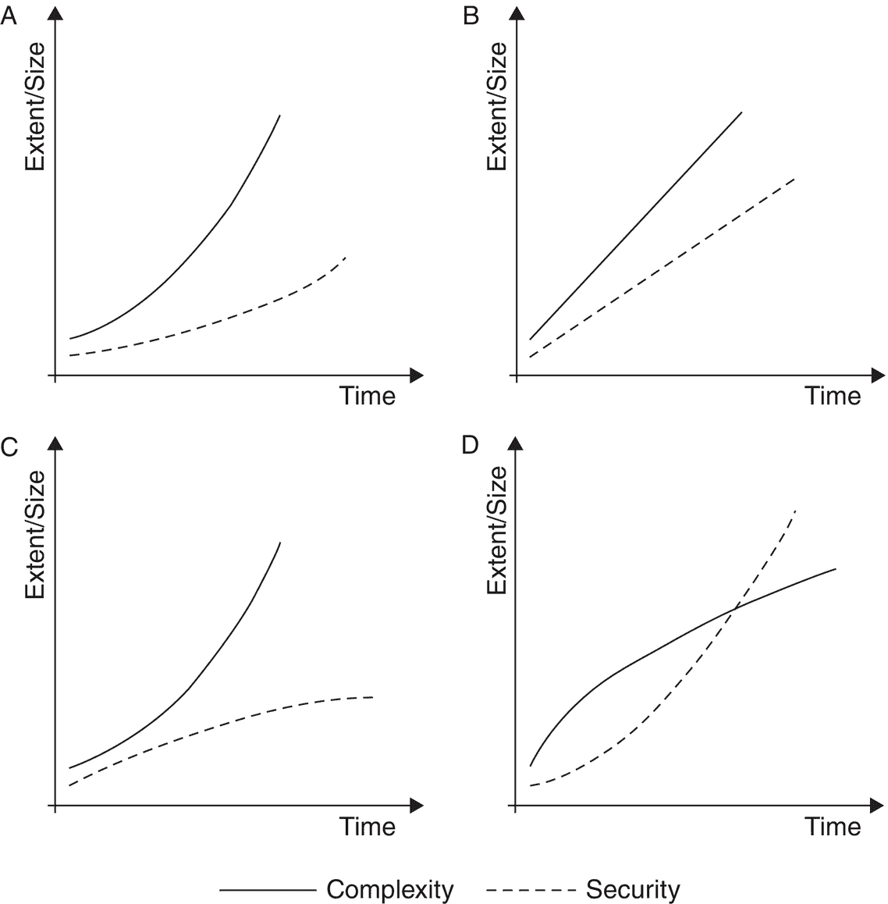
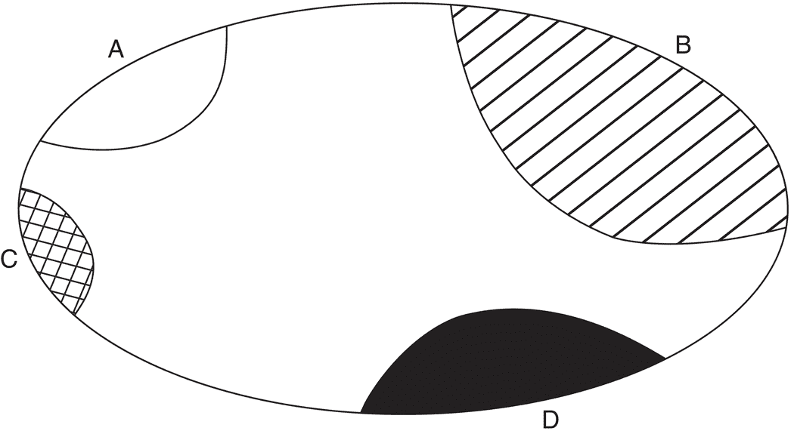
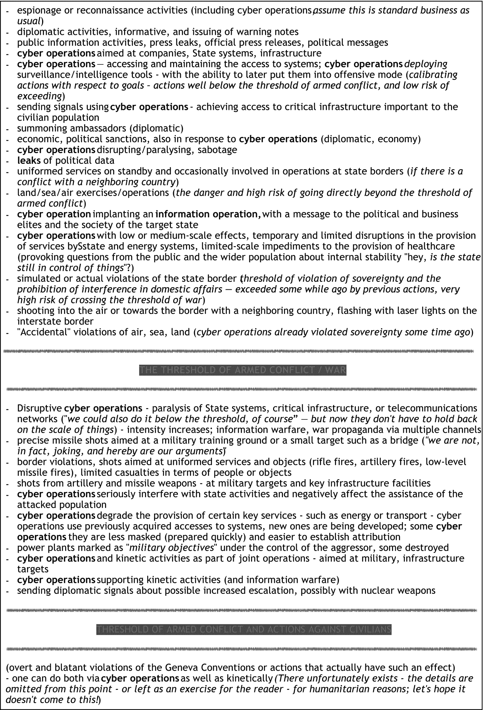
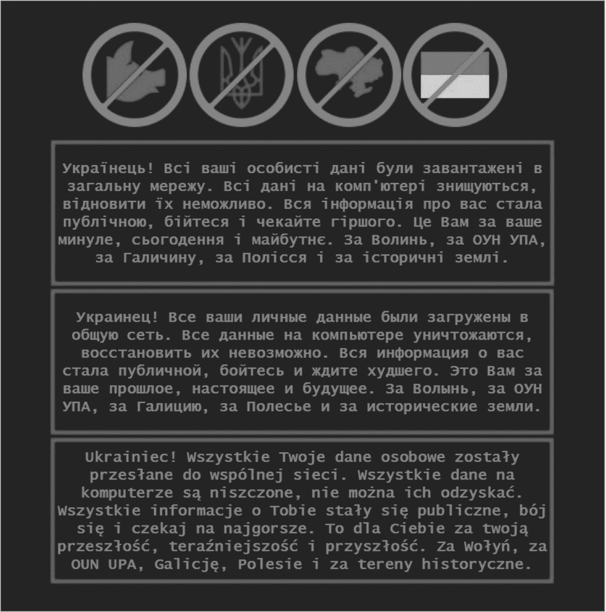

# 网络安全哲学

## 前言

网络安全在现代世界的重要性与日俱增。但我们是如何走到这一步的？

自 1960 年代以来，世界一直在经历渐进的计算机化。其总体规模也在增长。过去几十年见证了集成电路晶体管数量、处理器核心数量、网络带宽、内存以及全球数据总容量的稳步增加。这就是指数级、极快增长定律的实现方式：效率时不时就会翻倍。

这种发展伴随着社会、国家和文明对计算机以及更广泛技术的渐进依赖。这种演变正在逐步推进。我们往往可能没有意识到这种依赖程度增加的规模。毕竟，用户为什么需要这些知识？事物、世界、技术——简单来说，它们只需要能用就行。

计算机存在于家庭、工作场所、办公室和大学。如今，我们不仅口袋里有芯片和技术（智能手机），汽车、冰箱、洗衣机和其他电子设备中也有。有时它们在我们身体上或体内。交通系统、能源生产和分配、水处理等均由计算机控制。这也越来越多地适用于食品生产——从农民和农场层面开始（计算机化农业机械只是其中一个要素）。这也适用于武器系统：武器由计算机控制和操作；通常这些要素对整个系统至关重要。例如，雷达或反导系统必须依赖传感器和数据的快速分析。而这仅仅是开始。

除了计算机化，这些系统还联网了。因此，我们面临的不仅是计算机化的巨大增长，还有联网的增长。连接的计算机和设备之间可以进行通信，例如通过远程访问，即在物理距离较远的情况下（从另一个城市、国家，甚至大陆）也能连接到它们的可能性。

要是这些系统和技术都能完美运行——毫无瑕疵、没有任何问题、故障和崩溃——该多好啊！然而，我们并不生活在一个完美的模型中。在现实世界中，可能会发生故障或失效，这些情况可能带来风险、麻烦或危险。事件或事故可能是意外的（例如故障、崩溃、自然灾害、事故），也可能是蓄意的。后者可能由具有各种动机和目标的人造成，他们可以单独行动，也可以集体行动。

在存在风险发生可能性的情况下，需要特别关注安全。在我们的案例中，这将包含保障硬件、软件和系统的安全。我们的活动实际上将涉及整个基础设施——如今已是该词非常广泛的含义。随着计算机化重要性的显著提升，网络安全已成为一个主要问题，不仅是技术问题，也是经济、社会，甚至政治和地缘政治问题。

本书将以这种广泛的方式来理解网络安全。

### 网络安全——究竟是什么？

如今，网络安全几乎关乎每个人，甚至包括那些不直接使用电脑、智能手机或社交网络的人。在实践中，我们大多数人无论如何都依赖计算机，因为它们无处不在，且世界的运作在越来越大程度上建立在它们之上。

在一家典型公司中，我们可能拥有电脑、工作站、服务器、负责备份的设备、网络打印机、智能手机，当然还有网络，即连接这一切的东西，以一种使基础设施正常运行的方式将其连接起来。这是为了帮助员工高效工作。如果他们有这方面需求，在电脑上选择“打印”命令，一个配置得当的基础设施就会将文档发送到网络打印机之一进行打印。当我们在会议期间将电脑连接到投影仪时，假设是演示文稿应立即出现在大屏幕上（在实践中可能稍微复杂一些；所谓的*投影仪问题*被证明是实践中最难解决的问题之一！）。

同样，当购买（实体、纸质）火车票或公交车票时，我们会与（计算机化的）售票机交互。如果没有这种机器，也许我们可以用智能手机购买车票。检票员应该能使用电子票据阅读器来判定其有效性。我们自己也乐于使用关于交通状况的实时信息，例如查询公交车何时到达。所有这些操作都得益于计算机和网络。当我们习惯了这些解决方案，它们的缺失（例如由故障引起）将被视为一种损失。

基础设施和技术解决方案应该是安全的。网络安全并非仅仅是机构、公司或其他专业实体的领域。网络安全对每个人都很重要，也适用于每个人。无论是普通个人、小公司、工厂，还是安装了工业电子系统甚至计算机控制组件的大型工业生产厂，网络安全都很重要——有时甚至至关重要。

当然，在存在高度先进和专业化风险的某些领域，网络安全可能有非常具体的要求。例如，让我们设想一个数字化发挥着日益重要作用的医疗系统。这不仅关乎医生录入观察和诊断或浏览患者档案的办公室里的普通电脑。它还涉及计算机化的诊断设备和系统，如 `CT` 扫描仪或超声波设备。甚至植入体和植入式起搏器也是计算机化的。我们在后续章节中将更详细地论述这一点。

### 本书适合谁阅读？

本书面向广泛的读者群体。本书提供了一个清晰的当代网络安全图景，将其视为一个技术、社会，以及单纯的人类问题。各领域的专业人士（技术、政治、法律）可能会欣赏书中勾勒出的他们专业范围和兴趣与其他领域的联系，以及这些联系是如何形成的。理工科专业的学生可以了解网络安全战略和法律问题的细节，以及所有这些如何在如此广阔的领域中整体关联、契合。社科、政治或安全科学专业的学生将在这里找到一部关于这一复杂问题的汇编和教材，涉及其与人类活动、国家、外交和安全的关系。

专家、学者、学生以及各机构的官员都会欣赏这本书。它致力于一个非常复杂的主题，该主题在最近几十年显著扩展，且这一进程正在迅速推进——理解问题、缓解风险、提升网络安全。

*Lukasz Olejnik*

*Artur Kurasiński*

### 注释

1.  P.J. Denning, T.G. Lewis, *Exponential laws of computing growth*, “Communications of the ACM” 2017, vol. 60, no. 1, pp. 54–65.

## 作者简介

**Lukasz Olejnik** ([LukaszOlejnik.com](http://LukaszOlejnik.com)) 是一位独立的网络安全和隐私研究员及顾问。

他拥有法国 `INRIA`（国家信息与自动化研究院）计算机科学博士学位。曾在 `CERN`（欧洲核子研究中心）工作，并担任过伦敦大学学院的研究员。他曾与普林斯顿大学信息技术政策中心、牛津大学技术与全球事务中心有关联，并当选为万维网联盟（`W3C`）技术架构组成员。他是日内瓦国际人道法与人权学院的研究员。他曾担任红十字国际委员会驻日内瓦的网络战顾问，研究网络战的人道主义后果。他还曾就科学和新技术向欧洲数据保护监督员提供建议。

他帮助各种公司和组织，包括在网络安全、隐私和数据保护以及技术政策方面。

他的评论曾见于《金融时报》、《华盛顿邮报》、《纽约时报》、《华尔街日报》、《南德意志报》、《国家报》或《世界报》等媒体。他在《Wired》和《Foreign Policy》等刊物上撰写过科学论文、报告和评论文章。

**Artur Kurasiński** 是一位技术现实主义者、连续创新者、企业家、公共演讲者，以及游戏和漫画书作者。Artur 从经济、社会学和地缘政治的角度分析和评论技术。他是众多波兰初创企业的联合创始人。他是许多比赛的导师，也是波兰最受欢迎的技术博客之一的作者：[kurasinski.com](http://kurasinski.com)。他是波兰主要重要技术会议的演讲者和参与者。他是波兰最古老的初创企业聚会系列（Aula Polska）和 Auler 奖的联合创始人。

## 第 1 章 网络安全哲学导论

DOI: [10.1201/9781003408260-1](https://dx.doi.org/10.1201/9781003408260-1)

### 1.1 历史简述

我们需要思考我们是如何走到今天这一步的。如今，网络安全是一个国家、政治，甚至军事问题。然而，这是一个领域——多亏了个人技能和投入的时间——在一定程度上，专业知识、信息和经验可以为不属于“正式”专家圈子的人所获取。网络安全中的许多技术和方法是由各种“兴趣群体”开发和使用的。我们不会使用“业余爱好者”这个词，因为怎么能称一个拥有广博知识且实际上是专家的人为“业余爱好者”呢？

#### 1.1.1 病毒与恶意软件的历史

计算机安全至少自 1970 年代起就已被重视。1980 年代，随着首批重要描述或指南的出现——主要源自美国高校或军事机构——该领域的关注度显著上升。1980 年代在美国，恶意软件……

美国学术界（如 `MIT`）也是一款极具盛名（或臭名昭著）的恶意程序的诞生地。即今天所知的 `Morris worm`（以其创作者命名），自 1988 年 11 月 2 日起开始运行。

#### 1.1.2 利益集团与黑客组织

由此我们进入 20 世纪 90 年代，安全领域逐步发展，风险问题随之浮现。这一时期，计算机病毒现象出现并蔓延。这些病毒常诞生于东欧国家集团，例如苏联和保加利亚……

90 年代，所谓的黑客组织——简单说，就是对“计算机能做什么”感兴趣的群体——开始活跃。这些群体常由青少年、中小学生和大学生组成。他们在很大程度上推动并构建了计算机安全知识体系，包括安全方法及绕过边界的手段（黑客攻击、破解系统等）。这些往往是真正的开创性工作。值得一提的知名组织有德国的 `TESO` 等。

但需注意，这些并非当代网络安全公司报告中常见的“网络犯罪集团”。早期这些带有“业余”（或“独立”？）性质的群体，并非（至少不总是）*严格*意义上的犯罪。回顾 90 年代甚至 21 世纪第一个十年，该领域面貌与今日截然不同。因数字化程度远低于现在，可被数字化“触达”的系统潜力也较小。

#### 1.1.3 网络安全为何变得重要

虽 90 年代已面临网络威胁，但 21 世纪以来威胁持续、渐进式增长。这非空穴来风，直接源于数字世界的加速发展。计算机不再是 90 年代认知中的小众事物，如今凡有技术处，几乎皆有计算机。

例如现代地铁、公交、火车、电车的运作：驾驶控制台、车票验证器、广告/广播显示屏等诸多环节均嵌入芯片、处理器、计算机及网络。车票验证器通过网络连接以更新票价或时间；广告屏内容亦可经网络远程更新。因此必须存在外部访问通道。这并非孤立系统，而是专业框架下的公用设施系统，虽不应对所有人开放，但必须有有意设计的访问方式以上传新数据。这意味着系统必须有有意识地设计的方法来访问上传新数据并以某种方式显示它们的功能。因此，这可能（无意中）也会启用某种滥用，破坏以这种方式设计的系统。潜在地，外部人员可能获得对该系统的控制，对其进行更改、影响或滥用。

这关乎设计质量：良构系统应“严密”，至少能抵御简单或基础攻击及绕过手段。例如，设计良好的系统在广告屏遭攻击时，不应允许从其“横向移动”至票务验证系统并篡改其功能（如将票务有效期从 15 分钟改为 100 年、无限大或 −1）。

网络安全重要性日益凸显，逐渐超越技术范畴成为社会问题。计算机除对科技、电信企业至关重要外，在交通、贸易（商店）、金融（银行）、医疗、电力基建等更具社会维度的领域日益占主导。

意识到计算机普及程度后，**网络安全是社会问题**显而易见。滥用、风险或故障可能直接或间接影响社会生活、运作、民众，甚至政治或国际局势。这是渐进演变，仍在进行中。这也是网络安全另一难题——复杂性的来源。系统/软件功能特性日益增多，软硬件在社会生活更多领域发挥作用，规模效应凸显。

值得权衡：数字化与系统复杂度增长是否加速？网络安全水平能否跟上？两者曲线是否“发散”？若计算机化程度与软硬件复杂度上升而安全水平不升，风险将上升，波及整个社会系统。图 1.1 展示了系统“复杂度”发展程度与安全水平的几种对比选项。取决于差异，“发散”可能加剧或缓解。曲线 A、C 显示差异扩大（安全改善不足，漏洞与风险增加）；曲线 B 大致平行——安全某种程度上能跟上发展；曲线 D 为理想状态：安全问题在某节点得到解决。目前最现实的预期似乎是曲线 B，但仍有许多系统性变革在发生。



图 1.1 系统复杂度与网络安全水平。*来源：* 作者生成。

### 1.2 网络安全角色与重要性的渐进式提升

本书无意恐吓、散布恐惧或制造恐慌。我们倾向于呈现平衡立场。必须明确：网络安全问题真实存在，但我们并未面临灾难，世界并未颠覆，天大多时候也不会塌下来。这很幸运。

我们不必惊慌。尽管必须承认，新闻报道往往涉及非常严重且真实的问题。例如，如果我们谈论的是一家重要工业公司的瘫痪，这可不是开玩笑，而是一个真实的问题。此类问题的程度是可以**衡量**的。例如，通过考虑财务损失、受影响的用户数量、停机类型以及其他此类可衡量的因素。视公司而定，这可能高达数千万甚至数亿美元。例如，挪威氢业公司（`Norsk Hydro`）在 2019 年遭遇网络攻击就是这种情况。

一般来说，对许多公司而言，损失还可能包括失去对个人信息（员工或客户）的控制，这些信息可能被窃取或泄露。这也可能涉及法律和监管责任（例如行政罚款）。

#### 1.2.1 规模问题

此类问题在国家或经济层面上也可以系统地表达：

*   黑客或网络犯罪集团的数量是有限的。
*   在经济、国家或全球范围内，存在许多潜在目标。
*   每天都有人倒霉成为受害者，有时，从统计学角度来看，受影响的目标或受害者实际上很重要，是一个大型的、“引人注目”的目标，例如工业公司、管道运营商、医院或部委。之所以“引人注目”，是因为这种破坏性情况会引起关注，包括公众的关注。

这种行动可能是有意的（定向攻击），也可能是完全意外的（对目标进行广泛尝试的攻击：有人获取了载荷，有人上钩，在某处、某个时刻最终会取得成功）。随后，媒体会宣传这种情况；它变得重要；被分析和评论。它也（有时被夸大地）置于更广泛的趋势中，试图“置于更广泛的背景下”，包括其他近期或机会主义的事件，因此这种关联并不总是合理的。有时，政客也可能将其解读为“对国家的重大攻击”，但这未必属实。因为在公众场合，当网络攻击被称为“复杂”时，实际上往往并不复杂，甚至完全不复杂。

所以关键在于，考虑到典型国家或经济的规模，迟早会有攻击击中某个目标。即使是纯统计数据也表明，总会有人遭到攻击、入侵；即使从新闻报道中，我们也可以得出关于攻击趋势的某些结论，它们之间的某些联系（即使这些联系实际上可能不存在），以及某些特定目标。

因此，我们看到了网络安全风险现象的一个侧面（或者说，硬币的一面）。因为总存在一些系统性漏洞，可能被利用。我们也有利益群体，即那些拥有意愿和动机的群体，这导致采取了行动，结果一些实体的漏洞成为目标，并可能导致黑客攻击、破解——即打破安全防线、攻陷目标，甚至使其瘫痪。

这些思考的最终结论是，我们永远不会缺少关于发生了网络攻击（有时甚至是某些“灾难”，无论真假）的报道。然而，必须考虑到，这就是目前的样子。事情就是如此。我们可以平淡地说，这就是生活。正如计算机世界之外存在罪犯一样，数字领域也存在活跃的群体。要完全解决这个问题很困难，因为有对从事此类活动感兴趣的群体。也有明确的动机，例如经济动机，导致这些群体有兴趣采取行动。因此，此类攻击不会短缺。尽管我们应该记住，媒体报道有时会夸大其词，特别是当它们符合当前的商业甚至政治局势时。

因此，信息接收者的关键问题是知道如何对待此类报道。要保持谨慎和怀疑，知道适当的、正确的比例。这也是本书的目标之一：读完后，更容易理解什么才是真正重要的，什么可能稍微不那么重要。什么有关系。什么关系不大，甚至完全无关。什么可能是真实的，什么是夸大的，甚至问题根本不存在。我们读到的许多网络攻击其实并不重要。但也有一些后果严重。

这种能力——理解这一问题——在今天似乎是必要的，甚至是至关重要的。这是因为，正如我们已经多次强调的，我们正处于数字化的逐步发展中，因此网络安全的作用也在增长。这适用于技术、商业、金融、教育系统，甚至国家安全。我们将其归因于内部安全，从而保护公司、机构、学校和大学。外部安全也很重要，即对抗外部行为体：外国集团、国家，甚至恐怖分子。

网络安全在外交和国际事务以及国际安全中也很重要。已知一些案例，例如外交部或大使馆成为网络攻击目标。重要机密信息被窃取。例如，2022 年媒体发布了关于针对匈牙利外交部的一系列网络攻击的信息。同样在 2022 年，伊朗行为体显然瘫痪了阿尔巴尼亚的一些公共机构。作为后果（之一），阿尔巴尼亚与伊朗断绝了外交关系。还有报道称，阿尔巴尼亚曾考虑启动《华盛顿条约》第 5 条（集体防御），即那个著名的北约机制。公平地说，这听起来相当荒谬，因为这将是完全不恰当的，读完本书第 7 章后这一点将变得清晰。但此类事件不容忽视。

网络安全是各国国家和军事官员、外交官及政治家会谈的常设议题。这是一个变革、演变和谈判的领域。许多机构正在致力于解决这一问题，尽管效果并不总是立竿见影。这也是因为识别问题、寻找解决方案和实施变革需要时间。阅读本书后续章节时，您将体会到这一挑战。

### 1.3 国际与军事维度

网络攻击和网络安全绝对都可能具有国际维度，我们将在后续章节中讨论。网络安全是国际关系的一个议题。它是联合国（`UN`）、欧洲联盟（`EU`）、七国集团（`G7`）或上海合作组织（`SCO`）等机构辩论、谈判和监管的主题。它在国际关系中被考量，也在各大洲的国家集团中被考量。

### 最后，我们来到纯军事事务领域

正如我们所想，在军事领域，有许多元素正日益计算机化：从普通的办公电脑和网络到武器系统。以战斗机为例，将会有数百万行源代码（编译成运行程序，即此处的解决方案或“产品”）。但在其他武器系统中，如火箭、轰炸机和坦克等，源代码和计算机也同样重要。总得有人负责此类系统的网络安全等级。此类系统遭受未经授权的访问（入侵）的可能性既不简单也不确定，但没人想失去对军队防空系统的控制。这可能会动摇国家安全。也可能导致意外击落他国飞机或摧毁民用设施。可以说——后果将是戏剧性的。网络防御和网络攻击是军事网络安全和网络威胁的一个相对较新的维度。网络空间正成为军事行动的领域，稍后将对此进行讨论。

我们也不会回避更大的尺度——宇宙尺度。卫星中装有计算机（用于控制它们），也有通信系统。此类卫星必须与位于地球上的控制系统通信。因此，此类系统存在被攻击的可能性。安全防线可能被突破。也许有可能控制、干扰或摧毁这些子系统中的任何一个或一些，甚至瘫痪地面组件。

网络安全也适用于生物技术领域。作为一个趣闻，我们还注意到一项研究和演示，其中创造了一种活体生物体，它包含的序列导致了计算机化 `DNA` 测序系统的安全被攻破。

另一方面，关于 `DNA` 测序系统的网络安全也存在日益增长的担忧。未来，由于入侵管理 `DNA` 合成的系统，是否存在植入编码恶性病原体（有害蛋白或毒素）的恶意序列的风险。理论上，这种威胁是可以想象的，但此类网络攻击将极其复杂、困难，且在本十年内发生的风险微乎其微。但未来会怎样？因此，探索此类领域是值得的。如今，针对合成 `DNA` 序列的标准和良好实践已在制定中。订购恶意序列的风险是真实存在的，且已被证实。

### 1.4 什么是网络安全哲学——我们该如何理解它？

“网络安全哲学”一词听起来可能晦涩难懂。但值得思考什么是哲学。《牛津英语词典》解释道：

正是这些概念启发了本书的写作，并对其进行了恰当的描述。这正是指导本书写作的四个定义，它们很好地描述了本书。


我们不关心撰写关于世界或伦理的哲学论著。情况并非如此。这也不是一种纯粹的哲学方法，那种方法可能被视为自然哲学或科学哲学的范畴。虽然我个人对这些学科没有意见，但我们尽量避免并远离这种处理主题的方式。我们确实不仅仅考虑这种普遍性的思考。就哲学而言，我们指的是一种思维方式。如何理解事物？如何推理？如何思考网络安全？我们如何在逻辑上弄清系统在概念上是如何工作的，潜在威胁可能是什么样子？如何谈论它？

其理念是为如何思考威胁、安全和网络安全奠定坚实基础。以及如何思考我们定期接收到的信息或报告——从有用的信息到最终并未发生的又一场“网络大灾难”。然而，我们也关注那些具有最重要实践意义的活动和知识。

我们希望，下次本书读者阅读文章（例如报刊上的）或听到威胁或“攻击”的报道时，能够批判性地解读既定事实，并评估这些报道有多严重。这难道不是夸大其词吗？撰写文章的人真的理解该主题，还是仅仅例如未经批判地改写了某个团体的片面信息、某个国家的声明、某家公司的公告？那位 proverbial “minister”（部长/大臣）知道自己在说什么，还是并不真懂（因此，我们也向部长们和这些职位的候选人推荐此读物，谁知道呢——也许有助于避免尴尬）？

这种见多识广的读者怀疑态度，将是网络安全哲学的一种实践体现。

### 1.5 网络安全能实现吗？

我们能否达到免疫攻击、完全受保护、并为可能发生的事情做好准备的地步？让我们从这样一个事实开始：网络安全可被视为系统的某种特性。因此，网络安全级别就是 IT 系统、设备或软件的安全级别。在此背景下，网络安全对不同的系统和参与者（如普通用户）可能具有不同的权重和重要性。人们常说网络安全是一个过程：需要追求、需要实现——并需要维持的东西。

#### 1.5.1 机密性、完整性和可用性

在最基本的层面上，网络安全可理解为机密性、完整性和可用性：

*   **机密性** 是指确保信息不会被未经授权的一方获取。
*   **完整性** 是指保证信息不会以未经授权的方式改变其形式，例如，不会发生不希望的修改。
*   **可用性** 是指保证使用系统、数据、信息和资源的能力不会丧失。

专家通常将此视为网络安全的高层级图景。这对网络安全哲学也很重要，因为许多威胁都可归入这三位一体：机密性、完整性和可用性。

#### 1.5.2 对于普通用户

对于普通的“只是用户”（即：非开发人员、非专家等），网络安全可能关乎私人设备，例如电脑、智能手机或家用路由器。此类安全特性源于配置，且往往是所谓网络安全卫生（实际上是一个比“医学”更具哲学意味的术语）的问题。网络安全卫生指值得坚持的良好实践和原则。采纳并应用它，将意味着我们将达到某种标准、某种级别的网络安全。

#### 1.5.3 商业用途

网络安全在商业语境下对企业也很重要。这涉及保护组织的数据和对公司财务至关重要的系统。这也是一个运营问题，意味着公司系统必须可用；能够被使用；具有适当级别的可靠性和 `resilience`（弹性/恢复力）、安全性或机密性；将数据泄露风险降至最低；公司的连续性不会因此受影响；且不会造成声誉损失。网络安全变得越来越重要，相关讨论也越来越多：关于事故、关于违规。恐怕没有公司负责人（CEO）愿意在报纸头版读到与其组织相关的丑闻。但偏偏就有人中招。

更技术性地说，业务连续性的一个重要组成部分示例是一个可工作的备份系统。这里有很多具体事项需要考虑。将建议和最佳实践与特定应用联系起来很有用。例如，对于拥有工业自动化系统的公司，考虑因素必须非常具体。或者针对特定安全功能，如医疗系统或关键基础设施相关的功能。在这类组织中，需要专门且具体的方法。后续章节将详细解释更多关于此问题的内容。

可靠性和弹性的一个例子体现在 2022 年俄乌战争初期的事件中。乌克兰军队使用的卫星通信系统瘫痪了，但由于备用通信系统到位，尽管一个系统可能被破坏，通信最终仍能正常运作。

#### 1.5.4 国家

关于国家层面，网络安全可以理解得非常宽泛。（集体）国家的网络安全是否等同于所有公民网络安全的总和？这将意味着国家网络安全的衡量标准是每个公民的相对安全水平，以及关键公司和基础设施的安全水平。这将是一个非常笼统的指标，因此难以控制。在民主环境下，虽然可以向企业发布建议和设定要求，但向私人公民发布严格命令可能有点困难（或难以容忍）。

然而，国家网络安全可以理解为保障国家系统，即国家银行、数字化国家登记册、对公共生活重要的系统。重要的是，例如国家个人登记册（如与身份证件/卡、护照相关的）。养老金系统管理等直接影响公民事务的关键系统也非常重要。这里业务连续性很重要，这就是为什么重要机构一直在使用（且仍在使用）被认为具有弹性的大型机计算机。

这也是政治体制稳定的问题，因为网络攻击可能在国家内部造成混乱并干预其事务。在因选举制度基于电子系统（如电子投票）而不幸的国家，该过程的安全也是国家网络安全的重要组成部分。

#### 1.5.5 全球性问题

网络安全对世界也很重要。这听起来是否夸大？我们在网络空间有大量连接，数据传输经常自然地发生在国家之间。这些数据“跨越多重边界”，这可能引发监管、司法管辖、监视、安全和个人数据保护等问题。

网络数据包通常通过多个国家的基础设施传输。所有此类接入和传输点必须在每一层级得到保障。这些系统必须可靠，例如，流量应以可预测的方式路由，同时防止审查或监视（例如，除非特定国家认为有必要监督和过滤内容）。但这里也出现了一个实际、朴素的问题：在滥用或网络犯罪情况下，可能需要不同司法管辖区（即特定国家法律适用的区域）之间的合作。此时，我们要强调网络安全也意味着法律层面的挑战。

##### 1.5.5.1 国际稳定问题

我们还必须注意到，网络安全对稳定、安全——不是“计算机”或“网络”层面的，而是传统层面的——很重要，它可等同于国家安全或国家安全。

越来越多地提到一国对另一国的网络攻击。即国家机关或得到国家当局支持或激励的团体的活动。这可能导致各种具有国际后果的摩擦。

### 1.6 重要问题与一个迷思

本书应回答一些重要问题。其中之一是万物皆可被黑客攻击吗？常说没有绝对安全的系统，一切取决于资源。确实，问题是花费多少时间（和金钱）去突破特定防护措施以及如何实施。

一个流行的迷思是网络攻击在几秒钟内（可能几分钟）完成。只要一切提前准备就绪，行动可以很快。准备需要时间。事实上，针对真实系统（尤其是复杂系统）的网络攻击需要时间和资源。可能是几小时、几天，甚至几个月。因为实施此类行动，即计划入侵先进系统，可能是一个复杂的过程，可能涉及许多人。而且不一定成功。

例如，2015 年入侵乌克兰能源分配系统的俄罗斯人在春季获得首次访问权限，但直到 12 月才采取行动。然而，2022 年乌克兰战争期间，类似尝试失败。有人试图入侵九个变电站，但计划中的停电失败，因为行动被发现并挫败。而且行动发生在战争条件下。不难注意到乌克兰的防御能力已增强。

因此，我们无法对“万物皆可被黑客攻击”给出明确答案。答案总得以“视情况而定”（凭什么手段、在多长时间内）开头。

#### 1.6.1 物理破坏问题

网络攻击会导致物理损坏吗？这在某种程度上一直是个网络笑话，源于 2000 年 7 月某美国报纸夸张报道称网络攻击可导致计算机爆炸，这并非事实。《Weekly World News》（标题为“黑客能将你的家用电脑变成炸弹！”，并补充“……并将你全家炸得粉碎！”，好吧，并非如此）因此成了网络安全专家和爱好者的笑柄。

但既然涉足这怪异领域，为保险起见，补充一下：计算机病毒无法感染人，反之，人类病毒也不会传播给计算机。这本应显而易见，但遗憾的是并非对所有人、在所有时候都如此。

撇开玩笑不谈，因为有已知报告称，因网络攻击导致打印机安全被突破，进而可能引发燃烧（3D 打印机也可能）。

一个极具争议的问题是网络攻击能否致人死亡。网络攻击本身，即我们在媒体或新闻中读到的典型攻击，无法致命。“网络攻击”一词通常指对信息系统、数字系统的某种入侵或数据泄露。然而，当我们意识到计算机化已渗透多远，情况可能改变。例如，计算机负责关乎生命健康的重要系统。计算机还控制工业自动化系统。问题随之而来：若有人控制此类设备、更改配置、强制执行导致不稳定的特定活动，会发生什么？值得多考虑片刻。

### 网络安全：网络战、可实现性与风险

在本书中，我们还将回答我们是否面临网络战危险的问题。让我们在此明确指出：我们确实面临。我们受到网络战的威胁（在我们撰写这些文字时，网络战仍作为乌克兰战争的一部分持续进行）。唯一悬而未决的问题是此类网络战会呈现何种面貌（我们将在第 7 章中给出答案）。我们可以顺利地转入下一个问题，即网络攻击是否可能引发战争。这是一个被越来越多地谈论、也被越来越多地考量的问题。我们认为它可以。我们将在第 7 章中花费更多时间探讨这一点。我们也将探讨战争期间此类网络攻击可能呈现的面貌。

### 1.7 网络安全究竟可否实现？

网络安全是可以实现的，但需在特定条件下且以一定程度实现。我们在此涉及一个问题：是否有可能以一种方式保护系统（广义上理解：IT 系统、计算机、智能手机等），使其无法被黑客攻破。这取决于为实现目标将投入何种资源。软件的特性在于它可能包含可被系统性利用的漏洞，即以一种可以接管系统控制权的方式被利用。另一方面，网络安全之所以可实现，是因为它能导致一种局面：发动网络攻击的成本极高（成本过高，以至于希望在成本面前不再发起任何行动）。这就是我们在构建安全时必须采取的思维方式。

因此，关键在于增加潜在侵略者或潜在网络犯罪分子的成本。关键在于让网络攻击变得困难、充满挑战。让对手的“工作”付出高昂代价。这是我们需要采取的态度。这种态度既适用于普通用户、中小型或大型公司、机构，甚至军队。

增加成本——这是一条放之四海而皆准的通用法则！

### 注释

1.  F. Cohen, *Computer viruses: Theory and experiments*, in: *7th DoD/NBS Computer Security Conference Proceedings*, 1984, pp. 240–263.
2.  P. Szor, *Fighting computer virus attacks*, in: *USENIX Security Symposium*, 2004.
3.  J.K. Reynolds, *The helminthiasis of the Internet*, "Computer networks and ISDN systems" 1991, vol. 22, no. 5, pp. 347−361; T. Eisenberg, D. Gries, J. Hartmanis, D. Holcomb, MS Lynn, T. Santoro, *The Cornell commission: on Morris and the worm*, "Communications of the ACM" 1989, vol. 32, no. 6, pp. 706−709.
4.  Vesselin Bontchev, The Bulgarian and Soviet Virus Factories, 1991, [`bontchev.nlcv.bas.bg/papers/factory.html`](https://bontchev.nlcv.bas.bg/papers/factory.html)
5.  P. Baumard, *A brief history of hacking and cyberdefense*, in: *Cybersecurity in France*, Springer, Cham 2017, pp. 17−30.
6.  Bulba, Kil3r, *Bypassing StackGuard and StackShield*, "Phrack Magazine" 2000, no. 56, [`phrack.org/issues/56/5.html`](http://phrack.org/issues/56/5.html)
7.  Hydro, *Third quarter 2019 Report*, [`www.hydro.com/Document/Index?name=Report%20Q3%202019.pdf&id=252245`](https://www.hydro.com/Document/Index?name=Report%20Q3%202019.pdf&id=252245)
8.  P. Ney, K. Koscher, L. Organick, L. Ceze, T. Kohno, *Computer security, privacy, and {DNA} sequencing: compromising computers with synthesized {DNA}, privacy leaks, and more*, in: *26th USENIX Security Symposium (USENIX Security 17)*, 2017, pp. 765−779.
9.  R. Puzis, D. Farbiash, O. Brodt, Y. Elovici, D. Greenbaum, *Increased cyber-biosecurity for DNA synthesis*, "Nature Biotechnology" 2020, vol. 38, no. 12, pp. 1379−1381.
10.  "philosophy, n." OED Online. December 2022. Oxford University Press. [`www.oed.com/view/Entry/142505?rskey=zcwcB3&result=1`](https://www.oed.com/view/Entry/142505?rskey=zcwcB3&result=1) (accessed December 14, 2022).
11.  B. Sullivan, B. Sullivan, *Exclusive: Millions of printers open to devastating hack attack, researchers say*, November 29, 2011, [`www.nbcnews.com/technolog/exclusive-millions-printers-open-devastating-hack-attack-researchers-say-118851`](https://www.nbcnews.com/technolog/exclusive-millions-printers-open-devastating-hack-attack-researchers-say-118851)

## 第 2 章 网络威胁与必要的澄清

DOI: [10.1201/9781003408260-2](https://dx.doi.org/10.1201/9781003408260-2)

### 2.1 风险

思考网络安全时的一个关键考量因素是风险。常言道，行动伴随风险。在网络安全领域，风险可能关联许多领域和问题。它可能是业务连续性中断、数据泄露的风险，或者更广泛地说，是某种不想要事件发生的风险。风险是一种与事件发生可能性及其后果相关的现象。

存在许多风险评估方法，且它们常以专门的方式被使用。在标准情况下，我们可以使用一个公式，其中风险是影响和概率（可能性）的函数：

```
risk = impact + likelihood of occurrence
```

风险是事件发生可能性及其影响的函数。如果影响严重且概率很高，那么这种（在这种情况下为高）风险最好不要忽视。但例如，明天被 proverbial bus（意外灾祸）撞到的概率很低，尽管后果相当严重。因此——由于发生几率极低——我们将该风险评估为低。风险估算不一定非要基于简单地相加任意选定的事件权重（在最简单的情况下，概率：低、中、高；影响：低、中、高——我们可以为其分配数值：1、2、3）。关键在于风险取决于上述公式等号右侧元素的函数。这是一个非常简单的公式，尽管我们可以在其基础上构建一些非常有用的模型（包括思维模型），这些模型能提供极大帮助。例如，在确定我们应在哪些威胁上花费更多或更少时间（尤其是在无法应对所有威胁——这往往是常态——的情况下）上。这对于决定如何管理时间以及财务资源非常重要。

例如，如果风险是数据丢失，例如因网络攻击（如恶意软件感染，如勒索软件）或任何其他事件导致，那么可能的保障措施之一就是拥有这些数据的备份副本。还有其他与之相关的决策和计划。如何实施备份？如果我们是普通用户，定期将数据复制到外部硬盘是否足够？如果我们是公司，类似的解决方案是否合适？最终，或许值得考虑实施一整套备份管理系统，并决定如何配置它（例如，备份频率）。

当然，值得考虑我们想要防范的风险。如果是例如意外删除文件或实际上是勒索软件，那么外部硬盘可以物理地放在我们的电脑旁边（但不连接网络或永久连接电脑）。然而，如果我们考虑到数据中心被烧毁的风险（事故会发生，例如回顾 2021 年 OVH 数据中心火灾），甚至全面战争的威胁（回顾 2022 年乌克兰战争），那么我们的解决方案必须经过适当的设计和校准。在这种情况下，或许值得考虑地理位置分散的去中心化备份，位于远程服务器上，例如在另一大陆。这样火灾或战争的风险也会被纳入考量。

如果考虑的威胁是有人接管用户账户的控制权，安全措施之一可以是例如引入多因素认证，

### 思考风险也可以主要是直观的

然而，这需要具备一定的威胁意识和规避威胁的知识，因为分析本身应当精确且严谨。不过，可以想象某些风险比其他风险更不真实。例如，真实的风险可能是数据丢失，而不太真实的风险可能是由于宇宙射线等原因导致数据（总线）线路发生比特位修改，从而导致永久性改变，理论上这可能改变逻辑。

常有人说：“不能排除……”或“存在……的风险”——但如果不考虑概率，这只是诡辩伎俩。因为某些事件发生的几率实在太小、太微乎其微了。它们微不足道，以至于风险最终极低、几乎不存在，在实践中无关紧要。但此处有一个重要提示！后果严重性（影响、后果）极高但发生可能性低的事件，在某些情况下、至少对某些组织而言，通常仍应认真考虑。例如，真正的全球大流行病爆发可被评估为低概率事件。但由于其影响（如经济方面）可能是灾难性的，我们不能忽视此类风险。


# 回到网络安全领域

例如，用户成为俄罗斯军事情报、网络情报机构攻击目标的几率很小（但：仍然可能——作为溢出效应或关联受害者）。这源于非常平常的原因——所谓的普通用户不太可能引起此类机构的兴趣。（虽然这取决于用户是谁，但可以想象，我们的某些读者实际上可能成为这类机构的目标）。我们是凭直觉理解这一点的。如果存在这类情报或军事机构，它们必然拥有`limited resources`（有限资源）和时间。因此，它们必须将行动指向特定目标。它们无法攻击所有能想象到的目标，“来者不拒”。所以如果我们是普通用户，可以将这类（定向）风险作为不可能发生的风险予以忽略。然而，如果我们是所谓的重要用户，比如说“要人”（VIP）、“高价值目标（HVT）”，假设我们的读者成了总统候选人，如果他/她能获得适当的专业能力支持，例如有人负责提供相应级别的安全保障，那将是很好的。这与潜在目标的工作方式相关。尽管如此，我们不建议成为情报机构的目标。

## 2.2 不同类型的风险

“风险”是一个非常宽泛的概念，我们可以将其关联到生活和运作的不同领域。我们可以谈论与网络安全相关的风险，即威胁发生并得以实施的风险（如安全漏洞、窃取或数据泄露）。我们也可以谈论隐私保护或个人数据保护语境下的风险。在此，基于风险的方法是《通用数据保护条例》要求的标准方法。

### 2.2.1 人工智能与风险

我们还可以谈论与人工智能（`AI`）系统相关的风险。在这里，我们可以参考与各种威胁相关的风险。例如，我们可以考虑`AI`系统歧视其处理数据的那些人的风险。具体表现可能是，例如，简历分析系统导致求职者受到歧视。随着人工智能系统日益复杂，此类风险将增加。欧盟于 2022 年敲定的首部关于人工智能的法规，将要求公司就人工智能方法进行风险分析。

### 2.2.2 人权

各种技术、标准或技术提案均可在人权风险的语境下进行分析。这里我们回到基本公式：即事件发生的概率及其影响的严重性（即事件一旦发生，情况会有多严重）。同样，我们可以设想假设系统或标准存在歧视风险，例如 `QUIC` 网络协议，即将用作网络数据传输标准的协议。其分析得出结论：“`QUIC` 协议在人权方面为最终用户提供了显著改进”。

## 2.3 简述网络攻击

首先要明确，“网络攻击”是一个通俗术语、一种思维捷径、一种新闻评论式的术语、一种非常笼统的表述。正如我们将在第 7 章详细讨论的那样，网络攻击在国际法下并不真正是一种攻击。在此之前，我们不深入细节。我们约定，网络攻击是个人或信息系统可能经历的一种事件。因此，网络攻击与破坏安全和获取（即未经授权的）访问相关，进而导致某些在正常运行系统中通常不会发生的动作。它们是智能个体或此类个体创建的自动程序（或自动程序创建的自动程序，正如 2022 年底 `ChatGPT` 语言模型展示了自动程序编写恶意软件的能力）采取的蓄意、故意、有害的行动。

因此，这是一种非标准动作，是攻击者采取的故意行动的后果。现在有一个重要的注意事项需牢记。在处理自我传播软件（网络蠕虫）时，谈论意图可能更难。此类系统自行选择目标并发动攻击。最初的故意行为仅限于释放此类软件，此后该软件可能已大幅度实现自主化。尽管如此，我们应认识到，不存在自动程序的普遍自主性，且责任最终始终以某种方式落在创造者身上，具体而言是部署此类工具投入使用的人。是有人制造了它们。是有人使用并部署了它们。它们不是自行发生的。

在一般情况下，然而，这是某些特定人员行动的后果，这些行动导致安全漏洞和不可预见的后果。我们不能指望追究二进制代码或代码的责任。应追究人的责任。

## 2.4 杀伤链——一个有用的思维模型

网络杀伤链是用于网络威胁的一种模型。它有助于理解安全漏洞如何发生以及非预期动作如何产生。该模型受军事思维启发，经 `Lockheed Martin`（洛克希德·马丁公司）加工并适配至网络安全领域。在网络杀伤链中，我们从攻击者的视角思考目标，即如何最终分阶段攻破系统安全。但也关注我们如何在此模型背景下（及其阶段中）“界定”（或分类）特定威胁，这有助于我们理解构成某个行动或恶意软件活动的各个动作，甚至许多协同使用的方法（即构成各个阶段）。

我们将网络杀伤链划分为七个阶段。我们将依次讨论它们。

### 2.4.1 侦察

第一阶段是侦察，即识别和选择网络攻击目标，获取关于它们的信息。例如，它可能包含浏览某个行业不同公司的网站。我们可以在互联网上找到关于它们的信息。我们可能收集电子邮件地址、目标电话号码及其他此类数据。

### 2.4.2 武器化

第二阶段是所谓的*武器化*。它是为实现我们想要达成的目标而选择手段和方法。例如，这可能是选择现有工具、对其进行修改，或创建新工具以突破安全防线或实施网络攻击。并以一种使所用工具适应选定目标的方式来完成。

### 2.4.3 投递

这是关于以某种方式将工具“投递”给目标。同样，我们可以想象许多可能性，例如，通过带有附件的电子邮件或指向配置为感染目标的受感染网站的链接，将工具投递给目标接收者（这称为网络钓鱼，我们将在后续章节中详细讨论）。也可能是在特意挑选的地点遗留数据存储设备，例如，带有受感染软件的 USB 闪存盘或 USB Key。例如，在公司场所内，希望最终有人将这样的 USB 设备连接到公司系统并运行恶意软件，后者将进一步自动采取行动。这听起来并不像听起来那么愚蠢。事实上，它真的奏效了。

2008 年，在某情报机构的主导下，美国国防部发生过类似事件，有人在该部门一栋大楼前的停车场遗留了一个受感染的 USB 闪存盘。

### 2.4.4 利用

利用是在目标系统上执行恶意代码、启动恶意软件。

### 2.4.5 安装

杀伤链模型的另一个环节是将此类工具、恶意软件植入目标系统。

### 2.4.6 命令与控制

前面的步骤引出了第六点，即命令与控制（*C*&C）。这包括受感染系统（即已安装在目标系统上运行工具的恶意软件）与操作者基础设施之间通信的能力。操作者将向此类系统发送指令、命令，使此类恶意软件执行某些操作，采取操作者预期的特定行动。这些行动是什么？例如，可能是数据删除或数据下载，即窃取特定数据。执行的行动类型（情报收集、军事、破坏性或毁灭性）有时也能从执行的行动类型中识别出来。

### 2.4.7 实现目标

在第七阶段，目标得以实现。因此，如果已经构建、编译、建立并安装了用于行动的基础设施（获取系统访问权限、维持此访问权限、执行命令的能力，即对系统的控制权），那么我们就可以利用它来实现特定目标。例如，如果目标是用户数据，这意味着在计算机/系统上定位它们并将其发送到远程服务器。同样，如果我们谈论的是网络间谍行动，目标是“植入”某公司或机构，最终目标是窃取数据，例如电子邮件，那么通过执行的命令，我们将导致一种情况：在这样的受感染系统内部，我们触达这些数据。我们将获取这些数据，准备发送到外部，发送它们，并在别处收集它们。听起来很简单，对吧？但自然地，网络间谍行动的复杂性要大得多。可以理解的是，此类行动可能需要许多资源：时间（天、周、月）、人员（从几人到几十人参与）、以及资金（取决于对时间、人员和工具的要求）。

风险计算也完全不同。如果我们是网络犯罪集团或国家资助集团，与针对机构（可能是军事机构）的行动相比，入侵随机个人的风险要小得多。但真的是这样吗？确实，个人犯罪分子或网络犯罪集团如果被追踪和抓获，必须为其行为承担刑事责任。然而，如果针对位于其他国家（即司法管辖区）的人采取行动（例如，尼日利亚某人攻击德国的目标），首先必须建立这两国警方之间的合作。这是可能的，但需要时间。然而，如果行动是由例如俄罗斯网络间谍集团针对欧盟、德国、波兰或美国的机构采取的，责任归属可能各不相同。实际上，后果不大。最坏的情况是涉案操作人员身份被披露，可能对个人实施制裁（或针对此类组织框架内此类操作人员的雇主，即情报机构），以及对该国实施一定程度的孤立。但实际上，除非我们将涉案人员出行受阻的不便视为严重限制，否则此类成本相当低。尽管这只是（从 2010 年代中期左右开始）试图强制执行国家对网络行动承担责任的开端，但该方法会发生变化和演变。

### 2.4.8 杀伤链——总结

让我们回到我们的网络攻击模型。我们讨论了可将其划分为的七个阶段。这有助于攻击者构建网络攻击，帮助防御者——从理解网络攻击流程和保护自己免受这些功能阶段（阶段）内各项行动的侵害的角度来看。例如，通过安装适当的安全措施，如——阻止恶意软件与“外部”系统通信。但也通过防止恶意软件投递——例如，防止网络钓鱼（一种利用社会工程学诱导目标受害者自我损害的方法）。可以通过对员工进行专门的安全意识培训，即对公司或机构员工进行培训，安装安全软件，或采用适当的系统配置方法来建立韧性。这是你准备抵御网络攻击的简化方式。

当然，你可以随时使你的方法更加精准。让我们利用所呈现的模型，确保我们的活动针对针对特定攻击方法的解决方案和防御。我们可以非常谨慎地防御针对非常具体的行动或操作。了解所谓的*入侵指标*，

## 2.5 MITRE 模型

另一种有助于明确网络行动技术和方法的方法是 MITRE ATT&CK。

接下来的步骤是资源开发、初始系统访问、执行和*持久化*，即攻击者如何确保自己成功留在系统中、维持对其的访问。事实上，最优秀的集团很难从系统中清除，例如在 2015 年德国联邦议院被黑客攻击事件中便发现了这一点——攻击者在被发现前已访问系统数月。

该模型中的另一点是尝试提升在系统中的权限。这意味着获取特权权限，例如管理员账户（用户账户通常有限制）。下一点是利用获取授权的方法绕过安全，例如，我们破解密码或从其他地方获取它们（例如，通过网络钓鱼）。

如果在所考虑的系统中仍在寻找有趣的资源，则可能涉及所谓的*横向移动*。通常，在受攻击的公司或机构中，可能有许多相互连接的系统。这些可以是计算机、工作站、服务器、打印机等。此类复杂系统的攻击者可能有特定目标，也可能只是在寻找有趣的东西。在不同系统间穿梭寻找有趣事物的需求是可以理解的（我提醒大家，此时我们正像攻击者一样思考）。可能下载此类数据也很重要，因此，例如安装植入程序，即收集数据并将其发送到外部——目标系统之外、攻击者控制的地方（接收数据的地方）。这可能是用户在该网络内传输的数据。甚至可能是系统用户的音频记录。这可能是剪贴板的内容，熟悉 `ctrl+c`、`ctrl+v` 键盘快捷键（复制和粘贴功能）的所有人都知道。当你获得对系统的控制权时，有很多可能性。

正如网络攻击链中的情况一样，一个重要阶段是*命令与控制*，它包含从外部维持控制和发布命令。

倒数第二阶段是数据渗出，如果我们正在准备要发送出去的数据。

最后，有一个最重要的阶段，即影响、效果——战术 `TA0040`。这是实现目标的阶段（网络犯罪、军事或情报，取决于攻击者的动机/目标）。这种效果可以是，例如，数据销毁（技术 `T1485`）、数据删除、系统破坏。这可能是数据篡改，即完整性攻击，如数据操纵（技术 `T1565`）。这可能是使系统瘫痪。一切取决于攻击者的创造力——或者更确切地说是目标——因为如果有人在这样的行动中投入大量工作和精力，他们肯定有特定的意图。特别是如果这是一种生活方式，如网络犯罪分子、网络间谍或网络军事组织的情况。这样的人不浪费时间；他们的行动以效果为导向。因此，不应轻信关于孤独黑客理想主义者伟大壮举的诗意传说，至少不应完全轻信。当然，有人可能仍处于求学阶段或是学生，仍有大量时间和将技能与兴趣付诸实践的需求。这可能发生，以前也发生过；当然。尽管这类群体不太可能获得造成重大破坏的能力——即物理破坏、致命效果。

因此，MITRE ATT&CK 是另一种模型，它允许我们像攻击者一样思考和推理，并在假设攻击的每一层实施安全防护。这在安全测试中非常有帮助，因为该模型区分了每个阶段内实用的（技术性的）操作方法。这常用于所谓的演练，如*红队演练*，即对系统的模拟网络攻击。在此模型中，特定群体（例如俄罗斯情报机构）的行动方法和战术也可以被分类，甚至划分为军事和民用对应方。

我们将不在这里详述其他解决方案，例如非常有用的钻石模型。但值得注意的是，无论是网络攻击链、MITRE ATT&CK 还是其他模型，对最终用户（即普通用户）帮助不大。它们更多是面向专业人士、专家，或对该主题有深厚兴趣的人的模型。

## 2.6 社会工程学与网络钓鱼

社会工程学是施加影响、说服和技术导向方法的结合。在计算机科学领域，社会工程学是说服人们、施加影响的方法，旨在让人们采取某些行动。此类行动通常符合发起者的意图，但违背被说服者的利益。

我们应立即转入网络钓鱼的话题。我们在讨论网络攻击链时曾用过这个术语。“Phishing”（网络钓鱼）一词的发音类似于另一个词：“fishing”（捕鱼）。这是向潜在目标——人——传递“指令”的主要方式之一。网络钓鱼是一种与目标建立联系的方法，目标可以是最终用户、机构员工或公司员工。甚至可以是此类公司的老板或其他决策者。网络钓鱼使用各种通信渠道。联系可以通过电子邮件或即时通讯建立，例如通过 WhatsApp。它可以是一个吸引注意力或呼吁行动（可能是立即行动）的简单消息。它可能包含一个链接，可能会有某种东西直接感染用户的浏览器，或允许用户下载一个文件，即一个程序，启动后将感染该系统。因此，网络钓鱼可以成为恶意软件投递的来源。广义上讲，它是利用他人。也许是通过欺骗手段。

如果我们考虑例如对一家公司或机构的攻击，并为这个例子假设其有约一千名员工，那么向他们所有人发送这样的“诱饵”请求，我们就有很大机会至少有一人会上“钩”。这就是为什么培训如此重要，但你需要明智地进行，以免弄巧成拙——有时网络钓鱼培训实际上甚至可能有害。

网络钓鱼可以是定向的、有目标的。它始终关乎遇到可以被说服采取某些行动的用户。通过这种方式，他们本应损害自己。他们往往因为缺乏知识或不了解某些行为的后果而这样做。毕竟计算机和系统是复杂的事物。有许多选项、可配置元素、各种窗口。一些用户可能不希望成为万事通，也许选择专注于其特定的工作需求。当出现一条提示我们从事据称必要但我们不了解后果的活动的消息时——更难想象其后果和最终效果将是什么。此类活动可以是，例如，安装软件或执行某些代码、系统命令。

基本上，网络钓鱼关乎获取用户的信任，并让他们采取对自己产生负面后果的行动。这可能导致财务甚至声誉损失。多年来，这一直是一种非常常见的网络攻击形式。系统可能就是这样首先被感染的。这甚至可能给公司造成巨大财务损失。如所谓的 BEC 变体（*商务电子邮件诈骗*），包含发送足够令人信服的通信（例如，攻击者声称是公司高层人员），从而诱导决策者进行不利操作。这些操作可能是什么性质？例如，它们可能涉及财务事务，如向网络犯罪分子账户转账。

我们不想在这里深入探讨网络钓鱼的高级技术细节。方法在变，但核心保持不变：它是利用人们的信任和缺乏知识、缺乏意识，或许还有匆忙。它以某种方式建立信任，也许制造紧迫感、即时感（必须迅速采取行动，因为“时间不多了”，据称）。在这样的压力下，我们可能没有意识到自己行为的后果。不幸的是，效果令人痛心。

### 2.6.1 利用“部长”手法在法国的伪装攻击

值得一提的是发生在法国的事件。曾有一个团伙在那里活动，他们以一种非常特定的方式对公司实施网络钓鱼攻击。一名男子伪装成法国国防部长，并逼真地模仿了他的行为、神态和声音。

## 2.7 威胁团体

关于团体，采用了一种有用的功能模型，我们在其中为特定行为体命名，并根据其技能、能力、知识和目标对其进行分类。这使我们能以简化的方式得出特定团体的能力范围，从而判断其构成的威胁。在这一分类中，常提到黑客活动家、网络犯罪分子、国家团体或其他专业人士。

### 2.7.1 黑客活动家

黑客活动家是与某个目的相关联的非正式团体。这可以是社会、政治或任何其他目标。通常认为，这类团体不拥有大量资源或知识，且其造成的破坏并不显著。当然，这可能因团体成员的不同而有所差异，但总体而言，公认黑客活动家通常不构成严重威胁。不过，你必须将其纳入考量，因为他们的数量可能很多。此类团体的活动示例包括 2001 年针对汉莎航空的行动，

### 2.7.2 网络犯罪分子

反过来，网络犯罪分子是有组织的、主要以营利为目的的团体。

网络犯罪团体不一定需要拥有大量资源或知识。然而，有时情况恰恰相反：他们同时拥有知识和工具。所以一切取决于具体团体。情况也可能迅速变化，特别是当团体有资金渠道，能够负担先进方法或工具时。网络犯罪团体数量众多，此处不一一列举。

### 2.7.3 国家团体，APT

值得一提的是政府团体，即所谓的政府黑客。虽然后一术语有时会被使用，但并不恰当，因为这些人在政府架构内工作，不太可能是黑客。更合适的名称应为“网络操作员”，暗示这是一份全职工作。我们可以在此引入更多区分，因为这些人可能受雇于文职部门、警方、情报机构或军队。他们的活动将具有非常特定的维度，具体取决于目的（我们将在第 6 章 和第 7 章 回到对这些专业团体的讨论）。

政府团体通常拥有实现目标的大量资源。当然，这涉及使用先进工具，或聘请外部团体（有时是网络犯罪分子）代表政府团体实施行动的可能性。政府团体可能构成（并被称为）所谓的 APT（*高级持续性威胁*），它们采取措施获取并维持对系统的访问。行动示例包括：例如数据窃取、某种形式的系统瘫痪或中断，甚至可能发送政治/军事信号（也可能是在 APT 控制者选定的特定时间点）。最常见的是获取数据（间谍活动），因为这既可行又有利可图。

为什么难以防御此类团体？因为这些团体拥有：

*   知识，
*   手段（资金、方法），
*   具体的动机和目的。

假设一家典型公司的主要目的是盈利。其核心业务显然不是抵御网络攻击。所以这里存在不对称性。因为一方面，我们有一个其主要或唯一目标是攻破受害者的攻击者。另一方面，受害者的生存目的并非仅为了防御。那么在这样的情况下谁会赢？

### 2.7.4 团体——综述

总之，行为体可以按其能力进行良好的分类。然后，我们可以区分六个等级或类别：

*   使用他人工具的从业者，
*   能够构建自己工具的经验丰富的从业者，
*   能够发现并利用漏洞的从业者，
*   高度专业化的网络犯罪团体，
*   拥有将漏洞植入产品能力的政府行为体，
*   能够执行全谱系作战（防御-进攻）活动以实现政治、军事或经济目标的行为体。

虽然，公平地说，出于实际原因，不同团体也可能拥有处于这些类别“之间”的能力。例如，不太复杂的网络犯罪分子可能使用简单工具，如果政府行为体不属于“最高水平”，他们也可能如此。关于威胁行为体就讨论到这里。稍后在本书中，我们将讨论如何衡量网络攻击的影响。但现在让我们赶紧讨论工具的问题。

## 2.8 网络工具还是网络武器？


我们已经谈到了工具。但它们是什么？让我们从安全测试工具开始，尽管也存在专门用于突破安全的工具。有时此类工具可能有多种用途。也就是说：测试工具也可用于黑客攻击、入侵、破坏。因此，从某种意义上说，它们是双重用途工具。在好人手中可用于保卫系统的同一工具，在别人手中可用于邪恶的、包括非法的目的。然而，也存在专门为攻击设计、并不真正适合安全测试的工具。其中一些有时被称为`网络武器`。虽然最好避免使用这个（“网络武器”）术语，因为它将数字工具与动能武器（如枪支、导弹、炸弹）相提并论。然而，在非常基础的层面上存在显著的概念差异。本话题将在本书后面再次分析。

#### 2.8.1 工具类型——目的问题

简言之，可提及几类工具。历史上，这些工具可能是例如`分布式拒绝服务`（DDoS）攻击工具，即用不需要的网络流量淹没信息系统（计算机、服务器），使得在虚假网络流量的“压力”下，此类目标不再可用（例如网站停止加载），或整个网络（互联网接入）提供商瘫痪（即其用户在一段时间内（通常为短暂、临时的间隔）失去网络访问权限）。这是因为流量双向流动。关乎数据的发送与接收。但网络带宽是有限的。如果过多虚假流量进入我们的网络，首先，我们可能无法（不再）与外部系统建立连接（从我们的角度看，连接将丢失）；其次，实际用户将无法连接到我们网络中的资源（例如，他们将无法打开网站）。

也可能有安装在被攻陷服务器或物联网设备上的工具，使这些服务器或设备形成僵尸网络。控制此类僵尸网络（表现得像自动机）的人向其输入命令以发送数据包。即尝试与某个系统、某台服务器、某个网站建立连接。由于此类流量泛滥，目标`simplesmente`失去了提供数据的能力，即失去了提供服务的能力。它变得不可用。

##### 2.8.1.1 爱沙尼亚（2007）

2007 年，爱沙尼亚发生了一起典型案例：这个高度数字化的国家有很大一部分陷入瘫痪，这当时构成了严重威胁，至少也是极大的不便。这被称为“首起导致国家瘫痪的政治动机网络攻击”。爱沙尼亚现任和前任官员确实使用过这一说法。不过，值得注意的是，从长远来看，爱沙尼亚悖论般地从这次网络攻击中获益，至少在某些特定领域——它建立了数字化、网络安全方面的声誉。甚至可能在一定程度上高效地利用了“受害者”身份。这被转化为了红利。首先，可以展示安全性得到了扩展、发展和改进。其次，因此北约网络安全专家中心（北约合作网络防御卓越中心）设在爱沙尼亚，并定期举办网络安全演习。第三，这似乎是某个国家、政府首次将自己定位为受害者，并围绕此构建完整叙事。这一政治举措极为高明。此后，这种手法极少被使用，且几乎从未在如此规模上取得成功。2019 年，在联合国政府专家组的网络安全谈判中，伊朗试图将自己定位为首起重大网络攻击的发生地，称其为“网络广岛”事件（指首个遭原子弹轰炸的城市），但收效甚微。实际上，能在如此高层级上熟练运作网络政策极为罕见。我们无意指责爱沙尼亚将受害者身份工具化，而是对这种技艺、治国之道、网络技艺表示钦佩。

#### 2.8.2 Exploit

`Exploit` 是一种软件形式，它`利用`（即利用、使用）程序或系统的漏洞（即安全弱点、漏洞、Bug）。利用此类弱点后，可获得某些`神奇资源`和非同寻常的机会。为何称其为`神奇`？因为从某种意义上说它们确实是！通过破坏安全并利用漏洞，攻击者获得能力，强迫信息系统（如操作系统）执行其想要的、且从未由创建者（程序员、开发人员）内置到该系统中的任务。因此，例如，我们可以命令被攻击的即时通讯软件采取特定行动。例如，利用 `WhatsApp` 通讯软件的漏洞，可通过 `WhatsApp` 软件在目标（受害者）系统上触发特定操作。这些活动可以是数据准备和外泄，即数据窃取。也可能只是控制系统，使其充当主动窃听工具。大规模使用此类 `Exploit` 的著名系统之一是 `NSO` 的 `Pegasus`（及其他提供类似工具的供应商）。这是一款黑客监控软件，但它是一个完整的框架、解决方案，拥有一组 `Exploit`（此处作为获取 `iOS` 或 `Android` 智能手机系统访问权限的方法），并在受害者系统中植入监控植入程序。它可以从智能手机下载数据，将其变为窃听工具，植入文件等。

我们（指全世界）已应对 `Exploit` 数十年。有时它们是作为爱好创建的，在讨论论坛上分享或提供给软件开发人员（以促成补丁）。如今，利用其他程序漏洞的 `Exploit` 程序也可直接在私人市场购买。视其用途而定，价格差异巨大。针对某些物联网系统漏洞的 `Exploit` 可能高达数万欧元。但若要攻破浏览器、操作系统或即时通讯软件等流行软件的安全性，价格可达数百万。

### 2.9 CVE 与安全 Bug 品牌化

软件 Bug 普遍存在。这是信息技术领域的常识。过去如此，现在如此，将来亦如此。视类型而定，错误后果不一，从给用户带来不便到可能被作为安全漏洞利用。因此必须搜寻 Bug、修复它们、发布补丁并定期安装。发现安全 Bug 时，可分配标识符或编号以建立目录。实际标准是作为所谓 `CVE` 系统（`Common Vulnerabilities and Exposures`，通用漏洞披露）的一部分进行，由 `MITRE` 公司管理，美国国土安全部联合资助。例如，`CVE-2014-0160` 标识的 Bug 允许攻击者通过曾流行的传输层安全（TLS）协议实现 `OpenSSL` 的缺陷实现拦截数据。

某些漏洞、Bug 和风险也会创建徽标。这称为安全 Bug 或漏洞的品牌化。此类问题不仅获得徽标，还获得名称。此类名称的一个例子是“Heartbleed”（心脏出血）。

总的来说，品牌化 Bug 现象有趣且积极。它也引起轰动，为封闭的安全世界增添了一剂幽默（图 2.1）。


图 2.1 Heartbleed 徽标 (CVE-2014-0160)。 *来源：* [`heartbleed.com`](https://heartbleed.com)。

其他值得一提的有趣品牌化 Bug 有 Shellshock（`CVE-2014-6271`；事实证明，这是许多系统中非常常见且易于利用的漏洞；徽标见图 2.2）


图 2.2 Shellshock 徽标 (CVE-2014-6271)。 *来源：* [`openclipart.org/detail/202368/shellshock-bug`](https://openclipart.org)。


图 2.3 Spectre 徽标 (CVE-2017-5753, CVE-2017-5715)。 *来源：* [`meltdownattack.com`](https://meltdownattack.com)。


图 2.4 Hertzbleed 徽标 (CVE-2022-23823, CVE-2022-24436)。 *来源：* [`www.hertzbleed.com/`](https://www.hertzbleed.com)。

这种技术非常有趣且有帮助。特别是对于此类 Bug——广泛存在的问题，或许相对易于利用或攻击（如 Heartbleed 或 Shellshock Bug），且急需尽快解决。从某种意义上说，这也很壮观。在其他语境下：创建徽标是因为它很酷。然而，并非所有漏洞都需要徽标。这些最好保持为例外，不被滥用。

#### 2.9.1 20 年历史的安全漏洞？

作为补充，有些安全漏洞在软件中存在长达 10 年

#### 2.9.2 安全 Bug 与 Exploit 的经济学

### 经济性

值得注意的是漏洞利用的经济性，尽管这已远超工具本身的范畴。确实存在一些公司，它们购买漏洞信息或破解安全的方法以进行利用。价格因软件类型而异，可能是数万、数十万，甚至数百万欧元。分发这些工具的公司能赚大钱。这算贵吗？一百万欧元买一个工具算多吗？必须考虑实际可用性。例如，如果我们是一个国家的军事情报机构，想要构建自己的黑客工具，漏洞利用对我们可能很有用（用于破解安全）。同时，花费比如一百万欧元购买此类工具的买家，能获得一些有趣的经济效应。这显然能摊销成本，因为工具只需购买一次，却可多次、在多个目标上使用。

设想这样一个场景：支付了一百万甚至五千万，这样的行动者会在其感兴趣的范围内（即数百个系统）将该工具用于数十或数百个目标。该行动者拥有一个访问工具，可以潜在地大规模使用。因此，他们可以访问脆弱系统，窃取（潜在的所有）感兴趣系统的数据，对其进行监控、窃听，执行某些操作，甚至在必要或意愿下将其摧毁。所以，这绝不是一百万就分配给一个人、一个目的或一个目标。因为当我们将这笔钱分摊到比如一千个目标上（它们本身都很有价值！），平均单位成本不再是“一百万”（或同量级数字），而是少得多，例如（任意假设）一千，甚至一百。因此，由于成本摊销，此类行动比乍看之下要划算得多。请记住：即使公众谈论“百万级工具”（听起来很戏剧性，渴望成为头条），这也可能是一种令人困惑的过度简化。正如所示，使用此类工具的成本实际上可能远低于“一百万”。

#### 2.9.3 框架与其他工具

最后，还值得一提网络攻击框架（网络安全工具“联合收割机”？），例如 `Metasploit` 或 `Burp Suite`。这些实际上是用于安全测试的系统，即用于保护系统。其理念是简化选择破解系统方法、构建此类方法并使用它的过程。我们不在此深入细节，只提到 `Metasploit` 拥有漏洞利用数据库，且可用于测试。

当然，我们也可以谈论其他类型的恶意软件和工具。这些可能包括：

*   自传播恶意软件，即蠕虫；
*   监控软件，如木马；
*   对受感染系统进行远程访问（和`控制`）的工具；
*   用于破坏和瘫痪系统的工具（擦除器）。此类工具被广泛使用（例如 2017 年瘫痪系统的自动传播工具 `NotPetya`），也在武装冲突中使用（例如 2022 年俄乌战争前后使用的各种此类工具）。

如今，区分这些不同的“命名”事物已没有太大意义。重要的是它们如何运作和做什么，但这在不同阶段可能会变化。我们将统称它们为`恶意软件`。根据需求，使用或创建适当的工具，以实现特定目标。

### 2.10 勒索软件

有必要单独提及一种工具。勒索软件是一种获得特殊重要性、臭名昭著的恶意软件。它感染系统并“冻结”系统，使其中断、瘫痪。勒索软件已成为最大的网络安全问题之一。有必要在技术和概念层面理解这一威胁。勒索软件是一种对磁盘数据进行加密、从而阻断访问的软件。因此，它是对数据可用性和完整性的攻击。它是一种恶意软件，可通过多种技术投递给普通用户、公司员工（及公司系统）或机构的计算机。例如，网络钓鱼（诱使受害者感染系统，可能是其自己的，如意外点击）。有时，可能是入侵网络安全、潜入网络并手动感染该网络的人触发的。不过，这些已属于操作层面问题。

目标可以是一台或多台计算机，甚至整个公司或机构的网络（那时尤其痛苦，因为结果可能迫使员工在“`笔和纸`”系统下工作）。这也可能影响备份系统。值得考虑是什么让勒索软件如此特别。

#### 2.10.1 数据丢失与赎金

勒索软件以一种相当容易解密的方式加密磁盘上的数据。但网络犯罪分子，即勒索软件操作者，必须参与其中，或必须“通过”勒索软件来完成。为了解除对数据的封锁，受害者通常必须向此类操作者支付赎金。所以，这不像有人为取乐或因无聊而入侵系统、破解安全，或在机构主页放个搞笑信息。这里是纯粹的牟利思维。公司或机构瘫痪，往往实际上无法运作。为恢复运营、维持业务连续性而索要钱财。通过这种方式，网络犯罪分子可从数万甚至数千万欧元中“获利”（取决于受害者是谁）。

专业勒索软件团伙选择特定目标。这些可以是医院、关键基础设施和其他敏感公司。如果企业失去对所有数据的访问，甚至可能导致其毁灭或破产。

#### 2.10.2 商业模式——钱是目标

勒索软件与其他在线威胁的区别在于其非常清晰的商业模式（网络犯罪活动）。这里很清楚：数据访问权丢失，必须支付赎金才能恢复。赎金数额可能取决于选定目标。针对普通用户可能是几百美元，但向公司或机构索要的金额可达数千甚至数百万。这不是秘密：参与勒索软件的网络犯罪集团能兴旺发展。它们甚至可作为企业运作，明确专注于利润。网络犯罪分子通过勒索软件获得的大致利润是：赎金价格乘以成功感染并支付赎金的目标数量，减去一些运营成本（运营、感染、可能的工具开发，尽管有时此类集团甚至作为拥有自己人力资源部门的企业运作，因此薪资也计入成本，就像任何“普通”企业一样）。

#### 2.10.3 如何防护——3-2-1 法则

当然，迫切的问题是如何保护自己或系统。我们将讨论的良好标准是拥有当前软件版本和常识。拥有可用的备份也至关重要。一个定期执行的备份，以防万一。存储在多个位置，既在公司本地，也可能在外部位置，即云端某处。思路是增加数据受保护的机会，使其访问权不完全丢失（且能相对轻松地恢复）。这是“分散”备份的标准方式。即：复制备份并存储在多个位置，可能在不同国家、不同大洲。

此处适用所谓的 3-2-1 法则。拥有三份数据副本，使用两种介质类型，其中一份副本在您的系统之外（例如在云端）。

但为什么需要分散数据来进行分发？网络犯罪分子或攻击者有时会获得极大的能力，甚至可以控制其目标的整个网络。在某些情况下，他们还可以访问并删除备份系统。如果发生这种情况，就好像一开始根本不存在备份一样。因为这里的问题不在于防范自然灾害或技术故障的备份。而在于防范对手、智能敌人的备份。网络犯罪分子想要通过瘫痪公司运营、劝说公司支付赎金来达到目的。这是一个非常巨大的威胁。勒索软件攻击实际上可能使机构或公司瘫痪。这实际上可能意味着完全的瘫痪。我们可以想象医院运营或运作被阻断，甚至更广泛地说，整个医疗服务瘫痪，就像 2021 年在爱尔兰发生的那样。

#### 2.10.4 地缘政治与法律问题——二十一世纪的私掠船？

勒索软件操作者是谁？许多此类团体在东欧运作，例如前苏联（USSR）的一些国家，这已不是秘密。他们兴旺发达，其“成就”有时甚至变得“传奇”。有故事讲述此类网络犯罪团体成员驾驶着非常独特的跑车——兰博基尼；有人驾驶直升机。他们通常不在乎这种做法是非法的，并在西方造成许多问题。不知为何，他们设法逃避惩罚（尽管补充一点，俄罗斯联邦安全局（FSB）在 2022 年初曾追捕此类团体之一——REvil 的成员）。他们的活动构成了美国和俄罗斯之间地缘政治争端的核心。美国希望其关键基础设施不被瘫痪。“勒索软件服务”的“供应商”也可以被其“客户”使用（即勒索软件即服务），这意味着勒索软件创建者并不总是直接导致瘫痪的幕后黑手。尽管他们当然也负有责任——毕竟是他们提供了工具。乔·拜登和俄罗斯总统弗拉基米尔·普京在 2021 年 6 月于日内瓦举行的会晤中谈到了这一点。因此，这是一个政治性质的主题。

值得考虑如何对勒索软件操作者进行分类。嗯，也许这类似于过去其他著名的行为体？与私掠船、海盗有相似之处，

我们得出结论，勒索软件不仅是最严重的网络安全问题之一，是直接且切实的，而且还具有地缘政治维度。这凸显了网络安全的战略维度。

### 注释

1.  A. Ometov, S. Bezzateev, N. Mäkitalo, S. Andreev, T. Mikkonen, Y. Koucheryavy, *Multi-factor authentication: A survey*, “Cryptography” 2018, vol. 2, no. 1, p. 1.

2.  L.L. Sivo, J.C. Peden, M. Brettschneider, W. Price, P. Pentecost, *Cosmic ray-induced soft errors in static MOS memory cells*, “*IEEE Transactions on Nuclear Science*” 1979, vol. 26, no. 6, pp. 5041−5047.

3.  Art. 25, 32, 35 of Regulation (EU) 2016/679 of the European Parliament and of the Council of 27 April 2016 on the protection of natural persons with regard to the processing of personal data and on the free movement of such data, and repealing Directive 95/46/EC (General Data Protection Regulation) (OJ L 119 4.5.2016, pp. 1−88; consolidated version: [`eur-lex.europa.eu/legal-content/EN/TXT/HTML/?uri=CELEX:02016R0679-20160504`](https://eur-lex.europa.eu)) – 以下简称：GDPR。

4.  Proposal for a − Regulation of the European Parliament and of the Council laying down harmonized rules on artificial intelligence (artificial intelligence act) and amending certain union legislative acts (COM/2021/206 final), chapter 1, [`eur-lex.europa.eu/legal-content/EN/TXT/HTML/?uri=CELEX:52021PC0206`](https://eur-lex.europa.eu)


## 参考文献

5. B. Martini, N. ten Oever, *QUIC Human Rights Review*, IETF, 25.04.2019, [`tools.ietf.org/id/draft-martini-hrpc-quichr-00.html`](https://tools.ietf.org)

6. W.F. Lynn III, *Defending a new domain: The Pentagon’s cyberstrategy*, “Foreign Affairs (Council on Foreign Relations)” 2010, no. 5, p. 13.

7. K. Paine, O. Whitehouse, J. Sellwood, A. Shaw, *Indicators of Compromise (IoCs) and their role in attack defence*, 21.01.2022, [`www.ietf.org/id/draft-ietf-opsec-indicators-of-compromise-00.html`](https://www.ietf.org)

8. These are indicators connected with the Chinese group, Cicada, targeting government and NGO organizations; see. Threat Hunter Team, *Cicada: Chinese APT group widens targeting in recent espionage activity*, 5.04.2022, [`symantec-enterprise-blogs.security.com/blogs/threat-intelligence/cicada-apt10-china-ngo-government-attacks`](https://symantec-enterprise-blogs.security.com)

9. See. [`attack.mitre.org/`](https://attack.mitre.org)

10. D. Lain, K. Kostiainen, S. Capkun, *Phishing in organizations: Findings from a large-scale and long-term study*, 14.12.2021, [`arxiv.org/abs/2112.07498`](https://arxiv.org)

11. A. Breeden, *Defense Minister was on the line, asking for millions to aid france. Or was he?*, 02/04/2020, [`www.nytimes.com/2020/02/04/world/europe/france-Jean-Yves-Le-Drian-fraud.html`](https://www.nytimes.com)

12. R. Dominguez, *Electronic civil disobedience: Inventing the future of online agitprop theater*, “PMLA” 2009, vol. 124, no. 5, pp. 1806–1812.

13. K. Conger, A. Satariano, *Volunteer hackers converge on Ukraine conflict with no one in charge*, 4.03.2022, [`www.nytimes.com/2022/03/04/technology/ukraine-russia-hackers.html`](https://www.nytimes.com)

14. D.J. Neufeld, *Understanding cybercrime*, conference paper “2010 43rd Hawaii International Conference on System Sciences”, IEEE, 2010; M. Edwards, E. Williams, C. Peersman, A. Rashid, *Characterizing cybercriminals: A review*, 2022, [`arxiv.org/pdf/2202.07419.pdf`](https://arxiv.org)

15. Office of the Undersecretary of Defense for Acquisition, Technology and Logistics, Task Force Report: *Resilient military systems and the advanced cyber threat*, 2013, [`apps.dtic.mil/sti/pdfs/ADA569975.pdf`](https://apps.dtic.mil) – table 2.7, pp. 22–23.

16. See [`cve.mitre.org/cgi-bin/cvename.cgi?name=cve-2014-0160`](https://cve.mitre.org)

17. See [`heartbleed.com/`](https://heartbleed.com)

18. As a result of processing specially crafted input data (e.g., containing “`() {:;};/bin/cat /etc/passwd`”) the software “parser” eventually reached the Bash shell, which then executed the requested command. This could lead to data theft and system takeover.

19. CVE-2021-3156 (2021), [`cve.mitre.org/cgi-bin/cvename.cgi?name=CVE-2021-3156`](https://cve.mitre.org)

20. CVE-2019-1162 (2019), [`cve.mitre.org/cgi-bin/cvename.cgi?name=CVE-2019-1162`](https://cve.mitre.org)

21. European Commission, 20-year-old open source bug found and fixed under the EU-FOSSA 2 project, 11/12/2019, [`ec.europa.eu/info/news/20-year-old-open-source-`](https://ec.europa.eu) bug-found-and-fixed-under-eu-fossa-2-project-2019-dec-11\_en

22. K. Makortoff, *Travelex falls into administration, with loss of 1,300 jobs*, 6/08/2020, [`www.theguardian.com/business/2020/aug/06/travelex-falls-into-administration-shedding-1300-jobs`](https://www.theguardian.com)

## 第 3 章 从用户视角看网络安全

DOI: `10.1201/9781003408260-3`

### 3.1 作为普通人问题的网络安全

在本章中，我们将讨论用户的网络安全。我们将忽略诸如针对关键基础设施的网络攻击等“宏大话题”（我们稍后会谈到）。网络安全对普通用户至关重要，毕竟本书的核心前提在于：网络安全关乎每个人，且对每个人都很重要。

#### 3.1.1 数字化进程推进及其后果

网络安全之所以重要，是因为正如我们已经说过的，计算机化和数字化进程（实际上也是技术社会的建设进程：即我们的社会）正在推进，这当然带来了新机遇，例如提高经济效率、工作效率，以及新的娱乐形式。

人们使用计算机或以某种方式实现了计算机化的设备。有时他们甚至可能没有意识到这一点；例如，当处理器和计算机嵌入三明治机等电器中时。但我们也都在使用智能手机（毕竟这些是计算机）和互联网（基于计算机之间的连接，也提供例如智能手机与牙刷、或体重秤之间的数据传输）。某些用户甚至可能没有意识到自己在使用互联网。从他们的角度来看，他们只是在使用应用程序，而这正是他们所关心的一切。他们只希望自己的系统能正常运行、安全可靠，且在使用过程中没有风险。这是自然且合理的，尽管这也意味着网络安全显然是一个影响普通人的问题。当计算机化越来越多地涵盖日常生活中常用的设备（如烤箱、冰箱或洗衣机）时，对此还能有任何怀疑吗？

当美国的服务器（这些电子元件依赖于这些服务器）发生崩溃（即“宕机”、不可用）时，此类产品停止了工作。例如，Roomba 扫地机器人停止工作。其他设备也是如此，例如“智能”门铃。

#### 3.1.2 我们是在亲手构建依赖吗？

如果我们审视现实，必须得出结论：我们正在逐步扩大对技术的依赖。我们在家中安装、随身携带越来越先进的设备。例如，我们使用计步器来计算步数，或追踪身体活动（所谓的 `fitness tracking`）甚至健康状况（所谓的 `health tech`）的设备。无论我们喜不喜欢，我们正变得越来越依赖技术，也依赖于那些我们并不完全理解的技术表现形式，或许整个社会甚至都未察觉它们的存在。

例如，大众是否广泛知晓：关于我们的数据被上传到云服务器，即世界另一端某个数据中心的远程服务器，或我们难以直接识别的位置？云非常有用，因为它们简单来说就是服务器的集中、数据的集中。它们由专门从事此道并投入资源的特定公司进行有效管理。这些解决方案旨在以完美、可靠的方式随时可用。始终，或近乎始终可用。如果用户上传数据，这些数据将始终可用。至少这是假设。因为这未必总是成立。一个很好的例子是 2021 年的 Facebook 故障，影响范围巨大，由例行维护活动中的问题意外导致大范围网络中断。

#### 3.1.3 数据中心起火——谈谈倒霉事！

虽然人们认为此类系统——数据中心——应当普遍可靠，但在实践中未必完全如此。一个完美的、尽管极端的例子是另一种威胁——数据中心火灾。当然存在设备烧毁从而导致数据丢失的风险。我们希望相信这属于极端情况，并能通过妥善部署的预防措施成功缓解。但此类事件确实发生在了 OVH 数据中心，时间是 2021 年。

### 3.2 你必须保护自己——这可能吗？该怎么做？

我们强调，技术并非总是以安全的方式构建，并未充分考虑网络安全或用户隐私。然而，近年来这方面已向好发展。此类变化发生在各个层面：硬件、软件、技术标准及其实现。这些是积极的变化，无论从数量上（变化众多、普遍、涉及多个层面）还是质量上（构建了良好的解决方案、应用了越来越好的实践）。显然，人们正在投入关注、手段和资源。

因为事实是，不幸的是，从特定技术诞生之初就造成了显著的滞后。这就是所谓的 `technological debt`（技术债）。

最简单的例子是通信加密：如果你构建一个安全的密码及其使用的技术方法，并将该解决方案集成到例如广泛使用的即时通讯软件中，信息安全将在大规模上显著且立即得到改善。这就是为什么端到端加密的实施如此重要，即数据在传输点加密、仅在目标点解密的方法——除发送方和接收方外，无人能访问内容；除非一方分享此类内容，或某通信端点被攻破——因此这隐含了端点安全与信任。这使得数亿普通用户（不一定是专家）能够安全通信。

同时，我们意识到“不可破解”的通信可能引发一些社会或政治问题，时不时会有各路政客对超出国家安全机关管控范围的事物存在表示担忧。这是一个取舍问题。安全且私密的通信手段应当为大众所用。这一切是可以相互调和的。

#### 3.2.1 专家也会遇到问题

我们在开头就指出，即使是专家也可能出差错。某些解决方案可能导致不良的、意想不到的后果。

一个特例是网络钓鱼。即使是专家，也可能成为精心定向攻击的受害者，例如当某人冒充他人从而获取信任（甚至专家的信任），进而感染系统时。

### 第二个例子是系统性的

Apple 在其 Safari 网页浏览器中引入了 `Intelligent Tracking Prevention`（智能防跟踪），旨在通过阻止在使用浏览器浏览网页时对用户进行跟踪的可能性，从而提高人们的隐私保护。然而，该系统的设计方式使得在特定条件下，它可能被用于不可取的目的。甚至可能被用来跟踪用户或提取某些私人数据。

#### 3.2.2 安全性是增加攻击者的成本

一般来说，安全性（对普通用户也是如此）也可以被看作是增加网络犯罪分子或其他行为体行动的“必要”成本，由于用户或系统维护者采取简单行动，引入了进行额外支出和投入资源的必要性。这意味着网络犯罪分子为了突破安全防线，将不得不在其行动中投入更多精力。如果我们增加网络犯罪分子的作案成本，将自动降低成为其受害者的几率。也许他们会更倾向于选择另一个目标，也许是更容易得手的目标。因为对他们而言，这也是一种核算：成本越低、越容易达成目的，就越好。

那么问题来了，如何轻松地增加（改善、提升）网络安全性（提高攻击者的成本）？因为了解自己在做什么、掌握所用技术或配置的基础知识以及选择设置，永远是值得的。毕竟，这关乎用户的数据（隐私、财务、医疗），甚至可能关乎财务账户的直接访问权等。这也可能关乎声誉或形象（公关），这些都是非常重要的问题。

#### 3.2.3 关注重要的事物

让我们在此消除一些疑虑。事实上，人们往往关注那些小众的风险和威胁，因为它们发生的概率很低。例如，普通用户成为俄罗斯军事情报机构攻击目标的几率极小。为什么？出于实际原因，例如。当然，某些网络攻击可以规模化（即以一种能“自动”针对成千上万甚至数百万目标发挥作用的方式进行准备），也就是说，我们可以一次性发起大量感染尝试（正如我们在讨论网络钓鱼时已提到的），例如以公司全体员工为目标，假设至少有一人会打开受感染的附件。然而，在典型用户身上使用“军事级”手段的可能性相当小。此类尝试更可能由普通诈骗犯或网络犯罪分子实施。

##### 3.2.3.1 资源与规模的问题

我们必须强调，即使是情报机构，无论是民用还是军用，在一定程度上都拥有有限的资源。这除了那些机构通常有非常具体的目标这一事实之外。这意味着它们必须思考并决定将这些资源导向何处。我们要直截了当地说，所谓的普通用户引起此类机构兴趣的可能性非常小。我们无意暗示本书读者不重要，而是说也许他/她不在此类机构的关注名单上。尽管我们不排除本书会有读者面临此类风险，无论是当前还是将来。在这种情况下，我们希望他们已意识到这一点。如果没有，这种缺乏认知的事实本身就是网络安全的一个问题。

我们必须专注于真实的威胁。幸运的是，网络安全风险可以降低，尽管很难完全消除。正如我们已经说过的，即使是专家也可能遇到意外或不幸的事故。现实生活中也可能发生非常意外但罕见的事情。不过，值得注意的是，同时发生两个极不可能事件的概率甚至更低。以目前的两个示例事件为例，直观的洞察是：一个戴着国防部长面具、成功说服公司交出钱财的男子存在的可能性不大。整个数据中心被烧毁的可能性也不大。因此，戴部长面具的男子纵火烧毁数据中心的概率甚至更小。我注意到一个巧合，这两件事都与同一个国家（法国）有关，这可能会略微增加可能性。然而，“戴部长面具的男子在数据中心纵火并导致其完全烧毁”这一组合风险极低，至少我们希望如此。这是一个非正统但简单的红队演练示例，其中对风险进行了建模。

#### 3.2.4 风险建模

如果我们想思考风险，就必须提到风险建模。它在于识别公司、机构或（就本章而言）用户面临的真实威胁。风险建模就是思考什么可能出错。发生某事的几率有多大？可能的后果是什么？这些后果会严重吗？能否接受？因此，这关乎对可能性或 `impact`（影响/冲击）的思考。

然而，当然，我们必须强调，普通用户与某些特殊用户（例如 VIP、所谓的 HVT [`high value targets`，高价值目标]，如某些政治家、记者、商人或其他处于风险中的人）的风险模型是完全不同的问题。面临不同的危险，不同的风险。在这些情况下，当然需要专业的风险建模，因为既然这些是完全不同类型的威胁，它们可能需要或理应采取完全不同类型的安全措施。

#### 3.2.5 我们面临的实际威胁是什么？

幸运的是，在大多数情况下，也许我们“不那么重要”？从某种意义上说，这将是一种优势，如果仅仅因为我们作为普通用户，可以在同样“不那么重要”的人物群体中“隐藏在人群中”。这可以成为一种资产。

再提一次网络钓鱼。正如我们已经提到的，它是一种诱导受害者、目标采取不符合其利益行动的方法，结果导致他们损害自己或其组织。这是一种社会工程学攻击，它在一定程度上可能利用某种天真，或对技术（如网页浏览器）工作原理的无知。它也可能利用一种特定现象，归结为某些网络钓鱼攻击在特定特定情况下可能更有效。每个人都应该理解、重视并应用这些知识。毕竟，如果我们使用计算机或技术，是有目的的。也许我们很忙。也许我们在同时做很多事。我们没时间，想快速采取一些行动。也许，在特定情况下，我们不会花费足够（适当）的时间思考我们的行动及其可能的后果。**正是在这种情况下，由于这种匆忙，我们可能会采取一个会产生负面后果的行动**。所以这些是攻击者有利的环境。他们经常试图自行制造这种环境，诱导其发生，暗示时间压力，例如，如果我们不立即采取行动，就会发生不愉快的事情。

### 网络钓鱼也可以是定向的

假设目标是公司的一名员工。我们可以找出这样一位公司员工。我们可以确定他/她的工作内容、兴趣所在、与谁共事、谁是他的/她的上司、他的/她的家庭状况如何。这样，我们就可以挑选发送给此人的信息，以赢得此人的信任。而该人（目标）随后可能会更容易采取对自己不利的行动。当攻击瞄准公司董事或其他决策者时，情况尤为危险。在这种情况下，值得回顾一下第 2 章中提到的 BEC 变体。当公司决策者成为目标时，可能导致数百万的损失。

### 3.3 铁律

#### 3.3.1 技术是为人服务的


首先要明确，我们不应害怕技术。它是为人服务的。并非它对一切和所有人都是威胁。如今使用的许多技术都已相当成熟。毕竟，`Android` 或 `iOS` 内部存在生态系统。它们是连接到软件的各种设备（硬件）。这些可以是智能手机、笔记本电脑、手表或智能手表等设备。其制造商已投入时间确保产品安全。

因此，这里的问题是如何在这样的生态系统中保护自己。首先，有必要了解默认设置是否正确且适合我们。除非我们假设确实如此。如今，就拥有高安全级别的自律生态系统而言，这种假设通常是可以成立的；如果你使用某些大厂商的硬件或软件，安全级别很可能很高，且得到妥善监控。过去这并不那么显而易见和清晰，但此后系统在这一方面已显著改进。

然而，我们必须重申，在本章中，我们关注的是用户可控的事物。而主要是他们对自己行为的控制。显而易见，用户无法影响底层漏洞、其引入或解决，而这些漏洞可能导致操作系统被黑客攻破。他们不创建所使用的系统，通常也不修改它们。我们不会指望用户编辑（在“拆解”后）底层软件组件、重新构建软件等。同样，我们也不指望任何人从新购买的智能手机上物理移除麦克风或摄像头。然而，此类事情确实会发生。

### 3.3.2 厂商应负责基础安全——生态系统的重要性

公认的是，至少网络安全水平是体面生态系统运营商（`Apple`、`Google` 等）的责任，且他们对此非常重视。如果仅仅因为网络安全是当今几乎所有人都关心的事情——从普通用户到监管机构。毕竟，新的法律法规不断出现，要求保护个人数据（如《通用数据保护条例`GDPR`》）或各类系统的网络安全水平。

### 3.3.3 风险面

首先要明确，基础本身并非非常技术化，这确实是好事，因为技术变革的速度快于更通用的规则。关键在于弄清你自己使用计算机、互联网或技术的总体方式，以识别风险点。这种分析不仅可以在专业环境中进行，也可以为自己进行。我们谈论的是所谓的`risk surface`（风险面/攻击面）。简而言之，我们为潜在攻击提供的风险点越多，“风险面”，即可被攻击的“脆弱区域”就越大。什么可以等同于这样的表面、这样的风险点？例如，接入点——可能导致网络威胁产生的事物，即网络犯罪分子或其他人会利用的事物。这些可以是与我们使用的软件或系统类型相关的点。

例如，使用过时、未更新的软件浏览器版本浏览网页会增加风险。而更新非常简单。通常你也可以开启自动更新设置（如果它不是默认开启的），这样做是值得的，因为这是一种非常简单快捷的降低风险的方法。那么为什么不做呢？

另一个例子如下。如果我们在计算机或智能手机上安装了大量程序，对于想要破坏我们系统安全的人来说，只需在这些程序中的某一个中识别出一个入口点即可。因此，拥有许多程序/应用程序，且可能未更新，会增加危险。因此，减少此类风险的一种方法是减少这个可用的风险面。我们需要减少潜在漏洞，这可以通过减少利用我们所用事物中漏洞的机会来实现。在这种情况下，这可以非常容易地完成——例如，卸载我们不使用的程序，并确保所有其他程序都具有带有最新安全补丁的当前软件版本。这样一个示范性（模型）风险面定义在图 3.1 中。



图 3.1 示例风险面——模型。*来源：* 作者生成。

在图 3.1 中，我们看到了一些大致轮廓——与我们使用的硬件和软件相关的表面。我们想要减少这样的风险面（这就是重点，使这样的风险可控）。例如，我们有区域 A，在调整配置后将减少风险面，例如，启用多因素认证。区域 B 从风险图中消失，因为我们卸载了不必要的程序。区域 C 将在安装软件补丁后消失。当区域 A、B、C 从图景中移除时——风险面被减少、降低。为了说明威胁，我们保留了区域 D，不幸的是，在我们使用的系统或软件中发现了漏洞，且有人想利用它对付我们。但我们能控制的，我们做对了。这就是关键所在。

#### 3.3.3.1 绘制使用方式图

用户使用计算机、智能手机、硬件和软件的总体方式也可以写在一张纸上或某个程序中，识别技术的使用方式。

然后我们检查：

*   浏览网页的过程，即网站，以及正在使用的方法，例如在特定情况下我们是使用这一款还是那一款网页浏览器，这一个还是那个浏览器扩展；
*   我们使用什么应用程序看电影，从哪里获取这些电影；
*   我们使用什么图形程序，从哪里获取图形素材；
*   我们是否移动性地使用计算机，在外出时使用，如果是，我们是否有锁屏功能，在一段时间不活动后锁定屏幕（这将是安全方法之一）；
*   我们是否经常在无法看管的情况下离开计算机，或者是否在公共场所这样做（例如，去咖啡厅洗手间时）；
*   我们是否连接外部存储设备（`U 盘`）或其他外设，如麦克风，或 `USB` 连接的熔岩灯——这不是玩笑，因为谷歌研究人员曾一度将其演示为接管计算机控制权的一种方式；
*   我们是否安装来源不明的程序；我们甚至知道什么是不明来源吗（例如，来自应用商店之外的应用程序；例如，我们对智能手机进行了“越狱”，以非标准方式安装程序，这可能会显著降低安全级别）。

当我们了解如何使用硬件和软件以及用它们做什么时，将有助于以知情的方式选择适当的安全措施。

#### 3.3.3.2 风险点识别与解决方案选择

在识别风险点时，我们会选择预防措施（或：降低风险）。

例如，保障网页浏览安全的方法可能是保持软件最新：操作系统、浏览器，以及可能安装的、能够增加隐私保护并降低恶意脚本被投放和执行风险的扩展程序（在 2009–2023 年期间，此类扩展程序包括 `NoScript` 或 `Adblock Plus`）。

另一个例子是使用电子银行。有必要了解与这种银行形式总体相关的风险。其中一些风险可以通过使用专用网页浏览器连接电子银行系统，或仅通过受信任智能手机上安装的应用程序进行操作来降低；并且必须使用多因素认证，即不仅仅依靠密码。

幸运的是，如今法律法规有助于推行认证方法。

#### 3.3.3.3 法律要求来救场？

此处应立即指出一个重要观点。当前的欧洲法规通过要求在电子银行中使用多因素认证，提供了一个很好的范例，这非常清晰地说明了网络安全法规正日益跟上实际和真实的技术挑战。这一要求源自《授权法规 `(EU) 2018/389`》第 4 条第 1 款。

听起来很神秘？也许吧，但这实际上是命令我们的银行强制我们使用双因素认证，例如 `PIN` 码和令牌——验证码（如通过短信发送）。

将这些技术标准转化为法律要求意味着什么？这意味着它们将长期伴随我们。该领域只会变得更安全。在这种情况下，安全理念已以硬编码（但灵活）的方式写入法律要求。其他法律体系也将跟进。

### 3.3.4 最新版软件

为降低风险，我们必须拥有最新版的操作系统和软件，尤其是网页浏览器（浏览器越来越像这样的“操作系统”）。哪怕仅仅因为安全漏洞经常会被发现，而这些漏洞可能被各种利益集团和对利用漏洞、破坏安全、实施黑客攻击感兴趣的群体所利用。

通过在发布补丁时更新操作系统，我们会自动修补漏洞。我们化解了攻击。我们总体上降低了风险。当然，这会干扰我们的工作，一些事情必须暂时挂起、结束、保存。但这很可能值得，因为这是直接的风险降低。如果一项只需几秒或几分钟的活动能显著改善真实的安全问题，那么根据任何（即无论哪种）风险分析方法，都没有必要考虑。直接去做就行。

### 3.3.5 屏幕显示内容有限信任原则

另一条规则是不要总是相信屏幕上出现的内容。或者至少不要轻信事物初次呈现时我们可能得出的结论。这里我再次指向网络钓鱼。我们会核对短信/文本的来源吗？我们确定发件人真的是我们的银行吗？我们不应总是相信电子邮件或即时通讯消息中写的内容。即使发件人在邮件中自我介绍，因为多年来冒充他人相当容易，而且我们至今仍可自由设置名和姓，作为他人将在消息发件人字段看到的内容。同样，在社交媒体上，保持不天真也很重要。某人更改了简介、姓名和照片，并不意味着那真的是特定人物的账号，例如政治家或记者。许多人上了这种看似简单的伪造的当。在这种情况下，可能也是因为人们单纯想相信那是真的（这也是这种虚假信息手段有效的原因）。

我们再次强调，以冷静态度对待沟通是值得的。通常并不急。真的。再说一次，任何人都可以用任何名和姓自我介绍。他们可以创建一个与真实邮箱极其相似的电子邮件，带有适当的签名和徽标。有时他们甚至能使用真实的邮箱，如果他们通过闯入、泄露、失陷获得了未授权访问权限的话。尽管这发生在相对不常见的情况下，即当针对目标的黑客攻击投入了相应更多资源时（或者如果有人在假冒钓鱼网站上提供了登录凭据，这种事发生在政治家、分析师和记者身上）。

在此我必须再次指出，正在开发的技术也可能被用于恶意目的。好吧，浏览网站时，有时会弹出某些窗口。一些合法的窗口可能会请求显示“通知”的权限，但其他窗口也可能显示类似消息：“*你的电脑上发现了病毒。点击此处安装可修复此问题的软件*”。当然，稍加思考就会明白，如果用户没有直接且有意识地授予其他权限，这样的网站几乎不可能扫描计算机上本地安装的文件或程序。所以不应轻信此类内容！然而，根据规模经济原理，可以假设总会有人上当。如果数万人看到这条消息，也许会有一人上钩。也许这对相关行为体来说就足够了。

### 3.3.6 核实通讯

与前文讨论的网络钓鱼及不信任屏幕上所见一切相关的另一点，是核实联系人的必要性。特别是在利害攸关时，当发生重要或潜在重要的事情时。例如，当我们通过即时通讯软件或电子邮件收到消息，发件人自称是我们的朋友、家人，但也可能是我们核心圈子外的人，例如公众人物（部长、参议员、著名歌手），并试图说服我们做出财务决策，即向他人账户转账。例如，他/她编造了一个关于发生了某事的故事，而实际上并未发生。需要钱用于某个“合法”目的。也许他/她强调必须立即行动（时间压力）。值得尝试通过不同渠道联系此人（除部长或著名歌手外，你可能联系不到他们！但即便如此，也值得小心，如果你们互不相识，他们为何会首先联系你？），例如给他们打电话。重要的是此时不要使用简单的回拨功能（如果有人打给我们）——而是手动输入号码或从通讯录中选择联系人。

### 3.3.7 密码

尽管我们越来越多地可以使用人脸识别或指纹扫描解锁智能手机，或使用在设备上接收到的代码登录，但密码对安全而言仍至关重要。密码依然重要，在可预见的未来我们仍将使用它们。

#### 3.3.7.1 良好的密码

由于密码仍然是保护系统、账户和设备的一种非常重要的方法，因此其创建标准也很重要。长期以来，人们一直认为，好的密码是指具有特定字符数量和不同类型字符（字母数字、特殊字符、区分大小写）的密码。因此它应由字母、数字和特殊字符组成。还有一种说法是必须经常更换密码。但如今我们懂得更多了。其中一些建议在今天已不合时宜，另一些则简直是有害的。这些建议既非基于经验，更绝非基于现代实践中受密码保护的账户是如何被使用的。此类建议经常由各类专家和权威人士传播，培训课程中也是如此。无人质疑它们；无人追问其出处，也无人询问为何它们被认为是好的。

从今天的角度来看，它们似乎源自某些不明确的来源，或者至少按今天的标准来看，源自相当晦涩的来源。例如，包含在教科书中的 1980 年代甚至 1970 年代的军事建议中。

此类建议或许以某种方式适应了那个时代的现实、情境和环境。但让它们长期保持有效、甚至延续至今，真的有意义吗？不幸的是，惯例往往是，它们变得流行起来，而其军方出处对此起了推波助澜的作用（你知道的，直觉上觉得军方懂安全，对吧？）。公众和专家欣然接受了这一表面价值：如果是军方推荐的，在安全问题上准是良策（或许在当时那些情形下我们会这么想，但我们生活在 2020 年代，而非 1980 年代）。于是它们被自动地传递、重复。如同咒语。然而，这些原则在今天未必具有如此重要性和有效性。原因有很多。

首先，我们有了不同的认证方式，例如 `multi-factor authentication`（多因素认证）；

其次，破解密码未必容易，因为即使哈希密码数据库泄露，即经过单向哈希函数（`scrypt`、`Argon2id`、`PBKDF2` 等）或基于哈希函数的构造（如 `SHA3`）处理的密码——即一种易于计算但难以逆向的函数，拥有该函数在输入数据上的计算结果，要反推其输出——在我们的场景中即密码——是非常困难的。例如，对于密码“cat”（极弱），应用 `Argon2id` 函数的结果是 `2137bda0d2bd359d06ec817471f1b195`。

一旦发生密码数据库泄露，攻击者可发起 `brute-force`（暴力破解）攻击，即检查所有可能的输入组合，以验证是否有匹配的输出数据——即本例中的密码。在 `dictionary`（字典）攻击中，我们拥有一个单词字典，如同暴力破解一样，我们检查所有这些单词（及其变体，例如单词与数字的组合），希望其中之一能匹配计算结果。此时，相应的输入（我们试图计算、泄露的内容）即为所求密码。然而，我们可以降低此类攻击的风险，例如通过设计密码系统，使得为每个密码计算该单向哈希函数的值需重复 50 万次或更多，并使用难以在并行计算中高效运行的单向哈希函数，即使在专门设计的硬件设备（`ASIC`、`FPGA`）上也是如此，因为计算哈希需要一定量的硬件内存。这是在哈希密码数据库泄露的情况下，构建抗破解密码的原因和方法之一。

#### 3.3.7.2 破解密码没那么容易！

远程密码破解，即使用本地计算机，通过在登录页面逐个尝试密码来破解邮箱密码，在今天几乎是不可能的（除非密码是个简单单词、真心容易猜）。通常需要成百上千万次尝试。但在实践中，无法对电子邮件账户等系统发起成百上千万次登录尝试，因为此类远程系统会检测到这些未授权访问尝试，即短时间内数百或数千次因密码错误导致的登录尝试、认证失败。系统会采取行动，例如封锁登录权限，若尝试持续不止，甚至可能通知执法部门（即警察）。因此，以这种方式破解密码在实践中极其困难，甚至不可能。

现在设想，在短时间内（如一分钟）你只能尝试 10 次密码，而你需要测试一百万个密码才能成功。如此尝试将耗时约 70 天。更有可能的是，访问会被封锁，或攻击者更早厌倦放弃（因为这是一种相当糟糕的时间投资）。如果真想接管账户，最好尝试其他方式。

#### 3.3.7.3 我们不更换好密码（除非有充分理由）

不值得强制频繁更换密码。为什么？理由多多。首先，这导致用户选择弱密码。如果作为用户，我知道一个月或几个月后就得换密码，干嘛要费心创建并记忆一个好密码？以下密码堪称传奇：`<word><year>`（单词+年份）。例如“Cafe2023”，结尾的数字（年份）理应随年份变化，对吧？然而，你常能发现年份已相当久远的密码，如“Cafe2017”。我没开玩笑。老实说，对咖啡馆来说这不是大问题——反正密码对所有访客可见，且常张贴在显眼处。

我们可以假设，用户知道必须改密码，便不愿花费过多（或任何）脑力去记忆难记的东西，即被视为“好”密码的难记短语。顺着这思路，似乎想出个密码，然后改其结尾要好得多。例如设密码为“figohz8Zee”，过段时间改为“figohz8Zee_1”、“figohz8Zee_2”等。如果没有理由相信我们的密码可能已被未授权人员窃取，这样做是值得的。

频繁更改密码的要求背后的想法是，例如，遏制潜在的未授权系统访问，以防密码以任何方式被拦截，无论是潜在的还是假设的。这是一种“以防万一”的做法。然而，这意味着我们假设未授权人员可能已经拥有了他人的密码。甚至长达数月，这在今天是不合理的。这一点，加上频繁更改密码逻辑的拥护者，将暗示我们可能甚至允许了这种未授权访问系统长达数月。这合理吗？这在今天是不可接受的——未授权访问必须被更快地检测到。同时，根据 2022 年 `Mandiant` 报告，2021 年检测被黑客入侵的平均时间（即从未授权访问组织系统到检测到的时刻）约为 21 天。这个时间正在缩短。但这仍然少于密码典型的“使用寿命”，超过该寿命后会弹出悲伤的消息提示你需要更改密码。正如我们所说，只需在精心挑选的密码末尾再加一个数字然后忘掉它。除非真的有充分理由相信密码已被泄露——那时需要更改。或者除非在这些特定设置中密码更改确实有正当理由。我的意思是——真正由合理的理由所证明。

最后的论据是美国 `NIST` 基于知识和研究的新建议。其指示如下：“*验证者**不应**要求任意更改记忆秘密（例如定期更改）。但是，如果有证据表明认证器已被泄露，验证者**必须**强制更改*”。

这些建议正逐渐被各供应商实施，例如微软：

> 近期的科学研究质疑了许多长期存在的密码安全实践的价值，例如密码过期策略[…]。如果密码从未被盗，就没有必要让它过期。如果你有证据表明密码已被盗，你大概会立即采取行动，而不是等待过期来解决问题。[…] 此外，如果你的用户是那种愿意在停车场参加调查、用糖果棒交换密码的人，没有任何密码过期策略能帮到你。

适应并遵守新建议（之前的建议实施了 30 多年）肯定需要一些时间，才能将那些早年间过时的做法连根拔起并彻底消除。最终，这将会发生。新建议将被简单地重复、逐步实施。也许像之前的建议一样自动且不加思考地实施，甚至可能由同一批人实施。尽管有些人可能不得不竭尽全力，给出的建议与他们之前宣扬的截然相反。

还值得注意的是，自 2022 年以来，欧洲个人数据保护机构开始严格执行强密码建议。法国数据保护机构因违反密码系统的良好实践，对法国的几家公司处以 `GDPR` 财务处罚（罚款）。在一起案件中，发现设计上存在技术缺陷，接受了弱密码（长度为六个字符；在 2022 年，按任何标准都不合格）。

#### 3.3.7.4 好的密码是长密码

即使由许多不同字符组成的密码（例如八字符密码，按今天的标准）不幸也会被相当容易且快速地破解。为了解决这个问题，系统必须包含检测能力（检测破解尝试或密码泄露）。但你也必须以特定方式创建密码。首先，一个好的方法是遵循“长密码优于由许多随机数字、数字、字符、符号组成的密码”这一原则。在这种情况下，长度很重要。但你如何记住如此长的密码？

#### 3.3.7.5 密码短语——Diceware

这就是密码短语和 `Diceware` 方法发挥作用的地方。

如何选择这样一个好的密码（密码短语）？最好拥有一个长单词列表并掷骰子。例如，如果我们有 10,000 个单词，每个单词将从一个特定数字开始（你可以自己创建字典或使用现成的）。

例如，通过多次掷骰子，我抽取了六个单词：`attest`、`bubble`、`jogger`、`devil`、`breeze`、`officer`。通过将这些单词组合成一个字符串，我得到了“AttestBubbleJoggerDevilBreezeOfficer”（注意每个单词组成部分的大写）。当然，这个单词序列比人“手工”挑选的单词随机得多。这才是关键。

创建密码的主要规则是：

*   它们应该易于记忆。
*   它们应该难以猜测。
*   它们应该足够长。


## Diceware 的最佳平衡

Diceware 在这两点上都达到了最佳平衡。破解速度如何？假设每秒能测试 100 亿个密码，

*   形式为 `aaaaaa`（六个相同字符）的简单密码将在不到一秒内被破解，
*   破解好得多的密码 `peiNu6pa` 需要……也不到一秒，
*   一个好的 12 字符密码 `Aebaik0lah9O` 不到一分钟，
*   破解 `AttestBubbleJogger` 需要两个小时。

但破解 `AttestBubbleJoggerDevilBreezeOfficer` 将需要漫长的岁月（如果知道使用 Diceware 作为生成方法，时间可以稍微缩短）。所以我们得到了一个易记且安全的密码。能不能更好？当然。让我们把字母“o”替换为零，得到 `AttestBubbleJ0ggerDevilBreeze0fficer`。

但，为什么这行得通？为什么由许多单词组成的长密码容易记忆？这是心理学上的**分块**效应，即多条信息被组合成一个整体。

## 3.3.8 存储密码

如果我们已经有了好的密码，如何存储它，如何使用它？悲哀的现实是，我们可能不得不拥有几个甚至几十个账户，以及许多用于它们的密码（极端情况：每个账户一个不同的密码，如果我们不使用联合身份验证系统，即不使用 Google、Facebook 等的密码登录不同系统）。绝对不能在不同网站上使用相同的密码；这类似于将密码交给服务 X 的其他人，即服务 Y。强烈建议不要与他人共享你的密码！重用密码意味着 exactly this：与另一方共享你的密码。

因此，如何管理这样的密码列表很重要。为此使用密码管理器。这些是密码管理系统，非常有用的解决方案，能识别登录名和密码并将它们绑定到我们登录的系统（例如网站）。当我们进入网站时，登录名/用户名和密码会自动填入。这非常有用，因为这意味着我们不必记住密码，所以它们可以很好且强壮（记住几十个强密码将是一个巨大的挑战）。

> 如果有人试图通过网络钓鱼和电子邮件提示接近我们，密码管理器也会有所帮助：“点击这里，这是您通常登录的典型系统”（例如用于网上银行），消息这样写道。当我们点击时，机械系统——密码管理器——将无法识别此类页面（在人类眼中，它可能与真实页面在外观上令人困惑地相似/完全相同，其地址也可能几乎相同）。机器不会被欺骗。它会将这种虚假网站视为未知网站，不会自动填写用户/密码字段。对我们来说，这将是一个警告，表明有异常情况发生：值得花点时间了解正在发生什么。既然我们不靠记忆（或大脑）记住密码，我们就不会手动输入它，这样我们可能会得救。因此，为了安全起见，最好不记住密码。如果我们没有记住它们，不加思考地将它们交给钓鱼网站的风险就会降低。
>
> 当然，我们也可以把密码记在纸质笔记本里，而不使用密码管理器。因为它是纸质的，所以无法被远程黑客攻击。然而，这里存在本地风险，即我们是否信任身边的人，或因各种原因来访的人。如果陌生人获得了对我们设备或文件的物理访问权限，这可能比丢失论坛登录密码是个更大的问题。因此，方法必须始终适应我们使用计算机的方式以及我们的生活总体情况。
>
> 我们讨论了系统和软件安全级别正在逐步提高。进步体现在登录 Web 系统时（例如使用 Safari 网页浏览器），浏览器可能会建议随机生成的密码。此密码也可以被记住在我们的钥匙串/浏览器/系统/密码管理器中，以便将来轻松使用。因此，这是密码生成与密码管理器以系统方式集成。这是技术在提高网络安全水平的同时不断进步的另一种方式。这种改进发生在我们眼前。比如在 2012 年，此类系统并不以这种方式运行。现在我们视其为理所当然。

## 3.3.9 双因素或多因素认证

### 多因素认证 (MFA)

> 然而，值得注意的是，可访问性也是网络安全的重要参数之一。如果我们丢失（或忘记）密码，使用“密码重置”功能更容易重新获得账户访问权限。这不算什么？然而，失去账户访问权限并不愉快。有时也会使用威胁监控和预测功能。也就是说，系统会自动学习我们如何使用账户：从哪里登录、在什么时间等。例如，如果我们去了一个平时不常从该国登录的国家，这种异常检测系统可能会阻止访问。如何解锁？例如，通过接收短信验证码（或已安装的应用程序）。或者，我们可以依靠碰巧在相关公司合适职位工作的朋友，以及这位朋友是否足够好心在内部向相关人员打个招呼。但这不是我们应该依赖的通用解决方案。我们当然也可能是非常著名的人，例如美国总统或其他高级官员。同样，这也不是通用解决方案。对于典型用户，用于密码重置的 MFA 效果可能好得多。

#### 3.3.9.1 走向无密码系统

> 许多研究人员、专家、专家和公司多年来一直在努力提高账户安全性。在实践中，这项工作致力于验证（认证、登录流程等）和漏洞识别。然而，由于众所周知登录和密码流程是一个充满问题和风险的领域，因此人们一直在寻求解决方案和改进。技术 Web 标准早已开发出来以支持这一过程，
>
> 2022 年底这项工作的一个高潮是 `Passkeys` 解决方案的实施。它们可在许多设备上运行；例如，它们受 `Apple` 支持。

## 3.3.10 偏执

> 网络安全行业的一些人拥有一种称为**职业偏执**的心态。

## 3.3.11 保持知识更新

> 回到技术问题，应强调软件配置有多重要。首先，了解我们正在使用的软件很重要。我们已经讨论过软件更新的重要性，如果我们不使用也不需要某些程序，直接卸载它们是值得的。此外，了解我们每天使用的程序或系统的安全或隐私设置（包括其功能和局限性），并根据我们自己的需求进行调整，也是值得的。我们不会在此列出各个程序或系统的可能设置，因为这没有意义。设置太多了。它们经常变化。不同生态系统之间也有差异。每个人都必须自己动手；这里没有捷径，尽管当然我们可以阅读所用生态系统的专业描述、文档、指南，前提是它们是最新的。阅读几年前的文档可能意义不大。这正是个好建议，因为技术和程序在变化，因此您的网络安全和隐私设置范围也会随之变化。
>
> 我们能信任不理解的东西吗？这里也值得关注法律或组织问题。例如，通常必须接受的隐私政策和法规。为了工作，活动追踪器当然必须通过互联网将数据发送到远程分析服务器。这可能通过与专用智能手机应用程序的通信来实现。那么问题来了，处理此类数据时提供什么安全和隐私标准？这些是重要问题，因为它们关乎用户保障。由于 `GDPR` 的应用，特别是欧洲用户可能对此有很高的期望。这些问题涉及个人数据的监管和保护、隐私等。
>
> 我曾想测试一个作为礼物收到的系统。那是一个健身追踪臂环。在寻找此类智能手机应用程序的隐私规则时，我点击了供应商网站上的隐私政策。我想读一下。然而，结果发现隐私政策只有中文版，而我不懂中文。也许更多用户也遇到了这种情况。他们怎么做？既然我不懂中文，就无法阅读处理数据的安全或隐私保障是什么。在这种情况下，最好不要使用这样的系统。如果保障措施晦涩、不清晰、模糊——这是一个避免这些系统或产品的信号。如果现在你无法阅读一份易懂的隐私政策，最好对这样的解决方案、这样的应用程序或这样的设备开启“不信任模式”。有时在各种想把自己定位为值得信赖的“即时通讯软件”中也能发现类似的“宝藏”。这里需要大量的怀疑态度，特别是如果这些公司在没有理由和依据的情况下进行激进营销。最终，我把臂环还给了送礼的人。家里多一些电子垃圾真可惜。所以最后这并不是个好礼物，但送礼的人不可能了解情况的复杂性。

## 3.3.12 Web 浏览器安全

Web 浏览器基本上是当今的关键程序。你可以每天使用它，不仅在电脑上，也在智能手机上。有不同的 Web 浏览器。让我们使用它，但让我们应用有限信任原则。

### 3.3.12.1 使用不同的浏览器

为不同的事情使用不同的浏览器是值得的。这是将程序**分配**给某些特定功能，并总体上在不同浏览器之间分担风险。你可以想象，不同的程序有不同的漏洞、安全错误，但这里的问题在于别处。这更多是关于将犯错的风险降到最低。假设，当我们登录到某个敏感系统时，我们访问了另一个网站。与此同时，有人利用了浏览器中的安全漏洞，结果导致浏览器将加载另一个我们已登录的页面，例如，在同一浏览器的另一个标签页中，在一个嵌入式框架（`iframe`，HTML 元素）中，并将尝试读取在不同浏览器标签页中打开的那个完全不同的页面的内容。过去曾发生过此类导致各种数据泄露的攻击。因此，Web 浏览器中的错误在不断被修补。

作为一个趣闻，我将提及我曾研究过的一个案例，结果通过滥用光线传感器，可以检测外部网站的内容。

此类风险可以被最小化。例如，遵循这样一条规则：在一个特定的、且仅是这个特定的 Web 浏览器中，我们将登录某些账户，例如银行账户。而在其他的——“用于日常使用”的浏览器中——我们绝不这样做。但请记住：不要将这个为“敏感应用”选定的浏览器用于任何其他事情。

## 3.3.13 不同“抽屉”（或“鸽巢”）面临不同风险

这与风险隔离的概念有关。

这关乎如前所述的风险划分，例如关于浏览器及其使用方式。同样，我们可以为不同的事情拥有多个电子邮件地址。例如，一个电子邮箱，我们将始终用它登录各种由于某种原因要求我们注册、但我们不想提供真实数据的网站。这将减少我们收到的未经请求的电子邮件数量。如果由于未来的行动，我们失去了对邮箱的访问权或有人接管了该访问权，我们将潜在地失去使用各种我们用它登录过的网站和系统的能力（但那时只是其中的一部分）。虽然如果我们启用了多因素认证，我们可能一个也不会失去访问权。这也是将认证方面的风险分散到多个“渠道”（密码、令牌、生物识别等）上。所以这是一条通用规则：拥有“几个不同的东西”来应用于不同的事物。

## 3.3.14 安全电子邮件

让我们从基础开始，即我们如何使用电子邮件。历史上，这是通过在电脑上安装电子邮件客户端来完成的。它是可配置的，该程序允许访问电子邮箱。在这种情况下，显然我们需要了解配置选项并将其调整为我们自己的需求。例如，这可能是安装一个扩展，允许我们发送和接收加密消息。很久以前，还必须标记通信本身是加密的（使用 `SSL/TLS`），但今天我们必须将其视为标准。在这里，显然也总是值得更新这样的程序。此类程序中也可能存在安全甚至隐私错误。

### 3.3.14.1 Webmail（网页邮箱）

然而，如今我们经常通过连接到网页邮箱网站（如 `Gmail` 或其他提供商）在 Web 浏览器中使用电子邮件。这是一个良好且安全的解决方案。它当然方便，甚至可能比使用客户端程序更安全（开发者的精力持续集中在 Web 浏览器上，也许花在电子邮件客户端程序上的时间更少，这些程序无论如何都使用 Web 浏览器的“引擎”来显示内容——从而暴露了自身程序和 Web 浏览器的风险面）。

我们经常一直登录在这些邮箱中，甚至同时登录多个。然而，最好做出决定，绝不在我们不控制的电脑上登录此类邮箱，或避免这样做。因为谁知道呢，也许那里有某种程序记录我们写的一切，在这种情况下它就会记录我们的密码。或者甚至可能有程序直接监控电脑上发生的一切？随后，稍后可以回顾——采取了什么行动，阅读了什么内容。我们如何使用电脑应取决于它是我们自己的，还是朋友甚至敌人的，是否在公共可访问的地方（如图书馆、商店）或是我们从雇主那里得到的。如果不是我们自己的硬件，我们无法确定在上面输入的信息会发生什么。必须认识到，在这样的设备上输入的任何内容都可能已被他人接管。当然最好不要从我们不控制的设备登录敏感账户。我们仅从自己的设备登录此类账户，甚至从智能手机，这基本上是今天的标准。但关键是它应该是**我们自己的设备**！当然，我们不与任何人分享密码，甚至潜在地也不分享。即使是助手、雇主、老板（除非是某些专业应用）。这只是不与他人共享密码这条规则的重申。这也适用于不属于我们的设备。

### 3.3.14.2 大服务商更安全？

关于 `Gmail`，也值得认识到当网络犯罪分子或网络情报组织攻击拥有电子邮件账户的人，或电子邮件运营商本身，即服务器（不是个别用户，而是服务器、服务提供商）时会发生什么。在这里，`Gmail` 和其他类似的大规模电子邮件服务提供商比较小的提供商具有明显优势。这是因为它们投入大量资源以确保高标准的安全。这样一个大型供应商，比如 `Google`，拥有大量资源来雇佣优秀的网络安全和信息安全人员，拥有资源、解决方案和技术。拥有用于软件、硬件和人员的大量资金，它将这些资源用于跟踪威胁、主动搜寻威胁、对抗威胁并披露威胁。普通用户或中小型供应商（甚至一些国家或政府机构）没有这种手段和能力。因此，使用此类提供商的电子邮件服务时，安全级别自动更高。

如今，发生“典范”的俄罗斯军事情报机构或其他国家的情报机构，或其他网络犯罪分子攻击电子邮件用户的情况，起因是网络钓鱼尝试。由于 `Google` 拥有跟踪此类威胁的专业团队，它可以与 `Gmail` 团队合作通知成为目标的此类用户。这可能非常有帮助，因为用户将收到信息，得知一个非常严肃的团体有兴趣破坏他们的安全并威胁此类人的安全。这能且应该给某人很多思考。2022 年，`Apple` 开始做类似的事情：通知用户可能成为足智多谋的攻击者的目标。大公司的团队还发布关于威胁的周期性报告。这对研究人员和网络安全专家来说是宝贵的资源。

## 3.3.15 即时通讯

我们应该从安全电子邮件转向即时通讯。因为如今，它的使用是标准，且通常比电子邮件更安全的通信形式。

> 我们使用各种即时通讯软件：WhatsApp、Signal、Facebook Messenger、Instagram、Snap、Telegram、Skype。问题在于：哪一个最安全？答案取决于该通讯软件的用途、使用方式、使用者身份以及通信对象。
>
> 基本原则是：使用对方也在用的、最安全、最好的通讯软件。因为前提是：对方必须能与我们沟通。这是共同基础，但往往很难说服对方换用更好、更安全的通讯工具。也许他们看不出必要性，也许他们不想换等。在这方面，有些人受限于自身需求和兴趣。没必要争辩，因为归根结底是要能沟通。这才是目标，不是吗？所以要实事求是。

### 3.3.15.1 加密

> 端到端加密是当今通信协议的良好标准，
>
> 要攻破此类系统的安全，我们需要攻击对话的端点，即入侵某一对话者的设备。这虽有可能，但因攻击难以规模化（必须针对特定用户），窃听风险显著降低。
>
> 因此，通信隐私得到大幅提升，因为无法实施大规模、常态化的监视、监管或监控。正如我提到的，某些情报机构不一定喜欢这样，经常主张应有某种洞察、某种“视角”窥探此类通信。在法治和司法监督健全的国家，此类监视许可由法院基于特定条件签发。理由可能是打击严重犯罪，例如常强调儿童安全。国家安全保护也可能受到威胁。
>
> 那么，我们是否要植入故意后门，以削弱安全保障并窥探通信？这是一个敏感且极具争议的问题。常见论点是：如果故意削弱这种安全的端到端加密系统，就会引入安全漏洞的风险，这些漏洞可能被用于其他场景，而不仅限于那些因各种理由被认为需要访问通信的场景。
>
> 论点各异。基本论点是：尽管我们花了几十年时间、精力和资源构建系统和网络安全，仍不知如何构建 100% 安全的系统。此外，如果全球性软件提供商在欧洲、英国或美国等地引入这种“削弱”，会有人辩称这些地方存在独立司法体系、法治等。但如果同一系统在不那么民主、稍显威权、甚至极权的地方被这样使用，又该如何？这些是极其艰难的抉择。似乎应优先考虑网络安全和隐私。哪怕仅因为执法部门一直以来都要应对追踪和取证问题。智能手机和即时通讯软件已成为我们生活的中心（存有极敏感数据）这算是一种新现象。不清楚获取所有这些信息是否相称，即隐私干涉是否限于并与可能的犯罪成比例。

## 3.3.16 社交媒体

> 顾名思义，社交媒体允许联系和互动许多不同的人。它们是非常有用的工具，有助于维持联系，更广泛地说，有助于沟通。但请记住，在那里发布非常私密、敏感、未经深思熟虑的内容并不总是好主意。如果我们真的必须或有理由发布，应将其定向给特定群体——可以定义特定受众群体，例如在 Facebook 上。例如，如果我们想通知家人某几天不在家，可以这样做。无需告知所有人，包括潜在的小偷和入室盗窃者。毕竟，我们永远不知道谁会查看我们面向大众（`urbi et orbi`）发布的信息。某些信息也可能被用来对付用户，例如用于网络钓鱼攻击。
>
> 关于账户安全，我们基本适用于所有其他服务的相同规则，即：强密码、使用多因素认证。
>
> 丢失拥有大量粉丝或私密数据的社交媒体账户访问权限可不是好事。这也是对关注该账户的人负责的问题。基本的责任感。公众人物尤其应记住这一点，因为后果可能很严重。当拥有大量粉丝的社交账号被劫持时，我们甚至可以谈论针对众多受众的信息行动的可能性，这将在第 6 章中讨论。

## 3.3.17 我们需要 VPN 吗？大概不需要

> 经常有人说我们需要一种叫作 VPN（`virtual private networks`，虚拟专用网络）的东西。这是一个有用的解决方案，因为它能以安全方式连接到企业网络。因此，可以为设备使用制定安全规则，加强企业或机构的信息安全。然而，常有人说 VPN 能给我们更多东西——甚至隐私或额外安全。这不一定属实。如今，大多数网站连接已因 TLS（`transport layer security`，传输层安全）而加密。
>
> 同时，关于加密本身，应补充说：正确使用的现代密码在实践中也是不可破解的，所以失效的往往不是密码本身，而是它们融入系统的方法或弱加密密钥的选择。当然，也存在极罕见和特殊的情况。宇宙射线能干扰数据处理，例如导致计算机电子元件中“0”位翻转为“1”，引发信息编码/解码问题。在地球表面我们很少遇到此类问题，且我们使用的设备擅长纠错。有时会更难，例如外太空中不受地球大气层保护的航天器。为防宇宙射线，需使用特殊设备和屏蔽。即便如此，有时仍会发生“位翻转”事件。为什么提这个？因为在当今使用的密码中，即使改变密钥的一个比特，也会完全改变加密输出（密文），导致数据完全无法理解。20 世纪 90 年代美国卫星就发生过这种情况。

### 3.3.17.1 Tor

> 回到更接地气的问题，也值得一提 Tor 网络（`the onion routing`，洋葱路由），
>
> 这种源 IP 地址掩蔽功能也在 Apple 生态系统（即 `Private Relay` 服务）中提供，以及在 Google 的 Chrome 浏览器中一定程度上提供。

## 3.3.18 请记住：威胁模型取决于你是谁、你在做什么

## 3.4 我们是否时刻处于危险之中，是否总有人想要入侵我们？


我们现在必须转向一个更高抽象层级的问题，这指的是网络安全和安全领域的一个关键原则：**威胁模型始终取决于我们是谁以及我们在做什么**。也就是说，我们是否是一个面临特定风险的人，以及我们在互联网上进行的活动是否具有风险。例如，如果我们是政治家、记者、商人，那么可能会有团体对突破我们的安全、获取我们处理、创建、接收、发送的数据感兴趣——即我们使用的通信系统。如果例如我们是网络安全研究人员并研究恶意软件，那么保护自己非常重要，例如在专用设备或虚拟机中研究恶意软件。也就是说，一切关乎隔离和风险最小化。如果我们是农民、竞选团队成员、面包师或程序员——那么我们使用软件的方式也将是特定的、特殊的，也将存在特定的风险。

那么这里什么很重要？事实是这些威胁模型完全不同！我们需要理解系统、软件等的使用模式，并选择正确的方法。我们在此重复这一点，因为它真的很重要。

风险确实取决于我们是谁。但这并不意味着我们总会被黑客攻击。并非到处都是危险和风险，且时刻存在。并非一切和所有人都会被黑，且随时可能发生。很大程度上取决于对突破安全感兴趣的团体或人员是谁，以及我们拥有什么样的安全防护。因为并非所有事物和所有人都能被立即攻破——并非总能轻易且快速地做到。有时这根本就不值得。所以让我们不要因噎废食，把电脑上发生的所有奇怪事情都归咎于“坏黑客”。

当然，常识和谨慎很重要，这意味着不要点击所有可点击的链接。因为时至今日，访问网站仍不总能保证我们的安全。值得一提的是恶意广告等风险。

也可能发生这样的情况：我们在网上与某人交谈，对方可能声称能对我们做坏事、入侵我们的系统等。这很可能不是真的。因为如果他真能做到，早就做了，也不必跟我们沟通这事了。

### 3.4.1 并非所有威胁都是技术性的

正如我们之前所说，也并非所有威胁都是纯技术性的。当然，会出现可被利用的漏洞利用代码，会制作出可针对用户系统和用户自动发起攻击的工具。例如，即时通讯应用中曾出现过安全漏洞、Bug——包括那些被认为“安全”的，如 `WhatsApp` 或 `Signal`——结果导致安全防线可被自动突破，直接且立即入侵、控制用户系统。然而，很多时候是用户不得不以某种方式“协助”损害自己，例如参与网络钓鱼对话。这可能因无知或匆忙而发生：用户在某个钓鱼网站上输入了账户密码，从那一刻起，情况只会越来越糟。

### 3.4.2 我们可能无法影响某些问题

谈到用户网络安全，还值得强调的是——一件平常的事——网络攻击并不总是针对特定用户，因为它们也可能是针对公司、国家或服务提供商的网络攻击。如果一家公司被黑客攻击，而我们的数据在那里，有人就可能获取、窃取或利用它们。这对我们来说将是一个非常严重的网络安全或安全问题。但我们对此几乎没有控制力，甚至完全无法控制。例如，如果有人黑进医生诊所或医院并窃取了我们的医疗数据，这对我们来说也是一个问题。显然确实如此。当然，作为普通用户、客户和患者，我们对此几乎无能为力。非常重要的是，在网络安全方面，并非一切都取决于我们。例如，曾发生过心理治疗诊所客户数据泄露的事件。

### 3.5 杀毒软件

一个重要的问题是杀毒软件或防火墙软件。是否值得考虑这些程序是否必要？它们过去曾很有用。时代在变，威胁也在变。值得认识到的是网络安全水平已经提高。并不一定关键在于必须安装杀毒软件。这一点尤其在使用 `Windows` 以外的操作系统时被提及。

杀毒软件是一种假肢。当用户自动化操作或匆忙行事时，它特别有用。这种假肢可以提高安全性，因为用户绝非专家。因此它有时能通过阻止某些可疑活动，给用户时间和机会重新考虑自己的行为，从而降低出错风险。然而，值得记住的是，现代操作系统（如 `Windows`）内置了检测或对抗恶意软件的系统。我们指的是 `Windows Defender`（它是杀毒软件和内置防火墙）。它们或许不如其他专业解决方案先进。然而，它们足够好，且应该开启。在 `MacOS` 操作系统上启用防火墙以过滤网络流量或扫描软件也很有用——这里在一定程度上指标准的 `Gatekeeper`、`XProtect` 或 `MRT`。

然而，杀毒软件在商业环境中有时是必要的，哪怕仅仅因为它们是法律或组织要求。因为这例如关乎风险降低，保险公司要求如此。在这种情况下，我们必须安装它们，因为有此义务。它们是否有用则是完全不同的问题。

我们也不认为点击一个无辜网站导致用户系统自动被黑是用户的错。这是系统的错。当然，如果用户直接采取行动损害自己，例如点击一个会执行窃取其数据代码的程序，那么是用户自己干的。所以让我们小心我们所做的事。

### 3.6 用户隐私——一个广泛的话题

我们还必须至少简要提及隐私这一重要问题。虽然这不是一本专门讨论该主题的书，但今天若不讨论隐私话题或不在一定程度上提及它，就很难谈论用户的网络安全。这几乎是不可能的。隐私非常重要，尽管它是一个复杂的话题，仅此一项就能填满一本（甚至几本）书。

#### 隐私：用户对信息的控制

简而言之，隐私是用户对与其相关信息的控制。它是信息流的管理。这意味着了解这些数据是如何（或可能如何）被使用的。这也意味着决定这些数据将如何被使用。在实践和技术层面，这适用于我们在互联网上的活动，即我们所同意的内容。例如，如果我们访问一个网站，并被网络浏览器询问是否同意/允许访问网络摄像头，我们可以授予或拒绝授予。这并不一定意味着我们给予了法律意义上的同意（至少在欧洲，为此有单独的弹窗）以便为任何目的处理此类数据，但我们在此强调，如今网站要想访问网络摄像头，要求是用户已在其自己的网络浏览器中给予了此类同意（例如，点击了正确的位置）。通过这种方式，用户在网络浏览器层面、在本地计算机上给予了 `permission`（许可）。另一回事是此类网站对这些数据可能的后续使用所依据的法律依据。然而，这是一个单独的问题。

#### 3.6.1 设置

对于隐私而言，软件设置也很重要，即我们如何启用对组件、传感器以及计算机上各种数据的访问。然而，我们设备（计算机、智能手机、冰箱等）上的软件设置是一回事，而我们登录的各种网络系统中的设置则完全不同。例如，这些是关于我们是否同意追踪，或是否同意为广告画像目的处理数据的决定。

隐私是一件非常重要的事情，因为数字信息如今描述着我们。让每个人都能访问我们所有的数据，既不合乎需要，也不正常。如果我们没有什么可隐瞒的，就不需要害怕任何事（例如窃听），这种说法也是不正确的。

如果有人声称他们没有什么可隐瞒的，不妨考虑一下他们是否会同意让他人访问其私人电子邮箱，或过去一个月浏览的所有页面历史记录，或记录与他人的通信。

从这个意义上说，一个非常合理的问题也随之而来：一个声称完全没有什么可隐瞒的人值得信任吗？我们如何与一个没有什么可隐瞒的人交谈？我们能告诉这样的人什么，不能告诉什么？这些不是技术问题！

#### 3.6.2 不仅坏人才有秘密

并非只有坏人才应该 `afraid`（害怕），因为很大程度上取决于谁来决定别人是坏人（顺便说一句，历史上，这种关于什么/谁是“坏”的概念在特定国家有时会改变，有时变化相当突然，但那是另一个话题）。这种论点通常指的是我们不应该害怕与各种机构、警察、国家、部门、公司、任何人共享我们的数据。

然而，我们必须考虑这一论点的构成。因为它实际上讲不通。允许这种直接访问也讲不通。如果这些数据的使用是合法的（例如依据法律）且正当，那是一回事。然而，如果可能存在滥用，那就是完全不同的问题了。那时用户无法确定其私人信息会发生什么，并且他/她应该能够对法律制度、对公司的监管、对服务的监管等抱有信心。

#### 3.6.3 智能手机——生活的中心

如今，智能手机这类设备实际上是我们生活的中心。我们在那里存储了大量私人数据。这是历史上第一次，有如此之多关于我们关心的一切的信息被存储在这样一个小小的设备中。关于我们过去采取的活动。关于我们将来要做的事情。关于我们的联系人。关于我们与家人和朋友的通信。关于我们的健康状况。这是此类数据中心第一次被建立、形成、创建、投入使用。我们同意了这一点。我们是自愿这样做的。我们相信它是安全的。很难想象我们会愿意向未经授权的人提供访问权限，例如——实际上向所有人提供。很难想象即使是警察也可能拥有理由，甚至拥有无限的权利访问关于我们整个生活的所有数据。这将难以接受，甚至荒谬。这些不是用户可以轻易控制的事情（除了加密、保护设备、删除旧数据、设置密码、`PIN` 码等）。因此，这也是政治和法律文化、原则以及法治的问题——例如国家机关在何时、以何种条款查看此类内容。

#### 3.6.4 他们了解我们什么？

如果我们谈论现代技术和智能手机生活中心，值得认识到，我们登录的各种网站、社交网络甚至银行，都可以根据我们的活动了解关于我们的大量信息。我们分享了相当多关于自己的数据。存在完整的系统和生态系统，通过实时分析来追踪我们的在线行为。这些是非常先进的算法。它们可以处理有权访问的数据，以便从中提取额外的知识。

例如，通过分析我们的浏览历史，可以确定我们的大致年龄、性别、心理测量画像。了解我们是外向者还是内向者。也可以确定我们的观点、宗教、也许还有性取向、烹饪偏好。这是大量可用于未来各种事情的私人数据，例如定向广告，包括政治广告。这里的潜力，包括滥用潜力，不难想象。

用户能做什么？例如，安装网络浏览器扩展并对其进行配置，使这些数据不外流、不泄露。有许多迹象表明，此类分析也将变得“文明化”，并且此类信息将在某个时刻不再被拦截。技术变革也预计将影响用于广告目的的分析和追踪——这关乎创建无需追踪即可工作的系统。

#### 3.6.5 隐私作为产品特性和商业优势

如今，隐私在某种意义上也是一种现象。它甚至可以使产品或服务脱颖而出。不同的公司可能将隐私作为优先事项。它们甚至可以强调这一点。它们可以将其作为其技术的一个区别特征。它可以成为一种营销价值。例如，我们有苹果公司，甚至谷歌公司，它们已经开始强调隐私的重要性有一段时间了，因为它们意识到这正在成为人们重视的东西。如果它很重要，它们就会致力于它。

#### 3.6.6 隐私与技术和标准

正如我们已经提到的，互联网的基础技术在构建时并未考虑网络安全。隐私也是如此。关于隐私，情况在二十一世纪第二个十年开始发生变化。基础技术标准正在演进。它们正在向好的方向改变，正在被重新发明。例如，在本十年，我们对 `Web` 架构有非常广泛的辩论。如何修复一些漏洞，如何做出改进以提高隐私？这将花费很长时间，也许是几年。然而，这些无疑将是向好的变化。我们技术中的隐私水平将继续提高。由此，设计技术时考虑隐私已近在咫尺。这正在成为标准。它也得到了法律支持。例如，`GDPR` 第 25 条要求在设计技术时考虑到数据保护，这就是 `Data Protection by Design`（数据保护设计，或称 `Privacy by Design`/隐私设计）方法。

### 备注

## 参考文献

1.  BBC, *AWS：Amazon 网络中断导致吸尘器和门铃瘫痪*, 26.11.2020, [`www.bbc.com/news/technology-55087054`](https://www.bbc.com)

2.  Meta/Facebook, *关于 10 月 4 日中断的更新*, 18.10.2021, [`www.facebook.com/business/news/update-about-the-october-4th-outage`](https://www.facebook.com)

3.  OVH, *我们的斯特拉斯堡站点发生火灾*, 6.04.2021, [`us.ovhcloud.com/press/press-releases/2021/fire-our-strasbourg-site`](https://us.ovhcloud.com); M. Rosemain, R. Satter, *法国云服务公司发生火灾后数百万网站离线*, 10.03.2021, [`www.reuters.com/article/us-france-ovh-fire-idUSKBN2B20NU`](https://www.reuters.com); 工业风险调查分析局 (BEA-RI), *调查报告. 关于 2021 年 3 月 10 日位于斯特拉斯堡 (67) 的 OVH 数据存储中心火灾*, 24.05.2022, [`lafibre.info/images/ovh/202205_bea-ri_rapport_enquete_incendie_datacenter_ovh_strasbourg.pdf`](https://lafibre.info)

4.  C. Izurieta, M. Prouty, *利用 SecDevOps 应对与网络安全攻击战术相关的技术债务*, *2019 IEEE/ACM 国际技术债务会议 (TechDebt)*, IEEE, 2019, pp. 33−37; NA Ernst, S. Bellomo, I. Ozkaya, RL Nord, I. Gorton, *衡量它？管理它？忽视它？软件从业者与技术债务*, in: *2015 年第 10 届软件工程基础联合会议论文集*, ESEC/FSE, 2015, pp. 50−60.

5.  A. Janc, K. Kotowicz, L. Weichselbaum, R. Clapis, *通过 Safari 的智能跟踪预防泄露信息*, 21.01.2020, [`arxiv.org/abs/2001.07421`](https://arxiv.org)

6.  L.H. Newman, *大额邮件诈骗接管一切的十年*, 26.12.2019, [`www.wired.com/story/business-email-compromise-scams/`](https://www.wired.com)

7.  欧洲议会和理事会关于联盟范围内实现网络安全高度共同水平措施的指令提案, 废除指令 (EU) 2016/1148 —— 以下简称：NIS 2 指令提案。

8.  委员会委托法规 (EU) 2018/389 (2017 年 11 月 27 日) 补充欧洲议会和理事会指令 (EU) 2015/2366, 关于强客户认证和通用安全开放通信标准的监管技术标准 (OJ L 69 of 13].3.2018, pp. 23−43)。另见欧洲议会和理事会 2015 年 11 月 25 日关于内部市场支付服务的指令 (EU) 2015/2366, 修订指令 2002/65/EC、2009/110/EC 和 2013/36/EU 及法规 (EU) No 1093/2010, 并废除指令 2002/65/WE, (OJ UE L 337 of 23.12.2015, pp. 35−127; 合并版本: [`eur-lex.europa.eu/legal-content/EN/TXT/HTML/?uri=CELEX:32018R0389&from=EN`](https://eur-lex.europa.eu))

9.  J. Bonneau, C. Herley, P.C. van Oorschot, F. Stajano, *密码与不完美认证的演进*, “Communications of the ACM” 2015, vol. 58, no. 7, pp. 78–87.

10.  J. Bonneau, C. Herley, P.C. van Oorschot, F. Stajano, *取代密码的探索: 用于 Web 认证方案比较评估的框架*, *2012 IEEE 安全与隐私研讨会*, IEEE, 2012, pp. 553–567.

11.  M. Zviran, W.J. Haga, *密码安全: 实证研究*, “Journal of Management Information Systems” 1999, vol. 15, no. 4, pp. 161–185.

12.  B.F. Barton, M.S. Barton, *计算机中介信息系统的用户友好型密码方法*, “Computers & Security” 1984, vol. 3, no. 3, pp. 186–195.

13.  空军手册 33-223. *通信与信息. 识别与认证*, 1998, [`apps.dtic.mil/sti/pdfs/ADA404983.pdf`](https://apps.dtic.mil)

14.  A. Ometov, S. Bezzateev, N. Mäkitalo, S. Andreev, T. Mikkonen, Y. Koucheryavy, *多因素认证: 综述*, “Cryptography” 2018, vol. 2, no. 1.

15.  带“盐”: “dogdogdog” 参数集, 以及 `Argon2id` 的配置: 内存成本 16, 2 次迭代, 哈希长度 16。如果这听不懂 —— 别担心, 除了严谨起见, 我们不需要这些知识。

16.  NIST 特别出版物 800-63B, *数字身份指南. 认证与生命周期管理*, 2017, [`pages.nist.gov/800-63-3/sp800-63b.html`](https://pages.nist.gov) - 第 5.1.1.2 节。

17.  Microsoft, *Windows 10 v1903 和 Windows Server v1903 的安全基线 (最终版)*, 5/23/2019, [`docs.microsoft.com/en-gb/archive/blogs/secguide/security-baseline-final-for-windows-`](https://docs.microsoft.com) 10-v1903-and-windows-server-v1903

18.  CNIL. 2022 年 11 月 10 日 SAN-2022-020 号审议, 第 66 点, 可在以下网址获取: [`www.legifrance.gouv.fr/cnil/id/CNILTEXT000046562676?init=true&page=1`](https://www.legifrance.gouv.fr) \[访问于 7.12.22\]。

19.  Melnikov, A. (2011). 将 DIGEST-MD5 移至历史状态 (No. rfc6331)。

20.  CNIL. 2022 年 11 月 24 日 SAN-2022-021 号审议, 可在以下网址获取: [`www.legifrance.gouv.fr/cnil/id/CNILTEXT000046650733?isSuggest=true`](https://www.legifrance.gouv.fr) \[访问于 7.12.22\]。


## 第 4 章 医疗基础设施的网络安全

DOI: [10.1201/9781003408260-4](https://dx.doi.org/10.1201/9781003408260-4)

### 4.1 医疗数字化正在推进

什么是基础设施？简单来说，基础设施是在更广泛系统内运行的资源。根据词典定义，基础设施是“一个国家或组织顺利运行所必需的基本系统和服务，例如建筑物、交通以及水电供应”。

医疗基础设施是指医疗卫生系统，即医院（建筑物）、诊断设备（如 CT 扫描仪、超声设备、X 光设备等）、通信系统、信息管理（如患者记录，例如电子健康记录）以及其他此类要素。正如我们在前几章所述，计算机化和数字化正在推进。这同样适用于医疗卫生、医疗护理，以及医院或医生诊所等场所。如今，每位医生都能使用计算机、智能手机或平板电脑。我们在此不局限于医生、护士和其他员工的私人设备。因为这也涉及医疗工作中常规使用的设备。

数字化也波及患者信息。从前（尽管在某些地方——至今仍然如此），医疗数据的创建和存储涉及大量纸质文件的收集——包含检验结果、诊断、处方。这正日益实现数字化，电子健康记录已投入使用。它们包含患者健康状况和医疗状况的完整记录。这些是姓名、性别、地址等私人数据，但也包括关于特定疾病、状况的信息，以及此类患者病史（健康记录）中的要素。这些包括例如既往用药史和完整的健康史，如住院记录、医疗结果、不同医生之间的通信往来。这并不总是必须是一个完全集中的过程，且此类数据在特定中心内并不总是完整的。有时它们是分散的，可能存储在许多地方。例如，一家医院存有某些健康方面的部分数据，而另一家医院则存有关于不同方面的其他数据。这取决于一个国家采用的系统。目前这也可能发生变化或演进。这可能是一个正在进行的过程。

例如，在英国，该系统以一种完全可预想的标准方式运行，患者可以同意让不同医院获取其健康史。仅这一事实就表明此类信息可能被共享。有时（所谓的）“匿名化”数据也会为研发目的与私营公司共享。在其他地方，运作方式可能不同；这取决于特定国家采用的解决方案。

我们必须立即强调，医疗数据不幸正被网络犯罪分子窃取。这种情况时有发生。有时，这些数据最终也会流向黑市，其价格会波动（某类数据可能售价 50 美元）。此类私人数据可被网络犯罪分子用于勒索，或稍后用于尝试接管用户身份（即身份盗窃）或账户。因此，此处的动机可能是经济上的。

且让我们立即指出，健康数据极其敏感。是的，它们真的非常敏感。通常不可能“更改”它们。我们可以更改密码，但健康状况、生理状况？那或许不容易修正、更改。因此，保护此类数据至关重要。因此，医疗系统必须受到保护。

#### 4.1.1 数字化及其问题

本书频繁提及的这种计算机化（一项重要的社会文明进程，一条单行道）涵盖了许多医疗设备。正如我们已经说过的，例如计算机断层扫描（用于 CT 扫描）——顾名思义，该设备由计算机控制。但诊断性超声设备、X 光设备、磁共振成像（MRI），当然还有植入物如心脏起搏器，情况也是如此。

这一整段前期讨论已引导我们得出一些基本结论。在医疗卫生系统领域，我们处理的是极其敏感的对象和数据。也有人对获取这些数据或访问这些数据感兴趣。因此，这些数据必须得到妥善保管和防护。但我们究竟在保护什么？首先是资源，如医疗系统和患者数据。归根结底，这不仅关乎患者的隐私，还关乎他们的健康，有时甚至关乎他们的生命。

新的医疗应用正在定期创建。采用新的“改进”技术的服务也在构建中（例如，我们可能在家中拥有的联网医疗设备）。计算机控制诊断系统这一事实显而易见，因为简单来说，目前市场上只提供此类产品。另一件事是健康数据的计算机化，以及共享这些数据的可能性。集中存储或访问此类数据是个好主意吗？这听起来像是一个风险点，但从某种意义上说，此类进程可能正在逐步建立中。一旦完成，可能就无法回头了。

连接数据库可能是可取的，但应该这样做吗？同时，公众是否获得了关于此类基础设施网络安全状况、真实风险的足够全面的信息，这一点完全不清楚。有人见过关于此类风险分析的公开、国家级、系统性的报告吗？因此，公民如何能信任这一过程？

#### 4.1.2 COVID-19 作为数字化加速器

在更大范围内，我们在 COVID-19 大流行期间的许多事件（包括疫苗接种运动）中，“在生产环境中”测试了医疗卫生数字化的运作情况。许多人或许是第一次登录其个人患者账户，以预约疫苗接种或下载疫苗接种证明（这对出行很有用，甚至至关重要）。在欧洲（及其他地区，如韩国、新加坡、中国、美国），人们迅速开发了应用程序，用于追踪人与人之间的接触（“数字接触者追踪”应用）以及存储疫苗接种状态信息（“疫苗护照”），并具备验证这些数据的功能。

这些会有任何保留到未来吗？会得出正确的结论吗？抑或这些已安装的应用程序应获得新功能，例如证明用户身份（即用作全球身份来源或证明）？但能做出这种意想不到的变更吗？这会开创什么先例？这会为未来使什么常态化？这些问题对技术而言非常基础，但也关乎技术政策，以及社会可能抱有的期望。例如在欧盟，一些在 COVID-19 危机期间为访问用户数据而创建的特殊程序正在被常态化。

借大流行之机，该领域的数字化已成为欧洲乃至全球舆论的焦点。只有数年后才会知道，这只是一次性的爆发，还是会产生深远影响，是否会引发某些进程？在此应指出，欧洲非常关注为应对 COVID-19 危机而创建的此类应用的数据保护问题。即使欧洲数据保护机构可能正在快速高效地批准数据使用的进一步想法，这当然伴随着舆论和分析，但这引发了一个问题：此类系统是否因不可否认的政治原因，不得不“进入”实施阶段、被接受？在其他地方（如美国或亚洲）是否对这类系统进行了类似的审查，是另一个完全不同的问题。显然，例如在韩国或新加坡，数字干预的程度很大，包括披露了近乎实名个人及其行为的数据。

COVID-19 大流行的经历对数字技术而言是前所未有的，这些技术在 2020-2021 年成为政策和危机应对的组成部分。然而，这是一种特殊情况，我们不应指望危机模式下的工作会更频繁地发生，或成为常态。或者至少我们不希望任何人经历这种情况。政治和社会的冷静与监督不仅有用且必要，而且在数字化过程中不可或缺，尤其是在医疗卫生等敏感领域。

顺便说一句，有人称在某些公司/机构中，COVID-19 是数字化变革的驱动力。它甚至成了一个笑谈。玩笑归玩笑，危机总会带来巨大变革。然而，这不应成为标准模式。

### 4.2 数字化与网络安全风险

数字化伴随着网络安全风险的出现。这些可能是网络安全问题，因为一个坚定的攻击者在发起攻击时，可能会从负责此类系统的人员、用户、患者等的角度做出一些不希望发生的事情。例如，攻击者可以窃取（窃取）数据，瘫痪医院网络或系统的部分或全部，或者更广泛地，在国家层面瘫痪医疗卫生系统（如爱尔兰或新加坡所发生的情况）。因为网络安全的一个重要问题是与此类系统可用性相关的问题，甚至是其可靠性。在大众印象中，机密性要素常被描绘为关键，这当然在本例中也与可用性问题相关。违规行为影响可用性。

我们现在将重新审视关于风险面的讨论。数字化程度越高，与之相关的风险自然可能增加。当我们拥有更多硬件或软件时，会有更多空间让问题发生或出现；这些问题可覆盖广泛区域，甚至整个国家，范围巨大，严重性高，影响重大。合乎逻辑地思考，基于前几章的讨论，此类软件和系统中肯定也存在一些漏洞：在 CT 扫描仪、超声系统、助听器、心脏植入物（`pacemakers`）中。迟早会发现这些漏洞。也许有人会想利用它们。或者至少不能排除这种可能性，尽管根据此类漏洞的利用方式，可能会给此类行为者带来严重后果（例如 第 7 章 中讨论的后果）。

有一个著名的案例，美国副总统迪克·切尼在 2007 年禁用了其起搏器的远程配置功能。正如你所想象的，副总统是一位相当重要的人物。绝对是 VIP（潜在的 `high-value target`）。因此，认为此类设备的系统性弱点在他的案例中风险太大。就此而言，出于国家安全原因，排除与其起搏器远程通信（配置）的可能性被认为是合理的。所以照做了。在这种情况下，这种风险实际上可以被视为合理的。

### 4.3 风险与威胁

发生故障、失灵或网络攻击时，我们可能面临医疗服务提供的降级，这对患者来说可能非常痛苦。因为他们将突然无法使用医疗服务，例如预约、治疗（例如，2021 年爱尔兰医院系统遭受勒索软件感染影响了化疗治疗）。

### 对医疗系统的网络攻击

通常，医疗诊断是首个受害者：预约被取消。在网络攻击和勒索软件的情况下，这也是你可能听到的情况。网络攻击发生后，是诊断系统遭到降级；它们被击中了。这是因为计算机控制在诊断中至关重要，有时还需要访问患者的病历、以往的实验室检测结果。一个大问题，也是在疑似网络攻击时将此类系统排除在使用之外的充分理由，在于当今诊断严重依赖来自特定软件供应商的计算机系统，这些供应商根据许可证要求维护这些系统，而授权维修可能需要很长时间。在勒索软件感染或安全事件发生后，此类系统有时会被关闭，以防万一，以降低数字感染扩散的风险。因为可能需要的此类系统重建将耗费大量时间。也会非常昂贵。因此，即使是过度谨慎，在此处也是合理的良好实践。

#### 4.3.1 对医院的网络攻击

针对医院的网络攻击确实会发生。例如，我们可以回顾一下针对瑞典心理治疗诊所的攻击，我们在前一章已经提到过。患者数据被窃取。然而，攻击者极其卑鄙，他联系这些患者进行勒索。他威胁要公开数据，确实部分数据被泄露了。还有一个著名的案例是针对新加坡一家大型医院的大规模网络攻击。超过 150 万人的数据被窃取，这占新加坡人口的很大比例——包括总理的数据（这是攻击者专门寻找的）。考虑到攻击的规模，这自然构成了一个广泛的政治问题。

如果此类行为影响了大比例的居民，那么这确实是一个社会问题，因此也是一个政治问题（更多内容请参见第 6 章和第 7 章）。就此次攻击而言，它与一个获得外国政府支持的组织有关。背景中有一些猜测认为可能是俄罗斯。

更普遍地说，针对医院的网络攻击有很多：在美国、法国、捷克共和国、世界各地。逐一列举毫无意义。它们的共同点是都在降低医疗服务质量。

#### 4.3.2 WannaCry 勒索软件是网络安全资金的驱动力？

另一个重要的、甚至具有历史意义的事件——这也是它值得在此记录的原因——是 2017 年 `WannaCry` 勒索软件攻击浪潮，当时数十个国家的数十万系统受到影响。从交通（如铁路：德国的火车站）到物流（全球物流巨头马士基系统瘫痪）。医疗系统也受到了影响；它们被感染了。因此，它们不可用——无法使用，预定的预约和治疗被取消。例如，在英国，国家和医疗部门随后投入大量时间从系统层面分析这一问题。

正因这一网络攻击，医疗网络安全获得了额外预算拨款。那么，矛盾的是，如此大规模的网络攻击的演示，是否促进了网络安全的改善、支出的增加？

这是一个悖论：决策者或政治家只有在威胁成真时才会感知到威胁。明确地说，那时已经太晚了。准确地说：当人们谈论它时，当早已广为人知的问题再也无法被掩盖时。然而，这本身并非网络安全问题（尽管正如我们所见，它确实影响网络安全！），而更多是一个与现代国家如何运作、公共生活或现代政治何种面貌相关的系统性问题。它处理当前的问题，而非那些“潜在且以防万一”的问题，因为那很昂贵，而也许什么也不会发生？然而，这些考量虽然引人入胜，但超出了本书范围，因此我们不再继续。

但请注意，这种网络攻击悖论性地也是一种机会。因为当灾难发生时，会采取一些措施，这些措施可能（值得期待）有助于改善现状，并防止此类事件在未来再次发生。

#### 4.3.3 2021 年爱尔兰医疗系统遭受的网络攻击

如前所述，2021 年针对爱尔兰国家医疗服务体系（NHS）的网络攻击引起了广泛反响，导致医疗系统瘫痪。不得不取消大量预约。这是由勒索软件感染导致的瘫痪。

这也是一个非常有趣的案例，展示了政治家如何向网络犯罪分子发出信号：他们的行为是不可接受的。有间接证据表明，这些网络犯罪分子收到了这些信号。此外，由于爱尔兰乃至全球舆论的震惊，他们意识到自己引发了多大的问题（和争议），事态变得多么严重。随后，他们解锁了系统访问权限。我们不建议网络犯罪分子（或任何人）成为*头号公敌*。如果真只是为了钱，那么这样做正如你所见，可能得不偿失。

#### 4.3.4 其他针对医疗中心的网络攻击

历史记录了许多针对各类医疗中心、各类医院的网络攻击。例如，新冠疫情期间的攻击引起了巨大轰动。这些是针对疫苗接种诊所的网络攻击，在此之前还有针对医院的攻击。正如你容易猜到的，医院在医疗危机期间不得不应对服务需求的激增。如果发生危机导致病例增加（此处显而易见的例子是大流行），同时又有另一种阻碍工作的事件（如网络攻击），那么我们就同时面临两种危机。正如你所想象的，这并不会让工作变得更高效。恰恰相反。由于这两种危机的叠加，问题变得严重得多。在这种情况下，必须直截了当地说：人们的生命和健康岌岌可危。此时的网络攻击是危险的。它们可能增加死亡率，即使只是间接的。流行病和各类灾难是自然事件，但蓄意的网络攻击是故意的、由人驱动的。

#### 4.3.5 保险公司会承担损失吗？

在此，还值得注意一起法律纠纷，发生在保险公司 `Zurich Insurance` 与食品行业公司 `Mondelez` 之间。在 2017 年一起非常严重的 `NotPetya` 勒索软件网络攻击中，自我传播的蠕虫感染系统并阻断访问。这是一场范围极广的攻击，在全球引起巨大反响。 `Mondelez` 的系统也瘫痪了，损失达数百万。该公司购买了保险并申请赔偿。出现了一个有趣的先例，因为保险公司 `Zurich Insurance` 拒绝赔偿，理由是合同中关于“战争行为”的免责条款。根据该条款，如果损失源于战争行为，保险公司可拒绝承担费用。这是保险单中的标准条款，但或许鲜少受到关注，毕竟战争并不常发生。

#### 4.3.6 网络保险合理吗？

在这里，值得考虑从网络安全的角度来看，所谓的 `cyber insurance`（网络保险）是否合理。简单来说，`Cyber insurance` 是一种涵盖因系统漏洞导致的特定损失的产品（当然是指已采取一定安全措施的系统——尽管这些是各个保险公司的要求，确实可能在此领域有一些必须满足的标准要求），这些损失源于与软件或硬件相关的负面事件（包括网络攻击）。

在当前这个十年里，此类报价和保险产品越来越受欢迎，但这并非没有争议。基本的争议在于保险本身，因为不清楚保险公司在多大程度上拥有识别、辨认、衡量和评估实际风险的合适能力，因此他们合理估算风险（进而估算此类保险产品的成本）有多难。

解决这个问题是他们的事。对于社会和国家而言，更重要的争议是系统性的。问题在于，如果此类保险公司承担例如勒索软件攻击的费用，即支付赎金的费用，甚至可能导致此类网络攻击的数量增加。也有迹象表明，网络犯罪分子已经了解到，或者也许注意到，投保的公司可能更愿意支付赎金。因此，合乎逻辑地思考，受利润前景驱使的此类网络犯罪分子可能有兴趣主要攻击那些投保了保险的公司。因为他们可能预期届时会获得赔付。所以，我们这里存在一个悖论，即保险可能使某人成为目标。那将是相当不幸的，不是吗？


就我们而言，我们不建议公司或机构仅以保险作为网络安全的基础。并非有人买了保险，系统就会突然神奇地变得安全、免疫网络攻击或入侵。不会的。安全是一个技术、组织、法律以及部分政治问题。因此，不能出现有人购买了保险产品就认为问题“解决了”的情况。必须在此强调，这种对问题天真的处理方式将给最终用户，即公民带来不愉快的后果。他们将是受害者。法律和政策不应接受这种不对称的做法。这将是掩耳盗铃，无视问题，损害社会利益。确实，普通民众会受苦，因为缺乏适当经验的政府官员和高级企业员工会为自己选择最稳妥的场景。我们应避免此类“网络安全顾问”。但可以理解，高管们正在寻找将风险降至最低的方法——而网络保险等产品就能在此提供帮助。这里可以想象的一个潜在后果是，数据保护机构利用数据保护工具（如 `GDPR` 罚款）来“抵消”假设的成本承担，这样如果公司仅或主要基于保险来制定网络安全立场（无论这听起来多么荒谬），财务损失的风险就会变得更加难以捉摸。

### 4.3.7 医院不将网络安全视为优先事项——这合理吗？

我们之前说过，针对医院和医疗机构的网络攻击数量正在增加。网络犯罪分子甚至可以将医院视为容易得手的目标。为什么？医院自然不会将支出优先用于网络安全和 IT，而是用于医疗卫生。

网络安全是医院运营的要素之一。然而，它不是唯一的，也不是主要的。毕竟，我们不能接受医院将大部分资源投入到网络安全的情况。那将与其主要授权领域（或业务）背道而驰。同时，医院必须（哪怕仅因适用的法律规定）优先考虑医疗卫生，因此仍须严肃对待其系统的可用性。因此，此类网络犯罪分子可能假设，此类机构（目标）将有兴趣维持对其资源的访问。

因此，医院确实可能成为容易得手的目标，因为它们将资源投向了别处。所以，我们这里面临着一团不同且复杂的问题。医疗卫生服务必须提供，但如今这也关乎维护信息系统的可靠性。然而，依然存在只对利润感兴趣的行为体这一事实。这使得问题变得复杂。我们拥有一个以提供医疗卫生服务为优先的体系，在该体系中 IT 系统只是次要考量因素（因为主要的是提供医疗服务），而在另一方——我们有极具动力的网络犯罪分子（他们的目标是牟利；为达成此目标——他们可以造成破坏）。

在新冠疫情期间，许多领导人都认识到了这一问题，在红十字国际委员会发挥关键作用的一项倡议中，曾呼吁世界领导人对该问题给予应有的重视。这是一次相当空前的举动，尽管似乎并未达到预期效果，这与此类呼吁的情况一样。我们已经讨论过政治问题，并将继续讨论。然而，这里我们有一个与社会和技术问题相关的政治和人道主义问题。正如本书涵盖的许多其他问题一样，在广泛分析网络安全时，越来越难以不考虑大局。

### 4.4 诊断的数字化与新漏洞

我们已经说过，计算机化包括诊断设备或装备，确实如此。这些是由计算机控制的设备，如果此类计算机瘫痪，使用这些设备的能力将自动丧失。不可避免地，这将导致停机时间。但这还不是全部。因为这些设备由计算机控制，如果发现网络安全漏洞，如果它们是，比如说，运行普通 `Windows` 操作系统的计算机（因为这种情况确实会发生），由于控制了此类计算机或控制系统，可能会发生另一种类型的负面事件。例如，让患者接受不当操作、治疗（潜在的，也许是，在 X 光检查时施加过量辐射，给药剂量不正确；尽管此类应用中的安全系统本应在许多层面上作为额外保护存在：关键词是“本应”，因为是否属实又是另一回事），从而损害其健康。幸运的是，直到 2023 年，这种情况从未发生过，或者至少没有作为针对性措施一部分的此类事件记录。不幸的是，它因糟糕的系统设计而发生（稍后详述），这生动地演示了可能出现的问题。

#### 4.4.1 植入体的风险

类似的风险与`可植入医疗设备`（IMD）相关，例如`心脏起搏器`。此类植入体通常通过无线方式控制。例如，当此类设备的配置过程发生时，比如在医生或诊断师的办公室里，就会以这种方式进行。当然，这些植入体也有软件和设置，类似于智能手机、计算机和其他此类设备。已知有一些演示表明，此类植入体中的网络安全漏洞甚至可能导致其停止工作（例如，因电池耗尽）或执行某些不良操作（例如，施加强烈电击）。可以触发此类设备中的程序以施加不可预见的治疗动作，这可能对患者造成非常糟糕的后果，甚至导致死亡。

如果怀疑发生网络安全漏洞，此类医疗系统（至少是医院诊断系统）必须关闭，并分析发生了什么。这就是为什么这些停机时间是绝对必要的。这不是过度谨慎。你必须确信正在使用的系统的状态，因为人的生命攸关。话虽如此，你不能直接停止一个负责患者关键生命功能的医疗植入体。

#### 4.4.2 数据泄露或诊断数据篡改

这里我们回到一般性问题，因为我们谈到过数据可能被窃取。我们说过不良医疗疗法可能被施加、实施，但也可能有一些其他后果。让我们称之为更隐蔽的后果。也就是说，不仅仅是窃取数据或瘫痪访问，而是篡改数据。例如，电子健康记录可能被篡改。处方药物剂量数字上可能被添加一个额外的零——这可能将药物剂量改变到有害水平。这可能对患者造成非常糟糕的后果，尽管希望这种剧烈的增减能被医生、护士等发现。这也可能是诊断配置的篡改。我们已经谈过这个：例如，可能施加过高剂量的辐射。

这些将是针对完整性的攻击。幸运的是我们没有听说过此类事件。然而，这些在理论上仍然是可能的场景，将其记在心中是明智的。这些将是非常严重的行为，直接带来患者健康或生命丧失的风险。

#### 4.4.3 供应链网络攻击

网络攻击可能发生在供应链中。网络攻击不一定非要从顶层开始，即直接攻击医院系统。因为也可能对硬件和软件的制造商或供应商发动网络攻击，导致此类硬件和软件以“受感染”形式交付。也许会形成一种带有“即插即用”恶意软件的未来新威胁。

### 4.5 医疗设备的网络安全

网络安全问题影响硬件和软件，但要理解并认识到其严重性，我们必须意识到创建一个医疗产品需要很长时间。可能需要几次试验，耗时数年。然后是开发阶段、测试阶段，以及使用最终解决方案的阶段。整个周期实际上可能长达 5–15 年。

为什么这是一个挑战？因为在使用超过 10 年的产品中维持足够的网络安全水平是困难的。例如，有时某些操作系统可能不再有安全补丁。试想在 2020 年寻找 21 世纪第一个十年的操作系统 `Windows XP` 的安全补丁，祝你好运。软件最终通常会停止支持；这是生活中的事实。

#### 4.5.1 利用胰岛素泵对患者实施的定向攻击

此外，医疗系统的创建者往往不充分重视某些风险和可能性。例如，在设计产品时，他们不会假设存在一个想要有意破坏该产品安全性的行为体。尽管已经进行了演示，展示了对许多医疗组件进行网络攻击的理论（和实践）可能性。例如，早在 2011 年，就演示了黑客攻击`胰岛素泵`的可能性，即一种自动给药的设备。一旦被控制，就有可能施加有害剂量。`胰岛素泵`通常用于治疗许多疾病，如糖尿病。它们有时配备一种无线连接以修改配置。可能的修改可能导致给药剂量过小或过大，这可能直接威胁患者的生命和健康。此类网络攻击可针对特定人员量身定制。

#### 4.5.2 定向攻击——电池耗尽

由于对这种`可植入医疗设备`（即植入体）的网络攻击，其电池也可能比预期更快耗尽。要理解这一点，进行简单计算即可。

在“标准基础”上，医疗设备植入时间长达数年。它们有一定的出厂保证寿命，与电池寿命相关，例如 10 年。这是在假设的典型条件下，设备正常使用模式的预估运行时间。

#### 4.5.3 对医疗设备的攻击——总结

此类网络攻击是一种哲学层面的问题，是一种理解威胁的方式。如果假设系统应运行一段时间，那么攻击者就会寻找控制被攻击系统的可能性，以打破或违反这些假设，超越“标准定义的环境”。在这种情况下，这种假设是电池寿命，而违反它们的工具——是对设备执行的操作。这就是攻击者的思维过程：他们了解基础设施和系统的假设，并寻找违反这些参数的条件。非常常见的是，此过程的结果会发现此类可能性。

### 4.6 如何保障医院安全

现在，用几句话解释如何保障医院安全。但首先，有几句警示。我们不认为本书应作为该特定主题——“生产系统”中唯一和主要的教材。我们只会提及一些值得思考的事情。然而，如果读者恰好负责管理医院的网络安全，他/她应投入更多的资源和时间来解决该问题。希望这样的读者知晓这一点。本书并非该主题的详尽资源。我们谈论某些事情，因为对它们的更广泛认知可能很重要。概念层面的认知甚至可能有用。

#### 4.6.1 硬件、软件、许可证、更新……

在医院里，我们有硬件、软件及其许可证，也有人员、硬软件供应商，以及特定的规则和要求。也有有限的预算，通常相对于需求来说太小了。值得关注所有硬件和软件的网络安全，但也要确保许可证保持有效，即拥有可用的技术支持（这也是成本问题）。在医院中，硬件和软件往往不由医院员工管理，因为更新甚至有时配置都是由外部公司——供应商完成的。这里存在一个问题，因为如果许可证过期，此类外部提供商将不再有义务进行任何更改（甚至违背他们的经济利益）。

#### 4.6.2 大规模网络攻击发生时会怎样？系统性网络攻击场景

这里还存在一个系统性问题，鲜有人真正提及。想象整个国家的规模，甚至整个大陆，如欧洲。假设我们有一个或多个特定医疗设备的供应商。此类医疗设备将在许多医院运行。让我们设想一个假设场景。

如果发现一个安全漏洞，并确定它实际上是一个真实的风险和真实的威胁，且有一个有兴趣利用此类漏洞的团体，会发生什么？

想象一下，如果例如发布了一种自动传播的恶意软件，会发生什么。

处于风险中的此类设备必须更新，很可能是在其部署的许多地方进行。而且这必须非常迅速地完成。然而，我们拥有的资源很少：只有一家或几家公司知道这些解决方案在底层是如何运作的，从而知道基于它们的设备实际上是如何工作的。此类公司在这种情况下自动成为“关键”角色，显然拥有有限的资源。假设它们有 20 或 40 名员工，这在典型年份的“正常情况”下已足够。如果例如我们假设需要在数百个地方进行更改，但分布在全年内，那么运作良好。

但让我们想象一下，我们面临活跃的网络威胁，需要在极短的时间内几乎到处进行更改，例如在几天或一周内。

这将是不可能的。此类公司将无法应对这项任务，因为这是一种非常非标准的运作模式，与通常提供的模式完全不同。这是一种系统性威胁，该问题没有简单的解决方案。没有经济理由证明此类公司维持在一周内替换所有系统的能力（且始终保持这种能力）是合理的；它们设定的目标或许是一年内完成几百次。在这种情况下，最简单的防护方法是完全隔离此类系统。它将包含非常强的网络和系统隔离；确保没有任何可能从外部连接到此类系统；不使用任何外部外设、设备、外部存储器、无 U 盘。但这可行吗？配置数据怎么办？获取检测结果怎么办？

另一种可能的途径是，例如强制此类公司发布修改、更新和构建软件所需的所有必要信息、细节和技术文档。特别是针对那些不再由制造商主动维护和支持的系统（其生命周期和支持已结束）。

这是一个极具政治性的问题：必须有法律引入此类要求。那么，是否有人愿意投票使其成为现实？

##### 4.6.2.1 分段、隔离与绝缘

在医院中，存在不同类型的系统。我们有“业务”部分，即支持患者挂号的普通电脑或医生的电脑，以及更关键的“生产”系统，即更具操作性的系统，专门负责处理医疗或诊断设备的计算机，如磁共振成像或超声扫描仪（USG）。医院的基本假设是拥有非常强的网络分段、隔离和绝缘，以便不同网络和系统之间没有简单的连接。思路是：如果业务系统被黑客攻击，将无法访问更关键的系统。这通常很复杂，因为如果医院有不同科室，包括例如处理 X 光或 MRI 的科室，则需要在各个分部访问患者的医疗数据。网络的构建应使患者数据可访问，但这些关键系统仍保持隔离。

因此，在医院中存在非常具体的技术挑战，计算机安全很重要，培训医生和员工也很重要（在没有明确需求的情况下不连接外部设备，且仅在设备经过验证可用后才连接），以便每个人都知道事物如何运作、有哪些限制以及为什么存在这些限制。当然，仅靠培训在这里无济于事。不过，我们希望您对医疗机构的访问发生在安全性最好的地方。

### 4.7 致命影响

让我们回到一个危险的、也许甚至是悲剧性的问题。好吧，网络攻击会导致死亡吗？网络攻击真的能致命吗？医疗保健和医疗系统，顾名思义，关乎健康问题。听起来多么庄严，它也可能关乎生死。如果计算机控制敏感的诊断设备或植入患者体内的敏感设备，问题随之而来：如果出了问题会怎样？

问题是网络攻击是否能致命。这个问题可能具有挑衅性，也可能不具有。到目前为止，还没有因网络攻击导致的故意死亡事件（尽管媒体经常在寻找此类案例，这并不奇怪）。

#### 4.7.1 糟糕的设计——Therac-25 系统

然而，一个已知的例子是 Therac-25 系统，由于糟糕的软件工程实践和构建了一个充满漏洞、错误的系统，导致了死亡事故。这发生在 1985 年至 1987 年间的美国。Therac-25 是一种放射治疗系统，即一种旨在利用射束照射治疗癌症的设备。在这类系统中，精准瞄准射束、确保位置正确，以及辐射剂量具有正确的强度和功率至关重要。由于软件工程错误和糟糕的用户界面，错误的辐射剂量被施用于患者，导致患者健康受损和死亡。这是一系列事故。这强调了医疗系统中的软件关乎生死。然而，在 Therac-25 案例中，这些并非故意事件。这些是不幸的事故。不过，人们时不时会听说网络攻击*或许*导致了死亡。

#### 4.7.2 追逐轰动效应？

对这类故事有一种奇特的追逐。这或许可以理解，因为公众非常关心日益严重的网络安全问题是否也可能成为致命问题。这里我们讨论的是各种报道。例如，2020 年在德国，有人怀疑网络攻击和勒索软件感染导致了一名患者死亡。在该案例中，推测可能是由于勒索软件导致医疗救助延误，患者因此死亡。实际上，并未确立因果关系。

2021 年在美国也有类似报道，一次网络攻击导致分娩期间某些医疗读数遗漏，医疗问题未被察觉，婴儿不幸死亡。这里我们不了解太多细节，但似乎证明因果关系也并不容易，甚至不可能。

事实上，要在事件和效果之间建立联系——在本例中即网络攻击和死亡——是非常困难的。此外，值得关注的问题是致命效果是否为攻击者的意图，即是否为故意行为。

上述情况是真实发生的。除此之外，还值得考虑理论上、假设性的问题。我们已经讨论过某些场景，比如施用错误剂量的辐射或药物，但也存在其他风险。或许，如果系统被黑客攻破，我们可以控制它并伪造某些健康结果。例如，计算机断层扫描的结果，

#### 4.7.3 报道需谨慎？

然而，必须指出的是，媒体报道可能会夸大实际发生的事情。无论是声称的内容还是实际研究的内容。

有研究结果证实了提供医疗服务的速度与必须花费在某些计算机活动或配置上的时间之间存在关系。

研究发现，获取心电图（ECG）所需时间增加（增加了 2.7 分钟），这部分时间必须花在计算机操作上，总体上与死亡率增加有关。

然而，这不能得出例如“勒索软件致死”之类的结论，因为这更多是用户界面及其设计的问题。显而易见，计算机系统中需要提供某种认证功能，以防止未经授权的用户使用此类计算机。一些网络安全基础措施必须到位。然而，我们不能说引入防护措施会导致死亡。我们只能得出结论：用户界面的设计影响此类解决方案的便捷性和耗时程度。

然而，医疗设备安全性以及系统性威胁的研究很重要。人们仍抱有希望，不仅能识别网络安全风险，还能识别系统性问题。即源于设备运行、功能、设计本身的风险。例如，我们有一个起搏器，它通过不时纠正心脏工作来发挥作用。如果有人控制了此类起搏器的配置，就能进行错误的纠正，这在功能上等同于施加不必要的电击。

我们提到过，医疗设备通常由标准操作系统、普通计算机控制。然而，有时这些设备需要专用系统。这里我们已经有了一种特定的推理方式。

有人可能会说——这是哲学层面的，这与上一章的推理方式相似。

因为这种系统是非标准的，所以不像标准系统那样容易被黑客攻破。因此，理解这种系统并想出突破此类防护的方法需要时间和成本（甚至需要接触此类系统，例如获取它）。这可能不是所有潜在攻击者都能做到的。

#### 4.7.4 为何用网络攻击杀人？

然而，问题是为何要分配此类资金、支出，承担成本，如果没有明显的投资回报（我们指的是财务回报）？

因致命后果的网络攻击产生的政治效应将是明确负面的、严重的、戏剧性的。如果有任何事情影响人们的健康或生命，都会引起媒体、舆论和政治家的极大关注。这是理所当然的。随后，或许还会引起外交官甚至军方的兴趣。这种关注不符合以营利为目的的网络犯罪分子的利益，因为这意味着给他们带来麻烦。然而，或许存在一些群体和行为体，他们可能有兴趣获得此类能力。并非为了经济利益。不过，这是一个单独的问题，这将是我们在第 7 章中要讨论的内容。

##### 4.7.4.1 由网络攻击导致的死亡容易被发现吗？

让我们勾勒一下这个问题。称之为——检测具有致命效果的网络威胁的问题。

如果我们能想象一次网络攻击并控制植入体内的植入物，那么问题来了：当此类植入物故障导致死亡时会发生什么？此类案件将会被调查。然而，问题是此类调查是否包含网络攻击假设。似乎这不一定是必须的。无论如何，不能确定确实有人在寻找此类事件。这样，死亡案例仍是一个模糊的统计问题，被归咎于故障或失灵、硬件问题或配置程序。但——这属于标准运行范畴，而非蓄意行为。

因此，是否容易识别、检测并确认蓄意的致命网络攻击，这一点完全不清楚。所以这有点悖论：既有医疗设备，又面临日益增长的网络攻击问题，却不清楚是否能轻易检测出网络攻击对致命效果负责，例如因黑客入侵起搏器导致的后果。此类医疗设备的网络安全是否被足够重视？不幸的是，我们没有好消息，因为似乎“制造商在开发此类设备时不考虑此类攻击的可能性”。

### 4.8 致命网络攻击场景

我们将再次回到致命网络攻击可能产生的影响，以此作为本章的总结。让我们回顾一下我们正在探讨的一个挑衅性问题：网络攻击能否致死？这个问题之前已经提出过，但给出的答案只是暗示性的。

这一次，我们将直接回答这个问题：是的，一个人可能会被网络攻击杀死。以下是一个场景。

#### 4.8.1 具有致命后果的网络攻击场景——此类逻辑炸弹能否被检测？

正如我们已经提到的，存在这些潜在可能性。接管医疗诊断系统，例如给患者施以过高剂量的辐射，可能是可行的。也可能以这样的方式接管植入物，即通过识别 `a specific` 植入物（甚至特定个人或群体，例如通过检查硬件序列号），恶意软件会被激活并发送恶意指令。

另一个假设场景甚至可能是一次非常大规模的网络攻击。让我们设想一次大规模网络行动的执行。


让我们考虑一个假设场景，即发生此类植入物的大规模感染。此类植入物就是计算机。计算机，正如已经清楚的那样，有时钟。因此，理论上可以设计此类植入物中的恶意软件，使其在特定选定的某一天、某个特定时间激活自身。如果我们有数千名患者用户，并且在所有植入物中同时启动恶意程序会怎样？在极端情况下，这可能导致数千名受害者。这将是一次极其卑鄙和恶毒的网络攻击，其有效性不幸地潜在很高。这种情况将比此类死亡以无协调方式、接二连三地发生严重得多。因为如果我们面对的是孤立病例，有人可能会开始调查它们，问题最终会被识别，原因会被发现，并有机会补救问题。然而，如果我们有数千次攻击同时执行，就没有快速响应的可能性，调查将需要时间。

事实上，我们在这里考虑的是将 `logic bomb` 嵌入此类植入物的用法。逻辑炸弹，即在特定情况下（如特定时间）激活的恶意软件。之前解释过，此类攻击是否可被检测尚不清楚。然而，如果我们在大致相同的时间发生数千次故障，这将是一个非常有力的迹象，表明这并非巧合。具有这种协调效应、这种规模的简单故障，在统计上是不可能的。

### 4.8.2 医疗植入物协同电池耗尽？一个场景

现在让我们考虑一个假设的破坏性场景，假设（为可视化做的数值假设）因网络攻击导致 10,000 名患者的植入物被感染——并且它们的电池（人为导致）在特定一天耗尽，例如 1 月 31 日。能否在一天内完成如此多的非计划、或许是救命的设备更换手术？这当然取决于我们考虑的是哪个国家（有些国家应对得会比其他国家好），但这里存在许多合理的疑虑，因此为求简化，我们将说：当然不可能。

同时，这不仅仅是医疗服务的瘫痪。这里存在极高的致命风险。幸运的是，到目前为止，这个场景纯属假设。让我们希望这种情况不会改变。另一点是，该场景中描述的行为必须是蓄意的，绝对不是为了牟利：这样的人或人群会想要杀人。我们目前不知道有任何具有此类动机的网络犯罪分子或国家团体。那将是一种非常特定的意图。非常危险，有可能破坏政治和安全局势（更多内容见第 6 章和第 7 章）。

然而，医疗设备网络安全不是开玩笑的话题。2017 年，FDA（食品药品监督管理局）宣布必须撤回 465,000 个起搏器，因为发现了一个严重的安全问题，可能允许恶意行为者耗尽电池（比预期更早）甚至强制起搏器产生某些副作用。

远程无线配置此类设备的能力对患者很有用，因为如果我们需要更新操作模式，不需要进行手术——我们可以远程完成。所以它很有用，尽管代价是增加了一些风险（正如前面提到的迪克·切尼的故事所示，对某些患者而言，这种风险是不可接受的）。

我们将以这些“乐观”的场景结束本章。我们将在关于关键基础设施和网络战的章节中重新探讨致命效应问题。

### 注释

1.  见。[`www.oxfordlearnersdictionaries.com/definition/english/infrastructure?q=infrastructure`](https://www.oxfordlearnersdictionaries.com/definition/english/infrastructure?q=infrastructure)

2.  欧洲议会和理事会关于协调公平获取和使用数据规则的法规提案（数据法案）第 15 条（“使用数据的特殊需求”），[`eur-lex.europa.eu/legal-content/EN/TXT/HTML/?uri=CELEX:52022PC0068&from=EN`](https://eur-lex.europa.eu/legal-content/EN/TXT/HTML/?uri=CELEX:52022PC0068&from=EN)

3.  同上，第 15(a) 条。

4.  英国卫生和社会护理部，《确保医疗和护理领域的网络韧性。2018 年 10 月进展更新》，[`assets.publishing.service.gov.uk/government/uploads/system/uploads/attachment_data/file/747464/securing-cyber-resilience-in-health-and-care-september-2018-update.pdf`](https://assets.publishing.service.gov.uk/government/uploads/system/uploads/attachment_data/file/747464/securing-cyber-resilience-in-health-and-care-september-2018-update.pdf)

5.  普华永道，《针对 HSE 的 Conti 网络攻击。独立事后事件审查》，2021.12.3，[`www.hse.ie/eng/services/publications/conti-cyber-attack-on-the-hse-full-report.pdf`](https://www.hse.ie/eng/services/publications/conti-cyber-attack-on-the-hse-full-report.pdf)

6.  A. Vittorio，《默克公司 14 亿美元保险赔偿胜诉将网络风险与“战争行为”区分开来》，2022.01.19，[news.bloomberglaw.com/privacy-and-data-security/mercks-1-4-billion-insurance-win-splits-cyber-from-act-of-war](http://news.bloomberglaw.com/privacy-and-data-security/mercks-1-4-billion-insurance-win-splits-cyber-from-act-of-war)

7.  L. Gisel，L. Olejnik，《网络行动潜在的人员伤亡代价》，日内瓦红十字国际委员会报告，2018。

8.  Patel，Z.，Velankar，Y.，Trivedi，C.，& Oza，P. (2023)。无线植入式医疗设备安全与隐私：综述。载于《智慧能源与电力技术进展》（第 69–87 页）。Springer，新加坡。

9.  Gasson，M. N. (2010, June)。人类增强：你会感染计算机病毒吗？载于 2010 年 *IEEE 国际技术与社会研讨会*（第 61–68 页）。IEEE。

10.  Rieback，M. R.，Crispo，B.，& Tanenbaum，A. S. (2006, March)。你的猫感染计算机病毒了吗？载于*第四届 IEEE 国际普适计算与通信会议 (PERCOM’06)*（第 10-pp 页）。IEEE。

11.  赛门铁克，《新的 Orangeworm 攻击组织针对美国、欧洲和亚洲的医疗保健行业》，2018 年 4 月 23 日，[`symantec-enterprise-blogs.security.com/blogs/threat-intelligence/orangeworm-targets-healthcare-us-europe-asia`](https://symantec-enterprise-blogs.security.com/blogs/threat-intelligence/orangeworm-targets-healthcare-us-europe-asia)

12.  P.A。Williams，A.J. Woodward，《医疗设备中的网络安全漏洞：一个复杂的环境和多方面的问题》，“Medical Devices (Auckland, NZ)” 2015，第 8 卷，第 305 页；欧洲放射学会 (ESR)，《放射设备更新》，《Insights into Imaging》2014，第 5 卷，第 543–546 页。

## 第 5 章 关键基础设施网络安全

DOI: [10.1201/9781003408260-5](https://dx.doi.org/10.1201/9781003408260-5)

### 5.1 国家的脆弱部分

就本书而言，我们将关键基础设施视为国家基础设施中那些对国家和社会（人口）运作必不可少的关键要素。这一相当宽泛的定义包括能源、交通、医疗（上一章的主题）、工业、水处理基础设施，或负责国家货币安全（金融体系）的重要机构，以及其他对国家至关重要的部门。

此类基础设施之所以关键，是因为它对于国家运作、社会运转，有时甚至对于平民生存都是必要的。简单来说，在现代世界，没有某些服务的生活将变得困难得多，甚至不可能。难以想象在电力或自来水供应不可靠的条件下运作。文明的标准要求这种获取应当是可靠的。普及医疗的获取也是如此，尽管各国在此方面有不同的内部条件或限制，例如费用可能很高。我们将重点关注关键基础设施个别要素的网络安全问题。我们将挑选其中几个作为*案例研究*进行讨论。我们将谈论网络安全，即信息系统的安全性以及安全被破坏的可能性，即实施网络攻击，并列举可能的后果。当然，我们也将讨论此类网络攻击的著名案例。这些案例极具启示意义，因为我们可以从中为未来得出许多结论。

正如我们已经讨论的那样，网络攻击可分为针对机密性、完整性或可用性的攻击。本章将从广义上谈论系统。针对特定服务器（如发电厂网站）可用性的网络攻击，显然不会对消费者产生影响，因为那些真正重要的系统应该是隔离的。因此，公共网站的中断将是一次“网络攻击”，但仅针对网站本身，而非关键基础设施本身，即非针对发电或输电。这是一个重要观点，因为它能保护我们免受夸大某些实际上可能毫无意义事件的耸人听闻报道的影响。然而，这些报道可能引发社会焦虑，媒体对此类事件的“处理”有时会显著助长这种焦虑，但这不是探讨信息行动的地方。

#### 5.1.1 网络攻击的另一种分类

谈到针对关键基础设施的网络攻击时，有必要根据与之前略有不同的分类来区分网络攻击。这些不仅是针对可访问性的网络攻击。我们可以区分：破坏性攻击，其甚至可能旨在物理上摧毁基础设施；以及干扰性攻击，其旨在瘫痪服务提供。例如，可能是（暂时）中断电力供应或扰乱工厂运作。同时，破坏性网络攻击也可能产生干扰性效果。然而，并不总是需要造成物理破坏才能干扰目标的运作。正如我们已经指出的，针对基础设施运营商所谓业务网络的网络攻击，通常无法触及基础设施的关键要素。例如，如果我们攻击核电站的业务网络，几乎肯定不会涉及对更敏感要素的访问，例如此类基础设施的监控系统或核心部分。

同样的情况也适用于其他基础设施，如能源要素、交通或管道、天然气管道。一个非常好的例子是针对美国科罗尼尔管道公司运营商的网络攻击。2021 年的网络攻击针对的是业务网络本身，因此影响了处理订单的能力。然而，这导致了整条管道的关闭。虽然从形式上讲并非必须这样做，但出于商业原因还是这么做了。这是一个有趣的案例：针对业务部分（即非关键部分）的攻击，实际上导致了管道运营的瘫痪——即关闭。不过，这是运营商出于财务原因做出的有意识决定。值得注意的是，这次网络攻击导致燃油价格上涨：由于管道在 5 月初关闭，受影响地区的汽油价格在当月剩余时间里每加仑上涨了 4 美分。

### 5.2 针对关键基础设施的网络攻击案例

现在让我们转向具体领域的具体案例。首先，让我们讨论电力、能源、发电和输配电问题。

#### 5.2.1 能源

让我们从针对发电厂的可能网络攻击开始谈起。它可以是水电站、风电场、燃煤电厂或核电站。对我们来说，这其实区别不大。只需说明发电厂是一个非常复杂的软硬件环境，其中包含各种电子设备和各类软件。重要提示：一些发电厂高度分散，例如风电场。针对另一层面（如通信手段）的网络攻击，有时可能涉及许多，甚至所有重要节点。2022 年就发生了这种情况，当时德国约 5800 台风力涡轮机失去了访问权限，

同时，特定地点使用的软硬件细节很少公开披露。这是可以理解的，因为许多涉及关键基础设施的事项属于机密。各国将被视为“关键基础设施”的要素清单视为机密。欧盟 NIS 指令

##### 5.2.1.1 核电站

### 5.2.1 关键基础设施遭受的网络攻击

过去曾有不少关于各类基础设施（如发电厂）以及核电站遭受网络攻击的报道。这些通常只是触及网络业务层面的攻击，即并未造成基础设施层面的后果。鲜有公开报道称网络攻击真正影响了基础设施。2017 年美国曾有一起未具名发电厂因网络攻击而关闭的案例。然而，从未披露过详细信息，因此我们仅提及关于这一传闻的进一步推测。

2003 年，“SQL 震荡”蠕虫，

#### 5.2.1.2 乌克兰能源分配系统遭受的网络攻击

在此背景下，2015 年和 2016 年发生在乌克兰的事件，

2015 年和 2016 年发生的事件

应当清楚地认识到，如今的计算机化程度意味着能源分配由数字化控制，甚至可远程控制。因此，可能从外部接入此类系统，访问控制面板并直接导致`断开`。然而，这还不是全部，因为在乌克兰的网络行动中，电源开关被软件锁定——通过覆写硬件的固件。固件即底层控制软件。这样做是为了锁定设备，防止通过软件轻易合闸送电。系统瘫痪：控制设备的 IT 系统被关闭并破坏。这导致需要人工维修，从而需要亲自前往变电站。作为这次网络行动的一部分，电话线路也被占满，导致客户无法接通报告停电情况。

2016 年，这一行动重演（能否称之为“攻击”将在第 7 章关于网络冲突的内容中变得清晰）。但这一次使用了更自动化的系统。因此，创建了一款恶意软件，能自动自行执行某些操作。可见，该领域的进展是渐进的。

#### 5.2.1.3 断电时会发生什么

一旦断电，这种情况下实际上会发生什么？如果我们在大型聚居区、大城市远程切断电力，可以想象这会动摇公民对政府的信任（尽管可能不会立刻弄清能源供应中断是如何发生的），从而产生心理影响。哪怕仅仅因为如今用电是标配，是民众理所当然期待国家提供的东西。因此，这也可能成为针对整个国家、针对对国家信任的攻击要素，一种心理战行动。

#### 5.2.1.4 战时条件下的断电尝试？

2022 年，在战时条件下，俄罗斯网络操作员试图重演此类网络攻击，并使用了自动化工具的新版本，即名为 `Industroyer2` 的工具。成功感染了九个变电站。然而，这些变电站并未被瘫痪，因为网络攻击被及时发现并化解。这凸显了自 2015 年首次攻击以来七年间，系统防御取得的巨大进步。

#### 5.2.1.5 如何防护系统

值得考虑如何防范此类情况。从上一小节可知，即便在战时条件下也能实施成功的防御行动。但关键基础设施遭受网络攻击的问题可能是系统性的。

各类研究建议国家应采用多家发电和配电运营商，因为这种独立的公司或运营商倾向于使用来自多个供应商的不同类型的硬件和软件。因此，如果网络攻击针对特定运营商的基础设施，此类行动将针对特定类型的硬件和软件。其余部分可能保持安全，或者至少攻击者不会花时间攻击它们，因为那会增加网络攻击的成本。

问题在于如何避免`单一文化`，即仅存在一家硬件和软件供应商的情况，因为网络攻击的威力恰恰在于`可扩展性`和协同性。如果我们拥有单一文化基础设施：相同的硬件、相同的软件，那么理想的网络攻击就成为可能。这时，只需在系统的某一部分发现一个漏洞即可。接着，一切都可通过“单次”网络攻击迅速触及。可见效果将是基础设施的`级联`瘫痪。一切在短时间内停止运转，人为造成大停电（`极端情况下`）。这是最坏情况。良好的网络隔离和确保不存在单一供应商的单一文化，可防止其实施。

诚然，2022 年展示了针对关键基础设施的网络行动领域取得了多大进展。当时发现了网络工具的存在

#### 5.2.1.6 网络攻击导致的大停电？场景分析

另一个“噩梦”场景是级联式的能源生产或分配关闭，其构造方式会导致大范围停电，覆盖大面积区域，或许波及全国。这可能意味着巨额成本，甚至达数千亿美元，如果这种大停电持续时间长（且在这种情况下恢复能源系统未必简单）。社会成本也将巨大。但如何引发这种级联停电？我们在此展示几种可能的场景。所有这些目前仅属理论假设。

一种方式是导致网络中电力波动，使网络过载。例如，可以通过物理摧毁数十个精选的高压变压器来实现，使其难以修复，从而导致长时间大停电。紧急更换数十个高压变压器的需求，在风险管理情况（危机情况）下可能未被考虑在内。当然，人们可能储备数十个变压器“备用”以便快速更换，但这意味着高昂成本。在风险管理中，常采用所谓的 `n-1 规则`。

### 5.2.2 场景：变压器的物理摧毁

问题仍在于，是否可能通过网络攻击物理摧毁能源变压器？潜在地讲，是的。

根据技术标准，变压器的预期寿命为 180,000 小时（21 年）。因此，我们可以设想在标准条件下，变压器需要不时更换。但并非一次性在一天内更换几十或几百个，因为有这项保证：平均约每 21 年需更换一次。此类网络攻击的目的，可能是利用变压器在`正常情况下` `保证期限`内不间断运行的假设。例如，可通过网络攻击导致此类变压器过载，从而实现这一目的。因此`我们正在质疑`“正常情况”下运行的假设。

此处存在许多识别变压器弱点的可能性。专家知晓这一点。根据此类潜在场景，攻击者将针对防止变压器过热的热保护系统。

### 5.2.2 电力系统遭受的网络攻击

整个网络攻击将包含修改控制设备的软件元素，从而大幅缩短其使用寿命，并导致在安全系统断开连接的情况下造成物理损坏。会出现物理退化、此类设备被毁。如果在短时间内对多台变压器连续实施此操作，可能会瘫痪整个能源系统。

根据现有研究，若对若干关键变压器实施网络关停，可能导致英国发生大面积停电，影响数百万人，因为某些变电站对电力系统至关重要（有些比其他的更重要），关停它们将产生非常严重的后果。

2022 年在乌克兰爆发的俄乌战争展示了针对电力系统的网络攻击尝试。这些尝试均告失败。然而，动能打击（导弹袭击）确实造成了严重破坏和服务中断。这凸显了网络行动和动能行动可能服务于相似的目的。关于这一重要主题的更多细节见第 7 章。

#### 5.2.2.1 物理损坏的实际演示

问题还在于物理损坏是否曾真实发生过。2007 年，美国在受控条件下进行了一项此类测试研究。操纵了发电机的控制系统。事实上，确实造成了真实损坏——发电机起火了。

此时，这不应再让我们感到惊讶。我们知道配电系统可能被瘫痪，物理损坏可能被造成。然而，更广阔的世界是在相对较近的时候才了解到此类真实后果，当时乌克兰民众成功被切断了电力供应。然而，此类网络行动绝非寻常之举。它们属于例外情况。

#### 5.2.2.2 建议对报道保持怀疑态度


我们也必须在此花时间探讨更多*哲学*层面的问题。好吧，确实有关于因网络攻击导致停电的真实报道。所以我们已经知道这是可能的，因为它已经发生了。因此，网络攻击可以切断电力这一观念已经渗透到公众意识中。公众和舆论知晓这一点。随着时间的推移，随着其变得更加热门，人们开始寻求关于这一主题的信息。如果某事在理论上是可能的，甚至已经发生过，也许它会更频繁地发生，从而构成持续威胁？这是一种灾难性的、有缺陷的逻辑！

这种推理的一个后果是，如果例如发生停电或断电，其背景可能相当普通（如自然原因、意外），媒体或公众往往会怀疑这可能是网络攻击导致的。于是狂野的猜测甚至准阴谋论应运而生（这只是谣言的力量）。这是对 2019 年委内瑞拉缺电事件的反应。

也许，事实上，如今确实不应完全排除断电可能是由网络攻击导致的这一潜在场景，但这并不意味着此类怀疑是严肃的、排他性的、确凿的和唯一的。这仅意味着风险并未被排除。它被纳入假设场景之一予以考量。仅此而已，这也是合理的——因为通常这些怀疑是没有根据的，但这需要分析、调查。同时，针对发电厂或核电站的网络攻击在公众中“很畅销”，因为它制造轰动效应。但在大多数情况下，此类网络攻击无关紧要，甚至根本未曾发生。

## 5.2.3 水处理/卫生系统

与电力情况类似，水处理系统是一个充满猜测的领域。理论上曾考虑过针对这些系统的网络攻击可能性。案例不多，尽管确实记录了一些事件。例如在以色列，分析了疑似来自伊朗的网络攻击尝试，并假设如果此类网络攻击成功会出什么问题。已知有在乌克兰明显夺取水处理系统控制权的案例，以及在其他地方，例如美国佛罗里达州，获得控制面板控制权的人据称甚至试图在水处理过程中改变化学混合比例，使某些化学物质过量（后续披露的信息削弱了当局最初提出的那些指控）。这是针对水处理系统等关键基础设施要素的网络攻击的主要问题之一。通过改变化学成分，我们有可能毒害广泛人群。这是一个非常大的问题，因为它理论上可能——让我们强调“理论上”——导致大规模人员健康受损甚至丧生。

这将在关于网络战的第 7 章中更详细地讨论，但我们在此要做一个重要备注。

这并不意味着此类网络攻击是“合法的”。即使外部国家行为体，即某些政府或军方的网络操作员想要实施此类行动，他们也必须意识到他们将违反旨在保护平民的国际条约。攻击平民生存所必需的基础设施是非法的，任何负责任的国家都应予以遵守。就说这么多国际法，因为显然从国家法律角度来看网络攻击也是非法的（尽管当攻击者身在另一国时，这可能难以执行）。

然而，我们要指出，水的化学成分发生此类变化，并不一定意味着真存在中毒风险。水处理确实使用各类化学品，但正如你所想，如果我们“拨动杠杆”或更改配置，不一定会导致有毒混合物——如果仅仅是因为存在一些平庸且显而易见的限制。即物理限制。可能发生这种情况：某化学元素在储罐中单纯物理耗尽；即无法导致大范围中毒，因为此类化学品会用完。不过，也可能水随后处理不善，意味着其将具有不良生物学指标。这是另一种问题（仍然是问题）。

还有一个普遍的意图问题，因为如果有人做这种事，显然他们怀有恶意。他们想造成伤害，或许导致人员健康受损或丧生。针对平民是严重之事。至少可以说，这是不可接受的！

## 5.2.4 天然气和石油

有对天然气基础设施实施网络攻击感兴趣且专门从事此道的团体。关于技术问题：天然气分配系统非常复杂。此类系统不同要素和层级拥有完全不同的软硬件。因此，存在许多潜在的不同脆弱点可供攻击。原则上一切取决于攻击者的创造力，但这需要投入资源。

例如，`Shamoon` 蠕虫于 2012 年发布（影响约 30,000 个系统），随后是 2016 年的 `Shamoon 2`。

### 5.2.4.1 西伯利亚管道——切勿轻信

## 5.3 保护关键基础设施

保护关键基础设施基于维护 IT 和 OT（`operational technology`，运营技术，包括控制系统等）的良好实践、网络隔离、对其进行监控，以及保持监控设备控制层的能力。这源于了解系统内何种组件在运行以及维护此类系统的需求。

工业系统也日益数字化且难以维护，时间的流逝加剧了这一问题。这是因为一旦实施，系统可使用长达 20 年。制造商（例如操作系统提供商）可能不再对其进行维护，例如不再发布安全补丁。因此，有必要以一种方式设计系统和网络，使得无法轻易访问此类潜在脆弱且敏感的系统，因为这些系统通常监督非常重要、复杂的流程。

在此环境中安装更新还有其他挑战。例如，更新始终需要测试以保护工业自动化免受故障影响，否则将导致高昂的成本和停机时间。因此，也有必要确定新软件版本不会对系统产生负面影响，例如对绝对关键的系统——`safety instrumented systems`（SIS，安全仪表系统）：物理、化学、制造、涡轮机管理等。某些工业环境必须持续运行（24/7/365），只有特定的计划停机时刻才能进行重大更改，例如每年两个每周的时间窗口。如果所用软件不再受支持，则需要创造性思维——更强力地隔离此类系统，实施网络过滤规则（因为即使这些组件也可能需要远程控制）。

## 5.4 攻击物理要素

一段时间以来，人们一直在考虑面临工业自动化系统和组件的高级威胁，例如 `programmable logic` 控制器（PLC）、SCADA（`supervisory control and data acquisition`，数据采集与监视控制系统）。这些是控制工业流程（涡轮机、阀门、隔舱、泵、化学或物理过程监督等）的数字化要素，往往对制造过程、生产的安全性，以及职业安全：人员健康至关重要。因此有必要保护它们——将其与威胁隔离、安装更新等。人们也在致力于调查可能出现的问题，以便了解风险、预判风险、能够保护此类系统。

这也是一种网络安全哲学：思考可能出什么问题以及如何为此做准备。

### 5.4.1 面向工业系统和 PLC 的勒索软件与蠕虫

一种假设场景考虑了 PLC 组件中的勒索软件，即物理设备、传感器、监控和控制系统。我们已经谈过勒索软件，尽管是在不同背景下。正如我们所能想象的，“面向工业系统的勒索软件”场景将瘫痪系统，直到支付赎金（除非，例如，这是战争期间的军事攻击，唯一目标就是瘫痪——更多内容见第 7 章）。后果可能是什么并不完全显而易见，因为也许无法控制重要过程甚至可能导致灾难（物理破坏）。然而，此类瘫痪工具今天必须予以考虑。出于演示和科学目的，此类勒索软件已为各种类型的 PLC 系统创建出来，

## 5.5 物理效应

我们已经讨论过物理损坏场景，甚至演示过对发电机的物理破坏。以类似方式，可以对其他物理要素的控制系统实施攻击，例如泵、风车或涡轮机。例如，有可能改变其工作参数，甚至以一种会导致其退化、进而导致物理破坏的方式，交替改变其工作频率。此类网络攻击或网络行动的效应将是物理的。

### 5.5.1 “震网”

曾发生过一个大型（很可能是）军事网络行动案例，被称为“震网”（因其被发现而得名），其中伊朗纳坦兹铀浓缩设施离心机的频率被更改、篡改。

从某种意义上说，“震网”是一段非常迷人的软件。它自动运行。一旦进入该铀浓缩设施的内部系统，它会自动识别并找到目标，感染它们，并物理上影响离心机的频率——交替改变这些频率。这导致了它们的物理磨损、直至损毁。在某种意义上，我们在涉及变压器运行安全违规的案例中，讨论过一种概念上相似的方式。但这个真的发生了。为什么它奏效了？相关的离心机有一定的使用寿命，交替改变运行频率并非标准操作——这导致了它们的物理退化。该网络行动的政治目标是什么尚不清楚。这是历史上最著名的网络行动之一，并可能永远保持这一地位。

### 5.5.2 德国钢铁厂

另一个物理损坏案例影响了一家德国钢铁厂；我们不确切知道是哪一家，因为未予披露。不过，那里发生了某种爆炸，尽管具体情况不详；关于此案知之甚少。

这里还值得提及一种非常危险的软件，据公司迹象和西方国家指认，它是在俄罗斯创建的。它针对特定的物理控制要素，具体为施耐德电气的 Triconex 安全系统。该恶意软件被称为 `TRISIS/Triton`。

## 5.6 交通系统

交通系统，即铁路、船舶、公共汽车、有轨电车、地铁，但也包括例如航空公司的控制系统及其整个基础设施，如塔台地面站、空中交通管制系统——所有这些都基于控制系统。通过控制它们，我们可能假设性地导致危险情况。即使仅导致需要将其关闭以调查发生了什么。

幸运的是，从未发生过与网络攻击相关的实际交通灾难。据白俄罗斯“赛伯游击队”组织称，2022 年该组织据称扰乱了白俄罗斯的铁路交通，更具体地说——影响了载有俄罗斯军队的列车运行——事实上那里确实发生了一些问题。但对此没有独立报告；因此难以核实，特别是在正在进行的武装冲突条件下，我们看到了许多所谓的战争迷雾 `of war` 表现。我们不排除这种可能，但从外部独立核实简直不可能，特别是在该地区仍处于敏感时期期间。也有已知的铁路停运情况。

此外，还有——更具理论性的——关于攻破或绕过飞机系统安全边界的考量。确实，重要的是要确切考虑这些系统需要防范什么，因为飞机配备了电子硬件元件，一旦这些元件遭到破坏，可能会对飞行操作产生不利影响。

在汽车历史的一百多年里，也出现了一些新事物，即具有一定自主性的汽车，甚至也许有一天会出现完全自主的“自动驾驶”汽车。此类解决方案基于所谓的人工智能、传感器和控制系统。通过以某种方式攻破安全防线或发现软件（或传感器工作方式）中的漏洞，攻击者有可能接管此类软件的控制权，从而导致危险情况。此外，已知一些案例，此类汽车的控制权被远程接管，甚至可以导致其急刹车，

## 5.7 国家如何应对？

国家应如何应对此类网络威胁、风险和危险？如今，投入了大量资源以确保关键基础设施的网络安全。这也是一个外交问题。2021 年，美国总统警告俄罗斯总统不要对关键基础设施发动网络攻击，因为这将被视为一起非常严重的事件，并可能产生后果。美国总统之所以被迫这样做，是因为其国内舆论日益关注网络攻击和勒索软件问题。由于存在压力，必须采取行动。关于与乌克兰战争相关的针对俄罗斯的网络攻击，俄罗斯外交部指出了针对俄罗斯关键基础设施的网络攻击，并未排除根据国际法对这类网络攻击采取“针对性回应”。

### 5.7.1 欧洲、美国

在本十年初，在法律层面上，欧盟在这方面的准备比美国稍好一些。至少 2022 年的情况是这样。在欧盟，考虑到关键基础设施网络安全的《网络安全指令》强制要求共享信息。在我们撰写本文时，该指令的修正案正在准备中。

美国正在追赶欧洲，2022 年发布的一项行政命令要求公司共享事件信息。

## 5.8 关键的文明问题

关键基础设施是关乎国家及其社会、人口的连续性、生存乃至存亡的关键问题。显而易见，社会的运作需要水处理和供水系统的运行，以及电力的生产和分配。这些是文明的基本要求。在冬季寒冷的国家，难以想象远程切断供暖会被容忍。芬兰就已经发生过类似情况。

我们将以一个关于瘫痪基础设施的网络攻击可能后果的问题来结束本章。后果可能是什么？这些可能是严重的后果，包括外交、政治层面，甚至关乎国家安全——具有军事性质。在极端情况下，甚至可能导致战争。我们将在第七章中更深入地探讨这一问题。

## 注释

1.  T. Tsvetanov, S. Slaria, *The effect of the Colonial Pipeline shutdown on gasoline prices*, “Economics Letters” 2021, vol. 209.

2.  L. Holzki, L.-M. Nagel, M. Verfürden, K. Witsch, *Massive Störung der Satellitenverbindung: Enercon meldet fast 6000 betroffene Windanlagen*, 28.02.2022, [`www.handelsblatt.com/unternehmen/energie/erneuerbare-energien-massive-stoerung-der-satellitenverbindung-enercon-meldet-fast-6000-betroffene-windanlagen/28114360.html`](https://www.handelsblatt.com)

3.  Nordex Group, *Nordex Group impacted by cyber security incident*, 2.04.2022, [`www.nordex-online.com/en/2022/04/nordex-group-impacted-by-cyber-security-incident/`](https://www.nordex-online.com)

4.  Article 4(4) of Directive (EU) 2016/1148 of the European Parliament and of the Council of 6 July 2016 concerning measures for a high common level of security of network and information systems across the Union (OJ. EU L 194, 19.7.2016, pp. 1–30).

5.  D. Moore, V. Paxson, S. Savage, C. Shannon, S. Staniford, N. Weaver, *Inside the slammer worm*, “IEEE Security & Privacy” 2003, vol. 1, no. 4, pp. 33−39.

6.  D.E. Whitehead, K. Owens, D. Gammel, J. Smith, *Ukraine cyber-induced power outage: Analysis and practical mitigation strategies*, in: *2017 70th Annual Conference for Protective Relay Engineers (CPRE)*, IEEE, 2017, pp. 1−8.

7.  A. Greenberg, *New clues show how Russia’s grid hackers aimed for physical destruction*, 12.09.2019, [`www.wired.com/story/russia-ukraine-cyberattack-power-grid-blackout-destruction/`](https://www.wired.com)

8.  Dragos, *CHERNOVITE’S PIPEDREAM malware targeting industrial control systems* (ICS), 13.04.2022, [`www.dragos.com/blog/industry-news/chernovite-pipedream-malware-targeting-industrial-control-systems/`](https://www.dragos.com); N. Brubaker, K. Lunden, K. Proska, M. Umair, D. Kapellmann Zafra, C. Hildebrandt, R. Caldwell, *INCONTROLLER: New state-sponsored cyber attack tools target multiple industrial control systems*, 13.04.2022, [`www.mandiant.com/resources/incontroller-state-sponsored-ics-tool`](https://www.mandiant.com)

9.  EECSP, *Cyber Security in the energy sector. Recommendations for the European Commission on a European strategic framework and potential future legislative acts for the energy sector*, 2017, [`ec.europa.eu/energy/sites/ener/files/documents/eecsp_report_final.pdf`](https://ec.europa.eu); Y. Lin, Z. Bie, *Study on the resilience of the integrated energy system*, “Energy Procedia” 2016, vol. 103, pp. 171−176.

10.  C.W. Ten, K. Yamashita, Z. Yang, A.V. Vasilakos, A. Ginter, *Impact assessment of hypothesized cyberattacks on interconnected bulk power systems*, “IEEE Transactions on Smart Grid” 2017, vol. 9, no. 5, pp. 4405−4425.

11.  Ibid.

12.  Ibid.

13.  E.J. Oughton, D. Ralph, R. Pant, E. Leverett, J. Copic, S. Thacker, R. Dada, S. Ruffle, M. Tuveson, J.W. Hall, *Stochastic counterfactual risk analysis for the vulnerability assessment of cyber-* *physical attacks on electricity distribution infrastructure networks*, “Risk Analysis” 2019, vol. 39, no. 9, pp. 2012−2031.

14.  S. Valderrama, *Venezuela blames ‘attack’ as another crippling blackout hits*, 25.03.2019, [`www.reuters.com/article/us-venezuela-politics-blackout-idUSKCN1R62A7`](https://www.reuters.com)


## 参考文献

15. R. Falcone, B. Lee, *Shamoon 2: Delivering Disttrack*, 27.03.2017, [`unit42.paloaltonetworks.com/unit42-shamoon-2-delivering-disttrack/`](https://unit42.paloaltonetworks.com)

16. NIST, *Guide to Operational Technology (OT) security*, 2022, [`nvlpubs.nist.gov/nistpubs/SpecialPublications/NIST.SP.800-82r3.ipd.pdf`](https://nvlpubs.nist.gov)

17. D. Formby, S. Durbha, R. Beyah, *Out of control: Ransomware for industrial control systems*, in: *RSA conference 2017*, 2017, vol. 4.

18. Y. Zhang, Z. Sun, L. Yang, Z. Li, Q. Zeng, Y. He, X. Zhang, *All your PLCs belong to me: ICS ransomware is realistic*, in *2020 IEEE 19th International Conference on Trust, Security and Privacy in Computing and Communications (TrustCom)*, IEEE, 2021, pp. 502−509.

19. R. Spenneberg, M. Brüggemann, H. Schwartke, *PLC-blaster: A worm living solely in the PLC*, “Black Hat Asia” 2016, vol. 16, pp. 1−16.

20. R.M. Lee, M.J. Assante, T. Conway, *German Steel Mill cyber attack*, 30.12.2014, “Industrial Control Systems” 2014, vol. 30, no. 62.

21. Dragos, *TRISIS Malware. Analysis of safety system targeted malware*, 2017, [`www.dragos.com/wp-content/uploads/TRISIS-01.pdf`](https://www.dragos.com).

22. United States Government Accountability Office, *FAA should fully implement key practices to strengthen its oversight of avionics risks*, 2020, [`www.gao.gov/assets/gao-21-86.pdf`](https://www.gao.gov)

23. A. Greenberg, *Hackers remotely kill a jeep on the highway − with me in it*, 21.07.2015, [`www.wired.com/2015/07/hackers-remotely-kill-jeep-highway/`](https://www.wired.com)

24. John Leyden, Polish teen derails tram after hacking train network, 11.01.2008, [`www.theregister.com/2008/01/11/tram_hack/`](https://www.theregister.com)

25. Министрерство иностранных дел Российской Федерации, *Ответ специального представителя Президента Российской Федерации по вопросам международного сотрудничества в области информационной безопасности, директора Департамента международной информационной безопасности МИД России А.В.Крутских на вопрос СМИ об атаках на объекты российской критической инфраструктуры (Ministrerstvo inostrannyh del Rossijskoj Federacii, Otvet special’nogo predstavitelja Prezidenta Rossijskoj Federacii po voprosam mezhdunarodnogo sotrudnichestva v oblasti informacionnoj bezopasnosti, direktora Departamenta mezhdunarodnoj informacionnoj bezopasnosti MID Rossii A.V.Krutskih na vopros SMI ob atakah na ob”ekty rossijskoj kriticheskoj infrastruktury)*, 9.06.2022, [`www.mid.ru/ru/foreign_policy/news/1817019/`](https://www.mid.ru)

26. Directive (EU) 2022/2555 of the European Parliament and of the Council of 14 December 2022 on measures for a high common level of cybersecurity across the Union, amending Regulation (EU) No 910/2014 and Directive (EU) 2018/1972, and repealing Directive (EU) 2016/1148 (NIS 2 Directive)

27. See President of the United States (2022), Executive Order on Improving the Nation’s Cybersecurity, [`www.whitehouse.gov/briefing-room/presidential-actions/2021/05/12/executive-order-on-improving-the-nations-cybersecurity/`](https://www.whitehouse.gov)

28. Metropolitan.fi, *DDoS attack halts heating in Finland amidst winter*, [`metropolitan.fi/entry/ddos-attack-halts-heating-in-finland-amidst-winter`](https://metropolitan.fi)

# 第 6 章 国家的网络安全

DOI: [`10.1201/9781003408260-6`](https://dx.doi.org/10.1201/9781003408260-6)

## 6.1 什么是国家的网络安全？

本章将与其他章节略有不同。我们将在此探讨是否有可能“黑掉”一个国家。不过，让我们先直接回答这个问题：是的，这是可能的，在当今时代，这可以做到。但这究竟意味着什么？

国家是可以被“黑掉”的。如果仅仅是因为国家的越来越多要素正在被数字化。它们在线可用——这种数字化正在推进。因此，风险也在增加。但是，“黑掉”一个国家的可能性和性质可以从许多方面、不同层面来理解。它可以是借助各种技术对国家系统的入侵。也可以是大规模入侵公民或其账户（无论是私人的还是国家基础设施内的商业账户）。这对于入侵官员或政治家的资源和设备尤其适用。

这也可能是国家层面网络行动的效应，也许是对内部政治事务的干涉、情报行动，谁知道，也许甚至是军事行动。

### 6.1.1 公民的网络安全，或更广泛的描述

正如我们从第一章所知，从最一般的层面来看，国家的网络安全可以理解为企业、机构和公民的网络安全的总和（甚至可能以某种方式被衡量）。从整体上理解，即连贯地理解。然而，很难想象这样一个模糊的定义在实践中会有用处。在本章中，我们将在*严格意义上*的国家机构背景下探讨网络安全问题：国家系统、或许是数据库、基础设施、政治家、官员、乃至整个内部政治体系。

当然，在一些国家，社会保障和福利、医疗系统也是国家要素，但我们在此不予考虑（我们已经专门用一整章探讨了医疗保健）。在国家网络安全的框架内，内部（国内）和外部国家安全问题也很重要，军事问题也是如此（不过，这将是下一章的主题）。

基本上，我们不会讨论针对网络侵略的防御。我们只会提及与这一问题非常接近的事情：通过网络行动对内部政治局势的外部干涉。更严肃的领域将在第 7 章中涵盖。

## 6.2 国家早已被“黑掉”了

国家或其脆弱的组成部分，早已被“黑掉”了。机构、人员、官员、政治家，所有这些，且遍布世界许多地方。可以说，攻击这些要素正是“黑掉”了国家，因为它们是国家事务的客体。这些领域包括政治局势或对其产生影响的行动，无论是直接还是间接，无论是干涉地方国家事务。对内部政治局势的影响甚至可能构成侵犯国家主权的问题，或更糟。

针对国家的网络行动，如干预选举过程或系统，也是一种`新的地缘政治现实`，一种我们必须意识到的新风险。当行动的目的是获取信息、利用情报行动时，这是自然且可以理解的——在国际法下，这甚至可能被视为合法（更准确地说：不严格违法）；即使采用通俗所谓的“网络攻击”，尽管在这种情况下，“网络行动”确实是一个更好的术语（关于这一区别的更多内容见下一章）。但那些可能（潜在地、意外地或故意地）对政治局势（包括选举）产生影响的行动，则具有完全不同的维度。那时这些就是更具侵略性的行动，也许甚至是对国家主权的侵犯或对内政的干涉。此类事件发生在美国（2016 年）或法国（2017 年），这些是最为人所知和理解的事件。

### 6.2.1 针对美国政治体系的网络行动（2016 年）

让我们从最著名的例子开始，即 2016 年美国总统大选中的网络行动、相关数据的发布，以及在针对特定候选人（以及更广泛地针对民主党）的信息行动中利用这些数据。这是一个非常巧妙的行动，凸显了入侵政治家、外交官或其他与国家相关人员已成为现实。

### 6.2.2 选举、情报与人性

可以理解的是，无论是在选举期间还是选举间歇期，外部行为体都对一个国家正在发生或未来可能发生的事情感兴趣。这是情报活动的主题，也是一段时间以来网络情报行动的主题。

在此背景下，2016 年美国发生的事件性质略有不同。发生了网络攻击，但它们被用于一项主动的网络行动，从而实现信息活动。数据泄露的方式引起了公众对该话题的兴趣。这并不难，因为这是首次发生，此前公众对该问题的认知并不广泛，媒体将这一话题视为轰动新闻。

### 6.2.3 故意泄露及其影响

泄露的数据持续受到公众（包括媒体）的热议。它们被分析、被非常准确地描述。媒体很难放过、忽视这样一个机会；毕竟，人们得以洞察内部政治、政治“后台”，潜在的“丑闻”，或至少是丑闻存在的印象。例如，简单来看：如果发生泄露，而且还是非公开数据泄露，里面肯定“有”猫腻，对吧？因为否则就不会有泄露，推理是这样的。在这个意义上，`泄露这一事实本身就可能构成妥协`——即使里面没有任何实质性的具体内容，也可被用于信息或宣传目的。当此类数据量很大时更是如此，因为那时或许没人会彻底分析所有数据，尤其是在时间紧迫的情况下（这一主题在 2017 年的法国很重要）。

在美国，这导致了重大损失，一切始于对一个人——约翰·波德斯塔的黑客攻击，他是参与民主党竞选活动的政治家。由于点击了不该点击的地方，他随之做了不该做的事。这个人当然是受骗了。无论他是出于无知还是匆忙而为之，都不太重要。结果，他的数据、电子邮件被窃取。这些数据随后被非常有创意地利用。这很可能对唐纳德·特朗普在 2016 年总统大选中的胜利产生了一些影响。不一定是对结果本身。然而，在他的整个总统任期内，这些过去的事件不断被回顾、分析和指责。

因此毫无疑问，网络攻击直接影响了美国的内部局势。无论是否认为它真正决定了 2016 年大选的结果。这场由网络赋能的信息行动相当“成功”。

### 6.2.4 针对法国政治体系的网络行动（2017）

类似类型的网络行动是 2017 年法国总统大选竞选期间带有信息行动要素的行动，当时埃马纽埃尔·马克龙竞选总部的数据被窃取并获取。这些数据像在美国一样被泄露给公众——随后被分析，并引起混乱，尽管规模小得多。大型媒体并未对此进行报道。如果仅仅是因为泄露发生得相对较晚，但或许也因为法国当地媒体某种程度上的更成熟？或者是：缺乏借由来源不明、意图不清的数据给领跑候选人制造麻烦的动力？

无论如何，即使这次泄露导致了损失，损失也是很小的。此外，这样的事件不可能影响法国这样国家的选举结果。如果仅仅是因为舆论和主流媒体对埃马纽埃尔·马克龙比对其对手、极右翼选项的玛丽娜·勒庞更为有利。这不像美国那样势均力敌。这样的行动不可能切实影响总统大选的结果，但假设上它可能与随后的议会选举相关（然而在实践中似乎并未产生影响，而且胜选总统马克龙的政党在议会选举中也获胜了；但这只能事后诸葛亮！）。

### 6.2.5 针对选举进程的网络赋能信息行动

尽管影响很小，但这凸显了一个事实：带有信息行动要素的网络行动是一种新的地缘政治现实。这些网络行动是外部国家的行为，即俄罗斯联邦的文职或军事机构。西方国家做出了这种归因。

### 6.2.6 黑客攻击社交媒体账号——信息行动的前奏？

在此背景下，值得提及性质不同且更普遍的事件。政治家、记者、分析师的社交媒体账号被黑客攻击的风险。总的来说，也是电子邮件账号被黑客攻击并接管其内容、泄露内容。此类行动可在信息行动框架内实施。

正如容易想象的那样，黑客攻击一个拥有众多追随者的社交媒体账号（可能是政治家、记者、分析师或其他公众人物的账号）可以是一项很好的`投资`。此类账号可以成为传播“假新闻”（或宣传）或某种政治话术、植入特定叙事、信息、内容、历史，以及制造轰动、麻烦的绝佳中心点。

此外，国内约束也起着重要作用。如果受攻击国家例如以显著的内部两极分化为特征，那么可以设想，政治争端的至少一方会有兴趣利用此类信息内容。例如，出于恶意或与自身政治信仰相关，或仅仅是为了激发支持。部分公众可能会相信此类`制造的内容`，仅仅因为某人对特定人物或该人物代表的政治选项怀有敌意，所以出于单纯的选择。这就是它如何以及为何起作用。这是因为会有许多人`买账`、接受它、对其持开放态度。如果这些人对某些论点或概念十分`执着`，那么他们甚至可能永远不会相信未来对这些行动真实性质的潜在解释（即账号被黑的结果）。

强烈的两极分化局势是极有利于信息和宣传行动的环境。可以理解的是，外部对手可能有兴趣利用这种内部条件。毕竟，这是他们的工作，他们以此谋生，当然不是因为他们在一个（对他们而言）外国支持或反对某个奇怪的政党或概念，对吧？

### 6.2.7 专业网络行动

通常，如果我们面对的是由外部国家负责的网络行动或信息行动，那是由专业人员实施的。他们不一定“支持”某人或“反对”某人。他们不一定有特定的观点，而是作为专业人士有其特定目标：专业的、政治的、情报的、也许是军事的。例如，制造怀疑甚至丑闻，或导致目标国内部裂痕，甚至可能挑起国家间的冲突。

我们已经介绍了西方国家的信息行动，如美国、法国。考虑中东欧地区的案例很有趣，该地区靠近受战争影响的乌克兰领土。在这个意义上，所谓`UNC1151 组织`的活动

这大概就是此类信息行动应有的处理方式。某个权威信息源必须迅速且高效地做出回应。令人着迷的问题是：在什么情况下以及如何去做。正如我们将进一步讨论的，保障选举总部安全是一个复杂的战略问题。但——这与潜在的国家间冲突局势仍然截然不同。

### 6.2.8 网络行动与 2021 年波兰-白俄罗斯边境局势

中欧的一个特殊案例，因 2022 年俄罗斯入侵乌克兰，在本十年愈发重要。

从今天的视角来看，很难不去尝试寻找或确认：归因于白俄罗斯、针对波兰和立陶宛（以及更广泛地说，这一世界地区）的网络行动，与波兰东部边境事件相关的其他活动之间的联系。

### 6.2.9 台湾案例：推广与“无名小卒”

通过精心设计竞选活动以及互联网上的信息和公关活动，一个完全无名之辈（所谓的“无名小卒”）在台湾被推广到如此高度，以至于他实际上设法赢得了某城市的选举。中国的网络操作员显然对此提供了帮助。

### 6.2.10 其他地方的攻击

请注意，各类针对选举系统的网络攻击在其他地方也发生过；例如，在俄罗斯（据当局称）和欧盟其他国家。从某种意义上说，它们已成为这个时代的标志。

美国发生过，法国也发生过，这就是为什么在一定程度上人们到处都在寻找（此类攻击的踪迹）。各国选举系统和投票机（在使用它们的国家）的网络安全正在被分析。

然而，针对特定国家 X 的网络风险假设场景，并不总能轻易转化为另一个国家 Y 的真实场景。基于“复制粘贴”方法的此类分析价值不大。哪怕仅仅因为各国国内局势可能截然不同，更不用说实际选举的技术法律流程了。

## 6.3 电子投票作为国家的系统性脆弱性

针对选举系统和竞选活动的网络攻击背景更为广泛。有趣的是，这些网络攻击发生的年份，恰逢瑞士投票系统数字化本应完成之时。然而，这些事件导致此类工作放缓或暂停。

瑞士的视角值得注意。在那里甚至考虑过这种想法并不奇怪：在瑞士，建设和实施此类系统是有意义的。哪怕仅仅因为瑞士是一个高度依赖公投的直接民主国家，一年中要举行许多公投。人们必须经常投票，就许多事情投票。从典型的选举，到在特定城市是否有权将衣物晾晒在面向街道的窗外（好吧，也许不一定精确到这种选择程度，但你懂意思）。


然而，在大多数国家，投票发生得非常罕见，以至于国家运作这一要素的数字化没有如此充分、合理的理由。相反，这将意味着引入额外的风险点，而实际收益不明确（这将是为了数字化而数字化）。事实上，如果选举举行得如此之少，这并不会真正带来多少改善。实际上，亲自去投票（用笔在纸上标记）并不是什么大问题。包括风险在内的成本效益分析，在此显而易见。

电子投票是一项重大的技术和社会挑战，其中必须解决、缓解和解决许多问题。许多假设，有时甚至相互矛盾，需要同时调和。例如：需要正确计票，但要以确保选民匿名的方式进行。因此，不可能确定谁投票了，以及投给了谁。

因为去匿名化和将投票方式归因于特定个人，对国家机关来说不应当是可能的。除非我们绝对信任官员以及现任或未来的执政政治家。因此，在公民对国家及其机构高度信任的地方，理论上可能行得通。但在其他国家，不一定。

因此，有必要构建系统，使得无法利用 IT、高等数学或技术手段确定谁投票了以及如何投票。即保证（而非仅仅假设）完全的匿名性。这很困难，虽然或许可能（但成本高昂且耗时，假设是可靠地完成；我们能否做出此假设取决于具体国家）。

然而，用笔和纸，在帷幔后亲自投票，这一方面非常容易且廉价地就能实现。

除非法律修改为直接强制限制在实践中可行的投票匿名性。好吧，仅用“法律”工具保证匿名性。这被称为纸面上的匿名化，即法定的、官方的认定：某种方式按定义就是匿名的（类似地，例如，下周的天气状况也能被投票决定。你懂意思）。然而，很难说这是否能保证选民、公民对这种系统的信任。但这肯定不是实践法律层面的保证，而更多是一种法定声明（纸面上的）。

让我们也考虑一下，提出电子投票、互联网投票等的政治家或候选人可能追求什么潜在目的。我们了解当今的数字环境。我们可以网购，例如买鞋。但保障网店（电子商务）安全和保障选举安全是完全不同的问题。风险、威胁差异巨大。例如，军事情报机构不太可能以一家普通网店为目标。因此，以网购（或其他同类相关案例）为模式提出通过互联网进行选举，必须被视为有害的煽动，至少证明了提议者的无能。

### 6.3.1 透明度问题

一个完全不同的问题是，这样一个使用先进加密、IT 和数学方法的复杂 IT 系统，要向公民解释清楚，将会很难，实际上非常难。也就是说，常规系统的运作很容易解释。我们只有一张纸、一支笔、一套计票系统，仅此而已。每个人都能理解。

然而，向社会成员解释一个复杂的数字化系统如何运作，将困难得多。这些显然是公民对国家和选举制度基本信任的问题。选票是真的吗？被舞弊了吗？选举最终结果该不该信任？这最终关乎国家稳定。

### 6.3.2 数字化需谨慎行事

因此，我们应该明确指出，最好不要对某些敏感领域进行数字化。例如选举系统、选举制度这一关键而微妙的肌理。当然，也许有人对此有兴趣。但这不一定符合公共利益。让我们不要急于求成。保持原样最好。并非所有事物都需要现代化。选举和选举过程是一个最好不要转换为电子系统的系统的例子，因为它关乎公众对社会政治代表的信任。

当然，这可以做到。但也不能确定如果这样做，`立刻`就会出问题，灾难会`不可避免地`发生。这仅仅会成为`另一个`风险点——同时涉及技术、社会和政治层面。一个引人入胜的问题是：如果某人、在某地想要实现选举数字化，是否会有任何政治力量敢于以可能发生的滥用行为为旗帜承担风险？将质疑此类系统作为其政治纲领、提案的一部分供考量？还是说另一股政治力量甚至会质疑此类选举的结果？

再次强调，解决这一问题的简单办法是奉行黄金法则：“`如果它运行良好，就别动它`”。

### 6.4 一般场景——网络赋能的信息行动

现在是利用迄今为止所列信息进行系统化梳理的好时机。在此我们概述一个假设性的理论场景，该场景可`无限期使用`于任何国家。这是一个“自动机”，一个始终奏效的场景，某种永动机。在此场景中，我们考虑入侵政治系统，以向政客和公众施压。攻击始于入侵政客（商务或私人）的设备、他们的家人、朋友，或许还有选举工作人员。后续步骤包括：

*   窃取信息，
*   以策略性方式披露信息（分不同批次、规模、性质，在特定时刻发布），
*   让受众对其产生兴趣（该群体包括社交媒体用户、论坛用户、传统媒体受众及媒体本身、政治竞争对手、各类其他人员）。

这也可能结合胁迫因素（直接或间接），针对某国家机构或政治舞台的某些部分，甚至特定个人。这是一种网络攻击与信息行动相结合的模式，从某种意义上说，具有高度政治性质。我们在一定程度上已经看到了类似场景的实施，例如在美国、法国。

总体而言，防御此类场景可能很困难。哪怕仅仅因为公众往往对政治内幕报道，以及可能来自“政治后台”的细节、趣闻非常感兴趣。这有点像“资讯娱乐化”。如果我们会对名人、电视演员的生活感兴趣，也会对其他公众人物及其冒险经历、行为、活动感到兴奋。因此，正如我们已讨论的，公众可能天然对这类数据泄露感兴趣。因此，这为其发生提供了温床。

甚至各政党或政治参与者也可能对针对另一特定政党或参与者的网络攻击感兴趣。哪怕仅仅是为了在政治上利用这种“礼物”，显而易见。即使这是外国网络操作员行动的结果。当然，这将预设一个悲哀的现实：某一国家的政治环境中存在零和博弈。这当然不被推荐。但生活事实是，泄露有时会发生。

确实，应该达成跨党派（在美国称为`“两党”`）协议，不以这种方式使用此类被黑客攻击的内容，特别是当有可信怀疑这些是外国旨在破坏该国政治和社会局势的行动时（尤其是在竞选期间）。然而，实事求是地讲，我们必须认识到，在许多国家要达成此类协议将很困难。这是一个悲哀的事实，但却是事实。既然本书关注网络安全——让我们保持现实。

### 6.5 国家如何保护或防御自身

国家通过发展网络能力来防御自身。它们可能保护（或应当保护）其官员、政客等。没有必要重复如何从用户角度保护自己，因为我们已经论述过了。国家应确定良好的建议，定期发布，并强制执行。有人负责制定，另有人负责执行。

#### 6.5.1 欧盟 GDPR、NIS——何时采取行动值得或必要

然而值得注意，欧洲国家（在法律要求方面属于典范案例）遵守因《通用数据保护条例》（`GDPR`）等产生的义务，并实施《网络与信息安全指令》（`NIS`）。随后这成为企业合规事务，在此类公司内部围绕此构建完整流程。

政策制定者和监管机构可能希望这一过程带来国家层面的改进。这并非毫无根据。

#### 6.5.2 CERT 及其他机构

`CERT`（计算机应急响应小组）在几乎所有国家和各个领域运作。此类架构也在机构或其他实体中运行，例如金融领域、关键基础设施要素（如能源系统）。`CERT` 也在政府和军事层面运作。这些是极其需要、必须维护、妥善照料、持续发展的专业分析和咨询团队。因为事实上他们处理需要特殊专长和知识的具体实际工作。往往比所谓高级官员执行的工作重要得多，顺便说一句，这些官员本身也可能相当随意、泛泛之辈。寻找专家变得越来越困难。

如今，警方的网络组件也在发展。这不足为奇，因为网络安全、数据丢失或对公民的其他负面后果是一个日益增长的社会问题。警务部门必须具备特定能力和技能。鉴于网络犯罪规模不断扩大，这些能力正在发展，或至少意识正在建立，其他国家机构如法院或检察院内部亦是如此。哪怕仅仅因为与网络犯罪相关的案件越来越多，普通犯罪也往往在一定程度上涉及电子设备。此类案件需要妥善处理；必须有懂行的人。

### 6.6 国家能否被保障安全？

国家的各要素能够、且必须得到保障。这些是法律层面（如法律）、技术标准以及技术本身的变革。这可能需要思考、愿景、合适的预算和行动意愿。即使其中一些活动不引人注目，且难以向公众展示。

#### 6.6.1 选举

作为一个值得重申的例子，提升选举网络安全的一个基本要素是

然而，值得认识到，即使在离线、非数字化选举中，网络安全的重要性也相当大。特别是其某些要素。例如，涉及管理选举的机构（如计票过程），或发送选举数据（选票、结果）时，甚至在宣布结果时（无论何种原因给出错误结果，都可能导致全国性混乱）。尽管如此，如果一切都在纸上，理论上始终可以参考某些基础源数据，哪怕仅为了交叉核对计数。因此，即使有人入侵，即未经授权访问某些系统，并在传输期间或之前干扰数据，例如篡改得票比例，始终可以重新计数以确定实际结果。

#### 6.6.2 政党

能否保障政党安全？此处有两个问题值得考量：一般情况下的安全（持续运营），以及竞选期间的网络安全策略（即人员配备）。这些是不同的问题。首先，我们将讨论与政党相关的一般性问题。

政党由人组成，更广泛地说，政党基础设施包括例如建筑、系统、选民群体。然而，这些主要仍是“活生生的”政治家、他们的个人基础，例如助手、数据。这里涉及安全、个人网络安全以及对信息、数据的访问权限问题。例如，当社交媒体或电子邮件账户的密码与多人共享时，如果其中至少有一人被黑客攻击，敏感数据泄露的风险就会增加，例如法案、观点、调查结果、计划、策略。因此，此类人员的个人网络安全至关重要。

值得再次强调多因素认证的作用。例如，当 `通用第二因素认证` (`U2F`) 密钥允许使用第二登录因素登录系统时（即，即使有人窃取了用户名和密码，也无法访问系统）。还有许多类似的规则和好主意。例如，如果一个人的电脑感染了恶意软件，那么保护密码的问题就不那么重要了。获得此类电脑控制权的人无论如何都能访问所有内容。因此，这是一个复杂的问题。必须投入时间和适当的资源，且所选解决方案必须与当前风险相关，也包括专门针对政党的特定风险。

政党通常拥有某种信息系统。总得有人管理和维护它们。最好引入外部公司承担此任务，因为政党很难维持自己的 IT 团队。这意味着应该始终有人比其他人更懂行。有人负责此事，并非一定因为个人政治观点，而是因为这是其根据合同协议获得报酬而履行的义务。同时，此类人员不一定需要具备极高的技术技能，也不总是需要一个完整的专家团队。

#### 6.6.3 竞选团队的网络安全——一项挑战

这里我们触及竞选团队的网络安全策略。这是一个有趣的技术-组织-社会问题。

因为，什么是竞选团队？竞选团队是一个松散的结构，聚集着非正式关联、拥有共同总体目标的人。也许他们之前互不相识，也许他们甚至互不喜欢（在同一竞选活动或名单内竞争）。然而，这些人在竞选名单或政党品牌的“庇护下”建立起有时限的合作，以实现政治目标，例如获得一定数量的选票，甚至赢得选举。从一开始，这些人之间的信任问题就很重要。从我们的角度来看，也应该信任这些特定人员以及参与竞选策略和事务的其他人员的网络安全水平。特别是，如果有必要与这些人沟通、委托他们数据，或以任何方式依赖他们。我们已经知道，甚至从美国、法国和其他国家的经验来看，黑客攻击一个人就足以伤害其他许多人。例如，因为这些人（尤其是敏感人员，他们特别容易成为攻击者的目标，因此应受到特别保护）接收并发送消息和电子邮件，有时是在自然压力下，或匆忙中。通常，通信会一次性发送给许多不同的人。

##### 6.6.3.1 个人层面的问题

此外，竞选总部或团队主要将由“普通人”组成——他们在规则、数字卫生、网络安全、威胁方面可能不太精通。他们不是专家。他们从未需要成为专家。他们可能面临（甚至未意识到）更高的风险，仅仅因为与政党竞选团队有关联。

团队中几乎总会有至少一个“某人”拥有高权力、低能力水平，却深信自己绝不犯错。这样的人是灾难的配方。对于更有能力或至少谨慎的人来说，将此人视为潜在风险并特别关注其活动是值得的。毕竟，何必自找麻烦？

##### 6.6.3.2 总部/团队网络安全策略

如果有人在意专业地保障团队安全，制定专门的网络安全策略

此外，团队策略应为特定选举而准备。尽管可以区分出一些值得应用的一般原则，但我们也应记住情况可能会变化。新技术、挑战和威胁正在出现。各个团队可能有所不同，人员可能变动。策略应在团队成立前尽早制定。有必要区分必须受保护的资源、关键资源，包括通信系统。

##### 6.6.3.3 更多关于人为因素

这里出现了一个问题：如何做到。应指派一名胜任且受信任的人负责制定此类策略。可以是外部人员来制定，但如果内部人员自信胜任，也可以是内部人员。如预期会有技术问题，也可提前与专门从事网络安全的外部公司建立合作，以便在必要时提供帮助。思路是：发生严重事件时，可引入专家。会有人负责处理问题（如果有的话），并妥善解决。

人为因素的作用非常重要；即团队成员应具备意识并了解威胁模型——对他们自身、对候选人、或许对整个政党的威胁。同时，该模型必须考虑到他们工作环境的特殊性。该模型针对真实威胁。这些威胁可能与外国活动有关，也可能与国家内部人员的活动有关，甚至包括团队内部人员。其他政党团队也可能构成威胁，至少一定程度上。也许有更多行为体有兴趣获取特定信息或损害此类政党？这些可以是个别公民（当然包括无党派人士）、以自己名义（或受启发）行事的反对者，也可以是有组织的形式。最后，也可能是党内人士。我们绝不主张不信任共事之人。但事实是，有时取决于内部政治体制如何运作，亲近特定候选人的人可能不希望他/她获胜，或不希望其伙伴成功。这些当然是最假设性、理论性的考量，此处绝无建议，仅供读者参考。总之，就竞选团队而言，我们只是在进行风险管理。

##### 6.6.3.4 技术与云措施

现如今，IT 公司提供的各种资源也非常有帮助。值得考虑的是，此类选举工作人员的数据应如何管理。因为在总部内部，决策或管理中心，如员工部门，需要交换信息、处理数据。在这种情况下，使用云解决方案是个好主意，而这类方案如今触手可及。但能否信任此类第三方云服务提供商？如果是大型提供商，常识告诉我们，此类商业实体极不可能对客户的细节和行动感兴趣（这将是非法的，且违反内部合同规则），也包括战略和政治行动。然而，此类公司提供极高程度的安全性，以及生态系统的可用性。

##### 6.6.3.5 例行删除数据

一个值得自上而下强制执行的简单解决方案，是启用自动删除数据（如消息或电子邮件）的功能。思路是：定期删除所有此类数据（即电子邮件），无论其是被创建、接收还是发送。例如，如果我们在数据创建一个月后删除所有此类数据（如收到邮件一个月后），那么当有人未经授权访问我们的邮箱时，他们可能窃取信息、数据、电子邮件等——但仅限于上个月的。因此，攻击者不会获得例如过去 2 年、5 年、10 年或 20 年的所有数据。例行数据删除将构成一条硬性底线。

在即时通讯软件的讨论组或常规聊天中，应采取类似的解决方案。设置“阅后即焚”消息功能，这将在该聊天中至少有一人被黑客攻击的情况下限制损失。归档此类通讯可能并无必要。内容通常不需要长期保留。其中一些内容默认应被视为临时性的。

当然，群里随时可能有某人出于日后揭露或分享给他人的目的，复制了通讯记录。但那是完全另一回事。那时，问题在于如何识别一个不该信任的人。提前识别。这是一个独立的问题。

从一开始我们就明确指出，选举工作人员在技术上是一群松散联系、为某个时期（相对较短）合作的人。我们在此不做任何假设。人员的选择是特定政治家的责任——这显然不关我们的事。如果我们读新闻，很容易猜到，此类决策的质量参差不齐。而在网络安全、信息安全方面——构建整个系统时，必须考虑前文提到的许多前提条件。

#### 6.6.4 网络安全作为公关问题

网络安全问题也是声誉问题、公关（`PR`，`public relations`）问题。网络安全公关可以单独写一本书，并可应用于许多问题，如商业。但在政治事务中，甚至在工作人员层面，它也很重要。当事情出错时，如何管理声誉和公关问题必须心中有数。例如，发生数据泄露时该怎么办？何时做、与谁做？采取何种态度、如何建立正确的沟通？如何对抗敌对运动、信息行动？

做什么、何时做、多快做、用什么工具、为何目的——这些都必须心知肚明。知道如何沟通、说什么、发布什么信息是必要的。有必要预判采取这些行动的后果，以及不采取这些行动的后果。

### 6.7 国家网络安全战略的必要性

网络安全涉及许多领域。这应是纳入国家战略的重要课题。技术发展的目标是什么？网络安全在此处的具体定位是什么？这样的国家在追求什么？

例如，是建设研发能力的能力，装备警察或军队特定的手段和权力。这也是法律事务，以便拥有采取特定行动的权力。这些是禁令或限制（如我们认定何为非法）。但也包括系统性问题，如能力建设和意识提升。对学校或高等教育政策的适当校准，即通过设立特定学科、专业并确保其质量（数学、数字素养、媒体文化，如识别虚假信息、宣传、说服、诱导采纳某种观点的能力）来刺激教育发展，并淘汰教育水平不足的专业。刺激研究发展。这些毕竟都是国家战略的要素。

现如今，这也是安全、网络安全和外交政策的问题，即国家如何在国际舞台上运作。例如，参与联合国等机构的网络事务的目标是什么（设有政府专家组，在其中辩论网络空间负责任行为规范），在欧洲、欧盟、亚洲、上海合作组织、印太四方对话机制（澳大利亚、印度、日本和美国），甚至更区域性的如布加勒斯特九国（`B9`；保加利亚、捷克、爱沙尼亚、匈牙利、拉脱维亚、立陶宛、波兰、罗马尼亚、斯洛伐克）等——以及国家之间的双边关系。这也是国家如何诠释国际法原则与安全的关系（公开沟通此类原则是值得的）。

由此，很快会涉及主权甚至网络主权问题（指在国家或国家集团内部自主开发服务和产品，减少对第三国的依赖）。归根结底，这也是一个问题：在何种情况下，国家可以认定其他行为体的某些行动构成了对内政的干涉。也许这是武装侵略，因为它也涵盖军事和战略军事问题。在这种情况下该怎么做、用什么手段？

越来越多国家拥有网络安全战略。一些国家已发布更新。可提及法国、卢森堡、英国、荷兰、澳大利亚等国。这仅仅是一个标准问题，每个自尊的国家都应拥有。自尊的非英语国家也会用英语发布此类战略。那些缺乏足够自尊的国家，要么根本不发布此类战略，要么发布内容严重缩水的战略。

### 6.8 要不断网？

在一些国家，网络建设的方式使得互联网可以被切断。

另一方面，构建某些网络和系统，使其能在与互联网或其他系统断开连接的情况下运行，可能是合理的——如果有人威胁要切断该国的基础设施。例如，切断 `SWIFT` 支付网络（那时显而易见，该国无论如何都将被迫拥有自己的系统）。这可能听起来悖论，但当 2021 年俄罗斯仍在乌克兰东部边境集结军事力量时，曾有过相关考量

然而，必须指出的是，单方面将国家与互联网断开将涉及巨大的成本。这些将是社会成本，也是财务成本，因为如今经济紧密相连。数字经济本身的重要性巨大。然而，在许多国家，如今完全与互联网断开在现实层面是不可能的。如果仅仅是因为存在大量的连接，网络饱和度很高。此外，在许多西方国家，网络从未以允许单方面与互联网断开的方式构建。


然而，问题在于，用户如何保护自己免受此类威胁，或更广泛地免受失去互联网接入的威胁？2022 年乌克兰战争凸显了此类风险的现实性，包括针对互联网服务提供商的网络攻击，以及针对电信基础设施的动能攻击（物理破坏）。用户可以潜在地提高维持网络连接的能力，例如使用卫星互联网，如 `Starlink`。最终，有趣的是，这种能力将对那些希望与互联网断开（或将其审查和封锁内容访问的能力视为内部安全问题）的国家构成一种挑战，因为届时接入仍将存在。除非此类系统的运营商遵守在特定国家领土上断网的命令（如果必须考虑某些法律条件的话）。不过，我们不相信会大规模击落卫星的意愿（尽管众所周知，几个国家的军队具备这种能力）。

很久以前，国家将通信基础设施的要素视为其国家安全特权的一部分。这很常见。现在这里发生了一些演变，因为互联网无处不在。我们有即时通讯，不再依赖电信。这些是国家不再控制的要素。并非所有人都喜欢技术的这种广泛发展以及对某些通信解决方案的广泛接入，各国政客的行动、意图或言论常提醒我们这一点。例如，那些抱怨无法控制、无法检查内容、无法窃听的加密通讯软件。

但这也是网络接入本身的问题。例如，在英国，这可能被用来选择性地断开某些电信网络，在极端情况下或许——进行大范围断网。法律体系必须在此发挥守护者作用。在英国，电信监管机构 `Ofcom`（依据 `Communications Act 2003`）

### 注释

1.  Ganriella Roncone 等人. (2021), UNC1151 被高度置信评估与白俄罗斯有关联，Ghostwriter 战役符合白俄罗斯政府利益, [`www.mandiant.com/resources/blog/unc1151-linked-to-belarus-government`](https://www.mandiant.com) Insikt Group (2022), Ghostwriter in the Shell: Expanding on Mandiant’s Attribution of UNC1151 to Belarus, [`go.recordedfuture.com/hubfs/reports/cta-2022-0318.pdf`](https://go.recordedfuture.com)

2.  L. Olejnik, *Belarus is risking crisis on the Polish border*, 9.11.2021, [`foreignpolicy.com/2021/11/09/belarus-poland-border-migrant-crisis/`](https://foreignpolicy.com)

3.  P. Huang, *Chinese cyber-operatives boosted Taiwan’s insurgent candidate*, 26.06.2019, [`foreignpolicy.com/2019/06/26/chinese-cyber-operatives-boosted-taiwans-insurgent-candidate/`](https://foreignpolicy.com)

4.  UK National Cyber Security Centre (2019), Election guidance for local authorities, [`www.ncsc.gov.uk/guidance/election-guidance-for-local-authorities`](https://www.ncsc.gov.uk)

5.  CISA (2022). CYBERSECURITY TOOLKIT TO PROTECT ELECTIONS, [`www.cisa.gov/cybersecurity-toolkit-protect-elections`](https://www.cisa.gov)

6.  L.H. Newman, *How the Iranian government shut off the Internet*, 17.11.2019, [`www.wired.com/story/iran-internet-shutoff/`](https://www.wired.com)

7.  M. Díaz Hernández, F. Anthonio, S. Cheng, A. Skok, *Internet shutdowns in 2021: the return of digital authoritarianism*, 26.04.2022, [`www.accessnow.org/internet-shutdowns-2021/`](https://www.accessnow.org)

8.  See [`www.swift.com/news-events/news/message-swift-community`](https://www.swift.com)

9.  Communications Act 2003, Section 124H, [`www.legislation.gov.uk/ukpga/2003/21`](https://www.legislation.gov.uk)

# 第七章 网络冲突与网络战争

DOI: [`10.1201/9781003408260-7`](https://dx.doi.org/10.1201/9781003408260-7)

在本章中，我们将讨论网络冲突与网络战争。我们将分析*网络领域*如何成为各类行为体（包括国家和国家集团）竞争的战场。这是一个复杂的问题，因为它可能涉及特定技术标准的制定，即协议以及有关技术应如何工作的通用规则。至少可以说，各国在电信标准应如何运作方面存在竞争（与合作）：`5G`、`6G`、人工智能规则，或未来或许还有量子技术（或其他此类产品，因为存在大量各种技术标准）。此类技术标准的内容也可以在社会所宣称、认可、维护、推广的价值观（例如所谓的欧洲价值观、人权价值观等）背景下进行分析。这些价值观最终可能通过法律、法规表达出来，当然也会对技术产生影响。

## 7.1 国家间的竞争与对抗

设想一下，例如关于构建微处理器技术可行性的竞争，这也正成为一个政治和法律问题（所谓的网络主权）。

这里的竞争源于越来越多的社会、科学或商业互动转移到网络空间，即通过计算机和网络进行。因此，该环境中存在大量信息和数据。许多基础设施——以这样或那样的方式——都包含数字要素，例如数字控制；例如——考虑用于控制工业现场设备的数字系统（第五章）。因此，这些可能是非常有趣的设施。关注点，简单说就是系统的关键要素。但这可能使它们成为对获取此类设施活动信息或在特定时间影响这些特定基础设施感兴趣的行为体的目标。这种影响可能表现为例如系统的中断或瘫痪，例如出于政治或军事原因。

因此，在本章中，我们将讨论一种非常具体的对抗，这种对抗在 2010 年代和 2020 年代一直在升温。

## 7.2 网络情报、网络间谍活动……

### 网络空间实体与行动

网络化计算机系统中包含海量信息。此外，寻求获取这些信息的实体也不乏其人。此类实体之一是网络情报组织，它们负责在情报机构内构建网络能力。即对政治、科学、经济、技术、军事等问题感兴趣、寻求获取外国数据的机构。信息存储在 IT 系统中。如果任务是获取这些信息，则有必要在此类国家单位内建立相应能力。这包括分析能力、防御能力，也包括绕过、突破安全边界并建立对远程系统控制的能力，以便对其进行监管、控制、观察，并首要地从中获取信息。总体思路是深入了解远程系统，以获取信息甚至影响这些系统的可能性。各国情报机构已多次实施此类行动，目标指向各个不同国家。

## 7.3 网络警察

另一个值得关注的实体是网络警察。随着越来越多的社交互动在线上进行，问题自然会随之产生（且确已产生），例如人员冲突、法律纠纷。网络犯罪呈上升趋势，性质多样（既包括纯网络犯罪，也包括利用计算机或智能手机等数字设备实施的传统犯罪），数字取证可能发挥关键作用。这些往往是跨境问题。因此，需要有能力侦查和打击网络犯罪的国家单位，同时也需要具备与驻扎在其他国家的同类单位合作的能力。

此类单位包括执法机构。我们已见过多个欧洲执法机构合作打击勒索软件行为体的案例。即不同国家警方的合作。例如，2021 年 `remove` EMOTET 勒索软件操作者（通过主动行动瘫痪其运作）。

## 7.4 网络军队

国家间竞争由来已久，长期属于军事领域。借助部队、军队单位，国家施展所谓的力量投射。如今，这些互动也延伸至网络空间。因此，**网络行动可作为力量投射工具**。国家在文职和军事单位（网络军事单位、网络部队等）中构建在网络空间行动的能力。

### 7.4.1 标准工具

考虑到情报、警察、军队是国家内存在数百年的标准实体，可以得出结论：国家只是将其方法适应现代需求、适应网络空间的特殊性。例如，为军事需要，网络空间被视为作战战场。

因此，本章内容目前仍然有效，至少在本十年和下一个十年内如此。

### 7.4.2 网络攻击非攻击

此处必须讨论一个我们迄今未太重视的问题。悖论的是，**网络攻击并非攻击**！一个微小但反直觉的细节？却至关重要！许多外行忽视或不知晓此点。有时甚至专家也忽视或未察觉。此领域亟待梳理，本章将予以阐述。

本章中国际规则、国际法及术语精确性的作用变得重要。在此意义上，我们必须承认：鲜有国际规则、国际条约规定何为正式及/或“合法”（非词典或新闻界概念）攻击。何为攻击。罕见的例外是《日内瓦公约》，其定义了攻击。

在大多数情况下，我们听到的网络攻击**在严格法律意义上并非攻击**。这些术语不应混淆。因此，**网络攻击通常不构成攻击**。原因在于，就（法律上）攻击一词的定义而言，网络攻击在量级上往往过低。虽须承认，这些条约签订时无人预见网络空间或网络攻击。然而，基于长期战争实践建立规则颇有意义。例如，能确保此类规则或习惯被普遍接受。这意味着任何拟制定的框架都将建立在可接受的基础上，而非凭空产生。

如果网络攻击实非攻击，那它们究竟是什么？“网络活动”通常关乎获取信息。例如情报活动，不受国际法管辖，因此按某些观点，原则上属“合法活动”。

因此，纯从国际法角度，网络攻击不构成攻击。但若如此，为何本书前几章仍用“网络攻击”一词？仅因其通用。这是事实。该词几乎人人常用、随处使用。我们故沿用之，但请读者牢记：**网络攻击*实际上*非攻击**（在大多数情况下），这在本章尤为重要。

庆幸的是，存在更好、更精确的术语。

### 7.4.3 网络行动

或许有助于理解：在情报或军事编制等所谓专业应用中，使用不同术语。“网络攻击"一词不被严肃使用，取而代之的是“网络行动”（或：cyber operation）。此类行动类似于陆地、空中甚至特种行动。

网络行动可定义为：利用网络能力在网络空间内或通过网络空间实现特定目标。

此类网络行动可能具军事或情报性质。可区分三种主要类型：防御性、ISR 和进攻性。

#### 7.4.3.1 防御性网络行动

防御性网络行动（DCO）通常针对己方系统。包括正确配置、安全加固、网络包过滤、网络流量过滤、恶意软件或威胁检测（及必要时的中和）。但也值得注意：网络行动提供完整的*活动谱系*。例如，处于量级极端点的防御性行动可平滑过渡为进攻性行动（CO）。因此，在特定条件下，防御性行动可以（或必须）转为进攻性行动，即接触对攻击感兴趣的威胁行为体（对手），以抵抗、中和威胁源、消除威胁。此种情况下，可能需要转入主动行动，涉及远程系统，甚至可能位于他国。但在讨论主动网络行动前，我们先描述另一类行动。

#### 7.4.3.2 ISR 行动

ISR 指*情报、监视*及*侦察*行动，甚至有助于目标识别。识别并研判感兴趣目标、对手系统细节（如攻击前或为知悉其方可能的风险、甚至打击此类目标的后果：是否不成比例、或使交战成为非法），在情报语境下至关重要，在军事语境下亦然。至少对那些在乎其行动国际合法性的国家而言。

由于国际法，特别是国际人道法（武装冲突法），要求指挥官对即将交战、攻击的目标拥有完整了解，哪怕只是为了避免过度的、不成比例的损害。因此，有必要精确识别该目标的用途或性质。此处的关键点在于不得攻击民用目标，这在武装冲突法框架下属于非法行为。因此，侦察行动（或许甚至包括通俗、媒体或新闻界意义上的“网络攻击”）可能作为先决条件在法律上被要求，以避免攻击此类目标并造成损害。

#### 7.4.3.3 进攻性行动

只有在完成侦察方面的工作后，我们才能严肃地探讨纯粹的*进攻性网络行动*（OCO），即进攻性、战斗性的行动，或许甚至包括那些效果达到“攻击”级别（依国际法之意）的行动，这些不应与监视（间谍、情报）行动混淆，因为它们的目标不同。尽管这种效果也可能是所谓“不幸事故”的结果（例如，在第 5 章中我们提到过所谓的德国钢厂事件）。

现在要提一个关键细节。为*获取信息*而实施的网络攻击所用的方法或技术，与为*实现某种瘫痪效果*或造成破坏而实施的网络攻击所用的方法，在功能上通常可能重叠。因此，即使在初始阶段，行动的“目的”（意图、最终目标）也可能被混淆、误解，或至少是不明确的。确实，从技术上讲，有时很难区分此类行动。特别是在其初始阶段（获取远程系统访问权限、侦察，这既可以是情报行动的一部分，也可以是进攻性攻击的一部分），因为这些关乎行动的目标，即在某种意义上关乎攻击者的意图。意图有时可以从采取的行动、使用的工具中推断出来，但并不总是显而易见的。

回到进攻性网络行动，它关乎进攻性或战斗性行动。它也可以支持我们开篇提到的通过网络空间投射力量。即产生特定效果的交互。这些效果可以是瘫痪网络或使其无法使用。可以是破坏性攻击，特别是数据删除。可以是瘫痪使用信息系统能力的攻击，暂时性的或长期的。最后，这些也可以是破坏性攻击，不仅关乎摧毁系统或数据，甚至可能关乎物理效果，即当控制了控制面板时，可能在物理上对基础设施造成损害：持续时间较长甚至永久性的损害。这些是极其罕见的行动，但必须铭记此类能力的存在。

### 7.4.4 不同行动的比例

在总结这一考量角度时，值得一提的是，考虑到所有网络行动，进攻性行动很少实施。而网络战行动——极少实施（仅在正在进行的武装冲突框架内的行动期间）。形象地说，比例分布如下：防御性网络行动占主导，部分行动属于进攻性质，网络战行动则罕见（视情况而定，因为如果一个国家处于战争状态，那么网络战活动自然可能相对更多）。这些比例在实践中如何缩放，取决于具体国家及其情报或军事架构。此类数据属于机密，因此无法在国家和行动类型之间进行严格对比。

## 7.5 网络能力

前文已论述不同网络行动可被区分。但值得一提的是，此类网络能力在现实中可能是什么样的。总体而言，许多国家正在建设不同类型的网络能力。基础能力是突破安全防护并获取远程系统访问权限，在其中建立立足点，使其难以被从这些系统中清除。思路是控制它们，并能够获取信息或影响这些系统以实现特定目标。或许是按需执行行动的能力，即在需要时（预先部署、获取访问能力）。这可视为“为未来行动准备战场”。

### 7.5.1 物理效果

具有潜在物理效果的行动，即控制工业系统，甚至以造成破坏为目的，可以被区分出来，且必须予以涵盖，即使此类壮举极为罕见。这已属于高度专业化、更高层级的行动，需要特殊能力。这些行动更复杂、更困难，风险更大，需要准备、定制工具、训练有素的团队。

建立此类能力需要时间。取决于有人愿投入多少成本，可能需要数月到数年的工作。关键在于建立一支能在工业环境中有效作战的团队。此处值得强调的是，网络攻击并非瞬间发生。好吧，如果网络行动准备完美，人员和工具可用且就绪……那么或许可能迅速实施。但视行动而定，准备工作可能耗时颇长。因为这关乎了解系统、识别漏洞、构建或准备工具（或许是定制工具）以利用系统漏洞，以及建立并执行此类网络行动。这可能是数天、数周、数月的事。而非电影中展示的几秒或几分钟。

此外，此类准备工作（测试、侦察等）一旦被发现，当然可能被误解。此类行动的目标可能被错误假设为其他事情——例如比实际情况更严重的事情。因为某人为何准备某些类型的行动并不清楚。例如，为何部署可能导致物理损害、甚至潜在获得致命效果能力的工具？此类工具部署的目标应如何解读？在极端情况下，这可被视为战争准备、武力威胁或使用武力的尝试。

### 7.5.2 破坏性效果

在网络中建立立足点以获取信息是一种选择，但在网络或工业网络中建立立足点以潜在地瘫痪它们、破坏其*运行*则是另一种。此类行动的例子是控制工业自动化系统，仅为在某个特定时间点将其关闭。或许持续较长时间。或许潜在瘫痪全国大片区域。例如，瘫痪交通或电力系统可能造成重大后果性损害。此外还有心理效应，因为社会可能对这类行动的效果产生感受，这会影响他们的认知、思维过程，甚至影响对国家及其提供安全或稳定的（无）能力的（不）安全感或（不）信任。同样，某些数据可能被删除或覆盖。例如，控制设备的固件可能被覆盖，或数据被简单加密（如勒索软件）以阻止系统使用一段时间。一些国家（如法国）也可能将此视为武装侵略。

### 7.5.3 拒绝服务与封锁

另一种能力与前一点开发的能力略有不同。它是*拒绝服务*，即瘫痪行动。它们可能是短暂的（持续几分钟、几小时等），可能仅涉及网络，但也可能涉及其他服务（例如金融系统、数据）和经济部门。工业单位可能受到影响，例如工厂、钢铁厂、奶酪厂。一般来说，短暂的纯网络型*分布式拒绝服务*（DDoS）攻击可能会导致某些服务暂时不可用。这不会造成巨大的“破坏领域”。这些更多是简单的、低级别的活动，不需要技巧或先进的技术或知识。有时它们干脆就是非事件，不值得在媒体上大肆渲染，即使它们确实发生了。

### 7.5.4 信息获取与数据收集

一种单独的类型是获取信息的能力，即突破安全防护，控制此类网络中的通信和数据。更广泛地说，这是关于获取，或者更确切地说是窃取数据。这些是最不具“进攻性”的行动。然而，由此进而删除这些数据或修改它们，即前几小节描述的行动，仅一步之遥。一旦建立访问权限，网络行动的性质可能会迅速改变。

### 7.5.5 信号传递


另一种微妙的效果是，一旦防护措施被突破，暗示你已潜入此类系统，从而在心理上动摇对控制此类系统能力的信心。因为，实际上，如果我们知道有人控制着我们的系统（例如军事系统），那么首先，我们大概不会对这一事实感到高兴。其次，如果我们不确定我们的系统是否安全，那么也许我们就不应该信任并使用它们。我们能信任潜在敌人控制的事物的完整性吗？例如，假设控制防空和反导系统的系统被黑客攻破，在没有强烈确信其完整性得到保证的情况下，是否应该开启该系统？究竟是谁真正控制着这样的系统？毕竟，我们的领空中可能也有民用目标（飞机），因此最好小心为上。所以，如果我们知道有人突破了我们依赖的自身系统，这可能会动摇我们对自己能力和未来行动的信心。

信号也可能具有政治功能：发送“我们正在对你做些什么”这样的信息（例如，作为对某事的回应，或一种警告）。这可能是一种微妙的政治-外交-军事博弈的要素。

### 7.5.6 投递

另一种能力是网络工具、行动工具（例如用于攻击目的）的有效`载荷`投递。这可以通过多种方式发生。例如，可以是技术手段。正如我们所说，可以是网络钓鱼。这可能是利用漏洞的远程代码执行。但这也可能是更微妙的方法，例如绕过气隙，即某些网络与互联网隔离的安全措施，并非那么简单就能`随随便便`连接上。绕过此类防护可能有几种方法。

#### 7.5.6.1 鹿特丹的近距离接入网络行动

一次此类近距离接入行动是俄罗斯军事情报人员于 2018 年在荷兰尝试的，目的或许是为了弄清 2014 年马航 MH17 航班被击落事件调查的进展情况。

2017 年，一支俄罗斯网络行动小组被当场抓获，他们驾驶一辆装载各类网络行动设备或器材的汽车，在鹿特丹国家检察官办公室附近活动。

在此背景下，还有一起俄罗斯民用情报机构（SVR）的网络行动，荷兰警方系统是通过访问警官学院的系统（即位于相应防火墙后方；所以：已经身处正确的网络内部）被黑客攻破的。该行动的发现是荷兰安全情报机构 AIVD（负责网络防御/反间谍的部门）的一次成功。

然而，一个完全不同的故事是，早在几年前，AIVD 据称于 2014 年潜入了俄罗斯情报机构 SVR 的系统。在一次此类事件中，对俄罗斯系统的突破如此彻底，以至于摄像头系统被黑客攻破，可以实时观看俄罗斯“政府黑客”的行动。

#### 7.5.6.2 贿赂员工

这种“投递”也可能以截然不同的方式发生。我们可以接触到一名已经是某公司或机构员工的人，并说服他们感染其雇主的系统。确实，一些网络犯罪分子愿意支付公司/机构员工费用，让他们感染自己雇主的系统。

当然，网络行动人员与人力情报（HUMINT）行动人员之间也存在合作的可能性。因为这样的人（这样的线人）必须被亲自招募并说服采取行动。也许实际上更容易、更快捷的方法，就是直接说服某人自己感染这些系统？此时，读者不妨纯粹假设性地考虑一下，说服一名公司（或机构）员工（甚至是他们自己？）感染其自己的雇主，需要付出多大的代价。

当然，这听起来极其不道德，确实如此。但我们必须保持开放的心态，意识到切实的威胁，并可能以这样的方式构建系统，使其在更敏感的领域能抵御公司内部人员不诚实的可能性。事实上，人们不时怀疑各机构或公司的员工以某种方式被外国收买。

### 7.6 什么是网络战争？

当我们在媒体上、政治家、记者、分析师、专家、评论员或其他人口中听到“**网络战争**”一词时，我们该作何感想？这真的是战争吗？好吧，通常在这些语境下——不，它不是！就像网络攻击不是攻击一样，大众对网络战争的概念，大多数时候，与战争无关。当使用这个短语时，通常是出于新闻学意义上的用法，它作为一种思维捷径发挥作用；并非用于其定义意义上。它不包含详细内容。然而，在这本书中，我们必须妥善梳理关于“网络战争”一词的信息。因此，我们必须思考实际的网络战争可能意味着什么。因为毫无疑问，它可能发生。

#### 7.6.1 仅限于网络攻击的战争？不对。

理解“网络战争”一词的一种可能性是将其局限于网络空间的行动，即由各种行动者、参与者（或许是国家行为体）实施的网络攻击。从这个意义上说，这些将是针对某些公司、国家机构、其他国家的行动。敌对活动，但仅限于互联网、仅限于网络空间，此外还可能发生在和平时期。因此，这里存在一个矛盾（一个实际的荒谬，请体会一下）：被称为战争的行动本应发生在和平条件下，这在逻辑上本质上是相互抵消的。除非这不是真正的战争，而是一种“不同的”战争——虚拟的、非真实的战争。即不是战争的战争。这样的“网络战争”会是一个有用的术语吗？它不会！

#### 7.6.2 伴随其他军事行动的网络攻击

我们还面临第二个问题。因为如果我们谈论的是战争，就必须考虑在实际（即真实的）战争爆发时，是否现实地指望行动能仅限于单一领域（陆地、海洋、空域等）。在这种情况下——即网络空间。这似乎也不太合理。因为在真实战争（即真实的武装冲突，因为武装冲突被称为战争）中，我们不禁要问这种方法是否现实。我们能假装武装冲突（战争）期间的行动仅限于单一作战战场吗？也许几百年前这还有道理。那时，活动确实仅在陆地领域进行，没有其他可能性，活动类型自然受到限制。然而，后来情况变得复杂了。出现了海上、空中的行动；太空也可能很快被纳入考量。

因此，在武装冲突（战争）期间，行动通常发生在多个领域。

如今，假设实际武装冲突（即战争）仅在单一领域进行几乎是不现实的。这不是实现军事目标或任务的方式。武器和技术类型相互补充、相互配合、协调一致、弥补彼此弱点、相互增强。因此，甚至可以设想，即使在假设的最初“纯粹”网络战（即仅在网络空间进行的武装冲突，由构成攻击的高影响网络行动发起）中，局势在某个时刻也可能升级为其他领域的活动（事实上，国家保留以非网络方式进行报复的权利）。

更现实的假设是，网络活动可能伴随其他领域的活动。这是一个连续的`spectrum`，因为事实上军事、准军事、非正规活动在形式上可能发生在战争门槛之下，但一旦冲突进入武装冲突、战争阶段，网络行动也将被纳入军事行动中。

在更广泛的武装冲突背景下，网络攻击与其他活动（即动能活动）结合，可实施`combined arms operations`，伴随或支援其他活动。从这个意义上说，网络战将被理解为作为更广泛冲突一部分而发生（实施）的行动，该冲突（即使仅在开始时）甚至可能处于低强度，但在某个时刻可能升级，演变为更严重的行动、更广泛的冲突，进而成为武装冲突。例如，网络空间活动可支援动能活动，如侦察、识别和目标获取。也包括接触目标，如使其瘫痪。关闭它们，可能阻碍观察或破坏后勤。网络攻击还可支援更广泛的电子战。据报道，过去此类行动曾波及叙利亚防空系统。

当网络攻击处于战争模式时，旨在关闭基础设施、可能导致致命后果的行动已无法排除。这里我们已有多个先例。网络空间活动伴随其他领域的活动，例如在针对所谓“伊斯兰国”的武装冲突期间。在这种情况下，英国、澳大利亚和美国的情报机构披露了……

还值得一提的是 2008 年的格鲁吉亚冲突、2014 年前后的乌克兰冲突，以及后来 2022 年的升级和战争。如果将此类网络攻击与武装冲突框架内的更广泛活动（正在进行的、后续的等）相结合，这可被归类为网络战。具体例子也可能是 NotPetya 工具的发布，这是一种自我传播的蠕虫，瘫痪了受感染系统，如果能将其视为武力使用的话。

### 7.7 网络进攻行动

网络战背景下的进攻行动听起来很严重。我们已经讨论过网络犯罪目标甚至情报目标背景下的网络行动。鉴于本章主题，我们现在将简要讨论一些重要问题。

#### 7.7.1 具有物理效应的网络行动

人们常考虑网络攻击是否可能造成物理损坏。正如我们之前多次所述（甚至在关键基础设施章节中概述了场景），网络行动有可能造成物理损坏。因此，可以以特殊方式策划和实施行动。即假设其目标（因而也是最终结果）将是物理破坏。效应因此将在物理世界中显现。例如，切断电力（如在乌克兰发生的那样）、扰乱涡轮机运行导致陆地交通灾难等。这不一定容易实现，但却是可行的。

然而，会出现这样一个问题：旨在实施此类行动是否合理。毕竟，如果已经存在常规武装冲突（战争），其双方都有能力通过其他动能手段（导弹、炸弹、火炮等）造成破坏。这些行动也可能代价高昂，但同时更直接、见效更快、利用现有资源、或许更可靠。武装部队通常始终装备有动能毁伤系统，但网络行动的部署可能需要时间。或者，或许最好将宝贵的网络工具用于获取情报，而不是`burn`（消耗/暴露）造成破坏的能力，这种破坏或许持续时间有限？毕竟，情报数据无法（仅）靠动能工具获取。

因此，对本小节开头提出问题的回答是：是的，网络行动`可以实现物理破坏`，`但并不一定总是合理的`。情况不同的是，例如，如果我们想尝试掩盖攻击来源。在网络行动中这可能更容易做到。隐藏导弹轨迹可能更难，因为它是从某处发射的，雷达可能会追踪它，有时还是实时的。

#### 7.7.2 网络攻击能否致死？作战军事视角

我们已经在医疗网络攻击（部分涉及关键基础设施）主题中探讨过的另一个问题是：`网络攻击能否被用于杀人（目标致死性接触）？` 那么，网络行动能否与致命效应相结合？

这里的回答也是肯定的。因为例如，可能在医疗系统中发现漏洞。例如，植入体内的系统，如医疗植入物。然后可以修改其运行方式，重新配置，从而导致致命效应。

### 网络行动的法律后果

然而，在网络行动的背景下，特别是如果背后有国家支持，将会产生特定后果。因此，有必要确定这些行动的合法性。当然，从国内法、地方法、国家法的角度来看，这将是非法的。每个国家都将谋杀定为犯罪。然而，在“战争”情况下，适用的是另一性质的原则，即所谓的武装冲突法。它们规定了在战争过程中可以做什么、不可以做什么——或者如何做、在什么情况下做。例如，如果此类行动针对平民、未卷入战争、不参与战争的人员（如所谓的 *hors de combat*，即丧失战斗能力的士兵或已投降者），则属于非法。实施“不分皂白”的进攻行动——即不区分军事与平民目标（及人员）的行动——也是非法的。此类行为属于违法；甚至可能构成战争罪。当然，这些适用于我们谈论攻击的情况；而大多数网络攻击并非攻击，因此武装冲突法不会规范此类行为（尽管根据《日内瓦公约》，医疗设施具有特殊的受保护地位）。没有理由让威胁行为体在和平时期对平民目标实施分布式拒绝服务攻击，但在战时，这种行为突然变得被禁止——而在战时，实际上往往会出现更大规模、更极端的敌对行动。

回到主题，在战争条件下，各种军事行动可能产生致命后果，包括那些非故意或难以预测的后果。例如，如果向军事目标发射导弹，预期效果将是相当致命的（破坏性的）。在这种情况下，将网络行动视为战争条件下的战争手段之一，值得考虑是否合法使用网络攻击，例如入侵植入体内的医疗植入设备，如植入士兵（或许是指挥官、军官）体内的设备，而其正在医院中。

我们不会回答这个问题，因为此类问题——包括不幸的后果——需要考虑所有复杂情况的彻底分析。尽管如果此类网络行动符合`international humanitarian law`（国际人道法），则可能是合法的。我们用“可能”是因为必须考虑所有行动和后果。例如，是否存在其他不良的附带效应（如无意中击中其他目标）？

#### 7.7.3 目标定位 `–` 网络攻击能否针对特定目标、人员？

另一个问题是能否对特定目标实施有针对性的网络行动？目标可以是物体、特定政客、特定军事人员。也可以是例如因创建或配置工具而卷入冲突的软件开发人员。或者，在更极端的方向上，例如操作系统的软件开发人员。这些也是挑衅性的问题。因为问题在于：这里的责任究竟延伸多深？仅仅因为某个版本的 Windows 操作系统可以控制英国军舰，并不意味着个别 Windows 开发人员和程序员负有责任。那将是荒谬的。仅仅因为乌克兰政府的数据托管在西方云服务提供商处，并不一定意味着这些云提供商的员工参与了武装冲突。也就是说，在 2023 年，这些概念并未被很好地或普遍理解，也因为社区的某些部分可能过度关注网络战那些不太现实的场景。随后真实事件发生了，随之而来的是现实的检验。

我们也可以从另一个方向扩展这个问题，考虑创建软件的人是否可能成为常规军事、动能行动的目标。这可能涉及程序员，但仅限于那些直接卷入冲突、敌对行动的人员。即那些例如为特定行动、操作创建特定工具的人。很难想象，某人曾经编写的一个程序（或许作为开源）后来被某个情报或军事单位使用，该人突然就成为目标。因此，未卷入冲突的开发人员绝不应以任何方式受到攻击。他们毕竟是平民。根据国际人道法，这将是非法的。

回到主题。从技术上讲，目标定位是可能的。毕竟，我们可以确定谁在使用特定服务——精确到植入体（如起搏器）的序列号，或者仅是计算机组件的序列号（如网卡的唯一 MAC 地址）。了解这些参数，就可以接触到特定目标，如系统、设备或人员，并对它们应用网络工具（排除其他潜在目标）。

### 7.8 武器系统的网络安全

武器系统也受制于计算机化和数字化。例如，反导系统或雷达由计算机控制，有时半自主运行。同样，导弹制导系统可配备高度自主性。现代武器系统高度计算机化——它们由计算机控制，可使用网络。控制现代战机的软件可能非常复杂。例如，F-16 战机软件由约 150,000 行源代码组成，而 F-35 战机系统则包含 800 万至 2000 多万行源代码（取决于计数方法）。这也蕴含着巨大的安全漏洞和错误、Bug 的潜在风险。

问题是此类软件中是否可能存在网络安全 Bug。当然：会。在任何复杂软件中都会存在 Bug，包括可被利用的安全漏洞。在美国军方监控武器系统网络安全的过程中，在各种系统中发现了许多弱点，例如 B-2 轰炸机、Spitfire、某些类型的导弹，

毫无疑问，武器系统可能包含网络安全漏洞。并且它们可能被利用。必须重视武器系统的网络安全水平。良好的设计和管理实践以及网络安全测试服务于此目的。例如，这些测试已针对艾布拉姆斯坦克、海马斯火炮系统、萨德导弹系统等实施。

未来，武器系统（武器）可能成为网络攻击的目标，

#### 7.8.1 这会导致什么后果？

还有另一个潜在后果。想象一下，如果远程攻击者控制了武器系统会发生什么。例如，如果攻击者的行动导致导弹或防空系统故障——以至于其攻击平民目标、所有探测到的目标。这至少是一部军事政治惊悚片的噩梦情节。

但这里可能会产生疑问：究竟谁对攻击此类平民目标负责？制造商？操作方（军方或国家）？攻击者（如果被发现）？法律责任将是一团糟。一般来说，失去对武器系统的控制是任何自重的军事指挥官或政治家的噩梦，前提是他们 überhaupt 知晓此类风险，因此他们应尝试加以防范。

#### 7.8.2 好消息？

幸运的是，也有好消息。武器系统几乎总是在良好隔离的网络、系统中运行，无法随意连接，

在美国，据怀疑某种未经授权的组件可能已进入生产系统，甚至可能发生过失败的攻击尝试。

### 7.9 是否可能以军事手段回应网络攻击？

是否可能因网络攻击而开战？正如我们之前所说，大多数网络攻击在国际法意义上不构成攻击。因此，我们在媒体上读到的那些不能被视为宣战的法律依据，即使作为开战的借口也不行。也不是借口。它们在国际法意义上不构成武装侵略。它们不是武装侵略。我们能由此得出结论：网络攻击不会导致战争的风险吗？不能。

我们已经提到过后果严重的网络攻击。因此，我们可以想象网络攻击会严重到足以跨越某些界限。以便在法律上被认定为军事行动（因为不存在自动机制：受害国必须明确承认需要作出回应，然后选择是否采取行动）。这里的一个界限、转折点、门槛，例如是造成或导致`物理破坏`或`人员死亡`的行为。这是从传统动能冲突中已知的界限或门槛。各国长期以来认为跨越这一界限是军事回应的先决条件。没错：它们`认为如此`。毕竟，这并非直接法令规定，而规则（如条约规则）在一定程度上对应于各国几个世纪以来的行为方式（即习惯法）。

因此，网络攻击可以达到与传统攻击相当的效果，因为它在实践中造成了物理损害或导致了致命后果。

这无疑是一个理论辩论的话题：导致网络攻击降低某些基础设施或某些目标的运行功能，是否也可能成为回应此类网络攻击的先决条件。

一般来说，这是一个问题，因为导致系统暂时停机可能影响有限。因数据删除而开战值得吗？例如，数据可以轻松恢复，系统可以重装。考虑到动能战争中毁灭的风险——也许不值得。这也不成比例。那么如何回应？也许成比例地回应——也通过网络攻击？当然，前提是该国拥有此类能力。否则，它将毫无防备——没有成比例回应的机会。

#### 7.9.1 《联合国宪章》第 51 条

如果例如勒索软件长期瘫痪了更重要的东西，事情就会变得复杂。此时，逐字引用《联合国宪章》（UNC）第 51 条是值得的。

##### 7.9.1.1 第 51 条

> 本宪章不得认为禁止联合国会员国在受武力攻击时，在安全理事会采取必要办法，以维持国际和平及安全以前，行使单独或集体自卫之固有权利。会员国因行使此项自卫权利而采取之办法，应立即向安全理事会报告，此项办法不得在任何方面影响安全理事会依据本宪章随时采取其认为必要之行动，以维持或恢复国际和平及安全之权利及责任。

因此，《联合国宪章》规定，各国不应急于引发它们之间的武装冲突。总体而言，该法案旨在产生稳定效应。

《联合国宪章》第 51 条允许在发生武装攻击时进行合法的自卫。因此，如果网络行动达到武装攻击的级别，该国有可能对此类行动作出回应。许多国家在其网络安全战略中（虽然含糊地）规定，它们可以对高调网络攻击进行军事回应。同时，此类回应可以发生在网络空间，即也可以是网络攻击，也就是说，可以借助网络工具实施。

但这也可以是完全不同的回应：非网络的，即动能的、常规的（轰炸、导弹等）。值得引用法国的立场，其"`重申，如果网络攻击的规模和严重程度与使用武力造成的后果相当，则该网络攻击可能构成《联合国宪章》第 51 条意义上的武装攻击`"。

这是另一个理由，让我们记住我们已经说过的话：`网络攻击（通常！）不构成攻击`。

#### 7.9.2 归因

网络攻击的来源并不总是清晰的。这就是网络攻击归因问题。

因为如果我们在谈论对网络攻击的回应，最好知道背后是谁。这让我们知道实际该回应谁，以及如何回应。在导弹的情况下，这很简单：火箭从某处发射，其轨迹或多或少容易确定。获得此类军事技术的途径也相当有限。在网络攻击的情况下，问题稍微复杂一些，因为攻击者可以相当有效地掩盖活动，而获得 IT 方法和工具的途径可能更容易，且不专属于政府或军队。

##### 7.9.2.1 假旗行动——伪装

更重要的是，我们甚至可以想象一种情况，即发生假旗行动，即伪装成某种行动方式，使受害者认为网络攻击背后的行为体是另一个，例如，与现实不同的另一个国家。

同样，在 2015 年，俄罗斯军事情报试图将黑客攻击（几乎是摧毁）法国电视台 TV5 Monde 的责任推卸给他人。


结果证明，发布这种虚假的`新闻转移`极其`简单`。太简单了，可能利用了心理弱点（人们在寻找罪魁祸首，而他们得到了“现成”的一个），以及当时普遍存在的、全球性的对恐怖主义的焦虑。所以，有人冒充恐怖分子并承认责任，提供了一个简单的解释。有人承认责任，案件结案？好吧，其实不是。

但归因呢？

作为对这种网络攻击的回应，如果处理天真，一个国家可能会简单地攻击另一个不同的国家。假旗行动（即冒充他人）会导致错误归因。报复将因此是不合理的，因而也是非法的。这凸显了该问题的重要性：赌注高时不能急躁。值得花时间分析问题，即最好确定网络攻击的归因、网络攻击的具体来源，然后是责任问题、法律责任。

归因问题是一个复杂的问题。有必要以高可靠性确立事实。因为没有人应该希望出现回应并非针对实际幕后黑手的情况。

然而，有时可能更简单。归因可以基于可能与国家目标产生共鸣的动机来假定。例如，2022 年 2 月瘫痪 KA-SAT 卫星互联网服务的网络行动伴随着俄罗斯对乌克兰武装侵略的开始。乌克兰军队使用 KA-SAT 服务。该网络行动极有可能归因于俄罗斯，这在 2022 年 5 月得到了西方国家的确认。

### 7.9.3 归因层级

可以区分几个归因层级：技术、法律和政治。

技术归因，即对网络攻击痕迹的技术分析。

归因还涉及法律和政治问题。

正式指责另一国的某些人或机构是一回事。正式追究国家责任则是另一回事——这可能产生外交后果，甚至导致某种形式的报复或反制。在这种情况下，欧盟或北约成员国可以决定是单独行动，还是拉上盟友（这也是一个政治问题，涉及其对局势的介入、说服盟友等）。曾有过欧盟/北约盟友被说服采取行动的情况，也有过未被说服的案例。这基于相互讨论、谈判。

这些“行动”可能是什么？实践表明，可以是指责本身——列出名字、机构名称，甚至国家名称作为责任方。也可以是实施制裁——通常针对特定个人或机构——对特定人员实施入境禁令、冻结金融资源。后果各不相同，包括其严重程度。此类活动的有效性仍是一个单独的问题。

制裁和“指责”是相对较新的现象（自 2010 年代中期左右），但现在看来，它们可能更多作为象征性活动发挥作用。此外，在联合国政府专家小组谈判框架内参与谈判的国家同意避免在没有确凿证据的情况下进行指责。有时，活动检测的通报伴随着技术指标的发布，甚至包括行动描述、调查程序。然而，很难说它们是否具有证据价值，因为这里的取证标准通常非常高，至少在国内执法案件中是如此。

### 7.9.4 国家实践——确立习惯法？

应单独关注对西方国家（美国、英国、欧盟成员国）实践的分析，这些国家公布已识别的网络攻击和行动背后人员的姓名，并将责任归咎于机构，例如某国的情报机构（军事、民用）（最常见的是俄罗斯或中国）。

然而，至少在官方层面，这不适用于国家。这是一种暗示国家责任但不直接指出的伎俩。它指向情报机构的雇员，或机构单位本身；仿佛这些机构的行为是自发的，而非国家活动的一部分。问题在于，根据国际法著名且具约束力的分析，

然而，这与这些指责常被假设的方式相悖，因为官方承认——至少在官方层面——没有具体国家责任的迹象。但实际上，确实如此做了：形式上，手指指向了国家。

那么，为什么要维持这场假面舞会？这是给政治家和外交官的问题。

### 7.9.5 为什么要指责？

此类指责的实际意义（除象征意义外）是什么？

如果例如这些是位于法国或俄罗斯领土上的网络犯罪分子，但他们独立于国家行事（无人委托他们做任何事，他们自行决定行动动机和目标），则不一定有理由因他们的活动而指责国家。在媒体空间中，情况常被简化，从而得出错误结论。国家的活动和责任仅在行为体或国家机构或多或少明确地指导此类活动、对其施加影响时才发生。例如，他们委托、支持或资助此类活动。在某种程度上：即使他们仅仅容忍这些活动（即知情却不采取任何措施制止），这也是著名的国际“尽职调查原则”规则。如果国家行为体、如果国家知晓某些行动（导弹发射、网络攻击）从其领土上实施，则应采取行动使其终止。如果知情却不采取任何措施制止，则可能被视为故意的不友好、疏忽行为。

因此，就响应而言，以高概率确定网络攻击背后是谁，以确立责任，这很重要。同时，这对成为网络攻击受害者的特定公司来说不那么重要。此类公司应照顾好自身安全。对它而言，是哪个国家在网络攻击背后不那么重要。归因问题是政治和法律问题。

### 7.10 网络战中会有规则吗？

网络战有规则吗？

常说网络空间活动是灰色地带，据称不受监管，没有规则。情况并非如此。规则存在。首先，国家（国内）法律适用于网络攻击和此类活动。不过，本章较少关注内部局势和网络犯罪。也要清楚，国家的本地法律可能触及不到实施网络行动的人，特别是在得到其他国家支持的情况下。

尽管有时难以对某些活动分类，法律仍适用于网络空间活动。所以规则已就位。尊重和执行它们是另一回事。如果是超国家行动，则适用国际法，目前几乎所有国家都同意。有《联合国宪章》形式的规则，以及其他条约、规范（软法）。这能有效规范战争门槛以下的一般层面行动。即：什么合法且被容忍，国家对这类行动的责任是什么样、在何种情况下发生。我们必须接受上述内容听起来可能有点谜一般。这是一个发展中、演变中的领域。

#### 7.10.1 利用新技术和保护自己免受威胁的思路

武器及其使用方法的规则随时间演变。并不总是立即清楚某种特定技术提供什么、如何有效使用。例如，第一本机械化作战手册于 1929 年在英国出版，标题为“Mechanised and armoured formations”。

但这让我们意识到，当新技术能力出现时，伴随而来的是分析和考量：如何使用此类能力，如何使用某些新方法、技术、手段，以及这将把我们引向何方。

有必要在此作出规定：对网络行动的响应可能是敌对的，但不一定意味着战争。确实，间谍活动常被视为“合法”（或：不违法），因为没有涵盖此类活动并予以惩处的国际条约。这不意味着成为此类行动受害者的国家不能诉诸某种响应。有各种可接受的反应。就网络攻击而言，例如可以（如前所述）实施经济制裁，或尝试实施法律制裁（如果识别出网络攻击背后是谁）。目前我们讨论的是战争门槛以下的活动。

#### 7.10.2 战争法（武装冲突法）

然而，问题出现了：战争期间会发生什么？

战时、战争局势下，适用国际人道法（IHL）原则，如《日内瓦公约》及其附加议定书。

#### 7.10.3 导致煤气中毒的网络攻击场景 —— 违反《化学武器公约》

正如在第 5 章关于关键基础设施网络攻击的讨论中所述，可以设想某些网络攻击可能导致供水系统中毒，甚至可能影响空气环境（即释放有毒气体）。在此也值得提及其他现行的、可能相关的条约。例如，《化学武器公约》。

设想一个供暖或通风管理系统，例如所谓的智能系统，由工业计算机控制系统控制。

我们不禁要问：是否有可能以某种方式控制它，从而做出一些不利的改变？例如，导致通风系统故障或关闭，进而导致二氧化碳或一氧化碳等某些气体浓度有害地增加。这可能产生不利的健康影响，甚至导致死亡。

假设此类计算机控制系统可用且易受网络攻击，所考虑的网络行动在潜在层面上可能是可行的。同时，此类行为可能违反禁止化学武器公约，因为在此情况下二氧化碳和一氧化碳属于气体，因此属于化学制剂。

《化学武器公约》（第二条）将“毒性化学品”定义为：“任何通过其对生命过程的化学作用能够导致人或动物死亡、暂时丧失能力或永久性伤害的化学品。这包括所有此类化学品，无论其来源或生产方法如何，以及无论它们是在设施、弹药还是其他地方生产的。”

一氧化碳肯定符合这一定义，因为它是一种有毒气体，会干扰人体利用氧气的能力，接触高浓度一氧化碳可导致伤害或死亡。将此类气体作为武器使用 —— 无论最初是否由网络攻击引起 —— 都是被禁止的。

这就是我们如何能创造性地将禁止使用化学武器的条约应用于网络攻击。

总之，并非不存在针对网络攻击的规则。规则是存在的，但并不总是被充分理解，也不总是显性地定义事物。这并不意味着没有规则。不存在专门的条约或规则，但对于许多其他武器、手段或战争方法也可以这么说。

### 7.11 网络攻击手段 —— 网络武器

“网络武器”一词不准确且具有误导性。首先，在大众想象中，有时这个前缀“cyber-”意味着某种并非真实、或许是虚拟的、非传统的，或许在某种程度上只是不同的、不同于那些、你知道的、那些非网络事物。但按此推理，这种网络武器岂不意味着非武器？所以它不是典型武器，而是网络武器，某种潜在的新事物、不同事物，一种不是武器的武器？这不是对事物的良好阐述，因为正如战争即战争，武器即武器。我们必须准确用词。

通常，“网络武器”一词被用于各种类型的工具：数字工具、IT 工具、恶意软件，甚至常规用于安全测试的工具（如果它们在突破安全边界的网络行动中有用）。用一个名称“网络武器”来描述所有这些不同的工具将是不精确的，或者更确切地说，是面向媒体的、口语的、新闻评论式的。这不是很有用。这将缺乏该术语的真实含义。尽管各类专家（极少、开玩笑地、讽刺地）甚至一些想要强化措辞的政客也会使用它。

#### 7.11.1 工具

网络武器 —— 就该术语的通俗含义而言 —— 是一种可用于实施网络攻击的工具。然而，在专业应用（军事、情报等）中，将网络工具描述为战争手段或方法似乎更加准确、精确和恰当。

最后，巨大的差异（让我们将其视为政治

#### 7.11.2 方法

将网络工具视为战争方法，即战争实施中采用的东西，不会人为地限制我们对这些工具的思考方式。炸弹只有一个目的。网络工具通常可以有多个用途。尽管另一回事是，有可能设计和构建具有破坏功能的非常危险（有效）的网络工具，可能导致致命后果。然而在这种情况下，它实际上跨越了一条界限，使网络工具更接近于武器，即为特定目的构建的工具。不过，人们仍可将其视为一种作战方法。

#### 7.11.3 两用性

数字工具将是所谓的两用技术之一。

然而，在此我们要指出，铲子、叉子或耙子等工具也可能被用来杀人 —— 但没有人会例行公事地将铲子称为武器，对吧？所以这关乎常识。在国际法中，武器、手段和战争方法例如列于《日内瓦公约》第一附加议定书中，但未加以定义。此类定义有时可在各国文件中找到，例如美国或丹麦的文件。

所以这实际上不是武器的使用（即“网络武器”一词是一种思维捷径）。确实，大多数网络攻击甚至不接近我们通常归因于传统武器使用的效果，如破坏或死亡。因此使用“网络武器”一词可能会造成相当大的混淆。虽然在本小节中我们有时也使用该术语，但我们试图有意识地使用它，并考虑到其中的细微差别。然而，重要的是要记住，正如网络攻击通常不是攻击一样，网络武器不同于动能武器。因为让我们再次强调主要区别：对于动能武器，相对容易产生物理效果（破坏、死亡），而对于网络武器 —— 通常不行。

“战争手段和方法”一词可能更为恰当，因为那样我们拥有“特定网络能力”并以某种方式运用它们（作为一种行动方法，例如在行动中），以实现特定目标、目的、效果。这也是常用术语“网络能力”的含义 —— 它仅仅是做某事的能力。

### 7.12 从哪里获取网络能力

就一辆典型的坦克而言，两件基本事情很重要：物理工具（坦克、弹药、燃料）和使用该工具的能力与经验（由装甲兵操作员、士兵掌握）。因此，在某种程度上，这是获取和训练的问题。没有军队会自行制造这种类型的武器。在网络能力方面，情况可能类似，尽管此处存在一些重要差异。

#### 购买还是自主构建能力？

总的来说，只有这两种可能性，外加一些中间方案，例如购买部分子组件。我们可以购买现成的解决方案或用于我们自己解决方案/工具的组件。例如组件：漏洞利用代码（利用漏洞突破安全、获取系统访问权限的工具），甚至完整的工具和框架。我们也可以在自己的单位或团队内构建此类能力：寻找 Bug、漏洞，设计利用它们的解决方案。构建工具，了解其能力，加以应用。这一选择涉及多方面的差异：资金分配（工具资金和操作它们的合格人员资金，或额外的研发资金）、所需团队、时间限制（识别、发现、利用可能需要数月；购买可能相当即时），以及保密性（如果自主构建，供应商不会知道购买了什么，无法推断“我们单位”的利益）。

这也存在争议，因为如果发现了软件漏洞，国家或许应该决定将其报告给软件开发商，以便他们构建适当的防护措施？这是每个自尊的网络部门都面临的决策。

这个例子也说明了网络武器与传统武器的巨大差异，因为如果使用后者，无法构建类似的补丁/安全改进。软件补丁的改进和安装完全解决了问题（因此防止了使用之前可能已创建或购买的工具）。

#### 7.12.1 构建

当然，如果我们构建工具和能力，那么这样的网络情报或网络军事单位将自动拥有更高的等级和地位。很明显，其中有能够识别（或防护）并利用此类漏洞的人，也许还能“武器化”这些发现——即构建利用漏洞的工具。这也有助于建立责任感。很明显，构建此类工具耗时且费力，这或许会减少过度使用它们的欲望。

#### 7.12.2 购买

另一种方法是购买解决方案或其组件。对于网络警察或网络情报机构，获取适当的设备、工具，甚至购买访问框架的权限（该框架允许突破安全并控制电子设备，如计算机或智能手机），可能会造成在网络空间拥有重大作战能力、能够突破目标系统的假象。但这只是假象，因为这些是别人提供的非常有限的能力。它们基于某外部供应商或中介开发并交付的解决方案。随时可能失去对该设备的访问权限，届时这些能力也将随之丧失。一旦发生这种情况，之前“强大”的网络单位可能会变得不那么强大，甚至完全无法行动。

然而，指定机构决定接受这一不便，因为购买是在需要时获取能力的简单途径。市场提供许多解决方案，购买方式、来源、附加条款等差异很大。工具或其组件可以用金钱或加密货币购买（这不一定非得在`黑市`上）。它们可以由公司、受雇研究人员、私人个人提供。

有时此类交易可能相当怪诞，或至少违反直觉。考虑美国司法部对 55 岁的 Moses Luis Zagal Gonzalez 的指控，他是委内瑞拉和法国公民、心脏病专家，曾为伊朗情报机构设计、创建并出售工具。

有志于发展网络能力的个人和国家还应关注其他问题。获取工具并非唯一要求，还需懂得如何在作战层面使用它们，即准备整个流程、构成目标实现的一切。这不仅仅是点几下鼠标的事。实际上，这可能要求参与的网络操作员具备大量知识。视期望目标类型而定——可能需要许多人参与：从几个到甚至几百人（将这些活动作为一个整体来看，即例如构建工具并考虑到行动的复杂性）。

行动也可以在一定程度上外包，即外包给外部人员，尽管那样它们最好不是破坏性或致命性的（否则除了伦理问题外，还会在确定责任方面产生重大问题）。此类公司或人员有时被称为网络雇佣兵，尽管这不完全准确，因为“雇佣兵”一词有着非常狭窄的法律定义。

#### 7.12.3 关于自动生成工具的说明

我已经介绍过自动生成工具的使用——框架，作为一种现存的事物。然而，2022 年，全世界体验了大语言模型的新能力。此类工具确实可能极大地加速或辅助软件工程中的某些设计或开发任务。同样，它们在网络安全领域（进攻和防守双方）也将至关重要。初步测试显示，更著名的工具之一——OpenAI 的 `ChatGPT`——可能为该领域带来重大贡献（“用于进攻性网络战的计算机辅助设计”？）。这不仅关乎为虚假信息目的自动生成文本。该工具本身可以识别代码中的某些安全漏洞；能快速解读代码；甚至能快速构建工具的源代码。如果不能因人为设置的限制而完整回答类似“`Implement a self-spreading offensive worm malware in C programming language`”的提示词，至少能提供工具的某些构建模块、组件。当前面向公众的 `ChatGPT` 包含人为设置的拦截，在某些情况下拒绝回答。例如，针对提示词“`Write a self-spreading worm in C`”，回答是：“`I’m sorry, but writing a self-spreading worm is unethical and potentially illegal. Such malicious software can cause harm to computer systems and networks, leading to data loss or theft, and can also be used for malicious purposes such as distributed denial-of-service attacks or unauthorized access to sensitive information`”。然而，工具已然存在，不能排除某些未来此类系统的客户将拥有访问无约束工具的权限，不受人为限制。那肯定会加快开发、行动。这是一个不太遥远的未来。虽然过去有人过度强调“AI 驱动的网络攻击”风险，但很可能只有现在我们才真正感受到该风险的潜力；因此未来几年必须重新评估。我还要重申，即使带有内置限制和预防措施的 `ChatGPT` 仍能为构建工具贡献一些基础构建模块。针对提示词“`Write a program that logs to a Linux system via SSH and executes a shell command`”，不出所料地给出了回答。回答当然不是“武器化”的，有效载荷必须由合格人员或团队提供。但必要的资源部分已在本章前文解释过。

### 7.13 网络威慑——力量投射工具

网络攻击在构建国家能力的框架中获得了新的应用和角色。它们被实施以获取情报；可用于实现政治以及军事目标。

#### 网络行动在国际关系中的地位

毫无疑问，它们在外交语境中也占有一席之地并具有重要意义。国家已经以外交照会和制裁机制作为对网络攻击的回应。也曾出现过国家实施报复性网络攻击的案例——即针对某些国家视为不友好的行为而采取的行动。这是将网络行动用于国际政策和国防目的的直接体现。

从某种意义上说，建立和创建网络单位与网络部队这一事实本身就可能具有威慑性质（即所谓的 `cyberdeterrence` / 网络威慑）。因为创建此类单位及其建设，明确释放了一个信号：所建设的能力不仅可用于防御，也很可能提供反击的机会，甚至采取进攻行动——既通过网络行动，也通过信息行动。拥有此类单位的国家在这一行动维度上将不再是毫无防备的；事实上，它将有能力采取某种报复性行动。包括先发制人的行动。也就是说，这些选项不仅限于纯粹的防御形式，即保护自身的基础设施、网络和系统，还包括可能的反应，即“主动的”、进攻性的、甚至是战斗性的行动。

这些是国家层面的选项，解锁并赋能了新型活动，允许采取新的战略路径。它们潜在地具有 `destabilizing` / 不稳定功能，因为这些是新型的进攻选项。但同时也具有 `stabilizing` / 稳定功能，因为可以用 `cyber` / 网络手段替代其他行动，例如动能行动。前提是认为这样做适当且相称。

此处必须强调，就网络行动而言，最好的选择无疑是防御。


只有通过这种方式，我们才能限制不必要的损失。进攻性行动和主动作为听起来可能更令人振奋，但防御必须是坚实的基础、根本的支柱。核心任务应当是保障我们自身系统的安全。如果防御能力不足，就不要想进攻的事（除非我们是一个具有显著不对称性或孤立主义倾向的特殊国家）。

在网络行动中，我们可以谈论不对称性。**网络行动可能天生就是不对称的**。进攻（甚至攻击）甚至可能太容易了，因为只需在整个庞大的系统中找到一个合适的漏洞即可，而防御方必须保护整个、往往庞大且复杂的系统——因此需要考虑的因素远多于单一目标。保卫我们自己的系统别无选择。因此，有必要将资金分配到适当的安全水平，并采取非常严肃的态度：监控与响应、应对威胁、有时甚至是抢先应对。这些流程必须高效。

降低遭受网络攻击的脆弱性也是威慑的一个要素。毕竟，如果某物是容易攻击的目标，甚至可能鼓励侵略行为。如果某物是容易捕食的猎物，它就是容易捕食的猎物。总有人迟早会尝试一些什么。这只是时间问题。

### 7.13.1 网络失稳

然而，出现了一个重要问题：**网络攻击是否不具有破坏稳定性的作用**？

如果网络能力、网络攻击能力、网络行动能力扩散，是否会破坏更广泛的全球安全体系的稳定？例如，如果国家间的网络攻击（国家间，或国家对国家的网络攻击）变得过于频繁，甚至过于严重，它们是否会引入将活动升级到另一冲突层面的风险？

是否会出现这样一种情况：采取的行动过多（事件众多），或过于频繁（事件频发），以至于在某个时刻它们会被解读为一次单一的、集体的网络攻击，一种更严重的行动，需要做出回应——甚至可能是武力回应。这仅仅是理论吗？

这就是所谓的 `accumulation of events` / 事件累积 方法，即许多孤立的网络攻击被视为一次严重的、或许超过了容忍阈值的行动。这在现有国际法规范中可能有一定依据，但尚无共识——绝对不能假定为习惯法。

也就是说：仅凭网络攻击要跨越经典的 `threshold of war` / 战争门槛 并不简单。因此，我们是否应该通过承认许多网络攻击——单独来看不构成战争门槛，但它们持续发生且足够复杂——当背后有一个行为体（例如某个特定国家）时，可被视为单一行动，从而 `lower` / 降低 这一理论门槛？

从这个意义上说，推论认为，许多此类网络攻击随后可被视为跨越了武装冲突门槛或武力使用门槛的单一攻击。

北约 2021 年公报的表述似乎以一种有趣的方式更接近这种对待网络攻击的形式：“*北大西洋理事会将根据具体情况逐案决定何种网络攻击将导致援引第 5 条……**重大恶意累积网络活动** 的影响在某些情况下可被视为等同于武装攻击*”。

在这种情况下，可能会出现新型风险面，或升级的可能性，包括可能的其他回应，或许不再通过网络攻击。

旁注：2019 年，以色列军队轰炸了哈马斯网络单位的总部，据称是为了回应针对以色列的网络攻击企图。

### 7.13.2 升级

升级是国际关系、安全、国防、战略研究以及外交军事术语或行动中的一个特定过程、一种现象。

同样的情况也适用于不友好声明、虚假信息或针对政治体制或社会的宣传活动。这可能导致超出该范畴的活动。例如，在两次世界大战期间（1919-1939 年），波兰和德国之间就因电台传播覆盖他国领土的宣传而产生过此类冲突。这是一个大问题；甚至促成了世界上第一个旨在规范信息空间这一活动领域的条约（双边协定）。

最近，宣传活动可能包括社交媒体帖子，甚至人为挑起抗议事件，即一国的宣传利用另一国的社会分裂牟利。

总体而言，升级可能包含社会、政治、外交性质的事件和行动（强度各异），并在转入这一模式后，包含军事性质的事件和行动。

这一问题也适用于网络风险和网络行动。

### 7.13.3 升级阶梯

形式上，这种两个行为体（此处指国家）之间的“行动交换”可以用列表形式定义，有时称为 `escalation ladder` / 升级阶梯。

简单说，它就是一系列描述并列举某一实体（例如国家）可用活动的要点。这些活动可涉及外交、经济和军事举措（即包括跨越武装冲突门槛后的举措）。在这样的阶梯上位置越高，所涉及的活动就越严重、越激烈。例如，在阶梯的低层（阶段、步骤），可能有各类警告，如外交照会、召回大使、制裁等行动。向阶梯上层攀登（即国家可用的机会空间，国家已准备好采取的行动），可以有“更强硬”的外交照会、要求或领导人讲话（如针对对立国家领导人）、驱逐外交官、官方宣言或通报，以及其他不友好行动。

#### 升级阶梯与网络行动

一个有趣的例子是 2022 年俄罗斯对乌克兰发动侵略前几个月，中东欧地区的升级事件。这关乎 2021 年波兰-白俄罗斯边境的行动，当时白俄罗斯政府制造了一场人为的移民危机。然而，部署在边境的武装制服部队也参与其中。作为回应，波兰（立陶宛也在其一方采取了行动）派遣本国军事人员前往边境，出现了武装编队在*双方*形成“一串”的局面。这是一种非常危险的现象，特别是白俄罗斯一方伴随着侵犯边境、模拟或实施枪击、使用激光束等行为。在这样的情况下，很容易出错、超越这些行动、升级事态并导致局势失稳。当对立国家的军事结构近距离接触时，这种情况经常发生。有趣的是，正如之前所述，这在网络空间可能很快成为一种永久现象。这是一种新的升级风险。

回到升级阶梯的案例——在沿着升级阶梯移动（攀升、下降）的某个时刻，我们可能会遇到关闭边境运输（2022 年乌克兰武装冲突期间，中东欧地区曾出现此类情况）或前文提到的实施各类制裁等解决方案，即经济和贸易活动。这些措施旨在打击一国经济，当然也包括制裁施加方的损失。

在阶梯的某个节点，武装力量可能会以越来越严重和决定性的方式介入。起初可能是有限参与，随后强度逐渐增大，使用越来越先进的军事技术手段，如（这远远超出了网络活动的范畴！）坦克、火炮、导弹袭击、轰炸等。

既然我们在谈论网络战，在当代冲突中，可以预见在预期的升级和行动中，也存在网络活动、网络方法、网络行动以及其他类型方法的空间，例如使用自主体或无人机。

在升级语境下，网络行动可用于战争门槛之下（即阶梯低处），也可用于战争门槛之上（阶梯高处，强度更高）。同时，网络行动的特殊性在于，此类行动可以“任意接近”这一战争门槛而不跨越它，在战争门槛以下行动，使用不友好但不违法的方法（就国际法而言）。

除非用于示威（例如部署在靠近边境的地方），否则很难以一种将这些行动置于战争门槛以下的方式使用坦克或实施轰炸。网络行动不同。它是一种更具可扩展性的工具。

> *本大纲顶部为最不严重的行动，越往下，升级程度越高。*

升级阶梯概念存在一个问题。这是一个高度简化的概念，是可能行动的某种大纲。它提供并描述了国家的可能性，即可以采取什么行动以及大致顺序（基于对手的何种行动会引发“我们”方的回应这一假设），以示不满或单纯作为针对另一国行动的表述方式。

问题在于，并不总是清楚（或可确定）何时以及如何在这样一个阶梯的不同步骤之间移动，即何时升级。因此，这是一个有用的概念、一种思维模型，但可能导致过度简化的风险，潜在地引发某种机械行为的风险。即拥有一份可做之事的清单，然后按部就班地全部做一遍，如同官僚模式。这不是重点，因为这只是一个宽泛的大纲，我们必须始终弹性地应对现实事件，理解行动的利害关系和后果。

在战争门槛以下的网络行动中，行动成本可能相对较低。然而，网络攻击的问题在于，如果我们将其置于这样的升级阶梯上，会产生一个更广泛的问题。通常，国家发出的信号必须由对立方解读。如果不清楚对方将如何解读信号，或者对方可以如何解读信号，那么我们最初是否真正发出了想要发出的信号，也就不清楚了。在网络攻击方面，这是一个问题，因为并不总是清楚正在发生哪种网络攻击——在这方面发生了什么。这是因为（正如前几章所述）网络行动效果的问题取决于解读，某些行动（数据获取、破坏、毁坏）在一定程度上看起来可能相同。也就是说：对立方是否正确读取了信号？他们甚至在寻找信号吗？如果不是，那么弹性和晦涩的信号设定问题最终可能毫无用处，甚至适得其反。

在技术层面（包含战略和战术要素），至少在最初阶段，针对不同行动目的（意图）实施网络行动的方法本质上完全相同。因此，我们再次做着同样的事情，以获取能够实现不同最终结果的能力：获取资金、情报、情报活动，或可能是一些更严重的效果，如系统瘫痪、毁坏等。

此类行动的受害者可能不会立即清楚其真实目的是什么。意图不明。因此，无法完全清楚网络攻击将如何被受攻击方解读。**这是网络空间升级的主要问题之一。实施网络行动时发出了什么信号并不明确**，因此难以预测可能的回应。最终，这可能极大地增加利用网络行动实施战略意图的难度。

当然，实际效果的情况完全不同，因为这些效果可以作为网络行动的一部分进行缩放。正如图 7.1 所示，网络行动既可用于跨越武装冲突（战争）门槛之前，也可用于之后。它们可以伴随甚至关联其他活动。



图 7.1 包含网络行动的升级阶梯。*来源：* 作者绘制。

在图 7.1 中，刻意未对可能的行动进行编号，因为针对假设性和一般性考量，以编号列表形式呈现升级阶梯似乎不合适。因此我们不分析此类行动者具备哪些具体能力。缺少这些编号点也是一种信息：即“阶梯”是一个宽泛的概念，不一定非要直接从一个点走到另一个点（因为行动是针对对手行动而发生的回应）。因此，我们将阶梯建模为战争门槛上下的机会空间。由此可见，战争门槛上下的某些类型网络活动可能几乎相同或相似（例如，跨越战争门槛可能是由于其他军事活动而发生），但其强度、含义或目的可能发生变化。

### 7.14 升级风险

升级风险是真实存在的。从前一点可以清楚地看出，网络攻击也可以与其他威胁结合起来考虑。例如，有些研究将网络攻击的风险及其后果与其他类型的风险进行比较或纳入考量——例如与空中轰炸。

问题是是否可能发生这种升级。

各国正在建立网络部队，发展网络能力——也作为情报、军队等的一部分。这些网络部队正处于或将处于持续的待命状态。网络空间中的某些活动确实可能迅速发生，特别是当工具已准备好使用（已部署、预置）时。如果我们有许多国家，且每个国家都有一个网络部队，那么**我们可以想象这些部队永久驻扎**在这样的“*虚拟国界*”上。这种**已部署武装力量驻扎在边境的局势，可能引发升级风险**，即使是由于错误、失误、误判、事故、巧合造成的。

存在发生更严重冲突的更高风险，且网络行动可能转化为实体行动。我们必须意识到这一风险。需要予以缓解，必须防止“事故和事件”，必须建立永久的沟通渠道和*建立互信措施*。

如果可能的话。但可能吗？

虽然从网络攻击转向核反击似乎既不合理也不可想象，但中国外交部在 2022 年评论美国参与与俄乌战争相关的进攻性网络行动时，似乎暗示存在从网络攻击升级为使用核武器的风险。

#### 7.14.1 网络攻击规模与等级——按影响划分

在前几章中，我们讨论了方法、工具、不同威胁群体及其不同潜力。关于网络攻击可被视为对三要素的违反：机密性、完整性、可用性。曾提到事件及其发生概率可根据不同量表进行评估（这代表风险）。大多数此类网络攻击未达到本章所述的“攻击”门槛。然而，我们可以尝试根据行动效果使用另一种分类。

1.  违反主权
2.  干涉内政和内部事务
3.  使用武力
4.  武装侵略。

因此，根据这一旨在衡量效果的等级，大多数典型网络攻击甚至未达到*第 1 级（违反主权）*。尽管有些确实可以——例如涉及侵略威胁和扰乱私人或国家行为体活动时。达到*第 2 级*的更少，即干涉国家内部事务。这可能是例如以显著方式破坏国家系统运行的网络行动，甚至干涉内部政治事务，如公共辩论。

在*第 3 级*（使用武力）的情况下，此类事件极为罕见。此处没有普遍共识，尽管似乎此类网络行动已发生（也许“震网”或“NotPetya”可被归为此类？）。即使极其罕见（例如全球范围内过去 30 年仅几次）。

相比之下，迄今为止尚无网络攻击达到最高等级——层级，*第 4 级*，武装侵略。

这一四级、面向效果的分类的显著优势在于，它基于客观事物：国际法。从本质上讲，它是将国际法原则映射到网络攻击和网络侵略上。各国对此似乎存在共识，尽管当然未在任何地方成文，例如通过条约。但采用这一分类提供了有价值的东西：识别被违反的客观规则的能力。

### 7.15 国家如何备战

网络战和网络战争的考量总体上对普通人有实际意义或影响吗？有的。

有必要意识到时代的变化和现存的风险。

此外，某些网络攻击和网络行动在某个时刻实际上可能影响普通人，了解这一点也很重要。由此，我们可以顺理成章地提出另一个挑衅性问题：如果我们谈论这么多网络战，距离这场网络战爆发还剩多少时间？这个问题很容易回答。

现在应该显而易见，我们必须将网络战视为具有更广泛武装冲突性质、背景、联系的网络空间活动（尽管网络行动也可能发生在战争门槛以下，不需要战争，且此类行动不必导致战争）。因此，最好问：距离下一场战争还剩多少时间。那是另一个问题，完全不同的问题。

决定权在于国家及其目标。战争发生时，网络战就会发生。网络战将成为更广泛武装冲突的一部分。

毫无疑问，未来大多数（如果不是全部）战争都将包含网络攻击要素。例如，我们在 2022 年俄乌战争中观察到了这一点。

但我们以前也见过。网络攻击和网络行动将被用作升级手段（主要部分），在武装冲突阶段之前，以及其第一阶段和后续阶段，以实现不同类型的目标并以不同强度进行。这些网络攻击的性质能够随时间变化，包括在冲突框架内。战争爆发前的网络攻击可能与武装冲突背景下已实施的攻击截然不同。它们在强度、范围、目标上可能各异。

需考虑的一个重要区别特征如下。和平时期，设计网络行动使其难以确定攻击来源更有道理。敌对行动期间，隐藏踪迹的动机可能较小、不那么重要、不那么关键。

一个很好的例子是 2022 年乌克兰的网络战，在那里相对容易确定哪一方实际上在某些行动背后。例如，瘫痪卫星互联网运营商 KA-SAT 的网络行动明显损害了乌克兰军队，是有利于俄罗斯联邦的行动。另一方面，所谓的业余 IT 军队的活动，至少在某些人看来，似乎以一种相当公开的方式受到乌克兰国家机构的驱动（至少在 2022 年上半年，尽管这从未在法律上得到承认，姑且不论），因此动作归属也没问题。

#### 7.15.1 我们面临什么威胁？

新技术措施及其应用意味着新风险。在这种情况下，网络攻击会带来什么后果？现在应该清楚，网络行动和网络攻击的可能性可能高度破坏稳定（如果仅仅是因为难以确定网络攻击的实际意图和目的）。

如果我们检测到网络攻击，可能不知道其目的，并可能将其解读为比实际意图更严重的事情。这在已存在紧张局势的情况下尤其危险。这可能导致进一步升级。或者至少不利于稳定。

#### 7.15.2 升级与战争风险

### 本章乃至全书的探讨均指向一个结论：网络攻击可导致战争

网络攻击可跨越战争门槛。其可造成破坏，并能实现致命效果，至少在技术层面上是如此。

网络行动也可被设计得极为广泛，以至于其累积数量将显著破坏国家稳定或使其瘫痪，导致形象（公关）、经济和政治损失。

#### 7.15.2.1 但这并非意味着存在某种自动机制！

若检测到某一行动（如网络攻击），并非必须采取激进回应，例如推动战争。应当铭记，战争与冲突是必须在国际关系、目标、战略和意图的广泛背景下加以考量的过程。

战争至少需要双方，且至少一方必须愿意、准备好接受这种事态发展（例如，因为这符合其利益）。

受攻击的一方必须声明红线已被跨越。随后其决定如何回应：军事上、政治上或外交上。根据 1945 年后确立的原则，文明的做法是通知联合国安理会（暂且不论该流程在实践中有多有效）。

毕竟，事态可能缓和，冲突可能熄灭。此处不存在自动机制，这在一定程度上是积极的。

#### 7.15.3 网络攻击作为战斗、进攻及军事行动的组成部分

网络攻击可能改变未来战争的面貌。网络行动在巴尔干战争（1999 年）中的参与度微乎其微，且缺乏结构。在俄格战争（2008 年）期间，其结构性或许更强。我们从观察乌克兰（2022 年至今）冲突升级前的破坏稳定活动中得出结论。但我们也铭记台湾正在发生的事态。关于中国“收复”台湾的可能性、此类战争的潜在威胁、以及关键基础设施遭受网络攻击的风险，猜测与日俱增。

##### 7.15.3.1 “网络格莱维茨事件”场景

我们还可以设想一个假设性场景，即*网络格莱维茨概念*，也就是格莱维茨网络事件。该事件基于真实历史：第三帝国（德国）试图将 1939 年对波兰共和国的进攻描述为对波兰军队据称袭击格莱维茨德军无线电台（当时为德国城市，名为格莱维茨）的反击。这是一场挑衅，因为这起“侵略”是由身穿波兰军装的德国人实施的。因此，这是在“虚假旗号”下进行的。

同样，我们可以设想这样一种可能性：某方设计网络行动，使其*攻击或* *网络攻击*自身。随后，在公开和官方层面，将该网络行动“解读”（并对外宣称）为“他人”、即另一国家的攻击。并以网络攻击“回应”此次攻击，最终或许还渴望升级为动能行动。这确实将是利用网络攻击最狡猾、最卑鄙的场景之一。因此，有必要认识到网络攻击实际上可能挑起战争。溯源网络攻击未必容易快捷，尽管通常是可行的。

已知存在这样的情况：一国的网络攻击基础设施被另一国的操作员接管。尽管此处讨论的场景更为广泛，因为它涉及一项从一开始就被蓄意准备为挑衅的行动。在此领域，被错误指控实施此类网络攻击的国家必须谨慎行事，尤其是在面临升级威胁时。

#### 7.15.4 能否支持稳定？

这是时代的标志：国家（或其机构）有时会发布报告或通报，披露各类行动的数量。有时过度简化，例如统一使用“网络攻击”这一术语。然而，正如本章所述，网络攻击并非攻击，网络安全事件可通过分析其对机密性、完整性和可用性的影响来界定。尽管如此，事件报告指标尚无标准化，这有时会导致荒谬事件：某政客或军方人士谈论“成千上万”甚至“数百万”次“网络攻击”，实则为无意义事件——例如简单的连接尝试（甚至作为 DDoS 活动、分布式拒绝服务的一部分，通过大量网络流量淹没导致目标服务停止服务）。

荒谬？这是个问题，且具有破坏稳定性。因此，引入一些标准将大有裨益：区分具体事件或事类型并上报，而非笼统称为“网络攻击”，更不可称为攻击（因为网络攻击多半不构成攻击）。欧盟可为成员国引入此类标准化及报告要求。此类标准和要求可由国际电信联盟（ITU）制定，或由联合国大会通过。

#### 7.15.5 标准

在联合国框架下，已确立许多所谓的网络规范，以规范网络空间的负责任行为。这些是良好的规则，有助于稳定局势。同时，所有国家均同意此类行为（至少在官方层面）。以下列举部分规范：

*   “各国应在制定和实施增强稳定与安全的措施方面开展合作……以防止……公认有害或可能对国际和平与安全构成威胁的做法”。
*   “各国不应明知故犯地允许其领土被用于实施国际不法行为”。


### 7.15.6 平民与战争

顺带一提，在乌克兰战争期间，平民曾在一定程度上、至少有时卷入敌对行动。例如，他们寻找目标（参与目标获取），或许也参与了网络攻击。值得强调的是，此类行动潜在地给他们自身带来风险，即成为“非特权交战人员”，这意味着他们可能成为武力回应的目标，且一旦被俘——将不享有《日内瓦公约》赋予战俘的权利。这是一个切实、现实的风险，长期以来鲜少被提及，而在该武装冲突前，实际上——从未被提及。

### 7.16 网络空间与国家事务

所有这些考量与各个国家相关吗？

是的，而且关联极大。

要理解这一点，有必要思考一下对特定国家构成威胁的因素。在一般情况下，原则上所有国家面临的风险完全相同……为什么？我们面临犯罪分子发动的网络攻击、网络情报行动、潜在外国军事单位发动的网络行动。因此，这些挑战似乎与其他国家面临的非常相似。但真的是这样吗？

实际上并非完全如此。因为我们还必须考虑“当地特性”。例如，风险在印度、台湾及周边地区、美国、中东欧的分布可能截然不同。中东欧的案例尤为有趣。它具有开创性先例意义。多年来，正是在这个地方发生了“奇怪”的事情，各种技术和战术在此被“测试”并用于进攻。即使这些行动显著地针对乌克兰（特别是二十一世纪的 2010 年代和 2020 年代），这也是事实。

然而，许多国家在一定程度上是幸运的，这归因于实施网络攻击的方法基本上几乎完全相同。事实上，（大多数）所有人使用同类软件和同类硬件。因此，所有人几乎都在同一条船上。

要实施此类攻击，我们需要拥有合适的工具、合适的人员和行动意图。

#### 7.16.1 三大限制——组织、技术和法律

这种“特定”限制很重要。因为如果例如我们想以某个特定国家的选定目标为攻击对象，则无法同时为攻击另一个目标（或许在另一个国家）做准备。这是因为网络操作员会将时间投入到这个其他目标上。因此，这是一个**操作和组织层面的限制**。假设优先目标是攻击美国的目标，因为在那里行动并获取信息或许值得。这随后就变成了时间和资金投入的决策问题。然而，如果特定单位的行动针对美国，那么或许同时就不会在别处开展行动——因为没有资源做这件事。

同样，如果我们使用先进的安全黑客工具以某个值得从中获取信息的国家的基础设施为目标，将同一工具应用于其他国家的基础设施可能就不值得了。过度使用该工具可能会导致其暴露，增加被发现并部署安全措施的风险，从而使该工具失去作用或完全无用。因此，为了降低在高价值目标上执行的行动被发现的风险，同一关键工具不会用于次要目标（优先级较低的目标）。从这个意义上说，针对美国这样的国家或对有意开展网络行动者具有直接重要性的国家采取行动，可能比到处、时刻攻击所有人更有价值。这反过来又是**一个技术层面的限制**。

这在某种程度上自然地**引入**了执行此类网络行动的限制和约束，至少在一定程度上如此。然而，有时例如会大规模发送诱饵钓鱼邮件，并在有人上钩的地方投入更多资源。一切取决于目标是什么。有时运营成本可以“摊销”。例如，如果一家重要的软件供应商被黑，如 `SolarWinds`（网络管理软件；与 2021 年美国的活动有关）或 `ME.Doc`（报税软件；与 2017 年乌克兰的 `NotPetya` 网络攻击有关），就可以获得此类程序、系统或产品的众多用户的访问权限。由于这种*供应链*网络攻击，许多重要系统可以轻松访问。只需攻破一个目标，收益就巨大。

如果一个国家因政治或军事原因成为目标，情况就会改变。那时很明显，资源正被用于攻击这个特定国家。或许正在为此“目标”组建专门单位。这反过来又是**一个法律层面的考量**。最终，所有因素都会被考量：组织、技术和法律事务。然后，做出决策。

#### 7.16.2 威胁及其现实性

必须强调的是，威胁是真实的。网络犯罪分子的行动已被体验过。外国的行动已被观察到。这些是完整的网络行动，持续数月，甚至数年。我们可以清楚地看到，国家正被专门锁定为目标，一些网络操作员拥有专门的小组负责此事。得益于各种报告，我们知道这可能涉及例如俄罗斯或白俄罗斯（所谓的 `UNC1151` 组织的“幽灵写手”行动，被认为是与政府有关联的白俄罗斯组织）作为国家行为体。这是另一种性质的挑战。

这是针对公司、机构、国家机构，以及个人——记者、分析师、政治家、军事人员及其家庭成员——的网络攻击风险。因此，显然需要建立威胁意识和安全防护。需要构建能力、监控和威胁检测措施。并应开展工作以消除威胁、将风险降至最低，通过保护我们自己的系统，因为防御是关键、根本的基础。

国家应考虑发展警察、情报机构和军队等部门的网络能力。就警察而言，这显而易见，因为网络犯罪现象正在增长。必须有能力进行侦查、起诉和追责。关于情报机构：首先，需要反情报来防范威胁；其次，不利用网络行动提供的此类机会难道不是一种机会的浪费吗？

#### 7.16.3 情报收集中的网络行动

人们常说，网络攻击和网络行动是情报工作的所谓*圣杯*，是获取信息非常有用的方法。因为如果如此多的事物实现了计算机化，且获取信息潜在地变得容易，那么越来越多的国家可能希望利用这一点。或许不利用它是不值得的。或许必须这么做？特别是当其他国家都在这么做时。

#### 7.16.4 给军队拨款值得吗？

关于军队，问题更为复杂。在如此多的地方（警察、情报、军队）分配资金购买昂贵的工具和资源值得吗？例如，能否想象有足够有能力且愿意的人在如此多不同的单位工作？这就是所谓的能力分散问题，导致“到处都有一点”，但没有任何地方真正将技能充分发展到高级水平。

这是一个政治和管理问题，因为重要的是此类单位中有了解自己角色的合适人员。最重要的不是管理者或指挥官，而是军官、操作员。他们大概不愿在无能者的领导下工作，尤其是因为他们很容易能在别处找到工作。所以你必须照顾好这些专家，这些宝贵的员工。这些不是自我膨胀与技能或能力成反比的指挥官的安置之地。

#### 7.16.5 网络实体分离的必要性

然而，在根本层面上，各单位（警察、情报、军队）必须分离。在此意义上，它们需要独立发展，即还应建立网络部队（网络空间防御部队），负责保障军事系统安全（防御性行动，DCO）。但也必须有一部分网络部队负责获取信息（侦察——ISR，或许属于情报范畴），这对于开展合法活动（甚至是进攻性行动，OCO）纯属必要。此类编制存在的必要性已由针对“伊斯兰国”的行动以及乌克兰局势得到证明。

##### 7.16.5.1 网络准入获取机构？

值得设立一个网络准入获取机构吗？这将是一个负责获取和维护网络准入（入侵、植入、后门等）的专门实体，为其他实体（军队、情报、警察）提供服务。这将避免能力重复，并允许集中管理这一稀缺且昂贵的资源。但这引发了关于此类机构法律地位和监管的问题。

##### 7.16.9 伦理与监管

网络能力的发展带来了滥用的风险——既包括对本国公民，也包括对外国实体。因此，有必要建立明确的规则，规定何时以及如何可以使用这些能力——以及针对何种行为。因此，应建立伦理和道德监管。即以某种方式对行动或行动计划进行专家评估，以避免滥用资源和能力。而且这不能仅仅是议会层面的监管，如果仅仅因为议员通常不是专家，且活动范围可能有限。

###### 7.16.9.1 内部威胁

拥有先进网络能力的国家面临的内部威胁是，这些能力可能被用于针对本国公民、政治对手，或以其他方式违宪使用。历史表明，情报机构往往倾向于扩大其权力范围。因此，强有力的、独立的、专家层面的监管至关重要。

###### 7.16.9.2 外部威胁

存在另一种威胁。拥有网络能力会给国家带来威胁吗，例如因其使用、升级，抑或仅因拥有本身？既然升级已被提及，此处我们将讨论另一个非常具体，同时也属于小众的问题。

能否建立一种网络攻击能力，从而威胁某国的核潜力，比如说——俄罗斯联邦？

网络行动确实可能影响导弹系统

然而，如果传达了拥有此类能力，另一方可能会将其视为威胁，并试图消除这一风险，例如通过降低其系统的脆弱性（以这种方式，此类网络行动的能力将会丧失）。

然而，事态可能更为严重。如果一个国家传达其拥有此类能力——如果任何国家传达其拥有此类能力，即它能瘫痪另一国（例如俄罗斯）的自卫能力、使用核武库的能力——这很可能会对该国产生重大影响，使其现在感到受到威胁，或至少感到脆弱。这一结果很可能会产生极具破坏稳定性的影响，

结果，有关的第一个国家可能会迅速丧失针对另一国核武库的此类网络攻击能力。也许消除此类网络能力需要几分钟（15 分钟？），例如使用核武器（俄罗斯的学说规定，在针对核反应的行动发生时进行核打击

因此，最好不要尝试对核武器系统实施网络行动。以防万一。将网络能力孤立于其他问题、能力、目标或战略之外进行战略考量，风险极高，在今天已不再可行。

此外，武器系统，尤其是核武器，高度隔离（或者至少应该且希望如此）。此类系统不易受到网络攻击。简单来说，例如，如果它们基本上是模拟系统而非数字系统，甚至可能完全无法通过网络行动触达。在一些公开已知的案例中确实如此。而且或许我们应希望这种作为天然屏障的独特性不会被触动。智慧在于：`if it works, don’t touch it`，这在此处可能尤为适用。

### 7.17 2022 年乌克兰网络战

在撰写这些文字时，武装冲突仍在持续，许多细节因正当理由被保密，而其他一些细节可能为追求作战利益而以非客观方式发布，在这种情况下，很难总结网络战活动。然而毫无疑问，这是网络安全、网络行动和网络战活动地位高企、甚至不可或缺的首个武装冲突（战争）。有许多迹象表明，此次冲突中的网络活动具有系统性地位。它们具有战略和战术重要性。

在此，我们将范围限定在 2021、2022、2023 年（我们已撰写过早年发生的许多事件），以及从今天视角来看似乎与后来爆发的高强度武装冲突（始于 2022 年 2 月）相关的事件。首先应指出，俄罗斯联邦重视`信息安全`以及`信息空间安全`。这与西方和北约对该主题的处理方式存在微妙（但清晰且显著）的差异，后者对`网络`和`信息`领域的界限划分更为清晰。当西方谈论网络安全时，俄罗斯谈论的是信息安全。

俄罗斯国家安全学说（2021 年）规定了建设信息战手段（从而也包括网络/信息行动）的必要性，随后是 2021 年 11 月批准、2022 年 2 月发布的俄罗斯军事学说。有趣的是，该学说在敌对行动开始前几天发布——直到 2023 年初，西方分析师仍未注意到它，他们在评估中关注的是之前的文件。

该学说明确指出，信息战是当代武装冲突的一个内在特征，且可在武装冲突的所有阶段（之前、期间、结束后）的对抗中起决定性作用。这意味着可以预期网络行动和信息行动将在武装冲突之前、期间和之后实施。这是官方国家学说。这种处理方式似乎自然且标准（西方/北约规划者也会同意这一点）。

迄今为止，在乌克兰冲突中，我们无疑已清晰地看到了至少其中两点的表现：冲突前和活跃阶段期间的行动。我们无法推测武装冲突结束后的活动，因为在 2023 年中期，很难预知未来将如何发展。

#### 7.17.1 冲突前的局势

在武装冲突活跃行动开始前，我们观察到了许多网络行动。这些行动旨在获取系统访问权限（这些活动从 2021 年初几个月就开始实施），在相对范围内瘫痪系统，但总体上增加了在乌克兰系统中的立足点。更严重的行动始于 2022 年 1 月，包括政府网站的暂时瘫痪（篡改主页）以及植入瘫痪计算机系统和数据的工具（擦除器，删除数据）。

##### 7.17.1.1 网络赋能的信息行动——入侵前的信息环境准备

应关注 2022 年 1 月 13 日的信息行动植入，当时在被黑的乌克兰政府网站上出现了一条俄语、乌克兰语和波兰语（使用机器翻译，存在明显文体错误，清楚地表明是骗局）消息。该内容被构建为对乌克兰社会的警告。如图 7.2 所示。



图 7.2 被黑乌克兰政府网站上的消息。*来源：* 作者私人档案（消息已从所有出现页面中移除）。

此外，该内容也可被视为试图利用中东欧这一地区的历史怨恨，该地区 20 世纪上半叶历史极其复杂，这些事件的记忆犹新。因此，这关乎可能利用波兰和乌克兰部分社会群体之间的怨恨。从 2022 年底的视角来看，这显然可被评估为试图在随后波兰对乌克兰的人道主义援助、接收战时难民等之前营造恶劣氛围。从这个意义上说，此类信息行动并未产生大规模实际效果。尽管这种信息叙事在乌克兰和波兰均未获得太大流传，但已被一些大型、可靠、优质的西方媒体采纳，

上述文本块于 2022 年晚些时候从文章中移除，这自然是一个积极的决定。记者必须警惕其报道在当今快节奏世界中的影响。从某种意义上说，全世界，以及我们所有人，都不得不重新学习许多考量，这些在典型的“经典”武装冲突中至关重要。

#### 7.17.2 武装冲突期间的局势

未经挑衅的武装侵略始于 2022 年 2 月 24 日，与之前的活动相比，这是一种极端的升级。这是一场陆地入侵，伴随着对城市的围困、导弹袭击、炮击、空袭、企图更迭政府等。此类目标也在俄罗斯公开表达过。这些行动导致了大量损失、伤亡、受伤以及一波难民潮。目前对事件的全貌做出最终评估尚为时过早。

然而，可以评估网络行动在武装冲突（战争）这一阶段的使用情况。它是不可或缺的一部分，并似乎与更广泛的运动战战役（*联合兵种作战？* 不完全是*）相协调，即网络活动与运动战活动可能已实现同步。涉及系统、使其瘫痪并删除数据（使用各种类型的“数据破坏器”、擦除器）的网络行动持续不断地在进行。

入侵当天，发现德国的 5,800 台风力涡轮机失去了与控制中心的连接。这不仅仅是一个奇闻。这是由于 `Viasat/KA-SAT` 卫星互联网通信系统在整个欧洲发生故障所致。这是由于俄罗斯的网络攻击造成的（欧洲联盟、英国和美国正式归因）。

此外，其他网络行动也可能支持了地面入侵。有迹象表明它们与导弹、炮兵和陆地行动存在关联。

还值得一提的是针对各类数据库以及国家或公民登记册的大规模网络行动，获取了与乌克兰大部分人口相关的潜在重要信息。

##### 7.17.2.1 并未发生“网络末日”

所谓的“网络烟火”，即具有巨大破坏力和效果的壮观网络行动的缺失，让许多分析人士感到惊讶。必须对其进行批判性评估，以便为未来提供参考。

基于前几年的一些文章和预测，这些在实际危机中被证明是不切实际或牵强附会的，一些分析人士预期会发生具有壮观效果的网络攻击，其规模类似于珍珠港事件或世贸中心袭击事件。然而，这些都没有发生。没有出现 `Cyber Pearl Harbor`（网络珍珠港事件）或 `Cyber 9/11`（网络 911 事件）。再说一遍，**这些都没有发生**。

但是……“他们”怎么会如此离谱？

大概是因为预期的场景——*委婉地说*——意义有限。因为此类活动不会带来任何结果。它们无法实现任何目标（除制造混乱外）。乌克兰当前的战争提醒我们一个重要事实。军事行动通常是为了实现某些具体的、有形的目标、目的、效果、任务而进行的，例如为了政治目的。

俄罗斯声称的政治目标（最初是更迭乌克兰的政治阶层和政府，尽管此类目标在演变）永远无法单靠网络行动实现（同样也无法单靠空袭等实现）。这点很清楚。因此，才有了陆地入侵的“必要性”，包括夺取领土、基础设施、接管机场等。

在这方面，也有评论员质疑是否根本发生过“网络战”。然而，从国际法和军事实践的角度来看，关于网络战活动的此种表述完全合法。网络空间是一个不可或缺的领域，一个作战战区。此外，战争情况下的大多数（如果不是**所有**）行动都是战争行动的一部分。一些分析人士在注意到并正确分析这些事实和事件方面遇到了某种困难，也许是试图以玄奥活动的方式来理解网络战。这也可能源于此前的公共话语中，大量假设网络战可能是什么样子。然而，这些假设通常脱离现实。我们正在经历的现实检验要求重新评估。

与此同时，事情很简单。任何**武装冲突框架内的行动都是战争的一个要素**。仅此而已。例如，侦察无人机飞行也可以是军事行动的一部分，即使最终什么也没“爆炸”（尽管它当然可能爆炸，正如我们从乌克兰战争中所知，这种情况也经常发生）。因此重申：武装冲突中的每一个行动都是对战争的贡献。武装冲突中的每一次网络攻击都是网络战的体现和要素。然而，并非武装冲突框架内的每一次网络攻击都符合武装冲突法意义上的“攻击”定义。

##### 7.17.2.2 不同国家的作战单位

同样看来，网络行动领域的活动很可能涉及各方行为体的单位。俄罗斯和白俄罗斯单位的参与显而易见——因为它们卷入了武装冲突。

但也包括其他国家的单位——也许是西方国家，或者其他国家，谁知道呢，也许甚至包括中国？关于这方面的更多信息，我们将不得不等待冲突的下一阶段以及（希望尽快）冲突的结束。情报和 ISR（情报、监视与侦察）活动并不令人惊讶。这并不意味着这些行为体参与了战争行动。

为什么我们不得不等待？因为这是战争。

大量信息仍处于机密、非公开状态。其他信息则是在信息行动框架内呈现的，即为了实现特定的政治或军事目标而呈现。我们必须意识到这些事实。特别是某些网络活动可能被“遮掩”在轻描淡写、缺乏细节或根本不被提及之中。这就是战时信息发布、宣传的特殊性。

##### 7.17.2.3 非官方、业余单位

还请注意，乌克兰政府（据称）的部分人员可能曾采取行动创建一个业余的所谓“IT 军队”，该军队会提前接收关于对特定目标（俄罗斯网站，如政府、银行网站）实施网络攻击的命令。

也有完整的黑客组织名单认领了一些目标，涉及入侵许多网站、系统和数据泄露。大多数此类活动在冲突规模上并未产生任何显著贡献。

在整个武装冲突的规模、平民的苦难、人员伤亡的背景下，似乎此类行动的效果和目标相当有限（如果有的话）。相反，它们可能会使联合国框架内行为准则的谈判变得复杂。因为如何为它们辩护，如何使其合理化？如何确定其合法性？


其中一些活动可能仍受国际人道法（`IHL`）约束，并不一定受联合国专家组预先确立的“标准”约束。2020 年代初，对 `IHL` 适用于网络攻击的理解非常有限。然而，定义、规范和含义很难直接适用于所有类型的网络攻击，即使是小规模的（即：非“攻击”）。因此，很难得出结论认为，例如 `IHL` 对针对某些目标的“典型” DDoS 活动施加了任何限制，只要它们不是与战争无关的民用目标，且该行动不会产生攻击效果。让我们强调：**网络攻击不是攻击**。在 `IHL` 适用性方面，这一区别至关重要，忽视它是一个分析错误。`IHL` 适用于敌对行动的实施，而非*非事件*、无任何意义的事件。当然，到本十年末，对这一问题的理解将会更深。

### 7.17.2.4 网络冲突蔓延至其他国家的风险

还有针对其他国家的网络行动问题，例如德国、立陶宛、波兰、捷克共和国、美国、英国等——即以某种方式卷入其中的国家，哪怕仅仅因为它们不公正、不中立。这种风险甚至在军事行动活跃阶段之前就已令人担忧。这些将是低于战争门槛的行动，即使它们可被评估为与冲突相关。这些活动性质可能截然不同：从针对国家关键基础设施的网络行动，到政治数据泄露（并在局部引发危机，即以网络攻击为支撑的信息行动）。确实，2022 年 10 月，发现了一次针对波兰运输和物流部门的网络行动，波兰是向乌克兰及其行动提供军事和人道主义援助的枢纽国。从这个意义上说，再次值得指出的是，针对卫星通信提供商（`KA-SAT`）的网络行动也影响了许多北约国家的用户。

看来某些活动、信息行动，甚至可能在许多地方实施，其目的是引起人们对针对战争难民的所谓（经证实为虚假）歧视行为、种族主义等的关注。欧洲理事会主席夏尔·米歇尔本人不得不凭借其权威作证，称这是“*俄罗斯宣传*”。

针对基础设施的网络攻击情况如何？截至 2023 年中，未发现（并公开传播）主动行动。然而，没有什么可以被排除。很大程度上取决于未来军事阶段会发生什么，冲突将如何发展，以及接下来会发生什么。例如，2022 年 10 月，乌克兰的运输和物流基础设施遭受了破坏性网络攻击，波兰（乌克兰的枢纽；因此该事件的重要性日益增加，或许可将其与提供援助这一事实联系起来，即在这场冲突中不保持中立，即使该国或北约不是冲突一方）。关于“网络”活动的许多信息也是机密的，不予谈论。这不足为奇。毕竟，战争仍在继续。总结的时候自然会到来。

不能排除在升级阶段结束后，网络活动的时间将再次到来。因为正如我们所见，一切都是相互关联的。它可以（但不一定）协同工作。这是网络冲突和网络行动的本质。

### 注释

1.  A. Andersdotter, L. Olejnik, *Policy strategies for value-based technology standards*, “Internet Policy Review” 2021, vol. 10, no. 3, pp. 1−26.

2.  见工作人员文件：欧洲芯片法案 (`SWD(2022)`) 147 final, 11.05.2022, [`digital-strategy.ec.europa.eu/en/library/european-chips-act-staff-working-document`](https://digital-strategy.ec.europa.eu)

3.  欧洲刑警组织, *World’s most dangerous malware EMOTET disrupted through global action*, 2021, [`www.europol.europa.eu/media-press/newsroom/news/world%E2%80%99s-most-dangerous-malware-emotet-disrupted-through-global-action`](https://www.europol.europa.eu)

4.  美国. 司法部, U.S. Department of Justice Disrupts Hive Ransomware Variant — FBI Covertly Infiltrated Hive Network, Thwarting Over $130 Million in Ransom Demands, 2023, [`www.justice.gov/opa/pr/us-department-justice-disrupts-hive-ransomware-variant`](https://www.justice.gov); 欧洲刑警组织, Cybercriminals stung as HIVE infrastructure shut down, 2023, [`www.europol.europa.eu/media-press/newsroom/news/cybercriminals-stung-hive-infrastructure-shut-down`](https://www.europol.europa.eu)

5.  CCDCOE (2016), *NATO recognises cyberspace as a ‘domain of operations’ at Warsaw Summit*, 2016, [`ccdcoe.org/incyder-articles/nato-recognises-cyberspace-as-a-domain-of-operations-at-warsaw-summit/`](https://ccdcoe.org)

### 参考文献

6. 1949 年 8 月 12 日《日内瓦公约》的附加议定书，以及关于国际武装冲突受害者保护的议定书（议定书一），1977 年 6 月 8 日在日内瓦起草（1992 年 JoL，第 41 期，第 175 项，已更正）。

7. 1949 年 8 月 12 日《日内瓦公约》附加议定书第 49 条第 1 款，以及关于国际武装冲突受害者保护的议定书（议定书一），1977 年 6 月 8 日。

8. 《联合国宪章》（1945 年）——以下简称：`UNC`。

9. G.B. Demarest, *Espionage in international law*, “Denver Journal of International Law & Policy” 1996, vol. 24, no. 2.

10. 我们可以想象一种难以“逆转”的数据删除。这触及了一个关于“数据是否可被视为客体”的更广泛辩论。我们将不在此探讨该主题。它可以从哲学角度，甚至法律角度来看待，但迄今为止，这一观点并未被大量国家强制要求或承认。因此，它更多的是一种学术建构。

11. 不要与宣传术语“特别军事行动”混淆，这是 2022 年俄罗斯针对乌克兰军事行动的名称，为俄罗斯国内使用的术语。

12. 联合出版物 3-12, *Cyberspace operations*, 8.06.2018, [`www.jcs.mil/Portals/36/Documents/Doctrine/pubs/jp3_12.pdf`](https://www.jcs.mil/Portals/36/Documents/Doctrine/pubs/jp3_12.pdf).

13. A. Dorais-Joncas, F. Muñoz, *Jumping the air gap: 15 years of nation-* *state effort*, 2021, [`www.welivesecurity.com/wp-content/uploads/2021/12/eset_jumping_the_air_gap_wp.pdf`](https://www.welivesecurity.com/wp-content/uploads/2021/12/eset_jumping_the_air_gap_wp.pdf).

14. 例如参见，2018 年宾夕法尼亚州法院针对多名俄罗斯黑客提起的起诉, [`www.justice.gov/opa/page/file/1098481/download`](https://www.justice.gov/opa/page/file/1098481/download).

15. H. Modderkolk, *Huib Russen zaten ten tijde van MH17-onderzoek door hack diep in systemen politie*, 2021, [`www.volkskrant.nl/nieuws-achtergrond/russen-zaten-ten-tijde-van-mh17-onderzoek-door-hack-diep-in-systemen-politie~b0e044e1/`](https://www.volkskrant.nl/nieuws-achtergrond/russen-zaten-ten-tijde-van-mh17-onderzoek-door-hack-diep-in-systemen-politie~b0e044e1/).

16. Microsoft, *DEV-0537 criminal actor targeting organizations for data exfiltration and destruction*, 22.03.2022, [`www.microsoft.com/security/blog/2022/03/22/dev-0537-criminal-actor-targeting-organizations-for-data-exfiltration-and-destruction/`](https://www.microsoft.com/security/blog/2022/03/22/dev-0537-criminal-actor-targeting-organizations-for-data-exfiltration-and-destruction/).

17. Hitachi, The rising insider threat: Hackers have approached 65% of executives or their employees to assist in ransomware attacks, 2022, [`www.hitachi-id.com/hubfs/A.%20Key%20Topic%20Collateral/Ransomware/%5BInfographic%5D%20The%20Rising%20Insider%20Threat%20%7C%20Hackers%20Have%20Approached%2065%25%20of%20Executives%20or%20Their%20Employees%20To%20Assist%20in%20Ransomware%20Attacks.pdf`](https://www.hitachi-id.com/hubfs/A.%20Key%20Topic%20Collateral/Ransomware/%5BInfographic%5D%20The%20Rising%20Insider%20Threat%20%7C%20Hackers%20Have%20Approached%2065%25%20of%20Executives%20or%20Their%20Employees%20To%20Assist%20in%20Ransomware%20Attacks.pdf).

18. U.S. Department of Justice, *Two former Twitter employees and a Saudi national charged as acting as illegal agents of Saudi Arabia*, 7.11.2019, [`www.justice.gov/opa/pr/two-former-twitter-employees-and-saudi-national-charged-acting-illegal-agents-saudi-arabia`](https://www.justice.gov/opa/pr/two-former-twitter-employees-and-saudi-national-charged-acting-illegal-agents-saudi-arabia).

19. 例如，就 2022 年乌克兰的行动而言，我们可以谈论网络战。

20. S. Borys, *Australian cyber soldiers hacked Islamic State and crippled its propaganda unit*, 18.12.2019, [`www.abc.net.au/news/2019-12-18/inside-the-secret-hack-on-islamic-state-propaganda-network/11809426`](https://www.abc.net.au/news/2019-12-18/inside-the-secret-hack-on-islamic-state-propaganda-network/11809426); H. Warrell, *UK targeted Isis drones and online servers in cyber attack*, 2021, [`www.ft.com/content/360a8e1c-b241-40f7-b944-45a4f8854ac5`](https://www.ft.com/content/360a8e1c-b241-40f7-b944-45a4f8854ac5).

21. N. Guibert, *Général Lecointre: «L’indicateur de réussite n’est pas le nombre de djihadistes tués»*, 12.07.2019, [`www.lemonde.fr/international/article/2019/07/12/general-lecointre-l-indicateur-de-reussite-n-est-pas-le-nombre-de-djihadistes-tues_5488379_3210.html`](https://www.lemonde.fr/international/article/2019/07/12/general-lecointre-l-indicateur-de-reussite-n-est-pas-le-nombre-de-djihadistes-tues_5488379_3210.html).

22. 美国国防部监察长, *Audit of cybersecurity requirements for weapons systems in the operations and support phase of the Department of Defense acquisition life cycle*, 10.02.2021, [`media.defense.gov/2021/Feb/12/2002581936/-1/-1/1/DODIG-2021-051.PDF`](https://media.defense.gov/2021/Feb/12/2002581936/-1/-1/1/DODIG-2021-051.PDF).

23. U.S. Government Accountability Office, *Defense acquisitions annual assessment drive to deliver capabilities faster increases importance of program knowledge and consistent data for oversight*, 2020, [`www.gao.gov/assets/gao-20-439.pdf`](https://www.gao.gov/assets/gao-20-439.pdf).

24. L. Olejnik, *The dire possibility of cyberattacks on weapons systems*, 18.03.2021, [`www.wired.com/story/dire-possibility-cyberattacks-weapons-systems/`](https://www.wired.com/story/dire-possibility-cyberattacks-weapons-systems/).

25. B. Schneier, T. Wheeler, *Hacked drones and busted logistics are the cyber future of warfare*, 4.07.2021, [`www.brookings.edu/techstream/hacked-drones-and-busted-logistics-are-the-cyber-future-of-warfare/`](https://www.brookings.edu/techstream/hacked-drones-and-busted-logistics-are-the-cyber-future-of-warfare/).

26. 圣西尔-索杰蒂-塔勒斯网络防御与网络安全教席, *The cyber-resilience of weapons systems on the horizon in 2020/2025*, Summary report of the seminar, 7.04.2015, [`www.chaire-cyber.fr/IMG/pdf/cyber_resilience_of_weapons_systems_to_2020_2025_final.pdf`](https://www.chaire-cyber.fr/IMG/pdf/cyber_resilience_of_weapons_systems_to_2020_2025_final.pdf).


## 参考文献

27. U.S. Department of Defence, Defence Science Board, *Cyber supply chain*, 2017, [`apps.dtic.mil/dtic/tr/fulltext/u2/1028953.pdf`](https://apps.dtic.mil/dtic/tr/fulltext/u2/1028953.pdf).

28. U.S. Department of Commerce, Bureau of Industry and Security, *Defense industrial base assessment: Counterfeit electronics*, 2010, [`www.bis.doc.gov/index.php/documents/technology-evaluation/37-defense-industrial-base-assessment-of-counterfeit-electronics-2010/file`](https://www.bis.doc.gov/index.php/documents/technology-evaluation/37-defense-industrial-base-assessment-of-counterfeit-electronics-2010/file).

29. M. Gervais, *Cyber attacks and the laws of war*, “Journal of Law & Cyber Warfare” 2012, vol. 1, no. 1, pp. 8−98.

30. M.N. Schmitt, *Rewired warfare: rethinking the law of cyber attack*, “*International Review of the Red Cross*” 2014, vol. 96, no. 893, pp. 189−206.

31. 法国国防部, *International law applied to operations in cyberspace*, 2021, [`documents.unoda.org/wp-content/uploads/2021/12/French-position-on-international-law-applied-to-cyberspace.pdf`](https://documents.unoda.org/wp-content/uploads/2021/12/French-position-on-international-law-applied-to-cyberspace.pdf).

32. 荷兰王国政府, *International law in cyberspace*, 2019, [`www.government.nl/binaries/government/documents/parliamentary-documents/2019/09/26/letter-to-the-parliament-on-the-international-legal-order-in-cyberspace/International+Law+in+the+Cyberdomain+-+Netherlands.pdf`](https://www.government.nl/binaries/government/documents/parliamentary-documents/2019/09/26/letter-to-the-parliament-on-the-international-legal-order-in-cyberspace/International+Law+in+the+Cyberdomain+-+Netherlands.pdf).

33. B. Edwards, A. Furnas, S. Forrest, R. Axelrod, *Strategic aspects of cyberattack, attribution, and blame*, “Proceedings of the National Academy of Sciences” 2017, vol. 114, no. 11, pp. 2825−2830; K.E. Eichensehr, *The law and politics of cyberattack attribution*, “UCLA Law Review” 2020, vol. 67, p. 520; A. Bendiek, M. Schulze, *Attribution: A major challenge for EU cyber sanctions. An analysis of WannaCry, NotPetya, Cloud Hopper, Bundestag Hack and the attack on the OPCW*, “SWP Research Paper” 2021, no. 11, [`www.swp-berlin.org/publications/products/research_papers/2021RP11_EU_CyberSanctions.pdf`](https://www.swp-berlin.org/publications/products/research_papers/2021RP11_EU_CyberSanctions.pdf).

## 参考文献

34. A. Greenberg, *俄罗斯黑客不断演变的“假旗”行动简史*, 21.10.2019, [`www.wired.com/story/russian-hackers-false-flags-iran-fancy-bear/`](https://www.wired.com).

35. 国家安全局, *Turla 组织利用伊朗 APT 扩大受害范围*, 21.10.2019, [`media.defense.gov/2019/Oct/18/2002197242/-1/-1/0/NSA_CSA_TURLA_20191021%20VER%203%20-%20COPY.PDF`](https://media.defense.gov).

36. G. Corera, *法国 TV5 电视台如何差点被“俄罗斯黑客”摧毁*, 10.10.2016, [`www.bbc.com/news/technology-37590375`](https://www.bbc.com).

37. N. Tsagourias, M. Farrell, *网络归因：技术与法律路径及挑战*, “European Journal of International Law” 2020, vol. 31, no. 3, pp. 941−967.

38. H. Lin, *恶意网络事件的归因：从头到尾*, “Journal of International Affairs” 2016, vol. 70, no. 1, pp. 75−137.

39. *国家对国际不法行为的责任*, 2001 年 12 月 12 日第 56/83 号大会决议附件, [`legal.un.org/ilc/texts/instruments/english/commentaries/9_6_2001.pdf`](https://legal.un.org).

40. 英国陆军部, *机械化与装甲编队：(关于考虑其行动时的指导说明), 1929 (暂行)*, 伦敦 1929.

41. L. Qiu, Y. Zhang, F. Wang, M. Kyung, H.R. Mahajan, *可信计算机系统评估标准*, 国家计算机安全中心 1985. 该标准仍在维护中，尽管名称已变更. 其原则已纳入国际标准通用准则, ISO/IEC 15408.

42. J. Arquilla, *咆哮的计算机鼠标：二十一世纪的网络战*, “The Brown Journal of World Affairs” 2011, vol. 18, no. 1, pp. 39−48.

43. F. Bugnion, *日内瓦公约及其附加议定书*, Hoboken 2011.

44. *关于禁止发展, 生产、储存和使用化学武器及销毁化学武器的公约* (1993).

45. C.T. Lin, S.L. Wu, M.L. Lee, *工业控制系统的网络攻击与防御*, in: *2017 IEEE Conference on Dependable and Secure Computing*, IEEE 2017, pp. 524−526.

46. E. Dietz, A. Gehl, P. Friedrich, S. Kappus, F. Petter, K. Maurer, K. Püschel, *供暖系统导致的一氧化碳中毒 [Carbon monoxide poisoning by a heating system]*, “Archiv für Kriminologie” 2016, vol. 237, no. 3−4, pp. 93−101; N.B. Hampson, S.L. Dunn, *便携式发电机导致的一氧化碳中毒*, “The Journal of Emergency Medicine” 2015, vol. 49, no. 2, pp. 125−129.

47. J. Biller, M.N. Schmitt, *将网络能力和行动归类为武器、手段或战争方法*, “International Law Studies” 2019, vol. 95, [`core.ac.uk/download/pdf/236336777.pdf`](https://core.ac.uk).

48. J. Dykstra, C. Inglis, T.S. Walcott, *区分动能武器与网络武器以改进综合作战*, “Joint Force Quarterly” 2020, vol. 99, pp. 116−123, [`ndupress.ndu.edu/Portals/68/Documents/jfq/jfq-99/jfq-99_116-123_Dykstra-Inglis-Walcott.pdf?ver=g74GeG8vGw7Qnee0ZByJIg%3D%3D`](https://ndupress.ndu.edu).

49. 同上.

50. T. Riebe, C. Reuter, *网络安全、和平与技术评估的两用困境*, in: *Information technology for peace and security*, Springer Vieweg, Wiesbaden 2019, pp. 165−183.

51. J. Biller, M.N. Schmitt, *网络能力和行动作为武器、手段或战争方法的分类……*

52. 见“美利坚合众国 - 对 - MOISES LUIS ZAGALA GONZALEZ, 也被称为“Nosophoros”、“Aesculapius”和“Nebuchadnezzar””, [`www.justice.gov/usao-edny/press-release/file/1505981/download`](https://www.justice.gov).

53. 这可以视为从业者关于如何防范勒索软件的建议, 本书前几章已提及.

54. 北约, *布鲁塞尔峰会公报, 由出席北大西洋理事会布鲁塞尔会议的国家元首和政府首脑发布*, 14.06.2021, [`www.nato.int/cps/en/natohq/news_185000.htm`](https://www.nato.int).

55. L.H. Newman, *以色列空袭哈马斯黑客对网络战意味着什么*, 6.05.2019, [`www.wired.com/story/israel-hamas-cyberattack-air-strike-cyberwar/`](https://www.wired.com).

56. R. Smoke, *战争：控制升级*, 哈佛大学出版社, 1977.

57. D. O’Sullivan, *俄罗斯网络喷子创建的 Facebook 活动被超过 300,000 用户看到*, 26.01.2018, [`money.cnn.com/2018/01/26/media/russia-trolls-facebook-events/index.html`](https://money.cnn.com).

58. M.C. Libicki, *网络空间中的危机与升级*, 兰德公司, 2012.

59. H. Kahn, *论升级*, in: *US Nuclear Strategy*, ed. P. Bobbitt, L. Freedman, G.F. Treverton, Palgrave Macmillan, London 1989, pp. 283−336.

60. A. Rais-Shaghaghi, *推进城市风险指数*, 2018, [`www.jbs.cam.ac.uk/wp-content/uploads/2020/08/170622-slides-raisshaghaghi.pdf`](https://www.jbs.cam.ac.uk).

61. A. Skelton, *企业风险画像的应用*, 2018, [`www.jbs.cam.ac.uk/wp-content/uploads/2020/08/180123-skelton.pdf`](https://www.jbs.cam.ac.uk).

62. 剑桥风险研究中心, *2020 年剑桥全球风险展望*, 2019, [`www.jbs.cam.ac.uk/wp-content/uploads/2021/11/crs-cambridge-global-risk-index-2020.pdf`](https://www.jbs.cam.ac.uk).

63. L. Olejnik, *美俄网络冲突升级的全球后果*, 2.04.2019, [`www.cfr.org/blog/global-consequences-escalating-us-russia-cyber-conflict`](https://www.cfr.org).

64. 中华人民共和国外交部, *发言人就美方承认在俄乌冲突中对俄实施进攻性黑客行动发表谈话*, 8.06.2022, [`www.fmprc.gov.cn/mfa_eng/wjb_663304/zzjg_663340/jks_665232/jkxw_665234/202206/t20220609_10700816.html`](https://www.fmprc.gov.cn).

65. Lukasz Olejnik (2022), “基于国际法的网络升级阶梯模型”, [`techletters.substack.com/p/techletters-insights-cyber-escalation`](https://techletters.substack.com) [访问于 10.01.23].

66. M.A. Flournoy, *如何防止亚洲战争：美国威慑力的削弱增加了中国误判的风险*, 18.06.2020, [`www.foreignaffairs.com/articles/united-states/2020-06-18/how-prevent-war-asia`](https://www.foreignaffairs.com).

67. J. Gould, *美国应预期在任何争夺台湾的斗争中遭遇网络攻击*, 2.12.2021, [`www.defensenews.com/smr/reagan-defense-forum/2021/12/04/us-should-expect-cyberattacks-in-any-struggle-for-taiwan/`](https://www.defensenews.com).

68. 联合国大会, *关于信息和电信领域发展在国际安全背景下的政府专家组报告*, A/70/174, 22.07.2015, [`www.un.org/ga/search/view_doc.asp?symbol=A/70/174`](https://www.un.org).

69. Lukasz Olejnik (2022), *智能手机模糊了平民与战斗员的界限*, Wired, [`www.wired.com/story/smartphones-ukraine-civilian-combatant/`](https://www.wired.com).

## 参考文献

70. Michael N. Schmitt, William Casey Biggerstaff (2022), *UKRAINE SYMPOSIUM – ARE CIVILIANS REPORTING WITH CELL PHONES DIRECTLY PARTICIPATING IN HOSTILITIES?*, <https://lieber.westpoint.edu/civilians-reporting-cell-phones-direct-participation-hostilities/>.

71. Rehman, I. (2019). *Raison d’Etat: Richelieu’s Grand Strategy During the Thirty Years’ War* (May 2019). *Texas National Security Review*.

72. D.E. Sanger, W.J. Broad, *Trump inherits a secret cyberwar against North Korean missiles*, 4.03.2017, <https://www.nytimes.com/2017/03/04/world/asia/north-korea-missile-program-sabotage.html>; R. Ellison, *Left of launch*, 16.03.2015, <https://missiledefenseadvocacy.org/alert/3132/>.


## 参考文献

73. E. Lonergan, K. Yarhi-Milo, *Cyber signaling and nuclear deterrence: implications for the Ukraine crisis*, 21.04.2022, <https://warontherocks.Com/2022/04/cyber-signaling-and-nuclear-deterrence-implications-for-the-ukraine-crisis/>

74. The President of the Russian Federation executive order on basic principles of state policy of the Russian Federation on nuclear deterrence, 2.06.2020, <https://archive.mid.ru/en/web/guest/foreign_policy/international_safety/disarmament/-/asset_publisher/rp0fiUBmANaH/content/id/4152094?p_p_id=101_INSTANCE_rp0fiUBmANaH&_101_INSTANCE_rp0fiUBmANaH_languageId=en_GB>

75. Roman Olearchyk, Henry Foy, James Politi, 14.01.22, “US accuses Russia of planning ‘false-flag operation’ in eastern Ukraine”, Financial Times, <https://www.ft.com/content/ac431782-62c6-4f3a-a08e-d832fc4ac2a1>

76. Council of EU, *Russian cyber operation against Ukraine: Declaration by the High Representative on behalf of the European Union*, 10.05.2022, <https://www.consilium.europa.eu/en/press/press-releases/2022/05/10/russian-cyber-operations-against-ukraine-declaration-by-the-high-representative-on-behalf-of-the-european-union/>; UK Foreign, Commonwealth & Development Office, *Russia behind cyber-attack with Europe-wide impact an hour before Ukraine invasion*, 10.055.2022, <https://www.gov.uk/government/news/russia-behind-cyber-attack-with-europe-wide-impact-an-hour-before-ukraine-invasion>

77. Viasat, *KA-SAT Network cyber attack overview*, 30.03.2022, <https://www.viasat.com/about/newsroom/blog/ka-sat-network-cyber-attack-overview/>

78. Microsoft, *Special report: Ukraine. An overview of Russia’s cyberattack activity in Ukraine*, 27.04.2022, <https://query.prod.cms.rt.microsoft.com/cms/api/am/binary/RE4Vwwd>

79. Ibid.

80. F. Bajak, *A chilling Russian cyber aim in Ukraine: Digital dossiers*, 28.04.2022, <https://apnews.com/article/russia-ukraine-technology-business-border-patrols-automobiles-fa3f88e07e51bcaf81bac8a40c4da141>

81. DTEK, “Enemy launches hacker attacks on the power system”, 01.07.2022, <https://dtek.com/en/media-center/news/vslid-za-raketnimi-udarami-po-tes-vorog-zavdae-khakerskikh-udariv-po-energosistemi/>

82. Stefan Soesanto, “The IT Army of Ukraine. Structure, Tasking, and Ecosystem”, 06.22 <https://css.ethz.ch/content/dam/ethz/special-interest/gess/cis/center-for-securities-studies/pdfs/Cyber-Reports-2022-06-IT-Army-of-Ukraine.pdf>

## 结论

DOI: <https://dx.doi.org/10.1201/9781003408260-8>

网络安全是一个文明问题。它是一个社会问题。它源于技术。但其影响如今已远远超出技术和网络安全本身。必须理解网络行动当前和未来的潜力与风险。这是一个高度演变和变化的环境，同时又复杂到技术、法律、政治、战略和军事问题都必须予以考量。本书的主旨和目标正是要足够广泛地展示这些问题。

网络安全技术水平已显著提高。以至于普通用户无需采取任何特殊行动（在某些情况下甚至无法采取特殊行动）。所需仅是常识、适当的配置，以及网络安全基础知识、数字卫生常识。技术本应开箱即用且从一开始就保证安全。尽管问题依然存在，但它们不太可能由普通用户解决。用户只能信任软硬件供应商（并留意更新！）。然而，往往有可能、甚至有必要超越这一点。可以获取并培养意识和特定心态。可以遵循建议，并随着技术发展逐步扩展知识。这是一种必要性，因为我们干脆就依赖技术。拥有基础知识、加以应用并发展它，是个好主意。这也是网络安全哲学的一个实践要素。

本书分析了用户安全的各个方面。然而，正如所强调的，其他领域也会影响用户和公民。*网络环境*影响敏感社会领域：关键基础设施、医疗保健、军事和战略事务，以及国家整体。这种影响无法逆转。计算机化和数字化将继续推进。它将成为我们生活、我们文明的永久组成部分。因此，必须考虑其含义和后果。我们必须适应它。

然而，快速变化的步伐可能与人类的适应能力不兼容。因此，风险点将持续出现，因为技术和产品的创造者与开发者可能无法妥善预测这些事实的后果。不良事件可能发生，也必将发生。我们必须意识到这一点。

始终需要保持意识和知识。

归根结底，就国家安全而言，这甚至可能关乎生死、关乎平民生存。没有任何理由忽视这样一个社会关键问题。网络安全也是国家间谈判以及军事问题的一个要素。这一点在 2022 年俄乌战争期间表现得尤为清晰。

网络空间和网络安全是稳定与不稳定的问题。我们希望稳定对所有人而言都优于不稳定，至少从长远来看。这应成为网络安全哲学的指导原则，无论我们谈论的是网络安全还是网络战。
