# 
内容基于图像分类的网络钓鱼检测

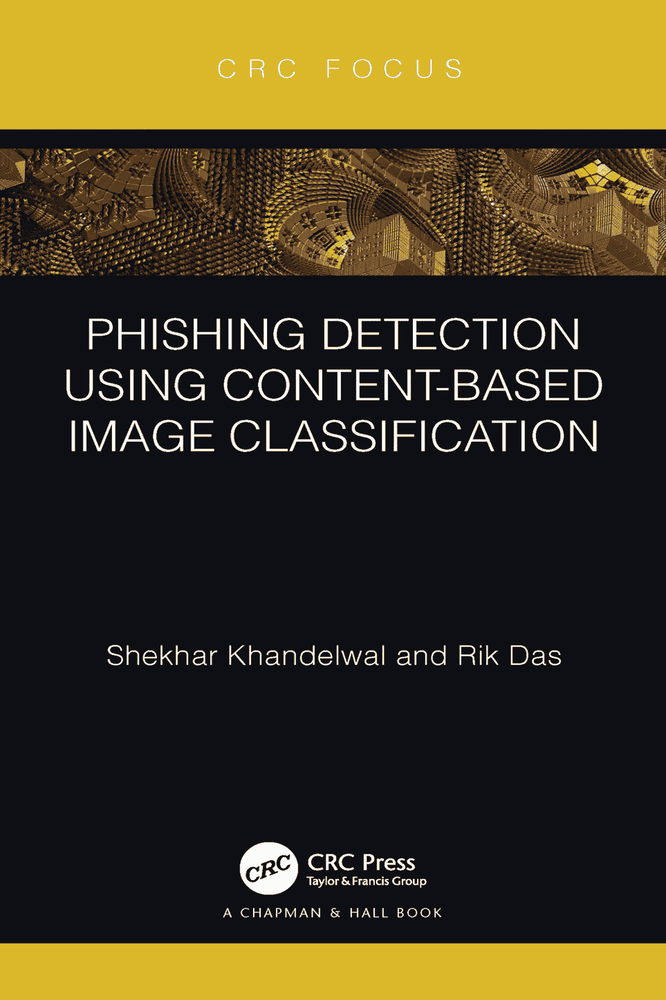

## Preface

Phishing is one of the most prominent cybercrimes which has posed significant threat to transactions over the world wide web. Visual similarity of a forged website to its genuine counterpart often misleads web users to fall prey to this malicious activity. Hence, it has become imperative to build awareness about the basics of phishing within cybersecurity domains and to identify the different techniques used by phishers to attack web users. It is evident that the various anti-phishing initiatives have instigated a race between phishers and anti-phishers, leading to constant innovation by both parties to stay ahead in the game.

The popularity of machine learning and deep learning techniques has leveraged the research using image processing-based phishing detection techniques. Researchers have faced various challenges in detecting phishing using website images. A tabular comparison and summary of various related works is discussed in this volume to provide a clear historical perspective for phishing detection. Open-source programming languages like Python have implemented several Convolutional Neural Network (CNN)-based phishing detection statistical models. A step-by-step guide to building a CNN Model is discussed to make the reader familiar with assorted approaches to preventing phishing. Creation of the transfer learning-based CNN model using various off-the-shelf CNN architectures has proved to be useful in deep learning-based phishing detection. Robust feature extraction from website images using representation learning is also explored to design useful descriptors for identifying duplicate websites. The ground-up approach of extracting image representations is implemented using various off-the-shelf CNN architectures like VGGNet, ResNet, DenseNet, and so on. Machine learning models are created using pre-processed image features and performance comparison between various models.

Finally, feature dimension reduction and fusion-based techniques are explored for creating strong feature vectors to implement content-based image classification-based phishing detection. The diversified approaches discussed in this book provide the reader with a 360° overview and a stepping stone to experience this interdisciplinary domain of phishing detection using image content of the websites.

This book is intended for graduates and undergraduates from assorted backgrounds such as data science, network security and research, software developers and as a reference book for scientists, researchers, lecturers, and tutors, as well as for academic and corporate libraries.

Shekhar Khandelwal

Rik Das

**Shekhar Khandelwal** is a Data Scientist and works with Ernst & Young (EY), Bangalore, India for the Data & Analytics team. He has extensive experience of around 15 years in the industry, and has worked across every sphere of the software development life cycle. He has worked as a product developer, industry solutions developer, data engineer, data scientist and Cloud developer. Previously, he worked for IBM Software Labs, where he also got a chance to work for industrial IoT-based IBM cognitive product development and client deployment using various Watson tools and technologies. He is an industry leader solving challenging computer vision, NLP and predictive analytics-based problems using machine learning and deep learning.

**Dr. Rik Das** is currently a Lead Software Engineer in Computer Vision Research at Siemens Advanta, India. Previously he was with Xavier Institute of Social Service, Ranchi, as an Assistant Professor for the Post Graduate Program in Information Technology.

Dr. Das has over 17 years of experience in industrial and academic research. He was professionally associated with many leading universities and institutes in India, including Narsee Monjee Institute of Management Studies (NMIMS) (deemed-to-be-university), Globsyn Business School and Maulana Abul Kalam Azad University of Technology.

Dr. Das has a Ph.D (Tech.) in Information Technology from the University of Calcutta. He has also received his M.Tech. (Information Technology) from the University of Calcutta after his B.E. (Information Technology) from the University of Burdwan, West Bengal, India.

Dr. Das has over 18 years of professional experience in the IT industry and traditional academia and with EduTech companies and has carried out collaborative research with various leading universities and institutes in India and abroad. He has an early career stint in Business Development and Project Marketing with Great Eastern Impex Pvt. Ltd., Zenith Computers Ltd. and so on.

Dr. Rik Das is appointed as a “Distinguished Speaker” by the Association of Computing Machinery (ACM), New York, for a tenure of three years initiating from July2020. He was featured in uLektz Wall of Fame as one of the “Top 50 Tech Savvy Academicians in Higher Education across India” for the year 2019. He is also a Member of the International Advisory Committee of AI-Forum, UK.

Dr. Das has over 2020–2021. He is the recipient of the prestigious “InSc Research Excellence Award” hosted in the year 2020. Dr. Das is conferred with the Best Researcher Award at International Scientist Awards on Engineering, Science and Medicine for the year 2021. He is also the recipient of the Best Innovation Award in the Computer Science category at UILA Awards 2021.

Dr. Das 与来自 Philips-Canada、Cognizant Technology Solutions 和 TCS 等公司的专业人士合作开展了研究。他对利用机器学习和深度学习技术设计计算机辅助诊断系统的兴趣，促成了与国外多所大学（包括加拿大萨斯喀彻温大学医学院、捷克奥斯特拉瓦技术大学电气工程与计算机科学学院、埃及开罗大学）的教授和研究人员共同发表研究文章。他在 2018 年和 2019 年连续申请并发表了两项印度专利，目前已有超过 40 篇国际出版物，发表于 IEEE、Springer、Emerald 和 Inderscience 等知名出版社。他还在内容基于图像分类领域撰写了三本专著，并与 IGI Global、CRC Press 和 De Gruyter（德国）合著三卷书。作为人工智能和机器学习领域的专家，他主持了多个国际会议的会议环节。

Dr. Rik Das 受邀在各类国家和国际技术活动、研讨会、聚会和数据分析、人工智能、机器学习、深度学习、图像处理、电子学习等主题的 refresher courses 中担任演讲嘉宾，这些活动由人力资源发展中心（University Grants Commission）、印度工业联合会（Confederation of Indian Industry, CII）、软件咨询组织、Pandit Madan Mohan Malviya National Mission on Teachers and Teaching（MHRD）倡议、IEEE 学生分会以及知名大学计算机科学/信息技术系等主要机构组织和主办。

Dr. Rik Das 拥有一个名为 “Curious Neuron” 的 YouTube 频道，用于向机器学习、研究与开发以及开源编程语言领域的更大社区免费传播知识和信息。他始终乐于讨论新的研究和项目想法，开展协作工作以及技术-管理咨询。
Phishing 是一种网络犯罪，旨在诱骗无辜的网络用户访问伪造网站，该网站在外观上与其合法 counterpart 相似。最初，用户通过各种社交和技术路由技术被重定向到 phishing 网站。 unaware of the illegitimacy of the website, the users may then provide their personal information such as user id, password, credit card details or bank account details, to name a few. The phishers use such information to steal money from banks, damage a brand’s image or even commit graver crimes like identity theft. 

虽然现有文献中已有许多 phishing 检测和防范技术，但智能机器学习和深度学习方法的出现扩大了它们在网络安全领域的范围。

Create and plot a confusion matrix (Figure 3.4).
15. `model_tl` = `Model`(inputs=`DenseNet201`.input, outputs=`prediction`)

Look at the final model summary.

16. `model_tl`.summary()

Since `DenseNet` is a very deep model, only the last few layers of the model and the trainable parameter description are displayed.

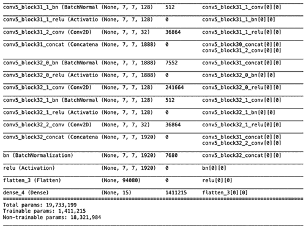

It can be seen that the total parameters in the model are 19,733,199, but the trainable parameters are only 14,11,215. This is because other than the last dense layer, all other layers are non-trainable.

编译模型使用优化器和损失函数，并定义性能指标为准确率、精确率和召回率。

17. model_tl.compile(
18. loss=`categorical_crossentropy`,
19. optimizer=`rmsprop`,
20. metrics=[`accuracy`, tf.keras.metrics.Precision(), tf.keras.metrics.Recall()]

21.)

创建一个图像增强的实例。

22. gen = ImageDataGenerator(
23. rotation_range=20,
24. width_shift_range=0.1,
25. height_shift_range=0.1,
26. shear_range=0.1,
27. zoom_range=0.2,
28. horizontal_flip=True,
29. vertical_flip=True,
30. preprocessing_function=preprocess_input

31.)

获取标签映射，可用于后续构建混淆矩阵。

32. test_gen = gen.flow_from_directory(test_path, target_size=[img_rows, img_cols])

33. print(test_gen.class_indices)

34. labels = [None] * len(test_gen.class_indices)

35. for k, v in test_gen.class_indices.items():
36. labels[v] = k

找到 1539 张属于 15 类的图像。

{‘adobe’: 0, ‘alibaba’: 1, ‘amazon’: 2, ‘apple’: 3, ‘boa’: 4, ‘chase’: 5, ‘dhl’: 6, ‘dropbox’: 7, ‘facebook’: 8, ‘linkedin’: 9, ‘microsoft’: 10, ‘other’: 11, ‘paypal’: 12, ‘wellsfargo’: 13, ‘yahoo’: 14}

一个增强后的图像样本。

37. for x, y in test_gen:
38. print(`min:`, x[0].min(), `max:`, x[0].max())

39. plt.title(labels[np.argmax(y[0])])

40. plt.imshow(x[0])

41. plt.show()

42. break

创建训练生成器（图 4.2 和 4.3）。

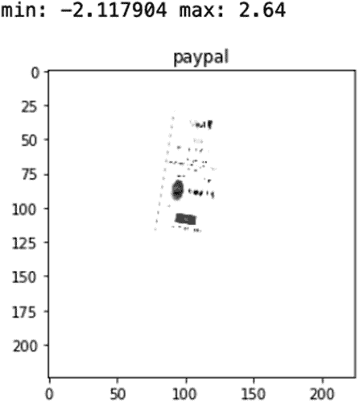

**FIGURE 4.2** Sample 1 augmented image.

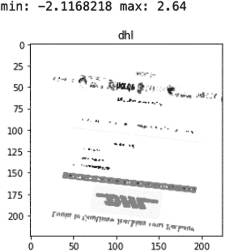

**FIGURE 4.3** Sample 2 augmented image.

创建训练生成器（图 4.2 和 4.3）。

43. train_generator = gen.flow_from_directory(
44. train_path,
45. target_size=[img_rows, img_cols],
46. shuffle=True,
47. batch_size=batch_size,
48.)

创建验证生成器。

49. valid_generator = gen.flow_from_directory(
50. test_path,
51. target_size=[img_rows, img_cols],
52. shuffle=True,
53. batch_size=batch_size,
54.)

训练模型。

55. r = model_tl.fit_generator(
56. train_generator,
57. validation_data=valid_generator,
58. epochs=epochs,
59. steps_per_epoch=len(train_image_files) // batch_size,
60. validation_steps=len(test_image_files) // batch_size,
61.)

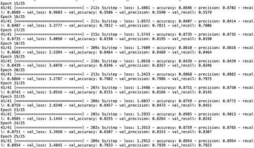

创建并绘制混淆矩阵。

62. valid_cm = get_confusion_matrix(test_path, len(test_image_files))

63. plot_confusion_matrix(valid_cm, labels, title=`Validation confusion matrix`)

对于本次实验，我们使用了以下超参数训练模型（图 4.4）：

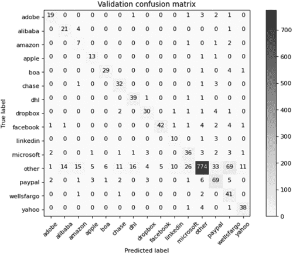

**FIGURE 4.4** Confusion matrix for the test dataset.

*   时代数 – 50

*   优化器 – Adam

*   学习率 – 0.0001

*   损失 – "`categorical_crossentropy`"

*   类别数 – 15

在训练数据用于训练模型后，测试数据用于计算不同的性能指标。由于本次实验中图像被调整为两种不同尺寸，因此我们得到了以下针对两种图像尺寸的性能指标。

## CNN 模型性能评估

如 表 4.2 所示，提取特征的 DenseNet169 在图像尺寸为 (128, 128, 3) 和 (256, 256, 3) 时表现最佳。

**TABLE 4.2** 方法 2 图像尺寸 (256,256) 的性能指标

| Model  || Accuracy || Precision || Recall || F1 || Image Size |
| --- | --- | --- | --- | --- | --- |
| Xception || 76.76 || 85.78 || 69.14 || 76.566 || (128, 128, 3) |
| --- | --- | --- | --- | --- | --- |
| VGG16 || 71.81 || 73.71 || 70.64 || 72.142 || (128, 128, 3) |
| VGG19 || 78.45 || 80.61 || 76.3 || 78.396 || (128, 128, 3) |
| ResNet50V2 || 78.84 || 83.86 || 74.74 || 79.038 || (128, 128, 3) |
| ResNet101V2 || 80.08 || 83.33 || 76.82 || 79.943 || (128, 128, 3) |
| ResNet152V2 || 80.6 || 85.58 || 76.11 || 80.568 || (128, 128, 3) |
| InceptionV3 || 69.21 || 80.96 || 60.09 || 68.981 || (128, 128, 3) |
| MobileNet || 81.12 || 86.41 || 78.65 || 82.348 || (128, 128, 3) |
| MobileNetV2 || 81.9 || 85.45 || 79.56 || 82.4 || (128, 128, 3) |
| DenseNet121 || 72.53 || 79.1 || 66.54 || 72.278 || (128, 128, 3) |
| **DenseNet169** || **81.77** || **86.23** || **79.1** || **82.511** || **(128, 128, 3)** |
| DenseNet201 || 82.68 || 87.14 || 78.97 || 82.854 || (128, 128, 3) |
| Xception || 78.32 || 82.96 || 74.48 || 78.492 || (256, 256, 3) |
| VGG16 || 76.69 || 78.22 || 75.52 || 76.846 || (256, 256, 3) |
| VGG19 || 83.4 || 84.76 || 82.55 || 83.64 || (256, 256, 3) |
| ResNet50V2 || 79.04 || 81.03 || 77.86 || 79.413 || (256, 256, 3) |
| ResNet101V2 || 84.96 || 85.92 || 84.24 || 85.072 || (256, 256, 3) |
| ResNet152V2 || 82.81 || 84.22 || 81.32 || 82.745 || (256, 256, 3) |
| InceptionV3 || 61.52 || 62.81 || 60.16 || 61.456 || (256, 256, 3) |
| MobileNet || 82.75 || 84.92 || 81.05 || 82.94 || (256, 256, 3) |
| MobileNetV2 || 81.64 || 84.24 || 80.73 || 82.448 || (256, 256, 3) |
| DenseNet121 || 81.9 || 84.99 || 79.62 || 82.217 || (256, 256, 3) |
| **DenseNet169** || **88.02** || **90.14** || **86.91** || **88.496** || **(256, 256, 3)** |
| DenseNet201 || 83.85 || 85.6 || 82.81 || 84.182 || (256, 256, 3) |
| The bold signifies the best results in the table. |

| --- |

## 总结

在本章中，我们首先对图像进行增强，然后使用 VGGNet、DenseNet、ResNet 等最先进的卷积神经网络进行转移学习。还提供了 DenseNet 实现的 Python 代码。此外，还给出了其他架构的实验结果，供在表中比较模型性能。后续章节将进行特征提取和表示学习，利用这些模型提取特征，并将提取的特征输入机器学习模型进行分类。最后，将创建并比较所有实验的性能指标，以选出表现最佳的模型。

## 5 Feature Extraction and Representation Learning

DOI: [10.1201/9781003217381-5](https://doi.org/10.1201/9781003217381-5)

一个端到端的卷积神经网络由两个主要组成部分组成。卷积层对图像进行卷积并生成图像的各种表示。一旦这些向量表示被生成，它们将被输入分类层进行最终分类任务。分类层可以是机器学习模型或深度神经网络模型，具体取决于您的选择或实验结果。

特征可以通过 SIFT (Wu et al., 2013)、SURF (Bay et al., 2006)、DAISY (Tola et al., 2010) 等技术手动从图像中提取，或者可以通过已知卷积核、其权重已定义的方式手动卷积。此外，CNN 可以用于训练网络自动学习卷积核的最佳权重。

### 结构

本章将涵盖以下主题：

*   使用表示学习进行分类

*   使用 SMOTE 处理类别失衡

*   使用机器学习算法构建分类层

*   评估各实验的性能

### 目标

学习完本章后，您应能理解如何通过转移学习从图像中提取特征，其中使用 Inception (Szegedy et al., 2015)、ResNet (He et al., 2016)、DenseNet (Huang et al., 2017) 等最先进的卷积神经网络架构。此外，您还将学习如何将提取的特征（图像的向量表示）输入分类模型进行分类。最后，将创建并比较所有实验的性能指标，以选出表现最佳的模型。

### 使用表示学习进行分类

表示学习技术允许用户从各种卷积层中提取特征，然后将这些特征输入到用户选择的分类模型中，无论是机器学习还是深度学习分类器。

在本研究中，我们将使用各种预设的 CNN 应用（如`VGGNet`、`ResNet`、`MobileNet`、`DenseNet`、`Xception`、`Inception`等）通过表示学习方法提取特征，然后构建`RF`和`SVM`分类模型，用于对 15 个类别进行分类（Figure 5.1）。

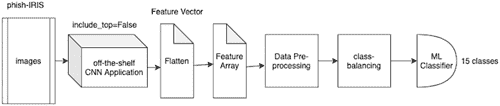

**FIGURE 5.1** Classification using representation learning overview.

#### 数据准备

作为数据准备的第一步，图像被转换为 NumPy 数组。提取的图像数组将进一步通过转移学习技术输入卷积层以提取特征。

## 转换图像为 NumPy 数组

首先，我们将图像转换为 NumPy 数组。训练和测试数据的图像数组将保存为带有.npy 扩展名的 NumPy 文件，以便后续处理。

使用 Python 的 OpenCV 和 NumPy 库将图像转换为 NumPy 数组。训练和验证文件夹中的图像尺寸各不相同，尺寸范围在宽度和高度之间为 700 像素到 1280 像素。因此，需要调整图像大小，使所有图像保持相同的尺寸格式。基本上，图像尺寸越大，图像中可用的像素越多，从而可以从图像中提取更多低层次特征。但通过缩小图像尺寸，像素会被压缩，从而可以从图像中提取更多高层次特征。

由于计算限制，我们决定将图像转换为大小为(128, 128, 3)和(256, 256, 3)的数组，并研究图像尺寸是否会影响在提取图像相关特征以实现有效分类时的模型性能。

为此，我们将使用 Python OpenCV 库。

1. import os

2. import glob

3. import cv2

设置数据目录和输出目录位置。设置 size 变量为 512，用于将图像调整为 512×512 数组。

4. SIZE = 512

5. data_dir=“../../../data/phishIRIS/”

6. out_dir=str(SIZE)+”/”

通过遍历训练和测试数据集文件夹中的每个文件夹，创建训练和测试数据数组。

7. *# train*

8.  train_images = []

9.  train_labels = []

10. for directory_path in glob.glob(data_dir+”train/\*”):

11.    train_label = directory_path.split(“/”)\[-1\]

12.    for img_path in glob.glob(os.path.join(directory_path, ”\*.\*”)):

13.     img = cv2.imread(img_path, cv2.IMREAD_COLOR)

14.     img = cv2.resize(img, (SIZE, SIZE))

15.     img = cv2.cvtColor(img, cv2.COLOR_RGB2BGR)

16.     train_images.append(img)

17.     train_labels.append(train_label)

18.

19. train_images = np.array(train_images)

20. train_labels = np.array(train_labels)

21.

22.

23. *# test*

24. test_images = []

25. test_labels = []

26. for directory_path in glob.glob(data_dir+”val/\*”):

27.  test_label = directory_path.split(“/”)\[-1\]

28.  for img_path in glob.glob(os.path.join(directory_path, ”\*.\*”)):

29.     img = cv2.imread(img_path, cv2.IMREAD_COLOR)

30.     img = cv2.resize(img, (SIZE, SIZE))

31.     img = cv2.cvtColor(img, cv2.COLOR_RGB2BGR)

32.     test_images.append(img)

33.     test_labels.append(test_label)

34.

35. test_images = np.array(test_images)

36. test_labels = np.array(test_labels)

保存数组到磁盘。

37. np.save(out_dir+”train_images”, train_images)

38. np.save(out_dir+”test_images”, test_images)

39. np.save(out_dir+”train_labels”, train_labels)

40. np.save(out_dir+”test_labels”, test_labels)

图像可以调整到任意尺寸，相应的 NumPy 数组可以从图像中提取。保存在磁盘上的图像将具有.npy 扩展名，表示 NumPy 数组。

Table 5.1 显示在将图像调整到(128, 128)和(256, 256)高度和宽度尺寸后，训练数据和测试数据的维度。

**TABLE 5.1** 训练数据和测试数据图像数组维度

| 数据 || 维度  

(128, 128)  

 || 维度  

(256, 256)  

 |

| --- | --- | --- |

| 训练数据 || (1313, 128, 128, 3) || (1313, 256, 256, 3) |

| --- | --- | --- |

| 训练标签 || (1313,) || (1313,) |

| 测试数据 || (1539, 128, 128, 3) || (1539, 256, 256, 3) |

| 测试标签 || (1539,) || (1539,) |

总共有 1313 张训练图像和 1538 张测试图像。由于图像是彩色图像，通道数为三，分别代表 R(红)、G(绿)和 B(蓝)通道。

训练和测试标签数组包含与相应图像数据在数组中存储的顺序相同的文件夹名称。如 Table 5.1 所示，训练数据数组有 1313 行，意味着训练标签数组也有 1313 行，每一行对应一条数据记录。

## 使用 CNN 预设架构进行特征提取

在前一步，原始像素值从图像中提取并保存为 NumPy 数组。

在此步骤中，图像的原始像素值将用于使用各种预设 CNN 架构（如 VGGNet、ResNet、DenseNet、Inception、Exception 等）创建图像的表示。

首先，加载所需的 Python 库。

1. import numpy as np

2. import matplotlib.pyplot as plt

3. import glob

4. import cv2

5. import os

6. import seaborn as sns

7. from keras.models import Model, Sequential

8. from keras.layers import Dense, Flatten, Conv2D, MaxPooling2D

9. from keras.layers.normalization import BatchNormalization

前一步提取的数据将作为本步骤的输入。因此，设置输入和输出数据目录位置。

1. SIZE = 512

2. data_dir=“../../data_extractor/”+str(SIZE)+”/”

3. out_dir=str(SIZE)+”/”

4. print(os.listdir(data_dir))

['train_images.npy', 'test_images.npy', 'test_labels.npy', 'train_labels.npy']

加载原始像素值数据数组。

1. train_images = np.load(data_dir+’/train_images.npy’)

2. test_images = np.load(data_dir+’/test_images.npy’)

3. train_labels= np.load(data_dir+’/train_labels.npy’)

4. test_labels = np.load(data_dir+’/test_labels.npy’)

标签为原始文本格式，因此需要使用 sklearn 的 LabelEncoder 模块将文本标签编码为整数。

1. from sklearn import preprocessing

2. le = preprocessing.LabelEncoder()

3. le.fit(train_labels)

4. train_labels_encoded = le.transform(train_labels)

5. test_labels_encoded = le.transform(test_labels)

将标签编码器序列化以便以后用于将标签反向编码为文本，用于绘制混淆矩阵和分类报告。

6. *#pickle the label encoder*

7. np.save(out_dir+’label_encoder.npy’, le.classes_)

将数据集重命名为机器学习处理中使用的标准命名约定。

1. x_train, y_train, x_test, y_test = train_images, train_labels_encoded, test_images, test_labels_encoded

2. x_train, x_test = x_train / 255.0, x_test / 255.0

3. np.save(out_dir+”train_labels”, y_train)

4. np.save(out_dir+”test_labels”, y_test)

接下来，我们将使用各种预设 CNN 架构提取特征。

## Xception

1.  from keras.applications.xception import Xception

2.

3.  *# Load model without classifier/fully connected layers*

4.  model = Xception(weights=‘imagenet’, include_top=False, input_shape=(SIZE, SIZE, 3))

6. 将加载的层设置为不可训练，因为我们希望使用预训练权重

for layer in model.layers:
    layer.trainable = False

model.summary()

## 从特征提取过程发送训练数据
feature_extractor = model.predict(x_train)
features = feature_extractor.reshape(feature_extractor.shape[0], -1)

## 通过相同的特征提取器过程发送测试数据
X_test_feature = model.predict(x_test)
X_test_features = X_test_feature.reshape(X_test_feature.shape[0], -1)

np.save(out_dir + "Xception_train_images", features)
np.save(out_dir + "Xception_test_images", X_test_features)

观察 Xception 模型的最后几层及参数详情后，可知可训练参数为 0，因为我们使用的是在 ImageNet 数据集上预训练的 Xception 模块的预训练权重。

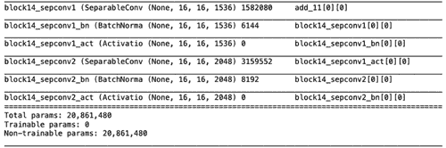

## VGG19

from keras.applications.vgg19 import VGG19

model = VGG19(weights='imagenet', include_top=False, input_shape=(SIZE, SIZE, 3))

for layer in model.layers:
    layer.trainable = False

print(model.summary())

feature_extractor = model.predict(x_train)
features = feature_extractor.reshape(feature_extractor.shape[0], -1)

X_test_feature = model.predict(x_test)
X_test_features = X_test_feature.reshape(X_test_feature.shape[0], -1)

np.save(out_dir + "VGG19_train_images", features)
np.save(out_dir + "VGG19_test_images", X_test_features)

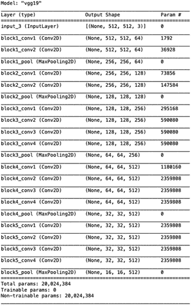

## ResNet50

from keras.applications.resnet50 import ResNet50

model = ResNet50(weights='imagenet', include_top=False, input_shape=(SIZE, SIZE, 3))

for layer in model.layers:
    layer.trainable = False

print(model.summary())

feature_extractor = model.predict(x_train)
features = feature_extractor.reshape(feature_extractor.shape[0], -1)

X_test_feature = model.predict(x_test)
X_test_features = X_test_feature.reshape(X_test_feature.shape[0], -1)

np.save(out_dir + "ResNet50_train_images", features)
np.save(out_dir + "ResNet50_test_images", X_test_features)

ResNet50 模型的最后几层及参数详情。

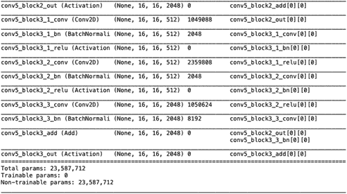

我们遵循了类似的过程，使用 ResNet101、ResNet152、ResNet50V2、ResNet101V2 和 ResNet152V2 提取特征。

## InceptionV3

from keras.applications.inception_v3 import InceptionV3

model = InceptionV3(weights='imagenet', include_top=False, input_shape=(SIZE, SIZE, 3))

for layer in model.layers:
    layer.trainable = False

print(model.summary())

feature_extractor = model.predict(x_train)
features = feature_extractor.reshape(feature_extractor.shape[0], -1)

X_test_feature = model.predict(x_test)
X_test_features = X_test_feature.reshape(X_test_feature.shape[0], -1)

np.save(out_dir + "InceptionV3_train_images", features)
np.save(out_dir + "InceptionV3_test_images", X_test_features)

## InceptionResNetV2

from keras.applications.inception_resnet_v2 import InceptionResNetV2

model = InceptionResNetV2(weights='imagenet', include_top=False, input_shape=(SIZE, SIZE, 3))

for layer in model.layers:
    layer.trainable = False

print(model.summary())

feature_extractor = model.predict(x_train)
features = feature_extractor.reshape(feature_extractor.shape[0], -1)

X_test_feature = model.predict(x_test)
X_test_features = X_test_feature.reshape(X_test_feature.shape[0], -1)

np.save(out_dir + "InceptionResNetV2_train_images", features)
np.save(out_dir + "InceptionResNetV2_test_images", X_test_features)

我们同样使用 MobileNetV2 架构提取特征。

## MobileNet

from keras.applications.mobilenet import MobileNet

model = MobileNet(weights='imagenet', include_top=False, input_shape=(SIZE, SIZE, 3))

for layer in model.layers:
    layer.trainable = False

print(model.summary())

feature_extractor = model.predict(x_train)
features = feature_extractor.reshape(feature_extractor.shape[0], -1)

X_test_feature = model.predict(x_test)
X_test_features = X_test_feature.reshape(X_test_feature.shape[0], -1)

np.save(out_dir + "MobileNet_train_images", features)
np.save(out_dir + "MobileNet_test_images", X_test_features)

## DenseNet121

from keras.applications.densenet import DenseNet121

model = DenseNet121(weights='imagenet', include_top=False, input_shape=(SIZE, SIZE, 3))

for layer in model.layers:
    layer.trainable = False

print(model.summary())

feature_extractor = model.predict(x_train)
features = feature_extractor.reshape(feature_extractor.shape[0], -1)

X_test_feature = model.predict(x_test)
X_test_features = X_test_feature.reshape(X_test_feature.shape[0], -1)

np.save(out_dir + "DenseNet121_train_images", features)
np.save(out_dir + "DenseNet121_test_images", X_test_features)

我们同样使用 DenseNet169 和 DenseNet201 架构提取特征。

最后，所有特征均使用各种 CNN 架构提取，这些特征是从通过调整图像大小到 128×128、256×256 和 512×512 的原始像素值中提取出来的，并保存到磁盘（见 Figure 5.2）。

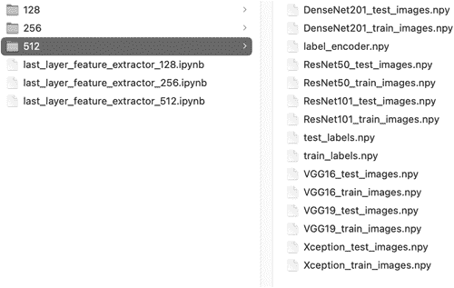

**FIGURE 5.2** 图像特征数组的磁盘排列。

**TABLE 5.2** 使用各种 CNN 应用提取训练集和测试集特征维度。

| 应用 | 训练图像尺寸 | 测试图像尺寸 |
| --- | --- | --- |
| (128, 128, 3) | (256, 256, 3) | (128, 128, 3) | (256, 256, 3) |
| Xception | (1313, 32768) | (1313, 131072) | (1539, 32768) | (1539, 131072) |
| VGG16 | (1313, 8192) | (1313, 32768) | (1539, 8192) | (1539, 32768) |
| VGG19 | (1313, 8192) | (1313, 32768) | (1539, 8192) | (1539, 32768) |
| s | (1313, 32768) | (1313, 131072) | (1539, 32768) | (1539, 131072) |
| ResNet101V2 | (1313, 32768) | (1313, 131072) | (1539, 32768) | (1539, 131072) |
| ResNet152V2 | (1313, 32768) | (1313, 131072) | (1539, 32768) | (1539, 131072) |
| InceptionV3 | (1313, 8192) | (1313, 73728) | (1539, 8192) | (1539, 73728) |
| InceptionResNetV2 | (1313, 6144) | (1313, 55296) | (1539, 6144) | (1539, 55296) |
| MobileNet | (1313, 16384) | (1313, 65536) | (1539, 16384) | (1539, 65536) |
| MobileNetV2 | (1313, 20480) | (1313, 81920) | (1539, 20480) | (1539, 81920) |
| DenseNet121 | (1313, 16384) | (1313, 65536) | (1539, 16384) | (1539, 65536) |
| DenseNet169 | (1313, 26624) | (1313, 106496) | (1539, 26624) | (1539, 106496) |
| DenseNet201 | (1313, 30720) | (1313, 122880) | (1539, 30720) | (1539, 122880) |

### 处理类别失衡

类别失衡是指数据集中每个类别的数据分布不均，导致训练模型时某一类的样本数量远多于其他类别。这可能导致模型偏向拥有更多训练样本的类别，因为该类别提供了更多的学习数据。因此，该类别的特征在模型学习中占主导地位，从而在训练过程中产生各种异常。因此，在将数据输入模型训练过程之前，必须对类别失衡进行预处理和处理。

对于 Phish-IRIS 数据集，如 Table 3.1 所示，"其他" 类的图像数量为 400，而其余所有类的图像数量在 50–150 之间。这显然是各类数据的不平衡分布。因此，在用于模型训练前，必须对数据进行类不平衡处理。

### 使用 SMOTE 添加合成数据

不平衡数据集可以通过下采样多数类或上采样多数类来处理。这两种方法各有优缺点。在处理类不平衡时，广泛使用的更高级技术是 Synthetic Minority Over-sampling Technique（SMOTE）。

该技术由 Chawla 等人于 2002 年提出，其工作原理是先将数据集中的所有数据点置于 n 维平面中，然后使用 K 最近邻算法，为少数类生成合成数据点。

由于多类分类中，某一类（在此为 "其他" 类）的记录最大数量为 400，因此需要为其他所有类添加合成数据，使它们的数量达到 400。由于总共有 15 个类别，应用 SMOTE 上采样技术后，每个类别的记录数将变为 400，训练数据总数变为 6000（即 400 × 15）。

Table 5.3 展示了在不同 CNN 应用中应用 SMOTE 后训练数据数组维度。

**TABLE 5.3** 应用 SMOTE 后训练数据维度

| Application || Image Size  

(128, 128, 3)  

 || Image Size  

(256, 256, 3)  

 |

| --- | --- | --- |

| Xception || (6000, 32768) || (6000, 131072) |

| --- | --- | --- |

| VGG16 || (6000, 8192) || (6000, 32768) |

| VGG19 || (6000, 8192) || (6000, 32768) |

| ResNet50V2 || (6000, 32768) || (6000, 131072) |

| ResNet101V2 || (6000, 32768) || (6000, 131072) |

| ResNet152V2 || (6000, 32768) || (6000, 131072) |

| InceptionV3 || (6000, 8192) || (6000, 73728) |

| InceptionResNetV2 || (6000, 6144) || (6000, 55296) |

| MobileNet || (6000, 16384) || (6000, 65536) |

| MobileNetV2 || (6000, 20480) || (6000, 81920) |

| DenseNet121 || (6000, 16384) || (6000, 65536) |

| DenseNet169 || (6000, 26624) || (6000, 106496) |

| DenseNet201 || (6000, 30720) || (6000, 122880) |

### SMOTE Python 实现

输入数据为前一阶段使用各种 CNN 架构提取的特征。

1. SIZE=512

2. data_dir=“../feature_extractor/last_layer/”+str(SIZE)+”/”

3. out_dir=“last_layer/”+str(SIZE)+”/”

我们将创建一个包含所有 CNN 架构的 Python 列表，用于提取图像特征。

1. list_of_architectures = [

2. “Xception”,

3. “VGG16”,

4. “VGG19”,

5. “ResNet50”,

6. “ResNet101”,

7. “ResNet152”,

8. “ResNet50V2”,

9. “ResNet101V2”,

10. “ResNet152V2”,

11. “InceptionV3”,

12. “InceptionResNetV2”,

13. “MobileNet”,

14. “MobileNetV2”,

15. “DenseNet121”,

16. “DenseNet169”,

17. “DenseNet201”

18.

19.

下面的函数会加载相应 CNN 架构提取的特征，并使用 SMOTE 算法为相对于其他占主导地位类别较少的类别生成合成数据点。

例如，“其他”类有 400 张图像，它是数据集中某一类别图像数量最多的。因此，将为其他所有类别创建合成图像，使每个类别的图像数量达到 400。例如，“PayPal”类有 121 张图像，因此将为“PayPal”类生成 279 张合成图像。其余类别也将按此方式处理。

1. def getSMOTE(model):

2. X_SMOTE = np.load(data_dir+model+”_train_images.npy”)

3. y_train = np.load(data_dir+’/train_labels.npy’)

4.

5. # SMOTE

6. from imblearn.over_sampling import SMOTE

7. oversample = SMOTE()

8. X_train_SMOTE, y_train_SMOTE = oversample.fit_resample(X_SMOTE, y_train)

9.

10. np.save(out_dir+model+”_X_train_SMOTE”, X_train_SMOTE)

11. np.save(out_dir+model+”_y_train_SMOTE”, y_train_SMOTE)

下面的循环会遍历在之前创建的列表中的所有 CNN 架构：

1. for arch in list_of_architectures:

2. getSMOTE(arch)

循环结束后，所有使用不同 CNN 架构提取的特征的数据点数量都将被增强。

### 机器学习分类器

从所有 CNN 架构中提取的特征将输入到机器学习分类器中，作为多类分类问题。

创建包含所有提取特征且希望构建分类器的 CNN 架构列表。

1. list_of_architectures = [

2. “Xception”,

3. “VGG16”,

4. “VGG19”,

5. “ResNet50”,

6. “ResNet101”,

7. “ResNet152”,

8. “ResNet50V2”,

9. “ResNet101V2”,

10. “ResNet152V2”,

11. “InceptionV3”,

12. “InceptionResNetV2”,

13. “MobileNet”,

14. “MobileNetV2”,

15. “DenseNet121”,

16. “DenseNet169”,

17. “DenseNet201”

18.

19.

创建用于构建分类器的机器学习算法列表。

1. list_of_classifiers = [

2. “RF”,

3. “SVM”

4.

]

创建图像缩放和特征提取的大小列表。

1. list_of_size = [

2. 128,

3. 256,

4. 512

5.

]

设置一些变量。

1. layer = ”last_layer”

2. preprocessing_technique = ”smote”

创建可重用的数据读取函数。

1. def getData(model, image_size):

2. train_data_dir=“../class_imabalance/” + layer + ”/” + str(image_size)+”/”

3. test_data_dir=“../feature_extractor/” + layer + ”/” + str(image_size)+”/”

4. X_train=np.load(train_data_dir+model+”_X_train_SMOTE.npy”)

5. y_train=np.load(train_data_dir+model+”_y_train_SMOTE.npy”)

6. X_test=np.load(test_data_dir+model+”_test_images.npy”)

7. y_test=np.load(test_data_dir+”test_labels.npy”)

8. return X_train, y_train, X_test, y_test

创建可重用的标签编码器读取函数。

1. def getLabelEncoder(layer, image_size):

2. label_encoder_location = ”../feature_extractor/” + layer + ”/” + str(image_size)+”/”

3. label_encoder = np.load(label_encoder_location+’label_encoder.npy’)

4. return label_encoder

创建可重用的函数。

1. def getClassificationMetrics(test_labels, prediction):

2. from sklearn.metrics import confusion_matrix

3. test_label_list=list(np.unique(test_labels))

4. cnf_matrix = confusion_matrix(test_labels, prediction,labels=test_label_list)

5. np.set_printoptions(precision=2)

6.

7. # Plot non-normalized confusion matrix

8. plt.figure(figsize=(8,8))

9. plot_confusion_matrix(cnf_matrix, classes=test_label_list,

10. title=‘Confusion matrix, without normalization’)

11.

12.

13. from sklearn import metrics

14.

15. accuracy = round(metrics.accuracy_score(test_labels, prediction),3)

16. precision = round(metrics.precision_score(test_labels, prediction, average=‘weighted’),3)

17. recall = round(metrics.recall_score(test_labels, prediction, average=‘weighted’),3)

18. f1_score = round(metrics.f1_score(test_labels, prediction, average=‘weighted’),3)

19.

20.

21. FP = cnf_matrix.sum(axis=0) - np.diag(cnf_matrix)

22. FN = cnf_matrix.sum(axis=1) - np.diag(cnf_matrix)

23. TP = np.diag(cnf_matrix)

24. TN = cnf_matrix.sum() - (FP + FN + TP)

25.

26. # Sensitivity, hit rate, recall, or true positive rate

27. TPR = round((TP/(TP+FN)).mean(),3)

28. # Specificity or true negative rate

29. TNR = round((TN/(TN+FP) ).mean(),3)

30. # Precision or positive predictive value

31. `PPV = round((TP/(TP+FP)).mean(),3)`

32. `# Negative predictive value`

33. `NPV = round((TN/(TN+FN)).mean(),3)`

34. `# Fall out or false positive rate`

35. `FPR = round((FP/(FP+TN)).mean(),3)`

36. `# False negative rate`

37. `FNR = round((FN/(TP+FN)).mean(),3)`

38. `# False discovery rate`

39. `FDR = round((FP/(TP+FP)).mean(),3)`

40.

41. `# Balanced metrics`

42. `balanced_accuracy = round(metrics.balanced_accuracy_score(test_labels, prediction),3)`

43. `balanced_precision = PPV`

44. `balanced_recall = TPR`

45. `balanced_f1 = round((2*(PPV*TPR)/(PPV+TPR)),3)`

46.

47. `print("Acc = ", accuracy)`

48. `print("Pre = ", precision)`

49. `print("Rec = ", recall)`

50. `print("F1 = ", f1_score)`

51. `print("")`

52.

53. `print("Bal_Acc = ", balanced_accuracy)`

54. `print("Bal_Pre = ", balanced_precision)`

55. `print("Bal_Rec = ", balanced_recall)`

56. `print("Bal_F1 = ", balanced_f1)`

57. `print("")`

58.

59. `from sklearn.metrics import classification_report, confusion_matrix`

60. `print(classification_report(test_labels, prediction))`

61.

62. `return accuracy, precision, recall, f1_score, balanced_accuracy, balanced_precision, balanced_recall, balanced_f1`

Create a reusable function.

1. `def classify(model_name, classifier, image_size):`

2. `    X_train, y_train, X_test, y_test = getData(model_name, image_size)`

3.

4. `    if classifier == "RF":`

5. `        from sklearn.ensemble import RandomForestClassifier`

6. `        model = RandomForestClassifier(n_estimators = 100, random_state = 42)`

7. `    elif classifier == "SVM":`

8. `        from sklearn.svm import SVC`

9. `        model = SVC(kernel='linear', degree=3, C=1, decision_function_shape='ovo')`

10.

11. `# Train the model on training data`

12. `model.fit(X_train, y_train)  #For sklearn no one hot encoding`

13.

14. `#Now predict using the trained RF model.`

15. `prediction = model.predict(X_test)`

16.

17. `#get the encoder from the pickle file`

18. `from sklearn import preprocessing`

19. `le = preprocessing.LabelEncoder()`

20. `le.classes_ = getLabelEncoder(layer, image_size)`

21.

22. `#Inverse le transform to get original label back.`

23. `prediction = le.inverse_transform(prediction)`

24. `y_test = le.inverse_transform(y_test)`

25.

26. `accuracy, precision, recall, f1_score, balanced_accuracy, balanced_precision, balanced_recall, balanced_f1 = getClassificationMetrics(y_test, prediction)`

27. `return accuracy, precision, recall, f1_score, balanced_accuracy, balanced_precision, balanced_recall, balanced_f1`

Finally, run the loop.

1. `list_of_analysis = []`

2. `for image_size in list_of_size:`

3. `    for classifier in list_of_classifiers:`

4. `        for model in list_of_architectures:`

5. `            print("--------------------------------------------------------------------------")`

6. `            print(classifier + " - " + model + " - " + str(image_size))`

7. `            print("")`

8. `            accuracy, precision, recall, f1_score, balanced_accuracy, balanced_precision, balanced_recall, balanced_f1 = classify(model, classifier, image_size)`

9. `            list_of_analysis.append(`

10. `                [classifier, model, image_size, accuracy, precision, recall, f1_score, balanced_accuracy, balanced_precision, balanced_recall, balanced_f1]`

11. `            )`

12. `        )`

### Performance Assessment of Various Experimentations

As can be seen from the performance metrics in Table 5.4, using the representation learning approach for multi-class classification, the VGG16, MobileNet and DenseNet201 applications performed best for different image sizes. DenseNet201 performed exceptionally well for the image size of (256, 256, 3) using the SVM classifier, with accuracy, precision, recall and f1 score exceeding 90%.

**TABLE 5.4** Performance Metrics for Multi-Class Classification Using RF and SVM 

| Model  || Accuracy || Precision || Recall || F1\_Score || FPR || Image Size || Classifier |
| --- | --- | --- | --- | --- | --- | --- | --- |
| Xception || 0.802 || 0.81 || 0.802 || 0.802 || 0.021 || (128, 128, 3) || Random Forest |
| --- | --- | --- | --- | --- | --- | --- | --- |
| **VGG16** || **0.885** || **0.887** || **0.885** || **0.88** || **0.015** || (128, 128, 3) || Random Forest |
| VGG19 || 0.862 || 0.862 || 0.862 || 0.858 || 0.017 || (128, 128, 3) || Random Forest |
| ResNet50V2 || 0.851 || 0.853 || 0.851 || 0.842 || 0.021 || (128, 128, 3) || Random Forest |
| ResNet101V2 || 0.841 || 0.847 || 0.841 || 0.835 || 0.022 || (128, 128, 3) || Random Forest |
| ResNet152V2 || 0.838 || 0.845 || 0.838 || 0.831 || 0.022 || (128, 128, 3) || Random Forest |
| InceptionV3 || 0.788 || 0.799 || 0.788 || 0.787 || 0.024 || (128, 128, 3) || Random Forest |
| InceptionResNetV2 || 0.801 || 0.811 || 0.801 || 0.8 || 0.022 || (128, 128, 3) || Random Forest |
| MobileNet || 0.867 || 0.868 || 0.867 || 0.858 || 0.019 || (128, 128, 3) || Random Forest |
| MobileNetV2 || 0.869 || 0.87 || 0.869 || 0.861 || 0.019 || (128, 128, 3) || Random Forest |
| DenseNet121 || 0.867 || 0.869 || 0.867 || 0.863 || 0.017 || (128, 128, 3) || Random Forest |
| DenseNet169 || 0.878 || 0.877 || 0.878 || 0.874 || 0.015 || (128, 128, 3) || Random Forest |
| DenseNet201 || 0.88 || 0.878 || 0.88 || 0.875 || 0.016 || (128, 128, 3) || Random Forest |
| Xception || 0.791 || 0.818 || 0.791 || 0.798 || 0.02 || (128, 128, 3) || SVM |
| VGG16 || 0.836 || 0.857 || 0.836 || 0.841 || 0.015 || (128, 128, 3) || SVM |
| VGG19 || 0.809 || 0.838 || 0.809 || 0.817 || 0.018 || (128, 128, 3) || SVM |
| ResNet50V2 || 0.84 || 0.852 || 0.84 || 0.842 || 0.016 || (128, 128, 3) || SVM |
| ResNet101V2 || 0.834 || 0.843 || 0.834 || 0.835 || 0.018 || (128, 128, 3) || SVM |
| ResNet152V2 || 0.832 || 0.847 || 0.832 || 0.834 || 0.018 || (128, 128, 3) || SVM |
| InceptionV3 || 0.769 || 0.799 || 0.769 || 0.777 || 0.022 || (128, 128, 3) || SVM |
| InceptionResNetV2 || 0.815 || 0.83 || 0.815 || 0.818 || 0.019 || (128, 128, 3) || SVM |
| **MobileNet** || **0.891** || **0.894** || **0.891** || **0.89** || **0.012** || (128, 128, 3) || SVM |
| MobileNetV2 || 0.871 || 0.879 || 0.871 || 0.87 || 0.014 || (128, 128, 3) || SVM |
| DenseNet121 || 0.817 || 0.841 || 0.817 || 0.823 || 0.017 || (128, 128, 3) || SVM |
| DenseNet169 || 0.841 || 0.859 || 0.841 || 0.846 || 0.015 || (128, 128, 3) || SVM |
| DenseNet201 || 0.856 || 0.863 || 0.856 || 0.857 || 0.015 || (128, 128, 3) || SVM |
| Xception || 0.836 || 0.84 || 0.836 || 0.833 || 0.021 || (256, 256, 3) || Random Forest |
| VGG16 || 0.886 || 0.889 || 0.886 || 0.88 || 0.017 || (256, 256, 3) || Random Forest |
| VGG19 || 0.884 || 0.887 || 0.884 || 0.878 || 0.017 || (256, 256, 3) || Random Forest |
| ResNet50V2 || 0.864 || 0.868 || 0.864 || 0.851 || 0.022 || (256, 256, 3) || Random Forest |
| ResNet101V2 || 0.863 || 0.866 || 0.863 || 0.851 || 0.022 || (256, 256, 3) || Random Forest |
| ResNet152V2 || 0.86 || 0.868 || 0.86 || 0.847 || 0.025 || (256, 256, 3) || Random Forest |
| InceptionV3 || 0.812 || 0.825 || 0.812 || 0.804 || 0.026 || (256, 256, 3) || Random Forest |
| InceptionResNetV2 || 0.83 || 0.835 || 0.83 || 0.823 || 0.022 || (256, 256, 3) || Random Forest |
| MobileNet || 0.86 || 0.868 || 0.86 || 0.849 || 0.023 || (256, 256, 3) || Random Forest |
| MobileNetV2 || 0.865 || 0.865 || 0.865 || 0.854 || 0.021 || (256, 256, 3) || Random Forest |
| DenseNet121 || 0.888 || 0.888 || 0.888 || 0.882 || 0.016 || (256, 256, 3) || Random Forest |
| DenseNet169 || 0.886 || 0.885 || 0.886 || 0.88 || 0.017 || (256, 256, 3) || Random Forest |
| **DenseNet201** || **0.897** || **0.897** || **0.897** || **0.89** || **0.016** || (256, 256, 3) || Random Forest |
| Xception || 0.84 || 0.85 || 0.84 || 0.842 || 0.016 || (256, 256, 3) || SVM |

| VGG16 || 0.886 || 0.888 || 0.886 || 0.885 || 0.013 || (256, 256, 3) || SVM |

| VGG19 || 0.876 || 0.877 || 0.876 || 0.875 || 0.015 || (256, 256, 3) || SVM |

| ResNet50V2 || 0.863 || 0.87 || 0.863 || 0.862 || 0.015 || (256, 256, 3) || SVM |

| ResNet101V2 || 0.853 || 0.864 || 0.853 || 0.854 || 0.016 || (256, 256, 3) || SVM |

| ResNet152V2 || 0.879 || 0.883 || 0.879 || 0.878 || 0.014 || (256, 256, 3) || SVM |

| InceptionV3 || 0.877 || 0.879 || 0.877 || 0.874 || 0.015 || (256, 256, 3) || SVM |

| InceptionResNetV2 || 0.846 || 0.858 || 0.846 || 0.846 || 0.017 || (256, 256, 3) || SVM |

| MobileNet || 0.897 || 0.897 || 0.897 || 0.893 || 0.014 || (256, 256, 3) || SVM |

| MobileNetV2 || 0.891 || 0.892 || 0.891 || 0.889 || 0.013 || (256, 256, 3) || SVM |

| DenseNet121 || 0.878 || 0.882 || 0.878 || 0.878 || 0.014 || (256, 256, 3) || SVM |

| DenseNet169 || 0.897 || 0.899 || 0.897 || 0.896 || 0.012 || (256, 256, 3) || SVM |

| **DenseNet201** || **0.903** || **0.906** || **0.903** || **0.903** || **0.011** || (256, 256, 3) || SVM |

| The bold signifies the best results in the table. |

| --- |

### Summary

在本章中，我们从图像中提取像素值并将其作为 numpy 数组。然后，将这些像素值输入到最先进的 CNN 模型中，使用各种 CNN 模型提取特征。随后，对提取的特征数据集进行类别失衡处理。进一步，这些特征用于训练随机森林（Random Forest）和支持向量机（Support Vector Machine）分类模型。在随后的章节中，我们将对本章中提取的特征进行维度降低，并使用这些提取的特征训练 RF 和 SVM 分类模型。

## 6 Dimensionality Reduction Techniques

DOI: [10.1201/9781003217381-6](https://doi.org/10.1201/9781003217381-6)

Principal Component Analysis (PCA) 是最常用的维度降低技术。任何 n 维空间中的点都可以通过 PCA 表示在一个更低维度的平面上。降低数据点维度的优势有很多。其中一些重要的优势包括降低存储需求、减少计算时间和成本以及消除冗余特征。提取图像特征后，可以在将这些特征输入分类层

8. 此函数用于打印并绘制混淆矩阵。

9. 通过设置 `normalize=True` 可应用归一化。

10. “”

11. import itertools

12. if normalize:

13. cm = cm.astype('float') / cm.sum(axis=1)[:, np.newaxis]

14. print("Normalized confusion matrix")

15. else:

16. print('Confusion matrix, without normalization')

17.

18. #print(cm)

19.

20. plt.imshow(cm, interpolation='nearest', cmap=cmap)

21. plt.title(title)

22. #plt.colorbar()

23. tick_marks = np.arange(len(classes))

24. plt.xticks(tick_marks, classes, rotation=45)

25. plt.yticks(tick_marks, classes)

26.

27. fmt = '.2f' if normalize else 'd'

28. thresh = cm.max() / 2.

29. for i, j in itertools.product(range(cm.shape[0]), range(cm.shape[1])):

30.   plt.text(j, i, format(cm[i, j], fmt),

31.   horizontalalignment="center",

32.   color="white" if cm[i, j] > thresh else "black")

33.

34. plt.ylabel('True label')

35. plt.xlabel('Predicted label')

36. plt.tight_layout()

37. plt.show()

38.

39. from sklearn.metrics import confusion_matrix

40. test_label_list = list(np.unique(test_labels))

41. cnf_matrix = confusion_matrix(test_labels, prediction, labels=test_label_list)

42. np.set_printoptions(precision=2)

43.

44. # Plot non-normalized confusion matrix

45. plt.figure(figsize=(8,8))

46. plot_confusion_matrix(cnf_matrix, classes=test_label_list,

47. title='Confusion matrix, without normalization')

48.

49.

50. from sklearn import metrics

51.

52. accuracy = round(metrics.accuracy_score(test_labels, prediction),3)

53. precision = round(metrics.precision_score(test_labels, prediction, average='weighted'),3)

54. recall = round(metrics.recall_score(test_labels, prediction, average='weighted'),3)

55. f1_score = round(metrics.f1_score(test_labels, prediction, average='weighted'),3)

56.

57. # Balanced

58. balanced_accuracy = round(metrics.balanced_accuracy_score(test_labels, prediction),3)

59.

60. FP = cnf_matrix.sum(axis=0) - np.diag(cnf_matrix)

61. FN = cnf_matrix.sum(axis=1) - np.diag(cnf_matrix)

62. TP = np.diag(cnf_matrix)

63. TN = cnf_matrix.sum() - (FP + FN + TP)

64.

65. # Sensitivity, hit rate, recall, or true positive rate

66. TPR = round((TP/(TP+FN)).mean(),3)

67. # Specificity or true negative rate

68. TNR = round((TN/(TN+FP) ).mean(),3)

69. # Precision or positive predictive value

70. PPV = round((TP/(TP+FP)).mean(),3)

71. # Negative predictive value

72. NPV = round((TN/(TN+FN)).mean(),3)

73. # Fall out or false positive rate

74. FPR = round((FP/(FP+TN)).mean(),3)

75. # False negative rate

76. FNR = round((FN/(TP+FN)).mean(),3)

77. # False discovery rate

78. FDR = round((FP/(TP+FP)).mean(),3)

79.

80. # Overall accuracy

81. Overall_Acc = round(((TP+TN)/(TP+FP+FN+TN)).mean(),3)

82. Bal_F1 = round((2*(PPV*TPR)/(PPV+TPR)),3)

83.

84.

85. print("Acc = ", accuracy)

86. print("Pre = ", precision)

87. print("Rec = ", recall)

88. print("F1 = ", f1_score)

89. print("“")

90.

91. print("Bal_Acc = ", balanced_accuracy)

92. print("Bal_Pre = ", PPV)

93. print("Bal_Rec = ", TPR)

94. print("Bal_F1 = ", Bal_F1)

95. print("“")

96.

97. from sklearn.metrics import classification_report, confusion_matrix

98. print(classification_report(test_labels, prediction))

99.

100. return accuracy, precision, recall, f1_score, balanced_accuracy, PPV, TPR, Bal_F1, TNR, NPV, FPR, FNR, FDR, Overall_Acc

Reusable function to build the classifier.

1. def classify(model_name, classifier, image_size, n_component):

2. X_train, y_train, X_test, y_test = getData(model_name, image_size, n_component)

3.

4. if classifier == "RF":

5. from sklearn.ensemble import RandomForestClassifier

6. model = RandomForestClassifier(n_estimators = 100, random_state = 42)

7. elif classifier == "SVM":

8. from sklearn.svm import SVC

9. model = SVC(kernel='linear', degree=3, C=1, decision_function_shape='ovo')

10.

11. # Train the model on training data

12. model.fit(X_train, y_train) #For sklearn no one hot encoding

13.

14. #Now predict using the trained RF model.

15. prediction = model.predict(X_test)

16.

17. #get the encoder from the pickle file

18. from sklearn import preprocessing

19. le = preprocessing.LabelEncoder()

20. le.classes_ = getLabelEncoder(layer, image_size)

21.

22. import pickle

23. model_loc = "models"

24. filename = model_loc + "/" + layer + "_" + preprocessing_technique + "_" + str(n_component) + "_" + 'classifier' + "_" + model_name + "_" + classifier + "_" + str(image_size) + " .sav "

25.

26.

27. #Inverse le transform to get original label back.

28. prediction = le.inverse_transform(prediction)

29. y_test = le.inverse_transform(y_test)

31. accuracy, precision, recall, f1_score, balanced_accuracy, PPV, TPR, Bal_F1, TNR, NPV, FPR, FNR, FDR, Overall_Acc = getClassificationReport(y_test, prediction)

32. return accuracy, precision, recall, f1_score, balanced_accuracy, PPV, TPR, Bal_F1, TNR, NPV, FPR, FNR, FDR, Overall_Acc

Finally, run the loop.

1. list_of_analysis = []

2. for image_size in list_of_size:

3. for classifier in list_of_classifiers:

4. for model in list_of_architectures:

5. for n_component in n_components:

6. print("--------------------------------------------------------------------------")

7. print(classifier + " - " + model + " - " + str(image_size) + "-" + str(n_component))

8. print("“")

9. accuracy, precision, recall, f1_score, balanced_accuracy, PPV, TPR, Bal_F1, TNR, NPV, FPR, FNR, FDR, Overall_Acc = classify(model, classifier, image_size, n_component)

10. list_of_analysis.append(

11. [

12. classifier, model, image_size, n_component, accuracy, precision, recall, f1_score, balanced_accuracy, PPV, TPR, Bal_F1, TNR, NPV, FPR, FNR, FDR, Overall_Acc

13. ]

14. ])

15. list_of_analysis

Performance Assessment of Various Experimentations

The reduced dimensional data are further used to build the machine learning classification model using the Random Forest and SVM algorithms (Table 6.2).

**TABLE 6.2** Performance Metrics for Classification of PCA’d Data 

| Model  || A || Accuracy || Precision || Recall || F1_Score || FPR || Image Size || Classifier |
| --- | --- | --- | --- | --- | --- | --- | --- | --- |
| **MobileNet** || **100** || **0.877** || **0.879** || **0.877** || **0.874** || **0.015** || (128, 128, 3) || RF |
| VGG19 || 100 || 0.865 || 0.869 || 0.865 || 0.863 || 0.016 || (128, 128, 3) || RF |
| MobileNet || 500 || 0.865 || 0.866 || 0.865 || 0.861 || 0.016 || (128, 128, 3) || RF |
| **MobileNet** || **500** || **0.884** || **0.884** || **0.884** || **0.88** || **0.014** || (128, 128, 3) || SVM |
| MobileNetV2 || 500 || 0.859 || 0.866 || 0.859 || 0.858 || 0.016 || (128, 128, 3) || SVM |
| DenseNet201 || 500 || 0.837 || 0.843 || 0.837 || 0.837 || 0.018 || (128, 128, 3) || SVM |
| **DenseNet169** || **100** || **0.883** || **0.883** || **0.883** || **0.88** || **0.015** || (256, 256, 3) || RF |
| VGG16 || 100 || 0.88 || 0.884 || 0.88 || 0.877 || 0.015 || (256, 256, 3) || RF |
| MobileNet || 500 || 0.878 || 0.877 || 0.878 || 0.871 || 0.017 || (256, 256, 3) || RF |
| **DenseNet201** || **500** || **0.897** || **0.899** || **0.897** || **0.896** || **0.013** || (256, 256, 3) || SVM |

| DenseNet169` || 500 || 0.892 || 0.894 || 0.892 || 0.891 || 0.013 || (`256, 256, 3`) || SVM |
| VGG16 || 500 || 0.888 || 0.889 || 0.888 || 0.886 || 0.014 || (`256, 256, 3`) || SVM |
| The **bold** signifies the best results in various techniques in the table. |
| --- |
| * Image size – (`128, 128, 3`), (`256, 256, 3`) |
| * Classifier – Random Forest, Support Vector Machine |
| * PCA n\_components – \[50, 100, 500, 1000, 1500\] |
| ### Summary |
| 在本章中，我们观察到相同的数据点在更高维空间中的表示方式，以及它们如何被表示为 50、100 和 500 维的更低维平面。此外，降维后的新数据点将被输入分类模型以进行图像分类任务。 |
| # 7 Feature Fusion Techniques |
| DOI: \[10.1201/9781003217381-7\]\(https://doi.org/10.1201/9781003217381-7\) |
| 图像特征可以使用手工制作的技术如 HOG（Li et al., 2016）、SURF（Bay et al., 2006）、SIFT（Wu et al., 2013）、DAISY（Tola et al., 2010）等进行提取。也可以使用最新的 CNN 模型如 Inception（Szegedy et al., 2015）、ResNet（He et al., 2016）、DenseNet（Huang et al., 2017）等提取特征。现在，这些特征来自同一张图像，只是它们是使用不同技术提取的同一图像的不同表示形式。每种特征表示都有其自身的优势。某些表示在图像分类时表现更好。本章将展示如何融合不同的图像表示，生成更强健的图像特征。 |
| ## Structure |
| 本章将涵盖以下主题： |
| * Basics of feature fusion technique |
| * Different combinations of image representations |
| * Different feature fusion approaches |
| * Classification model using fused features |
| ## Objective |
| 学习本章后，您应能够融合使用不同图像表示技术生成的特征。您将了解如何在两种和三种表示的组合中融合特征，以及如何在水平和垂直方向上融合特征。最后，您将为所有不同的融合特征创建分类模型。 |
| ## Basics of Feature Fusion Technique |
| 特征融合（Gao & Chen, 2017）是将使用不同算法从同一图像中提取的特征进行连接的技术。在我们的研究中，由于我们将使用不同的 CNN 应用从同一组图像中提取特征，因此我们将尝试融合这些特征，并评估是否融合不同算法提取的特征能够比单个 CNN 应用的特征获得更好的性能。 |
| 在前几章中，我们提取了特征并使用这些特征构建分类器；因此，我们将尝试融合这些特征。特征是图像的表示形式，使用不同技术从同一图像中提取特征意味着产生同一图像的不同特征表示。 |
| 特征融合是将图像的各种表示（水平或垂直）合并，形成同一图像的不同特征表示。 |
| 我们尝试融合使用 VGGNet、ResNet、DenseNet 等不同 CNN 应用提取的特征。我们在处理类失衡后融合特征，并使用 SMOTE（Chawla et al., 2002）进行实验。此外，我们还尝试在使用 PCA 进行维度降低后融合特征。 |
| 由于不同 CNN 模型提取的特征尺寸不同，垂直融合这些特征无法进行。因此，只有在对 PCA 数据进行尺寸统一后才能进行垂直融合。在我们的实验中，我们将所有提取的特征维度降低到 50、100、500 维。 |
| ### Different Combinations of Image Representations |
| Python 代码用于生成两种架构组合的列表。 |
| 1. from itertools import combinations |
| 2. list_of_combinations=[“,”.join(map(str, comb)) for comb in combinations(list_of_architectures, 2)] |
| 3. print(list_of_combinations) |
| 这将生成如下所示的所有组合： |
| \[‘Xception,VGG16’,
‘Xception,VGG19’,
‘Xception,ResNet50’,
‘Xception,ResNet101’,
‘Xception,ResNet152’,
‘Xception,ResNet50V2’,
‘Xception,ResNet101V2’,
‘Xception,ResNet152V2’,
‘Xception,InceptionV3’,
‘Xception,InceptionResNetV2’,
‘Xception,MobileNet’,
‘Xception,MobileNetV2’,
‘Xception,DenseNet121’,
‘Xception,DenseNet169’,
‘Xception,DenseNet201’,
‘VGG16,VGG19’,
‘VGG16,ResNet50’,
‘VGG16,ResNet101’,
‘VGG16,ResNet152’,
‘VGG16,ResNet50V2’,
‘VGG16,ResNet101V2’,
‘VGG16,ResNet152V2’,
‘VGG16,InceptionV3’,
‘VGG16,InceptionResNetV2’,
‘VGG16,MobileNet’,
Python 代码用于生成三种架构组合的列表。 |
| 1. from itertools import combinations |
| 2. list_of_combinations=[“,”.join(map(str, comb)) for comb in combinations(list_of_architectures, 3)] |
| 3. print(list_of_combinations) |
| 这将生成如下所示的所有组合： |
| \‘Xception,VGG16,VGG19’,
‘Xception,VGG16,ResNet50’,
‘Xception,VGG16,ResNet101’,
‘Xception,VGG16,ResNet152’,
‘Xception,VGG16,ResNet50V2’,
‘Xception,VGG16,ResNet101V2’,
‘Xception,VGG16,ResNet152V2’,
‘Xception,VGG16,InceptionV3’,
‘Xception,VGG16,InceptionResNetV2’,
‘Xception,VGG16,MobileNet’,
‘Xception,VGG16,MobileNetV2’,
‘Xception,VGG16,DenseNet121’,
‘Xception,VGG16,DenseNet169’,
‘Xception,VGG16,DenseNet201’,
‘Xception,VGG19,ResNet50’,
‘Xception,VGG19,ResNet101’,
‘Xception,VGG19,ResNet152’,
‘Xception,VGG19,ResNet50V2’,
‘Xception,VGG19,ResNet101V2’,
‘Xception,VGG19,ResNet152V2’,
‘Xception,VGG19,InceptionV3’,
‘Xception,VGG19,InceptionResNetV2’,
‘Xception,VGG19,MobileNet’,
‘Xception,VGG19,MobileNetV2’,
‘Xception,VGG19,DenseNet121’,
‘Xception,VGG19,DenseNet169’,
‘Xception,VGG19,DenseNet201’,
‘Xception,ResNet50,ResNet101’,
‘Xception,ResNet50,ResNet152’,
‘Xception,ResNet50,ResNet50V2’,
‘Xception,ResNet50,ResNet101V2’,
‘Xception,ResNet50,ResNet152V2’,
‘Xception,ResNet50,InceptionV3’,
‘Xception,ResNet50,InceptionResNetV2’,
‘Xception,ResNet50,MobileNet’,
‘Xception,ResNet50,MobileNetV2’,
‘Xception,ResNet50,DenseNet121’,
‘Xception,ResNet50,DenseNet169’,
‘Xception,ResNet50,DenseNet201’ |
| ## Different Feature Fusion Approaches |
| ### Fusing Features Horizontally Extracted from the Last Convolution Layer and after Treating Class Imbalance in a Combination of Two CNN Models |
| 在这种方法中，特征从 CNN 应用中提取后，会在两种 CNN 应用的组合中进行水平融合。由于不同 CNN 应用提取的特征维度不同，无法进行垂直融合（[Figure 7.1）。 |
| 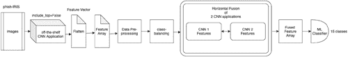 |
| **FIGURE 7.1** Horizonal feature fusion of SMOTE-treated data for two CNN applications. |
| Python 实现代码如下： |
| 1. import tensorflow as tf |
| 2. def getData(model1, model2, image_size): |
| 3.  train_data_dir=“../class_imbalance/” + layer + ”/” + str(image_size)+”/” |
| 4.  test_data_dir=“../feature_extractor/” + layer + ”/” + str(image_size)+”/” |
| 5.  X_train1=np.load(train_data_dir+model1+”_X_train_SMOTE.npy”) |
| 6.  X_train2=np.load(train_data_dir+model2+”_X_train_SMOTE.npy”) |
| 7.  X_train = tf.keras.layers.concatenate(\[X_train1, X_train2\], |
| 8.  axis=1) |
| 9.  y_train=np.load(train_data_dir+model1+”_y_train_SMOTE.npy”) |
| 10. X_test1=np.load(test_data_dir+model1+”_test_images.npy”) |

11.   X_test2=np.load(test_data_dir+model2+”_test_images.npy”)

12.   X_test = tf.keras.layers.concatenate([X_test1, X_test2], axis=1)

13.  y_test=np.load(test_data_dir+”test_labels.npy”)

14.  return X_train, y_train, X_test, y_test

### 水平拼接特征：从最后卷积层提取的特征与处理类失衡后，结合三个 CNN 模型

在此方法中，在从 CNN 应用中提取特征后，它们会在三个 CNN 应用的组合中水平拼接（Figure 7.2）。

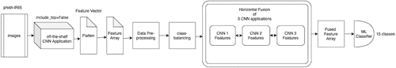

**FIGURE 7.2** 水平特征拼接 SMOTE 处理后的数据，用于三个 CNN 应用。

Python 实现技术。

1. import tensorflow as tf

2. def getData(model1, model2, model3, image_size):

3.  train_data_dir= "../class_imabalance/" + layer + "/"+ str(image_size)+"/"

4.  test_data_dir= "../feature_extractor/" + layer + "/"+ str(image_size)+"/"

5.  X_train1=np.load(train_data_dir+model1+”_X_train_SMOTE.npy”)

6.  X_train2=np.load(train_data_dir+model2+”_X_train_SMOTE.npy”)

7.  X_train3=np.load(train_data_dir+model3+”_X_train_SMOTE.npy”)

8.  X_train = tf.keras.layers.concatenate([X_train1, X_train2, X_train3], axis=1)

9.  y_train=np.load(train_data_dir+model1+”_y_train_SMOTE.npy”)

10.  X_test1=np.load(test_data_dir+model1+”_test_images.npy”)

11.  X_test2=np.load(test_data_dir+model2+”_test_images.npy”)

12.  X_test3=np.load(test_data_dir+model3+”_test_images.npy”)

13.  X_test = tf.keras.layers.concatenate([X_test1, X_test2, X_test3], axis=1)

14.  y_test=np.load(test_data_dir+”test_labels.npy”)

15.  return X_train, y_train, X_test, y_test

### 水平拼接 PCA 特征：从最后卷积层提取的特征与类失衡处理，结合两个 CNN 模型

拼接 PCA 特征后，所有应用的数据维度相同，因为 PCA 处理后，来自不同应用的特征数组维度相同（Figure 7.3）。

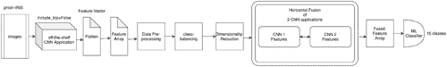

**FIGURE 7.3** 水平特征拼接 PCA 处理后的数据，用于两个 CNN 应用。

例如，从 Xception 或 VGG16 应用提取特征；PCA 处理后，两者的数据维度相同。若将维度减小到 50，则两个数组现在都有 50 列。

因此，将它们水平拼接后，所有应用的数据维度相同。此外，由于水平拼接，记录数保持不变（此例为 6000），但列数会根据拼接的应用数量增加，这里为 2。

Python 实现技术。

1. import tensorflow as tf

2. def getData(model1, model2, image_size, n_component):

3.  X_data_dir= "../pca/" + layer + "/"+ str(image_size)+"/"

4.  y_train_data_dir= "../class_imabalance/" + layer + "/"+ str(image_size)+"/"

5.  y_test_data_dir= "../feature_extractor/" + layer + "/"+ str(image_size)+"/"

6.  X_train1=np.load(X_data_dir+model1+”_train_” + str(n_component) + ”.npy”)

7.  X_train2=np.load(X_data_dir+model2+”_train_” + str(n_component) + ”.npy”)

8.  X_train = tf.keras.layers.concatenate([X_train1, X_train2], axis=1)

9.  y_train=np.load(y_train_data_dir+model1+”_y_train_SMOTE.npy”)

10.  X_test1=np.load(X_data_dir+model1+”_test_” + str(n_component) + ”.npy”)

11.  X_test2=np.load(X_data_dir+model2+”_test_” + str(n_component) + ”.npy”)

12.  X_test = tf.keras.layers.concatenate([X_test1, X_test2], axis=1)

13.  y_test=np.load(y_test_data_dir+”test_labels.npy”)

14.  return X_train, y_train, X_test, y_test

### 水平拼接 PCA 特征：从最后卷积层提取的特征与类失衡处理，结合三个 CNN 模型

Python 实现技术（Figure 7.4）。

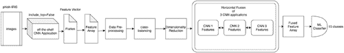

**FIGURE 7.4** 水平特征拼接 PCA 处理后的数据，用于三个 CNN 应用。

1. import tensorflow as tf

2. def getData(model1, model2, model3, image_size, n_component):

3.  X_data_dir= "../pca/" + layer + "/"+ str(image_size)+"/"

4.  y_train_data_dir= "../class_imabalance/" + layer + "/"+ str(image_size)+"/"

5.  y_test_data_dir= "../feature_extractor/" + layer + "/"+ str(image_size)+"/"

6.  X_train1=np.load(X_data_dir+model1+”_train_” + str(n_component) + ”.npy”)

7.  X_train2=np.load(X_data_dir+model2+”_train_” + str(n_component) + ”.npy”)

8.  X_train3=np.load(X_data_dir+model3+”_train_” + str(n_component) + ”.npy”)

9.  X_train = tf.keras.layers.concatenate([X_train1, X_train2, X_train3], axis=1)

10.  y_train=np.load(y_train_data_dir+model1+”_y_train_SMOTE.npy”)

11.  X_test1=np.load(X_data_dir+model1+”_test_” + str(n_component) + ”.npy”)

12.  X_test2=np.load(X_data_dir+model2+”_test_” + str(n_component) + ”.npy”)

13.  X_test3=np.load(X_data_dir+model3+”_test_” + str(n_component) + ”.npy”)

14.  X_test = tf.keras.layers.concatenate([X_test1, X_test2, X_test3], axis=1)

15.  y_test=np.load(y_test_data_dir+”test_labels.npy”)

16.  return X_train, y_train, X_test, y_test

### 垂直拼接 PCA 特征：从最后卷积层提取的特征与类失衡处理，结合两个 CNN 模型

本节讨论在两个 CNN 应用的组合中，对 PCA 特征进行垂直拼接。与 PCA 特征拼接的说明相同，将它们相互垂直拼接后，所有应用的数据维度相同（Figure 7.5）。

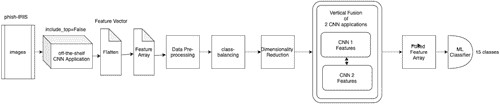

**FIGURE 7.5** 垂直特征拼接 PCA 处理后的数据，用于两个 CNN 应用。

此外，由于垂直拼接，列数保持不变（此例为 50、100 或 500，取决于用于拼接的 PCA 特征数据），但记录数会根据拼接的应用数据数量增加，这里为两个。

Python 实现技术。

1. import tensorflow as tf

2. def getData(model1, model2, image_size, n_component):

3.  X_data_dir= "../pca/" + layer + "/"+ str(image_size)+"/"

4.  y_train_data_dir= "../class_imabalance/" + layer + "/"+ str(image_size)+"/"

5.  y_test_data_dir= "../feature_extractor/" + layer + "/"+ str(image_size)+"/"

6.  X_train1=np.load(X_data_dir+model1+”_train_” + str(n_component) + ”.npy”)

7.  X_train2=np.load(X_data_dir+model2+”_train_” + str(n_component) + ”.npy”)

8.  X_train = tf.keras.layers.concatenate([X_train1, X_train2], axis=0)

9.  y_train1=np.load(y_train_data_dir+model1+”_y_train_SMOTE.npy”)

10.  y_train2=np.load(y_train_data_dir+model2+”_y_train_SMOTE.npy”)

11.  y_train = tf.keras.layers.concatenate([y_train1, y_train2], axis=0)

12.  X_test1=np.load(X_data_dir+model1+”_test_” + str(n_component) + ”.npy”)

13.  X_test2=np.load(X_data_dir+model2+”_test_” + str(n_component) + ”.npy”)

14.  X_test = tf.keras.layers.concatenate([X_test1, X_test2], axis=0)

15.  y_test1=np.load(y_test_data_dir+”test_labels.npy”)

16.  y_test2=np.load(y_test_data_dir+”test_labels.npy”)

17.  y_test = tf.keras.layers.concatenate([y_test1, y_test2], axis=0)

18.  return X_train, y_train, X_test, y_test

21.  axis=`0`)

22.  return X_`train`, y_`train`, X_`test`, y_`test`

### Fusing PCA’d Features Vertically Extracted from the Last Convolution Layer and Class Imbalance Treatment in a Combination of Three CNN Models

Python implementation of the technique (Figure 7.6).

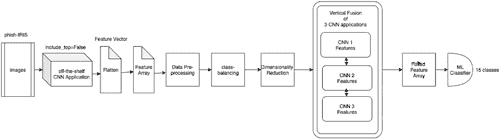

**FIGURE 7.6** Vertical feature fusion of PCA treated data for three CNN applications.

1. import tensorflow as `tf`

2. def `getData`(`model1`, `model2`, `model3`, image_`size`, n_`component`):

3.   X_`data`_`dir`=`../pca/` + `layer` + ”/” + str(`image`_`size`) + ”/”

4.   y_`train`_`data`_`dir`=`../class`_`imabalance/` + `layer` + ”/” + str(`image`_`size`) + ”/”

5.   y_`test`_`data`_`dir`=`../feature`_`extractor/` + `layer` + ”/” + str(`image`_`size`) + ”/”

6.   X_`train1`=`np`_`load`(`X_`data`_`dir`+`model1`+”_train_” + str(`n`_`component`) + ”.npy”)

7.   X_`train2`=`np`_`load`(`X_`data`_`dir`+`model2`+”_train_” + str(`n`_`component`) + ”.npy”)

8.   X_`train3`=`np`_`load`(`X_`data`_`dir`+`model3`+”_train_” + str(`n`_`component`) + ”.npy”)

9.   X_`train` = `tf`_`keras`_`layers`_`concatenate`([`X_`train1`, `X_`train2`, `X_`train3`],

10.  axis=`0`)

11.  y_`train1`=`np`_`load`(`y_`train`_`data`_`dir`+`model1`+”_y_`train`_`SMOTE`_`.npy”`)

12.  y_`train` = `tf`_`keras`_`layers`_`concatenate`([`y_`train1`, `y_`train1`, `y_`train1`],

13.  axis=`0`)

14.  X_`test1`=`np`_`load`(`X_`data`_`dir`+`model1`+”_test_” + str(`n`_`component`) + ”.npy”)

15.  X_`test2`=`np`_`load`(`X_`data`_`dir`+`model2`+”_test_” + str(`n`_`component`) + ”.npy”)

16.  X_`test3`=`np`_`load`(`X_`data`_`dir`+`model3`+”_test_” + str(`n`_`component`) + ”.npy”)

17.  X_`test` = `tf`_`keras`_`layers`_`concatenate`([`X_`test1`, `X_`test2`, `X_`test3`],

18.  axis=`0`)

19.  y_`test1`=`np`_`load`(`y_`test`_`data`_`dir`+”`test`_`labels`_`.npy”`)

20.  y_`test` = `tf`_`keras`_`layers`_`concatenate`([`y_`test1`, `y_`test1`, `y_`test1`],

21.  axis=`0`)

22.  return X_`train`, y_`train`, X_`test`, y_`test`

### Performance Assessment of Various Experimentations

We performed various experimentations using various different feature fusion techniques. The table below demonstrates the comparison of all the tried approaches to provide a holistic view of the results achieved.

See Table 7.1.

**TABLE 7.1** Performance Assessment of Models Built Using Feature Fusion Techniques 

| Model 1  || Model 2 || Model 3 || n || Accuracy || Precision || Recall || F1_Score || FPR || Image Size || Fusion Type |
| --- | --- | --- | --- | --- | --- | --- | --- | --- | --- | --- |
| **VGG19** || **DenseNet169** ||   ||   || **0.884** || **0.888** || **0.884** || **0.883** || **0.014** || 128 || Vertical |
| VGG16 || MobileNet ||   ||   || 0.882 || 0.885 || 0.882 || 0.879 || 0.014 || 128 || Vertical |
| **Xception** || **DenseNet201** ||   ||   || **0.895** || **0.894** || **0.895** || **0.891** || **0.015** || 256 || Vertical |
| ResNet50V2 || DenseNet201 ||   ||   || 0.895 || 0.894 || 0.895 || 0.889 || 0.015 || 256 || Vertical |
| **ResNet101V2** || **MobileNetV2** || **DenseNet201** ||   || **0.89** || **0.891** || **0.89** || **0.888** || **0.013** || 128 || Vertical |
| MobileNet || MobileNetV2 || DenseNet201 ||   || 0.887 || 0.889 || 0.887 || 0.885 || 0.013 || 128 || Vertical |
| **VGG19** || **ResNet152V2** || **DenseNet201** ||   || **0.897** || **0.895** || **0.897** || **0.893** || **0.014** || 256 || Vertical |
| VGG16 || ResNet152V2 || DenseNet201 ||   || 0.893 || 0.895 || 0.893 || 0.89 || 0.014 || 256 || Vertical |
| **VGG16** || **MobileNetV2** ||   || **100** || **0.855** || **0.861** || **0.855** || **0.853** || **0.017** || 128 || Horizontal |
| VGG16 || DenseNet201 ||   || 100 || 0.855 || 0.856 || 0.855 || 0.853 || 0.017 || 128 || Horizontal |
| VGG19 || DenseNet169 ||   || 100 || 0.854 || 0.856 || 0.854 || 0.852 || 0.017 || 128 || Horizontal |
| **VGG16** || **DenseNet169** ||   || **100** || **0.875** || **0.877** || **0.875** || **0.871** || **0.015** || 256 || Horizontal |
| VGG16 || MobileNet ||   || 100 || 0.87 || 0.874 || 0.87 || 0.867 || 0.016 || 256 || Horizontal |
| VGG16 || DenseNet121 ||   || 100 || 0.87 || 0.871 || 0.87 || 0.866 || 0.016 || 256 || Horizontal |
| **MobileNet** || **MobileNetV2** || **DenseNet201** || **100** || **0.873** || **0.88** || **0.873** || **0.873** || **0.013** || 128 || Horizontal |
| VGG16 || MobileNet || DenseNet201 || 100 || 0.868 || 0.879 || 0.868 || 0.869 || 0.013 || 128 || Horizontal |
| VGG16 || MobileNet || DenseNet121 || 100 || 0.867 || 0.878 || 0.867 || 0.869 || 0.013 || 128 || Horizontal |
| **MobileNetV2** || **DenseNet169** || **DenseNet201** || **100** || **0.88** || **0.887** || **0.88** || **0.881** || **0.012** || 256 || Horizontal |
| VGG16 || ResNet152V2 || DenseNet169 || 100 || 0.878 || 0.883 || 0.878 || 0.877 || 0.012 || 256 || Horizontal |
| VGG16 || InceptionV3 || DenseNet169 || 100 || 0.877 || 0.886 || 0.877 || 0.877 || 0.013 || 256 || Horizontal |
| **VGG16** || **MobileNetV2** ||   || **100** || **0.855** || **0.861** || **0.855** || **0.853** || **0.017** || 128 || Vertical |
| VGG16 || DenseNet201 ||   || 100 || 0.855 || 0.856 || 0.855 || 0.853 || 0.017 || 128 || Vertical |
| VGG19 || DenseNet169 ||   || 100 || 0.854 || 0.856 || 0.854 || 0.852 || 0.017 || 128 || Vertical |
| **VGG16** || **DenseNet169** ||   || **100** || **0.875** || **0.877** || **0.875** || **0.871** || **0.015** || 256 || Vertical |
| VGG16 || MobileNet ||   || 100 || 0.87 || 0.874 || 0.87 || 0.867 || 0.016 || 256 || Vertical |
| VGG16 || DenseNet121 ||   || 100 || 0.87 || 0.871 || 0.87 || 0.866 || 0.016 || 256 || Vertical |
| **VGG16** || **MobileNetV2** || **DenseNet169** || **100** || **0.85** || **0.855** || **0.85** || **0.847** || **0.019** || 128 || Vertical |
| VGG19 || MobileNet || MobileNetV2 || 100 || 0.848 || 0.852 || 0.848 || 0.846 || 0.017 || 128 || Vertical |
| VGG16 || MobileNetV2 || DenseNet201 || 100 || 0.847 || 0.849 || 0.847 || 0.844 || 0.018 || 128 || Vertical |
| **VGG16** || **MobileNetV2** || **DenseNet169** || **100** || **0.869** || **0.869** || **0.869** || **0.864** || **0.018** || 256 || Vertical |
| VGG19 || MobileNet || DenseNet121 || 100 || 0.867 || 0.869 || 0.867 || 0.862 || 0.017 || 256 || Vertical |
| VGG16 || MobileNet || DenseNet121 || 100 || 0.866 || 0.866 || 0.866 || 0.862 || 0.017 || 256 || Vertical |
| The bold signifies the best results in the table. |

| --- |

### Summary

In this chapter, we experimented with fused features generated by combining image representations in a combination of two and three CNN architectures. Additionally, features were fused both horizontally and vertically before feeding them into different classification models.

## 8 Comparison of Phishing Detection Approaches

DOI: [10.1201/9781003217381-8](https://doi.org/10.1201/9781003217381-8)

This chapter looks into the implementation outcomes of the various approaches and techniques used for building and evaluating the phish-IRIS dataset-based classification model. Numerous classification models within each suggested approach are built and experimented with various combinations with data dimensions and fusions. In this chapter, a comparison of how each approach has performed and how they perform against state-of-the-art performance with this dataset is conducted.

## Classification Approaches

Table 8.1 lists all the different approaches suggested in this book.

**TABLE 8.1** Description of All the Classification Approaches Proposed in This Book

| Approaches || Description |
| --- | --- |
| Approach 1 || Traditional CNN with image size of (128, 128, 3) and (256, 256, 3) |
| Approach 2 || Transfer the learning till last fully connected layer |
| Approach 3 || Transfer the learning till last convolution layer, extract features and SMOTE, and implement a machine learning classifier |

| 方法 4 || 横向融合在方法 3 中提取的特征，结合两个和三个 CNN 应用 |

| 方法 5 || 使用方法 3 提取的特征进行 PCA，并实现机器学习分类器 |

| 方法 6 || 横向融合在方法 5 中提取的特征，结合两个和三个 CNN 应用 |

| 方法 7 || 纵向融合在方法 5 中提取的特征，结合两个和三个 CNN 应用 |

| 方法 8 || 在图像尺寸为(512, 512, 3)的最佳模型上使用随机森林(RF)和支持向量机(SVM) |

## 评估分类实验

phish-IRIS 数据集中的图像被调整为三种不同尺寸：(128, 128, 3)、(256, 256, 3)和(512, 512, 3)。使用 VGGNet、DenseNet 等 CNN 应用对所有图像尺寸进行特征提取。此外，对提取的特征进行维度降低和特征融合，以构建众多分类模型。表 8.2 列出了本文中每个实验的最佳模型。表按召回率(TPR)对每个实验进行排序。

**表 8.2** 不同方法下最佳模型的对比

| 方法 || 模型 || 召回率 || F1 || 图像尺寸 || 分类器 |
| --- | --- | --- | --- | --- | --- |
| **8** || **DenseNet201** || **0.908** || **0.909** || **512** || **SVM** |
| --- | --- | --- | --- | --- | --- |
| 3 || DenseNet201 || 0.903 || 0.903 || 256 || SVM |
| 3 || DenseNet201 || 0.897 || 0.89 || 256 || RF |
| 4 || VGG19_ResNet152V2_DenseNet201 || 0.897 || 0.893 || 256 || RF |
| 5 || DenseNet201_500 || 0.897 || 0.896 || 256 || SVM |
| 4 || Xception_DenseNet201 || 0.895 || 0.891 || 256 || RF |
| 3 || MobileNet || 0.891 || 0.89 || 128 || SVM |
| 4 || ResNet101V2_MobileNetV2_DenseNet201 || 0.89 || 0.888 || 128 || RF |
| 3 || VGG16 || 0.885 || 0.88 || 128 || RF |
| 5 || MobileNet_500 || 0.884 || 0.88 || 128 || SVM |
| 4 || VGG19_DenseNet169 || 0.884 || 0.883 || 128 || RF |
| 5 || DenseNet169_100 || 0.883 || 0.88 || 256 || RF |
| 6 || MobileNetV2_DenseNet169_DenseNet201_100 || 0.88 || 0.881 || 256 || RF |
| 5 || MobileNet_100 || 0.877 || 0.874 || 128 || RF |
| 7 || VGG16_DenseNet169_100 || 0.875 || 0.871 || 256 || RF |
| 6 || VGG16_DenseNet169_100 || 0.875 || 0.871 || 256 || RF |
| 6 || MobileNet_MobileNetV2_DenseNet201_100 || 0.873 || 0.873 || 128 || RF |
| 7 || VGG16_MobileNetV2_DenseNet169_100 || 0.869 || 0.864 || 256 || RF |
| 2 || DenseNet169 || 0.869 || 0.884 || 256 || NN |
| 6 || VGG16_MobileNetV2_100 || 0.855 || 0.853 || 128 || RF |
| 7 || VGG16_MobileNetV2_100 || 0.855 || 0.853 || 128 || RF |
| 7 || VGG16_MobileNetV2_DenseNet169_100 || 0.85 || 0.847 || 128 || RF |
| 2 || DenseNet169 || 0.791 || 0.825 || 128 || NN |

如表 8.2 所示，使用 DenseNet201 提取特征并将图像尺寸设为(512, 512, 3)的分类器在 SVM 分类算法训练下表现卓越。

对于多类分类模型，DenseNet201 基模型对每个类别的性能在图 5.1 中显示，混淆矩阵在图 5.2 中显示（图 8.1 和 8.2）。

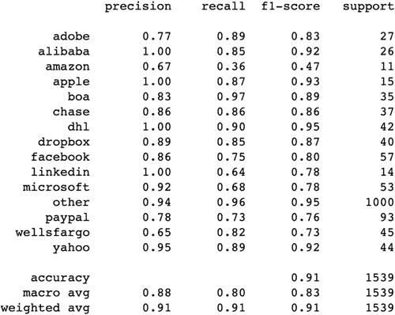

**FIGURE 8.1** Performance metrics for DenseNet201 against each class.

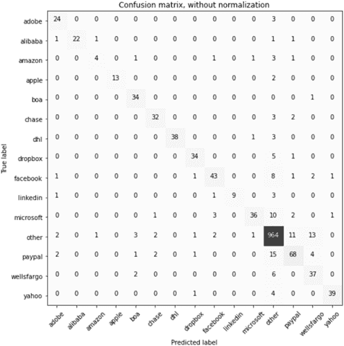

**FIGURE 8.2** Confusion matrix for DenseNet201.

### 与最先进技术的最佳模型比较

本章实现的最佳模型与官方提供的 phish-IRIS 数据集的最先进的机器学习分类器性能进行了对比，如表 8.3 所示。

**表 8.3** 最佳模型与最先进技术的对比

| 指标 || Phish-IRIS SOTA || DenseNet201-SVM-512 |
| --- | --- | --- |
| True positive rate || 90.60% || 90.80% |
| --- | --- | --- |
| False positive rate || 8.50% || 1.20% |
| F1 – measure || 90.50% || 90.60% |

所有在本研究中进行的方法的性能指标，以及与 True Positive Rate（召回率）值的最先进的结果，如表 8.2 所示，在图 8.3 中展示。

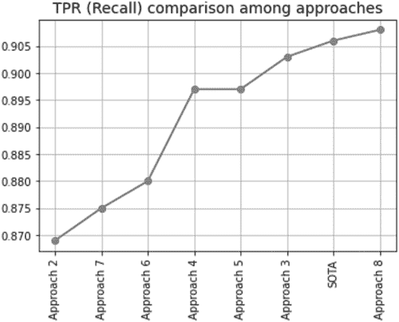

**FIGURE 8.3** Comparison based on recall among all approaches and SOTA.

所有在本研究中进行的方法的性能指标，以及与 F1 分数值的最先进的结果，如表 8.2 所示，在图 8.4 中展示。

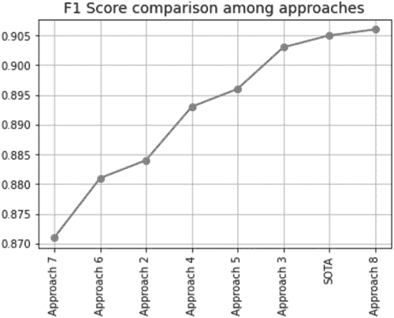

**FIGURE 8.4** Comparison based on F1 score among all approaches and SOTA.

如图 5.4 和图 5.5 所示，使用 DenseNet201 CNN 模型提取特征并将图像尺寸设为(512, 512, 3)的 SVM 模型的结果超过了该数据集的最先进的性能。

## 总结

评估分类模型需要理解问题陈述，以便选择相关的性能指标。在网络钓鱼检测中，True Positive Rate 是更合适的评估指标，这意味着分类模型更应将所有网络钓鱼网站预测为“网络钓鱼”，即使这会导致少量合法网站被错误分类为“网络钓鱼”。同时，模型也应尽量减少将合法网站误判为“网络钓鱼”，因此 False Positive Rate 也是重要的评估指标。基于相关的性能指标，本文分析了所实现的各种方法的结果。观察到，DenseNet201 模型在图像尺寸为(512, 512, 3)并使用 SVM 进行训练时，表现最佳。此外，最佳模型还与所使用数据集的最先进的性能进行了比较。

## 9 数字图像处理基础

DOI: [10.1201/9781003217381-9](https://doi.org/10.1201/9781003217381-9)

视觉是帮助我们导航物理世界的最重要能力。我们都知道，当光落在物体上并被反射时，反射被眼睛捕捉，信息随后传递到大脑，生物神经网络最终解码视野中的物体，使我们能够区分汽车和摩托车等不同物体，并在繁忙道路上驾驶汽车。

计算机视觉也遵循类似的机制。随着计算机视觉技术的发展，计算机现在可以像人类一样观察物理世界，并解决类似的人类的问题。

作为人类，我们每天解决各种问题，却并未意识到人体和大脑所展现的惊人认知能力。通过计算机视觉技术，我们设想在计算机上复制类似的人类能力。在某些情况下，我们复制人类能力；在其他情况下，我们增强人类能力；在仍其他情况下，我们超越人类能力。

通过视觉，我们能够区分狗、猫和人。通过计算机视觉和人工神经网络，计算机可以被训练做到同样任务。这属于计算机复制人类能力的范畴。

然而，如果计算机被赋予驾驶汽车的能力，例如在自动驾驶汽车的情况下，它们不仅能够匹配而且还能远超人类的能力。这是因为计算机可以拥有道路的 360 度视野，能够看到盲点等，而人类无法复制这些能力。

现在，虽然提升计算机的视觉能力是好事，但更进一步，训练计算机去解释人眼根本无法识别的事物，例如检测钓鱼网站而非合法网站，是更好的选择。人眼可以被钓鱼网站欺骗，因为它们看起来与真实对应物几乎完全相同。因此，人类很容易陷入钓鱼攻击，但利用计算机视觉技术，我们可以训练计算机从钓鱼网站的图像中提取特征，并训练模型区分钓鱼网站和合法网站。

## Structure

In this chapter, we will cover the following topics:

*   Basics of digital image processing

*   Basics of extracting features using OpenCV

## Objective

After studying this chapter, you should be aware of the basics of digital image processing. You will be familiar with image filtering concepts and how to extract relevant features from images for further processing.

## Basics of Digital Image Processing

To understand digital image processing, it’s imperative to first understand what a digital image is. When an image is captured, certain information about the object in the image is captured by the camera or a similar device that can capture the image. When the image is processed, the information captured is extracted and then processed.

### What Is a Digital Image?

A picture element, usually called “pixels”, is the smallest element of a digital image. An image is an arrangement of pixels in n dimensions.

There are two color schemes in an image:

1.  Grayscale image

2.  RGB (color) image

Grayscale images are what we call black and white images. In such images, each pixel has only one layer. And each pixel has a number associated with it. If it’s an 8-bit pixel, the number ranges from 0 to 255. And the number represents intensity, for example the greater the number, the more the intensity. Hence, 0 represents black, and 255 represents white. Hence, a grayscale image can be represented by a single matrix.

For an RGB image, each pixel has three layers. One layer for red, one for green and one for blue. All other colors can be created by adding these three colors in different intensities. Hence, every pixel in an image can be represented with three numbers in each layer of RGB. And hence a color image can be represented by three matrices, one for each layer, with different intensities for each color.

Based on this understanding, if a pixel is defined as a tuple of three elements, wherein the first element is the intensity of red in a pixel, the second element is the intensity of green in a pixel and the third element is the intensity of blue in a pixel, then a pixel which is red in color can be defined as (255,0,0), which means that the intensity of red is 255 and the intensities of green and blue are 0. Hence, this pixel is pure red. Similarly, a pure green pixel can be defined as (0,255,0), and a pure blue pixel can be defined as (0,0,255) (Figure 9.1).

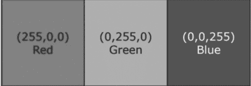

**FIGURE 9.1** Pixel layers within digital images.

Since an image is a collection of pixels, every image can be defined as a matrix of pixel values. To understand this better, look at Figure 9.2.

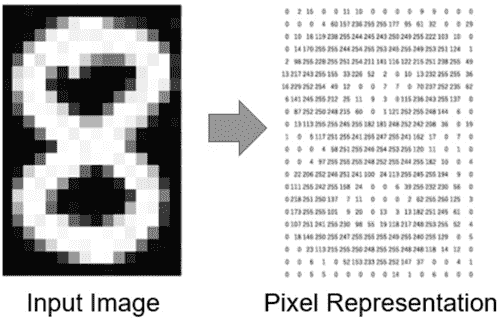

**FIGURE 9.2** Pixel representation of a greyscale image.

As you can see, what we see as a whole image, the computer sees as a pixel representation. The number in the pixel representation is the intensity of white in that particular pixel in the image. Since it’s a grayscale image, there is just one channel, and hence one number in that pixel position. In the case of a color image, there will be three numbers in each pixel position, representing the intensity of red, blue and green in their respective channels.

### Loading and Displaying Images

The first and foremost thing to be done for a computer to process the image is to load the image in the computer memory, which basically means loading the matrix holding the pixel values of the image into the memory.

To do so, let’s first import the required libraries.

1. from matplotlib import pyplot as plt

2. import cv2

Read the image using the imread method in the opencv library.

3. image_loc=“einstein.png”

4. image = cv2.imread(image_loc)

5. image.shape

Note the shape of the image, which is represented as (height, width, channel), which means height at index 0, width at index 1 and channel at index 2.

(1034, 968, 3)

Hence, the image is read as a matrix of size (1034, 968), which basically means that the image has a height of 1034 pixels and a width of 968 pixels, and there are three such matrices, one for each channel of RGB. To understand it better, let’s plot the image and check the height and the width along the x and y axes.

But before we plot the image, let’s first understand a small caveat related to the opencv imread module. When the image is read using the imread module, the matrix loaded in the image object is loaded as a numpy array.

This array has 1034 rows, which is the height of the image.

1. print(len(image))

1034

If we just look at the first row of this matrix, it will contain 968 columns, which is the width of the image.

1. print(len(image\[0\])

968

Hence, an individual pixel will represent three values, one for each RGB channel.

1. image\[0\]\[0\]

array(\[30, 31, 29\], dtype=uint8)

However, the opencv library by default reads the image as BGR channel. So, the pixel value represented above basically means that the first pixel of the image has the value of 30 in the blue channel, 31 in the green channel and 29 in the red channel.

Hence, for further processing, there is a need to correct this channel values setting in the numpy array, which holds the image pixel values, which is done using the below code line.

1. image = cv2.cvtColor(image, cv2.COLOR_BGR2RGB)

Now, if we check the pixel values representation with the array, it will show in the RGB format, which means that the pixel values of each channel remain the same, but they are arranged differently. Earlier it was \[B = 30, G = 31, R = 29\] and after conversion it became \[R = 29, G = 31, B = 30\].

1. image\[0\]\[0\]

array(\[29, 31, 30\], dtype=uint8)

Let’s now plot the image to check the pixel arrangements in the x and y axes (Figure 9.3).

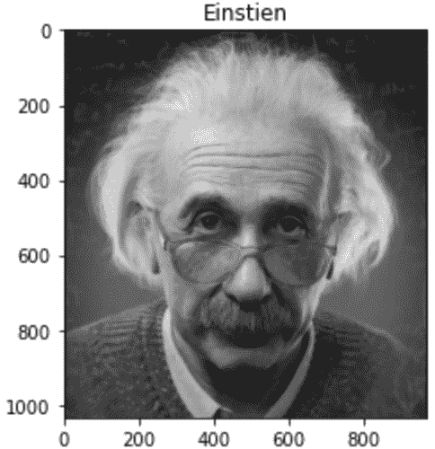

**FIGURE 9.3** Pixel representation of a digital image.

2. plt.imshow(image)

3. plt.title(“Einstein”)

4. plt.grid(False)

5. plt.show()

So, we can see that the image has 1034 pixels vertically along the y axis, which is termed as height, and 968 pixels horizontally along the x axis, which is termed as width, and at every pixel there are three values, one value for the red channel, one value for the green channel and one value for the blue channel.

Hence, the total number of pixel values across the three channels of the image is equal to

*   1034 × 968 × 3 = 30,02,736

So, what a human eye sees as just an image, a computer sees as 30,02,736 numbers arranged in a defined order.

## References

DOI: [10.1201/9781003217381-10](https://doi.org/10.1201/9781003217381-10)

1.  Abdelnabi, Sahar, Krombholz, Katharina, & Fritz, Mario (2020) VisualPhishNet: Zero-day phishing website detection by visual similarity (arxiv.org).

2. Afroz, S., & Greenstadt, R. (2011). PhishZoo: Detecting Phishing websites by looking at them. `Proceedings – 5th IEEE International Conference on Semantic Computing, ICSC 2011`, 368–375. [`doi.org/10.1109/ICSC.2011.52`](https://doi.org/10.1109/ICSC.2011.52)

3. Bay, H., Tuytelaars, T., & Gool, L. Van. (2006). `LNCS 3951 – SURF: Speeded up robust features`. `Computer Vision–ECCV 2006`, 404–417. [`link.springer.com/chapter/10.1007/10.1007/11744023\_32`](http://link.springer.com/chapter/10.1007/11744023\_32)

4. Bozkir, A. S., & Sezer, E. A. (2016). Use of HOG descriptors in phishing detection. `2016 4th International Symposium on Digital Forensic and Security (ISDFS), 2013`, 148–153. [`doi.org/10.1109/ISDFS.2016.7473534`](https://doi.org/10.1109/ISDFS.2016.7473534)

5. Bozkır, A. S., & Aydos, M. (2019). Local image descriptor based Phishing web page recognition as an open-set problem. `European Journal of Science and Technology`, October, 444–451. [`doi.org/10.31590/ejosat.638404`](https://doi.org/10.31590/ejosat.638404)

6. Chatzichristofis, S. A., Arampatzis, A., & Boutalis, Y. S. (2010). Investigating the behavior of compact composite descriptors in early fusion, late fusion and distributed image retrieval. `Radioengineering`, 19(4), 725–733.

7. Chawla, N. V., Bowyer, K. W., Hall, L. O., & Kegelmeyer, W. P. (2002). SMOTE: Synthetic minority over-sampling technique. `Journal of Artificial Intelligence Research`, 16, 321–357. [`doi.org/10.1613/jair.953`](https://doi.org/10.1613/jair.953)

8. Chen, K. T., Chen, J. Y., Huang, C. R., & Chen, C. S. (2009). Fighting phishing with discriminative keypoint features. `IEEE Internet Computing`, 13(3), 56–63. [`doi.org/10.1109/MIC.2009.59`](https://doi.org/10.1109/MIC.2009.59)

9. Dalgic, F. C., Bozkir, A. S., & Aydos, M. (2018). Phish-IRIS: A new approach for vision based brand prediction of Phishing web pages via compact visual descriptors. `2018 2nd International Symposium on Multidisciplinary Studies and Innovative Technologies (ISMSIT)`, 1–8. [`doi.org/10.1109/ISMSIT.2018.8567299`](https://doi.org/10.1109/ISMSIT.2018.8567299)

10. Dunlop, M., Groat, S., & Shelly, D. (2010). GoldPhish: Using images for content-based phishing analysis. `5th International Conference on Internet Monitoring and Protection, ICIMP 2010`, 123–128. [`doi.org/10.1109/ICIMP.2010.24`](https://doi.org/10.1109/ICIMP.2010.24)

11. Eroğlu, E., Bozkır, A. S., & Aydos, M. (2019). Brand recognition of Phishing web pages via global image descriptors. `European Journal of Science and Technology`, 436–443. [`doi.org/10.31590/ejosat.638397`](https://doi.org/10.31590/ejosat.638397)

12. Gao, H., & Chen, W. (2017). Image classification based on the fusion of complementary features. `Journal of Beijing Institute of Technology (English Edition)`, 26(2), 197–205. [`doi.org/10.15918/j.jbit1004-0579.201726.0208`](https://doi.org/10.15918/j.jbit1004-0579.201726.0208)

13. `Google Safe Browsing | Google Developers`. (n.d.). Retrieved January 30, 2021, from [`developers.google.com/safe-browsing`](https://developers.google.com/safe-browsing)

14. He, K., Zhang, X., Ren, S., & Sun, J. (2016). Deep residual learning for image recognition. `Proceedings of the IEEE Computer Society Conference on Computer Vision and Pattern Recognition, 2016-Decem`, 770–778. [`doi.org/10.1109/CVPR.2016.90`](https://doi.org/10.1109/CVPR.2016.90)

15. Huang, G., Liu, Z., Van Der Maaten, L., & Weinberger, K. Q. (2017). Densely connected convolutional networks. `Proceedings – 30th IEEE Conference on Computer Vision and Pattern Recognition, CVPR 2017, 2017-Janua`, 2261–2269. [`doi.org/10.1109/CVPR.2017.243`](https://doi.org/10.1109/CVPR.2017.243)

16. Jain, A. K., & Gupta, B. B. (2016). A novel approach to protect against phishing attacks at client side using auto-updated white-list. `Eurasip Journal on Information Security`, 2016(1). [`doi.org/10.1186/s13635-016-0034-3`](https://doi.org/10.1186/s13635-016-0034-3)

17. Jain, A. K., & Gupta, B. B. (2017). Phishing detection: Analysis of visual similarity based approaches. `Security and Communication Networks`, 2017(i), 1–20. [`doi.org/10.1155/2017/5421046`](https://doi.org/10.1155/2017/5421046)

18. Khandelwal, S., & Das, R. (2022). Phishing detection using computer vision. In S. Smys, R. Bestak, R. Palanisamy, & I. Kotuliak (Eds.), `Computer Networks and Inventive Communication Technologies` (pp. 113–130). Singapore: Springer.

19. Khonji, M., Iraqi, Y., & Jones, A. (2013). Phishing detection: A literature survey. `IEEE Communications Surveys and Tutorials`, 15(4), 2091–2121. [`doi.org/10.1109/SURV.2013.032213.00009`](https://doi.org/10.1109/SURV.2013.032213.00009)

20. Li, B., Cheng, K., & Yu, Z. (2016). Histogram of oriented gradient based GIST feature for building recognition. `Computational Intelligence and Neuroscience`, 2016. [`doi.org/10.1155/2016/6749325`](https://doi.org/10.1155/2016/6749325)

21. Lowe, D. G. (2004). Distinctive image features from scale-invariant keypoints. `International Journal of Computer Vision`, 60(2), 91–110. [`doi.org/10.1023/B:VISI.0000029664.99615.94`](https://doi.org/10.1023/B:VISI.0000029664.99615.94)

22. Nhat, H. T. M., & Hoang, V. T. (2019). Feature fusion by using LBP, HOG, GIST descriptors and Canonical Correlation Analysis for face recognition. `2019 26th International Conference on Telecommunications, ICT 2019`, 371–375. [`doi.org/10.1109/ICT.2019.8798816`](https://doi.org/10.1109/ICT.2019.8798816)

23. Optical character recognition – Wikipedia. (n.d.). Retrieved January 30, 2021, from [`en.wikipedia.org/wiki/Optical_character_recognition`](https://en.wikipedia.org/wiki/Optical_character_recognition)

24. Phish-IRIS Dataset – A small scale multi-class phishing web page screenshots archive. (n.d.). Retrieved November 29, 2020, from [`web.cs.hacettepe.edu.tr/~selman/phish-iris-dataset/`](https://web.cs.hacettepe.edu.tr/~selman/phish-iris-dataset/)

25. Phishing definition & meaning | What is Phishing? (n.d.). Retrieved January 30, 2021, from [`www.webopedia.com/definitions/phishing-meaning/`](https://www.webopedia.com/definitions/phishing-meaning/)

26. Prakash, P., Kumar, M., Kompella, R. R., & Gupta, M. (2010). PhishNet: Predictive Blacklisting to detect Phishing attacks. `2010 Proceedings IEEE INFOCOM`, 1–5. [`doi.org/10.1109/INFCOM.2010.5462216`](https://doi.org/10.1109/INFCOM.2010.5462216)

27. Rao, R. S., & Ali, S. T. (2015). A computer vision technique to detect Phishing attacks. `2015 Fifth International Conference on Communication Systems and Network Technologies`, 596–601. [`doi.org/10.1109/CSNT.2015.68`](https://doi.org/10.1109/CSNT.2015.68)

28. Rayar, F. (2017). ImageNet MPEG-7 Visual Descriptors - Technical Report, 21–23. [`arxiv.org/abs/1702.00187`](http://arxiv.org/abs/1702.00187)

29. Rosiello, A. P. E., Kirda, E., Kruegel, C., & Ferrandi, F. (2007). A layout-similarity-based approach for detecting phishing pages. `Proceedings of the 3rd International Conference on Security and Privacy in Communication Networks, SecureComm`, 454–463. [`doi.org/10.1109/SECCOM.2007.4550367`](https://doi.org/10.1109/SECCOM.2007.4550367)

30. Szegedy, C., Liu, W., Jia, Y., Sermanet, P., Reed, S., Anguelov, D., Erhan, D., Vanhoucke, V., & Rabinovich, A. (2015). Going deeper with convolutions. `Proceedings of the IEEE Computer Society Conference on Computer Vision and Pattern Recognition`, 07–12-June, 1–9. [`doi.org/10.1109/CVPR.2015.7298594`](https://doi.org/10.1109/CVPR.2015.7298594)

31. Tola, E., Lepetit, V., & Fua, P. (2010). DAISY: An efficient dense descriptor applied to wide-baseline stereo. `IEEE Transactions on Pattern Analysis and Machine Intelligence`, 32(5), 815–830. [https://doi.org/10.1109/TPAMI.2009.77]

32. Varshney, G., Misra, M., & Atrey, P. K. (2016). A survey and classification of web phishing detection schemes. *Security and Communication Networks*, *9*(18), 6266–6284. [`doi.org/10.1002/sec.1674`](https://doi.org/10.1002/sec.1674)

33. Wang, G. (2010). Verilogo: Proactive phishing detection via logo recognition. January 2010, 1–20. [`escholarship.org/uc/item/6m26d488.pdf`](http://escholarship.org)

34. Wu, J., Cui, Z., Sheng, V. S., Zhao, P., Su, D., & Gong, S. (2013). A comparative study of SIFT and its variants. *Measurement Science Review*, *13*(3), 122–131. [`doi.org/10.2478/msr-2013-0021`](https://doi.org/10.2478/msr-2013-0021)

35. Zero-day (Computing) – Wikipedia. (n.d.). Retrieved January 30, 2021, from [`en.wikipedia.org/wiki/Zero-day\_(computing)`](https://en.wikipedia.org)

## Index

* Accuracy, 28
* Basics of phishing, 2
* comparison based, 9
* heuristics based, 5
* image processing based, 8
* list based, 3
* phishing detection techniques, 4
* type of phishing, 3
* visual similarity based, 5
* Challenges in phishing detection, 12
* Classification report, 106
* Class imbalance, 58
* Confusion matrix, 36
* Convolutional Neural Network (CNN), 19
* DenseNet121, 58
* Digital image, 110
* DOMAntiPhish, 9
* F1, 29
* False positive rate, 28
* Feature extraction, 51
* Feature fusion, 84
* FN (false negative), 27, 30
* FP (false positive), 28, 29
* GoldPhish, 9
* Image to numpy, 49
* InceptionResNetV2, 56
* InceptionV3, 56
* Keras API, 40
* Label encoding, 26
* MobileNet, 57
* One-hot encoding, 26
* PCA, 72
* PHISH-IRIS, 18
* PhishZoo, 9
* Pixel representation, 112
* Precision, 29
* Recall, 29
* Representation learning, 48
* ResNet50, 55
* SMOTE, 60
* SOTA comparison, 107, 108
* TN (true negative), 27, 31
* TP (true positive), 28, 30
* Transfer learning, 38
* True positive rate, 28
* Verilogo, 10
* VGG19, 54
* Xception, 52
