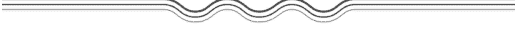
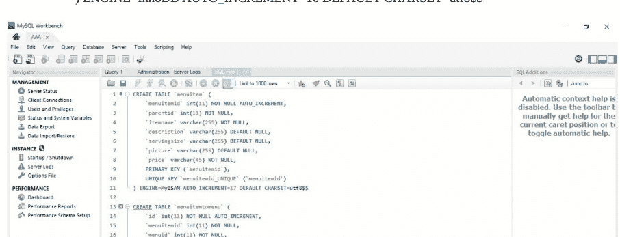
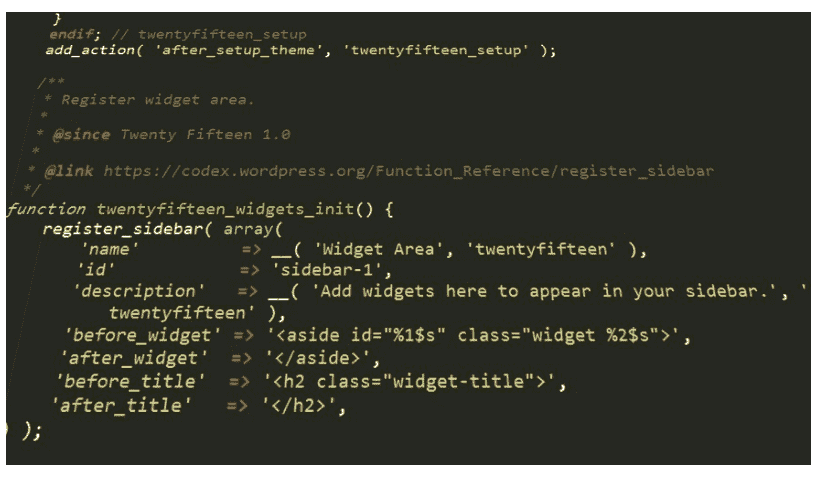
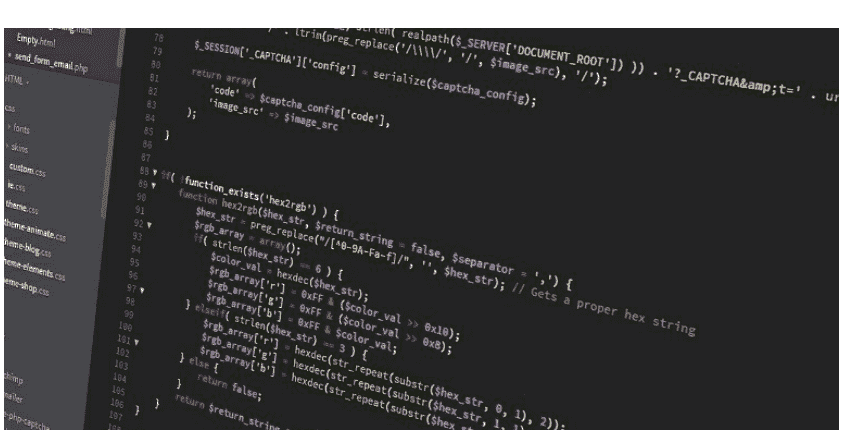
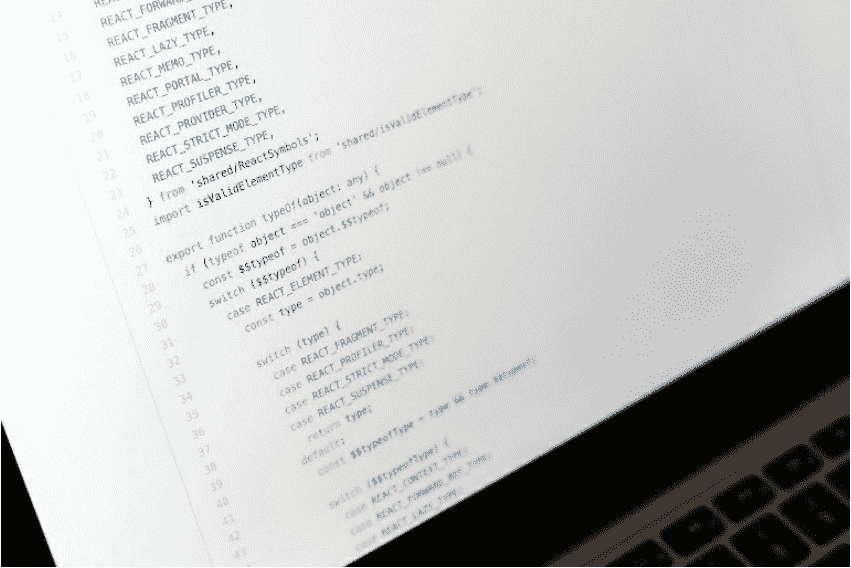
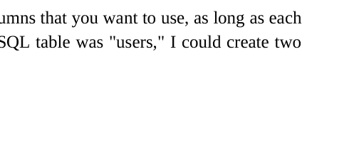
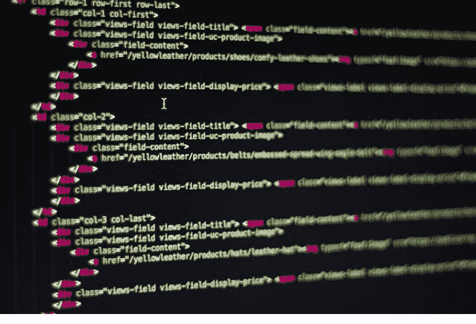
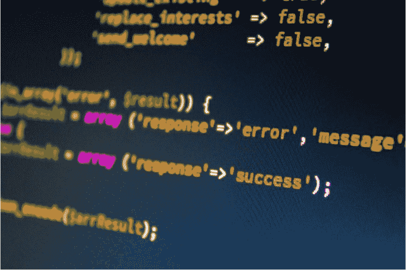

# PHP：三合一：初学者的 PHP 基础 + PHP 安全与会话管理 + 高级 PHP 函数


## 引言


在学习 PHP 之后，我通过向招聘人员展示我对这门语言的掌握，以及通过我开发的项目所展现出的对 Web 开发其他方面的理解，毕业后立刻获得了一份高薪的后端 Web 开发工作。PHP 是一种对初学者来说相对容易学习的语言，语法简洁而优雅；从入门到专业水平，可以在相对较短的时间内——通常为 2 到 3 个月——掌握。然而，有一个告诫。

对于新手来说，教师和教学方法对学习者的吸收能力有着相当大的影响。如果没有一位好导师，学生可能会很快失去对这门学科的兴趣。在最坏的情况下，这可能对一个人的职业道路产生巨大影响。我自己在学习这些东西时也曾经历过挣扎。

在我的学习过程中，我意识到大多数 PHP 学习材料——书籍、PDF 和教程——都不够用户友好。我觉得作者/讲师讲课过于仓促，没有花时间阐明理解特定代码行背后推理所需的思考过程，似乎假设读者已经精通 PHP。但新手并非如此，因此我将在本书中花时间解释每段代码背后的逻辑。

在学习 PHP 时，选择一种有效的资源至关重要——它应使学习曲线保持平稳，并逐步过渡到较难的主题。在提供了足够的概念洞见和示例之后，它还应该讨论顶级组织招聘人员提出的问题，并以解决学生可能怀有的任何疑问的形式提供课堂支持。

## PHP — 定义与历史

缩写 PHP 代表 Hypertext Preprocessor（超文本预处理器）。这个缩写的首字母代表了完整术语，这是这门语言最令人困惑的一个特点。它被认为是相当容易掌握的语言。

PHP 是一种主要为构建网站而设计的脚本语言。从 SQL 数据库检索数据是其典型用途。它也被用于生成图表和其他可视化内容。例如，设计师可以创建指向图像的链接，或为图片库制作缩略图。PHP 还负责密码验证、用户认证、处理论坛帖子和留言簿等任务。另一个常见应用是与 Facebook 集成。

你甚至可以使用 PHP 开发一个允许用户创建内容的网站——即使用户缺乏基本的 HTML 知识！

PHP 是动态的，这是它与普通 HTML 之间的关键区别之一。然而，这并非非此即彼的情况，因为这两种语言是相互可操作的。PHP 能够生成 HTML 代码。

PHP 的当前形式是名为 PHP/FI 的程序的继承者。PHP 的首个版本于 1994 年由拉斯穆斯·勒多夫（Rasmus Lerdorf）发布。他最初将这个脚本包命名为“Personal Home Page Tools”（个人主页工具）或“PHP Tools”（PHP 工具），因为它最初用于跟踪其在线简历的访问量。随着需要额外的功能，拉斯穆斯·勒多夫不时修改 PHP Tools，最终形成了一个更庞大、更强大的实现。

这个新实现可以与数据库和其他系统交互，使用户能够构建简单的动态 Web 应用程序，例如留言簿。1995 年 6 月，拉斯穆斯·勒多夫将 PHP Tools 的源代码公开，允许开发者根据需要对其进行修改。此外，用户能够而且被鼓励为代码缺陷提供解决方案以及一般性的改进。

同年 9 月，拉斯穆斯·勒多夫扩展了 PHP，并在短时间内弃用了 PHP 这一名称。这个新实现被称为 FI（“Forms Interpreter”的简称），包含了 PHP 的一些基本功能。其中包括类似 Perl 中的变量、自动解释表单变量以及内嵌 HTML 语法。其语法类似于 Perl，但远为受限、原始且不一致。

开发者使用 HTML 注释将代码嵌入 HTML 文件中。尽管评价褒贬不一，FI 作为一种 CGI 工具获得了欢迎和接受——但不如它作为一种语言所获得的多。1995 年 10 月，这一切都改变了，因为拉斯穆斯·勒多夫对代码进行了彻底重新设计。这是第一个包含通常被认为是高级脚本接口的版本。

## PHP 对象与类



### 掌握面向对象编程的障碍

解释面向对象编程的主要困难在于，没有明显的线性或顺序路径可循；所有基本概念本质上都是全局性的。人们通常认为男性是线性思维者，而女性则是全局思维者。男性通常从头开始，按逻辑顺序推进，一次完成一项任务。与此同时，女性会考虑全局，因此成为全局思维者。面向对象编程建立在一系列广泛概念的基础之上，而纯粹的过程式编程则明确是线性的。

这是 OOP 的一个优势，但在向不了解它的人描述时却毫无帮助。绝大多数教师会首先介绍 OOP 的三大主要优点——封装、继承和多态——然后逐一详细讲解。

### PHP 中的对象和类是什么？

我在这里要解释什么是对象，尽管没有类，对象就不存在。类不过是对象的蓝图。它是一种类似于 C 语言结构体的复杂用户自定义数据类型。在 OOP 中，“对象”指的是类的一个实例。

类就像蓝图一样，描述实例的属性。对象的属性描述该对象，并且可以被赋予值。颜色是一种属性，而“红色”是被赋予它的一个值。方法是一种作为类成员的函数。这些函数用于操作数据值。

由类生成的对象的行为，由类中分配给它的属性控制。一个很好的示例是，展示方法如何获取对象的属性值（如颜色）并将其写入数据库，或者反过来操作。

让我用计算机编程的术语来定义对象，因为对象对于面向对象编程非常重要。用户自定义模板用于将数据组织成对象。一种指定组件成员并用于创建自身副本的编程结构称为类。类只是一个蓝图，用于定义类的属性、对象的属性、其行为方式以及其方法的运作方式。对象的属性定义了它本身。

对象可以是任何东西，从一只鸟、一张桌子、一栋房子到一个人。如果对象是一种动物，那么有几件事需要考虑。


动物的名称、身高、物种、腿的数量和栖息地都是可以用来识别它们的常见特征。类必须在对象存在之前声明对象。我们的基本 "Animal" 类在 PHP 中如下所示：

```
<?PHP
    class Animal
    {
    }
?>
```

这是最简单的定义，因为它只是定义了我们的类。我们的类目前是空的。它缺乏用于指定将从中构建的对象的特征，以及使这些对象能够执行任务和处理数据的方法。添加以下一些重要特征：

```
class Animal
{
    $title;
    $height;
    $species;
    $numOflegs;
    $habitat;
}
```

我们提供了各种属性来更好地描述动物，但我们无法使用它们，因为没有设置或获取其值的方法。为了管理我们的属性，让我们添加一些 "setter" 和 "getter" 函数。我们还将创建一个名为 __construct 的方法，但暂时不会使用或实现它。稍后在书中，当我们讨论 PHP Magic Methods 时，我们会更深入地介绍这一点。

```
<?PHP
class Pet
{
    $m_title;
    $m_clr;
    $m_numOflegs;
    function set_Title_Pet($pet_title)
    {
        $this->m_title = $pet_title;
    }
    function get_Title_Pet()
    {
        return $this->m_title;
    }
}
function set_Clr_Pet($pet_clr)
{
    $this->m_clr = $pet_clr;
}
function get_Clr_Pet()
{
    return $this->m_clr;
}
}
function set_No_Of_Legs($pet_noOflegs)
{
```

```
$this->m_noOflegs = $pet_numOflegs;
}
function get_No_Of_Legs()
{
return $this->m_noOflegs;
}
function __construct(){}
?>
```

Animal 现在包含描述性属性以及存储和检索此类信息的方式。请记住变量 "$this" 的使用方式；我们稍后会再回到它。

现在我们已经创建了 person 类，让我们用它来创建几个 person 对象。请允许我向你介绍两位新朋友，Crocodile 和 Chicken，它们都是 Animal（对象）的实例。在我们构建 Crocodile 和 Chicken 之前，它们必须被实例化。

### 实例化

‘Instantiation’ 是基于类开发对象，或该特定类的实例/对象被称为‘实例化一个类’。在 PHP 中，使用一个新的关键字来实例化对象，如下所示：

```
$Crocodile = new Animal()
$Chicken = new Animal()
```

$Crocodile 和 $Chicken 现在是类型为 Animal 的实例（对象），这使得准确的属性赋值成为可能。请注意 "animal" 之前立即出现的括号，这是因为 Animal 类的构造函数是在提供属性后调用的第一个函数。虽然此构造函数在此示例中未使用，但当我们讨论魔术方法时，我稍后会解释原因。让我们开始检查 Crocodile。让我们澄清名称和其他识别特征：

```
$Crocodile->setName('Crocodile');
$Crocodile->setHeight('brown');
$Crocodile->setSpecies('reptile');
$Crocodile->setNoOfLegs('four');
$Crocodile->setHabitat('lakes');
```

现在是 Chicken：

```
$Chicken->setName('Chicken');
$Chicken->setHeight('white');
$Chicken->setSpecies('bird');
$Chicken->setNoOfLegs('two');
$Chicken->setHabitat('farms');
```

### 变量 $this

调用函数的对象由变量 $this 表示。如果这对你来说没有意义，让我用 Crocodile 的术语来解释。两个极客建造了一种形而上的动物叫做

```
}
class Alex extends Crocodile....
class James extends Crocodile....
```

由于所有这些类，Crocodile 的笼子是可见的。这就是继承，所有扩展 Crocodile 的类都是其继承层次结构的一部分。想象一下，动物园管理员只希望医生看到笼子。在 PHP 用语中，这意味着：

```
class Crocodile {
private $cage_location;
private setLocation(){}
private letHarrySee(){}
}
```

换句话说，PHP 的三个访问修饰符如下：当一个类被标记为 private 时，对它的访问受到限制。Private 成员只能通过属于同一类的 methods 访问。看一下给定的实例：

```
class Visitor{
private $m_visitor_name;
public $m_visitor_height;
public function __construct($visitor_name,$visitor_height) {
$this->m_visitor_name = $visitor_name;
$this->m_visitor_height = $visitor_height;
}
}
$tmpVisitor = new Visitor ("John","150");
echo "Visitor Name : " . $tmpVisitor->m_visitor_name; //causes an error
```

将数据成员声明为 private 旨在防止外部程序在未进行充分验证的情况下不当更改值。如果你将它设为 private，则必须为数据成员的值提供 public getter/setter 方法。访问修饰符 protected 为给定类及其所有子类提供对数据成员以及成员方法的访问。不允许全局访问。

```
class Pet {
protected $m__pet_name;
}
class Dog extends Pet {
function set_Pet_Name($pet_name) {
//this works as $pet_name is protected in Pet
$this->m_pet_name = $pet_name;
}
}
$tmpVisitor = new Visitor();
$tmpVisitor->set_Visitor_Name("Chandler");
$tmpVisitor->m_visitor_name = "Chandler"; //this causes error as $m_visitor_Name is protected and not public
```

术语 "public" 表示任何代码都可以通过其名称访问该成员。

```
class Visitor {
private $m_Visitor_Name;
public $m_Visitor_Height;
public function __construct($visitor_name,$visitor_height) {
$this->m_Visitor_Name = $visitor_Name;
$this->m_Visitor_Height = $visitor_Height;
}
}
$tmpVisitor = new Visitor("Chandler","150");
echo "Height : ". $tmpVisitor ->m_Visitor_Height; //prints 150
```

回到我之前的评论，即面向对象的原则在某种意义上是“全局的”，因为它们应被开发者所考虑。我使用 Crocodile 的笼子演示了访问修饰符，但我也需要说明封装和继承。继承和封装是限制类定义对象的能力的关键策略。

### 继承

你可能熟悉 Crocodile 的笼子，尤其是用钢条制成的那个。在 PHP 中，笼子被指定为 protected，这意味着它可以被 Crocodile 及其扩展类查看。在 PHP5 中，应在类定义中使用关键字 extends 来表示继承。

```
class Parent
{
}
class Child extends Parent
{
}
```

继承是指“知识”沿着层次结构的传递。它是一种逐步向现有代码添加新功能的技术。类层次结构用于组织类，而遗传允许单个类的设计和功能以某种方式通过阶梯传递。因此，在向复杂系统引入进一步功能时所需的编程最少。

当一个步骤位于阶梯底部时，只需添加与该步骤相关的计算和信息。在此期间，其他一切都会转移给你。面向对象编程重用现有对象的能力是一个巨大的优势。

### 方法的重写

方法重写发生在基类的方法使用派生类的名称、函数签名和访问修饰符（public 或 protected）重新定义时。重写方法的目的在于为基类提供先前未指定的功能。假设你有一个 milkshake 类，其中派生出两个子类 mango 和 strawberry。

虽然 Beverage 类定义了混合、摇晃和其他操作的方法，但专门的类 Mango 和 Strawberry 需要重写搅拌和混合功能，因为它们将拥有自己的混合和搅拌方法。考虑以下关于 milkshake 的场景：

```
class MilkShakes {
public function mixing_method() {
```

多态性过程称为动态绑定或（晚绑定）。基类定义了 speak() 函数，但它也调用 getName()，这是一个多态函数，每个子类实现方式不同。“晚绑定”一词指的是请求仅在函数在运行时被调用时才绑定到特定数据类型。简而言之，尽管 speak() 在通用的 Person 类中指定，但它会调用子特有的 getName() 实现。通过这种晚绑定特性实现了真正的多态性，这是 PHP 的新特性。

另一个示例：

```php
class Character {
    protected $m_Character_Title;
    public function __construct($character_Title)
    {
        $this->m_Character_Title = $character_Title;
    }
    public function get_Character_Title()
    {
        return $this->m_Character_Title;
    }
}
class Rachel extends Character
{
    public function get_Character_Title()
    {
        return 'Rachel: ' .parent::get_Character_Title();
    }
}

function Character_Name(Character $character)
{
    echo $character->get_Character_Title();
}
$girlCharacter = new Rachel("who");
Character_Name($girlCharacter);
```

这是一个多态示例，因为 Name() 函数知道它接收的是 Person 类型的对象，但不知道该 Product 是 Lucy、Jane 还是其他人。请注意我们如何将 Person 类型声明为 Name() 函数的参数——在强类型语言中，声明函数参数的数据类型是强制性的，而在 PHP 中，指定函数的数据类型（称为类型提示）是可选的。如果包含类型提示，PHP 会在传递非对象或与预期数据类型不同的对象时抛出致命错误。

PHP 是一种动态编程语言，因为它在编译时执行了许多其他语言在编译时执行的任务。它是松散类型的或动态类型的，其含义是大多数类型检查在运行时进行而不是在编译期间进行。在动态类型中，值有类型，但变量没有；因此，变量可以引用任何类型的任何值。

### 方法重载

```
{
public function __construct() {
$this->object_creation_time = time();
$this->log_file = fopen('log_file.txt', 'w');
}
}
```

我们现在可以构造 Person 类的子类。我们可以声明 Lucy 类继承自 Person 而不做任何更改：

```
class Lucy extends Person {
}
$holy = new Lucy();
echo $holy->created;
```

假设我们在 Lucy 类中引入一个 __construct 方法，已实例化的 Lucy 实例将改用它。因为没有该方法，PHP 会查找并利用父类定义中包含的信息。因此，我们现在可以选择在新类中重写或不重写，这非常方便。

### 调用父构造函数和析构函数

使用与父方法相同的语法，我们可以调用 PHP5 父类的 parent::__construct() 和 parent::__destruct() 函数，就像前面的示例所示：

```php
class Pet{
public function __construct() {
echo "Pet's constructor\n";
}
public function __destruct() {
echo "Pet's destructor\n";
}
}
class Parrot extends Pet{
public function __construct() {
parent::__construct();
echo "Parrot's constructor\n";
}
public function __destruct() {
parent::__destruct();
echo "Parrot's destructor\n";
}
}
$parrot = new Parrot();

Output:
Pet’s constructor
Parrot’s constructor
Pet’s destructor
Parrot’s destructor
```

### __destruct()

你注意到构造函数的句柄了吗？当我们完成对一个对象的操作时，我们不想让它闲置，这就是为什么 __destruct 方法会覆盖构造函数的行为的原因。当我们显式销毁对象或不再需要它时，它会被销毁，PHP 会为我们处理。Person 的 __destruct 方法如下：

```php
class Character{
public function __construct() {
$this->character_creation_time = time();
$this->log_file = fopen('log_file.txt', 'w');
}
public function __destruct() {
fclose($this->log_file);
}
}
```

### __get(), __set(), __isset()

在 PHP 中，属性重载是指为类中未显式声明的属性设置和检索值的过程。当脚本尝试为从未声明的类属性赋值时，PHP 引擎会自动调用 __set() 函数

### 输出：

The method "test" was called.
array(3) {
    [0]=>
    string(1) "a"
    [1]=>
    string(1) "b"
    [2]=>
    string(1) "c"
}
array(3) {
    [0]=>
    int(2)
    [1]=>
    int(1)
    [2]=>
    int(6)
}

现在让我们添加一个 test() 函数并重新运行程序。值得注意的是，这次使用了 test() 而不是 __call()：

```php
<?PHP
//This class demonstrate how the __call() Magic Method is used
class PHPCallProgramTest {
private $arr = array(2, 1, 6);

public function __call($title_of_method, $args) {
echo "The method \"$title_of_method\" called.\n";
var_dump($args);
return $this->arr;
}

public function test($args) {
echo "The method \"test\" exists now!\n";
return NULL;
}
}

//test() doesn't exist
$PHPCallProgramTest = new PHPCallProgramTest();
$var = $PHPCallProgramTest->test('a', 'b', 'c');
var_dump($var);
?>
```

### 输出：

The method "test" exists now!
NULL

### __sleep()

PHP 中的对象通常通过引用分配和传递。例如：

```
Class CloneStaffClass
{
public $m_Staff_Name;
}

$firstStaff = new CloneStaffClass();
$firstStaff->m_Staff_Name="Joey";
$secondStaff = $firstStaff;

echo "first Staff = " . $firstStaff->m_Staff_Name . "<BR><BR>";

$secondStaff->m_Staff_Name="Tribbiani";

echo "first Staff = " . $firstStaff->m_Staff_Name . "<BR>";
echo "second Staff = " . $secondStaff->m_Staff_Name . "<BR>";
```

### 输出：

first Staff = Joey
first Staff= Tribbiani
second Staff= Tribbiani

在我将 $first 对象复制为名为 $secondStaff 并将 $second->m_Staff_Name 的值设置为 "Tribbiani" 之后，$firstStaff->m_Staff_Name 属性的值从 "Joey" 变成了 "Tribbiani"。这是因为 $secondStaff 对象是通过引用分配的，$firstStaff 和 $secondStaff 对象都指向同一个对象。

__clone() 魔术方法也可以用来产生一个与原对象无关的对象的副本，而是创建一个全新的、完全不同的对象。与其设置 $secondStaff = $firstStaff，我将使用 __clone() 来解释它在前一个示例中的工作原理。

```
Class CloneStaffClass
{
public $m_Staff_Name;
}
$firstStaff = new CloneStaffClass();
$firstStaff->m_Staff_Name="Joey";
$secondStaff = clone $firstStaff;
echo "first Staff = " . $firstStaff->m_Staff_Name . "<BR><BR>";

$secondStaff->m_Staff_Name="Tribbiani";

echo "first Staff= " . $firstStaff->m_Staff_Name . "<BR>";
echo "second Staff= " . $secondStaff->m_Staff_Name . "<BR>";
```

### 输出：

First Staff = Joey
first Staff = Joey
second Staff = Tribbiani

在我们为 $secondStaff->m_Staff_Name 设置值后，$firstStaff->m_Staff_Name 的值没有改变。这是因为克隆允许我们创建一个对象，该对象是

为了 Lucy 和 Jane 的利益，请思考这一点。如果我们构建一个数据库，我们的每个 cartes 和 carte Products 都需要一个唯一标识符。

有许多方法可以做到这一点，但现在，让我们构建我们的 carte 生成器，以生成可在一个或多个 cartes（Lunch Carte、Dinner Carte 等）上使用的通用 carte Products 列表。这指向一对多实体关系，其中单个 carteid 可以代表多个 carteids。因此，carte 类将需要一个 carteProductid 属性。还包括名称和描述字段。

```php
abstract class Carte
{
    private $m_Carte_Id;
    private $m_Carte_Product_Id;
    private $m_Carte_Name;

    private $m_Carte_Description;

    public function set_Carte_ID($carte_Id){$this->m_Carte_Id = $carte_Id;}
    public function get_Carte_ID(){return $this->m_Carte_Id;}

    public function set_Carte_Product_ID($carte_Product_Id){$this->m_Carte_Product_Id = $carte_Product_Id;}
    public function get_Carte_Product_ID(){return $this->m_Carte_Product_Id;}

    public function set_Carte_Name($carte_Name){$this->m_Carte_Name = $carte_Name;}
    public function get_Carte_Name(){return $this->m_Carte_Name;}

    public function set_Carte_Description($carte_Description){$this->m_Carte_Description = $carte_Description;}
    public function get_Carte_Description(){return $this->m_Carte_Description;}
}
```

通常最好不要抽象 CarteProduct 类，因为我们需要实例化它以生成具有通用结构的 carte Products 的通用列表或表。

首先，每个 carte Product 需要以下内容：唯一 ID、名称、描述、价格、份量大小以及图像链接。此外，让我们为其提供设置和获取这些特征值的方法。

```php
class CarteProduct
{
    private $m_Carte_Product_Id;
    private $m_Carte_Product_Name;
```


每当尝试运行一个抽象方法时，就会收到一个错误。抽象方法必须在抽象类中指定。在非抽象类中声明抽象方法将在编译期间显示错误。

这里是一个 Cat 抽象类，其中包含一个抽象方法 meow()：

```php
<?PHP

abstract class Cat {

private $title = null;
private $gender = null;
public function __construct($title) {
$this->name = $title;
}

public function getName() { return $this->name;}
public function setName($title) {$this->name = $title;}
abstract public function meow();

}

// Override the abstract meow() method from abstract Cat class

class Persian extends Cat {

public function meow() {
echo "MEOW!! MEOW! MEOW!" . "<br>";
}
}

class Maine extends Cat {
public function meow() {
echo "BRRR! BRRR! BRRR!" . "<br>";
}
}

// the class fails to enforce meow() resulting in an error of compilation.
class Mutt extends Cat {
// this will cause an error because this cat didn't override meow()
}

?>
```

**输出：**

**致命错误：** 类 Cat 包含 1 个抽象方法，因此必须声明为抽象类或实现剩余的方法 (Cat::meow)

### Final 关键字

```php
final class KidsCarte extends Carte
{
    //...
}
final class DessertCarte extends Carte
{
    //...
}
```

### 接口

术语 "interface" 指的是一组模板。接口的目的是通过强制您的类实现多个接口同时避免多重继承来为您提供灵活性。正如您可能回忆的那样，PHP 不支持多重继承。使用接口的类承诺实现其中提到的所有函数作为这样做的条件。换句话说，实现接口的类必须实现接口中的每个函数。

因为 PHP 是一种“松散类型”的程序，类继承了它们实现的接口的特性以及它们扩展的任何类的特性。

接口提供了一种称为“面向接口编程”的方法。其概念是编程逻辑基于所使用对象的接口，而不是它们的内部实现细节。

通过面向接口编程，您可以减少对实现细节的依赖并提高程序的可重用性。

它使程序员能够稍后通过简单地用另一个实现相同接口的对象替换当前使用的对象来修改系统的行为。

接口与类相同之处在于它允许添加代码但不要求它。可以在接口中定义方法的名称和参数，但不能定义其内容。一个类可以实现多个接口。

### 接口和 Implements 关键字

interface 关键字用于指定接口，而 implements 关键字用于实现它。

```php
interface MyInterface {
}
class MyClass implements MyInterface {
}
```

我们可以在接口中定义方法，与在类中定义的方式相同，只是没有方法体（花括号中编写的行）。

```php
interface TestingInterfaceProgram1 {
    public function someFunction();
}

interface TestingInterfaceProgram2 {
    public function someOtherFunction();
}

interface TestingInterfaceProgram3 {
    public function settingNameFunction($temp_name);
}
```

可以使用逗号将多个接口分开列出以实现它们。此部分中指定的所有函数都必须在任何实现类中完全执行。

```php
// VALID
class TestingClass implements TestingInterfaceProgram1, TestingInterfaceProgram2, TestingInterfaceProgram3 {
    protected $m_Name;
    public function someFunction() {
        //..
    }
    public function someOtherFunction() {
        //..
    }
    public function settingNameFunction($temp_name) {
        $this->m_Name = $temp_name;
    }
}
```

```php
// INVALID
class TestingClass implements TestingInterfaceProgram1, TestingInterfaceProgram2, TestingInterfaceProgram3 {
    // missing someFunction()!

    private function someOtherFunction() {
        //..
    }
    public function settingNameFunction() {
        // missing the name argument!
    }
}
```

如果您之前使用过 C#，您应该熟悉这一点。如果您还没有，您无疑会问为什么这是必要的。还记得我说的接口使“面向接口编程”成为可能，并且 PHP 接口是一种“契约”形式吗？在您的职业生涯中，您几乎肯定会遇到领域驱动的软件架构设计方法或一种称为设计-by-契约的设计过程。为了减少代码段依赖性，该方法寻求使软件代码段尽可能模块化和松散耦合。现在，多个开发人员可以在单个项目上协作，而不会互相干扰或产生软件问题。这简化了在大型项目上更新代码的过程，同时也降低了在其他区域破坏流代码的危险。它还通过允许将类作为迷你程序单独测试来促进单元测试。

让我们继续在我们的餐厅 carte 应用上工作，以评估 PHP 接口在实践中的有益程度。请记住，我们创建了一个 CarteProduct 类：

```php
class CarteProduct
{
    private $m_Carte_Id;
    private $m_Carte_Parentid;
    private $m_Carte_Productid;
    private $m_Carte_Name;
    private $m_Carte_Description;

    public function set_Carte_ID($carte_Id) { $this->m_Carte_Id = $carte_Id; }
    public function get_Carte_ID() { return $this->m_Carte_Id; }

    public function set_Carte_Parent($carte_Parentid) { $this->m_Carte_Parentid = $carte_Parentid; }
    public function get_Carte_Parent() { return $this->m_Carte_Parentid; }

    public function set_Carte_ProductID($carte_Productid) { $this->m_Carte_Productid = $carte_Productid; }
    public function get_Carte_ProductID() { return $this->m_Carte_Productid; }

    public function set_Carte_Name($carte_Name) { $this->m_Carte_Name = $carte_Name; }
    public function get_Carte_Name() { return $this->m_Carte_Name; }

    public function set_Carte_Description($carte_Description) { $this->m_Carte_Description = $carte_Description; }
    public function get_Carte_Description() { return $this->m_Carte_Description; }
}
```

然后我们创建了一些扩展了我们的 Carte 类的类：

```php
class MainCarte extends Carte
{
}

class DrinkCarte extends Carte
{
}

class LunchCarte extends Carte
{
}

final class DinnerCarte extends LunchCarte
{
    public function set_Carte_Product_Description($carte_Product_Description) {
        $this->m_Carte_Product_Description = $carte_Product_Description;
    }
    public function get_Carte_Product_Description() {
        return $this->m_Carte_Product_Description;
    }
}

abstract class Carte
{
    private $m_Carte_Id;
    private $m_Carte_Productid;
    private $m_Carte_Name;
    private $m_Carte_Description;

    public function set_Carte_ID($carte_Id) { $this->m_Carte_Id = $carte_Id; }
    public function get_Carte_ID() { return $this->m_Carte_Id; }

    public function set_Carte_ProductID($carte_Productid) { $this->m_Carte_Productid = $carte_Productid; }
    public function get_Carte_ProductID() { return $this->m_Carte_Productid; }

    public function set_Carte_Name($carte_Name) { $this->m_Carte_Name = $carte_Name; }
    public function get_Carte_Name() { return $this->m_Carte_Name; }

    public function set_Carte_Description($carte_Description) { $this->m_Carte_Description = $carte_Description; }
    public function get_Carte_Description() { return $this->m_Carte_Description; }
}

class MainCarte extends Carte
{
    static public $title = "Main Carte";
}
class DrinkCarte extends Carte
{
    static public $title = "Drink Carte";
}
class LunchCarte extends Carte
{
    static public $title = "Lunch Carte";
}
class KidsCarte extends Carte
{
    static public $title = "Kids Carte";
}
class DessertCarte extends Carte
{
    static public $title = "Dessert Carte";
}

interface Dinner_Carte_Part {
    public function set_Dinner_Carte_Part($object);
}
interface Dinner_Carte_Prices {
    public function set_Dinner_Carte_Prices($object);
}
interface Happy_Hour_Drink_Carte_Prices {
    public function set_Happy_Hour_Drink_Carte_Prices($object);
}

final class HappyHourCarte extends DrinkCarte implements Happy_Hour_Drink_Carte_Prices
{
    static public $title = "Happy Hour Drink Carte";

    public function set_Happy_Hour_Drink_Carte_Prices($Object)
{
```


```
$adjusted_price = 1;
$base_price = $Object->getPrice();

//Let the dinner price be 30% less than the normal price.
$adjusted_price = ($base_price * 0.7);

return round($adjusted_price,2);
}
}
```

final class DinnerCarte extends LunchCarte implements Dinner_Carte_Part, Dinner_Carte_Prices
{
static public $title="Dinner Carte";

public function set_Dinner_Part($object)
{
$adjusted_servingsize = 1;
$base_servingsize = $object->getServingSize();

//Make the dinner portion 50% bigger than the lunch portion.
$adjusted_servingsize = $base_servingsize * 1.5;

return $adjusted_servingsize;
}
public function set_Dinner_Carte_Prices($object)
{
$adjusted_price = 1;
$base_price = $object->getPrice();
//let the dinner price be 25% more than the lunch price.
$adjusted_price = ($base_price * 1.25);

return round($adjusted_price,2);
}
}
```

让我们用一个简单的测试来检验本章及前几章所教授的概念。请记住，我们的 Dinner Carte 是 Lunch Carte 的扩展，并且 DinnerPrices 接口是为了区分午餐和晚餐价格而创建的。另外，请注意，在以下测试代码的最后一部分，我在不创建对象的情况下更改了静态公共 $title 属性，以更新 Dinner Carte 的标题。

```
$temp_Carte_Product = new Carte_Product();
$temp_Carte_Product->set_Carte_Product_Name('Tuna');
$temp_Carte_Product->set_Carte_Product_Price('20');

echo LunchCarte::$title . "<BR>";
echo $temp_Carte_Product->get_Carte_Product_Name() . ' - $' . $temp_Carte_Product->get_Carte_Product_Price();
echo "<BR><BR>";

$temp_Dinner_Carte = new DinnerCarte();
echo DinnerCarte::$title . "<BR>";
echo $temp_Carte_Product->get_Carte_Product_Name() . ' - $' . $temp_Dinner_Carte->set_Dinner_Carte_Prices($temp_Carte_Product);
echo "<BR><BR>";

Dinner_Carte::$title="Dinner";
echo Dinner_Carte::$title . "<BR>";
echo $temp_Carte_Product->get_Carte_Product_Name() . ' - $' . $temp_Dinner_Carte->set_Dinner_Carte_Prices($temp_Carte_Product);
```

在代码库的任何位置。

```
function getUsers()
{
$users = StaticClass::getDatabaseConnection()->query('SELECT * FROM users');
}
```

例如，要构造可能接受不同参数的对象实例，请使用静态方法。

```
Class DataBase
{
public static function create (Configuration $con)
{
$conn = new DataBase();
$conn->set_Ds ($con->get_DB_Ds());
$conn->set_Customer($con->get_DB_Customer());
$conn->set_Password($con->get_DB_Password());

return $conn;
}

public static function new_Conn ($ds, $customer, $pass)
{
$conn = new Database();
$conn->set_Ds($ds);
$conn->set_Customer($customer);
$conn->set_Password($pass);
return $conn;
}
}
```

由于我们的餐厅 carte 应用将需要一个数据库，让我们使用下面的模式建立一个数据库，然后设计一个 Database 类来管理所有数据库通信。对于数据库管理，我更喜欢 MySQL Workbench Community Edition。MySQL Workbench 可在 http://dev.mysql.com/downloads/workbench/ 免费获取。

安装 MySQL WB 8.0.27 后，您应通过点击“New Connection”链接开始设置新连接向导，并指定“localhost”作为目标。

```
CREATE TABLE `carte_Product` (
`carte_Product_id` int(5) NOT NULL AUTO_INCREMENT,
`carte_Product_parent` int(5) NOT NULL,
`carte_Product_name` varchar(255) NOT NULL,
`carte_Product_description` varchar(255) DEFAULT NULL,
`carte_Product_picture` varchar(255) DEFAULT NULL,
`carte_Product_price` varchar(45) NOT NULL,
PRIMARY KEY (`carte_Product_id`),
UNIQUE KEY `carte_Product_id_UNIQUE` (`carte_Product_id`)
) ENGINE=MyISAM AUTO_INCREMENT=17 DEFAULT CHARSET=utf8$$
```

```
CREATE TABLE `carte_Product_to_carte` (
`carte_id` int(5) NOT NULL AUTO_INCREMENT,
`carte_Product_id` int(5) NOT NULL,
`carte_id` int(5) NOT NULL,
```

```
PRIMARY KEY (`carte_id`,`carte_Product_id`,`carte_id`),
UNIQUE KEY `id_carte_Product_to_carte_UNIQUE` (`carte_id`)
) ENGINE=InnoDB AUTO_INCREMENT=10 DEFAULT CHARSET=utf8$$
```



```
<?PHP
require_once('config.PHP');

class DB
{

public $conn;
private function DB()
{
$m_DB_Name = $GLOBALS['config']['DB'];
$m_DB_Server_Name = $GLOBALS['config']['DB_Host'];
$m_DB_User = $GLOBALS['config']['DB_User'];
$m_DB_Password = $GLOBALS['config']['DB_Pass'];
$m_DB_Port = $GLOBALS['config']['DB_Port'];

$this->conn = mysql_connect ($m_DB_Server_Name.":".$m_DB_Port, $m_DB_User,$m_DB_Password);
mysql_set_charset('latin1',$this->conn);
if ($this->conn)
{
if (!mysql_select_db ($m_DB_Name))
{
throw new Exception('Cannot find: "' . $m_DB_Name . '"');
}
}
else
{
throw new Exception('Can’t connect.');
}
}
public static function DB_Conn ()
{
static $temp_DB = null;
if (!isset($temp_DB))
{
$temp_DB = new DB();
}
return $temp_DB->conn;
}

public static function DB_Read ($db_Query, $conn)
{
```

```
```php
$db_Cursor = mysql_query($db_Query, $conn);
return $db_Cursor;
}

public static function DB_Fetch($db_Cursor)
{
return mysql_fetch_assoc($db_Cursor);
}

public static function DB_Query($db_Query, $conn)
{
$output = mysql_query($db_Query, $conn);
return mysql_num_rows($output);
}

public static function DB_Insert_Or_Update($db_Query, $conn)
{
$output = mysql_query($db_Query, $conn);
return intval(mysql_insert_id($conn));
}
}
?>
```

在此阶段，让我们“重构” carteProduct 类，并通过使用 __set()、__get() 和 __isset() 魔术方法使其具有抽象的本质，而不真正使其抽象。

```
```php
Class CarteProduct
{
public function __construct(){}

function __set($Property_of_Carte, $value_Of_Property)
{
$this->$property_of_Carte = $value_Of_Property;
}

function __get($property_of_Carte)
{
if (isset($this->$property_of_Carte))
{
return $this->$property_of_Carte;
}
}
}
```

CarteProduct 类已被简化并变得更具通用性，现在它与之前建立的餐厅数据库模式协同工作。不同于 Carte 表，我们需要一个 CarteProduct 表和一个名为 CarteProductToCarte 的桥接表，将特定的 carte 与 carteProduct 关联起来。这种设计使得单个 carteProduct 能够出现在多个 carte 上，正如你可能记得的，利用接口使我们能够根据 carteProduct 出现的 carte 来更改其价格和份量。稍后，我们将重新审视这个餐厅 carte 应用并添加异常处理功能。

静态方法和属性的另一个有用实现是 Singleton_design_pattern。

Singleton_design_pattern 限制了类生成超过一个对象的能力。

单例有许多优点。单例经常被用来使数据在整个应用程序中比全局变量更易访问。这是多种因素的结果。首先，很难在不先确保下一个应用使用相同全局变量的情况下，将基于全局变量的类从一个应用重用到下一个应用。此外，全局变量经常浪费资源，而单例模式允许延迟分配和初始化。单例优于全局变量的第三个原因是：全局变量占用全局命名空间或封闭命名空间。稍后将更详细地讨论命名空间功能。

Abstract Factory、Builder、Prototype 和 Façade 设计模式是单例模式的实现。

单例模式是通过创建一个类来实现的，该类有一个函数，在调用时返回一个值。如果类尚不存在实例化，则构建一个。它只是给出对已存在实例的对象的引用。为了防止对象以其他方式实例化，构造函数被指定为私有。此外，$instance 属性是静态且私有的。在本示例类中，$instance 属性保存并返回 Singleton 对象的实例。

Singleton:

```
class SingletonClass {
private static $instance;
private function __construct() { }
public function __clone() { trigger_error('Clone is not allowed.', E_USER_ERROR);
}
public static function init() {
if (!isset(self::$instance)) {
$c = __CLASS__;
self::$instance = new $c;
}
return self::$instance;
}
// other public, dynamic methods for singleton
}

$singleton = SingletonClass::init();
```

本书的范围不包括设计模式。前述场景展示了如何使用静态属性和方法来跟踪类的总对象数。这是一个相当简单的示例；每次在实例化期间调用类构造函数时，公共静态属性 $instance 都会增加。同样，每次调用析构函数时，$instance 都会减少。这是因为公共静态 $instance 仅存在于 CountInstancesOfMyself 类的上下文中，而不存在于该类创建的对象中。正如我们在餐厅应用的 carte 类中使用公共静态 $title 变量所证明的那样，公共静态属性以“全局变量”方式使用。

```
Class Count_Class_Instances{
```

一次。在 create() 方法中，注意我们如何利用 self() 关键字来引用该类：

```
abstract class HouseholdObject {
public static function create() {
return new self();
}
}

class Bed extends HouseholdObject {
}

class Chair extends HouseholdObject {
}
class Oven extends HouseholdObject {
}
```

使用 self() 作为类引用返回的问题在于，当子类使用作用域解析运算符调用 create() 方法时，我们会收到一个错误：

```
Bed::create();
Chair::create();
```

### 输出：

```
Fatal error: Cannot instantiate abstract class HouseholdObject
```

这就是因为我们使用了 self 关键字，它将抽象的 HouseholdObject 引用为基础类。当 create() 函数被修改以包含 Couch、Table 和 Refrigerator 类时。它尝试构建一个 HouseholdObject 而不是一个 Couch、Table 或 Refrigerator。create() 函数中引用的是抽象类，而不是调用或触发它的类。正如你可能回忆的那样，抽象类不能被实例化，这会导致 PHP 引擎报错。

让我们再次尝试使用后期静态绑定，这次从 create() 函数返回一个静态引用而不是变量。

这个静态引用将指向调用 create() 函数的类，而不是基类。HouseholdObject：

```
abstract class HouseholdObject {
public static function create() {
return new static();
}
}
class Bed extends HouseholdObject {
}
```

```
class Chair extends HouseholdObject {
}
class Oven extends HouseholdObject {
}
```

## PHP 中的错误控制和异常处理


尽管异常和错误管理是本书中最不令人兴奋的话题，但它是最重要的，因为如果处理得当，它可以保住你的开发者工作。错误是不可避免的；它们是无法避免的。另一方面，机会偏爱有准备的思想者，作为一名开发者，如果你研究几乎肯定存在的障碍，你将有更大的机会生产出有用的软件。用户引发的错误可以通过加入有益的工具（如 javascript 表单验证）来避免。设置你的代码以处理可预见的故障和异常，以避免灾难性故障。除了 PHP 错误报告和配置指令之外，当前 PHP 版本还具有许多有用的异常管理工具。让我们从处理异常的能力开始。

PHP 报告问题的方式由大量配置指令控制。我将首先介绍其中一些。如果你感到无聊，请记下它们的名字和在本书中的位置，以便以后查阅。

### 预先存在的异常类

异常是一个特定的对象，它是从 PHP 中的 Exception 类构造的，或是从帮助扩展 PHP Exception 类的类构造的。异常对象用于跟踪和报告错误。Exception 类的 Object() [native code] 方法接收两个附加参数：文本消息和错误代码。Exception 类中的许多公共方法可用于调查错误发生情况。我将首先简要讨论

Exception 类，然后演示如何使用每个方法。

让我们开始通过引用我们在餐厅 carte 应用中生成的 Database 类来与数据库交互。当数据库连接尝试失败时，我们利用 Exception 类创建自定义消息，要么是因为配置文件中指定的数据库无法找到，要么是因为配置文件中指定的其他连接凭据不正确。

### 抛出异常

```php
<?PHP
require_once('configuration.PHP');

class DB
{
public $m_conn;
private function DB()
{

$m_DB_Name = $GLOBALS['config']['DB'];
$m_DB_Server_Name = $GLOBALS['config']['DB_Host'];
$m_DB_Customer = $GLOBALS['config']['customer'];
$m_DB_Password = $GLOBALS['config']['password'];
$m_DB_Port = $GLOBALS['config']['port'];

$this->m_conn = mysql_connect ($m_DB_Server_Name. ":".$m_DB_Port, $m_DB_Customer, $m_DB_Password);
mysql_set_charset('latin1',$this->m_conn);
if ($this->m_conn)
{
if (!mysql_select_db ($m_DB_Name))
{
throw new Exception('can’t find database “'.$m_DB_Name.'”.
```

```php
error_reporting(0);
```

有十四种级别可供选择，任何组合都是允许的。下面表格中提供了这些级别的完整列表。必须记住，每个级别都包含所有前面的级别。例如，表中的 E_ALL 级别记录了后面 13 个级别生成的任何消息。

### 错误报告敏感级别

| 错误级别描述 | 错误级别说明 |
|---|---|
| E_COMPILE_ERROR | 编译期间的严重错误 |
| E_ALL | 所有错误和警告 |
| E_USER_ERROR | 由用户引起的问题 |
| E_WARNING | 运行时警告 |
| E_COMPILE_WARNING | 编译时警告 |
| E_CORE_WARNING | 警告通常在 PHP 初始化期间出现 |
| E_ERROR | 严重的运行时错误 |
| E_PARSE | 编译时解析错误 |
| E_RECOVERABLE_ERROR | 相对可恢复的错误 |
| E_USER_WARNING | 由用户生成的警告 |
| E_NOTICE | 运行时通知 |
| E_CORE_ERROR | PHP 初始化期间出现的严重故障 |
| E_STRICT | PHP 版本可移植性建议 |
| E_USER_NOTICE | 由用户发送的通知 |

### 确定日志行的最大长度

log errors max then 指令定义了记录的 Product 的大小限制（以字节为单位）。大小默认为 1,024 字节。当此指令设置为 0 时，没有平均限制。

### 避免重复错误

当 ignore_repeated_errors 选项启用时，PHP 会忽略在同一文件和同一行多次出现的错误消息。

### 忽略来自确切来源的错误

当 'ignore repeated source' 设置为 true 时，PHP 会忽略同一脚本中来自不同文件或短语的多个错误警告。

### 变量：错误消息的容器

当 track_errors 启用时，在 PHP 中 $php_errormsg 变量存储当前错误通知。在你完成注册过程后，你将完全控制变量数据，并可以打印它，将其存储在数据库中，或执行不同的变量特定活动

如果你希望将错误记录到新文档，Web 服务器进程的所有者必须具有写入它的适当权限。此外，确保该文件不在根文档中，以减少入侵者看到它保留可能用于悄悄加入你的服务器的信息的机会。

define_syslog_variables() 函数设置 openlog()、closelog() 和 syslog() 操作使用的变量。它的原型如下所示：

```
void define_syslog_variables(void)
```

此函数必须在利用下面列出的任何日志函数之前运行。

### 连接到日志系统

通过提供指定的日志上下文参数，openlog() 方法建立与平台系统记录器的链接，并为将一个或多个语句注入系统日志做好环境准备。下面是原型。

```
int openlog(string ident, int option, int facility)
```

有许多可能性可以被利用，例如：

Ident: ident 命令用于指示消息的身份。它出现在每个条目的开头。通常在此变量中指定程序的名称。因此，请留意包含单词 "PHP" 的通知。


```php
{
$adjustment = 1;
$adjusted_servingsize = "";
$part = explode(" ", $carte_Product_ServingSize);
foreach ($part as $subPart)
{
if (is_numeric($subPart))
{
$adjustment = $subPart * 1.5;
$adjusted_servingsize = $adjusted_servingsize . " " . round($adjustment,2);
}
else
{
$adjusted_servingsize = $adjusted_servingsize . " " . $subPart;
}
}

return $adjusted_servingsize;
}

public function set_Dinner_Carte_Prices($carte_Product_Price)
{
$adjusted_price = 1;
try
{
if ($carte_Product_Price != 0)
{
$adjusted_price = ($carte_Product_Price * 1.25);
return round($adjusted_price,2);
}

else
{
throw new Exception("Carte Product Price is $0.0");
}
}
catch (Exception $e)
{
echo "Exception: " . $e->getMessage() . "\n";
}
}
public function Get_All_Carte_Products($carte_Id)
{
$conn = DB::Conn();
$this->m_DB_Query = "select carteitm.*, mi.carteProductname, mi.cartedescrip,
mi.carteProductprice, mi.carteProductpicture,
from `carteProducttocarte`
as carteitm left join `carteProduct`
as mi on carteitm.carteProductid = mi.carteProductid
where carteitm.carteid = $carteid";
try
{
$carteProductList = Array();
$cursor = DB::Reader($this->m_DB_Query, $conn);
while ($row = DB::Fetch($cursor))
{
$carteProduct = new CarteProduct;
$carteProduct->carteProductid = $row['carteProductid'];
$carteProduct->carteProductname = $row['carteProductname'];
$carteProduct->carteprice = self::set_Dinner_Carte_Prices($row['carteprice']);
$carteProduct->cartedescription = $row['cartedescription'];
$carteProductList[] = $carteProduct;
}
return $carteProductList;
}
catch(Exception $e)
{
echo 'Exception: ', $e->getMessage(), "\n";
}
}
    public function set_Happy_Hour_Drink_Carte_Prices($object){}
}

class DataBaseBMapper extends Carte
{
public function Product_Erase ($carteProductid)
{
try
{
$conn = DB::Connect();
$this->m_DB_Query = "DELETE mi.*, carteitm.* FROM `carteProduct` AS mi
LEFT JOIN `carteProducttocarte` AS carteitm ON carteitm.carteProductid = mi.carteProductid
WHERE mi.carteProductid = $carteProductid";

$rows = DB::Query($this->m_DB_Query, $conn);
}
catch(Exception $e)
{
echo "Exception " . $e->getMessage(), "\n";
}
}
public function Product_Save($carteProduct) {
    try
    {

$connection = Database::Connect();
if ( (isset($data["carteid"])) && (isset($data["carteProductid"]) ) )
{

$this->m_DB_Query = "select `carteProductid`, `carteid`
from `carteProducttocarte`
where `carteProductid` = " . $data['carteProductid'] . ".
" and `carteid`= " . $data['carteid'] . " LIMIT 1";

$rows = DB::Query($this->m_DB_Query, $conn);
if ($rows == 0)
{
$this->m_DB_Query = "insert into `carteProducttocarte` (`carteProductid`,`carteid`) values (
" . $data['carteProductid'] . "," . $data['carteid'] . ")";
}
$insertId = DB::Carte_Insert_Or_Update($this->m_DB_Query, $conn);
}
else
{
$carteProduct = new CarteProduct;
$carteProduct->m_Carte_Product_Id = $data['carteProductid'];
$carteProduct->m_CarteProduct_Name = $data['carteProductname'];
$carteProduct->m_Carte_Description = $data['cartedescription'];
$carteProduct->m_Carte_Product_Picture = $data['carteProductpicture'];
$carteProduct->m_Carte_Product_Price = $data['carteProductprice'];

$this->m_DB_Query = "select `carteProductid` from `carteProduct`
where `carteProductid`=" . $carteProduct->m_Carte_Product_Id . " LIMIT 1";
$rows = DB::Query($this->m_DB_Query, $conn);

if ($rows > 0)
{
$this->m_DB_Query = "update `carteProduct` set
`cartename`=" . mysql_real_escape_string($carteProduct->carteProductname) . ",
`carteProductdescription`=" . mysql_real_escape_string($carteProduct->m_Carte_Product_Description) . ",
`carteProductpicture`=" . $carteProduct->m_Carte_Product_Picture . ",
`carteProductprice`=" . $carteProduct->m_Carte_Price . " where `carteProductid`=" . $carteProduct->m_Carte_Product_Id.";
}
else
{
$this->m_DB_Query = "insert into `carteProduct`
(`carteProductname`,`carteProductdescription`,`carteProductpicture`,`carteProductprice`) values (
"" . mysql_real_escape_string($carteProduct->m_CarteProduct_Name).",
"" . mysql_real_escape_string($carteProduct->m_Carte_Product_Description).",
"" . $carteProduct->m_Carte_Product_Picture.",
"" . $carteProduct->m_Carte_Product_Price." )";
}
$insertId = DB::Insert_Or_Update($this->m_DB_Query, $conn);
}
}
catch (Exception $e)
{
echo "Exception: " . $e->getMessage(), "\n";
}
}
public function Get_Carte_Product_Table()
{
$conn = DB::Connect();
$this->m_DB_Query = "select carteProductid, carteProductname, carteProductdescription,
carteProductprice, carteProductpicture
from `carteProduct`";
$carteProductList = Array();
$m_DB_Cursor = DB::Reader($this->m_DB_Query, $conn);
while ($row = Database::Fetch($m_DB_Cursor))
{
$carteProduct = new CarteProduct;
$carteProduct->m_Carte_Product_Id = $row['carteProductid'];
$carteProduct->m_Carte_Product_Name = $row['carteProductname'];
$carteProduct->m_Carte_Product_Price = $row['carteProductprice'];
$carteProduct->m_Carte_Product_Description = $row['carteProductdescription'];
$carteProductList[] = $carteProduct;
}
return $carteProductList;
}
}
?>
```

要为整个程序启用错误报告，只需在文件 “index.PHP” 中包含上述这些行。所有错误将使用以下命令进行报告：

```
<?PHP
ini_set('Errors',1);
error_reporting(E_ALL);
?>
```

## 模型-视图-控制器（Model_View_Controller）的设计模式

MVC（模型-视图-控制器）设计模式表示软件架构中三个独立的区域：领域模型、表示层以及基于用户输入的操作：

### *模型*

底层数据的模型实际上就是数据的结构。模型控制着应用领域的行为和数据。

### *视图*

视图是用户或消费者在图形界面上所看到内容的呈现。视图是模型的一种图形化表示，它通过查询模型的当前状态来定义数据的显示方式。

### *控制器*

控制器组件负责响应用户输入来处理数据。控制器向模型发出命令，使其改变状态。

当这三个方面被分离时，松散耦合就很容易设计，因为控制器可以与各种模型和视图组件进行通信。模型既可以被视图访问，也可以被控制器访问。相比之下，模型完全独立于视图和控制器。这种分离有许多优点，其中之一是能够维护独立的关系。由于这种分离，模型可以作为视觉显示的一部分被生成和测试。

PHP 有许多流行且高质量的 MVC 框架可供使用，每个框架都有各自需要考虑的优缺点。为了避免不必要的复杂性，我们现在不研究任何现有的框架；相反，我们将创建自己的独特 MVC 框架。你可能还记得，我们已经创建了餐厅菜单管理应用程序的数据模型，它包含在 CarteModel.PHP 文件中，由基础 Carte 类、CarteProduct 类、DBMapper（它是 Carte 的子类，扩展了基类）以及所有也扩展了基础 Carte 类的派生子 Carte 类组成。现在，我们将把所有内容封装到一个自定义 MVC 框架中，并添加我们的视图和控制器组件。

## MVC URL 结构与 URL 映射

首先，你可能熟悉基本的 MVC 框架 URL 结构：

```
http://domain/controller/action/id
```

我们需要为我们的餐厅菜单管理（MVC 框架）应用程序使用 Apache 的 .htaccess URL 重写。

我们必须创建一个 .htaccess 文件（注意开头的点）。该文件将被复制到网站的根目录。在逐目录或逐站点的基础上，该文件概述了 Apache 及其组件是如何配置的。在本例中，.htaccess 将如下所示：

```
Options +FollowSymLinks
RewriteEngine on
RewriteRule ^([a-zA-Z-]*)/?([a-zA-Z-]*)/?([a-zA-Z0-9]*)?/?$
index.PHP?controller=$1&action=$2&id=$3 [NC,L]
```

前两行指示 Apache 接受我们新创建的重写指令，我们将使用 RewriteRule 函数来构建该指令。

这条命令从一个正则表达式开始，进而转换到带有变量的通用 URL。该规则表明，用户请求的任何符合此标准表达式的 URL 都将在网站服务器级别被转换为一个指定的真实 URL。用户不会注意到这种转换。标准表达式圆括号内的任何匹配项都会按照从左到右的方式分配给一个变量。第一个变量是 $1，接着是 $2 变量，依此类推。此外，使用此规则可以省略 URL 中控制器之后的任何内容（问号处理这一点）。

## index.php 文件

在根目录中，所有请求都将被发送到 index.PHP，它将作为所有查询的集中入口点。在 index.PHP 文件中，我们将建立应用程序的错误报告；它将创建一个“解释器”对象来解析 URL，在建立所需的 controller_class 的另一个对象之后，对该控制器实例执行所需的操作（在该控制器类中处理）。在了解几个要点之后，我们会再回到 index.PHP 文件。

```
<?PHP
ini_set('display_errors',1);
error_reporting(E_ALL);
require("helperclasses/Interpreter.PHP");
require("helperclasses/BaseController.PHP");
require("helperclasses/Template.PHP");
require_once("helperclasses/Database.PHP");
require("models/CarteModel.PHP");
$m_Interpreter = new Interpreter($_GET);
$m_Controller = $Interpreter->CreateController();
$m_Controller->ExecuteAction();
?>
```

## MVC 文件夹结构

所有控制器、模型和视图都是自包含的文件，分组在相同的目录中。每个控制器在 views 文件夹中都有自己的子文件夹。各个 PHP 类构成了

```php
class Testing_Interpreter_Class {
    private $m_Interpreter_Controller;
    private $m_Interpreter_Action;
    private $m_Interpreter_Urlvalues;

    public function __construct($interpreterurlvalues)
    {
        $this->m_Interpreter_Urlvalues = $interpreterurlvalues;
        if ($this->m_Interpreter_Urlvalues['controller'] == "")
        {
            $this->m_Interpreter_Controller = "show";
        }
        else
        {
            $this->m_Interpreter_Controller = $this->m_Interpreter_Urlvalues['controller'];
        }
        if ($this->m_Interpreter_Urlvalues['action'] == "")
        {
            $this->m_Interpreter_Action = "index";
        }
        else
        {
            $this->m_Interpreter_Action = $this->m_Interpreter_Urlvalues['action'];
        }
    }
}
```

URL 命令将通过 .htaccess 的帮助进行解析，以确定请求的是哪个具体的控制器，以及在此类中由从此类实例化对象调用的哪个操作（方法）。我希望你能回忆起前几章中的一些关键概念，这可能会促使你在评论区提出问题。除非我们使用控制器类的静态方法，否则我们必须构建控制器对象的实例（如果我们构建多个执行不同功能的控制器，这将不起作用）。因此，我们需要能够生成特定于 URL 命令的控制器对象。因此，Interpreter 类需要以下方法：

```php
// Create an object public function with the requested controller Testing_CreateController_Class()
{
    if (class_exists($this->controller))
    {
        $m_Controller_Parents = class_parents($this->m_Interpreter_Controller);
        if (in_array("BaseController", $m_Controller_Parents))
        {
            if (method_exists($this->m_Interpreter_Controller, $this->m_Interpreter_Action))
            {
                return new $this->m_Interpreter_Controller($this->m_Interpreter_Action, $this->m_Interpreter_Urlvalues);
            }
            else
            {
                throw new Exception($this->m_Interpreter_Urlvalues);
            }
        }
    }
}
```

```php
<?php
class Testing_Interpreter_Class {
    private $m_Interpreter_Controller;
    private $m_Interpreter_Action;
    private $m_Interpreter_Urlvalues;

    public function __construct($interpreter_Urlvalues)
    {
        $this->m_Interpreter_Urlvalues = $interpreter_Urlvalues;
        if ($this->m_Interpreter_Urlvalues['controller'] == "")
        {
            $this->m_Interpreter_Controller = "show";
        }
        else
        {
            $this->m_Interpreter_Controller = $this->m_Interpreter_Urlvalues['controller'];
        }
        if ($this->m_Interpreter_Urlvalues['action'] == "")
        {
            $this->m_Interpreter_Action = "index";
        }
        else
        {
            $this->m_Interpreter_Action = $this->m_Interpreter_Urlvalues['action'];
        }
    }

    public function Create_Controller()
    {
        try
        {
            if (class_exists($this->m_Interpreter_Controller))
            {
                $parents = class_parents($this->m_Interpreter_Controller);
                if (in_array("BaseController", $parents))
                {
                    if (method_exists($this->m_Interpreter_Controller, $this->m_Interpreter_Action))
                    {
                        return new Interpreter_Controller($this->m_Interpreter_Action, $this->m_Interpreter_Urlvalues);
                    }
                    else
                    {
                        return new Exception($this->m_Interpreter_Urlvalues);
                    }
                }
                else
                {
                    return new Exception($this->m_Interpreter_Urlvalues);
                }
            }
            else
            {
                return new Exception($this->m_Interpreter_Urlvalues);
            }
        }
        catch (Exception $e)
        {
            echo 'Exception: ', $e->getMessage(), "\n";
        }
    }
}
?>
```

我们将编写基础控制器类，它将执行通过解释器从 URL 接收的命令的一般中继工作，并将其放在自己的实用程序类文件中：

```php
<?PHP
//BaseController.PHP

abstract class Base_Controller {
    protected $m_Base_Controller_Urlvalues;
    protected $m_Base_Controller_Action;

    public function __construct($bcaction, $bcurvalues) {
        $this->m_Base_Controller_Action = $bcaction;
        $this->m_Base_Controller_Urlvalues = $bcurvalues;
    }
    public function Execute_Action($bcinput) {
        return $this->{$this->m_Base_Controller_Action}($bcinput);
    }
    protected function Return_View($bcviewmodel) {
        $bcviewlocation = 'views/' . get_class($this) . '/' . $this->m_Base_Controller_Action . '.PHP';
        require($bcviewlocation);
    }
}
?>
```

在讨论实用程序类的同时，让我们了解一下我们需要的最后一个类。它将通过分析“哑”HTML 模板并用模型数据替换键，帮助我们将动态数据放入演示文件中。此类将命名为 Template，并包含在单独的 PHP 文件中：

```php
<?PHP

class Testing_Template_Class
{
    public $m_Template_File;
    public $m_Template_Vars = array();

    public function set($tmkey, $tmvalue)
    {
        $this->m_Template_Vars[$tmkey] = $tmvalue;
    }
    public function display()
    {
        try
        {
            if (file_exists($this->m_Template_File))
            {
                $output = file_get_contents($this->m_Template_File);
                foreach ($this->m_Template_Vars as $tmkey => $tmvalue)
                {
                    $output = preg_replace('/{' . $tmkey . '}/', $tmvalue, $output);
                }
                echo $output;
            }
            else
            {
                throw new Exception($this->m_Template_File);
            }
        }
        catch (Exception $e)
        {
            echo $e->getMessage();
        }
    }
}
?>
```

请注意，display() 方法采用 PHP 的正则表达式函数 preg_replace() 来替换 HTML 视图文件中用大括号括起来的任何文本：

```php
$output = preg_replace('/{' . $tmkey . '}/', $tmvalue, $output);
```

这个 $key 和对应的 $value 存储在 vars 数组中。键/值对通过 set($key, $value) 函数添加到 vars 数组中。如果这现在对你来说还不明白，在我们查看视图的标记后就会明白。让我们写一个简单的 HTML 页面来“显示”菜牌：

```html
<html>
</table>
</body>
</html>
```

然后我们将把这些视图文件保存在 views 目录下的名为 "show/templates" 的文件夹中，这样我们的文件夹结构现在看起来如下：

- /htdocs
- /models
- /views
  - /show
    - /templates
- /controllers
- /helperclasses
- /images
- /database

## 显示类

现在我们已经构建了演示模板，完成 Show 功能视图还需要一件东西：一个名为 Display() 的实用程序类。Display 类负责组装模板文件，并在需要时写入来自关联模型 的动态数据。Display 类将使用从 Template 类实例化 的对象将此动态数据广播到静态模板文件。此类将保存为 show/views 目录中的 Display.PHP。

```php
<?PHP
$data_Display = new Data_Display();
$data_Display->Display_Header();
$data_Display->Display_Body($viewmodel);
$data_Display->Display_Footer();

class Data_Display
{
    public function Display_Header()
    {
        require_once('views/show/templates/header_template.html');
    }
    public function Display_Body($display_View_Model)
    {
        foreach ($display_View_Model as $display_Carte)
        {
            $template_header = new Testing_Template_Class();
            $template_header->m_Template_File = "views/show/templates/label_template.html";
            $template_header->set('Title', $display_Carte['title']);

            $template_header->display();

            $template_body = new Testing_Template_Class();
            $template_body->m_Template_File = "views/show/templates/carte_template.html";

            foreach ($display_Carte['data'] as $carteProduct)
            {
                $template_body->set('Productname', strtoupper($carteProduct->Productname));
                $template_body->set('description', $carteProduct->description);
                $template_body->set('servingsize', $carteProduct->servingsize);
                $template_body->set('price', $carteProduct->price);

                $template_body->display();
            }
        }
    }
    public function Footer()
    {
        require_once('views/show/templates/footer_template.html');
    }
}
?>
```

如你所见，Show 功能的 Display() 类仅包含三个方法：Header()、Body() 和 Footer()。数据模型中用于向客户展示餐厅菜牌所需的所有数据都保存在输入变量 $viewmodel 中，该变量传递给 Body() 方法，因为就我们的情况而言，所有动态格式设置都将在此处发生。

现在，我们可以使用模型和控制器将所有内容连接起来并显示菜牌。控制器包含的方法直接对应于 URL 中指示的用户定义操作；因此，URL 中指定的操作实际上是要调用的控制器方法的名称。此外，URL 指定了调用者的控制器的名称，即包含操作（方法）的类。控制器的操作/方法负责实例化适当的模型，从而使数据能够传递到适当的视图。

控制器及其关联的模型应以相同的文件名保存在不同的目录中。在此示例中，我们将在控制器的目录中显示一个名为 "show.PHP" 的控制器，并在模型的目录中显示一个名为 "show.PHP" 的模型，因为我们将显示菜牌数据。

## 控制器

顾名思义，Controller 负责应用程序主要组件之间的通信。它充当“交换机操作员”，在模型和视图之间中继请求和答案。我们的餐厅菜牌应用程序的“Show”控制器扩展了 BaseController 类，该类接受来自 Interpreter 的操作并使用 ExecuteAction() 方法执行它们。BaseController 类有一个名为 The "show" controller. 的子类，它接受来自 Interpreter 的操作并使用 ExecuteAction() 方法执行它们。记住用于“显示”菜牌的 URL 命令：

http://localhost/show/Display

Interpreter 运行此 URL 并执行 Show 控制器类的 Display() 方法应该被调用，此时它在 /htdocs/controllers/show.PHP 中创建一个 Show 类实例并调用 Display() 方法。Display() 方法执行三个任务。首先，它创建一个对应的 ShowModel 的 $viewmodel 实例。之后，它执行 $viewmodel 对象的 Display() 方法。最后，它使用 BaseController 的 ReturnView() 方法将 ShowModel 的响应传输到

对应的视图位于 view/show/Display.PHP 文件中。Show 功能的关联视图是通过创建 Display() 类实例并调用其 Header()、Body() 和 Footer() 方法构建的，如上文 Display.PHP 文件所示。我们的 “Show” 控制器如下：

```php
<?PHP
/* *** controllers/show.PHP *** */

class Show extends BaseController {

public function Display() {

$viewmodel = new ShowModel();
$this->ReturnView($viewmodel->Display());
}
}
?>
```

现在我们必须创建一个名为 ShowModel 的模型，以匹配我们之前创建的控制器。

## Model

对应 “Show” 控制器的模型在 models 目录下的 show.PHP 文件夹中以名为 ShowModel 的类指定。例如：

```php
<?PHP
class ShowModel {
    public function Display() {
        $drink_Carte = new DrinkCarte();
        $lunch_Carte = new LunchCarte();
        $dinner_Carte = new DinnerCarte();

        $arr_drink_Carte = array("title" => DrinkCarte::$title, "data" => $drink_Carte->getAllCarteProducts(DrinkCarte::id));
        $arr_lunch_Carte = array("title" => LunchCarte::$title, "data" => $lunch_Carte->getAllCarteProducts(LunchCarte::id));
        $arr_dinner_Carte = array("title" => DinnerCarte::$title, "data" => $dinner_Carte->getAllCarteProducts(DinnerCarte::id));

        return array($arr_drink_Carte, $arr_lunch_Carte, $arr_dinner_Carte);
    }
}
?>
```

这就是我们最终通过使用一些子 carte 对象扩展抽象 Carte 类来使用数据模型的地方。请记住，抽象 Carte 类具有 getAllCarteProducts 方法，该方法生成 CarteProduct 对象并用数据库中 carteProduct 表中存储的数据填充它们。请记住，DinnerCarte 类在此方法上具有优先权。

由于我们使用了接口来强制执行此业务需求，应用程序中的 LunchCarte 和 DinnerCarte 将使用相同的 CarteProducts，符合我们的业务设计。请记住，这些接口用于更改午餐和晚餐 carte 上相同 carte Products 的价格和份量。

因此，DinnerCarte 类重写了抽象 Carte 类的 getAllCarteProducts() 方法。如果我们不是这样设计应用程序，我们本可以将 getAllCarteProducts() 方法添加到 DBMapper 类而不是基础 Carte 类。我们这样做是为了演示如何使用接口。

首先，我将仅创建 DrinkCarte、AppetizerCarte、LunchCarte 和 DinnerCarte 类的实例，以便为饮料、小吃、午餐和晚餐提供子 carte。这些对象中的每一个都将使用 getAllCarteProducts() 方法来检索与类的 const id 关联的相关数据。为了实现 DinnerCarte 类引用的接口，$dinner_Carte 对象重写了 getAllCarteProducts() 方法。在评估结果时，请比较 Lunch 和 Dinner Carte 上相似 carte Products 的价格和份量。

在所有内容整合之前，还有一件事我们需要做。controllers/show.PHP 和 models/show.PHP 文件必须在 index.PHP 文件中引用。它既充当 URL 请求入口点，也充当将所有内容整合在一起的装配文件。还有对我们的数据模型和实用程序文件的引用。我们还构建 Interpreter 类的对象并向其提供 $_GET 数组，其中包含来自 URL 的查询字符串数据。

根据 URL 输入，Interpreter 类的对象构建相关的控制器对象。index.PHP 文件通过激活控制器对象的 ExecuteAction 方法结束，该方法随后执行 URL 中提供的操作：

```php
<?PHP
ini_set('display_errors',1);
error_reporting(E_ALL);

require("helperclasses/Testing_InterpreterClass.PHP");
require("helperclasses/Testing_BaseController_Class.PHP");
require("helperclasses/Testing_Template.PHP");
require_once("helperclasses/DB.PHP");

require("models/CarteModel.PHP");

require("models/show.PHP");
require("controllers/show.PHP");

$testing_Interpreter_Class = new Testing_Interpreter_Class($_GET);
$testing_Controller_Class = $testing_Interpreter_Class->CreateController();

$testing_Controller_Class->ExecuteAction();

?>
```

就这样！

## Develop the Functionality to Add New Carte Products

因此，如果我们希望增加餐厅 carte 管理应用程序的功能，我们只需重复该过程。目前我们的应用程序中没有创建或更改 carte Products 的方法，也没有将 carte Products 分配给 cartes 的机制。当我们向数据模型 DBMapper 类引入 Save() 机制时，这一点至关重要。$_POST 数组被发送到 Save() 函数，该函数定义数据应添加到数据库还是在已存在时进行更新。此外，它还选择将操作的数据库表。在向数据库添加新的 carte Products 之前，我们必须先确定要从用户那里捕获哪些数据。在采用领域驱动设计的较大系统中，数据模型通常用于发现这一点。为了本文的目的，我们将简单地参考数据库模式。考虑到这一点，让我们制作一个 HTML 文档，其中包含用户可用于将最近的 carte Product 添加到 cartProduct 数据库的表单。

```html
<html>
<head>
<title>Add Carte Product</title>
</head>
<body>
<form method="POST" action="index.PHP/add/Save">
<table>
<tr><td>Carte Product Name:</td><td><input type="text" name="carteProductname"></td></tr>
<tr><td>Carte Product Description:</td><td><input type="text" name="carteProductdescription"></td></tr>
<tr><td>Carte Product Picture:</td><td><input type="text" name="carteProductpicture"></td></tr>
<tr><td>Carte Product Price:</td><td><input type="text" name="carteProductprice"></td></tr>
<tr><td><input type="submit" name="submit" value="submit"></td></tr>
</table>
</form>
</body>
</html>
```

观察通过以下方式打开的标签行：

```html
<form method="POST" action="index.PHP/add/Save">
```

用户的信息在提交后应提交到 index.PHP 文件，使 $_POST 数组可供相关控制器使用。此新控制器将称为 “Add”，并将根据表单标签行中的操作调用 Save() 方法。这就引出了下一步，即构建更好的控制器。我们将从扩展 BaseController 类开始，以便使用其方法。我们将开发一个 Display() 方法，与 Show 控制器类似，作为模型和显示之间的链接。此控制器的 Save() 方法将获取包含用户输入的 $_POST 数组并将其传递给 CarteModel.PHP 中 DBMapper 类的 Save() 方法，后者将输入保存到数据库中。Save() 方法将用户重定向到空白编辑页面。将文件 add.PHP 添加到控制器的目录。

### Controller for the Add Carte Product Feature

```php
<?PHP
// controller/add.PHP

class Add extends Testing_BaseControllerClass {
protected function Show() {
$view_model = new AddModel();
$this->ReturnView($view_model->Show());
}

protected function Save()
```

```html
<tr><td>Description:</td><td><input type="text" name="description"></td></tr>
<tr><td>Serving Size:</td><td><input type="text" name="servingsize"></td></tr>
<tr><td>Picture:</td><td><input type="text" name="picture"></td></tr>
<tr><td>Price:</td><td><input type="text" name="price"></td></tr>
<tr><td><input type="submit" name="submit" value="submit"></td></tr>
</table>
</form>
<!-- ------ -->

<!--
footer_addcarteProduct.html
-->
<br />
<br />
<center>
<table width="100%">
<tr>
<td><a href="index.PHP/show/ShowCarte">View Carte</a></td>
<td><a href="index.PHP/add/ShowAddForm">Add New CarteProduct</a></td>
</tr>
</table>
</center>
</body>
</html>
<!-- ------ -->
```

现在让我们在 views 目录中创建文件夹路径 “add/templates” 并将这三个文件保存其中。

### Display Manager for the Add CarteProduct Feature

为了控制 Add Carte Product 功能的视图装配，我们将使用与 Show Carte 功能相同的 Display() 类。此 Display() 类将位于 add/views 文件夹中，文件名为 Display.PHP。如前所述，Add Carte Product 功能的视图在构建输入表单时不需要来自数据模型的信息，因此其 Display 类将很简洁。因此，让我们构建一个 Display() 类，并为其配备三个简单的格式化方法：Header()、Body() 和 Footer()。我们将在名为 Display.PHP 的 PHP 文件中构建此类的一个当代对象，使用其方法，并将其保存到 views/add 文件夹，以便在控制器引用它时构建视图：

```php
<?PHP
// views/add/Display.PHP

$display = new Display();
$display->Header();
$display->Body();
$display->Footer();

class Display
{
    public function Header()
    {
        require_once('views/add/templates/header_addcarteProduct.html');
    }
    public function Body()
    {
```


```
require_once('views/add/templates/body_addcarteProduct.html');
}
public function Footer()
{
require_once('views/add/templates/footer_addcarteProduct.html');
}
}
?>
```

现在只剩下将新模型和控制器的引用插入到 index.PHP 文件中的问题了：

```
<?PHP
ini_set('display_errors',1);
error_reporting(E_ALL);

//require the general classes
require("helperclasses/Interpreter.PHP");
require("helperclasses/BaseController.PHP");
require("helperclasses/Template.PHP");
require_once("helperclasses/Database.PHP");

//require the data model
require("models/CarteModel.PHP");

//require the model classes
require("models/show.PHP");
require("models/add.PHP");

//require the controller classes
require("controllers/show.PHP");
require("controllers/add.PHP");

//create the controller and execute the action
$interpreter = new Interpreter($_GET);
$controller = $interpreter->CreateController();

$controller->ExecuteAction();
?>
```

现在，我们可以通过用户界面将新的 Carte Product 添加到数据库中了。此外，我们还需要一种让用户将新的 Carte Product 分配给一个或多个可用 Carte 的方法，所以让我们来创建实现此功能的页面标记：

```
<html>
<head>
<title>Assign Carte Products to Cartes</title>
</head>
<body>
<form method="POST" action="index.PHP/assign/Save">
<table>
<tr><td>Select a Single Carte Product:</td></tr>
<tr>
<td>
<select name="carteProductid">
<option value="{carteProductid}">{Productname}</option>
</select>
</td>
```

```
<!-- body_assigncarteProduct1.html -->
<option value="{carteProductid}">{Productname}</option>
<!-- ------------ -->

<!-- body_assigncarteProduct2.html -->
</select>
</td>
</tr>
<tr><td>&nbsp;</td></tr>
<tr><td>Choose the Cartes you want to add the Carte Product to</td></tr>
<tr><td>
<select name="carteid" multiple="multiple">
<!-- ------------ -->

<!-- body_assigncarteProduct3.html -->
<option value="{carteid}">{cartename}</option>
<!-- ------------ -->

<!-- footer_assigncarteProduct1.html -->
</select>
</td>
</tr>
</table>
<br>
<br>
<input type="submit" value="UPDATE">
</form>
<br>
<br>
<br>
<br>
<br>
<center>
<table width="100%">
<tr>
<td><a href="index.PHP/show/Display">View Carte</a></td>
<td><a href="index.PHP/add/Display">Add New CarteProduct</a></td>
<td><a href="index.PHP/assign/Display">Assign Product to Carte</a></td>
</tr>
</table>
</center>
</body>
</html>
</body>
</html>
<!-- ------------ -->
```

现在，页脚中包含了指向“Assign CarteProduct to Carte”（将 CarteProduct 分配到 Carte）页面的链接。让我们首先为分配功能开发一个控制器，并将其保存到 controllers 目录下的 assign.PHP 文件中。

## Assign CarteProduct-to-Carte 功能的控制器

```
<?PHP
// controllers/assign.PHP

class Assign extends BaseController {
protected function Display() {
$viewmodel = new AssignModel();
$this->ReturnView($viewmodel->Display());
}
}
```

## Assign CarteProduct-to-Carte 视图的显示管理器

视图的 Display 类中相关的 Display() 方法将使用嵌套的 foreach 循环来解包来自 AssignModel 的层级数组，从而使数据能够按照伴随模板文件中所使用的标记语言推荐的方式显示。我们将像处理 Show 和 Add 功能那样，在 views/assign/Display.PHP 中创建一个 Display() 类，并将 AssignModel 打包好的数据传递给 Body() 方法，由该方法解包这些数据：

```
<?PHP

$display = new Display();
$display->Header();
$display->Body($viewmodel);
$display->Footer();

class Display{

public function Header()
{
require_once('views/assign/templates/header_assigncarteProduct.html');
}
public function Body($viewmodel)
{

$template_body1 = new Template();
$template_body1->file = "views/assign/templates/body_assigncarteProduct1.html";

foreach ($viewmodel as $selectlist)
{
foreach ($selectlist['carteProduct'] as $carteProduct)
{
$template_body1->set('carteProductid', $carteProduct->carteProductid);
$template_body1->set('Productname', $carteProduct->Productname);
$template_body1->display();
}
}

require('views/assign/templates/body_assigncarteProduct2.html');

$template_body3 = new Template();
$template_body3->file = "views/assign/templates/body_assigncarteProduct3.html";

foreach ($viewmodel as $selectlist)
{
foreach ($selectlist['carte'] as $carteid => $cartename)
{
$template_body3->set('cartename', $cartename);
$template_body3->set('carteid', $carteid);
$template_body3->display();
}
}
public function Footer()
{
require_once('views/assign/templates/footer_assigncarteProduct.html');
}
}
?>
```

我们在 Body() 方法中两次实例化了 Template 类的对象，因为我们将动态加载两个选择列表。Header()、Body() 和 Footer() 函数协同工作，创建一个包含数据库数据的完整视图。剩下的工作就是通过 index.PHP 文件将其集成到应用程序中，这需要模型和控制器文件：

```
```php
<?PHP
ini_set('display_errors',1);
error_reporting(E_ALL);

//require the general classes
require("helperclasses/Interpreter.PHP");
require("helperclasses/BaseController.PHP");
require("helperclasses/Template.PHP");
require_once("helperclasses/Database.PHP");

//require the data model
require("models/CarteModel.PHP");

//require the model classes
require("models/show.PHP");
require("models/add.PHP");
require("models/assign.PHP");

//require the controller classes
require("controllers/show.PHP");
require("controllers/add.PHP");
require("controllers/assign.PHP");

//create the controller and execute the action
$interpreter = new Interpreter($_GET);
$controller = $interpreter->CreateController();

$controller->ExecuteAction();

?>
```
```

最后，我们将添加编辑和删除 Carte Product 的功能。如果你查看 ModelCarte.PHP 文件中的 DBMapper 类，就会注意到我们已经构建了可用于修改现有数据库记录的 Erase() 和 Save() 方法。因此，我们的“Edit”控制器的 EditModel 类将需要调用这些 DBMapper 方法的方法，以及一个在模型和视图之间传递通信的 Display() 方法。

这一次，为了说明在给应用程序开发新功能时不必从视图开始，我们将根据之前对其需要执行操作的假设，先构建控制器。让我们首先向 BaseController 类添加 Display()、Save() 和 Erase() 方法。如果用户希望立即被重定向到 Edit 页面以确保编辑/删除操作成功，我们将在 Save() 和 Erase() 方法中提供重定向命令。

## Edit/Delete CarteProduct 功能的控制器

```
```php
<?PHP
// controllers/edit.PHP
```
```

```
```html
</head>
<body>
<table>
<tr>
<th>ID</th>
<th>Product Name</th>
<th>Description</th>
<th>Price</th>
<th>Serving Size</th>
<th>&nbsp;</th>
<th>&nbsp;</th>
<form method="POST" action="index.PHP/edit/Save">
<tr>
<td><input type="hidden" name="carteProductid" value="{carteProductid}">{carteProductid}</td>
<td><textarea cols="35" rows="1" name="Productname">{Productname}</textarea></td>
<td><textarea cols="55" rows="1" name="description">{description}</textarea></td>
<td><input type="text" name="price" value="{price}"></td>
<td><input type="text" name="servingsize" value="{servingsize}"></td>
<td><input type="submit" value="UPDATE"></td>
<td><a href="index.PHP/edit/Erase/{carteProductid}">DELETE</a></td>
</tr>
</form>
</table>
<br>
<br>
<center>
<table width="100%">
<tr>
<td><a href="index.PHP/show/Display">View Carte</a></td>
<td><a href="index.PHP/edit/Display">Edit Carte</a></td>
<td><a href="index.PHP/add/Display">Add New CarteProduct</a></td>
<td><a href="index.PHP/assign/Display">Assign Product to Carte</a></td>
</tr>
</table>
</center>
</body>
</html>
</body>
</html>
```
```

导航栏中有一个指向 Edit Carte 页面的链接。这个页脚部分应被复制并粘贴到其他视图的页脚部分中，以保持一致性。我们已经获取了键，并在上面的 HTML 中包含了 UPDATE 和 DELETE 控件。UPDATE 功能将用户所做的更改 POST 到 index.PHP，让 Edit 控制器处理 $_POST 数据。DELETE 功能加载 index.PHP 文件，并指示 Edit 控制器对 URL 提供的 carteProductid 调用 Erase() 方法。

## 编辑 CarteProduct 功能的视图模板

让我们将 Edit 视图的 HTML 拆分为三个模板文件，这些文件将保存到 views/edit/templates 目录中：

```
```html
<!-- HEADER TEMPLATE -->
<!-- header_editcarteProduct.html -->
<html>
<head>
<title>Edit Carte Products</title>
</head>
```
```


```php
{
require_once('views/edit/templates/header_editcarteProduct.html');
}
public function Body($viewmodel)
{
$template_body = new Template();
$template_body->file = "views/edit/templates/body_editcarteProduct.html";
foreach ($viewmodel as $carteProduct)
{
$template_body->set('carteProduct', $carteProduct->carteProduct);
$template_body->set('Productname', $carteProduct->Productname);
$template_body->set('description', $carteProduct->description);
$template_body->set('servingsize', $carteProduct->servingsize);
$template_body->set('price', $carteProduct->price);

$template_body->display();
}
}
public function Footer()
{
require_once('views/edit/templates/footer_editcarteProduct.html');
}
}

?>
```

现在，我们只需要使用对 controllers/edit.PHP 和 models/edit.PHP 文件的引用来更新 index.PHP 文件，我们就可以开始了：

```php
<?PHP
ini_set('display_errors',1);
error_reporting(E_ALL);

//require the general classes
require("helperclasses/Interpreter.PHP");
require("helperclasses/BaseController.PHP");
require("helperclasses/Template.PHP");
require_once("helperclasses/Database.PHP");

//require the data model
require("models/CarteModel.PHP");

//require the model classes
require("models/show.PHP");
require("models/add.PHP");
require("models/assign.PHP");
require("models/edit.PHP");

//require the controller classes
require("controllers/show.PHP");
require("controllers/add.PHP");
require("controllers/assign.PHP");
require("controllers/edit.PHP");

//create the controller and execute the action
$interpreter = new Interpreter($_GET);
$controller = $interpreter->CreateController();

$controller->ExecuteAction();

?>
```

我相信我已经说明了这个 MVC 应用的范围。例如，你可以添加管理人员、销售票据和库存的功能。关键在于，使用这个框架，你可以快速添加数据库模式和数据模型，基于这种设计模式构建一个完整的餐厅管理系统，而不会干扰我们迄今为止所做的工作。

## 反射 API



PHP 反射 API 是一组函数集合，允许程序员轻松检查类和接口的内部结构。它使得确定镜像类是否定义了某个方法变得简单，或者类是否声明了指定的属性，以及该属性是 public、protected 还是 private。

```php
$dinner_Carte = new DinnerCarte;
$reflect_dinner_Carte = new ReflectionClass('DinnerCarte');
echo $reflect_dinner_carte->getName();
```

## 输出：

DinnerCarte

如上所示，DinnerCarte 是一个我在从原生的 "ReflectionClass" 类构建新的反射器对象之前作为示例构建的类。这是完整反射 API 构建的基础构建块。它接收要反射的类的名称作为输入参数。在上面的实例中，"ReflectionClass" 类的构造函数传递了文本 "DinnerCarte"。此过程返回一个包含有关类 "DinnerCarte" 的有用信息的反射器对象。

因为我只是讨论反射 API，前面的代码首先调用了一个名为 "getName()," 的方法，该方法返回被反射类的名称。虽然乍一看使用 Reflection 类的 getName() 方法可能是不必要的，因为被反射类的名称已经已知，但可能存在被反射类的名称未知的实例。在这种情况下

```
}
Method [ <internal:Reflection> public method getDocComment ] {
}
Method [ <internal:Reflection> public method getConstructor ] {
}
Method [ <internal:Reflection> public method hasMethod ] {
- Parameters [1] {
Parameter #0 [ <required> $title ]
}
}

Method [ <internal:Reflection> public method getMethod ] {
- Parameters [1] {
Parameter #0 [ <required> $title ]
}
}

Method [ <internal:Reflection> public method getMethods ] {
- Parameters [1] {
Parameter #0 [ <optional> $filter ]
}
}

Method [ <internal:Reflection> public method hasProperty ] {
- Parameters [1] {
Parameter #0 [ <required> $title ]
}
}

Method [ <internal:Reflection> public method getProperty ] {
- Parameters [1] {
Parameter #0 [ <required> $title ]
}
}

Method [ <internal:Reflection> public method getProperties ] {
- Parameters [1] {
Parameter #0 [ <optional> $filter ]
}
}

Method [ <internal:Reflection> public method hasConstant ] {
- Parameters [1] {
Parameter #0 [ <required> $title ]
}
}

Method [ <internal:Reflection> public method getConstants ] {
}

Method [ <internal:Reflection> public method getConstant ] {
- Parameters [1] {
Parameter #0 [ <required> $title ]
}
}

Method [ <internal:Reflection> public method getInterfaces ] {
}

Method [ <internal:Reflection> public method getInterfaceNames ] {
}
```

```
- Parameters [1] {
Parameter #0 [ <required> $interface ]
}
}

Method [ <internal:Reflection> public method getExtension ] {
}

Method [ <internal:Reflection> public method getExtensionName ] {
}
}
}
```

当你滚动浏览所有可访问的方法时，你会看到我们之前回顾过的 getName()、getConstant() 和 getConstants() 方法。自己简单尝试这些方法以更好地理解它们会很有用。它们可以成为单元测试中非常有用且有效的工具，正如你将看到的那样。

```
$ vi ~/.bash_profile
```

确保文件包含以下代码行：

```
PATH=/usr/local/bin:$PATH
```

为了让此修改立即生效，请保存文件并重新启动命令提示符。
然后我们将测试 pear 以查看其是否正常运行。

在终端中执行下面编写的代码：

```
which pear
```

> 上述命令必须响应：“/usr/local/bin/pear。”

## 更新 PHP include 路径

通过将 pear 引入 "/etc/PHP.ini 文件" 内的 PHP include 路径中，你可以告知 PHP PEAR 库的位置。

Mac 不包含上述文件。执行控制台中的相应提示以生成该文件：

```
$ sudo cp /etc/PHP.ini.default /etc/PHP.ini
```

然后，通过 vi 或 TextMate 更新 PHP include 路径。在 /etc/PHP.ini 中，查找以下代码：

```
;include_path = "/PHP/includes"
```

删除代码开头的“分号 ;”，然后将其替换为 PEAR 库路径。

```
include_path = "/usr/local/PEAR:/PHP/includes"
```

保存文件 /etc/PHP.ini。取消选中并重新选中“系统偏好设置/共享/网络共享”以重启 Apache Web 服务器。

然后，在网络浏览器中，导航到 http://localhost/[your user name]/index.PHP。查找 "include path" 并再次检查

路径包含 "/usr/local/PEAR。" 这是因为 PEAR 的安装

## 在 Linux 上安装 PEAR

PEAR 包应安装在用户定义的目标位置。这在 Linux 系统上通常如此，路径位于 usr 文件夹中，打开 local，然后是 lib，在 lib 中你会找到 PHP

在 cmd.exe 上写入此命令：

```
$ pear
```

```
//test_captcha.php --
<?php
require_once 'Text/CAPTCHA/Numeral.php';
$numcap = new Text_CAPTCHA_Numeral;

if (isset($_POST['captcha']) && isset($_SESSION['answer'])) {
if ($_POST['captcha'] == $_SESSION['answer']) {
$errors[] = 'success';
} else {
$errors[] = 'failed';
}
}
if (!empty($errors)) {
foreach ($errors as $error) {
print "$error";
}
}
print '
<form name="capter" action="test_captcha.php?page=example" method="post">
<table>
<tr>
<th>What is this result?: '.$numcap->getOperation().'</th>
<td><input type="text" value="" name="captcha"   /></td>
</tr>
<tr>
<th/>
<td><input type="submit" value="Verify I am Human"   /></td>
</tr>
</form>
';
$_SESSION['answer'] = $numcap->getAnswer();
?>
```

开始之前，您必须删除 C:\Users\YOUR_USER_NAME\AppData\Local\Temp\ 中的所有内容。

- 1. 启动一个命令提示符选项卡。并以管理员身份运行。

- 2. 独立执行以下命令（一次一个，仅执行一次）：

```text
pear channel-discover pear.PHPUnit.de
pear channel-discover components.ez.no
pear channel-discover pear.symfony-project.com
pear clear-cache
```

- 3. 现在运行：

```text
pear install PHPUnit/PHPUnit
```

## 在 XAMPP 环境下在 Windows 上安装 PHPUnit

您必须在执行上述步骤之前将 Xampp 安装到 C:\xampp。

- 1. 启动 cmd.exe，然后导航到 C: 文件夹，现在打开 Xampp 文件夹，您会找到一个名为 PHP 的文件夹。打开它。

- 2. 独立执行以下命令（一次一个，仅执行一次）：

```text
pear update-channels
pear upgrade
pear channel-discover components.ez.no
pear channel-discover pear.symfony-project.com
pear channel-discover pear.PHPUnit.de
pear clear-cache
pear install --alldeps PHPUnit/PHPUnit
```

记住：每当您遇到内存问题时，您必须更改 PHP.ini 中的“memory limit”设置；只需将其更改为非常巨大的值，然后在完成后将其改回。

## 在 Macbook 上安装 PHPUnit

假设您已在上一章中按照 Mac OS 的 PEAR 安装程序进行操作，则在 Macbook 上安装 PHPUnit，只需在提示符中执行以下命令：

```text
$ sudo pear channel-discover pear.PHPUnit.de
```

之后，在提示符中执行此行：

```text
$ sudo pear install PHPUnit/PHPUnit
```

完成。 我们已安装 PHPUnit，您可以通过打开用户文件夹然后打开 local 来导航它，您会在其中找到 PEAR 文件夹。 在其中您会看到 PHPUnit。 现在您可以添加

```
public function Unit_Test_TestEqual() {
if ( ($this->m_x == $m_y) && ($this->m_x!= NULL) && ($this->m_y!= NULL) ) {
echo "$m_x is equal to $m_y";
}
}

public function Unit_Test_TestIdentical() {
if ( ($this->m_x === $m_y) && ($this->m_x!= NULL) && ($this->m_y!= NULL) ) {
echo "$m_x is identical to $m_y";
}
}

public function Unit_Test_TearDown() {
$this->m_x = "";
$this->m_y = "";
}
}
?>
```

Unit_Test_Setup() 和 Unit_Test_TearDown() 方法用于初始化和清理测试夹具。

## 断言方法

断言是用于测试您对某个系统功能假设的工具。 断言通常用于表示关于被测试代码语句或段落结果的测试。 如果测试结果与预期结果不同，则测试失败，并显示警告消息。 断言方法对于记录被测系统的预期行为也很有用。 让我们用断言方法替换上面的示例测试用例：

```php
<?PHP
class Unit_Test extends PHPUnit_Framework_TestCase {

private $m_x;
private $m_y;

public function Unit_Test_Setup()
{
$this->m_x = 2;
$this->m_y = '2';
}

public function Unit_Test_TestEqual() {
$this->assertTrue($this->m_x == $this->m_y);
}

public function Unit_Test_TestIdentical() {
$this->assertTrue($this->m_x === $this->m_y);
}
public function Unit_Test_TearDown() {
$m_x = "";
$m_y = "";
}
}
?>
```

所有断言方法都允许一个可选的描述作为最后一个参数。 这将用于标记显示的结果。 当省略此参数时，会发送默认消息代替，通常已足够。 如果您在字符串中放入“% s”，您仍可在自己的消息中包含此默认消息。 如果断言成功，它返回 true；否则返回 false。

让我们使用 assertEqual() 和 assertSame() 方法再次测试这些条件：

```php
<?PHP
class Unit_Test extends PHPUnit_Framework_TestCase {
private $m_x;
private $m_y;

public function Unit_Test_Setup()
{
$this->m_x = 2;
$this->m_y = '0';
}

public function Unit_Test_TestEqual() {
$this->assertEquals($this->m_x, $this->m_y, 'Failed!');
}

public function Unit_Test_TestIdentical() {
$this->assertSame($this->m_x, $this->m_y, 'Failed!');
}
public function Unit_Test_TearDown() {
$m_x = "";
$m_y = "";
}
}
?>
```

现在让我们将 $m_x 和 $m_y 设置为彼此相等但类型不同，并测试它们是否不相同：

```php
<?PHP
class Unit_Test extends PHPUnit_Framework_TestCase {
private $m_x;
private $m_y;

public function Unit_Test_Setup()
{
$this->m_x = 2;
$this->m_y = '2';
}

public function Unit_Test_TestEqual() {
$this->assertTrue($this->m_x == $this->m_y);
}

public function Unit_Test_testIdentical() {
$this->assertTrue($this->m_x === $this->m_y);
}

public function Unit_Test_TearDown() {
$m_x = "";
$m_y = "";
}
}
```

现在让我们最后再运行一次，将 $m_x = 2 和 $m_y = 2 设置为相等且类型相同：

```php
<?PHP
//test_assertion.PHP

class Unit_Test extends PHPUnit_Framework_TestCase {

private $m_x;
private $m_y;
public function Unit_Test_Setup()
{
$this->m_x = 5;
$this->m_y = 5;
}

public function Unit_Test_TestEqual() {
$this->assertTrue($this->m_x == $this->m_y);
}

public function Unit_Test_TestIdentical() {
$this->assertTrue($this->m_x === $this->m_y);
}

public function Unit_Test_Teardown() {
$m_x = "";
$m_y = "";
}
}
?>
```

## 以下是内置 PHPUnit 断言方法列表：

- `assertArrayHasKey()`
- `assertClassHasAttribute()`
- `assertClassHasStaticAttribute()`
- `assertContains()`
- `assertContainsOnly()`
- `assertContainsOnlyInstancesOf()`
- `assertCount()`
- `assertEmpty()`
- `assertEqualXMLStructure()`
- `assertEquals()`
- `assertFalse()`
- `assertFileEquals`
- `assertFileExists()`
- `assertGreaterThan()`

- `assertGreaterThanOrEqual()`
- `assertInstanceOf()`
- `assertInternalType()`
- `assertJsonFileEqualsJsonFile()`
- `assertJsonStringEqualsJsonFile()`
- `assertJsonStringEqualsJsonString()`
- `assertLessThan()`
- `assertLessThanOrEqual()`
- `assertNull()`
- `assertObjectHasAttribute()`
- `assertRegExp()`
- `assertStringMatchesFormat()`
- `assertStringMatchesFormatFile()`
- `assertSame()`
- `assertSelectCount()`
- `assertSelectEquals()`

| 方法 |
|---|
| assertSelectRegExp() |
| assertStringEndsWith() |
| assertStringEqualsFile() |
| assertStringStartsWith() |
| assertTag() |
| assertThat() |
| assertTrue() |
| assertXmlFileEqualsXmlFile() |
| assertXmlStringEqualsXmlString |

表 11-1. PHPUnit 断言方法

## 测试来自 HTML 表单提交的数据

我们使用了预定义的 $_POST 变量，它是一个从表单收集值的数组，来在我们的餐厅 carte 应用程序中创建表单以将 carte 产品数据加载到数据库中。

在 PHP 中开发时，您需要与表单交互。 因此，您需要测试表单提交，特别是用于从 $_GET 和 $_POST 数组发送数据的 GET 和 POST 方法。 考虑依赖注入的概念。 让代码获得所需的东西比期望它自行找到要好。 以下是区分两者的示例：

无依赖注入示例：

```php
function Add_Carte_Product1() {
foreach($_POST as $form_element => $v) {
// code to process $v
}
}

Add_Carte_Product_1();
```

有依赖注入示例：

```php
function Add_Carte_Product2(array &$formData) {
foreach($formData as $form_element => $v) {
// code to process $v
}
}

Add_Carte_Product2($_POST);
```

你明白我的意思吗？ 在您的 PHPUnit 测试中，您可以将您选择的关联数组传递给 AddCarteProduct2()；依赖项已被注入。 $_POST 与 addCarteProduct1() 一起使用。 因为 $_GET 和 $_POST 是关联数组，您可以在生产代码中使用它们，但在单元测试中必须硬编码某些预期值。

单元测试示例：

```php
function Test_Add_Carte_Product() {
$formData = array ('carteProductname'=>'Coffee', 'carteProductdescription'=>'black coffee',
'carteProductprice'=>'$2.55');
Test_Add_Carte_Product($formData);
// assert something...
}
```

## 测试套件

test-suite 是使用完全相同夹具的一组实验。 执行测试的顺序不应重要。 我们实际上在 test assertion.PHP 示例中运行了两个简单的测试，它们使用了相同的 setup() 夹具为 $x 和 $y 分配值。 一个基本的测试套件看起来像这样。

## 模拟和存根

用返回指定值的 testdouble 替换对象称为存根。

模拟是通过用测试双重对象替换对象来验证行为的过程。 模拟对象在单元测试中用于模拟测试用例中真实对象的行为。 当您使用它们时，很容易测试您正在构建的对象的功能。 模拟对象在以下情况下很有用：一个或多个对象的依赖项的真正实现仍在进行中，或者一个或多个对象的依赖项依赖于难以复制的方面。 这两种情况都通过测试应用程序与数据库之间的交互来说明。 通常，您会使用函数或其他数据访问对象，但如果数据库尚未创建怎么办？

如果没有可用数据，或者如果数据库查询代码尚未编写怎么办？ 模拟数据访问对象通过返回一些预定义值来模拟真实的数据访问对象。 这为您节省了设置数据库、加载测试数据以及编写查询数据库的代码的时间和精力。 模拟有助于验证请求，例如 SQL，是否由访问连接的对象在想象的上下文中适当创建

```
"carteProductname"=>"Tea",
"carteProductprice"=>"1.2",
"carteProductdescription"=>"black tea"));
$stub->expects($this->any())
->method('get_All_Carte_Products')
->will($this->returnValue($output));
$this->assertNotNull($stub->get_All_Carte_Products('1'));
}
}
?>
```

执行前例中的 PHPUnit_Framework_TestCase 方法 getMock()，要模拟一个类我们必须提供标题“carte。该方法构建一个类，然后从中动态构造一个实例。之后，mock 对象被保存到 $stub 中。我们重写函数 getAllCarteProducts。这些几行代码至关重要：

```
<?PHP
$stub->expects($this->any())
->method(' get_Carte_All_Carte_Products ')
->will($this->returnValue($output));
?>
```

上面这些代码行，也称为流畅接口，指示 stub 对象每当调用 getAllCarteProducts 方法时，应返回 $result 中的值而不是原值。expect() 方法包含在 PHPUnit 自动创建的 Mock（和 Stub）对象中，如上所示。expects() 方法需要一个匹配器对象。匹配器指定特定方法必须被调用的次数或期望的基数。any() 便捷方法在相关方法被调用零次或多次时通知 expect() 方法匹配失败。这对于返回值的 stub 实例而无需进行调用测试非常有用。

以下是一些 TestCase 匹配器方法：

| 测试用例 | 方法描述 |
|---|---|
| never() | 相关过程未被调用。 |
| any() | 相关方法被调用零次或多次。 |
| atLeastOnce() | 相关方法被调用一次或多次。 |
| exactly($num) | 相关过程被调用 $num 次。 |
| Once() | 相关方法仅被调用一次。 |

我们将展示如何在不使用任何插件的情况下从 Eclipse 中执行 PHPUnit。开始时，启动 Eclipse。对我们的餐厅 carte 项目进行单元测试。将餐厅项目的代码文件保存在项目工作区中的名为 "source" 的文件夹中。同样，在项目工作区内为单元测试创建一个文件夹并命名为 "test"。PHPUnit 可执行文件通常位于 Mac 上的 /usr/local/bin/PHPunit.exe 目录中。

在此我们让读者熟悉 PHPUnit 及其一些重要功能。有关更多详细信息，请参考官方 PHPUnit 资料：http://www.PHPunit.de/manual/current/en/PHPunit-book.pdf。此外，该书籍在 www.PHPunit.de 上也有法语和日语版本。

现在让我们将此应用程序添加到存储库中。输入您的提示，将 ' your_user_name ' 替换为您的个人用户名：

```
$ svn import carte_proj file:///Users/user_name/svnrepos/carte_proj -m "Initial import"
```

**output:**

添加 Staff.PHP

已提交修订版本 1。

这完成了将文件夹 'proj_restaurant' 导入到存储库 'svnrepos' 的操作。“revision” 是标识存储库中每个版本的唯一编号。始终包含对存储库所做更改的简要描述（'-m'）。从 Subversion 检出文件 现在让我们从存储库中检索或“检出”一份文件副本以进行工作：

```
$ svn checkout file:///Users/user_name/svnrepos/carte_proj-copy
```

结果将列出已上传（'A'）到我们工作副本的所有内容：A **proj_restaurant-copy/Employee.PHP** Revision 1. 已被检出。通过输入以下内容导航工作副本的目录：

```
$ cd carte_proj-copy
```

然后，在终端中，双重检查工作副本的数据：

```
$ ls -a1
```

这将返回目录以及任何隐藏文件：

+   - .
+   - ..
+   - .svn
+   - Staff.PHP

请记住隐藏目录 '.svn'。它存储 Subversion 的某些元数据，例如存储库的名称，因此之后您无需再次输入。

## 更新和提交代码更改

是时候更新我们的文档并将其保存回存储库了。使用您选择的文本编辑器，从工作副本中打开 'Staff.PHP' 并在文件中插入以下文本：

```
<?PHP
Class Staff{}
?>
```

然后可以使用 Subversion 比较存储库与您副本之间的差异：

```
$ svn status
```

[输入一条类似“Taking a snapshot of the release we're turning in.”的消息]
发送 tags/release_1.0.0...
已提交修订版本 4。
$ ls trunk/

Timecard.PHP # <-- 你的工作代码；继续在此开发

```
$ ls tags/
release_1.0.0/
$ ls tags/release_1.0.0/
Timecard.PHP # <-- this version is frozen in time
$ svn export file:///Users/user_name/svnrepos/carte_proj -copy
```

此变体已受保护，可在互联网上使用。因为此文件夹不是工作副本，所以您无法从中对存储库进行修改。

## PHP 安全简介

现代世界在很大程度上依赖于互联网，所有跨国公司及其产品详情肯定都在互联网上可用。

我们将在本书中讨论我们的数据为何不安全以及互联网上的敏感数据如何容易受到攻击。攻击者是谁，他们打算如何访问我们的敏感数据？在整本书中，将揭示几种安全攻击方式，以及为保护我们的数据已采取了哪些步骤以及必须执行哪些操作。本书的整体主题是讨论数据获取的各种威胁、PHP 安全在此领域的功能以及 PHP 安全为处理此问题所采取的关键措施。在第一章中，我们将介绍数据安全的最常见威胁和最基本的处理方法。这里出现的基本问题是，它们安全吗？采取了哪些具体的安全相关措施？

对网站和电子邮件帐户的攻击正成为真正的威胁。网络钓鱼的兴起，网络用户被骗向罪犯透露其详细信息。这是通过使用看似来自受信任来源的假文件来完成的，例如银行对账单或信用卡对账单。它们通过电子邮件发送，这些电子邮件试图看起来像发送它们的真正邮件。

这些可能包括政府机构的链接以及来自他人垃圾邮件列表的垃圾邮件/垃圾邮件。这些黑客入侵了您的系统并获得了您甚至不知道存在的敏感信息或文件，因此当您收到此类某人的电子邮件或收到短信时，发送此消息的不是那个人，而是将所有这些消息放到网络上的计算机病毒文件。这些所有事情都清楚地表明，我们的专业和，更重要的是，大数据并不安全，但让我们看看我们的数据，我们在社交网络上分享的个人事物是否足够安全？这个问题确实令人震惊。因为我们分享的数据大多数时候会被其他人访问，他们甚至可以操纵它。这给人一种印象，好像有什么不妥或危险的东西潜伏在你的网页后面。您的电子邮件地址及其所有详细信息都存储在这些相同的文件中，使您容易受到任何可以自由访问您私人数据的人的攻击，无论那个人想出于任何目的使用这些文件。我们的所有事务在互联网上主要是不安全的，我们是否曾意识到谁在拿走我们珍贵的数据，有不同的人在不同的层面上工作，他们有足够的权力访问我们的数据，我们将在此看到攻击我们数据的主要攻击者类型。主要攻击者类型称为“恶意 URL”攻击。这意味着目标已点击某个不需要的链接以到达恶意站点。因此，如果您收到黑客发来的电子邮件，告诉您点击他提供的链接，他的目标是窃取

你的登录详情，给你一个错误的密码，并将你的凭证发送到他的机器和密码恢复软件。他随后会重置你的密码并发送另一封电子邮件警告你查看他窃取一切的网站。我们脑中下一个问题是如何他们访问我们的数据？

盗取你的身份和数据的常见方式是通过社会工程学。一个好的例子是向你之前在线上认识的人或知道你身份的人索要钱财。这通常是获取你的社会安全号码或其他你愿意拿出来购买你喜爱的体育团队订阅的东西的最简单方式。

社会工程学之所以有效，是因为大多数潜在受害者对计算机几乎没有经验。大多数不懂基本操作技能的人并不太担心被骗点击钓鱼链接。这使得攻击者很难赢得许多目标，因为他们需要让受害者感到足够不安全，以至于他们对他人的信任没有时间减弱。

钓鱼通常是在网络上获取账户最有效的方法，尤其是如果你更懂技术或你的个人资料中有大量有价值的信息容易被窃取。

有时，这发生在受害者并不一定意识到互联网上正在发生非法活动时（尽管这些威胁通常在没有通知的情况下消失）。如果你意识到有可疑的事情正在发生，你可能甚至没有意识到这一点。对于罪犯来说，利用这些类型的漏洞比找到新的欺骗方式更容易。

在收到通知后，FBI 做的第一件事之一就是开始调查他们。换句话说，如果有人发送一封声称来自 Verizon Wireless 的电子邮件，该公司会调查该电子邮件并认真对待。假设 Verizon Wireless 不认真对待。在这种情况下，这就是整个事情变得可怕的地方：现在 Verizon 注意到它不应该做的事情，并且可能正在做一些错误的事情。每天都有数百万起此类诈骗在流传，这不仅仅是企业的问题。人们也在上当。

如果有人报告说他们收到金钱或商品的请求，你可能会被冒名者联系。你想，“也许我应该在这里做一笔销售”，于是那个人打电话给商店经理告诉他们他需要 10 磅牛排鸡肉吃晚饭。或者他会在感恩节前几天打电话给他们并问，“所以这里有一个想法：你会买两大瓶葡萄酒吗？”如果是这样，你会看到他拿起一些盒子并立即出售它们。

如果你的生活在约会网站上被窃取，很可能不是你正在见面的人的错。一个人出现在你的网站上的唯一原因是为了让你通过放置广告而意识到他们对收件箱中任何事情都感兴趣。

现在让我们探讨可以采取哪些必要措施来克服这些荒谬的问题。

阻止这些试图诈骗你的冒名者的唯一方法是不打开任何类型的附件文件，除非你确信你看到的链接是合法的。这通常仅适用于钓鱼链接，这就是为什么你永远不应在打开文件以外的任何东西时打开附件。永远不要点击任何链接，除非你知道你看到的链接是合法的，例如来自已知来源，例如你的银行账户。除非你使用足够的手段进行安全保护，例如你的银行账户，否则让自己被利用不是一个好主意。PHP 是最大的也是最流行的云应用程序编程语言。根据 W3Techs 于 2019 年 4 月的分析，79% 的网站使用 PHP。这些网站包括 LinkedIn、Google 和百科全书，仅举几例。由于 PHP 被广泛使用，且许多 PHP 应用存在漏洞，因此 PHP 安全至关重要。Php 是处理这些情况的强大工具。让我们探讨一些其他选项以及它们如何使攻击者能够访问我们的数据。

## XSS Attacks
XSS 是一种攻击形式，其产生原因是只能在客户端找到的远程位置应用程序。正在尝试在网页网站使用应用程序中激活破坏性 JavaScript。原始网页成为通过程序或在线应用程序插入的计算机病毒的受害者。病毒插入的表面应用程序或任何网页被用户访问，最终会猎取用户的数据。这可以传输到计算机并可能造成大问题。网站或在线应用程序有足够的权力向用户机器投递有害软件。Pass Scripts 攻击通常针对网站和属于共同上下文的投递消息。如果新网站或 Web 应用生成包含清理输入验证的内容，则易受跨站脚本攻击。然后服务器必须解析此动态内容。例如，XSS 漏洞发生在 Visual studio code、Ajax、Swf 甚至 Xhtml 中。它们无可争议地在 JavaScript 中最为常见，因为 JavaScript 是大多数 Web 交互所必需的。如果发生跨站脚本攻击，这不是用户的错吗？因此，即使攻击者可能利用攻击者可能在网站上执行此漏洞以在 Web 设备中执行可执行 Php，此类脆弱网站或未受保护的 Web 服务器（包括其客户）的安全性也已经受到威胁。用户不对跨站脚本和任何其他安全威胁负责。如果它对你的用户产生影响，它就会对你产生影响。Inter Programming 可用于破坏网站而不是解决消费者问题。感染的脚本可被黑客利用来更改 Web 的结构甚至将用户重定向到危险的恶意软件感染网站。要在网页上显示大多数先前的语句，请使用以下后端过程代码。

```
print "<html>" print "<h1>Most recent comment</h1>" print database. latest Comment print "</html>"
```

针对响应 GET 响应而改变状态的应用程序（例如修改变量或资源）可以发起恶意攻击。

图片元素可用于针对 La - carte 目的地的暴力行为。这种暴力在允许照片但不允许 JavaScript 的互联网论坛上很常见。响应 Just get 请求而改变状态的程序（包括更新参数或资产）容易受到恶意软件的攻击。

关于此主题的进一步内容将在下一章中描述，并对该主题有全面的了解。

## PHP security best practices:
Web 开发人员在设计 PHP 在线应用程序时应考虑安全实践。黑客可以从未受保护的 Web 应用程序窃取敏感数据，包括客户详细信息或信用卡和借记卡号码。从这个角度来看，数据泄露可能会对一个人的公司品牌和运营产生不寻常的影响。PHP 实施的十项最强大的安全实践

- 1. **Make sure your PHP version is up to date regularly**
保持 PHP 版本为最新至关重要，因为新版本中经常包含安全补丁。黑客可以利用旧版 PHP 中已知的弱点。除非你不升级到一些最新的标准校准，否则你的计算机将崩溃。

你也可以测试 PHP beta 版本。8.0.0 Beta 2 是当前版本。另一方面，安全专家建议公司不要测试预览版本，因为安全问题可能仍然存在。

- 2. **Keep an eye out now for Session management (inter hacking) attacks.**
每当任何 Web 软件在没有人工意识的情况下与其他数据一起工作时，就会发生缓冲区溢出攻击，通常称为多注入。跨站脚本攻击可能在你的应用程序进程接收时出现；举例来说，一个人可能在博客网站上直接输入任何发布内容。如果不良消费者以其规定格式输入软件、C++ 或甚至新网站，就应启动远程勒索软件。

下面代码中显示了一个接收用户输入的表单。

在浏览器中，上述脚本标签会生成一个简单的警报信号。这种情况似乎有限。恶意攻击者从另一个极端来看，可能会获取关键的机密信息或 cookie。那么，这到底有什么目的？为了最大限度地减少后门和跨站脚本攻击，请注意封装来自用户的敏感输入。


在接下来的内容中，我们将对其进行更深入的探讨。你将在本阶段的后续部分了解反射型 XSS 攻击以及它们如何影响我们的 Web 应用。

## 3. 善用已生成的 SQL 语句。

一个常见的错误是将输入验证直接添加到 SQL 语句中的做法。这会导致已知漏洞，客户端能够破坏原始 SQL 语句并执行其版本。

例如，在下面的问题中，未经消毒的用户信息被直接用于 Sql 语句中。$users = mysql_query("SELECT * FROM `users` WHERE `id`=$_GET['id']");

这使得黑客可以绕过语句并查询额外数据，例如注册者的所有信息。输入的数据已通过提供的语句进行转义；因此，不可能发生 SQL 注入攻击。

请注意 connect 参数方法的第一个参数。这告诉 SQL 语句你向其提供的数据。在此场景中，名字和姓氏参数都来自文本类型。这是一种额外的安全功能，可确保传入数据的类型正确。

## 4. 不要将整个框架上传到你的服务器。

许多 PHP 框架都使用 Model-View-Controller 文件结构。因此，它们具有庞大的文件结构——PHP Slim 框架。让我们看看下面的代码。

一个人绝不应该将所有这些项目上传到自己的网页服务器。仅应发布来自可访问 XHTML 目录的相关项目。

如果你将所有文件上传到服务器，恶意用户将能够分析你的业务逻辑。这使他们更好地了解软件，并可能利用安全漏洞或弱点。

## 5. 始终仔细检查用户输入。

人应该始终通过输入顺序仔细检查收集的用户，以使其为正确且非常合适的样式。

许多程序员使用已知值（regex）来验证文件格式，包括出生日期或手机号码等。

考虑到下面的情况，此代码简要定义了自出生以来存储的历史。

## 6. 配置组织凭据。

为了更好地使用 allow，你可以限制 PHP 对硬盘上数据的访问。每当 open 基础程序链接到任何程序的根目录时，它只会向下在该子目录中上传信息。

通过 PHP 访问网站后，基于 allow 的方法将禁止恶意攻击者读取敏感数据，如 /etc/passwd。

## 7. 仔细检查你的 SSL 设置

每个主机都有 TLS 证书以通过 SSL 安全地交换信息。定期检查你的网站是否存在过期的加密数据或较差的密码系统。

当 SSL 证书过期时，系统管理员经常忽视更新它们。另一方面，SSL 证书可以帮助你的网站对抗 XSS 攻击。

## 8. 使用 URL 编码。

PHP 中的 urlencode 函数使程序员创建有效 URL 变得简单。根据 MySQL 手册，当将字符压缩到使用中时，该过程是有益的，该研究的人口包括 Web 地址。请看下面的情况：根据用户的请求，会生成一个 URL。在这种情况下，将使用 URL 编码技术来构建安全的地址。

## 9. 不要使用远程文件。

接受用户输入的文件需求从来都不是一个好主意。下面的示例显示了一个需求语句，其中包含外部文件并结合了用户生成输入。

上述情况可能是观众愚蠢错误的一种方式。在 Linux/Unix 服务器中，传递文件的內容将被显示。因此，永远不要将用户输入用作页面需求。如果你坚持使用用户输入打开文件，请先仔细检查。

此外，使用基于 open 的函数，采用第 6 条最佳实践来阻止目录访问。switch 语句可能是定义可用选项的更好方式。

## 10. 请记住文档至关重要。

最后，记住跟踪你的操作。记录你对服务器所做的任何修改，例如更新浏览器和数据系统以澄清并通过更改密码确保。

这些信息在未来可能对其他开发人员有益，当他们需要对服务器进行调整时。它允许人们快速回顾最近的事件。这样，你就不会对诸如 MySQL 服务器密码已被弃用之类的事情感到惊讶。

此外，文档是传递信息的优秀技术。如果开发人员离开你的组织或生病，也不会有知识损失。文档的基本目标是传达知识。

最终，用户不仅要负责提供公司的关键功能，还要作为计算机程序员确保其代码的完整性。

从那篇博客中最重要的收获是，输入数据应始终经过多重验证。Improper input data 是安全问题的常见原因。解决诸如远程服务器插入、URL.encoding 或 XSS.attack 之类的安全风险。所有这些问题都源于错误的 user 干预。

## PHP sessions management:

PHP 使用会话管理来跟踪状态。想要跟踪状态的脚本只需启动一个会话，然后使用 $_SESSION 变量存储稍后可以访问的数据。

“就这么简单吗？” 你说的话我明白了。“会话是否真的只使用一个变量来维护？单个变量的最大能力是什么？” 考虑到变量确实是关联数组，实际上可以携带任意数量或存储的数据（不考虑内存限制），单个变量可以容纳任何程序中的全部或大部分信息，同时仍允许扩展。

在多值术语中，将此变量视为一个大型命名内存空间块。这些块随后可以存储其他值，这些值随后可以容纳额外的因素等等，形成无尽的循环。隐式数组是 PHP 的一个不错选择，但这些数组就像其他变量一样，当脚本用完存储空间时会消失。但在另一方面，$ Meeting 参数。应保持原位，无论访客指示停止还是查看者关闭该标签，哪个先发生。用于语言理解。操作已完成；编程语言缓存此信息以驱动并重新启动它，直到连接不再使用为止。以下是一个使用示例：session start 方法在脚本的第 3 行被调用（）。无论你信不信，这就是有人要启用 Html 功能时需要做的。我们可以在会话启动后像使用任何其他变量一样使用 $_SESSION 变量，只有一个重要区别：人类现在在每个程序之后放入选项中的所有内容现在将存在于整个场合以上或确实许多模块在该博客上使用循环开始运行（）。

然而，在这种情况下，如果客户端重新启动，人们希望他的代码能永久保存输入。下面的代码显示了一个小调整，使关键选项得以启用。我们可以使用 session id () 方法为会话命名，并且此代码和属性将允许某人通过客户端计算机逃脱。当一个人处理这样一个关于安全的问题情况时，此问题会影响一个人的计算机和数据，因为它告诉脚本仅用于再次设置一件东西，这无论如何都不应丢失。此方法将非常有效地保护系统免受所有黑客和系统攻击者的侵害。

如果网站在计算机启动之间保存我的数据但不与你的数据混淆怎么办？演示了它可能如何工作。当我们启动会话变量时，你也可以在互联网设备上设置一个令牌（第 17-18 行），它存储当前会话 ID（第 15 行）。例如，这些 cookie 将在 24 小时后过期，但它为我们在你的计算机上提供了空间，让我们可以在此期间保留他们的登录信息。前往网站以获取所有安全目的所需的信息。身份验证机制使处理信息变得简单。因为监控和报告是从那里接收并存储在磁盘上，所以在松散连接的混乱中发生服务中断的可能性要小得多。我们今天可以通过使用 HTTPS 访问应用程序来实现最佳安全。最后，技术技术可以帮助我们覆盖更广泛的受众，同时允许我们使用一些现在可用的最强大的 Web 应用程序。

### Php Sessions

你打开一个程序，进行更改，然后关闭它以进行工作。会话与此类似。计算机识别你。它可以判断你何时使用程序，何时不使用。然而，互联网上存在一个问题：因为 HTTP 地址不维护状态跟踪，Web 服务器不知道你是谁或你在做什么。

会话参数通过存储可用于多个域的用户信息来解决并缓解该问题，例如一个人的地址和姓名、他的爱好和日常工作。直到读者关闭工作站，连接特性才会被保存。会话参数仅保存特定用户的数据，因此，它们在单个应用程序内的所有网页中都可用。

### Create Sessions

要开始一个客户端，请使用 Meeting begin () 函数。

PHP 属性 Briefing 用于存储临时配置。

为 PHP 生成一个名为实例开发的特殊组织网站以开始。我们将在本书中创建一个新的 PHP 用户名并添加众多活动标准。

现在我们将创建一个名为 "example session2.php" 的新页面。在此标签之后，我们可以检索我们使用第一个站点（"demo session1.php"）创建的用户数据。


PHP 按设计将会话数据保存为服务器上的文件。会话 ID 由 cookie 文件表示。每当会话启动时，PHP 会生成一个 PHPSESSID cookie 以及客户端 ID。每当客户端计算机发送请求时，网站会将该令牌与与该会话关联的服务器端存储中存储的会话数据关联起来。因此，网页的会话数据在多个请求中得以保留。

从安全角度来看，PHP 会话优于将状态保存在 cookie 中的解决方案。PHPSESSID cookie 中存储了服务器端文件的引用 ID。

会话文件是服务器上的临时文件，用于存储临时数据。这是一种可接受的存储会话数据的方式，可在 PHP 的配置文件中看到。因此，同一服务器上的其他用户可能会显著削弱会话凭据。当意识到大多数 PHP 网站都托管在拥有众多用户的通用硬件上时，这种情况显得更加令人担忧。PHPSESSID cookie 仅包含服务器端会话文件的引用 ID。保存会话文件的默认位置是 `/tmp`，可在 `php.ini` 系统设置中找到。因此，另一用户可能会显著削弱会话文件。

所有会话漏洞中最常见的是会话劫持。

## XSS（跨站脚本）攻击

这种威胁没有万无一失的防御措施。网页必须防止用户的浏览器执行来自用户的数据。 broadly put，通过表单、GET 变量或其他方式获得的任何输入数据在使用前必须进行清理。这是常见的 Web 开发实践，可防范此类威胁（例如 SQL 注入）。用于清理文本的三种最基本的 PHP 技术是 `htmlspecialchars()` 和 `strip_tags()`。`strip_tags()` 删除所有 HTML 代码，例如 `<script>` 元素，而 `htmlspecialchars()` 将特殊字符转换为 HTML 实体。

特殊会话 cookie 是一个 PHP.ini 选项。`HttpOnly` 属性在 Web 早期引入，此后被其他浏览器采用——它可用于保护敏感信息。

## 会话侧劫持

在整个请求-响应表面部署 SSL 加密可以阻止这种攻击途径。即使连接已正确加密，会话 cookie 仍有可能被泄露。

保护会话 cookie 不仅减少了安全问题，还确保了数据和相关问题的保密性。它返回 303 状态码。另一方面，未受保护的重定向路由足以传输存储的会话信息，攻击者会收集并利用这些信息来破坏用户的登录。应采取什么措施来提高 PHP 用户凭据的安全性？在 php.ini 中，确实有一个名为 `session.cookie_secure` 的设置选项。选择此选项时，可用它来消除此风险。使用此设置时，会指示用户的浏览器仅通过 HTTPS 隧道传输 cookie，并将 `Secure` 属性附加到会话 cookie。

## 会话固定

每当对手诱使用户使用预定的会话 ID 时，最常见的是在 URL 查询字符串中使用。这意味着 URL 将会话 ID 作为 GET 参数包含在内。一种方法是使用攻击者应用程序中的隐藏 Web 表单欺骗目标登录。要固定会话，会话 ID 可以通过多种方式更改。有关会话固定风险的详细资料可在开放 Web 应用程序安全项目（OWASP）中找到。

与此安全漏洞相关的关键 PHP 选项是 `session.use_trans_sid`，它用作会话数据的传输机制。当此参数设置为 1 时，允许“透明会话 ID”，使 PHP 在用户 cookie 不可用时能够在超链接中传输会话令牌。出于安全原因，透明会话 ID 确实已被禁用。如果我们启用此设置，会话 ID 将被泄露（例如，在公共计算机上），方法是查找计算机缓存中携带会话 ID 的 URL，或查看中间实体的日志。

另一种 PHP 选项称为 `session.use_only_cookies`。仅使用 cookie（应默认设置为 On）。启用此设置后，严格禁止使用 URL 元素作为会话 ID。要在 URL 中显示会话 ID，必须设置以下任一变量：`session.use_trans_sid=1` 和 `session.use_only_cookies=0`。

## 会话预测

让我们看看每个网站所有者应做的前十件事，以使他们的 PHP 网站安全：

- 1. PHP 会话保护
- 2. 禁用显示错误
- 3. 限制文件上传
- 4. 禁用敏感 PHP 函数
- 5. 禁用 `allow_url_fopen`
- 6. 禁用 Magic Quotes
- 7. 禁用 Register Globals
- 8. 禁用 `session.use_trans_sid`
- 9. 使用正确的 `php.ini` 文件
- 10. 使用 `PhpSecInfo` 分析 PHP 设置。

## PHP 会话保护

所有动态网站都包含敏感信息，必须对其进行保护，以防止因会话相关漏洞而被滥用。

你可以做一些事情来确保会话的安全：

- 对用户进行身份验证或执行关键流程时，使用 SSL。（免费 HTTPS 证书，请访问 sslforfree.com。）
- 当安全级别发生变化时，重新生成会话 ID（例如登录）。如果愿意，您可以使用 `session_regenerate_id()` 指令为每个请求重新生成会话 ID。
- 为会话设置计时器，使其在一定时间后结束。
- 将身份验证凭据存储在服务器上而不是 cookie 中。这意味着不要在 cookie 中包含个人信息，例如用户名。
- 检查 `$_SERVER['HTTP_USER_AGENT']` 变量。这为会话劫持制造了轻微障碍。您也可以查找用户的 IP 地址。然而，这会给因各种互联网连接的负载均衡而导致 IP 地址变化的用户带来问题，等等（这在我们的环境中就是这种情况）。
- 应限制对会话的访问。

除此之外，只有两种重要的会话攻击：

### a) 会话固定攻击

使用 `session_regenerate_id()` 将避免这种情况。

### b) 会话劫持

这可以通过使用 SSL 证书加密数据来避免。您的网站现在将使用 HTTPS 而不是 HTTP。

`phpSecInfo` 是 `phpinfo()` 函数的继任者，提供安全建议和改进 PHP 环境的指导。它不是强开发方法的替代品，也不进行编码或软件测试，但它可能是全面安全方法的重要组成部分。

## PHP 手册

PHP 手册有多种形式。有两种类型的格式可用：在线可读格式和可下载包。

手册可在 PHP.net 网站以及一些镜像站点上获得。为获得最佳效果，请选择最近的镜像。PHP 手册有两种 HTML 格式：纯（适合打印）HTML 和将手册融入 PHP 网站外观和感觉的 HTML。

与传统纸质格式相比，在线指南的两个显著特点是用户注释和 URL 书签的集成，可用于快速到达相关手册章节。需要在线查看此版手册是明显的缺点。

手册以多种可下载格式提供，最佳格式取决于操作系统和个人阅读偏好。有关手册如何生成多个不同版本的其他信息，请参阅本补充材料中“Where we develop the manual”部分。

手册的 XHTML 版是最具平台无关性的。这可以作为单个 HTML 文档下载，也可以作为一组小型 HTML 文档下载，每个部分都打包在存档中。因此，您需要一个解压缩应用程序来从存档中提取文件。

手册的 Microsoft HTML Help 版扩展了 XHTML 格式，可在桌面计算机上使用 Windows HTML Help 软件。此版本具有全面的文本搜索、完整索引和打印功能。此格式还与几种流行的 Microsoft PHP JavaScript 框架兼容，便于访问。对于 Ubuntu PC，有

## 第2章

```java
protected void doGet(HttpServletRequest req, HttpServletResponse resp) {
    String name = req.getParameter("NAME");

    StringBuffer res = new StringBuffer();

    String query = "SELECT fullname FROM emp WHERE name = '" + name +
        "'";

    ResultSet rs = DB.createStatement().executeQuery(query);
    res.append("<table class=\"table\"><tr><th>Employee</th></tr>");

    while (rs.next()) {
        res.append("<tr><td>");
        res.append(rs.getString("fullname"));
        res.append("</td></tr>");
```

读取和写入源数据并将其传输到浏览器，而不是 DBL。如果信息数据包含 Xhtml 封装元素，例如 Flash，材料将仅呈现给客户并由该 Web 应用内的查看器执行。

## 对 DOM 的攻击

两种形式的 URL 弱点都存在完全相同的问题：带有隐藏 Html 的 Web 地址仅在客户端创建。共享库，但在另一端，通常在历史在线应用中使用，并在不访问服务器的情况下开始对网站进行更改。在这里，客户端的内容对象引用类型可以直接被修改。

所有这些问题的核心概念保持不变：编写不佳的 Xhtml 转义序列解码。因此，攻击者 Jquery 可以在互联网列的内容中找到。然后乘客视角执行此函数。

为了比较，威胁仅依赖于 Html 文档（DOM）。

在 Html 和 JavaScript 中，“communication”属性对应于显示文本用法的容器。通过进一步检查和对问题的正确理解，DOM 层次结构被准确地构建。

```
<h3>Please login to proceed</h3><form action="http://evil.org/login"
method="post">Username:<br><input type="username" name="username">
</br>Password:<br><input type="password"
name="password"></br><br><input type="submit" value="Logon">
```

从这些示例和攻击路径可以看出，仅对类似被入侵的就业网站进行一次有效的 SQL 注入尝试的攻击者对其成功至关重要。攻击者可以利用事件执行前面提到的那些操作：

通过模仿用户，您可以读取任何数据并进行任意活动。在社交媒体上发帖或完成银行交易就是此类行为的例子。

- 检测并拦截用户输入。
- 网页被篡改。
- 恶意代码被注入到在线站点中。诸如用于输入凭据或支付在线订单的虚假表单之类的功能，可能会让你想起特洛伊木马。

使用此网页的方法可能非常脆弱且易被入侵，通过此方法发送资金可能非常成问题且危险。严重的 XSS 可以非常危险地攻击系统，我们可以假设系统的后果可用于通过修改 DOM 来加入商业内容或更改互联网评级。

## XSS 漏洞的风险等级

评估 SQL 注入方法在保存或显示时的复杂性，以及使用它的复杂性，但是否需要验证，因为每个人都已访问系统以达到目的。

需要考虑的一些因素是：用户是否必须采取更多步骤，从用户的角度来看它是否完全正确，以及在发送任何数据之前必须完成的任何其他重要事项，以及潜在攻击者到底能获得什么。如果网站不包含个人信息，影响就很小；发送给个人的信息必须安全且有用。

Positive Technologies 的 Security Threatscape 将数据使用和共享的初始阶段分为三个类别：

**Low:** 需要授权的路由器或其他本地设备漏洞。在这种情况下，XSS 需要特权用户权限，或者换句话说，自 XSS。由于攻击的难度相当严重，影响很小。

**Medium:** 本部分包含大多数预测的归档 Dos 攻击，这些攻击要求用户访问指定网站的日常数据使用情况。当犯罪分子经常可以轻松利用缓存的死锁时，它更重要但影响更大。因此，客户现在需要最初加入，因此这种严重性并不高。

**High:** 在此示例中，访客查看的页面在其可能的示例中包含危险脚本，例如在目录列表中使用密码，或在记录中使用身份验证器包含用户输入的个性化触感、帖子评论，以及可能在输入后不久出现的网站维护。

XSS 可能被保留在网站上，导致影响很大。影响降低到中等；当一个人需要使用其 ID 登录时，他必须对网站的隐私政策有独特的理解。

还值得注意的是，无论如何，影响都由作者的关键性评估决定。每个调查人员都有三个不同的观点。Metasploit 缺陷可能非常危险，但通常，它们通常会接受与类似攻击相当的更好评级。XSS 检测和测试。

结合手动和输入验证方法似乎是检查原生软件或他们已拥有的规范软件的最快方法。代码质量检查应有助于拦截各种 XSS 漏洞。扫描仪对检测的准确性有重大影响。因为扫描仪采用不同的向量和流程，所以一些扫描仪可能比其他扫描仪更值得信赖，因为没有人是完美的。相比之下，人类检查员可能能够检测到即使是深色皮肤的扫描仪也可能忽略的问题。为了支持混血技术并提高单元测试渗透率，有人可以构建灰盒/白盒替代方案。

另外需要考虑的一个方面是出现误报的可能性。虽然整合策略和技术将提高生产力，但一些问题仍可能需要人工劳动来识别。

Js 和 XML 数据是每一个缓冲区溢出安全检测器所必需的。它永远不会被适当发送给分析师，而如果解码器能够识别屏幕等某部分的 Code 生成器。这表明通过欺骗翻译器，可以进行缓冲区溢出尝试，从而完全逃避分析器。

以下是 Apricot 分析器在纪录片播出时之类的时刻无法识别的类似程序的列表。

Function Injection:

最初，客户的贡献显示为一个短语。这些信息必须已转换为某种类型的单位。虽然此功能在相关职责中提供，但访客通常不知道这一点。以下编写的代码说明了一个非常彻底的系统：

在利用未经授权的人时，外国对手可以将任意数量的现金存入银行资金并利用这些软件漏洞。

**Phishing scams** 如前所述，XSS 可用于在网页中插入影响 DOM 模型的 JavaScript 程序。这使犯罪分子可以通过插入虚假文本框来改变主页在查看者眼中的外观。如果易受攻击的应用程序进程有助于 Xhtml 原型更改，入侵者可能会利用底层安全漏洞在博客网站中插入虚假登录详细信息。结果可能非常危险且极不道德。

```java
@GetMapping(value = "/result")
public void getJobResult(
@RequestParam(name = "scan-id") Integer scanId,
@RequestParam(name = "artifact") String artifact,
HttpServletResponse response) throws ServiceUnavailableException
{
// Real controller code skipped
```

上述代码讲述了数据丢失的控制。它有两个必要的输入：整数 scan-id 和单词 artifact，并且可通过相对路径 "/result" 访问。在初步处理期间，基础然后执行确定数据正确性的必要程序。

如果存在一个类问题，询问组在访问程序代码时就会收到解释通知。这可能是由于分析器的参数似乎具有准整数或插图。

## 输入验证

当数据输入系统时，在数据评估之前必须对其进行检查和分析。正则表达式 "[0-9]{4}$" 可用于验证用户的出生年份语法。该字符串恰好有四个（并且只有四个）数字；在转换输入后，可以在将数量转换为整数时验证语法；根据此等式，起源年份不应过量。


权限列表和垃圾邮件过滤器在检查过程中也可能很有用。如果您正在寻找类似短名单的东西，您必须描述在输入数据中不应被识别的特定模式。

相反，黑名单技术有几个主要缺点。模式通常过于复杂且迅速过时。很难想出涵盖所有有害数据可想象变体的模式。最终，一旦黑客通过数据，就更难应付这些问题。其背后的基本原因是使用允许列表，即设定输入数据必须遵循的标准，更有效率。

## 输出清理

无论之前两种解决方案实施得如何成功（或糟糕），预防过程中的最关键步骤是数据从本地方法转移到数据的关键级别。有必要防止数据在所有数据格式中被共享和减少，所有数据必须安全可靠，以便提供包含不可信数据的 HTML 文档。存在一些例外，例如当数据仍必须遵守特定规则时。必须正确遵循和理解基本说明，我们只是确保共享数据是安全的，黑客无法访问。

## 额外的反 XSS 保护措施

最普遍但并非唯一，附加信息用于控制数据并正确评估它。当某人发现数据中的问题时，他必须重新检查所应用的代码。

- 消息以及 Cross 确实应在顶角元素处协调一致。检查也许 uptime 类型确实不是纯文本，替代方式应应用 Hypertext markup language" 但也要注意某人使用的文本框可能会被破坏，并且计算机并不常规识别 Cin: none puff。
- 黑客习惯在数据中输入危险代码，这对正在共享的数据来说非常危险，而这些数据不应该轻易与任何人共享。

## 避免基本数据泄露

本备忘单将帮助您避免各种 XSS 攻击向量。即使是简单的建议也能阻止大部分攻击者。最重要的是如下：

- 信息将被禁止进入，直到它被移动到安全位置。
- 每当将未经授权的用户插入 Xhtml 框架时，使用 CSS 混淆。
- 每当将未经授权的用户输入到 Encoding 基本特征时，在 Web 页面方面执行混淆。
- 在给定数据中插入不可信输入之前，移除 Jquery。
- 为了将错误信息输入到网页的装饰性 land 值中，持续隔离 Stylesheet。
- 在 Css Http 属性值中放置恶意文件后，加密 Addresses。
- 一直在使用一个包来提取和清理 Encoding 元组。尽管由于很多原因，漏洞可能导致服务进入而对消费者造成危险，但从多个角度考虑隐私至关重要。适当的代码和具体指南必须全部向工程师解释。尽可能快速和频繁地检查代码以检测任何缺陷和妥协。具有管理员凭据或能够更改网页的访客应给予特别强调。检查像 Jboss Note Card 这样可靠的网站，以更好地掌握网络托管。

## PT AI 的 XSS 测试工具

XSS 是一种注入问题，其中输入（包含攻击面）可能导致潜在破坏性功能改变其逻辑。工具性检查 在最有效的检测策略中，使用 codebase 之一。Promising Data Service Inspectorate（PT AI）是一种使用多种独特技术来检测现有应用程序弱点的解决方案。

PT AI 查找弱点并创建攻击来测试它们。它还让您通过图形流程图现实地分析研究信息，这些流程图显示问题可能被利用。

随附关键差异化中的数据流图是任何计算机系统的重要组成部分，您需要正确理解它。它由常规编辑器的 Pure Java 客户端复制。以下是一些示例：

- 请求的 NAME 参数值在 taint 入口点被读取。
- 数据处理涉及以 HTML 返回响应，其中包含潜在危险函数。

在注入攻击中，不需要的软件被推送到通常受人尊敬和无辜的域中，也被称为合并脚本编写（SQL 注入）。当攻击者使用在线系统通过互联网浏览器侧面剧本向另一用户传播计算机病毒时，就会发生 Metasploit。使这些操作得以执行的漏洞很常见，并且可能被检测到，因为当网站获取用户信息时，在显示之前正确验证或加密它。

## 第 3 章

## 会话劫持

“会话劫持”一词是什么意思？一旦敌人控制了任何万维网周期，除了当某人影响某人的签证账单、处理付款或比较购物时，它被称为欺骗攻击。Safari 和开放应用程序参与是身份窃贼最常见的目标。之后，节点捕获黑客可以访问该网站并为所欲为。从本质上讲，劫持者误导网站认为他们就是你。

会话劫持可以控制会话并给用户造成重大问题，就像劫持可以控制飞机并危及乘客一样。

会话劫持是如何产生其有用价值和基本工作协议的？

会话劫持攻击有多种形式，我们将在下面逐一深入并举例说明。但首先，劫持的工作原理及其重要性将在即将到来的主题中介绍。

**First protocol of session hijacking:** 一个天真的在线用户注册了一个服务。用户可以访问银行余额、信用卡或借记卡网站、在线市场或其他应用程序或网站。该应用程序或网站设置了一个临时理解，这对理解真正的问题更有益。此 cookie 保留有关用户的信息，使网站能够让他们保持登录和身份验证，同时监控其活动。会话 cookie 存储在浏览器中，直到用户注销，浏览器会自动注销他们。

**Hijacking a session Step 2:** 当黑客试图攻击用户的网站并且该人停止理解基础时，采用多种方法。会话劫持涉及窃取。每当对手接管任何在线周期时，就会伪造这一变化的前沿，特别是如果有人试图影响他人的移民预格式发票、支付账单或比较购买。身份欺诈者经常针对游戏驱动器和不安全的站点接口。

**Hijacking a session Step 3:** 会话劫持者因其窃取的会话而获得报酬。劫持者在原始网络用户离开后可以使用该会话进行一系列破坏性任务。恐怖分子可以从收件人的直接存款中勒索东西，关闭销售，捕获传记知识以完成欺诈活动，或加密机密材料并寻求赔偿。

所以以下是登录可能被劫持的一些情况：

以下是最普遍的侧信道技术之一。如您所见，欺骗策略的大多数要么假定或捕获已跟踪的 cookie，要么误导客户使用射手的唯一 Id 签到。

- 1. 让我们更仔细地看看它。

**Brute force**, a brute force attack, is a method of cracking passwords, login credentials, and encryption keys that relies on trial and error. 它是一种简单但有效的方法，可非法访问个人账户以及企业系统和网络。直到他们发现正确的登录信息，黑客才会尝试各种用户名和密码，经常利用计算机尝试各种组合。

“brute strength”一词指的是使用过度力量访问用户账户的攻击者。尽管暴力破解是一种老式的黑客技术，但它们确实已被尝试和证明，黑客仍然使用它们。

## 暴力攻击的不同类型

为了非法访问并窃取用户数据，攻击者可能会使用各种暴力攻击策略。

- 1. 普通攻击

当黑客试图访问我们的 id 和密码而不使用任何软件时，他是出于他们的专业知识而这样做的。个人识别号码（PIN）代码或标准密码组合经常被使用。

由于许多用户总是使用在线账户或练习，我们看到信息从一台计算机处理到另一台计算机 捕食者也可以通过对可能秘密进行一些初步研究来发现用户名，而不仅仅是人们最喜欢的篮球俱乐部徽章。

- 2. 字典的诽谤

词典攻击无情地入侵，在此期间入侵者选择一个主题并将用户名与客户身份连接起来。尽管袭击方法不是完全残酷的操作，但它可能帮助公众人物破解秘密。攻击者在搜查词汇表并用特殊数字操纵术语后普及了“字典攻击”一词。与新的、越来越成功的攻击技术相比，这种类型的防御通常是短暂的，似乎实现概率很低。

影响后方的攻击。

恶意用户拥有受损的密码以执行向后攻击者的攻击，这再次通常是由于网络攻击而发现的。他们检查数千名订阅者以查找与该密码匹配的登录身份。黑客可能潜在地使用一个常见

暴力破解算法可能要耗时一年。无论从哪个极端来看，其收益都极为巨大。

## 利用广告或活动数据谋取利益

黑客可能对某个网站或一组网站发起暴力破解攻击，以从广告佣金中获利。以下是常见技术的一些示例：

- 1. 在知名网站投放垃圾广告，让攻击者在每次访问者点击或查看广告时获利。
- 2. 将合法网站的流量重定向到付费广告网站是违法的。
- 3. 使用能够记录访问者活动的软件（例如间谍软件）感染网站及其访问者。收集到的信息随后在用户不知情或未同意的情况下出售给营销商。
- 4. **获取个人信息**

   访问参与者的账户可能会泄露大量信息，例如会计数据和账号，以及个人病史。当黑客入侵客户的计算机时，他人可以冒充该客户、窃取其资产、将其密码出售给第三方，或利用这些数据发起更复杂的攻击。企业数据泄露（即网络犯罪分子获取主要企业信息）可能意味着敏感数据和登录信息的丢失。

## 恶意软件正在传播

绝大多数攻击并非针对某一个人。攻击者可能只是想制造混乱并展示其恶意技能。他们可以通过电子邮件发送软件、在被入侵的网页上隐藏间谍软件，或将博客用户转移到恶意网站来实现这一点。

攻击者可以通过间谍软件入侵用户的工作站，从而访问已连接的计算机和应用程序，并针对企业发起更大规模的攻击。

## 劫持系统进行恶意活动

不法分子可以利用攻击构建涉及大量设备的更大规模网络攻击。为了使目标防御和性能过载，通常会部署分布式拒绝服务（DDoS）攻击。

## 公司或网站声誉可能受损

公司经常遭受暴力破解攻击，以试图获取信息，这不仅使攻击者获利，还会影响公司声誉。网站也可能被注入低俗或不恰当的信息和图片，损害公司声誉，甚至可能导致公司倒闭。

## 暴力破解工具

在社交网站上猜解用户密码可能需要相当长的时间，尤其是当密码比较复杂时。黑客开发了各种工具和应用程序来简化破解密码的工作。密码破解工具可以破解人类几乎不可能独自破解的密码组合。以下是常用暴力破解工具的示例：

- **Aircrack-ng**：一套用于分析 Wi-Fi 网络安全、监控和导出数据，以及通过伪造接入点和注入数据包来攻击网络的工具。
- **John the Ripper**：一款流行的密码破解工具，可以利用数十种加密和哈希变体恢复 Windows、Ubuntu 和 macOS、数据库、在线服务、网络流量、加密认证令牌和文档文件的密码。通过快速猜测凭据序列，某些程序可以破解各种计算机系统、手机和加密 USB 存储设备。

暴力破解攻击可能需要大量的计算能力。为了应对这一问题，开发者发明了硬件加速方法，包括将计算机的微处理器与图形芯片（GPU）结合使用。加入 GPU 的数据处理能力后，攻击者可以同时运行多个任务，使网络犯罪分子破解密码变得更容易、更快速。

## 如何防止暴力破解攻击？

以下是创建更强密码的一些最佳策略：

- 1. **创建强唯一且不明显的密码**：一般规则是，密码应至少包含 5 到 10 个字符，并包含大小写字母、标点符号和数字。除非攻击者拥有超级计算机，否则这会大大增加破解密码所需的时间，从几分钟延长到几个世纪。
- 2. **让密码更复杂**：虽然为个人密码添加额外字符是一个不错的方法，但许多公司会强制执行密码强度要求。因此，为了防范简单的网络钓鱼诈骗，请使用复杂的密码。口令短语是一组带有特定标记的字母或字符，这使得破解极其困难。
- 3. **创建助记口令短语**：缩短短语，使其对看到的人听起来毫无意义，是另一种创造性的密码策略。方法包括删除音节或只使用单词的首字母，然后用不完整的单词构建口令短语。例如，“Hope”写成“hp”，“blue”缩写成“bl”。
- 4. **避免使用常见密码**：常用密码（如昵称、运动队名或简单的“password”）尤其危险。攻击者会寻找人们密码中的常用单词和短语，并利用这些词制定入侵账户的方法。
- 5. **为每个账户创建唯一口令短语**：撞库是指网络犯罪分子利用已经在网上泄露的密码，来查看这些密码是否在其他服务中被重复使用。遗憾的是，由于人们经常在电子邮件、社交网站和在线出版物中重复使用密码，这种做法成功率很高。因此，切勿在多个网站或组织使用相同密码，这一点至关重要。
- 6. **使用密码管理器**：密码管理器让个人能够轻松为他们访问的所有服务设置安全口令短语。它们为用户在多个主机上创建并存储在线账户凭据，包括所有凭据，只需通过一个主密码即可访问。借助密码管理器，用户可以构建长而复杂的凭据。

## 更好地保护用户密码

如果雇主无法保护用户数据免受暴力破解攻击，那么用户遵循强密码最佳实践就毫无意义。公司还必须采取措施保护其用户并加强网络安全，例如：

- 1. **启用 CAPTCHA 验证**：在账户设置中加入 CAPTCHA 窗口，可以防止攻击者暴力破解账户或网络。例如，输入屏幕图像中的文字、选择不同的图像方块以及识别物体都是 CAPTCHA 的替代方案。
- 2. **设置 IP 允许列表**：为保护公司基础设施（包括消费者）免受已知攻击者的攻击，设置 IP 允许列表是一个明智的选择。务必及时更新此允许列表，以避免新的攻击。

## 术语“加密密钥”是什么意思？

个人信息加密是将数据打乱为一组无意义字符的方法。使用正确的安全密码即可解密这些内容。即使是最强大的超级计算机也无法破解 256 位加密方案，因为该方案需要尝试 2 的 128 次方种可能性。几乎所有网站和网页浏览器都使用这种加密方式。使用 256 位加密的数据安全性极强，即使一台每秒能分析数十亿种可能性的超级计算机也无法破解。因此，暴力破解攻击无法攻破 256 位加密。


看起来是按顺序的。</p>

## 存储型 XSS

每当应用程序从不安全的网络获取信息并以不安全的方式将其纳入后续 HTTP 响应中时，这被称为存储型 XSS。HTTP 请求可用于向应用程序提供信息，例如博客文章上的评论、讨论板中的成员别名或客户购买的个人信息。在某些情况下，信息可能来自可疑站点，例如显示 SMTP 消息的网络邮件软件、显示社交媒体帖子的营销应用程序，或显示网络流量的数据包数据的网络管理工具。

<p>
你好，欢迎来到我的留言！
</p>

## 使用 DOM 的 XSS

基于 DOM 的 XSS（也称为 DOM XSS）发生在应用程序使用处理来自此类不可信源数据的客户端 Java 时以不安全的方式，通常通过将数据发布回 DOM。

在以下应用程序中，使用 JavaScript 从此类输入字段读取值然后将其发布到 HTML 元素：

## 如何查找和测试 XSS 漏洞？

Burp Suite 中的 Web 漏洞扫描器可以快速可靠地检测绝大多数跨站脚本（XSS）漏洞。手动检查反射型和存储型 XSS 通常涉及通过实现中的每个输入点输入一些简单、独特的见解（例如短字母字符串），识别提交输入在 HTTP 响应中被带回的每个位置，并对每个位置单独运行测试，以查看是否可以利用精心构造的输入来执行恶意 JavaScript。

这使您能够确定 XSS 发生的上下文并选择合适的有效载荷来利用它。手动检查 URL 参数中的基于 DOM 的 XSS 遵循类似趋势：在参数中提供一些简单、独特的输入，使用浏览器的开发者工具在 DOM 中搜索此输入，然后测试每个位置是否易受攻击。另一方面，其他类型 DOM XSS 的检测更具挑战性。花时间研究 JavaScript 代码以查找基于 DOM 的漏洞（例如 document.cookie 等非 URL 基于的输入或 setTimeout 等非 HTML 基于的 sink）是无可替代的。Burp Suite 的 Web 漏洞扫描器通过结合静态和动态 JavaScript 分析成功检测基于 DOM 的漏洞。

## 如何保护自己免受 XSS 攻击？

根据用户的精明程度以及其如何管理用户可控数据，防止跨站脚本在某些情况下可能很简单，但在其他情况下则复杂得多。

通常，避免 XSS 漏洞几乎肯定需要以下措施的组合：

- 到达时过滤输入。 根据其是否预期或合法，尽可能精确地在输入到达时立即过滤输入。
- 在输出时编码数据。 为避免被误解为活动内容，请在生成时对 HTTP 回复中的消费者数据进行编码。 根据输入上下文，可能需要 HTML、URL、JavaScript 和样式表编码的组合。
- 使用与请求相关的标头。 可以使用 Content-Type 和 X-Content-Type-Options 标头来确保浏览器按您希望的方式读取 HTTP 响应，防止不应该包含 HTML 或 JavaScript 的 HTTP 响应中的 XSS。
- 内容安全策略：内容安全策略可用作最后一道防线（CSP）

## 1. 恶意软件

恶意软件攻击是常见的网络攻击，其中恶意软件（通常是恶意软件）感染受害者的机器并执行非法操作。恶意软件（有时称为病毒）包括勒索软件、间谍软件、命令和控制以及其他类型的攻击。

犯罪团伙、政府机构甚至知名公司都曾被指控（在某些情况下也被抓获）传播恶意软件。恶意软件攻击与其他类型的网络攻击一样，由于其广泛影响而引起了大量媒体关注。

恶意软件攻击向量可以采取多种不同的形式。

可以识别出三种类型的恶意软件攻击向量。

- 1. 特洛伊木马：特洛伊木马是伪装成其他东西（例如游戏或有用的应用程序）的软件，但它是病毒投递机制。特洛伊木马依赖用户将其下载并在目标上运行（通常通过互联网或电子邮件附件）。
- 2. 病毒：病毒是一种自传播的恶意软件，使用代码注入感染其他程序/文件（甚至目标操作系统的部分或硬盘）。病毒与特洛伊木马（特意将恶意软件纳入特定程序）之间的这种差异是恶意软件通过将自身插入现有软件/数据来传播的方式。
- 3. 蠕虫是一种旨在传播到其他计算机的恶意软件。 虽然病毒和特洛伊木马恶意软件仅限于一台受感染的目标机器，但蠕虫会主动寻找并感染更多系统（通常在用户不知情的情况下）。

## 恶意软件预防最佳实践

### 永无止境的教训

消费者接受消除勒索软件的最佳实践培训（例如，不会购买和激活奇怪的程序，并且不要将“覆盖设备”直接连接到您的机器），包括如何识别潜在感染。

### 选择认可的媒体和图形包

通常正确安装后，A/V 解决方案将识别（并根除）机器上的任何当前间谍软件，同时监控并避免部署新病毒。

### **选择受信任的音频和多媒体包**

另一个 AV 产品，一旦完美匹配，将识别（或根除）计算机上任何预先存在的间谍软件，并检查并抑制间谍软件在运行时的获取和行为。 随着时间的推移，保持其与公司的趋势和指纹更新将至关重要。

备份应不断生成并确认。

定期（即定期和自动）在线副本可能是从毁灭性恶意软件或病毒感染中恢复与令人不愉快、惊慌失措的混乱之间造成的差距，从而导致重大延迟和物质损失。

广告软件有各种各样的形式，并且以多种方式攻击。 然而，通过彻底的准备和程序修改，您可以实现目标。 会话劫持漏洞相当常见。

以下是攻击者用于获取对互联网会话访问权限的一些会话劫持漏洞和技术：

- Data Cadger 是一款免费的程序，可识别在线应用程序中的“数据泄露”。 它可能会在安全和未受保护的 Wi-Fi 网络上搜索未加密的数据，包括用户凭据。
- Bionic Sheep 是一款庞大的 Droid 软件，使用“端口扫描”从未受保护的区域网络网页浏览过程中收集用户凭据以及可能的其他访问和费用。
- Fire Sheep - Burning 是 Mozilla Firefox 插件。 Fire Sheep 扩展使用“窃听”使攻击者能够识别和存储持久加密 cookie，这些 cookie 可用于凭据填充活动。 由于安全问题，Fire Sheep 已不再与 Firefox 关联。

## 如何防止我的会话被劫持？

- 1. 在可能的情况下，考虑使用公共区域网络。 切勿通过免费区域网络进行关键活动，包括银行、网上订购或输入您的电子邮件或 Facebook 页面。 在相邻的摊位，黑客团伙可能正在分析通信以寻找信标和其他信息。
- 2. 使用虚拟专用网络（VPN）。 为了在使用不安全的区域网络时保护自己免受 IP 欺骗，请使用 VPN 连接。 通过构建一个“私有隧道”，所有在线行为都通过该隧道流动，VPN 会隐藏您的 IP 地址并保持您的在线活动保密。 如果您使用 OpenVPN，则交换的材料是受保护的。
- 3. 在计算机上安装防病毒软件。 定期在设备上安装和更新可靠的安全软件。 （您也可以将其设置为自动更新。）安全软件可以检测病毒并保护您免受恶意软件的侵害，例如窃贼用来控制您的计算机的恶意软件。
- 4. 提防骗子。 如果您不确定电子邮件是否合法，请不要点击其中的任何链接。 会话劫持者可能会向您发送一封包含链接的电子邮件，您必须点击该链接才能继续。 该链接可能会下载恶意软件或将您带到登录页面，在该页面上您将使用攻击者提供的会话 ID 登录到某个站点。
- 5. 在可行时优先使用共享网络基础设施。 切勿通过免费区域网络进行关键操作，例如银行、在线订购或访问他们的 Gmail 或 Linkedin 网站。 黑客团伙甚至可能在相邻的盒子中监控传输以获取信号和其他详细信息。
- 6. 使用 VPN 连接连接到互联网。 VPN 通过创建“虚拟管道”来隐藏您的 IP 地址并保持您的互联网行为保密，所有互联网历史记录都通过该管道传输。 如果您使用 VPN，您共享的信息是安全的。


## 第 4 章

## 注入攻击

在代码注入中，SQL 注入会将有害数据攻击进基于 Web 的应用程序，并迫使其执行某些命令，从而导致软件出现故障。

一次有效的注入可能会危及整个网站、泄露或破坏数据，或造成拒绝服务。由于应用程序编码中的弱点使得拒绝人工干预成为可能，类似的攻击也可能被发起。

## *注入攻击分为几类*

## 1. SQL 注入

SQL 注入，通常称为 SQLI，是一种常见的攻击载体，其中使用恶意 SQL 代码来管理底层数据库，并访问那些本不应显示的信息。这些信息可能包括敏感的公司数据、用户列表以及个人客户信息。

SQL 是准备访问和修改数据库、创建客户端信息描述的过程。SQL 语句用于执行信息提取、数据删除和修改等操作。一些 SQL 功能，例如使用 select 子句检索用户自行输入信息的搜索，负责这些任务。

一个典型的电子商务网站 SQL 信息查询可能如下所示：

```
典型的电子商务网站 SQL 信息查询可能如下所示：

SELECT ItemName, ItemDescription

FROM Item

WHERE ItemNumber = ItemNumber

SELECT ItemName, ItemDescription
FROM Item
```

随后，Web 服务生成一个文本查询，并将其作为单个 SQL 查询提供给数据库：

```
sql_query= "
SELECT ItemName, ItemDescription
FROM Item
WHERE ItemNumber = " & Request.QueryString("ItemID")
```

谁在此次攻击中受到了伤害？

Accellion 漏洞可能是一次涉及少数公司的供应链攻击。Ftc 设备已被联合国机构使用。前一个地区的金融机构、哥伦比亚州长、澳大利亚股票与矿业管理局、电信运营商 Airtel 以及病毒防护系统提供商 Closed-loop 都是攻击目标。

## SQLI 的避免与防范

有多种有效方法可以防止 SQLI 攻击，并在攻击发生时进行防御。

- 构建能够识别未经授权用户输入的代码的做法称为身份验证机制（通常称为适当的清理）。
- 通常建议进行人工干预，但这很少是一种万无一失的方法。在大多数情况下，对所有合法和非法数据进行分类是不可能的——至少在不严重影响准确性、破坏客户旅程和应用程序功能的情况下是不可能的。
- 因此，自定义应用程序防火墙（WAF）通常被用来防御 SQLI 和其他在线攻击。WAF 通过使用一份大型、更新及时、经过精心构建的指纹列表来仔细筛选恶意 SQL 查询，从而实现这一目标。通常，这样的列表包含针对目标攻击渠道的特征，并且比仅为这些渠道添加过滤规则时略高一些。
- 在二十一世纪的环境中，Web 服务器防火墙通常与某些其他软件解决方案结合使用。WAF 可以从各种来源收集额外数据，从而增强其网络安全能力。

## 跨站脚本（Cross-Site Scripting，XSS）

注入攻击，通常也称为跨站脚本（XSS），是指将危险程序注入到通常可信且无害的网站中的威胁。当攻击者利用 Web 应用程序向另一最终用户发送恶意软件（通常通过客户端脚本）时，就会发生 XSS 攻击。使此类攻击得以实施的弱点普遍存在，并且可以在任何 Web 服务接收用户输入、在其输出中正确验证或加密某些内容的地方被发现。XSS 发生在攻击者欺骗网络身份时。

## 代码注入

代码注入，也称为远程可执行代码（RCE），是指攻击者利用计算机的输入缺陷插入并运行计算机病毒。服务器端解释器将代码注入并执行到目标软件的语法中。任何直接从用户接收数据的软件都容易受到恶意代码的攻击；因此，互联网应用程序确实是攻击者的最爱目标。本文介绍了远程代码执行问题的来源，以及如何保护企业 Web 应用程序免受其害。让我们从一个简单的 PHP 代码示例开始，该示例容易受到攻击。PHP 的 `eval()` 方法允许您快速轻松地将字符串值作为 PHP 代码执行，这在开发初期或故障排除时非常有用。然而，当与未知输入一起使用时，它可能会暴露您的软件交付漏洞。下面是一个快速且不严谨的 URL 查询解码实例，仅使用一个简单的重复语句，类似于您用于调试变量的方式：

```
<?php eval("echo ".$_REQUEST["user_name"].";"); ?>
```

PHP 处理器将检查您在线处理参数中提供的任何内容。正如选项名称所示，程序员希望在请求消息中获得合适的登录凭据。

然而，攻击者可以使用以下查询字符串来利用该漏洞并将 PHP 代码注入应用程序：

```
http://www.example.com/index.php?user_name=admin;phpinfo();
```

如果攻击发生，PHP 处理器将执行 `phpinfo()`，这将告诉攻击者有关 Linux 内核、MySQL 版本以及其他设备数据的信息。

除非在 PHP 解释选项中禁用了 `exec()` 方法，否则熟练的代码注入可以利用 `system()` 方法执行命令行，从而实现强制注入（见下方注释）。攻击者可以将激活代码发送到使用上述段落软件的桌面网站：

```
http://www.example.com/index.php?user_name=admin;system('ls -l');
```

## 如何在应用程序中防止代码注入？

为避免危险的评估框架，请对原始输入数据使用 `eval()` 及类似方法，例如：

- 根据 OWASP 的建议，消除所有消费者信息，最后的重新排序映射
- 通过删除任何可能不得不受保护的冗余代码来降低用户系统的漏洞
- 仅授予身份所需的最小权限，实施最小权限和受限访问。

## XSRF/CSRF

CSRF（跨站请求伪造）或 XSRF 这个缩写，涉及我们在没有适当数据安全协议的情况下共享的内容，这导致我们丢失关键数据，而那一刻我们的安全性变得薄弱。这是一种 Web 应用程序攻击，恶意操作者通过使用已认证用户的信息，在线交易中伪装成真实用户。

任何验证用户的服务都会创建并向 Web 客户端发送一个身份令牌，其中包含客户的交易 ID。在 Apache Web 服务器中，它被称为 ASPXAUTH cookie。为了识别访问控制，计算机现在将随每次请求向 Web 服务器发送 cookie 数据。因此，如果攻击者获取了 cookie 信息，他就可以利用基本的 JavaScript 代码，使用您的账户 ID 在网站上发起交易。向平台发出请求消息以使用您的 cookie 执行特定区域任务称为传递数据。在现实世界中，如果用户在注销前尝试离开网站或访问另一个恶意网站，就可能发生这种情况。假设您的网站上有一个如下所示的密码重置表单。

跨站请求伪造（Cross-site request forgery）或跨站脚本桥接查询伪造是一种攻击网络的方法，入侵者伪装成合法且授权的用户。XSRF 攻击经常被用来更改防火墙设置、在论坛上发布非法信息或进行不诚实的金融操作。被入侵的用户甚至可能没有意识到攻击已经发生。如果用户确定发生了攻击，他应该仅仅相信损害已经发生，修复是不可能的。

多种变体攻击通常通过获取已认证类的凭据，然后使用该凭据入侵主机来击败。恶意用户还可能诱骗用户无意中将计算机信息 FTP（Web 服务器）查询发送给入侵者，从而泄露关键用户信息。

这种多种变体操作在概念上等同于跨站编程（会话管理）操作，其中操作者将计算机病毒——利用数据可能对数据系统和计算机操作性能造成非常危险的影响——放入一个看似可靠来源的域名的链接中。当客户点击时，集成的编程作为客户端互联网请求的一部分被发送，并可能在用户的浏览器上运行。

XSRF 是攻击系统中的一种不同方法，一旦黑客攻击我们的敏感数据，允许入侵者获取 cookie，大部分数据都可能丢失。


通过在目标机器上运行的简单软件获取不同的身份验证知识。该终端是缓冲区溢出或中央时间操作的主要目标。HTTP 服务器是 XSRF 的主要目标，而普通用户经常会因附带损害而受到伤害。数据流也会受到干扰，处理器的运行质量也会受到影响。

与 XSS 或 SQL 注入攻击相比，XSRF 攻击更难防御。部分原因可能是 XSRF 攻击较少见，未获得最大程度的关注。另一个缺点是不可否认的事实，即通常很难判断对某个应用程序的请求是否由该用户发起。尽管在验证想要进入 FTP 服务器的人员身份时经常使用严格的保护措施，但用户可能不会接受多次验证请求。使用加密标识符可以实现后端持续验证，因此消费者不会被经过身份验证的用户不断打断。本节的数据流非常重要，不应被忽视。

```csharp
[HttpPost]
[ValidateAntiForgeryToken]
public ActionResult Create(Employee emp)
```

## Chapter 6

```php
$date = "2012-09-12";

if (preg_match('/^[0-9]{4}-(0[1-9]|1[0-2])-(0[1-9]|[1-2][0-9]|3[0-1])$/', $date)) {
    return true;
} else {
    return false;
}
```

请务必在应用程序中使用 SSL 证书，以确保通过互联网进行端到端的数据传输。HTTPS（Hypertext Transfer Protocol Secure）是国际公认的在服务器之间安全传输数据的标准协议。当您使用加密的在线连接时，任何模块都可以访问特定的信息传输连接，从而降低罪犯入侵公司基础设施的危险。所有网页浏览者都建议使用许可证密钥；如果没有它，所有网站都可能受到严重影响，这将导致一个显著问题。此外，网络系统、Wi-Fi 和移动网络上的站点，包括 iPhone 和其他品牌，也可能受到影响，因为它简化了网络上的通信协议、处理和解码。

### V. Session Hijacking

每当罪犯获取并使用某人的登录信息时，其本质上与访问安全场所的密码相同；这被称为会话劫持。当浏览器和 Web 服务发起交易时，PHP 会将登录信息保存在名为 session ID 的客户标识符中。您可以通过在 HTTP 请求中提供标识来直接连接到计算机事件数据。

现在有一组数据可阻止 jQuery 访问获取运行 Web 或以上数据的交易标识。在交易中，也可以使用 set password et al.（2007）技术。

每当公司在线使用保留日志信息在普遍可访问位置的通用服务时，包括会话，标识符确实在 Web 服务器上容易受到攻击。为了克服这一缺点，请将任何登录信息保存在程序例程中无人可以检索的地方，甚至保存在软盘或存储中。

### VI. Make Use of URL Encoding

PHP 中的 URL 编码函数帮助开发人员安全地创建有效的 URL。根据 PHP 手册，该函数有助于对将在 URL 的查询部分中使用的字符串进行编码。考虑使用用户输入生成 URL 的情况。在这种情况下，可以使用 URL 编码函数来创建安全的 URL。

```php
<?php

echo "<a href=\"mylink?user=" . urlencode($userID) . "\">";

?>
```

### VII. Using Cloud to Install PHP Applications

当您从个人脚本计算机开始并进阶到提供公共、订阅或托管服务的实际平台时，云存储是创建几乎任何就业网站的最终的、也许是最重要的元素。互联网存储服务，包括此类，Understand where you're coming from，Different mediums，和 Amazon，经常被权威人士推荐。这些服务易于使用、安全且可定制到任何站点或博客。为了防御 Web 程序免受拒绝服务（DoS）、暴力攻击，包括欺骗攻击，它们通常包含一个保护层。

要在云存储上安装应用程序，公司需要对 Windows 有扎实的了解，以构建强大的 Web 架构，例如 Microgaming 或图像和动画，这可能还需要更多时间和花费数百万美元聘请 Windows 专家。另一方面，Scope of service' 专用的 Drupal 和 PostgreSQL 基础设施技术允许您在上述大多数 Web 服务上快速构建 Thunderstack 工作站。这可在不影响其速度的情况下保护任何 PHP 程序免受各种危险的侵害。

### Upgrade the PHP Editions on a Routine Basis

自 2020 年 8 月 23 日左右以来，PHP 迄今为止是最可靠的版本。考虑到新版本通常包含已知安全漏洞的修复程序，保持当前运行时为最新版本至关重要。如果您不升级到最新稳定版本，攻击者确实能够绕过先前 PHP 版本中已知的系统漏洞。

最后，作为软件工程师，我们不仅要负责提供必要的存储过程，还要保证应用程序的完整性。作者的核心观点是需要验证用户输入。使用未经验证的输入是安全问题中常见的部分。请将 SQL 注入、URL 编码或跨站脚本（XSS）攻击作为安全问题的示例。每个问题都是由于错误的 user 输入而产生的。

## Chapter 7

...任务需要处理，并且当我们进行评估时，变得更加具有挑战性，在这种条件下进行长期处理可能非常困难。另一方面，PHP 编程语言提供了一个很好的例子，说明状态如何在基于 Web 的应用程序中得以维护。虽然有许多可供选择的 Web 技术和语言，但我们将重点关注 PHP，它不仅高效，而且出乎意料地简单。

在 PHP 术语中，将此变量视为一块指定的内存空间。这块空间随后可以包含更多变量，这些变量可以存储其他变量，依此类推，几乎可以无限大。超全局数组确实是 PHP 语言的一个很好的特性，但它与所有普通变量一样，在脚本内存耗尽时会消失。然而，使用会话管理时，`$_SESSION` 变量会一直保留，直到我们让它消失或用户退出浏览器，以先发生者为准。每当程序结束时，PHP 会将变量保存到磁盘，并在下次请求会话时重新加载它。

一个快速的说明，说明它如何使用：脚本在第 3 行调用 `session_start()` 方法。无论你信不信，这就是在 PHP 中启用会话管理所需做的全部。我们可以在会话启动后像操作任何其他变量一样操作 `$_SESSION` 变量，只有一个主要例外：我们在脚本结束后留在该变量中的任何内容，下次执行此站点上使用 `session_start()` 的此脚本或任何其他脚本时都可用。

```php
<?php
// Start a new session; this will create the
// $_SESSION variable
session_start();
// Initialize our persistent variable
if (isset($_SESSION['number']) == false)
{
    $_SESSION['number'] = 0;
}
// ...increment it...
$_SESSION['number'] += 1;
// ...and show the visitor what we've done.
echo $_SESSION['number'];
?>
```


```php
01 <?php
02 // Look for cookie value from the user's browser.
03 // If it's set, we'll assume
04 // that the cookie holds the session ID to use.
05 if(isset($_COOKIE['spectrum']))
06 {
07 session_id($_COOKIE['spectrum']);
08 }
09
10 session_start();
11 if(isset($_SESSION['number']) == false)
```

当用户提交输入或存储在 Web 浏览器中的信息时，我们面临数据泄露的风险。需要注意的是，通过修改 Cookie，一位熟练的程序员可以迅速修改 PHP 会话令牌，而程序对此完全无感知。不过，它们确实部署了多种保护措施来降低这种风险。

通过将用户的 IP 地址保存在 Web 应用程序的会话参数中，我们建立了一层保护。如果在 PHP 加载会话时，客户端的 IP 地址与用户最初的 IP 地址不一致，我们可以销毁他们现有的连接，unset（清除）当前会话信息，并为其启动一个全新的会话。这样做的好处是，攻击者必须从与原始用户相同的 IP 地址访问用户的会话，这种情况很少见。然而，如果用户经常从 IP 地址不断变化的设备上访问网站（实际情况可能如此），这将是一个不利因素。

## 第 8 章

## PHP 会话

### 究竟什么是 PHP 会话？

当与程序交互时，我们会启动程序、进行修改，随后将其关闭。会话与此类似。计算机会识别你。它会保留有用且对用户友好的数据，以便很好地跟踪用户何时开始或接近结束使用程序。然而，在万维网上仍然存在一个问题：由于 HTTP 协议无法控制环境状态，Web 主机不知道你是谁、在做什么。

会话变量通过存储可在多个页面中重复使用的用户信息来解决这个问题。会话数据存储在服务器上，直到用户将其删除。

Web 浏览器会保存有关特定用户的数据，从而使得在单个应用程序的所有页面中都可以使用这些数据。

### 创建会话

在 PHP 中，如何使用多种方法创建会话？

要理解启动或创建会话意味着什么，必须先理解什么是会话。尽管 Cookie 用于存储数据，但存在一些安全问题。由于破解者能够识别和更改 Cookie 内容，可能使应用程序易受攻击，这是潜在危险的。当用户刷新浏览器或请求 URL 时，Cookie 数据会立即传输到服务器。由于 Cookie 中的数据较多，浏览器会变慢，从而导致网站性能受到影响。为了解决这些问题，人们创建了 PHP 会话。PHP 会话是基于存储在服务器上的数据开发的，而不是存储在用户使用的设备上。

在这个 PHP 会话环境中，每个用户都会有一个称为会话 ID 的唯一编号。该会话 ID 使用户能够与他们在 Web 上的所有数据相关联，例如社交网络、个人数据和机密数据。

在这个 PHP 环境中，会话中的每个客户端都将拥有一个被定义为会话 ID 的独特身份。该 ID 允许将每个用户的私人信息（包括帖子、图片、社交网络等）与用户关联起来。`php.ini` 文件中有一个名为 `session.save_path` 的设置，用于指定 PHP 会话文件的目录位置。

函数 `session_start()` 要么启动一个新会话，要么重新启动一个现有会话。你已经保存了至少一些信息，用于确定 PHP 会话是否已形成。

这里仅使用 `session_start()` 函数来创建会话。它只帮助在 PHP 代码中创建会话。由于它是一个没有任何 PHP 函数或代码的空会话，以下代码在浏览器中也不会输出任何内容。

开始/创建会话的语法如下：

```php
<?php

session_start();

//getting the session started
?>
```

### 示例 #1：使用单个 PHP 代码来启动 `session_start()` 函数

然后，在 PHP 代码中启动会话之后，输入一些信息，例如名字和姓氏、ID、最喜欢的颜色、最喜欢的动物、最喜欢的地方、最喜欢的藏身之处等等。`$_SESSION["firstname"] = "Captain Kumar";`

此会话中的键是 "firstname"，值是 "Captain Kumar"。类似地，所有内容都被存储在会话中。

现在，第三个 PHP 代码访问已存储的数据，以查看/修改创建会话时已保存的数据。在这里，我们将打印所有会话变量/键的值，以及我们想了解或更改的任何值。代码将显示 echo 后面的文本，然后是会话变量的值、一个换行符，接着会话中的键/变量等所有内容都会被打印出来，程序将停止。要访问已启动会话的变量值，我们可以在不同的 HTML 文件中编写代码，并在启动服务器后在浏览器中运行它。

仅存储会话变量（例如名字和姓氏）不会输出任何内容。此会话仅使用会话变量在文件中创建/插入数据，但不会发生任何输出，因为我们没有使用 PHP 的 echo 语句来访问它。

```php
<?php
// Starting the session using session_start() function
session_start();
// Now storing the session's data (little data only)
$_SESSION["firstname"] = "Pavan Kumar";
$_SESSION["lastname"] = "Sake";
?>
```

### 示例 #3 – 使用数据创建 PHP 会话并访问它

在该程序中同样使用 `session_start()` 函数来启动 PHP 会话。随后使用预定义函数 `echo` 生成文本；接着，使用会话中的变量（例如名字和姓氏），并打印这些会话键/变量的值。然后使用 echo 语句打印欢迎语。

```php
<?php
// Starting the PHP session using session_start() function
session_start();
// Now accessing the session data
echo 'Hi Hello, ' . $_SESSION["firstname"] . ' ' . $_SESSION["lastname"];
echo 'Welcome!!!';
?>
```

### 访问会话

尽管 PHP 可以在会话设置中存储任意内容，但你首先应该启动一个会话。要开始一个新会话，你必须使用 PHP 的 `session_start()` 函数。这会为用户构建一个新的会话，并为每个用户分配一个个人 ID。以下代码定义了 PHP 代码启动新会话的本质。

```php
<?php

// Starting session

session_start();

?>
```

`session_start()` 函数首先通过查找是否有可用的会话 ID 来判断会话是否已存在。如果找到，则设置会话属性；如果没有，则创建一个带有相应会话 ID 的新会话。

你的每个数据项都可以作为键存储在 `$_SESSION` 全局集合中。在整个会话期间，可以在任何时刻查看已保存的数据。考虑下面的程序，它创建了一个新会话并设置了三个会话参数。只需执行 `session_start()` 启动会话，然后向 `$_SESSION` 关联数组提供相应的键，就可以从同一 Web 域中的任何其他页面检索我们在前面示例中定义的会话数据。

通过先使用 `session_start()`，然后向 `$_SESSION` 关联数组提供相应的键，可以轻松访问会话中保存的数据。

在 PHP 中，如何从会话中获取值？

可以使用全局变量 `$_SESSION` 获取会话变量的值。在下面的示例中，你将创建一个新会话，其中包含一个保存你名字的变量。

变量设置后，你将使用另一个文件来访问它。要访问 name 变量，你只需设置它、创建一个新文件，然后编写以下代码。

```php
<?php
session_start();
?>
<html>
<body>
<?php
echo "User is: ".$_SESSION["name"];
?>
</body>
</html>
```


人类会先验证临时整数，随后将其丢弃以完成游戏。由于交易并未真正发生，再次显示它，但这次它将是一个空集合。

## 示例 1：代码

```php
<?php
// Example to destroy session
// Starting a session
session_start();
// To completely destroy a session
session_destroy();
echo 'Session destroyed';
// After destroying the session
// Printing the session
echo '<br />';
print_r($_SESSION);
?>
```

## 输出

集合已被会话删除 ()

在类似应用程序的第一个句子中，他们开始并将 counts 参数设置为 0。之后，我们检查是否设置了任何会话变量。如果初始化了一个名为 webpage visits 的会话，则此计数参数数字仅增加一；如果没有，则计数常量参数被假定为仅为一。

## 示例 2：代码

```php
session_destroy();
```

当会话被删除时，会话数据仍存储在超全局数组 `$_SESSION` 中。只有在脚本结束时，超全局 `$_SESSION` 值才会被清除。可以在脚本结束或用户退出会话之前，通过将其初始化为空数组来擦除会话超全局数据。

```php
$_SESSION = array();
```

```php
session_destroy();
```

`PHPSESSID` cookie 可能仍保留在用户系统中，但没有任何数据。即使 `PHPSESSID` cookie 为空，用户下次访问页面时也可能导致会话在其浏览器中重新启动。为避免这种情况，必须通过从服务器和浏览器中擦除会话 cookie 来完成会话。以下示例演示了这一点。

```php
<?php

session_start();

// Call functions to do the tasks of your application

// When all done and the session is to be destroyed

$_SESSION = array();

// Destroy session cookie

if (session_id() != "" || isset($_COOKIE[session_name()]))
    setcookie(session_name(), "", time() - 42000, '/');

// Now terminate the session

session_destroy();

?>
```

超时或用户离开网站后，PHP 会立即终止会话。您可能需要显式销毁已完成其用途的某些变量或整个会话。

当用户注销或停止应用程序时，必须销毁会话。当用户关闭浏览器时，会话会自动销毁。用户计算机上的 `PHPSESSID` cookie 在浏览器关闭时过期，这导致了这种情况的发生。在 PHP 中销毁会话是创建可靠 Web 应用程序的重要部分。

作为良好的 Web 编程实践，您只需添加删除会话的代码。如果 Web 程序员需要在特定时间后注销，例如在线银行或任何其他基于金融交易的服务，这将派上用场。这是为了保护用户的数据，以防他们忘记注销。

`session_destroy()` 将擦除连接数据当使用存储文件时。但是，会话文件确实会保留在服务器上，直到垃圾回收将其删除。因此，您必须使用 `session_destroy()` 来验证用户的缓存程序已被删除。

要停止会话，ID 必须取消设置。如果标识符是通过 cookie 传输的，这是默认情况，则必须始终删除此数据。为此，甚至可以使用 `setcookie()`。是否需要删除 PHP 会话？

实际上，这不是必需的；然而，这是一种隐私缺失，在设计师不在时留下一些材料是不推荐的。虽然 `session_destroy()` 也可用于停止身份，但根据文档证明，它不应传递章节的任何参数或对话令牌。时间过去后如何结束会话？

这可以通过选择收件箱或结束账户来实现；之后会经过一个设定的时间段。任何新形成的账户都有一个设定的过期时长为 1440 秒，或 (24 × 60)，或 24 分钟。然而，在某些情况下，我们可能需要修改时间。`session_destroy()` 是否删除 cookie 为真？

`session_destroy()` 删除服务器上为该会话 ID 保留的会话数据，并要求客户端擦除该 cookie；然而，为节省性能，这通常是定期而不是立即执行的。

当您关闭页面时，哪些变量会被删除？

如果使用生命周期为 0 的 cookie，则该过程在事件触发时开始。每当窗口关闭时，您的临时标识符就会被删除；因此，您的账户在您退出浏览器之前将保持有效。

摆脱会话变量的最佳方法是什么？

您可以通过输入以下方式清除会话变量：

- `session_unset()` — 此命令清除所有会话变量。（对于较早已弃用的代码，其等同于使用 `$_SESSION = array()`。）
- 使用 `unset($_SESSION['Products']);` 仅取消设置会话变量中的 `Products` 索引
- `session_destroy()` — 此命令删除与会话关联的所有数据。

在没有 cookie 的情况下发送会话的最有效方法是什么？

您是否记得在页面上看到一条消息，称用户正在使用 cookie 并提供拒绝它们的选项？用户可以简单地停用在其计算机上使用和保留数据。如果不使用密码，应用程序软件将如何识别会话的 ID？尽管如此，似乎有一种选择。

## 会话预测

为避免这种情况，Web 应用必须生成足够长的页面内容，使其在整个过程中不可预测（熵）。尽管当代 PHP（7.3.1+）的标准 PHP 参数肯定足够安全，但如果程序需要持久的自定义方法，则需要谨慎对待。PHP 环境选项的完整列表可以找到。

当设备类型不允许数据时，PHP 将被允许通过 URL 传递其会话令牌。这通常设置为 0，出于安全原因防止不透明的 SID。例如，通过将 `use_trans_sid` 设置为 1，我们面临任何人（例如在共享计算机上）通过检查地址栏历史记录中包含您会话令牌的 URL 或通过浏览中间计算机记录来访问会话的危险。会话是一个 PHP 选项。使用允许所有主要消费者和大量个人访问的软件（设置为标准协议）。此选项完全禁止将 URL 组件用作交易 ID。因此，除了遭遇之外，请安全使用 PHP 会话。

PHP 连接的安全性只能与使用这些被认为安全的程序一样安全。PHP 身份将为客户提供这样的排列短语（“session ID”），以便他们可以识别自己，但如果该字符串被攻击者捕获，攻击者就可以冒充该用户。

是否有可能利用 PHP 会话？

会话不仅存储在服务器上；它们还保存在客户的本地计算机上。在您的域名下查看 cookie 中的名为 `PHPSESSID` 的标签。是的，计算机确实可以被利用，这是一种非常常见的黑客方法。

PHP 中的身份安全是一个持续的担忧原因。原生 PHP 会话对于 PHP Web 应用（如 WordPress 或 Vue.js 结构）来说通常不足或不安全，因此有些，如 Visual Studio Structure，希望切换到高度可定制的解决方案并放弃 PHP 会话，而另一些，如 Blog，则选择在 PHP 原生会话的基础上构建量身定制的解决方案。无论我们选择哪种方案，我们都必须意识到任何安全和 PHP 性能风险。

在本节中，我们讨论了一些需要了解的基本 PHP 会话安全问题以及 PHP 安全建议。因此，这更像是一种见解，而非所有限制的详尽列表；因此，我们建议访问者进行独立调查。


## PHP 会话管理最佳实践

自 20 世纪后期首次亮相以来，PHP 已发展成为数据库连接的范式，甚至成为消费者使用网站创建互联网应用的平台。

PHP 是一种开源软件应用程序，可通过在用户后端执行数据处理并将结果返回或输出到屏幕上来使固定网站变得更加交互式。

参与网站和互联网应用程序开发的每个人至少都了解其中涉及的问题。你有意将软件向世界、全球、所有来访者开放。也许 PHP 最初的缺陷之一就是将易用性放在首位。

## 网站所有者应采取的十项最有效措施来保护其网站

- I. PHP 会话保护
- II. 关闭可视错误
- III. 限制文件上传。
- IV. 在 PHP 中保持关键数据私密
- V. 关闭开放 URL 访问
- VI. 关闭魔术引号。
- VII. 关闭注册全局变量。
- VIII. 禁用 trans sid。
- IX. 正确使用 php.ini 文件
- X. 使用 "PhpSecInfo" 检查 PHP 设置。

## I. PHP 会话保护

许多 Web 应用程序包含必须受到保护的机密材料，以防止因会话相关漏洞而被滥用。

下面描述了必须采取的几项事项和操作以确保会话的安全：

- 为了识别个人或执行关键流程，请使用 TLS。有关免费的 HTTPS 注册，请访问 FormSubmit。

Back，获取用户表单的地址，并从用户浏览器历史记录中获取 URL。

## Php.ini 文件

```ini
session.use_trans_sid = 'off'
```

## 使用 .htaccess 文件

```apache
php_flag session.use_trans_sid off
```

## XI. php.ini 文件：必须正确使用

创建 php.ini 文件的流程相当基础且不复杂。简而言之，php.ini 文件将服务器的参数个性化为网站的特定需求。

用户可以在 php.ini 文件中更改各种设置，例如增加大文件上传容量或增加 RAM 分配限制等。

“search” 语句是确定 php.ini 所在目录的最快方法。如前所述，网站上通常有多个 php.ini 文件夹，但由于我们已经知道文件的位置，因此这种选择是值得的。

```text
/etc/php5/apache2/php.ini
```

## VIII. 使用 "PhpSecInfo" 检查 PHP 设置

PhpSecInfo 是一种类似 phpinfo() 的方法，它公开有关 PHP 环境的私有数据并建议改进方法。这不是安全实践的替代品，也不执行代码或应用程序审计，但它可以成为全面网络安全策略中的宝贵要素。

## 第 11 章

## PHP 手册

这是本书的最后一章。在所有前几章中，我们检查了不同的 PHP 安全相关问题及其影响。PHP 安全已成为现代互联网系统中的全球性方法。我们已经检查到 PHP 不像其他语言那样脆弱。它具有强大的安全协议，并在世界范围内享有盛誉。我们可以在 PHP 协议的帮助下保护我们的信息，它们对我们保护互联网上最重要的数据非常有帮助且至关重要。

在这本书中，我们看到了不同的基础库，它们对我们保护机密数据非常有益和有帮助。在学习本书的过程中，我们了解了 PHP 会话以及 PHP 代码开发人员如何使其对客户和用户非常有用且安全。

PHP 是现代时代的世界领先语言，对数据的安全性有很大作为。它具有非常精细和完善的管理来保护人们的个人数据，世界各地的大多数网络都在使用它。PHP 保护代码和数据。关于 PHP 的最重要因素是它保护数据，因为它不会显示在浏览器中，并且可以通过我们在前几章中讨论的不同小代码来禁用它。

然而，PHP 仍然存在一些漏洞，但我们必须依赖编写代码的人。当开发人员编写代码时，问题就可能产生，导致关键数据暴露。当代码开发人员犯下书写错误时，代码变得非常脆弱。始终避免所有可能被黑客访问的方式，因为数据可能被利用并造成问题。PHP 已被证明非常安全，其对黑客的防御也很强。我们在前一章中非常精确地讨论了所有这些因素。

PHP：超文本预处理器是一种流行的开源高级编程语言，特别适合网页设计，可以集成到 HTML 中。

听起来非常好，但问题仍然不完整：它是如何工作的？在本章中，我们将简要了解 PHP 手册以及其工作原理。理解这种安全语言的基本工作原理并不复杂。在即将到来的示例中，我们将看到系统的编码。让我们来看一下以下编码的：

打开后，将存在很大的安全风险。例如，有一个 process.php。脚本文件会将接收到的数据插入数据库。接收用户输入数据的表单可能如下所示：

```html
<input name="username" type="text" size="15" maxlength="64">
```

以这种方式将数据传递给 process.php 时，PHP 然后创建一个 $username 变量并将该变量的值传递给 process.php 文件。此变量针对任何 POST 或 GET 请求参数设置。如果未初始化显示，将会出现以下问题：SQL 注入，因为用户可能输入特定语句来修改原始 SQL 语句的目的。我们在使用 SQL 语句操作数据库时必须高度重视安全性。

为了避免 SQL 注入攻击，必须做两件事：

- 始终通过输入来仔细检查输入参数。
- 始终需要使用单引号、双引号和反引号等特殊字符。

## MySQL 真实转义字符串函数

然而，根据我的开发经验，不要启用 PHP 的魔术引号。此功能已在 PHP 6 中删除，现在必须在可能的情况下进行转义。

为了避免 XSS 攻击，请使用安全的 HTML。

尽管上述 XSS 预防很简单，但它并不能保护用户的所有标签。同时，有几种方法可以上传不使用搜索功能的代码生成器，并且无法避免此问题。

目前，没有任何程序可以保证不会受到攻击，尽管更好的安全性始终可用。有两种类型的安全保护：白名单和黑名单。白名单更不复杂且耗时更少。

单向哈希加密用于保护数据。

每个用户的密码都是独特的且不可更改的，这要归功于哈希保护。只有最终用户知道密码，系统对之前的密码一无所知。凭证尝试的优点是攻击者无法访问原始数据。

哈希和密码学并不完全相同。哈希在没有解密的情况下是单向的，无法解码；两个不同的字符串可能获得完全相同的哈希值，因此可以确保哈希值的原始性。

MD5 方法的哈希值确实可以被解密，然而，这通常是可能的。其他加密哈希语言可以在互联网上找到。

## 加密数据

尽管 MD5 哈希算法可以清晰地显示数据，但有必要


## PHP
### 高级 PHP 函数

Andy Vickler

## 引言

你是一位想要拓展自己在 PHP 这门编程语言方面知识的 PHP 程序员吗？或者你是一位想进一步了解 PHP 函数及其运作方式的新手？本书将引导你理解高级 PHP 函数，并提升你在这门语言上的熟练度。无论你是刚接触 PHP，还是困在了某个特定领域，高级 PHP 函数都能为你提供所需的帮助。

PHP 是一种高度复杂的编程语言，拥有大量丰富且有用的函数，这些函数可以用于娱乐、获利，或者只是用来触发其他有用的函数。PHP 最强大的特性之一，是它能够让开发者相对轻松地创建函数和子例程。

PHP 编程语言也非常适合 Web 开发，因为它很容易通过第三方库和插件进行扩展。PHP 包含了大量函数，涵盖算术、字符串处理等基本类别；这些函数通常足以满足大多数项目的需求。

话虽如此，并非所有 PHP 函数对初学者来说都容易理解；事实上，很少有人知道某些可用于高级用途的函数。在本书中，你将了解到一些可用的最先进的 PHP 函数。其中大部分代码很有用，但并非真的用于实际场景。事实上，其中大多数只能由深入理解其工作原理的程序员使用。因此，我建议你仅将它们用于娱乐和学习目的。

本书面向具备多种编程语言经验的中级程序员，同时也旨在激励新手，向他们展示这些未被充分利用的函数背后的力量。我们将介绍一些高级 PHP 函数、它们的作用，以及创建你自己的函数和例程的最佳实践。

为方便起见，本书中呈现的所有源代码均使用 PHP 编写。我们介绍的一些概念可能会成为你扩展自己的高级函数的基础。有时，你会遇到需要使用标准库之外开发的代码的用例。我们希望本书能通过深入介绍一些高级 PHP 函数，帮助你应对这些场景。

## PHP 函数


### 定义函数

函数是执行特定任务的代码集合。定义函数的第一步是给它一个名字。这个名字可以是任何单词或短句，但应当具有足够的描述性，以便其他程序员仅通过阅读函数名就能理解该函数的功能。计算机只有在遇到左花括号 `{` 并看到 `function` 指令时才会执行代码。要为这个特定函数添加指令，请键入 `function`，后跟这个新函数的名称，最后以右花括号 `}` 结束。任何函数中的第一条指令都将与该函数所属的函数同名。花括号内的第二条指令将以函数名开头。此函数中的其他指令可以命名为 PHP 中其他任何地方未使用过的名称。因此，你可以在主程序文件之外再放置一段代码，这段代码并不真正“属于”程序的函数，仅供你自己使用。

函数中可以包含任意多条指令，但注意不要包含太多，否则代码可能变得难以理解。如果你确实遇到函数中看起来不必要的代码段，可以将其删除，而不会影响其余代码。写完此函数的代码后，你必须返回主程序块，以告诉 PHP 你已完成此函数。

最后一步是闭合在函数开头打开的圆括号，并返回 PHP。最后的右花括号将紧跟在闭合的圆括号之后。

在 PHP 5 中，我们实际上可以通过迭代器传递参数。这是一种向函数传递变量的新方法。不过，这一特性尚未集成到核心中，但如果你使用的是 PHP 5，就可以开始使用它。

同样，这在 PHP 4 中无法工作，因为这段代码必须在使用支持迭代器的 PHP 版本时才能使用。如你所见，有了迭代器支持，我们可以在函数中遍历数组并使用这些值。

### 5. 通过对象传递

这是目前向函数传递参数最奇特的方式。使用这种方法，你可以传递任何对象，而不仅仅是简单变量。如果你有很多对象，但又不想在函数内进行大量复制，这是一个不错的选择。请看下面的示例：

正如你在这里看到的，我们将一个数组作为对象传递给函数，并且可以像访问任何对象一样访问它。这是一种极其奇特的做法，因为感觉就像我们在函数内部创建了一个新对象，而实际上我们只是在传递同一个旧对象。

函数参数允许程序员在函数内使用不同的变量。在 PHP 中，参数放在函数名旁边的圆括号内。下面是一个示例：

```php
<?php
echo "Argument 1";
echo "Argument 2";
echo "Argument 3";
function my_func($arg1) {
} ?>
```

这个示例使用了函数 `my_func`，它接受一个名为 `$arg1` 的参数。该变量可以在 `my_func` 函数内部使用。如果用户未在代码中提供参数值，也可以为参数指定默认值。该值将保存为默认值，并且只有在没有提供其他值时才会使用。下面的示例展示了这一特性：

```php
<?php
echo "Default Arg1: ";
echo $arg1;
?>
```

这个示例使用了两个不同的函数。一个函数有一个名为 `$arg1` 的参数，默认值为 1。另一个函数没有定义默认值，只接受一个参数。这个示例展示了第一个函数的变量如何在第二个函数中使用。该函数只有在函数内部没有使用其他参数时才会执行。

有两种方法可以为参数指定默认值：

### 1. 使用 switch 语句

这种方法与前面的示例完全相同。唯一的区别是，如果用户没有提供任何值，函数不会使用默认值。

### 2. 使用 `set_default_value()` 函数

这种方法也与上一种类似，但需要更多步骤。不过，可以使用 `code_1` 指令一次性完成所有这些步骤。

## PHP 函数默认值

在 PHP 函数中，可以为参数指定默认值。变量的默认值是在函数内部未对该变量进行定义时使用的第一个值。当 PHP 函数被定义时，该变量会被赋予一个默认值，并且不能被更改。这意味着，如果你没有向函数提供任何参数，它仍然会像刚创建时一样缺少那个默认值。

### 1. 由程序员设定默认值

这是为参数设定默认值的第一个也是最常见的方法。可以使用 `code_2` 关键字来设置默认值。这意味着，除非其他人另有定义，否则所有参数都将具有此值。下面的示例展示了如何使用它：

```php
<?php
function my_func($arg1 = "default value") {
} ?>
```

这里，通过 switch 语句将默认值设置为字符串“default value”。如果没有任何其他来源提供其他值，就会使用该默认值。如果提供了不同的值，则会替换该默认值并正常工作。这是因为当未提供参数时，PHP 会使用它们的默认值，而不会用它们创建新变量。

### 2. 由 `code` 设定默认值

第二种为参数设定默认值的方法是使用 `code_3` 关键字。这种方法使用了与 switch 语句相同的错误检查机制，PHP 会将其识别为参数缺失或不正确，从而导致程序失败。这是最有效的方法，可以让你避免意外传入不正确的参数。请看下面的示例：

```php
<?php
function my_func($arg1, $arg2 = "default value") {
} ?>
```

这个示例使用 `code_3` 方法获得了与上面相同的结果。如果用户不提供任何参数，该字符串仍将缺失于函数中。

当你为默认值使用数值时，函数将正常工作。这意味着，如果你使用 0，


然后，如果有人传入的值为 5，它仍然可以工作。但是，你应该使用与传入正确值时相同的数据结构。这样，如果其他人将某个变量改成了不正确的值，你的函数也不会出错。

## 3. 由 `code_4` 分配的默认值

这并非 codice_4 关键字的确切示例，但其工作方式类似。区别在于，该关键字一次只会分配给一个变量，并且不进行任何错误检查。这意味着，如果你将这些值设置为默认值，程序将会失败，因为它们永远不会被定义为 true。它与第二个示例的工作方式类似，但只使用一个变量。如果用户不提供任何参数，该变量仍将处于未定义状态，PHP 将不允许代码运行。这是因为当没有参数时，系统会假定你在定义自己的数据，或者让它们保持未定义。

```php
function my_func($arg1) {
} ?>
```

此示例与前一个示例的唯一区别是，$arg1 现在会在函数内部自动声明。这意味着，如果没有提供其他值，就会使用这个值。

使用 codice_6 和 codice_7 关键字为参数分配默认值，可以在定义参数时提供更大的灵活性，并有助于避免代码中的许多错误。

## 返回值

每个函数都有一个返回值。返回值指的是函数完成执行后发生的情况。返回值允许函数向调用程序返回一个变量。之后可以再次调用该函数来读取这个变量，也可以用其他方式使用它。随着时间推移，新的使用方法不断出现，这可以使函数更加灵活。

与编程中的大多数情况一样，你需要随时了解代码在做什么，因此你可以根据所处的情况以不同方式使用返回的值。

返回值可以是单个值，也可以是执行的结果。返回值类似于变量，它可以被设置为函数内部已经设置的值。这可以让你更容易追踪代码将要做什么。让我们看一个例子：

```php
function my_func($arg1 = "default value", $arg2 = NULL) {
} ?>
```

这个函数将接受两个参数，两者都是可选的。第一个是默认值，如果函数没有收到任何参数，将返回该默认值。第二个参数是可选参数，可以用来对函数返回的结果进行某些处理。如果没有提供任何值，这个函数将返回 $arg1 或一个空白字符串。如果传入了值，它就会向任何需要该值的其他代码返回该值。

使用这个函数可以更轻松地追踪代码在执行时的行为。它为接收意外结果提供了可能，你可以利用它在各种情况下确保函数始终按预期工作。

在另一个函数中使用某个函数的返回值有一个主要缺点，即“使用了错误的返回值”。你有可能创建一个会被执行两次并产生意外结果的函数。这可能很难追踪和修复，因为在执行时并不总是清楚代码在做什么。

## 第 2 章

## PHP 数组



数组可以定义为 PHP 中一种可同时存储多个项目的数据结构。PHP 数组是一个有序且带索引的值列表，其中每个项目存储整数、字符串或其他数据类型。数组的主要目的是存储相同类型的不同元素。换句话说，它是一组相关项目汇集到一个公共位置。数组的优点之一是它易于操作，这意味着创建数组并没有一种简单的方式。

数组可以定义为表、列表或矩阵。表是一组行和列，列表包含不止一种数据类型，矩阵则具有多种类型。例如：

- 1. 存储数字的数组
- 2. 存储整数列表的数组，以及存储字符串列表的数组
- 3. 存储整数、双精度浮点数、日期和布尔值集合的数组。
- 4. 每当你想在数组中存储多种类型的数据时，必须使用一个变量来定义存储在该变量中的数据类型。

变量可以定义为一个变量的数组。换句话说，变量可以定义为一个数组，其中存储着另一个变量。因此，我们可以改变存储在该变量中的数据类型。

示例：

```php
$myArray = array(1, 2, 3);
echo $myArray;
```

此示例将输出以下内容：$myArray 变量的内容（1,2,3）。原因是我们在其中存储的是整数值。变量 $myArray 可以存储任何类型的数据。在本例中，我们向其存储了整数值，并且可以看到该代码的输出是：$myArray 变量的内容（1,2,3）。

## 不可变数组

PHP 提供了一种名为“不可变数组”的功能，它可确保数组内容永远不会改变。这一功能在编译程序和调试时尤其有用。不可变数组一旦定义，便无法更改。定义数组的 4 种方法是：

- 1. Array()
- 2. Array(HASH)
- 3. Array(ARRAY)
- 4. Array(REFERENCE)

## 未定义数组

有时会创建一个数组，但却从未使用。在这种情况下，我们说该数组已被定义但从未使用，或者说该数组已被创建但未为其赋值，这意味着该数组不包含任何值，因此被称为未定义数组。下面的示例展示了如何创建一个未定义数组。

示例：

```php
echo $undefinedArray;
```

结果：这段代码不会显示任何错误，但未定义数组是空的。当使用引用类型时，结果会不同，因为它会显示错误。这可能有助于创建从未使用的数组，但也意味着你可以在某个时候创建一个带值的数组，然后不去使用它，这样以后就无法再取回该值。我们可以使用 array_init() 函数创建一个未定义数组。

示例：

```php
$array=array_init();
$array2 = array("one", "two", "three");
```

上面的代码将创建以下未定义数组：$undefinedArray、$undefinedArray2 和 $undefinedArray3。在执行该代码时，我们创建了三个未使用的数组，其中包含的值分别为 one、two 和 three。

## 数组的长度

数组的长度决定了数组的大小，并可用于访问数组中的所有元素。需要注意的是，变量不能被定义为一个数组；否则它将无法正常工作。

示例：

```php
$myVar1 = array("one"=>array("two"=>"three"));
echo $myVar1['one']['two']; This code will output "three".
```

原因是变量 $myVar1 被定义为一个数组，而不是一个引用，这意味着我们只能检索数组中的元素，不能更改它的值。但是，当使用定义为引用的变量时，我们可以检索值并在必要时更改它们。

下面的代码将输出 "three"。

示例：

```php
$myVar2 = array("one"=>array("two"=>"three"));
echo $myVar2['one']['two']; This code will output "three".
```

上面的代码使用了一个定义为引用的变量。变量 $myVar2 是数组的一个引用，这意味着我们可以访问数组的值并在必要时更改它们。

以上代码的输出为 "three"。

## PHP 索引数组

通常，程序员可以使用两种不同类型的数组：数值数组或关联数组。PHP 索引数组是一种关联数组，它将索引作为键，将关联数据作为值。

为什么要使用索引数组？

如果需要对数值数据执行数学计算，你可能需要将数值数据存储在索引数组中。例如，假设你需要将 $x 中的值乘以 $y 中的值，可以使用 math_exec() 将这两个值相乘。如果使用一个数字数组，这段代码将为你省去很多麻烦，因为它会为你负责分配和释放存储空间。

你可能希望将关联数据存储在索引数组中。例如，如果你想在关联数组中存储所有家庭成员的姓名，你可以使用索引数组来做到这一点。你不必为每个姓名手动分配和释放存储空间；这项任务由 PHP 完成。

你可能还想使用索引将数据分组。例如，假设你有一个客户数据库，每个客户来自不同的地区。与其将地址和电话号码一起存储在关联数组中，你可以将地址和电话号码分组到一个索引数组中。该索引可用于告诉搜索……

algorithm where each piece of data belongs.

You may also want to use an index to solve a problem that involves finding a particular record from a large number of records that may have duplicate or similar data. For example, say you have a database of products, and each product has a unique ID. You want to find all the products that have the same ID as the product with the ID of 1. Indexes can help you find all the records that are similar to each other.

You may want to store data in an indexed array if your program is intended to be used by other people. In this case, you most likely don't have admin rights, and shipping your arrays around the world isn't practical. If you use an indexed array, you can store an image in the same array with a key that identifies the image. If this image is downloaded by a user, it can be displayed instead of the original product image.

You may want to use an indexed array if you've written too many functions that return arrays, and now you need to pass in your own data for processing. For example, say that you want to add all the values of a numerical array together or multiply each element by another numerical value. For these calculations, you may want to develop your own functions or classes. Using an indexed array, you can just pass the array through these functions.

Let's look at a practical example of the type of data that an indexed array can store.

An index works like a key used to store data into an associative array. An indexed array is said to be "indexed" because you associate one element in the array with another element via its index.

## 如何创建 PHP 索引数组

To create an indexed, associative array in PHP, you must apply the key-value pair (indexed key) to a variable that can hold a value of an associative array type. You then store the indexed value (indexed data). The index has the same function as values in an associative array.

Indexed arrays are different from other arrays because they can store multiple integer numbers at once and also retain their values through changes in the program's own data structures.

For example, when you enter index_num in the index field and increment it or change the value of a variable that contains an indexed array, all the elements in the array are affected by this change. When you do both of these actions, you are affecting all of the values at once. This is different from associative arrays, which store separate elements with different indexes.

You may want to know what type of data PHP Indexed Arrays can support.

PHP Indexed Arrays can store a variety of different data types, thus allowing for a more flexible implementation of Data Structures in PHP, with less redundancy implied through the use of two

## PHP 关联数组

An associative array is a data structure with which keys and values can be stored. For example, for the Month attribute of a date object, the following structure would be used:

```
<entry>key-month</entry> <entry>value</entry></entries>
```

This allows us to have a more user-friendly and flexible way of storing data than just using strings as our keys and numbers as our values. This is because we can add much more meaning to our data in terms of its relationships.

Associative array is a feature in PHP5 that allows us to create structures where we can store any data type as our keys and any other data type as our values. For example, we could store an image as a value and its name as the key. Additionally, we could also use these structures within objects but only if they were declared in the beginning of our class (e.g. `$Image = array('path'=>'/images/image_name.gif');`).

There is an example code below for a 'Month' object using an associative array:

```php
<?php
class Month {
    private $months;
    public function __construct() {
        $this->months = array('january'=>'01','february'=>'02','march'=>'03','april'=>'04','may'=>'05','june'=>'06','july'=>'07', 'august'=>'08', 'september'=>'09', 'october'=>'10','november'=>'11','december'=>'12');
    }
}
?>
<?php
// get the last day of each month
$lastDayOfMonth = array_flip($this->months);
// outputs the last day of each month
echo $this->months['december'];
?>
```

This is a very useful way to store data that requires numerical indexes, such as 'January,' 'February,' 'march'..etc. And also makes it very easy to retrieve.

### 为什么使用关联数组？

Associative arrays provide a very convenient and easy way to store data in a variable or form. This is because we can create an associative array and assign it to a variable with the keys that we want for that array, or we can use those keys directly within our program code. While this is a very useful tool, it should be used only with proper knowledge and understanding of the usage.

### 关联数组的用途：

Associative arrays are most commonly used in databases to store data regarding a person. For example, for a person in a database, if we want to store his/her name and age, we would use two strings as keys (one for the name and one for the age) which would not provide much meaning or flexibility when retrieving the data. In that situation, assigning it a number or a string would not provide relevant information. However, if we can assign the name and the age to a variable and store the age as an integer within, then we would be able to retrieve any data that requires the age or just see what is stored under this variable.

Another example of associative arrays would be storing user registration data within a database,

- 6. The structure with associative keys is not as effective as a normal array.

- 7. They lose the flexibility of an array when used in object-oriented programming since we lose some internal information about the object. We cannot retrieve specific attributes that are stored within an associative array, such as the database field name and accompanying information (e.g., `$array['IP']['IP Address']`).

## 多维数组

A multidimensional array is an array that can contain an arbitrary number of nested arrays with any number of dimensions. In programming, this type of data structure is typically implemented by nesting arrays inside each other to create a list or table-like arrangement in computer memory.

Multi-dimensional arrays can be used in PHP by using either a single array or an array of arrays. If the data set is huge, however, a multi-dimensional array should be used.

### 如何在 PHP 中创建多维数组

To create a multi-dimensional array, you can use any of the following syntaxes:

- 1. Create an empty multi-dimensional array and assign values to it by specifying the required indexes.

- 2. Assigning an array as a multidimensional array can also be done by assigning it to a variable, such as `$array`, or by adding set dimensions.

- 3. Assigning an array can be done using the following syntax:

```php
<?php $mda = new Array(); $mda["a"] = "value 1"; $mda["b"] = "value 2"; mysql_fetch_object($hostname, "test", "mytable"); ?> 1a. // Using empty multi-dimensional array $mda = new Array();
1b. // Using an array as a multidimensional array $array = [ 'a' => 'value 1', 'b'=> 'value 2' ];
```

- 4. If you want to append elements, use the following syntax:

```php
<?php mysql_fetch_object($hostname, "test", "mytable"); ?>
```

- 5. Using the following code:

```php
<?php $mda = new Array(); $mda["a"] = "value 1"; $mda["b"] = "value 2"; mysql_fetch_object($hostname, "test", "mytable"); ?>
```

- 6. Using the following code:

```php
<?php mysql_fetch_object($hostname, "test", "mytable"); ?>
```

- 7. Use the following code to create multi-dimensional array using the third syntax:

```php
<?php mysql_fetch_object($hostname, "test", "mytable"); ?>
```

### 为什么应该使用多维数组？

Multidimensional arrays are very useful in situations where a table or list of data is required with

value that describes the element being compared, and this integer value can be used as a comparison operator when sorting arrays.

The second method is based on comparing each element of the array against the array itself. This type of recursion is called in-place sorting because the order of values in the array is not changed by this operation.

There are other ways to sort arrays, for example, by using a general-purpose library such as PHP arrays.

The array that we wish to sort can be created by initializing an array and assigning values to the elements in the array or creating a new empty array that is populated with values.

Below is an example code that demonstrates how to create two arrays, one that contains numbers and another which contains Strings. The arrays are both initialized with some values, but they are empty when they are first created.

```php
<?php $arrayNumbers = array("6", "3", "2", "1"); $arrayStrings = array("johnny", "janet", "shawna"); ?>
```

The sort() method sorts the contents of an array by values. The sort() method can be used to sort any data type, including arrays or objects. This method can be called on arrays as follows:

This line uses the value of the integer key to compare each element.

In the above example, if "1" is compared with "6", then "6" is inserted into the $arrayNumbers array, and then if it is compared with "1", "3" will be inserted. If it is compared with "3", then "2" will be inserted, and so on. As you can see, this method sorts in ascending order.

Here is another example using the same values for the $arrayNumbers and $arrayStrings arrays.

This line doesn't use a comparator, so we can just push the element into the array by reference without having to make copies.

The sort() method sorts in ascending order unless a custom sorting function (such as usort(), uasort(), or uksort()) is used. The sort() method returns TRUE if sorting was successful and FALSE otherwise.

The sort() method can also be used to sort a custom class or object.

The sort() method was added in PHP 5.3, and it is not available in earlier versions of PHP.

If we wish to sort our arrays in descending order, we can use the rsort() method. This method is identical to sort(), but the result is reversed.


## rsort() 方法：

上述代码将按降序对数组进行排序，也就是说，“3”会排在“2”之前。

由于 PHP 数组在内部以链表形式存储，因此可以就地排序，而无需将所有元素复制到新数组中。这种方法比其他数组排序方法要快得多。

## 第 3 章

### 3.2.1 创建多个变量

在Python中，一次可以创建多个变量。示例：

```python
a, b, c = 1, 2, 3
print(a, b, c)
```

输出结果：

```
1 2 3
```

注意：变量的数量和值的数量必须一致，否则会报错。

```php
<?php
$my_array = array(1,2,3); // Declaration of a global variable named $my_array
echo $my_array; // Prints "Array ( [0] => 1 [1] => 2 [2] => 3 )"
```

需要记住的是，当脚本结束并将执行权交回浏览器时，数组中的所有变量都将丢失。这使得全局数组成为为应用程序存储全局配置设置的一种便捷方式。

你还可以创建一个函数，并通过在函数参数中声明局部变量来将其变为全局变量。示例 2 中的 get_global_var 函数演示了这一点。该示例创建了一个名为 $my_var 的全局变量，然后将 echo 语句的结果赋值给它，最后输出 $my_var 的值。

```php
<?php
function get_global_var($name) { // ...
    echo $name; // Prints "my_var"
}
```

### 全局变量与超全局变量的比较

全局变量在脚本/函数中声明，而超全局变量则不是。

全局变量可以通过通常的数组索引运算符访问，并且无需使用其正式名称即可访问其值。

超全局变量只能通过 register_globals 访问，这是通过 php.ini 文件添加到 PHP 代码中的一项功能。

全局变量比超全局变量性能更好，因为它们存储在脚本中，占用内存更少。

超全局变量是一个强大的功能，尽管在使用它们之前我们必须使用美元符号。需要注意的是，PHP 解析器的某些部分可能会在不使用美元符号的情况下使用某些超全局变量。

在某些情况下，当我们创建全局变量并在其他脚本和函数中使用它时，全局变量实际上与我们的脚本存储在同一个文件中。这可能会在以后将每个脚本分别写入自己的文件时造成问题，而将脚本分开存放是出于安全原因的建议做法。

## PHP $_SERVER

$_SERVER 是一个 PHP 超全局变量，包含有关脚本如何被调用、谁在调用它、脚本在什么机器上提供服务等信息，以及更多内容。

它是一个 PHP 超全局变量（超全局变量是全局可用的环境变量）。它包含关于谁在运行脚本、脚本从何处提供服务等信息，以及更多内容。

$_SERVER 有很多有用的用途，下面我们通过一些示例来了解如何使用这个方便的工具来理解这些内容。

先来看一个 $_SERVER 的实际使用示例：

这里，我们创建了一个非常简单的 PHP 脚本。它只向浏览器输出一些来自 $_SERVER 超全局变量的信息，以及来自外部文件的一些信息。该脚本托管在一台 IP 地址为 192.168.1.1 的服务器上，我们的内部网络是 10.0.0.0/8。

如你所见，$_SERVER 中包含许多有用的变量。如果你需要调试应用程序，一个有用的技巧就是直接将每个变量输出到浏览器，这可以告诉你应用程序的很多运行情况。

还有一个 $_SERVER["REMOTE_ADDR"] 变量，它会告诉你运行你代码的人的 IP 地址。在本例中是 192.168.1.1。这对于快速、轻松、准确地判断谁在从何处访问你的网站非常有用。

$_SERVER 的一个常见用途是查找请求发送自哪台主机。

这在生产环境中尤其有用，因为你可以通过向客户端发送另一个不同的文件来响应该请求。你可以像下面这样使用 $_REQUEST["SERVER_NAME"] 和 $_REQUEST["REMOTE_ADDR"] 来实现这一点：

既然我们知道了如何找出谁在访问我们的网站，接下来看看 $_SERVER 中还有哪些内容。

所有这些数据都能帮助你调试 PHP 应用程序，因为它们提供了关于应用程序运行位置的全部信息。这可以让你快速判断问题是出在本地机器还是服务器本身。

### 使用 PHP $_SERVER 的优点

- **1. 从外部文件访问 $_SERVER**

  当你想从外部文件访问某个特定变量时，只需在脚本执行时将变量添加到局部变量中即可。只要它是标量数据类型，就无需指定其类型。在 PHP 编程书籍的早期版本中，这被称为魔术引号和花括号。

- **2. 匿名性**

  只要发送的信息不敏感（例如密码、信用卡详细信息等），别人就不会知道你服务器到底在做什么。这有助于确保隐私和安全。

- **3. 错误报告**

  它提供了一种非常快速地向浏览器报告错误的方式，并且比逐个登录每个网站并手动在每个网站的错误日志文件中输入错误消息要更快。

- **4. 安全性**

  你可以将用户重置为匿名访客，或禁止 Apache 服务器上的 .htaccess 文件运行脚本。这有助于防止一些众所周知的攻击，例如跨站脚本、跨站请求伪造、SQL 注入，以及其他针对你网站的恶意攻击。

### 使用 PHP $_SERVER 的缺点

- **1. 没有类型安全**

  由于你处理的是来自浏览器的数据，因此不会进行类型检查，你需要使用 try-catch 块来防止脚本崩溃。

- **2. HTTP 请求和响应变量**

  无法获知 HTTP 请求的详细信息，例如请求方法，或查看你页面的人的 IP 地址或域名。这些信息只有在你收到脚本的响应后才可用。然后你必须解析响应并获取这些信息。

- **3. 无法得知的信息**

  信息一旦传输到你的 Web 服务器，就会被 Web 服务器解析并发送到浏览器。对于 cookie、DNS 解析和其他功能，你网络上的其他人可能比你先获得这些信息。

- **4. HTTP 与 HTTPS**

  HTTP 引擎无法防止有人篡改从客户端传输的数据，因为它只是纯文本 HTTP 协议。另一方面，基于 SSL 的 HTTPS 为服务器和客户端之间的安全通信通道增加了额外的安全层。

- **5. 跨域资源共享**

  如果你与更多团队一起在多台机器上工作，他们所有人都可能在你不知情的情况下访问相同的信息。如果所有这些人都能访问你的脚本，你无法控制谁看到什么信息以及他们如何处理这些信息。

## PHP $_POST 变量

$_POST 变量是 PHP 预定义的全局变量，用于存储表单提交的信息。$_POST 变量通常用于 HTML 表单中，以允许用户提交姓名和地址等信息，而无需刷新页面或返回另一个页面。

当 PHP 引擎处理 HTML 表单时，就会设置 $_POST 变量。表单中的每个提交项在 $_POST 数组中都有自己专用的条目。

设置一个可用作数组键的 PHP 变量的语法是：

```php
$key = "value";
```

要访问该值，请使用以下语法：

```php
$_POST['key']
```

CD-ROM 和在线官方 HTML 文档的序列号，其中包含手册的完整副本。

你可以使用 $_POST 数组从表单中提取信息，但应使用 $_GET 数组来检索用户输入到 URL 中的信息。

### PHP $_POST 变量的用途

- **1. 存储 Web 表单中的信息**

  使用 $_POST 数组，你可以存储用户在表单上提交的姓名、地址和评论，而无需在另一个页面上再次显示该表单。信息将保存到名为 $_POST 的数组中。

- **2. 搜索数组元素**

  这是 PHP $_POST 变量最有用的功能之一。它的搜索元素功能允许你按值搜索数组中的元素。

  ```php
  $_POST['search'] = "Google";
  echo $_POST['search'];
  ```

  上面的代码会在浏览器中显示 Google。

- **3. 动态更新 HTML 元素和属性**

  这是 PHP $_POST 变量最常见的用途之一。你可以通过将 HTML 元素或属性赋值为 $_POST 数组中的值来更新它们。接受用户姓名、地址或其他信息的表单应使用此功能来保持其状态，并允许用户按需修改。

  ```php
  $_POST['name'] = $_POST['name'] . ' ' . $_POST['lastname'];
  echo "Hello $name";
  ```

  上面的代码会连接用户的名和姓，并显示 Hello $first name <br> Last name。

- **4. 检索存储在数据库中的信息**

  虽然从数据库检索信息并非必要，但大多数 Web 应用程序使用数据库来存储非 HTML 数据。存储在数据库中的信息可以通过 $_POST 数组供 PHP 使用，就像网站上的任何其他信息一样。要访问这些数据，请使用上面两个部分中演示的方法。


### 5. 对数组信息运行自定义函数

`$_POST` 数组中存储的信息并不限于上面列出的五种数据类型。它可以包含你需要的任何数据，无论是 HTML 还是纯文本。要对这个变量的值运行自定义函数，请从下面这行代码开始：

```php
$_POST['myArrayElement'] = myFunction($_REQUEST['myArrayElement']);
```

在这里，`myFunction` 是你希望对数组元素运行的任意函数。当你需要访问该元素的值时，可以使用以下语法：

```php
echo myFunction($_POST['myArrayElement']);
```

### 6. 确定表单中提交了哪些信息

当您显示一个接受用户输入的表单时，最好确认用户已经提交了所有必填字段。为此，请检查 `$HTTP_POST_VARS` 数组，其中包含用户提交的所有信息。

```php
$HTTP_POST_VARS['name'] = reqval('name');
echo "Hello $name";
```

如果表单中没有输入姓名，上面的代码会显示 `Hello World`。如果表单中输入了姓名，则会显示 `Hello John Doe` 或类似的输出。

### PHP $_POST 变量的局限性

`$_POST` 数组的值在 HTML 表单中每次提交只能包含一个条目。

## 交互式 PHP 编程

本节介绍如何操作 PHP 超全局变量并将其用于交互式编程。交互式编程是一种帮助您创建在执行过程中自行更新数据的程序的编程方式。很多人在进行交互式 PHP 编程时都会遇到一个非常常见的问题：编写程序既有趣又简单，以至于突然之间您把自己逼到了死胡同，想使用某种循环。通常情况下，问题在于您过度使用了“吃掉你的绿鸡蛋和火腿”操作符，而不再能控制程序的行为。

但是，如果您能用这个强大的语言特性以尽可能少的代码来创建自己的循环呢？您仍然需要编写一些代码，确保希望更新的变量每次都能正确更新。但由于 PHP 是一种动态语言，您可以在这些循环中使用这些超全局变量，让程序无需额外代码即可做出反应。

这种编程方式被称为交互式编程。它之所以吸引人，是因为它允许您拥有一个无限循环，而无需为此编写任何额外代码。换句话说，只需编写少量代码，就可以让程序自动更新自身。

PHP 解释器的工作方式是，您可以使用超全局变量让变量自动更新。例如，假设您想让程序认为自己拥有无限循环。它不断地运行并反复打印 “Hello World”，直到您让它停止为止。如果您不太相信，请尝试运行一个什么都不做的 print 语句，如下所示：

```html
<!DOCTYPE html PUBLIC "-//W3C//DTD XHTML 1.0 Transitional//EN"
"http://www.w3.org/TR/xhtml1/DTD/xhtml1-transitional.dtd"> <html xmlns="http://www.w3.org/1999/xhtml">
<head> <title>This is a title</title> </head> <body> <?php if (print("Hello World")) { ?> <!-- This is where the
print statement will be printed -->
```

最终结果应该与之前相同：两个空行，然后显示 “Hello World”。如果您不太相信，请在您自己的 PHP 脚本中尝试相同的代码。

> “我希望我的程序对迭代次数不设限制，并永远循环下去。”

对于交互式编程，有一个非常有效的简单技巧：在程序末尾调用 `set_time_limit()` 或关闭脚本。这会创建一个名为 `at` 的语句，它将停止运行程序，但允许程序继续循环运行，直到您另行指示。这种方法之所以有效，是因为它允许您在程序中创建无限循环。因此，您可以使用 `set_time_limit()` 调用 `proc_open()`，再调用 `print()`，再调用 `dd()`，以此类推。如果您不太相信，请尝试运行以下代码：

```html
<!DOCTYPE html PUBLIC "-//W3C//DTD XHTML 1.0 Transitional//EN"
"http://www.w3.org/TR/xhtml1/DTD/xhtml1-transitional.dtd"> <html xmlns="http://www.w3.org/1999/xhtml">
<head> <title>This is a title</title> </head> <body> <?php for (;;) { // This is a for loop that will run forever
```

这段代码永远不会完成，即使您告诉它停止无限运行也是如此。您的计算机可能会死机甚至重启。

## PHP 日期和时间

在 PHP 中处理时间和日期可能很麻烦。幸运的是，有一些预构建的全局变量让处理日期和时间变得容易。以下是 PHP `date_time` 包中可用的超全局变量列表。

- Date：自 1970 年 1 月 1 日 00:00:00 UTC 以来的 Unix 纪元秒数表示的当前日期和时间。它存储为自 1970 年 1 月 1 日 00:00:00 UTC 以来的天数（例如，1985202）。
- Time：自纪元以来的当前时间（秒）。
- Microtime()：自纪元以来的微秒时间（与 `microtime()` 相同）。

现在应当认识到，PHP 在定义日期时使用基于 Unix 的约定。PHP 中的日期和时间格式如下：`YYYY-MM-DD HH:MM:SS GMT offset`，其中 GMT offset 是三位数字，表示 UTC 之前或之后的秒数。

在处理微秒时，这个数字最为精确。

在之前的例子中，日期字符串格式为：“2002-10-15 18:36:08 GMT”。

在我的代码中，我查找这个日期，然后检查它是否是有效日期。如果不是，我返回 `false`。您必须检查您的 MySQL 日期格式，以确定它应该格式化为什么样子。

首先，让我们创建一个名为 `valid_date.php` 的新文件。

```php
<?php
// Declare a variable to store the time stamp. $stamp = date("Y-m-d H:i:s"); // Check whether the date is valid.
if(!isset($stamp)) { echo "The date stamp is not valid.\n"; return false; } // Display the date and time. echo "The date and time is: ".date("H:i:s", $stamp)."\n"; ?>
```

检查日期的有效性，只需检查 `$_POST['date_expires']` 变量是否为非 null。

处理日期时，我会给时间戳加上一秒，然后从 `date_expires` 变量中减去该值。

```html
<!-- This page is for logging in credentials. --> <!DOCTYPE html> <html lang="en"> <head> <title></title> <meta charset="UTF-8" /> </head> <body style="background: #EBEBEB;"> <!-- This form will be submitted when the button is clicked. --> <form method="post" action="valid_date.php"> <?php if (isset($_POST['login']) && $_POST['login']=="valid_user") { // Check whether the user account is valid. if(!isset($stamp)) { echo 'The login credentials are not correct.\n'; return false; } // Add a few seconds to the timestamp in order to remove the impact of daylight savings time. $stamp += 60; // Strip the timestamp down to seconds. $stamp = substr($stamp,0,10); // Subtract one second from the stamp and then write it as a date string. $new_date = strtotime($stamp."59 GMT"); if(!$new_date) { echo "The date is not valid.\n"; return false; } // Store the result in the user's database record. $stamp = $new_date; // Save the record in the database. $something = "The user's first name is: ".$_POST['login']." and their last name is: ".$_POST['lastname']." and their birthday is: ".date("Y-m-d H:i:s", $stamp)." You can find more details here."; if(!$stamp || $user == $stamp) { echo "The date stamp and login credentials are not valid.\n"; return false; } else { // Display the user's record. echo $something; } ?> </form> </body> </html>
```

这是一个相当简单的检查。首先，我创建将用于存储日期的变量。

然后，通过检查该变量是否为非 null 来检查它是否已设置。如果不是 null，则一切正常，我们可以准备向数据库记录中添加内容。

如果它是 null，那么日期和时间无效。就是这样！这就是检查日期有效性所需要做的全部工作。

此脚本检查两件事：用户账户的有效性和日期戳的有效性。

如果检查通过，那么您可以显示一条消息，说明一切顺利。如果没有通过，则显示一条消息说明出现了问题。


## 第 4 章

## 面向对象编程



面向对象编程是一种编码范式，它将应用程序拆分为三个不同的组：数据、对象和方法。数据被表示为对象，通常包含年龄、位置、身高和体重等字段。对象包含诸如 `updateLocation()`、`createPerson()` 和 `getNumberOfParents()` 之类的方法。每个方法的实现可以不同，但它们对每个对象的功能保持不变。

## PHP 类

PHP 类是一种将代码组合在一起的方式。该类可用于定义某些函数（称为方法），这些方法允许你与该类中存储的数据进行交互。这意味着当你使用一个类时，函数名称前面会加上 `->`。例如，假设我们有一个 Dog 类，并且想要添加一个编辑函数。可以这样做：

```
$dog->edit
```

在这里，我们将函数名（edit）传递给了 Dog 类。在 edit 函数内部，我们现在可以使用方法来更改数据。

现在，如果你想在脚本中使用这个类，你不必担心为每个脚本分配变量或创建新类。你可以从你创建的任何脚本中直接调用这一个 Dog 类，而不必担心添加变量或创建新类。

例如，你的第一个脚本可能如下所示：

然后，你编写的每个后续脚本都可以使用 Dog 类，而不必每次担心添加变量或创建新类。这让你能够专注于开发代码，而不是担心额外的工作。这不仅节省了大量时间，而且使你的脚本更有条理、更易于阅读。

```
$dog = new Dog
```

这将创建 Dog 类的一个新实例，并将其分配给 `dog` 变量。现在你可以使用此变量调用 Dog 类上的方法。例如，如果你想更改你所拥有的狗的品种，你只需要这样做：

```
$dog->breed = 'Pitbull'
```

现在，你的狗将被视为 Pitbull，而不是它原本的任何品种。

请注意，这种方法只是一个示例，你可能想要以不同的方式处理某些事情。最显著的区别是，你应该始终尝试将属性作为属性传递，而不是直接引用它们。

## 为什么要使用 PHP 类？

类的主要用途是让你的代码更易于阅读、编写和组织。它们通过将变量、函数和其他信息组合在一起，使你可以在一个地方访问与某个实体相关的所有数据。这使得阅读脚本更加方便，因为你不必在每次要使用变量时都去脚本中查找。现在你只需查看该类即可。这真正将 PHP 与其他语言区分开来，因为它为你提供了巨大的优势，而其他语言则需要你始终指定变量。

这使你的代码更易于阅读，并给了你很多自由。它允许你以其他语言不具备的不同方式使用函数。你可以灵活地使用函数，使你的脚本更适合你试图解决的任何问题。

以高度有组织的方式组织脚本也变得极其容易。该类允许你将代码分成多个文件，这使你将来更容易找到任何需要的内容。这意味着你的代码不会像把所有内容都放在一个大脚本中那样杂乱且难以阅读。

最后，使用类最大的优点之一是，它们允许你创建自己的函数和过程。这在大型项目中非常有用。例如，假设你正在构建一个包含数百种产品的电子商务网站。你可能需要处理你所销售的每种产品的许多不同函数。你可以创建自己的类，其中包含与产品相关的所有函数。这将允许你在一个地方跟踪每种产品，而不必查找一大堆不同的脚本和文件。

## 类对象

类对象定义了一类在多个方面表现相似的对象。例如，所有汽车都能够行驶，并且必须有四个轮子。这两个属性由每辆汽车共享的类变量定义。

当你想要将相似类型的对象组合在一起，或者希望面向对象编程与你的代码协作时，应该使用类对象。像 PHP 这样基于类的语言提供了比以往任何时候都更容易创建多变且灵活的代码所需的功能和灵活性。

在基于类的语言中，类是一个定义某类型对象的行为和属性的对象。基于类的编程允许你创建自己的对象模型，这些模型可以随时间变化，甚至可以被不同程序重用。

类就像是对象的蓝图。它定义了属性、行为及其变量之间的关系。类本身不会创建任何对象；它仅仅为程序中稍后要创建的对象定义变量值。PHP 提供了创建面向对象的多变灵活代码世界所需的 OOP 能力。

要创建一个类，请将你的变量放在类中。然后，你告诉类中的 PHP 解释器为该类中的每个变量执行什么函数。

你不必将所有代码放在一个单独的脚本文件中，而是在一个脚本文件中编写所有内容。但是，这取决于你希望如何使用该脚本文件。你可以将其用作模块或组件。

模块是一组可以在不同程序中重用并独立于任何其他模块运行的代码。组件用于一个特定程序中，并且在该程序之外不存在。

类对象也可能更安全，因为你只需要担心一个类，而不是许多不同的类。

PHP 提供了实现类变量、方法函数和对象创建所需的 OOP 能力。要在 PHP 中定义一个类，你首先必须使用关键字 `class`，后跟你的类名。类变量使用关键字 `public` 而不是 `private` 来定义。

类变量始终以大写字母开头，并以 `$` 为前缀。类变量包含的数据会在一个类的所有对象之间共享。例如，所有汽车都具有相同的马力。然而，马力最终会因汽车而异。类变量允许你定义一次数据值，并在程序中为许多不同的对象重用它们。

创建对象时，你必须首先使用关键字 `new` 告诉程序该对象将属于哪个类。然后，你可以使用关键字 `new` 创建一个新对象。你可以通过使用 `$` 符号访问对象来访问公共类变量和公共方法。例如，`$myCar->hp;`。公共方法是你用来与该对象交互的函数。

## 向 Guns 类添加更多方法

Guns 类允许你通过输入长度和宽度来查找枪支的尺寸。现在，让我们向 Guns 类添加更多方法。

### 创建 getCurrentClass 方法

我们要做的第一件事是创建一个名为 `getCurrentClass` 的方法，它返回传入的类。这个方法对我们项目中未来的所有方法都很有用，让我们知道不要尝试在 Guns 以外的任何类上使用此函数。

```
public function getCurrentClass() { return $this->name; }
```

### 创建 getBarrels 方法

我们的下一个方法将用于确定枪上有多少个枪管。此方法的语法如下：`public function getBarrels()`，它返回一个包含枪管数量的整数。

请注意，为了节省篇幅，我将不再重复这里添加的每个方法的描述。

这就是我目前所拥有的：

```
public function getBarrels() { return $this->barrels; }
```

### 创建 getCaliber 方法

我们将添加的下一个方法将允许我们确定枪的口径类型、它是否是步枪，以及它的重量。此方法的语法如下：`public function getCaliber()`，它返回一个包含口径类型的整数、一个表示是否是步枪的布尔值，以及一个包含重量的整数。

请注意，我再次不会在每次为方法创建新参数时重复说明。你应该能够通过每个步骤的上下文自行判断每个参数应包含什么内容。


这是我目前拥有的 方法：

```
public function getCaliber() { return $this->caliber; $this->notForRifle = false; return(round($this->weight,0)); }
```

## 创建 getBulletType 方法

下一个我们需要添加的方法是一个可以让我们确定枪支子弹类型的方法。该方法的语法如下：`public function getBulletType()`，它返回一个包含子弹类型的整数。

这是我目前创建的内容：

```
public function getBulletType() { return $this->bulletType; }
```

## 创建 getChainMethod 方法

下一个我们将添加的方法将允许我们检查武器的链条。该方法的语法如下：`public function getChainMethod()`，它返回一个整数表示是否有链条，以及一个包含链条长度的整数。

这是我目前拥有的内容：

```
public function getChainMethod() { return $this->chain; $this->lengthOfChain = ($this->chain + 50); return(round($this->lengthOfChain,0)); }
```

## 创建 getCup 方法

下一个我们将添加的方法可以让我们弄清楚枪支有什么样的杯。该方法的语法如下：`public function getCup()`，它返回一个包含枪支杯的整数。

这是我目前拥有的内容：

```
public function getCup() { return $this->cup; }
```

## 创建 getDistance 方法

下一个我们将实现的方法将允许我们弄清楚武器距离多远。该方法的语法如下：`public function getDistance()`，它返回一个包含武器距离（以米为单位）的整数。

这是我目前拥有的内容：

```
public function getDistance() { return $this->distance; }
```

## 创建 GetMaxCapacity 方法

下一个我们将实现的方法将允许我们检查枪支的弹药容量是否达到最大容量。该方法的语法如下：`public function getMaxCapacity()`，它返回一个包含枪支弹药最大容量的整数。

这是我目前拥有的内容：

```
public function getMaxCapacity() { return $this->maxAmmo; }
```

## 创建 GetName 方法

如果你打开浏览器，将其指向我的主页 http://danielperrett.com，然后打开浏览器的 JavaScript 控制台（或开发者工具），你会看到 the_construct 函数在页面加载时已被调用。

但这是怎么可能的？我上面写的字符串甚至还不存在！实际上，它确实存在，就在这句话的上方。网页函数就是创建该字符串的东西，它随后调用 the_construct 并创建一个类的实例。然后该字符串被输出到浏览器。

请注意（在调用之后）函数在 "the_construct" 之前有一个制表符。这可以用来快速查看类中存在哪些函数。你可能还会注意到 "the_construct" 是斜体的。这表示该函数不是类级函数，而是实例级函数，或在创建类的实例时运行的函数。

这很简单，而且完全不需要参数。你可能会想知道如果需要发送参数，例如也许是类名，the_construct 会是什么样子。

示例：

该函数将接受一个名为 $params 的 2 个参数数组并对其进行操作。它从 $params (1) 中获取第一个参数，从 $params (2) 中获取第二个参数。

然后它使用第一个元素作为构造函数名称、第二个元素作为构造函数值来创建 "the_class" 的一个实例。

然后它输出构造函数名称及其值。

这是创建来自一个类的对象/实例的另一个示例，但这次使用的是接受参数的构造函数。这在需要传入数据时很有用，例如也许是用户登录的信息。你可以做一个非常基本的构造函数，接受 "username" 和 "password"，它会在登录时被调用，然后可以将值赋给 username 和 password 变量。

它展示了如何创建一个名为 "the_construct_user" 的单独构造函数，该构造函数接受 username 和 password 参数。

代码展示了用户登录页面时会发生什么。它像之前一样使用 my_string 类，然后创建另一个名为 "my_construct" 的类的实例，并传入一些参数。

然后 the_class 的实例将被输出。

但这是怎么做到的？它创建了 my_construct 的一个新实例，该实例调用 the_construct 并传入用户名、密码和另一个参数。然后参数被传递到构造函数。请注意，"the_construct" 再次是斜体的。了解函数的调用位置至关重要，以便理解它们在做什么（尤其是在它们返回一个值时）。

## PHP 的 __destruct 函数

析构函数是面向对象编程中的一个重要概念。它是 PHP 内置的一种快速简便的销毁类实例的方式。当对象不再有引用时，析构函数会在作用域的最后一行自动调用。

析构函数可以在构造函数之前或之后使用，但不能在构造函数内部使用。它们不需要在任何地方声明或定义，因为它们默认就存在。

注意：析构函数在对象被销毁时被调用；因此，可能调用一个析构函数，该析构函数反过来递归地调用另一个析构函数。这对于以受控方式实现抛出异常的构造函数很有用。

析构函数通常与 finalize 函数一起使用，以便在对象被销毁时执行适当的清理。它不一定必须被调用，但最好在每个需要被销毁的类上调用 finalize 函数。

这里有一个示例：

```
```php
<?php class Cat { // ... public function __destruct() { echo 'Cat is being destroyed ...'; } } $cat = new Cat(); $cat->methodOne(); // outputs "Cat is being destroyed" $cat->methodTwo(); // outputs "Cat is being destroyed"
```
```

这个示例解释了析构函数是如何为我们调用的，但对 methodTwo 的最后一次调用不是必需的。

析构函数可以被根类之下的所有类重写。这对于清理数据库连接、临时文件等外部资源很有用。

此函数在对象被销毁时会自动调用（对于对象类型的“静态”内存）。例如，在对象被清理或以其他方式清理之后。

对该函数的调用如果析构函数被调用则返回 true，否则返回 false。因此，检查析构函数是否被调用的一种简单方法是检查 $this->destruct(); 是否返回 true。在 PHP <= 5.2 中，在对象被一起删除的罕见情况下，例如会话处理器保存对象时，它会返回 true。

## 使用 PHP 的 __destruct 函数

在 PHP 中创建对象而不定义析构函数是初学者常犯的错误。很容易忘记定义析构函数，而当对象已被创建但未定义析构函数时，更可能出现真正的错误。对象的构造函数不适用于递归；它只会被调用一次。开发人员必须记住调用

在 PHP 中，你可以使用 3 种类型的继承：

类：类是定义其子类的结构的模板。子类继承父类的所有方法和变量。

超类：超类是扩展另一个类的类。它具有父类的所有属性和方法。父类的属性和方法不会被超类继承。超类可以覆盖父类的任何函数（方法）或变量。

接口：接口是可互换性的模型，即一组与行为相关的属性。接口不包含实现细节，也不提供特定功能。

## 继承类

PHP 中基本上存在两种继承：

实现继承：子类从父类继承行为。

行为继承：子类继承实现细节，但可以选择用自己的实现覆盖这些实现。实现继承本质上是 PHP 中的默认行为。在任何情况下，超类都继承自基类（父类）的所有属性和方法，并且不会有派生类（子）添加的任何新属性或函数。

继承类的语法是：

```
class Superclass{ }
class Child extends SuperClass{ }
```

下面的示例展示了 PHP 中继承的演示。在此示例中，类 "Child" 从父类 "Person" 继承变量 $age 和方法 "showAge"。将添加到此类的任何新变量或方法都应放在其超类声明之后。这是一种确保新变量和方法不会被父类的变量和方法覆盖的方式。

请注意，子类是在类声明开始处使用 "extends" 声明的。这使得子类成为一个子类，并继承父类的所有属性和方法。PHP 将超类称为“基类”。由于基类总是在类中排第一，因此它被称为“the base”或“the superclass”。在为继承属性设置值的语句中，父类是“基类”。

```
<?php class Person { var $name; var $age; function showAge(){ echo($this->name, $this->age); } } class Child extends Person{ function showAge() { echo("Child: $this->age"); } } ?>
```


前面的示例展示了 PHP 中继承的简单演示。请注意，每个子类的类都从父类 "Person" 继承变量和方法。在上面的代码中，很容易看出子类是其超类的子级。在此示例中，如果父类的方法或变量被更改，它将影响所有派生自它的类。

## 继承类的重要性
- 1. 程序变得更易读且更容易理解。
- 2. 代码可重用性 – 继承使代码能够被重用。
- 3. 它简化了系统，因为你需要实现和维护的类会更少。
- 4. 应用程序变得更灵活，因为扩展现有类的功能更容易。
- 5. 它允许在程序中从子类的函数中调用父类函数。
- 6. 继承使你为代码添加注释变得容易；只需添加 include <?php ... ?>，上面的代码将被添加为 "Child" 类顶部的注释。
- 7. 实现继承使改进类并重用它们变得容易。
- 8. 提高代码质量，因为每个类只包含完成其工作所需的特定信息。

## PHP Final 关键字
单词 'final' 通常表示一系列步骤中的最后一步。在编程中，'final' 意味着在该函数被调用后，其代码不能再被更改。它也用于向用户提问并期望从仅一个特定参数获得答案，而不是来自许多不同的参数。本教程将帮助你了解 final 关键字是什么以及它如何与其他 PHP 关键字（如 if 语句、for 循环等）交互。

final 关键字在 PHP 中作为修饰符工作，它告诉解释器 'final' 之后的内容不能以任何方式被重写或扩展。许多程序员使用 final 关键字来描述执行以下代码正确工作或在特定条件下执行的所需条件。例如，如果你需要查找字符串是否只包含小写字母，则可以使用 final 关键字。你可以使用正则表达式，但这样做会导致错误，因为正则表达式不区分大小写。因此，如果你使用 final 关键字，你必须确保没有其他代码可以修改字符串，或者确保在使用正则表达式时字符串不会以任何方式被修改。

为了为该抽象类提供创建具体子类的接口。这允许你从同一个抽象父类创建多个具体子类，但在每个子类中使用不同的变量和方法集。

例如，这里我们有一个名为 Shape 的抽象类，它有一个构造函数，接受一对整数坐标：

```
1.2.3.4.5.6
```

shape 类包含两个名为 area() 和 perimeter() 的抽象方法。area 方法返回形状的面积，而 perimeter 方法返回形状的周长。

我们可以使用这个抽象类来创建它的具体子类。例如，可以通过编写以下代码创建正方形具体子类：

```
1.2.3.4.5.6
```

shape_square 类与 Shape 父类具有相同的 shape 构造函数方法，但它重写了 area 和 abstract perimeter 方法，以提供与 Shape 不同的实现：

以下代码创建一个圆形具体子类：

```
1.2.3.4.5.6
```

shape_circle 类与 Shape 具有相同的构造函数方法，但它重写了 area, 和 perimeter 方法，以提供与 Shape 不同的实现：

## 关于抽象类的要点：
子类只能有一个父类。使用抽象类，你可以定义多个父类。这是通过在你想要包含的每个父类之间放置一个箭头来完成的。

抽象类可以有一个或多个抽象方法。抽象方法背后的目的是为在类层次结构中至少出现一次的操作提供基本实现。抽象方法允许你从同一个父类创建多个具体子类，但在每个子类中使用不同的变量和方法集。

抽象方法必须始终被具体方法重写。以下代码示例展示了如何重写 area() 和 perimeter() 方法：

```
M1: submethod of Shape 1.2.3.4.5.6
M2: submethod of Shape 1.2.3.4.5.6
```

抽象类可用于定义接口或抽象数据类型。

抽象类对于实现多重继承也很有用，通过在两个类之间放置一个箭头并将关系类型设置为 DbC。

## PHP 类接口
接口是一种契约，一种协议。它定义了类为了实现它所需的最少方法和属性。当你声明一个接口时，你是在告诉其他开发者，这是你编写应用程序代码所需的知识——其他任何东西都不够。

接口是在 PHP 中编写接口的非常流行的方法。PHP 类被声明为实现一个或多个接口。

假设例如你想要为客户定义一个接口。你可以这样写：

```
```php
<?php interface Customer { /** * Returns the name of a customer * @return string */ public function getName(); }
?>
```
```

我们使用关键字 "interface" 声明接口。然后我们定义接口的名称和属于该接口的方法。"public" 关键字意味着告诉客户端（即其他开发者）他们可以访问这些方法，即使他们无法访问接口本身（即他们无法访问实现它的类）。

如果我们想在 HTML 页面中使用此接口，我们可能会这样写：

```
```html
<html> <head> <script type ="text/javascript"> $(document).ready(function() { var c = new Customer(); c.getName(); }); </script> </head> <body> <h2>The Customer Interface</h2> <p><b>Name:</b> <?php echo $c->getName(); ?></p> </body> </html> <...
```
```

这是在 PHP 旧版本中通常使用接口的方式。然而，随着 PHP 5.3 中命名空间的出现，接口的实现已经改变。现在，当你定义接口时，你也可以声明该接口的命名空间。这允许更好的封装和类实现的灵活性。

```
```php
<?php namespace CustomerInterface ; interface Customer { /** * Returns the name of a customer * @return string */ public function getName(); } ?>
<?php namespace Userinterface ; class Customer implements CustomerInterface { public function getName() { return "My name is " . $this -> firstName . " " . $this -> lastName ; } }?>
```
```

现在你可以看出 GetName() 方法属于 Customer 接口。你的网页名称也会改变，在此示例中从 <script

```
```javascript
type="text/javascript">...</script>... to <script type="application/javascript">...</script>...
```
```

这给了你对应用程序更大的控制，因为你不必局限于在实现它的每个类中实现接口的每个方法。

如果你想在 HTML 页面中使用上面的示例，现在它看起来是这样的：

```
<html> <head> <script type = "text/javascript" src = "/js/customerinterface.js" > </script> <script type = "text/javascript"> $(document).ready(function() { var customer = new Customer(); customer.getName(); }); </script> </head> <body> <h2>The Customer Interface</h2> <p><b>Name:</b> <?php echo $customer->getName(); ?> </p> </body> </html><...
```

## PHP 类接口的好处
- 1. 接口可以在它们所属的命名空间中声明，而不是与类混合
- 2. 接口更容易组织和使用
- 3. 接口可以在需要更多功能时添加属性和方法，而不必每次都修改原始接口定义
- 4. 客户端代码在添加新功能时无需更改；它只需使用接口方法，即使它们由新类实现
- 5. 接口可以更改而不影响客户端代码
- 6. 接口可以扩展以添加新方法和属性，而无需修改原始接口定义
- 7. 接口鼓励代码重用，因为任何实现接口的类都必须支持其定义的所有方法和属性。


在一个会话中进行查询，每次都有不同的活动查询。

你可以通过使用 mysqli_fetch_array( ) 函数一次从数据库中获取一行数据。mysqli_fetch_array( ) 的返回类型要么是字符串，要么是对象。如果收到的是对象，你需要将其强制转换为数组或选择忽略该对象。

mysqli_report( ) 命令用于在你想检查是否会有可能破坏代码的警告时使用。例如，如果你在设置查询时未指定主键，你将收到一个警告。

for 循环逻辑可用于反复运行查询，例如 INSERT 查询或 UPDATE 查询。一个常见的错误是并非总是需要关闭连接。例如，如果你想在一个脚本中多次更新同一张表并保持连接打开，这是可以的。

mysqli_close( ) 用于关闭连接。为了关闭连接并保持其打开状态，有必要在运行查询之前在连接上设置 mysqli_multi_query 标志。

## MySQL Functions

你可以使用三个函数来获取数据：

mysqli_fetch( )、mysqli_num_rows( ) 和 mysqli_result( )。前两个用于检查你接收到的信息类型。

mysqli_fetch_array( ) 返回一个数组或特定的对象。如果你使用 mysqli_fetch( )，它将返回一个整数，表示查询返回的行数。如果没有行，你可以检查 mysqli_errno( ) 是否等于零。

mysqli_num_rows( ) 返回一个包含表中行数的字符串，如果没有行则返回 -1。查询可能具有 MySQL 内置的 LIMIT 子句，它允许你指定应返回多少行。

mysqli_result( ) 返回一个包含你在查询中指定的行数的字符串，如果未指定 LIMIT 语句，则返回 mysqli_affected_rows( )。

mysqli_connect( ) 和 mysqli_query( ) 也会在查询已执行且存在错误时返回错误。如果你想获取错误信息，可以使用 mysqli_errno( )，它将返回一个包含 MySQL 错误代码的字符串。

可用于连接数据的函数有：mysqli_num_fields( ) 和 mysqli_field( )。第一个函数返回一个整数，表示行中的字段数。

```
INSERT INTO customer(name, email) VALUES('John Doe','john@example.com');
```

MySQL 将返回此错误：

ERROR 1054 (42S22): Column count doesn't match value count at row 1

如果你想一次插入多行，MySQL 不会针对你要插入的列返回错误。相反，你应该手动检查插入的行数。

## Chapter 6

## Float Like a Butterfly

### A Look at the Inner Workings of the IoP

物理学会（IoP）是一个享有盛誉的专业机构和学术团体，代表物理学家并在英国及国际范围内推广物理学。其使命是确保物理学被认可为社会中一股积极向善的重要力量。

通过其出版物、活动和教育资源，IoP 在物理学家的职业生涯各个阶段提供支持，从学生和早期职业研究人员到该专业最资深层级的人士。

> 物理学是宇宙的诗。它揭示了万物之间隐藏的联系。

- 会员可获得独家社交机会
- 会员可收到期刊和杂志
- 会议和活动折扣

IoP 还开展外展项目，旨在激励下一代物理学家，与学校和社区合作展示物理学的激情和价值。

### Shape the Future

正是通过这项工作，IoP 旨在确保物理学领域继续发展壮大，吸引最优秀的人才，并在世界产生积极影响。



© 版权所有 2023。保留所有权利。

在此示例中，PHP 脚本创建一个名为 “fname” 的文本字段，存储 “Robert”。然后它再创建一个名为 “lname” 的文本字段并存储 “Jones”。最后，它为电子邮件地址设置第三个文本字段，以便当你再次访问页面时，仍能检索到相同的数据。

文本字段对于存储简短的单个文本字符串非常有用，这些文本你希望访客能够阅读或编辑。你也可以将它们用于较长的文本块，这些文本你希望访客能够查看但不能更改。

## The SQL AND, OR Operators

SQL AND OR 运算符经常在 SELECT 语句中使用，而不仅仅是检查是否存在一个或另一个值。很多时候，SQL AND 运算符用于在执行操作前检查两个条件是否都为真。例如，你可能会使用它通过查询来查找表中已被查看的记录：

```
SELECT * FROM visitors

WHERE visitors.userid=1 AND visits > 3; - Executed on Table visitors
```

在这种情况下，使用 userid 为 1 来查找某些记录。还添加了第二个条件，即 visits 必须大于 3。结果集将包含 userid 为 1 且访问次数大于三的任何记录。“AND” 运算符在这种情况下用于将条件组合在一起。

同样，SQL OR 运算符对于分离条件非常有用。使用 OR 运算符的常见方式是查找匹配一个条件或另一个条件的所有记录：

```
SELECT * FROM visitors

WHERE visitors.userid=1 AND visits > 3 OR visits > 4; - Executed on Table visitors
```

在此示例中，userid 为 1 且 visits 大于 3 的任何记录都将包含在结果集中。此外，结果集将包含 userid 为 1 且访问次数大于四的任何记录。OR 运算符对于分离你希望包含在结果集中的条件非常有用。

SQL AND 和 OR 运算符的使用方式与数学中的使用方式类似：

在数学中，AND 运算符提供一个条件，使得两个条件都为真。在 SQL 中，这意味着在执行操作前要求两个条件都为真。在数学中，OR 运算符用于查找匹配任一条件的全部记录。这在 SQL 中转化为搜索匹配任一条件的全部记录。

NOT 运算符的使用示例如下——在这种情况下，我们使用它来确定 “val” 是否包含一个值（变量设置为 'X'）：

```
select * from t10 where not val in ( select v1 from t20 where v1 like 'X%').
```

在 select 中你可以看到：

- 1. 对列使用 NOT 运算符（以便否定它）以及
- 2. 等值比较，也显示在 select 中。

正如你所见，SQL NOT 运算符非常自解释；也许它可以被称为 “not” 运算符？

SQL NOT 运算符并不总是合乎逻辑的，因此如果你想使用它，特别是在 JOIN 条件中时，必须谨慎。

SQL NOT operator usage:

SQL NOT 运算符应始终放在 WHERE 子句的开头或一组 WHERE 子句的末尾。

例如，不仅在语句中间使用它会出现问题，而且将其作为多个子句的一部分也会出现问题。

```
USE thetablesample
CREATE PROCEDURE dbo.sp_Example2
BEGIN ( not ( select @x = 1 ) )
RETURN
```

SQL NOT 运算符的一个规则是它应与逻辑 AND 和逻辑 OR 运算符一起使用，但绝不能单独作为运算符使用——如果你想否定一个条件，那么你需要使用另一个运算符，如 NOT IN 或 WHERE。

SQL NOT 运算符也与 IS NULL 谓词一起使用，见：

```
SELECT * FROM t1 WHERE ( t1.col IS NOT NULL )
```

这实际上是使用 NOT 运算符与使用 NULL 表达式之间差异的一个很好的例子。

## The Double Not Clause

SQL 中最令人困惑的方面之一，因此也是 PHP 的，是双重否定（double nots）的使用。

双重否定是一个否定其他内容的子句。例如，在如下 SQL 命令中：

```
SELECT * FROM posts WHERE
```

statement. 这与你在 SELECT 语句中定义的方式类似，其中你将多个 SELECT 语句一起列出并用逗号分隔。

如果你想查看所有客户及其客户编号按升序排列以及他们的姓名，可以使用类似这样的语句：

在运行查询之前实际查看结果的样子，可以使用一个名为 HeidiSQL 的工具。

ORDER BY 通常是第一个语句，但你可以在查询的任何位置使用它。关键字 “ORDER” 本身可以在表名之前或之后使用。ORDER BY 子句不是使用 GROUP BY 子句所必需的。

ORDER BY 关键字用于查询中，而不是 CREATE TABLE 语句中。结果是根据你指定的列进行排序的，并且在执行查询后仍保持排序，除非你随后执行一个向该表中插入或更新数据的额外查询。

## SQL Insert Into 子句

Insert Into 是一个子句，它没有结果语句，而是执行将一个表中的指定行插入到另一个表中的操作。该子句有两个部分，第一部分指定源表，第二部分指定目标表。

字段可以与目标表中的列一起插入或追加。如果某个字段未指定且存在于源表中，则它将被忽略，并且该字段不会出现在目标表中。

例如，如果源表有一个名为 A 的列包含五行数据，另一个名为 B 的列包含两行数据，并且如果我们将其插入到另一个具有三列的表中，那么在我们的 select 语句之后将不会定义任何列。

不要新建一个表并将所有数据复制到其中，使用 select 语句扩展现有表。然后将 select 语句的结果插入到现有表中。这通常比将多行插入到一个表中更容易。

如果你想向现有表添加新列，请使用此子句的 append 子句。

如果你想从现有表中删除一列，请使用此子句的 delete 子句。

insert 子句可以与 select、update 和 delete 子句结合使用，以向现有表添加新列。

要向表中插入数据，需要指定源表和目标表。源（输入）表可以是本地或全局临时表。目标表必须是基表。

## UPDATE 语句

UPDATE 语句是一个控制语句，用于更新表中指定列的值。它与 INSERT 和 DELETE 语句类似，只是它实际上不会从表中插入或删除行。UPDATE 语句一次只更改单个行中指定列包含的内容。

UPDATE 语句不能在单个 UPDATE 语句中多次更新同一列。例如，你可以使用 WHERE 子句更改所有年薪低于 10,000 美元的员工的薪水。以下语句是不合法的：

一旦在 UPDATE 语句中计算出一个表达式，就不能在同一个 UPDATE 语句中重新定义它（通过使用 SET 或新表达式）。

UPDATE 语句可以在以下两种情况之一下执行：

单个 UPDATE 语句可以更新表中的多行。这称为多行 UPDATE 语句。此类 UPDATE 语句影响的表中的行数可多达一百万；然而，存在一些限制。

在这种 UPDATE 语句中，WHERE 子句以表选择器开头，然后由用于选择要更新的单个行的键列的选择组成。此选择称为选择列表。

选择列表中的第一列始终是正在更新的表的列标识符（也称为表名或主键）。选择列表中的第二列和任何后续列被称为引用列；这些列指定要选择的单个行。

在多行 UPDATE 语句中，SELECT 语句后面跟着一个 ORDER BY 子句，该子句指定要更新的所有行的排序顺序。然后 UPDATE 语句包含一个表达式，该表达式针对正在更新的表中的每一行进行求值。这些表达式中的每一个都分配给 SELECT 列表中指定的引用列之一。如果某行满足所有这些条件，则其值将被更新；否则，保持不变。主键列的值始终会被更新。

重要提示：SELECT 和 ORDER BY 子句各自对正在更新的整个表具有隐式的 ORDER BY，因此排序基于整个表的顺序。例如，在按名字排序更新所有列的多行 UPDATE 语句中，你必须使用括号显式地强制对每个特定要更新的行进行此排序。

## DELETE 语句

在数据库中，DELETE 语句可用于从任何表或视图中删除数据。然而，当存在引用该表的外键时，你不能使用它从表中删除数据。使用 DELETE 命令时，应指定要从特定数据库表中移除的所有列。如果未指定应删除哪些列，则数据库表的所有列都将被移除。

DELETE 语句的语法如下：

```
DELETE <table_name> [WHERE <condition>] [FROM <the_starting_point>] [WITH <options>]
```

这意味着 DELETE 语句选择列并删除满足特定条件的行。

通常，你可以使用 DELETE 命令从表或视图中删除数据。

- 1: 假设你的数据库中有一个名为 Resume 的表。Resume 表有三个列名为 Emp_ID、Name 和 Current_Salary。你可以使用以下 SQL 命令删除 Emp_ID 值为 100 的 Resume 表的所有行：

```
DELETE FROM Resume WHERE Emp_ID = 100
```

- 2: 假设你想删除名为 Department 的表中 Emp_ID 值为 100 的所有行。你可以使用以下 SQL 命令删除这些行：

```
DELETE FROM Department WHERE Emp_ID = 100
```

- 3: 假设你的数据库中有一个名为 Employees 的表。Employees 表有四个列名为 Emp_ID、First_Name、Last_Name 和 Salary。假设 Employees 表中有几行你想要删除。你可以使用以下 SQL 命令删除这些行：

```
DELETE FROM Employees WHERE Emp_ID IN (SELECT Emp_ID FROM Employees WHERE First_Name = 'Chris' OR Last_Name = 'Pederson')
```

- 4: 假设你的数据库中有一个 Employees 表，其中一个列是 Project_ID。Project_ID 列对外键引用名为 Projects 的表。Projects 表中有几行，每行都有 Emp_ID 值为 100。你可以使用以下 SQL 命令删除 Employees 表中 Emp_ID 值为 100 的所有行：

```
DELETE FROM Employees WHERE Emp_ID = 100 AND Project_ID IN (SELECT DISTINCT Project_ID FROM Projects WHERE Name = 'New Products')
```

## TOP、ROWNUM、LIMIT 子句

在本节中，我们将重点关注 TOP、ROWNUM、LIMIT 子句，并查看它们的一些用途和限制。我们将从 TOP 子句开始，最后查看 LIMIT 子句。

### TOP 子句

TOP 子句有助于确保输出限制为特定值。我们将首先解释此子句，然后在转向 ROWNUM 和 LIMIT 子句之前探索其一些用途和限制。

TOP 子句用于限制从查询返回的行数。它确定 SQL 语句输出的顺序并指定返回多少行。TOP 子句可与生成行的任何子句一起使用（where、select、order by 和 group by）。

TOP 子句仅在从表中获取所有行时或当这些行不满足条件时才进行求值（例如，如果限制小于表中的总记录数）。

TOP 子句有一种不同的语法，来自 SQL-92 和 SQL:2003。所有这些形式将在下面介绍。

现在，让我们看一些示例以便练习。第一个示例将向我们展示如何将 TOP 子句与 SELECT 语句一起使用。在此示例中，如果表中超过五行，则只返回五行。

```
select * from newstaffpartition where staffid > 10 order by staffid
TOP 5 OF NEWSTAFFPARTITION WHERE STAFFID > 10 ORDER BY STAFFID
```

如果我们想要获取许多值的组合，TOP 子句可以帮助。

```
select * from newstaffpartition order by staffid, Lastname, firstname, age where staffid > 10 order by name
TOP 5 OF NEWSTAFFPARTITION ORDER BY STAFFID, LASTNAME, FIRSTNAME, AGE WHERE STAFFID > 10 ORDER BY NAME
```

将 TOP 子句与 GROUP BY 语句一起使用与将其与 SELECT 语句一起使用类似。下面示例将生成仅显示前五名员工的输出。

```
select Lastname, firstname, age from newstaffpartition
GROUP BY LASTNAME, FIRSTNAME, AGE
TOP 5 OF NEWSTAFFPARTITION GROUP BY LASTNAME, FIRSTNAME, AGE
```

也可以将 TOP 与 ORDER BY 和 LIMIT 结合使用。接下来的三个示例将展示如何获取列表中前五名人员的结果（基于雇佣日期），但仅提供按年份雇佣的最后五名人员的信息。

```
select * from newstaffpartition group by Lastname, firstname
GROUP BY LASTNAME, FIRSTNAME LIMIT 5
```

```
TOP 5 OF NEWSTAFFPARTITION GROUP BY LASTNAME, FIRSTNAME LIMIT 5
```

与之前的示例类似，你可以将 TOP 与 SELECT 和 GROUP BY 一起使用。以下两个示例展示了如何获取按姓氏的前五名员工的结果，或按雇佣日期（按姓氏）的前五名。


```sql
select Lastname, firstname from newstaffpartition
GROUP BY LASTNAME, FIRSTNAME ORDER BY LASTNAME LIMIT 5
TOP 5 OF NEWSTAFFPARTITION GROUP BY LASTNAME, FIRSTNAME ORDER BY LASTNAME LIMIT 5
```

最后，可以将 TOP 子句与 WHERE 子句结合使用。这将影响查询返回的结果排序。以下两个示例展示了如何获取按姓氏排列的前五名员工的结果。这次，结果将按年龄排序，使前五名与基于年龄的前五名相匹配。

```sql
select Lastname, firstname from newstaffpartition where Lastname = 'Smith'
TOP 5 OF NEWSTAFFPARTITION WHERE LASTNAME = 'SMITH' ORDER BY LASTNAME
```

此时，你可能已经开始习惯 TOP 子句的工作方式以及它如何帮助你的查询。不过情况并非完全如此简单。使用此子句时需要牢记一些限制。你可以在下面的章节中阅读有关这些限制的更多信息。

TOP 子句可与各种条件一起使用（包括 IN 和 NOT IN）。它始终在 SQL 语句的末尾进行求值，即使它查询的是在处理过程中更早计算出的结果集。换句话说，如果你有多个使用 LIMIT 或 ORDER BY 子句的 SELECT 语句，则只有一个语句会在 TOP 子句下执行。这意味着即使 SQL Server 将操作视为一个整体，你也会错失可能的复杂性节省。

## ROWNUM 子句

ROWNUM 子句帮助 SQL Server 确定从查询中返回多少行。它用于限制从 SELECT 语句返回的行数。

ROWNUM 子句的语法与 TOP 子句相同，但其行为不同。在 SELECT 语句中使用时，它仅在当前行或在与 LIMIT 子句一起执行时查询结果集中的所有行进行求值。也就是说，如果恰好有 N 行并且使用了 ROWNUM 子句，则只会返回 N 行。如果未使用，则结果集中的所有行都会被返回（即，一旦获取了查询影响的所有行）。

在 SQL-2005 和 SQL-99 中（但在后续版本中不行），可以通过向 ROWNUM 子句添加可选的 "NOT NULL" 子句来更改此行为。以下示例最能说明这一点：

```sql
select * from newstaffpartition order by staffid, Lastname, firstname, age where staffid > 10
limit 5 ROWNUM(staffid)
```

这将返回仅包含五行的结果集。

## LIMIT 子句

除了 TOP 和 ROWNUM 子句之外，SQL Server 还提供 LIMIT 子句。此子句帮助 SQL Server 确定从查询中返回多少行。如前所述

1, 2, 3, 4, 5。此结果集的其余部分未定义，因为你未指定“最大值”或“最小值”。因此，它们不包含在你指定的范围内。

术语“未定义”具有误导性，可能导致你在查询中出现错误。

实际上，top 50% 子句用于过滤数据集。确保查询返回所需行要容易得多。如果你想按降序排列结果，始终可以使用 ORDER BY 子句。以下示例展示了如何操作：

```sql
SELECT TOP 50 PERCENT FROM (SELECT 1 AS min_val, 2 AS max_val, ... UNION ALL
SELECT min (min_val), max (min_val), ...) as result2 ORDER BY min_val DESC;
```

此示例过滤结果集，仅显示小于总数的 50% 的数字。注意：你想要查看的结果必须按降序排列。

你还可以向 SQL SELECT 语句添加“order by”子句。这允许你将查询结果限制为更窄的值范围。

## 通配符

通配符是用于替换字符串的一部分而不改变该字符串原始文本的字符。通配符通常有两种形式：字符数字通配符和字符字符串通配符。

字符数字通配符由百分号（%）表示，可在你知道指定字符的每个实例必须出现在字符串中，但不关心将替换的确切字符时使用。例如，给定用户名“Smith”，你可以使用 % 通配符将字符串中的第一个字符替换为你选择的任意字符。最终结果将为 smith%。

字符字符串通配符的功能与字符数字通配符相同，只是它允许你指定可在目标字符替换中出现的字符字符串。因此，你可以指定一个可匹配字符串中任意 3 个字符的通配符。例如，此字符串：“smith%”将用单词 Smith 替换 smith，并用你选择的任意单词替换 %。最终结果将为 Smith。

### 如何使用通配符

你可以通过以下方式使用通配符：

- 1. 使用“%”字符指定你想要的任意数量的字符。如果你希望替换除第一个字符外的所有字符，请使用此方法：“% %。它可以被任意数量的字符替换，但必须至少有一个数字，并且字符串中必须包含百分号。
- 2. 使用字符字符串指定替换时要使用的字符。例如，你可能会使用 %a%b%c% 作为替换字符串，其中 a、b 和 c 是任意三个字符。
- 3. 在查询中使用多个 % 通配符来指定查询中要被替换的确切字符。例如，select * from table where fieldname = %%%。

通配符的一般语法：

字符数字通配符和字符字符串通配符均可按如下方式使用：

```
|<OriginalString> | <replaceCharacter> | <replaceString1>...<replaceStringm> |
```

<replaceCharacter> 可以是下面列出的字符中的任意一个。这种方式一次只能使用一个字符。因此，如果你想替换特定字符的所有匹配项，它看起来像这样：replaceCharacter = ‘%’。在替换字符串中不能有多个‘%’字符。

<replaceString> 可以是以下组合中的任意一个：%，%%，%a%，%b%，%c%，a%，b%，c%。

示例：

在以下示例中，你将使用 replaceCharacter、替换字符串组合以及字符数字通配符和字符字符串通配符执行 SQL 通配符搜索。

- Step 1: 打开一个查询并在查询窗口中输入以下语句：select * from a table where fieldname like %a%。当你按 Enter 时，查询结果将显示字段名称中出现这些字母的所有记录。
- Step 2: 现在，通过将 % 替换为 %% 来制作通配符查询。例如，select * from table where fieldname like %%%。当你按 Enter 时，你将获得所有结果；因此，与 a% 或 b% 或 c% 对应的所有记录将被检索。
- Step 3: 通过输入以下查询执行另一个通配符搜索：select * from table where fieldname like %b%。这将获取与 b% 或 c% 或 a% 相关的所有结果。
- Step 4: 使用‘?’字符代替任何单个字符。例如，对于所有名称以 s 开头的字段，输入 select * from the table where fieldname = ?s。按 Enter，你将获得所有以 s 开头的记录。

注意：使用‘^’字符匹配字符范围。例如，要获取名称以 s 开头并以 e 结尾的所有记录，输入 select * from the table where fieldname = ?s^e。按 Enter，你将获得所有以 s 开头并以 e 结尾的记录。

- Step 5: 使用‘_’字符作为通配符允许你用任意字符序列替换任何单个字符。例如，在表的字段名称中，你可以用下划线替换任何单个字符，或用下划线替换字符序列。例如，输入 select * from the table where fieldname = _%_%_。你将获得字段名称中字符 _ 出现多次的所有记录。


## 第7章

### RESTful API


RESTful API 是一种接口，允许软件通过网络服务连接到互联网上的数据源。它返回 HTTP 响应，使软件开发者能够在 JavaScript 代码中使用数据，然后将其处理成所需格式。

RESTful API 是一组资源，提供数据以供应用程序进一步处理。当我们调用 API 时，它会以 XML 或 JSON 格式返回响应。

有关 API 需要注意的几点：

所有 API 调用都必须封装在 XMLHttpRequest 对象（或 Flash 等效项）中。请求本身是简单的 HTTP GET，参数通过表单字段或 URI 传递。

所有 API 资源必须使用统一的 URL 结构进行访问（类似于统一资源标识符。）

RESTful API 可以是一个简单的静态网页，也可以是一个完整的网络服务。唯一的要求是能够调用 API。

REST 代表 Representational State Transfer。它是一组用于在 Web 上在客户端和服务器之间传输数据的架构约束。REST 请求使用 HTTP 并遵循常见的 HTTP 惯例，例如使用 GET 或 POST 命令、Cookie 以及 XML 或 JSON 响应。

### RESTful API 的优势

- 1. RESTful API 让你完全控制数据访问。你决定访问哪些数据以及何时访问。在 JavaScript 中读取数据轻而易举，没有晦涩的 HTTP 请求。因此更新数据也同样简单。
- 2. RESTful API 具有高性能。如果已有服务可以解决你的问题，REST 风格的调用将快速返回所需信息，并大幅减少应用程序用户等待时间。
- 3. RESTful API 易于实现。大多数开发者在理论上理解 REST 并知道如何入门。
- 4. RESTful API 可扩展且面向未来。它们设计为与新技术兼容，因此你现在可以使用它们，但不必担心将来过时。
- 5. RESTful API 足够安全，可用于几乎任何应用程序目的。服务旨在成为服务器与网络其余部分之间的安全接口，因此你可以确信数据是安全的。这意味着你不必为保护应用程序其余部分而增加额外的复杂性或安全层。
- 6. RESTful API 可以在所有服务提供商之间标准化。这意味着你只需处理一套数据和一套用于访问该数据的 API。
- 7. RESTful API 易于测试，并且可以轻松与其他应用程序一起使用。

### 如何创建 RESTful API

有很多种创建 RESTful API 的方法，但我想用示例介绍一种常见方法。根据你使用的语言，语法会略有变化。每个示例都假设你的服务器上已安装 PHP。

### 使用 PHP 创建 RESTful API 的简单步骤

- 1. 在你的 PHP 文件根目录创建一个名为 arrays 的新文件夹。在此文件夹内，再创建一个名为 values 的文件夹。
- 2. 在新的 values 文件夹内，创建一个名为 my_custom_data.php 的新文件，并使其内容如下：

```
<?php
```

- 3. 将以下 XML 格式复制到对象（例如）中并保存为 my_custom_data.xml：

```
<?xml version="1.0" encoding="UTF-8"?>
```

- 4. 现在，你可以使用以下代码设置一个简单的 PHP 脚本，从 my_custom_data.php 文件中输出值（我们还打印出 Content-Type）：

```
<?php
```

- 5. 将此代码添加到你的 index.php 文件中，并确保将 my_custom_data.xml 更改为指向你的 my_custom_data.php 文件。现在你的内容可在网络上使用！

```
<?php
```

- 6. 要测试此功能，请创建一个 HTML 页面并按照之前的步骤进行操作，只是将 my_custom_data.xml 替换为：

```
<?xml version="1.0" encoding="utf-8"?>
```

- 7. 要从 my_custom_data.php 中获取值，你需要进行两次调用，一次用于文章，一次用于消息。在我的示例中，我将每个值转换为数组，但你可以对此进行改进并使用对象或任何最适合你的方法。以下是如何使用 my_custom_data.php 检索值的示例：

```
<?php
```

- 8. 现在，你只需将 XML 格式写入 HTML 页面即可完成！要测试此功能，请创建一个新的 HTML 页面并按照之前的步骤进行操作，只是将 my_custom_data.php 替换为：

```
<?xml version="1.0" encoding="utf-8"?>
```

### RESTful API 的语法

有三种访问或使用 RESTful API 的方法。第一种是创建一个包含 API 参数的文件，可以从 Javascript 文件访问。另一种方法是发出 HTTP GET 请求。最后，你可以使用同一应用程序发出 HTTPS 请求。

JSON 对象用于将参数和值传递到 RESTful API：

GET 请求：

这意味着 API URL 将允许你以两种不同的方式访问查询参数中的数据，包括：

GET 请求

这是最常见的 RESTful API 调用方法。该方法允许你发出 GET 请求。所有 GET 请求都使用查询字符串，其中包含在应用程序发出的请求中使用的参数。参数之间由 "&" 符号字符分隔。

我们的 JavaScript 代码示例将访问此 URL：

```
http://api-test.local/custom-data/my_data.xml?my_value=1234
```

此 URL 的参数为：

my_value: 1234

当 GET 请求成功时，将返回一个 XML 文档。该文档包含响应和错误，以及一些可用于验证与 API 调用额外的标签。

我们将保持此代码的错误部分简单。我们必须创建一个名为 my_error.xml 的新文件，其中包含以下内容：

```
<?xml version="1.0" encoding="UTF-8"?>
```

现在让我们关注此示例的数据/响应部分。我们通过调用 if() 函数从 my_custom_data.php 文件获取响应，然后将其放入名为 data 的数组中：

```
<?php
```

这是我们的 my_custom_data.xml 文件：

```
<?xml version="1.0" encoding="UTF-8"?>
```

以及我们的 PHP 文件：

```
<?php
```

现在我们可以创建我们的 function() 函数。此函数将把 my_custom_data.xml 文件中的数据发送到 if() 函数，以便我们可以将其转换为 JSON 数据，然后将其作为参数用于 GET 请求的调用。在我们的 function() 函数中，我们需要执行以下操作：

- 1. 创建一个名为 xml 的新变量（它是一个键/值数组）。

```
<?php
```

- 2. 为 xml 变量赋予 my_custom_data.xml 的值。ip_array 将保存我们之前创建的数组中所有的 IP：

```
<?php
```

- 3. 通过将元素的值传递到数组或对象中，从 my_custom_data.xml 数组中检索所有元素。确保数据以键/值数组的形式返回。

```
<?php
```

这是我们的输出数据：

```
<?php
```

我们的应用程序现在可以写入 HTML 文件并发送到 http://your-ip-address/api-test.local/custom-data/my_data.xml?my_value=1234&my_error=something went wrong.

## 第8章

### PHP 与互联网服务



PHP 是一种流行的服务器端编程语言，用于创建动态网页。它因其速度和效率而被 Facebook、Wikipedia 和 Hulu 等网站使用，不仅用于创建网站，也用于创建应用程序。

然而，你可以使用 PHP 创建自己的网络服务或在服务器上执行其他任务的方式有很多。只需在服务器上安装一个 PHP 脚本，你就可以创建几乎任何功能，从简单的首页到涉及客户端和服务器的复杂应用程序。

### 使用 PHP 进行互联网服务的优势

- 1. **PHP 脚本无需编译即可运行**

运行代码无需编译。只需在服务器上安装 PHP 扩展（也称为模块）即可。完成此操作后，你可以执行任何 PHP 脚本，它们将立即运行。

- 2. **PHP 可在几乎所有操作系统上使用**

PHP 不特定于任何特定操作系统。事实上，它可以在 Microsoft Windows 和 Linux 服务器上使用。由于 PHP 是开源软件，任何人都可以自由地在大多数

需要 在你的应用程序中创建 XML 文档，有很多函数可以让它变得简单。

## 使用 PHP 进行互联网服务时的挑战

当然，使用 PHP 进行互联网服务也存在一些挑战。因为 PHP 主要被业余程序员和需要快速简便解决方案来创建应用程序的开发者使用，因此该语言可能被视为有点不专业。

### 1. PHP 库有限

与 C++ 或 Java 等拥有数千个可在互联网上获取的库的其他语言不同，PHP 可用的库并不多。这在构建应用程序时可能使你更难找到所需的内容。

### 2. PHP 不是编译型语言

因为 PHP 需要被解释才能运行，所以脚本执行可能需要相当长的时间。此外，在该语言中犯错的方式有很多，这可能会引入错误。

### 3. PHP 的性能通常取决于服务器负载

因此，很难确定脚本的执行时间以及在某些情况下的性能表现。例如，如果服务器运行非常繁重且流量很大，你的脚本在执行时可能会遇到更大的困难。

### 4. PHP 的性能可能受服务器上其他程序的影响

如果服务器运行了大量其他应用程序，如果它们依赖于所有应用程序共享的资源，就很容易中断 PHP 脚本的执行。

### 5. 通常需要高安全措施

因为 PHP 严重依赖加密，所以必须实施某些安全措施才能使其安全有效地工作。这就是为什么最好让专业人员开发你的 PHP 程序，至少如果你关心网站的安全性的话。

### 6. 代码可能变得难以维护

因为 PHP 大量依赖脚本编写，而脚本语言通常非常庞大，所以很难理解代码中发生了什么，特别是当你开始为脚本添加大量新功能和修改时。

## 使用 PHP 的互联网服务示例

如果你需要在互联网服务中使用脚本，PHP 可以是一个很好的解决方案。如上所述，PHP 脚本常用于社交网络网站和需要某种服务器端功能的网站。例如，许多内容管理系统（CMS）使用 PHP 作为其后端。此外，你还可以使用 PHP 创建博客和论坛。

### 1. WordPress 使用 PHP

许多博主使用这个流行的博客系统来托管他们的博客。WordPress 使用 PHP 的原因在于它是一种开源、易于使用且可扩展的语言，深受用户和开发者的欢迎。

### 2. Drupal 和 Mambo 使用 PHP

Drupal 也是一个流行的开源 CMS，它广泛使用 PHP 语言为其用户创建网站。Mambo 是另一个开源应用程序，它严重依赖 PHP，尤其是在其数据库后端方面。

### 3. 许多其他博客、论坛和社交网络网站使用 PHP

还有数十个其他博客、论坛和社交网络网站使用 PHP 语言，包括 WordPress.net 和 Digg.com。这些网站使用 PHP 的原因在于它是一种功能非常强大的语言，易于学习，因为它基于一种易于使用的脚本语言 JavaScript（JScript）。

## PHP 图像


使用 PHP 创建图形表示有多种方法，最常见的方法是通过图像处理。本章展示了如何从 PHP 数组生成图像以及如何在程序中使用这些图像。代码是为示例编写的，你可以根据需要更新代码！

使用 GD 库，它允许你将图像缩放至任意大小。此外，它还可以轻松创建图像缩略图。

GD 库是免费且开源的。要使用它，请配置你的 PHP 安装以使用 GD 图像库。如果你使用的是使用 RPM（Red Hat 软件包管理器）安装软件的系统，例如 Red Hat 或 CentOS 服务器，那么你需要查看 /etc/php.ini。

### 在 PHP 中绘制线条

要在 PHP 中绘制线条，首先需要设置一些变量。以下是一个示例：

```
$x1 = 0; $y1 = 0; $x2 = 220; $y2 = 20; $color = 'rgba(255,0,0,1)';
$black_line_image=imagecreatefrompng('blackline.png'); $white_line_image=imagecreatefrompng('white.png');
$white_line_image = imagecolorallocate($white_line_image, 255, 255, 255);
imagecopy($black_line_image, $white_line_image, 0, 0, 0, $x1, $y1 ,0); imagecopy($black_line_image,
$white_line_image, 220 , 220 , 0 , 240 , $x2 ,$y2 );
```

前几行设置了绘制线条所需的变量。在此示例中，x1 是起点，y1 是线条的高度。类似地，x2 是终点，y2 是线条的高度。下一行设置了一些用于创建和布局图像的变量。$color 变量包含用于绘制图像上每个像素的颜色类型，在此示例中将为白色。$black_line_image 变量保存对稍后将创建的图像的引用。最后几行将黑色线条图像的数据复制到彩色图像中。上面的代码布局了一张直线图像。

### 在 PHP 中绘制矩形

要在 PHP 中绘制矩形，首先需要设置一些变量。以下是一个示例：

```
$x1 = 0; $y1 = 0; $x2 = 220; $y2 = 20; $color = 'rgba(255,0,0,1)';
$black_rectangle_image=imagecreatefrompng('blackrectangle.png');
$white_rectangle_image=imagecreatefrompng('white.png');
$white_rectangle_image = imagecolorallocate($white_rectangle_image, 255, 255, 255);
imagecopy($black_rectangle_image, $white_rectangle_image, 0 , 0 , 0 , $x1 , $y1 ,0);
imagecopy($black_rectangle_image, $white_rectangle_image, 220 , 220 , 0 , 240 , $x2 - 50 ,$y2 -50 );
```

前几行设置了绘制矩形所需的变量。在此示例中，x1 是起点，y1 是矩形的高度。类似地，x2 是终点，y2 是矩形的高度。接下来的几行设置了一些用于创建和布局图像的变量。$color 变量包含用于绘制图像上每个像素的颜色，在此示例中将为白色。$black_rectangle_image 变量保存对稍后将创建的图像的引用。最后几行将黑色矩形图像的数据复制到彩色图像中。上面的代码布局了一张直线矩形图像。

### 在 PHP 中绘制圆形

要在 PHP 中绘制圆形，首先需要设置一些变量。以下是一个示例：

```
$x1 = 0; $y1 = 0; $x2 = 220; $y2 = 20; $color = 'rgba(255,0,0,1)';
$black_circle_image=imagecreatefrompng('blackcircle.png');
$white_circle_image=imagecreatefrompng('white.png');
$white_circle_image = imagecolorallocate($white_circle_image, 255, 255, 255); imagecopy($black_circle_image, $white_circle_image, 0 , 0 , 0 , $x1 , $y1 ,0); imagecopy($black_circle_image, $white_circle_image, 220 - 40 , 220 - 40 , 0 - 40 , 0 - 40 , 240 - 80 , $x2 -100 -40 *2+ 50 + 20 + 60 *2- 2.5*2,$y2 -80 ,0);
$red_circle_image=imagecreatefrompng('color.png'); imagecopyresized($red_circle_image, $black_circle_image, 0 , 0 , 220 - 40 , 220 - 40 , 240 - 80 , 200 + 150 + 50 + 15 );
echo $white_circle_image;
```

前几行设置了绘制圆形所需的变量。在此示例中，x1 是起点，y1 是圆形的高度。类似地，x2 是终点，y2 是圆形的高度。接下来的几行设置了一些用于创建和布局图像的变量。$color 变量包含用于绘制图像上每个像素的颜色，在此示例中将为白色。$black_circle_image 变量保存对稍后将创建的图像的引用。最后几行将黑色圆形图像的数据复制到彩色图像中。上面的代码布局了一张直线圆形图像，或者在这种情况下，是一个填充圆形。

### 在 PHP 中绘制多边形


在 PHP 中绘制三角形时，首先需要设置一些变量。以下是一个示例：

```
$x1 = 0; $y1 = 0; $x2 = 220; $y2 = 20; $color = 'rgba(255,0,0,1)';
$black_polygon_image=imagecreatefrompng('blacktriangle.png');
$red_polygon_image=imagecreatefrompng('color.png');
$orange_polygon_image=imagecreatefromgif('orange.gif');
$green_polygon_image=imagecreatefrompng('green.png'); $blue_polygon_image=imagecreatefrompng('blue.png');
$yellow_polygon_image=imagecreatefrompng('yellow.png');
$red_color=imagecolorallocate($red_polygon_image, 255,255,0);
$orange_color=imagecolorallocate($orange_polygon_image, 0, 100,100);
$green_color=imagecolorallocate($green_polygon_image, 0, 100, 100); $blue_color=imagecolorallocate($blue_polygon_image, 0, 255, 0); $yellow_color=imagecolorallocate($yellow_polygon_image, 255, 0, 0);
imagecopy($black_polygon_image, $red_polygon_image, 220 - 40, 220 - 40, 0 - 40, 240 - 80, $x1, $y1);
imagecopy($black_polygon_image, $green_polygon_image, 220 - 40, 220 - 40, 0 - 40, 240 - 80 + 130 + 50 + 15);
echo 'Red Polygons';
```

前几行设置了所需变量。在此示例中，x1 是起点，y1 是第一个三角形的高度。类似地，x2 是终点，y2 是第二个三角形的高度。这些三角形中的每一个都在一侧连接在一起。接下来的几行设置了一些变量，用于创建和布局图像。$color 变量包含用于绘制图像上每个像素的颜色，在此示例中将为白色。$black_polygon_image 变量保存对稍后将创建的图像的引用。最后几行将黑色三角形图像的数据复制到彩色图像中。上面的代码布局了一个三角形的图像，或者在这种情况下，是一个填充的三角形。

## 文件



files 函数是任何 PHP 脚本中最重要的部分之一。此函数允许您将您漂亮的新博客文章的副本存储到硬盘上的文件中，例如。

此函数用于创建可用于永久保存数据的档案，并且它们也经常用作临时存储空间。当您从计算机中删除文件时，它将不再可访问，但仍可在回收站中查看。在本教程中，我们将讨论如何在 PHP 脚本中使用这个方便的函数！

files() 函数的第一个参数是必需的，它指定要创建或打开的文件的名称。第二个输入是可选的，指定系统上文件的位置。默认情况下，文件将保存到“文档”或“桌面”文件夹中，但如果需要，您可以指定其他目录。第三个参数也是可选的，它指定文件应保持可用的时长。它提供了一个时间戳，用于指示上次访问的时间。

以下是 files 函数工作原理的简要示例：

```php
<?php $my_file = file("file.txt"); print "The file contains the following text: "; print $my_file; ?>
```

### PHP 文件函数语法

files 函数的语法是：

```
function( $name , $type = "" , $dir = "." , $exclude = "" , $keep_last_access = false )
```

下面我将更详细地介绍每个参数的细节。

- $name - 您创建的文件的名称是必需的，并且在创建文件后无法更改。假设您未指定 $name 参数，则文件将以与脚本相同的名称保存在您的系统上。
- $type - 您想要创建的文件类型。这是可选的，如果未指定，则 PHP 将使用默认值 'text/plain.' 支持的值包括：text, HTML, php, 和 xml。
- $dir - 您想要保存文件的目录；如果未指定，则会将其保存到您的 "Documents" 文件夹。
- $exclude - 此选项可用于告诉 PHP 解释器不要将某些文件保存到目录中。例如，也许您希望某些图像和 CSS 文件保存到与其它文件不同的位置。如果您想指定应排除保存的备用目录，请使用此选项。
- $keep_last_access - 您可以使用此参数指定文件在被删除后应保留多长时间（以秒为单位）。这对于调试目的很有用。如果将其设置为 'true,' 那么您将能够查明文件上次被访问的时间。

### Files 函数的用途

#### 1. 生成新文件

files 函数最明显的使用是创建新文件，但它也可以用于重命名现有文件或删除现有文件。这些功能很有用，如果您想轻松移动博客文章，那么它们会使操作更简单！以下是一个快速示例：

```
<html><body><?php $my_file = file("file.txt"); print "New file name: ".$my_file.".<br>"; ?> <h1>Post Name</h1> <?php $my_file = file("post.txt", "text/plain"); print "<p>New post name: ".$my_file."</p><br><br>"; ?> </body> </html>
```

构建这样的文件结构相当容易，但如果您的系统上没有保存太多文件，您可能需要考虑使用更可靠的程序来为您完成。

#### 2. 创建和保存文件

您可以使用 files() 函数创建新文件然后将其保存到系统。在下面的示例中，我将通过先创建文件来创建一个新的博客文章集：

```php
<?php $my_file = file("post.txt", "text/plain"); print "<h1>Post Title</h1>"; ?> <?php $my_file = file("post_comment.txt", "text/plain"); print "<h1>Post Comment</h1>"; ?> <?php $my_file = file("post_image.txt", "text/plain"); print "<h1>Image Post</h1>"; ?> <?php $my_file = file("post_video.txt"); print "<h1>Video Post</h1>"; ?> <?php $my_file = file("post.txt", "text/plain"); print "<h1>Blog Post</h1><br><br>"; ?>
```

该脚本将创建一个新帖子并将其保存到 text/plain 目录。files() 函数也很有用，如果您想保存已存在文件的副本，例如，如果您正在编辑现有的 HTML 文档并想要更改的备份。

使用 files() 函数保存文件非常简单：

```php
<?php $my_file = files("post.txt", "text/plain"); print "<h1>Post Title</h1>"; ?> <?php $my_file = files("post_comment.txt", "text/plain"); print "<h1>Post Comment</h1><br><br>"; ?> <?php $my_file = files("post_image.txt", "text/plain"); print "<h1>Image Post</h1>"; ?> <?php $my_file = files("post_video.txt"); print "<h1>Video Post</h1><br>"; ?> <?php $my_file = files("post.txt", "text/plain"); print "<h1>Blog Post</h1><br><br>"; ?>
```

#### 3. 创建并将文件保存到根文件夹

files() 函数不仅仅创建新文件；它可以创建并将其保存到计算机上的文件夹中。在上面的示例中（减去 "videoword" 文件），我创建了所有内容然后将其保存到根文件夹：

```php
<?php $my_file = files("post.txt"); print "<h1>Post Title</h1>"; ?> <?php $my_file = files("post_image.txt"); print "<h1>Image Post</h1><br>"; ?> <?php $my_file = files("post_video.txt"); print "<h1>Video Post</h1><br>"; ?> <?php $my_file = files("post_comment.txt"); print "<h1>Comment Post</h1><br><br>"; ?> <?php $my_file = files("blogpost.txt"); print "Blog Post<br><br>"; ?>
```

您也可以使用 files() 函数使用与上面相同的语法创建新目录。以下是一个示例，仅执行此操作：

```php
<?php $my_dir = files("blogpost.txt"); print "Created blog post directory " . $my_dir; ?> <?php $my_file = files("blogpost.txt"); print "<h1>Blog Post</h1><br><br>"; ?>
```

#### 4. 查找文件的最后修改日期

有时您可能想要了解文件上次被访问或修改的时间。您可以使用 files() 函数，如下所示：

```php
<?php $my_file = files("post.txt"); $time_last_accessed = filemtime($my_file); print "Last time I was accessed: " . $time_last_accessed . "<br>"; ?> <?php $my_file = files("post.txt"); $time_last_modified = filemtime($my_file); print "Last time I was modified: ".$time_last_modified."<br>"; ?>
```

files() 函数返回文件的最后访问和最后修改日期。

#### 5. 向文件写入

您还可以使用 files() 函数向文件写入数据，这与创建和写入文件的方式略有不同。以下是一个示例：

```php
<?php $my_file = files("post.txt"); print "This will be written to the file: ".$my_file."<br>"; ?> <?php $my_file = files("post.txt"); $my_file = $my_file."This will be written to the file: ".$my_file; print "This is what I'm writing: ".$my_file."<br>"; ?>


上述脚本会将博客文章的标题写入文本文件；然后，它会将一些文本写入文件（第二个参数）并将其输出到浏览器。这对于创建反馈循环和分析工具非常有用。

## 第11章

### 会话与 Cookie

会话中的数据存储在服务器上，其中会话保存在文件中，Cookie 会发送到用户的浏览器，并且可以被浏览器读取。Cookie 会过期，并且当浏览器关闭时会话数据会丢失。

例如，如果你打开网页浏览器访问 Google 搜索，然后在从该搜索栏访问任何其他页面或网站之前就关闭它，Google 收集的关于你第一次搜索的所有信息都将因 Cookie 的过期时间而被删除。这也意味着如果你关闭浏览器然后再打开另一个浏览器，你将不得不再次执行搜索，Google 不会保存之前的搜索结果。

PHP 作为服务器端编程语言，使用 Cookie 在用户的浏览器中存储有关用户的信息。Cookie 可用于存储用户偏好以及特定于您网站的其他信息。

第 1 部分中的 PHP 代码将创建一个 Cookie。如果将此代码保存到名为 test.php 的脚本中，它将把创建的 Cookie 发送给访问该页面的所有用户。在你输入网站的 URL 后，点击 Go! 按钮，然后点击页面上的任意链接（无关哪个链接），你会看到你的计算机上设置了一个新的 Cookie。检索到的 Cookie 将包含您网站的 URL。

### 列表 1：适用于所有用户的 PHP Cookie 代码

```
<?php echo "Cookie Value: ".$_COOKIE["class_name"]; ?>
```

第 2 部分中的代码将从用户的计算机检索 Cookie。如果将此代码保存到名为 test.php 的脚本中，它将从访问该页面的所有用户的浏览器中删除 Cookie。在你输入网站的 URL 后，点击 Go! 按钮，然后点击页面上的任意链接（无关哪个链接），你会看到访问该页面的所有用户的浏览器上创建了一个新的 Cookie。

### 列表 2：PHP Cookie 代码用于删除/移除某人的 Cookie

```
<?php if(eregi('class_name', $_COOKIE["class_name"])) { $cookie=""; } else { $cookie=""; } ?>
```

Cookie 的生命周期可以通过使用 cookies.js 来延长，有时被称为会话管理函数，或“session cookie”函数。Cookie 可用于存储用户的 ID、用户在网站上的偏好以及他们的登录凭据。第 3 部分中的代码将创建包含 ID 和用户名的 Cookie，这些 Cookie 将保存在用户的计算机上。如果将这些代码保存到名为 test.php 的脚本中，它将把创建的 Cookie 发送给访问该页面的所有用户。在你输入网站的 URL 后，点击 Go! 按钮，然后点击页面上的任意链接（无关哪个链接），你会看到访问该页面的所有用户的浏览器上保存了一个新的 Cookie。

### 列表 3：Cookie 代码用于创建 ID、用户名和密码

```
<?php session_start(); setcookie("username", "sherif", time()+3600); setcookie("id", "3f6c7b96f7c27d0a54a7197742e3cc2a", time()+3600); ?>
```

第 4 部分中的代码将从用户的计算机检索 Cookie。如果将此代码保存到名为 test.php 的脚本中，它将从访问该页面的所有用户的浏览器中删除 Cookie。在你输入网站的 URL 后，点击 Go! 按钮，然后点击页面上的任意链接（无关哪个链接），你会看到访问该页面的所有用户的浏览器上创建了一个新的 Cookie。

### 列表 4：PHP Cookie 代码用于删除某人的 Cookie

```
<?php if(eregi('username', $_COOKIE["username"])) { $cookie=""; }else{ $cookie=""; } if(eregi('id', $_COOKIE["id"])) { $cookie=""; }else{ $cookie=""; } ?>
```

第 5 部分中的代码将创建一个包含 ID 的 Cookie。如果将这些代码保存到名为 test.php 的脚本中，它将把创建的 Cookie 发送给访问该页面的所有用户。在你输入网站的 URL 后，点击 Go! 按钮，然后点击页面上的任意链接（无关哪个链接），你会看到访问该页面的所有用户的浏览器上保存了一个新的 Cookie。

### PHP 中的 Cookie 类型

PHP 中有许多类型的 Cookie。我将解释其中最重要的几种。

- 1) Session Cookies (session_id()): 为了进行会话（事务），你需要一个对每个会话都唯一的会话 ID。此函数返回会话的唯一 ID。
- 2) Set-Cookie: 此函数创建可存储在用户浏览器中的 Cookie。如果将此代码保存到名为 test.php 的脚本中，它将把创建的 Cookie 发送给访问该页面的所有用户。
- 3) Cookie: 此函数从用户的计算机检索 Cookie 并将其存储在数组中以供将来使用。如果将此代码保存到名为 test.php 的脚本中，它将从访问该页面的所有用户的浏览器中删除 Cookie。Cookie 以字符串（文本）的形式存储在浏览器中，其大小可达 4Kb。

如果你希望 Cookie 保持持久，请使用以下代码：

```
Set-cookie: class_name="session_id=12345"; path="/"; expires=Sun, 25-Jan-2015 13:59:59 GMT; domain=".your_site.com";
```

- 4) Cookiejar: 此函数将返回一个包含 PHP 到目前为止存储的所有 Cookie 的数组。你可以使用此函数进行调试，或将会话期间创建的所有 Cookie 存储在数组中以供将来使用。如果将此代码保存到名为 test.php 的脚本中，它将检索到目前为止存储的所有 Cookie 并使用 echo 将其值打印到浏览器。

你可以看到会话 Cookie 的实际效果：

```
<span style="border:1px solid black;"> </span> <?php session_start(); ?>
```

会话 Cookie 很方便，如果用户频繁登录和注销，则需要花费大量时间来存储。这是因为每次 Cookie 过期时你都必须再次调用 setcookie() 函数。会话 Cookie 有两种格式：命名空间和非命名空间。命名空间 Cookie 存储在会话中，这是默认方式。

要使用命名空间存储会话 Cookie，你需要在 Cookie 名称中添加命名空间；例如，如果你想将其保存在同一会话中，则使用以下代码：

```
session_id()=YOUR_SESSION_ID;
```

- 5) Check Cookies: 此函数返回到目前为止存储的所有 Cookie。你可以使用此函数进行调试，或将会话期间创建的所有 Cookie 存储在数组中以供将来使用。
- 6) Remove Cookies: 此函数删除到目前为止存储的所有 Cookie。
- 7) Set-Cookie Path: 你可以使用此函数设置 Cookie 路径域并保护这些详细信息。
- 8) Cookie Expiration Time: 此函数过期日期可设置为从现在起 3 分钟到一年后过期。

## 第12章

### 数学函数

了解每个数学函数的作用及其一般用法，在组装自己的程序时会有很大帮助。因此，本章将介绍 PHP 中的数学函数，帮助你很好地解决相关问题。

以下是 PHP 中的一些数学函数：

b: 返回一个数字的绝对值。

Ceiling: 仅当参数为整数时返回 ceiling 函数。否则返回 NaN。它还忽略负数。

Floor: 仅当参数为整数或浮点数（例如除以 0 时）返回 floor 函数。否则返回 NaN。它还忽略负数。

Truncate: 通过删除千分位数字将数字截断到小数点。要这样做，使用二进制运算符（如取模）获取将数字除以 8 的余数，然后除以 10。5 % 8 = 1，所以 7 被截断为 0。

Abs: 返回整数或浮点数的绝对值。当未传递参数或参数为负值时也返回 NaN。

Pow: 将一个浮点数作为另一个浮点数的幂。对于负数或 0 的浮点数返回 0（如 0 * 5 = 0）。如果底数不是整数，则返回 NaN。负值的结果不会非常准确。

exp: 在指数表示法中，返回 e 的 x 次幂。如果 x 为负，则返回 NaN。

log: 作为浮点数，返回其参数的自然对数。（例如，log(100) = 2。）如果 x 不大于 1，则返回 NaN。

log10: 返回其参数以 10 为底的对数（例如，log10(100) = 2）。如果 x 不大于 0，则返回 NaN。

Pow: 返回第一个参数的第二个参数次幂。如果其中任何一个为 0 或负数，则返回 NaN。

atan2 返回其两个参数的反正切。返回介于 -π/2 和 π/2 之间的弧度值，除非其中一个为 NaN。如果两个数字都小于 -1 或大于 1，则它将

返回 NaN。（例如，atan(1) = 0.5714285714285714。）

Sin：返回以弧度表示的正弦函数值。如果 a 是整数或浮点数，则返回该值的正弦值；否则返回 NaN。

Cos：返回以弧度表示的余弦函数值。如果 a 是整数或浮点数，则返回该值的余弦值；否则返回 NaN。

tan：返回以弧度表示的正切函数值（例如，tan(π/4) = 1）。如果 a 是整数或浮点数，则返回该值的正切值；否则返回 NaN。

Asin：返回以弧度表示的反正弦函数值。如果 a 是整数或浮点数，则返回该值的反正弦值；否则返回 NaN。

acos：返回以弧度表示的反余弦函数值。如果 a 是整数或浮点数，则返回该值的反余弦值；否则返回 NaN。

atan：返回以弧度表示的反正切函数值。如果 a 是整数或浮点数，则返回该值的反正切值；否则返回 NaN。

sinh：返回参数的双曲正弦值（例如，sinh(2) = 0.9749999999999999）。如果 x 是整数或浮点数且 y 为 0 或负数，则返回数字的双曲正弦值；否则返回 NaN。

cosh：返回参数的双曲余弦值。如果 x 是整数或浮点数且 y 为 0 或负数，则返回数字的双曲余弦值；否则返回 NaN。

tanh：返回以弧度表示的双曲正切函数值（例如，tanh(π/4) = 0.23）。如果 x 是整数或浮点数且 y 为 0 或负数，则返回数字的双曲正切值；否则返回 NaN。

asinh：返回以弧度表示的双曲反正弦函数值。如果 x 是整数或浮点数且 y 为 0 或负数，则返回数字的双曲反正弦值；否则返回 NaN。

acosh：返回以弧度表示的双曲反余弦函数值。如果 x 是整数或浮点数且 y 为 0 或负数，则返回数字的双曲反余弦值；否则返回 NaN。

atan2：返回其两个参数的反正切值。返回以弧度表示、介于 0 与 π/2 之间的值，除非两个数字均为 NaN。

示例：

```php
<?php $x = floor(5.6667); echo $x; // returns 5.6667 echo $x; // returns 5.6667 echo abs($x); // returns 5.6667 echo pow(4, 0.25); // returns 1.0 echo pow(4, -0.25); // returns 0.0 echo pow(-4, -0.25); // returns 0.0 echo ceil(2.6667); // returns 3 echo ceil(-2.6667); // returns -3 echo round(3.5); // returns 4 echo round(-3.5); // returns -4 echo truncate(2.6667); // returns 2.6667 echo truncate(-2.6667); // returns -2.6667 echo
is_int(3) ? pow(5, 3) : pow(5, 0); // returns 15 or NaN echo abs($x + $y) / 2; // return 5.5 if both are integers and return NaN if not echo pow(floor($x/2), floor($y/2)); // return 1.0 if both are integers and return NaN if not echo pow(5, atan2(0, 0)); // returns 7.595648286614 echo pow(-5, atan2(0, 0)); // returns -7.595648286614 } ?>
```

在前面的示例中，你可以看到每个函数如何单独工作，以及它们之间如何相互配合。

变量 $x 被定义为浮点数，并被赋值为 5.6667。

floor 函数向调用代码返回 5.6667，因此你可以用它来显示 $x 的值。

pow 函数在其参数为整数时返回 1，为浮点数时返回 0。它还会忽略负数。这就是为什么 pow(4, 0.25) 返回 1，而 pow(-4, -0.25) 返回 0（如果你使用的是浮点数而不是整数）。

ceil、floor、round 和 truncate 函数会忽略负数。

使用 is_int() 函数，可以改变 pow() 的行为。通过使用 pow(5, 3)，会在 5 上加上 1 到 3 之间的值。

## 第 13 章

数组变量的名称。一旦你创建了 foreach 循环，就可以像使用普通 for 循环一样使用它，在遍历过程中访问 $elementValue 的值。这使你可以用与普通 for 循环非常相似的方式遍历数组，并可用于复制数组中的元素或更改它们的值。

由于 foreach 循环是在现有数组上进行迭代，因此通常不需要在创建循环后重新赋值 arrayName。然而，在创建循环后重新赋值 arrayName 通常很有用。这是因为，如果你从数组的第一个元素开始删除一个元素，其余元素仍可以由 foreach 循环访问。

### 3. 使用 splice() 函数修改数组

处理数组的第三种方法是使用 splice() 函数。这允许你修改包含多种类型元素的数组，例如字符串和数值。你需要先指定数组名称，然后指定要修改的元素在数组中的位置。

注意：需要特别注意的是，在你的代码中可能无法修改整个数组。这是因为，只有当你能提供要修改元素的 X 和 Y 索引时，才能修改整个数组。

将元素拼接回更大的数组在许多情况下都很有用。这些情况包括：

-   从数组的开头或末尾检索特定的元素值。
-   通过索引获取特定的元素值。
-   从数组中的特定位置移除元素。
-   复制元素，以便用新数组替换整个数组。
-   访问位于数组开头或末尾的元素。
-   通过将一段数据插入到具有多种元素类型的数组中，然后从另一个数组中将其提取出来，从而在两个数组之间传输大量数据。
-   通过同时指定 X 和 Y 索引，将单个元素从一个数组复制到另一个数组。
-   在数组中的特定位置删除、修改或添加元素。

### 4. 使用 array_push() 向数组中的特定位置添加元素

处理数组的第四种方法是使用 array_push() 函数。该函数会将你选择的元素添加到现有数组的末尾，并将其数字索引设置为从该点开始递增计数。以下是调用此函数的语法：

```
array_push($array, $elementValue);
```

### 5. 使用 unshift() 函数向数组开头添加元素

处理数组的第五种方法是使用 unshift() 函数。该函数与 array_push() 非常相似，但更灵活，因为它允许你传入一个数组，而不只是单一元素类型。以下是调用此函数的语法：

```
array_unshift($array, $elementValue, $offset);
```

### 6. 使用 shift() 和 unshift() 函数在数组中移动数据

处理数组的第六种方法是使用 shift() 函数。该函数会按特定顺序移动现有数组中的数据，并将其数字索引设置为从该点开始递增计数。以下是调用此函数的语法：

```
shift($array);
```

### 7. 使用 pop() 函数从数组末尾移除元素

处理数组的第七种方法是使用 pop() 函数。该函数会从现有数组的末尾移除一个元素，并将其数字索引设置为从该点开始递减计数。以下是调用此函数的语法：

```
pop($array);
```

### 8. 使用 push() 和 pop() 函数在数组中移动数据

处理数组的第八种方法是同时使用 push() 和 pop() 函数。这种组合在许多场景中都很有用，因为它允许你通过同时使用 splice 操作和 array_shift 操作在两个数组之间传输数据。以下是调用此函数的语法：

```
push($array, $elementValue);
```

### 9. 使用 unshift() 和 push() 函数在两个数组之间传输数据

处理数组的第九种方法是同时使用 unshift() 和 push() 函数。这种组合在许多场景中都很有用，因为它允许你通过同时使用 splice 操作和 array_splice 操作在两个数组之间传输数据。以下是调用此函数的语法：

```
unshift($array, $elementValue, $offset);
```

### 10. 使用 array_filter() 函数从数组中移除重复元素

处理数组的第十种方法是使用 array_filter() 函数。该函数会从现有数组中移除所有重复元素，并将其数字索引设置为从该点开始递减计数。以下是调用此函数的语法：


```php
array_filter($array, FILTER);
```

## 11. 使用 sort() 函数对单个数组元素进行排序

处理数组的第十一种方法是使用 sort() 函数。此函数会将现有数组排序为新数组。它还会返回排序后的数组以供在应用程序中访问。以下是调用此函数的语法：

```php
sort($array);
```

在上述语法中，$array 是您希望修改的数组。一旦您创建了 array_sort() 函数，就可以用它以与普通 foreach 循环非常相似的方式使用它。

## 第14章：字符串函数

在 PHP 中，字符串函数以 str_ 或 htmlentities() 函数编写。它们操作文本字符串并处理像 substring() 这样的方法无法解决的边缘情况。

### PHP 中字符串函数的好处

PHP 中有各种各样的字符串函数，可以为您提供许多好处。下面解释了一些：

- 1. 它们在格式化演示文本方面非常有帮助。
- 2. 它们在验证表单数据方面很有用，因为它们可以处理特定情况。
- 3. 它们可用于开发模板文件，并在无需使用某种形式的验证工具的情况下使其在语义上正确。
- 4. 您可以使用字符串函数创建不同类型的字符串，这是在代码中分离所用字符串类型的好方法。
- 5. 使用字符串函数后，您可以通过比较变量中存储的值轻松比较两个字符串，并知道哪一个比另一个长或短。
- 6. 您可以使用字符串函数更改任何字符串的大小写。
- 7. 您可以通过将其传递给 str_replace() 函数来为字符串添加附加信息。
- 8. 它们是在核心库中创建的，而不是在第三方库中创建的，这使得它们在性能和安全性方面更安全、更稳定。
- 9. 它们拥有大量用户，因为它们是众所周知的函数，几乎所有 PHP 开发人员都可以在没有任何问题的情况下使用。

### 字符串函数的示例

PHP 中有许多字符串函数可用。下面是一些您可以在 PHP 代码中使用的常见字符串函数的示例：

- 1. **str_replace()**: str_replace() 函数用于搜索并用另一个字符串替换一个字符串。如果函数找不到第一个字符串，它不会更改原始字符串。str_replace() 始终返回一个新字符串。
- 2. **strip_tags()**: strip_tags() 函数用于从文本字符串中删除所有 HTML 标签。如果在数据中找不到 HTML 标签，则会返回原始文本，并且不会对其进行任何更改。
- 3. **bool_escape()**: bool_escape() 函数用于转换以 '-' 或 '+' 符号开头的任何文本字符串中的字符。原始文本将被返回，并且不会对其进行任何更改。 如果您希望每次都获得一致的结果，则不应使用 bool_escape() 函数。
- 4. **strtoupper()**: strtoupper() 函数可用作 strtolower() 的替代方案。它用于将字符转换为以大写字符开头的文本字符串并转为小写。strtoupper() 返回字符的小写版本。
- 5. **whitespace_strip()**: whitespace_strip() 函数用于从文本字符串中删除所有空格，以使其看起来一致且整洁。如果在提供的数据中可以找到空白，则原始文本将被返回，并且不会对其进行任何更改。
- 6. **str_pad()**: str_pad() 函数用于删除字符串末尾的额外字符。如果传递给 str_pad() 的字符串长于 255 个字符，则只删除最多 255 个字符。如果在提供的数据中找不到空格，则原始文本将被返回，并且不会对其进行任何更改。
- 7. **strlen()**: strlen() 函数用于找出文本字符串中有多少个字符。返回原始字符串的大小。如果传递给 strlen() 的字符串长于 255 个字符，则只返回最多 255 个字符。
- 8. **htmlentities()**: htmlentities() 函数用于根据计算机对 HTML 编码/解码的规范将文本转换为 HTML 实体，然后返回一个没有更改的新文本字符串
- 9. **ord()**: ord() 函数用于根据计算机对 ASCII 编码/解码的规范将字符串转换为 ASCII 字符代码，然后返回一个没有更改的新文本字符串。
- 10. **chr()**: chr() 函数用于将 ASCII 代码转换为字符集中的字符，然后返回一个没有更改的新文本字符串。
- 11. **preg_replace()**: preg_replace() 函数用于用新模式替换字符串中的一个或多个模式。如果找到第一个模式，则返回原始字符串，并且不会对其进行任何更改。如果找不到第一个模式，preg_replace() 将删除第一个模式的所有出现并返回一个与所有剩余模式匹配的新字符串。
- 12. **mb_convert_encoding()**: mb_convert_encoding() 是 PHP 中自 5.2.0 版本起提供的可选函数。它用于使用 mb_convert_encoding() 函数将字符串转换为不同的编码，该函数在旧版本的 PHP 中不可用。mb_convert_encoding() 将在下一个 PHP 版本中添加，该版本将为 5.3.0 或更高版本，并且它将内置，因此您不必再使用该函数。
- 13. **trim()**: trim() 函数用于删除文本字符串中的所有空白，使其看起来一致且整洁。
- 14. **explode()**: explode() 用于通过根据指定的分隔符分隔字符串，将字符串分解为字符串数组。explode() 是 PHP 中的一个函数，它创建一个数组然后将其作为字符串值返回。
- 15. **implode()**: implode() 函数用于将多个字符串连接在一起，并从原始分隔的字符串中制作一个大字符串。这在构建 HTML 标签时很有用，因为原始标签将被返回，并且不会对其进行任何更改。

## 结论


我衷心希望您在读完本书后能够对 PHP 编程语言的高级特性获得更多知识。在本书中，我包含了实际的代码、说明和深入的解释，您可以使用它们更好地理解脚本并对其进行修改以开发自己的脚本。如果您将书中学到的东西付诸实践，您很快就会成为一名熟练的用户。

如果您能掌握本书中描述的概念，您就可以开始开发 PHP 应用了。PHP 是一种功能强大的编程语言，可以帮助开发坚固的应用程序。您必须付出很多努力才能成为一名优秀的 PHP 开发人员。杰出的程序员应跟上 PHP 领域的最新发展，以便学习和理解每个人都应该了解的基本知识。最重要的是，一旦您读完本书，我建议您寻找具有练习测试的 PHP 书籍供您尝试。

本书包含了您需要了解的有关高级 PHP 函数的所有知识。我已深入详细地讲解了要点，以便您了解网站应用程序的工作原理。您可以使用这些实用材料来提高您在 Web 应用程序领域的专业知识。
