# PHP 第4版 轻松学习

## 如何使用本书

本书中的示例演示了 PHP 脚本语言的功能，屏幕截图说明了所列代码示例实际产生的结果。为了阐明步骤中列出的代码，使用了某些着色约定…
PHP 语言的组件着色为蓝色，程序员指定的名称着色为红色，文字和数值着色为黑色，代码注释为绿色，如下所示：

```
<?php
# 前言
$greeting = ‘Hello World!’ ;
echo “<h1>$greeting</h1>” ;
?>
```

此外，为了标识步骤中描述的每个源代码文件，文件图标和文件名会出现在步骤旁边的页边距中：


## 获取源代码

为方便起见，本书所有示例中的源代码文件都包含在一个 ZIP 归档中。您可以按照以下简单步骤获取此归档：

浏览至 **[www.ineasysteps.com](http://www.ineasysteps.com)** 然后导航到免费资源并选择下载部分
接下来，在列表中找到 PHP in easy steps, 4th edition，然后点击标题为 All Code Examples 的超链接下载 ZIP 归档文件
现在，将归档内容解压到您电脑上 Web 服务器的 `/htdocs` 目录

如果您在任何示例中未达到所示结果，只需将您的代码与已下载的原始示例文件中的代码进行比较即可找出错误所在。

# 1 入门

***欢迎来到充满活力的交互式 Web 世界——PHP。本章演示如何使用 Web 服务器和 PHP 引擎创建动态开发环境。***

**介绍 PHP**


安装 Abyss 服务器

安装 PHP 引擎

集成 Abyss 和 PHP

嵌入 PHP 脚本代码

按规则编写脚本

提高性能

启用 JIT 编译

摘要

## 介绍 PHP

最具吸引力的现代网站通过动态响应某些当前条件——用户名、一天中的时间、最新博客、购物车内容等——提供定制化的用户体验。许多这些动态网站都是使用 PHP 创建的。


这是 PHP 项目的官方标志——PHP 的官方在线主页可在 [php.net](http://www.php.net) 找到

### 什么是 PHP?

PHP 是一种广泛使用的通用脚本语言，尤其适合 Web 开发并且可以嵌入到 HTML 中。它由程序员 Rasmus Lerdorf 创建，作为维护其网站的一组脚本，于 1995 年 6 月 8 日发布为“Personal Home Page Tools (PHP Tools) version 1.0”。

该工具在 1997 年的版本 2 中得到扩展，并在次年的版本 3 中将名称更改为递归缩写“PHP: Hypertext Preprocessor”。2000 年发布 PHP4 后，性能、可靠性和可扩展性得到改进，它由 Zend 引擎虚拟机提供支持。

其后，PHP5 于 2004 年发布，由新的 Zend II 引擎驱动，并由 PHP 团队作为自由软件发布。计划中的实验版本 PHP6 旨在在整个 PHP 中引入原生 Unicode 支持，但被放弃，而 PHP7 于 2015 年发布。PHP8 于 2020 年发布，提供“Just In Time”（JIT）编译以提高性能。如今，PHP 已安装在超过 20 million 个网站和 1 million 台 Web 服务器上。

### 为什么 PHP 很受欢迎？

• PHP 对新手来说极其简单，但为专业程序员提供了许多高级功能。

• PHP 代码被包含在特殊的开始和结束处理标签中，允许您在“PHP 模式”中进出，以便在 HTML 文档中实现指令。

• PHP 代码在服务器上执行（“server-side”），与在浏览器中执行的 JavaScript 代码（“client-side”）不同。客户端接收脚本运行的结果，而不知道底层代码是什么。最近，服务器端被称为“The Cloud”。


这是“elePHPant”——PHP 项目的吉祥物，由 Vincent Pontier 设计。

### 了解云

每当用户在浏览器中请求查看网页时，它会通过 HTTP 协议从 Web 服务器请求该页面并接收页面作为响应。如果网页包含 PHP 脚本，Web 服务器会先调用 PHP 引擎处理代码，然后再将响应发送给 Web 浏览器：

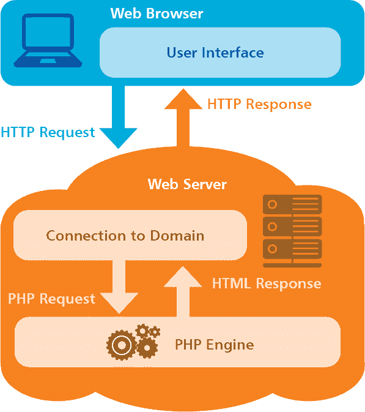


HTTP（HyperText Transfer Protocol）是通用通信标准，允许连接到任何 Web 服务器的任何计算机在网络上访问文件。

以下页面描述了如何通过在自己的计算机上安装以下服务器端技术来创建交互式网站的开发环境：

• `Web Server` – Abyss Web Server X1

• `PHP Engine` – PHP 8 (8.0.1)


本书中的示例均使用这些软件版本创建和测试，但对于其他版本可能需要修改。

### 安装 Abyss 服务器

Abyss X1 是一款免费的紧凑型 Web 服务器，可用于 Windows、macOS 和 Linux 操作系统，可在 [aprelium.com](http://www.aprelium.com) 下载

尽管占用空间很小，Abyss 支持许多强大的功能，包括使用服务器端脚本进行动态内容生成——因此是 PHP 的理想伴侣。


有关 Abyss Web Server 安装的进一步指导可在 [aprelium.com/abyssws/start.html](http://www.aprelium.com/abyssws/start.html) 获取

Abyss Web Server 可以安装在您自己的计算机上，以提供交互式 PHP 网站开发的环境：


从 [aprelium.com/abyssws/download.php](http://www.aprelium.com/abyssws/download.php) 下载适用于您系统的 Abyss X1 Web Server 安装包

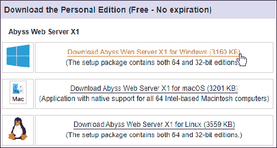


运行安装程序并 `Agree` 许可条款，然后选择 Abyss Web Server 组件并单击 `Next`

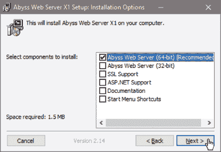


Windows 的 Abyss 安装包是一个名为 `abwsx1.exe` 的可执行文件，您运行它来安装 Web 服务器。


接受建议的位置 `C:\\Abyss Web Server`，然后选择 `Install as a Windows Service`

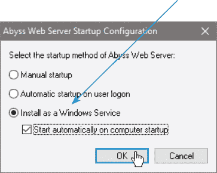

安装过程完成后，系统默认的 Web 浏览器将打开，显示 Abyss Web Server 控制台。


选择您喜欢的语言，然后输入用户名和密码以便将来访问 Abyss 控制台


现在，使用您选择的用户名和密码登录，以查看 Abyss 控制台确认服务器状态为“Running”

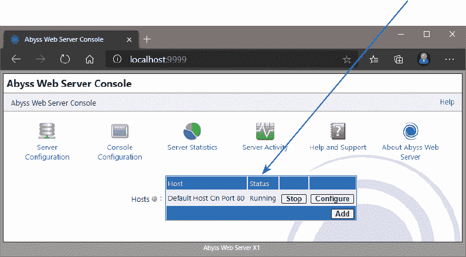


在浏览器地址栏中输入 `http://localhost`，然后按 `Enter`——以查看默认的 Abyss “Welcome” 页面

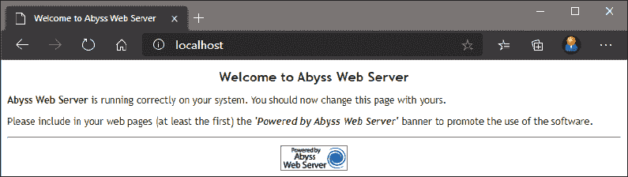


如果您选择“Manual startup”选项，Abyss 标志将不会出现在系统托盘中以便于启动/停止控制和访问服务器控制台。相反，控制台可以通过浏览器在 `http://localhost:9999` 或数字形式 `http://127.0.0.1:9999` 找到（“localhost”是 IP 地址 127.0.0.1 的别名）。


在 Abyss 控制台中，单击“Configure”按钮，然后单击 General 图标，即可看到默认 HTTP 端口为 80，默认 Documents Path（您的网页所在位置）为 `/htdocs`。

### 安装 PHP 引擎

PHP 解释器“engine”，它在网页中实现 PHP 脚本，可作为免费下载提供给 Windows、macOS 和 Linux 操作系统，网址为 [php.net](http://www.php.net)


有关 PHP 安装的进一步指导可在 [php.net/manual/en/install.php](http://www.php.net/manual/en/install.php) 获取


打开 Web 浏览器并导航到 [php.net](http://www.php.net)


接下来，在页面菜单中选择 `Downloads` 项目——以打开“Downloads”页面

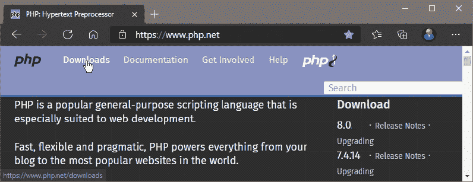


现在，选择要下载的软件包或选择 `Windows downloads` 链接——以打开“Windows binaries”页面

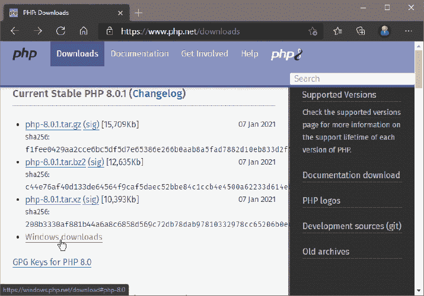


然后，单击 `Zip` 链接下载适用于 64 位系统的 PHP Thread Safe 归档文件

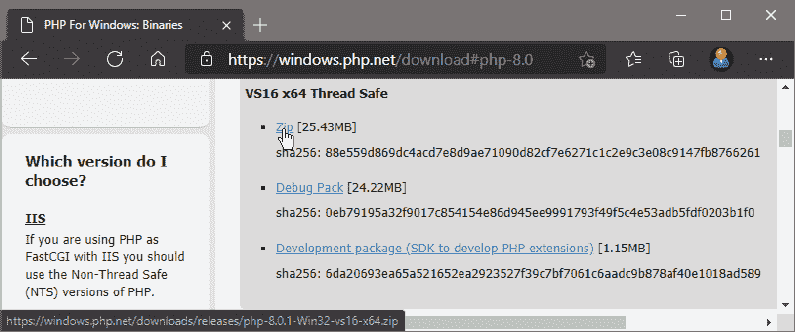


下载完成后，将其内容提取到系统上的方便位置——例如 `C:\\PHP`

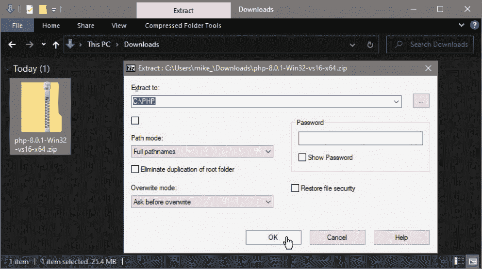

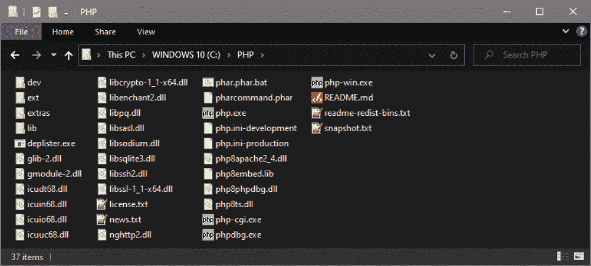


配置 Abyss Web Server 以集成 PHP 时将需要 PHP 安装位置——请记下目标文件夹。


在安装 PHP 之后，Web 服务器尚无法执行 PHP 脚本，直到对其进行配置以识别它们并找到 PHP 解释器引擎——所有内容均如 此后第 14-15 页 所述。

### 集成 Abyss 和 PHP


## Abyss Web Server PHP 配置

## 配置 PHP 解释器

Abyss Web Server 必须配置为识别 PHP 脚本，并在遇到它们时使用 PHP 解释器。这在 Abyss 控制台中通过将文件扩展名 `".php"` 关联为 PHP 脚本，并指定系统上 PHP 引擎的位置来解释它们来实现：

在浏览器地址栏输入 `http://localhost:9999` 以启动 Abyss Web Server 控制台，然后单击 **配置** 按钮 – 以打开配置页面

单击 **脚本参数** 图标 – 以打开脚本参数编辑页面

确保已选中 **启用脚本执行** 复选框，然后在解释器表中单击 **添加** 按钮 – 以打开解释器-添加页面

将 **接口** 参数设置为“FastCGI (Local - Pipes)”

将 **解释器** 参数设置为系统上 `php-cgi.exe` 文件的 PHP 路径位置

将 **关联扩展** 参数设置为“`php`”，因此您的配置应如下所示：

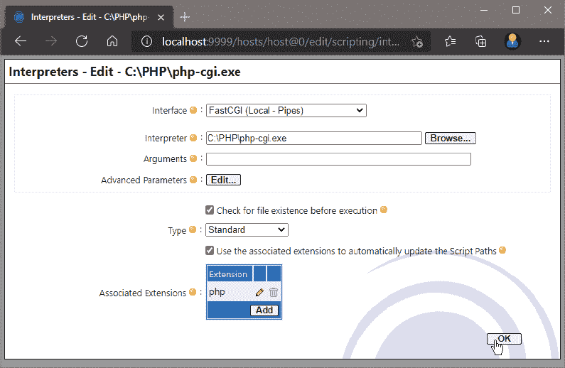


关于 Abyss Web Server 配置的进一步指导可在网上获得，网址为 **[aprelium.com/abyssws/start.html](http://www.aprelium.com/abyssws/start.html)**


为澄清本书中的代码示例，PHP 语言的组件以 **蓝色** 显示，程序员指定的名称以 **红色** 显示，数值和字符串数据以 **黑色** 显示，注释以 **绿色** 显示。


`localhost` 域名是 `127.0.0.1` 域名 IP 地址的别名 – 因此 Abyss Web Server 控制台也可以另行寻址为 `http://127.0.0.1:9999`。

单击 **确定** 按钮以验证您的新配置

单击随后出现的 **重启** 按钮，以应用您对 Abyss 配置所做的更改

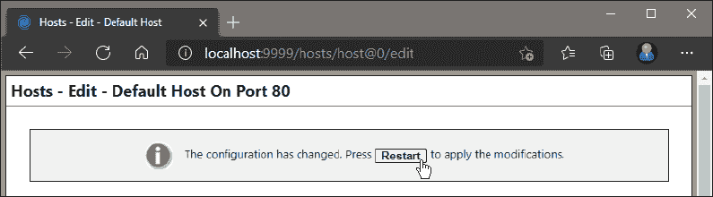


## 测试配置

文档只有在使用 HTTP 协议由 Web 服务器提供服务时才能由 PHP 引擎解释。您不能直接在浏览器中打开 PHP 文件。始终使用位置 `http://localhost/` 来提供本书中的示例。

Abyss Web Server 现在应该在您的系统上运行，已正确配置为识别具有 `.php` 文件扩展名的文档应由 PHP 引擎解释。现在可以通过创建简单的 PHP 脚本来测试配置，以便 Abyss 为您的 Web 浏览器提供服务：

打开一个纯文本编辑器并准确输入下面的脚本

`<?php phpinfo() ;  ?>`


`phpinfo.php`

将脚本另存为 `phpinfo.php`，保存在 Abyss 文档路径目录中，通常位于 `C:\\Abyss Web Server\\htdocs`

在 Web 浏览器的地址栏中准确输入位置 `http://localhost/phpinfo.php`，以查看 Abyss 提供包含您的 PHP 版本信息的网页

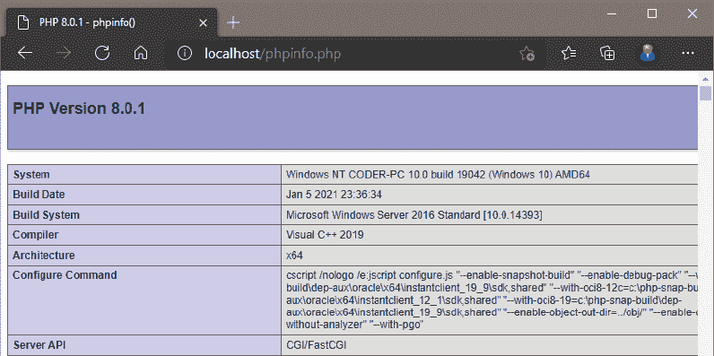


PHP 脚本区分大小写，因此您必须仅使用小写字符复制所列脚本。

## 嵌入 PHP 脚本代码


PHP 脚本可以嵌入 HTML 文档中 – 意味着 PHP 和 HTML 代码可以愉快地共存于同一文件中。所有嵌入的 PHP 代码必须包含在 `<?php` 和 `?>` 标签内，以便 PHP 引擎能够轻松识别并解释。通常，PHP 代码会将内容写入 HTML 文档的 body 部分，然后发送到 Web 浏览器：

启动纯文本编辑器并创建此有效的简易 HTML 文档，其中 body 部分为空

```
<!DOCTYPE HTML>
<html lang=“en”>
<head>
<meta charset=”UTF-8”>
<title>Getting Started In PHP</title>
</head>
<body>
</body>
</html>
```


`hello.php`

在 body 部分插入标签以包含 PHP 代码

```
<?php
?>
```

接下来，在 PHP 标签之间插入描述性注释和一行代码以将内容写入 body 部分

```
\# Write the traditional greeting.
echo ‘<h1>Hello World!</h1>’ ;
```

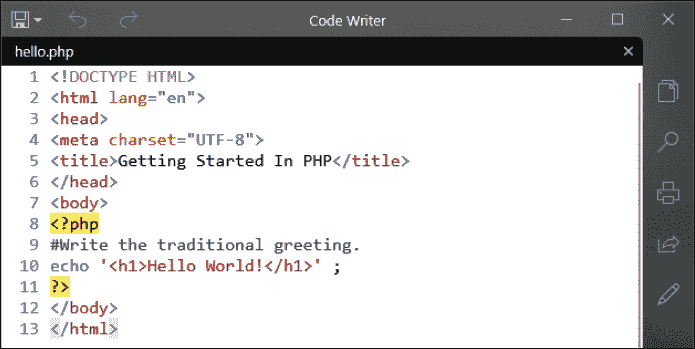


请注意，描述性注释仅出于信息目的而包含在 PHP 标签之间。

将文档另存为 `hello.php`，保存在 Abyss Web 服务器的 `/htdocs` 文件夹中

现在，在 Web 浏览器的地址栏中输入位置 `http://localhost/hello.php` – 以查看 Abyss 提供包含由嵌入式 PHP 代码编写的内容的网页

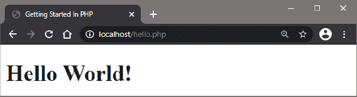

使用 Web 浏览器的工具检查页面的源代码 – 以查看 PHP 已将内容写入 body 部分，包括 HTML `<h1> </h1>` 标签

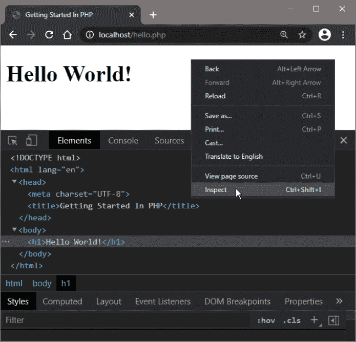


请注意，PHP `echo` 指令会原样写入 **‘ ‘** 单引号对中包含的全部内容。本书中的示例演示了嵌入式 PHP 脚本，但不会重复列出 HTML 代码。

## 按规则脚本编写


### 标签规则

当 PHP 引擎从 Web 服务器接收输入时，它会从上到下读取输入，此过程称为“解析”。在解析过程中，PHP 引擎（又名解析器）会查找开始和结束的 `<?php` 和 `?>` 标签，并理解这些标签之间的内容是它必须解释的脚本代码。 `<?php` 和 `?>` 标签之外的所有内容都将被完全忽略，这允许 PHP 文件具有混合内容，并允许 PHP 代码嵌入 HTML 中，如下所示：

```
<p>Ignored by PHP and displayed by the browser</p>
<?php echo ‘Script code that will be parsed’ ; ?>
<p>Also ignored by PHP and displayed by the browser</p>
```

因此，为了使此功能正常工作，当嵌入 HTML 文件时，确保所有 PHP 脚本代码都包含在开始和结束的 `<?php` 和 `?>` 标签之间非常重要。


通常，您的嵌入式 PHP 代码始终会在脚本周围具有开始和结束的 `<?php` 和 `?>` 标签。

此规则的唯一例外是当 PHP 脚本写入纯 PHP 文件中时，该文件仅包含代码。在这种情况下，最好省略结束 `?>` 标签，如下所示：

```
<?php echo ‘Print this First’ ;
echo ‘Print this Last’ ;
```

如果您的 PHP 脚本代码仅打算将单个文本字符串插入 HTML 文档中，则您可以选择使用 PHP 短 echo `<?=` 和 `?>` 标签：

`<?= ‘Hello!’ ; ?>` 等同于 `<?php echo ‘Hello!’ ; ?>`

高级 PHP 脚本代码也可以仅在满足测试条件时插入文本，如下所示：

```
<?php if ( $expression \== true ) : ?>
Insert this text only if the expression is true.
<?php else : ?>
Otherwise insert this text.
<?php endif ; ?>
```


条件测试将在本书后面完全解释并演示，见 第 3 章。

### 语句规则

PHP 语言中的每个语句都必须以 `;` 分号字符结尾 – 就像英语中的每个句子都必须以 `.` 句号字符结尾一样。分号被解析器识别为标记它必须解释的单个指令的结束。因此，包含两个语句的 PHP 代码块可能如下所示：

`<?php echo ‘First statement’ ; echo ‘Second statement’ ; ?>`

然而，PHP 代码块的结束 `?>` 标签会自动隐含一个分号，因此您可以选择省略 PHP 块最后一个语句的终止分号，如下所示：


`<?php echo ‘First statement’ ; echo ‘Second statement’ ?>`


如果你愿意这样做，终止 PHP 块的最后一个语句也不会造成任何危害。

## 注释规则

在 PHP 脚本代码中添加注释通常是值得的，这样可以让他人更容易理解，或者在以后重新审视代码时让你自己更容易理解。PHP 解析器会完全忽略所有空白和注释，因此你可以添加任意数量的注释，而不会对性能产生任何不利影响。

单行注释可以以 `#` 井号字符开头，或者也可以以 `//` 双斜杠序列开头。

多行（块）注释必须用 `/*` 和 `*/` 字符序列括起来，如 C 编程语言中所使用：

```
<?php
echo ‘First statement’ ; // A single-line comment.
/* This is a multi-line comment  
containing two lines of comment. */
echo ‘Second statement’ ;
echo ‘Final statement’ ; # Another single-line comment.
?>
```


`//` 单行注释风格也用于 C++ 编程，而 `#` 单行注释风格也用于 Unix/Linux BASH shell 脚本。

## 提高性能


了解 PHP 引擎执行 PHP 代码时执行一系列操作是有用的：

- **词法分析** – 分析代码并生成一系列“tokens”。例如，标签 `<?php` 生成标记 `T_OPEN_TAG`，关键字 `echo` 生成标记 `T_ECHO`，而字符串 `"Hello World!"` 生成 `T_CONSTANT_ENCAPSED_STRING`。
- **解析** – 将标记排列成“Abstract Syntax Tree” (AST)。它表示应执行哪些操作。例如，打印两个数字相加结果的 AST 可能看起来像这样：

```
operation => ECHO,
operand => expression (
operation => ADD,
operand1 => 4,
operand2 => 8
)
```
- **编译** – 将抽象语法树翻译成指令性操作代码（“OPcode”）。这是在机器语言中的中间表示（IR）。
- **执行** – 在“Zend Virtual Machine” (VM) 上运行 OPcode。它解释 OPcode 以产生输出。

每次执行 PHP 脚本时都执行所有这些步骤效率不高，因此 PHP 包含一个名为“OPcache”的扩展，可以启用以提高性能。OPcache 将 OPcodes 存储在内存中，因此词法分析、解析和编译只会在 PHP 脚本首次执行时进行。随后，存储在内存中的低级中间表示可以立即在 Zend VM 上执行。

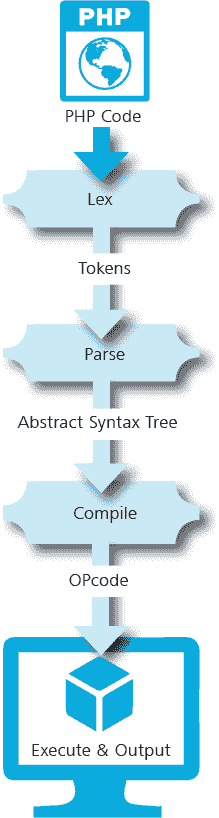

要启用 OPcache，您需要编辑 PHP 的初始化文件。PHP 安装文件夹，例如 `C:\\PHP`，包含名为 `php.ini-development` 和 `php.ini-production` 的文件，它们是初始化模板文件。启动时，PHP 会尝试查找并加载名为 `php.ini` 的初始化文件。可以使用任一模板文件的副本来实现此目的，但建议使用名为 `php.ini-production` 的模板，因为该文件中的默认设置针对性能和安全性进行了优化。OPcache 扩展是一个名为 `php_opcache.dll` 的文件，位于 PHP 安装文件夹内的“ext”文件夹中。

 导航到您的 PHP 安装文件夹，然后将 `php.ini-production` 文件的副本精确保存为“php.ini”


php.ini

 接下来，使用 Windows 的记事本等文本编辑器打开 `php.ini` 文件

 现在，在 `php.ini` 文件末尾添加一行以指定 OPcache 的位置

`zend_extension=C:\\PHP\\ext\\php_opcache.dll`

 然后，添加一行以启用 OPcache 扩展

`opcache.enable=1`

 保存文件然后重启 Web 服务器并检查 `phpinfo.php` 输出以确认 OPcache 现在已启用

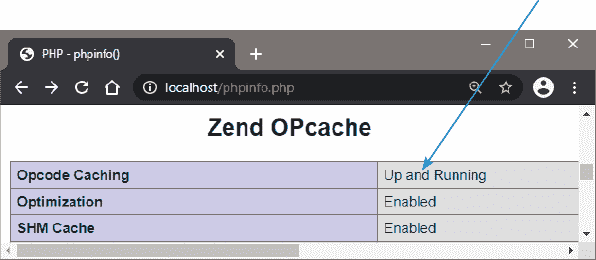

 向下滚动 Zend OPcache 部分，可看到“Cache hits”和“Cache misses”最初均为零

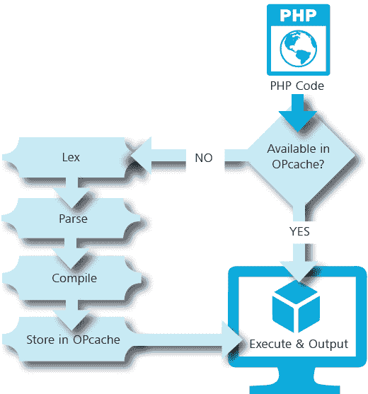

 加载 `hello.php` 文件并反复重新检查 `phpinfo.php` 输出，可看到“Cache misses”首先增加到 1，然后在后续访问中“Cache hits”递增

## 启用 JIT 编译

此处第 20-21 页所述的 OPcache 扩展允许 PHP 避免重复的词法分析、解析和编译，但使用“Just In Time” (JIT) 编译可以进一步提高性能。


PHP 的 JIT 编译功能生成可在许多不同 CPU 类型上执行的汇编语言代码中的低级 CPU 指令。它将 OPcode 转换为可由系统 CPU 直接执行的特定于架构的机器代码。

当 PHP 代码首次运行时，Zend VM 执行的 OPcode 会被 PHP 检查以决定哪些部分适合 JIT 编译。后续执行直接由系统 CPU 执行——绕过 Zend VM。

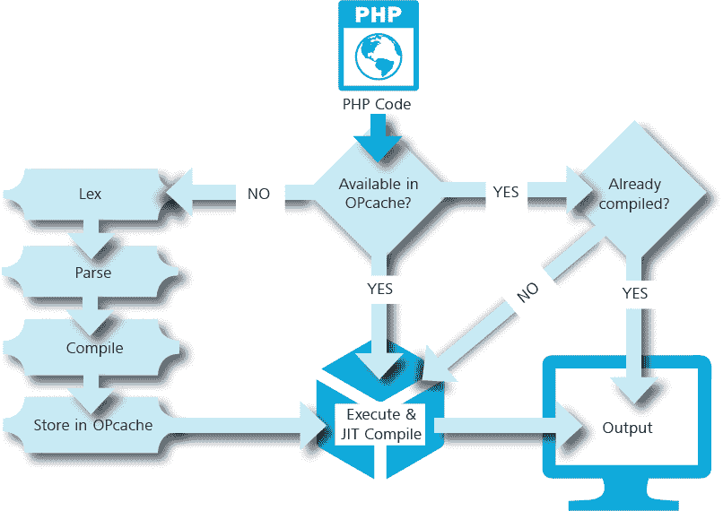

必须先启用 OPcache 扩展才能使用 JIT 编译，并且您必须在 PHP 初始化文件 `php.ini` 中指定为编译代码分配多少内存。


即时编译是 PHP 8 中引入的一个很棒的新功能。

 使用 Windows 的记事本等文本编辑器打开 `php.ini` 文件


php.ini

 现在，在 `php.ini` 文件末尾添加一行以指定为编译代码分配 100 兆字节的内存

`opcache.jit_buffer_size=100M`

 保存文件然后重启 Web 服务器并检查 `phpinfo.php` 输出以确认 JIT 编译已开启

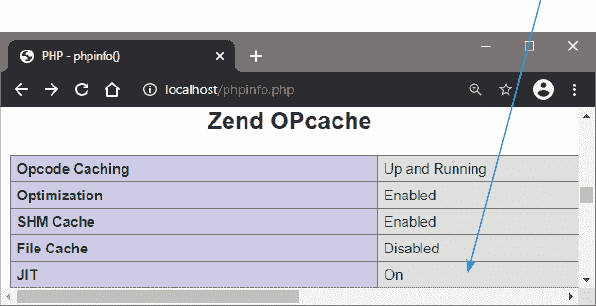


bench.php

预计在未来，对于 CPU 密集型任务（如人工智能（AI））而言，性能将变得更加重要。为了比较 OPcache 和 JIT 编译提供的性能改进，基准 PHP 脚本可能包含各种 CPU 密集型任务。此处未列出但包含在本書源代码存档中的 PHP 基准脚本在以各种 PHP 配置执行时产生了下面的结果：

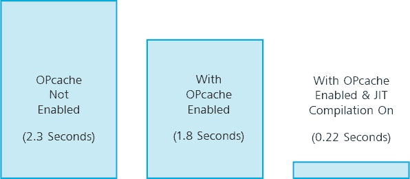

## 摘要

- PHP 是一种脚本语言，特别适合 Web 开发，因为它可以嵌入 HTML 中。
- PHP 代码在云端服务器端执行，而不像 JavaScript 代码那样在浏览器客户端执行。
- Web 服务器会先调用 PHP 引擎处理 PHP 代码，然后再将响应发送到 Web 浏览器。
- 通过在自己的计算机上安装 Web 服务器和 PHP 引擎，可以创建本地开发环境。
- `http://localhost` URL 是 `http://127.0.0.1` 数值 IP 地址的别名。
- 访问 Abyss Web Server 控制台需要您的用户名和密码，网址为 `http://localhost:9999`。
- Web 服务器必须配置为识别脚本，以便通过设置接口、解释器和关联扩展参数将其定向到 PHP 引擎。
- PHP 代码指令 `phpinfo()` 可用于提供包含您的 PHP 版本信息的网页。
- PHP `echo` 指令会原样写入引号内包含的文本内容。
- 所有嵌入的 PHP 代码必须用 `<?php` 和 `?>` 标签括起来，以便 PHP 引擎识别。
- PHP 语言中的每个语句都必须以 `;` 分号字符结尾。
- 单行注释可以以 `#` 井号字符开头或以 `//` 双斜杠序列开头。


- 多行块注释必须用 `/*` 和 `*/` 字符序列括起来。
- `OPcache` 将 OPcodes 存储在内存中以供 Zend 虚拟机执行。
- 即时编译生成低级指令，可直接由系统的 CPU 执行。

# 2 存储值

*本章演示了数据可以存储在其中的各种 PHP 容器。*

创建变量
引用字符串
生成数组
排序数组
描述维度
检查类型
定义常量
探索超全局变量
摘要

## 创建变量

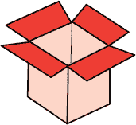

“变量”是在 PHP 脚本中用于存储数据值的命名容器。存储的值可以使用变量的名称引用，并在脚本执行过程中进行更改（变化）。脚本作者可以为变量选择任何名称，只要它遵循以下三个命名约定：

- 名称必须以 $ 美元符号开头 – 例如，`$name`。
- 名称可以包含字母、数字和下划线字符，但不能包含空格 – 例如，`$subtotal_1`。
- $ 美元符号后的第一个字符必须是字母或下划线字符 – 不能是数字。

请注意，PHP 中的变量名区分大小写，因此 `$name`、`$Name` 和 `$NAME` 是三个独立的变量。


在 PHP 中 `$this` 是一个特殊变量，因此不能使用“this”作为变量名。

PHP 变量是“松散类型”的，这意味着它们可以包含任何类型的数据，这与某些语言中的“强类型”变量不同，在强类型变量中，创建变量时必须指定数据类型。因此，PHP 变量可以愉快地包含整数、浮点数、文本字符串、TRUE 或 FALSE 的布尔值、对象或 NULL 空值。

在 PHP 脚本中，变量只需声明其名称即可创建。然后可以使用 = 赋值运算符为其指定初始值（初始化）。此语句以及 PHP 中的所有其他语句都必须以分号结束，如下所示：

`$body_temp = 98.6 ;`


脚本中可访问的变量必须具有唯一名称。有关“变量作用域”的更多信息，请参阅第 82 页此处。

然后可以通过使用变量名引用它来显示变量中包含的值，如下所示：

`echo $body_temp ;`

有用的是，变量的值可以通过将字符串和变量名用双引号括起来作为混合字符串的一部分显示：

`echo "Body temperature is $body_temp degrees Fahrenheit" ;`

双引号可确保 PHP 评估整个字符串并用其存储的值替换命名变量。如果字符串用单引号括起来，此功能不起作用！


不要混淆双引号和单引号的用途。请记住，PHP 仅对用双引号括起来的混合字符串进行变量替换。

创建有效的 HTML 文档，如第 16 页此处所列，然后在 body 部分插入 PHP 标签

```
<?php
# Statements to be inserted here.
?>
```


`variable.php`

现在，在 PHP 标签之间插入一条语句来创建并初始化变量

`$body_temp = 98.6 ;`

接下来，插入一条语句单独显示变量值

`echo $body_temp ;`

然后，插入一条语句以在混合字符串中显示变量值（用双引号赋值）

`echo "<p>Body temperature is $body_temp`
`degrees Fahrenheit " ;`

插入一条语句为变量分配新值

`$body_temp = 37.0 ;`

最后，插入一条语句以在混合字符串中显示新的变量值

`echo "( $body_temp degrees Celsius )</p>" ;`

将文档保存到 Web 服务器的 `/htdocs` 目录中，命名为 `variable.php`，然后通过 HTTP 打开页面以查看变量值是否显示

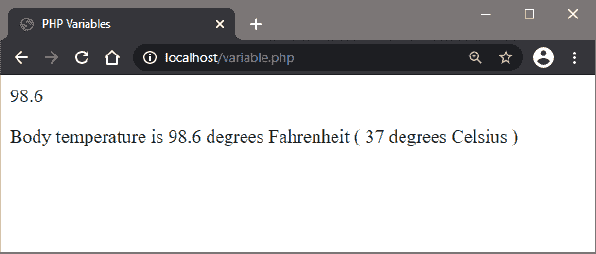


请注意，像本示例中这样在脚本主体中创建的变量是“全局”可访问的 – 在整个 PHP 脚本中都可访问。


PHP 语言中的每个语句都必须以分号结尾 – 就像英语中的每个语句都必须以句号结尾一样。

## 引用字符串


“字符串”文本可以像数值一样存储在变量中，但赋值必须用引号括起来以表示其开始和结束。单引号和双引号都可用于此目的，但必须使用相同类型的引号来表示文本字符串的开始和结束。例如，这两个语句都可进行有效的字符串赋值：

`$song_title = "Summertime Blues" ;`
`$song_title = 'Summertime Blues' ;`

如果要存储本身包含引号的文本字符串，可以通过在引号前加上 `\` 反斜杠字符来“转义”包含的引号，或在字符串中使用另一种类型的引号。例如，这两个语句都分配包含引号的字符串：

`$song_title = "the \"Summertime\" aria by George Gershwin" ;`
`$song_title = 'the "Summertime" aria by George Gershwin' ;`

第二种技术，即在字符串中使用双引号，更易于阅读，并在整本书中被优先采用。


变量名不能包含空格 – 但下划线字符通常用于代替空格。

字符串值可以通过将混合字符串用双引号括起来作为混合字符串的一部分显示，如下所示：

`echo "Many regard $song_title as a popular classic" ;`

双引号可确保 PHP 评估混合字符串并用其存储的值替换命名变量。如果字符串用单引号括起来，此功能不起作用！

字符串值可以使用 . 串联运算符连接成一个字符串，如下所示：

`$hi = 'Hello' ;`
`$bye = 'Goodbye' ;`
`$song_title = $hi . $bye ;            # 'HelloGoodbye'`

此外，在连接字符串时可以有用地插入空格和标点符号，因此上面的标题赋值可以修改为包含逗号和空格：

`$song_title = $hi . ', ' . $bye ;      # 'Hello, Goodbye'`

创建有效的 HTML 文档，如第 16 页此处所列，然后在 body 部分插入 PHP 标签

```
<?php
# Statements to be inserted here.
?>
```


`string.php`

现在，在 PHP 标签之间插入一条语句来创建并初始化两个变量

`$phrase = 'The truth is rarely pure' ;`
`$author = 'Oscar Wilde' ;`

接下来，插入一条语句单独显示变量值

`echo $phrase ;`

然后，插入一条语句以在混合字符串中显示变量值（用双引号赋值）

`echo "<p>It is often said that <q>$phrase</q> </p>" ;`

插入一条语句将字符串连接到变量

`$phrase = $phrase . ' and never simple' ;`

最后，插入一条语句以在混合字符串中显示两个当前变量值

`echo "<p><q>$phrase</q><cite>$author</cite></p>" ;`


 将文档保存在你的 Web 服务器的 `/htdocs` 目录下，命名为 `string.php`，然后通过 HTTP 打开页面即可看到变量值被显示

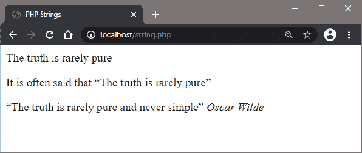


你还可以使用简写的连接赋值运算符 ` .= ` 来连接两个字符串——因此 `$a = $a . $b` 可以简写为 `$a .= $b`。


为你的变量采用一致的命名风格——例如全部小写 `$my_var`，或“驼峰式” `$myVar`。

## 创建数组


### 索引数组

数组变量可以存储多个数据项到按顺序排列的数组“元素”中，这些元素从零开始编号（“索引”）。因此，第一个数组值存储在数组元素编号零中。单个数组元素值可以通过变量名后跟方括号中的索引号来引用。例如，`$days[0]` 引用名为“days”的数组变量的第一个数组元素中存储的值。类似地，`$days[1]` 引用存储在第二个数组元素中的值，以此类推。变量数组可以通过创建多个语句为连续元素赋值来创建，也可以通过使用 PHP `array()` 函数填充元素的单个语句来创建：

`$days[] = 'Monday' ; $days[] = 'Tuesday' ; $days[] = 'Wednesday' ;`

or…

`$days = array( 'Monday' , 'Tuesday' , 'Wednesday' ) ;`

两者都创建了一个数组，其中每个元素存储的值都可以使用其索引号引用，例如 `$days[0]`。


方括号表示“元素”，因此在使用 `array()` 函数进行赋值时变量名后不需要它们——只有在引用元素时才需要。

### 关联数组

创建数组时，你可以为每个元素可选地指定一个键名，用来引用该元素的值：

`$months['jan'] = 'January' ;`

`$months['feb'] = 'February' ;`

`$months['mar'] = 'March' ;`

or…

```
$months =
array( 'jan' => 'January' , 'feb' => 'February' , 'mar' => 'March' ) ;
```

两者都创建了一个数组，其中每个元素存储的值都可以使用其键名引用，例如 `$months['jan']`。

### 遍历数组

数组的所有元素都可以使用 `foreach` 循环遍历，依次引用每个元素的值并将其赋给一个变量：

```
foreach( $months as $value )
{
# Use the current $value on each iteration.
}
```

循环的每次迭代中也可以使用以下方式访问键：

```
foreach( $months as $key => $value )
{
# Use the current $key and $value on each iteration.
}
```

`foreach` 结构专门用于数组，提供了一种轻松遍历所有数组元素键和值的方法。有关循环的更多信息，请参阅 第 66-71 页在此。

 创建一个有效的 HTML 文档，如 第 16 页在此 所列，然后在 body 部分插入 PHP 标签

```
<?php
# Statements to be inserted here.
?>
```


`array.php`

 现在，在 PHP 标签之间插入一条语句来创建并初始化一个包含值的变量数组

`$days = array( 'Monday' , 'Tuesday' , 'Wednesday' ) ;`

 接下来，插入一条语句以项目符号列表的形式显示所有数组元素中的值

`foreach( $days as $value ) { echo "&bull; $value " ; }`

 然后，插入一条语句来创建并初始化一个同时包含键和值的变量数组

```
$months = array( 'jan' => 'January' ,
'feb' => 'February' , 'mar' => 'March' ) ;
```

 最后，插入语句以定义列表的形式显示所有元素中的键和值

`echo '<dl>' ;`

```
foreach( $months as $key => $value )
{ echo "<dt>$key<dd>$value" ; }
```

`echo '</dl>' ;`

 将文档保存在你的 Web 服务器的 `/htdocs` 目录下，命名为 `array.php`，然后通过 HTTP 打开页面即可看到变量数组元素值被显示

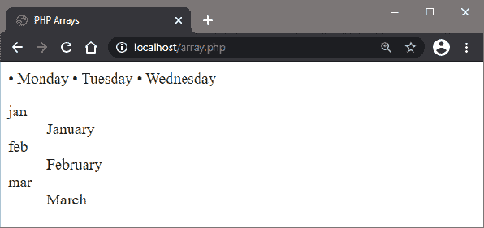


你可以将第一个元素的键设置为 1，这样索引将从 1 开始而不是 0，使用 `$months = array( 1 => 'January' , 'February' , March' ) ;`


如果你指定了键名，就不能通过索引号引用元素，如果你两次指定相同的键名，第二个值将覆盖第一个值。


你可以使用 PHP `range()` 函数轻松创建包含连续数字或字母的数组——例如，使用

`$six = range( 1 , 6 ) ;`

`$a_z = range( 'a','z' ) ;`

## 排序数组


PHP 提供了两个方便的函数来在变量数组和字符串之间转换，因为它们经常一起使用。`implode()` 函数将数组转换为字符串，并在每个值之间插入指定的分隔符。通常，这可能用于创建逗号分隔值（csv）列表，如下所示：

`$csv_list = implode( ' , ' , $array ) ;`

相反，`explode()` 函数通过指定分隔字符串的分隔符将字符串转换为数组。这可能用于从逗号分隔列表创建数组：

`$array = explode( ' , ' . $csv_list ) ;`

PHP 还提供了三个有用的函数来将数组元素按升序字母数字顺序（a-z 1-9）排序：

• `sort()` function – sorts by value discarding the original key.

• `asort()` function – sorts by value retaining the original key.

• `ksort()` function – sorts by key.

现有数组值可以用简单的语句排序，如下所示：

`$makers = array( 'Ford' , 'Chevrolet' , 'Dodge' ) ;`

`sort( $makers ) ;`

数组元素也可以使用三个类似的函数按降序字母数字顺序（9-1 z-a）排序：

• `rsort()` function – sorts by value discarding the original key.

• `arsort()` function – sorts by value retaining the original key.

• `krsort()` function – sorts by key.

重要的是要认识到指定的键名将被 `sort()` 和 `rsort()` 函数丢弃，因此这些函数只应在键/值关系不重要时使用——否则使用 `asort()` 和 `arsort()` 函数以保留键。


你可以使用 `is_array()` 函数测试一个变量是否为数组——例如，`is_array( $var ) ;`

 创建一个有效的 HTML 文档，如 第 16 页在此 所列，然后在 body 部分插入 PHP 标签

```
<?php
# Statements to be inserted here.
?>
```


`sort.php`

 现在，在 PHP 标签之间插入一条语句来创建并初始化一个包含键名和值的变量数组

```
$cars = array( 'Dodge' => 'Viper' ,
'Chevrolet' => 'Camaro' , 'Ford' => 'Mustang' ) ;
```

 接下来，插入语句以定义列表中项目符号列表的形式显示数组的所有键和值

`echo '<dl><dt>Original Element Order :<dd>' ;`

`foreach( $cars as $key => $value ) { echo ' &bull; ' , $key . ' ' . $value ; }`

 然后，插入语句以按值显示排序后的数组

`asort( $cars ) ;`

`echo '<dt>Sorted Into Value Order :<dd>' ;`

`foreach( $cars as $key => $value ) { echo ' &bull; ' , $key . ' ' . $value ; }`

 最后，插入语句以按键显示排序后的数组

`ksort( $cars ) ;`

`echo '<dt>Sorted Into Key Order :<dd>' ;`

`foreach( $cars as $key => $value ) { echo ' &bull; ' , $key . ' ' . $value ; }`

`echo '</dl>' ;`

 将文档保存在你的 Web 服务器的 `/htdocs` 目录下，命名为 `sort.php`，然后通过 HTTP 打开页面即可看到排序后的数组值被显示


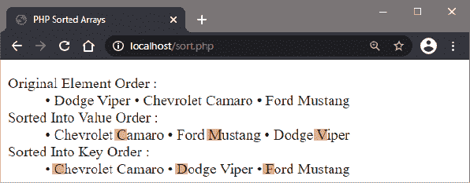

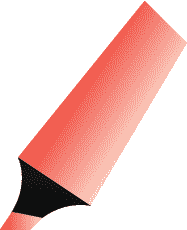


你可以用 `count()` 函数来发现数组中的元素数量 – 例如，`$num = count( $array ) ;`


不要在键很重要时使用 `sort()` 或 `rsort()` 函数。

## 描述维度


数组元素的编号更准确地称为“数组索引”，并且由于元素编号从零开始，有时也称为“零基索引”。使用单个索引创建的数组是一维数组，其中元素出现在单行中：

| 元素内容 || A || B || C || D || E |

| --- | --- | --- | --- | --- | --- |

| 索引编号 || \[0\] || \[1\] || \[2\] || \[3\] || \[4\] |

数组也可以具有多个索引 – 用于表示多个维度。使用两个索引创建的数组是二维数组，其中元素出现在多行中：

| 第一索引 || \[0\] || A || B || C || D || E |

| --- | --- | --- | --- | --- | --- | --- |

|  || \[1\] || F || G || H || I || J |

| 第二索引 ||  || \[0\] || \[1\] || \[2\] || \[3\] || \[4\] |

对于多维数组，每个元素包含的值是通过说明每个索引的编号来引用的。例如，上面二维数组中，位于 \[1\]\[2\] 的元素包含字母 H。

二维数组对于存储基于网格的信息很有用，例如 XY 坐标。创建具有三个索引的三维数组将允许存储 XYZ 坐标。

在 PHP 中创建多维数组只是在创建外部数组，其元素本身就是数组。如往常一样，您可以为每个元素可选地指定一个键名 – 在本例中表示每个内部数组。然后可以使用键名和内部索引号引用单个值：

`$matrix\[‘Letter’\]\[0\]`

然而，将使用带引号键的数组变量包含在字符串中时，始终必须用大括号括起来：

`echo “Element value is {$matrix\[‘Letter’\]\[0\]} ” ;`

可以使用 `foreach` 循环遍历数组来访问多维数组中的所有内部数组。然后嵌套的 `foreach` 循环可以依次引用每个元素。


具有超过两个索引的多维数组会产生难以阅读的源代码并可能导致错误。


创建一个有效的 HTML 文档，如 此处第 16 页 所列，然后在 body 部分插入 PHP 标签

```
<?php
# Statements to be inserted here.
?>
```


matrix.php


现在，在 PHP 标签之间插入一条语句来创建并初始化两个常规变量数组以及一个带键名的二维数组

```
$letters \= array( ‘A’ , ‘B’ , ‘C’ ) ;
$numbers \= array( 1 , 2 , 3 ) ;
$matrix \=
array( ‘Letter’ \=> $letters , ‘Number’ \=> $numbers ) ;
```


接下来，插入一条语句来显示单个存储的值

`echo “<p>Start : {$matrix\[‘Letter’\]\[0\]} </p>” ;`


最后，插入语句以将所有元素中的键和值作为两个无序列表显示

```
foreach( $matrix as $array \=> $list )
{
echo ‘<ul>’ ;
foreach( $list as $key \=> $value )
{ echo “<li>$array \[ $key \] = $value ” ; }
echo ‘</ul>’ ;
}
```


将文档保存在 Web 服务器的 `/htdocs` 目录中，命名为 `matrix.php`，然后通过 HTTP 打开页面以查看变量数组值是否显示

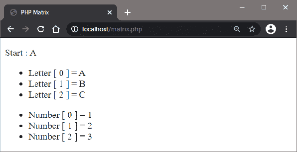


多维数组比你想象的更常见。例如，HTML 表单允许对具有相同名称的输入进行多次选择，并作为多维数组提交。


使用带引号键的数组变量在包含在字符串中时必须用大括号括起来。

## 检查类型


PHP 变量可以存储各种类型的数据，因此清楚地了解每种数据类型非常重要：

• string – 一系列字符，每个字符大小为一个字节，最大长度为 2GB。用单引号括起来的字符串被视为文字，而双引号中的字符串会解释特殊字符。

• int – 一个介于 2,147,483,648 和 -2,147,483,647 之间的非小数，以十进制（10 进制）、十六进制（16 进制 – 前缀为 0x）或八进制（8 进制 – 前缀为 0）指定。

• float – 一个浮点小数或指数格式的数字。float 也称为“double”。

• bool – 布尔真值的表达式，只能为 true 或 false。

• array – 一个有序映射，关联多个数据值的键和值。键默认按索引编号，也可显式指定标签。

• object – 一个包含存储的数据属性的类，并提供处理数据的方法。

• resource – 对由特殊函数创建和使用的外部资源的引用。

• NULL – 一个没有任何值的变量。它可能未初始化，已被赋值为 NULL 常量，或已被 PHP `unset()` 函数清空。

任何项目的数据类型都可以通过将其指定为 `gettype()` 函数的参数来检查。例如，如果变量 `$num` 包含整数值，`gettype($num)` 将返回“integer”，如果变量 `$str` 包含字符串值，`gettype($str)` 将返回“string”，依此类推。如果无法识别数据类型，`gettype()` 函数将返回“unknown type”。

也许更有用的是，`var_dump()` 函数可以检查项目的数据类型，并转储显示其类型和值的结构化信息。


PHP 类对象的创建和使用在 第 7 章。 中得到充分演示


创建一个有效的 HTML 文档，如 此处第 16 页 所列，然后在 body 部分插入 PHP 标签

```
<?php
# Statements to be inserted here.
?>
```


types.php


接下来，在 PHP 标签之间插入一条语句来创建一个文件流资源和一个数组

```
$filestream \= fopen( ‘index.html’ , ‘r’ ) ;
$data \= array( ‘PHP’ , 1 , 2.3 , TRUE , NULL , array() ,
new Directory , $filestream ) ;
```


现在，插入一条语句来显示每个数组元素中存储的数据类型

```
foreach( $data as $type )
{
var\_dump( $type ) ;
echo ‘<br> ‘ ;
}
```


最后，插入语句来销毁文件流资源，然后再次尝试获取其数据类型

```
fclose( $filestream ) ;
echo gettype( $filestream ) ;
```


将文档保存在 Web 服务器的 `/htdocs` 目录中，命名为 `types.php`，然后通过 HTTP 打开页面以查看数据类型和值是否显示

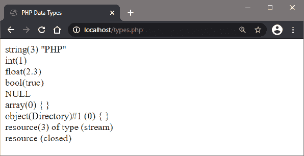


PHP 文件流资源的创建和使用在 第 8 章。 中得到充分演示


布尔常量 `TRUE` 和 `FALSE` 不区分大小写，因此可以写成 `true` 和 `false`。

## 定义常量

脚本中永远不会改变的固定数据值应存储在 PHP“常量”中，而不是变量中。常量是一个命名容器，其中可以存储数字或字符串值，并可以使用常量的名称引用。


## 常量

与变量不同，常量不能包含 `TRUE` 或 `FALSE` 的布尔值，也不能表示对象，也不能是 `NULL` 空值。此外，常量在脚本执行过程中不能被更改。这可以防止常量值被意外更改，是良好的编程实践。

常量名称遵循与变量相同的命名约定，但传统上使用大写字符作为常量名称——以便轻松将其与变量名称区分开。常量使用 `define()` 函数创建，以指定常量的名称和它将包含的值，如下所示：

`define( 'NAME' , value ) ;`

最重要的是，常量名称前面不加 `$` 美元符号，因此它们不能包含在混合字符串中用于显示——因为 PHP 无法区分常量名称和普通的以大写开头的字符串。例如，考虑以下语句：

`define( 'USER' , 'Mike' ) ;`

`echo "Hello USER"`

…这里的输出是 Hello USER，而不是期望的 Hello Mike。

为了在输出字符串中包含常量的值，必须单独引用它，并使用 PHP 的 `.` 串联运算符将其“串联”到字符串中，如下所示：

`echo 'Hello ' . USER ;`

…这里的输出现在是期望的 Hello Mike。

数组常量，其中所有元素都包含固定数据值，也可以使用 `define()` 函数创建，如下所示：

`define( 'WEEKDAYS' , [ 'Mon', 'Tue' , 'Wed' , 'Thu' , 'Fri' ] ) ;`

脚本作者定义的常量可以像 PHP 内置的预定义常量一样使用，例如描述版本和服务器操作系统的 `PHP_VERSION` 和 `PHP_OS`。


创建变量时，始终考虑其值是否会 ever 改变——如果不会，您应该改创建常量；例如，`define( 'PI' , 3.14 ) ;`

创建有效的 HTML 文档，如 见第 16 页 所列，然后在 body 部分插入 PHP 标签

```
<?php
# Statements to be inserted here.
?>
```


`constant.php`

现在，在 PHP 标签之间插入一条语句来创建并初始化一个常量

`define( 'USER' , 'Mike' ) ;`

添加一条语句来创建并初始化一个数组常量

`define( 'PETS' , [ 'Kitten' , 'Puppy' , 'Hamster' ] ) ;`

接下来，插入一条语句以在串联字符串中显示两个常量值

`echo '<p>Hello ' . USER . ' how is your ' . PETS[1] . '?</p>' ;`

插入一条语句以在串联字符串中显示 PHP 版本的预定义常量值

`echo '<p>You are using PHP version ' . PHP_VERSION ;`

最后，插入一条语句以在字符串中显示主机操作系统的预定义常量值

`echo ' running on ' . PHP_OS . '</p>' ;`

将文档保存在您 Web 服务器的 `/htdocs` 目录中，命名为 `constant.php`，然后通过 HTTP 打开页面以查看结果的显示

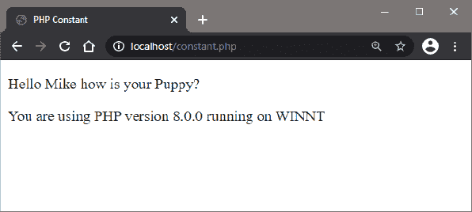


您不能在混合字符串中包含常量，或更改其值，或以美元符号开头其名称。


您应始终对常量名称使用大写，以便在代码中轻松将其与变量区分开。

## 探索超全局变量

PHP 提供了几个预定义变量，它们在任何脚本中的任何位置都始终全局可用。这些恰当地被称为“超全局变量”，并在此简要描述：

•`$GLOBALS` – 包含当前在脚本全局作用域中定义的全部变量引用的关联数组，根据上下文。变量名称是此关联数组的键——例如：

`foreach( $GLOBALS as $key => $var) echo "&bull; $key ";`

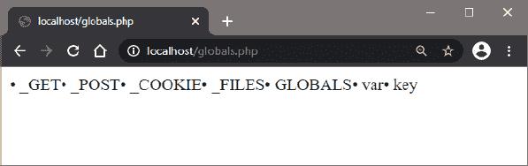

•`$_SERVER` – 包含诸如标头、路径和脚本位置等信息的数组，由 Web 服务器任意提供。

•`$_GET` – 通过附加 URL 参数传递给脚本的变量的关联数组。

•`$_POST` – 通过 HTTP POST 方法传递给脚本的变量的关联数组。

•`$_FILES` – 通过 HTTP POST 方法传递给脚本的已上传文件项的关联数组。

•`$_COOKIE` – 通过 HTTP 从用户计算机上的 cookie 传递给脚本的变量的关联数组。

•`$_SESSION` – 包含在用户退出之前对网站上每个脚本都可用的变量的关联数组。

•`$_REQUEST` – 默认包含 `$_GET`、`$_POST` 和 `$_COOKIE` 内容的关联数组。

•`$_ENV` – 由 PHP 解析器运行所在的 shell 环境传递给当前脚本的变量的关联数组。不同的系统会运行不同种类的 shell。


`$_FILES` 超全局变量由文件上传示例 见第 152 页 使用。


`$_POST` 超全局变量由 HTML 表单提交示例 见第 138 页 使用。


`$_COOKIE` 超全局变量由示例 见第 162 页 使用，以从用户计算机上的 cookie 获取数据。


`$_SESSION` 超全局变量由示例 见第 167 页 使用，以在 Web 服务器上存储数据。

创建有效的 HTML 文档，如 见第 16 页 所列，然后在 body 部分插入 PHP 标签

```
<?php
# Statements to be inserted here.
?>
```


`supers.php`

现在，在 PHP 标签之间插入一条语句以显示您的服务器软件详细信息

`echo 'Web Server : '.$_SERVER[ 'SERVER_SOFTWARE' ].'<br>' ;`

添加一条语句以显示此脚本名称

`echo 'This Script : '.$_SERVER[ 'PHP_SELF' ].'<br>' ;`

接下来，插入语句以显示主机名和页面请求方法

`echo 'Host Name : '.$_SERVER[ 'HTTP_HOST' ].'<br>' ;`

`echo 'Request Method : '.$_SERVER[ 'REQUEST_METHOD' ] ;`

插入一条语句以显示附加的 URL 参数

```
foreach( $_GET as $key => $value )
{ echo '<hr>HTTP GET : '.$key.'='.$value ; }
```

将文档保存在您 Web 服务器的 `/htdocs` 目录中，命名为 `supers.php`

通过在浏览器地址字段中向脚本名称附加参数（如 `?name=mike&lang=PHP`）通过 HTTP 打开页面，以查看它们传递到脚本

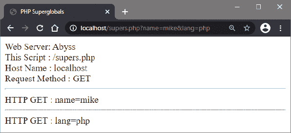


`$_SERVER[ 'PHP_SELF' ]` 由示例 见第 150 页 使用来创建“粘性” HTML 表单。


`$_SERVER[ 'REQUEST_METHOD' ]` 由示例 见第 148 页 使用来确定 HTML 表单是否已被用户提交。


HTTP `GET` 方法由示例 见第 182 页 使用来为 XML Web 服务响应设置参数。

## 摘要

•一个变量是可存储可变数据的命名容器。

•存储在变量中的值可以使用该变量的名称引用。

•变量名称必须以 `$` 美元符号开头，可包含字母、数字和下划线字符，且 `$` 之后的第一字符只能是字母或下划线。

•变量可以存储整数、浮点数、文本字符串、布尔值、对象或 `NULL` 值。

•变量使用 `=` 赋值运算符初始化，以为该变量分配初始值。

•变量的值可以通过仅用双引号将字符串和变量名称括起来作为混合字符串的一部分显示。


-   字符串可以用单引号或双引号括起来，内部的引号可以用反斜杠转义。
-   字符串值可以使用 `.` 拼接运算符连接成一个字符串。
-   数组变量可以存储多个数据项到按顺序排列的数组元素中，默认从零开始编号。
-   可选地，可以为每个数组元素指定键名。
-   一个 `foreach` 循环可以遍历数组中的每个元素。
-   `implode()` 和 `explode()` 函数通过添加或移除指定的分隔符在字符串和数组之间转换。
-   数组可以根据值或键按字母数字顺序排序。
-   多维数组只是一个其元素值本身也是数组的数组。
-   `gettype()` 和 `var_dump()` 函数可用于检查数据类型。
-   常量是一个命名容器，可在其中存储固定的整数、浮点数或文本字符串。
-   常量名不以 `$` 为前缀，并且全部大写。
-   常量使用 `define()` 函数进行初始化。
-   超全局变量在任何脚本的任何位置都始终全局可用。

# 3 执行操作

*本章演示了 PHP 用于算术、比较和逻辑评估的各种运算符。*

-   执行算术运算
-   进行比较
-   检查条件
-   评估逻辑
-   比较位
-   更改值
-   掌握优先级
-   摘要

## 执行算术运算

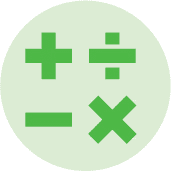

在下表中列出了 PHP 脚本中常用的算术运算符，以及它们执行的操作：

| Operator | Operation |
|---|---|
| `+` | 加法 |
| `-` | 减法 |
| `*` | 乘法 |
| `/` | 除法 |
| `%` | 取模 |
| `**` | 指数运算 |

加法、减法、乘法和除法运算符的行为如您所预期。然而，当使用多个运算符时，必须注意对表达式进行分组以提高清晰度：

`a = b * c - d % e / f ;` # 这不清晰。
`a = ( b * c ) - ( ( d % e ) / f ) ;` # 这更清晰。

`%` 取模运算符将第一个给定的数字除以第二个给定的数字并返回该操作的余数。这对于确定一个数字是奇数还是偶数很有用。


与运算符一起用于形成表达式的数字称为“操作数”——在表达式 `2 + 3` 中，数字 `2` 和 `3` 是操作数。

`**` 指数运算符给出将第一个操作数提高到第二个操作数次幂的结果。

`a ** b` # 将 a 提高到 b 次幂的结果。

通过将算术运算符与 `=` 赋值运算符组合，可以方便地创建简写表达式——例如：

`a += b ;` # 等价于 `a = ( a + b ) ;`
`a -= b ;` # 等价于 `a = ( a - b ) ;`
`a *= b ;` # 等价于 `a = ( a * b ) ;`
`a /= b ;` # 等价于 `a = ( a / b ) ;`


使用括号对表达式进行分组以指定求值优先级——最内层的组先求值。有关运算符优先级的更多信息，请参阅 此处第 55 页。

创建有效的 HTML 文档，如 此处第 16 页 所列，然后在 body 部分插入 PHP 标签

```
<?php
# Statements to be inserted here.
?>
```


`arithmetic.php`

现在，在 PHP 标签之间插入语句以创建并初始化两个变量

```
$a = 5 ;
$b = 2 ;
```

接下来，插入语句以使用变量值显示简单算术运算的结果

```
$result = $a + $b ; echo "Addition : $result <br>" ;
$result = $a - $b ; echo "Subtraction : $result <br>" ;
$result = $a * $b ; echo "Multiplication : $result <br>" ;
$result = $a / $b ; echo "Division : $result <br>" ;
```

最后，插入语句以显示变量值的算术求值结果

```
$result = $a % $b ; echo "Modulus : $result <br>" ;
$result = $a ** $b ; echo "Exponentiation : $result" ;
```

将文档保存到 Web 服务器的 `/htdocs` 目录中，命名为 `arithmetic.php`，然后通过 HTTP 打开页面以查看结果和变量值是否显示

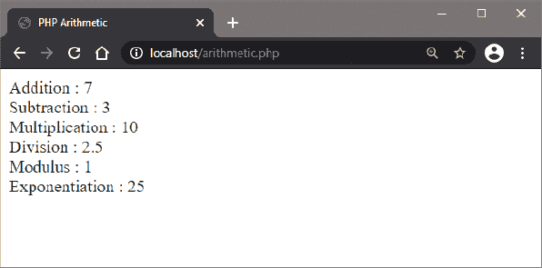


PHP 有一些处理数字的有用函数。例如，`round($a)` 将 `$a` 四舍五入到最接近的整数，而 `number_format($a)` 在 `$a` 中添加逗号表示千位分组。

## 进行比较


在下表中列出了 PHP 脚本中常用的用于比较两个值的运算符：

| Operator | Comparative test |
|---|---|
| `==` | 相等 |
| `===` | 恒等 |
| `!==` | 非恒等 |
| `!=` | 不相等 |
| `<>` | 不相等 |
| `>` | 大于 |
| `<` | 小于 |
| `>=` | 大于或等于 |
| `<=` | 小于或等于 |
| `<=>` | 太空船 |

`==` 相等运算符比较两个操作数，如果两者在数值上相等，则返回布尔值 TRUE，否则返回 FALSE。字符和字符串也按其 ASCII 码值进行数值比较。相反，`!=` 不等运算符如果两个操作数不相等则返回 TRUE，否则返回 FALSE。

`>` “大于”运算符比较两个操作数，如果第一个的值大于第二个，则返回 TRUE，如果相等或更小则返回 FALSE。`<` “小于”运算符进行相同的比较，但如果第一个操作数的值小于第二个，则返回 TRUE，否则返回 FALSE。在 `>` “大于”或 `<` “小于”运算符后添加 `=` 运算符，使其在两个操作数完全相等时也返回 TRUE。

`<=>` 太空船运算符在第一个操作数大于第二个时返回整数值 1，第一个操作数小于第二个时返回 -1，操作数相等时返回 0。

PHP 的 `var_dump()` 函数可用于查看每种比较产生的类型和值。


相等和不等运算符在测试两个变量的状态以在 PHP 脚本中执行条件分支时很有用。

创建有效的 HTML 文档，如 此处第 16 页 所列，然后在 body 部分插入 PHP 标签

```
<?php
# Statements to be inserted here.
?>
```


`comparison.php`

现在，在 PHP 标签之间插入语句以创建并初始化五个变量

```
$zero = 0 ; $nil = 0 ; $one = 1 ; $upr = 'A' ; $lwr = 'a' ;
```

接下来，插入语句以显示相等比较

```
echo "0 == 0 : " ; var_dump( $zero == $nil ) ;
echo "<br>0 == 1 : " ; var_dump( $zero == $one ) ;
echo "<br>A == a : " ; var_dump( $upr == $lwr ) ;
echo "<br>A != a : " ; var_dump( $upr != $lwr ) ;
```

插入语句以显示比较求值

```
echo "<hr>1 > 0 : " ; var_dump( $one > $nil ) ;
echo "<br>0 >= 0 : " ; var_dump( $zero >= $nil ) ;
echo "<br>1 <= 0 : " ; var_dump( $one <= $nil ) ;
echo "<hr>1 <=> 0 : " ; var_dump( $one <=> $nil ) ;
echo "<br>1 <=> 1 : " ; var_dump( $one <=> $one ) ;
echo "<br>0 <=> 1 : " ; var_dump( $nil <=> $one ) ;
```


将文档保存在你的 Web 服务器的 `/htdocs` 目录下，命名为 comparison.php，然后通过 HTTP 打开页面以查看结果的显示

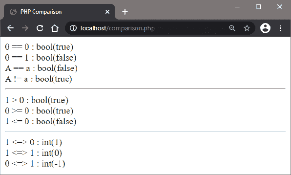


大写字母 ‘A’ 的 ASCII 码值为 65，小写字母 ‘a’ 为 97——因此它们在此处的比较返回 FALSE。


在 PHP 语言中，布尔值 TRUE 在数值上表示为 1。

## 检查条件

### 条件运算符


条件运算符 `?:` 也被称为“三元”运算符，因为它有三个组成部分。该运算符首先对表达式求值为 TRUE 或 FALSE 的布尔值，然后根据求值结果返回两个指定结果之一。条件运算符的语法如下所示：

`(*test-expression*) ? result-if-true : result-if-false;`

条件运算符可用于判断给定数字是否为一个或多个，以确保输出中单数和复数形式的语法正确。这避免了诸如“There is 5”之类的别扭表达：

`$verb = ( $number == 1 ) ? 'is' : 'are';`

`echo "There $verb $number";`

在这种情况下，当 `$number` 变量的值为 1 时，‘is’ 结果将被赋给 `$verb` 变量，否则将赋给 ‘are’ 结果。

条件运算符还可用于判断给定数字是奇数还是偶数（“parity”），通过检查除以 2 后是否有余数，然后分配适当的字符串结果，如下所示：

`$parity = ( $number % 2 == 0 ) ? 'Odd' : 'Even';`

`echo "$number is $parity";`

在这种情况下，当取模运算返回值为 1 时，‘Odd’ 结果将被赋给 `$parity` 变量，否则将赋给 ‘Even’ 结果。


不要在单个语句中使用超过一个 `?:` 条件运算符，因为结果可能不可预测。

### 空值合并运算符

PHP 有一个特殊的 NULL 值，它是内置常量，表示一个完全没有值的变量——甚至不是零。未被赋值的变量将被求值为 NULL。名称俏皮的 `??` “null coalescing”运算符可用于从左到右遍历多个操作数，并返回第一个非 NULL 操作数的值。如果没有任何操作数有值（并且不是 NULL），则空值合并运算符本身将返回 NULL 结果。


创建一个有效的 HTML 文档，如 此处第 16 页 所列，然后在 body 部分插入 PHP 标签

```
<?php
# Statements to be inserted here.
?>
```


condition.php


现在，在 PHP 标签之间插入语句以创建并初始化三个变量

`$a = NULL ; $b = 8 ; $c = 'PHP Fun' ;`


接下来，插入语句以输出正确的语法

`$verb = ( $b == 1 ) ? 'is' : 'are' ;`

`echo "There $verb $b <hr>";`


插入语句以显示整数变量的奇偶性

`$parity = ( $b % 2 != 0 ) ? 'Odd' : 'Even' ;`

`echo "$b is $parity <hr>";`


最后，插入语句以显示非空值

`$result = $a ?? $b ?? $c ; echo "abc : $result <br>" ;`

`$result = $c ?? $b ?? $a ; echo "cba : $result <br>" ;`


将文档保存在你的 Web 服务器的 `/htdocs` 目录下，命名为 condition.php，然后通过 HTTP 打开页面以查看结果的显示

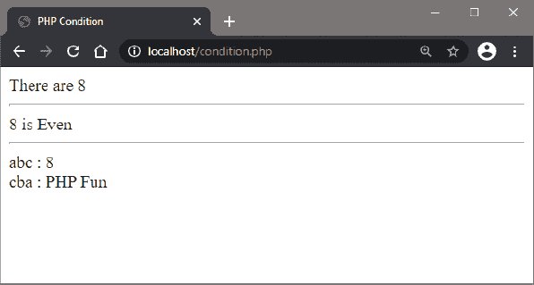


请注意，`$a` 中的 NULL 值被忽略了。

## 评估逻辑


PHP 脚本中最常用的逻辑运算符列于下表：

| 运算符 |  |  | 操作 |
| --- | --- | --- | --- |
| `and` |  | `&&` | 逻辑与 |
| `or` |  | `||` | 逻辑或 |
| `xor` |  |  | 逻辑异或 |
| `!` |  |  | 逻辑非 |

逻辑运算符与具有 TRUE 或 FALSE 布尔值的操作数一起使用，或可转换为 TRUE 或 FALSE 的表达式。

`and` 运算符将计算两个操作数，只有当两个操作数本身都为 TRUE 时才返回 TRUE。否则，`and` 运算符将返回 FALSE。这用于条件分支，其中 PHP 脚本的方向由测试两个条件决定。如果两个条件都满足，脚本将沿某个方向进行，否则将采取不同方向。

与需要两个操作数都为 TRUE 的 `and` 运算符不同，`or` 运算符将计算两个操作数，如果其中任一操作数本身为 TRUE，则返回 TRUE。如果两个操作数都不是 TRUE，则 `or` 运算符将返回 FALSE。这对于在两个测试条件之一满足时执行操作很有用。

`xor` 运算符将计算两个操作数，只有当其中一个操作数本身为 TRUE——但不是两者都为 TRUE 时才返回 TRUE。如果两个操作数都不是 TRUE，或者两个操作数都为 TRUE，则 `xor` 运算符将返回 FALSE。

`!` 逻辑 NOT 运算符是一个“单目”运算符——用于单个操作数之前。它返回给定操作数的反值，因此如果变量 `$var` 为 TRUE 值，则 `! $var` 将返回 FALSE 值。`!` 运算符可用于在循环中通过类似 `$var = ! $var` 的语句切换变量的值。每次迭代时值都会反转，就像开关的开和关一样。


`&&` 运算符是 `and` 运算符的替代形式。同样，`||` 运算符是 `or` 运算符的替代形式。


术语“Boolean”指的是由英国数学家 George Boole（1815-1864）创立的逻辑思想体系。


创建一个有效的 HTML 文档，如 此处第 16 页 所列，然后在 body 部分插入 PHP 标签

```
<?php
# Statements to be inserted here.
?>
```


logic.php


现在，在 PHP 标签之间插入语句以创建并初始化两个布尔值变量

`$yes = TRUE ; $no = FALSE ;`


接下来，插入语句以显示 AND 求值

`$result = ( $no && $no ) ? 'TRUE' : 'FALSE' ;`

`echo "No AND No returns $result <br>" ;`

`$result = ( $yes && $no ) ? 'TRUE' : 'FALSE' ;`

`echo "Yes AND No returns : $result <br>" ;`

`$result = ( $yes && $yes ) ? 'TRUE' : 'FALSE' ;`

`echo "Yes AND Yes returns $result <hr>" ;`


插入语句以显示 OR 和 NOT 求值

`$result = ( $no || $no ) ? 'TRUE' : 'FALSE' ;`

`echo "No OR No returns $result <br>" ;`

`$result = ( $yes || $no ) ? 'TRUE' : 'FALSE' ;`

`echo "Yes OR No returns $result <br>" ;`

`$result = ( $yes || $yes ) ? 'TRUE' : 'FALSE' ;`

`echo "Yes OR Yes returns $result <hr>" ;`

`$result = ( ! $yes ) ? 'TRUE' : 'FALSE' ;`

`echo "NOT Yes returns $result <br>" ;`


将文档保存在你的 Web 服务器的 `/htdocs` 目录下，命名为 logic.php，然后通过 HTTP 打开页面以查看结果的显示

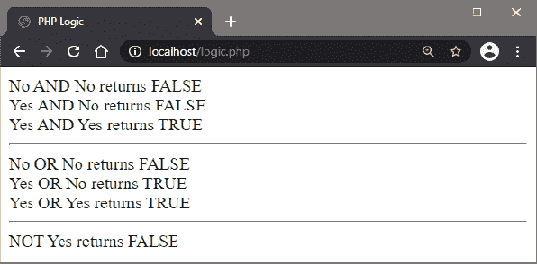


PHP 还有一个 `XOR`（exclusive `OR`）运算符，它执行 `AND NOT` 的等效求值。


请注意，`FALSE && FALSE` 的求值返回 `FALSE`——也许说明了“两错不等于一对”的轶事。

## 比较位


# 字节和按位运算符

## 字节表示

一个字节包含八位，每位可以包含 1 或 0 来存储二进制数，表示从 0 到 255 的十进制值。每个位仅在该位包含 1 时才贡献一个十进制分量。分量从右到左指定，从“最低有效位”（LSB）到“最高有效位”（MSB）。下面位模式中的二进制数表示十进制 50。


| **位号** || **8**  
最显著位 || **7** || **6** || **5** || **4** || **3** || **2** |
| --- | --- | --- | --- | --- | --- | --- | --- |
| **十进制** || **128** || **64** || **32** || **16** || **8** || **4** || **2** |
| **二进制** || **0** || **0** || **1** || **1** || **0** || **0** || **1** |

## 按位运算符

可以使用“按位”运算符操作字节的各个部分。按位运算符允许对整数中的特定位进行求值和操作。

| **操作符** || **名称** || **二进制数运算** |
| --- | --- | --- |
| `|` || 或 || 在任一比较位为 `1` 的每个位中返回 `1` 示例：`1010 | 0101 = 1111` |
| `&` || 与 || 在两个比较位均为 `1` 的每个位中返回 `1` 示例：`1010 && 1100 = 1000` |
| `~` || 非 || 在两个比较位均不为 `1` 的每个位中返回 `1` 示例：`~1010 = 0101` |
| `^` || 异或 || 在两个比较位中仅有一个为 `1` 的每个位中返回 `1` 示例：`1010 ^ 0100 = 1110` |
| `<<` || 左移 || 将每个为 `1` 的位向左移动指定数量的位 示例：`0010 << 2 = 1000` |
| `>>` || 右移 || 将每个为 `1` 的位向右移动指定数量的位 示例：`1000 >> 2 = 0010` |


## 尼布尔

字节的每一半称为“nibble”（半字节，4 位）。二进制的许多数字在表中的示例中描述了存储在 nibble 中的值。


许多 PHP 程序员从不使用按位运算符，但了解它们是什么以及如何使用是有用的。

除非为资源有限的设备编程，否则很少需要使用按位运算符，但它们可能很有用。例如，`^`（eXclusive OR）运算符允许您在两个变量之间交换值，而无需第三个变量：

## XOR 交换示例

创建一个有效的 HTML 文档，如 此处第 16 页 所列，然后在 body 部分插入 PHP 标签

```
<?php
# Statements to be inserted here.
?>
```


bitwise.php

现在，在 PHP 标签之间插入语句以创建并初始化两个整数值变量

```
$x = 5 ; $y =10 ;
```

接下来，添加一条语句来显示分配的值

```
echo “X : $x , Y : $y <br>” ;
```

插入三个 XOR 语句，通过二进制位操作交换变量值

```
$x = $x ^ $y ;
$y = $x ^ $y ;
$x = $x ^ $y ;
```

最后，添加一条语句来显示操作后的值

```
echo “X : $x , Y : $y <br>” ;
```

将文档保存在 Web 服务器的 `/htdocs` 目录中，命名为 `bitwise.php`，然后通过 HTTP 打开页面以查看 XOR 位运算的魔力

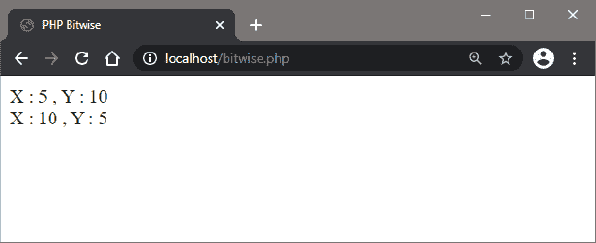


不要将按位运算符与逻辑运算符混淆。按位运算符比较二进制数，而逻辑运算符求值布尔值。

## 更改值


PHP `++` 自增运算符和 `--` 自减运算符将给定数字更改 1 并返回 resulting 新值。这些最常用于循环中计数迭代。自增运算符将值增加 1，自减运算符将值减少 1。这些运算符中的每一个都可能出现在包含要更改的数字的变量之前或之后——效果不同！当这些运算符中的任一个放置在变量之前（“前缀”）时，它们先将值更改 1 然后返回修改后的值，但当它们放置在变量之后（“后缀”）时，它们返回当前值，然后将值更改 1：

创建一个有效的 HTML 文档，如 此处第 16 页 所列，然后在 body 部分插入 PHP 标签

```
<?php
# Statements to be inserted here.
?>
```


change.php

现在，在 PHP 标签之间插入语句以创建并初始化四个变量，使其具有相同的整数值

```
$a = $b = $c = $d = 5 ;
```

接下来，添加语句以将每个值更改 1 并显示新的整数

```
echo “++A : “. ++$a . “<br>--B : “. --$b .”<hr>“ ;
echo “C++ : “. $c++ . “[now C : “. $c .”]<br>“ ;
echo “D-- : “. $d-- . “[now D : “. $d .”]<br>“ ;
```

将文档保存在 Web 服务器的 `/htdocs` 目录中，命名为 `change.php`，然后通过 HTTP 打开页面以查看结果

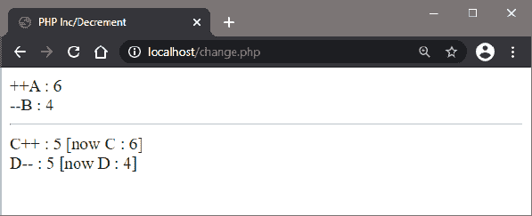


注意这里如何使用 `.` 串联运算符来形成字符串。您还可以使用 `.=` 串联赋值运算符将一个字符串附加到另一个字符串上。

## 理解优先级

PHP 运算符优先级决定表达式如何分组以进行求值。例如，表达式 `1 + 5 * 3` 求值为 16，而不是 18，因为 `*` 乘法运算符的优先级高于 `+` 加法运算符。可以使用括号指定优先级，以便 `(1 + 5) * 3` 求值为 18。当运算符具有相等优先级时，它们的“结合性”决定表达式如何分组。例如，`-` 减法运算符是左结合的，所以 `8 - 4 - 2` 分组为 `(8 - 4) - 2` 并求值为 2。下表按优先级顺序列出常见运算符，优先级最高者位于顶部。同一行的运算符具有相等优先级，因此运算符结合性决定表达式如何分组。


| **操作符** || **结合性** |
| --- | --- |
| `**` || **右** |
| `++ -- ~` || **右** |
| `!` || **右** |
| `* / %` || **左** |
| `+ - .` || **左** |
| `<< >>` || **左** |
| `< <= > >=` || **无** |
| `== != === !== <> <=>` || **无** |
| `&` || **左** |
| `^` || **左** |
| `|` || **左** |
| `&&` || **左** |
| `||` || **左** |
| `??` || **右** |
| `?=` || **左** |
| `= += -= *= /= **= .= %= &= |= ^= <<= >>= =>` || **右** |
| `and` || **左** |
| `xor` || **左** |
| `or` || **左** |
| `,` || **左** |


 eagle-eyed 的人会注意到逻辑运算符的替代形式具有不同的优先级级别。这可能导致诸如 `$bool = true and false` 与替代形式 `$bool = true && false` 这样的表达式产生意外结果。尝试每一种然后执行 `var_dump($bool)` 以查看差异。

## 摘要

• 算术运算符可以形成表达式，其操作数为加法 `+`、减法 `-`、乘法 `*`、除法 `/`、取模 `%` 和指数运算 `**`。

• 赋值运算符 `=` 可以与任何算术运算符组合以执行算术计算然后分配结果。

• 比较运算符可以形成表达式，其操作数为相等 `==`、不相等 `!=`、恒等或不恒等 `===`、`!==`、大于 `>`、小于 `<`、大于等于 `>=`、小于等于 `<=`、`<= >`。

• 条件运算符 `?:` 对表达式求值为 TRUE 或 FALSE 布尔值，然后根据求值返回两个指定结果之一。

• `??` 空合并运算符从左到右遍历操作数并返回第一个不为 null 的值。

• 逻辑运算符 `and`、`&&`、`or`、`||` 和 `xor` 形成求值两个操作数的表达式并返回 TRUE 或 FALSE 值。


- 逻辑 `!` 非运算符返回单个操作数的逆布尔值。
- 按位运算符 `|`, `&`, `~`, `^`, `<<` 和 `>>` 允许对整数中的特定位进行求值和操作。
- 前缀变量的递增 `++` 或递减 `--` 运算符将其值更改 1 并返回结果。
- 后缀变量的递增 `++` 或递减 `--` 运算符返回其当前值，然后将其值更改 1。
- 运算符优先级决定表达式如何分组求值。
- 当运算符具有相同优先级时，其结合性决定表达式如何分组求值。
- `var_dump()` 函数可用于查看表达式得到的类型和值。
- 特殊的 `NULL` 常量表示一个完全没有值的变量，甚至不是零。

# 4 测试条件

*本章演示了决定脚本如何进行的各种 PHP 控制结构。*

寻求真理
提供替代方案
切换分支
匹配表达式
执行循环
在为真时循环
从循环中跳出
摘要

## 寻求真理


`if` 关键字用于执行基本的条件测试，将给定表达式求值为布尔值 TRUE 或 FALSE。求值后花括号内的语句只有在表达式被判定为 TRUE 时才会被执行。当表达式被判定为 FALSE 时，PHP 解析器会直接跳到脚本的下一部分。

`if` 条件测试语句的语法如下：

```
if ( test-expression ) { statement-to-execute-when-true ; }
```

当测试为 TRUE 时可能有多个语句需要执行，但每个语句都必须以分号结尾：

```
if ( test-expression )
{
statement-to-execute-when-true ;
statement-to-execute-when-true ;
statement-to-execute-when-true ;
}
```


`if` 结构是 PHP 中最重要的特性之一，也是大多数其他编程语言中的重要特性。

可以使用逻辑 `&&` 或 `and` 运算符测试多个表达式，以确保只有当两个表达式都被判定为 TRUE 时，后续语句才会被执行，如下所示：

```
if ( ( test-expression ) && ( test-expression ) )
{
statement-to-execute-when-true ;
statement-to-execute-when-true ;
statement-to-execute-when-true ;
}
```

另外，`if` 条件测试语句可以嵌套以测试多个表达式，以便只有当所有测试都被判定为 TRUE 时，语句才会被执行，如下所示：

```
if ( test-expression )
{
if ( test-expression )
{
statement-to-execute-when-true ;
statement-to-execute-when-true ;
statement-to-execute-when-true ;
}
}
```


当要执行的代码只是单个语句时，花括号可以省略，但你可能更喜欢始终包含花括号以保持一致性。

可以使用多个 `if` 条件测试语句为脚本提供替代路径。

 在 PHP 标签之间，使用初始化整数变量的语句开始脚本

```php
<?php
$num = 8 ;
```


`if.php`

 接下来，添加在数值大小的条件测试被判定为 TRUE 时输出结果的语句

```php
if ( $num > 5 ) { echo "$num exceeds 5<br>" ; }
if ( $num <= 5 ) { echo "$num is below 6<br>" ; }
```

 现在，添加在奇偶性条件测试被判定为 TRUE 时输出结果的语句

```php
if ( $num % 2 == 0 ) { echo "$num is Even<br>" ; }
if ( $num % 2 != 0 ) { echo "$num is Odd<br>" ; }
?>
```

 将文档保存到你的 Web 服务器的 `/htdocs` 目录下，命名为 `if.php`，然后通过 HTTP 打开页面以查看成功测试的结果

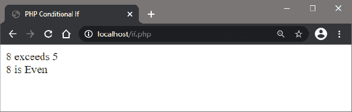

 编辑整数变量，然后保存修改后的脚本并刷新浏览器以查看其他成功测试的结果

```php
$num = 3 ;
```

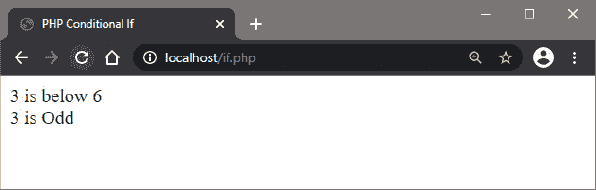


当测试条件为 FALSE 时，PHP 解析器会忽略其语句块并继续处理。

## 提供替代方案


通常最好通过附加 `else` 语句来扩展 `if` 语句，指定在 `if` 语句求值的表达式被判定为 FALSE 时执行的花括号内语句，语法如下：

```
if ( test-expression )
{
statement-to-execute-when-true ;
statement-to-execute-when-true ;
statement-to-execute-when-true ;
}
else
{
statement-to-execute-when-false ;
statement-to-execute-when-false ;
statement-to-execute-when-false ;
}
```

在条件测试中也可以通过添加 `elseif` 语句来求值替代表达式，指定在替代表达式被判定为 TRUE 时执行的花括号内语句。这里也可以附加 `else` 语句，以指定在 `if` 和 `elseif` 语句求值的表达式被判定为 FALSE 时执行的花括号内语句，语法如下：

```
if ( test-expression )
{
statement-to-execute-when-true ;
statement-to-execute-when-true ;
statement-to-execute-when-true ;
}
elseif ( test-expression )
{
statement-to-execute-when-true ;
statement-to-execute-when-true ;
statement-to-execute-when-true ;
}
else
{
statement-to-execute-when-false ;
statement-to-execute-when-false ;
statement-to-execute-when-false ;
}
```


`elseif` 关键字也可以写成两个独立的词：`else if`。

这是一种基本的编程技术，根据求值结果为脚本提供不同的执行方向，被称为“条件分支”。


你可能会遇到一些使用 `:` 冒号字符而不是花括号的 PHP 脚本。这不推荐，因为只有在使用花括号时，`if` 和 `else if` 才会被视为完全相同。

 在 PHP 标签之间，使用仅在测试表达式为 TRUE 时输出结果的语句开始脚本

```php
<?php
if ( 4 > 2 ) { echo '<p>Yes, 4 is greater than 2 <br>' ; }
```


`ifelse.php`

 接下来，添加仅在两个测试表达式都被判定为 TRUE 时输出结果的语句

```php
if ( ( 4 > 2 ) && ( 8 > 4 ) )
{ echo '4 is greater than 2 AND 8 is greater than 4<br>' ; }
```

 现在，添加在测试表达式被判定为 TRUE 或 FALSE 时输出结果的语句

```php
if ( 4 > 8 )
{ echo '4 is greater than 8 <br>' ; }
else
{ echo '4 is less than 8 <br>' ; }
```

 最后，添加在两个测试表达式中任一被判定为 TRUE 或两个测试表达式都被判定为 FALSE 时输出结果的语句

```php
if ( 4 > 8 )
{ echo 'This test is True </p>' ; }
elseif ( 8 > 4 )
{ echo 'Alternative test is True </p>' ; }
else
{ echo 'Both tests are False </p>' ; }
?>
```

 将文档保存到你的 Web 服务器的 `/htdocs` 目录下，命名为 `else.php`，然后通过 HTTP 打开页面以查看条件分支的结果

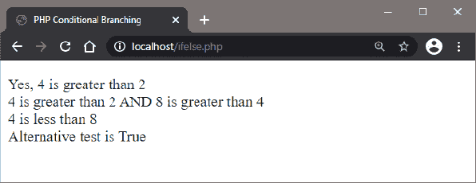


你可以嵌套条件 `if` 测试（一个在另一个内部），这样内部块中的语句只有在两个测试都被判定为 `TRUE` 时才会被执行。

## 分支切换


由多个 if-elseif-else 语句执行的条件分支，在测试表达式仅评估一个条件时，通常可以用 `switch` 语句更高效地实现。

`switch` 语句的工作方式比较特殊。它以给定值作为参数参数，然后从多个 `case` 语句中寻找匹配该值的语句。每个 `case` 语句中都包含在找到匹配时要执行的代码。

重要的是，每个 `case` 语句都要以 `break` 关键字语句结束，这样 `switch` 语句在找到匹配后就会退出，而不会继续寻找进一步的匹配——除非这是有意为之的要求。

可选地，`case` 语句列表后可以跟一个单一的最终 `default` 语句，以指定在任何 `case` 语句中均未找到匹配时要执行的代码。因此，`switch` 语句的语法通常如下所示：

```
switch ( test-value )
{
case match-value : statements-to-execute-when-matched ; break ;
case match-value : statements-to-execute-when-matched ; break ;
case match-value : statements-to-execute-when-matched ; break ;
default : statements-to-execute-when-no-match-found ;
}
```

`switch` 语句可以有多个 `case` 语句，但其任意两个 `case` 语句都不能尝试匹配相同的值。


总是建议包含一个 `default` 语句——即使只是为了在 `switch` 语句失败时输出错误消息。

当多个匹配值需要各自执行相同的语句时，只有最后一个 `case` 语句需要包含要执行的语句以及退出 `switch` 语句块的 `break` 语句。例如，要为匹配值 0、1 和 2 输出相同的消息：

```
switch ( $number )
{
case 0 :
case 1 :
case 2 : echo ‘Less than 3’ ; break ;
case 3 : echo ‘Exactly 3’ ; break ;
default : echo ‘Greater than 3 or less than zero’ ;
}
```


`default` 语句不必出现在 `switch` 块的末尾，但在不需要 `break` 语句的情况下，将其放在那里是合乎逻辑的。

 在 PHP 标签之间，使用语句开始脚本以初始化两个变量，一个为整数值，一个为字符值

```
<?php
$number \= 2 ; $letter \= ‘B’ ;
```


switch.php

 接下来，添加一个 `switch` 语句来匹配整数值

```
switch ( $number )
{
case 1 : echo ‘Number is One<br>’ ; break ;
case 2 : echo ‘Number is Two<br>’ ; break ;
case 3 : echo ‘Number is Three<br>’ ; break ;
default : echo ‘Number is Unrecognized<br>’ ;
}
```

 现在，添加一个 `switch` 语句来匹配字符值

```
switch ( $letter )
{
case ‘A’ : echo ‘Letter is A<br>’ ; break ;
case ‘B’ : echo ‘Letter is B<br>’ ; break ;
case ‘C’ : echo ‘Letter is C<br>’ ; break ;
default : echo ‘Letter is Unrecognized<br>’ ;
}
```

 最后，添加一个 `switch` 语句来匹配多个整数值

```
switch ( $number )
{
case 0 : case 1 : case 2 : echo ‘Less than 3<br>’ ; break ;
default : echo ‘3 or more, or less than zero’ ;
}
?>
```

 将文档保存在你的 Web 服务器的 `/htdocs` 目录中，命名为 `switch.php`，然后通过 HTTP 打开页面以查看条件分支的结果

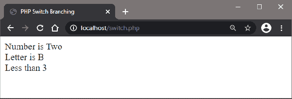


在 `switch` 语句中，`case` 关键字、匹配值和冒号字符被视为一个唯一的“标签”。

## 匹配表达式


条件分支也可以通过 `match` 语句实现。这些是 `switch` 语句的替代方案，此处第 62-63 页有描述，并且通常是更好的选择。

与 `switch` 语句块不同，`match` 语句是一个返回值的单一表达式。它以给定值作为参数参数，然后从用大括号括起来的以逗号分隔的备选列表中寻找匹配该值的项。找到匹配时要返回的值随后在 `=>` 粗箭头运算符之后指定。

重要的是，每个 `match` 语句在闭合大括号后都要以 `;` 分号结束，以终止该语句。

`match` 表达式不需要任何 `break` 语句，因此其代码比等效的 `switch` 块显著更短。`match` 语句的语法通常如下所示：

```
$result = match ( test-value )
{
match-value => return-value ,
match-value => return-value ,
match-value => return-value ,
default => return-value ,
} ;
```


`match` 语句是 PHP 8 中引入的一个很棒的新特性。

当多个匹配值需要各自返回相同的值时，它们可以合并为一个以逗号分隔的单一列表。例如，要为匹配值 0、1 和 2 输出相同的消息：

```
echo match ( $number )
{
0 , 1 , 2 => ‘Less than 3’ ,
3 => ‘Exactly 3’ ,
default => ‘Greater than 3 or less than zero’ ,
} ;
```

有用的是认识到，`match` 语句比较值是否恒等，如使用 `===` 运算符，而 `switch` 语句比较值是否相等，如使用 `==` 运算符。

相反示例中的步骤使用 `match` 语句来复制之前 `switch` 语句示例的输出。

 在 PHP 标签之间，使用语句开始脚本以初始化两个变量，一个为整数值，一个为字符值

```
<?php
$number \= 2 ; $letter \= ‘B’ ;
```


match.php

 接下来，添加一个 `match` 语句来匹配整数值

```
echo match ( $number )
{
1 \=> ‘Number is One<br>’ ,
2 \=> ‘Number is Two<br>’ ,
3 \=> ‘Number is Three<br>’ ,
default => ‘Number is Unrecognized<br>’ ,
} ;
```

 现在，添加一个 `match` 语句来匹配字符值

```
echo match ( $letter )
{
‘A’ \=> ‘Letter is A<br>’ ,
‘B’ \=> ‘Letter is B<br>’ ,
‘C’ \=> ‘Letter is C<br>’ ,
default => ‘Letter is Unrecognized<br>’ ,
} ;
```

 最后，添加一个 `match` 语句来匹配多个整数值

```
echo match ( $number )
{
0 , 1 , 2\=> ‘Less than 3<br>’ ,
default => ‘3 or more, or less than zero’ ,
} ;
?>
```

 将文档保存在你的 Web 服务器的 `/htdocs` 目录中，命名为 `match.php`，然后通过 HTTP 打开页面以查看条件分支的结果

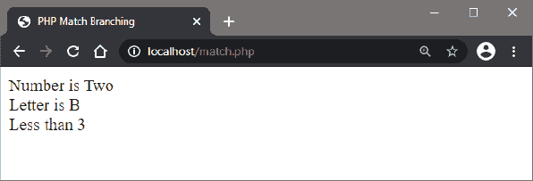


将此示例中的代码与上一个示例中的 `switch` 语句进行比较，以了解 `match` 语句的简洁优势。

## 执行循环


循环是脚本中自动重复的一段代码。循环内所有语句的一次完整执行称为一次“迭代”或一次“遍历”。循环的长度由循环内进行的条件测试控制。只要测试的表达式被判定为 `TRUE`，循环就会继续——直到测试的表达式被判定为 `FALSE`，此时循环结束。

在 PHP 中有四种类型的循环结构：

• `for` 循环 – 执行指定次数的迭代。
• `while` 循环 – 仅在每次迭代开始时进行的测试评估为 `TRUE` 时执行迭代。
• `do while` 循环 – 仅在每次迭代结束时进行的测试评估为 `TRUE` 时执行迭代。


# 循环结构

## foreach 循环
`foreach` 循环 – 对数组的每个元素执行迭代以遍历，如 此处第 30 页 所介绍。

## for 循环
或许最有趣的循环结构是 `for` 循环，其通常具有以下语法：
```
for ( initializer ; test-expression ; updater )
{
statement-to-execute-when-true ;
statement-to-execute-when-true ;
statement-to-execute-when-true ;
}
```
初始化器用于为循环迭代次数的计数器设置起始值。为此使用整数变量，传统上命名为 `i`。

在循环的每次迭代中，test-expression 会被评估，并且该迭代仅在该表达式为 TRUE 时继续。当 test-expression 变为 FALSE 时，循环会立即结束，而不会再次执行语句。每次迭代都会更新计数器，然后执行语句。


更新器可以是递增器，也可以是在倒计数的循环中作为递减器，而不是递增。

循环可以嵌套，一个在另一个内部，以便在外层循环的每次迭代中完全执行内层嵌套循环的所有迭代。


在 PHP 标签之间，创建一个使用 `for` 循环的脚本，在每次三次迭代中输出循环计数器的值
```
<?php
for ( $i = 1 ; $i < 4 ; $i++ )
{
echo "<dt>Outer loop iteration $i" ;
# Nested loop to be inserted here.
}
?>
```

`forloop.php`

将文档保存在您 Web 服务器的 `/htdocs` 目录中，命名为 `forloop.php`，然后通过 HTTP 打开页面以查看循环计数器值是否显示

现在，插入一个嵌套的 `for` 循环，以在每次三次迭代中以列表形式输出其循环计数器的值
```
for ( $j = 1 ; $j < 4 ; $j++ )
{
echo "<dd>Inner loop iteration $j" ;
}
```

再次保存文档，然后通过 HTTP 打开页面以查看两个循环计数器值是否显示
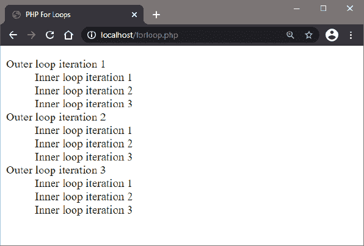


`for` 循环计数器也可以倒数——通过在每次迭代中使用 `$i--` 代替 `$i++` 来递减计数器的值。

## 循环直到为真


`while` 循环是前一示例中描述的 `for` 循环的替代方案。`while` 循环也需要初始化器、test-expression 和更新器，但这些并不是像 `for` 循环那样整齐地列在单个一对括号内。相反，初始化器必须出现在循环块开始之前，而 test-expression 必须出现在 `while` 关键字之后括号内，然后是包含更新器和每次迭代要执行的语句的大括号。
```
initializer
while ( test-expression )
{
statement/s-to-be-executed ;
updater ;
}
```
`do while` 循环通过将 `do` 关键字放在循环块之前并将 `while` 语句移至循环块之后，对上述语法提供了细微的变化：
```
initializer
do {
statement/s-to-be-executed ;
updater ;
}
while ( test-expression ) ;
```


确保循环结构中的测试表达式在某一点会变为 `FALSE`，以避免创建永不结束的无限循环。

`while` 循环和 `do while` 循环都会继续迭代，直到 test-expression 被发现为 FALSE，此时循环将退出。因此，循环体必须包含代码，该代码将在某一点更改 test-expression 评估的结果——否则会创建无限循环，这将锁定系统。`while` 循环和 `do while` 循环之间的显著区别在于，如果 test-expression 在首次评估时为 FALSE，`while` 循环将不会进行一次迭代。相比之下，`do while` 循环将始终至少进行一次迭代，因为其语句在评估之前执行。如果这是期望的，`do while` 循环显然是最好的选择，否则在 `for` 循环和 `while` 循环之间的选择在很大程度上是个人偏好的问题。经验法则建议 `for` 循环最好用于执行特定次数的迭代，而 `while` 循环最好用于在满足特定条件时迭代。循环是与数组使用的完美搭档，因为每次迭代都可以轻松地读取或写入连续的数组元素。


在 PHP 标签之间，使用一条语句开始一个脚本来创建一个数组
```
<?php
$numbers = array( 10 , 20 , 30 ) ;
```

`whileloop.php`

接下来，添加一个 `while` 循环来输出每个数组元素的值
```
echo '<dt>While Loop : ' ;
$i = 0 ;
while ( $i < 3 )
{
echo "<dd>Element $i = $numbers[$i] " ;
$i++ ;
}
```

现在，添加一个 `do while` 循环来输出每个数组元素的值
```
echo '<dt>Do While Loop : ' ;
$i = 0 ;
do
{
echo "<dd>Element $i = $numbers[$i] " ;
$i++ ;
}
while ( $i < 3 ) ;
?>
```

将文档保存在您 Web 服务器的 `/htdocs` 目录中，命名为 `whileloop.php`，然后通过 HTTP 打开页面以查看数组元素值是否相同显示
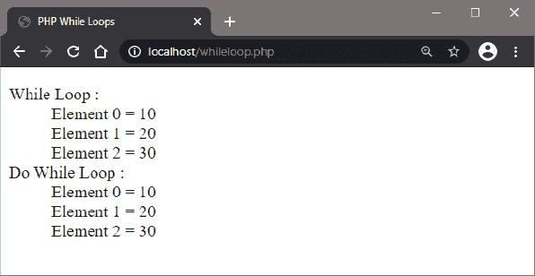


将此测试表达式中的值更改为零——因此在两个循环中 `while ( $i = 0 )`——以仅查看 `do while` 循环的第一次迭代被执行。

## 从循环中跳出


当满足指定条件时，可以使用 `break` 关键字提前终止循环。`break` 语句位于循环语句块内部，并以测试表达式为前导。当测试返回 TRUE 时，循环立即结束，程序继续执行下一个任务。例如，在嵌套的内层循环中，程序将继续执行外层循环的下一次迭代。


在 PHP 标签之间，使用执行三次迭代的 `for` 循环开始一个脚本
```
<?php
for ( $i = 1 ; $i < 4 ; $i++ )
{
# Nested loop to be inserted here (Step 2).
}
```

`breakcontinue.php`

接下来，插入一个也执行三次迭代的嵌套 `for` 循环
```
for ( $j = 1 ; $j < 4 ; $j++ )
{
# Statements to be inserted here (Steps 5 & 6).
}
?>
```

现在，插入一条语句，在每次迭代中输出两个循环计数器的值
```
echo "Running i = $i and j = $j <br>" ;
```

将文档保存在您 Web 服务器的 `/htdocs` 目录中，命名为 `breakcontinue.php`，然后通过 HTTP 打开页面以查看两个循环计数器值是否显示
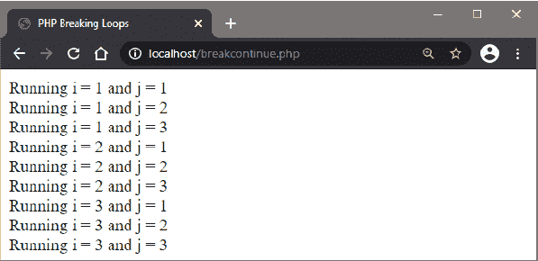

接下来，在内层循环块的最开头插入此 `break` 语句，以跳出内层循环——然后保存文档并查看更改
```
if ( $i == 2 && $j == 1 )
{
echo "Breaks inner loop when i = $i and j = $j <br>" ;
break ;
}
```
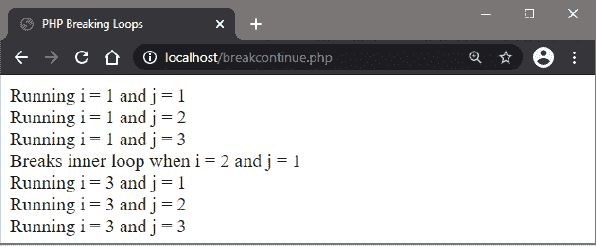


此处，`break` 语句在外层循环第二次尝试运行它时，停止内层循环的所有三次迭代。

当满足指定条件时，可以使用 `continue` 关键字跳过循环的单次迭代。`continue` 语句位于循环语句块内部，并以测试表达式为前导。当测试返回 TRUE 时，该单次迭代结束。


现在，在内层循环块的开头插入此 `continue` 语句，以跳过内层循环的第一次迭代——然后保存文档并查看更改
```
if ( $i == 1 && $j == 1 )
{
echo "Continues inner loop when i = $i and j = $j <br>" ;
continue ;
}
```


这里，`continue` 语句在外层循环首次尝试运行它时，只是跳过内层循环的第一次迭代。

## 摘要

-   `if` 关键字执行基本的条件测试，对表达式求值以得到布尔值 `TRUE` 或 `FALSE`。
-   在求值后跟随的大括号内的语句只有在表达式为 `TRUE` 时才会被执行。
-   可以使用逻辑 `&&` 运算符测试多个表达式，或通过嵌套多个 `if` 条件测试。
-   `else` 关键字指定当 `if` 语句求值的表达式为 `FALSE` 时要执行的语句。
-   `elseif` 关键字用于附加一个备选表达式以供求值，并在为 `TRUE` 时执行语句。
-   多个 `if`-`elseif`-`else` 语句通常可以通过 `switch` 语句更高效地实现。
-   每个 `case` 语句在 `switch` 语句块中指定一个要匹配的值，并且必须以 `break` 关键字结束。
-   `default` 语句指定在任何 `case` 语句中均未找到匹配时要执行的代码。
-   `match` 语句是一个单一表达式，当它找到与指定参数匹配时返回一个值。
-   循环是脚本中的一段代码，会自动重复执行，直到测试表达式变为 `FALSE`。
-   PHP 的循环结构有 `for`、`while`、`do while` 和 `foreach`。
-   `for` 循环结构指定一个初始化器、一个测试表达式以及一个递增（或递减）计数器的更新器。
-   更新器必须始终包含在 `while` 循环和 `do while` 循环的语句块中。
-   与 `while` 循环不同，`do while` 循环总是至少执行一次其语句。
-   `break` 关键字可用于在满足指定条件时提前终止循环。
-   `continue` 关键字可用于在满足指定条件时跳过循环的单次迭代。

# 5 使用函数

*本章演示如何在函数中创建可重用的代码块。*

定义函数
传递参数
可变参数
命名参数
识别作用域
返回值
允许联合类型
回调
摘要

## 定义函数


PHP 提供了许多内置函数，可以在脚本中按名称调用以执行预定义操作，例如 见第 32 页 中描述的数组排序函数。此外，您还可以创建自己的自定义函数，以便在调用时执行指定的操作。这有助于将 PHP 脚本模块化为更易于理解和维护的代码段。

您的自定义函数名可以包含字母、数字和下划线字符的任意组合，但必须以字母或下划线开头。可以理解的是，为了避免冲突，名称不得重复现有的内置函数名，因此例如，您不能创建名为 "`sort`" 的自定义函数。

与 PHP 变量不同，函数名不区分大小写，因此 `cube()`、`Cube()` 和 `CUBE()` 都可以引用同一个函数。尽管如此，建议您始终使用与函数定义中命名函数时所使用的大小写相同。


PHP 变量名区分大小写，但 PHP 函数名不区分。

在 PHP 脚本中创建函数定义，只需在 `function` 关键字后写出其名称，然后是圆括号和包含每次调用该函数时要执行的语句的大括号（花括号）：

```php
function function_name()
{
statement-to-be-executed;
statement-to-be-executed;
statement-to-be-executed;
}
```

然后 PHP 脚本可以使用 `function_name()` 按名称调用已定义的函数；以在需要时执行其中包含的语句。尽管解释器从上到下运行脚本，但函数调用可以出现在函数定义之前。然而这不是良好的编程实践，因此您应在调用函数之前定义函数。

函数可以包含任何有效的 PHP 脚本代码，甚至可以包含另一个函数定义。在这种情况下，内部函数在外部函数被调用之前不会存在。


使用一条语句定义函数开始一个 PHP 脚本

```php
<?php
function greet()
{
echo ‘Hello User!<br>’ ;
}
```


`function.php`


接下来，添加一条语句调用上一步定义的函数，使其执行其语句

```php
greet();
```


现在，定义另一个包含内部函数定义和进一步语句的函数

```php
function outer()
{
function inner()
{
echo ‘Inner function called.<br>’ ;
}
echo ‘Inner function created.<br>’ ;
}
```


最后，添加语句调用上一步定义的每个函数

```php
outer();
inner();
?>
```


将文档保存到 Web 服务器的 `/htdocs` 目录中，命名为 `function.php`，然后通过 HTTP 打开页面以查看每次函数调用的输出


删除对 `outer` 函数的调用，当脚本尝试调用 `inner` 函数时，您将看到未定义函数错误。

## 传递参数


数据可以作为“参数”传递给函数，就像您可以将参数传递给某些内置 PHP 函数一样。例如，`sort()` 函数以要排序的数组作为其参数。函数可以创建任意数量的参数，但在调用时，必须为每个参数提供数据以避免错误。

接受参数的函数是通过在函数名后的括号内包含以逗号分隔的“参数”列表来定义的，如下所示：

```php
function function_name($arg_1, $arg_2, $arg_3)
{
statement-to-be-executed;
statement-to-be-executed;
statement-to-be-executed;
}
```

参数名必须遵守 PHP 变量所需相同的命名约定，并且理想情况下应具有意义，以表示将要传递的数据的性质。参数数据必须按正确顺序由调用传递，然后可由该函数内的语句使用。


参数必须在函数声明中以逗号分隔的列表指定，并且调用者以逗号分隔的列表传递参数值。

可选地，函数定义可以通过在参数名前包含类型描述来指定从调用者传递的数据类型。有效的类型描述包括 `int`、`float`、`string`、`bool`、`callable` 和 `array`。当指定类型时，尝试向函数传递错误数据类型的调用将导致错误。

重要的是要认识到，默认情况下，参数数据是按“值”传递的。这意味着如果函数调用指定了一个变量名，只有该变量中数据的副本会被传递给函数。修改参数不会影响按值传递时变量中存储的原始数据。


# 按引用传递

如果你希望函数修改在函数调用中指定的变量所存储的数据，你必须按“引用”传递它。这允许函数直接操作原始数据。当按引用传递时，修改参数会影响变量中的原始数据。为了确保参数始终按引用传递给函数，只需在函数定义中参数名前加上 `&` 与号前缀即可。


开始一个 PHP 脚本，使用一条语句初始化两个具有相同整数值的变量

```php
<?php
$a = $b = 5 ;
```


`arguments.php`


接下来，定义一个函数，接受两个整数参数——一个按值传递，另一个按引用传递

```php
function modify( int $val , int &$ref )
{
 // Statements to be inserted here.
}
```


现在，插入语句输出传递的值，然后递增这些值并显示修改后的值

```php
echo "Passed values : $val , $ref<br>" ;
$val++ ;
$ref++ ;
echo "Incremented values : $val , $ref<hr>" ;
```


在函数块之后，添加一条语句调用函数，将变量值作为参数传递

```php
modify( $a , $b ) ;
```


最后，添加一条语句显示现在存储在每个变量中的值

```php
echo "Stored values : $a , $b" ;
?>
```


将文档保存在 Web 服务器的 `/htdocs` 目录中，命名为 `arguments.php`，然后通过 HTTP 打开页面以查看参数和变量值


本示例中的 `int` 类型说明指定只有整数数据值可以作为参数传递给函数。

## 可变参数


函数定义中可以通过为参数名赋值的方式可选地指定默认参数值，如下所示：

```php
function function_name ( $arg_1 , $arg_2 = "Default String" )
{
 statement-to-be-executed ;
 statement-to-be-executed ;
 statement-to-be-executed ;
}
```

这允许进行函数调用，指定一个或两个参数值。如果只指定一个参数，它将被分配给第一个参数，第二参数使用默认值。当为参数指定默认值时，它们必须仅出现在参数列表中位于（右侧）没有指定默认值的参数之后。否则，缺少正确数量参数的调用将导致错误。


如果指定了多个默认值，目前没有办法在函数调用中跳过某个参数以将参数值分配给特定参数。

如果你需要创建一个函数来接受未知数量的参数，PHP 为此目的提供了一个特殊的 `…` “splat” 运算符。可以在函数定义中使用，如下所示：

```php
function function_name ( ...$args )
{
 statement-to-be-executed ;
 statement-to-be-executed ;
 statement-to-be-executed ;
}
```

当在函数定义中使用 `…` splat 运算符作为参数名前缀时，可以向该参数传递多个参数以创建数组。该数组可以像其他任何数组一样遍历以操作传入的参数值。


`…` splat 运算符有时也被称为“scatter”运算符。

此外，`…` splat 运算符还可用于“解包”函数调用中指定的数组，将其元素值作为单独的参数传递，如下所示：

```php
function function_name ( $arg_1 , $arg_2 , $arg_3 )
{
 echo $arg_1 + $arg_2 + $arg_3 ;
}
$arr = [ 1 , 2 , 3 ] ;
function_name( ...$arr ) ; # Outputs 6
```


开始一个 PHP 脚本，通过定义一个为其两个参数提供默认字符串值的函数

```php
<?php
function drink( string $tmp = 'hot' , string $flavor = 'tea' )
{
 // Statement to be inserted here.
}
```


`parameters.php`


接下来，插入一条语句以显示其默认值或传入的参数值

```php
echo "Drinking $tmp $flavor.<br>" ;
```


在函数块之后，添加可选地传递字符串参数的函数调用

```php
drink() ; drink( 'iced' ) ; drink( 'cold' , 'lemonade' ) ;
```


现在，定义一个函数，可以接受多个整数参数并显示其总值

```php
function add( int ...$numbers )
{
 $total = 0 ;
 foreach( $numbers as $num ) { $total += $num ; }
 echo "<hr>Total : $total" ;
}
```


最后，在函数块之后添加一条语句以调用上一步中的函数并传递三个值

```php
add( 1 , 2 , 3 ) ;
?>
```


将文档保存在 Web 服务器的 `/htdocs` 目录中，命名为 `parameters.php`，然后通过 HTTP 打开页面以查看参数和默认值


你可以在使用 `…` splat 运算符接受多个参数的参数之前指定常规位置参数。只有超出位置元素数量的参数才会被添加到最终参数的数组中。

## 命名参数


函数定义通常包含参数，要求调用者在调用函数时按函数定义中列出的参数顺序传递参数值。因此，这些被称为“位置参数”。

PHP 还支持“命名参数”，允许调用者按任意顺序向函数传递参数值。在这种情况下，调用必须指定每个参数名和参数值，中间用冒号分隔。调用中的参数名是函数定义中指定的参数名——但不带 `$` 前缀。

```php
function function_name ( $arg_1 , $arg_2 )
{
 echo $arg_1 + $arg_2 ;
}
function_name( arg_1 : 'Hot' , arg_2 : 'Tea' ) ; # Outputs Hot Tea
function_name( arg_2 : 'Tea' , arg_1 : 'Hot' ) ; # Outputs Hot Tea
```

当函数定义为参数指定默认值，且调用者未为该参数传递参数值时，将使用默认值，就像调用位置参数时一样。


命名参数是 PHP 8 中引入的一个很棒的新功能。

使用命名参数可以提高代码可读性，还允许调用者为特定参数传递参数值，同时为其他参数假设默认值。例如，给定一个有两个参数的函数定义，每个参数都有指定的默认值，位置参数调用无法单独为第二个参数指定参数值。它不能跳过第一个参数。另一方面，命名参数调用可以为第二个参数指定参数值，并假设第一个参数的默认值。

```php
function_name( arg_2 : arg_value ) ;
```

你可以在函数调用中使用命名参数和位置参数，但所有位置参数必须出现在命名参数之前。使用命名参数后使用位置参数将导致错误，因为 PHP 解析器无法正确分配参数值。

此外，`…` splat 运算符可用于函数定义中，以收集来自命名参数调用的参数名和值，并且其名称将被保留。


开始一个 PHP 脚本，通过定义一个为其两个参数提供默认字符串值的函数

```php
<?php
function cook( string $prep = 'fried' , string $food = 'rice' )
{
```


## 命名参数

```
echo "<li>Serving $prep $food" ;
}
```


`named.php`


接下来，添加语句以使用位置参数调用函数并使用命名参数调用

```
cook( 'boiled' , 'egg' ) ;
cook( food : 'cheese' , prep : 'grilled' ) ;
```


现在，添加调用以仅为第二个参数指定参数值，并添加一个使用一个位置参数和一个命名参数的调用

```
cook( food : 'rice' ) ; cook( 'baked' , food : 'potato' ) ;
```


然后，定义一个函数来收集命名参数并添加一个调用以显示传递的名称和值

```
function register( …$args )
{
foreach( $args as $name => $value )
{ echo "<dt>".$name."<dd>".$value ; }
}
register( Topic : 'PHP' , Series : 'Programming' ) ;
?>
```


将文档保存在 Web 服务器的 `/htdocs` 目录中，命名为 `named.php`，然后通过 HTTP 打开页面以查看参数和默认值


命名参数要求所有非可选参数（那些没有指定默认值）必须传递参数值，就像位置参数一样。

## 识别作用域


创建自定义函数时，了解变量的可访问性如何受变量“作用域”限制非常重要：

•在函数外部创建的变量具有“全局”作用域，但通常无法从任何函数块内部访问。
•在函数内部创建的变量具有“局部”作用域，因此只能从该特定函数块内部访问。

由于在函数内创建的变量无法从其他地方访问，其名称可以与函数块外部的变量名称或另一个函数块内的变量名称重复，而不会冲突。这允许全局变量包含与同名局部变量不同的值。

如果您希望在函数内部使用全局变量，则必须首先包含一个使用 `global` 关键字的语句，以声明该变量名引用全局变量，如下所示：

```
global variable-name ;
```


PHP 中的全局变量不像 C 等其他编程语言中的全局变量那样自动可供函数使用。在 PHP 中，全局变量只能在函数中使用，前提是先在函数块内使用 `global` 关键字显式声明。

可以通过在变量声明前加上 `global` 关键字来更改在函数内创建的变量的作用域，使其在全局可用——但这是不良做法，应避免。

函数语句可以调用其他函数来执行其语句，也可以调用自身以递归执行。与循环一样，递归函数必须改变被测试条件的状态，以使其不会无限继续。这可能是作为初始函数调用的参数传递进来的计数器值，然后在连续的递归调用中递增，直到超过测试中指定的值。或者，可以声明一个静态局部变量来存储递增的值，如下所示：

```
static variable-name ;
```

与其他局部变量不同，局部变量在程序作用域离开函数时就会丢失其值，而静态变量会保留其值。这意味着存储在静态局部变量中的递增值在每次函数调用时都会被识别。

递归函数也可以引用全局变量计数器值，该值在连续的递归调用中递增，直到超过测试中指定的值。


使用整数初始化全局变量并显示变量值开始 PHP 脚本

```
<?php
$number = 1 ; echo "Global number : $number<br>" ;
```


`scope.php`


接下来，定义并调用一个函数，该函数初始化同名局部变量并显示该变量值

```
function show_local()
{
$number = 100 ; echo "Local number : $number<hr>" ;
}
show_local() ;
```


现在，定义并调用一个递归函数，该函数在每次调用时递增全局变量和静态变量

```
function recur()
{
global $number ;       static $letter = 'A' ;
if( $number < 14 )
{
echo "$number:$letter | " ;
$number++ ; $letter++ ; recur() ;
}
}
recur() ;
```


最后，在函数块之后添加一条语句以显示修改后的全局变量值

```
echo "<hr>Global number : $number" ;
?>
```


将文档保存在 Web 服务器的 `/htdocs` 目录中，命名为 `scope.php`，然后通过 HTTP 打开页面以查看全局和局部变量值


如果从此函数中删除 `static` 关键字，`$letter` 变量在每次函数调用时将仅包含 `'A'`。


PHP 还有一个特殊的 `$GLOBALS` 数组，其中可以通过名称引用全局变量的值。在此示例中，您也可以使用 `$GLOBALS['number']` 来获取值。

## 返回值


自定义 PHP 函数可以通过添加使用 `return` 关键字的语句将值返回给调用者，如下所示：

```
function function_name( )
{
statement-to-be-executed ;
statement-to-be-executed ;
return value ;
}
```

`return` 语句是可选的，如果省略，函数默认会向调用者返回 `NULL` 值。

函数只能向调用者返回单个项目，因此不能返回多个值。但是，您可以将多个值分配给数组的元素，并让函数向调用者返回单个数组，然后解包这些值。

return 语句可以包含一个表达式以进行求值，以便将其单一结果返回给调用者。例如：

```
function square( int $number )
{
return $number * $number ;
}
echo square( 3 ) ;            # Outputs 9
```

为了确保函数仅返回所需数据类型的值，函数声明可以可选地指定返回类型描述，例如 `int`、`float`、`string`、`bool` 或 `array`，如下所示：

```
function function_name( ) : int
{
statement-to-be-executed ;
statement-to-be-executed ;
return value ;
}
```

当指定返回数据类型时，尝试向调用者返回错误数据类型的函数将导致错误。


使用必须仅返回数据数组的函数定义开始 PHP 脚本

```
<?php
function supply() : array
{
// Statement to be inserted here.
}
```


`return.php`


接下来，插入一条语句以返回四个混合值的数组

```
return array ( 75 , 3.142 , 'Super PHP' , True ) ;
```


在函数之后，添加一条语句调用函数并将返回的数组值分配给变量

```
$array = supply() ;
```


最后，添加一个循环以显示函数返回的每个值

```
foreach( $array as $data )
{
echo "Element Value : $data<br>" ;
}
?>
```


将文档保存在 Web 服务器的 `/htdocs` 目录中，命名为 `return.php`，然后通过 HTTP 打开页面以查看返回的值


在 PHP 中，布尔值 `TRUE` 在数值上表示为 1。

## 允许联合类型


# 联合类型

通常最好将参数限制为仅接受一种特定数据类型，但有时您可能希望参数允许调用传递不同数据类型的值。这可以通过在函数定义中指定可接受的数据类型作为“联合类型”来实现。这是在参数名称之前使用此语法的 PHP 数据类型的以管道分隔的列表：

`function function_name ( type|type|type $arg )`

同样，函数返回值的多个可接受数据类型可以用函数定义中的以管道分隔的列表指定为联合类型：

`function function_name ( type|type $arg ) : type|type`

联合类型支持除 `void` 之外的所有 PHP 数据类型，但确实支持特殊的 `null` 类型。这意味着函数可以返回特定数据类型的值或 `null`。这是一个相当常见的需求，被称为“可空联合”。它可以指定为以管道分隔的列表或使用简写表示法：

`type|null` or `?type`


联合类型是 PHP 8 中引入的一个很棒的新特性。

简写版本只能与单个数据类型一起使用，而不能与联合类型一起使用，并且 `null` 类型只能作为联合类型的一部分使用。

PHP 还具有 `mixed` 伪类型，允许参数或返回值是除 `void` 之外的任何类型。它等同于如下所示的联合类型：

`string|int|float|bool|null|array|object|callable|resource`

`mixed` 伪类型不能与其他类型一起在联合中使用，因为它已经代表了所有可接受的类型。当未为参数显式指定数据类型时，PHP 假定类型为 `mixed`。当未为函数的返回值显式指定数据类型时，PHP 假定类型为 `mixed` 或 `void`。


`callable` 类型只是一个类型提示。它可以为接受可调用函数的参数指定。

## 示例

通过定义一个函数开始 PHP 脚本，该函数可以接受整数或浮点数作为其参数，并可以返回整数或浮点数

```php
<?php
function half( int|float $arg ) : int|float
{
    // Statements to be inserted here.
}
```


`union.php`

接下来，插入语句调用另一个函数来描述参数，并返回其值的一半

```php
echo desc ( '<dt>Argument' , $arg ) ;
return $arg/2 ;
```

现在，添加另一个函数，该函数将返回描述其接收到的数值参数值的字符串

```php
function desc( string $str, mixed $val ) : string
{
    return $str.' '.$val.' - '.gettype( $val ) ;
}
```

最后，添加语句调用函数，传递整数和浮点值

```php
echo desc( '<dd>Return', half( 100 ) ).'<hr>' ;
echo desc( '<dd>Return', half( 33 ) ).'<hr>' ;
echo desc( '<dd>Return', half( 3.142 ) ) ;
?>
```

将文档保存到 Web 服务器的 `/htdocs` 目录中，命名为 `union.php`，然后通过 HTTP 打开页面以查看整数和浮点参数和返回值


联合类型可以在所有可以指定类型的地方使用——用于参数、返回类型，以及面向对象编程中的类属性（参见 第 7 章）。

# 回调


PHP 允许您创建“匿名”函数，在函数定义中未指定名称。与其他函数一样，如果指定了参数，这些函数可以接受参数，并且在调用时可以可选地返回值。与其他函数定义（它们是代码结构）不同，匿名函数定义是一个表达式。这意味着每个匿名函数定义必须以分号结尾，如下所示：

```php
function ( )
{
    statement-to-be-executed ;
    statement-to-be-executed ;
    return value ;
} ;
```


不要忘记在每个匿名函数定义后添加终止的 `;` 分号。

单独使用时，匿名函数用处不大，因为没有名称无法调用，但它在其他方面可能很有用：

•Assigned to a variable, an anonymous function can be called using the variable name.
•Passed as a callable argument to another function, an anonymous function can be called later as a “callback”.
•Returned from a function, an anonymous function retains access to the returning function’s variables in “closure”.

通过将匿名函数分配给变量，您实际上为函数命名，可以像调用任何其他函数一样调用它并传递参数——使用变量名。同样，当您将匿名函数传递给另一个函数时，它可以被回调并像任何其他函数一样传递参数——使用参数名。PHP `use` 关键字和 `&` 与号前缀允许匿名函数引用返回函数中的局部变量。

## 示例

通过将接受单个参数的匿名函数分配给变量开始 PHP 脚本

```php
<?php
$hello \= function ( $user ) { echo “Hello $user!<br>” ; } ;
```


`callback.php`

接下来，添加一条语句调用匿名函数并传递单个参数

```php
$hello( ‘Mike’ ) ;
```

现在，定义一个接受单个可调用参数的常规函数并调用该函数传递字符串

```php
function greet( callable $anon )
{
    $anon( ‘Carole Anne’ ) ;
}
```

添加一条语句调用上一步中定义的函数，传递在第一步中分配给变量的匿名函数

```php
greet( $hello ) ;
```

接下来，定义另一个具有一个局部变量的常规函数，并返回引用局部变量值的匿名函数

```php
function meet() : callable
{
    $time \= ‘morning’ ;
    return function( $name ) use( &$time )
    { return “Good $time, $name!” ; } ;
}
```

将上一步中定义的函数分配给变量，然后调用该函数，传递字符串参数

```php
$meeting \= meet() ;
echo $meeting( ‘Susan’ ) ;
?>
```

将文档保存到 Web 服务器的 `/htdocs` 目录中，命名为 `callback.php`，然后通过 HTTP 打开页面以查看来自匿名函数的返回值


请记住包含 `&` 与号前缀以创建对变量值的引用。


请注意，最终的函数调用从父作用域获取 `'morning'` 字符串。

# 摘要

•Custom functions allow PHP scripts to be modularized into sections of code that are easier to understand and maintain.
•Function names must begin with a letter or underscore character and are not case-sensitive.
•A function is defined by stating its name after the `function` keyword, then parentheses and braces containing statements.
•A function accepting arguments is defined by including a comma-separated list of parameters within the parentheses.
•Optionally, a function definition can specify the type of data to be passed from the caller before the parameter name.
•Argument data is normally passed by value but can be passed by reference if the parameter name is given an `&` prefix.
•Default argument values can optionally be specified in a function definition by assignment to the parameter name.
•The `...` splat operator allows multiple arguments to be passed to a parameter in order to create an array.
•Named parameters allow a caller to pass argument values to the function in any order.


- 在函数外部创建的变量具有全局作用域，但除非在函数块中包含使用 global 关键字的声明，否则无法从函数内部访问。
- 在函数内部创建的变量具有局部作用域，因此只能从该特定函数块内部访问。
- 当程序作用域离开函数时，局部变量会失去其值，但静态变量会保留其值。
- return 关键字向调用者返回单个项目，并且函数定义可以可选地指定返回数据类型。
- 联合类型是用管道分隔的 PHP 数据类型列表，允许各种类型的参数和返回值。
- use 关键字和 & 与号前缀允许匿名函数引用返回函数中的局部变量。

# 6 操作字符串

## 操作字符串

本章演示了在 PHP 脚本中操作文本字符串的各种方法。

比较字符
搜索文本
提取子字符串
更改大小写
格式化字符串
制作日期
编码实体
摘要

### 比较字符


PHP 提供了许多内置函数来比较两个文本字符串。简单的 `strcmp()` 函数接受两个字符串参数进行比较，并根据结果返回三个整数值之一。当字符串完全匹配时，`strcmp()` 将返回零。当第一个字符串参数大于第二个时，`strcmp()` 将返回 1，但当第一个字符串参数小于第二个时，`strcmp()` 将返回 -1。

`strncmp()` 函数的工作方式类似，但接受第三个整数参数来指定要比较的字符串开头的字符数。

`strcmp()` 和 `strncmp()` 函数在比较字符串时会区分大小写和大小写。当您希望忽略大小写时，可以改用替代的伴随函数 `strcasecmp()` 和 `strncasecmp()`。


严格来说，`strcmp()` 的返回值将是正整数、零或负整数——但通常是 1、0 或 -1 的值。

为了理解每个比较函数的返回结果，了解比较是如何实际进行的很有用。每个字符都有一个标准数值“ASCII”值，其中小写 a-z 的范围为 97-122，大写 A-Z 的范围为 65-90。比较每个范围的第一个值，我们看到 “a” (97) 大于 “A” (65)。将这些作为参数提供，`strcmp()` 函数因此将返回 1，因为第一个参数大于第二个参数。相反，如果您指定 “A” (65) 作为第一个参数，“a” (97) 作为第二个参数，则 `strcmp()` 函数将返回 -1，因为第一个参数小于第二个参数。在字符串比较中，每个字符按顺序进行比较，以确保包含不同顺序的相同字符的字符串不会被错误地视为相等。例如，比较 “ABC” 和 “BAC”，第一个字符 “A” (65) 小于第一个字符 “B” (66)，因此 `strcmp()` 函数将返回 -1，因为第一个参数小于第二个参数。


ASCII 是 American Standard Code for Information Exchange（信息交换美国标准代码）的缩写，它指定了通用标准字符编码方案。

任何字符的 ASCII 值都可以通过将其作为参数指定给 PHP `ord()` 函数来找到，字符串的长度可以通过将其作为参数指定给 PHP `strlen()` 函数来找到。

使用语句初始化四个字符串值的变量开始一个 PHP 脚本

```
<?php
$str1 \= ‘PHP in easy steps’ ;
$str2 \= ‘PHP in easy steps’ ;
$str3 \= ‘PHP In Easy Steps’ ;
$str4 \= ‘php in easy steps’ ;
```


characters.php

接下来，添加语句来比较字符串

```
echo “’$str1’ versus ‘$str2’ : “.strcmp($str1, $str2).’<br>’ ;
echo “’$str1’ versus ‘$str3’ : “.strcmp($str1, $str3).’<br>’ ;
echo “’$str1’ versus ‘$str4’ : “.strcmp($str1, $str4).’<hr>’ ;
```

现在，添加一个不区分大小写的比较语句

```
echo ‘Comparison Ignoring Case :<br>’ ;
echo “’$str1’ versus ‘$str4’ : “.strcasecmp($str1, $str4) ;
```

最后，添加一个循环来计算并显示第一个字符串的总 ASCII 代码值

```
$total \= 0 ;
for ( $i \= 0 ; $i < strlen( $str1 ) ; $i++ )
{
$total += ord( $str1\[ $i \] ) ;
}
echo “<hr>ASCII Total ‘$str1’ : $total” ;
?>
```

将文档保存在 Web 服务器的 `/htdocs` 目录中，命名为 `characters.php`，然后通过 HTTP 打开页面以查看字符串比较


字符顺序很重要，因为两个顺序不同的字符串的 ASCII 总和可能相等，但字符串不匹配。

### 搜索文本


PHP 提供了许多内置函数来搜索字符串以查找指定的子字符串或单个字符。简单的 `strpos()` 函数接受两个参数来指定要搜索的字符串和要查找的子字符串。它将从字符串开头按顺序搜索以找到匹配项。当找到匹配项时，搜索停止，`strpos()` 函数返回一个整数，即字符串中第一次出现匹配项开始的字符索引位置。当未找到匹配项时，`strpos()` 函数返回 FALSE。

`strrpos()` 函数的工作方式类似，但返回从字符串末尾按相反顺序搜索时第一次出现匹配项开始的索引位置。

其他 PHP 搜索函数可以返回搜索字符串的一部分，而不是指示匹配位置的索引号。

`strstr()` 函数接受两个参数来指定要搜索的字符串和要查找的子字符串。它将从字符串开头搜索以找到匹配项。当找到匹配项时，搜索停止，`strstr()` 函数返回从第一次出现匹配项开始的搜索字符串的剩余部分。当未找到匹配项时，`strstr()` 函数返回 NULL。


请注意，没有 `strrstr()`（`strstr()` 的伴随函数）来按相反顺序搜索。

同样，在字符大小写不重要时，您可以使用伴随的 `stristr()` 函数进行不区分大小写的搜索。这将返回从第一次出现不区分大小写的匹配项开始的搜索字符串的剩余部分。

`strchr()` 函数的工作方式类似，但接受两个参数来指定要搜索的字符串和要查找的单个字符。伴随的 `strrchr()` 函数从字符串末尾开始按相反顺序搜索。两者都返回从第一次出现匹配项开始的搜索字符串的剩余部分。

您还可以通过将要搜索的字符串和要查找的子字符串指定为 `str_contains()`、`str_starts_with()` 和 `str_ends_with()` 函数的参数来查找匹配项。这些函数根据搜索结果各返回一个布尔 TRUE 或 FALSE 值。返回值可以分配一个合适的字符串来描述结果。

使用语句初始化一个字符串值的变量开始一个 PHP 脚本，然后报告其长度

```
<?php
$str \= ‘Most Users usually find PHP useful.’ ;
echo “’$str’<br>String Length : “.strlen( $str ) ;
```


# PHP 字符串操作示例


## search.php

接下来，添加语句以搜索字符串并报告给定子字符串的位置

`echo “<br>First ‘us’ found at : “.strpos( $str , ‘us’ ) ;`

`echo “<br>Final ‘us’ found at : “.strrpos( $str , ‘us’ ) ;`

现在，添加语句以搜索字符串并返回匹配项之后的字符串剩余部分

`echo “<hr>Substring from first ‘us’ : “.strstr( $str , ‘us’ ) ;`

`echo “<br>Characters from final ‘u’ : “.strrchr( $str , ‘u’ ) ;`

最后，添加语句以搜索字符串，并分配适当的字符串来描述搜索结果

`$result \= str_contains( $str, ‘PHP’ ) ? ‘Found’ : ‘Absent’ ;`

`echo “<hr>Contains ‘PHP’: “.$result ;`

`$result \= str_starts_with( $str, ‘PHP’ ) ? ‘True’ : ‘False’ ;`

`echo “<br>Starts with ‘PHP’: “.$result ;`

`?>`

将文档保存在你的 Web 服务器的 `/htdocs` 目录中，命名为 `search.php`，然后通过 HTTP 打开页面以查看搜索结果


`str_contains()`、`str_starts_with()` 和 `str_ends_with()` 函数是在 PHP 8 中引入的优秀新特性。


此字符串中出现两次‘us’。初始的‘Us’不会被区分大小写的搜索匹配。

## 提取子字符串


可以通过将字符串和子字符串在字符串中的索引位置作为参数传递给 `substr()` 函数来从字符串中提取子字符串。可选地，第三个参数可以指定子字符串长度。您可以使用 `substr_replace()` 函数通过指定字符串、子字符串、索引位置和长度参数来替换子字符串。字符串中子字符串的总出现次数可以使用 `substr_count()` 函数找到：

使用初始化变量为字符串值并统计子字符串的语句开始一个 PHP 脚本

`<?php`

`$str \= ‘SQL in easy steps features SQL queries’ ;`

`echo “’$str’<br>’SQL’ Count: “.substr_count( $str , ‘SQL’ ) ;`


### substring.php

接下来，添加语句以提取两个子字符串

`echo ‘<hr>Index 27 : ‘.substr( $str , 27 ) ;`

`echo ‘<hr>Index 4 Length 13 : ‘.substr( $str , 4 , 13 ) ;`

现在，添加一条语句来用字符串初始化一个变量

`$sub \= ‘PHP & MySQL’ ;`

最后，添加语句以用新字符串值替换子字符串并显示修改后的字符串

`$str \= substr_replace( $str, $sub , 0 , 3 ) ;`

`echo “<hr>’$str’” ;`

`?>`

将文档保存在你的网页浏览器的 `/htdocs` 目录中，命名为 `substring.php`，然后通过 HTTP 打开页面以查看提取的子字符串和修改后的字符串


`substr_replace()` 中的长度参数指定要被替换的子字符串的长度。在此示例中，它为 3 —— 用更长的字符串替换三个字符‘SQL’。

## 更改大小写


PHP 提供了函数来轻松修改指定字符串参数的字符大小写。`strtolower()` 函数将所有字符更改为小写，而 `strtoupper()` 将它们全部更改为大写。此外，`ucfirst()` 函数仅将第一个字符串字符大写，而 `ucword()` 函数将字符串中每个单词的第一个字符大写：

使用初始化变量为字符串并显示其值的语句开始一个 PHP 脚本

`<?php`

`$str \= “C++ Programming in easy steps” ;`

`echo “Original String : ‘$str’ <hr>” ;`


### case.php

接下来，添加语句以显示小写版本

`$ver \= strtolower( $str ) ;`

`echo “Lowercase String : ‘$ver’ <br>” ;`

现在，添加语句以显示大写版本

`$ver \= strtoupper( $str ) ;`

`echo “Uppercase String : ‘$ver’ <hr>” ;`

最后，添加语句以显示大写字符串版本和大写单词版本

`$ver \= ucfirst( strtolower( $str ) ) ;`

`echo “Uppercase First String Character : ‘$ver’ <br>” ;`

`echo ‘Uppercase First Word Character : ‘.ucwords( $ver ) ;`

`?>`

将文档保存在你的 Web 服务器的 `/htdocs` 目录中，命名为 `case.php`，然后通过 HTTP 打开页面以查看原始字符串的大小写更改版本


`ucfirst()` 函数仅更改字符串的第一个字符。其他大写字符将保持不变，除非先使用 `strtolower()` 函数将其更改为小写，如此处所示。

## 格式化字符串


PHP 提供了许多内置函数，可通过操作字符方便地格式化字符串。简单的 `strrev()` 函数接受单个字符串参数并以反向字符顺序返回该字符串，因此它从后向前读取。

`strrpt()` 函数接受两个参数来指定一个字符串，以及一个整数，表示该字符串在返回的字符串中应重复的总次数。

`strpad()` 函数接受三个参数来指定一个字符串、返回的字符字符串的总长度，以及用于填充原始字符串与指定返回字符串长度之间差异的字符或子字符串模式。填充默认情况下会添加到原始字符串的末尾，但可以通过添加第四个参数并使用特殊的 `STR_PAD_LEFT` 标志将其添加到开头。

`trim()` 函数可以接受单个字符串参数，并将返回一个字符串，其中所有空白字符（空格、换行符、制表符）已从原始字符串的开头和结尾移除。可选地，第二个参数可以指定要从原始字符串的开头和结尾移除的字符或模式，以代替默认的空白。

类似地，如果你只想从原始字符串的开头移除字符，可以使用配套的 `ltrim()` 函数，或者如果你只想从原始字符串的末尾移除字符，可以使用配套的 `rtrim()` 函数。


PHP 的 `implode()` 和 `explode()` 函数可用于将数组转换为字符串，以及将字符串转换为数组 —— 有关更多详细信息，请参阅 第 32 页此处。

可以使用 `strtok()` 函数通过指定字符串和分隔符标记来将字符串拆分为各个部分，各个部分将在该标记周围拆分。例如，如果你想将字符串拆分为单个单词，可以指定空格字符作为分隔符标记。字符串中直到分隔符标记的第一部分将由函数返回。有趣的是，`strtok()` 函数会记住其在字符串中的位置，因此后续调用只需指定分隔符标记即可返回字符串的下一部分，直到不再找到分隔符为止。这种方式拆分字符串最好使用循环来实现对 `strtok()` 函数的后续调用，直到到达字符串末尾。

使用初始化变量为字符串并显示其值的语句开始一个 PHP 脚本

`<?php`

`$str \= ‘| PHP String Fun |’ ; echo “Original String : $str” ;`


### format.php

接下来，添加语句以显示原始字符串的反转、重复和修剪版本

`echo ‘<hr>Reversed String : ‘.strrev( $str ) ;`

`echo ‘<hr>Repeated String : ’.str_repeat( $str , 3 ) ;`


## 字符串修剪、填充和拆分

```php
echo ‘<hr>Trimmed String : ‘.trim( $str, ‘|’ ) ;
$pad = str_pad( $str , 30 , ‘*’ , STR_PAD_LEFT ) ;
echo “<hr>Padded String : $pad” ;
echo ‘<hr>Split String : ‘ ;
$token = strtok( $str , ‘ ‘ );
while ( $token )
{
echo “$token … “ ; $token = strtok( ‘ ‘ ) ;
}
?>
```


现在，添加一条语句来显示字符串的 30 字符版本，以星号开头填充


最后，添加语句将字符串按空格拆分并显示每个单独部分，中间用 … 省略号分隔


将文档保存在你的 Web 服务器的 `/htdocs` 目录中，命名为 `format.php`，然后通过 HTTP 打开页面以查看字符串以多种方式格式化

## 制作日期


PHP `date()` 函数在调用时会返回一个日期字符串，但需要一个字符串参数来指定日期字符串的格式。此格式字符串可以包含一系列用于日期和时间的字母选项。例如，`date( ‘n/j/y’ )` 可能返回“4/22/16”。下面列出了常用选项以及简要说明：

| 选项 | 描述 | 示例 |
| --- | --- | --- |
| Y | 四位数年份 | 2023 |
| y | 两位数年份 | 14 |
| n | 一或两位数月份 | 7 |
| m | 两位数月份 | 07 |
| F | 月份全名 | February |
| M | 月份三字母名称 | Feb |
| j | 一或两位数日期 | 4 |
| d | 两位数日期 | 04 |
| l | 星期全名 | Monday |
| D | 星期三字母缩写 | Mon |
| S | 序数后缀 | th |
| H | 24 小时制小时 | 14 |
| i | 分钟 | 45 |
| s | 秒 | 30 |
| a | 上午或下午 | am |


星期全名选项是小写的“L”。

默认情况下，时区设置为通用时间时钟（UTC），但你可以通过将其指定为 `date_default_timezone_set()` 函数的参数来设置自己的时区，并使用 `date_default_timezone_get()` 查看当前设置的时区。

你也可以使用智能的 `strtotime()` 函数创建自己的时间戳。此函数可以接受一个日期字符串参数并返回一个时间戳，该时间戳可以作为 `date()` 函数的可选第二个参数提供。指定给 `strtotime()` 的参数可以是常规文本日期，例如“July 4, 2023”。此外，你可以指定诸如“yesterday”、“+3months”或“next Wednesday”之类的参数，`strtotime()` 函数会尝试解析并返回适当的时间戳。


你可以在 PHP 手册在线上发现更多 `date()` 函数选项，网址为 [php.net 手册](http://www.php.net/manual)


使用语句开始一个 PHP 脚本以显示当前日期、星期、时间以及当前默认时区

```php
<?php
echo ‘Date : ‘.date( ‘jS F Y’ ).’<br>’ ;
echo ‘Day : ‘.date( ‘l’ ).’<br>’ ;
echo ‘Time : ‘.date( ‘h:i:s a’ ).’<br>’ ;
echo ‘Timezone : ‘.date_default_timezone_get().’<hr>’ ;
```


`date.php`


接下来，添加语句更改默认时区并显示确认，然后显示该地的当前时间

```php
date_default_timezone_set( ‘America/New_York’ ) ;
echo ‘Timezone now : ‘.date_default_timezone_get() ;
echo ‘<br>Time now : ‘.date( ‘h:i:s a’ ).’<hr>’ ;
```


现在，添加语句为下一天创建时间戳，然后显示其星期名称和日期

```php
$d = strtotime( ‘tomorrow’ ) ;
echo ‘Tomorrow : ‘.date( ‘l, jS F Y’ , $d ).’<br>’ ;
```


最后，添加语句为一个难忘的日期创建时间戳，然后显示其月份和日期数字

```php
$d = strtotime( ‘July 11, 1994’ ) ;
echo ‘David\'s Birthday : ‘.date( ‘F jS’ , $d ) ;
?>
```


将文档保存在你的 Web 服务器的 `/htdocs` 目录中，命名为 `date.php`，然后通过 HTTP 打开页面以查看按选项格式化的日期字符串


请注意，你可以在格式字符串中包含分隔符字符，例如 `:` 和 `/`。


一些国家偏好 M/D/Y 日期顺序，而其他国家偏好 D/M/Y，因此你可以选择你喜欢的日期格式选项。

## 编码实体


有两种 PHP 函数可用于编码 HTML 代码，以便所有具有特殊意义或不寻常的字符都被替换为“实体”等价物。`htmlentities()` 函数编码以下所有字符，每个字符都有实体等价物：


除非你关心非英语语言字符，否则通常最好使用替代的 `htmlspecialchars()` 函数仅编码具有特殊 HTML 意义的字符：

• `&` 与号 – 变为 `&amp;`
• `"` 双引号 – 变为 `&quot;`
• `'` 单引号 – 变为 `&#039;`
• `<` 小于 – 变为 `&lt;`
• `>` 大于 – 变为 `&gt;`


调用 PHP 函数 `get_html_translation_table()`，常量参数为 `HTML_ENTITIES` 或 `HTML_SPECIALCHARS`，以返回所有表示字符的数组。

使用 PHP 编码 HTML 片段的一个好理由是防止恶意 JavaScript 代码被 Web 浏览器意外执行。将 HTML 标签编码为实体可确保 HTML `<script>` 标签不被识别，因此其 JavaScript 代码内容不会被执行：


创建一个 PHP 脚本，使用语句初始化一个变量为 HTML 片段并显示其值

```php
<?php
$html = ‘<script>window.location="index.html"</script>’ ;
// Statement to be inserted here.
echo $html ;
?>
```


`encode.php`


将文档保存在你的 Web 服务器的 `/htdocs` 目录中，命名为 `encode.php`，然后通过 HTTP 打开页面以 hopefully 看到 HTML 代码片段


浏览器已解释代码并重定向到服务器的索引页面，因为它识别了 HTML `<script>` 标签。


返回 PHP 脚本并插入语句以编码特殊 HTML 字符

```php
$html = htmlspecialchars( $html ) ;
```


保存编辑后的文档并再次通过 HTTP 重新打开页面以查看 HTML 代码片段


使用 Web 浏览器中的 `View Source` 设施查看 PHP 编码的特殊字符实体等价物


PHP 函数 `html_entity_decode()` 可用于将所有实体解码回其原始字符状态。

## 摘要

• PHP 内置字符串比较函数 `strcmp()`、`strncmp()`、`strcasecmp()` 和 `strncasecmp()` 通常 each 返回 1（大于）、0（相等）或 -1（小于）的结果。
• 字符串比较基于每个字符的数值 ASCII 值，按顺序比较以考虑顺序。
• 任何字符的 ASCII 值都可以使用 `ord()` 找到。
• 任何字符串的长度都可以使用 `strlen()` 找到。
• 子字符串在被搜索字符串中的数值索引位置可以使用 `strpos()` 和 `strrpos()` 函数找到。
• 搜索函数 `strstr()`、`stristr()`、`strchr()` 和 `strrchr()` 在成功时 each 返回被搜索字符串的剩余部分。


- 子字符串函数 `substr()`、`substr_replace()` 和 `substr_count()` 可以提取、替换或计数出现次数。
- 字符串中的字符可以使用 `strrev()` 反转，或使用 `strrpt()` 重复字符串。
- 可以使用 `strpad()` 向字符串添加填充字符，并使用 `trim()`、`ltrim()` 或 `rtrim()` 删除字符。
- 可以通过向 `strtok()` 函数指定分隔符将字符串拆分为各个部分。
- `date()` 函数需要一个字符串参数来指定选项以确定其返回的日期字符串的格式。
- 默认情况下，PHP 日期时区设置为 UTC。
- 可以使用 `date_default_timezone_set()` 函数指定 UTC 默认时区的替代方案。
- `strtotime()` 函数将尝试为接收到的任何日期或时间参数返回适当的 timestamp。
- `htmlentities()` 函数将对存在等效实体的所有字符串字符进行编码。
- `htmlspecialchars()` 函数仅对具有特殊 HTML 意义的字符进行编码，以避免被浏览器识别。

# 7 构建类

*本章演示如何使用 PHP 创建和利用虚拟对象进行面向对象编程。*

封装数据
创建对象
初始化成员
使用构造函数
提升属性
继承属性
拥抱多态
链式方法调用
总结

## 封装数据


一个类是一个数据结构，可以在单个实体中同时包含变量和函数。这些统称为其“成员”——变量被称为其类的“属性”，函数被称为其类的“方法”。

对类成员的访问在类声明之外由“访问说明符”控制。通常，这些会拒绝访问类变量，但允许访问可以存储和检索这些变量成员数据的 方法。这种“数据隐藏”技术确保存储的数据安全地封装在类变量成员中，并且是面向对象编程（OOP）的第一个原则。

类声明以 class 关键字开始，后跟一个空格，然后是程序员指定的名称——遵循通常的 PHP 命名约定但以大写开头。接下来是类属性声明，然后是类方法声明。这些类似于常规变量和函数声明，但每个都应以访问说明符开头。类声明语法如下所示：

```
class ClassName
{
access-specifier $var1 , $var2 , $var3 ;
access-specifier functionName1 ( $arg1 , $arg2 , $arg3 )
{
statements-to-execute ;
}
}
```


通常以大写字符开头类名，以小写开头对象名。

访问说明符可以是 public、private 或 protected 关键字中的任意一个，以指定其所列成员的访问权限：
- public 成员可在类可见的任何地方访问。
- private 成员只能由定义它们的同一类的其他成员访问。
- protected 成员只能由同一类的其他成员以及从该类派生的类的成员访问。


派生类将在本章后面介绍 – 请参阅 此处第 116 页。

任何现实世界的对象都可以通过其属性和动作来定义。例如，一只狗具有诸如年龄、体重和颜色等属性，以及它可以执行诸如吠叫等动作。PHP 中的类机制提供了一种在脚本中创建虚拟狗对象的方法，其中类属性可以表示其属性，类方法表示其动作：

```
class Dog
{
private $age ;
private $weight ;
private $color ;
public function bark() { echo ‘WOOF!’ ; }
// Plus methods here to store data in the properties.
// Plus methods here to retrieve data from the properties.
}
```


虽然 PHP 脚本类不能完美地模拟现实世界对象，但目标是将所有相关属性和动作封装为类属性和方法。

必须认识到，类声明仅定义数据结构——为了创建对象，必须声明该数据结构的“实例”。这是通过使用 new 关键字将类的副本分配给变量来实现的，如下所示：

```
$fido = new Dog() ; // Creates an instance named “fido”
// of the programmer-defined
// “Dog” data structure.
```

实例对象是原始类数据结构的工作副本，因此保留了其所有功能。由于上面示例中的方法已声明为 public，因此它在类声明之外在脚本中可见。这意味着实例的方法副本可以使用特殊的 -> 对象运算符调用，如下所示：

```
$fido->bark() ; // Outputs WOOF!
```

-> 对象运算符可用于引用任何可见的类成员，但上面示例中的变量属性已声明为 private，因此封装在对象中且无法直接访问。PHP 编程中的封装原则描述了将数据和功能分组到类成员中——这些是该 `Dog` 类中的 age、weight、color 属性和 bark 动作。


请注意，在创建实例对象的语句中，必须在类名后添加括号。

## 创建对象


为了从类的私有成员分配和检索数据，必须向类添加特殊的公共访问方法。这些是用于分配数据的“setter”方法，以及用于检索数据的“getter”方法。访问方法通常以它们所针对的变量命名，将首字母大写，并分别以“set”或“get”为前缀。例如，用于处理 age 变量的访问方法可能命名为 `setAge()` 和 `getAge()`。

setter 和 getter 方法可以使用特殊的 `$this`“伪变量”，后跟 -> 对象运算符和属性名来引用同一类的成员。例如，使用 `$this->age` 来引用 age 属性：

开始一个 PHP 脚本，使用语句声明一个名为“Dog”的类

```
<?php
class Dog
{
// Members to be inserted here (Steps 2-5).
}
```

object.php

在 `Dog` 类声明的大括号之间，声明三个私有变量成员

```
private $age ;
private $weight ;
private $color ;
```

在私有变量之后，添加一个公共方法，在调用时输出字符串

```
public function bark() { echo ‘WOOF! WOOF! <br>’ ; }
```

添加公共 setter 方法——将各个参数值分配给每个私有变量

```
public function setAge ( int $yrs )
{ $this->age \= $yrs ; }
public function setWeight ( int $lbs )
{ $this->weight \= $lbs ; }
public function setColor ( string $fur )
{ $this->color \= $fur ; }
```


在类声明中，注意所有方法都声明为 public，所有变量都声明为 private。这种“公共接口、私有数据”的概念是在创建类时一个关键概念。

添加公共 getter 方法——从每个私有变量中检索单个值

```
public function getAge() { return $this->age ; }
```


## 狗类示例

`public function getWeight() { return $this->weight ; }`

`public function getColor() { return $this->color ; }`


 在 `Dog` 类声明之后，声明一个名为“`fido`”的 `Dog` 类实例

`$fido \= new Dog() ;`

 添加调用每个 setter 方法以分配数据的语句

`$fido\->setAge( 3 ) ;`

`$fido\->setWeight( 15 ) ;`

`$fido\->setColor( ‘brown’ ) ;`

 添加调用每个 getter 方法以检索已分配值的语句

`echo ‘Fido is a ‘.$fido\->getColor().’ dog <br>’ ;`

`echo ‘Fido is ‘.$fido\->getAge().’ years old <br>’ ;`

`echo ‘Fido is ‘.$fido\->getWeight().’ pounds<br>’ ;`

 现在，添加对常规输出方法的调用

`$fido\->bark() ;`

`?>`

 将文档保存到你的 Web 服务器的 `/htdocs` 目录中，命名为 `object.php`，然后通过 HTTP 打开页面以查看类属性和方法调用的输出


此 `object.php` 脚本将在接下来的几页中随着新功能的加入而被修改。

## 初始化成员


程序可以通过声明类的多个实例轻松创建多个对象，并且每个对象可以通过其 setter 方法分配单独的值来具有唯一的属性。

通常将 setter 方法合并为一个接受每个私有变量参数的单一方法很方便。这意味着所有值都可以用程序中的单条语句分配，但该方法将包含多条语句。

可选地，每个参数可以指定传递的每个参数的允许数据类型，并且还可以有意义地为每个参数指定默认值：

 重命名先前示例“`object.php`”的副本为新程序“`initializer.php`”


`initializer.php`

 在 `Dog` 类声明中，用一个指定参数数据类型和默认值的单一组合 setter 方法替换三个 setter 方法

```
public function setValues
( int $yrs \= 2 , int $lbs \= 8 , string $fur \= ‘black’ )
{
 // Statements to be inserted here.
}
```

 在方法定义块中，插入三条语句以将传递的参数值分配给类变量

`$this->age \= $yrs ;`

`$this->weight \= $lbs ;`

`$this->color \= $fur ;`

 在修改后的类定义之后，用对组合 setter 方法的单次调用替换对三个 setter 方法的调用 – 传递三个参数

`$fido\->setValues( 3 , 15 , ‘brown’ ) ;`

 声明 `Dog` 类的第二个实例，命名为“`pooch`”

`$pooch \= new Dog() ;`

 添加对组合 setter 方法的第二次调用 – 为新对象传递三个参数

`$pooch\->setValues( 4, 18, ‘gray’ ) ;`


尝试向初始化方法传递错误的数据类型以查看类型错误发生。

 添加调用每个 getter 方法以检索已分配值的语句

`echo ‘<hr>Pooch: ‘.$pooch\->getAge().’yrs’ ;`

`echo $pooch\->getWeight().’lbs ’.$pooch\->getColor() ;`

 添加对常规输出方法的第二次调用

`$pooch\->bark() ;`

 现在，声明 `Dog` 类的第三个实例，命名为“`rover`”

 添加对组合 setter 方法的第三次调用 – 这次为新对象不传递参数

`$rover\->setValues( ) ;`

 添加调用每个 getter 方法以检索已分配值的语句，这些值是指定的默认值

`echo ‘<hr>Rover: ‘.$rover\->getAge().’yrs’ ;`

`echo $rover\->getWeight().’lbs ’.$rover\->getColor() ;`

 添加对常规输出方法的第三次调用

`$rover\->bark() ;`

 将文档保存到你的 Web 服务器的 `/htdocs` 目录中，命名为 `initializer.php`，然后通过 HTTP 打开页面以查看由组合初始化方法设置的输出


你仍需在此处调用初始化方法，以便在不传递参数时将默认值分配给类变量。

## 使用构造函数


类变量成员可以通过一个特殊的“构造函数”方法进行初始化，该方法在每次创建类的实例时被调用。构造函数方法始终命名为 `__construct()`，并且可以接受参数来设置类变量的初始值。

构造函数方法有一个配套的“析构函数”方法 – 当类的实例被销毁时调用。析构函数方法始终命名为 `__destruct()`。

构造函数和析构函数方法没有返回值并且是自动调用的 – 它们不能显式调用，因此其声明不需要访问限定符。

用于初始化类变量的值在创建对象的语句中传递给构造函数方法，放在对象名称后的括号中：

 重命名先前示例“`initializer.php`”的副本为新程序“`constructor.php`”


`constructor.php`

 在 `Dog` 类声明中，用此构造函数替换 `setValues` 方法

```
function __construct
( int $yrs \= 2 , int $lbs \= 8 , string $fur \= ‘black’ )
{
 $this->age \= $yrs ;
 $this->weight \= $lbs ;
 $this->color \= $fur ;
}
```

 现在，添加一个简单的析构函数方法

`function __destruct() { echo ‘<hr>Object Destroyed.’ ; }`

 在 `Dog` 类声明之后，编辑创建“`fido`”对象的语句 – 以向其构造函数方法传递值，以便初始化属性

`$fido = new Dog( 3 , 15 , ‘brown’ ) ;`

 同样地，编辑创建“`pooch`”对象的语句 – 以向构造函数方法传递值

`$pooch \= new Dog( 4 , 18 , ‘gray’ ) ;`


类方法的定义也称为方法的“实现”。

 还编辑创建“`rover`”对象的语句 – 以使用构造函数方法的默认值

`$rover = new Dog( ) ;`

 删除调用所有三个对象的 `setValues` 方法的语句 – 构造函数现在取代了该方法


尽管变量成员的初始值由构造函数设置，但可以添加 setter 方法以随后更改值 – 并且这些新值可以通过 getter 方法检索。

PHP 提供了几个用于检查类的函数，例如 `class_exists(*class*)`、`method_exists(*class*, *method*)` 和 `property_exists(*class*, *property*)`，成功时返回 TRUE。你也可以使用 `get_class_vars(*class*)` 和 `get_class_methods(*class*)` 获取类成员列表，以仅查看“可见”成员：

 添加语句以显示 `Dog` 类中可访问变量的总数

`$items \= get_class_vars( ‘Dog’ ) ;`

`echo ‘<br>Dog variables : ‘.count( $items ) ;`

 添加语句以显示 `Dog` 类中可访问方法的名称

`echo ‘<br>Dog methods :’ ;`

`$items \= get_class_methods( ‘Dog’ ) ;`

`foreach( $items as $item ) { echo “$item, ” ; }`

 将文档保存到你的 Web 服务器的 `/htdocs` 目录中，命名为 `constructor.php`，然后通过 HTTP 打开页面以查看由构造函数设置的输出


可见变量数为零。暂时将其访问说明符更改为 `public`，即可看到它变为 3 ——封装的实际效果。

## 属性提升


创建声明属性然后在构造函数中为其赋值的典型语法相当冗长：

```
class ClassName
{
access-specifier type $property ;
function __construct( type $arg )
{
$this->property = $arg ;
}
}
```

幸运的是，这可以通过在构造函数方法的参数前添加其中一个访问说明符（`public`、`private` 或 `protected`）来简化。这会“提升”参数，使得以参数名称命名的属性会自动添加到类中，并在构造函数方法体中对这些属性进行转发赋值。构造函数属性提升是从构造函数声明并分配类属性的简写语法。无需先声明属性，因此语法现在看起来像这样：

```
class ClassName
{
function __construct ( access-specifier type $property ) { }
}
```


在构造函数中提升类属性的能力是 PHP 8 中引入的一个很棒的新特性。

构造函数的函数体仍然可以包含要执行的语句，并且属性可以像往常一样使用类的 setter 和 getter 方法访问。

开始一个 PHP 脚本，使用一条语句声明一个使用标准属性的类

```
<?php
class Paint_1
{
private string $color ;
function construct( string $hue = ‘Blue’ )
{
$this->color = $hue ;
}
public function setColor( string $c ){ $this->color = $c ; }
public function getColor(){ return $this->color ; }
}
```


`promoter.php`

接下来，在脚本中添加一条语句来创建该类的实例

```
$pot_1 = new Paint_1() ;
```

现在，添加语句来调用类方法

```
echo $pot_1->getColor().'<br>' ;
echo $pot_1->setColor( 'Yellow' ) ;
echo $pot_1->getColor().'<hr>' ;
```

然后，使用提升属性的简化语法声明一个类似的类

```
class Paint_2
{
function __construct( private string $color = ‘Red’ ) { }
public function setColor( string $c ){ $this->color = $c ; }
public function getColor(){ return $this->color ; }
}
```

接下来，在脚本中添加一条语句来创建类似类的实例

```
$pot_2 = new Paint_2() ;
```

最后，添加语句来调用类似类的类方法

```
echo $pot_2->getColor().'<br>' ;
echo $pot_2->setColor( 'Green' ) ;
echo $pot_2->getColor() ;
?>
```

将文档保存在 Web 服务器的 `/htdocs` 目录中，命名为 `promoter.php`，然后通过 HTTP 打开页面，查看标准属性和提升属性的输出


只有 `__construct()` 方法可以拥有提升的属性。


技术上可以混合使用标准属性和提升属性，但这可能会产生不清晰的代码 —— 只使用一种技术。

## 继承属性


PHP 类可以像前面的示例那样作为全新类创建，也可以从现有类“派生”。重要的是，派生类继承自其派生的父类（基类）的成员 —— 除其自身成员之外。

从基类继承成员的能力允许创建共享某些通用属性的派生类，这些属性已在基类中定义。例如，“Polygon”基类可能定义 `width` 和 `height` 属性，这些属性对所有多边形都是通用的。“Rectangle”和“Triangle”类可以从 Polygon 类派生 —— 继承 `width` 和 `height` 属性，以及定义其独特特征的自身成员。


继承的优点极其强大，是面向对象编程（OOP）的第二个原则。

派生类声明在其类名后添加 `extends` 关键字，后跟其派生的类名：

开始一个 PHP 脚本，通过声明一个名为“Polygon”的基类，该基类有两个由构造函数初始化的私有变量，并有两个公共 getter 方法

```
<?php
class Polygon
{
private $width , $height ;
function __construct( int $w = 4 , int $h = 5 )
{
$this->width = $w ;
$this->height = $h ;
}
public function getWidth() { return $this->width ; }
public function getHeight() { return $this->height ; }
}
```


`inheritance.php`

在 Polygon 类之后，声明一个派生自 Polygon 类并添加唯一方法的“Rectangle”类

```
class Rectangle extends Polygon
{
public function area()
{
return ( $this->getWidth() * $this->getHeight() ) ;
}
}
```

在 Rectangle 类之后，声明一个派生自 Polygon 类并添加唯一方法的“Triangle”类

```
class Triangle extends Polygon
{
public function area()
{
return ( $this->getWidth() * $this->getHeight() / 2 ) ;
}
}
```

在 Triangle 类之后，添加两条语句，使用默认值创建每个派生类的实例

```
$rect = new Rectangle() ;
$trio = new Triangle() ;
```

最后，添加两条语句来输出每个派生类的唯一方法返回的值

```
echo 'Rectangle Area : '.$rect->area().'<hr>' ;
echo 'Triangle Area : '.$trio->area() ;
?>
```

将文档保存在 Web 服务器的 `/htdocs` 目录中，命名为 `inheritance.php`，然后通过 HTTP 打开页面，查看继承成员的输出


不要混淆类实例和派生类 —— 实例是类的副本，而派生类是从其派生的基类继承属性的新类。


在 PHP 中，派生类始终依赖于单个基类 —— 不支持多重继承。

## 拥抱多态


面向对象编程（OOP）的三大基石是封装、继承和多态。在前面的页面中，我们已经看到数据如何封装在 PHP 类中，以及派生类如何继承其基类的属性，因此我们现在可以探索多态这一最后基石原则。

术语“多态”（源自希腊语，意为“多种形式”）描述了根据上下文为实体分配不同含义或目的的能力。例如，在现实世界中，每个人都知道如何使用按钮（实体）——你只需对其施加压力。然而，该按钮的作用取决于它连接的是什么（上下文），但结果不会影响按钮的使用方式。

在面向对象编程的世界中，多态允许类在共享通用接口的同时具有不同的功能。接口不需要知道它使用的是哪个类，因为它们就像现实世界的按钮一样，都以相同的方式使用，但可以产生不同的上下文结果。以这种方式拥抱多态使程序员能够创建可互换的对象，这些对象可以根据需求而不是条件测试来选择。

PHP 接口类似于类，但使用 `interface` 关键字声明，并且只能包含方法定义，不能包含要执行的任何方法语句，像这样：


## 接口声明

```php
interface InterfaceName
{
 // Method definitions only go here.
}
```


接口声明中的方法定义也可以指定参数。

实现接口的每个类都必须实现其定义的所有方法，并指定要执行的语句。类通过在其声明中包含 `implements` 关键字和接口名称来附加到接口，如下所示：

```php
class ClassName implements InterfaceName
{
 // Method implementations go here.
}
```

通过添加一个接口和一个单一函数，可以修改前面的示例以体现多态性。


重命名前一个示例 `inheritance.php` 的副本为新程序 `polymorphism.php`


`polymorphism.php`


声明一个名为“Shape”的接口，其中包含 Rectangle 和 Triangle 类中已实现的方法的定义

`interface Shape { public function area() ; }`


编辑 Rectangle 和 Triangle 类声明的第一行——将其与接口关联

`class Rectangle extends Polygon implements Shape`

`class Triangle extends Polygon implements Shape`


在类块之后，添加一个接受 Shape 类型参数并调用其定义方法的函数

```php
function getArea( Shape $shape )
{ return $shape->area() ; }
```


编辑创建每个派生类实例的两个语句——以传入参数值

`$rect = new Rectangle( 8 , 10 ) ;`

`$trio = new Triangle( 8 , 10 ) ;`


最后，编辑两个语句以输出每个派生类的唯一方法返回的值，通过接口调用每个方法

`echo 'Rectangle Area : '.getArea( $rect ).'<hr>' ;`

`echo 'Triangle Area : '.getArea( $trio ) ;`


将文档保存在 Web 服务器的 `/htdocs` 目录中，命名为 `polymorphism.php`，然后通过 HTTP 打开页面以查看通过多态接口的输出


### 这里发生了什么？

每次调用新的 `getArea()` 函数时，都会将实例对象作为参数传递。

`getArea()` 函数调用接口中定义的 `area()` 方法。

输出来自关联实例的 `area()` 方法的实现。

## 方法调用链


你可能经常只想在测试的一个或多个表达式的结果不为 null 时调用方法或获取属性。这很快会导致像这样的深层嵌套条件测试：

```php
$country = null ;
if( $session !== null )
{
 $user = $session->user ;
 if ( $user !== null )
 {
 $address = $user->getAddress() ;
 if( $address !== null )
 {
 $country = $address->country ;
 }
 }
}
```


`?->` 空安全操作符是 PHP 8 中引入的一个很棒的新特性。

使用 PHP `?->` “nullsafe” 操作符，可以将同一系列的条件测试更简洁地写成单条链，如下所示：

`$country = $session?->user?->getAddress()?->country ;`

链从左到右求值。当 nullsafe 操作符左侧的项求值为 null 时，整个链的执行会立即停止，并且链求值为 null。


通过声明一个将 null 值赋给属性的类来开始 PHP 脚本

```php
class Session
{
 public $user ;
 function construct() { $this->user = null ; }
}
```


`nullsafe.php`


声明一个包含返回对象的方法的类

```php
class User
{
 public function getAddress() { return new Address() ; }
}
```


声明一个将字符串值赋给属性的类

```php
class Address
{
 public $country ;
 function construct() { $this->country = 'USA' ; }
}
```


然后，创建第 1 步中声明的类的实例

`$session = new Session() ;`


最后，添加一条不使用 nullsafe 操作符的链式语句，尝试输出 `string` 属性

`$country = $session->user->getAddress()->country ;`

`echo 'Location: '.$country ;`


将文档保存在 Web 服务器的 `/htdocs` 目录中，命名为 `nullsafe.php`，然后通过 HTTP 打开页面，查看尝试以致命错误消息失败


编辑第 5 步中的链式语句以添加 nullsafe 操作符，然后保存脚本并刷新浏览器，查看尝试优雅地失败

`$country = $session?->user?->getAddress()?->country ;`


编辑第 1 步中的赋值以将对象赋给属性，然后再次保存脚本并刷新浏览器，查看尝试成功

`function __construct() { $this->user = new User() ; }`


当链中的一项求值为 `null` 时跳过对链其余部分的求值称为“短路”。当 nullsafe 操作符左侧的项不求值为 `null` 时，执行会继续求值链中的下一项，直到链的末尾。

## 摘要

• PHP 类是一个数据结构，可以在一个实体中同时包含变量和函数。
• 类使用 `class` 关键字声明，可以包含成员变量属性和成员函数方法。
• 从类外部访问类成员由 `public`、`private` 或 `protected` 访问限定符关键字控制。
• 变量属性通过声明为 `private` 来封装，因此它们的值只能由 `public` 方法访问。
• 为了创建对象，您必须使用 `new` 关键字声明类数据结构的实例。
• 特殊的 `->` 对象操作符可用于引用任何可见的类成员。
• Setter 和 getter 方法可以使用 `$this` 伪变量引用同一类的成员。
• `__construct()` 构造函数方法在创建类时被调用，可用于初始化变量属性。
• 为构造函数参数添加 `public`、`private` 或 `protected` 访问限定符可以将属性提升到类中。
• `__destruct()` 析构函数方法在类被销毁时被调用，可用于执行最终语句。
• PHP 有用于检查类的函数，使用 `get_class_methods()` 列出方法，使用 `get_class_vars()` 列出变量。
• 面向对象编程的三大基石是封装、继承和多态。
• 派生类声明将包含 `extends` 关键字以指定继承成员的基础类。
• 接口使用 `interface` 关键字声明，声明中只能包含方法定义。
• 类通过在其声明中包含 `implements` 关键字和接口名称来附加到接口。
• 使用 PHP `?->` “nullsafe” 操作符，可以在单条链中简洁地进行 null 值的条件测试。

# 8 处理文件

本章演示如何使用 PHP 读取和写入文件以及如何在脚本中处理错误。

读取文件

读取行

读取字符

写入文件

追加文本

处理错误

捕获异常

摘要

### 读取文件


# 使用 PHP 读取和写入文件

能够读取和写入位于 Web 服务器上的文件对于记录信息和提供页面内容非常有用。为了处理文件，必须首先使用 PHP `fopen()` 函数创建“filestream”对象。这需要两个参数来指定文件的名称或路径以及文件“mode”。文件模式决定要执行的操作性质，并将文件指针放置在文件内的合适位置：

| 文件模式 | 操作 |
| --- | --- |
| r | 打开已存在的文件进行读取<br>文件指针从文件开头开始 |
| w | 丢弃现有文件的所有内容或如果不存在则创建新文件<br>文件指针从文件开头开始 |
| a | 打开已存在的文件并保留所有内容<br>文件指针从文件末尾开始 |
| r+ | 打开文件以便读取或写入<br>文件指针从文件开头开始 |
| w+ | 打开文件以便写入或读取<br>丢弃现有文件的所有内容或如果不存在则创建新文件<br>文件指针从文件开头开始 |
| a+ | 打开文件以便读取或写入并保留所有内容<br>文件指针从文件末尾开始 |


当作为 `fopen()` 函数的参数提供时，文件模式说明符必须出现在引号内。

如果创建文件流的尝试失败，最好始终使用 `die()` 函数提供替代方案。


将解释性消息指定为 `die()` 函数的参数。

当文件流成功创建后，可以通过将文件流和字节大小指定为 `fread()` 函数的参数来读取文件。如果要读取整个文件，使用 `filesize()` 函数指定要读取的文件的字节大小会很方便。

完成任何文件操作后，必须通过将其指定为 `fclose()` 函数的参数来销毁文件流。


`manifesto.txt`

使用语句开始一个 PHP 脚本以尝试打开纯文本文件进行读取，或在失败时退出脚本

```php
<?php
$filestream = fopen('manifesto.txt', 'r') or die('Unable to open file!');
```


`read.php`

接下来，添加一条语句以在成功时读取文本文件并显示其全部内容

```php
echo fread($filestream, filesize('manifesto.txt'));
```

现在，记得关闭文件流

```php
fclose($filestream);
```

将文档保存到你的 Web 服务器的 `/htdocs` 目录中，命名为 `read.php`，与要读取的纯文本文件并列，然后通过 HTTP 打开页面以在浏览器窗口中查看文本文件内容


与 HTML 文档中的 PHP 块不同，纯 PHP 脚本不需要关闭 `?>` 标签。


请注意，此处的输出未保留行结束符——但第 126 页的示例此处 保留了。

## 读取行


一旦创建了“filestream”对象，其内容就可以通过将文件流指定为 PHP `fgets()` 函数的参数一次读取一行。要读取每一行，可以在循环中重复调用此函数。`feof()` 函数可以确定何时到达文件末尾并结束循环：


`feof()` 函数在到达文件末尾时返回 true。

使用语句开始一个 PHP 脚本以尝试打开纯文本文件进行读取，或在失败时退出脚本

```php
<?php
$filestream = fopen('manifesto.txt', 'r') or die('Unable to open file!');
```


`readlines.php`

接下来，添加一个循环以在成功时逐行读取文本文件并显示其全部内容

```php
while (!feof($filestream)) {
    echo fgets($filestream).'<br>';
}
```

现在，记得关闭文件流

```php
fclose($filestream);
```

将文档保存到你的 Web 服务器的 `/htdocs` 目录中，命名为 `readlines.php`，与要读取的纯文本文件并列，然后通过 HTTP 打开页面以查看文本文件行


倒数第二行实际上并非空——它包含一个不可见的换行字符。

## 读取字符


一旦创建了“filestream”对象，其内容就可以通过将文件流指定为 PHP `fgetc()` 函数的参数一次读取一个字符。要读取每个字符，可以在循环中重复调用此函数。`fgetc()` 函数在到达文件末尾时会返回 false 并可结束循环：


`title.txt`

使用语句开始一个 PHP 脚本以尝试打开纯文本文件进行读取，或在失败时退出脚本

```php
<?php
$filestream = fopen('title.txt', 'r') or die('Unable to open file!');
```


`readchars.php`

接下来，添加一个循环以在成功时逐字符读取文本文件并显示其全部内容

```php
while ($char = fgetc($filestream)) {
    echo $char.' * ';
}
```

现在，记得关闭文件流

```php
fclose($filestream);
```

将文档保存到你的 Web 服务器的 `/htdocs` 目录中，命名为 `readchars.php`，与要读取的纯文本文件并列，然后通过 HTTP 打开页面以查看文件字符


`fgetc()` 函数在流中没有更多字符可获取时返回 false。

## 写入文件


一旦创建了指定写入模式的“filestream”对象，即可创建文本文件。可以通过将文件流和文件名指定给 PHP `fwrite()` 函数将文本写入文件。为了格式化文本，还可以写入不可打印的不可见字符以创建换行和制表符间距：

| 字符 | 描述 |
| --- | --- |
| `\n` | 换行<br>向下移动到新行 |
| `\r` | 回车<br>移动到行首 |
| `\t` | 制表符<br>沿行移动到下一个制表位 |

使用语句开始一个 PHP 脚本以分配文本，包括用于格式化的不可打印字符

```php
<?php
$poem = "\r\n\tI never saw a man who looked";
$poem .= "\r\n\tWith such a wistful eye";
$poem .= "\r\n\tUpon that little tent of blue";
$poem .= "\r\n\tWhich prisoners call the sky";
```


`write.php`

接下来，为要写入的文件分配一个名称

```php
$filename = 'poem.txt';
```

尝试创建纯文本文件以供写入，或在失败时退出脚本

```php
$filestream = fopen($filename, 'w') or die('Unable to open file!');
```

写入文件并显示总共写入了多少字节的确认信息

```php
$num = fwrite($filestream, $poem);
if ($num) {
    echo "$num bytes written to $filename";
}
```

现在，记得关闭文件流

```php
fclose($filestream);
```


包含不可打印字符的字符串必须用双引号括起来，以便 PHP 能解释它们。

将文档保存到你的 Web 服务器的 `/htdocs` 目录中，命名为 `write.php`，然后通过 HTTP 打开页面以查看文本文件已写入的确认信息


使用文件资源管理器导航到你的 Web 服务器的 `/htdocs` 目录并查看由 PHP 脚本创建的文件


打开文件以查看 PHP 脚本写入的文本


要写入文件的目录必须具有写权限。


你可以重复运行此示例，每次它都会先擦除内容然后重新写入。

## 追加文本


一旦创建了指定追加模式的“filestream”对象，就可以在文本文件末尾添加文本。可以通过指定文件流和文件名给 PHP `fwrite()` 函数来向文件追加文本。该过程与写入文件相同，只是文件指针在写入文本之前会被定位到现有内容的末尾：


使用一条赋值语句开始 PHP 脚本，其中包含用于格式化的非打印字符

```
<?php
$info \= “\\r\\n\\r\\n\\tThe Ballad of Reading Gaol” ;
$info .= “\\r\\n\\t\\t\\tOscar Wilde 1898” ;
```


`append.php`


接下来，为要写入的文件分配一个名称

```
$filename \= ‘poem.txt’ ;
```


尝试以追加模式打开纯文本文件，若失败则退出脚本

```
$filestream \= fopen( $filename , ‘a’ )
or die( ‘Unable to open file!’ ) ;
```


写入文本并显示总共追加了多少字节的确认信息

```
$num \= fwrite( $filestream , $info ) ;
if( $num )
{
echo “$num bytes appended to $filename” ;
}
```


现在，记得关闭文件流

```
fclose( $filestream ) ;
```


将文档保存到你的 Web 服务器的 `/htdocs` 目录中，命名为 `append.php`，然后通过 HTTP 打开页面以查看文本已追加到文件的确认信息


请记住，非打印字符必须用双引号括起来才能被解释。


导航到你的 Web 服务器的 `/htdocs` 目录并打开文件以查看 PHP 脚本追加的文本


## 覆盖文本

必须认识到，当以写模式写入现有文件时，它会覆盖任何现有内容：


通过尝试以写入模式打开现有文本文件来开始 PHP 脚本，若失败则退出脚本

```
<?php
$filestream \= fopen( ‘poem.txt’ , ‘w’ )
or die( ‘Unable to open file!’ ) ;
```


`overwrite.php`


成功后，将新文本写入文件

```
fwrite( $filestream , ‘Overwritten!’ ) ;
```


现在，记得关闭文件流

```
fclose( $filestream ) ;
```


将文档保存到你的 Web 服务器的 `/htdocs` 目录中，命名为 `overwrite.php`，然后通过 HTTP 打开页面并重新打开文本文件以查看其内容已被覆盖


在写入文件时要小心，很容易意外覆盖。

## 处理错误


你可以使用 `die()` 函数或 `exit()` 函数在错误发生时终止正在运行的脚本来预见可能的错误。如果没有这种应急措施，默认的 PHP 错误处理程序在发生错误时会提供一条有用但不美观的消息。例如，`fopen( ‘nonsuch.txt’ , ‘r’ )` 打开一个不存在的文件：


`die()` 和 `exit()` 函数在 PHP 中执行相同的操作，但它们的术语可能有不同的吸引力。对于某些人来说，当检测到错误时，`die()` 可能更适合退出，而 `exit()` 可能更适合在其他情况下退出。

并非在发生错误时总是希望终止脚本，但你可以创建一个自定义错误处理程序，以提供比默认 PHP 错误处理程序更友好的消息。自定义错误处理程序只是一个具有以下语法的函数：

`function error_handler( $level , $message , $file , $line , $context )`

只有前两个参数是必需的，其余参数是可选的。其中第一个是一个数值，表示一个常量，指示发生的错误的严重程度：

| **级别** || **常量** || **描述** |
| --- | --- | --- |
| **2** || `E_WARNING` || 非致命运行时错误 |
| **8** || `E_NOTICE` || 非致命可能错误 |
| **256** || `E_USER_ERROR` || 致命用户生成错误 |
| **512** || `E_USER_WARNING` || 非致命用户生成错误 |


基本错误级别列于此表中，但 PHP 手册列出了更多（[php.net/](http://www.php.net/) 手册）。

通过将函数名指定为内置 PHP `set_error_handler()` 函数的参数来指定自定义错误处理程序函数来处理错误。

当发生错误时调用错误处理程序，或可以使用 `trigger_error()` 函数显式调用它，将错误消息指定为其参数。


通过定义一个自定义错误处理程序函数来报告错误级别和错误消息开始 PHP 脚本

```
<?php
function error_handler( $level , $message )
{
switch( $level )
{
case 2 : $str \= ‘Warning!’ ; break ;
case 8 : $str \= ‘Notice!’ ; break ;
default : $str \= ‘Error!’ ;
}
echo “<b>$str</b><br>$message<hr>”;
}
```


`error.php`


接下来，指定该函数来处理错误

```
set_error_handler( ‘error_handler’ ) ;
```


现在，做点恶作剧——尝试访问未初始化的变量并尝试打开一个不存在的文件

```
echo( $var ) ;
$file \= fopen( ‘nonsuch.txt’ , ‘r’ ) ;
```


显式触发自定义错误处理程序

```
$number \= 2 ;
if( $number \>= 1 )
{
trigger_error( ‘Value of number must be 1 or less’ ) ;
}
```


将文档保存到你的 Web 服务器的 `/htdocs` 目录中，命名为 `error.php`，然后通过 HTTP 打开页面以查看错误级别和相应的消息


请注意，脚本在报告每个错误后会继续执行；它不会在错误时终止。

## 捕获异常


我们可以选择脚本在特定错误条件发生时应如何继续。此错误条件称为“异常”。当异常发生时，称其为“抛出”，而处理异常的代码称为其“捕获”。如果异常未被捕获，PHP 将其视为致命错误并发出难看的“Uncaught Exception”消息——就像这样：


每个 `try` 块必须有一个关联的 `catch` 块，否则将发生致命的 Uncaught Exception 错误。

处理异常的关键是通过在 try 代码块中尝试执行操作来预见错误，并在关联的 catch 代码块中确定脚本应如何继续。捕获块会传递一个 `Exception` 类对象，该对象具有 `getMessage()`、`getFile()` 和 `getLine()` 方法来检索详细信息。

可以使用 `new` 关键字创建 `Exception` 类的实例，并可以使用 `throw` 关键字显式抛出。

也可以创建自定义异常处理程序作为 `Exception` 类的派生类，以提供自己的自定义方法：


通过定义一个在条件测试失败时抛出异常的函数开始 PHP 脚本

```
<?php
function check_size( $num )
{
if( $num < 10 )
```


```
{ throw new
Exception( “Number : $num<br>Value must exceed 10” ) ; }
}
```


`exception.php`


### 预见特定错误并报告异常
```
try { check_size( 5 ) ; }
catch( Exception $e )
{               echo '<b>Size Exception!</b><br>'.
$e->getMessage().'<hr>' ;                 }
```


### 接下来，创建一个自定义异常处理类
```
class CustomException extends Exception
{
public function get_details()
{
$details = ‘File : ‘.$this->getFile().
‘<br>Line : ‘.$this->getLine().
‘<br>’.$this->getMessage() ;
return $details ;
}
}
```


### 现在，添加另一个在条件测试失败时抛出异常的函数
```
function check_parity( $num )
{
if( $num % 2 !== 0 )
{
throw new CustomException( “Number :
$num<br>Value must be even” ) ;
}
}
```


### 最后，预见特定错误并报告异常
```
try { check_parity( 5 ) ; }
catch( CustomException $e )
{     echo '<b>Parity Exception!</b><br>'.
$e->get_details().'<hr>' ;                }
```


将文档保存在你的 Web 服务器的 `/htdocs` 目录中，命名为 `exception.php`，然后通过 HTTP 打开页面以查看捕获的异常和适当的详细信息


有关派生类和继承的更多信息请参阅此处第 116 页.


`try` 块可以包含多个 `throw` 语句以预见多个错误条件，并且可以跟随多个 `catch` 块来处理这些异常。

### Summary
•`fopen()` 函数用于创建文件流对象，并需要两个参数来指定文件名和文件模式。
•如果创建文件流的尝试失败，使用 `die()` 函数提供替代方案是良好的实践。
•`fread()` 函数用于读取使用 ‘r’ 文件模式创建的文件流，而 `filesize()` 函数可用于指定文件的字节大小。
•在任何文件操作完成后，必须通过调用 `fclose()` 函数销毁文件流。
•`fgets()` 函数可用于逐行读取文件，而 `feof()` 函数可识别文件的末尾。
•`fgetc()` 函数可用于逐字符读取文件，并在文件末尾返回 false。
•可以通过将文件流和文件名作为参数指定给 `fwrite()` 函数来向文件写入文本。
•`fwrite()` 函数在使用 ‘w’ 文件模式时会覆盖现有文本，但在 ‘a’ 文件模式下会追加文本。
•可以指定函数名作为 `set_error_handler()` 函数的参数，将其指定为自定义错误处理程序。
•当发生错误时，错误处理函数会被调用，也可使用 `trigger_error()` 函数显式调用。
•当特定错误条件发生时，会抛出异常。
•如果异常未被捕获，PHP 会将其视为致命错误并发出 Uncaught Exception 消息。
•try 代码块用于预见特定错误，其关联的 catch 块用于确定当该错误发生时脚本应如何继续。
•`Exception` 类对象具有 `getMessage()`、`getFile()` 和 `getLine()` 方法，可检索异常详细信息。
•可以创建自定义异常处理程序作为 `Exception` 类的派生类，以提供自定义异常方法。

9

# 9 生成表单

*本章演示如何使用 PHP 脚本来处理 HTML 表单数据。*

**执行操作**
**检查已设置的值**
**验证表单数据**
**过滤数据**
**发送隐藏数据**
**处理提交**
**制作粘性表单**
**上传文件**
**环绕表单**
**附加链接数据**
**摘要**

## 执行操作

从网页上的 HTML 表单提交的数据处理可能是 PHP 脚本执行的任务中最基础的。


HTML `<form>` 标签的 `action` 属性用于指定将处理（“处理”）表单数据的 PHP 脚本。此外，`<form>` 标签的 `method` 属性用于指定数据如何发送到脚本——通常通过 POST 方法。因此，HTML 表单标签和属性可能如下所示：

```
<form action="script.php" method="POST">
```

PHP 提供了一个特殊的“超全局” `$_POST` 数组变量，用于存储通过 POST 方法提交的表单数据。它为每个提交的表单元素名称创建同名的数组元素，存储其包含的值。例如，使用此表单元素：

```
<input type="text" name="email" >
```

提交表单时，PHP 将创建一个名为 `$_POST['email']` 的数组元素，其中包含用户输入到该表单输入中的值。


这是区分大小写的，因此大写必须精确如所述——例如 `$_POST['EMail']` 或 `$_Post['email']` 是不正确的。

为了便于识别，可以将与表单元素同名的 PHP 变量赋值为其对应 `$_POST` 数组元素中存储的值。然后，这些值可以在由操作处理程序脚本创建的响应页面中显示：


创建一个包含三个文本输入字段用于数据提交的 HTML 文档
```
<form action="action_handler.php" method="POST">
<dl>
<dt>Name:
<dd><input type="text" name="name">
<dt>Email Address:
<dd><input type="text" name="mail">
<dt>Comments:
<dd><textarea rows="5" cols="20" name="comment" >
</textarea>
</dl>
<p><input type="submit" ></p>
</form>
```


`action.php`


现在，将文档保存在你的 Web 服务器的 `/htdocs` 目录中，命名为 `action.php`


接下来，创建一个包含脚本的 HTML 文档，用于将表单值赋给同名的 PHP 变量以输出
```
<?php
$name = $_POST['name'] ;
$mail = $_POST['mail'] ;
$comment = $_POST['comment'] ;
echo "<p>Thanks for this comment $name …</p>" ;
echo "<p><i>$comment</i></p>" ;
echo "<p>We will reply to $mail</p>" ;
?>
```


`action_handler.php`


将文档保存在你的 Web 服务器的 `/htdocs` 目录中，命名为 `action_handler.php`，然后通过 HTTP 打开 `action.php` 并提交一些数据，以查看它在 PHP 脚本生成的响应页面中显示


表单提交方法可以是“GET”或“POST”。`GET` 方法会将 name=value 对附加到 URL，但主要用于请求信息——例如检索数据库记录。`POST` 方法可以提交更多数据，更安全，因为数据不会附加到 URL，并且主要用于执行操作时——例如更新数据库记录。因此，`POST` 方法是本书大多数示例的首选。

## 检查已设置的值

PHP 可以使用内置的 `isset()` 函数轻松确保用户已向提交的 HTML 表单字段中输入数据。此函数以变量名作为参数，仅在该变量值不为 NULL 时返回 TRUE——从而确保变量已用某个值“设置”。除非用户输入了值，否则空表单字段将为 NULL。


# 条件测试

条件测试可以使用 `isset()` 函数来指示表单字段是否被留空，或在字段已填写时提供响应页面：

创建包含一个表单的 HTML 文档，该表单包含三个单选按钮，提供一个用于数据提交的字段

```
<form action="isset_handler.php" method="POST">
<fieldset>
<legend>What kind of language is PHP?</legend>  
Scripting<input type="radio"
name="definition" value="Scripting"> <br>
Markup<input type="radio"
name="definition" value="Markup"> <br>
Programming<input type="radio"
name="definition" value="Programming">
</fieldset><p><input type="submit" ></p>
</form>
```


### isset.php

现在，将文档保存到你的 Web 服务器的 `/htdocs` 目录中，命名为 `isset.php`

接下来，创建一个包含 PHP 脚本的 HTML 文档，用于使用提交的值初始化一个变量——如果未提交值则使用 `NULL`

```
<?php
if ( isset( $_POST['definition'] ) )
{
$definition = $_POST['definition'] ;
}
else
{
$definition = NULL ;
}
# Response statements to be inserted here (Step 4).
?>
```


### isset_handler.php

最后，插入语句根据变量的值输出适当的响应

```
if ( $definition != NULL )
{
if ( $definition != 'Scripting' )
{ echo "$definition is Incorrect" ; }
else
{ echo "$definition is Correct" ; }
}
else
{ echo 'You must select one answer' ; }
?>
```

将文档保存到你的 Web 服务器的 `/htdocs` 目录中，命名为 `isset_handler.php`，然后通过 HTTP 打开 `isset.php` 并提交表单以查看响应


从技术上讲，测试条件是否不为 `TRUE` 比测试其是否为 `TRUE` 更高效——因为需要评估的可能性更少。

# 验证表单数据

由于用户可能会无意中提交包含空字段的表单，或格式错误的数据，因此确保你的 PHP 脚本完成必填字段并使提交的数据有效至关重要。


为了确保用户已在文本字段中输入内容，PHP 提供了 `empty()` 函数，它接受一个变量参数，如果其值为空字符串、零、`NULL` 或 `FALSE`，则返回 `TRUE`。

为了确保用户以数字格式输入数据，PHP 提供了 `is_numeric()` 函数，它接受一个变量参数，仅当其值为数字时才返回 `TRUE`。

可以使用 PHP `preg_match()` 函数执行更具体的 数据验证，该函数接受一个“正则表达式”参数和一个用于查找模式的变量参数。通常，这用于确保电子邮件地址采用预期格式：

创建包含一个表单的 HTML 文档，该表单包含两个文本字段用于数据提交

```
<form action="valid_handler.php" method="POST">
<fieldset>
<legend>Enter a quantity and email address</legend>
<p>Quantity : <input type="text" name="quantity"></p>
<p>Email Address : <input type="text" name="email"></p>
</fieldset><p><input type="submit" ></p>
</form>
```


### valid.php

现在，将文档保存到你的 Web 服务器的 `/htdocs` 目录中，命名为 `valid.php`

接下来，创建一个包含 PHP 脚本的 HTML 文档，用于使用提交的值初始化一个变量——如果未提交值则使用 `NULL`

```
<?php
if ( !empty ( $_POST['quantity'] ) )
{
$quantity = $_POST['quantity'] ;
# Format validation to be inserted here (Step 4).
}
else
{ $quantity = NULL ; echo 'You must enter a quantity<br>' ; }
```


### valid_handler.php

插入语句以确保格式为数字

```
if ( !is_numeric( $quantity ) )
{ $quantity = NULL ; echo 'Quantity must be numeric<br>' ; }
```

现在，添加语句以使用提交的值初始化另一个变量——如果未提交值则使用 `NULL`

```
if ( !empty ( $_POST['email'] ) )
{
$email = $_POST['email'] ;
# Format validation to be inserted here (Step 6).
}  
else
{ $email = NULL ; echo 'You must enter an email address' ; }
```

接下来，插入语句以确保电子邮件地址使用预期的模式

```
$pattern = '/\\b[\\w.-]+@[\\w.-]+\\.[A-Za-z]{2,6}\\b/' ;
if ( !preg_match( $pattern , $email ) )
{ $email = NULL ; echo 'Email address is incorrect format' ; }
```

最后，添加语句以输出有效的提交数据

```
if ( ( $quantity != NULL ) && ( $email != NULL ) )
{ echo "Email : $email<br>Quantity : $quantity " ; }
?>
```

将文档保存到你的 Web 服务器的 `/htdocs` 目录 `valid_handler.php` 中，然后通过 HTTP 打开 `valid.php` 并提交表单以查看响应


严格来说，正则表达式的主题超出了本书的范围，但你可以精确复制此示例中的模式以确保电子邮件地址采用预期格式。

# 过滤数据


为了轻松验证用户输入，PHP 提供了 `filter_var()` 函数，可用于验证和“清理”输入值。该函数需要两个参数来指定要过滤的变量和要使用的过滤器的常量名称：

| 过滤器常量名称 | 惯例 |
| --- | --- |
| `FILTER_VALIDATE_BOOLEAN` | 布尔值 |
| `FILTER_VALIDATE_EMAIL` | 电子邮件地址格式 |
| `FILTER_VALIDATE_FLOAT` | 浮点数 |
| `FILTER_VALIDATE_INT` | 整数 |
| `FILTER_VALIDATE_IP` | IP 地址格式 |
| `FILTER_VALIDATE_MAC` | MAC 地址格式 |
| `FILTER_VALIDATE_REGEXP` | 正则表达式格式 |
| `FILTER_VALIDATE_URL` | URL 格式 |
| `FILTER_SANITIZE_EMAIL` | 删除无效字符 |
| `FILTER_SANITIZE_ENCODED` | URL 编码字符串 |
| `FILTER_SANITIZE_MAGIC_QUOTES` | 反斜杠转义字符 |
| `FILTER_SANITIZE_NUMBER_FLOAT` | 删除所有非数字字符 |
| `FILTER_SANITIZE_NUMBER_INT` | 删除所有非数字字符 |
| `FILTER_SANITIZE_SPECIAL_CHARS` | HTML 转义 ‘”<>& |
| `FILTER_SANITIZE_STRING` | 删除 HTML 标签 |
| `FILTER_SANITIZE_URL` | 删除无效字符 |
| `FILTER_CALLBACK` | 调用自定义过滤函数 |


验证过滤器在验证成功时返回 `TRUE`，否则返回 `FALSE`。


一些过滤器允许指定进一步的选项。例如，可以为 `FILTER_VALIDATE_INT` 指定一个数字范围。

创建一个包含 PHP 脚本的 HTML 文档，该脚本首先写入一个带样式的 HTML 页面标题

```
<?php
$hdr = '<h1 style="color:red">PHP in easy steps</h1>' ;
echo $hdr ;
```


### filter.php

接下来，通过剥离 HTML 标签来清理页面标题以移除样式并显示剥离后的版本

```
$hdr = filter_var( $hdr , FILTER_SANITIZE_STRING ) ;
echo "Sanitized heading : $hdr" ;
```

现在，添加一个函数来验证参数是否为格式正确的电子邮件地址

```
function validate( $email )
{
if ( filter_var( $email , FILTER_VALIDATE_EMAIL ) )
{ echo( "<hr>$email IS a valid email address" ) ; }
else
```


```
{ echo( "<hr>$email IS NOT a valid email address" ); }
}
```

创建一个包含非法空格的电子邮件地址并尝试验证，然后清理电子邮件地址并再次尝试验证

```
$email = 'mike @example.com' ;
validate( $email ) ;
$email = filter_var( $email , FILTER_SANITIZE_EMAIL ) ;
validate( $email ) ;
?>
```

将文档保存在你的 Web 服务器的 `/htdocs` 目录中，命名为 `filter.php`，然后通过 HTTP 打开它以查看过滤结果


提交的用户输入可能会破坏你的网页，因此应始终进行验证。

## 发送隐藏数据

除了用户输入到 HTML 表单输入字段中的数据外，由 PHP 生成的数据也可以使用 HTML 隐藏表单字段提交。与常规输入字段一样，这些字段也会向表单处理脚本发送 name=value 对，但这里的值由 PHP 提供，而不是由用户提供。


通常，使用隐藏表单字段提交的数据可能包括用户的登录名和提交的时间戳：

创建一个包含 PHP 脚本的 HTML 文档来定义时区并初始化两个变量

```php
<?php
date_default_timezone_set( 'UTC' ) ;
$time = date( ' H:i , F j ' ) ;
$user = 'Mike' ;
```


hidden.php

现在，添加一条语句来编写一个完整的表单，其中包含一个常规输入字段和两个隐藏字段，其值由变量设置

```php
echo '
<form action="hidden_handler.php" method="POST">
<fieldset>
<legend>Send us your comments</legend>
<textarea rows="5" cols="20" name="comment">
</textarea>
<input type="hidden" name="user" value=" '. $user .' ">
<input type="hidden" name="time" value=" '. $time.' ">
</fieldset><p><input type="submit" ></p></form> ' ;
?>
```

将文档保存在你的 Web 服务器的 `/htdocs` 目录中，命名为 `hidden.php`

接下来，创建一个包含 PHP 脚本的 HTML 文档，用提交的值初始化一个变量——如果没有提交值则使用 NULL

```php
<?php
if ( !empty ( $_POST['comment'] ) )
{
$comment = $_POST['comment'] ;
}
else
{
$comment = NULL ; echo 'You must enter a comment' ;
}
```


hidden_handler.php


此示例中的时间戳是在表单创建时生成的，而不是在表单提交时生成的。

现在，添加语句在隐藏表单字段值已设置时初始化两个变量

```php
$time =
( !isset ( $_POST['time'] ) ) ? NULL : $_POST['time'] ;
$user =
( !isset ( $_POST['user'] ) ) ? NULL : $_POST['user'] ;
```

最后，添加一条语句来输出有效提交的数据

```php
if ( ( $comment != NULL ) &&
( $time != NULL ) && ( $user != NULL ) )
{ echo "<p>Comment received : \" $comment \"<br>
From $user at $time </p>" ; }
?>
```

将文档保存在你的 Web 服务器的 `/htdocs` 目录中，命名为 `hidden_handler.php`，然后通过 HTTP 打开 `hidden.php` 并提交表单以查看响应


请注意，这里使用了三元 `? :` 运算符来代替更冗长的 **如果 否则** 语句。


你可以通过在它们前面加上反斜杠来转义它们以避免被识别，从而在输出中包含引号——正如这里所示。

## 处理提交

本章迄今为止的示例各自使用了两个文档——一个用于显示 HTML 表单，另一个用于处理表单提交。然而，此过程也可以由单个文档执行，使用一种简单技术来确定应显示表单还是处理其提交。


PHP 提供了一个特殊的“超全局” `$_SERVER` 数组变量，其中包含 `REQUEST_METHOD` 元素，用于存储请求的类型。当表单使用 POST 方法提交时，在页面加载时会对 PHP 脚本发出两种不同类型的请求——仅显示表单使用大多数网页使用的标准 GET 方法，而提交表单则使用 POST 方法。因此，可以检查请求方法来确定采取何种操作。

使用此技术，同一单个页面的名称也指定为 HTML action 属性的表单处理程序。表单可以通过通常的 `echo` 指令显示，并且可以像为单独的表单处理程序脚本所述那样对响应进行验证检查：

创建一个包含 PHP 脚本的 HTML 文档，该脚本检查页面请求方法

```php
<?php
if ( $_SERVER[ 'REQUEST_METHOD' ] != 'POST' )
{
# Form display statements to be inserted here (Step 2).
}
else
{
# Form handling statements to be inserted here (Step 3).
}
```


single.php

现在，插入一条语句，当页面通过标准 GET 方法请求时显示表单

```php
echo '
<form action="single.php" method="POST">
<fieldset>
<legend>Send us your comments</legend>
<textarea rows="5" cols="40" name="comment">
</textarea>
</fieldset>
<p><input type="submit" ></p>
</form> ' ;
```

接下来，插入一条语句，当页面通过 POST 方法请求时处理表单提交

```php
if ( !empty ( $_POST['comment'] ) )
{
$comment = $_POST['comment'] ;
echo "Comment : $comment " ;
}
else
{ $comment = NULL ; echo 'You must enter a comment' ; }
?>
```

将文档保存在你的 Web 服务器的 `/htdocs` 目录中，命名为 `single.php`，然后提交表单以查看响应


如果 action 属性指定空字符串 `action=""`，表单将在提交时由同一页面处理——但最好指定页面名称。

## 创建粘性表单

当用户尝试提交尚未完成必填字段的表单时，通过使表单“粘性”来保留他们已完成的字段中的条目是可取的。对于包含许多字段的冗长表单尤其如此——这样用户无需再次填写所有字段——并且使用 PHP 很容易实现。


简单地将 `$_POST` 数组中的相关提交字段数据通过 `echo` 分配给 HTML 标签的 value 属性，即可在再次显示表单以供完成时保留条目。作为预防措施，该语句应使用 `isset()` 函数来检查该字段在提交前是否确实已完成。

可以将每个不完整字段的错误消息分配给一个数组，以便在再次显示表单时提醒遗漏，或者在所有字段完成后写入确认成功的消息：

创建一个包含粘性表单的 HTML 文档，其中包含两个文本字段用于姓名和电子邮件地址详细信息

```html
<form method="POST"
action="<?php $_SERVER[ 'PHP_SELF' ] ?>">
<p>Name:
<input type="text" name="name"
value="<?php if ( isset( $_POST[ 'name' ] ) )
echo $_POST[ 'name' ] ; ?>"> </p>
<p>Email:
<input type="text" name="email"
value="<?php if ( isset( $_POST[ 'email' ] ) )
echo $_POST[ 'email' ] ; ?>"></p>
<p><input type="submit"></p>
</form>
```


sticky.php

现在，添加一个 PHP 脚本来处理表单提交

```php
<?php
if ( $_SERVER[ 'REQUEST_METHOD' ] == 'POST' )
{
```


## 粘性表单示例

```
// Statements to be inserted here (Steps 3-5).
}
?>
```


接下来，在 PHP 脚本块中插入一条语句来创建错误消息数组

`$errors \= array() ;`


`$_SERVER['PHP_SELF']` 在此示例中用于确保脚本在重命名后仍能正常工作。


`if` 语句通过检查请求方法是否为 `POST` 来测试表单是否已提交，而不是用于显示空表单的 `GET` 方法。


然后，插入语句以使用提交的值初始化变量，或因遗漏而将内容添加到 errors 数组中

```
if ( empty( $_POST['name'] ) ) { $errors[] \= 'name' ; }
else { $name \= trim( $_POST['name'] ) ; }
```

```
if ( empty( $_POST['email'] ) ) { $errors[] \= 'email' ; }
```

```
else { $email \= trim( $_POST['email'] ) ; }
```


现在，插入语句来写入错误消息或确认表单提交成功

```
if( !empty( $errors ) )
{ echo 'Error! Please enter your ' ;
foreach ( $errors as $msg ) { echo " - $msg " ; } }
else { echo "Success! Thanks $name " ; }
```


将文档保存在 Web 服务器的 `/htdocs` 目录中，命名为 `sticky.php`，然后通过 HTTP 打开它并提交表单，以查看保留的值和响应消息


如图所示，使用 `trim()` 函数来删除提交字段值的前导和尾随空格是良好的做法。

## 上传文件


PHP `$_FILES` 超全局变量使得从 HTML 表单 POST 文件上传变得简单，前提是 `<form>` 标签包含 enctype 属性设置为 "multipart/formdata"。提交时，会创建一个 `$_FILES` 关联数组，其键包括文件名、生成的临时名称（`tmp_name`）和文件大小。文件名和大小可用于验证。然后可以将临时文件名连同原始文件名一起指定给 `move_uploaded_file()` 函数以上传文件：


创建一个包含粘性表单的 HTML 文档，其中包含一个名为 "image" 的文件类型输入

```
<form action="<?php $_SERVER['PHP_SELF'] ?>" method="POST" enctype = "multipart/formdata" >
Select an image to upload :
<input type="file" name="image" >
<input type="submit" value="Upload Image"> </form>
```


`upload.php`


现在，添加一个 PHP 脚本来处理表单提交

```
<?php
if ( $_SERVER['REQUEST_METHOD'] == 'POST' )
{
// Statements to be inserted here (Steps 3-7).
}
?>
```


接下来，插入语句以使用用户选择的文件信息初始化三个变量

`$name \= $_FILES['image']['name'] ;`

`$temp \= $_FILES['image']['tmp_name'] ;`

`$size \= $_FILES['image']['size'] ;`


现在，插入语句通过测试文件扩展名来确保所选文件为所需的文件类型，否则退出

`$ext \= pathinfo( $name , PATHINFO_EXTENSION ) ;`

`$ext \= strtolower( $ext ) ;`

```
if( $ext != 'png' && $ext != 'jpg' && $ext != 'gif' )
{ echo 'Format must be PNG, JPG, or GIF' ; exit() ; }
```


插入一条语句以确保所选文件为所需的文件大小，否则退出

```
if( $size > 512000 )
{ echo 'File size must not exceed 500Kb' ; exit() ; }
```


此示例要工作，PHP 配置必须允许文件上传。PHP 目录中的配置文件 `php.ini` 必须包含一行 `file_uploads = On`。


注意此处 `pathinfo()` 函数如何提供文件名的文件扩展名部分。


插入一条语句以确保所选文件没有与服务器上已有的文件同名，否则退出

```
if( file_exists( $name ) )
{ echo 'File '.$name.' already uploaded' ; exit() ; }
```


最后，尝试上传文件，以其原始文件名命名并在表单下方显示它

```
try
{
move_uploaded_file( $temp , $name ) ;
echo 'File uploaded : '.$name ;
echo '<br>' ;
}
catch( Exception $e )
{
echo 'File upload failed!' ;
}
```


将文档保存在 Web 服务器的 `/htdocs` 目录中，命名为 `upload.php`，然后通过 HTTP 打开它并选择合适的图像文件上传到 `/htdocs` 目录


`coke.png`


`move_uploaded_file()` 函数的参数指定（临时）文件名和目标位置。它可以有用地指定专用目录路径目标，例如 `'uploads/'.$name`。

## 包裹表单

PHP 有用地允许将多个文件合并在一起以创建一个单一的网页。这意味着动态表单可以被静态页眉和页脚内容包围，这些内容可以轻松重复使用以在网站内创建其他页面。


PHP `include()` 函数以要合并到网页中的另一个文件的 URL 作为其参数。通常，被包含的静态内容文件是 HTML，并且位于 Web 服务器 `/htdocs` 目录内的 "includes" 文件夹中。

PHP 还提供了一个 `require()` 函数，它的工作方式与 `include()` 函数类似，用于将其他文件合并到网页中，但略有不同。当 `include()` 函数失败时，例如指定的文件找不到，会向浏览器发送警告，但脚本继续运行。当 `require()` 函数失败时，会打印错误但脚本会被停止。通常，`include()` 函数合并静态 HTML 文件，而 `require()` 函数合并动态 PHP 脚本。

重要的是，包含多个文件的网页的标题可以由 PHP 动态编写，以允许原本静态的 HTML 页眉内容具有最大灵活性：


创建一个包含静态页眉内容和 PHP 代码片段来写入页面标题的 HTML 文档

```
<!DOCTYPE HTML>
<html lang="en">
<head>
<meta charset="UTF-8">
<title> <?php echo $page_title ; ?> </title>
<link rel="stylesheet" href="includes/style.css">
</head>
<body>
<header><h1>Page Header</h1></header>
```


`header.html`


现在，创建一个包含页脚内容的 HTML 文档

```
<footer><p>Page Footer</p></footer>
</body>
</html>
```


`footer.html`


接下来，在 Web 服务器的 `/htdocs` 目录中创建一个名为 "includes" 的文件夹，并将上述文档分别保存为 `header.html` 和 `footer.html`


创建一个 CSS 样式表来呈现页眉和页脚内容（以及呈现后续示例方面的规则）

```
header > h1 { border-bottom : 1px dashed black ;
font-style : italic ; font-size : x-large ; }
footer > p { border-top : 1px dashed black ;
font-style : italic ; }
table { border-spacing : 5px ; width : 530px ; }
th { color : #FFF ; background : #000 ; text-align : left ; }
td { border-bottom : 1px solid black ;
padding : 3px ; background : #F0F0F0 ;
text-align : left ; vertical-align :top ; }
p#err_msg { color : #F00 ; font-weight : bold ; }
```


`style.css`


将样式表保存在你创建的 `/includes` 文件夹中，与 HTML 页眉和页脚文件并列


 最后，创建一个 PHP 脚本，设置网页标题并用页眉和页脚内容包围一个表单

```
<?php
$page_title = ‘PHP Include’ ;
include ( ‘includes/header.html’ ) ;
echo ‘<form action="include.php" method="POST">
<p>Name: <input type="text" name="name"> </p>
<p>Email: <input type="text" name="email" ></p>
<p><input type="submit"></p></form>’ ;
include ( ‘includes/footer.html’ ) ;
?>
```


include.php

 将 PHP 脚本保存到你的 Web 服务器的 `/htdocs` 目录中，命名为 `include.php`，然后通过 HTTP 打开它，即可看到页面标题已设置，并且表单被静态内容包围


你可以使用浏览器的查看源代码功能，看到整个内容已被有效合并到一个网页中。

## 附加链接数据

PHP 预定义的“超全局”变量，例如存储页面请求方法的 `$_SERVER` 数组变量和在用户退出前跨网站页面存储用户数据的 `$_SESSION` 数组变量，都可以在任何脚本的所有作用域中访问。


当 HTML 表单使用 POST 方法提交数据时，`$_POST` 数组会将提交的表单值存储在同名数组元素中。因此，名为“city”的提交字段的值可以使用 `$_POST['city']` 访问。

同样地，当数据使用 GET 方法提交时，`$_GET` 数组会将提交的值存储在命名数组元素中。因此，名为“id”的提交数据的值可以使用 `$_GET['id']` 访问。这通常用于通过在 HTML 超链接锚点中将 name=value 对附加到 URL 来向脚本提交数据，如下所示：

`<a href="www.example.com/script.php?id=1">`

由超链接指定的接收数据的脚本随后可以使用传递的值来确定响应：

 创建一个包含 PHP 脚本的 HTML 文档，该脚本在 `$_GET` 数组中查找名为“id”的元素

```
<?php
if ( isset ( $_GET[ ‘id’ ] )
{
# Handler statements to be inserted here (Steps 2-3).
}
```


link.php

 接下来，插入一个处理程序语句，将传递的值赋给同名的 PHP 变量

```
$id = $_GET[ ‘id’ ] ;
```

 现在，插入一个处理程序语句，根据传递的值输出适当的响应

```
switch( $id )
{
case 1 : echo ‘Cow selected<hr>’ ; break ;
case 2 : echo ‘Dog selected<hr>’ ; break ;
case 3 : echo ‘Goat selected<hr>’ ; break ;
}
```


`$_SESSION` 超全局变量将在 第 10 章。 中用于存储用户详细信息

 最后，添加语句以显示附加了值的超链接

```
echo ‘<h1>Select a buddy</h1>’ ;
echo ‘ <p><a href="link.php?id=1">Cow</a> |’ ;
echo ‘ <a href="link.php?id=2">Dog</a> | ‘ ;
echo ‘ <a href="link.php?id=3">Goat</a></p>’ ;
?>
```

 将 PHP 脚本保存到你的 Web 服务器的 `/htdocs` 目录中，命名为 `link.php`，然后通过 HTTP 打开它并点击链接，查看传递值的响应


PHP 还提供了一个 `$_REQUEST` 超全局变量，其中包含 `$_POST` 和 `$_GET` 数组的全部内容。这意味着 `$_POST['city']` 也可使用 `$_REQUEST['city']` 访问，但应避免这样做。应始终为提交类型使用特定的数组。


请注意，传递的 name=value 对在浏览器地址栏中可见。

## 摘要

• HTML `<form>` 标签的 `action` 属性指定处理表单提交的 PHP 脚本，其 `method` 属性指定数据如何发送到脚本。
• 通过 POST 方法提交的表单数据会自动存储在 PHP 超全局变量 `$_POST` 数组中。
• `$_POST` 数组的元素与包含每个提交值的 HTML 表单元素同名。
• PHP 可以使用内置的 `isset()` 函数确保用户已向提交的 HTML 表单字段输入数据。
• PHP 的 `empty()` 函数检查是否已向表单文本字段输入值。
• 可以通过 `is_numeric()` 函数和 `preg_match()` 函数对提交的表单数据执行格式验证。
• PHP 生成的数据，例如由 `date()` 函数创建的时间戳，可以从隐藏的表单字段提交。
• PHP 超全局变量 `$_SERVER['REQUEST_METHOD']` 数组元素存储加载页面时所做的请求类型。
• 粘性表单只需将任何提交的值写回 HTML 输入的 `value` 属性即可保留其字段数据。
• PHP 的 `include()` 和 `require()` 函数用于在网页中合并其他内容和脚本。
• 通过 GET 方法提交的数据会自动存储在 PHP 超全局变量 `$_GET` 数组中。
• 超链接可以附加 name=value 对以使用 GET 方法向脚本提交数据。

# 10 保留数据

*本章演示如何使用 Cookie 和 PHP 会话保留数据。*

提交 Cookie 数据

设置 Cookie

获取 Cookie

查看 Cookie 数据

提交会话数据

设置会话

获取会话

查看会话数据

摘要

### 提交 Cookie 数据


用户在网站的多个页面中经常需要输入的数据。用户数据可以方便地存储在客户端机器上的小型“cookie”文件中，这样用户就不必反复输入相同的数据。PHP 的 `setcookie()` 函数通过指定三个参数即可轻松创建 Cookie：

`setcookie( name , value , expiry-time ) ;`

当 HTML 表单使用 POST 方法提交到服务器时，其字段数据会自动分配给特殊的 PHP `$_POST` 全局数组变量。脚本可以使用内置的 PHP `isset()` 函数检查各个提交字段的存在，以查找指定的 HTML 字段名称的元素。当确认字段确实存在时，其名称和值可以有用地存储在 Cookie 中。这可能用于在整个网站中使用存储用户名和密码详细信息：

 创建一个 HTML 文档并在正文部分添加此表单，指定提交方法和 PHP 提交处理脚本的名称

```
<form name = "entry" method = "POST"
action = "cookie_set.php">
<fieldset>
<legend>Enter Only AlphaNumeric Characters</legend>
Name : <input type = "text" name = "user" >
Password : <input type = "password" name = "pass" >
<br><br><input type = "submit" value = "Log In" >
</fieldset>
</form>
```


cookie_form.html

 将文档保存到你的 Web 服务器的 `/htdocs` 目录中，命名为 `cookie_form.html`，然后通过 HTTP 打开页面以查看表单


`setcookie()` 函数还可以接受参数来指定可见路径、域、https 安全性和 http 访问的可见性。


将密码存储在 Cookie 中并不是最安全的方法，但在这里仅用于演示如何使用 Cookie 存储数据。

### 设置 Cookie


# PHP Cookie 处理

## 表单提交验证

在收到表单提交后，PHP 脚本可以检查字段是否存在，并可能对其关联值进行验证。例如，`ctype_alnum()` 函数可用于简单确认值仅包含字母数字数据。

验证通过后，`setcookie()` 函数可以存储已提交字段的名称和值。此外，还可以使用 `md5()` 函数对密码值进行哈希转换。成功完成后，脚本随后可以使用 `header()` 函数指定该页面的 URL，从而将浏览器重定向到另一个页面：

使用一个函数开始 PHP 脚本以处理验证失败的情况

```
<?php

function reject( $entry )
{
echo “Invalid $entry <br>” ;
echo ‘Please <a href=”cookie_form.html”>Log In</a>’ ;
exit() ;
}
```


`cookie_set.php`

接下来，添加一个条件测试块，为有效数据设置两个 Cookie，或调用函数处理失败尝试

```
if( isset( $_POST[ ‘user’ ] ) )
{
$user = trim( $_POST[ ‘user’ ] ) ;
if( !ctype_alnum( $user ) ) { reject( ‘User Name’ ) ; }
if( isset( $_POST[ ‘pass’ ] ) )
{
$pass = trim( $_POST[ ‘pass’ ] ) ;
if( !ctype_alnum( $pass ) ) { reject( ‘Password’ ) ; }
else
{
setcookie( ‘user’ , $user , time()+3600 ) ;
setcookie( ‘pass’ , md5( $pass ) , time()+3600 ) ;
header( ‘Location: cookie_get.php’ ) ;
}
}
}
else { header( ‘Location: cookie_form.html’ ) ; }
?>
```

将文档保存到 Web 服务器的 `/htdocs` 目录中，命名为 `cookie_set.php`，然后参见 第 162-163 页 了解如何检索存储的 Cookie 数据


`ctype_alnum()` 函数仅在其参数包含字母数字字符时才返回 true。


请注意此处如何使用 `time()` 函数获取当前时间，然后加上一个小时（以秒为单位）以将 Cookie 过期时间设置为一小时后。


如果直接打开脚本 URL，最终的 else 语句将重定向到 HTML 表单页面。

## 获取 Cookie


一旦设置了 Cookie，它们就会自动分配给特殊的 PHP `$_COOKIE` 全局数组变量。脚本可以使用内置的 PHP `isset()` 函数检查单个 Cookie 是否存在，以查找指定名称的 Cookie。当确认 Cookie 确实存在时，其值可以有意义地分配给常规脚本变量。这可能用于检索存储的用户名以在页面上输出。当所寻求的 Cookie 不存在时，脚本可以为用户提供替代方案：

使用一个测试开始 PHP 脚本以查找 Cookie，并在成功时检索数据以输出

```
<?php

if( isset( $_COOKIE[ ‘user’ ] ) )
{
$user = $_COOKIE[ ‘user’ ] ;
echo “<h1>Welcome $user !</h1><hr>” ;
echo ‘<a href=”cookie_data.php”>View Cookie</a>’ ;
}
```


`cookie_get.php`

接下来，为 Cookie 不存在时添加替代输出

```
else
{
echo ‘Please <a href=”cookie_form.html”>Log In</a>’ ;
}
?>
```

将文档保存到 Web 服务器的 `/htdocs` 目录中，命名为 `cookie_get.php`

现在，通过 HTTP 打开 HTML 表单 `cookie_form.html`（在此第 160 页创建）并按下提交按钮以查看登录尝试验证失败，因此不会设置 Cookie


点击超链接返回 HTML 表单并输入有效的用户名，然后按下提交按钮再次查看登录尝试验证失败


再次返回 HTML 表单并输入有效的用户名和密码以查看验证成功


参见 第 164-165 页 了解如何查看 Cookie 中存储的数据，使用上面看到的超链接的 `cookie_data.php` 目标


您还可以返回 HTML 表单并输入包含非字母数字字符的用户名或密码，以再次查看验证失败。


验证可以扩展。例如，它还可能允许下划线字符，并可能指定最小允许的密码长度。

## 查看 Cookie 数据


特殊的 PHP `$_COOKIE` 全局数组变量以键值关联数组的形式存储 Cookie 名称和值。存储的内容可以通过遍历数组来查看所有名称和值，或使用 PHP `var_dump()` 函数来查看：

使用一个测试开始 PHP 脚本以查找是否设置了任何 Cookie，并在成功时检索所有存储的名称和值

```
<?php

if( count( $_COOKIE ) > 0 )
{
echo ‘<dl> ‘ ;
foreach( $_COOKIE as $key => $value )
{
echo “<dt>Key: $key” ;
echo “<dd>Value: $value” ;
}
echo ‘</dl><hr>’ ;
var_dump( $_COOKIE ) ;
}
```


`cookie_data.php`

接下来，为 Cookie 不存在时添加替代输出

```
else
{
echo ‘Please <a href=”cookie_form.html”>Log In</a>’ ;
}
?>
```

将文档保存到 Web 服务器的 `/htdocs` 目录中，命名为 `cookie_data.php`

现在，通过 HTTP 打开 HTML 表单 `cookie_form.html`（在此第 160 页）并输入有效的登录数据，然后在 `cookie_get.php`（在此第 162 页）上点击链接以查看 Cookie 数据


您可以在任何时候调用 `setcookie()` 函数来创建新 Cookie 或覆盖现有 Cookie。

使用 Web 浏览器的设置菜单清除系统上存储的现有 Cookie


现在，使用 浏览器中的刷新按钮重新加载此页面并查看替代内容——确认 Cookie 数据已被删除


PHP 手册描述了通过将 Cookie 的值设置为空且过期日期设为过去来删除 Cookie。例如，`setcookie($_COOKIE['user'], '', time()-3600)`。此外，还可以使用 `unset()` 函数销毁指定的变量。

## 提交会话数据


用户数据只能在用户选择允许 Cookie 进入其系统时才存储在客户端计算机上的 Cookie 中。然而，许多用户更喜欢禁止 Cookie 以避免跟踪——但 PHP 提供了更好的替代方案。使用 PHP，用户数据可以使用特殊的 `$_SESSION` 全局数组变量存储在服务器上。为了使 PHP 会话正常工作，每个 PHP 页面必须在页面顶部调用内置的 `session_start()` 函数——在任何 HTML 标签之前！通过 POST 方法向服务器提交的 HTML 表单会将字段数据分配给特殊的 PHP `$_POST` 全局数组变量，并且可以使用内置的 PHP `isset()` 函数查找各个提交字段。当确认字段存在时，其名称和值可以存储在会话变量中。这可能用于存储用户名和密码详细信息以在整个网站中使用，作为 Cookie 存储的替代方案：

创建一个 HTML 文档并将此表单添加到其 body 部分，指定提交方法和 PHP 提交处理脚本的名称

```
<form name = ”entry” method = ”POST”
action = ”session_set.php”>
<fieldset>
<legend>For Name : Enter Only Letters</legend>
```


# PHP 会话示例

## 表单

```html
Name : <input type="text" name="user" >
Password : <input type="password" name="pass" >
<p>For Password : Enter Only A-Z a-z 0-9 . _ (Minimum 8 Characters)</p> <input type="submit" value="Log In">
</fieldset>
</form>
```


`session_form.html`


将文档保存在你的 Web 服务器的 `/htdocs` 目录中，命名为 `session_form.html`，然后通过 HTTP 打开页面以查看表单


会话变量只有在页面顶部调用了 `session_start()` 函数时才可供 PHP 脚本访问。

## 设置会话

在接收到表单提交后，PHP 脚本可以检查字段是否存在，并可能对其关联值进行验证。例如，`ctype_alpha()` 函数可用于确认其仅包含字母，而 `preg_match()` 函数可用于确认值是否匹配指定的模式。验证通过后，提交的字段名称和值可以分配给 `$_SESSION` 全局数组变量的元素。成功完成后，脚本可以使用 `header()` 函数指定该页面的 URL，从而将浏览器重定向到下一页：


添加初始 PHP 脚本以使会话可用

```php
<?php session_start(); ?>
```


`session_set.php`


开始编写 PHP 脚本以处理验证失败的情况

```php
<?php
function reject( $entry )
{
echo "Invalid $entry <br>" ;
echo 'Please <a href="session_form.html">Log In</a>' ;
exit() ;
}
```


添加条件测试块以对有效数据设置两个 cookie，或调用函数处理失败尝试

```php
if( isset( $_POST['user'] ) )
{
$user = trim( $_POST['user'] ) ;
if( !ctype_alpha( $user ) ) { reject( 'User Name' ) ; }
if( isset( $_POST['pass'] ) )
{
$pass = trim( $_POST['pass'] ) ;
if( !preg_match( '/^[A-Za-z0-9._]{8,}$/' , $pass ) )
{ reject( 'Password' ) ; }
else
{
$_SESSION['user'] = $user ;
$_SESSION['pass'] = $pass ;
header( 'Location: session_get.php' ) ;
}
}
} else { header( 'Location: session_form.html' ) ; }
?>
```


将文档保存在你的 Web 服务器的 `/htdocs` 目录中，命名为 `session_set.php`，然后参阅 此处第 168-169 页 了解如何检索数据


`ctype_alpha()` 函数仅在参数包含字母时返回 true。


`preg_match()` 函数接受正则表达式和字符串参数。正则表达式超出了本书的范围，但你可以精确复制此示例以允许表单中描述的允许密码模式。此示例中密码未加密，以便稍后演示用户密码是否符合指定的要求。

## 获取会话


会话数据在调用 `session_start()` 函数后可从特殊的 `$_SESSION` 全局数组变量访问。PHP 的 `isset()` 函数可以查找指定名称的元素。当确认元素存在时，其值可以有意义地分配给常规脚本变量。这可用于检索存储的用户名以在页面上输出。当所求元素不存在时，脚本可以向用户提供替代方案：


添加初始 PHP 脚本以使会话可用

```php
<?php session_start() ; ?>
```


`session_get.php`


现在，开始编写 PHP 脚本以查找会话变量并在成功时检索数据进行输出，或在会话变量不存在时提供替代方案

```php
<?php
if( isset( $_SESSION['user'] ) )
{
$user = $_SESSION['user'] ;
echo "<h1>Welcome $user !</h1><hr>" ;
echo '<a href="session_data.php">View Session</a>' ;
}
else
{ echo 'Please <a href="session_form.html">Log In</a>' ; }
?>
```


将文档保存在你的 Web 服务器的 `/htdocs` 目录中，命名为 `session_get.php`


现在，通过 HTTP 打开 HTML 表单 `session_form.html`（创建于 此处第 166 页），并按下提交按钮以查看登录尝试验证失败


返回 HTML 表单并提交一个有效的用户名，以再次查看登录尝试验证失败


再次返回 HTML 表单并输入有效的用户名和密码以查看验证成功


请参阅后文了解如何查看存储在会话变量中的数据，使用上面链接中看到的 `session_data.php` 目标


你也可以返回 HTML 表单并输入长度低于最小值或包含无效字符的密码，以再次查看验证失败。


请注意，本示例中的用户在其姓名前添加了前导空格，但这没关系——这些空格将被 `session_set.php` 脚本中使用的 `trim()` 函数移除。

## 查看会话数据

特殊的 PHP `$_SESSION` 全局数组变量以键值关联数组的形式存储名称和值。存储的内容可以通过遍历数组查看所有名称和值，或使用 PHP `var_dump()` 函数查看。此外，每个会话都有一个唯一的会话 ID 号码，可使用 PHP `session_id()` 函数查看。


可以通过将元素名称指定给 PHP `unset()` 函数来删除已设置的会话变量，并且可以通过调用 `session_destroy()` 函数完全终止会话：


添加初始 PHP 脚本以使会话可用

```php
<?php session_start(); ?>
```


`session_data.php`


现在，开始编写 PHP 脚本以删除会话变量、终止会话并确认终止

```php
<?php
function kill_session()
{
unset( $_SESSION['user'] ) ;
unset( $_SESSION['pass'] ) ;
session_destroy() ;
echo '<hr>Session Destroyed<br>' ;
echo 'Session ID : '.session_id().'<br>' ;
var_dump( $_SESSION ) ;
}
```


现在，添加一个测试以查找是否设置了任何会话变量并检索所有存储的名称和值

```php
if( count( $_SESSION ) > 0 )
{
echo '<dl> ' ;
foreach( $_SESSION as $key => $value )
{
echo "<dt>Key: $key" ; echo "<dd>Value: $value" ;
}
echo '</dl><hr>' ;
// Statements to be inserted here (Step 4).
}
```


插入语句以显示会话 ID 和数组，然后调用函数终止会话

```php
echo 'Session ID : '.session_id().'<br>' ;
var_dump( $_SESSION ) ;
kill_session() ;
```


每个会话的唯一性允许变量在不冲突的情况下存在。


你可以随时为会话变量分配新值以覆盖现有存储值。


为会话不存在时添加替代输出

```php
else
{ echo 'Please <a href="session_form.html">Log In</a>' ; }
?>
```


将文档保存在你的 Web 服务器的 `/htdocs` 目录中，命名为 `session_data.php`


现在，通过 HTTP 打开 HTML 表单 `session_form.html`（此处第 166 页），并输入有效的登录数据，然后在 `session_get.php`（此处第 168 页）上点击链接以查看会话数据


使用浏览器中的 刷新按钮 重新加载此页面以查看替代的“请登录”内容


请注意密码符合允许的模式。

## Summary

• PHP 的 `set_cookie()` 函数可用于在客户端机器上存储用户数据，以便在网站的各页面中使用。
• 应向 `set_cookie()` 函数提供至少三个参数以指定名称、值和过期时间。
• 通过 POST 方法的 HTML 表单提交会自动将字段数据分配给 PHP `$_POST` 全局数组变量。
• `isset()` 函数可在 `$_POST` 全局数组中查找指定 HTML 字段名称的元素。
• `ctype_alnum()` 函数可用于确认值仅包含字母数字数据以进行验证。
• 可使用 `md5()` 函数对密码值进行哈希转换以进行加密。
• PHP 的 `header()` 函数可以指定一个 Location:URL 来重新定位浏览器。
• 设置 Cookie 后，它们会自动分配给特殊的 PHP `$_COOKIE` 全局数组变量。
• 用户数据可以作为 Cookie 存储的替代方案存储在服务器上的 PHP `$_SESSION` 全局数组变量中。
• 要使用会话，每个 PHP 页面必须在任何 HTML 标签之前在页面顶部调用 `session_start()` 函数。
• 提交到 `$_POST` 全局数组的 HTML 字段数据可以分配给 `$_SESSION` 全局变量数组元素。
• `ctype_alpha()` 函数可用于确认值仅包含字母数据以进行验证。
• `preg_match()` 函数可用于确认值是否匹配指定的模式以进行验证。
• 每个会话都有一个唯一的会话 ID 号，可使用 PHP `session_id()` 函数查看。
• 会话变量可使用 `unset()` 函数删除，会话可使用 `session_destroy()` 函数终止。
• 存储的内容可使用 `var_dump()` 函数查看，并通过遍历 `$_COOKIE` 或 `$_SESSION` 数组查看。

# 11 添加 Web 服务

*本章演示如何将 XML 数据合并到 PHP 脚本中。*

加载数据
获取节点
获取属性
包含订阅源
设置参数
选择组件
摘要

## 加载数据

在线上有许多“Web 服务”，它们提供可免费使用的免费数据，可有用地合并到您自己的网页中。典型的示例可能提供实时股票价格、最新新闻故事或当前天气状况。


大多数 Web 服务提供以 XML（可扩展标记语言）文件格式提供数据。这旨在同时具有人类可读性和机器可读性，并且不依赖于任何单一平台。例如，Java 程序可以通过互联网向 .NET 应用程序发送 XML 数据，反之亦然。

XML 看起来与 HTML 非常相似，但使用 XML 时您可以自行命名元素。元素标签包围内容，并且可能包含属性，如同 HTML 一样。重要的是每个元素都必须有开始和结束标签，并且元素必须正确嵌套，以便 XML 文档为“格式良好”。


所有 XML 文档必须以 XML 文件类型声明开头——如第 1 行所示的那样。


`catalog.xml`


此处显示的 `catalog.xml` 文件将在接下来的几个示例中用于演示如何加载 XML 数据以及如何访问元素值或属性值。

PHP 提供了一个名为“SimpleXML”的 XML 解析器，可将 XML 文档作为分层树结构加载到内存中。`simplexml_load_file()` 函数需要 XML 文件名和路径，将文档转换为包含 `SimpleXMLElement` 对象的结构。结构然后可使用 `var_dump()` 函数进行探索。

使用语句开始 PHP 脚本以设置页面标题并保留文本格式

```
<?php
echo '<title>PHP SimpleXML</title><pre>' ;
```


`catalog.php`

接下来，添加语句以加载 XML 数据或退出

```
$xml = simplexml_load_file('catalog.xml')
or die('Unable to load data!') ;
```

现在，显示所有 SimpleXMLElement 对象

```
var_dump($xml) ;
```

将文档保存到 Web 服务器的 `/htdocs` 目录中，命名为 `catalog.php`，与 `catalog.xml` 文件并列，然后通过 HTTP 打开页面以查看 SimpleXMLElement 对象


请注意，此数据结构描绘了一个名为“book”的数组，它有五个数组元素——对应于五个 XML <book> 元素。


XML 的无处不在使其成为跨互联网传输数据的理想选择。

## 获取节点


`SimpleXML` 对象中包含的数据结构描述了外部和内部 XML 元素之间的父子关系。数据结构中的每个成员称为“节点”。顶级节点是 SimpleXML 对象本身的直接子后代，因此可以使用对象名称、`->` 对象运算符和子节点名称引用。例如，`$object->child`。子节点的子节点（孙节点）可以通过添加另一个 `->` 对象运算符和孙节点名称来引用，例如 `$object->child->grandchild`，依此类推每一代：

使用语句开始 PHP 脚本以设置页面标题

```
<?php
echo '<title>PHP SimpleXML</title>' ;
```


`nodes.php`

添加语句以加载 XML 数据或退出

```
$xml = simplexml_load_file('catalog.xml')
or die('Unable to load data!') ;
```

接下来，检索第一个“book”元素的子元素“title”的内容

```
echo 'First book : '.
$xml->book[0]->title.' in easy steps<br>' ;
```

现在，检索第一个“book”元素的子元素“category”的内容

```
echo 'Language category : '.$xml->book[0]->category ;
```

将文档保存到 Web 服务器的 `/htdocs` 目录中，命名为 `nodes.php`，与 `catalog.xml` 文件并列，然后通过 HTTP 打开页面以查看节点内容


由于同一层级上有五个“book”节点，在此示例中它们被创建为一个数组。因此，每个节点都可以使用其节点名称和数组索引号单独引用。

### 遍历节点

`SimpleXML` 对象提供方法来处理其数据结构中包含的数据。有用的是，其 `children()` 方法返回所有子节点，可用于遍历节点以检索每个节点的内容：

使用语句开始 PHP 脚本以设置页面标题

```
<?php
echo '<title>PHP SimpleXML</title>' ;
```


`nodes-loop.php`

添加语句以加载 XML 数据或退出

```
$xml = simplexml_load_file('catalog.xml')
or die('Unable to load data!') ;
```

接下来，将迭代计数器初始化为零

```
$counter = 0 ;
```

现在，添加一个循环以递增计数器并显示所有“title”和“category”子节点内容

```
foreach($xml->children() as $book)
{
$counter++ ;
echo 'Book '.$counter.' : ' ;
echo $book->title.' in easy steps ['.$book->category.']<hr>' ;
}
```


将文档保存在你的 Web 服务器的 `/htdocs` 目录中，命名为 `nodes-loop.php`，与 `catalog.xml` 文件并列，然后通过 HTTP 打开页面以查看所有节点内容


## 嵌套 foreach 循环
嵌套 `foreach` 循环可用于遍历每个后代世代的子节点。

## 获取属性


`SimpleXMLElement` 对象属性中包含的值可以通过在节点名称后、方括号之间用引号给出属性名称来引用。例如，`$object->child['feature']` 访问顶级 “child” 元素的名为 “feature” 的属性中的值：


使用设置页面标题的语句开始一个 PHP 脚本

```
<?php
echo ‘<title>PHP SimpleXML</title>’ ;
```


`attribs.php`


添加一条语句来加载 XML 数据或退出

```
$xml = simplexml_load_file( ‘catalog.xml’ )
or die( ‘Unable to load data!’ ) ;
```


接下来，检索第一个 “book” 元素的子元素 “title” 的内容

```
echo ‘First book : ‘.
$xml->book[0]->title.’ in easy steps<br>’ ;
```


现在，显示第一个 “book” 元素的子元素 “title” 的 “cover” 属性的值

```
echo ‘Cover : ‘.$xml->book[0]->title[‘cover’].’<br>’ ;
```


使用上一步检索到的值来显示第一个 “book” 元素的封面图像

```
echo ‘book[0]->title[‘cover’].’”>’ ;
```


将文档保存在你的 Web 服务器的 `/htdocs` 目录中，命名为 `nodes.php`，与 `catalog.xml` 文件并列，然后通过 HTTP 打开页面以查看属性值和图像


请注意，此处的每个属性值都是 `/htdocs/images` 目录中图像的路径和文件名。

c.jpg

## 遍历属性
`SimpleXML` 对象的 `children()` 方法再次可用于遍历节点，并在每次迭代时检索特定节点指定属性中的值：


使用设置页面标题的语句开始一个 PHP 脚本

```
<?php
echo ‘<title>PHP SimpleXML</title>’ ;
```


`attribs-loop.php`


添加一条语句来加载 XML 数据或退出

```
$xml = simplexml_load_file( ‘catalog.xml’ )
or die( ‘Unable to load data!’ ) ;
```


接下来，将迭代计数器初始化为零

```
$counter = 0 ;
```


现在，添加一个循环来递增计数器并显示其值，然后在每次迭代时检索属性值以显示图像

```
foreach( $xml->children() as $book )
{
$counter++ ;
echo ‘ ‘.$counter.’: ‘ ;
echo ‘title[‘cover’].’”>’ ;
}
```


将文档保存在你的 Web 服务器的 `/htdocs` 目录中，命名为 `attribs-loop.php`，与 `catalog.xml` 文件并列，然后通过 HTTP 打开页面以在循环的每次迭代中查看计数器和图像的显示


c.jpg
go.jpg
java.jpg
php.jpg
python.jpg


`SimpleXMLElement` 对象还提供了一个 `attributes()` 方法，该方法返回元素内所有属性名称和值的关联数组——例如，`$obj->child->attributes()`。

## 包含订阅源
通过在 PHP 脚本中访问 XML 文档中的数据（正如前几页所述），我们可以轻松地整合来自外部源的数据。


你可以在 [rssboard.org](http://www.rssboard.org) 在线了解更多关于 RSS 订阅源的信息

许多 Web 服务以免费提供的 RSS（Rich Site Summary/Really Simple Syndication）订阅源形式提供。对 “rss feed directory” 进行在线搜索将提供多个网站，在这些网站上免费订阅源的链接被分类。RSS 订阅源以 XML 格式提供定期更新的数据。

同样，一些 Web 服务也只是以 XML 或 JSON（JavaScript Object Notation）格式的 “feeds” 提供。

FloatRates 网站提供大量有关货币汇率的免费订阅源，网址为 [www.floatrates.com/feeds.html](http://www.floatrates.com/feeds.html) 这些订阅源以 XML（和 JSON）格式提供每日更新的汇率。例如，美元（USD）订阅源是位于 [`www.floatrates.com/daily/usd.xml`](http://www.floatrates.com/daily/usd.xml) 的 XML 文档

XML 订阅源通常是包含一个 `<channel>` 元素的文档，其中包含 `<item>` 元素，而这些元素又包含包含数据的嵌套内部元素：


你可以搜索免费的 RSS/XML 新闻订阅源，以便使用 PHP 提取定期更新的新闻条目。


这里突出显示的标签可用于检索最感兴趣的数据。显示为折叠的每个 item 标签还包含 pubDate 和 inverseDescription，用来描述每个项目的元素。


使用加载来自外部订阅源的 XML 数据的语句开始一个 PHP 脚本，或退出

```
<?php
$url = ‘http://www.floatrates.com/daily/usd.xml’ ;
$xml =
simplexml_load_file( $url ) or die( ‘Unable to load data!’ ) ;
```


`feed.php`


接下来，添加一条语句来加载页面头文件

```
include( ‘includes/feed-header.html’ ) ;
```


`feed-header.html`


现在，添加一条语句来显示发布日期

```
echo ‘<p>’.$xml->pubDate.’</p>’ ;
```


然后，显示前五个汇率

```
$i=1 ;
foreach ( $xml->item as $item )
{
echo ‘<li>’.$item->inverseDescription ;
$i++ ;
if ($i > 5) break ;
}
```


最后，添加一条语句来加载页面页脚文件

```
include( ‘includes/feed-footer.html’ ) ;
```


`feed-footer.html`


将文档保存在你的 Web 服务器的 `/htdocs` 目录中，命名为 `rss.php`，然后通过 HTTP 打开页面以查看汇率


xml.png

## 设置参数
一些 Web 服务提供静态 URL，如前例中的 FloatRates 订阅源，只需提供由内容提供商预先确定的 XML 数据。其他 Web 服务提供更灵活的 API（应用程序编程接口），允许你在 URL 请求中指定参数，以确定将接收到的数据以及格式。


在 [openweathermap.org](http://www.openweathermap.org) 了解更多关于 OpenWeatherMap 的信息并注册以获取你自己的 ID 密钥。

OpenWeatherMap 拥有一个免费的当前天气数据 API，可在 [`api.openweathermap.org/data/2.5/forecast`](http://api.openweathermap.org/data/2.5/forecast) 找到 当前天气数据 API 允许你以多种形式请求天气数据。该 API 提供的参数包括：

- `q` = 城市名称（或城市名称、国家代码）。
- `units` = 公制（摄氏度）、英制（华氏度）或标准（开尔文，默认）温度刻度。
- `mode` = xml、html 或 json（默认）格式。
- `appid` = 必需的授权密钥，在 OpenWeatherMap 注册时免费提供。

参数和必需的 `=` 值附加在 OpenWeatherMap URL 后的 `?` 之后，并用 `&` 分隔。


# OpenWeatherMap XML 响应处理

OpenWeatherMap 的响应可以作为 XML 文件交付，可使用 PHP `asXml()` 函数指定文件名将其写入 Web 服务器的 `/htdocs` 文件夹中。这可以在 Web 浏览器中检查，以发现检索到的数据的性质、XML 元素名称、属性名称和结构：


通过为四个变量分配字符串值开始一个 PHP 脚本，这些变量将用于设置响应参数

```
<?php
$city \= ‘New York’ ;
$units \= ‘imperial’ ;
$mode \= ‘xml’ ;
$id \= ‘28df3c64f387cf55026e0de3fb8beaa4’ ;
```


param.php


接下来，添加一条语句，使用指定的参数值构建请求字符串

```
$request \=
‘http://api.openweathermap.org/data/2.5/forecast?’.
‘q=’.$city.’&units=’.$units.’&mode=’.$mode.’&APPID=’.$id ;
```


现在，添加一条语句，使用请求字符串参数加载 XML 数据，或退出

```
$xml \= simplexml_load_file( $request )
or die( ‘Unable to load data!’ ) ;
```


当收到响应时，尝试将内容作为 XML 文件写入 Web 服务器的 `/htdocs` 目录

```
try
{
$xml->asXml( ‘params.xml’ ) ;
// Statement to be inserted here (Step 5).
}
catch( Exception $e )
{
echo ‘Error : ‘.$e->getMessage() ;
}
```


params.xml


插入一条语句，将浏览器重定向以查看新创建的 XML 文档

```
header( ‘Location: params.xml’ ) ;
```


将 PHP 脚本保存在 Web 服务器的 `/htdocs` 目录中，命名为 `params.php`，然后通过 HTTP 打开页面以检查检索到的响应的 XML 内容


响应将仅包含当前条件的天气数据。


这里突出显示的数据是最感兴趣的。它可以使用每个包含的元素名称和属性名称检索。

## 选择组件


在检查了从 OpenWeatherMap 检索到的响应数据 此处第 183 页 后，选定的组件可以动态地合并到 PHP 粘性表单 XML 应用中：


开始一个 PHP 脚本，通过加载页面头文件来提供横幅图像

```
<?php
include( ‘includes/weather-header.html’ ) ;
```


接下来，添加一个条件测试，查看页面是否通过表单提交打开

```
if( $_SERVER[ ‘REQUEST_METHOD’ ] == ‘POST’ )
{
// Statements to be inserted here (Steps 3-6).
}
```


weather.php


在条件测试块内部，为四个变量分配参数字符串值

```
$city \= ( empty( $_POST[ ‘city’ ] ) ) ? ”New York”
: $_POST[ ‘city’ ] ;
$units \= ‘imperial’ ;
$mode \= ‘xml’ ;
$id \= ‘28df3c64f387cf55026e0de3fb8beaa4’ ;
```


接下来，在条件测试块内部，插入一条语句，使用指定的参数值构建请求字符串

```
$request \=
‘http://api.openweathermap.org/data/2.5/weather?’.
‘q=’.$city.’&units=’.$units.’&mode=’.$mode.’&APPID=’.$id ;
```


现在，在条件测试块内部，插入一条语句，使用参数加载 XML 数据，或退出

```
$xml \= simplexml_load_file( $request )
or die( ‘Unable to load data!’ ) ;
```


最后，插入语句以输出检索到的数据

```
$icon \= ‘http://openweathermap.org/img/w/’.
$xml->weather[ ‘icon’ ].’.png’ ;
echo ‘<h1>Today in ‘.$xml->city[ ‘name’ ] ;
echo ‘ it\’s ‘.$xml->weather[ ‘value’ ].
’</h1>’ ;
echo ‘<ul><li>Temperature : ‘.$xml->temperature[‘value’] ;
echo ‘&deg; ‘.$xml->temperature[ ‘unit’ ] ;
echo ‘<li>Wind : ‘.$xml->wind->speed[ ‘name’ ] ;
echo ‘<li>Humidity : ‘.$xml->humidity[‘value’].’&#37;</ul>’ ;
```


请注意，如果表单在没有用户输入的情况下提交，则会分配默认城市值。


`icon` 属性的值是 PNG 图像文件的名称。当与路径和 `.png` 文件扩展名连接时，它提供适当的天气图像。


在测试块之后，添加语句以创建表单

```
echo ‘<form method=”POST” action=”weather.php”>’ ;
echo ‘<fieldset><legend>Enter City Name</legend>’ ;
echo ‘<input type=”text” name=”city”>’ ;
echo ‘<input type=”submit”
name=”submission” value = ”Get Weather”>’ ;
echo ‘</fieldset></form>’ ;
```


最后，在脚本中，加载页面页脚文件以显示表示该应用所采用的技术图标

```
include( ‘includes/weather-footer.html’ ) ;
```


weather-header.html

weather-footer.html


将 PHP 脚本保存在 Web 服务器的 `/htdocs` 目录中，命名为 `weather.php`，然后通过 HTTP 打开页面并提交表单以查看默认纽约位置的天气。输入另一个城市名称并重新提交以查看该城市的天气报告


iesweather.png

tech.png


`action` 属性指定此脚本文件以使表单保持粘性。

## 摘要

• XML 元素必须各自具有开始和结束标签，并且正确嵌套才能形成良好的格式。
• PHP 具有一个名为 `SimpleXML` 的 XML 解析器，可以将 XML 文档作为分层树结构加载到内存中。
• `simplexml_load_file()` 函数创建 `SimpleXMLElement` 对象的结构。
• `SimpleXML` 对象的结构描述了外部和内部 XML 元素之间的父子关系。
• `SimpleXML` 数据结构的每个成员都是一个节点。
• 顶级节点是 `SimpleXML` 对象本身的直接子后代。
• 可以使用 `->` 对象运算符引用节点，以寻址分层树结构的每一代。
• `children()` 方法返回所有子节点，可用于循环遍历树节点以检索每个节点的内容。
• 可以通过在节点名称后在括号之间用引号引起来说明属性名称来引用属性。
• RSS 订阅以 XML 格式提供定期更新的数据。
• XML 订阅通常是包含顶级 `<channel>` 元素的 XML 文档，该元素包含 `<item>` 元素。
• Web 服务可能提供静态 URL 或 API，允许您在 URL 请求中指定参数。
• 参数值由 `=` 字符指定，并在 `?` 之后附加到 URL，并由 `&` 分隔。
• `SimpleXML` 对象可以使用 `asXml()` 函数作为服务器上的 XML 文件写入。
• `SimpleXML` 对象的选定组件可以动态地合并到 PHP 应用中。


