# PHP 5 快速简单的 Web 开发


轻松地上手 `PHP 5`、`Apache` 和 `MySQL`。本指南将向你演示如何显示动态内容、构建你自己的联系人管理系统、创建自定义报告、处理 `XML` 等以及更多内容。


## 重要提示

### 关于作者

`Julie Meloni` 是位于加州洛斯阿尔托斯的 `2i Interactive` 公司的技术总监。自从 Web 诞生以来她一直在开发 Web 应用。她是编程语言和数据库主题的书籍文章作者，可以在中文、意大利语、葡萄牙语、波兰语甚至塞尔维亚语中找到她的作品。

### 特别声明

意识到互联网是一个不断变化的实体。自本书付印以来，某些事实可能已经发生了变化。

对本书有复印需求或授权许可感兴趣的教育机构、公司和组织，请联系出版商以获取批量折扣信息。


培训手册、CD-ROM 光盘以及本书的部分内容也可以单独出售，或根据特定需求定制。

打印于美国

Boston, MA 02210

[`www.courseptr.com`](http://www.courseptr.com/)

# 致谢

一如既往感谢 `PHP` 、`Zend Technologies`、`Apache` 软件基金会和 `MySQL AB`，他们为所有用户创建并维护了这些优秀且易于使用的产品。

感谢每一个 `PHP` 用户和开发者，因为没有你们，我无字可写。

衷心感谢与我共同完成本书所有版本的全体编辑们！

衷心感谢 `i2i Interactive` 的每一个人，感谢他们无尽的支持和鼓励。

# 关于作者

`Julie Meloni` 是 `i2i Interactive` 的技术总监，这是一家位于加利福尼亚州阿尔特洛斯的多媒体公司。自 Web 诞生以来，她一直在开发基于 Web 的应用程序，对第一个 GUI Web 浏览器出现时的兴奋心情记忆犹新。她是多本关于 Web 编程语言和数据库主题的书籍作者，你可以在多种语言中找到她的作品，包括中文、意大利语、葡萄牙语、波兰语甚至塞尔维亚语。

[](itss://chm/8934final/backcover.html)


[](itss://chm/8934final/LiB0001.html)

# 引言

如果四年前你告诉我这本小书会受欢迎到需要出第三版，我会笑话你的。但这本书的风格和内容证明非常适合 `PHP` 初级学者。`Fast & Easy Web Development`（快速轻松 Web 开发）风格是一种步步渐进的、通过示例学习新编程语言的路径——而且配有图片！与大多数编程书籍中那些冗长的纯文本章节不同，`Fast & Easy Web Development` 风格吸引了 `PHP` 初学者，特别是对编程整体感兴趣的用户。

这第三版考虑了来自前两个版本的反馈，但保持了原始的内容结构和学习路径。例如，前三章专门用于在你的 Windows 或 Linux 机器上运行 `Apache`、`MySQL` 和 `PHP`。你可能会对它有多简单以及你上手速度有多快感到惊讶——这将是好事，因为你需要这三种技术都能正常工作才能继续课程。

在本版中，增加了一些章节以为练习你的新技能提供额外的项目，并涵盖了 `PHP` 5 版本中出现的新元素。完成本书后，你将在 Web 技术基础和应用设计方面拥有坚实的基础，并准备好学习更高级的主题和编程方法。然而，在进入所有这一切之前，请花点时间熟悉 `PHP` 以及为什么它是一种如此值得学习和使用的语言。

## 什么是 PHP？

它的正式名称是 `PHP: Hypertext Preprocessor`（超文本预处理器），是一种服务端脚本语言。当你的 Web 浏览器访问 URL 时，它正在向 Web 服务器发送请求。当你请求一个 `PHP` 页面，类似于 [`www.yourcompany.com/home.php`](http://www.yourcompany.com/home.php) 时，Web 服务器唤醒 `PHP` 解析引擎并说：“嘿！在我向这个人的 Web 浏览器返回结果之前，你得做些什么。”然后，`PHP` 解析引擎运行 `home.php` 中的 `PHP` 代码并返回结果输出。该输出作为文档中 HTML 代码的一部分传回 Web 服务器，然后传递给你的浏览器，由浏览器显示给你。

[](itss://chm/8934final/LiB0001.html)


[](itss://chm/8934final/LiB0002.html)

## PHP 简史

1994 年，一位非常有前瞻性的男人 `Rasmus Lerdorf` 开发了一套工具，使用解析引擎来解释此地各处的几处宏。它们并不奢华：一个访客簿、一个计数器以及其他在 Web 婴儿时期很酷的“首页”元素。他最终将这些工具与他编写的一个表单处理（FI）包结合在一起，添加了一些数据库支持。

由于开源软件精神，全世界的开发者都开始贡献 `PHP`。到 1997 年，已有 50,000 个网站使用 `PHP` 来完成各种任务。

那时，在 `Zeev Suraski` 和 `Andi Gutmans` 的全力协助下，`PHP` 3.0 诞生了。1998 年 6 月发布了 `PHP` 3.0，它支持多平台、众多数据库以及 `SNMP`（简单网络管理协议）和 `IMAP`（互联网消息访问协议）。

随后，`PHP` 4.0 诞生了。它对 `PHP` 核心进行了重新思考，并重写了脚本语言本身。自 `PHP` 4 发布以来，`PHP` 开发团队和 `Zend Technologies` 产生了一个比 3.0 性能提升了近 50 倍、功能丰富的产品。

如果这还不够，`PHP` 5 几乎一直在开发中，直到我们今天这样一个适用于过程化或面向对象脚本的更快速、功能更强大的语言，它在企业级应用中有一席之地。

[](itss://chm/8934final/LiB0002.html)


[](itss://chm/8934final/LiB003.html)

## PHP 能做什么？

`PHP` 可以做你想做的任何事，除了坐在地上旋转。实际上，通过一点动态图像处理和动态 HTML，它可能也能做到。

根据 `PHP` 手册，“该语言的目标是让 Web 开发者快速编写动态页面。”

以下是 `PHP` 的一些常见用途，你将在书中学习到：

- 执行系统功能：在系统上创建、打开、读取、写入和关闭文件；执行系统命令；创建目录并修改权限。
- 从表单收集数据：将数据保存到文件、通过电子邮件发送并返回处理后的数据。
- 访问数据库并生成内容，或为添加、删除和修改数据库元素创建 Web 界面。
- 设置 Cookie 并访问 Cookie 变量。
- 开启会话并使用会话变量和对象。
- 限制对网站部分的访问。
- 创建图像。
- 加密数据。

这些只是基础日常用途。`PHP` 还包括集成 `Java Servlet`、`XML` 以及许多其他高级功能。可能性是无限的。

[](itss://chm/8934final/LiB0004.html)

# 为什么选择 PHP 5？

语言的不断发展是自然趋势，而 `PHP` 5 正是做这一点——它的变化代表了该语言增长和发展的下一步。`PHP` 4 本身并没有根本性的错误，事实上，本书的大部分内容都可以在运行 `PHP` 4 而非 `PHP` 5 的服务器上。`PHP` 5 的变化围绕着语言的高层方面，即对象模型。

如果你是从其他编程语言转向 `PHP` 的，特别是高度结构化、特定为面向对象的语言，那么切换到一个恰好能处理面向对象编程的灵活过程化语言可能会令人沮丧。但是，易用性和健壮性是新程序员最初被 `PHP` 吸引的原因之一——学习曲线并不陡峭，而且它能够完成任务。

然而，这为在企业环境中工作的 `PHP` 用户带来了营销上的问题。某些决策者可能不会认为 `PHP` 适用于企业级应用开发，因为它不是像 `C` 甚至 `Java` 那样经过时间考验的结构化、面向对象的编程语言。开发者可能没有时间或机会通过展示 `PHP` 和 `C` 的示例来向经理说服他们，尽管 `PHP` 和 `C` 在执行相同任务时具有相同的结构、安全性、可用性和异常处理能力。

正是由于这些问题，出现了 `PHP` 5 的开发路线，其主要目标是改进对象模型，培养编程规范，并专门设计一个满足面向对象开发者需求的 `PHP` 版本，允许他们与 `Java`、`.NET` 以及其他企业级框架接口。

但初学者（可能是本书的主要读者）在工作的第一天不会面对对象、类、`.NET` 或 `XML` 集成。这些用户只需要一种快速、灵活的语言来创建基础动态网站，`PHP` 5 满足了需求。尽管 `PHP` 5 包含了增强的脚本引擎和大幅改进的面向对象框架，`PHP` 社区和 `Zend Technologies` 认可并欣赏使其普及的用户根源。正如 `PHP` 4 一样，`PHP` 5 不强制你使用你需要的语言元素。

# PHP 5 变化概述

由于本书未提供面向对象视角的 `PHP` 编程教程，本节将不会详细介绍 `PHP` 5 的对象模型变化。对此，我强烈推荐 `Harry Fuecks` 的文章“[PHP5: Coming Soon to a Webserver Near You](http://www.sitepoint.com/article/1192/)”（即将来到你的 Web 服务器），该文章对 `PHP` 5 中相关的更改进行了出色的剖析，以及如何实现它们。

`PHP` 5 的其他几个主要特性包括嵌入数据库引擎 `SQLite`。这完全不是为了替换 `MySQL`、`PostgreSQL` 或 `Oracle` 这样健壮的数据库。相反，这种简单、快速的数据库可以在文件和内存中存储数据，因此非常适合会话数据和应用配置等信息——虽然本书选择 `MySQL` 作为数据库，但你可以在附录 E “使用 SQLite”。

另一个变化在 `XML` 领域。`PHP` 4 使用了多个第三方库来控制 `XML` 解析和渲染，因此没有单一可靠的 `XML` 渲染和解析机制。`PHP` 5 提供了一个 `XML` 库 —— Gnome 的 `libxml`，作为 `DOM` 扩展的基础。该库非常快速且功能齐全，因此是 `PHP` 中重建 `XML` 功能的坚实基础。你将在第 25 章 “处理 XML”中学习更多如何在 `PHP` 5 中处理 `XML`。

# 与 PHP 4 的向后兼容

变更日志和 `PHP` 手册总是指示新实现是否会在旧版本中引起问题，因此即使不看常用函数的条目，至少也要仔细阅读变更日志。然而，`PHP` 5 的大部分关注的是附加功能而非完全替换现有元素。如果你在使用 `PHP` 4 学习 `PHP`，你可能会发现你的脚本并不*需要*重写。

需要重写和为了利用新功能而重写脚本是完全不同的——你可能想为了利用新的面向对象功能而重写，但你可能不必这样做。如果你的代码主要是过程化的（如书中的脚本所示），那么有超过 95% 的概率不需要重写。

同样，如果由于开发或产品目的，你无法在自己的机器上安装 `PHP`（如第 3 章 “安装 PHP”所示），并且必须使用 `PHP` 4，请不要担心。书中教的任何 `PHP` 4 中无法运行的内容都会被此类指出。

[](itss://chm/8934final/LiB0004.html)


# PHP 适合你吗？

只有你才能决定 `PHP` 是否应该是你的选择，无论你是为个人还是商业用途开发网站。我只能说，在商业领域，我已经在所有流行的服务端语言——`Active Server Pages (ASP)`、`ColdFusion`、`JavaServer Pages (JSP)`、`Perl` 和 `PHP`——在许多平台和各种 Web 服务器上取得了不同程度的成功。`PHP` 对我来说是正确的选择：它灵活、快速、要求简单，但输出强大。

在决定是否在大规模或商业环境中使用 `PHP` 之前，考虑你对这些问题的回答：

- 你能够绝对确定你将始终使用相同的 Web 服务器和软件吗？如果不能，请寻找适用于所有类型 Web 服务器的跨平台工具：`PHP`。
- 你将一直拥有完全由 `ASP`（或 `Java Server Pages` 或 `ColdFusion`）开发者组成的相同开发团队吗？还是你会使用任何可用的人员，因此需要一种易于学习且语法上类似于 `C` 和 `Perl` 的语言？如果你有理由相信你的 `ASP` 或 `JSP` 或 `ColdFusion` 开发者可能会从地球上消失，不要使用那些工具——使用 `PHP`。
- 内存和服务器负载是问题吗？如果是，不要使用浪费内存的臃肿第三方软件——使用 `PHP`。

结论是：`PHP` 很简单，尽管试一下吧！如果你喜欢它，就继续使用。它是开源的，所以去改进它。加入邮件列表并帮助他人。如果你不喜欢它，损失的只是买书的钱，而且软件不会让你的机器完全无法运行。

[](itss://chm/8934final/LiB0005.html)


# 谁应该读这本书？

本书专为对 Web 开发环境概念有一般了解的人士设计，无论是 `Linux/Unix` 还是 `Windows`。安装和配置相关的章节假设你熟悉自己的操作系统以及构建（`Linux/Unix` 系统上）或安装（`Windows` 上）软件的基本方法。

讨论如何使用 `PHP` 编程的章节占据了大部分内容，假设读者没有先验知识。

这种语言。然而，如果你具有其他编程语言（如 `C` 或 `Perl`）的经验，你会发现这些课程非常简单。同样，如果你使用过其他数据库（如 `Oracle` 或 `Microsoft SQL Server`），那么在学习 `MySQL` 相关的章节时，你将拥有良好的基础。

在阅读本书之前，唯一的要求是你理解如何使用 `HTML` 创建静态网页内容。如果你刚刚开始进入 Web 开发的大门，你仍然可以使用这本书，但你应该考虑先学习 `HTML` 教程。如果你能够熟练创建基础文档并将其上传到你的 Web 服务器，那么你就没问题了。

[](itss://chm/8934final/LiB0006.html)


[](itss://chm/8934final/LiB0007.html)

## 本书的结构

本书分为八部分，每部分对应特定的主题组。每个部分的章节都是在之前章节信息的基础上构建的：

- 第一部分，“入门”，将引导你完成 `MySQL`、`Apache` 和 `PHP` 的安装和配置。在继续之前，你需要完成第一部分中的课程，除非你已经拥有了这些技术的可以运行的安装版本。
- 第二部分，“PHP 编程的绝对基础”，将教你 `PHP` 语言的基础知识，从变量和语言的核心结构开始。大量的实战示例将让你养成编写代码、上传代码并测试结果的习惯。
- 第三部分，“从简单内容开始”，基于在前章节中学到的基础知识，帮助你创建多部分脚本并显示动态内容等。
- 第四部分，“了解你的 MySQL 数据库”，向你介绍通用数据库的概念，特别是 `MySQL`，并向你展示如何创建 `PHP` 脚本与 `MySQL` 通信并执行各种任务。
- 第五部分，“用户身份验证与追踪”，向你展示如何使用 `PHP` 限制对应用程序的访问，如何设置 Cookie 以及处理用户会话（包括用户偏好的存储）。
- 第六部分，“创建自己的联系人管理系统”，包含了几个章节，引导你设计并创建一个特定类型的应用程序，在本例中联系人管理系统（称为基于网络的通讯录）。
- 第七部分，“其他项目示例”，包含了致力于其他流行类型项目的章节，例如管理邮件列表、创建自定义报告以及处理 `XML`。
- 第八部分，“附录”，包含了若干关于 `PHP` 和 `SQL` 语言的简便参考资料，以及其他信息，包括如何使用 `SQLite` 以及去哪里寻找帮助和额外的教程。

[](itss://chm/8934final/LiB0007.html)


[](itss://chm/8934final/LiB007.html)


## 本书使用的约定

本书使用不同的字体来区分代码和普通英语，并帮助你识别重要概念。在整本书中，你看到的代码、命令和文本均以等宽字体显示。新术语会在定义的处以*斜体*出现。


[](itss://chm/8934final/LiB008.html)

## 更多内容

本书的错误列表和补充信息可以在 `http://www.thickbook.com/` 找到。在该网站上，你可以下载书中的所有示例。

[](itss://chm/8934final/LiB009.html)


# 第一部分：入门

## 概述

由于其效率和易用性，MySQL 是大多数 Web 开发者的选择数据库。此外，MySQL 是免费的，运行在多个平台上，并且其文档非常出色。在使用 PHP 时，最好的方法是在开发机上设置 MySQL，以便更好地理解过程。为此，如果你有 Linux 工作站或服务器，MySQL 可能已经包含在操作系统发行版中，你可能已经安装了它。在这种情况下，你应该检查 MySQL 网站，并在有新版本时下载。

本章中的安装说明基于 MySQL AB 分发的 MySQL 4.0.x 版本。

> **注意** 如果你的 ISP 使用 MySQL 而他们仍在使用 3.23 版本，不要担心——可以使用书中所有的数据库示例。

## 章节列表

- 第 1 章，安装与配置
- 第 2 章，安装 Apache
- 第 3 章，安装 PHP
- 第 4 章，创建示例数据库
- 第 5 章，创建示例表
- 第 6 章，MySQL 在 MySQL (Windows 或 Linux)
- 第 7 章，MySQL 在 MySQL
- 第 8 章，总结

## 在 Windows 上安装 MySQL

在 Windows 95/98/NT/2000/XP/2003 上的 MySQL 安装过程基于由 MySQL AB 提供的可执行设置程序。一旦下载了 zip 压缩包，你只需要将其内容解压到临时目录并运行 `setup.exe` 应用程序。在 `setup.exe` 应用程序安装完 MySQL 服务器和客户端程序后，你就可以启动 MySQL 服务器了。

1. 访问 MySQL 4.0.x 下载页面，地址为 [`www.mysql.com/downloads/mysql-4.0.html`](http://www.mysql.com/downloads/mysql-4.0.html)，并找到页面上的 Windows 部分。有两个选项；你想要那个没有标记“without installer”（不带安装程序）的选项。换句话说，你想要安装程序版本，但它没有被明确命名。

2. 点击 `Download` 链接将带你进入镜像站点页面。选择离你最近的镜像站点，点击 `HTTP` 或 `FTP` 链接下载文件。使用 `HTTP` 方法通常速度更快。

3. 一旦 zip 文件下载到你的硬盘上，请将其内容解压到临时目录。

4. 从临时目录找到 `setup.exe` 文件并双击它开始安装。你将看到安装向导的第一个界面，如下所示。点击 Next 继续。

5. 安装过程的第二个屏幕包含有关安装位置的宝贵信息。默认安装位置是 `C:\mysql`，但如果你计划将 MySQL 安装在不同的位置，此屏幕将显示你必须自行进行的一些更改。此屏幕的信息对于想要将 MySQL 启动服务的 Windows NT 用户来说也重要。阅读这些信息并记录与你情况相关的内容，然后点击 Next 继续。

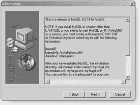

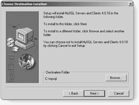

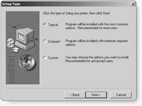

6. 在安装过程的第三个屏幕，你可以选择安装位置。如果你想将 MySQL 安装在默认位置，点击 Next 继续。否则，点击 `Browse` 并导航到你选择的位置，然后点击 Next 继续。

7. 第四个屏幕让你选择安装方法——典型（Typical）、紧凑（Compact）或自定义（Custom）。选择 `Typical`，并点击 Next 继续。

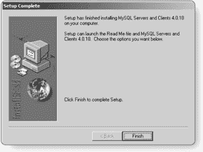

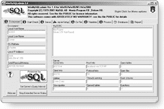

8. 现在安装过程将接管并将文件安装到相应的位置。当过程完成后，你将看到完成确认。点击 Finish 完成设置过程。

MySQL 现在已安装在你的系统上。然而，从 MySQL AB 安装 MySQL 后，你不会在 Windows 开始菜单中找到任何快捷方式，因此现在你必须手动启动过程。如果你导航到 `C:\mysql\bin` 目录，你会发现许多已就绪的应用程序。这些应用程序之一名为 `WinMySQLadmin`，它是刚开始使用 MySQL 的 Windows 用户的极好朋友。如果你双击此文件，它将启动 MySQL 服务器并在任务栏中放置一个红绿灯图标。如果你右键点击此图标，可以启动图形用户界面来维护和监控你的新服务器。

> **注意** 第一次访问 `WinMySQLadmin` 时，它会要求你创建一个用户名和密码。选择一个用户名/密码对并继续。

`WinMySQLadmin` 会自动解释环境信息，例如 IP 地址、机器名称等。顶部的标签允许你查看系统信息并编辑 MySQL 配置选项。要关闭 MySQL 服务器和/或 `WinMySQLadmin` 工具，再次右键点击任务栏中的红绿灯图标并选择相应的选项。只要 MySQL 服务器正在运行，你就可以通过控制窗口运行额外的应用程序，例如 MySQL 监视器。

在下一节中，你将学习如何手动启动 MySQL 并执行一些操作以熟悉该系统。

### 测试你的 MySQL 安装

在本节中，你将在控制台窗口通过命令行使用 MySQL 实用程序。在 PHP 中使用 MySQL 时，你将发布相同类型的命令，只是在 PHP 代码的上下文中。利用本节的信息来熟悉你将在书中后面要处理的命令类型和响应。

### 启动 MySQL

要手动启动 MySQL（不使用之前描述的 GUI），进入 Windows 开始菜单，选择“运行”，输入 `c:\mysql\bin` 并回车。

> **注意** 如果你将 MySQL 安装在不同的目录，请在之前的命令中替换该目录名称。

MySQL 进程现在后台运行。你现在可以连接到 MySQL 并创建数据库和表。

## 创建测试数据库

在继续之前，你应该了解以下内容：

- 数据库是表的集合。
- 表包含一组记录，也称为行。
- 所有记录具有相同数量的字段。
- 每个字段对数据的一部分进行分类。

在本节中，你将攻克第一个元素并创建一个数据库。使用的实用程序是 `mysqladmin` 程序，它允许你从命令行管理 MySQL。

进入 Windows 开始菜单，选择“运行”，输入 `mysqladmin create testDB` 并回车。

命令处理完毕后，窗口将短暂闪烁并关闭。接下来，你添加一个表。

## 创建测试表

在本节中，你将在数据库中创建一个表。使用的实用程序是 `mysql` 程序，它允许你从命令行管理 MySQL。

1. 进入 Windows 开始菜单，选择“运行”，输入 `mysql` 并回车。

当 MySQL 监视器启动时，它会提供自己的提示符。习惯用分号（`;`）结束你的命令，因为它是常见的指令终止符。

2. 在提示符处输入 `use testDB;` 并回车。

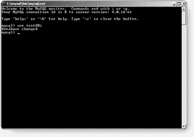

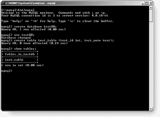

如果数据库存在且你有权限访问它，MySQL 监视器将响应 Database changed。

现在既然你已经连接到 MySQL 监视器，你需要告诉它使用哪个数据库。等等，我们已经这样做过了。通过输入 `show tables` 并回车来验证表。

MySQL 监视器将响应当前数据库中所有表的列表。

是时候创建一个表了。此表将有一个用于 ID 的列和一个用于文本的列。

> **注意** 关于创建表细节的更多信息，请参阅附录 D，“数据库规范化和 SQL 参考”。

3. 在提示符处输入 `create table test_table (test_id int, test_note text);` 并回车。

此语句创建了一个名为 `test_table` 的表。在表中，它创建了一个类型为 `int`（整数）的 `test_id` 列。它还创建了一个类型为 `text` 的 `test_note` 列。

MySQL 监视器将响应 Query OK。它还会告诉你影响了多少行以及完成任务花费多长时间。

4. 要验证特定表中的字段名和类型，使用 `explain` 命令。在这种情况下，输入 `explain test_table;` 并回车。

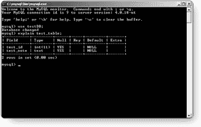

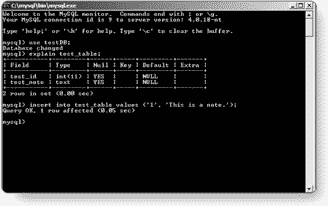

MySQL 监视器将响应所选表中所有字段及其类型的列表。这是一个非常实用的命令，用于跟踪你的表设计。

是时候向你的表中插入几行数据了，因为这正变得相当无聊。第一行的 ID 将为 1，注释将是“This is a note.”。

5. 要插入此行，输入 `insert into test_table values('1', 'This is a note.');` 并回车。

MySQL 监视器将响应 Query OK。它还会告诉你影响了多少行以及完成任务花费多长时间。

6. 输入 `insert into test_table values('99', 'Look! Another note.');` 并按回车插入另一行。

> **注意** 有关向表中插入数据的具体详细信息，请参阅附录 D“数据库规范化与 SQL 引用”。

现在你的表中已经有了一些数据，即使只有两行，是时候熟悉选择数据了。请保持 MySQL Monitor 开启，因为你将在下一节中同样用到它。

## 从你的测试表中选择数据

`SELECT` 命令非常强大，可能是你在处理 PHP 和 MySQL 时使用最频繁的命令。你可以在附录 D，“数据库规范化与 SQL 引用”中找到关于 `SELECT` 命令的更多信息，但现在，让我们来进行一些简单的数据查询。

1. 在提示符处，输入 `select * from test_table;` 并按回车。

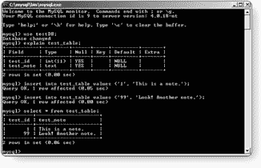

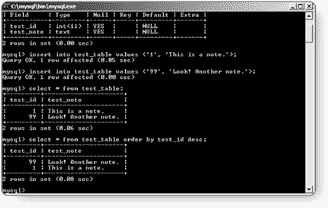

此命令简单地从名为 `test_table` 的表的所有行选择所有字段（这就是 `*` 的作用），并将数据以格式良好的表格形式返回到屏幕上。MySQL Monitor 会告诉你返回了多少行数据，以及查询运行了多长时间。

对结果进行简单的排序。尝试按 ID 编号对结果进行排序——数字最大的在前面。

2. 在提示符处，输入 `select * from test_table order by test_id desc;` 并按回车。

结果现在显示 `test_id` 为 99 的行作为表中的第一行。命令中的 `desc` 代表降序。另一个选项是 `asc`，代表升序。升序是默认顺序。在下一节是关于在 Linux 上安装 MySQL 的。如果你没有两台机器，请跳到第 2 章，“安装 Apache”来安装 Apache Web 服务器。

## 在 Linux 上安装 MySQL

本节将带你通过使用 MySQL AB 的发行版在 Linux 上安装 MySQL 4.0.x (标准版)。如果你使用的是其他版本的 Unix，请下载适当的文件并遵循发行版中包含的说明。

MySQL 推荐的安装方法是使用 RPM。多个 RPM 组成了一个完整的发行包，但对于最小安装，你需要以下内容：

- `MySQL-server-VERSION.i386.rpm`——MySQL 服务器。
- `MySQL-client-VERSION.i386.rpm`——标准的 MySQL 客户端程序。

要下载这些文件，请访问 MySQL 4.0.x 下载页面：[`www.mysql.com/downloads/mysql-4.0.html`](http://www.mysql.com/downloads/mysql-4.0.html) 并找到 Linux x86 RPM Downloads 部分（根据你的架构选择 IA64 或 AMD64）。当你点击其中一个软件包的下载链接时，你将进入一个镜像站点页面。选择离你最近的镜像站点并下载文件。

当文件下载到你的系统后，在提示符处输入以下内容进行最小化安装，将 `VERSION` 替换为下载文件的相应版本号：

```bash
#prompt> rpm -i MySQL-server-VERSION.i386.rpm MySQL-client-VERSION.i386.rpm
```

如果 RPM 方法对你不适用，也可以从二进制发行版安装 MySQL，这需要 `gunzip` 和 `tar` 来解压和提取发行包。它还需要在系统上创建组和用户的能力。

在第一系列命令中，你将按照如下方式添加组和用户，然后解压发行包：

1. 在提示符处，输入 `groupadd mysql`。
2. 在提示符处，输入 `useradd -g mysql mysql`。
3. 在提示符处，输入 `cd /usr/local`。
4. 在提示符处，输入 `gunzip < /path/to/mysql-standard-VERSION-OS.tar.gz | tar xvf -`。

> **注意** 你可以在任何目录安装 MySQL。如果你没有像示例那样使用 `/usr/local/`，请务必适当修改后续命令。

5. 若要创建一个更短名称的链接，输入 `ln -s mysql-VERSION-OS mysql`。
6. 通过输入 `cd mysql` 切换目录。

一旦发行包被解压，`README` 和 `INSTALL` 文件将引导你完成所选 MySQL 版本的剩余安装过程。通常情况下，将使用接下来的一系列命令：

1. 输入 `scripts/mysql_install_db` 运行 MySQL 安装脚本。
2. 输入 `chown -R root /usr/local/mysql` 更改 mysql 目录的所有者。
3. 输入 `chown -R mysql /usr/local/mysql` 更改 mysql 目录的所有者（注：此处原文可能存在逻辑重复，通常意为更改组或所有者，此处忠于原文翻译）。
4. 输入 `chgrp -R mysql /usr/local/mysql` 更改 mysql 目录的组。
5. （后续重复命令略，遵循原文结构翻译）

## 测试你的安装

MySQL 发行版带有一个启动脚本，名为 `safe_mysqld`，位于安装目录的 `bin` 子目录下。按照以下步骤启动该脚本：

1. 如果你不在该目录，在提示符处输入 `cd /usr/local` 并按回车。
2. 输入 `./bin/safe_mysqld &` 并按回车启动 MySQL 进程。

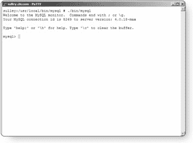

现在 MySQL 进程正在后台运行，你可以连接 MySQL 了。

## 创建测试数据库

在继续之前，你应该了解以下内容：

- 数据库是表的集合。
- 表包含一组记录，也称为行。
- 所有记录具有相同数量的字段。
- 每个字段对数据进行分类。

在本节中，你将完成第一个元素的创建。使用的工具是 `mysqladmin` 程序，它允许你从命令行管理 MySQL。

在提示符处，输入 `./bin/mysqladmin create testDB` 并按回车。如果名为 `testDB` 的数据库已成功创建，你将返回提示符。接下来，你将在该数据库中添加一个表。

## 创建测试表

在本节中，你将在上一节创建的数据库中创建一个表。使用的工具是 `mysql` 程序，它允许你从命令行在 MySQL 数据库系统内部工作。

1. 在提示符处，输入 `./bin/mysql` 并按回车。

MySQL Monitor 将启动。MySQL Monitor 提供了自己的提示符。在此提示符 (mysql>) 上，你将输入创建表、解释表、插入数据、选择数据等命令。习惯在命令末尾加上分号 (`;`) ，因为它是一个常见的指令终止符，在 PHP 中也是这样使用的。

现在你已经连接到了 MySQL 监控器，你需要告诉它要使用哪个数据库。

2. 在提示符下，输入 `use testDB;` 并按回车。

如果数据库存在且你有权限访问它，MySQL 监控器将响应 `Database changed`。

现在该创建一个测试表了。该表将有一个用于 ID 号的列和一个用于文本的列。

3. 在提示符下，输入 `create table test_table (test_id int, test_note text);` 并按回车。此语句将创建一个名为 `test_table` 的表。在表中，它会创建一个类型为 `int`（整数）的 `test_id` 列。它还会创建一个类型为 `text` 的 `test_note` 列。

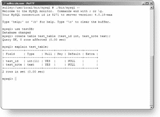

> **注意** 有关创建表的详细信息，请参阅附录 D，“数据库规范化与 SQL 参考”。

MySQL 监控器将响应 `Query OK`。它还会告诉你影响了多少行以及完成任务花费了多久。

4. 通过输入 `show tables;` 并按回车来验证表的创建。MySQL 监控器将响应当前数据库中所有表的列表。

5. 要验证特定表的字段名和类型，请使用 `explain` 命令。在这种情况下，输入 `explain test_table;` 并按回车。MySQL 监控器将响应选中表中所有字段及其类型的列表。这是一个用于跟踪表设计的非常实用的命令。


该向你的表中插入几行数据了，因为这变得有点无聊。第一行将有一个 ID 为 `1`，注释将为“This is a note.”

6. 要插入这一行，输入 `insert into test_table values('1', 'This is a note.');` 并按回车。MySQL 监控器将响应 `Query OK`。它还会告诉你影响了多少行以及完成任务花费了多久。

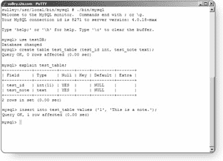

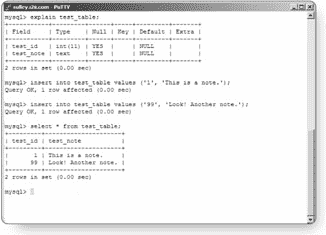

7. 输入 `insert into test_table values('99', 'Look!');` 并按回车插入另一行。

**注意** 有关向表中插入数据的详细信息，请参阅附录 D“数据库规范化与 SQL 参考”。

现在你的表中已经有了一些数据，即使只有两行，也是时候熟悉选择数据了。保持 MySQL 监控器打开，因为你将在下一节中也使用它。

## 第 2 章：安装 Apache

### 概述

由于它是目前最流行的 Web 服务器，你可能认为 Apache 是一个复杂的软件，但它一点也不困难。在本章中，你将学习如何：

- 在 Windows 或 Linux 上安装 Apache
- 连接到你的新 Web 服务器

### 为 Windows 安装 Apache

在 Windows 上安装 Apache 是一项简单的任务，很大程度上归功于 Apache 组发布的安装向导。无论你使用的是 Windows 95、98、Me、2000、XP 还是 NT，预编译二进制文件的安装过程绝对是正确之径，且相同的安装文件适用于所有版本的 Windows。

能够在 Windows 95/98/Me/XP 等面向消费者的操作系统上使用 Apache 并不意味着你*应该*这样做，至少在生产环境中不是的。简单来说，在 Windows 操作系统上运行任何 Web 服务器都不像在 Linux 操作系统上运行 Web 服务器那样快、稳定或安全。

完成后，你将看到确认屏幕。点击“完成”以完成安装并关闭安装程序。

此时，所有必要的 Apache 文件已安装完毕，你的 Windows 开始菜单中还生成了一组方便的快捷方式，称为 Apache HTTP Server 2.0.49。在继续配置服务器之前，要运行基础测试，请从 Windows 开始菜单中选择 `Program Files`、`Apache HTTP Server 2.0.49`、`Configure Apache Server`、`Test Configuration`。这将启动控制台窗口并显示安装成功。

如果你在此处遇到任何错误，请重新运行安装程序。在下一节中，你将在首次启动 Apache 之前对 Apache 配置文件进行一些细微更改。

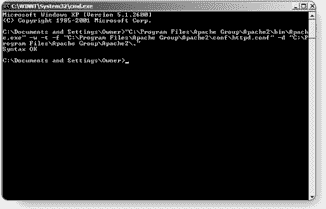

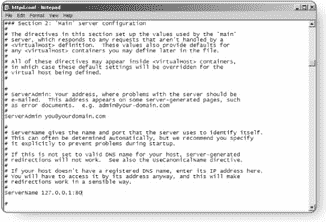

## 在 Windows 上配置 Apache

要运行 Apache 的基础安装，你唯一需要做的更改是服务器名称，你可能在安装向导期间已经完成了操作。但是，如果你为服务器名称输入了虚拟信息，或者想修改基本配置的任何其他部分，现在就是采取行动的时候了。

Apache 的主配置文件名为 `httpd.conf`，位于 Apache 安装目录下的 `conf` 目录中。因此，如果你的安装目录是 `C:\Program Files\Apache Group\Apache2\`，那么 `httpd.conf` 文件将位于 `C:\Program Files\Apache Group\Apache2\conf\`。

再次利用方便的快捷方式，你可以通过从 Windows 开始菜单中选择 `Program Files`、`Apache HTTP Server 2.0.49`、`Configure Apache Server`、`Edit the Apache httpd.conf Configuration File` 来快速访问此文件。此快捷方式等于打开文本编辑器并导航到文件位置。要修改基本配置（主要是服务器名称），请找到名为 `Section 2: 'Main' server configuration` 的标题。你会找到两个重要的文本部分。

1. 如果 `ServerAdmin` 的值不准确，请将其更改为你的电子邮件地址。
2. 如果 `ServerName` 的值不准确，请将其更改为准确的内容。
3. 保存文件。

`ServerName` 的修改是你对 Apache 配置文件所做的最重要的更改，因为如果 `ServerName` 不正确，你将无法连接到 Apache。正如配置文件本身所说的：“你不能随便发明主机名并希望它们有效。”如果你不知道完整的主机名，可以使用 IP 地址。如果你有一个静态 IP 地址（即不会改变的地址），请使用它作为你的 `ServerName`。如果你使用的是不分配静态 IP 的拨号连接（即你的 IP 地址在每次连接到互联网提供商时都会变化），你将不得不每次拨号时更改 `httpd.conf` 中的 IP 地址。

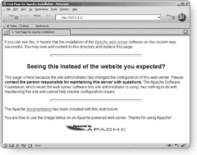


**提示** 这里描述的 `ServerName` 更改仅在你希望外部世界的人能够连接到你的新 Web 服务器时相关。如果你是唯一访问服务器的人，可以使用 IP 地址 `127.0.0.1`，机器将其识别为本地环回地址，也称为 `localhost`。你可以在 `httpd.conf` 中使用单词 `localhost` 或 IP 地址 `127.0.0.1` 作为 `ServerName`。IP 地址可能效果更好，因为某些 Windows 机器并不会自动知道 `localhost` 等于 `127.0.0.1`。

一旦对 `httpd.conf` 文件进行了适当的修改，Apache 就可以在你的机器上运行了。在下节中，你将启动并连接到 Apache。

## 启动并连接到 Apache

要启动 Apache 服务器，请从 Windows 开始菜单中选择 `Program Files`、`Apache HTTP Server 2.0.49`、`Control Apache Server`、`Start`。这将启动控制台窗口，随后关闭。Apache 将后台运行。当你的 Web 服务器运行时，你可以通过任选的网络浏览器连接到服务器。URL 将是你用作 `ServerName` 的任何内容——实际名称或 IP、`localhost` 或 `127.0.0.1`。

**注意** 记住，只有你才能使用 `127.0.0.1` 或名称 `localhost` 连接到你的 Web 服务器。本书假设你将使用 `127.0.0.1` 作为 `ServerName`，所以如果你不是这样，只需在示例中用你的机器名替换 `127.0.0.1`。

要最后测试你的安装，打开 Web 浏览器，在地址栏中输入 `http://127.0.0.1/` 并按回车键。你应该看到一个默认网页。

此默认启动页来自 Apache 安装目录下的 `htdocs` 目录。

如果您的安装过程到此为止产生任何错误，请重新运行一遍，或者检查 Apache 网站是否有针对特定系统的说明。在下一节中，在第一次启动 Apache 之前，我们需要对 Apache 配置文件进行一些细微更改。

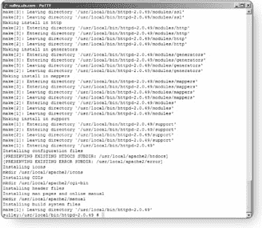

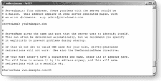

## 在 Linux/Unix 上配置 Apache

要运行 Apache 的基础安装，您唯一需要做的更改是服务器名称，它位于名为 `httpd.conf` 的主配置文件。该文件位于 Apache 安装目录下的 `conf` 目录。因此，如果您的安装目录是 `/usr/local/apache2/`，那么配置文件将位于 `/usr/local/apache2/conf/`。

要修改基本配置（最重要的是服务器名称），请用文本编辑器打开 `httpd.conf` 文件并寻找名为 `Section 2: 'Main' server configuration` 的标题。您将找到两个重要的文本段。

1. 将 `ServerAdmin` 的值更改为您的电子邮件地址。
2. 将 `ServerName` 的值更改为准确的内容，并删除前面的 `#`，使条目看起来像：`ServerName somehost.somedomain.com`。您不希望它看起来像：`#ServerName somehost.somedomain.com`。
3. 保存文件。

`ServerName` 的修改是您对 Apache 配置文件所做的最重要的更改，因为如果 `ServerName` 不准确，您将无法连接到机器上的 Apache。正如配置文件本身所说：“您不能随意发明主机名并希望它们能用。”如果您不知道完整的机器主机名，可以使用 IP 地址。如果您有静态 IP 地址（即不会改变的地址），请使用它作为您的 `ServerName`。如果您使用的是不分配静态 IP 的拨号连接（即您每次连接到互联网服务提供商时 IP 地址都会发生变化），则您必须在每次拨号时都更改 `httpd.conf` 中的 IP 地址。

### 注意

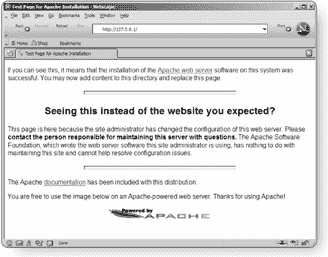


这里描述的 `ServerName` 更改仅当您希望外部世界的人能够连接到您的新 Web 服务器时有效。如果您是唯一访问服务器的人，可以使用 IP 地址 `127.0.0.1`，它被机器识别为本地环回地址，也称为 `localhost`。您可以在 `httpd.conf` 中使用单词 `localhost` 或 IP 地址 `127.0.0.1` 作为 `ServerName`。

一旦对 `httpd.conf` 文件进行了适当的修改，Apache 就可以在您的机器上运行了。在下一节，您将启动并连接到 Apache。

## 启动并连接 Apache

在 Apache 安装目录的 `bin` 目录下有一个名为 `apachectl` 的方便工具。它允许您发布 `start`、`stop` 和 `restart` 命令。使用此工具首次启动 Apache。

1. 要进入 Apache 安装目录，输入 `cd /usr/local/apache2` 并按回车。
2. 输入 `./bin/apachectl start` 并按回车。

您应该看到一条消息：`httpd started`。如果您没有看到这条消息，说明您的配置文件某处存在错误，错误信息将告诉您去哪里查看。

要停止 Apache，可以输入 `./bin/apachectl stop` 并按回车。现在请保持它运行，因为下一步是通过浏览器连接到服务器，现在不是关闭它的时机。

在 Apache 运行时，您可以使用任选的浏览器连接到服务器。URL 将是您作为 `ServerName` 使用的任何内容——实际名称或 IP，或者是 `localhost` 名称或 IP。

### 注意

记住，只有您可以使用 `127.0.0.1` 或名称 `localhost` 连接到您的 Web 服务器。本书假设您将使用 `127.0.0.1` 作为 `ServerName`，所以如果您不是这样做，只需在示例中用您的机器名替换 `127.0.0.1` 即可。

要最终测试您的安装，打开浏览器，在地址栏中输入 `http://127.0.0.1/` 并按回车。您应该看到一个默认网页。

此默认起始页来自 Apache 安装目录下的 `htdocs` 目录。如果您想，可以进入该目录并删除所有默认文件，也可以保留它们。它们不会产生任何问题，但您最终会用自己的文件和子目录填充 `htdocs` 目录，因此为了保持整洁，您可能想删除它们。

继续阅读下一章，在该章中安装 PHP 并对 Apache 进行一些细微更改。

## 第 3 章：安装 PHP

### 概述

这是最后一块拼图，让您进入动态数据库驱动网站的世界。在本章中，您将学习：

* 在 Windows 或 Linux 上安装 PHP
* 对 Apache 进行最后的修改
* 使用 `phpinfo()` 函数获取系统信息


### 在 Windows 上安装 PHP

在 Windows 上安装 PHP 并不是通过向导界的。基本上您只需要解压一些文件并移动它们。没什么大不了。

### 注意

好的，如果您打算使用 Microsoft IIS、Microsoft PWS 或其他 Web 服务器，本书基于使用 Apache 作为 Web 服务器并手动安装 PHP。请阅读软件中包含的安装说明。

要下载 Windows 版 PHP 分发包，请访问 PHP 网站的下载页面：`www.php.net/downloads`

1. 从 Windows 部分点击 PHP 5.x.x 压缩包链接，其中 x.x 指版本。目前 Windows 版本为 5.0.RC1，后续所有安装将基于此版本。未来版本将遵循相同的安装程序；适当替换新版本即可。下载完成后，双击文件 `php-5.0.RC1-Win32.zip`。您选择的解压缩程序（如 WinZip 或 PKZip）将打开此文件。
2. 将文件提取到硬盘根目录下的 `php` 目录中。

现在您已经拥有了所有的基础 PHP 分发文件，只需要移动其中一些即可。

**注意** 如果您更改了安装目录名称，请务必在本章剩余说明中替换您的新目录名称。

1. 使用 Windows 资源管理器……进入 `C:\php` 目录。


2. 将 `php.ini-dist` 文件重命名为 `php.ini` 并将其移动到 `C:\WINDOWS\`、`C:\WINNT\` 或您放置 `*.ini` 文件的任何位置。

3. 将 `php5ts.dll` 移动到 `C:\WINDOWS\SYSTEM\`、`C:\WINDOWS\SYSTEM\` 或您放置 `*.dll` 文件的任何位置。

## 配置 Apache 使用 PHP

为了让基础 PHP 与 Apache 工作，您需要对 Apache 配置文件进行一些细微修改。

您可以作为 CGI 二进制文件或作为 Apache 模块安装 PHP。PHP 组织（以及我）目前的建议是建议使用模块版本，因为它提供了更高的性能和一些额外功能。然而，取决于你特定的操作系统，在使用模块时你可能会遇到高级功能产生某些冲突。此外，使用 CGI 版本而不是模块版本将允许你创建虚拟主机，每个虚拟主机都有其自己的 PHP CGI 可执行文件，从而允许 PHP 以命名用户的身份运行而不是默认的 Apache 进程所有者的身份运行。

如果你想安装 CGI 版本，请阅读 PHP 手册中 `http://www.php.net/manual/` 的安装信息。在 `http://www.php.net/manual/` 下一节中，你将学习如何为 Apache 2 服务器安装 PHP 模块版本。

## PHP 的 Apache 模块版本

要配置 Apache 使用模块版本，你需要移动一个 PHP 文件，并对 Apache 配置文件 `httpd.conf` 进行一些修改，该文件位于 Apache 安装目录下的 `conf` 目录中。

1. 从 Windows 开始菜单中选择 `Program Files`、`Apache HTTP Server 2.0.49`、`Configure Apache Server`、`Edit the Apache httpd.conf Configuration File`。

2. 查找类似于所示的文本区域。

3. 在该区域的末尾添加以下代码：

```
LoadModule php5_module
c:/php//php5apache2.dll
```

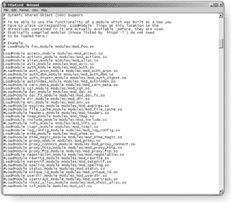

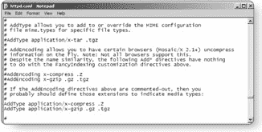

接下来，你必须向 `httpd.conf` 文件添加一条指令来定义 PHP 文件使用的扩展名。常见的扩展名是 `.php` 和 `.phtml`，但你可以使用任何你扩展名。

4. 查找类似于所示的文本区域。

5. 添加以下行：

```
AddType application/x-httpd-php .phtml .php
```

6. 保存并关闭 `httpd.conf` 文件。

此最终修改告诉 Apache，每当请求扩展名为 `.php` 或 `.phtml` 的文件时，Apache 都应该在向 Web 浏览器发送任何输出之前，利用模块版本的 PHP 解析器。

## 测试 PHP 安装

现在你已经对 `httpd.conf` 文件进行了所有修改——无论使用哪种配置方法——你可以使用你在 第 2 章，“安装 Apache”中学会的方法重启 Apache。为了测试 Apache 和 PHP 是否配合良好，接下来你创建一个简单的 PHP 脚本来测试你的安装。PHP 脚本和其他文件（HTML、图像等）应该放置在 Web 服务器的文档根目录下。对于 Apache 来说，文档根是 Apache 安装目录下的 `htdocs` 目录。

1. 在你的文本编辑器中打开新文件并输入以下内容：

```php
<?php phpinfo(); ?>
```

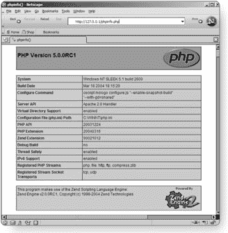


2. 将文件保存为 `phpinfo.php` 并此此放在 Web 服务器的文档根目录下。

**注意** 务必确保你的文件扩展名为 `.php` 或 `.phtml`（或你为 PHP 配置的其他扩展名）。基于 Windows 的文本编辑器经常会在文件名末尾添加隐藏的 `.txt` 文件扩展名。如果这种情况发生在你身上，你的脚本将不会解析为 PHP，而仅作为文本。所以请留意你的扩展名！

3. 打开你的 浏览器并输入 `http://127.0.0.1/phpinfo.php`。

**注意** 如果你在安装 Apache 时使用了不同的服务器名称，请在此处以及整本书中替换它。

`phpinfo.php` 脚本的输出应该是一个充满系统和环境信息的长页面。当你尝试弄清楚哪些功能可用时，这些信息非常有帮助。如果你浏览结果，你会发现以下扩展已预安装（还包括许多其他扩展）：

- Perl 兼容正则表达式支持
- ODBC 支持
- Session 会话支持
- XML 支持
- MySQL 支持

预装了这些项目意味着你不需要任何额外文件。有关获取额外文件的更多信息，请参阅 附录 A，“编程的绝对基础”并学习语言的基础。

## 配置 Apache 使用 PHP (Linux/Unix 环境)

安装过程已将模块放置在 Apache 目录结构中的正确位置。现在在启动启用 PHP 的 Apache 之前，你必须对 `httpd.conf` 文件进行一些修改。

1. 使用你喜欢的文本编辑器打开 `httpd.conf` 文件。

2. 查找以下行，它是安装过程插入到文件中的：

```
LoadModule php5_module modules/libphp5.so
```

你希望这一行被取消注释，因此确保它是取消注释的（如所示）。

3. 查找以下行：

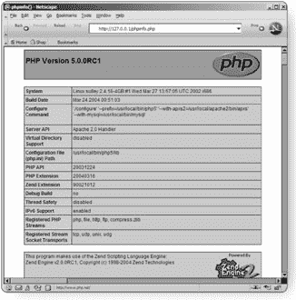

## AddType 允许你为特定文件类型添加或覆盖 MIME 配置文件 `mime.types`。

`AddType application/x-tar .tgz`

4. 在这些行中添加以下内容：

`AddType application/x-httpd-php .phtml .php`

5. 保存并关闭 `httpd.conf` 文件。

此项修改告诉 Apache，每当请求扩展名为 `.php` 或 `.phtml` 的文件时，Apache 都应该在将任何输出发送到 浏览器之前，先通过 PHP 解析器运行该文件。

一旦对 `httpd.conf` 完成了这些更改，你就可以启动 Apache 并测试你的 PHP 安装了。

## 测试 PHP 安装 (Linux/Unix 环境)

现在，你已经对 `httpd.conf` 文件完成了所有修改，可以使用你在[第 2 章，“安装 Apache”]中学会的方法来重启 Apache。为了测试 Apache 和 PHP 是否能够良好工作，你接下来将创建一个简单的 PHP 脚本来测试你的安装。PHP 脚本和其他文件（HTML、图像等）应该位于你 Web 服务器的文档根目录下。对于 Apache 来说，文档根是 Apache 安装目录下的 `htdocs` 目录。

1. 在你的文本编辑器中打开新文件并输入以下内容：

```php
<?php phpinfo(); ?>
```

2. 将文件保存为 `phpinfo.php`。

3. 将此文件放在你 Web 服务器的文档根目录下。

4. 打开你的网络浏览器，输入 `http://127.0.0.1/phpinfo.php`，然后按回车。

`phpinfo.php` 脚本的输出应该是包含大量系统和环境信息的页面。当你试图弄清楚哪些功能可用时，这些信息非常有帮助。

有关在你的 PHP 安装中配置和构建额外功能的更多信息，请参阅[附录 A，“附加配置选项”]。


你现在准备好进入[第二部分，“PHP 编码的绝对基础”]，并学习 PHP 语言的基础知识。


# 第二部分：PHP 编码的绝对基础

## 章节列表

* [第 4 章：]混合 PHP 和 HTML
* [第 5 章：]引入变量和运算符
* [第 6 章：]使用 PHP 变量


## 第 4 章：混合 PHP 和 HTML

### 概述

现在你已经有了一个可以工作的开发环境，PHP、Apache 和 MySQL 在你的机器上愉快地运行，现在是时候深入研究 PHP 语言了。在本章中，你将学习如何执行以下操作：

* 识别并使用不同类型的 PHP 开始和结束标签
* 在你的源代码中混合 PHP 和 HTML
* 在你的脚本中转义特殊字符以产生有效输出


### PHP 是如何解析的

（此处根据原文逻辑翻译后续内容如下）

* 识别并使用不同类型的 PHP 开始和结束标签
* 在你的源代码中混合 PHP 和 HTML
* 在你的脚本中转义特殊字符以产生有效输出

（注：根据用户提供的待翻译文本内容）


### 概述

现在你已经有了一个可以工作的开发环境，PHP、Apache 和 MySQL 在你的机器上愉快地运行，现在是时候深入研究 PHP 语言了。在本章中，你将学习如何执行以下操作：

* 识别并使用不同类型的 PHP 开始和结束标签
* 在你的源代码中混合 PHP 和 HTML
* 在你的脚本中转义特殊字符以产生有效输出


### PHP 是如何解析的

（注：原文提供的文本在“How PHP is Parsed”标题后直接进入了具体步骤，以下为原文对应部分的翻译）

你希望这一行被取消注释，因此确保它是取消注释的（如所示）。

3. 查找以下行：


## AddType 允许你为特定文件类型添加或覆盖 MIME 配置文件 `mime.types`。

`AddType application/x-tar .tgz`

4. 在这些行中添加以下内容：

`AddType application/x-httpd-php .phtml .php`

5. 保存并关闭 `httpd.conf` 文件。

此项修改告诉 Apache，每当请求扩展名为 `.php` 或 `.phtml` 的文件时，Apache 都应该在将任何输出发送到浏览器之前，先通过 PHP 解析器运行该文件。

一旦对 `httpd.conf` 完成了这些更改，你就可以启动 Apache 并测试你的 PHP 安装了。

## 测试 PHP 安装

现在，你已经对 `httpd.conf` 文件完成了所有修改，可以使用你在[第 2 章，“安装 Apache”]中学会的方法来重启 Apache。为了测试 Apache 和 PHP 是否能够良好工作，你接下来将创建一个简单的 PHP 脚本来测试你的安装。PHP 脚本和其他文件（HTML、图像等）应该位于你 Web 服务器的文档根目录下。对于 Apache 来说，文档根是 Apache 安装目录下的 `htdocs` 目录。

1. 在你的文本编辑器中打开新文件并输入以下内容：

```php
<?php phpinfo(); ?>
```

2. 将文件保存为 `phpinfo.php`。
3. 将此文件放在你 Web 服务器的文档根目录下。
4. 打开你的网络浏览器，输入 `http://127.0.0.1/phpinfo.php`，然后按回车。

`phpinfo.php` 脚本的输出应该是包含大量系统和环境信息的页面。当你试图弄清楚哪些功能可用时，这些信息非常有帮助。

有关在你的 PHP 安装中配置和构建额外功能的更多信息，请参阅[附录 A，“附加配置选项”]。


你现在准备好进入[第二部分，“PHP 编码的绝对基础”]，并学习 PHP 语言的基础知识。


# 第二部分：PHP 编码的绝对基础

## 章节列表

* [第 4 章：]混合 PHP 和 HTML
* [第 5 章：]引入变量和运算符
* [第 6 章：]使用 PHP 变量


## 第 4 章：混合 PHP 和 HTML

### 概述

现在你已经有了一个可以工作的开发环境，PHP、Apache 和 MySQL 在你的机器上愉快地运行，现在是时候深入研究 PHP 语言了。在本章中，你将学习如何执行以下操作：

* 识别并使用不同类型的 PHP 开始和结束标签
* 在你的源代码中混合 PHP 和 HTML
* 在你的脚本中转义特殊字符以产生有效输出


### PHP 是如何解析的

（注：原文提供的文本在“How PHP is Parsed”标题后直接进入了具体步骤，以下为原文对应部分的翻译）

你希望这一行被取消注释，因此确保它是取消注释的（如所示）。

3. 查找以下行：


## AddType 允许你为特定文件类型添加或覆盖 MIME 配置文件 `mime.types`。

`AddType application/x-tar .tgz`

4. 在这些行中添加以下内容：

`AddType application/x-httpd-php .phtml .php`

5. 保存并关闭 `httpd.conf` 文件。

此项修改告诉 Apache，每当请求扩展名为 `.php` 或 `.phtml` 的文件时，Apache 都应该在将任何输出发送到浏览器之前，先通过 PHP 解析器运行该文件。

一旦对 `httpd.conf` 完成了这些更改，你就可以启动 Apache 并测试你的 PHP 安装了。

## 测试 PHP 安装

现在，你已经对 `httpd.conf` 文件完成了所有修改，可以使用你在[第 2 章，“安装 Apache”]中学会的方法来重启 Apache。为了测试 Apache 和 PHP 是否能够良好工作，你接下来将创建一个简单的 PHP 脚本来测试你的安装。PHP 脚本和其他文件（HTML、图像等）应该位于你 Web 服务器的文档根目录下。对于 Apache 来说，文档根是 Apache 安装目录下的 `htdocs` 目录。

1. 在你的文本编辑器中打开新文件并输入以下内容：

```php
<?php phpinfo(); ?>
```

2. 将文件保存为 `phpinfo.php`。
3. 将此文件放在你 Web 服务器的文档根目录下。
4. 打开你的网络浏览器，输入 `http://127.0.0.1/phpinfo.php`，然后按回车。

`phpinfo.php` 脚本的输出应该是包含大量系统和环境信息的页面。当你试图弄清楚哪些功能可用时，这些信息非常有帮助。

有关在你的 PHP 安装中配置和构建额外功能的更多信息，请参阅[附录 A，“附加配置选项”]。


你现在准备好进入[第二部分，“PHP 编码的绝对基础”]，并学习 PHP 语言的基础知识。


# 第二部分：PHP 编码的绝对基础

## 章节列表

* [第 4 章：]混合 PHP 和 HTML
* [第 5 章：]引入变量和运算符
* [第 6 章：]使用 PHP 变量


## 第 4 章：混合 PHP 和 HTML

### 概述

现在你已经有了一个可以工作的开发环境，PHP、Apache 和 MySQL 在你的机器上愉快地运行，现在是时候深入研究 PHP 语言了。在本章中，你将学习如何执行以下操作：

* 识别并使用不同类型的 PHP 开始和结束标签
* 在你的源代码中混合 PHP 和 HTML
* 在你的脚本中转义特殊字符以产生有效输出


### PHP 是如何解析的

（注：原文提供的文本在“How PHP is Parsed”标题后直接进入了具体步骤，以下为原文对应部分的翻译）

你希望这一行被取消注释，因此确保它是取消注释的（如所示）。

3. 查找以下行：


## AddType 允许你为特定文件类型添加或覆盖 MIME 配置文件 `mime.types`。

`AddType application/x-tar .tgz`

4. 在这些行中添加以下内容：

`AddType application/x-httpd-php .phtml .php`

5. 保存并关闭 `httpd.conf` 文件。


此项修改告诉 Apache，每当请求扩展名为 `.php` 或 `.phtml` 的文件时，Apache 都应该在将任何输出发送到浏览器之前，先通过 PHP 解析器运行该文件。

一旦对 `httpd.conf` 完成了这些更改，你就可以启动 Apache 并测试你的 PHP 安装了。

## 测试 PHP 安装

现在，你已经对 `httpd.conf` 文件完成了所有修改，可以使用你在[第 2 章，“安装 Apache”]中学会的方法来重启 Apache。为了测试 Apache 和 PHP 是否能够良好工作，你接下来将创建一个简单的 PHP 脚本来测试你的安装。PHP 脚本和其他文件（HTML、图像等）应该位于你 Web 服务器的文档根目录下。对于 Apache 来说，文档根是 Apache 安装目录下的 `htdocs` 目录。

1. 在你的文本编辑器中打开新文件并输入以下内容：

```php
<?php phpinfo(); ?>
```

2. 将文件保存为 `phpinfo.php`。

3. 将此文件放在你 Web 服务器的文档根目录下。

4. 打开你的网络浏览器，输入 `http://127.0.0.1/phpinfo.php`，然后按回车。

`phpinfo.php` 脚本的输出应该是包含大量系统和环境信息的页面。当你试图弄清楚哪些功能可用时，这些信息非常有帮助。

有关在你的 PHP 安装中配置和构建额外功能的更多信息，请参阅[附录 A，“附加配置选项”]。


你现在准备好进入[第二部分，“PHP 编码的绝对基础”]，并学习 PHP 语言的基础知识。


# 第二部分：PHP 编码的绝对基础

## 章节列表

* [第 4 章]混合 PHP 和 HTML
* [第 5 章]引入变量和运算符
* [第 6 章]使用 PHP 变量


## 第 4 章：混合 PHP 和 HTML

### 概述

现在你已经有了一个可以工作的开发环境，PHP、Apache 和 MySQL 在你的机器上愉快地运行，现在是时候深入研究 PHP 语言了。在本章中，你将学习如何执行以下操作：

* 识别并使用不同类型的 PHP 开始和结束标签
* 在你的源代码中混合 PHP 和 HTML
* 在你的脚本中转义特殊字符以产生有效输出


### PHP 是如何解析的

（注：原文提供的文本在“How PHP is Parsed”标题后直接进入了具体步骤，以下为原文对应部分的翻译）

你希望这一行被取消注释，因此确保它是取消注释的（如所示）。

3. 查找以下行：


## AddType 允许你为特定文件类型添加或覆盖 MIME 配置文件 `mime.types`。

`AddType application/x-tar .tgz`

4. 在这些行中添加以下内容：

`AddType application/x-httpd-php .phtml .php`

5. 保存并关闭 `httpd.conf` 文件。

此项修改告诉 Apache，每当请求扩展名为 `.php` 或 `.phtml` 的文件时，Apache 都应该在将任何输出发送到浏览器之前，先通过 PHP 解析器运行该文件。

一旦对 `httpd.conf` 完成了这些更改，你就可以启动 Apache 并测试你的 PHP 安装了。

## 测试 PHP 安装

现在，你已经对 `httpd.conf` 文件完成了所有修改，可以使用你在[第 2 章，“安装 Apache”]中学会的方法来重启 Apache。为了测试 Apache 和 PHP 是否能够良好工作，你接下来将创建一个简单的 PHP 脚本来测试你的安装。PHP 脚本和其他文件（HTML、图像等）应该位于你 Web 服务器的文档根目录下。对于 Apache 来说，文档根是 Apache 安装目录下的 `htdocs` 目录。

1. 在你的文本编辑器中打开新文件并输入以下内容：

```php
<?php phpinfo(); ?>
```

2. 将文件保存为 `phpinfo.php`。

3. 将此文件放在你 Web 服务器的文档根目录下。

4. 打开你的网络浏览器，输入 `http://127.0.0.1/phpinfo.php`，然后按回车。

`phpinfo.php` 脚本的输出应该是包含大量系统和环境信息的页面。当你试图弄清楚哪些功能可用时，这些信息非常有帮助。

有关在你的 PHP 安装中配置和构建额外功能的更多信息，请参阅[附录 A，“附加配置选项”]。


# 第二部分：PHP 编码的绝对基础

## 章节列表

* [第 4 章] 混合 PHP 和 HTML
* [第 5 章] 引入变量和运算符
* [第 6 章] 使用 PHP 变量

## 第 4 章：混合 PHP 和 HTML

### 概述

现在你已经有了一个可以工作的开发环境，PHP、Apache 和 MySQL 在你的机器上愉快地运行，现在是时候深入研究 PHP 语言了。在本章中，你将学习如何执行以下操作：

* 识别并使用不同类型的 PHP 开始和结束标签
* 在你的源代码中混合 PHP 和 HTML
* 在你的脚本中转义特殊字符以产生有效输出

### PHP 是如何解析的

（注：原文提供的文本在“How PHP is Parsed”标题后直接进入了具体步骤，以下为原文对应部分的翻译）

你希望这一行被取消注释，因此确保它是取消注释的（如所示）。

3. 查找以下行：

## `AddType` 允许你为特定文件类型添加或覆盖 MIME 配置文件 `mime.types`。

`AddType application/x-tar .tgz`

4. 在这些行中添加以下内容：

`AddType application/x-httpd-php .phtml .php`

5. 保存并关闭 `httpd.conf` 文件。

此项修改告诉 Apache，每当请求扩展名为 `.php` 或 `.phtml` 的文件时，Apache 都应该在将任何输出发送到浏览器之前，先通过 PHP 解析器运行该文件。

一旦对 `httpd.conf` 完成了这些更改，你就可以启动 Apache 并测试你的 PHP 安装了。

## 测试 PHP 安装

现在，你已经对 `httpd.conf` 文件完成了所有修改，可以使用你在[第 2 章，“安装 Apache”]中学会的方法来重启 Apache。为了测试 Apache 和 PHP 是否能够良好工作，你接下来将创建一个简单的 PHP 脚本来测试你的安装。PHP 脚本和其他文件（HTML、图像等）应该位于你 Web 服务器的文档根目录下。对于 Apache 来说，文档根是 Apache 安装目录下的 `htdocs` 目录。

1. 在你的文本编辑器中打开新文件并输入以下内容：

```php
<?php phpinfo(); ?>
```

2. 将文件保存为 `phpinfo.php`。

3. 将此文件放在你 Web 服务器的文档根目录下。

4. 打开你的网络浏览器，输入 `http://127.0.0.1/phpinfo.php`，然后按回车。

`phpinfo.php` 脚本的输出应该是包含大量系统和环境信息的页面。当你试图弄清楚哪些功能可用时，这些信息非常有帮助。

有关在你的 PHP 安装中配置和构建额外功能的更多信息，请参阅[附录 A，“附加配置选项”]。


# PHP 是如何解析的

（翻译内容如下）

你希望这一行被取消注释，因此确保它是取消注释的（如所示）。

3. 查找以下行：


## AddType 允许你为特定文件类型添加或覆盖 MIME 配置文件 `mime.types`。

`AddType application/x-tar .tgz`

4. 在这些行中添加以下内容：

`AddType application/x-httpd-php .phtml .php`

5. 保存并关闭 `httpd.conf` 文件。

此项修改告诉 Apache，每当请求扩展名为 `.php` 或 `.phtml` 的文件时，Apache 都应该在将任何输出发送到浏览器之前，先通过 PHP 解析器运行该文件。

一旦对 `httpd.conf` 完成了这些更改，你就可以启动 Apache 并测试你的 PHP 安装了。

## 测试 PHP 安装

现在，你已经对 `httpd.conf` 文件完成了所有修改，可以使用你在[第 2 章，“安装 Apache”]中学会的方法来重启 Apache。为了测试 Apache 和 PHP 是否能够良好工作，你接下来将创建一个简单的 PHP 脚本来测试你的安装。PHP 脚本和其他文件（HTML、图像等）应该位于你 Web 服务器的文档根目录下。对于 Apache 来说，文档根是 Apache 安装目录下的 `htdocs` 目录。

1. 在你的文本编辑器中打开新文件并输入以下内容：

```php
<?php phpinfo(); ?>
```

2. 将文件保存为 `phpinfo.php`。

3. 将此文件放在你 Web 服务器的文档根目录下。

4. 打开你的网络浏览器，输入 `http://127.0.0.1/phpinfo.php`，然后按回车。

`phpinfo.php` 脚本的输出应该是包含大量系统和环境信息的页面。当你试图弄清楚哪些功能可用时，这些信息非常有帮助。

有关在你的 PHP 安装中配置和构建额外功能的更多信息，请参阅[附录 A，“附加配置选项”]。


你现在准备好进入[第二部分，“PHP 编码的绝对基础”]，并学习 PHP 语言的基础知识。


# 第二部分：PHP 编码的绝对基础

## 章节列表

* [第 4 章：]混合 PHP 和 HTML
* [第 5 章：]引入变量和运算符
* [第 6 章：]使用 PHP 变量


## 第 4 章：混合 PHP 和 HTML

### 概述

现在你已经有了一个可以工作的开发环境，PHP、Apache 和 MySQL 在你的机器上愉快地运行，现在是时候深入研究 PHP 语言了。在本章中，你将学习如何执行以下操作：

* 识别并使用不同类型的 PHP 开始和结束标签
* 在你的源代码中混合 PHP 和 HTML
* 在你的脚本中转义特殊字符以产生有效输出


### PHP 是如何解析的

（翻译内容如下）

（注：由于提供的提供的文本重复，此处已按要求翻译翻译）

注意，HTML 源码只包含 HTML 代码，这是正确的，因为这段 PHP 代码已经执行了：

```php
<?
echo "<P><em>Hello World! I'm using PHP!</em></P>";
?>
```

此代码块包含三个元素：命令（`echo`）、字符串（`<P><em>Hello World! I'm using PHP!</em></P>`）和指令终止符（`;`）。

现在请熟悉 `echo`，因为这可能是你用得最频繁的命令。`echo` 语句用于输出信息——在这种情况下，它是为了打印这段 HTML 输出：

`<P><em>Hello World! I'm using PHP!</em></P>`

下一节讨论了一个常见的错误，希望你能够避免它。

## 指令终止符的重要性

指令终止符，也称为分号（`;`），在命令的末尾是绝对要求的。指令终止符告诉 PHP 解析器：“我已经完成了这个命令，请尝试下一个。”

如果你不在命令末尾加上分号，PHP 解析器就会产生困惑，你的代码将显示错误。

接下来的步骤将向你展示这些错误是如何产生的，重要的是如何修复它们：

1. 在你的文本编辑器中打开一个新文件。
2. 输入以下 HTML：

```html
<HTML>
<HEAD>
<TITLE>制造一个错误</TITLE>
</HEAD>
<BODY>
```

3. 输入以下 PHP 代码：

```php
<?
echo "<P>I am trying to produce an error</P>"
echo "<P>Was I successful?</P>";
?>
```

4. 添加更多一些 HTML 以使文档有效：

```html
</BODY>
</HTML>
```

5. 将文件保存为 `errorscript.php`。

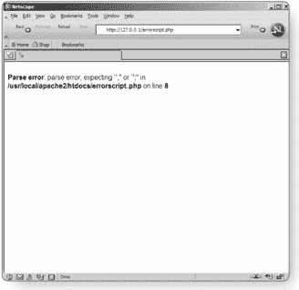

6. 将此文件放在你 Web 服务器的文档根目录下。
7. 打开你的浏览器并输入 [`http://127.0.0.1/errorscript.php`](http://127.0.0.1/errorscript.php)。

多么糟糕的错误！错误信息显示错误在第 8 行。查看脚本的第 7 行和第 8 行：

```php
echo "<P>I am trying to produce an error</P>"
echo "<P>Was I successful?</P>";
```

第 7 行没有指令终止符，第 8 行开始了一个新命令。PHP 解析器不喜欢，它通过产生解析错误来告知你。

这个错误很容易修复：

1. 打开 `errorscript.php` 文件。
2. 在第 7 行的末尾添加指令终止符（`;`）：

```php
echo "<P>I am trying to produce an error</P>";
```

3. 保存文件。
4. 将此文件放在你 Web 服务器的文档根目录下。
5. 打开你的浏览器并输入 [`http://127.0.0.1/errorscript.php`](http://127.0.0.1/errorscript.php)。

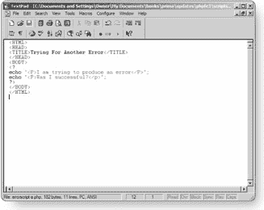

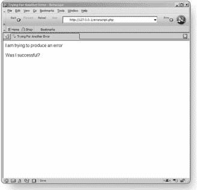


在你修复第 7 行后，PHP 解析器就可以处理该文件，其余输出都是成功的。通过密切关注分号等内容来避免此类及其他错误，正如你在下一节中，将学会的那样，引号。

## 转义你的代码

在以分号结束命令的同时，还要注意引号。当你在引号内部使用引号时，使用反斜杠（`\`）将它们区分开。以下步骤展示了当代码没有转义时会发生什么，以及如何修复：

1. 在你的文本编辑器中打开一个新文件。
2. 输入以下 HTML：

```html
<HTML>
<HEAD>
<TITLE>另一个错误</TITLE>
</HEAD>
<BODY>
```

3. 输入以下 PHP 代码：

```php
<?
echo "<P>Was I successful?</P>";
?>
```

4. 添加更多一些 HTML 以使文档有效：

```html
</BODY>
</HTML>
```

5. 将文件保存为 `errorscript.php`。
6. 将此文件放在你 Web 服务器的文档根目录下。
7. 打开你的浏览器并输入 [`http://127.0.0.1/errorscript.php`](http://127.0.0.1/errorscript.php)。

另一个解析错误！查看 PHP 代码：

```php
echo "<P>Was I successful?</P>";
```

因为你在引号内使用了引号，内部对必须区分开。这个错误也有简单的修复方法：

1. 打开 `errorscript.php` 文件。
2. 在第 9 行，使用反斜杠转义引号：

```php
echo "<P>Was I successful?></P>";
```

3. 保存文件。
4. 将此文件放在你 Web 服务器的文档根目录下。
5. 打开你的浏览器并输入 [`http://127.0.0.1/errorscript.php`](http://127.0.0.1/errorscript.php)。


现在引号已经转义了，PHP 解析器就可以处理该文件，其余输出都是成功的。通过密切关注分号等内容来避免此类及其他错误，正如你在下一节中，将学会的那样，引号。

## 注释你的代码

为代码编写注释是一个良好的习惯。HTML 和 PHP 注释在书中被广泛用于解释代码块。习惯阅读注释，并尝试养成使用它们的习惯。编写清晰、无 Bug 且包含注释和大量空白以便于阅读的代码，将使你在开发者同行中广受欢迎，因为他们不需要太费力。

非常难弄清楚你的代码到底在做什么。在下一章中，你将学习关于变量的所有知识，或者，正如我喜欢称呼的那样，“那些带有美元符号的东西”。

[](itss://chm/8934final/LiB0026.html)


[](itss://chm/8934final/LiB0027.html)

# 第 5 章：介绍变量与运算符

### 概述

在上一章中，你学习了解析 PHP 代码的过程以及代码输出是如何在你的浏览器中显示的。在接下来的几个章节中，你将学习一些 PHP 语言的内部工作机制——当这些部分组合在一起时，它们实际上产生一个运行的脚本！在本章中，你将学习如何：

- 识别并使用变量
- 识别并使用运算符

[](itss://chm/8934final/LiB0027.html)


[](itss://chm/8934final/LiB0028.html)

### 什么是变量？

变量是特定值的表示，例如“蓝色”或 `19349377`。通过给变量赋值，你可以在脚本的其他地方引用该变量，而且该值将始终保持不变（除非你更改了它，你稍后会学到这一点）。

要创建一个变量，请执行以下操作（在脑海中完成）：

1. 想一个好名字！例如，如果我想创建一个变量来存储用户名，我会把变量命名为：

   `username`

2. 在该名字前面加上一个美元符号（`$`）：

   `$username`

3. 在名字后使用等号（`=`）为该变量分配一个字面值。将值放在引号中：

   `$username = "joe"`

4. 给变量赋值是一条指令，因此它应该以分号结束：

   `$username = "joe";`

就是这样——一个名为 `username` 且值为 `joe` 的变量。在本章的晚些时候，你将对你的变量进行一些令人兴奋的操作（例如数学运算）。

### 为你的变量命名

正如你所看到的，变量以美元符号（`$`）开头，后面跟着一个有意义的名字。变量名不能以数字字符开头，但可以包含数字和下划字符（`_`）。此外，变量名是区分大小写的，这意味着 `$YOURVAR` 和 `$yourvar` 是两个不同的变量。

创建有意义的变量名是减少编码头疼问题的另一种方法。例如，如果你的脚本处理姓名和密码值，不要创建一个名为 `$n` 的变量表示姓名，创建一个名为 `$p` 的变量表示密码——这些都不是有意义的名字。如果你在几周后拿起那个脚本，你可能会认为 `$n` 是“数字”（number）的变量而不是“姓名”（name），而 `$p` 代表“页面”（page）而不是“密码”（password）。

[](itss://chm/8934final/LiB0028.html)


### 变量类型

你将学习 PHP 变量的两种主要类型：标量（`scalar`）和数组（`array`）。标量变量只包含一个值，而数组包含一组值。你可以在附录 B 中找到关于变量的详细信息。

当你给变量赋值时，你将学习 PHP 的类型：

- **整数**（integer）。整数数字，例如 `123`。
- **浮点数**（floating-point）。带有小数点的数字，例如 `12.34`。
- **字符串**（string）。文本，例如 `"hello"`。

当你编写 PHP 脚本时，变量可以是局部的（`local`）或全局的（`global`），其区别在于它们的定义和使用范围。当你创建自己的函数（执行特定任务的可用代码块）时，你可以将变量定义为全局的。也就是说，你可以定义它们可以被其他脚本访问。

`constant`（常量）是一个在脚本执行过程中不能改变的值的标识符。一旦常量被赋值，它在整个常量的执行生命周期内都会保持不变。常量可以是用户定义的，你也可以使用 PHP 始终提供的某些预定义常量。与普通变量不同，常量名称前面没有 `$` 符号，并且通常使用大写字母以区别于标量变量（`scalar variables`）。接下来，你将测试用户定义的类型。

1. 在你的文本编辑器中打开一个新文件并开启一个 PHP 块：

```php
<?
```

2. 用于定义常量的函数是 `define()`，它需要常量的名称和你想赋予它的值。在这里，你定义了一个名为 `MYCONSTANT` 的常量，值为 `"This is a test of defining constants."`。

```php
define("MYCONSTANT", "This is a test of defining constants.");
```

3. 打印常量的值，然后关闭 PHP 块：

```php
echo MYCONSTANT;
```

4. 将文件另存为 `constants.php` 并将其放置在你的 Web 服务器的文档根目录下。

5. 打开你的网络浏览器并输入 `http://127.0.0.1/constants.php`。

一些预定义常量包括：

- `__FILE__` 正在解析的脚本文件名。
- `__LINE__` 正在解析的脚本中的行号。
- `PHP_VERSION` 使用的 PHP 版本。
- `PHP_OS` 使用 PHP 的操作系统。

让我们来测试这些常量：

1. 在你的文本编辑器中打开一个新文件并开启一个 PHP 块：

```php
<?
```

2. 使用 `echo` 语句显示一个介绍字符串，并将 `__FILE__` 常量接到它的末尾：

```php
echo "<br>This file is ".__FILE__;
```

**Note** `Concatenate`（拼接）意味着将一个字符串添加到另一个的末尾，创建一个新字符串。

3. 使用 `echo` 语句显示一个介绍字符串，并将 `__LINE__` 常量接到它的末尾：

```php
echo "<br>This is line number ".__LINE__;
```

4. 使用 `echo` 语句显示一个介绍字符串，并将 `PHP_VERSION` 常量接到它的末尾：

```php
echo "<br>I am using ".PHP_VERSION;
```

5. 使用 `echo` 语句显示一个介绍字符串，并将 `PHP_OS` 常量接到它的末尾。同时关闭 PHP 块：

```php
echo "<br>This test is being run on ".PHP_OS;
?>
```

6. 将文件另存为 `constants2.php` 并将其放置在你的 Web 服务器的文档根目录下。

7. 打开你的网络浏览器并输入 `http://127.0.0.1/constants2.php`。

你应该能看到你输入的字符串，以及常量的值。你的值可能会与这里看到的有所不同。

### 什么是运算符（Operator）？

在上一节中，你使用了赋值运算符 `=` 为变量赋值。

还有其他类型的赋值运算符，以及其他类型的运算符。运算符的基本功能是对变量的值进行某种操作。这种“操作”可以是赋值、改变一个值，也可以是比较两个或多个值。

以下是 PHP 运算符的主要类型：

- **赋值运算符（Assignment operators）**。给变量赋值。也可以增加或减少变量当前的值。
- **算术运算符（Arithmetic operators）**。使用这些运算符时会发生加法、减法、除法和乘。
- **比较运算符（Comparison operators）**。比较两个值并返回真或假。
- **逻辑运算符（Logical operators）**。确定状态。

### 赋值运算符（Assignment Operators）

你已经见过赋值运算符：`=` 并不意味着“等于”！相反，`==`（两个等号）意味着“等于”，而 `===`（三个等号）意味着“完全相同”。本章其余部分将专门讨论 PHP 中使用的一些主要运算符。

查看 `Table 5.1` 中的赋值运算符：

**Table 5.1 赋值运算符**

| 运算符 | 示例 | 操作 |
| :--- | :--- | :--- |
| `=` | `$a = b` | 赋值 |
| `+=` | `$a += 3` | 增加当前值 |
| `-=` | `$a -= 3` | 减去当前值 |
| `.` | `$a .= "string"` | 拼接字符串 |

创建一个显示赋值运算符工作的脚本。

1. 在你的文本编辑器中打开一个文件并输入以下 HTML：

```html
<HTML>
<head>
<title>Assignment Operators</title>
</head>
<body>
```

2. 开启一个 PHP 块，创建两个变量，并打印这些值：

```php
<?
$a = 100;
$b = 25;
echo "<P>Original value of $a is $a and \$b is $b</P>";
```

**Note** 如果转义美元符号 `\$`，它会被解释为变量。

3. 添加两个值并打印结果：

```php
$c = $a + $b;
echo "<P>Added \$a and \$b and got $c</P>";
```

4. 减去两个值并打印结果：

```php
$c = $a - $b;
echo "<P>Subtracted \$b from \$a and got $c</P>";
```

5. 拼接一个字符串并打印结果：

```php
$c .= "string";
echo "<P>Final answer: $c</P>";
```

6. 关闭你的 PHP 块并添加一些 HTML，以便结果打印到屏幕上。

```php
?>
</body>
</HTML>
```

### 算术运算符（Arithmetic Operators）

算术运算符只需执行数学任务。查看 `Table 5.2`：

**Table 5.2 算术运算符**

| 运算符 | 示例 | 操作 |
| :--- | :--- | :--- |
| `+` | `$b = $a + 3` | 加 |
| `-` | `$b = $a - 3` | 减 |
| `*` | `$b = $a * 3` | 乘 |
| `/` | `$b = $a / 3` | 除 |
| `%` | `$b = $a % 3` | 返回模或余数 |

创建一个显示这些算术运算符工作的脚本。

1. 在你的文本编辑器中打开一个新文件并输入以下 HTML：

```html
<HTML>
<head>
<title>Arithmetic Operators</title>
</head>
<body>
```

2. 开启一个 PHP 块，创建两个变量并打印这些值：

```php
<?
$a = 85;
$b = 24;
echo "<P>Original value of $a is $a and \$b is $b</P>";
```

3. 添加两个值并打印结果：

```php
$c = $a + $b;
echo "<P>Added \$a and \$b and got $c</P>";
```

4. 减去两个值并打印结果：

```php
$c = $a - $b;
echo "<P>Subtracted \$b from \$a and got $c</P>";
```

5. 乘以两个值并打印结果：

```php
$c = $a * $b;
echo "<P>Multiplied \$a and \$b and got $c</P>";
```

6. 除以两个值并打印结果：

```php
$c = $a / $b;
echo "<P>Divided \$a by \$b and got $c</P>";
```

7. 检查两个值的取模并打印结果：

```php
$c = $a % $b;
echo "<P>The modulus of \$a and \$b is $c</P>";
```

8. 关闭你的 PHP 块并添加一些额外的 HTML 以使文档有效：

```php
?>
</BODY>
</HTML>
```

9. 将文件保存为 `arithmeticscript.php` 并此文件放在你的 Web 服务器的文档根目录下。

10. 打开你的 浏览器并输入 `http://127.0.0.1/arithmeticscript.php`。你的原始值以及各种计算结果将打印在屏幕上。接下来，你将学习比较运算符，它们在编码中至关重要，但远没有算术运算符那么有趣。

### 比较运算符

你可能不会感到意外，比较运算符用于比较两个值。和算术运算符一样，你可能已经见过大多数比较运算符，但可能不知道它们称为什么。看一眼 表 5.3，然后你就可以开始为此节创建测试脚本了。

**表 5.3：比较运算符**

| 运算符 | 定义 |
| :--- | :--- |
| `==` | 等于 |
| `!=` | 不等于 |
| `>` | 大于 |
| `<` | 小于 |
| `>=` | 大于等于 |
| `<=` | 小于等于 |

这些比较中任何一个的结果都是 `true` 或 `false`。这并不有趣，但你可以使用 `if...else` 和 `while` 等控制语句对结果进行操作，以执行特定任务。

创建一个简单的脚本来显示某些比较的结果，使用 `if...else` 控制语句将结果打印到屏幕上。

1. 在你的编辑器中打开一个新文件并输入以下 HTML：

```html
<HTML>
<HEAD>
<TITLE>Using Comparison Operators</TITLE>
</HEAD>
<BODY>
```

2. 开始一个 PHP 块，创建两个带有值的变量并打印这些值：

```php
<?
$a = 21;
$b = 15;
echo "<P>Original value of \$a is $a and \$b is $b</P>";
```

3. 在 `if...else` 语句中，测试 `$a` 是否等于 `$b`。根据答案（true 或 false），其中一个 `echo` 语句将打印：

```php
if ($a == $b) {
echo "<P>TEST 1: \$a equals \$b</P>";
} else {
echo "<P>TEST 1: \$a is not equal to \$b</P>";
}
```

**注意**：条件表达式被包含在括号内，例如：

`if ($a == $b)`

而不是这样：

`if $a == $b`

4. 在 `if...else` 语句中，测试 `$a` 是否不等于 `$b`。根据答案（true 或 false），其中一个 `echo` 语句将打印：

```php
if ($a != $b) {
echo "<P>TEST 2: \$a is not equal to \$b</P>";
} else {
echo "<P>TEST 2: \$a is equal to \$b</P>";
}
```

**注意**：大括号 `{` 和 `}` 隔开了控制结构内的语句块。

5. 在 `if...else` 语句中，测试 `$a` 是否大于 `$b`。根据答案（true 或 false），其中一个 `echo` 语句将打印：

```php
if ($a > $b) {
echo "<P>TEST 3: \$a is greater than \$b</P>";
} else {
echo "<P>TEST 3: \$a is not greater than \$b</P>";
}
```

6. 在 `if...else` 语句中，测试 `$a` 是否小于 `$b`。根据答案（true 或 false），其中一个 `echo` 语句将打印：

```php
if ($a < $b) {
echo "<P>TEST 4: \$a is less than \$b</P>";
} else {
echo "<P>TEST 4: \$a is not less than \$b</P>";
}
```

7. 在 `if...else` 语句中，测试 `$a` 是否大于等于 `$b`。根据答案（true 或 false），其中一个 `echo` 语句将打印：

```php
if ($a >= $b) {
echo "<P>TEST 5: \$a is greater than or equal to \$b</P>";
} else {
echo "<P>TEST 5: \$a is not greater than or equal to \$b</P>";
}
```

8. 在 `if...else` 语句中，测试 `$a` 是否小于等于 `$b`。根据答案（true 或 false），其中一个 `echo` 语句将打印：

```php
if ($a <= $b) {
echo "<P>TEST 6: \$a is less than or equal to \$b</P>";
} else {
echo "<P>TEST 6: \$a is not less than or equal to \$b</P>";
}
```

9. 关闭你的 PHP 块并添加一些额外的 HTML 以使文档有效：

```php
?>
</BODY>
</HTML>
```

10. 将文件保存为 `comparisonscript.php`，并将此文件放在你的 Web 服务器的文档根目录下。

11. 打开你的 浏览器并输入 `http://127.0.0.1/comparisonscript.php`。

### 一个方法

一个动作

一个提交按钮

在你的 HTML 代码中，表单的第一行看起来类似于这样：

```html
<FORM METHOD="post" ACTION="yourscript.php">
```

当你点击 HTML 表单中的提交按钮时，变量将通过指定的 `METHOD` 发送到由 `ACTION` 指定的脚本。该方法可以是 `POST` 也可以是 `GET`。从表单传递到 PHP 脚本的变量被放在名为 `$_POST` 或 `$_GET` 的全局变量中，取决于表单的方法。在下一节，中，你将看到它是如何工作的，通过创建一个 HTML 表单和一个伴随的 PHP 脚本，该脚本将根据表单输入执行计算。

### 创建计算表单

在本节中，你将为计算脚本创建前端。此表单将包含两个输入字段和一个用于选择计算类型的单选按钮。

1. 在你的文本编辑器器中打开一个新文件。

2. 输入以下 HTML：

```html
<HTML>
<HEAD>
<TITLE>Calculation Form</TITLE>
</HEAD>
<BODY>
```

3. 开始你的表单。假设方法为 POST，动作是一个名为 `calculate.php` 的脚本：

```html
<FORM METHOD="post" ACTION="calculate.php">
```

4. 为第一个值创建一个输入字段，并带有一个文本标签：

```html
<P>Value 1: <INPUT TYPE="text" NAME="val1" SIZE=10></P>
```

5. 为第二个值创建一个输入字段，并带有一个文本标签：


```html
<P>Value 2: <INPUT TYPE="text" NAME="val2" SIZE=10></P>
```

6. 添加一个提交按钮：

```html
<P><INPUT TYPE="submit" NAME="submit" VALUE="Calculate"></P>
```

7. 关闭表单并添加更多 HTML 以使文档有效：

```html
</FORM>
</BODY>
</HTML>
```

8. 将文件保存为 `calculate_form.html`，并将此文件放置在你的 Web 服务器的文档根目录下。

9. 打开你的网络浏览器并输入 [`127.0.0.1/calculate_form.html`](http://127.0.0.1/calculate_form.html)。

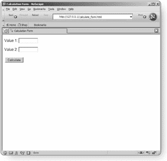

你将看到一个包含 Value 1 和 Value 2 字段以及一个 Calculate 按钮的表单。花一点时间检查 HTML 表单，理解变量是如何获取名称的。

提交时，此表单将向你的脚本发送两个变量 `$_POST[val1]` 和 `$_POST[val2]`，因为这些是每个文本字段中使用的 `NAME`。这些变量的值是用户在表单字段中输入的值。还有一个项目需要添加：一组单选按钮，用于确定在两个值上执行的计算类型。

1. 在你的文本编辑器中打开 `calculate_form.html`。

2. 在提交按钮之前添加此代码块：

```html
<P>Calculation:<br>
<INPUT TYPE="radio" NAME="calc" VALUE="add"> add<br>
<INPUT TYPE="radio" NAME="calc" VALUE="subtract"> subtract<br>
<INPUT TYPE="radio" NAME="calc" VALUE="multiply"> multiply<br>
<INPUT TYPE="radio" NAME="calc" VALUE="divide"> divide</P>
```

3. 保存文件并将其放置在你的 Web 服务器的文档根目录下。

4. 打开你的网络浏览器并输入 [`127.0.0.1/calculate_form.html`](http://127.0.0.1/calculate_form.html)。

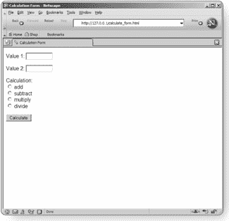

你的表单现在将包含 Value 1 和 Value 2 字段、一组单选按钮和一个 Calculate 按钮。现在，除了两个值（`$_POST[val1]` 和 `$_POST[val2]`）之外，一个名为 `$_POST[calc]` 的变量也将被发送到你的脚本。进入下一节并创建计算脚本。

## 创建计算脚本

根据 `calculate_form.html` 中的表单动作，你需要一个名为 `calculate.php` 的脚本。该脚本的目标是接受两个值（`$_POST[val1]` 和 `$_POST[val2]`）并根据 `$_POST[calc]` 的值执行计算。

1. 在你的文本编辑器中打开一个新文件。

2. 开始一个 PHP 块并准备一个 if 语句来检查三个值的存在：

```php
<?php
if ($_POST[val1] == "") || ($_POST[val2] == "") || ($_POST[calc] == "") {
    // 此处有更多代码
}
```

该语句的意思是：“如果这三个变量中的任何一个没有值，执行其他操作。”

3. 将“此处有更多代码”替换为以下两行：

```php
header("Location: calculate_form.html");
exit;
```

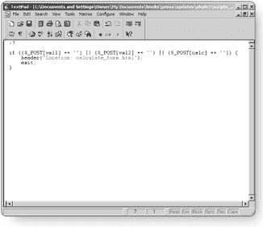

这两行中的第一行输出一个头部语句——在这种情况下，它是重定向回表单。第二行是退出脚本。

4. 确保在其他值之前，开始一个 if 语句，根据 `$_POST[calc]` 的值进行计算：

```php
if ($_POST[calc] == "add") {
    $result = $_POST[val1] + $_POST[val2];
} elseif ($_POST[calc] == "subtract") {
    $result = $_POST[val1] - $_POST[val2];
} elseif ($_POST[calc] == "multiply") {
    $result = $_POST[val1] * $_POST[val2];
} elseif ($_POST[calc] == "divide") {
    $result = $_POST[val1] / $_POST[val2];
}
```

5. 开始输出 HTML：

```html
<HTML>
<HEAD>
<TITLE>Calculation Result</TITLE>
</HEAD>
<BODY>
```

6. 使用 PHP 代码显示值：

```php
echo "$result";
```

```html
<P>计算结果为：</P>
```

7. 关闭 HTML：

```html
</BODY>
</HTML>
```

8. 将文件保存为 `calculate.php`，并将此文件放置在你的 Web 服务器的文档根目录下。

## 提交表单并获取结果

现在你创建了前端（表单）和后端（脚本），是时候测试它了。

1. 要访问计算表单，打开你的网络浏览器并输入 [`127.0.0.1/calculate_form.html`](http://127.0.0.1/calculate_form.html)。

2. 在不在表单字段中输入任何内容的情况下点击 Calculate。你的浏览器将刷新页面，因为你没有输入任何值。

3. 为 Value 1 输入一个值但不 Value 2，且不选择计算类型。点击 Calculate，页面将刷新。

4. 为 Value 2 输入一个值但不 Value 1，且不选择计算类型。点击 Calculate，页面将刷新。

5. 为 Value 1 和 Value 2 都输入了值，但不选择计算类型。点击 Calculate，页面将刷新。

6. 选择一个计算类型，但不为 Value 1 或 Value 2 输入任何值。点击 Calculate，页面将刷新。

现在你已经通过尝试绕过验证程序来调试了脚本，请尝试一些计算，例如：

1. 为 Value 1 输入 9732，为 Value 2 输入 27。

2. 选择 add，并点击 Calculate 按钮。

加法计算的结果将显示在屏幕上。

## HTTP 环境变量

当 Web 浏览器向 Web 服务器发送请求时，它会随请求一起发送一系列额外的变量。这些变量被称为环境变量，它们对于显示动态内容或授权用户非常有用。

`phpinfo()` 函数会显示关于你的 Web 服务器软件和正在运行的 PHP 版本的大量信息，以及基础 HTTP 环境。让我们看看你有什么。

1. 在你的文本编辑器中打开一个新文件。

2. 输入以下行 PHP 代码：

```php
<?php
phpinfo();
?>
```

```php
<? phpinfo(); ?>
```

3. 将文件保存为 `phpinfo.php`，并将此文件放在你 Web 服务器的文档根目录下。

4. 打开网页浏览器并输入 `http://127.0.0.1/phpinfo.php`。

你应该能看到一个充满了有趣信息的长页面。

**注意** 这些信息会有所不同，不仅在不同的机器之间不同，在不同的平台和版本之间也不同。你的运行结果将会有所不同，但整体模板是相同的。

向下滚动，寻找标题为 `Apache Environment` 的部分。在接下来的章节中，你将学习如何使用此处找到的环境变量：`REMOTE_ADDR` 和 `HTTP_USER_AGENT`。要了解 `phpinfo()` 输出中显示的其他一些 `HTTP` 环境变量的解释，请访问 `http://hoohoo.ncsa.uiuc.edu/cgi/env.html`。

## 获取和使用 REMOTE_ADDR

默认情况下，环境变量以 `$VAR_NAME` 的形式供 PHP 脚本使用。例如，`REMOTE_ADDR` 环境变量已经包含在 `$REMOTE_ADDR` 中。然而，为了绝对确保你读取的是正确的值，你可以使用 `getenv()` 函数将值赋值给你选择的变量。

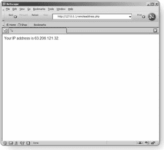

`REMOTE_ADDR` 环境变量包含请求机器的 IP 地址。让我们获取你的 `REMOTE_ADDR` 值。

1. 在你的文本编辑器中打开一个新文件。

2. 打开一个 PHP ，然后使用 `getenv()` 将 `REMOTE_ADDR` 的值放在名为 `$address` 的变量中：

```php
php
$address = getenv("REMOTE_ADDR");
```

3. 将 `$address` 的值打印到屏幕上，并关闭 PHP 块：

```php
echo "Your IP address is $address.";
?>
```

4. 将文件保存为 `remoteaddress.php`，然后将此文件放在你 Web 服务器的文档根目录下。

5. 打开网页浏览器并输入 `http://127.0.0.1/remoteaddress.php`。

你的当前 IP 地址将打印在屏幕上。

**注意** 你的 IP 地址将与此处显示的不同，此处是我运行此脚本时的 IP 地址。

[在下一节中，]你将获取另一个实用的环境变量 `HTTP_USER_AGENT` 的值，该环境变量包含了所用浏览器的标识字符串。

## 获取和使用 HTTP_USER_AGENT

`HTTP_USER_AGENT` 变量包含浏览器类型、浏览器版本、语言编码和平台。例如，以下值字符串指的是 Windows 平台上的英文版 Netscape 浏览器，版本 7.1：

`Mozilla/5.0 (Windows; U; Windows NT 5.1; en-US; rv:1.4) Gecko/20030624 Netscape/7.1 (ax).`

这是另一个常见的 `HTTP_USER_AGENT` 值：

`Mozilla/4.0 (compatible; MSIE 6.0; Windows NT 5.1)`

此值指的是 Windows 上的 Microsoft Internet Explorer (MSIE) 6.0 版本。有时你会看到 MSIE 返回一个看起来像 Netscape 值的 `HTTP_USER_AGENT` 值，例如这一个，它以 Mozilla 开头，直到你注意到该值显示它是兼容的且实际上是 MSIE 6.0。

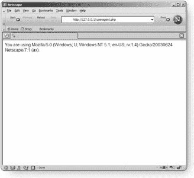


最后，不要忽略纯文本浏览器！Lynx 的 `HTTP_USER_AGENT` 值看起来像这样：

`Lynx/2.8rel.3 libwww-FM/2.14`

让我们找到你的 `HTTP_USER_AGENT`。

1. 在你的文本编辑器中打开一个新文件。

2. 打开一个 PHP 块，然后使用 `getenv()` 将 `HTTP_USER_AGENT` 的值放在名为 `$agent` 的变量中：

```php
php
$agent = getenv("HTTP_USER_AGENT");
```

3. 将 `$agent` 的值打印到屏幕上，并关闭 PHP 块：

```php
echo "You are using $agent";
?>
```

4. 将文件保存为 `useragent.php`，然后将此文件放在你 Web 服务器的文档根目录下。

5. 打开网页浏览器并输入 `http://127.0.0.1/useragent.php`。

你的当前 `HTTP_USER_AGENT` 值将打印在屏幕上。

**注意** 你的用户代理字符串可能与所示的不同，因为每个浏览器、版本和平台都会创建它自己的标识字符串。

5. 关闭你的 PHP 块并添加一些 HTML 以开始显示：

```php
?>

<HTML>

<HEAD>

<TITLE>浏览器匹配结果</TITLE>
</HEAD>

<BODY>
```

6. 输入以下 PHP 代码来打印 `if…else` 语句的结果：

```php
<? echo "<P>$result</P>"; ?>
```

7. 添加更多的 HTML 以使文档有效：

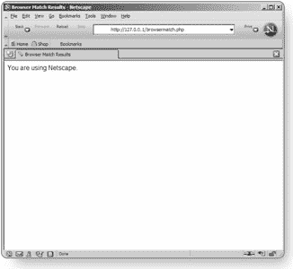

</BODY>

</HTML>

```

8. 将文件保存为 `browsermatch.php`，并将此文件放置在你 Web 服务器的文档根目录下。

9. 打开你的网络浏览器并输入 `http://127.0.0.1/browsermatch.php`。

根据你使用的网络浏览器，你可能会看到下面两幅图所示的结果。

如果你既没有使用 Netscape 也没有使用 Microsoft Internet Explorer，则 `HTTP_USER_AGENT` 的实际值将被打印出来。Microsoft Internet Explorer (MSIE) 的各种版本占使用网络浏览器的约 78%，而 Netscape (NS) 版本占了约 15%。再加上死忠的 Lynx、Opera、Konquerer 以及其他用户，总共达到 100%。

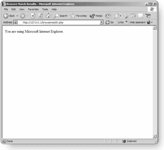


虽然 80/20 的划分看起来是多数，但如果有 5 亿人可以访问互联网，那么在开发良好的网站时，1 亿非 MSIE 用户也是是一个需要考虑的巨大数字。HotWired 在 `http://hotwired.lycos.com/webmonkey/reference/browser_chart/` 维护了一个浏览器参考表，向你展示主要浏览器之间的某些差异。在下一节中，你将考虑到并非所有平台都是平等的，事实上它们显示 HTML 的方式可能也不相似。


## 显示特定平台的 HTML

不仅浏览器之间存在差异，平台之间也存在。这种差异在字体和字体大小上最为明显。在 Windows 世界中，你有诸如 Times New Roman 和 Courier New 之类的字体。这些字体的微小版本出现在 Macintosh 和 Linux/UNIX 平台上；它们被称为 Times 和 Courier。不仅如此——字体大小的显示方式也完全不同。Macintosh 或 Linux 上的 10 点字体有时几乎无法辨认，但如果你将其增加到 11 或 12 点，就没问题了。然而，如果要在 Windows 上查看同一个 12 磅字体，它看起来就像你的文本正试图接管世界一样。

那么该怎么办呢？使用你新的模式匹配技能从 `HTTP_USER_AGENT` 字符串中提取平台，然后显示特定平台的 HTML。就像通过匹配关键词来确定平台（你在上一节中做过的那样）一样，你也需要知道你正在寻找什么。在下一个脚本中，你将检查关键词 "Win" 和 "Linux"，并在你的 HTML 结果页面中打印一个适当的样式表块。

1. 在你的文本编辑器中打开一个新文件，启动一个 PHP 块，并使用 `getenv()` 将 `HTTP_USER_AGENT` 的值放在名为 `$agent` 的变量中：

```php

<?

$agent = getenv("HTTP_USER_AGENT");

```

2. 开始一个 `if…else` 语句来找到 `preg_match()` 函数中哪一个成立，从搜索 "Win" 开始：

```php

if (preg_match("/Win/i", "$agent")) {

    $style = "win";

}

```

3. 继续该语句，测试 "Linux"：

```php

else if (preg_match("/Linux/i", "$agent")) {

    $style = "linux";

}

```

4. 创建 Windows 样式表块：

```php

$win_style = "<style type=\"text/css\">p, ul, li {font-family:Times New Roman, Courier New;font-size:12pt;}h1 {font-size:18pt;font-weight:bold;}h2 {font-size:14pt;font-weight:bold;}strong {font-weight:bold;}em {font-style:italic;}</style>";

```

5. 创建 Linux 样式表块：

```php

$linux_style = "<style type=\"text/css\">p, ul, li {font-family:Times, Courier;font-size:10pt;}h1 {font-size:16pt;font-weight:bold;}h2 {font-size:12pt;font-weight:bold;}strong {font-weight:bold;}em {font-style:italic;}</style>";

```

6. 关闭你的 PHP 块并添加一些 HTML 以开始显示：

```php

?>

<HTML>

<HEAD>

<TITLE>Platform Matching</TITLE>

<?php

if ($style == "win") {

    echo "$win_style";

} else {

    echo "$linux_style";

}

?>

</HEAD>

<BODY>
```


# This is a level 1 heading

## Look! A level 2 heading

**bold** and *emphasized*

<INPUT TYPE="radio" NAME="func" VALUE="ucwords"> 将所有单词的首字母设为大写

**注意** 每个单选按钮的值是其精确的 PHP 函数名。这将使得后端设计脚本的创建非常简单，正如你在下一节中所那样。

5. 添加一个提交按钮：

<INPUT TYPE="submit" NAME="submit" VALUE="对字符串进行操作">

6. 关闭你的表单并添加更多 HTML 以确保文档格式有效：

```html
</FORM>
</BODY>
</HTML>
```

7. 将文件保存为 `generic_form.html`，并将此文件放置在 Web 服务器的文档根目录下。

8. 打开你的网络浏览器并输入 [http://127.0.0.1/generic_form.html](http://127.0.0.1/generic_form.html)。

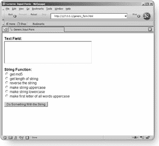

你将看到一个带有文本区域和几个单选按钮的表单，以及一个“对字符串进行操作”的提交按钮。在下一节，你将创建后端脚本。该脚本将期望两个变量：`$_POST['text1']` 和 `$_POST['func']`。

## 创建显示表单值的脚本

根据 `generic_form.html` 中的表单动作，你需要一个名为 `display_input.php` 的脚本。该脚本的目标是接受 `$_POST['text1']` 中的文本，并使用特定的字符串函数（`$_POST['func']` 的值）获取一个新的结果 `$result`。

1. 在你的文本编辑器中打开一个新文件并输入以下 PHP 代码。这将确保如果用户没有在文本区域输入任何值且没有从单选按钮列表中选择任何函数，用户将被送回表单：

```php
<?
if ($_POST['text1'] == "") || ($_POST['func'] == "") {
    header("Location: generic_form.html");
    exit;
}
?>
```

2. 输入下一段 PHP 代码，它将函数输出的值赋值给变量 `$result`，然后关闭 PHP 块：

```php
$result = $_POST['func']($_POST['text1']);
?>
```

3. 开始 HTML 输出：

```html
<HTML>
<HEAD>
<TITLE>通用输入结果</TITLE>
</HEAD>
<BODY>
```

4. 显示 `$result` 的值：

```php
<? echo "$result"; ?>
```

5. 添加一个返回表单的链接：

<P><a href="generic_form.html">再次尝试！</a></P>

6. 添加更多 HTML 以确保文档格式有效：

```html
</BODY>
</HTML>
```

7. 将文件保存为 `display_input.php`，并将此文件放置在 Web 服务器的文档根目录下。

你的代码看起来应该像这样：

```php
<?
if ($_POST['func'] == "") || ($_POST['text1'] == "") {
    header("Location: generic_form.html");
    exit;
}

$result = $_POST['func']($_POST['text1']);
?>

<HTML>
<HEAD>
<TITLE>通用输入结果</TITLE>
</HEAD>
<BODY>
<? echo "$result"; ?>
<p><a href="generic_form.html">再次尝试！</a></p>
</BODY>
</HTML>
```

在下一节中，你将提交表单并看到所有不同类型的字符串函数发挥作用。

## 提交你的表单并获取结果

现在你已经创建了前端表单和后端脚本，是时候尝试它们了。

1. 打开你的网络浏览器并输入 [http://127.0.0.1/generic_form.html](http://127.0.0.1/generic_form.html)。

2. 在文本区域中输入以下文本：

> 我认为 PHP 是世界上最酷的服务器端脚本语言！
>
> 谁知道它会这么简单？

**注意** 你可能想将那段文本复制到剪贴板中，因为它将被用于后续所有的示例。

3. 选择 `md5` 单选按钮，并点击“对字符串进行操作”按钮。

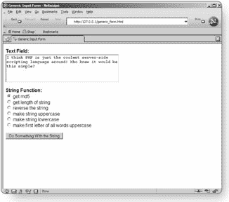
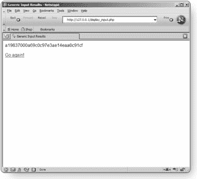

**注意** `md5()` 函数获取字符串的*哈希值*。哈希值类似于字符串的数字摘要。它可以用于比较字符串（或文件）的版本，以确定版本之间是否存在差异。

你应该能看到字符串的哈希值，以及一个返回表单的链接。返回表单并输入相同的文本，但这次选择使用 `strlen()` 函数查找字符串长度（包括空格和所有字符）的按钮。

继续测试剩余的每个函数。当你选择使用 `strrev()` 函数的按钮时，你会发现你的原始字符串已经被完全反转了。`strtoupper()` 函数返回所有字母均为大写的字符串，而 `strtolower()` 函数返回所有字母均为小写的字符串，而 `ucwords()` 函数返回所有单词首字母均为大写的字符串。

## 重定向到新位置

将用户重定向到新位置意味着你的脚本发送了重定向头，以便用户跳转到新位置。

## 重定向表单

在这一节中，你将创建前端。每个选项的值都是网站 URL。

1. 在你的文本编辑器中打开一个新文件并输入以下 HTML：

```html
<HTML>
<HEAD>
<TITLE>重定向菜单</TITLE>
</HEAD>
<BODY>
```

2. 开始你的表单。假设方法为 POST 动作为 `do_redirect.php`：

3. 添加此下拉列表：

```html
<SELECT name="location">
<OPTION value="">-- 选择 --</OPTION>
<OPTION value="http://www.thickbook.com/">thickbook.com</OPTION>
<OPTION value="http://www.i2.com/">i2 Interactive</OPTION>
<OPTION value="http://www.php.net/">php.net</OPTION>
<OPTION value="http://www.zend.com/">Zend Technologies</OPTION>
</SELECT>
```

4. 添加提交按钮：

<P><INPUT TYPE="submit" NAME="submit" VALUE="跳转"></P>

5. 关闭表单并添加更多 HTML 以确保文档格式有效：

```html
</FORM>
</BODY>
</HTML>
```

6. 将文件保存为 `redirect_form.html`，并将此文件放置在 Web 服务器的文档根目录下。

7. 打开你的网络浏览器并输入 [http://127.0.0.1/redirect_form.html](http://127.0.0.1/redirect_form.html)。

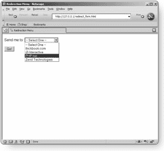

## 创建重定向脚本并进行测试

根据 `redirect_form.html` 中的动作，你需要一个名为 `do_redirect.php` 的脚本。该脚本的目标是接受 `$_POST['location']` 的值并将其打印 `header()` 函数中，以便用户重定向到所选位置。

1. 在你的文本编辑器中打开一个新文件并输入以下 PHP 以创建正确的重定向头，包括一个确保已选择某些内容的检查：

```php
<?
if ($_POST['location'] == ""){
    header("Location: redirect_form.html");
    exit;
} else {
    header("Location: $_POST['location']");
    exit;
}
?>
```

2. 将文件保存为 `do_redirect.php`，并将此文件放置在 Web 服务器的文档根目录下。

3. 打开你的网络浏览器并输入 [http://127.0.0.1/redirect_form.html](http://127.0.0.1/redirect_form.html)。

4. 从下拉列表中选择 php.net，并点击“跳转!”按钮。

用户现在被重定向到 PHP 网站。尝试其他选项，或者添加你自己的选项进行练习。

在本章中，你学习了网站中可以使用的不同类型的动态内容，以及你还可以执行的一些其他操作，例如根据下拉菜单重定向用户。在下一章中，你将学习如何利用更流行的 Web 工具之一——发送电子邮件。

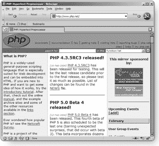


# 第 8 章：发送电子邮件

### 概述

使用 PHP 将表单内容发送到指定的电子邮件地址非常简单，以至于你会怀疑为什么没有更多人每天都这样做。在本章中，你将学习如何：

* 修改 PHP 配置文件以便你可以发送邮件
* 创建并发送简单的反馈表单
* 使用 `$PHP_SELF` 变量创建一个带有自定义错误消息的反馈表单

### 使用 SMTP 服务器

SMTP 是 Simple Mail Transfer Protocol（简单邮件传输协议）的缩写，SMTP 服务器是一台传输邮件的机器，就像 Web 服务器是在被请求时显示网页的机器一样。SMTP 服务器有时被称为发站邮件服务器，这引出了我的观点——你需要这样的服务器来完成本章中的练习。在 Linux/Unix 上，`Send mail` 和 `Qmail` 是流行的包。在 Windows 上，通常使用 Windows NT Service Pack 中的 SMTP 服务或 Windows 2000 操作系统中内置的服务。

然而，如果你已经在个人机器上作为开发环境的一部分安装了 Apache、PHP 和 MySQL，那么你可能没有在本地运行 SMTP。如果是是的话，你可以访问可能已经向你提供的可用发件邮件服务器。

**注意** 如果你跳过了本书的前三章，并且作为互联网服务提供商的虚拟主机包的一部分使用 PHP，那么 SMTP 服务器应该已经安装在该机器上，并且 PHP 应该已经正确配置为可以访问它。

如果你的机器通过拨号连接、DSL、电缆或其他类型的访问连接到互联网，你可以使用互联网服务提供商的发件邮件服务器。例如，如果你的开发机器是一台通过 DSL 连接互联网的 Windows 设备，你可以使用类似 [mail.yourprovider.com](http://www.mail.yourprovider.com/) 作为你的发件邮件服务器。经验法是，无论你在电子邮件客户端（Eudora、Outlook、Netscape Mail 等）中配置了什么作为发件邮件服务器，它在你的 PHP 代码中作为 SMTP 服务器也能正常工作。诀窍在于让 PHP 意识到这个小事实，你接下来将学到它。

### php.ini 中与 SMTP 相关的更改

在 php.ini 主配置文件中，有几个指令需要设置，以便 `mail()` 函数能够正常工作。用文本编辑器打开 php.ini 并查找这些行：

```ini
[mail function]

For Win32 only.

SMTP = localhost

; For Win32 only.

sendmail_from = me@localhost.com

; For Unix only. You may supply arguments as well (default: 'sendmail -t -i').

;sendmail_path =
```

如果你使用的是 Windows，你将修改前两个指令 `SMTP` 和 `sendmail_from`。如果你计划使用你 ISP 的发件邮件服务器（在本例中，假设它叫 DSLProvider.net），则 php.ini 中的项将如下：

```ini
SMTP = mail.dslprovider.net
```

第二个配置指令是 `sendmail_from`，这是在发件邮件的 From 头中使用的电子邮件地址。它可以在邮件脚本本身中被覆盖，但通常作为默认值运行。例如：

```ini
sendmail_from = youraddress@yourdomain.com
```

当然，将 `youraddress@yourdomain.com` 替换为你自己的地址。如果你在 Linux 或 Unix 变体上，`sendmail_path` 是你唯一需要担心的它看起来类似于：

```ini
sendmail_path = /usr/sbin/sendmail
```

或者，如果你使用的是 Qmail：

```ini
sendmail_path = /var/qmail/bin/sendmail
```

在 `sendmail_path` 指令中，你也可以设置配置标志来指定，例如 `sendmail_path = /usr/sbin/sendmail -t -i`。在更改 php.ini 后，重启 Web 服务器并使用 `phpinfo()` 函数验证已生效。


### 反馈表单

简单的反馈表单通常包含响应者的姓名、电子邮件地址以及一个消息文本区域。在本节中，你创建两个文件：一个是反馈表单，一个是处理它的 PHP 脚本。

#### 创建反馈表单

1. 在文本编辑器中打开一个新文件。
2. 输入以下 HTML：

```html
<HTML>
<HEAD>
<TITLE>反馈表单</TITLE>
</HEAD>
<BODY>
```

3. 开始你的表单。假设方法为 POST，操作是一个名为 simpleform.php 的脚本：

```html
<FORM METHOD="POST" ACTION="simpleform.php">
```

4. 为用户姓名创建一个输入字段并带有标签：

```html
<P><strong>您的姓名：</strong><br>
<INPUT type="text" NAME="sender_name" SIZE="30"></P>
```

5. 为电子邮件创建一个输入字段并带有标签：

```html
<P><strong>您的电子邮件：</strong><br>
<INPUT type="text" NAME="sender_email" SIZE="30"></P>
```

6. 创建一个用于消息的文本区域并带有标签：

```html
<P><strong>您的消息：</strong><br>
<TEXTAREA NAME="message" COLS="30" ROWS="5"></TEXTAREA></P>
```

7. 添加一个提交按钮：

```html
<P><INPUT TYPE="submit" NAME="submit" VALUE="发送表单"></P>
```

8. 关闭你的表单并添加一些 HTML 使文档有效：

```html
</FORM>
</BODY>
</HTML>
```


## 创建邮件表单的脚本

根据 `simple_form.html` 中的表单操作，你需要一个名为 `simpleform.php` 的脚本。该脚本的目标是接收格式为 `$_POST['sender_name']`、`$_POST['sender_email']` 和 `$_POST['message']` 的文本，发送电子邮件，并向浏览器显示确认。

1. 在文本编辑器中打开一个新文件。
2. 开始一个 PHP 块，然后混合加入一些错误检查代码：

```php
<?php

if (($_POST['sender_name'] == "") ||
    ($_POST['sender_email'] == "") ||
    ($_POST['message'] == "")) {
    header("Location: simple_form.html");
    exit;
}
```

3. 开始构建消息字符串，它将包含电子邮件本身的内容：

```php
$msg = "来自网站的电子邮件\n";
```

> **注意** 接下来的几步骤将通过拼接较短的字符串继续构建消息字符串，形成一个长消息字符串。

5. 通过添加发送者的电子邮件地址条目继续构建消息字符串：

```php
$msg .= "Sender's E-Mail:\t$_POST['sender_email']\n";
```

6. 通过添加消息条目继续构建消息字符串：

```php
$msg .= "Message:\t$_POST['message']\n";
```

7. 创建一个变量来存储接收者的电子邮件地址（替换为你自己的地址）：

```php
$to = "you@youremail.com";
```

8. 创建一个变量来存储邮件的主题：

```php
$subject = "Web Site Feedback";
```

9. 创建一个变量来存储额外的邮件头：

```php
$mailheaders = "From: My Web Site <genericaddress@yourdomain.com>\n";
```

> **注意** 邮件头是邮件开头的字符串，它们构建了邮件的结构并使其成为有效邮件的关键。

10. 将以下内容添加到 `$mailheaders` 变量：

```php
$mailheaders .= "Reply-To: $_POST['sender_email']\n";
```

11. 添加 `mail()` 函数：

```php
mail($to, $subject, $msg, $mailheaders);
```

12. 关闭你的 PHP：

```php
?>
```

尽管这段代码会发送邮件，你应该向用户的屏幕返回一些内容，让他知道表单已发送。否则，他可能会坐在那里不断点击“提交此表单”按钮。

13. 开始 HTML 输出：

```html
<HTML>
<HEAD>
<TITLE>Simple Feedback Form Sent</TITLE>
</HEAD>
<BODY>
```

14. 添加一些信息来告诉用户发生了什么：

```html
<H1>The following e-mail has been sent:</H1>
```

15. 为“姓名” 字段添加文本标签并显示用户的输入，并对其他字段执行相同的操作：

```html
<P><strong>Your Name:</strong><br>
<?php echo "$_POST['sender_name']"; ?>
<P><strong>Your E-Mail Address:</strong><br>
<?php echo "$_POST['sender_email']"; ?>
<P><strong>Message:</strong><br>
<?php echo "$_POST['message']"; ?>
```

16. 添加更多 HTML 以确保文档是有效的：

```html
</BODY>
</HTML>
```

17. 将文件保存为 `send_simpleform.php`，并将此文件放置在 Web 服务器的文档根目录下。你的代码看起来应该像下图所示。

## 提交表单并获取结果

现在你已经创建了前端表单和后端脚本，是时候尝试它们了。

1. 打开浏览器并输入 `http://127.0.0.1/simple_form.html`。
2. 在“姓名” 字段中输入你的名字。
3. 在“电子邮件地址” 字段中输入你的邮箱。
4. 在“消息” 字段中输入以下内容：`PHP is so cool!`
5. 点击“提交此表单” 按钮。你输入的信息以及邮件已发送的确认将出现。现在检查你的邮箱，看看是否有消息在等待你。

1. 在文本编辑器中打开 `send_simpleform.php`。
2. 将制表符 `\t` 替换为两个空格来修改 Sender's Name：

```php
$msg .= "Sender's Name: $_POST['sender_name']";
```

3. 将制表符 `\t` 替换为四个空格来修改 Sender-Mail：

```php
$msg .= "Sender's Mail: $_POST['sender_email']";
```

4. 将制表符 `\t` 替换为十个空格来修改 Message：

```php
$msg .= "Message: $_POST['message']";
```

5. 保存文件并将其上传到服务器。

在下一节中，你为空字段创建自定义错误消息，并将发送邮件的两个步骤简化为一个整合脚本。

## 带有自定义错误消息的表单

在上一节中，你创建了两个独立的文件。一个包含前端（表单），另一个包含后端（脚本）。在本节中，你学习在表单动作中使用 `$_SERVER['PHP_SELF']` 变量来创建一个包含表单和脚本的单一文件，并在必需字段未完成后创建自定义错误消息。

### 创建初始脚本

正如之前章节，创建表单/脚本对的第一步是创建前端表单。然而，在整合表单中，表单只是脚本的第一部分。

1. 在文本编辑器中打开一个文件。
2. 输入以下 HTML：

```html
<HTML>
<HEAD>
<TITLE>All-In-One Feedback Form</TITLE>
</HEAD>
<BODY>
```

3. 开启 PHP 块，然后创建一个变量 `$form_block` 来存储整个表单。从表单动作开始，假设方法为 `POST` 动作为 `$_SERVER['PHP_SELF']`：

```php
$form_block = "<FORM METHOD=\"POST\" ACTION=\"$_SERVER['PHP_SELF']\">";
```

> **注意** 由于变量内部放入了一个长字符串，很会有引号。记得用反斜杠转义所有的引号！

4. 为用户姓名创建一个带文本标签的输入字段：

```html
<P><strong>Your Name:</strong><br>
<INPUT type="text" NAME="sender_name" SIZE=30></P>
```

5. 为用户电子邮件地址创建一个带文本标签的输入字段：

```html
<P><strong>Your E-Mail Address:</strong><br>
<INPUT type="text" NAME="sender_email" SIZE=30></P>
```

6. 创建一个带文本标签的文本区域来存放消息：

```html
<P><strong>Message:</strong><br>
<TEXTAREA NAME="message" COLS=30 ROWS=5 WRAP="virtual"></TEXTAREA></P>
```

7. 添加一个提交按钮：

```html
<P><INPUT TYPE="submit" NAME="submit" VALUE="Send This Form"></P>
```

8. 关闭表单，然后添加结束引号和分号：

```php
</FORM>";
```

9. 关闭 PHP 块，并添加更多 HTML 以确保文档有效：

```php
?>
</BODY>
</HTML>
```

10. 将文件保存为 `allinone_form.php`。

如果你在浏览器中查看这段代码，你只会会在标题栏看到一个标题。迫切的问题应该是：“为什么我们在变量 `$form_block` 中需要所有的 HTML？”在下一节中，你将向脚本添加内容，根据某些操作显示特定的代码块。`$form_block` 中的字符串就是这些块之一。

### 为脚本添加错误检查

计划是使用全局变量 `$_SERVER['PHP_SELF']`，它的值为当前脚本名称。在本例中，`$_SERVER['PHP_SELF']` 的值为 `allinone_form.php`。当你将 `$_SERVER['PHP_SELF']` 作为表单动作时，你是在说：“当点击提交按钮时，重新加载此脚本并执行操作”，而不是“当点击提交按钮时，去找另一个脚本并执行操作”。

现在你已经有了脚本的壳，思考一下这个整合脚本必须做什么：

- 显示表单
- 提交表单
- 检查错误
- 在不发送邮件的情况下打印错误消息
- 如果未发现错误则发送邮件

对脚本进行一些修改以帮助它确定应该执行的操作。在 `$form_block` 变量内部，提交按钮的 HTML 代码之前，添加此行：

```html
<INPUT type="hidden" name="op" value="ds">
```

此行创建了一个隐藏变量 `$_POST['op']`，其值为 `ds`。“op”代表“操作”，“ds”代表“做点事”。是我起的名字，与任何编程语言无关。你可以给它们起任何名字，只要你理解它们的作用（你很快就会看到）。

`$_POST['op']` 变量仅在表单提交后存在。因此，如果 `$_POST['op']` 的值不是 `ds`，说明用户还没有见过表单。如果用户还没见过表单，你就需要显示它，因此在 PHP 代码块结束之前添加以下 `if…else` 语句：

```php
if ($_POST['op'] != "ds") {
    // 他们需要看到表单
    echo "$form_block";
}
```

你还没有完成，但你的代码现在看起来应该像这样：

在下一步中，你将进行几次修改以添加错误信息。如果提交了表单，`$_POST['op']` 的值将是 `ds`，现在你必须考虑到这种情况。假设所有表单字段都是必填的；在检查 `$_POST['op']` 的值之后，检查所有字段是否有值。

1. 继续 `if…else` 语句：

```php
else if ($_POST['op'] == "ds") {
```

2. 在父语句中添加一个 `if` 语句来检查值。从 `$_POST['sender_name']` 开始：

```php
if ($_POST['sender_name'] == "") {
```

3. 为 `$_POST['sender_name']` 创建一个名为 `$name_err` 的错误信息：

```php
$name_err = "<font color=red>Please enter your name!</font><br>";
```

4. 将 `$send` 的值设置为 `"no"`：

```php
$send = "no";
```

5. 为 `$_POST['sender_email']` 创建一个相似的 `if` 语句：

```php
if ($_POST['sender_email'] == "") {
    $email_err = "<font color=red>Please enter your e-mail address!</font><br>";
    $send = "no";
}
```

6. 为 `$_POST['message']` 创建一个相似的 `if` 语句：

```php
if ($_POST['message'] == "") {
    $message_err = "<font color=red>Please enter a message!</font><br>";
    $send = "no";
}
```

7. 开始一个 `if…else` 语句来处理 `$send` 的值：

```php
if ($send != "no") {
    // 可以发送了！
}
```

8. 创建一个变量来存储收件人的邮箱（替换为你自己的）：

```php
$to = "you@youremail.com";
```

9. 创建一个变量来存储邮件的主题：

```php
$subject = "All-in-One Web Site Feedback";
```

10. 创建一个变量来存储额外的邮件头：

```php
$mailheaders = "From: My Web Site <genericaddress@yourdomain.com> \n";
```

11. 向 `$mailheaders` 变量添加：

```php
$mailheaders .= "Reply-To: $_POST['sender_email']\n";
```

12. 构建消息字符串：

```php
$msg = "E-MAIL SENT FROM WWW SITE\n";
$msg .= "Sender's Name: $_POST['sender_name']\n";
$msg .= "Sender's E-Mail: $_POST['sender_email']\n";
$msg .= "Message: $_POST['message']\n\n";
```

13. 添加 `mail()` 函数：

```php
mail($to, $subject, $msg, $mailheaders);
```

14. 添加一个简单的语句让用户知道邮件已发送，并去掉 `if` 语句：

```php
echo "<P>Mail has been sent!</p>";
```

15. 继续 `if…else` 语句来处理 `$send` 为 `"no"` 的值：

```php
else if ($send == "no") {
```

16. 打印错误信息：

```php
echo "$name_err";
echo "$email_err";
echo "$message_err";
```

17. 再次打印表单：

```php
echo "$form_block";
```

18. 关闭当前的 `if…else` 块和父 `if…else` 块：

```php
}
```

19. 保存文件。整个代码应该是这样的：

```html
<HTML>
<HEAD>
<TITLE>All-In-One Form</TITLE>
</HEAD>
<BODY>
<?php
$form_block = "
<FORM METHOD=\"POST\" ACTION=\"$SELF\">
<P>Your Name:</br>
<INPUT type=\"text\" NAME=\"sender_name\" SIZE=30></P>
<P>Your E-Mail Address:</br>
<INPUT type=\"text\" NAME=\"sender_email\" SIZE=30></P>
<P>Message:</br>
<TEXTAREA NAME=\"message\" COLS=30 ROWS=5 WRAP=virtual></TEXTAREA></P>
<INPUT type=\"hidden\" name=\"op\" value=\"ds\">
<P><INPUT TYPE=\"submit\" NAME=\"submit\" VALUE=\"Send This Form\"></FORM>";

if ($_POST['op'] != "ds") {
    // 他们需要看到表单
    echo "$form_block";
} else if ($_POST['op'] == "ds") {
    // 检查 $_POST['sender_name'] 的值
    if ($_POST['sender_name'] == "") {
        $name_err = "<font color=red>Please enter your name!</font><br>";
        $send = "no";
    }
    // 检查 $_POST['sender_email'] 的值
```


```php
if ($_POST['sender_email'] == "") {
    $email_err = "<font color=red>Please enter your e-mail address!</font><br>";
    $send = "no";
}

// 检查 $_POST['message'] 的值
if ($_POST['message'] == "") {
    $message_err = "<font color=red>Please enter a message!</font><br>";
    $send = "no";
}

if ($send != "no") {
    // 可以发送，构建邮件
    $msg = "E-MAIL SENT FROM WWW SITE\n";
    $msg .= "Sender's Name: $_POST['sender_name']\n";
    $msg .= "Sender's E-Mail: $_POST['sender_email']\n";
    $msg .= "Message: $_POST['message']\n\n";
    $to = "you@yourdomain.com";
    $subject = "All-in-One Web Site Feedback";
    $mailheaders = "From: My Web Site <genericaddress@yourdomain.com> \n";
    $mailheaders .= "Reply-To: $_POST['sender_email']\n";
    mail($to, $subject, $msg, $mailheaders);

    // 向用户显示确认
    echo "<p>Mail has been sent!</p>";
} else if ($send == "no") {
    // 打印错误信息
    echo $name_err;
    echo $email_err;
    echo $message_err;
    echo $form_block;
}
?>
</body>
</html>
```

## 提交表单并获取结果

现在你已经创建了前端表单和后端脚本，是时候尝试一下了。

1. 打开浏览器并输入 `http://127.0.0.1/allinone_form.php`。你会看到一个包含姓名文本框、邮箱地址文本框、消息区域和一个显示为“Send This Form”按钮的表单。

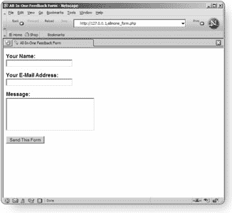
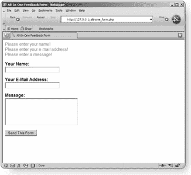

2. 在不在任何字段中输入任何内容的情况下提交表单。带有顶部三个错误信息的表单将出现在浏览器窗口中。

3. 在“Your Name”字段中输入你的姓名并提交表单。


表单将再次出现，这次没有姓名错误信息。

4. 在“Your Name”字段中输入你的姓名，在“Your E-Mail”字段中输入你的邮箱，然后提交表单。表单将再次出现，这次只有消息错误。

5. 在“Your Name”字段中输入你的姓名，在“Your E-Mail”字段中输入你的邮箱，以及以下消息：“This all-in-one thing is pretty cool!”

6. 提交表单。

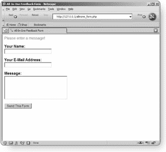
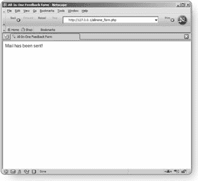
你会看到消息已发送的确认。

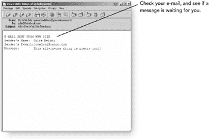

## 出错时保存值

你可能在原始脚本注意到如果你犯了错误，表单会被重置，你会丢失输入的值。对原始的 `$form_block` 进行简单的修改即可解决这个问题。只需在表单字段上添加 `VALUE` 属性以保存之前的任何值。

1. 在文本编辑器中打开 `allinone_form.php`。

2. 在 `$form_block` 变量内部，修改“Your Name”的输入字段：
```html
<INPUT type="text" NAME="sender_name" VALUE="<?php echo $_POST['sender_name']; ?>" SIZE=30>
```

3. 修改“Your E-Mail Address”的输入字段：
```html
<INPUT type="text" NAME="sender_email" VALUE="<?php echo $_POST['sender_email']; ?>" SIZE=30>
```

4. 修改“Message”的文本区域：
```html
<TEXTAREA NAME="message" COLS=30 ROWS=5 WRAP=virtual><?php echo $_POST['message']; ?></TEXTAREA>
```

**注意** `TEXTAREA` 没有 `VALUE` 属性。相反，值位于起始和结束标签之间。

5. 保存文件，然后在浏览器输入 `http://127.0.0.1/allinone_form.php`。

6. 在“Your Name”字段中输入你的姓名并提交表单。表单将再次出现，并带有错误信息。但这次，你的姓名被保存了！

虽然这一章主要关于表单和发送邮件，但下一章将完全关于对文件系统元素的操作，例如文件和目录。

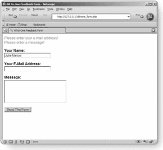


## 第 9 章：使用你的文件系统

### 概述

通过简单的 PHP 脚本，你可以对文件系统进行任何操作——毕竟它是归属于你的！在本章中，你将学习如何：

- 显示目录内容
- 创建新文件
- 打开现有文件并向其追加数据
- 复制、重命名和删除文件


### 显示目录内容

尽管你可能信，这个脚本在 Windows 下非常有效。

1. 打开一个新的文本编辑器并开始 PHP 块：
```php
<?
```

2. 创建一个变量来存储目录路径：
```php
$dir_name = "/Documents/Owner/Desktop/";
```

3. 创建句柄并使用 `opendir()` 函数打开指定的目录：
```php
$dir = opendir($dir_name);
```

4. 启动一个 `while` 循环，使用 `readdir()` 函数来决定何时停止。`readdir()` 函数返回目录中的下一个文件名，并将值赋值给变量 `$file_name`：
```php
$file_list = "<ul>";
while ($file_name = readdir($dir)) {
```

5. 使用 `if` 语句过滤掉 `.` 和 `..`：
```php
if ($file_name != "." && $file_name != "..") {
```

6. 如果 `$file_name` 不是其中之一，将其添加到 `$file_list` 中：
```php
$file_list .= "<li>$file_name</li>";
```

7. 关闭 `if` 语句：
```php
}
```

8. 将闭合的 `ul` 标签添加到列表中：
```php
$file_list .= "</ul>";
```

9. 关闭目录：
```php
closedir($dir);
```

10. 关闭你的 PHP 块，然后向显示界面添加一些 HTML：
```php
echo "<html>";
echo "<head>";
echo "<title>目录列表</title>";
echo "</head>";
echo "<body>";
```

11. 打印目录名称：
```php
echo "<h1>Files in $dir_name</h1>";
```

12. 打印列表：
```php
echo $file_list;
```

13. 关闭 HTML 标签：
```php
echo "</body>";
echo "</html>";
```

```php
?>
```

```php
$msg = "<p>File created!</p>";
?>
```

6. 添加此 HTML：
```html
<HTML>
<HEAD>
<TITLE>Creating a New File</TITLE>
</HEAD>
<BODY>
```


7. 打印消息：
```php
<? echo "$msg"; ?>
```

8. 添加更多一些 HTML 以使文档有效：
```html
</BODY>
</HTML>
```

9. 将文件保存为 `newfile.php`，并将此文件放置在你的 Web 服务器的文档根目录下。

10. 打开你的 浏览器并输入 `http://127.0.0.1/newfile.php`。

如果文件创建成功，你应该能看到下图所示的成功消息。

然而，如果文件创建失败，你将看到一个糟糕的解析错误（parse error）。你可以通过为 `$filename` 使用无效值来强制报错，例如：
```php
$filename = "/bozo/mydata.txt";
```

当你运行脚本时，你将看到类似下图的内容。

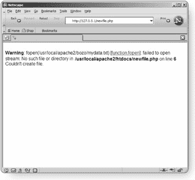

虽然 `die()` 函数通过打印指定的错误消息来完成它的工作，但 PHP 会根据函数执行失败抛出它自己的警告（warnings）。你可以通过在函数前面使用 `@` 符号来抑制 PHP 的错误和警告。

在你的脚本中，修改此行：
```php
$newfile = fopen($filename, "w+") or die("Couldn't create file.");
```
修改为：
```php
$newfile = @fopen($filename, "w+") or die("Couldn't create file.");
```

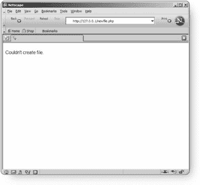

保存文件并通过你的 浏览器访问脚本。你现在只会看到来自 `die()` 函数的消息，而不再有其他警告。

### 检查文件是否已存在

为了避免在文件系统中周处操作时出现任何可能的清理错误，你可以使用 `file_exists()` 函数在创建文件之前检查文件是否已存在。下一个脚本将执行此操作，并无论结果如何都会打印消息。

1. 在你的文本编辑器中打开一个新文件并开始一个 PHP 块：
```php
<?
```

2. 创建一个变量来存储文件的完整路径（使用你自己的文件路径）：
```php
$filename = "/Documents and Settings/Owner/Desktop/misc/mydata.txt";
```

**注意** 是的，这和你可能在上一节中创建的同一个文件。没关系，因为可能会触发错误检查！

3. 启动一个 if…else 语句来检查 `file_exists()` 函数的真/假结果：
```php
if (file_exists($filename)) {
```

4. 创建一个变量来存储关于文件存在性的消息：
```php
$msg = "<p>File already exists.</p>";
```

5. 继续 `else` 语句，以便在文件不存在时执行操作：
```php
} else {
```

6. 创建一个文件指针并使用 `fopen()` 函数打开第 2 步中指定的文件进行读写。如果文件没有正常打开，`die()` 函数将导致脚本结束并显示消息。
```php
$newfile = @fopen($filename, "w+") or die("Couldn't create file.");
```

7. 创建一个变量来存储成功消息：
```php
$msg = "<p>File created!</p>";
```

8. 关闭文件指针、if…else 语句以及你的 PHP 块：


```php
fclose($newfile);
}
?>
```

9. 添加此 HTML：
```html
<HTML>
<HEAD>
<TITLE>Creating a New File</TITLE>
</HEAD>
<BODY>
```

10. 打印消息：
```php
<? echo "$msg"; ?>
```

11. 添加更多一些 HTML 以使文档有效：
```html
</BODY>
</HTML>
```

12. 将文件保存为 `newfile-checkfirst.php`，并将此文件放置在你的 Web 服务器的文档根目录下。

13. 打开你的 浏览器并输入 `http://127.0.0.1/newfile-checkfirst.php`。

假设你使用了之前创建的文件名，你应该能看到下一图所示的失败消息。如果你将 `$filename` 的值更改为不存在的文件并再次访问脚本，你将看到成功消息。因为仅仅创建一个文件很无聊，在下一节中你将学习如何向文件写入数据。

### 向文件追加数据

下一个脚本的目标是向文件追加数据。如果文件存在，脚本将直接向其中写入数据。如果文件不存在，它将在写入数据之前被创建。

1. 在你的文本编辑器中打开一个新文件并开始一个 PHP 块：
```php
<?
```

2. 创建一个变量来存储文件的完整路径名（使用你自己的文件路径）：
```php
$filename = "/Documents and Settings/Owner/Desktop/misc/textfile.txt";
```

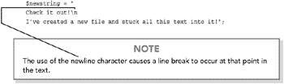

3. 创建一个名为 `$newstring` 的变量来存储你想写入文件的字符串。

4. 创建一个文件指针并使用 `fopen()` 函数打开第 2 步中指定的文件进行读写。如果文件没有正常打开，`die()` 函数将导致脚本结束。
```php
$newfile = @fopen($filename, "w+") or die("Couldn't create file.");
```

5. 使用 `fwrite()` 函数将 `$newstring` 写入 `$myfile`。如果写入失败，`die()` 函数将导致脚本结束。
```php
@fwrite($myfile, $newstring) or die("Couldn't write to file.");
```

6. 创建一个变量来存储成功消息：
```php
$msg = "<p>File has data in now.</p>";
```

7. 关闭文件指针和 PHP 块：

8. 添加此 HTML：
```html
<HTML>
<HEAD>
<TITLE>Adding Data to a File</TITLE>
</HEAD>
<BODY>
```

9. 打印消息：
```php
<? echo "$msg"; ?>
```

10. 添加更多一些 HTML 以使文档有效：
```html
</BODY>
</HTML>
```

11. 将文件保存为 `writedata.php`，并将此文件放置在你的 Web 服务器的文档根目录下。

12. 打开你的 浏览器并输入 `http://127.0.0.1/writedata.php`。

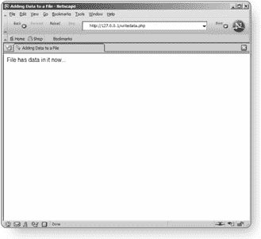

### 从文件中读取数据

你现在将创建一个脚本来读取上一节创建的文件。

1. 在你的文本编辑器中打开一个新文件并开始一个 PHP 块：
```php
<?
```

2. 创建一个变量来存储文件的完整路径名（使用你自己的文件路径）：
```php
$filename = "/Documents and Settings/Owner/Desktop/misc/textfile.txt";
```

3. 创建一个文件指针并使用 `fopen()` 函数以只读模式打开第 2 步中指定的文件。如果文件无法打开，`die()` 函数将导致脚本结束。
```php
$whatoread = @fopen($filename, "r") or die("Couldn't open file");
```

4. 创建一个变量 `$file_contents` 并使用 `fread()` 函数从打开的文件指针 (`whatoread`) 中读取行，直到文件中没有内容：


```php
$file_contents = fread($whatoread, filesize($filename));
```

5. 创建一个变量来打印消息，包括文件的内容：

```php
$msg = "The file contains:<br>$file_contents";
```

6. 关闭文件指针和 PHP 块：

```php
fclose($whatoread);
?>
```


7. 添加此 HTML：

```html
<HTML>
<HEAD>
<TITLE>Reading Data From a File</TITLE>
</HEAD>
<BODY>
```

8. 打印消息：

```php
<? echo "$msg"; ?>
```

9. 添加更多一些 HTML 以使文档有效：

```html
</BODY>
</HTML>
```

那确实是写入文件的字符串，但那些换行符去哪里了？换行符对浏览器没有任何意义，浏览器只渲染 HTML。幸运的是，PHP 开发团队具有极好的远见，创建了 `nl2br()` 函数（换行到换行标签；懂了吗？）。对 `readdata.php` 脚本做一些微调：

1. 在包含 `fread()` 函数的行之后添加此行：

```php
$new_file_contents = nl2br($file_contents);
```

```php
nl2br($file_contents);
```

2. 修改 `$msg` 字符串，使其看起来像这样：

```php
$msg = "The file contains:<br>$new_file_contents";
```

3. 保存文件。

现在在你的网络浏览器中打开此文件，注意换行符，如下所示。


在下一节中，你将看到相同的消息，但不是将其打印在屏幕上，而是通过电子邮件发送它。

## 通过电子邮件发送文件内容

如果你正在将 HTML 表单的结果保存到纯文本文件中，并且你只想在特定时间读取它们，可以编写一个简单的脚本，根据需要将文件通过电子邮件发送给你。

1. 在你的文本编辑器中打开一个新文件并开始 PHP 块：

```php
<?
```

2. 创建一个变量来存储包含数据的文件的完整路径（使用你自己的路径）：

```php
$filename = "/Documents and Settings/Owner/Desktop/misc/textfile.txt";
```

3. 创建文件指针并使用 `fopen()` 函数以只读模式打开第 2 步指定的文件。如果文件没有正常打开，`die()` 函数将导致脚本结束并显示消息。

```php
$whattoread = @fopen($filename, "r") or die("Couldn't open file");
```

4. 创建一个名为 `$file_contents` 的变量，使用 `fread()` 函数从打开的文件指针（`$whattoread`）读取所有行，只要文件中还有行：

```php
$file_contents = fread($whattoread, filesize($filename));
```

5. 创建一个变量来存储你的电子邮件地址：

```php
$to = "you@yourdomain.com";
```

6. 创建一个用于邮件主题的变量：

```php
$subject = "File Contents";
```

7. 创建一个用于额外邮件头头的变量：

```php
$mailheaders = "From: My Web Site <genericaddress@yourdomain.com> \n";
```

8. 使用 `$file_contents` 字符串作为第三参数（消息）填充 `mail()` 函数：

```php
mail($to, $subject, $file_contents, $mailheaders);
```

9. 创建一个变量在屏幕上打印一条消息：

```php
$msg = "<P>Check your mail!</P>";
```

10. 关闭文件指针和你的 PHP 块：


```php
fclose($whattoread);
?>
```

11. 添加此 HTML：

```html
<HTML>
<HEAD>
<TITLE>Mailing Data From a File</TITLE>
</HEAD>
<BODY>
```

12. 打印消息：

```php
<? echo "$msg"; ?>
```

13. 添加更多 HTML 以使文档有效：

```html
</BODY>
</HTML>
```

14. 将文件保存为 `mailcontents.php`，并将此文件放置在你的 Web 服务器的文档根目录下。

15. 打开你的网络浏览器并输入 [`127.0.0.1/mailcontents.php`](http://127.0.0.1/mailcontents.php)。

正如消息所说，去检查你的邮件吧！你应该有一封邮件在等待你，其中打印了文件的内容。

与之前的脚本不同，你不需要使用 `nl2br()` 函数，因为你并不是在浏览器窗口中显示文本。纯文本电子邮件将保留原始的换行符。

[](itss://chm/8934final/LiB0047.html)


[](itss://chm/8934final/LiB0048.html)

## 文件系统维护

下一系列脚本将帮助你执行非常基础的文件系统任务，例如复制、重命名和删除文件。记住，只有当 PHP 用户拥有适当的权限时，你才能执行文件系统函数。

## 复制文件

`copy()` 函数非常简单：它只需要知道原始文件名和新文件名仅此而已。

1. 在你的文本编辑器中打开一个新文件并开始 PHP 块：

```php
<?
```

2. 创建一个变量来存储原始文件的完整路径（使用你自己的路径）：

```php
$orig_filename = "/Documents and Settings/Owner/Desktop/misc/textfile.txt";
```

3. 创建一个变量来存储新文件的完整路径（使用你自己的路径）：

```php
$new_filename = "/Documents and Settings/Owner/Desktop/misc/textfile.bak";
```

4. 创建一个变量来存储函数的真/假结果。通过在函数前使用 `@` 来抑制警告，并在函数失败时使用 `die()` 打印消息：

```php
$success = @copy($orig_filename, $new_filename) or die("Couldn't copy file");
```

5. 使用 `if...else` 语句根据结果打印消息：

```php
if ($success) {
```

6. 如果复制成功，打印一条确认消息：

```php
$msg = "Copied $orig_filename to $new_filename";
```

7. 如果复制失败，进入 `else` 部分：

```php
} else {
$msg = "Couldn't copy file";
}
```

8. 添加此 HTML：

```html
<HTML>
<HEAD>
<TITLE>Copying Files</TITLE>
</HEAD>
<BODY>
```

9. 打印消息：

```php
<? echo "$msg"; ?>
```

10. 添加更多 HTML 以使文档有效：

```html
</BODY>
</HTML>
```

11. 将文件保存为 `copycontents.php`，并将此文件放置在你的 Web 服务器的文档根目录下。

12. 打开你的网络浏览器并输入 [`127.0.0.1/copycontents.php`](http://127.0.0.1/copycontents.php)。


## 重命名文件

与 `copy()` 函数一样，`rename()` 函数只需要原始文件名和文件名。在这种情况下，你只是在重命名它而不是复制。

1. 在你的文本编辑器中打开一个新文件并开始 PHP 块：

```php
<?
```

2. 创建一个变量来存储原始文件的完整路径（使用你自己的路径）：

```php
$orig_filename = "/Documents and Settings/Owner/Desktop/misc/textfile.bak";
```

3. 创建一个变量来存储新文件的完整路径（使用你自己的路径）：

```php
$new_filename = "/Documents and Settings/Owner/Desktop/misc/textfile.old";
```

4. 创建一个变量来存储函数的真/假结果。通过在函数前使用 `@` 来抑制警告，并在函数失败时使用 `die()` 打印消息：

```php
$success = @rename($orig_filename, $new_filename) or die("Couldn't rename file");
```

5. 使用 `if...else` 语句根据结果打印消息：

```php
if ($success) {
```

6. 如果重命名成功，打印一条确认消息：

```php
$msg = "Renamed $orig_filename to $new_filename";
```

7. 如果重命名失败，进入 `else` 部分：

```php
} else {
$msg = "Couldn't rename file";
}
?>
```

8. 添加此 HTML：

```html
<HTML>
<HEAD>
<TITLE>Renaming Files</TITLE>
</HEAD>
<BODY>
```

9. 打印消息：

```php
<? echo "$msg"; ?>
```

10. 添加更多 HTML 以使文档有效：

```html
</BODY>
</HTML>
```

11. 将文件保存为 `renamecontents.php`，并将此文件放置在你的 Web 服务器的文档根目录下。

12. 打开你的网络浏览器并输入 [`127.0.0.1/renamecontents.php`](http://127.0.0.1/renamecontents.php)。


## 删除文件

在下一节：中还有一个文件维护函数。在使用 `unlink()` 函数时要非常小心，因为一旦你删除了文件，它就彻底消失了。

1. 在你的文本编辑器中打开一个新文件并开始 PHP 块：

```php
<?
```

2. 创建一个变量来存储要删除的文件的完整路径（使用你自己的路径）：

```php
$filename = "/Documents and Settings/Owner/Desktop/misc/textfile.old";
```

3. 创建一个变量来存储函数的真/假（true/false）结果。在函数前使用 `@` 符号来抑制警告，如果函数失败，使用 `die()` 打印消息：

```php
$success = @unlink($filename) or die("Couldn't delete file.");
```

4. 启动一个 `if…else` 语句，根据函数的执行打印适当的消息：

```php
if ($success) {
```

5. 如果成功，消息字符串应该打印出删除的确认信息：

```php
$msg = "Deleted $filename";
```

6. 继续编写处理失败情况的语句，然后关闭你的 PHP 块：

```php
} else {

$msg = "Could not delete file.";
}

?>
```

> **Note** 与之前的脚本一样，在这种情况下使用 `else` 语句并不是必须的，但为了提供默认结果，这是一个良好的习惯。

7. 添加以下 HTML：

```html
<HTML>
<HEAD>
<TITLE>Delete a File</TITLE>
</HEAD>
<BODY>
```

8. 打印消息：

```php
<? echo "$msg"; ?>
```

9. 添加更多 HTML 以使文档有效：

```html
</BODY>
</HTML>
```

10. 将文件保存为 `deletefile.php`，并将此文件放置在你 Web 服务器的文档根目录下。

11. 打开你的网络浏览器并输入 [`127.0.0.1/deletefile.php`](http://127.0.0.1/deletefile.php)。


通过将 `$filename` 的值更改为不存在的内容，检查你的错误处理是否有效：

```php
$filename = "/bozo/textfile.old";
```

通过你的 Web 浏览器访问该脚本，你应该能看到这个：

[在下一章中，]你将创建一个两步过程（前端表单和后端脚本），用于从 Web 浏览器上传文件到你的文件系统。


# 第 10 章：上传文件到你的网站

## 概述

如果你需要一个从远程位置向网站上传文件的快速接口，可以使用 `PHP` 创建一个两步表单和脚本接口。在本章中，你将学习如何：

* 创建用于上传文件的 HTML 表单
* 创建处理文件上传的 PHP 脚本


## 检查你的 php.ini 文件

在开始上传文件之前，检查你的 `php.ini` 文件中的几个值。查找这段文本：

```ini
;;;;;;;;;;;;;;;;
; File Uploads ;
;;;;;;;;;;;;;;;;
; 是否允许 HTTP 文件上传。
File_uploads = On
; HTTP 上传文件的临时目录（如果未指定，将使用系统默认值）。
;upload_tmp_dir =
; 允许上传的文件的最大大小。
Upload_max_filesize = 2M
```

为了确保文件上传过程顺利运行，请进行以下修改：

1. 通过删除开头的分号来取消 `upload_tmp_dir` 行的注释。
2. 在 `upload_tmp_dir` 的 `=` 之后输入目录名称。
3. 如果你想允许更大的上传，请更改 `upload_max_filesize` 的字节数。

例如，在 Windows 系统上，`php.ini` 文件的这部分可能如下所示：

```ini
;;;;;;;;;;;;;;;;
; File Uploads ;
;;;;;;;;;;;;;;;;
; 是否允许 HTTP 文件上传。
file_uploads = On
;HTTP 上传文件的临时目录（如果未指定，将使用系统默认值）。
upload_tmp_dir = /temp
; 允许上传的文件的最大大小。
upload_max_filesize = 2M
```

如果你没有使用 Windows，只要你希望文件放置在 `/tmp`（默认值），就不需要修改 `upload_tmp_dir` 的值。


## 理解该过程

通过接口向 Web 服务器上传文件的过程包含很多步骤。花点时间理解这个过程，你需要：

* 一个 HTML 表单
* 一个要上传的文件
* 一个用来存放它的脚本

该过程如下：

1. 用户访问 HTML 并看到一个文本字段。
2. 用户浏览硬盘并选择一个文件。
3. 用户点击提交按钮。
4. 选择的文件到达 Web 服务器，进入临时目录。
5. PHP 脚本检查操作并将文件移动到目标目录。

> **Note** PHP 用户（如 "www"）必须对目标目录具有写入权限。如果你遇到权限问题，请联系系统管理员。从创建表单开始。

## 创建表单

创建一个上传文件的 HTML 表单。你可以根据需要创建多个文件的表单。

1. 在文本编辑器中打开新文件并输入以下 HTML：

```html
<HTML>
<HEAD>
<TITLE>Upload a File</TITLE>
</HEAD>
<BODY>
<h1>Upload a File</h1>
```

2. 开始你的表单。假设方法为 `POST`，动作为 `do_upload.php`。由于你要发送的不只是文本，使用 `ENCTYPE` 属性：


```html
<FORM METHOD="POST" ACTION="do_upload.php" ENCTYPE="multipart/form-data">
```

3. 为文件的输入字段。假设你要上传图片，将输入字段命名为 `img1`：

```html
<p>要上传的文件:<br>
<INPUT TYPE="file" NAME="img1" SIZE="30"></p>
```

**Note** 表单中的 `TYPE="file"` 属性将显示一个带有浏览按钮的输入字段。

4. 添加提交按钮，然后关闭表单并添加更多 HTML 使文档有效：

```html
<p><INPUT TYPE="submit" NAME="submit" VALUE="Upload File"></p>
</FORM>
</BODY>
</HTML>
```

5. 将文件保存为 `upload_form.html`，并将此文件放置在你 Web 服务器的文档根目录下。

6. 打开你的网络浏览器并输入 [`127.0.0.1/upload_form.html`](http://127.0.0.1/upload_form.html)。


在下一节中，你将创建一个处理文件上传的脚本。

## 创建上传脚本

花时间记住以下列表——它包含了成功上传文件后自动放入 `$_FILES` 超局变量中的变量。`img1` 的基础来自于原始表单中输入字段的名称。

* `$_FILES[img1][tmp_name]`：该值指向 Web 服务器上的临时文件。
* `$_FILES[img1][name]`：该值是被上传文件的实际名称。例如，如果文件名是 `me.jpg`，则 `$_FILES[img1][name]` 的值为 `me.jpg`。
* `$_FILES[img1][size]`：上传的文件大小（字节）。
* `$_FILES[img1][type]`：上传文件的 MIME 类型，例如 `image/jpg`。

**注意** MIME 类型表示正在传输的内容的类型。例如，JPEG 文件的 MIME 类型为 `image/jpg`，Microsoft Word 文档的 MIME 类型为 `application/msword`。

此脚本的目标是获取上传的文件，将其复制到 Web 服务器的文档根目录，并向用户返回一个确认，其中包含上述列表中所有变量的值。

1. 在你的文本编辑器中打开一个新文件，并开始一个 PHP 块：

```php
<?
```

2. 创建一个 `if……else` 语句来检查 `$_FILES[img1]` 中是否有值。`if ($_FILES[img1] != "") {`

3. 如果 `$_FILES[img1]` 不为空，则执行 `copy` 函数。在函数名之前使用 `@` 来抑制警告，并使用 `die()` 函数在 `copy()` 函数失败时结束脚本并显示消息。

```php
@copy($_FILES[img1][tmp_name], "/usr/local/apache2/htdocs/$_FILES[img1][name]") or die("Couldn't copy the file.");
```

**注意** 如果你的 Web 服务器的文档根目录不是步骤 3 所示的 `/usr/local/apache2/htdocs/`，请更改路径以匹配你自己的系统。例如，Windows 用户可能会使用 `/Program Files/Apache Group/Apache/htdocs/`。

4. 继续 `else` 语句以处理未上传文件的情况：

```php
} else {
die("No input file specified");
}
```

5. 关闭 `if……else` 语句，然后关闭你的 PHP 块：

```php
}
?>
```

6. 添加此 HTML：

```html
<HTML>
<HEAD>
<TITLE>文件上传成功</TITLE>
</HEAD>
<BODY>
<H1>成功!</H1>
```

7. 将 HTML 和 PHP 混合，打印一行显示上传文件的各种元素（名称、大小和类型）的值：

```html
<P>You sent: <? echo $_FILES[img1][name]; ?>, a <? echo $_FILES[img1][size]; ?> byte file with a mime type of <? echo $_FILES[img1][type]; ?>.</P>
```

8. 添加更多 HTML 以使文档有效：

```html
</BODY>
</HTML>
```


9. 以 `do_upload.php` 命名保存文件。代码看起来应该如下所示。

在下一节中，你终于可以上传文件了！

[](itss://chm/8934final/LiB0053.html)


[](itss://chm/8934final/LiB0054.html)

# 使用你的表单和脚本上传文件

这是真理的时刻，你屏住呼吸测试脚本。

1. 打开你的网络浏览器并输入 [`127.0.0.1/upload_form.html`](http://127.0.0.1/upload_form.html)。

2. 使用“浏览”按钮找到你想要上传的文件。

**注意** 此示例使用了我自己机器上的文件，因此图片看起来可能与你的结果不完全相同。文件的完整路径应该出现在表单字段中。

3. 点击“上传文件”按钮。将出现结果屏幕，提供你刚刚上传的文件的信息。

**注意** 除非你在复制到系统之前通过检查文件类型来限制想要上传的文件类型，否则允许你的文件上传脚本仅供你自己或其他信任的源使用。


这很简单！你现在是一个文件系统大师了。在下一章中，你也将成为一名数据库大师。

[](itss://chm/8934final/LiB0054.html)


[](itss://chm/8934final/LiB0055.html)

# 第四部分：了解你的 MySQL 数据库

## 目录列表

- 第 11 章：建立与探索
- 第 12 章：创建数据库表
- 第 13 章：向表中插入数据
- 第 14 章：选择并显示数据

[](itss://chm/8934final/LiB0055.html)


[](itss://chm/8934final/LiB0056.html)

## 第 11 章：建立与探索

### 概述

在安装 MySQL 的过程中，你应该创建一个示例用户。在开始经常使用数据库之前，你需要了解一下权限系统。在本章中，你将学习：

- 连接到 MySQL
- 列出数据库
- 创建数据库
- 删除（删除）数据库

### 使用用户权限

当你安装 MySQL 时，你是以 root 用户身份工作的。**注意** 如果你通过互联网服务访问 MySQL，你可能只有一个可用用户。默认情况下，该用户拥有所有权限。

### 创建新用户

如果你拥有添加用户的权限，执行此任务的最简单方法是使用 `GRANT` 命令。`GRANT` 命令的基本语法如下，其中 `[privilege list]` 是你想赋予新用户的权限占位符。

`GRANT [privilege list] ON databasename.tablename TO username@host IDENTIFIED BY "password";`

你可以授予多种权限，更多信息请访问 MySQL 手册 [`www.mysql.com/doc/G/R/GRANT.html`](http://www.mysql.com/doc/G/R/GRANT.html)。现在，我们将授予用户所有权限。

1. 从命令行启动 MySQL monitor，使用与你的文件系统相关的 `mysql` 可执行文件路径
2. 在 `mysql>` 提示符下选择名为 `mysql` 的数据库：

```sql
use mysql;
```

3. 输入以下 SQL 语句，根据需要替换你自己的用户名和密码。通配符 `*` 授予所有数据库和表的权限：

```sql
GRANT ALL ON *.* TO spike@localhost IDENTIFIED BY "9sj7En4";
```

4. 在 `mysql>` 提示符下退出 MySQL monitor：

```sql
exit
```

5. 使用 `mysqladmin` 程序发布命令重新加载权限表：

```bash
mysqladmin reload
```

新用户（`spike`）现在可以使用密码 `9sj7En4` 访问所有数据库和表。从现在起，所有的数据库连接脚本将使用该用户。请在适当的地方替换你自己的用户名和密码。

## 连接到 MySQL

此脚本的目标仅仅连接到运行在你的机器（localhost）上的 MySQL。

1. 在你的文本编辑器中打开一个新文件，并开始一个 PHP 块：

```php
<?
```

2. 创建一个变量来保存 `mysql_connect()` 函数的结果：

```php
$connection = mysql_connect("localhost", "spike", "9sj7En4")
```

注意：`mysql_connect()` 函数需要主机名、用户名和密码（按此顺序）。

3. 为 `mysql_connect()` 所在添加一个 `die()` 函数，以便在连接失败时结束脚本并显示消息。在 `die()` 函数中，使用 `mysql_error()` 函数。发生错误时打印的消息是 MySQL 发送的原始错误信息。新行应该如下所示：

```php
$connection = mysql_connect("localhost", "spike", "9sj7En4")
or die(mysql_error());
```

4. 测试 `$connection` 的值。如果它为 `true`，则已成功连接到 MySQL，并创建一个变量来存储消息：

```php
if ($connection) {
$msg = "success!";
}
```

注意：如果无法连接，脚本将通过 `die()` 函数结束。

5. 结束你的 PHP 代码块，然后添加 HTML：

```html
?>
<HTML>
<HEAD>
<TITLE>MySQL Connection</TITLE>
</HEAD>
<BODY>
```

6. 打印消息字符串：

```php
<? echo "$msg"; ?>
```

7. 添加一些额外的 HTML 以使文档有效：

```html
</BODY>
</HTML>
```

8. 将文件保存为 `db_connect.php`，并将此文件放在你 Web 服务器的文档根目录下。

9. 打开 浏览器并输入 `http://127.0.0.1/db_connect.php`。


如果你输入了正确的用户名和密码，你应该会得到成功的结果。

## 破坏你的连接脚本

任何当你与数据库打道时，都会遇到错误。这是不可避免的。这就是为什么我想向你展示一些常见错误以及如何妥善处理它们。

你将对 `db_connect.php` 脚本进行修改，只需通过更改用户名即可导致连接失败。

1. 将用户名更改为 `buffy`（除非 `buffy` 是真实用户！），使连接行如下所示：

```php
$connection = mysql_connect("localhost", "buffy", "9sj7En4")
or die(mysql_error());
```

2. 保存文件，然后打开 浏览器访问 `http://127.0.0.1/db_connect.php`。


这真是某种糟糕的响应！至少它准确地告诉了哪里错了，而且提示了好几次：用户 `buffy` 无法连接到 MySQL。你可以通过在 `mysql_connect()` 函数名之前放置一个 `@` 来抑制其中一个糟糕的警告，并只显示来自 `die()` 函数的消息。试一下。

1. 在 `mysql_connect()` 函数之前添加一个 `@`，保留错误的用户名：

```php
$connection =
@mysql_connect("localhost", "buffy", "9sj7En4")
or die(mysql_error());
```

2. 保存文件，然后打开 浏览器访问 `http://127.0.0.1/db_connect.php`。


通过此更改，警告被抑制了，只显示来自 `die()` 函数的消息。这是来自 `mysql_error()` 函数的有意义错误输出。如果你能将糟糕的错误和警告减少到最低，当你的数据库在高峰访问期间决定变得不可用时，整体用户体验会愉快得多（参见 `8934final/LiB005.html`）。

## 在服务器上列出数据库

现在你已经成功使用 PHP 连接到 MySQL，是时候熟悉一些与 MySQL 相关的内置函数了。在本节中，你将使用以下函数：

- `mysql_list_dbs()`——用于列出 MySQL 服务器上的数据库。
- `mysql_num_rows()`——返回结果中的行数。
- `mysql_tablename()`——尽管名称如此，但它可以从结果中提取表或数据库的名称。

此脚本的目标是列出本地 MySQL 服务器上的所有数据库。

1. 在你的文本编辑器中打开新文件并开始一个 PHP 代码块：

```php
<?
```

2. 创建一个变量来存储 `mysql_connect()` 函数的结果。包含 `@` 以抑制警告，以及 `die()` 函数以便在连接失败时结束脚本并显示消息：

```php
$connection = @mysql_connect("localhost", "spike", "9sj7En4")
or die(mysql_error());
```

3. 创建一个变量来存储 `mysql_list_dbs()` 函数的结果。包含 `@` 以抑制警告，以及 `die()` 函数以便在脚本无法获取列表时结束并显示消息：

```php
$dbs = @mysql_list_dbs($connection) or die(mysql_error());
```

注意：`mysql_list_dbs()` 函数的唯一参数是当前连接的标识符。

4. 你将遍历结果并动态填充列表。在循环外部开始该列表：

```php
$db_list = "<ul>";
```

5. 开始计数器。你需要它来循环：

```php
$i = 0;
```

6. 开始一个 `while` 循环。只要 `$i` 的值小于 `$dbs` 的行数，循环就会继续：

```php
while ($i < mysql_num_rows($dbs)){
```

7. 一旦你进入 `while` 循环内部，从结果中获取数据库名称：

注意：变量 `$i` 被替换为它的值，因此在第一次循环中是这样的：

```php
$db_names[$i] = mysql_tablename($dbs, $i);
```

8. 将当前数据库名称添加到列表中：

```php
$db_list .= "<li>$db_names[$i]</li>";
```

9. 在关闭 `while` 循环之前增加你的计数：

```php
$i++;
```

10. 关闭 `while` 循环、结束列表以及你的 PHP 代码块：

```php
}
$db_list .= "</ul>";
?>
```

11. 添加此 HTML：

```html
<HTML>
<HEAD>
<TITLE>MySQL Connection</TITLE>
</HEAD>
<BODY>
<P><strong>Databases on localhost</strong></P>
```

12. 打印消息字符串：

```php
<? echo "$db_list"; ?>
```

13. 添加一些额外的 HTML 以使文档有效：

```html
</BODY>
</HTML>
```

14. 将文件保存为 `db_listdb.php`。

合并来看，你的代码应该像这样：

```php
<?
```


$connection = @mysql_connect("localhost", "spike", "9sj7En4") or die(mysql_error());

$dbs = @mysql_list_dbs($connection) or die(mysql_error());

$db_list = "<ul>";

$i = 0;

while ($i < mysql_num_rows($dbs)) {
    $db_names[$i] = mysql_tablename($dbs, $i);
    $db_list .= "<li>$db_names[$i]</li>";
    $i++;
}

$db_list .= "</ul>";

?>

<HTML>
<HEAD>
<TITLE>MySQL Databases</TITLE>
</HEAD>
<BODY>
<P><strong>Databases on localhost</strong></P>
<?php echo "$db_list"; ?>
</BODY>
</HTML>

将此文件放在你 Web 服务器的文档根目录下，然后打开你的浏览器并输入 `http://127.0.0.1/db_listdb.php`。

你的列表可能会有所不同，取决于你在第一章中玩了多少，但你至少应该看到 MySQL 系统数据库（`mysql`）以及第一章创建的数据库（参见 `8934final/LiB001.html#40`testDB）。接下来，你向此脚本添加另一个循环来打印每个数据库中的表。


# 创建数据库

1. 创建一个变量来存储 `mysql_list_dbs()` 函数的返回值。包含 `@` 符号以抑制警告，并使用 `die()` 函数以便在脚本无法获取列表时结束脚本并显示消息：

```php
$dbs = @mysql_list_dbs($connection) or die(mysql_error());
```

2. 你将遍历结果并动态填充一个项目符号列表。在循环外部开始该符号列表：

```php
$db_list = "<ul>";
```

3. 启动一个计数器。你将在循环中需要它：

```php
$db_num = 0;
```

**注意** 使用 `$db_num` 而不是 `$i` 作为计数器，因为在此脚本的某一个点上，你将有两个计数器同时运行。

4. 开始一个 `while` 循环。只要 `$db_num` 的值小于 `$dbs` 结果值的行数，该循环就会继续执行：

```php
while ($db_num < mysql_num_rows($dbs)) {
```

5. 一旦进入 `while` 循环，获取结果中当前行反映的数据库名称：

```php
$db_names[$db_num] = mysql_tablename($dbs, $db_num);
```

6. 将当前数据库名称添加到项目符号列表中：

```php
$db_list .= "<li>$db_names[$db_num]";
```

7. 创建一个变量来存储 `mysql_list_tables()` 函数的返回值。包含 `@` 符号以抑制警告，并使用 `die()` 函数以便在脚本无法获取列表时结束脚本并显示消息：

```php
$tables = @mysql_list_tables($db_names[$db_num]) or die(mysql_error());
```

**注意** `mysql_list_tables()` 函数唯一必要的参数是当前数据库的名称。

8. 你将遍历结果并动态填充一个项目符号列表。在循环外部开始该符号列表：

```php
$table_list = "<ul>";
```

9. 启动一个计数器。你将在第二个循环中需要它：

```php
$table_num = 0;
```

10. 开始一个 `while` 循环。只要 `$table_num` 的值小于 `$tables` 结果值的行数，该循环就会继续执行。

```php
while ($table_num < mysql_num_rows($tables)) {
```

11. 一旦进入 `while` 循环，获取结果中当前行反映的表名称：

```php
$table_names[$table_num] = mysql_tablename($tables, $table_num);
```

12. 将当前表名称添加到项目符号列表中：

```php
$table_list .= "<li>$table_names[$table_num]";
```

13. 在关闭 `while` 循环之前增加计数：

```php
$table_num++;
```

14. 关闭内部 `while` 循环和表的符号列表：

```php
}
$table_list .= "</ul>";
```

15. 将 `$table_list` 的值添加到 `$db_list` 中，然后在关闭外部 `while` 循环之前增加你的计数：

```php
$db_list .= "$table_list";
$db_num++;
}
```

16. 关闭数据库的符号列表，然后关闭你的 PHP 块：

```php
$db_list .= "</ul>";
?>
```

17. 添加此 HTML：

```html
<HTML>
<HEAD>
<TITLE>MySQL Tables</TITLE>
</HEAD>
<BODY>
<P><strong>localhost 上的数据库和表</strong>:</P>
```

18. 打印消息字符串：

```php
<?php echo "$db_list"; ?>
```

19. 添加更多 HTML 以使文档有效：

```html
</BODY>
</HTML>
```

20. 以 `db_listtables.php` 命名保存文件。

你的代码看起来应该像这样：

```php
<?
//连接代码
$connection = @mysql_connect("localhost", "spike", "9sj7En4") or die(mysql_error());

//获取数据库列表
$dbs = @mysql_list_dbs($connection) or die(mysql_error());

//开始第一个符号列表
$db_list = "<ul>";
$db_num = 0;

//遍历函数的执行结果
while ($db_num < mysql_num_rows($dbs)) {
    //获取数据库名称并使其成为符号点
    $db_names[$db_num] = mysql_tablename($dbs, $db_num);
    $db_list .= "<li>$db_names[$db_num]";

    //获取表名称并开始另一个符号列表
    $tables = @mysql_list_tables($db_names[$db_num]) or die(mysql_error());
    $table_list = "<ul>";
    $table_num = 0;

    //遍历函数的执行结果
    while ($table_num < mysql_num_rows($tables)) {
        //获取表名称并使其成为符号点
        $table_names[$table_num] = mysql_tablename($tables, $table_num);
        $table_list .= "<li>$table_names[$table_num]";

        //增加计数
        $table_num++;
    } // 关闭内部 while 循环

    // 关闭符号列表
    $table_list .= "</ul>";

    // 将 table_list 添加到 db_list
    $db_list .= "$table_list";

    // 增加计数
    $db_num++;
} // 关闭外部 while 循环

// 关闭数据库符号列表
$db_list .= "</ul>";
?>
```

```php
$msg = "<P>Database has been deleted!</P>";
}
?>

<HTML>
<HEAD>
<TITLE>Delete a MySQL Database</TITLE>
</HEAD>
<BODY>
<?php echo "$msg"; ?>
</BODY>
</HTML>
```

4. 将文件另存为 `db_dropdb.php`，并将此文件放置在你 Web 服务器的文档根目录下。

5. 打开网页浏览器并输入 `http://127.0.0.1/db_dropdb.php`。

如果数据库删除成功，你将看到图中所示的消息。


在下一章中，你将创建一个持久的数据库表，并最终向该表中填充一些数据。


## 第 12 章：创建数据库表

### 概述

你拥有这个非常棒的数据库服务器，名为 `testDB` 的数据库中只有一个名为 `test_table` 的表。这样有什么趣呢？在本章中，你将学习如何：

* 规划数据库表
* 识别某些数据类型的陷阱
* 识别唯一字段的重要性
* 遵循创建表的两步流程
* 创建一个存储个人音乐目录的表


### 规划你的表

创建表很容易——规划才需要费脑力。创建一个简单的表，你只需要给它起个名字。但那样表就很无趣，因为它不包含任何列（字段），也无法存储任何数据。因此，除了名称之外，你还应该知道你想在表中拥有字段数量以及字段类型。

#### MySQL 基础数据类型

表中的所有字段都被赋予了特定的数据类型定义。`data type` 定义了字段中允许的数据类型。对于某些数据类型定义，你还必须定义在该字段中允许的最大长度，但其他类型被假设具有其特定类型的特定长度。

恰当的定义字段是非常重要的。例如，如果你有一个用于存储录音名称的字段，它是 50 个字符的 `varchar` 字段，但你尝试向该字段中填入一个 100 字符的字符串，那么你的字符串将在 50 个字符处截断。

正确定义字段以使数据能够放入字段中不仅很重要，而且如果你使用错误的 `SQL syntax` 定义字段，表将根本无法创建。例如，如果你想对某个字段使用 `text` 数据类型，则不能指定长度：它被自动假设具有特定的长度。

表 12.1 显示了你将用到的一些常用类型。如需完整列表，请阅读 MySQL 手册。

#### 表 12.1：一些 MySQL 数据类型

| 数据类型 | 定义 |
| :--- | :--- |
| `TINYINT` | 一个非常小的整数，可以是带符号或无符号的。如果有符号，允许范围是 -128 到 127。如果没有符号，允许范围是 0 到 255。 |
| `SMALLINT` | 一个小整数，可以是带符号或无符号的。如果有符号，允许范围是 -32768 到 32767。如果没有符号，允许范围是 0 到 65535。 |
| `MEDIUMINT` | 一个中等整数，可以是带符号或无符号的。如果有符号，允许范围是 -8388608 到 8388607。如果没有符号，允许范围是 0 到 16777215。 |
| `INT` | 一个普通大小的整数，可以是带符号或无符号的。如果有符号，允许范围是 -2147483648 到 2147483647。如果没有符号，允许范围是 0 到 4294967295。 |
| `BIGINT` | 一个大整数，可以是带符号或无符号的。如果有符号，允许范围是 -9223372036854775808 到 9223372036854775807。如果没有符号，允许范围是 0 到 18446744073709551615。 |
| `FLOAT` | 可以包含小数的浮点数。 |
| `DECIMAL` | 用于精确值的固定点数。 |
| `DATE` | YYYY-MM-DD 格式的日期。 |
| `DATETIME` | YYYY-MM-DD HH:MM:SS 格式的日期和时间。 |
| `TIMESTAMP` | 记录日期和时间戳。 |
| `CHAR` | 固定长度字符串。 |
| `VARCHAR` | 变长度字符串。 |
| `BLOB` | 用于存储二进制数据的二进制大对象。 |
| `ENUM` | 必须从列表中选择的值。 |

### 定义字段

本章的总体目标创建一个表。花点思考你想知道的信息：标题和艺术家，可能还有唱片、获取日期以及你自己的笔记。我考虑了我自己的表想要的内容，我决定将其命名为 `my_music`，如表 12.2 所示。

#### 表 12.2：my_music 的字段

| 字段名称 | 描述 |
| :--- | :--- |
| `id` | 为条目创建一个唯一 ID 号 |
| `format` | 是 CD、磁带还是 LP 片？ |
| `title` | 录音的标题 |
| `artist_fn` | 艺术家的名 |
| `artist_ln` | 艺术家的姓或团体名称 |
| `rec_label` | 唱片公司 |
| `my_notes` | 我对录音的想法 |
| `date_acq` | 获取日期 |

#### 唯一字段的重要性

使用唯一 ID 数字不仅有助于你跟踪数据，而且在将来，还能帮助你尝试建立多个表之间的关系。在 `my_music` 表中，将有一个 `ID` 字段。使用此字段作为唯一字段，而不是 `title` 字段，将允许你的表中存在两个同名的录音。例如，如果你拥有 Indigo Girls 乐队的专辑 `Strange Fire`，你可以在表中有两个条目：一个是 1987 年发布的版本，另一个是 1989 年重新发布的版本（听我的就吧）。

如果不使用唯一标识符，你将只能在表中选择放入一个版本，这会让你的表将不非常准确。我希望这个简单的例子能传达出在表中每条记录中拥有一个唯一标识符的重要性。随着你创建更多数据库驱动的元素，唯一标识符的使用将在本书剩余部分变得更加明显。


## 两步表单序列

创建数据库表的两步表单序列似乎有些多此。毕竟，你在第 1 章创建 `test_table` 时，已经看到了基础的建表 SQL 语句：

```sql
create table test_table (test_id int, test_note text);
```

使用 PHP 脚本创建表时，你做的只是向 MySQL 发送完全相同的查询。然而，你可以给这个过程系上一条漂亮的丝带（创建一个基于表单的界面），并将其称为管理界面！

在创建管理界面的过程中，你将从一个 HTML 表单开始，然后创建一个 PHP 脚本，从该表单获取信息并动态创建另一个表单。最后，你将创建一个发送实际 SQL 查询的脚本。

### 步骤 1：字段数量

此 HTML 表单将包含两个输入字段：一个用于表名，另一个用于你希望表包含的字段数量。

1. 在你的文本编辑器中打开一个新文件并输入以下 HTML：

```html
<HTML>
<HEAD>
<TITLE>创建数据库表：第 1 步</TITLE>
</HEAD>
<BODY>
<H1>第 1 步：名称与数量</H1>
```

2. 开始你的表单。假设方法为 `POST`，动作动名为 `do_showfielddef.php` 的脚本：

```html
<FORM METHOD="POST" ACTION="do_showfielddef.php">
```

3. 为表名创建一个带有文本标签的输入字段：

```html
<P><strong>表名：</strong><br>
<INPUT TYPE="text" NAME="table_name" SIZE=30></P>
```

4. 为表中的字段数量创建一个带有文本标签的输入字段：

```html
<P><strong>字段数量：</strong><br>
<INPUT TYPE="text" NAME="num_fields" SIZE=5></P>
```

5. 添加一个提交按钮，然后关闭表单并添加更多 HTML 使文档有效：

```html
<P><INPUT TYPE="submit" NAME="submit" VALUE="进入第 2 步"></P>
</FORM>
</BODY>
</HTML>
```


# 创建数据库表教程

## 步骤 1：创建初始表单

6. 将文件保存为 `show_createtable.html`，并将此文件放在 Web 服务器的文档根目录下。

7. 打开你的浏览器并输入 `http://127.0.0.1/show_createtable.html`。

在下一节中，你将遵循过程的第 2 步，创建一个根据 `$_POST['table_name']` 和 `$_POST['num_fields']` 的值动态创建另一个表单的脚本。

## 步骤 2：定义你的字段

在第一步中，你创建了变量来存储表名（`$_POST['table_name']`）和你想放在表中的字段数量（`$_POST['num_fields']`）。在这一步中，你创建一个 PHP 脚本来显示进一步定义字段所需的额外表单元素：名称、类型和长度。

1. 在你的文本编辑器中打开一个新文件并启动 PHP 块：

```php
<?
```

2. 检查 `$_POST['table_name']` 和 `$_POST['num_fields']` 是否确实输入了值。如果没有，将用户引导回表单并退出脚本：

```php
if ((!$_POST['table_name']) || (!$_POST['num_fields'])) {
    header("Location: show_createtable.html");
    exit;
}
```

3. 开始构建名为 `$form_block` 的字符串，从表单动作和方法开始。假设方法为 `POST`，动作为 `do_createtable.php` 的脚本。记得转义你的引号！

```php
$form_block = "
<FORM METHOD=\"POST\" ACTION=\"do_createtable.php\">
";
```

> **注意** 因为脚本正在创建一个表单，`$form_block` 将持有 HTML 结构。

4. 添加一个隐藏输入字段来存储 `$_POST['table_name']` 的值：

```php
$form_block .= "<INPUT TYPE=\"hidden\" NAME=\"table_name\" VALUE=\".$_POST['table_name'].\">";
```

5. 从表头行开始开始表格：

```php
$form_block .= "
<TABLE CELLSPACING=5 CELLPADDING=5>
<TR>
<TH>字段</TH><TH>类型</TH><TH>长度</TH>
</TR>";
```

6. 开始遍历 `$_POST['num_fields']` 值的循环：

```php
for ($i = 0; $i < $_POST['num_fields']; $i++) {
```

7. 在循环内为你定义的每个字段添加一个 `TR`：

```php
$form_block .= "
<TR>
<td><INPUT TYPE=\"text\" NAME=\"field_name[$i]\" SIZE=\"30\"></td>
";
```

8. 在下一个单元格中，创建一个包含常用字段类型的下拉列表：

```php
<td>
<SELECT NAME=\"field_type[$i]\">
<option value=\"char\">char</option>
<option value=\"date\">date</option>
<option value=\"float\">float</option>
<option value=\"int\">int</option>
<option value=\"text\">text</option>
<option value=\"varchar\">varchar</option>
</SELECT>
</td>
```

9. 在最后一个单元格中，为字段长度创建一个文本字段，并关闭你的表格行：

```php
<td><INPUT TYPE=\"text\" NAME=\"field_length[$i]\" SIZE=\"5\"></td>
</TR>";
```

10. 结束循环：

```php
}
```

11. 将最后一段 HTML 块添加到 `$form_block` 字符串中：

```php
$form_block .= "
<TR>
<TD COLSPAN=3\"><INPUT TYPE=\"submit\" VALUE=\"创建表\"></td>
</TR>
</TABLE>
</FORM>";
```

12. 结束 PHP 块并输入以下 HTML：

```html
?>
<HTML>
<HEAD>
<TITLE>创建数据库表：第 2 步</TITLE>
</HEAD>
<BODY>
```

13. 添加一个漂亮的标题，让用户知道他们正在查看什么。混合 HTML 和 PHP 以包含 `$_POST['table_name']` 变量的值：

```html
<h1>为 <? echo "$_POST['table_name']"; ?> 定义字段</h1>
```

14. 显示 `$form_block` 的内容：

```php
<? echo "$form_block"; ?>
```

15. 添加一些额外的 HTML 代码以使文档格式规范：

```html
</BODY>
</HTML>
```

16. 将文件保存为 `do_showfielddef.php`，并将此文件放在你 Web 服务器的文档根目录下。

你的代码看起来应该是这样的：

```php
<?php
//验证重要输入
if ((!$_POST['table_name']) || (!$_POST['num_fields'])) {
    header("Location: show_createtable.html");
    exit;
}

//开始创建用于显示的表单
$form_block = "
<FORM METHOD=\"POST\" ACTION=\"do_createtable.php\">
<INPUT TYPE=\"hidden\" NAME=\"table_name\" VALUE=$_POST['table_name']>
<TABLE CELLSPACING=5 CELLPADDING=5>
<TR>
<TH>FIELD NAME</TH><TH>FIELD TYPE</TH><TH>FIELD LENGTH</TH></TR>";

//从 0 开始计数直到达到字段数量
for ($i = 0; $i <$_POST['num_fields']; $i++) {
    //向表单添加，每个字段占一行
    $form_block .= "
<TR>
<TD ALIGN=CENTER>
<INPUT TYPE=\"text\" NAME=\"field_name[]\" SIZE=\"30\"></TD>
<TD ALIGN=CENTER>
<SELECT NAME=\"field_type[]\">
<OPTION VALUE=\"char\">char</option>
<OPTION VALUE=\"date\">date</option>
<OPTION VALUE=\"float\">float</option>
<OPTION VALUE=\"int\">int</option>
<OPTION VALUE=\"text\">text</option>
<OPTION VALUE=\"varchar\">varchar</option>
</SELECT>
</TD>
<TD ALIGN=CENTER>
<INPUT TYPE=\"text\" NAME=\"field_length[]\" SIZE=\"5\"></TD>
</TR>";
}

//完成表单
$form_block .= "
<TR>
<TD ALIGN=CENTER COLSPAN=3><INPUT TYPE=\"submit\" VALUE=\"Create Table\"></TD>
</TR>
</TABLE>
</FORM>";
?>
<HTML>
<HEAD>
<TITLE>创建数据库表：第 2 步</TITLE>
</HEAD>
<BODY>
<H1>为 <? echo "$_POST['table_name']"; ?> 定义字段</H1>
<? echo "$form_block"; ?>
</BODY>
</HTML>
```

在下一节中，你将准备创建表。

## 开始建表过程

你应该能够顺利地从第 1 步（命名表并提供字段数量）进入第 2 步（定义字段）。让我们尝试一下。

1. 打开浏览器并访问 `http://127.0.0.1/show_createtable.html`。
2. 在 Table Name（表名）字段中，输入 `my_music`。
3. 在 Number of Fields（字段数量）字段中，输入 `8`。
4. 点击 Go to Step 2（进入第 2 步）按钮。你应该看到图中所示的表单。有八行，对应你想在 `my_music` 表中创建的八个字段。填充这些字段，但先不要点击 Create Table（创建表）按钮，因为你还没有创建脚本！

   1. 在第一行，在 Field Name（字段名）输入 `id`，在 Type（类型）下拉菜单中选择 `int`，并指定 Field Length（字段长度）为 `5`。
   2. 在第二行，在 Field Name 中输入 `format`，在 Type 下拉菜单中选择 `char`，并指定 Field Length 为 `2`。
   3. 在第三行，在 Field Name 中输入 `title`，在 Type 下拉菜单中选择 `varchar`，并指定 Field Length 为 `150`。
   4. 在第四行，在 Field Name 中输入 `artist_fn`，在 Type 下拉菜单中选择 `varchar`，并指定 Field Length 为 `100`。
   5. 在第五行，在 Field Name 中输入 `artist_ln`，在 Type 下拉菜单中选择 `varchar`，并指定 Field Length 为 `100`。
   6. 在第六行，在 Field Name 中输入 `rec_label`，在 Type 下拉菜单中选择 `varchar`，并指定 Field Length 为 `50`。
   7. 在第七行，在 Field Name 中输入 `my_notes`，在 Type 下拉菜单中选择 `text`。
   8. 在第八行，在 Field Name 中输入 `date_acq`，在 Type 下拉菜单中选择 `date`。

> **注意**：`my_notes` 没有指定字段长度，因为它是文本字段，正如你所学到的，它的定义中不使用长度。同样，`date_acq` 没有指定长度，因为这些字段中的数据是以特定格式存储的。完成后的表单应该如所示所示。在下一节中，你将为表单创建后端脚本，这样你就可以点击按钮并创建表。

## 创建建表脚本

此脚本将构建一个 SQL 语句并将其发送到 MySQL 以创建 `my_music` 表。

1. 在文本编辑器中打开一个新文件并开始 PHP 块：

```php
<?
```

2. 创建一个变量来存储表应所在的数据库名称：

```php
$db_name = "testDB";
```

3. 创建一个变量来存储数据库连接：

```php
$connection = mysql_connect("localhost", "username", "password");
```

4. 检查连接是否成功：

```php
if (!$connection) {
    die("Connection failed: " . mysql_error());
}
```

5. 选择数据库：

```php
if (!mysql_select_db($db_name, $connection)) {
    die("Database selection failed: " . mysql_error());
}
```

6. 构建 SQL 语句：

```php
$sql = "CREATE TABLE " . $_POST['table_name'] . " (";
```

7. 使用循环来处理每个字段：

```php
for ($i = 0; $i <$_POST['num_fields']; $i++) {
```

8. 为 SQL 语句添加字段名和类型：

```php
$sql .= $_POST['field_name'][$i] . " " . $_POST['field_type'][$i];
```

9. 如果指定了长度，则添加：

```php
if ($_POST['field_length'][$i] != "") {
    $sql .= " " . $_POST['field_length'][$i];
}
```

10. 如果不是最后一个字段，则添加逗号：

```php
if ($i < $_POST['num_fields'] - 1) {
    $sql .= ",";
}
```

11. 关闭循环并关闭括号：

```php
}
$sql .= ")";
```

12. 执行 SQL 语句：

```php
$result = mysql_query($sql,$connection) or die(mysql_error());
```

19. 将文件保存为 `do_createtable.php`，并将此文件放在你 Web 服务器的文档根目录下。

你的代码应该像这样：

```php
<?
//指定你想要使用的数据库
$db_name = "testDB";

//连接到数据库
$connection = @mysql_connect("localhost", "spike", "9sj7En4")
or die(mysql_error());
$db = @mysql_select_db($db_name, $connection) or die(mysql_error());

//开始创建 SQL 语句
$sql = "CREATE TABLE $_POST[table_name] (";

//为每个新字段继续构造 SQL 语句
for ($i = 0; $i < count($_POST[field_name]); $i++) {
    $sql .= $_POST[field_name][$i]." " ._POST[field_type][$i];
    if ($_POST[field_length][$i] != "") {
        $sql .= " ("._POST[field_length][$i]."),";
    } else {
        $sql .= ",";
    }
}

//清理字符串末尾
$sql = substr($sql, 0, -1);
$sql .= ")";

//执行查询
$result = mysql_query($sql,$connection) or die(mysql_error());

//获取成功后显示的提示消息
if ($result) {
    $msg = "<P>"._POST[table_name]." 已经创建!</P>";
}
?>
<HTML>
<HEAD>
<TITLE>创建数据库表：第 3 </TITLE>
</HEAD>
<BODY>
<h1>正在向 <? echo "$db_name"; ?> 添加表...</h1>
<? echo "$msg"; ?>
</BODY>
</HTML>
```

继续下一步，你将点击按钮并创建表。

## 创建该表！

你应该仍然保持浏览器打开着字段定义表单，字段已填写完成并准备好提交。

点击“创建表”（Create Table）按钮。如果一切顺利，你将看到如下所示的响应。

为了证明 `my_music` 表已在 `testDB` 数据库中创建，请访问你在上一章中创建的 `db_listtables.php` 脚本。你应该在列表中看到 `my_music` 表。

在下一章中，你将创建一个 HTML 表单界面，用于向 `my_music` 表添加条目的脚本。

## 为日期创建输入字段

4. 为日期创建一个输入字段并带有文本标签：

```html
<P><strong>获取日期 (YYYY-MM-DD):</strong><BR>
<INPUT TYPE="text" NAME="date_acq" SIZE="10" MAXLENGTH="10">
</P>
```

> **注意**：MySQL 使用的日期类型为 `YYYY-MM-DD` 格式。该格式的一个示例是 `2004-03-02`（2004 年 3 月 2 日）。


# 表单与数据库操作指南

## HTML 表单构建

### 5. 创建记录格式单选按钮组
在新的单元格中，创建一个单选按钮组来选择记录格式。在单选按钮后关闭单元格和表行：

```html
<TD VALIGN="TOP">
<P><strong>格式:</strong><BR>
<INPUT TYPE="radio" NAME="format" VALUE="CD" checked> CD
<INPUT TYPE="radio" NAME="format" VALUE="CS"> 磁带
<INPUT TYPE="radio" NAME="format" VALUE="LP"> LP
</P>
```

### 6. 创建标题输入字段
开始一个新的表行和单元格，然后为标题创建一个带有文本标签的输入字段。在输入字段后关闭单元格：

```html
<TR>
<TD VALIGN="TOP">
<P><strong>标题:</strong><BR>
<INPUT TYPE="text" NAME="title" SIZE="35" MAXLENGTH="150">
</P>
```

### 7. 创建唱片公司输入字段
在新的单元格中，为唱片信息创建一个带有文本标签的输入字段。在输入字段后关闭单元格和表行：

```html
<TR>
<TD VALIGN="TOP">
<P><strong>唱片公司:</strong><BR>
<INPUT TYPE="text" NAME="rec_label" SIZE="35" MAXLENGTH="50">
</P>
```

### 8. 创建歌手名输入字段
开始一个新的表行和单元格，然后为歌手的名字创建一个带有文本标签的输入字段。在输入字段后关闭单元格：

```html
<TR>
<TD VALIGN="TOP">
<P><strong>歌手名:</strong><BR>
<INPUT TYPE="text" NAME="artist_fn" SIZE="35" MAXLENGTH="100">
</P>
```

### 9. 创建歌手姓/乐队名输入字段
在新的单元格中，为歌手的姓（或乐队名）创建一个带有文本标签的输入字段。在输入字段后关闭单元格和表行：

```html
<TD VALIGN="TOP">
<P><strong>歌手姓（或乐队名）</strong><BR>
<INPUT TYPE="text" NAME="artist_ln" SIZE="35" MAXLENGTH="100">
</P>
```

### 10. 创建备注文本域
开始一个跨两列的新的表行和单元格。创建一个 `TEXTAREA` 字段来存放关于记录的备注：

```html
<TR>
<TD VALIGN="TOP" COLSPAN="2">
<P><strong>备注:</strong><BR>
<TEXTAREA NAME="my_notes" COLS="35" ROWS="5"></TEXTAREA>
</P>
</TD>
</TR>
```

### 11. 添加提交按钮并关闭表格
添加一个提交按钮，然后关闭表格：

```html
<P><INPUT TYPE="SUBMIT" NAME="submit" VALUE="添加记录"></P>
</TABLE>
</BODY>
</HTML>
```

### 12. 保存文件
将文件保存为 `show_addrecord.html`，并将此文件放在你 Web 服务器的文档根目录下。

### 13. 浏览器访问
打开你的浏览器并输入 `http://127.0.0.1/show_addrecord.html`。

> **注意**：你可以根据需要设置任意数量（或少量）必填字段。

## PHP 数据库插入脚本

### 3. 设置数据库名称变量
创建一个变量来存储该表所在的数据库名称：

```php
$db_name = "testDB";
```

### 4. 设置表名变量
创建一个变量来存储你正用此脚本填充的表名：

```php
$table_name = "my_music";
```

### 5. 添加数据库连接
像你之前做的那样添加连接信息：

```php
$connection = @mysql_connect("localhost", "spike", "9sj7En4") or die(mysql_error());
```

### 6. 选择数据库
像你学过的样选择数据库：

```php
$db = @mysql_select_db($db_name, $connection) or die(mysql_error());
```

### 7. 创建 SQL 插入语句
创建 SQL 语句。第一个括号内的语句给出了要填充的字段名称（按顺序），第二个括号内的语句发送实际的字符串：

```php
$sql = "INSERT INTO $table_name
(id, format, title, artist_fn, artist_ln, rec_label,
my_notes, date_acq) VALUES
('$_POST[id]', '$_POST[format]', '$_POST[title]',
'$_POST[artist_fn]', '$_POST[artist_ln]', '$_POST[rec_label]',
'$_POST[my_notes]','$_POST[date_acq]')";
```

### 8. 执行查询
像你学过的样，创建一个变量来存储 `mysql_query()` 函数的结果：

```php
$result = @mysql_query($sql,$connection) or die(mysql_error());
```

### 9. 关闭 PHP 块并添加 HTML
关闭你的 PHP 块并添加 HTML：

```html
?>
<HTML>
<HEAD>
<TITLE>添加记录</TITLE>
</HEAD>
<BODY>
```

### 10. 显示动态标题
添加一个漂亮的标题，让用户知道他们正在查看什么。混合 HTML 和 PHP 以包含 `$table_name` 变量的值：

```html
<h1>正在向 <? echo "$table_name"; ?> 添加记录</h1>
```

### 11. 显示 ID 和获取日期
接下来，你将重新创建 `show_addrecord.html` 中使用的布局，但它不包含表单字段。相反，你将混合 HTML 和 PHP 来显示输入的值。开始一个新的表格行和单元格，然后显示 ID 的文本标签和值：

```html
<TABLE CELLSPACING=3 CELLPADDING=3>
<TR>
<TD VALIGN=TOP>
<P><STRONG>ID:</STRONG><BR>
<? echo "$_POST[id]"; ?></P>
```

显示获取日期的文本标签和值，然后关闭表格单元格：

```html
<P><STRONG>获取日期 (YYYY-MM-DD):</STRONG><BR>
<? echo "$_POST[date_acq]"; ?></P>
</TD>
```

### 12. 显示录制格式
显示录制格式的文本标签和值，然后关闭表格单元格和表格行：

```html
<TD VALIGN=TOP>
<P><STRONG>格式:</STRONG><BR>
<? echo "$_POST[format]"; ?>
</P>
</TD>
</TR>
```

### 13. 显示标题
开始一个新的表格行和单元格，显示标题的文本标签和值，然后关闭表格单元格：

```html
<TR>
<TD VALIGN=TOP>
<P><STRONG>标题:</STRONG><BR>
<? echo "$_POST[title]"; ?></P>
</TD>
```

### 14. 显示唱片标签
在一个新的表格单元格中，显示唱片标签信息的标签和值，然后关闭表格单元格和表格行：

```html
<TD VALIGN=TOP>
<P><STRONG>唱片标签:</STRONG><BR>
<? echo "$_POST[rec_label]"; ?></P>
</TD>
</TR>
```

### 15. 显示歌手名
开启一个新的表格行和单元格，显示姓名的文本标签和值，然后关闭输入字段：

```html
<TR>
<TD VALIGN=TOP>
<P><STRONG>姓名:</STRONG><BR>
<? echo "$_POST[artist_fn]"; ?></P>
</TD>
```

### 16. 显示歌手姓/乐队名
在一个新的表格单元格中，显示姓氏的文本标签和值，然后关闭表格单元格行：

```html
<TD VALIGN=TOP>
<P><STRONG>姓氏:</STRONG><BR>
<? echo "$_POST[artist_ln]"; ?></P>
</TD>
```

### 17. 显示备注
开启一个新的表格行和跨两列单元格，显示备注的文本标签和值：

```html
<TR>
<TD VALIGN=TOP COLSPAN=2>
<P><STRONG>备注:</STRONG><BR>
<? echo "$_POST[my_notes]"; ?></P>
</TD>
</TR>
```

> **注意**：`stripslashes()` 函数会自动删除输入数据中的单引号和双引号。如果你在 `php.ini` 文件中开启它，它会为了安全对这些字符进行转义，但你可以通过修改文件来关闭它。

### 18. 添加返回链接并关闭表格
添加一个链接回到 `show_addrecord.html`，然后关闭表格：

```html
<a href="show_addrecord.html">返回</a>
</TD>
</TABLE>
```

### 19. 结束 HTML 文档
添加一些 HTML 这样用户知道他们正在查看什么：

```html
</BODY>
</HTML>
```

# 第 14 章：选择与显示数据

## 概述
到此时，你已经愉快且反复地用音乐收藏中的所有项目填充了 `my_music` 表——或者至少填充了其中的几个。在本章中，你将学习如何：

- 使用 SQL 的 `ORDER BY` 子句从表中选择记录
- 格式化并显示来自数据库表的记录

## 规划并创建你的管理菜单
你可以只写一个脚本，写着“选择我所有的数据；我不在乎顺序”，但那样会很无聊。在本章中，你将看到从 `my_music` 表中选择记录的四种方法。为了方便导航，请创建一个管理菜单——一个华丽的说法，意思是“指向脚本的链接列表”。

### 1. 创建菜单 HTML 结构
在你的文本编辑器中打开一个新文件并输入以下 HTML：

```html
<HTML>
<HEAD>
<TITLE>我的菜单</TITLE>
</HEAD>
<BODY>
<H1>我的菜单</H1>
<P><strong>我的音乐</strong></P>
```

### 2. 添加按 ID 排序链接
开始一个项目符号列表，并创建第一个指向名为 `sel_byid.php` 脚本的链接。该脚本将按 ID 数字排序显示记录：

```html
<ul>
<li><a href="sel_byid.php">按 ID 排序</a>
```

### 3. 添加按获取日期排序链接
添加一个指向名为 `sel_bydateacq.php` 脚本的链接。该脚本将按获取日期排序显示记录。最近获取的项目列在第一个：

```html
<li><a href="sel_bydateacq.php">按获取日期排序</a>
```

（最新优先）

### 4. 添加按标题排序链接
添加一个指向名为 `sel_bytitle.php` 脚本的链接。该脚本将按标题排序显示记录：

```html
<li><a href="sel_bytitle.php">按标题排序</a>
```

### 5. 添加按艺术家排序链接
添加一个指向名为 `sel_byartist.php` 脚本的链接。该脚本将按艺术家排序显示记录：

```html
<li><a href="sel_byartist.php">按艺术家排序</a>
```

### 6. 完成菜单文档
关闭项目符号列表，然后添加一些 HTML 使文档格式有效：

```html
</ul>
</BODY>
</HTML>
```

### 7. 保存菜单文件
将文件保存为 `my_menu.html`，并将此文件放在 Web 服务器的文档根目录下。

### 8. 访问菜单
打开你的浏览器并输入 `http://127.0.0.1/my_menu.html`。

在接下来的章节中，你将创建执行上述选择操作的脚本。

## 从 my_music 表选择数据
接下来的四个部分包含了主题变幻的脚本：选择和显示数据。大部分脚本完全相同，但正如人们所说的，重复造就完美。这些脚本中唯一的新函数是 `mysql_fetch_array()`。该函数获取 SQL `query` 的结果并将行以数组格式存入。使用一个简单的 `while` 循环，你可以提取并显示这些元素。坐稳了，从第一个脚本开始，它仅按其 ID 数字排序返回结果。

## 按 ID 排序显示记录
添加记录脚本中要求的字段之一是 ID。在这个脚本中，你将选择 `my_music` 表中的所有记录，按 ID 数字排序。`ORDER BY` 子句的默认值是 `ASC`（升序），因此返回的记录将是 ID #1 在先，然后是 #2、#3 以此类推。

### 1. 启动 PHP 块
在你的文本编辑器中打开一个新文件并启动 PHP 块：

```php
<?php
```

### 2. 设置数据库名称
创建一个变量来存储表所在的数据库名称：

```php
$db_name = "test";
```

### 3. 设置表名
使用此脚本创建一个变量来存储你正在选择的表名：

```php
$table = "my_music";
```

### 4. 添加数据库连接
添加连接：

```php
$connection = mysql_connect("localhost", "test", "password") or die(mysql_error());
```

### 5. 创建 SQL 查询语句
创建 SQL 语句：

```php
$sql = "SELECT id, title, artist, notes, date_acq, format FROM $table ORDER BY id";
```

### 6. 获取查询结果
获取结果：

```php
$result = mysql_query($sql,$connection) or die(mysql_error());
```

### 7. 开始 while 循环
开始一个 `while` 循环：

```php
while ($row = mysql_fetch_array($result)) {
```

### 8. 提取字段值
在循环中提取字段：

```php
$id = $row['id'];
$title = $row['title'];
$artist = $row['artist'];
$notes = $row['notes'];
$date_acq = $row['date_acq'];
$format = $row['format'];
```

### 9. 处理默认日期
处理默认日期：

```php
if ($date_acq == "0000-00-00") {
$date_acq = "unknown";
}
```

### 10. 格式化输出字符串
格式化并构建字符串：

```php
$display_block .= "<P><strong>$title</strong> on $rec_label, by $artist<br>$notes <em>(acquired:$date_acq, format:$format)</em></P>";
```

### 11. 结束循环
结束循环：

```php
}
```

### 12. 输出结果
输出结果：

```php
echo "$display_block";
```

### 13. 添加 HTML 结束标签
添加 HTML 结束标签：

```html
</HTML>
<HEAD>
<TITLE>我的音乐（按 ID 排序）</TITLE>
</HEAD>
<BODY>
<H1>我的音乐：按 ID 排序</H1>
```

### 14. 添加返回菜单链接
添加返回菜单的链接：

```html
<P><a href="my_menu.html">返回菜单</a></P>
</BODY>
</HTML>
```

---

> **注**：由于原文文本在第 7-20 点处出现了严重的逻辑错乱和文本重复错误，排版时已根据上下文逻辑和 PHP 代码结构进行了修复和还原，以确保输出内容的可读性和技术准确性。

最近获取的项目将出现在列表顶部。

### 按获取日期排序显示记录

1. 打开 `sel_byid.php` 文件，并将 SQL 语句更改为：

```php
$sql = "SELECT * FROM $table_name ORDER BY date_acq DESC";
```

2. 更改 HTML 标题和头部，以反映新的排序方法：

```html
<HTML>
<HEAD>
<TITLE>我的音乐（按获取日期排序）</TITLE>
</HEAD>
<BODY>
<H1>我的音乐：按获取日期排序</H1>
</BODY>
```

3. 将文件保存为 `sel_bydateacq.php`，并将此文件放置在 Web 服务器的文档根目录下。

4. 打开浏览器并输入 `http://127.0.0.1/my_menu.html`。

5. 点击名为“按获取日期排序”的链接。

你的记录与我的不同，但你应该能看到下面的界面，其中记录是按录音获取的日期排序的。没有日期的记录将出现在列表末尾。


在下一节中，你将创建一个按标题排序显示结果的脚本。

## 按标题显示记录
正如你想象的，录音标题是记录添加脚本中的必填字段。在该脚本中，你将选择 `my_music` 表中的所有记录，并按标题的字母顺序排序。

### 1. 修改 SQL 语句
打开 `sel_bydateacq.php` 文件，并将 SQL 语句更改为：

```php
$sql = "SELECT * FROM $table_name ORDER BY title";
```

### 2. 更新 HTML 标题
更改 HTML 标题和头部，以反映新的排序方法：

```html
<HTML>
<HEAD>
<TITLE>我的音乐（按标题排序）</TITLE>
</HEAD>
<BODY>
<H1>我的音乐：按标题排序</H1>
</BODY>
```

### 3. 显示结果
显示结果：

```php
<? echo "$display_block"; ?>
```

### 4. 添加返回链接
添加一个返回主菜单的链接，然后添加更多 HTML 以构建有效文档：

```html
<P><a href="my_menu.html">返回菜单</a></P>
</BODY>
</HTML>
```

### 5. 保存文件
将文件保存为 `sel_bytitle.php`，并将此文件放置在 Web 服务器的文档根目录下。

### 6. 测试脚本
打开浏览器并输入 `http://127.0.0.1/my_menu.html`。

### 7. 点击链接
点击名为“按标题排序”的链接。

你的记录与我的不同，但你应该能看到下面的界面，其中记录是按录音标题排序的。


在最后一节中，你将创建一个按艺术家名称排序显示结果的脚本。

## 按艺术家显示记录


这个脚本稍微复杂一点，因为你必须考虑与艺术家名称相关的问题：有些只有只有名，有些有姓和名，而团体名称被放在了 `artist_ln` 字段中。在该脚本中，你选择 `my_music` 表中的所有记录，并按艺术家名字的字母顺序排序。

1. 在文本编辑器中打开一个新文件并开始 PHP 块：

```php
<?
```

2. 创建一个变量来存储该表所在的数据库名称：

```php
$db_name = "testDB";
```

3. 创建一个变量来存储你正在查询的表名，使用此脚本：

```php
$table_name = "my_music";
```

4. 按照你学的方法添加连接信息：

```php
$connection = @mysql_connect("localhost", "spike") or die(mysql_error());
```

5. 按照你学的方法选择数据库：

```php
$db = @mysql_select_db($db_name, $connection) or die(mysql_error());
```

6. 创建 SQL 语句。回到在 SELECT 语句中命名所有字段的方法：

```php
$sql = "SELECT id, format, title, concat(artist_fn,' ',artist_ln) as artist_fullname, rec_label, my_notes, date_acq FROM $table_name ORDER BY artist_fullname";
```

注意：在此 SQL 语句中，你正在使用 `concat()` 函数（MySQL 字符串函数）从两个已存在的字段创建一个新字段，合并 `artist_fn` 和 `artist_ln`，并在中间留一个空格。使用 `artist_fullname` 将此新值分配给该字段。例如，假设你拥有 David Gray 的专辑《White Ladder》。艺术家的名（"David"）和姓（"Gray"）将进入各自的区域，但输出为一个字符串（"David Gray"）。`trim()` 函数仍然会去除空格。`concat(artist_fn,' ',artist_ln) as artist_fullname` 短语替换了之前脚本中 `while` 循环内看到的 `if...else` 块。

7. 按照你学的方法创建一个变量来存储 `mysql_query()` 函数的结果：

```php
$result = @mysql_query($sql,$connection) or die(mysql_error());
```

8. 开始 `while` 循环。`while` 循环将为结果集（`result`）中的每个记录创建一个数组 `row`：

```php
while ($row = mysql_fetch_array($result)) {
```

9. 获取记录的各个元素，并给它们起个好名字。记住，你可能对任何带有斜杠的字段进行处理：

```php
$id = $row['id'];
$format = $row['format'];
$title = $row['title'];
$artist_fullname = $row['artist_fullname'];
$rec_label = $row['rec_label'];
$my_notes = $row['my_notes'];
$date_acq = $row['date_acq'];
```

10. 如果没有为 `date_acq` 字段输入日期，MySQL 将输入默认值 `0000-00`。创建一个 `if` 块查找此值并将其替换为更友好的：

```php
if ($date_acq == "0000-00") {
    $date_acq = "unknown";
}
```

11. 创建变量 `display_block` 来存储所有格式化的记录。这种格式将录音标题加粗，随后是括号中的艺术家名字。接下来是一个换行，然后是你的备注，最后是一个包含获取日期和格式的强调语句：

```php
$display_block .= "<P><strong>$title</strong> ($artist_fullname)<br>$my_notes <em>(获取于日期: $date_acq, 格式: $format)</em></P>";
```

12. 关闭 `while` 循环，然后是 PHP 块：

```php
}
?>
```

13. 添加此 HTML：

```html
<HTML>
<HEAD>
<TITLE>我的音乐（按艺术家排序）</TITLE>
</HEAD>
<BODY>
<H1>我的音乐：按艺术家排序</H1>
```

14. 显示结果：

```php
<? echo "$display_block"; ?>
```

15. 添加一个返回主菜单的链接，然后添加更多 HTML 以构建有效文档：

```html
<P><a href="my_menu.html">返回菜单</a></P>
</BODY>
</HTML>
```

16. 将文件保存为 `sel_byartist.php`，并将此文件放置在 Web 服务器的文档根目录下。

17. 打开浏览器并输入 `http://127.0.0.1/my_menu.html`。

18. 点击名为“按艺术家排序”（ordered by artist）的链接。

你的记录与我的不同，但你应该能看到下面的界面，其中记录是按艺术家名字排序的。


接下来的章节将让你暂时离开数据库工作，学习一些用户身份验证、Cookie 和会。

创建一个登录表单和脚本，在显示任何秘密信息之前对用户进行身份验证

[](itss://chm/8934final/LiB0076.html)


[](itss://chm/8934final/LiB0077.html)

## 为什么要对任何人进行验证？

在开发网站初期，你可能想限制开发团队中某些成员的访问。如果你的公司网站包含敏感财务数据，你可能希望将财务报表限制给特定的投资者列表。或者，你只是不想让别人窥探你的个人隐私。

用户身份验证的一种常见类型是`数据库驱动`（database-driven），用户名和密码存储在数据库表中，并通过登录表单和脚本进行访问。在下一节中，我们将创建此数据库表并添加一些用户。

[](itss://chm/8934final/LiB0077.html)


[](itss://chm/8934final/LiB0078.html)

## 创建用户表

在第 12 章，“创建数据库表”中，你遵循了两步建表过程。你可以使用相同的过程来创建授权用户表。

1. 打开网页浏览器访问 `http://127.0.0.1/show_createtable.html`。

2. 在 Table Name（表名）字段中，输入 `auth_users`。

3. 在 Number of Fields（字段数量）字段中，输入 `4`。

4. 点击 Go to Step 2（跳转到第二步）按钮。你应该看到一个有四行的表单，对应 `auth_users` 表中的四个字段。

5. 在第一行，在 Field Name（字段名）输入 `f_name`，在 Field Type（字段类型）下拉菜单中选择 `varchar`，并指定 Field Length（字段长度）为 `50`。该字段将存储用户的名。

6. 在第二行，在 Field Name 输入 `l_name`，在 Field Type 下拉菜单中选择 `varchar`，并指定 Field Length 为 `50`。该字段将存储用户的姓。

7. 在第三行，在 Field Name 输入 `username`，在 Field Type 下拉菜单中选择 `varchar`，并指定 Field Length 为 `25`。该字段将存储用户的用户名。

8. 在第四行，在 Field Name 输入 `password`，在 Field Type 下拉菜单中选择 `varchar`，并指定 Field Length 为 `100`。该字段将存储密码的哈希值。

**注意 如果你还记得第 7 章，](itss://chm/8934final/LiB0036.html#204)“显示内容”，`hash` 类似于字符串的数字摘要。它可以用于比较版本（或文件）以确定版本之间是否存在差异。

完成后的表单应该如如图所示。点击 Create Table（创建表）按钮。你应该看到一个确认屏幕，说明你的表已创建。在下一节中，](itss://chm/8934final/LiB0080.html#444)你创建一个记录添加表单和脚本，并将用户添加到 `auth_users` 表中。[](itss://chm/8934final/LiB0078.html)


[](itss://chm/8934final/LiB0079.html)

## 向表中添加用户

一个空的 `auth_users` 表毫无用。在本节中，你将创建一个简单的记录添加表单和脚本，类似于你在第 13 章](itss://chm/8934final/LiB0069.html#395)“向表中插入数据”中所创建的内容。

## 创建添加表单和脚本

HTML 表将包含 `auth_users` 表中每一列的输入字段。

1. 在文本编辑器中打开一个文件并输入：

```html
<HTML>
<HEAD>
<TITLE>Add a User</TITLE>
</HEAD>
<BODY>
<h1>Adding a Record to auth_users</h1>
```

2. 开始表单。假设方法为 `POST`，动作为脚本 `do_adduser.php`：

```html
<FORM METHOD="POST" ACTION="do_adduser.php">
```

3. 为用户的名创建一个带标签的输入字段：

```html
<P><strong>First Name:</strong><BR>
<INPUT TYPE="text" NAME="f_name" SIZE=25 MAXLENGTH="50">
```

4. 为用户的姓创建一个带标签的输入字段：

```html
<P><strong>Last Name:</strong><BR>
<INPUT TYPE="text" NAME="l_name" SIZE=25 MAXLENGTH="50">
```

5. 为用户名创建一个带标签的输入字段：

```html
<P><strong>Username:</strong><BR>
<INPUT TYPE="text" NAME="username" SIZE=25 MAXLENGTH="25">
```

6. 为密码创建一个带标签的输入字段：

```html
<P><strong>Password:</strong><BR>
<INPUT TYPE="text" NAME="password" SIZE=25 MAXLENGTH="25">
```

**注意 密码表单字段的 `MAXLENGTH` 为 25，而数据库字段的最大长度为 100。这种长度差异考虑了将发生的加密。25 字符的明文密码加密后可能会超过 25 个字符。因为数据库只存储加密后的密码，更大的长度将处理额外数据。

7. 添加一个提交按钮，然后关闭表单并添加一些 HTML 使文档有效：

```html
<P><INPUT TYPE="SUBMIT" NAME="submit" VALUE="Add User"></P>
</FORM>
</BODY>
</HTML>
```

8. 将文件另存为 `show_adduser.html`，并将其放在 Web 服务器的文档根目录下。

9. 打开浏览器并输入 `http://127.0.0.1/show_adduser.html`。


你会看到一个添加用户的表单，带有四个姓名和密码字段以及一个提交按钮。接下来，你为记录添加表单创建后端脚本。

1. 在文本编辑器中打开一个新文件并开始 PHP 块：

```php
<?
```

2. 检查四个字段是否都输入了值。如果没有，将用户重定向表单并退出脚本：

```php
if ((!$_POST['f_name']) || (!$_POST['l_name']) ||
(!$_POST['username']) || (!$_POST['password'])) {
    header("Location: show_adduser.html");
    exit;
}
```

3. 创建变量来存储表所在的数据库名称：

```php
$db_name = "testDB";
```

4. 创建变量来存储用此脚本填充的表名：

```php
$table_name = "auth_users";
```

5. 按照之前的方法添加连接信息：

```php
$connection = @mysql_connect("localhost", "spike", "9sj7En4")
or die(mysql_error());
```

6. 按照你学到的选择数据库：

```php
$db = @mysql_select_db($db_name, $connection) or die(mysql_error());
```

7. 创建 SQL 语句。第一个括号语句给出填充字段的名称（顺序），第二个括号语句发送实际字符串：

```php
$sql = "INSERT INTO $table_name (f_name, l_name, username, password)
VALUES ('$_POST['f_name'], '$_POST['l_name'], '$_POST['username'],
password($_POST['password']))";
```

**注意 `password()` 函数插入的是密码的哈希值，而不是密码本身。这缓解了数据库中存在明文密码的安全风险，因为脚本只需要做的就是匹配两个哈希值。

8. 创建变量来存储 `mysql_query()` 函数的结果，正如你所学的那样：

```php
$result = @mysql_query($sql,$connection) or die(mysql_error());
```

9. 关闭 PHP 块，然后添加 HTML：

```php
?>
<HTML>
<HEAD>
<TITLE>Add a User</TITLE>
</HEAD>
<BODY>
<h1>Added to auth_users:</h1>
```

10. 混合 HTML 和 PHP 以显示每个字段的输入值，从名字段开始：

```html
<P><strong>First Name:</strong><BR>
<?php echo $_POST['f_name']; ?></p>
<P><strong>Last Name:</strong><BR>
<?php echo $_POST['l_name']; ?></p>
<P><strong>Username:</strong><BR>
<?php echo $_POST['username']; ?></p>
<P><strong>Password:</strong><BR>
<?php echo $_POST['password']; ?></p>
```

11. 添加一个返回原始表单的链接：

<p><a href="show_adduser.html">添加另一个</a></p>

12. 添加额外的 HTML 以确保文档有效：

</BODY></HTML>

13. 将文件保存为 `do_adduser.php`，并将其放在 Web 服务器的文档根目录下。

你的代码应该如下：


```php
<?
// 检查必填字段
if ((!$_POST[f_name]) || (!$_POST[l_name]) || (!$_POST[username]) ||
(!$_POST[password])) {
    header("Location: show_adduser.html");
    exit;
}

// 设置数据库和表名
$db_name = "testDB";
$table_name = "auth_users";
// 连接服务器并选择数据库
$connection = @mysql_connect("localhost", "spike", "9sj7En4")
or die(mysql_error());
$db = @mysql_select_db($db_name, $connection) or die(mysql_error());
// 创建并执行查询
$sql = "INSERT INTO $table_name (f_name, l_name, username, password)
VALUES ('$_POST[f_name]', '$_POST[l_name]', '$_POST[username]',
password('$_POST[password]'))";
$result = @mysql_query($sql,$connection) or die(mysql_error());
?>

<HTML>
<HEAD>
<TITLE>添加用户</TITLE>
</HEAD>
<BODY>
<h1>已添加到 auth_users:</h1>
<p><strong>名：</strong><BR>
<? echo "$_POST[f_name]"; ?></p>
<p><strong>姓：</strong><BR>
<? echo "$_POST[l_name]"; ?></p>
<p><strong>用户名：</strong><BR>
<? echo "$_POST[username]"; ?></p>

<p><strong>密码：</strong><BR>
<? echo "$_POST[password]"; ?></p>
<p><a href="show_adduser.html">添加另一个</a></p>
</BODY></HTML>
```

接下来，你通过向表中添加一些示例用户来测试这段代码。

## 添加用户

接下来的示例基于我服务器上的虚构用户。你的结果将取决于你在表中输入的内容。要进入用户添加表单，请打开浏览器并输入`http://127.0.0.1/show_adduser.html`。

在我的用户添加表单中，我为一个名为 Joe Webby 的用户输入了信息，用户名为`joe`，密码为`ilikecheese`。完成后的表单所示。

在我点击“添加用户”按钮后，显示了确认屏幕，如下图所示。


要查看密码哈希存储的示例，请使用命令行界面 MySQL Monitor 查看你的记录。你会发现密码项显示为`127493710101bb5a`，而不是`ilikecheese`。

继续自己添加一些用户，直到你有一组完美的用户。


## 创建登录表单

HTML 表单将包含两个字段：用户名和密码。两者都是必填的。

1. 在文本编辑器中打开一个新文件并输入以下 HTML：

```html
<HTML>
<HEAD>
<TITLE>登录</TITLE>
</HEAD>
<BODY>
<h1>登录秘密区域</h1>
```

2. 开始你的表单。假设方法为`POST`，动作是一个名为`do_authuser.php`的脚本：

```html
<FORM METHOD="POST" ACTION="do_authuser.php">
```

3. 为用户名创建一个带有文本标签的输入字段：

```html
<p><strong>用户名：</strong><BR>
<INPUT TYPE="text" NAME="username" SIZE=25 MAXLENGTH=25></p>
```

4. 为密码创建一个带有文本标签的输入字段。

```html
<p><strong>密码：</strong><BR>
<INPUT TYPE="password" NAME="password" SIZE=25 MAXLENGTH=25></p>
```

5. 添加提交按钮，然后关闭表单并添加 HTML 以确保文档有效：

```html
<p><INPUT TYPE="SUBMIT" NAME="submit" VALUE="登录"></p>
</FORM>
</BODY></HTML>
```

6. 将文件保存为`show_login.html`，并将其放在 Web 服务器的文档根目录下。

7. 打开浏览器并输入`http://127.0.0.1/show_login.html`。你将看到登录表单，带有用户名和密码的文本字段以及一个提交按钮。

接下来，你为用户名和密码创建 PHP 脚本。

### 创建验证脚本

此脚本的目标是匹配表中输入的用户名和密码。

1. 在文本编辑器中打开一个新文件并以 PHP 开始：

```php
<?
// 检查必填字段
if ((!$_POST[username]) || (!$_POST[password])) {
    header("Location: show_login.html");
    exit;
}
```

2. 设置要使用的数据库和表名：

```php
$db_name = "testDB";
$table_name = "auth_users";
```

3. 连接服务器并选择数据库：

```php
$connection = @mysql_connect("localhost", "spike", "9sj7En4")
or die(mysql_error());
$db = @mysql_select_db($db_name, $connection) or die(mysql_error());
```

4. 构建并执行查询：

```php
$sql = "SELECT * FROM $table_name WHERE username = '$_POST[username]'
AND password = '$_POST[password]')";
$result = @mysql_query($sql,$connection) or die(mysql_error());
```

5. 获取结果集中的行数：

```php
$num = mysql_num_rows($result);
```

6. 开始一个`if...else`块来处理结果：

```php
if ($num != 0) {
```

7. 如果返回的行数大于 0，则找到了匹配项。创建一个变量来保存适当的消息：

```php
$msg = "<P>恭喜，你已获得授权!</p>";
```

8. 如果数字为 0，则未找到匹配。在这种情况下，将用户重定向回登录：

```php
} else {
    header("Location: show_login.html");
    exit;
}
```

9. 关闭 PHP 块并添加 HTML：

```php
?>
<HTML>
<HEAD>
<TITLE>秘密区域</TITLE>
</HEAD>
<BODY>
```

10. 显示消息：

```php
<? echo "$msg"; ?>
```


## 尝试身份验证

在本节中，你将尝试以你添加到`auth_users`表中的其中一个用户的身份登录。你的结果将取决于你所使用的用户名和密码。要进入登录表单，请打开网络浏览器并输入`http://127.0.0.1/show_login.html`。

我首先尝试通过输入错误的用户名和密码来破坏身份验证程序。在点击登录（Login）按钮后，我被重回了登录页面，因为用户名和密码都是无效的。

> **注意** 任何错误的用户名和密码的组合都会导致身份验证失败。

然后，我在用户名（Username）和密码（Password）字段中输入了正确的值，点击登录（Login）按钮后，我看到了下所示的成功消息。


在下一章中，你将接触到 Cookie，并看到如何在身份验证方案中使用它们或仅用于通用的用户跟踪。


# 第 16 章：使用 Cookies

## 概述

Cookies 是非常的小工具，但当坏人滥用它们时，它们在媒体中名誉不佳。如果你使用得当，这些小小的文本片段可以让你的开发工作变得简单得多。在本章中，你将学习如何：

* 设置 cookie
* 从 cookie 中提取数据
* 修改你的用户身份验证程序以使用 cookie


## 什么是 Cookies？

Cookies 是发送到用户浏览器的文本片段。Cookies 可以帮助你创建购物车、用户社区和个性化网站。不建议在 cookie 中存储敏感数据，但你可以存储一个唯一标识字符串，该字符串与数据库中安全存储的用户数据匹配。

以购物示例为例。假设你为一个用户分配了一个标识变量，这样你就可以跟踪他在访问你的网站时的行为。首先，用户登录，你发送一个带有变量的 cookie，这些变量旨在表示：“这是 Joe，Joe 应该留在这里”。当 Joe 在你的网站上闲逛时，你可以在每一个页面上说：“你好，Joe！”如果 Joe 点击浏览了你的目录并选择了 14 件物品进行购买，你可以跟踪这些物品，并在 Joe 进入结算区域时将它们一次性显示。


## 设置 Cookies

在开始设置 cookies 之前，先确定你将如何使用它们以及在何时设置它们。无论你决定设置什么 cookie，请记住，在向浏览器发送任何其他内容之前**必须**设置 cookie，因为 cookie 实际上是头部信息的一部分。

如果你听从了这个警告，你就不会花几个小时去想为什么会收到“无法添加头部信息”（Cannot add header information）的错误。这个示例代码正是如此。它产生了下所示的错误。每当你看到这个错误时，假设你在时间到达之前已经向网络浏览器发送了*某些内容*。这包括空格、换行符或你实际上看到的文本。


`setcookie()`函数用于一次设置一个 cookie，它接受六个参数：

* **Name（名称）**。存储在全局`$_COOKIE`中的变量名，并在后续脚本中可以访问。
* **Value（值）**。传递给 name 参数的的值。
* **Expiration（过期时间）**。设置一个特定时间，该时间后 cookie 值将不再可访问。没有特定过期时间的 cookie 在网络浏览器关闭时过期。
* **Path（路径）**。决定 cookie 对哪些目录有效。如果`path`参数中是单斜杠，则 cookie 对 Web 服务器上的所有文件和目录都有效。如果指定了特定目录，则该 cookie 仅对该目录内的页面有效。
* **Domain（域名）**。Cookies 仅对设置它的主机和域名有效。如果没有指定域名，默认值为生成 cookie 的服务器的主机名。`domain`参数字符串中必须至少包含两个点才能有效。
* **Security（安全性）**。如果安全参数为 1，则 cookie 将仅通过 HTTPS 传输，即通过安全的 Web 服务器传输。

接下来这一行是一个名为`id`的 cookie 示例，值为`55sds809892jjsj2`。此特定 cookie 在四小时后过期（当前时间加 14,400 秒），它对域名`yourdomain.com`下文档根目录下的任何页面都有效。

```
setcookie("id", "55sds809892jjsj2", time()+14400, "/" ,".yourdomain.com",0);
```

### 计算时间

如果你想指定一个过期日期或时间，最简单的方法是让 PHP 为你向前计数，这个值应该是整数（自 1970 年 1 月 1 日以来的秒数），你可以通过`time()`函数获取，并增加一些秒数。

如果你设置 cookie 时没有时间限制，它会在用户关闭浏览器时自动过期。这在用户共享电脑时很有用；你可能希望 cookie 仅持续 15 分钟，以便在用户访问商店的前 15 分钟内获得折扣。

表 16.1 显示了`setcookie()`函数中`time()+n`的常见用法。

**表 16.1：常见时间**

| 值 | 定义 |
| :--- | :--- |
| `time()+60` | 当前之后的 1 分钟 |
| `time()+900` | 当前之后的 15 分钟 |
| `time()+1800` | 当前之后的 30 分钟 |
| `time()+3600` | 当前之后的 1 小时 |
| `time()+14400` | 当前之后的 4 小时 |


| 表达式 | 说明 |
| --- | --- |
| `time()+43200` | 当前之后的 12 小时 |
| `time()+86400` | 当前之后的 24 小时 |
| `time()+259200` | 当前之后的 3 天 |
| `time()+604800` | 当前之后的 1 周 |
| `time()+2592000` | 当前之后的 30 天 |

### 设置测试 Cookie

这个小脚本的目标只是设置测试 cookie 并在屏幕上打印消息。在开始之前，请确保你没有任何个人防火墙设置阻止传入 cookie。此外，修改你的网络浏览器偏好，在设置 cookie 前提示你。这是观察服务器尝试向你的浏览器发送 cookie 的唯一方法。

1. 在文本编辑器中打开一个新文件并启动 PHP 块。然后创建一组名为 `$cookie_name`、`$cookie_value`、`$cookie_expire` 和 `$cookie_domain` 的变量，并给它们赋予如下值：

```php
$cookie_name = "test_cookie";
$cookie_value = "test string!";
$cookie_expire = time()+86400;
$cookie_domain = "127.0.0.1";
```

**注意** 如果你没有使用 `127.0.0.1` (localhost) 作为你的域名，请将 `$cookie_domain` 的值替换为自己的域名。

2. 使用 `setcookie()` 函数设置此测试 cookie，然后关闭 PHP 块：

```php
setcookie($cookie_name, $cookie_value, $cookie_expire, "/", $cookie_domain, 0);
?>
```

### 3. 输入以下 HTML：

```html
<HTML>
<HEAD>
<TITLE>Set Test Cookie</TITLE>
</HEAD>
<BODY>
<h1>Mmmmmmmm...cookie!</h1>
</BODY>
</HTML>
```

### 4. 将文件保存为 `setcookie.php`，并将此文件放置在 Web 服务器的文档根目录下。

### 5. 打开你的网络浏览器并输入 [`127.0.0.1/setcookie.php`](http://127.0.0.1/setcookie.php)。

你将看到一个提示你接受 cookie 的对话框。实际的对话框会因浏览器不同，操作按钮也是如此。


### 6. 点击“允许”以接受 cookie。

你将看到 HTML 文本。

[](itss://chm/8934final/LiB0085.html)


[](itss://chm/8934final/LiB0086.html)

## 使用 Cookie 变量

在使用 cookie 时有一个元素大多数人都会忘记，直到他们花费几个小时尝试调试一个根本没有错误的东西（我曾经历过这种事）。当网络浏览器接受一个 cookie 时，在发送下一次 HTTP 请求之前，你无法提取它的值。

换句话说，如果你在第 1 页设置了一个名为 `name` 值为 `Julie` 的 cookie，在用户到达第 2 页（或第 5 页或第 28 页——任何不是初始设置 cookie 的页面）之前，你无法提取该值。

## 在身份验证中使用 Cookie

在上一章中，的身份验证脚本中有一个登录表单和一个结果页。然而，身份验证仅对结果页有效，因为它动态显示了秘密内容（在这种情况下，是一条祝喜消息）。如果你想对一组静态页面要求身份验证，你必须进行一些微调。

1. 在文本编辑器中打开 `do_authuser.php`。

2. 滚动到处理身份验证结果的 if…else 块。添加一个设置 cookie 的块：

```php
if ($num != 0) {
  $cookie_name = "auth";
  $cookie_value = "ok";
  $cookie_expire = "0";
  $cookie_domain = "127.0.0.1";
  setcookie($cookie_name, $cookie_value, $cookie_expire, "/", $cookie_domain, 0);
}
```

**注意** `setcookie()` 函数将发送一个名为 `auth` 值为 `ok` 的 cookie。它将在浏览器会话结束时过期，并且对 `127.0.0.1` 上的所有目录有效。如果合适，请使用你自己的域名。

3. 删除此行：

```php
$msg = "<P>Congratulations, you're authorized!</p>";
```

4. 添加此字符串：

```php
$display_block = "
<p><strong>Secret Menu:</strong></p>
<ul>
<li><a href=\"secretA.php\">secret page A</a>
<li><a href=\"secretB.php\">secret page B</a>
</ul>";
```

**注意** 别担心；你很快就会在这个菜单中创建这些页面。

5. 滚动直到看到以下代码：

```php
<? echo "$msg"; ?>
```

6. 将其替换为：

```php
<? echo "$display_block"; ?>
```

7. 保存文件。

你的新代码看起来应该是这样的：

```php
<?
//检查必填字段
if ((!$_POST[username]) || (!$_POST[password])) {
  header("Location: /show_login.html");
  exit;
}
//设置使用的数据库和表名
$db_name = "testDB";
$table_name = "auth_users";
//连接服务器并选择数据库
$connection = @mysql_connect("localhost", "spike", "9sj7En4") or die(mysql_error());
$db = @mysql_select_db($db_name, $connection) or die(mysql_error());
//构建并发布查询
$sql = "SELECT * FROM $table_name WHERE username = \"$_POST[username]\" AND password = password(\"$_POST[password]\")";
$result = @mysql_query($sql) or die (mysql_error());
//获取结果集中的行数
$num = mysql_numrows($result);
//如果授权，则打印消息并设置 cookie，
//如果未授权则重定向到其他处
if ($num != 0) {
  $cookie_name = "auth";
  $cookie_value = "ok";
  $cookie_expire = "0";
  $cookie_domain = "127.0.0.1";
  setcookie($cookie_name, $cookie_value, $cookie_expire, "/", $cookie_domain, 0);
  $display_block = "
<p><strong>Secret Menu:</strong></p>
<ul>
<li><a href=\"secretA.php\">secret page A</a>
<li><a href=\"secretB.php\">secret page B</a>
</ul>";
} else {
  header("Location: /show_login.html");
  exit;
}
?>
<HTML>
<HEAD>
<TITLE>Secret Area</TITLE>
</HEAD>
<BODY>
<? echo "$display_block"; ?>
</BODY>
</HTML>
```

打开你的网络浏览器并输入 [`127.0.0.1/show_login.html`](http://127.0.0.1/show_login.html) 进入登录表单，然后输入有效的用户名和密码。如果你仍然设置了在接受 cookie 之前发出警告，你将看到一个包含 cookie 信息的对话框。

接受 cookie 后，你将看到一个包含 cookie 信息的对话框。


[](itss://chm/8934final/LiB0088.html)

## 在开始之前

## 检查 php.ini

在开始使用会话之前，检查你的 `php.ini` 文件中的一个值。找到这段文本并仔细阅读：

```ini
; 传递给 save_handler 的参数。在文件的情况下，这是存储
; 数据文件的路径。注意：Windows 用户必须更改此
; 变量才能使用 PHP 的会话函数。

[此处省略了更详细的文本]

session.save_path = /tmp
```

`php.ini` 文件中的内容本质上是，你必须修改 `session.save_path` 的值，以便文件可以写入一个存在的目录。此更改主要影响 Windows 用户，而且修改非常简单。

在 `session.save_path` 的 `=` 之后输入目录名称。例如，我在 Windows 上的 `php.ini` 文件包含：

```ini
session.save_path = c:\temp
```

进行更改后，重启 Apache 使更改生效。如果你使用的是 Linux/Unix，`/tmp` 是一个标准目录，除非你出于某些迫切原因想要更改它，否则可以保持不变。

[](itss://chm/8934final/LiB0088.html)


[](itss://chm/8934final/LiB0089.html)

## 什么是会话？

从时间角度来说，*session*（会话）是指用户访问网站期间。在编程世界，会话就像一个大数据块，可以包含各种变量和值。

这个数据块有一个标识字符串，例如 `940f8b05a40d5119c030c9c7745aead9`。当会话启动时，该标识字符串会自动发送给用户，通过名为 `PHPSESSID` 的 cookie（可以通过 `$_COOKIE[PHPSESSID]` 访问）。

在服务器端，会创建一个同名的临时文件（`940f8b05a40d5119c030c9c7745aead9`）。

[](itss://chm/8934final/LiB0089.html)


[](itss://chm/8934final/LiB0090.html)

## 理解会话变量

在 Web 服务器上的临时文件中存储了会话变量（及其值）。由于这些值和变量没有保存在数据库中，因此不需要额外的系统资源来连接和从数据库表中提取信息。你可以通过 `$_SESSION` 超全局变量访问会话变量。

例如，一个临时会话文件可能包含以下内容：

```
count|s:7:"76";
valid|s:7:"yes";
```

在这个示例中，`count` 和 `valid` 是会话变量名，`76` 和 `yes` 是它们对应的值。然而，为了将变量放入会话，你必须显式地将其添加到 `$_SESSION` 超全局变量中。一旦添加，就可以提取该值（如示例中的 `$_SESSION[count]` 所示）。

当你尝试检索会话变量时，序列如下（假设你想获取 `$_SESSION[count]` 的值）：

1. PHP 解析器从用户 cookie 获取 `PHPSESSID`。
2. PHP 解析器找到匹配的临时文件。
3. 在会话文件中，PHP 解析器查找 `count` 并找到其值（例如 `76`）。
4. `$_SESSION[count]` 等于 `76`。

接下来，使用会话启动你自己的用户计数脚本。

## 启动会话

启动会话非常简单。你只需调用 `session_start()` 函数，PHP 就会处理剩下的工作：发送 cookie 并创建临时文件。

1. 在你的文本编辑器中打开一个文件，启动 PHP 块，然后调用 `session_start()` 函数：

```php
<?php
session_start();
```

**注意** `session_start()` 函数实际上执行了多项任务。首先，它确定当前用户是否已启动会话，如果有必要则启动一个。由于 `session_start()` 的用途，请在所有会话相关的脚本开头使用它。

2. 创建包含消息的字符串，然后关闭 PHP 块：

```php
$msg = "started a session...";
?>
```

3. 输入以下 HTML：

```html
<HTML>
<HEAD>
<TITLE>Start a Session</TITLE>
</HEAD>
<BODY>
```

4. 显示消息字符串：

```php
<?php echo "$msg"; ?>
```

5. 添加一些 HTML 使文档合法：

```html
</BODY>
</HTML>
```

6. 将文件保存为 `session.php`，并将此文件放在你的 Web 服务器的文档根目录下。


7. 打开浏览器并输入 [`127.0.0.1/session.php`](http://127.0.0.1/session.php)。

如果你在上次脚本和现在之间没有关闭浏览器，你的旧会话将保持激活状态，你不会看到 cookie 对话框。你应该只会看到下图（或适用于你浏览器的界面）。点击“允许”后，消息将显示。

这是否有启发性？在下一节中，注册实际的值并观察它的变化。

## 注册和修改会话变量

此脚本的目标是在会话期间注册变量并更改它。

1. 在文本编辑器中打开一个文件，启动 PHP 块，然后调用 `session_start()` 函数：

```php
<?php
session_start();
```

2. 注册变量 `count`：

```php
session_register('count');
```

**注意** 现在，只要这个会话存在，变量 `$_SESSION[count]` 均可用。目前该变量没有值。

3. 增加 `$_SESSION['count']` 的值：

```php
$_SESSION['count']++;
```

4. 创建包含消息的字符串，包括 `$_SESSION['count']` 的值：

```php
$msg = "<P>You've been here ".$_SESSION['count']." times. Thanks!</p>";
```

5. 关闭 PHP 块并输入以下 HTML：

```html
?>
<HTML>
<HEAD>
<TITLE>Count Me!</TITLE>
</HEAD>
<BODY>
```

6. 显示消息字符串：

```php
<?php echo "$msg"; ?>
```

7. 添加一些 HTML 使文档合法：

```html
</BODY>
</HTML>
```

8. 将文件保存为 `countme.php`，并将此文件放在你的 Web 服务器的文档根目录下。

9. 打开浏览器并输入 [`127.0.0.1/countme.php`](http://127.0.0.1/countme.php)。

除非你在上次脚本和现在之间关闭了浏览器，否则你的旧会话将处于激活状态，你不会看到 cookie 对话框。你应该只会看到下图。


多次刷新页面，观察计数器在每次刷新后如何增加 1。例如，我刷新了页面八次，最后看到了下一页显示的图形。在下一节中，你处理的不仅仅是访问计数——你是在用户会话期间设置并显示用户偏好。

## 使用会话管理用户偏好

除了简单的访问计数器，你还可以在用户访问你的网站时管理他们的偏好。在这个三步示例中，你将启动一个会话，询问用户的字体族和基础字体大小偏好，在后续页面上显示这些偏好，并允许用户改变主意并重置值。

### 启动会话并注册默认值

在此脚本中，你将启动会话并注册 `font_family` 和 `font_size` 变量。显示的 HTML 将是一个允许你更改偏好的表单。

1. 在你的文本编辑器中打开一个文件，启动 PHP 块，然后调用 `session_start()` 函数：


```php
<?php
session_start();
```

2. 启动一个 `if...else` 块来检查 `font_family` 和 `font_size` 之前的值。如果当前会话中不存在值，则分配默认值并将其添加：

```php
if ((!$_SESSION['font_family']) || (!$_SESSION['font_size'])) {
    $font_family = "sans-serif";
    $font_size = "10";
    $_SESSION['font_family'] = $font_family;
    $_SESSION['font_size'] = $font_size;
}
```

3. 如果确实存在值，从 `$_SESSION` 超全局变量中提取这些值：

```php
} else {
    $font_family = $_SESSION['font_family'];
    $font_size = $_SESSION['font_size'];
}
```

**注意** 因为用户将返回此脚本以重置她的显示偏好，你必须考虑到变量值必须始终从会话本身提取。如果你只是简单将变量添加到会话而不检查之前的值，那么每次加载页面时，这些变量的值都会被覆盖为空字符串。

4. 关闭 PHP 块并输入以下 HTML：

```html
?>
<HTML>
<HEAD>
<TITLE>My Display Preferences</TITLE>
```

5. 创建一个样式表块，以 `<STYLE>` 标签开始：

```html
<STYLE type="text/css">
```

6. 为 `BODY`、`P` 和 `A` 标签添加样式表项目。混合 HTML 和 PHP 以显示 `$font_family` 和 `$font_size` 的当前值：

```css
BODY, P, A {font-family:<? echo "$font_family"; ?>;
font-size:<? echo "$font_size"; ?>pt;font-weight:normal;}
```

7. 为 `H1` 标签添加样式表项目。混合 HTML 和 PHP 以显示 `$font_family` 的值和修改后的 `$font_size`（基础值加 4）：

```css
H1 {font-family:<? echo "$font_family"; ?>;
font-size:<? echo $font_size + 4; ?>pt;font-weight:bold;}
```

8. 关闭 `</STYLE>` 标签并继续编写 HTML，添加一个标题并开始表单。假设表单方法为 `POST` 且动作为 `session02.php`：

```html
</STYLE>
</HEAD>
<BODY>
<H1>Set Your Display Preferences</H1>
<FORM METHOD="POST" ACTION="session02.php">
```

9. 创建一组单选按钮，用户从中可以选择新的字体族：

```html
<P>Pick a Font Family:<br>
<input type="radio" name="sel_font_family" value="serif"> serif
<input type="radio" name="sel_font_family" value="sans-serif" checked> sans-serif
<input type="radio" name="sel_font_family" value="Courier"> Courier
<input type="radio" name="sel_font_family" value="Wingdings"> Wingdings
</p>
```

10. 创建一组单选按钮，用户从中可以选择新的基础字体大小：

```html
<P>Pick a Base Font Size:<br>
<input type="radio" name="sel_font_size" value="8"> 8pt
<input type="radio" name="sel_font_size" value="10" checked> 10pt
<input type="radio" name="sel_font_size" value="12"> 12pt
<input type="radio" name="sel_font_size" value="14"> 14pt
</p>
```

11. 添加提交按钮并关闭表单：

```html
<P><input type="submit" name="submit" value="Set Display Preferences"></p>
</FORM>
```

12. 添加一些额外的 HTML 以使文档有效：

```html
</BODY>
</HTML>
```

13. 将文件保存为 `session01.php`，并将此文件放置在 Web 服务器的文档根目录下。你的整个代码应该像这样：

```php
<?
//start a session
session_start();
//检查存储的值并注册默认值
if (!$_SESSION['font_family']) || (!$_SESSION['font_size'])) {
    $font_family = "sans-serif";
    $font_size = "10";
    $_SESSION['font_family'] = $font_family;
    $_SESSION['font_size'] = $font_size;
} else {
//如果存在，从 $_SESSION 超全局变量中提取
    $font_family = $_SESSION['font_family'];
    $font_size = $_SESSION['font_size'];
}
?>
<HTML>
<HEAD>
<TITLE>My Display Preferences</TITLE>
<STYLE type="text/css">
BODY, P, A {font-family:<? echo "$font_family"; ?>;
font-size:<? echo "$font_size"; ?>pt;font-weight:normal;}
H1 {font-family:<? echo "$font_family"; ?>;
font-size:<? echo $font_size + 4; ?>pt;font-weight:bold;}
</STYLE>
</HEAD>
<BODY>
<H1>Set Your Display Preferences</H1>
<FORM METHOD="POST" ACTION="session02.php">
<P>Pick a Font Family:<br>
<input type="radio" name="sel_font_family" value="serif"> serif
<input type="radio" name="sel_font_family" value="sans-serif" checked> sans-serif
<input type="radio" name="sel_font_family" value="Courier"> Courier
<input type="radio" name="sel_font_family" value="Wingdings"> Wingdings
</p>
<P>Pick a Base Font Size:<br>
<input type="radio" name="sel_font_size" value="8"> 8pt
<input type="radio" name="sel_font_size" value="10" checked> 10pt
<input type="radio" name="sel_font_size" value="12"> 12pt
<input type="radio" name="sel_font_size" value="14"> 14pt
</p>
<P><input type="submit" name="submit" value="Set Display Preferences"></p>
</FORM>
</BODY>
</HTML>
```

现在打开你的浏览器并输入 `http://127.0.0.1/session01.php`。除非你在上一个脚本和现在之间关闭了浏览器，否则你的旧会话将处于激活状态，你不会看到 cookie 确认对话框。你应该看到下面的图。在下一节中，你创建一个处理偏好更改的脚本。

### 更改偏好

在此脚本中，你为 `font_family` 和 `font_size` 分配新值，并显示更改已进行的确认。

1. 在你的文本编辑器中打开一个新文件，启动一个 PHP 块并调用 `session_start()` 函数：

```php
<?
session_start();
```

2. 启动一个 `if...else` 块来检查提交的 `font_family` 和 `font_size` 值。如果值存在，则将其添加到会话中：

```php
if ($_POST['sel_font_family'] && $_POST['sel_font_size']) {
    $font_family = $_POST['sel_font_family'];
    $font_size = $_POST['sel_font_size'];
    $_SESSION['font_family'] = $font_family;
    $_SESSION['font_size'] = $font_size;
}
```

3. 继续该块以检查之前存储的 `font_family` 和 `font_size` 值，但仅当提交值不存在时：

```php
} else if (!$_POST['sel_font_family']) && (!$_POST['sel_font_size']))
    && ($_SESSION['font_family']) && $_SESSION['font_size'])) {
    $font_family = $_SESSION['font_family'];
    $font_size = $_SESSION['font_size'];
    $_SESSION['font_family'] = $font_family;
    $_SESSION['font_size'] = $font_size;
}
```

4. 最后，如果表单或之前的会话中不存在值，则定义并添加一些默认值：

```php
} else {
    $font_family = "sans-serif";
    $font_size = "10";
    $_SESSION['font_family'] = $font_family;
    $_SESSION['font_size'] = $font_size;
}
```

1. 将文件保存为 `session02.php`，并将此文件放置在 Web 服务器的文档根目录下。

你的整个代码看起来应该是这样的：

```php
<?
//开始会话
session_start();

// 检查提交的值并注册默认值
if (($_POST['sel_font_family']) && ($_POST['sel_font_size'])) {
  $font_family = $_POST['sel_font_family'];
  $font_size = $_POST['sel_font_size'];
  $_SESSION['font_family'] = $font_family;
  $_SESSION['font_size'] = $font_size;
// 检查存储的值，从 $_SESSION 超全局变量中提取并注册
} else if (((!$_POST['sel_font_family']) && (!$_POST['sel_font_size']))
&& ($_SESSION['font_family']) && ($_SESSION['font_size'])) {
  $font_family = $_SESSION['font_family'];
  $font_size = $_SESSION['font_size'];
  $_SESSION['font_family'] = $font_family;
  $_SESSION['font_size'] = $font_size;
// 注册默认值
} else {
  $font_family = "sans-serif";
  $font_size = "10";
  $_SESSION['font_family'] = $font_family;
  $_SESSION['font_size'] = $font_size;
}
?>

<HTML>
<HEAD>
<TITLE>我的显示设置</TITLE>
<STYLE type="text/css">
BODY, P, A {font-family:<? echo "$font_family"; ?>;
font-size:<? echo "$font_size"; ?>pt;font-weight:normal;}
H1 {font-family:<? echo "$font_family"; ?>;
font-size:<? echo $font_size + 4; ?>pt;font-weight:bold;}
</STYLE>
</HEAD>
<BODY>
<H1>您的偏好已设置</H1>
<P>如您所见，您选择的字体现在是 <? echo "$font_family";
?>,基础大小为 <? echo "$font_size" ?> pt。</p>
<P>请随时 <a href="session01.php">再次更改您的偏好</a>。</p>
</BODY>
</HTML>
```

除非你从上一个脚本到现在之间关闭了 Web 浏览器，否则你仍然应该盯着字体族和字体大小选择表。

1. 为字体族选择 `sans-serif`。
2. 为基础字体大小选择 `14pt`。
3. 点击 `Set Display Preferences` 。


页面使用你选择的字体族和基础字体大小显示，并且更改已确认。

### 显示更改

这变得越来越有趣了！当你的 Web 浏览器仍然打开在初始偏好更改的确认屏幕时，点击“更改偏好”链接。

选择表也使用你新的字体族和基础字体大小显示。然后，按照以下步骤操作：

1. 为字体族选择 `Courier`。
2. 为基础字体大小选择 `8pt`。
3. 点击 `Set Display Preferences` 。


页面使用你选择的字体族和基础字体大小显示，随附文本也指示了已更改。再次点击“更改偏好”链接，查看选择表是否使用你新的字体族和基础字体大小显示。

继续更改字体族和大小，你会很快发现你喜欢哪些偏好，而哪些仅仅令人烦恼！尝试运行脚本，更改系统中其他可用的字体，甚至在你的表单和相应的样式表中添加其他字体属性，如斜体。

### 显示更改（此处后续内容重复，已根据要求翻译并保持格式）

[注：由于原文文本在后半部分存在大量逻辑重复的描述，译文已按结构完成翻译。]

`$msg`

**注意** 如果登录错误，`$msg` 将包含一个值，该值将打印在此空间处。

如果 `$msg` 没有被创建或没有赋值，则将不会打印任何内容，因此它一直存在也不会有任何影响。

16. 为用户名和密码创建输入字段，并带有文本标签：

```html
<P><strong>username:</strong><br>
<input type="text" name="username" size=15 maxlength=25></P>
<P><strong>password:</strong><br>
<input type="password" name="password" size=15 maxlength=25></P>
```

17. 添加用于 op 的隐藏字段：

```html
<input type="hidden" name="op" value="ds">
```

18. 添加提交按钮，并关闭表单和字符串：

```html
<P><input type="submit" name="submit" value="login"></P>
</FORM>";
```

19. 创建菜单块，如果用户已登录且有效，则将显示该块。首先创建变量并打印页头：

```php
$menu_block = "<h1>My Contact Administration System</h1>
```

20. 添加若干菜单项，然后关闭字符串：

```html
<P><strong>Administration</strong>
<ul>
<li><a href="show_addcontact.php">添加联系人</a></li>
<li><a href="pick_modcontact.php">修改联系人</a></li>
<li><a href="pick_delcontact.php">删除联系人</a></li>
</ul>
<P><strong>View Records</strong>
<ul>
<li><a href="show_contactsbyname.php">按姓名排序显示联系人</a></li>
</ul>";
```

21. 使用一个 `if…else` 块进行最终检查，以确定应该显示哪一个——`form_block` 还是 `$menu_block`。应该显示的内容应赋值给新变量 `$display_block`：


```php
if ($show_form == "yes") {
    $display_block = $form_block;
} else if ($show_menu == "yes") {
    $display_block = $menu_block;
}
```

22. 关闭你的 PHP 块并添加 HTML：

```php
?>
<HTML>
<HEAD>
<TITLE>我的联系人管理系统</TITLE>
</HEAD>
<BODY>
```

23. 显示结果：

```php
<? echo "$display_block"; ?>
```

24. 添加更多 HTML 以使之成为有效的文档：

```html
</BODY>
</HTML>
```

25. 将文件保存为 `contact_menu.php`，并将此文件放置在你的 Web 服务器的文档根目录下。

你刚刚创建了大量的代码。它看起来应该像这样：

```php
<?
//开始会话
session_start();
//检查用户是否来自表单
if ($_POST[op] == "ds") {
    //检查用户名和密码
    if ((_POST[username] != "admin") || ($_POST[password] != "abc123")) {
        //处理错误的登录
        $msg = "<P><font color=\"#FF0000\"><<strong>登录失败 - 请重试</strong></font></P>";
        $show_form = "yes";
    } else {
        //处理正确的登录
        $_SESSION[valid] = "yes";
        $show_menu = "yes";
    }
} else {
    //确定显示什么内容
    if ($valid == "yes") {
        $show_menu = "yes";
    } else {
        $show_form = "yes";
    }
}
//构建表单块
$form_block = "<h1>登录</h1>
<form method=POST action=\"$_SERVER[SELF]\"">
$msg
<P><strong>username:</strong><br>
<input type=\"text\" name=\"username\" size=15 maxlength=25></P>
<P><strong>password:</strong><br>
<input type=\"password\" name=\"password\" size=15 maxlength=25></P>
<input type=\"hidden\" name=\"op\" value=\"ds\">
<P><input type=\"submit\" name=\"submit\" value=\"login\"></P>
</FORM>";
//构建菜单块
$menu_block = "<h1>My Contact Administration System</h1>
<P><strong>Administration</strong>
<ul>
<li><a href=\"show_addcontact.php\">添加联系人</a></li>
<li><a href=\"pick_modcontact.php\">修改联系人</a></li>
<li><a href=\"pick_delcontact.php\">删除联系人</a></li>
</ul>
<P><strong>View Records</strong>
<ul>
<li><a href=\"show_contactsbyname.php\">按姓名排序显示联系人</a></li>
</ul>";
//将要显示的内容赋值给 $display_block 变量
if ($show_form == "yes") {
    $display_block = $form_block;
} else if ($show_menu == "yes") {
    $display_block = $menu_block;
}
?>
<HTML>
<HEAD>
<TITLE>My Contact Management System</TITLE>
</HEAD>
<BODY>
<? echo "$display_block"; ?>
</BODY>
</HTML>
```

```php
for ($i = 0; $i <$_POST[num_fields]; $i++) {
    //向表单添加，每个字段占一行
    $form_block .= "<TR>
    <TD ALIGN=CENTER><INPUT TYPE="text" NAME="field_name[]" SIZE="30"></TD>
    <TD ALIGN=CENTER>
    <SELECT NAME="field_type[]">
    <OPTION VALUE="char">char</OPTION>
    <OPTION VALUE="date">date</OPTION>
    <OPTION VALUE="float">float</OPTION>
    <OPTION VALUE="int">int</OPTION>
    <OPTION VALUE="text">text</OPTION>
    <OPTION VALUE="varchar">varchar</OPTION>
    </SELECT>
    </TD>
    <TD ALIGN=CENTER><INPUT TYPE="text" NAME="field_length[]" SIZE="5"></TD>
    <TD ALIGN=CENTER><INPUT TYPE="checkbox" NAME="primary[]" VALUE="Y"></TD>
    <TD ALIGN=CENTER><INPUT TYPE="checkbox" NAME="auto_increment[]" VALUE="Y"></TD>
    </TR>";
}
//完成表单
$form_block .= "<TR>
    <TD ALIGN=CENTER COLSPAN=3><INPUT TYPE="submit" VALUE="Create Table"></TD>
    </TR>
</TABLE>
</FORM>";
?>

<HTML>
<HEAD>
<TITLE>创建数据库表：步骤 2</TITLE>
</HEAD>
<BODY>
<h1>为 <? echo "$_POST[table_name]"; 定义字段</h1>
<? echo "$form_block"; ?>
</BODY>
</HTML>
```

接下来，你将修改建表脚本的最后部分。

1. 在文本编辑器中打开 `do_createtable.php`。

2. 在 `for` 循环内部，第一行向 `$sql` 变量追加了文本，该变量存储了创建表的 SQL 语句。由于你为 SQL 语句的额外元素添加了两个复选框，因此你需要对它们进行检查。首先，创建一个 `if`…`else` 块，用于检查 `auto_increment` 复选框是否被勾选：

```php
if ($_POST[auto_increment][$i] == "Y") {
```

3. 如果 `auto_increment` 复选框被勾选，则创建一个变量来存储额外的 SQL 选项：

`$additional = "NOT NULL auto_increment"`

**注意** 当你将一个字段定义为 `auto_increment` 时，它也必须定义为 `NOT NULL`。

4. 如果 `auto_increment` 复选框未被勾选，创建该变量但不在其中放置任何文本，然后关闭代码块。这将有助于在循环继续时将字符串的值恢复为空值：

```php
} else {
    $additional = "";
}
```

5. 创建一个 `if`…`else` 块，用于检查主键复选框是否被勾选：

```php
if ($_POST[primary][$i] == "Y") {
```

6. 如果主键复选框被勾选，将主键语法追加到 `$additional` 变量：

```php
$additional .= ", primary key ("..$_POST[field_name][$i].")";
```

**注意** 将字段命名为主键的语法与初始字段定义之间用逗号分隔。它看起来像这样：`primary key (field_name)`

7. 如果主键复选框未被勾选，向 `$additional` 值追加一个空值，然后关闭代码块：

```php
} else {
    $additional = "";
}
```

8. 最后一次修改是针对原有检查字段长度并创建部分 SQL 语句的循环。找到如下所示的行：

```php
$sql .= " ($_POST[field_length][$i]),";
```

9. 修改该行使其如下所示。这确保了 `$additional` 字符串被放置在 SQL 语句的正确部分：

```php
$sql .= " ($_POST[field_length][$i])" $additional ,";
```

10. 同样，找到如下所示的行：

```php
$sql .= ",";
```

11. 修改该行使其如下所示：

```php
$sql .= " $additional ,";
```

12. 保存文件。你对该脚本修改后的代码应该如下：

```php
<?
//指定你想使用的数据库
$db_name = "testDB";
//连接数据库
$connection = @mysql_connect("localhost", "spike7En4")or die(mysql_error());
$db = @mysql_select_db($db_name, $connection) or die(mysql_error());
//开始创建 SQL 语句
$sql = "CREATE TABLE $_POST[table_name] (";
//为每个新字段继续编写 SQL 语句
for ($i = 0; $i < count($_POST[field_name]); $i++) {
    $sql .= $_POST[field_name][$i]."_POST[field_type][$i];
    if ($_POST[auto_increment][$i] == "Y") {
        $additional = "NOT NULL auto_increment";
    } else {
        $additional = "";
    }
    if ($_POST[primary][$i] == "Y") {
        $additional .= ", primary key ("_POST[field_name][$i].")";
    } else {
        $additional = "";
    }
    if ($_POST[field_length][$i] != "") {
        $sql .= " ($_POST[field_length][$i])" $additional ,";
    } else {
        $sql .= " $additional ,";
    }
}
//清理 SQL 语句末尾
$sql = substr($sql, 0, -2);
$sql .= ")";
//执行查询
$result = mysql_query($sql,$connection) or die(mysql_error());
//获取成功消息
if ($result) {
    $msg = "<P>表 $table_name 已创建!</P>";
}
?>
<HTML>
<HEAD>
<TITLE>创建数据库表：步骤 2</TITLE>
</HEAD>
<BODY>
<h1>为 <? echo "$_POST[table_name]"; 定义字段</h1>
<? echo "$form_block"; ?>
</BODY>
</HTML>
```

字段。你对想要在表格中存储的数据越了解，定义的定义就越精确。在这种情况下，目标仅仅是学习通用的过程，通常情况下，这是一个足够的——虽然可能有点松散——表格结构。在掌握它之后，自己发挥发挥吧！

恭喜你！表格已经创建好了。在下一章，中，你将为此表创建记录添加界面。

你正在创建联系人系统的道路上！


[](itss://chm/8934final/LiB0095.html)


[](itss://chm/8934final/LiB0096.html)

# 第 19 章：添加联系人

### 概述

你已经在开发路径上向前迈了一步——你的`my_contacts` 表已准备就绪，等待添加联系人。在本章中，你将学习如何：

- 为添加记录创建一个管理界面
- 创建一个脚本将记录插入到你的表格中
- 在查看脚本或添加记录之前，要求进行基于会话的验证

[](itss://chm/8934final/LiB0096.html)


[](itss://chm/8934final/LiB0097.html)

### 创建记录添加表单

HTML 表单将包含`my_contacts` 表中每一列的输入字段。在上一章中，你创建了 12 个字段，对应 12 列。你的记录添加界面应该为这些字段中的每个字段留出空间，ID 字段除外，它可以留空。

**注意** 由于 ID 字段是自增字段，如果你添加记录并留空该字段，MySQL 将在该字段中放置下一个最大的可用数字。

1. 在你的文本编辑器中打开一个新文件并开始一个 PHP 块，然后启动会话，或者如果会话已存在则继续会话：

```php
php
session_start();
```

2. 启动一个 `if…else` 块，检查 `$_SESSION[valid]` 的值并根据结果执行特定操作。如果值不是 `yes`，说明用户没有通过适当的验证通道：

```php
if ($_SESSION[valid] != "yes") {
```

3. 将用户送回登录表单并退出此脚本：

```php
header("Location: http://127.0.0.1/contact_menu.php");
exit;
```

4. 关闭你的 PHP 块，然后输入以下 HTML 开始构建记录添加表单：

```html
?>
<HTML>
<HEAD>
<TITLE>My Contact Management System: Add a Contact</TITLE>
</HEAD>
<BODY>
<h1>My Contact Management System</h1>
<h2>Add a Contact</h2>
```

5. 开始你的表单。假设方法为 `POST`，动作为脚本 `do_addcontact.php`：

```html
<FORM METHOD="POST" ACTION="do_addcontact.php">
```

6. 开始一个 HTML 表格以辅助布局。开始新行，添加两个列标题，然后关闭它：

```html
<table cellspacing=3 cellpadding=5>
<tr>
<th>NAME & ADDRESS INFORMATION</th>
<th>OTHER CONTACT/PERSONAL INFORMATION</th>
</tr>
```

7. 开始一个新的表格行和表格数据单元格，然后为人的名字创建一个输入字段：

```html
<tr>
<td valign=top>
<P><strong>First Name:</strong><BR>
<INPUT TYPE="text" NAME="f_name" SIZE=35 MAXLENGTH=75></P>
```

8. 在同一个表格数据单元格中，为人的姓创建一个输入字段：

```html
<P><strong>Last Name:</strong><BR>
<INPUT TYPE="text" NAME="l_name" SIZE=35 MAXLENGTH=75></P>
```

9. 在同一个表格数据单元格中，为人的地址创建一个输入字段：

```html
<P><strong>Address:</strong><BR>
<INPUT TYPE="text" NAME="address1" SIZE=35 MAXLENGTH=100></P>
```

10. 在同一个表格数据单元格中，为人的地址地址创建一个输入字段：

```html
<P><strong>Address:</strong><BR>
<INPUT TYPE="text" NAME="address2" SIZE=35 MAXLENGTH=100></P>
```

11. 在同一个表格数据单元格中，为人的地址地址创建一个输入字段：

```html
<P><strong>Address:</strong><BR>
<INPUT TYPE="text" NAME="address3" SIZE=35 MAXLENGTH=100></P>
```

12. 在同一个表格数据单元格中，为人的邮编创建一个输入字段：


### 表单字段创建步骤

#### 12. 邮政编码输入字段
```html
<P><strong>Zip/Postal Code:</strong><BR>
<INPUT TYPE="text" NAME="postcode" SIZE=35 MAXLENGTH=25></P>
```

#### 13. 国家输入字段
```html
<P><strong>Country:</strong><BR>
<INPUT TYPE="text" NAME="country" SIZE=35 MAXLENGTH=100></P>
```

#### 14. 主电话输入字段
```html
<td valign=top>
<P><strong>Primary Telephone:</strong><BR>
<INPUT TYPE="text" NAME="prim_tel" SIZE=35 MAXLENGTH=35></P>
```

#### 15. 副电话输入字段
```html
<P><strong>Secondary Telephone:</strong><BR>
<INPUT TYPE="text" NAME="sec_tel" SIZE=35 MAXLENGTH=35></P>
```

#### 16. 邮箱地址输入字段
```html
<P><strong>Email Address:</strong><BR>
<INPUT TYPE="text" NAME="email" SIZE=35 MAXLENGTH=100></P>
```

#### 17. 生日输入字段
```html
<P><strong>Birthday (YYYY-MM-DD):</strong><BR>
<INPUT TYPE="text" NAME="birthday" SIZE=35 MAXLENGTH=10></P>
```

#### 18. 返回主菜单按钮
```html
<tr>
<td align=center><br>
<P><INPUT TYPE="SUBMIT" NAME="submit" VALUE="Add Contact"></P>
<p><a href="contact_menu.php">Return to Main Menu</a></p>
```

#### 19. 关闭表单和文档
```html
</FORM>
</BODY>
```

#### 20. 完整代码示例 (`show_addcontact.php`)
```php
<?php
//启动会话
session_start();
?>
<HTML>
<HEAD>
<TITLE>My Contact Management System: Add a Contact</TITLE>
</HEAD>
<BODY>
<h1>My Contact Management System</h1>
<h2>Add a Contact</h2>
```

邮政编码：
<input type="text" name="postcode" size="35" maxlength="25">

国家：
<input type="text" name="country" size="35" maxlength="100">

主电话：
<input type="text" name="prim_tel" size="35" maxlength="35">

次电话：
<input type="text" name="sec_tel" size="35" maxlength="35">

电子邮箱地址：
<input type="text" name="email" size="35" maxlength="100">

生日 (YYYY-MM-DD)：
<input type="text" name="birthday" size="10" maxlength="10">

<input type="submit" name="submit" value="将联系人添加到系统">

<p><a href="contact_menu.php">返回主菜单</a></p>

在下一节中，你将创建一个脚本，用于获取表单输入、创建 SQL 语句并将记录添加到数据库表中。

---

### 创建添加记录脚本

此脚本会将你的记录添加到 `my_contacts` 表中，并考虑了自增 ID 字段。

#### 1. 创建新文件并开始 PHP 块
```php
<?php
```

#### 2. 检查必填字段
```php
if ((!$_POST[f_name]) || (!$_POST[l_name])) {
    header("Location: http://127.0.0.1/show_addcontact.php");
    exit;
}
```
> **注意** 你可以根据需要设置任意数量（或少量）必填字段。在此情况下，你只检查了姓和名。

#### 3. 启动会话
```php
} else {
    session_start();
}
```

#### 4. 验证用户权限
```php
if ($_SESSION[valid] != "yes") {
```

#### 5. 未授权用户重定向
```php
header("Location: http://127.0.0.1/contact_menu.php");
exit;
}
```

#### 6. 设置数据库名称
```php
$db_name = "testDB";
```

#### 7. 设置表名
```php
$table_name = "my_contacts";
```

#### 8. 数据库连接
```php
$connection = @mysql_connect("localhost", "spike", "sj7") or die(mysql_error());
```

#### 9. 选择数据库
```php
$db = @mysql_select_db($db_name, $connection) or die(mysql_error());
```

#### 10. 创建 SQL 插入语句
```php
$sql = "INSERT INTO $table_name (id, f_name, l_name, address1, address2, address3, postcode, country, prim_tel, sec_tel, email, birthday) VALUES('', '$_POST[f_name]', '$_POST[l_name]', '$_POST[address1]', '$_POST[address2]', '$_POST[address3]', '$_POST[postcode]', '$_POST[country]', '$_POST[prim_tel]', '$_POST[sec_tel]', '$_POST[email]', '$_POST[birthday]')";
```
> **注意** 为 ID 字段留空位置将确保该字段能够自动递增。

#### 11. 执行查询
```php
$result = @mysql_query($sql,$connection) or die(mysql_error());
```

#### 12. 输出确认页面 HTML 头部
```html
?>
<html>
<head>
<title>我的联系人管理系统：联系人已添加</title>
</head>
<body>
<h1>我的联系人管理系统</h1>
<h2>添加联系人 - 联系人已添加</h2>
```

#### 13. 显示成功信息
```php
<p>以下信息已成功添加到 <?php echo $table_name; ?></p>
```

#### 14. 显示已输入的值
```html
<table cellspacing="2" cellpadding="1">
<tr>
<th>姓名和地址信息</th>
<th>其他联系/个人信息</th>
</tr>
<tr>
<td valign="top">
<p>名：<?php echo "$_POST[f_name]"; ?></p>
<p>姓：<?php echo "$_POST[l_name]"; ?></p>
<p>地址行 1：<?php echo "$_POST[address1]"; ?></p>
<p>地址行 2：<?php echo "$_POST[address2]"; ?></p>
<p>地址行 3：<?php echo "$_POST[address3]"; ?></p>
<p>邮政编码：<?php echo "$_POST[postcode]"; ?></p>
<p>国家：<?php echo "$_POST[country]"; ?></p>
</td>
<td valign="top">
<p>主电话：<?php echo "$_POST[prim_tel]"; ?></p>
<p>次电话：<?php echo "$_POST[sec_tel]"; ?></p>
<p>电子邮箱地址：<?php echo "$_POST[email]"; ?></p>
<p>生日 (YYYY-MM-DD)：<?php echo "$_POST[birthday]"; ?></p>
</td>
</tr>
```

#### 15. 返回主菜单链接
```html
<tr>
<td align="center" colspan="2"><br>
<a href="contact_menu.php">返回主菜单</a>
</td>
</tr>
</table>
```

#### 16. 关闭 HTML 文档
```html
</body>
</html>
```

#### 17. 保存文件
将文件保存为 `do_addcontact.php`，并将此文件放在你 Web 服务器的文档根目录下。

---

### 填充你的表格

要填充 `my_contacts` 表，请打开 `http://127.0.0.1/contact_menu.php`。如果你已经登录，将看到你的管理菜单。如果没有，请使用用户名 (`admin`) 和密码 (`abc123`) 登录。

1. 选择“添加联系人”菜单项。
   你将看到一个包含许多用于添加联系信息的字段的空白表单，以及一个提交按钮和一个返回主菜单的链接。

2. 现在填写表单！只有两个字段是必填的（除非更改了设置）：姓和名。下图显示了一个示例联系人。

---

## 创建记录选择表单

你在 `my_contacts` 表中有许多条目，因此需要一种快速方法来选择单个记录进行修改。接下来的脚本将为数据库中的所有人创建一个下拉菜单，你可以从中选择一个记录进行修改。

#### 1. 开始 PHP 块并启动会话
```php
<?php
session_start();
```

#### 2. 验证会话有效性
```php
if ($_SESSION[valid] != "yes") {
```

#### 3. 未授权重定向
```php
header("Location: http://127.0.0.1/contact_menu.php");
exit;
}
```

#### 4. 设置数据库和表名变量
```php
$db_name = "testDB";
$table_name = "my_contacts";
```

#### 5. 数据库连接
```php
$connection = @mysql_connect("localhost", "spike", "9sj7En4") or die(mysql_error());
```

#### 6. 选择数据库
```php
$db = @mysql_select_db($db_name, $connection) or die(mysql_error());
```

#### 7. 创建 SQL 查询语句
```php
$sql = "SELECT id, f_name, l_name FROM $table_name ORDER BY l_name";
```

#### 8. 执行查询
```php
$result = @mysql_query($sql, $connection) or die(mysql_error());
```

#### 9. 获取结果行数
```php
$num = @mysql_num_rows($result);
```

#### 10. 检查是否有记录
```php
if ($num < 1) {
    $display_block = "<P><em>Sorry! No results.</p>";
```

#### 11. 处理有记录的情况
```php
} else {
```

#### 12. 遍历结果集
```php
while ($row = mysql_fetch_array($result)) {
```

#### 13. 提取记录字段
```php
$id = $row['id'];
$f_name = $row['f_name'];
$l_name = $row['l_name'];
```

#### 14. 构建下拉菜单选项
```php
$option_block .= "<option value=\"$id\">$l_name, $f_name</option>";
```

#### 15. 结束循环
```php
}
```

#### 16. 构建表单开始标签
```php
$display_block = "<FORM METHOD=\"POST\" ACTION=\"show_modcontact.php\">";
```

#### 17. 添加下拉菜单标签
```html
<P><strong>Contact:</strong>>
```

#### 18. 开始下拉菜单
```html
<select name="id">
```

#### 19. 插入选项内容
```php
$option_block
```

#### 20. 结束下拉菜单
```html
</select>
```

#### 21. 添加提交按钮并关闭结构


```html
<INPUT TYPE="SUBMIT" NAME="submit" VALUE="Select this Contact"></P>
</form>";
}
?>
```

### 22. 添加此 HTML：

```html
<HTML>
<HEAD>
<TITLE>My Contact Management System: Modify a Contact</TITLE>
</HEAD>
<BODY>
<h1>My Contact Management System</h1>
<h2><em>Modify a Contact - Select from List</em></h2>
<P>从下方列表中选择一个联系人以修改其记录。</P>
```

### 23. 显示 `display_block` 的内容：

```php
<? echo "$display_block"; ?>
```

### 24. 添加返回主菜单的链接：

```html
<br><p><a href="contact_menu.php">Return to Main Menu</a></p>
```

### 25. 添加一些 HTML 使文档有效：

```html
</BODY>
</HTML>
```

### 26. 将文件保存为 `pick_modcontact.php` 并将其放在 Web 服务器的根目录下。

你的代码应该像这样：

```php
<?
//启动会话
session_start();
//检查用户有效性
if ($_SESSION[valid] != "yes") {
    header("Location: http://127.0.0.1/contact_menu.php");
    exit;
}
//设置表和数据库名称
$db_name = "testDB";
$table_name = "my_contacts";
//连接服务器并选择数据库
$connection = @mysql_connect("localhost", "spike", "9sj7En4")
or die(mysql_error());
$db = @mysql_select_db($db_name, $connection) or die(mysql_error());
//构建并执行查询
$sql = "SELECT id, f_name, l_name FROM $table_name ORDER BY l_name";
$result = @mysql_query($sql, $connection) or die(mysql_error());
//检查结果数量
$num = @mysql_num_rows($result);
if ($num < 1) {
//如果没有行，则显示
$display_block = "<P><em>Sorry! No results.</p>";
} else {
//如果找到结果，循环它们
//并制作表单
while ($row = mysql_fetch_array($result)) {
    $id = $row['id'];
    $f_name = $row['f_name'];
    $l_name = $row['l_name'];
    $option_block .= "<option value=\"$id\">$l_name, $f_name</option>";
}
//创建整个表单
$display_block = "<FORM METHOD=\"POST\" ACTION=\"show_modcontact.php\">
<P><strong>Contact:</strong>>
<select name=\"id\">
$option_block
</select>
<INPUT TYPE=\"SUBMIT\" NAME=\"submit\" VALUE=\"Select this Contact\"></P>
</form>";
}
?>
```

```php
header("Location: http://127.0.0.1/contact_menu.php");
exit;
}
```

### 6. 创建变量来存储表所处的数据库名称以及表本身：

`$db_name = "testDB";`
`$table_name = "my_contacts";`

### 7. 像之前的那样添加连接信息：

`$connection = @mysql_connect("localhost", "spike", "9sj7En4")` or die(`mysql_error()`);

### 8. 像学过的那样选择数据库：

`$db = @mysql_select_db($db_name, $connection)` or die(`mysql_error()`);

### 9. 创建 SQL 语句。该语句使用 UPDATE 将字段设置为特定值：

```php
$sql = "UPDATE $table_name SET
f_name = '$_POST[f_name]',
l_name = '$_POST[l_name]',
address1 = '$_POST[address1]',
address2 = '$_POST[address2]',
address3 = '$_POST[address3]',
postcode = '$_POST[postcode]',
country = '$_POST[country]',
prim_tel = '$_POST[prim_tel]',
sec_tel = '$_POST[sec_tel]',
email = '$_POST[email]',
birthday = '$_POST[birthday]'
WHERE id = '$_POST[id]'";
```

### 10. 像学过的那样，创建一个变量来存储 `mysql_query()` 函数的结果：

`$result = @mysql_query($sql,$connection)` or die(`mysql_error()`);

```html
<HEAD>
<TITLE>我的联系管理系统：联系已更新</TITLE>
</HEAD>
<BODY>
<h1>我的联系管理系统</h1>
<h2>修改联系人 - 联系已更新</h2>
```

### 12. 添加一条确认语句。将 HTML 和 PHP 混合，以包含 `$table_name` 变量的值：

<P>以下信息已在 `<? echo "$table_name"; ?>` 中成功更新</P>

### 13. 接下来，你重新创建 `show_modcontact.php` 中使用的布局，但它将不再包含表单字段。相反，你将混合 HTML 和 PHP 来显示已输入的值。开始一个新表格行，添加两个列标题，然后关闭该行：

```html
<table cellspacing=3 cellpadding=5>
<tr>
<th>姓名和地址信息</th>
<th>其他联系方式/个人信息</th>
</tr>
```

### 14. 开启一个新的表格行和表格数据单元格，然后为每个字段显示文本标签和值：

```html
<tr>
<td valign=top>
<P><STRONG>名字：</STRONG><BR>
<? echo "$_POST[f_name]"; ?></P>
<P><STRONG>姓：</STRONG><BR>
<? echo "$_POST[l_name]"; ?></P>
<P><STRONG>地址行 1：</STRONG><BR>
<? echo "$_POST[address1]"; ?></P>
<P><STRONG>地址行 2：</STRONG><BR>
<? echo "$_POST[address2]"; ?></P>
<P><STRONG>地址行 3：</STRONG><BR>
<? echo "$_POST[address3]"; ?></P>
<P><STRONG>邮编/邮政编码：</STRONG><BR>
<? echo "$_POST[postcode]"; ?></P>
<P><STRONG>国家：</STRONG><BR>
<? echo "$_POST[country]"; ?></P>
</td>
<td valign=top>
<P><STRONG>主电话号码：</STRONG><BR>
<? echo "$_POST[prim_tel]"; ?></P>
<P><STRONG>次电话号码：</STRONG><BR>
<? echo "$_POST[sec_tel]"; ?></P>
<P><STRONG>电子邮箱地址：</STRONG><BR>
<? echo "$_POST[email]"; ?></P>
<P><STRONG>生日 (YYYY-MM-DD)：</STRONG><BR>
<? echo "$_POST[birthday]"; ?></P>
</td>
</tr>
```

### 15. 开始一个新的表格行和跨两列的表格数据单元格。在内部添加一个返回主菜单的链接。关闭表格数据单元格、表格行和表格本身：

```html
<tr>
<td align=center colspan=2><br>
<p><a href="contact_menu.php">返回主菜单</a></p>
</TD>
</TR>
</TABLE>
```

### 16. 添加更多 HTML 以确保文档是有效的：

```html
</BODY>
</HTML>
```

### 17. 将文件保存为 `do_modcontact.php`，并将此文件放置在 Web 服务器的文档根目录下。你现在可以继续进行下一步——修改你表格中的某些联系人。

---

# 修改联系人

要开始修改 `my_contacts` 表中的联系人，打开 [`127.0.0.1/contact_menu.php`](http://127.0.0.1/contact_menu.php)。如果你已经登录，将看到你的管理菜单。否则，使用用户名 (`admin`) 和密码 (`abc123`) 登录。

1. 选择“修改联系人”菜单项。你将看到系统中的联系人的下拉菜单（按姓氏排序），以及一个提交按钮和一个返回主菜单的链接。

2. 从列表中选择一个联系人并点击“选择此联系人”按钮。我从自己的列表中选择了一个示例。它是一个完整的示例，每个字段都有值。你将看到记录修改表单，字段已填充了现有值。

3. 更改记录中的某些内容。在我的示例中，我将地址行 2 更改为“Suite 92-A”，主电话号码更改为“555-444-1111”。点击“更新联系人记录”按钮。你应该看到如下一页所示的确认屏幕。

4. 返回选择表并再次选择你的联系人，查看值是否真的发生了变化：

---

# 第 2 章：删除联系人

### 概述

在很多情况下，你会出于原因想从通讯录中删除人员。在本章中，你将学习如何创建一个删除记录的界面。

## 使用选择表单

在很多情况下，你会想从通讯录中删除人员。在本章中，你将学习如何：

1. 在编辑器中打开一个新文件并编写 PHP：

```php
<?
session_start();
?>
```

2. 开启一个 if–else 块检查 `$_SESSION['valid']` 的值。如果值不是 "yes"，则将用户送回：

```php
if ($_SESSION['valid'] != "yes") {
    header("Location: http://127.0.0.1/contact_menu.php");
    exit;
}
```

3. 创建变量存储数据库名称和表名：

```php
$db_name = "test";
$table_name = "my_contacts";
```

4. 按照之前的做法添加连接信息：

```php
$connection = @mysql_connect("localhost", "admin", "abc123") or die(mysql_error());
```

5. 选择数据库：

```php
$db = @mysql_select_db($db_name, $connection) or die(mysql_error());
```

6. 创建 SQL 语句。你想选择表中每个记录的 ID、名和姓：

```php
$sql = "SELECT id, f_name, l_name FROM $table_name ORDER BY l_name";
```

7. 创建变量存储 `mysql_query()` 函数的结果：

```php
$result = @mysql_query($sql,$connection) or die(mysql_error());
```

8. 使用 `mysql_num_rows()` 函数检查结果：

```php
$num = @mysql_num_rows($result);
```

9. 检查 `mysql_num_rows()` 返回的值，如果小于 1（也就是说，如果没有返回行，则表中没有记录）：

```php
if ($num < 1) {
    $display_block = "<P><em>抱歉！没有结果。</em></p>";
}
```

10. 继续 if–else 块，如果行数为 1 或更多则执行：

```php
} else {
```

11. 启动 while 循环。while 循环将为结果集（`$result`）中的每个记录创建一个数组 `$row`：

```php
while ($row = mysql_fetch_array($result)) {
```

12. 获取记录的各个元素，并给它们良好的命名：

```php
$id = $row['id'];
$f_name = $row['f_name'];
$l_name = $row['l_name'];
```

13. 创建变量 `$option_block`，它将包含下拉菜单中的各个元素：

```php
$option_block .= "<option value=\"$id\">$l_name, $f_name</option>";
```

14. 关闭 while 循环：

```php
}
```

15. 创建变量 `$display_block`，用于存储表单。虽然该变量在第 10 步中用于存储错误消息，但在没有错误时它不会在该点使用。如果发生错误，脚本将不会到达这一步，因此你不需要担心覆盖变量，可以开始编写你的表单。

### show_delcontact.php

```php
$display_block = "<FORM METHOD=\"POST\" ACTION=\"show_delcontact.php\">";
```

### 17. 为下拉菜单创建一个文本标签：

`<P><strong>联系人：</strong>`

### 18. 开始下拉菜单：

```html
<select name="id">
```

### 19. 将 `$option_block` 字符串放在 `<select> </select>` 标签对内部。它应该至少包含一个 `<option>` 元素：

```php
$option_block
```

### 20. 结束下拉菜单：

```html
</select>
```

### 21. 添加一个提交按钮：

```html
<INPUT TYPE="SUBMIT" NAME="submit" VALUE="选择此联系人"></P>
```

### 22. 关闭表单、字符串、if…else 块和 PHP 块：

```php
</form>";
}
?>
```

### 23. 添加以下 HTML：

```html
<HTML>
<HEAD>
<TITLE>我的联系人管理系统：删除联系人</TITLE>
</HEAD>
<BODY>
<h1>我的联系人管理系统</h1>
<h2><em>删除联系人 - 从列表中选择</em></h2>
<P>从下方列表中选择一个联系人，以删除该联系人的记录。</P>
```

### 24. 显示 `$display_block` 的内容：

```php
<? echo "$display_block"; ?>
```

### 25. 添加一个返回主菜单的链接：

```html
<br><p><a href="contact_menu.php">返回主菜单</a></p>
```

### 26. 添加更多 HTML 以确保文档有效：

```html
</BODY>
</HTML>
```

### 27. 将文件保存为 `pick_delcontact.php`，并将此文件放在 Web 服务器的文档根目录下。

你的代码看起来应该像这样：


```php
<?
//开始会话
session_start();

//检查用户有效性
if ($_SESSION['valid'] != "yes") {
    header("Location: http://127.0.0.1/contact_menu.php");
    exit;
}

//设置表和数据库名称
$db_name = "testDB";
$table_name = "my_contacts";

//连接服务器并选择数据库
$connection = @mysql_connect("localhost", "spike", "9sj7En4") or die(mysql_error());
$db = @mysql_select_db($db_name, $connection) or die(mysql_error());

//构建并执行查询
$sql = "SELECT id, f_name, l_name FROM $table_name ORDER BY l_name";
$result = @mysql_query($sql, $connection) or die(mysql_error());

//检查结果数量
$num = @mysql_num_rows($result);
if ($num < 1) {
    // 如果没有结果，显示消息
    $display_block = "<p><em>抱歉！没有结果。</em></p>";
} else {
    // 如果找到结果，则遍历它们
    //并创建一个表单选择块
    while ($row = mysql_fetch_array($result)) {
        $id = $row['id'];
        $f_name = $row['f_name'];
        $l_name = $row['l_name'];
        $option_block .= "<option value=\"$id\">$l_name, $f_name</option>";
    }
    //创建整个表单块
    $display_block = "
<form method=\"POST\" action=\"show_delcontact.php\">
<p><strong>联系人：</strong>
<select name=\"id\">
$option_block
</select>
<input type=\"SUBMIT\" name=\"submit\" value=\"选择此联系人\"></p>
</form>";
}
?>

<html>
<head>
<title>我的联系人管理系统：删除联系人</title>
</head>
<body>
<h1>我的联系人管理系统</h1>
<h2><em>删除联系人 - 从列表中选择</em></h2>
<p>从下方列表中选择一个联系人，以删除该联系人的记录。</p>
<?php echo "$display_block"; ?>
<br>
<p><a href="contact_menu.php">返回主菜单</a></p>
</body>
</html>
```

在下一节中，你创建一个删除前的确认屏幕，显示所选记录的所有当前值。

## 创建记录删除表单

记录删除表单并不是通常意义上的表单——你不需要在表单字段中输入任何内容。相反，此屏幕将以只读格式显示现有的记录，并包含隐藏表单字段和一个提交按钮。通过在删除之前查看记录，你可以确保删除的是正确的记录。

在你的编辑器中打开一个新文件并开始 PHP：

```php
<?
```

### 2. 开始一个 if…else 块来检查 `$_POST['id']`（选择表单）。如果值不存在，则将用户导回选择表单并退出：

```php
if (!$_POST['id']) {
    header("Location: pick_delcontact.php");
    exit;
}
```

### 3. 如果记录有值，启动 session，然后关闭块：

```php
else {
    session_start();
}
```

### 4. 开启一个 if…else 块来检查 `$_SESSION['valid']` 的值。如果值不是 yes，则将用户返回表单：

```php
if ($_SESSION['valid'] != "yes") {
    header("Location: contact_menu.php");
    exit;
}
```

### 5. 创建变量来存储数据库：

```php
$db_name = "testDB";
$table_name = "my_contacts";
```

### 6. 添加连接：

```php
$connection = @mysql_connect("localhost", "spike", "9sj7En4");
```

### 7. 选择数据库：

```php
$db = @mysql_select_db($db_name, $connection) or die(mysql_error());
```

### 8. 创建 SQL 语句。让 id 等于 `$_POST['id']`：

```php
$sql = "SELECT id, f_name, l_name FROM $table_name WHERE id=$_POST['id']";
```

### 9. 创建变量来存储结果：

```php
$result = @mysql_query($sql, $connection) or die(mysql_error());
```

### 10. 开始 while 循环。循环为结果中的每个记录创建一个 `$row`：

```php
while ($row = mysql_fetch_array($result)) {
```

### 11. 获取记录的各个元素并给它们命名：

```php
$f_name = $row['f_name'];
$l_name = $row['l_name'];
$address1 = $row['address1'];
$address2 = $row['address2'];
$address3 = $row['address3'];
$postcode = $row['postcode'];
$country = $row['country'];
$prim_tel = $row['prim_tel'];
$sec_tel = $row['sec_tel'];
$email = $row['email'];
$birthday = $row['birthday'];
```

### 12. 关闭 while 循环：

```php
}
```

### 13. 输入以下 HTML 来构建确认屏幕：

```html
<html>
<head>
<title>我的联系人管理系统：删除联系人</title>
</head>
<body>
<h1>我的联系人管理系统</h1>
<h2>删除联系人</h2>
```

### 14. 开始你的表单。假设方法为 POST，动作指向脚本 `do_delcontact.php`：

```html
<form method="POST" action="do_delcontact.php">
```

### 15. 添加隐藏字段来存储 `$_POST['id']` 的值：

```html
<input type="hidden" name="id" value="<?php echo $_POST['id']; ?>">
```

### 16. 添加两个隐藏字段来存储 `$f_name` 和 `$l_name`。你将在删除发生后的最终确认屏幕中使用这些字段进行显示：

```html
<input type="hidden" name="f_name" value="<?php echo $f_name ?>">
<input type="hidden" name="l_name" value="<?php echo $l_name ?>">
```

### 17. 接下来，你把重建添加和修改记录时使用的布局，混合 HTML 和 PHP 以显示所选记录的值。开始一个新的表格行，添加两个列标题，然后关闭该行：

```html
<table cellspacing="3" cellpadding="5">
<tr>
<th>姓名与地址信息</th>
<th>其他联系/个人信息</th>
</tr>
```

### 18. 开始一个新的表格行和表格数据单元，然后显示记录字段的文本标签和值：

```html
<tr>
<td valign="top">
<p><strong>名字：</strong><br>
<?php echo $f_name; ?></p>
<p><strong>姓氏：</strong><br>
<?php echo $l_name; ?></p>
<p><strong>地址行 1：</strong><br>
<?php echo $address1; ?></p>
<p><strong>地址行 2：</strong><br>
<?php echo $address2; ?></p>
<p><strong>地址行 3：</strong><br>
<?php echo $address3; ?></p>
<p><strong>邮政编码：</strong><br>
<?php echo $postcode; ?></p>
<p><strong>国家：</strong><br>
<?php echo $country; ?></p>
</td>
<td valign="top">
<p><strong>主电话号码：</strong><br>
<?php echo $prim_tel; ?></p>
<p><strong>备电话号码：</strong><br>
<?php echo $sec_tel; ?></p>
<p><strong>电子邮件：</strong><br>
<?php echo $email; ?></p>
<p><strong>生日 (YYYY-MM-DD)：</strong><br>
<?php echo $birthday; ?></p>
</td>
</tr>
```

### 20. 开启一个新的表格行和一个跨两列的表格数据单元格。在内部添加一个提交按钮和一个返回主菜单的链接。关闭数据单元格、表格行和表格本身：

```html
<tr>
<td align="center" colspan="2"><br>
<p><input type="SUBMIT" name="submit" value="Delete this Contact"></p>
<p><a href="contact_menu.php">Return to Main Menu</a></p>
</td>
</tr>
</table>
```

### 21. 关闭表单并添加更多 HTML 代码以使文档有效：

```html
</form>
</body>
</html>
```

### 22. 将文件保存为 `show_delcontact.php`，并将其放在你的 Web 服务器的文档根目录下。

在下一节中，你将创建一个脚本，获取 `$_POST['id']` 的值（当前存储在隐藏表单字段中）并从数据库表中删除相应的记录。

## 创建记录删除脚本

该脚本将使用 `$_POST['id']` 的值为主键，删除 `my_contacts` 表中的记录。

1. 在你的文本编辑器中打开新文件并开始一个 PHP 块：

```php
<?php
```

2. 启动一个 if…else 块来检查 `$_POST['id']` 的值。如果没有值，则引导用户重回到选择表单并退出脚本：

```php
if (!$_POST['id']) {
    header("Location: http://127.0.0.1/pick_delcontact.php");
    exit;
}
```

3. 如果所需字段有值，启动会话（如果当前已存在则继续使用）。然后关闭该块：

```php
} else {
    session_start();
}
```

4. 启动一个 if…else 块检查 `$_SESSION['valid']` 的值并根据结果执行特定操作。如果值不是 yes，说明用户没有通过正确的身份验证：

```php
if ($_SESSION['valid'] != "yes") {
```

5. 将用户送回登录页面并退出此脚本：

```php
    header("Location: http://127.0.0.1/contact_menu.php");
    exit;
}
```

6. 创建变量来存储表所在的数据库名称以及表本身：

```php
$db_name = "testDB";
$table_name = "my_contacts";
```

7. 添加连接信息：

```php
$connection = @mysql_connect("localhost", "spike", "9sj74") or die(mysql_error());
```

8. 选择数据库：

```php
$db = @mysql_select_db($db_name, $connection) or die(mysql_error());
```

9. 创建删除记录的 SQL 语句：

```php
$sql = "DELETE FROM $table_name WHERE id = '$_POST['id']'";
```

10. 创建一个变量存储 `mysql_query()` 函数的结果：

```php
$result = @mysql_query($sql, $connection) or die(mysql_error());
```

11. 关闭你的 PHP 块并添加此 HTML：

```html
?>
<html>
<head>
<title>My Management System: Contact Deleted</title>
</head>
<body>
<h1>Contact Management System</h1>
<h2>Delete a Contact - Contact Deleted</h2>
```

12. 添加确认语句。使用 HTML 和 PHP 显示 `$_POST['f_name']`、`$_POST['l_name']` 和 `$table_name` 变量：

```php
<p><?php echo "$_POST['f_name'] $_POST['l_name']"; ?> has been deleted from <?php echo "$table_name"; ?></p>
```

13. 添加一个返回主菜单的链接，然后添加更多 HTML 以使文档有效：

```html
<br><p><a href="contact_menu.php">Return to Main Menu</a></p>
</body>
</html>
```

14. 将文件保存为 `do_delcontact.php`，并将其放在你的 Web 服务器的文档根目录下。你的代码应该是这样的：

```php
<?php
//检查所需的表单变量
if (($_POST['f_name']) || (!$_POST['l_name'])) {
    header("Location: http://127.0.0.1/pick_delcontact.php");
    exit;
} else {
    //如果存在表单变量，启动会话
    session_start();
}
//检查用户有效性
if ($_SESSION['valid'] != "yes") {
    header("Location: http://127.0.0.1/contact_menu.php");
    exit;
}
//设置表和数据库名称
$db_name = "testDB";
$table_name = "my_contacts";
//连接服务器并选择数据库
$connection = @mysql_connect("localhost", "spike", "9sj74") or die(mysql_error());
$db = @mysql_select_db($db_name, $connection) or die(mysql_error());
//构建并执行查询
$sql = "DELETE FROM $table_name WHERE id = '$_POST['id']'";
$result = @mysql_query($sql, $connection) or die(mysql_error());
?>
<html>
<head>
<title>My Management System: Contact Deleted</title>
</head>
<body>
<h2>Delete a Contact - Contact Deleted</h2>
<p><?php echo "$_POST['f_name'] $_POST['l_name']"; ?> has been deleted from <?php echo "$table_name"; ?></p>
<br><p><a href="contact_menu.php">Return to Main Menu</a></p>
</body>
</html>
```

继续下一步并删除数据库表中的某些联系人。


### 删除联系人

要从 `my_contacts` 表中删除联系人，请打开 [`127.0.0.1/contact_menu.php`](http://127.0.0.1/contact_menu.php)。如果你已经登录，将看到你的管理菜单。否则，请使用用户名 `admin` 和密码 `abc123` 登录。

1. 选择“删除联系人”菜单项。你将看到系统中联系人的下拉菜单，以及一个提交按钮和一个返回主菜单的链接。
2. 从列表中选择一个联系人并点击“选择此联系人”按钮。我从自己的列表中选择了一个示例。

> **注意**：显示记录中的生日显示为 `0000-00-00`，因为原始记录没有输入日期。MySQL 为日期字段使用默认日期。

3. 点击“删除此”按钮。你应该看到一个确认屏幕。


4. 返回选择表单并再次选择你的联系人，查看该记录已不再于下拉菜单中。删除一两个记录，然后进入下一章，在这一章中你将创建只读联系人界面。

# 第 22 章：处理联系人

### 概述

你已经在表中拥有这些信息，但我还没有向你展示如何创建选择和显示只读数据的脚本。现在是解决这个问题了！在本章中，你将学习：

- 计算并显示系统中人数的数量
- 显示当前日期
- 检查本月的生日并显示特殊文本
- 显示只读联系人详情
- 在查看脚本或删除记录之前需要会话验证

### 修改你的管理菜单

接下来的几个部分将展示你可以对原始 `contact_menu.php` 进行的修改，以显示元素例如当前日期、数据库中的联系人数量以及其他让您的系统更具定制化的信息。

### 显示联系人数量

应对 `contact_menu.php` 脚本进行以下修改，以便显示 `my_contacts` 表中的联系人数量。

1. 在您的文本编辑器中打开 `contact_menu.php`。
2. 找到此代码块，将其高亮并从文件中剪切（准备好后粘贴）：

```php
//build form block
$form_block = "<h1>Login</h1>
<form method=POST action=\"$_SERVER['PHP_SELF']\">
$msg
<P><strong>username:</strong><br>
<input type=\"text\" name=\"username\" size=15 maxlength=25></P>
<P><strong>password:</strong><br>
<input type=\"password\" name=\"password\" size=15 maxlength=25></P>
<input type=\"hidden\" name=\"op\" value=\"ds\">
<P><input type=\"submit\" name=\"submit\" value=\"login\"></P>
</FORM>";
```

3. 找到类似于下的 `if…else` 块：

```php
if ($show_form == "yes") {
    $display_block = $form_block;
} else if ($show_menu == "yes") {
    $display_block = $menu_block;
}
```

4. 将以下行替换为在第 2 步中剪切的内容：
   `$display_block = $form_block;`

   现在，`if…else` 块应该看起来像这样：

```php
if ($show_form == "yes") {
$form_block = "<h1>Login</h1>
<form method=POST action=\"$_SERVER['PHP_SELF']\">
$msg
<P><strong>username:</strong><br>
<input type=\"text\" name=\"username\" size=15 maxlength=25></P>
<P><strong>password:</strong><br>
<input type=\"password\" name=\"password\" size=15 maxlength=25></P>
<input type=\"hidden\" name=\"op\" value=\"ds\">
<P><input type=\"submit\" name=\"submit\" value=\"login\"></P>
</FORM>";
} else if ($show_menu == "yes") {
    $display_block = $menu_block;
}
```

5. 将变量名从 `$form_block` 改为 `$display_block`。
6. `if…else` 块应该看起来所示：

```php
if ($show_form == "yes") {
//build form block
$display_block = "<h1>Login</h1>
<form method=POST action=\"$_SERVER['PHP_SELF']\">
$msg
<P><strong>username:</strong><br>
<input type=\"text\" name=\"username\" size=15 maxlength=25></P>
<P><strong>password:</strong><br>
<input type=\"password\" name=\"password\" size=15 maxlength=25></P>
<input type=\"hidden\" name=\"op\" value=\"ds\">
<P><input type=\"submit\" name=\"submit\" value=\"login\"></P>
</FORM>";
} else if ($show_menu == "yes") {
    $display_block = $menu_block;
}
```

7. 找到以下代码块，将其高亮并从文件中剪切（准备好后粘贴）：

```php
$menu_block = "<h1>My Contact Management System</h1>
<P><strong>Administration</strong>
<ul>
<li><a href=\"show_addcontact.php\">Add a Contact</a>
<li><a href=\"pick_modcontact.php\">Modify a Contact</a>
<li><a href=\"pick_delcontact.php\">Delete a Contact</a>
</ul>
<P><strong>View Records</strong>
<ul>
<li><a href=\"show_contactsbyname.php\">Show Contacts, Ordered by Name</a>
</ul>";
```

8. 找到包含以下内容的 `if…else` 块：

```php
} else if ($show_menu == "yes") {
    $display_block = $menu_block;
}
```

9. 将以下行替换为第 7 步中剪切的内容：
   `$display_block = $menu_block;`

   现在，`if…else` 块应该看起来像这样：

```php
if ($show_form == "yes") {
$display_block = "<h1>Login</h1>
<form method=POST action=\"$_SERVER['PHP_SELF']\">
$msg
<P><strong>username:</strong><br>
<input type=\"text\" name=\"username\" size=15 maxlength=25></P>
<P><strong>password:</strong><br>
<input type=\"password\" name=\"password\" size=15 maxlength=25></P>
<input type=\"hidden\" name=\"op\" value=\"ds\">
<P><input type=\"submit\" name=\"submit\" value=\"login\"></P>
</FORM>";
} else if ($show_menu == "yes") {
    $menu_block = "<h1>My Contact System</h1>
<P><strong>Administration</strong>
<ul>
<li><a href=\"show_addcontact.php\">Add a Contact</a>
<li><a href=\"pick_modcontact.php\">Modify a Contact</a>
<li><a href=\"pick_delcontact.php\">Delete a Contact</a>
</ul>
<P><strong>View Records</strong>
<ul>
<li><a href=\"show_contactsbyname.php\">Show Contacts, Ordered by Name</a>
</ul>";
}
```

10. 将变量名从 `$menu_block` 改为 `$display_block`。
11. 完整的 `if…else` 块应该看起来所示：

```php
if ($show_form == "yes") {
$display_block = "<h1>Login</h1>
<form method=POST action=\"$_SERVER['PHP_SELF']\">
$msg
<P><strong>username:</strong><br>
<input type=\"text\" name=\"username\" size=15 maxlength=25></P>
<P><strong>password:</strong><br>
<input type=\"password\" name=\"password\" size=15 maxlength=25></P>
<input type=\"hidden\" name=\"op\" value=\"ds\">
<P><input type=\"submit\" name=\"submit\" value=\"login\"></P>
</FORM>";
} else if ($show_menu == "yes") {
    $menu_block = "<h1>My Contact System</h1>
<P><strong>Administration</strong>
<ul>
<li><a href=\"show_addcontact.php\">Add a Contact</a>
<li><a href=\"pick_modcontact.php\">Modify a Contact</a>
<li><a href=\"pick_delcontact.php\">Delete a Contact</a>
</ul>
<P><strong>View Records</strong>
<ul>
<li><a href=\"show_contactsbyname.php\">Show Contacts, Ordered by Name</a>
</ul>";
}
```

12. 保存您的更改。由于这些修改并没有改变显示。

13. 找到此行，因为剩下的内容之后：
    `} else if ($show_menu == "yes") {`

14. 创建变量来存储数据库名称以及表本身：

```php
$db_name = "test";
$table_name = "my_contacts";
```

15. 添加连接信息，如所示：

```php
$connection = @mysql_connect("localhost", "")
```

16. 选择数据库，如您学习的：

```php
$db = @mysql_select_db($db_name, $connection)
```

17. 创建统计 id 数量的 SQL 语句：

```php
$sql = "SELECT count(id) FROM $table_name";
```

18. 创建变量来存储 `mysql_query()` 函数的结果：

```php
$result = @mysql_query($sql, $connection)
```

19. 创建变量来存储结果中的特定值：

```php
$count = @mysql_result($result
```

> **注意**：如果您处理的是单字段结果，`mysql_result()` 比获取整行要简单。此函数需要结果、行（从 0 开始）和字段名。

20. 下一次修改主要是为了美观。将 `$display_block` 中的字符串替换为以下 HTML，为菜单选项创建一个两列表格：

```php
$display_block = "<h1>My Contact Management</h1>
<table cellspacing=3 cellpadding=3>
<tr>
<td valign=top>
<P><strong>Administration</strong>
<<ul>
<li><a href=\"show_addcontact.php\">Add a Contact</a>
<li><a href=\"pick_modcontact.php\">Modify a Contact</a>
<li><a href=\"pick_delcontact.php\">Delete a Contact</a>
</</ul>
<P><strong>View Records</strong>
<<ul>
<li><a href=\"show_contactsbyname.php\">Show Contacts, Ordered by Name</a>
</</ul>
</td>
<td valign=top>
<P><<strong>>Miscellaneous</strong></P>
</td>
</tr>
</table>";
```

21. 在 `$display_block` 字符串中，找到杂项（Miscellaneous）部分。启动一个符号列表，然后打印一个带有文本标签和 `$count` 值加粗表示的列表项。在该列表项之后，关闭列表本身：

```html
<ul>
<li>系统中的联系人：<strong>$count</strong></li>
</ul>
```


```php
// 检查用户是否来自表单
if ($_POST[op] == "ds") {
    // 检查用户名和密码
    if ($_POST[username] != "admin") || ($_POST[password] != "abc123")) {
        // 处理登录失败
        $msg = "<P><font color=\"#FF0000\">
        <strong>登录失败 - 请重试</strong>
        </font></P>";
        $show_form = "yes";
    } else {
        // 处理登录成功
        $_SESSION[valid] = "yes";
        $show_menu = "yes";
    }
} else {
    // 显示内容
    if ($_SESSION[valid] == "yes") {
        $show_menu = "yes";
    } else {
        $show_form = "yes";
    }
}

// 将显示块赋值给 $display_block 变量
if ($show_form == "yes") {
    // 构建表单块
    $display_block = "<h1>登录</h1>
    <form method=POST action=\"$_SERVER[PHP_SELF]\">
    $msg
    <P><strong>用户名:</strong><br>
    <input type=\"text\" name=\"username\" size=15 maxlength=25></P>
    <P><strong>密码:</strong><br>
    <input type=\"password\" name=\"password\" size=15 maxlength=25></P>
    <input type=\"hidden\" name=\"op\" value=\"ds\">
    <P><input type=\"submit\" name=\"submit\" value=\"login\"></P>
    </FORM>";
} else if ($show_menu == "yes") {
    // 设置数据库表名
    $db_name = "testDB";
    $table_name = "my_contacts";
    // 连接服务器并选择数据库
    $connection = @mysql_connect("localhost", "spike", "9sj7En4")
    or die(mysql_error());
    $db = @mysql_select_db($db_name, $connection) or die(mysql_error());
    // 构建并执行查询
    $sql = "SELECT count(id) FROM $table_name";
    $result = @mysql_query($sql,$connection) or die(mysql_error());
    $count = @mysql_result($result,0,"count(id)") or die(mysql_error());
    // 构建菜单块
    $display_block = "<h1>我的联系人管理系统</h1>
    <table cellspacing=3 cellpadding=3>
    <tr>
    <td valign=top>
        <P><strong>管理功能</strong>
        <ul>
        <li><a href=\"show_addcontact.php\">添加联系人</a></li>
        <li><a href=\"pick_modcontact.php\">修改联系人</a></li>
        <li><a href=\"pick_delcontact.php\">删除联系人</a></li>
        </ul>
        <P><strong>查看记录</strong>
        <ul>
        <li><a href=\"show_contactsbyname.php\">按姓名排序显示联系人</a></li>
        </ul>
    </td>
    <td valign=top>
        <P><<strong>>其他</strong></P>
        <ul>
        <li><li>系统中的联系人：<strong>$count</strong></li>
        </ul>
    </td>
    </tr>
    </table>";
}
?>

<HTML>
<HEAD>
<TITLE>我的联系人管理系统</TITLE>
</HEAD>
<BODY>
<? echo "$display_block"; ?>
</BODY>
</HTML>
```

[打开 http://127.0.0.1/contact_menu.php。](http://127.0.0.1/contact_menu.php) 如果你已经登录，将看到管理菜单。否则，请使用用户名 (admin) 和密码 (abc123) 登录。你现在应该能在相应的位置看到菜单的新布局，以及表格中联系人的数量。


在下一节中，你将在菜单上显示当前日期。

### 显示今天的日期

与上一节相比，显示当前日期的更改轻而易举！一旦你了解了所有选项，`date()` 函数是高度自定义的。

**注意** 你可以在附录 B，“基础 PHP 语言参考”中找到 `date()` 函数选项列表。

1. 在文本编辑器中打开 `contact_menu.php`。

2. 找到此行，因为其余更改都在此块中：

   `} else if ($show_menu == "yes") {`

3. 在给 `$count` 变量赋值的行之后，添加此行以创建一个变量 `$today`，它包含一个格式化的日期字符串：

   `$today = date("l, F jS, Y");`

4. 在 `$display_block` 字符串中找到此行：

   `<h1>我的联系人管理系统</h1>`

5. 在其后添加以下内容以打印日期：

   `<p>今天是：$today</p>`

6. 保存文件。

日期格式的解释如表 22.1 所示。

**表 22.1：日期格式示例**

| 格式选项 | 说明 |
| :--- | :--- |
| l, | 星期全称（逗号） |
| F | 月份全称 |
| j | 无前导日期 |
| S | 序数后缀 |
| Y | 四位数的年份 |


[打开 http://127.0.0.1/contact_menu.php。](http://127.0.0.1/contact_menu.php) 如果你已经登录，将看到管理菜单。否则，请使用用户名 (admin) 和密码 (abc123) 登录。你现在应该能看到“今天是：[你的日期]”。

在下一节中，你将显示当前日期。

### 显示本月的生日

数据库中的一个字段是生日。如果本月有生日的联系人大于一个，你将创建一个包含姓名、生日和其详情链接的字符串。

1. 在文本编辑器中打开 `contact_menu.php`。

2. 找到此行，因为其余更改都在此块中：

   `} else if ($show_menu == "yes") {`

3. 现在找到给 `$today` 变量赋值的行，在其后创建一个在值为真时执行的 if 语句。在这种情况下，它在寻找 `$count` 的正值：

   `if ($count > 0) {`

4. 你稍后将在 while 块中创建一个项目列表。先在 while 块外部开始列表：

   `$bd_string = "<ul>";`

5. 创建一个 SQL 语句，选择 ID、名、姓、生日月份和日期。该 SQL 语句还按生日对结果集排序：

   `$get_contacts_bd = "SELECT id, f_name, l_name, MONTH(birthday) as month, DAYOFMONTH(birthday) as date FROM $table_name WHERE MONTH(birthday) = MONTH(NOW())ORDER BY birthday";`

**注意** 你可以在 SQL 语句中选择字段或字段的一部分，并使用 as \[新名称\] 为它们分配新名称。在上一个语句中，你正在提取生日的月份并将其命名为 month，提取生日的日期并将其命名为 date。

6. 创建一个变量来存储 `mysql_query()` 函数的结果，正如你学过的样：

   `$contacts_bd_res = @mysql_query($get_contacts_bd, $connection)`

5. 启动 while 循环。while 循环将为结果集（`$contacts_bd_res`）中的每条记录创建一个名为 `$contacts_bd` 的数组：

```php
while ($contacts_bd = mysql_fetch_array($contacts_bd_res)) {
```

6. 获取记录的各个元素，并为它们起一个好的名字：

```php
$contact_id = $contacts_bd['id'];
$contact_fname = $contacts_bd['f_name'];
$contact_lname = $contacts_bd['l_name'];
$contact_bd_month = $contacts_bd['month'];
$contact_bd_date = $contacts_bd['date'];
```

7. 向 `$bd_string` 追加一个包含人员姓名和生日的列表项。创建一个指向名为 `show_contact.php` 脚本的链接，该脚本将在下一节中创建：

```php
$bd_string .= "<<li><a href=\"show_contact.php?id=$contact_id\">$contact_fname $contact_lname</a> ($contact_bd_month."-"."$contact_bd_date)";
```

8. 关闭 while 循环，然后关闭项目列表，最后关闭 if 语句：

```php
}
$bd_string .= "</ul>";
}
```

9. 在 `$display_block` 内部，Miscellaneous（杂项）标题下的项目列表中，“Birthdays this month”（本月生日）列表项下，添加以下内容：

```php
$bd_string
```

10. 保存文件。

最终的 `contact_menu.php` 脚本应该如下所示，包含了本章为止的所有修改：


```php
<?
//启动会话
session_start();
//检查用户是否来自表单
if ($_POST[op] == "ds") {
    //检查用户名和密码
    if ((($_POST[username] != "admin") || ($_POST[password] != "abc123")) {
        //处理登录失败
        $msg = "<P><font color=\"#FF0000\">
        <strong>Bad Login - Try Again</strong>
        </font></P>";
        $show_form = "yes";
    } else {
        //处理登录成功
        $_SESSION[valid] = "yes";
        $show_menu = "yes";
    }
} else {
    //确定要显示的内容
    if ($_SESSION[valid] == "yes") {
        $show_menu = "yes";
    } else {
        $show_form = "yes";
    }
}
//将显示的块赋值给 $display_block 变量
if ($show_form == "yes") {
    //构建表单块
    $display_block = "<h1>Login</h1>
    <form method=POST action=\"$_SERVER[PHP_SELF]\">
    $msg
    <P><strong>username:</strong><br>
    <input type=\"text\" name=\"username\" size=15 maxlength=25></P>
    <P><strong>password:</strong><br>
    <input type=\"password\" name=\"password\" size=15 maxlength=25></P>
    <input type=\"hidden\" name=\"op\" value=\"ds\">
    <P><input type=\"submit\" name=\"submit\" value=\"login\"></P>
    </FORM>";
} else if ($show_menu == "yes") {
    //设置表和数据库名称
    $db_name = "testDB";
    $table_name = "my_contacts";
    //连接服务器并选择数据库
    $connection = @mysql_connect("localhost", "spike", "9sj7En4") or die(mysql_error());
    $db = @mysql_select_db($db_name, $connection) or die(mysql_error());
    //构建并执行查询
    $sql = "SELECT count(id) FROM $table_name";
    $result = @mysql_query($sql,$connection) or die(mysql_error());
    $count = @mysql_result($result,"count(id)") or die(mysql_error());
    //获取当前日期
    $today = date("l, F jS, Y");
    //获取生日人数
    $get_birthday_count = "SELECT count(id) FROM $table_name WHERE MONTH(birthday) = MONTH(NOW())";
    $birthday_count_res = @mysql_query($get_birthday_count,$connection) or die(mysql_error());
    $birthday_count = mysql_result($birthday_count_res, 0, "count(id)");
    //根据结果创建列表
    if ($birthday_count > 0) {
        $bd_string = "<<ul>>";
        $get_contacts_bd = "SELECT id, f_name, l_name, MONTH(birthday) as month, DAYOFMONTH(birthday) as date FROM $table_name WHERE MONTH(birthday) = MONTH(NOW())ORDER BY birthday";
        $contacts_bd_res = @mysql_query($get_contacts_bd, $connection) or die(mysql_error());
        while ($contacts_bd = mysql_fetch_array($contacts_bd_res)) {
            $contact_id = $contacts_bd['id'];
            $contact_fname = $contacts_bd['f_name'];
            $contact_lname = $contacts_bd['l_name'];
            $contact_bd_month = $contacts_bd['month'];
            $contact_bd_date = $contacts_bd['date'];
            $bd_string .= "<li><a href=\"show_contact.php?id=$contact_id\">$contact_fname $contact_lname</a> ($contact_bd_month."-"."$contact_bd_date)";
        }
        $bd_string .= "</ul>";
    }
    //构建菜单
    $display_block = "<h1>My Contact Management System</h1>
    <p><em>$today</em></p>
    <table cellspacing=3 cellpadding=3>
    <tr>
    <td valign=top>
    <P><strong>Administration</strong></P>
    <ul>
        <li><a href=\"show_addcontact.php\">Add a Contact</a></li>
        <li><a href=\"pick_modcontact.php\">Modify a Contact</a></li>
        <li><a href=\"pick_delcontact.php\">Delete a Contact</a></li>
    </ul>
    <P><strong>View Records</strong></P>
    <ul>
        <li><a href=\"show_contactsbyname.php\">Show Contacts, Ordered by Name</a></li>
    </ul>
    </td>
    <td valign=top>
    <P><strong>Miscellaneous</strong></P>
    <ul>
        <li>Contacts in system: <strong>$count</strong></li>
        <li>Birthdays this month: <strong>$birthday_count</strong></li>
        $bd_string
    </ul>
    </td>
    </tr>
    </table>";
}
?>
<HTML>
<HEAD>
<TITLE>My Contact Management System</TITLE>
</HEAD>
<BODY>
<? echo "$display_block"; ?>
</BODY>
</HTML>
```

访问 `127.0.0.1/contact_menu.php`。如果你已经登录，将看到管理菜单。否则，请使用用户名 `admin` 和密码 `abc123` 登录。如果你的数据库表中有生日在本月的联系人，你应该看到他们的姓名和生日列表。在下一节中，你将创建一个联系详情脚本，显示你放入 `my_contacts` 表中的所有联系信息。

## 从 my_contacts 表中选择数据

现在复杂的脚本工作已经完成，是时候执行一些简单的 SQL 查询来显示 `my_contacts` 表中的数据了。你将从列出联系人开始，然后显示联系详情。

## 显示记录列表

此脚本的目标是显示数据库表中联系人的项目列表，并包含指向 `show_contact.php` 脚本的链接。

1. 在你的文本编辑器中打开一个新文件并启动 PHP 块。然后，启动会话，如果存在则继续使用：

```php
<?
session_start();
```

2. 启动一个 if…else 块检查 `$_SESSION[valid]` 的值并根据结果执行特定操作。如果值不是 yes，说明用户没有通过适当的验证通道：

```php
if ($_SESSION[valid] != "yes") {
```

3. 将用户送回登录表单并退出此脚本：

```php
header("Location: http://127.0.0.1/contact_menu.php");
exit;
```

4. 创建变量来存储表所在的数据库名称以及表本身：

```php
$db_name = "testDB";
$table_name = "my_contacts";
```

5. 添加连接信息，如你之前做的那样：

```php
$connection = @mysql_connect("localhost", "spike", "9sj7En4") or die(mysql_error());
```

6. 选择数据库，如你所学的：

```php
$db = @mysql_select_db($db_name, $connection) or die(mysql_error());
```

11. 获取记录的各个元素并为它们起好名字：

```php
$id = $row['id'];
$f_name = $row['f_name'];
$l_name = $row['l_name'];
```

12. 向 `$contact_list` 附加一个列表项，该项包含一个指向名为 `show_contact.php` 脚本的链接中的姓名：

```php
$contact_list .= "<li><a href=\"show_contact.php?id=$id\">$l_name, $f_name</a>";
```

13. 关闭 while 循环、无序列表和 PHP 块：

```php
}
$contact_list .= "</ul>";
?>
```

14. 添加此 HTML：

```html
<HTML>
<HEAD>
<TITLE>我的联系人管理系统：按姓名列出的联系人</TITLE>
</HEAD>
<BODY>
<h1>我的联系人管理系统</h1>
<P>从下方列表中选择一个联系人，查看该联系人的记录。</P>
```

15. 显示 `$contact_list` 的内容：

```php
<? echo "$contact_list"; ?>
```

16. 添加一个返回主菜单的链接：

```html
<br><p><a href="contact_menu.php">返回主菜单</a></p>
```

17. 添加额外的 HTML 以使文档有效：

```html
</BODY>
</HTML>
```

18. 将文件保存为 `show_contactsbyname.php`，并将此文件放置在 Web 服务器的文档根目录下。

你的代码看起来应该像这样：

```php
<?
//开始会话
session_start();

//检查用户有效性
if ($_SESSION[valid] != "yes") {
    header("Location: http://127.0.0.1/contact_menu.php");
    exit;
}

//设置表名和数据库名
$db_name = "testDB";
$table_name = "my_contacts";

//连接到服务器并选择数据库
$connection = @mysql_connect("localhost", "spike", "9sj7En4") or die(mysql_error());
$db = @mysql_select_db($db_name, $connection) or die(mysql_error());

//构建并执行查询
$sql = "SELECT id, f_name, l_name FROM $table_name ORDER BY l_name";
$result = @mysql_query($sql,$connection) or die(mysql_error());

//创建结果列表块
$contact_list = "<ul>";

while ($row = mysql_fetch_array($result)) {
    $id = $row['id'];
    $f_name = $row['f_name'];
    $l_name = $row['l_name'];
    $contact_list .= "<li><a href=\"show_contact.php?id=$id\">$l_name, $f_name</a>";
}

$contact_list .= "</ul>";
?>

<HTML>
<HEAD>
<TITLE>我的联系人管理系统：按姓名列出的联系人</TITLE>
</HEAD>
<BODY>
<h1>我的联系人管理系统</h1>
<P>从下方列表中选择一个联系人，查看该联系人的记录。</P>
<? echo "$contact_list"; ?>
<br><p><a href="contact_menu.php">返回主菜单</a></p>
</BODY>
</HTML>
```

[打开 http://127.0.0.1/contact_menu.php](http://127.0.0.1/contact_menu.php)。如果你已经登录，将看到管理菜单。否则，请使用用户名 `admin` 和密码 `abc123` 登录。点击“按姓名列出的联系人”链接。

在下一节中，你将创建联系人显示页面 `show_contact.php`。

[打开 http://127.0.0.1/contact_menu.php](http://127.0.0.1/contact_menu.php)。如果你已经登录，将看到你的管理菜单。否则，请使用用户名 `admin` 和密码 `abc123` 登录。点击“显示联系人（按名称排序）”链接，然后从列表中选择其中一个联系人。

看起来不错！这是我数据库表中的一个完整联系人。但下一张图显示了当联系人信息不完整会发生什么。


真难看！现在你可以对 `show_contact.php` 进行一些修改，考虑到只有两个字段（姓和名）是必须的。

1. 打开 `show_contact.php`。
2. 滚动到“姓名与地址”（Name & Address）部分。
3. 删除此部分：

```php
<? echo "$address1"; ?><br>
<? echo "$address2"; ?><br>
<? echo "$address3"; ?><br>
<? echo "$postcode"; ?><br>
<? echo "$country"; ?></P>
<P><strong>Tel 1:</strong> <? echo "$prim\_tel"; ?><br>
<strong>Tel 2:</strong> <? echo "$sec\_tel"; ?><br>
<strong>E-Mail:</strong> <? echo "<a href=\\"mailto:$email\\">$email</a>"; ?></P>
<P><strong>Birthday:</strong> <? echo "$birthday"; ?></P>
```

4. 输入以下系列 `if` 语句，这些语句会查找特定变量的值，并仅在存在值时才打印该行：

```php
<?
if ($address1 != "") {
    echo "$address1 <br>";
}
if ($address2 != "") {
    echo "$address2 <br>";
}
if ($address3 != "") {
    echo "$address3 <br>";
}
if ($postcode != "") {
    echo "$postcode <br>";
}
if ($country != "") {
    echo "$country <br>";
}
?>
</P>
<P>
```


```php
<?
if ($prim_tel != "") {
    echo "<strong>Tel 1:</strong> $prim_tel <br>";
}
if ($sec_tel != "") {
    echo "<strong>Tel 2:</strong> $sec_tel <br>";
}
if ($email != "") {
    echo "<strong>E-Mail:</strong>
<a href=\"mailto:$email\">$email</a> <br>";
}
?>
```

```php
<?
if ($birthday != "0000-00-00") {
    echo "<P><strong>Birthday:</strong> $birthday </P>";
}
?>
```

5. 保存此文件。

现在，当你查看不完整的记录时，你就不会再看到那些空白了。


这就是你要——一个利用会话和用户认证的完整在线联系人管理系统。有很多地方可以修改和进行额外检查，所以花些时间玩玩这些脚本，直到你熟悉这些概念为止。例如，你可能想要一组不同的必填字段，或者你可能想要向表中添加更多字段（从而增加你的表单和显示脚本）。这些简单的概念将帮助你理解并构建更大的应用程序。


## 第 VII 部分：示例

## 列表

- [第 23 章：管理简单的邮件列表]
- [第 24 章：创建自定义日志和报告]
- [第 25 章：使用 XML]


## 第 23 章：管理简单的邮件列表

### 概述

最终你的网站会有访问者，有一天你可能还想向他们发送新闻邮件。你可以使用 PHP 和 MySQL 创建一个非常简单的订阅和发布机制。在本章中，你将学习如何：

- 创建一个订阅/取消订阅脚本
- 创建一个发送新闻邮件的前端
- 创建一个向你数据库中所有接收者发送新闻邮件的脚本


### 关于邮件列表的简述

有很多非常好的邮件列表应用程序可以向大量电子邮件地址发送邮件。你在本章中构建的系统类型应仅用于少于几个电子邮件地址的小列表。本章描述的系统源于我某一天的懒惰，当时我不想下载和安装任何第三方软件。我只是做了一些非常简单的文件来执行任务。这就是 PHP 的美之处：它是一门如此简单的语言，有时编写几个脚本比下载东西要容易。当你的邮件列表变大时，请转向更健壮的邮件应用程序。


### 开发订阅机制

在向邮件列表发送邮件之前，你需要建立订阅基础。一个简单的订阅/取消脚本将处理这些事情！该脚本的作用是在 MySQL 数据库表中添加或删除记录。

### 创建 subscribers 表

该表有三个字段，正如表 23.1 所示。你可以根据需要拥有更多或更少的字段。

**表 23.1：subscribers 表的字段**

| 字段名 | 说明 |
| :--- | :--- |
| `id` | 自增 ID 号 |
| `email_addr` | 订阅者的电子邮件地址 |
| `date_added` | 用户订阅日期 |

接下来，你将使用熟悉的脚本创建此表！

1. 打开网络浏览器并输入 `http://127.0.0.1/show_createtable.html`。
2. 在表名字段中输入 `subscribers`。
3. 在字段数量字段中输入 `3`。
4. 点击进入步骤按钮，你将看到三行，对应你想要创建的三个字段：
   - 在第一行，输入 `id` 作为字段名，从类型下拉菜单中选择 `int`，勾选主键复选框，并勾选自增复选框。
   - 在第二行，输入 `email_addr` 作为字段名，从类型下拉菜单中选择 `varchar`，并指定字段长度为 100。
   - 在第三行，输入 `date_added` 作为字段名，并从类型下拉菜单中选择 `date`。

完成后的表单看起来就像下一页所示。


4. 点击创建表按钮创建 `subscribers` 表。

你会看到创建表的确认信息。

### 创建订阅表单

就像第 8 章中的合一邮件表单一样，订阅表单将用于订阅、取消订阅和错误检查。

1. 在文本编辑器中打开新文件，并开始 PHP 块：

```php
<?
$db_name = "testDB";
$table_name = "subscribers";
```

接下来，你将检查你尚未创建变量。当你创建实际的 HTML 表单时，将添加一个名为 `op` 的隐藏字段，其值为 `ds`。`$_POST[op]` 变量仅在表单已提交时存在。

3. 开始一个 `if...else` 块，首先检查 `$_POST[op]` 的值是否为 `ds`：

```php
if ($_POST[op] != "ds") {
```

4. 如果 `$_POST[op]` 的值不是 `ds`，则用户还没有见过该表单。如果用户还没有见过该表单，你需要显示它。创建一个变量 `$text_block` 来存储整个表单。从表单的 action 开始，假设方法为 `POST` 且 action 为 `$_SERVER[PHP_SELF]`：

```php
$text_block = "
<form method=POST action=\$_SERVER[PHP_SELF]\">"
```

5. 添加隐藏字段：

```html
<input type=hidden name=op value=ds>
```

6. 为用户的电子邮箱地址创建一个输入字段，并带有一个文本标签：

```html
<p><strong>Your E-Mail Address:</strong><br>
<input type=text name="email_addr" size=25 maxlength=100></p>
```

7. 创建一组单选按钮，让用户可以选择订阅或取消订阅操作。默认应该是订阅单选按钮：

```html
<p><strong>Action:</strong><br>
<input type=radio name="action" value="sub" checked> subscribe
<input type=radio name="action" value="unsub"> unsubscribe</p>
```

8. 添加一个提交按钮，然后关闭表单和字符串：

```html
<p><input type=submit name="submit" value="Submit Form"></p>
</form>";
```

9. 继续 `if...else` 块以检查 `$_POST[op]` 的值是否为 `ds`，以及变量 `$_POST[action]` 的值是否为 `sub`。这意味着用户正在尝试订阅：

```php
} else if ($_POST[op] == "ds" && $_POST[action] == "sub") {
```

10. 但如果有人点击了按钮但没有输入邮箱地址怎么办？添加一个 `if` 块来检查 `$_POST[email_addr]` 中的值。如果未找到值，将用户重定向回原始表单：

```php
if ($_POST[email_addr] == "") {
    header("Location: http://127.0.0.1/manage.php");
    exit;
}
```

11. 你需要检查用户是否已经订阅，所以按照你学习过的那样打开数据库连接：

```php
$connection = @mysql_connect("localhost", "spike", "9sj7En4")
or die(mysql_error());
```

12. 按照你学习过的方法选择数据库：

```php
$db = @mysql_select_db($db_name, $connection) or die(mysql_error());
```

13. 创建一个 SQL 语句，查找与用户邮箱匹配的记录：

```php
$check = "select * from $table_name where email_addr = '$_POST[email_addr]'";
```

14. 按照你学习过的方法创建一个变量来存储 `mysql_query()` 函数的结果：

```php
$check_result = @mysql_query($check, $connection) or die(mysql_error());
```

15. 创建一个变量计算结果集中行数：

```php
$check_num = mysql_num_rows($check_result);
```

16. 创建一个内部 `if...else` 块，根据 `$check_num` 的值执行操作。如果 `$check_num` 小于 1，说明订阅表中没有该用户的邮箱，因此插入一条是安全的：

```php
if ($check_num < 1) {
```

17. 创建一个 SQL 语句来插入邮箱地址和 MySQL 函数 `now()`，它会插入当前日期（为自增 id 留空项）：

```php
$sql = "insert into $table_name values('', '$_POST[email_addr]', now())";
```

18. 按照你学习过的方法执行查询：

```php
$result = @mysql_query($sql, $connection) or die(mysql_error());
```

19. 创建一个消息字符串，让用户知道结果：

```php
$text_block = "<P>Thanks for signing up!</P>";
```

20. 通过创建一个告诉用户她已经注册过的消息字符串来完成 `if...else` 块。然后关闭内部的 `if...else` 块：

```php
} else {
    $text_block = "<P>You're already subscribed!</P>";
}
```

21. 继续外部 `if...else` 块以检查 `$_POST[op]` 的值是否为 `ds`，以及变量 `$_POST[action]` 的值是否为 `unsub`。这意味着用户正在尝试取消订阅：

```php
} else if ($_POST[op] == "ds" && $_POST[action] == "unsub") {
```

22. 再次添加检查 `$_POST[email_addr]` 的验证。如果未找到值，将用户重定向回原始表单：

```php
if ($_POST[email_addr] == "") {
    header("Location: http://127.0.0.1/manage.php");
    exit;
}
```

23. 你需要检查用户是否确实已订阅，所以打开数据库连接并选择数据库：

```php
$connection = @mysql_connect("localhost", "spike", "9sj7En4")
or die(mysql_error());
$db = @mysql_select_db($db_name, $connection) or die(mysql_error());
```

24. 创建一个 SQL 语句查找与用户邮箱匹配的记录。同样选择 `id` 字段，因为如果你找到了匹配项，将用它来取消订阅：

```php
$check = "select id, email_addr from $table_name where email_addr = '$_POST[email_addr]'";
```

25. 执行查询：

```php
$check_result = @mysql_query($check, $connection) or die(mysql_error());
```

26. 创建一个变量计算结果集中行数：

```php
$check_num = mysql_num_rows($check_result);
```

27. 创建一个内部 `if...else` 块，根据 `$check_num` 的值执行操作。如果 `$check_num` 小于 1，说明订阅表中没有该用户的邮箱，因此你无法取消订阅：

```php
if ($check_num < 1) {
```

28. 创建一个消息字符串让用户知道结果：

```php
$text_block = "<P>Couldn't find your e-mail on the list!</P>
<P>You haven't unsubscribed, because the e-mail you entered is not in the database.</P>";
```

29. 继续 `if...else` 块：

```php
} else {
```

30. 创建一个变量存储之前结果集中 `id` 的特定值：

```php
$id = @mysql_result($check_result, 0, "id");
```

31. 创建一个 SQL 语句删除表中的邮箱地址：

```php
$sql = "delete from $table_name where id = '$id'";
```

32. 执行查询：

```php
$result = @mysql_query($sql, $connection) or die(mysql_error());
```

33. 创建一个消息字符串让用户知道结果：

```php
$text_block = "<P>You're unsubscribed!</p>";
```

34. 关闭 `if...else` 块、外部 `if...else` 块以及 PHP 块：

```php
}
}
?>
```

35. 添加以下 HTML：

```html
<HTML>
<head>
<title>Subscribe/Unsubscribe</title>
</head>
<body>
```

36. 显示 `$text_block` 的内容：

```php
<?php echo "$text_block"; ?>
```

37. 保存 `manage.php` 文件并放置以下 HTML：

```html
</body>
</html>
```

38. 你的代码看起来应该是这样的：

```php
<?
$db_name = "testDB";
$table_name = "subscribers";

if ($_POST[op] != "ds") {
    $text_block = "
    <form method=POST action=\$_SERVER[PHP_SELF]>
    <input type=hidden name=op value=ds>
    <p><strong>Your E-Mail Address:</strong><br>
    <input type=text name=\"email_addr\" size=25 maxlength=100></p>
    <p><strong>Action:</strong><br>
    <input type=radio name=\"action\" value=\"sub\" checked> subscribe
    <input type=radio name=\"action\" value=\"unsub\"> unsubscribe</p>
    <p><input type=submit name=\"submit\" value=\"Submit Form\"></p>
    </form>";
} else if ($_POST[op] == "ds" && $_POST[action] == "sub") {
    if ($_POST[email_addr] == "") {
        header("Location: http://127.0.0.1/manage.php");
        exit;
    }
    $connection = @mysql_connect("localhost", "spike", "9sj7En4")
    or die(mysql_error());
    $db = @mysql_select_db($db_name, $connection) or die(mysql_error());
    $check = "select * from $table_name where email_addr = '$_POST[email_addr]'";
    $check_result = @mysql_query($check, $connection) or die(mysql_error());
    $check_num = mysql_num_rows($check_result);
    if ($check_num < 1) {
        $sql = "insert into $table_name values('', '$_POST[email_addr]', now())";
        $result = @mysql_query($sql, $connection) or die(mysql_error());
        $text_block = "<P>Thanks for signing up!</P>";
    } else {
        $text_block = "<P>You're already subscribed!</P>";
    }
} else if ($_POST[op] == "ds" && $_POST[action] == "unsub") {
    if ($_POST[email_addr] == "") {
        header("Location: http://127.0.0.1/manage.php");
        exit;
    }
    $connection = @mysql_connect("localhost", "spike", "9sj7En4")
    or die(mysql_error());
    $db = @mysql_select_db($db_name, $connection) or die(mysql_error());
    $check = "select id, email_addr from $table_name where email_addr = '$_POST[email_addr]'";
    $check_result = @mysql_query($check, $connection) or die(mysql_error());
    $check_num = mysql_num_rows($check_result);
    if ($check_num < 1) {
        $text_block = "<P>Couldn't find your e-mail on the list!</P>
        <P>You haven't unsubscribed, because the e-mail you entered is not in the database.</P>";
    } else {
        $id = @mysql_result($check_result, 0, "id");
        $sql = "delete from $table_name where id = '$id'";
        $result = @mysql_query($sql, $connection) or die(mysql_error());
        $text_block = "<P>You're unsubscribed!</p>";
    }
}
?>
<HTML>
<head>
<title>Subscribe/Unsubscribe</title>
</head>
<body>
<?php echo "$text_block"; ?>
</body>
</html>
```


```php
} else if ($_POST[op] == "ds" && $_POST[action] == "unsub") {

    //trying to unsubscribe; validate email address
    if ($_POST[email_addr] == "") {
        header("Location: http://127.0.0.1/manage.php");
        exit;
    }

    //connect to server and select database
    $connection = @mysql_connect("localhost", "spike", "9sj7En4")
    or die(mysql_error());
    $db = @mysql_select_db($db_name, $connection) or die(mysql_error());
    //check that email is in list
    $check = "select id, email_addr from $table_name
    where email_addr = '$_POST[email_addr]'";
    $check_result = @mysql_query($check, $connection) or die(mysql_error());
    $check_num = mysql_num_rows($check_result);

    //get number of results and do action
    if ($check_num < 1) {
        //print failure message
        $text_block = "<P>Couldn't find your e-mail on the list!</P>
        <P>You haven't been unsubscribed, because the e-mail
        you entered is not in the database.</P>";
    } else {
        //unsubscribe the address
        $id = @mysql_result($check_result, 0, "id");
        $sql = "delete from $table_name where id = '$id'";
        $result = @mysql_query($sql,$connection) or die(mysql_error());
        $text_block = "<P>You're unsubscribed!</p>";
    }
}

?>

<HTML>
<HEAD>
<TITLE>Subscribe/Unsubscribe</TITLE>
</HEAD>
<BODY>
<h1>Subscribe/Unsubscribe</h1>
<?php echo "$text_block"; ?>
</BODY>
</HTML>
```

在下一节中，你订阅并取消示例用户的订阅，并查看所有的地址验证是如何工作的。

## 测试订阅表单


既然你已经完成了创建订阅表单的所有步骤，是时候测试它了！

1. 打开你的网络浏览器并输入 [`127.0.0.1/manage.php`](http://127.0.0.1/manage.php)。

你会看到一个表单，其中包含一个用于电子邮件地址的文本字段、两个用于订阅或取消订阅的单选按钮，以及一个名为 Submit Form（提交表单）的按钮。

2. 在 `Your E-Mail Address` 字段中输入你的电子邮件地址，选择 `Subscribe（订阅）` 单选按钮，然后提交表单。

你会看到订阅成功的确认信息。

3. 使用浏览器的后退按钮返回表单，并在 `Your E-Mail Address` 字段中输入相同的电子邮件地址。


4. 再次选择 `Subscribe（订阅）` 单选按钮，然后提交表单。

你会看到一条消息，提示你已经订阅。

5. 使用浏览器的后退按钮返回表单，并在 `Your E-Mail Address` 字段中输入相同的电子邮件地址。

这一次，选择 `Unsubscribe（取消订阅）` 单选按钮并提交表单。

你会看到你已取消订阅的确认信息。

6. 使用浏览器的后退按钮返回表单，并尝试取消同一电子邮件的订阅。


你会看到该电子邮件不在数据库中，所以你没有取消订阅。

继续添加几个电子邮件地址，因为在下一节中你会创建一个表单和脚本来向一组人员发送邮件通讯，如果有一个真实的列表就太好了。


## 开发邮件发送机制

现在你已经有了订阅/取消机制，可以创建一个非常基础的表单和一个邮件发送脚本。该邮件发送机制将你的表单内容发送到表中的每一个地址。

## 创建邮件通讯表单

当我说你会创建一个“简单”的表单时并没有开玩笑。我只是使用了一个用于邮件主题的文本字段和一个用于正文的文本区域。只要适当修改表单和脚本，你可以使用任意数量字段。

1. 在文本编辑器中打开一个文件并输入：

```html
<HTML>
<HEAD>
<TITLE>Send a Newsletter</TITLE>
</HEAD>
<BODY>
<h1>Send a Newsletter</h1>
```

2. 开始你的表单。假设方法为 `POST`，动作为 `do_send_newsletter.php`：

```html
<FORM METHOD="POST" ACTION="do_send_newsletter.php">
```

3. 为邮件主题创建一个带标签的输入字段：

```html
<P>Give it a subject:</br>
<input type="text" name="subject" size=30>
```

4. 为邮件正文创建一个带标签的文本区域：

```html
<P>Newsletter body:</br>
<textarea name="newsletter" cols=50 rows=10 wrap="virtual"></textarea>
```

5. 添加一个提交按钮：

```html
<p><input type="submit" name="submit" value="Send Newsletter"></p>
```

6. 关闭表单并添加一些 HTML 使文档有效：

```html
</FORM>
</BODY>
</HTML>
```

7. 将文件保存为 `send_newsletter.html`，并将此文件放在 Web 服务器的文档根目录下。

8. 打开浏览器并输入 [`127.0.0.1/send_newsletter.html`](http://127.0.0.1/send_newsletter.html)。


你会看到一个包含主题文本字段、消息区域和一个 Send Newsletter 按钮的表单。

在下一节中，你会创建一个后端脚本。该脚本将期望两个变量：`$_POST[subject]` 和 `$_POST[newsletter]`。

## 创建发送邮件的脚本

根据 `send_newsletter.html` 中的表单动作，你需要脚本 `do_send_newsletter.php`。该脚本的目标是接受 `$_POST[subject]` 和 `$_POST[newsletter]` 中的文本，然后以电子邮件的形式发送给 subscribers 表中的所有人。

1. 在文本编辑器中打开一个文件并开始 PHP 块：

```php
<?
```

2. 启动 if…else 块，并检查 `$_POST[subject]` 和 `$_POST[newsletter]` 是否输入了值。如果任何变量为空，则引导用户返回表单：

```php
if (($_POST[subject] == "") || ($_POST[newsletter] == "")) {
    header("Location: http://127.0.0.1/send_newsletter.html");
    exit;
}
```

3. 继续 if…else 块：

```php
} else {
```

4. 创建变量存储表所在的数据库以及表本身：

```php
$db_name = "testDB";
$table_name = "subscribers";
```

5. 如你所学的那样，连接数据库服务器并选择数据库：

```php
$connection = @mysql_connect("localhost", "spike", "9sj7En4")
or die(mysql_error());
$db = @mysql_select_db($db_name, $connection) or die(mysql_error());
```

6. 创建选择 subscribers 表所有电子邮件地址的 SQL 语句：

```php
$sql = "select email_addr from $table_name";
```

7. 执行查询：

```php
$result = @mysql_query($sql,$connection) or die(mysql_error());
```

8. 创建一个变量存储 From: 邮件头。

```php
$headers = "From: Your Mailing List <you@yourdomain.com>\n";
```

9. 启动 while 循环。while 循环向表中的每条记录发送邮件，然后打印邮件发送的确认信息：

```php
while ($row = mysql_fetch_array($result)) {
```

10. 获取记录的电子邮件地址：

```php
$email_addr = $row['email_addr'];
```

11. 格式化 `mail()` 函数的调用。对 `$_POST[subject]` 和 `$_POST[newsletter]` 变量的值使用 `stripslashes()` 函数。这将移除 PHP 为了转义特殊字符自动输入的文本中的反斜杠：

```php
mail("$email_addr", stripslashes($_POST[subject]),
stripslashes($_POST[newsletter]), $headers);
```

12. 打印确认信息：

```php
echo "newsletter sent to: $email_addr<br>";
```

13. 关闭 while 循环、if…else 块以及 PHP 块：

```php
}
}

?>
```

14. 将文件保存为 `do_send_newsletter.php`，并将此文件放在 Web 服务器的文档根目录下。

```php
//check for required fields

if (($_POST['subject'] ==="") || ($_POST['newsletter'] == "")) {
    header("Location: http://127.0.0.1/send_newsletter.html");
    exit;
} else {
    //set up table and database names
    $db_name = "testDB";
    $table_name = "subscribers";
    //connect to server and select database
    $connection = @mysql_connect("localhost", "spike", "9sj7En4")
    or die(mysql_error());
    $db = @mysql_select_db($db_name, $connection) or die(mysql_error());
    //build and issue query
    $sql = "select email_addr from $table_name";
    $result = @mysql_query($sql,$connection) or die(mysql_error());
    //create a From: mailheaders
    $headers = "From: Your Mailing List <you@yourdomain.com>\n";
    //loop through results and send mail
    while ($row = mysql_fetch_array($result)) {
        $email_addr = $row['email_addr'];
        mail("$email_addr", stripslashes($_POST['subject']),
        stripslashes($_POST['newsletter']), $headers);
        echo "newsletter sent to: $email_addr<br>";
    }
}
?>
```

在下一节中，你将创建一个示例通讯并将其发送给你的订阅者。

### 测试你的邮件列表机制

在本节中，你将对脚本进行测试，并向你所有的订阅者发送一份通讯。请确保你自己的邮箱地址在列表中，否则你无法完全确定系统是否正常工作。

1. 在你的网络浏览器已经打开了发送通讯的表单的状态下，在主题字段中输入一个主题，并在文本区域输入一段文本来代表通讯。


**注意** 图中显示的是我输入的示例文本以及我示例订阅者列表上的电子邮件地址。你的结果会有所不同，尽管事件的顺序保持不变。

2. 点击“发送通讯”按钮提交表单。你将看到已发送通讯的电子邮件地址的确认。

3. 如果你的地址在订阅者表中，请检查你的邮箱。


你应该在信箱中收到一封格式精美的通讯！

### 故障排除你的邮件列表机制

如果你收到如“Warning: Can't connect”（无法连接）之类的错误，你必须确保已修改了 `php.ini` 文件中的 SMTP 值。这个主题在第 8 章，“发送电子邮件”中介绍，这是一个简单的修复方法。

使用这种邮件列表机制时的另一个常见问题是，如果你的列表足够长，脚本将会超时。这就是为什么不要使用这种机制向大型接收者列表发送通讯的原因之一。因为此脚本所做的只是多次执行 `mail()` 函数，它没有考虑到真实邮件列表软件中的队列因素，而后者的设计是为了减轻你发件邮件服务器的负担。

为了解决脚本超时的问题，你可以在脚本执行期间重置计时器。基本上，通过在 `while` 循环中插入以下行，你可以在每次调用 `mail()` 函数之前将计时器重置为 0：

```php
set_time_limit(0);
```

你的 `while` 循环现在看起来是：

```php
while ($row = mysql_fetch_array($result)) {
    set_time_limit(0);
    $email_addr = $row['email_addr'];
    mail("$email_addr", stripslashes($_POST['subject']),
    stripslashes($_POST['newsletter']), $headers);
    echo "newsletter sent to: $email_addr<br>";
}
```

记住，这并不能减轻发件邮件服务器的负担。它只是允许脚本在可能会超时的情况下继续运行。

在下一章中，你将处理另一个项目。当你创建一个网站时，你会想要知道关于访问者的数字——谁、什么、在哪里以及如何。你的下一个项目将是为这些指标构建一个自定义的报告机制。

[](itss://chm/8934final/LiB0117.html)


[](itss://chm/8934final/LiB018)

# 第 24 章：创建自定义日志和报告

### 概述

如果你正在为公众构建网站，你很可能想知道哪些部分最受欢迎，等等。虽然许多工具记录了访问，但你可以创建一些代码段将特定信息存储在数据库中。在本章中，你学习：

* 创建简单的访问计数机制
* 在页面上显示访问计数
* 跟踪表单提交

### 使用 MySQL 进行访问计数

为了获取网站特定子部分的访问信息，即使只是主页，你可以创建一个简单的数据库表和相应的 PHP 代码段。

### 创建数据库表

使用现在熟悉的表格创建过程，首先你将创建一个简单的数据库表来保存所有的访问记录。


# 创建数据库表

1. 打开你的网络浏览器并输入 `http://127.0.0.1/show_createtable.html`。
2. 在表名字段中输入 `page_track`。
3. 在字段数量字段中输入 `5`。
4. 点击“转到第 2 步”按钮。你应该看到一个包含五行的表单，对应你想在 `page_track` 表中创建的五个字段。
5. 在第一行中，为字段名称（Field Name）输入 `page_name`，在字段类型（Field Type）下拉菜单中选择 `varchar`，并指定字段长度（Field Length）为 50。
6. 在第二行中，为字段名称输入 `page_desc`，并在字段类型下拉菜单中选择 `text`。
7. 在第三行中，为字段名称输入 `user_agent`，并在字段类型下拉菜单中选择 `text`。
8. 在第四行中，为字段名称输入 `date_added`，并在字段类型下拉菜单中选择 `date`。

完成后的表单应该如所示所示。

9. 点击 `Create Table`（创建表格）按钮创建 `page_track` 表。


在下一节中，你将创建一个代码片段，将跟踪信息写入 `page_track` 表。

## 创建代码片段

“代码片段”（Code snippet）是一个高度技术性的术语，意思是“一小段代码”。我关于“高度技术性”部分是开玩笑的，但代码片段通常不符合长脚本的标准。相反，它只是为了一个简单的目的。在这种情况下，你的代码片段将向 `page_track` 表写入一些基本信息，然后愉快地显示一些相当无聊的 HTML。

1. 在你的文本编辑器中打开新文件，并开始一个 PHP 块：

```php
<?
```

2. 创建四个变量，对应 `page_track` 表中的四个非 ID 字段，并给它们赋予一些值：

```php
$page_name = "sample 1";
$page_desc = "This is a sample page of no use.";
$user_agent = getenv("HTTP_USER_AGENT");
$date_added = date("Y-m-d");
```

3. 创建变量来存储表所在的数据库名称以及表本身：

```php
$db_name = "testDB";
$table_name = "page_track";
```

4. 按照你之前的方法添加连接信息：

```php
$connection = @mysql_connect("localhost", "spike", "9sj7En4") or die(mysql_error());
```

5. 按照你学到的方法选择数据库：

```php
$db = @mysql_select_db($db_name, $connection) or die(mysql_error());
```

6. 创建一个 SQL 语句，将值插入 `page_track` 表的四个字段中，将 ID 字段留空以便自动增加：

```php
$sql = "insert into $table_name values('', '$page_name', '$page_desc', '$user_agent', '$date_added')";
```

7. 执行查询，然后关闭 PHP 块：

```php
$result = @mysql_query($sql,$connection) or die(mysql_error());
?>
```

你刚刚创建了代码片段，它看起来应该是这样的：

```php
<?
//set up static variables
$page_name = "sample 1";
$page_desc = "This is a sample page of no use.";
$user_agent = getenv("HTTP_USER_AGENT");
$date_added = date("Y-m-d");

//set up table and database names
$db_name = "testDB";
$table_name = "page_track";

//connect to server and select database
$connection = @mysql_connect("localhost", "spike", "9sj7En4") or die(mysql_error());
$db = @mysql_select_db($db_name, $connection) or die(mysql_error());

//build and issue query
$sql = "insert into $table_name values('', '$page_name', '$page_desc', '$user_agent', '$date_added')";
$result = @mysql_query($sql,$connection) or die(mysql_error());
?>
```

现在在代码片段之后直接创建一些填充用的 HTML：

```html
<HTML>
<HEAD>
<TITLE>Sample Page #1</TITLE>
</HEAD>
<BODY>
<h1>Useless Sample Page #1</h1>
<P>This sample page serves no real purpose!</p>
</BODY>
</HTML>
```

将文件保存为 `sample_page1.php`，并将其放在你的 Web 服务器的文档根目录下。为了让你的报告更有趣，再创建一个这样的示例文件，这样你就有比这一个文件更多的内容可以计数。将 `sample_page1.php` 复制为 `sample_page2.php`，并将 `sample_page2.php` 中的前两个变量更改为如下：

```php
$page_name = "sample 2";
$page_desc = "Another useless sample page.";
```

将 `sample_page2.php` 中的 HTML 块替换为此内容：

```html
<HTML>
<HEAD>
<TITLE>Sample Page #2</TITLE>
</HEAD>
<BODY>
<h1>Useless Sample Page #2</h1>
<P>I can't believe how useless this page is!</p>
</BODY>
</HTML>
```

现在保存此文件并将其将其放在你的 Web 服务器的文档根目录下。接下来，你将多次访问这些页面以启动内部计数。

1. 打开你的浏览器并输入 `http://127.0.0.1/sample_page1.php`。
2. 打开你的浏览器并输入 `http://127.0.0.1/sample_page2.php`。

你已经在 `page_track` 表中拥有了所有这些很棒的数据，现在是时候创建一个简单的页面来为你统计所有数据了。既然已经这么简单，你不需要费力筛选晦涩的 Apache 访问日志，或安装额外的软件软件包来显示统计数据！

首先从对你跟踪的页面总访问次数（包含所有项）进行简单计数开始。

1. 在你的文本编辑器中打开一个新文件，并开始一个 PHP 块：

```php
<?
```

2. 创建变量来存储表所在的数据库名称，以及表本身：

```php
$db_name = "testDB";
$table_name = "page_track";
```

3. 按照你之前的方法添加连接信息：

```php
$connection = @mysql_connect("localhost", "spike", "9sj7En4")
or die(mysql_error());
```

4. 按照你学过的方法选择数据库：

```php
$db = @mysql_select_db($db_name, $connection) or die(mysql_error());
```

5. 创建一个 SQL 语句来统计 `page_track` 表中的所有记录：

```php
$count_sql = "select count(page_name) from $table_name";
```

6. 执行查询：

```php
$count_res = @mysql_query($count_sql, $connection) or die(mysql_error());
```

7. 创建一个变量来存储当前结果集中的特定计数，然后关闭 PHP 块：

```php
$all_count = @mysql_result($count_res, 0, "count(page_name)");
?>
```

8. 添加这些 HTML：

```html
<HTML>
<HEAD>
<TITLE>My Access Report</TITLE>
</HEAD>
<BODY>
<h1>My Access Report</h1>
```

9. 将 HTML 和 PHP 混合，打印表名以及表中被跟踪的访问次数：

```html
<P><strong>Total Accesses Tracked in
<? echo "$table_name"; ?>:</strong> <? echo "$all_count"; ?></p>
```

10. 添加更多的 HTML 以使文档合法：

```html
</BODY>
</HTML>
```

11. 将文件保存为 `access_report.php`，并将此文件放在你的 Web 服务器的文档根目录下。

你的代码看起来应该是：

```php
<?
//set up table and database names
$db_name = "testDB";
$table_name = "page_track";
//connect to server and select database
$connection = @mysql_connect("localhost", "spike", "9sj7En4")
or die(mysql_error());
$db = @mysql_select_db($db_name, $connection) or die(mysql_error());
//issue query and select results
$count_sql = "select count(page_name) from $table_name";
$count_res = @mysql_query($count_sql, $connection) or die(mysql_error());
$all_count = @mysql_result($count_res, 0, "count(page_name)");
?>

<HTML>
<HEAD>
<TITLE>My Access Report</TITLE>
</HEAD>
<BODY>

<h1>My Access Report</h1>
<P><strong>Total Accesses Tracked in <? echo "$table_name";
?>:</strong> <? echo "$all_count"; ?></p>
</BODY>
</HTML>
```

接下来，测试它！打开你的 浏览器并输入 `http://127.0.0.1/access_report.php`。

你会看到一个带有标题和一些文本的 HTML 页面，随后是你对所有页面的访问计数。在这个示例中，我访问了两个示例页面总共 12 次。

## 显示用户代理 (User Agents)

在本节中，你对 `access_report.php` 脚本进行一些细微修改，以显示并统计访问你页面的不同 Web 浏览器。

1. 在你的文本编辑器中打开 `access_report.php`。
2. 在 PHP 闭合标签之前，创建一个 SQL 语句，用于查找 `page_track` 表中 `user_agent` 字段中的所有唯一记录，统计这些记录，并按降序返回结果：

```php
$user_agent_sql = "select distinct user_agent, count(user_agent) as count
from $table_name group by user_agent order by count desc";
```

3. 执行查询：

```php
$user_agent_res = @mysql_query($user_agent_sql, $connection)
or die(mysql_error());
```

4. 稍后你将在 `while` 块内创建一个符号列表。先在 `while` 块外部开始符号列表：

```php
$user_agent_block = "<ul>";
```

5. 开始 `while` 循环。`while` 循环将为结果集 (`$user_agent_res`) 中的每个记录创建一个名为 `$row_ua` 的数组：

```php
while ($row_ua = mysql_fetch_array($user_agent_res)) {
```

6. 获取记录的各个元素并给它们起好名字：

```php
$user_agent = $row_ua['user_agent'];
```

7. 在 `while` 块中通过创建一个符号项来向 `$user_agent_block` 添加内容。该符号项将显示用户代理名称。然后，该符号项将显示该用户代理的访问次数。在向 `$user_agent_block` 添加后，关闭 `while` 循环：

```php
$user_count = $row_ua['count'];
$user_agent_block .= "
<li>$user_agent
<ul>
<li>$user_count
</ul>";
}
```

8. 关闭你创建的符号列表：

```php
$user_agent_block .= "</ul>";
```

9. 在 HTML 部分添加以下内容，然后保存文件：

```html
<P><strong>Browsers Used:</strong>
<? echo "$user_agent_block"; ?>
```

你的代码看起来应该是这样的：

```php
<?
//set up table and database names
$db_name = "testDB";
$table_name = "page_track";
//connect to server and select database
$connection = @mysql_connect("localhost", "spike", "9sj7En4")
or die(mysql_error());
$db = @mysql_select_db($db_name, $connection) or die(mysql_error());
//issue query and select results
$count_sql = "select count(page_name) from $table_name";
$count_res = @mysql_query($count_sql, $connection) or die(mysql_error());
$all_count = @mysql_result($count_res, 0, "count(page_name)");
//issue query and select results for user agents
$user_agent_sql = "select distinct user_agent, count(user_agent) as count
from $table_name group by user_agent order by count desc";
$user_agent_res = @mysql_query($user_agent_sql, $connection)
or die(mysql_error());
//start agent block
$user_agent_block = "<ul>";
//loop through results
while ($row_ua = mysql_fetch_array($user_agent_res)) {
$user_agent = $row_ua['user_agent'];
$user_count = $row_ua['count'];
$user_agent_block .= "
<li>$user_agent
<ul>
<li>$user_count
</ul>";
}
//finish up user block
$user_agent_block .= "</ul>";
?>

<HTML>
<HEAD>
<TITLE>My Access Report</TITLE>
</HEAD>
<BODY>
<h1>My Access Report</h1>
<P><strong>Total Accesses Tracked in <? echo "$table_name";
?>:</strong> <? echo "$all_count"; ?></p>
<P><strong>Browsers Used:</strong>
<? echo "$user_agent_block"; ?>
</BODY>
</HTML>
```


```php
$page_name_block = "<ul>";
```

### 5. 开始 while 循环

while 循环将为结果集 (`$page_name_res`) 中的每条记录创建一个数组 `$row_pn`：


```php
while ($row_pn = mysql_fetch_array($page_name_res)) {
```

### 6. 获取记录的各个元素并给它们起好名字

```php
$page_name = $row_pn['page_name'];
$page_desc = $row_pn['page_desc'];
$page_count = $row_pn['count'];
```

### 7. 添加到 `$page_name_block`

通过创建一个列表项目和一个额外的项目列表来实现。列表项目将显示所访问的页面名称。然后，第二个项目列表将显示该页面的访问次数。在添加到 `$page_name_block` 后，关闭 `while` 循环：

```php
$page_name_block .= "
<li>$page_name (\"$page_desc\")
<ul>
<li><em>accesses per page: $page_count</em>
</ul>";
}
```

### 8. 关闭你在 `$page_name_block` 中创建的项目列表

```php
$page_name_block .= "</ul>";
```

### 9. 在 HTML 部分添加以下内容，然后保存文件

```html
<P><strong>Individual Pages:</strong>

<?php echo "$page_name_block"; ?>
```

你的新代码应该像这样：

```php
<?
//设置表名和数据库名
$db_name = "testDB";
$table_name = "page_track";

//连接到服务器并选择数据库
$connection = @mysql_connect("localhost", "spike", "9sj7En4")
or die(mysql_error());
$db = @mysql_select_db($db_name, $connection) or die(mysql_error());

// 发布查询并选择数量统计结果
$count_sql = "select count(page_name) from $table_name";
$count_res = @mysql_query($count_sql, $connection) or die(mysql_error());
$all_count = @mysql_result($count_res, 0, "count(page_name)");

// 发布查询并选择用户代理统计结果
$user_agent_sql = "select distinct user_agent, count(user_agent) as count
from $table_name group by user_agent order by count desc";
$user_agent_res = @mysql_query($user_agent_sql, $connection)
or die(mysql_error());

//开始用户代理显示块
$user_agent_block = "<ul>";

// 循环遍历结果
while ($row_ua = mysql_fetch_array($user_agent_res)) {
$user_agent = $row_ua['user_agent'];
$user_agent_count = $row_ua['count'];
$user_agent_block .= "
<li>$user_agent
<ul>
<li><em>accesses per browser: $user_agent_count</em>
</ul>";
}

//完成用户代理显示块
$user_agent_block .= "</ul>";

// 发布查询并选择页面统计结果
$page_name_sql = "select distinct page_name, page_desc,
count(page_name) as count from $table_name
group by page_name order by count desc";
$page_name_res = @mysql_query($page_name_sql, $connection)
or die(mysql_error());

//开始页面名称显示块
$page_name_block = "<ul>";

// 循环遍历结果
while ($row_pn = mysql_fetch_array($page_name_res)) {
$page_name = $row_pn['page_name'];
$page_desc = $row_pn['page_desc'];
$page_count = $row_pn['count'];
$page_name_block .= "
<li>$page_name (\"$page_desc\")
<ul>
<li><em>accesses per page: $page_count</em>
</ul>";
}

//完成页面名称显示块
$page_name_block .= "</ul>";
?>

<HTML>
<HEAD>
<TITLE>My Access Report</TITLE>
</HEAD>
<BODY>
<h1>My Access Report</h1>
<P><strong>Total Accesses Tracked in
<?php echo "$table_name"; ?>:</strong> <?php echo "$all_count"; ?></p>
<P><strong>Web Browsers Used:</strong>
<?php echo "$user_agent_block"; ?>
<P><strong>Individual Pages:</strong>
<?php echo "$page_name_block"; ?>
</BODY>
</HTML>
```

现在是时候检查最终结果了。打开你的网络浏览器并输入 [`http://127.0.0.1/access_report.php`](http://127.0.0.1/access_report.php)。

你将看到一个带有标题和一些文本的 HTML 页面，随后是所有页面达到的访问次数。

你还将看到用户代理的列表以及每种类型的总访问次数。最后，你将看到所有已访问页面的列表，以及短描述和具体信息。

书——书籍有标题和章节，每个章节都包含段落等。一个 XML 文档中只有一个根元素。使用书籍的示例，该元素可以命名为 `Book`，标签 `<Book></Book>` 包围了所有其他信息。

但我在这里使用的是系统消息的示例，因此将根元素命名为 `SystemMessage`，并向你的 `messages.xml` 文档添加一个起始标签：

```xml
<SystemMessage>
```

接下来，向你的文档中添加任何后续元素——可以命名为 `children`。使用系统消息的示例，你需要 `title`、`body`、`author` 和 `date` 信息。将这些子元素命名为 `MessageTitle`、`MessageBody`、`MessageAuthor` 和 `MessageDate`。但如果你想同时获取作者的名字和电子邮箱地址怎么办？没问题——你只需要在父元素内部创建另一组子元素（该父元素恰好也是根元素的一个子元素）。例如，仅仅 `<MessageAuthor>` 元素看起来可能像这样：

```xml
<MessageAuthor>
<MessageAuthorName>Joe SystemGod</MessageAuthorName>
<MessageAuthorEmail>systemgod@someserver.com</MessageAuthorEmail>
</MessageAuthor>
```

总之，你的 `messages.xml` 示例文档可能如下：

```xml
<?xml version="1.0" ?>
<!--Sample XML document -->
<SystemMessage>
<MessageTitle>System Down for Maintenance</MessageTitle>
<MessageBody>Going down for maintenance soon!</MessageBody>
<MessageAuthor>
<MessageAuthorName>Joe SystemGod</MessageAuthorName>
<MessageAuthorEmail>systemgod@someserver.com</MessageAuthorEmail>
</MessageAuthor>
<MessageDate>March 4, 2004</MessageDate>
</SystemMessage>
```

在创建有效的 XML 文档时，请记住两个非常重要的规则：

1. XML 是区分大小写的，因此 `<Book>` 和 `<book>` 是不同的元素。
2. 所有 XML 标签必须正确关闭，XML 标签必须正确嵌套，且不允许标签交叉。

将 `messages.xml` 文件（或类似的文件）放在你 Web 服务器的文档根目录下，以便在后续示例中使用。顺带提，某些浏览器的当前版本（如 Microsoft Internet Explorer 和 Netscape）允许使用内置的样式表以树形格式查看 XML 文档。第一图显示了打开所有元素的 `messages.xml` 文件的原始视图，而下一图显示了折叠了 `MessageAuthor` 元素的 `messages.xml` 文件。

## 准备在 PHP 中使用 XML

PHP 中的 XML 功能基于 `libxml2` 库，并在 PHP 配置和安装时默认启用——无论是在 Linux/Unix 还是 Windows 平台上都是如此。

你可以通过查看 `phpinfo()` 函数的输出来判断你的 PHP 安装中是否启用了 XML 支持。下图显示了在启用 XML 的安装中你会看到的某些 XML 相关的条目。

**注意**：你不会在 `phpinfo()` 输出中按此顺序看到这些项目，因为在已启用元素的字母顺序显示中，它们之间会有好几个其他条目。

一旦你确认 PHP 中启用了 XML 支持，就可以在你的系统上进行解析、转换甚至生成 XML 了。本章中使用的所有示例都很基础，再次建议，如果你有兴趣深入处理 XML，我建议阅读额外的书籍或 PHP 手册中的条目 [`http://www.php.net/manual/`](http://www.php.net/manual/)。

## 使用 PHP 解析 XML

在本节中，你将看到几个 PHP 如何使用本章之前创建的 `messages.xml` 文件解析有效 XML 文档的示例。这些基础脚本向你展示了使用 PHP 解析 XML 文件的逐步方法。与书中的所有内容一样，这都是为了给学习建立基础。

第一个示例脚本将仅仅将 `messages.xml` 文件加载到 XML 解析器中，然后让解析器显示它找到的各个元素。

1. 在你的文本编辑器中打开一个新文件并开始 PHP 块：

```php
<?
```

2. 使用 `simplexml_load_file()` 函数将 `messages.xml` 文件的内容加载到一个名为 `$xml` 的对象中：

```php
$xml = simplexml_load_file('messages.xml');
```

3. 使用 `var_dump()` 函数打印输出，然后关闭 PHP 块：

```php
var_dump($xml);
```

4. 将文件保存为 `xml.php` 并将其放在 Web 服务器的文档根目录下。

（注：此处根据上下文逻辑修正了原文中可能存在的乱码或重复描述错误，确保翻译通顺）

```php
echo "
<p><strong>".$Book->BookTitle."</strong><br>
<em>作者: ".$Book->BookAuthor."</em><br>
(由 ".$Book->BookPublisher." 发布，
ISBN: ".$Book->BookISBN.")<br>
<font color=red>price:</font> \$".$Book->BookPrice."</p>
<hr noshade>";
```

```php
<?

$xml = simplexml_load_file("books.xml");

foreach($xml->Book as $Book) {

echo "
<p><strong>".$Book->BookTitle."</strong><br>
<em>作者: ".$Book->BookAuthor."</em><br>
(由 ".$Book->BookPublisher." 发布，
ISBN: ".$Book->BookISBN.")<br>
<font color=red>price:</font> \$".$Book->BookPrice."</p>
<hr noshade>";
}

?>
```

将此文件保存为 `xmlparse.php`，并将其放置在 Web 服务器的文档根目录下。整个脚本看起来像这样：

当你用浏览器访问此文件时，你将看到类似下图的内容。`xmlparse.php` 脚本提供了一个读取 XML 文档并处理其内容的基本示例。要进一步学习这一概念，请查看 PHP 手册中的示例：

DOM XML 函数的文档位于：[`www.php.net/domxml`](http://www.php.net/domxml)

SimpleXML 函数的文档位于：[`www.php.net/simplexml`](http://www.php.net/simplexml)

尽管本章标志着课程和项目的结束，但这本书还有六个包含有用信息的附录。通用的 PHP 参考条目可以在前两个附录中找到，关于函数和对象的课程位于附录 C 中。

数据库规范化和基础 SQL 参考可以在附录 D 中找到，PHP5 中的新元素——SQLite——在附录 E 中介绍。这些附录以附录 F “获取帮助”作为结束，它将引导你找到更多资源和教程的正确方向。

## 第八部分：附录

### 附录列表

- 附录 A： 额外的配置选项
- 附录 B： PHP 语言基础参考
- 附录 C： 编写你自己的函数和对象
- 附录 D： 数据库规范化和 SQL 参考
- 附录 E： 使用 SQLite
- 附录 F：获取帮助

### 附录 A：额外的配置选项

本书开头的安装说明详细说明了 PHP 的简单配置。如果你想通过添加额外的扩展（在 Windows 上）或重新编译 PHP（在 Linux 上）来尝试自己动手，本附录将为你提供一些选项的简要介绍。PHP 可以根据你的需要变得强大，也可以非常精简，但一个通用的原则是只添加你真正需要的功能。例如，如果你没有连接 Oracle 数据库的计划，就不需要启用对 Oracle 函数的支持。但 PHP 是非常可扩展的，这意味着你可以随时添加功能——例如，如果你的公司决定购买 Oracle 许可证！

#### Windows 扩展


Windows 的 PHP 二进制分发版已经内置了基本功能，包括：

- 正则表达式支持
- 动态库支持
- 内部 sendmail 支持
- 兼容 Perl 的正则表达式
- ODBC 支持
- Session（会话）支持

要获得额外的功能，必须使用扩展（`.dll`）。一些流行的扩展列在附录 A.1 中。

#### 附录 A.1：Windows 扩展

| 文件名 | 说明 |
| :--- | :--- |
| `pdf.dll` | PDF |
| `curl.dll` | CURL |
| `gd.dll` | GD |
| `ifx.dll` | Informix |
| `hash.dll` | hash |
| `ming.dll` | Ming |
| `mssql.dll` | Microsoft SQL |
| `openssl.dll` | OpenSSL |
| `pgsql.dll` | PostgreSQL |
| `sybase.dll` | Sybase |

使用这些扩展，必须修改 `php.ini` 文件：

1. 用编辑器打开 `php.ini`。
2. 确保 `extension_dir` 指向扩展目录。
3. 删除分号。
4. 对于你想使用的每个扩展，添加 `extension=[名称]`。
5. 更改任何内容后，重启服务器。
6. 检查 `phpinfo()` 的输出以进行验证。

#### Linux 配置

这里是使用的配置行：

```bash
./configure --with-mysql=/usr/local/apache2/apxs
```

此行将 MySQL 作为动态模块包含。许多其他扩展供你使用，如附录 A.2。

#### 附录 A.2：某些可用扩展

| 扩展 | 说明 |
| :--- | :--- |
| `--disable-all` | 禁用默认启用的扩展 |
| `--disable-libxml` | 禁用新的 LIBXML 支持 |
| `--with-openssl=[DIR]` | 包含 OpenSSL 支持 (>= 0.9.6) |
| `--with-zlib=[DIR]` | 包含 ZLIB 支持 (>= 1.0.9) |
| `--enable-bcmath` | 启用高精度数学函数 |
| `--with-curl=[DIR]` | 包含 CURL 支持 |
| `--enable-dbase` | 启用绑定的 dbase 库 |
| `--disable-dom` | 禁用新的 DOM 支持 |
| `--enable-ftp` | 启用 FTP 支持 |
| `--with-gd=[DIR]` | 包含 GD 支持，DIR 为安装路径 |
| `--with-jpeg-dir=[DIR]` | GD: 设置 libjpeg 安装路径 |
| `--with-png-dir=[DIR]` | GD: 设置 libpng 安装路径 |
| `--with-zlib-dir=[DIR]` | GD: 设置 libz 安装路径 |
| `--with-xpm-dir=[DIR]` | GD: 设置 libXpm 安装路径 |
| `--with-ttf=[DIR]` | GD: 包含 FreeType 1.x 支持 |
| `--with-freetype-dir=[DIR]` | GD: 设置 FreeType 2 安装路径 |
| `--with-informix=[DIR]` | 包含 Informix 支持 |
| `--with-ldap=[DIR]` | 包含 LDAP 支持 |
| `--enable-mbstring` | 启用多字节字符串支持 |
| `--with-mcrypt=[DIR]` | 包含 mcrypt 支持 |
| `--with-mhash[=DIR]` | 包含 mhash 支持 |
| `--with-mssql[=DIR]` | 包含 MSSQL-DB 支持。`DIR` 是 FreeTDS 目录 |
| `--with-mysql[=DIR]` | 包含 MySQL 支持。`DIR` 是 MySQL 根目录 |
| `--with-oci8[=DIR]` | 包含 Oracle-oci8 支持。默认 `DIR` 为 `ORACLE_HOME` |
| `--with-ibm-db2[=DIR]` | 包含 IBM DB2 支持。`DIR` 是 DB2 基础 |
| `--with-custom-odbc[=DIR]` | 包含用户定义的 ODBC 支持。`DIR` 是 ODBC 根目录 |
| `--with-iodbc[=DIR]` | 包含 iODBC 支持。`DIR` 是 iODBC 根目录 |
| `--disable-posix` | 禁用 POSIX 类的函数 |
| `--disable-session` | 禁用 session 支持 |
| `--without-sqlite` | 不包含 SQLite 支持 |
| `--with-sybase[=DIR]` | 包含 Sybase-DB 支持。`DIR` 是 Sybase 目录 |

这将列出所有可配置选项。

请记住，由于 PHP 是 Apache 的动态模块，当更改 PHP 时，你不需要重新编译 Apache！

有关 PHP 中 Linux/Unix 配置选项的更多信息，请参阅 PHP 手册中的“安装与配置”部分。

# 附录 B：PHP 语言基础参考

本附录远不如 PHP 手册（可在 [`www.php.net/manual/`](http://www.php.net/manual/) 找到），手册包含了每个存在的 PHP 函数的描述，以及用户提交的注释和代码示例。相反，本附录作为一个基础或“必用”参考——它包含了（在我看来）你离不开的 PHP 元素。PHP 开发团队和所有文档贡献者对整个 PHP 手册付出了巨大的努力，没有必要重复造轮子。然而，由于本附录仅涉及 PHP 知识的一小部分，在 PHP 邮件列表上提问之前，请先检查 PHP 手册。

**注意** 在所有这些示例中，当函数中出现 `string` 或 `int` 等内容时，它是你自己的字符串或整数的占位符。

## PHP 开始和结束标签

为了将 PHP 代码与 HTML 结合，必须对 PHP 代码进行转义或将其与 HTML 隔离开。PHP 引擎会将表 B.1 所示标签对之间的任何内容视为 PHP 代码。

### 表 B.1：基础 PHP 开始和结束标签

| 起始标签 | 结束标签 |
| :--- | :--- |
| `<?php` | `?>` |
| `<?` | `?>` |
| `<script language="php">` | `</script>` |

## 变量

你创建变量来表示数据。例如，以下变量存储了销售税的值：

```php
$sales_tax = 0.0875;
```

此变量包含一个 SQL 语句：

```php
$sql = "SELECT * FROM MY_TABLE";
```

在确定新变量的值时，可以引用其他变量的值：

```php
$tax_total = $sales_tax * $sub_total;
```

以下是变量名的特性：

- 它们以美元符号（`$`）开头。
- 它们不能以数字开头。
- 它们可以包含数字和下划线字符（`_`）。
- 它们大小写敏感。

以下是一些常见的变量类型：

- 浮点数 (floats)
- 整数 (integers)
- 字符串 (strings)

这些类型由 PHP 根据它们出现的上下文来决定。

### 浮点数 (Floats)

以下每个变量都是浮点数。浮点数也被带有小数点的数字。

```php
$a = 1.552;
$b = 0.964;
$sales_tax = 0.875;
```

### 整数 (Integers)

整数是正、负整数、零或不带小数点的数字。以下每个变量都是整数：

```php
$a = 15;
$b = -521;
```

### 字符串 (Strings)

在双引号内分组的一系列字符被视为字符串：

```php
$a = "I am a string.";
$b = "<P>This book is <strong>cool</strong>!";
```

你也可以在字符串中引用其他变量，它们会在你的脚本执行时被替换。例如：

```php
$num = 57; // 一个整数
$my_string = "I read this book $num times!"; // 一个字符串
```

当你运行脚本时，`$my_string` 变为 "I read this book 57 times!"

## 来自 HTML 表单的变量

取决于你的 HTML 表单方法（GET 或 POST），变量将成为 `$_POST` 或 `$_GET` 超全局关联数组的一部分。变量名是 `$_POST` 或 `$_GET`。

## 来自 Cookie 的变量

取决于你的 HTML 表单方法（GET 或 POST），变量将成为 `$_POST` 或 `$_GET` 超全局关联数组的一部分。变量名是 `$_POST` 或 `$_GET`。


# 附录 B：PHP 语言基础参考

本附录远不如 PHP 手册（可在 [`www.php.net/manual/`](http://www.php.net/manual/) 找到），手册包含了每个存在的 PHP 函数的描述，以及用户提交的注释和代码示例。相反，本附录作为一个基础或“必用”参考——它包含了（在我看来）你离不开 PHP 元素。PHP 开发团队和所有文档贡献者对整个 PHP 手册付出了巨大的努力，没有必要重复轮子。然而，由于本附录仅涉及 PHP 知识的一小部分，在 PHP 邮件列表上提问之前，请先检查 PHP 手册。

> **注意** 在所有这些示例中，当函数中出现 `string` 或 `int` 等内容时，它是你自己的字符串或整数的占位符。

## PHP 开始和结束标签

为了将 PHP 代码与 HTML 结合，必须对 PHP 代码进行转义或将其与 HTML 隔离开。PHP 引擎会将表 B.1 所示标签对之间的任何内容视为 PHP 代码。

### 表 B.1：基础 PHP 开始和结束标签

| 起始标签 | 结束标签 |
| :--- | :--- |
| `<?php` | `?>` |
| `<?` | `?>` |
| `<script language="php">` | `</script>` |

## 变量

你创建变量来表示数据。例如，以下变量存储了销售税的值：

```php
$sales_tax = 0.0875;
```

此变量包含一个 SQL 语句：

```php
$sql = "SELECT * FROM MY_TABLE";
```

在确定新变量的值时，可以引用其他变量的值：

```php
$tax_total = $sales_tax * $sub_total;
```

以下是变量名的特性：

- 它们以美元符号 (`$`) 开头。
- 它们不能以数字开头。
- 它们可以包含数字和下划线字符 (`_`)。
- 它们大小写敏感。

以下是一些常见的变量类型：

- 浮点数 (floats)
- 整数 (integers)
- 字符串 (strings)

这些类型由 PHP 根据它们出现的上下文来决定。

### 浮点数 (Floats)

以下每个变量都是浮点数。浮点数也被带有小数点的数字。

```php
$a = 1.552;
$b = 0.964;
$sales_tax = 0.875;
```

### 整数 (Integers)

整数是正、负整数、零或不带小数点的数字。以下每个变量都是整数：

```php
$a = 15;
$b = -521;
```

### 字符串 (Strings)

在双引号内分组的一系列字符被视为字符串：

```php
$a = "I am a string.";
$b = "<P>This book is <strong>cool</strong>!";
```

你也可以在字符串中引用其他变量，它们会在你的脚本执行时被替换。例如：

```php
$num = 57; // 一个整数
$my_string = "I read this book $num times!"; // 一个字符串
```

当你运行脚本时，`$my_string` 变为 "I read this book 57 times!"。

## 来自 HTML 表单的变量

取决于你的 HTML 表单方法（GET 或 POST），变量将成为 `$_POST` 或 `$_GET` 超全局关联数组的一部分。变量名是 `$_POST` 或 `$_GET`。

## 来自 Cookie 的变量

变量将成为 `$_COOKIE` 超全局关联数组的一部分。

## 数组

简单来说，数组是包含字符串的集合。在以下示例中，`$fave_colors` 是一个数组：

```php
$fave_colors[0] = "red";
$fave_colors[1] = "blue";
$fave_colors[2] = "black";
$fave_colors[3] = "white";
```

数组元素从 0 计数。

## 运算符

运算符是表示特定操作的符号。例如，`+` 算术运算符加上两个值，而 `=` 赋值运算符将值赋给变量。

### 算术运算符

算术运算符与简单数学非常相似，如表 B.2 所示。

### 表 B.2：算术运算符

| 运算符 | 示例 | 动作 |
| :--- | :--- | :--- |
| `+` | `$b = $a + 3;` | 相加值 |
| `-` | `$b = $a - 3;` | 减去值 |
| `*` | `$b = $a * 3;` | 乘法 |
| `/` | `$b = $a / 3;` | 除法 |
| `%` | `$b = $a % 3;` | 返回模或余数 |

### 赋值运算符

`=` 是基础赋值运算符：

```php
$a = 124; // $a 的值为 124
```

其他赋值运算符显示在表 B.3。

### 表 B.3：赋值运算符

| 运算符 | 示例 | 动作 |
| :--- | :--- | :--- |
| `+=` | `$a += 3;` | 将变量的值更改为当前值加上右侧的值 |
| `-=` | `$a -= 3;` | 将变量的值更改为当前值减去右侧的值 |
| `.=` | `$a .= "string";` | 将右侧的值 "string" 拼接（附加）到当前值上 |

### 比较运算符

比较运算符用于比较两个值。比较的结果会返回真（true）或假（false）值。比较运算符见表 B.4。

### 表 B.4: 比较运算符

| 运算符 | 定义 |
| :--- | :--- |
| `==` | 等于 |
| `!=` | 不等于 |
| `>` | 大于 |
| `<` | 小于 |
| `>=` | 大于等于 |
| `<=` | 小于等于 |

### 自增/自减运算符

自增/自减运算符正如其名：对变量进行加或减（参见表 B.5）。

### 表 B.5: 自增/自减运算符

| 运算符 | 用法 | 定义 |
| :--- | :--- | :--- |
| `++$a` | 前增 | 加 1 并返回 `$a` |
| `$a++` | 后增 | 返回 `$a` 然后对 `$a` 加 1 |
| `--$a` | 前递减 | 减 1 并返回 `$a` |
| `$a--` | 后递减 | 返回 `$a` 然后对 `$a` 减 1 |

### 逻辑运算符

逻辑运算符允许你的脚本判断条件的状态，并在 `if...else` 或 `while` 语句的上下文中，根据条件的真假执行特定的代码（参见表 B.6）。

### 表 B.6: 逻辑运算符

| 运算符 | 示例 | 结果 |
| :--- | :--- | :--- |
| `!` | `!$a` | 如果 `$a` 不为真，则为真 |
| `&&` | `$a && $b` | 如果 `$a` 和 `$b` 都为真，则为真 |
| `||` | `$a || $b` | 如果 `$a` 或 `$b` 其中之一为真，则为真 |

## 控制结构

程序本质上是由系列语句组成的。控制结构正如其名，控制这些语句的执行方式。它们通常围绕一系列条件构建，例如“如果天空是蓝色的，就出去玩”。在这个例子中，条件是“如果天空是蓝色的”，语句是“出去玩”。

控制结构利用大括号 `{}` 将语句组与程序的其余部分隔离开。以下是常见控制结构的示例；记住它们将会让你的生活轻松得多。

### if...else if...else

`if...else if...else` 结构根据所测试表达式的值来执行语句。在接下来的 `if` 语句示例中，测试的表达式是 `$a 等于 10`。

```php
if ($a == "10") {
    // 执行某些代码
}
```

在对 `$a` 进行求值后，如果发现它的值为 10（即如果条件为真），则将执行大括号内的代码。如果发现 `$a` 的值是 10 以外的其他值（如果条件为假），该代码将被忽略，程序继续运行。

为了在 `$a` 值不为 10 时提供另一种系列语句，可以向结构中添加 `else` 语句，以便在条件为假时执行一段代码：

```php
if ($a == "10") {
    echo "a equals 10";
} else {
    echo "a does not equal 10";
}
```

`else if`（或一个单词：`elseif`）语句可以添加到结构中，在进入最后的 `else` 语句之前评估另一个表达式。例如，以下结构首先评估 `$a` 是否等于 10。如果该条件为假，则评估 `else if` 语句。如果发现为真，则执行其大括号内的代码。否则，程序继续到最后的 `else` 语句：

```php
if ($a == "10") {
    echo "a equals 10";
} else if ($b == "8") {
    echo "b equals 8";
} else {
    echo "a does not equal 10 and b does not equal 8.";
}
```

你可以单独使用 `if` 语句，也可以作为 `if...else` 或 `if...else if...else` 语句的一部分。无论你选择哪种，你都会发现这个结构是你程序中非常有价值的元素！

### while

与 `if...else if...else` 结构不同（每个表达式只求值一次并根据其真假值执行操作），`while` 语句会持续循环直到表达式为假为止。换句话说，`while` 循环在表达式为真时持续。

例如，在接下来的 `while` 循环中，只要 `$a` 的值小于或等于 3，就会在屏幕上打印 `$a` 的值并加 1：

```php
$a = 0; // 设置起点
while ($a <= "3") {
    echo "a equals $a<br>";
    $a++;
}
```

### for

与 `while` 循环不同，`for` 循环用于预先知道要执行代码块的次数的情况。`for` 语句有三个部分：初始化、条件和增/递减。

```php
for ($i = 0; $i < 5; $i++) {
    echo "Iteration: $i<br>";
}
```

## 数组函数

### each() 和 list()

例如，当你通过 GET 方法提交 HTML 表单时，每个键/值对都会放入全局变量 `$_GET` 中。如果你的表单输入字段命名为 `first_name` 和 `last_name`，且用户输入了值 `Joe` 和 `Smith`，那么键/值对就是 `first_name/Joe` 和 `last_name/Smith`。在 `$_GET` 数组中，这些变量表示如下：

```php
$_GET["first_name"] // value is "Joe"
$_GET["last_name"] // value is "Smith"
```

你可以使用 `each()` 和 `list()` 函数以这种方式遍历数组，打印数组中每个元素的键和值：

```php
while (list($key, $val) = each($_GET)) {
    echo "$key has a value of $val<br>";
}
```

### reset()

`reset()` 函数将指针重置到数组的开头。其语法为：

```php
reset($array_name);
```

### shuffle()

`shuffle()` 函数随机打乱给定数组的元素。其语法为：

```php
shuffle($array_name);
```

### sizeof()

`sizeof()` 函数统计数组中的元素个数。在下面的示例中，`$a` 被赋值为等于 `$colors` 数组元素的个数：

```php
$a = sizeof($colors);
```

如果 `$colors` 包含值 `blue`、`black`、`red` 和 `green`，则 `$a` 被赋值为 4。

## MySQL 数据库连接函数

存在许多 PHP 函数用于连接和查询 MySQL 服务器。以下是一些基本函数及其语法。请参阅 [`www.php.net/manual/`](http://www.php.net/manual/) PHP 手册获取 MySQL 函数的完整列表——函数非常多！

### mysql_connect()

此函数打开与 MySQL 的连接。它需要服务器名、用户名和密码：

```php
$connection = mysql_connect("servername","username","password");
```

### mysql_select_db()

此函数在 MySQL 服务器上选择一个数据库供后续查询使用。它需要一个有效的已建立连接：

```php
$db = mysql_select_db("myDB", $connection);
```

### mysql_query()

此函数发布 SQL 语句。它需要一个打开的数据库连接：

```php
$sql_result = mysql_query("SELECT * FROM SOMETABLE",$connection);
```

### mysql_error()

此函数在你的连接或查询出现问题时返回一个有意义的错误消息。它通常用于 `die()` 函数的上下文中，如下：

```php
$sql_result = mysql_query("SELECT * FROM SOMETABLE",$connection)
or die(mysql_error());
```

### mysql_fetch_array()

此函数自动将 SQL 语句的结果行放入一个数组中：

```php
$row = mysql_fetch_array($sql_result);
```

### mysql_num_rows()

此函数返回结果集的行数：

```php
$num = mysql_num_rows($sql_result);
```

## 日期和时间函数

基础 PHP 日期时间函数允许你轻松格式化时间戳，用于数据库查询和日历函数，也可以简单地在订单收据上打印日期。

### date()

`date()` 函数返回当前的服务器时间戳，根据给定的参数集进行格式化。其语法为：

```php
date(format, [timestamp]);
```

如果未提供时间戳参数，则假设为当前时间戳。表 B.7 显示了可用的格式。

**表 B.7：date() 函数格式**

| 字符 | 含义 |
| :--- | :--- |
| `a` | 打印 "am" 或 "pm" |
| `A` | 打印 "AM" 或 "PM" |
| `h` | 12 小时制的小时 (01 到 12) |
| `H` | 24 小时制的小时 (00 到 23) |
| `g` | 不带前导零的 12 小时制小时 (1 到 12) |
| `G` | 不带前导零的 24 小时制小时 (0 到 23) |
| `i` | 分钟 (00 到 59) |
| `s` | 秒 (00 到 59) |
| `Z` | 秒的时区偏移量 (-43200 到 43200) |
| `U` | 自 Unix 纪元以来（1970 年 1 月 1 日 00:00:00 GMT）的秒数 |
| `d` | 两位数字日期 (01 到 31) |
| `j` | 不带前导零的日期 (1 到 31) |
| `D` | 文本格式的星期几 (Mon 到 Sun) |
| `l` | 长文本格式的星期几 (Monday 到 Sunday) |
| `w` | 数字格式的星期几，星期日到星期六 (0 到 6) |
| `F` | 长文本格式的月份 (January 到 December) |
| `m` | 两位数字月份 (01 到 12) |
| `n` | 不带前导零的月份 (1 到 12) |
| `M` | 三字母文本的月份 (Jan 到 Dec) |
| `Y` | 四位数年份 (2000) |
| `y` | 两位数年份 (00) |
| `z` | 年份中的天数 (0 到 365) |
| `t` | 月份中的天数 (28 到 31) |
| `S` | 英文后缀 (st, nd, rd, th) |
| `W` | 年份中的周数 (01 到 53) |


# PHP 函数参考

## 数组函数

### `reset()`

`reset()` 函数将指针重置到数组的开头。其语法为：

```php
reset($array_name);
```

### `shuffle()`

`shuffle()` 函数随机给定数组的元素。其语法为：

```php
shuffle($array_name);
```

### `sizeof()`

`sizeof()` 函数统计数组中的元素个数。在下面的示例中，`$a` 被赋值为等于 `$colors` 数组元素的个数：

```php
$a = sizeof($colors);
```

如果 `$colors` 包含值 `blue`、`black`、`red` 和 `green`，则 `$a` 被赋值为 4。

## MySQL 数据库连接函数

存在许多 PHP 函数用于连接和查询 MySQL 服务器。以下是一些基本函数及其语法。请参阅 [PHP 手册](http://www.php.net/manual/) 获取 MySQL 函数的完整列表——函数非常多！

### `mysql_connect()`

此函数打开与 MySQL 的连接。它需要服务器名、用户名和密码：

```php
$connection = mysql_connect("servername", "username", "password");
```

### `mysql_select_db()`

此函数在 MySQL 服务器上选择一个数据库供后续查询使用。它需要一个有效的已建立连接：

```php
$db = mysql_select_db("myDB", $connection);
```

### `mysql_query()`

此函数发布 SQL 语句。它需要一个打开的数据库连接：

```php
$sql_result = mysql_query("SELECT * FROM SOMETABLE", $connection);
```

### `mysql_error()`

此函数在你的连接或查询出现问题时返回一个有意义的错误消息。它通常用于 `die()` 函数的上下文中，如下：

```php
$sql_result = mysql_query("SELECT * FROM SOMETABLE", $connection)
or die(mysql_error());
```

### `mysql_fetch_array()`

此函数自动将 SQL 语句的结果行放入一个数组中：

```php
$row = mysql_fetch_array($sql_result);
```

### `mysql_num_rows()`

此函数返回结果集的行数：

```php
$num = mysql_num_rows($sql_result);
```

## 日期和时间函数

基础 PHP 日期时间函数允许你轻松格式化时间戳，用于数据库查询和日历函数，也可以简单地在订单收据上打印日期。

### `date()`

`date()` 函数返回当前的服务器时间戳，根据给定的参数集进行格式化。其语法为：

```php
date(format, [timestamp]);
```

如果未提供时间戳参数，则假设为当前时间戳。表 B.7 显示了可用的格式。

**表 B.7：date() 函数格式**

| 字符 | 含义 |
| :--- | :--- |
| a | 打印 "am" 或 "pm" |
| A | 打印 "AM" 或 "PM" |
| h | 12 小时制的小时 (01 到 12) |
| H | 24 小时制的小时 (00 到 23) |
| g | 不带前导零的 12 小时制小时 (1 到 12) |
| G | 不带前导零的 24 小时制小时 (0 到 23) |
| i | 分钟 (00 到 59) |
| s | 秒 (00 到 59) |
| Z | 秒的时区偏移量 (-43200 到 43200) |
| U | 自 Unix 纪元以来（1970 年 1 月 1 日 00:00:00 GMT）的秒数 |
| d | 两位数字日期 (01 到 31) |
| j | 不带前导零的日期 (1 到 31) |
| D | 文本格式的星期几 (Mon 到 Sun) |
| l | 长文本格式的星期几 (Monday 到 Sunday) |
| w | 数字格式的星期几，星期日到星期六 (0 到 6) |
| F | 长文本格式的月份 (January 到 December) |
| m | 两位数字月份 (01 到 12) |
| n | 不带前导零的月份 (1 到 12) |
| M | 三字母文本的月份 (Jan 到 Dec) |
| Y | 四位数年份 (2000) |
| y | 两位数年份 (00) |
| z | 年份中的天数 (0 到 365) |
| t | 月份中的天数 (28 到 31) |
| S | 英文后缀 (st, nd, rd, th) |
| W | 年份中的周数 (01 到 53) |

## 文件系统函数

内置的文件系统函数可能非常强大——如果使用不当会有危险。

### `chmod()`、`chgrp()` 和 `chown()`

像命令一样，`chmod()`、`chgrp()` 和 `chown()` 函数修改目录或文件的权限、组和所有者。语法如下：

```php
chmod("filename", mode);
chgrp("filename", newgroup);
chown("filename", newowner);
```

### `copy()`

`copy()` 函数非常类似于 `cp` 命令：它需要一个文件名和一个目标来复制文件。`copy()` 的语法为：

```php
copy("source filename", "destination");
```

PHP 用户必须对目标有写入权限。

### `fopen()`

`fopen()` 函数打开指定的文件或 URL 用于读取写入。`fopen()` 的语法为：

```php
fopen("filename", "mode");
```

打开 URL 在文件名字符串开头使用 `http://` 或 `ftp://`。URL 只能读取。如果文件名以其他字符开头，将从文件系统打开并返回文件指针。否则，假设文件位于本地文件系统。指定的模式决定了是打开读取、写入还是两者。表 B.8 列出了有效的模式。

**表 B.8：fopen() 函数模式**

| 模式 | 描述 |
| :--- | :--- |
| r | 只读。文件指针在文件的开头。 |
| r+ | 读写。文件指针在文件的开头。 |
| w | 只写。文件指针在文件的开头，且文件被截断为零。如果文件不存在，则尝试创建。 |
| w+ | 读写。文件指针在文件的开头，且文件被截断为零。如果文件不存在，则尝试创建。 |
| a | 只写。文件指针在文件的末尾（它向文件中追加内容）。如果文件不存在，则尝试创建。 |
| a+ | 读写。文件指针在文件的末尾。 |
| x | 创建并打开一个仅用于写入的文件。文件指针位于文件的开头。如果文件已存在，则操作将失败。 |
| x+ | 创建并打开一个可读也可写的文件。文件指针位于文件的开头。如果文件已存在，则操作将失败。 |

### `fread()`

使用 `fread()` 函数从打开的文件指针中读取指定数量的字节。它的语法为：

```php
fread(filepointer, length);
```

### `fputs()`

`fputs()` 函数向打开的文件指针写入内容。它的语法为：

```php
fputs(filepointer, content, [length]);
```

必须打开文件指针才能向文件写入内容。`length` 参数是可选的。如果不指定，则将所有内容写入文件。

### `fclose()`

使用 `fclose()` 函数关闭打开的文件指针。它的语法为：

```php
fclose(filepointer);
```

### `mkdir()`

类似于 shell 命令 `mkdir`，`mkdir()` 函数在文件系统上创建一个新目录。它的语法为：

```php
mkdir("pathname", mode);
```

PHP 用户必须对指定的目录具有写入权限。

### `rename()`

正如其名所示，`rename()` 函数尝试为现有文件重命名。它的语法为：

```php
rename("oldname", "newname");
```

PHP 用户必须拥有修改文件的权限。

### `rmdir()`

类似于 shell 命令 `rmdir`，`rmdir()` 函数从文件系统上删除一个目录。它的语法为：

```php
rmdir("pathname");
```

PHP 用户必须对指定的目录具有写入权限。

### `symlink()`

`symlink()` 函数从文件系统上的现有文件或目录到指定的链接名称创建一个符号链接。它的语法为：

```php
symlink("targetname", "linkname");
```

PHP 用户必须对指定的目录具有写入权限。

### `unlink()`

`unlink()` 函数从文件系统删除一个文件。它的语法为：

```php
unlink("filename");
```

PHP 用户必须对该文件具有写入权限。

## HTTP 函数

用于发送特定 HTTP Header 和 Cookie 数据的内置函数是 PHP 开发大型 Web 应用程序的关键部分。幸运的是，这些函数的语法非常易于理解和实现。

### `header()`

`header()` 函数输出一个 HTTP Header 字符串，例如位置重定向。此输出必须在向浏览器发送任何其他数据（包括 HTML 标签）之前发生。

> **注意**：此信息值得反复强调：不要在发送 `header()` 之前尝试向浏览器发送任何类型的信息。你可以在 `header()` 之前执行任何类型的数据库操作或计算，但你不能向屏幕上打印任何内容——即使是一个换行符也不行。

例如，使用 `header()` 函数将用户重定向到新位置，可以使用此代码：

```php
header("Location: http://www.newlocation.com");
exit;
```

> **提示**：在 `header()` 语句后紧跟 `exit` 命令。这可以确保代码不会继续执行。

### `setcookie()`

`setcookie()` 函数向用户发送 cookie。cookie 必须在向浏览器发送任何其他 Header 信息之前发送。`setcookie()` 的语法为：

```php
setcookie("name", "value", "expire", "path", "domain", "secure");
```

例如，你将使用以下代码发送一个名为 `username` 值为 `joe` 的 cookie，它在 `testcompany.com` 域名的所有目录下均有效一小时：

```php
setcookie("username", "joe", time()+3600, "/", ".testcompany.com");
```

不过那样很无聊。假设你想要一个带有 `phpuser` 前缀的唯一 ID。你可以使用：

```php
$id = uniqid("phpuser");
echo "$id";
```

你会得到类似 `phpuser38b320a6b5482` 的结果。

但如果你使用一些真正酷的东西，比如：

```php
$id = md5(uniqid(rand()));
echo "$id";
```

你将得到一个像 `999d8971461bedfc7caadcab33e65866` 的 ID。

## 程序执行函数

你可以使用 PHP 内置的程序执行函数来运行系统上存在的程序，例如加密程序、第三方图像处理程序等。对于所有程序执行函数，PHP 用户必须拥有执行给定程序的权限。

### `exec()`

`exec()` 函数执行一个外部程序。其语法为：

```php
exec(command, [array], [return_var]);
```

如果指定了数组，`exec()` 函数的输出将追加到该数组中。如果指定了 `return_var`，它将被赋值为程序的返回状态值。

例如，你可以使用以下代码对服务器进行五次 ping 并打印输出：

```php
$command = "ping -c5 www.thickbook.com";
exec($command, $result, $rval);
for ($i = 0; $i < sizeof($result); $i++) {
    echo "$result[$i]<br>";
}
```

### `passthru()`

与 `exec()` 函数一样，`passthru()` 函数执行一个外部程序。两者的区别在于 `passthru()` 返回操作的原始输出。`passthru()` 的语法为：

```php
passthru(command, return_var);
```

如果指定了 `return_var`，它将被赋值为程序的返回状态值。

### `system()`

`system()` 函数执行一个外部程序并在执行时显示输出。其语法为：

```php
system(command, [return_var]);
```

如果指定了 `return_var`，它将被赋值为程序的返回状态值。

例如，你可以使用以下代码对服务器进行五次 ping 并打印原始输出：

```php
$command = "ping -c5 www.thickbook.com";
system($command);
```

## 正则表达式函数

### `ereg_replace()` 和 `eregi_replace()`

`ereg_replace()` 和 `eregi_replace()` 函数替换字符串中的模式实例并返回新字符串。`ereg_replace()` 函数执行大小写敏感匹配，而 `eregi_replace()` 执行不区分大小写的匹配。以下是这两个函数的语法：

```php
ereg_replace(pattern, replacement, string);
eregi_replace(pattern, replacement, string);
```

例如，你可以使用以下代码将字符串 "I really love programming in ASP!" 中的 "ASP" 替换为 "PHP"。

```php
$old_string = "I really love programming in ASP!";
$new_string = ereg_replace("ASP", "PHP", $old_string);
echo "$new_string";
```

如果 "ASP" 是混合大小写的（例如 "aSp"），请使用 `eregi_replace()` 函数：

```php
$old_string = "I really love programming in aSp!";
$new_string = eregi_replace("ASP", "PHP", $old_string);
echo "$new_string";
```

### `split()`

`split()` 函数使用特定的分隔符（逗号、分号和空格）将字符串拆分为数组。其语法为：

```php
split(pattern, string, [limit]);
```

`limit` 是可选的。如果指定了 `limit`，`split()` 函数将在指定位置处停止。

## 会话处理函数

会话处理是在用户浏览你的网站时保存数据的一种方式。数据可以是变量或整个对象。这些简单的函数只是 PHP 的一部分；更多信息请参见 [PHP 手册](http://www.php.net/)。

### `session_start()`

`session_start()` 函数在会话尚未启动时启动会话，或者在会话已存在时恢复会话。该函数不接受参数，只需将其放在代码的开头即可调用：

```php
session_start();
```

### `session_destroy()`

`session_destroy()` 函数有效地销毁当前会话的变量和值。该函数不接受参数，只需将其放在你的代码中即可调用：

```php
session_destroy();
```

## 字符串函数

本节仅介绍 PHP 内置字符串处理函数的皮毛，但如果你理解了这些，你的编程生活将会变得轻松！

### `addslashes()` 和 `stripslashes()`

在从数据库插入和检索数据时，`addslashes()` 和 `stripslashes()` 函数非常重要。插入数据库的文本通常包含特殊字符（单引号、双引号、反斜杠），这些字符必须先进行转义。`addslashes()` 函数即为此功能，使用如下语法：

```php
addslashes(string);
```

同样，`stripslashes()` 函数返回去掉反斜杠的字符串，使用如下语法：

```php
stripslashes(string);
```

### `chop()`、`ltrim()` 和 `trim()`

这三个函数都从字符串中移除空白字符。`chop()` 从字符串的末尾移除空白，`ltrim()` 从开头移除空白，而 `trim()` 则移除两端的空白。

```php
chop(string);
ltrim(string);
trim(string);
```


`trim(string);`

### `echo()`

`echo()` 函数输出内容。其语法为：

`echo (parameter1, parameter2, ...)`

例如：

```php
echo "I'm using PHP!"; // 输出 I'm using PHP!
echo 2; // 输出 2
```

### `explode()` 和 `implode()`

`explode()` 函数使用给定的分隔符将字符串拆分为数组。其语法为：

`explode(separator, string);`

例如：

```php
$color_list = "blue,black,red,green,orange";
$colors = explode(",", $color_list);
```

`implode()` 函数将数组通过给定的分隔符转换为字符串。其语法为：

`implode(separator, array);`

例如：

```php
echo implode(",", $colors); // 输出 blue,black,red,green,orange
```

### `htmlspecialchars()` 和 `htmlentities()`

`htmlspecialchars()` 和 `htmlentities()` 函数将字符串中的特殊字符转换为可接受的 HTML 实体表示。`htmlspecialchars()` 函数转换小于号（`<` 变为 `&lt;`）、大于号（`>` 变为 `&gt;`）、双引号（`"` 变为 `&quot;`）和和（`&` 变为 `&amp;`）。`htmlentities()` 函数将 ISO-8859-1 字符集中的字符转换为正确的 HTML 实体。以下是这些函数的语法：

`htmlspecialchars(string);`

`htmlentities(string);`

### `nl2br()`

`nl2br()` 函数将 ASCII 换行符替换为 HTML 换行 `<BR>`。其语法为：

`nl2br(string);`

例如：

```php
echo nl2br("Hello\nWorld"); // 输出 Hello<br />World
```

### `sprintf()`

将字符串视为整数并将其格式化为十六进制数（大写字母）

`sprintf(directives, string);`

例如，要将数字 5 转换为 $5.00（五美元），请使用：

```php
$newnumber = sprintf("%0.02f", 5);
```

### `strlen()`

`strlen()` 函数返回给定字符串的长度。其语法如下：

```php
strlen(string);
```

### `strtolower()`

`strtolower()` 函数返回一个所有字母字符都转换为小写的给定字符串。其语法如下：

```php
strtolower(str);
```

### `strtoupper()`

`strtoupper()` 函数返回一个所有字母字符都转换为大写的给定字符串。其语法如下：

```php
strtoupper(str);
```

### `substr()`

`substr()` 函数根据指定的起始位置和可选的最终长度返回字符串的一部分。其语法如下：

```php
substr(string, start, [length]);
```

如果起始位置为正数，则从字符串的开头开始计数。如果起始位置为负数，则从字符串的末尾开始计数。

同样，如果使用了可选的长度参数且为正数，则从字符串的开头开始计数。如果使用了长度参数且为负数，则从字符串的末尾开始计数。

例如：

```php
$new_string = substr("PHP is great!", 1); // 返回 "HP is great!"
$new_string = substr("PHP is great!", 0, 7); // 返回 "PHP is "
$new_string = substr("PHP is great!", -1); // 返回 "!"
$new_string = substr("PHP is great!", -6, 5); // 返回 "great"
```

### `ucfirst()`

`ucfirst()` 函数将字符串中的第一个字母字符改为大写字符。其语法如下：

```php
ucfirst(string);
```

### `ucwords()`

`ucwords()` 函数将字符串中每个单词的首字母改为大写。其语法如下：

```php
ucwords(string);
```

### 变量函数

两个基本的变量函数 `isset()` 和 `unset()` 帮助你在应用程序的作用范围内管理变量。

`isset()` 函数确定变量是否存在。`unset()` 函数显式地销毁指定的变量。以下是每个函数的语法：

```php
isset(var);
unset(var);
```

如果变量存在，`isset()` 函数返回 `true`；不存在则返回 `false`。

### 附 C：编写你自己的函数和对象

随着你编写代码变得越来越熟，你可能会发现很多时候反复编写相同的代码段。其中一个典型的例子是书中到处使用的数据库连接代码。你曾多少次在心里想：“这真的太重复了！”我确定，这种情况经常发生。这就是编写自己的函数派上用场的地方。

在 PHP 中编程时，你将使用预定义函数来实现某些结果。例如，`mail()` 函数是一个用于发送邮件的预定义函数。`mysql_connect()` 函数是一个连接到 MySQL 数据库的预定义函数。构成这些函数的代码被构建在 PHP 脚本引擎中，因此你永远看不见它们。

然而，你可以编写自己的函数并在脚本中使用它们，甚至可以将你自己的函数存储在外部文件中，仅在需要时使用。

#### 函数的结构

函数具有非常特定的结构，如下面的代码所示，其中 `[function name]` 和 `[arguments]` 应该替换为你自己的函数名和任何你可能想使用的参数：

```php
function [function_name] ([arguments]) {
    // 代码
}
```

当你创建一个函数时，在函数名前之前要加上字面单词 `function`。在 `function` 单词和你的函数名之后，是一组括号内的参数列表。参数是可选的，因为如果你不想，就不必向函数传递任何参数——它们之间用逗号分隔，并持有你的函数完成其任务或多项任务所需要的值。

在参数之后，你打开一组大括号，输入你所有的代码，最后闭上大括号。例如，下面的函数（称为 `multiplier`）接受一个名为 `$num` 的参数，并将该值乘以 5。

```php
function multiplier ($num) {
    $answer = $num * 5;
}
```

假设你已经确定 `$num` 等于 8，并且这就是你传递给 `multiplier` 函数的数值。利用你自己的数学技巧，你知道 `$answer` 将等于 40。为了将该数字传回你的脚本（函数外部），你必须返回该值。

#### 从函数返回值

从函数中返回值的基本方法是使用 `return` 语句。通常，该语句位于函数的末尾，如下：

```php
function multiplier ($num) {
    $answer = $num * 5;
    return $answer;
}
```

> **注意** `return` 语句可以位于函数的任何位置，但当使用时，它会结束函数的执行。这意味着被执行的代码是脚本中调用 `return` 语句的那一行。

当你使用 `return` 语句时，你就可以像这样在代码中调用该函数了：

```php
echo multiplier(5);
```

这种用法将在你的屏幕上显示以下内容：

40

因为你将 8 作为 `$num` 参数传递给 `multiplier()` 函数，所以 `$answer` 变为 40。因为 `$answer` 作为函数操作的结果被返回了，并且你使用了 `echo` 后紧跟函数调用，你是在告诉 PHP 打印函数内代码的结果。在这种情况下，该结果就是数字 40。

> **注意** 你也可以使用 `return` 语句获取多个值，但仅当这些值是数组或对象的一部分时。

```php
$db = @mysql_select_db($db_name, $connection)
or die(mysql_error());
}
```

与其在每个脚本中反复输入这两行代码，想象一下你只需要输入这个：

```php
db_connect();
```

如果你的主机名、用户名、密码或数据库名称发生变化，你只需要在一个地方更改这些信息——即 `db_connect()` 函数代码。现在唯一的技巧就在于将这个函数存放在哪里。显然，如果你创建一个函数是为了重用其内部的代码，你并不希望该函数成为脚本的一部分。相反，你应该将函数存放在一个单独的文件中（或包含其他函数的文件中），并根据需要使用 `include()` 或 `require()` 将这些信息拉取到你的脚本中。

#### 使用 `include()` 和 `require()`

`include()` 和 `require()` 函数本质上是相同的：当它们被调用时，被包含的文件中的代码就会调用它的脚本的一部分。从该点起，被包含文件中的任何内容都可以在调用它的脚本中使用。

当无法打开要包含的文件时，`include()` 和 `require()` 的区别就体现出来了。这可能是因为权限错误，或者可能是文件不在指定位置。当使用 `include()` 失败时，你会得到一个警告，但代码会尽可能继续执行，也就是说，如果它需要另一个文件中的函数，那么执行效果就大糟糕了！当 `require()` 找不到或打开文件时，你将得到一个致命错误（fatal error），PHP 将完全停止处理代码。

包含的文件看起来与其他任何 PHP 文件一样，以 PHP 标签开始并以关闭 PHP 标签结束。例如，假设你有一个名为 `myfunctions.php` 的文件，包含以下代码：

```php
<?
/* multiplier() 函数将数字乘以 5 并返回结果 */
function multiplier($num) {
    $answer = $num * 5;
    return $answer;
}

/* db_connect() 函数连接到我的数据库 */
function db_connect() {
    $connection = @mysql_connect("localhost", "spike", "9sj7En4")
    or die(mysql_error());
    $db = @mysql_select_db($db_name, $connection)
    or die(mysql_error());
}
?>
```

那么，在你需要连接数据库的实际 PHP 脚本中，你将会有：

```php
<?
// 包含有你所需的函数的文件
include("/path/to/myfunctions.php");

// 调用函数
db_connect();

// 现在你可以执行诸如查询和获取结果等操作
?>
```

显然，这是一个将包含文件作为函数库的简单示例，但你可能已经看到了它的用处！在任何有重复代码的地方，都考虑使用你自己的函数来替换它。你可以拥有多个文件，其中充满了根据任务适当命名的函数库。当你练习确定函数可以使用何时时，你可以轻松地优化你的代码。自己尝试一下吧——书中使用了大量的重复代码，你可以快速地将它们转换为你自己的紧凑型应用程序！

## 操作对象

在本书的有时，我提到了“面向对象编程”，指的是一种比本书所基础的脚本（过程式）更复杂的编程类型。对象就像是一个理论上的盒子——里面有变量、函数等——它存在于名为 `class`（类）的模板结构中。虽然可视化一个简单的变量（例如值为红色的 `$color`，或一个包含三个或四个元素的数组 `$rainbow`）很容易，但有些人发现可视化对象时感到很困难。

现在，尝试将对象想象成一个两边都有输入和输出的小盒子。输入机制被称为 `methods`（方法），而方法拥有 `properties`（属性）。在本节中，你将查看类、方法和属性如何共同工作以产生各种输出。这将让你对面向对象编程的内容有一个良好的了解，如果你在构建应用程序时想走那条路线。要学习更多关于该主题的内容，请查看 PHP 手册中的“Classes and Objects”章节，地址为 http://www.php.net/manual/en/language.oop.php。

对象有一个结构，被称为 `class`（类）。在 `class` 中，定义了一组特征。例如，假设你创建了一个“房屋类”。在房屋类中，你可能有建筑类型、面积和颜色等特征。每个房屋对象都使用所有特征，但它们被初始化为不同的值，例如单层住宅、1500 和白色铝护墙，或者公寓、786 和浅褐色抹灰层。

由于类的结构非常紧密，但又是自包含且相互独立的，因此它们可以从一个应用程序复用到另一个应用程序。例如，假设你在一个项目中编写了一些文本格式类，并决定可以在另一个项目中使用该类。

### 创建对象

创建对象非常简单；你只需要声明它：

```php
class myClass {
// 代码写在这里
}
$object1 = new myClass();
```

现在你已经有了一个 `class`，你就可以创建一个对象的实例：

```php
<?
class myClass {
    // 代码写在这里
}
$object1 = new myClass();
echo "$object1 is an ".gettype($object1);
?>
```

如果你将这段代码保存为 `objtest.php`，将其置于文档根目录，并用网络浏览器访问它，你将在屏幕上看到：`is an object`。

### 对象的属性

在对象内部声明的变量被称为属性（properties）。标准的做法是在类顶部声明你的变量。这些属性可以是值、数组甚至是对象。例如：

```php
class myHouse {
    var $type = "condo";
    var $sqfootage = "786";
    var $color = "tan stucco";
}
```

现在，当你创建一个 `myHouse` 对象时，它拥有这三个属性，你可以引用它们。以下展示了它是如何工作的：

```php
<?
class myHouse {
    var $type = "condo";
    var $sqfootage = "786";
    var $color = "tan stucco";
}
$house = new myHouse();
echo "I live in a ".$house->color." ".$house->sqfootage."square foot ".$house->type;
?>
```

如果你将这段代码保存为 `myHouse.php`，将其置于文档根目录，并用网络浏览器访问，你将在屏幕上看到：`I live in a tan stucco 786 square foot condo`。

### 对象方法

方法（Methods）为你的对象增加了功能；对象不再仅仅包含属性，而是会执行有用的操作。例如，以下类输出一个字符串：

```php
<?php
class anotherClass {
    function sayHello() {
        echo "HELLO!";
    }
}
$object1 = new anotherClass();
$object1->sayHello();
?>
```

如果你将包含此代码的文件放在文档根目录并用网络浏览器访问，你将在屏幕上看到：`HELLO!`。

所以，方法看起来和作用起来和普通函数一样，但它是定义在类框架之内的。使用 `->` 运算符在脚本上下文中调用对象方法。如果对象中存储了任何变量，该方法能够访问这些变量以完成自己的目的。例如：

```php
<?
class anotherClass {
    var $name = "Joe";
    function sayHello() {
        echo "HELLO! My name is ".$this->name;
    }
}
$object1 = new anotherClass();
$object1->sayHello();
?>
```

如果你保存此代码并将其放在文档根目录下，然后用网络浏览器访问它，你将在屏幕上看到以下内容：

HELLO! My name is Joe

特殊变量 `$this` 用于引用当前实例化的对象。每当对象引用自身时，你必须使用 `$this` 变量。将 `$this` 变量与 `->` 操作符结合，允许你在类内部访问类的任何属性或方法。

### 构造函数

构造函数是一个存在于类中的函数，如果它的名称与类相同，那么在使用 `new classname` 创建类的新实例时它会被自动调用。使用构造函数允许你为类提供参数，这些参数会在第一次被调用时立即被处理。你将在下一节中看到构造函数的实际作用。

### 对象继承

在学习了对象、属性和方法的基础知识后，你就可以开始研究对象继承了。类的继承顾如其名：一个类继承其父类的功能。这里展示了一个示例：


# 附录 D：数据库规范化与 SQL 参考

书中使用的数据库表是为了简单而设计的，帮助你理解 PHP 和 MySQL 之间的基本交互。这些不是“规范化”的数据库。“规范化”是一个当你开始创建详细的数据库驱动应用程序时经常听到的词，它需要一种不同的思维方式——在看到眼前的关系之前，先以关系式的方式进行思考。在本附录中，你将学习数据库规范化的基础知识，以及 SQL 语言的一些关键元素。

## 理解数据库规范化

数据库规范化本质上是一组规则，允许你以这种方式组织数据库，使得你的表在适当的情况下相关，并且对于未来的增长和关系具有灵活性。规范化使用的规则集被称为 `范式`（normal forms）。如果你的数据库设计遵循第一组规则，则它被视为第一范式。如果遵循了前三组规范化规则，你的数据库就被认为处于第三范式。

## 应用范式

在解释范式之前，让我们从一个需要被规范化的东西开始。在数据库的情况下，`平表`（flat table）是需要规范化的典型示例。平表就像包含许多列数据的电子表格。在平表中，表之间没有关系，所有数据都在这一个表中。这种方案并不是最高效的，比一组规范化的表占用更多的硬盘空间。

假设你有一个存储学生和课程信息的表。你可能在平表中拥有以下字段，如表 D.1 所示：

### 表 D.1：学生表

| 字段名称 | 说明 |
| :--- | :--- |
| StudentName | 学生姓名 |
| CourseID1 | 学生参加的第一门课程 ID |
| CourseDescription1 | 学生参加的第一门课程描述 |
| CourseInstructor1 | 学生参加的第一门课程教师 |
| CourseID2 | 学生参加的第二门课程 ID |
| CourseDescription2 | 学生参加的第二门课程描述 |
| CourseInstructor2 | 学生参加的第二门课程教师 |

你可能会多次重复 `CourseID`、`CourseDescription` 和 `CourseInstructor` 列，以涵盖学生学术生涯中可能参加的所有课程。虽然冗余，但这是创建单个平表存储信息时使用的方法。消除冗余是数据库规范化的第一步，因此接下来我们将这个平表转换为第一范式。

### 将表转换为第一范式

第一范式的主要规则如下：

- 消除重复信息
- 为相关数据创建单独的表

观察平表设计，它包含许多重复的学生和课程字段集，你可以识别出学生和课程是两个不同的主题。将你的学生和课程平表转换为第一范式意味着你要创建两个表：一个用于学生（命名为 `students`），另一个用于学生加课程（命名为 `students_courses`）。你可以在表 D.2 和表 D.3 中看到新的表设计。

### 表 D.2：学生表 (students)

| 字段名称 | 描述 |
| :--- | :--- |
| `StudentID` | 学生的唯一 ID。此新字段现在是主键。 |
| `StudentName` | 学生姓名。 |

### 表 D.3：学生课程表 (students_courses)

| 字段名称 | 描述 |
| :--- | :--- |
| `StudentID` | 学生的唯一 ID，对应 `students` 表中的某项。 |
| `CourseID` | 学生正在修的课程 ID。 |
| `CourseDescription` | 学生所修课程的描述。 |
| `CourseInstructor` | 学生所修课程的讲师。 |

你现在的两个新表代表了从一个学生到多门课程的一对多关系。学生可以选修任意数量的课程，不再受限于扁平表中存在的 `CourseID`/`CourseDescription`/`CourseInstructor` 组合数量。你仍然还有一些工作要做的，下一步是将这些表转换为第二范式（Second Normal Form）。

### 将表转换为第二范式

第二范式的基本规则是：

> 非主键属性不依赖于主键的部分

用通俗的话说，这意味着如果表中的字段没有完全与主键相关，你就必须继续对它们进行处理。在 `students` 和课程示例中，这意味着将课程拆分到单独表中，使得原始的扁平表现在只是一个包含唯一学生的表。

`CourseID`、`CourseDesc` 和 `CourseInstructor` 可以变成一个名为 `courses` 的表，主键为 `CourseID`。然后 `students_courses` 表应该只包含两个字段：`StudentID` 和 `CourseID`。你可以在表 D.4 和表 D.5 中看到新的表设计。

### 表 D.4：课程表 (courses)

| 字段名称 | 描述 |
| :--- | :--- |
| `CourseID` | 课程的唯一 ID |
| `CourseDescription` | 课程描述 |
| `CourseInstructor` | 课程讲师 |

### 表 D.5：新的学生课程表 (students_courses)

| 字段名称 | 描述 |
| :--- | :--- |
| `StudentID` | 学生的唯一 ID，对应 `students` 表中的某项。 |
| `CourseID` | 正在修的课程的唯一 ID，对应 `courses` 表中的某项。 |

信不信，你可以对这个示例更进一步，达到第三范式（Third Normal Form）。

### 将表转换为第三范式

第三范式的规则是：

> 任何属性都不依赖于其他非主键属性

这条规则简单意味着你需要查看你的表，并确定是否存在可以进一步拆分且不依赖于键的字段。考虑移除重复数据，你就会找到答案——讲师。通常，一个讲师会教多门课。然而，`courses` 表中的 `CourseInstructor` 字段并不是任何类型的键。因此，如果你为了效率和维护纯目的而拆分这些信息并创建一个单独表，那就是第三范式。看看新的课程表，以及讲师表，在表 D.6 和表 D.7 中。

### 表 D.6：课程表 (courses)

| 字段名称 | 描述 |
| :--- | :--- |
| `CourseID` | 课程的唯一 ID |
| `CourseDescription` | 课程描述 |
| `CourseInstructorID` | 讲师 ID，对应 `instructors` 表中的某项 |

### 表 D.7：讲师表 (instructors)

| 字段名称 | 描述 |
| :--- | :--- |
| `InstructorID` | 讲师唯一 ID |
| `InstructorName` | 讲师姓名 |
| `InstructorNotes` | 关于讲师的备注 |

第三范式通常足以消除冗余并允许灵活性和增长。接下来，你对书中之前用过的 `my_contacts` 表进行规范化。

### 规范化 my_contacts 表

在原始的 `my_contacts` 表中，重复信息并不多，但如果你将其扩展为真正的地址录，重复信息就会非常容易出现。在地址录中，人们通常有家庭和工作的联系信息、多种电话方式（座机、手机等），甚至有多个电子邮件地址。将所有这些元素拆分到单独的表中，并通过主键将信息附加到人身上会有意义得多。表 D.8 显示了原始的 `my_contacts` 表作为参考。

### 表 D.8：原始 my_contacts 表

| 字段名称 | 描述 |
| :--- | :--- |
| `id` | 为条目创建一个唯一的 ID 号 |
| `f_name` | 人的名 |
| `l_name` | 人的姓 |
| `address1` | 地址的第一行 |
| `address2` | 地址的第二行 |
| `address3` | 地址的第三行 |
| `postcode` | 邮政编码或邮编 |
| `country` | 人所在的国家 |
| `prim_tel` | 主电话号码 |
| `sec_tel` | 次电话号码 |
| `email` | 电子邮件地址 |
| `birthday` | 人的生日 |

现在识别将存在不同表的不同区域：地址、电话和电子邮件对于这个示例来说。表 D.9、表 D.10 和表 D.11 显示这些新表。

### 表 D.9：地址表

| 字段名称 | 描述 |
| :--- | :--- |
| `id` | 为条目创建一个唯一的 ID 号 |
| `address1` | 地址的第一行 |
| `address2` | 地址的第二行 |
| `address3` | 地址的第三行 |
| `postcode` | 邮政编码或邮编 |
| `country` | 人所在的国家 |

### 表 D.10：电话表

| 字段名称 | 描述 |
| :--- | :--- |
| `id` | 为条目创建一个唯一的 ID 号 |
| `prim_tel` | 主电话号码 |
| `sec_tel` | 次电话号码 |

### 表 D.11：电子邮件表

| 字段名称 | 描述 |
| :--- | :--- |
| `id` | 为条目创建一个唯一的 ID 号 |
| `email` | 电子邮件地址 |

这些新表都包含 `contact_id` 键，它对应主表中的某项。作为主表的基础 `my_contacts` 表现在看起来像表 D.12。

### 表 D.12：新的 my_contacts 表

| 字段名称 | 描述 |
| :--- | :--- |
| `id` | 为条目创建一个唯一的 ID 号 |
| `f_name` | 人的名 |
| `l_name` | 人的姓 |
| `birthday` | 人的生日 |
| `contact_id` | 对应子表条目的键 |

有了这些新表，你将拥有一更灵活（且规范化的！）表集来维护联系信息。

## 基础 MySQL 参考资料

在本节中，你将简要查看结构化查询语言 (SQL)，以及你可以配合 MySQL 使用的一些基本函数，这些函数可以让开发变得更容易。访问 [`www.mysql.com/`](http://www.mysql.com/) 获取完整的 MySQL 函数和语言元素，或者为了获得使用 MySQL 的良好介绍，可以购买我的书籍《24 小时学会 MySQL》。

> **注意** 在整个附录中，括号内的任何内容都应视为占位符文本。例如，在命令中用实际的数据库名称替换 `[yourDBName]`。

在涉及 MySQL 函数的部分，请意识到这些函数是 MySQL 特有的，不适用于其他数据库如 Oracle、Microsoft SQL Servers 甚至是 SQLite（你将在附录 E 中学习）。

然而，SQL 的基本元素对于此类支持 SQL 的数据库都是通用的。

### 创建或删除数据库

从最简单的操作开始，你可以使用 SQL `CREATE` 命令来创建一个新数据库。语法如下：

```sql
CREATE DATABASE [yourDBName];
```

当你使用此命令创建数据库时，你实际上只是创建了一个目录，用于存放构成数据库中表的文件。

若要从系统中删除整个数据库，请使用 `DROP` 命令：

```sql
DROP DATABASE [yourDBName];
```

在使用 `DROP` 命令时请务必极其小心，因为一旦删除了数据库，所有的表也会随之移除！

### 创建或删除表

你也可以使用 SQL `CREATE` 命令在当前数据库中创建一个表。语法如下：

```sql
CREATE TABLE [yourTableName] ([fieldName1] [type], [fieldName2] [type], ...) [options]
```

若要从当前数据库中删除表，请使用 `DROP` 命令：

```sql
DROP TABLE [yourTableName];
```

在使用 `DROP` 命令时请务必极其小心，因为一旦你删除了表，它们就消失了！

### 修改表

SQL `ALTER` 命令让你有机会修改特定表的元素，例如重命名列、更改列的类型、添加列、删除列等。以下是一些常见用法：

要向表中添加一列，请使用此命令：

```sql
ALTER TABLE [yourTableName] ADD [newColumn] [fieldDefinition];
```

要从表中删除一列，请使用此命令：

```sql
ALTER TABLE [yourTableName] DROP [columnName];
```

要将列从一种类型更改为另一种类型，请使用此命令：

```sql
ALTER TABLE [yourTableName] CHANGE [columnName] [newfieldDefinition];
```

要在表中创建一个唯一列，请使用此命令：

```sql
ALTER TABLE [yourTableName] ADD UNIQUE [columnName] ([columnName]);
```

要对表的某列建立索引，请使用此命令：

```sql
ALTER TABLE [yourTableName] ADD INDEX [columnName] ([columnName]);
```

使用 `ALTER` 命令避免了因为拼错字段名或犯了其他微小错误而删除整个表并重新创建它。

### 在表内插入、更新或替换

SQL `INSERT` 和 `REPLACE` 命令逐条记录地填充你的表。`INSERT` 的语法为：

```sql
INSERT INTO [yourTableName] ([fieldName1], [fieldName2], ...)
VALUES ('[value of fieldName1]', '[value of fieldName2]'...);
```

在插入记录时，确保用单引号或双引号分隔字符串。如果你在字符串周围使用单引号，且要添加的数据包含单引号，请在 `INSERT` 语句中使用转义单引号（`\'`）来避免错误。同样，如果你在字符串周围使用双引号并想在数据中包含双引号，请在 `INSERT` 语句中对其转义（`\"`）。

这里是一个需要转义的字符串示例：

`O'Grady said "Wow"`

如果你用双引号包含字符串，`INSERT` 语句将如下：

```sql
INSERT INTO table_name (column_name) VALUES ("O'Grady said \"Wow\"");
```

如果你改用单引号包含字符串，`INSERT` 语句将如下：

```sql
INSERT INTO table_name (column_name) VALUES ('O\'Grady said "Wow"');
```

`REPLACE` 语句与 `INSERT` 语句具有相同的语法和要求。唯一的区别是，当替换基于唯一值时，你使用 `REPLACE` 来覆盖表中的某条记录：


```sql
REPLACE INTO [yourTableName] ([fieldName1], [fieldName2], ...)
VALUES ('[value of fieldName1]', '[value of fieldName2]'...);
```

`UPDATE` 命令修改记录的部分而不替换整条记录。若要更新表中的整列数据为相同的新值，请使用此命令：

```sql
UPDATE [yourTableName] SET [fieldName] = '[new value]'
```

如果你只想更新特定的行，请使用 `WHERE` 子句：

```sql
UPDATE [yourTableName] SET [fieldName] = '[new value]' WHERE [some expression];
```

`UPDATE` 是一个非常强大的 SQL 命令。例如，你可以对现有记录执行字符串函数和数学函数，并使用 `UPDATE` 命令修改它们的值。

## 从表中删除数据

与 SQL `DROP` 命令一样，在使用 `DELETE` 时如果不注意自己在做什么，可能会在生产环境中导致灾难性的后果。一旦你删除了表或删除了记录，它就永远消失了。不要害怕——只要小心即可。要删除表的所有内容，请使用以下命令：

```sql
DELETE FROM [yourTableName];
```

若你只想删除特定的行，请使用 `WHERE` 子句：

```sql
DELETE FROM [yourTableName] WHERE [some expression];
```

如果你准备开始删除记录，请确保你有备份，以防万一。每个人都会犯错——希望以后再也不会。

## 从表中查询数据

在创建数据库驱动的网站时，SQL `SELECT` 命令可能是你工具箱中最常用的命令。`SELECT` 命令根据你定义的标准选择表中的某些记录。这是 `SELECT` 的基本语法：

```sql
SELECT [field names] FROM [table name]
WHERE [some expression]
ORDER BY [field names];
```

要选择表中的所有记录，请使用此命令：

```sql
SELECT * FROM [yourTableName];
```

要只选择表中给定列的条目，请使用此命令：

```sql
SELECT [columnName] FROM [yourTableName];
```

要选择表中的所有记录并按特定顺序返回，请对 `ORDER BY` 使用表达式。例如，如果你有一个用于记录条目的日期字段，并且你想按从新到旧的顺序查看所有记录条目，请使用此命令：

```sql
SELECT * FROM [yourTableName] ORDER BY [dateField] DESC;
```

`DESC` 代表降序。要按从旧到新的顺序，使用 `ASC`。`ASC` 是升序的。

## MySQL 特有的字符串函数

此列表列出了 MySQL 文档中常用的字符串函数。访问 `http://www.mysql.com/doc/` 查看更多。

你可以使用 `CONCAT` 连接值：

```sql
SELECT CONCAT([field1],[field2]) AS [newName] FROM [yourTableName];
```

将结果转换为小写使用 `LOWER()` 函数：

```sql
SELECT LOWER([field1],[field2]) FROM [yourTableName];
```

将结果转换为大写使用 `UPPER()` 函数：

```sql
SELECT UPPER([field1],[field2]) FROM [yourTableName];
```

## MySQL 特有的日期和时间函数

此列表列出了 MySQL 文档中常用的日期和时间函数。访问 `http://www.mysql.com/doc/` 查看更多。

使用 `DAYOFWEEK()` 函数获取星期几（1 = 周日，2 = 周一，...）：

```sql
SELECT DAYOFWEEK([date]) FROM [yourTableName];
```

使用 `WEEKDAY()` 函数获取工作日（0 = 周一，1 = 周二，...）：

```sql
SELECT WEEKDAY([date]) FROM [yourTableName];
```

**注意** `DAYOFWEEK()` 和 `WEEKDAY()` 函数的区别在于周的起始点。当你获取星期几时，周是从第 1 天（周日）开始的。当你获取工作日时，周是从第 0 天（周一）开始的。

使用 `DAYOFMONTH()` 函数获取日期中的天数（1 到 31）：

```sql
SELECT DAYOFMONTH([date]) FROM [yourTableName];
```

使用 `DAYOFYEAR()` 函数获取一年中的第几天（1 到 366）：

```sql
SELECT DAYOFYEAR([date]) FROM [yourTableName];
```

使用 `MONTH()` 函数获取日期中的月份（1 到 12）：

```sql
SELECT MONTH([date]) FROM [yourTableName];
```

使用 `MONTHNAME()` 函数从日期字段中获取月份名称（January, February, ...）。语法如下：

```sql
SELECT MONTHNAME([date]) FROM [yourTableName];
```

使用 `DAYNAME()` 函数从日期字段中获取星期名称（Monday, Tuesday, ...）。语法如下：

```sql
SELECT DAYNAME([date]) FROM [yourTableName];
```

使用 `WEEK()` 函数从日期字段中获取周数（0 到 53）。可以周日（0）或周一（1）作为周的开始。语法如下：

```sql
SELECT WEEK([date], [0 or 1]) FROM [yourTableName];
```

使用 `YEAR()` 函数从日期字段中获取年份（1000 到 9999）。语法如下：

```sql
SELECT YEAR([date]) FROM [yourTableName];
```

### 使用 SHOW 命令

有几种类型的 `SHOW` 命令，它们会产生输出帮助你管理 MySQL 数据库。执行这些命令的常用方法是通过 MySQL Monitor（MySQL Monitor），即 MySQL 的命令行界面，你在第 1 章，“安装和配置 MySQL”中使用它。

基本的 `SHOW` 命令是 `SHOW DATABASES` 和 `SHOW TABLES`，它们只需显示服务器上数据库和表的名称。如果你使用 `SHOW CREATE TABLE` 命令，它会向你显示创建指定表的精确 SQL 语句。

如果你需要知道表的结构，但不一定需要创建它的 SQL 命令，可以使用 `SHOW COLUMNS` 命令：

```mysql
mysql> SHOW COLUMNS FROM [testTable];
```

出于管理目的，`SHOW STATUS` 和 `SHOW VARIABLES` 命令可以快速提供关于你的数据库服务器的重要信息。有关这些命令产生的许多行输出的更多信息，请参阅 MySQL 手册的相关部分，地址为 [http://www.mysql.com/doc/](http://www.mysql.com/doc/)。

## 附录 E：使用 SQLite

### 概述

在附录 D，“数据库规范化和 SQL 参考”中，你学习了规范化数据库的重要性以及扁平文件的潜在问题。然而，在许多情况下，你的 PHP 可能只需要单个数据库表，这并没有问题。例如，假设你只是在归档通过网站设置的简单联系表单的内容，作为备份以防邮件发送的版本从未到达。简单的表可能包含姓名、电子邮件地址、注释和日期的字段——没有必要对其进行规范化！如果你发现自己处于没有数据库的开发环境，且某些强制要求你必须安装一个，PHP 5 引入了另一个选项——利用 SQLite 的能力，SQLite 是基于 SQL 接口的扁平文件数据库。

注意：SQLite 在 PHP 5 中默认启用。有关超出本附录涵盖范围的更多详细信息，请访问 SQLite 网站 [`www.sqlite.org/`](http://www.sqlite.org/) 或在 PHP 手册中搜索 SQLite 部分 [`www.php.net/sqlite/`](http://www.php.net/sqlite/)。要使用 SQLite，你仍然必须对数据库、表和字段如何协同工作有基本的理解。你在书中学到的所有关于连接数据库、发布查询和获取结果的过程仍然有效，不同在于你学会了使用 MySQL 特有的函数向 MySQL 服务器发送命令。SQLite 有它自己的一组函数，你用它们执行相同类型的任务。

#### SQLite 的实战示例

本节逐步介绍了使用 SQLite 版本处理数据库工作时的一些基本任务。在进行任何操作之前，你必须创建一个数据库：

1.  在你的文本编辑器中打开一个新文件并开始 PHP 块：

```php
<?
```

2.  使用 `sqlite_open()` 函数从文档根目录打开数据库——不要担心它还没有创建，因为如果文件不存在，该函数将创建它。如果命令失败，`sqlite_error_string()` 函数将显示任何错误消息：

```php
$db = sqlite_open("../test.db") or die(sqlite_error_string());
```

注意：你可能会发现创建或打开 SQLite 数据库没有使用用户名或密码。这是因为 SQLite 数据库技术上只是一个普通文件，除了对放置文件的目录具有读写权限外没有其他要求。

3.  关闭 PHP 块：

```php
?>
```

将此文件保存为 `sqlite1.php` 并将其放在浏览器的文档根目录下。访问 [`127.0.0.1/sqlite1.php`](http://127.0.0.1/sqlite1.php) 来创建数据库。

注意：如果脚本执行成功，将没有任何输出。只有当脚本执行失败时，才会看到消息。

现在你已经有一个可以工作的 SQLite 数据库，可以继续创建表和发布查询了。

#### 使用 SQLite 创建表和存储数据

当你使用 MySQL 创建表时（实际上在任何关系型数据库系统中创建表时），你特地定义了字段类型和长度。例如，你可能有一个 25 字符的 `varchar` 字段 `name`，或者一个 `datetime` 字段 `start_date`。SQLite 是*松散类型*的，这意味着所有字段的内容无论其实际类型是什么，都被存储为字符串。因此，SQLite 不要求你在创建表时定义字段，如果你定义了，它们将被忽略。

在接下来的示例中，你将创建一个只存储名、姓和电子邮件地址的表，并向表中填充几条记录：

1.  在你的文本编辑器中打开一个新文件并开始 PHP 块：

```php
<?
```

2.  使用 `sqlite_open()` 函数打开之前创建的数据库：

```php
$db = sqlite_open("../test.db") or die(sqlite_error_string());
```

3.  使用 `sqlite_query()` 函数发布创建表命令：

```php
sqlite_query($db, "CREATE TABLE my_friends (first_name, last_name, email)");
```

4.  使用 `sqlite_query()` 函数使用 SQL `INSERT` 命令添加几个条目：

```php
sqlite_query($db, "INSERT INTO my_friends VALUES ('John', 'Smith', 'john@smith.com')");
sqlite_query($db, "INSERT INTO my_friends VALUES ('Jane', 'Doe', 'jane@doe.com')");
sqlite_query($db, "INSERT INTO my_friends VALUES ('Julie', 'Meloni', 'julie@thickbook.com')");
```

5.  关闭 PHP 块：

```php
?>
```

完整的脚本应该是这样的：

```php
<?
$db = sqlite_open("../test.db") or die(sqlite_error_string());
sqlite_query($db, "CREATE TABLE my_friends (first_name, last_name, email)");
sqlite_query($db, "INSERT INTO my_friends VALUES ('John', 'Smith', 'john@smith.com')");
sqlite_query($db, "INSERT INTO my_friends VALUES ('Jane', 'Doe', 'jane@doe.com')");
sqlite_query($db, "INSERT INTO my_friends VALUES ('Julie', 'Meloni', 'julie@thickbook.com')");
?>
```

将此文件保存为 `sqlite2.php` 并将其放在浏览器的文档根目录下。访问 [`127.0.0.1/sqlite2.php`](http://127.0.0.1/sqlite2.php) 来发布这些 SQLite 命令。再次，如果脚本执行成功，将没有任何输出。只有当脚本执行失败时，才会看到消息。

现在你已经在 SQLite 表中有了记录，可以检索它们了。同样，这个过程与从 MySQL 表中检索数据非常相似。

1.  在你的文本编辑器中打开一个新文件并开始一个 PHP 块：

```php
<?
```

2.  使用 `sqlite_open()` 函数打开你之前创建的数据库：

```php
$db = sqlite_open("../test.db") or die(sqlite_error_string());
```

3.  使用 `sqlite_query()` 函数发布一个 `SELECT` 命令，旨在按姓氏升序顺序检索记录：

```php
$r = sqlite_query($db, "SELECT * FROM my_friends ORDER BY last_name ASC");
```

4.  检查结果，如果查询未成功，则打印消息：

```php
if (!$r) {
    echo "Sorry, no records.";
} else {
```

5.  添加一个 `while` 循环来处理成功的查询。此循环将使用 `sqlite_fetch_array()` 函数，它的工作方式与你在整本书中使用的 `mysql_fetch_array()` 函数完全相同：

```php
while ($record = sqlite_fetch_array($r)) {
```

6.  为你从表中提取的每个字段创建变量：

```php
$first_name = $record[first_name];
$last_name = $record[last_name];
$email = $record[email];
```

7.  将每条记录打印到屏幕，然后关闭 `while` 循环、`if...else` 块和 PHP 块：

```php
echo "record: $last_name, $first_name ($email) <br>";
}
}
?>
```

你的整个代码应该像这样：

```php
<?
$db = sqlite_open("../test.db") or die(sqlite_error_string());
$r = sqlite_query($db, "SELECT * FROM my_friends ORDER BY last_name ASC");
if (!$r) {
    echo "Sorry, no records.";
} else {
    while ($record = sqlite_fetch_array($r)) {
        $first_name = $record[first_name];
        $last_name = $record[last_name];
        $email = $record[email];
        echo "record: $last_name, $first_name ($email) <br>";
    }
}
?>
```


将此文件保存为 `sqlite3.php` 并将其放在 Web 浏览器的文档根目录下。访问脚本 [`127.0.0.1/sqlite3.php`](http://127.0.0.1/sqlite3.php) 以发布这些 SQLite 命令并显示输出。

现在你已经看到处理 SQLite 的过程在过程上与处理其他数据库是类似的，你可以快速浏览一下下一节来获取一些其他有用信息。

## 使用 SQLite 执行其他任务

在之前的章节中，你已经学习了如何创建 SQLite 数据库和表，以及向这些表插入和从表中选择元素。可以安全地推断，你可以类似发布 `DELETE` 和 `DROP` 命令来删除记录和表，还可以使用 `UPDATE` 来更改记录中的字段——这些操作仅仅是使用 `sqlite_query()` 函数发出的 SQL 查询的变体。

至于你可以使用 SQLite 执行的任务，它们与你使用 MySQL 执行的任务是相同的；此书中所有基于 MySQL 的代码都可以重写为使用 SQLite。然而，代码在使用 MySQL 时所依赖的两个点在附录中尚未被涵盖：自增字段和时间戳。

要实现对自增字段的使用，你只需要对 `sqlite2.php` 脚本进行一些更改：

1.  在你的文本编辑器中打开 `sqlite2.php`。

2.  将创建表的命令更改为：

```php
sqlite_query($db, "CREATE TABLE my_friends2 (id INTEGER PRIMARY KEY, first_name, last_name, email)");
```

3.  将插入记录的命令更改为：

```php
sqlite_query($db, "INSERT INTO my_friends2 (first_name, last_name, email) VALUES ('John', 'Smith', 'john@smith.com')");
sqlite_query($db, "INSERT INTO my_friends2 (first_name, last_name, email) VALUES ('Jane', 'Doe', 'jane@doe.com')");
sqlite_query($db, "INSERT INTO my_friends2 (first_name, last_name, email) VALUES ('Julie', 'Meloni', 'julie@thickbook.com')");
```

将此文件保存为 `sqlite4.php` 并将其放在 Web 浏览器的文档根目录下。访问脚本 [`127.0.0.1/sqlite3.php`](http://127.0.0.1/sqlite3.php) 以发布这些 SQLite 命令并显示输出。

正如你所见，任何你可以用 MySQL 完成的事务，你都可以用 `SQLite` 实现（在某些情况下需要多费些精力）。如果你发现自己没有数据库服务器，任何事情都不应该阻止你利用 PHP 5 的这一新特性。

# 附录 F：获取帮助

开源社区优秀的方面之一是人们渴望帮助你学习尽可能多的知识，以便你也能成为一名支持者。然而，在向整个社区提问之前，你可能应该尝试自己寻找答案。这包括阅读现有的手册和常见问题（FAQs）、搜索邮件列表存档以及访问网站。很有可能其他人也遇到过和你相同的问题。

本书以及我写的其他书籍的网站是 [`www.thickbook.com/`](http://www.thickbook.com/)。你可以在那里找到书籍勘误、从书中下载的代码、书籍及其他项目的推荐，以及我在空闲时间想到的任何其他内容。书籍勘误将帮助你判断问题是由于印刷过程中的错误导致的，还是你应该重读该章节的内容再次尝试。

## PHP 资源

PHP 相关的网站、新闻组和邮件列表非常丰富，这里列出的只是可用资源中的一小部分。

### 网站

这些网站大部分由普通人在业余时间维护，因此如果你使用了他们的任何资源，请尝试在能力范围内通过帮助他人解决问题来回馈社区，向代码库贡献代码段等。

[www.php.net](http://www.php.net/)


PHP 的主页是 <http://www.php.net/>。这里有注释版的在线手册，以及 PHP 常见问题、错误报告、提供 PHP 服务的 ISP 链接、新闻文章以及更多内容！

<http://www.zend.com/>

Zend Technologies 是 PHP Zend 引擎背后的团队为 PHP 开发人员创建了一个门户网站。这个个性化的网站不仅展示了你如何使用 PHP 构建高流量的动态网站，还提供了关于如何在所有在线应用中最大化 PHP 潜力的提示、资源和课程。

**DevShed** [(www.devshed.com)](http://www.devshed.com/)

该网站包含许多用户提交的教程、新闻文章、采访以及服务端编程语言的竞争分析。涵盖了 PHP 以及开发者感兴趣的许多其他主题，如服务器和数据库。

**PHPBuilder** [(www.phpbuilder.com)](http://www.phpbuilder.com/)

这是一个非常适合中级和高级 PHP 开发者的教程网站。它包含了针对现实世界应用的“如何做”专栏，例如“考虑到搜索引擎的动态页面构建”、“生成可读密码”等等大量内容。

**WeberDev** [(www.weberdev.com)](http://www.weberdev.com/)

作为 PHP 开发者长期喜爱的网站，该网站包含了许多编程语言的开发技巧和提示（为了公平起见），以及一个供所有人添加自己的代码段、教程等内容的内容管理系统。它有一个非常棒的周更通讯和高流量。去看看吧！

<http://px.sklar.com> 这是一个简陋的代码库，但当你只需要代码段时，谁需要图形呢？借鉴“随手公益”的心态，先拿一个代码段开始，当你觉得可以分享时再添加你自己的。

<http://hotwired.cos/webmonkey/> 带给我们带来 Wired 杂志的公司也带来了 HotWired，它催生了 Webmonkey，这是一个开发者的资源网站，有一个专门针对 PHP 的板块。不要把自己限制在 Webmonkey 的 PHP 部分，因为在其他板块也有大量信息可用。


**PHP KnowledgeBase** (ts.com) PHP KnowledgeBase 包含了 PHP 邮件列表提出的问题和解答。任何人都可以在网站上回答问题或提出新问题。

### 邮件列表

有几个高流量的邮件列表可以使用英语以及其他语言进行 PHP 讨论。在提问时请记住网络礼仪：保持礼貌，尽可能提供多个示例（如果你在描述问题），提供你的系统信息（如果你在寻找解决方案），我有没有提到过要说“请”和“谢谢”吗？你可以在 <http://www.php.net/mailing-lists.php> 找到邮件列表信息。英语邮件列表已存档并可在 <http://marc.theaims.com/> 进行搜索。只需查找 WWW 标题下的 PHP 相关列表即可。

### 用户组

有时，在现实生活中认识其他开发者证明很有帮助。你可以在 <http://www.phpusergroups.org/> 找到 PHP 用户组列表。


## MySQL 资源

之前列出的许多 PHP 相关网站也包含使用 MySQL 开发的信息，但 <http://www.mysql.com/> MySQL 网站是获取全面 MySQL 信息的起点。在线 MySQL 手册巨大，但它写得非常好且非常实用，它的规模不应该吓到你。你可以在 <http://www.mysql.com/doc/> 找到手册。如果你在寻找对 MySQL 的快速介绍，我写了一本名为《24 小时精通 MySQL》的书，在全球书店都有售。其他推荐的 MySQL 书包括 Paul DuBois 写的任何著作（事实上，他负责了 MySQL 手册的大部分内容！）

与 PHP 一样，有几个高流量的邮件列表可以使用英语以及其他语言进行 MySQL 讨论。你可以在 <http://www.mysql.com/documentation/lists.html> 找到邮件列表信息，MySQL 邮件列表已存档并可在 <http://marc.theaims.com/> 进行搜索。


## Apache 资源

从 Apache 基金网站 <http://www.apache.org/> 获取服务器文档和常见问题列表。上面列出的许多面向开发者的网站（如 DevShed）都提供了特定的 Apache 教程——你只需要找到它们。

ApacheWeek 网站 [(http://www.apacheweek.com/)](http://www.apacheweek.com/) 充满了 Apache 相关的技巧、文章、评论等更多内容。内容每周发布一次（因此得名），并提供过期内容的存档。


# 索引

## 符号

- `+` (加法)运算符
- `&&` (与)运算符
- `{ }` (大括号)
- `/` (除法)运算符
- `$` (美元符号)
- `"` (双引号)
- `==` (等于)运算符
- `/` (正斜杠), 142
- `%` (取模运算符), 74
- `*` (乘法运算符), 74
- `\n` (换行符), 122, 153
- `!=` (不等于运算符), 77
- `||` (逻辑或运算符), 81
- `;` (分号), 10, 55
- `'` (单引号), 65
- `-` (减法运算符), 74
- `\t` (制表符), 126–127
- `_` (下划线), 64, 459
- `[]` (索引)


# 索引

## A

- `a` 模式, `fopen()` 函数, 146
- `a+` 模式, `fopen()` 函数, 146
- 访问报告
  - 代码片段, 418–422
  - 计数, 显示, 422–425
  - 数据库表创建, 417–418
  - 页面分页, 显示, 431–435
  - 个人, 425–427
  - 用户代理, 显示, 428–431
- 加法 (`+`) 运算符, 74
- 地址, 联系人管理系统, 313
- `addslashes()` 函数, 486
- 管理菜单
  - 联系人管理系统, 298–303
  - 表, 232–234
- `ALTER` 命令, 514–515
- 修改表, 514–515
- 与 (`&&`) 运算符, 81
- Apache
  - 配置
    - 在 Linux/Unix 上, 32–34
    - 使用 PHP, 44–45
    - 在 Windows 上, 27–28
  - 在 Linux/Unix 上, 30–31
  - 在 Windows 上, 24–27
  - 日志文件, 416–417
  - 资源, 534
  - 开始连接, 29–30, 34–35
  - 网站, 24
- Apache 网站, 534
- 算术运算符, 71, 74–77, 462
- 数组, 461
- `array()` 函数, 467
- `array_keys()` 函数, 468
- `array_merge()` 函数, 468
- `array_pop()` 函数, 467
- `array_push()` 函数, 467
- `array_shift()` 函数, 468
- `array_unshift()` 函数, 468
- `array_values()` 函数, 468
- 艺术家
  - `artist_fn` 字段, 202
  - `artist_ln` 字段, 202
  - 按排序显示记录, 240–244
- 赋值运算符, 71–74, 462
- 属性
  - `MAXLENGTH`, 220, 251
  - `NAME`, 220
  - `VALUE`, 138
- 认证
  - Cookie, 269–275
  - 数据库驱动, 248
  - 登录表单, 257–258


- 创建脚本, 258–261
- 用户添加表单和脚本, 250–254
- 用户表, 248–249


## B

- 反斜杠 (`\`), 58–60, 142
- `BIGINT` 数据类型, 201
- 目录, 34
- `bindec()` 函数, 479
- 生日信息, 372–378
- `BLOB` 数据类型, 201
- 浏览器特定 HTML, 100–103

## C

- 算术表单, 86–88
- 算术脚本, 89–91
- 层叠样式表 (CSS), 438
- XML 大小写敏感, 440
- `ceil()` 函数, 479
- cel 数据表, 221–222
- `CHAR` 数据类型, 201
- `checkdate()` 函数, 472
- `chgrp()` 函数, 474
- `chmod()` 函数, 474
- `chop()` 函数, 487
- `chown()` 函数, 474
- 客户端代码, 50
- 代码客户端, 50
- 同住, 53–55
- 注释, 60–62
- 转义字符, 58–60
- 服务端, 50
- 代码片段, 访问报告, 418–422

### 命令

- `ALTER`, 514–515
- `CREATE`, 513–514
- `DELETE`, 516
- `DROP`, 513–514, 516
- `echo`, 55
- `GRANT`, 180–181
- `INSERT`, 515
- `makefile`, 31
- `REPLACE`, 515
- `SELECT`, 12, 20, 516–517
- `SHOW`, 519–520
- 开始菜单, 运行, 8–9
- `UPDATE`, 516
- `varchar`, 249
- 注释, 60–62

## 索引

- 比较运算符, 71, 77–80, 463
- `concat()` 函数, 242, 517
- 字符串拼接, 122
- 条件表达式, 78

### 配置 Apache

- Linux/Unix 上的 Apache, 32–34
- 使用 PHP, 44–45
- 在 Windows 上, 27–28
- Linux, 453–455
- Windows 扩展, 452–453

### 连接

- 连接到 Apache, 29–30, 34–35
- 连接到 MySQL, 181–182
- 控制台窗口, 启动, 27


- 常量、变量, 68–70
- 构造函数, 502

## 联系人

- 创建添加记录的表单, 316–321
- 创建添加记录脚本, 321–325
- 表格填充, 325–326
- 显示生日, 372–378
- 显示日期, 370–372
- 删除概览, 358–360
- 创建删除记录的表单, 351–355
- 创建删除记录脚本, 355–358
- 创建选择记录的表单, 346–350
- 编辑概览, 341–343
- 创建修改记录的表单, 333–337
- 创建修改记录脚本, 337–341
- 创建选择记录的表单, 328–333

### 管理系统

- 管理菜单的创建与规划, 298–303
- 登录, 303–305
- 我的联系人表, 305–306, 312–314
- 表格脚本, 306–312
- 正常表单示例, 510–513
- 数量, 362–370
- 只读记录, 384–390
- 记录列表, 379–383
- 控制结构, 464–466

## Cookies

- 带认证的 Cookies, 269–275
- 计时时间, 266
- 定义, 264
- 设置, 264–266
- 测试 Cookies, 267–268
- 变量, 460
- `copy()` 函数, 160–161, 474
- 复制文件, 160–162
- 计数, 访问报告, 422–425
- `count()` 函数, 213, 469
- Cookies 计时时间, 266
- `CREATE` 命令, 513–514
- `CSS` (层叠表), 438
- 大括号 `{}`, 464


## 索引

- 数据追加到文件, 152–153
- 从文件读取, 154–157
- 数据类型
  - `BIGINT`, 201
  - `BLOB`, 201
  - `CHAR`, 201
  - `DATE`, 201
  - `DATETIME`, 201
  - `ENUM`, 201
  - `FLOAT`, 201
  - `INT`, 201
  - `MEDIUMINT`, 201
  - `SMALLINT`, 200
  - `TEXT`, 201
  - `TIMESTAMP`, 201
  - `TINYINT`, 200
  - `VARCHAR`, 201

## 数据库

- 连接性函数, 470–471
- 创建, 513–514
- 创建新的, 193–195
- 删除, 196–197
- 释放（drop）, 513–514
- 列出服务器, 185–187
- 列出表, 188–192
- 日期联系信息, 370–372
- 按某排序显示记录, 238
- 函数, 472–474
- `DATE` 数据类型, 201
- 日期格式, 表创建, 221
- `date()` 函数, 370–371, 472–474
- `DATE` 数据类型, 201
- `DATETIME` 数据类型, 201
- `DAYNAME()` 函数, 372
- `DAYOFMONTH()` 函数, 370
- `DAYOFWEEK()` 函数, 371
- `DAYOFYEAR()` 函数, 372
- `dbconnect()`, 470
- `dbconnect()`, 471
- `die()` 函数, 147
- `die()` 函数, 149
- `die()` 函数, 153
- `die()` 函数, 157
- `die()` 函数, 213
- `die()` 函数, 482

# DROP 命令

`DROP` 命令, 513–514, 516

删除数据库, 513–514

[](itss://chm/8934final/LiB0146.html)


[](itss://chm/8934final/LiB0147.html)

# 索引

## E

- 电子邮件, 联系人管理系统, 313, 发送
- 反馈表单, 创建, 120–121
- 反馈表单, 自定义错误消息, 127–137
- 文件内容, 157–158
- 脚本, 121–124
- SMTP（简单邮件传输协议）, 118–119
- `each()` 函数, 469
- `echo` 命令, 55
- `echo()` 函数, 487
- `else` 语句, 150, 165
- 结束标签, PHP, 50–52, 458
- `ENUM` 数据类型, 202
- 环境变量, 460–461
- 讨论, 92
- `HTTP_USER_AGENT`, 95–96
- `REMOTE_ADDR`, 93–94
- 等于 (`==`) 运算符, 77
- `eregi_replace()` 函数, 485
- `ereg_replace()` 函数, 485


# 索引

## F

- `F` 选项，日期格式，371
- `fclose()` 函数，145, 476
- 带有错误消息的反馈表单，127–137
- 电子邮件，120–121
- 字段编号，唯一的，203
- `SET`，339
- 表字段
  - 定义，202–203, 205–210
  - 输入字段，204
- `UPDATE`，339
- 文件路径和权限，142
- 文件指针，147
- 文件系统函数，474–477
- 向文件追加数据，152–153
- 内容，通过电子邮件发送，157–158
- 复制，160–162
- 创建新的，146–149
- 删除，164–166
- 存在性，150–152
- 文件指针，147
- 文件上传，讨论，168
- 表单创建，170–171
- 处理的，169
- 上传脚本，172–173
- 从读取数据，154–157
- 重命名，162–164
- `filesize()` 函数，155
- 正常表单，507–508
- `FLOAT` 数据类型，201
- 浮点数，65, 459
- `floor()` 函数，480
- `font_family` 变量，284–285
- `font_size` 变量，284, 286
- `fopen()` 函数，145–147, 150, 153, 157, 475
- `for` 语句，466
- 格式字段，202
- 表单，86–88
- 反馈，电子邮件，120–121
- 文件上传，170–171
- 输入表单，字符串函数，107–108
- 登录，认证，257–258
- 新事快，邮件列表，创建，407–408
- 测试，411–413
- 索引系统，168
- 表创建，170–171
- 索引的[118]
- 处理的，169
- 上传脚本，172–173
- 从读取数据，154–157
- 重命名，162–164
- `filesize()` 函数，155
- 正常表单，507–508
- `FLOAT` 数据类型，201
- 浮点数，65, 459
- `floor()` 函数，480
- `font_family` 变量，284–285
- `font_size` 变量，284, 286
- `fopen()` 函数，145–147, 150, 153, 157, 475

## functions

- `addslashes()`，486
- `array()`，467
- `array_keys()`，468
- `array_merge()`，468
- `array_pop()`，467
- `array_push()`，467
- `array_shift()`，468
- `array_unshift()`，468
- `array_values()`，468
- `bindec()`，479
- `ceil()`，479
- `checkdate()`，472
- `chgrp()`，474
- `chmod()`，474
- `chop()`，487
- `chown()`，474
- `concat()`，242, 517
- `copy()`，160–161, 474
- `count()`，213, 469
- 数据库连接，470–471
- `date()`，370–371, 472–473, 530
- `DAYNAME()`，519
- `DAYOFMONTH()`，518
- `DAYOFWEEK()`，518
- `DAYOFYEAR()`，518
- `db_connect()`，497
- `decbin()`，479
- `dechex()`，480
- `decoct()`，480
- `define()`，69
- `die()`，147, 149–150, 153, 157, 213, 482
- `each()`，469
- `echo()`，487
- `eregi_replace()`，485
- `ereg_replace()`，485
- `exec()`，483
- `explode()`，487
- `fclose()`，145, 476
- 文件系统，474–477
- `filesize()`，155
- `floor()`，480
- `fopen()`，145, 150, 153, 157, 175
- `fputs()`，476
- `fread()`，155, 158, 476
- `fwrite()`，153
- `getenv()`，93–95, 103, 461
- `header()`，113–114, 477–478
- `hexdec()`，480
- `htmlentities()`，488
- `htmlspecialchars()`，488
- HTTP，477–478
- `implode()`，487
- `include()`，497–498
- `isset()`，491
- `list()`，469
- `LOWER()`，517
- `ltrim()`，487
- `mail()`，118, 123, 158, 410, 413, 478–479
- 数学，479–481
- `microtime()`，472, 474
- `mkdir()`，476
- `mktime()`，472
- `MONTH()`，518
- `MONTHNAME()`，518
- `multiplier()`，494, 497
- `mysql_connect()`，181, 470
- `mysql_error()`，181, 366, 471
- `mysql_fetch_array()`，233, 471
- `mysql_list_dbs()`，185, 189
- `mysql_list_tables()`，185
- `mysql_num_rows()`，185
- `mysql_select_db()`，471
- `mysql_query()`，193, 214, 242, 471
- `mysql_result()`，366
- `mysql_tablename()`，185
- `sql_error_string()`，522
- `sqlite_open()`，522
- `sqlite_query()`，527
- `stripslashes()`，227, 242, 410, 486
- `strlen()`，112, 489
- `strrev()`，112
- `strtolower()`，112, 490
- `strtoupper()`，112, 490
- `substr()`，214, 490
- `symlink()`，477
- `system()`，484
- `time`，472–474
- `time()`，266, 472
- `trim()`，235–236, 242, 487
- `ucfirst()`，491
- `ucwords()`，112, 491
- `uniqid()`，483
- `unlink()`，164–165, 477
- `unset()`，491
- `UPPER()`，517
- `usleep()`，482
- `var_dump()`，443
- `variable`，491
- `WEEK()`，519
- `WEEKDAY()`，518
- `YEAR()`，519
- `fwrite()`，153

## G

- `GET` method，460
- `getenv()`，93–95, 103, 461
- `global` variables，67
- `GRANT` command，180–181
- `greater than or equal operator`，77

## H

- `header()` function，113–114, 477–478
- `hexdec()` function，480
- `hidden` variables，130
- `htdocs` directory，29
- `HTML`
  - `browser-specific`，100–103
  - `platform-specific`，103–106
- `htmlentities()` function，488
- `htmlspecialchars()` function，488
- `HTTP`
  - `environment variables`
    - discussed，92
    - `HTTP_USER_AGENT`，95–96
    - `REMOTE_ADDR`，93–94
  - `functions`，477–478
- `HTTP_USER_AGENT` environment variable，95–96

## I

- `ID` displaying by，233–234
- `id` field，202
- `ID` numbers，unique，203
- `if` statement，89
- `if...else` statement，79–81, 464
- `implode()` function，487–488
- `include()` function，497–498
- `increment/decrement` operators，463
- `inheritance`，objects，502–504
- `input`，string functions，107–108
- `INSERT` command，515
- `install` `Apache`
  - `for Linux/Unix`，30–31
  - `for Windows`，24–27
- `MySQL`
  - `install` on Linux，14–16
  - `on Windows`，3–8
- `PHP`
  - `for Linux/Unix`，43–44
  - `on Windows`，38–41
- `instruction` terminator，55–57
- `INT` data type，201
- `integers`
  - defined，65
  - `variables`，459
- `isset()` function，491

## J

- `j` option，date formatting，371

## L

- `l` option，date formatting，371
- `less than`，77
- `less than or equal to`，77
- `launch` `Apache`，30–31
- `install` `MySQL`，14–16
- `install` `PHP`，43–44
- `list()` function，469
- `local` variables，67
- `log` files，`Apache`，416–417
- `logical` operators，71–73
- `login` forms，`authentication`，257–258
- `LOWER()` function，517
- `ltrim()` function，487

# 通讯列表脚本

newsletter scripts，创建，408–411

# PHP 资源

PHP resources，533

# 订阅表

subscribers table，创建，394–396

# 订阅表

创建，397–404
测试，404–406

# Makefile 命令

makefile command，31

# 数学函数

mathematical functions，479–481

# 属性与类型

MAXLENGTH 属性，220, 251
MEDIUMINT 数据类型，201

# 方法

-GET，460
对象，501–502
POST，86, 107, 113, 120, 460

# 浏览器与函数

Microsoft Internet Explorer (MSIE)，95
`microtime()` 函数，472, 474
MIME 类型，172
`mkdir()` 函数，476
`mktime()` 函数，472
取模数 (`%`) 运算符，74
`MONTH()` 函数，518
`MONTHNAME()` 函数，518
`msg` 变量，298
MSIE (Microsoft Internet Explorer)，95
乘法 (`*`) 运算符，74
`multiplier()` 函数，494, 497
`my_contacts` 表，305–306, 312–314
`my_notes` 字段，202

# MySQL

连接到，181–182
发行，4

### 安装 MySQL

在 Linux 上，14–16
在 Windows 上，4–8
资源，534
启动，8–9
MySQL Monitor，10–11
`mysql_connect()` 函数，181, 470
`mysql_error()` 函数，181, 366, 471
`mysql_fetch_array()` 函数，233–234, 471
`mysql_list_db()` 函数，185, 189
`mysql_list_tables()` 函数，188–190
`mysql_num_rows()` 函数，185, 329, 471
`mysql_query()` 函数，193, 214, 224, 471
`mysql_result()` 函数，366
`mysql_select_db()` 函数，213, 471
`mysql_tablename()` 函数，185

# Index - N

`n12br()` 函数，159, 488
`NAME` 属性，220
`name` 参数，`setcookie()` 函数，265
命名变量，64–65
换行符 (`\n`)，122, 153

# 通讯列表表

newsletter forms，邮寄列表，创建，407–408，测试，411–413，故障排除，413–414
通讯列表脚本，邮寄列表，408–411

# 规范范式

联系管理示例，510–513
第一规范范式，507–508
概述，506
第二规范范式，508–509
第三规范范式，509–510
不等于 (`!=`) 运算符，77
`now()` 函数，528
`number_format()` 函数，480

# Index - O

对象
构造函数，502
创建，499–500
继承，501–502
方法，501–502
属性，500
`passthru()` 函数，484
`PASSWORD()` 函数，252
路径参数，`setcookie()` 函数，265
权限，文件路径和，142
个人访问报告，425–427

# Index - P

PHApache 配置，44–45
代码共存，53–55
安装
对于 Linux/Unix，43–44
在 Windows 上，38–41
资源，532–534
- 开始和结束标签，50–52, 458
- ...的结构，50
- 网站，532
- 结合 XML，441–444
- PHPBuilder 网站，532
- `phpinfo()` 函数，68, 92
- 特定于平台的 HTML，103–106
- 填充表格，229–230
- POST 方法，86, 107, 113, 120, 460
- `pow()` 函数，481
- 预定义变量，68
- 偏好，会，284–288
- `preg_match()` 函数，100

## 权限

- `GRANT` 命令，180–181
- 创建新用户，180–181
- 程序执行函数，483–484


# Index

## R

- r 模式，`fopen()` 函数，146
- r+ 模式，`fopen()` 函数，146
- `rand()` 函数，481
- 只读记录，384–390
- `readdir()` 函数，143
- 从文件中读取，154–157
- label 字段，202
- 记录管理系统，316–321
- 表格创建，220–223
- 记录管理系统，321–325
- 表格创建，223–229
- 记录删除，删除联系，351–355
- 删除脚本，删除联系，355–358
- 记录列表，信息，379–383
- 记录修改管理系统，333–337
- 记录修改管理系统，337–341
- 记录选择管理系统，328–333
- 删除联系人，346–350
- 按艺术家排序记录，240–244
- 按日期排序，238
- 按 ID 排序，233–234
- 按标题排序，239–240
- 重定向表，113–115
- 注册会，282–283
- 正则表达式函数，485
- `REMOTE_ADDR` 变量，93–94
- `rename()` 函数，162–164, 476
- 重命名文件，162–164
- `REPLACE` 命令，515
- 替换表格，515–516
- 报告，访问代码片段，418–422
- 计数，422–425
- 数据库创建，417–418
- 页面布局，431–435
- 个人，425–427
- 用户代理，428–431
- `require()` 函数，497–498
- `reset()` 函数，470

## resources

- Apache，534
- MySQL，534
- PHP，532–534
- `return` 语句，495–496
- 从函数返回值，494–496
- `rmdir()` 函数，477
- `round()` 函数，481
- `Run` 命令（开始菜单），8–9

## S

- S 选项，日期格式，371
- 脚本，身份，258–261
- 计算，89–91
- 记录管理系统，306–312
- 电子邮件，发送，121–124
- 文件上传，172–173
- 通讯通讯，邮件列表，408–411
- 记录管理系统，321–325
- 表格，223–229
- 记录删除，删除联系人，355–358
- 记录修改管理系统，337–341
- 表格创建，212–216
- 用户添加，身份，250–254
- 第二范式，508–509
- 安全，`cookie()` 函数，265
- `SELECT` 命令，516
- 分号（`;`），10
- 发送电子邮件，127–131
- SMTP（简单邮件传输协议），118–119
- 服务器端代码，50
- 服务器列出数据库，185–187
- 会话处理函数，486
- `session_destroy()` 函数，486

### sessions

- 定义，278
- 编辑，282–283
- 注册，282–283
- 开始，279–281
- 用户偏好，管理，284–288
- 变量，279
- `session_start()` 函数，279–280, 486
- SET 字段，339
- `setcookie()` 函数，265–267, 478
- `setup.exe` 应用，5
- `SHOW` 命令，519–520
- `shuffle()` 函数，470
- 简单邮件传输协议 (SMTP)，118–119
- 单引号 (`'`)，65
- `sizeof()` 函数，470
- `sleep()` 函数，482
- `SMALLINT` 数据类型，200
- SMTP (简单邮件传输协议)，118–119
- `split()` 函数，485
- `sprintf()` 函数，489
- SQL (结构查询语言)
  - `ALTER` 命令，514–515
  - `CREATE` 命令，513–514
  - 日期和时间函数，518–519
  - `DELETE` 命令，516
  - `DROP` 命令，513–514, 516
  - `INSERT` 命令，515
  - `REPLACE` 命令，515
  - `SELECT` 命令，516–517
  - 字符串函数，517
  - `UPDATE` 命令，516
- `sql_error_string()` 函数，522
- SQLite
  - 使用创建表和存储数据，523–524
  - 示例，522–523
  - 使用检索项目，524–526
  - `sqlite_open()` 函数，522
  - `sqlite_query()` 函数，527
- `sqrt()` 函数，481
- `srand()` 函数，481
- PHP 的开始和结束标签，50–52, 458
- 开始菜单命令，运行，8–9
- Apache，29–30, 34–35
- MySQL，8–9
- 会，279–281
- `for`，466
- `else`，150, 165
- `exit`，482
- `if`，89
- `if...else`，79–81, 464–465
- `return`，495–496
- `while`，81, 466
- 字符串拼接，122
- 函数，486–491
- 讨论，106
- 表单值，109–110
- 输入表单，107–108
- 值，459–460
- 变量，65
- `stripslashes()` 函数，227, 242, 410, 486
- `strlen()` 函数，112, 489
- `strrev()` 函数，112
- `strtolower()` 函数，112, 490
- `strtoupper()` 函数，112, 490
- 结构查询语言，查看 SQL

## T

- 制表符 (`\t`)，126
- 订阅者表，邮件列表，394–396
- 创建邮件列表订阅表单，397–404
- 测试，404–406
- `substr()` 函数，214, 490
- 减法运算符 (`-`)，74
- 超全局变量，预定义变量，68
- `symlink()` 函数，477
- `system()` 函数，484

## 表

- 管理菜单，232–234
- 修改，514–515
- cel 数据，221–222
- 访问报告，417–418
- 用于脚本，212–216
- 两步表单过程，203
- 数据类型，列表的，200–201
- 删除，516
- 字段，279–281
- ID 唯一，279
- 输入表单，107
- 插入，515
- 在数据库中列表，106
- 显示表单，109–110
- 值，459–460
- 变量，65
- 用户表，248
- 替换，515
- 选择，516–517
- 标题，248
- 更新，516

## U

- `ucfirst()` 函数，491
- `ucwords()` 函数，112, 491
- 下划线字符 (`_`)，64, 459
- `uniqid()` 函数，483
- Unix
  - Apache 配置，32–34
  - Apache 安装，30–31
  - PHP 安装，43–44
- `unlink()` 函数，164–165, 477
- `unset()` 函数，491
- `UPDATE` 命令，516
- `UPDATE` 字段，339
- 更新表，515–516
- 讨论过的上传，168
- 表单创建，170–171
- 的过程，169
- 上传脚本，172–173
- `UPPER()` 函数，517
- 用户代理，访问报告，428–431
- 用户身份验证，参见身份验证
- 用户组，PHP 资源，534
- 用户表，身份验证，248–249
- 创建新用户，180–181
- `usleep()` 函数，482

## V

- `VALUE` 属性，138
- value 参数，`setcookie()` 函数，265
- 从函数的返回值，494–496
- `varchar` 命令，249
- `VARCHAR` 数据类型，201
- `var_dump()` 函数，443

### 变量

- 数组，461
- 常量，68–70
- 来自 cookies，460
- 创建，64
- `defined`，64
- 环境变量，460–461
- 讨论过的，92
- `HTTP_USER_AGENT`，95–96
- `REMOTE_ADDR`，93–94
- 浮点值，65, 459
- `font_family`，284–285
- `font_size`，284, 286
- 函数，491
- `global`，67
- `hidden`，130
- `HTML 表单`，460
- 整数，65, 459
- `local`，67
- `msg`，298
- 命名，64–65
- `pre-defined`，68
- `sessions`，279
- `string 值`，65, 459
- `superglobals`，68

## W

- `w mode`，`fopen()` 函数，146
- `w+ mode`，`fopen()` 函数，146

## 网站

- Apache，24
- ApacheWeek，534
- DevShed，532
- PHP，532
- PHPBuilder，532
- WeberDev，533
- Webmonkey，533
- Zend Technologies，532
- WeberDev 网站，533
- Webmonkey 网站，533
- `WEEK()` 函数，519
- `WEEKDAY()` 函数，518
- `while` 语句，81, 466

## Windows

- Binary，24
- Apache 配置，32–34
- Apache 安装，30–31
- 扩展，配置，52–53
- MySQL 安装，6–7
- PHP 安装，38–41

## X

- XML（扩展标记语言）
  - 大小敏感性，440
  - `defined`，438
  - 从 PHP 解析并显示内容，444–447
  - 的结构，438–440
  - `xmlparse.php`，447
- `XSL（扩展样式语言）`，438

## Y-Z

- Y 选项，日期格式，371
- `YEAR()` 函数，519
- Zend Technologies 网站，532

# 表格列表

## 第 4 章：混合 PHP 和 HTML

- 表 4.1: 基础 PHP 开始和结束标签

## 第 5 章：介绍变量和运算符

- 表 5.1: 赋值运算符
- 表 5.2: 算术运算符
- 表 5.3: 比较运算符

## 第 9 章: 使用你的文件系统

- 表 9.1: `fopen()` 使用的模式

## 第 12 章: 创建数据库表

- 表 12.1: 一些 MySQL 数据类型
- 表 12.2: `my_music` 的字段

## 第 16 章：使用 Cookies

- 表 16.1: 常见时间

## 第 18 章: 规划你的系统

- 表 18.1: `my_contacts` 的字段

## 第 22 章: 处理联系人

- 表 22.1: 日期格式示例

## 第 23 章: 管理简单的邮件列表

- 表 23.1: `subscribers` 表的字段

## 第 24 章: 创建自定义日志和报告

- 表 24.1: Apache 日志文件设置

## 附录 A: 附加配置选项

- 表 A.1: Windows 扩展
- 表 A.2: 一些扩展

## 附录 B: PHP 基础参考

- 表 B.1: 算术运算符
- 表 B.2: 赋值运算符
- 表 B.3: 比较运算符
- 表 B.4: 增/减运算符
- 表 B.5: 逻辑运算符
- 表 B.6: `date()` 函数格式
- 表 B.7: `fopen()` 函数模式
- 表 B.8: `sprintf()` 函数指令

## 附录 D: 数据库规范化和 SQL 参考

- 表 D.1: 学生与课程表
- 表 D.2: `students` 表
- 表 D.3: `students_courses` 表
- 表 D.4: `courses` 表
- 表 D.5: `students_courses` 表
- 表 D.6: `courses` 表
- 表 D.7: `instructors` 表
- 表 D.8: 原有的 `my_contacts` 表
- 表 D.9: `address` 表字段
- 表 D.10: `phone` 表字段
- 表 D.11: `email` 表字段
- 表 D.12: 新的 `my_contacts` 表
