# PHP 7 数据结构与算法

## 致谢

## 作者简介

**Mizanur Rahman** 是来自孟加拉国达卡的技术爱好者和问题解决者，热爱 Web 和移动应用程序开发。多年来，他一直使用 `PHP`、`Laravel`、`CodeIgniter`、`Symfony`、`JavaScript`、`C`、`C++`、`Java`、`Node.js`、`Socket.io` 和 `React.js` 进行开发。他是一名 Zend 认证 PHP 5 程序员，拥有 14 年经验。他还是一名认证 Scrum Master (CSM)，以及孟加拉国首位来自 ScrumAlliance 的认证 Scrum Professional (CSP)。他同时也是认证 Scrum Product Owner (CSPO)、认证 Scrum Developer (CSD) 和 SAFe Agilist (SA)。

他于 2003 年在孟加拉国北南大学获得计算机科学学位。目前担任 Telenor Health AS 的软件开发主管。他拥有两家自己的创业公司：Informatix Technologies 和 TechMasters。此前曾在 TrustPilot（丹麦）、Somewherein Inc 以及来自孟加拉国的 Relisource technologies 和 TigerIT 等公司工作。

他参与孟加拉国不同技术社区已超过 10 年。他是 PHPXperts 的管理员，该群体是东南亚最大的 PHP 社群，拥有超过 25,000 名成员。他还参与了孟加拉国的敏捷和 Scrum 运动。他是 Agile Bangladesh 社区的创始人兼管理员。他也是 Project Euler 的问题解决者。

他出版了两本书：《MediaWiki 管理员教程指南》和《MediaWiki 1.1 入门指南》，均由 Packt Publishing 出版。他是孟加拉国和亚洲各类开发会议、技术研讨会和敏捷活动的常驻演讲嘉宾。

他与可爱的妻子 Nisha 和两个可爱的儿子 Adiyan 与 Mikhael 住在达卡。工作之余，他陪伴家人并环游世界。

您可以通过 `mizan@informatixbd.com` 联系他，或关注他的个人博客。

## 审阅者简介

**Andrew Caya** 11 岁时发现了对计算机的热情，并在 90 年代初开始使用 `GW-BASIC` 和 `QBASIC` 编程。他获得了信息科学硕士学位和公共管理硕士短期课程学位。在使用 `C`、`C++` 和 `Perl` 进行了一些软件开发，并从事了一些 Linux 系统管理工作后，他在 7 年多前成为了一名 PHP 开发人员。他还是一名 Zend 认证 PHP 工程师和 Zend 认证架构师。

他是 *Linux for PHP* 的创建者，这是一个轻量级的、基于 Docker 的定制 Linux 项目，允许 PHP 开发人员以多种方式轻松编译和使用 PHP 的最新版本。他还是一个流行 Joomla 扩展的首席开发人员，并有幸为许多开源项目贡献代码。

他目前是加拿大蒙特利尔的专业合同程序员、Packt Publishing 的技术审阅者，也是一位慈爱的丈夫和父亲。

## www.PacktPub.com

如需获取与本书相关的支持文件和下载内容，请访问 [www.PacktPub.com](http://www.PacktPub.com)。

您知道吗？Packt 为每本出版的书籍提供电子书版本，包含 PDF 和 ePub 文件。您可以在 [www.PacktPub.com](http://www.PacktPub.com) 升级到电子书版本，作为纸质书客户，您有权享受电子书副本的折扣。如需更多详情，请联系 `service@packtpub.com`。

在 [www.PacktPub.com](http://www.PacktPub.com)，您还可以阅读免费技术文章合集，订阅一系列免费通讯，并获得 Packt 图书和电子书的独家折扣与优惠。

[`www.packtpub.com/mapt`](https://www.packtpub.com/mapt)

通过 Mapt 获取最热门的软件技能。Mapt 为您提供所有 Packt 图书和视频课程的完整访问权限，以及行业领先的工具，帮助您规划个人发展并提升职业生涯。

### 为什么要订阅？

*   可在 Packt 出版的每本书中进行全文搜索
*   复制粘贴、打印和书签内容
*   按需访问，可通过 Web 浏览器访问

## 客户反馈

感谢您购买这本 Packt 图书。在 Packt，质量是我们编辑流程的核心。为了帮助我们改进，请在本书的 Amazon 页面留下您诚实的评价：[`www.amazon.com/dp/178646389X`](https://www.amazon.com/dp/178646389X)。

如果您想加入我们的常驻审阅者团队，可以发送邮件至 `customerreviews@packtpub.com`。我们以免费电子书和视频回馈常驻审阅者，以换取他们宝贵的反馈。帮助我们持续改进产品！

## 献词

*我要把这本书献给我的父母，M. A. Jalil 先生和 Rokeya Jalil 女士。*

---

### 前言

数据结构和算法是软件应用开发不可或缺的一部分。无论我们是构建基于 Web 的应用程序、CMS，还是使用 `PHP` 构建独立的后端系统，我们都需要时刻应用算法和数据结构。有时，我们在不知不觉中这样做，有时则是没有给予足够的重视。大多数开发人员认为这两个主题非常困难，而且没必要关注细节，因为 `PHP` 拥有大量对数据结构和算法的内置支持。在本书中，我们将专注于 `PHP` 数据结构和算法的基础知识和实际示例，以便我们了解什么是数据结构、为什么要选择它们，以及在哪里应用哪种算法。本书专为初学者和有经验的 `PHP` 程序员设计。本书从基础主题开始，逐步深入到更高级的主题。我们尝试在本书中容纳大量带有图片和解释的示例，以便您能够通过可视化形式和实际示例正确理解这些概念。

### 本书涵盖内容

**第 1 章**，*数据结构与算法简介*，重点介绍不同的数据结构、它们的定义、属性和示例。本章还包括我们分析算法并找出其复杂度的方法，并特别强调大 O (`O`) 表示法。

**第 2 章**，*理解 PHP 数组*，重点介绍 `PHP` 中一个非常基础且内置的数据结构——`PHP` 数组。这也涵盖了我们可以通过 `PHP` 数组实现的功能及其优缺点。我们重点介绍如何使用数组来实现其他数据结构。

## 章节概览

- **第 3 章**，*Using Linked Lists*，涵盖不同类型的链表。重点介绍链表不同变体的分类及其构建过程，并附带示例。
- **第 4 章**，*Constructing Stacks and Queues*，重点介绍本章中最重要的两个数据结构——栈和队列。我们将了解如何使用不同方法构建栈和队列，并通过示例讨论它们的操作和用法。
- **第 5 章**，*Applying Recursive Algorithms - Recursion*，重点介绍算法中的一个重要主题——递归。我们将介绍使用递归算法解决问题的不同方式，以及使用该技术的优缺点。我们还将介绍一些可以使用递归解决的基本日常编程问题。
- **第 6 章**，*Understanding and Implementing Trees*，谈论一种非层级数据结构——树。我们将介绍树的属性及其构建方法，并理解树数据结构在哪些情况下对我们很重要。
- **第 7 章**，*Using Sorting Algorithms*，演示如何实现不同的排序算法及其复杂度，因为排序是编程世界中非常重要的主题，对高效排序算法的探索从未停止。在本章末尾，我们还将介绍 `PHP` 内置的排序算法。
- **第 8 章**，*Exploring Search Options*，说明搜索在编程世界中的重要性。在本章中，我们将重点介绍不同的搜索技术以及何时使用哪种算法。我们还将讨论是否应该在搜索前进行排序。本章包含大量不同算法的示例和实现。
- **第 9 章**，*Putting Graphs into Action*，解释图算法是编程范式中应用最广泛的算法之一。在本章中，我们将重点介绍不同的图相关问题，并使用不同算法求解。我们将通过示例和解释介绍最短路径算法和最小生成树的实现。
- **第 10 章**，*Understanding and Using Heaps*，谈论本书中最后一个数据结构主题——堆。它是一种非常高效的数据结构，在现实世界的许多实现中都有使用。我们将展示如何构建堆及其用途，包括堆排序算法的实现。
- **第 11 章**，*Solving Problems with Advanced Techniques*，重点介绍解决问题的不同技术。我们将重点讨论备忘录模式、动态规划、贪心算法和回溯等主题，并附带实际问题的示例和解决方案。
- **第 12 章**，*PHP's Built-In Support for Data Structures and Algorithms*，展示 `PHP` 对数据结构和算法的内置支持。我们将介绍 `PHP` 的函数、`PECL` 库，以及一些在线资源参考。
- **第 13 章**，*Functional Data Structures with PHP*，揭示函数式编程和使用 `PHP` 的函数式数据结构，因为函数式编程近来备受关注。我们将介绍一个名为 Tarsana 的函数式编程库，并展示使用它的不同示例。

## 本书所需环境

您只需在机器上安装最新版本的 `PHP`（最低要求为 `PHP 7.x`）即可。您可以从命令行运行示例，这不需要 Web 服务器。不过，如果您愿意，也可以安装 `Apache` 或 `Nginx`，或以下组件：

*   `PHP 7.x+`
*   `Nginx`/`Apache`（可选）
*   `PHP IDE` 或代码编辑器

## 读者对象

本书适合那些希望通过 `PHP` 学习数据结构和算法，以便更好地控制应用程序解决方案、效率和优化的读者。

需要具备对 `PHP` 数据类型、控制结构和其他基本特性的基本理解。

## 约定

在本书中，您将看到多种文本样式，用于区分不同类型的信息。以下是这些样式的一些示例及其含义的解释。

代码采用与本书正文字体不同的字体编写，以突出显示代码块。

代码块设置如下：

```php
[default]

class TreeNode {

    public $data = NULL;

    public $children = [];

    public function __construct(string $data = NULL) {

         $this->data = $data;

    }

    public function addChildren(TreeNode $node) {

         $this->children[] = $node;

    }

}
```

当我们希望在解释过程中引起您对代码块特定部分的注意时，该代码会在文本中高亮显示，如下所示：`addChildren`。

任何命令行输入或输出均按如下方式编写：

```
Final
-Semi Final 1
--Quarter Final 1
--Quarter Final 2
-Semi Final 2
--Quarter Final 3
--Quarter Final 4
```

新术语和重要单词以**粗体**显示。您在屏幕上看到的单词（例如菜单或对话框中的单词）在文本中显示如下："Clicking the Next button moves you to the next screen."

警告或重要提示显示在如下框中。技巧和窍门显示如下。

## 读者反馈

我们始终欢迎读者的反馈。请让我们知道您对本书的看法——您喜欢或不喜欢的地方。读者反馈对我们很重要，因为它有助于我们开发出您真正能从中获益良多的书籍。

要发送一般反馈，只需发送电子邮件至 `feedback@packtpub.com`，并在邮件主题中注明书名。

如果您在某个主题上有专长，并有兴趣撰写或为书籍做贡献，请参阅 [www.packtpub.com/authors](http://www.packtpub.com/authors) 上的作者指南。

## 客户支持

既然您已成为 Packt 图书的荣幸拥有者，我们准备了一系列资源帮助您从购买中获得最大收益。

## 下载示例代码

您可以从 [`www.packtpub.com`](http://www.packtpub.com) 的账户中下载本书的示例代码文件。如果您在别处购买了本书，可以访问 [`www.packtpub.com/support`](http://www.packtpub.com/support) 并注册，以便将文件直接发送到您的邮箱。

您可以按照以下步骤下载代码文件：

1.  使用您的电子邮件地址和密码登录或注册我们的网站。
2.  将鼠标指针悬停在顶部的 SUPPORT 选项卡上。
3.  单击 Code Downloads & Errata（代码下载与勘误）。
4.  在搜索框中输入书名。
5.  选择您要下载代码文件的书籍。
6.  从下拉菜单中选择您购买本书的渠道。
7.  单击 Code Download（代码下载）。

文件下载完成后，请确保使用以下工具的最新版本解压或提取文件夹：

*   WinRAR / 7-Zip for Windows
*   Zipeg / iZip / UnRarX for Mac
*   7-Zip / PeaZip for Linux

本书的代码包也托管在 GitHub 上：[`github.com/PacktPublishing/PHP7-Data-Structures-and-Algorithms`](https://github.com/PacktPublishing/PHP-7-Data-Structures-and-Algorithms)。我们在 [`github.com/PacktPublishing/`](https://github.com/PacktPublishing/) 还提供了来自我们丰富图书和视频目录的其他代码包。快去看看吧！

## 下载本书的彩色图片

我们还提供了一个 PDF 文件，其中包含本书使用的屏幕截图/图表的彩色图片。彩色图片将帮助您更好地理解输出结果的变化。您可以从 [`www.packtpub.com/sites/default/files/downloads/PHP7DataStructuresandAlgorithms_ColorImages.pdf`](https://www.packtpub.com/sites/default/files/downloads/Bookname_ColorImages.pdf) 下载此文件。

## 读累了记得休息一会哦~

**公众号：古德猫宁李**

*   电子书搜索下载
*   书单分享
*   书友学习交流

**网站：** [沉金书屋 https://www.chenjin5.com](https://www.chenjin5.com)

*   电子书搜索下载
*   电子书打包资源分享
*   学习资源分享

## 勘误

尽管我们已尽一切努力确保内容的准确性，但错误难免会发生。如果您在我们的书中发现错误——无论是文字错误还是代码错误——我们将不胜感激，如果您能向我们报告。这样做可以让其他读者免受挫折，并帮助我们改进本书的后续版本。如果您发现任何勘误，请访问 [`www.packtpub.com/submit-errata`](http://www.packtpub.com/submit-errata) 进行报告，选择您的书籍，点击勘误提交表单链接，并输入勘误的详细信息。一旦您的勘误得到验证，您的提交将被接受，勘误将上传到我们的网站，或添加到该书籍勘误部分的现有勘误列表中。

要查看之前提交的勘误，请访问 [`www.packtpub.com/books/content/support`](https://www.packtpub.com/books/content/support) 并在搜索字段中输入书籍名称。所需信息将显示在勘误部分下。

## 盗版

互联网上受版权保护材料的盗版是所有媒体面临的一个持续性问题。在 Packt，我们非常重视版权和许可证的保护。如果您在互联网上以任何形式发现我们作品的非法副本，请立即向我们提供位置地址或网站名称，以便我们采取补救措施。

请通过 `copyright@packtpub.com` 联系我们，并附上涉嫌盗版材料的链接。

感谢您帮助我们保护作者权益，并维持我们为您提供有价值内容的能力。

## 问题

如果您对本书的任何方面有疑问，可以通过 `questions@packtpub.com` 联系我们，我们将竭尽全力解决该问题。

## 数据结构与算法简介

我们生活在一个数字化时代。在我们生活和日常需求的各个领域，都有大量的技术应用。没有技术，世界将实际上陷于停滞。您是否曾尝试探究制作一个简单的天气预报需要什么？海量数据被分析以生成简单的信息，并实时传递给我们。计算机是技术革命中最重要的发现，在过去几十年里极大地改变了世界。计算机处理这些大规模数据集，并协助我们完成每一项依赖技术的任务和需求。为了使计算机操作高效，我们以不同的格式表示数据，或者我们可以称之为不同的结构，即数据结构。

数据结构是计算机和编程语言非常重要的组成部分。除了数据结构，了解如何利用这些数据结构解决问题或寻找解决方案也非常重要。从我们简单的手机通讯录到复杂的 DNA 图谱匹配系统，数据结构和算法的应用无处不在。

我们是否曾想过，在超市排队结账可以是一种数据结构的表现？或者从一堆纸中取出一张账单可以是数据结构的另一种用途？事实上，我们在生活的几乎每个地方都在遵循数据结构的概念。无论我们是管理结账队伍、等候交通工具，还是为日常工作维护一堆书或文件的栈，数据结构无处不在，并影响着我们的生活。


# PHP 数据结构与算法

PHP 是一种非常流行的脚本语言，数十亿个网站和应用程序都是使用它构建的。人们将 `Hypertext Preprocessor (PHP)` 用于从简单应用到非常复杂的应用，其中一些应用数据量非常大。问题是——我们是否应该将 PHP 用于任何数据密集型应用或算法解决方案？当然应该。随着 PHP 7 的发布，PHP 进入了高效、健壮应用开发的新可能性。我们的使命是展示并让我们做好准备，利用 PHP 7 理解数据结构和算法的威力，以便我们能在应用程序和项目中加以利用。

## 数据结构与算法的重要性

如果我们考虑与计算机相关的现实生活情况，我们也会以不同方式安排我们的物品和数据，以便在需要时能高效地使用它们或轻松找到它们。如果我们以随机顺序录入手机通讯录会怎样？我们能轻松找到联系人吗？我们可能最终不得不在通讯录中逐个搜索每个联系人，因为联系人没有按特定顺序排列。请看下面两张图片：


一张显示书籍散乱，由于书籍未整理，找到特定书籍将花费时间。另一张显示书籍在栈中有序排列。第二张图片不仅显示我们在明智地利用空间，而且查找书籍也变得更容易。

让我们考虑另一个例子。我们要去买一场重要足球比赛的门票。成千上万的人在等待售票亭开门。门票将按照先到先得的原则发放。如果我们考虑下面两张图片，哪一种是处理如此大人群的最佳方式？：


左图清楚地显示没有秩序，无法知道谁先来买票。但如果我们知道人们是以结构化的方式、排成一行或队列等待，那么管理人群就会更容易，我们会把票交给最先到达的人。这是一种称为 `queue` 的常见现象，在编程世界中被大量使用。编程术语并非凭空产生。事实上，大多数数据结构都受现实生活启发，并且大多数时候使用相同的术语。无论我们是在准备任务列表、联系人列表、书堆、饮食计划、家谱还是组织架构，我们基本上都在使用不同的排列技术，在计算世界中它们被称为数据结构。

到目前为止我们稍微谈了一些数据结构，但算法呢？我们在日常生活中不使用算法吗？肯定会用到。每当我们从旧电话簿中查找联系人时，绝对不会从头开始搜索。如果我们在找 `Tom`，我们不会去翻标有 `A`、`B` 或 `C` 的页面。我们会直接翻到 `T` 页，看 `Tom` 是否列在那里。或者，如果我们需要从电话号码簿中找一位医生，我们绝不会在食品栏目中搜索。如果我们将电话簿或电话号码簿视为数据结构，那么我们查找特定信息的方式就被称为算法。数据结构帮助我们高效地使用数据，而算法帮助我们高效地对这些数据执行不同操作。例如，如果我们的电话号码簿有 100,000 个条目，从头开始搜索特定条目可能需要很长时间。但如果我们知道医生列在 200 到 220 页之间，我们只需搜索这些页面，通过搜索一小部分而不是整个目录来节省时间：


我们还可以考虑一种不同的查找医生的方式。虽然上一段采用的是搜索目录特定章节的方法，但我们甚至可以按字母顺序在目录中搜索，就像我们在字典中查单词一样。这甚至可能减少我们搜索的时间和条目数。针对一个问题寻找解决方案可以有许多不同的方法，每种方法都可以称为算法。从前面的讨论中我们可以得出结论：对于特定的问题或任务，可以有多种方式或算法来执行。那么我们应该考虑使用哪一种呢？我们马上就会讨论这一点。在进入那个话题之前，我们将重点关注 `PHP 数据类型` 和 `抽象数据类型` (`ADT`)。为了掌握数据结构的概念，我们必须对 PHP 数据类型和 ADT 有深刻的理解。

## 理解抽象数据类型 (ADT)

PHP 有八种基本数据类型，分别是布尔值、整数、浮点数、字符串、数组、对象、资源和 null。此外，我们必须记住 PHP 是一种弱类型语言，在创建这些类型时我们不需要关心数据类型声明。虽然 PHP 具备一些静态类型特性，但 PHP 主要是一种动态类型语言，这意味着变量在使用前不需要声明。我们可以给一个新变量赋值并立即使用它。

对于我们迄今为止讨论的数据结构示例，我们能否使用任何基本数据类型来表示这些结构？也许可以，也许不行。我们的基本数据类型有一个特定的目标：存储数据。为了在对这些数据执行操作时获得一些灵活性，我们需要以一种特定方式使用数据类型，以便将它们作为特定模型使用并执行某些操作。通过概念模型以这种特定方式处理数据被称为抽象数据类型，即 ADT。ADT 还为数据定义了一组可能的操作。

我们需要理解 ADT 主要是用于算法、数据结构和软件设计的设计与分析中的理论概念。相比之下，数据结构是具体的表示。为了实现一个 ADT，我们可能需要使用数据类型、数据结构或两者兼用。ADT 最常见的例子是 `栈` 和 `队列`：

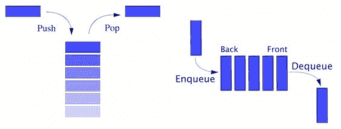

将栈视为 ADT 时，它不仅是数据的集合，还包含两个重要操作：`push`（压栈）和 `pop`（弹栈）。通常，我们在栈顶放入新条目，称为 `push`；当我们想取出一个项目时，从栈顶取出，也称为 `pop`。如果我们把 PHP 数组视为栈，将需要额外的功能来实现这些 `push` 和 `pop` 操作，才能将其视为栈 ADT。同样，队列也是一个 ADT，具有两个必需操作：在队列末尾添加项目，称为 `enqueue`（入队）；从队列开头移除项目，称为 `dequeue`（出队）。两者听起来相似，但如果我们仔细观察，会发现栈遵循 `后进先出` (`LIFO`) 模型，而队列遵循 `先进先出` (`FIFO`) 模型。这两种不同的数学模型使它们成为两种不同的 ADT。

以下是一些常见的 ADT：

*   列表
*   映射
*   集合
*   栈
*   队列
*   优先队列
*   图
*   树

在后续章节中，我们将探索更多 ADT 并使用 PHP 将它们实现为数据结构。

## 不同的数据结构

我们可以将数据结构分为两大类：

*   线性数据结构
*   非线性数据结构

在线性数据结构中，项目以线性或顺序方式构建。数组、列表、栈和队列是线性结构的例子。在非线性结构中，数据不是以顺序方式构建的。图和树是非线性数据结构最常见的例子。

现在让我们以总结的方式探索数据结构的世界，了解不同类型的数据结构及其用途。稍后，我们将详细探讨每种数据结构。

编程世界中存在许多不同类型的数据结构。其中，以下是最常用的：

*   结构体
*   数组
*   链表
*   双向链表
*   栈
*   队列
*   优先队列
*   集合
*   映射
*   树
*   图
*   堆

## 结构体

通常，一个变量只能存储单一数据类型，而单一标量数据类型只能存储单个值。在许多情况下，我们可能需要将一些数据类型组合在一起作为单一复杂数据类型。例如，我们想将一些学生信息一起存储在一个学生数据类型中。我们需要学生姓名、地址、电话号码、电子邮件、出生日期、当前班级等。为了将每个学生记录存储到唯一的学生数据类型中，我们将需要一种特殊的结构来实现这一点。这可以通过 `struct` 轻松实现。换句话说，struct 是一个值的容器，通常通过名称访问。虽然结构体在 C 编程语言中非常流行，但我们在 PHP 中也可以使用类似的概念。我们将在后续章节中探讨这一点。

## 数组

虽然数组在 PHP 中被视为一种数据类型，但数组实际上是一种数据结构，几乎用于所有编程平台。在 PHP 中，数组实际上是一个有序映射（我们将在几节之后了解映射）。我们可以将多个值作为单个变量存储在一个数组中。矩阵类型的数据易于存储在数组中，因此它被广泛用于所有编程平台。通常数组是固定大小的集合，通过顺序数字索引访问。在 PHP 中，数组的实现方式不同，你可以定义动态数组而无需定义数组的任何固定大小。我们将在下一章详细探讨 PHP 数组。数组可以有不同的维度。如果数组只有一个索引来访问元素，我们称之为一维数组。但如果需要两个或更多索引来访问元素，我们分别称之为二维或多维数组。以下是数组数据结构的两个图示：

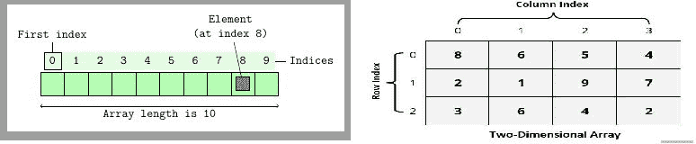

## 读累了记得休息一会哦~

**公众号：古德猫宁李**

*   电子书搜索下载
*   书单分享
*   书友学习交流

**网站：**[沉金书屋 https://www.chenjin5.com](https://www.chenjin5.com)

*   电子书搜索下载
*   电子书打包资源分享
*   学习资源分享

## 链表

链表是一种线性数据结构，是数据元素的集合，也称为节点，大小可以不固定。通常，列表项通过指针连接，该指针称为链接，因此称为 `链表`。在链表中，一个列表元素通过指针链接到下一个元素。从下图可以看出，链表实际上维护着一个有序集合。链表是编程语言中最常用、最简单的数据结构形式。在单链表中，我们只能向前遍历。在 第 3 章 `使用链表` 中，我们将深入探讨链表的概念和实现：

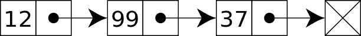

## 双向链表

双向链表是一种特殊类型的链表，我们不仅存储下一个节点是什么，还在节点结构内存储前一个节点。因此，它可以在列表中前后移动。通过同时拥有前驱和后继指针，它比单链表或链表提供了更大的灵活性。我们将在 第 3 章 `使用链表` 中进一步探讨这些内容。下图描绘了一个双向链表：


## 栈

正如我们在前几页讨论栈时所提到的，我们已经知道栈是一种遵循后进先出（LIFO）原则的线性数据结构。因此，栈只有一个端点用于添加新项或移除项。它是计算机技术中最古老、使用最广泛的数据结构之一。我们总是使用名为 `top` 的单一端点来向栈中添加或移除项。术语 `push` 用于表示将项添加到栈顶，`pop` 用于表示从栈顶移除项；这在下图中有所展示。我们将在第 4 章 *构建栈和队列* 中更详细地讨论栈。

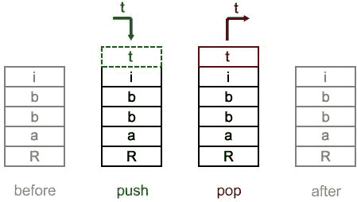

## 队列

队列是另一种遵循先进先出（FIFO）原则的线性数据结构。队列允许对集合进行两种基本操作。第一种是 `enqueue`，它允许我们在队列尾部添加项。第二种是 `dequeue`，它允许我们从队列头部移除项。队列是计算机技术中另一种使用最广泛的数据结构。我们将在第 4 章 *构建栈和队列* 中详细了解队列。


## 集合

集合是一种用于存储特定值的抽象数据类型。这些值不按任何特定顺序存储，但集合中不应有任何重复值。集合不像集合类型那样用于从中检索特定值；集合用于检查某个值是否存在于其中。有时集合数据结构可以是排序的，我们称之为有序集合。

## 映射

映射是键值对的集合，其中所有键都是唯一的。我们可以将映射视为一种所有键都唯一的关联数组。我们可以使用键值对进行添加和移除，并使用键从映射中进行更新和查找。事实上，PHP 数组就是有序映射的实现。我们将在下一章探讨这一点。

## 树

树是计算领域中使用最广泛的非线性数据结构。它广泛用于层级数据结构。树由节点组成，有一个特殊的节点称为树的 `root`（根节点），它是树结构的起点。其他节点从根节点向下延伸。树数据结构具有递归性，这意味着一棵树可以包含许多子树。节点通过边相互连接。我们将在第 6 章 *理解和实现树* 中讨论不同类型的树、它们的操作和用途。

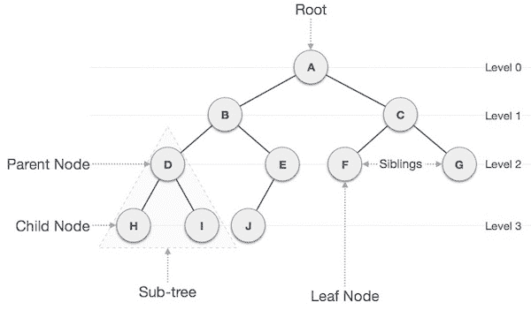

## 图

图数据结构是一种特殊类型的非线性数据结构，由有限数量的顶点或节点，以及边或弧组成。图可以是有向的，也可以是无向的。有向图明确指示边的方向，而无向图只提及边，不指示方向。因此，在无向图中，边的两个方向被视为一条边。换句话说，我们可以将图定义为一对集合 (`V, E`)，其中 `V` 是顶点集合，`E` 是边集合：

```
V = {A, B, C, D, E, F}
E = {AB, BC, CE, ED, EF, DB}
```

在有向图中，边 `AB` 与边 `BA` 不同；而在无向图中，`AB` 和 `BA` 是相同的。图在编程世界中可用于解决许多复杂问题。我们将在第 9 章 *图的实战应用* 中继续讨论图数据结构。在下图中，我们有：

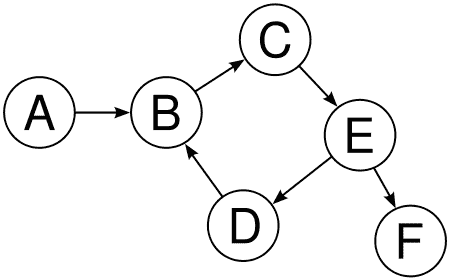

## 堆

堆是一种基于树的特殊数据结构，满足堆的特性。最大键是根节点，较小的键是叶子节点，这称为 `max heap`（最大堆）。或者，最小键是根节点，较大的键是叶子节点，这称为 `min heap`（最小堆）。虽然堆结构的根节点是树中最大或最小的键，但它不一定是一个排序结构。堆用于高效地求解图算法，也用于排序。我们将在第 10 章 *理解和使用堆* 中探讨堆数据结构。


## 读累了记得休息一会哦~

**公众号：古德猫宁李**

*   电子书搜索下载
*   书单分享
*   书友学习交流

**网站：**[沉金书屋 https://www.chenjin5.com](https://www.chenjin5.com)

*   电子书搜索下载
*   电子书打包资源分享
*   学习资源分享

## 解决问题——算法方法

到目前为止，我们已经讨论了不同类型的数据结构及其用法。但有一件事我们必须记住：仅仅将数据放入合适的结构中可能无法解决我们的问题。我们需要在数据结构的帮助下找到问题的解决方案，换句话说，我们将使用数据结构来解决问题。我们需要算法来解决问题。

算法是一个分步的过程，它定义了一组按特定顺序执行的指令，以获得期望的输出。一般来说，算法不局限于任何编程语言或平台。它们独立于编程语言。一个算法必须具有以下特征：

*   **输入**：算法必须有定义明确的输入。可以是 0 个或多个输入。
*   **输出**：算法必须有定义明确的输出。它必须与期望的输出相符。
*   **精确性**：所有步骤都被精确定义。
*   **有限性**：算法必须在执行一定步数后停止。它不应无限运行下去。
*   **无歧义性**：算法应清晰明了，任何步骤都不应有歧义。
*   **独立性**：算法应独立于任何编程语言或平台。

现在让我们创建一个算法。但为了做到这一点，我们需要一个问题陈述。所以让我们假设我们的图书馆有一批新书到货。共有 1000 本书，它们没有按任何特定顺序排序。我们需要根据书单找到这些书，并将它们放在指定的书架上。我们如何从这堆书中找到它们？

现在，我们可以用不同的方式解决这个问题。每种方式寻找问题解决方案的方法不同。我们称这些方法为算法。为了保持讨论简短精确，我们将只考虑两种解决问题的方法。我们知道还有其他几种方法，但为简单起见，让我们将讨论仅限于一种算法。

我们将把书按简单的一排存放，以便我们能看到书名。现在，我们将从书单中挑选一个书名，从排的一端搜索到另一端，直到找到该书。所以基本上，我们将对每本书遵循顺序搜索。我们将重复这些步骤，直到将所有书放在指定位置。

## 编写伪代码

计算机程序是为机器阅读而编写的。我们必须按特定格式编写它们，以便编译后机器能够理解。但通常那些编写的代码对于程序员以外的人来说并不容易理解。为了以一种非正式的方式展示这些代码，使人类也能理解，我们编写 **伪代码**。虽然它不是实际的编程语言代码，但伪代码具有编程语言类似的结构约定。由于伪代码不作为真实程序运行，因此没有编写伪代码的标准方式。我们可以遵循自己的方式来编写伪代码。

下面是我们用于查找书籍的算法的伪代码：

```
Algorithm FindABook(L, book_name)

  Input: list of Books L & name of the search book_name

  Output: False if not found or position of the book we are looking for.

  if L.size = 0 return null

  found := false

  for each item in L, do

    if item = book_name, then

      found := position of the item

  return found
```

现在，让我们来检查一下我们编写的伪代码。我们提供了一份图书列表和一个要搜索的名称。我们运行一个 `foreach` 循环来遍历每一本书，并将其与我们要搜索的书名进行匹配。如果找到，我们返回该书所在的位置，否则返回 `false`。因此，我们编写了一个从图书列表中查找书名的伪代码。但剩下的其他书怎么办？我们如何继续搜索，直到找到所有书并将它们放在正确的书架上？：

```
Algorithm placeAllBooks

  Input: list of Ordered Books OL, List of received books L

  Output: nothing.

  for each book_name in OL, do

     if FindABook(L,book_name), then

       remove the book from the list L

       place it to the bookshelf
```

现在我们有了解决图书整理问题的算法的完整伪代码。在这里，我们遍历已订购图书列表，并在送达区查找该书。如果找到该书，我们将其从列表中移除并放置到正确的书架上。

编写伪代码的这种简单方法可以帮助我们以结构化的方式解决更复杂的问题。由于伪代码独立于编程语言和平台，因此算法大多以伪代码的形式表达。

## 将伪代码转换为实际代码

我们现在将把伪代码转换为实际的 PHP 7 代码，如下所示：


## 代码示例：图书查找与移除

```php
function findABook(Array $bookList, String $bookName) {

    $found = FALSE;

    foreach($bookList as $index => $book) {

        if($book === $bookName) {

             $found = $index;

             break;

        }

    }

    return $found;

}


function placeAllBooks(Array $orderedBooks, Array &$bookList) {

    foreach ($orderedBooks as $book) {

    $bookFound = findABook($bookList, $book);

    if($bookFound !== FALSE) {

        array_splice($bookList, $bookFound, 1);

    }

  }

}


$bookList = ['PHP','MySQL','PGSQL','Oracle','Java'];

$orderedBooks = ['MySQL','PGSQL','Java'];


placeAllBooks($orderedBooks, $bookList);

echo implode(",", $bookList);
```

现在让我们理解前面代码中发生了什么。首先，我们在代码开头定义了一个新函数 `findABook`。该函数定义了两个参数。一个是 `Array $bookList`，另一个是 `String $bookName`。在函数开头，我们将 `$found` 初始化为 `FALSE`，意味着尚未找到任何内容。`foreach` 循环遍历图书列表数组 `$bookList`，并将每本书与我们提供的书名 `$bookName` 进行匹配。如果我们要查找的书名与 `$bookList` 中的书匹配，我们将找到匹配项的索引赋值给 `$found` 变量。既然已经找到，继续循环就没有意义了。所以，我们使用了 `break` 命令跳出循环。循环结束后，我们返回 `$found` 变量。如果找到书，`$found` 通常会返回任何大于 0 的整数值，否则将返回 `false`：

```php
function placeAllBooks(Array $orderedBooks, Array &$bookList) {

    foreach ($orderedBooks as $book) {

    $bookFound = findABook($bookList, $book);

    if($bookFound !== FALSE) {

        array_splice($bookList, $bookFound, 1);

    }

  }

}
```

这个特定的函数 `placeAllBooks` 实际上遍历我们的已订购图书 `$orderedBooks`。我们遍历已订购图书列表，并使用 `findABook` 函数在送达列表中搜索每本书。如果在已订购列表中找到该书（`$bookFound !== FALSE`），我们使用 PHP 的 `array_splice()` 函数将该书从送达图书列表中移除：

```php
$bookList = ['PHP','MySQL','PGSQL','Oracle','Java'];

$orderedBooks = ['MySQL','PGSQL','Java'];
```

这两行实际上展示了两个 PHP 数组，分别用于我们收到的图书列表 `$bookList` 和我们实际订购的图书列表 `$orderedBooks`。我们只是使用一些虚拟数据来测试我们实现的代码，如下所示：

```php
placeAllBooks($orderedBooks, $bookList);
```

我们代码的最后一部分实际上调用了函数 `placeAllBooks` 来执行检查每本书、在收到的书中搜索它并在列表中找到时将其移除的整个操作。所以基本上，我们已经将伪代码实现为可以用来解决我们问题的实际 PHP 代码。

## 算法分析

我们在上一节完成了算法。但有一件事我们还没做，那就是算法分析。在当前场景下，一个合理的问题是，为什么我们真的需要对算法进行分析？虽然我们编写了实现，但我们不确定我们编写的代码将利用多少资源。当我们说资源时，我们指的是运行应用程序所利用的时间和存储资源。我们编写算法是为了处理任意长度的输入。为了理解当输入变大时我们的算法如何表现以及利用了多少资源，我们通常通过将输入长度与步骤数（时间复杂度）或存储（空间复杂度）相关联来衡量算法的效率。进行算法分析以找到解决问题的最高效算法非常重要。

我们可以在两个不同阶段进行算法分析。一个是在实现之前，一个是在实现之后。实现前进行的分析也称为*理论分析*，我们假设其他因素（如处理能力和空间）将保持不变。实现后的分析称为算法的*经验分析*，这可能因平台而异或因语言而异。在经验分析中，我们可以从系统获得关于时间和空间利用的可靠统计数据。

对于我们放置图书和从购买项中查找图书的算法，我们可以执行类似的分析。此时，我们将更关注时间复杂度而不是空间复杂度。我们将在后续章节中探讨空间复杂度。

## 计算复杂度

在算法分析中，我们衡量两种类型的复杂度：

*   **时间复杂度**：时间复杂度通过算法中的关键操作数量来衡量。换句话说，时间复杂度量化了算法从开始到结束所花费的时间量。
*   **空间复杂度**：空间复杂度定义了算法在其生命周期中所需的空间量（内存中）。它取决于数据结构和平台的选择。

现在让我们专注于我们实现的算法，了解我们为算法执行的操作。在我们的 `placeAllBooks` 函数中，我们正在搜索每一本已订购的书。所以如果我们有 10 本书，我们要搜索 10 次。如果数量是 1000，我们要搜索 1000 次。简单来说，我们可以说如果有 *n* 本书，我们将搜索 *n* 次。在算法分析中，输入数量通常用 *n* 表示。

对于已订购图书中的每一项，我们都使用 `findABook` 函数进行搜索。在该函数内部，我们再次使用从 `placeAllBooks` 函数接收到的名称，搜索每一本收到的书。现在，如果我们足够幸运，可以在收到的书列表开头找到书名。在这种情况下，我们不必搜索剩余项。但如果我们非常倒霉，要找的书在列表末尾怎么办？我们那时必须搜索每一本书，最后才找到它。如果收到的书的数量也是 *n*，那么我们必须运行比较 *n* 次。

假设其他操作固定，唯一的变量应为输入大小。我们可以定义边界或数学方程来描述情况，以计算其运行时性能。我们称之为**渐近分析**。渐近分析是输入相关的，这意味着如果没有输入，其他因素均为常数。我们使用渐近分析来找出算法的最佳情况、最坏情况和平均情况：

*   **最佳情况**：表示执行程序所需的最短时间。对于示例算法，最佳情况可以是对于每本书，我们只搜索第一项。因此，我们最终只需搜索极短的时间。我们使用 **Ω** 符号（Sigma 符号）来表示最佳情况。
*   **平均情况**：表示执行程序所需的平均时间。对于我们的算法，平均情况将是大多数时间在列表中间找到书，或者一半时间在开头，另一半时间在结尾。
*   **最坏情况**：表示程序的最大运行时间。最坏情况的例子是每次都在列表末尾找到书。我们使用 **O**（大 O）符号来描述最坏情况。对于算法中每本书的搜索，可能需要 **O(n)** 运行时间。从现在开始，我们将使用此符号来表示算法的复杂度。

## 理解大 O 符号

大 O 符号对于算法分析非常重要。我们需要对该符号有扎实的理解，并知道未来如何使用它。我们将在本节中讨论大 O 符号。

我们查找书籍并放置它们的算法有 `n` 个项目。对于第一本书的搜索，在最坏情况下将比较 `n` 本书。如果我们说时间复杂度是 `T`，那么对于第一本书，时间复杂度将是：

```
T(1) = n
```

由于我们从列表中移除了找到的书，列表大小现在是 `n-1`。对于第二本书的搜索，在最坏情况下将比较 `n-1` 本书。那么对于第二本书，时间复杂度将是 `n-1`。结合两者的时间复杂度，前两本书将是：

```
T(2) = n + (n - 1)
```

如果我们继续这样下去，经过 `n-1` 步后，最后一本书的搜索将只剩下 `1` 本书可供比较。因此，总复杂度将如下所示：

```
T(n) = n + (n - 1) + (n - 2) + ... + 3 + 2 + 1
```

现在如果我们看前面的级数，它看起来熟悉吗？它也被称为**前 n 个数的和**方程，如下所示：

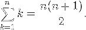

所以我们可以写成：

```
T(n) = n(n + 1)/2
```

或者：

```
T(n) = n²/2 + n/2
```

对于渐近分析，我们忽略低阶项和常数乘数。既然我们有 `n²`，我们可以轻松忽略这里的 `n`。此外，`1/2` 常数乘数也可以忽略。现在我们可以用大 O 符号将时间复杂度表示为 `n` 的平方阶：

```
T(n) = O(n²)
```

在全书中，我们将使用大 **O** 符号来描述算法或操作的复杂度。以下是一些常见的大 **O** 符号：

| **类型** | **符号** |
| --- | --- |
| 常数 | **O(1)** |
| 线性 | **O(n)** |
| 对数 | **O(log n)** |
| n log n | **O(n log n)** |
| 平方 | **O(n²)** |
| 立方 | **O(n³)** |
| 指数 | **O(2ⁿ)** |

## 标准 PHP 库 (SPL) 与数据结构

**标准 PHP 库**（**SPL**）是 PHP 语言近年来最好的特性之一。SPL 的创建是为了解决 PHP 中缺失的常见问题。SPL 在许多方面扩展了语言，但 SPL 的一个显著特性是其对数据结构的支持。虽然 SPL 用于许多其他目的，但我们将重点关注 SPL 的数据结构部分。SPL 随 PHP 核心安装提供，无需任何扩展或配置更改即可启用。

SPL 通过 PHP 中的面向对象编程提供了一组标准数据结构。支持的数据结构包括：

*   **双向链表**：在 `SplDoublyLinkedList` 中实现。
*   **栈**：通过使用 `SplDoublyLinkedList` 在 `SplStack` 中实现。
*   **队列**：通过使用 `SplDoublyLinkedList` 在 `SplQueue` 中实现。
*   **堆**：在 `SplHeap` 中实现。它还支持 `SplMaxHeap` 中的最大堆和 `SplMinHeap` 中的最小堆。
*   **优先队列**：通过使用 `SplHeap` 在 `SplPriorityQueue` 中实现。
*   **数组**：在 `SplFixedArray` 中实现，用于固定大小的数组。
*   **映射**：在 `SplObjectStorage` 中实现。

在接下来的章节中，我们将探索每个 SPL 数据结构的实现，了解它们的优缺点，并结合我们对相应数据结构的实现进行性能分析。但由于这些数据结构已内置，我们可以利用它们快速实现功能和应用。

PHP 7 发布后，大家普遍对 PHP 应用的整体性能提升感到满意。但在许多情况下，PHP SPL 并没有获得类似的性能提升，我们将在后续章节中分析这些情况。

## 总结

在本章中，我们重点讨论了基本数据结构及其名称。我们还学习了用定义步骤解决问题，即算法。我们还学习了分析算法和大 **O** 符号，以及如何计算复杂度。我们简要介绍了以 SPL 形式存在的 PHP 内置数据结构。

在下一章中，我们将重点关注 PHP 数组，这是 PHP 中最强大、最灵活的数据类型之一。我们将探索 PHP 数组的不同用法，以实现哈希表、映射、结构体等不同数据结构。

## 深入理解 PHP 数组

PHP 数组是 PHP 中使用最广泛的数据类型之一。大多数时候，我们在使用它时并未考虑 PHP 数组对开发代码或应用程序的影响。它非常易用且动态；我们喜欢将 PHP 数组用于几乎任何目的。有时我们甚至不想探索是否有其他可用的解决方案可以替代 PHP 数组。在本章中，我们将探讨 PHP 数组的优缺点，以及如何在不同的数据结构实现中使用数组并提升性能。我们将从解释 PHP 中不同类型的数组开始，接着创建固定大小的数组。然后我们将查看 PHP 数组元素的内存占用，以及如何改进它们，并介绍一些数据结构实现。

## 读累了记得休息一会哦~

**公众号：古德猫宁李**

*   电子书搜索下载
*   书单分享
*   书友学习交流

**网站：**[沉金书屋 https://www.chenjin5.com](https://www.chenjin5.com)

*   电子书搜索下载
*   电子书打包资源分享
*   学习资源分享

## 更好地理解 PHP 数组

PHP 数组非常动态和灵活，以至于我们不必像在其他某些语言中那样，去考虑它是普通数组、关联数组还是多维数组。我们不需要定义将要使用的数组的大小和数据类型。PHP 如何做到这一点，而 C 和 Java 等其他语言却不能？答案很简单：PHP 中的数组概念实际上不是真正的数组，它实际上是一个 **HashMap**。换句话说，PHP 数组不是我们从其他语言中了解的那种简单朴素的数组概念。一个简单的数组如下所示：

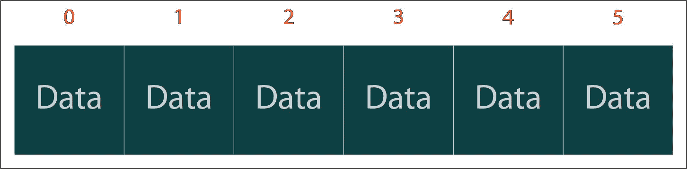

但我们在 PHP 中绝对可以做到这一点。让我们通过一个例子来检查：

```php
$array = [1,2,3,4,5];
```

这行展示了一个典型数组应有的样子。相似类型的数据拥有顺序索引（从 0 到 4）来访问值。那么谁说 PHP 数组不是典型数组？让我们探索更多示例。请看下面的代码：

```php
$mixedArray = [];

$mixedArray[0] = 200;

$mixedArray['name'] = "Mixed array";

$mixedArray[1] = 10.65;

$mixedArray[2] = ['I', 'am', 'another', 'array'];
```

这是我们日常使用的 PHP 数组；我们不需要定义大小，却可以存储整数、浮点数、字符串，甚至另一个数组。这听起来奇怪吗，还是说这正是 PHP 的超能力？我们可以参考 [`php.net`](http://php.net) 的定义。

PHP 中的数组实际上是一个**有序映射**。映射是一种将值关联到键的类型。此类型针对多种不同用途进行了优化；它可以被视作数组、列表（向量）、哈希表（映射的一种实现）、字典、集合、栈、队列，以及可能更多用途。由于数组值可以是其他数组，因此树和多维数组也是可能的。

所以 PHP 数组拥有真正的超能力，可用于所有可能的数据结构，如列表/向量、哈希表、字典、集合、栈、队列、双向链表等。看来 PHP 数组的构建方式使其要么针对所有场景都已优化，要么对任何场景都未优化。我们将在本章中探究这一点。

如果我们想对数组进行分类，主要有三种类型：

*   数值数组
*   关联数组
*   多维数组

我们将通过一些示例和解释来探索每种类型的数组。

### 数值数组

数值数组并不意味着它只存放数值数据。实际上，它意味着索引只能是数字。在 PHP 中，它们可以是顺序的，也可以是非顺序的，但必须是数字。在数值数组中，值以线性方式存储和访问。以下是一些 PHP 数值数组的示例：

```php
$array = [10,20,30,40,50];

$array[] = 70;

$array[] = 80;

$arraySize = count($array);

for($i = 0;$i<$arraySize;$i++) {

    echo "Position ".$i." holds the value ".$array[$i]."\n";

}
```

这将产生以下输出：

```
Position 0 holds the value 10
Position 1 holds the value 20
Position 2 holds the value 30
Position 3 holds the value 40
Position 4 holds the value 50
Position 5 holds the value 70
Position 6 holds the value 80
```

这是一个非常简单的示例，我们定义了一个数组，索引从 0 开始自动生成并随数组值递增。当我们使用 `$array[]` 向数组添加新元素时，它实际上会递增索引并在新索引处赋值。这就是为什么值 70 的索引是 5，而 80 的索引是 6。

如果我们的数据是顺序的，我们总可以毫无问题地使用 `for` 循环。当我们说顺序时，并不只是指 0,1,2,3....,*n*。它可以是 0,5,10,15,20,......,*n*，其中 *n* 是 5 的倍数。也可以是 1,3,5,7,9......,*n*，其中 *n* 是奇数。我们可以创建成百上千个这样的序列来构成数值数组。

一个大问题是，如果索引不是顺序的，我们能否构建数值数组？是的，完全可以。我们只需采用不同的方式来迭代。请看下面的示例：

```php
$array = [];

$array[10] = 100;

$array[21] = 200;

$array[29] = 300;

$array[500] = 1000;

$array[1001] = 10000;

$array[71] = 1971;

foreach($array as $index => $value) {

    echo "Position ".$index." holds the value ".$value."\n";

}
```

如果我们观察这些索引，它们并非顺序的。它们拥有随机索引，如 `10` 后跟 `21`、`29` 等。甚至最后我们有索引 `71`，它比之前的 `1001` 小得多。那么，最后的索引应该显示在 29 和 500 之间吗？这是输出结果：


Position 10 holds the value 100

Position 21 holds the value 200

Position 29 holds the value 300

Position 500 holds the value 1000

Position 1001 holds the value 10000

Position 71 holds the value 1971

这里有几点需要注意：

*   我们按照数据录入的顺序迭代数组。索引完全没有内部排序，尽管它们全是数字。
*   另一个有趣的事实是数组 `$array` 的大小只有 `6`。它不像 C++、Java 或其他语言那样是 `1002`，在这些语言中我们需要预先定义数组大小，且最大索引只能是 `n-1`（其中 `n` 是数组大小）。

### 关联数组

关联数组通过键来访问，键可以是任意字符串。在关联数组中，值是针对键存储的，而不是线性索引。我们可以像使用数值数组一样，使用关联数组存储任意类型的数据。让我们创建一个学生数组来存储学生信息：

```
$studentInfo = [];

$studentInfo['Name'] = "Adiyan";

$studentInfo['Age'] = 11;

$studentInfo['Class'] = 6;

$studentInfo['RollNumber'] = 71;

$studentInfo['Contact'] = "info@adiyan.com";

foreach($studentInfo as $key => $value) {

    echo $key.": ".$value."\n";

}
```

这是代码的输出：

```
Name: Adiyan

Age: 11

Class: 6

RollNumber: 71

Contact: info@adiyan.com
```

这里我们使用每个键来存放一条数据。我们可以毫无问题地添加任意数量的键。这赋予了我们灵活性，可以使用 PHP 关联数组来表示类似于结构体、映射和字典的数据结构。

### 多维数组

多维数组在其中包含多个数组。换句话说，它是数组的数组。在本书中，我们将在不同示例中使用多维数组，因为它们是存储图和其他树型数据结构数据最流行、最高效的方式之一。让我们通过一个示例来探索 PHP 多维数组：

```
$players = [];

$players[] = ["Name" => "Ronaldo", "Age" => 31, "Country" => "Portugal", "Team" => "Real Madrid"];

$players[] = ["Name" => "Messi", "Age" => 27, "Country" => "Argentina", "Team" => "Barcelona"];

$players[] = ["Name" => "Neymar", "Age" => 24, "Country" => "Brazil", "Team" => "Barcelona"];

$players[] = ["Name" => "Rooney", "Age" => 30, "Country" => "England", "Team" => "Man United"];

foreach($players as $index => $playerInfo) {

    echo "Info of player # ".($index+1)."\n";

    foreach($playerInfo as $key => $value) {

        echo $key.": ".$value."\n";

    }

    echo "\n";

}
```

我们刚才看到的示例是一个二维数组的例子。因此，我们使用两个 `foreach` 循环来迭代这个二维数组。这是代码的输出：

```
Info of player # 1

Name: Ronaldo

Age: 31

Country: Portugal

Team: Real Madrid

Info of player # 2

Name: Messi

Age: 27

Country: Argentina

Team: Barcelona

Info of player # 3

Name: Neymar

Age: 24

Country: Brazil

Team: Barcelona

Info of player # 4

Name: Rooney

Age: 30

Country: England

Team: Man United
```

我们可以根据需要使用 PHP 创建 n 维数组，但必须记住一点：维度越多，结构就越复杂。人类通常只能想象三维，因此为了拥有三维以上的数组，我们必须对数组在多维空间中的工作原理有扎实的理解。

我们在 PHP 中可以将数值数组和关联数组作为单个数组一起使用。但在这种情况下，我们必须非常小心地选择正确的方式来遍历数组元素。在这种情况下，`foreach` 将比 `for` 或 `while` 循环是更好的选择。

### 将数组用作灵活的存储

## PHP 数组与 SplFixedArray

### PHP 数组概述

迄今为止，我们已经了解了 PHP 数组作为一种动态的混合数据结构，用于存储任意类型的数据。这使我们能更自由地将数组作为灵活的存储容器。我们可以在单个数组中混合不同的数据类型和不同维度的数据，甚至无需预先定义数组的大小或类型。我们可以随时对数组进行增长、收缩和修改操作。

PHP 不仅允许我们创建动态数组，还提供了大量内置数组功能。例如：`array_intersect()`、`array_merge()`、`array_diff()`、`array_push()`、`array_pop()`、`prev()`、`next()`、`current()`、`end()` 等。

### 使用多维数组表示数据结构

在后续章节中，我们将讨论多种不同的数据结构和算法。我们将重点关注的关键数据结构之一是图。我们已经了解图数据结构的定义。大多数情况下，我们将使用 PHP 多维数组将该数据表示为邻接矩阵。请考虑以下图表：

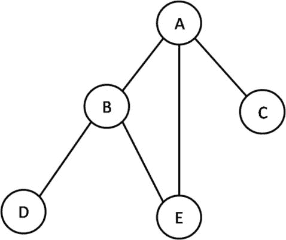

现在，如果我们将图的每个节点视为数组的一个值，可以按如下方式表示节点：

```
$nodes = ['A', 'B', 'C', 'D', 'E'];
```

但这只能给我们节点名称。我们无法连接节点或建立节点间的关系。为此，我们需要构建一个二维数组，其中节点名作为键，值根据两个节点的互连性设为 0 或 1。由于图中未提供方向，我们不知道是 `A` 连接到 `C`，还是 `C` 连接到 `A`。因此我们假设它们相互连接。

首先，我们需要为图创建一个数组，并将二维数组的每个节点初始化为 0。以下代码可实现此功能：

```
$graph = [];

$nodes = ['A', 'B', 'C', 'D', 'E'];

foreach ($nodes as $xNode) {
    foreach ($nodes as $yNode) {
        $graph[$xNode][$yNode] = 0;
    }
}
```

使用以下代码打印数组，以便在定义节点间连接前查看其结构：

```
foreach ($nodes as $xNode) {
    foreach ($nodes as $yNode) {
        echo $graph[$xNode][$yNode] . "\t";
    }
    echo "\n";
}
```

由于未定义节点间的连接，所有单元格均显示 0。输出如下：

```
0       0       0       0       0
0       0       0       0       0
0       0       0       0       0
0       0       0       0       0
0       0       0       0       0
```

现在我们将按如下方式定义节点的连接性，使两个节点间的连接用值 1 表示：

```
$graph["A"]["B"] = 1;
$graph["B"]["A"] = 1;
$graph["A"]["C"] = 1;
$graph["C"]["A"] = 1;
$graph["A"]["E"] = 1;
$graph["E"]["A"] = 1;
$graph["B"]["E"] = 1;
$graph["E"]["B"] = 1;
$graph["B"]["D"] = 1;
$graph["D"]["B"] = 1;
```

由于图表中未给出方向，我们将其视为无向图，因此为每个连接设置两个值为 1。对于 `A` 和 `B` 之间的连接，我们将 `$graph["A"]["B"]` 和 `$graph["B"]["A"]` 均设为 `1`。我们将在后续章节详细学习定义节点间连接的方法及其原因。目前我们仅关注如何使用多维数组表示数据结构。重新打印矩阵，输出如下：

```
0       1       1       0       1
1       0       0       1       1
1       0       0       0       0
0       1       0       0       0
1       1       0       0       0
```

在第 9 章 *Putting Graphs into Action* 中，我们将以更有趣的方式深入了解图及其操作。

### 使用 SplFixedArray 方法创建固定大小数组

到目前为止，我们探讨了 PHP 数组，知道无需定义数组大小。PHP 数组可根据需求增长或收缩。这种灵活性伴随着内存使用方面的巨大不便，我们将在本节探讨。现在，让我们专注于使用 SPL 库创建固定大小数组。

为什么需要固定大小数组？它有什么额外优势？答案是：当我们知道数组只需要特定数量的元素时，可使用固定数组减少内存占用。在进行内存使用分析前，让我们先看一些使用 `SplFixedArray` 方法的示例：

```
$array = new SplFixedArray(10);

for ($i = 0; $i < 10; $i++)
    $array[$i] = $i;

for ($i = 0; $i < 10; $i++)
    echo $array[$i] . "\n";
```

首先，我们创建一个大小为 10 的 `SplFixedArray` 对象。其余代码遵循常规 PHP 数组赋值和检索的相同原则。如果访问超出范围的索引（此处为 10），将抛出异常：

```
PHP Fatal error:  Uncaught RuntimeException: Index invalid or out of range
```

PHP 数组与 `SplFixedArray` 的基本区别：

*   `SplFixedArray` 必须具有固定的定义大小
*   `SplFixedArray` 的索引必须为整数，且在 0 到 `n` 范围内（其中 `n` 为定义的数组大小）

当我们拥有大量已知大小的数组，或已知数组最大所需大小的上限时，`SplFixedArray` 方法非常实用。但如果不知道数组大小，最好使用 PHP 数组。

### 常规 PHP 数组与 SplFixedArray 的性能对比

上一节遗留的关键问题之一是：为什么要使用 `SplFixedArray` 而不是 PHP 数组？现在我们可以探讨答案。我们了解到 PHP 数组实际上不是数组，而是哈希映射。让我们在 PHP 5.x 版本中运行一小段示例代码，查看 PHP 数组的内存使用情况。

创建一个包含 100,000 个唯一 PHP 整数的数组。因我在 64 位机器上运行，预期每个整数占用 8 字节。因此数组预计消耗约 800,000 字节内存。代码如下：

```
$startMemory = memory_get_usage();
$array = range(1, 100000);
$endMemory = memory_get_usage();
echo ($endMemory - $startMemory) . " bytes";
```

在命令提示符下运行此代码，输出为 14,649,040 字节。确实如此，内存使用量几乎是预期的 18.5 倍。这意味着 PHP 数组中每个元素有 144 字节（18 × 8 字节）的开销。这些额外的 144 字节从何而来？为什么 PHP 为每个数组元素使用如此多的额外内存？以下是 PHP 数组额外字节使用的解释：

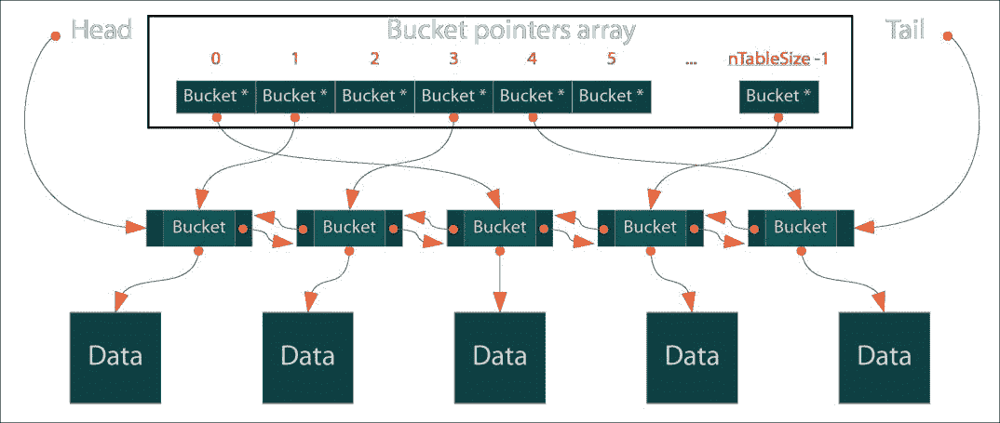

该图展示了 PHP 数组的内部工作原理。它将数据存储在桶中以避免冲突并容纳更多数据。为管理这种动态特性，它在内部为数组同时实现了双向链表和哈希表。最终导致数组中每个单独元素消耗大量额外内存空间。基于 PHP 数组实现代码（C 代码），每个元素的内存消耗细分如下：

| 组件 | 32 位 | 64 位 |
| --- | --- | --- |
| zval | 16 字节 | 24 字节 |
| + 循环 GC 信息 | 4 字节 | 8 字节 |
| + 分配头部 | 8 字节 | 16 字节 |
| **zval（值）总计** | **28 字节** | **48 字节** |
| bucket | 36 字节 | 72 字节 |
| + 分配头部 | 8 字节 | 16 字节 |
| + 指针 | 4 字节 | 8 字节 |
| **bucket（数组元素）总计** | **48 字节** | **96 字节** |
| **总计（bucket + zval）** | **76 字节** | **144 字节** |

为了理解 PHP 数组的内部结构，我们需要深入研究 PHP 内核。这超出了本书的范围。推荐阅读：[`nikic.github.io/2011/12/12/How-big-are-PHP-arrays-really-Hint-BIG.html`](https://nikic.github.io/2011/12/12/How-big-are-PHP-arrays-really-Hint-BIG.html)

在新的 PHP 7 版本中，PHP 数组及其内部构造方式有了非常大的改进。因此，每个元素 144 字节的开销已降至仅 36 字节。这是一个巨大的改进，适用于 32 位和 64 位操作系统。下面展示了一个包含 100,000 个项目的数组对比图表：

| **$array = Range(1,100000)** | **32 位** | **64 位** |
| --- | --- | --- |
| PHP 5.6 或更低版本 | 7.4 MB | 14 MB |
| PHP 7 | 3 MB | 4 MB |

换句话说，对于数组存储，PHP 7 在 32 位系统上提升了 2.5 倍，在 64 位系统上提升了 3.5 倍。这是一个非常好的改进。但这都是关于 PHP 数组的，那 `SplFixedArray` 呢？让我们在 PHP 7 和 PHP 5.x 中使用 `SplFixedArray` 运行相同的示例：

```
$items = 100000;

$startMemory = memory_get_usage();

$array = new SplFixedArray($items);

for ($i = 0; $i < $items; $i++) {

    $array[$i] = $i;

}

$endMemory = memory_get_usage();

$memoryConsumed = ($endMemory - $startMemory) / (1024 * 1024);

$memoryConsumed = ceil($memoryConsumed);

echo "memory = {$memoryConsumed} MB\n";
```

我们在这里编写了 `SplFixedArray` 的内存消耗功能。如果我们只将 `$array = new SplFixedArray($items);` 这一行改为 `$array = [];`，我们将得到运行 PHP 数组时相同的代码。

基准测试结果可能因机器而异，因为可能存在不同的操作系统、内存大小、调试器开启/关闭等情况。始终建议在您自己的机器上运行代码，以生成用于比较的类似基准测试。

下面是在 64 位系统上，包含 100,000 个整数的数组中，PHP 数组和 `SplFixedArray` 的内存消耗对比：

| **100,000 个项目** | **使用 PHP 数组** | **SplFixedArray** |
| --- | --- | --- |
| PHP 5.6 或更低版本 | 14 MB | 6 MB |
| PHP 7 | 5 MB | 2 MB |

不仅在内存使用方面，`SplFixedArray` 在执行速度上也比常规 PHP 数组操作（如访问值、赋值等）更快。

虽然我们像使用数组一样使用 `[]` 来操作 `SplFixedArray` 对象，但 PHP 数组函数不适用于 `SplFixedArray`。我们不能直接应用任何 PHP 数组函数，例如 `array_sum()`、`array_filter()` 等。

## 使用 SplFixedArray 的更多示例

由于 `SplFixedArray` 具有良好的性能提升指标，我们可以在大多数数据结构和算法中利用它来代替常规 PHP 数组。现在我们将探索在不同场景下使用 `SplFixedArray` 的更多示例。

## 读累了记得休息一会哦~

**公众号：古德猫宁李**

*   电子书搜索下载
*   书单分享
*   书友学习交流

**网站：**[沉金书屋 https://www.chenjin5.com](https://www.chenjin5.com)

*   电子书搜索下载
*   电子书打包资源分享
*   学习资源分享

## 从 PHP 数组转换为 SplFixedArray


我们已经了解了如何创建一个具有固定长度的 `SplFixedArray`。如果我想在运行时创建一个从数组到 `SplFixedArray` 的转换怎么办？以下代码块展示了如何实现：

```php
$array = [1 => 10, 2 => 100, 3 => 1000, 4 => 10000];

$splArray = SplFixedArray::fromArray($array);

print_r($splArray);
```

这里我们使用 `SplFixedArray` 类的静态方法 `fromArray()`，从现有数组 `$array` 构造一个 `SplFixedArray`。然后我们使用 PHP `print_r()` 函数打印该数组。它将显示如下输出：

```
SplFixedArray Object
(
    [0] =>
    [1] => 10
    [2] => 100
    [3] => 1000
    [4] => 10000
)
```

我们可以看到数组现已转换为 `SplFixedArray`，并且完全保持了实际数组中的索引编号。由于实际数组未定义索引 0，此处索引 0 保留为 null。但如果我们想忽略前一个数组的索引并分配新索引，则必须将前面代码的第二行更改为：

```php
$splArray = SplFixedArray::fromArray($array, false);
```

现在如果我们再次打印数组，将得到以下输出：

```
SplFixedArray Object
(
    [0] => 10
    [1] => 100
    [2] => 1000
    [3] => 10000
)
```

如果我们想在运行时将数组转换为固定数组，如果常规 PHP 数组后续不再使用，最好将其 `unset()` 掉。如果是大数组，这将节省内存使用。

## 将 SplFixedArray 转换为 PHP 数组

我们可能还需要将 `SplFixedArray` 转换为常规 PHP 数组，以应用 PHP 的一些预定义数组函数。像前面的例子一样，这也非常简单：

```php
$items = 5;

$array = new SplFixedArray($items);

for ($i = 0; $i < $items; $i++) {
    $array[$i] = $i * 10;
}

$newArray = $array->toArray();

print_r($newArray);
```

这将产生以下输出：

```
Array
(
    [0] => 0
    [1] => 10
    [2] => 20
    [3] => 30
    [4] => 40
)
```

## 声明后更改 SplFixedArray 大小

由于我们在开始时定义了数组大小，稍后可能需要更改大小。为此，我们必须使用 `SplFixedArray` 类的 `setSize()` 方法。示例如下：

```php
$items = 5;

$array = new SplFixedArray($items);

for ($i = 0; $i < $items; $i++) {
    $array[$i] = $i * 10;
}

$array->setSize(10);

$array[7] = 100;
```

## 使用 SplFixedArray 创建多维数组

我们可能还需要使用 `SplFixedArray` 创建二维或更多维数组。为此，建议遵循以下示例：

```php
$array = new SplFixedArray(100);

for ($i = 0; $i < 100; $i++)
    $array[$i] = new SplFixedArray(100);
```

我们实际上是在每个数组索引内创建另一个 `SplFixedArray`。我们可以添加任意数量的维度。但我们必须记住，随着维度的增加，我们是在乘以数组的大小。因此它可能会非常快地变得非常大。

## 理解哈希表

在编程语言中，哈希表是一种用于使数组具有关联性的数据结构。这意味着我们可以使用键来映射值，而不是使用索引。哈希表必须使用哈希函数计算索引，以索引桶或槽位数组，从中可以找到所需的值：

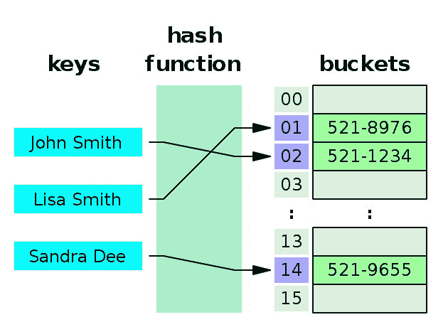

正如我们多次提到的，PHP 数组实际上是一个哈希表，因此它支持关联数组。我们需要记住一点：我们不需要为关联数组实现定义哈希函数。PHP 会在内部为我们完成。因此，当我们在 PHP 中创建关联数组时，实际上是在创建一个哈希表。例如，以下代码可视为哈希表：

```php
$array = [];

$array['Germany'] = "Position 1";

$array['Argentina'] = "Position 2";

$array['Portugal'] = "Position 6";

$array['Fifa_World_Cup'] = "2018 Russia";
```

事实上，我们可以直接调用任意键，复杂度仅为 `O(1)`。键将始终引用桶内的同一个索引，因为 PHP 将使用相同的哈希函数来计算索引。

## 使用 PHP 数组实现结构体

正如我们已知，结构体是一种复杂的数据类型，我们在其中将多个属性定义为一组，以便将其作为单一数据类型使用。我们可以使用 PHP 数组和类来编写结构体。以下是使用 PHP 数组实现结构体的示例：

```php
$player = [
    "name" => "Ronaldo",
    "country" => "Portugal",
    "age" => 31,
    "currentTeam" => "Real Madrid"
];
```

它只是一个键为字符串的关联数组。可以使用单个或多个构造作为其属性来构建复杂的结构体。例如，使用 `player` 结构体，我们可以使用一个 `team` 结构体：

```php
$ronaldo = [
    "name" => "Ronaldo",
    "country" => "Portugal",
    "age" => 31,
    "currentTeam" => "Real Madrid"
];

$messi = [
    "name" => "Messi",
    "country" => "Argentina",
    "age" => 27,
    "currentTeam" => "Barcelona"
];

$team = [
    "player1" => $ronaldo,
    "player2" => $messi
];
```

使用 PHP 类也可以实现同样的功能。示例将如下所示：

```php
class Player {
    public $name;
    public $country;
    public $age;
    public $currentTeam;
}

$ronaldo = new Player();
$ronaldo->name = "Ronaldo";
$ronaldo->country = "Portugal";
$ronaldo->age = 31;
$ronaldo->currentTeam = "Real Madrid";
```

既然我们已经看到了定义结构体的两种方式，就必须选择其中一种来实现结构体。虽然创建对象看起来更方便，但与数组实现相比速度较慢。数组具有速度优势，但也有缺点，即相比对象占用更多内存空间。现在我们必须根据偏好做出决定。

## 使用 PHP 数组实现集合

集合只是一个没有特定顺序的值的集合。它可以包含任何数据类型，我们可以运行不同的集合操作，如并集、交集、补集等。由于集合只包含值，我们可以构建一个基本的 PHP 数组并为其赋值，使其动态增长。以下示例展示了我们定义的两个集合；一个包含一些奇数，另一个包含一些质数：

```php
$odd = [];
$odd[] = 1;
$odd[] = 3;
$odd[] = 5;
$odd[] = 7;
$odd[] = 9;

$prime = [];
$prime[] = 2;
$prime[] = 3;
$prime[] = 5;
```

为了检查值在集合中的存在性，以及进行并集、交集和补集操作，我们可以使用以下示例：

```php
if (in_array(2, $prime)) {
    echo "2 is a prime";
}

$union = array_merge($prime, $odd);
$intersection = array_intersect($prime, $odd);
$compliment = array_diff($prime, $odd);
```

PHP 有许多用于此类操作的内置函数，我们可以利用它们进行集合操作。但我们必须考虑一点：由于集合没有按任何特定方式排序，使用 `in_array()` 函数搜索在最坏情况下的复杂度可能为 `O(n)`。`array_merge()` 函数也是如此，因为它会将一个数组中的每个值与另一个数组进行检查。为了加快速度，我们可以稍微修改代码使其更高效：

```php
$odd = [];
$odd[1] = true;
$odd[3] = true;
$odd[5] = true;
$odd[7] = true;
$odd[9] = true;

$prime = [];
$prime[2] = true;
$prime[3] = true;
$prime[5] = true;

if (isset($prime[2])) {
    echo "2 is a prime";
}

$union = $prime + $odd;
$intersection = array_intersect_key($prime, $odd);
$compliment = array_diff_key($prime, $odd);
```

如果我们分析这段代码，可以看到我们使用索引或键来定义集合。由于 PHP 数组索引或键查找的复杂度为 `O(1)`，这使得搜索快得多。因此，与前面的示例相比，所有查找、并集、交集和补集操作将花费更少的时间。

## PHP 数组的最佳用法

虽然 PHP 数组消耗更多内存，但使用 PHP 数组的灵活性对于许多数据结构来说更为重要。因此，我们将在许多数据结构实现和算法中使用 PHP 普通数组以及 `SplFixedArray`。如果我们仅将 PHP 数组视为数据的容器，就更容易在许多数据结构实现中利用其极其强大的功能。加上内置函数，PHP 数组绝对是使用 PHP 进行编程和开发应用程序时必须使用的数据结构。

PHP 有一些用于数组的内置排序函数。它可以使用键和值进行排序，同时在排序时保持关联关系。我们将在第 7 章 *Using Sorting Algorithms* 中探讨这些内置函数。

## PHP 数组，它是性能杀手吗？

在本章中，我们已经看到 PHP 数组中的每个元素都有非常大的内存开销。既然这是由语言本身完成的，我们能做的很少，除了在适用的地方使用 `SplFixedArray` 代替普通数组。但如果我们从 PHP 5.x 版本迁移到新的 PHP 7，那么无论我们使用普通 PHP 数组还是 `SplFixedArray`，都可以使应用程序获得巨大的改进。

在 PHP 7 中，哈希表的内部实现发生了巨大变化，且**并非**为效率而构建。因此，每个元素的开销内存消耗显著下降。虽然我们可以争辩说较少的内存消耗并不一定让代码运行更快，但我们可以反驳说，如果我们有更少的内存需要管理，就可以更专注于执行而不是内存管理。因此，这对性能有一定影响。

到目前为止，从讨论中我们可以轻松得出结论，PHP 7 中新改进的数组绝对是开发人员解决复杂且内存高效应用程序的推荐选择。

## 读累了记得休息一会哦~

**公众号：古德猫宁李**

*   电子书搜索下载
*   书单分享
*   书友学习交流

**网站：** [沉金书屋 https://www.chenjin5.com](https://www.chenjin5.com)

*   电子书搜索下载
*   电子书打包资源分享
*   学习资源分享

## 总结

在本章中，我们将讨论重点放在 PHP 数组上，以及使用 PHP 数组作为数据结构可以做什么。在接下来的章节中，我们将继续探索数组的特性。在下一章中，我们将重点关注链表数据结构及其不同变体。我们还将探讨关于链表的不同类型的实际示例及其最佳用法。

## 使用链表

我们已经对数组有了很多了解。现在，我们将把重点转移到一种称为*列表*的新型数据结构上。它是编程世界中最常用的数据结构之一。在大多数编程语言中，数组是固定大小的结构。因此，它无法动态增长，从固定大小的数组中缩减或移除项目也很成问题，因为我们必须移动数组项来填补空缺。因此，许多开发人员更喜欢列表而不是数组。考虑到每个数组元素可能有一些额外字节的开销，在内存效率是主要因素的情况下可以使用链表。在本章中，我们将探讨 PHP 中不同类型的链表及其实现。我们还将研究可以使用链表解决的实际问题。

## 什么是链表？

链表是称为节点的对象的集合。每个节点通过一个链接连接到下一个节点，该链接只不过是一个对象引用。如果我们考虑下图，每个框代表一个节点。箭头表示节点之间的链接。这是一个单向链表的示例。最后一个节点包含指向 `NULL` 的下一个链接，以标记列表的结束：

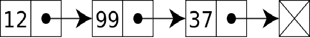

节点是一个对象，意味着它可以存储任何数据类型，简单如字符串、整数或浮点数，或复杂如数组、数组的数组、对象或对象数组。我们可以根据需要存储任何内容。

我们还可以对链表执行各种操作，例如以下操作：

*   检查列表是否为空
*   显示列表中的所有项目
*   在列表中搜索项目
*   获取列表的大小
*   在列表的开头或末尾插入新项目
*   从列表的开头或末尾移除项目

## 链表操作与实现

*   在特定位置或某个项目之前/之后插入新项目
*   反转列表

这些只是可以在链表上执行的部分操作。

让我们编写一个简单的链表来存储一些名称：

```php
class ListNode {
    public $data = NULL;
    public $next = NULL;

    public function __construct(string $data = NULL) {
        $this->data = $data;
    }
}
```

我们之前提到过，链表由节点组成。我们已经为节点创建了一个简单的类。`ListNode` 类有两个属性：一个用于存储数据，另一个用于存储称为 `next` 的链接。现在，我们将使用 `ListNode` 类来实现一个链表。为简单起见，我们将只实现两个操作：`insert()` 和 `display()`：

```php
class LinkedList {
    private $_firstNode = NULL;
    private $_totalNodes = 0;

    public function insert(string $data = NULL) {
        $newNode = new ListNode($data);

        if ($this->_firstNode === NULL) {
            $this->_firstNode = &$newNode;
        } else {
            $currentNode = $this->_firstNode;
            while ($currentNode->next !== NULL) {
                $currentNode = $currentNode->next;
            }
            $currentNode->next = $newNode;
        }
        $this->_totalNode++;
        return TRUE;
    }

    public function display() {
        echo "Total book titles: ".$this->_totalNode."\n";
        $currentNode = $this->_firstNode;
        while ($currentNode !== NULL) {
            echo $currentNode->data . "\n";
            $currentNode = $currentNode->next;
        }
    }
}
```

前面的代码实际上实现了我们针对 `insert()` 和 `display()` 节点的两个基本操作。在 `LinkedList` 类中，我们有两个私有属性：`$_firstNode` 和 `$_totalNodes`。它们的默认值分别为 `NULL` 和 `0`。我们需要标记头节点或第一个节点，以便始终知道从哪里开始。我们也可以称之为前端节点。无论我们提供什么名称，它主要用于指示链表的起始位置。现在，让我们继续查看 `insert()` 操作的代码。

`insert()` 方法接受一个参数，即数据本身。我们将使用 `ListNode` 类通过数据创建一个新节点。在将书名插入链表之前，我们必须考虑两种可能性：

*   列表为空，我们正在插入第一个标题
*   列表不为空，标题将被添加到末尾

为什么我们需要考虑这两种情况？答案非常简单。如果我们不知道列表是否为空，我们的操作可能会得到不同的结果。我们还可能在节点之间创建无效的链接。因此，思路是：如果列表为空，我们插入的项目将成为列表的第一个项目。这正是代码的第一部分所做的事情：


```php
$newNode = new ListNode($data);

if ($this->_firstNode === NULL) {
    $this->_firstNode = &$newNode;
}
```

从前面的代码片段中我们可以看到，我们正在用数据创建一个新节点，并将该节点对象命名为 `$newNode`。之后，它检查 `$_firstNode` 是否为 `NULL`。如果是 `NULL`，则列表为空。如果为空，则将 `$newNode` 对象赋值给 `$_firstNode` 属性。现在，`insert` 方法的剩余部分代表我们的第二个条件，即列表不为空，我们必须在列表末尾添加新项目：

```php
$currentNode = $this->_firstNode;

while ($currentNode->next !== NULL) {
    $currentNode = $currentNode->next;
}

$currentNode->next = $newNode;
```

在这里，我们从 `$_firstNode` 属性获取列表的第一个节点。现在，我们将从第一个节点迭代到列表的末尾。我们将通过检查当前节点的下一个链接是否不为 `NULL` 来确保这一点。如果它是 `NULL`，则我们已到达列表的末尾。为了确保我们不会一直循环在同一个节点上，我们在迭代过程中将当前节点的下一个节点设置为当前项目。`while` 循环代码实现了这一逻辑。一旦我们退出 `while` 循环，我们将链表的最后一个节点设置为 `$currentNode`。现在，我们必须将当前最后一个节点的下一个链接分配给新创建的名为 `$newNode` 的节点，因此我们只需将该对象放入节点的下一个链接中。此对象引用将作为两个节点对象之间的链接。最后，我们还通过后置递增 `$_totalNode` 属性将总节点计数值加 1。

我们本可以轻松地为列表创建另一个属性来跟踪最后一个节点。这本可以使我们免于每次插入新节点时都要遍历整个列表。我们有意忽略了这个选项，以便讲解链表的基本理解。在本章后面，我们将实现该功能以实现更快的操作。

如果我们看一下 `display` 方法，可以看到我们使用了几乎相似的逻辑来遍历每个节点并显示其内容。我们首先获取链表的头部项目。然后，我们遍历列表直到列表项目为 `NULL`。在循环内部，我们通过显示其 `$data` 属性来显示节点数据。现在，我们有了一个用于为链表创建单个节点的节点类 `ListNode`，以及一个用于执行基本 `insert` 和 `display` 操作的 `LinkedList` 类。让我们编写一小段代码来利用 `LinkedList` 类创建一个书名链表：

```php
$BookTitles = new LinkedList();

$BookTitles->insert("Introduction to Algorithm");

$BookTitles->insert("Introduction to PHP and Data structures");

$BookTitles->insert("Programming Intelligence");

$BookTitles->display();
```

在这里，我们为 `LinkedList` 创建一个新对象并将其命名为 `$BookTitles`。然后，我们使用 `insert` 方法插入新的书籍项目。我们添加了三本书，然后使用 `display` 方法显示书名。如果我们运行前面的代码，将看到以下输出：

```
Total book titles: 3

Introduction to Algorithm

Introduction to PHP and Data structures

Programming Intelligence
```

正如我们所见，第一行有一个计数器，显示我们有三个书名，以及它们的名称。如果我们仔细观察，会发现书名的显示顺序与我们输入的顺序相同。这意味着我们实现的链表实际上保持了顺序。这是因为我们总是在列表末尾输入新节点。如果我们想要，本可以采用不同的方式。作为我们的第一个示例，我们已经涵盖了关于链表及其构建方法的许多内容。在接下来的章节中，我们将探索更多关于如何创建不同类型的链表以及更复杂的示例。现在，我们将重点关注不同类型的链表。

## 链表的不同类型

到目前为止，我们处理的列表被称为单向链表，或线性链表。然而，根据涉及的操作，还有其他几种不同类型的链表：

*   双向链表
*   循环链表
*   多重链表

## 双向链表

在双向链表中，每个节点上有两个链接：一个指向下一个节点，另一个指向前一个节点。单向链表是单向的，而双向链表是双向的。我们可以在列表中毫无问题地向前或向后移动。下图显示了一个双向链表的示例。稍后，在 *用 PHP 实现双向链表* 部分，我们将探讨如何实现双向链表：

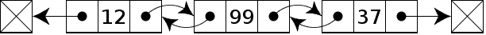

## 循环链表

在单向或双向链表中，最后一个节点之后没有节点，因此最后一个节点没有任何后续节点可供迭代。如果我们允许最后一个节点指向第一个节点，就形成了一个环。这样的链表称为循环链表。单向链表和双向链表都可以作为循环链表。我们将在本章中实现一个循环链表。下图描绘了一个循环链表：

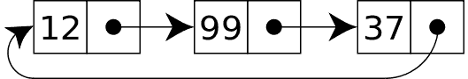

## 多重链表

多重链表是一种特殊类型的链表，它拥有两个或更多链接将每个节点链接到另一个节点。根据链表的目的，它可以多方向增长。例如，如果我们以学生名单为例，每个学生是一个具有姓名、年龄、性别、系别、专业等属性的节点，那么我们不仅可以将每个学生的节点与下一个和上一个节点链接，还可以按年龄、性别、系别和专业进行链接。虽然使用这种链表需要对链表概念有很好的理解，但我们可以在需要时使用这种特殊的链表。下图描绘了一个多重链表：

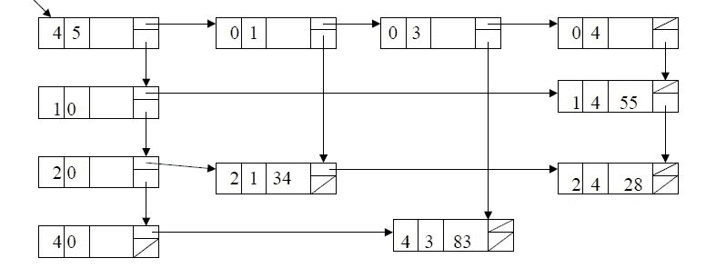

## 插入、删除和搜索项目

到目前为止，我们只看到了插入节点和显示所有节点内容的操作。现在，我们将探索链表中可用的其他操作。我们将主要关注以下操作：

*   在第一个节点处插入
*   搜索节点
*   在特定节点前插入
*   在特定节点后插入
*   删除第一个节点
*   删除最后一个节点
*   搜索并删除一个节点
*   反转链表
*   获取第 N 个位置的元素

## 在第一个节点处插入

当我们在前端（即头部）添加节点时，必须考虑两种简单的可能性。列表可以为空，因此新节点即为头节点。这种可能性简单明了。然而，如果列表已经有头节点，则必须执行以下操作：

1.  创建新节点。
2.  将新节点设为第一个节点或头节点。
3.  将之前的头节点或第一个节点指定为新创建的第一个节点的下一个节点。

以下是实现代码：

```php
public function insertAtFirst(string $data = NULL) {
    $newNode = new ListNode($data);

    if ($this->_firstNode === NULL) {
        $this->_firstNode = &$newNode;
    } else {
        $currentFirstNode = $this->_firstNode;
        $this->_firstNode = &$newNode;
        $newNode->next = $currentFirstNode;
    }

    $this->_totalNode++;
    return TRUE;
}
```

## 读累了记得休息一会哦~

**公众号：古德猫宁李**

*   电子书搜索下载
*   书单分享
*   书友学习交流

**网站：**[沉金书屋 https://www.chenjin5.com](https://www.chenjin5.com)

*   电子书搜索下载
*   电子书打包资源分享
*   学习资源分享

### 搜索节点

搜索节点非常简单。我们需要遍历每个节点，并检查目标数据是否与节点数据匹配。如果找到数据，则返回该节点；否则返回 `FALSE`。实现如下所示：

```php
public function search(string $data = NULL) {
    if ($this->_totalNode) {
        $currentNode = $this->_firstNode;
        while ($currentNode !== NULL) {
            if ($currentNode->data === $data) {
                return $currentNode;
            }
            $currentNode = $currentNode->next;
        }
    }
    return FALSE;
}
```

### 在特定节点前插入

此过程类似于我们之前查看的第一个操作。主要区别在于我们需要找到特定节点，然后在其前面插入新节点。当找到目标节点时，我们可以将新创建节点的 `next` 指向目标节点，并将前一个节点的 `next` 指向新创建的节点。这在下图中展示：

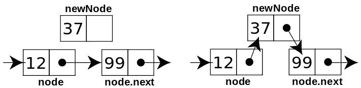

以下是实现上述逻辑的代码：

```php
public function insertBefore(string $data = NULL, string $query = NULL) {
    $newNode = new ListNode($data);

    if ($this->_firstNode) {
        $previous = NULL;
        $currentNode = $this->_firstNode;
        while ($currentNode !== NULL) {
            if ($currentNode->data === $query) {
                $newNode->next = $currentNode;
                $previous->next = $newNode;
                $this->_totalNode++;
                break;
            }
            $previous = $currentNode;
            $currentNode = $currentNode->next;
        }
    }
}
```

如果我们检查前面的代码，可以看到逻辑非常直接。此方法有两个参数：一个是 `data`，一个是 `query`。我们遍历每个节点。在此过程中，我们还跟踪当前节点和前一个节点。跟踪前一个节点很重要，因为当找到目标节点时，我们将把前一个节点的 `next` 设置为新创建的节点。

### 在特定节点后插入

此过程类似于在目标节点前插入节点。区别在于我们需要在目标节点后插入新节点。在这里，我们需要同时考虑目标节点及其指向的下一个节点。当找到目标节点时，我们可以将新创建节点的 `next` 指向目标节点原本的下一个节点，并将目标节点的 `next` 指向新创建的节点。以下是实现此操作的代码：

```php
public function insertAfter(string $data = NULL, string $query = NULL) {
    $newNode = new ListNode($data);

    if ($this->_firstNode) {
        $nextNode = NULL;
        $currentNode = $this->_firstNode;
        while ($currentNode !== NULL) {
            if ($currentNode->data === $query) {
                if ($nextNode !== NULL) {
                    $newNode->next = $nextNode;
                }
                $currentNode->next = $newNode;
                $this->_totalNode++;
                break;
            }
            $currentNode = $currentNode->next;
            $nextNode = $currentNode->next;
        }
    }
}
```

### 删除第一个节点

删除节点仅意味着取出该节点并重新排列前一个和后一个节点的链接。如果我们只是移除一个节点，并将前一个节点的 `next` 链接与被删除节点的下一个节点连接起来，删除操作就完成了。请看下面的示例：

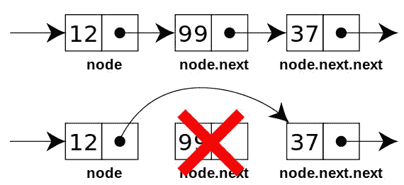

当我们删除第一个节点时，只需将第二个节点设为头节点或第一个节点。我们可以通过以下代码轻松实现：

```php
public function deleteFirst() {
    if ($this->_firstNode !== NULL) {
        if ($this->_firstNode->next !== NULL) {
            $this->_firstNode = $this->_firstNode->next;
        } else {
            $this->_firstNode = NULL;
        }
        $this->_totalNode--;
        return TRUE;
    }
    return FALSE;
}
```

现在，我们必须考虑一种特殊情况，即将总节点数减一。

### 删除最后一个节点

删除最后一个节点要求我们将倒数第二个节点的 `next` 链接设为 `NULL`。我们将迭代直到最后一个节点，并在过程中跟踪前一个节点。一旦到达最后一个节点，将前一个节点的 `next` 属性设为 `NULL`，如下例所示：

```php
public function deleteLast() {
    if ($this->_firstNode !== NULL) {
        $currentNode = $this->_firstNode;
        if ($currentNode->next === NULL) {
            $this->_firstNode = NULL;
        } else {
            $previousNode = NULL;

            while ($currentNode->next !== NULL) {
                $previousNode = $currentNode;
                $currentNode = $currentNode->next;
            }

            $previousNode->next = NULL;
            $this->_totalNode--;
            return TRUE;
        }
    }
    return FALSE;
}
```

首先，我们检查列表是否为空。然后，我们检查列表是否有多个节点。根据结果，我们遍历到最后一个节点并跟踪前一个节点。接着，我们将前一个节点的 next 链接赋值为 `NULL`，以便从列表中移除最后一个节点。

## 搜索并删除节点

我们可以使用搜索和删除操作从列表中删除任意节点。首先，我们在列表中搜索该节点，然后通过移除该节点的引用来删除它。以下是实现此功能的代码：

```php
public function delete(string $query = NULL) {
    if ($this->_firstNode) {
        $previous = NULL;
        $currentNode = $this->_firstNode;
        while ($currentNode !== NULL) {
            if ($currentNode->data === $query) {
                if ($currentNode->next === NULL) {
                    $previous->next = NULL;
                } else {
                    $previous->next = $currentNode->next;
                }
                $this->_totalNode--;
                break;
            }
            $previous = $currentNode;
            $currentNode = $currentNode->next;
        }
    }
}
```

## 反转列表


# 反转链表

反转链表有很多方法。我们将采用一种简单的方法来反转列表，称为原地反转。我们遍历节点并将下一个节点改为前一个节点、前一个节点改为当前节点、当前节点改为下一个节点。该逻辑的伪代码算法如下所示：

```
prev = NULL; 

current = first_node; 

next = NULL; 

while (current != NULL) 
{ 
  next = current->next;   
  current->next = prev;    
  prev = current; 
  current = next; 
} 

first_node = prev; 
```

如果我们根据此伪代码实现反转函数，将如下所示：

```
public function reverse() { 
    if ($this->_firstNode !== NULL) { 
        if ($this->_firstNode->next !== NULL) { 
            $reversedList = NULL; 
            $next = NULL; 
            $currentNode = $this->_firstNode; 
            while ($currentNode !== NULL) { 
                $next = $currentNode->next; 
                $currentNode->next = $reversedList; 
                $reversedList = $currentNode; 
                $currentNode = $next; 
            } 
            $this->_firstNode = $reversedList; 
        } 
    } 
} 
```

## 获取第 N 个位置的元素

由于列表不同于数组，无法直接通过位置获取元素。为了获取第 N 个位置的元素，我们必须遍历到该位置并获取元素。以下是该方法的代码示例：

```
public function getNthNode(int $n = 0) { 
    $count = 1; 
    if ($this->_firstNode !== NULL) { 
        $currentNode = $this->_firstNode; 
        while ($currentNode !== NULL) { 
            if ($count === $n) { 
                return $currentNode; 
            } 
            $count++; 
            $currentNode = $currentNode->next; 
        } 
    } 
} 
```

我们现在已经为 `LinkedList` 类编写了所有必需的操作。现在，让我们使用不同的操作运行程序。如果我们运行以下程序，将涵盖我们编写的大多数操作：

```
$BookTitles = new LinkedList(); 

$BookTitles->insert("Introduction to Algorithm"); 

$BookTitles->insert("Introduction to PHP and Data structures"); 

$BookTitles->insert("Programming Intelligence"); 

$BookTitles->insertAtFirst("Mediawiki Administrative tutorial guide"); 

$BookTitles->insertBefore("Introduction to Calculus", "Programming Intelligence"); 

$BookTitles->insertAfter("Introduction to Calculus", "Programming Intelligence"); 

$BookTitles->display(); 

$BookTitles->deleteFirst(); 

$BookTitles->deleteLast(); 

$BookTitles->delete("Introduction to PHP and Data structures"); 

$BookTitles->reverse(); 

$BookTitles->display(); 

echo "2nd Item is: ".$BookTitles->getNthNode(2)->data; 
```

上述代码的输出将如下所示：

```
Total book titles: 6

Mediawiki Administrative tutorial guide

Introduction to Algorithm

Introduction to PHP and Data structures

Introduction to Calculus

Programming Intelligence

Introduction to Calculus

Total book titles: 3

Programming Intelligence

Introduction to Calculus

Introduction to Algorithm

2nd Item is: Introduction to Calculus
```

现在我们有了一个使用 PHP 7 实现的完整链表。到目前为止我们了解到的一点是：与数组的实现不同，我们必须通过编写代码手动执行大量操作。我们还必须记住一点：这并不是实现链表的唯一方法。许多人倾向于同时跟踪列表的首尾节点，以获得更好的插入操作。现在，我们将探讨链表操作在平均和最坏情况下的复杂度。

## 理解链表的复杂度

以下是链表操作的最佳、最坏和平均情况复杂度：

| **操作** | **时间复杂度：最坏情况** | **时间复杂度：平均情况** |
| --- | --- | --- |
| 在开头或结尾插入 | `O(1)` | `O(1)` |
| 在开头或结尾删除 | `O(1)` | `O(1)` |
| 搜索 | `O(n)` | `O(n)` |
| 访问 | `O(n)` | `O(n)` |

通过记录最后一个节点（就像我们在示例中记录第一个节点一样），我们可以在链表末尾实现 `O(1)` 的插入复杂度。这将帮助我们直接跳转到链表的最后一个节点，而无需任何迭代。

## 读累了记得休息一会哦~

**公众号：古德猫宁李**

*   电子书搜索下载
*   书单分享
*   书友学习交流

**网站：**[沉金书屋 https://www.chenjin5.com](https://www.chenjin5.com)

*   电子书搜索下载
*   电子书打包资源分享
*   学习资源分享

## 使链表可迭代

到目前为止，我们已经看到可以在方法内部使用 `while` 循环遍历链表的每个节点。如果我们需要从外部仅使用链表对象进行迭代怎么办？这完全可以实现。PHP 有一个非常直观的迭代器接口，允许任何外部迭代器在内部遍历对象。`Iterator` 接口提供以下方法：

*   **Current**：返回当前元素
*   **Next**：移动到下一个元素
*   **Key**：返回当前元素的键
*   **Rewind**：将 `Iterator` 重置到第一个元素
*   **Valid**：检查当前位置是否有效

我们现在将在 `LinkedList` 类中实现这些方法，以便直接通过对象遍历节点。为了在迭代期间跟踪列表中的当前节点和当前位置，我们的 `LinkedList` 类将需要两个新属性：

```
private $_currentNode = NULL; 
private $_currentPosition = 0; 
```

`$_currentNode` 属性将在迭代期间跟踪当前节点，`$_currentPosition` 将在迭代期间跟踪当前位置。我们还需要确保我们的 `LinkedList` 类实现了 `Iterator` 接口。它将如下所示：

## 实现可迭代的链表

```
class LinkedList implements Iterator { 
} 
```

现在，让我们实现这五个新方法，使我们的链表对象可迭代。这五个方法非常直接且易于实现。代码如下：

```
public function current() { 
    return $this->_currentNode->data; 
} 

public function next() { 
    $this->_currentPosition++; 
    $this->_currentNode = $this->_currentNode->next; 
} 

public function key() { 
    return $this->_currentPosition; 
} 

public function rewind() { 
    $this->_currentPosition = 0; 
    $this->_currentNode = $this->_firstNode; 
} 

public function valid() { 
    return $this->_currentNode !== NULL; 
} 
```

现在，我们拥有了一个可迭代的列表。这意味着现在我们可以使用 `foreach` 循环或任何其他我们希望遵循的迭代过程来遍历我们的链表对象。因此，如果我们编写以下代码，将看到所有书名：

```
foreach ($BookTitles as $title) { 
    echo $title . "\n"; 
}
```

另一种方法是使用可迭代接口中的 `rewind()`、`valid()`、`next()` 和 `current()` 方法。它将产生与前面代码相同的输出：

```
for ($BookTitles->rewind(); $BookTitles->valid(); $BookTitles->next()) { 
    echo $BookTitles->current() . "\n"; 
}
```

## 构建循环链表

构建循环链表并不像其名称听起来那么难。到目前为止，我们已经看到在末尾添加新节点非常简单；我们将最后一个节点的 `next` 引用设置为 `NULL`。在循环链表中，最后一个节点的 `next` 引用实际上会指向第一个节点，从而创建一个循环列表。让我们编写一个简单的循环链表，其中节点将插入到列表末尾：

```
class CircularLinkedList { 
    private $_firstNode = NULL; 
    private $_totalNode = 0; 

    public function insertAtEnd(string $data = NULL) { 
        $newNode = new ListNode($data); 
        if ($this->_firstNode === NULL) { 
            $this->_firstNode = &$newNode; 
        } else { 
            $currentNode = $this->_firstNode; 
            while ($currentNode->next !== $this->_firstNode) { 
                $currentNode = $currentNode->next; 
            } 
            $currentNode->next = $newNode; 
        } 
        $newNode->next = $this->_firstNode; 
        $this->_totalNode++; 
        return TRUE; 
    } 
}
```

如果我们仔细观察前面的代码，它看起来完全像我们的单向链表实现。唯一的区别是我们不检查列表的末尾，而是确保当前节点不与第一个节点相同。此外，在以下代码行中，我们将新创建节点的 `next` 引用赋值为列表的第一个节点：

```
$newNode->next = $this->_firstNode; 
```

当我们实现这一点时，新节点被添加到列表的后端。我们所需要做的就是将新节点的 `next` 引用设置为列表中的第一个节点。通过这样做，我们实际上创建了一个循环链表。我们必须确保不会陷入无限循环。这就是为什么我们将 `$currentNode->next` 与 `$this->_firstNode` 进行比较。当我们显示循环链表中的所有元素时，同样的原则也适用。我们需要确保在显示标题时不会陷入无限循环。以下是显示循环链表中所有标题的代码：

```
public function display() { 
    echo "Total book titles: " . $this->_totalNode . "\n"; 
    $currentNode = $this->_firstNode; 
    while ($currentNode->next !== $this->_firstNode) { 
        echo $currentNode->data . "\n"; 
        $currentNode = $currentNode->next; 
    } 
    if ($currentNode) { 
        echo $currentNode->data . "\n"; 
    } 
}
```

到目前为止，我们已经构建了一个单向链表并实现了一个循环链表。现在，我们将使用 PHP 实现一个双向链表。

## 在 PHP 中实现双向链表

我们已经从双向链表的定义中知道，双向链表节点将有两个链接：一个指向下一个节点，另一个指向前一个节点。此外，当我们添加新节点或删除新节点时，我们需要为每个受影响的节点设置 `next` 和 `prev` 两个引用。我们在单向链表实现中看到了一种不同的方法，那里我们没有跟踪最后一个节点，因此每次都必须使用迭代器来到达最后一个节点。这一次，我们将跟踪最后一个节点，以及我们的插入和删除操作，以确保我们的插入、删除和末端操作具有 `O(1)` 复杂度。

以下是带有两个链接指针的新节点类的样子，随后是双向链表类的基本结构：

```
class ListNode {
    public $data = NULL; 
    public $next = NULL; 
    public $prev = NULL; 

    public function __construct(string $data = NULL) {
        $this->data = $data;
    }
}

class DoublyLinkedList {
    private $_firstNode = NULL;
    private $_lastNode = NULL;
    private $_totalNode = 0;
}
```

在下一节中，我们将探讨双向链表的不同操作，以便我们了解单向链表和双向链表之间的基本区别。

## 双向链表操作

我们将在双向链表实现中探讨以下操作。虽然它们听起来与单向链表中使用的操作相似，但它们的实现有重大区别：

*   在第一个节点处插入
*   在最后一个节点处插入
*   在特定节点之前插入
*   在特定节点之后插入
*   删除第一个节点
*   删除最后一个节点
*   搜索并删除一个节点
*   正向显示列表
*   反向显示列表

## 在第一个节点处插入

当我们在前端或头部添加节点时，我们必须检查列表是否为空。如果列表为空，第一个节点和最后一个节点都将指向新创建的节点。然而，如果列表已经有一个头节点，则必须执行以下操作：

1.  创建新节点。
2.  将新节点设为第一个节点或头节点。
3.  将之前的头节点或第一个节点作为 `next`，使其跟随新创建的第一个节点。
4.  将之前第一个节点的 `prev` 链接指向新的第一个节点。

代码如下：

```
public function insertAtFirst(string $data = NULL) {
    $newNode = new ListNode($data);
    if ($this->_firstNode === NULL) {
        $this->_firstNode = &$newNode;
        $this->_lastNode = $newNode; 
    } else {
        $currentFirstNode = $this->_firstNode; 
        $this->_firstNode = &$newNode; 
        $newNode->next = $currentFirstNode; 
        $currentFirstNode->prev = $newNode; 
    }
    $this->_totalNode++; 
    return TRUE;
}
```

## 在最后一个节点处插入

由于我们现在正在跟踪最后一个节点，因此在末尾插入新节点会更容易。首先，我们需要检查列表是否不为空。如果为空，则新节点同时成为第一个和最后一个节点。然而，如果列表已经有一个最后一个节点，则必须执行以下操作：

1.  创建新节点。
2.  将新节点设为最后一个节点。
3.  将之前的最后一个节点作为当前最后一个节点的 `prev` 链接。


4. 将之前最后一个节点的 `next` 链接指向新最后一个节点的 `prev` 链接。

代码如下：

```php
public function insertAtLast(string $data = NULL) { 

    $newNode = new ListNode($data);

    if ($this->_firstNode === NULL) {

        $this->_firstNode = &$newNode; 

        $this->_lastNode = $newNode; 

    } else {

        $currentNode = $this->_lastNode; 

        $currentNode->next = $newNode; 

        $newNode->prev = $currentNode; 

        $this->_lastNode = $newNode; 

    }

    $this->_totalNode++; 

    return TRUE;

}
```

### 在特定节点前插入

在特定节点前插入要求我们先找到该节点，并根据其位置，我们需要为新节点、目标节点以及目标节点前的节点更改后继和前驱节点，如下所示：

```php
public function insertBefore(string $data = NULL, string $query = NULL) {

    $newNode = new ListNode($data); 

    if ($this->_firstNode) { 
        $previous = NULL; 
        $currentNode = $this->_firstNode; 
        while ($currentNode !== NULL) { 
            if ($currentNode->data === $query) { 
                $newNode->next = $currentNode; 
                $currentNode->prev = $newNode; 
                $previous->next = $newNode; 
                $newNode->prev = $previous; 
                $this->_totalNode++; 
                break; 
            }

            $previous = $currentNode; 
            $currentNode = $currentNode->next; 
        }
    }
}
```

### 在特定节点后插入

在特定节点后插入类似于我们刚才讨论的方法。在这里，我们需要为新节点、目标节点以及目标节点后的节点更改后继和前驱节点。代码如下：

```php
public function insertAfter(string $data = NULL, string $query = NULL) { 

    $newNode = new ListNode($data);

    if ($this->_firstNode) { 
        $nextNode = NULL; 
        $currentNode = $this->_firstNode; 
        while ($currentNode !== NULL) { 
            if ($currentNode->data === $query) { 
                if ($nextNode !== NULL) { 
                    $newNode->next = $nextNode; 
                } 
                if ($currentNode === $this->_lastNode) { 
                    $this->_lastNode = $newNode; 
                } 
                $currentNode->next = $newNode; 
                $nextNode->prev = $newNode; 
                $newNode->prev = $currentNode; 
                $this->_totalNode++; 
                break; 
            } 

            $currentNode = $currentNode->next; 
            $nextNode = $currentNode->next; 
        }
    }
}
```

### 删除第一个节点

当我们从双向链表中移除第一个节点时，只需将第二个节点设为第一个节点。将新第一个节点的前驱节点设为 `NULL` 并减少总节点计数，就像下面的代码一样：

```php
public function deleteFirst() { 
    if ($this->_firstNode !== NULL) { 
        if ($this->_firstNode->next !== NULL) { 
            $this->_firstNode = $this->_firstNode->next; 
            $this->_firstNode->prev = NULL; 
        } else { 
            $this->_firstNode = NULL; 
        } 
        $this->_totalNode--; 
        return TRUE; 
    } 
    return FALSE; 
}
```

## 读累了记得休息一会哦~

**公众号：古德猫宁李**

*   电子书搜索下载
*   书单分享
*   书友学习交流

**网站：**[沉金书屋 https://www.chenjin5.com](https://www.chenjin5.com)

*   电子书搜索下载
*   电子书打包资源分享
*   学习资源分享

### 删除最后一个节点

删除最后一个节点要求我们将倒数第二个节点设为新的最后一个节点。此外，新创建的最后一个节点不应有任何后继引用。代码示例如下：

```php
public function deleteLast() { 
    if ($this->_lastNode !== NULL) { 
        $currentNode = $this->_lastNode; 
        if ($currentNode->prev === NULL) { 
            $this->_firstNode = NULL; 
            $this->_lastNode = NULL; 
        } else { 
            $previousNode = $currentNode->prev; 
            $this->_lastNode = $previousNode; 
            $previousNode->next = NULL; 
            $this->_totalNode--; 
            return TRUE; 
        } 
    } 
    return FALSE; 
}
```

### 查找并删除一个节点

当我们从列表中间删除一个节点时，必须重新调整我们要查找的项目的前驱和后继节点。首先，我们将找到目标节点。获取目标节点的前驱节点以及后继节点。然后，将前驱节点的后继指向目标节点之后的节点，前驱节点的反向操作同理。代码如下：

```php
public function delete(string $query = NULL) { 
    if ($this->_firstNode) { 
        $previous = NULL;
        $currentNode = $this->_firstNode; 
        while ($currentNode !== NULL) { 
            if ($currentNode->data === $query) { 
                if ($currentNode->next === NULL) { 
                    $previous->next = NULL; 
                } else { 
                    $previous->next = $currentNode->next; 
                    $currentNode->next->prev = $previous; 
                }
                $this->_totalNode--; 
                break; 
            }
            $previous = $currentNode; 
            $currentNode = $currentNode->next; 
        }
    }
}
```

### 正向显示列表

双向链表让我们有机会向两个方向显示列表。到目前为止，我们已经看到在使用单向链表时可以单向显示列表。现在，我们将从两个方向查看列表。以下是用于正向显示列表的代码：

```php
public function displayForward() { 
    echo "Total book titles: " . $this->_totalNode . "\n"; 
    $currentNode = $this->_firstNode; 
    while ($currentNode !== NULL) { 
        echo $currentNode->data . "\n"; 
        $currentNode = $currentNode->next; 
    } 
} 
```

### 反向显示列表

要反向显示列表，我们必须从最后一个节点开始，并使用前驱链接继续向后移动，直到到达列表的末尾。这使我们在操作过程中拥有一种独特的方式，可以按需向任何方向移动。代码如下：

```php
public function displayBackward() { 
    echo "Total book titles: " . $this->_totalNode . "\n"; 
    $currentNode = $this->_lastNode; 
    while ($currentNode !== NULL) { 
        echo $currentNode->data . "\n"; 
        $currentNode = $currentNode->prev; 
    }
}
```

### 双向链表的复杂度

以下是双向链表操作的最佳、最差和平均情况复杂度。它与单向链表操作的复杂度相似：

| 操作 | 时间复杂度：最差情况 | 时间复杂度：平均情况 |
| --- | --- | --- |
| 在开头或结尾插入 | `O(1)` | `O(1)` |
| 在开头或结尾删除 | `O(1)` | `O(1)` |
| 搜索 | `O(n)` | `O(n)` |
| 访问 | `O(n)` | `O(n)` |

### 使用 PHP SplDoublyLinkedList

PHP **标准 PHP 库** (**SPL**) 有一个双向链表的实现，称为 `SplDoublyLinkedList`。如果我们使用内置类，就不需要自己实现双向链表。双向链表的实现实际上也可以作为栈和队列工作。PHP 的双向链表实现有许多额外的功能。以下是 `SplDoublyLinkedList` 的一些常见功能：

| 方法 | 说明 |
| --- | --- |
| `Add` | 在指定索引处添加一个新节点 |
| `Bottom` | 从列表开头查看一个节点 |
| `Count` | 返回列表的大小 |
| `Current` | 返回当前节点 |
| `getIteratorMode` | 返回迭代模式 |
| `setIteratorMode` | 设置迭代模式。例如，LIFO、FIFO 等 |
| `Key` | 返回当前节点索引 |
| `next` | 移动到下一个节点 |
| `pop` | 从列表末尾弹出一个节点 |
| `prev` | 移动到上一个节点 |
| `push` | 在列表末尾添加一个新节点 |
| `rewind` | 将迭代器倒回到顶部 |
| `shift` | 从链表开头移出一个节点 |
| `top` | 从列表末尾查看一个节点 |
| `unshift` | 在列表开头预置一个元素 |
| `valid` | 检查列表中是否还有更多节点 |

现在，让我们为书名应用编写一个使用 `SplDoublyLinkedList` 的小程序：

```php
$BookTitles = new SplDoublyLinkedList();

$BookTitles->push("Introduction to Algorithm");
$BookTitles->push("Introduction to PHP and Data structures");
$BookTitles->push("Programming Intelligence");
$BookTitles->push("Mediawiki Administrative tutorial guide");
$BookTitles->add(1, "Introduction to Calculus");
$BookTitles->add(3, "Introduction to Graph Theory");

for ($BookTitles->rewind(); $BookTitles->valid(); $BookTitles->next()) {
    echo $BookTitles->current() . "\n";
}
```

上述代码将产生以下输出：

```
Introduction to Algorithm
Introduction to Calculus
Introduction to PHP and Data structures
Introduction to Graph Theory
Programming Intelligence
Mediawiki Administrative tutorial guide
```

## 总结

链表是用于解决不同问题的最流行数据结构之一。无论是用于栈、队列、优先队列，还是用于实现复杂的图算法，链表都是一种非常方便的数据结构，可用于解决你可能遇到的任何问题。在本章中，我们探讨了关于单链表、双向链表和循环链表的所有可能细节，以及它们的复杂度分析。在接下来的章节中，我们将利用链表来实现不同的数据结构和编写算法。

## 构建栈和队列

在日常生活中，我们使用两种最常见的数据结构。我们可以假设这些数据结构受现实世界启发，但它们在计算领域具有非常重要的影响。我们说的是栈和队列数据结构。我们每天堆叠书籍、文件、盘子和衣服，而在售票处、公交车站和购物结账处我们则排队。此外，我们还听说过 PHP 中的消息队列，这是高端应用中最常用的功能之一。在本章中，我们将探讨流行的栈和队列数据结构的不同实现。我们将学习 PHP 中的队列、优先队列、循环队列和双端队列。

## 理解栈

栈是一种遵循**后进先出（LIFO）**原则的线性数据结构。这意味着栈只有一个端点，用于向结构中添加和移除项目。在栈中添加新项目称为入栈，移除项目称为出栈。由于我们只有一个端点可操作，我们总是将项目压入该端点，而当我们出栈时，该端点的最后一个项目将被弹出。栈顶的最上层元素（也位于栈端的最开始处）称为栈顶。如果我们考虑下图，可以看到每次出栈和入栈操作后，栈顶都会发生变化。此外，我们是在栈顶执行操作，而不是在栈的开头或中间。我们必须小心在栈为空时弹出元素，以及在栈已满时压入元素。如果我们想压入超过其容量的元素，可能会发生栈溢出。

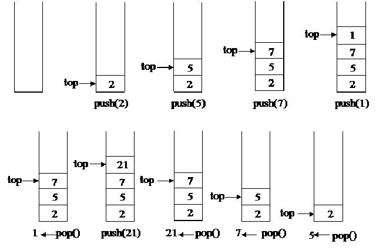

从前面的讨论中，我们现在知道栈有四种基本操作：

*   **入栈**：在栈顶添加一个项目。
*   **出栈**：移除栈顶的项目。
*   **栈顶**：返回栈顶的项目。它与出栈不同，因为它不移除项目，只是为我们获取值。
*   **isEmpty**：检查栈是否为空。

现在让我们使用 PHP 实现栈，但采用不同的方式。首先，我们将尝试使用 PHP 的内置数组函数来实现栈。然后我们将研究如何在不使用 PHP 内置函数的情况下构建栈，而是使用其他数据结构，例如链表。

## 读累了记得休息一会哦~

**公众号：古德猫宁李**

*   电子书搜索下载
*   书单分享
*   书友学习交流

**网站：**[沉金书屋 https://www.chenjin5.com](https://www.chenjin5.com)

*   电子书搜索下载
*   电子书打包资源分享
*   学习资源分享

## 使用 PHP 数组实现栈

首先，我们将为栈创建一个接口，以便我们可以在不同的实现中使用它，并确保所有实现彼此间具有一定的相似性。让我们编写一个简单的栈接口：

```php
interface Stack {

    public function push(string $item);

    public function pop();

    public function top();

    public function isEmpty();

}
```


正如我们从前面的接口中看到的，我们将所有栈函数都放在接口内，因为实现它的类必须拥有所有这些提到的函数，否则运行时会抛出致命错误。既然我们要使用 PHP 数组实现栈，我们将使用一些现有的 PHP 函数来进行入栈、出栈和栈顶操作。我们将以这样的方式实现栈，使我们可以定义栈的大小。如果数组中没有项目而我们仍想出栈，它将抛出下溢异常；如果我们尝试压入超过其容量允许的项目，则会抛出上溢异常。以下是使用数组实现栈的代码：

```
class Books implements Stack {

    private $limit;
    private $stack;

    public function __construct(int $limit = 20) {
        $this->limit = $limit;
        $this->stack = [];
    }

    public function pop(): string {

        if ($this->isEmpty()) {
            throw new UnderflowException('Stack is empty');
        } else {
            return array_pop($this->stack);
        }

    }

    public function push(string $newItem) {

        if (count($this->stack) < $this->limit) {
            array_push($this->stack, $newItem);
        } else {
            throw new OverflowException('Stack is full');
        }

    }

    public function top(): string {
        return end($this->stack);
    }

    public function isEmpty(): bool {
        return empty($this->stack);
    }

}
```

现在让我们梳理一下我们为栈编写的代码。我们将栈实现命名为 `Books`，但只要是有效的类名，我们可以随意命名。首先，我们使用 `__construct()` 方法构造栈，并提供一个选项来限制我们可以在栈中存储的项目数量。默认值设为 `20`。下一个方法定义出栈操作：

```
public function pop(): string {

    if ($this->isEmpty()) {
        throw new UnderflowException('Stack is empty');
    } else {
        return array_pop($this->stack);
    }

}
```

如果栈不为空，`pop` 方法将返回一个字符串。我们使用栈类中定义的 `isEmpty()` 方法为此目的。如果栈为空，我们从 SPL 抛出一个 `UnderflowException`。如果没有项目可弹出，我们可以阻止该操作发生。如果栈不为空，我们使用 PHP 的 `array_pop()` 函数从数组返回最后一个项目。

在 `push()` 方法中，我们执行与 `pop()` 相反的操作。首先，我们检查栈是否已满。如果未满，我们使用 PHP 的 `array_push()` 函数将字符串 `item` 添加到栈的末尾。如果栈已满，我们抛出 SPL 的 `OverflowException`。`top()` 方法返回栈顶元素。`isEmpty()` 方法检查栈是否为空。

由于我们遵循 PHP 7 标准，因此在方法层面使用了标量类型声明和返回类型声明。

为了使用我们刚刚实现的栈类，我们需要构思一个可以使用所有这些操作的示例。让我们编写一个小程序来创建一个书籍栈。代码如下：

```
try { 

    $programmingBooks = new Books(10); 

    $programmingBooks->push("Introduction to PHP7"); 

    $programmingBooks->push("Mastering JavaScript"); 

    $programmingBooks->push("MySQL Workbench tutorial"); 

    echo $programmingBooks->pop()."\n"; 

    echo $programmingBooks->top()."\n"; 

} catch (Exception $e) { 

    echo $e->getMessage(); 

}
```

我们创建了一个书籍栈实例，用于存放编程书籍标题。我们执行了三次 `push()` 操作。最后插入的书名是 `"MySQL Workbench tutorial"`。如果在三次 `push()` 操作后执行 `pop()`，将返回该书名。之后，`top()` 将返回 `"Mastering JavaScript"`，它在执行 `pop()` 操作后成为新的栈顶元素。我们将整段代码包裹在 `try...catch` 块中，以便处理溢出和下溢抛出的异常。上述代码将产生以下输出：

```
MySQL Workbench tutorial

Mastering JavaScript
```

现在让我们关注刚才完成的各种栈操作的复杂度。

### 理解栈操作的复杂度

以下是不同栈操作的时间复杂度。在最坏情况下，栈操作的时间复杂度如下：

| 操作 | 时间复杂度 |
| --- | --- |
| pop | `O(1)` |
| push | `O(1)` |
| top | `O(1)` |
| isEmpty | `O(1)` |

由于栈始终在一端操作并记录栈顶位置，如果我们想在栈中搜索某个项目，意味着必须遍历整个列表。访问栈中的特定项目也是同理。虽然不建议将栈用于此类操作，但如果必须这样做，必须记住其时间复杂度高于常规栈操作。

| 操作 | 时间复杂度 |
| --- | --- |
| 访问 | `O(n)` |
| 搜索 | `O(n)` |

栈的空间复杂度始终为 `O(n)`。

到目前为止，我们已经了解了如何使用 PHP 数组及其内置函数 `array_pop()` 和 `array_push()` 实现栈。但我们也可以忽略内置函数，使用手动数组操作实现，或者使用 `array_shift()` 和 `array_unshift()` 内置函数。

### 使用链表实现栈

在 第 3 章 *使用链表* 中，我们学习了如何实现链表。我们了解到在链表中可以在末尾插入节点、从末尾移除节点、在列表中间插入、在开头插入等。如果考虑单链表数据结构的“在末尾插入”和“在末尾移除”操作，我们可以轻松实现类似栈的功能。因此，让我们使用上一章的 `LinkedList` 类来实现栈。代码如下：

```
class BookList implements Stack { 


    private $stack; 


    public function __construct() { 

      $this->stack = new LinkedList(); 

    }


    public function pop(): string { 


      if ($this->isEmpty()) { 

          throw new UnderflowException('Stack is empty'); 

      } else { 

          $lastItem = $this->top(); 

          $this->stack->deleteLast(); 

          return $lastItem; 

      } 

    } 


    public function push(string $newItem) { 


      $this->stack->insert($newItem); 

    } 


public function top(): string { 

  return $this->stack->getNthNode($this->stack->getSize())->data; 

} 


    public function isEmpty(): bool { 

      return $this->stack->getSize() == 0; 

    } 

}
```

让我们逐块分析代码以理解其工作原理。从顶部开始，我们可以看到在 `__construct()` 方法中，我们创建了一个新的 `LinkedList` 对象并将其赋值给 `stack` 属性，而不是像前一个示例那样使用数组。我们假设 `LinkedList` 类已自动加载，或文件已包含在脚本中。现在让我们关注 `push()` 操作。`push()` 操作非常简单。我们只需在链表中插入一个新节点。由于链表没有大小限制，我们这里不检查溢出。

在我们的链表实现中，没有显示最后一个节点的方法。我们曾插入新的最后节点并移除之前的最后一个节点，但在这里，我们需要在不删除的情况下获取最后一个节点的值。为了实现该功能（即栈的 `top()` 操作），我们可以利用 `LinkedList` 实现中的 `getNthNode()` 方法和 `getSize()` 方法。这样我们可以获取节点。但必须记住一点：我们需要的是节点的字符串值，而不是完整的节点对象。这就是为什么我们返回节点的 `data` 属性。

与 `top()` 操作类似，`pop()` 操作也需要在从列表中移除最后一个节点之前返回其数据。为了实现这一点，我们使用 `LinkedList` 类的 `top()` 方法和 `deleteLast()` 方法。现在让我们运行一个示例代码，使用这个新实现的 `BookList` 类进行栈操作。代码如下：

```
try { 

    $programmingBooks = new BookList(); 

    $programmingBooks->push("Introduction to PHP7"); 

    $programmingBooks->push("Mastering JavaScript"); 

    $programmingBooks->push("MySQL Workbench tutorial"); 

    echo $programmingBooks->pop()."\n"; 

    echo $programmingBooks->pop()."\n"; 

    echo $programmingBooks->top()."\n"; 

} catch (Exception $e) { 

    echo $e->getMessage(); 

}
```

这看起来与上一个运行的示例非常相似，但这里我们尝试执行两次 `pop()` 操作，然后执行一次 `top()` 操作。因此输出将如下所示：

```
MySQL Workbench tutorial

Mastering JavaScript

Introduction to PHP7
```

如果我们了解栈的基本行为及其实现方式，就可以使用数组、链表、双向链表来实现栈。既然我们已经看过数组和链表的实现，现在将探索 SPL 对栈的实现，它实际上使用了双向链表。

### 使用 SPL 中的 SplStack 类

如果我们不想自己实现栈，可以使用 SPL 现有的栈实现。它非常易用，只需编写极少的代码。正如我们所知，`SplStack` 使用 `SplDoublyLinkedList`。它拥有 `push()`、`pop()`、向前移动、向后移动、`shift()`、`unshift()` 等所有可能的操作。为了实现我们之前看到的相同示例，我们只需编写以下代码：

```
$books = new SplStack(); 

$books->push("Introduction to PHP7"); 

$books->push("Mastering JavaScript"); 

$books->push("MySQL Workbench tutorial"); 

echo $books->pop() . "\n"; 

echo $books->top() . "\n"; 
```

是的，使用 `SplStack` 类构建栈就是这么简单。由我们决定是使用 PHP 数组、链表，还是像 `SplStack` 这样的内置类来实现。

### 栈的实际应用

## 栈在现代开发中的应用

栈在现代应用程序中有许多用途。无论是在浏览器历史记录中，还是在流行的开发术语“堆栈跟踪”中，栈无处不在。现在我们将尝试使用栈来解决一个实际问题。

### 嵌套括号匹配

当我们求解数学表达式时，首先需要考虑的是嵌套括号的正确性。如果括号嵌套不当，则可能无法计算，或者计算结果可能是错误的。让我们看一些例子：

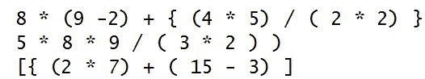

从前面的表达式来看，只有第一个是正确的；其他两个是不正确的，因为括号没有正确嵌套。为了判断括号是否正确嵌套，我们可以使用栈来实现解决方案。以下是实现的伪代码算法：

```
valid = true 

s = empty stack 

for (each character of the string) { 

   if(character = ( or { or [ ) 

       s.push(character) 

  else if (character = ) or } or ] ) { 

   if(s is empty) 

valid = false 


     last = s.pop() 

    if(last is not opening parentheses of character)  

         valid = false 

  } 

} 

if(s is not empty) 

valid = false
```

如果我们查看伪代码，它看起来非常简单。目标是忽略字符串中的任何数字、操作数或空格，仅考虑括号、花括号和方括号。如果它们是左括号，我们将其压入栈中。如果它们是右括号，我们将从栈中弹出元素。如果弹出的括号不是我们试图匹配的左括号，则无效。循环结束时，如果字符串有效，栈应为空。但如果栈不为空，则存在多余的括号，因此字符串无效。现在让我们将其转换为程序：

```
function expressionChecker(string $expression): bool { 

    $valid = TRUE; 

    $stack = new SplStack(); 


    for ($i = 0; $i < strlen($expression); $i++) { 

    $char = substr($expression, $i, 1); 


    switch ($char) { 

      case '(': 

      case '{': 

      case '[': 

      $stack->push($char); 

      break; 


      case ')': 

      case '}': 

      case ']': 

      if ($stack->isEmpty()) { 

          $valid = FALSE; 

      } else { 

        $last = $stack->pop(); 

        if (($char == ")" && $last != "(")  

          || ($char == "}" && $last != "{")  

          || ($char == "]" && $last != "[")) { 


      $valid = FALSE; 

        } 

    } 

    break; 

  } 


  if (!$valid) 

      break; 

    } 


    if (!$stack->isEmpty()) { 

    $valid = FALSE; 

    } 


    return $valid; 

}
```

现在让我们运行前面讨论的三个例子：

```
$expressions = []; 

$expressions[] = "8 * (9 -2) + { (4 * 5) / ( 2 * 2) }"; 

$expressions[] = "5 * 8 * 9 / ( 3 * 2 ) )"; 

$expressions[] = "[{ (2 * 7) + ( 15 - 3) ]"; 


foreach ($expressions as $expression) { 

    $valid = expressionChecker($expression); 


    if ($valid) { 

    echo "Expression is valid \n"; 

    } else { 

    echo "Expression is not valid \n"; 

    } 

} 
```

这将产生以下输出，这正是我们想要的：

```
Expression is valid


Expression is not valid


Expression is not valid
```

## 理解队列

队列是另一种特殊的线性数据结构，遵循**先进先出**（**FIFO**）原则。操作有两端：一端用于向队列添加元素，另一端用于从队列移除元素。这与栈不同，栈使用同一端进行添加和移除操作。插入总是在后端或尾部进行。元素的移除将从前端进行。向队列添加新元素的过程称为 `enqueue`，移除元素的过程称为 `dequeue`。在不移除元素的情况下查看队列前端元素的过程称为 `peek`，类似于栈的 `top()` 操作。下图描绘了队列的表示：


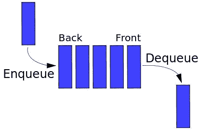

现在，如果我们为队列定义一个接口，它将如下所示：

```php
interface Queue {
    public function enqueue(string $item);
    public function dequeue();
    public function peek();
    public function isEmpty();
}
```

现在我们可以使用不同的方法来实现队列，就像我们对栈所做的那样。首先，我们将使用 PHP 数组实现队列，然后是 `LinkedList`，最后是 `SplQueue`。

### 使用 PHP 数组实现队列

我们现在将使用 PHP 数组实现队列数据结构。我们已经看到，可以使用 `array_push()` 函数在数组末尾添加元素。为了移除数组的第一个元素，我们可以使用 PHP 的 `array_shift()` 函数，对于 peek 函数，我们可以使用 PHP 的 `current()` 函数。根据我们的讨论，代码如下所示：

```php
class AgentQueue implements Queue {
    private $limit;
    private $queue;

    public function __construct(int $limit = 20) {
        $this->limit = $limit;
        $this->queue = [];
    }

    public function dequeue(): string {
        if ($this->isEmpty()) {
            throw new UnderflowException('Queue is empty');
        } else {
            return array_shift($this->queue);
        }
    }

    public function enqueue(string $newItem) {
        if (count($this->queue) < $this->limit) {
            array_push($this->queue, $newItem);
        } else {
            throw new OverflowException('Queue is full');
        }
    }

    public function peek(): string {
        return current($this->queue);
    }

    public function isEmpty(): bool {
        return empty($this->queue);
    }
}
```

在这里，我们保持了与栈相同的原则。我们想要定义一个固定大小的队列，并进行溢出和下溢检查。为了运行队列实现，我们可以考虑将其用作呼叫中心应用程序的代理队列。以下是使用我们队列操作的代码：

```php
try {
    $agents = new AgentQueue(10);
    $agents->enqueue("Fred");
    $agents->enqueue("John");
    $agents->enqueue("Keith");
    $agents->enqueue("Adiyan");
    $agents->enqueue("Mikhael");
    echo $agents->dequeue()."\n";
    echo $agents->dequeue()."\n";
    echo $agents->peek()."\n";
} catch (Exception $e) {
    echo $e->getMessage();
}
```

这将产生以下输出：

```
Fred
John
Keith
```

### 使用链表实现队列

正如我们在栈实现中所做的那样，我们将使用第 3 章 *Using Linked Lists* 中的链表实现来实现队列。我们可以使用 `insert()` 方法确保始终在末尾插入。我们可以使用 `deleteFirst()` 进行 `dequeue` 操作，使用 `getNthNode()` 进行 `peek` 操作。以下是使用链表实现队列的示例实现：

```php
class AgentQueue implements Queue {
    private $limit;
    private $queue;

    public function __construct(int $limit = 20) {
        $this->limit = $limit;
        $this->queue = new LinkedList();
    }

    public function dequeue(): string {
        if ($this->isEmpty()) {
            throw new UnderflowException('Queue is empty');
        } else {
            $lastItem = $this->peek();
            $this->queue->deleteFirst();
            return $lastItem;
        }
    }

    public function enqueue(string $newItem) {
        if ($this->queue->getSize() < $this->limit) {
            $this->queue->insert($newItem);
        } else {
            throw new OverflowException('Queue is full');
        }
    }

    public function peek(): string {
        return $this->queue->getNthNode(1)->data;
    }

    public function isEmpty(): bool {
        return $this->queue->getSize() == 0;
    }
}
```

---

> 读累了记得休息一会哦~

**公众号：古德猫宁李**

*   电子书搜索下载
*   书单分享
*   书友学习交流

**网站：** [沉金书屋 https://www.chenjin5.com](https://www.chenjin5.com)

*   电子书搜索下载
*   电子书打包资源分享
*   学习资源分享

---

### 使用 SPL 的 SplQueue 类

如果我们不想花费精力实现队列功能，且对内置解决方案感到满意，可以使用 `SplQueue` 类满足基本的队列需求。需要注意一点：`SplQueue` 类中没有 `peek` 函数。我们必须使用 `bottom()` 函数来获取队列的第一个元素。以下是使用 `SplQueue` 实现 `AgentQueue` 的简单示例：

```php
$agents = new SplQueue();

$agents->enqueue("Fred");
$agents->enqueue("John");
$agents->enqueue("Keith");
$agents->enqueue("Adiyan");
$agents->enqueue("Mikhael");

echo $agents->dequeue()."\n";
echo $agents->dequeue()."\n";
echo $agents->bottom()."\n";
```

---

### 理解优先队列

优先队列是一种特殊的队列，元素的插入和移除基于其优先级。在编程领域，优先队列的用途非常广泛。例如，假设我们有一个大型的邮件队列系统，通过队列系统发送月度通讯。如果我们需要使用相同的队列功能向用户发送一封紧急邮件怎么办？由于普通队列的原则是在末尾添加元素，发送该消息的过程将会被严重延迟。为了解决这个问题，我们可以使用优先队列。在这种情况下，我们为每个节点分配一个优先级，并根据该优先级进行排序。优先级较高的元素会移至列表顶端，并优先出队。

构建优先队列主要有两种方法。

#### 有序序列

如果我们为优先队列规划有序序列，它可以是升序或降序。有序序列的优点是我们可以快速查找最大值或移除最大优先级元素，因为可以使用 `O(1)` 复杂度找到它。但插入将耗费更多时间，因为我们必须检查队列中的每个元素，以根据其优先级将元素放在正确的位置。

#### 无序序列

无序序列不要求我们遍历每个队列元素来放置新添加的元素。它始终按照普通队列的原则添加到后端。因此，我们可以用 `O(1)` 复杂度实现入队操作。但如果我们想查找或移除最高优先级元素，则必须遍历每个元素来找到正确的那个。因此，它不利于搜索。

现在我们将编写代码，使用链表实现基于有序序列的优先队列。

---

### 使用链表实现优先队列

到目前为止，我们看到的链表仅使用一个值，即节点数据。现在我们需要传递另一个值作为优先级。为了实现这一点，我们需要修改 `ListNode` 的实现：

```php
class ListNode {
    public $data = NULL;
    public $next = NULL;
    public $priority = NULL;

    public function __construct(string $data = NULL, int $priority = NULL) {
        $this->data = $data;
        $this->priority = $priority;
    }
}
```

现在节点同时包含数据和优先级。为了允许在插入操作期间考虑此优先级，我们还需要更改 `LinkedList` 类中 `insert()` 的实现。以下是修改后的实现：

```php
public function insert(string $data = NULL, int $priority = NULL) {
    $newNode = new ListNode($data, $priority);
    $this->_totalNode++;

    if ($this->_firstNode === NULL) {
        $this->_firstNode = &$newNode;
    } else {
        $previous = $this->_firstNode;
        $currentNode = $this->_firstNode;
        while ($currentNode !== NULL) {
            if ($currentNode->priority < $priority) {
                if ($currentNode == $this->_firstNode) {
                    $previous = $this->_firstNode;
                    $this->_firstNode = $newNode;
                    $newNode->next = $previous;
                    return;
                }
                $newNode->next = $currentNode;
                $previous->next = $newNode;
                return;
            }
            $previous = $currentNode;
            $currentNode = $currentNode->next;
        }
    }
    return TRUE;
}
```

正如我们所见，`insert` 方法已更改为在插入操作期间同时接收数据和优先级。像往常一样，第一步是创建一个新节点并增加节点计数。插入有三种可能性：

*   列表为空，因此新节点是第一个节点。
*   列表不为空，但新项目具有最高优先级，因此它成为第一个节点，之前的第一个节点跟随其后。
*   列表不为空且优先级不是最高，因此它在列表内部插入新节点，或者可能在列表末尾。

在我们的实现中，我们考虑了所有三种可能性。因此，最高优先级的项目始终位于列表开头。现在让我们使用这段新代码运行 `AgentQueue` 实现，如下例所示：

```php
try {
    $agents = new AgentQueue(10);
    $agents->enqueue("Fred", 1);
    $agents->enqueue("John", 2);
    $agents->enqueue("Keith", 3);
    $agents->enqueue("Adiyan", 4);
    $agents->enqueue("Mikhael", 2);
    $agents->display();
    echo $agents->dequeue()."\n";
    echo $agents->dequeue()."\n";
} catch (Exception $e) {
    echo $e->getMessage();
}
```

如果没有优先级，队列应该是 `Fred`、`John`、`Keith`、`Adiyan` 和 `Mikhael`。但由于我们给列表添加了优先级，输出结果为：

```
Adiyan
Keith
John
Mikhael
Fred
```

由于 `Adiyan` 具有最高优先级，它被放置在队列开头，尽管它是在第四位插入队列的。

---

### 使用 SplPriorityQueue 实现优先队列

PHP 已经通过 SPL 内置了对优先队列实现的支持。我们可以使用 `SplPriorityQueue` 类来实现优先队列。以下是使用链表的前一个示例，但这次我们选择 SPL：

```php
class MyPQ extends SplPriorityQueue {
    public function compare($priority1, $priority2) {
        return $priority1 <=> $priority2;
    }
}

$agents = new MyPQ();

$agents->insert("Fred", 1);
$agents->insert("John", 2);
$agents->insert("Keith", 3);
$agents->insert("Adiyan", 4);
$agents->insert("Mikhael", 2);

// 提取模式
$agents->setExtractFlags(MyPQ::EXTR_BOTH);

// 移至顶部
$agents->top();

while ($agents->valid()) {
    $current = $agents->current();
    echo $current['data'] . "\n";
    $agents->next();
}
```

这将产生与链表示例相同的结果。扩展我们自己的 `MyPQ` 类的额外优势在于，我们可以定义是按升序还是降序排序。在这里，我们选择降序，使用 PHP 组合比较运算符（即太空船运算符）进行排序。

大多数情况下，优先队列是使用堆实现的。当我们进入堆章节时，我们也将使用堆来实现优先队列。

---

### 实现循环队列

当我们使用标准队列时，每次出队一个项目，都必须重新缓冲整个队列。为了解决这个问题，我们可以使用循环队列，其中队尾后面跟着队头，形成一个圆圈。这种特殊类型的队列要求对入队和出队操作进行特殊计算，需考虑队尾、队头和队列的容量限制。循环队列始终是固定队列，也称为循环缓冲区或环形缓冲区。下图展示了循环队列的表示：

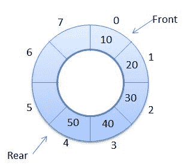

我们可以使用 PHP 数组实现循环队列。由于我们必须计算队尾和队头部分的位置，数组可用于此目的以实现高效操作。以下是一个循环队列的示例：


# 循环队列实现

```php
class CircularQueue implements Queue { 


    private $queue; 

    private $limit; 

    private $front = 0; 

    private $rear = 0; 


    public function __construct(int $limit = 5) { 

      $this->limit = $limit; 

      $this->queue = []; 

    } 


    public function size() { 

      if ($this->rear > $this->front) 

          return $this->rear - $this->front; 

      return $this->limit - $this->front + $this->rear; 

    } 


    public function isEmpty() { 

      return $this->rear == $this->front; 

    } 


    public function isFull() { 

      $diff = $this->rear - $this->front; 

      if ($diff == -1 || $diff == ($this->limit - 1)) 

          return true; 

      return false; 

    } 


    public function enqueue(string $item) { 

      if ($this->isFull()) { 

          throw new OverflowException("Queue is Full."); 

      } else { 

          $this->queue[$this->rear] = $item; 

          $this->rear = ($this->rear + 1) % $this->limit; 

      } 

    } 


    public function dequeue() { 

      $item = ""; 

      if ($this->isEmpty()) { 

          throw new UnderflowException("Queue is empty"); 

      } else { 

          $item = $this->queue[$this->front]; 

          $this->queue[$this->front] = NULL; 

          $this->front = ($this->front + 1) % $this->limit; 

      } 

      return $item; 

    } 


    public function peek() { 

      return $this->queue[$this->front]; 

    }


}
```

由于我们将 `0` 视为队头标记，因此队列的总大小将为 `limit - 1`。

# 创建双端队列

到目前为止，我们实现的队列都是一端用于入队（称为队尾），另一端用于出队（称为队头）。因此，通常每一端都应用于特定目的。但如果我们需要从两端进行入队和出队操作怎么办？这可以通过双端队列的概念来实现。在双端队列中，两端都可用于入队和出队操作。如果我们查看基于链表的队列实现，会发现我们可以使用链表实现进行尾部插入、头部插入、尾部删除和头部删除。如果我们基于此实现一个新的双端队列类，就能轻松达成目标。下图描绘了一个双端队列：

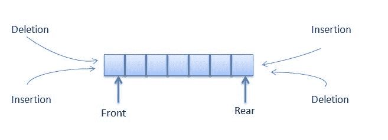

以下是双端队列的实现：

```php
class DeQueue { 


    private $limit; 

    private $queue; 


    public function __construct(int $limit = 20) { 

      $this->limit = $limit; 

      $this->queue = new LinkedList(); 

    } 


    public function dequeueFromFront(): string { 


      if ($this->isEmpty()) { 

          throw new UnderflowException('Queue is empty'); 

      } else { 

          $lastItem = $this->peekFront(); 

          $this->queue->deleteFirst(); 

          return $lastItem; 

      } 

    } 


    public function dequeueFromBack(): string { 


      if ($this->isEmpty()) { 

          throw new UnderflowException('Queue is empty'); 

      } else { 

          $lastItem = $this->peekBack(); 

          $this->queue->deleteLast(); 

          return $lastItem; 

      } 

    } 


    public function enqueueAtBack(string $newItem) { 


      if ($this->queue->getSize() < $this->limit) { 

          $this->queue->insert($newItem); 

      } else { 

          throw new OverflowException('Queue is full'); 

      } 

    } 


    public function enqueueAtFront(string $newItem) { 


      if ($this->queue->getSize() < $this->limit) { 

          $this->queue->insertAtFirst($newItem); 

      } else { 

          throw new OverflowException('Queue is full'); 

      } 

    } 


    public function peekFront(): string { 

      return $this->queue->getNthNode(1)->data; 

    } 


    public function peekBack(): string { 

      return $this->queue->getNthNode($this->queue->getSize())->data; 

    } 


    public function isEmpty(): bool { 

      return $this->queue->getSize() == 0; 

    } 


}
```

现在我们将使用这个类来检查双端队列的操作：

```php
try { 

    $agents = new DeQueue(10); 

    $agents->enqueueAtFront("Fred"); 

    $agents->enqueueAtFront("John"); 

    $agents->enqueueAtBack("Keith"); 

    $agents->enqueueAtBack("Adiyan"); 

    $agents->enqueueAtFront("Mikhael"); 

    echo $agents->dequeueFromBack() . "\n"; 

    $agents->dequeueFromFront() . "\n"; 

    echo $agents->peekFront() . "\n"; 

} catch (Exception $e) { 

    echo $e->getMessage(); 

}
```

如果我们查看前面的代码示例，首先我们在队头添加 `Fred`，然后再次在队头添加 `John`。所以序列现在是 `John`、`Fred`。接着我们在队尾添加 `Keith`，随后在队尾添加 `Adiyan`。现在序列变为 `John`、`Fred`、`Keith`、`Adiyan`。最后，我们在开头添加 `Mikhael`。所以最终序列是 `Mikhael`、`John`、`Fred`、`Keith`、`Adiyan`。

由于我们首先执行从队尾出队操作，`Adiyan` 将最先出队，然后从队头出队 `Mikhael`。新的队头 peek 将是 `John`。运行代码时的输出如下：

```
Adiyan


Mikhael


John
```

# 总结

栈和队列是最常用的数据结构之一。在未来的算法和数据结构中，我们可以以不同方式使用这些抽象数据类型。在本章中，我们学习了实现栈和队列的不同方法，以及不同类型的队列。在下一章中，我们将讨论递归——一种通过将大问题分解为较小实例来解决的特殊方法。

---

## 读累了记得休息一会哦~

**公众号：古德猫宁李**

*   电子书搜索下载
*   书单分享
*   书友学习交流

**网站：** [沉金书屋 https://www.chenjin5.com](https://www.chenjin5.com)

*   电子书搜索下载
*   电子书打包资源分享
*   学习资源分享

# 应用递归算法 - 递归

解决复杂问题总是很难。即使对于程序员来说，解决复杂问题也可能更棘手，有时需要特殊的解决方案。递归就是这样一种计算机程序员遵循的特殊方法，用于解决复杂问题。在本章中，我们将介绍递归的定义、属性、不同类型的递归以及大量示例。递归不是一个新概念；在自然界中，我们看到许多递归元素。分形展示了递归行为。下图展示了自然界中的递归：


# 理解递归

## 递归

递归是一种通过将大问题分解为小问题来解决的方法。换句话说，递归是将大问题分解为更小的相似问题来解决它们并获得实际结果。通常，递归被称为函数调用自身。这听起来可能很奇怪，但事实是当处于递归中时，函数必须调用自身。这看起来像什么？让我们看一个例子。

在数学中，“阶乘”一词非常常见。数字 `N` 的阶乘定义为所有小于等于 `N` 的正整数的乘积。它总是用 `!`（感叹号）表示。因此，`5` 的阶乘可以写成如下形式：

`5! = 5 X 4 X 3 X 2 X 1`

同样，我们可以写出给定数字的以下阶乘：

`4! = 4 X 3 X 2 X 1`

`3! = 3 X 2 X 1`

`2! = 2 X 1`

`1! = 1`

如果我们仔细观察我们的例子，可以看到我们可以用 `4` 的阶乘来表示 `5` 的阶乘，如下所示：

`5! = 5 X 4!`

同样，我们可以写成：

`4! = 4 X 3!`

`3! = 3 X 2!`

`2! = 2 X 1!`

`1! = 1 X 0!`

`0! = 1`

或者，我们可以简单地用通用术语说：

`n! = n * (n-1)!`

这代表了递归。我们将每个步骤分解为更小的步骤并解决实际的大问题。这是一张展示如何计算 3 的阶乘的图片：

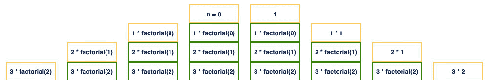

因此，步骤如下：

1. `3! = 3 X 2!`
2. `2! = 2 X 1!`
3. `1! = 1 X 0!`
4. `0! = 1`
5. `1! = 1 X 1 = 1`
6. `2! = 2 X 1 = 2`
7. `3! = 3 X 2 = 6`

### 递归算法的特性

现在，问题可能是，“如果一个函数调用自身，那么它如何停止或知道何时结束递归调用？”当我们编写递归解决方案时，必须确保它具有以下特性：

1. 每次递归调用都应该针对一个更小的子问题。就像阶乘示例，6 的阶乘通过 6 和 5 的阶乘的乘积来求解，依此类推。
2. 它必须有一个基本情况。当达到基本情况时，将不再有进一步的递归，并且基本情况必须能够在没有任何进一步递归调用的情况下解决问题。在我们的阶乘示例中，我们没有从 0 继续向下。所以，在这种情况下，0 是我们的基本情况。
3. 不应该有任何循环。如果每次递归调用都调用同一个问题，那么将会有一个无休止的循环。经过一些重复后，计算机将显示栈溢出错误。

所以，如果我们现在使用 PHP 7 编写阶乘程序，它将如下所示：

```php
function factorial(int $n): int {

   if ($n == 0)

    return 1;


   return $n * factorial($n - 1);

}
```

在前面的示例代码中，我们可以看到有一个基本条件，当 `$n` 的值为 `0` 时返回 `1`。如果不满足此条件，则返回 `$n` 和 `$n-1` 的阶乘的乘积。因此，它同时满足了第 1 点和第 3 点的特性。我们避免了循环，并确保每次递归调用都在创建一个更大问题的子问题。我们将像这个算法一样编写递归行为：

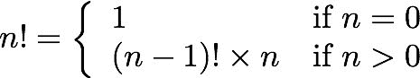

### 递归与迭代算法

如果我们分析我们的阶乘函数，可以看到它可以使用简单的迭代方法配合 `for` 或 `while` 循环来编写，如下所示：

```php
function factorial(int $n): int { 

    $result = 1; 


    for ($i = $n; $i > 0; $i--) {

      $result *= $i; 

    } 


    return $result; 

}
```

如果这可以写成一个简单的迭代版本，那为什么我们要使用递归？递归用于解决更复杂的问题。并非所有问题都能如此轻松地用迭代解决。例如，我们需要显示某个目录中的所有文件。我们可以简单地通过运行循环来列出所有文件来实现。但是，如果里面还有另一个目录怎么办？然后，我们必须运行另一个循环来获取该目录中的所有文件。如果那个目录里还有另一个目录，并且一直这样下去怎么办？在这种情况下，迭代方法可能完全无济于事，或者可能产生一个复杂的解决方案。最好在这里选择递归方法。

递归管理一个调用栈来管理函数调用。因此，与迭代相比，递归将占用更多内存和时间来完成。此外，在迭代中，每一步我们都可以得到一个结果，但对于递归，我们必须等到基本情况执行才能得到任何结果。如果我们同时考虑阶乘的迭代和递归示例，可以看到有一个名为 `$result` 的局部变量来存储每一步的计算。然而，在递归中，不需要局部变量或赋值。

### 使用递归实现斐波那契数列

在数学中，斐波那契数是特殊的整数序列，其中一个数由前两个数的和组成，如以下表达式所示：

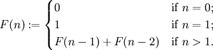

如果我们使用 PHP 7 实现这一点，它将如下所示：

```php
function fibonacci(int $n): int { 

    if ($n == 0) { 

    return 1; 

    } else if ($n == 1) { 

    return 1; 

    } else { 

    return fibonacci($n - 1) + fibonacci($n - 2); 

    } 

}
```

如果我们考虑前面的实现，可以看到它与之前的示例略有不同。现在，我们从一个函数调用中调用两个函数。我们将很快讨论不同类型的递归。

### 使用递归实现最大公约数计算

递归的另一个常见用途是实现两个数的**最大公约数**（**GCD**）。在最大公约数计算中，我们将继续直到余数变为 0。它可以表示如下：

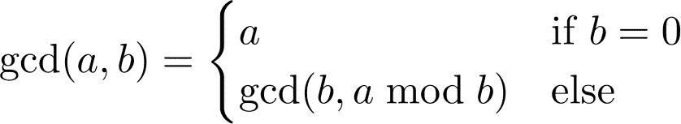

现在，如果我们使用 PHP 7 递归实现，它将如下所示：

```php
function gcd(int $a, int $b): int { 

    if ($b == 0) { 

     return $a; 

    } else { 

     return gcd($b, $a % $b); 

    } 

}
```

这个实现另一个有趣的部分是，与阶乘不同，我们不是从基本情况返回到调用栈中的其他步骤。基本情况将返回计算出的值。这是进行递归的优化方法之一。

### 不同类型的递归

到目前为止，我们已经看到了一些递归的示例情况以及它是如何被使用的。虽然术语说是递归，但有不同类型的递归。我们将逐一探索它们。

#### 线性递归

编程世界中最常用的递归之一是线性递归。当函数在每次运行中调用自身一次时，我们称之为线性递归。就像我们的阶乘示例，当我们将大计算分解为更小的计算直到达到基本条件时，我们称之为“递推”（winding）。当我们从基本条件返回到第一次递归调用时，我们称之为“回归”（unwinding）。我们将在本章即将到来的部分中处理不同的线性递归。

#### 二叉递归

在二叉递归中，函数在每次运行中调用自身两次。因此，计算取决于来自两个不同的对自身的递归调用的两个结果。如果我们看看我们的斐波那契数列生成递归函数，可以很容易地发现它是二叉递归。除此之外，编程世界中还有许多常用的二叉递归，例如二分查找、分治法、归并排序等。下图展示了二叉递归：

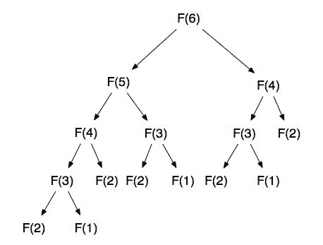

---

## 读累了记得休息一会哦~

**公众号：古德猫宁李**

* 电子书搜索下载
* 书单分享
* 书友学习交流


**网站：** [沉金书屋 https://www.chenjin5.com](https://www.chenjin5.com)

* 电子书搜索下载
* 电子书打包资源分享
* 学习资源分享

### 尾递归

当递归方法在返回时没有待执行的挂起操作时，该方法即为尾递归。例如，在我们的阶乘代码中，返回值被用来与前一个值相乘以计算阶乘。因此，这不是尾递归。斐波那契数列的递归也是同理。如果我们观察最大公约数（GCD）的递归，会发现返回后没有任何操作需要执行。因此，最终的返回或基准情况的返回实际上就是答案。所以，GCD 是尾递归的一个例子。尾递归也是线性递归的一种形式。

### 相互递归

可能会出现这样一种情况：我们需要以交替的方式从两个不同的方法中递归调用另外两个不同的方法。例如，函数 `A()` 调用函数 `B()`，而函数 `B()` 在每次调用中又调用函数 `A()`。这被称为相互递归。

### 嵌套递归

当一个递归函数调用将其自身作为参数时，称为嵌套递归。嵌套递归的一个常见例子是阿克曼函数。请看下面的方程：

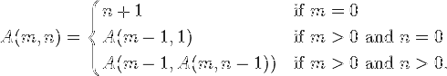

如果我们看最后一行，可以看到函数 `A()` 被递归调用，但第二个参数本身又是另一个递归调用。所以，这是嵌套递归的一个例子。

虽然有不同类型的递归可用，但我们将仅根据需求使用那些必需的类型。现在，我们将在项目中看到一些递归的实际用例。

### 使用递归构建 N 级分类树

构建多级嵌套分类树或菜向来是个难题。许多 CMS 和网站只允许特定层级的嵌套。为了避免因多次连接查询导致的性能问题，有些系统最多只允许 3-4 层嵌套。现在，我们将探讨如何在不牺牲性能的前提下，借助递归创建 N 级嵌套分类树或菜单。以下是我们的解决方案思路：

1. 我们将在数据库中定义分类的表结构。
2. 我们将不使用任何连接查询或多次查询，一次性获取表中的所有分类。这将是一个带有简单 select 语句的单次数据库查询。
3. 我们将构建一个分类数组，以便利用递归来显示嵌套分类或菜单。

假设我们在数据库中有一个用于存储分类的简单表结构，如下所示：

```sql
CREATE TABLE `categories` ( 
  `id` int(11) NOT NULL, 
  `categoryName` varchar(100) NOT NULL, 
  `parentCategory` int(11) DEFAULT 0, 
  `sortInd` int(11) NOT NULL 
) ENGINE=InnoDB DEFAULT CHARSET=utf8;
```

为简单起见，我们假设表中不需要其他字段。此外，表中有如下数据：

| **Id** | **categoryName** | **parentCategory** | **sortInd** |
| --- | --- | --- | --- |
| 1 | First | 0 | 0 |
| 2 | Second | 1 | 0 |
| 3 | Third | 1 | 1 |
| 4 | Fourth | 3 | 0 |
| 5 | Fifth | 4 | 0 |
| 6 | Sixth | 5 | 0 |
| 7 | Seventh | 6 | 0 |
| 8 | Eight | 7 | 0 |
| 9 | Ninth | 1 | 0 |
| 10 | Tenth | 2 | 1 |

现在，我们已经为数据库创建了表结构，并假设也已录入了一些示例数据。让我们构建一个查询来检索这些数据，以便进行递归解决方案：

```php
$dsn = "mysql:host=127.0.0.1;port=3306;dbname=packt;"; 
$username = "root"; 
$password = ""; 
$dbh = new PDO($dsn, $username, $password); 

$result = $dbh->query("Select * from categories order by parentCategory asc, sortInd asc", PDO::FETCH_OBJ); 

$categories = []; 

foreach($result as $row) { 
    $categories[$row->parentCategory][] = $row;
}
```

上述代码的核心部分在于我们如何将分类存储在数组中。我们根据父分类存储结果。这将帮助我们递归地显示某个分类的子分类。这看起来非常简单。现在，基于分类数组，让我们编写递归函数以分层方式显示分类：

```php
function showCategoryTree(Array $categories, int $n) {
    if(isset($categories[$n])) { 
        foreach($categories[$n] as $category) {        
            echo str_repeat("-", $n)."".$category->categoryName."\n"; 
            showCategoryTree($categories, $category->id);          
        }
    }
    return;
}
```

上述代码实际上通过递归显示所有分类及其子分类。我们获取一个层级，首先打印该层级的分类。紧接着，我们通过代码 `showCategoryTree($categories, $category->id)` 检查它是否有任何子层级分类。现在，如果我们用根层级（第 0 层）调用递归函数，将得到以下输出：

```php
showCategoryTree($categories, 0);
```

其输出如下：

```
First
-Second
--Tenth
-Third
---Fourth
----fifth
-----Sixth
------seventh
-------Eighth
-Nineth
```

正如我们所见，无需考虑分类层级的深度或执行多次查询，仅凭一个简单的查询和递归函数，我们就能构建嵌套分类或菜单。如果我们想要带有动态显示/隐藏功能的嵌套菜单，可以使用 `<ul>` 和 `<li>` 来创建。这对于在不陷入实现障碍（如固定层级的连接或固定层级的分类）的情况下获得高效解决方案至关重要。前面的例子完美展示了尾递归，我们不需要等待递归返回任何内容，随着递归的推进，结果已经显示出来了。

### 构建嵌套评论回复系统

我们经常面临如何妥善显示评论回复的挑战。按时间顺序显示有时并不符合需求。我们可能需要以一种方式显示它们，使每条评论的回复位于该评论本身的下方。换句话说，我们需要一个嵌套评论回复系统或线程式评论。我们想要构建类似于下面截图的东西：

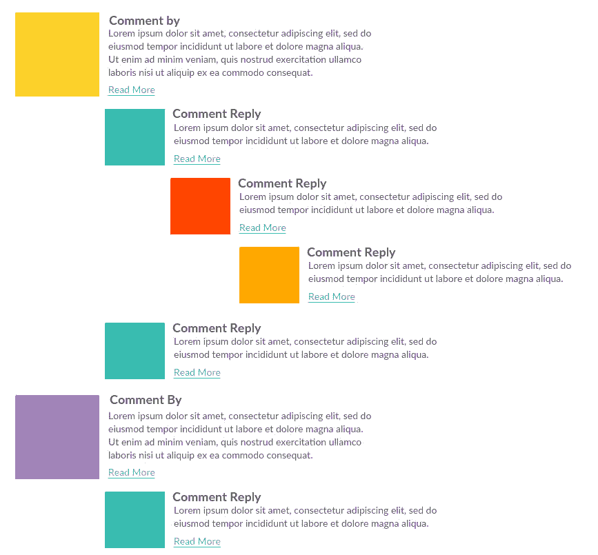

我们可以遵循嵌套分类部分的相同步骤。不过，这次我们将加入一些 UI 元素使其外观更逼真。假设我们有一个名为 `comments` 的表，包含以下数据和列。为简单起见，我们不涉及多表关系。我们假设用户名与评论存储在同一张表中：

| **Id** | **comments** | **username** | **Datetime** | **parentID** | **postID** |
| --- | --- | --- | --- | --- | --- |
| 1 | First comment | Mizan | 2016-10-01 15:10:20 | 0 | 1 |
| 2 | First reply | Adiyan | 2016-10-02 04:09:10 | 1 | 1 |
| 3 | Reply of first reply | Mikhael | 2016-10-03 11:10:47 | 2 | 1 |
| 4 | Reply of reply of first reply | Arshad | 2016-10-04 21:22:45 | 3 | 1 |
| 5 | Reply of reply of reply of first reply | Anam | 2016-10-05 12:01:29 | 4 | 1 |
| 6 | Second comment | Keith | 2016-10-01 15:10:20 | 0 | 1 |
| 7 | First comment of second post | Milon | 2016-10-02 04:09:10 | 0 | 2 |
| 8 | Third comment | Ikrum | 2016-10-03 11:10:47 | 0 | 1 |
| 9 | Second comment of second post | Ahmed | 2016-10-04 21:22:45 | 0 | 2 |
| 10 | Reply of second comment of second post | Afsar | 2016-10-18 05:18:24 | 9 | 2 |

现在让我们编写一个预处理语句来获取某篇文章的所有评论。然后，我们可以构建一个类似于嵌套分类的数组：

```php
$sql = "Select * from comments where postID = :postID order by parentID asc, datetime asc"; 
$stmt = $dbh->prepare($sql, array(PDO::ATTR_CURSOR => PDO::CURSOR_FWDONLY)); 
$stmt->setFetchMode(PDO::FETCH_OBJ); 
$stmt->execute(array(':postID' => 1)); 
$result = $stmt->fetchAll(); 

$comments = []; 

foreach ($result as $row) { 
    $comments[$row->parentID][] = $row;
}
```

现在我们有了数组及其中所有必需的数据；现在可以编写一个递归调用的函数，以正确的缩进显示评论：

```php
function displayComment(array $comments, int $n) {
    if (isset($comments[$n])) {
        $str = "<ul>";
        foreach ($comments[$n] as $comment) {
            $str .= "<li><div class='comment'><span class='pic'>{$comment->username}</span>";
            $str .= "<span class='datetime'>{$comment->datetime}</span>";
            $str .= "<span class='commenttext'>{$comment->comment}</span></div>";
            $str .= displayComment($comments, $comment->id);
            $str .= "</li>";
        }
        $str .= "</ul>";
        return $str;
    }
    return "";
}

echo displayComment($comments, 0);
```

由于我们在 PHP 代码中添加了一些 HTML 元素，因此需要一些基础 CSS 使其生效。以下是我们编写的 CSS 代码，旨在实现简洁的设计。没有花哨的效果，纯 CSS 用于创建层叠效果以及评论各部分的基础样式：

```css
ul {
    list-style: none;
    clear: both;
}

li ul {
    margin: 0 0 0 50px;
}

.pic {
    display: block;
    width: 50px;
    height: 50px;
    float: left;
    color: #000;
    background: #ADDFEE;
    padding: 15px 10px;
    text-align: center;
    margin-right: 20px;
}

.comment {
    float: left;
    clear: both;
    margin: 20px;
    width: 500px;
}

.datetime {
    clear: right;
    width: 400px;
    margin-bottom: 10px;
    float: left;
}
```

如前所述，我们这里不追求复杂，只求响应式、设备友好等。我们假设你可以毫无问题地将该逻辑集成到应用程序的不同部分中。

以下是数据和前述代码生成的输出：

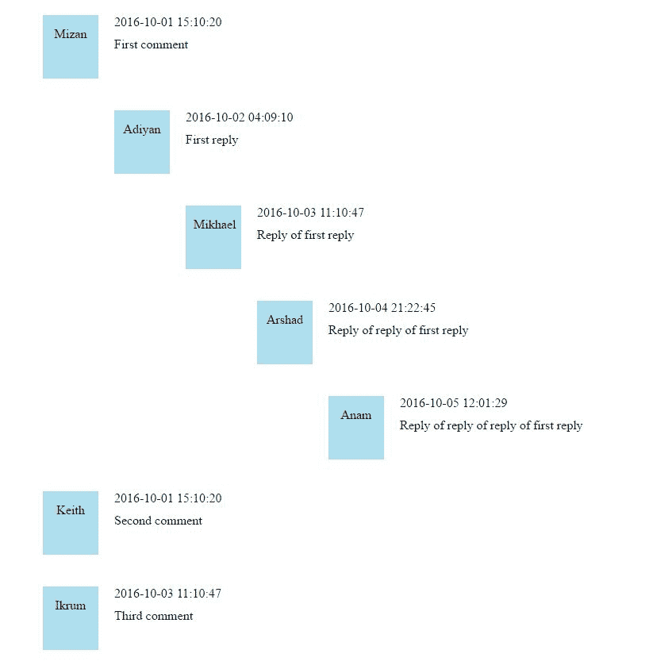

从前述两个示例可以看出，创建嵌套内容非常容易，无需多次查询，也无连接语句嵌套层数的限制。甚至不需要自连接即可生成嵌套数据。

### 使用递归查找文件和目录

我们经常需要查找目录内的所有文件。这包括其内部的所有子目录，以及这些子目录内的目录。因此，我们需要一个递归解决方案来获取给定目录下的文件列表。以下示例将展示一个简单的递归函数，用于列出目录中的所有文件：

```php
function showFiles(string $dirName, array &$allFiles = []) {
    $files = scandir($dirName);

    foreach ($files as $key => $value) {
        $path = realpath($dirName . DIRECTORY_SEPARATOR . $value);
        if (!is_dir($path)) {
            $allFiles[] = $path;
        } elseif ($value != "." && $value != "..") {
            showFiles($path, $allFiles);
            $allFiles[] = $path;
        }
    }
    return;
}

$files = [];
showFiles(".", $files);
```

`showFiles` 函数接收一个目录，首先扫描该目录以列出其下的所有文件和目录。然后通过 `foreach` 循环遍历每个文件和目录。如果是目录，则再次调用 `showFiles()` 函数列出其下的文件和目录。此过程持续直到遍历完所有文件和目录。现在，所有文件都在 `$files` 数组中。现在，让我们用 `foreach` 循环顺序显示这些文件：

```php
foreach ($files as $file) {
    echo $file . "\n";
}
```

这将在命令行产生如下输出：

```
/home/mizan/packtbook/chapter_1_1.php
/home/mizan/packtbook/chapter_1_2.php
/home/mizan/packtbook/chapter_2_1.php
/home/mizan/packtbook/chapter_2_2.php
/home/mizan/packtbook/chapter_3_.php
/home/mizan/packtbook/chapter_3_1.php
/home/mizan/packtbook/chapter_3_2.php
/home/mizan/packtbook/chapter_3_4.php
/home/mizan/packtbook/chapter_4_1.php
/home/mizan/packtbook/chapter_4_10.php
/home/mizan/packtbook/chapter_4_11.php
/home/mizan/packtbook/chapter_4_2.php
/home/mizan/packtbook/chapter_4_3.php
/home/mizan/packtbook/chapter_4_4.php
/home/mizan/packtbook/chapter_4_5.php
/home/mizan/packtbook/chapter_4_6.php
/home/mizan/packtbook/chapter_4_7.php
/home/mizan/packtbook/chapter_4_8.php
/home/mizan/packtbook/chapter_4_9.php
/home/mizan/packtbook/chapter_5_1.php
/home/mizan/packtbook/chapter_5_2.php
/home/mizan/packtbook/chapter_5_3.php
/home/mizan/packtbook/chapter_5_4.php
/home/mizan/packtbook/chapter_5_5.php
/home/mizan/packtbook/chapter_5_6.php
/home/mizan/packtbook/chapter_5_7.php
/home/mizan/packtbook/chapter_5_8.php
/home/mizan/packtbook/chapter_5_9.php
```

这些是我们在开发中面临的一些常见挑战的解决方案。然而，还有其他地方会大量使用递归，例如二分查找、树、分治算法等。我们将在后续章节中讨论它们。

### 分析递归算法

递归算法的分析取决于我们使用的递归类型。如果是线性递归，复杂度会不同；如果是二叉递归，复杂度又会不同。因此，递归算法没有通用的复杂度。我们必须逐个案例分析。这里我们将分析阶乘序列。首先，让我们关注阶乘部分。如果回顾本节内容，我们对于阶乘递归有如下代码：


```php
function factorial(int $n): int {
    if ($n == 0)
        return 1;
    return $n * factorial($n - 1);
}
```

假设计算阶乘（`$n`）需要 `T(n)`。我们将重点关注如何用大 O 表示法表示此 `T(n)`。每次调用 `factorial` 函数都涉及特定步骤：

1. 每次都检查基本情况。
2. 每次循环调用 `factorial($n-1)`。
3. 每次循环与 `$n` 相乘。
4. 返回结果。

现在，如果用 `T(n)` 表示，则可表述为：

* `T(n) = a` 当 `n = 0` 时
* `T(n) = T(n-1) + b` 当 `n > 0` 时

此处 `a` 和 `b` 均为常数。现在，让我们建立 `a`、`b` 与 `n` 的关系。可以轻松写出如下方程：

* `T(0) = a`
* `T(1) = T(0) + b = a + b`
* `T(2) = T(1) + b = a + b + b = a + 2b`
* `T(3) = T(2) + b = a + 2b + b = a + 3b`
* `T(4) = T(3) + b = a + 3b + b = a + 4b`

可以看到此处出现了一个模式。因此可以确定：

* `T(n) = a + n * b`

或者简单地说 `T(n) = O(n)`。

因此，阶乘递归具有 `O(n)` 的线性复杂度。

递归实现的斐波那契数列复杂度约为 `O(2^n)`。计算过程非常详尽，因为我们必须同时考虑大 O 表示法的下界和上界。在后续章节中，我们还将分析二分查找和归并排序等二叉递归。我们将在这些章节中更多地关注递归分析。

## PHP 中的最大递归深度

既然递归是函数调用自身的过程，我们脑海中可能会出现一个合理的问题：“我们能递归多深？”。让我们做一个小程序测试一下：

```php
function maxDepth() {
    static $i = 0;
    print ++$i . "\n";
    maxDepth();
}

maxDepth();
```

我们能猜到最大深度吗？在耗尽内存限制前，深度达到了 917,056 层。如果启用了 `XDebug`，则限制将比这低得多。这也取决于你的内存、操作系统以及 PHP 设置，如 `memory_limit` 和 `max_execution_time`。

虽然我们可以选择让递归非常深入，但请务必牢记，我们必须对递归函数保持控制。我们应该了解基本条件以及递归必须在何处结束。否则，可能会产生错误的结果或突然终止。

## 使用 SPL 递归迭代器

标准 PHP 库 (SPL) 拥有许多用于递归目的的内置迭代器。我们可以根据需要使用它们，而无需从头实现的痛苦。以下是迭代器列表及其功能：

* **`RecursiveArrayIterator`**：此递归迭代器允许遍历任何类型的数组或对象，并修改键或值或将其取消设置。它还允许遍历当前迭代器条目。
* **`RecursiveCallbackFilterIterator`**：如果我们希望将回调函数递归地应用于任何数组或对象，此迭代器将非常有用。
* **`RecursiveDirectoryIterator`**：此迭代器允许遍历任何目录或文件系统。它使目录列表变得非常简单。例如，我们可以使用此迭代器轻松重写本章编写的目录列表程序：

```php
$path = realpath('.'); 

$files = new RecursiveIteratorIterator( 
   new RecursiveDirectoryIterator($path), RecursiveIteratorIterator::SELF_FIRST); 

foreach ($files as $name => $file) { 
    echo "$name\n"; 
}
```

* **`RecursiveFilterIterator`**：如果我们在递归迭代中寻找过滤选项，可以使用此抽象迭代器来实现过滤部分。
* **`RecursiveIteratorIterator`**：如果我们想遍历任何递归迭代器，可以使用此迭代器。它已内置，我们可以轻松应用。有关其用法的示例显示在 `RecursiveDirectoryIterator` 部分的目录迭代器一节中。
* **`RecursiveRegexIterator`**：如果您想应用正则表达式来过滤迭代器，可以将此迭代器与其他迭代器一起使用。
* **`RecursiveTreeIterator`**：递归树迭代器允许我们为任何目录或多维数组创建类似树的图形表示。例如，以下足球队列表数组将生成树结构：

```php
$teams = array( 
    'Popular Football Teams', 
    array( 
        'La Lega', 
        array('Real Madrid', 'FC Barcelona', 'Athletico Madrid', 'Real Betis', 'Osasuna') 
    ), 
    array( 
        'English Premier League', 
        array('Manchester United', 'Liverpool', 'Manchester City', 'Arsenal', 'Chelsea') 
    ) 
); 

$tree = new RecursiveTreeIterator( 
    new RecursiveArrayIterator($teams), null, null, RecursiveIteratorIterator::LEAVES_ONLY 
); 

foreach ($tree as $leaf) 
    echo $leaf . PHP_EOL;
```

输出将如下所示：

```
|-Popular Football Teams
| |-La Lega
|   |-Real Madrid
|   |-FC Barcelona
|   |-Athletico Madrid
|   |-Real Betis
|   \-Osasuna
|-English Premier League
    |-Manchester United
    |-Liverpool
    |-Manchester City
    |-Arsenal
    \-Chelsea
```

## 读累了记得休息一会哦~

**公众号：古德猫宁李**

* 电子书搜索下载
* 书单分享
* 书友学习交流

**网站：**[沉金书屋 https://www.chenjin5.com](https://www.chenjin5.com)

* 电子书搜索下载
* 电子书打包资源分享
* 学习资源分享

## 使用 PHP 内置函数 `array_walk_recursive`

`array_walk_recursive` 可以是 PHP 一个非常方便的内置函数，因为它可以递归地遍历任何大小的数组并应用回调函数。无论我们想查找某个元素是否在多维数组中，还是获取多维数组的总和，都可以毫无问题地使用此函数。

执行以下代码示例将输出 **136**：

```php
function array_sum_recursive(Array $array) { 
    $sum = 0; 
    array_walk_recursive($array, function($v) use (&$sum) { 
        $sum += $v; 
    }); 
    return $sum; 
} 

$arr = [1, 2, 3, 4, 5, [6, 7, [8, 9, 10, [11, 12, 13, [14, 15, 16]]]]]; 
echo array_sum_recursive($arr); 
```

PHP 中另外两个内置的递归数组函数是 `array_merge_recursive` 和 `array_replace_recursive`。我们可以分别使用它们将多个数组合并为一个，或从多个数组中进行替换。

## 总结

到目前为止，我们讨论了递归的不同属性和实际用法。我们已经了解了如何分析递归算法。计算机编程和递归是两个不可分割的部分。递归的用途几乎遍布编程世界的每个角落。在接下来的章节中，我们将进一步探索它，并在适用的任何地方应用它。在下一章中，我们将讨论另一种称为“树”的特殊数据结构。

## 理解和实现树

到目前为止，我们对数据结构的探索仅涉及线性部分。无论我们使用数组、链表、栈还是队列，它们都是线性数据结构。我们已经看到了线性数据结构操作的复杂性，大多数情况下，插入和删除可以用 `O(1)` 复杂度执行。然而，搜索稍微复杂一些，需要 `O(n)` 复杂度。唯一的例外是 PHP 数组，它实际上作为哈希表工作，如果索引或键以这种方式管理，可以在 `O(1)` 时间内搜索。为了解决这个问题，我们可以使用层次数据结构代替线性数据结构。层次数据可以解决许多线性数据结构难以轻松解决的问题。每当我们谈论家谱、组织架构和网络连接图时，我们实际上是在谈论层次数据。树是一种特殊的**抽象数据类型**（**ADT**），用于表示层次数据。与链表（也是一种 ADT）不同，树是层次化的，而链表是线性的。在本章中，我们将探索树的世界。树结构的一个完美例子可以是家谱，就像下面的图片一样：

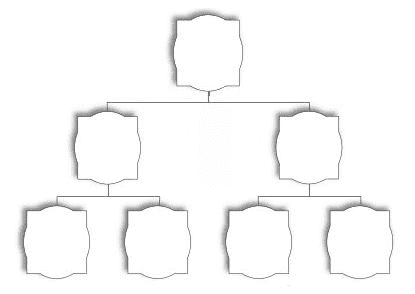

## 树的定义和属性

树是由边连接的节点或顶点的层次集合。树不能有环，并且只有节点与其后代节点或子节点之间才存在边。同一父节点的两个子节点之间不能有任何边。除顶部节点（也称为根节点）外，每个节点都可以有一个父节点。每棵树只能有一个根节点。每个节点可以有零个或多个子节点。在下图中，**A** 是根节点，**B**、**C** 和 **D** 是 **A** 的子节点。我们也可以说 A 是 **B**、**C** 和 **D** 的父节点。**B**、**C** 和 **D** 被称为兄弟节点，因为它们是来自同一父节点 **A** 的子节点：

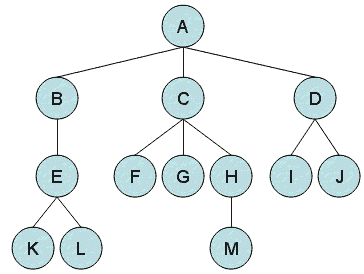

没有任何子节点的节点称为叶子节点。在前面的图中，**K**、**L**、**F**、**G**、**M**、**I** 和 **J** 是叶子节点。叶子节点也称为外部节点或终端节点。除根节点外，至少有一个子节点的节点称为内部节点。这里，**B**、**C**、**D**、**E** 和 **H** 是内部节点。以下是描述树数据结构时使用的一些其他常用术语：

* **后代**：这是一个可以通过从父节点重复向下遍历到达的节点。例如，在前图中，**M** 是 **C** 的后代。
* **祖先**：这是一个可以通过从子节点重复向上遍历到父节点到达的节点。例如，**B** 是 **L** 的祖先。
* **度**：特定父节点的子节点总数称为其度。在我们的例子中，**A** 的度为 3，**B** 的度为 1，**C** 的度为 3，**D** 的度为 2。
* **路径**：从源节点到目标节点的节点和边的序列称为两个节点之间的路径。路径的长度是路径中节点的数量。在我们的示例中，从 `A` 到 `M` 的路径是 `A-C-H-M`，路径长度为 4：

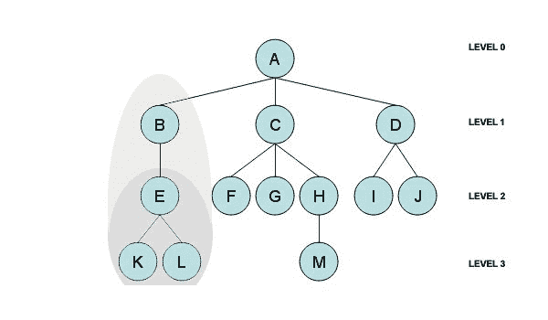

* **节点的高度**：节点的高度定义为该节点与其最深层后代节点之间的边数。例如，节点 `B` 的高度为 2。
* **层级**：层级表示节点的代数。如果父节点位于第 `n` 层，其子节点将位于第 `n+1` 层。因此，层级定义为 1 加上该节点与根节点之间的边数。在此：
    * 根节点 `A` 位于 **第 0 层**
    * `B`、`C` 和 `D` 位于 **第 1 层**
    * `E`、`F`、`G`、`H`、`I` 和 `J` 位于 **第 2 层**
    * `K`、`L` 和 `M` 位于 **第 3 层**
* **树的高度**：树的高度由其根节点的高度定义。此处，树的高度为 3。
* **子树**：在树结构中，每个子节点都以递归方式形成一棵子树。换句话说，一棵树由许多子树组成。例如，`B` 与 `E`、`K` 和 `L` 形成一棵子树，而 `E` 与 `K` 和 `L` 形成一棵子树。在前面的示例中，我们在左侧用不同的色调标识了每一个。我们也可以对 `C` 和 `D` 及其子树做同样的处理。
* **深度**：节点的深度由该节点与根节点之间的边数决定。例如，在我们的树图中，`H` 的深度为 2，`L` 的深度为 3。
* **森林**：森林是零棵或多棵互不相交的树的集合。
* **遍历**：这表示按特定顺序访问节点的过程。我们将在后续章节中频繁使用此术语。
* **键**：键是从节点获取的用于搜索目的的值。

## 使用 PHP 实现树

到目前为止，您已经了解了树数据结构的各种属性。如果我们将树数据结构与现实生活中的例子进行比较，可以将我们的组织架构或家谱视为该数据结构的表示。对于组织架构，有一个根节点，可以是公司的 CEO，随后是 CXO 级别的员工，然后是其他层级的员工。这里，我们不对特定节点的度数做任何限制。这意味着一个节点可以有多个子节点。那么，让我们设想一种节点结构，在其中我们可以定义节点属性、其父节点及其子节点。它可能看起来像这样：

```php
class TreeNode { 


    public $data = NULL; 

    public $children = []; 


    public function __construct(string $data = NULL) { 

      $this->data = $data; 

    } 


    public function addChildren(TreeNode $node) { 

      $this->children[] = $node; 

    } 


} 
```

如果我们查看前面的代码，可以看到我们为数据和子节点声明了两个公共属性。我们还有一个向特定节点添加子节点的方法。在这里，我们只是将新子节点追加到数组末尾。这将为我们提供向特定节点添加多个节点作为子节点的选项。由于树是一种递归结构，它将帮助我们以递归方式构建树，并以递归方式遍历树。

现在，我们有了节点；让我们构建一个树结构，它将定义树的根节点以及一个遍历整棵树的方法。因此，基本的树结构将如下所示：

```php
class Tree { 


    public $root = NULL; 
    public function __construct(TreeNode $node) { 

      $this->root = $node; 

    } 


    public function traverse(TreeNode $node, int $level = 0) { 


      if ($node) { 

        echo str_repeat("-", $level); 

        echo $node->data . "\n"; 


        foreach ($node->children as $childNode) { 

          $this->traverse($childNode, $level + 1); 

        } 

      } 

    } 


} 
```

前面的代码展示了一个简单的树类，我们可以在其中存储根节点引用，并从任意节点遍历树。在遍历部分，我们访问每个子节点，然后立即递归调用 `traverse()` 方法以获取当前节点的子节点。我们传递一个层级参数，以便在节点名称开头打印破折号（`-`），这样我们就可以轻松理解子节点层级数据。

现在让我们创建根节点并将其分配给树作为根节点。代码如下所示：

```php
$ceo = new TreeNode("CEO"); 

$tree = new Tree($ceo); 
```

在这里，我们创建了第一个节点 CEO，然后创建了树并将 CEO 节点分配为树的根节点。现在，是时候从根节点开始扩展我们的树了。既然我们选择了 CEO 的例子，现在我们将在 CEO 下添加 CXO 和其他员工。代码如下：

```php
$cto     = new TreeNode("CTO"); 

$cfo     = new TreeNode("CFO"); 

$cmo     = new TreeNode("CMO"); 

$coo     = new TreeNode("COO"); 


$ceo->addChildren($cto); 

$ceo->addChildren($cfo); 

$ceo->addChildren($cmo); 

$ceo->addChildren($coo); 


$seniorArchitect = new TreeNode("Senior Architect"); 

$softwareEngineer = new TreeNode("Software Engineer"); 

$userInterfaceDesigner      = new TreeNode("User Interface Designer"); 

$qualityAssuranceEngineer = new TreeNode("Quality Assurance Engineer"); 


$cto->addChildren($seniorArchitect); 

$seniorArchitect->addChildren($softwareEngineer); 

$cto->addChildren($qualityAssuranceEngineer); 

$cto->addChildren($userInterfaceDesigner); 


$tree->traverse($tree->root); 
```


在这里，我们首先创建了四个新节点（CTO、CFO、CMO 和 COO），并将它们作为 CEO 节点的子节点。然后我们创建了高级架构师，接着是软件工程师节点、用户界面设计师和质量保证工程师。我们将高级软件工程师节点分配为高级架构师节点的子节点，将高级架构师分配为 CTO 的子节点，连同用户界面工程师和质量保证工程师。最后一行用于从根节点显示树。这将在我们的命令行中输出以下内容：

```
CEO
-CTO
--Senior Architect
---Software Engineer
--Quality Assurance Engineer
--User Interface Designer
-CFO
-CMO
-COO
```

如果我们考虑前面的输出，`CEO` 位于第 0 层。`CTO`、`CFO`、`CMO` 和 `COO` 位于第 1 层。`Senior Architect`、`User Interface Designer` 和 `Quality Assurance Engineer` 位于第 2 层，而 `Software Engineer` 位于第 3 层。

我们已经使用 PHP 构建了一个基本的树数据结构。现在，我们将探讨我们拥有的不同类型的树。

## 不同类型的树结构

编程世界中存在许多类型的树数据结构。我们将在此探讨一些最常用的树结构。

### 二叉树

二叉树是树结构最基本的形式，其中每个节点最多有两个子节点。子节点被称为左节点和右节点。二叉树将如下图所示：

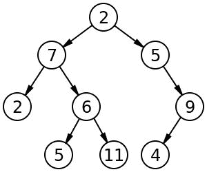

### 二叉搜索树

二叉搜索树（BST）是一种特殊类型的二叉树，其中节点以排序方式存储。其排序方式使得在任意给定点，一个节点的值必须大于或等于其左子节点的值，且小于其右子节点的值。每个节点都必须满足此属性才能被视为二叉搜索树。由于节点按特定顺序排序，二叉搜索算法可以应用于在 BST 中以对数时间搜索项目。它总是优于需要 `O(n)` 时间的线性搜索，我们将在下一章探讨这一点。以下是一个二叉搜索树的示例：

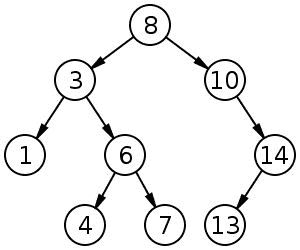

### 自平衡二叉搜索树

自平衡二叉搜索树或高度平衡二叉搜索树是一种特殊类型的二叉搜索树，它通过自动调整，始终尝试将树的高度或层数保持尽可能小。例如，下图左侧展示了一棵二叉搜索树，右侧展示了一棵自平衡二叉搜索树：

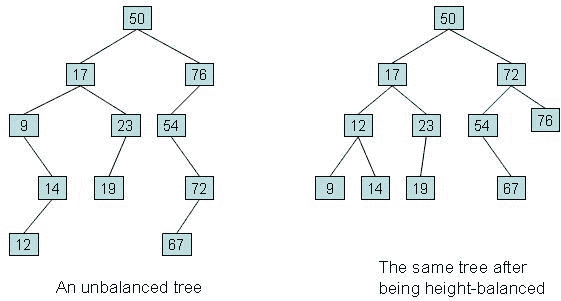

高度平衡二叉树始终更优，因为与普通 BST 相比，它有助于加快搜索操作。自平衡或高度平衡二叉搜索树有不同的实现。其中一些流行的实现如下：

*   AA 树
*   AVL 树
*   红黑树
*   替罪羊树
*   伸展树
*   2-3 树
*   堆树

我们将在以下章节中讨论其中几种高度平衡树。

### AVL 树

AVL 树是一种自平衡二叉搜索树，其中节点的两个子子树的高度相差最大为 1。如果高度以任何方式增加，都会进行重新平衡，使高度差恢复为 1。这使得 AVL 树在不同操作上具有对数复杂度的额外优势。以下是一个 AVL 树的示例：

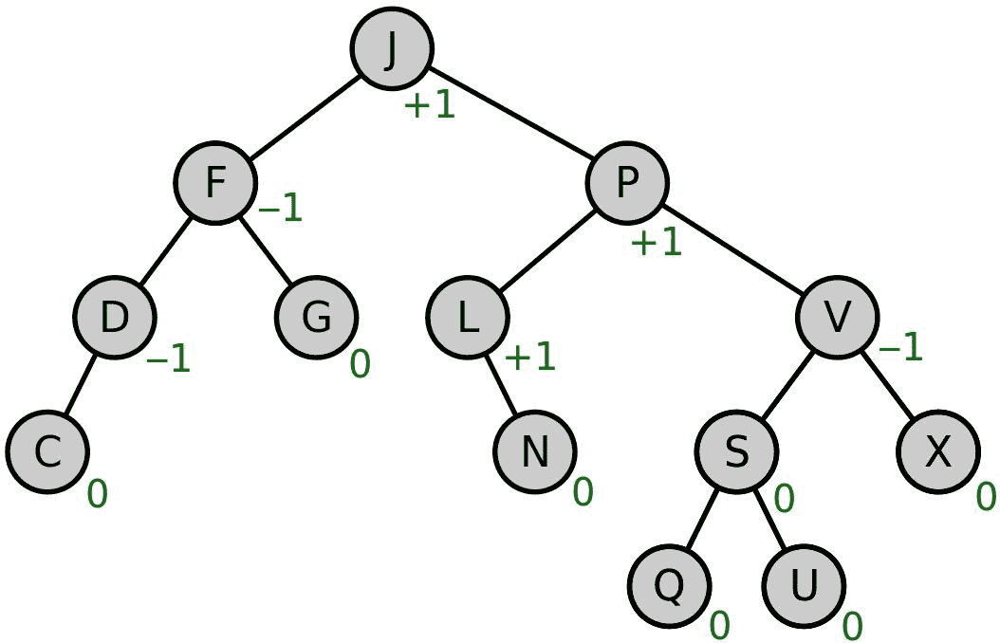

### 红黑树

红黑树是一种具有额外属性（即颜色）的自平衡二叉搜索树。二叉树中的每个节点存储一位额外信息，称为颜色，其值可以是红色或黑色。与 AVL 树类似，红黑树也用于实时应用程序，因为其平均和最坏情况复杂度也是对数级的。一个示例红黑树如下所示：

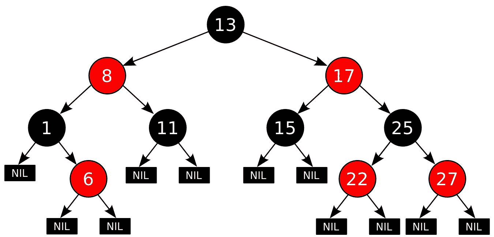

### B 树

B 树是一种特殊类型的二叉树，它是自平衡的。这与自平衡二叉搜索树不同。关键区别在于，在 B 树中，我们可以拥有任意数量的子节点，而不仅仅是两个。B 树用于大量数据集，主要用于文件系统和数据库。B 树中不同操作的复杂度是对数级的。

### N 叉树

N 叉树是一种特殊类型的树，其中节点最多可以有 N 个子节点。这也被称为 K 路树或 M 叉树。二叉树是 N 等于 2 时的 N 叉树。

### 理解二叉树

我们经常混淆二叉树和二叉搜索树。正如定义中所见，BST 是一种排序的二叉树。如果是排序的，则与普通二叉树相比可以获得性能提升。每个二叉树节点最多可以有两个子节点，称为左子节点和右子节点。然而，根据二叉树的类型，可以有零个、一个或两个子节点。

我们还可以将二叉树分为不同类别：

*   **满二叉树**：满二叉树是指每个节点要么有零个，要么有两个子节点的树。满二叉树也称为真二叉树或平面二叉树。
*   **完美二叉树**：完美二叉树是指所有内部节点恰好有两个子节点，且所有叶子节点具有相同层级或深度的二叉树。
*   **完全二叉树**：完全二叉树是指除最后一层外所有层都完全填满，且所有节点都尽可能靠左的二叉树。下图展示了满二叉树、完全二叉树和完美二叉树：

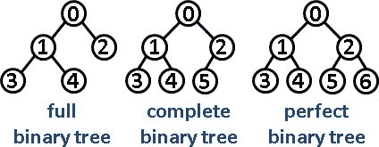

### 实现二叉树

我们现在将创建一个二叉树（而非二叉搜索树）。二叉树的关键因素是必须为左子节点和右子节点提供两个占位符，以及我们要存储在节点中的数据。二叉节点的简单实现如下：

```php
class BinaryNode {
    public $data;
    public $left;
    public $right;

    public function __construct(string $data = NULL) {
        $this->data = $data;
        $this->left = NULL;
        $this->right = NULL;
    }

    public function addChildren(BinaryNode $left, BinaryNode $right) {
        $this->left = $left;
        $this->right = $right;
    }
}
```

上述代码显示，我们有一个包含三个属性的类，用于存储数据、左节点和右节点。构造新节点时，我们将节点值赋给 `data` 属性，`left` 和 `right` 保持为 `NULL`，因为我们不确定是否需要它们。我们还有一个 `addChildren()` 方法，用于向特定节点添加左子节点和右子节点。

现在，我们将创建一个二叉树类，在其中定义根节点以及遍历方法，这与本章前面的基本树实现类似。两者实现的区别在于遍历过程。在之前的示例中，我们使用 `foreach` 遍历每个子节点，因为不知道有多少个节点。由于二叉树中每个节点最多只能有两个节点，且它们被命名为左节点和右节点，因此我们在访问每个特定节点时，只能先遍历左节点，再遍历右节点。修改后的代码如下：

```php
class BinaryTree {
    public $root = NULL;

    public function __construct(BinaryNode $node) {
        $this->root = $node;
    }

    public function traverse(BinaryNode $node, int $level = 0) {
        if ($node) {
            echo str_repeat("-", $level);
            echo $node->data . "\n";

            if ($node->left)
                $this->traverse($node->left, $level + 1);

            if ($node->right)
                $this->traverse($node->right, $level + 1);
        }
    }
}
```

这看起来与本章前面的基本树类非常相似。现在，让我们用一些节点填充二叉树。通常，在任何足球或板球锦标赛中，都有淘汰赛轮次，两两队伍对战，胜者晋级，一直持续到决赛。我们可以用二叉树结构来表示这个例子。因此，让我们创建一些二叉节点并按层级结构组织它们：

```php
$final = new BinaryNode("Final");
$tree = new BinaryTree($final);

$semiFinal1 = new BinaryNode("Semi Final 1");
$semiFinal2 = new BinaryNode("Semi Final 2");
$quarterFinal1 = new BinaryNode("Quarter Final 1");
$quarterFinal2 = new BinaryNode("Quarter Final 2");
$quarterFinal3 = new BinaryNode("Quarter Final 3");
$quarterFinal4 = new BinaryNode("Quarter Final 4");

$semiFinal1->addChildren($quarterFinal1, $quarterFinal2);
$semiFinal2->addChildren($quarterFinal3, $quarterFinal4);

$final->addChildren($semiFinal1, $semiFinal2);

$tree->traverse($tree->root);
```

首先，我们创建了一个名为 final 的节点并将其作为根节点。然后，我们创建了两个半决赛节点和四个四分之一决赛节点。两个半决赛节点各自拥有两个四分之一决赛节点作为左右子节点。final 节点拥有两个半决赛节点作为左右子节点。`addChildren()` 方法负责为节点分配子节点。在最后一行，我们遍历了树并以层级方式显示数据。如果在命令行中运行此代码，将看到以下输出：

```
Final
-Semi Final 1
--Quarter Final 1
--Quarter Final 2
-Semi Final 2
--Quarter Final 3
--Quarter Final 4
```

### 使用 PHP 数组创建二叉树

## 使用 PHP 数组实现二叉树

由于二叉树最多有零到两个子节点，我们可以将最大子节点数设为 2，并构建公式来查找给定节点的子节点。让我们从上到下、从左到右给二叉树中的节点编号。因此，根节点编号为 `0`，左子节点为 `1`，右子节点为 `2`，依此类推，直到每个节点都被编号，如下图所示：

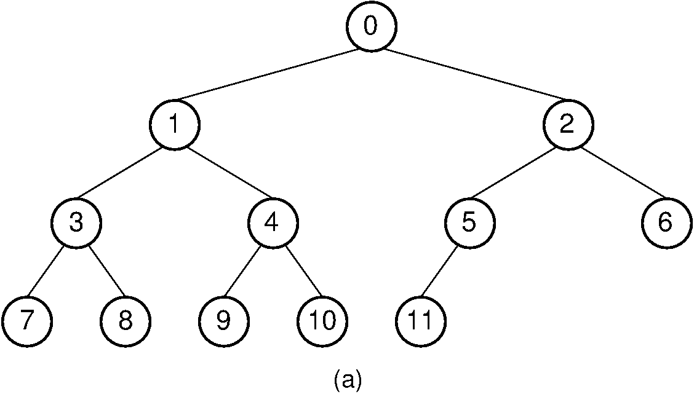

我们可以清楚地看到，对于节点 `0`，左子节点是 `1`，右子节点是 `2`。对于节点 `1`，左子节点是 `3`，右子节点是 `4`，以此类推。我们可以轻松地将其表示为公式：

如果 `i` 是我们的节点编号，则：

* 左节点 = `2 * i + 1`
* 右节点 = `2 * (i + 1)`

现在让我们使用 PHP 数组为比赛日程部分创建示例。如果按照我们的讨论进行排名，它将如下所示：

```php
$nodes = []; 

$nodes[] = "Final"; 

$nodes[] = "Semi Final 1"; 

$nodes[] = "Semi Final 2"; 

$nodes[] = "Quarter Final 1"; 

$nodes[] = "Quarter Final 2"; 

$nodes[] = "Quarter Final 3"; 

$nodes[] = "Quarter Final 4"; 
```

基本上，我们将创建一个从 0 开始自动索引的数组。该数组将用作二叉树的表示。现在，我们将修改 `BinaryTree` 类以使用此数组代替节点类，同时包含左、右子节点以及遍历方法。现在，我们将基于节点编号而不是实际节点引用进行遍历：

```php
class BinaryTree { 


    public $nodes = []; 


    public function __construct(array $nodes) { 

        $this->nodes = $nodes; 

    } 


    public function traverse(int $num = 0, int $level = 0) { 


        if (isset($this->nodes[$num])) { 

            echo str_repeat("-", $level); 

            echo $this->nodes[$num] . "\n"; 


            $this->traverse(2 * $num + 1, $level + 1); 

            $this->traverse(2 * ($num + 1), $level + 1); 

        } 

    } 


} 
```

从前面的实现可以看出，`traverse` 部分使用节点定位而非引用。此节点位置即数组索引。因此，我们可以直接访问数组索引并检查其是否为空。如果不为空，我们可以使用递归方式继续深入。如果要使用数组创建二叉树并打印数组值，必须编写以下代码：

```php
$tree = new BinaryTree($nodes); 

$tree->traverse(0); 
```

如果在命令行中运行此代码，将看到以下输出：

```
Final
-Semi Final 1
--Quarter Final 1
--Quarter Final 2
-Semi Final 2
--Quarter Final 3
--Quarter Final 4
```

我们可以使用简单的 `while` 循环遍历数组并访问每个节点，而非递归方式。在所有递归示例中，我们会发现某些情况使用迭代方式效率更高。我们也可以直接使用它们，而无需为二叉树创建类。

## 理解二叉搜索树

二叉搜索树（BST）是一种以特定方式构建的二叉树，使得树始终保持有序。这意味着左子节点的值小于或等于父节点的值，而右子节点的值大于父节点的值。因此，每当我们需要搜索一个值时，要么搜索左侧，要么搜索右侧。由于树是有序的，我们只需搜索树的一部分，而非两部分，且此过程递归进行。得益于这种分治特性，搜索变得非常快，搜索复杂度可达对数级。例如，如果有 `n` 个节点，我们将搜索前半部分或后半部分节点。一旦进入前半或后半部分，可再将其分为两半，即四分之一，以此类推，直到到达最终节点。因为我们不必遍历每个节点进行搜索，操作复杂度不会是 `O(n)`。在下一章中，我们将进行二叉搜索的复杂度分析，并了解为何二叉搜索树的搜索复杂度为 `O(log n)`。与二叉树不同，我们不能在不重构 BST 属性的情况下任意添加或删除节点。

如果节点 `X` 有两个子节点，则节点 `X` 的后继是属于该树且大于 `X` 值的最小值。换句话说，后继是右子树中的最小值。另一方面，前驱是左子树中的最大值。现在，我们将重点关注 BST 的不同操作及正确执行这些操作所需的步骤。

以下是 BST 的操作。

### 插入新节点

在二叉搜索树中插入新节点时，必须考虑以下步骤：

1. 创建一个作为叶子节点的新节点（无左子节点或右子节点）。
2. 从根节点开始，将其设为当前节点。
3. 如果节点为空，将新节点设为根节点。
4. 检查新值是小于还是大于当前节点。
5. 如果较小，转到左侧并将左节点设为当前节点。
6. 如果较大，转到右侧并将右节点设为当前节点。
7. 继续*步骤 3*，直到访问完所有节点并设置新节点。

## 读累了记得休息一会哦~

**公众号：古德猫宁李**

* 电子书搜索下载
* 书单分享
* 书友学习交流

**网站：**[沉金书屋 https://www.chenjin5.com](https://www.chenjin5.com)

* 电子书搜索下载
* 电子书打包资源分享
* 学习资源分享

### 搜索节点

在二叉搜索树中搜索节点时，必须考虑以下步骤：

1. 从根节点开始，将其设为当前节点。
2. 如果当前节点为空，返回 `false`。
3. 如果当前节点值等于搜索值，返回 `true`。
4. 检查搜索值是小于还是大于当前节点。
5. 如果较小，转到左侧并将左节点设为当前节点。
6. 如果较大，转到右侧并将右节点设为当前节点。
7. 继续*步骤 3*，直到访问完所有节点。

### 查找最小值

由于二叉搜索树以有序方式存储数据，我们总能在左侧节点找到较小数据，在右侧节点找到较大数据。因此，查找最小值要求我们从根节点开始访问所有左节点，直到找到最左侧节点及其值。以下是查找最小值的步骤：

1. 从根节点开始，将其设为当前节点。
2. 如果当前节点为空，返回 `false`。
3. 转到左侧并将左节点设为当前节点。
4. 如果当前节点没有左节点，转到*步骤 5*；否则继续*步骤 4*。
5. 继续*步骤 3*，直到访问完所有左节点。
6. 返回当前节点。

### 查找最大值

以下是查找最大值的步骤：

1. 从根节点开始，将其设为当前节点。
2. 如果当前节点为空，返回 `false`。
3. 转到右侧并将右节点设为当前节点。
4. 如果当前节点没有右节点，转到*步骤 5*；否则继续*步骤 4*。
5. 继续*步骤 3*，直到访问完所有右节点。
6. 返回当前节点。

### 删除节点

删除节点时，必须考虑节点可以是内部节点或叶子节点。如果是叶子节点，它有零个子节点。然而，如果节点是内部节点，它可以有一个或两个子节点。在这种情况下，我们需要采取额外步骤，确保删除后树仍正确构建。这就是为什么从 BST 删除节点总是比其他操作更具挑战性。以下是节点删除时需考虑的事项：

1. 如果节点没有子节点，将节点设为 `NULL`。
2. 如果节点只有一个子节点，让子节点取代该节点的位置。

### 构建二叉搜索树

正如我们所知，一个节点可以有两个子节点，并且本身可以用递归方式表示一棵树。我们将定义节点类使其功能更完善，并具备查找最大值、最小值、前驱和后继所需的所有功能。稍后，我们还将为节点添加删除功能。让我们看看 BST 节点类的以下代码：


# PHP 二叉搜索树实现

## Node 类

```php
class Node { 
    public $data; 
    public $left; 
    public $right; 
    public $parent;

    public function __construct(int $data = NULL, Node $parent = NULL) { 
        $this->data = $data; 
        $this->parent = $parent; 
        $this->left = NULL; 
        $this->right = NULL; 
    } 

    public function min() { 
        $node = $this; 
        while($node->left) { 
            $node = $node->left; 
        } 
        return $node; 
    } 

    public function max() { 
        $node = $this; 
        while($node->right) { 
            $node = $node->right; 
        } 
        return $node; 
    } 

    public function successor() { 
        $node = $this; 
        if($node->right) 
            return $node->right->min(); 
        else 
            return NULL; 
    } 

    public function predecessor() { 
        $node = $this; 
        if($node->left) 
            return $node->left->max(); 
        else 
            return NULL; 
    }

    public function delete() { 
        $node = $this; 
        if (!$node->left && !$node->right) { 
            if ($node->parent->left === $node) { 
                $node->parent->left = NULL; 
            } else { 
                $node->parent->right = NULL; 
            } 
        } elseif ($node->left && $node->right) { 
            $successor = $node->successor(); 
            $node->data = $successor->data; 
            $successor->delete(); 
        } elseif ($node->left) { 
            if ($node->parent->left === $node) { 
                $node->parent->left = $node->left; 
                $node->left->parent = $node->parent->left; 
            } else { 
                $node->parent->right = $node->left; 
                $node->left->parent = $node->parent->right; 
            } 
            $node->left = NULL; 
        } elseif ($node->right) { 
            if ($node->parent->left === $node) { 
                $node->parent->left = $node->right; 
                $node->right->parent = $node->parent->left; 
            } else { 
                $node->parent->right = $node->right; 
                $node->right->parent = $node->parent->right; 
            } 
            $node->right = NULL; 
        }
    }
}
```

节点类看起来很简单，且与上一节定义的步骤相符。每个新节点都是叶子节点，因此在创建时没有左节点或右节点。正如我们所知，可以在节点的左侧找到较小的值以获取最小值，我们到达最左侧的节点以获取最小值，到达最右侧的节点以获取最大值。对于 `successor()`，我们从给定节点的右子树中查找节点的最小值；对于 `predecessor()` 部分，则从左子树中查找节点的最大值。

## BST 类

现在，我们需要一个 `BST` 结构来向树中添加新节点，以便遵循插入原则：

```php
class BST { 
    public $root = NULL; 

    public function __construct(int $data) { 
        $this->root = new Node($data); 
    } 

    public function isEmpty(): bool { 
        return $this->root === NULL; 
    } 

    public function insert(int $data) { 
        if($this->isEmpty()) { 
            $node = new Node($data); 
            $this->root = $node; 
            return $node; 
        }  

        $node = $this->root; 

        while($node) { 
            if($data > $node->data) { 
                if($node->right) { 
                    $node = $node->right; 
                } else { 
                    $node->right = new Node($data, $node); 
                    $node = $node->right; 
                    break; 
                } 
            } elseif($data < $node->data) { 
                if($node->left) { 
                    $node = $node->left; 
                } else { 
                    $node->left = new Node($data, $node); 
                    $node = $node->left; 
                    break; 
                } 
            } else { 
                break; 
            } 
        } 
        return $node; 
    } 

    public function traverse(Node $node) { 
        if ($node) { 
            if ($node->left) 
                $this->traverse($node->left); 
            echo $node->data . "\n"; 
            if ($node->right)
                $this->traverse($node->right);
        }
    }

    public function search(int $data) { 
        if ($this->isEmpty()) { 
            return FALSE; 
        } 

        $node = $this->root; 

        while ($node) { 
            if ($data > $node->data) { 
                $node = $node->right; 
            } elseif ($data < $node->data) { 
                $node = $node->left; 
            } else { 
                break; 
            } 
        } 

        return $node; 
    }

    public function remove(int $data) {
        $node = $this->search($data);
        if ($node) $node->delete();
    }
}
```

如果我们查看前面的代码，`BST` 类只有一个属性，用于标记根节点。在构造 `BST` 对象时，我们传入单个值，该值将作为树的根节点。`isEmpty()` 方法检查树是否为空。`insert()` 方法允许我们在树中添加新节点。逻辑检查值是大于还是小于根节点，并遵循 BST 原则将新节点插入正确位置。如果值已存在，我们将忽略它，避免重复添加到树中。

我们还有一个 `traverse()` 方法来遍历节点，并以有序格式查看数据（先左节点，然后是当前节点，最后是右节点值）。它有一个特定的名称，我们将在下一节探讨。现在，让我们准备一个示例代码来使用 `BST` 类，添加一些数字，并检查数字是否以正确的方式存储。如果 `BST` 工作正常，那么 `traverse()` 将显示一个排序后的数字列表，无论我们如何插入它们：

```php
$tree = new BST(10); 

$tree->insert(12); 
$tree->insert(6); 
$tree->insert(3); 
$tree->insert(8); 
$tree->insert(15); 
$tree->insert(13); 
$tree->insert(36); 

$tree->traverse($tree->root);
```

如果我们查看前面的代码，`10` 是我们的根节点，然后我们随机添加了新节点。最后，我们调用了 `traverse()` 方法来显示节点以及它们在二叉搜索树中的存储方式。以下是前面代码的输出：

```
3
6
8
10
12
13
15
36
```

实际的树在视觉上看起来像这样，这与 `BST` 实现的预期结果完全一致：

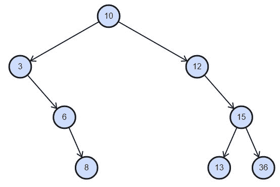

## 搜索功能

现在，我们将在 `BST` 类中添加搜索部分。我们想要查找值是否存在于树中。如果值不在我们的 `BST` 中，它将返回 false，否则返回该节点。以下是简单的搜索功能：

```php
public function search(int $data) { 
    if ($this->isEmpty()) { 
        return FALSE; 
    } 

    $node = $this->root; 

    while ($node) { 
        if ($data > $node->data) { 
            $node = $node->right; 
        } elseif ($data < $node->data) { 
            $node = $node->left; 
        } else { 
            break; 
        } 
    } 

    return $node; 
}
```

在前面的代码中，我们可以看到我们正在从节点开始在树中搜索值，并迭代地遵循树的左侧或右侧。如果未找到具有该值的节点，则返回节点的叶子，即 `NULL`。我们可以这样测试代码：

```php
echo $tree->search(14) ? "Found" : "Not Found";
echo "\n";
echo $tree->search(36) ? "Found" : "Not Found";
```

这将产生以下输出。由于 `14` 不在我们的列表中，它将显示 `Not Found`，而对于 `36`，它将显示 `Found`：

```
Not Found
Found
```

## 删除节点

现在，我们将进入编码中最复杂的部分：节点的删除。我们需要实现节点拥有零个、一个或两个子节点的每种情况。下图展示了我们删除节点时需要满足的三个条件，并确保操作后二叉搜索树仍然是二叉搜索树。当处理拥有两个子节点的节点时，我们必须小心。由于我们需要在节点之间来回移动，我们需要知道哪个节点是当前节点的父节点。因此，我们需要添加一个额外的属性来跟踪任意节点的父节点：

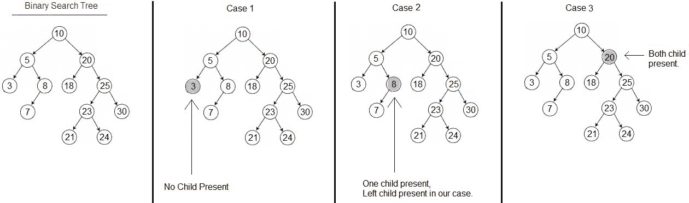

以下是我们添加到 `Node` 类的代码变更：

```php
public $data;
public $left;
public $right;
public $parent;

public function __construct(int $data = NULL, Node $parent = NULL) { 
    $this->data = $data; 
    $this->parent = $parent; 
    $this->left = NULL; 
    $this->right = NULL; 
}
```

此代码块现在还会在新创建的节点与其直接父节点之间建立父子关系。我们还希望将删除功能附加到单个节点上，以便我们可以找到一个节点，然后仅使用 `delete()` 方法将其移除。以下是删除功能的代码：

```php
public function delete() { 
    $node = $this; 
    if (!$node->left && !$node->right) { 
        if ($node->parent->left === $node) { 
            $node->parent->left = NULL; 
        } else { 
            $node->parent->right = NULL; 
        } 
    } elseif ($node->left && $node->right) { 
        $successor = $node->successor(); 
        $node->data = $successor->data; 
        $successor->delete(); 
    } elseif ($node->left) { 
        if ($node->parent->left === $node) { 
            $node->parent->left = $node->left; 
            $node->left->parent = $node->parent->left; 
        } else { 
            $node->parent->right = $node->left; 
            $node->left->parent = $node->parent->right; 
        } 
        $node->left = NULL; 
    } elseif ($node->right) { 
        if ($node->parent->left === $node) { 
            $node->parent->left = $node->right; 
            $node->right->parent = $node->parent->left; 
        } else { 
            $node->parent->right = $node->right; 
            $node->right->parent = $node->parent->right; 
        } 
        $node->right = NULL; 
    }
}
```

第一个条件检查节点是否为叶子节点。如果节点是叶子节点，则只需让父节点移除对子节点（左或右）的引用。这样，该节点将从树中断开，满足了拥有零个子节点的第一个条件。

接下来的条件实际上检查的是我们的第三种情况，即节点有两个子节点。在这种情况下，我们获取该节点的后继节点，将后继节点的值赋给该节点本身，并移除后继节点。这只是从后继节点复制数据。

接下来的两个条件检查节点是否只有一个子节点，如前面的 Case 2 图所示。由于节点只有一个子节点，它可以是左子节点，也可以是右子节点。因此，条件检查单个子节点是否为该节点的左子节点。如果是，我们需要根据节点相对于其父节点的位置，将左子节点指向节点父节点的左或右引用。同样的规则适用于右子节点。在这里，右子节点引用被设置为其父节点的左或右子节点，而不是基于节点位置的引用。

由于我们更新了节点类，因此需要对 `BST` 类进行一些更改，以用于插入和移除节点。插入代码如下所示：

```php
function insert(int $data) {
    if ($this->isEmpty()) {
        $node = new Node($data);
        $this->root = $node;
        return $node;
    }

    $node = $this->root;
    while ($node) {
        if ($data > $node->data) {
            if ($node->right) {
                $node = $node->right;
            } else {
                $node->right = new Node($data, $node);
                $node = $node->right;
                break;
            }
        } elseif ($data < $node->data) {
            if ($node->left) {
                $node = $node->left;
            } else {
                $node->left = new Node($data, $node);
                $node = $node->left;
                break;
            }
        } else {
            break;
        }
    }
    return $node;
}
```

代码看起来与我们之前使用的代码相似，只有一个小变化。现在，在创建新节点时，我们发送当前节点的引用。这个当前节点将被用作新节点的父节点。代码 `new Node($data, $node)` 完成了这一工作。

对于移除节点，我们可以先进行搜索，然后使用节点类中的 `delete` 方法删除搜索到的节点。因此，`remove` 函数本身将非常小，如下面的代码所示：

```php
public function remove(int $data) {
    $node = $this->search($data);
    if ($node) $node->delete();
}
```

正如代码所示，我们首先搜索数据。如果节点存在，我们使用 `delete` 方法将其移除。现在，让我们用一个 `remove` 调用运行之前的示例，看看它是否有效：

```php
$tree->remove(15);
$tree->traverse($tree->root);
```

我们只是从树中移除 `15`，然后从根节点遍历树。我们现在将看到以下输出：

```
3
6
8
10
12
13
36
```

我们可以看到 `15` 不再是我们 BST 的一部分。以这种方式，我们可以移除任何节点，如果我们使用相同的方法进行遍历，将看到一个排序后的列表。如果我们看前面的输出，可以看到输出按升序显示。这背后有原因，我们将在下一个主题——不同的树遍历方式中探讨。


您可以在[`btv.melezinek.cz/binary-search-tree.html`](http://btv.melezinek.cz/binary-search-tree.html)找到一个可视化二叉搜索树操作的绝佳工具。这是学习者直观理解不同操作的良好起点。

## 树遍历

树遍历是指我们访问给定树中每个节点的方式。根据我们如何进行遍历，可以遵循三种不同的遍历方式。这些遍历在许多不同方面都非常重要。表达式求值的波兰表示法转换是使用树遍历的最流行示例之一。

### 中序遍历

中序树遍历首先访问左节点，然后是根节点，最后是右节点。这对每个节点递归地继续进行。左节点存储的值比根节点值小，右节点存储的值比根节点值大。因此，当我们应用中序遍历时，我们得到的是一个排序后的列表。这就是为什么到目前为止，我们的二叉树遍历显示的是排序后的数字列表。该遍历部分实际上是中序树遍历的一个示例。中序树遍历遵循以下原则：

1.  通过递归调用中序函数遍历左子树。
2.  显示根节点（或当前节点）的数据部分。
3.  通过递归调用中序函数遍历右子树。

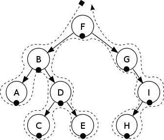

前面的树将显示 A, B, C, D, E, F, G, H 和 I 作为输出，因为它是按中序遍历的。

### 先序遍历

在先序遍历中，首先访问根节点，然后是左节点，最后是右节点。先序遍历的原则如下：

1.  显示根节点（或当前节点）的数据部分。
2.  通过递归调用先序函数遍历左子树。
3.  通过递归调用先序函数遍历右子树。

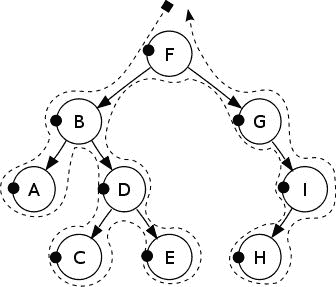

前面的树将输出 F, B, A, D, C, E, G, I 和 H，因为它是按先序遍历的。

### 后序遍历

在后序遍历中，最后访问根节点。首先访问左节点，然后是右节点。后序遍历的原则如下：

1.  通过递归调用后序函数遍历左子树。
2.  通过递归调用后序函数遍历右子树。
3.  显示根节点（或当前节点）的数据部分。

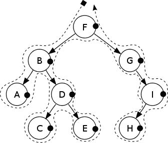

前面的树将输出 A, C, E, D, B, H, I, G 和 F，因为它是按后序方式遍历的。

现在，让我们在`BST`类中实现遍历逻辑：

## 树的遍历实现

```php
public function traverse(Node $node, string $type = "in-order") {
    switch ($type) {
        case "in-order":
            $this->inOrder($node);
            break;

        case "pre-order":
            $this->preOrder($node);
            break;

        case "post-order":
            $this->postOrder($node);
            break;
    }
}

public function preOrder(Node $node) {
    if ($node) {
        echo $node->data . " ";
        if ($node->left) $this->traverse($node->left);
        if ($node->right) $this->traverse($node->right);
    }
}

public function inOrder(Node $node) {
    if ($node) {
        if ($node->left) $this->traverse($node->left);
        echo $node->data . " ";
        if ($node->right) $this->traverse($node->right);
    }
}

public function postOrder(Node $node) {
    if ($node) {
        if ($node->left) $this->traverse($node->left);
        if ($node->right) $this->traverse($node->right);
        echo $node->data . " ";
    }
}
```

现在，如果我们为之前的二叉搜索树运行三种不同的遍历方法，以下是运行遍历部分的代码：

```php
$tree->traverse($tree->root, 'pre-order');
echo "\n";
$tree->traverse($tree->root, 'in-order');
echo "\n";
$tree->traverse($tree->root, 'post-order');
```

这将在命令行中产生以下输出：

```
10 3 6 8 12 13 15 36

3 6 8 10 12 13 15 36

3 6 8 12 13 15 36 10
```

---

## 不同树数据结构的复杂度

到目前为止，我们已经了解了不同的树类型及其操作。逐一讲解每种树类型及其不同操作超出了本书的范围。我们只需要对其他树结构及其操作复杂度有一个基本的了解。下图展示了不同类型树的各种操作及空间在平均和最坏情况下的复杂度。我们可能需要根据需求选择不同的树结构：

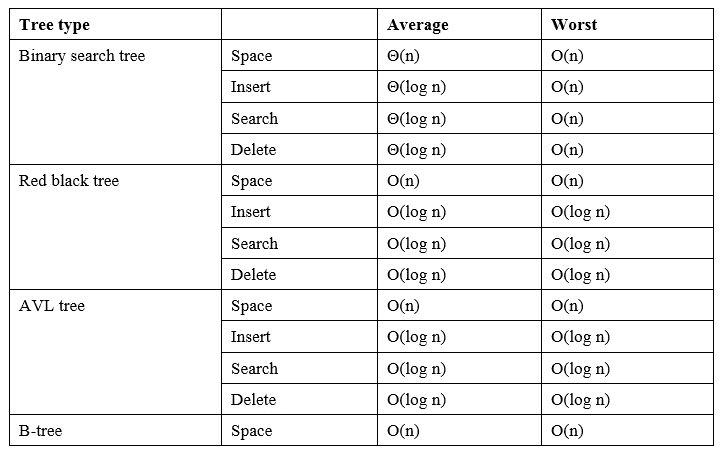

---

## 总结

在本章中，我们详细讨论了非线性数据结构。你了解到树是分层数据结构，并且存在不同的树类型、操作和复杂度。我们还学习了如何定义二叉搜索树。这对于实现不同的搜索技术和数据存储非常有用。在下一章中，我们将把重点从数据结构转移到算法上。我们将重点关注第一类算法——排序算法。

---

## 使用排序算法

排序是计算机编程中最常用的算法之一。即使在日常生活中，如果事物没有排序，我们也会难以应对。排序可以为集合中更快的搜索或项目排序铺平道路。排序可以通过多种方式完成，例如升序或降序。排序也可以基于数据类型。例如，对名称集合进行排序需要字典序排序，而不是数值排序。由于排序对其他数据结构及其效率起着重要作用，因此有许多不同的排序算法可用。在本章中，我们将探讨一些最流行的排序算法，以及它们的复杂度和用法。

---

## 理解排序及其类型

排序意味着数据的有序排列。通常，我们的数据是无序的，这意味着我们需要一种方法对其进行排序。通常，排序是通过比较不同元素并得出排名来完成的。在大多数情况下，没有比较就无法决定排序部分。比较之后，我们还需要交换元素以便重新排序。一个好的排序算法的特点是进行最少数量的比较和交换。也存在非基于比较的排序，其中对项目列表进行排序不需要比较。我们也将在本章中探讨这些算法。

排序可以根据数据集类型、方向、计算复杂度、内存使用、空间使用等分为不同类型。以下是我们将在本章中探讨的几种排序算法：

*   冒泡排序
*   插入排序
*   选择排序
*   快速排序
*   归并排序
*   桶排序

我们将讨论范围限定在上述列表中，因为它们是最常用的排序算法，并可按简单排序、高效排序、分布排序等不同标准进行分组和分类。现在我们将探讨每种排序的功能、实现和复杂度分析，以及它们的优缺点。让我们从最常用的排序算法——冒泡排序开始。

---

## 理解冒泡排序

冒泡排序是编程世界中最常用的排序算法。大多数程序员开始学习排序时都从该算法入手。它是一种基于比较的排序算法，通常被认为是效率最低的排序算法之一。它需要最多的比较次数，且平均和最坏情况复杂度相同。

在冒泡排序中，列表中的每个项目都与其余项目进行比较，并在必要时交换。此过程对列表中的每个项目持续进行。我们可以按升序或降序排序。以下是冒泡排序的伪代码算法：

```
procedure bubbleSort( A : list of sortable items ) 

   n = length(A) 

   for i = 0 to n inclusive do  

     for j = 0 to n-1 inclusive do 

       if A[j] > A[j+1] then 

         swap( A[j], A[j+1] ) 

       end if 

     end for 

   end for 

end procedure
```

从上述伪代码可以看出，我们运行一个循环以确保遍历列表中的每个项目。内层循环确保一旦指向一个项目，就将其与列表中的其他项目进行比较。根据我们的偏好，可以交换两个项目。下图展示了对列表中一个项目进行排序的单次迭代。假设我们的列表包含以下项目：`20`, `45`, `93`, `67`, `10`, `97`, `52`, `88`, `33`, `92`。对于第一次遍历（迭代）以排出第一个项目，将采取以下步骤：

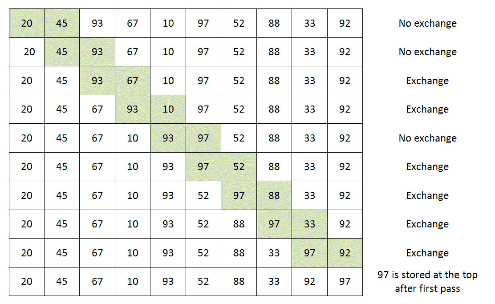

如果检查上图，我们可以看到正在比较两个数字，然后决定是否交换/交换项目。带背景色的项目显示了我们正在比较的两个项目。正如我们所见，外层循环的第一次迭代导致顶部项目存储在列表的顶部位置。这将持续到我们遍历列表中的每个项目。

现在让我们使用 PHP 实现冒泡排序算法。

---

## 使用 PHP 实现冒泡排序

由于我们假设无序数字在列表中，可以使用 PHP 数组来表示无序数字列表。由于数组同时具有索引和值，我们可以利用数组根据位置轻松遍历每个项目，并在适用的地方交换它们。基于我们的伪代码，代码如下所示：

```php
function bubbleSort(array $arr): array { 
    $len = count($arr); 

    for ($i = 0; $i < $len; $i++) { 
        for ($j = 0; $j < $len - 1; $j++) { 
            if ($arr[$j] > $arr[$j + 1]) { 
                $tmp = $arr[$j + 1]; 
                $arr[$j + 1] = $arr[$j]; 
                $arr[$j] = $tmp; 
            } 
        } 
    }     

    return $arr; 
}
```

正如我们所见，我们使用两个 `for` 循环来遍历每个项目并与其余项目进行比较。交换在以下几行中完成：

```php
$tmp = $arr[$j + 1];
$arr[$j + 1] = $arr[$j];
$arr[$j] = $tmp;
```

首先，我们将第二个值赋给一个名为 `$tmp` 的临时变量。然后，我们将第一个值赋给第二个值，并将临时值重新赋给第一个值。这就是使用第三个或临时变量交换两个变量的方法。

我们仅在第一个值大于第二个值时进行交换。否则，我们就忽略。图片右侧的注释显示了是否发生了交换。如果我们想以降序排序（较大的数字在前），则只需按如下方式修改 `if` 条件：

```
if ($arr[$j] < $arr[$j + 1]) {

}
```

现在，让我们按如下方式运行代码：

```php
$arr = [20, 45, 93, 67, 10, 97, 52, 88, 33, 92]; 

$sortedArray = bubbleSort($arr); 

echo implode(",", $sortedArray); 
```

这将产生以下输出：

```
10,20,33,45,52,67,88,92,93,97
```

因此，我们可以看到数组已使用冒泡排序算法进行排序。现在，让我们讨论一下该算法的复杂度。

### 冒泡排序的复杂度

对于第一趟遍历，在最坏情况下，我们必须进行 `n-1` 次比较和交换。对于第 `n-1` 趟遍历，在最坏情况下，我们只需进行一次比较和交换。因此，如果我们逐步写出来，将会看到：

`复杂度 = n - 1 + n - 2 + .......... + 2 + 1 = n * ( n - 1)/2 = O(n²)`

因此，冒泡排序的复杂度是 `O(n²)`。然而，分配临时变量、交换、遍历内层循环等需要一些常数时间。我们可以忽略它们，因为它们是常数。

下面是冒泡排序在最佳、平均和最坏情况下的时间复杂度表：

| 最佳时间复杂度 | `Ω(n)` |
| --- | --- |
| 最坏时间复杂度 | `O(n²)` |
| 平均时间复杂度 | `Θ(n²)` |
| 空间复杂度（最坏情况） | `O(1)` |

尽管冒泡排序的时间复杂度是 `O(n²)`，但我们仍然可以应用一些改进来减少比较和交换的次数。让我们现在探讨这些选项。最佳时间是 `Ω(n)`，因为我们至少需要运行一次内层循环来确定数组已经排序。

### 改进冒泡排序算法

冒泡排序最重要的方面之一是，对于外层循环中的每次迭代，至少会发生一次交换。如果没有发生交换，则列表已经排序。我们可以在伪代码中利用这一改进并重新定义它，如下所示：

```
procedure bubbleSort( A : list of sortable items ) 

   n = length(A) 

   for i = 1 to n inclusive do  

     swapped = false 

     for j = 1 to n-1 inclusive do 

       if A[j] > A[j+1] then 

         swap( A[j], A[j+1] ) 

         swapped = true 

       end if 

     end for 


     if swapped is false 

        break 

     end if 


   end for 

end procedure
```

正如我们所见，我们现在为每次迭代设置了一个标志为 `false`，并期望在内层迭代中将标志设置为 `true`。如果内层循环结束后标志仍为 false，则我们可以跳出循环，从而将列表标记为已排序。以下是该算法改进版本的实现：

```php
function bubbleSort(array $arr): array { 

    $len = count($arr); 


    for ($i = 0; $i < $len; $i++) { 

      $swapped = FALSE; 

      for ($j = 0; $j < $len - 1; $j++) { 

          if ($arr[$j] > $arr[$j + 1]) { 

            $tmp = $arr[$j + 1]; 

            $arr[$j + 1] = $arr[$j]; 

            $arr[$j] = $tmp; 

            $swapped = TRUE; 

          } 

      } 

         if(! $swapped) break; 

    }     

    return $arr; 

} 
```

另一个观察是，在第一次迭代中，最大的项被放置在数组的最右侧。在第二次循环中，第二大的项将位于数组倒数第二个位置。如果我们能直观地看到每次迭代后，第 `i` 个单元格已经存储了已排序的项，则无需访问该索引并进行比较。因此，我们可以从内层迭代中减少外层迭代的次数，从而大幅减少比较次数。以下是我们提出的第二种改进的伪代码：

```
procedure bubbleSort( A : list of sortable items ) 

   n = length(A) 

   for i = 1 to n inclusive do  

     swapped = false 

     for j = 1 to n-i-1 inclusive do 

       if A[j] > A[j+1] then 

         swap( A[j], A[j+1] ) 

         swapped = true 

       end if 

     end for 


     if swapped is false 

        break 

     end if 


   end for 

end procedure 
```

现在，让我们用 PHP 实现最终的改进版本：

```php
function bubbleSort(array $arr): array {

    $len = count($arr); 


    for ($i = 0; $i < $len; $i++) { 

      $swapped = FALSE; 

      for ($j = 0; $j < $len - $i - 1; $j++) { 

          if ($arr[$j] > $arr[$j + 1]) { 

            $tmp = $arr[$j + 1]; 

            $arr[$j + 1] = $arr[$j]; 

            $arr[$j] = $tmp; 

            $swapped = TRUE; 

          } 

      } 

      if(! $swapped) break; 

    }     

    return $arr; 

} 
```

如果我们查看前面代码中的内层循环，唯一的区别是 `$j < $len - $i - 1`；其他部分与第一次改进相同。因此，基本上，对于我们的 `20`、`45`、`93`、`67`、`10`、`97`、`52`、`88`、`33`、`92` 列表，我们可以轻松地说明：第一次迭代后，最大的数字 `97` 将不再参与第二次迭代的比较。`93` 也是如此，它将不参与第三次迭代，就像下图所示：

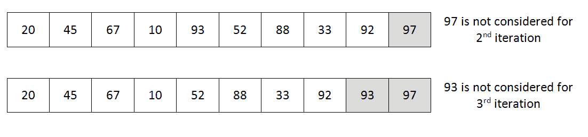


如果我们看前面的图片，脑海中立刻会冒出一个问题：“`92` 不是已经排好序了吗？我们需要再次比较所有数字并标记 `92` 已经在它的位置上排好序了吗？”是的，我们是对的。这是一个有效的问题。这意味着我们可以知道在内层循环中最后一次交换发生的位置；在此之后，数组已经排序。因此，我们可以为下一次循环设置一个边界，只比较到我们设置的边界为止。以下是其伪代码：

```
procedure bubbleSort( A : list of sortable items )

   n = length(A)

   bound = n -1

   for i = 1 to n inclusive do

     swapped = false

     newbound = 0

     for j = 1 to bound inclusive do

       if A[j] > A[j+1] then

         swap( A[j], A[j+1] )

            swapped = true

            newbound = j

       end if

     end for


     bound = newbound


     if swapped is false

        break

     end if


   end for

end procedure
```

在这里，我们在完成每次内层循环后设置边界，确保我们不会进行不必要的迭代。以下是使用前面伪代码的实际 PHP 代码：

```
function bubbleSort(array $arr): array {

    $len = count($arr);

    $count = 0;

    $bound = $len-1;


    for ($i = 0; $i < $len; $i++) {

     $swapped = FALSE;

     $newBound = 0;

      for ($j = 0; $j < $bound; $j++) {

          $count++;

          if ($arr[$j] > $arr[$j + 1]) {

            $tmp = $arr[$j + 1];

            $arr[$j + 1] = $arr[$j];

            $arr[$j] = $tmp;

            $swapped = TRUE;

            $newBound = $j;


          }

      }

     $bound = $newBound;


     if(! $swapped) break;

    }

    echo $count."\n";

    return $arr;

}
```

我们已经看到了冒泡排序实现的不同变体，但输出将始终相同：`10`、`20`、`33`、`45`、`52`、`67`、`88`、`92`、`93`、`97`。如果是这样，我们如何确定我们的改进实际上对算法产生了影响？以下是针对我们初始列表 20, 45, 93, 67, 10, 97, 52, 88, 33, 92 的所有四种实现的比较次数统计：

| 解决方案 | 比较次数 |
| --- | --- |
| 常规冒泡排序 | 90 |
| 第一次改进后 | 63 |
| 第二次改进后 | 42 |
| 第三次改进后 | 38 |

正如我们所见，通过我们的改进，比较次数从 `90` 减少到了 `38`。因此，我们当然可以通过一些改进来提升算法性能，以减少所需的比较次数。

## 理解选择排序

选择排序是另一种基于比较的排序算法，看起来类似于冒泡排序。最大的区别在于它比冒泡排序需要更少的交换次数。在选择排序中，我们首先找到数组中的最小/最大项并将其放在第一位。如果我们按降序排序，则从数组中取出最大值。对于升序，我们取出最小值。在第二次迭代中，我们将找到数组中第二大或第二小的值并将其放在第二位。这个过程一直持续，直到我们将每个数字都放入正确的排序位置。这就是所谓的选择排序。选择排序的伪代码如下所示：

```
procedure selectionSort( A : list of sortable items )

   n = length(A)

   for i = 1 to n inclusive do

     min = i

     for j = i+1 to n inclusive do

       if A[j] < A[min] then

         min = j

       end if

     end for


     if min != i

        swap(a[i],a[min])

     end if


   end for

end procedure
```

如果我们观察上述算法，可以看到，在外层循环的第一次迭代之后，第一个最小项被存储在位置一。在第一次迭代期间，我们选择了第一项，然后从剩余项（从 2 到 `n`）中找到最小值。我们假设第一项是最小值。如果我们找到另一个更小的值，我们将标记其位置，直到扫描完剩余列表并找到新的最小值。如果未找到更小的值，则我们的假设是正确的，第一项确实是最小值。下图展示了我们的 `20`、`45`、`93`、`67`、`10`、`97`、`52`、`88`、`33`、`92` 数组在选择排序前两步中的情况：

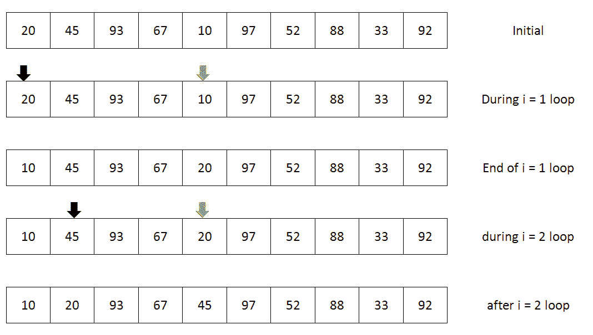

正如上图所示，我们从列表中的第一项 `20` 开始。然后，我们从数组其余部分找到最小值 `10`。在第一次迭代结束时，我们只是交换了两个位置的值（由箭头标记）。结果，在第一次迭代结束时，数组中的最小值被存储在第一位。然后，我们指向下一项 `45`，并开始从其位置右侧寻找比 `45` 小的下一项。我们从剩余项中找到了 `20`（如两个箭头所示）。在第二次迭代结束时，我们只是将第二个位置的数字与从列表剩余部分新找到的最小值进行交换。这将持续到最后一个元素，最终我们得到一个排序好的数组。现在让我们将伪代码转换为 PHP 代码。

## 读累了记得休息一会哦~

**公众号：古德猫宁李**

*   电子书搜索下载
*   书单分享
*   书友学习交流

**网站：**[沉金书屋 https://www.chenjin5.com](https://www.chenjin5.com)

*   电子书搜索下载
*   电子书打包资源分享
*   学习资源分享

## 实现选择排序

我们将采用与冒泡排序相同的方法，我们的实现将接受一个数组作为参数并返回一个排序后的数组。以下是 PHP 实现：

```
function selectionSort(array $arr): array {

    $len = count($arr);

    for ($i = 0; $i < $len; $i++) {

      $min = $i;

      for ($j = $i+1; $j < $len; $j++) {

          if ($arr[$j] < $arr[$min]) {

            $min = $j;

          }

      }


      if ($min != $i) {

          $tmp = $arr[$i];

          $arr[$i] = $arr[$min];

          $arr[$min] = $tmp;

      }

    }

    return $arr;

}
```

正如所见，这是按升序对数组进行排序的最简单方法。如果你想按降序排序，我们只需将比较 `$arr[$j] < $arr[$min]` 改为 `$arr[$j] > $arr[$min]` 并将 `$min` 替换为 `$max`。

## 选择排序的复杂度

选择排序看起来也类似于冒泡排序，并且有两个从 0 到 `n` 的 `for` 循环。冒泡排序和选择排序的基本区别在于，选择排序最多进行 `n-1` 次交换，而在最坏情况下冒泡排序可能进行 `n*n` 次交换。然而，在选择排序中，最佳情况、最坏情况和平均情况具有相似的复杂度。以下是选择排序的复杂度图表：

| 最佳时间复杂度 | `Ω(n²)` |
| --- | --- |
| 最坏时间复杂度 | `O(n²)` |
| 平均时间复杂度 | `Θ(n²)` |
| 空间复杂度（最坏情况） | `O(1)` |

## 理解插入排序

到目前为止，我们已经看到了两种基于比较的排序算法。现在，我们将探索另一种与前两种相比效率稍高的排序算法。我们说的是插入排序。与我们刚才看到的另外两种排序算法相比，它的实现最为简单。如果项目数量较少，插入排序的效果优于冒泡排序和选择排序。如果数据集很大，则会变得低效，类似于冒泡排序。由于插入排序的交换几乎是线性的，建议你使用插入排序代替冒泡排序和选择排序。

顾名思义，插入排序基于将数字插入到其左侧正确位置的原则工作。它从数组的第二项开始，检查其左侧的项是否小于当前值。如果是，它会移动该项并将较小的项存储在其正确位置。然后，它移动到下一项，同一原则一直持续直到整个数组排序完成。插入排序的伪代码如下所示：

```
procedure insertionSort( A : list of sortable items )

   n = length(A)

   for i = 1 to n inclusive do

     key = A[i]

     j = i - 1

     while j >= 0 and A[j] > key   do

       A[j+1] = A[j]

       j--

     end while


     A[j+1] = key


   end for

end procedure
```

如果我们考虑用于冒泡排序和选择排序的前一个数字列表，那么我们将面临以下必须进行插入排序的场景。

我们数组的元素为：`20`、`45`、`93`、`67`、`10`、`97`、`52`、`88`、`33`、`92`。

让我们从第二项 `45` 开始。现在，我们将从 `45` 左侧的第一项开始，向数组开头方向查看，看左侧是否有大于 `45` 的值。由于只有 `20`，因此无需插入，因为到目前为止直到第二个元素（`20`、`45`）都是已排序的。现在，我们将指针移至 `93`，它再次开始比较，从 `45` 开始向左搜索值是否更大。由于 `45` 不大于 `93`，它在那里停止，因为我们之前得出结论前两项已经排序。现在，前三项（`20`、`45`、`93`）已排序。接下来是 `67`，我们再次从左侧数字开始比较。左侧的第一个数字是 `93`，它更大，所以必须移动一位。我们将 `93` 移动到 `67` 原本的位置。然后，我们移动到其左侧的下一项，即 `45`。`45` 小于 `67`，无需进一步比较。现在，我们将 `67` 插入 `93` 原本的位置，而 `93` 必须移动到 `67` 的位置。这将持续直到整个数组排序完成。下图展示了使用插入排序在每一步的完整排序过程：

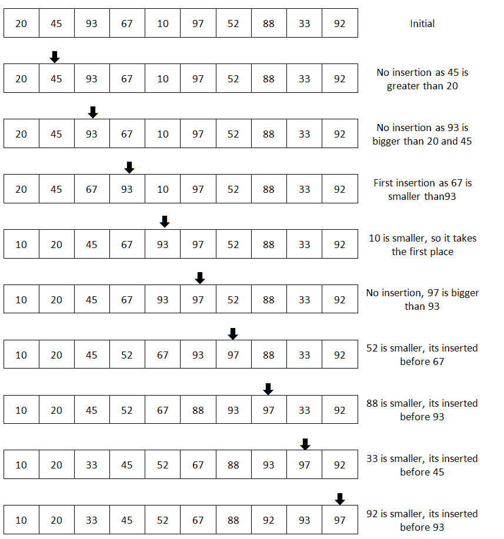

## 实现插入排序

我们将以类似于其他两种排序的方式实现插入排序，但有一个细微的差别。这一次，我们将按引用传递数组。这样做，我们就不需要函数有任何返回值。如果我们愿意，也可以按值传递参数，并在函数结束时返回数组。这是相关代码：

```php
function insertionSort(array &$arr) { 

    $len = count($arr); 

    for ($i = 1; $i < $len; $i++) { 

      $key = $arr[$i]; 

      $j = $i - 1; 


      while($j >= 0 && $arr[$j] > $key) { 

          $arr[$j+1] = $arr[$j]; 

          $j--; 

      }      

      $arr[$j+1] = $key; 

    }     

}
```

参数数组通过引用（`&$arr`）传递给函数。因此，原始数组（而非其副本）将被直接修改。现在，我们想运行代码并检查输出。为此，我们必须运行以下代码：

```php
$arr = [20, 45, 93, 67, 10, 97, 52, 88, 33, 92];


insertionSort($arr);

echo implode(",", $arr);
```

这将产生与前两种情况相同的输出。唯一的区别是我们不期望函数返回任何数组，也不将其存储到任何新变量中。

如果我们按引用传递数组，则不必返回数组。传入的数组将在函数内部被修改。如何实现排序取决于我们的选择。

### 插入排序的复杂度

插入排序的复杂度与冒泡排序相似。与冒泡排序的基本区别在于交换次数远低于冒泡排序。以下是插入排序的复杂度：

| 最佳时间复杂度 | `Ω(n)` |
| --- | --- |
| 最差时间复杂度 | `O(n²)` |
| 平均时间复杂度 | `Θ(n²)` |
| 空间复杂度（最差情况） | `O(1)` |

### 理解用于排序的分治技术

到目前为止，我们探索的是对完整数字列表进行排序。结果是，我们每次都要比对一个庞大的数字列表。如果我们能以某种方式让列表变小，这个问题就能解决。分治法对此非常有帮助。使用这种方法，我们将一个问题分成两个或更多子问题或集合，先解决这些较小的问题，然后再将子问题的所有结果合并以获得最终结果。这就是所谓的分治法。

分治法能让我们高效地解决排序问题，并降低算法的复杂度。最流行的两种排序算法是归并排序和快速排序，它们都应用分治算法对项目列表进行排序，因此被认为是最好的排序算法。现在，我们将在下一节探索这两种算法。

### 理解归并排序

既然我们已经知道归并排序应用分治法来解决排序问题，我们需要找出两个过程来解决该问题。第一个是将问题集分成足够小、易于求解的问题，然后合并这些结果。我们将对分治部分采用递归方法。下图展示了如何采用分治方法。我们现在将考虑一组较小的数字 `20`、`45`、`93`、`67`、`97`、`52`、`88`、`33` 来解释分治部分：


根据前面的图片，我们现在可以开始准备伪代码，它将包含两部分——分割和合并。以下是实现该功能的伪代码：

```
func mergesort ( A : array of sortable items):

     n = length(A)      

     if ( n == 1 ) return a 


     var l1 as array = a[0] ... a[n/2] 

     var l2 as array = a[n/2+1] ... a[n] 


     l1 = mergesort( l1 ) 

     l2 = mergesort( l2 ) 


     return merge( l1, l2 ) 

end func


func merge( a: array, b : array )

     c = array


     while ( a and b have elements )

          if ( a[0] > b[0] )

               add b[0] to the end of c

               remove b[0] from b

          else

               add a[0] to the end of c

               remove a[0] from a

     end while


     while ( a has elements )

          add a[0] to the end of c

          remove a[0] from a

     end while


     while ( b has elements )

          add b[0] to the end of c

          remove b[0] from b

     return c

     end while

end func
```

伪代码的第一部分展示了分割过程。我们将项目数组不断分割，直到其大小达到 1。然后，我们开始使用 `merge` 函数合并结果。在 `merge` 函数中，我们有一个数组用于存储合并后的结果。正因如此，归并排序实际上比我们迄今为止看到的其他算法具有更高的空间复杂度。现在，让我们进入编码环节，使用 PHP 实现此伪代码。

### 实现归并排序

我们将首先编写分割部分，随后是合并或征服部分。PHP 有一些用于分割数组的内置函数。我们将使用 `array_slice` 函数来进行分割。代码如下：

```php
function mergeSort(array $arr): array { 

    $len = count($arr); 

    $mid = (int) $len / 2; 

    if ($len == 1) 

         return $arr; 


    $left  = mergeSort(array_slice($arr, 0, $mid)); 

    $right = mergeSort(array_slice($arr, $mid)); 


    return merge($left, $right); 

}
```

从代码中可以看出，我们以递归方式分割数组，直到数组大小变为 1。当数组大小为 1 时，我们开始向后合并，就像最后那张图片一样。这是 `merge` 函数的代码，它将接收两个数组，并按照我们的伪代码将它们合并为一个：


```php
function merge(array $left, array $right): array { 

    $combined = []; 

    $countLeft = count($left); 

    $countRight = count($right); 

    $leftIndex = $rightIndex = 0; 


    while ($leftIndex < $countLeft && $rightIndex < $countRight) { 

      if ($left[$leftIndex] > $right[$rightIndex]) { 

          $combined[] = $right[$rightIndex]; 

          $rightIndex++; 

      } else { 

          $combined[] = $left[$leftIndex]; 

          $leftIndex++; 

      } 

    } 

    while ($leftIndex < $countLeft) { 

      $combined[] = $left[$leftIndex]; 

      $leftIndex++; 

    } 

    while ($rightIndex < $countRight) { 

      $combined[] = $right[$rightIndex]; 

      $rightIndex++; 

    } 

    return $combined;

}
```

代码现已完成，因为我们已合并两个提供的数组，并将合并结果返回给 `mergeSort` 函数。我们刚刚以递归方式解决了该问题。如果你运行以下代码，将得到一个升序排列的项目列表：

```php
$arr = [20, 45, 93, 67, 10, 97, 52, 88, 33, 92];

$arr = mergeSort($arr);

echo implode(",", $arr);
```

现在，让我们探索归并排序的复杂度。

### 归并排序的复杂度

由于归并排序遵循分治法，我们必须同时处理这两方面的复杂度。对于大小为 n 的数组，我们首先需要将数组分成两半，然后将它们合并以得到一个大小为 n 的数组。这可以用 `T(n)` 表示为：

```text
T(n)     = T(n/2) + T(n/2) + n    , for N>1 with T(1) = 0 

         = 2 T(n/2)+n 


T(n)/n   = 2 T(n/2)/n + 1              // divide both side by n 

         = T(n/2)/(n/2)  + 1                  

         = T(n/4)/(n/4)  + 1+ 1        // telescoping 

         = T(n/8)/(n/8)  + 1+ 1 + 1      // again telescoping 

         = ...... 

         = T(n/n)/(n/n)  + 1 + 1 + 1 + ....... + 1 

         = log (n)                     // since T(1) = 0      


So T(n)  = n log (n)                   // multiply both side with n 
```

因此，归并排序的复杂度为 `O(n log(n))`。以下是归并排序的复杂度图表：

| 最佳时间复杂度 | `Ω(nlog(n))` |
| --- | --- |
| 最差时间复杂度 | `O(nlog(n))` |
| 平均时间复杂度 | `Θ(nlog(n))` |
| 空间复杂度（最差情况） | `O(n)` |

## 读累了记得休息一会哦~

**公众号：古德猫宁李**

* 电子书搜索下载
* 书单分享
* 书友学习交流

**网站：**[沉金书屋 https://www.chenjin5.com](https://www.chenjin5.com)

* 电子书搜索下载
* 电子书打包资源分享
* 学习资源分享

## 理解快速排序

快速排序是另一种采用分治法的高效排序算法。虽然它不像归并排序那样分成相等的两半，但它会创建动态分区来对数据进行排序。快速排序的工作原理如下：

1. 从数组中选取一个随机值，我们称之为 `pivot`（基准值/枢轴）。
2. 重新排序数组，使得小于 `pivot` 的项移至其左侧，大于或等于 `pivot` 的项移至其右侧。这称为分区。
3. 递归调用*步骤 1* 和 *2* 来处理两个子数组（`pivot` 的左侧和右侧），直到所有项都排好序。

从数组中选取 `pivot` 有很多方法。我们可以选择数组最左侧的项，也可以选择最右侧的项。在这两种情况下，如果数组已经有序，都会导致最坏情况的复杂度。选择一个好的 `pivot` 可以提高算法的效率。分区也有几种不同的方法。我们将讲解 *Hoare 分区法*（Hoare Partition），与其他分区方法相比，它进行的交换操作相对较少。以下是我们的快速排序伪代码算法。我们将进行原地排序，因此不需要额外的空间：

```
procedure Quicksort(A : array, p : int, r : int)

    if (p < r)

       q = Partition(A, p, r)

       Quicksort(A, p, q)

       Quicksort(A, q + 1, r)

    end if

end procedure


procedure Partition(A : array, p : int, r : int)

    pivot = A[p]

    i = p - 1

    j = r + 1

    while (true)

           do

            i := i + 1

           while A[i] < pivot    

           do

             j := j - 1

           while A[j] > pivot


      if i < j then

          swap A[i] with A[j]

      else

          return j

      end if

   end while

end procedure
```

我们使用第一个元素作为 `pivot` 元素。也可以选择最后一个元素，或取中位数来选择 `pivot` 元素。现在让我们使用 PHP 实现该算法。

## 实现快速排序

正如伪代码所示，我们将用两个函数来实现快速排序：一个函数执行快速排序本身，另一个用于分区。以下是执行快速排序的实现：

```php
function quickSort(array &$arr, int $p, int $r) {

  if ($p < $r) {

    $q = partition($arr, $p, $r);

    quickSort($arr, $p, $q);

    quickSort($arr, $q + 1, $r);

  }

}
```

以下是执行分区的实现：

```php
function partition(array &$arr, int $p, int $r) { 

  $pivot = $arr[$p]; 

  $i = $p - 1; 

  $j = $r + 1; 

  while (true) 

  { 

   do { 

    $i++; 

   } while ($arr[$i] < $pivot && $arr[$i] != $pivot); 

   do { 

    $j--; 

   } while ($arr[$j] > $pivot && $arr[$j] != $pivot); 


   if ($i < $j) { 

    $temp = $arr[$i]; 

    $arr[$i] = $arr[$j]; 

    $arr[$j] = $temp; 

   } else { 

    return $j; 

      } 

  } 

}


$arr = [20, 45, 93, 67, 10, 97, 52, 88, 33, 92]; 


quickSort($arr, 0, count($arr) - 1); 

echo implode(",", $arr);
```

如果我们用图示来展示分区中的 `pivot` 和排序过程，可以看到下图。为简单起见，我们仅展示发生交换的步骤：


## 快速排序的复杂度

快速排序的最坏情况复杂度可能类似于冒泡排序。`pivot` 的选择正是导致这种情况的原因。以下是快速排序的复杂度图表：

| 最佳时间复杂度 | `Ω(nlog(n))` |
| --- | --- |
| 最坏时间复杂度 | `O(n²)` |
| 平均时间复杂度 | `Θ(nlog(n))` |
| 空间复杂度（最坏情况） | `O(log(n))` |

## 理解桶排序

桶排序也称为箱排序。桶排序是一种分布式排序系统，其中数组元素被放置在不同的桶中。然后通过另一种排序算法，或通过递归应用桶排序，对每个桶单独进行排序。使用 PHP 实现的桶排序如下所示：

```php
function bucketSort(array &$data) { 


    $n = count($data); 

    if ($n <= 0) 

         return;                          


    $min = min($data); 

    $max = max($data); 

    $bucket = []; 

    $bLen = $max - $min + 1; 


    $bucket = array_fill(0, $bLen, []); 


    for ($i = 0; $i < $n; $i++) { 

         array_push($bucket[$data[$i] - $min], $data[$i]); 

    } 


    $k = 0; 

    for ($i = 0; $i < $bLen; $i++) {

         $bCount = count($bucket[$i]);


      for ($j = 0; $j < $bCount; $j++) { 

          $data[$k] = $bucket[$i][$j];

          $k++;

      }

    }

} 
```

桶排序的时间复杂度相较于其他基于比较的排序算法要好得多。以下是桶排序的复杂度：

| 最佳时间复杂度 | `Ω(n+k)` |
| --- | --- |
| 最坏时间复杂度 | `O(n²)` |
| 平均时间复杂度 | `Θ(n+k)` |
| 空间复杂度（最坏情况） | `O(n)` |

## 使用 PHP 内置排序函数

PHP 拥有丰富的预定义函数库，其中也包含不同的排序函数。它提供了不同的函数，按值或按键/索引对数组中的项目列表进行排序。我们在排序时也可以保留数组值与其各自键的关联。PHP 的另一个重要功能是用于排序多维数组的内置函数。以下是这些函数的总结：

| 函数名 | 用途 |
| --- | --- |
| `sort()` | 按升序对数组排序。不保留值/键关联。 |
| `rsort()` | 按降序/逆序对数组排序。不保留索引/键关联。 |
| `asort()` | 对数组排序并保持索引关联。 |
| `arsort()` | 按逆序对数组排序并保持索引关联。 |
| `ksort()` | 按键对数组排序。它保持键到数据的关联。这主要用于关联数组。 |
| `krsort()` | 按键逆序对数组排序。 |
| `natsort()` | 使用“自然排序”算法对数组排序，并保持值/键关联。 |
| `natcasesort()` | 使用不区分大小写的“自然排序”算法对数组排序，并保持值/键关联。 |
| `usort()` | 使用用户定义的比较函数按值对数组排序，不保留值/键关联。第二个参数是用于比较的可调用函数。 |
| `uksort()` | 使用用户定义的比较函数按键对数组排序，并保持值/键关联。第二个参数是用于比较的可调用函数。 |
| `uasort()` | 使用用户定义的比较函数按值对数组排序，并保持值/键关联。第二个参数是用于比较的可调用函数。 |

对于 `sort`、`rsort`、`ksort`、`krsort`、`asort` 和 `arsort`，可用以下排序标志：

* `SORT_REGULAR`：按原样比较项目（不改变类型）
* `SORT_NUMERIC`：按数值比较项目
* `SORT_STRING`：按字符串比较项目
* `SORT_LOCALE_STRING`：按字符串比较项目，基于当前区域设置
* `SORT_NATURAL`：使用“自然排序”按字符串比较项目

## 总结

在本章中，您学习了不同的排序算法。排序是我们开发过程中不可或缺的一部分，了解不同排序算法及其复杂度将帮助我们根据问题集决定最佳的排序算法选择。还有其他排序算法，可在网上查找以供进一步学习。我们特意没有在本章涵盖堆排序，因为我们将在*第 10 章*讨论它。在下一章中，我们将讨论算法中另一个重要主题——搜索。

# 探索搜索选项

## 搜索算法

除了排序，搜索是编程世界中最常用的算法之一。无论我们是在搜索电话簿、电子邮件、数据库还是文件，我们实际上都是在执行某种搜索技术来定位我们想要查找的项目。搜索和排序是编程中最重要的两个组成部分，这一点至关重要。在本章中，您将学习不同的搜索技术及其效率。我们还将学习搜索树数据结构的不同方法。

### 线性搜索

执行搜索最常见的方法之一是将每个项目与我们要查找的项目进行比较。这被称为线性搜索或顺序搜索。这是执行搜索最基本的方法。如果我们认为列表中有 `n` 个项目，在最坏的情况下，我们必须搜索 `n` 个项目才能找到特定的项目。我们可以遍历列表或数组来查找项目。让我们考虑以下示例：

```php
function search(array $numbers, int $needle): bool {

    $totalItems = count($numbers);

    for ($i = 0; $i < $totalItems; $i++) {

        if ($numbers[$i] === $needle) {

            return TRUE;

        }

    }

    return FALSE;

}
```

我们有一个名为 `search()` 的函数，它接受两个参数。一个是数字列表，另一个是我们在列表中要查找的数字。我们运行一个 `for` 循环来遍历列表中的每个项目并将它们与我们的项目进行比较。如果找到匹配项，我们返回 `TRUE` 并不继续搜索。然而，如果循环结束仍未找到任何内容，我们在函数定义的末尾返回 `FALSE`。让我们使用 `search()` 函数通过以下程序来查找某些内容：

```php
$numbers = range(1, 200, 5);

if (search($numbers, 31)) {

    echo "Found";

} else {

    echo "Not found";

}
```

在这里，我们使用 PHP 的内置函数 `range()` 生成一个随机数组，范围为 1 到 200（含）。每个项目之间将有 5 的间隔，如 1、6、11、16 等；然后我们搜索 31，它在列表中，因为我们有 6、11、16、21、26、31 等。然而，如果我们想搜索 32 或 33，则找不到该项目。因此，对于这种情况，我们的输出将是 `Found`。

这里我们需要记住一点：我们不关心列表是否按任何特定顺序排列或以特定方式组织。如果我们要查找的项目在第一个位置，那将是最好的结果。最坏的结果可能是最后一个项目或列表中不存在的项目。在这两种情况下，我们都必须遍历列表中的所有 `n` 个项目。以下是线性/顺序搜索的复杂度：

| 复杂度 | 值 |
| :--- | :--- |
| 最佳时间复杂度 | `O(1)` |
| 最坏时间复杂度 | `O(n)` |
| 平均时间复杂度 | `O(n)` |
| 空间复杂度（最坏情况） | `O(1)` |

正如我们所见，线性搜索的平均或最坏时间复杂度为 `O(n)`，这不会因我们如何排列项目列表而改变。现在，如果数组中的项目按特定顺序排序，那么我们可能不必进行线性搜索，通过进行选择性或计算性搜索可以获得更好的结果。最流行且众所周知的搜索算法是“二分搜索”。是的，它听起来像您在第 6 章 *理解和实现树* 中学到的二叉搜索树，但我们甚至可以在不构建二叉搜索树的情况下使用该算法。那么，让我们来探索一下。

### 二分搜索

二分搜索是编程世界中非常流行的搜索算法。在顺序搜索中，我们从开头开始扫描每个项目以找到所需的项目。然而，如果列表已经排序，那么我们不需要从列表的开头或结尾开始搜索。在二分搜索算法中，我们从列表的中间开始，检查中间的项目比我们要查找的项目小还是大，并决定往哪个方向走。这样，我们将列表减半并完全丢弃其中一半，就像下图所示：


如果我们看前面的图片，我们有一个已排序（升序）的数字列表在数组中。我们想知道项目 `7` 是否在数组中。由于数组有 17 个项目（索引 0 到 16），我们将首先转到中间索引，对于此示例是第八个索引。现在，第八个索引的值为 `14`，大于我们要搜索的值 `7`。这意味着如果 `7` 存在于此数组中，它位于 `14` 的左侧，因为数字已经排序。因此，我们丢弃从第八个索引到第十六个索引的数组部分，因为数字不可能在那部分数组中。现在，我们重复相同的过程并取剩余数组部分的中间，即剩余部分的第三个元素。现在，第三个元素的值为 `6`，小于 `7`。结果，我们要查找的项目在第三个元素的右侧，而不是左侧。

现在，我们将检查数组的第四个元素到第七个元素，中间元素现在指向第五个元素。第五个元素的值为 `8`，大于我们要查找的 `7`。所以，我们必须考虑第五个元素的左侧来查找我们要找的项目。这次，数组中只剩下两个项目需要检查，元素是第四个和第五个元素。当我们向左移动时，我们将检查第四个元素，并看到值与我们要找的 `7` 匹配。如果第四个索引的值不是 `7`，函数将返回 false，因为没有更多元素可供检查。如果我们看前面图片中的箭头标记，我们可以看到在四步之内我们找到了要查找的值，而在最坏情况下，线性搜索函数检查所有 17 个数字需要 17 步。这被称为二分搜索、折半搜索或对数搜索。

正如我们在上一张图片中所见，我们必须将初始列表分成两半并继续，直到我们达到无法进一步划分以找到项目的地步。我们可以使用迭代方式或递归方式来执行划分部分。我们实际上将使用这两种方式。那么，让我们首先以迭代方式定义二分搜索的伪代码：

```
BinarySearch(A : list of sorted items, value) {

       low = 0

       high = N

       while (low <= high) {

           // lowest int value, no fraction

           mid = (low + high) / 2

           if (A[mid] > value)

               high = mid - 1

           else if (A[mid] < value)

               low = mid + 1

           else

             return true

       }

       return false

 }
```

如果我们看伪代码，可以看到我们根据 `mid` 值调整 `low` 和 `high`。如果我们要查找的值大于 `mid` 中的值，我们将下界调整为 `mid+1`。如果它小于 `mid` 值，则将上界设置为 `mid-1`。它将持续到下界值大于上界值或找到项目为止。如果未找到项目，我们在函数末尾返回 false。现在，让我们使用 PHP 实现伪代码：

```
function binarySearch(array $numbers, int $needle): bool {

    $low = 0;

    $high = count($numbers) - 1;

    while ($low <= $high) {

        $mid = (int) (($low + $high) / 2);

        if ($numbers[$mid] > $needle) {

            $high = $mid - 1;

        } else if ($numbers[$mid] < $needle) {

            $low = $mid + 1;

        } else {

            return TRUE;

        }

    }

    return FALSE;

}
```

在我们的实现中，我们遵循了前面页面中的大部分伪代码。现在，让我们用两个搜索运行代码，其中我们知道一个值在列表中，一个不在列表中：

## 二分查找的实现与分析

### PHP 中的迭代二分查找

```php
$numbers = range(1, 200, 5);

$number = 31;

if (binarySearch($numbers, $number) !== FALSE) {
    echo "$number Found \n";
} else {
    echo "$number Not found \n";
}

$number = 500;
if (binarySearch($numbers, $number) !== FALSE) {
    echo "$number Found \n";
} else {
    echo "$number Not found \n";
}
```

正如我们从之前的线性查找代码中所知，`31` 在列表中，因此应显示 `Found`。然而，`500` 不在列表中，应显示 `Not found`。如果我们运行代码，将在控制台看到如下输出：

```
31 Found

500 Not found
```

### 递归二分查找算法

我们现在将编写二分查找的递归算法，这对我们也很有用。伪代码要求我们每次调用函数时都发送额外的参数。我们需要在每次递归调用时发送 `low` 和 `high`，这在迭代版本中是不需要的：

```
BinarySearch(A : 排序好的项目列表, value, low, high) {

   if (high < low)
          return false

      // 最低整数值，无小数部分
           mid = (low + high) / 2

           if (A[mid] > value)
               return BinarySearch(A, value, low, mid - 1)
           else if (A[mid] < value)
               return BinarySearch(A, value, mid + 1, high)
     else
      return TRUE;
}
```

从前面的伪代码中我们可以看到，现在将 `low` 和 `high` 作为参数，并且在每次调用时将新值作为参数发送。我们有一个边界条件，用于检查 `low` 是否大于 `high`。与迭代版本相比，代码看起来更小、更整洁。现在，让我们使用 PHP 7 来实现它：

```php
function binarySearch(array $numbers, int $needle,
int $low, int $high): bool {

    if ($high < $low) {
    return FALSE;
    }

    $mid = (int) (($low + $high) / 2);

    if ($numbers[$mid] > $needle) {
      return binarySearch($numbers, $needle, $low, $mid - 1);
    } else if ($numbers[$mid] < $needle) {
      return binarySearch($numbers, $needle, $mid + 1, $high);
    } else {
      return TRUE;
    }
}
```

现在，让我们使用以下代码来递归运行此搜索：

```php
$numbers = range(1, 200, 5);

$number = 31;
if (binarySearch($numbers, $number, 0, count($numbers) - 1) !== FALSE) {
    echo "$number Found \n";
} else {
    echo "$number Not found \n";
}

$number = 500;
if (binarySearch($numbers, $number, 0, count($numbers) - 1) !== FALSE) {
    echo "$number Found \n";
} else {
    echo "$number Not found \n";
}
```

正如我们从前面的代码中所见，我们在递归二分查找的首次调用中发送了 `0` 和 `count($numbers)-1`。然后，该 `high` 和 `low` 会根据 `mid` 值在每次递归调用中自动调整。因此，我们已经看到了二分查找的迭代和递归实现。根据我们的需求，可以在程序中使用其中任何一种。现在，让我们分析二分查找算法，找出它如何优于线性或顺序查找算法。

### 二分查找算法分析

到目前为止，我们已经看到，对于每次迭代，我们都将列表减半，并完全丢弃其中一半进行搜索。这使得我们的列表在经过 1、2 和 3 次迭代后分别变为 `n/2`、`n/4`、`n/8`，依此类推。因此，我们可以说在第 K 次迭代后，将剩下 `n/2^k` 个项目。我们可以轻松地说出，当 `n/2^k = 1` 时发生最后一次迭代，或者可以说 `2^K = n`。两边同时取对数得出 `k = log(n)`，这是二分查找算法的最坏情况运行时间。以下是二分查找算法的复杂度：

| 最佳时间复杂度 | `O(1)` |
| --- | --- |
| 最坏时间复杂度 | `O(log n)` |
| 平均时间复杂度 | `O(log n)` |
| 空间复杂度（最坏情况） | `O(1)` |

如果我们的数组或列表已经排序，则始终首选应用二分查找以获得更好的性能。现在，无论列表是按升序还是降序排序，都可能对我们计算 `low` 和 `high` 产生一些影响。我们迄今为止看到的逻辑适用于升序。如果数组按降序排序，逻辑将互换，即大于变为小于，反之亦然。值得注意的是，二分查找算法为我们提供了找到的搜索项的索引。然而，在某些情况下，我们不仅需要知道该数字是否存在，还需要找到它在列表中的第一次出现或最后一次出现。如果我们使用二分查找算法，它将返回 true 或搜索算法找到该数字的最大索引号。然而，这可能不是第一次或最后一次出现的位置。为此，我们将对二分查找算法进行一些修改，我们将其称为重复二分查找树算法。

### 重复二分查找树算法

请看下图。我们有一个包含重复项的数组。如果我们尝试从数组中找到 `2` 的第一次出现，上一节的二分查找算法将给我们第五个元素。然而，从下图中我们可以清楚地看到，它不是第五个元素；相反，它是第二个元素，这才是正确答案。因此，我们的二分查找算法需要修改。修改的方法是重复搜索，直到到达第一次出现的位置：


以下是使用迭代方法的修改后的解决方案：

```php
function repetitiveBinarySearch(array $numbers, int $needle): int {
    $low = 0;
    $high = count($numbers) - 1;
    $firstOccurrence = -1;

    while ($low <= $high) {
      $mid = (int) (($low + $high) / 2);

      if ($numbers[$mid] === $needle) {
          $firstOccurrence = $mid;
          $high = $mid - 1;
      } else if ($numbers[$mid] > $needle) {
          $high = $mid - 1;
      } else {
          $low = $mid + 1;
      }
    }
    return $firstOccurrence;
}
```

正如我们所见，首先我们检查 `mid` 是否具有我们要查找的值。如果为真，则将中间索引赋值为第一次出现的位置，并将搜索中间元素的左侧，以检查是否存在我们要查找的数字的其他出现。然后我们继续迭代，直到搜索了每个索引（`$low` 大于 `$high`）。如果未找到进一步的出现，则变量 `firstOccurrence` 将保存我们找到该项的第一个索引的值。如果未找到，则照常返回 `-1`。让我们运行以下代码来检查结果是否正确：

```php
$numbers = [1, 2, 2, 2, 2, 2, 2, 2, 2, 3, 3, 3, 3, 3, 4, 4, 5, 5];

$number = 2;
$pos = repetitiveBinarySearch($numbers, $number);

if ($pos >= 0) {
    echo "$number Found at position $pos \n";
} else {
    echo "$number Not found \n";
}

$number = 5;
$pos = repetitiveBinarySearch($numbers, $number);

if ($pos >= 0) {
    echo "$number Found at position $pos \n";
} else {
    echo "$number Not found \n";
}
```

---

> 读累了记得休息一会哦~

**公众号：古德猫宁李**

*   电子书搜索下载
*   书单分享
*   书友学习交流

**网站：**[沉金书屋 https://www.chenjin5.com](https://www.chenjin5.com)

*   电子书搜索下载
*   电子书打包资源分享
*   学习资源分享

现在，我们有了一个包含重复值 2、3、4 和 5 的数组。我们想要搜索该数组，并找到值首次出现的位置或索引。例如，如果我们在常规的二分查找函数中搜索 `2`，它将返回第八个位置作为找到值 `2` 的位置。而在我们的例子中，我们实际上是在寻找第二个索引，它才是项目 `2` 首次出现的真实位置。我们的函数 `repetitiveBinarySearch` 正是实现了这一功能，我们将返回的位置存储在一个名为 `$pos` 的变量中。如果找到该数字，我们将显示输出及其位置。现在，如果我们在控制台中运行前面的代码，将得到以下输出：

```
2 Found at position 1
5 Found at position 16
```

这与我们预期的结果相符。因此，我们可以说现在拥有了一个重复二分查找算法，用于从给定的有序列表中查找某个项目的首次和最后一次出现。这可能是一个解决许多问题的非常实用的函数。

到目前为止，通过我们的示例和分析，我们可以得出结论：二分查找绝对比线性查找快。然而，主要的前提条件是在应用二分查找之前必须先对列表进行排序。在未排序的数组中应用二分查找会导致不准确的结果。有时我们会收到一个数组，但不确定该数组是否已排序。现在的问题是：“在这种情况下，我们应该先对数组进行排序，然后应用二分查找算法？还是直接运行线性查找算法来查找项目？”让我们稍微讨论一下这个问题，以便我们知道如何处理这种情况。

## 搜索未排序数组——应该先排序吗？

现在，我们处于一种拥有包含 *n* 个项目且未排序的数组的情况。既然我们知道二分查找更快，我们决定先对其进行排序，然后使用二分查找来搜索项目。如果这样做，我们必须记住，最好的排序算法的最坏时间复杂度为 `O(nlog n)`，而二分查找的最坏情况复杂度为 `O(log n)`。因此，如果我们先排序再应用二分查找，复杂度将是 `O(n log n)`，因为与 `O(log n)` 相比它是更大的一个。然而，我们也知道，对于任何线性或顺序查找（无论已排序还是未排序），最坏时间复杂度都是 `O(n)`，这比 `O(n log n)` 好得多。基于 `O(n)` 和 `O(n log n)` 的复杂度比较，我们可以明确地说，如果数组未排序，执行线性查找是更好的选择。

让我们考虑另一种情况，即我们需要多次搜索给定的数组。用 *k* 表示我们想要搜索数组的次数。如果 *k* 为 1，那么我们可以轻松应用上一段讨论的线性方法。如果 *k* 的值与数组大小（用 *n* 表示）相比较小，这也没问题。然而，如果 *k* 的值接近或大于 *n*，那么应用线性方法就会出现问题。

假设 *k = n*，那么对于 *n* 次线性查找，复杂度将是 `O(n²)`。现在，如果我们选择先排序再搜索的方案，即使 *k* 更大，一次性排序也只需要 `O(n log n)` 的时间复杂度。然后，每次搜索将花费 `O(log n)`，搜索 *n* 次的最坏情况复杂度为 `O(n log n)`。如果我们取此处的最坏运行情况，排序和搜索 *k* 个项目将具有 `O(n log n)` 的复杂度，这比顺序搜索要好。

因此，我们可以得出结论：如果搜索操作的次数与数组大小相比较小，最好不对数组进行排序，而是执行顺序搜索。然而，如果搜索操作的次数与数组大小相比较大，最好先对数组进行排序，然后应用二分查找。

多年来，二分查找算法不断发展，衍生出了不同的变体。我们不必每次都选择中间索引，而是可以做出计算决策来选择下一步应使用哪个索引。这正是这些变体能够高效工作的原因。我们现在将讨论二分查找算法的两种此类变体：插值搜索和指数搜索。

## 插值搜索

在二分查找算法中，我们总是从数组的中间开始搜索过程。如果数组是均匀分布的，而我们要查找的项目可能接近数组末尾，那么从中间开始搜索对我们来说可能不是一个好的选择。在这种情况下，插值搜索非常有帮助。插值搜索是对二分查找算法的一种改进。插值搜索可能会根据搜索键的值跳转到不同的位置。例如，如果我们搜索的键接近数组的开头，它将跳转到数组的第一部分，而不是从中间开始。位置是通过探测位置计算公式计算的，如下所示：

```
pos = low + [ (key-arr[low])*(high-low) / (arr[high]-arr[low]) ]
```


正如我们所见，我们从通用的 `mid = (low+high)/2` 公式转变为一个看起来更复杂的公式。如果搜索键更接近 `arr[high]`，该公式将返回一个较高的值；如果键更接近 `arr[low]`，则返回一个低得多的值。现在，让我们借助二分查找代码来实现这种搜索方法：

```
function interpolationSearch(array $arr, int $key): int { 
    $low = 0; 
    $high = count($arr) - 1; 
    while ($arr[$high] != $arr[$low] && $key >= $arr[$low] && $key <= $arr[$high]) { 
        $mid = intval($low + (($key - $arr[$low]) * ($high - $low) / ($arr[$high] - $arr[$low]))); 
        if ($arr[$mid] < $key) 
            $low = $mid + 1; 
        else if ($key < $arr[$mid]) 
            $high = $mid - 1; 
        else 
            return $mid; 
    } 
    if ($key == $arr[$low]) 
        return $low; 
    else 
        return -1; 
}
```

这里，我们以一种不同的方式进行计算。虽然它需要更多的计算步骤，但好的一面是，如果列表是均匀分布的，那么该算法的平均复杂度为 `O(log (log n))`，这比二分查找的 `O(log n)` 复杂度好得多。此外，如果键的分布不均匀，我们必须小心。在这种情况下，插值搜索的性能可能会下降。

现在，我们将探索另一种称为指数搜索的二分查找变体，它可以改进算法。

## 指数搜索

在二分查找中，我们在整个列表中搜索给定的键。指数搜索通过决定搜索的下界和上界来改进二分查找，这样我们就不会搜索整个列表。它减少了查找元素所需的比较次数。搜索分为以下两个步骤进行：

1.  我们通过寻找第一个使得 `2^k` 的值大于搜索项的指数 `k` 来确定边界大小。现在，`2^k` 和 `2^(k-1)` 分别成为上界和下界。

2.  对边界 `2^k` 和 `2^(k-1)` 应用二分查找算法。

现在，让我们使用递归的 `binarySearch` 函数来实现指数搜索：

```
function exponentialSearch(array $arr, int $key): int { 
    $size = count($arr); 
    if ($size == 0) 
        return -1; 
    $bound = 1; 
    while ($bound < $size && $arr[$bound] < $key) { 
        $bound *= 2; 
    } 
    return binarySearch($arr, $key, intval($bound / 2), min($bound, $size)); 
}
```

在这里，在第一步中，我们采取 `i` 步来确定边界。因此，算法的时间复杂度为 `O(log i)`。我们必须记住，这里的 `i` 远小于 `n`。然后，我们在 `2^j` 到 `2^(j-1)` 的边界内进行二分查找，其中 `j = log i`。我们知道二分查找的时间复杂度为 `O(log n)`，其中 `n` 是列表的大小。然而，由于我们进行的是较小范围的边界搜索，实际搜索的大小为 `2^(log i) - 2^(log i) - 1 = 2^(log i - 1)`。因此，该边界的复杂度为 `log(2^(log i - 1)) = log(i) - 1 = O(log i)`。

因此，指数搜索的复杂度如下：

| 最佳时间复杂度 | `O(1)` |
| --- | --- |
| 最坏时间复杂度 | `O(log i)` |
| 平均时间复杂度 | `O(log i)` |
| 空间复杂度（最坏情况） | `O(1)` |

## 使用哈希表搜索

哈希表在搜索操作方面可以是一种非常高效的数据结构。由于哈希表以关联方式存储数据，如果我们知道在哪里查找数据，就可以轻松快速地获取数据。在哈希表中，每个数据都有一个与之关联的唯一索引。如果我们知道要查看哪个索引，就可以非常容易地找到键。通常，在其他编程语言中，我们必须使用单独的哈希函数来计算用于存储值的哈希索引。哈希函数的设计目的是为相同的键生成相同的索引，并避免冲突。然而，PHP 的一个伟大特性是 PHP 数组在其底层 C 实现中本身就是一个哈希表。由于数组是动态的，我们不必担心数组的大小或因值过多而导致数组溢出。我们需要将值存储在关联数组中，以便将值与键关联。如果键是字符串或整数，键可以是值本身。让我们运行一个示例来理解使用哈希表进行搜索：

```
$arr = [];

$count = rand(10, 30);

for($i = 0; $i < $count; $i++) {
    $val = rand(1, 500);
    $arr[$val] = $val;
}

$number = 100;

if(isset($arr[$number])) {
    echo "$number found ";
} else {
    echo "$number not found";
}
```

我们刚刚构建了一个简单的随机关联数组，其中值和键相同。由于我们使用的是 PHP 数组，虽然值的范围可以是 1 到 500，但实际数组大小可以是 10 到 30 之间的任何值。如果是在其他语言中，我们将不得不构建一个大小为 501 的数组来容纳该值作为键。这就是为什么要使用哈希函数来计算索引。如果我们想，也可以使用 PHP 的内置哈希函数：

```
string hash(string $algo, string $data [, bool $raw_output = false ])
```

第一个参数接受我们想要用于哈希的算法类型。我们可以从 md5、sha1、sha256、crc32 等中选择。每种算法都会生成固定长度的哈希输出，我们可以将其用作哈希表的键。

如果我们看看搜索部分，可以看到我们实际上是直接检查关联的索引。这使得我们的搜索复杂度为 `O(1)`。在 PHP 中，即使不使用哈希函数，使用哈希表进行快速搜索也可能是有益的。不过，如果我们想，始终可以使用哈希函数。

到目前为止，我们已经介绍了基于数组和线性结构的搜索。现在我们将把重点转移到层次数据结构的搜索，例如搜索树和图。虽然我们还没有讨论图（将在下一章讨论），但我们将把重点放在树搜索上，它也可以应用于图搜索。

## 树搜索

搜索层次数据的最佳方法之一是创建一棵搜索树。在第 6 章 *理解并实现树* 中，我们看到了如何构建二叉搜索树并提高搜索效率。我们还发现了遍历树的不同方法。现在，我们将探索搜索树结构的两种最流行的方法，通常称为广度优先搜索（BFS）和深度优先搜索（DFS）。

## 广度优先搜索

在树结构中，根节点连接到其子节点，每个子节点都可以表示为一棵树。我们已经在第 6 章 *理解并实现树* 中看到了这一点。在广度优先搜索（通常称为 BFS）中，我们从一个节点（通常是根节点）开始，首先访问所有相邻或邻居节点，然后再访问其他邻居节点。换句话说，在应用 BFS 时，我们必须逐层移动。因为我们是逐层搜索，所以这种技术称为广度优先搜索。在下面的树结构中，我们可以使用 BFS：


对于这棵树，BFS 将按以下顺序访问节点：

BFS 的伪代码如下所示：

```
procedure BFS(Node root)

  Q := empty queue

  Q.enqueue(root);

  while(Q != empty)
     u := Q.dequeue()

     for each node w that is childnode of u
        Q.enqueue(w)
     end for each
  end while

end procedure
```

我们可以看到，我们保留了一个队列来跟踪需要访问的节点。我们可以保留另一个队列来保存访问序列，并将其返回以显示访问顺序。现在，我们将使用 PHP 7 实现 BFS。

## 实现广度优先搜索

由于我们目前尚未详细介绍图，因此我们将 BFS 和 DFS 的实现严格限制在树结构上。此外，我们将使用第 6 章 *理解并实现树* 中看到的通用树结构（甚至不是二叉树）。我们将使用相同的 `TreeNode` 类来定义节点及其与子节点的关系。那么，现在让我们定义一个带有 BFS 功能的 `Tree` 类：

```
class TreeNode {

    public $data = NULL;
    public $children = [];

    public function __construct(string $data = NULL) {
      $this->data = $data;
    }

    public function addChildren(TreeNode $node) {
      $this->children[] = $node;
    }
}

class Tree {

    public $root = NULL;

    public function __construct(TreeNode $node) {
      $this->root = $node;
    }

    public function BFS(TreeNode $node): SplQueue {

      $queue = new SplQueue;
      $visited = new SplQueue;

      $queue->enqueue($node);

      while (!$queue->isEmpty()) {
          $current = $queue->dequeue();
          $visited->enqueue($current);

          foreach ($current->children as $child) {
            $queue->enqueue($child);
          }
      }
      return $visited;
    }
}
```

我们在 `Tree` 类中实现了 `BFS()` 方法。我们将根节点作为广度优先搜索的起点。这里我们有两个队列：一个用于保存我们需要访问的节点，另一个用于保存我们已经访问过的节点。我们还在方法结束时返回已访问队列。现在让我们模仿本节开头看到的树。我们想要像图中所示的树那样放置数据，并检查 BFS 是否真的返回我们预期的模式：：

```
$root = new TreeNode("8");

$tree = new Tree($root);

$node1 = new TreeNode("3");
$node2 = new TreeNode("10");
$root->addChildren($node1);
$root->addChildren($node2);

$node3 = new TreeNode("1");
$node4 = new TreeNode("6");
$node5 = new TreeNode("14");
$node1->addChildren($node3);
$node1->addChildren($node4);
$node2->addChildren($node5);

$node6 = new TreeNode("4");
$node7 = new TreeNode("7");
$node8 = new TreeNode("13");
$node4->addChildren($node6);
$node4->addChildren($node7);
$node5->addChildren($node8);

$visited = $tree->BFS($tree->root);

while (!$visited->isEmpty()) {
  echo $visited->dequeue()->data . "\n";
}
```

我们在这里通过创建节点并将它们附加到根节点和其他节点来构建整个树结构。树构建完成后，我们调用 `BFS` 方法以查找完整的遍历序列。最后的 `while` 循环打印我们访问过的节点序列。以下是前面代码的输出：

```
8
3
10
1
6
14
4
7
13
```

我们得到了预期的结果。现在，如果我们想要搜索以查找某个节点是否存在，可以为 `$current` 节点值添加一个简单的条件检查。如果匹配，则可以返回已访问队列。

BFS 的最坏时间复杂度为 `O(|V| + |E|)`，其中 `V` 是顶点或节点的数量，`E` 是节点之间的边或连接数量。对于空间复杂度，最坏情况为 `O(|V|)`。

图的 BFS 类似，但有一个细微差别。由于图可以是循环的（可以形成环），我们需要确保不会反复访问同一个节点而导致无限循环。为了避免重复访问图节点，我们必须记录已访问的节点。对于标记已访问节点，我们可以使用队列，也可以使用图着色算法。我们将在下一章探讨这一点。

---

## 读累了记得休息一会哦~

**公众号：古德猫宁李**

*   电子书搜索下载
*   书单分享
*   书友学习交流

**网站：**[沉金书屋 https://www.chenjin5.com](https://www.chenjin5.com)

*   电子书搜索下载
*   电子书打包资源分享
*   学习资源分享

---

## 深度优先搜索

深度优先搜索（DFS）是一种搜索技术，我们从一个节点开始搜索，并通过分支尽可能深地向目标节点推进。DFS 与 BFS 不同，我们尝试先深入挖掘而不是先广泛扩散。DFS 垂直增长，当到达分支末端时回溯，并移动到下一个可用的相邻节点，直到搜索结束。我们可以使用上一节中的相同树图像，如下所示：


如果在此处应用 DFS，遍历顺序将为 。我们从根节点开始，然后访问第一个子节点 `3`。然而，不同于 BFS 转向 `10`，我们将探索 `3` 的子节点，并重复此过程直到到达分支底部。在 BFS 中，我们采用了迭代方法。对于 DFS，我们将采用递归方法。现在让我们编写 DFS 的伪代码：

```
procedure DFS(Node current)       
     for each node v that is childnode of current  
        DFS(v) 
     end for each 
end procedure 
```

## 实现深度优先搜索

DFS 的伪代码看起来很简单。为了跟踪节点访问序列，我们需要使用一个队列，它将在 `Tree` 类中跟踪节点。以下是带有递归 DFS 的 `Tree` 类实现：

```
class TreeNode { 
    public $data = NULL; 
    public $children = []; 

    public function __construct(string $data = NULL) { 
      $this->data = $data; 
    } 

    public function addChildren(TreeNode $node) { 
      $this->children[] = $node; 
    } 
} 

class Tree { 
    public $root = NULL; 
    public $visited; 

    public function __construct(TreeNode $node) { 
      $this->root = $node; 
      $this->visited = new SplQueue; 
    } 

    public function DFS(TreeNode $node) { 
      $this->visited->enqueue($node); 

      if($node->children){ 
          foreach ($node->children as $child) { 
            $this->DFS($child); 
          } 
      } 
    }
}
```

正如我们所见，我们在 `Tree` 类中添加了一个额外的属性 `$visited` 来跟踪已访问的节点。当我们调用 `DFS` 方法时，将节点添加到队列中。现在，如果我们使用上一节中的相同树结构，并仅添加 DFS 调用和获取访问部分，代码将如下所示：


# 图的实战应用

图是用于解决各种现实生活问题的最有趣的数据结构之一。无论我们是在谈论地图上的导航方向、寻找最短路线、规划复杂的网络流、寻找社交媒体中个人资料之间的连接，还是推荐系统，我们都在处理图数据结构及其相关算法。图为我们提供了如此多的解决问题的方法，以至于它们被频繁用于解决复杂问题。因此，理解图以及如何在我们的解决方案中使用它们非常重要。

# 理解图的属性

图是通过边相互连接的顶点或节点的集合。这些边可以是有序的或无序的，这意味着边可以具有与之关联的方向，也可以是无方向的，这也称为双向边。我们使用集合 `G` 来表示图，它与顶点 `V` 和边 `E` 的关系如下：

`G = (V, E)`


在前面的图表中，我们有五个顶点和六条边：

`V = {A, B, C, D, E}`

`E = {AB, AC, AD, BD, BE, CD, DE}`

如果我们考虑前面的图表，**A** 和 **B** 之间的连接可以表示为 **AB** 或 **BA**，因为我们没有为连接定义方向。图和树数据结构之间的一个显著区别是图可以形成环或循环，但树数据结构不能。与树数据结构不同，我们可以从图数据结构中的任何顶点开始。此外，我们可以在任意两个顶点之间有一条直接边，而在树中，两个节点只有在子节点是父节点的直接后代时才能连接。

有许多与图相关的属性和关键字。在进一步讨论图及其应用之前，我们将探讨这些术语。

## 顶点

图中的每个节点称为顶点。通常，顶点表示为一个圆圈。在我们的图表中，节点 **A**、**B**、**C**、**D** 和 **E** 是顶点。

## 边

边是两个顶点之间的连接。通常，它表示为两个顶点之间画的一条线。在前面的图表中，我们有 **A** 和 **B**、**A** 和 **C**、**A** 和 **D**、**B** 和 **D**、**C** 和 **D**、**B** 和 **E** 以及 **D** 和 **E** 之间的边。我们可以将边表示为 **AB** 或 (`A`, `B`)。边可以分为三种类型：

*   **有向边**：如果边标有箭头，则表示有向边。有向边是单向的。箭头的头部是终点顶点，箭头的尾部是起点顶点：

    

    在前面的图表中，我们可以看到 **A** 有一条指向 **B** 的有向边，这意味着 `A`, `B` 是一条边，但反之则不然（`B`, `A`）。所以，这是一个单向边或有向边的示例。

*   **无向边**：无向边是两个顶点之间没有任何方向的连接。这意味着边满足双向关系。下图是一个无向图的示例，其中 **A** 以一种方式连接到 **B**，使得边 (`A`, `B`) 和 (`B`, `A`) 相同：

    

*   **加权边**：当边携带额外信息（如成本、距离或其他信息）时，我们称该边为加权边。这用于许多图算法。在下图中，边 (`A`, `B`) 的权重为 **5**。根据图的定义，这可以是距离、成本或任何其他内容：

    

## 邻接

如果两个顶点之间有一条边，则它们是邻接的。如果两个顶点 `A` 和 `B` 之间有一条直接边，则称它们是邻接的。在下图中，我们可以看到顶点 **1** 和顶点 **2** 通过边 `e1` 连接，因此它们被称为邻接。由于顶点 **2** 与顶点 **3** 和 **4** 之间没有边，顶点 **2** 不与顶点 **3** 和顶点 **4** 邻接。

## 关联

如果顶点是边的端点之一，则边关联于该顶点。此外，如果两条边共享一个顶点，则它们相互关联。如果我们考虑下图，我们可以看到关联边 (`e1`, `e2`)、(`e2`, `e3`) 和 (`e1`, `e3`) 共享顶点 **1**。我们也有关联边 (`e3`, `e4`) 共享顶点 **4**，以及边 (`e2`, `e4`) 共享顶点 **3**。类似地，我们可以说顶点 **1** 关联于边 `e1`、`e2` 和 `e3`，顶点 **2** 关联于边 `e1`，顶点 **3** 关联于边 `e2` 和 `e4`，顶点 **4** 关联于边 `e3` 和 `e4`：


> 读累了记得休息一会哦~
>
> **公众号：古德猫宁李**
>
> *   电子书搜索下载
> *   书单分享
> *   书友学习交流
>
> **网站：**[沉金书屋 https://www.chenjin5.com](https://www.chenjin5.com)
>
> *   电子书搜索下载
> *   电子书打包资源分享
> *   学习资源分享

## 入度和出度

某个顶点的入边总数称为该顶点的**入度**，某个顶点的出边总数称为该顶点的**出度**。如果我们考虑下图中的有向边，可以看出顶点 `A` 的入度为 0，出度为 1；顶点 `B` 的入度为 2，出度为 1；顶点 `C` 的入度为 1，出度为 1；顶点 `D` 的入度为 1，出度为 1；顶点 `E` 的入度为 1，出度为 2；最后，顶点 `F` 的入度为 1，出度为 0。

## 路径

路径是从起始顶点开始、到达目标顶点结束的顶点和边的序列。在下图中，从 `A` 到 `F` 的路径由 (`A` , `B` )、(`B` , `C` )、(`C` , `E` ) 和 (`E` , `F` ) 表示：


# 图的类型

根据绘制或表示方式的不同，图有不同的类型。每种类型的图都有不同的行为和用途。我们将重点关注四种主要的图类型。

## 有向图

如果图中只包含有向边，则该图称为**有向图**。有向图也称为**有向网**。下图表示一个有向图。这里，(`A` , `B` )、(`B` , `C` )、(`C` , `E` )、(`E` , `D` )、(`E` , `F` ) 和 (`D` , `B` ) 都是有向边。由于边是有向的，边 `AB` 与边 `BA` 不同：


## 无向图

如果图中只包含无向边，则该图称为**无向图**。换句话说，无向图中的边是双向的。有时，无向图也称为**无向网**。在无向图中，如果顶点 `A` 与顶点 `B` 相连，则认为 (`A`, `B`) 和 (`B`, `A`) 表示同一条边。下图展示了一个无向图示例，其中所有边都没有箭头指示方向：


## 加权图

如果图的所有边都是加权边，则该图称为**加权图**。我们将在后续章节详细讨论加权图。加权图可以是有向图，也可以是无向图。每条边必须关联一个值。边的权重通常被称为边的**代价**。下图表示一个包含五个顶点和七条边的无向加权图。这里，顶点 `1` 和 `2` 之间边的权重为 `2`，顶点 `1` 和 `4` 之间边的权重为 `5`，顶点 `4` 和 `5` 之间边的权重为 `58`：


## 有向无环图 (DAG)

无环图是指不包含环或回路的图。如果我们想从某个特定节点访问其他节点，将不会重复访问任何节点。**有向无环图**，通常称为 **DAG**，是一种无环的有向图。有向无环图在图算法中有许多用途。有向无环图具有拓扑排序，即顶点的排序使得每条边的起始端点在排序中出现的位置早于该边的终止端点。下图表示一个 DAG：


乍一看，似乎 `B`、`C`、`E` 和 `D` 形成了一个环，但仔细观察会发现它们并未形成环；而我们在有向图部分使用的示例则是一个典型的有环图。

# 在 PHP 中表示图

由于图由顶点和边表示，我们在表示图时必须同时考虑这两者。有多种表示图的方法，但最常用的有以下两种：

*   邻接表
*   邻接矩阵

## 邻接表

我们可以使用链表来表示图，其中一个数组用于存储顶点，每个顶点都有一个链表，用于表示该顶点与相邻顶点之间的边。用邻接表表示的示例图如下：


> 读累了记得休息一会哦~
>
> **公众号：古德猫宁李**
>
> *   电子书搜索下载
> *   书单分享
> *   书友学习交流
>
> **网站：**[沉金书屋 https://www.chenjin5.com](https://www.chenjin5.com)
>
> *   电子书搜索下载
> *   电子书打包资源分享
> *   学习资源分享

## 邻接矩阵

在邻接矩阵中，我们使用二维数组来表示图，其中每个节点在水平和垂直方向上都代表数组索引。如果从 `A` 到 `B` 的边是有向的，则将该数组索引 `[A][B]` 标记为 1 以表示连接；否则为 0。如果边是无向的，则 `[A][B]` 和 `[B][A]` 都设为 1。如果图是加权图，则 `[A][B]` 或 `[B][A]` 将存储权重而不是 1。下图展示了使用矩阵表示无向图的方式：


下图展示了有向图的矩阵表示：


虽然我们的图表示在邻接表和矩阵中都使用了字母表示数组索引，但我们也可以使用数字索引来表示顶点。

## 重温图的 BFS 和 DFS

我们已经了解了如何在树结构中实现**广度优先搜索**（**BFS**）和**深度优先搜索**（**DFS**）。现在我们将重温图的 BFS 和 DFS。树实现与图实现的区别在于：图实现中可以从任意顶点开始，而树数据结构则从根节点开始。另一个需要考虑的重要因素是：图可能包含环（树中不存在），因此我们不能重复访问节点或顶点，否则会陷入无限循环。我们将使用一种称为**图着色**的概念，通过颜色或值记录不同节点的访问状态，以简化处理。现在让我们编写一些代码来实现图的 BFS 和 DFS。

## 广度优先搜索

我们现在将实现图的 BFS。考虑下面的无向图，首先我们需要用矩阵或列表表示该图。为简单起见，我们将使用邻接矩阵来表示图：


上述邻接图有六个顶点，标记为 `1` 到 `6`（无 0）。由于顶点已编号，我们可以将它们用作数组索引以实现更快的访问。我们可以这样构建图：

```php
$graph = []; 

$visited = []; 

$vertexCount = 6; 


for($i = 1;$i<=$vertexCount;$i++) { 

    $graph[$i] = array_fill(1, $vertexCount, 0); 

    $visited[$i] = 0; 

} 
```

这里我们有两个数组，一个用于表示实际图结构，另一个用于记录已访问的节点。我们要确保不多次访问同一节点，否则可能导致无限循环。由于图有六个顶点，我们将 `$vertexCount` 设为 `6`。然后将图数组初始化为初始值为 `0` 的二维数组。数组索引从 `1` 开始。我们还通过在 `$visited` 数组中将每个顶点赋值为 `0` 来将每个顶点标记为未访问。现在，我们将在图表示中添加边。由于图是无向的，我们需要为每条边设置两个属性。换句话说，我们需要为标记为 1 和 2 的顶点之间的边设置双向边值，因为它们共享一条边。以下是前面图的完整表示代码：

```php
$graph[1][2] = $graph[2][1] = 1; 

$graph[1][5] = $graph[5][1] = 1; 

$graph[5][2] = $graph[2][5] = 1; 

$graph[5][4] = $graph[4][5] = 1; 

$graph[4][3] = $graph[3][4] = 1; 

$graph[3][2] = $graph[2][3] = 1; 

$graph[6][4] = $graph[4][6] = 1; 
```

我们已经使用邻接矩阵表示了图。现在，让我们为矩阵定义 BFS 算法：

```php
function BFS(array &$graph, int $start, array $visited): SplQueue { 

    $queue = new SplQueue;

    $path = new SplQueue;


    $queue->enqueue($start);

    $visited[$start] = 1;


    while (!$queue->isEmpty()) { 

      $node = $queue->dequeue();

      $path->enqueue($node);

      foreach ($graph[$node] as $key => $vertex) { 

          if (!$visited[$key] && $vertex == 1) { 

          $visited[$key] = 1;

          $queue->enqueue($key);

          }

      }

    }


    return $path;

}
```

我们实现的 `BFS` 函数接受三个参数：实际的图、起始顶点和空的访问数组。我们本可以避免第三个参数，并在 `BFS` 函数内部编写初始化代码。归根结底，我们可以选择任一方式来实现。在函数实现内部，我们有两个队列：一个用于保存需要访问的节点，另一个用于保存已访问节点的顺序，即搜索路径。在函数结束时，我们返回路径队列。

在函数内部，我们首先将起始节点添加到队列。然后，我们从该节点开始访问其相邻节点。如果节点未被访问且与当前节点有连接，我们将其添加到队列以待访问。我们还将当前节点标记为已访问并将其添加到路径中。现在，我们将使用构建的图矩阵和访问节点调用 `BFS` 函数。以下是执行 BFS 功能的程序：

```php
$path = BFS($graph, 1, $visited); 


while (!$path->isEmpty()) { 

    echo $path->dequeue()."\t"; 

} 
```

正如我们从前面的代码片段中看到的，我们从节点 1 开始搜索。输出将如下所示：

```
    1       2       5       3       4       6
```

如果我们将 `BFS` 函数调用的第二个参数从 1 改为 5，以 5 作为起始节点，则输出将如下：

```
    5       1       2       4       3       6
```

## 深度优先搜索

正如我们在 BFS 中所见，我们也可以为 DFS 定义任意起始顶点。区别在于，对于已访问节点列表，我们将使用栈而不是队列。代码的其他部分将与我们的 BFS 代码相似。我们也将使用用于 BFS 实现的相同图。我们将实现的 DFS 是迭代版本。以下是其代码：

```php
function DFS(array &$graph, int $start, array $visited): SplQueue { 

    $stack = new SplStack; 

    $path = new SplQueue; 


    $stack->push($start); 

    $visited[$start] = 1; 


    while (!$stack->isEmpty()) { 

      $node = $stack->pop(); 

      $path->enqueue($node); 

      foreach ($graph[$node] as $key => $vertex) { 

          if (!$visited[$key] && $vertex == 1) { 

          $visited[$key] = 1; 

          $stack->push($key); 

          } 

      } 

    } 


    return $path; 

} 
```

如前所述，对于 DFS，我们必须使用栈而不是队列，因为我们需要栈中的最后一个顶点，而不是第一个（如果使用了队列）。对于路径部分，我们使用队列，以便在显示时按顺序展示路径。以下是为我们的图 `$graph` 调用的代码：

```php
$path = DFS($graph, 1, $visited); 

while (!$path->isEmpty()) { 

    echo $path->dequeue()."\t"; 

} 
```

该代码将产生以下输出：

```
    1       5       4       6       3       2
```

对于前面的示例，我们从顶点 1 开始，将在顶点 1 的两个相邻顶点（标签为 5 和 2）中首先访问顶点 5。现在，顶点 5 有两个顶点，标签为 4 和 2。顶点 4 将首先被访问，因为它是从顶点 5 出发的第一条边（请记住我们从左到右的节点访问方向）。接下来，我们将从顶点 4 访问顶点 6。由于我们无法从顶点 6 继续前进，它将返回顶点 4 并访问标签为 3 的未访问相邻顶点。当我们位于顶点 3 时，有两个可用的相邻顶点。它们标记为顶点 4 和顶点 2。我们之前已经访问过顶点 4，因此不能重新访问，必须从顶点 3 访问顶点 2。由于顶点 2 有三个顶点（顶点 3、5 和 1），且它们都已被访问，我们实际上已完成 DFS 实现。

如果我们要从起始顶点查找特定的目标顶点，可以传递一个额外参数。在前面的示例中，我们只是获取相邻顶点并访问所有顶点。对于特定的目标顶点，我们必须在 DFS 算法的迭代过程中将目标顶点与每个正在访问的顶点进行匹配。

## 使用 Kahn 算法进行拓扑排序

假设我们有一些任务要做，每个任务都有一些依赖关系，意味着依赖任务必须在实际任务之前完成。当任务和依赖之间存在相互关系时，问题就出现了。现在，我们需要找出一个完成任务的正确顺序。我们需要一种特殊的排序方式，以便在不违反完成任务规则的情况下对这些关联任务进行排序。拓扑排序将是解决此类问题的正确选择。在拓扑排序中，从顶点 A 到 B 的有向边 AB 将以 A 始终排在 B 之前的方式进行排序。这将适用于所有顶点和边。应用拓扑排序的另一个重要因素是图必须是 DAG（有向无环图）。任何 DAG 至少有一种拓扑排序。大多数情况下，给定图可能存在多种拓扑排序。有两种流行的拓扑排序算法：Kahn 算法和 DFS 方法。我们将在这里讨论 Kahn 算法，因为我们在本书中已经多次讨论了 DFS。

Kahn 算法通过以下步骤从 DAG 中找到拓扑排序：

1.  计算每个顶点的入度（入边），并将所有入度为 0 的顶点放入队列。同时，将访问节点计数初始化为 0。

2.  从队列中移除一个顶点并对其执行以下操作：

    1.  将访问节点计数加 1。

    2.  将所有相邻顶点的入度减 1。

    3.  如果相邻顶点的入度变为 0，将其加入队列。

3.  重复*步骤 2*，直到队列为空。

4.  如果访问节点的计数与节点总数不相同，则给定的 DAG 无法进行拓扑排序。

让我们考虑下面的图。这是一个完美的 DAG 示例。现在，我们想使用拓扑排序和 Kahn 算法对其进行排序：


现在，让我们像之前为其他图所做的那样，使用邻接矩阵来表示这个图。矩阵如下所示：

```php
$graph = [ 

    [0, 0, 0, 0, 1], 

    [1, 0, 0, 1, 0], 

    [0, 1, 0, 1, 0], 

    [0, 0, 0, 0, 0], 

    [0, 0, 0, 0, 0], 

];
```

现在，我们将按照定义的步骤实现 Kahn 算法。以下是其实现：

```php
function topologicalSort(array $matrix): SplQueue { 

    $order = new SplQueue; 

    $queue = new SplQueue; 

    $size = count($matrix); 

    $incoming = array_fill(0, $size, 0); 


    for ($i = 0; $i < $size; $i++) { 

      for ($j = 0; $j < $size; $j++) { 

          if ($matrix[$j][$i]) { 

          $incoming[$i] ++; 

          } 

      } 

      if ($incoming[$i] == 0) { 

          $queue->enqueue($i); 

      } 

    } 


    while (!$queue->isEmpty()) { 

      $node = $queue->dequeue(); 


      for ($i = 0; $i < $size; $i++) { 

          if ($matrix[$node][$i] == 1) { 

            $matrix[$node][$i] = 0; 

            $incoming[$i] --; 

            if ($incoming[$i] == 0) { 

                $queue->enqueue($i); 

            } 

          } 

      } 

      $order->enqueue($node); 

    } 


    if ($order->count() != $size) // cycle detected 

      return new SplQueue; 


    return $order; 

} 
```

正如前面的实现所示，我们实际上已经考虑了 Kahn 算法提到的每一个步骤。我们首先计算顶点的入度，并将入度为 0 的顶点放入队列。然后，我们检查队列中的每个节点，减少其邻居顶点的入度，并再次将入度为 0 的邻居添加到队列中。最后，我们返回排序后的队列，如果有序顶点的数量与实际顶点数量不匹配，则返回空队列。我们现在可以调用该函数，以队列形式返回排序后的顶点列表。代码如下：

```php
$sorted = topologicalSort($graph);

while (!$sorted->isEmpty()) {
    echo $sorted->dequeue() . "\t";
} 
```

现在，这将遍历队列中的每个元素并打印它们。输出将如下所示：

```
    2       1       0 
      3       4
```

输出符合我们的预期。从前面的图表可以看出，顶点 `2` 有直接边指向顶点 `1` 和顶点 `3`，顶点 `1` 有直接边指向顶点 `0` 和顶点 `3`。由于顶点 `2` 没有入边，我们将从顶点 `2` 开始进行拓扑排序。顶点 `1` 有一条入边，顶点 `3` 有两条，所以在顶点 `2` 之后，根据算法我们将访问顶点 `1`。同理将到达顶点 `0`，随后是顶点 `3`，最后是顶点 `4`。我们还必须记住，给定图可能存在多种拓扑排序。Kahn 算法的复杂度为 `O(V+E)`，其中 `V` 是顶点数，`E` 是边数。

## 使用 Floyd-Warshall 算法求最短路径

披萨外卖公司的一个常见场景是尽可能快地送达披萨。图算法可以帮助我们解决此类问题。Floyd-Warshall 算法是一种非常常见的算法，用于利用所有顶点对 `(u, v)` 找到从 `u` 到 `v` 的最短路径。最短路径表示相互连接的两个节点之间最短的可能距离。用于计算最短路径的图必须是加权图。在某些情况下，权重也可以是负数。该算法非常简单，也是最容易实现的算法之一，如下所示：

```
for i:= 1 to n do 
  for j:= 1 to n do 
     dis[i][j] = w[i][j] 

for k:= 1 to n do 
   for i:= 1 to n do 
      for j:= 1 to n do 
         sum := dis[i][k] + dis[k][j] 
         if (sum < dis[i][j]) 
              dis[i][j] := sum 
```

首先，我们将每个权重复制到成本或距离矩阵中。然后，我们遍历每个顶点，计算从顶点 `i` 经顶点 `k` 到顶点 `j` 的成本或距离。如果该距离或成本小于顶点 `i` 和顶点 `j` 之间的直接路径，我们将选择路径 `i` -> `k` -> `j` 而不是直接路径 `i` -> `j`。让我们考虑下图：


这里我们可以看到一个带有边权重的无向图。现在，如果我们寻找从 `A` 到 `E` 的最短路径，则有以下选项：

*   `A` 经 `B` 到 `E` 的距离为 `20`

*   `A` 经 `D` 到 `E` 的距离为 `25`

*   `A` 经 `D` 和 `B` 到 `E` 的距离为 `20`

*   `A` 经 `B` 和 `D` 到 `E` 的距离为 `35`

因此，我们可以看到最短距离为 `20`。现在，让我们用顶点的数字表示法以编程方式实现这一点。我们将分别用 `0`、`1`、`2`、`3` 和 `4` 代替 `A`、`B`、`C`、`D` 和 `E`。现在，让我们以前面的图的邻接矩阵格式表示：

```php
$totalVertices = 5; 

$graph = []; 

for ($i = 0; $i < $totalVertices; $i++) { 

    for ($j = 0; $j < $totalVertices; $j++) { 

      $graph[$i][$j] = $i == $j ? 0 : PHP_INT_MAX; 

    }

}
```

这里，我们采用了不同的方法，将所有边初始化为 PHP 整数的最大值。这样做的原因是确保非边的值为 `0` 不会影响算法逻辑，因为我们在寻找最小值。现在，我们需要按照前面的图向图中添加权重：

```php
$graph[0][1] = $graph[1][0] = 10;
$graph[2][1] = $graph[1][2] = 5;
$graph[0][3] = $graph[3][0] = 5;
$graph[3][1] = $graph[1][3] = 5;
$graph[4][1] = $graph[1][4] = 10;
$graph[3][4] = $graph[4][3] = 20;
```

由于这是一个无向图，我们为两条边分配相同的值。如果是有向图，我们可以为每个权重只创建一个条目。现在，是时候实现 Floyd-Warshall 算法以找到任意给定节点对的最短路径了。以下是该函数的实现：


```php
function floydWarshall(array $graph): array {

    $dist = [];

    $dist = $graph;

    $size = count($dist);


    for ($k = 0; $k < $size; $k++)
      for ($i = 0; $i < $size; $i++)
          for ($j = 0; $j < $size; $j++)
        $dist[$i][$j] = min($dist[$i][$j],
    $dist[$i][$k] + $dist[$k][$j]);


    return $dist;

} 
```

正如前面提到的，实现非常简单。我们有三个内层循环来计算最小距离，并在函数结束时返回距离数组。现在，让我们调用此函数并检查预期结果是否匹配：

```php
$distance = floydWarshall($graph); 

echo "Shortest distance between A to E is:" . $distance[0][4] . "\n"; 
echo "Shortest distance between D to C is:" . $distance[3][2] . "\n"; 
```

以下是代码输出：

```
Shortest distance between A to E is:20

Shortest distance between D to C is:10
```

如果检查前面的图，我们可以看到 `D` 和 `C` 之间的最短距离实际上是 `10`，路径为 `D` → `B` → `C` (5+5)，这是所有可能路径中最短的（`D` → `A` → `B` → `C` (20)，或 `D` → `E` → `B` → `C` (35)）。

Floyd-Warshall 算法的复杂度为 `O(V³)`，其中 `V` 是图中的顶点数。现在我们将探索另一种著名的单源最短路径算法。

## 使用 Dijkstra 算法求单源最短路径

## 迪杰斯特拉最短路径算法

我们可以使用 Floyd-Warshall 算法轻松找到最短路径，但无法获得从节点 X 到 Y 的实际路径。这是因为 Floyd-Warshall 算法仅计算距离或成本，而不存储最小成本的实际路径。例如，使用 Google Maps，我们总能从任意给定位置找到通往目的地的路线。Google Maps 可以向我们展示距离、行程时间或其他因素方面的最佳路线。这是单源最短路径算法应用的完美示例。有许多算法可用于求解单源最短路径问题；然而，**迪杰斯特拉最短路径算法**是最流行的一个。实现迪杰斯特拉算法的方法有很多，例如使用斐波那契堆、最小堆、优先队列等。每种实现都有其自身的优势，涉及迪杰斯特拉解决方案的性能和改进。让我们来看看该算法的伪代码：

```
function Dijkstra(Graph, source):

   create vertex set Q

   for each vertex v in Graph:   

       dist[v] := INFINITY

       prev[v] := UNDEFINED          

       add v to Q         


   dist[source] := 0           


   while Q is not empty:

       u := vertex in Q with min dist[u]

       remove u from Q


       for each neighbor v of u:

           alt := dist[u] + length(u, v)

           if alt < dist[v]:   

               dist[v] := alt

               prev[v] := u


   return dist[], prev[]
```

现在，我们将使用优先队列来实现该算法。首先，让我们选择一个图来实现算法。我们可以选择以下无向加权图。它有六个节点，节点和顶点之间有许多连接。首先，我们需要用邻接矩阵来表示以下图表：


从前面的图表中可以看出，我们的顶点用字母 `A` 到 `F` 标记，因此我们将在 PHP 关联数组中使用顶点名称作为键：

```php
$graph = [

    'A' => ['B' => 3, 'C' => 5, 'D' => 9],

    'B' => ['A' => 3, 'C' => 3, 'D' => 4, 'E' => 7],

    'C' => ['A' => 5, 'B' => 3, 'D' => 2, 'E' => 6, 'F' => 3],

    'D' => ['A' => 9, 'B' => 4, 'C' => 2, 'E' => 2, 'F' => 2],

    'E' => ['B' => 7, 'C' => 6, 'D' => 2, 'F' => 5],

    'F' => ['C' => 3, 'D' => 2, 'E' => 5],

];
```

现在，我们将使用优先队列来实现迪杰斯特拉算法。我们将使用为上一个图表创建的邻接矩阵，从源顶点找到目标顶点的路径。我们的迪杰斯特拉算法将返回一个数组，包含两个节点之间的最小距离和遵循的路径。我们将把路径作为栈返回，以便按逆序获取实际路径。以下是实现代码：

```php
function Dijkstra(array $graph, string $source, string $target): array { 

    $dist = []; 

    $pred = []; 

    $Queue = new SplPriorityQueue(); 


    foreach ($graph as $v => $adj) { 

        $dist[$v] = PHP_INT_MAX; 

        $pred[$v] = null; 

        $Queue->insert($v, min($adj)); 

    } 


    $dist[$source] = 0; 


    while (!$Queue->isEmpty()) { 

        $u = $Queue->extract(); 

        if (!empty($graph[$u])) { 

            foreach ($graph[$u] as $v => $cost) { 

                if ($dist[$u] + $cost < $dist[$v]) { 

                    $dist[$v] = $dist[$u] + $cost; 

                    $pred[$v] = $u; 

                } 

            } 

        } 

    } 


    $S = new SplStack();

    $u = $target; 

    $distance = 0;


    while (isset($pred[$u]) && $pred[$u]) {

        $S->push($u);

        $distance += $graph[$u][$pred[$u]];

        $u = $pred[$u]; 

    } 


    if ($S->isEmpty()) { 

        return ["distance" => 0, "path" => $S]; 

    } else {

        $S->push($source);

        return ["distance" => $distance, "path" => $S]; 

    }

}
```

正如我们从前面的实现中所见，首先，我们创建了两个数组来存储距离和前驱节点，以及优先队列。然后，我们将每个顶点设置为 PHP 的最大整数值（`PHP_INT_MAX`，即伪代码中的 `INFINITY`），前驱节点设为 `NULL`。我们还取了所有相邻节点的最小值并将它们存入队列。循环结束后，我们将源节点的距离设为 `0`。然后我们检查队列中的每个节点，并检查最近的邻居以寻找最小路径。如果通过 `if ($dist[$u] + $cost < $dist[$v])` 找到一条路径，我们将其分配给该顶点。

然后我们创建了一个名为 `$S` 的栈来存储路径。我们从目标顶点开始，访问相邻顶点以到达源顶点。当我们遍历相邻顶点时，也计算了访问这些顶点所覆盖的距离。由于我们的函数返回距离和路径两者，我们构建了一个数组，以返回给定图、源和目标的距离和路径。如果不存在路径，我们返回 `0` 作为距离，并返回一个空栈作为输出。现在，我们将编写几行代码来使用图 `$graph` 和函数 `Dijkstra` 来检查我们的实现：

```php
$source = "A"; 

$target = "F"; 


$result = Dijkstra($graph, $source, $target); 

extract($result); 


echo "Distance from $source to $target is $distance \n"; 

echo "Path to follow : "; 


while (!$path->isEmpty()) { 

    echo $path->pop() . "\t"; 

} 
```

如果我们运行这段代码，将在命令行中得到以下输出：

```
Distance from A to F is 8


Path to follow : A      C       F
```

输出完全正确，正如我们从图中所见，从 `A` 到 `F` 的最短路径是经过 `C`，最短距离是 `5 + 3 = 8`。

迪杰斯特拉算法的运行复杂度为 `O(V²)`。由于我们使用了最小优先队列，运行时复杂度为 `O(E + V log V)`。

## 使用贝尔曼-福特算法寻找最短路径

虽然迪杰斯特拉算法是用于寻找单源最短路径的最流行且最高效的算法，但它无法解决一个问题。如果图中包含负权环，迪杰斯特拉算法无法检测到负权环，因此无法工作。负权环是指环中所有边的权重之和为负的环。如果图包含负权环，则无法找到最短路径，因此在寻找最短路径时解决这个问题很重要。这就是为什么我们要使用贝尔曼-福特算法，尽管它比迪杰斯特拉算法慢。以下是用于最短路径的贝尔曼-福特算法伪代码：

```
function BellmanFord(list vertices, list edges, vertex source) 

  // This implementation takes a vertex source 

  // and fills distance array with shortest-path information 


  // Step 1: initialize graph 

  for each vertex v in vertices: 

    if v is source 

      distance[v] := 0 

    else 

      distance[v] := infinity 


  // Step 2: relax edges repeatedly 

  for i from 1 to size(vertices)-1: 

    for each edge (u, v) with weight w in edges: 

      if distance[u] + w < distance[v]: 

        distance[v] := distance[u] + w 


  // Step 3: check for negative-weight cycles 

    for each edge (u, v) with weight w in edges: 

        if distance[u] + w < distance[v]: 

      error "Graph contains a negative-weight cycle" 
```

我们可以看到，Bellman-Ford 算法在寻找节点间最短路径时也会考虑边和顶点。这被称为松弛过程，Dijkstra 算法也使用了该过程。图算法中的松弛过程是指：如果包含经由顶点 `V` 的路径能改善与 `V` 相连的所有顶点的成本，则更新这些顶点的成本。简单来说，松弛过程试图利用另一个顶点来降低到达某个顶点的成本。现在，我们将为 Dijkstra 算法中使用的同一个图实现该算法。唯一的区别在于，这里我们将为节点和顶点使用数字标签：


现在是时候以邻接矩阵格式表示图了。以下是 PHP 版本的矩阵：

```php
$graph = [ 

    0 => [0, 3, 5, 9, 0, 0], 

    1 => [3, 0, 3, 4, 7, 0], 

    2 => [5, 3, 0, 2, 6, 3], 

    3 => [9, 4, 2, 0, 2, 2], 

    4 => [0, 7, 6, 2, 0, 5], 

    5 => [0, 0, 3, 2, 5, 0] 

]; 
```

之前，我们用值 0 表示两个顶点之间没有边。如果在这里也这样做，那么在松弛过程中，在两条边（其中一条代表 0）之间取最小值将始终得到 0，这实际上意味着两个顶点之间没有连接。因此，我们必须选择一个较大的数字来表示不存在的边。我们可以使用 PHP 的 `MAX_INT_VALUE` 常量来表示这些边，这样那些不存在的边就不会被考虑在内。这可以作为我们新的图表示：

```php
define("I", PHP_INT_MAX); 


$graph = [ 

    0 => [I, 3, 5, 9, I, I], 

    1 => [3, I, 3, 4, 7, I], 

    2 => [5, 3, I, 2, 6, 3], 

    3 => [9, 4, 2, I, 2, 2], 

    4 => [I, 7, 6, 2, I, 5], 

    5 => [I, I, 3, 2, 5, I] 

]; 
```

现在，让我们编写 Bellman-Ford 算法的实现。我们将使用在伪代码中定义的相同方法：

```php
function bellmanFord(array $graph, int $source): array { 

    $dist = []; 

    $len = count($graph); 


    foreach ($graph as $v => $adj) { 

      $dist[$v] = PHP_INT_MAX; 

    } 


    $dist[$source] = 0; 


    for ($k = 0; $k < $len - 1; $k++) { 

      for ($i = 0; $i < $len; $i++) { 

          for ($j = 0; $j < $len; $j++) { 

            if ($dist[$i] > $dist[$j] + $graph[$j][$i]) { 

            $dist[$i] = $dist[$j] + $graph[$j][$i]; 

        } 

          } 

      } 

    } 


    for ($i = 0; $i < $len; $i++) { 

      for ($j = 0; $j < $len; $j++) { 

          if ($dist[$i] > $dist[$j] + $graph[$j][$i]) { 

           echo 'The graph contains a negative-weight cycle!'; 

           return []; 

          } 

      } 

        } 

    return $dist; 

} 
```

与 Dijkstra 算法不同，我们没有跟踪前驱节点。我们在松弛过程中考虑距离。由于我们使用了 PHP 中的整数最大值，它自动排除了选择值为 0 的不存在边作为最小路径的可能性。实现的最后一部分检测给定图中是否存在负权环，如果存在则返回空数组：

```php
$source = 0; 

$distances = bellmanFord($graph, $source); 


foreach($distances as $target => $distance) { 

    echo "distance from $source to $target is $distance \n"; 

} 
```

这将产生以下输出，显示从源节点到其他节点的最短路径距离：

```
distance from 0 to 0 is 0


distance from 0 to 1 is 3


distance from 0 to 2 is 5


distance from 0 to 3 is 7


distance from 0 to 4 is 9


distance from 0 to 5 is 8
```

Bellman-Ford 算法的运行时复杂度为 `O(V, E)`。

## 理解最小生成树 (MST)


# 最小生成树与堆数据结构

## 最小生成树简介

假设我们正在设计一个新的办公园区，其中包含多个相互连接的建筑物。如果我们通过考虑每栋建筑物之间的互连性来解决问题，将需要大量的电缆。然而，如果我们能以某种方式通过公共连接将所有建筑物连接起来，使每栋建筑物仅通过一条连接与其他每栋建筑物相连，那么该解决方案将减少冗余和成本。如果我们将建筑物视为顶点，建筑物之间的连接视为边，我们可以使用这种方法构建一个图。我们试图解决的问题也被称为**最小生成树**，或 **MST**。

请看下图。我们有 10 个顶点和 21 条边。然而，我们只需 9 条边（深色线条）即可连接所有 10 个顶点。这将使我们的成本或距离保持在最低水平：


有几种算法可用于从给定图中找到 MST。最流行的两种是 Prim 算法和 Kruskal 算法。我们将在后续章节中探讨这两种算法。

---

## 实现 Prim 生成树算法

用于寻找最小生成树的 Prim 算法依赖于贪心方法。贪心方法被定义为一种算法范式，即我们在每个阶段考虑局部最优解，以尝试找到全局最优解。我们将在第 11 章 *Solve Problems with Advanced Techniques* 中探讨贪心算法。在贪心方法中，算法创建边的子集，并从边的子集中找出成本最低的一条。该边子集将包含所有顶点。它从任意位置开始，通过选择顶点之间最廉价的可能连接，一次增加一个顶点来增长树。让我们考虑下图：


现在，我们将应用一个非常基础版本的 Prim 算法来获得最小生成树以及边的最小成本或权重。该图作为邻接矩阵将如下所示：

```php
$G = [ 
    [0, 3, 1, 6, 0, 0], 
    [3, 0, 5, 0, 3, 0], 
    [1, 5, 0, 5, 6, 4], 
    [6, 0, 5, 0, 0, 2], 
    [0, 3, 6, 0, 0, 6], 
    [0, 0, 4, 2, 6, 0] 
]; 
```

现在，我们将实现 Prim 最小生成树算法。我们假设将从顶点 0 开始寻找整个生成树，因此我们只需将图邻接矩阵传递给函数，它将显示生成树的连接边以及最小成本：

```php
function primMST(array $graph) { 
    $parent = [];   // Array to store the MST 
    $key = [];     // used to pick minimum weight edge         
    $visited = [];   // set of vertices not yet included in MST 
    $len = count($graph); 

    // Initialize all keys as MAX 
    for ($i = 0; $i < $len; $i++) { 
        $key[$i] = PHP_INT_MAX; 
        $visited[$i] = false; 
    } 

    $key[0] = 0; 
    $parent[0] = -1; 

    // The MST will have V vertices 
    for ($count = 0; $count < $len - 1; $count++) { 
        // Pick the minimum key vertex 
        $minValue = PHP_INT_MAX; 
        $minIndex = -1; 

        foreach (array_keys($graph) as $v) { 
            if ($visited[$v] == false && $key[$v] < $minValue) { 
                $minValue = $key[$v]; 
                $minIndex = $v; 
            } 
        } 

        $u = $minIndex; 

        // Add the picked vertex to the MST Set 
        $visited[$u] = true; 

        for ($v = 0; $v < $len; $v++) { 
            if ($graph[$u][$v] != 0 && $visited[$v] == false && 
                $graph[$u][$v] < $key[$v]) { 
                $parent[$v] = $u; 
                $key[$v] = $graph[$u][$v]; 
            } 
        } 
    } 

    // Print MST 
    echo "Edge\tWeight\n"; 
    $minimumCost = 0; 
    for ($i = 1; $i < $len; $i++) { 
        echo $parent[$i] . " - " . $i . "\t" . $graph[$i][$parent[$i]] . "\n"; 
        $minimumCost += $graph[$i][$parent[$i]]; 
    } 
    echo "Minimum cost: $minimumCost \n"; 
} 
```

现在，如果我们用图 `$G` 调用函数 `primMST()`，算法构建的输出和最小生成树将如下所示：

```
Edge    Weight
0 - 1   3
0 - 2   1
5 - 3   2
1 - 4   3
2 - 5   4
Minimum cost: 13
```


借助斐波那契堆、优先队列等，还有其他实现 Prim 算法的方法。它与用于寻找最短路径的 Dijkstra 算法非常相似。我们的实现时间复杂度为 **O(V²)**。使用二叉堆和斐波那契堆，可以显著降低复杂度。

---

## 用于生成树的 Kruskal 算法

另一种用于寻找最小生成树的流行算法是 Kruskal 算法。它与 Prim 算法相似，采用贪心策略来寻找解决方案。以下是实现 Kruskal 算法所需的步骤：

1. 创建一个森林 **T**（一组树），其中图中的每个顶点都是一棵独立的树。
2. 创建一个集合 **S**，包含图中的所有边。
3. 当 **S** 非空且 **T** 尚未生成为生成树时：
   1. 从 **S** 中移除一条权重最小的边。
   2. 如果该边连接两棵不同的树，则将其加入森林，将两棵树合并为一棵树；否则，丢弃该边。

我们将使用与 Prim 算法相同的图。以下是 Kruskal 算法的实现：

```php
function Kruskal(array $graph): array { 
    $len = count($graph); 
    $tree = []; 
    $set = []; 
    foreach ($graph as $k => $adj) { 
        $set[$k] = [$k]; 
    } 
    $edges = []; 
    for ($i = 0; $i < $len; $i++) { 
        for ($j = 0; $j < $i; $j++) { 
            if ($graph[$i][$j]) { 
                $edges[$i . ',' . $j] = $graph[$i][$j]; 
            } 
        } 
    } 
    asort($edges); 
    foreach ($edges as $k => $w) { 
        list($i, $j) = explode(',', $k); 
        $iSet = findSet($set, $i); 
        $jSet = findSet($set, $j); 
        if ($iSet != $jSet) { 
            $tree[] = ["from" => $i, "to" => $j, "cost" => $graph[$i][$j]]; 
            unionSet($set, $iSet, $jSet); 
        } 
    } 
    return $tree; 
} 

function findSet(array &$set, int $index) { 
    foreach ($set as $k => $v) { 
        if (in_array($index, $v)) { 
            return $k; 
        } 
    } 
    return false; 
} 

function unionSet(array &$set, int $i, int $j) { 
    $a = $set[$i]; 
    $b = $set[$j]; 
    unset($set[$i], $set[$j]); 
    $set[] = array_merge($a, $b); 
} 
```

正如我们所见，有两个独立的函数——`findSet()` 和 `unionSet()`——用于执行两个不相交集合的合并操作，以及查找某个数字是否存在于集合中。现在，让我们用构建的图运行程序，如下所示：

```php
$graph = [ 
    [0, 3, 1, 6, 0, 0], 
    [3, 0, 5, 0, 3, 0], 
    [1, 5, 0, 5, 6, 4], 
    [6, 0, 5, 0, 0, 2], 
    [0, 3, 6, 0, 0, 6], 
    [0, 0, 4, 2, 6, 0] 
]; 
$mst = Kruskal($graph); 
$minimumCost = 0; 
foreach($mst as $v) { 
    echo "From {$v['from']} to {$v['to']} cost is {$v['cost']} \n"; 
    $minimumCost += $v['cost']; 
} 
echo "Minimum cost: $minimumCost \n"; 
```

这将产生以下输出，与我们从 Prim 算法得到的输出相似：

```
From 2 to 0 cost is 1
From 5 to 3 cost is 2
From 1 to 0 cost is 3
From 4 to 1 cost is 3
From 5 to 2 cost is 4
Minimum cost: 13
```

Kruskal 算法的复杂度为 **O(E log V)**，这比 Prim 算法的通用实现更好。

---

## 总结

在本章中，我们讨论了不同的图算法及其操作。图在解决各种问题时非常有用。我们已经看到，对于同一个图，可以应用不同的算法并获得不同的性能。我们必须根据问题的性质仔细选择要应用的算法。由于某些限制，还有许多其他图论主题未包含在本书中。诸如图着色、二分匹配和流问题等主题，应当在适用的地方进行学习和应用。在下一章中，我们将把重点转移到本书最后一个数据结构主题——堆，并学习堆数据结构的不同用法。

---

# 理解和使用堆

堆是一种基于树抽象数据类型的专用数据结构，用于许多算法和数据结构中。一种可以使用堆构建的常见数据结构是优先队列。此外，最流行和高效的排序算法之一——堆排序，也是基于堆数据结构的。在本章中，我们将讨论堆的属性、堆的不同变体以及堆操作。随着章节的深入，我们还将探索堆排序并使用 SPL 实现堆。现在，我们将在下一节探讨堆及其定义。

## 什么是堆？

根据定义，堆是一种支持堆属性的专用树数据结构。堆属性的定义方式是：堆结构的根节点要么小于要么大于其子节点。如果父节点大于子节点，则称为**最大堆**；如果父节点小于子节点，则称为**最小堆**。下图展示了一个最大堆的示例：


如果我们看根节点，值 **100** 大于两个子节点 **19** 和 **36**。同样对于 **19**，其值大于 **17** 和 **3**。**36** 和 **17** 也适用同样的规则。从树结构可以看出，该树并未完全排序或有序。但重要的是，我们总能在树的根节点找到最大值或最小值，这对于许多用例来说非常高效。

堆结构有许多变体，例如二叉堆、b-堆、斐波那契堆、三叉堆、树堆、弱堆等。二叉堆是堆实现中最流行的一种。二叉堆是一棵完全二叉树，树的所有内部层级都被完全填满。最后一层可以完全填满，也可以部分填满。既然我们考虑的是二叉堆，就可以在对数时间内执行大部分操作。在本书中，我们将专注于二叉堆的实现和操作。

## 堆操作

正如我们多次提到的，堆是一种专用的树数据结构，我们必须确保首先从给定的项目列表构建一个堆。由于堆具有严格的堆属性，我们必须在每一步都满足堆属性。以下是堆的一些核心操作：

* 创建堆
* 插入新值
* 从堆中提取最小值或最大值
* 移除值
* 交换

从给定的项目列表或数字创建堆，要求我们确保同时满足堆属性和二叉树属性。这意味着父节点必须大于或小于子节点，且这对树中所有节点都成立。此外，该树必须始终是一棵完全二叉树。在创建堆时，我们从一个节点开始，向堆中插入新节点。

插入节点操作有一组定义好的步骤。我们不能从任意节点开始。插入操作的步骤如下：

1. 在堆的底部插入新节点。
2. 将新节点与父节点的值进行比较，检查它们是否顺序正确。如果顺序正确，则停止。
3. 如果顺序不正确，则交换它们，并回到上一步，将新交换的节点与其父节点进行比较。这一步连同前一步被称为**上浮**、**向上堆化**、**冒泡上升**或**堆化向上**等。

提取操作（最小值或最大值）从堆中取出根节点。之后，我们必须执行以下操作以确保剩余堆的堆属性：

### 堆操作概述

1. 将堆中的最后一个节点移动为新的根节点。
2. 将新根节点与子节点进行比较；如果顺序正确，则停止。
3. 如果不正确，则将根节点与子节点交换（`MinHeap` 交换最小子节点，`MaxHeap` 交换最大子节点）并继续执行上一步。此步骤连同上一步称为 **sift down**（下沉）、**down-heap**、**bubble-down** 或 **heapify-down**。

在堆中，交换是重要操作之一。在许多情况下，我们必须交换两个节点的值，同时不影响树的属性。现在我们将使用 PHP 7 来实现二叉堆。

## 在 PHP 中实现二叉堆

### 基于数组的实现

实现二叉堆最流行的方法之一是使用数组。由于堆是完全二叉树，因此可以很容易地使用数组来实现。如果我们认为根项目位于索引 1，那么子项目将位于索引 2 和 3。我们可以将其表示为：`i` 为根，`2*i` 为左子节点，`2*i + 1` 为右子节点。我们将以 **min-heap**（最小堆）为例进行实现。那么，让我们开始最小堆实现的类结构吧。

### 类结构

首先，我们将创建一个 `MinHeap` 类，它将有两个属性：一个用于存储堆数组，另一个用于记录任意时刻堆中元素的数量。以下是类的代码：

```php
class MinHeap {
    public $heap;
    public $count;

    public function __construct(int $size) {
        $this->heap = array_fill(0, $size + 1, 0);
        $this->count = 0;
    }
}
```

如果我们查看前面的代码，可以看到我们已将堆数组初始化为从索引 0 到 `$size + 1` 全部为 0 值。由于我们打算将根节点放在索引 1，因此我们需要一个多出一个空间的数组。

### 构建堆

现在我们需要一种方法从给定数组构建堆。因为我们必须满足堆属性，所以必须向堆中添加一项，并通过使用上述步骤检查是否满足堆属性。以下是通过一次插入一项来创建堆以及 `siftUp()`（上浮）过程的代码块：

```php
public function create(array $arr = []) {
    if ($arr) {
        foreach ($arr as $val) {
            $this->insert($val);
        }
    }
}

public function insert(int $i) {
    if ($this->count == 0) {
        $this->heap[1] = $i;
        $this->count = 2;
    } else {
        $this->heap[$this->count++] = $i;
        $this->siftUp();
    }
}

public function siftUp() {
    $tmpPos = $this->count - 1;
    $tmp = intval($tmpPos / 2);

    while ($tmpPos > 0 && $this->heap[$tmp] > $this->heap[$tmpPos]) {
        $this->swap($tmpPos, $tmp);
        $tmpPos = intval($tmpPos / 2);
        $tmp = intval($tmpPos / 2);
    }
}
```


首先，我们使用 `create()` 方法从数组构建堆。对于数组中的每个元素，我们使用 `insert()` 方法将其插入堆中。在 `insert()` 方法中，我们检查堆的当前大小是否为 0。如果当前大小为 0，我们将第一项添加到索引 1 并将下一个计数器设置为 2。如果堆已有项目，我们将在最后一个位置存储新项目并增加计数器。我们还调用 `siftUp()` 方法以确保新插入的值满足堆属性。

在 `siftUp()` 方法内部，我们考虑最后一个位置及其父位置进行比较。如果子值小于父值，我们交换它们。我们继续此过程直到到达顶部的根节点。此方法确保如果末尾插入的值最小，它将在树中上浮。但如果不是，树将保持原样。

### 交换元素

虽然我们已经讨论了交换，但还没有看到实现。以下是实现代码：

```php
public function swap(int $a, int $b) {
    $tmp = $this->heap[$a];
    $this->heap[$a] = $this->heap[$b];
    $this->heap[$b] = $tmp;
}
```

### 提取最小值

由于根元素在堆中具有最小值（我们正在实现最小堆），`extractMin()` 方法将始终返回当前堆的最小值：

```php
public function extractMin() {
    $min = $this->heap[1];
    $this->heap[1] = $this->heap[$this->count - 1];
    $this->heap[--$this->count] = 0;
    $this->siftDown(1);
    return $min;
}
```

`extractMin()` 方法返回数组的第一个索引，并用数组的最后一项替换它。之后，它对新放置的根执行 `siftDown()` 检查，以确保堆属性。由于我们要提取根值，我们将最后一个索引的值替换为 0，这是我们用于初始化堆数组的值。

### 下沉操作

现在我们将编写 `siftDown()` 方法，它是从 `extractMin()` 方法中调用的：

```php
public function siftDown(int $k) {
    $smallest = $k;
    $left = 2 * $k;
    $right = 2 * $k + 1;

    if ($left < $this->count && $this->heap[$smallest] > $this->heap[$left]) {
        $smallest = $left;
    }

    if ($right < $this->count && $this->heap[$smallest] > $this->heap[$right]) {
        $smallest = $right;
    }

    if ($smallest != $k) {
        $this->swap($k, $smallest);
        $this->siftDown($smallest);
    }
}
```

我们假设索引 `$k` 处的项目是最小值。然后将最小值与左、右子节点进行比较。如果有更小的值，我们将最小值与根节点交换，并继续此过程直到树满足堆属性。每当需要交换时，此函数会递归调用自身。

### 显示堆

现在我们还需要一个方法将当前堆作为字符串显示。为此我们可以编写一个小方法如下：

```php
public function display() {
    echo implode("\t", array_slice($this->heap, 1)) . "\n";
}
```

### 测试实现

如果我们现在将所有部分组合在一起，就得到了一个可靠的最小堆实现。让我们现在运行一个测试，看看我们的实现是否满足最小堆属性。以下是我们可以运行的代码，用于构建堆并多次从堆中提取最小值：

```php
$numbers = [37, 44, 34, 65, 26, 86, 129, 83, 9];
echo "Initial array \n" . implode("\t", $numbers) . "\n";
$heap = new MinHeap(count($numbers));
$heap->create($numbers);
echo "Constructed Heap\n";
$heap->display();
echo "Min Extract: " . $heap->extractMin() . "\n";
$heap->display();
echo "Min Extract: " . $heap->extractMin() . "\n";
$heap->display();
echo "Min Extract: " . $heap->extractMin() . "\n";
$heap->display();
echo "Min Extract: " . $heap->extractMin() . "\n";
$heap->display();
echo "Min Extract: " . $heap->extractMin() . "\n";
$heap->display();
echo "Min Extract: " . $heap->extractMin() . "\n";
$heap->display();
```

如果我们运行这段代码，终端将显示以下输出：

```
Initial array
37      44      34      65      26      86      129     83      9

Constructed Heap
9       26      37      34      44      86      129     83      65

Min Extract: 9
26      34      37      65      44      86      129     83      0

Min Extract: 26
34      44      37      65      83      86      129     0       0

Min Extract: 34
37      44      86      65      83      129     0       0       0

Min Extract: 37
44      65      86      129     83      0       0       0       0

Min Extract: 44
65      83      86      129     0       0       0       0       0

Min Extract: 65
83      129     86      0       0       0       0       0       0
```

正如前面的输出所示，构建最小堆时，最小值 `9` 位于根节点。随后我们提取最小值，从堆中取出 `9`。根节点随即由次小值 `26` 占据，随后依次是 `34`、`37`、`44` 和 `65`。每次取出最小值后，堆都会重新构建以维持最小值特性。既然我们已经了解了堆数据结构的所有适用操作，现在将分析不同堆操作的复杂度。

## 堆操作复杂度分析

由于堆的实现方式有多种变体，其复杂度也随实现而异。堆的一个关键特性是提取操作始终能在 `O(1)` 时间内获取堆中的最大值或最小值。鉴于我们专注于二叉堆实现，将分析二叉堆操作的复杂度：

| 操作 | 平均复杂度 | 最坏复杂度 |
| --- | --- | --- |
| 搜索 | `O(n)` | `O(n)` |
| 插入 | `O(1)` | `O(log n)` |
| 删除 | `O(log n)` | `O(log n)` |
| 提取 | `O(1)` | `O(1)` |
| 空间 | `O(n)` | `O(n)` |

由于堆并非完全有序，搜索操作所需时间比常规二叉搜索树更长。

## 将堆用作优先队列

堆数据结构的主要用途之一是创建优先队列。正如我们在第 4 章 *构建栈和队列* 中所见，优先队列是一种特殊队列，其先进先出（FIFO）行为取决于元素的优先级，而非元素入队的顺序。我们已经了解了基于链表和 SPL 的实现。现在我们将探索基于堆（特别是最大堆）的优先队列实现。

现在我们将使用 `MaxHeap` 实现优先队列。在此实现中，优先级最高的项最先出队。我们的实现与上一节的 `MinHeap` 实现类似，但有细微差别：`MaxHeap` 的根节点从索引 0 开始，而非 1。这也改变了左右子节点的计算方式。这有助于我们理解使用数组构建堆的两种方法。以下是 `MaxHeap` 类的实现：

```php
class MaxHeap {
    public $heap;
    public $count;

    public function __construct(int $size) {
        $this->heap = array_fill(0, $size, 0);
        $this->count = 0;
    }

    public function create(array $arr = []) {
        if ($arr) {
            foreach ($arr as $val) {
                $this->insert($val);
            }
        }
    }

    public function display() {
        echo implode("\t", array_slice($this->heap, 0)) . "\n";
    }

    public function insert(int $i) {
        if ($this->count == 0) {
            $this->heap[0] = $i;
            $this->count = 1;
        } else {
            $this->heap[$this->count++] = $i;
            $this->siftUp();
        }
    }

    public function siftUp() {
        $tmpPos = $this->count - 1;
        $tmp = intval($tmpPos / 2);

        while ($tmpPos > 0 && $this->heap[$tmp] < $this->heap[$tmpPos]) {
            $this->swap($tmpPos, $tmp);
            $tmpPos = intval($tmpPos / 2);
            $tmp = intval($tmpPos / 2);
        }
    }

    public function extractMax() {
        $min = $this->heap[0];
        $this->heap[0] = $this->heap[$this->count - 1];
        $this->heap[$this->count - 1] = 0;
        $this->count--;
        $this->siftDown(0);
        return $min;
    }

    public function siftDown(int $k) {
        $largest = $k;
        $left = 2 * $k + 1;
        $right = 2 * $k + 2;

        if ($left < $this->count && $this->heap[$largest] < $this->heap[$left]) {
            $largest = $left;
        }

        if ($right < $this->count && $this->heap[$largest] < $this->heap[$right]) {
            $largest = $right;
        }

        if ($largest != $k) {
            $this->swap($k, $largest);
            $this->siftDown($largest);
        }
    }

    public function swap(int $a, int $b) {
        $temp = $this->heap[$a];
        $this->heap[$a] = $this->heap[$b];
        $this->heap[$b] = $temp;
    }
}
```

让我们梳理 `MaxHeap` 类的实现。与上一节的 `MinHeap` 实现相比，存在一些细微差别。首先，`MaxHeap` 使用大小为 *n* 的数组，而 `MinHeap` 使用大小为 *n+1* 的数组。这使得 `MaxHeap` 的插入操作从索引 0 开始，而 `MinHeap` 从索引 1 开始。`siftUp` 功能仅在新插入项的值大于其直接父节点值时，才将该值上移。此外，`extractMax` 方法返回数组索引 0 处的第一个值，即堆中的最大值。提取最大值后，我们需要从剩余项中获取最大值并将其存储在索引 0 处。`siftDown` 函数检查左或右子节点的值是否大于父节点值，若是则交换值以将最大值存储在父节点。此过程递归进行，确保函数调用结束时最大值位于根节点。此 `MaxHeap` 实现可作为独立的堆实现使用。由于我们计划使用堆实现优先队列，将添加另一个类来扩展 `MaxHeap` 类，以展示优先队列的特性。请看以下代码：

```php
class PriorityQ extends MaxHeap {
    public function __construct(int $size) {
        parent::__construct($size);
    }

    public function enqueue(int $val) {
        parent::insert($val);
    }

    public function dequeue() {
        return parent::extractMax();
    }
}
```

这里我们只是扩展了 `MaxHeap` 类，并使用 `insert` 和 `extractMax` 为 `enqueue` 和 `dequeue` 操作添加了封装。现在让我们使用与 `MinHeap` 相同的数字运行 `PriorityQ` 代码：

```php
$numbers = [37, 44, 34, 65, 26, 86, 129, 83, 9];

$pq = new PriorityQ(count($numbers));

foreach ($numbers as $number) {
    $pq->enqueue($number);
}
echo "Constructed Heap\n";
$pq->display();
echo "DeQueued: " . $pq->dequeue() . "\n";
$pq->display();
echo "DeQueued: " . $pq->dequeue() . "\n";
$pq->display();
echo "DeQueued: " . $pq->dequeue() . "\n";
$pq->display();
echo "DeQueued: " . $pq->dequeue() . "\n";
$pq->display();
echo "DeQueued: " . $pq->dequeue() . "\n";
$pq->display();
echo "DeQueued: " . $pq->dequeue() . "\n";
$pq->display();
```

如前面的代码所示，我们不是直接从数组构建堆，而是使用优先队列类将每个数字入队。此外，出队操作将从队列中获取最高优先级的项。如果从命令行运行此代码，将得到以下输出：

```
Constructed Heap

129     86      44      83      26      34      37      65      9

DeQueued: 129

86      83      44      65      26      34      37      9       0

DeQueued: 86

83      65      44      9       26      34      37      0       0

DeQueued: 83

65      37      44      9       26      34      0       0       0

DeQueued: 65

44      37      34      9       26      0       0       0       0

DeQueued: 44

37      26      34      9       0       0       0       0       0

DeQueued: 37

34      26      9       0       0       0       0       0       0
```


正如输出所示，`MaxHeap` 实现帮助我们在每次出队操作中获取最大值项。这是实现优先队列的方法之一。如果需要，我们也可以一次性对整个堆进行排序，然后将排序后的数组用作优先队列。为此，我们可以实现一个称为堆排序的排序函数。它是计算机编程中最高效且最常用的排序机制之一。我们将在下一节探讨它。

## 使用堆排序

堆排序要求我们从给定的元素列表构建一个堆，然后持续检查堆属性，使整个堆始终保持排序状态。与常规堆在新插入的值满足条件后停止检查堆属性不同，在堆排序实现过程中，我们会为后续元素继续进行检查。堆排序的伪代码如下：

```
Heapsort(A as array) 

    BuildHeap(A) 

    for i = n-1 to 0 

        swap(A[0], A[i]) 

        n = n - 1 

        Heapify(A, 0) 


BuildHeap(A as array) 

    n = elements_in(A) 

    for i = floor(n/2) to 0 

        Heapify(A,i) 


Heapify(A as array, i as int) 

    left = 2i+1 

    right = 2i+2 

    max = i 


    if (left <= n) and (A[left] > A[i]) 

        max = left 


    if (right<=n) and (A[right] > A[max]) 

        max = right 


    if (max != i) 

        swap(A[i], A[max]) 

        Heapify(A, max) 
```

伪代码显示，每当我们尝试对元素列表进行排序时，起始过程取决于构建堆。每次向堆添加项目时，我们都会通过 `heapify` 函数检查其是否满足堆属性。堆构建完成后，我们检查所有元素的堆属性。现在让我们根据前面的伪代码实现堆排序：

```php
function heapSort(array &$a) { 

    $length = count($a); 

    buildHeap($a); 

    $heapSize = $length - 1; 

    for ($i = $heapSize; $i >= 0; $i--) { 

      $tmp = $a[0]; 

      $a[0] = $a[$heapSize]; 

      $a[$heapSize] = $tmp; 

      $heapSize--; 

      heapify($a, 0, $heapSize); 

    } 

} 


function buildHeap(array &$a) { 

    $length = count($a); 

    $heapSize = $length - 1; 

    for ($i = ($length / 2); $i >= 0; $i--) { 

        heapify($a, $i, $heapSize); 

    } 

} 


function heapify(array &$a, int $i, int $heapSize) { 

    $largest = $i; 

    $l = 2 * $i + 1; 

    $r = 2 * $i + 2; 

    if ($l <= $heapSize && $a[$l] > $a[$i]) { 

        $largest = $l; 

    } 


    if ($r <= $heapSize && $a[$r] > $a[$largest]) { 

        $largest = $r; 

    } 


    if ($largest != $i) { 

      $tmp = $a[$i]; 

      $a[$i] = $a[$largest]; 

      $a[$largest] = $tmp; 

      heapify($a, $largest, $heapSize); 

    } 

} 
```

现在让我们使用 `heapSort` 函数对数组进行排序。由于我们按引用传递参数，因此函数不返回任何内容。操作结束时，实际数组将被排序：

```php
$numbers = [37, 44, 34, 65, 26, 86, 143, 129, 9]; 

heapSort($numbers); 

echo implode("\t", $numbers); 
```

如果运行此代码，命令行将输出以下内容：

```
9       26      34      37      44      65      86      129     143
```

如果要将排序改为降序，只需更改 `heapify` 函数中的比较即可。如果考虑 `heapSort` 算法的时间和空间复杂度，会发现堆排序具有排序算法中最好的复杂度：

| 指标 | 复杂度 |
| --- | --- |
| 最佳时间复杂度 | `Ω(nlog(n))` |
| 最差时间复杂度 | `O(nlog(n))` |
| 平均时间复杂度 | `Θ(nlog(n))` |
| 空间复杂度（最差情况） | `O(1)` |

与归并排序相比，堆排序具有更好的空间复杂度。因此，许多开发者倾向于使用堆排序对项目列表进行排序。

## 使用 SplHeap、SplMaxHeap 和 SplMinHeap

如果不想实现自己的堆，可以使用标准 PHP 库（SPL）中的内置堆类。SPL 有三种不同的堆实现：通用堆 `SplHeap`、最大堆 `SplMaxHeap` 和最小堆 `SplMinHeap`。重要的是要注意，SPL 类在 PHP 7 上运行时不被认为性能很好。因此我们不会在这里详细探讨它们。我们将只关注一个示例，以便如果使用 PHP 7 以外的版本，可以使用这些内置类。让我们尝试一个使用 `SplMaxHeap` 的示例：

```php
$numbers = [37, 44, 34, 65, 26, 86, 143, 129, 9]; 


$heap = new SplMaxHeap; 


foreach ($numbers as $number) { 

    $heap->insert($number); 

} 


while (!$heap->isEmpty()) { 

    echo $heap->extract() . "\t"; 

}
```

由于我们使用了最大堆，预期输出为降序。以下是命令行的输出：

```
143     129     86      65      44      37      34      26      9
```

如果想反向排序，可以使用 `SplMinHeap`。

## 总结

在本章中，我们学习了另一种高效的数据结构——堆。使用堆实现优先队列被认为是最高效的实现。我们还学习了另一种高效的排序方法——堆排序，它可以通过堆数据结构实现。至此，我们结束了本书关于数据结构的讨论。在剩余章节中，我们将专注于高级算法、算法和数据结构的内置函数，以及最后的函数式数据结构。首先，我们将在下一章探索动态规划的世界。

## 使用高级技术解决问题

到目前为止，我们在本书中探讨了不同的数据结构和算法。我们尚未探索算法中一些最令人兴奋的领域。在计算机编程中，有许多高效的做事方法。本章将重点介绍一些关键的高级技术和概念。这些主题非常重要，甚至可以单独写成一本书。然而，我们将重点放在这些高级主题的基础理解上。当我们说高级主题时，指的是备忘录模式、动态规划、贪心算法、回溯、解谜、机器学习等。让我们在以下部分学习一些新的、令人兴奋的主题。

## 备忘录模式

备忘录模式是一种优化技术，我们存储之前昂贵操作的结果，并在不重复操作的情况下使用它们。它能显著加快解决方案的速度。当我们遇到具有重复子问题的问题时，可以轻松应用此技术存储这些结果，稍后使用而无需重复步骤。由于 PHP 对关联数组和动态数组属性有很好的支持，我们可以毫无问题地缓存结果。有一点必须记住：虽然我们通过缓存结果节省了时间，但需要更多内存来存储缓存中的这些结果。因此，我们必须在空间和内存之间做出权衡。现在，让我们重温第 5 章 *应用递归算法 - 递归* 中生成斐波那契数的递归示例。我们将修改该函数，添加一个计数器以了解函数被调用的次数，以及函数运行时间以获取第 30 个斐波那契数。代码如下：

## PHP 递归与备忘录模式优化

### 斐波那契数列的递归实现

```php
$startTime = microtime(); 

$count = 0;

function fibonacci(int $n): int { 
    global $count; 
    $count++; 
    if ($n == 0) { 
        return 1; 
    } else if ($n == 1) { 
        return 1; 
    } else { 
        return fibonacci($n - 1) + fibonacci($n - 2); 
    } 
} 

echo fibonacci(30) . "\n"; 
echo "Function called: " . $count . "\n"; 
$endTime = microtime(); 
echo "time =" . ($endTime - $startTime) . "\n";
```

输出结果如下（时间和结果可能因系统或 PHP 版本而异）：

```
1346269

Function called: 2692537

time =0.531349
```

第一个数字 `1346269` 是第 30 个斐波那契数，第二行显示 `fibonacci` 函数在生成第 30 个数时被调用了 2,692,537 次。整个过程耗时 0.5 秒（使用 PHP 的 `microtime` 函数）。如果生成第 50 个斐波那契数，函数调用次数将超过 400 亿次。根据斐波那契公式，计算 *n* 时通过 *n-1* 和 *n-2* 进行，而这些值在前面的步骤中已计算过，因此存在大量重复计算，严重影响时间和效率。

### 使用备忘录模式优化

我们可以将斐波那契结果存储在索引数组中，检查所需数字是否已计算。若已计算则直接使用，否则计算并存储结果。以下是使用备忘录模式的修改代码：

```php
$startTime = microtime(); 

$fibCache = []; 
$count = 0; 

function fibonacciMemoized(int $n): int { 
    global $fibCache; 
    global $count; 
    $count++; 
    if ($n == 0 || $n == 1) { 
        return 1; 
    } else {
        if (isset($fibCache[$n - 1])) { 
            $tmp = $fibCache[$n - 1]; 
        } else {
            $tmp = fibonacciMemoized($n - 1); 
            $fibCache[$n - 1] = $tmp; 
        } 

        if (isset($fibCache[$n - 2])) { 
            $tmp1 = $fibCache[$n - 2]; 
        } else { 
            $tmp1 = fibonacciMemoized($n - 2); 
            $fibCache[$n - 2] = $tmp1; 
        } 

        return $tmp + $tmp1; 
    } 
} 

echo fibonacciMemoized(30) . "\n"; 
echo "Function called: " . $count . "\n"; 

$endTime = microtime(); 
echo "time =" . ($endTime - $startTime) . "\n"; 
```

运行结果：

```
1346269

Function called: 31

time =5.299999999997E-5
```

**结果分析**：第 30 个斐波那契数相同，但函数调用次数从 270 万次降至 31 次，耗时仅 0.000053 秒，比非备忘录版本快 10,000 倍。

通过这个简单示例，我们可以看到在适用场景下利用备忘录模式可显著优化方案。备忘录模式适用于存在重复子问题或需利用前序计算结果的场景。虽然会占用额外空间存储部分计算数据，但能大幅提升性能。

## 模式匹配算法

模式匹配是日常最常见的任务之一。PHP 内置正则表达式支持，我们通常依赖正则表达式和内置字符串函数解决此类问题。PHP 提供现成函数 `strpos`，返回字符串在文本中首次出现的位置。因其仅返回首次出现位置，我们可尝试编写函数返回所有可能位置。

### 暴力匹配算法

首先探索暴力法：依次将实际字符串的每个字符与模式串的每个字符进行比对。实现函数如下：

```php
function strFindAll(string $pattern, string $txt): array { 
    $M = strlen($pattern); 
    $N = strlen($txt); 
    $positions = []; 

    for ($i = 0; $i <= $N - $M; $i++) { 
        for ($j = 0; $j < $M; $j++) 
            if ($txt[$i + $j] != $pattern[$j]) 
                break; 

        if ($j == $M) 
            $positions[] = $i; 
    }

    return $positions; 
} 
```

**算法逻辑**：从实际字符串位置 0 开始，一直检索到 `$N-$M` 位置（`$M` 为模式串长度）。即使最坏情况下无匹配，也无需搜索完整个字符串。

#### 调用示例

```php
$txt = "AABAACAADAABABBBAABAA"; 
$pattern = "AABA"; 
$matches = strFindAll($pattern, $txt); 

if ($matches) { 
    foreach ($matches as $pos) { 
        echo "Pattern found at index : " . $pos . "\n"; 
    } 
} 
```

输出结果：

```
Pattern found at index : 0

Pattern found at index : 9

Pattern found at index : 16
```

在 `$txt` 中可找到 3 处 `AABA` 模式：开头、中间、接近末尾。该算法时间复杂度为 `O((N - M) * M)`，其中 N 为文本长度，M 为模式长度。

### Knuth-Morris-Pratt (KMP) 算法实现

KMP 字符串匹配算法与暴力法相似，核心区别在于：KMP 利用部分匹配信息，在失配时决定停止匹配位置；可预计算模式可能存在的位置，减少重复比对。KMP 通过预计算表辅助搜索，提高效率。实现 KMP 需计算 **最长真前缀后缀** (`LPS`)。

#### 计算 LPS 数组

```php
function ComputeLPS(string $pattern, array &$lps) { 
    $len = 0; 
    $i = 1; 
    $M = strlen($pattern); 

    $lps[0] = 0; 

    while ($i < $M) { 
        if ($pattern[$i] == $pattern[$len]) { 
            $len++; 
            $lps[$i] = $len; 
            $i++; 
        } else { 
            if ($len != 0) { 
                $len = $lps[$len - 1]; 
            } else { 
                $lps[$i] = 0; 
                $i++; 
            } 
        } 
    } 
}
```

以模式 `AABA` 为例，其 LPS 数组为 `[0,1,0,1]`。下面编写 KMP 算法完整实现：


## KMP 算法实现

```php
function KMPStringMatching(string $str, string $pattern): array { 

    $matches = []; 

    $M = strlen($pattern); 

    $N = strlen($str); 

    $i = $j = 0; 

    $lps = []; 


    ComputeLPS($pattern, $lps); 


    while ($i < $N) { 

        if ($pattern[$j] == $str[$i]) { 

            $j++; 

            $i++; 

        } 


        if ($j == $M) { 

            array_push($matches, $i - $j); 

            $j = $lps[$j - 1]; 

        } else if ($i < $N && $pattern[$j] != $str[$i]) { 

            if ($j != 0) 

                $j = $lps[$j - 1]; 

            else 

                $i = $i + 1; 

        } 

    } 

    return $matches; 

} 
```

前面的代码是 KMP 算法的实现。现在，让我们用实现的算法运行以下示例：

```php
$txt = "AABAACAADAABABBBAABAA"; 

$pattern = "AABA"; 

$matches = KMPStringMatching($txt, $pattern); 


if ($matches) { 

    foreach ($matches as $pos) { 

        echo "Pattern found at index : " . $pos . "\n"; 

    }

}
```

这将产生以下输出：

```
Pattern found at index : 0


Pattern found at index : 9


Pattern found at index : 16
```

KMP 算法的复杂度是 `O(N + M)`，这比常规模式匹配好得多。其中，`O(M)` 用于计算 LPS，`O(N)` 用于 KMP 算法本身。

网上可以找到许多关于 KMP 算法的详细描述。

## 贪心算法

虽然名为贪心算法，但实际上它是一种编程技术，专注于在给定时刻找出最佳可能的解决方案。这意味着贪心算法做出局部最优选择，希望它能导向全局最优解。我们必须记住的一点是，并非所有贪心方法都能带我们达到全局最优解。然而，贪心算法仍然应用于许多问题求解领域。贪心算法最流行的用途之一是哈夫曼编码，它用于对大文本进行编码，并通过将字符串转换为不同的代码来压缩字符串。我们将在下一节探讨哈夫曼编码的概念和实现。

## 实现哈夫曼编码算法

**哈夫曼编码** 是一种压缩技术，用于减少发送或存储消息或字符串所需的位数。它基于这样一个理念：频繁出现的字符将具有较短的位表示，而不频繁出现的字符将具有较长的位表示。如果我们将哈夫曼编码视为树结构，不频繁的字符或项目将位于树的顶部，而更频繁的项目将位于树的底部或叶子节点。哈夫曼编码很大程度上依赖于优先队列。哈夫曼编码可以通过首先创建一个节点树来计算。

创建节点树的过程：

1.  我们必须为每个符号创建一个叶子节点并将其添加到优先队列中。

2.  当队列中有多个节点时，执行以下操作：

    1.  移除最高优先级（最低概率/频率）的节点两次，以获得两个节点。

    2.  创建一个新的内部节点，将这两个节点作为子节点，其概率/频率等于这两个节点概率/频率之和。

    3.  将新节点添加到队列中。

3.  剩余的节点是根节点，树构建完成。

然后，我们必须从根节点遍历构建的二叉树到叶子节点，在每个节点为一条分支分配并累积 "0"，为另一条分支分配并累积 "1"。每个叶子节点处累积的零和一构成了这些符号和权重的哈夫曼编码。以下是使用 SPL 优先队列实现的哈夫曼编码算法：

```php
function huffmanEncode(array $symbols): array { 

    $heap = new SplPriorityQueue; 

    $heap->setExtractFlags(SplPriorityQueue::EXTR_BOTH); 

    foreach ($symbols as $symbol => $weight) { 

        $heap->insert(array($symbol => ''), -$weight); 

    } 


    while ($heap->count() > 1) { 

        $low = $heap->extract(); 

        $high = $heap->extract(); 

        foreach ($low['data'] as &$x) 

            $x = '0' . $x; 

        foreach ($high['data'] as &$x) 

            $x = '1' . $x; 

        $heap->insert($low['data'] + $high['data'],  

                $low['priority'] + $high['priority']); 

    } 

    $result = $heap->extract(); 

    return $result['data']; 

} 
```

在这里，我们为每个符号构建一个最小堆，并使用它们的权重来设置优先级。一旦堆构建完成，我们依次提取两个节点，合并它们的数据和优先级，然后将它们加回堆中。这个过程持续进行，直到只剩下一个节点，即根节点。现在，让我们运行以下代码来生成哈夫曼编码：

```php
$txt = 'PHP 7 Data structures and Algorithms'; 

$symbols = array_count_values(str_split($txt)); 

$codes = huffmanEncode($symbols); 


echo "Symbol\t\tWeight\t\tHuffman Code\n"; 

foreach ($codes as $sym => $code) { 

    echo "$sym\t\t$symbols[$sym]\t\t$code\n"; 

} 
```

在这里，我们使用 `str_split` 将字符串分割成数组，然后使用 `array_count_values` 将其转换为关联数组，其中字符将是键，其在字符串中出现的次数将是值。前面的代码将产生以下输出：

```
Symbol          Weight          Huffman Code


i               1               00000


D               1               00001


d               1               00010


A               1               00011


t               4               001


H               1               01000


m               1               01001


P               2               0101


g               1               01100


o               1               01101


e               1               01110


n               1               01111


7               1               10000


l               1               10001


u               2               1001


                5               101


h               1               11000


c               1               11001


a               3               1101


r               3               1110


s               3               1111
```

贪心算法还有许多其他实际用途。我们将用贪心算法解决一个作业调度问题。让我们考虑一个敏捷软件开发团队的例子，他们在为期两周的迭代或冲刺中工作。他们有一些用户故事需要完成，这些任务带有截止日期（按日期）和速度（故事大小）。团队的目标是在给定截止日期内获得冲刺的最大速度。让我们考虑以下带有截止日期和速度的任务：

| **Index** | | 1 | | 2 | | 3 | | 4 | | 5 | | 6 |
| --- | --- | --- | --- | --- | --- | --- | --- | --- | --- | --- | --- | --- |
| **Story** | | S1 | | S2 | | S3 | | S4 | | S5 | | S6 |
| **Deadline** | | 2 | | 1 | | 2 | | 1 | | 3 | | 4 |
| **Velocity** | | 95 | | 32 | | 47 | | 42 | | 28 | | 64 |

从前面的表格中可以看出，我们有六个用户故事，它们有四个不同的截止日期，从 `1` 到 `4`。我们必须为时隙 1 完成用户故事 `S2` 或 `S4`，因为该任务的截止日期是 1。故事 `S1` 和 `S3` 也是如此，它们必须在时隙 `2` 之前或之时完成。然而，由于我们有 `S3` 且 `S3` 的速度大于 `S2` 和 `S4`，贪心方法将为时隙 1 选择 `S3`。让我们编写贪心代码来计算速度：

### 速度放大算法

```php
function velocityMagnifier(array $jobs) {
    $n = count($jobs);

    usort($jobs, function($opt1, $opt2) {
        return $opt1['velocity'] < $opt2['velocity'];
    });

    $dMax = max(array_column($jobs, "deadline"));

    $slot = array_fill(1, $dMax, -1);
    $filledTimeSlot = 0;

    for ($i = 0; $i < $n; $i++) {
        $k = min($dMax, $jobs[$i]['deadline']);
        while ($k >= 1) {
            if ($slot[$k] == -1) {
                $slot[$k] = $i;
                $filledTimeSlot++;
                break;
            }
            $k--;
        }

        if ($filledTimeSlot == $dMax) {
            break;
        }
    }

    echo("Stories to Complete: ");
    for ($i = 1; $i <= $dMax; $i++) {
        echo $jobs[$slot[$i]]['id'];

        if ($i < $dMax) {
            echo "\t";
        }
    }

    $maxVelocity = 0;
    for ($i = 1; $i <= $dMax; $i++) {
        $maxVelocity += $jobs[$slot[$i]]['velocity'];
    }
    echo "\nMax Velocity: " . $maxVelocity;
}
```

在这里，我们获取作业列表（用户故事 ID、截止日期和速度），用于寻找最大速度及其对应的用户故事 ID。首先，我们使用自定义用户排序函数 `usort()` 对 `jobs` 数组进行排序，并根据速度以降序排列数组。之后，我们从截止日期列计算可用的最大时隙数量。然后我们将 `slot` 数组初始化为 `-1`，以此作为已用时隙的标记。下一个代码块遍历每个用户故事，为其寻找一个合适的时隙。如果可用时隙已填满，我们不再继续。现在，让我们使用以下代码块运行这段代码：

```php
$jobs = [
    ["id" => "S1", "deadline" => 2, "velocity" => 95],
    ["id" => "S2", "deadline" => 1, "velocity" => 32],
    ["id" => "S3", "deadline" => 2, "velocity" => 47],
    ["id" => "S4", "deadline" => 1, "velocity" => 42],
    ["id" => "S5", "deadline" => 3, "velocity" => 28],
    ["id" => "S6", "deadline" => 4, "velocity" => 64]
];

velocityMagnifier($jobs);
```

这将在命令行中产生以下输出：

```
Stories to Complete: S3    S1    S5    S6

Max Velocity: 234
```

贪心算法有助于解决局部最优问题，例如作业调度、网络流量控制、图算法等。然而，要获得全局最优解，我们需要关注算法的另一个方面，即**动态规划**。

---

## 读累了记得休息一会哦~

**公众号：古德猫宁李**

*   电子书搜索下载
*   书单分享
*   书友学习交流

**网站：** [沉金书屋 https://www.chenjin5.com](https://www.chenjin5.com)

*   电子书搜索下载
*   电子书打包资源分享
*   学习资源分享

---

## 理解动态规划

动态规划是一种通过将复杂问题分解为较小的子问题并求解这些子问题来解决复杂问题的方法。我们累积子问题的解以找到全局解。动态规划的优点在于，我们通过存储子问题的结果来减少子问题的重复计算。动态规划是一种非常著名的优化方法。动态算法的应用遍布编程世界的各个角落。动态规划可以解决诸如找零钱、寻找最长公共子序列、寻找最长递增子序列、DNA 字符串排序等问题。贪心算法与动态规划的核心区别在于，动态规划始终倾向于**全局最优解**。

如果一个问题具有**最优子结构**或**重叠子问题**，我们就可以用动态规划来解决它。最优子结构意味着实际问题的最优解可以通过其子问题的最优解的组合来求得。换句话说，如果一个问题对于规模 `n` 是最优的，那么它对于任何小于 `n` 或大于 `n` 的规模也是最优的。重叠子问题表明较小的子问题会被反复求解，因为它们相互重叠。斐波那契数列是重叠子问题的一个绝佳例子。因此，在此处使用基本递归毫无帮助。动态规划对每个子问题仅求解一次，不再尝试进一步求解。这可以通过**自顶向下**方法或**自底向上**方法来实现。

在自顶向下方法中，我们从较大的问题开始，递归地求解较小的子问题。然而，我们必须使用**备忘录**技术来存储子问题的结果，以免将来重复计算该子问题。在自底向上方法中，我们首先求解最小的子问题，然后转向其他较小的子问题。通常，自底向上方法使用多维数组以表格形式存储子问题的结果。

现在，我们将探索动态规划世界中的一些示例。其中一些可能听起来非常熟悉，源自我们日常的编程问题。我们将从著名的背包问题开始。

### 0-1 背包问题

背包是一种带肩带的袋子，通常由士兵携带，以便在旅途中携带必需品或贵重物品。每个物品都有其价值和确定的重量。因此，士兵必须在其最大承重限制内挑选最有价值的物品，因为他们无法将所有东西都装进包里。术语 `0/1` 意味着我们要么拿走该物品，要么留下它。我们不能部分拿取物品。这被称为著名的 0-1 背包问题。我们将采用自底向上方法来解决 0-1 背包问题。以下是解决方案的伪代码：

```
Procedure knapsack(n, W, w1,...,wN, v1,...,vN)

for w = 0 to W
    M[0, w] = 0

for i = 1 to n
    for w = 0 to W
        if wi > w :
            M[i, w] = M[i-1, w]
        else :
            M[i, w] = max(M[i-1, w], vi + M[i-1, w-wi])

return M[n, W]

end procedure
```

例如，如果我们有五个物品 `[1,2,3,4,5]`，它们的重量分别为 10、20、30、40、50，最大允许重量为 10，使用自底向上方法将产生以下表格：


正如我们所见，我们自底向上地构建表格，从一个物品和一个重量开始，逐渐增加到我们期望的重量，并通过选择最佳物品来最大化价值总数。最后，右下角的最后一个单元格就是 0-1 背包问题的预期结果。以下是实现代码及运行函数的代码：


```php
function knapSack(int $maxWeight, array $weights, array $values, int $n) {
    $DP = [];
    for ($i = 0; $i <= $n; $i++) {
        for ($w = 0; $w <= $maxWeight; $w++) {
            if ($i == 0 || $w == 0)
                $DP[$i][$w] = 0;
            else if ($weights[$i - 1] <= $w)
                $DP[$i][$w] = max($values[$i-1] + $DP[$i - 1][$w - $weights[$i-1]], $DP[$i - 1][$w]);
            else
                $DP[$i][$w] = $DP[$i - 1][$w];
        }
    }
    return $DP[$n][$maxWeight];
}

$values = [10, 20, 30, 40, 50];
$weights = [1, 2, 3, 4, 5];
$maxWeight = 10;
$n = count($values);
echo knapSack($maxWeight, $weights, $values, $n);
```

这将在命令行中显示 `100`，这与前面表格中的预期结果相符。该算法的复杂度为 `O(n * W)`，其中 `n` 是物品数量，`W` 是目标重量。

## 寻找最长公共子序列 (LCS)

另一个非常流行的使用动态规划解决的算法是寻找两个字符串之间的**最长公共子序列**，简称 **LCS**。该过程与背包问题的解法非常相似，背包问题中我们有一个二维表，并从一个重量开始移动到目标重量。在这里，我们将从第一个字符串的第一个字符开始，遍历第二个字符串的整个字符串以匹配字符。我们将继续此过程，直到第一个字符串的所有字符都与第二个字符串的各个字符进行匹配。因此，当我们找到一个匹配时，我们会考虑匹配单元格的左上角单元格或对角线左侧单元格。让我们参考以下两个表来理解匹配是如何发生的：

| | | | A | B |
|---|---|---|---|---|
| | 0 | 0 | 0 |
| C | 0 | 0 | 0 |
| B | 0 | 0 | 1 |

| | | | B | D |
|---|---|---|---|---|
| | 0 | 0 | 0 |
| B | 0 | 1 | 1 |
| D | 0 | 1 | 2 |

在左表中，我们有两个字符串 **AB** 和 **CB**。当表中 **B** 匹配 **B** 时，匹配单元格的值将是其对角线单元格的值加一。这就是为什么第一个表中深色背景单元格的值为 1，因为其对角线左侧单元格的值为 0。基于同一原因，右表中最右下角的单元格值为 2，因为其对角线单元格的值为 1。以下是查找 LCS 长度的伪代码：

```
function LCSLength(X[1..m], Y[1..n])

    C = array[m][n]

    for i := 0..m

       C[i,0] = 0

    for j := 0..n

       C[0,j] = 0

    for i := 1..m

        for j := 1..n

            if(i = 0 or j = 0)

                C[i,j] := 0

            else if X[i] = Y[j]

                C[i,j] := C[i-1,j-1] + 1

            else

                C[i,j] := max(C[i,j-1], C[i-1,j])

    return C[m,n]
```

以下是我们用于查找 LCS 长度的伪代码实现：

```php
function LCS(string $X, string $Y): int {

    $M = strlen($X);

    $N = strlen($Y);

    $L = [];


    for ($i = 0; $i <= $M; $i++)

      $L[$i][0] = 0;

    for ($j = 0; $j <= $N; $j++)

      $L[0][$j] = 0;


    for ($i = 0; $i <= $M; $i++) {

      for ($j = 0; $j <= $N; $j++) {

          if($i == 0 || $j == 0)

          $L[$i][$j] = 0;

          else if ($X[$i - 1] == $Y[$j - 1])

          $L[$i][$j] = $L[$i - 1][$j - 1] + 1;

          else

          $L[$i][$j] = max($L[$i - 1][$j], $L[$i][$j - 1]);

      }

    }

    return $L[$M][$N];

}
```

现在，让我们用两个字符串运行 `LCS()` 函数，看看能否找到最长公共子序列：

```php
$X = "AGGTAB";

$Y = "GGTXAYB";

echo "LCS Length:".LCS( $X, $Y );
```

这将在命令行中产生输出 `LCS Length:5`。这似乎是正确的，因为这两个字符串都有 **GGTAB** 作为公共子序列。

## 使用动态规划进行 DNA 测序

我们刚刚看到了如何寻找最长公共子序列。利用相同的原理，我们可以实现 DNA 或蛋白质测序，这对我们解决生物信息学问题非常有帮助。为了比对目的，我们将使用最流行的算法，称为 **Needleman-Wunsch 算法**。它类似于我们的 LCS 算法，但评分系统不同。在这里，我们使用不同的评分系统对匹配、不匹配和间隙进行评分。该算法分为两部分：一部分用于计算包含可能序列的矩阵，第二部分是回溯以追踪出最佳可能的实际序列。Needleman-Wunsch 算法为任何给定序列提供最佳的全局比对解决方案。由于算法本身连同评分系统解释略显庞大（我们可以在许多网站或书籍中找到），我们想将重点放在算法的实现部分上。我们将把问题分为两部分。首先，我们将使用动态规划生成计算表，然后，我们将回溯追踪以生成实际的序列比对。在我们的实现中，我们将匹配分设为 1，间隙惩罚和不匹配分设为 -1。以下是我们实现的第一部分：

```php
define("GC", "-");

define("SP", 1);

define("GP", -1);

define("MS", -1);


function NWSquencing(string $s1, string $s2) {

    $grid = [];

    $M = strlen($s1);

    $N = strlen($s2);


    for ($i = 0; $i <= $N; $i++) {

    $grid[$i] = [];

      for ($j = 0; $j <= $M; $j++) {

          $grid[$i][$j] = null;

      }

    }

    $grid[0][0] = 0;


    for ($i = 1; $i <= $M; $i++) {

        $grid[0][$i] = -1 * $i;

    }


    for ($i = 1; $i <= $N; $i++) {

        $grid[$i][0] = -1 * $i;

    }


    for ($i = 1; $i <= $N; $i++) {

      for ($j = 1; $j <= $M; $j++) {

          $grid[$i][$j] = max(

            $grid[$i - 1][$j - 1] + ($s2[$i - 1] === $s1[$j - 1] ? SP :

              MS), $grid[$i - 1][$j] + GP, $grid[$i][$j - 1] + GP

          );

      }

    }


    printSequence($grid, $s1, $s2, $M, $N);

}
```

在这里，我们创建了一个大小为 **M,N** 的二维数组，其中 **M** 是字符串 #1 的大小，**N** 是字符串 #2 的大小。我们将网格的第一行和第一列初始化为按递减顺序排列的负值。我们将索引与间隙惩罚相乘以实现这种行为。在这里，常量 `SP` 表示匹配得分，`MS` 表示不匹配得分，`GP` 表示间隙惩罚，`GC` 表示间隙字符，我们将在序列打印期间使用它。在动态规划结束时，矩阵将生成。让我们考虑以下两个字符串：

```php
$X = "GAATTCAGTTA";

$Y = "GGATCGA";
```

然后，运行 Needleman 算法后，我们的表将如下所示：

| | | | G | A | A | T | T | C | A | G | T | T | A |
|---|---|---|---|---|---|---|---|---|---|---|---|---|---|
| | 0 | -1 | -2 | -3 | -4 | -5 | -6 | -7 | -8 | -9 | -10 | -11 |
| G | -1 | 1 | 0 | -1 | -2 | -3 | -4 | -5 | -6 | -7 | -8 | -9 |
| G | -2 | 0 | 0 | -1 | -2 | -3 | -4 | -5 | -4 | -5 | -6 | -7 |
| A | -3 | -1 | 1 | 1 | 0 | -1 | -2 | -3 | -4 | -5 | -6 | -5 |
| T | -4 | -2 | 0 | 0 | 2 | 1 | 0 | -1 | -2 | -3 | -4 | -5 |
| C | -5 | -3 | -1 | -1 | 1 | 1 | 2 | 1 | 0 | -1 | -2 | -3 |
| G | -6 | -4 | -2 | -2 | 0 | 0 | 1 | 1 | 2 | 1 | 0 | -1 |
| A | -7 | -5 | -3 | -1 | -1 | -1 | 0 | 2 | 1 | 1 | 0 | 1 |

现在，使用这个评分表，我们可以找出实际的序列。在这里，我们将从表格的右下角单元格开始，考虑上方单元格、左侧单元格和对角线单元格的值。如果这三个单元格中的最大值是上方的，则顶部字符串需要插入间隙字符 (`-`)。如果最大值是对角线的，则匹配的可能性更大。因此，我们可以比较两个字符串的两个字符，如果它们匹配，则可以放置一个竖线字符来显示比对。以下是测序函数的样子：

## 回溯算法解决谜题问题

回溯是一种递归算法策略，当未找到结果时我们进行回溯，并继续在其他可能的路径中搜索解决方案。回溯是解决许多著名问题的流行方法，特别是国际象棋、数独、填字游戏等。由于递归是回溯的关键组件，我们需要确保问题可以划分为子问题，并将递归应用于这些子问题。在本节中，我们将使用回溯算法解决最流行的游戏之一——数独。

### 序列比对算法

```php
function printSequence($grid, $s1, $s2, $j, $i) { 

    $sq1 = []; 

    $sq2 = []; 

    $sq3 = []; 


    do { 

        $t = $grid[$i - 1][$j]; 
        $d = $grid[$i - 1][$j - 1]; 
        $l = $grid[$i][$j - 1]; 
        $max = max($t, $d, $l); 


        switch ($max) { 

            case $d: 
                $j--; 
                $i--; 
                array_push($sq1, $s1[$j]); 
                array_push($sq2, $s2[$i]); 
                if ($s1[$j] == $s2[$i]) 
                    array_push($sq3, "|"); 
                else 
                    array_push($sq3, " "); 
                break; 


            case $t: 
                $i--; 
                array_push($sq1, GC); 
                array_push($sq2, $s2[$i]); 
                array_push($sq3, " "); 
                break; 


            case $l: 
                $j--; 
                array_push($sq1, $s1[$j]); 
                array_push($sq2, GC); 
                array_push($sq3, " "); 
                break; 

        } 
    } while ($i > 0 && $j > 0); 


    echo implode("", array_reverse($sq1)) . "\n"; 
    echo implode("", array_reverse($sq3)) . "\n"; 
    echo implode("", array_reverse($sq2)) . "\n"; 
} 
```

由于我们是从后向前逐步移动，因此使用 `array_push` 来保持比对顺序。然后，我们通过反转数组来打印它。该算法的复杂度为 `O(M * N)`。如果我们为两个字符串 `$X` 和 `$Y` 调用 `NWSquencing`，输出如下：

```
G-AATTCAGTTA

| | | | |  |

GGA-T-C-G--A
```

### 数独求解器实现

在数独中，我们有一个部分填充的盒子，包含大小为 3x3 的小宫格。游戏规则是在每个单元格中放置数字 1 到 9，其中相同的数字不能出现在同一行或同一列中。因此，在 9x9 的网格中，每个数字 1 到 9 在每行和每列中只会出现一次：

|   |   | 7 |   | 3 |   | 8 |   |   |
|---|---|---|---|---|---|---|---|---|
|   |   |   | 2 |   | 5 |   |   |   |
| 4 |   |   | 9 |   | 6 |   |   | 1 |
|   | 4 | 3 |   |   |   | 2 | 1 |   |
| 1 |   |   |   |   |   |   |   | 5 |
|   | 5 | 8 |   |   |   | 6 | 7 |   |
| 5 |   |   | 1 |   | 8 |   |   | 9 |
|   |   |   | 5 |   | 3 |   |   |   |
|   |   | 2 |   | 9 |   | 5 |   |   |

例如，在前面的数独棋盘中，第一列有 4、1、5，第一行有 7、3、8。因此，我们不能在左上角的第一个空单元格中使用这六个数字中的任何一个。所以，可能的数字可以是 2、6 和 9。我们不知道这三个数字中的哪一个能满足解决方案。我们可以选其中两个放入第一个单元格，然后开始寻找剩余空单元格的值。这将持续进行，直到所有单元格都填满，或者仍有办法在不违反游戏原则的情况下在空单元格中放置数字。如果无解，我们将回溯并回到 2，将其替换为下一个可能的选项 6，并以相同的递归方式为其他空单元格寻找数字。这将持续直到棋盘被解开。让我们编写一些递归代码来解决数独：

#### 辅助函数


# 数独求解器

```php
define("N", 9);
define("UNASSIGNED", 0);

function FindUnassignedLocation(array &$grid, int &$row, int &$col): bool {
    for ($row = 0; $row < N; $row++)
        for ($col = 0; $col < N; $col++)
            if ($grid[$row][$col] == UNASSIGNED)
                return true;
    return false;
}

function UsedInRow(array &$grid, int $row, int $num): bool {
    return in_array($num, $grid[$row]);
}

function UsedInColumn(array &$grid, int $col, int $num): bool {
    return in_array($num, array_column($grid, $col));
}

function UsedInBox(array &$grid, int $boxStartRow, int $boxStartCol, int $num): bool {
    for ($row = 0; $row < 3; $row++)
        for ($col = 0; $col < 3; $col++)
            if ($grid[$row + $boxStartRow][$col + $boxStartCol] == $num)
                return true;
    return false;
}

function isSafe(array $grid, int $row, int $col, int $num): bool {
    return !UsedInRow($grid, $row, $num) &&
        !UsedInColumn($grid, $col, $num) &&
        !UsedInBox($grid, $row - $row % 3, $col - $col % 3, $num);
}
```

在这里，我们可以看到实现 `Sudoku` 函数所需的所有辅助函数。首先，我们定义了网格的最大尺寸以及未分配单元格的指示符，在本例中为 0。第一个函数用于在 9 x 9 网格中查找任意未分配的位置，从左上角的单元格开始，按行搜索空单元格。然后，我们有三个函数来检查某个数字是否已在特定行、列或 3 x 3 宫格中使用。如果该数字未在行、列或宫格中使用，我们就可以将其用作单元格的可能值，这就是为什么在 `isSafe` 函数检查中返回 true 的原因。如果在其中任一位置已被使用，该函数将返回 false。现在，我们准备好实现用于解决数独的递归函数了：

## 递归求解器

```php
function SolveSudoku(array &$grid): bool {
    $row = $col = 0;

    if (!FindUnassignedLocation($grid, $row, $col))
        return true; // 成功！没有空位

    for ($num = 1; $num <= N; $num++) {
        if (isSafe($grid, $row, $col, $num)) {
            $grid[$row][$col] = $num; // 进行赋值

            if (SolveSudoku($grid))
                return true;  // 如果成功则返回

            $grid[$row][$col] = UNASSIGNED;  // 失败
        }
    }
    return false; // 触发回溯
}

function printGrid(array $grid) {
    foreach ($grid as $row) {
        echo implode("", $row) . "\n";
    }
}
```

`SolveSudoku` 函数不言自明。在这里，我们访问一个单元格，如果该单元格为空，则在单元格中放入一个临时数字（1 到 9 中的任意数字）。然后，我们检查该数字是否在行、列或 3 x 3 矩阵中重复。如果不冲突，我们保留该数字在单元格中，并移动到下一个空单元格。我们通过递归来实现这一点，以便在发生冲突时可以回溯并更改值。这将持续直到找到解决方案。我们还添加了一个 `printGrid` 函数，用于在命令行中打印给定的网格。现在让我们使用本示例中使用的样本数独矩阵运行代码：

## 执行示例

```php
$grid = [
    [0, 0, 7, 0, 3, 0, 8, 0, 0],
    [0, 0, 0, 2, 0, 5, 0, 0, 0],
    [4, 0, 0, 9, 0, 6, 0, 0, 1],
    [0, 4, 3, 0, 0, 0, 2, 1, 0],
    [1, 0, 0, 0, 0, 0, 0, 0, 5],
    [0, 5, 8, 0, 0, 0, 6, 7, 0],
    [5, 0, 0, 1, 0, 8, 0, 0, 9],
    [0, 0, 0, 5, 0, 3, 0, 0, 0],
    [0, 0, 2, 0, 9, 0, 5, 0, 0]
];

if (SolveSudoku($grid) == true)
    printGrid($grid);
else
    echo "No solution exists";
```

我们使用二维数组来表示数独矩阵。如果运行代码，它将在命令行中产生以下输出：

```
297431856
361285497
485976321
743659218
126847935
958312674
534128769
879563142
612794583
```

或者，如果我们以漂亮的数独矩阵形式呈现，它将如下所示：

| 2 | 9 | 7 | 4 | 3 | 1 | 8 | 5 | 6 |
|---|---|---|---|---|---|---|---|---|
| 3 | 6 | 1 | 2 | 8 | 5 | 4 | 9 | 7 |
| 4 | 8 | 5 | 9 | 7 | 6 | 3 | 2 | 1 |
| 7 | 4 | 3 | 6 | 5 | 9 | 2 | 1 | 8 |
| 1 | 2 | 6 | 8 | 4 | 7 | 9 | 3 | 5 |
| 9 | 5 | 8 | 3 | 1 | 2 | 6 | 7 | 4 |
| 5 | 3 | 4 | 1 | 2 | 8 | 7 | 6 | 9 |
| 8 | 7 | 9 | 5 | 6 | 3 | 1 | 4 | 2 |
| 6 | 1 | 2 | 7 | 9 | 4 | 5 | 8 | 3 |

回溯法在寻找路径或解决游戏问题的解决方案时非常有用。网上有许多关于回溯法的参考资料，对我们大有裨益。

# 协同过滤推荐系统

如今，推荐系统在互联网上无处不在。从电商网站到餐厅、酒店、门票、活动等，到处都在向我们推荐商品。我们是否曾自问：它们怎么知道什么最适合我们？它们是如何计算出我们可能喜欢的商品并展示给我们的？答案是大多数网站使用协同过滤（CF）来推荐商品。协同过滤是一个通过分析其他用户的选择或偏好（协同）来自动预测（过滤）用户兴趣的过程。我们将使用皮尔逊相关性方法构建一个简单的推荐系统，其中两人之间的相似度分数在 -1 到 +1 的范围内计算。如果相似度分数为 +1，则意味着两人完美匹配。如果相似度分数为 0，则意味着他们之间没有相似性，如果分数为 -1，则意味着他们呈负相关。通常，分数多为小数。

皮尔逊相关性使用以下公式计算：


此处，`x` 表示第一个人的偏好，`y` 表示第二个人的偏好，`N` 表示 `x` 和 `y` 之间共同的偏好项目数量。现在让我们为达卡的餐厅实现一个示例评价系统。有评论者评价了一些餐厅。其中一些是共同的，一些则不是。我们的任务是根据其他人的评价为人物 `X` 找到推荐。我们的评价数据如下：

```php
$reviews = [];

$reviews['Adiyan'] = ["McDonalds" => 5, "KFC" => 5, "Pizza Hut" => 4.5, "Burger King" => 4.7, "American Burger" => 3.5, "Pizza Roma" => 2.5];

$reviews['Mikhael'] = ["McDonalds" => 3, "KFC" => 4, "Pizza Hut" => 3.5, "Burger King" => 4, "American Burger" => 4, "Jafran" => 4];

$reviews['Zayeed'] = ["McDonalds" => 5, "KFC" => 4, "Pizza Hut" => 2.5, "Burger King" => 4.5, "American Burger" => 3.5, "Sbarro" => 2];

$reviews['Arush'] = ["KFC" => 4.5, "Pizza Hut" => 3, "Burger King" => 4, "American Burger" => 3, "Jafran" => 2.5, "FFC" => 3.5];

$reviews['Tajwar'] = ["Burger King" => 3, "American Burger" => 2, "KFC" => 2.5, "Pizza Hut" => 3, "Pizza Roma" => 2.5, "FFC" => 3];

$reviews['Aayan'] = [ "KFC" => 5, "Pizza Hut" => 4, "Pizza Roma" => 4.5, "FFC" => 4];
```

现在，基于该结构，我们可以编写两个评论者之间的皮尔逊相关性计算。以下是实现代码：

```php
function pearsonScore(array $reviews, string $person1, string $person2): float {
    $commonItems = array();

    foreach ($reviews[$person1] as $restaurant1 => $rating) {
        foreach ($reviews[$person2] as $restaurant2 => $rating) {
            if ($restaurant1 == $restaurant2) {
                $commonItems[$restaurant1] = 1;
            }
        }
    }

    $n = count($commonItems);

    if ($n == 0)
        return 0.0;

    $sum1 = 0;
    $sum2 = 0;
    $sqrSum1 = 0;
    $sqrSum2 = 0;
    $pSum = 0;

    foreach ($commonItems as $restaurant => $common) {
        $sum1 += $reviews[$person1][$restaurant];
        $sum2 += $reviews[$person2][$restaurant];
        $sqrSum1 += $reviews[$person1][$restaurant] ** 2;
        $sqrSum2 += $reviews[$person2][$restaurant] ** 2;
        $pSum += $reviews[$person1][$restaurant] *
            $reviews[$person2][$restaurant];
    }

    $num = $pSum - (($sum1 * $sum2) / $n);
    $den = sqrt(($sqrSum1 - (($sum1 ** 2) / $n))
        * ($sqrSum2 - (($sum2 ** 2) / $n)));

    if ($den == 0) {
        $pearsonCorrelation = 0;
    } else {
        $pearsonCorrelation = $num / $den;
    }

    return (float) $pearsonCorrelation;
}
```

这里，我们刚刚实现了前面展示的皮尔逊相关性计算器公式。现在，我们将基于皮尔逊评分编写推荐函数：

```php
function getRecommendations(array $reviews, string $person): array {
    $calculation = [];

    foreach ($reviews as $reviewer => $restaurants) {
        $similarityScore = pearsonScore($reviews, $person, $reviewer);

        if ($person == $reviewer || $similarityScore <= 0) {
            continue;
        }

        foreach ($restaurants as $restaurant => $rating) {
            if (!array_key_exists($restaurant, $reviews[$person])) {
                if (!array_key_exists($restaurant, $calculation)) {
                    $calculation[$restaurant] = [];
                    $calculation[$restaurant]['Total'] = 0;
                    $calculation[$restaurant]['SimilarityTotal'] = 0;
                }

                $calculation[$restaurant]['Total'] += $similarityScore *
                    $rating;
                $calculation[$restaurant]['SimilarityTotal'] +=
                    $similarityScore;
            }
        }
    }

    $recommendations = [];

    foreach ($calculation as $restaurant => $values) {
        $recommendations[$restaurant] = $calculation[$restaurant]['Total']
            / $calculation[$restaurant]['SimilarityTotal'];
    }

    arsort($recommendations);

    return $recommendations;
}
```

在上述函数中，我们计算了每位评论者之间的相似度分数，并对他们的评价进行加权。根据最高分，我们为评论者展示了推荐。让我们运行以下代码以获取一些推荐：

```php
$person = 'Arush';

echo 'Restaurant recommendations for ' . $person . "\n";

$recommendations = getRecommendations($reviews, $person);

foreach ($recommendations as $restaturant => $score) {
    echo $restaturant . " \n";
}
```

这将产生以下输出：

```
Restaurant recommendations for Arush

McDonalds

Pizza Roma

Sbarro
```

我们可以使用皮尔逊相关性评分系统来推荐商品，或向用户展示关注谁以获得更好的评价。还有许多其他方法可以使协同过滤发挥作用，但这超出了本书的范围。

# 使用布隆过滤器和稀疏矩阵

稀疏矩阵可用作高效的数据结构。稀疏矩阵中 0 值的数量多于实际值。例如，一个 100 X 100 的矩阵可能有 10,000 个单元格。在这 10,000 个单元格中，只有 100 个有值；其余均为 0。除了这 100 个值之外，剩余单元格被默认值 0 占据，它们占用相同的字节大小来存储值 0 以指示空单元格。这是巨大的空间浪费，我们可以使用稀疏矩阵来减少它。我们可以使用不同的技术将值存储到一个单独的稀疏矩阵中，该矩阵非常精简，不会占用任何不必要的空间。我们也可以使用链表来表示稀疏矩阵。以下是稀疏矩阵的一个示例：

| | 0 | 0 | 0 | 0 | 0 | 1 | 0 | 0 | 0 | 0 |


## 稀疏矩阵

由于 PHP 数组本质上是动态的，因此在 PHP 中处理稀疏矩阵的最佳方法是仅使用具有值的索引；其他索引完全不使用。当我们使用单元格时，可以检查该单元格是否有值；如果没有，则使用默认值 0，如下例所示：

```php
$sparseArray = [];

$sparseArray[0][5] = 1;
$sparseArray[1][0] = 1;
$sparseArray[2][4] = 2;
$sparseArray[3][2] = 2;
$sparseArray[4][6] = 1;
$sparseArray[5][7] = 2;
$sparseArray[6][6] = 1;
$sparseArray[7][1] = 1;

function getSparseValue(array $array, int $i, int $j): int {
    if (isset($array[$i][$j]))
        return $array[$i][$j];
    else
        return 0;
}

echo getSparseValue($sparseArray, 0, 2) . "\n";
echo getSparseValue($sparseArray, 7, 1) . "\n";
echo getSparseValue($sparseArray, 8, 8) . "\n";
```

这将在命令行中产生以下输出：

```
0
1
0
```

## 布隆过滤器

当我们拥有大型数据集时，在数据集中进行查找可能非常耗时且代价高昂。假设我们有一个包含 1000 万电话号码的数据集，并且我们想要搜索某个特定的电话号码。这可以通过数据库查询轻松完成。然而，如果是 10 亿个电话号码呢？从数据库中查找仍然会更快吗？如此庞大的数据库会导致查找性能变慢。为了解决这个问题，一种高效的方法是使用布隆过滤器。

布隆过滤器是一种空间效率高的概率型数据结构，用于判断特定项目是否属于某个集合。它返回两个值：“可能在集合中”和“绝对不在集合中”。如果某个项目不属于某个集合，布隆过滤器返回 false。然而，如果它返回 true，该项目可能在集合中，也可能不在。其原因将在下文说明。

一般来说，布隆过滤器是一个大小为 `m` 的位数组，所有初始值均为 0。有 `k` 个不同的 `hash` 函数，它们将项目转换为哈希整数值，并映射到位数组中。这个哈希值可以在 0 到 `m` 之间，因为 `m` 是我们位数组的最大尺寸。这些 `hash` 函数类似于 `md5`、`sha1`、`crc32` 等，但它们非常快且高效。通常，布隆过滤器中会使用 fnv、murmur、Siphash 等 `hash` 函数。让我们以一个 16 位（16+1 个单元）的布隆过滤器为例，其初始值为 0：

| 0 | 0 | 0 | 0 | 0 | 0 | 0 | 0 | 0 | 0 | 0 | 0 | 0 | 0 | 0 | 0 | 0 |
| --- | --- | --- | --- | --- | --- | --- | --- | --- | --- | --- | --- | --- | --- | --- | --- | --- |

假设我们有两个哈希函数 `k1` 和 `k2`，用于将项目转换为 0 到 16 之间的整数值。设我们要存入布隆过滤器的第一个项目为 "PHP"。然后，我们的 `hash` 函数将返回以下值：

```
k1("PHP") = 5
k2("PHP") = 9
```

两个 `hash` 函数返回了两个不同的值。我们现在可以在位数组中将这些位置设为 1 以作标记。位数组现在将如下所示：

| 0 | 0 | 0 | 0 | 0 | 1 | 0 | 0 | 0 | 1 | 0 | 0 | 0 | 0 | 0 | 0 | 0 |
| --- | --- | --- | --- | --- | --- | --- | --- | --- | --- | --- | --- | --- | --- | --- | --- | --- |

现在让我们在列表中添加另一个项目，例如 "algorithm"。假设我们的 `hash` 函数返回以下值：

```
k1("algorithm") = 2
k2("algorithm") = 5
```

既然我们可以看到 5 已经被另一个项目标记过了，我们就不必再次标记它。现在，位数组将如下所示：

| 0 | 0 | 1 | 0 | 0 | 1 | 0 | 0 | 0 | 1 | 0 | 0 | 0 | 0 | 0 | 0 | 0 |
| --- | --- | --- | --- | --- | --- | --- | --- | --- | --- | --- | --- | --- | --- | --- | --- | --- |

例如，现在我们想要检查一个名为 "error" 的项目，它被哈希为以下值：

```
k1("error") = 2
k2("error") = 9
```

正如我们所见，我们的 `hash` 函数 `k1` 和 `k2` 为字符串 "error" 返回的哈希值在数组中均不存在。所以，这绝对是一个不存在的项目（即“误报”检测），如果我们的 `hash` 函数数量很少，我们预期会出现此类错误。我们拥有的 `hash` 函数越多，错误就会越少，因为不同的 `hash` 函数会返回不同的值。错误率、`hash` 函数的数量和布隆过滤器的大小之间存在关系。例如，对于 5000 个项目和 0.0001 的错误率的布隆过滤器，大约需要 14 个 `hash` 函数和约 96000 位。我们可以从在线布隆过滤器计算器（如 [`krisives.github.io/bloom-calculator/`](https://krisives.github.io/bloom-calculator/)）获取这些数字。

## 总结

在本章中，我们看到了许多可用于解决不同类型问题的高级算法和技术。有许多优秀的资源可供学习这些主题。动态规划是一个非常重要的主题，可以用几章甚至一整本书来讲述。我们尝试解释了其中的一些主题，但还有更多内容待探索。您还了解了稀疏矩阵和布隆过滤器，它们可用于大数据块的高效数据存储。每当我们需要时，都可以使用这些数据结构概念。现在，随着本书接近尾声，我们将通过一些 PHP 7 中可用的数据结构和算法库、函数及参考资料来结束我们的讨论。

## PHP 对数据结构和算法的内置支持

PHP 是一种拥有丰富预定义函数库且社区支持强大的语言。无论是算法还是数据结构，PHP 都已经为开发者提供了可靠的内置支持。在本章中，我们将探讨一些可用于数据结构和算法实现的内置函数和特性。现在让我们来探索 PHP 中的这些特性。

## 用于数据结构的 PHP 内置特性

PHP 在标准 PHP 库 (SPL) 中拥有丰富的内置数据结构集合。自 PHP 7 发布以来，人们认为 SPL 数据结构的实现与旧版 PHP 相比不是非常“高性能”。因此，我们将讨论一个专为数据结构设计的新 PECL 扩展。我们还对 PHP 数组有非常强大的支持，它可以用作集合、向量、映射、哈希表、栈、队列、集合、字典等。与数组相比，SPL 相对较新，但凭借核心数据结构作为内置特性的多样化实现，依然成功抢尽风头。自 PHP 5.0 起，SPL 随核心 PHP 一起发布，因此无需额外的扩展或构建。我们已经在 第 2 章 *理解 PHP 数组* 中探讨了 PHP 数组的动态特性。在本章中，我们将列举 PHP 中可用于操作数据结构的其他一些有用函数。

### 使用 PHP 数组

PHP 数组拥有更广泛的预定义函数集，这使得 PHP 数组成为 PHP 最常用的特性之一。我们不会讨论所有可用的 PHP 数组函数。我们将讨论几个在数据结构操作中对我们非常有用的函数。以下是 PHP 数组函数：

*   **`array_pop`**：此函数弹出数组的最后一个元素，类似于栈的 pop 操作。数组作为引用传递给函数。它只接受一个参数，即数组的名称。

*   **`array_push`**：此函数将一个或多个元素压入数组末尾，就像栈的 push 操作一样。我们已经看到可以使用 push 一次压入一个元素。在 PHP 数组中，我们可以一次性将多个值压入当前数组的末尾。数组作为引用在函数中传递，如下所示：

```php
$countries = [];
array_push($countries, 'Bangladesh', 'Bhutan');
```

## PHP 数组内部指针与常用函数

### 内部指针操作

*   **`current`**：每个数组都有一个内部指针，用于标识当前位置。初始时指向数组的第一个元素。`current()` 函数返回当前指针位置的元素值。如果将数组视为列表，这些内部指针功能是必需的。

*   **`prev`**：`prev()` 函数将内部指针向后移动一步。PHP 数组可作为双向链表使用，`prev` 用于移动到前一个指针。

*   **`next`**：`next()` 函数将内部指针移动到下一个元素。

*   **`end`**：`end()` 函数将内部数组指针移动到数组末尾。

*   **`reset`**：`reset()` 函数将内部数组指针移动到数组开头。

### 搜索与计算函数

*   **`array_search`**：在数组中搜索元素的实用函数。找到时返回对应的索引（键），未找到返回 `false`。若存在多个相同值，返回第一个匹配的索引。注意：若元素在索引 0 处找到，会返回 `0`，因此必须使用严格类型比较（`!== false` 或 `=== false`）进行判断。
    *   参数：`needle`（待搜索的值）、`haystack`（目标数组）、可选的第三个参数 `strict`（设为 `true` 时同时比较值和类型）。

    示例：

```php
$countries = ["Bangladesh", "Nepal", "Bhutan"]; 
$key = array_search("Bangladesh", $countries); 
if ($key !== FALSE) 
    echo "Found in: " . $key; 
else 
    echo "Not found"; 
```

    输出：

```
Found in: 0
```

    若 `if` 条件使用 `!=` 而非 `!==`，将错误输出 `Not found`。

*   **`array_sum`**：返回数组中所有元素的和（整数或浮点数）。

*   **`array_map`**：对数组中的每个元素应用回调函数并返回新数组，避免显式循环。参数：`callable`（回调函数）、`array`（目标数组）。

    示例 1（匿名函数）：

```php
$countries = ["bangladesh", "nepal", "bhutan"]; 
$newCountries = array_map(function($country) { 
    return strtoupper($country); 
}, $countries); 
foreach ($newCountries as $country) 
    echo $country . "\n"; 
```

    示例 2（内置函数名字符串）：

```php
$countries = ["bangladesh", "nepal", "bhutan"]; 
$newCountries = array_map('strtoupper', $countries); 
foreach ($newCountries as $country) 
    echo $country . "\n"; 
```

    输出：

```
BANGLADESH
NEPAL
BHUTAN
```

*   **`array_rand`**：从数组中随机选取一个或多个键。默认返回 1 个，可通过第二参数指定数量。

*   **`array_shift`**：将数组开头的元素移出并返回（类似队列的出队操作）。

```php
$countries = ["bangladesh", "nepal", "bhutan"]; 
$top = array_shift($countries); 
echo $top; // 输出: bangladesh
// $countries 现在为 ["nepal", "bhutan"]
```

*   **`array_unshift`**：在数组开头插入一个或多个元素，原有元素键名重新索引。

*   **`shuffle`**：随机打乱数组顺序（键名重新索引）。

*   **`array_intersect`**：计算多个数组的交集，返回第一个数组中在其他所有数组中也存在的值，保留键名。

*   **`array_diff`**：计算多个数组的差集，返回第一个数组中不在其他数组中的值，保留键名。

PHP 提供了大量内置数组函数，解决了许多数据结构与算法问题。完整列表请参考 PHP 官方文档。本书后续章节将探讨更多排序相关的数组函数。

## SPL 类

SPL（标准 PHP 库）旨在解决 PHP 程序员常见的数据结构实现问题。它内置了基础数据结构的实现，开箱即用，无需额外安装或启用扩展。以下是常用 SPL 类简介：

*   **`SplDoublyLinkedList`**：双向链表实现。通过 `setIteratorMode()` 设置迭代模式，亦可用作栈或队列。

*   **`SplStack`**：继承自 `SplDoublyLinkedList`，提供标准栈操作（`push`、`pop` 等）。

*   **`SplQueue`**：继承自 `SplDoublyLinkedList`，提供标准队列操作（`enqueue`、`dequeue` 等）。

*   **`SplHeap`**：通用堆实现。`SplMaxHeap`（最大堆）和 `SplMinHeap`（最小堆）为其具体实现。

*   **`SplPriorityQueue`**：基于 `SplMaxHeap` 实现的优先队列。

*   **`SplFixedArray`**：定长数组，仅接受整数索引，读写性能优于普通 PHP 数组，可解决内存与性能问题（详见第 2 章 *Understanding PHP Arrays*）。

*   **`SplObjectStorage`**：以对象作为键存储数据，或用于存储对象集合。

## PHP 内置算法

PHP 内置了大量功能，涵盖数学、字符串、加密哈希、排序、搜索等领域，解决日常开发中的算法需求。下面介绍进制转换算法：

### 进制转换

#### `base_convert`

此函数用于数字的进制转换。进制范围限制在 2 到 36 之间。由于基数可以是任意进制并包含字符，因此该函数的第一个参数为字符串。以下是该函数的示例：

```php
$baseNumber = "123456754"; 
$newNumber = base_convert($baseNumber, 8, 16); 
echo $newNumber; 
```

这将产生以下输出：

```
14e5dec
```

#### `bin2hex`

此函数将二进制字符串转换为十六进制字符串。它仅接受二进制字符串作为参数。

#### `bindec`

此函数将二进制字符串转换为十进制数字。它仅接受二进制字符串作为参数。

#### `decbin`

此函数将十进制数字转换为二进制字符串。它仅接受十进制值作为参数。

#### `dechex`

此函数将十进制数字转换为十六进制字符串。它仅接受十进制值作为参数。

#### `decoct`

此函数将十进制数字转换为八进制字符串。它仅接受十进制值作为参数。

#### `hex2bin`

此函数将十六进制字符串转换为二进制字符串。它仅接受十六进制字符串作为参数。

#### `hexdec`

此函数将十六进制字符串转换为十进制数字。它仅接受十六进制字符串作为参数。

#### `octdec`

此函数将八进制字符串转换为十进制数字。它仅接受八进制字符串作为参数。

### 字符串编码与相似度函数

还有许多其他用于不同目的的内置函数。其中最重要的任务之一是在发送电子邮件或传输层数据时对文本字符串进行编码和解码。由于我们需要编码并拥有解码的选项，因此不使用单向加密函数。此外，还有许多可用于不同字符串操作的有用函数。我们现在将探讨这些函数：

#### `base64_encode`


此函数使用 base 64 MIME 类型对数据进行编码。通常，编码后的字符串比实际字符串大，占用的空间比实际字符串多 33%。有时，生成的字符串末尾会有一个或两个等号，这表示字符串的输出填充。

### `base64_decode`

此函数接受一个 base 64 编码的字符串并还原出实际字符串。它与我们之前讨论的函数功能刚好相反。

### `levenshtein`

我们面临的最常见问题之一是查找两段文本之间的相似度，例如，用户输入的产品名称不在列表中。然而，快速检查会发现文本中存在拼写错误。为了根据添加、编辑或删除字符的最小数量来显示哪个是最接近匹配的字符串或正确的字符串。我们将此称为编辑距离。`levenshtein` 函数或莱文斯坦距离被定义为将第一个字符串转换为第二个字符串所需替换、插入或删除的最少字符数。该函数的复杂度为 `O(m*n)`，限制是每个字符串必须少于 255 个字符。以下是一个示例：

```php
$inputStr = 'Bingo'; 

$fruites = ['Apple', 'Orange', 'Grapes', 'Banana', 'Water melon', 'Mango']; 


$matchScore = -1; 

$matchedStr = ''; 


foreach ($fruites as $fruit) { 

    $tmpScore = levenshtein($inputStr, $fruit); 


    if ($tmpScore == 0 || ($matchScore < 0 || $matchScore > $tmpScore)) { 

        $matchScore = $tmpScore; 

        $matchedStr = $fruit; 

    } 

} 


echo $matchScore == 0 ? 'Exact match found : ' . $matchedStr : 'Did you mean: ' . $matchedStr . '?\n'; 
```

这将产生以下输出：

```
Did you mean: Mango?
```

该函数的另一个变体接受额外的三个参数，通过它们我们可以提供插入、替换和删除操作的成本。这样，我们可以根据成本函数获得最佳可能结果。

### `similar_text`

此函数计算两个字符串之间的相似度。它有一个选项可以按百分位方式返回相似度。该函数区分大小写，并根据匹配的字符返回相似度分数。以下是一个示例：

```php
$str1 = "Mango"; 

$str2 = "Tango"; 


echo "Match length: " . similar_text($str1, $str2) . "\n"; 

similar_text($str1, $str2, $percent); 

echo "Percentile match: " . $percent . "%"; 
```

前面的代码将生成 Mango 和 Tango 之间的百分位匹配度。输出如下：

```
Match length: 4

Percentile match: 80%
```

### `soundex`

这是一个有趣的函数，使用它我们可以找到给定字符串的 soundex 键。此 soundex 键可用于从集合中查找发音相似的单词，或判断两个单词是否发音相似。Soundex 键长度为四个字符，其中第一个字符是字母，其余三个是数字。以下是一些常见单词的 soundex 键：

```php
$word1 = "Pray"; 

$word2 = "Prey"; 

echo $word1 . " = " . soundex($word1) . "\n"; 

echo $word2 . " = " . soundex($word2) . "\n"; 


$word3 = "There"; 

$word4 = "Their"; 

echo $word3 . " = " . soundex($word3) . "\n"; 

echo $word4 . " = " . soundex($word4) . "\n"; 
```

前面的代码将产生以下输出：

```
Pray = P600

Prey = P600

There = T600

Their = T600
```

正如我们从前面的输出中看到的，`pray` 和 `prey` 是不同的单词，但它们拥有相似的 soundex 键。Soundex 在不同用例中从数据库查找发音相似的单词时非常有用。

### `metaphone`

Metaphone 是另一个类似于 soundex 的函数，可以帮助我们查找发音相似的单词。两者的基本区别在于，metaphone 更准确，因为它考虑了英语发音的基本规则。该函数生成的 metaphone 键长度是可变的。我们也可以传递第二个参数来限制键的生成长度。以下是一个类似于 soundex 的示例：

```php
$word1 = "Pray"; 

$word2 = "Prey"; 

echo $word1 . " = " . metaphone($word1) . "\n"; 

echo $word2 . " = " . metaphone($word2) . "\n"; 


$word3 = "There"; 

$word4 = "Their"; 

echo $word3 . " = " . metaphone($word3) . "\n"; 

echo $word4 . " = " . metaphone($word4) . "\n"; 
```

以下是上述代码的输出：

```
Pray = PR

Prey = PR

There = 0R

Their = 0R
```

## 哈希

哈希是现代编程最重要的方面之一。在数据安全和隐私方面，哈希在计算机密码学中起着关键作用。我们不希望数据不安全并对所有人公开。PHP 有多个内置哈希函数。让我们快速浏览一下它们：

### `md5`

此函数计算给定字符串的 md5 哈希值。它将为每个提供的字符串生成 32 个字符的唯一哈希值。哈希是单向的，这意味着没有函数可以将哈希字符串解密为实际字符串。

### `sha1`

此函数计算给定字符串的 sha1 哈希值。生成的哈希长度为 40 个字符。像 md5 一样，sha1 也是单向哈希。如果我们将第二个参数设置为 true，则该函数将生成 20 字符的原始输出哈希字符串。有一点要记住：sha1、sha256 和 md5 不足以安全地用于密码哈希。因为它们非常快且高效，黑客倾向于利用它们进行暴力破解攻击，从生成的哈希中找出实际输入。

### `crypt`

此函数使用可选的盐字符串为给定字符串生成单向哈希键。如果您使用的是 PHP 7，则在函数调用期间未提供盐时，该函数将产生 `E_NOTICE`。对于哈希，该函数使用基于 `UNIX DES` 的算法或其他可用的哈希算法。

## PHP 哈希函数

*   `password_hash`：这是另一个用于生成密码哈希值的实用函数。它接受两个参数，一个包含实际字符串，另一个是哈希算法。默认哈希算法使用 bcrypt 算法，备选方案是 blowfish 算法。
*   `password_verify`：如果我们使用 `password_hash` 函数生成了密码，可以使用此函数。函数的第一个参数是输入的密码，第二个是哈希字符串。该函数根据验证部分返回 true 或 false。
*   `hash_algos`：如果我们想了解系统中已注册的哈希算法列表，可以使用此函数。这将列出当前系统中哈希算法的所有可能选项。
*   `hash`：此函数接受一个强制性的哈希算法名称以及一个待哈希的字符串来生成哈希键。有一个可选参数用于获取哈希的原始二进制输出。哈希键的长度将根据所选算法而变化。

PHP 拥有丰富的哈希和加密函数及库集合。要进一步阅读，您可以参考 PHP.net 文档，以及下一节中提到的其他网站。

## 通过 PECL 的内置支持

自 PHP 7.0 发布以来，开发者日益关注的一个问题是 SPL 类的性能问题。PHP 7.0 并未给早期设计的 SPL 类带来任何改进，许多开发者现在对继续使用它持怀疑态度。许多开发者编写了自定义库和扩展来提高 PHP 的数据结构效率。其中一个扩展是 PHP DS，这是一个专为 PHP 7 数据结构设计的专用扩展。该扩展由 Joe Watkins 和 Rudi Theunissen 编写。PHP DS 扩展的官方文档可以在 PHP 手册中找到：[`php.net/manual/en/book.ds.php`](http://php.net/manual/en/book.ds.php)。

该库作为 PHP 数组的替代品工作，PHP 数组是一种非常灵活、动态的混合数据结构。该扩展附带大量预构建的数据结构，如集合、映射、序列、容器、向量、栈、队列、优先队列等。我们将在接下来的几节中探索它们。

## 安装

该库提供不同的安装选项。最简单的是从 PECL（PHP 扩展仓库）获取：

```
pecl install ds
```

如果我们愿意，也可以下载源代码并编译库。为此，我们只需要从 GitHub 仓库获取代码并遵循 git 命令：

```
clone https://github.com/php-ds/extension "php-ds"

cd php-ds

## 构建并安装扩展

phpize

./configure

make

make install

## 清理构建文件

make clean

phpize --clean
```

如果存在任何依赖问题，我们还必须安装此包：

```
sudo apt-get install git build-essential php7.0-dev
```

对于 Windows，可以从 PECL 网站下载 DLL。对于 Mac OS 用户，Homebrew 支持安装此扩展：

```
brew install homebrew/php/php71-ds
```

安装完成后，我们必须将扩展添加到主 `php.ini` 文件中：

```
extension=ds.so  #(php_ds.dll for windows)
```

如果扩展正确添加，所有预构建类将通过 `global \DS\ namespace` 可用。

现在，让我们深入了解该扩展中的预构建 DS 类。我们将从所有类的基础——集合接口开始。

## 接口

集合接口是该 DS 库中所有类的基础接口。所有数据结构实现默认都实现集合接口。集合接口确保所有类都具有可遍历、可计数和 JSON 可序列化的相似行为。集合接口有四个抽象方法，分别是 `clear`、`copy`、`isEmpty` 和 `toArray`。DS 类的所有数据结构实现都实现了该接口，我们将在探索这些数据结构的过程中看到这些方法的实际运作。

数据结构库的另一个重要方面是使用对象作为键。这可以通过库的可哈希接口来实现。还有一个重要接口，允许在数据结构类中实现列表功能，并确保比 SPL 中双向链表和固定数组的等效实现具有更好的性能。

## 向量

向量是一种线性数据结构，值按顺序存储，且大小自动增长和收缩。向量是最高效的线性数据结构之一，因为值的索引直接映射到缓冲区的索引，从而允许更快的访问。DS 向量类允许我们使用 PHP 数组语法进行操作，但在内部，它比 PHP 数组消耗更少的内存。它对 push、pop、get 和 set 具有常数时间操作。以下是一个向量示例：

```php
$vector = new \Ds\Vector(["a", "b", "c"]); 

echo $vector->get(1)."\n"; 

$vector[1] = "d"; 

echo $vector->get(1)."\n"; 

$vector->push('f'); 

echo "Size of vector: ".$vector->count(); 
```

正如我们从前面的代码中看到的，我们可以使用 PHP 数组语法定义向量，也可以使用数组语法获取或设置值。一个区别是我们不能使用 PHP 数组语法添加新索引。为此，我们必须使用向量类的 push 方法。尝试设置或获取不存在的索引将在运行时导致抛出 `OutofRangeException`。前面代码的输出如下：

```
b

d

Size of vector: 4
```

### 映射

映射是键值对的有序集合。映射类似于数组，键可以是字符串、整数等，但键必须唯一。在 DS 映射类中，键可以是任何类型，包括对象。它允许使用 PHP 数组语法进行操作，并保留插入顺序。性能和内存效率也类似于 PHP 数组。当大小降低时，它也会自动释放内存。如果我们考虑下面的性能图表，可以看到当我们从大数组中移除项时，DS 库中的映射实现比 PHP 数组快得多：


### 集合

集合也是一种序列，但集合只能包含唯一值。集合可以存储任何值，包括对象，也支持数组语法。它保留插入顺序，且当大小降低时自动释放内存。我们可以在常数时间内实现添加、移除和包含操作。然而，此集合类不支持 push、pop、shift、insert 和 unshift 函数。集合类内置了一些非常有用的集合操作函数，如 diff、intersect、union 等。以下是集合操作的示例：

```php
$set = new \Ds\Set(); 

$set->add(1); 

$set->add(1); 

$set->add("test"); 

$set->add(3); 

echo $set->get(1);
```

在前面的示例代码中，`1` 将只有一个条目，因为集合不能有重复值。此外，当我们获取 `1` 的值时，这表示索引 `1` 处的值。因此，前面示例的输出将是 test。这里可能会产生一个疑问，为什么不使用 `array_unique` 来构建集合。下面的对比图表可能是我们要找的答案：


正如我们从前面的图表中看到的，随着数组大小的增长，array unique 函数计算所需的时间将比 DS 库中的 `set` 类更长。此外，随着大小的增长，`set` 类占用的内存比 PHP 数组更少：


### 栈和队列

DS 库还提供了栈和队列数据结构的实现。`DS\Stack` 内部使用 `DS\Vector`，而 `DS\Queue` 内部使用 `DS\Deque`。这两种栈和队列的实现与 SPL 的栈和队列实现具有相似的性能。下图展示了这一点：


#### 双端队列

双端队列（发音为 "deck"），即双端队列，在内部用于 `DS\Queue` 的实现。本包中的双端队列实现在内存使用方面非常高效，并且能在常数时间 `O(1)` 内执行 get、set、push、pop、shift 和 unshift 操作。然而，`DS\Deque` 的一个缺点是插入或删除操作，其复杂度为 `O(n)`。以下是 `DS\Deque` 与 SPL 双向链表的性能对比：


#### 优先队列

您已经了解到优先队列对许多算法至关重要。拥有一个高效的优先队列对我们也同样重要。到目前为止，我们已经看到可以使用堆自行实现，或者使用 SPL 优先队列来解决问题。然而，`DS\PriorityQueue` 的速度是 `SplPriorityQueue` 的两倍多，且仅使用其 5% 的内存。这使得 `DS\PriorityQueue` 比 `SplPriorityQueue` 在内存效率上高出 20 倍。下图显示了对比情况：


根据前几节的讨论，我们可以得出结论：DS 扩展在数据结构方面非常高效，与同类 SPL 实现相比要好得多。尽管基准测试可能会因平台和内部配置的不同而略有差异，但这表明新的 DS 扩展很有前景，且可能对开发者非常有帮助。有一点需要记住：该库目前还没有内置的堆或树数据结构，因此我们无法从该库获得内置的层级数据结构。

更多信息请查看以下文章（对比图表即取自该处）：[`medium.com/@rtheunissen/efficient-data-structures-for-php-7-9dda7af674cd`](https://medium.com/@rtheunissen/efficient-data-structures-for-php-7-9dda7af674cd)

## 总结

PHP 拥有丰富的内置函数集合，且该列表还在日益增长。在本章中，我们探讨了一些可用于实现数据结构和算法的定义函数。还有许多其他外部库可供使用。我们可以根据偏好选择任何内部或外部库。此外，还有大量在线资源可供学习数据结构和算法概念。您还了解了 PHP 7 中 SPL 类的性能问题，并初步认识了一个用于 PHP 7 数据结构的新库。我们必须记住，数据结构和算法与语言无关。我们可以使用不同的语言或同一语言的不同版本来实现相同的数据结构和算法。在下一章中，我们将探索编程的另一个领域，这在当前非常流行，即函数式编程。因此，接下来我们将重点关注 PHP 中的函数式数据结构。

### PHP 函数式数据结构

近年来，函数式编程语言相对于面向对象编程的需求有所增加。核心原因之一是 **函数式编程** (**FP**) 具有内在的并行性。虽然 OOP 被广泛使用，但函数式编程在近期也取得了显著的进展。因此，Erlang、Elixir、Clojure、Scala 和 Haskell 成为程序员中最流行的函数式编程语言。PHP 不在该列表中，因为 PHP 被认为是一种命令式和面向对象的语言。尽管 PHP 对函数式编程有大量支持，但它主要用于 OOP 和命令式编程。FP 的核心本质是 λ 演算，它表示数理逻辑和计算机科学中的一种形式系统，通过变量绑定和替换来表达计算。它不是一个框架或新概念。事实上，函数式编程早于所有其他编程范式。它已经存在很长时间，未来也将继续存在，因为世界对并发计算和更快处理语言的需求日益增长。在本章中，您将学习 PHP 函数式编程以及如何使用函数式编程实现数据结构。

### 理解 PHP 函数式编程


# 函数式编程与 PHP 数据结构实现

## 概述

与面向对象编程语言中一切皆通过对象表示不同，函数式编程开始以函数的角度思考一切。OOP 和 FP 并非互斥。OOP 通过封装和继承专注于代码的可维护性和可复用性，而函数式编程不同于面向状态的命令式编程，它专注于面向值的编程，将计算视为纯粹的数学求值，并避免可变性和状态修改。使用 OOP 时，一个挑战是我们创建的对象可能会带来许多额外的属性或方法，无论我们在特定情况下是否使用它们。以下是函数式编程的三个关键特征：

*   **不可变性**
*   **纯函数与引用透明性**
*   **一等公民函数**
    *   高阶函数
    *   函数组合（柯里化）

### 不可变性

不可变性的概念告诉我们，对象创建后不会改变。在其整个生命周期中将保持不变。这有一个巨大的优势，因为我们在使用时无需重新验证对象。此外，如果需要可变性，我们可以创建对象的副本，或创建一个具有新属性的新对象。

### 命令式与声明式编程

到目前为止，在本书中我们看到了大量使用代码块、循环和条件的数据结构和算法示例。通常，这被称为命令式编程，要求定义执行的每一步。例如，考虑以下代码块：

```php
$languages = ["php", "python", "java", "c", "erlang"];

foreach ($languages as $ind => $language) {
    $languages[$ind] = ucfirst($language);
}
```

前面的代码实际上将每个名称的首字符设置为大写。从逻辑上讲，代码是正确的，我们在此逐步展示是为了让我们了解发生了什么。然而，使用函数式编程方法，这可以写成单行，如下所示：

```php
$languages = array_map('ucfirst', $languages);
```

这两种方法做的事情相同，但后者的代码块相对较小。后者被称为声明式编程。命令式编程关注算法和步骤，而声明式编程关注函数的输入和输出以及递归（而非迭代）。

### 无副作用

函数式编程的另一个重要方面是它没有任何副作用。这是一个重要特性，它确保函数不会在输入上产生任何隐式影响。PHP 中函数式编程的一个常见例子是数组排序。通常，参数是按引用传递的，当我们得到排序后的数组时，它实际上会销毁初始数组。这是函数中副作用的一个例子。

## 函数式编程核心术语

在深入 PHP 函数式编程之前，让我们先探讨一些函数式编程术语，这些术语将在后续章节中出现。

### 一等函数

具有第一类函数的语言允许以下行为：

*   将函数赋值给变量
*   作为参数传递给另一个函数
*   返回一个函数

PHP 支持所有这些行为，因此 PHP 函数是一等函数。在我们之前的示例中，`ucfirst` 函数就是一等函数的一个例子。

### 高阶函数

高阶函数可以接受一个或多个函数作为参数，也可以将函数作为结果返回。PHP 也支持高阶函数；我们之前示例中的 `array_map` 就是一个高阶函数。

### 纯函数

纯函数是指对于输入 X，在任何情况下输出始终为 Y 的函数。对于纯函数，相同的输入输出永远不会改变。因此，纯函数没有副作用，也不依赖于运行时环境。

### Lambda 函数

Lambda 函数或匿名函数是没有名称的函数。当它们用作一等函数（赋值给变量）或回调函数（我们可以在回调参数的位置定义函数）时，它们非常方便。PHP 也支持匿名函数。

### 闭包

闭包与 lambda 函数非常相似，但基本区别在于闭包可以访问其外部作用域的变量。在 PHP 中，我们无法直接访问外部作用域变量。为了实现这一点，PHP 引入了 `use` 关键字，将任何外部作用域变量传递给内部函数。

### 柯里化

柯里化是一种将接受多个参数的函数转换为一系列函数的技术，其中每个函数恰好只接受一个参数。换句话说，如果一个函数可以写成 `f(x,y,z)`，那么它的柯里化版本将是 `f(x)(y)(z)`。让我们考虑以下示例：

```php
function sum($a, $b, $c) {
    return $a + $b + $c;
}
```

在这里，我们编写了一个带有三个参数的简单函数，当用数字调用时，它将返回这些数字的 `sum`。现在，如果我们将这个函数写成柯里化形式，它将如下所示：

```php
function currySum($a) {
    return function($b) use ($a) {
        return function ($c) use ($a, $b) {
            return $a + $b + $c;
        };
    };
}

$sum = currySum(10)(20)(30);
echo $sum;
```

现在如果我们将 `currySum` 作为柯里化函数运行，对于前面的示例我们将得到结果 60。这是函数式编程中一个非常有用的特性。

早期，在 PHP 中无法像 `f(a)(b)(c)` 这样调用函数。自 PHP 7.0 起，统一变量语法允许立即执行可调用对象，正如我们在本例中所见。然而，要在 PHP 5.4 及更高版本中做到这一点，我们必须创建临时变量来存储 lambda 函数。

### 部分应用

部分应用或部分函数应用是一种减少函数参数数量的技术，或者使用部分参数并创建另一个函数来作用于剩余参数，以产生与一次性传入所有参数调用时相同的输出。如果我们把 `sum` 函数视为部分应用，预期它接受三个参数，但我们可以用两个参数调用它，稍后再添加剩下的一个。这是代码示例。本例中使用的 `sum` 函数来自上一节：

```php
function partial($funcName, ...$args) {
    return function(...$innerArgs) use ($funcName, $args) {
        $allArgs = array_merge($args, $innerArgs);
        return call_user_func_array($funcName, $allArgs);
    };
}

$sum = partial("sum", 10, 20);
$sum = $sum(30);
echo $sum;
```

有时我们会混淆柯里化和部分应用，尽管它们在方法和原则上完全不同。

## Tarsana 库介绍

正如我们所见，在 PHP 中处理函数式编程时有很多事情需要考虑。从头开始使用函数式编程在 PHP 中实现数据结构将是一个更漫长的过程。为了解决这个问题，我们将探索一个优秀的 PHP 函数式编程库，称为 `Tarsana`。它是开源的，采用 MIT 许可证。我们将探索这个库，并将其作为我们在 PHP 中实现函数式数据结构的基础。

### Tarsana 入门

Tarsana 是由 Amine Ben Hammou 编写的开源库，可在 GitHub 上下载。它受 Ramda JS（一个 JavaScript 函数式编程库）的启发。它没有任何依赖，并拥有 100 多个预定义函数供不同目的使用。FP 中的函数分布在不同的模块中，有多个模块，如 functions、list、object、string、math、operators 和 common。Tarsana 可以从 GitHub (`https://github.com/Tarsana/functional`) 下载，也可以通过 composer 安装。

```bash
composer require Tarsana/functional
```

下载库后，我们必须通过导入 `Tarsana\Functional` 命名空间来使用它，就像下面的代码一样：

```php
use Tarsana\Functional as F;
```

Tarsana 有趣的功能之一是我们可以将任何现有函数转换为柯里化函数。例如，如果我们想使用 Tarsana 来使用我们的 `sum` 函数，它将如下所示：

```php
require __DIR__ . '/vendor/autoload.php';

use Tarsana\Functional as F;

$add = F\curry(function($x, $y, $z) {
    return $x + $y + $z;
});

echo $add(1, 2, 4)."\n";
$addFive = $add(5);
$addSix = $addFive(6);
echo $addSix(2);
```

这将分别产生 7 和 13 的输出。Tarsana 还有一个选项，可以使用 `__()` 函数保留占位符。以下示例显示了占位符中提供的条目的数组归约和数组求和：

```php
$reduce = F\curry('array_reduce');
$sum = $reduce(F\__(), F\plus());
echo $sum([1, 2, 3, 4, 5], 0);
```

Tarsana 还提供了管道功能，我们可以从左到右应用一系列函数。最左边的函数可以有任意元数；其余函数必须是一元的。管道的结果不是柯里化的。让我们考虑以下示例：

```php
$square = function($x) { return $x * $x; };
$addThenSquare = F\pipe(F\plus(), $square);
echo $addThenSquare(2, 3);
```

既然我们已经探索了 Tarsana 的一些功能，我们就准备好使用 Tarsana 开始我们的函数式数据结构了。我们还将使用简单的 PHP 函数实现这些数据结构，这样如果我们不想使用函数式编程，两方面都能覆盖到。让我们开始实现栈。

## 实现栈

我们在 第 4 章 *构建栈和队列* 中看到了栈的实现。为简单起见，我们不会再次讨论完整的栈操作。我们将直接跳到使用函数式编程实现 `push`、`pop` 和 `top` 操作。Tarsana 有许多用于列表操作的内置函数。我们将使用它们的内置函数来实现栈的函数式操作。这是实现代码：

```php
require __DIR__ . '/vendor/autoload.php';

use Tarsana\Functional as F;

$stack = [];

$push = F\append(F\__(), F\__());
$top = F\last(F\__());
$pop = F\init(F\__());

$stack = $push(1, $stack);
$stack = $push(2, $stack);
$stack = $push(3, $stack);

echo "Stack is ".F\toString($stack)."\n";

$item = $top($stack);
$stack = $pop($stack);

echo "Pop-ed item: ".$item."\n";
echo "Stack is ".F\toString($stack)."\n";

$stack = $push(4, $stack);

echo "Stack is ".F\toString($stack)."\n";
```

在这里，我们使用 Tarsana 的 `append` 函数进行 `push` 操作，使用 `last` 函数进行 `top` 操作，使用 `init` 函数进行 `pop` 操作。以下代码的输出如下：

```
Stack is [1, 2, 3]

Pop-ed item: 3

Stack is [1, 2]

Stack is [1, 2, 4]
```

## 实现队列

### 使用 Tarsana 和内置列表函数实现队列

我们可以使用 Tarsana 和内置的列表操作函数来实现队列。我们将使用数组来表示队列，代码如下：

```php
require __DIR__ . '/vendor/autoload.php';

use Tarsana\Functional as F;

$queue = [];

$enqueue = F\append(F\__(), F\__());
$head = F\head(F\__());
$dequeue = F\tail(F\__());

$queue = $enqueue(1, $queue);
$queue = $enqueue(2, $queue);
$queue = $enqueue(3, $queue);

echo "Queue is " . F\toString($queue) . "\n";

$item = $head($queue);
$queue = $dequeue($queue);

echo "Dequeue-ed item: " . $item . "\n";
echo "Queue is " . F\toString($queue) . "\n";

$queue = $enqueue(4, $queue);

echo "Queue is " . F\toString($queue) . "\n";
```

在这里，我们使用 `append` 函数执行入队操作，使用 `head` 和 `tail` 函数分别获取队列中的第一个元素和出队。上述代码的输出如下：

```
Queue is [1, 2, 3]

Dequeue-ed item: 1

Queue is [2, 3]

Queue is [2, 3, 4]
```

## 实现树

现在，我们将重点转移到使用简单的 PHP 函数（而不是类和对象）来实现层次化数据。由于函数式编程在 PHP 中仍是一个新话题，实现层次化数据可能看起来具有挑战性且耗时。因此，我们将结合基本的函数式编程概念（如一等函数和高阶函数），使用基本的 PHP 函数来转换我们的层次化数据实现。那么，让我们来实现一棵二叉树。

我们将使用 PHP 数组和简单的基于递归函数的遍历来实现二叉树。我们只是用一个函数重写了该功能，而不是使用类。代码如下：

```php
function treeTraverse(array &$tree, int $index = 0, int $level = 0, &$outputStr = "") : ?bool {

    if (isset($tree[$index])) {
        $outputStr .= str_repeat("-", $level);
        $outputStr .= $tree[$index] . "\n";

        treeTraverse($tree, 2 * $index + 1, $level + 1, $outputStr);
        treeTraverse($tree, 2 * ($index + 1), $level + 1, $outputStr);

    } else {
        return false;
    }
    return null;
}

$nodes = [];
$nodes[] = "Final";
$nodes[] = "Semi Final 1";
$nodes[] = "Semi Final 2";
$nodes[] = "Quarter Final 1";
$nodes[] = "Quarter Final 2";
$nodes[] = "Quarter Final 3";
$nodes[] = "Quarter Final 4";

$treeStr = "";
treeTraverse($nodes, 0, 0, $treeStr);
echo $treeStr;
```

如果我们查看上述代码，会发现我们只是简单地修改了遍历函数并将其转换为独立函数。这是一个纯函数，因为我们没有修改实际的输入（即 `$nodes` 变量）。我们将在每一层构建一个字符串并用于输出。现在我们可以将大多数基于类的结构转换为基于函数的结构。

---

> **公众号：古德猫宁李**
>
> *   电子书搜索下载
> *   书单分享
> *   书友学习交流
>
> **网站：** [沉金书屋 https://www.chenjin5.com](https://www.chenjin5.com)
>
> *   电子书搜索下载
> *   电子书打包资源分享
> *   学习资源分享

## 总结

对于 PHP 开发者来说，函数式编程相对较新，因为其前提条件的支持是在 5.4 版本中添加的。函数式编程的出现要求我们理解该范式，并在需要时编写无副作用的纯函数。PHP 对编写函数式代码有很好的支持，利用这一点，我们也可以编写函数式数据结构和算法实现，正如我们在本书中尝试展示的那样。在不久的将来，这可能有助于优化和提高我们应用程序的效率。
