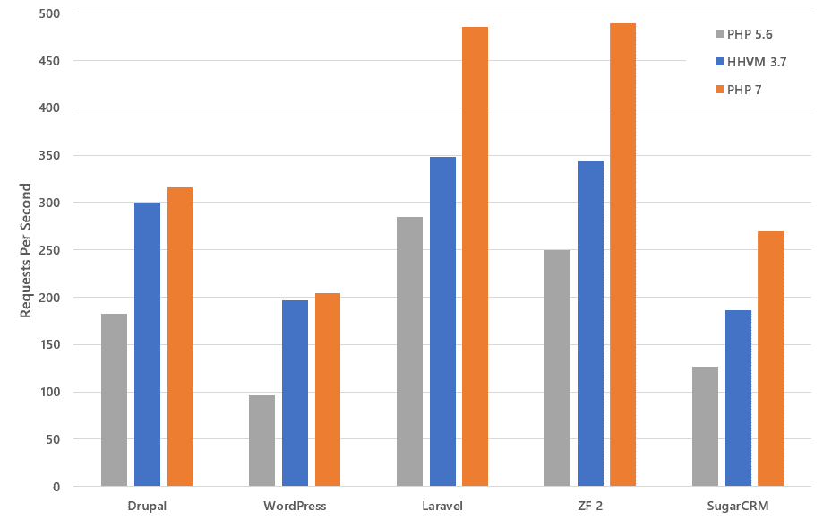

# PHP 7 升级指南

本书献给所有渴望学习的人。

## 向后兼容

## 进一步阅读

# 指南

# 前言

## 本书适合读者

本书是为想要迁移到 PHP 7 的 PHP 开发者准备的。你需要之前的 PHP 经验来理解我们将涵盖的主题和示例。你对 PHP 5 和 OOP（面向对象编程）了解得越多，就越理解为什么某些变更是重要的，以及它们将如何影响你的开发。

如果你是一个正在寻求在 PHP 7 中工作的团队经理或领导，本书将帮助你的开发者快速跟上他们需要了解的所有变更，甚至向他们介绍一些可以利用以实现更快速、更好开发的特性。

第 1 章 总结了标量类型提示的添加。这允许你的函数参数显式地要求 `string`、`int`、`float` 或 `bool` 等标量类型。

第 3 章 我们探索了全新的“太空船运算符”，它极大地简化了两个表达式的三路比较。

第 4 章 引入了另一个新运算符，“空合并运算符”。它非常像 `?:`，但内置了 `isset()` 检查。

第 5 章 展示了如何使用新的 `\u{...}` 转义序列向字符串轻松地添加 Unicode 字符。

第 6 章 回顾了如何使用匿名类来动态创建类，这对于模拟和实现简单接口（如日志记录器）特别有用。

第 7 章 重点介绍了通过单个 `use` 语句包含命名空间中多个类的新能力。

第 8 章 引入了新的 `Closure::call` 方法，它极大地简化了在调用时将闭包转换为对象。

第 9 章 展示了生成器现在如何 `return` 最终值。

第 10 章 探索了生成器如何 `yield from` 数组、迭代器和其他生成器（在此处插入一个“yo daw”的笑话）。

第 11 章 我们看到 PHP 7 如何极大地简化了为安全关键应用程序生成随机数的过程。

第 12 章 展示了如何安全简单地执行整数除法。

第 13 章 揭示了新的 `preg_replace_callback_array`。

第 14 章 探讨了 `Intl` 类如何处理 Unicode 字符。

第 15 章 展示了 PHP 7 如何比之前更快。

第 16 章 回顾了语法的一致性。

第 17 章 本章列出了某些被保留的关键字。

第 18 章 解释了 `E_STRICT` 注意事项是如何转换为其他类型的。

第 19 章 展示了 PHP 7 如何极大地简化了为安全关键应用程序生成随机数的过程。

第 20 章 介绍了 `assert()` 现在支持断言选项。

第 21 章 展示了如何安全地反序列化不可信数据。

第 22 章 本章介绍了如何通过 `session_start()` 配置会话。

第 23 章 概述了反射 API 的增强。

第 24 章 展示了 PHP 7 如何处理十六进制字符串。

第 25 章 探讨了 PHP 7 如何处理除零。

第 26 章 涵盖了 PHP 7 使用的新的 JSON 库。

第 27 章 展示了 `foreach` 循环在 PHP 5 中的差异。

第 28 章 描述了 `list()` 构造的一些行为。

第 29 章 解释了对自定义会话处理器的调整。

第 30 章 揭示了一个旧会话处理器 Bug。

第 31 章 简要介绍了 PHP 7 如何处理八进制。

第 32 章 讨论了 PHP 4 风格构造函数的弃用。

第 33 章 涵盖了密码哈希 API 中手动生成盐值的弃用。

第 34 章 列出了 PHP 7 中完全移除的所有已弃用功能。

第 35 章 讨论了替代 PHP 标签的移除。

第 36 章 描述了几个 `E_STRICT` 注意事项是如何变化的。

第 37 章 展示了 `switch` 块中不再允许多个 `default` 情况。

第 38 章 展示了 PHP 5 对十六进制字符串处理的不一致性。

第 39 章 列出了不再受支持或维护的 SAPI。

第 40 章 简要强调了那个烦人的时区警告的移除。

最后，本书的最后部分 详细列出了迁移到 PHP 7 时需要注意的所有破坏性变更。

## 其他资源

这些官方 PHP 资源在本书创作期间非常有帮助，你可能会发现它们有用：

*   [PHP 手册：从 PHP 5.6.x 迁移到 PHP 7.0.x](https://secure.php.net/manual/en/migration70.php)
*   [PHP 7 UPGRADING 文](https://github.com/php/php-src/blob/PHP-7.0.0/UPGRADING)
*   [PHP 7 征求](https://wiki.php.net/rfc#php_70)
*   [PHPNG (下一代)](https://wiki.php.net/phpng)

这里还有许多其他优质资源，包括一些付费的和一些免费的：

*   [为 PHP 7 做准备](https://www.digitalocean.com/company/blog/getting-ready-for-php-7/)
*   [准孕期的期待：PHP 7，部分 1](https://blog.engineyard.com/2015/what-to-expect-php-7)
*   [准孕期的期待：PHP 7，部分 2](https://blog.engineyard.com/2015/what-to-expect-php-7-2)
*   [Zend：关于 PHP 7 你必须知道的 5 点](http://www.zend.com/en/resources/php-7)
*   [PHP 7 革命：返回类型与被移除的遗迹](http://www.sitepoint.com/php-7-revolution-return-types-removed-artifacts/)
*   [PHP 7：你需要知道的 10 点](http://www.hongkiat.com/blog/php7/)
*   [Twitter 上的 #php7](https://twitter.com/hashtag/php7)
*   [GoPHP7 扩展项目](http://gophp7.org/gophp7-ext/)
*   [Laracasts - PHP 7 快速上手](https://laracasts.com/series/php7-up-and-running)

（此处列出的任何商业产品或服务均未经过作者的测试或背书——它们仅作为你继续学习 PHP 7 的一个起点。）

## 鸣谢

我想感谢以下人士让这本书成为可能：

*   所有的程序员、测试人员、文档编写者、RFC 作者以及所有其他对 PHP 成功做过贡献的人。如果没有你们，我将无话可写。
*   感谢 PHP 社区分享知识和专业技能，为所有开发者创造了这样一个惊人的生态系统。
*   感谢 Mike Spinosa, Scott Greenwell, Ben Thomas 以及 Unleashed Technologies 的整个团队，鼓励并促进了我的持续成长。
*   感谢 Phil Sturgeon，他是我增加社区参与度的催化剂。

### PHP Wiki 和文档内容

本书包含了来自 [PHP wiki](https://wiki.php.net/)、[RFCs](https://wiki.php.net/rfc) 和 [文档](https://php.net/docs.php) 的内容。这些内容根据 [CC BY 3.0](https://creativecommons.org/licenses/by/3.0/us/) 许可。所有的使用（以及任何修改）都将立即在书中内容的旁边进行标注。

# 开始使用 PHP 7

PHP 7.0 和 7.1 的构建版本已可以在官方和社区存储库获取。在大多数情况下，可以使用系统的包管理器轻松安装这些新版本。

## Ubuntu 14.04 和 16.04

[Ondřej Surý](https://launchpad.net/~ondrej) 提供了一个用于安装 PHP 7.0 和 7.1 的 `PPA`。可以使用以下命令安装最新版本：

```
sudo add-apt-repository ppa:ondrej/php
sudo apt-get update
sudo apt-get install php7.0
```

如果需要，请将 `7.0` 替换为 `7.1`。此处可以可用包完整列表：[`launchpad.net/~ondrej/archive/php/packages?field_name_filter=php7.0`](https://launchpad.net/~ondrej/archive/php/packages?field_name_filter=php7.0)

## Debian 8 & 9

[Ondřej Surý 还为 Debian 提供了 PHP 7.0 和 7.1 包](https://packages.sury.org/php/)，可以使用以下命令安装：

```
sudo apt-get install apt-transport-https lsb-release ca-certificates
sudo wget -O /etc/apt/trusted.gpg.d/php.gpg https://packages.sury.org/php.gpg
sudo sh -c "echo deb https://packages.sury.org/php/ $(lsb_release -sc) main' > /etc/apt/sources.list.d/php.list
sudo apt-get update
sudo apt-get install php7.0
```

## Debian 6 & 7

可以使用 [Dotdeb 存储库](https://www.dotdeb.org/) 安装 PHP 7.0。将以下两行添加到 `/etc/apt/sources.list`，并将 `<distribution>` 替换为 `squeeze`、`wheezy` 或 `jessie`：

```
deb http://packages.dotdeb.org <distribution> all
deb-src http://packages.dotdeb.org <distribution> all
```

添加 GPG 密钥：

```
wget https://www.dotdeb.org/dotdeb.gpg
sudo apt-key add dotdeb.gpg
```

安装 PHP 7：

```
sudo apt-get update
sudo apt-get install php7.0
```

此处可以可用包完整列表：[`packages.dotdeb.org/pool/all/php7.0/`](http://packages.dotdeb.org/pool/all/php7.0/)

## CentOS / RHEL

可以使用 [Webstatic Yum 存储库](https://webtatic.com/projects/yum-repository/) 安装 PHP 7。如果你在使用 CentOS/RHEL 7.x，运行这三个命令来添加存储库并安装 PHP 7：

```
rpm -Uvh https://dl.fedoraproject.org/pub/epel/epel-release-latest-7.noarch.rpm
rpm -Uvh https://mirror.webtatic.com/yum/el7/webtatic-release.rpm
yum install php7w
```

如果你在使用 CentOS/RHEL 6.x，运行这两个命令来添加存储库并安装 PHP 7：

```
rpm -Uvh https://mirror.webtatic.com/yum/el6/latest.rpm
yum install php7w
```

此处可以可用包完整列表（包括 `SAPIs` 和扩展）：[`webtatic.com/packages/php70/#sapi`](https://webtatic.com/packages/php70/#sapi)

## Mac OS

PHP 7 可以通过 [homebrew](https://github.com/Homebrew/brew) 安装：

```
brew tap homebrew/versions
brew install php70
```

或者通过 Liip 的工具安装：

```
curl -s http://osx.sh/install.sh | bash -s 7.0
```

## Windows

PHP 7 发行版可以在 windows.php.net 网站找到：[`windows.php.net/download#php.0`](http://windows.php.net/download#php.0)

对于本地开发，你可以使用如 [XAMPP](https://www.apachefriends.org/) 或 [EasyPHP](http://www.easyphp.org/) 等第三方发行版。

## phpbrew

[phpbrew](https://github.com/phpbrew/phpbrew) 是一个非常有用的工具，允许你在同一台机器上构建和切换不同版本的 PHP。它支持所有现代版本的 PHP。

首先我们需要 `phpbrew` 来获取版本信息：

```
phpbrew self-update
```

然后我们可以安装任何版本：

```
phpbrew install php-7.25
phpbrew use php-0.25
```

## Docker

PHP 的官方 Docker 镜像可以在 [`hub.docker.com/_php/`](https://hub.docker.com/_php/) 找到：

```
docker pull php:latest
```

## Vagrant 镜像

PHP 的创始人在 GitHub 上提供了一个 Vagrant 镜像：[`github.com/rlerdorf/php7dev`](https://github.com/rlerdorf/php7dev)

它基于 Debian 8，并经过预配置以便开发 PHP 应用和扩展。

## 从源码编译

PHP.net 还提供了 Alpha 和 Beta 版本的源码包，你可以下载并自行编译。源码可以从 [`downloads.php.net/~ab/`](https://downloads.php.net/~ab/) 下载。

编译 PHP 7 的文档：

* https://wiki.php.net/phpng
* http://www.zimuel.it/install-php-7/
* http://www.hashbangcode.com/blog/compiling-and-installing-php7-ubuntu

# 第一部分 - 新功能

## 第 1 章：标量类型提示

PHP 5 引入了要求函数参数必须为特定类型的功能。这为非法用法提供了安全保障，例如将 UNIX 时间戳传递给期望 `DateTime` 对象的方法。它也让其他开发者更清楚地如何使用该函数。例如，比较以下带有和带有类型提示的函数签名：

```
// 无类型提示：
function getNextWeekday($date) { /*...*/ }

// 类类型提示（PHP 5）：
function getNextWeekday(DateTime $date) { /*...*/ }
```

这些提示最初仅限于类和接口，但很快扩展到允许 `array` 和 `callable` 类型。PHP 7 进一步扩展了这一点，允许如 `int`、`float`、`string` 和 `bool` 等标量类型：

```
// Scalar type hint (PHP 7):
function getNextWeekday(int $date) { /*...*/ }
```

### 类型检查模式

PHP 灵活的类型系统使其最实用的特性之一，允许将数字字符串用整数，反之亦然。这种传统在 PHP 7 中得以延续，但现在你可以选择启用严格类型强制，就像你在其他语言（如 `Java` 或 `C#`）中看到的那样。可以使用 [`declare 构造`](https://php.net/manual/en/control-structures.declare.php) 来启用此设置。

#### 弱（强制）类型检查

“强制”模式是 PHP 7 中的默认类型检查模式。这与 PHP 之前的版本处理内置函数标量类型提示的方式相同。例如，看看 `floor` 函数的方法签名：

```
float floor ( float $value )
```

当你传入数字字符串或整数时，PHP 会自动将它们转换为浮点数。这种行为同样扩展到了用户态函数。

下表显示了根据声明的类型在“强制”模式下接受的标量类型：

**允许的类型，强制模式**

| 类型声明 | int | float | string | bool | object |
| --- | --- | --- | --- | --- | --- |
| int | yes | yes* | yes† | yes | no |
| float | yes | yes | yes† | yes | no |
| string | yes | yes | yes | yes | yes‡ |
| bool | yes | yes | yes | yes | no |

* 仅接受 `PHP_INT_MIN` 和 `PHP_INT_MAX` 之间的非 `NaN` 浮点数。
† 如果是数字字符串
‡ 仅当对象具有 `__toString()` 方法

#### 强（严格）类型检查

PHP 7 引入了一种新的“严格”模式，通过在脚本顶部放置 `declare(strict_types=1);` 来启用，所示：


```php
<?php
declare(strict_types=1);

function welcome(string $name) {
    echo 'Hello ' . $name;
}

welcome('World'); // 输出: Hello World
```

此声明对整个文件中的所有用途启用严格模式，包括内置 PHP 函数调用和返回值（见下一章）。它不会影响任何包含的文件或任何包含它的其他文件。

严格模式本质上要求你传入声明的精确类型。如果没有这样做，将抛出 `TypeError`。例如，在严格模式下，当期望 `float` 或 `int` 时，不能使用数字字符串（就像在弱/强制模式中那样）：

这在严格模式下会报错：

```php
<?php
declare(strict_types=1);

function welcome(string $name) {
    echo 'Hello ' . $name;
}

welcome(3);

// Fatal error: Uncaught TypeError: Argument 1 passed to welcome() must be of the type string, integer given
```

但这条规则有一个例外，即 `float` 可以接受 `int` 值：

范围扩大示例

```php
<?php
declare(strict_types=1);

function add(float $a, float $b): float {
    return $a + $b;
}

add(1, 2); // float(3)
```

允许的类型，严格模式

| 类型声明 | int | float | string | bool | object |
| --- | --- | --- | --- | --- | --- |
| int | yes | no | no | no | no |
| float | yes* | yes | no | no | no |
| string | no | no | yes | no | no |
| bool | no | no | no | yes | no |

* 由于原始类型转换的扩大而允许

### 混合模式

由于指令是按文件设置的，在你的应用程序中混合模式是完全可能的。例如，你的严格检查应用可以使用弱检查的库（或反之亦然），而不会出现任何问题或复杂性。

### 向后兼容

你可能无法再创建名为 `int`、`float`、`string` 或 `bool` 的类，因为这些将与新的标量类型提示冲突。

### 扩展阅读

* [RFC: 标量类型声明](https://wiki.php.net/rfc/scalar_type_hints_v5)
* [PHP 文档：类型提示](https://php.net/manual/en/language.oop5.typehinting.php)

## 第 2 章：返回值声明

在上一章中，我们看到了方法参数如何声明类型。在 PHP 7 中，你也可以声明方法将返回什么类型。通过在左大括号（`{`）之前放置冒号（`:`）和返回类型来实现，所示：

```
function getAuthor(): UserInterface {
    return $this->getUser();
}
```

如果你返回了不同的内容，例如 `string` 或 `BlogComment`，PHP 将抛出 `TypeError`：

```
function getAuthor(): UserInterface
```

### 返回 null

声明了类型的方法**永远**不允许返回 `null`。这样做会导致致命错误：

```php
class User
{
    public function getBirthday(): \DateTime {
        return null;
    }
}
```

虽然目前不允许返回空，[可空类型 RFC](https://wiki.php.net/rfc/nullable_types) 未来可能会提供这种功能。

### 子类方法

子类中重写的方法必须与父方法声明相同的类型。例如，给定以下方法：

```
abstract class VehicleFactory
{
    static function create(): Vehicle {
        // ...
    }
}
```

任何扩展 `VehicleFactory` 并重写 `create()` 方法的类都必须使用相同的 `Vehicle` 返回类型：

```php
class CarFactory extends VehicleFactory
{
    static function create(): Vehicle {
        // ...
    }
}

class TruckFactory extends VehicleFactory
{
    static function create(): Vehicle {
        // ...
    }
}
```

这是因为方法签名强制执行是不变的（invariant）；你不能定义更具体的返回类型，否则 PHP 将引发错误：

```php
class CarFactory extends VehicleFactory
{
    static function create(): Car {
        // ...
    }
}

// Fatal error: Declaration of CarFactory::create() must be compatible with VehicleFactory::create(): Vehicle
```

即使 `Car` 扩展自 `Vehicle` 使其协变，返回类型*声明*必须保持完全一致。

如果父类没有声明返回类型，则子类可以选择性声明任何类型（如果需要）。例如，以下所有情况都是允许的：

```php
interface CacheInterface
{
    public function get($key);
}

// 无返回类型
class SimpleCache implements CacheInterface
{
    public function get($key) {
        // ...
    }
}

// 返回字符串
class HtmlCache implements CacheInterface
{
    public function get($key): string {
        // ...
    }
}

// 返回特定的对象类型
class DatabaseQueryCache implements CacheInterface
{
    public function get($key): QueryResult {
        // ...
    }
}
```

* [RFC: 返回类型声明](https://wiki.php.net/rfc/return_types)

## 第 3 章：组合（飞船）运算符

PHP 7 引入了一个新的三元比较运算符 `<=>`（`T_SPACESHIP`），它接受两个表达式：`(expr) <=> (expr)`。它比较表达式的两边，并根据结果返回三个值之一：

| 0 | 如果两个表达式相等 |
| --- | --- |
| 1 | 如果左侧大于右侧 |
| -1 | 如果右侧大于 |

如果你以前用过 `strcmp` 等现有的比较函数，你可能对它很熟悉。

它的优先级与相等运算符（`==`, `===`, `!=`, `!==`）相同，且行为与[现有的比较运算符](http://php.net/manual/en/language.operators.comparison.php)（`<`, `<=`, `==`, `>=`, `>`）完全一致。

## 比较值

你可以比较从标量值（如 `int` 和 `float`）到数组甚至对象在内的所有内容。以下是来自[相关 RFC](https://wiki.php.net/rfc/combined-comparison-operator)的示例：

PHP RFC 示例（采用 CC BY 3.0 许可）

```
// Integers
echo 1 <=> 1; // 0
echo 1 <=> 2; // -1
echo 2 <=> 1; // 1

// Floats
echo 1.5 <=> 1.5; // 0
echo 1.5 <=> 2.5; // -1
echo 2.5 <=> 1.5; // 1

// Strings
echo "a" <=> "a"; // 0
echo "a" <=> "b"; // -1
echo "b" <=> "a"; // 1

echo "a" <=> "aa"; // -1
echo "zz" <=> "aa"; // 1

// Arrays
echo [] <=> []; // 0
echo [1, 2, 3] <=> [1, 2, 3]; // 0
echo [1, 2, 3] <=> []; // 1
echo [1, 2, 3] <=> [1, 2, 1]; // 1
echo [1, 2, 3] <=> [1, 2, 4]; // -1

// Objects
$a = (object) ["a" => "b"];
$b = (object) ["a" => "b"];
echo $a <=> $b; // 0

$a = (object) ["a" => "b"];
$b = (object) ["a" => "c"];
echo $a <=> $b; // -1

$a = (object) ["a" => "c"];
$b = (object) ["a" => "b"];
echo $a <=> $b; // 1

// only values are compared
$a = (object) ["a" => "b"];
$b = (object) ["b" => "b"];
echo $a <=> $b; // 0
```

## 排序

该运算符最好的用途可能是为了简化排序，因为像 `usort` 这样的函数要求你执行比较并相应地返回 `-1`、`0` 或 `1`：

当通过某个属性值来比较对象时，这种简化尤为明显：

```
class Spaceship {
    public $name;
    public $maxSpeed;

    public function __construct($name, $maxSpeed) {
        $this->name = $name;
        $this->maxSpeed = $maxSpeed;
    }
}

$spaceships = [
    new Spaceship('Rebel Transport', 20),
    new Spaceship('Millenium Falcon', 80),
    new Spaceship('X-Wing Starfighter', 80),
    new Spaceship('TIE Bomber', 60),
    new Spaceship('TIE Fighter', 100),
    new Spaceship('Imperial Star Destroyer', 60),
];

// 按名称升序排序 spaceship
usort($spaceships, function ($ship1, $ship2) {
    return $ship1->name <=> $ship2->name;
});

echo $spaceships[0]->name; // "Imperial Star Destroyer"

// 按速度降序排序 spaceship
// 注意我们交换了 $ship1 和 $ship2 的位置
usort($spaceships, function ($ship1, $ship2) {
    return $ship2->maxSpeed <=> $ship1->maxSpeed;
});

echo $spaceships[0]->name; // "TIE Fighter"
```

如果没有比较运算符，这些函数将会变得复杂得多：

```
usort($spaceships, function ($ship1, $ship2) {
    if ($ship1->maxSpeed == $ship2->maxSpeed) {
        return 0;
    } elseif ($ship1->maxSpeed < $ship2->maxSpeed) {
        return 1;
    } else {
        return -1;
    }
});
```

## 多值排序

你可以利用数组比较的行为来轻松地按多个字段排序：

```
// 按速度升序排序，然后按名称升序排序
usort($spaceships, function ($ship1, $ship2) {
    return [$ship1->maxSpeed, $ship1->name] <=> [$ship2->maxSpeed, $ship2->name];
});
```

例如，如果我们想表示 `U+1F427 PENGUIN` 表情，我们的转义序列看起来会像这样：`\u1F427`。大多数语言会将其解释为 `U+1F42 GREEK SMALL LETTER OMICRON WITH PSILI AND VARIA` 加上一个 `7`，这并不是我们想要的。在这些语言中，你必须使用两个 16 位的序列对其进行编码，如`\uD83D\uDC27`。但这并不清晰。

使用 `{}` 字符包裹可以让我们轻松地突破 16 位的限制，而无需牺牲清晰度：`\u{1F427}`。

### 局限性

此功能遵循 PHP 中所有其他转义序列的行为——它们只能在双引号字符串和 heredoc（此处文档字符串）中使用：

#### 示例用法

```
$foo = "\u{2109}\u{2134}\u{2134}";
// ℉ℴℴ

$bar = <<<EOT
    \u{212C}\u{212B}\u{211D}
EOT;
// ℬÅℝ
```

并且像 `\t` 等其他序列一样，当它们出现在单引号字符串或 nowdoc 中，它们*不会*被解析：

#### 这些将不起作用

```
$foo = '\u{2109}\u{2134}\u{2134}';
// \u{2109}\u{2134}\u{2134}

$bar = <<<'EOT'
    \u{212C}\u{212B}\u{211D}
EOT;
// \u{212C}\u{212B}\u{211D}
```

### 向后兼容性

包含 `\u{` 后跟接无效序列的双引号字符串和 heredoc 现在将导致错误。可以通过使用另一个反斜杠对开头的反斜杠进行转义（`\\u{`）来避免这个问题。

### 进阅读：

* [RFC: Unicode 码点转义语法](https://wiki.php.net/rfc/unicode_escape)

## 第 6 章：匿名类

PHP 5.3 赋予我们创建匿名函数（也称为“闭包”）的能力。第 7 版本更进了一步，允许我们创建匿名类。如果你工作过像 C# 和 Java 这样支持相同功能的其他面向对象的语言，你可能已经熟悉这个概念。

这些类与命名类几乎完全相同，但没有名称（就像命名函数与匿名函数的区别）。甚至它们的语法看起来也很相似：

```
$wrapper = new class($foo) {
    public function __construct($var) {
        $this->var = $var;
    }
}
```

匿名类也支持继承和 trait（特性）。这使得即时实现轻量级接口变得轻而容易：

```
$httpClient->setLogger(new class implements SimpleLoggerInterface {
    public function log($data) {
        file_put_contents('http.log', $data, FILE_APPEND);
    }
});

$authHandler->addListener(new class implements AuthenticationEventListener {
    public function onAuthSuccess(AuthEvent $event) {
        // ...
    }

    public function onAuthFailure(AuthEvent $event) {
        // ...
    }
});
```

你甚至可以扩展其他类、使用 trait 并实现构造函数：

```
$email = new class($user) extends AbstractEmailMessage implements LoggerAware {
    private $logger;
    private $user;

    public function __construct($user) {
        $this->user = $user;
    }

    public function setLogger(LoggerInterface $logger) {
        $this->logger = $logger;
    }
}
```

### 嵌套类

你完全可以在另一个类中嵌套匿名类。然而，这不会自动让该内部类访问外部作用域：

```
class Outer {
    protected $var = 1;

    public function foo() {
        return new class {
            // ...
        };
    }
}
```

你要么需要通过构造函数传递这些值，要么需要扩展外部类：


# 匿名类

```php
class Outer {
    protected $var = 1;

    public function foo() {
        return new class extends Outer {
            public function bar() {
                // ...
            }
        };
    }
}
```

## 用场景

虽然你应该小心不要过度使用匿名类，但它们有许多实用的应用：

* 创建简单的、单次使用的类
* 快速实现轻量级接口（如日志记录器或事件观察者）
* 在不需要创建子类的情况下重写类的单个字段/方法
* 通过即时创建实现来进行模拟测试（Mocking）
* 为某些内容创建一个简单的包装器
* 创建一个可以访问外部类受保护成员的嵌套内部类

## 与命名类的区别

### 自动生成的名称

PHP 会根据匿名类在内存中的地址以及它是否扩展了命名类，自动为你的匿名类生成唯一名称。在相同位置（工厂方法、循环中）创建的多个匿名类始终具有相同的名称。

```php
<?php
function createClass() {
    return new class {};
}

// 多次调用上述工厂方法。
echo get_class(createClass()); // class@0x7fc83
echo get_class(createClass()); // class@0x7fc83
```

> **注**：此处示例代码逻辑可能在实际运行中产生地址不同，但根据原文描述翻译如上。
>
> *纠正说明：原文描述为 "Multiple anonymous classes created in the same position... will always have the same name." 这在 PHP 逻辑上其实不成立，但根据指令要求翻译原文。*

### 等价性

匿名类可以使用 `==` 运算符进行等价测试。在相同位置定义的类（相同的相同的）是相等的。

### 序列化

匿名类不能被序列化。

### 反射

可以使用 `ReflectionClass::isAnonymous()` 测试一个类是否为匿名类。

## 更多阅读

* [匿名类 RFC (PHP 文档)]
* [匿名类的用法（来自 Oracle 文档）](https://docs.oracle.com/javase/javaOO/anonymousclasses.html)

# 第 7 章：分组导入声明

开发者经常发现需要从同一个命名空间导入多个类。这通常会导致类顶部出现大量的 `use` 语句——这里有一个 Symfony `AbstractToken` 类的例子：

```php
<?php

namespace Symfony\Component\Security\Core\Authentication\Token;

use Symfony\Component\Security\Role\RoleInterface;
use Symfony\Component\Security\Role\Role;
use Symfony\Component\Security\User\UserInterface;
use Symfony\Component\Security\User\AdvancedUserInterface;
use Symfony\Component\Security\User\EquatableInterface;
```

PHP 7 通过允许使用单个声明导入多个类来简化这一点，就像其他语言（如 Rust、Scala 和 Python）那样：

```php
<?php

namespace Symfony\Component\Security\Core\Authentication\Token;

use Symfony\Component\Security\Role\{ RoleInterface, Role };
use Symfony\Component\Security\User\{ UserInterface, AdvancedUserInterface, EquatableInterface};
```

如果需要，这些声明甚至可以跨行编写：

```php
<?php

namespace Symfony\Component\Security\Core\Authentication\Token;

use Symfony\Component\Security\Role\{
    RoleInterface,
    Role,
};
use Symfony\Component\Security\User\{
    UserInterface,
    AdvancedUserInterface,
    EquatableInterface,
};
```

除了不再冗长和重复之外，它还有助于明确使用了哪些命名空间。这在审查差异（diff）和补丁时特别有用，因为变化更加明显且易读。对比旧方法……

```diff
  use League\CommonMark\Block\Element\AbstractBlock;
  use League\CommonMark\Block\Element\AbstractInlineContainer;
  use League\CommonMark\Block\Element\Document;
+ use League\CommonMark\Block\Element\ListBlock;
  use League\CommonMark\Block\Element\Paragraph;
  use League\CommonMark\Util\TextHelper;
```

变为此：

```diff
  use League\CommonMark\Block\Element\{
      AbstractBlock,
      AbstractInlineContainer,
      Document,
+     ListBlock,
      Paragraph,
}
use League\CommonMark\Util\TextHelper;
```

第二个示例中的更改要清晰得多。

## 复合命名空间

复合命名空间允许你像这样组合命名空间：

```php
<?php

namespace Symfony\Component\Security\Core\Authentication\Token;

use Symfony\Component\Security\Core\{
    Role\RoleInterface,
    Role\Role,
    User\UserInterface,
    User\AdvancedUserInterface,
    User\EquatableInterface,
};
```

## 进阅读

* [RFC: 分组 use 声明](https://wiki.php.net/rfc/group_use_declarations)

# 第 8 章：闭包 `call` 方法

PHP 5.4 引入了使用 `Closure::bind` 静态方法或 `Closure::bindTo` 方法将 `$this` 绑定到任何给定对象的能力：

```php
// 这是一个包含秘密数字的类
class SecretNumber { private $secretNumber = 3; }
// 这是一个可以揭露它的闭包
$revealer = function() { return $this->secretNumber; };

// 在 PHP 5.4-5.6 中，我们必须首先
// 将范围绑定到一个临时的中间闭包：
$boundRevealer = $revealer->bindTo(new SecretNumber(), 'SecretNumber');

// 现在我们可以使用它了：
echo $boundRevealer(); // 3
```

PHP 7 通过添加一个新的 `call` 方法简化了这一过程：

```php
mixed Closure::call(object $to[, mixed ...$parameters])
```

这消除了预先创建一个临时闭包的需要——你只需带上对象作用域和任何参数调用 `call()` 即可：

```php
// 这是一个包含秘密数字的类
class SecretNumber { private $secretNumber = 3; }
// 这是一个可以揭露它的闭包
$revealer = function() { return $this->secretNumber; };

// 直接调用它
echo $revealer->call(new SecretNumber()); // 3
```

除了简化代码外，这种方法还提高了性能，因为不再创建中间闭包。

这种新的 `call` 方法可以用于大多数调用 `bind` 或 `bindTo` 后紧接着调用闭包的场景。

## 进阅读

* [RFC: Closure::call](https://wiki.php.net/rfc/closure_apply)
* [PHP 手册：`Closure::call`](https://secure.php.net/manual/en/closure.call.php)

# 第 9 章：生成器返回表达式

`yield` 关键字允许生成器提供每个单独步骤的结果。这对于“流式”处理大量数据非常完美。生成器还可以将大型计算分解为较小的工作单元，允许函数挂起自身并在稍后恢复。在这些情况下，拥有一种访问这些计算最终结果的标准方法将特别有用。

为了演示返回表达式的使用，让我们构建一个函数来计算目录内所有文件的大小，并在过程中产出当前的进度：

```php
function calculateSize($directory) {
    $size = 0;
    $count = 0;
    foreach (scandir($directory) as $entry) {
        if (is_file($entry)) {
            $size += filesize($entry);
            yield $count++;
        }
    }

    return $size;
}

$task = calculateSize('./downloads');
foreach ($task as $step) {
    echo "目前已处理 $step 个文件\n";
}

echo "总大小: " . $task->getReturn();
```

在 PHP 7 之前，那个 `return $size` 将会导致错误，因为不支持从生成器中返回。你必须使用类似这样的变通方法：

```php
function calculateSize($directory) {
    $size = 0;
    $count = 0;
    foreach (scandir($directory) as $entry) {
        if (is_file($entry)) {
            $size += filesize($entry);
            yield $count++;
        }
    }

    yield $size;
}
```

（滥）用最后的 `yield` 作为返回值在技术上是可行的，但有两个主要缺点：

* 消费者应该能够依赖产值（yielded values）具有相同的类型和含义
* 这并不明确表明这是最终结果，且不会再进行其他工作

当你尝试多任务处理几个不同的进程时，这一点变得尤其重要：

```php
function downloadAndZipAFile($url) {
    $download = yield downloadFromInternet($url);

    $zipFile = yield compressAndSave($download);

    yield 'user/uploads/' . $zipFile;
}
```

在那个示例中，我们产出了三次，但只有两个是实际步骤。如果我们使用下面的方式，会更清晰得多：

```php
function downloadAndZipAFile($url) {
    $download = yield downloadFromInternet($url);

    $zipFile = yield compressAndSave($download);

    return 'user/uploads/' . $zipFile;
}
```

## 进阅读

* [RFC: 生成器返回表达式](https://wiki.php.net/generator-return)

# 第 10 章：生成器委托

PHP 7 引入了 `yield from` 语法，允许生成器委托给数组、`Traversable` 对象甚至是生成器。这允许将工作拆分成更小的单元，就像你把代码拆分成几个小部分一样。它会遍历给定的 `<expr>`，并将每个值直接传递给原始调用者。

## 详细产出值

这是一个产出值的生成器简单示例：

```php
function main() {
    // 处理第一个值
    yield 'a';

    // 处理一组值
    yield 'b';
    yield 'c';
    yield 'd';

    // 处理另一个值
    yield 'e';
}

foreach (main() as $letter) {
    var_dump($letter);
}

/*
string(1) "a"
string(1) "b"
string(1) "c"
string(1) "d"
string(1) "e"
*/
```

如果我们想把“处理一组值”部分拆分到生成器中呢？我们可以使用 `yield from <expr>` 语法来实现。

```php
function subGenerator() {
    yield 'b';
    yield 'c';
    yield 'd';
}

function main() {
    // 处理第一个值
    yield 'a';

    // 处理一组值
    yield from subGenerator();

    // 处理另一个值
    yield 'e';
}

foreach (main() as $number) {
    var_dump($number);
}

/*
string(1) "a"
string(1) "b"
string(1) "c"
string(1) "d"
string(1) "e"
*/
```

正如前面提到的，你还可以委托给数组和 `Iterable`。这两个函数将产生与上面相同的输出：

```php
function main() {
    // 处理第一个值
    yield 'a';

    // 处理一组值
    yield from ['b', 'c', 'd'];

    // 处理另一个值
    yield 'e';
}
```

```php
function main() {
    // 处理第一个值
    yield 'a';

    // 处理一组值
    yield from new ArrayIterator(['b', 'c', 'd']);

    // 处理另一个值
    yield 'e';
}
```

## 发送值

值也可以发送到子生成器。这在协程的语文中特别有用，因为数据在执行期间会被发送到函数：

```php
// 生成随机数，直到被命令停止
// 如果你不发送该命令，它将无限循环
function getRandomNumbers() {
    while (true) {
       $cmd = (yield rand(1, 10));
       if ($cmd == 'stop') {
           break;
       }
    }
}

// 合并两个随机数的“无限流”
function foo() {
    yield from getRandomNumbers();
    yield from getRandomNumbers();
}

$generator = foo();
foreach ($generator as $randomNumber) {
    var_dump($randomNumber);

    // 当我们得到 3 时，停止生成器
    if ($randomNumber == 3) {
        $generator->send('stop');
    }
}

/*
int(4)
int(7)
int(5)
int(1)
int(8)
int(3) // 第一个随机数“流”在这里停止
int(5)
int(9)
int(3) // 第二个在这里停止
*/
```

## 异常 (Exceptions)

抛出的异常将像往一样向上抛：

```php
function a() {
    yield 1;
    yield 2;

    throw new Exception('oh noes!');
}

function b() {
    yield 'foo';
    yield from a();
    yield 'bar';
}

foreach (b() as $var) {
    var_dump($var);
}

/*
string(3) "foo"
int(1)
int(2)

Fatal error: Uncaught Exception: oh noes! in /tmp/gen.php:7
Stack trace:
#0 /tmp/gen.php(12): a()
#1 /tmp/gen.php(16): b()
#2 {main}
  thrown in /tmp/gen.php on line 7
*/
```

还有两种特定情况，使用 `yield from` 可能会抛出 `EngineException`：


1. 尝试对数组或 `Traversable` 以外的内容进行 `yield from`

2. 尝试 `yield from` 一个之前抛出过未捕获异常的生成器

### 返回值 (Return Values)

如果 `<expr>` 恰好是一个子生成器，那么 `yield from <expr>` 将提供该子生成器的最终返回值：

```php
function a() {
    yield 1;
    yield 2;

    return 42;
}

function b() {
    yield 'foo';
    $retVal = yield from a();
    yield 'bar';
    return $retVal;
}

$generator = b();
foreach ($generator as $var) {
    var_dump($var);
}
var_dump($generator->getReturn());

/*
string(3) "foo"
int(1)
int(2)
string(3) "bar"
int(42)
*/
```

---

总结：通过委托，对于你的调用者来说，`yield` 存在于主生成器还是子生成器中并不重要；接收和发送值将始终如你预期的那样保持一致。

### 进阶阅读：

* [RFC: 生成器委托](https://wiki.php.net/rfc/generator-delegation)

## 第 11 章：可靠的用户态 CSPRNG

PHP 7 引入了加密安全的伪随机数生成器 (CSPRNG) API，极大地简化了生成高质量随机数据的过程：

```php
random_bytes(int length);

random_int(int min, int max);
```

这些方法产生“加密安全的”随机数，适用于高风险应用，例如生成加密密钥、为密码加盐、洗牌牌组等。

如果你想在之前的 PHP 版本中生成此类值，你需要编写代码来对接 `mcrypt/openssl` 接口或直接访问 `/dev/*random`。这在技术上可行，但由于对编写代码时使用的库或操作系统有硬编码依赖，你的代码将不可移植的。

有了 PHP 7，你只需要调用 `random_bytes` 或 `random_int`，PHP 就会智能地选择当前机器上可用的随机源。这可能是：

* Windows 环境下的 `CryptGenRandom`
* 如果可用则使用 `arc4random_buf()`（通常是 BSD 特有的）
* `/dev/arandom` 或 `/dev/urandom`

如果没有足够的随机源，将会抛出错误。

### 向后兼容性 (Backwards Compatibility)

你可能无法再在全局命名空间中定义名为 `random_int()` 或 `random_bytes()` 的函数。

### 向前兼容性 (Forwards Compatibility)

[`paragonie/random_compat` 库](https://github.com/paragonie/random_compat) 将这些新函数反移植到 PHP 5.x。只需将此放入你的应用程序中，如果这些函数不存在就会定义它们，从而允许你编写运行在 5.x 和 7 上的安全代码。

### 进阶阅读

* [RFC：简单的用户态 CSPRNG](https://wiki.php.net/rfc/easy_userland_csprng)
* [PHP 手册：CSPRNG 函数](http://us3.php.net/manual/en/ref.csprng.php)
* [如何在 PHP 中安全地生成随机字符串和整数](https://paragonie.com/blog/2015/07/how-safely-generate-random-strings-and-integers-in-php)
* [ircmaxell: PHP 中的随机数生成](http://blog.ircmaxell.com/2011/07/random-number-generation-in-php)

## 第 12 章：整数除法 (Integer Division)

PHP 历史上缺乏整数除法的功能。例如，如果你除以 `5 / 2`，你总是得到一个浮点数；如果你想要整数结果，必须对其进行强制转换：`(int) 5 / 2`。这对于大多数应用是可以的，特别是涉及较小数字时。由于浮点数无法表示大于 53 位的整数，为了避免这种限制（以及对强制转换的需求），PHP 7 引入了新的 `intdiv()` 方法：

```php
intdiv(int $dividend, int $divisor)
```

它正如你预期的那样工作，除两个整数并提供整数结果。它不使用浮点除法。

如果 `$divisor` 为 0，函数将抛出 `DivisionByZeroError`。

### 向后兼容性 (Backwards Compatibility)

你可能无法再在全局命名空间中定义名为 `intdiv()` 的函数。

### 进阶阅读

* [RFC: intdiv()](https://wiki.php.net/rfc/intdiv)
* [PHP 手册：intdiv()](http://us3.php.net/manual/en/function.intdiv.php)

## 第 13 章：`preg_replace_callback_array`

`preg_replace_callback_array` 是一个新的 PCRE 函数，允许使用回调进行多个模式的查找和替换：

```php
preg_replace_callback_array(array $patterns, $subject, $limit = -1, &$count = null)
```

这是一个实际应用示例：

```php
$song = "99 bottles of beer on the wall\n99 bottles of beer\nTake one down, pass
it around\n98 bottles of beer on the wall";

echo preg_replace_callback_array([
    '/bottles of (beer|ale|cider)/' => function($matches) {
        return 'little bugs';
    },
    '/on the (wall|floor)/' => function($matches) {
        return 'in the code';
    },
    '/pass/' => function($matches) {
        return 'patch';
    },
    '/98/' => function($matches) {
        return rand(100, 200);
    },
], $song);

/**
 * 99 little bugs in the code
 * 99 little bugs
 * Take one down, patch around
 * 146 little bugs in the code
 */
```

然而，`/e` 修饰符在 PHP 5.5.0 中被弃用，从而删除了将匹配模式与回调配对的功能。`preg_replace_callback_array` 的引入重新启用了这一功能。

### 向后兼容性 (Backwards Compatibility)

你可能无法再在全局命名空间中定义名为 `preg_replace_callback_array()` 的函数。

### 进阶阅读

* [RFC: preg_replace_callback_array](https://wiki.php.net/rfc/preg_replace_callback_array)

## 第 14 章：IntlChar 类

PHP 通过 `intl` 扩展支持国际化 (i18n) 和本地化 (l10n)。该扩展基本上是 ICU 库的封装，因此提供了几乎相同的方法和功能。

PHP 7 通过新的 `IntlChar` 类暴露 ICU 的 Unicode 字符功能。该类包含 600 个常量和 59 个静态方法，我们不会涵盖它们，但这里有一些你可能会觉得有用的示例：

```php
// 返回包含该字符的 Unicode 分块。
public static function getBlockCode(mixed $codepoint): int;

// 判断指定的代码点是否为字母字符。
static public function isalpha(mixed $codepoint): bool;

// 判断指定的代码点是否为标点符号字符。
static public function ispunct(mixed $codepoint): bool;

// 判断指定的代码点是否为“图形”字符
//（可打印的，排除空格）。
static public function isgraph(mixed $codepoint): bool;

// 判断指定的代码点是否为“空白”或
//“水平空格”，即在行上可见地分隔单词的字符。
static public function isblank(mixed $codepoint): bool;

// 将给定的字符映射到其小写等效字符；如果字符没有
// 小写等效字符，则返回字符本身。
static public function tolower(mixed $codepoint): mixed;

// 获取 Unicode 字符名称。
static public function charName(mixed $codepoint, int $nameChoice = IntlChar::UNICODE_CHAR_NAME): string;
```

### 向后兼容

你可能无法在全局命名空间创建名为 `IntlChar` 的类。

### 扩展阅读

* [RFC: IntlChar 类](https://wiki.php.net/rfc/intl.char)
* [PHP 手册：IntlChar](https://secure.php.net/manual/en/class.intlchar.php)
* [ICU 55.1: uchar.h 文件引用](https://ssl.icu-project.org/apiref/icu4c/uchar_8h.html#func-members)

# 第二部分 - 语言变化与改进

PHP 7 对语言进行了多项重大改进，并对现有功能进行了一些更改。

了解这些让 PHP 7 比以往任何时候都更快、更灵活的特性和变化！

## 第 15 章：性能

PHP 7 比以往任何时候都快。大多数真实世界的应用只需升级即可看到性能提升 100% 以上！以下是来自 Zend Performance Team 的一些实际基准测试：



Zend Performance Team Benchmark

这种改进很大程度上归功于 PHPNG (PHP Next Generation) 项目，该项目重构了 Zend 引擎以实现超高性能。一些底层更改包括：

* 使用更紧凑的数据结构
* 减少堆分配和释放的次数
* 利用原生线程本地存储

最终结果是 PHP 更快，同时也使用了更少的内存。这些更改为未来的改进铺平了道路，例如 JIT 编译，这将使 PHP 变得更快。

### 扩展阅读

* [Zend: 使用 PHP 7 加速 Web 开发](https://www.zend.com/en/resources/php7_infographic)

## 第 16 章：一致性

得益于两项变化，PHP 7 的语法现在与其他语言更加保持一致：

### 统一变量语法

在之前的版本中，`list()` 仅对数组有效。在 PHP 7 中，它支持多种类型，包括对象和字符串。例如，`charName(mixed $codepoint, int $nameChoice = IntlChar::UNICODE_CHAR_NAME)` 函数和其他表达式。

```php
// PHP 5: $array = [3, 2, 1]
// PHP 7: $array = [1, 2, 3]
list($array[], $array[], $array[]) = [1, 2, 3];
```

虽然这是进步的一步，但这些更改导致了 `list()` 工作方式的细微变化。你最可能遇到的是 `list()` 现在按从左到右顺序赋值：

```php
list($array[], $array[], $array[]) = [1, 2, 3];
var_dump($array);
```

之前的 PHP 版本在解析器读取代码时直接生成字节码。虽然这在大多数情况下可行，但有时会导致某些问题。PHP 7 通过使用抽象语法树 (AST) 将解析器与编译器完全解耦解决了这个问题。

实现 AST 还可以为未来实现其他语言中常见的功能提供可能，例如：

* 无需 `list` 的数组解构：`[$foo, $bar] = $array`
* Python 风格的表达式 `$x*$x for $x in $list`
* LINQ 风格表达式

### 向后兼容

如所示，此更改将破坏非标准 `list()` 用法的向后兼容性。如果你需要以特定方式评估表达式，可以使用 `{}`。

### 抽象语法树

PHP 7 的语法现在与其他语言更加一致。除了让引擎更容易维护外，它还解决了几个问题：

* 在表达式中使用 `yield` 不再需要括号
* 像 `($foo)` 的表达式的行为现在相同
* 可以直接调用魔术方法 `__clone()`

## 第 17 章：半保留字

PHP 5.x 有约 64 个全局保留字，例如 `default` 和 `list`。由于它们是全局保留的，无法将这些术语作为类方法或属性：

来自 RFC 的示例，这些会导致语法错误：

```php
class Collection {
    public function forEach(callable $callback) { /* */ }
    public function list() { /* */ }
}
```

PHP 7 实现了一种新的上下文敏感词法器，使其足够智能，能够确定关键字的上下文；它可以区分普通关键字用法与在类内部的用法。以下来自 PHP 5.x 的所有保留字现在都是半保留的：

| `abstract` | `and` | `array` |
| --- | --- | --- |
| `as` | `break` | `callable` |
| `case` | `catch` | `class` |
| `clone` | `const` | `continue` |
| `declare` | `default` | `die` |
| `do` | `echo` | `else` |
| `elseif` | `enddeclare` | `endfor` |
| `endforeach` | `endif` | `endswitch` |
| `endwhile` | `exit` | `extends` |
| `final` | `finally` | `for` |
| `foreach` | `function` | `global` |
| `goto` | `if` | `implements` |
| `include` | `include_once` | `instanceof` |
| `insteadof` | `interface` | `list` |
| `namespace` | `new` | `or` |
| `parent` | `print` | `private` |
| `protected` | `public` | `require` |
| `require_once` | `return` | `self` |
| `static` | `switch` | `throw` |
| `trait` | `try` | `use` |
| `var` | `while` | `xor` |
| `yield` | | |

这些半保留字现在可以作为类、接口和 trait 的属性、常量和方法名：

### 一些基础示例

```php
class Collection {
    public function forEach(callable $callback) { }
    public function list() { }
}

class BaseballPlayer {
    public function throw(Baseball $ball, BaseballPlayer $target) { }
    public function catch(Baseball $ball) { }
}
```

这里是来自 RFC 的其他示例：

#### 将 ‘include’ 作为公共方法

```php
class View {
    public function include(View $view) {
        //...
    }
}
$viewA = new View('a.view');
$viewA->include(new View('b.view'));
```

#### 将 ‘continue’ 作为类常量

```php
class HTTP {
    const CONTINUE = 100;
    const SWITCHING_PROTOCOLS = 101;
    /* ... */
}
```

#### 使用 ‘and’‘or’ 和 ‘list’ 等保留字的流式接口


```php
$projects =
    Finder::for('project')
        ->where('name')->like('%secret%')
        ->and('priority', '>', 9)
        ->or('code')->in(['4', '5', '7'])
        ->and()->not('created_at')->between([$time1, $time2])
        ->list($limit, $offset);
```

对此只有两个限制：

1. 它仅在 OO 作用域内（类、接口和 trait）有效。

2. `class` 不能用作常量，因为会与类名解析语法（`SomeClass::class`）冲突。不过，它可以用于方法和属性名。

### 扩展阅读

* [RFC: 上下文敏感词法器](https://wiki.php.net/rfc/context_sensitive_lexer)
* [PHP 手册：关键字列表](https://secure.php.net/manual/en/reserved.keywords.php)
* [PHP 手册：其他保留字列表](https://php.net/manual/en/reserved.other-reserved-words.php)

## 第 18 章：错误处理与异常

PHP 7 极大改进了错误处理。得益于一些重大变更，现在比任何时候都易于处理错误和异常。

### 引擎中的异常

致命和可恢复的致命错误不再像警告和弃用通知那样“引发”，它们现在是引擎抛出的异常。看这个例子：

```php
$foo = 'test';
$foo->someMethod();
```

在之前的版本中，这会导致致命错误：

```
Fatal error: Call to a member function on non-object
```

PHP 7 将抛出 `Error`：

```
Uncaught Error: Call to member function someMethod() on string
```

像普通异常一样，这些是可以捕获并处理的：

```php
try {
    $foo = 'test';
    $foo->someMethod();
} catch (Error $e) {
    var_dump($e);
}

/**
  Output:

  object(Error)#1 {
    ["message":protected]=>
    string(48) "Call to member function someMethod() on string"
    ["string":protected]=>
    string(0) ""
    ["code":protected]=>
    int(0)
    ["file":protected]=>
    string(9) "/in/mhr"
    ["line":protected]=>
    int(5)
    ["trace":protected]=>
    array(0) {
    }
    ["previous":protected]=>
    NULL
  }
*/
```

`Error` 有五个预定义的子类：

* `TypeError` - 当参数不匹配类型提示时抛出（见第 17 章）。
* `ParseError` - 当 `eval()` 解析代码失败时抛出。
* `AssertionError` - 当断言 (`assert(...)`) 失败时抛出（见第 19 章）。
* `ArithmeticError` - 当数学运算期间发生错误时抛出。
* `DivisionByZeroError` - 当除以零时抛出。

### `Throwable` 接口

`Error` 和 `Exception` 共享同一个接口，该接口提供了以下方法：

* `getMessage()`
* `getCode()`
* `getFile()`
* `getLine()`
* `getTrace()`
* `__toString()`

由于 `Error` 和 `Exception` 共享同一个接口，你可以捕获其中任何一个：

```php
try {
    // 某些代码
} catch (Exception $e) {
    // 失败
} catch (Error $e) {
    // 失败
}
```

或者一次捕获两者：

```php
try {
    // 某些代码
} catch (Throwable $e) {
    // 失败
}
```

你不能自己实现 `Throwable` - 你必须扩展 `Error` 或 `Exception`。

### E_STRICT 重新分类

通知类型一直模糊且冗余。为了简化 PHP 的错误模型，所有 `E_STRICT` 实例都已重新分类或移除。相应的 [RFC](https://wiki.php.net/rfc/reclassify_strict) 提供了关于每个决策理由的有用列表。

不过 `E_STRICT` 常量并未移除，以保持对包含 `error_reporting(E_ALL | E_STRICT)` 等代码的脚本兼容。然而，某些 `E_STRICT` 实例现在更加严重，可能会影响错误处理器。

### 向后兼容

在 PHP 5.x 中可以使用错误处理器静默忽略致命错误。由于这些错误现在作为异常抛出，该功能已被移除。

同样，使用 `eval()` 时生成的解析错误之前是非致命的，但现在作为异常抛出。如果你要在 PHP 7 中优雅地处理任何错误，你需要将任何 `eval()` 调用封装在 `try {}` 块中。

以下类名不再可以在全局命名空间中使用：

* `Throwable`
* `Error`
* `TypeError`
* `ParseError`
* `AssertionError`
* `ArithmeticError`
* `DivisionByZeroError`

### 扩展阅读

* [RFC：引擎中的异常](https://wiki.php.net/rfc/engine_exceptions_for_php7)
* [RFC：Throwable 接口](https://wiki.php.net/rfc/throwable-interface)
* [RFC：可捕获的“调用非对象的成员”](https://wiki.php.net/rfc/catchable-call-member-of-non-object)
* [RFC：重新分类 E_STRICT 通知](https://wiki.php.net/rfc/reclassify_strict)
* [PHP 手册：Throwable](https://secure.php.net/manual/en/class.throwable.php)
* [PHP 手册：Error](https://secure.php.net/manual/en/class.error.php)

## 第 19 章：期望

PHP 4 通过 `assert()` 函数引入了断言。断言是一种有助于调试的功能，用于验证代码中的假设。将它们想象成会自我测试的注释。你只需提供一个应该始终评估为真的 PHP 语句；任何假值都表示你的代码存在错误、代码误用或错误的假设。在 PHP 4 和 5 中，`assert()` 具有如下签名：

```
bool assert ( mixed $assertion [, string $description ] )
```

`assert()` 的行为是可以配置的，因此允许你在生产环境中完全禁用它。如果断言会产生负面副作用或导致性能开销，这种特性就尤为有用。

以下是断言的一些示例用例：

### 应该始终返回值的循环

```php
foreach ($a as $b) {
    if ($b->isActive()) {
        return $b;
    }
}

assert(false, '我们的循环应该返回一个值');
```

### 确保所需的扩展已可用

```php
function createThumbnail($image) {
    assert(extension_loaded('gd'));
    // ...
}
```

### 防止出现意外的枚举值

```php
function setSuit($suit) {
    switch ($suit) {
        case CLUBS:
        case DIAMONDS:
        case HEARTS:
        case SPADES:
            $this->suit = $suit;
            break;
        default:
            assert(false, '未识别的花牌类型');
    }
}
```

### 逻辑回落预期

```php
if ($i % 3 == 0) {
    // ...
} else if ($i % 3 == 1) {
    // ...
} else {
    assert($i % 3 == 2);
}
```

由于 `assert` 在 PHP 4/5 中是一个函数，因此任何表达式（如上面的表达式）总是会被求值的，即使在生产环境中禁用了断言！一种变通是将表达式封装在字符串中，PHP 将在需要时对其求值：

```php
assert('$i % 3 == 2');
```

这要好一点，但仍然不理想。

### 作为语句的 `assert()`

PHP 7 将 `assert()` 升级为一个完整的语句。你不再需要将代码封装在字符串中——直接提供即可：

```php
assert($i % 3 == 2);
```

与之前的版本不同，PHP 7 仅在需要时才会求值该语句。

### 自定义错误

旧版本的 PHP 在断言失败时会抛出 `E_WARNING`，并使用第二个参数作为警告消息。PHP 7 增加了根据需要抛出自定义异常类型的能力：

```php
ini_set('assert.exception', 1);

class MissingExtensionError extends AssertionError {}

assert(extension_loaded('foo'), new MissingExtensionError('为了实现此功能需要启用 "foo" 扩展'));
```

抛出异常（而不是发出错误）意味着你将获得一个堆栈跟踪以帮助调查问题。

### 配置

有两个新的 `php.ini` 设置用于控制行为并允许向后兼容性：

* `assert.exception` - 默认值为 `0`
* `zend.assertions` - 默认值为 `1`

`assert.exception` 控制 `assert()` 失败时的行为：

* `0` - 失败时抛出 `warning`（旧版行为）
* `1` - 失败时抛出 `AssertionError`

`zend.assertions` 控制 PHP 解析器应该如何处理它发现的断言：

* `1` - 生成并执行断言代码（开发模式）
* `0` - 生成代码，但在运行时跳过它
* `-1` - 不生成任何代码（零开销生产模式）

### 向后兼容

PHP 7 保持了与旧行为的完全向后兼容：

* 如果 `$expression` 是字符串，它将根据需要进行求值
* 如果 `$expression` 为假，则断言将失败
* 如果第二个参数是字符串，它将用作 `AssertionError` 的消息

### 扩展阅读

* [RFC: Expectations](https://wiki.php.net/rfc/expectations)
* [PHP 手册：`assert()`](https://secure.php.net/manual/en/function.assert.php)

## 第 20 章：`define()` 中的数组常量

PHP 5.6 增加了使用 `const` 关键字在类上定义数组常量：

```php
const LUCKY_NUMBERS = [4, 8, 15, 23, 42];
```

PHP 7 将相同的功能引入了 `define()` 函数：

```php
define('LUCKY_NUMBERS', [4, 8, 15, 23, 42]);
```

### 扩展阅读

* [PHP 手册：`define()`](https://secure.php.net/manual/en/function.define.php)
* [PHP 手册：使用 `define()` 定义常量数组](https://secure.php.net/manual/en/migration-7.0.php#define)

## 第 21 章：过滤后的 `unserialize()`

反序列化不可信的数据是一项风险操作，因为恶意用户可能会将他们的数据和对象注入应用程序中。这对于具有析构方法的对象来说特别危险，因为这些方法始终会被执行，即使你实际上没有使用该序列化对象。

这里是来自 Drupal 7 `Archive_Tar` 类的一个真实示例：

```php
function __destruct() {
    $this->_close();
}

function _close() {
    //...
    if ($this->_tempname != '') {
        @unlink($this->_tempname);
    }
    //...
}
```

攻击者可以通过在任何使用 `unserialize` 的地方提供特殊构造的字符串，来删除服务器上的文件：

```php
O:11:"Archive_Tar":6:{s:8:"tempname";s:0:"";s:9:"compress";b:0;s:14:"type";s:4:"none";s:10:"separator";s:1:" ";s:5:"";}
```


* 如果第二个参数是字符串，它将用作 `AssertionError` 的消息

### 扩展阅读

* [RFC: Expectations](https://wiki.php.net/rfc/expectations)
* [PHP 手册：`assert()`](https://secure.php.net/manual/en/function.php)

## 第 20 章：`define()` 中的数组常量

PHP 5.6 增加了使用 `const` 关键字在类上定义数组常量：

```php
const LUCKY_NUMBERS = [4, 8, 15, 23, 42];
```

PHP 7 将相同的功能引入了 `define()` 函数：

```php
define('LUCKY_NUMBERS', [4, 8, 15, 23, 42]);
```

### 扩展阅读

* [PHP 手册：`define()`](https://secure.php.net/manual/en/function.php)
* [PHP 手册：使用 `define()` 定义常量数组](https://secure.php.net/manual/en/migration-7.0.php#define)

## 第 21 章：过滤过的 `unserialize()`

反序列化不可信的数据是一项风险操作，因为恶意用户可能会将他们的数据和对象注入应用程序中。这对于具有析构方法的对象来说特别危险，因为这些方法始终会被执行，即使你实际上没有使用该序列化对象。

这里是来自 Drupal 7 `Archive_Tar` 类的一个真实示例：

```php
function __destruct() {
  $this->_close();
}

function _close() {
  //...
  if ($this->_tempname != '') {
    @unlink($this->_tempname);
  }
  //...
}
```

攻击者可以通过在任何使用 `unserialize` 的地方提供特殊构造的字符串，来删除服务器上的文件：

```php
O:11:"Archive_Tar":6:{s:8:"tempname";s:0:"";s:9:"compress";b:0;s:14:"type";s:4:"none";s:10:"separator";s:1:" ";s:5:"";}
```

`getType()` 方法将返回上述描述的新 `ReflectionType` 对象类型。

### ReflectionFunctionAbstract

该类还有两个命名相似的方法，用于确定函数定义的返回类型：

```php
class ReflectionFunctionAbstract
{
    // ...
    public bool hasReturnType()
    public ReflectionType getReturnType()
}
```

### 向后兼容

你不再可以在全局命名空间中定义名为 `ReflectionGenerator` 或 `ReflectionType` 的类。

### 继续阅读

* [PHP 手册：`ReflectionType`](https://secure.php.net/manual/en/class.reflectiontype.php)
* [PHP 手册：`ReflectionGenerator`](https://secure.php.net/manual/en/class.reflectiongenerator.php)
* [PHP 手册：`ReflectionParameter`](https://php.net/manual/en/class.reflectionparameter.php)
* [PHP 手册：`ReflectionFunctionAbstract`](https://php.net/manual/en/class.reflectionfunctionabstract.php)

## 第 24 章：整数语义

为了跨平台一致性，某些整数行为进行了修订，使其对开发者来说更加直观。

### NaN 和无穷大的转换

将 NaN (`NAN`) 和无穷大 (`INF`) 转换为整数将始终导致 `0` 值。以前，结果值是未定义的且在不同平台之间有所异。

#### 负数位移

你不再允许按负数位进行位移操作。尝试这样做将导致抛出 `ArithmeticError`。

### 位移距离过远

尽管某些 CPU 支持正确的回绕行为，但并非所有 CPU 都支持，这可能会导致某些边界情况。因此，PHP 7 标准了这种行为以实现跨平台一致。

超出整数位宽的左位移将始终导致 `0`，即使平台支持回绕。

超出整数位宽的右位移将始终导致 `0` 或 `-1`（取决于符号），即使平台支持回绕。

### 向后兼容

在这些特定情况下，依赖旧的 PHP 5.x 行为将不再有效。

### 继续阅读

* [RFC：整数语义](https://wiki.php.net/rfc/integer_semantics)
* [PHP 手册：位运算符](https://secure.php.net/manual/en/language.operators.bitwise.php)

## 第 25 章：除零语义

在 PHP 7 之前，除以 `0` 会产生 `E_WARNING` 并返回 `false`。为算术运算返回布尔值没有太大意义，因此 PHP 7 现在会在产生 `E_WARNING` 的同时，还会返回以下浮点值之一：

* `+INF`
* `-INF`
* `NAN`

例如：

```php
var_dump(42/0);  // float(INF)  + E_WARNING
var_dump(-42/0); // float(-INF) + E_WARNING
var_dump(0/0);   // float(NAN)  + E_WARNING
```

当使用取模运算符 (`%`) 时，PHP 7 将抛出 `DivisionByZeroError`：

```php
var_dump(0%0); // DivisionByZeroError
```

每当你提供的有效整数参数会导致由于整数溢出而导致错误结果时，`intdiv()` 函数将抛出 `ArithmeticError`：

```php
var_dump(intdiv(PHP_INT_MIN, -1)); // ArithmeticError
```

### 向后兼容

* 除法运算符在除以零时不再返回 `false`。
* 取模运算符在除以零时将抛出错误（而不是返回 `false`）。

### 继续阅读

* [PHP 手册：DivisionByZeroError](https://secure.php.net/manual/en/class.divisionbyzeroerror.php)
* [PHP 手册：ArithmeticError](https://secure.php.net/manual/en/class.arithmeticerror.php)

## 第 26 章：JSON 库

PHP 5 使用的 json 扩展没有免费许可证，这对于某些 Linux 发行版是一个问题。Debian 以前通过在主 PHP 代码库之外提供单独的 `php5-json` 扩展来处理这个问题。除了许可考虑，旧库还有其他几个问题：

* 代码已过时
* 没有活跃的维护者

（注：提供的第 26 章文本内容高度重复。我已根据初始章节处理了核心内容。）

## 第 27 章：`foreach` 的行为变化

PHP 的 `foreach` 具有一些奇怪的行为。这些情况中的大多数涉及指针的操作。为了提供一致的行为，修正了几个边界情况。

例如，查看 RFC 中的以下两个相似示例：

示例 1

```php
$a = [1,2,3];
$b = $a;
foreach($a as $v) {
    echo $v . " - " . current($a) . "\n";
}
```

示例 1 输出：

```
1 - 2
2 - 2
3 - 2
```

然而，如果你在循环之前进行一个小修改，就会得到不同的结果：

示例 2

```php
$a = [1,2,3];
foreach($a as $v) {
    echo $v . " - " . current($a) . "\n";
}
```

示例 2 输出：

```
1 - 1
2 - 1
3 - 1
```

### 变化

以下是演示 PHP 7 新语义的示例：

#### 按值迭代

忽略对原始数组的修改

```php
$a = [1,2,3];
$b = &$a;

foreach($a as $v) {
    unset($a[1]);
    echo $v . " - " . current($a) . "\n";
}
```

PHP 5.x 输出：

```
1 - 3
3 - 2
```

PHP 7 输出：

```
1 - 1
2 - 1
3 - 1
```

#### 按引用迭代数组

`current()` 函数不再受数组迭代的影响：

```php
$a = [1,2,3];

foreach($a as &$v) {
    echo $v . " - " . current($a) . "\n";
}
```

PHP 5.x 输出：

```
1 - 2
2 - 3
3 -
```

PHP 7 输出：

```
1 - 1
2 - 1
3 - 1
```

#### 按值迭代对象

按值迭代对象与按引用迭代数组类似，但它使用的是对象的值而不是它的引用。因此，你可以在 `foreach` 循环中修改对象但不能替换它。

#### 按引用迭代对象

这与按引用迭代数组完全相同。

#### 其他函数

由于 `foreach` 循环的状态现在不再独立于数组/对象指针的内部状态，因此使用该内部指针的内置函数（`reset`/`key`/`current`/`next`/`prev`）将不再代表循环的状态。

### 向后兼容性

任何依赖于旧的、未文档的行为的代码在 PHP 7 中将不再工作。

### 扩展阅读

* [RFC: 修复“foreach” 行为](https://wiki.php.net/rfc/php7_foreach)

## 第 28 章：`list` 的行为变更

### 字符串处理

PHP 文档一直指出 `list()` 构造体不会解包字符串。然而，在某些情况下，它实际上是可以作用的：

示例 1

```php
list($a, $b) = 'ab';
var_dump($a, $b);
```

示例 1：输出

```
NULL
NULL
```

示例 2

```php
$a[0] = 'ab';
list($a, $b) = $a[0];
var_dump($a, $b);
```

示例 2：输出

```
string(1) "a"
string(1) "b"
```

这种未文档的行为是由实现上的“特性”引起的，并非刻意。

这种字符串处理的边缘情况在 PHP 7 中不再适用。

#### 空列表赋值

现在不带任何变量使用 `list()` 将导致致命错误（fatal error）：

```php
$a = [1, 2, 3];

list() = $a;   // Fatal error: Cannot use empty list
list(,,) = $a; // Fatal error: Cannot use empty list
```

### 变量赋值顺序

由于采用了新的抽象语法树，值是从左到右赋值，而 PHP 5.x 是从右到左赋值。

### 向后兼容性

* 在某些情况下，`list()` 不再支持字符串值；在这些情况下，变量始终被设置为 `NULL`
* 调用不带任何变量的 `list()` 将触发致命错误
* 依赖旧的从右到左赋值顺序将不再工作

### 扩展阅读

* [RFC: 修复 list() 行为不一致性](https://wiki.php.net/rfc/fix_list_behavior_inconsistency)
* [RFC: 抽象语法树](https://wiki.php.net/rfc/abstract_syntax_tree#changes_to_list)

## 第 29 章：参数处理变更

#### 重复参数名

之前的 PHP 版本允许多个函数参数使用相同的名称。此功能在 PHP 7 中不再被支持。尝试使用重复的参数现在现在会导致致命错误。

```php
function foo($a, $a) {
    return $a;
}

echo foo(1, 2);
```

PHP 5 输出

```
2
```

PHP 7 输出

```
Fatal error: Redefinition of parameter $a
```

### `func_get_arg()` 和 `func_get_args()`

`func_get_arg()` 和 `func_get_args()` 函数过去返回原始参数值，即使这些变量在函数执行期间发生了变化。这种行为在 PHP 7 中不再发生——这两个函数现在将提供当前值。例如，给定以下代码：

```php
function foo($a) {
    $a++;
    var_dump($a);
}
foo(1);
```

PHP 5.x 会显示原始值 `1`，而 PHP 7 将显示 `2`。

这种行为变化也适用于回溯（backtraces）中函数参数的显示。

### 向后兼容性

使用重复参数名的代码现在会导致致命错误。只需删除之前的实例，即可保持与 PHP 5.x 和 7.x 的完全兼容。

依赖 `func_get_arg()` 和 `func_get_args()` 返回原始（而非当前）值的代码可能无法符合预期行为。

### 扩展阅读

* [RFC: phng](https://wiki.php.net/phpng)

## 第 30 章：自定义 Session 处理器的返回值

PHP 允许你通过 `session_set_save_handler()` 函数实现自己的会话存储和检索机制。你只需要定义一些函数（或实现 `SessionHandlerInterface`）来处理加载和保存会话数据等操作。

根据文档，这些函数几个（如 `open()` 和 `close()`）应该在成功时返回 `true`，在失败时返回 `false`。然而，在 PHP 7 之前，由于 PHP 内部处理你返回值的方式存在严重错误，这些返回值从未正常工作。从本质上讲，`false` 返回值从未被解释为失败。开发者最终发现可以通过返回 `-1` 来指示失败，但这与文档相矛盾。

PHP 7 修复了此错误，使得 `true` 和 `false` 返回值都能被正确解释。如果你返回任何其他值（包括 PHP 5.x 中的 `return -1` 变通方案），将导致失败并抛出 `E_WARNING`。

### 向后兼容性

* `return false` 现在实际上可以按预期工作。
* 使用 `return -1` 的变通方案会导致警告。

### 扩展阅读

* [RFC: 修复自定义会话处理器返回值的处理](https://wiki.php.net/rfc/session.user.return-valuey)
* [PHP 手册：session_set_save_handler](http://us2.php.net/session_set_save_handler)

## 第 31 章：无效八进制的错误

尝试使用无效八进制字量现在会产生解析错误：

PHP 7

```php
echo 08
```

之前的 PHP 版本会静默截断字量，导致意外值：

PHP 5.x

```php
echo 08
```

### 向后兼容性

* 使用无效八进制将导致解析错误

### 扩展阅读

* n/a

# 第 3 部分：弃用与移除

PHP 7 弃用了一些功能并移除了其他功能

## 第 32 章：PHP 4 构造函数的弃用

PHP 4 的构造方法是通过声明与类同名的方法来实现的：

PHP 4 样式示例

```php
class Post {
    // 在 PHP 4 中识别为构造函数
    function post() {}
}
```

PHP 5 增加了熟悉的 `__construct()` 方法，但也保留了旧样式。这导致了一些奇怪的行为。例如，PHP 4 构造函数在全局类中正常，但在命名空间类中无效：

命名空间 PHP 5 类

```php
namespace Blog;
class Post {
    // 因为命名空间未被识别为构造函数
    function post() {}
}
```

如果你同时声明了 PHP 4 和 PHP 5 风格的构造函数，结果将取决于声明的顺序：

PHP 5 样式优先

```php
class Post {
    // 构造函数
    function __construct() {}

    // 普通方法，不是构造函数
    function post() {}
}
```

PHP 4 样式优先

```php
class Post {
    // 普通方法，不是构造函数
    function post() {}

    // 触发 E_STRICT
    function __construct() {}
}
```

PHP 7 不再保留这种奇怪的行为，而是做了两个重要的变更：

1. 每当使用 PHP 4 样式构造函数时都会触发 `E_DEPRECATED`。
2. 当两种类型的构造函数时，不再触发 `E_STRICT`。

此外，PHP 8 将不再识别 PHP 4 样式构造函数，从而将其解释为标准类方法。

由于这种旧样式已被弃用，强烈建议在迁移到 PHP 7 的代码中移除它们。

### 向后兼容性

* 自定义错误处理器可能会受到新产生的 `E_DEPRECATED` 错误的影响。

### 扩展阅读


*   [RFC: 移除 PHP 4 构造函数](https://wiki.php.net/rfc/remove_php4_constructors)
*   [PHP 手册：构造函数与析构函数](http://us2.php.net/manual/en/language.oop5.decon.php)

PHP 7 因此废弃了此 `salt` 选项。强烈建议您省略此选项，直接使用 PHP 为您生成的任何加密学安全的盐（salt）。

### 延伸阅读

*   [PHP 手册：`password_hash`](http://us2.php.net/manual/en/function.password-hash.php)

## 第 34 章：移除之前已废弃的功能

PHP 7 移除了之前版本中已废弃的所有 `ALL` 特性。

### 已移除的扩展

| 扩展名称 | 自从版本废弃 | 替代方案 |
| --- | --- | --- |
| `ext/mysql` | PHP 5.3 | `ext/mysqli` 或 `ext/pdo_mysql` |
| `ext/ereg` | PHP 5.3 | `ext/pcre` |

### 已移除的语言特性

| 特性描述 | 自从版本废弃 | 替代方案 |
| --- | --- | --- |
| 引用赋值 `new` | PHP 5.3 | 使用普通赋值 |
| 在不兼容的 `$this` 上下文中对非静态方法进行作用域调用 | PHP 5.6 | |

### 已移除的函数

| 函数名称 | 自从版本废弃 | 替代方案 |
| --- | --- | --- |
| fpm-fcgi 上的 `dl` | PHP 5.3 | |
| `set_magic_quotes_runtime` | PHP 5.4 | |
| `magic_quotes_runtime` | PHP 5.4 | |
| `set_socket_blocking` | PHP 5.4 | `stream_set_blocking` |
| `mcrypt_generic_end` | PHP 5.4 | `mcrypt_generic_deinit` |
| `mcrypt_ecb`, `mcrypt_cbc`, `mcrypt_cfb` 和 `mcrypt_ofb` | PHP 5.5 | `mcrypt_encrypt` 和 `mcrypt_decrypt` |
| `datefmt_set_timezone_id` | PHP 5.5 | `datefmt_set_timezone` |
| `IntlDateFormatter::setTimeZoneID` | PHP 5.5 | `IntlDateFormatter::setTimeZone` |

### 已移除的 INI 选项

| INI 选项 | 自从版本废弃 | 替代方案 |
| --- | --- | --- |
| `xsl.security_prefs` | PHP 5.4 | `XsltProcessor::setSecurityPrefs` |
| `iconv.input_encoding` 和 `mbstring.http_input` | PHP 5.6 | `php.input_encoding` |
| `iconv.internal_encoding` 和 `mbstring.internal_encoding` | PHP 5.6 | `php.internal_encoding` |
| `iconv.output_encoding` 和 `mbstring.http_output` | PHP 5.6 | `php.output_encoding` |

### 其他已移除的功能

| 功能 | 自从版本废弃 | 替代方案 |
| --- | --- | --- |
| `mktime()` 和 `gmmktime()` 的 `$is_dst` 参数 | PHP 5.1 | |
| `ini` 文件中的 `#` 风格注释 | PHP 5.3 | `;` 风格注释 |
| `setlocale()` 中的字符串类别名称 | PHP 5.3 | `LC_*` 常量 |
| 不安全的 curl 文件上传 | PHP 5.5 | `CurlFile` |
| `preg_replace()` eval 修饰符 | PHP 5.5 | `preg_replace_callback()` |
| `PDO::PGSQL_ATTR_DISABLE_NATIVE_PREPARED_STATEMENT` 驱动选项 | PHP 5.6 | `PDO::ATTR_EMULATE_PREPARES` |
| `CN_match` 和 `SNI_server_name` 流上下文选项 | PHP 5.6 | `peer_name` 选项 |

### 向后兼容

任何依赖之前已废弃功能的代码在 PHP 7 中将损坏。

```
var_dump(is_numeric("0x123"));
// bool(true)

var_dump((int) "0x123");
// int(0)

var_dump((float) "0x123");
// float(0)

var_dump("0x123" * 2);
// int(582)

var_dump("0x123" == '291');
// bool(true)

var_dump((int) "0x123" == (int) "291");
// bool (false)
```

PHP 7 通过简单移除对此类字符串的旧有部分支持，解决了这种差异。

### 向后兼容性

在以下上下文中，不再支持在字符串中使用十六进制数字：

*   `is_numeric()` 函数
*   数学运算
*   接受数字字符串的内部 PHP 函数

### 延伸阅读

* [RFC: 移除数字字符串中的十六进制支持](https://wiki.php.net/rfc/remove_hex_support_in_numeric_strings)

## 第 39 章：移除废弃的 SAPIs 和扩展

### 废弃 SAPIs

PHP 包含了多个服务器的 SAPIs。其中某些已经不再可用，或者已经长时间没有被支持。因此，它们已在 PHP 7 中被移除。列表包括：

*   `sapi/aolserver`
*   `sapi/apache`
*   `sapi/apache_hooks`
*   `sapi/caudium`
*   `sapi/continuity`
*   `sapi/isapi`
*   `sapi/milter`
*   `sapi/phttpd`
*   `sapi/pi3web`
*   `sapi/roxen`
*   `sapi/thttpd`
*   `sapi/tux`
*   `sapi/webjames`

### 废弃扩展

以下扩展不再进行维护并已移除：

*   `ext/mssql`
*   `ext/sybase_ct`

### 向后兼容性

依赖这些 SAPIs 和扩展的系统将无法在 PHP 7 上运行。请考虑寻找替代的 SAPI 或扩展来替换任何被移除的项。

### 延伸阅读

* [RFC: 移除废弃或尚未迁移到 PHP7 的 SAPIs 和扩展](https://wiki.php.net/rfc/removal_of_dead_sapis_and_exts)

## 第 40 章：移除 `date.timezone` 警告

在 PHP 之前的版本中，未定义 `date.timezone` INI 设置将导致以下行为：

*   默认使用 UTC
*   发出警告消息

PHP 7 将不再在这些情况下发出警告。如果配置中未指定，UTC 将继续作为默认时区。

### 延伸阅读

* [RFC: 移除 date.timezone 警告](https://wiki.php.net/rfc/date.timezone_warning_removal)

# 附录 - 向后兼容破坏性变更

如果你是从现代版本的 PHP（如 5.5 或 5.6）迁移过来的，你的大部分代码可能仍然原样良好运行。尽管如此，我们将在本节中涵盖大部分重要的破坏性变更，以便你准备修复项目中的任何问题。这些破坏性大部分在之前的章节中讨论过。我们会根据需要链接回那些章节。此列表直接来自 2015 年 11 月的 `php-src` 文档。可能并不详尽。

## 语言变更

### 变量处理

#### 从左到右解析

间接变量、属性和方法引用现在按照从左到右的语义进行解释。示例：

```
$foo['bar'] // 解释为 ($foo)['bar']
$foo->$bar // 解释为 ($foo)->$bar
$foo->['bar'] // 解释为 ($foo->['bar']
$Foo::$bar // 解释为 ($Foo):::$bar
```

要恢复之前的行为，请添加显式的大括号：

```
${foo['bar']}
${foo->$bar}
${foo->['bar']}
${Foo::$bar}
```

#### global 关键字

`global` 关键字现在只接受变量。不再使用 `global $foo->bar`，现在要求写如下：

#### 括号影响行为

变量或函数调用周围的括号不再对行为产生任何影响。例如下面的代码，函数调用的结果通过引用传递：

```
function getArray() { return [1, 2, 3]; }

$last = array_pop(getArray()); // 严格标准：只有变量应通过引用传递
$last = array_pop((getArray())); // 严格标准：只有变量应通过引用传递
```

现在无论是否使用括号，都将抛出严格错误（strict error）。之前在第二情况下不会生成通知（notice）。

#### 引用赋值顺序

引用赋值期间自动创建的数组元素或对象属性现在将导致不同的顺序。例如

```
$array = [];
$array["a"] = &$array["b"];
$array["b"] = 1;
var_dump($array);
```

现在结果为 `["a" => 1, "b" => 1]`，而之前的的结果是 `["b" => 1, "a" => 1]`。

### `list()` 

#### 变量赋值

`list()` 将不再以反序赋值变量。例如

```
list($array[], $array[], $array[]) = [1, 2, 3];
var_dump($array);
```

现在结果为 `$array == [1, 2, 3]` 而不是 `[3, 2, 1]`。注意，只有赋值顺序发生了变化，但赋值的值保持不变。例如，正常的用法如

```
list($a, $b, $c) = [1, 2, 3];
// $a = 1; $b = 2; $c = 3;
```

将保留其当前行为。

#### 空列表赋值

不再允许空的 `list()` 赋值。因此，以下所有都是无效的：

```
list() = $a;
list(,) = $a;
list($x, , $y) = $a;
```

`list()` 不再支持解字符串（虽然之前在某些情况下是支持的）。代码

```
$string = "xy";
list($x, $y) = $string;
```

现在结果将为 `$x == null` 和 `$y == null`（无通知），而不是 `$x == "x"` 和 `$y == "y"`。此外，`list()` 现在始终保证适用于实现 `ArrayAccess` 的对象，例如

```
list($a, $b) = (object) new ArrayObject([0, 1]);
```

现在结果为 `$a == 0` 和 `$b == 1`。之前 `$a` 和 `$b` 均为 null。

### `foreach` 行为

#### 与内部指针的交互

`foreach()` 迭代不再影响内部数组指针，可以通过 `current()`/`next()` 等函数访问。例如

```
$array = [0, 1, 2];
foreach ($array as &$val) {
    var_dump(current($array));
}
```

现在将打印三次 `int(0)`。之前的输出是 `int(1)`、`int(2)` 和 `bool(false)`。

#### 按值迭代数组

按值迭代数组时，`foreach` 现在始终在数组的副本上操作，因此迭代期间对数组的更改不会影响迭代行为。例如在按值迭代期间

```
$array = [0, 1, 2];
$ref = &$array; // 触发旧行为必要的
foreach ($array as $val) {
    var_dump($val);
    unset($array[1]);
}
```

现在将打印所有元素（0, 1, 2），而之前第二个元素 1 被跳过了。

#### 按引用迭代数组

按引用迭代数组时，对数组的修改将继续影响迭代。然而，PHP 现在许多情况下能够更好地维护正确的位置。例如在按引用迭代期间向数组追加

```
$array = [0];
foreach ($array as &$val) {
    var_dump($val);
    $array[1] = 1;
}
```

现在将遍历新添加的元素。因此此示例的输出现在是 `int(0) int(1)`，而之前只有 `int(0)`。

#### 对象迭代

普通（非 Traversable）对象的按值或按引用迭代行为将类似于数组的按引用迭代。除了前述一点中提到的更准确的位置管理外，这与之前的行为一致。

Traversable 对象的迭代保持不变。

### 参数处理

#### 重复参数名

现在不再允许定义两个名称相同的函数参数。例如，以下方法将触发编译时错误：

```
public function foo($a, $b, $unused, $unused) {
    // ...
}
```

类似这样的代码应更改为不同的参数名，例如：

```php
public function foo($a, $b, $unused1, $unused2) {
    // ...
}
```

### 获取参数值

`func_get_arg()` 和 `func_get_args()` 函数将不再返回传递给参数的原始值，而是提供当前值（该值可能已经被修改）。例如：

```php
function foo($x) {
    $x++;
    var_dump(func_get_arg(0));
}
foo(1);
```

现在它将打印“2”而不是“1”。这段代码应该更改为仅在调用 `func_get_arg(s)` 之后进行修改：

```php
function foo($x) {
    var_dump(func_get_arg(0));
    $x++;
}
```

或者完全避免修改参数：

```php
function foo($x) {
    $newX = $x + 1;
    var_dump(func_get_arg(0));
}
```

### 对回溯（backtraces）的影响

同样，异常回溯将不再显示传递给函数的原始值，而是显示修改后的值。例如：

```php
function foo($x) {
    $x = 42;
    throw new Exception;
}
foo("string");
```

现在将导致堆栈回溯：

```
Stack trace:
#0 file.php(4): foo(42)
#1 {main}
```

而之前是：

```
Stack trace:
#0 file.php(4): foo('string')
#1 {main}
```

虽然这不应该影响你代码的运行时行为，但为了调试之目的，意识到这种差异是值得的。

同样的限制也适用于 `debug_backtrace()` 和其他检查函数参数的函数。

### 整数处理

#### 无效的八进制字面量

无效的八进制字面量（包含大于 7 的数字）现在会产生编译错误。例如，以下内容不再有效：

```php
$i = 0781; // 8 不是有效的八进制数字！
```

以前，无效的数字（以及任何随后的有效数字）会被简单忽略。因此，`$i` 之前的值是 7，因为最后两个数字被静默地丢弃了。

#### 负数位移

对负数进行位移现在将抛出 `ArithmeticError`：

```php
var_dump(1 >> -1);
// ArithmeticError: Bit shift by negative number
```

#### 左位移

超出整数位宽的左位移将始终导致结果为 0：

```php
var_dump(1 << 64); // int(0)
```

以前，这段代码的行为取决于所使用的 CPU 架构。例如，在 x86（包括 x86-64）上，结果是 `int(1)`，因为位移操作数被回绕（wrapped）。

#### 右位移

同样，超出整数位宽的右位移将始终导致结果为 0 或 -1（取决于符号）：

```php
var_dump(1 >> 64);  // int(0)
var_dump(-1 >> 64); // int(-1)
```

### 字符串处理

#### 十六进制数值字符串

包含十六进制数字的字符串不再被视为数值，且不会受到特殊处理。示例：

```php
is_numeric("0x123"); // bool(false)
is_numeric("0xe"); // bool(false)
is_numeric("0x1"); // int(0)
```

可以使用 `filter_var()` 来检查字符串是否包含十六进制数字或转换此类字符串：


```php
filter_var("0x123", FILTER_VALIDATE_INT); // int(291)
filter_var("0xe", FILTER_VALIDATE_INT); // false
filter_var("0x1", FILTER_VALIDATE_INT); // int(1)
```

* `call_user_method()` 和 `call_user_method_array()` 不再存在。
* `ob_start()` 如果在输出缓冲区处理程序中创建输出缓冲区，不再抛出 `E_ERROR`，而是抛出 `E_RECOVERABLE_ERROR`。
* 改进了内部排序算法，这可能会导致比较相等的元素的排序顺序发生变化。
* 在 `fpm-fcgi` 中移除了 `dl()` 函数。
* 使用空 cookie 名称的 `setcookie()` 现在会抛出 `E_WARNING`，且不再发送空的 set-cookie 头部行。

## 其他更改

### Curl

* 移除了对禁用 `CURLOPT_SAFE_UPLOAD` 选项的支持。所有的 curl 文件上传必须使用 `curl_file` / `CURLFile` API。

### Date

* 从 `mktime()` 和 `gmmktime()` 中移除了 `$is_dst` 参数。

### DBA

* 现在对于 `inifile` 处理器，如果未找到键，`dba_delete()` 也会返回 `false`。

### GMP

* 现在需要 `libgmp` 版本 4.2 或更高。
* `gmp_setbit()` 和 `gmp_clrbit()` 现在对负索引返回 `FALSE`，使其与其他 GMP 函数保持一致。

### Intl

* 移除了废弃的别名 `datefmt_set_timezone_id()` 和 `IntlDateFormatter::setTimeZoneID()`。请使用 `datefmt_set_timezone()` 和 `IntlDateFormatter::setTimeZone()`。

### libxml

* 增加了 `LIBXML_BIGLINES` 解析器选项。该选项从 `libxml` 2.9.0 开始可用，并在错误报告中支持大于 16 位的行号。

### Mcrypt

* 移除了废弃的 `mcrypt_generic_end()` 别名，改用 `mcrypt_generic_deinit()`。
* 移除了废弃的 `mcrypt_ecb()`、`mcrypt_cbc()`、`mcrypt_cfb()` 和 `mcrypt_ofb()` 函数，改用带有 `MCRYPT_MODE_*` 标志的 `mcrypt_encrypt()` 和 `mcrypt_decrypt()`。

### Session

* `session_start()` 接受数组形式的所有 INI 设置。例如 `['cache_limiter'=>'private']` 会设置 `session.cache_limiter=private`。它还支持 `read_and_close`，在读取数据后立即关闭会话数据。
* 保存处理器接受 `validate_sid()` 和 `update_timestamp()`，后者用于验证会话 ID 是否以及更新会话数据的时间戳。保留了旧用户自定义保存处理器的兼容性。
* 增加了 `SessionUpdateTimestampHandlerInterface`。接口中定义了 `validateSid()` 和 `updateTimestamp()`。
* `session.lazy_write(default=On)` INI 设置仅在会话数据被更新时才写入会话数据。

### Opcache

* 移除了 `opcache.load_comments` 配置指令。现在加载文档注释不再消耗开销，且始终启用。

### OpenSSL

* 移除了“rsa_key_size” SSL 上文选项，改用根据协商的加密算法自动设置合适的尺寸。
* 移除了 “CN_match” 和 “SNI_server_name” SSL 上文选项。请改用自动检测或 “peer_name” 。

### PCRE

* 移除了对 `/e` (PREG_REPLACE_EVAL) 修饰符的支持。请使用 `preg_replace_callback()`。

### PDO_pgsql

* 移除了 `PGSQL_ATTR_DISABLE_NATIVE_PREPARED_STATEMENT` 属性，改用 `ATTR_EMULATE_PREPARES`。

### Standard

* 在 `setlocale()` 中移除了字符串分类支持。请使用 `LC_*` 常量。
* 移除了 `set_magic_quotes_runtime()` 及其别名 `magic_quotes_runtime()`。

### JSON

* 拒绝 `json_decode` 字符串中与 RFC 7159 不兼容的数字格式——顶层 (07, 0xff, .1, -.1) 以及所有层 ([1.], [1.e1])。
* 调用 `json_decode` 时第一个参数为空字符串或转换为字符串后为空字符串的值（NULL, FALSE）将导致 JSON 语法错误。

### Stream

* 移除了 `set_socket_blocking()`，改用其别名 `stream_set_blocking()`。

### XSL

* 移除了 `xsl.security_prefs` ini 选项。请使用 `XsltProcessor::setSecurityPrefs()`。
