# Dummies 的 PHP 和 MySQL 第二版


## 关于作者

Janet Valade 是 *PHP 5 傻瓜书* 以及本书第一版的作者。此外，Janet 还为 Linux 书籍撰写并修订了章节，为认证互联网网页管理员（CIW）书籍撰写了章节，并为一本关于 LAMP（Linux、Apache、MySQL 和 PHP）的书籍撰写了 Apache 部分。

Janet 在计算机领域拥有 20 年经验。最近，她在 Unix/Linux 环境中担任网页设计师和程序员四年。在此之前，Janet 在大学环境中工作了 13 年，担任系统分析师。在任期间，她监督了计算资源的安装和运行，设计并开发了数据档案，支持教职员工和学生在计算机使用方面的需求，撰写了大量技术论文，并就各种技术主题开发并进行了研讨会。

保持联系，请访问 janet.valade.com。

## 作者致谢

首先，我要表达对整个开源社区的感激。没有那些付出时间和才华的人，就没有我可以书写的酷炫 PHP 和 MySQL。此外，如果没有那些在列表中慷慨花费时间回答初学者愚蠢问题的

## 引言

欢迎来到令人兴奋的 Web 数据库应用程序世界。本书提供了构建任何 Web 数据库应用程序的基本技术，但我当然建议你从一个相当简单的应用程序开始。在本书中，我开发了两个示例应用程序，两者都选自在网络上经常遇到的两种类型的应用程序：产品目录以及需要用户注册并使用密码登录的客户/仅限会员站点。示例应用程序复杂程度足以需要多个程序并使用各种数据和数据操作技术，但又足够简单，可以轻松理解并适应各种网站。在你掌握了简单的应用程序后，你可以扩展基本设计以包含你能想到的所有功能。

## 关于本书

将本书视为构建 Web 数据库应用程序的友好指南。本书设计为参考书，而非教程，因此除非你想这样做，否则不必从头到尾阅读本书。你可以在书中的任何地方开始阅读——第 1 章、第 9 章，任何地方都可以。我将构建 Web 数据库应用程序的任务划分为可管理的资讯块，因此请查看目录并找到你感兴趣的主题。如果你需要了解另一章的信息才能理解正在阅读的章节，我会引用该章节编号。

以下是本书中讨论的主题示例：

- ✓ 构建和使用 MySQL 数据库
- ✓ 向 HTML 文件添加 PHP
- ✓ 使用 PHP 语言的特性
- ✓ 使用 HTML 表单收集用户的信息
- ✓ 在网页中显示数据库中的信息
- ✓ 将信息存储在数据库中

## 本书使用的约定

本书包含许多 PHP 编程语句、MySQL 语句或 HTML 的示例。本书中此类语句以不同的字体显示，看起来像以下行：

```
A PHP program statement
```

此外，PHP、MySQL 和 HTML 的代码片段或关键术语有时会显示在段落文本中。当它们出现时，段落中的特殊文本也以示例字体显示，与段落字体不同。例如，此文本是 PHP 语句的示例，在段落文本中显示确切的文本。

在示例中，你经常会看到一些斜体字。斜体字是通用类型，需要替换为适合你的数据的具体名称。例如，当你看到如下示例时

```
SELECT field1,field2 FROM tablename
```

你知道 `field1`、`field2` 和 `tablename` 需要替换为真实名称，因为它们是斜体。当你在程序中使用此语句时，你可能会以以下形式使用：

```
SELECT name,age FROM Customer
```

此外，你可能会在示例行的列表后看到三个点 (`...`)。你不需要输入这三个点。三个点只是意味着你可以在列表中包含任意多的项目。例如，当你看到以下行时

```
SELECT field1,field2,... FROM tablename
```

你不需要在语句中包含这三个点。三个点只是意味着你的字段列表可以长于两个。这意味着你可以继续使用 `field3`、`field4` 等。例如，你的语句可能是

```
SELECT name,age,height,shoesize FROM Customer
```

不时地，你还会看到一些粗体字。请注意这些；它们要么表示我想让你注意的东西，要么是你需要输入的内容。

## 你不需要阅读的内容

本书中的一些信息被标记为 Technical Stuff，左侧有一个图标。有时你会看到这些技术内容在侧边栏中：将其视为创建 Web 数据库应用程序时不需要阅读的信息。这些额外信息可能包含更深入的内部查看，或许描述了一种需要更多技术知识才能执行的技术。一些读者可能对额外的技术信息或技术感兴趣，但如果你觉得它们不有趣或无用，请随意忽略它们。

## 愚蠢的假设

为了写一本专注的书而不是百科全书，我需要为你这位读者假设一些背景。我假设你了解 HTML 并且使用 HTML 创建过网站。因此，虽然我在许多示例中使用 HTML，但我不会解释 HTML。如果你没有 HTML 背景，本书对你来说会更难使用。我建议你在开始阅读本书之前阅读一本 HTML 书籍——例如 Ed Tittel 和 Natanya Pitts 合著的《HTML 4 For Dummies》第 4 版，或 Deborah S. Ray 和 Eric J. Ray（Wiley）合著的《HTML 4 For Dummies Quick Reference》第 2 版——并构建一些练习网页。特别是，对 HTML 表单和表格有一些背景知识是有用的。然而，如果你是个性急的类型，我不会告诉你没有了解 HTML 就无法继续。你可能能够从本书中获取足够的 HTML 来构建你特定的网站。如果你选择在不知道 HTML 的情况下继续，我建议你在身边放一本 HTML 书籍，以便在需要弄清本书中未解释的某些 HTML 时提供帮助。

如果你没有任何网页经验地继续，你可能不知道一些必需的基础知识。你必须知道如何使用记事本等编辑器创建和保存纯文本文件，或从文字处理器中将文件另存为纯文本（不是文字处理器格式）。你还必须知道将包含网页代码（HTML 或 PHP）的文本文件放在哪里，以便所有有权访问你网站的用户都可以访问网页，并且你必须知道如何将文件移动到适当的位置。

你不需要知道如何设计或创建数据库或如何编程。关于数据库和编程你需要知道的所有信息都包含在本书中。

各部分如何交互。当实现你的应用程序时，你需要先创建 MySQL 数据库，因此我在 PHP 之前讨论 MySQL。在你了解 MySQL 和 PHP 的细节后，你需要将它们组合成一个完整的应用程序，我在第 IV 部分中描述了这一点。如果你已经熟悉本书的任何部分，可以直接进入你需要的部分。例如，如果你熟悉数据库设计，可以直接进入第 II 部分，其中描述了如何在 MySQL 中实现设计。或者如果你非常了解 MySQL，可以直接在第 III 部分阅读有关 PHP 的内容。

## 第 I 部分

### 使用 PHP 和 MySQL 开发 Web 数据库应用程序

第五波 作者 Rich Tennant


“看，我已经三次搜索‘复活的婴儿尸体’，但什么都没找到！”

### 第 1 章 PHP 和 MySQL 简介

#### 本章内容

- ► 了解什么是 Web 数据库应用程序
- ► 看一看 PHP
- ► 了解 MySQL 的工作原理
- ► 了解 PHP 和 MySQL 如何协同工作

所以你需要开发一个交互式网站。也许你的老板刚刚让你负责公司的在线产品目录。或者你想开发自己的网络业务。或者你的妹妹想在线出售她的画作。或者你自愿为你的马戏团杂技协会的仅限会员网站搭建网站。无论你的动机是什么，你都可以看到应用程序需要存储信息（例如有关产品的信息，有关画作的信息，会员密码），因此需要数据库。你也可以看到应用程序需要与用户动态交互；例如，用户选择要查看的产品，或用户输入会员信息。这种类型的网站是 Web 数据库应用程序。

我假设你以前使用 HTML（超文本标记语言）创建过静态网页，但创建交互式网站是一个新的挑战，设计数据库也是如此。你问了你认识的三位电脑专家应该怎么做。他们说了很多你不理解的事情，但在技术术语中，你听到“快速”、“简单”和“免费”与 PHP 和 MySQL 在同一句话中被提及。现在你想了解更多关于使用 PHP 和 MySQL 开发你需要的网站的信息。

PHP 和 MySQL 协同工作非常好；这是一个动态的合作伙伴关系。在本章中，你将了解各自的优势，每个工具的工作原理，以及它们如何协同工作以产生动态的 Web 数据库应用程序。

#### 什么是 Web 数据库应用程序？

应用程序是为最终用户（例如，客户、会员、马戏团杂技演员等等）设计的一个程序或一组程序。如果最终用户通过 Web 浏览器与应用程序交互，那么该应用程序就是基于 Web 的应用程序或 Web 应用程序。如果该 Web 应用程序需要使用数据库来长期存储信息，那么它就是 Web 数据库应用程序。本书将为你提供开发 Web 数据库应用程序所需的信息，该应用程序可以通过 Internet Explorer 和 Netscape 等 Web 浏览器访问。

Web 数据库应用程序旨在帮助用户完成某项任务。它可以是一个在浏览器窗口中显示信息的简单应用程序（例如，当用户选择某个职位名称时，显示当前的职位空缺），也可以是一个具有扩展功能的复杂程序（例如，Amazon.com 的图书订购应用程序或 eBay 的竞拍应用程序）。

毫不奇怪，Web 数据库应用程序由数据库和应用程序两部分组成——只有两部分：

- ✔ **数据库：** 数据库是 Web 数据库应用程序的长期记忆。如果没有数据库，应用程序就无法实现其目的。然而，仅有数据库也是不够的。

- ✔ **应用程序：** 应用程序部分是指执行任务的一个程序或一组程序。程序创建用户在浏览器窗口中看到的显示内容；它们通过接收和处理用户在浏览器窗口中输入的信息来使应用程序具有交互性，并将信息存储到数据库中以及从数据库中获取信息。（除非你能将数据移入和移出数据库，否则数据库是无用的。）

你以前仅使用 HTML 创建的 Web 页面是静态的，这意味着用户无法与 Web 页面交互。所有用户看到的是相同的 Web 页面。另一方面，动态 Web 页面允许用户与 Web 页面交互。不同的用户可能会看到不同的 Web 页面。例如，一个用户浏览家具店的在线产品目录时，可能会选择查看沙发的信息，而另一个用户可能会选择查看咖啡桌的信息。要创建动态 Web 页面，除了 HTML 之外，你还必须使用另一种语言。

JavaScript 是一种广泛用于使 Web 页面动态化的语言。JavaScript 可用于多种目的，例如鼠标悬停效果（例如，当用户将鼠标指针移到导航按钮上时突出显示该按钮），或者接收并验证用户在 Web 表单中输入的信息。但是，它不适合与数据库交互。你不会使用 JavaScript 将信息从 Web 表单移动到数据库中。然而，PHP 是一种特别适合与数据库交互的语言。PHP 可以接收并验证用户在 Web 表单中输入的信息，还可以将信息移动到数据库中。本书中的程序都是用 PHP 编写的。

##### 数据库

Web 数据库应用程序的核心是*数据库*，它是存储应用程序信息的长期记忆（希望比我的长期记忆更高效）。数据库是一个电子文件柜，以有序的方式存储信息，以便你在需要时能够找到它。毕竟，如果你找不到信息，那么存储信息就毫无意义。数据库可以很小，结构简单——例如，一个包含你拥有的所有书籍的书名和作者姓名的数据库。数据库也可以很大，结构极其复杂——例如 Amazon.com 必须拥有的、用于保存其所有信息的数据库。

##### 电子邮件讨论列表

电子邮件讨论列表提供了良好的技术支持。电子邮件讨论列表是一群通过电子邮件讨论特定主题的人。几乎任何你能想到的主题都有相应的电子邮件列表：强力球、古代哲学、烹饪、披头士乐队、苏格兰梗犬、政治等等。讨论通过电子邮件进行。*列表管理员*为任何想要加入讨论的人维护一个电子邮件地址的分发列表。当你向讨论列表发送消息时，你的消息会被发送到整个列表，以便所有人都可以看到。因此，讨论是集体努力的结果，任何人都可以回复他或她感兴趣的任何消息。

电子邮件讨论列表由各种赞助商支持。任何个人或组织都可以运行一个列表。大多数软件供应商运行一个或多个专门针对其软件的列表。大学为教育主题运行许多列表。此外，一些网站管理讨论列表，例如 Yahoo! Groups 和 Topica。用户可以通过 Web 应用程序创建新列表或加入现有列表。

与软件相关的电子邮件列表是技术支持的宝库。少则一百，多则数千名软件用户订阅了该列表。其中许多人拥有丰富的软件使用经验。软件供应商的开发人员、程序员和技术支持人员通常也在列表中。无论你的问题是什么，列表中很可能有人知道答案或解决方案。你不太可能是第一个遇到该问题的人。当你向电子邮件列表发布问题时，答案通常会在几分钟内出现在你的收件箱中。此外，大多数列表都保留了以前讨论的存档，以便你可以搜索特定问题的答案。当你刚开始接触任何软件时，只需加入该软件的讨论列表并阅读几天的消息，就能了解到大量信息。

当然，PHP 和 MySQL 也有电子邮件讨论列表。实际上，它们各自都有多个针对特定主题的讨论列表，例如*数据库*和*PHP*。你可以在 PHP 和 MySQL 的网站上找到邮件列表的名称以及加入它们的说明。

你存储在数据库中的信息种类繁多。公司的在线目录需要一个数据库来存储有关公司所有产品的信息。会员制网站需要一个数据库来存储有关会员的信息。招聘网站需要一个数据库（或许两个数据库）来存储有关职位空缺的信息和来自简历的信息。你计划存储的信息可能类似于互联网上各网站存储的信息——也可能是你的应用程序所特有的信息。

从技术上讲，术语*数据库*指的是保存实际数据的文件或文件组。数据通过一组称为 DBMS（数据库管理系统）的程序来访问。如今几乎所有的 DBMS 都是 RDBMS（关系数据库管理系统），在 RDBMS 中，数据被组织并存储在一组相关的表中。

在本书中，MySQL 是所使用的 RDBMS，因为它特别适合网站。MySQL 及其优势将在本章后面的“MySQL，我的数据库”一节中讨论。你可以在第 3 章中了解如何组织和设计 MySQL 数据库。

##### 应用程序：将数据移入和移出数据库

要使数据库有用，你需要能够将数据移入和移出数据库。程序是你的工具，因为它们与数据库交互来存储和检索数据。一个程序连接到数据库并发出请求：“获取这些数据并将其存储到指定位置。”另一个程序发出请求：“找到指定的数据并将其给我。”与数据库交互的应用程序在用户与 Web 页面交互时运行。例如，当用户在填写完 Web 表单后单击提交按钮时，一个程序会处理表单中的信息并将其存储到数据库中。

#### MySQL，我的数据库

MySQL 是一个快速、易用的 RDBMS，用于许多网站的数据库。速度从一开始就是开发人员的主要关注点。为了追求速度，他们决定提供比主要竞争对手（例如 Oracle 和 Sybase）更少的功能。然而，尽管 MySQL 的功能不如其商业竞争对手那么全面，但它拥有绝大多数数据库开发者所需的所有功能。它比商业竞争对手更容易安装和使用，而且在价格上的差异也明显有利于 MySQL。

MySQL由MySQL AB公司开发、营销和支持，这是一家瑞典公司。该公司以两种方式授权许可：

- **开源软件：** MySQL通过GNU GPL（通用公共许可证）免费提供。任何满足GPL要求的人都可以免费使用该软件。如果你在网站上使用MySQL作为数据库（本书的主题），即使你通过网站赚钱，也可以免费使用MySQL。

- **商业许可证：** 对于那些更倾向于商业许可证而不是GPL的用户，MySQL也提供商业许可证。如果开发者希望将MySQL用作新软件产品的一部分并希望销售该新产品，而不是在GPL下发布，那么开发者需要购买商业许可证。费用非常合理。

寻找MySQL的技术支持不是问题。你可以加入MySQL网站www.mysql.com上提供的多个电子邮件讨论列表之一。你甚至可以搜索电子邮件列表存档，其中包含大量MySQL问答知识库。如果你更倾向于获得商业支持，MySQL AB提供技术支持合同——五个支持级别，从直接电子邮件支持到电话支持，有五个价格级别。

#### MySQL的优势

MySQL是受Web开发者欢迎的数据库。它的速度和较小的体积使其非常适合网站。再加上它是开源的，这意味着免费，你就有了它受欢迎的基础。以下是它的一些优势的简要概述：

- **速度快。** 开发MySQL的人的主要目标是速度。因此，该软件从一开始设计时就考虑了速度。

- **价格低廉。** MySQL在开源GPL许可证下是免费的，商业许可证的费用也非常合理。

- **易于使用。** 你可以使用SQL语言中的几个简单语句来构建MySQL数据库并与之交互，SQL是与RDBMS通信的标准语言。有关SQL语言的详细信息，请参阅第4章。

- **可以在许多操作系统上运行。** MySQL可运行于多种操作系统——Windows、Linux、Mac OS、大多数Unix变种（包括Solaris、AIX和DEC Unix）、FreeBSD、OS/2、Irix等。

- **技术支持广泛可用。** 庞大的用户群通过邮件列表提供免费支持。MySQL开发者也会参与电子邮件列表。你也可以以非常低的费用从MySQL AB购买技术支持。

MySQL服务器必须能够理解你发送给它的指令。你通过使用SQL（结构化查询语言）进行通信，这是许多RDBMS理解的标准语言。MySQL服务器理解SQL。PHP不理解SQL，但它也不需要理解：PHP只需与MySQL服务器建立连接，并通过该连接发送SQL消息。MySQL服务器解释SQL消息并执行指令。MySQL服务器发送一条返回消息，说明其状态以及它做了什么（如果无法理解或执行指令，则报告错误）。有关如何编写SQL消息并将其发送到MySQL的详细信息，请参阅本书第二部分。

#### PHP，数据搬运工

PHP是一种专门为Web使用而设计的脚本语言，是您创建动态网页的工具。PHP功能丰富，使Web设计和编程更加容易，已被超过1300万个域名使用（根据`www.php.net/usage.php`上的Netcraft调查）。它的受欢迎程度持续增长，这意味着它必定很好地发挥了其功能。

PHP代表PHP：超文本预处理器。在由一位名叫拉斯穆斯·勒多夫的人早期开发时，它被称为个人主页工具。当它发展成为一种成熟的语言时，名称被更改以更符合其扩展的功能。


PHP语言的语法与C语言的语法相似，因此如果你有C语言的经验，你会对PHP感到熟悉。PHP实际上比C更简单，因为它不使用C的一些更难的概念。PHP也不包含C的低级编程能力，因为PHP是为网站编程而设计的，不需要这些能力。

PHP在与数据库交互的能力方面特别强大。PHP支持几乎所有你听说过的数据库（以及一些你没听说过的）。PHP负责连接数据库并与之通信。你不需要知道连接数据库或与之交换消息的技术细节。你告诉PHP数据库的名称和位置，PHP会处理细节。它连接到数据库，将你的指令传递给数据库，并将数据库的响应返回给你。

PHP也有技术支持。你可以加入PHP网站（www.php.net）上提供的多个电子邮件讨论列表之一，包括一个关于数据库和PHP的列表。此外，在news.php.net上还提供了一个讨论列表的Web界面，你可以在那里浏览或搜索消息。

## PHP的优势

PHP的受欢迎程度正在迅速增长，因为它有许多优势：

- **速度快。** 因为它嵌入在HTML代码中，响应时间短。

- **价格低廉——事实上是免费的。** PHP证明了免费午餐确实存在，而且你可以得到的比你付出的多。

- **易于使用。** PHP包含创建动态网页所需的许多特殊特性和函数。PHP语言的设计使其可以轻松地包含在HTML文件中。

- **可以在许多操作系统上运行。** 它可运行于多种操作系统——Windows、Linux、Mac OS和大多数Unix变种。

- **技术支持广泛可用。** 庞大的用户群通过电子邮件讨论列表提供免费支持。

- **安全。** 用户看不到PHP代码。

- **专为支持数据库而设计。** PHP包含用于与特定数据库交互的功能。它使您无需了解与数据库通信所需的技术细节。

- **可定制。** 开源许可证允许程序员修改PHP软件，根据其自身特定环境的需要添加或修改功能。

## PHP如何工作

PHP在网页中使用时是一种嵌入式脚本语言。这意味着PHP代码嵌入在HTML代码中。你使用HTML标签来包含嵌入在HTML文件中的PHP语言——就像使用其他HTML标签一样。你创建和编辑包含PHP的网页的方式与创建和编辑常规HTML页面的方式相同。

PHP软件与Web服务器协同工作。Web服务器是向世界提供网页的软件。当你在Web浏览器中输入URL时，你正在向该URL处的Web服务器发送消息，请求它向你发送HTML文件。Web服务器通过发送所请求的文件来响应。你的浏览器读取HTML文件并显示网页。当你在网页中点击链接时，你也会请求Web服务器向你发送文件。此外，当你点击提交表单的网页按钮时，Web服务器会处理文件。

当PHP安装后，Web服务器被配置为期望某些文件扩展名包含PHP语言语句。通常扩展名是`.php`或`.phtml`，但也可以使用任何扩展名。当Web服务器收到对具有指定扩展名的文件的请求时，它会按原样发送HTML语句，但PHP语句会在发送给请求者之前由PHP软件处理。

当PHP语言语句被处理时，Web服务器只将输出发送到Web浏览器。PHP语言语句不包含在发送给浏览器的输出中，因此PHP代码对用户是安全且透明的。例如，在这个简单的PHP语句中：

```
<?php echo "<p>Hello World"; ?>
```

`<?php`是PHP的开始标签，`?>`是结束标签。`echo`是一条PHP指令，告诉PHP输出接下来的文本。PHP软件处理PHP语句并输出以下内容：

```
<p>Hello World
```

这是一个常规的HTML语句。这个HTML语句被传送到用户的浏览器。浏览器将该语句解释为HTML代码，并显示一个包含一个段落的网页——Hello World。PHP语句不会传送到浏览器，因此用户永远不会看到任何PHP语句。

PHP和Web服务器必须紧密合作。PHP并未与所有Web服务器集成，但它确实能与许多最流行的Web服务器配合使用。PHP是作为Apache软件基金会的一个项目开发的——因此，它与Apache配合得最好。PHP还可以与Microsoft IIS/PWS、iPlanet（前身为Netscape Enterprise Server）等配合使用。


虽然PHP可以与多个Web服务器配合使用，但与Apache配合得最好。如果你可以选择或影响组织中使用的Web服务器的选择，请选择Apache。就其本身而言，Apache是一个不错的选择。它是免费的、开源的、稳定的且受欢迎的。根据www.netcraft.com上的Web服务器调查，它目前为超过60%的网站提供支持。它可运行于Windows、Linux、Mac OS和大多数Unix版本。

## MySQL与PHP，完美组合

MySQL和PHP经常一起使用。它们通常被称为黄金搭档。MySQL提供数据库部分，而PHP提供Web数据库应用程序的应用部分。

## 关系的优势

MySQL 和 PHP 作为一对具有多个优势：

- **它们是免费的。** 对于成本效益来说，免费很难被超越。

- **它们面向 Web。** 两者都是专门为在网站上使用而设计的。两者都有一套专注于构建动态网站的功能。

- **它们易于使用。** 两者都旨在快速搭建网站。

- **它们速度快。** 两者都以速度为主要目标而设计。它们共同提供了向用户提供动态网页的最快方式之一。

- **它们相互通信良好。** PHP 具有与 MySQL 通信的内置功能。你不需要知道技术细节；只需交给 PHP 即可。

- **两者都有广泛的支持基础。** 两者都有庞大的用户群。由于它们经常成对使用，因此通常拥有相同的用户群。许多人可以提供帮助，包括在电子邮件讨论列表上具有 MySQL 和 PHP 共同使用经验的人。

- **它们可定制。** 两者都是开源的，因此允许程序员修改 PHP 和 MySQL 软件以适应其特定的环境。

## MySQL 和 PHP 如何协同工作

PHP 提供应用程序部分，MySQL 提供 Web 数据库应用程序的数据库部分。你使用 PHP 语言编写执行应用程序任务的程序。PHP 足够灵活，可以执行应用程序所需的所有任务。它可用于简单任务（例如显示网页）或复杂任务（例如接受和验证用户输入到 HTML 表单中的数据）。应用程序必须执行的一项任务是将数据移入和移出数据库——而 PHP 具有内置功能，可在编写将数据移入和移出 MySQL 数据库的程序时使用。

PHP 语句嵌入在你的 HTML 文件中，并使用 PHP 标签。当应用程序需要执行的任务需要存储或检索数据时，你使用专门设计用于与 MySQL 数据库交互的特定 PHP 语句。你使用一个 PHP 语句连接到正确的数据库，告诉 PHP 数据库的位置、其名称以及连接到它的密码。数据库不需要与你的网站在同一台机器上；PHP 可以通过网络与数据库通信。你使用另一个 PHP 语句向 MySQL 发送指令。你通过连接发送 SQL 消息，给 MySQL 下达你想要完成的任务的指令。MySQL 返回一个状态消息，显示它是否成功执行了任务。如果出现问题，它会返回错误消息。如果你的 SQL 消息要求检索某些数据，MySQL 会发送你要求的数据，PHP 会将其存储在临时位置，以便你使用。

然后你使用一个或多个 PHP 语句来完成应用程序任务。例如，你可以使用 PHP 语句显示检索到的数据。或者你可能会使用 PHP 语句在浏览器中显示状态消息，通知用户数据已保存。

作为 RDBMS，MySQL 可以存储非常复杂的信息。作为脚本语言，PHP 可以对数据进行非常复杂的操纵，无论是你在保存到数据库之前需要修改的数据，还是从数据库检索出来需要在显示或用于另一项任务之前修改的数据。PHP 和 MySQL 结合使用可以构建具有非常复杂和复杂目的的 Web 数据库应用程序。

## 跟上 PHP 和 MySQL 的变化

PHP 和 MySQL 是开源软件。如果你只使用过来自主要软件出版商——例如 Microsoft、Macromedia 或 Adobe——的软件，你会发现开源软件是完全不同的物种。它由一群程序员开发，他们在业余时间、为乐趣和免费编写代码。没有公司办公室。

开源软件经常变化，而不是像商业软件那样每隔一两年才变化一次。它在开发人员认为准备就绪时发生变化。它也迅速响应问题而变化。当发现严重问题——例如安全漏洞——时，修复该问题的版本可能在几天内发布。你不会在新版本发布前一年收到精美的宣传册或看到引人注目的杂志广告。因此，如果你不努力保持信息灵通，你可能会错过新版本的发布或不知道当前版本存在严重问题。

经常访问 PHP 和 MySQL 网站。你需要了解在那里发布的信息。加入邮件列表，它们通常流量非常高。当你第一次熟悉 PHP 和 MySQL 时，讨论列表上大量的邮件会将有价值的信息带入你的电子邮箱；你可以通过阅读这些邮件学到很多东西。而且很快，你可能能够根据自己的经验帮助他人。至少，订阅公告邮件列表，它只偶尔发送电子邮件。任何重要问题或新版本都会在此处公布。你从公告列表收到的电子邮件包含你需要了解的信息。所以，现在，在你忘记之前，跳到 PHP 和 MySQL 网站并在 `www.php.net/mailing-lists.php` 和 `lists.mysql.com` 注册一个或两个列表。

你应该了解以前 PHP 版本中的一些重大变化，因为在早期版本上运行良好的现有脚本在较新版本上运行时可能会出现问题，反之亦然。以下是你应该了解的一些变化：


- **Version 5.0.0:** 添加了对 MySQL 4.1 的支持。对 MySQL 4.0 的支持不会自动包含；必须在安装 PHP 时作为选项包含。更改了与 Web 服务器一起使用的 PHP 解释器的文件名，从 `.php` 到 `.php-cgi`。

- **Version 4.3.1:** 修复了 4.3.0 中的安全问题。继续使用 4.3.0 或更早版本运行网站是不明智的。

- **Version 4.2.0:** 将 `register_globals` 的默认设置更改为 `Off`。在早期版本下运行的脚本可能依赖于 `register_globals` 设置为 `On`，并且在新设置下可能停止运行。最好更改脚本的编码，使其在 `register_globals` 设置为 `Off` 时运行。

- **Version 4.1.0:** 引入了超全局数组。使用超全局编写的脚本（我在第 6 章中描述）不会在早期版本中运行。在 4.1.0 之前，你必须使用旧样式数组，例如 `$HTTP_POST_VARS`。

### Chapter 2

## 设置你的工作环境

### 本章内容

- 通过公司网站和网络托管公司获取对 PHP 和 MySQL 的访问权限

- 从头开始构建自己的网站

- 测试 PHP 和 MySQL

在你决定使用 PHP 和 MySQL 之后，你的第一个任务是获得对它们的访问权限。已经为 Web 应用程序开发设置好的工作环境可能已准备就绪，拥有你所需的所有工具。另一方面，设置此工作环境可能是你工作的一部分。也许你的工作是创建一个全新的网站。在本章中，我描述了你需要的工具以及如何获得对它们的访问权限。

### 所需工具

要搭建你的动态网站，你需要访问以下三种软件工具：

- **Web 服务器：** 将你的网页交付给世界的软件

- **MySQL：** 将存储你 Web 数据库应用程序信息的 RDBMS（关系数据库管理系统）

- **PHP：** 你将用来编写为你的网站提供动态功能的程序的脚本语言

我在第 1 章中详细描述了这三种工具。


### 寻找工作场所

要创建你的动态网页，你需要访问提供三种软件工具的网站（参见前一节）。所有网站都包括 Web 服务器，但并非所有网站都提供 MySQL 和 PHP。以下是你可以开发网站的最常见环境：

- **公司在其自己的计算机上搭建的网站：** 公司——通常是公司的 IT（信息技术）部门——安装和管理网站软件。就本书而言，你的工作是编程网站，无论是作为公司的员工还是作为承包商。

- **由网络托管公司托管的网站：** 网站位于网络托管公司的计算机上。网络托管公司安装和维护网站软件，并在其计算机上提供空间供你安装网站的 HTML（超文本标记语言）文件。

- **尚未存在的网站：** 你计划自行安装和维护网站软件。它可能是你在自己的计算机上构建的自己的网站，也可能是你为客户在其计算机上安装的网站。

你需要了解网站软件的行政和管理操作的程度取决于你拥有的网站访问类型。在接下来的几节中，我更详细地描述了这些环境并解释了你如何获得对 PHP 和 MySQL 的访问权限。

### 公司网站

当网站由公司运营时，你完全不需要了解网站软件的安装和行政管理。公司负责网站的运营。在大多数情况下，网站已经存在，你的工作是添加、修改或重新设计现有网站。在少数情况下，公司可能正在安装其第一个网站，你的工作是设计网站。在任何一种情况下，你的责任都是编写和安装网站的 HTML 文件。你不负责网站的运营。

你通过公司的 IT 部门访问网站软件。该部门的名称在不同公司中可能有所不同，但其功能相同：它保持公司的计算机运行并保持最新。

如果公司的网站上未提供 PHP 和/或 MySQL，IT 需要安装它们并使它们对你可用。PHP 和 MySQL 有许多选项，但 IT 可能不了解最佳选项——并且可能以不适合你用途的方式设置了选项。如果你需要更改 PHP 或 MySQL 选项，你需要请求 IT 进行更改；你自己无法进行更改。例如，PHP 必须安装时启用 MySQL 支持，因此如果 PHP 与 MySQL 通信不正确，IT 可能需要重新安装 PHP 并启用 MySQL 支持。

为了让全世界看到公司的网页，HTML 文件必须位于计算机上的特定位置。向全世界提供网页的 Web 服务器期望在特定目录中找到 HTML 文件。IT 部门应为你提供访问 HTML 文件需要安装的目录的权限。在大多数情况下，你在测试位置开发和测试网页，然后将完成的网页传输到其永久位置。根据 IT 给予你的访问权限，你可能会从测试位置复制文件到永久位置，或者你可能通过 *FTP（文件传输协议）* 传输文件，*FTP（文件传输协议）* 是一种在网络上从一台计算机复制文件到另一台计算机的方法。在某些情况下，出于安全原因，IT 人员不会给你永久位置的访问权限，更愿意自行将文件安装到其永久位置。

为了使用 Web 软件工具并构建你的动态网站，你需要从 IT 获取以下信息：

- **网页位置：** 你需要知道将网页文件放在哪里。IT 需要为你提供文件应安装的目录的名称和位置。此外，你需要知道如何安装文件——复制它们、FTP 传输它们或使用其他方法。你可能需要用户 ID 和密码才能安装文件。

- **默认文件名：** 当用户将浏览器指向 URL 时，会向他们发送一个文件。Web 服务器设置为在 URL 指向目录时发送特定名称的文件。自动发送的文件是 *默认文件*。非常经常默认文件名为 `index.htm` 或 `index.html`，但有时也会使用其他名称，例如 `default.htm`。请询问 IT 你应该将默认文件命名为什么。

- **MySQL 账户：** 对 MySQL 数据库的访问是通过账户名称和密码系统控制的。IT 为你设置一个具有适当权限的 MySQL 账户，并提供给你 MySQL 账户名称和密码。（我在第 5 章详细解释了 MySQL 账户。）

- **MySQL 数据库的位置：** MySQL 数据库不必位于与网站相同的计算机上。如果 MySQL 数据库位于与网站不同的计算机上，你需要知道数据库所在计算机的 *主机名*（例如，`thor.companyname.com`）。

- **PHP 文件扩展名：** 安装 PHP 时，Web 服务器会被指示期望在具有特定扩展名的文件中包含 PHP 语句。经常使用的扩展名是 `.php` 或 `.phtml`，但也可以使用其他扩展名。没有正确扩展名的文件中的 PHP 语句不会被处理。请询问 IT 你应该为 PHP 程序使用什么扩展名。


你将经常与 IT 人员互动，因为需求会不断出现。例如，你可能需要更改选项，你可能需要信息来帮助你解释错误消息，或者你可能需要报告网站软件的问题。因此，与 IT 人员保持良好的关系会让你的生活变得轻松得多。经常给他们带美味的饼干和甜甜圈。

## Web 主机公司

Web 主机公司提供你建立网站所需的一切，包括计算机空间和所有网站软件。你只需创建网页文件并将它们移动到 Web 主机公司指定的位置。

大约有数十亿家公司提供 Web 主机服务。大多数收取月费（通常相当低），有些甚至是免费的。（大多数，但不是全部，免费的需要你显示广告。）通常，月费根据为你的网站提供的资源而变化。例如，网页文件有 2MB 磁盘空间的网站成本会低于有 10MB 磁盘空间的网站。

在寻找托管网站的位置时，请确保 Web 主机公司提供以下内容：

- **PHP 和 MySQL：** 并非所有公司都提供这些工具。你可能需要为可以访问 PHP 和 MySQL 的网站支付更多费用；有时你需要为 MySQL 数据库支付额外费用。

- **PHP 的最新版本：** 有时提供的 PHP 版本不是最新版本。你绝对不应该考虑只能访问 PHP 3 的网站。你至少需要 PHP 4。最好是可以访问 PHP 5。

选择 Web 主机公司时，其他考虑因素有

- **可靠性：** 你需要一个可以信赖的 Web 主机公司——一个不会明天就破产消失的公司，并且一个不是运行在由口香糖和捆扎线粘在一起的老旧计算机上、宕机时间比正常运行时间还多的公司。

- **速度：** 下载缓慢的网页是个问题，因为用户会不耐烦并去别处。缓慢的页面可能是由于 Web 主机公司起步资金不足、设备短缺——或者 Web 主机公司可能太成功，其设备被新客户压垮。无论如何，交付网页速度过慢的 Web 主机公司都是不可接受的。

- **技术支持：** 一些 Web 主机公司没有人可以回答问题或排除故障。技术支持通常仅通过电子邮件提供，如果响应时间很短是可以接受的。有时你可以通过拨打技术支持电话来测试公司支持的质量，或通过发送电子邮件来测试电子邮件响应时间。


- **域名：** 每个网站都有一个域名，Web 浏览器使用它在网上找到该网站。每个域名都需支付少量年费注册，以便只有一个网站可以使用它。一些 Web 主机公司允许你使用独立于 Web 主机公司注册的域名，一些协助你注册和使用新域名，一些要求你使用他们的域名。例如，假设你的名字是 Lola Designer，你希望你的网站名为 LolaDesigner。一些 Web 主机公司会允许你的网站为 `LolaDesigner.com`，但一些会要求你的网站名为 `LolaDesigner.webhostingcompanyname.com`，或 `webhostingcompanyname.com/~LolaDesigner`，或类似名称。总的来说，如果你使用自己的域名，你的网站看起来会更专业。

- **备份：** *备份* 是在你的网页文件或数据库丢失或损坏时存储的你的网页文件和数据库的副本。你需要确保公司定期、频繁地备份你的应用程序。你还需要知道在出现问题后需要多长时间才能将备份投入使用以恢复网站的正常运行。

- **功能：** 根据你网站的目的选择功能。通常主机公司将功能捆绑成计划——功能越多 = 成本越高。需要考虑的一些功能有：

  - **磁盘空间：** 你的网站需要多少 MB/GB 的磁盘空间？媒体文件，如图形或音乐文件，可能相当大。

  - **数据传输：** 一些主机公司会向你收取向用户发送网页的费用。如果你预计你的网站会有大量流量，这项成本应被考虑。

  - **电子邮件地址：** 许多主机公司为你的网站提供一定数量的电子邮件地址。例如，如果你的网站是 `LolaDesigner.com`，你可以允许用户向 `me@LolaDesigner.com` 发送电子邮件给你。

  - **软件：** 主机公司提供多种用于 Web 开发的软件访问。`PHP` 和 `MySQL` 是我在本书中讨论的软件。一些主机公司可能提供其他数据库，一些可能提供其他开发工具，如 FrontPage 扩展、购物车软件和信用卡验证。

  - **统计数据：** 通常你可以获得有关你的 Web 流量的统计数据，例如用户数量、访问时间、按网页的访问量等。


### 域名

每个网站都需要互联网上的唯一地址。计算机用于定位网站的唯一地址是 *IP地址*，它是一系列介于 0 和 255 之间的四个数字，用点分隔——例如，`172.17.204.2` 或 `192.163.2.33`。

由于 IP 地址由数字和点组成，它们不容易记住。幸运的是，大多数 IP 地址都有一个相关联的名称，更容易记住，例如 `amazon.com`、`www.irs.gov` 或 `mycompany.com`。作为网站地址的名称是 *域名*。一个域可以是一台计算机或多台连接的计算机。当域指代多台计算机时，域中的每台计算机都可以有自己的名称。包含单个计算机名称的名称，例如 `thor.mycompany.com`，标识一个 *子域名*。

每个域名必须是唯一的才能作为地址。因此，域名注册系统确保没有两个位置使用相同的域名。只要名称尚未被占用，任何人都可以注册任何域名。

你可以在网上注册域名。首先，你测试潜在的域名以确定它是否可用。如果可用，你以自己的名义或公司名义注册它并支付费用。然后该名称归你使用，没有其他人可以使用它。域名注册的标准费用为每年 35 美元。你永远不应该支付更多，但经常有优惠。

许多网站提供域名注册能力，包括许多 Web 主机公司的网站。在 Google（`www.google.com`）搜索 *域名注册* 会得到超过 300 万条结果。货比三家以确保你找到最低价格。此外，许多网站允许你输入域名并查看它注册给谁。这些网站使用名为 *whois* 的工具进行域名数据库搜索。在 Google 搜索 *域名 whois* 会得到 770,000 条结果。你可以进行 whois 搜索的几个地方是 Allwhois.com（`www.allwhois.com`）和 BetterWhois.com（`www.betterwhois.com`）。

使用商业网站托管公司托管你的网站的一个缺点是，你对开发环境没有任何控制权。网站托管公司提供对其最有利的环境——可能为便于维护、低成本和最小化客户流失而设置环境。大部分环境由公司设定，你无法更改。你只能请求公司更改。公司不愿更改现有的运行设置，担心更改可能导致公司系统或其他客户出现问题。

对 `MySQL` 数据库的访问通过必须手动维护的账户和密码系统进行控制，从而给托管公司带来额外工作。因此，许多托管公司要么不提供 `MySQL`，要么额外收费。此外，`PHP` 有大量可设置、取消设置或赋予各种值的选项。托管公司根据自身需求决定选项设置，这可能并不理想，也可能理想。


从零开始研究网站托管公司相当困难——在 `Google.com` 搜索 *Web hosting* 会得到近 600 万条结果。研究网站托管公司的最佳方式是向有使用经验的人寻求推荐。使用过托管公司的人可以警告你服务是否缓慢或计算机经常宕机。在从满意客户那里收集到几个网站托管公司名称后，你可以缩小列表，选择最适合你的用途且最具成本效益的公司。

## 设置和运行自己的网站

如果你从零开始建立网站，你需要相当了解网站软件。你需要就硬件和软件做出几个决定。你必须自行安装 Web 服务器、`PHP` 和 `MySQL`——并自行维护、管理和更新系统。这种方式需要更多的工作和更多的知识。优点是你对 Web 开发环境拥有完全控制权。

以下是通向你的动态网站的一般步骤（我在接下来的几节中会更详细地解释这些步骤）：

1. 设置计算机。
2. 安装 Web 服务器。
3. 安装 `MySQL`。
4. 安装 `PHP`。

如果你从零开始，除了计算机放置的空位外什么都没有，请从第 1 步开始。如果你已有运行中的计算机但没有 Web 软件，请从第 2 步开始。或者如果已有网站但未安装 `PHP` 和 `MySQL`，请从第 3 步开始。

### 设置计算机

你的第一个决定是选择使用哪种硬件平台和操作系统。在大多数情况下，你会选择安装 Linux 或 Windows 操作系统的 PC。以下是这两种操作系统的一些优缺点：

- **Linux:** Linux 是开源的，因此免费。它作为 Web 服务器也有优势：它可以在长时间运行而无需重新启动；而且 *Apache*，最流行的 Web 服务器，在 Linux 上运行比在 Windows 上更好。在 PC 上运行 Linux 是成本最低的选择。运行 Linux 的缺点是许多人认为 Linux 比 Windows 更难安装、配置、管理和安装软件。

- **Windows:** 与 Linux 不同，Windows 不是免费的。然而，其优点是大多数人觉得 Windows 更易于使用，并且由于使用广泛，如果你遇到问题，许多人可以帮你。

我假设你购买的计算机已预装操作系统和软件，可直接使用。找到预装 Windows 的计算机比预装 Linux 的更容易，但 Linux 计算机也有售。例如，目前 Dell、IBM 和 Hewlett-Packard 都提供预装 Linux 的计算机。

如果你自行组装硬件，你需要的信息比本书所能提供的更多。如果你已有硬件并计划安装操作系统，Windows 更易安装，但 Linux 变得越来越容易。你可以像安装 Windows 一样从 CD 安装 Linux，但通常必须提供信息或做出需要更多系统知识的决定。如果你已经知道如何在 Windows 或 Linux 中执行系统管理任务（如安装软件和备份），最快的解决方案是使用你已熟悉的操作系统。


对于使用 `PHP` 和 `MySQL`，你应认真考虑 Linux。`PHP` 是 Apache 软件基金会的项目，因此与 Apache 服务器配合最佳。而且 Apache 在 Linux 上比在 Windows 上运行更好。因此，如果其他条件相同，且计算机主要用于运行带有 Web 数据库应用的网站，Linux 非常适合你的需求。

除了装有 Windows 或 Linux 的 PC 外，还有其他解决方案，但它们不太流行：

- **Unix-based:** PC 上还有其他免费的基于 Unix 的操作系统，例如 FreeBSD（有些人更喜欢它而不是 Linux）或 Sun 免费提供的 Solaris 版本。

- **Mac:** Mac 计算机可作为 Web 服务器使用。大多数较新的 Mac 已预装 `PHP`。在 Mac OS X 上安装 `PHP` 和 `MySQL` 相对简单。然而 Mac 用户较少，因此需要帮助时可能难以找到。一个不错的网站是 `www.phpmac.com`。

### 安装 Web 服务器

设置好计算机后，你需要决定安装哪个 Web 服务器。答案几乎总是 Apache。Apache 具有以下优点：

- **It’s free.** 我还需要说什么吗？
- **It runs on a wide variety of operating systems.** Apache 可在 Windows、Linux、Mac OS、FreeBSD 和大多数 Unix 变体上运行。
- **It’s popular.** 根据 `www.netcraft.com/survey` 和 `www.securityspace.com/s_survey/data/` 的调查，互联网上约有 60% 的网站使用 Apache。如果它不能很好地工作，就不会是这样。此外，这意味着一大群用户可以提供帮助。
- **It’s reliable.** Apache 启动运行后，只要计算机运行，它就应持续运行。Apache 的紧急问题极其罕见。
- **It’s customizable.** 开源许可证允许程序员修改 Apache 软件，根据需要添加或修改模块以适应其特定环境。
- **It’s secure.** 有免费软件可与 Apache 配合使用，使其成为 SSL（安全套接层）服务器。如果用于电子商务，安全是至关重要的问题。


在安装大多数 Linux 发行版时，Apache 会自动安装。大多数较新的 Mac 已预装 Apache。对于大多数其他 Unix 变体，你必须自行下载 Apache 源代码并编译，尽管有一些二进制文件（已为特定操作系统编译好的程序）可用。对于 Windows，你需要安装二进制文件——最好在 Windows NT/2000/XP 上，尽管 Apache 也可在 Windows 95/98/Me 上运行。截至本文撰写时，Apache 1.3.28 和 2.0.47 是当前稳定的发行版。（有关 Apache 版本的信息可在附录 C 中找到。）请访问 Apache 网站（`httpd.apache.org`）获取信息、软件下载、文档以及各种操作系统的安装说明。该网站提供详尽的文档，且不断改进。

还有其他 Web 服务器可用。Microsoft 提供 IIS（Internet Information Server），它是互联网上第二受欢迎的 Web 服务器，约占 27% 的网站。Sun 提供 iPlanet（原 Netscape Enterprise Server），它服务于不到互联网 5% 的份额。还有其他 Web 服务器可用，但它们的用户群更小。

### 安装 MySQL

设置好计算机并安装 Web 服务器后，你就可以安装 `MySQL` 了。你需要在安装 `PHP` 之前安装 `MySQL`，因为在安装 `PHP` 时需要提供 `MySQL` 软件的路径。

但在安装 `MySQL` 之前，请确保你确实需要安装它。它可能已经在你的计算机上运行，或者已安装但未运行。例如，许多 Linux 发行版会自动安装 `MySQL`。以下是检查 `MySQL` 是否正在运行的方法：


Linux/Unix/Mac: 在命令行中输入以下内容：

```
ps -ax
```

输出应为程序列表。一些操作系统（通常是 Unix 变体）对 `ps` 命令有不同的选项。如果上述命令未列出正在运行的程序，请输入 `man ps` 查看需要使用的选项。

在出现的程序列表中，查找名为 `mysqld` 的程序。

Windows: 如果 `MySQL` 正在运行，你应该能在屏幕底部的系统托盘中看到它，可能显示为带绿灯的交通信号灯。如果找不到它的图标，它可能未运行。

即使 `MySQL` 当前未运行，它可能已安装，只是未启动。以下是检查计算机上是否安装了 `MySQL` 的方法：

Linux/Unix/Mac: 输入以下内容：

```
find / -name "mysql*"
```

如果找到名为 `mysql` 的目录，则表示已安装 `MySQL`。

Windows: 查找名为 `WinMySQLadmin` 的程序，它可启动和停止 `MySQL`，并具有其他功能。你可能能在开始菜单中找到它（选择 Start→Programs）。如果找不到，请在 `MySQL` 目录中查找，可能位于 `c:\mysql\bin`。

如果 `MySQL` 已安装但未启动，以下是启动它的方法：


Linux/Unix/Mac:

1. **切换到目录** `mysql/bin`。
   这是你检查 `MySQL` 是否已安装时应该找到的目录。
2. **输入** `safe_mysqld &`。
   当此命令完成后，提示符会显示。
3. **通过输入** `ps -ax` **检查 `MySQL` 服务器是否已启动**。
   在出现的程序列表中，查找名为 `mysqld` 的程序。

Windows:

1. **启动** `WinMySQLadmin` **程序。**
   如果在菜单上找不到它，请导航到该程序，可能位于 `c:\mysql\bin\winmysqladmin.exe`，然后双击它。
2. **在 WinMySQLadmin 窗口中右键单击。**
   会出现一个子菜单。
3. **选择适用于您操作系统的菜单项 — Win 9x 或 Win NT（包括 Win 2000 和 XP）。**
4. **单击“启动服务器”。**


如果计算机上未安装 `MySQL`，您需要从 `www.mysql.com` 下载并安装它。网站提供您所需的所有信息和软件。（您可以在附录 A 中找到详细的安装说明。）

## Installing PHP

安装 `MySQL` 后，您就可以准备安装 `PHP` 了。如前所述，您必须先安装 `MySQL` 再安装 `PHP`，因为在安装 `PHP` 时需要提供 `MySQL` 软件的路径。如果 `PHP` 在安装时未编译 `MySQL` 支持，它将无法与 `MySQL` 通信。

在安装 `PHP` 之前，请检查它是否已安装。例如，一些 Linux 和 Mac 发行版会自动安装 `PHP`。要查看是否已安装 `PHP`，请在磁盘上搜索任何 `PHP` 文件：

Linux/Unix/Mac：输入以下内容：

```
find / -name "php*"
```

Windows：使用“查找”功能（选择“开始→查找”）搜索 `php*`。

如果找到 `PHP` 文件，则 `PHP` 已安装，您可能无需重新安装。例如，即使在 `PHP` 安装后您自行安装了 `MySQL`，您也可能已将其安装在 `PHP` 期望的位置。不过谨慎为上：执行我在下一节中描述的测试，以查看 `MySQL` 和 `PHP` 是否能正确协同工作。

如果找不到任何 `PHP` 文件，则 `PHP` 未安装。要安装 `PHP`，您需要访问网站的 Web 服务器。例如，使用 Apache 安装 `PHP` 时，您需要编辑 Apache 配置文件。您所需的所有信息和软件均提供在 `PHP` 网站（`www.php.net`）上。我在附录 B 中提供了详细的安装说明。

## Testing, Testing, 1, 2, 3

测试、测试、1、2、3

假设您认为 `PHP` 和 `MySQL` 可供您使用，原因如下：

- 您公司的 IT 部门或客户公司的 IT 部门提供了您要求的所有信息，并告诉您一切就绪。
- 网页托管公司提供了您所需的所有信息，并告诉您一切就绪。
- 您已按照所有说明自行安装了 `PHP` 和 `MySQL`。

现在您需要进行测试，以确保 `PHP` 和 `MySQL` 正常工作。

### Testing PHP

测试 `PHP`

要测试 `PHP` 是否已安装并正常工作，请按照以下步骤操作：

1. **查找需要保存 PHP 程序的目录。**
   该目录及其下的子目录是您的 *Web 空间*。Apache 将此目录称为 *文档根目录*。Apache 的默认 Web 空间是 Apache 安装目录下的 `htdocs`。对于 IIS，它是 `Inetpub\wwwroot`。在 Linux 中，它可能是 `/var/www/html`。Web 空间可以通过配置 Web 服务器设置为不同的目录（参见附录 C）。如果您使用网页托管公司，工作人员会提供目录名称。

2. **在您的 Web 空间中的某个位置创建以下名为 `test.php` 的文件。**

```
<html>
<head>
<title>PHP Test</title>
</head>
<body>
<p>This is an HTML line
<p>
<?php
    echo "This is a PHP line";
    phpinfo();
?>
</body></html>
```

文件必须保存在您的 Web 空间中，以便 Web 服务器找到它。


3. **将浏览器指向第 1 步中创建的 `test.php` 文件。也就是说，在浏览器地址窗口中输入您的 Web 服务器名称（`www.myfinecompany.com`）。**


如果您的 Web 服务器、PHP 和 `test.php` 文件位于您正在测试的同一台计算机上，您可以输入 `localhost/test.php`。

为了让文件由 PHP 处理，您需要通过 Web 服务器访问该文件——而不是从 Web 浏览器菜单中选择“文件→打开”。

您应该在 Web 浏览器中看到以下内容：


```
This is an HTML line
This is a PHP line
```

在这些行下方，您应该看到一个大表格，其中显示了系统上与 PHP 相关的所有信息。它显示 PHP 信息、路径和文件名、变量值以及各种选项的状态。该表格由测试脚本中的 `phpinfo()` 行产生。只要您对 PHP 设置有疑问，就可以使用 `phpinfo()` 语句显示此表格并检查设置。

4. **检查您需要的 PHP 值。**

例如，您需要启用 MySQL 支持。浏览列表，找到 MySQL 部分并确保 MySQL 支持已打开。

5. **如有必要，更改值。**

如果您没有 PHP 的管理权限，则必须要求管理员更改需要更改的任何值。如果您自行安装了 PHP 和/或拥有 PHP 的管理权限，您可以自行更改值。（更改 PHP 设置在附录 B 中讨论。）

# 测试 MySQL (Testing MySQL)

在您确认 PHP 运行正常后，您可以通过 PHP 测试是否可以访问 MySQL。只需按照以下步骤操作：


1. 创建以下名为 `mysql_up.php` 的文件，保存在您的 Web 空间中的某个位置。

您可以从我的网站 `janet.valade.com` 下载该文件。

```
<html>
<head><title>Test MySQL</title></head>
<body>
<!-- mysql_up.php -->
<?php
$host="hostname";
$user="mysqlaccount";
$password="mysqlpassword";

mysql_connect($host,$user,$password);
$sql="show status";
$result = mysql_query($sql);
if ($result == 0)
    echo "<b>Error " . mysql_errno() . ": "
        . mysql_error() . "</b>";
else
{
?>
<!-- Table that displays the results -->
<table border="1">
    <tr><td><b>Variable_name</b></td><td><b>Value</b></td></tr>
    <?php
    for ($i = 0; $i < mysql_num_rows($result); $i++) {
        echo "<TR>";
        $row_array = mysql_fetch_row($result);
        for ($j = 0; $j < mysql_num_fields($result); $j++)
        {
            echo "<TD>" . $row_array[$j] . "</td>";
        }
        echo "</tr>";
    }
    ?>
</table>
<?php } ?>
</body></html>
```

2. **程序的第 6、7 和 8 行需要更改。这些行是**

```
$host="host";
$user="mysqlaccount";
$password="mysqlpassword";
```

将 `host` 更改为 MySQL 安装的计算机名称——例如，`databasehost.mycompany.com`。如果 MySQL 数据库与您的网站在同一台计算机上，您可以使用 `localhost` 作为主机名。

将 `mysqlaccountname` 和 `mysqlpassword` 更改为适当的值。（我在第 5 章讨论 MySQL 账户和密码。）如果您的 MySQL 账户不需要密码，请在引号之间输入空内容，如下所示：

```
$password="";
```

3. **将浏览器指向** `mysql_up.php`。

您应该会看到一个包含大量变量名称和值的表格。您不希望看到错误消息或警告消息。无需担心表格的内容。重要的是表格能够显示，这样您就知道与 MySQL 的连接工作正常。

如果没有显示错误或警告消息，则 MySQL 工作正常。如果您看到错误或警告消息，则需要修复导致该消息的问题。

错误和警告消息通常相当清晰。以下是常见的错误消息。

```
MySQL Connection Failed: Access denied for user:
    'user73@localhost' (Using password: YES)
```

此消息意味着 MySQL 未接受您的 MySQL 账户号码或 MySQL 密码。请注意，消息中关于使用密码显示为 YES，但出于安全原因不会显示您输入的实际密码。如果您尝试使用空白密码，消息将显示为 NO。

如果收到错误消息，请仔细检查您的账户号码和密码。请记住，这是您的 MySQL 账户号码——不是您登录计算机的账户号码。如果您无法使用现有的账户号码和密码连接，您可能需要联系提供账户号码的 IT 部门或网页托管公司。（有关 MySQL 账户和密码的进一步讨论，请参阅第 5 章。）

# 第3章 开发 Web 数据库应用程序

## 本章内容

- 规划你的应用程序

- 选择和组织你的数据

- 设计你的数据库

- 构建数据库概述

- 编写应用程序程序概述

开发 Web 数据库应用程序不仅仅是将数据存储在 MySQL 数据库中并输入 PHP 程序。开发必须从规划开始。构建应用程序组件是在规划之后进行的。开发步骤如下

- 1. 制定计划，列出应用程序将执行的任务。

- 2. 设计支持应用程序任务所需的数据库。

- 3. 根据数据库设计构建 MySQL 数据库。

- 4. 编写执行应用程序任务的 PHP 程序。

我将在本章详细讨论这些步骤。

## 规划你的 Web 数据库应用程序

在你动指敲键盘编写 PHP 程序之前，你需要规划你的 Web 数据库应用程序。这可能是开发应用程序中最重要的步骤。尤其是在你刚完成应用程序的最后一个程序后才发现遗漏了某些内容，不得不从头开始，这会让人痛苦不堪。当你通过把电脑踢过房间来发泄沮丧时，对你的电脑（和你的脚）也很不好。


良好的规划可以防止这种痛苦的回溯。此外，它能让你专注于应用程序的功能，从而避免你为应用程序编写一些看起来很酷但在最终成品中并无实际用途的部分。而且如果有多个人在为你的应用程序工作，规划能确保所有部分最终能完美契合。

### 确定你希望应用程序实现什么

规划阶段的第一步是明确你开发应用程序的确切原因以及你希望从中获得什么。例如，你的主要目的可能是

- 从用户那里收集姓名和地址，以便建立客户名单。

- 向用户提供有关你产品的资讯，如客户目录。

- 在线销售产品。

- 为已拥有你产品的人提供技术支持。

在你明确应用程序的总体目的后，列出你希望该应用程序完成的具体事项。例如，如果你的目标是为营销目的建立客户姓名和地址数据库，应用程序所需的任务列表相对较短：

- 为客户提供填写的表单。

- 将客户信息存储在数据库中。

如果你的目标是在线销售产品，列表会长一些：

- 向客户提供有关你产品的资讯。

- 激励客户购买产品。

- 为客户提供在线订购产品的方式。

- 为客户提供在线支付产品费用的方法。

- 验证付款，以便你知道自己确实会收到钱。

- 将订单发送给负责履行订单并将产品发送给客户的人。

此时在规划过程中，你希望应用程序执行的任务仍然比较笼统。你可以用许多不同方式完成这些任务。因此现在你需要仔细检查这些任务，并详细说明应用程序将如何完成它们。例如，如果你的目标是在线销售产品，你可能会将之前的列表扩展如下：

### 向客户提供有关产品的资讯。

- 显示产品类别列表。每个类别都是一个链接。

- 当客户点击类别链接时，该类别中的产品列表将被显示。每个产品名称都是一个链接。

- 当客户点击产品链接时，产品的描述将被显示。

### 激励客户购买产品。

- 提供写得很好的产品描述，传达其明显优越的品质。

- 使用产品引人注目的图片。

- 在线提供彩色产品宣传册。

- 提供数量折扣。

### 为客户提供在线订购产品的方式。

- 提供一个按钮，客户可以点击以表示购买意向。

- 提供一个表单，收集客户订购产品所需的资讯，例如尺寸、颜色等。

- 计算并显示订单中所有商品的总成本。

- 计算并显示运费。

- 计算并显示销售税。

- 为客户提供输入送货地址和账单地址的表单。

### 为客户提供在线支付产品费用的方法。

- 提供一个按钮，客户可以点击以信用卡付款。

- 显示一个表单，收集客户的信用卡资讯。

### 验证付款，以便你知道自己确实会收到钱。

通常的方法是将客户的信用卡资讯发送给信用卡处理服务。

### 将订单发送给负责履行订单并将产品发送给客户的人。

向发货部门发送订单资讯的电子邮件应该就足够了。


此时，你应该对你希望 Web 数据库应用程序实现什么有一个相当清晰的想法。然而，这并不意味着你的目标不能改变。事实上，随着你开发 Web 数据库应用程序并发现新的可能性，你的目标很可能会改变。在项目开始时，以尽可能全面的计划开始，以保持专注，从而避免陷入死胡同或分心。

## 考虑用户

确定你希望 Web 数据库应用程序做什么只是规划的一个方面。你还必须考虑用户希望从中获得什么。例如，假设你的目标是为营销目的收集客户姓名和地址列表。客户是否愿意提供这些资讯？

你的应用程序需要为用户以及为你自己提供目的。否则，他们就会忽略它。例如，在用户愿意向你提供姓名和地址之前，他们需要认为自己会以某种方式从中受益。以下是用户可能愿意在你的网站上注册姓名和地址的几个原因：

- **接收新闻通讯：** 为了被视为有价值，新闻通讯应涵盖与你的产品相关的行业。它应提供新闻并捕捉趋势——而不是仅仅作为关于你产品的营销材料。

- **参加购买不错奖品的抽奖活动：** 谁能拒绝赢得一次全额付费的夏威夷度假或一辆全新的 SUV 的机会呢？

- **接收特别折扣：** 例如，你可以定期通过电子邮件向客户发送特别折扣机会。

- **在产品或产品升级可用时收到通知：** 例如，客户可能有兴趣在软件更新可供下载时收到通知。

- **获取有价值的资讯：** 例如，你必须在 *The New York Times* 网站上注册才能在线获取其文章。

现在将客户任务添加到你希望应用程序执行的任务列表中。例如，考虑你为设置在线零售商而确定的任务列表：

- 为客户提供填写的表单。

- 将客户信息存储在数据库中。

## 为扩展留出空间

你的 Web 应用程序将会随时间变化是确定的。日后，你可能会想到它的新功能，或者只是想改变它某些方面。或者也许网站软件有所改进，因此你的 Web 应用程序可以做以前上线时不能做的事情。不管原因是什么，你的网站都会发生变化。当你规划应用程序时，你需要考虑到未来的变化。

你可以分步骤设计应用程序，考虑到计划中的变化。你可以制定一个计划，今天构建一个满足你最迫切需求的应用程序，并在准备好后尽快使其可用。你的计划可以包括在你能够开发时尽快向应用程序添加功能。例如，你可以构建一个产品目录并在准备好后尽快将其发布在你的网站上。然后你可以开始为网站开发在线订购功能，并在准备好后将其添加。


你不能完全预见到未来可能想要在应用程序中加入的所有功能。例如，你今天可能为你的旅行网站设计了所有可能目的地的部分，但未来可能会给你惊喜。去火星旅行？半人马座阿尔法星？一个平行宇宙？以未来添加功能所需的灵活性规划你的应用程序。

## 写下来

写下你的计划。你会经常从我这里听到这一点。我是根据不写下来的痛苦经历说的。当你制定计划时，它在你的脑海中首要且清晰无比。但在短短几周后，你会惊讶地发现它变得完全模糊，而你的注意力集中在其他紧迫的问题上。或者你一年后想对应用程序做一些更改，却记不起应用程序是如何设计的。或者你与合作伙伴一起开发应用程序，发现你的合作伙伴误解了你的口头解释，并为应用程序开发了不符合你计划的功能。你可以通过写下所有内容来避免这些问题。

## 本书中介绍的两个运行示例

在接下来的两个部分中，我介绍了我为本书创建的两个示例 Web 数据库应用程序。我在全书中引用这些示例来演示应用程序设计和开发的各个方面。

## 待售宠物

第一个示例是一个在线产品目录。你是一家宠物商店的老板，你希望目录能够向顾客提供有关在售宠物的信息。虽然你正在考虑允许顾客在到店购买之前在线“预订”宠物，但在线销售宠物目前并不可行。目前，这个应用程序只是一个在线目录。顾客可以在线浏览目录，然后到店里购买宠物。所有宠物的信息都存储在数据库中，顾客可以搜索数据库来获取特定宠物或宠物类型的信息。

以下是你为此应用程序制定的计划：

- ✓ **允许顾客选择他们想要查看信息的宠物。**

  提供两种选择方式：

  - **从链接列表中选择：** 显示一个包含宠物类别（例如狗、猫、恐龙等）的链接列表。当顾客点击某个类别链接时，会显示一个宠物列表。列表中的每只宠物都是该宠物描述的链接。

  - **输入搜索词：** 显示一个搜索表单，顾客可以在其中输入描述他们正在寻找的宠物类型的词语。应用程序在数据库中搜索匹配的词语，并显示任何与搜索词匹配的宠物的信息。例如，顾客可以输入**猫**来查看所有可用猫咪的列表。列表中的每只猫都是该猫描述的链接。

- ✓ **当顾客点击链接时，显示宠物的描述。**

  该描述存储在数据库中。

## 会员专区

第二个Web数据库应用程序示例与前面的宠物商店示例相关。除了在线目录之外，你还希望在宠物商店网站上为会员提供一个专区。为了访问该区域，顾客必须注册——提供他们的姓名和地址。在这个会员专区，顾客可以折扣价订购宠物食品，了解已订购但尚未到货的宠物，还可以访问有关宠物和宠物护理的新闻与信息文章。

以下是你为此应用程序制定的计划：

- 显示会员专区可用的特殊功能和信息的描述。

- 提供顾客可以注册会员专区的区域。

  - 提供指向注册区域的链接。

  - 在注册区域显示一个表单，顾客可以在其中输入注册信息。

    表单应包括用户登录名和密码的空间，以及你想要收集的信息。

  - 验证用户输入的信息。

    例如，验证邮政编码的长度是否正确，电子邮件地址格式是否正确等。

  - 将信息存储在数据库中。

- 为已经注册会员专区的顾客提供登录区域。

  - 显示一个要求输入客户用户名和密码的登录表单。

  - 将输入的用户名和密码与数据库中的用户名和密码进行比较。

    如果找不到匹配项，则显示错误消息。

- 在顾客成功登录后显示会员专区网页。

## 设计数据库


在确定Web数据库应用程序将要做什么之后（如果你还没有完成，请参阅本章开头部分），你就可以准备设计保存应用程序所需信息的数据库了。设计数据库包括确定你需要的数据，并按照数据库软件要求的方式组织这些数据。

## 选择数据

首先，你必须确定哪些信息属于你的数据库。查看你希望应用程序执行的任务列表，并确定完成每项任务所需的信息。

以下是一些示例：

- 在线目录需要一个包含产品信息的数据库。
- 在线订购应用程序需要一个能够保存客户信息和订单信息的数据库。
- 旅游网站需要一个包含目的地、预订、票价、日程安排等信息的数据库。

在许多情况下，你的应用程序可能包含一项从用户那里收集信息的任务。你必须在收集你能想到的所有潜在有用信息的冲动，与用户不愿透露个人信息——以及他们回避看起来太耗时的表单——之间取得平衡。一种折衷方案是要求一些可选信息。不介意的用户可以输入，但反对的用户可以留空。另一种可能是提供激励：表单越长，你需要提供的激励就越强，以促使用户填写表单。用户可能愿意填写一个非常简短的表格来参加抽奖，奖品是两张电影抢先看门票。但如果表格又长又复杂，奖品就需要更有价值，例如免费去加利福尼亚旅行并参观好莱坞电影制片厂。

在第一个示例应用程序中，你的顾客在在线目录中搜索他们可能想购买的宠物的信息。你希望顾客看到能够激励他们购买宠物的信息。你希望数据库中有且可供顾客查看的信息是

- **宠物的名字**

  例如，贵宾犬、独角兽等

- **宠物的描述**

- **宠物的图片**

- **宠物的价格**

在第二个示例应用程序（会员专区）中，你想存储注册会员的信息。你希望存储在数据库中的信息是

- 会员姓名
- 会员地址
- 会员电话号码
- 会员传真号码
- 会员电子邮件地址


花时间制定一个你需要在数据库中存储的信息的全面列表。虽然你可以在数据库开发完成后更改和添加信息，但从一开始就包含这些信息会更容易。此外，如果你稍后在数据库投入使用后再添加信息，数据库中的第一批用户将拥有不完整的信息。例如，如果你修改了表单，现在要求输入用户的年龄，那么已经填写表单并已存在于数据库中的用户将没有年龄。

## 组织数据

MySQL是一种*RDBMS（关系数据库管理系统）*，这意味着数据被组织成表格。（有关MySQL的更多信息，请参阅第1章。）你可以在数据库中的表之间建立关系。

### 在表格中组织数据

RDBMS表的组织方式与你熟悉的其他表格类似——按行和列排列，如图3-1所示。特定行和列相交的位置，即单个单元格，就是一个*字段*。

|  | 列1 | 列2 | 列3 | 列4 |
|---|---|---|---|---|
| 行1 |  |  |  |  |
| 行2 |  |  |  |  |
| 行3 |  |  |  |  |
| 行4 |  |  |  |  |
| 行5 |  |  |  |  |

*字段位于第3行第3列的单元格中。*

**图3-1：** MySQL数据被组织成表格。

每个表格的关注点是一个*对象*（即一个事物），你希望存储关于该对象的信息。以下是一些对象的示例：

- 客户
- 产品
- 公司
- ✓ 动物
- ✓ 城市
- ✓ 房间
- ✓ 书籍
- ✓ 计算机
- ✓ 形状
- ✓ 文档
- ✓ 项目
- ✓ 周

你为每个对象创建一个表格。表名应使用描述性的单词或术语，清楚地标识其中包含的对象。名称必须是字符串，且不能包含空格。表名可以包含字母、数字、下划线（_）或美元符号（$）。习惯上使用单数形式命名表格。因此，客户表的名称可能是`Customer`，而包含客户订单的表可能名为`CustomerOrder`。在Linux/Unix上区分大小写，但在Windows上不区分：`CustomerOrder`和`Customerorder`在Windows上相同——但在Linux或Unix上则不同。

在数据库术语中，对象是一个*实体*，实体具有*属性*。在表格中，每一行代表一个实体，列包含每个实体的属性。例如，在客户表中，每行包含单个客户的信息。列中包含的一些属性可能是名、姓、电话号码、年龄等。

以下是将数据组织成表格的步骤：

1. **命名你的数据库。**

   为你的应用程序的数据库指定一个名称。例如，包含某个社区家庭信息的数据库可能被命名为`HouseholdDirectory`。

2. **确定对象。**

   查看你想要存储在数据库中的信息列表。（如果你还没有完成，请查看本章前面的“选择数据”一节。）分析你的列表并确定对象。例如，`HouseholdDirectory`数据库可能需要存储以下内容：

   - 每个家庭成员的名字
   - 房屋地址
   - 电话号码
   - 每位家庭成员的年龄
   - 每位家庭成员最喜欢的早餐麦片

   当你仔细分析这个列表时，你会意识到你正在存储关于两个对象的信息：家庭和家庭成员。也就是说，地址和电话号码是针对家庭整体的，而姓名、年龄和最喜欢的麦片则是针对特定家庭成员的。

3. **为每个对象定义并命名一个表。**

   例如，`HouseholdDirectory`数据库需要一个名为`Household`的表和一个名为`HouseholdMember`的表。

4. **确定每个对象的属性。**

   分析你的信息列表并确定需要为每个对象存储的属性。将要存储的信息分解为最小的合理单元。例如，在表中存储一个人的姓名时，你可以将姓名分解为名字和姓氏。这样做可以让你按姓氏排序，如果名字和姓氏存储在一起则会更困难。事实上，你甚至可以将姓名分解为名字、中间名和姓氏，尽管很少有应用程序需要单独使用中间名。

5. **为你在第 4 步中确定的每个单独属性定义并命名列。**

   为每列取一个名称，使其能清晰地标识该列中的信息。列名应为一个单词，不能包含空格。例如，你可能有名为`firstName`和`lastName`或`first_name`和`last_name`的列。

   有些词由 MySQL 或 SQL 保留供其自身使用，不能用作列名。这些词目前在 SQL 语句中使用或为将来使用而保留。例如，`ADD`、`ALL`、`AND`、`CREATE`、`DROP`、`GROUP`、`ORDER`、`RETURN`、`SELECT`、`SET`、`TABLE`、`USE`、`WHERE`以及许多、许多其他词都不能用作列名。有关保留词的完整列表，请参阅 www.mysql.com/doc/en/Reserved_words.html 上的在线 MySQL 手册。

   

6. **确定主键。**

   表中的每一行都需要一个唯一标识符。表中不应有两行完全相同。当你设计表时，你决定哪个列保存唯一标识符，称为主键。主键可以由多个列组合而成。在许多情况下，你的对象属性没有唯一标识符。例如，客户表可能没有唯一标识符，因为两个客户可能同名。当没有唯一标识符列时，你需要添加一列专门作为主键。经常使用序列号列来实现此目的。例如，在图 3-2 中，主键是`cust_id`字段，因为每个客户都有唯一的 ID 号。

### 在表之间创建关系

数据库中的某些表彼此相关。最常见的是一个表中的一行与另一个表中的多行相关。需要一列来连接不同表中的相关行。在许多情况下，你在一个表中包含一列来保存与另一个表的主键列中的数据匹配的数据。

需要两个相关表的数据库的常见应用是客户订单应用。例如，一个表包含客户信息，如姓名、地址、电话等。每个客户可以有零到多个订单。你可以将订单信息存储在包含客户信息的表中，但每次客户下订单时都会创建一行新记录，并且每一行新记录都包含所有客户信息。将订单存储在单独的表中会更高效。`Order`表将具有一列，其中包含`Customer`表中一行的主键，以便订单与`Customer`表的正确行相关联。关系在图 3-2 和图 3-3 的表中显示。

本示例中的`Customer`表看起来像图 3-2（参见前一节）。注意每个客户的唯一`cust_id`。

相关的`Order`表如图 3-3 所示。注意它具有与`Customer`表中出现的相同`cust_id`列。这样，`Order`表中的订单信息就与`Customer`表中相关客户的姓名和电话号码相连接。

| `Order_no` | `cust_id` | `item_num` | `cost` |
|---|---:|---|---:|
| 87-222 | 27895 | cat-3 | 200.00 |
| 87-223 | 27895 | cat-4 | 225.00 |
| 87-224 | 44555 | horse-1 | 550.00 |
| 87-225 | 44555 | dog-27 | 210.00 |
| 87-226 | 27895 | bird-1 | 50.00 |

图 3-3：来自`Order`表的示例。

在此示例中，关联`Customer`表和`Order`表的列具有相同的名称。只要列中的数据相同，它们也可以有不同的名称。

### 设计示例数据库

在接下来的两个部分中，我将为本书中使用的两个示例应用程序设计两个数据库。

#### 宠物目录设计过程

当客户搜索你的宠物目录时，你希望显示以下信息列表：

- **宠物的名称**

  例如，贵宾犬、独角兽等

- **宠物的描述**

- **宠物的图片**

- **宠物的价格**

在宠物目录计划中，会显示宠物类别列表。这要求每只宠物都被归类到一个宠物类别中，并且宠物类别存储在数据库中。

你通过遵循本章前面“在表中组织数据”部分介绍的步骤来设计`PetCatalog`数据库：

1. **命名你的数据库。**

   宠物目录的数据库命名为`PetCatalog`。

2. **识别对象。**

   信息列表是

   - **宠物的名称**（例如，贵宾犬、独角兽等）
   - **宠物的描述**
   - **宠物的图片**
   - **宠物的价格**
   - **宠物的类别**

   所有这些信息都关于宠物，因此该列表的唯一对象是`Pet`。

3. **为每个对象定义并命名一个表。**

   宠物目录应用程序需要一个名为`Pet`的表。

4. **确定每个对象的属性。**

   现在你详细查看信息：

   - **宠物的名称：** 一个单一属性——例如，贵宾犬、独角兽等。然而，很可能你的宠物店在同一时间会有多只贵宾犬出售。因此，你的表需要一个唯一标识符作为主键。
   - **宠物识别号：** 在宠物添加到表时分配给每只宠物的序列号。该号码是主键。
   - **宠物的描述：** 两个属性：宠物在印刷目录中出现的书面描述以及宠物的颜色。
   - **宠物的图片：** 指向包含宠物漂亮图片的图形文件的路径名。
   - **宠物的价格：** 商店要求的宠物金额。
   - **宠物的类别：** 两个属性：包含宠物的类别名称——例如，狗、马、龙——以及类别的描述。

   在`Pet`表中包含两种类型的信息会效率低下：

   - 类别信息包括类别的描述。因为每个类别可以包含多只宠物，将类别描述包含在`Pet`表中会导致相同的描述出现在多行中。更高效的做法是将宠物类别定义为具有自己表的对象。
   - 如果宠物有多种颜色，所有宠物信息将在每个颜色的单独行中重复。更高效的做法是将宠物颜色定义为具有自己表的对象。

   新增的表命名为`PetType`和`PetColor`。

5. **定义并命名列。**

   `Pet`表为每只宠物有一行。`Pet`表的列是

   - `petID`: 分配给每只宠物的唯一序列号。
   - `petName`: 宠物的名称。
   - `petType`: 类别名称。这是将宠物连接到`PetType`表中正确行的列。
   - `petDescription`: 宠物的描述。
   - `price`: 宠物的价格。
   - `pic`: 包含宠物图片的图形文件的文件名。

   `PetType`表为每个宠物类别有一行。它具有以下列：

   - `petType`: 宠物类型的类别名称。这是该表的主键。请注意，`Pet`表中有一个同名的列。这些列将此表与`Pet`表关联起来。
   - `typeDescription`: 宠物类型的描述。

   `PetColor`表为每种宠物颜色有一行。它具有以下列：

   - `petName`: 宠物的名称。这是将颜色行连接到`Pet`表中正确行的列。
   - `petColor`: 宠物的颜色。

6. **识别主键**

   - `Pet`表的主键是`petID`。
   - `PetType`表的主键是`petType`。
   - `PetColor`表的主键是`petName`和`petColor`共同组成。

7. **定义默认值**

   未为任一表定义默认值。

8. **识别必填列**

   以下列绝不允许为空：

   - `petID`
   - `petName`
   - `petColor`
   - `petType`

   这些列是主键列。表中绝不允许存在缺少这些值的行。

#### Members Only 设计流程

您创建以下信息列表，以便在客户注册您网站的 Members Only 部分时存储：

- 会员姓名
- 会员地址
- 会员电话号码
- 会员传真号码
- 会员电子邮件地址

此外，您还希望收集会员注册的日期，并跟踪会员实际进入 Members Only 部分的频率。

您通过遵循本章前面“Organizing data in tables”部分中介绍的步骤来设计 Members Only 数据库：

1. **为您的数据库命名**

   Members Only 部分的数据库命名为`MemberDirectory`。

2. **识别对象**

   信息列表为

   - 会员姓名
   - 会员地址
   - 会员电话号码
   - 会员传真号码
   - 会员电子邮件地址
   - 会员注册日期
   - 会员登录

   所有这些信息都与会员有关，因此该列表的唯一对象是`member`。

3. **为每个对象定义并命名表**

   `MemberDirectory`数据库需要一个名为`Member`的表。

4. **识别每个对象的属性**

   详细查看信息列表：

   - **会员姓名：** 两个属性：名字和姓氏。
   - **会员地址：** 四个属性：街道地址、城市、州和邮政编码。目前，您仅在美国设有宠物商店，因此可以假设会员地址采用美国邮寄地址格式。
   - **会员电话号码：** 一个属性。
   - **会员传真号码：** 一个属性。
   - **会员电子邮件地址：** 一个属性。
   - **会员注册日期：** 一个属性。

   与会员登录相关的信息有几项：

   - 登录 Members Only 部分需要登录名和密码。这两项需要在数据库中存储。
   - 跟踪会员登录的最简单方法是存储用户登录 Members Only 部分的日期/时间。

   由于每个会员可以有多次登录，需要存储多个登录的日期/时间。因此，与其将登录时间定义为会员的属性，不如将登录定义为与会员相关但需要自己表的对象。

   新增的表命名为`Login`。登录对象的属性是其登录时间（包括日期）。

5. **定义并命名列**

   `Member`表为每个会员有一行。`Member`表的列为

   - `loginName`：每个登录名必须唯一。应用程序中的程序确保没有任何两个会员具有相同的登录名。
   - `password`
   - `createDate`
   - `firstName`
   - `lastName`
   - `street`
   - `city`
   - `state`
   - `zip`
   - `email`
   - `phone`
   - `fax`

   `Login`表为每次*登录*有一行：即会员每次登录 Members Only 部分。它具有以下列：

   - `loginName`：登录会员的登录名。这是将此表链接到`Member`表的列。这是`Member`表中的唯一值，但在该表中不是唯一值。
   - `loginTime`：登录的日期和时间。

   

6. **识别主键**

   - `Member`表的主键是`loginName`。
   - `Login`表的主键是`loginName`和`loginTime`共同组成。

7. **定义默认值**

   未为任一表定义默认值。

8. **识别必填列**

   以下列绝不允许为空：

   - `loginName`
   - `password`
   - `loginTime`

   这些列是主键列。表中绝不允许存在缺少这些值的行。

### 数据类型

MySQL 根据您告诉 MySQL 预期的数据类型以不同的格式存储信息。MySQL 允许以不同的方式使用不同类型的数据。主要数据类型为字符型、数值型和日期/时间型。

#### 字符数据

最常见的数据类型是*字符*数据——数据以字符字符串形式存储，只能以字符串形式操作。您存储的大多数信息将是字符数据，例如客户姓名、地址、电话号码、宠物描述等。字符数据可以移动和打印。两个字符字符串可以组合在一起（连接），可以从较长的字符串中选择子字符串，一个字符串可以替换另一个字符串。

字符数据可以以定长格式或变长格式存储。

> **定长格式：** 在此格式中，MySQL 为数据保留固定空间。如果数据长于固定长度，则只存储能够容纳的字符——末尾剩余的字符不会被存储。如果字符串短于固定长度，多余的空间会被空置并浪费。

> **变长格式：** 在此格式中，MySQL 将字符串存储在与字符串长度相同的字段中。您仍需为字符串指定长度，但如果字符串短于指定长度，MySQL 只使用所需空间，而不是留下多余空间空置。如果字符串长于指定空间，多余的字符不会被存储。

如果字符字符串长度仅略有变化，请使用定长格式。例如，长度为 10 可适用于所有邮政编码，包括带 ZIP+4 编号的邮政编码。如果邮政编码不包含 ZIP+4 编号，则只有五个空格被空置。然而，如果您的字符字符串可能变化超过几个字符，请使用变长格式以节省空间。例如，您的宠物描述可能是*小蝙蝠*，也可能长达数行描述。因此，最好将此描述以变长格式存储。

#### 数值数据

另一种常见的数据类型是*数值数据*——数据以数字形式存储。小数（例如 10.5、2.34567、23456.7）可以存储，也可以存储整数（例如 1、2、248）。当数据以数字形式存储时，可以用于数值运算，例如加法、减法、平方等。然而，如果数据不用于数值运算，将其存储为字符字符串更好，因为程序员将以字符字符串形式使用它。无需转换。例如，您可能不想对用户的电话号码中的数字进行加法运算，因此电话号码应存储为字符字符串。


MySQL 存储正数和负数，但您可以告诉 MySQL 只存储正数。如果您的数据不会为负，请将数据存储为 `无符号`（在数字前不使用 + 或 − 符号）。例如，城市人口或文档中的页数永远不会为负。

### 日期和时间数据

第三种常见的数据类型是日期和时间数据。以日期形式存储的数据可以以多种日期格式显示。它还可用于确定两个日期或两个时间之间的时间长度——或特定日期/时间与任意日期/时间之间的时间长度。

### 枚举数据

有时数据只能有有限数量的值。例如，某一列的可能值可能只有 yes 或 no。MySQL 提供了名为 `枚举` 的数据类型用于此类数据。您告诉 MySQL 什么

values can be stored in the column (for example, yes, no), and MySQL will not store any other values in the column.

## MySQL 数据类型名称

当你创建数据库时，你通过使用 MySQL 数据类型的名称来告诉 MySQL 某个特定列中期望的数据类型。表 3-1 显示了在 Web 数据库应用程序中最常用的 MySQL 数据类型。

**表 3-1 MySQL 数据类型**

| MySQL 数据类型 | 描述 |

|---|---|

| `CHAR(length)` | 定长字符字符串。 |

| `VARCHAR(length)` | 变长字符字符串。 可以存储的最长字符串为 `length`，必须在 1 到 255 之间。 |

| `TEXT` | 变长字符字符串，最大长度为 64KB 文本。 |

| `INT(length)` | 整数，范围从 −2147483648 到 +2147483647。 可显示的数字受 `length` 限制。 例如，如果 `length` 为 4，则只能显示从 −999 到 9999 的数字，即使存储了更大的数字。 |

| `INT(length) UNSIGNED` | 整数，范围从 0 到 4294967295。 `length` 是可显示数字的大小。 例如，如果 `length` 为 4，则只能显示最多 9999 的数字，即使存储了更大的数字。 |

| `DECIMAL(length,dec)` | 十进制数，其中 `length` 是用于显示数字的字符数，包括小数点、符号和指数，`dec` 是允许的最大小数位数。 例如，12.34 的 `length` 为 5，`dec` 为 2。 |

| `DATE` | 包含年、月和日的日期值。 以 `YYYY-MM-DD` 格式显示值（例如 `2001-04-03`）。 |

| `TIME` | 包含小时、分钟和秒的时间值。 以 `HH:MM:SS` 显示。 |

| `DATETIME` | 日期和时间一起存储。 以 `YYYY-MM-DD HH:MM:SS` 显示。 |

| `ENUM ("val1","val2"... )` | 只能存储列出的值。 最多可以列出 65535 个值。 |

MySQL 允许许多其他数据类型，但它们需要的频率较低。 有关所有可用数据类型的描述，请参阅 MySQL 文档中的文档，网址为 `www.mysql.com/doc/C/o/Column_types.html`。

## 写下来

这是我通常的唠叨：写下来。 你可能花费了大量时间来为数据库做出设计决策。 到目前为止，这些决策已牢牢地固定在你的脑海中。 你不相信自己会忘记它们。 然而，假设出现危机，你两个月内无法回到这个项目。 你将不得不分析你的数据并重新做出所有设计决策。 你可以通过现在写下这些决策来避免这种情况。

记录表的组织结构、列名称以及所有其他设计决策。 一个好的格式是描述每个表的文档，采用表格格式，每列一行，每个设计决策一列。 例如，你的列将是列名、数据类型和描述。

## 查看示例数据库设计

本节包含两个示例 Web 数据库应用程序的数据库设计。

### 待售物品数据库表

Pet Catalog 应用程序的数据库设计包括三个表：`Pet`、`PetType` 和 `PetColor`。 表 3-2 至 3-4 显示了这些表的组织结构。 表定义并非一成不变； MySQL 允许你相当容易地更改表。 例如，如果你将变量的数据类型设置为 `CHAR(20)` 并发现长度不够，你可以轻松更改数据类型。

数据库设计如下：

**数据库名称：** `PetCatalog`

**表 3-2 数据库表 1：Pet**

| 变量名称 | 类型 | 描述 |

|---|---|---|

| `petID` | `INT(5)` | 宠物的序列号（主键） |

| `petName` | `CHAR(25)` | 宠物名称 |

| `petType` | `CHAR(15)` | 宠物类别 |

| `petDescription` | `VARCHAR(255)` | 宠物描述 |

| `price` | `DECIMAL(9,2)` | 宠物价格 |

| `pix` | `CHAR(15)` | 包含宠物图片的图形文件的路径名 |

**表 3-3 数据库表 2：PetType**

| 变量名称 | 类型 | 描述 |

|---|---|---|

| `petType` | `CHAR(15)` | 宠物类别名称（主键） |

| `typeDescription` | `VARCHAR(255)` | 类别描述 |

**表 3-4 数据库表 3：PetColor**

| 变量名称 | 类型 | 描述 |

|---|---|---|

| `petName` | `CHAR(25)` | 宠物名称（主键 1） |

| `petColor` | `CHAR(15)` | 颜色名称（主键 2） |

### 仅限会员数据库表

Members Only 应用程序的数据库设计包括两个表，名为 `Member` 和 `Login`。 表 3-5 和 3-6 记录了这些表的组织结构。 表定义并非一成不变； MySQL 允许你相当容易地更改表。 如果你将变量的数据类型设置为 `CHAR(25)` 并发现长度不够，很容易更改数据类型。

数据库设计如下：

**数据库名称：** `MemberDirectory`

**表 3-5 数据库表 1：Member**

| 变量名称 | 类型 | 描述 |

|---|---|---|

| `loginName` | `VARCHAR(20)` | 用户指定的登录名（主键） |

| `password` | `CHAR(255)` | 用户指定的密码 |

| `createDate` | `DATE` | 成员注册并创建登录账户的日期 |

| `lastName` | `VARCHAR(50)` | 成员的姓氏 |

| `firstName` | `VARCHAR(40)` | 成员的名字 |

| `street` | `VARCHAR(50)` | 成员的街道地址 |

| `city` | `VARCHAR(50)` | 成员的城市 |

| `state` | `CHAR(2)` | 成员的州 |

| `zip` | `CHAR(10)` | 成员的邮政编码 |

| `email` | `VARCHAR(50)` | 成员的电子邮件地址 |

| `phone` | `CHAR(15)` | 成员的电话号码 |

| `fax` | `CHAR(15)` | 成员的传真号码 |

**表 3-6 数据库表 2：Login**

| 变量名称 | 类型 | 描述 |

|---|---|---|

| `loginName` | `CHAR(20)` | 用户指定的登录名（主键 1） |

| `loginTime` | `DATETIME` | 登录的日期和时间（主键 2） |

## 开发应用程序

在你制定了列出应用程序将要执行的任务的计划并制定了数据库设计后，你就可以创建应用程序了。 首先，你构建数据库；然后，你编写 PHP 程序。 你距离一个可工作的 Web 数据库应用程序仅一步之遥。 好吧，也许这是夸张。 但你正在取得进展。

### 构建数据库

构建数据库意味着将纸质数据库设计转变为可工作的数据库。 构建数据库与应用程序用于与数据库交互的 PHP 程序无关。 数据库可以使用除 PHP 之外的编程语言访问，例如 Perl、C 或 Java。 数据库独立存在以保存数据。


你应该在编写 PHP 程序之前构建数据库。 PHP 程序用于将数据移入和移出数据库，因此在数据库可用之前你无法开发和测试它们。

数据库设计命名数据库并定义构成数据库的表。 要构建数据库，你使用 SQL 语言与 MySQL 通信。 你告诉 MySQL 创建数据库并向数据库添加表。 你告诉 MySQL 如何组织数据表以及使用什么格式存储数据。 构建数据库的详细说明在第 4 章中提供。

### 编写程序

你的程序执行 Web 数据库应用程序的任务。 它们创建用户在浏览器窗口中看到的显示。 它们通过接受和处理用户在浏览器窗口中输入的信息使你的应用程序具有交互性。 它们将信息存储在数据库中并从数据库中获取信息。 除非你可以将数据移入和移出数据库，否则数据库毫无用处。

你制定的计划（如本章前面各节所述）概述了你需要编写的程序。 通常，你计划中的每个任务都需要一个程序。 如果你的计划说你的应用程序将显示一个表单，你需要一个显示表单的程序。 如果你的计划说你的应用程序将存储表单的数据，你需要一个从表单获取数据并将其放入数据库的程序。

PHP 语言专门用于编写交互式 Web 应用程序。 它具有内置功能，可使编写应用程序程序尽可能无痛。 它具有专门包含在语言中用于从表单访问数据的方法。 它具有将数据放入 MySQL 数据库的方法，并且具有从 MySQL 数据库获取数据的方法。 编写 PHP 程序的详细说明在本书的第三部分提供。

## 第二部分

### MySQL 数据库

### 第五波

作者 Rich Tennant


> > “我们对大规模公司范围数据崩溃的自动响应政策是通知管理层、备份现有数据并出售我在公司 90% 的股份。”

### 本部分中 . . .

本部分提供了使用 MySQL 数据库的详细说明。你将了解如何使用 SQL 与 MySQL 通信。此外，你还将了解如何创建数据库、更改数据库以及将数据移入和移出数据库。

### 第4章

### 构建数据库

### 本章内容

- 使用 SQL 向 MySQL 发出请求

- 创建新数据库

- 向现有数据库添加信息

- 查看现有数据库中的信息

- 从现有数据库中删除信息

完成数据库设计后（如果尚未完成，请参阅第 3 章），你就可以将其转变为可工作的数据库。在本章中，你将了解如何基于设计构建数据库——以及如何将数据移入和移出。

数据库设计命名数据库并定义构成数据库的表。为了构建数据库，你必须与 MySQL 通信，提供数据库名称和表结构。稍后，你必须与 MySQL 通信以向数据库添加数据（或从数据库请求信息）。你用来与 MySQL 通信的语言是 SQL。在本章中，我将解释如何创建 SQL 查询并使用它们构建新数据库以及与现有数据库交互。

### 与 MySQL 通信

MySQL 服务器是你的数据库管理器：

- 它创建新数据库。

- 它知道数据库存储的位置。

- 它根据收到的请求（*查询*）指导存储和检索信息。

要发出 MySQL 能理解的请求，你需要构建 SQL 查询并将其发送到 MySQL 服务器。（有关 MySQL 服务器的更完整描述，请参阅第 1 章。）接下来的两个部分详细说明了如何执行此操作。

### 构建 SQL 查询

*SQL（结构化查询语言）* 是你用来与 MySQL 通信的计算机语言。SQL 几乎是英语；它主要由英语单词组成，组合成听起来类似于英语句子的词串。一般来说（幸运的是），你不需要理解任何晦涩的技术语言来编写可工作的 SQL 查询。

每个查询的第一个词是其名称，这是一个动词（动词），告诉 MySQL 你想要做什么。本章中我讨论的查询是 `CREATE`、`DROP`、`ALTER`、`SHOW`、`INSERT`、`LOAD`、`SELECT`、`UPDATE` 和 `DELETE`。这种基本词汇足以在网站上创建——并与之交互——数据库。

查询名称后面跟着一些词和短语——有些是必需的，有些是可选的——告诉 MySQL 如何执行操作。例如，你总是需要告诉 MySQL 创建什么，并且你总是需要告诉它要插入数据或从中选择数据的表。

下面是一个典型的 SQL 查询。正如你所见，它使用英语单词：

```sql
SELECT lastName FROM Member
```

此查询检索存储在名为 `Member` 的表中的所有姓氏。当然，更复杂的查询（如以下）就没那么像英语了：

```sql
SELECT lastName,firstName FROM Member WHERE state="CA" AND
             city="Fresno" ORDER BY lastName
```

此查询检索居住在 Fresno 的成员的所有姓氏和名字，然后按姓氏按字母顺序排列。此查询不那么像英语，但仍然相当清晰。

以下是构造 SQL 查询时应牢记的一些一般要点，如前面的示例查询所示：


- **大写：** 在本书中，我将 SQL 语言单词全部大写；可变信息项（如列名）通常使用全部或大部分小写字母的标签。我这样做是为了让你更容易阅读——而不是因为 MySQL 需要这种格式。SQL 词的大小写无关紧要；*select* 与 `SELECT` 相同，*from* 与 `FROM` 相同，就 MySQL 而言。另一方面，如果你的操作系统是 Unix 和 Linux，表名、列名和其他可变信息的大小写确实很重要。使用 Unix 或 Linux 时，MySQL 需要完全匹配列名，因此列名的大小写必须正确——*lastname* 与 *lastName* 不同。然而，Windows 不像 Unix 和 Linux 那样挑剔；从它的角度来看，*lastname* 和 *lastName* 是相同的。

**间距：** SQL 词需要用一个或多个空格分隔。使用多少空格并不重要；你同样可以使用 20 个空格或仅 1 个空格。SQL 也不关心行的末尾。你可以在 SQL 语句的任何位置开始新行，或将整个语句写在一行上。

**引号：** 请注意，前一个查询中 CA 和 Fresno 用双引号（"）括起来。CA 和 Fresno 是称为 *文本字符串* 或 *字符字符串* 的字符序列。（我将在本章后面详细解释字符串。）你要求 MySQL 将 SQL 查询中的文本字符串与数据库中已存储的文本字符串进行比较。文本字符串用引号括起来。当你比较存储在数值列中的数字（如整数）时，不要用引号括住数字。（在第 3 章中，我解释了可以存储在 MySQL 数据库中的数据类型。）

### 发送 SQL 查询

本书是关于 PHP 和 MySQL 作为一对的。因此，我不描述将 SQL 查询发送到 MySQL 的多种方式——其中许多与 PHP 无关。相反，我提供了一个简单的 PHP 程序，你可以用它来执行 SQL 查询。（有关 PHP 的详细介绍以及如何编写 PHP 程序，请查看本书的第三部分。）

程序 `mysql_send.php` 只有一个简单功能：执行查询并显示结果。将程序输入到你开发 Web 应用程序的目录中（或从我的网站 `janet.valade.com` 下载），更改第 9–19 行中的信息，然后将浏览器指向该程序。列表 4-1 显示了该程序。

### 列表 4-1：用于向 MySQL 发送 SQL 查询的 PHP 程序

```html
<!-- Program: mysql_send.php
Desc: PHP program that sends an SQL query to the MySQL server and displays the results.
-->
<html>
<head><title>SQL Query Sender</title></head>
<body>
<?php
$host="hostname";
$user="mysqlaccountname";
$password="mysqlpassword";

/* Section that executes query */
if(@$_GET['form'] == "yes")
{
```

### 列表 4-1（续）


```php
mysql_connect($host,$user,$password);
mysql_select_db($_POST['database']);
$query = stripslashes($_POST['query']);
$result = mysql_query($query);
echo "Database Selected: <b>{$_POST['database']}</b><br>
     Query: <b>$query</b><h3>Results</h3><hr>";

if($result == 0)
    echo "<b>Error ".mysql_errno().": ".mysql_error().
         "</b>";
elseif (@mysql_num_rows($result) == 0)
    echo("<b>Query Completed. No results returned.
          </b><br>");
else
{
    echo "<table border='1'>
          <thead>
            <tr>";
              for($i = 0;$i < mysql_num_fields($result);$i++)
              {
                  echo "<th>".mysql_field_name($result,$i).
                       "</th>";
              }
    echo "  </tr>
          </thead>
          <tbody>";
          for ($i = 0; $i < mysql_num_rows($result); $i++)
          {
              echo "<tr>";
              $row = mysql_fetch_row($result);
              for($j = 0;$j<mysql_num_fields($result);$j++)
              {
                  echo("<td>" . $row[$j] . "</td>");
              }
              echo "</tr>";
          }
    echo "</tbody>
          </table>";
}   //end else
echo
 "<hr><br>
 <form action=\"{$_SERVER['PHP_SELF']}\" method=\"POST\">
   <input type='hidden' name='query' value='$query'>
   <input type='hidden' name='database'
          value='{$_POST['database']}'>
   <input type='submit' name=\"queryButton\"
          value=\"New Query\">
   <input type='submit' name=\"queryButton\"
          value=\"Edit Query\">
 </form>";
unset($form);
exit();
}   // endif form=yes
```

/* Section that requests user input of query */

@$query=stripSlashes($_POST['query']);

if (@$_POST['queryButton'] != "Edit Query")

{

    $query = " ";

}

?>

<form action="<?php echo $_SERVER['PHP_SELF'] ?>?form=yes" method="POST">

<table>

<tr>

<td align=right><b>Type in database name</b></td>

<td><input type="text" name="database" value=<?php echo @$_POST['database'] ?> ></td>

</tr>

<tr>

<td align="right" valign="top">

<b>Type in SQL query</b></td>

<td><textarea name="query" cols="60" rows="10"><?php echo $query ?></textarea>

</td>

</tr>

<tr>

<td colspan="2" align="center"><input type="submit" value="Submit Query"></td>

</tr>

</table>

</form>

</body></html>

## 使用前的配置

在使用它之前，您需要更改程序的第 9、10 和 11 行。这些行是

```
$host="hostname";
$user="mysqlaccountname";
$password="mysqlpassword";
```

将 `hostname` 更改为 MySQL 安装的计算机的名称：例如，`databasehost.mycompany.com`。如果 MySQL 数据库安装在与您的网站相同的计算机上，您可以使用 `localhost` 作为主机名。

将 `mysqlaccountname` 和 `mysqlpassword` 更改为您由 MySQL 管理员提供的用于访问 MySQL 数据库的账户名和密码。如果您自行安装了 MySQL，则会自动安装一个名为 `root` 且无密码的账户。有时还会安装一个账户名和密码均为空的账户。您可以使用 `root` 或空白账户，但最好专门为您的 Web 数据库应用程序安装一个账户。（我在第 5 章详细讨论了 MySQL 账户和密码。）


名为 `root` 且无密码的账户不安全。您应立即为其设置密码。账户名和密码均为空的账户安全性更差。任何人都可以无需知道账户名或密码即可访问您的数据库。如果存在此账户，您应将其删除（参见第 5 章）。

如果您的 MySQL 账户不需要密码，请在双引号之间输入空内容，如下所示：

```
$password="";
```

在 `mysql_send.php` 中输入正确的主机名、账户名和密码后，执行 SQL 查询的一般步骤如下：

- 1. **将浏览器指向 `mysql_send.php`。**

  - 您会看到图 4-1 所示的网页。

- 2. **在大型文本框中输入 SQL 查询。**

- 3. **如果 SQL 查询需要，请在第一个文本框中输入数据库名称。**

我在本章的以下各节中解释了编写特定 SQL 查询的细节。

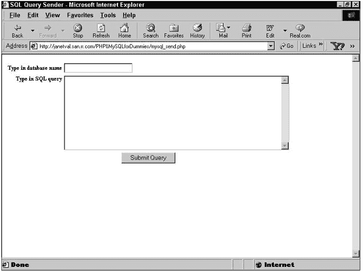

图 4-1：

由 `mysql_send.php` 生成的 SQL 查询网页。

- 4. **单击提交查询按钮。**

查询被执行，并显示一个页面，展示查询结果。如果您的查询有错误，则会显示错误消息。

您可以通过在前述步骤的第 2 步中输入此测试查询来测试 `mysql_send.php` 程序：

```
SHOW DATABASES
```

此查询不需要您输入数据库名称，因此您可以跳过第 3 步。当您在第 4 步中单击提交查询按钮时，会显示现有数据库的列表。在大多数情况下，您会看到一个名为 `Test` 的数据库，该数据库在安装 MySQL 时会自动安装。此外，您可能还会看到一个名为 `mysql` 的数据库，MySQL 使用它来存储所需的信息，例如账户名、密码和权限。即使没有现有数据库，您的 SQL 查询也会正确执行。如果出现问题，将显示错误消息。MySQL 错误消息通常对查找问题很有帮助。


## 向 MySQL 服务器发送 SQL 查询的更快方法

安装 MySQL 时，还会安装一个名为 `mysql`（有时也称为终端监视器或监视器）的简单文本程序。与服务器通信的程序是客户端软件；由于此程序与 MySQL 服务器通信，因此它是客户端。当您在此客户端中输入 SQL 查询时，响应会返回到客户端并显示在屏幕上。监视器程序可以通过网络发送查询；它不必运行在数据库存储的机器上。

要使用 `mysql` 客户端向 MySQL 发送 SQL 查询，请按照以下步骤操作：

- 1. 找到 `mysql` 客户端。

默认情况下，`mysql` 客户端程序安装在 MySQL 安装目录下的 `bin` 子目录中。在 Unix/Linux 中，默认位置为 `/usr/local/mysql/bin` 或 `/usr/local/bin`。在 Windows 中，默认位置为 `c:\mysql\bin`。但是，客户端可能已安装在不同的目录中。或者，如果您不是 MySQL 管理员，您可能无法访问 `mysql` 客户端。如果您不知道 MySQL 安装在哪里或无法运行客户端，请要求 MySQL 管理员将客户端放在您可以运行的位置，或提供一份副本供您放在自己的计算机上。

- 2. 启动客户端。

在 Unix/Linux 中，输入路径/文件名（例如，`/usr/local/mysql/bin/mysql`）。在 Windows 中，打开命令提示符窗口，然后输入路径/文件名（例如，`c:\mysql\bin\mysql.exe`）。在输入路径/文件名后按 Enter，除非您使用第 3 步中显示的参数。

- 3. **如果您启动 `mysql` 客户端以通过网络访问数据库，请在 `mysql` 命令后使用以下参数：**

  - `-h host` 是 MySQL 所在机器的名称。

  - `-u user` 是您的 MySQL 账户名。

  - `-p`：此参数会提示您输入 MySQL 账户的密码。

例如，如果您位于 `mysql` 客户端所在的目录中，命令可能如下所示：

```text
mysql -h mysqlhost.mycompany.com -u root -p
```

输入命令后按 Enter。

- 4. **在提示时输入您的密码。**

`mysql` 客户端启动，您会看到类似以下内容：

```text
Welcome to the MySQL monitor. Commands end with ; or \g.
Your MySQL connection id is 459 to server version: 4.0.13
Type 'help;' or '\\h' for help. Type '\\c' to clear the buffer.
mysql>
```

- 5. **选择您要使用的数据库。**

在 `mysql` 提示符下，输入以下内容：

```text
use databasename
```

使用您要查询的数据库的名称。

- 6. **在 `mysql` 提示符下，输入您的 SQL 查询，后跟分号（;），然后按 Enter 键。**

`mysql` 客户端会继续提示输入，直到您输入分号才会执行查询。查询的响应会显示在屏幕上。

- 7. **要退出 `mysql` 客户端，请在提示符下输入 `quit`，然后按 Enter 键。**

## 构建数据库

数据库有两个部分：用于存储数据的结构和数据本身。在接下来的几个部分中，我将解释如何创建数据库结构。首先，您创建一个没有任何结构的空数据库，然后向其中添加表。

您用于操作数据库结构的 SQL 查询是 `CREATE`、`ALTER`、`DROP` 和 `SHOW`。要使用这些查询，您必须拥有具有创建、修改和删除数据库和表的权限的 MySQL 账户。有关 MySQL 账户的更多信息，请参阅第 5 章。

### 创建新数据库

要创建新的空数据库，请使用以下 SQL 查询：

```
CREATE DATABASE databasename
```

其中 `databasename` 是您为数据库指定的名称。例如，以下两个 SQL 查询创建了本书中使用的示例数据库：

```
CREATE DATABASE PetCatalog
CREATE DATABASE MemberDirectory
```


一些 Web 主机公司不允许您创建新数据库。您只能使用一个与 MySQL 配合使用的数据库，并且只能在此数据库中创建表。您可以尝试请求另一个数据库，但需要有充分的理由。MySQL 和 PHP 不在乎您的所有表都在一个数据库中，而不是按有意义的名称组织到不同的数据库中。只是对人类来说，当项目有组织时更容易跟踪。

为了亲自确认数据库是否已创建，请使用此 SQL 查询：

```
SHOW DATABASES
```

创建空数据库后，您可以向其中添加表。（在本章后面描述了向数据库添加表。）

### 删除数据库

您可以使用此 SQL 查询删除任何数据库：

```
DROP DATABASE databasename
```


请谨慎使用 `DROP`，因为它是不可逆的。数据库被删除后将永远消失。其中的任何数据也将随之消失。

### 向数据库添加表

您可以向任何数据库添加表，无论是您刚刚创建的新空数据库，还是已包含表和数据的现有数据库。您使用 `CREATE` 查询向数据库添加表。

我在第 3 章中介绍的示例数据库设计中，`PetCatalog` 数据库设计了三个表：`Pet`、`PetType` 和 `PetColor`。`MemberDirectory` 数据库设计了两个表：`Member` 和 `Login`。由于表是在数据库中创建的，因此您必须指定要创建表的数据库名称。也就是说，使用所示的表单时

## 更改数据库结构

你的数据库并非一成不变。通过使用 `ALTER` 查询，你可以更改表的名称；添加、删除或重命名列；或者更改列的数据类型或其他属性。

此查询的基本格式是 `ALTER TABLE tablename`，后跟你所请求的具体更改。表 4-1 显示了你可以进行的更改。

表 4-1 使用 `ALTER` 查询可以进行的更改

| 更改 | 描述 |

|---|---|

| ADD columnname definition | 添加一列；定义包括数据类型和可选定义。 |

| ALTER columnname SET DEFAULT value | 更改一列的默认值。 |

| ALTER columnname DROP DEFAULT | 移除一列的默认值。 |

| CHANGE columnname newcolumnname definition | 更改一列的定义并重命名该列；定义包括数据类型和可选定义。 |

| DROP columnname | 删除一列，包括该列中的所有数据。该数据无法恢复。 |

| MODIFY columnname definition | 更改一列的定义；定义包括数据类型和可选定义。 |

| RENAME newtablename | 重命名一个表。 |

更改数据库并不是一件罕见的事。你可能出于很多原因想要更改数据库。例如，假设你在 `MemberDirectory` 数据库的 `Member` 表中将 `lastName` 列定义为 `VARCHAR(20)`。当时，20 个字符对于一个姓氏来说似乎足够了。但现在你刚收到一份备忘录，宣布新任 CEO 是 John Schwartzeheimer-Losertman。哎呀。MySQL 会将他的名字截断为前 20 个字母，这对老板来说可不是一个理想的新名字。所以你需要让这个列更宽一些——立刻。发送这个查询，一秒钟就能更改该列：

```sql
ALTER TABLE Member MODIFY lastName VARCHAR(50)
```

## 将数据移入和移出数据库

空数据库就像一个空饼干罐——没什么意思。而且，搜索空数据库并不比搜索空饼干罐更有趣或更有收获。数据库的价值仅在于它所保存的信息。

数据库需要能够接收信息以进行存储，并按请求提供信息。例如，`MemberDirectory` 数据库需要能够接收成员信息，并且当你请求时，它还需要能够提供其存储的信息。例如，如果你想知道某个特定成员的地址，当你请求时，数据库需要提供该信息。

你的 MySQL 数据库响应四种类型的请求：

- **添加信息：** 向表中添加一行。

- **更新信息：** 更改现有行中的信息。这包括向现有行中的空白字段添加数据。

- **检索信息：** 查看数据。此请求不会从数据库中删除数据。

- **移除信息：** 从数据库中删除数据。

有时你的问题需要来自多个表的信息。例如，“一只绿龙要多少钱？”这个问题需要来自 `Pet` 表和 `Color` 表的信息。你可以通过组合这些表，在单个 `SELECT` 查询中轻松地提出这个问题。

在接下来的章节中，我将讨论如何接收和提供信息，以及如何组合表。

### 添加信息

每个数据库都需要数据。例如，你可能想向数据库添加数据，以便用户查看——我在第 3 章介绍的宠物目录（Pet Catalog）就是一个例子。或者你可能想创建一个空数据库，让用户向其中放入数据，使这些数据仅供你查看——成员目录（Member Directory）就是一个例子。无论哪种情况，数据都会被添加到数据库中。

如果你的数据仍停留在纸面上，你可以使用 SQL 查询将数据直接输入 MySQL 数据库，一次输入一行。然而，如果你有大量数据，这个过程可能会很乏味，并且需要大量输入。假设你有 1,000 种产品的信息需要添加到数据库中。假设你打字快如闪电，每分钟能输入一行，那就是 16 个小时的快速输入——好吧，至少是快速编辑。可行，但不好玩。另一方面，假设你需要将某个组织的 5,000 名成员输入数据库，并且每输入一名成员需要五分钟。这样一来，你将面临超过 400 小时的输入——谁有时间做这种事？


如果你有大量数据要输入，请考虑一些替代方案。有时，扫描数据是一种选择。或者，你可能需要恳求、借用或雇用一些帮手。在许多情况下，将数据输入到一个大的文本文件中，比在单独的 SQL 查询中逐行输入要快。

SQL 查询 `LOAD` 可以从大文本文件（甚至小文本文件）中读取数据。因此，如果你的数据已经在计算机文件中，你可以直接使用该文件；你不需要重新输入所有数据。即使数据的格式不是文本文件（例如 Excel、Access 或 Oracle 文件），你通常也可以将该文件转换为一个大文本文件，然后将其读入 MySQL 数据库。如果数据尚未保存在计算机文件中，而且数据量很大，那么先将数据以一个大文本文件的形式输入计算机，然后再将其传输到 MySQL，可能会更快。

大多数文本文件都可以读入 MySQL，但有些格式比其他格式更容易。如果你打算将数据输入到一个大的文本文件中，请阅读“添加大量数据”一节，为你的文本文件找到最佳格式。当然，如果数据已经在计算机上，你只能按文件的现有格式来处理。

### 一次添加一行

你使用 `INSERT` 查询向数据库添加一行。此查询告诉 MySQL 将行添加到哪个表，以及该行中各字段的值是什么。该查询的一般形式是

```
INSERT INTO tablename (columnname, columnname,...,columnname)
VALUES (value, value,...,value)
```

以下规则适用于 `INSERT` 查询：

- **值的列出顺序必须与列名的列出顺序相同。** 值列表中的第一个值被插入到列列表中第一个命名的列中；值列表中的第二个值被插入到列列表中第二个命名的列中；依此类推。

- **允许只列出部分列。** 你不需要列出所有列。未列出的列会被赋予默认值，如果未定义默认值，则留空。

- **列列表不是必需的。** 如果你要为所有列输入值，则根本不需要列出这些列。如果没有列出任何列，MySQL 将按照列在表中出现的顺序查找所有列的值。

- **列列表和值列表的长度必须相同。** 如果列列表长于或短于值列表，你会收到如下错误消息：`Column count doesn't match value count.`

下面的 `INSERT` 查询向 `Member` 表添加一行：

```sql
INSERT INTO Member (loginName,createDate,password,lastName,
                    street,city,state,zip,email,phone,fax)
    VALUES ("bigguy","2001-Dec-2","secret","Smith",
            "1234 Happy St.","Las Vegas","NV","88888",
            "gsmith@GSmithCompany.com","(555) 555-5555","")
```

请注意，`firstName` **没有**出现在列名列表中。没有向 `firstName` 字段输入任何值。如果 `firstName` 被定义为 `NOT NULL`，MySQL 不会允许这样做，但由于 `firstName` 未被定义为 `NOT NULL`，所以这是可以的。另外，如果 `firstName` 的定义包含默认值，则会输入默认值，但由于它没有默认值，该字段保持为空。请注意，为 `fax` 存储的值是一个空字符串；MySQL 对空字符串没有问题。

要查看你输入的数据并确保输入正确，请使用从数据库中检索数据的 SQL 查询。我在本章后面的“检索信息”中详细描述这些 SQL 查询。简而言之，以下查询检索 `Member` 表中的所有数据：

```sql
SELECT * FROM Member
```

### 添加大量数据

如果你有大量数据要输入，并且这些数据已经在计算机文件中，你可以将数据从现有的计算机文件传输到 MySQL 数据库。从文本文件读取数据的 SQL 查询是 `LOAD`。`LOAD` 查询要求你指定一个数据库。

由于数据库中的数据是按行和列组织的，因此被读取的文本文件必须标明每一列数据的开始和结束位置，以及一行数据的结束位置。为了标明各列，需要使用一个特定的字符来分隔每一列的数据。默认情况下，MySQL 会查找制表符来分隔字段。然而，如果制表符对你的数据文件不适用，你可以选择不同的字符来分隔字段，并在查询中告诉 MySQL 使用不同于制表符的字符来分隔字段。另外，默认情况下，一行的结束即被视为一条记录的结束——不过如果需要，你可以选择一个字符来表示行的结束。`Pet` 表的数据文件可能如下所示：

```
Unicorn<TAB>horse<TAB>Spiral horn<Tab>5000.00<Tab>/pix/unicorn.jpg
Pegasus<TAB>horse<TAB>Winged<Tab>8000.00<Tab>/pix/pegasus.jpg
Lion<TAB>cat<TAB>Large; Mane on neck<Tab>2000.00<Tab>/pix/lion.jpg
```

字段之间用制表符分隔的数据文件称为制表符分隔文件。另一种常见格式是逗号分隔文件，其中字段由逗号分隔。如果你的数据采用其他文件格式，则需要将其转换为分隔文件。


要将其他文件格式的数据转换为分隔文件，请查阅该软件的文档，或咨询了解数据当前格式的本地专家。许多程序（如 Excel、Access 或 Oracle）都允许你将数据输出为分隔文件。对于文本文件，你可以使用编辑器或文字处理器的查找和替换功能将其转换为分隔格式。如果文件确实难以处理，你可能需要寻求专家或程序员的帮助。

`LOAD` 查询的基本形式是

```
LOAD DATA INFILE "datafilename" INTO TABLE tablename
```

如果想更改默认分隔符，可以在此基本形式后添加可选短语。可选项为

```
FIELDS TERMINATED BY 'character'
FIELDS ENCLOSED BY 'character'
LINES TERMINATED BY 'character'
```

假设你有本节前面所示的 `Pet` 表的数据文件，只是字段之间用逗号而非制表符分隔。数据文件名为 `pets.dat`，并且与数据库位于同一目录中。将数据读入该表的 SQL 查询为

```
LOAD DATA INFILE "pets.dat" INTO TABLE Pet
    FIELDS TERMINATED BY ','
```


要使用 `LOAD DATA INFILE` 查询，MySQL 账户必须拥有服务器主机上的 `FILE` 权限。我在第 5 章讨论 MySQL 账户权限。

要查看已加载的数据——以确保其正确——可以使用从数据库检索数据的 SQL 查询。我将在下一节详细描述这些类型的 SQL 查询。简而言之，使用以下查询查看表中的所有数据以便检查：

```
SELECT * FROM Pet
```

## 检索信息

存储信息的唯一目的是在需要时能够获得它。数据库的存在就是为了回答问题。有哪些宠物在售？成员有哪些？有多少成员住在阿肯色州？你有鳄鱼出售吗？一条龙多少钱？Goliath Smith 的电话号码是多少？如此等等。你可以使用 `SELECT` 查询向数据库提问。

最简单、最基本的 `SELECT` 查询是

```
SELECT * FROM tablename
```

该查询会检索表中的全部信息。星号（`*`）是一个通配符，表示所有列。

`SELECT` 查询可以更具选择性。`SELECT` 查询中的 SQL 单词和短语可以精确定位回答问题所需的信息。你可以指定需要哪些信息、希望如何组织这些信息，以及信息的来源是什么：

- 你可以只请求回答问题所需的信息（列）。例如，你可以只请求名字和姓氏来创建成员列表。

- 你可以按特定顺序请求信息。例如，你可以要求信息按字母顺序排序。

- 你可以从表中选定的对象（行）请求信息。（有关数据库对象的说明，请参阅第 3 章。）例如，你可以只请求地址在佛罗里达州的成员的名字和姓氏。

### 检索特定信息

要检索特定信息，请列出包含所需信息的列。例如：

```
SELECT columnname,columnname,columnname,... FROM tablename
```

该查询从所有行中检索指定列的值。例如，以下查询检索 `Member` 表中存储的所有姓氏和名字：

```
SELECT lastName,firstName FROM Member
```

你可以在选择列时对列执行数学运算。例如，可以使用以下 `SELECT` 查询将两列相加：

```
SELECT col1+col2 FROM tablename
```

或者可以使用以下查询：

```
SELECT price,price*1.08 FROM Pet
```

结果是价格以及加上 8% 销售税后的价格。选择列时，可以更改列的名称，如下所示：

```
SELECT price,price*1.08 AS priceWithTax FROM Pet
```

`AS` 子句告诉 MySQL 将检索到的第二列命名为 `priceWithTax`。因此，该查询检索两列数据：`price` 和 `priceWithTax`。

在某些情况下，你可能不想查看列中的值，而是想了解关于该列的某些信息。例如，你可能想知道列中的最小值或最大值。表4-2 列出了可以获取的有关列的一些信息。

| 表4-2 | 可选择的信息 |

|---|---|

| SQL 格式 | 信息描述 |

| `AVG(columnname)` | 返回 `columnname` 中所有值的平均值 |

| `COUNT(columnname)` | 返回 `columnname` 不为空的行数 |

| `MAX(columnname)` | 返回 `columnname` 中的最大值 |

| `MIN(columnname)` | 返回 `columnname` 中的最小值 |

| `SUM(columnname)` | 返回 `columnname` 中所有值的总和 |

例如，要查找 `Pet` 表中的最高价格，查询为

```
SELECT MAX(price) FROM Pet
```


像 `MAX()` 和 `SUM()` 这样的 SQL 词语是函数。除了表4-2 中的函数外，SQL 还提供许多函数。有些函数（如表4-2 中的函数）提供关于列的信息。其他函数则会改变选中的每个值。例如，`SQRT()` 返回列中每个值的平方根，`DAYNAME()` 返回日期列中每个值对应的星期名称，而不是该列中存储的实际日期。`SELECT` 查询中可以使用 100 多个函数。有关所有函数的说明，请参阅 www.mysql.com/documentation 上的 MySQL 文档。

### 按特定顺序检索数据

你可能希望按特定顺序检索数据。例如，在 `Member` 表中，你可能希望成员按姓氏的字母顺序排列。或者，在 `Pet` 表中，你可能希望宠物按宠物类型分组。

在 `SELECT` 查询中，`ORDER BY` 和 `GROUP BY` 会影响数据交付给你的顺序：

`ORDER BY`：要对信息排序，请使用以下短语

```
ORDER BY columnname
```

数据按 `columnname` 升序排序。例如，如果 `columnname` 是 `lastName`，则数据将按姓氏的字母顺序交付给你。

你可以通过在列名前面添加 `DESC` 关键字来按降序排序。例如：

```
SELECT * FROM Member ORDER BY lastName DESC
```

`GROUP BY`：要对信息分组，请使用以下短语：

```
GROUP BY columnname
```

`columnname` 值相同的行将被分组在一起。例如，使用以下查询对 `petType` 值相同的行进行分组：

```
SELECT * FROM Pet GROUP BY petType
```

你可以在同一个查询中使用 `GROUP BY` 和 `ORDER BY`。


### 从特定源检索数据

很多时候，你并不需要表中的全部信息，而只需要来自选定的数据库对象（即行）的信息。三个 SQL 单词经常用于指定信息的来源：

- `WHERE`：允许你从具有特定特征的数据库对象请求信息。例如，你可以请求居住在加利福尼亚州的成员姓名，或者只列出猫类宠物。

- `LIMIT`：允许你限制检索信息的行数。例如，你可以请求表中前三行的全部信息。

- `DISTINCT`：允许你从相同的行中仅请求其中一行的信息。例如，在 `Login` 表中，你可以请求 `loginName` 但指定不要重复的名称，从而限制返回的结果。

> 对每个成员仅保留一条记录。这将回答问题“该成员是否曾经登录过？”而不是问题“该成员登录了多少次？”

`The WHERE clause of the SELECT query enables you to make very complicated selections. For instance, suppose your boss asks for a list of all the members whose last names begin with B, who live in Santa Barbara, and who have an 8 in either their phone or fax number. I'm sure there are many uses for such a list. You can get this list for your boss with a SELECT query by using a WHERE clause.`

`The basic format of the WHERE clause is`

```
WHERE expression AND|OR expression AND|OR expression ...
```

`expression specifies a value to compare with the values stored in the database. Only the rows containing a match for the expression are selected. You can use as many expressions as needed, each one separated by AND or OR. When you use AND, both of the expressions connected by the AND (that is, both the expression before the AND and the expression after the AND) must be true in order for the row to be selected. When you use OR, only one of the expressions connected by the OR must be true for the row to be selected.`

Some common expressions are shown in Table 4-3.

Table 4-3 Expressions for the WHERE Clause

| Expression | Example | Result |

|---|---|---|

| 列 = 值 | `zip="12345"` | 仅选择在名为 `zip` 的列中存储了 12345 的行 |

| 列 > 值 | `zip > "50000"` | 仅选择邮政编码为 50001 或更高的行 |

| 列 >= 值 | `zip >= "50000"` | 仅选择邮政编码为 50000 或更高的行 |

| 列 < 值 | `zip < "50000"` | 仅选择邮政编码为 49999 或更低的行 |

| 列 <= 值 | `zip <= "50000"` | 仅选择邮政编码为 50000 或更低的行 |

| *列* BETWEEN *值1* AND *值2* | `zip BETWEEN "20000" AND "30000"` | 仅选择邮政编码大于 19999 且小于 30001 的行 |

| *列* IN (*值1*, *值2*,...) | `zip IN ("90001", "30044")` | 仅选择邮政编码为 90001 或 30044 的行 |

| *列* NOT IN (*值1*,*值2*,...) | `zip NOT IN ("90001", "30044")` | 仅选择邮政编码为除 90001 或 30044 之外的任何邮政编码的行 |

| *列* LIKE *值* — *值* 可以包含通配符 %（匹配任意字符串）和 _（匹配任意字符） | `zip LIKE "9%"` | 选择所有邮政编码以 9 开头的行 |

| *列* NOT LIKE *值* — *值* 可以包含通配符 %（匹配任意字符串）和 _（匹配任意字符） | `zip NOT LIKE "9%"` | 选择所有邮政编码不以 9 开头的行 |


You can combine any of the expressions in Table 4-3 with `AND`s and `OR`s. In some cases, you need to use parentheses to clarify the selection criteria. For instance, you can use the following query to answer your boss’s urgent need to find all the people in the Member Directory whose names begin with B, who live in Santa Barbara, and who have an 8 in either their phone or fax number:

```sql
SELECT lastName,firstName FROM Member
    WHERE lastName LIKE "B%"
        AND city = "Santa Barbara"
        AND (phone LIKE "%8%" OR fax LIKE "%8%")
```

Notice the parentheses in the last line. You would not get the results that your boss asked for without the parentheses. Without the parentheses, each connector would be processed in order from the first to the last, resulting in a list that includes all members whose names begin with B and who live in Santa Barbara and whose phone numbers have an 8 in them and all members whose fax numbers have an 8 in them, whether they live in Santa Barbara or not and whether their name begins with a B or not. When the last `OR` is processed, members are selected whose characteristics match the expression before the `OR` is connected to previous expressions by the previous `AND`s and so does not stand alone, but the expression after the `OR` does stand alone, resulting in the selection of all members with an 8 in their fax number.

`LIMIT` specifies how many rows can be returned. The form for `LIMIT` is

```sql
LIMIT startnumber,numberofrows
```

The first row that you want to retrieve is `startnumber`, and the number of rows that you want to retrieve is `numberofrows`. If `startnumber` is not specified, 1 is assumed. To select only the first three members who live in Texas, use this query:

```sql
SELECT * FROM Member WHERE state="TX" LIMIT 3
```


Some `SELECT` queries will find identical records, but in this example, you only want to see one — not all — of the identical records. To prevent the query from returning all the identical records, add the word `DISTINCT` immediately after `SELECT`.

## Combining information from tables

In the earlier sections of this chapter, I assume that all the information you want is in a single table. However, you might want to combine information from different tables. You can do this easily in a single query.

Two words can be used in a `SELECT` query to combine information from two or more tables:

- `UNION`: Rows are retrieved from one or more tables and stored together, one after the other, in a single result. For example, if your query selected 6 rows from one table and 5 rows from another table, the result would contain 11 rows.
- `JOIN`: The tables are combined side by side, and the information is retrieved from both tables.

### UNION

`UNION` is used to combine the results from two or more select queries. The results from each query are added to the result set following the results of the previous query. The format of the `UNION` query is as follows:

```sql
SELECT query UNION ALL SELECT query ...
```

You can combine as many `SELECT` queries as you need to. A `SELECT` query can include any valid `SELECT` format, including `WHERE` clauses, `LIMIT` clauses, and so on. The rules for the queries are

- All the select queries must select the same number of columns.
- The columns selected in the queries must contain the same type of data.

The results set will contain all the rows from the first query followed by all the rows from the second query and so on. The column names used in the results set are the column names from the first `SELECT` query.

The series of `SELECT` queries can select different columns from the same table, but situations in which you want a new table with one column in a table followed by another column from the same table are unusual. It’s much more likely that you want to combine columns from different tables. For example, you might have a table of members who have resigned from the club and a separate table of current members. You can get a list of all members, both current and resigned, with the following query:

```sql
SELECT lastName,firstName FROM Member UNION ALL
    SELECT lastName,firstName FROM OldMember
```

The result of this query is the last name and first name of all current members, followed by the last name and first name of all the members who have resigned.

Depending on how you organized your data, you might have duplicate names. For instance, perhaps a member resigned, and his name is in the `OldMember` table — but he joined again, so his name is added to the `Member` table. If you don’t want duplicates, don’t include the word `ALL`. If `ALL` is not included, duplicate lines are not added to the result.

You can use `ORDER BY` with each `SELECT` query, as I discuss in the previous section, or you can use `ORDER BY` with a `UNION` query to sort all the rows in the result set. If you want `ORDER BY` to apply to the entire result set, rather than just to the query that it follows, use parentheses as follows:

```sql
(SELECT lastName FROM Member UNION ALL
    SELECT lastName FROM OldMember) ORDER BY lastName
```


The `UNION` statement was introduced in MySQL 4.0. It is not available in MySQL 3.

### Join

Combining tables side by side is a `连接`. Tables are combined by matching data in a column — the column that they have in common. The combined results table produced by a join contains all the columns from both tables. For instance, if one table has two columns (`memberID` and `height`), and the second table has two columns (`memberID` and `weight`), a join results in a table with four columns: `memberID` (from the first table), `height`, `memberID` (from the second table), and `weight`.

存在两种常见的连接类型：内连接和外连接。内连接与外连接之间的区别在于结果表中包含的行数。内连接产生的结果表仅包含同时存在于两个表中的行。外连接产生的合并表包含一个表中存在的所有行，对于在第二个表中不存在的行，其列为空。例如，如果 `table1` 包含 Joe 的一行和 Sally 的一行，而 `table2` 仅包含 Sally 的一行，则内连接将仅包含一行：Sally 的行。然而，外连接将包含两行——Joe 的一行和 Sally 的一行——即使 Joe 的行在 `weight` 列中为空。

外连接的结果表包含一个表的所有行。如果该表中的某些行在第二个表中不存在，则第二个表的列为空。显然，结果表的内容取决于哪个表贡献了其所有行，需要第二个表与之匹配。两种外连接控制哪个表设置行以及哪个表与之匹配：a `LEFT JOIN` 和 a `RIGHT JOIN`。

您对内连接和两种外连接使用不同的 `SELECT` 查询。以下查询是内连接：

```sql
SELECT columnnamelist FROM table1,table2
WHERE table1.col2 = table2.col2
```

而这些查询是外连接：

```sql
SELECT columnnamelist FROM table1 LEFT JOIN table2
ON table1.col1=table2.col2
```

```sql
SELECT columnnamelist FROM table1 RIGHT JOIN table2
ON table1.col1=table2.col2
```

在这三个查询中，`table1` 和 `table2` 是要连接的表。您可以连接两个以上的表。在这两个查询中，`col1` 和 `col2` 是用于匹配以连接表的列的名称。表是基于这些列中的数据进行匹配的。这两列可以具有相同的名称或不同的名称。这两列必须包含相同类型的数据。

作为内连接和外连接的示例，请考虑 Pet Catalog 的简短形式。一个表是 `Pet`，其两个列 `petName` 和 `petType` 包含以下数据：

| `petName` | `petType` |
|---|---|
| Unicorn | Horse |
| Pegasus | Horse |
| Lion | Cat |

第二个表是 `Color`，其两个列 `petName` 和 `petColor` 包含以下数据：

| `petName` | `petColor` |
|---|---|
| Unicorn | white |
| Unicorn | silver |
| Fish | Gold |

您需要提出一个需要来自两个表的信息的问题。如果您使用以下查询执行内连接：

```sql
SELECT * FROM Pet,Color WHERE Pet.petName = Color.petName
```

您将得到一个包含四列的结果表：`petName`（来自 `Pet`）、`petType`、`petName`（来自 `Color`）和 `petColor`。

| `petName` | `petType` | `petName` | `petColor` |
|---|---|---|---|
| Unicorn | Horse | Unicorn | white |
| Unicorn | Horse | Unicorn | silver |

请注意，结果表中仅出现 Unicorn——因为在连接之前，只有 Unicorn 同时存在于两个原始表中。另一方面，假设您使用以下查询执行左外连接：

```sql
SELECT * FROM Pet LEFT JOIN Color
ON Pet.petName=Color.petName
```

您将得到以下结果表，具有相同的四列——`petName`（来自 `Pet`）、`petType`、`petName`（来自 `Color`）和 `petColor`——但行不同：

| `petName` | `petType` | `petName` | `petColor` |
|---|---|---|---|
| Unicorn | Horse | Unicorn | white |
| Unicorn | Horse | Unicorn | silver |
| Pegasus | Horse | `<NULL>` | `<NULL>` |
| Lion | Cat | `<NULL>` | `<NULL>` |

此表有四行。它与内连接的前两行相同，但多出了两行——这些行在左侧的 `Pet` 表中但不在 `Color` 表中。请注意，对于最后两行，来自 `Color` 表的列为空。

另一方面，假设您使用以下查询执行右外连接：

```sql
SELECT * FROM Pet RIGHT JOIN Color
ON Pet.petName=Color.petName
```

您将得到以下结果表，具有相同的四列，但行仍然不同：

| `petName` | `petType` | `petName` | `petColor` |
|---|---|---|---|
| Unicorn | Horse | Unicorn | white |
| Unicorn | Horse | Unicorn | silver |


| <NULL> | <NULL> | Fish | Gold |

请注意，这些结果包含右侧 `Color` 表的所有行，但不包含 `Pet` 表的行。请注意 `Pet` 表列中的空白，因为它没有 `Fish` 的行。

到目前为止我所谈论的连接在表中查找匹配的条目。有时了解表中哪些行在另一个表中没有匹配条目是有用的。例如，假设您想知道谁从未登录过您的 Members Only 部分。因为您有一个包含成员登录名的表和另一个包含用户登录日期的表，所以您可以通过使用这两个表来提出这个问题。执行连接并查看所有匹配项以尝试查看谁缺失可能在用户名很多的情况下是不可能的。然而，您可以使用以下查询找出在登录表中没有条目的登录名：

```
SELECT loginName from Member LEFT JOIN Login
       ON Member.loginName=Login.loginName
       WHERE Login.loginName IS NULL
```

此查询将为您提供 `Member` 中不在 `Login` 表中的所有登录名的列表。

## 更新信息

更改现有行中的信息即为 *更新* 信息。例如，您可能需要更改成员的地址，因为她搬家了，或者您可能需要添加成员在最初输入信息时留空的传真号码。

`UPDATE` 查询非常简单：

```
UPDATE tablename SET column=value,column=value,...
                 WHERE clause
```

在 `SET` 子句中，您列出要更新的列和要插入的新值。在一个查询中列出您想要更改的所有列。如果没有 `WHERE` 子句，列的值将在所有行中更改。但有了 `WHERE` 子句，您可以指定要更新的行。例如，要更新 `Member` 表中的地址，请使用此查询：

```
UPDATE Member SET street="3333 Giant St",
    phone="555-555-5555"
    WHERE loginName="bigguy"
```

## 删除信息

通过删除过时的信息来保持数据库中的信息最新。您可以使用 `DELETE` 查询从表中删除一行：

```
DELETE FROM tablename WHERE clause
```


使用 `DELETE` 时务必极其小心。如果您在没有 `WHERE` 子句的情况下使用 `DELETE` 查询，它将删除表中的所有数据。我是说所有数据。我再重复一遍，所有数据。数据无法恢复。`DELETE` 查询的此功能正好在我的“不要在家尝试”清单的顶部。

您可以使用 `ALTER` 查询从表中删除一列：

```
ALTER TABLE tablename DROP columnname
```

或者，当然，您也可以将其全部删除并重新开始：

```
DROP TABLE tablename
```

或

```
DROP DATABASE databasename
```

### 第5章

### 保护您的数据

### 本章内容

- 了解 MySQL 数据安全
- 添加新的 MySQL 账户
- 修改现有账户
- 更改密码
- 制作备份
- 修复数据
- 恢复数据

您的数据对您的 Web 数据库应用程序至关重要。存储和/或呈现数据是您的 Web 数据库应用程序的主要活动。您花费了宝贵的时间开发数据库，其中包含您或您的用户输入的重要信息。您需要保护它。在本章中，我将向您展示如何操作。

### 控制对您的数据的访问

您需要控制对数据库中信息的访问。您需要决定谁可以看到数据，谁可以更改数据。想象一下，如果您的竞争对手可以更改您在线产品目录中的信息或复制您的客户名单会发生什么——您很快就会倒闭。显然，您需要保护您的数据。

MySQL 提供了保护您数据的系统。没有账户就无法访问数据库中的数据。每个 MySQL 账户具有以下属性：

- 一个名称
- 一个 *主机名* — 账户可以从该机器访问 MySQL 服务器的机器
- 一个密码
- 一组权限

为了访问您的数据，某人必须使用有效的账户名并知道与该账户关联的密码。此外，该人必须从一台被允许通过该特定账户连接到您数据库的计算机上进行连接。

在用户获得数据库访问权限后，他或她对数据的操作取决于为该账户设置的权限。每个账户要么被允许要么不被允许在数据库中执行操作，例如 `SELECT`、`DELETE`、`INSERT`、`CREATE`、`DROP` 等。指定账户可以做什么的设置是特权或权限。您可以设置一个拥有全部权限、无权限或介于两者之间的账户。例如，对于在线产品目录，您希望客户能够查看目录中的信息但不能更改它。

当用户尝试连接到 MySQL 并执行查询时，MySQL 分为两个阶段控制对数据的访问：

- 1. **Connection verification:** MySQL 检查账户名和密码的有效性，并检查连接是否来自被允许使用指定账户连接到 MySQL 服务器的主机。如果一切检查通过，MySQL 接受连接。
- 2. **Request verification:** MySQL 接受连接后，会检查该账户是否有执行指定查询所需的权限。如果有，MySQL 执行查询。

您发送给 MySQL 的任何查询都可能因第一步连接被拒绝或第二步查询不被允许而失败。会返回错误消息以帮助您确定问题的来源。

在接下来的几个部分中，我将更详细地描述账户和权限。

## Understanding account names and hostnames

账户名和主机名（被授权连接到数据库的计算机的名称）一起标识一个唯一的账户。具有相同名称但不同主机名的账户可以存在，并且可以拥有不同的密码和权限。但是，您不能有两个具有相同名称和相同主机名的账户。


MySQL 服务器仅在从该主机名连接时才会接受来自 MySQL 账户的连接。当您构建 `GRANT` 或 `REVOKE` 查询（我将在本章后面描述）时，您使用以下格式通过账户名和主机名一起标识 MySQL 账户：`accountname@hostname`（例如，`root@localhost`）。

MySQL 账户名与 Unix/Linux 或 Windows 用户名（有时也称为 *login name*）完全无关。如果您使用名为 `root` 的管理员 MySQL 账户，它与 Unix/Linux `root` 登录名无关。更改 MySQL 登录名不会以任何方式影响 Unix/Linux 或 Windows 登录名——反之亦然。

MySQL 账户名和主机名的定义如下：

- **An account name can be up to 16 characters long.** 您可以在账户名中使用特殊字符，例如空格或连字符 `-`。但是，您不能在账户名中使用通配符。
- **An account name can be blank.** 如果 MySQL 中存在一个账户名为空的账户，则任何账户名对该账户都有效。只要用户从被允许连接到空白账户名的主机名连接并使用正确的密码（如有需要），用户就可以使用任何账户名连接到您的数据库。您可以使用一个名称为空的账户来允许匿名用户连接到您的数据库。
- **The hostname can be a name or an IP address.** 例如，它可以是 `thor.mycompany.com` 这样的名称，或 `192.163.2.33` 这样的 IP（互联网协议）地址。安装 MySQL 服务器的机器是 `localhost`。
- **Wildcards can be used in the hostname.** 您可以使用百分号 `%` 作为通配符；`%` 匹配任何主机名。如果您为 `george@%` 添加一个账户，使用名为 `george` 的账户的人可以从任何计算机连接到 MySQL 服务器。
- **The hostname can be blank.** 空白主机名与使用 `%` 作为主机名相同。

存在账户名为空且主机名为空的账户是可能的。这样的账户会允许任何人使用任何账户名从任何计算机连接到 MySQL 服务器。账户名为空且主机名为百分号 `%` 的账户也是同样的情况。您几乎不可能想要这样的账户。安装 MySQL 时有时会安装这样的账户，但它没有任何特权，因此什么也做不了。


当 MySQL 安装时，它会自动安装一个拥有全部特权的账户：`root@localhost`。该账户未设置密码。只要登录到安装 MySQL 的计算机上的任何人，都可以使用名为 `root` 的账户访问 MySQL 并对其做任何事情。（当然，`root` 是一个众所周知的账户名，因此该账户并不十分安全。如果您是 MySQL 管理员，您应该立即为该账户添加密码。）


在某些操作系统上，除了 `root@localhost` 之外还会自动安装其他账户。例如，在 Windows 上，可能会安装一个名为 `root@%` 的账户且没有密码保护。这个拥有全部特权的 `root` 账户可以被任何人从任何机器使用。您应该立即删除该账户，或者至少为其设置密码。

## Finding out about passwords

为每个账户设置密码。如果未为账户提供密码，则密码为空，这意味着不需要密码。MySQL 对密码长度没有限制，但有时系统上的其他软件会将长度限制为八个字符。如果是这样，八个字符之后的任何字符都会被丢弃。

为了额外安全，MySQL 在存储密码前会对其进行加密。这意味着密码不会以您输入的可识别字符形式存储。此安全措施可确保没有人可以查看存储的密码并知道它们是什么。

不幸的是，一些坏人可能会试图通过猜测您的密码来访问您的数据。他们使用软件快速连续尝试使用不同的密码进行连接——这种做法称为 *cracking*。以下是一些选择尽可能难以破解的密码的建议：

- Use six to eight characters.
- Include one or more of each of the following — uppercase letter, lowercase letter, number, and punctuation mark.
- Do not use your account name or any variation of your account name.
- Do not include any word that's in a dictionary.
- Do not include a name.
- Do not use a phone number or a date.

一个好的密码难以猜测，不包含任何字典中的单词（包括外语词典），并且易于记忆。如果太难记住，您可能需要写下来，这就违背了设置密码的目的。创建好密码的一种方法是使用喜欢的短语的首字母。例如，您可以使用短语“All for one! One for all!”来创建此密码：

```
Afo!0fa!
```

此密码不包含任何数字，但您可以通过使用数字 4 代替字母 f 来解决。然后您的密码是

```
A4o!04a!
```

或者您可以使用数字 1 代替字母 o 来表示 one。然后密码是

```
A41!14a!
```

这个密码绝对难以猜测。将数字纳入密码的其他方法包括用 1（one）代替 l（ell）或用 0（zero）代替字母 o。

## Taking a look at account permissions

MySQL 使用账户权限来指定谁可以做什么。任何使用有效账户的人都可以连接到 MySQL 服务器，但他或她只能执行该账户权限允许的操作。例如，可以设置一个账户，使用户可以查询数据但不能插入数据或更新数据。

权限可以授予特定的数据库、表或列。例如，可以设置一个账户，允许用户从数据库中的所有表中查询数据，但只能向一个表插入数据，并且只能在特定表的一个列上更新。

权限是通过使用 `GRANT` 查询添加的，通过使用 `REVOKE` 查询删除。`GRANT` 或 `REVOKE` 查询必须使用具有在数据库中执行 `GRANT` 或 `REVOKE` 语句权限的账户发送。如果您尝试使用没有授予权限的账户发送 `GRANT` 查询或 `REVOKE` 查询，您会收到错误消息。例如，如果您尝试授予使用 select 命令的权限，并且使用没有授予权限的账户发送查询，您可能会看到以下错误消息：

```
grant command denied
```

权限可以单独授予或删除，也可以一次性全部授予或删除。表 5-1 列出了您可能想要分配或删除的一些权限。

| 表 5-1 | MySQL 账户权限 |
|---|---|
| 权限 | 描述 |
| ALL | 所有权限 |
| ALTER | 可以修改表的结构 |
| CREATE | 可以创建新数据库或表 |
| DELETE | 可以删除表中的行 |
| DROP | 可以删除数据库或表 |
| FILE | 可以读写服务器上的文件 |
| GRANT | 可以更改 MySQL 账户的权限 |
| INSERT | 可以向表中插入新行 |
| SELECT | 可以读取表中的数据 |
| SHUTDOWN | 可以关闭 MySQL 服务器 |
| UPDATE | 可以更改表中的数据 |
| USAGE | 没有任何权限 |


授予 `ALL` 并不是一个好主意，因为它包含管理操作的权限，例如关闭 MySQL 服务器。你不大可能希望除自己之外的任何人拥有如此广泛的权限。

## 设置 MySQL 账户

创建新账户时，你需要指定密码、允许使用该账户访问数据库的计算机名称，以及权限；不过，你随时可以更改这些信息。所有账户信息都存储在一个名为 `mysql` 的数据库中，该数据库在安装 MySQL 时会自动创建。要添加新账户或更改任何账户信息，你必须使用一个在 `mysql` 数据库上具有相应权限的账户。

要访问 MySQL 服务器，你至少需要一个账户。安装 MySQL 时，它会自动设置一些账户，包括一个名为 `root` 且拥有所有权限的账户。如果你通过公司网站或 Web 托管公司获得 MySQL 访问权限，该公司的 MySQL 管理员应该会为你提供账户；该账户可能不叫 `root`，而且可能拥有全部权限，也可能没有。

## MySQL 安全数据库

安装 MySQL 时，它会自动创建一个名为 `mysql` 的数据库。所有用于保护数据的信息都存储在该数据库中，包括账户名、主机名、密码和权限。

权限存储在列中。每个列名的格式为 `permission_priv`，其中 `permission` 是表 5-1 中所示权限之一。例如，包含 `ALTER` 权限的列名为 `alter_priv`。每个权限列中的值是 `Y` 或 `N`，分别表示是或否。因此，例如在 `user` 表（将在下面的列表中介绍）中，每个账户对应一行，并且有一列用于 `alter_priv`。如果该账户的 `alter_priv` 字段包含 `Y`，则该账户可用于执行 `ALTER` 查询。如果 `alter_priv` 包含 `N`，则该账户没有执行 `ALTER` 查询的权限。

`mysql` 数据库包含以下五个存储权限的表：

- **user 表**：此表存储适用于所有数据库和表的权限。每个有效账户在其中占一行，包含用户名、主机名和密码。如果账户不在此表中，MySQL 服务器将拒绝该账户的连接。
- **db 表**：此表存储适用于特定数据库的权限。其中每个数据库占一行，将权限授予某个账户名和主机名。要授予权限，该账户必须存在于 `user` 表中。`user` 表中给出的权限优先于 `db` 表中的权限。例如，如果 `user` 表中有一行账户 `designer` 具有 `INSERT` 权限，则 `designer` 可以向所有数据库插入数据。如果 `db` 表中有一行显示 `designer` 账户在 `PetCatalog` 数据库中的 `INSERT` 权限为 `N`，`user` 表会覆盖该设置，`designer` 仍然可以向 `PetCatalog` 数据库插入数据。
- **host 表**：此表根据主机控制对数据库的访问。`host` 表与 `db` 表配合使用。如果 `db` 表中的某一行主机字段为空，MySQL 会检查 `host` 表，看看该数据库在那里是否有对应行。通过这种方式，你可以允许从某些主机访问某个数据库，同时拒绝其他主机的访问。例如，假设你有两个数据库：`db1` 和 `db2`。`db1` 数据库包含非常敏感的信息，因此你只希望特定人员查看它。`db2` 数据库包含你希望所有人都能查看的信息。如果你在 `db` 表中为 `db1` 设置了一行主机字段为空的行，则可以在 `host` 表中为 `db1` 设置两行。一行可以赋予从特定主机连接的用户所有权限，而另一行可以拒绝从任何其他主机连接的用户的所有权限。
- **tables_priv 表**：此表存储适用于特定表的权限。
- **columns_priv 表**：此表存储适用于特定列的权限。

如果你使用的是具有必要权限的账户，你可以直接查看和更改 `mysql` 中的表。你可以使用 `SELECT`、`INSERT`、`UPDATE` 等 SQL 查询。如果你是通过雇主、客户或 Web 托管公司访问 MySQL，那么你不太可能获得具有必要权限的账户。

在本节的其余部分，我将介绍如何添加和删除账户，以及如何更改账户的密码和权限。如果你使用的是公司 IT 部门或 Web 托管公司提供的账户，那么当你尝试执行本文所述的部分或全部 `GRANT` 或 `REVOKE` 查询时，可能会收到错误。如果你的账户受到限制，无法执行任何必要的查询，你需要申请一个拥有更多权限的账户，或请 MySQL 管理员添加新账户或进行你需要的更改。

## 查看当前存在的账户

要查看数据库当前存在哪些账户，你需要一个具有必要权限的账户。尝试在名为 `mysql` 的数据库上执行以下查询：

```
SELECT * FROM user
```

你应该会得到所有账户的列表。但是，如果你是通过公司或 Web 托管公司访问 MySQL，那么你可能没有必要的权限。在这种情况下，你可能会看到如下错误消息：


```
No Database Selected
```

此消息表示你的账户不允许选择 `mysql` 数据库。或者你可能收到一条错误消息，指出你没有 `SELECT` 权限。虽然这条消息令人恼火，但从某种意义上说，它表明公司已采取良好的安全措施。然而，从另一个角度看，你无法查看自己的账户拥有哪些权限。你必须询问你的 MySQL 管理员，或者自己尝试执行查询，看看是否被允许，从而弄清楚这些权限。

## 添加新账户和更改权限

从 PHP 访问 MySQL 的首选方式是为此目的专门设置一个账户，仅赋予所需权限。在本节中，我将介绍如何添加新账户和更改权限。如果你使用的是公司 IT 部门或 Web 托管公司给你的账户，它可能拥有也可能不拥有创建新账户所需的全部权限。如果没有，你将无法成功执行 `GRANT` 查询来添加账户，而必须请求另一个供 PHP 使用的账户。


如果你需要请求第二个账户，请尽量获得一个权限受限的账户，因为如果你的 PHP 程序中所使用的账户没有超出必要的权限，那么你的 Web 数据库应用程序将更加安全。

你可以使用相同的 `GRANT` 查询来设置新账户，或者更改现有账户的密码或添加权限。如果账户已存在，`GRANT` 查询会更改密码或添加权限。如果账户尚不存在，`GRANT` 查询会添加一个新账户。

以下是 `GRANT` 查询的一般格式：

```
GRANT permission (columns) ON tablename
    TO accountname@hostname IDENTIFIED BY 'password'
```

你可以使用此 `GRANT` 查询创建新账户或更改现有账户。你需要填写以下信息：

`permission (columns)`：必须至少列出一个权限。你可以通过在权限后面的括号中列出列名，将每个权限限制为一列或多列。如果未列出列名，则该权限授予表（或各表）中的所有列。你可以根据需要列出任意数量的权限/列，用逗号分隔。可能的权限见表 5-1。例如，`GRANT` 查询可能以如下内容开头：

```
GRANT select (firstName,lastName), update,
    insert (birthdate) ...
```

`tablename`：此项指示权限授予哪些表。至少需要一个表。你可以列出多个表，用逗号分隔。`tablename` 的可能值如下：

- `tablename`：当前数据库中名为 `tablename` 的整个表。你可以使用星号（`*`）表示当前数据库中的所有表。如果你使用星号且未选择当前数据库，则该权限将授予所有数据库中的所有表。

- `databasename.tablename`：`databasename` 中名为 `tablename` 的整个表。你可以对数据库名或表名使用星号（`*`）表示全部。使用 `*.*` 将授予所有数据库中所有表的权限。

- `accountname@hostname`：如果账户已存在，则为其赋予指定权限。如果账户不存在，则添加该账户。账户由 `accountname` 和 `hostname` 作为一对来标识。如果存在具有指定账户名但主机名不同的账户，则现有账户不会被更改；而是会创建一个新账户。

- `password`：这是你要添加或更改的密码。密码不是必需的。如果你不想为此账户添加或更改密码，请省略整个短语 `IDENTIFIED BY 'password'`。

用于为 `PetCatalog` 数据库的 PHP 程序添加新账户的 `GRANT` 查询可能是

```
GRANT select ON PetCatalog.* TO phpuser@localhost
IDENTIFIED BY 'A41!14a!'
```

## 添加和更改密码

你可以使用 `GRANT` 查询来添加或更改密码。在添加新账户时，你可以包含密码要求，如我在前一节所述。如果账户已存在，你可以使用以下 `GRANT` 查询来更改其密码：

```
GRANT permission ON * TO accountname@hostname
IDENTIFIED BY 'password'
```

你需要填写以下信息：

- ✓ *权限*: `GRANT` 查询中必须列出至少一个权限。如果权限已被授予，则不会更改。

- ✓ *账户名@主机名*: 如果账户已存在，则会授予其指定的权限和密码。如果账户不存在，则会添加该账户。账户由账户名和主机名作为一对来标识。如果存在具有指定账户名但主机名不同的账户，则该账户不会被更改；会创建一个新的账户。

- ✓ *密码*: `GRANT` 查询中的密码会替换现有密码。如果你使用以下方式提供空密码

```
IDENTIFIED BY ''
```

现有密码将被替换为空，账户将没有密码。有关选择良好密码的提示，请查看本章前文的“了解密码”部分。

## 移除权限

要移除权限，请使用 `REVOKE` 查询。一般格式为

```
REVOKE permission (columns) ON tablename
FROM accountname@hostname
```

你需要填写以下信息：

- **权限 (列):** 必须列出至少一个权限。你可以通过在权限后用括号列出列名来从一个或多个列中移除每个权限。如果未列出列名，则权限将从表中的所有列中移除。你可以根据需要列出任意多个权限/列，用逗号分隔。可能的权限列在表 5-1 中。例如，`REVOKE` 查询可能如下所示：

```
REVOKE select (firstName,lastName), update, insert (birthdate) ...
```

- **表名:** 指示要从中移除权限的表。至少需要一个表。你可以用逗号分隔列出多个表。`tablename` 的可能值有

  - **表名:** 当前数据库中名为 `tablename` 的整个表。你可以使用星号（`*`）表示所有表。如果在未选择当前数据库时使用星号，则特权将在所有数据库的所有表上被撤销。

  - **数据库名.表名:** `databasename` 中名为 `tablename` 的整个表。你可以对数据库名或表名使用星号（`*`）表示 *全部*。使用 `*.*` 会撤销所有数据库中所有表的权限。

- **账户名@主机名:** 账户由 `accountname` 和 `hostname` 作为一对来标识。如果存在具有指定账户名但主机名不同的账户，则 `REVOKE` 查询将失败，并且你会收到错误消息。

## 移除账户

通常不需要移除账户。如果你创建了一个带有不需要的权限的账户，只需更改权限即可。如果你不想使用某个账户，请移除其所有权限，使该账户无法执行任何操作。要移除账户的所有权限，请使用以下语法的 `REVOKE` 查询：

```
REVOKE all ON *.* FROM accountname@hostname
```

要真正能够移除一个账户，你需要一个在 `mysql` 数据库上具有必要权限的账户。你需要在 `mysql` 数据库的 `user` 表上使用 `DELETE` 查询。有关 `mysql` 安全数据库结构的更多信息，请参阅本章其他地方的“ MySQL 安全数据库”侧边栏。使用 `DELETE` 查询时要小心，因为格式不正确可能会移除错误的账户甚至所有账户。请参阅第 4 章末尾对 `DELETE` 命令的讨论。

## 备份你的数据

你需要至少有一份有价值数据库的副本。灾难很少发生，但确实会发生。存储数据库的计算机可能出现故障并丢失数据，计算机文件可能损坏，建筑物可能烧毁等等。数据库的备份副本可防止此类灾难导致的数据丢失。

你应该至少有一份数据库的备份副本，存储在与当前使用副本不同的位置。拥有不止一份副本——也许多达三份——通常是个好主意。

- ✔ 将一份副本存储在方便的位置，甚至可以放在同一台计算机上，以便快速替换受损的工作数据库。

- ✔ 将第二份副本存储在另一台计算机上，以防计算机出现故障，且第一个备份副本不可用。

- ✔ 将第三份副本存储在完全不同的物理位置，以防建筑物烧毁的极端情况。如果第二份备份副本通过网络存储在另一个物理位置的计算机上，则不需要此第三份副本。


如果你无法访问可用于备份数据库的异地计算机，可以将备份复制到便携式介质，如磁带或 CD，并将其异地存放。某些公司会按费用在他们的位置存储你的计算机介质，或者你也可以把介质装进口袋带回家。

如果你在别人的计算机上使用 MySQL，例如雇主或 Web 主机公司的计算机，提供你访问权限的人负责备份。他们应设有自动程序来备份你的数据库。评估 Web 主机公司时，一个好问题是其备份程序是什么。你需要知道备份副本制作的频率以及存储位置。如果你不确定数据是否安全，可以讨论备份程序的更改或补充。

如果你是 MySQL 管理员，你有责任进行备份。MySQL 提供了一个名为 `mysqldump` 的程序，你可以用它来制作备份副本；`mysqldump` 创建一个文本文件，其中包含重新创建整个数据库所需的所有 SQL 语句。该文件包含每个表的 `CREATE` 语句和表中每行数据的 `INSERT` 语句。你可以通过执行 MySQL 语句集来恢复数据库。你可以将其恢复到当前位置，或在必要时恢复到另一台计算机上。

按照以下步骤在 Linux/Unix/Mac 上制作数据库的备份副本：

1. **更改到 MySQL 安装目录中的 `bin` 子目录。**

例如，输入 `cd /usr/local/mysql/bin`。

2. **输入以下内容：**

```
mysqldump --user=accountname --password=password
databasename >path/backupfilename
```

其中

- *账户名* 是你用于备份数据库的 MySQL 账户的名称。

- *密码* 是该账户的密码。

- *数据库名* 是你想要备份的数据库的名称。

- *路径/备份文件名* 是你想要存储备份的目录的路径以及 SQL 输出将存储的文件名。

你使用的账户需要具有 `select` 权限。如果账户不需要密码，可以省略整个 `password` 选项。

你可以在一行中输入命令，而不按 Enter。或者你可以输入反斜杠（`\`），按 Enter，然后在另一行继续命令。

例如，要备份 `PetCatalog` 数据库，命令可能是

```
mysqldump --user=root --password=bigsecret PetCatalog \ > /usr/local/mysql/backups/PetCatalogBackup
```

*注意:* 你登录的 Linux/Unix 账户必须具有向备份目录写入文件的权限。

要在 Windows 中制作数据库的备份副本，请按照以下步骤操作：

1. **打开命令提示符窗口。**

例如，选择 开始→程序→MS-DOS 提示。

2. **更改到 MySQL 安装目录中的 `bin` 子目录。**

例如，输入 `cd c:\mysql\bin`。


3. **输入以下内容：**

```
mysqldump.exe --user=accountname --password=password
databasename >path\backupfilename
```

其中：

- *accountname* 是您用来备份数据库的 MySQL 账户名。

- *password* 是该账户的密码。

- *databasename* 是您要备份的数据库名称。

- *path\backupfilename* 是要存储备份文件的目录路径，以及存储 SQL 输出的文件名。

您使用的账户需要拥有 `SELECT` 权限。如果该账户不需要密码，您可以省略整个密码选项。


您必须在一行内输入 `mysqldump` 命令，不能按 Enter。

例如，要备份 `PetCatalog` 数据库，命令可能是：

```
mysqldump.exe --user=root PetCatalog >PetCatalogBackup
```

备份应在特定时间进行——至少每天一次。如果您的数据库经常变化，您可能需要更频繁地备份。例如，您可能希望每小时备份到备份目录，但每天备份到另一台计算机。

## 恢复数据

某个时候，您的一个数据库表可能会损坏而无法使用。这虽然不常见，但确实会发生。例如，硬件问题或计算机意外关机可能导致表损坏。有时，数据中的异常导致 MySQL 混乱，也可能造成表损坏。在某些情况下，损坏的表可能导致 MySQL 服务器关闭。

下面是一条提示表损坏的典型错误消息：

```
Incorrect key file for table: 'tablename'.
```

在某些情况下，您可以使用 MySQL 附带的修复工具来修复损坏的数据表。如果修复工具未能将损坏的表恢复到正常工作状态，也不必担心——您可以用备份副本中存储的数据替换损坏的表。在某些情况下，数据库可能会完全丢失。例如，如果存放数据库的计算机发生故障且无法修复，您当前的数据库会丢失，但您的数据不会永远消失。您可以用新计算机替换故障计算机，并从备份副本中恢复数据库。

## 修复表

通常，损坏的数据库可以修复。MySQL 提供了一个名为 `myisamchk` 的工具来修复表。如果您是在雇主的计算机、客户的计算机上访问 MySQL，或通过 Web 托管公司访问 MySQL，则需要联系 MySQL 管理员为您运行 `myisamchk`。

如果您是 MySQL 管理员，您可以自己运行 `myisamchk`。要在 Linux/Unix/Mac 上使用 `myisamchk`，请按照以下步骤操作：

1. **切换到 MySQL 安装目录下的 `bin` 子目录。**

  例如，输入 `cd /usr/local/mysql/bin`。

2. **输入以下查询来停止 MySQL 服务器：**

  ```
  mysqladmin -u accountname -p shutdown
  ```

  其中 `-u accountname` 指定用于连接 MySQL 的账户名称。

  该账户必须具有 `SHUTDOWN` 权限。如果账户不需要密码，请省略 `-p`。如果包含 `-p`，系统会要求您输入密码。

3. **输入以下内容：**

  ```
  myisamchk -r path/databasename/tablename.MYI
  ```

  包括数据目录的完整路径，后跟数据库名称、表名称和 `.MYI`。您可以使用星号（`*`）作为通配符。例如，要修复 `PetCatalog` 数据库中的所有表，您可以输入：

  ```
  myisamchk -r ../data/PetCatalog/*.MYI
  ```

  `-r` 选项是恢复选项。输入该语句后，屏幕上会显示正在检查哪些表的输出。

4. **输入以下内容启动 MySQL 服务器：**

  ```
  mysqladmin -u accountname -p start
  ```


要在 Windows 上使用 `myisamchk`，请按照以下步骤操作：

1. **打开命令提示符窗口。**

  例如，选择“开始→程序→MS-DOS 提示符”。

2. **切换到 MySQL 安装目录下的 `bin` 子目录。**

  例如，输入 `cd c:\mysql\bin`。

3. **输入以下内容停止 MySQL 服务器：**

  ```
  mysqladmin -u accountname -p shutdown
  ```

  其中 `accountname` 是具有 `SHUTDOWN` 权限的账户名称。如果账户不需要密码，请省略 `-p`。如果包含 `-p`，系统会提示您输入密码。

4. **输入以下内容：**

  ```
  myisamchk -r path/databasename/tablename.MYI
  ```

  包括数据目录的完整路径，后跟数据库名称、表名称和 `.MYI`。您可以使用星号（`*`）作为通配符。`-r` 选项是恢复选项。例如，要修复 `PetCatalog` 数据库中的所有表，您可以输入：

  ```
  myisamchk -r ..\data\PetCatalog\*.MYI
  ```

  输入此语句后，屏幕上会显示正在检查哪些表的输出。等待 `myisamchk` 运行完毕。

5. **输入以下内容启动 MySQL 服务器：**

  ```
  mysqladmin -u accountname -p start
  ```

  如果在运行此命令后表仍然无法正常工作，请尝试使用 `-o` 选项而不是 `-r` 选项再次运行 `myisamchk` 工具。`-o` 选项是一种较旧的修复过程，比 `-r` 选项慢得多，但它可以处理一些 `-r` 选项无法处理的情况。

## 从备份副本恢复

如果修复数据后数据库仍无法正常工作，或者数据库完全不可用（例如计算机故障），您可以用备份副本中存储的数据库替换当前的数据库表。备份副本包含创建副本时的数据快照。自制作备份副本以来对数据库所做的任何更改都不包含在内；您必须手动重新创建这些更改。

同样，如果您通过 IT 部门或 Web 托管公司访问 MySQL，则需要请求 MySQL 管理员从备份中恢复您的数据库。如果您是 MySQL 管理员，您可以自己恢复。

正如我在第 4 章中所述，您可以通过创建数据库然后向数据库中添加表来构建数据库。使用 `mysqldump` 工具创建的备份是一个文件，其中包含重建所有表所需的所有 SQL 语句，但不包含创建数据库所需的语句。

您的数据库可能完全不存在，也可能存在一个或多个损坏的表。您可以恢复整个数据库或任何单个表。请按照以下步骤恢复单个表：

1. **如果表当前存在，请使用以下 SQL 查询删除该表：**

  ```
  DROP TABLE tablename
  ```

  其中 `tablename` 是您要删除的表。

2. **在浏览器中打开 `mysql_send.php`。**

  有关 `mysql_send.php` 的说明，请参见第 4 章。


- 3. **将备份文件中该表的 `CREATE` 查询复制到浏览器窗口中的表单中。**

  例如，选择“编辑→复制”和“编辑→粘贴”。

- 4. **输入您要在其中恢复该表的数据库名称。**

  表单会显示在哪里输入数据库名称。

- 5. **单击“提交”。**

  一个新的网页会显示查询结果。

- 6. **单击“新建查询”。**

- 7. **将备份文件中该表的 `INSERT` 查询复制到浏览器窗口中的表单中。**

  例如，选择“编辑→复制”和“编辑→粘贴”。

- 8. **输入您要在其中恢复该表的数据库名称。**

  表单会显示在哪里输入数据库名称。

- 9. **单击“提交”。**

  一个新的网页会显示查询结果。

- 10. **单击“新建查询”。**

- 11. **重复步骤 7–10，直到备份文件中的所有 `INSERT` 查询均已发送。**

你要在其中构建所有表的现有数据库。使用备份文件的完整路径和文件名。例如，还原 `PetCatalog` 数据库的命令可能如下：

```
mysql -u root -p PetCatalog < c:\mysql\bak\PetCatalog.bak
```

还原这些表可能需要短暂的时间。请等待命令完成。如果出现问题，会显示错误消息。如果没有问题，则不会看到任何输出。命令完成后，会显示提示符。

如果只想从备份文件中还原选定的表，请创建一个文件，其中仅包含你想要还原的选定表的查询。然后执行前文列表中的步骤 1 到 3。在步骤 3 中，输入含有你想要查询子集的文件的路径名或文件名，而不是整个备份文件。

如果数据库完全不存在，你需要先创建数据库，然后才能使用备份文件中的查询来重建所有表。如果环境中什么都没有，请使用以下步骤还原数据库：

1. 将以下两行添加到备份文件的开头：

    ```sql
    CREATE DATABASE databasename;
    use databasename;
    ```

    其中 `databasename` 是你要还原的数据库名称。例如，`PetCatalog` 数据库的命令如下：

    ```sql
    CREATE DATABASE PetCatalog;
    use PetCatalog;
    ```

    **注意：** 请确保在每行末尾添加分号 (;)。

2. 切换到 MySQL 安装目录中的 bin 子目录。

    **在 Linux/Unix/Mac 上：**  

    输入 `cd` 命令切换到正确的目录（例如，输入 `cd /usr/local/mysql/bin`）。

    **在 Windows 上：**  

    a. 打开命令提示符窗口。  

    例如，选择“开始→程序→附件→命令提示符”。  

    b. 输入 `cd` 命令切换到正确的目录（例如，输入 `cd c:\mysql\bin`）。

3. 输入发送备份文件中 SQL 查询的命令。

    **在 Linux/Unix/Mac 上：**

    输入以下命令：

    ```
    mysql -u accountname -p < path/backupfilename
    ```

    其中 `accountname` 是具有创建权限的账户。如果该账户不需要密码，请省略 `-p`。如果使用 `-p`，系统会提示你输入密码。使用备份文件的完整路径和文件名。例如，还原数据库的命令可能如下：

    ```
    mysql -u root -p < /usr/backupfiles/PetCatalog.bak
    ```

    **在 Windows 上：**

    输入以下命令：

    ```
    mysql -u accountname -p < path\backupfilename
    ```

    其中 `accountname` 是具有创建权限的账户。如果该账户不需要密码，请省略 `-p`。如果使用 `-p`，系统会提示你输入密码。使用备份文件的完整路径和文件名。例如，还原 `PetCatalog` 数据库的命令可能如下：

    ```
    mysql -u root -p < c:\mysql\bak\PetCatalog.bak
    ```

还原这些表可能需要短暂的时间。请等待命令完成。如果出现问题，会显示错误消息。如果没有问题，则不会看到任何输出。命令完成后，会显示提示符。

现在，你的数据库已还原为制作备份副本时的所有数据。如果数据在副本制作之后发生了更改，则这些更改将丢失。例如，如果在制作备份副本之后添加了更多数据，则新数据不会还原。如果你知道所做的更改，可以在还原后的数据库中手动进行这些更改。

## 第三部分：PHP

### 第五波

作者：Rich Tennant


> “你的数据库已经无法修复了，但在告诉你我们的备份建议之前，让我问你一个问题。你觉得你机房的墙上能贴多少张索引卡？”

### 本部分内容……

在本部分中，你将了解如何将 PHP 用于你的 Web 数据库应用程序。下面介绍一些主题：

- ✔ 如何将 PHP 添加到 HTML 文件

- ✔ PHP 有哪些特性有助于构建 Web 数据库应用程序

- ✔ 如何使用 PHP 特性

- ✔ 如何使用表单收集用户信息

- ✔ 如何在 Web 页面中显示数据库中的信息

- ✔ 如何在数据库中存储数据

- ✔ 如何将信息从一个 Web 页面传递到下一个 Web 页面

你将学到编写所需 PHP 程序所需了解的一切。

### 第 6 章：PHP 基础

### 本章内容

- 将 PHP 代码段添加到 HTML 文件

- 编写 PHP 语句

- 使用 PHP 变量

- 比较 PHP 变量中的值

- 为程序编写文档

程序是 Web 数据库应用程序的应用程序部分。程序执行任务。它们创建并显示 Web 页面，接受并处理用户信息，在数据库中存储信息，从数据库中获取信息，以及执行任何其他必要的任务。

PHP 是你用来编写程序的语言，它是一种专门为 Web 使用而设计的脚本语言。它是你创建动态 Web 页面的工具。它的功能旨在帮助你对动态 Web 应用所需的任务进行编程。

在本章中，我介绍编写 PHP 程序的一般规则——适用于所有 PHP 语句的规则。你可以将这些规则视为类似于一般语法和标点规则。在第三部分的其余章节中，你将了解具体的 PHP 语句和特性，以及如何编写 PHP 程序来执行特定任务。

### 向 HTML 页面添加 PHP 代码段

PHP 是 HTML（超文本标记语言）的搭档，扩展了它的能力。它使 HTML 程序能够做它自己无法做的事情。例如，HTML 程序可以显示 Web 页面，而且 HTML 具有允许你格式化这些 Web 页面的功能。HTML 还允许你在 Web 页面中显示图形和播放音乐文件。但仅靠 HTML 不能让你与查看 Web 页面的人交互。


### Web 服务器如何处理 PHP 文件

当浏览器访问扩展名为 `.html` 或 `.htm` 的常规 HTML 文件时，Web 服务器会将该文件原样发送给浏览器。浏览器处理该文件并显示文件中 HTML 标签所描述的 Web 页面。当浏览器访问 PHP 文件（扩展名为 `.php`）时，Web 服务器会查找文件中的 PHP 代码段并处理它们，而不是将其原样发送给浏览器。Web 服务器处理 PHP 文件的步骤如下：

1. Web 服务器开始以 HTML 模式扫描文件。它假定语句是 HTML，并将其发送给浏览器，不做任何处理。

2. Web 服务器继续以 HTML 模式运行，直到遇到 PHP 开始标记（`<?php`）。

3. 当遇到 PHP 开始标记时，Web 服务器切换到 PHP 模式。这有时被称为从 HTML 中跳出。然后，Web 服务器假定所有语句都是 PHP 语句，并执行这些 PHP 语句。如果有输出，则服务器会将输出发送给浏览器。

4. Web 服务器继续以 PHP 模式运行，直到遇到 PHP 结束标记（`?>`）。

5. 当 Web 服务器遇到 PHP 结束标记时，它会返回到 HTML 模式。它恢复扫描，并继续从步骤 1 开始循环。

HTML 几乎是交互式的。也就是说，HTML 表单允许用户输入 Web 页面设计用于收集的信息；但是，如果不使用 HTML 以外的语言，你就无法访问这些信息。PHP 无需单独的程序即可处理表单信息，并且还允许执行其他交互式任务。

HTML 标签用于让 PHP 语言语句成为 HTML 程序的一部分。程序文件的扩展名为 `.php`。PHP 管理员可以定义其他扩展名，例如 `.phtml`、`.php4` 或 `.php5`，但 `.php` 是最常见的。因此，在本书中，我假定 `.php` 是 PHP 程序的扩展名。PHP 语言语句包含在以下形式的 PHP 标签中：

```
<?php ?>
```


有时你可以使用较短的 PHP 标签版本。你可以尝试使用不带 php 的 `<?` 和 `?>`。如果启用了短标签，你可以省去一些输入。

PHP处理两个PHP标签之间的所有语句。PHP部分被处理后，就会被丢弃。或者，如果PHP语句产生了输出，PHP部分就会被输出所取代。浏览器看不到PHP部分——只看到它的输出（如果有输出的话）。要了解这一过程的更多信息，请参阅侧边栏“Web服务器如何处理PHP文件”。

举个例子，我首先编写一个在浏览器窗口中显示Hello World!的程序。（任何语言的第一个程序都是Hello World程序，这有点像传统。你在初学HTML时可能已经写过Hello World程序。）清单6-1展示了一个在浏览器窗口中显示Hello World!的HTML程序。

### 清单6-1：Hello World HTML程序

```html
<html>
<head><title>Hello World Program</title></head>
<body>
<p>Hello World!
</body>
</html>
```

如果你将浏览器指向这个HTML程序，你会看到一个网页在浏览器窗口中显示

```
Hello World!
```

清单6-2展示了一个PHP程序，它做的事情完全相同——在浏览器窗口中显示Hello World!。

### 清单6-2：Hello World PHP程序

```html
<html>
<head><title>Hello World Program</title></head>
<body>
<?php
echo "<p>Hello World!"
?>
</body>
</html>
```

如果你将浏览器指向这个程序，它会显示与清单6-1中的HTML程序完全相同的网页。


不要直接用浏览器查看该文件。也就是说，不要从浏览器菜单中选择“文件→打开→浏览”来导航到该文件并单击它。你必须通过输入其URL来指向该文件，正如我在第2章中所讨论的那样。如果你在浏览器窗口中看到的是PHP代码，而不是你期望的输出，那么你可能没有通过URL来指向该文件。

在这个PHP程序中，PHP部分是

```
<?php
echo "<p>Hello World!"
?>
```

PHP标签只包含一条语句——一条`echo`语句。`echo`语句是你经常会用到的一条PHP语句。它只是输出双引号之间的文本。

没有规定说你必须把PHP放在单独的行中。你也可以把PHP放在文件中的一行里，如下所示：

```
<?php echo "<p>Hello World!" ?>
```

当PHP部分被处理时，它会被输出所取代。在本例中，输出是

```
<p>Hello World!
```

如果用前面的输出替换清单6-2中的PHP部分，那么该程序现在看起来与清单6-1中的HTML程序完全相同。如果你将浏览器指向这两个程序中的任何一个，你都会看到相同的网页。如果你查看浏览器看到的源代码（在浏览器中选择“查看→源代码”），你会看到两个程序的源代码列表相同。

### 编写PHP语句

你添加到HTML文件中的PHP部分由一系列PHP语句组成。每条PHP语句都是给PHP的一条指令，让它去做某件事。在清单6-2展示的Hello World程序中，PHP部分只包含一条简单的PHP语句。`echo`语句指示PHP输出双引号之间的文本。


PHP语句以分号(;)结束。PHP不关心空白或行尾。它会一直读取一条语句，直到遇到分号或PHP结束标签，无论这条语句跨越多少行。遗漏分号是一个常见错误，会导致类似如下的错误消息：

```
Parse error: expecting ',' or ';' in /hello.php on line 6
```

注意，错误消息会给出遇到问题的行号。该信息有助于你在程序中定位错误。这个错误消息很可能意味着第5行末尾的分号被遗漏了。


我建议使用带行号的编辑器编写PHP程序。如果你的编辑器不让你指定要跳转到的行，那么每次收到错误消息时，你都必须手动从文件顶部数行。许多适合编辑PHP的编辑器列在phpeditors.linuxbackup.co.uk。

有时，成组的语句会组合成一个块。块由花括号({ })括起来。一个块中的语句会一同执行。块的常见用途是条件块，在这种块中，语句只在特定条件为真时才会执行。例如，你可能希望程序执行以下操作：

```
if (the sky is blue)
{
    put leash on dragon;
    take dragon for a walk in the park;
}
```

这些语句用花括号括起来，以确保它们作为一个块来执行。如果天空是蓝色的，那么“给龙系上皮带”和“带龙去公园散步”都会被执行。如果天空不是蓝色的，那么两条语句都不会被执行（没有皮带；没有散步）。

使用块的PHP语句（比如`if`语句，我会在第7章中解释）是复杂语句。PHP会读取整个复杂语句，而不会在遇到的第一个分号处停住。PHP知道会有一个或多个块，并会在复杂语句中寻找最后一个块的结束花括号。注意在结束花括号之前有一个分号。这个分号是必需的，但结束花括号之后不需要分号。

如果你愿意，你可以把整个PHP部分写在一行里，只要用分号分隔语句并用花括号把块括起来。然而，这样编写的程序会让人无法阅读。因此，你应该把语句放在单独的行上，除非偶尔有非常短的语句。


注意，块内的语句是缩进的。对于PHP，缩进不是必需的。缩进完全是为了可读性。你应该缩进块内的语句，这样阅读脚本的人就能更容易地分辨出块的开始和结束。

一般来说，PHP不在乎语句关键字是大写还是小写。`Echo`、`echo`、`ECHO`和`eCHo`对PHP来说都是一样的。

### 错误消息和警告

当出现问题时，PHP会尽力有所帮助。它提供错误消息和警告，如下所示：

- **错误消息：** 当程序出现阻碍运行的问题时，你会收到这条消息。该消息包含尽可能多的信息，以帮助你识别问题。一个常见的错误消息是

```
Parse error: parse error in
c:\catalog\test.php on
line 6
```

通常，你收到此错误消息是因为遗漏了分号、括号或花括号。

- **警告消息：** 当程序发现问题但问题还没有严重到阻止程序运行时，你会收到这条消息。警告消息并不意味着程序无法运行；程序确实会继续运行。相反，警告消息告诉你，PHP认为某些地方可能存在问题。你应该找出警告的来源，然后决定是否需要修复。通常都需要修复。

- **通知：** 当PHP遇到一个可能是错误也可能完全正常的情况时，你会收到一条通知。通知与警告一样，不会导致脚本停止运行。与警告相比，通知表示严重问题的可能性要小得多。通知只是告诉你，你正在做一些不寻常的事情，并让你重新审视一下自己在做什么，以确保你确实想这么做。

你可能会收到通知的一个常见原因是，你在输出不存在的变量。下面是一个你可能在这种情况中看到的示例：

```
Notice: Undefined variable: age
    in testing.php on line 9
```

注意，所有类型的消息都会指出导致问题的文件名和遇到问题的行号。

PHP有几种错误消息和警告消息。发送哪些类型取决于PHP所设置的错误消息级别。你确实希望看到所有错误消息，但你可能不希望看到所有警告和通知。通常，通知的唯一问题就是消息不美观；代码所做的正是你希望它做的事情。或者，你可能希望在开发期间显示通知，但在客户使用应用程序之后不显示。

要更改网站的错误消息级别以显示更多或更少的消息，你必须是PHP管理员。编辑你系统上的`php.ini`文件。它包含一个部分，解释错误消息级别以及如何设置它们。更改设置错误消息级别的行，然后保存编辑后的`php.ini`文件。注意：在PHP配置文件中的更改生效之前，你可能需要重启Web服务器。

如果你不是系统的PHP管理员，也无法访问`php.ini`，你可以在任何程序中添加一条语句，仅为该程序设置错误报告级别。要设置错误级别，请在程序开头添加以下语句：

`error_reporting(OPTIONS);`

`OPTIONS` 是一个告诉 PHP 要使用何种错误报告级别的代码。要查看所有错误，请使用以下代码：

`error_reporting(E_ALL);`

要查看除提示外的所有错误，请使用以下代码：

`error_reporting(E_ALL & ~E_NOTICE);`

`OPTIONS` 可以是 `php.ini` 文件中描述的任何一种代码。

### 使用 PHP 变量

变量是用于保存信息的容器。变量有名称，信息存储在变量中。例如，你可以将一个变量命名为 `$age`，并把数字 12 存入其中。信息存储到变量后，可以在程序中稍后使用。变量最常见的用途之一，是保存用户在表单中输入的信息。

#### 命名变量

命名变量时，请记住以下规则：


- 所有变量名前面都有一个美元符号（`$`）。这告诉 PHP 它是一个变量名。
- 变量名可以是任意长度。
- 变量名只能包含字母、数字和下划线。
- 变量名必须以字母或下划线开头，不能以数字开头。
- 大写字母和小写字母是不同的。例如，`$firstname` 和 `$Firstname` 不是同一个变量。如果将信息存储在 `$firstname` 中，就不能使用变量名 `$firstName` 来访问该信息。

命名变量时，请使用能清楚表明变量中信息的名称。使用 `$var1`、`$var2`、`$A` 或 `$B` 之类的变量名并不能让程序更清晰。虽然 PHP 不关心你如何命名变量，也不会混淆，但试图理解程序的人很难记住哪个变量保存了什么信息。像 `$firstName`、`$age` 和 `$orderTotal` 这样的变量名更具描述性，也更有帮助。

你甚至可以更进一步，使用以下语句来销毁变量：

```
unset($age);
```

这条语句执行后，变量 `$age` 将不再存在。

变量会在整个程序中保留其信息，而不仅仅是在某一个 PHP 代码段中。如果变量在文件开头被设置为 "yes"，那么在页面结束时它仍然保存着 "yes"。例如，假设你的文件中有以下语句：

```
<p>Hello World!
<?php
    $age = 15;
    $name = "Harry";
?>
<br>Hello World again!<br>
<?php
    echo $name;
?>
```

第二个 PHP 代码段中的 `echo` 语句将显示 Harry。这些语句生成的网页是：

```
Hello World!
Hello World again!
Harry
```

### 处理提示信息

如果你使用了包含不存在变量的语句，可能会收到一条提示（notice）。这取决于 PHP 所设置的错误消息级别。请记住，提示与错误消息不同；提示并不意味着程序无法运行——程序会继续运行。提示只是在告诉你，你正在做一些不寻常的事情，需要再看一眼你所做的事情，确认你真的想这么做。（参见侧边栏“错误消息和警告”。）例如，假设你使用以下语句：

```
unset($age);
echo $age;
$age2 = $age;
```

你可能会看到两条提示：一条针对第二条语句，一条针对第三条语句。提示看起来大致像这样：

```
Notice: Undefined variable: age in testing.php on line 9
```

假设你确定要使用这些语句。程序完全按照你希望的方式工作。唯一的问题就是这些不美观的提示。你可以通过在会发出提示的位置插入 at 符号（`@`）来防止程序中出现提示。例如，如果将前面的语句改成这样，就可以防止这些提示：

```
unset($age);
echo @$age;
$age2 = @$age;
```

如果你是 PHP 管理员，可以更改错误消息级别，使提示不显示。有关具体操作方法的详细信息，请查看本章其他地方中的侧边栏“错误消息和警告”。

## 使用 PHP 常量

PHP 常量与变量非常相似。常量会被赋予一个名称，并在其中存储一个值。不过，常量是恒定的；也就是说，它们不能被程序更改。一旦设置常量值，它就保持不变。如果你用一个常量表示年龄并设置为 29，它就无法更改。永远 29 岁，那该多好啊？

当信息在程序的多个地方使用且在程序运行期间不会改变时，可以使用常量。在程序开头为值设置一个常量，并在整个程序中使用它是很有用的。通过将其设置为常量而不是变量，可以确保它不会被意外更改。通过给它命名，你可以立即知道该信息是什么。并且，通过在程序开始时设置一次常量（而不是在整个程序中使用该值），如果该值需要更改，你只需在一处修改，而不必在程序中到处寻找并修改。

例如，你可以设置一个公司名称常量和一个公司地址常量，并在任何需要的地方使用它们。如果公司搬迁，你只需更改程序开头的公司地址常量值，而不必找出程序中所有输出公司名称的地方进行修改。

常量使用 `define` 语句设置。格式为：

```
define("constantname","constantvalue");
```

例如，要设置一个包含公司名称的常量，请使用以下语句：

```
define("COMPANY","ABC Pet Store");
```

现在，在程序中任何需要公司名称的地方使用该常量：

```
echo COMPANY;
```

使用 `echo` 输出常量时，不能将它放在引号中。如果这样做，输出的将是常量名，而不是值。你可以像前面的示例那样直接输出，也可以用括号括起来输出。

常量可以使用任何变量可以使用的名称，但常量名不以美元符号（`$`）开头。按照惯例，常量名通常全部使用大写字母，这样你可以轻松看出它们是常量。不过，PHP 本身并不关心你如何命名常量。你可以在常量中存储字符串或数字。下面的语句对 PHP 来说完全没问题：

```
define ("AGE",29);
```

只是别指望大自然会相信这个年龄。

## 处理数字

PHP 允许你对数字执行算术运算。要表示算术运算，需要两个数字和一个算术运算符。例如，加号（`+`）就是一个运算符，因此你可以这样表示一个算术运算：

```
1 + 2
```

你也可以使用包含数字的变量执行算术运算，如下所示：

```
$n1 = 1;
$n2 = 2;
$sum = $n1 + $n2;
```

表 6-1 显示了你可以使用哪些算术运算符。

**表 6-1 算术运算符**

| 运算符 | 说明 |
|---|---|
| `+` | 将两个数相加。 |
| `-` | 从第一个数中减去第二个数。 |
| `*` | 将两个数相乘。 |
| `/` | 将第一个数除以第二个数。 |
| `%` | 求第一个数除以第二个数后的余数。这称为*模运算*。例如，在 `$a = 13 % 4` 中，`$a` 被设置为 1。 |

你可以一次执行多个算术运算。例如，下面的语句执行了三个运算：

```php
$result = 1 + 2 * 4 + 1;
```

算术运算的执行顺序很重要。根据哪个运算先执行，你会得到不同的结果。PHP 先做乘法和除法，然后是加法和减法。在其他条件相同的情况下，PHP 从左到右运算。因此，前面的语句按以下顺序将 `$result` 设置为 10：

```php
$result = 1 + 2 * 4 + 1    (first, it does the multiplication)
$result = 1 + 8 + 1        (next, it does the leftmost addition)
$result = 9 + 1            (next, it does the remaining addition)
$result = 10
```

你可以使用括号改变算术运算的执行顺序。括号内的运算会先执行。例如，你可以用括号将前面的语句写成这样：

```php
$result = (1 + 2) * 4 + 1;
```

这条语句按以下顺序将 `$result` 设置为 13：

```php
$result = (1 + 2) * 4 + 1   (first, it does the math in the parentheses)
$result = 3 * 4 + 1         (next, it does the multiplication)
$result = 12 + 1            (next, it does the addition)
$result = 13
```

为了保险起见，只要可能产生多个答案，最好就使用括号。

通常，你处理的数字是美元金额，例如产品价格。你希望顾客在网页上看到格式正确的价格。换句话说，美元金额应始终保留两位小数 places. 然而，PHP 以最有效的方式存储和显示数字。如果数字是 10.00，则显示为 10。要将数字格式化为美元的正确格式，可以使用 `sprintf`。以下语句将数字格式化为美元金额：

```
$newvariablename = sprintf("%01.2f", $oldvariablename);
```

此语句重新格式化 `$oldvariablename` 中的数字并以新格式存储在 `$newvariablename` 中。例如，以下语句以正确的格式显示货币：

```
$price = 25;
$f_price = sprintf("%01.2f",$price);
echo "$f_price<br>";
```

你在网页上看到以下内容：

```
25.00
```

`sprintf` 不仅可以格式化小数位。有关使用 `sprintf` 格式化值的更多信息，请参阅第 13 章。

如果要在数字中使用逗号分隔千位，可以使用 `number_format`。以下语句创建带逗号的美元格式：

```
$price = 25000;
$f_price = number_format($price,2);
echo "$f_price<br>";
```

你在网页上看到以下内容：

```
25,000.00
```

`number_format` 语句中的 2 将格式设置为两位小数。你可以使用任意数字来获得任意数量的小数位。

## 使用字符字符串

字符字符串是一系列字符。字符包括字母、数字和标点符号。当数字用作字符时，它只是一个存储的字符，与字母相同。它不能用于算术运算。例如，电话号码存储为字符字符串，因为它只需要存储——而不是相加或相乘。

当你将字符字符串存储在变量中时，你需要通过使用双引号或单引号来告诉 PHP 字符串的开始和结束。例如，以下两个语句是相同的。

```
$string = "Hello World!";
$string = 'Hello World!';
```

假设你想按如下方式存储一个字符串：

```
$string = 'It is Tom's house';
echo $string;
```

这些语句将无法工作，因为当 PHP 看到 Tom 之后的 '（单引号）时，它认为这是字符串的结束并显示以下内容：

```
It is Tom
```

你需要告诉 PHP 将单引号 (`'`) 解释为撇号而不是字符串的结束。你可以通过在单引号前面使用反斜杠 (`\`) 来做到这一点。反斜杠告诉 PHP 单引号没有任何特殊含义；它只是一个撇号。这是转义字符。使用以下语句显示整个字符串：

```
$string = 'It is Tom\'s house';
echo $string;
```

同样，当你用双引号括起字符串时，也必须在字符串中的任何双引号前面使用反斜杠。

### 单引号字符串与双引号字符串

单引号和双引号字符串的处理方式不同。单引号字符串按字面存储，除了 `\'` 存储为撇号。在双引号字符串中，变量和某些特殊字符会在字符串存储之前进行求值。以下是编写程序时使用双引号或单引号的最重要区别：

- **处理变量：** 如果你用双引号括起变量，PHP 会使用变量的值。但是，如果你用单引号括起变量，PHP 会使用字面变量名。例如，如果你使用以下语句：

```
$age = 12;
$result1 = "$age";
$result2 = '$age';
echo $result1;
echo "<br>";
echo $result2;
```

## 连接字符串

你可以使用点 (`.`) 连接字符串，此过程称为 *concatenation*。例如，你可以使用以下语句连接字符串：

```php
$string1 = 'Hello';
$string2 = 'World!';
$stringall = $string1.$string2;
echo $stringall;
```

`echo` 语句输出

```text
HelloWorld!
```

请注意，`Hello` 和 `World` 之间没有空格。那是因为连接的两个字符串中没有包含空格。你可以通过使用以下连接语句而不是之前的语句在单词之间添加空格：

```php
$stringall = $string1." ".$string2;
```

你可以使用 `.= ` 向现有字符串添加字符。例如，你可以使用以下语句代替前面的语句：

```php
$stringall = "Hello";
$stringall .= " World!";
echo $stringall;
```

`echo` 语句输出此内容：

```text
Hello World!
```

你也可以拆分字符串。你可以在给定字符处分隔它们或在字符串中查找子字符串。你使用函数来执行这些和其他字符串操作。我在第 7 章中解释函数。

## 处理日期和时间

日期和时间可以是 Web 数据库应用程序中的重要元素。PHP 能够识别日期和时间，并将其与普通字符字符串不同地处理。计算机以称为 *timestamp* 的格式存储日期和时间。然而，这不是你或我希望看到日期的格式。PHP 将日期从你的记法转换为计算机理解的时间戳，并从时间戳转换为人们熟悉的格式。PHP 通过使用内置函数来处理日期和时间。

时间戳格式是 Unix 时间戳，它是一个整数，表示从 1970 年 1 月 1 日 00:00:00 GMT（格林威治标准时间）到时间戳表示的时间所经过的秒数。此格式使计算两个日期之间的时间变得容易——只需从一个时间戳中减去另一个时间戳即可。

### 格式化日期

你最常使用的函数是 `date`。`date` 将日期或时间从时间戳格式转换为你指定的格式。一般格式为

```
$mydate = date("format",$timestamp);
```

`$timestamp` 是一个存储时间戳的变量。你之前使用本节后面描述的 PHP 函数将时间戳存储在变量中。如果未包含 `$timestamp`，则从操作系统获取当前时间并使用。因此，你可以使用以下语句获取今天的日期：

```
$today = date("Y/m/d");
```

如果今天是 2003 年 8 月 10 日，此语句返回

```
2003/08/10
```

格式是一个字符串，指定要存储在变量中的日期格式。例如，格式 "yy-m-d" 返回 03-8-10，而 "M.d.yyyy" 返回 Aug.10.2003。表 6-2 列出了可在格式字符串中使用的一些符号。（有关符号的完整列表，请参阅 www.php.net 上的文档。）日期的各部分可以用连字符 (-)、点 (.)、正斜杠 (/) 或空格分隔。

表 6-2 日期格式符号

| Symbol | Meaning | Example |
|---|---|---|
| M | 月份文字缩写 | Jan |
| F | 月份文字全称 | January |
| m | 月份数字带前导零 | 02, 12 |
| n | 月份数字不带前导零 | 1, 12 |
| d | 月份中的日；两位带前导零 | 01, 14 |
| j | 月份中的日不带前导零 | 3, 30 |
| l | 星期文字全称 | Friday |
| D | 星期文字缩写 | Fri |
| w | 星期数字 | From 0 (Sunday) to 6 (Saturday) |
| Y | 年份四位数 | 2002 |
| y | 年份两位数字 | 02 |
| g | 0 到 12 小时不带前导零 | 2, 10 |
| G | 0 到 24 小时不带前导零 | 2, 15 |
| h | 0 到 12 小时带前导零 | 01, 10 |
| H | 0 到 24 小时带前导零 | 00, 23 |
| i | 分钟 | 00, 59 |
| s | 秒 | 00, 59 |
| a | 小写 am 或 pm | am, pm |
| A | 大写 AM 或 PM | AM, PM |

### 在变量中存储时间戳

你可以使用以下语句将当前日期和时间的时间戳分配给变量：

```
$today = time();
```

存储当前时间戳的另一种方法是使用语句

```
$today = strtotime("today");
```

你可以使用 `strtotime` 以及各种非常类似于英语的关键字和缩写来存储特定时间戳。例如，你可以按如下方式创建 2003 年 1 月 15 日的时间戳：

```
$importantDate = strtotime("January 15 2003");
```

`strtotime` 识别以下单词和缩写：

- **月份名称：** 十二个月份名称和缩写
- **星期几：** 七天及其一些缩写
- **时间单位：** 年、月、半月、周、日、小时、分钟、秒、上午、下午
- **一些有用的英语单词：** ago, now, last, next, this, tomorrow, yesterday
- **加号和减号：** + 或 -
- **所有数字**
- **时区：** 例如，gmt（格林威治标准时间）、pdt（太平洋夏令时间）和 akst（阿拉斯加标准时间）

你可以以多种方式组合这些单词和缩写。以下语句都有效：


```
$importantDate = strtotime("tomorrow");   #24 hours from now
$importantDate = strtotime("now + 24 hours");
$importantDate = strtotime("last saturday");
$importantDate = strtotime("8pm + 3 days");
$importantDate = strtotime("2 weeks ago"); # at current time
$importantDate = strtotime("next year gmt"); #1 year from now
$importantDate = strtotime("this 4am");      # 4 AM today
```

如果你想知道 `$importantDate` 是多久以前的，可以用 `$today` 减去它。例如：

```
$timeSpan = $today - $importantDate;
```

这会给出重要日期和今天之间的秒数。或者使用以下语句

```
$timeSpan = (($today - $importantDate)/60)/60
```

来找出自重要日期以来经过了多少小时。

## 使用 MySQL 中的日期

通常你想在 MySQL 数据库中存储一个日期。例如，你可能想存储客户下订单的日期或会员登录的时间。MySQL 也识别日期和时间，并将其与普通字符字符串不同地处理。然而，MySQL 的处理方式与 PHP 不同。为了在你的应用程序中使用日期和时间，你需要同时了解 PHP 如何处理日期（我在前几节中描述过）和 MySQL 如何处理日期。

我在第 3 章中详细讨论了 MySQL 的 `DATE` 和 `DATETIME` 数据类型。以下是摘要。

- **DATE：** MySQL 日期列期望日期以年为先、月为次、日为最后。年份可以是 `yyyy` 或 `yy`。月份可以是 `mm` 或 `m`。日期可以是 `dd` 或 `d`。日期各部分可以用连字符（-）、正斜杠（/）、点（.）或空格分隔。

- **DATETIME：** MySQL 日期时间列期望日期和时间。日期的格式如我在前一条要点中所述。日期后跟时间的格式为 `hh:mm:ss`。

日期和时间必须以正确的 MySQL 格式格式化才能存储到数据库中。PHP 函数可用于格式化。例如，你可以用以下语句将今天的日期格式化为 MySQL 格式：

```
$today = date("Y-m-d");
```

你可以使用以下语句格式化特定日期

```
$importantDate = date("Y.m.d",strtotime("Jan 15 2003"));
```

然后你可以用类似以下的 SQL 查询将格式化的日期存储到数据库中：

```
UPDATE Member SET createDate="$today"
```

## 比较值

在程序中，你经常使用 *条件语句*。也就是说，如果某事为真，你的程序做一件事，但如果某事不为真，你的程序做另一件事。以下是两个条件语句的示例：

```
if user is a child
  show toy catalog
if user is not a child
  show electronics catalog
```

为了知道存在哪些条件，程序必须提问。然后你的程序根据答案执行任务。你可能想要问的一些问题（条件）——以及你可能想要采取的行动——是

- 客户是儿童吗？如果是，则显示玩具目录。

- 哪个产品的销量更高？先显示最受欢迎的那个。

- 客户输入的密码是否正确？如果是，则显示仅限会员的网页。

- 客户是否住在俄亥俄州？如果是，则显示俄亥俄州商店位置的地图。

要在程序中提问，你需要形成一个比较值的语句。程序测试该语句并确定该语句是真还是假。例如，你可以将上述问题表述为

- 客户年龄小于 13 岁。真或假？如果为真，显示玩具目录。

- 产品 1 的销量高于产品 2 的销量。真或假？如果为真，先显示产品 1；如果为假，先显示产品 2。

- 客户的密码是 *秘密*。真或假？如果为真，显示仅限会员的网页。

- 客户住在俄亥俄州。真或假？如果为真，显示俄亥俄州商店位置的地图。

比较可以非常简单。例如，第一个值是否大于第二个值？或更小？或相等？但有时你需要查看字符字符串以查看它们是否具有某些特征，而不是查看其确切值。例如，你可能想要识别以 S 开头的字符串或看起来像电话号码的字符串。对于这种比较，你将字符串与模式进行比较，我将在本章后面“匹配字符字符串与模式”一节中描述。

### 进行简单比较

*简单比较* 将一个值与另一个值进行比较。PHP 提供了几种比较值的方法。表 6-3 显示了可用的比较。

| Table 6-3 | 比较值 |

|---|---|

| **比较** | **描述** |

| `==` | 两个值是否相等？ |

| `>` | 第一个值是否大于第二个值？ |

| `>=` | 第一个值是否大于或等于第二个值？ |

| `<` | 第一个值是否小于第二个值？ |

| `<=` | 第一个值是否小于或等于第二个值？ |

| `!=` | 两个值是否不相等？ |

| `<>` | 两个值是否不相等？ |

你可以比较数字和字符串。字符串按字母顺序比较，所有大写字符都在任何小写字符之前。例如，SS 在 Sa 之前。标点字符也有顺序，一个字符可能被发现大于另一个字符。然而，将逗号与句点进行比较并没有多大实际价值。

字符串是基于其 ASCII（美国信息交换标准代码）代码进行比较的。在 ASCII 字符集中，每个字符都被分配一个 ASCII 代码，对应 0 到 127 之间的十进制数字。当字符串进行比较时，它们是基于此代码进行比较的。例如，表示逗号的数字是 44。句点对应 46。因此，如果句点和逗号进行比较，句点会被视为更大。

比较通常用于仅在某些条件下执行语句。例如，在以下示例中，语句块仅在比较 `$weather == "raining"` 为真时才执行：

```
if ( $weather == "raining" )
{
    put up umbrella;
    cancel picnic;
}
```

PHP 检查变量 `$weather` 是否等于 `"raining"`。如果是，PHP 执行两个语句。如果 `$weather` 不等于 `"raining"`，PHP 不执行这两个语句。

比较符号是两个等号（`==`）。最常见的错误之一是为比较使用单个等号。单个等号将值放入变量中。因此，像 `if ($weather = "raining")` 这样的语句会将 `$weather` 设置为 raining 而不是检查它是否已经等于 raining，因此它总是为真。

例如，这里是本节开头提出的编程问题的解决方案。该问题是

```
if user is a child
    show toy catalog
if user is not a child
    show electronics catalog
```

为了确定客户是否成年，你将客户的年龄与客户被认为成年的年龄进行比较。你需要决定客户在什么年龄会不再对玩具目录感兴趣并开始更感兴趣于电子目录。假设你决定 13 岁似乎是合适的年龄。然后你询问客户是否小于 13 岁，通过将客户的年龄与 13 进行比较。如果年龄小于 13，则显示玩具目录；如果年龄为 13 或以上，则显示电子目录。这些比较的格式如下：

```
$age < 13    (is the customer's age less than 13?)
$age >= 13   (is the customer's age greater than or equal to 13?)
```

编程条件动作的一种方式是使用以下语句：

```
if ($age < 13)
    $status = "child";
if ($age >= 13)
    $status = "adult";
```

这些语句指示 PHP 将客户的年龄与 13 进行比较。在第一条语句中，如果客户的年龄小于 13，则客户的状态设置为 `"child"`。在第二条语句中，如果客户的年龄等于 13 或大于 13，则客户的状态设置为 `"adult"`。然后，你向状态为 child 的客户展示玩具目录，向状态为 adult 的客户展示电子产品目录。虽然你可以用更高效的方式编写这些 if 语句，但所示的语句是可行的。第 7 章将提供条件语句的完整说明。

## 将字符串与模式匹配

有时你需要比较字符串，以判断它们是否符合某些特征，而不是是否与精确值匹配。例如，你可能想识别以 S 开头的字符串，或者包含数字的字符串。对于这种类型的比较，你需要将字符串与模式进行比较。这些模式就是正则表达式。

你以前可能使用过某种形式的模式匹配。例如，在搜索文件时使用星号（*）作为通配符（`dir s*.doc` 或 `ls s*.txt`），你就是在进行模式匹配。例如，`c*.txt` 是一个模式。任何以 c 开头、以 .txt 结尾，并且在 c 和 .txt 之间包含任意字符的字符串都匹配该模式。字符串 `cow.txt`、`c3333.txt` 和 `c3c4.txt` 都匹配该模式。使用正则表达式只是使用通配符的一种更复杂的变体。

在网页上进行模式匹配最常见的用途是检查表单的输入。如果信息不合理，那么它可能不是你想要存储到数据库中的内容。例如，如果用户在表单中输入了一个名字，你可以通过模式匹配来检查它是否像一个真实的名字。你知道，名字主要由字母和空格组成。其他有效字符可能包括连字符（-）——例如，在名字 Smith-Kline 中——以及单引号（'）——例如，O'Hara。你可以通过设置一个模式来检查名字，该模式是一个只包含字母、空格、连字符和单引号的字符串，然后将名字与该模式进行匹配。如果名字不匹配——也就是说，如果它包含模式中没有的字符，例如数字或问号（?）——那么它就不是一个真实的名字。

模式由字面字符和特殊字符组成。*字面字符*是普通字符，没有其他特殊含义。`c` 就是 `c`，除了它是英语字母表中的 26 个字母之一外，没有其他含义。特殊字符在模式中具有特殊含义，例如用作通配符时的星号（`*`）。表 6-4 显示了模式中使用的特殊字符。

| 字符 | 含义 | 示例 | 匹配 | 不匹配 |

|---|---|---|---|---|

| `^` | 行的开头。 | `^c` | cat | my cat |

| `$` | 行的结尾。 | `c$` | tic | stick |

| `.` | 任意单个字符。 | `..` | 任何包含至少两个字符的字符串 | a, I |

| `?` | 前面的字符是可选的。 | `mea?n` | mean, men | moan |

| `( )` | 将字面字符分组为一个必须精确匹配的字符串。 | `m(ea)n` | mean | men, mn |

| `[ ]` | 括起一组可选的字面字符。 | `m[ea]n` | men, man | mean, mn |

| `-` | 表示两个字符之间的所有字符。 | `m[a-c]n` | man, mbn, mcn | mdn, mun, maan |

| `+` | 前面的一项或多项。 | `door[1-3]+` | door111, door131 | door, door55 |

| `*` | 前面项的零个或多个。 | `door[1-3]*` | door, door311 | door4, door445 |

| 字符 | 含义 | 示例 | 匹配 | 不匹配 |

|---|---|---|---|---|

| `{ , }` | 重复次数范围的起始和结束数字。 | `a{2,5}` | `aa, aaaaa` | `a, xx3` |

| `\` | 后面的字符是字面字符。 | `m\*n` | `m*n` | `men, mean` |

| `( \| \| )` | 一组备选字符串。 | `(Tom\|Tommy)` | `Tom, Tommy` | `Thomas, To` |

字面字符和特殊字符组合在一起构成模式，这些模式有时是又长又复杂的模式。将字符串与模式进行比较，如果匹配，则比较结果为真。下面是一些示例模式，并附有模式的分解说明以及一些匹配和不匹配的示例字符串：

- `^[A-Z].*` — **以大写字母开头的字符串**

- `^[A-Z]` — 字符串开头的大写字母

- `.*` — 一个或多个字符组成的字符串

匹配的字符串：

- Play it again, Sam

- I

不匹配的字符串：

- play it again, Sam

- i

- `Dear (son|daughter)` — **两个备选字符串**

- `Dear` — 字面字符

- `(son|daughter)` — 要么是 son，要么是 daughter

匹配的字符串：

- Dear son

- My Dear daughter

不匹配的字符串：

- Dear Goliath

- son

- `^[0-9]{5}(\-[0-9]{4})?$` — **任意邮政编码**

- `^[0-9]{5}` — 任意五个数字组成的字符串

- `\-` — 字面字符

- `[0-9]{4}` — 由四个字符组成的数字字符串

- `()?` — 将模式的最后两部分分组并使它们可选

匹配的字符串：

- 90001

- 90002–4323

不匹配的字符串：

- 9001

- 12–4321

- `^.+@.+\.com$` — **任何包含 @ 且以 .com 结尾的字符串**

- `^.+` — 开头的任意一个或多个字符组成的字符串。

- `@` — 字面字符 @（at 符号）。@ 不是特殊字符。

- `.+` — 任意一个或多个字符组成的字符串。

- `\.` — 字面字符点号。

- `com$` — 位于字符串末尾的字面字符串 com。

匹配的字符串：

- mary@hercompany.com

不匹配的字符串：

- mary@hercompany.net

- @mary.com

你可以使用 `ereg` 将字符串与模式进行比较。其一般格式为

```
ereg("pattern",string);
```

模式或字符串都可以是字面值，如下所示：

```
ereg("[0-9]*", "1234");
```

也可以存储在变量中，如下所示：

```
ereg($pattern,$string);
```

要使用 `ereg` 检查用户在表单中输入的姓名，请将姓名与模式进行比较，如下所示：

```
ereg("^[A-Za-z' -]+$",$name)
```

此语句中的模式具有以下作用：

- 使用 `^` 和 `$` 表示字符串的开头和结尾。这意味着字符串中的所有字符都必须匹配该模式。

- 将字符串中允许的所有字面字符括在 `[ ]` 中。不允许有其他字符。允许的字符包括大写和小写字母、撇号（'）、空格和连字符（-）。

你可以使用 `[ ]` 内的连字符来指定字符范围。当这样做时，如上面的 A-Z，连字符并不表示字面字符。因为你想让连字符作为字符串中允许的字面字符被包含在内，所以需要添加一个不位于任何其他两个字符之间的连字符。在这种情况下，连字符被放在字面字符列表的末尾。

- 在 `[ ]` 中的字面字符列表后面加上 `+`。加号表示字符串可以包含 `[ ]` 内任意数量的字符，但必须至少包含一个字符。

## 使用 and/or/xor 连接比较

有时，一个比较就足以检查某个条件，但通常你需要提出不止一个问题。例如，假设你的公司以不同语言提供不同产品的目录。你需要知道客户想查看哪种产品，以及他或她需要用哪种语言查看。这是一系列比较的一般格式：

```
comparison and|or|xor comparison and|or|xor comparison and|or|xor ...
```

比较通过以下三个词之一连接：

- **and：**两个比较都为真。

- **or：**其中一个比较为真，或者两个比较都为真。

- **xor：**其中一个比较为真，但不能两个都为真。

表 6-5 展示了一些多重比较的示例。

表 6-5 多重比较

| Condition | Is True If |

|---|---|

| `$customer == "Smith" or $customer == "Jones"` | 客户姓名为 Smith 或 Jones。 |

| `$customer == "Smith" and $custState == "OR"` | 客户姓名为 Smith，且客户居住在俄勒冈州。 |

| `$customer == "Smith" or $custState == "OR"` | 客户姓名为 Smith，或客户居住在俄勒冈州，或两者兼有。 |

| `$customer == "Smith" xor $custState == "OR"` | 客户姓名为 Smith，或客户居住在俄勒冈州——但不是两者兼有。 |

| `$customer != "Smith" and $custAge < 13` | 客户姓名除 Smith 外任意，且年龄在 13 岁以下。 |

你可以串联任意数量的比较。 使用 and 的比较先测试，使用 xor 的比较其次测试，使用 or 的比较最后测试。例如，以下是一个包含三个比较的条件：

```
$age == 200 or $age == 300 and $name == "Goliath"
```

如果客户的姓名是 Goliath 且他 300 岁，此语句为真。如果客户 200 岁，无论他的姓名是什么，此语句也为真。如果客户 300 岁，但姓名不是 Goliath，则此条件不为真。你得到这些结果是因为程序按如下方式检查条件：

- 1. **and 被比较。** 程序检查 `$age` 是否等于 300，并检查 `$name` 是否等于 Goliath。如果两者都匹配，则条件为真，程序无需检查 or。如果只有一个或两个变量都不等于指定值，则继续测试。


进入 `/path/to/xxx` 目录，找到 `xxx.json`。

在表达式 `cvar = avar + bvar` 中，加法运算符（`+`）将 `avar` 与 `bvar` 相加，得到它们的和 `cvar`

在 `List.of(arg0, arg1, arg2)` 中，`List` 接口的工厂方法 `of()` 接受一系列的元素，返回包含它们的只读列表。

之后我们这样调用 `cmd` 命令：`cmd arg0 arg1 arg2`。

```
if (condVar > someVal) {console.log("xxx")}
```

## 条件比较顺序

`or` 被比较。程序检查 `$age` 是否等于 200。如果等于，则条件为真。如果不等于，则条件为假。

你可以通过使用括号来改变比较的顺序。括号内的词先被求值。例如，你可以用括号重写前面的语句如下：

```
( $age == 200 or $age == 300 ) and $name == "Goliath"
```

括号改变了条件检查的顺序。现在 `or` 先检查。此条件为真，如果客户的姓名为 Goliath 且他是 200 或 300 岁。你得到这些结果是因为程序按如下方式检查条件：

1. `or` 被比较。程序检查 `$age` 是否等于 200 或 300。如果等于，则此部分条件为真。然而，`and` 另一侧的比较也必须为真，因此继续测试。
2. `and` 被比较。程序检查 `$name` 是否等于 Goliath。如果等于，则条件为真。如果不等于，则条件为假。


即使你认为自己知道比较的顺序，也要大量使用括号。不必要的括号不会造成伤害，但比较结果意外会造成伤害。


如果你熟悉其他语言，如 C，你可能使用过 `||`（表示 `or`）和 `&&`（表示 `and`）来代替单词。在 PHP 中 `||` 和 `&&` 也有效。语句 `$a < $b && $c > $b` 与语句 `$a < $b and $c > $b` 一样有效。`||` 在单词 `or` 之前被检查，`&&` 在单词 `and` 之前被检查。

## Adding Comments to Your Program

*注释* 是嵌入程序本身的说明。在你的程序中添加描述其目的和功能的注释是必不可少的。这对于彩票因素很重要，也就是说，如果你中了彩票并跑到法国里维埃拉过奢侈的生活，有其他人必须完成应用程序。新的人需要知道你的程序 supposed to do 和它如何做到。实际上，注释也对你有益。你可能需要在明年修改程序，当细节早已埋藏在你的记忆中，被更近期的项目覆盖时。

要大量使用注释。PHP 忽略注释；注释是给人看的。只要你告诉 PHP 它们是注释，你就可以在程序的任何地方嵌入注释。注释的格式为

```
/* comment text
more comment text */
```

你的注释可以长或短，视需要而定。当 PHP 看到指示注释开始的代码（`/*`）时，它会忽略所有内容，直到看到指示注释结束的代码（`*/`）。

以下是每个程序开头注释的一种可能格式：

```
/*  name:          catalog.php

    description:  Program that displays descriptions of

                  products. The descriptions are stored

                  in a database. The product descriptions

                  are selected from the database based on

                  the category the user entered into a form.

    written by:   Lola Designer

    created:      2/1/02

    modified:     3/15/02

*/
```

你应该在整个程序中使用注释来描述程序的作用。当程序语句复杂时，注释尤其重要。要经常使用如下注释：

```
/* Get the information from the database */
/* Check whether the customer is over 18 years old */
/* Add shipping charges to the order total */
```

PHP 还有一种简短的注释格式。你可以使用井号（`#`）或两个正斜杠（`//`）指定单行是注释，如下所示：

```
# This is comment line 1
// This is comment line 2
```

你也可以在行中间使用 `#` 或 `//` 来表示注释的开始。PHP 将忽略从 `#` 或 `//` 到行尾的所有内容。这对于注释特定语句很有用，如以下示例：

```
$average = $orderTotal/$nItems  // compute average price
```

有时你真的想强调一个注释。以下格式使注释非常显眼：

```
###################################
## Double-Check This Section   ##
###################################
```

PHP 注释不包含在发送到用户浏览器的 HTML 代码中。用户看不到这些注释。

在脚本中尽可能经常使用注释以使其清晰。然而，使用太多注释是错误的。不要注释每一行或脚本中你所做的每一件事。如果你的脚本充满了注释，真正重要的注释可能会迷失在迷宫中。仅使用注释来标记部分并解释不寻常或复杂的代码——而不是显而易见的代码。

- **设置仅在满足特定条件时执行的语句：** 程序经常需要这样做。例如，你可能想向儿童显示玩具目录，向成人显示电子产品目录。这种类型的语句是 *条件语句*。PHP 条件语句是 `if` 语句和 `case` 语句。
- **设置重复执行的语句块：** 你经常需要重复语句。例如，你可能想创建所有客户的列表。为此，你可能使用两个语句：一个从数据库获取客户行，另一个将客户姓名存储在列表中。你需要对客户数据库中的每一行重复这两个语句。使你能够做到这一点的特性是 *循环*。三种循环类型是 `for` 循环、`while` 循环和 `do...while` 循环。
- **编写可多次重用的语句块：** 许多任务在应用程序的多个部分执行。例如，你可能想从数据库检索产品信息并在应用程序中多次显示它。获取和显示信息可能需要多个语句。编写一个显示产品信息的语句块并重复使用它，比每次需要显示产品信息时都重写语句更高效。PHP 通过创建 *函数* 允许你重用语句块。

在本章中，你将了解如何使用 PHP 程序的构建块。我描述了最常用的简单语句和最有用的复杂语句和变量。你将了解如何构建构建块以及它们用于什么。然后在第 8 章中，你将了解如何使用这些构建块在数据库中移动数据。

## Useful Simple Statements

简单语句是一个指令，后跟分号（`;`）。以下是 PHP 程序中使用的一些有用的简单语句：

- `echo` 语句：产生浏览器作为 HTML 处理的输出
- Assignment 语句：为变量分配值
- Increment 语句：在变量中增加或减少数字
- `exit` 语句：停止程序的执行
- Function call：在程序的任何位置使用存储的语句块

我在以下各节中讨论这些简单语句以及何时使用它们。

### 使用 echo 语句

你使用 `echo` 语句来产生输出。`echo` 语句的输出被发送到用户的浏览器，浏览器将其作为 HTML（超文本标记语言）处理。

`echo` 语句的一般格式为

```
echo outputitem,outputitem,outputitem...
```

其中适用以下规则：

- `outputitem` 可以是数字、字符串或变量。字符串必须用引号括起来。双引号和单引号之间的区别在第 6 章中进行了说明。
- 按需列出任意数量的 `outputitem`。
- 用逗号分隔每个 `outputitem`。

表 7-1 显示了一些 `echo` 语句及其输出。为表目的起见，假设 `$string1` 设置为 Hello 且 `$string2` 设置为 World!。

**表 7-1 echo 语句**

| echo 语句 | 输出 |
|---|---|
| echo "Hello"; | Hello |
| echo 123; | 123 |
| echo "Hello","World!"; | HelloWorld! |
| echo Hello World!; | 无效；会导致错误信息 |
| echo "Hello World!"; | Hello World! |
| echo 'Hello World!'; | Hello World! |
| echo $string1; | Hello |
| echo $string1,$string2; | HelloWorld! |
| echo "$string1 $string2"; | Hello World! |
| echo "Hello ",$string2; | Hello World! |
| echo "Hello", " ",$string2; | Hello World! |
| echo '$string1',"$string2"; | $string1World! |


双引号和单引号对变量有不同的影响。当使用单引号时，变量名按原样输出。当使用双引号时，变量名会被变量值替换。

你可以用大括号（`{ }`）分隔变量名。例如，以下语句

```
$pet = "bird";
echo "The $petcage has arrived.";
```

将不会将 `$pet` 变量输出为 bird。换句话说，输出不会是 The birdcage has arrived。而是 PHP 会查找变量 `$petcage` 并且找不到。你可以通过使用大括号分隔 `$pet` 变量来输出正确的输出：

```
$pet = "bird";
echo "The {$pet}cage has arrived.";
```

前述语句将输出

```
The birdcage has arrived.
```

`echo` 语句输出一行文本并发送到浏览器。浏览器将该文本视为 HTML 并以此方式处理。因此，你需要确保输出是有效的 HTML 代码，用来描述你希望用户看到的网页。

当你想使用 PHP 显示网页（或网页的一部分）时，你需要在生成网页时考虑三个阶段：

- **PHP 程序：** 你编写的 PHP `echo` 语句。
- **HTML 源代码：** 当你在浏览器中选择 查看→源代码 时看到的网页源代码。源代码来自 `echo` 语句的输出。
- **网页：** 你的用户看到的网页。网页由 HTML 源代码生成。


`echo` 语句将你输出的内容原样发送给浏览器——不多也不少。如果你没有输出任何 HTML 标签，就不会发送任何标签。

PHP 允许一些用于格式化输出的特殊字符，但它们不是 HTML 标签。PHP 特殊字符仅影响 `echo` 语句的输出——而不是网页上的显示。例如，如果你想在 PHP 输出中开始新行，你必须包含一个特殊字符（`\n`）告诉 PHP 开始新行。然而，这个特殊字符只是在输出中开始新行；它不会发送 HTML 标签在网页上开始新行。表 7-2 显示了三个阶段的示例。

此外，请注意这两行是在同一行输出的。如果你想开始新行，你必须发送一个表示新行开始的信号。要在 PHP 中发出此处开始新行的信号，请输出特殊字符 `\n`。将 `echo` 语句更改为以下内容：

```
echo "line 1\n";
echo "line 2";
```

现在你得到想要的结果了，对吧？其实不是。现在你在网页上看到以下内容：

```
line 1 line 2
```

如果你查看源代码，你会看到：

```
line 1
line 2
```

因此，`\n` 完成了它的工作：它在输出中开始了新行。然而，HTML 将输出在网页上显示为一行。如果你希望 HTML 显示两行，你必须使用标签，例如 `<br>` 标签。因此，将 PHP 换行特殊字符更改为 HTML 标签，如下所示：

```
echo "line 1<br>";
echo "line 2";
```

现在你在网页上看到想要的内容：

```
line 1
line 2
```

如果你查看此输出的源代码，你会看到：

```
line 1<br>line 2
```


随意使用 `\n`。否则，你的 HTML 源代码会有一些非常长的行。例如，如果你输出一个很长的表单，整个内容在源代码中可能是一行很长的行，即使在网页上看起来很好。用 `\n` 将 HTML 源代码拆分为合理的行。如果必须排查网页显示不如预期的问题，花额外时间添加这些换行是值得的。如果源代码不是长达一英里的行，检查起来会容易得多。

### 使用赋值语句

赋值语句是将值赋给变量的语句。变量名列在等号左侧；要赋给变量的值列在等号右侧。以下是一般格式：

```php
$variablename = value;
```

值可以是单个值或值的组合，包括变量中的值。变量可以保存数字或字符，但不能同时保存两者。因此，值不能是数字和字符的组合。以下是有效的赋值语句：

```php
$number = 2;
$number = 2+1;
$number = (2 - 1) * (4 * 5) -17;
$number2 = $number + 3;
$string = "Hello World";
$string2 = $string." again!";
```

如果你在值中组合数字和字符串，你不会收到错误信息；你只会得到意外的结果。例如，以下语句组合了数字和字符串：

```php
$number = 2;
$string = "Hello";
$combined = $number + $string;
$combined2 = $number.$string;
echo $combined;
echo "<br>";
echo $combined2;
```

这些语句的输出是

```
2      ($string is evaluated as 0)
2Hello    ($number is evaluated as a character)
```

### 使用递增语句

通常变量用作计数器。例如，假设你希望每个人都能看到你的公司标志，因此你将其显示三次。你将变量设为 0。每次显示标志时，你将变量加 1。当变量的值达到 3 时，你就知道该停止显示标志了。以下语句展示了计数器的使用：

```php
$counter=0;
$counter = $counter + 1;
echo $counter;
```

这些语句将输出 1。由于计数器经常使用，PHP 提供了快捷方式。以下语句与前述语句具有相同的效果。

```
$counter=0;
$counter++;
echo $counter;
```

这个 `echo` 语句也输出 1，因为 `++` 将 1 加到 `$counter` 的当前值上。或者你可以使用以下语句：

```
$counter--;
```

该语句从 `$counter` 的当前值中减去 1。

有时你可能想执行不同的算术运算。你可以使用以下任何快捷方式：

```
$counter+=2;
$counter-=3;
$counter*=2;
$counter/=3;
```

这些语句分别将 2 加到 `$counter`、从 `$counter` 减去 3、将 `$counter` 乘以 2 以及将 `$counter` 除以 3。

### 使用 exit

有时你希望程序停止执行——就在程序中间的某个点停止。例如，如果程序遇到错误，通常你希望它停止而不是继续执行更多语句。`exit` 语句会停止程序。`exit` 语句之后不会再执行任何语句。`exit` 语句的格式为

```
exit("message");
```

消息是在程序退出时输出的消息。例如，你可能会使用语句

```
exit("The program is exiting");
```

你也可以使用 `die` 语句停止程序，如下所示：

```
die("The program is dying");
```

`die` 语句与 `exit` 语句相同。`die` 只是 `exit` 的另一个名称。有时说 `die` 只是更有趣而已。

### 使用函数调用

*函数*是执行某些指定任务的语句块。你可以把函数看作小程序或子程序。这些语句块以函数名存储，你可以通过按名称*调用*函数，在任意位置执行这个语句块。（有关如何使用函数的详细信息，请参阅本章后面的“使用函数”一节。）

你可以通过写出函数名并在其后加上括号来调用函数，如下所示：

```
functionname();
```

例如，你可能有一个函数，它从数据库中获取居住在某州的所有客户姓名，并以*姓氏, 名字*的格式在列表中显示这些姓名。你编写完成这些任务的语句，并将它们作为名为 `get_names` 的函数存储起来。然后，当你调用该函数时，需要指定是哪个州。你可以在程序中的任何位置使用以下语句，从指定州（此处为加利福尼亚州）获取客户姓名列表：

```
get_names('CA');
```

括号中的值会传给函数，让它知道你指定的是哪个州。这就是*传递*值。你可以传递一个值列表。

PHP 提供了许多内置函数。例如，在第 6 章中，我讨论了一个名为 `unset` 的内置函数。你可以通过以下函数调用来销毁名为 `$testvar` 的变量：

```
unset($testvar);
```

### 使用 PHP 数组

数组是复合变量。*数组*将一组值存储在单个变量名下。数组对于存储相关值很有用。例如，你可以将衬衫的信息（如尺寸、颜色和价格）存储在一个名为 `$shirtinfo` 的数组中。数组中的信息可以轻松地处理、访问和修改。例如，PHP 有几种对数组进行排序的方法。

接下来的几节将为你详细介绍数组。

#### 创建数组

创建数组最简单的方法是给变量名以方括号（`[ ]`）结尾的变量赋值。例如，假设你在程序前面从未引用过 `$pets`，那么以下语句会创建一个名为 `$pets` 的数组：

```
$pets[1] = "dragon";
```

此时，名为 `$pets` 的数组已创建，并且只有一个值——dragon。接下来，你使用以下语句：


```
$pets[2] = "unicorn";
$pets[3] = "tiger";
```

现在，`$pets` 数组包含三个值：dragon、unicorn 和 tiger。

数组可以看作由键/值对组成的列表。要获取特定值，请在方括号中指定键。在前面的数组中，键是数字——1、2 和 3。不过，你也可以使用单词作为键。例如，以下语句创建了一个州首府数组：

```
$capitals['CA'] = "Sacramento";
$capitals['TX'] = "Austin";
$capitals['OR'] = "Salem";
```

你可以使用快捷方式，而不必为每个数字分别编写赋值语句。一种快捷方式使用以下语句：

```
$pets[] = "dragon";
$pets[] = "unicorn";
$pets[] = "tiger";
```

使用这种快捷方式创建数组时，值会自动分配从 0 开始的序号作为键。例如，以下语句

```
echo "$pets[0]";
```

会输出以下内容：

```
dragon
```


在带数字索引的数组中，第一个元素的索引是 0，除非你特意将它设置为其他数字。使用数组时，一个常见错误是以为第一个数字是 1 而不是 0。

一个更好的快捷方式是使用以下语句：

```
$pets = array( "dragon","unicorn","tiger");
```

该语句会创建与前面快捷方式相同的数组。它会分配从 0 开始的数字作为键。你也可以使用类似的语句创建以单词作为键的数组。例如，以下语句创建州首府数组：

```
$capitals = array( "CA" => "Sacramento", "TX" => "Austin", "OR" => "Salem" );
```

### 查看数组

你可以像这样输出数组值：

```
echo $capitals['TX'];
```

如果你在由双引号括起来的较长 `echo` 语句中包含数组值，可能需要用花括号将数组值名称括起来，如下所示：

```
echo "The capital of Texas is {$capitals['TX']}<br>";
```

你可以使用 `print_r` 语句查看任何数组的结构和值。要显示 `$capitals` 数组，请使用以下语句：

```
print_r($capitals);
```

这条 `print_r` 语句会输出以下内容：

```
Array
(
  [CA] => Sacramento
  [TX] => Austin
  [OR] => Salem
)
```

该输出显示了数组中每个元素的键和值。


输出将作为 HTML 显示在网页上，这意味着它会显示成一长行。要想在网页上以我在此介绍的有用格式查看输出，请使用以下语句发送 HTML 标签，告诉浏览器按原样显示文本，而不做任何更改：

```
echo "<pre>";
print_r($capitals);
echo "</pre>";
```

在执行以下排序语句之后

```
sort($pets);
```

数组变为：

```
$pets[0] = "dragon";
$pets[1] = "tiger";
$pets[2] = "unicorn";
```


如果使用 `sort()` 对以单词作为键的数组进行排序，键会被改为数字，单词键则会被丢弃。

要对以单词作为键的数组排序，请使用 `asort` 语句，如下所示：

```
asort($capitals);
```

该语句按值对首府进行排序，同时保留每个值的原始键，而不是分配数字键。例如，考虑上一节中创建的州首府数组：

```
$capitals['CA'] = "Sacramento";
$capitals['TX'] = "Austin";
$capitals['OR'] = "Salem";
```

在执行以下排序语句之后

```
asort($capitals);
```

数组变为：

```
$capitals['TX'] = "Austin";
$capitals['CA'] = "Sacramento";
$capitals['OR'] = "Salem";
```

请注意，元素重新排序后，键仍然与值在一起。现在元素按字母顺序排列，正确的州键仍与相应的州首府对应。如果键是数字，那么现在数字的顺序会有所不同。例如，如果原始数组是

```
$capitals[1] = "Sacramento";
$capitals[2] = "Austin";
$capitals[3] = "Salem";
```

在执行 `asort` 语句之后，新数组将是

```
$capitals[2] = Austin
$capitals[1] = Sacramento
$capitals[3] = Salem
```

## 遍历数组

你经常会希望对数组中的每个值进行某种操作。你可能想输出每个值、将每个值存储到数据库，或者给数组中的每个值都加上 6。用术语来说，按顺序逐个访问数组中的每一个值叫作迭代（iteration）。它有时也被称为遍历（traversing）。以下是遍历数组的两种方法：

- 手动：将指针从一个数组值移动到另一个数组值

- 使用 `foreach`：自动从数组开头到末尾遍历数组，每次一个值

### 手动遍历数组

你可以使用指针手动遍历数组。为此，请把数组想象成一个列表。想象一个指针指向列表中的某个值。指针会一直停在一个值上，直到你移动它。移动之后，它会停在那里，直到你再次移动它。你可以使用以下指令移动指针：

- `current($arrayname)`：返回指针当前所指向的值；不移动指针

- `next($arrayname)`：将指针移动到当前值之后的值

- `previous($arrayname)`：将指针移动到当前指针位置之前的值

- `end($arrayname)`：将指针移动到数组中的最后一个值

- `reset($arrayname)`：将指针移动到数组中的第一个值

以下语句手动遍历一个包含州首府的数组：

```php
$value = current($capitals);
echo "$value<br>";
$value = next($capitals);
echo "$value<br>";
$value = next($capitals);
echo "$value<br>";
```

除非你之前移动过指针，否则在开始遍历数组时，指针位于第一个元素。如果你认为数组指针可能已在脚本前面被移动过，或者数组的输出似乎从中间开始，请在开始遍历之前使用 `reset` 语句，如下所示：

```php
reset($capitals);
```

使用这种方法遍历数组时，你需要为数组中的每个值（即所有 50 个州）分别编写一条赋值语句和一条输出语句。最终输出的是一个包含所有州首府的列表。

这种方法为你提供了灵活性。你可以以任意方式遍历数组——而不只是每次处理一个值。你可以向后移动、直接跳到末尾、通过连续使用两个 `next` 语句跳过间隔的值，或者使用任何有用的方式。然而，如果你想从数组的开头到结尾一个一个地遍历值，PHP 提供了 `foreach`，它能更高效地完成你所需的任务。`foreach` 将在下一节介绍。

## 使用 foreach 遍历数组

`foreach` 一次遍历数组中的一个值，并使用数组中的每个值执行语句块。其一般格式为

```
foreach( $arrayname as $keyname => $valuename )
{
    block of statements;
}
```

填写以下信息：

- ✓ *arrayname*：你要遍历的数组的名称。

- ✓ *keyname*：你希望存储键的变量名。*keyname* 是可选的。如果省略 `$keyname =>`，值将被放入 `$valuename` 中。

- ✓ *valuename*：你希望存储值的变量名。

例如，下面的 `foreach` 语句遍历州首府的示例数组并输出一个列表：

```
$capitals = array ( "CA" => "Sacramento", "TX" => "Austin",
    "OR" => "Salem" );
ksort ($capitals);
foreach ( $capitals as $state => $city )
{
    echo "$city, $state<br>";
}
```

上述语句会产生以下网页输出：

```
Sacramento, CA
Salem, OR
Austin, TX
```

你可以使用下面这一行代替前面语句中的 `foreach` 行：

```
foreach ( $capitals as $city )
```

使用这个 `foreach` 语句时，只有城市可用于输出。然后你需要使用以下 `echo` 语句：

```
echo "$city<br>";
```

经过这些修改后的输出是

```
Sacramento
Salem
Austin
```

当 `foreach` 开始遍历数组时，它会将指针移动到数组的开头。你无需在使用 `foreach` 遍历数组之前重置数组。

## 多维数组

在本章前面的部分中，我描述了由键/值对组成的单一列表的数组。然而，在某些情况下，你可能希望使用多个键来存储值。例如，假设你想将这些产品价格存储在同一个变量中：

- ✓ 衬衫，20.00

- ✓ 裤子，22.50

- ✓ 毯子，25.00

- ✓ 床罩，50.00

- ✓ 台灯，44.00

- ✓ 地毯，75.00

你可以按如下方式将这些产品存储在数组中：

```
$productPrices['shirt'] = 20.00;
$productPrices['pants'] = 22.50;
$productPrices['blanket'] = 25.00;
$productPrices['bedspread'] = 50.00;
$productPrices['lamp'] = 44.00;
$productPrices['rug'] = 75.00;
```

每当程序需要知道某个商品的价格时，它可以轻松地遍历这个数组。但假设你有 3,000 种产品。你的程序需要遍历 3,000 种产品才能找到键为 shirt 或 rug 的那一个。

请注意，产品与价格的列表包含了多种多样的产品，可以将其分类：服装、床上用品和家具。如果你对产品进行分类，程序只需查找一个分类即可找到正确的价格。对产品进行分类会高效得多。你可以通过将价格放入多维数组来对产品进行分类，如下所示：

```
$productPrices['clothing']['shirt'] = 20.00;
$productPrices['clothing']['pants'] = 22.50;
$productPrices['linens']['blanket'] = 25.00;
$productPrices['linens']['bedspread'] = 50.00;
$productPrices['furniture']['lamp'] = 44.00;
$productPrices['furniture']['rug'] = 75.00;
```

这种数组是一种多维数组，因为它就像数组的数组。图 7-1 显示了 `$productPrices` 作为数组的数组的结构。该图显示 `$productPrices` 有三个键/值对。键是 clothing、linens 和 furniture。每个键的值都是一个包含两个键/值对的数组。例如，键 clothing 的值是一个包含 shirt/20.00 和 pants/22.50 两个键/值对的数组。

| $productPrices | 键 | 值 |  |

|---|---|---|---|

|  |  | 键 | 值 |

|  | clothing | shirt | 20.00 |

|  |  | pants | 22.50 |

|  | linens | blanket | 25.00 |

|  |  | bedspread | 50.00 |

|  | furniture | lamp | 44.00 |

|  |  | rug | 75.00 |

图 7-1：

数组的数组。

`$productPrices` 是一个二维数组。PHP 也能理解四级、五级、六级或更深层次的多维数组。然而，如果试图理解超过三层深的数组，我的头就开始疼了。随着维度数量的增加，混淆的可能性也会增加。

你可以使用与一维数组相同的过程从多维数组中获取值。例如，你可以直接使用以下语句访问一个值：

```
$shirtPrice = $productPrices['clothing']['shirt'];
```

你也可以输出该值：

```
echo $productPrices['clothing']['shirt'];
```

但是，如果你要将该值放在双引号中组合使用，则需要使用花括号将变量名括起来。变量名开头的 `$` 必须紧跟在 `{` 之后，中间不能有空格，如下所示：

```
echo "The price of a shirt is \${$productPrices['clothing']['shirt']}";
```

请注意第一个美元符号 (`$`) 前面的反斜杠 (`\`)。反斜杠告诉 PHP 这是一个字面意义的美元符号，而不是变量名的开头。输出为

```
The price of a shirt is $20
```

你可以使用 `foreach` 语句（在上一节中介绍）遍历多维数组。每个数组都需要一条 `foreach` 语句。一条 `foreach` 语句位于另一条 `foreach` 语句内部。将语句放在其他语句内部称为嵌套。

由于像 `$productPrices` 这样的二维数组包含两个数组，因此需要两条 `foreach` 语句才能遍历它。以下语句从多维数组中获取值，并将它们输出到 HTML 表格中：

```
echo "<table border=1>";
foreach( $productPrices as $category )
{
    foreach( $category as $product => $price )
    {
        $f_price = sprintf("%01.2f", $price);
        echo "<tr><td>$product:</td><td>$$f_price</td></tr>";
    }
}
echo "</table>";
```

图 7-2 显示了由这些 PHP 语句生成的网页。

图 7-2：

多维数组的网页输出。

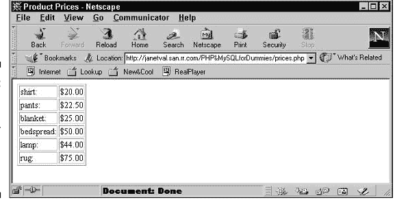

以下是程序对这些语句的解释：

- 1. 输出 `table` 标签。

- 2. 获取 `$productPrices` 数组中的第一个键/值对，并将值存储在变量 `$category` 中。该值是一个数组。

- 3. 获取 `$category` 数组中的第一个键/值对。将键存储在 `$product` 中，并将值存储在 `$price` 中。

- 4. 将 `$price` 中的值格式化为正确的货币格式。

- 5. 为产品和价格输出一个表格行。

- 6. 转到 `$category` 数组中的下一个键/值对。

- 7. 格式化价格并输出产品和价格的下一行表格行。

- 8. 因为 `$category` 中不再有键/值对，所以内层 `foreach` 语句结束。

- 9. 转到外层 `foreach` 语句中的下一个键/值对。将下一个值放入 `$category` 中，该值是一个数组。

- 10. 重复步骤 2–9 的过程，直到到达最后一个 `$category` 数组中的最后一个键/值对。内层 `foreach` 语句结束。外层 `foreach` 语句结束。

- 11. 输出 `/table` 标签以结束表格。

换句话说，外层 `foreach` 从数组中的第一个键/值对开始。键是 `clothing`，该键的值是一个数组，被放入变量 `$category` 中。然后内层 `foreach` 遍历 `$category` 中的数组。当它到达 `$category` 中的最后一个键/值对时，内层循环结束。程序随后返回外层循环，继续处理第二个键/值对……依此类推，直到外层 `foreach` 到达数组末尾。

## 实用的条件语句

条件语句仅在满足特定条件时才执行语句块。以下是两种实用的条件语句类型：

- ✓ `if` 语句：设置一个条件并进行测试。如果条件为真，则执行一个语句块。

- ✓ `switch` 语句：设置一个可供选择的条件列表。测试真实条件并执行相应的语句块。

我将在以下两节中更详细地介绍这些语句。

## 使用 if 语句

`if` 语句用于询问某些条件是否存在。语句块的执行取决于满足哪些条件。`if` 条件语句的一般格式为：

```
if ( condition ... )
{
    block of statements
}
elseif ( condition ... )
{
    block of statements
}
else
{
    block of statements
}
```

`if` 语句由三部分组成：

✓ `if`：此部分为必需项。它测试一个条件。

- **如果条件为真：** 则执行语句块。语句执行完毕后，程序将转到条件语句之后的下一条指令；如果条件语句包含任何 `elseif` 或 `else` 部分，程序将跳过这些部分。

- **如果条件不为真：** 则不执行语句块。程序将跳到下一条指令，该指令可以是 `elseif`、`else`，也可以是 `if` 条件语句之后的下一条指令。

✓ `elseif`：此部分为可选项。它测试一个条件。如果需要，可以使用多个 `elseif` 部分。


# 条件语句

## if 条件语句

- **如果条件为真：** 则执行语句块。语句块执行完毕后，程序将转到条件语句之后的下一条指令；如果 `if` 语句包含任何额外的 `elseif` 部分或 `else` 部分，程序将跳过这些部分。

- **如果条件不为真：** 则不执行语句块。程序将跳到下一条指令，该指令可以是 `elseif`、`else`，也可以是 `if` 条件语句之后的下一条指令。

✓ `else`：此部分为可选项。只允许有一个 `else` 部分。该部分不测试条件，而是直接执行语句块。如果程序进入了此部分，则意味着 `if` 部分和所有 `elseif` 部分的条件均不为真。

`if` 条件语句的每个部分都测试一个由一个或多个比较构成的条件。比较是一个可以为真或假的提问。一些条件示例包括：

```
$a == 1;
$a < $b
$c != "Hello"
```

第一个比较询问 `$a` 是否等于 `1`；第二个比较询问 `$a` 是否小于 `$b`；第三个比较询问 `$c` 是否不等于 `"Hello"`。你可以在一个条件中使用两个或更多比较，方法是用 `and`、`or` 或 `xor` 将比较连接起来。我将在第 6 章详细讨论比较值和使用多个比较。以下示例使用了 `if` 条件语句的全部三个部分。假设你的产品目录有德语、法语、意大利语和英语版本。你希望程序根据客户所在的位置显示正确的语言版本。以下语句根据客户所在的国家/地区设置一个变量为正确的目录版本，并以正确的语言设置一条消息。然后你可以用适当的语言显示消息。

```
if ($country == "Germany")
{
    $version = "German";
    $message = " Sie sehen unseren Katalog auf Deutsch";
}
elseif ($country == "France")
{
    $version = "French";
    $message = " Vous verrez notre catalogue en francais";
}
elseif ($country == "Italy")
{
    $version = "Italian";
    $message = " Vedrete il nostro catalogo in Italiano";
}
else
{
    $version = "English";
    $message = "You will see our catalog in English";
}
echo "$message<br>";
```

`if` 条件语句的执行过程如下：

- 1. **将变量 `$country` 与 `"Germany"` 进行比较**。如果相同，则将 `$version` 设置为 `"German"`，将 `$message` 设置为德语，然后程序跳到 `echo` 语句。如果 `$country` 不等于 `Germany`，则不设置 `$version` 和 `$message`，程序跳到 `elseif` 部分。

- 2. **将变量 `$country` 与 `"France"` 进行比较。** 如果相同，则设置 `$version` 和 `$message`，程序跳到 `echo` 语句。如果 `$country` *不*等于 `France`，则*不*设置 `$version` 和 `$message`，程序跳到第二个 `elseif` 部分。

- 3. **将变量 `$country` 与 `"Italy"` 进行比较。** 如果相同，则将 `$version` 设置为 `"Italian"`，程序跳到 `echo` 语句。如果 `$country` 不等于 `Italy`，则*不*设置 `$version` 和 `$message`，程序跳到 `else` 部分。

- 4. **将 `$version` 设置为 `English`，并将 `$message` 设置为英语。** 程序继续执行 `echo` 语句。

请注意，在此示例中只回显了消息。但是，变量 `$version` 被存储下来，因为版本信息是有用的，可以在程序后面使用。


当 `if` 条件语句的任何部分要执行的语句块中只包含一条语句时，可以不需要花括号。例如，如果前面的示例中语句块中只有一条语句，如下所示：

```php
if ( $country == "France" )
{
    $version = "French";
}
```

你可以将其写为：

```php
if ( $country == "France" )
    $version = "French";
```

这种简写方式可以节省一些输入，但在使用多个 `if` 语句时，可能会导致混淆。

你可以将一个 `if` 条件语句放在另一个 `if` 条件语句内部。将一个语句放在另一个语句内部称为*嵌套*。例如，假设你需要联系所有居住在爱达荷州的客户。你计划给那些有电子邮件地址的客户发送电子邮件，给那些没有电子邮件地址的客户发送信件。你可以使用以下嵌套的 `if` 语句来识别客户群：

```php
if ( $custState == "ID" )
{
    if ( $EmailAdd != "" )
    {
        $contactMethod = "letter";
    }
    else
    {
```

以下语句为不同州设置销售税率：

```
switch ( $custState )
{
    case "OR" :
        $salestaxrate = 0;
        break;
    case "CA" :
        $salestaxrate = 1.0;
        break;
    default:
        $salestaxrate = .5;
        break;
}
$salestax = $orderTotalCost * $salestaxrate;
```

在本例中，俄勒冈州的税率为 0，加利福尼亚州的税率为 100%，所有其他州的税率为 50%。`switch` 语句查看 `$custState` 的值，并跳到与该值匹配的部分。例如，如果 `$custState` 是 `TX`，程序将执行 `default` 部分，并将 `$salestaxrate` 设置为 `.5`。在 `switch` 语句之后，程序计算 `$salestax`，即订单成本的 `.5` 倍。


`break` 语句在 `case` 部分中至关重要。如果某个 `case` 部分不包含 `break` 语句，程序不会在该 `case` 部分结束时停止执行。程序会继续执行越过该 `case` 部分末尾的语句，进入下一个 `case` 部分，并一直继续下去，直到到达 `switch` 语句的末尾（或者到达后面某个 `case` 部分中的 `break` 语句）。


`switch` 语句中的最后一个 `case` 部分实际上不需要 `break` 语句。你可以省略它。但为了清晰起见，建议包含它。

## 使用循环

循环在程序中经常使用，它建立一个重复执行的语句块。有时，循环重复特定的次数。例如，一个用于回显所有州首府的循环需要重复 50 次。有时，循环会一直重复，直到满足某个条件。例如，一个为所有产品显示产品信息的循环需要一直重复，直到所有产品都显示完毕，无论产品有多少个。以下是三种类型的循环：

- ✔ 基本 `for` 循环：设置一个计数器；重复执行语句块，直到计数器达到指定数字

- ✔ `while` 循环：设置一个条件；检查该条件；如果条件为真，则重复执行语句块

✓ `do..while` 循环：设置一个条件；执行一组语句；检查条件；如果条件为真，则重复该组语句

在接下来的几个小节中，我将详细介绍这些循环中的每一种。

### 使用 for 循环

最基本的 `for` 循环基于计数器。你设置计数器的起始值、结束值以及计数器的递增方式。其一般格式如下：

```
for (startingvalue;endingcondition;increment)
{
    block of statements;
}
```

请填写以下值：

- *起始值*：用于设置一个变量作为计数器并将其设为起始值的语句。例如，语句 `$i=1;` 将 `$i` 设为计数器变量并将其设为 `1`。通常，计数器变量从 `0` 或 `1` 开始。起始值可以是数字组合 `2 + 2` 或一个变量。

- *结束条件*：用于设置结束值的语句。只要该语句为真，语句块就会重复执行。当该语句不为真时，循环结束。例如，语句 `$i<10;` 将循环的结束值设为 `10`。当 `$i` 等于 `10` 时，该语句不再为真（因为 `$i` 不再小于 `10`），循环停止重复。该语句可以包含变量，例如 `$i<$size;`。

- *递增*：用于递增计数器的语句。例如，语句 `$i++;` 在每个语句块结束时给计数器加 `1`。你还可以使用其他递增语句，例如 `$i+=1;` 或 `$i--;`。

基本的 `for` 循环会设置一个变量（例如名为 `$i` 的变量）作为计数器。这个变量在每次循环中都有一个值。变量 `$i` 可以在重复执行的语句块中使用。例如，下面这个简单的循环会显示三次 `Hello World!`：

```
for ($i=1;$i<=3;$i++)
{
echo "$i. Hello World!<br>";
}
```


语句块中的语句不需要缩进。`PHP` 并不关心它们是否缩进。然而，对语句块进行缩进会让程序更容易理解。

这些语句的输出是：

```
1. Hello World!
2. Hello World!
3. Hello World!
```

`for` 循环在遍历数组时特别有用。假设你有一个客户名称数组，并且想要全部显示出来。你可以轻松地通过循环来实现：

```
for ($i=0;$i<100;$i++)
{
    echo "$customerNames[$i]<br>";
}
```

输出会显示一个网页，其中包含所有客户名称的列表，每个名称占一行。在这种情况下，你知道有 100 个客户名称，但假设你不知道列表中有多少个客户。你可以询问 `PHP` 数组中有多少个值，并在 `for` 循环中使用该值。例如，你可以使用以下语句：

```
for ($i=0;$i<sizeof($customerNames);$i++)
{
    echo "$customerNames[$i]<br>";
}
```


### 高级 for 循环

`for` 循环的结构非常灵活，允许你为几乎任何目的构建循环。`for` 循环的通用格式如下：

```
for ( beginning statements;
    conditional statements;
    ending statements)
{
    block of statements;
}
```

其中

- 开始语句在循环开始时执行一次。

- 条件语句在每次循环迭代时进行测试。

- 结束语句在循环结束时执行一次。

每个语句部分用分号 `;` 分隔。每个部分可以根据需要包含任意数量的语句，语句之间用逗号分隔。任何部分都可以为空。

下面的循环在三个部分中都有语句：

```
for ($i=0,$j=1;$t<=4;$i++,$j++)
{
  $t = $i + $j;
  echo "$t<br>";
}
```

这些语句的输出是：

1

3

5

该循环按以下顺序执行：

- 1. 执行包含两个语句的开始部分；`$i` 被设为 `0`，`$j` 被设为 `1`。

- 2. 对包含一个语句的条件部分进行求值。`$t` 是否小于或等于 `4`？是的，因此该语句为真。循环继续执行。

- 3. 执行语句块中的语句。`$t` 变为等于 `$i` 加 `$j`，即 `0 + 1`，等于 `1`。然后输出 `$t`，得到输出 `1`。

- 4. 执行包含两个语句的结束部分——`$i++` 和 `$j++`。`$i` 加 `1`，因此等于 `1`；`$j` 加 `1`，因此现在等于 `2`。

- 5. 对条件部分进行求值。`$t` 是否小于或等于 `4`？由于此时 `$t` 等于 `1`，该语句为真。循环继续执行。

- 6. 执行语句块中的语句。`$t` 变为等于 `$i` 加 `$j`，即 `1 + 2`，等于 `3`。然后输出 `$t`，得到输出 `3`。

- 7. 执行包含两个语句的结束部分——`$i++` 和 `$j++`。`$i` 加 `1`，因此等于 `2`；`$j` 加 `1`，因此等于 `3`。

- 8. 对条件部分进行求值。`$t` 是否小于或等于 `4`？由于 `$t` 现在等于 `3`，该语句为真。循环继续执行。

- 9. 执行语句块中的语句。`$t` 变为等于 `$i` 加 `$j`，即 `2 + 3`，等于 `5`。然后输出 `$t`，得到输出 `5`。

- 10. 执行包含两个语句的结束部分——`$i++` 和 `$j++`。`$i` 加 `1`，因此等于 `3`；`$j` 加 `1`，因此等于 `4`。

- 11. 对条件部分进行求值。`$t` 是否小于或等于 `4`？由于 `$t` 现在等于 `5`，该语句不为真。循环不再继续执行。循环结束，程序继续执行循环结束后的下一条语句。

```
$testvar = "yes";
    echo "Smith<br>";
}
else
{
    echo "$customers[$k], not Smith<br>";
}
$k++;
}
```

这些语句在网页上显示以下内容：

```
Huang, not Smith
Smith
```

程序按以下方式执行前面的语句：

- 1. 在开始循环之前设置变量：`$customers`（包含三个值的数组）、`$testvar`（一个设置为 `"no"` 的测试变量）和 `$k`（一个设置为 `0` 的计数器变量）。

- 2. 通过测试 `$testvar != "yes"` 是否为真来开始循环。由于 `$testvar` 被设置为 `"no"`，所以该语句为真，循环继续。

- 3. 测试 `if` 语句。`$customers[$k] == "Smith"` 是否为真？此时 `$k` 为 `0`，因此程序检查 `$customers[0]`。由于 `$customers[0]` 是 `"Huang"`，所以该语句不为真。`if` 块中的语句不会执行，因此程序跳到 `else` 语句。

- 4. 执行 `else` 块中的语句。`else` 块输出一行 `"Huang, not Smith"`。这是输出的第一行。

- 5. 给 `$k` 加 `1`，现在 `$k` 等于 `1`。

- 6. 到达循环底部。

- 7. 回到循环顶部。

- 8. 再次测试条件。`$testvar != "yes"` 是否为真？由于 `$testvar` 没有改变，仍然设置为 `"no"`，所以为真，循环继续。

- 9. 测试 `if` 语句。`$customers[$k] == "Smith"` 是否为真？此时 `$k` 为 `1`，因此程序检查 `$customers[1]`。由于 `$customers[1]` 是 `"Smith"`，所以该语句为真。因此循环进入 `if` 块。

- 10. 执行 `if` 块中的语句。将 `$testvar` 设置为 `"yes"`。输出 `"Smith"`。这是输出的第二行。

- 11. 给 `$k` 加 `1`，现在 `$k` 等于 `2`。

这些语句在浏览器中的输出是：

```
Huang, not Smith
Smith
```

这与 `while` 循环示例中显示的输出相同。`while` 循环和 `do..while` 循环之间的区别在于检查条件的位置。在 `while` 循环中，条件在循环顶部检查。因此，如果条件始终不为真，循环将永远不会执行。在 `do..while` 循环中，条件在循环底部检查。因此，即使条件始终不为真，循环也至少会执行一次。

例如，在前面的检查名字 `Smith` 的循环中，假设原始条件通过以下语句设置为 `yes`，而不是 `no`：

```
$testvar = "yes";
```

条件从一开始就会测试为假。它永远不会为真。在 `while` 循环中，不会有任何输出。语句块将永远不会运行。然而，在 `do..while` 循环中，语句块会在测试条件之前运行一次。因此，`while` 循环不会产生输出，而 `do..while` 循环会产生以下输出：

```
Huang, not Smith
```

`do..while` 循环在测试条件之前产生一行输出。它不会产生第二行输出，因为条件测试为假。

## 无限循环

你可以很容易地设置循环，使其永远不会停止。这些就是无限循环。它们永远重复。然而，很少有人会故意创建无限循环。这通常是编程中的一个错误。例如，对设置 `while` 循环的程序稍作更改，就可能使其变成无限循环。

下面是本章前面“使用 `while` 循环”一节中显示的程序：

```
$customers = array ( "Huang", "Smith", "Jones" );
$testvar = "no";
$k = 0;
while ( $testvar != "yes" )
{
    if ($customers[$k] == "Smith" )
    {
```

```php
$testvar = "yes";
echo "Smith<br>";
}
else
{
    echo "$customers[$k], not Smith<br>";
}
$k++;
}
```

下面是稍作修改后的程序：

```php
$customers = array ( "Huang", "Smith", "Jones" );
$testvar = "no";
while ( $testvar != "yes" )
{
    $k = 0;
    if ( $customers[$k] == "Smith" )
    {
        $testvar = "yes";
        echo "Smith<br>";
    }
    else
    {
        echo "$customers[$k], not Smith<br>";
    }
    $k++;
}
```

这个小小的改动是把 `$k = 0;` 语句从循环外部移到了循环内部。这个小小的改动使它变成了一个无限循环。修改后程序的输出是：


```text
Huang, not Smith
Huang, not Smith
Huang, not Smith
Huang, not Smith
...
```

**这将永远重复下去。** 每次循环运行时，它都会把 `$k` 重置为 0。然后它取得 `$customers[0]` 并输出它。在循环结束时，`$k` 增加到 1。然而，当循环再次开始时，`$k` 又被重置为 0。因此，数组中只有第一个值 “Huang” 会被读取。循环永远不会遇到 “Smith”，`$testvar` 也永远不会被设置为 "yes"。于是循环变成了无限循环。

如果你写出了一个无限循环，不必感到难堪。我保证，世界上最优秀的编程大师也写过无数个无限循环。这没什么大不了的。如果你正在测试一个程序，并在网页上看到输出在无限重复，它会在一小段时间内自行停止。默认时间是 30 秒，但超时时间可能已被 PHP 管理员修改过。

你也可以点击浏览器上的“停止”按钮来停止浏览器中的显示。然后找出循环无限重复的原因并修复它。

一个可能导致无限循环的常见错误是：本意是使用双等号（`==`），却使用了单等号（`=`）。单等号是把一个值存储到变量中；双等号是测试两个值是否相等。如果你用单等号写下如下条件：

```
while ($testvar = "yes")
```

它永远为真。这个条件只是把 `$testvar` 设置为 "yes"。这不是一个可能为假的判断。你真正想写的可能是这样：

```
while ($testvar == "yes")
```

这是一个询问 `$testvar` 是否等于 "yes" 的判断，其答案可以是真或假。

你可以通过把条件改成 `"yes" == $testvar` 来让你的程序免受这一特定错误的困扰。这种写法读起来不太符合直觉，但能防止单等号问题。如果你在这个条件中用了单等号而不是双等号，就会得到一个错误，程序将无法运行。


另一个常见错误是遗漏了递增计数器的语句。例如，在本节前面的程序中，如果你遗漏了 `$k++;` 语句，`$k` 将始终为 0，结果就会是无限循环。

## 跳出循环

有时你可能希望程序跳出循环。PHP 提供了两条用于此目的的语句：

- `break`：完全跳出循环，并继续执行循环之后的程序语句。
- `continue`：跳到循环末尾，在那里测试条件。如果条件测试为真，程序会从循环顶部继续执行。

`break` 和 `continue` 通常用在条件语句中。特别是 `break`，在 `switch` 语句中使用最为频繁，正如本章前面所讨论的那样。

下面两组语句展示了 `continue` 和 `break` 之间的区别。第一组语句使用了 `break` 语句。

```
$counter = 0;
while ( $counter < 5 )
{
    $counter++;
    if ( $counter == 3 )
    {
        echo "break<br>";
        break;
    }
    echo "End of while loop: counter=$counter<br>";
}
echo "After the break loop<p>";
```

下面这些语句使用了 `continue` 语句：

```
$counter = 0;
while ( $counter < 5 )
{
    $counter++;
    if ( $counter == 3 )
    {
        echo "continue<br>";
        continue;
    }
    echo "End of while loop: counter=$counter<br>";
}
echo "After the continue loop<br>";
```

这些语句构建了两个相同的循环，唯一的区别是第一个使用了 `break`，第二个使用了 `continue`。第一组使用 `break` 语句的代码在浏览器中显示的输出如下：

```
End of while loop: counter=1
End of while loop: counter=2
break
After the break loop
```

第二组使用 `continue` 语句的代码输出如下：

```
End of while loop: counter=1
End of while loop: counter=2
continue
End of while loop: counter=4
End of while loop: counter=5
After the continue loop
```

第一个循环在 `break` 语句处终止。它停止循环，并立即跳转到循环之后的语句。第二个循环不会在 `continue` 语句处终止。它只是停止了第三次循环重复，并跳回到循环顶部。然后它继续完成循环，经过第四次和第五次重复，之后才去执行循环之后的语句。

`break` 语句的一个用途是防止无限循环。循环内的下面这些语句可以在一个合理的点将其终止：

```
$test4infinity++;
if ($test4infinity > 100 )
{
    break;
}
```

如果你确信你的循环不应该重复超过 100 次，那么当循环变得无限时，这些语句可以将其终止。对于你正在构建的循环，请使用任何看起来合理的数字。

## 使用函数

应用程序常常会在程序的不同位置或在不同的程序中执行相同的任务。例如，你的应用程序可能会在多个不同的网页或程序的不同部分显示公司徽标。假设你使用以下语句来显示公司徽标：

```
echo '<hr width="50" align="left">',"\n";
echo '<br>',"\n";
echo '<hr width="50" align="left"><br>',"\n";
```

你可以创建一个包含上述语句的函数，并将其命名为 `display_logo`。然后，每当程序需要显示徽标时，你只需通过一个简单的函数调用就能调用包含这些语句的函数，如下所示：

```
display_logo();
```

注意函数名后面的括号。函数调用中必须有这些括号，因为它们告诉 PHP 这是一个函数。

使用函数有几个优点：

- ✔ **减少输入：** 你只需输入一次这些语句——在函数中。从此以后，你只需使用函数调用，再也不必重新输入这些语句。
- ✔ **更易阅读：** `display_logo()` 这一行让人一眼就能理解。
- ✔ **更少错误：** 一旦你写好了函数并修复了它的所有问题，无论在哪里使用它都能正确运行。


- **更易修改：** 如果你决定改变任务的执行方式，只需要在一个地方进行修改。你只需修改函数，而不用在程序中找到执行该任务的一百个不同位置并修改一百次代码。例如，假设你更改了存放公司徽标的图形文件名，你只需在一个地方——函数中——更改文件名，它就能在所有地方正确运行。

你可以通过将代码放入函数块来创建函数。其一般格式是：

```php
function functionname()
{
    block of statements;
    return;
}
```

例如，你可以用以下语句创建显示公司徽标的函数：

```php
function display_logo()
{
    echo '<hr width="50" align="left">',"\n";
    echo '<br>',"\n";
    echo '<hr width="50" align="left"><br>',"\n";
    return;
}
```

`return` 语句会停止函数并返回到主程序。函数末尾的 `return` 语句不是必需的，但它能让函数更易于理解。`return` 语句常常用于函数的有条件结束。

假设你的函数显示一个电子产品目录。你可以在函数开头使用下面的语句：

```php
if ( $age < 13 )
    return;
```

如果客户的年龄小于 13 岁，函数就会停止，电子产品目录就不会显示。

你可以把函数放在程序中的任何位置，但通常的做法是将所有函数集中放在程序文件的开头或结尾。如果你计划在多个程序中使用函数，可以将它们放在单独的文件中。每个程序都可以从外部文件访问这些函数。关于如何将应用程序组织到文件以及访问单独文件的更多信息，请查阅第 10 章。

请注意，示例函数相当简单。它不使用变量，也不与主程序共享任何信息。它在被调用时只是执行一个独立的任务。只要你了解规则和限制，就可以在函数中使用变量并在函数和主程序之间传递信息。本章的剩余部分将解释如何使用变量和传递值。

## 在函数中使用变量

你可以在函数内部创建和使用局部变量。也就是说，你可以在函数内部创建和使用变量。然而，变量在函数外部不可用；它对主程序不可用。你可以通过使用一个名为 `global` 的特殊语句使变量可用，该语句使变量在程序的任何位置都可用。例如，以下函数创建了一个变量：

```
function format_name()
{
    $first_name = "Goliath";
    $last_name = "Smith";
    $name = $last_name.", ".$first_name;
}
format_name();
echo "$name";
```

这些语句不产生任何输出。在 `echo` 语句中，`$name` 不包含任何值。变量 `$name` 在函数内部创建，因此在函数外部不存在。

你可以使用 `global` 语句在函数内部创建一个在函数外部也存在的变量。以下语句包含添加了 `global` 语句的相同函数：

```
function format_name()
{
    $first_name = "Goliath";
    $last_name = "Smith";
    global $name;
    $name = $last_name.", ".$first_name;
}
format_name();
echo "$name";
```

程序现在输出如下：

```
Smith, Goliath
```

`global` 语句使变量在程序的任何位置都可用。你必须在可以使用变量之前先将其设为全局。如果 `global` 语句跟在 `$name` 赋值语句之后，程序不会产生任何输出。

当你使用在主程序中创建的变量时，同样适用这些规则。除非变量是全局的，否则你不能在函数中使用在函数外部创建的变量，如以下语句所示：

```php
$first_name = "Goliath";
$last_name = "Smith";
function format_name()
{
    global $first_name, $last_name;
    $name = $last_name.", ".$first_name;
    echo "$name";
}
format_name();
```

如果你不使用 `global` 语句，函数内部的 `$last_name` 和 `$first_name` 是不同的变量，在命名时创建。它们没有值。如果没有 `global` 语句，程序将不会产生任何输出。

## 在函数和主程序之间传递值

你可以将值传递给函数并从函数接收值。例如，你可能会编写一个函数来为订单添加正确的销售税。函数需要知道订单的成本以及客户居住的州。函数需要返回销售税的金额。

### 向函数传递值

你可以通过在调用函数时将值放在括号之间来向函数传递值，如下所示：

```
functionname(value,value,...);
```

当然，变量不能凭空出现。函数必须期望它们。函数语句包含它期望的值的变量名，如下所示：

```php
function functionname($varname1,$varname2,...)
{
    statements
    return;
}
```

例如，以下 `function` 计算销售税：

```
function compute_salestax($amount,$custState)
{
  switch ( $custState )
  {
    case "OR":
      $salestaxrate = 0;
      break;
    case "CA":
      $salestaxrate = 1.0;
      break;
    default:
      $salestaxrate = .5;
      break;
  }
  $salestax = $amount * $salestaxrate;
  echo "$salestax<br>";
}
$cost = 2000.00;
$custState = "CA";
compute_salestax($cost,$custState);
```

第一行显示函数期望两个值，如下所示：

```
function compute_salestax($amount,$custState)
```

最后一行是函数调用，它按期望向函数 `compute_salestax` 传递两个值。订单金额和客户居住的州被传递。此程序的输出为 2000，因为加利福尼亚州的税率为 100%。

你可以根据需要传递任意多个值。值可以是变量或值，包括计算得到的值。以下函数调用都是有效的：

```
compute_salestax(2000,"CA");
compute_salestax(2*1000,"");
compute_salestax(2000,"C"."A");
```

值可以作为数组传递。函数将变量作为数组接收。例如，以下语句传递一个数组：

```
$arrayofnumbers = array( 100, 200 );
addnumbers($arrayofnumbers);
```

函数接收整个数组。例如，假设函数以以下语句开始：

```
function addnumbers($numbers)
```

变量 `$numbers` 是一个数组。函数可以包含如下语句：

```php
return $numbers[0] + $numbers[1];
```

传递的值按位置传递。也就是说，你传递的列表中的第一个值用作函数期望的列表中的第一个值，第二个用作第二个，以此类推。如果你的值顺序不正确，函数在执行任务时会使用错误的值。例如，对于 `compute_salestax`，你可能会按错误顺序调用 `compute_salestax` 传递值，如下所示：

```php
compute_salestax($custState,$orderCost);
```

函数将州用作订单成本，因为传递的值是字符串，所以将其设为 0。它将州设为 `$orderCost` 中的数字，这与任何类别都不匹配。输出将为 0。

如果你没有发送足够的值，函数会将缺失的值设为空字符串（对于字符串变量）或设为 0（对于数字）。如果你发送了太多值，函数会忽略多余的值。

如果你向函数传递了错误数量的值，你可能会收到警告信息，如下所示，具体取决于 PHP 设置的错误消息级别。

```text
Warning: Missing argument 2 for compute_salestax() in /test7.php on line 5
```

有关警告消息的详细介绍，请参阅第 6 章。

你可以设置默认值以在未传递值时使用。默认值在编写函数时设置，通过为函数期望的值分配默认值，如下所示：

```php
function add_2_numbers($num1=1,$num2=1)
{
    $total = $num1 + $num2;
    return $total;
}
```

如果一个或两个值未传递，函数会使用分配的默认值。但如果传递了值，则会使用该值代替默认值。例如，你可以使用以下调用之一：

```php
add_2_numbers(2,2);
add_2_numbers(2);
add_2_numbers();
```

结果按顺序如下：

```
$total = 4
$total = 3
$total = 2
```

### 从函数获取值

当你调用函数时，可以按上述描述传递值。函数也可以将值传回调用它的程序。使用 `return` 语句将值传回调用程序。程序可以将值存储在变量中或直接使用值，例如在条件语句中使用。`return` 语句还将控制权返回给主程序；也就是说，它会停止函数。

`return` 语句的一般格式为

```
return value;
```

例如，在前一节的税程序中，我使用以下语句 `echo` 销售税：

```
$salestax = $amount * $salestaxrate;
echo "$salestax<br>";
```

我可以通过使用以下语句将销售税返回给主程序，而不是 `echo` 它：

```
$salestax = $amount * $salestaxrate;
return $salestax;
```

事实上，我可以使用快捷方式，用一条语句将其发送回主程序：

```
return $amount * $salestaxrate;
```

`return` 语句将 salestax 发送回主程序并结束函数。主程序可以用通常的任何方式使用该值。以下语句以有效的方式使用函数调用：

```
$salestax = compute_salestax($cost,$custState);
```

```
$totalcost = $cost + compute_salestax($cost,$custState);
```

```
if ( compute_salestax($cost,$custState) > 100000.00 )
    echo "Thank you very, very, very much<br>";
```


# 使用内置函数

```
foreach($customerOrder as $amount)
{
    $total = $amount + compute_salestax($amount,$custState);
    echo "Your total is $total<br>";
}
```

`return` 语句只能返回一个值。不过，返回的值可以是数组，因此你实际上可以从一个函数返回多个值。

你可以在条件语句中使用 `return` 语句，根据不同条件返回不同的值。例如，下面的函数返回两个不同字符串之一：

```php
function compare_values($value1,$value2)
{
    if($value1 < $value2)
    {
        return "less than";
    }
    else
    {
        return "not less than";
    }
}
```

虽然该函数包含两个 `return` 语句，但根据 `$value1` 和 `$value2` 的值，只会执行其中一个。

PHP 的众多内置函数是 PHP 如此强大且适用于网页的原因之一。PHP 附带的函数是普通函数，它们与你自行创建的函数没有区别，只是 PHP 已经替你完成了所有工作。

我在本章和前面的章节中讨论了一些内置函数。例如，关于函数 `unset` 和 `number_format` 的更多信息，请参阅第 6 章。一些用于与 MySQL 数据库交互的非常有用的函数将在第 8 章中讨论。其他有用的函数列于本书的第 V 部分。当然，所有函数都在 PHP 官方网站 `www.php.net/docs.php` 的 PHP 文档中列出并加以描述。

# 第 8 章 数据输入，数据输出

## 本章内容

- 连接数据库
- 从数据库获取信息
- 将 HTML 表单与 PHP 结合使用
- 从 HTML 表单获取数据
- 处理用户在 HTML 表单中输入的信息
- 在数据库中存储数据
- 使用函数将数据移入和移出数据库

PHP 和 MySQL 配合得非常好。这种动态的伙伴关系使 PHP 和 MySQL 在 Web 数据库应用开发中如此具有吸引力。无论你是拥有一个充满信息并希望提供给用户的数据库（例如产品目录），还是一个等待用户填充的数据库（例如会员数据库），PHP 和 MySQL 都能协同工作来实现你的应用。

PHP 最强大的特性之一就是它与数据库交互的能力。它提供了使与 MySQL 通信变得极其简单的函数。你可以使用 PHP 函数向数据库发送 SQL 查询。你不需要了解与 MySQL 通信的细节；PHP 会处理这些细节。你只需要知道 SQL 查询以及如何使用 PHP 函数。

在本书前面的章节中，我描述了用于构建 Web 数据库应用程序的工具。你会在第 4 章了解如何构建 SQL 查询，并在第 6 章和第 7 章了解如何构建和使用 PHP 语言的基本构件。在本章中，你将了解如何将这些工具用于 Web 数据库应用程序需要执行的特定任务。

## PHP/MySQL 函数

你可以使用内置的 PHP 函数与 MySQL 进行交互。这些函数用于连接 MySQL 服务器、选择正确的数据库、发送 SQL 查询以及与 MySQL 数据库进行其他通信。你不需要了解与数据库交互的细节，因为 PHP 会处理所有细节。你只需要知道如何使用这些函数。

目前，PHP（从版本 5 开始）有两组用于与 MySQL 交互的函数。一组函数用于与 MySQL 4.0 或更早版本交互。另一组函数用于与 MySQL 4.1 或更高版本交互。

在本书中，我的示例和程序展示的是适用于 MySQL 4.0 版本的函数。在撰写本书时，MySQL 当前稳定版本是 4.0。此外，用于 MySQL 4.1 的 PHP 函数在 PHP 官方网站的文档中被描述为实验性的，并带有警告：使用此扩展风险自负。目前，MySQL 4.1 仅作为 alpha 软件提供，MySQL 手册对其定义如下：该版本包含一些尚未 100% 测试的大型新代码段。因此，我撰写本书时基于 MySQL 4.0 以及适用于该版本的 PHP 函数。

用于 MySQL 4.0 的 PHP 函数具有以下一般格式：

```
mysql_function(value,value,...);
```

函数名称的第二部分与具体函数相关，通常是一个描述函数功能的单词。此外，函数需要一个或多个要传递的值，用于指定数据库连接、数据位置等内容。以下是本章讨论的两个函数：

```
mysql_connect($connect);
mysql_query("SQL statement",$connect);
```

当你读到本书时，MySQL 4.1 可能是 MySQL 当前的稳定版本。如果是这样，你可以使用 MySQL 4.1 及与之配合使用的函数。截至撰写本书时，本书讨论的函数在 MySQL 4.0 和 MySQL 4.1 中是相同的，只是名称有所变化。用于 MySQL 4.1 的函数名称以 `mysqli_` 开头，而不是 `mysql_`。因此，上面显示的函数如果用于 MySQL 4.1，其名称将如下所示：

```
mysqli_connect($connect);
mysqli_query($connect,"SQL statement");
```

这些函数的功能和语法相同或非常相似。例如，请注意以下两个函数之间的区别：

```
mysql_query($sql,$connect)
mysqli_query($connect,$sql)
```

注意传递项的顺序不同。对于几个函数来说都是如此。

本讨论指的是当前状态的 `mysqli` 函数。当然，`mysqli` 函数可能会发生变化。如果某个 `mysqli` 函数看起来无法按预期工作，请查阅手册以了解用法上可能存在的差异。

名称中新增的 `i` 代表*改进*；这组 MySQL 函数由改进的 MySQL 扩展提供。目前，PHP 默认不包含对 `mysqli` 的支持。它必须在安装 PHP 时启用。然而，到 MySQL 4.1 成为稳定版本时，`mysqli` 很可能将成为 PHP 的一部分，而无需你专门启用它。要查看 `mysqli` 的当前状态，请查看 `www.php.net/manual/en/ref.mysqli.php` 上的文档。

截至撰写本书时，你可以使用以下安装选项来启用 `mysqli`：

```
--with-mysqli=DIR
```

`DIR` 是名为 `mysql_config` 的程序所在目录的路径，该程序在安装 MySQL 4.1 时已安装。

## 建立连接

在存储或获取任何数据之前，你必须先连接到数据库。数据库可能与你的 PHP 程序位于同一台计算机上，也可能位于不同的计算机上。你不需要了解连接数据库的细节，因为 PHP 会处理所有细节。你只需要知道数据库的名称和位置。你可以把数据库连接想象成电话连接。你不需要知道你的话语是如何在电话之间传输的，只需要知道区号和电话号码。电话公司会处理这些细节。

连接到数据库后，你可以使用专门为此目的设计的 PHP 函数向 MySQL 数据库发送 SQL 查询。你可以根据需要发送任意数量的查询。连接会一直保持，直到你明确关闭它或程序结束。类似地，在电话通话中，连接会一直保持，直到你挂断电话才终止。

### 连接 MySQL 服务器

与 MySQL 数据库通信的第一步是连接 MySQL 服务器。要连接服务器，你需要知道数据库所在计算机的名称、MySQL 账户的名称以及 MySQL 账户的密码。要打开连接，请按如下方式使用 `mysql_connect` 函数：

```
$connection=mysqli_connect("addr","mysqlacctname","password")
    or die ("message");
```

## 处理 MySQL 错误

你使用 PHP 语言的 `mysql` 函数，例如 `mysql_connect` 和 `mysql_query`，来与 MySQL 数据库交互。如果其中某个函数执行不正确，会返回一条 MySQL 错误消息，其中包含有关问题的信息。然而，除非程序有意发送，否则此错误消息不会发送到浏览器。以下是调用 `mysql` 函数的三种常见方式：

- **不带错误处理的调用函数。** 函数在没有任何提供错误消息的语句的情况下被调用。例如，`mysql_connect` 函数可以按如下方式调用：

    ```php
    $connection = mysql_connect($host,$user,$password);
    ```

    如果此语句失败（例如，帐户无效），则不会建立连接，但程序中的其余语句仍会继续执行。在大多数情况下，这没有用，因为程序其余部分中的某些语句可能依赖于打开的连接，例如从数据库获取或存储数据。

- **使用 `die` 语句调用函数。** 函数与发送消息到浏览器的 `die` 语句一起调用。例如，`mysql_connect` 函数可以按如下方式调用：

    ```php
    $connection = mysql_connect($host,$user,$password)
        or die ("Couldn't connect to server");
    ```

    如果此语句失败，则不会建立连接，并且会执行 `die` 语句。`die` 语句会停止程序并将消息发送到浏览器。如果无法建立连接，则不会再执行任何语句。您可以在 `die` 语句中放置任何想要的消息。

- **在 `if` 语句中调用函数。** 函数通过使用 `if` 语句调用，如果连接失败则执行一组语句。例如，`mysql_connect` 函数可以按如下方式调用：

    ```php
    if (!$connection = mysql_connect($host,$user,$password))
    {
        $message = mysql_error();
        echo "$message<br>";
        die();
    }
    ```

    如果此语句失败，则会执行 `if` 块中的语句。`mysql_error` 函数返回 MySQL 错误消息并将其保存到变量 `$message` 中。然后回显错误消息。`die` 语句结束程序，因此不会再执行任何语句。**注意** `if` 语句中的 `!`（感叹号）。`!` 表示“非”。换句话说，如果赋值语句不为真，则 `if` 语句为真。

您希望在程序中包含什么错误处理取决于您期望程序中发生什么。在开发程序时，您预计会发生一些错误。因此，在开发期间，您可能希望使用更具描述性的错误处理，例如前述列表中的第三种方法。例如，假设您使用名为 `root` 的帐户访问数据库，并且在以下语句中出现拼写错误：

```
$host = "localhost";
$user = "rot";
$password = "";
if (!$connection = mysql_connect($host,$user,$password))
{
    $message = mysql_error();
    echo "$message<br>";
    die();
}
```

因为您输入了 `"rot"` 而不是 `"root"`，您会看到类似以下内容的错误消息：

```
Access denied for user: 'rot@localhost' (Using password: NO)
```

此错误消息包含您需要的信息来找出问题所在；它显示了带有拼写错误的帐户名。然而，在您的程序运行并且客户使用它之后，您可能不希望用户看到像前面那样的技术错误消息。相反，您可能希望使用第二种方法，并在 `die` 消息中使用一般性语句，例如 The Pet Catalog is not available at the moment. Please try again later.

填写以下信息：

- `addr`：MySQL 安装所在的计算机的名称——例如，`databasehost.mycompany.com`。如果 MySQL 数据库与您的网站在同一台计算机上，您可以使用 `localhost` 作为计算机名称。如果此信息为空（`""`），PHP 会假定为 `localhost`。
- `mysqlacctname`：您的 MySQL 帐户的名称。（我在第 5 章中详细讨论了 MySQL 帐户。）您可以将此信息留空（`""`）——意味着任何帐户都可以连接——但出于安全原因，这通常是个坏主意。
- `password`：您 MySQL 帐户的密码。如果您的 MySQL 帐户不需要密码，请不要在引号之间输入任何内容：`""`。
- `message`：如果连接失败，则发送到浏览器的消息。如果计算机或网络关闭或 MySQL 服务器未运行，则连接会失败。如果提供的信息不正确，也可能失败——例如，密码中存在拼写错误。

在开发期间，您可能希望使用描述性消息，例如 Couldn't connect to server，但在应用程序投入使用后，使用更通用的适合客户的消息，例如 The Pet Catalog is not available at the moment. Please try again later.


`addr` 包含连接所需的端口号。几乎总是，端口号是 3306。在极少数情况下，MySQL 管理员需要设置 MySQL 在不同的端口上连接。在这些情况下，需要端口号才能进行连接。端口号指定为 `主机名:端口号`。例如，您可能会使用 `localhost:8080`。

使用这些语句，`mysql_connect` 尝试使用提供的帐户名和密码打开到指定计算机的连接。如果连接失败，程序将在此处停止运行并将 *消息* 发送到浏览器。

以下语句使用不需要密码的名为 `catalog` 的 MySQL 帐户连接到本地计算机上的 MySQL 服务器：

```php
$connection = mysql_connect("localhost","catalog","")
    or die ("Couldn't connect to server.");
```


出于安全原因，将连接信息存储在变量中并在连接语句中使用这些变量是个好主意，如下所示：

```php
$host="localhost";
$user="catalog";
$password="";
$connection = mysql_connect($host,$user,$password)
    or die ("Couldn't connect to server.");
```

事实上，为了更安全，您可以将连接信息的赋值语句放在隐藏位置的单独文件中，这样帐户名和密码甚至不在程序中。我在第 10 章中解释了如何做到这一点。

变量 `$connection` 包含标识连接的信息。您可以通过使用多个变量名同时打开多个连接。连接保持打开状态，直到您关闭它或程序结束。关闭连接如下：

```php
mysql_close($connectionname);
```

例如，要关闭前一个示例中的连接，请使用以下语句：

```php
mysql_close($connection);
```

## 选择正确的数据库

在与 MySQL 服务器的连接建立并打开后，您需要告诉 MySQL 您想要交互的数据库。使用 `mysql_select_db` 函数如下：

```php
$db = mysql_select_db("databasename",$connectionname)
     or die ("message");
```

填写以下信息：

- `databasename`：数据库的名称。
- `connectionname`：包含连接信息的变量。如果您没有输入连接，PHP 将使用最后打开的连接。
- `message`：如果无法选择数据库，则发送到浏览器的消息。选择可能失败，因为找不到数据库，这通常是数据库名称拼写错误的结果。

例如，您可以使用以下语句选择数据库 `PetCatalog`：

```php
$db = mysql_select_db("PetCatalog",$connection)
     or die ("Couldn't select database.");
```

如果 `mysql_select_db` 无法选择数据库，程序将在此处停止运行，并将消息 `Couldn't select database.` 发送到浏览器。


出于安全原因，将数据库名称存储在变量中并在连接语句中使用该变量是个好主意，如下所示：

```php
$database = "PetCatalog";
$db = mysql_select_db($database,$connection)
     or die ("Couldn't select database.");
```

事实上，为了更安全，您可以将数据库名称的赋值语句放在隐藏位置的单独文件中——正如为连接信息的赋值语句所建议的那样——这样数据库名称甚至不在程序中。我在第 10 章中解释了如何做到这一点。

数据库保持选中状态，直到您明确选择不同的数据库。要选择不同的数据库，只需使用新的 `mysql_select_db` 函数语句即可。

## 发送 SQL 查询

在您拥有到 MySQL 服务器的打开连接并且 PHP 知道您想要交互的数据库后，您发送 SQL 查询。*查询* 是向 MySQL 服务器请求存储一些数据、更新一些数据或检索一些数据的请求。（有关 SQL 语言的更多信息以及如何构建 SQL 查询，请参阅第 4 章。）

要与数据库交互，请将 SQL 查询放入变量中，并使用 `mysql_query` 函数将其发送到 MySQL 服务器，如下例所示：

```
$query = "SELECT * FROM Pet";
$result = mysql_query($query)
    or    die ("Couldn't execute query.");
```


该查询会针对你所打开的上一个连接当前选定的数据库执行。如果需要——例如，如果你打开了多个连接——你可以像这样将查询发送到特定的数据库服务器：

```
$result = mysql_query($query,$connection)
    or    die ("Couldn't execute query.");
```

变量 `$result` 保存了执行查询所得结果的信息。该信息取决于查询是否从数据库获取数据：

- **对于不获取数据的查询：**变量 `$result` 包含查询是否成功执行的信息。如果成功，`$result` 会被设置为 `TRUE`；如果不成功，`$result` 会被设置为 `FALSE`。一些不返回数据的查询是 `INSERT` 和 `UPDATE`。
- **对于返回数据的查询：**变量 `$result` 包含一个结果标识符，该标识符标识返回数据的位置，而不是返回数据本身。一些确实返回数据的查询是 `SELECT` 和 `SHOW`。


在将查询字符串赋值给 `$query` 时，单引号和双引号的使用可能会让人有点困惑。实际上，你在两个层面上使用引号：将字符串赋值给 `$query` 所需的引号，以及 SQL 语言查询本身所包含的引号。以下规则将帮助你避免任何引号问题：

- 在字符串的开头和结尾使用双引号。
- 在变量名的前后使用单引号。
- 在任何字面值的前后使用单引号。

以下是赋值查询字符串的示例：

```
$query = "SELECT firstName FROM Member";
$query = "SELECT firstName FROM Member WHERE lastName='Smith'";
$query = "UPDATE Member SET lastName='$last_name'";
```


查询字符串本身不包含分号（`;`），所以不要在最后的引号内放置分号。唯一的分号位于最末尾；这是结束语句的 PHP 分号。

## 从数据库获取信息

从数据库获取信息是 Web 数据库应用程序的常见任务。以下是数据库信息的两种常见用途：

- **使用该信息有条件地执行语句。** 例如，你可以从会员目录中获取居住州，并向居住在不同州的会员发送不同的消息。
- **在网页中显示该信息。** 例如，你可能想要显示数据库中的产品信息。

为了在程序中使用数据库信息，你需要将信息放入变量中。然后，你可以在条件语句、`echo` 语句或其他语句中使用这些变量。从数据库获取信息是一个两步过程：

1. 构建一条 `SELECT` 查询，并将该查询发送到数据库。查询执行时，选中的数据会存储在临时位置。
2. 将数据从临时位置移入变量，并在程序中使用。

### 发送 SELECT 查询

你使用 `SELECT` 查询从数据库获取数据。`SELECT` 查询是用 SQL 语言编写的。（我将在第 4 章详细讨论 `SELECT` 查询。）

要从数据库获取数据，请构建你需要的 `SELECT` 查询，将其存储在变量中，然后将查询发送到数据库。以下语句从 `PetCatalog` 数据库的 `Pet` 表中选择所有信息：

```
$query = "SELECT * FROM Pet";
$result = mysql_query($query)
    or    die ("Couldn't execute query.");
```

`mysql_query` 函数获取 `SELECT` 查询请求的数据，并将其存储在临时位置。你可以将这些数据视为存储在一个类似于 MySQL 表的表中，信息按行和列排列。

该函数返回一个结果标识符，其中包含查找数据临时存储位置所需的信息。在前面的语句中，结果标识符被放入变量 `$result` 中。执行该函数后，下一步是将数据从临时位置移动到可在程序中使用的变量中。

如果函数失败——例如，如果查询不正确——`$result` 将包含 `FALSE`。

### 获取并使用数据

你使用 `mysql_fetch_array` 函数从临时位置获取数据。该函数从临时位置获取一行数据。临时数据表可能只包含一行数据，或者更有可能的是，你的 `select` 查询在临时数据表中产生了多行数据。如果要从临时位置获取多行数据，请在循环中使用 `mysql_fetch_array` 函数。

#### 获取一行数据

要将数据从临时位置移出并放入可在程序中使用的变量中，请使用 PHP 函数 `mysql_fetch_array`。`mysql_fetch_array` 函数的一般格式如下：

```php
$row = mysql_fetch_array($resultidentifier,typeofarray);
```

该语句从临时位置的数据表中获取一行，并将其放入名为 `$row` 的数组变量中。请填写以下信息：

- **`resultidentifier`：**指向结果临时位置的变量。
- **`typeofarray`：**结果所放入的数组类型。它可以是两种数组类型之一，也可以同时是两种类型。请使用以下值之一：
  - `MYSQL_NUM`：一个数组，对于行中的每一列都有一个键/值对，使用数字作为键。
  - `MYSQL_ASSOC`：一个数组，对于行中的每一列都有一个键/值对，使用列名作为键。
  - `MYSQL_BOTH`：一个包含两种键的数组。换句话说，该数组对每一列都有两个键/值对：一个以数字为键，一个以列名为键。如果在函数调用中未指定数组类型，则假定为 `MYSQL_BOTH`。

`mysql_fetch_array` 函数从临时位置获取一行数据。在某些情况下，一行就是你所选择的全部数据。例如，要检查用户输入的密码，你只需要从数据库获取用户的密码，并将其与用户输入的密码进行比较。以下语句检查密码：

```php
$userEntry = "secret";    // password user entered in form
$query = "SELECT password FROM Member
          WHERE loginName='gsmith'";
$result = mysql_query($query)
or die ("Couldn't execute query.");
$row = mysql_fetch_array($result,MYSQL_ASSOC);
if ( $userEntry == $row['password'] )
{
    echo "Login accepted<br>";
    statements that display Members Only Web pages
}
else
{
    echo "Invalid password<br>";
    statements that allow user to try another password
}
```

关于上述语句，请注意以下几点：

- `SELECT` 查询只从一行（`gsmith` 所在的行）请求一个字段（`password`）。
- `mysql_fetch_array` 函数返回一个名为 `$row` 的数组，以列名作为键。
- `if` 语句通过使用两个等号（`==`）将用户输入的密码（`$userEntry`）与从数据库获取的密码（`$row['password']`）进行比较，以判断它们是否相同。
- 如果比较结果为真，则密码匹配，并执行 `if` 块（该块显示仅限会员的 Web 页面）。
- 如果比较结果不为真，说明用户输入的密码与数据库中存储的密码不匹配，则执行 `else` 块。用户会看到一条说明密码不正确的错误消息，并返回到登录 Web 页面。


PHP 提供了一个快捷方式，便于使用通过 `mysql_fetch_array` 函数检索到的变量。你可以使用 `extract` 函数，该函数会将数组拆分为与键同名的变量。例如，你可以使用 `extract` 函数重写前面测试密码的语句。如下所示：

```
$userEntry = "secret"; #password user entered into HTML form
$query = "SELECT password FROM Member
          WHERE loginName='gsmith'";
$result = mysql_query($query)
    or  die ("Couldn't execute query.");
$row = mysql_fetch_array($result,MYSQL_ASSOC);
extract($row);
if ( $userEntry == $password )
{
    echo "Login accepted<br>";
    statements that display Members Only Web pages
}
else
```

```
{
    echo "Invalid password<br>";
    statements that allow user to try another password
}
```

### 使用循环获取所有数据行

如果选择了多行数据，可以使用循环从临时位置获取所有行。循环块中的循环语句每次获取一行数据并处理它。循环不断重复，直到取回所有行为止。你可以使用 `while` 循环或 `for` 循环来获取这些信息。（关于 `while` 循环和 `for` 循环的更多内容，请参阅第 7 章。）

处理这些信息最常见的方式是使用 `while` 循环，如下所示：

```
while ( $row = mysql_fetch_array($result))
{
    block of statements
}
```

这个循环会一直重复，直到取得最后一行。例如，如果只想回显所有数据，可以使用类似于下面的循环：

```
while ( $row = mysql_fetch_array($result))
{
    extract($row);
    echo "$petType: $petName<br>";
}
```

下面看一个如何获取宠物目录（Pet Catalog）应用程序信息的示例。假设宠物目录中有一张名为 `Pet` 的表，包含四列：`petID`、`petType`、`petDescription` 和 `price`。表 8-1 显示了 `Pet` 表中的一组示例数据。

表 8-1 Pet 表中的示例数据

| 宠物名称 | 宠物类型 | 宠物描述 | 价格 |
|---|---|---|---|
| 独角兽 | 马 | 前额中央有螺旋角 | 10000 |
| 飞马 | 马 | 会飞；翅膀从背部生出 | 15000 |
| 小马 | 马 | 非常小；只有标准马的一半大小 | 500 |
| 亚洲龙 | 龙 | 蛇形身体 | 30000 |
| 中世纪龙 | 龙 | 蜥蜴状身体 | 30000 |
| 狮子 | 猫科动物 | 体型大；有鬃毛 | 2000 |
| 狮鹫 | 猫科动物 | 狮身；鹰头；有翅膀 | 25000 |

清单 8-1 中的 `petDisplay.php` 程序从 `Pet` 表中选择所有的马，并将这些信息显示在网页的 HTML 表格中。变量 `$pettype` 包含用户在一个表单中键入的信息。

#### 清单 8-1：显示宠物目录中的项目

```
<?php
/* Program: petDisplay.php
 * Desc:     Displays all pets in selected category.
 */
?>
<html>
<head><title>Pet Catalog</title></head>
<body>
<?php
$user="catalog";
$host="localhost";
$password="";
$database = "PetCatalog";
$connection = mysql_connect($host,$user,$password)
    or die ("couldn't connect to server");
$db = mysql_select_db($database,$connection)
    or die ("Couldn't select database");
$pettype = "horse"; //horse was typed in a form by user
$query = "SELECT * FROM Pet WHERE petType='$pettype'";
$result = mysql_query($query)
    or die ("Couldn't execute query.");

/* Display results in a table */
$pettype = ucfirst($pettype)."s";
echo "<h1>$pettype</h1>";
echo "<table cellspacing='15'>";
echo "<tr><td colspan='3'><hr></td></tr>";
while ($row = mysql_fetch_array($result))
{
    extract($row);
    $f_price = number_format($price,2);
    echo "<tr>\n"
        "<td>$petName</td>\n"
        "<td>$petDescription</td>\n"
        "<td align='right'>$$f_price</td>\n"
        "</tr>\n";
}
echo "<tr><td colspan='3'><hr></td></tr>\n";
echo "</table>\n";
?>
</body></html>
```

图 8-1 显示了清单 8-1 中的程序所显示的网页。该网页显示 `petType` 为 `horse` 的宠物项目，并以 HTML 表格格式显示。

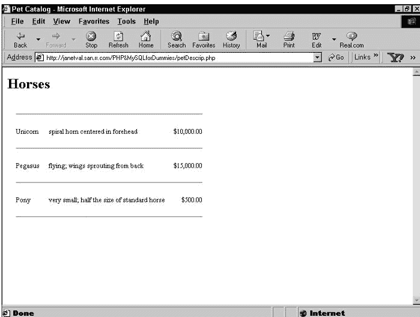

图 8-1：

`petDisplay.php` 生成的网页。

清单 8-1 中的程序使用 `while` 循环从临时位置获取所有行。在某些情况下，你可能需要使用 `for` 循环。例如，如果需要在循环中使用数字，`for` 循环比 `while` 循环更有用。

要使用 `for` 循环，你需要知道选择了多少行数据。可以使用 PHP 函数 `mysql_num_rows` 来了解临时存储区中有多少行，如下所示：

```
$nrows = mysql_num_rows($result);
```

变量 `$nrows` 包含临时存储位置中的行数。利用这个数字，你可以构建一个 `for` 循环来获取所有行，如下所示：

```
for ($i=0;$i<$nrows;$i++)
{
    $row = mysql_fetch_array($result)
    block of statements;
}
```

例如，清单 8-1 中的程序显示了类型为 `horse` 的宠物项目。假设你想为每个项目编号。清单 8-2 显示了一个程序 `petDescripFor.php`，它使用 `for` 循环显示带编号的列表。

#### 清单 8-2：显示宠物目录中带编号的项目列表

```
<?php
/* Program: petDescripFor.php
 * Desc: Displays a numbered list of all pets in
 *       selected category.
 */
?>
<html>
<head><title>Pet Catalog</title></head>
<body>
<?php
$user="catalog";
$host="localhost";
$password="";
$database = "PetCatalog";
$connection = mysql_connect($host,$user,$password)
    or die ("couldn't connect to server");
$db = mysql_select_db($database,$connection)
    or die ("Couldn't select database");
$pettype = "horse"; //horse was typed in a form by user
$query = "SELECT * FROM Pet WHERE pettype='$pettype'";
$result = mysql_query($query)
    or die ("Couldn't execute query.");
$nrows = mysql_num_rows($result);

/* Display results in a table */
echo "<h1>Horses</h1>";
echo "<table cellspacing='15'>";
echo "<tr><td colspan='4'><hr></td></tr>";
for ($i=0;$i<$nrows;$i++)
{
    $n = $i + 1;  #add 1 so that numbers don't start with 0
    $row = mysql_fetch_array($result);
    extract($row);
    $f_price = number_format($price,2);
    echo "<tr>\n
        <td>$n</td>\n
        <td>$petName</td>\n
        <td>$petDescription</td>\n
        <td align='right'>$$f_price</td>\n
        </tr>\n";
    echo "<tr><td colspan='4'><hr></td></tr>\n";
}
echo "</table>\n";
?>
</body></html>
```


图 8-2 显示了在此程序中使用 `for` 循环后生成的网页。请注意，这个网页上每个宠物项目的列表前面都会出现一个编号。

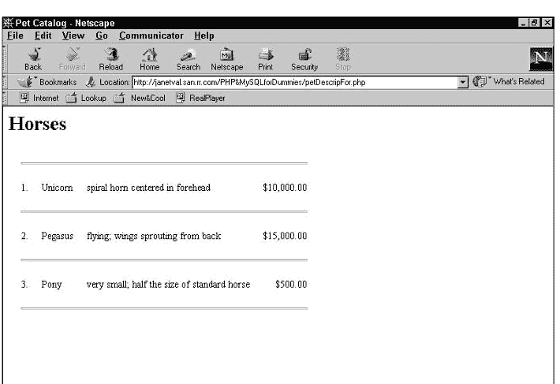

图 8-2：`petDescripFor.php` 生成的网页。

## 使用函数获取数据

在大多数应用程序中，你都需要从数据库获取数据。而且经常需要在程序中的多个位置或应用程序中的多个程序中获取数据。函数——执行特定任务的语句块——正是为这种情形而设计的。（我将在第 7 章详细解释函数。）

一个从数据库获取数据的函数会非常有用。当程序需要获取数据时，你只需调用这个函数。函数不仅省去大量输入，还让程序更容易理解。

例如，考虑一个产品目录，比如宠物目录。你会多次需要获取某个特定产品的信息。你可以编写一个获取数据的函数，然后每当你需要数据时就调用这个函数。

程序 `getdata.php` 的清单 8-3 展示了如何使用函数获取数据。清单 8-3 中的函数将获取宠物目录中任意一只宠物的信息。宠物信息被放入一个数组，并将该数组返回给主程序。主程序接下来可以按任何想要的方式使用这些信息。在本例中，它将宠物信息回显到网页上。

## 清单 8-3：使用函数从数据库获取数据

```php
<?php
/* Program: getdata.php
 * Desc:     Gets data from a database using a function
 */
?>
<html>
<head><title>Pet Catalog</title></head>
<body>
<?php
$user='catalog';
$host='localhost';
$password='';
$connection = mysql_connect($host,$user,$password)
    or die ('Couldn\'t connect to server');

$petInfo = getPetInfo('Unicorn');      //call function

$f_price = number_format($petInfo['price'],2);
echo '<p><b>{$petInfo[\'petName\']}</b><br>\n    Description: {$petInfo[\'petDescription\']}<br>\n    Price: \${$petInfo[\'price\']}\n'
?>
</body></html>

<?php
function getPetInfo($petName)
{
    $db = mysql_select_db('PetCatalog')
        or die ('Couldn\'t select database');
    $query = 'SELECT * FROM Pet WHERE petName=\''.$petName.'\'';
    $result = mysql_query($query)
        or die ('Couldn\'t execute query.');
    return mysql_fetch_array($result,MYSQL_ASSOC);
}
?>
```

网页显示如下：

```
Unicorn
Description: spiral horn centered in forehead
Price: $10,000.00
```

关于清单 8-3 中的程序，请注意以下几点：

- ✓ 使用函数调用比将全部函数语句都放在主程序中更易于阅读。
- ✓ 你可以在主程序中只连接一次 MySQL 服务器，然后多次调用该函数来获取数据。如果连接放在函数而不是主程序中，每次调用函数时它都会连接。如果可能的话，只连接一次更高效。
- 如果你只有一个连接，`mysql_select_db` 将使用该连接。如果有多个连接，你可以传递连接并在你的 `mysql_select_db` 函数调用中使用它。如果你的应用程序只使用一个数据库，你可以在主程序中选择一次该数据库，而不是在函数中选择。
- 函数调用发送字符串 "Unicorn"。在大多数情况下，函数调用将使用变量名。
- 程序创建变量 `$petInfo` 来接收函数的数据。`$petInfo` 是一个数组，因为存储在其中的信息是一个数组。

前面的函数非常简单——它将结果的一行作为数组返回。但函数可以更复杂。前一节提供了一个程序来获取指定类型的全部宠物。Listing 8-4 中的程序 `getPets.php` 使用函数实现相同目的。该函数返回一个包含所有指定类型宠物数据的多维数组。

## Listing 8-4：使用函数显示宠物编号列表

```
<?php
/* Program: getPets.php
 * Desc: Displays numbered list of items from a database.
 */
?>
<html>
<head><title>Pet Catalog</title></head>
<body>
<?php
$user="catalog";
$host="localhost";
$password="";
$connection = mysql_connect($host,$user,$password)
    or die ("couldn't connect to server");

$petInfo = getPetsOfType("horse");      //call function

/* Display results in a table */
echo "<h1>Horses</h1>";
echo "<table cellspacing='15'>";
echo "<tr><td colspan='4'><hr></td></tr>";
for ($i=1;$i<=sizeof($petInfo);$i++)
{
    $f_price = number_format($petInfo[$i]['price'],2);
    echo "<tr>\n
        <td>$i.</td>\n
        <td>|$petInfo[$i]['petName']|</td>\n
<td>{$petInfo[$i]['petDescription']}</td>\n    <td align='right'>$$f_price</td>\n    </tr>\n";\n    echo "<tr><td colspan='4'><hr></td></tr>\n";\n}\n echo "</table>\n";\n?>\n</body></html>\n\n<?php\nfunction getPetsOfType($petType)\n{\n    $db = mysql_select_db("PetCatalog")\n        or die ("Couldn't select database");\n    $query = "SELECT * FROM Pet WHERE petType='$petType'";\n    $result = mysql_query($query)\n        or die ("Couldn't execute query.");\n\n    $j = 1;\n    while ($row=mysql_fetch_array($result,MYSQL_ASSOC))\n    {\n        foreach ($row as $colname => $value)\n        {\n            $array[$j][$colname] = $value;\n        }\n        $j++;\n    }\n    return $array;\n}\n?>
```

Listing 8-4 中的程序按如下步骤进行：

- 1. 它在主程序中连接到 MySQL 服务器。
- 2. 它调用函数 `getPetsOfType`。它传递 `"horse"` 作为字符字符串，并设置 `$petInfo` 来接收函数返回的数据。
- 3. 函数选择数据库 `PetCatalog`。
- 4. 函数发送查询以获取 `petType` 列中包含 `horse` 的所有行。数据存储在临时位置的表中。变量 `$result` 标识临时表的位置。
- 5. 它设置一个计数器。`$j` 是一个在每次循环中递增的计数器。它在循环开始前设为 1。
- 6. 它开始一个 `while` 循环。函数尝试从临时数据表中获取一行并成功。如果临时位置中没有行可获取，`while` 循环将结束。
- 7. **它开始一个 `foreach` 循环。** 循环遍历该行，处理每个字段。
- 8. **它将值存储在数组中。** `$petInfo` 是一个多维数组。它的第一个键是一个数字，由计数器设置。因为这是 `while` 循环的第一次遍历，计数器——`$j`——现在等于 1。行中的所有字段都存储在 `$petInfo` 中，以列名为键。（我在第 7 章详细解释了多维数组。）
- 9. **它递增计数器。** `$j` 增加 1。
- 10. **它到达 `while` 循环的末尾。**
- 11. **它返回到 `while` 循环的顶部。**
- 12. **它对结果中的每一行重复步骤 6–11。**
- 13. **它将 `$array` 返回到主程序。** `$array` 包含所有选定行的全部数据。
- 14. **`$petInfo` 从函数接收数据。** 所有数据都被传递。图 8-3 显示了函数执行完毕后 `$petInfo` 的结构。

Figure 8-3: 多维数组 `$petInfo` 的结构。

```
$petInfo [1] [petName]        = Unicorn
            [petDescription] = spiral horn centered in forehead
            [price]         = 10000
          [2] [petName]        = Pegasus
            [petDescription] = flying; wings sprouting from back
            [price]         = 15000
          [3] [petName]        = Pony
            [petDescription] = very small; half the size of a standard horse
            [price]         = 500
```

- 15. **主程序将宠物描述以 HTML 表格的形式发送到浏览器。** 相关数据从 `$petInfo` 数组中插入。

Listing 8-4 中的程序产生的网页与图 8-2 所示的网页相同，该网页由不使用函数的程序产生。函数不会产生不同的输出。任何你可以使用函数编写的程序，你也可以不使用函数编写。函数只是让编程更轻松。

## 从用户获取信息

许多应用程序设计为提出问题，用户通过输入信息来回答。有时信息存储在数据库中；有时信息用于条件语句以提供个性化网页。一些最常见的需要用户回答问题的应用程序任务是

- **在线订购：** 客户需要选择产品并输入送货和付款信息。
- **注册：** 许多网站要求用户在获得某些权益（如访问特殊信息或可下载软件）之前提供一些信息。
- **登录：** 许多网站限制对其页面的访问。用户必须在查看网页之前输入账户名和密码。
- **查看选定信息：** 许多网站允许用户指定他们想要查看的信息。例如，在线目录可能允许用户输入产品名称或选择他们想要查看的产品类别。

你通过显示 HTML 表单来提问。用户通过在表单中输入信息或从列表中选择项目来回答问题。然后用户点击按钮提交表单信息。当表单提交时，表单中的信息会被传递给第二个独立的程序，该程序处理信息。

在接下来的几节中，我不会告诉你显示表单所需的 HTML；我假设你已经了解 HTML。（如果你不了解 HTML 或需要复习，请查阅 Ed Tittel 和 Natanya Pitts 所著的 *HTML 4 For Dummies*，第 4 版；Wiley。）我会告诉你的是如何使用 PHP 显示 HTML 表单并处理用户输入到表单中的信息。

## 使用 HTML 表单

HTML 表单对于交互式网站非常重要。如果你不熟悉 HTML 表单，你需要阅读 HTML 书籍中的表单章节。要使用 PHP 显示表单，你可以执行以下任一操作：

- **使用 `echo` 语句输出表单的 HTML。** 例如：

```php
<?php
echo "<form action='processform.php'
      method='POST'>\n
      <input type='text' name='name'>\n
      <input type='submit' value='Submit Name'>\n
      </form>\n";
?>
```

### 在 PHP 部分之外使用纯 HTML。

对于纯静态表单，没有理由将其包含在 PHP 部分中。例如：

```php
<?php
    statements in PHP section
?>
<form action="processform.php" method="POST">
<input type="text" name="fullname">
<input type="submit" value="Submit Name">
</form>
<?php
    statements in PHP section
?>
```

这两种方法都会产生图 8-4 中显示的表单。

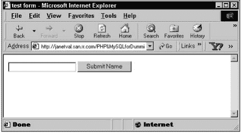

Figure 8-4: 由 HTML 语句产生的表单。

Joe Customer 填写 HTML 表单。他点击提交按钮。你现在有了想要的信息——他的名字。那么它在哪里？你怎么获取它？

你通过运行接收表单信息的程序来获取表单信息。当提交按钮被点击时，PHP 会自动运行一个程序。form 标签中的 action 参数告诉 PHP 运行哪个程序。例如，在前面的程序中，参数 `action=processform.php` 告诉 PHP 当用户点击提交按钮时运行程序 `processform.php`。程序 `processform.php` 可以显示、存储或以其他方式使用表单提交时接收到的表单数据。

当用户点击提交按钮时，action 属性中指定的程序运行，并且该程序中的语句可以从 PHP 内置数组中获取表单信息并在 PHP 语句中使用这些信息。表 8-2 显示了包含表单信息的内置数组。

| 数组 | 描述 |
|---|---|
| `$_POST` | 如果表单使用 `method="POST"`，则包含表单中所有字段的元素。 |
| `$HTTP_POST_VARS` | 与 `$_POST` 相同。 |
| `$_GET` | 包含作为 URL 部分从前一页传递的所有变量。这包括使用 `method="get"` 传递的表单字段。 |
| `$HTTP_GET_VARS` | 与 `$_GET` 相同。 |
| `$_REQUEST` | 包含 `$_POST`、`$_GET` 和 `$_COOKIE` 中的所有数组元素。 |

当表单提交时，运行的程序可以从适当的内置数组中获取表单信息，如表 8-2 所示。在这些内置数组中，每个数组索引都是表单中输入字段的名称。例如，如果用户在图 8-4 所示的输入字段中输入了 **Goliath Smith** 并单击了提交按钮，则程序 `processform.php` 运行并可以使用以下格式的数组变量：

```
$_POST['fullname']
```

请注意，由于表单标签指定了 `method='POST'`，因此在表单中输入的名称可在 `$_POST` 数组中使用。另请注意，数组键是 HTML 表单中字段的名称，其 `name` 属性为 `name="fullname"`。

用于显示表单中所有字段的程序是测试表单的有用程序。您可以查看从表单传递的值，以确保表单格式正确并发送您期望的字段名称和值。`POST` 类型表单中的所有字段都由清单 8-5 中的程序显示，名为 `processform.php`。当图 8-4 所示的表单提交时，将运行以下程序。

## 清单 8-5：一个显示表单中所有字段的脚本

```php
<?php
/* Script name: processform.php
 * Description: Script displays all the information passed
 *              from a form.
 */
echo "<html>
        <head><title>Customer Address</title></head>
        <body>";
```

## 清单 8-5（续）

```php
    foreach ($_POST as $field => $value)
    {
        echo "$field = $value<br>";
    }
?>
</body></html>
```

如果用户在图 8-4 的表单中输入了姓名 Goliath Smith，则会显示以下输出：

```
fullname = Goliath Smith
```

输出仅显示一行，因为图 8-4 中的表单只有一个字段。

清单 8-5 中的程序编写用于处理使用 `POST` 方法的任何表单的表单信息。假设您有一个稍微复杂一些的表单，例如清单 8-6 中的程序，该程序显示包含多个字段的表单。

## 清单 8-6：一个显示地址表单的程序


```php
<?php
/*  Program name: displayForm
 *  Description:  Script displays a form that asks for the
 *                customer address.
 */
echo "<html>
        <head><title>Customer Address</title></head>
        <body>";
$labels = array( "firstName"=>"First Name:",
                "midName"=>"Middle Name:",
                "lastName"=>"Last Name:",
                "street"=>"Street Address:",
                "city"=>"City:",
                "state"=>"State:",
                "zip"=>"Zipcode:");
echo "<p align='center'>
        <b>Please enter your address below.</b><hr>";
echo "<form action='processform.php' method='POST'>
        <table width='95%' border='0' cellspacing='0'
                cellpadding='2'>\n";
foreach($labels as $field=>$label)
{
    echo "<tr>
            <td align='right'><B>{$labels[$field]} </B><br></td>
            <td><input type='text' name='$field' size='65'
                    maxlength='65' ></td>
            </tr>";
```
```php
}
echo "</table>
        <div align='center'><p><input type='submit'
             value='Submit Address'> </p></div>
        </form>";
?>
</body></html>
```

请注意 `displayForm.php` 中的以下内容，如清单 8-6 所示：

- 创建一个包含表单中使用的标签的数组。键是字段名称。
- 脚本 `processform.php` 被指定为表单提交时运行的脚本。表单中的信息发送到 `processform.php`，后者处理这些信息。
- 表单使用 HTML 表格进行格式化。表格是 HTML 的重要组成部分。如果您不熟悉 HTML 表格，请查看 *HTML 4 For Dummies*，第 4 版，作者 Ed Tittel 和 Natanya Pitts（Wiley）。
- 脚本使用 `foreach` 语句遍历 `$labels` 数组。在每次循环中输出表格行的 HTML 代码。适当的数组值在 HTML 代码中使用。


出于安全原因，请始终在 HTML 语句中包含 `maxlength` — 它定义用户允许在字段中输入的字符数。限制字符数有助于防止坏人将恶意代码输入到您的表单字段中。如果信息将存储在数据库中，请将 `maxlength` 设置为与数据库表中列的宽度相同的数字。

当 Goliath Smith 填写图 8-5 所示的表单（由清单 8-6 中的程序创建）并提交时，程序 `processform.php` 运行并产生以下输出：

```
firstName = Goliath
midName =
lastName = Smith
street = 1234 Tall St
city = Big City
state = TX
zip = 88888
```

在 `processform.php` 中，`$_POST` 内置数组的所有元素都会显示，因为本节中显示的两个表单都使用了 POST 方法，大多数表单也是如此。除了 `$_POST` 数组之外，还有其他内置数组，如表 8-2 所示。

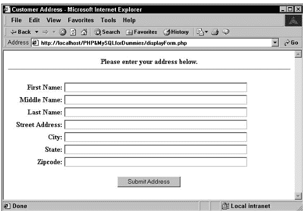

图 8-5：用于输入客户地址的表单。

相同的 information 可在两组数组中使用。使用较新的数组（名称以 _ 开头），因为它们可以在任何地方使用，甚至在函数内部使用。（我在第 7 章中解释了函数以及函数内部变量的使用。）这些数组称为超全局变量或自动全局变量，于 PHP 4.1.0 中引入。旧的数组，其名称很长，例如 `$HTTP_POST_VARS`，在函数中使用之前必须设为全局变量，我在第 7 章中解释了这一点。旧的数组只有在您被迫使用早于 PHP 4.1.0 的 PHP 版本时才应使用。

## 使表单动态化

PHP 为 HTML 表单带来了新的功能。因为您可以在 PHP 表单中使用变量，所以您的表单现在可以是动态的。以下是 PHP 为表单带来的主要功能：

- ✓ 使用变量在输入文本字段中显示信息
- ✓ 使用变量为用户构建动态选择列表
- ✓ 使用变量为用户构建动态单选按钮列表
- ✓ 使用变量为用户构建动态复选框列表

### 在表单字段中显示动态信息

当您在网页上显示表单时，您可以将信息放入字段中，而不是仅显示空白字段。例如，如果大多数客户居住在美国，您可以在询问客户地址时自动在国家/地区字段中输入 US。如果客户确实居住在美国，您就为客户节省了输入时间。而且如果客户不住在美国，他或她只需将 **US** 替换为适当的国家即可。此外，如果程序自动将 **US** 作为字段的值输入，您就知道该信息没有任何错误。

要显示包含信息的文本字段，您对输入字段 HTML 语句使用以下格式：

```html
<input type="text" name="country" value="US">
```

通过使用 PHP，您可以使用变量以以下任一语句显示此信息：

```php
<input type="text" name="country"
       value="<?php echo $country ?>">
echo "<input type='text' name='country' value='$country'>";
```

第一个示例在 HTML 部分中创建输入字段，仅对值使用简短的 PHP 部分。第二个示例使用 PHP 部分中的 `echo` 语句创建输入字段。如果您使用的是只有偶尔使用变量的长表单，使用第一种格式更有效。如果您的表单使用许多变量，则使用第二种格式更有效。

如果您将用户信息存储在数据库中，您可能希望在表单字段中显示来自数据库的信息。例如，您可能向用户显示信息，以便他或她进行必要的更改。或者您可能显示客户上次在线订单的送货地址，以便他或她不必重新输入地址。清单 8-7 显示了程序 `displayAddress.php`，它显示了一个包含来自数据库信息的表单。此表单与图 8-5 所示的表单非常相似，只是此表单中包含信息（从数据库检索），而图 8-5 中的表单字段为空。


### 注册长数组

PHP 5 中引入的新 `php.ini` 设置允许您防止 PHP 自动创建较旧的长数组。您不太可能需要使用它们，除非您使用包含长变量的一些旧脚本。`php.ini` 中的以下行控制此设置：

```ini
register_long_arrays = On
```

目前，此设置默认情况下为 **On**。除非您正在运行需要旧数组的旧脚本，否则应将设置更改为 **Off**，以便 PHP 不执行此额外工作。尽管设置目前默认情况下为 **On**，但情况可能会改变。默认设置将来可能会更改为 **Off**。如果您使用了一些旧脚本，并且在包含长数组的行上出现错误，例如 `$HTTP_GET_VARS`，请检查 `php.ini` 中长数组的设置。它可能为 **Off**，并且旧脚本所需的长数组根本没有被创建。

## 列表 8-7：用于显示 HTML 表单信息的程序

```php
<?php
/* Program name: displayAddress
 * Description: Script displays a form with address
 *              information obtained from the database.
 */
echo "<html>
    <head><title>Customer Address</title></head>
    <body>";
$labels = array( "firstName"=>"First Name:",
                "lastName"=>"Last Name:",
                "street"=>"Street Address:",
                "city" =>"City:",
                "state"=>"State:",
                "zip"=>"Zipcode:");
$user="admin";
$host="localhost";
$password="";
$database = "MemberDirectory";
$loginName = "gsmith";    // user login name

$connection = mysql_connect($host,$user,$password)
    or die ("Couldn't connect to server");
$db = mysql_select_db($database,$connection)
    or die ("Couldn't select database");
$query = "SELECT * FROM Member
          WHERE loginName='$loginName'";
$result = mysql_query($query)
    or die ("Couldn't execute query.");
$row = mysql_fetch_array($result);

echo "<p align='center'>
    <h1 align='center'>Address for $loginName</h1>\n";
echo "<br><p align='center'>
    <font size='+1'><b>Please check the information below
    and change any information that is incorrect.</b></font>
    <hr>";
echo "<form action='processAddress.php' method='POST'>
    <table width='95%' border='0' cellspacing='0'
    cellpadding='2'>\n";
foreach($labels as $field=>$label)
{
    echo "<tr>
        <td align='right' ><B>{$labels[$field]} </B></br></td>
        <td><input type='text' name='$field'
            value='$row[$field]' size='65' maxlength='65'>
        </td>
        </tr>";
}
echo "</table>
    <div align='center'><p><input type='submit'
        value='Submit Address' </p></div>
    </form>";
?>
</body></html>
```

请注意列表 8-7 中程序中的以下内容：

- 表单语句将操作转移到程序 `processAddress.php`。该程序处理表单中的信息并用用户更改的任何信息更新数据库。这是您自己编写的程序。检查表单中的数据并将信息保存到数据库将在本章后面的“检查信息”和“将信息放入数据库”部分中讨论。
- 表单中的每个输入字段都被赋予一个名称。输入字段中的信息存储在与输入字段同名的变量中。
- 程序将表单中的字段名称与数据库中的列名称设为相同。这简化了数据库和表单之间信息的移动，无需从一个变量向另一个变量传输信息。
- 数据库中的值通过输入字段语句中的 `value` 参数显示在表单字段中。`value` 参数显示来自数组 `$row` 的适当值，其中包含来自数据库的数据。


出于安全原因，始终在您的 HTML 语句中包含 `maxlength`。`maxlength` 定义用户允许在字段中输入的字符数。如果信息将被存储在数据库中，请将 `maxlength` 设置为与数据库表中列的宽度相同的数字。

图 8-6 显示了列表 8-7 中程序生成的网页。表单中的信息是存储在数据库中的信息。

## 构建选择列表

HTML 表单中可以使用的一种字段类型是选择列表。用户不是在字段中输入，而是从列表中选择。例如，在产品目录中，您可能会提供一个类别列表，用户从中选择他们想要查看的内容。或者用户地址的表单可能包含用户可以选择的州列表。或者用户可以通过从列表中选择月份、日期和年份来输入日期。


只要可行就使用选择列表。当用户从列表中选择一个项目时，您可以确保该项目是准确的，没有拼写错误、奇怪字符或用户输入错误带来的其他问题。

Pet Catalog 中类别的 HTML 选择列表的格式如下：

当用户单击 select 下拉列表框上的箭头时，整个列表会下拉，如图 8-8 所示，用户可以从列表中选择任何项目。请注意，cat 会被选中，直到用户选择不同的项目。

使用 PHP 时，您的选项可以是变量。此功能允许您构建动态选择列表。例如，您必须维护前面示例中显示的静态宠物类别列表。如果您添加一个新的宠物类别，您必须手动添加 `option` 标签。然而，使用 PHP 变量，您可以从数据库中的类别动态构建列表。当您向数据库添加新类别时，新类别会自动添加到您的选择列表中，而无需更改您的 PHP 程序。列表 8-8 中的程序 `buildSelect.php` 从数据库构建宠物类别的选择列表。

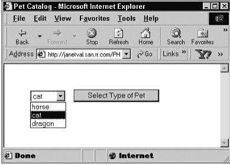

图 8-8：带有下拉列表的 Pet Catalog 选择字段。

## 列表 8-8：构建选择列表的程序

```php
<?php
/* Program name: buildSelect.php
 * Description: Program builds a selection list
 *              from the database.
 */
?>
<html>
<head><title>Pet Types</title></head>
<body>
<?php
$user="catalog";
$host="localhost";
$password="";
$database = "PetCatalog";

$connection = mysql_connect($host,$user,$password)
    or die ("couldn't connect to server");
$db = mysql_select_db($database,$connection)
or die ("Couldn't select database");
$query = "SELECT DISTINCT petType FROM Pet ORDER BY petType";
$result = mysql_query($query)
    or die ("Couldn't execute query.");

/* create form containing selection list */
echo "<form action='processform.php' method='POST'>
    <select name='petType'>\n";

while ($row = mysql_fetch_array($result))
{
    extract($row);
    echo "<option value='$petType'>$petType\n";
}
echo "</select>\n";
echo "<input type='submit' value='Select Type of Pet'>
    </form>\n";
?>
</body></html>
```

请注意列表 8-8 中程序中的以下内容：

- 在查询中使用 `DISTINCT`：`DISTINCT` 使查询仅获取每个宠物类型一次。如果没有 `DISTINCT`，查询如果在数据库中出现多次，则会多次返回每个宠物类型。
- 在查询中使用 `ORDER BY`：宠物类型按字母顺序排序。
- 循环之前的 `echo` 语句：`form` 和 `select` 标签在 `while` 循环开始之前被 `echo`，因为它们只 `echo` 一次。
- 循环中的 `echo` 语句：`option` 标签在循环中被 `echo` — 数据库中每个宠物类型一个。没有项目被标记为已选择，因此列表中的第一个项目会自动被选中。


- **循环之后的 `echo` 语句：** 结束的 form 和 select 标签在循环之后被 `echo`，因为它们只 `echo` 一次。

该程序生成的选择列表最初与图 8-7 中显示的选择列表相同，其中选择了 cat。然而，在此程序中选择 cat 是因为它是列表中的第一项——而不是因为它在生成图 8-7 的 HTML 标签中被特别选中。该程序生成的下拉列表按字母顺序排列，如图 8-9 所示。

您还可以使用 PHP 变量来设置在显示选择框时选择哪个选项。例如，假设您希望用户从月份、日期和年份选择列表中选择日期。您认为大多数人会选择今天的日期，因此您希望在显示框时默认选择今天的日期。列表 8-9 显示了程序 `dateSelect.php`，它显示用于选择日期的表单并自动选择今天的日期。

图 8-9：由程序 `buildSelect.php` 生成的 Pet Catalog 选择字段。

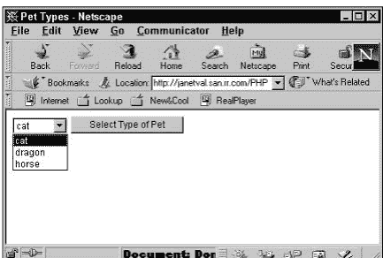

## 列表 8-9：构建日期选择列表的程序

```php
<?php
/* Program name: dateSelect.php
 * Description: Program displays a selection list that
 * customers can use to select a date.
 */
echo "<html>
<head><title>Select a date</title></head>
<body>";

/* create an array of months*/
$monthName = array(1=> "January", "February", "March",
"April", "May", "June", "July",
"August", "September", "October",
"November", "December");

$today = time(); //stores today's date
$f_today = date("M-d-Y",$today); //formats today's date

echo "<div align='center'>\n";

/* display today's date */
echo "<p>&nbsp;<h3>Today is $f_today</h3><hr>\n";

/* create form containing date selection list */
echo "<form action='processform.php' method='POST'>\n";

/* build selection list for the month */
$todayMO = date("m",$today); //get the month from $today
echo "<select name='dateMO'>\n";
for ($n=1;$n<=12;$n++)
{
 echo "<option value=$n\n";
 if ($todayMO == $n)
 {
```

## 列表 8-9（续）

```
    echo " selected";
}
    echo "> $monthName[$n]\n";
}
    echo "</select>";

/* build selection list for the day */
$todayDay= date("d",$today);   //get the day from $today
echo "<select name='dateDay'>\n";
for ($n=1;$n<=31;$n++)
{
    echo " <option value=$n";
    if ($todayDay == $n )
    {
        echo " selected";
    }
    echo "> $n\n";
}
echo "</select>\n";

/* build selection list for the year */
$startYr = date("Y", $today); //get the year from $today
echo "<select name='dateYr'>\n";
for ($n=$startYr;$n<=$startYr+3;$n++)
{
    echo " <option value=$n";
    if ($startYr == $n )
    {
        echo " selected";
    }
    echo "> $n\n";
}
    echo "</select>\n";
    echo "</form>\n";
?>
</body></html>
```

程序清单 8-9 生成的网页显示在图 8-10 中。日期显示在表单上方，这样可以看到选择列表显示了正确的日期。月份选择列表在展开时显示全部 12 个月。日期选择列表在展开时显示 31 天。年份选择列表显示四年。

程序清单 8-9 通过以下步骤生成图 8-10 中的网页：

- 1. **创建一个包含月份名称的数组。** 数组的键为数字。第一个月 January 从键 1 开始，这样数组的键与月份的数字相匹配。

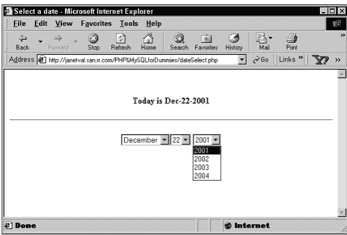

图 8-10：带今日日期选中的日期选择字段。

- 2. **创建包含当前日期的变量。** `$today` 以系统格式包含日期并在表单中使用。`$f_today` 是格式化后的日期，用于在网页中显示日期。

- 3. **在网页顶部显示当前日期。**

- 4. **构建月份的选择字段。**

  - i. 创建一个包含本月日期的变量。

  - ii. 输出 `select` 标签，该标签应仅输出一次。

  - iii. 启动一个重复 12 次的 `for` 循环。

  - iv. 在循环内部，使用 `$monthName` 数组中的第一个值输出 `option` 标签。

  - v. 如果正在处理的月份编号等于当前月份的编号，则向 `option` 标签添加单词 "selected"。

  - vi. 再重复循环 11 次。

  - vii. 输出选择字段的闭合 `select` 标签，该标签应仅输出一次。

- 5. **构建日期的选择字段。** 使用步骤 4 中针对月份描述的程序。然而，此选择列表仅使用数字。循环重复 31 次。

- 6. **构建年份的选择字段。**

  - i. 创建变量 `$startYr`，包含今天的年份。

  - ii. 输出 `select` 标签，该标签应仅输出一次。

  - iii. 启动一个 `for` 循环。循环的起始值为 `$startYr`。循环的结束值为 `$startYr+3`。

  - iv. 在循环内部，输出 option 标签，使用 for 循环的起始值，即今天的年份。

  - v. 如果正在处理的年份编号等于当前年份的编号，则向 option 标签添加单词 "selected"。

  - vi. 重复循环直到结束值等于 `$startYr+3`。

  - vii. 输出选择字段的闭合 select 标签，该标签应仅输出一次。

- 7. 输出表单的结束标签。

## 构建单选按钮列表

你可能想使用单选按钮而不是选择列表。例如，你可以为你的宠物目录显示一个单选按钮列表，让用户选择他们感兴趣的宠物类别按钮。

表单中单选按钮的格式为

```
<input type="radio" name="pets" value="Unicorn">
```

你可以用与上一节构建动态选择列表相同的方式构建一个代表数据库中所有宠物类型的动态单选按钮列表。列表 8-10 显示了程序 `buildRadio.php`，该程序基于宠物类型创建一个单选按钮列表。

### 列表 8-10：构建单选按钮列表的程序

```
<?php
/* Program name: buildRadio.php
 * Description: Program displays a list of radio
 *              buttons from database info.
 */
echo "<html>
<head><title>Pet Types</title></head>
<body>";
$user="catalog";
$host="localhost";
$password="";
$database = "PetCatalog";

$connection = mysql_connect($host,$user,$password)
        or die ("couldn't connect to server");
$db = mysql_select_db($database,$connection)
        or die ("Couldn't select database");
$query = "SELECT DISTINCT petType FROM Pet
                ORDER BY petType";
$result = mysql_query($query)
        or die ("Couldn't execute query.");
```

```
echo "<div style='margin-left: .5in'>
<p>&nbsp;
<p><b>Which type of pet are you interested in?</b>
<p>Please choose one type of pet from the following list:\n";
/* create form containing radio buttons */
echo "<form action='processform.php' method='POST'>\n";

while ($row = mysql_fetch_array($result))
{
    extract($row);
    echo "<input type='radio' name='interest' value='$petType'>$petType\n";
    echo "<br>\n";
}
echo "<p><input type='submit' value='Select Type of Pet'>
</form>\n";
?>
</div></body></html>
```

此程序与程序清单 8-9 非常相似。此程序生成的网页显示在图 8-11 中。

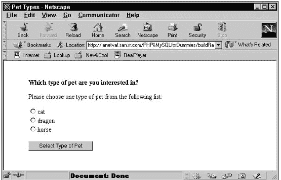

图 8-11：程序清单 8-10 生成的单选按钮列表。

## 构建复选框列表

你可能想在表单中使用复选框。复选框与选择列表和单选按钮不同，因为它们允许用户选择多个选项。例如，如果你使用复选框显示宠物类别列表，用户可以勾选两个或三个或更多宠物类别。列表 8-11 中的程序 `buildCheckbox.php` 创建一个复选框列表。

### 列表 8-11：构建复选框列表的程序

```
<?php
/* Program name: buildCheckbox.php
   Description:  Program displays a list of
                 checkboxes from database info.
*/
echo "<html>
      <head><title>Pet Types</title></head>
      <body>";
$user="catalog";
$host="localhost";
$password="";
$database = "PetCatalog";

$connection = mysql_connect($host,$user,$password)
    or die ("Couldn't connect to server");
$db = mysql_select_db($database,$connection)
    or die ("Couldn't select database");
$query = "SELECT DISTINCT petType FROM Pet
              ORDER BY petType";
$result = mysql_query($query)
    or die ("Couldn't execute query.");

echo "<div style='margin-left: .5in'>
<p>&nbsp;
<p><b>Which type of pet are you interested in?</b>
<p>Choose as many types of pets as you want:\n";

/* create form containing checkboxes */
echo "<form action='processform.php' method='POST'>\n";

while ($row = mysql_fetch_array($result))
{
    extract($row);
    echo "<input type='checkbox' name='interest[$petType]'
             value='$petType'>$petType\n";
    echo "<br>\n";
}
echo "<p><input type='submit' value='Select Type of Pet'>
      </form>\n";
?>
</div></body></html>
```

此程序与构建单选按钮列表的程序清单 8-10 非常相似。然而，请注意输入字段使用数组 `$interest` 作为字段的名称。这是因为可以选中多个复选框。此程序将为每个选中的复选框在数组中创建一个键/值对元素。例如，如果用户同时选择了 *horse* 和 *dragon*，则创建以下数组：

```
$interest[horse]=horse
$interest[dragon]=dragon
```

处理表单的程序在 POST 数组中有以下选择：

```
$_POST['interest']['horse']
$_POST['interest']['dragon']
```

图 8-12 显示了 `buildCheckbox.php` 生成的网页。

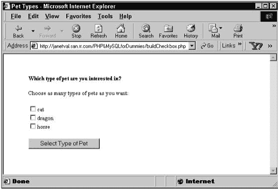

图 8-12：程序清单 8-11 生成的复选框列表。

## 使用表单中的信息

正如我在本节前面讨论的，Joe Customer 填写 HTML 表单，从列表中选择并在文本字段中输入信息。他点击提交按钮。

在 form 标签中，你告诉 PHP 在点击提交按钮时运行哪个程序。你通过在 form 标签中包含 `action="programname"` 来实现。例如，在本章的大多数示例列表中，我使用 `action="processform.php"`。当用户点击提交按钮时，程序运行并接收来自表单的信息。处理表单信息是 PHP 的最佳功能之一。你不必担心表单数据——只需从内置数组之一获取它并使用它。

表单数据在处理程序中以数组形式可用，如表 8-1 所示。数组元素的键是表单中输入字段的名称。例如，如果你在表单中输出以下字段

```
echo "<input type='text' name='firstName'>";
```

处理程序可以使用变量 `$_POST[firstName]`，其中包含用户在字段中输入的文本。用户从选择下拉列表或单选按钮中选择的信息同样可供使用。例如，如果你的表单包含以下单选按钮列表

```php
echo "<input type='radio' name='interest' value='dog'>dog\n";
echo "<input type='radio' name='interest' value='cat'>cat\n";
```

你可以访问变量 `$_POST[interest]`，其中包含 dog 或 cat，具体取决于用户选择的内容。

你以略有不同方式处理复选框，因为用户可以选中多个复选框。如清单 8-11 所示，复选框列表的数据可以存储在数组中，以便所有复选框都可用。例如，如果你的表单包含以下复选框列表

```php
echo "<input type='checkbox' name='interest[dog]'
             value='dog'>dog\n";
echo "<input type='checkbox' name='interest[cat]'
             value='cat'>cat\n";
```

你可以通过使用多维变量 `$_POST[interest]` 来访问数据，其内容如下：

```php
$_POST[interest][dog] = dog
$_POST[interest][cat] = cat
```

在某些情况下，你可能想要访问表单中的所有字段。也许你想检查它们，以确保用户没有留下任何空白字段。如本章前面所示的程序 `processform.php`（参见清单 8-5），你可以使用 `foreach` 遍历内置数组 `$_POST` 或 `$_GET`。大多数示例程序和语句在本书中使用 post 方法。键是字段名称。请参阅侧边栏“Post versus get”了解有关这两种方法的更多信息。

例如，假设你的程序包含以下用于显示表单的语句：


```php
echo "<form action='processform.php' method='POST'>\n";
echo "<input type='text' name='lname' value='Smith'><br>\n";
echo "<input type='radio' name='interest' value='dog'>dog\n";
echo "<input type='radio' name='interest' value='cat'>cat\n";
echo "<input type='hidden' name='hidvar' value='3'>\n";
echo "<br><input type='submit' value='Select Type of Pet'>
    </form>\n";
```

程序 `processform.php` 包含以下将列出表单接收到的所有变量的语句：

```php
foreach ($_POST as $field => $value)
{
    echo "$field, $value<br>";
}
```

`foreach` 循环的输出将是

```
name, Smith
interest, dog
hidvar, 3
```

输出显示了三个变量及其三个值，原因如下：

- **用户未更改文本字段中的文本。** 程序显示的值 `"Smith"` 仍然是文本字段中的文本。
- **用户选择了 dog 的单选按钮。** 用户只能选择一个单选按钮。
- **程序传递了一个名为 `hidvar` 的隐藏字段。** 程序为隐藏字段设置值。用户无法影响隐藏字段。


## Post 与 get 对比

你可以使用两种方法之一提交表单信息。这些方法传递表单数据的方式不同，并且各有优缺点。

- **get 方法：** 表单数据是通过将其添加到调用表单处理程序的 URL 中来传递的。例如，URL 可能如下所示：

```
processForm.php?name=Smith&
  fname=Goliath
```

这种方法的优点是简单和速度快。缺点是可传递的数据较少，并且信息会显示在浏览器中，在某些情况下可能存在安全问题。

- **post 方法：** 表单数据作为一个包在与处理程序的单独通信中传递。

这种方法的优点是信息传递无限制且数据安全。缺点是额外的开销和速度较慢。

对于非 PHP 的 CGI 程序，处理表单的程序必须找到信息并将数据放入变量中。在这种情况下，`get` 方法要简单得多，也更容易使用。许多程序员因此使用 `get` 方法。然而，PHP 会为你完成所有这些工作。`get` 和 `post` 方法在 PHP 程序中同样易于使用。因此，使用 PHP 时，几乎总是最好使用 `post` 方法，因为你拥有 post 方法的优点（无限数据传递、更好的安全性），而没有其主要缺点（更难使用）。

## 检查信息

Joe Customer 填写 HTML 表单，从列表中选择并在文本字段中输入信息。他点击提交按钮。你现在拥有想要的所有信息。嗯，也许吧。Joe 可能输入了包含拼写错误的信息。或者他可能输入了无意义的内容。或者他甚至可能输入了恶意信息，这可能会给你或使用你网站的其他人带来问题。在你使用 Joe 的信息或将其存储到数据库之前，你需要检查它是否是你所要求的信息。检查数据就是验证数据。

验证数据包括以下内容：

- **检查空字段：** 你可以要求用户在字段中输入信息。如果字段为空，则会告知用户该信息是必填的，并重新显示表单，以便用户输入缺失的信息。
- **检查信息的格式：** 你可以检查信息是否采用正确的格式。例如，*ab3&*xx* 显然不是有效的邮政编码。

### 检查空字段

创建表单时，你可以决定哪些字段是必填的，哪些是可选的。你的决定在 PHP 程序中实现。你检查需要信息的必填字段。如果必填字段为空，你向用户发送一条消息，指出该字段是必填的，然后重新显示表单。

检查空字段的一般格式是

```
if ($last_name == "")
{
    echo "You did not enter your last name.
        Last name is required.<br>\n";
    display the form;
    exit();
}
echo " Welcome to the Members Only club.
    You may select from the menu below.<br>\n";
display the menu;
```

注意 `exit` 语句。`exit` 语句结束程序。如果没有 `exit` 语句，程序将继续执行 if 语句之后的代码。换句话说，如果没有 `exit` 语句，程序将显示表单，然后继续输出欢迎语句和菜单。

在许多情况下，你希望检查表单中的所有字段。你可以通过遍历数组 `$_POST` 来实现这一点。以下语句检查数组中是否存在任何空字段：

```
foreach ($_POST as $value)
{
    if ( $value == "" )
    {
        echo "You have not filled in all the fields<br>\n";
        display the form;
        exit();
    }
}
echo "Welcome";
```


重新显示 Web 表单时，请确保它包含用户已输入的信息。如果用户必须重新输入信息，他们很可能会感到沮丧并离开你的网站。

在某些情况下，你可能要求用户填写大部分字段，但不是全部。例如，你可能在表单中请求传真号码或提供中间名字段，但你并不真正想将网站注册限制为仅拥有中间名和传真的用户。在这种情况下，你可以为非必填字段设置例外，如下所示：

```
foreach ($_POST as $field => $value)
{
    if ( $field != "fax" and $field != "middle_name" )
    {
        if ( $value == "" )
        {
            echo "You have not filled in all the fields<br>\n";
            display the form;
            exit();
        }
    }
}
echo "Welcome";
```

注意，只有当字段不是传真字段且不是中间名字段时，外部 if 条件语句才为真。对于这两个字段，程序不会执行内部 if 语句，该语句用于检查空字段。

在某些情况下，你可能希望明确告知用户哪些字段需要填写。清单 8-12 中的 `checkBlank.php` 程序处理包含四个字段的表单：`first_name`、`middle_name`、`last_name` 和 `phone`。除 `middle_name` 外，所有字段都是必填的。在图 8-13 所示的示例中，用户未输入名字：表单处理时产生的错误消息会告知用户哪个字段被留空。

```
</tr>
<tr><td align='right'><b>{$label_array['middle_name']}:
<br></td>
    <td><input type='text' name='middle_name' size='65'
        maxlength='65' value='$middle_name' ></td>
</tr>
<tr><td align='right'><b>{$label_array['last_name']}:
</b></td>
    <td> <input type='text' name='last_name' size='65'
        maxlength='65' value='$last_name'> </td>
</tr>
<tr><td align='right'><b>{$label_array['phone']}:
</b></td>
    <td> <input type='text' name='phone' size='65'
        maxlength='65' value='$phone'> </td>
</tr>
</table>
<p><input type='submit'
    value='Submit name and phone number'>
</form>
</center>";
    exit();
}
    echo "Welcome";
?>
</body></html>
```

为了检查空白字段，程序会执行以下操作：

- 1. **建立字段标签数组。** 这些标签在表单中用作标签，也用于显示缺失信息的列表。
- 2. **遍历从表单传递的所有变量，检查空白字段。** 变量位于 `$_POST` 数组中。任何找到的空白字段都会被添加到空白字段数组 `$blank_array` 中。
- 3. **检查是否找到了任何空白字段。** 检查 `$blank_array` 中的项目数量。
- 4. **如果未找到空白字段，则跳转到欢迎消息。**
- 5. **如果找到一个或多个空白字段：**
  - i. 显示错误消息。此消息向用户说明某些必需信息缺失。
  - ii. 显示缺失信息列表。遍历 `$blank_array` 并显示标签。
  - iii. 显示表单。由于表单的 value 属性中包含变量名，因此用户先前输入的信息会从 `$_POST` 中检索并显示。
  - iv. 退出。表单显示后停止。用户必须点击提交按钮才能继续。


请记住，处理表单的程序会使用来自表单的信息。如果你单独运行它们，它们不会有任何从表单传递的信息，因而无法正确运行。这些程序是在用户按下表单的提交按钮时运行的。

不要忘记 `exit` 语句。如果没有 `exit` 语句，程序会继续执行，并在显示表单后显示欢迎消息。

图8-13显示了当用户未输入名字或中间名时产生的网页。请注意，缺失信息列表中没有包含中间名，因为中间名不是必填项。另外，注意用户最初在表单中键入的信息仍显示在表单字段中。

### 检查信息的格式

每当用户必须在表单中输入信息时，你都可以预料到会有一定数量的输入错误。你可以在表单提交时检测出这些错误中的一部分，向用户指出错误，然后要求他或她重新输入信息。例如，如果用户在邮政编码字段中输入 8899776，你就会知道这是不正确的。这条信息作为邮政编码太长，作为 ZIP+4 编码又太短。

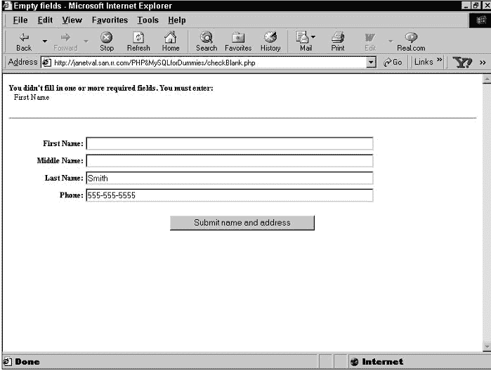

图8-13：处理包含缺失信息的表单的结果。


你还需要防范恶意用户——那些可能想要破坏你的网站或数据库，或窃取你及你的用户信息的用户。你不会希望用户在表单字段中输入 HTML 标签——这可能会在发送到浏览器时产生意外结果。特别危险的标签是 script 标签，它允许用户在表单字段中输入程序。

如果你检查每个字段的预期格式，就可以捕获输入错误并阻止大多数恶意内容。然而，检查信息是一种平衡行为。你希望尽可能多地捕获错误数据，但又不希望屏蔽任何合法信息。例如，当你检查电话号码时，你可能将其限制为数字。这种检查的问题在于，它会屏蔽掉像 555-5555 或 (888) 555-5555 这样合法的电话号码。因此，你还需要允许连字符 `-`、括号 `()` 和空格。你可能希望将字段长度限制为 14 个字符，包括括号、空格和连字符，但这会屏蔽掉海外号码或带分机号的号码。底线是：你需要仔细思考对于任何字段，你想要接受还是屏蔽哪些信息。

你可以使用正则表达式（即模式）来检查字段信息。你将字段中的信息与模式进行比较，看是否匹配。如果不匹配，则字段中的信息是不正确的，用户必须重新输入。（有关正则表达式的更多信息，请参阅第6章。）

通常，以下是用于检查字段的语句：

```
if ( !ereg("pattern",$variablename) )
{
    echo error message;
    redisplay form;
    exit();
}
echo "Welcome";
```

请注意，if 语句中的条件是否定的。也就是说，`!`（感叹号）表示“非”。因此，if 语句实际上是在说：如果变量不匹配模式，则执行 if 块。

例如，假设你想要检查一个包含用户姓氏的输入字段。你可以预期姓名包含字母而非数字，可能还会包含撇号和连字符（如 O’Hara 和 Smith-Jones），以及空格（如 Van Dyke）。此外，很难想象一个名字会超过 50 个字符。因此，你可以使用以下语句来检查姓名。


如果你想将连字符 `-` 列为方括号 `[ ]` 内允许的字符集的一部分，你必须将连字符放在列表的开头或结尾。否则，如果你将它放在两个字符之间，程序会将其解释为这两个字符之间的范围，例如 A–Z。

在前一节中，你了解了如何检查每个表单字段以确保其非空。除此之外，你可能还需要检查所有包含数据的字段，以确保数据具有可接受的格式。你可以通过对清单 8-12 中的程序进行一些简单的修改来检查格式。清单 8-13 显示了修改后的程序，名为 `checkAll.php`。


# 列表 8-13（续）

```php
<?php
/* Program name: checkAll.php
 * Description: Program checks all the form fields for
 *              blank fields and incorrect format.
 */
?>
<html>

<head><title>Empty fields</title></head>
<body>
<?php
/* set up array of field labels */
$label_array = array ( "first_name" => "First Name",
                       "middle_name" => "Middle Name",
                       "last_name" => "Last Name",
                       "phone" => "Phone");
foreach ($_POST as $field => $value)
{
    /* check each field except middle name for blank fields */
    if ( $value == "" )
    {
        if ($field != "middle_name")
        {
            $blank_array[$field] = "blank";
        }
    }
    elseif ($field == "first_name" or $field == "middle_name"
            or $field == "last_name" )
    {
        if (!ereg("^[A-Za-z' -]{1,50}$",$_POST[$field]) )
        {
$bad_format[$field] = "bad";
}
}
elseif ($field == "phone")
{
if (!ereg("*[0-9]( -)[7,20]([(xx)]|(ext)|(ex))?[ -]?[0-9]{1,7})?$", $value))
{
$bad_format[$field] = "bad";
}
}
/* if any fields were not okay, display error message and form */
if (@sizeof($blank_array) > 0 or @sizeof($bad_format) > 0)
{
if (@sizeof($blank_array) > 0)
{
/* display message for missing information */
echo "<b>You didn't fill in one or more required fields. You must enter:</b><br>";
/* display list of missing information */
foreach($blank_array as $field => $value)
{
echo "&nbsp;&nbsp;&nbsp;{$label_array[$field]}<br>";
}
}
if (@sizeof($bad_format) > 0)
{
/* display message for bad information */
echo "<b>One or more fields have information that appears to be incorrect. Correct the format for:</b><br>";
/* display list of bad information */
foreach($bad_format as $field => $value)
{
echo "&nbsp;&nbsp;&nbsp;{$label_array[$field]}<br>";
}
}
/* redisplay form */
$first_name = $_POST['first_name'];
$middle_name = $_POST['middle_name'];
$last_name = $_POST['last_name'];
$phone = $_POST['phone'];
echo "<p><hr>
<form action='checkAll.php' method='POST'>
<center>
<table width='95%' border='0' cellspacing='0' cellpadding='2'>
<tr><td align='right'><B>{$label_array['first_name']}:</B><br></td>
<td><input type='text' name='first_name' size='65' maxlength='65'
value='$first_name' ></td>
</tr>
<tr><td align='right'><B>{$label_array['middle_name']}:</B><br></td>
<td><input type='text' name='middle_name' size='65' maxlength='65'
value='$middle_name' ></td>
```

## 列表 8-13（续）

```
</tr>
<tr><td align='right'><B>|$label_array['last_name']|:</B></td>
<td> <input type='text' name='last_name' size='65' maxlength='65' value='$last_name'> </td>

</tr>
<tr><td align='right'><B>|$label_array['phone']|:</B></td>
<td> <input type='text' name='phone' size='65' maxlength='65' value='$phone'> </td>

</tr>
</table>
<p><input type='submit' value='Submit name and phone number'>
</form>
</center>";
exit();
}
echo "Welcome";
?>
</body></html>
```

以下是此程序与列表 8-12 中的程序之间的区别：

- ✔ **此程序为问题数据创建两个数组。** 它创建了 `$blank_array`，正如之前的程序一样。但此程序还创建了 `$bad_format`，用于包含信息不在可接受格式中的字段。

- ✔ **此程序遍历 `$bad_format` 以创建单独的问题数据列表。** 如果任何字段为空，它会创建一个错误消息和问题字段列表，正如之前的程序一样。如果任何字段格式不可接受，此程序还会创建第二个错误消息和问题字段列表。

图 8-14 中的网页结果是当用户意外地将名字输入到中间名字段中并且还为其电话号码输入无意义内容时出现的。请注意，出现了两个错误消息，显示名字字段为空且电话字段包含不正确的信息。

## 使用多个提交按钮为用户提供选择

你可以在表单中使用多个提交按钮。例如，在客户订单表单中，你可能会使用一个按钮，其文字为 *提交订单*，另一个按钮文字为 *取消订单*。然而，你只能在 `form` 标签的 `action=programname` 部分列出一个程序，这意味着两个按钮运行相同的程序。PHP 解决了这个问题。通过使用 PHP，你可以根据用户点击的按钮以不同的方式处理表单。

图 8-14：

处理同时缺少和不正确信息的表单的结果。

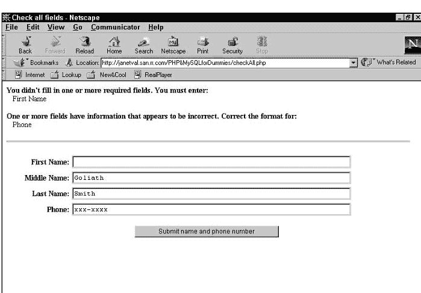

以下语句创建了一个包含两个提交按钮的表单：

```
<form action="twoButtons.php" method="POST">
  <input type="text" name="last_name" maxlength="50"><br>
  <input type="submit" name="display_button"
    value="Show Address">
  <input type="submit" name="display_button"
    value="Show Phone Number">
</form>
```

请注意，提交按钮字段有一个名称：`display_button`。每个字段都有不同的值。用户点击哪个按钮就会为 `$display_button` 设置值。列表 8-14 中的程序 `twoButtons.php` 处理前面的表单。

## 列表 8-14：处理两个提交按钮的程序

```
<?php
/* Program name: twoButtons.php
 * Description: Program displays different information
 *              depending on which submit button was
 *              pushed.
 */
```

## 列表 8-14（续）

```
*/
?>
<html>
<head><title>Member Address or Phone Number</title></head>
<body>
<?php
$user="admin";
$host="localhost";
$password="";
$database = "MemberDirectory";
$connection = mysql_connect($host,$user,$password)
    or die ("couldn't connect to server");
$db = mysql_select_db($database,$connection)
    or die ("Couldn't select database");
if ($_POST['display_button'] == "Show Address")
{
    $query = "SELECT street,city,state,zip FROM Member
              WHERE lastName='$_POST[last_name]'";
    $result = mysql_query($query)
        or die ("Couldn't execute query.");
    $row = mysql_fetch_array($result);
    extract($row);
    echo "$street<br>$city, $state  $zip<br>";
}
else
{
    $query = "SELECT phone FROM Member
              WHERE lastName='$_POST[last_name]'";
    $result = mysql_query($query)
        or die ("Couldn't execute query.");
    $row = mysql_fetch_array($result);
    echo "Phone: {$row['phone']}<br>";
}
?>
</body></html>
```

该程序根据点击的按钮执行不同的语句。如果用户点击地址按钮，程序会输出表单中提交的名称的地址；如果用户点击 `Show Phone Number` 按钮，程序会输出电话号码。

## 将信息放入数据库

你的应用程序可能需要在数据库中存储数据。例如，你的数据库可能存储用户输入到表单中的信息供你使用——会员目录就是一个很好的例子。或者你的数据库可能在应用程序期间临时存储数据。无论哪种方式，你都是通过向 MySQL 发送 SQL 查询来存储数据的。（我在第 4 章详细解释了 SQL 查询。）

## 准备数据

你需要在存储到数据库之前准备数据。准备数据包括以下内容：

- 将数据放入变量中

- 确保数据符合数据库期望的格式

- 清理数据

### 将数据放入变量中

你通过在 SQL 查询中将其发送到数据库来存储数据。你将数据存储在变量中并在查询中包含变量名。通过使用 PHP，此过程很简单。用户通过表单提供你想要存储的大多数数据。正如我在本章前面讨论的那样，PHP 会隐式且自动地将数据存储在与表单字段名称同名的变量中，而无需你自己存储它。你只需使用 PHP 提供的变量即可。偶尔，你想要存储自己生成的信息，例如今天的日期或客户订单号。你只需将此信息存储在变量中，以便你可以将其包含在查询中。

### 使用正确的格式

当你设计数据库时，你为每个列设置数据类型。你想要存储的数据必须与你想要存储它的列的数据类型匹配。例如，如果列期望数据类型为整数，则发送的数据必须是数字。或者如果列期望的数据是日期，则你发送的数据必须采用 MySQL 识别为日期的格式。如果发送格式不正确的数据，MySQL 仍会存储数据，但它可能不会存储你期望的值。以下是 MySQL 对最常用的数据类型存储数据的方式概述：

- **CHAR 或 VARCHAR**：存储字符串。MySQL 将发送到字符列的几乎任何数据，包括数字或日期，都存储为字符串。在创建列时，你指定了长度。例如，如果你指定了 `CHAR(20)`，只能存储 20 个字符。如果发送的字符串长于 20 个字符，则只存储前 20 个字符。剩余字符将被丢弃。

  将表单中任何文本输入字段的 `maxlength` 设置为数据将被存储的数据库中列宽的相同长度。这样，用户就无法输入超过数据库可存储的字符数。

- **INT 或 DECIMAL**：存储数字。MySQL 会尝试将发送到数字列的任何数据解释为数字，无论是否合理。例如，它可能会将日期解释为数字，你最终可能会得到像 2001.00 这样的数字。如果 MySQL 完全无法将发送的数据解释为数字，它会在列中存储 0（零）。


- **DATE:** 存储日期。MySQL 期望日期为数字，年份在前，月份在第二，天数在最后。年份可以是两位或四位数字（2001 或 01）。日期可以是数字字符串，也可以每个部分由连字符（-）、句点（.）或斜杠（/）分隔。一些有效的日期格式是 20011203、980103、2001-3-2 和 2000.10.01。如果 MySQL 无法将发送的数据解释为日期，它会将日期存储为 0000-00-00。

- **ENUM:** 仅存储你在创建列时允许的值。如果发送的数据不允许，MySQL 会存储一个 0。

在许多情况下，数据是在表单中收集并按原样存储在数据库中。例如，用户在表单中输入姓名，程序会存储它们。然而，在某些情况下，数据需要在存储之前更改。例如，如果用户在三个单独的选择列表中输入日期，分别用于月份、日期和年份（如我在本章“构建选择列表”部分所述），则三个字段中的值必须组合成一个变量。以下语句将字段组合在一起：

```php
$expDate = $_POST['expYear']."-";
$expDate .= $_POST['expMonth']."-";
$expDate .= $_POST['expDay'];
```

另一个可能需要在存储前更改数据的情况是存储电话号码时。用户以多种格式输入电话号码，使用括号、破折号、点或空格。与其将这些不同的格式存储在数据库中，你可能只存储数字。然后当你从数据库检索电话号码时，你可以在显示之前按你想要的方式格式化号码。以下语句从字符串中删除字符：

```php
$phone = ereg_replace("[ ()-.]","",$_POST['phone']);
```

函数 `ereg_replace` 使用正则表达式搜索模式。传递的第一个字符串是要匹配的正则表达式。如果字符串的任何部分与模式匹配，则会被第二个字符串替换。在这种情况下，正则表达式是 `[ ()-.]`，这意味着方括号中的任何一个字符。第二个字符串是 `""`，即一个空字符串。因此，字符串中的任何空格、括号、点或连字符都会被替换为空。

### 清理数据

之前的章节“从用户获取信息”，其中描述了 HTML 表单的使用，讨论了检查表单中的数据。用户可以无意或恶意地将数据输入到文本字段中，这可能导致你的应用程序、数据库或用户的出现问题。检查数据并仅接受请求信息预期的字符可以防止许多问题。然而，你可能会遗漏一些内容。此外，在某些

在某些情况下，用户输入的信息需要允许几乎任何内容。例如，你通常不会允许在字段中使用字符 < 和 >。然而，可能存在用户需要输入这些字符的情况——也许用户需要输入需要这些字符的技术公式或规范。

PHP 提供两个可以清理数据、从而使其无害的函数：

`strip_tags`：此函数会从数据中删除 < 和 > 之间包围的所有文本。它查找开头的 < 并将其删除以及其余所有内容，直到找到闭合的 > 或到达字符串末尾。你可以包含希望允许的特定标签。例如，以下语句会从字符字符串中删除所有标签，除了 `<b>` 和 `<i>`：

```
$last_name = strip_tags($last_name, "<b><i>");
```

`htmlspecialchars`：此函数会将具有 HTML 含义的某些特殊字符更改为 HTML 格式，使其可以显示而没有任何特殊含义。更改如下：

- < 变成 &lt;

- > 变成 &gt;

- & 变成 &amp;

这样，字符 < 和 > 可以在网页上显示，而不会被 HTML 解释为标签。以下语句会更改这些特殊字符：

```
$last_name = htmlspecialchars($last_name);
```

如果你确定不希望用户在表单字段中输入任何 < 或 > 字符，请使用 `strip_tags`。但是，如果你希望允许 < 或 > 字符，可以在它们经过 `htmlspecialchars` 处理后安全地存储它们。


在将数据存储到数据库之前，你还应使用另一个函数 `trim`。用户经常无意中在文本字段的开头或结尾输入空格。`Trim` 会删除任何前导或尾随空格，以免它们被存储。使用以下语句删除这些空格：

```
$last_name = trim($_POST['last_name']);
```

## 添加新信息

你使用 `INSERT` 查询（第 4 章中描述）向数据库添加新信息。`INSERT` 向数据库表添加一行新记录。通用格式如下

```
$query = "INSERT INTO tablename (col,col,col...)
    VALUES ('var','var','var'...)";
$result = mysql_query($query)
    or die ("Couldn't execute query.");
```

例如，用于存储用户在表单中输入的姓名和电话号码的语句如下

```
$firstName = "Goliath";      // from form field
$lastName = "Smith";          // from form field
$phone = "555-555-5555";      // from form field
$query = "INSERT INTO Member (lastName,firstName,phone)
    VALUES ('$lastName','$firstName','$phone')";
$result = mysql_query($query)
    or die ("Couldn't execute query.");
```

列表 8-15 显示了一个名为 `savePhone.php` 的程序，该程序从表单存储姓名和电话号码。

### 列表 8-15：从表单存储数据的程序

```
<?php
/*  Program name: savePhone.php
 *  Description:  Program checks all the form fields for
 *                blank fields and incorrect format. Saves the
 *                correct fields in a database.
 */
?>
<html>
<head><title>Member Phone Number</title></head>
<body>
<?php
$first_name = strip_tags(trim($_POST['first_name']));
$last_name = strip_tags(trim($_POST['last_name']));
$phone = strip_tags(trim($_POST['phone']));
$phone = ereg_replace('[^0-9]','',$phone);

/* check information from the form */

/* set up array of field labels */
$label_array = array ( "first_name" => "First Name",
                       "last_name" => "Last Name",
                       "phone" => "Phone");

foreach ($_POST as $field => $value)
{
    /* check each field for blank fields */
    if ( $value == "" )
    {
        $blank_array[$field] = "blank";
    }
    elseif ( ereg("(name)",$field) )
{
    if (!ereg("^[A-Za-z '-]{1,50}$",$_POST[$field]) )
    {
        $bad_format[$field] = "bad";
    }
}
elseif ($field == "phone")
{
    if(!ereg("^[0-9]( -)[7,20]([(xx)](ext)|(ex))?[ -]?[0-9][1,7])?$",$value) )
    {
        $bad_format[$field] = "bad";
    }
}
// end of foreach for $_POST
/* if any fields were not okay, display error message and form */
if (@sizeof($blank_array) > 0 or @sizeof($bad_format) > 0)
{
    if (@sizeof($blank_array) > 0)
    {
        /* display message for missing information */
        echo "<b>You didn't fill in one or more required fields.
            You must enter:</b><br>";
        /* display list of missing information */
        foreach($blank_array as $field => $value)
        {
            echo "&nbsp;&nbsp;&nbsp;{$label_array[$field]}<br>";
        }
    }
    if (@sizeof($bad_format) > 0)
    {
        /* display message for bad information */
        echo "<b>One or more fields have information that appears to
            be incorrect. Correct the format for:</b><br>";
        /* display list of bad information */
        foreach($bad_format as $field => $value)
        {
            echo "&nbsp;&nbsp;&nbsp;{$label_array[$field]}<br>";
        }
    }
}
/* redisplay form */
echo "<p><hr>
<form action='checkAll.php' method='POST'>
<center>
<table width='95%' border='0' cellspacing='0' cellpadding='2'>
<tr><td align='right'><B>{$label_array['first_name']}:</B><br></td>
    <td><input type='text' name='first_name' size='65' maxlength='65'
            value='$first_name' > </td>
</tr>
<tr><td align='right'><B>{$label_array['last_name']}:</B></td>
    <td> <input type='text' name='last_name' size='65' maxlength='65'
            value='$last_name' > </td>
</tr>
```

```
function storeForm($formdata,$tablename)
{
    if (!is_array($formdata))
    {
        return FALSE;
        exit();
    }
    foreach ($formdata as $field => $value)
    {
        $formdata[$field] = trim($formdata[$field]);
        $formdata[$field] = strip_tags($formdata[$field]);
        if ($field == "phone")
        {
            $formdata[$field] =
                ereg_replace("[() . -]","",$formdata[$field]);
        }
        $field_array[]=$field;
        $value_array[]=$formdata[$field];
    }
    $fields=implode(",",$field_array);
    $values=implode("','",$value_array);
    $query = "INSERT INTO $tablename ($fields)
                VALUES (\"$values\")";
    $result = mysql_query($query)
        or die ("Couldn't execute query.");
    return TRUE;
}
```

该函数如果在没有错误的情况下完成数据插入，则返回 `TRUE`。在开始时，函数会检查传递给它的是否是实际的数组。如果 `$formdata` 不是数组，函数会停止并返回 `FALSE`。

请注意，此函数仅在表单中的字段名称与数据库表中的列名称相同时才有效。另请注意，此函数假定你已连接到 `MySQL` 服务器并已选择正确的数据库。使用此函数后，列表 8-15 中程序的最后一部分如下：

```
else  //if data is okay
{
    $stored = storeForm($_POST,"Member");
    echo "New Member added to database<br>";
}
?>
</body></html>
```

请注意，通过将大部分语句放在函数中，此程序的阅读变得容易得多。此外，只要表单中的字段名称与数据库表中的列名称相同，此函数就可以用于任何表单。如果函数无法执行查询，它会在该点停止执行并打印错误信息 "Couldn't execute query"。如果查询可能失败的情况存在，你需要考虑这些情况。

## 更新现有信息

你使用 `UPDATE` 查询（我在第 4 章中描述）来更新现有信息。更新意味着更改数据库中已存在行的列中的数据——而不是向数据库表添加新行。通用格式如下

```
$query = "UPDATE tablename SET col=value WHERE col=value";
$result = mysql_query($query)
    or die ("Couldn't execute query.");
```

例如，用于更新 `Goliath Smith` 电话号码的语句如下

```
$firstName = "Goliath";      // from form field
$lastName = "Smith";          // from form field
$phone = "555-555-5555";      // from form field
$query = "UPDATE Member SET phone='$phone'
          WHERE lastName='$lastName'
          AND firstName='$firstName'";
$result = mysql_query($query)
    or die ("Couldn't execute query.");
```


如果在 `UPDATE` 查询中不使用 `WHERE` 子句，则 `SET` 的字段将为所有行设置。这很少是你想要做的。

列表 8-16 显示了一个名为 `updatePhone.php` 的程序，该程序从表单存储姓名和电话号码。

### 列表 8-16：更新数据的程序

```
<?php
/* Program name: updatePhone.php
 * Description: Program checks the phone number for incorrect format. Updates
 * the phone number in the database for the specified name.
 */
?>
<html>
<head><title>Member Phone Number</title></head>
<body>
<?php
$phone = strip_tags(trim($_POST['phone']));
$phone = ereg_replace("[^0-9]","",$phone);
$first_name = $_POST['first_name'];
$last_name = $_POST['last_name'];

/* check information from the form */

/* set up array of field labels */
$label_array = array ( "first_name" => "First Name",
                       "last_name" => "Last Name",
```

### 清单8-16（续）


```php
"phone" => "Phone");
foreach ($_POST as $field => $value)
{
    /* check each field for blank fields */
    if ( $value == "" )
    {
        $blank_array[$field] = "blank";
    }
    elseif ( ereg("(name)",$field) )
    {
        if (!ereg("^[A-Za-z' -]{1,50}$",$_POST[$field]) )
        {
            $bad_format[$field] = "bad";
        }
    }
    elseif ($field == "phone")
    {
        if(!ereg("^[0-9]{7,20}([(xX]|(ext)|(ex))?[ -]?[0-9]{1,7})?$", $value))
        {
            $bad_format[$field] = "bad";
        }
    }
}
/* if any fields were not okay, display error message and form */
if ( @sizeof($blank_array) > 0 or @sizeof($bad_format) > 0 )
{
    if (@sizeof($blank_array) > 0)
    {
        /* display message for missing information */
        echo "<b>You didn't fill in one or more required
            fields. You must enter:</b><br>";
        /* display list of missing information */
        foreach($blank_array as $field => $value)
        {
            echo "&nbsp;&nbsp;&nbsp;{$label_array[$field]}<br>";
        }
    }
    if (@sizeof($bad_format) > 0)
    {
        /* display message for bad information */
        echo "<b>One or more fields have information that
            appears to be incorrect. Correct the format
            for:</b><br>";
        /* display list of bad information */
        foreach($bad_format as $field => $value)
        {
            echo "&nbsp;&nbsp;&nbsp;{$label_array[$field]}<br>";
        }
    }
}
/* redisplay form */
echo "<p><hr>
<form action='checkAll.php' method='POST'>
<center>
<table width='95%' border='0' cellspacing='0'
       cellpadding='2'>
<tr><td align='right'>
        <b>{$label_array['first_name']}:</b></td>
    <td><input type='text' name='first_name' size='65'
               maxlength='65' value='$first_name' ></td>
</tr>
<tr><td align='right'>
        <b>{$label_array['last_name']}:</b></td>
    <td> <input type='text' name='last_name' size='65'
               maxlength='65' value='$last_name' ></td>
</tr>
<tr><td align='right'>
        <b>{$label_array['phone']}:</b></td>
    <td> <input type='text' name='phone' size='65'
               maxlength='65' value='$phone' ></td>
</tr>
</table>
<p><input type='submit'
           value='Submit name and phone number'>
</form>
</center>";
exit();
}
else   //if data is okay
{
$user="admin";
$host="localhost";
$password="";
$database = "MemberDirectory";
$connection = mysql_connect($host,$user,$password)
    or die ("Couldn't connect to server");
$db = mysql_select_db($database,$connection)
    or die ("Couldn't select database");

$query = "UPDATE Member SET phone='$phone'
                 WHERE lastName='$last_name' AND firstName='$first_name'";
$result = mysql_query($query)
    or die ("Couldn't execute query.".mysql_error());
echo " Member phone number has been updated<br>";
}
?>
</body></html>
```

清单8-16中的程序用于更新数据库，它与清单8-15中用于添加新数据的程序几乎完全相同。该程序使用UPDATE查询——而不是你用来添加新数据的INSERT查询——是主要区别。两个程序都会先检查数据，然后进行清理，因为两个程序都将数据存储在数据库中。

## 从文件中获取信息

有时你可能希望从用户那里接收整个文件信息，例如求职网站的用户简历或相册网站的照片。或者，假设你要根据销售部门提供的信息构建产品目录。除了产品的描述性文本外，你还希望销售部门提供产品图片。你可以提供一个表单，供销售部门上传图像文件。

### 使用表单上传文件

你可以通过专门设计的HTML表单来显示一个允许用户上传文件的表单。该表单的一般格式如下：

```html
<form enctype="multipart/form-data"
    action="processfile.php" method="POST">
    <input type="hidden" name="MAX_FILE_SIZE" value="30000">
    <input type="file" name="user_file">
    <input type="submit" value="Upload File">
</form>
```

请注意有关该表单的以下几点：

- **表单标签中使用了`enctype`属性。** 上传文件时，必须将此属性设置为`multipart/form-data`，以确保文件正确到达。

- **包含一个隐藏字段，用于发送`MAX_FILE_SIZE`的值（以字节为单位）。** 如果用户尝试上传的文件大于此值，则不会上传。你可以将此值设置为最高2MB。如果需要上传更大的文件，则需要在隐藏字段中发送大于2MB的`MAX_FILE_SIZE`值之前，将`php.ini`中的`upload_max_filesize`默认设置改为更大的数值。

- **上传文件的输入字段类型为`file`。** 请注意，该字段与表单中其他类型的字段一样，有一个名称——`user_file`。用户在表单中输入的文件名会发送给处理程序，并可在名为`$_FILES`的内置数组中使用。我将在下一节解释`$_FILES`的结构和信息。

当用户提交表单时，文件会被上传到一个临时位置。处理表单的脚本需要将文件复制到另一个位置，因为脚本执行完毕后临时文件会被立即删除。

### 处理上传的文件

有关上传文件的信息存储在PHP内置数组`$_FILES`中。每个上传的文件都会有一组信息可用，这使得`$_FILES`成为一个多维数组。与其他任何表单一样，你可以通过字段名称从数组中获取信息。以下是`$_FILES`中每个上传文件可用的数组。

```php
$_FILES['fieldname']['name']
$_FILES['fieldname']['type']
$_FILES['fieldname']['tmp_name']
$_FILES['fieldname']['size']
```

例如，假设你使用以下字段来上传文件，如上一节所示：

```html
<input type="file" name="user_file">
```

如果用户通过该表单上传了一个名为test.txt的文件，处理程序可以使用的结果数组大致如下：

```php
$_FILES['user_file']['name'] = test.txt
$_FILES['user_file']['type'] = text/plain
$_FILES['user_file']['tmp_name'] = D:\WINNT\php92C.tmp
$_FILES['user_file']['size'] = 435
```

在这个数组中，`name`是上传文件的名称，`type`是文件类型，`tmp_name`是临时文件的路径/文件名，435是文件的大小。请注意，`name`只包含文件名，而`tmp_name`既包含文件路径也包含文件名。

如果文件太大而无法上传，数组中的`tmp_name`会被设置为none，`size`会被设置为0。处理程序必须将上传的文件从临时位置移动到永久位置。移动文件的语句的一般格式如下：

```php
move_uploaded_file(path/tempfilename, path/permfilename);
```

`path/tempfilename`可在内置数组元素`$_FILES['fieldname']['tmp_name']`中获得。`path/permfilename`是你希望存储文件的路径。以下语句移动了前面在本节中提到的、在输入字段中上传的文件（字段名为`user_file`）：

```php
move_uploaded_file($_FILES['user_file']['tmp_name'],
'c:\data\new_file.txt');
```

### 清单8-17（续）

```php
else
{
    $destination = 'c:\data'."\\".$_FILES['pix']['name'];
    $temp_file = $_FILES['pix']['tmp_name'];
    move_uploaded_file($temp_file,$destination);
    echo "<p><b>The file has successfully uploaded:</b>
        {$_FILES['pix']['name']}
        ({$_FILES['pix']['size']})</p>";
}
?>
```

我在脚本中的某些行末尾添加了行号。下面将参考这些行号对脚本进行讨论：

- 5 这一行是一个`if`语句，用于测试表单是否已提交。如果没有提交，则通过包含包含表单代码的文件来显示表单。该包含文件如清单8-18所示。

- 9 这一行开始一个`else`块，如果表单已提交则执行该块。该块包含脚本的其余部分，并处理提交的表单和上传的文件。

- 11 这一行是一个`if`语句，用于测试文件是否成功上传。如果没有成功上传，则显示错误消息，并重新显示表单。

- 16 这一行是一个`if`语句，用于测试文件是否为图片。如果不是，则显示错误消息，并重新显示表单。

- 23 这一行开始一个`else`块，如果文件已成功上传则执行该块。文件被移动到其永久位置，并显示一条消息表明文件已上传。

清单8-18显示了用于显示上传表单的包含文件。

### 清单8-18：显示文件上传表单的包含文件

```html
<!-- Program Name: form_upload.inc
    Description: Displays a form to upload a file -->
<html>
<head><title>File Upload</title></head>
<body>
<ol><li>Enter the file name of the product picture you want
    to upload or use the browse button
    to navigate to the picture file.</li>
<li>When the path to the picture file shows in the text
    field, click the Upload Picture button.</li>
</ol>
```

```
<div align="center"><hr>
<form enctype="multipart/form-data"
    action="uploadFile.php" method="POST">
    <input type="hidden" name="MAX_FILE_SIZE" value="500000">
    <input type="file" name="pix" size="60">
    <p><input type="submit" name="Upload"
    value="Upload Picture">
</form>
</body></html>
```

请注意，包含文件并不包含PHP代码——只是HTML代码。

允许用户选择要上传文件的表单如图8-15所示。该表单有一个用于输入文件名的文本字段和一个浏览按钮，用户可以通过该按钮导航到文件并选择它。

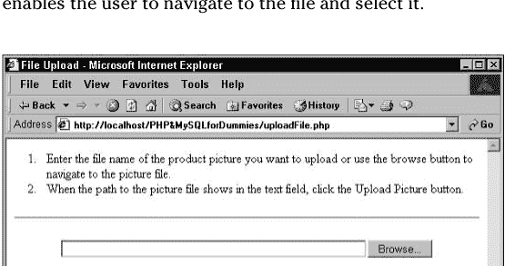

图8-15：

允许用户上传图像文件的表单。

### 第9章

### 将信息从一个网页传递到下一个网页

### 本章内容包括

- 将用户从一个页面带到下一个页面

- 将信息从一个页面传递到下一个页面

- 向URL添加信息

- 了解cookie

- 使用隐藏表单字段

- 探索PHP会话

大多数网站由多个网页组成。这包括你过去可能开发过的静态网页。对于静态网页，用户通过点击链接从一个页面移动到下一个页面。用户点击一个网页中的链接，新的网页就会出现在他们的浏览器中。当用户以这种方式在页面之间移动时，没有信息从第一个页面传递到第二个页面。发送到用户浏览器的每个新页面都独立于用户之前可能看过的任何其他页面。对于动态网页，你可能需要将信息从一个页面传递到下一个页面。如果你是一名高级HTML开发者，你可能对使用HTML表单和CGI（公共网关接口）或cookie在页面之间传递信息的有限方法有所了解。然而，PHP在网页之间传递信息方面要强大得多。

### 将用户从一个页面移动到另一个页面

仅使用HTML时，你提供链接，使访问者能够从网站的一个页面转到另一个页面。然而，使用PHP时，你有三种选项可以将用户从一个页面移到下一个页面。

**链接：** 你可以输出用于显示链接的HTML标签。显示链接的HTML语句的一般格式是

```
<a href="newpage.php">用户看到的链接文本</a>
```

当用户点击链接时，程序newpage.php被发送到他们的浏览器。这种方法在HTML网页中被广泛使用。你可能已经从HTML经验中熟悉了创建链接，但如果你需要复习，可以在任何HTML书籍中找到更多关于链接的信息，例如Deborah S. Ray和Eric J. Ray所著的*《HTML 4傻瓜快速参考，第2版》*（Wiley出版）。

**表单提交按钮：** 你可以使用一个带有一个或多个提交按钮的HTML表单。当用户点击提交按钮时，表单标签中的程序运行并向用户浏览器发送一个新网页。你可以创建一个没有字段的表单——只有一个提交按钮——但用户必须点击提交按钮才能移动到下一页。

我在第8章中详细讨论了表单和提交按钮。

**header函数：** 你可以使用PHP的`header`函数向Web服务器发送一条消息，告诉它发送一个新页面。使用这种方法，你可以在用户浏览器中显示新页面，而无需用户点击链接或按钮。

PHP的`header`函数可用于向用户浏览器发送新页面。程序使用`header`语句显示新网页，不需要任何用户操作。当`header`语句执行时，新页面就会显示。请求新页面的`header`函数格式如下：

```
header("Location: URL");
```

位于URL的文件被发送到用户浏览器。以下任一语句都是有效的`header`语句：

```
header("Location: newpage.php");
header("Location: http://company.com/catalog/catalog.php");
```

然而，`header`函数有一个主要限制。`header`语句只能用于发送任何其他输出之前。你不能在程序中已经向网页输出了一些内容之后，中途发送请求新页面的消息。关于“必须在输出之前使用的语句”的讨论，请参阅侧边栏。

### URL


URL（统一资源定位符）是万维网上的一种地址。每个网页都有自己的URL或地址。Web服务器使用该URL来查找网页并将其发送到浏览器。

URL的格式为

```
HTTP://servername:portnumber/path#target?string=string
```

以下是组成URL的各部分的说明：

`HTTP://servername:` 这告诉服务器该地址是一个网站，并给出网站所在计算机的名称。也可以指定其他传输类型，如`FTP`（文件传输协议），但这些与本书主题无关。如果省略URL的这一部分，Web服务器会假定该计算机就是输入URL的计算机。这一部分的有效选择是`HTTP://amazon.com`或`HTTP://localhost`。注意：`HTTP`不一定要大写。

`:portnumber:` Web服务器通过计算机上的特定端口与Internet交换信息。大多数情况下，Web服务器通过80端口进行通信。如果未指定端口号，则假定为80端口。在某些特殊情况下，Web服务器可能使用不同的端口号，此时必须指定端口号。使用不同端口号的最常见原因是在另一个端口上设置测试网站，该端口仅对开发人员和测试人员可用，不对客户开放。当网站准备好面向客户时，会通过80端口提供服务。

`path:` 这是文件的路径，遵循任何路径的规则。路径的根是网站主目录。如果路径指向目录而不是文件，Web服务器将搜索默认文件名，例如`default.html`或`index.html`。网站管理员设置默认文件名。路径 `/catalog/show.php` 表示主网站目录中一个名为`catalog`的目录和一个名为`show.php`的文件。路径`catalog/show.php`表示当前目录中一个名为`catalog`的目录。

### `#target`
HTML标签定义目标。URL的这一部分会在目标标签所在的位置显示网页。例如，如果标签 `<a name="target"></a>` 位于文件中间的某个位置，网页将显示在该标签处，而不是文件顶部。

### `?string=string`
问号允许将信息附加到URL末尾。使用`get`方法的表单中的信息以`fieldname=value`的格式在URL末尾传递。你可以将信息添加到URL末尾以将其传递到另一个页面。PHP会自动从URL中获取信息并将其放入内置数组中。你可以通过用与号（`&`）分隔每个字符串对来传递多个`string=string`对；例如，`?state=CA&city=home`。

## 必须在输出之前使用的语句

有些PHP语句只能在发送任何输出之前使用。本章中描述的所有`header`语句、`setcookie`语句和会话函数，都必须在发送任何输出之前使用。如果你在发送输出后使用了这些语句之一，可能会看到以下消息：

```
Cannot add header information - headers already sent
```

该消息还会提供文件名，并指出是哪一行发送了先前的输出。或者你可能根本看不到消息；新页面可能就是不出现。（你是否看到错误消息取决于PHP中设置的错误消息级别；详见第6章。）下面的语句会失败，因为`header`消息不是第一个输出：

```
<html>
<head><title>testing header</title></head>
<body>
<?php
  header("Location: http://company.com");
?>
</body>
</html>
```

在`header`语句之前发送了三行HTML代码。下面的语句将起作用，尽管它们意义不大：

```
<?php
  header("Location: http://company.com");
?>
<html>
<head><title>testing header</title></head>
<body>
</body>
</html>
```

下面的语句将失败：

```
<?php
  header("Location: http://company.com");
?>
<html>
<head><title>testing header</title></head>
<body>
</body>
</html>
```

这些语句失败的原因不易察觉，但如果仔细观察，你会注意到在PHP起始标签之前有一个空格。这个空格会输出到浏览器，虽然最终网页看起来是空的。因此，`header`语句会失败，因为在其之前有输出。这是一个常见且难以发现的错误。

尽管存在局限性，`header`函数仍然很有用。你可以在`header`函数之前有任意多的PHP语句，只要它们不发送输出即可。因此，以下语句可以正常工作：

```php
<?php
    if ($customer_age < 13)
    {
        header("Location: ToyCatalog.php");
    }
    else
    {
        header("Location: ElectronicsCatalog.php");
    }
?>
```

这些语句运行一个程序，如果客户年龄小于13岁则显示玩具目录，如果客户年龄为13岁或以上则显示电子产品目录。

## 从页面到页面传递信息

HTML页面彼此独立。当用户点击链接时，Web服务器向用户浏览器发送新页面，但Web服务器对之前的页面一无所知。对于静态HTML页面，这个过程工作正常。然而，许多动态应用程序需要在页面之间传递信息。例如，你可能想存储用户的姓名，并在另一个网页上以姓名引用该人。

动态Web应用程序通常包含多个页面，并期望用户查看多个不同的页面。从用户查看第一个页面开始到用户离开网站结束的这段时间是一个*会话*。通常你希望信息在整个会话期间可用。以下是在页面之间需要共享信息的会话示例：

- **限制对网站的访问：** 假设你的网站受限，用户需要用密码登录才能访问网站。你不希望用户在每个页面都必须登录。你只希望他们登录一次，然后能够查看他们想要的所有页面。你希望用户随身携带信息到每个页面，表明他们已登录并有权查看该页面。你希望用户在整个会话期间登录并保持登录状态。

- **根据浏览器提供网页：** 因为浏览器对某些HTML功能的解释不同，你可能希望为不同浏览器提供不同版本的网页。你希望在用户查看第一个页面时检查用户的浏览器，然后根据用户的浏览器类型和版本提供所有其他页面。

使用PHP，你可以通过以下任何方法在页面之间传递信息：

- **向URL添加信息：** 你可以将某些信息添加到新页面URL的末尾，PHP会将信息放入内置数组中，以便在新页面中使用。这种方法在你只需要传递少量信息时最为合适。

- **通过cookie存储信息：** 你可以在用户计算机上存储*cookie*——包含`variable=value`对的小量信息——。Cookie存储后，你可以从任何网页获取它。然而，用户可以拒绝接受cookie。因此，此方法仅在你确定用户已启用cookie的环境中才有效。

- **使用HTML表单传递信息：** 你可以使用`form`标签将信息传递给特定程序。当用户点击提交按钮时，表单中的信息会被发送到下一个程序。这种方法在你需要从用户收集信息时非常有用。

- **使用PHP会话函数：** 从PHP4开始，可用PHP函数设置用户会话并在服务器上存储会话信息；这些信息可以从任何网页访问。这种方法对于期望用户查看多个页面的会话非常有用。

## 向URL添加信息

将信息添加到URL是一种从一个页面到下一个页面传递信息的简单方法。把信息放在以下格式中：

```
variable=value
```

*变量*是一个变量名，但其中不要使用美元符号`$`。*值*是要存储在变量中的值。你可以在使用URL的任何地方添加`variable=value`对。你用问号`?`标记信息的开始。以下语句都是在URL中传递信息的有效方式：

```
<form action="nextpage.php?state=CA" method="POST">
```

```
<a href="nextpage.php?state=CA">go to next page</a>
```

```
header("Location: nextpage.php?state=CA");
```

你可以添加多个`variable=value`对，用与号`&`分隔，如下所示：

```
<form action="nextpage.php?state=CA&city=home" method="POST">
```

以下是你可能不想在URL中传递信息的两个原因：

- **安全性：** URL显示在浏览器的地址栏中，这意味着附加到URL的信息也会显示出来。如果信息需要保密，你就不希望它如此公开地显示。例如，如果你将密码从一个页面传递到下一个页面，你可能不希望在URL中传递它。此外，URL可以被用户书签保存。可能有原因不希望用户保存你添加到URL的信息。

- **字符串长度：** URL的长度有限制。限制因各种浏览器和浏览器版本而异，但总是有限制的。因此，如果你传递大量信息，可能没有足够的空间放在URL中。

向URL添加信息对于快速、简单的數據传输非常有用。例如，假设你想提供一个网页，让用户更新他们的电话号码。你希望表单按以下方式运行：

1. 当用户首次显示表单时，数据库中的电话号码会显示在表单中，以便用户可以看到数据库中当前存储的号码。
2. 当用户提交表单时，程序会检查电话号码，查看该字段是否为空或该字段的格式不可能是电话号码。
3. 如果电话号码检查正常，则该号码会存储在数据库中。
4. 如果电话号码为空或数据错误，程序会重新显示表单。然而，这次你不想显示数据库中的数据。相反，你想显示用户在表单字段中输入并提交的错误数据。

`displayPhone.php`程序在列表9-1中展示了如何使用URL来确定这是表单的首次显示还是后续显示。该程序显示用户登录名的电话号码，并允许用户更改电话号码。

### Listing 9-1: 显示电话号码表单的程序

```php
<?php
/* Program name: displayPhone.php
 * Description: Displays a phone number retrieved from the database and
 *              allows the user to change the phone number.
 */
?>
<html>
<head><title>Display phone number</title></head>
```

### Listing 9-1 *(继续)*

```php
<body>
<?php
    $host="localhost";
    $user="admin";
    $password="";
    $database="MemberDirectory";
    $loginName = "gsmith";  // passed from previous page
    $connection = mysql_connect($host,$user,$password)
        or die ("Couldn't connect to server");
    $db = mysql_select_db($database,$connection)
        or die ("Couldn't select database");

    if (@$_GET['first'] == "no")
    {
        $phone = $_POST['phone'];
        if (!ereg("^[0-9](-)?[0-9]{7,20}(([xx]|(ext)|(ex))?[ -]?[0-9]{1,7})?$",$phone)
            or $phone == "")
        {
            echo "<p align='center'>Phone number does not
                  appear to be valid.<br>";
        }
        else
        {
            $query = "UPDATE Member SET phone='$phone'
                         WHERE loginName='$loginName'";
            $result = mysql_query($query)
                or die ("Couldn't execute query.");
            echo "Phone number has been updated.<br>";
            exit();
        }
    }
    else
    {
        $query = "SELECT phone FROM Member WHERE loginName='$loginName'";
        $result = mysql_query($query)
            or die ("Couldn't execute query.");
        $row = mysql_fetch_array($result);
        extract($row);
    }

    /* Display user phone in a form */
    echo "<br><p align='center'>
        <font size='+1'><b>Please check the phone number
              below and correct it if necessary.</b></font>
        <hr>
        <form action='displayPhone.php?first=no' method='POST'>
          <div align='center'>
          <table width='50%' border='0' cellspacing='0' cellpadding='2'>
          <tr><td align='right'><b>$loginName<br></td>
            <td align='center'><input type='text' name='phone'
                 size='20' maxlength='20' value='$phone' ></td>
          </tr>
```

```
<tr><td></td><td align='center'>
    <br><input type='submit' value='Submit phone number'></td>
</tr>
</table>
</form>";
?>
</body></html>
```

注意此程序的以下关键点：

- **同一个程序显示并处理表单。** 此程序的名称是`displayPhone.php`。请注意`form`标签包含`action=displayPhone.php`，这意味着当用户点击提交按钮时，同一个程序会再次运行。

- **信息被添加到URL中。** `form`标签包含`action=displayPhone.php?first=no`。当用户点击提交按钮且`displayPhone.php`第二次运行时，会传递一个变量`$first`，其值为"no"。

- **在程序开始时检查内置`$_GET`数组中为`first`传递的值。** 这是为了判断程序是否是第一次运行。

- **如果`$_GET[first]`等于"no"，则检查电话号码。**

  - `$_GET[first]`只有在表单被提交时才等于no。
  - `$_GET[first]`如果这是程序的第一次运行，则不等于no。
  - 如果电话号码正确，则将其存储在数据库中，程序结束。
  - 如果电话号码不正确，则打印错误消息。

- **如果`$_GET[first]`不等于"no"，则从数据库检索电话号码。** 换句话说，如果`$_GET[first]`不等于no，则是程序的第一次运行。程序应从数据库获取电话号码。

- **如果程序执行到显示表单的语句，则显示表单。** 如果这不是程序的第一次运行，并且提交了电话号码且电话号码正确，则电话号码会存储在数据库中，程序停止。*它永远不会执行到显示表单的语句。* 在所有其他情况下，都会显示表单。

程序中清单9-1显示的表单在图9-1中显示。这显示了Web页面第一次显示时的样子。请注意，浏览器地址字段中的URL没有任何附加信息。

图9-2显示了当用户在图9-1中的表单中输入无意义的电话号码时的结果。请注意，浏览器地址字段中的URL现在在其末尾添加了`?first=no`。

Figure 9-1:

用于更新电话号码的HTML表单。

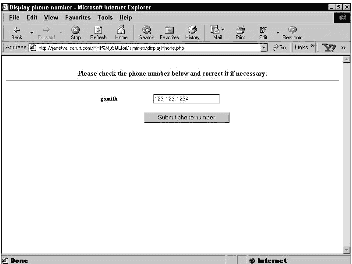

Figure 9-2:

当用户提交无意义的电话号码时HTML表单。

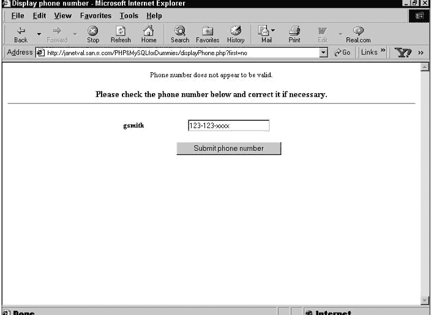

## 通过Cookie存储信息

你可以将信息存储为Cookie。Cookie是包含`variable=value`对的小量信息，类似于可以添加到URL中的对。用户的浏览器将Cookie存储在用户的计算机上。然后你的应用程序可以从任何Web页面获取Cookie。为什么这些被称为Cookie是生活中的一大谜团。也许它们被称为Cookie是因为乍一看似乎是件美妙的事情，但在仔细检查后，你意识到它们对你来说并不那么好。对于某些人在某些情况下，Cookie完全没有帮助。


乍一看，Cookie 似乎解决了从页面到页面移动数据的整个问题。只需将 Cookie 存储在用户的计算机上，并在需要时获取它即可。事实上，Cookie 可以被存储，以便在用户离开你的网站后仍然保留，并在用户一个月后再次进入你的网站时仍然可用。问题解决了！好吧，不完全是。Cookie 不在你的控制之下：它们在用户的控制之下。用户可以随时删除 Cookie。事实上，用户可以设置浏览器以拒绝允许任何 Cookie。而且许多用户确实拒绝 Cookie 或定期删除它们。许多用户对陌生人将东西存储在他们的计算机上的整个想法并不感到舒服，尤其是文件在他们离开陌生人的网站后仍然保留。这是一种可以理解的态度。然而，它确实限制了 Cookie 的有用性。如果你的应用程序依赖于 Cookie 而用户已关闭 Cookie，则你的应用程序对该用户不起作用。

Cookie 最初设计用于在短时间内存储少量信息。除非你专门设置 Cookie 使其持续更长时间，否则 Cookie 将在用户离开你的网站时消失。虽然 Cookie 在某些情况下很有用，但你不太可能在你的 Web 数据库应用程序中需要它们，原因如下：


- **用户可能会设置浏览器以拒绝 Cookie。** 除非你确信所有用户都会打开 Cookie，或者你可以要求他们打开 Cookie（并期望他们遵循你的请求），否则 Cookie 会成为问题。如果你的应用程序依赖于 Cookie，则在关闭 Cookie 时它将无法运行。

- **PHP 有比 Cookie 更好的功能。** 从 PHP 4 开始，PHP 包含创建会话并存储在整个会话中可用的信息的函数。这种会话功能比 Cookie 使信息可用于会话中的所有 Web 页面更可靠且更容易使用。会话不适用于长期存储信息，但 MySQL 数据库可用于此目的。

- **你可以在数据库中存储数据。** 你的应用程序包含一个数据库，你可以在其中存储和检索数据，这通常比 Cookie 更好的解决方案。用户不能意外删除你在数据库中的数据。由于你在该应用程序中使用数据库，因此你可以使用它进行任何所需的数据存储，尤其是长期数据存储。Cookie 对不使用数据库的应用程序更有用。

你通过使用 `setcookie` 函数来存储 Cookie。通用格式是

```
setcookie("variable","value");
```

变量是变量名，但不要包含美元符号（`$`）。此语句仅在用户离开你的网站之前存储信息。例如，以下语句

```
setcookie("state","CA");
```

将 CA 存储在名为 `state` 的 Cookie 变量中。设置 Cookie 后，信息对你的其他 PHP 程序在内置数组的元素中作为 `$_COOKIE[state]` 可用。你不需要做任何事情来从 Cookie 中获取信息。PHP 会自动执行此操作。Cookie 在设置它的程序中不可用。用户必须转到另一个页面或重新显示当前页面，然后才能使用 Cookie 信息。


Cookie 也可在名为 `$HTTP_COOKIE_VARS` 的数组中使用，变量名作为键。例如，上一示例中设置的 Cookie 中的值也可以用作 `$HTTP_COOKIE_VARS['state']`。如果使用早于 PHP 4.1 的 PHP 版本，则必须使用此内置数组。

如果你希望存储在 Cookie 中的信息在用户离开你的网站后仍保留在用户计算机上的文件中，请使用过期时间设置 Cookie，如下所示：

```
setcookie("variable","value",expiretime);
```

`expiretime` 值设置 Cookie 到期的时间。expire time 通常使用 `time` 或 `mktime` 函数按如下方式设置：

- ✓ `time`：此函数以计算机可理解的格式返回当前时间。你使用 `time` 函数加上秒数来设置 Cookie 的过期时间，如以下语句所示：

- ✓ `mktime`：此函数以计算机可理解的格式返回日期和时间。你必须按以下顺序提供所需的日期和时间：小时、分钟、秒、月、日和年。如果未包含任何值，则使用当前值。你使用 `mktime` 函数来设置 Cookie 的过期时间，如以下语句所示：

```
setcookie("state","CA",time()+3600); //expires in 1 hour
setcookie("Name",$Name,time()+(3*86400)) // exp in 3 days
```

```
setcookie("state","CA",mktime(3,0,0,4,1,2003));
//expires at 3:00 AM on April 1, 2003.
setcookie("state","CA",mktime(12,0,0,,));
//expires at noon today
```

你可以通过将其值设为空来删除 cookie。以下任一语句都可以删除 cookie：

```
setcookie("name");
setcookie("name","");
```


然而，`setcookie` 函数有一个主要限制。`setcookie` 函数只能在发送任何其他输出之前使用。你不能在程序中间、在已经向网页输出了一些内容之后再设置 cookie。另请参阅本章其他地方的侧边栏“必须在输出之前出现的语句”。

## 使用 HTML 表单传递信息

从一页向另一页传递信息的最常见方式是使用 HTML 表单。HTML 表单会显示一个提交按钮。当用户点击提交按钮时，表单字段中的信息会被传递给 `form` 标签中包含的程序。通用格式如下

```
<form action="processform.php" method="POST">
    tags for one or more fields
    <input type="submit" value="string">
</form>
```

表单最常见的用途是从用户收集信息（我在第 8 章中详细讨论了这一点）。然而，表单也可以使用隐藏字段来传递其他类型的信息，这些隐藏字段会添加到表单中并与用户输入的信息一起发送。事实上，你可以创建一个仅包含隐藏字段的表单。你始终需要一个提交按钮，并且新页面要等到用户点击提交按钮后才会显示，但你不需要包含任何供用户填写的字段。

例如，以下语句会在用户点击名为 Next Page 的按钮时，将用户的首选背景颜色传递到下一页：

```
<?php
    $color = "blue"; //passed via a user form
    echo "<form action='nextpage.php' method='POST'>
        <input type='hidden' name='color' value='$color'>
        <input type='submit' value='Next Page'>
    </form>\n";
?>
```

网页显示一个标有 Next Page 的提交按钮，但它不会向用户索取任何信息。当用户点击该按钮时，`nextpage.php` 会运行，并且可以使用包含 "blue" 的数组元素 `$_POST[color]`。

## 使用 PHP 会话

会话是指用户在你的网站上花费的时间。用户在进入你的网站和离开它之间可以查看许多网页。通常你希望信息跟随用户在你的网站中浏览，以便在每个页面上都可用。从 4.0 版本开始，PHP 提供了实现此功能的方法。

### PHP 会话的工作原理

PHP 使你能够在一页 Web 页面上设置会话并将变量保存为会话变量。然后你可以在任何其他页面中打开会话，会话变量就可以在内置数组 `$_SESSION` 中供你使用。为此，PHP 执行以下操作：

- 1. **分配一个会话 ID 号：** 该数字是一个非常长、无意义的数字，对用户而言是唯一的，任何人都无法猜到。会话 ID 存储在名为 `PHPSESSID` 的 PHP 系统变量中。

- 2. **将会话变量存储在服务器上的文件中：** 文件以会话 ID 号命名。该文件存储在 Unix/Linux 上的 `\tmp` 中；在 Windows 中，它存储在 PHP 安装目录下的名为 `sessiondata` 的目录中。

- 3. **将会话 ID 号传递给每个页面：** 如果用户启用了 cookie，PHP 会使用 cookie 传递会话 ID。如果用户关闭了 cookie，PHP 会在链接的 URL 中传递会话 ID，或在使用 `post` 方法的表单的隐藏变量中传递会话 ID。

- 4. **为每个新的会话页面从会话文件获取变量：** 每当用户打开会话的一部分的新页面时，PHP 会使用从旧页面传递来的会话 ID 号从文件中获取变量，并将它们放入内置数组 `$_SESSION` 中。你可以使用变量名作为键的数组元素，它们具有你在上一页中分配的值。

如果你是 PHP 管理员，可以通过编辑配置文件 `php.ini` 来更改会话文件存储的位置。找到 `session.save_path` 的设置，并将路径更改为你想要存储文件的位置。


除非启用了 `track_vars`，否则会话无法工作。自 PHP 4.0.3 起，`track_vars` 始终处于打开状态。对于 4.0.3 之前的版本，在安装 PHP 时应使用 `--enable-track-vars` 选项。


如果用户关闭了 cookie，除非打开了 `trans-sid`，否则会话无法工作。你将在后面的“使用 PHP 会话变量”一节中了解如何打开和关闭 `trans-sid`。

### 打开会话

你应该在每个 Web 页面上打开一个会话。使用 `session_start` 函数打开会话，如下所示：

```
session_start();
```

该函数首先检查是否存在会话 ID 号。如果找到一个，它会设置 `$_SESSION` 数组。如果没有找到，它会通过创建新的会话 ID 号来启动新会话。

由于会话在用户启用 cookie 时使用 cookie，因此 `session_start` 受到与 cookie 相同的限制。也就是说，`session_start` 函数必须在发送任何输出之前调用。有关完整详细信息，请参阅本章其他地方的侧边栏“必须在输出之前出现的语句”。


你可以告诉 PHP，你网站上的每个页面都应自动以 `session_start` 开始。为此，编辑配置文件 `php.ini`。如果你是 PHP 管理员，可以编辑此文件；否则，请管理员编辑它。查找变量 `session.auto_start` 并将其值设置为 1。在此生效之前，你可能需要重新启动 Web 服务器。启用 `auto_start` 后，你无需在每个页面的开头添加 `session_start`。

### 使用 PHP 会话变量

当你想将变量保存为会话变量时——也就是说，可供用户可能访问的其他 Web 页面使用——请按如下方式将其保存在 `$_SESSION` 数组中：

```
$_SESSION['variablename'] = value;
```

然后该变量值在其他 Web 页面的 `$_SESSION` 数组中可用。例如，你可以使用以下语句存储用户居住的州：

```
$_SESSION['state'] = "CA";
```

然后你可以在任何其他 Web 页面中使用 `$_SESSION['state']`，它将具有值 CA。

以下两个程序展示了如何使用会话将信息从一页传递到下一页。第一个程序，列表 9-2 中的 `sessionTest1.php`，显示了会话开始的第一页。列表 9-3 显示了会话中第二页的程序 `sessionTest2.php`。

### 列表 9-2：启动会话

```
<?php
    session_start();
?>
<html>
<head><title>Testing Sessions page 1</title></head>
<body>
<?php
    $_SESSION['session_var'] = "testing";
    echo "This is a test of the sessions feature.
        <form action='sessionTest2.php' method='POST'>
            <input type='hidden' name='form_var'
                value='testing'>
            <input type='submit' value='go to next page'>
        </form>";
?>
</body></html>
```

请注意，此程序中设置了两个变量以传递到第二页。会话变量 `session_var` 被创建。此外，还显示了一个表单，其中包含隐藏变量 `form_var`，当按下提交按钮时，它也会传递到第二页。两个变量都设置为 "testing"。

### 列表 9-3：会话的第二页

```
<?php
    session_start();
?>
<html>
<head><title>Testing Sessions page 2</title></head>
<body>
<?php
    echo "session_var = {$_SESSION['session_var']}<br>\n";
    echo "form_var = {$_POST['form_var']}<br>\n";
?>
</body></html>
```

将你的浏览器指向 `sessionTest1.php`，然后点击标有 Go to Next Page 的提交按钮。然后你将看到来自 `sessionTest2.php` 的以下输出：

```
session_var = testing
form_var = testing
```

因为会话对于启用Cookie的用户和禁用Cookie的用户有所不同，你应该在这两种条件下测试这两个程序。要在浏览器中关闭Cookie，你可以更改选项或首选项的设置。

要在Internet Explorer中禁用Cookie，请按照以下步骤操作：

- 1. **选择“工具”→“Internet选项”。**

“Internet选项”对话框随即打开。

- 2. **在IE 5.5中单击“安全”选项卡，或在IE 6中单击“隐私”选项卡。**

- 3. **单击“Internet”图标将其高亮显示。**

- 4. **单击“自定义级别”按钮。**

“安全设置”对话框随即出现。

- 5. **向下滚动到“Cookie”区域，并为每个Cookie设置选择“禁用”。**

- 6. **单击“确定”。**

要在Netscape Navigator中禁用Cookie，请按照以下步骤操作：

- 1. **选择“编辑”→“首选项”。**

- 2. **突出显示“高级”。**

- 3. **勾选“禁用Cookie”。**

- 4. **单击“确定”。**

如果在浏览器中关闭Cookie后，sessionTest2的输出显示`$session_var`为空值，这很可能是因为`trans-sid`未启用。你可以在`php.ini`文件中启用`trans-sid`。找到以下行：

```
session.use_trans_sid = 0
```

将0改为1即可启用`trans-sid`。如果你无法解决此问题，你仍然可以使用会话，但必须在编程语句中传递会话ID号，因为当Cookie被关闭时PHP不会自动传递它。有关在未启用`trans-sid`时如何使用会话的详细信息，请参阅下一节。


对于PHP 4.1.2或更早版本，除非在编译PHP时使用了`--enable-trans-sid`选项启用它，否则`trans-sid`不可用。

## 不使用Cookie的会话

许多用户会在浏览器中关闭Cookie。PHP会检查用户的浏览器是否允许Cookie，并据此采取相应行为。如果用户的浏览器允许Cookie，PHP将执行以下操作：

- ✓ 设置变量`$PHPSESSID`等于会话ID号

- ✓ 使用Cookie将`$PHPSESSID`从一页传递到下一页

如果用户的浏览器设置为拒绝Cookie，PHP将执行以下操作：

- ✓ 设置一个名为`SID`的常量。该常量包含一个看起来像`PHPSESSID=一长串数字`的变量=值对。

- ✓ 根据`trans-sid`是否启用，可能会或可能不会将会话ID号从一页传递到下一页。如果已启用，PHP会传递会话ID号；如果未启用，PHP不会传递会话ID号。

启用`trans-sid`有利也有弊。优点是，即使关闭了Cookie，会话也能无缝工作。而且启用`trans-sid`后，会话编程要容易得多。缺点是，会话ID号经常在URL中传递。在某些情况下，会话ID号不应显示在浏览器地址栏中。此外，当会话ID号在URL中时，用户可能会将其添加为书签。然后，如果用户使用包含会话ID号的书签返回你的网站，当前访问的新会话ID号可能会与上次访问的旧会话ID号混淆，并可能引发问题。

## 启用trans-sid时的会话

启用`trans-sid`且用户关闭了Cookie时，PHP会自动在URL中或作为隐藏表单字段发送会话ID号。如果用户通过链接、`header`函数或使用`get`方法的表单进入下一页，会话ID号会被添加到URL中。如果用户通过使用`post`方法的表单进入下一页，会话ID会在隐藏字段中传递。PHP将`$PHPSESSID`识别为会话ID号，无需你做任何特殊编程即可处理会话。


会话ID号只会被添加到你自己网站页面的URL中。如果下一页的URL包含服务器名称，PHP会假定该URL位于另一个网站，因此不会添加会话ID号。例如，如果你的链接语句是

```
<a href="newpage.php">
```

PHP将会添加会话ID号。但是，如果你的语句是

```
<a href="HTTP://www.company.com/newpage.php">
```

PHP不会添加会话ID号。

## 未启用trans-sid时的会话

未启用trans-sid时，如果用户关闭了Cookie，PHP不会将会话ID号传递到下一页。相反，你必须自己发送会话ID号。

幸运的是，PHP提供了一个常量，你可以用它自己发送会话ID。常量是一种包含无法更改的信息的变量。（第6章描述了常量。）PHP提供的常量名为`SID`，包含一个可以添加到URL的变量=值对，如下所示：

```
<a href="nextpage.php?<?php echo SID?>"> next page </a>
```

这个链接语句向URL添加了问号(?)和常量`SID`。`SID`包含格式为变量=值的会话ID号。`echo SID`的输出看起来像这样：

```
PHPSESSID=877c22163d8df9deb342c7333cfe38a7
```

因此，发送的URL为：

```
<a href="nextpage.php?PHPSESSID=877c22163d8df9deb342c7333cfe38a7">
    next page </a>
```

出于几个原因之一（本章前面“向URL中添加信息”一节中我会讨论），你可能不希望会话ID号出现在浏览器显示的URL中。为防止这种情况，你可以通过post方法在表单的隐藏字段中发送会话ID号。首先，获取会话ID号；然后将其发送到隐藏字段中。完成此操作的语句如下：

```
<?php
    $PHPSESSID = session_id();
    echo "<form action='nextpage.php' method='POST'>
        <input type='hidden' name='PHPSESSID'
            value='$PHPSESSID'>
        <input type='submit' value='Next Page'>
    </form>";
?>
```

这些语句执行以下操作：

- 1. 将会话ID号存储在名为`$PHPSESSID`的变量中。使用`session_id`函数，该函数返回当前会话ID号。

- 2. 在隐藏表单字段中发送`$PHPSESSID`。

在新页面上，PHP将自动使用`$PHPSESSID`获取任何会话变量，无需你做任何特殊编程。

## 使会话私有

PHP会话函数非常适合受限网站，这些网站要求用户使用登录名和密码登录。这些网站毫无疑问有许多页面，你不希望用户在每个页面上都登录。PHP会话可以跟踪用户是否已登录，并拒绝未登录用户的访问。你可以使用PHP会话执行以下操作：

- 1. 向用户显示登录页面。

- 2. 如果用户登录成功，设置并存储一个会话变量。

- 3. 每当用户进入新页面时，检查会话变量以确定用户是否已登录。

- 4. 如果用户已登录，显示该页面。

- 5. 如果用户未登录，则显示登录页面。

要检查用户是否已登录，请在每个页面的顶部添加以下语句：

```
<?php
session_start();
if ( @$_SESSION['login'] != "yes" )
{
header("Location: loginPage.php");
exit();
}
?>
```

在这些语句中，`$_SESSION['login']`是一个会话变量，当用户登录时被设置为“yes”。这些语句检查`$_SESSION['login']`是否等于“yes”。如果不等于，则用户未登录，并被发送到登录页面。如果`$_SESSION['login']`等于“yes”，程序继续执行网页上的其余语句。

## 关闭PHP会话

对于用户登录的受限会话，你通常希望在用户完成后让其退出。要关闭会话，使用以下语句：

```
session_destroy();
```

该语句会清除会话文件中存储的所有会话变量信息。PHP不再将会话ID号传递到下一页。但是，该语句不会影响当前页面上已设置的变量：它们仍然等于相同的值。如果你想从当前页面删除这些变量，并防止它们被传递到下一页，可以使用以下语句取消设置它们：

```
unset($_SESSION);
```

## 第四部分

### 应用

### 第五波

作者 Rich Tennant


> "新技术确实帮助我变得井井有条。我把项目报告放在 PC 下，预算放在笔记本电脑下，备忘录放在寻呼机下。"

## 本部分内容 . . .

本部分将介绍如何将第一部分中的规划和入门信息、第二部分的 MySQL 信息以及第三部分的 PHP 信息结合起来，形成一个完整的 Web 数据库应用程序。第 11 章和第 12 章介绍了两个示例应用程序，包含完整的数据库和所有 PHP 程序。

### 第 10 章

### 把所有东西整合起来

### 本章内容

- 组织你的整个应用程序

- 组织单个程序

- 使你的应用程序安全

- 记录你的应用程序

本书的前几章为你提供了构建 Web 数据库应用程序所需的工具。在第一部分中，你将了解 PHP 和 MySQL 的工作原理以及如何访问它们。此外，你还会发现需要完成什么来构建应用程序以及完成顺序。在第二部分中，你将了解如何构建和使用 MySQL 数据库。在第三部分中，你将了解 PHP 的功能以及如何使用它们。此外，本部分还解释了如何在网页上显示信息、从用户收集信息以及将信息存储到数据库中。现在你准备好把所有东西整合起来了。

在本章中，我将向你展示如何将所有部分组合成一个完整的应用程序。为此，你需要

- 组织应用程序

- 确保应用程序安全

- 记录应用程序

这里，我将详细介绍每一步。

## 组织应用程序

组织应用程序是为了你自己的利益。就 PHP 而言，应用程序可以是 800 万条 PHP 语句全部写在一台计算机的一个文件的一行上。PHP 不关心行、缩进或文件。然而，人类编写和维护应用程序的程序，人类需要组织。应用程序需要两个层面的组织：

- **应用程序级别：** 大多数应用程序需要不止一个程序来提供完整的功能。你必须将应用程序的功能划分为一个有组织的程序集。

- **程序级别：** 大多数程序执行不止一个具体任务。你必须将程序的任务划分为程序内的各个部分。

### 在应用程序级别进行组织

通常，Web 数据库应用程序由每个网页一个程序组成。例如，你可能有一个程序提供表单来收集信息，还有一个程序将信息存储到数据库中并告诉用户数据已存储。

另一种组织依据是每个主要任务一个程序。例如，你可能有一个程序来呈现表单，还有一个程序将数据存储到数据库中。对于 Web 应用程序，大多数主要任务涉及发送网页。从用户收集数据需要用于 HTML（超文本标记语言）表单的网页；向客户提供产品信息需要网页；当你将数据存储到数据库时，通常希望向用户发送确认页面，告知数据已存储。

每个网页一个程序或每个主要任务一个程序并不是规则，而只是一个指导方针。关于组织的唯一规则是它必须清晰易懂。而且这完全是主观的。尽管如此，像宠物目录这样的应用程序的组织不必过于复杂。假设宠物目录的设计要求第一个页面列出用户可以从中选择的宠物类型——例如猫、狗和鸟。然后，在用户选择类型后，该类型在目录中的所有宠物都会显示在下一个网页上。合理的组织是两个程序：一个显示宠物类型页面，一个根据所选宠物类型显示宠物。


以下是组织程序的几个额外提示：

- **为应用程序中的程序选择非常描述性的名称。** 程序名称是使应用程序易于理解的文档的一部分。例如，宠物目录程序的有用名称可能是 `ShowPetTypes.php` 和 `ShowPets.php`。通常，但不是必须，以大写字母开头程序名称。在 Windows 计算机上，程序名称的大小写不重要，但在 Unix/Linux 计算机上非常重要。请注意大写和小写字母，以便在需要时你的程序可以在任何计算机上运行。

将程序文件放入具有有意义名称的子目录中。例如，将所有图形文件放入名为 `images` 的目录中。如果你只有三个文件，你可能可以用一个目录应付，但浏览几十个文件寻找特定文件会浪费大量时间。

### 在程序级别进行组织

一个组织良好的单个程序非常重要，原因如下：

编写起来更容易。你的程序组织得越好，你阅读和理解它就越容易。你可以看到程序在做什么并更快地找到和修复问题。

对他人来说更容易理解。其他人可能需要理解你的程序。在你声称获得巨额遗产并前往你购买的南太平洋岛屿后，别人将不得不维护你的应用程序。

维护起来更容易。无论你测试得多么彻底，你的应用程序很可能仍会有几个问题。你的程序组织得越好，你找到和修复问题就越容易，尤其是在六个月后。

更改起来更容易。 sooner or later，你或别人将需要更改程序。用户的需求可能会改变。企业的需求可能会改变。技术可能会改变。臭氧层可能会改变。出于一个或另一个原因，程序需要被更改。如果程序组织良好，弄清楚程序做什么以及如何做以便更改它就容易得多。我保证你不会记得细节；你只需要能够理解程序。

以下规则会产生组织良好的程序。我不愿称它们为规则，因为在任何特定环境中都有打破一条或多条规则的理由，但我强烈建议在打破以下任何规则之前仔细思考：

将语句分为每个具体任务的部分。每个部分以描述该部分做什么的注释开始。用空行将各部分彼此分开。例如，对于宠物目录，第一个程序可能有三个部分对应三个任务：

1. 输出介绍性文本，例如页面标题和说明。该部分之前的注释可能是 `/* opening text */`。如果程序回显大量复杂的文本和图形，你可能将其分成多个部分，例如 `/* title and logo */` 和 `/* instructions */`。

2. **从数据库获取宠物类型列表。** 如果此部分很长且复杂，你可以将其细分为更小的部分，例如 1) 连接到数据库；2) 执行 `SELECT` 查询；3) 将数据放入变量。

3. **创建一个表单以显示宠物类型的选择列表。** 表单通常很长且复杂。为表单的每个部分设置一个部分会很有用。

- **使用缩进。** 缩进 PHP 语句中的块。例如，像本书中的示例代码一样缩进 `if` 块和 `while` 块。如果块嵌套在其他块内，则进一步缩进嵌套块。当块缩进时，更容易看出块的开始和结束，这反过来使理解程序做什么变得更容易。缩进 HTML 语句也可能有所帮助。例如，如果你在表单的打开和关闭标签之间或 `<table>` 标签和 `</table>` 标签之间缩进行，你可以更轻松地看到语句在做什么。

- **大量使用注释。** 一定要在开头添加解释程序做什么的注释。并为每个部分添加注释。此外，对你认为不明显或你认为可能以不寻常方式完成的事情的语句进行注释。如果你花了很长时间才弄明白，那可能值得注释。不要忘记行尾的简短注释；有时一两个词就能有所帮助。

- **使用简单的语句。** 有时程序员过于追求简洁的代码而损害了可读性。将六个函数调用嵌套在一起可能会节省一些行和击键，但也会使程序更难阅读。

- **重用语句块。** 如果你发现自己在程序的多个地方输入相同的十行 PHP 语句，你可以将该语句块移到另一个文件，并在需要时调用它。你程序中的一行 `getData()` 比获取数据的十行更容易阅读。不仅如此，如果你需要在这些行中更改某些内容，你只需在一个外部文件中更改一次，而不是在程序中十几个不同的地方查找并更改。重用语句有两种方法：函数和 `include` 语句。第 7 章解释了如何编写和使用函数。接下来的两个部分解释了函数和 `include` 语句在程序组织中的使用。

- **使用常量。** 如果你的程序多次使用相同的值，例如你所在州的销售税，你可以在程序开头定义一个常量，创建一个名为 `CA_SALES_TAX` 的常量，其值为 `.97`，并在需要时使用它。为数字命名常量有助于阅读程序的任何人理解该数字是什么——此外，如果你以后需要更改它，只需在一个地方更改即可。常量在第 6 章中有详细描述。

## 使用 include 语句

PHP 允许你将语句放入外部文件——即与程序分离的文件——并通过使用 include 语句将文件插入到程序中你想要的任何位置。include 文件对于存储重复使用的语句块非常有用。你在想要使用这些语句的地方添加一个 include 语句，而不是在多个不同位置添加整个语句块。这使得你的程序更简短、更易读。include 语句的格式为

```
include("filename");
```

文件可以有任何名称。我喜欢使用 .inc 扩展名。文件中的语句会在使用 include 语句的位置原样包含进来。这些语句是以 HTML 而不是 PHP 的形式包含的。因此，如果你想在 include 文件中使用 PHP 语句，必须在 include 文件中包含 PHP 标签。否则，include 文件中的所有语句都会被视为 HTML 并原样输出到网页上。

以下是使用 include 文件组织程序的一些方法：

- ✔ **将所有或大部分 HTML 放入 include 文件中。** 例如，如果你的程序向浏览器发送表单，就将表单的 HTML 放入外部文件。当你需要发送表单时，使用 include 语句。如果表单显示多次，将 HTML 放入 include 文件是个好主意。即使表单只显示一次也是个好主意，因为它使程序更易读。第 11 章和第 12 章中的程序将表单的 HTML 代码放入单独的文件，并在显示表单时包含这些文件。

- ✔ **将访问数据库所需的信息存储在与程序分离的文件中。** 按如下方式在文件中存储变量名：

```
<?php
$host="localhost";
$user="root";
$password="";
?>
```

请注意，此文件需要包含 php 标签，因为 include 语句将文件作为 HTML 插入。在每个需要连接数据库的程序顶部包含此文件。如果任何信息（如密码）发生变化，只需在 include 文件中更改密码即可。你不需要在每个程序文件中搜索来更改密码。为了增加一点安全性，使用一个具有误导性的文件名是个好主意，而不是像 secret_passwords.inc 这样明显的名字。

### 将你的函数放入 include 文件中。

你不需要在程序中写函数的语句；你可以将它们放入 include 文件中。如果你有很多函数，可以将相关函数组织到多个 include 文件中，例如 `data_functions.inc` 和 `form_functions.inc`。在程序顶部使用 include 语句，读取程序中使用的函数。

### 存储网站上所有文件共有的语句。

大多数网站有很多网页，它们有很多共同元素。例如，所有网页都以 <html>、<head> 和 <body> 标签开始。如果你将通用语句存储在 include 文件中，你可以将其包含在每个网页中，确保所有页面看起来一致。例如，你可能在 include 文件中有以下语句：

```
<html>
<head><title><?php echo $title ?></title></head>
<body topmargin="0">
<p align="center">
<hr color="red">
```

如果你在网站上每个程序的顶部包含此文件，你可以节省大量输入，并且知道所有页面都匹配。此外，如果你想更改所有页面的外观，只需在一个地方更改——在 include 文件中。

你可以使用类似的语句如下：

```
include_once("filename");
```

此语句可防止具有相似变量的 include 文件相互覆盖。在包含函数时使用 `include_once`。

你可以使用变量名作为文件名如下：

```
include("$filename");
```

例如，你可能想在不同天显示不同的消息。你可以将这些消息存储在按消息应显示的日期命名的文件中。例如，你可以有一个名为 `Sun.inc` 的文件，其内容如下：

```
<p>Go ahead. Sleep in. No work today.</p>
```

并且为一周中的每一天都有类似的文件。以下语句可用于显示当前日期的正确消息：

```
$today = date("D");
include("$today".".inc");
```

## 使用函数

经常使用函数来组织你的程序。（在第 7 章中，我详细讨论了创建和使用函数。）当程序需要在程序中的重复位置或应用程序中的不同程序中执行相同任务时，函数很有用。在你编写了一个执行任务且已知其工作的函数后，你可以在任何需要的地方使用它。

寻找使用函数机会。你的程序使用如下一行会更容易阅读和理解：

```
getMemberData();
```

而不是用 20 行实际获取数据的语句。

事实上，在编写 PHP 程序一段时间后，你将拥有一批为各种程序编写的函数。经常情况下，你正在编写的程序可以使用你在两份工作前为某个应用程序编写的函数。例如，我经常需要一个州列表。而不是每次需要时都包含全部 50 个州的列表，我有一个名为 `getStateNames()` 的函数，它返回一个按字母顺序排列的 50 个州名称的数组，以及一个名为 `getStateCodes()` 的函数，它返回按相同顺序排列的所有 50 个两位州代码的数组。这些函数经常很有用。

为你的函数命名时要非常描述性。程序中的函数调用应该准确告诉你函数的作用。名字长是可以的。你不希望在程序中看到如下一行

```
function1();
```

这一行信息量不大。即使是下面这样的行，其信息量也比可能的情况少：

```
getData();
```

你希望看到类似这样的行：

```
getAllMemberNames();
```

## 保持私密

你需要保护你的 Web 数据库应用程序。外面的人可能对你的网站怀有恶意目的，例如

- ✓ **偷窃东西：** 他们希望找到一个存放着有效信用卡号码或永葆青春的秘密配方的文件。


# 破坏你的网站
有些人认为这很有趣。有些人这样做是为了证明他们能做到。

# 伤害你的用户
恶意人员可以在你的网站上添加内容，伤害或窃取访问你网站的人。

这不是一本安全书籍。安全是一个庞大而复杂的问题，我不是安全专家。尽管如此，我还是想提醒你注意几个问题并提出一些可能有帮助的建议。以下措施将提高你网站的安全性，但如果你的网站处理真正重要、机密的信息，请阅读一些安全书籍并咨询一些专家：

- **确保托管你网站的计算机的安全。** 这可能不是你的责任，但你可能想与负责的人交谈并讨论你的安全问题。如果你知道有人在担心安全问题，你会感觉更好。
- **不要让 Web 服务器显示文件名。** 用户不需要知道你网站上文件的名称。
- **隐藏东西。** 将信息存储起来，使其无法从 Web 轻松访问。
- **不要信任用户的信息。** 始终清理你自己未生成的信息。
- **使用安全的 Web 服务器。** 这需要额外的工作，但如果你有绝密信息，这很重要。

## 确保计算机的安全

首先，计算机本身必须安全。计算机系统管理员负责防止未经授权的访客和破坏者进入系统。安全措施包括防火墙、加密、密码影子、扫描检测器等。在大多数情况下，系统管理员不是你。如果是的话，你需要对安全问题进行深入调查。如果你使用的是 Web 主机公司，你可能想与他们讨论安全问题，以确保他们使用足够的安全措施。

## 不要让 Web 服务器显示文件名

你可能注意到，有时当你指向一个 URL 时会得到一个文件名列表。如果你指向一个目录（而不是特定文件），并且该目录不包含具有默认文件名（如 `index.html`）的文件。

`html)`，Web 服务器可能会显示一个文件列表供你选择。你可能不希望 Web 服务器这样做；如果访问者可以查看你网站上的任何文件，你的网站就不会很安全。在其他网站上，你可能见过如下错误消息：

```
Forbidden
You don’t have permission to access /secretdirectory on this server.
```

在这些网站上，Web 服务器经过设置，当 URL 指向目录时不会显示文件名列表，而是传送这条错误消息。这比列出文件名更安全。如果文件名列表是从你的网站发送的，则需要更改 Web 服务器的设置。如果你不是 Web 服务器的管理员，请请求更改；如果你是管理员，则应由你来更改这一行为。例如，在 Apache 中，此行为由名为 `Indexes` 的选项控制，可以在 `httpd.conf` 文件中如下开启或关闭：

```
Options Indexes      // turns it on
Options -Indexes     // turns it off
```

有关是否允许在用户的 Web 浏览器中显示目录列表，请参阅你的 Web 服务器文档。

## 隐藏内容

尽可能将信息保持私密。当然，你想让访问者看到的网页必须存储在公共 Web 空间目录中，但并非所有内容都需要存放在那里。例如，你可以将 `include` 文件存储在完全另一个位置——即计算机上无法从 Web 访问的空间中。你的数据库当然不会存储在 Web 空间中，但如果存储在一台完全不同的计算机上，可能会更加安全。

另一种隐藏内容的方法是使用具有误导性的名称。例如，包含数据库变量的 `include` 文件不应命名为 `passwords.inc`，更好的名称可能是 `UncleHenrysChickenSoupRecipe.inc`。我知道这个建议违反了本书其他章节中我提倡使用有信息量的文件名的原则，但这是一个特殊情况。恶意用户有时会做很直接的事情，比如在浏览器中输入 `www.yoursite.com/passwords.html`，看看会发生什么。

## 不要信任来自用户的信息

恶意用户可以利用你网页中的表单向你的网站发送危险文本。因此，千万不要不经检查就将表单中的信息直接存入数据库。检查所接收信息的格式是否合理、是否包含危险字符。特别是，你不希望接受来自表单的 HTML 标签，例如 `<script>` 标签。通过使用 `script` 标签，用户可能输入真正的脚本——也许是恶意脚本。如果你不加检查地接受表单字段并将其存入数据库，可能会遇到各种问题，尤其是当存储的脚本通过网页发送给网站访问者时。有关检查表单数据的更多信息，请参阅第 8 章。

## 使用安全的 Web 服务器

你的网站与其访问者之间的通信并非完全安全。当网站上的文件发送到用户的浏览器时，位于你和用户之间的互联网上的任何人都可以在这些文件经过时读取其内容。对于大多数网站来说，这不是问题；但是，如果你的网站收集或发送信用卡号或其他机密信息，请使用安全的 Web 服务器来保护这些数据。

安全的 Web 服务器使用安全套接层（SSL）来保护与浏览器之间发送和接收的通信。这类似于间谍电影中听说的加密电话。信息在通过 Web 发送之前会被加密（转换为编码字符串）。接收端软件将其解密为原始内容。此外，你的网站会使用证书来验证你的身份。使用安全的 Web 服务器会增加额外的工作，但对于某些应用程序来说是必要的。


你可以判断出自己何时通过 SSL 进行通信。URL 以 `HTTPS` 而非 `HTTP` 开头。

有关安全 Web 服务器的信息因你所使用的 Web 服务器而异。要了解有关使用 SSL 的更多信息，请查阅你所使用的 Web 服务器的网站。例如，如果你使用 Apache，可以查看在 `www.modssl.org` 和 `www.apache-ssl.org` 上为 Apache 实现 SSL 的两个开源项目。也有商业软件提供基于 Apache Web 服务器的安全服务器。如果你使用 Microsoft Internet Information Server（IIS），请在 Microsoft 网站 `www.microsoft.com` 上搜索 SSL。

## 完成文档

在这里我再最后强调一次：为 Web 数据库应用程序编写文档至关重要。开始时，你要有一个描述应用程序预期功能的计划；根据计划，你创建数据库设计。请让计划和设计保持最新。随着项目的推进，经常会做出更改。请确保你的文档也随之更新，以符合新的决策。

### 第 11 章

## 构建在线目录

## 本章内容

- 设计在线目录
- 为宠物目录构建数据库
- 为宠物目录设计网页
- 为宠物目录编写程序

在线目录在 Web 上无处不在。每个有产品销售的商家都可以使用在线目录。一些企业使用在线目录在线销售产品，一些企业则用它们向世界展示产品的质量和价值。许多客户已经期待企业上网并提供产品信息。客户通常会在网上开始搜索产品，通过 Web 研究产品的可用性和价格。

在本章中，你将了解如何构建在线目录。我选择宠物商店目录并无特别原因，只是因为它听起来比袜子或灯泡目录更有趣。而且，看宠物目录的图片比看袜子图片有趣得多。我在第 3 章中引入了宠物目录示例，并在本书的许多示例中使用它。

一般而言，所有目录做的事情都一样：向潜在客户提供产品信息。目录的总体目标是让客户尽可能轻松地查看产品信息。此外，你希望让产品看起来尽可能有吸引力，以便客户想要购买它们。

## 设计应用程序

设计的第一步是决定应用程序应该做什么。宠物目录的明显目的是向潜在客户展示宠物信息。宠物商店可能还想展示宠物用品的信息，例如宠物食品、笼子、鱼缸和猫薄荷玩具……但你决定不在目录中包括这些项目。你的在线目录应用程序的目的只是展示宠物。

对于客户来说，显示信息是目录的唯一功能。然而，从你的角度来看，目录还需要维护；也就是说，你需要向目录中添加项目。因此，你必须将向目录添加项目作为目录应用程序的一部分。于是，该应用程序有两个不同的功能：

- ✓ 向客户展示宠物
- ✓ 向目录添加宠物

### 向客户展示宠物

在线目录的基本目的是让客户查看宠物。客户当然不能在网上购买宠物。通过邮件发送宠物并不可行。但目录可以展示宠物，以激励客户冲到商店购买它们。

如果你的目录中只有三只宠物，那么目录可以非常简单——一个页面展示这三只宠物。然而，大多数目录的项目数量远不止这些。通常，目录首先列出可用的产品类型——在这里是宠物类型——例如猫、狗、马和龙。客户选择想要查看的宠物类型，然后目录显示该类型的各个宠物。例如，如果客户选择狗，目录随后会显示柯利牧羊犬、西班牙猎犬和狼。某些类型的产品在你看到单个产品之前可能还有更多层级。例如，家具可能有三个层级而不是两个。顶层可能是房间，如厨房、卧室等。第二层可能是类型，如椅子、桌子等。第三层则是单个产品。

目录的目的是激励浏览者立即购买。对于宠物目录，图片是激励客户购买的主要因素。宠物图片让人们发出“哦”和“啊”的惊叹，并说：“它也太可爱了吧！”这会促进销售。你的宠物目录的主要目的是展示宠物图片。此外，目录还应显示描述和价格。

为了向客户展示宠物，宠物目录将执行以下操作：

- 1. 显示宠物类型列表，并允许客户选择一种类型。
- 2. 显示与所选类型匹配的宠物信息。这些信息包括描述、价格和宠物图片。

### 向目录中添加宠物

你可以通过多种方式向目录中添加条目。不过，如果你使用专为添加特定产品而设计的应用程序，向目录中添加条目的任务会轻松得多。在许多情况下，你可能并不是负责向目录添加产品的人。为目录应用程序添加维护功能的一个原因，是让其他人也能完成那些枯燥的维护工作。目录维护越简单，出错的可能性就越小。

一个用于向目录添加宠物的应用程序应具备以下功能：

- 1. **提示用户输入宠物的类型。** 提供一个可能的宠物类型选择列表可以消除许多错误，比如拼写变体（*dog* 和 *dogs*）以及拼写错误。应用程序还需要允许用户在需要时添加新的类别。
- 2. **提示用户输入宠物的名称**，例如 `collie` 或 `shark`。提供一个名称选择列表有助于防止错误。应用程序还需要允许用户在需要时添加新名称。
- 3. **提示用户输入新宠物的相关信息。** 应用程序应明确说明需要哪些信息。
- 4. **将信息存储到目录中。**

目录输入应用程序可以检查数据中的错误，并将数据输入到正确的位置。输入新宠物信息的人员不需要了解目录的内部工作原理。

## 构建数据库

目录本身就是一个数据库。它不一定非得是数据库；也可以将目录存储为一系列 HTML（超文本标记语言）文件，这些文件在 HTML 标签中包含产品信息，并在客户点击链接时显示相应的文件。但一想到要维护这样一个目录，我就觉得眼花缭乱。想象一下手动添加和删除目录条目的乏味……或者通过搜索许多文件来为每个条目找到正确的位置。唉。因此，将宠物目录放在数据库中更好。

`PetCatalog` 数据库包含所有关于宠物的信息。它使用了三个表：

- `Pet` 表
- `PetType` 表
- `Color` 表

构建宠物目录的第一步是构建数据库。如果没有一个可用的数据库来测试程序，编写程序几乎是不可能的。首先设计数据库；然后构建它；接着添加数据（或者至少添加一些在开发程序时使用的示例数据）。


在第 3 章中，针对 Pet Catalog 的数据库设计进行了一些修改。开发和测试通常会导致更改。也许你发现设计中没有考虑到某些因素，或者设计的某些元素与真实世界的数据不兼容，或者难以编程实现。设计在开发应用程序的过程中不断演变是完全正常的。只要确保在设计变更时更新你的文档即可。

### 构建 Pet 表

在 Pet Catalog 的设计中，主表是 `Pet` 表。它包含你所销售的每只宠物的信息。以下 SQL 查询创建了 `Pet` 表：

```sql
CREATE TABLE Pet (
    petID               INT(5)             NOT NULL AUTO_INCREMENT,
    petName             CHAR(25)            NOT NULL,
    petType             CHAR(15)            NOT NULL DEFAULT "Misc",
    petDescription      VARCHAR(255),
    price               DECIMAL(9,2),
    pix                 CHAR(15)            NOT NULL DEFAULT "na.gif",
    PRIMARY KEY(petID) );
```

`Pet` 表的每一行代表一只宠物。各列的含义如下：

- **petID：** 宠物的序列号。在另一个目录中，这可能是产品编号、序列号或用于订购产品的编号。`CREATE` 查询以下列方式定义 `petID` 列：
  - `INT(5)`：该字段中的数据预期为整数。数据库不会接受此字段中的字符串。
  - `PRIMARY KEY(petID)`：这是主键，即必须唯一的字段。MySQL 不允许输入具有相同 `petID` 的两行。
  - `NOT NULL`：此定义表示该字段不能为空。它必须有值。主键必须始终设置为 `NOT NULL`。
  - `AUTO-INCREMENT`：此定义表示如果你未提供特定编号，该字段将自动填充一个顺序编号。例如，如果添加一行且 `petID` 为 98，那么下一行将自动使用 `petID` 99 添加，除非你指定了不同的编号。这是一种指定列的有用方式。

`pix`：宠物图片的文件名。网站上的图片存储为图形文件，名称如 `dog.jpg`、`dragon.gif` 或 `cat.png`。此字段存储你想为该宠物显示的图片的文件名。`CREATE` 查询以下列方式定义 `pix`：
  - `CHAR(15)`：该字段中的数据预期为长度为 15 个字符的字符串。对于某些应用程序，图片文件可能位于其他目录或其他网站上，需要更长的字段，但对于此应用程序，图片都位于网站上的一个目录中，并且名称较短。该字段将始终占用 15 个字符的存储空间，如果实际存储的字符串少于 15 个字符，则会进行填充。
  - `NOT NULL`：此定义表示该字段不能为空。它必须有值。你需要为宠物提供一张图片。当网站尝试显示找不到的图片时，它会在浏览器窗口中原本应显示图形的位置显示一个难看的错误消息。你不希望目录出现这种情况，因此数据库应要求一个值。在这种情况下，你定义一个默认值，以便始终在此字段中放置一个值。
  - `DEFAULT "na.gif"`：如果你未为 `pix` 提供值，则存储值 `"na.gif"`。这样，`pix` 始终会存储一个值。`na.gif` 文件可能是一张带有类似“图片不可用”字样的图片。

请注意有关此数据库表设计的以下几点：


**有些字段是 CHAR，有些是 VARCHAR。** `CHAR` 字段速度更快，而 `VARCHAR` 字段更高效。你的决定将取决于在你的环境中，磁盘空间和速度哪个对你的应用程序更重要。

一般来说，较短的字段应使用 `CHAR`，因为较短的字段不会浪费太多空间。例如，如果你的 `CHAR` 为 5 个字符，你最多可能浪费的空间是 4 个字符。但是，如果你的 `CHAR` 为 200，则可能浪费 199 个字符。因此，对于短字段，使用 `CHAR` 以获取速度，同时浪费的空间很少。

**petID 字段对不同宠物有不同的含义。** `petID` 字段为每只宠物分配一个唯一编号。然而，唯一编号并非在所有情况下都有意义。例如，唯一编号对一只个体小猫有意义，但对一条个体金鱼则没有意义。

实际上有两种宠物。一种是独一无二的宠物，例如小狗或小猫。毕竟，客户购买的是特定的狗——不仅仅是通用的狗。客户需要看到实际动物的照片。另一方面，有些宠物并不是特别独特，例如金鱼或长尾鹦鹉。当客户购买金鱼时，他们看到的是一个装满金鱼的鱼缸，然后指向其中一条。金鱼唯一真正显著的区别特征就是它的颜色。客户不需要在目录中看到实际那条鱼的照片，只需要一张通用金鱼的图片，也许展示一下可能有的颜色即可。

在你的目录中，你会同时拥有这两种宠物。目录中可能包含多条名为 `cat` 但 `petID` 不同的记录。图片会显示具体的宠物。目录中还包含一些不代表个体、而是代表通用宠物的条目，例如金鱼。在这种情况下，只有一个名为 `goldfish` 的条目，并有一个唯一的 `petID`。

我在这个目录中同时使用了这两种宠物，以演示你可能希望在目录中包含的不同类型的产品。独特物品目录可能包含艺术品或个性化车牌等产品。当独特物品售出后，它会从目录中移除。大多数产品则更为通用，例如服装或汽车。虽然图片显示的是某件特定的衬衫，但可能有大量相同的衬衫。你可以多次销售这件衬衫，而无需将其从目录中移除。

### 构建 PetType 表

你为每只宠物分配一个类型，例如 `dog` 或 `dragon`。目录的第一个网页会列出这些类型供客户选择。同时显示每个类型的描述也很有帮助。你不想将类型描述放在主 `Pet` 表中，因为对于同一类别的所有宠物，描述都是相同的。在表中重复信息违反了良好的数据库设计原则。

`PetCatalog` 数据库包含一个名为 `PetType` 的表，用于保存类型描述。以下 SQL 查询创建了 `PetType` 表：

```
CREATE TABLE PetType (
petType CHAR(15) NOT NULL,
typeDescription VARCHAR(255),
PRIMARY KEY(petType) );
```

该表的每一行代表一种宠物类型。以下是各列：

`petType`：类型名称。请注意，`petType` 列在此表和在 `Pet` 表（我在上一节中描述）中的定义相同。这使得表连接成为可能，并使跨表匹配行变得更加容易。但是，`petType` 在此表中是主键，在 `Pet` 表中不是。`CREATE` 查询以下列方式定义 `petType` 列：
- `CHAR(15)`：该字段中的数据预期为长度为 15 个字符的字符串。
- `PRIMARY KEY(petType)`：此定义将 `petType` 列设置为主键。这是必须唯一的字段。MySQL 不允许输入具有相同 `petType` 的两行。
- `NOT NULL`：此定义意味着该字段不能为空，必须有一个值。主键必须始终设置为 `NOT NULL`。
- `typeDescription`：对宠物类型的描述。`CREATE` 查询通过以下方式定义 `typeDescription`：
  - `VARCHAR(255)`：此字段中的字符串预期为可变长度字符串，最多可包含 255 个字符。该字段按实际长度存储。


## 构建 Color 表

在本章前面讨论构建 Pet 表时（参见“构建 Pet 表”），我讨论了不同类型的宠物：独特的宠物（如小狗和马）和非独特的宠物（如金鱼和乌龟）。对于独特的宠物，客户需要看到实际宠物的照片。对于非独特的宠物，客户只需要看到一张通用图片。

在某些情况下，通用宠物有多种颜色，例如蓝色长尾小鹦鹉和绿色长尾小鹦鹉。你可能想为长尾小鹦鹉显示两张图片：一张蓝色长尾小鹦鹉的图片和一张绿色长尾小鹦鹉的图片。但是，由于大多数宠物并非这种通用宠物，你不会希望在主 `Pet` 表中添加颜色列，因为大部分行的该列都会是空白的。相反，你可以创建一个单独的表，只包含有多种颜色的宠物。然后，当目录应用程序显示宠物时，它可以检查 `Color` 表，查看是否有多于一种颜色可用——如果有，就可以显示 `Color` 表中的图片。

`Color` 表在宠物具有不同颜色时指向宠物的图片，以便目录可以显示所有可用颜色的图片。以下 SQL 查询创建 `Color` 表：

```
CREATE TABLE Color (
  petName      CHAR(25)      NOT NULL,
  petColor     CHAR(15)      NOT NULL,
  pix          CHAR(15)      NOT NULL DEFAULT "na.gif",
  PRIMARY KEY(petName,petColor) );
```

每一行代表一种宠物类型。各列如下：

✓ `petName`：宠物的名称，例如狮子、牧羊犬或中国鬃狮蜥。请注意，`petName` 列在 `Pet` 表和此表中的定义相同。这使得表连接成为可能，也更便于匹配两个表中的行。但是，`petName` 在此表中是主键，而在 `Pet` 表中不是。`CREATE` 查询通过以下方式定义 `petName`：

- `CHAR(25)`：此字段中的数据预期为 25 个字符长的字符串。
- `PRIMARY KEY(petName,petColor)`：主键必须是唯一的。对于此表，两列共同组成主键——此列和 `petColor` 列。`MySQL` 不允许输入具有相同 `petName` 和 `petColor` 的两行。
- `NOT NULL`：此定义意味着该字段不能为空，必须有一个值。主键必须始终定义为 `NOT NULL`。

✓ `petColor`：宠物的颜色，例如橙色或紫色。`CREATE` 查询通过以下方式定义 `petColor`：

- `CHAR(15)`：此数据类型将该字段定义为 15 个字符长的字符串。
- `PRIMARY KEY(petName,petColor)`：主键必须是唯一的。对于此表，两列共同组成主键——此列和 `petName` 列。`MySQL` 不允许输入具有相同 `petName` 和 `petColor` 的两行。
- `NOT NULL`：此定义意味着该字段不能为空，必须有一个值。主键必须始终定义为 `NOT NULL`。

✓ `pix`：包含宠物图片的文件名。`CREATE` 查询通过以下方式定义 `pix`：

- `CHAR(15)`：此数据类型将该字段定义为 15 个字符长的字符串。
- `NOT NULL`：此定义意味着该字段不能为空，必须有一个值。你需要为宠物准备一张图片。当网站试图显示一张找不到的图片时，它会在浏览器窗口中原本应显示图形的位置显示一条难看的错误消息。你不会希望你的目录出现这种情况，因此你的数据库应该要求有一个值。在这种情况下，`CREATE` 查询定义了一个默认值，以便该字段始终会被填入一个值。
- `DEFAULT "na.gif"`：如果你没有为 `pix` 提供值，则存储值 `"na.gif"`。这样，`pix` 总是会存储一个值。文件 `na.gif` 可能包含一张内容类似“图片不可用”的图片。

## 向数据库添加数据

你可以通过多种方式向数据库添加数据。你可以使用 SQL 查询将宠物添加到数据库，也可以使用我在本章中描述的应用程序。在开发过程中，我个人最喜欢的方式是从文件读取数据，向目录中添加一些示例项目。然后，每当开发过程中我的数据变得完全混乱时（由于编程错误或我古怪的幽默感），我都可以立刻重新创建数据表。只需 `DROP` 该表，用 SQL 查询重新创建它，然后重新读取示例数据。

例如，`Pet` 表的数据文件可能如下所示：

```
<TAB>Pekinese<TAB>Dog<TAB>Small, cute, energetic. Good alarm system.<TAB>100.00<TAB>peke.jpg
<TAB>House cat<TAB>Cat<TAB>Yellow and white cat. Extremely playful.<TAB>20.00<TAB>catyellow.jpg
<TAB>House cat<TAB>Cat<TAB>Black cat. Sleek, shiny. Likes children.<TAB>20.00<TAB>catblack.jpg
<TAB>Chinese Bearded Dragon<TAB>Lizard<TAB>Grows up to 2 feet long. Fascinating to watch. Likes to be held.<TAB>100.00<TAB>lizard.jpg
<TAB>Labrador Retriever<TAB>Dog<TAB>Black dog. Large, intelligent retriever. Often selected as guide dogs for the blind.<TAB>100.00<TAB>lab.jpg
<TAB>Goldfish<TAB>Fish<TAB>Variety of colors. Inexpensive. Easy care. Good first pet for small children.<TAB>2.00<TAB>goldfish.jpg
<TAB>Shark<TAB>Fish<TAB>Sleek. Powerful. Handle with care.<TAB>200.00<TAB>shark.jpg
<TAB>Asian Dragon<TAB>Dragon<TAB>Long and serpentine. Often gold or red.<TAB>10000.00<TAB>dragona.jpg
<TAB>Unicorn<TAB>Horse<TAB>Beautiful white steed with spiral horn on forehead.<TAB>20000.00<TAB>unicorn.jpg
```

这些是数据文件的规则：

- ✔ `<TAB>` 标签表示真正的制表符——即按 Tab 键创建的那种。
- ✔ 每一行代表一只宠物，并且输入时不能按 Enter 或 Return 键。上面示例中的行显示为折行到多行，以便你能看到整行。然而，在实际文件中，数据行是每行一行。
- ✔ 每行开头出现一个制表符，因为第一个字段不被录入。第一个字段是 `petID`，它是自动录入的；你不需要录入它。但是，你确实需要使用制表符，以便 `MySQL` 知道开头有一个空白字段。

然后，你可以使用 SQL 查询将数据文件读入 `Pet` 表：

```
LOAD DATA LOCAL INFILE "pets" INTO TABLE Pet;
```

任何时候数据表变得异常，你都可以重新创建它并再次读取数据。

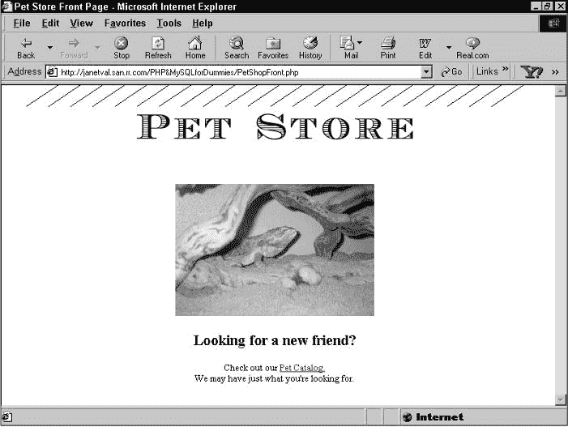

**图 11-1：** 宠物商店网站的开篇页面。

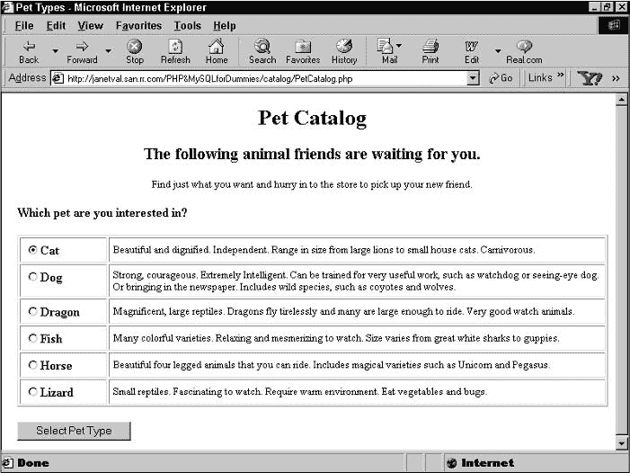

**图 11-2：** 宠物商店网站的宠物类型页面。

## 宠物页面

宠物页面列出所选类型的所有宠物。每只宠物都列出其 `petID`、描述、价格和图片。宠物页面根据目录数据库中的信息以不同格式显示。图 11-3、11-4 和 11-5 展示了一些可能的宠物页面。图 11-3 显示了一个列出目录中三只不同的狗的页面。

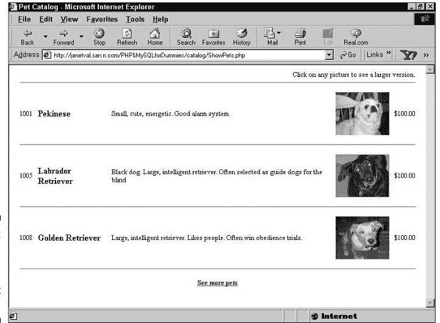

图 11-3：

此宠物页面显示三只不同的狗。

图 11-4 显示不止一只宠物可以具有相同的宠物名称。请注意，家猫具有不同的 `petID` 编号。

图 11-5 显示了在 `Color` 表中找到宠物时的输出，表明有不止一种颜色可用。

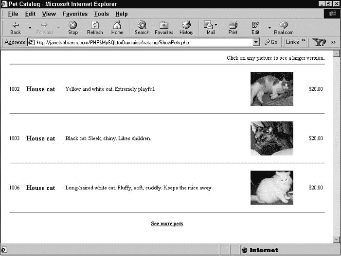

**图 11-4：** 此宠物页面显示三只具有相同宠物名称的猫。

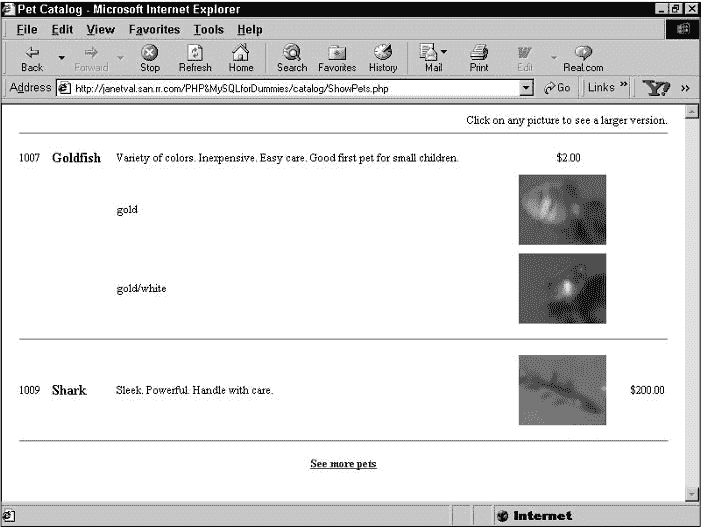

**图 11-5：** 此宠物页面显示有两种颜色可用的金鱼。

在所有这些页面上，顶部有一行文字为 `Click on any picture to see a larger version`。如果客户点击图片，则会显示该图片的较大版本。

## 将宠物添加到目录

该应用程序包含三个客户看不到的页面；这些页面用于将宠物添加到宠物目录中。这三个页面按顺序工作以添加单个宠物：

- 1. **获取宠物类型页面。** 添加宠物到目录的人员选择宠物类型的单选按钮。用户还可以输入新的宠物类型。
- 2. **获取宠物信息页面。** 用户选择要添加的宠物的单选按钮并填写宠物描述、价格和图片文件名。用户还可以输入新的宠物名称。
- 3. **反馈页面。** 显示一个页面，展示已添加到目录的宠物信息。

## 获取宠物类型页面

第一个页面获取需要添加到目录的宠物的宠物类型。图 11-6 显示了获取宠物类型页面。请注意，目录中当前所有的宠物类型都已列出，并且提供了一个区域，用户可以在需要时输入新的宠物类型。

## 获取宠物信息页面

图 11-7 显示了第二个页面。此页面允许用户输入将进入目录的宠物的信息。此页面列出了所选宠物类型在目录中的所有宠物名称，以便用户可以选择其中一个。它还提供了一个区域，用户可以在需要时输入新的宠物名称。

## 反馈页面

当用户提交宠物信息时，信息将被添加到 `PetCatalog` 数据库中。图 11-8 显示了一个验证已添加到数据库中的信息的页面。用户可以点击链接返回第一页并添加另一只宠物。

## 获取缺失信息页面

应用程序检查数据以查看用户是否输入了所需信息，并提示用户输入任何未输入的信息。例如，如果用户在第一页选择“新类别”，则用户必须输入类别名称和描述。如果用户未输入名称或描述，则会显示一个页面指出问题并请求信息。图 11-9 显示了用户忘记输入类别名称和描述时看到的页面。

图 11-6：

添加宠物到目录的第一页。

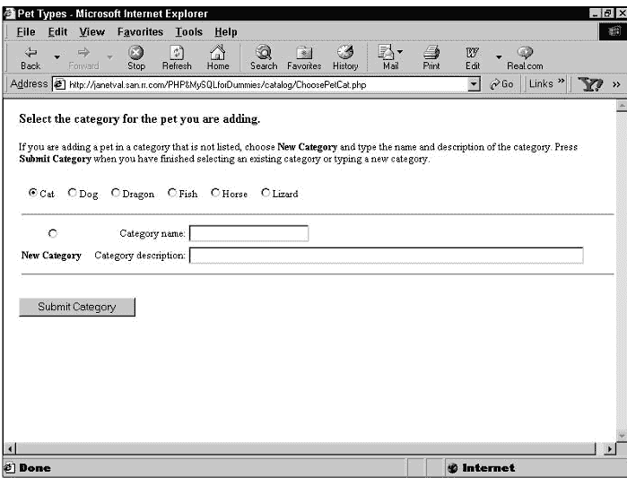

## 选择要添加的宠物的类别。

如果您要添加的宠物类别未列出，请选择“新类别”并输入该类别的名称和描述。在您完成选择现有类别或输入新类别后，按“提交类别”。

图 11-7：

第二个页面要求输入宠物名称。

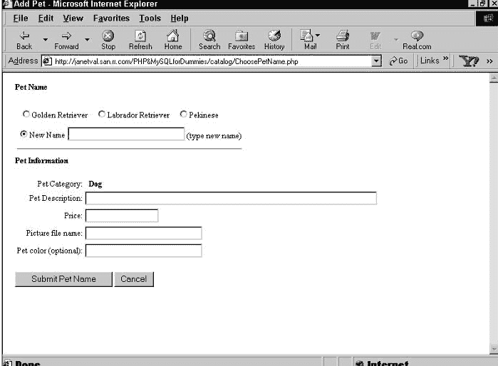

## 图 11-8：

最后一页提供反馈。

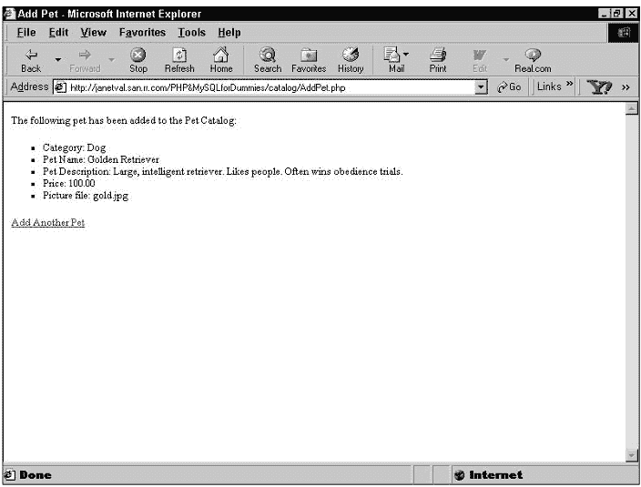

以下宠物已添加到宠物目录：

- Category: Dog
- Pet Name: Golden Retriever
- Pet Description: Large, intelligent retriever. Likes people. Often wins obedience trials.
- Price: 100.00
- Picture file: gold.jpg

Add Another Pet

## 图 11-9：

此页面请求新的类别和描述。

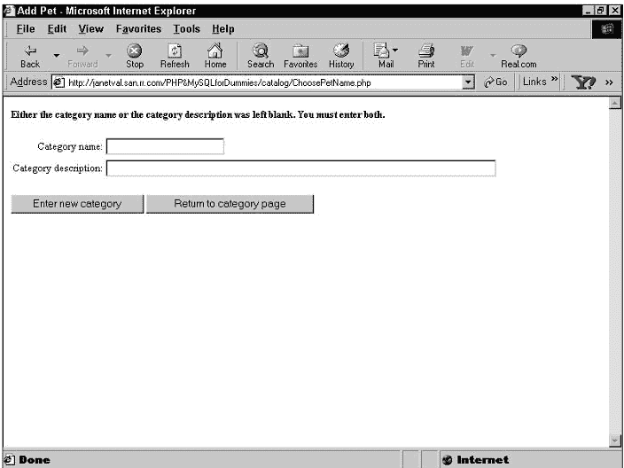

类别名称或类别描述留空。您必须同时输入两者。

Category name:

Category description:

Enter new category

Return to category page

## 编写程序

在您知道页面将是什么样子以及它们将做什么之后，您就可以编写程序了。一般来说，您为每个页面编写一个程序，尽管有时将程序分离到多个文件或将页面上的程序合并是有意义的。（有关如何组织应用程序的详细信息，请参阅第 10 章。）

正如我在第 10 章中所讨论的，将连接数据库所需的信息保存在单独的文件中，并在所有需要访问数据库的程序中包含该文件。出于安全原因，该文件应存储在安全位置并使用误导性的名称。对于此应用程序，以下信息存储在名为 `misc.inc` 的文件中：

```php
<?php
    $user="catalog";
    $host="localhost";
    $password="";
    $database="PetCatalog";
?>
```

宠物目录应用程序有两个独立的程序集：一组向客户展示宠物目录，另一组将新宠物输入目录。

### 向客户展示宠物

向客户展示宠物目录的应用程序有三个基本任务：

- 显示店面页面。提供目录链接。
- 显示用户选择宠物类型的页面。
- 显示所选宠物类型的宠物页面。

### 显示店面

店面页面不需要任何 PHP 语句。它只显示一个带有链接的网页。HTML 语句足以完成此操作。列表 11-1 显示了描述店面页面的 HTML 文件。

## 列表 11-1：店面页面的 HTML 文件

```php
<?php
  /* Program: PetShopFront.php
   * Desc:    Displays opening page for Pet Store.
   */
?>
```

```html
<html>
<head><title>Pet Store Front Page</title></head>
<body topmargin="0" leftmargin="0" marginheight="0"
      marginwidth="0">
  <table width="100%" height="100%" border="0"
         cellspacing="0" cellpadding="0">
    <tr>
      <td align="center" valign="top" height="30">
        
      </td>
    </tr>
    <tr>
      <td align="center" valign="top">
        
        <p style="margin-top: 40pt">
        
        <p><h2>Looking for a new friend?</h2>
        <p>Check out our <a href="PetCatalog.php">Pet
             Catalog.</a>
        <br> We may have just what you're looking for.
      </td>
    </tr>
  </table>
</body></html>
```

请注意，链接指向名为 `PetCatalog.php` 的 PHP 程序。当客户点击链接时，宠物目录程序（`PetCatalog.php`）开始运行。

## 显示宠物类型

宠物类型页面（参见图 11-2）向客户显示目录中当前所有宠物类型的列表。列表 11-2 显示了生成宠物类型网页的程序。

## 列表 11-2：显示宠物类型的程序

```php
<?php
  /* Program: PetCatalog.php
   * Desc:        Displays a list of pet categories from the
                 PetType table. Includes descriptions.
   *              User checks radio button.
   */
?>
<html>
<head><title>Pet Types</title></head>
<body>
<?php
  include("misc.inc");
```

## 列表 11-2（续）


```php
$connection = mysql_connect($host,$user,$password)      #13
    or die ("couldn't connect to server");
$db = mysql_select_db($database,$connection)            #15
    or die ("Couldn't select database");

/* Select all categories from PetType table */
$query = "SELECT * FROM PetType ORDER BY petType";      #19
$result = mysql_query($query)                           #21
    or die ("Couldn't execute query.");

/* Display text before form */
echo "<div style='margin-left: .1in'>"
<h1 align='center'>Pet Catalog</h1>
<h2 align='center'>The Following animal friends are
waiting for you.</h2>
<p align='center'>Find just what you want and hurry in to
the store to pick up your new friend.
<p><h3>Which pet are you interested in?</h3>\n";

/* Create form containing selection list */
echo "<form action='ShowPets.php' method='post'>\n";    #34
echo "<table cellpadding='5' border='1'>";
$counter=1;                                             #36
while ($row = mysql_fetch_array($result))               #37
{
    extract($row);                                      #39
    echo "<tr><td valign='top' width='15%'>\n";
    echo "<input type='radio' name='interest'
        value='$petType'\n";                           #42
    if ( $counter == 1 )                                #43
    {
        echo "checked";
    }
    echo "><font size='+1'><b>$petType</b></font>";    #47
    echo "</td>"
    "<td>$typeDescription</td>";                       #49
    echo "</tr>";
    $counter++;                                         #51
}
echo "</table>";
echo "<p><input type='submit' value='Select Pet Type'>
</form>\n";                                             #55
?>
</div>
</body></html>
```

列表 11-2 中的程序在某些行的末尾有行号。行号是参考，以便我可以引用程序的特定部分。以下列表中的数字对应于列表中的行号。以下是这些行在程序中作用的简要说明：

**11** `include` 语句引入一个包含连接数据库所需信息的文件。我将其命名为 `misc.inc`，因为这比将其命名为 `passwords.inc` 更安全。

**13** 连接到 MySQL 服务器。

**15** 选择 `PetCatalog` 数据库。

**19** 一个查询，从 `PetType` 表中选择所有信息，并按宠物类型按字母顺序排列。

**21** 执行第 19 行的查询。

**34** 用于容纳所有宠物类型的表单的开始标签。 action 目标是 `ShowPets.php`，它是显示所选类型宠物的程序。

**36** 创建一个起始值为 1 的计数器。计数器将跟踪数据库中找到的宠物类型数量。

**37** 启动一个 `while` 循环，该循环将获取第 19 行和第 20 行从数据库中选择的包含宠物类型和宠物描述的行。循环将为检索到的每种宠物类型执行一次。

**39** 将行拆分为两个变量：`$petType` 和 `$petDescription`。

**41/42** 输出单选按钮的表单字段标签。值为 `$petType` 中的值。此语句在每次循环中执行一次，为每种宠物类型创建一个单选按钮。此语句仅输出表单字段标签的一部分。

**43** 启动一个仅在第一次循环中执行的 `if` 块。它将单词 `"checked"` 作为表单字段的一部分输出。这确保表单中有一个单选按钮被选中，这样表单就不会在未选中按钮的情况下提交，否则会导致难看的错误消息或警告。计数器正是为此目的而设置的。


虽然在某些浏览器中为每个单选按钮添加 `"checked"` 可以工作，但它会让其他浏览器感到困惑。然而，为仅一个单选按钮添加 `"checked"` 所需的额外编程可以防止潜在问题。

**47** 输出单选按钮表单字段标签的剩余部分——关闭标签的部分。

**49** 在表格行的第二个单元格中输出宠物描述。

**51** 将 1 加到计数器上，以跟踪循环执行的次数。

**54** 向表单添加提交按钮。

**55** 关闭表单。

当用户选择一个单选按钮然后点击提交按钮时，表单标签中名为 `ShowPets.php` 的下一个程序运行，显示所选宠物类型的宠物。

## 显示宠物

宠物页面（参见图 11-3、11-4 和 11-5）向客户显示当前目录中选定类型的全部宠物的列表。列表 11-3 显示了生成宠物网页的程序。

### 列表 11-3：显示宠物列表的程序

```php
<?php
    /* Program: ShowPets.php
     * Desc:     Displays all the pets in a category. Category
     *           is passed in a variable from a form. The
     *           information for each pet is displayed on a
     *           single line, unless the pet comes in more than
     *           one color. If the pet comes in colors, a single
     *           line is displayed without a picture and a line
     *           for each color, with pictures, is displayed
     *           following the single line. Small pictures are
     *           displayed, which are links to larger pictures.
     */
?>
<html>
<head><title>Pet Catalog</title></head>
<body topmargin="0" marginheight="0">
<?php
include("misc.inc");

$connection = mysql_connect($host,$user,$password)
    or die ("couldn't connect to server");
$db = mysql_select_db($database,$connection)
    or die ("Couldn't select database");

/* Select pets of the given type */
$query = "SELECT * FROM Pet
            WHERE petType=\"{$_POST['interest']}\"";  #27
$result = mysql_query($query)
    or die ("Couldn't execute query.");

/* Display results in a table */
echo "<table cellspacing='10' border='0' cellpadding='0'
        width='100%'>";
echo "<tr><td colspan='5' align='right'>
        Click on any picture to see a larger
        version.<br><hr>
        </td></tr>\n";
while ($row = mysql_fetch_array($result,MYSQL_ASSOC))  #38
{
    $f_price = number_format($row['price'],2);

    /* check whether pet comes in colors */
    $query = "SELECT * FROM Color
                WHERE petName='{$row['petName']}'";  #44
    $result2 = mysql_query($query) or die(mysql_error()); #45
$ncolors = mysql_num_rows($result2);                         //#46

/* display row for each pet */
echo "<tr>\n";
echo "<td>{$row['petID']}</td>\n";
echo "<td><font size='+1'>
<b>{$row['petName']}</b></font></td>\n";
echo "<td>{$row['petDescription']}</td>\n";
/* display picture if pet does not come in colors */
if ( $ncolors <= 1 )
{   //#55
    echo "<td><a href='../images/{$row['pix']}'
border='0'>
</a></td>\n";
}
echo "<td align='center'>\${$f_price}</td>\n
</tr>\n";
/* display row for each color if pet comes in colors */
if ($ncolors > 1 )   //#65
{
    while($row2 = mysql_fetch_array($result2,MYSQL_ASSOC))
    {
        echo "<tr><td colspan=2>&nbsp;</td>
<td>{$row2['petColor']}</td>
<td><a href='../images/{$row2['pix']}'
border='0'>
</a></td>\n";
    }
    echo "<tr><td colspan='5'><hr></td></tr>\n";
}
echo "</table>\n";
echo "<div align='center'>
<a href='PetCatalog.php'>
<b>See more pets</b></a></div>";
?>
</body></html>
```

以下数字对应于列表 11-3 中行尾注释所示的行号。我在下面的列表中仅记录了该程序中的部分行。列表中的许多任务也在该应用程序的大多数程序中，例如连接到数据库、创建表单和执行查询。由于我已为列表 11-2 记录了这些常见任务，因此在此不重复。以下是程序中其他部分行的简要说明：

**26/27** 此查询选择目录中与所选类型匹配的所有宠物，该类型是通过表单从前一页传递过来的。

**38** 设置一个 `while` 循环，为每个选定的宠物运行一次。循环为找到的每个宠物创建一个信息行。

**43** 第 43 行至第 46 行检查宠物在 `Color` 表中是否有任何条目。请注意，查询结果放在 `$result2` 中。它们不能放在 `$result` 中，因为该变量名已在使用中。`$ncolors` 存储为宠物在 `Color` 表中找到的行数。每个宠物名称在循环中处理时都会被检查颜色。

**55** 启动一个 `if` 块，仅在 `Color` 表中为宠物找到零行或一行时执行。`if` 块显示宠物的图片。如果程序在 `Color` 表中找到宠物有多个颜色，则宠物有多种颜色，这里不应显示图片。相反，后续行将为每种颜色显示图片。参见图 11-3 和 11-4，了解在该 `if` 块中完成的在单行上显示图片和信息的宠物页面。

**65** 启动一个 `if` 块，如果为宠物找到多个颜色则执行。`if` 块为 `Color` 表中找到的每种颜色回显一行。

**67** 在 `if` 块内设置一个 `while` 循环，为 `Color` 表中找到的每种颜色运行一次。循环为每种颜色显示一行，包括图片。参见图 11-5，了解为每种颜色显示带图片的单独行的宠物页面。

页面底部有一个指向更多宠物的链接。该链接指向显示宠物类型的上一个程序。

## 向目录添加宠物

将新宠物添加到目录的应用程序应执行以下任务：

- 1. **创建询问宠物类别的表单。** 添加宠物的人可以选择现有的一种宠物类型或创建一个新的类型。要创建新类型，用户需要输入类别名称和描述。

- 2. **如果创建了新类型，请检查是否输入了名称和描述。**

- 3. **创建询问宠物信息的表单——名称、描述、价格、图片文件名和颜色。** 添加宠物的人可以为所选类别选择现有的一种宠物名称或创建新名称。要创建新的宠物名称，用户需要输入宠物名称。

- 4. **如果为宠物名称选择了新名称，请检查是否输入了名称。**

- 5. **将新宠物存储在 `PetCatalog` 数据库中。**

- 6. **发送一个反馈页面，显示刚刚添加到目录中的信息。**

这些任务由三个程序完成：

- `ChoosePetCat.php`：创建宠物类型表单（任务 1）

- `ChoosePetName.php`：检查宠物类别数据并创建宠物信息表单（任务 2 和 3）

- `AddPet.php`：检查宠物名称字段，将新宠物存储到目录数据库中，并提供反馈（任务 4、5 和 6）

## 编写 ChoosePetCat

第一个程序生成一个包含 HTML 表单的网页，添加宠物的人可以在其中为宠物选择宠物类型。为了使程序更易于阅读和维护（正如我在第 10 章中讨论的），可以将程序使用的部分 HTML 语句放在单独的文件中，然后通过 `include` 语句将其引入程序。清单 11-4 展示了 `ChoosePetCat.php`。

### 清单 11-4：允许用户选择宠物类型的程序


```php
<?php
    /* Program: ChoosePetCat.php
     * Desc:    Allows users to select a pet type. All the
     *          existing pet types from the PetType table
     *          are displayed. A section to enter a new
     *          pet type is provided. Selections are
     *          provided as radio buttons, with text
     *          fields for new category name and
     *          description.
     */
?>
<html>
<head><title>Pet Types</title></head>
<body>
<?php
    include("misc.inc");
    $connection = mysql_connect($host,$user,$password)
        or die ("couldn't connect to server");
    $db = mysql_select_db($database,$connection)
        or die ("Couldn't select database");

    /* gets types from PetType table in alphabetical order */
    $query="SELECT petType FROM PetType ORDER BY petType";  /*23 */
    $result = mysql_query($query)
        or die ("Couldn't execute query.");

    /* Display text before form */
    echo "<div style='margin-left: .1in'>";
    <p><h3>Select the category for the pet you are adding.</h3>
        If you are adding a pet in a category that is not
        listed, choose <b>New Category</b> and type the name
```

### 清单 11-4（续）

```php
and description of the category. Press <b>Submit Category</b> when you have finished selecting an existing category or typing a new category.\n";

/* Create form containing selection list */
echo "<form action='ChoosePetName.php' method='POST'>\n";
echo "<table cellpadding='5' border='0'>\n";
echo "<tr>";
$counter=0;                                   #40
while ($row = mysql_fetch_array($result))     #41
{
    extract($row);
    echo "<td>";
    <input type='radio' name='category' value='$petType'>;
        if ($counter == 0)                    #46
        {
            echo "checked";
        }
    echo ">$petType </td>\n";                #50
    $counter++;                               #51
}
echo "</tr></table>\n";

include("NewCat_table.inc");                 #55

echo "<p><input type='submit' value='Submit Category'>\n";
echo "</form>\n";
?>
</div>
</body></html>
```

以下编号对应清单 11-4 各行末尾注释中显示的编号。下面的列表只对其中部分行进行说明。清单中的许多任务，例如连接数据库、创建表单和执行查询，在本应用程序的大多数程序中都能找到；相关的说明请参阅清单 11-2。下面的列表简要说明了以下各代码行在程序中的作用：

- 23 一个从 `PetType` 表中选择所有宠物类型并按字母顺序排序的查询。

- 40 创建一个起始值为 0 的计数器。该计数器将记录数据库中找到的宠物类型数量。

- 41 启动一个 `while` 循环，对每种宠物类型执行一次。该循环为各种宠物类型创建一组单选按钮，其中一个按钮会被选中。以下是该 `while` 循环的详细说明：

    - 45 输出一个单选按钮的表单字段标签，其 `value` 等于 `$petType`。该语句在每次循环中执行一次，为每种宠物类型创建一个单选按钮。此语句仅输出表单字段标签的第一部分。


    - 46 一个仅在第一次循环中执行的 `if` 块。它将单词 `"checked"` 作为表单字段的一部分输出。这样可以确保显示时有一个单选按钮被选中，从而避免表单在未选择任何按钮的情况下提交，否则会产生不友好的错误消息或警告。设置计数器完全是为了这个目的。

      虽然给每个单选按钮都添加 `"checked"` 在某些浏览器中可行，但在其他浏览器中会引发问题。额外编写代码只为其中一个单选按钮添加 `"checked"`，可以避免这些问题。

    - 50 输出单选按钮表单字段标签的剩余部分——即闭合标签的那一部分。

    - 51 将计数器加 1，以跟踪循环执行的次数。这是 `while` 循环中的最后一行。

    - 55 创建一个要求输入新宠物类型名称和描述的表格。该表格的 HTML 从另一个名为 `NewCat_table.inc` 的文件中读入。正如我在第 10 章中讨论的，HTML——尤其是描述表单的 HTML——通常保存在单独的文件中，以使主程序更易于阅读，并在必要时更容易修改表单。该文件如清单 11-5 所示。

### 清单 11-5：包含新类型表单的文件

```php
<?php
    /* Program:  NewCat_table.inc
     * Desc:     HTML code that displays a table for input of a
     *           new category
     */
?>
<table width='100%'>
<tr><td colspan=3><hr></td></tr>
<tr>
    <td align='center'>
        <input type='radio' name='category' value='new'>&nbsp;
    </td>
    <td align='right'>Category name:</td>
    <td><input type='text' name='newCat' size='20'
                maxlength='20'></td>
</tr>
<tr><td align='center'><b>New Category</b></td>
    <td align='right'>Category description:</td>
    <td><input type='text' name='newDesc' size='70'
                maxlength='255'>
    </td>
</tr>
<tr><td colspan=3><hr></td></tr>
</table>
```

该文件除了顶部有一段用作头部注释的 PHP 代码外，其余全是 HTML。其实我本可以用 HTML 注释来实现这一点，但我更喜欢 PHP 的注释风格。

## 编写 ChoosePetName

第二个程序接受第一个程序中表单提交的数据。它会检查这些信息，并要求补充缺失的信息。在正确接收到宠物类型信息后，该程序会创建一个表单，用户可以在其中为要添加到目录中的新宠物选择宠物名称，并输入宠物的相关信息。与前面的程序一样，该程序通过 `include` 语句从外部文件引入一些 HTML 表单和表格。它还调用了一个位于 `include` 文件中的函数。该程序共引入两个文件。清单 11-6 展示了 `ChoosePetName.php`。

### 清单 11-6：要求用户输入宠物名称的程序

```php
<?php

  /* Program: ChoosePetName.php

   * Desc:     Allows the user to enter the information for

   *           the pet. First, the program checks for a new

   *           category and enters it into the pettype table

   *           if it is new. Then, all pets in the selected

   *           category are displayed with radio buttons.

   *           The user can enter a new name. Fields are

   *           provided to enter the description, price, and

   *           picture file name.

   */

?>

<?php

  if (@$_POST['newbutton'] == "Return to category page"

      or @$_POST['newbutton'] == "Cancel")

  {

    header("Location: ChoosePetCat.php");

  }

?>

<html>

<head><title>Add Pet</title></head>

<body>

<?php

  include("misc.inc");

  include("functions.inc");

  $connection = mysql_connect($host,$user,$password)

      or die ("Couldn't connect to server");

  $db = mysql_select_db($database,$connection)

      or die ("Couldn't select database");

  $category = $_POST['category'];

  /* If new was selected for pet category, check if text

     fields were filled in. If they were not filled in,

     display them again for the user to enter the category

```

### 清单 11-6（续）

```php
name and category description. When the fields are filled in, store the new category in the PetType table.*/

if ($_POST['category'] == "new")                         #38

{
    if ($_POST['newCat'] == ""
        or $_POST['newDesc'] == "")                       #41

    {
        include("NewCat_form.inc");                      #43
        exit();                                          #44
    }

    /* add new pet type to PetType table */              #47
    else

    {
        addNewType($_POST['newCat'],$_POST['newDesc']);  #49
        $category = $_POST['newCat'];
    }

}                                                       #52

/* Select pet names from table with given category. If
   user entered a new category, it is searched for. */

$query = "SELECT DISTINCT petName FROM Pet
          WHERE petType='$category' ORDER BY petName";   #57

$result = mysql_query($query)
          or die ("Couldn't execute query");

$nrow = mysql_num_rows($result);                       #60

/* create form */

echo "<div style='margin-left: .1in'>";
echo "<form action='AddPet.php' method='post'>\n";
echo "<p><b>Pet Name</b></p>\n";

if ($nrow < 1)                                         #66

{
    echo "<hr><b>No pet names are currently in the database
          for the category $category</b><hr>\n";

}

else                                                   #71

{
    echo "<table cellpadding='5' border='0'>";
    echo "<tr>";

    while ($row = mysql_fetch_array($result))          #75

    {
        extract($row);
        echo "<td>";
        echo " <input type='radio' name='petName'
                    value='$petName'";
        echo ">$petName</td>\n";
    }

    echo "</tr></table>";
}

include ("NewName_table.inc");                         #85

$petDescription = ""; $price = ""; $pix = ""; $petColor = "";

include("PetInfo_table.inc");                                      #88

echo "<input type='hidden' name='category'
             value='$category'>\n";
echo "<p><input type='submit' value='Submit Pet Name'>
     <input type='submit' name='newbutton' value='Cancel'>
     </form>\n";
?>

</div>
</body></html>
```


下面的数字对应于清单11-6中行末注释所显示的行号。由于清单中的许多任务在本应用的大多数程序中都很常见，因此这里只对部分行进行说明。常见任务已在清单11-2中说明，并在本书其他部分解释过，因此这里不再重复。以下是对程序中相应行作用的简要说明：

- 15. 检查用户是否点击了标记为*取消*或*返回类别页面*的提交按钮。如果是，则返回第一个页面。
- 38. 启动一个`if`块，仅当用户在上一个程序的表单中选中“新类别”单选按钮时才执行。此块检查新类别名称和描述是否已填写。如果用户忘记输入，会再次要求输入宠物类型名称和描述。名称和描述填写完毕后，程序调用一个函数，将新类别添加到`PetType`表中。以下各行将更详细地描述这个`if`块：
- 41. 启动一个`if`块，仅当类别名称和/或类别描述为空白时执行。由于此`if`块位于“新类别”的`if`块内部，因此仅当用户为宠物类型选择了“新类别”但未填写新类别名称和描述时，此块才会执行。
- 43. 创建一个要求输入类别名称和描述的表单。该表单的HTML从文件中包含（include）进来。仅当第38行的`if`语句为真时执行——即类别是新的，并且类别名称和/或描述为空白时。
- 44. 在第43行显示表单后停止程序。在输入类别名称和描述之前，程序无法继续。此块将重复执行，直到类别名称和描述被填写。
- 47. 启动一个`else`块，仅当类别名称和描述都已填写时才执行。由于此块位于“新类别”单选按钮的`if`块内部，因此当用户选择了“新”并填写了新类别名称和描述时，此块执行。
- 49. 调用一个函数，将新类别添加到`PetType`表中。
- 50. 到目前为止，类别仍然设置为`"new"`。此行将`$category`设置为新类别名称。
- 52. 此行结束`if`块。如果用户选择了现有宠物类型之一，则第38行至此行之间的语句不会执行。
- 56. 一个查询，从所选宠物类型中选择每个宠物名称中的一个，并按字母顺序排序。
- 60. 检查是否为所选宠物类型找到了任何宠物名称。
- 66. 启动一个`if`块，仅当未找到该宠物类型的宠物时执行。此块向用户输出一条消息，说明未找到该宠物类型的宠物。
- 71. 启动一个`else`块，如果找到了该宠物类型的宠物则执行。`else`块为找到的宠物名称创建一组单选按钮列表。此列表使用`while`循环（从第75行开始）创建，方式与创建类别列表相同，如清单11-4所述。
- 85/88. 第85行和第88行创建要求输入新宠物名称和信息的表格，并使用include语句从不同文件引入HTML。

该程序通过include语句引入了三个包含HTML的文件。清单11-7、11-8和11-9显示了被包含的三个文件：`NewCat_form.inc`、`NewName_table.inc`和`PetInfo_table.inc`。

## 清单11-7：创建新宠物类型表单的HTML代码

```php
<?php

/* Program: NewCat_form.inc

 * Desc: Displays a form to collect a category name and

 * description.

 */

?>
<b>Either the category name or the category description was left blank. You must enter both.</b>

<form action="ChoosePetName.php" method="POST">
<table>
<tr>
<td align="right">Category name:</td>
<td><input type="text" name="newCat"
value="<?php echo $_POST['newCat'] ?>"
size="20" maxlength="20">
</td></tr>
<tr>
<td align="right">Category description:</td>
<td><input type="text" name="newDesc"
value="<?php echo $_POST['newDesc'] ?>"
size="70%" maxlength="255">
</td></tr>
</table>
<input type="hidden" name="category" value="new">
<p><input type="submit" name="newbutton"
value="Enter new category">
<input type="submit" name="newbutton"
value="Return to category page">
</form>
```

这个程序几乎全是HTML代码。请注意关于此表单的以下几点：

- **此表单仅在用户选择宠物类型网页上的“新类别”单选按钮但未输入宠物类型名称或描述时创建。** 显示此表单是为了让用户有第二次机会输入名称或描述。
- **该文件大部分是HTML，只有两个小的PHP部分用于回显两个字段的值。**
- **该表单返回生成它的程序进行处理。** 其处理方式与从第一个页面发送的表单相同。字段名称相同，并再次检查它们是否为空。
- **包含一个隐藏字段，发送值为`"new"`的`$category`。** 如果此表单未发送`$category`，则处理它的程序（即生成它的程序）将不知道宠物类型是新的，也不会执行当选择新类别时应执行的`if`块。

## 清单11-8：为新名称创建表格的HTML文件

```php
<?php

/* Program: NewName_table.inc

 * Desc: Displays table to enter new pet name

 */

?>
<table border="0">
<tr><td>
<input type="radio" name="petName"
value="new" checked >New Name</td>
<td><input type="text" name="newName" size="25"
maxlength="25"> (type new name)</td>
</tr>
<tr><td colspan=2><hr></td></tr>
</table>
```

这个文件全部是 HTML，没有 PHP。它显示宠物名称网页的区域，用户可以在此处输入新的宠物名称。

## 清单11-9：创建宠物信息表格的 HTML

```php
<?php

    /* Program: PetInfo_table.inc

     * Desc:      Displays table to collect pet information

     */

?>
<b>Pet Information</b><br>

<p><table>
<tr><td align="right">Pet Category:</td>
    <td><b>&nbsp;&nbsp;<?php echo $category ?></b></td>
</tr>
<tr><td align="right">Pet Description:</td>
    <td><input type="text" name="petDescription"
            value="<?php echo $petDescription ?>"
            size="65" maxlength="255">
    </td></tr>
<tr><td align="right">Price:</td>
    <td><input type="text" name="price"
            value="<?php echo $price ?>" size="15"
            maxlength="15">
    </td></tr>
<tr><td align="right">Picture file name:</td>
    <td><input type="text" name="pix"
            value="<?php echo $pix ?>" size="25"
            maxlength="25">
    </td></tr>
<tr><td align="right">Pet color (optional):</td>
    <td><input type="text" name="petColor"
            value="<?php echo $petColor ?>" size="25"
            maxlength="25">
    </td></tr>
</table>
```

此文件包含用于变量值的少量 PHP 部分。否则，它是 HTML。

除了用于表格和表单的 HTML 外，清单 11-6 中的 `ChoosePetName.php` 程序调用了一个函数。该函数存储在名为 `functions.inc` 的文件中，并在程序开始时包含。清单 11-10 显示了该函数。

## 清单11-10：函数 `AddNewType()`

```php
<?php

/* Function addNewType

 * Desc     Adds a new pet type and description to the

 *          PetType table. Checks for the new pet type

 *          first and does not add it to the table if

 *          it is already there.

 */

function addNewType($petType,$typeDescription)

{

    /* Prepare data */

    $petType = ucfirst(strip_tags(trim($petType)));

    $typeDescription =

        ucfirst(strip_tags(trim($typeDescription)));

    /* Check whether new category is already in PetType table.

       If it is not in table, add it to table. */

    $query = "SELECT petType FROM PetType

              WHERE petType='$petType'";

    $result = mysql_query($query) or

        die ("Couldn't execute query ");

    $ntype = mysql_num_rows($result); //

    if ($ntype < 1) // if new type is not in table

    {

        $query = "INSERT INTO PetType (petType,typeDescription)

                  VALUES ('$petType','$typeDescription')";

        $result = mysql_query($query)

            or DIE ("Couldn't execute query ");

    }

    return;

}

?>
```

该函数首先清理数据。然后检查宠物类型是否已存在于 `PetType` 表中。如果不存在，则函数将其添加到表中。

## 编写 AddPet

此最后一个程序接受第二个程序中表单的数据。如果宠物名称选择了 `new`，它会检查是否输入了新名称，如果留空则再次提示输入。在宠物名称填写后，程序存储来自上一页的宠物信息。请注意，它不检查其他信息，因为其他信息是可选的。与前一个程序一样，此程序使用 include 语句从两个单独的文件中引入一些 HTML 表单和表格。清单 11-11 显示了 `AddPet.php`。

## 清单11-11：添加新宠物到目录的程序

```php
<?php

  /* Program: AddPet.php

   * Desc:    Adds new pet to the database. A confirmation

   *          screen is sent to the user.

   */

  if (@$_POST['newbutton'] == "Cancel")                         #7

  {

      header("Location: ChoosePetCat.php");

  }

  $petName = $_POST['petName'];

  $newName = $_POST['newName'];

  $price = $_POST['price'];

  $pix = $_POST['pix'];

  $petColor = $_POST['petColor'];

  $category = $_POST['category'];

  $petDescription = $_POST['petDescription'];

  if ($petName == "new")                                        #18

  {

      if ($newName == "")                                       #20

      {

          include("NewName_form.inc");

          exit();

      }

      else                                                       #25

      {

          $petName=trim($newName);

          $petName=ucfirst(strtolower(strip_tags($petName)));

      }

  }

  if ($pix == "")                                               #31

      $pix = "na.gif";

?>

<html>
<head><title>Add Pet</title></head>
<body>

<?php

  include("misc.inc");

  $connection = mysql_connect($host,$user,$password)

      or die ("Couldn't connect to server");

  $db = mysql_select_db($database,$connection)

      or die ("Couldn't select database");

  /* Clean the data */

  $petDescription = strip_tags(trim($petDescription));

  $price = strip_tags(trim($price));

  $pix = strip_tags(trim($pix));

  $petColor = strip_tags(trim($petColor));

  $query = "INSERT INTO Pet

      (petName,petType,petDescription,price,pix) VALUES

('$petName','$category','$petDescription','$price',

'$pix');

$result = mysql_query($query)

    or die ("Couldn't execute query.");

$petID = mysql_insert_id();                      #55

echo "The following pet has been added to the

    Pet Catalog:<br>

    <ul>

    <li>Category: $category

    <li>Pet Name: $petName

    <li>Pet Description: $petDescription

    <li>Price: $price

    <li>Picture file: $pix \n";

if ($petColor != "")

{                                            #66

    if ($petName == "Goldfish" or $petName == "Parakeet")

    {

        $query = "SELECT petName FROM Color

                    WHERE petName='$petName'

                    AND petColor='$petColor'";

        $result = mysql_query($query)

            or die ("Couldn't execute query.");

        $num = mysql_num_rows($result);

        if ($num < 1)

        {

            $query = "INSERT INTO Color (petName,petColor,pix)
```


```php
VALUES ('$petName','$petColor','$pix')";

$result = mysql_query($query)
    or die ("Couldn't execute query.");

echo "<li>Color: $petColor\n";

}
}

echo "</ul>";

echo "<a href='ChoosePetCat.php'>Add Another Pet</a>\n";

?>
</body></html>
```

请注意清单 11-11 中行尾作为注释显示的行号。以下列表中的编号对应于清单中的行号。我仅记录以下列表中的部分行，因为诸如连接数据库等许多常见任务已在本章前面的程序中记录过。

- 7. 检查用户是否点击了 `Cancel` 按钮。如果是，则返回第一页。
- 18 启动一个 `if` 块，仅当用户为宠物名称选择了 `new` 时执行。如果新名称为空，则重复显示一个表单，要求输入新的宠物名称（第 20 行），直到用户输入为止。填写新名称后，`$petName` 被设置为新名称（第 25 行）。
- 31 如果未输入图片文件名，则将其设置为默认图片。
- 38 第 38-55 行将新宠物添加到数据库。数据在添加前会被清理。
- 57 开始输出反馈页面。
- 66 启动一个 `if` 块，仅当填写了颜色时执行。颜色仅针对鹦鹉和金鱼存储。会检查 `Color` 表中是否已存在名称和颜色。如果不存在，则将其添加到 `Color` 表中。该 `if` 块在第 85 行结束。

此程序引入一个 HTML 文件，如果用户忘记输入宠物名称，则创建表单提示用户输入。清单 11-12 显示了被包含的文件：`NewName_form.inc`。

### 清单 11-12：提示用户输入新宠物名称的 HTML

```php
<?php

/* Program: NewName_form.inc
 * Desc:      Displays form to collect a pet name
 */

?>
<b>You must type a pet name.</b>

<form action="AddPet.php" method="post">

<table><tr>

<td align="right">Pet name:</td>

<td><input type="text" name="newName"
value="<?php echo $newName ?>"
size="25" maxlength="25">
</td></tr>
</table>

<input type="hidden" name="category"
value="<?php echo $category ?>">

<input type="hidden" name="petName"
value="<?php echo $petName ?>">

<input type="hidden" name="petDescription"
value="<?php echo $petDescription ?>">

<input type="hidden" name="price"
value="<?php echo $price ?>">

<input type="hidden" name="pix" value="<?php echo $pix ?>">

<input type="hidden" name="petColor"
value="<?php echo $petColor ?>">

<p><input type="submit" name="newbutton"
value="Enter new pet name">
<input type="submit" name="newbutton" value="Cancel">
</form>
```

该文件创建了一个表单，当用户忘记输入新宠物名字时显示。它与清单11-7中当用户忘记输入新类别时显示的程序非常相似。请注意，两个隐藏字段用于传递 `$category` 和 `$petName` 的值。当表单填写完毕后，需要这两个变量的值来存储宠物信息。

最后，该程序提供一个指向首页的链接，以便用户在需要时可以向目录中添加另一只新宠物。

# 第12章 构建会员专享网站

## 本章内容

- 设计会员专享网站
- 为成员目录构建数据库
- 设计会员专区的网页
- 编写用于登录会员专区的程序

许多网站都要求用户登录。有时，用户不输入密码就无法查看任何网页；有时，网页只有一部分需要登录。以下是您可能希望要求用户登录的一些原因：

- **信息是机密。** 你不希望除少数授权人员以外的任何人看到这些信息。或者，也许只应该让你自己的员工看到这些信息。
- **信息或服务用于出售。** 你的网站提供的信息或服务就是你想要收费的产品。例如，你可能垄断了研究人员愿意付费购买的一些调查数据。例如，AAA Automobile Club（美国汽车协会）免费提供部分信息，但你必须成为会员才能查看其酒店评级。
- **你可以提供更好的服务。** 如果你知道客户是谁，或者拥有他们的一些信息，就能简化他们与网站的交互。例如，如果你在 Barnes & Noble.com 或 Gap 拥有账户并登录其网站，他们会使用你存储的收货地址，这样你就不必再次输入。

## 构建数据库

数据库是此应用程序的核心和目的所在。它保存客户信息，这正是会员专区要实现的目标。它还保存会员ID和密码，以便用户登录会员专区。

会员专享应用的数据库包含两个表：

- 会员表
- 登录表

构建登录应用的第一步是构建数据库。如果没有一个可以测试程序的可用数据库，那么编写程序几乎不可能。首先设计数据库；然后构建它；再添加一些示例数据，供开发程序时使用。


在第3章中我为宠物商店网站的会员专享受限区域设计的数据库做了一些修改。开发和测试常常会导致改动。也许你会发现设计中未考虑某些因素，或者设计的某些元素不适用于真实数据，或难以编程。在应用程序开发过程中设计不断演进是完全正常的，只需确保在设计变更时同步修改文档即可。

### 构建会员表

在登录应用的设计中，主表是会员表。它保存客户输入的所有信息，包括客户个人信息（姓名、地址、电话号码等）以及会员ID和密码。以下SQL查询创建会员表：

```sql
CREATE TABLE Member (
    loginName      VARCHAR(20)    NOT NULL,
    createDate     DATE           NOT NULL,
    password       VARCHAR(255)   NOT NULL,
    lastName       VARCHAR(50),
    firstName      VARCHAR(40),
    street         VARCHAR(50),
    city           VARCHAR(50),
    state          CHAR(2),
    zip            CHAR(10),
    email          VARCHAR(50),
    phone          CHAR(15),
    fax            CHAR(15),
    PRIMARY KEY(loginName));
```

每一行代表一位会员。各列如下：

- **loginName：** 会员登录时使用的会员ID。登录名由客户选择并输入。`CREATE` 查询以如下方式定义 `loginName`：
  - `CHAR(20)`：此数据类型将该字段定义为长度为20个字符的字符串。该字段始终占用20个字符的存储空间，如果实际存储的字符串少于20个字符，则填充空格。如果存储的字符串超过20个字符，则丢弃第20个字符之后的字符。
  - `PRIMARY KEY(loginName)`：主键标识行且必须唯一。MySQL 不允许两行具有相同的 `loginName`。
  - `NOT NULL`：此定义表示该字段不能为空，必须有一个值。主键必须始终设置为 `NOT NULL`。

- **createDate：** 将该行添加到数据库的日期，也就是客户创建账户的日期。查询将 `createDate` 定义为：
  - `DATE`：这是一个按日期处理的字符串。日期以 YYYY-MM-DD 格式显示。可以按该格式或一些类似格式输入，例如 YY/M/D 或 YYYYMMDD。
  - `NOT NULL`：此定义表示该字段不能为空，必须有一个值。因为日期是由程序而不是用户创建并存储的，所以它永远不会为空。

- **password：** 会员登录时使用的密码。密码由客户选择并输入。`CREATE` 查询以如下方式定义 `password`：
  - `VARCHAR(255)`：此语句将该字段定义为可变字符串，长度最多为255个字符。该字段按实际长度存储。你并不期望密码有255个字符长。事实上，你期望它相当短。然而，你打算使用 MySQL 的 `password` 函数对其进行加密，而不是明文存储。加密后字符串会变长，所以要为更长的字符串留出空间。
  - `NOT NULL`：此语句表示该字段不能为空，必须有一个值。在此应用中，你不允许空密码。

- **lastName：** 客户输入的姓氏。`CREATE` 查询将该字段定义为：
  - `VARCHAR(50)`：此数据类型将该字段定义为可变字符串，长度最多为50个字符。该字段按实际长度存储。

- **firstName：** 客户输入的名字。`CREATE` 查询将该字段定义为：
  - `VARCHAR(40)`：此数据类型将该字段定义为可变字符串，长度最多为40个字符。该字段按实际长度存储。

- **street：** 客户输入的街道地址。`CREATE` 查询将该字段定义为：
  - `VARCHAR(50)`：此数据类型将该字段定义为可变字符串，长度最多为50个字符。该字段按实际长度存储。

- **city：** 客户地址中的城市，由客户输入。`CREATE` 查询将该字段定义为：
  - `VARCHAR(50)`：此数据类型将该字段定义为可变字符串，长度最多为50个字符。该字段按实际长度存储。

- **state：** 客户地址中的州。该字符串是两位字母的州代码。客户从包含所有州的下拉列表中选择数据。`CREATE` 查询将该字段定义为：
  - `CHAR(2)`：此数据类型将该字段定义为长度为两个字符的字符串。该字段始终占用两个字符的存储空间，如果实际存储的字符串少于两个字符，则填充空格。

- **zip：** 客户输入的邮政编码。`CREATE` 查询将该字段定义为：
  - `CHAR(10)`：此数据类型将该字段定义为长度为十个字符的字符串。该字段始终占用十个字符的存储空间，如果实际存储的字符串少于十个字符，则填充空格。该字段足够长，可容纳 ZIP+4 代码，例如 12345-1234。

- **email：** 客户输入的电子邮件地址。`CREATE` 查询将该字段定义为：
  - `VARCHAR(50)`：此数据类型将该字段定义为可变字符串，长度最多为50个字符。该字段按实际长度存储。

- **phone：** 客户输入的电话号码。`CREATE` 查询将该字段定义为：
  - `CHAR(15)`：此数据类型将该字段定义为长度为15个字符的字符串。该字段始终占用15个字符的存储空间，如果实际存储的字符串少于15个字符，则填充空格。

- **传真**：客户输入的传真号码。`CREATE` 查询将该字段定义为
  - `CHAR(15)`：此数据类型将该字段定义为长度为 15 个字符的字符串。该字段始终占用 15 个字符的存储空间，如果实际存储的字符串少于 15 个字符，则会进行填充。

请注意，有些字段是 `CHAR`，有些是 `VARCHAR`。`CHAR` 字段速度更快，而 `VARCHAR` 字段在磁盘空间利用方面更高效。你的决策将取决于在你的环境中，对应用程序而言，磁盘空间和速度哪个更重要。


一般来说，较短的字段应使用 `CHAR`，因为较短的字段不会浪费太多空间。例如，如果你的 `CHAR` 长度为 5 个字符，最多可能浪费的空间是 4 个字符。但如果你的 `CHAR` 长度为 200，则可能浪费 199 个字符。因此，对于短字段，使用 `CHAR` 可以获得速度，同时浪费的空间极少。

## 构建 Login 表

`Login` 表通过记录每位会员每次登录的日期和时间来跟踪会员登录情况。由于每位会员有多次登录记录，因此登录数据需要单独的表。用于构建 `Login` 表的 `CREATE` 查询如下：

```sql
CREATE TABLE Login (
    loginName    VARCHAR(20) NOT NULL,
    loginTime    DATETIME    NOT NULL,
    PRIMARY KEY(loginName,loginTime) );
```


`Login` 表只有两列，如下所示：

- `loginName`：客户用于登录的会员 ID。`loginName` 是 `Member` 表与这张表之间的连接。请注意，`loginName` 列在 `Member` 表和这张表中的定义是相同的。这使得表连接成为可能，并让表之间的行匹配更加容易。`CREATE` 查询通过以下方式定义 `loginName`：
  - `CHAR(20)`：此数据类型将该字段定义为长度为 20 个字符的字符串。该字段始终占用 20 个字符的存储空间，如果实际存储的字符串少于 20 个字符，则会进行填充。如果存储的字符串超过 20 个字符，则超过 20 个字符的部分会被丢弃。
  - `PRIMARY KEY(loginName, loginTime)`：主键用于标识行，并且必须是唯一的。对于这张表，两列组合在一起作为主键。MySQL 不允许输入两行具有相同 `loginName` 和 `loginTime` 的记录。
  - `NOT NULL`：此定义表示该字段不能为空，必须有一个值。主键必须始终设置为 `NOT NULL`。

- `loginTime`：会员登录的日期和时间。该字段同时使用日期和时间，因为需要唯一性。在 Pet Store 网站上，两个用户在同一秒内登录的可能性很小。然而，在一些非常繁忙的网站上，可能会出现两个用户在同一秒内登录的情况。在这样的网站上，你可能需要创建一个顺序登录编号，作为该网站的唯一主键。`CREATE` 查询通过以下方式定义 `loginTime`：
  - `DATETIME`：这是一个被视为日期和时间的字符串。该字符串以 `YYYY-MM-DD HH:MM:SS` 的格式显示。
  - `PRIMARY KEY(loginName, loginTime)`：主键用于标识行，并且必须是唯一的。对于这张表，两列组合在一起作为主键。MySQL 不允许输入两行具有相同 `loginName` 和 `loginTime` 的记录。
  - `NOT NULL`：此定义表示该字段不能为空，必须有一个值。主键必须始终设置为 `NOT NULL`。

## 向数据库添加数据

这个数据库旨在保存由客户输入的数据，而不是由你输入的数据。当应用程序首次向客户开放时，数据库为空，直到客户添加数据。然而，在编写程序时为了测试程序，你需要在数据库中至少有几名会员。你需要一些会员 ID 和密码来测试登录程序。你可以通过使用 `INSERT SQL` 查询添加几个用于测试的虚拟会员，并在准备正式上线你的 Members Only 应用程序时移除它们。

## 设计外观和感觉

在你知道应用程序要做什么以及你想要从客户那里获取哪些信息并存储在数据库中之后，你就可以设计外观和感觉了。外观和感觉包括用户看到的内容以及用户如何与应用程序交互。你的设计应该美观且易于使用。你可以在纸上创建设计，通过草图或文字描述来指示用户所看到的内容。你还应该展示用户交互组件（如按钮或链接），并描述它们的作用。设计应包括应用程序的每个页面。

Pet Store Members Only 应用程序有三个属于登录流程的页面。此外，应用程序还包括所有属于 Members Only 部分的页面，例如显示特别折扣的页面以及提供宠物出售讨论的页面。在本章中，你只构建属于登录流程的页面。你不会构建属于 Members Only 部分的页面，但我确实会讨论需要在其中包含哪些内容，以保护它们不被非会员查看。

登录应用程序包括三个页面，以及一组组成 Members Only 部分的页面，如下所示：

- **店面页面**：客户看到的第一个页面。它提供了企业名称和网站的目的。我在第 11 章中介绍过店面页面，在本章中，你将对其进行修改以提供对 Members Only 部分的访问。
- **登录页面**：允许客户登录或创建新的会员账户。它显示一个表单，供客户填写以获取新账户。
- **新会员欢迎页面**：按姓名欢迎新用户，让他们知道他们的账户已经创建。提供他们需要了解的任何信息。提供一个按钮，以便用户可以继续进入 Members Only 部分或返回主页。
- **Members Only 部分**：包含 Members Only 部分内容的一组网页。

## 店面页面

*店面页面*是 Pet Store 的介绍页面。由于大多数人都知道宠物商店是什么，该页面不需要提供太多解释。图 12-1 显示了店面页面。此页面上有两个客户操作可用：客户可以点击查看宠物目录的链接，以及指向 Members Only 部分的链接。

## 登录页面

登录页面允许客户登录或创建新的会员账户。它包含客户需要填写以获得会员账户的表单。图 12-2 显示了登录页面。此页面有两个不同的提交按钮：一个用于使用现有会员账户登录，另一个用于创建新的会员账户。

**图 12-1:**
Pet Store 网站的开篇页面。

**PET STORE**

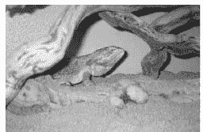

正在寻找新朋友？

来看看我们的宠物目录。
我们可能正好有你想要的。

**想要更多？**

- 特价优惠？
- 宠物信息？
- 良好的交流？

试试我们商店的 Members Only 部分

免费！

**图 12-2:**
客户登录或创建新会员账户的页面。

**Members Only 部分**

你是会员吗？

用户名
密码
进入

还不是会员？获取折扣、时事通讯、新宠物的提前通知，以及更多。填写下面的信息并加入。简单又免费！

会员 ID
密码
名
姓
街道
城市
州
邮政编码
电话
传真
电子邮件地址
成为会员

我们感谢所有评论和建议。请将评论发送至 webmaster@petstore.com

如果客户在登录页面上犯了错误，无论是在登录部分还是在新会员部分，表单都会再次显示并附有错误消息。例如，假设客户在输入电子邮件地址时犯了错误：他忘记在电子邮件地址末尾输入 `.com`。图 12-3 显示了他提交包含错误表单后看到的屏幕。请注意表单上方打印的错误消息。

当会员使用有效的会员 ID 和密码成功登录时，他们会进入 Members Only 部分的第一页。当新会员成功提交包含合理信息的表单时，他们会进入新会员欢迎页面。此外，还会向新会员发送一封包含以下内容的电子邮件：

```
A new Member Account has been setup for you. Your new

Member ID and password are:

gsmith

secret

We appreciate your interest in Pet Store at PetStore.com

If you have any questions or problems, send email

to webmaster@petstore.com
```

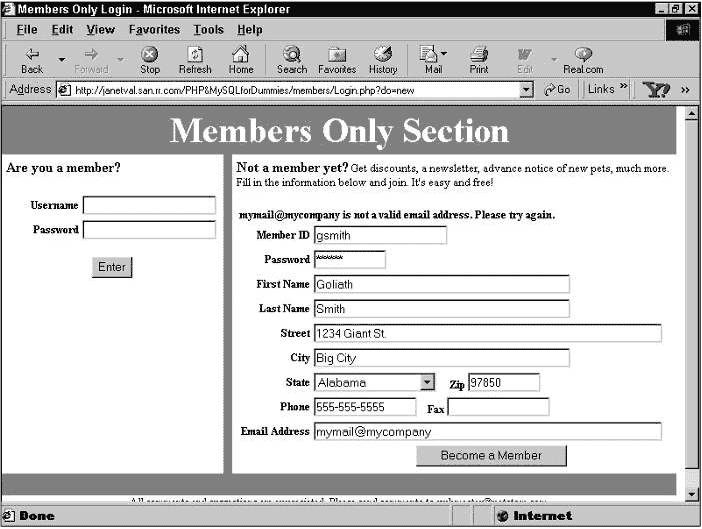

**图 12-3:** 显示表单中错误所导致消息的页面。


这封电子邮件包含客户的密码。我认为，向客户提供密码的纸质副本，对客户和企业双方都非常有帮助。客户总会忘记密码，这似乎是一条铁律。一封带有密码的电子邮件可以在他们忘记时提供帮助，为他们和你都省去一些麻烦。当然，电子邮件并不一定是安全的，因此对于某些账户（如网上银行账户），通过电子邮件发送密码并非好主意。但是，对于这个宠物商店应用而言，风险仅涉及未经授权的折扣和宠物护理信息，通过电子邮件发送密码是可接受的风险。

## 新会员欢迎页面

新会员欢迎页面用于迎接客户并提供有用信息。客户看到账户已创建成功后，即可立即进入会员专区。图12-4展示了欢迎页面。

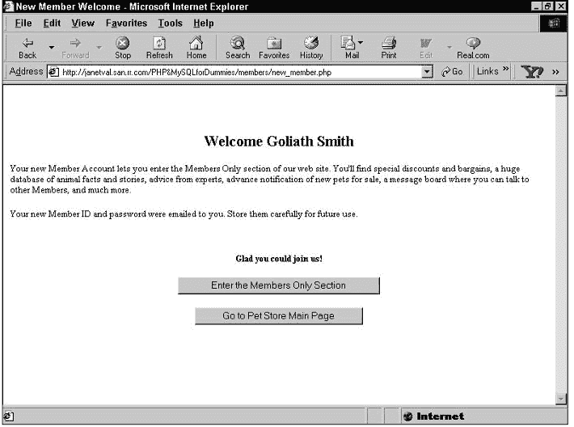

图12-4：
欢迎新会员的页面。

## 会员专区

会员专区的内容由一个或多个网页组成。无论内容为何，这些页面与其他网页或PHP程序并无不同，只是在每个文件开头有一些PHP语句，用于阻止非会员查看页面。

## 编写程序

当你知道页面将呈现的外观及其功能后，就可以编写程序了。通常，为每个页面创建一个程序，尽管有时将程序拆分为多个文件或将多个程序合并到一个页面中也很有意义。

正如我在第10章中所讨论的，将连接数据库所需的信息保存在单独的文件中，并将其包含在需要访问数据库的所有程序中。将该文件存储在安全位置，并采用一个具有迷惑性的名称。对于此应用，以下信息存储在名为`dogs.inc`的文件中：

```
<?php

$user="catalog";

$host="localhost";

$password="";

$database="MemberDirectory";

?>
```

会员登录应用有几个基本任务：

- 1. **显示商店首页。** 该页面提供指向登录页面的链接。
- 2. **显示一个页面，客户可以在其中填写会员ID和密码以登录。**
- 3. **将客户输入的会员ID和密码与数据库中存储的会员ID和密码进行核对。** 如果ID和密码正确，客户进入会员专区。如果ID和/或密码不正确，客户将返回登录页面。
- 4. **显示一个页面，客户可以在其中填写获取会员账户所需的信息。**
- 5. **检查客户输入的信息是否有空字段或格式错误。** 如果发现错误信息，则重新显示表单，以便客户更正信息。
- 6. 当输入正确信息时，将新会员添加到数据库中。
- 7. 向新会员显示欢迎页面。

这些任务通过三个程序完成：

- `PetShopFront.php`：显示商店首页。
- `Login.php`：执行登录和创建新会员账户任务。
- `New_member.php`：显示欢迎新会员的页面。

## 编写PetShopFront

商店首页不需要任何PHP语句。它只是显示一个带有两个链接的网页——一个链接指向宠物目录，一个链接指向网站的会员专区。使用HTML语句就足够了。清单12-1展示了描述商店首页的HTML文件。

### 清单12-1：商店首页的HTML文件

```
<?php

/* Program: PetShopFrontMembers.php
 * Desc: Displays opening page for Pet Store.
 */

?>
<html>
<head><title>Pet Store Front Page</title></head>
<body topmargin="0" leftmargin="0" marginheight="0" marginwidth="0">
<table width="100%" height="100%" border="0" cellspacing="0" cellpadding="0">
<tr>
<td align="center" valign="top" height="30" colspan="2">

</td>
</tr>
<tr>
<td align="center" valign="top" colspan="2">

</td></tr>
```

### 清单12-1（续）

```
<tr>
  <td width="80%" align="center">
    <p style="margin-top: 40pt">
      
      <p><h2>Looking for a new friend?</h2>
      <p>Check out our
        <a href="PetCatalog.php">Pet Catalog.</a>
        <br> We may have just what you're looking for.
    </td>
    <td width="20%" bgcolor="black">
      <div style="color: white; link: white">
        <p style="text-align: center; font-size: 15pt">
          <b>Looking for <br>more?</b></p>
        <ul>
          <li>special deals?
          <li>pet information?
          <li>good conversation?
        </ul>
        <p style="text-align: center">Try the
          <br><a href="Login.php" style="color: white">Members Only</a>
          <br>section <br>of our store
        <p style="text-align: center"><b>It's free!</b></p>
      </div>
    </td>
  </tr>
</table>
</body></html>
```

注意指向登录PHP程序的链接。当客户点击该链接时，将出现登录页面。

## 编写Login

登录页面由程序`Login.php`生成，如清单12-2所示。该程序使用一个`switch`创建两个部分：一个用于登录，一个用于创建新账户。该程序创建了一个会话，该会话用于所有会员专区网页。登录表单本身不包含在此程序中；它位于一个名为`login_form.inc`的单独文件中，每当需要该表单时，通过`include`语句将其调用到该程序中。

### 清单12-2：登录程序

```
<?php

/* Program: Login.php
 * Desc:    Login program for the Members Only section of the
 *          pet store. It provides two options: (1) login
```

### 清单12-2（续）

```
unset($do);                                           //#54
$message = "The Login Name you entered does not exist! Please try again.<br>";
include("login_form.inc");
}
break;                                                //#59
case "new":                                          //#61
foreach($_POST as $field => $value)                   //#62
{
    if ($field != "fax")                             //#64
    {
        if ($value == "")                            //#66
        {
            unset($_GET['do']);
            $message_new = "Required information is missing. Please try again.";
            include("login_form.inc");
            exit();
        }
    }
    if (ereg("(Name)",$field))                      //#75
    {
        /*if (!ereg("^[A-Za-z' -][1,50]$",$value))
        {
            unset($_GET['do']);
            $message_new = "$field is not a valid name. Please try again.";
            include("login_form.inc");
            exit();
        }*/
    }
    $$field = strip_tags(trim($value));              //#86
} // end foreach
if (!ereg("^[0-9]{5,5}(\-[0-9]{4,4})?$",$zip))      //#88
{
    unset($_GET['do']);
    $message_new = "$zip is not a valid zip code. Please try again.";
    include("login_form.inc");
    exit();
}
if (!ereg("^[0-9][xX -]{7,20}$",$phone))            //#96
{
    unset($_GET['do']);
    $message_new = "$phone is not a valid phone number. Please try again.";
    include("login_form.inc");
    exit();
}
```


```php
if ($fax != "")											#104

{

    if (!ereg("^[0-9][xX -]{7,20}$",$fax))

    {

        unset($_GET['do']);

        $message_new = "$fax is not a valid phone number. Please try again.";

        include("login_form.inc");

        exit();

    }

}

if (!ereg("^.+@.+\\..+$",$email))							#115

{

    unset($_GET['do']);

    $message_new = "$email is not a valid email address. Please try again.";

    include("login_form.inc");

    exit();

}

/* check to see if login name already exists */				#122
$connection = mysql_connect($host,$user,$password)
    or die ("Couldn't connect to server.");
$db = mysql_select_db($database, $connection)
    or die ("Couldn't select database.");
$sql = "SELECT loginName FROM Member
    WHERE loginName='$newname'";
$result = mysql_query($sql)
    or die("Couldn't execute query.");
$num = mysql_numrows($result);
if ($num > 0)											#133

{

    unset($_GET['do']);

    $message_new = "$newname already used. Select another Member ID.";

    include("login_form.inc");

    exit();

}

else												#141

{

    $today = date("Y-m-d");							#143
    $sql = "INSERT INTO Member (loginName,createDate,
        password,firstName,lastName,street,city,
        state,zip,phone,fax,email) VALUES
        ('$newname','$today',password('$newpass'),
        '$firstName','$lastName','$street','$city',
        '$state','$zip','$phone','$fax','$email')";
    mysql_query($sql);									#150
    $_SESSION['auth']="yes";							#151
    $_SESSION['logname'] = $newname;					#152
```
## 清单 12-2（续）
```
/* send email to new member */                     #153
$emess = "A new Member Account has been setup. ";
$emess.= "Your new Member ID and password are: ";
$emess.= "\n\n\t$newname\n\t$newpass\n\n";
$emess.= "We appreciate your interest in Pet Store";
$emess.= " at PetStore.com. \n\n";
$emess.= "If you have any questions or problems,";
$emess.= " email webmaster@petstore.com";
$ehead="From: member-desk@petstore.com\r\n";       #161
$subj = "Your new Member Account from Pet Store";
$mailsend=mail("$email","$subj","$emess","$ehead");
header("Location: New_member.php");                #164
}
break;                                             #166
default:                                            #168
    include("login_form.inc");
}
?>
```

清单 12-2 中某些行的行尾带有行号。下面的列表引用清单中的行号来讨论程序及其工作原理：

- 9 启动一个会话。会话必须在程序开始时启动，即使用户尚未登录。
- 10 读取设置连接数据库所需变量的文件。该程序名为 `dogs.inc`，这是一个具有误导性的名称，看起来比命名为 `mypasswords.inc` 更安全。
- 11 开始一个 `switch` 语句。`switch` 语句包含三个部分，基于传递给 `do` 的值，该值从内置数组 `$_GET` 获取。第一个部分在传递给 `do` 的值为 `login` 时运行；第二个部分在传递给 `do` 的值为 `new` 时运行；第三个部分是默认值，当未传递 `do` 值时运行。第三个部分只是创建登录页面，仅在客户首次链接到登录页面时运行。
- 13 开始登录部分的 case 块——即客户登录时运行的部分。表单的登录部分在 URL 中发送 `do=login`，这会导致 `switch` 语句的这一部分运行。
- 14 第 14–17 行连接到 MySQL 并选择数据库。
- 19 第 19–22 行在数据库表 `Member` 中查找包含客户输入的登录名的行。
- 23 检查是否找到 `loginName` 字段包含客户输入的 Member ID 的行。`$num` 将等于 0 或 1，具体取决于是否找到该行。
- **24** 开始一个 `if` 块，如果找到 Member ID 则执行。这意味着用户提交了一个在数据库中存在的 Member ID。然后该块检查用户提交的密码是否与给定的 Member ID 正确对应。该块在下面的列表中有更详细的说明：
- **26** 第 26–28 行创建一个查询，查找同时具有客户提交的 Member ID 和密码的行。请注意，表单中提交的密码 `\$fpassword` 是通过使用 MySQL 函数 `password()` 进行加密的。数据库中的密码是加密的，因此你尝试匹配的密码也必须加密，否则无法匹配。
- **29** 第 29–31 行执行查询并检查是否找到匹配项。`$num2` 等于 1 或 0，具体取决于是否找到同时具有 Member ID 和密码的行。
- **32** 开始一个 `if` 块，如果密码正确则执行。这是成功登录。第 32–41 行被执行，执行以下任务：1）两个会话变量 `auth` 和 `logname` 存储在 `SESSION` 数组中。2）`$today` 以数据库表期望的正确格式创建为今天的日期和时间。3）登录的行被输入到 `Login` 表中。4）Members Only 部分的第一页被发送给会员。
- **43** 开始一个 `else` 块，如果密码不正确则执行。这是登录失败。第 45–49 行被执行，执行以下任务：1）取消设置表单变量 `$do`。这可以防止后续出现任何混淆。2）将适当的错误消息设置到 `$message` 中。3）再次显示登录页面。登录页面将显示错误消息。


请注意，从第 43 行开始的块会让用户知道他们拥有真实的登录名但密码错误。如果你的数据安全性非常重要，你可能希望以不同的方式编写此块。提供这些信息可能会帮助试图入侵的人。破解者现在只需要找到密码。为了更安全，只需设置一个条件，无论登录名或密码不正确时都给出相同的错误消息。在本例中，我更倾向于提供这些信息，因为它对合法会员有帮助（他们可能不记得是否安装了账户），而且我没有保护任何重要信息。

- **51** 结束当 Member ID 在数据库中找到时执行的块。
- **52** 开始一个 `if` 块，当 Member ID 是 **不** 找到时执行。这实际上可以是一个 `else`，而不是 `elseif`，但我认为在语句中使用 `if` 条件对人类来说更清晰。该块取消设置表单变量 `$do`，创建适当的错误消息，并再次显示登录页面，其中包含错误消息。
- 59 结束当客户提交 Member ID 和密码登录时执行的 case 块。登录块从第 13 行延伸到此行。
- 61 开始当客户填写表单以获取新会员账户时执行的 case 块。表单在 URL 中发送 `do=new`，导致程序跳转到 `switch` 语句的这一部分。
- 62 开始一个 `foreach` 循环，遍历新会员表单中的每个字段。循环检查空的必填字段并检查名字和姓氏是否包含可接受的字符。循环中的语句在下面的列表中有更详细的说明：
- 64 检查字段是否为传真字段。传真字段不是必填项。传真字段不检查是否为空，因为允许为空。
- 66 检查字段是否为空。如果为空，`if` 块执行以下任务：1）取消设置 `$do`。2）创建解释问题的错误消息。3）再次显示登录表单，包括错误消息。4）停止程序并等待用户再次提交表单并填写该字段。
- 75 检查字段是否为姓氏或名字字段。如果是，则检查字段格式是否包含允许的字符。如果发现任何不允许的字符，则执行以下任务：1）取消设置 `$do`。2）创建解释问题的错误消息。3）再次显示登录表单，包括错误消息。4）停止程序并等待用户再次提交表单并使用正确的格式。
- 86 在第 66 行检查后，从所有字段值中修剪多余的空格，以确保它们不为空。删除任何字段中的 HTML 标签。以以下方式为每个字段创建变量。假设在 `foreach` 循环的第一次循环中，变量是 `$_POST['loginName'] = 'gsmith'`。`foreach` 循环设置 `$key="loginName"` 和 `$value="gsmith"`。因此，第 86 行的语句等价于 `$loginName=strip_tags(trim("gsmith"))`。`$$key` 是 `$loginName`，因为 `$key=loginName`。
- 87 结束 `foreach` 循环。
- 88 第 88–122 行是一系列 `if` 块，用于检查字段是否具有正确的格式。如果任何被检查的字段格式不正确，该块执行以下任务：1）取消设置 `$do`。2）创建解释问题的错误消息。3）再次显示登录表单，包括错误消息。4）停止程序并等待用户再次提交表单并使用正确的格式。
- 124 第 124–132 行检查客户提交的 Member ID 是否已是数据库表 `Member` 中的 `loginName`。`loginName` 必须唯一。`$num` 等于 0 或 1，具体取决于是否在数据库中找到 `loginName`。
- 133 开始一个 `if` 块，如果 `loginName` 已在数据库中则执行。如果 Member ID 不唯一，则无法添加新会员。该块执行以下任务：1）取消设置 `$do`。2）创建解释问题的错误消息。3）再次显示登录表单，包括错误消息。4）停止程序并等待用户再次提交表单并使用不同的 Member ID。
- 141 如果 `loginName` 尚未在数据库中，则开始一个 `else` 块。这是会员账户的成功申请。该块在 `Member` 表中为新会员账户插入一行，并向客户发送有关新账户的电子邮件消息。块中的语句在下面的列表中有更详细的说明：
- 143 将 `$today` 设置为 `Member` 表中 `createDate` 字段的正确格式的今天日期。
- 144 创建一个 `INSERT` 查询以添加新会员行。请注意，密码在输入时被加密为 `password('$newpass')`。这是一种安全方法，以确保查看数据库的人无法看到密码。如果你完全确定不应该查看数据库的人不会看到数据库，加密并不是真正必要的。
- 150 执行 `INSERT` 查询。
- 151 在第 151 行和第 152 行，两个会话变量 `$auth` 和 `$logname` 存储在 `SESSION` 数组中。
- 154 第 154–163 行向新会员发送电子邮件，验证 Member ID 和密码。请注意，电子邮件消息是在变量 `$emess` 中跨多行创建的。它始于第 154 行，并在每一行上通过使用 `.=` 进行添加，直到第 160 行结束。这是为了让人类更容易阅读——而不是因为 PHP 需要这样。与忽略额外空格和行尾的 HTML 内容不同，额外空格和其他内容会影响电子邮件消息。例如，如果我创建一个很长的消息——用额外的空格缩进以便我阅读——这些空格会出现在电子邮件中。因此，我将消息设置在几行上，以便在程序中缩进以提高可读性。第 163 行使用 PHP 函数 `mail` 发送电子邮件消息。`mail` 函数在第 14 章中有说明。
- 164 将客户发送到 `New_member.php` 页面。
- 165 结束成功的新会员账户申请的 `else` 块。

166 结束登录页面新成员部分的 case 块。

168 开始默认条件的 case 块。如果 `$do` 未设置为 `"login"` 或 `"new"`，程序将跳到此块。由于登录页面上的两个表单都会设置 `$do`，因此此块仅在程序首次运行时执行——当用户从商店首页链接到它且尚未提交任一表单时。此部分只有一个语句：显示登录页面的语句。

此程序在多个位置显示登录页面。这是通过调用文件 `login_form.inc` 的 `include` 语句实现的。该文件包含生成登录页面的 HTML。程序 `Login.php` 完全不产生任何输出。所有输出均由 `login_form.inc` 产生。这种类型的应用程序组织在第 10 章中有讨论。这是使用 `include` 文件的一个很好的例子。试想一下，如果 `login_form.inc` 中的语句，如列表 12-3 所示，在 `Login` 程序中每次包含 `login` 的地方都被包含进来，这个程序已经足够长了。天哪，那将是一团只有计算机才能理解的混乱。

### 列表 12-3：创建登录页面的文件

```php
<?php
/* File: login_form.inc
 * Desc: Displays login page. Page displays two forms--one
 *       form for entering an existing login name and
 *       password and another form for the information
 *       needed to apply for a new account.
 */
include("functions12.inc");          # 8
?>
<html>
<head><title>Members Only Login</title></head>
<body topmargin="0" leftmargin="0" marginheight="0"
      marginwidth="0">
<table border="0" cellpadding="5" cellspacing="0">
  <tr><td colspan="3" bgcolor="gray" align="center">
    <font color="white" size="+10">
      <b>Members Only Section</b></font></td></tr>
  <tr>
    <td width="33%" valign="top">
      <font size="+1"><b>Are you a member?</b></font>
      <p>
      <!-- form for customer login -->
      <form action="Login.php?do=login" method="POST">
      <table border="0">
<?php
        if (isset($message))
          echo "<tr><td colspan='2'>$message </td></tr>";
?>
<tr><td align=right><b>Username</b></td>
    <td><input type="text" name="fusername"
        size="20" maxlength="20">
    </td></tr>
<tr><td width="120" align="right"><b>Password</b>
</td>
    <td><input type="password" name="fpassword"
        size="20" maxlength="20"></td></tr>
<tr><td align="center" colspan="2">
    <br><input type="submit" name="log"
                value="Enter">
    </td></tr>
</table>
</form>
</td>
```


<td width="1" bgcolor="gray"></td>

<td width="67%">

<p><font size="+1"><b>Not a member yet?</b></font>

Get discounts, a newsletter, advance notice of

new pets, much more. Fill in the information

below and join. It's easy and free! </b>

<!-- form for new member to fill in -->

<form action="Login.php?do=new" method="POST">

<p>

<table border="0" width="100%">

<?php

if (isset($message_new)) #55
    echo "<tr><td colspan='2'><b>$message_new</b>
        </td></tr>";
?>

<tr><td align="right"><b>Member ID</b></td>
    <td><input type="text" name="newname"
        value="<?php echo @$newname ?>"
        size="20" maxlength="20"></td></tr>

<tr><td align="right"><b>Password</b></td>
    <td><input type="password" name="newpass"
        value="<?php echo @$newpass ?>"
        size="10" maxlength="8"></td></tr>

<tr><td align="right"><b>First Name</b></td>
    <td><input type="text" name="firstName"
        value="<?php echo @$firstName ?>"
        size="40" maxlength="40"></td></tr>

<tr><td align="right"><b>Last Name</b></td>
    <td><input type="text" name="lastName"
        value="<?php echo @$lastName ?>"
        size="40" maxlength="40"></td></tr>

<tr><td align="right"><b>Street</b></td>
    <td><input type="text" name="street"
        value="<?php echo @$street ?>"
        size="55" maxlength="50"></td></tr>

<tr><td align="right"><b>City</b></td>
    <td><input type="text" name="city"
        value="<?php echo @$city ?>"
        size="40" maxlength="40"></td></tr>

<tr><td align="right"><b>State</b></td>
    <td><select name="state">
<?php

$stateName=getStateName(); #86
$stateCode=getStateCode(); #87
for ($n=1;$n<=50;$n++)
{
    $state=$stateName[$n];
    $scode=$stateCode[$n];
    echo "<option value=\"$scode\"";
    if ($scode=="AL")
        echo " selected";
    echo ">$state\n";
}

?>
    </select>

    &nbsp;&nbsp;&nbsp;&nbsp;<b>Zip</b>
    <input type="text" name="zip"
        value="<?php echo @$zip ?>"
        size="10" maxlength="10">

</td></tr>

<tr><td align=right><b>Phone</b></td>
    <td><input type="text" name="phone"
        value="<?php echo @$phone ?>"
        size="15" maxlength="20">
    &nbsp;&nbsp;&nbsp;<b>Fax</b>
    <input type="text" name="fax"
        value="<?php echo @$fax ?>"
        size="15" maxlength="20"></td></tr>

<tr><td align=right><b>Email Address</b></td>
    <td><input type="text" name="email"
        value="<?php echo @$email ?>"
        size="55" maxlength="67"></td></tr>

<tr><td>&nbsp;</td>
    <td align="center">
        <input type="submit"
            value="Become a Member"></td>
</tr>

</table>

</form>

</td>

</tr>

<tr><td colspan="3" bgcolor="gray">&nbsp;</td></tr>

</table>

<div align="center"><font size="-1">
All comments and suggestions are appreciated. Please
send comments to <a href="mailto:webmaster@petstore.com">
webmaster@petstore.com</a> </font></div>

</body></html>

```

请注意关于 `login_form` 的以下几点：

- 大多数语句都是 HTML，其中不时夹杂着一些小的 PHP 部分。
- 从第 23 行和第 51 行开始的两个表单将 action 设置为同一个程序，但会在 URL 中添加不同的字符串——`do=login` 或 `do=new`。
- 错误消息是通过使用小的 PHP 部分在登录页面上显示的。每个表单都有其部分，并且消息对两个表单有不同的名称：`$message` 和 `$message_new`。第 26 行测试变量 `$message`。如果它有值，则显示消息，如果没有值则不显示。如果表单中没有错误，则从未设置该消息，也不会显示消息。第 55 行的类似语句显示新成员表单的错误消息。
- 为客户选择州提供了一个选择下拉列表（从第 84 行开始），以防止客户输入错误。请注意，第 86 行和第 87 行调用了函数。这些函数不是 PHP 函数；它们是我的函数。这些函数在第 8 行被包含到程序中。函数从州名列表和两位州代码列表创建数组。通过使用函数，您无需在程序中包含 50 个州的两个列表。这些函数可以重复用于许多程序。`functions12.inc` 文件包含以下两个函数：

```php
<?php

function getStateCode()
{
    $stateCode = array(1=> "AL",
        "AK",
        "AZ",
        ...
        "WY" );
    return $stateCode;
}

function getStateName()
{
    $stateName = array(1=> "Alabama",
        "Alaska",
        "Arizona",
        ...
        "Wyoming" );
    return $stateName;
}

?>
```

然后 `for` 循环使用这两个州数组为选择列表创建 50 个选项。

运行 `Login.php` 后，如果用户登录成功，则显示仅限会员部分的第一个页面。如果用户成功获得新用户账户，则运行 `New_member.php` 程序。

## 编写 New_member

新成员欢迎页面以姓名向新成员问候并提供有关其账户的信息。然后成员可以选择进入仅限会员部分或返回主页面。列表 12-4 显示了显示新成员所见页面的程序。

### 列表 12-4：欢迎新成员的程序

```php
<?php

/* Program: New_member.php
 * Desc:     Displays the new member welcome page. Greets
 *           member by name and gives user choice to enter
 *           restricted section or go back to main page.
 */

session_start(); # 7
if (@$_SESSION['auth'] != "yes") # 9
{
    header("Location: Login.php");
    exit();
}

include("dogs.inc"); #14
$connection = mysql_connect($host,$user,$password)
        or die("Couldn't connect to server."); #16
$db = mysql_select_db($database, $connection)
        or die("Couldn't select database."); #18
$sql = "SELECT firstName,lastName FROM Member
             WHERE loginName='{$_SESSION['logname']}'";
$result = mysql_query($sql)
        or die("Couldn't execute query 1.");
$row = mysql_fetch_array($result,MYSQL_ASSOC);
extract($row);

```

```

echo "<html>
<head><title>欢迎新会员</title></head>
<body>
<h2 align='center' style='margin-top: .7in'>
欢迎 $firstName $lastName</h2>\n"; #29
?>
```
<p>您的新会员账户可让您进入我们网站的“会员专区”。您会找到特别折扣和优惠、一个庞大的动物知识与故事数据库、专家建议、新宠物出售的预先通知、一个供您与其他会员交流的留言板，以及更多内容。
<p>您的新会员ID和密码已通过电子邮件发送给您。请妥善保管以备后用。<br>
<div align="center">
<p style="margin-top: .5in"><b>欢迎您的加入！</b>
<form action="Member_page.php" method="POST">
<input type="submit"
value="进入会员专区">
</form>
<form action="PetShopFrontMembers.php" method="POST">
<input type="submit" value="返回宠物商店主页">
</form>
</div>
</body></html>
```

关于 `New_member.php`，请注意以下几点：

- 第7行启动了一个会话。这使得 `Login.php` 中存储的会话变量在该程序中可用。
- 程序从第9行开始检查客户是否已登录。当客户成功登录或创建新账户时，`$auth` 在 `Login.php` 中被设置为 `yes`，并存储在 `$_SESSION` 数组中。如果 `$auth` 不等于 `yes`，则客户未登录。如果客户在未先运行 `Login.php` 程序的情况下尝试运行 `New_member.php` 程序，`$_SESSION[auth]` 将不等于 `yes`，用户将被发送到登录页面。
- 程序从第15行的数据库连接语句开始，从数据库中获取客户的名字和姓氏。在第19/20行，通过使用 `$_SESSION[logname]` 搜索会员信息来创建查询。包含会员ID的会话变量 `logname` 是在登录程序中设置的。
- PHP部分在第30行结束。程序的其余部分是HTML。
- 程序使用两个不同的表单来提供两个不同的提交按钮。第41行和第45行的表单语句启动不同的程序。

接下来由客户决定。如果客户点击返回主页的按钮，则运行 `PetShopFront.php` 程序。如果客户点击“会员专区”提交按钮，则显示会员专区的第一页。

## 编写会员专区

会员专区中的网页与其他网页没有什么不同。您只需将其限制为已登录的会员。为此，您需要在每个页面的顶部启动一个会话，并检查他们是否已登录。每个程序顶部的语句如下：

```
session_start();
if (@$_SESSION['auth'] != "yes")
{
    header("Location: Login.php");
    exit();
}
```

当 `session_start` 执行时，PHP 会检查是否已有会话存在。如果存在，它会设置会话变量。其中一个会话变量是 `$auth`。当用户登录时，`$_SESSION[auth]` 被设置为 `yes`。如果 `$_SESSION[auth]` 不等于 `yes`，则用户未登录，程序会将用户带到登录页面。

## 为增长做规划

一个应用程序的原始计划通常包含用户可能希望它做的所有精彩功能。但实际上，尽快让用户使用该应用程序通常更为重要。因此，应用程序通常以计划功能的一个子集上线，之后再添加更多功能。这就是为什么在编写应用程序时要考虑未来增长的原因。

看看本章中的登录应用程序，我相信您能看到许多可以添加的功能。以下是一些可能的想法：

- **通过电子邮件发送遗忘的密码。** 用户经常忘记密码。许多登录应用程序都有一个链接，用户可以点击该链接，让系统将密码通过电子邮件发送给他们。
- **修改密码。** 会员可能想要更改密码。应用程序可以提供用于修改密码的表单。
- **更新信息。** 会员可能搬家或更改电话号码或电子邮件地址。应用程序可以提供一种方式，让会员自行更改其信息。
- **创建会员列表。** 您可能希望以格式良好的方式输出数据库中所有会员的列表。这可能不是您想对其他会员开放的功能，而只是供您自己使用。但在某些情况下，您可能希望向所有会员提供该列表。

您可以轻松地将这些功能中的任何一个添加到应用程序中。例如，您可以在登录表单中添加一个“*忘记密码*”按钮，将密码发送到数据库中的电子邮件地址。该按钮可以运行带有密码发送部分的登录程序，或者运行另一个发送密码的程序。同样，您也可以添加用于修改密码或更新客户信息的按钮。您不必等待应用程序具备所有附加功能后才让客户使用它。您可以一步一步地编写。

## 第五部分

## “十”部分

### 第五波

作者：Rich Tennant


> “你是想让我给公司打电话，让他们再寄一份数据库软件系统的评论副本，还是你已经知道要写什么了？”

### 本部分内容……

本部分各章包含基于我经验的心得、提示和警告。或许它们能成为您成长为一名自信的Web开发者的捷径。我真诚地希望如此。

### 第13章

## 你可能想用 PHP 函数做的十件事

### 本章内容

- 了解许多有用的函数
- 理解函数能做什么

PHP 最强的方面之一是其众多内置函数。在本章中，我列出了我最常使用的 PHP 函数。有些我在本书其他地方描述过，有些只是顺带提及，有些则完全没有提到。这些绝不是全部函数。PHP 语言中有数百个函数。有关所有函数的完整列表，请参阅 www.php.net 上的 PHP 文档。

### 与 MySQL 通信

PHP 有许多专门用于与 MySQL 交互的函数。我在本书中详细描述了以下 MySQL 函数，尤其是在第8章中：

```
mysql_connect();    mysql_select_db();    mysql_fetch_array()
mysql_close();        mysql_num_rows();     mysql_query()
```


以下函数可能很有用，但我在前面章节中要么没有讨论，要么只是简要讨论：

- `mysql_insert_id()`：用于 MySQL 的 AUTO-INCREMENT 列。此函数获取插入到该列中的最后一个数字。
- `mysql_fetch_row($result)`：从临时结果位置获取一行。该行被放入一个以数字为键的数组中。它与 `mysql_fetch_array($row, MYSQL_NUM)` 相同。
- `mysql_affected_rows($result)`：返回受查询影响的行数——例如，被删除或更新的行数。
- `mysql_num_fields($result)`：返回结果中的字段数。
- `mysql_field_name($result, N)`：返回由 N 指示的行的名称。例如，`mysql_field_name($result,1)` 返回结果中第二列的名称。第一列为 0。

如果您将上述任何函数与 MySQL 4.1 一起使用，函数名会略有不同。函数名不是以 `mysql_` 开头，而是以 `mysqli_` 开头。

## 发送电子邮件

PHP 提供了一个用于从 PHP 程序发送电子邮件的函数。格式为

```
mail(address,subject,message,headers);
```

您需要填写以下值：

- `address`：将接收消息的电子邮件地址。
- `subject`：用于电子邮件主题行的字符串。
- `message`：电子邮件消息中的内容。
- `headers`：设置标头值的字符串。例如，您可能有如下标头字符串：

```
"From: member-desk@petstore.com\r\nbcc: mom@hercompany.com"
```

该标头会将 From 标头设置为给定的电子邮件地址，并向 mom 发送一封密送副本。

以下是可用于在脚本中设置和发送电子邮件消息的 PHP 语句示例：

```
$to = "janet@valade.com";
$subj = "Test";
$mess = "This is a test of the mail function";
$headers = "bcc:techsupport@mycompany.com\r\n";
$mailsend = mail($to,$subj,$mess,$headers);
```

有时你可能会遇到电子邮件问题。PHP 有一个配置设置，必须在 mail 函数能够连接到你的系统电子邮件软件之前正确设置。默认值通常是正确的，但如果你的电子邮件似乎无法到达目的地，请通过在 `phpinfo()` 的输出中查找以下内容来检查 PHP 配置的 mail 设置：

| Sendmail_path | (在 Unix/Linux 上) |
|---|---|
| SMTP | (在 Windows 上) |

它可能设置不正确。你可以通过编辑 `php.ini` 文件来更改设置。查找以下行：

```
[mail function]
; For Win32 only.
SMTP = localhost

; For Win32 only.
sendmail_from = me@localhost.com

; For Unix only.
;sendmail_path =
```

Windows 用户需要更改前两个设置。第一个设置是你放置发件邮件服务器名称的地方。无论你如何发送电子邮件——在工作场所的局域网、在家里的有线调制解调器、通过调制解调器使用 ISP——你都使用 SMTP 服务器发送邮件，该服务器有一个你需要知道的地址。

如果你直接从计算机发送，你应该能在你的电子邮件软件中找到你正在使用的发件邮件服务器的名称。例如，在 Microsoft Outlook Express 中，选择 Tools→Accounts→Properties，然后选择 Servers 选项卡。查找你的发件邮件服务器的名称。如果你找不到它的名称，可以向你的电子邮件管理员询问名称。如果你使用 ISP，可以向 ISP 询问。名称很可能采用以下类似的格式：

```
mail.ispname.net
```

第二个设置是随所有电子邮件一起发送的返回地址。将设置更改为你想要用作返回地址的电子邮件地址，如下所示：

```
sendmail_from = Janet@Valade.com
```

第三个设置适用于 Unix 用户。默认值通常是正确的。如果它不起作用，你需要与系统管理员讨论发件邮件服务器的正确路径。这通常也适用于 Linux。


不要忘记删除行开头的分号。分号会使该行成为注释，因此在删除分号之前设置不会生效。

## 使用 PHP 会话

用于打开或关闭会话的函数如下。我在第 9 章中解释了所有这些函数。

```
session_start();    session_destroy()
```

## 停止你的程序

有时你只是想让你的程序停止、终止。为此有两个函数：`exit()` 和 `die()`。实际上，它们是同一个函数的两个不同名称。Exit 可能更准确，但有时说 die 更有趣。这两个函数在停止时会打印消息，如果你提供一个消息。格式如下

```
exit("message string");
```

当 `exit` 执行时，消息字符串会被输出。

## 处理数组

数组在 PHP 中非常有用，特别是用于获取数据库函数的结果和表单变量。我在本书其他地方解释了以下数组函数，主要在第 7 章：

```
array();      extract();      sort();      asort();
rsort();      arsort();      ksort();      krsort();
```

这里有一些其他有用的函数：

- `array_reverse($varname)`：返回一个值按相反顺序排列的数组。
- `array_unique($varname)`：从数组中删除重复值。
- `in_array("string",$varname)`：在数组 `$varname` 中查找字符串 `"string"`。
- `range(value1,value2)`：创建一个包含 `value1` 和 `value2` 之间所有值的数组。例如，`range('a','z')` 创建一个包含 `a` 和 `z` 之间所有字母的数组。
- `explode("sep","string")`：创建一个字符串数组，其中每个项目是 `string` 的子字符串，由 `sep` 分隔。例如，`explode(" ",$string)` 创建一个数组，其中 `$string` 中的每个单词都是一个单独的值。这类似于 Perl 中的 `split` 函数。
- `implode("glue",$array)`：创建一个包含 `$array` 中所有值并用 `glue` 分隔的字符串。例如，`implode(", ",$array)` 创建一个字符串：`value1,value2,value3`，等等。这类似于 Perl 中的 `join` 函数。

还有许多其他有用的数组函数。PHP 可以做你能想到的几乎所有你想对数组做的操作。

## 检查变量

有时你只需要知道某个变量是否存在。以下函数可用于测试变量是否当前已设置：

```
isset($varname); // true if variable is set
!isset($varname); // true if variable is not set
empty($varname); // true if value is 0 or is not set
```

## 格式化值

有时你需要格式化变量中的值。在第 6 章中，我解释了如何使用 `number_format()` 和 `sprintf()` 将数字格式化为美元格式。在第 6 章中，我还讨论了 `unset()`，它会从变量中删除值。在本节中，我描述了 `sprintf()` 的额外功能。

函数 `sprintf()` 允许你格式化任何字符串或数字，包括变量值。一般格式如下

```
$newvar = sprintf("format",$varname1,$varname2,...);
```

## 更改字符串的大小写

将大写字母更改为小写，反之亦然，并不容易。感谢 PHP 提供了为你执行此操作的函数：

- `strtolower($varname)`：将字符串中的任何大写字母更改为小写字母
- `strtoupper($varname)`：将字符串中的任何小写字母更改为大写字母
- `ucfirst($varname)`：将字符串中的第一个字母更改为大写
- `ucwords($varname)`：将字符串中每个单词的第一个字母更改为大写

### 第 14 章

## 十个 PHP 陷阱

## 本章内容

- 识别常见的 PHP 错误
- 解释错误信息

我保证你会做本章中提到的所有事情。不犯这些错误是不可能写程序的。诀窍是弄清楚如何识别它们，翻白眼，说“又来了”，然后修复它们。你会多次看到的一个错误信息是

```
Parse error: parse error in c:\test.php on line 7
```

这是 PHP 说“嗯？”的方式。这意味着它不理解某些东西。此消息有助于指出 PHP 感到困惑的文件和行号。有时它直接指向错误，但有时 PHP 的困惑是由程序中更早的错误引起的。

### 缺少分号

每个 PHP 语句都以分号 (`;`) 结尾。PHP 不会在到达分号之前停止读取语句。如果你行尾省略分号，PHP 会继续在下一行读取语句。例如，考虑以下语句：

```
$test = 1
echo $test;
```

当然，当 PHP 将这两行读作一个语句时，该语句对 PHP 没有意义，因此它会抱怨错误信息，例如令人讨厌的

```
Parse error: parse error in c:\test.php on line 2
```

在你意识到之前，你就会在每行末尾用分号写你的家庭地址。

### 等号不够

当你在比较语句中询问两个值是否相等时，你需要两个等号 (`==`)。使用一个等号是常见的错误。这完全合理，因为你在一年级发现 2 + 2 = 4 时就一直使用一个等号来表示相等。这个错误很难识别，因为它不会导致错误信息。它只是让你的程序做一些奇怪的事情，比如无限循环或永远不执行的 if 块。我不断惊讶于我能盯着它看多久

```
$test = 0;
while ( $test = 0 )
{
    $test++;
}
```

却看不出为什么它会无限循环。

### 拼写错误的变量名

这是另一个不会导致错误信息、只是导致程序行为异常的 PHP 陷阱。如果你拼写错误变量名，PHP 会将其视为新变量并执行你要求的操作。这是编写无限循环的另一种巧妙方法：

```
$test = 0;
while ( $test == 0 )
{
    $Test++;
}
```

**记住：** 对 PHP 来说，`$test` 与 `$Test` 不是同一个变量。

### 缺少美元符号

变量名中缺少美元符号真的很难看到，但至少它通常会导致错误信息，这样你就知道在哪里查找问题。它通常会导致旧的熟悉的解析错误：

```
Parse error: parse error in test.php on line 7
```

### 令人困扰的引号

引号可能过多、过少或类型用错。当你在引号里再放引号时，就是引号过多，例如

```
$test = "<table width="100%">';
```

PHP 会把第二个双引号（"）——即 100 之前的那个——视为结束双引号（"），然后把 1 当作一条指令，这毫无意义。瞧！又一个解析错误。这一行必须写成：

```
$test = "<table width='100%'>";
```

或者

```
$test = "<table width=\"100%\">";
```

当你忘记结束一个带引号的字符串时，就是引号过少，例如

```
$test = "<table width='100%'>;
```

PHP 会继续把后续几行都当作带引号字符串的一部分读取，直到遇到另一个双引号（"），而这可能好几行都不会出现。这就是解析错误指向 PHP 困惑的位置、却并非真正错误所在的一种情况。真正的错误发生在几行之前，也就是你忘记结束字符串的时候。

当你本意是双引号（"）却用了单引号（'），或者反之，就是引号类型用错了。单引号和双引号之间的区别有时很重要，我会在第 6 章中解释。

### 不可见的输出

有些语句（如 `header` 语句）必须在程序产生任何输出之前执行。如果你试图在发送输出之后使用这类语句，它们会失败。下面这些语句会失败，因为 header 消息不是第一个输出：

```
<html>
<?php
  header("Location: http://company.com");
?>
```

`<html>` 不在 PHP 代码段中，因此会作为 HTML 输出发送。下面的语句则可以正常工作：

```
<?php
    header("Location: http://company.com");
?>
<html>
```

下面的语句会失败：

```
 <?php
    header("Location: http://company.com");
?>
<html>
```

因为在 PHP 开始标签之前有一个空格。这个空格会输出到浏览器，尽管生成的网页看起来是空的。因此，`header` 语句会失败，因为它之前已经有了输出。这是一个常见且难以察觉的错误。

### 编号数组

PHP 认为数组中的第一个值编号为零（0）。当然，人类通常认为列表从数字一（1）开始。这种看待列表的根本差异导致我们人类会认为数组没有正常工作，而实际上它工作得好好的。例如，考虑以下语句：

```
$test = 1;
while ( $test <= 3 )
{
    $array[] = $test;
    $test++;
}
echo $array[3];
```

这些语句不会显示任何内容。我立刻得出结论，认为我的循环有问题。实际上，循环没问题。它只是生成了如下数组：

```
$array[0]=1
$array[1]=2
$array[2]=3
```

并且没有向 `$array[3]` 设置任何内容。

### 包含 PHP 语句

当文件在 PHP 代码段中通过 `include` 语句读入时，在我看来，文件中的语句似乎应该被当作 PHP 语句处理。毕竟，PHP 是在我包含它们的地方将这些语句添加到程序中的。然而，PHP 并不这么看。如果一个名为 `file1.inc` 的文件包含以下语句：

```
if ( $test == 1 )
    echo "Hi";
```

而我在主程序中使用以下语句将它读入：

```
<?php
$test = 1;
include ("file1.inc");
?>
```

我期望网页上出现 Hi 这个词。然而，网页实际显示的是：

```
if ( $test == 1 ) echo "Hi";
```

显然，被包含的文件被当作了 HTML。要将 Hi 发送到网页，`file1.inc` 需要包含以下语句：

```
<?php
if ( $test == 1 )
    echo "Hi";
?>
```

### 缺失配对

圆括号和花括号总是成对出现，必须成对使用。只有（ 而没有对应的 ），或者只有 { 而没有对应的 }，都会导致错误消息。我最喜欢遇到的情况之一是需要两个右括号时只写了一个，如下面的语句：

```
if ( isset($test)
```

这条语句在结尾处需要一个右括号。当你的代码块层层嵌套时，要发现某个代码块没有闭合就要困难得多。例如，考虑下面的代码：

```
while ( $test < 3 )
{
if ( $test2 != "yes" )
{
if ( $test3 > 4 )
{
echo "go";
}
}
```

你可以看到这里有三个左花括号，却只有两个右花括号。想象一下这些代码块中有 100 行代码。要发现这个问题可能很困难——尤其是如果你认为最后一个右花括号闭合的是 while 循环，但 PHP 却认为它闭合的是 `$test2` 的 if 循环。在程序的后面某处，PHP 可能会使用你甚至没注意到的某个右花括号来闭合 while 循环。在大型程序中追踪这个问题可能会很困难。

对代码块进行缩进可以让右花括号的位置更容易看清。此外，我经常使用注释来跟踪当前所处的位置，例如

```
while ( $test < 3 )
{
if ( $test2 != "yes" )
{
if ( $test3 > 4 )
{
echo "go";
} // closing if block for $test3
} // closing if block for $test2
} // closing while block
```

### 混淆圆括号和花括号

我不确定这是所有人都有的问题，还是只有我才有，因为我拒绝承认自己的视力不如从前了。尽管 PHP 能轻松区分圆括号和花括号，但我的眼睛可没那么可靠。尤其是在十小时编程马拉松结束时盯着电脑屏幕，我很容易把（ 和 { 搞混。用错其中一个就会得到一条解析错误消息。

## 第六部分

### 附录

### 第五波

里奇·坦南特（Rich Tennant） 著


### 本部分内容...

本部分提供了安装 MySQL 和 PHP 的说明。附录 C 提供了安装和配置信息，如果你需要安装 Apache，这些信息可能会有所帮助。

## 附录 A

### 安装 MySQL

尽管 MySQL 可以在许多平台上运行，但我将介绍如何在 Linux、Unix、Windows 和 Mac 上安装它，这些平台合计占据了互联网上的大多数网站。开始安装之前，请务必通读所有说明。


MySQL 最容易的安装方式是从二进制文件安装——也就是预编译的、可直接安装的软件包。大多数操作系统都有对应的二进制包：Linux、Windows、Mac、FreeBSD、多种 Unix 变体等等。如果你的操作系统有这类包，请使用它。只有在完全必要的情况下才从源码安装 MySQL，例如你的操作系统没有对应的二进制包，或者你需要某些未编译进二进制的功能（例如不同的字符集）。

如果在安装后启动 MySQL 服务器时遇到问题，请检查错误日志以获取有用的信息。错误日志位于数据目录中，扩展名为 `.err`。

### 在 Windows 上

在大多数情况下，当你下载并安装 MySQL 后，服务器会自动启动。如果它没有自动启动，或者出于其他原因需要停止和启动它，你可以使用随 MySQL 一起安装的 `WinMySQLadmin` 实用程序手动启动它，我将在接下来的“启动 MySQL 服务器”一节中介绍。你还可以使用 `WinMySQLadmin` 来设置 MySQL，使其在每次计算机启动时自动启动。

### 下载并安装 MySQL

要在 Windows 上安装 MySQL，请按照以下步骤操作：

1. **将你的 Web 浏览器指向 MySQL 主页 www.mysql.com。**

2. **点击“生产版本号”链接。**

    - 在标题 Database Server（数据库服务器）下查找相关部分。在撰写本文时，生产版本为 4.0.17。

    - PHP 4 或 5 支持 MySQL 4.0.x。从 PHP 5 开始提供对 MySQL 4.1.x 的支持。

3. **向下滚动屏幕，直到看到 Windows 下载（Windows Downloads）标题。**

4. **点击标记为 Windows 95/98/NT/2000/XP/2003 的 Windows 二进制文件的下载链接。** 该二进制文件包含一个安装程序。

    - 将打开一个对话框。

5. **选择保存文件的选项。**

    - 将打开一个对话框，让你选择要将文件保存到哪里。

6. **导航到要保存文件的位置（例如 `c:\downloads`），然后点击“保存”（Save）。**

    - 下载完成后，你会在下载位置（例如 `c:\downloads`）看到一个包含 MySQL 文件的 Zip 文件。该文件名为 `mysql-`，后跟版本号和 `-win.zip`——例如 `mysql-4.0.17-win.zip`。

7. **使用你喜欢的 Zip 工具解压文件，并将它们保存到临时位置（例如 `c:\downloads\mysql`）。**

    - 两个常用的 Zip 工具是 www.pkware.com 的 `PKZIP` 和 www.winzip.com 的 `WinZip`。

8. **导航到存放解压文件的临时目录，然后双击 `setup.exe`。**

    - **注意：** 如果你从 Windows NT/2000/XP 系统安装，请确保你登录的账户具有管理员权限。

    - 将显示如图 A-1 所示的起始屏幕。

9. **点击“下一步”（Next）。**

    - 屏幕上会显示许可证。

10. **点击“我同意”（I Agree）按钮继续。**

    - 你会看到一个显示 MySQL 将要安装到的目录的屏幕。

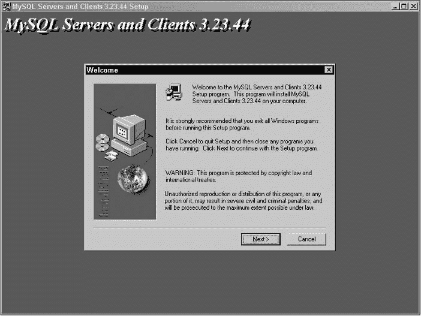

**图 A-1：** MySQL 安装程序的初始界面。

11. 如果你想将 MySQL 安装到默认目录 `C:\mysql`，单击“下一步”。如果你想将 MySQL 安装到其他目录，单击“浏览”，选择一个目录，再单击“确定”；然后，单击“下一步”。

    这时会出现一个屏幕，你可以选择安装类型。

12. 选择“典型”，然后，单击“下一步”。

    MySQL 安装开始。安装完成后会显示一条消息。

在安装期间，服务器可能会启动，也可能不会。如果它正在运行，你应该会在系统托盘（屏幕底部）中看到一个红绿灯图标，绿灯亮起。如果它没有运行，请参阅下一节。

## 启动 MySQL 服务器

你可以手动启动和停止服务器，不过你可能更希望只要计算机在运行，MySQL 服务器就一直在运行。要了解如何将 MySQL 设置为在计算机启动时自动启动，请参阅下一节。

### Windows 98/Me

你可以使用 `WinMySQLadmin` 启动和停止服务器，这是一个随 MySQL 一起安装的程序。`WinMySQLadmin` 程序负责在系统托盘中显示红绿灯图标。如果显示了红绿灯图标，说明 `WinMySQLadmin` 正在运行。如果系统托盘中没有红绿灯图标，你需要启动 `WinMySQLadmin`。

如果 `WinMySQLadmin` 没有运行，你可以从“启动”菜单启动它：选择“开始→程序→启动→`WinMySQLadmin`”。如果在“启动”菜单中找不到它，可以使用“Windows 资源管理器”导航到 MySQL 安装目录下的 `bin` 目录（例如 `C:\mysql\bin`），然后双击 `WinMySQLadmin`。启动后，你应该能在系统托盘中看到红绿灯图标。

要使用 `WinMySQLadmin` 启动或停止 MySQL 服务器，请按照以下步骤操作：

1. **右键点击系统托盘中的红绿灯图标。**

    这时会出现一个简短的菜单。

2. **选择你的操作系统：Windows 9x。**

3. **要启动或停止，请单击“启动服务器”或“停止服务器”。**

4. **右键点击 `WinMySQLadmin` 窗口，然后点击“隐藏我（Hide Me）”，退出 `WinMySQLadmin`。**

### Windows NT/2000/XP

你可以直接启动 MySQL 服务器：导航到 MySQL 安装目录下的 `bin` 子目录（例如 `C:\mysql\bin`），然后双击 `mysqld.exe` 文件。

如果 `WinMySQLadmin` 程序没有运行（系统托盘中没有红绿灯图标），上述操作可能不起作用。在这种情况下，你可以通过双击启动 `WinMySQLadmin` 程序，也可以使用 DOS 窗口控制台启动 MySQL 服务器。如果你遇到问题，使用控制台启动服务器通常很有用，因为这样会显示一些有用的错误消息。

要使用控制台启动 MySQL 服务器，请按照以下步骤操作：

1. **打开命令提示符窗口。**

    例如，选择“开始→程序→附件→命令提示符”。

2. **切换到 MySQL 的 bin 目录。**

    例如，`CD C:\mysql\bin`。

3. **输入** `mysqld --console`。

此时会显示一条消息，告诉你服务器已启动。窗口会保持打开状态，随时接收服务器的更多消息。不要关闭该窗口。

如果 `WinMySQLadmin` 正在运行，你也可以用它来停止服务器：右键点击红绿灯图标，在显示的菜单中选择 Win NT，然后点击“停止服务器”。如果这样不行，可以使用以下步骤：

1. **打开命令提示符窗口。**

    例如，选择“开始→程序→附件→命令提示符”。

2. **切换到 MySQL 的 bin 目录。**

    例如，`CD C:\mysql\bin`。

3. **输入** `mysqladmin -u root -p shutdown`。

    `u` 后面跟的是一个账户名——在本例中是 `root`，它是在安装 MySQL 时创建的。如果你使用 `-p`，系统会提示你输入密码。除非你设置了密码，否则不需要输入密码，所以可以不用 `-p`。

## 设置服务器在计算机启动时自动启动

在大多数情况下，你可能希望将 MySQL 服务器设置为只要计算机在运行，它就一直在运行。

### Windows 98/Me

如果你想将 MySQL 服务器设置为每次计算机启动时都自动启动，请按照上一节所述启动 `WinMySQLadmin`，然后按照以下步骤操作：

1. **单击 `my.ini` Setup 选项卡。**

2. **单击屏幕左下角的“在开始菜单中创建快捷方式（Create ShortCut on Start Menu）”。**

3. **右键点击 `WinMySQLadmin` 窗口，然后选择“隐藏我（Hide Me）”，退出 `WinMySQLadmin`。**

### Windows NT/2000/XP

要将 MySQL 服务器设置为每次计算机启动时都自动启动，可以将其设置为服务。安装过程可能已经将它设置为服务了。你可以按以下方式检查 MySQL 是否是一个服务：

1. **打开服务窗口：开始→设置→控制面板→管理工具→服务。**

    此时会打开一个窗口，显示所有服务的列表。

2. **向下滚动列表，查看 MySQL 是否已列出。**

    如果没有，说明它尚未被设置为服务。后面会介绍如何将其设置为服务。

3. **选择启动类型。**

    它应该显示为“自动”。如果不是，请执行以下操作：

    1. 右键点击 MySQL 的条目。

    2. 在显示的菜单中选择“属性”。

    3. 在窗口中间的“启动类型”下拉列表中选择“自动”。

    4. 单击“确定”。

如果 MySQL 没有出现在服务列表中，你可以按以下方式将其设置为服务：

1. **打开命令提示符窗口。**

    例如，选择“开始→程序→附件→命令提示符”。

2. **切换到 MySQL 的 bin 目录。**

    例如，`CD c:\mysql\bin`。

3. **输入** `mysqld --install`。

    此时会显示一条消息，告诉你服务已成功安装。

如果你需要将 MySQL 服务器从服务列表中移除，例如准备升级到新版本时，请执行以上步骤 1 和 2。对于步骤 3，输入 `mysqld --remove`。

### Linux/Unix

#### 使用 RPM（仅限 Linux）

MySQL 可以使用 RPM 在 Linux 上安装。尽管 RPM 代表的是 **Red Hat 软件包管理器**，但 RPM 可用于大多数 Linux 发行版，而不只是 Red Hat。使用 RPM 是在 Linux 上安装 MySQL 最简单的方法。如果通过 RPM 文件安装的方式对你不适用，可以尝试使用一个名为二进制安装包的即装即用软件包，它也很容易安装；安装说明请参见“二进制安装包”一节。如果这两种方法都不适用，你始终可以从源文件安装 MySQL。为此，请按照“源文件”一节中的说明操作。

你可以按照下面的说明下载 RPM 文件。不过，RPM 文件可能已经包含在 Linux 操作系统附带的 CD 中。从 CD 安装 RPM 文件可以免去下载的麻烦（可以跳过下列步骤 1-9），但如果你的 CD 上带的 MySQL 版本不是最新的，你可能还是想下载一个 RPM 文件。

要在 Linux 上从 RPM 文件安装 MySQL，请按照以下步骤操作：

1. **将你的 Web 浏览器指向 MySQL 主页 www.mysql.com。**

2. **单击“正式版”版本号链接。**

    查看屏幕右侧标记为 MySQL Products 的列表。在 Database Server 标题下方查找相应章节。在撰写本文时，正式版是 4.0.17。

3. **向下滚动屏幕，直到看到“Linux x86 RPM 下载”标题。**

    这一节列出了适用于 Linux 的多个下载项。

4. **单击标准服务器的下载链接。** 这应该是第一个条目。

    此时会打开一个对话框。

5. **选择保存文件的选项。**

    此时会打开一个对话框，让你选择要将文件保存到哪里。

6. **导航到你想要保存 RPM 的位置（例如，`/usr/src/mysql`），并单击“保存”。**

7. **重复步骤 5-7，将 Client Programs 的 RPM 文件下载到同一个下载位置。**

8. **切换到保存下载文件的目录。**

    例如，输入 `cd /usr/src/mysql`。你会在这个目录中看到两个文件——一个文件名为 `MySQL-server-`，后面跟着版本号和 `.i386.rpm`；另一个文件名类似，其中包含 client。例如：`MySQL-4.0.15-0.i386.rpm` 和 `MySQL-client-4.0.15-0.i386.rpm`。

9. **输入以下命令安装 RPM：**

    ```
    rpm -i listofpackages
    ```

    例如，使用步骤 9 中的示例，命令应该是：

    ```
    rpm -i MySQL-server-4.0.17-0.i386.rpm MySQL-client-4.0.17-0.i386.rpm
    ```

    此命令会安装 MySQL 软件包。它会设置你需要的 MySQL 账户和组名，并在 `/var/lib/mysql` 创建数据目录。它还会启动 MySQL 服务器，并在 `/etc/rc.d` 中创建适当的条目，以便 MySQL 在计算机启动时自动启动。

    你需要使用一个拥有权限、能够成功运行 `rpm` 命令的账户，例如 `root` 账户。

10. **要测试 MySQL 是否正常运行，请键入以下内容：**

    ```
    bin/mysqladmin --version
    ```

    你应该会看到 MySQL 服务器的版本号。

## 从二进制文件安装

现成的、已编译的二进制文件可用于多种 Linux 和 Unix 发行版。如果这些发行版都不适用于你的 Linux/Unix 机器，你可以从源代码文件安装 MySQL，但只要有可能，最好使用二进制文件。在撰写本文时，MySQL 二进制文件可用于以下 Unix 发行版，但随时可能会提供更多版本：

- Solaris

- HP-UX

- AIX

- SCO

- SGI Irix

- Dec OSF

- QNX

- BSDi

- OpenBSD

- FreeBSD

要在 Linux 或 Unix 上安装二进制文件版本的 MySQL，请按照以下步骤操作：

1. **将你的 Web 浏览器指向 www.mysql.com，即 MySQL 主页。**

2. **单击“生产”版本号链接。**

    查看屏幕右侧标记为“MySQL 产品”的列表。在“数据库服务器”标题下查找相应部分。在撰写本文时，生产版本为 4.0.17。

3. **向下滚动屏幕，直到找到 Linux 或你的 Unix 版本对应的标题（例如 Solaris 下载）。**

    此部分列出了该操作系统的几个下载项。

4. **找到适合你的操作系统版本的正确软件包。**

    对于 Linux，你可能需要 Intel libc6 二进制版本。对于 Unix，请选择正确的 Unix 系统版本——例如 Solaris 9（SPARC，64 位）。

5. **单击适合你的操作系统的标准版本的下载链接。**

    此时会打开一个对话框。

6. **选择保存文件的选项。**

    此时会打开一个窗口，让你选择保存文件的位置。

7. **导航到你要安装 MySQL 的位置，然后点击“保存”。**

    标准位置是 `/usr/local`；如果可能，最好使用此位置。

8. **下载完成后，切换到下载目录——例如，`cd /usr/local`。**

    你会看到一个名为 `mysql-` 的文件，后面跟着版本号、操作系统名称和 `.tar.gz`——例如 `mysql-4.0.17-sun-solaris2.9-sparc-64bit.tar.gz`。这个文件是一个 tar 包。

9. **使用以下命令为 MySQL 创建用于运行的用户和组 ID：**

    ```bash
    groupadd mysql
    useradd -g mysql mysql
    ```

    这些命令的语法在不同版本的 Unix 上可能略有不同，或者它们可能被称为 `adduser` 和 `addgroup`。

    **注意：** 你必须使用一个有权添加用户和组的账户。

10. **通过键入以下内容解压 tar 包：**

    ```bash
    gunzip -c filename | tar -xvf -
    ```

    例如：

    ```bash
    gunzip -c mysql-4.0.17-sun-solaris2.9-sparc-64bit.tar.gz | tar -xvf -
    ```

    **注意：** 你必须使用一个被允许在 `/usr/local` 中创建文件的账户。

11. **创建一个指向新目录的链接，以便你可以用较短的名字来引用它，而不是使用当前难以输入的目录名。请键入以下内容：**

    ```
    ln -s newdirectoryname mysql
    ```

    例如：

    ```
    ln -s mysql-4.0.17-sun-solaris2.9-sparc-64bit mysql
    ```

    现在你可以将目录称为 `mysql`，而不必使用其长名称。

12. **通过键入 `cd mysql` 切换到新目录。**

    你应该会看到几个子目录，包括 `/bin` 和 `/scripts`。

13. **将 `bin` 目录的路径（例如 `/usr/local/mysql/bin`）添加到系统路径中，以便任何需要访问 MySQL 的程序都可以访问 MySQL 程序。**

    你应该通过编辑计算机启动时设置系统变量的文件来执行此操作。

14. **请键入以下内容：**

    ```
    scripts/mysql_install_db
    ```

    此命令会运行一个脚本，用于初始化你的 MySQL 数据库。

15. **确保你的 MySQL 目录的所有权和组成员身份正确。使用以下命令设置所有权：**

    ```
    chown -R root /usr/local/mysql
    chown -R mysql /usr/local/mysql/data
    chgrp -R mysql /usr/local/mysql
    ```

    这些命令使 `root` 成为除 `data` 之外所有 MySQL 目录的所有者，并使 `mysql` 成为 `data` 目录的所有者。所有 MySQL 目录都属于组 `mysql`。

16. **通过将文件 `mysql.server` 从 `/usr/local/mysql/support-files` 复制到系统启动文件所在的位置，将计算机设置为在启动时自动启动 MySQL。**

17. **要测试 MySQL，你可以通过键入以下内容手动启动服务器，而无需重启计算机：**


```
bin/safe_mysqld --user=mysql &
```

18. **要测试 MySQL 是否正常运行，请键入**

```
bin/mysqladmin --version
```

你应该会看到 MySQL 服务器的版本号。

## 从源代码安装

在决定从源代码文件安装 MySQL 之前，请检查你的操作系统是否有二进制文件。MySQL 二进制文件是预编译的、可直接安装的 MySQL 安装包。MySQL 二进制文件非常方便且可靠。

你可以通过下载源代码文件、编译源代码文件并安装编译后的程序来安装 MySQL。这个过程听起来非常技术化且令人生畏，但实际上并非如此。在开始安装过程之前，请完整阅读以下步骤。

要从源代码安装 MySQL，请按照以下步骤操作：

- 1. **将你的 Web 浏览器指向 `www.mysql.com`，即 MySQL 主页。**

- 2. **单击生产版本号链接。**

查看屏幕右侧标记为“MySQL 产品”的列表。在“数据库服务器”标题下查找相应部分。在撰写本文时，生产版本为 4.0.17。

- 3. **滚动到屏幕底部，找到“源代码下载”标题。**

此部分列出了几个下载项。

- 4. **找到 tar 包版本，并点击其旁边的下载链接。**

此时会打开一个对话框。

- 5. **选择保存文件的选项。**

此时会打开一个窗口，让你选择文件的保存位置。

- 6. **导航到你要安装 MySQL 的位置，然后点击“保存”。**

标准位置是 `/usr/local`。如果可能，最好使用标准位置。

- 7. **下载完成后，切换到下载目录——例如，`cd /usr/local`。**

你会看到一个名为 `mysql-` 的文件，后面跟着版本号和 `.tar.gz.`——例如 `mysql-4.0.17.tar.gz`。这个文件是一个 *tar 包*。

- 8. **使用以下命令为 MySQL 创建用于运行的用户和组 ID：**

```bash
groupadd mysql
useradd -g mysql mysql
```

这些命令的语法在不同版本的 Unix 上可能略有不同，或者它们可能被称为 `adduser` 和 `addgroup`。

*注意：* 你必须使用一个有权添加用户和组的账户。

- 9. **通过键入以下内容解压 tar 包**

```bash
gunzip -c filename | tar -xvf -
```

例如：

```bash
gunzip -c mysql-3.23.44.tar.gz | tar -xvf -
```

你会看到一个名为 `mysql-version` 的新目录——例如 `mysql-4.0.15`。

你必须使用一个被允许在 `/usr/local` 中创建文件的账户。

- 10. **切换到新目录。**

例如，键入 `cd mysql-4.0.17`。

- 11. **请键入以下内容：**

```bash
./configure --prefix=/usr/local/mysql
```

你会看到几行输出。输出会告诉你 `configure` 何时完成。这可能需要一些时间。

- 12. **键入 `make`。**

你会看到许多行输出。输出会告诉你 `make` 何时完成。`make` 可能会运行一段时间。

- 13. **键入 `make install`。**

`make install` 会很快完成。

*注意：* 你可能需要以 `root` 身份运行此命令。

- 14. **请键入以下内容：**

```bash
scripts/mysql_install_db
```

此命令会运行一个脚本，用于初始化你的 MySQL 数据库。

- 15. **确保你的 MySQL 目录的所有权和组成员身份正确。使用以下命令设置所有权：**

```
chown -R root /usr/local/mysql
chown -R mysql /usr/local/mysql/data
chgrp -R mysql /usr/local/mysql
```

这些命令使 `root` 成为除 `data` 之外所有 MySQL 目录的所有者，并使 `mysql` 成为 `data` 目录的所有者。所有 MySQL 目录都属于组 `mysql`。

- 16. **通过将文件 `mysql.server` 从 `/usr/local/mysql/support-files` 复制到系统启动文件所在的位置，将计算机设置为在启动时自动启动 MySQL。**

17. 要测试MySQL，你可以手动启动服务器，无需重启计算机，输入以下命令：

```
bin/mysqld_safe --user=mysql &
```

18. 要测试MySQL是否运行正常，输入：

```
bin/mysqladmin --version
```

你应该能看到MySQL服务器的版本号。

## 在Mac上

你可以使用Mac OS X 10.2（Jaguar）PKG二进制包下载MySQL。如果你的操作系统是OS X 10.1或更早版本，则无法使用此包。你需要下载一个tarball并按照上一节所述从源代码安装MySQL。

- 1. 将Web浏览器指向MySQL主页 `www.mysql.com`。

- 2. 点击生产版本号链接。

查看屏幕右侧标记为“MySQL Products”的列表。查找“Database Server”标题下的部分。在撰写本文时，生产版本为4.0.17。

- 3. 向下滚动屏幕，找到标题为“Mac OS Package Installer Downloads”的部分。

此部分列出几个下载项。

- 4. 找到标准版本，然后点击旁边的下载链接。

将打开一个对话框。

- 5. 选择保存文件的选项。

将打开一个框，让你选择文件的保存位置。

- 6. 导航到要安装MySQL的位置，然后点击“保存”。

标准位置是 `/usr/local`。如果可能，最好使用标准位置。

- 7. 下载完成后，切换到下载目录——例如 `/usr/local`。

你会看到一个名为 `mysql-standard` 的包，后面跟着版本号和 `dmg`，例如 `mysql-standard-4.0.17.dmg`。如果下载的文件没有扩展名 `.dmg`，请将文件名更改为 `.dmg` 扩展名。

- 8. **创建一个名为`mysql`的用户和组，供MySQL运行。** 在大多数较新的Mac版本中，此用户和组已经存在。

- 9. **通过在Finder中双击其图标来挂载磁盘镜像。**

- 10. **双击包图标以安装MySQL PKG。**

包安装程序将运行并安装该包。它将MySQL安装到目录 `/usr/local/mysql` 后跟版本号的目录中。它还会安装一个符号链接 `/usr/local/mysql/` 指向MySQL安装的目录。它还会通过运行脚本 `mysql_install_db` 初始化数据库，该脚本会创建一个名为`root`的MySQL账户。

- 11. **你可能需要更改mysql目录的所有者。**

MySQL安装的目录（例如 `/usr/local/mysql-4.0.17`）应归`root`所有。数据目录（例如 `/usr/local/mysql-4.0.17/data`）应归 `mysql` 账户所有。两个目录都应属于 `mysql` 组。如果用户和组不正确，请使用以下命令更改它们：

```
sudo chown -R root /usr/local/mysql-4.0.17
sudo chown -R mysql /usr/local/mysql-4.0.17/data
sudo chown -R root /usr/local/mysql-4.0.17/bin
```

- 12. **使用以下命令启动MySQL服务器：**

```
cd /usr/local/mysql
sudo ./bin/mysqld_safe
if necessary, enter your password
Press Ctrl-Z
bg
Press Ctrl-D or type exit
```

**这会手动启动服务器**，这意味着每次重启计算机时都必须手动启动MySQL服务器。要让服务器在每次计算机启动时自动启动，你需要安装MySQL启动项，它包含在安装磁盘镜像中单独的安装包中。要安装启动项，请双击 `MySQLStartupItem.pkg` 图标。

要停止MySQL服务器，请切换到MySQL安装目录下的 `bin` 子目录，然后输入

```
mysqladmin -u root -p shutdown
```

`-p` 使 `mysqladmin` 提示你输入密码。如果账户不需要密码，则不要包含 `-p`。


## 配置MySQL

MySQL在启动时会读取配置文件。如果你使用默认设置或安装程序，可能不需要在配置文件中添加任何内容。但是，如果你将MySQL安装在非标准位置，或者希望将数据库存储在其他位置而不是默认位置，则可能需要编辑配置文件。

该文件名为 `my.ini` 或 `my.cnf`。如果你使用Windows，它位于系统目录（如WINNT）中；在Linux/Unix/Mac上，它位于 `/etc` 中。该文件看起来类似于以下内容：

```ini
[mysqld]
basedir=D:/mysql4
datadir=D:/mysql4/data
#port=3306
```

`basedir` 行告诉MySQL服务器MySQL的安装位置。`datadir` 行告诉服务器数据库所在的位置。最后一行开头的 `#` 使该行失效。你可以删除 `#` 并更改端口号，以告诉服务器在不同的端口上侦听数据库查询。

很受欢迎，所以许多RPM启用了对它的支持，但这不是你能控制的。此外，RPM通常会启用所有最流行的选项，因此RPM可能会启用你不需要的选项。因此，最简单、最高效的PHP安装方式可能是从源代码安装。如果你熟悉RPM，可以自行查找RPM并安装。RPM是可用的。不过，我这里提供的是源代码安装步骤，而不是RPM安装。

## 安装之前

在开始安装PHP之前，请检查以下各项：

✓ **Apache模块`mod_so`已安装。** 通常它是安装好的。要显示所有模块的列表，请输入以下命令：

```
httpd -l
```

命令生效前，你可能需要先进入`httpd`所在的目录。输出通常显示一长串模块列表。对于PHP，你只需要关心`mod_so`。如果`mod_so`没有加载，必须使用 `enable-module=so` 选项重新安装Apache。

✓ **已安装`apxs`实用程序。** `apxs`在安装Apache时安装。你应该能找到名为`apxs`的文件。如果Apache是从Linux上的RPM安装的，可能没有安装`apxs`。有些Apache的RPM由两个RPM组成：一个用于基本的Apache服务器，一个用于Apache开发工具。可能还需要安装包含开发工具的RPM，它会安装`apxs`。

✓ **Apache版本较新。** 有关Apache版本的信息，请参阅附录C。

要检查版本，请输入以下命令：

```
httpd --v
```

命令生效前，你可能需要先进入`httpd`所在的目录。

## 安装

要在Unix/Linux上使用Apache Web服务器安装PHP，请按照以下步骤操作：

- 1. 将Web浏览器指向PHP主页 `www.php.net`。

- 2. 点击 Downloads（下载）。

- 3. 点击最新版本的PHP源代码，在撰写本文时为5.0.0版。

你将要下载的文件包含许多压缩到一个文件中的文件——即tarball。

将打开一个对话框。

- 4. **选择保存文件的选项。**

将打开一个对话框，让你选择文件的保存位置。

- 5. **导航到要保存源代码的位置（例如 `/usr/src`），然后点击“保存”。**

- 6. **下载完成后，切换到下载目录（例如 `cd ~/usr/src`）。**

你会看到一个名为 `php-` 后跟版本名和 `tar.gz` 的文件。

- 7. **解压tarball。PHP 5.0.0版的命令是**

```
gunzip -c php-5.0.0.tar.gz | tar -xf -
```

将创建一个名为 `php-5.0.0` 的新目录，其中包含几个子目录。

- 8. **切换到解压tarball时创建的新目录。例如：**

```
cd php-5.0.0
```

- 9. **输入`configure`命令。**

使用下面两个`configure`命令之一：

```
./configure --with-mysql=DIR --with-apxs
./configure --with-mysqli=DIR --with-apxs
```

如果你使用的是MySQL 4.0或更早版本，请使用`mysql`；如果你使用的是MySQL 4.1或更高版本，请使用`mysqli`。`DIR`是相应的MySQL目录路径。使用 `with-mysql` 时，请使用mysql安装目录的路径，例如：

```
--with-mysql=/usr/local/mysql
```

使用 `with-mysqli` 时，请使用名为 `mysql_config` 的文件的路径。

如果你使用Apache 2，请使用 `with-apxs2` 选项。（有关使用Apache 2的信息，请参阅附录C。）

你会看到许多输出行。请等待`configure`命令执行完成。这可能需要几分钟。如果`configure`命令失败，它会提供一条信息性消息。通常，问题是缺少软件。你会看到一条错误消息，指出无法找到`xyz`软件，或者需要`xyz 5.6`版但找到的是`xyz 4.2`版。你需要安装或更新PHP所需的软件。


如果`apxs`实用程序未安装在预期位置，你会看到一条错误消息，指出找不到`apxs`。如果收到此消息，请检查`apxs`的安装位置（`find / -name apxs`），并将路径包含在`configure`的 `with-apxs` 选项中。

```text
command: --with-apxs=/usr/sbin/apxs or /usr/local/apache/bin/apxs. If you're using Apache 2, the option is --with-apxs2=/usr/sbin/apxs.
```

10. **输入** `make`.

你将看到许多行输出。等待其完成。这可能需要几分钟。

11. **输入** `make install`.

## 在 Mac OS X 上

自 PHP 4.3 发布以来，你可以在 Mac OS X 上像在 Unix/Linux 上一样轻松安装 PHP。你通过下载源文件、编译源文件并安装编译后的程序来安装 PHP。这个过程并不像看起来那么技术性且令人生畏。我在接下来的几个部分中提供了逐步说明。在开始安装程序之前，请通读所有步骤，以确保你能清楚地理解全部内容并且已准备好所有东西，这样在安装过程中就不会中途停止。

### 安装前

如果你想在你的网站上使用 PHP 与 Apache 配合使用，则必须安装 Apache。大多数 Mac OS X 系统已预装 Apache。有关 Apache 的更多信息，请参阅附录 C。

开始安装 PHP 之前，请检查以下内容：

- **Apache 版本较新：** 有关 Apache 版本的讨论，请参阅附录 C。要检查版本，请在命令行中输入以下内容：

  ```text
  httpd -v
  ```

  你可能需要在 `httpd` 所在的目录中才能使命令生效。

  

  截至本文撰写时，PHP 与 Apache 2 仍被视为实验性。对于生产网站的使用，使用 Apache 1.3 可能比 Apache 2 更好。有关 Apache 版本的讨论，请参阅附录 C。通过在 `www.php.net/manual/en/install.apache2.php` 检查 PHP 网站，了解 PHP 与 Apache 2 的状态更新。

- **Apache 模块 `mod_so` 已安装。** 通常是这样。要显示所有模块的列表，请输入以下内容：

  ```text
  httpd -l
  ```

  你可能需要在 `httpd` 所在的目录中才能使命令生效。输出通常显示很长的模块列表。对于 PHP，你只需关心 `mod_so`。如果 `mod_so` 未加载，则必须重新安装 Apache。

- ✓ **已安装 apxs 实用程序。** `apxs` 通常在安装 Apache 时安装。要确定它是否已安装在你的计算机上，你应该查找名为 `apxs` 的文件，通常位于 `/usr/sbin/apxs` 目录。如果能找到该文件，则表示已安装 `apxs`；如果找不到，则未安装。

- ✓ **已安装开发者工具 CD 上的文件。** 该 CD 是 Mac OS X 主发行版的补充。如果找不到该 CD，你可以从 Apple Developer Connection 网站 `developer.apple.com/tools/macosxtools.html` 下载工具。

### 安装

要在 Mac 上安装 PHP，请按照以下步骤操作：

1. **将你的 Web 浏览器指向 `www.php.net`，这是 PHP 主页。**

2. **点击 下载。**

3. **点击最新的 PHP 源代码版本，截至本文撰写时为 5.0.0 版本。**

   一个对话框打开。

4. **选择保存文件的选项。**

   一个对话框打开，让你选择文件保存位置。

5. **导航到你想要保存源代码的位置（例如，`/usr/src`），然后点击 保存。**

6. **下载后，切换到下载目录（例如，`cd /usr/src`）。**

   你会看到一个名为 `php-5.0.0.tar.gz` 的文件。该文件包含压缩成一个文件中的多个文件。该文件可能已被 StuffIt Expander 自动解包，因此你会看到 `php-5.0.0` 目录。如果是这样，请跳到第 8 步。

7. **解包 tarball。**

   解包 PHP 5.0.0 版本 tarball 的命令是


```text
tar xvfz php-5.0.0.tar.gz
```

创建了一个名为`php-5.0.0`的新目录，其中包含多个子目录。


如果`apxs`实用程序未安装在预期位置，你会看到错误消息，提示找不到`apxs`。如果收到此错误消息，请检查`apxs`安装的位置（`find / -name apxs`）并在`configure`命令的`with-apxs`选项中包含该路径：`--with-apxs=/usr/sbin/apxs`。

你可能需要使用许多其他选项，例如用于你使用的数据库的选项或更改 PHP 安装目录的选项。这些`configure`选项在附录后面“安装选项”部分中有讨论。

10. **输入 `make`。**

    你将看到许多行输出。等待其完成。这可能需要几分钟。

11. **输入 `sudo make install`。**

## 安装选项

前面的部分提供了快速安装 PHP 的步骤，并附带本书应用程序所需的选项。然而，你可能想以不同的方式安装 PHP。例如，所有 PHP 程序和文件都安装在其默认位置，但你可能需要在不同位置安装 PHP。或者你可能计划使用额外软件的应用程序。如果你需要为特定需求配置 PHP，可以使用额外的命令行选项。只需将选项添加到 Unix/Linux 安装说明中的第 13 步所示命令或 Mac 安装说明中的第 9 步。总体而言，命令行中选项的顺序无关紧要。表 B-1 显示了 PHP 最常用的选项。要查看所有可能选项的列表，请输入`./configure --help`。

**表 B-1 PHP 配置选项**

| 选项 | 告诉 PHP |
| --- | --- |
| `prefix=PREFIX` | 将主 PHP 目录设置为 *PREFIX*。默认 *PREFIX* 为 `/usr/local`。 |
| `exec-prefix=EPREFIX` | 在 *EPREFIX* 中安装架构相关文件。默认 *EPREFIX* 为 *PREFIX*。 |
| `bindir=DIR` | 在 *DIR* 中安装用户可执行文件。默认是 `EPREFIX/bin`。 |
| `infodir=DIR` | 在 *DIR* 中安装 info 文档。默认是 `PREFIX/info`。 |
| `mandir=DIR` | 在 *DIR* 中安装 man 文件。默认是 `PREFIX/man`。 |
| `with-config-file-path=DIR` | 在 *DIR* 中查找配置文件（`php.ini`）。如果没有此选项，PHP 会在默认位置查找配置文件，通常是 `/usr/local/lib`。 |
| `disable-libxml` | 禁用默认包含的 XML 支持。 |
| `enable-ftp` | 启用 FTP 支持。 |
| `enable-magic-quotes` | 启用使用反斜杠自动转义引号。 |
| `with-apxs=FILE` | 使用位于 *FILE* 的 `apxs` 实用程序构建共享 Apache 模块。默认 *FILE* 为 `apxs`。 |
| `with-apxs2=FILE` | 使用位于 *FILE* 的 `apxs` 实用程序构建共享 Apache 2 模块。默认 *FILE* 为 `apxs`。 |
| `with-mysql=DIR` | 启用对 MySQL 4.0 或更早数据库的支持。默认 MySQL 所在 *DIR* 为 `/usr/local`。 |
| `with-mysqli=DIR` | 启用对 MySQL 4.1 或更高版本数据库的支持。*DIR* 必须是 MySQL 4.1 安装时安装的名为 `mysql_config` 的文件路径。 |
| `with-openssl=DIR` | 启用安全服务器的 OpenSSL 支持。需要 OpenSSL 版本 0.9.5 或更高。 |
| `with-oci8=DIR` | 启用对 Oracle 7 或更高版本支持。默认 *DIR* 包含在环境变量 `ORACLE_HOME` 中。 |
| `with-oracle=DIR` | 启用对更早版本 Oracle 的支持。默认 *DIR* 包含在环境变量 `ORACLE_HOME` 中。 |
| `with-pgsql=DIR` | 启用对 PostgreSQL 数据库的支持。默认 PostgreSQL 所在 *DIR* 为 `/usr/local/pgsql`。 |
| `with-servlet=DIR` | 包含 servlet 支持。*DIR* 是 JSDK 的基本安装目录。Java 扩展必须作为共享 .dll 构建。 |

## 为 PHP 配置 Apache

你必须配置 Apache 以识别和运行 PHP 文件。Apache 配置文件 `httpd.conf` 在你的系统上，可能位于 `/etc` 或 `/usr/local/apache/conf`。在 PHP 能够正常运行之前，你必须编辑此文件。

按照以下步骤为 PHP 配置你的系统：

1. 打开 `httpd.conf` 文件以便进行更改。

2. 配置 Apache 以加载 PHP 模块。

   找到 `LoadModule` 语句列表。查找以下行：

   ```text
   LoadModule php5_module libexec/libphp5.so
   ```

   如果该行不存在，请添加它。如果行的开头有井号 (#)，请删除井号。

3. 配置 Apache 以识别 PHP 扩展。

   你需要告诉 Apache 哪些文件可能包含 PHP 代码。查找描述 `AddType` 的部分。你可能会看到其他软件的一个或多个 `AddType` 行。查找 PHP 的 `AddType` 行，如下所示：

   ```text
   AddType application/x-httpd-php .php
   ```

   如果你发现行的开头有井号 (#)，请删除井号 (#)。如果找不到此行，请将其添加到 `AddType` 语句中。此行告诉 Apache 在所有具有 `.php` 扩展名的文件中查找 PHP 代码。你可以指定任何扩展名或一系列扩展名。

4. 启动（如果未运行）或重启（如果正在运行）Apache `httpd` 服务器。

   你可以通过在安装期间安装在系统上的脚本来启动或重启服务器。此脚本可能是 `apachectl` 或 `httpd`，可能位于 `/bin` 或 `/usr/local/apache/bin`。例如，你可以通过输入 `apachectl start` 启动服务器，使用 `apachectl restart` 重启它，或使用 `apachectl stop` 停止它。有时重启是不够的；你必须先停止服务器，然后再启动它。

### 在 Windows 上

PHP 运行于 Windows 98/Me 和 Windows NT/2000/XP。它不运行于 Windows 3.1。自 PHP 4.3.0 起不再支持 Windows 95。

要安装带 MySQL 支持的 PHP 5 for Windows，您需要下载一个包含 PHP 所需所有文件的 Zip 文件，以下步骤说明如何在 Windows 上安装 PHP：

1. **将你的 Web 浏览器指向** www.php.net.

2. **点击下载。**

3. **前往 Windows Binaries 部分。** 点击最新版本 PHP（截至本文撰写时为 5.0.0）的 Zip 包下载链接。

   一个对话框打开。

4. **点击镜像网站的链接以从中下载文件，并选择离您最近的站点。**

   一个对话框打开。

5. **选择保存文件的选项。**

   一个对话框打开，让您可以选择文件保存的位置。

6. **导航到您希望文件下载到的位置。** 这应是一个临时位置，例如下载目录。然后点击保存。

   下载完成后，您会在下载位置看到一个包含所需所有文件的文件。该文件名为 php，后跟版本号和 win32.zip。对于当前版本，文件名为 `php5.0.0-Win32.zip`。

7. **将 .zip 文件中的文件解压到您希望安装 PHP 的目录中，例如 `c:\php`。**

   如果您双击 .zip 文件，它应该会在计算机上用于解压 .zip 文件的软件中打开，例如 WinZip 或 PKZIP。选择提取菜单项并选择要将文件解压到的目录。`C:\php` 是一个不错的安装选择，因为许多配置文件假定 PHP 安装在那里，因此默认设置更有可能正确。

   最好不要将 PHP 安装在路径中包含空格的目录中，例如 `Program Files/PHP` 中。它有时会导致问题。

   您现在拥有一个包含多个子目录的目录，其中包含您所需的文件。

8. **将 MySQL 所需的文件复制到 PHP 主目录。**

   该文件位于 PHP 安装目录中的 ext 子目录中。根据您使用的 MySQL 版本复制以下文件之一：

   

   ```text
   ext\php_mysql.dll   (for MySQL 4.0 or earlier)
   ext\php_mysqli.dll  (for MySQL 4.1 or later)
   ```

   

   

   将这两个文件复制到主 PHP 目录，例如 `c:\php`。

   另一个名为 `libmysql.dll` 的文件也是 MySQL 支持所必需的。该文件应已位于主 PHP 目录中。如果不在那里，您需要找到它并复制到那里。如果它不在您的 PHP 目录中，它通常随 MySQL 一起安装，因此请在 MySQL 安装的目录中找到它，也许在 bin 子目录中，例如 `c:\mysql\bin`。

   偶尔 PHP 需要找不到的 DLL 文件。当这种情况发生时，运行 PHP 程序时 PHP 会显示错误消息，称找不到特定的 DLL。您通常可以在 `ext` 子目录中找到该 DLL 并将其复制到主 PHP 目录。

9. **配置您的 Web 服务器。**

   下一节提供配置 Web 服务器的说明。

10. **配置 PHP。**

   请遵循本章后面部分中的说明。

## 配置 PHP 的 Web 服务器

您的 Web 服务器需要配置为识别 PHP 脚本并运行它们。请按照您 Web 服务器部分的步骤操作：

### 配置 Apache

您必须在 PHP 能够正常运行之前编辑名为 `httpd.conf` 的 Apache 配置文件。要为 PHP 配置 Apache，请按照以下步骤操作：

1. **打开 httpd.conf 进行编辑。**

   您可能可以通过选择 开始→程序→Apache HTTPD Server→Configure Apache Server→Edit Configuration 来编辑它。

   如果 Edit Configuration 不在您的开始菜单上，请在硬盘上找到 `httpd.conf` 文件，通常在 Apache 安装目录的 `conf` 子目录中（例如，`c:\program files\Apache group\Apache\conf`）。使用编辑器打开此文件，例如记事本或 WordPad。

2. **为 PHP 安装的目录设置一个别名。**

   `ScriptAlias` 语句用于为 PHP 安装的目录设置名称。在 `httpd.conf` 文件中查找 `ScriptAlias` 语句。您可能会看到一些用于其他软件的语句。如果没有 PHP 的，请添加以下内容：

   ```text
   ScriptAlias /php/ "c:/php/"
   ```

### 配置 IIS

要配置 IIS 与 PHP 协同工作，请按照以下步骤操作：

1. **进入 IIS 管理控制台。**

   您应该可以通过选择 开始→程序→管理工具→Internet Services Manager 或 开始→设置→控制面板→管理工具→Internet Services Manager 进入。

2. **右键单击您的网站（例如 Default Web Site）。**

3. **选择属性。**

4. **选择主目录选项卡。**

5. **点击配置按钮。**

6. **选择 App Mappings 选项卡。**

7. **点击添加。**

8. **在可执行文件框中，输入 PHP 解释器的路径：例如，输入 `c:\php\php-cgi.exe`。**

9. **在扩展名框中，输入 `.php`。**

   这将是与 PHP 脚本关联的扩展名。

10. **选择脚本引擎复选框。**

11. **点击确定。**

   如果您希望除 `.php` 之外的任何其他扩展名，例如 `.phtml`，也由 PHP 处理，请重复步骤 6–10。

### 配置 PHP

PHP 使用名为 php.ini 的文件中的设置来控制其某些行为。PHP 在启动时查找 php.ini 并使用找到的设置。如果 PHP 找不到该文件，它将使用一组默认设置。

除非在安装期间更改，否则 php.ini 文件的默认位置如下之一：

- ✔ **Windows：** 系统目录，根据 Windows 版本而定，如下所示：

  - Windows 98/Me/XP: `windows`

  - Windows NT/2000: `winnt`

- ✔ **Unix/Linux/Mac：** `/usr/local/lib`


如果在安装期间未安装 php.ini 文件，您现在需要安装它。PHP 发行版中包含一个具有默认设置、名为 php.ini-dist 的配置文件。将此文件复制到适当的位置，例如上面提到的默认位置，并将其名称更改为 php.ini。

如果您已安装了 PHP 的早期版本（例如 PHP 4.3），请在用 PHP 5 的 php.ini 文件覆盖它之前备份 php.ini 文件的副本。然后您可以查看当前使用的设置并更改新 php.ini 文件中的设置以匹配当前设置。

要配置 PHP，请按照以下步骤操作。

1. **打开 php.ini 文件进行编辑。**

2. **激活 mysql 或 mysqli 支持。**

   查找扩展列表。找到 mysql（如果您使用的是 MySQL 4.0 或更早版本）或 mysqli（如果您使用的是 MySQL 4.1 或更高版本）的行，如下所示：

   ```text
   ;extension=php_mysql.dll
   ;extension=php_mysqli.dll
   ```

   注意行开头的分号（;）。要激活扩展，请删除分号。如果扩展行不在您的 php.ini 文件中，请添加它。

3. **仅当您使用 PHP 与 IIS Web 服务器时，关闭强制重定向。找到以下行：**

   ```text
   ;cgi.force_redirect = 1
   ```

   您需要删除分号以使设置生效，并将 1 改为 0。更改后，该行如下所示：

   ```text
   cgi.force_redirect = 0
   ```

4. **保存 php.ini 文件。**

5. **在新设置生效之前，您可能需要重新启动 Apache 服务器。**

总体而言，其余默认设置允许 PHP 正常运行，但您可能需要出于特定原因编辑其中一些设置。我在全书中讨论 php.ini 文件中的设置，当讨论可能需要更改设置的话题时。例如，PHP 错误处理操作可以通过 php.ini 文件中的设置来更改。错误处理的可能设置及其影响在第 4 章中讨论。

## 附录 C：安装和配置 Apache

Apache 是一个开源的 Web 服务器。Web 服务器将网站上的文件传送给想要查看网页的访客。

在大多数情况下，你希望从网络获取 Apache 并自行安装。虽然 Apache 可能已安装在你的计算机上（因为大多数 Linux 发行版和 Mac OS X 都包含 Apache），但它不太可能是最新版本。或者 Apache 可能未使用你需要的选项安装。因此，你通常最好自行安装 Apache。

### 选择 Apache 版本

Apache 目前提供两个版本：Apache 1.3 和 Apache 2。Apache 2 是较新的版本，于 2002 年 4 月发布。Apache 2 不支持 Windows 9x 安装；它需要 Windows NT/2000/XP。


许多 Linux 发行版自带 Apache 2 安装。然而，截至本文撰写时，PHP 网站警告不要在生产环境中使用 Apache 2 与 PHP。请查阅网页了解 PHP 与 Apache 2 的当前状态，网址为 `www.php.net/manual/en/install.apache2.php#install.apache2.unix`。

目前的版本是

- ✔ Apache 2.0.47

- ✔ Apache 1.3.28

尝试安装最新的 Apache 版本，以便你的 Apache 服务器包含所有最新的安全性和错误修复。Apache 1.3 不再添加新功能，但仍在修复错误并解决安全问题。Apache 1.3 的新版本仍在发布，但频率低于 Apache 2。

### 安装 Apache

Apache 可以免费下载并安装在你的 Web 服务器上。它适用于几乎所有操作系统，包括 Windows、Linux、多种 Unix 版本和 Mac。

**在 Linux/Unix 上**

在 Linux 和 Unix 上安装 Apache，你需要下载源代码、编译它并安装它。这听起来令人望而生畏，但实际上比听起来容易得多。

**安装前**

安装 Apache 前，请检查以下要求：


## 系统要求

进入`/path/to/xxx`目录，找到`xxx.json`。

**磁盘空间：** 安装时你可能需要多达 50MB 的磁盘空间。安装后 Apache 可能使用 10MB，尽管具体用量取决于使用的选项和安装的模块。

**C 编译器：** 你的计算机已安装符合 ANSI 标准的 C 编译器。GNU C (`gcc`) 是一个不错的选择。

## 安装

从源文件安装 Apache，请按以下步骤操作：

1. **将你的 Web 浏览器指向** `httpd.apache.org`，**即 Apache 主页。**
2. **点击** 从镜像 **链接**，该链接位于页面左侧 下载 下方。
3. **向下滚动到 Mirror 部分。**

   为你选择了一个特定的镜像。如果你不想使用此镜像，请选择另一个。或者如果你从此镜像下载时遇到问题，请返回此页面并选择另一个。

4. **在同一页面进一步向下滚动到 Apache 2 或 Apache 1.3 的部分，具体取决于你想安装的版本。找到并突出显示你想要下载的文件。**

   例如，目前 Linux 版 Apache 1.3 的最新版本是 `apache-1.3.28.tar.gz`。
5. **点击最新版本进行下载。**
6. **选择保存文件的选项。**
7. **导航到你想要保存源代码的位置（例如，`/usr/src`）。然后点击保存。**
8. **下载后，切换到下载目录（例如，`cd /usr/src`）。**

   你会看到一个名为 `apache-`，后跟版本号和 `.tar.gz` 的文件。此文件称为 tarball，因为它包含许多文件，这些文件由名为 `tar` 的程序压缩到 tarball 文件中。

   确保你使用的是具有写入 `/usr/src` 权限的账户，例如 root。

   

9. **验证下载的文件以确保其未被篡改。要验证文件，请按以下步骤操作：**

   a. 从 `www.apache.org/dist/httpd/` 下载两个文件：一个文件名为 `KEYS`。第二个文件名为与源文件相同的文件名，包括版本号，但文件名以 `.asc` 结尾。

   b. 根据计算机上安装的 PGP 版本，输入以下其中一行：

   ```
   pgp <KEYS
   gpg --import KEYS
   ```

   会显示几行输出。

   c. 输入以下其中一行，并使用正确的版本号。

   ```
   pgp apache-1.3.28.tar.gz.asc
   gpg --verify apache-1.3.28.tar.gz.asc
   ```

   你应该会看到类似以下内容：

   ```
   Good signature from user "Sander Striker"
   ```

   这就是你要找的。可能会显示几条消息，但前面的消息是最重要的。你也可能会看到一条消息，说明无法验证密钥与其签署者之间的关系。这是可以的。

   如果你没有收到签名良好的消息，该文件可能已被篡改且可能危险。在这种情况下，从步骤 1 开始重复此过程并选择不同的镜像进行下载。

10. **解包 tarball。**

    解包 1.3.28 版本 tarball 的命令如下：

    ```
    gunzip -c apache-1.3.28.tar.gz | tar -xf -
    ```

    会创建一个名为 `apache-1.3.28` 的新目录，其中包含多个子目录，包含你刚刚从 tarball 中解包的所有文件。

11. **切换到解包 tarball 时创建的新目录。**

    例如，你可以使用以下类似的命令：

    ```
    cd apache-1.3.28
    ```

12. **输入 configure 命令。**

    `configure` 命令由 `./configure` 加上所有必要的选项组成。如果你可以使用所有默认选项，可以不带任何选项使用 `configure`。然而，要将 Apache 与 PHP 作为模块一起使用，请按如下方式使用 `configure` 命令：

    ```
    ./configure --enable-module=so
    ```

    你可能想要使用的更重要的安装选项之一是 `prefix`，它设置你想要安装 Apache 的不同位置。默认情况下，Apache 安装在 `/usr/local/apache` 或 `/usr/local/apache2`。你可以使用以下行更改安装位置：

    ```
    ./configure --prefix=/software/apache
    ```

    你可以通过输入以下行查看所有可用选项的列表：

    ```
    ./configure --help
    ```

    此脚本可能需要一段时间才能运行完毕。运行期间会显示输出。脚本完成后会显示系统提示符。如果 `configure` 遇到问题，会显示描述性错误消息。

13. **输入以下命令：**

    ```
    make
    ```

    此命令构建 Apache 服务器。它可能需要几分钟才能运行完毕。运行期间会显示消息告知其正在执行的操作。在完成某些操作时可能会出现偶尔的较长暂停。完成后会返回系统提示符。如果出现问题，会显示描述性错误消息。

14. **输入以下命令：**

    ```
    make install
    ```

    此命令根据你在步骤 11 中使用的 `configure` 命令将 Apache 软件安装到适当的位置。

15. **启动 Apache Web 服务器。**

    有关详细信息，请参阅以下部分“启动和停止 Apache”。

16. **在浏览器中输入你的网站 URL（例如，`www.mysite.com` 或 `localhost`）以测试 Apache。**

    如果一切顺利，你会看到 Apache 消息告知 Apache 正在工作。

### 启动和停止 Apache

一个名为 `apachectl` 的脚本可用于控制服务器。默认情况下，该脚本存储在 Apache 安装目录中的名为 `bin` 的子目录中。某些 Linux 发行版可能将其放在另一个目录中。

该脚本需要一个关键字。最常用的关键字是 `start`、`stop` 和 `restart`。一般语法如下：

```
path/apachectl keyword
```

例如，如果 Apache 安装在默认目录中，输入以下行以启动 Apache：

```
/usr/local/apache/bin/apachectl start
```

#### 启动 Apache

`apachectl` 脚本启动 Apache 服务器，然后服务器在后台运行，监听 HTTP 请求。默认情况下，编译后的 Apache 服务器名为 `httpd`，并存储在与 `apachectl` 脚本相同的目录中，尽管你可以在安装 Apache 时更改名称和位置。`apachectl` 脚本充当编译服务器 `httpd` 的接口。

你可以直接运行 `httpd` 服务器，但最好使用 `apachectl` 作为接口。`apachectl` 脚本管理并检查 `httpd` 命令所需的数据。使用 `apachectl` 脚本通过以下命令启动 Apache：

```
/usr/local/apache/bin/apachectl start
```

`apachectl` 脚本包含运行 `httpd` 的一行。默认情况下，`apachectl` 在默认位置查找 `httpd` — `/usr/local/apache/bin` 或 `/usr/local/apache2/bin`。如果你将 Apache 安装在非标准位置，可能需要编辑 `apachectl` 以使用正确的路径。打开 `apachectl` 然后搜索以下行：

```
HTTPD='/usr/local/apache2/bin/httpd'
```

将路径更改为你安装 `httpd` 的位置。例如，新行可能是：

```
HTTPD='/usr/mystuff/bin/httpd'
```

启动 Apache 后，你可以通过查看计算机上的进程来检查 Apache 是否正在运行。输入以下命令以显示正在运行的进程列表：

```
ps -A
```

如果 Apache 正在运行，进程列表中将包含一些 `httpd` 进程。

### 从 Apache 获取信息

您可以将选项与 `httpd` 服务器配合使用，以获取有关 Apache 的信息。例如，您可以切换到包含 `httpd` 的目录并输入以下命令来查看已安装的 Apache 版本：

```
httpd -v
```

或者，可能是 `./httpd -v`。您可以输入以下命令来查看 Apache 安装了哪些模块：

```
httpd -l
```

要查看所有可用选项，请键入以下命令：

```
httpd -h
```

### 重启 Apache

每当您更改配置文件时，新的指令将在 Apache 下次启动时生效。如果您在更改时 Apache 已关闭，可以按照前面“启动 Apache”中的说明启动 Apache。但是，如果 Apache 正在运行，则不能使用 `start` 来重启它。使用 `start` 会产生一条错误消息，指出 Apache 已在运行。当 Apache 当前正在运行时，您可以使用以下命令重启 Apache：

```
/usr/local/apache2/bin/apachectl restart
```

虽然 `restart` 命令通常有效，但有时无效。如果您重启 Apache 后新设置似乎没有生效，请尝试停止 Apache 然后重新启动。有时这可以解决问题。

### 停止 Apache

要停止 Apache，请使用以下命令：

```
/usr/local/apache/bin/apachectl stop
```

您可以通过使用以下命令检查计算机上正在运行的进程来确认 Apache 已停止：

```
ps -A
```

`ps` 的输出不应包含任何 `httpd` 进程。

## 在 Windows 上

您可以在几乎任何 Windows 版本上安装 Apache，不过首选 Windows NT/2000/XP。

### 安装

要安装 Apache，请按照以下步骤操作：

1. **将您的 Web 浏览器指向** `httpd.apache.org`，**即 Apache 主页。**
2. **单击页面左侧 Download 下的** [**从镜像**](#) **链接。**
3. **向下滚动到 Mirror 部分。**

   系统会为您选择一个特定的镜像。如果您不想使用此镜像，请选择另一个。或者，如果您从此镜像下载时遇到问题，请返回此页面并选择另一个。
4. **在同一页面向下滚动到 Apache 2 或 Apache 1.3 部分，具体取决于您要安装的版本。找到并突出显示 Win 32 二进制（MSI 安装程序）那一行。**

   例如，此时适用于 Windows 的 Apache 1.3 最新版本是 `apache_1.3.28`。
5. **单击文件名进行下载。**
6. **选择保存文件的选项。**
7. **导航到您要保存安装程序的位置。这应该是一个临时目录，例如下载目录。然后点击“保存”。**

   下载完成后，您会在下载位置看到一个包含所有所需文件的文件。该文件名为 `apache`，后跟版本号和 `win32-x86-no_src.msi`。对于当前版本，文件名是 `apache_1.3.28-win32-x86-no_src.msi`。
8. **双击下载的文件。**

   Apache 安装向导将启动，并显示欢迎屏幕。
9. **单击“下一步”。**

   将显示许可协议。
10. **选择“我接受许可协议中的条款”，然后点击“下一步”。**

    如果您不接受这些条款，则无法安装软件。

    将显示有关 Apache 的信息屏幕。
11. **单击“下一步”。**

    将显示一个请求信息的屏幕。
12. **输入所请求的信息，然后点击“下一步”。**

    请求的信息是

    - **域名：** 输入您的域名，例如 **MyFineCompany.com**。如果您安装 Apache 仅用于测试目的，并且计划只从安装了 Apache 的同一台机器访问它，则可以输入 **localhost**。
    - **服务器名称：** 输入您要安装 Apache 的服务器的名称，例如 **www.MyFineCompany.com** 或 **s1.mycompany.com**。如果您安装 Apache 仅用于测试目的，并且计划只从安装了 Apache 的同一台机器访问它，则可以输入 **localhost**。
    - **电子邮件地址：** 输入您希望接收有关 Web 服务器电子邮件的地址，例如 **WebServer@MyFineCompany.com**。
    - **运行模式：** 选择您希望 Apache 作为服务运行（在计算机启动时自动启动），还是希望在需要使用时手动启动 Apache。在大多数情况下，您会选择第一个选项 — 将 Apache 作为服务运行。

    将显示安装类型屏幕。
13. **选择安装类型并点击“下一步”。**

    在大多数情况下，您应该选择“完整安装”。只有对 Apache 有深入了解的高级用户才应选择“自定义安装”。

    将显示一个屏幕，指示 Apache 的安装位置。
14. **选择您要安装 Apache 的目录，然后点击“下一步”。**

    您会看到 Apache 的默认安装目录，通常是 `C:\Program Files\Apache Group`。如果可以，请点击“下一步”。如果您希望将 Apache 安装到其他目录，请点击“更改”并选择其他目录，点击“确定”，然后点击“下一步”。

    将显示一个屏幕，提示向导已准备好安装 Apache。
15. **单击“安装”。**

    如果需要，您可以返回并更改在继续安装之前输入的任何信息。

    安装 Apache 期间，屏幕会显示进度。安装完成后，会显示一个屏幕，提示向导已成功完成安装。
16. **单击“完成”退出安装向导。**

    Apache 会根据您的操作系统安装在您的计算机上。如果您在 Windows NT/2000/XP 上安装它，它会自动安装为服务，并在计算机启动时自动启动。如果您在 Windows 95/98/Me 上安装它，您需要手动启动它，或将其设置为在计算机启动时自动启动。有关详细信息，请参阅下一节“启动和停止 Apache”。

### 启动和停止 Apache

当您在 Windows NT/2000/XP 上安装 Apache 时，它会自动安装为服务并启动。它已可以使用。您可以通过在浏览器窗口中输入您的网站名称（或 *localhost*）来测试它。您会看到一个欢迎网页，上面写着：“如果您能看到此页面，则表明此系统上 Apache Web 服务器软件的安装已成功。”在 Windows 95/98/Me 上，您必须使用菜单手动启动 Apache。

Apache 在安装期间会安装用于停止和启动 Apache 的菜单项。您可以在“开始➜程序➜Apache HTTP Server➜控制 Apache 服务器”下找到此菜单。

用于启动和停止 Apache 的菜单提供以下菜单项：

- **启动：** 用于在 Apache 未运行时启动它。如果在 Apache 运行时单击此项目，您会看到一条错误消息，指出 Apache 已启动。
- **停止：** 用于在 Apache 运行时停止它。如果在 Apache 未运行时单击此项目，您会看到一条错误消息，指出 Apache 未运行。
- **重启：** 用于在 Apache 运行时重启它。如果您对 Apache 配置进行了更改，需要重启 Apache 才能使更改生效。

### 从 Apache 获取信息

有时您想知道有关 Apache 安装的信息，例如已安装的版本。您可以通过打开命令提示符窗口（开始➜程序➜附件➜命令提示符），切换到 Apache 安装目录（例如 `cd C:\Apache`），然后使用选项访问 Apache 来获取此信息。例如，要找出安装了哪个版本的 Apache，请在命令提示符窗口中输入以下内容：

```
Apache -v
```

要找出哪些模块被编译到 Apache 中，请输入

```
Apache -l
```

您也可以直接启动和停止 Apache，如下所示：

```
Apache -k start
Apache -k stop
```

您可以通过输入以下内容查看所有可用选项：

```
Apache -h
```

## 在 Mac 上

在 Mac 上安装 Apache 与在 Unix/Linux 上安装 Apache 非常相似。您下载源代码并编译它。要在 Mac 上安装 Apache，请按照以下步骤操作：

1. **下载源代码，将其保存在一个目录中，并切换到保存下载文件的目录。**

   按照 Unix/Linux 说明中的步骤 1–8 进行操作。

   您将看到一个名为 `httpd` 的文件，后跟版本名称和 `tar.gz`，例如 `httpd-1.3.28.tar.gz`。此文件是 *tar 压缩包* —— 一个包含所有所需文件的压缩文件。
2. **使用类似以下的命令解压该 tar 压缩包：**

   解压该 tar 压缩包后，您会看到一个名为 `httpd_1.3.28` 的目录。此目录包含几个子目录和许多文件。
3. **使用 `cd` 命令切换到解压该 tar 压缩包时创建的新目录（例如 `cd httpd_1.3.28`）。**
4. **输入以下命令：**

   此命令可能需要一些时间才能运行。
5. **输入以下命令以构建 Apache 服务器：**

   此命令可能需要几分钟才能运行。运行时会显示消息，偶尔会暂停以等待某个进程运行完成。
6. **输入以下命令以安装 Apache：**
7. **启动 Apache Web 服务器。**

   有关详细信息，请参阅 Unix/Linux 下的“启动和停止 Apache”一节。


进入`/path/to/xxx`目录，找到`xxx.json`。

在表达式`cvar = avar + bvar`中，加法运算符（`+`）将`avar`与`bvar`相加，得到它们的和`cvar`

在`List.of(arg0, arg1, arg2)`中，`List`接口的工厂方法`of()`接受一系列的元素，返回包含它们的只读列表。

之后我们这样调用`cmd`命令：`cmd arg0 arg1 arg2`。

```
if (condVar > someVal) {console.log("xxx")}
```
[/content]

*注：由于原文篇幅极长，为保持语义完整已按规则完成标题层级重排、段落优化及变量/函数/路径/命令的反引号标注，代码块已用 ``` 包裹。完整排版内容已置于 `[content]...


## D

- `db` 表（mysql 数据库），99
- `DECIMAL` 数据类型，58, 241
- 小数位，在 PHP 中格式化，126–127
- 默认值
  - 为表列更改，76
  - 字段值，49
  - HTML 文件，23
  - 为函数值设置，186–187
- `define` 语句，124–125
- `DELETE` 查询，91
- 删除
  - 表的列，91
  - cookies，269
  - 数据库中的数据，91
  - 数据库，73, 91
  - PHP 变量中的信息，122
  - MySQL 账户，103
  - 权限，102–103
  - 表，75, 91
  - 取消创建 PHP 变量，123, 153
  - 数组中的值，156
- 设计数据库。参见数据库设计
- 开发应用程序，61–62
- `die` 语句，192
- 目录
  - HTML 文件，23
  - include 文件，287
  - MySQL 客户端，71
  - PHP 程序，32
  - 程序文件的子目录，283
- 禁用 cookies，273
- `displayAddress.php` 程序，215–217
- 显示。参见查看或显示
- `displayPhone.php` 程序，263–266
- `DISTINCT` 词（MySQL），83, 86, 220
- 文档，42, 59, 291–292
- 美元金额，在 PHP 中格式化，126–127
- 美元符号 (`$`)
  - 开始 PHP 变量，121
  - `$_COOKIE` 内置数组，268
  - `$_FILES` 内置数组，213
  - `$_GET` 内置数组，210, 265
  - `$_HTTP_COOKIE_VARS` 数组，268
  - `$_HTTP_GET_VARS` 内置数组，210, 215
  - `$_HTTP_POST_VARS` 内置数组，210, 213
  - 字面量 (`$`)，164
  - 缺失，372
  - `$_POST` 内置数组，210, 211, 213, 231, 269
  - `$_POST` 变量，228–229
  - `$_REQUEST` 内置数组，210
  - `$_SESSION` 内置数组，270, 271, 277
- 域名，25, 26
- 点 (`.`)
  - 用于连接字符串，130
  - 本书中的约定 (...)，2
- `do...while` 循环，171, 176–177
- 下载 Apache 源代码，29
- `DROP` 查询，73, 75, 91
- 动态 HTML 表单。另见 HTML 表单
  - 复选框列表，225–227, 228–229
  - 检查空字段，230–234
  - 检查信息格式，230, 234–238
  - 显示动态信息，214–217
  - 多个提交按钮，238–240
  - PHP 功能，213
  - 单选按钮列表，224–225, 228
  - 选择列表，217–224
  - 使用上传文件，251
  - 使用表单数据，227–229
- 动态 Web 页面，10

## E

- 易用性
  - 作为 MySQL 的优势，13
  - 作为 PHP 的优势，16
  - 作为 PHP 与 MySQL 的优势，18
- 可用性工程，41
- `echo` 语句
  - 在 `buildSelect.php` 程序中，220
  - 定义，146
  - 使用显示 HTML 表单，209
  - 示例，147
  - 一般格式，147
  - 从数组获取值，158
  - Web 页面交付阶段及，148–150
  - 与变量一起使用，148
  - 查看数组值，155, 163–164
- 省略号 (...) 本书中的约定，2
- 电子邮件
  - 来自 Web 主机公司的地址，26
  - 来自登录页面的消息，340–341
  - 使用 `mail` 函数发送，364–366
- 电子邮件讨论列表，11, 13, 15, 20
- 空字段（HTML 表单），检查，230–234
- 密码加密，96
- 实体，47。另见对象
- `ENUM` 数据类型，59, 242
- 枚举数据，57–58, 59
- 环境设置
  - 设置自己的网站，22, 27–32
  - 测试 MySQL 可用性，34–35
  - 测试 PHP 可用性，32–33
  - 所需工具，21
  - 使用公司网站，22–24
  - 使用 Web 主机公司，22, 24–27
- 等号 (`=`)
  - 用于为变量赋值，122
  - 常见错误，372
  - 无限循环及，179
- 擦除。参见删除
- `eregi` 函数，140–141
- 错误信息。*另请参阅* 通知 (PHP)；警告信息 (PHP)
  - 无法添加头信息，260
  - 对于损坏的表，106
  - 对于权限不足，100
  - MySQL 函数及，192–193
  - 解析错误，371
  - 在 PHP 中，118，120–121
  - 对于使用保留字，75
- 常见错误
  - 不可见输出，373–374
  - 缺少美元符号，372
  - 缺少分号，371
  - 变量名拼写错误，372
  - 编号数组，374
  - 配对的标点符号，375–376
  - 括号与方括号混淆，376
  - include 文件中的 PHP 语句，373
  - 引号问题，373
  - 单个等号，372
- `exit` 函数，366
- `exit` 语句，146，152，230，234
- 预留扩展空间，42
- `extract` 函数，199–200

## F

- 反馈页面 (Pet Catalog)，307，309
- 字段 (数据库)，46，49
- 字段 (HTML 表单)
  - 复选框列表，225–227，228–229
  - 检查空字段，230–234
  - 动态信息，214–217
  - `maxlength` 属性，213，217
  - 单选按钮列表，224–225，228
  - 选择列表，217–224
- PHP 文件的扩展名，24，116，145
- `$_FILES` 内置数组，213
- 固定长度格式，56，57
- Flanders, Vincent (Web 设计专家)，41
- `for` 循环，171–174，202–203
- `foreach` 语句，161–162，164–165，207–208
- `form` PHP 标签，227，262，269
- 格式化
  - 检查 HTML 表单信息，234–238
  - 数据库信息，241–242
  - MySQL 的日期和时间，134
  - PHP 中的日期，131–132
  - 金额 (小数位)，126–127
  - 使用 HTML 表格的表单，212
  - 选择列表 (HTML 表单)，217–218
  - 变量中的值，367–369
- `form_upload.inc` 文件，254–255
- 函数调用
  - 定义，146
  - 从函数获取值，187–188
  - MySQL 函数和错误处理，192–193
  - 概述，153
  - 函数名后的括号，153，181
  - 向函数传递值，153，184–187
- `function` 语句，184–187
- 函数 (PHP)。*另请参阅 特定函数*
  - 优点，181–182
  - 用于数组，366–367
  - 内置，188
  - 用于更改字符串大小写，360
  - 检查变量是否存在，367
  - 用于与 MySQL 通信，363–364
  - 用于比较字符串与模式，140–141，369
  - 使用函数块创建，182
  - 定义，153，204
  - 用于查找字符串信息，369
  - 用于格式化变量中的值，367–369
  - 使用获取数据库信息，204–208
  - 从中获取值，187–188
  - 中的 `global` 语句，183–184
  - 用于的 include 文件，286
  - 用于与 MySQL 交互，189–191
  - 命名，288
  - 用于组织程序，288
  - 名称后的括号，181
  - 向其传递值，153，184–187
  - 中的 `return` 语句，182
  - 用于发送电子邮件，364–366
  - 用于会话，271，277，364–366
  - 用于停止程序，366
  - 中的变量，183–184
- 函数 (SQL SELECT 查询)，82

## G

- MySQL 的通用公共许可证 (`GPL`)，13
- `$_GET` 内置数组，210，265
- 获取缺失信息页面 (Pet Catalog)，307，309
- 获取宠物信息页面 (Pet Catalog)，307，308
- 获取宠物类型页面 (Pet Catalog)，307，308
- `getdata.php` 程序，204–206
- `getPetInfo` 函数，204–206
- `getPetsOfType` 函数，206–208
- `getPets.php` 程序，206–208
- `getStateCode` 函数，355
- `getStateName` 函数，355–356
- 获取数据库信息。*另请参阅* SQL 查询
  - 使用循环获取所有数据行，200–203
  - 用于的函数，204–208
- 获取和使用数据，198–203
- `mysql_fetch_array` 函数，198–202
  - 一行数据，198–200
  - 概述，77，81
  - 发送 `SELECT` 查询，197–198
  - 特定信息，81–82
  - 按特定顺序，83
  - 来自特定来源，83–86
  - 两步过程，197
  - 信息用途，197
- 获取文件信息
  - 需要，251
  - 处理上传的文件，252–253
  - `uploadFile.php` 程序，253–255
  - 使用表单上传文件，251
- 获取用户信息。*参见* HTML 表单
- `global` 语句，183–184
- Web 数据库应用程序的目标，38–40
- `GPL` (MySQL 的通用公共许可证)，13
- `GRANT` 查询，100–102
- 图形，用于可用性工程，41
- `GROUP BY` 子句，83

## H

- `header` 函数 (PHP)，258，260，261
- Hello World 程序
  - 连接字符字符串，130
  - `echo` 语句示例，147
  - HTML 版本，117
  - `for` 循环版本，171–172
  - PHP 版本，117–118
  - Web 页面交付阶段，149
  - 将值存储在变量中，123
- `host` 表 (`mysql` 数据库)，99
- 主机名，24，93，94–95
- HTML 表单
  - `action` 属性，210
  - 向 URL 添加信息以进行数据传输，263–266
  - 包含表单信息的内置数组，210–211
  - 复选框列表，225–227，228–229
  - 检查信息 (验证)，230–238
  - 使用的常见应用程序任务，208–209
  - 显示，209–213
  - 显示动态信息，214–217
  - `get` 方法与 `post` 方法，228
  - 用于的 HTML 表格，212
  - 使其动态化，213–227
  - 字段的 `maxlength` 属性，213，217
  - 多个提交按钮，238–240
  - 概述，209–213
  - 使用在页面之间传递信息，262，269
  - PHP 功能，213
  - 用于显示的 `processform.php` 程序，211–213，229
  - 单选按钮列表，224–225，228
  - 选择列表，217–224
  - `storeForm` 函数，246–247
  - 从中存储姓名和电话号码，244–246
  - 提交表单信息，228
  - 使用上传文件，251
  - 使用来自的信息，227–229
- *《HTML 4 傻瓜书快速参考》* (Ray, Deborah S. and Ray, Eric J.)，3，258
- *《HTML 4 傻瓜书》* (Tittel, Ed and Pitts, Natanya)，3，209，212
- HTML (超文本标记语言)
  - 从测试位置复制文件，23
  - 默认文件，23
  - 使用显示表单，209
  - `form_upload.inc` 文件，254–255
  - 进一步信息，3
  - Hello World 程序，117
  - 用于的 include 文件，285
  - 本书所需的知识，3
  - 交互性的限制，115–116
  - 文件位置，23
  - 从数据中剥离标签，243
  - 标签与 PHP 特殊字符，148
- `htmlspecialchars` 函数，243
- `$HTTP_COOKIE_VARS` 数组，268
- `$HTTP_GET_VARS` 内置数组，210，215
- `$HTTP_POST_VARS` 内置数组，210，213

## I

- 本书页边空白处的图标，5
- `if` 语句，166–169，192–193，263–264
- `IIS` (Microsoft 的 Internet Information Server)，30
- include 文件
  - 用于 `AddPet.php` 程序，329–330
  - 用于 `ChoosePetCat.php` 程序，319–320
  - 用于 `ChoosePetName.php` 程序，323–325
  - 用于 `Login.php` 程序，352–356
  - 用于组织程序，285–287
  - 中的 PHP 语句，373
- `include` 语句，285–287
- `increment` 语句，146，151–152
- 程序的缩进，284
- `index.htm` 文件，23
- 无限循环，177–179，181
- 信息技术 (IT) 部门，22–24
- 内连接，88–89
- `INSERT` 查询，78–79，109–112，243–244
- 安装
  - 由 IT 部门安装，23
  - MySQL，23，30–31
  - 操作系统，28
  - PHP，23，31–32
  - 设置自己的网站，30–32
  - 公司网站上的网页文件，23
  - Web 服务器，29
- `INT` 数据类型，58，241
- Internet Information Server (IIS) from Microsoft，30
- Internet 资源
  - Apache 网站，29
  - 域名注册，26
  - 域名 whois 搜索，26
  - 电子邮件讨论列表，11，13，15，20
  - Mac PHP 帮助，29
  - MySQL 保留字，48
  - MySQL 技术支持，13
  - MySQL 网站，13，31
  - PHP 技术支持，15
  - PHP 网站，15，32
  - SELECT 查询函数，82
  - SSL 信息，291
  - 可用性工程信息，41
- 不可见输出，373–374
- IP 地址，26
- iPlanet (Sun)，30
- IT (信息技术) 部门，22–24
- 本书中的斜体，2
- 迭代。*参见* 遍历数组

## J

- JavaScript，10
- `JOIN` 语句 (MySQL)，86，87–90
- 连接
  - 字符字符串，130
  - 比较，141–143

## K

- `krsort` 语句，158
- `ksort` 语句，158

## L

- Lerdorf, Rasmus (PHP 开发人员)，15
- MySQL 许可，13
- `LIMIT` 词 (MySQL)，83，86
- 链接，258
- Linux
  - 优点和缺点，28
  - Apache Web 服务器及，28，29
  - 备份数据，104–105
  - 检查 MySQL 是否已安装，30
  - 检查 PHP 是否已安装，31–32
  - 安装 MySQL，31
  - 安装 PHP，32
  - 运行 `myisamchk` 表修复实用程序，107
  - 从备份文件发送所有 `INSERT` 查询，110–112
  - 启动 MySQL，30–31
- 列表管理器，11
- `list` 语句，159
- 字面量，128–129，138，164
- `LOAD DATA LOCAL` 查询，302–303
- `LOAD` 查询，78，79–80
- 登录名与账户名，95
- 登录页面
  - 来自的电子邮件消息，340–341
  - Members Only 应用，338–341
  - 将信息移至其他页面，261
  - 需要，331–332
  - 计划，44
  - 私有会话，276


# • M •

- `Mac` 计算机
  - 优点和缺点，29
  - 备份数据，104–105
  - 检查是否安装了 `MySQL`，30
  - 检查是否安装了 `PHP`，31–32
  - 安装 `MySQL`，31
  - 安装 `PHP`，32
  - 运行 `myisamchk` 表修复实用程序，107
  - 从备份文件发送所有 `INSERT` 查询，110–112
  - 启动 `MySQL`，30–31
- `mail` 函数，364–366
- 将字符字符串与模式匹配
  - 用于的 `ereg` 函数，140–141，369
  - 示例，139–140
  - 概述，137–138
  - 模式中使用的特殊字符，138–139
- `HTML` 表单的 `maxlength` 属性，213，217
- `Member` 表，54–56，61，333–336
- `MemberDirectory` 数据库。*另请参阅特定表*
  - 添加数据，337
  - 构建，333–337
  - 创建，73
  - 设计，53–56
  - 表，60–61
- `Members Only` 应用。*另请参阅* `Web` 数据库应用
  - 基本任务，342–343
  - 构建数据库，333–337
  - 选择数据，45
  - 数据库表，60–61
  - 设计应用，332
  - 设计数据库，53–56
  - 设计外观，337–342
  - 登录页面，338–341
  - `Login.php` 程序，344–356
  - `Members Only` 部分，342，358
  - 新成员欢迎页面，341
  - `New_member.php` 程序，356–358
  - 概述，43–44
  - `PetShopFrontMembers.php` 程序，343–344
  - 计划，44
  - 增长规划，358–359
  - 店面页面，338，339
  - 编写程序，342–358
- `Microsoft IIS`（`Internet Information Server`），30
- `Microsoft Windows`。*参见* `Windows`（`Microsoft`）
- 减号 (`-`) 作为算术运算符，126
- 页面间移动信息
  - 通过向 `URL` 添加信息，262–266
  - 用于的 `cookies`，262，267–269
  - 用于的 `HTML` 表单，262，269
  - 需要，261–262
  - 用于的会话，262，270–277
- 页面间移动用户，257–258，261
- 多维数组，162–165，207–208
- 表单的多个提交按钮，238–240
- `myisamchk` 表修复实用程序，107–108
- `MySQL`
  - 优点，13–14
  - 检查是否已安装，30
  - 数据库大小限制，14
  - 安装，30–31
  - 跟上变化，19–20
  - 许可，13
  - 概述，12–15
  - 与 `PHP` 配合使用，17–19
  - 作为 `RDBMS`，12，46
  - 保留字，48
  - 安全数据库，99
  - 启动，30–31
  - 技术支持，13
  - 测试可用性，34–35
  - 版本，190–191
  - `Web` 主机公司支持，24，27
  - 网站，13，31
  - 作为工作环境工具，21
- `MySQL AB` 公司，13
- `MySQL` 账户。另请参阅权限
  - 账户名，94–96
  - 添加新账户，100–102
  - 属性，93–94
  - 主机名，24，93，94–95
  - 来自 `IT` 部门，23
  - 列出现有账户，100
  - 密码，96–97
  - 删除账户，103
  - `MySQL` 服务器访问所需，98
  - `root` 账户，95，98
  - 设置，98–103
- `mysql` 客户端，71–72
- `mysql` 函数，190–191，192–193。另请参阅特定函数
- `mysql` 安全数据库，99
- `MySQL` 服务器
  - 关闭连接，194
  - 与之通信，14–15，65–72
  - 使用 `mysql_connect` 函数连接，191，193–194
  - 概述，14
  - 选择要交互的数据库，194–195
  - 启动，107，108
- `mysql_close` 函数，194
- `mysql_connect` 函数，191，192–194
- `mysql_fetch_array` 函数
  - 通用格式，198
  - 获取所有数据行，200–202
  - 获取一行数据，198–200
- `mysql_i` 函数，190–191
- `mysql_num_rows` 函数，202–203
- `mysql_query` 函数，195–196，197–198
- `mysql_select_db` 函数，194–195，206
- `mysql_send.php` 程序，67–71
- `mysql_up.php` 文件，34–35

# • N •

- `\n` 指示符在 `PHP` 中（换行），129，148，150
- 名称
  - 更改列名，76
  - 使用模式匹配检查，141
  - 列，48
  - 常量，124–125，284
  - 数据类型（`MySQL`），58–59
  - 数据库，47
  - 默认 `HTML` 文件，23
  - 目录，283
  - 域名，26
  - 域，25
  - 函数，288
  - 主机名，24，93，94–95
  - 拼写错误的变量名，372
  - `MySQL` 账户，93–96
  - 防止 `Web` 服务器显示文件名，289–290
  - 主键，48
  - 程序，282
  - 重命名表，76
  - `SQL` 查询，66
  - 表，47
  - 字面使用变量名，128–129
  - 验证 `HTML` 表单信息，235–236
  - 变量，121
  - 数据库名称的变量，195
- 导航，可用性工程，41
- 嵌套 `if` 语句，168–169
- 新成员欢迎页面（`Members Only`），341
- `NewCat_form.inc` 文件，323–324
- `NewCat_table.inc` 文件，319–320
- `NewName_form.inc` 文件，329–330
- `NewName_table.inc` 文件，324–325
- `Nielsen, Jakob`（可用性专家），41
- 通知（`PHP`）
  - 用于不存在的数组元素，158–159
  - 用于不存在的变量，122–123
  - 概述，120
  - 防止，123
- 数值数据，57，58，135–137

# ● O ●

- 对象，46–48，51，54
- 在线目录应用。参见 `Pet Catalog` 应用
- 开源软件，19
- 打开 `PHP` 标签（`<?php>`），17，116
- 打开会话，271
- 操作系统
  - `Apache Web` 服务器支持，17，29
  - 为您的网站选择，28
  - `MySQL` 支持，13
  - `PHP` 支持，16
- 运算符
  - 算术，125–127
  - 比较，135–137
  - 或连接比较，141–143
- `OR` 词（`MySQL`），84，85–86
- `ORDER BY` 子句，83，87，220
- 组织应用
  - 在应用级别，282–283
  - 需要，281
  - 在程序级别，282，283–288
- 外连接，88–90
- 输出
  - 不可见，373–374
  - 必须在之前出现的语句，260

# ● P ●

- 括号 `[()]`
  - 在函数调用中，153，181
  - 与 `PHP` 算术运算符一起使用，126
  - 与方括号混淆，376
- 解析错误消息，371
- 向函数传递值，153，184–187
- 密码。另请参阅安全
  - 添加到 `MySQL` 账户，102
  - 为 `MySQL` 账户更改，102
  - 使用 `mysql_fetch_array` 函数检查，198–200
  - 用于 `MySQL` 账户，96–97，101–102
  - 用于 `mysql` 客户端，72
  - 创建建议，96–97
  - 用于 `root` 账户，96
  - 用于 `SQL` 查询，70，72
- 模式，将字符字符串匹配到，137–141，369
- 百分号 (`%`)
  - 作为算术运算符，126
  - 用于空白主机名，95
- 性能。参见速度
- 权限
  - 更改，100–101
  - 定义，94
  - 用于 `mysql` 安全数据库，99
  - 概述，97–98
  - 删除，102–103
  - 用于 `SQL` 查询，72
  - 汇总表，98
- `Pet Catalog` 应用。另请参阅 `Web` 数据库应用
  - 向目录添加宠物，295，307–309，316–330
  - `AddPet.php` 程序，326–330
  - 基本任务，310
  - 构建数据库，295–303
  - `ChoosePetCat.php` 程序，317–320
  - `ChoosePetName.php` 程序，320–326
  - 选择数据，45
  - 数据库表，59–60
- `REVOKE` 查询，102–103
- `root` 登录名（`Unix/Linux`），95
- `root MySQL` 账户，95, 96, 98
- 表的行
  - 获取一行数据，198–200
  - 一次插入一行，78–79
  - 主键，48
- `rsort` 语句，158

### S

- `savePhone.php` 程序，244–246
- 安全。另请参阅密码；权限
  - 向 `URL` 添加信息与安全，263
  - 作为 `Apache Web` 服务器的优势，29
  - 备份数据，103–106
  - 清理来自用户的信息，289, 290–291
  - 计算机本身的安全性，289
  - 连接验证，94
  - 控制对数据的访问，93–98
  - 隐藏私人信息，289, 290
  - `HTML` 表单的 `maxlength` 属性，213, 217
  - 作为 `MySQL` 的优势，14
  - `mysql` 数据库，99
  - 必要性，288–289
  - 作为 `PHP` 的优势，16
  - 与 `PHP` 版本的关系，20
  - 防止 `Web` 服务器显示文件名，289–290
  - 请求验证，94
  - 恢复数据，106–112
  - 限制对站点的访问，261
  - 安全的 `Web` 服务器，289, 291
  - 用于数据库名的变量，195
- 安全套接字层（`SSL`），291
- `SELECT` 查询
  - `AS` 子句，82
  - 在 `buildSelect.php` 程序中，219–220
  - 在 `WHERE` 子句中组合表达式，85–86
  - 组合来自多个表的信息，77, 86–90
  - 获取表中的所有数据，81
  - 获取特定来源的数据，83–86
  - 按特定顺序获取数据，83
  - `DISTINCT` 关键字，83, 86, 220
  - 函数，82
  - `GROUP BY` 子句，83
  - 某列可用的信息，82
  - `JOIN` 语句，86, 87–90
  - `LIMIT` 关键字，83, 86
  - 列出所有账户，100
  - 使用 `mysql_fetch_array` 函数，198–200
  - `ORDER BY` 子句，83, 87, 220
  - 概述，81
  - 使用 `mysql_query` 函数发送，197–198
  - 获取特定信息，81–82
  - `UNION` 语句，86–87
  - 查看插入的数据，79
  - 查看加载的数据，80
  - `WHERE` 子句，83, 84–86, 90–91
- 选择列表（`HTML` 表单）
  - `buildSelect.php` 程序，219–220
  - 日期选择列表，221–224
  - 定义，217
  - 格式化，217–218
  - 选项的变量，218–219
- 分号（`;`）
  - 结束 `PHP` 语句，118
  - 缺失，371
  - 与查询字符串，196
- 发送 `SQL` 查询
  - 使用 `mysql` 客户端，71–72
  - 使用 `mysql_query` 函数，195–196, 197–198
  - 使用 `mysql_send.php` 程序，67–71
- `$_SESSION` 内置数组，270, 271, 277
- `$_SESSION` 变量，276
- `session_destroy` 函数，277
- 会话
  - “Cannot add header information”错误消息，260
  - 关闭，277
  - 定义，270
  - 需要在页面间共享信息，261–262
  - 开启，271
  - 概述，270–271
  - 私有，276
  - 与 `track_vars`，270
  - 未开启 `trans-sid` 时，275–276
  - 开启 `trans-sid` 时，274–275
  - 使用会话变量，271–273
  - 不使用 `cookie` 时，274–276
  - `session_start` 函数，271
  - `sessionTestone1.php` 程序，272
  - `sessionTesttwo.php` 程序，272–273
- `setcookie` 函数，260, 268–269
- 建立自己的 `Web` 站点
  - 计算机设置，28–29
  - `MySQL` 安装，30–31
  - 概述，22, 27–28
  - `PHP` 安装，31–32
  - 步骤，27
  - `Web` 服务器安装，29–30
- `SHOW` 查询，73, 75
- `ShowPets.php` 程序，314–316
- 简单语句，146, 284。*另请参阅具体语句*
- 单引号（`'`）
  - 撇号（`\'`）与单引号的比较，128
  - 赋值查询字符串，196
  - 常见错误，373
  - 单引号字符串与双引号字符串，128–129
- 斜线（`/`）
  - 作为算术运算符，126
  - 用于注释（`/*` 和 `*/`），143–144
  - 用于短注释（`//`），144
- 软件与 `Web` 托管公司，26
- `Solaris`（`Sun` 公司），29
- `sort` 语句，156–157, 158
- 对数组排序，156–158
- 空格
  - 在连接字符串中，130
  - 在 `PHP` 语句中，118
  - 在 `SQL` 查询中，67
- 特殊字符。*另请参阅具体字符*
  - 算术运算符，126
  - 清理数据库信息，243
  - 比较运算符，135
  - `PHP` 与 `HTML` 标签的比较，148
  - 用于模式中，138–139
- 速度
  - 作为 `MySQL` 的优势，13
  - 作为 `PHP` 的优势，16
  - 作为 `PHP` 与 `MySQL` 的优势，18
  - `Web` 托管公司的速度，25
- `Spool, Jared`（可用性专家），41
- `sprintf` 函数，127, 367–369
- `SQL` 查询。*另请参阅获取数据库信息；具体类型*
  - 添加和更改密码，102
  - 添加信息，77–80
  - 添加新账户，100–102
  - 向数据库添加表，73–75
  - 构建，66–67
  - 大小写，66
  - 更改权限，100–101
  - 创建新数据库，73
  - 删除数据库，73
  - 删除表，75
  - 示例，66
  - 获取信息，77, 81–90
  - 所需的权限，72
  - 其中的引号，67
  - 删除信息，77, 91
  - 使用 `mysql` 客户端发送，71–72
  - 使用 `mysql_query` 函数发送，195–196, 197–198
  - 使用 `mysql_send.php` 程序发送，67–71
  - 其中的空格，67
  - 更新信息，77, 90–91
- `SQL`（结构化查询语言），15, 66
- 方括号（`[]`）
  - 使用方括号创建数组，154
  - 与圆括号混淆，376
- `SSL`（安全套接字层），291
- 启动
  - `MySQL`，30–31
  - `mysql` 客户端，71
  - `MySQL` 服务器，107, 108
- 语句。*另请参阅 PHP 语句块；具体语句*
  - 语句块，119, 145–146, 182, 284
  - 关键字的大小写，119
  - 复杂语句，119
  - 条件语句，134–137, 146, 165–170
  - 定义，145


- 划分为若干节，283–284

- 在 `include` 文件中，373

- `include` 语句，285–287

- 循环，170–181

- 简单语句，146, 284

- 必须在输出之前出现的语句，260

- 编写，118–119

- 静态 Web 页面，10

- 统计信息与 Web 托管公司，26

- `storeForm` 函数，246–247

- 店面页面（仅限会员），338, 339

- 店面页面（Pet Catalog），303, 304

- 字符串。参见字符串

- `strip_tags` 函数，243

- 结构化查询语言（SQL），15, 66

- 表单的提交按钮，227, 238–240, 258

- Sun 公司

  - iPlanet，30

  - Solaris，29

- 超全局或自动全局数组，20, 213

- `switch` 语句，169–170

### T

- PHP 中的制表符指示符（`\t`），129

- 表（数据库）。另请参阅具体表

  - 添加到数据库，73–75

  - 修改，76

  - 更改结构，76

  - 组合来自多个表的信息，77, 86–90

  - 在表之间创建关系，50–51

  - 删除，75, 91

  - 记录文档，59

  - 指示损坏的错误消息，106

  - 获取一行数据，78–79

  - 插入行，78–79

  - 从文件加载信息，78, 79–80

  - 用于 MemberDirectory 数据库，54–56, 60–61

  - 在 mysql 安全数据库中，99

  - 命名，47

  - 在表中组织数据，46–49

  - 用于 PetCatalog 数据库，52–53, 59–60

  - 修复损坏的表，106–108

  - 从备份副本恢复，109–111

  - 查看，75

- 表格（HTML），用于格式化表单，212

- `tables_priv` 表（mysql 数据库），99

- 标签。参见 PHP 标签

- “技术内容”图标，3, 5

- 技术支持

  - 电子邮件讨论列表，11, 13, 15

  - 针对 MySQL，13

  - 与操作系统，28, 29

  - 针对 PHP，15

  - 针对 PHP 与 MySQL，18

  - 来自 Web 托管公司，25

- 电话号码

  - 在 HTML 表单中显示，263–266

  - `savePhone.php` 程序，244–246

  - `updatePhone.php` 程序，248–250

  - 验证，235

- 测试

  - MySQL 的可用性，34–35

  - `mysql_send.php` 程序，71

  - PHP 的可用性，32–33

  - HTML 文件的测试位置，23

  - `test.php` 文件，33

- TEXT 数据类型，58

- 文本文件，加载到数据库，78, 79–80

- 文本字符串。参见字符串

- 时间数据。参见日期和时间数据

- TIME 数据类型，58, 133–134

- 时间戳，130–131, 132–133

- Tittel, Ed（《HTML 4 傻瓜书》），3, 209, 212

- 启用 `track_vars`，270

- 传输数据。参见在页面之间移动信息

- `trans_sid` 与会话，271, 273, 274–276

- 遍历。参见遍历数组

- `twoButtons.php` 程序，239–240

- 本书中的字体约定，2

### U

- 统一资源定位符。参见 URL

- `UNION` 语句（MySQL），86–87

- Unix

  - 优点和缺点，29

  - 备份数据，104–105

  - 检查 MySQL 是否已安装，30

  - 检查 PHP 是否已安装，31–32

  - 安装 MySQL，31

  - 安装 PHP，32

  - 运行 `myisamchk` 表修复工具，107

  - 从备份文件发送所有 `INSERT` 查询，110–112

  - 启动 MySQL，30–31

- `unset` 函数，123, 153, 277

- `unset` 语句，123

- unsigned numerical data, 57

- `UPDATE` query, 90–91, 248

- `updatePhone.php` program, 248–250

- updating database information, 77, 90–91, 248–250

- `uploadFile.php` program, 253–255

- uploading files. See getting file information

- URLs (Uniform Resource Locators)

  - adding information to, 262–266

  - defined, 259

  - `displayPhone.php` program, 263–266

  - length limit, 263

  - overview, 259

- usability engineering, 41

- user table (mysql database), 99

- users

  - cleaning information from, 289, 290–291

  - motivating registration of, 40

  - moving between pages, 257–258, 261

  - planning Web database application for, 40–41

- `usort` statement, 158

## V

- Valade, Janet (PHP & MySQL For Dummies), 1–6

- validating HTML form information

  - checking for empty fields, 230–234

  - checking the format, 230, 234–238

  - defined, 230

- values. See also comparing values in PHP

  - assigning to variables (PHP), 122

  - default field value (MySQL), 49

  - formatting in variables (PHP), 367–369

  - getting from arrays (PHP), 158–159

  - getting from functions (PHP), 187–188

  - passing to functions (PHP), 153, 184–187

  - removing from arrays (PHP), 156

- VARCHAR data type, 58, 241, 298

- variable-length format, 57

- variables. See also specific variables

  - checking existence of, 367

  - for cookies, 268

  - counter variables, 151–152

  - creating, 122

  - for database information, 197, 241

  - for database names, 195

  - for displaying dynamic information in forms, 214

  - with echo statement, 148

  - formatting values in, 367–369

  - in functions, 183–184

  - include files for, 285

  - loops for moving data into, 200–203

  - misspelled names, 372

  - naming, 121

  - notices for nonexistent variables, 122–123

  - preventing notices, 123

  - removing information from, 122

  - for selection list options, 218–219

  - session, 270, 271–273, 274, 276

  - single-quoted versus double-quoted, 128–129

  - storing information in, 122

  - storing timestamps in, 132–133

  - uncreating, 123, 153

- variables in URLs (HTML), 262

- viewing or displaying

  - all MySQL accounts, 100

  - array structure and values (PHP), 155

  - data inserted in a table, 79

  - data loaded from a file, 80

  - data using for loop, 202–203

  - data using functions, 204–208

  - data using while loop, 200–202

  - dynamic information in form fields, 214–217

  - forms using echo statement, 209

  - forms using HTML, 209

  - forms using `processform.php` program, 211–213, 229

  - PHP programs in browser, 117

  - SHOW query for, 73, 75

  - tables, 75

  - telephone numbers in HTML forms, 263–266

## W

- walking through an array

  - defined, 160

  - manually, 160–161

  - multidimensional arrays, 164–165

  - using foreach, 161–162

- warning messages (PHP), 120, 186. *See also* error messages: notices (PHP)

- Web applications, 10

- Web browsers. *See* browsers

- Web database applications. *See also*

  - Members Only application; Pet Catalog application

  - application part of, 10

  - building the database, 62, 72–76

  - database part of, 10

  - defined, 9, 10

  - designing the database, 44–51

  - developing, 61–62

  - planning, 37–42

  - writing the programs, 62

- *Web Design For Dummies* (Lopuck, Lisa), 41

- Web hosting companies, 22, 24–27

- Web pages. *See also* Internet resources

  - experience needed for this book, 3

  - `include` files for common statements, 286

  - moving users between, 257–258, 261

  - stages of delivery, 148–150

  - static versus dynamic, 10

- Web server

  - choosing for your Web site, 29–30

  - installing, 29

  - PHP file processing by, 116

  - PHP integration with, 16–17

  - preventing from displaying filenames, 289–290

  - secure Web servers, 289, 291

  - as work environment tool, 21

- Web site for development

  - company site, 22–24

  - setting up your own site, 22, 27–32

  - using Web hosting company, 22, 24–27

- `WHERE` clause, 83, 84–86, 90–91

- `while` loops

  - with arrays, 174–176

  - general format, 174

  - in `getPets.php` program, 207–208

  - getting all rows of data using, 200–202

  - `mysql_fetch_array` function with, 200–202

  - overview, 170, 174

- whois domain name search, 26

- wildcards

  - in hostnames, 95

  - matching character strings to patterns, 137–141

  - for `SELECT` query, 81

- Windows (Microsoft)

  - advantages and disadvantages, 28

  - backing up data, 105–106

  - checking whether MySQL is installed, 30

  - checking whether PHP is installed, 31–32

  - installing Apache Web server, 29

  - installing MySQL, 31

  - installing PHP, 32

  - running `mysqlcheck` table repair utility, 107–108

  - sending all `INSERT` queries from backup file, 110–111, 112

- work environment. *See* environment setup

- writing the programs

  - Members Only application, 342–358

  - overview, 62

  - Pet Catalog application, 310–330

  - written documentation, 42, 59, 291–292

## X

- `xor` joining comparisons, 141–143

## Z

- ZIP codes, validating, 234


EX LIBRIS

Eugene A. Katkovsky
