# PHP 与 PostgreSQL 编程示例


## 前言

通常人们使用 PHP 和 MySQL 数据库。本书提供了一种使用 PostgreSQL 数据库构建 PHP 应用的替代方案。书中描述了如何使用 PHP 与 PostgreSQL 协同工作，并通过代码示例说明其用法。

Agus Kurniawan
柏林，2016 年 3 月

## 1. 搭建开发环境

本章介绍如何搭建用于开发 PHP 和 PostgreSQL 的环境。

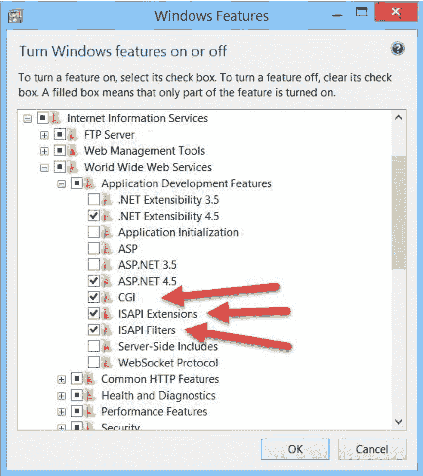

勾选“Internet Information Services”和“World Wide Web Services”。不要忘记勾选“CGI”、“ISAPI Extensions”和“ISAPI Filters”。你也可以勾选其他一些 IIS 功能。完成后，点击“确定”按钮。

它将安装所有选中的功能。完成后，你可以在“管理工具”中检查 IIS Web 服务器。你可以看到“Internet Information Services (IIS) 管理器”。点击它，然后你会得到 IIS Web 服务器对话框，如下图所示。

#### 1.1.2 Ubuntu 和 Mac 上的 Apache

在 OS X 上，Apache 已经为你安装好了。在 Ubuntu 上，你可以使用以下命令安装它。

```
$ sudo apt-get update
$ sudo apt-get install apache2
```

### 1.2 在 Web 服务器上部署 PHP

在本节中，我们将在 Web 服务器上部署 PHP。我使用 IIS 和 Apache Web 服务器进行测试。

让我们开始吧。

#### 1.2.1 Windows 平台的 IIS

在 IIS 上安装 PHP 有两种选择。你可以通过 Microsoft Web Platform Installer 安装，网址为 http://php.iis.net/。下载后，运行它，然后你会得到以下对话框。

** 此对话框是 Web Platform Installer 4.6 的示例。

## Web Platform Installer 4.6

## PHP 5.3.28


PHP（PHP: Hypertext Preprocessor 的递归缩写）是一种广泛使用的开源通用脚本语言，特别适合 Web 开发，并且可以嵌入到 HTML 中。它通常在 Web 服务器上运行，以 PHP 代码作为输入，并生成网页作为输出。这里提供的非线程安全版本的 PHP 是在 Microsoft Internet Information Services 中通过 FastCGI 支持在 Windows 上运行 PHP 时的推荐构建版本。

更多信息

发布者：PHP.net

下载大小：14.98 MB

版本：5.3.24

发布日期：2012 年 5 月 8 日，星期二

将安装 2 个项目

选项

点击“选项”并选择 IIS。完成后，点击“确定”按钮。

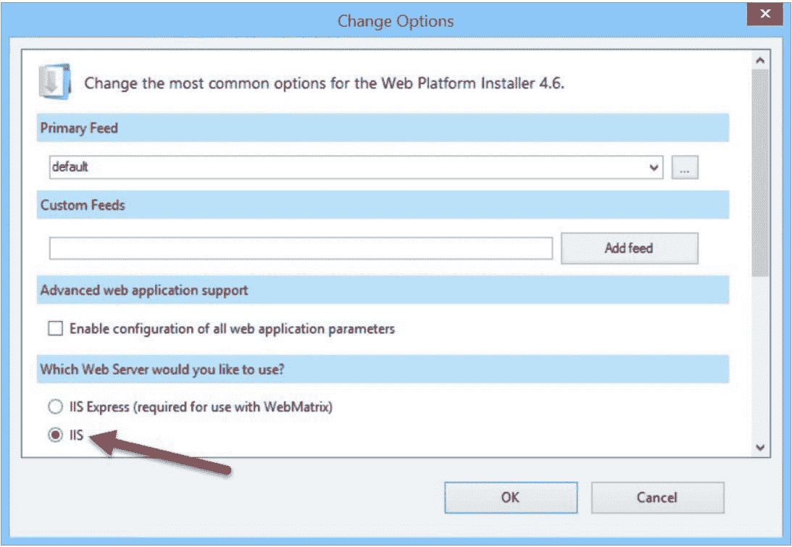

之后，点击**安装**按钮开始安装。

在本书中，我手动在 IIS 上安装了 PHP。你可以在 IIS Web 服务器上安装最新的 PHP。如何安装？

首先，我们必须安装适用于 Windows 的 PHP。你可以从 http://windows.php.net/download/ 下载。你可以下载 x86 或 x64 版本，以及线程安全或非线程安全版本。建议下载非线程安全的 PHP。下载后，你会得到一个 ZIP 文件（特定 PHP 版本提供安装程序文件）。将其解压到特定文件夹，例如 C:\PHP。

以下是解压后的 PHP 示例结果。

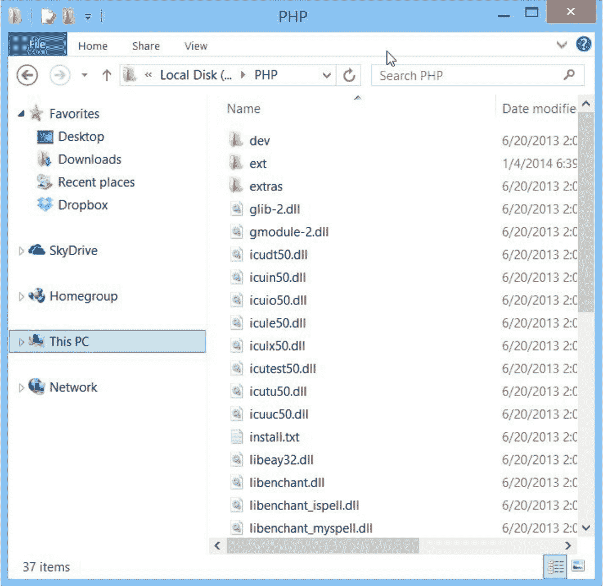

之后，我们可以安装适用于 IIS 的 PHP Manager。你可以从 [https://phpmanager.codeplex.com/](https://phpmanager.codeplex.com/) 下载。如果你已经安装了适用于 IIS 的 PHP Manager，你可以在 IIS 中看到 PHP Manager。

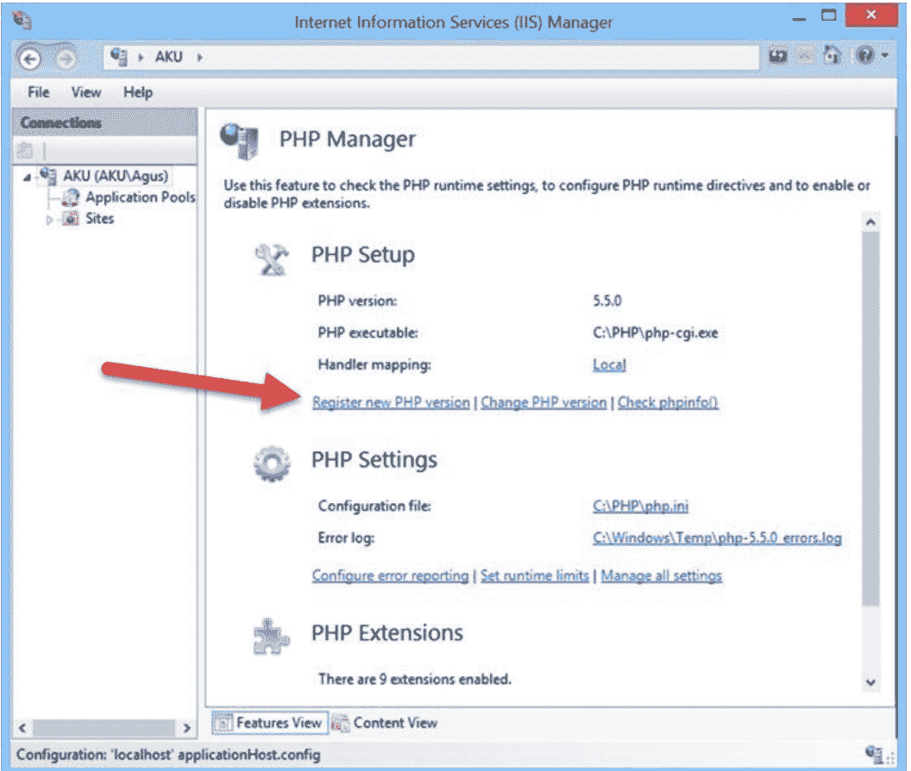

要验证，请点击“Check phpinfo()”，然后你会得到如下对话框。

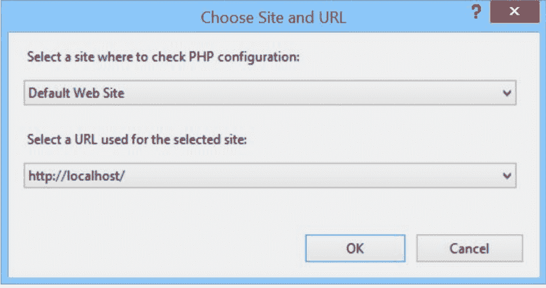

选择“Default Web Site”和 URL http://localhost。完成后，点击“确定”按钮。

如果成功，你可以看到 phpinfo() 的输出。以下是一个示例输出。

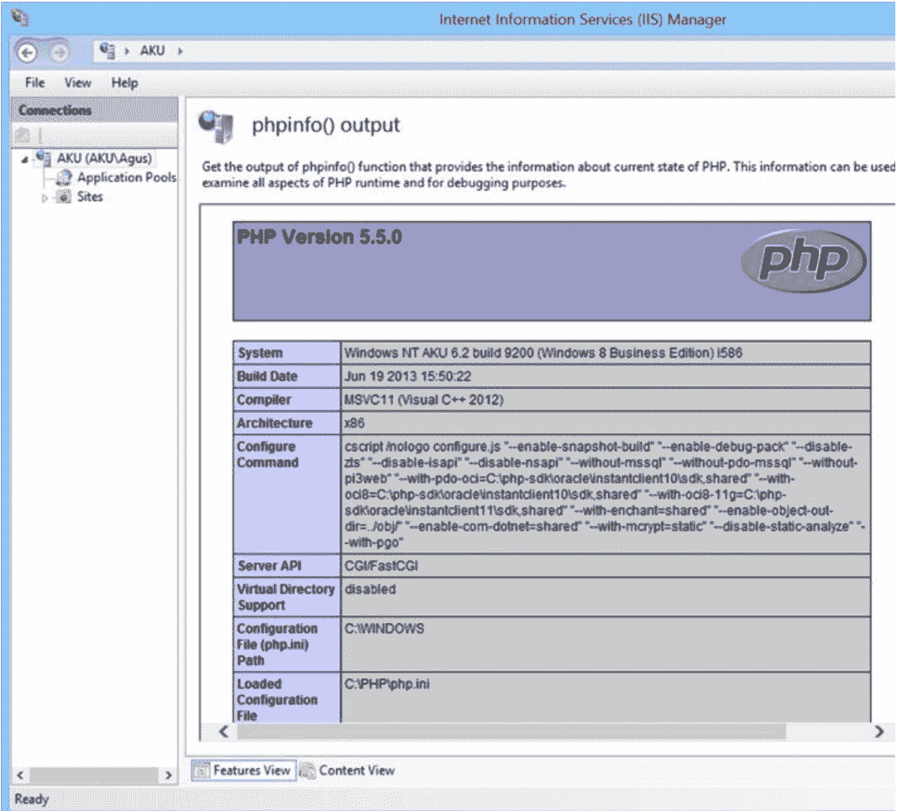

#### 1.2.2 Linux 和 Mac 平台的 Apache

对于 Linux 平台，你可以使用以下命令安装带有 PHP 的 Apache：

```
$ sudo apt-get update
$ sudo apt-get install apache2
$ sudo apt-get install php5 libapache2-mod-php5
```

对于 Mac，Apache 已默认安装。你可以使用以下命令启用此服务：

```
$ sudo apachectl start
```

然后，打开浏览器并导航到 http://localhost

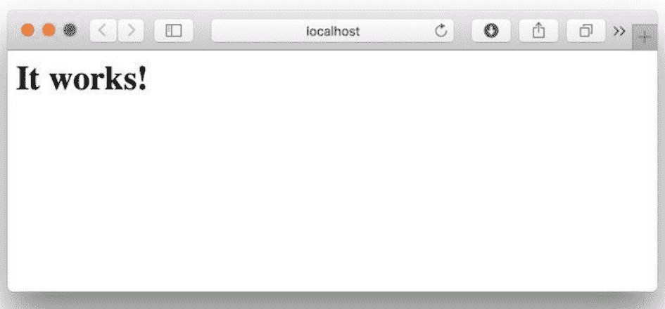

要在 Mac 上安装 PHP，你可以使用 brew。例如，我使用以下命令安装带有 PostgreSQL 驱动的 PHP 7：

```
$ brew tap homebrew/dupes
$ brew tap homebrew/versions
$ brew tap homebrew/homebrew-php
$ brew install php70 --with-postgresql
```

安装 PHP 后，你可以通过以下语句检查 PHP 版本来验证：

```
$ php -v
```

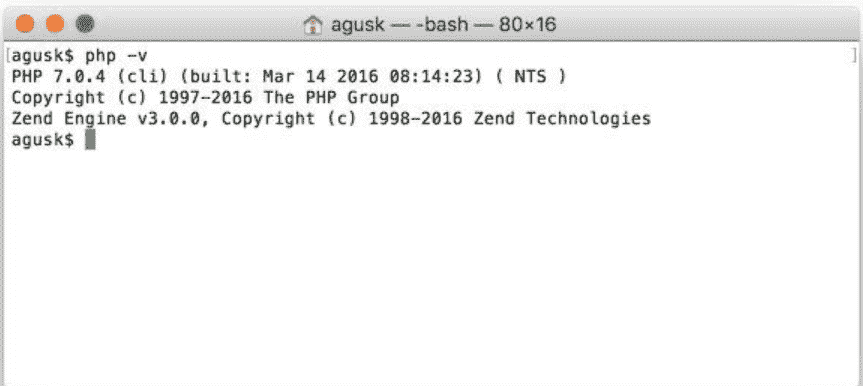

现在你可以在 Apache 上配置 PHP。首先，备份你的

```
$ cd /etc/apache2/
$ sudo cp httpd.conf httpd.conf.bak
```

现在编辑 httpd.conf 文件。

```
$ sudo nano httpd.conf
```

禁用 PHP5 并启用 PHP 7，如下所示：

```
#disable PHP5 module
#LoadModule php5_module libexec/apache2/libphp5.so

#Enable PHP 7 module
LoadModule php7_module /usr/local/opt/php70/libexec/apache2/libphp7.so

<FilesMatch \.php$>
SetHandler application/x-httpd-php
</FilesMatch>
```

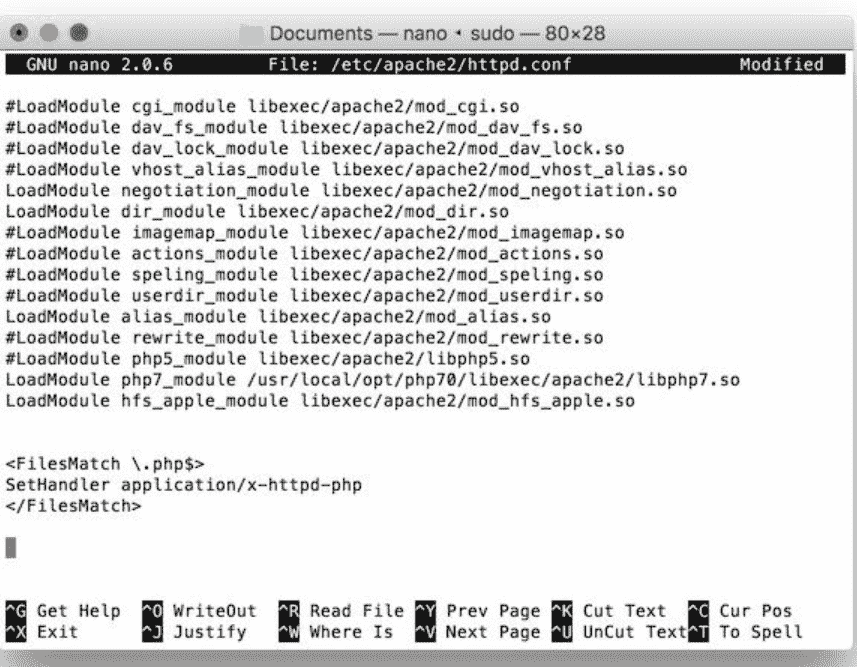

现在重启 Apache。

```
$ sudo apachectl restart
```

为了测试 PHP，在 Apache 的文档根目录中创建 test.php。

对于 Mac 用户，你可以输入以下命令：

```
$ sudo nano /Library/WebServer/Documents/test.php
```

在 test.php 中，你可以编写以下代码：

```
<?php phpinfo();
```

现在你可以打开浏览器并导航到 http://<server>/test.php

## 版本 7.0.4


| 系统 | Darwin akumpb.local 15.4.0 Darwin 内核版本 15.4.0：2016 年 2 月 26 日星期五 22:08:05 PST；root:xnu-3248.40.184-3/RELEASE_X86_64_x86_64 |
| 日期 | 2016 年 3 月 24 日 06:56:14 |
| 配置命令 | './configure' '--prefix=/usr/local/Cellar/php70/7.0.4' '--localstatedir=/usr/local/var' '--sysconfdir=/usr/local/etc/php/7.0' '--with-config-file-path=/usr/local/etc/php/7.0' '--with-config-file-scan-dir=/usr/local/etc/php/7.0/conf.d' '--mandir=/usr/local/Cellar/php70/7.0.4/share/man' '--enable-bcmath' '--enable-calendar' '--enable-dba' '--enable-exif' '--enable-ftp' '--enable-gd-native-ttf' '--enable-mbregex' '--enable-mbstring' '--enable-shmop' '--enable-soap' '--enable-sockets' '--enable-sysvmsg' '--enable-sysvsem' '--enable-sysvshm' '--enable-wddx' '--enable-zip' '--with-freetype-dir=/usr/local/opt/freetype' '--with-gd' '--with-gettext=/usr/local/opt/gettext' '--with-iconv-dir=/usr' '--with-icu-dir=/usr' '--with-jpeg-dir=/usr/local/opt/jpeg' '--with-kerberos=/usr' '--with-libedit' '--with-mhash' '--with-ndbm=/usr' '--with-pdo-odbc=/usr/local/opt/unixodbc' '--with-png-dir=/usr/local/opt/libpng' '--with-unixODBC=/usr/local/opt/unixodbc' '--with-xmlrpc' '--with-zlib=/usr' '--with-readline=/usr/local/opt/readline' '--without-gmp' '--without-snmp' '--with-libxml-dir=/usr/local/opt/libxml2' '--with-apxs2=/usr/sbin/apxs' '--libexecdir=/usr/local/Cellar/php70/7.0.4/libexec' '--with-bz2=/usr' '--disable-debug' '--with-openssl=/usr/local/opt/openssl' '--enable-fpm' '--with-fpm-user=_www' '--with-fpm-group=_www' '--with-curl' '--with-xsl=/usr' '--with-ldap' '--with-ldap-sasl' '--with-mysql-sock=/tmp/mysql.sock' '--with-mysqli=mysqlnd' '--with-pdo-mysql=mysqlnd' '--disable-opcache' '--enable-pcntl' '--without-pear' '--with-pgsql=/usr/local/opt/postgresql' '--with-pdo-pgsql=/usr/local/opt/postgresql' '--enable-dtrace' '--disable-phpdbg' '--enable-zend-signals' 'CC=clang' 'CXX=clang++' |
| API | Apache 2.0 处理器 |
| 目录支持 | 已禁用 |
| 配置文件（php.ini）路径 | /usr/local/etc/php/7.0 |
| 已加载的配置文件 | /usr/local/etc/php/7.0/php.ini |
| 扫描此目录以查找额外的 .ini 文件 | /usr/local/etc/php/7.0/conf.d |
| 已解析的额外 .ini 文件 | /usr/local/etc/php/7.0/conf.d/ext-pdo_pgsql.ini |


### 1.3 PostgreSQL 服务器

你可以从 [http://www.postgresql.org/download/](http://www.postgresql.org/download/) 下载并安装 PostgreSQL 服务器。不要忘记安装 pgAdmin 工具来管理我们的数据库。你可以使用命令行或任何数据库工具。

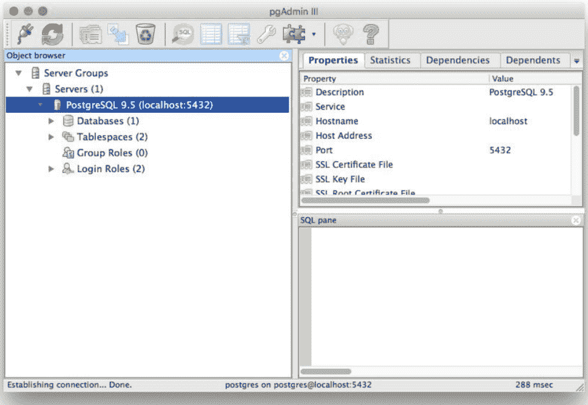

### 1.5 开发工具

基本上你可以使用任何编辑器来开发 PHP。你可以在 http://en.wikipedia.org/wiki/List_of_PHP_editors 上找到 PHP 编辑器列表。我使用 PHP WebStorm，http://www.jetbrains.com/phpstorm/ ，和 IntelliJ IDEA，http://www.jetbrains.com/idea/ 。它们提供 30 天试用。

以下是 PhpStorm 的示例。

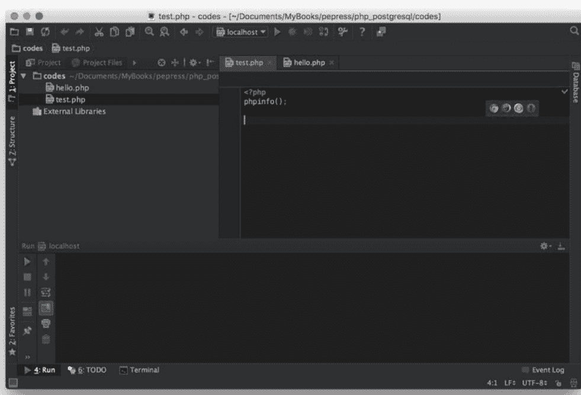

我还使用 DataGrip 来管理，https://www.jetbrains.com/datagrip/ ，PostgreSQL 服务器。

## postgres.public.employee - DataGrip 1.0.3

PostgreSQL - postgres@localhost

+   - pg_catalog
+   - public
+     - sequences
+     - tables
+       - employee
+         - hrd_employee
+           - id INTEGER
+           - name CHAR(30)
+           - department CHAR(30)
+           - level CHAR(10)
+           - created TIMESTAMP
+     - routines

<Filter criteria>

0 rows

| id | name | department |
|---|---|---|

Data DDL

### 2.1 连接到 PostgreSQL

在 IIS 和 Apache 上设置 PHP 和 PostgreSQL 驱动程序后，现在我们可以测试连接到 PostgreSQL 服务器。我们可以使用 **pg_connect()** 连接 PostgreSQL 服务器数据库和 **pg_close()** 关闭连接。

### 2.2 创建 PHP 并连接到 PostgreSQL

在本节中，我们创建一个名为 **hello.php** 的 PHP 文件。

目标是通过数据库身份验证连接到 PostgreSQL。

首先，我们定义服务器、用户名、密码和数据库。

```php
<?php

$dbServer = "(local)";
$username = "dbtester";
$password = "dbtester";
$database = "postgres";
```

请更改 $username 和 $password 值。

然后我们通过传递服务器信息使用 **pg_connect()** 连接到 PostgreSQL。

```php
// Connecting, selecting database
$dbconn = pg_connect("host=$dbServer dbname=$database user=$username password=$password")
or die('Could not connect: ' . pg_last_error());

$stat = pg_connection_status($dbconn);
    if ($stat === PGSQL_CONNECTION_OK) {
        echo 'Connection status ok';
    } else {
        echo 'Connection status bad';
    }

// Closing connection
pg_close($dbconn);
```

代码末尾，我们使用 **pg_close()** 关闭连接。

保存所有代码。

### 2.3 测试

将文件 hello.php 部署到 Web 服务器。我测试了 PhpStorm 工具的内置 Web 服务器。打开浏览器并输入 hello.php 文件的 URL。

以下是运行 PHP 应用程序的示例。

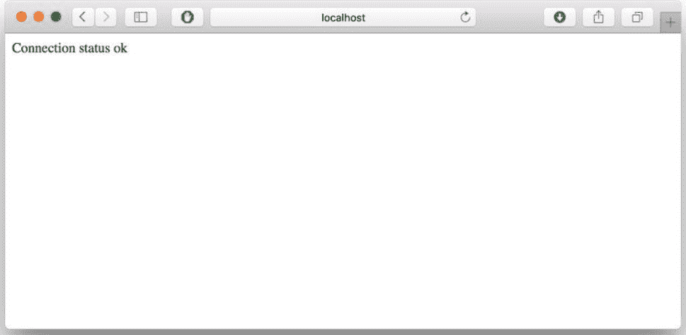

## 3. CRUD 操作

本章解释如何使用 PHP 操作 PostgreSQL 数据。

### 3.1 CRUD 操作

CRUD (Create, Read, Update, Delete) 操作是数据库的基本数据操作。在本章中我们将开发 PHP 应用程序来执行 CRUD 操作。我们使用现有数据库 postgres。然后，创建一个名为 **hrd_employee** 的表。以下是创建表的查询。

```
CREATE TABLE public.hrd_employee
(
  id SERIAL PRIMARY KEY,
  name character(30),
  department character(30),
  level character(10),
  created timestamp without time zone
)
WITH (
  OIDS=FALSE
);
ALTER TABLE public.hrd_employee
  OWNER TO postgres;
```

你可以使用 pgAdmin 运行它。你也可以使用其他工具运行它，例如 Jetbrains 的 DataGrip，https://www.jetbrains.com/datagrip/ 。

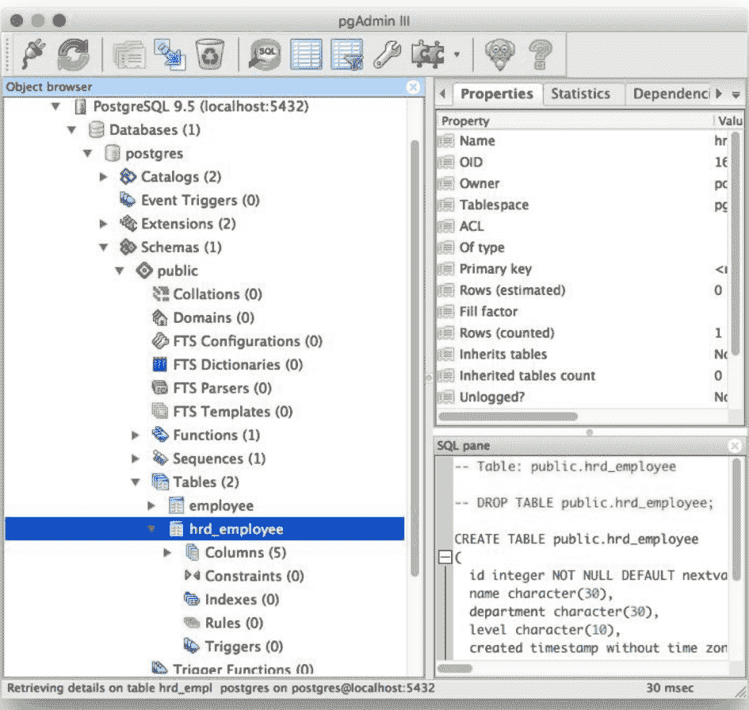

DataGrip 的表单。

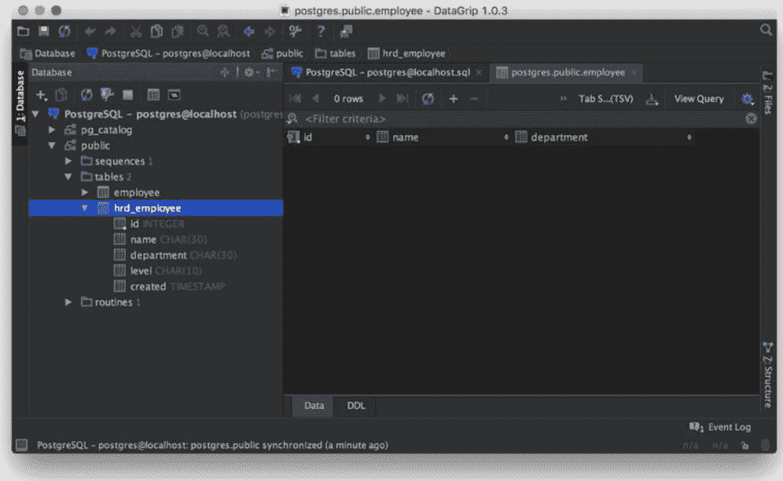

对于数据库连接配置，我创建了一个名为 **dbinfo.php** 的 PHP 文件。以下是 dbinfo.php 的内容。

```php
<?php

$dbServer = "localhost";
$username = "user_db";
$password = "user_pass";
$database = "postgres";

$connString = "host=$dbServer dbname=$database user=$username password=$
```

请根据你的配置更改数据库参数值。

你可以修改此数据库配置。下一步是创建一个名为 **CRUDDemo** 的 PHP 类。此类提供多个函数来执行 CRUD 操作。开始吧。创建名为 **CRUDDemo.php** 的 PHP 文件。然后编写此脚本。

```php
<?php

include('dbinfo.php');

class CRUDDemo {
    private $msg = "";

    public function getMsg()
    {
```

```php
return $this->msg;
    }
}
```

根据你的 **dbinfo.php** 位置，你可以更改其路径。

我们将在下一节添加一些函数来执行 CRUD 操作。

### 3.2 创建数据

在此场景中，我们创建新员工并尝试检索插入的 ID。PostgreSQL 驱动程序提供函数 RETURNING 来从插入的查询 SQL 语句中检索 ID。我们将使用 SQL 语句插入数据，但我们使用参数来防止 SQL 注入。

我们使用函数 pg_fetch_row() 从查询 RETURNING 中获取 ID 值。代码末尾，不要忘记释放我们使用的资源并使用 pg_close() 关闭连接。

现在我们添加函数 createEmployee() 来创建新员工。然后，编写此代码。

```php
<?php
include('dbinfo.php');

class CRUDDemo {
    private $msg = "";

    public function getMsg()
    {
        return $this->msg;
    }
    public function createEmployee($name,$department,$level) {

        $id = -1;
        try {

            global $connString;

            $conn = pg_connect($connString);
            if( $conn === false )
            {
                $this->msg = "Unable to connect PostgreSQL Server.";
                return $id;
            }

            // insert data
            $query = "insert into hrd_employee(name,department,level,cre
            $params = array(&$name,&$department,&$level);

            $res = pg_query_params($conn,$query,$params);
            $row = pg_fetch_row($res);
            $id = $row[0];

            pg_close($conn);

        } catch (Exception $e) {
            $this->msg = $e->getMessage();
            $id = -1;
        }

        return $id;
    }
}
```

保存此代码。

为了测试此类，我们创建名为 **testcrud.php** 的 PHP 文件。之后，我们尝试插入 10 条数据。

```php
<?php

include('CRUDDemo.php');

$obj = new CRUDDemo();

// insert 10 data
for($i=1;$i<=10;$i++) {
    $id = $obj->createEmployee("person " . $i,"depertment " . $i,"A".$i);
    echo "Inserted Id: " .$id . " \n";
    echo "Error message: " . $obj->getMsg() . " \n\n";
}
```

保存代码并尝试运行 **testcrud.php**。

以下是 Intellij IDEA 上测试运行的示例。

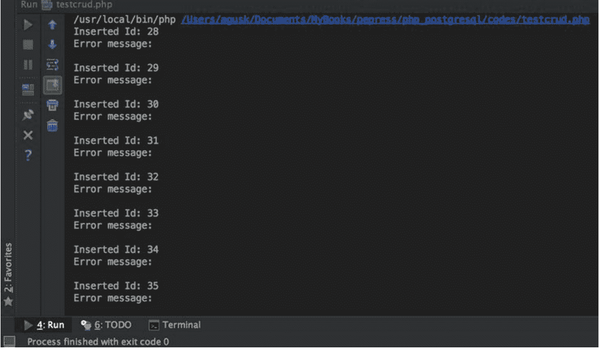

为了验证是否成功，我们可以检查数据库。如果成功，我们可以在表 hrd_employee 上看到 10 条新数据。以下是 PostgreSQL 上表 **hrd_employee** 的 10 条数据的示例。

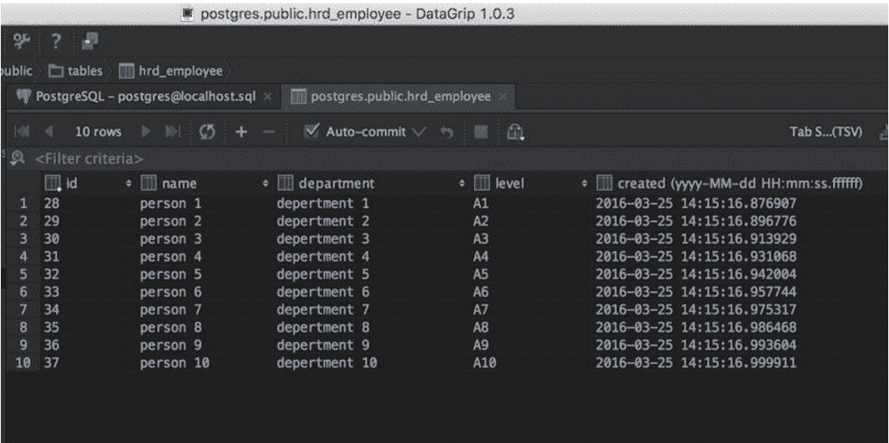

```php
    return $data;
}
}
```

你可以看到我们定义 $data 来保存来自 PostgreSQL 数据库的数据。

保存此代码。

现在我们测试函数 readEmployeeList()。打开文件 testcrud.php 并添加以下代码。

```php
<?php

include('CRUDDemo.php');

$obj = new CRUDDemo();

// read data
$list = $obj->readEmployeeList();
if($list) {
    foreach($list as $item) {
        $content = "";
        foreach($item as $key => $value) {
            $content = $content . $key . ": " . $value . "\n";
        }
        echo $content . "\n";
    }
}
```

保存此代码。

你可以执行文件 testcrud.php。以下是输出示例。

```
/usr/local/bin/php /Users/apusk/Documents/MyBooks/pearess/php_postgresql/codes/testcrud.php
id: 28
name: person 1
department: depertment 1
level: A1
created: 2016-03-25 14:15:16.876907

id: 29
name: person 2
department: depertment 2
level: A2
created: 2016-03-25 14:15:16.896776

id: 30
name: person 3
department: depertment 3
level: A3
created: 2016-03-25 14:15:16.913929

id: 31
name: person 4
department: depertment 4
level: A4
created: 2016-03-25 14:15:16.931068
```


### 3.4 更新数据

本节将更新特定 ID 对应的数据。我们使用 UPDATE 语句并传入更新后的数据。

创建一个名为 updateEmployee() 的函数，并编写以下代码。

```php
<?php
include('dbinfo.php');

class CRUDDemo {
    private $msg = "";

    public function getMsg()
    {
        return $this->msg;
    }
    public function updateEmployee($id,$name,$department,$level) {

        $success = -1;
        try {

            global $connString;

            $conn = pg_connect($connString);
            if( $conn === false )
            {
                $this->msg = "Unable to connect PostgreSQL Server.";
                return $success;
            }

            $query = "update hrd_employee set name=$1,department=$2,level=$3 where id=$4";
            $params = array(&$name,&$department,&$level,&$id);

            $res = pg_query_params($conn,$query,$params);
            if($res === FALSE) {
                $this->msg = "Error in executing query.";
                return $success;
            }
            $num_rows=pg_affected_rows($res);
            $success = $num_rows;
            $this->msg = "";

            pg_close($conn);

        } catch (Exception $e) {
            $this->msg = $e->getMessage();
            $success = -1;
        }

        return $success;
    }
}
```

保存此代码。

现在，我们在 testcrud.php 文件中调用 updateEmployee()。在本次测试中，我们更新 ID 为 30 的员工。你也可以更改员工 ID。

```php
<?php

include( 'CRUDDemo.php' );

$obj = new CRUDDemo();

// update
// update data with id = 30. Change it with own id data
$success = $obj->updateEmployee(30, "update-employee","update-department","u-level");
echo "Success: " . $success . "\n";
echo "Error message: " . $obj->getMsg();
```

保存此代码，然后运行 testcrud.php 文件。

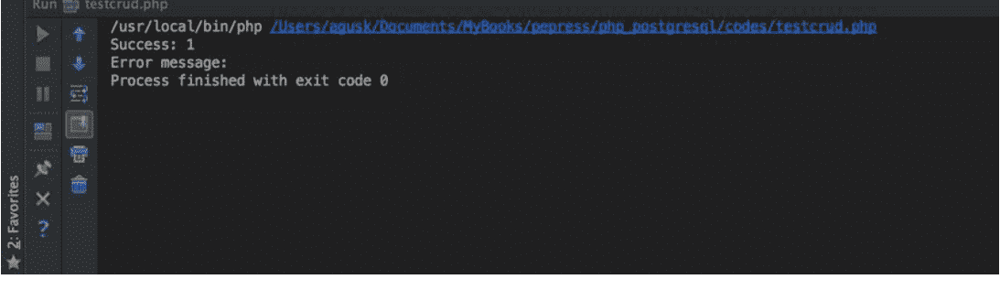

如果打开 hrd_employee 表，就能看到 ID = 30 的数据已更新。

|  | id | name | department | level | created (yyyy-MM-dd HH:mm:ss.ffffff) |
|---|---|---|---|---|---|
| 1 | 28 | person 1 | department 1 | A1 | 2016-03-25 14:15:16.876907 |
| 2 | 29 | person 2 | department 2 | A2 | 2016-03-25 14:15:16.896776 |
| 3 | 31 | person 4 | department 4 | A4 | 2016-03-25 14:15:16.931068 |
| 4 | 32 | person 5 | department 5 | A5 | 2016-03-25 14:15:16.942084 |
| 5 | 33 | person 6 | department 6 | A6 | 2016-03-25 14:15:16.957744 |
| 6 | 34 | person 7 | department 7 | A7 | 2016-03-25 14:15:16.975317 |
| 7 | 35 | person 8 | department 8 | A8 | 2016-03-25 14:15:16.986468 |
| 8 | 36 | person 9 | department 9 | A9 | 2016-03-25 14:15:16.993604 |
| 9 | 37 | person 10 | department 10 | A10 | 2016-03-25 14:15:16.999911 |
| 10 | 30 | update-employee | update-department | u-level | 2016-03-25 14:15:16.913929 |

### 3.5 删除数据

要删除数据，我们使用 DELETE FROM SQL 语句并传入员工 ID。

创建一个名为 deleteEmployee() 的函数，并编写以下代码。

```php
<?php
include('dbinfo.php');

class CRUDDemo {
    private $msg = "";

    public function getMsg()
    {
        return $this->msg;
    }
    public function deleteEmployee($id) {

        $success = -1;
        try {

            global $connString;

            $conn = pg_connect($connString);
            if( $conn === false )
            {
                $this->msg = "Unable to connect PostgreSQL Server.";
                return $success;
            }

            $query = "delete from hrd_employee where id=$1";
            $params = array(&$id);

            $res = pg_query_params($conn,$query,$params);
            if($res === FALSE) {
                $this->msg = "Error in executing query.";
                return $success;
            }
            $num_rows=pg_affected_rows($res);
            $success = $num_rows;
            $this->msg = "";

            pg_close($conn);

        } catch (Exception $e) {
            $this->msg = $e->getMessage();
            $success = -1;
        }

        return $success;
    }
}
```

保存此代码。

现在，我们在 **testcrud.php** 文件中测试此函数。我们将删除 ID = 30 的数据。你可以更改此 ID。

```php
<?php

include('CRUDDemo.php');

$obj = new CRUDDemo();

// delete
// delete data with id = 30. Please change it
$success = $obj->deleteEmployee(30);
echo "Success: " . $success . "\n";
echo "Error message: " . $obj->getMsg();
```

保存此代码并运行 **testcrud.php**。

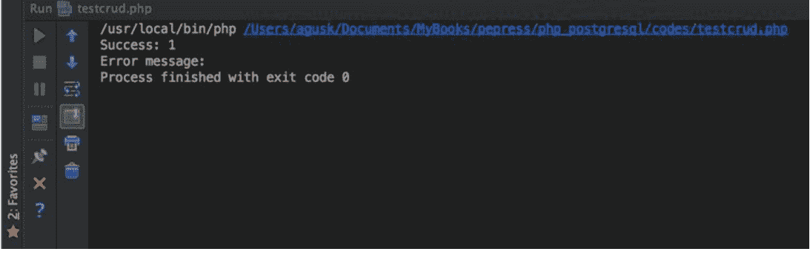

打开 **hrd_employee** 表即可验证。ID = 30 的数据应该不会显示。

| id | name | department | level | created (yyyy-MM-dd HH:mm:ss.ffffff) |
|----|------|------------|-------|--------------------------------------|
| 28 | person 1 | department 1 | A1 | 2016-03-25 14:15:16.876907 |
| 29 | person 2 | department 2 | A2 | 2016-03-25 14:15:16.896776 |
| 31 | person 4 | department 4 | A4 | 2016-03-25 14:15:16.931068 |
| 32 | person 5 | department 5 | A5 | 2016-03-25 14:15:16.942004 |
| 33 | person 6 | department 6 | A6 | 2016-03-25 14:15:16.957744 |
| 34 | person 7 | department 7 | A7 | 2016-03-25 14:15:16.975317 |
| 35 | person 8 | department 8 | A8 | 2016-03-25 14:15:16.986468 |
| 36 | person 9 | department 9 | A9 | 2016-03-25 14:15:16.993604 |
| 37 | person 10 | department 10 | A10 | 2016-03-25 14:15:16.999911 |

## 4. 使用图像和 Blob 数据

本章介绍如何在 PostgreSQL 中处理图像和 Blob 数据，以及如何使用 PHP 对其进行操作。

### 4.1 图像和 Blob 数据

PostgreSQL 提供了 BYTEA 数据类型，可用于存储图像文件和二进制类型的数据。

本章将介绍如何在 PostgreSQL 中处理图像文件。以下是名为 ImagesFiles 的表结构。

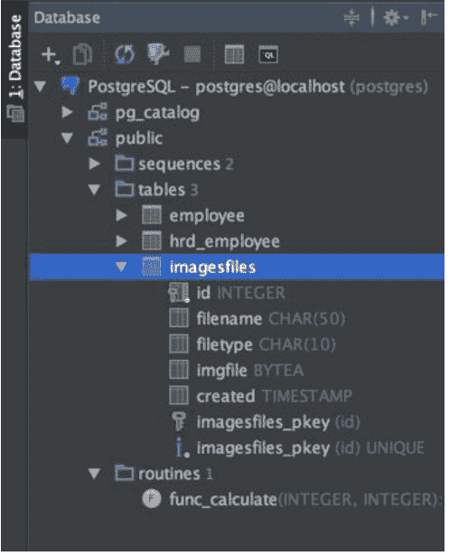

以下脚本用于创建 imagesfiles 表。

```
CREATE TABLE public.imagesfiles
(
  id SERIAL PRIMARY KEY,
  filename character(50),
  filetype character(10),
  imgfile BYTEA,
  created timestamp without time zone
)
WITH (
OIDS=FALSE
);
ALTER TABLE public.imagesfiles
OWNER TO postgres;
```

filetype 表示上传文件的图像类型。显示图像时，这一信息非常重要。更多说明请参见第 4.3 节。

接下来，我们将创建两个 PHP 应用程序：一个用于上传图像，另一个用于列出图像数据。

### 4.2 上传图像

本节将介绍使用传统的 HTML 文件表单上传图像。用户选择图像文件并点击 **Submit** 按钮后，PHP 文件会处理上传的文件并将其存储到数据库中。

首先，创建 **uploadimage.html** 并编写以下脚本。

```html
<!DOCTYPE html>
<html>
<head>
    <title>PHP and PostgreSQL Programming by Example</title>
</head>
<body>
<h1>Uploading Image file</h1>

<p><br/></p>
<p>Upload image file (JPG/PNG/TIF/GIF) with file size maximum 500KB.</p>

<form action="upload_process.php" method="post"
      enctype="multipart/form-data">
    <label for="file">Image File (JPG/PNG/TIF/GIF):</label>
    <input type="file" name="file" id="file"><br/><br/>
    <input type="submit" name="submit" value="Submit">
</form>

</body>
</html>
```

可以看到，我们使用了 multipart/form-data 表单和 file 输入控件来上传图像文件。表单采用 POST 方法，并跳转到 **upload_process.php**。

现在创建 **upload_process.php** 来处理上传的文件。我们将验证输入文件是否为 gif、tif、jpg 或 png 格式，并将文件大小限制在 500 KB 以下。将以下代码写入 **upload_process.php**。

```php
<?php

include('dbinfo.php');

$allowedExts = array("gif", "tif", "jpg", "png");
$filename = $_FILES["file"]["name"];
$temp = explode(".", $filename);
$fileExt = end($temp);
$imageType = $_FILES["file"]["type"];

if ((($imageType == "image/gif") || ($imageType == "image/jpg") || ($imageType == "image/jpeg")
    || ($imageType == "image/gif") || ($imageType == "image/tiff")
    || ($imageType == "image/x-png") || ($imageType == "image/png"))
    && ($_FILES["file"]["size"] < 500000)
    && in_array($fileExt, $allowedExts)) {
```


```php
$file_name = $_FILES['file']['tmp_name'];

// open connection to database server
global $connString;
$conn = pg_connect($connString);
if( $conn === false )
{
    echo "Unable to connect PostgreSQL Server.";
    return;
}

// query data to insert image file
$query = "insert into imagesfiles(filename,filetype,imgfile,created)

$img = fopen($file_name, 'r') or die("cannot read image\n");
$data = fread($img, filesize($file_name));
$img_data = pg_escape_bytea($data);
fclose($img);

$params = array(&$filename,&$imageType,&$img_data);

if(!(pg_query_params($conn,$query,$params)))
{
    echo "Error in executing query.<br>";
    pg_close($conn);
    return;
}

pg_close($conn);
echo "Uploaded file was success <br>";

}else {
    echo "Invalid file <br>";
}
```

基本上它与正常插入数据类似，但对于字段 imgfile（图像数据类型），我们使用 pg_escape_bytea() 将图像文件的内容作为查询参数传递。

**dbinfo.php** 是一个数据库配置文件。您可以从第 3.1 节使用相同的内容。

完成保存代码。尝试运行。

在浏览器中打开文件 **uploadingimage.html**。选择图像文件然后点击提交按钮。

### 上传图像文件

上传图像文件（JPG/PNG/TIF/GIF），文件大小最大为 500KB。

图像文件（JPG/PNG/TIF/GIF）：选择文件 未选择文件

如果成功，我们将获得如下响应。

Uploaded file was success

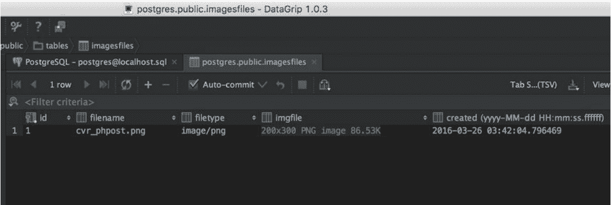

尝试上传另一张图像文件以测试图像文件列表。

### 4.3 列出图像数据

现在我们构建 PHP 应用程序来显示图像数据列表。如我们所知，HTML 提供了 img 标签（）来显示图像。我们使用以下格式来显示图像：

```
' width=200px height
```

根据您的图像类型，我们可以更改 data 值，例如 PNG 图像文件，可更改为 image/png。 <base64_of_imagefile> 是图像的 base64 值。我们可以使用 base64_encode() 将图像转换为 base64。在从数据库获取图像数据后，我们应该调用 pg_unescape_bytea() 函数。

现在创建一个名为 list_images.php 的 PHP 文件，并编写此代码。

```
<!DOCTYPE html>
<html>
<head>
    <title>PHP and PostgreSQL Programming by Example</title>
</head>
<body>
<h1>List of Image file</h1>

<p><br/></p>

<p>Retrieving image from database.</p>
<br/>

<?php

include('dbinfo.php');

global $connString;
$conn = pg_connect($connString);
if ($conn === false) {
    echo "Unable to connect PostgreSQL.<br>";
    return;
}

// query data to insert image file
$query = "select id,filename,filetype,imgfile,created from imagesfiles";

$result = pg_query($conn, $query);
while ($row = pg_fetch_row($result)) {
    echo "<div>";
    $imgType = $row[2];
    $imgfile = pg_unescape_bytea($row[3]);
    $img = base64_encode($imgfile);

    echo "<p>ID: " .$row[0]."</p><p>".$row[1]."<p>".$row[4].
        "</p><p>";
}
pg_close($conn);
?>
</body>
</html>
```

保存代码。

现在在浏览器中打开文件 **list_images.php**。如果有数据，您可以看到结果输出，如下图所示。

### 图像文件列表

从数据库检索图像。

ID:1

cvr_phpost.png

2016-03-26 03:42:04.796469

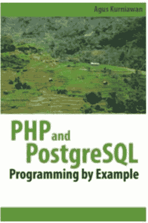

您可以使用 CSS 或 JavaScript 修改以增强网站 UI。

### 5.1 PHP 和 PostgreSQL 事务

PostgreSQL 驱动程序通过查询提供事务操作。我们使用 BEGIN 查询开始事务，使用 COMMIT 完成事务。否则，我们可以使用 ROLLBACK 来恢复之前的事务。

如何使用这些函数？让我们编写 PHP 应用程序。

### 5.2 演示

为了说明事务演示，我们创建一个简单的 PHP 应用程序。我们向数据库插入 5 条数据。我们使用第 3 章的相同代码。如果其中一个失败，我们将调用回滚事务。

让我们开始构建。创建一个名为 transaction_demo.php 的 PHP 文件，并编写以下代码：

```
<?php

include('dbinfo.php');

// connect to postgresql
global $connString;

$conn = pg_connect($connString);
if( $conn === false )
{
    echo "Unable to connect PostgreSQL Server.";
    return;
}
echo "Connected to PostgreSQL Server.<br>";

// start transaction
pg_query("BEGIN") or die("Could not start transaction\n");

echo "Inserting data.<br>";
for($i=1;$i<=5;$i++) {

    $name = "person-".$i;
    $department = "finance";
    $level = "B";
    $query = "insert into hrd_employee(name,department,level,created) va
    $params = array(&$name,&$department,&$level);

    $res = pg_query_params($conn,$query,$params);
    if($res === false)
    {
        echo "Error in executing query.<br>";
        echo "Rollback transaction.<br>";

        pg_query("ROLLBACK") or die("Transaction rollback failed\n");;
        pg_close($conn);
        return;
    }

    $row = pg_fetch_row($res);
    $id = $row[0];
    echo "inserted data was success.id=".$id."<br>";
}

pg_query("COMMIT") or die("Transaction commit failed\n");
pg_close($conn);
echo "Committed Transaction and close connection.<br>";
```

保存此代码并运行它。

在浏览器中打开文件 **transaction_demo.php**。如果成功，您可以看到如下响应。

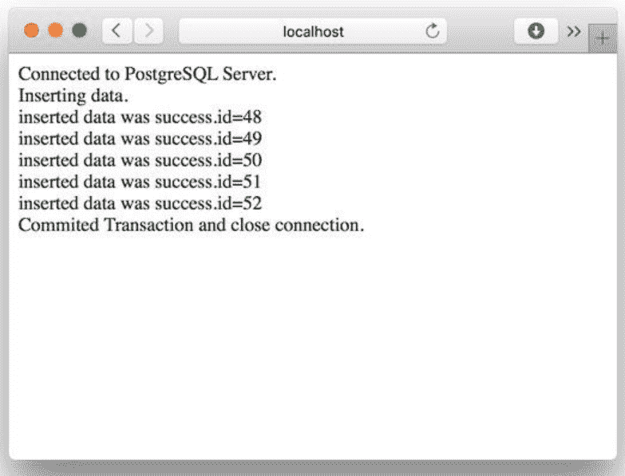

您可以验证插入到 PostgreSQL 数据库的数据。

| # | id | name | department | level | created (yyyy-MM-dd HH:mm:ss.ffffff) |
|---|---|---|---|---|---|
| 7 | 35 | person 8 | department 8 | A8 | 2016-03-25 14:15:16.986468 |
| 8 | 36 | person 9 | department 9 | A9 | 2016-03-25 14:15:16.993604 |
| 9 | 37 | person 10 | department 10 | A10 | 2016-03-25 14:15:16.999911 |
| 10 | 38 | person-1 | finance | B | 2016-03-26 04:42:18.799703 |
| 11 | 39 | person-2 | finance | B | 2016-03-26 04:42:18.799703 |
| 12 | 40 | person-3 | finance | B | 2016-03-26 04:42:18.799703 |
| 13 | 41 | person-4 | finance | B | 2016-03-26 04:42:18.799703 |
| 14 | 42 | person-5 | finance | B | 2016-03-26 04:42:18.799703 |
| 15 | 43 | person-1 | finance | B | 2016-03-26 04:42:52.573706 |
| 16 | 44 | person-2 | finance | B | 2016-03-26 04:42:52.573706 |
| 17 | 45 | person-3 | finance | B | 2016-03-26 04:42:52.573706 |
| 18 | 46 | person-4 | finance | B | 2016-03-26 04:42:52.573706 |
| 19 | 47 | person-5 | finance | B | 2016-03-26 04:42:52.573706 |
| 20 | 48 | person-1 | finance | B | 2016-03-26 04:43:35.389129 |
| 21 | 49 | person-2 | finance | B | 2016-03-26 04:43:35.389129 |
| 22 | 50 | person-3 | finance | B | 2016-03-26 04:43:35.389129 |
| 23 | 51 | person-4 | finance | B | 2016-03-26 04:43:35.389129 |
| 24 | 52 | person-5 | finance | B | 2016-03-26 04:43:35.389129 |

## 6. 存储过程

本章解释如何在 PostgreSQL 上使用存储过程并从 PHP 调用它们。

### 6.1 存储过程

存储过程是访问关系数据库系统的子程序。存储过程可以被应用程序访问。在本节中，我将向您展示如何在 PostgreSQL 中创建存储过程，然后从 PHP 调用它。

有三种存储过程模型：

- Stored Procedure without parameter. It can be return value or not
- Stored Procedure with input parameter
- Stored Procedure with input and output parameters

这些模型将在下一节中实现。首先，我们创建一个名为 **SPDemo** 的 PHP 类。然后，编写此骨架代码：

```
<?php

include('dbinfo.php');

class SPDemo {
    private $msg = "";
    
    public function getMsg()
    {
        return $this->msg;
    }
}
```

将此代码保存为 **SPDemo.php**。

我们将添加几个函数来访问存储过程。在本章中，我们使用 **hrd_employee** 表从 postgres 数据库。

### 6.2 调用存储过程

要使用游标从 PHP 调用存储过程，我们执行以下步骤：

- Open connection to PostgreSQL using pg_connect()
- Do a transaction BEGIN and COMMIT
- Inside a transaction, we call pg_query_params() to call stored procedure

让我们开始。

首先，我们创建存储过程，名为 **get all employees**。编写此 SQL 语句。

```
DROP FUNCTION public.get_all_employees(refcursor);

CREATE OR REPLACE FUNCTION get_all_employees(ref refcursor) RETURNS refcursor AS $$
BEGIN
  OPEN ref FOR SELECT id,name,department,level,created FROM hrd_employee
  RETURN ref;
END;
$$ LANGUAGE plpgsql;
```

此存储过程调用查询以从 hrd_employee 表中检索数据。它返回一个游标。

运行此脚本到 PostgreSQL 数据库。如果成功，您可以在数据库中看到此存储过程。


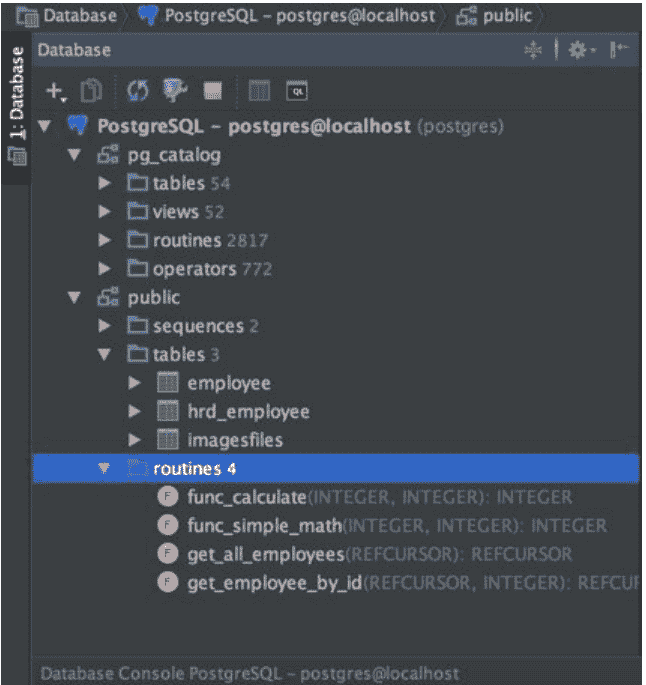

现在我们创建一个新函数，名为 **getAllEmployees()**，位于 SPDemo.php 中，并编写以下代码。

```php
<?php

include('dbinfo.php');

class SPDemo {
    private $msg = "";
    public function getMsg()
    {
        return $this->msg;
    }
    public function getAllEmployees() {
        $data = array();
        try {
            global $connString;
            $conn = pg_connect($connString);
            if( $conn === false )
            {
                $this->msg = "Unable to connect PostgreSQL Server.";
                return $data;
            }
        }
$cursor_name = "crp";
pg_query($conn,"BEGIN");
$query = "select * from get_all_employees($1);";

$params = array(&$cursor_name);
$res = pg_query_params($conn,$query,$params);
if($res === false)
{
    $this->msg = "Error in executing query.";
    return $data;
}

$res = pg_query($conn, "FETCH ALL FROM ".$cursor_name.";");
if($res === false)
{
    $this->msg = "Error in executing query.";
    return $data;
}
while($row = pg_fetch_row($res))
{
    array_push($data, array("id"=>$row[0],"name"=>$row[1],
    "department"=>$row[2],"level"=>$row[3],"created"=>$r
}

pg_query($conn,"COMMIT");
pg_close($conn);

} catch (Exception $e) {
    $this->msg = $e->getMessage();
}

return $data;
}
}
```

保存此代码。

现在调用函数 getAllEmployees()。创建文件 PHP testsp.php 并编写以下代码：

```php
<?php

include('SPDemo.php');

// call stored procedure
$obj = new SPDemo();
$data = $obj->getAllEmployees();
if($data) {
    foreach($data as $item) {
        $content = "";
```

```php
foreach($item as $key => $value) {
    $content = $content . $key . ": " . strval($value) . "\n";
}
echo $content . "\n";
}
}
```
```

保存此代码。

你可以执行文件 **testsp.php**。以下是一个示例输出。

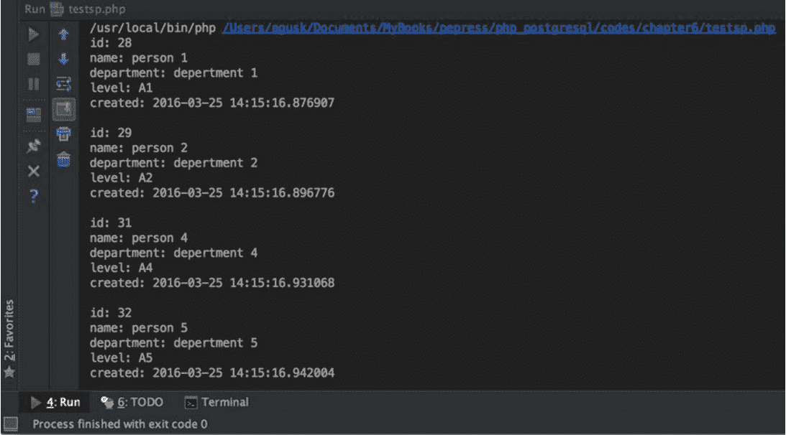

### 6.3 调用带参数的存储过程

在上一节中，我们调用了不带参数的存储过程。现在我们将调用带参数的存储过程。我们创建一个名为 **get_employee_by_id** 的存储过程，然后编写以下脚本。

```
DROP FUNCTION public.get_employee_by_id(refcursor,INT);

CREATE OR REPLACE FUNCTION get_employee_by_id(ref refcursor,empId INT) R
BEGIN
    OPEN ref FOR SELECT id,name,department,level,created FROM hrd_employee
    RETURN ref;
END;
$$ LANGUAGE plpgsql;
```

在 PostgreSQL 上将此脚本运行到 postgres 数据库。

在 PHP 文件 **SPDemo.php** 中，我们创建一个函数 **getEmployeesById()** 来调用存储过程，并编写以下代码。

```php
<?php

include('dbinfo.php');

class SPDemo {

    private $msg = "";

    public function getMsg()
    {
        return $this->msg;
    }

    public function getEmployeesById($id) {
        $data = array();
        try {

            global $connString;

            $conn = pg_connect($connString);
            if( $conn === false )
            {
                $this->msg = "Unable to connect PostgreSQL Server.";
                return $data;
            }

            $cursor_name = "gtm";
            pg_query($conn,"BEGIN");
            $query = "select * from get_employee_by_id($1,$2);";

            $params = array(&$cursor_name,&$id);
```

```php
$res = pg_query_params($conn,$query,$params);
if($res === false)
{
    $this->msg = "Error in executing query.";
    return $data;
}
$res = pg_query($conn, "FETCH ALL FROM ".$cursor_name.";");
if($res === false)
{
    $this->msg = "Error in executing query.";
    return $data;
}
while($row = pg_fetch_row($res))
{
    array_push($data, array("id"=>$row[0],"name"=>$row[1],
    "department"=>$row[2],"level"=>$row[3],"created"=>$r
}
pg_query($conn,"COMMIT");
pg_close($conn);
} catch (Exception $e) {
    $this->msg = $e->getMessage();
}
return $data;
}
}
```
```

现在调用函数 **getEmployeesById()**。打开 PHP 文件 testsp.php 并添加以下代码：

```php
<?php

include( 'SPDemo.php' );

$obj = new SPDemo();

// call stored procedure with parameter
$data = $obj->getEmployeesById(40);
if($data) {
    foreach($data as $item) {
        $content = "";
        foreach($item as $key => $value) {
            $content = $content . $key . ": " . strval($value) ."\n";
        }
        echo $content . "\n";
    }
}
```
```

我们向函数传入 Id=40。你可以根据你自己的数据更改此值。

保存此代码并运行它。以下是一个示例输出。

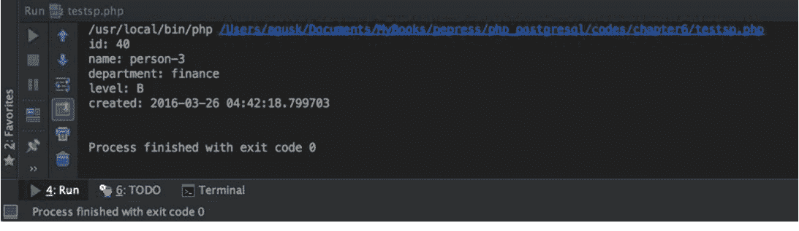

### 6.5 调用带有输入和输出参数的存储过程

我们还可以调用带有输入和输出参数的存储过程。首先，我们创建一个名为 **func_compute** 的存储过程。编写以下代码。

```
DROP FUNCTION public.func_compute(INT,OUT INT);

CREATE OR REPLACE FUNCTION public.func_compute(var_a INT, OUT val_ret INT)
RETURNS INT
AS
$BODY$
BEGIN
    val_ret = var_a * 3;
END;
$BODY$
LANGUAGE plpgsql VOLATILE;
```

你可以看到我们将 **val_ret** 参数定义为 **OUT**。

回到 PHP 文件 **SPDemo.php**，我们创建一个函数 **compute()** 并编写以下代码。

```php
<?php

public function compute($var_a) {
    $ret = -1;
    try {
        global $connString;
        $conn = pg_connect($connString);
        if( $conn === false )
        {
            $this->msg = "Unable to connect PostgreSQL Server.";
            return $ret;
        }
        $query = "select val_ret from func_compute($1);";
        $params = array(&$var_a);
        $res = pg_query_params($conn,$query,$params);
        if($res === false)
        {
            $this->msg = "Error in executing query.";
            return $ret;
        }
        if($row = pg_fetch_row($res))
        {
            $ret = $row[0];
        }
    }
```

```php
pg_close($conn);

} catch (Exception $e) {
    $this->msg = $e->getMessage();
}

return $ret;
}
```
```

现在我们在 **testsp.php** 中测试这个函数。添加以下代码。

```php
<?php

include('SPDemo.php');

// call stored procedure
$obj = new SPDemo();

/// call stored procedure with input and output parameters
$val = $obj->compute(15);
echo "func_compute(15): " . $val;
```
```

保存此代码并运行 **testsp.php**。以下是一个示例输出。

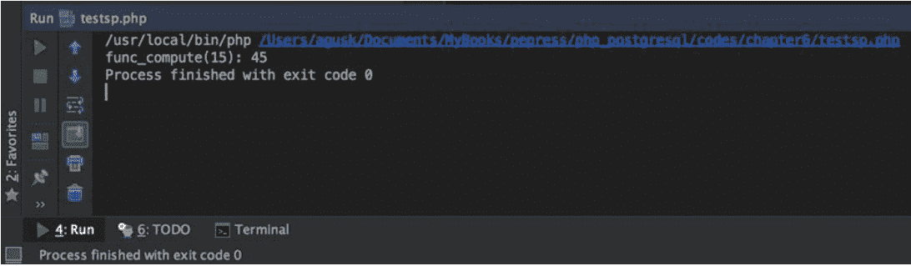

## 源代码

你可以从[http://www.aguskurniawan.net/book/phppostgres261.zip](http://www.aguskurniawan.net/book/phppostgres261.zip)下载本书的源代码。

