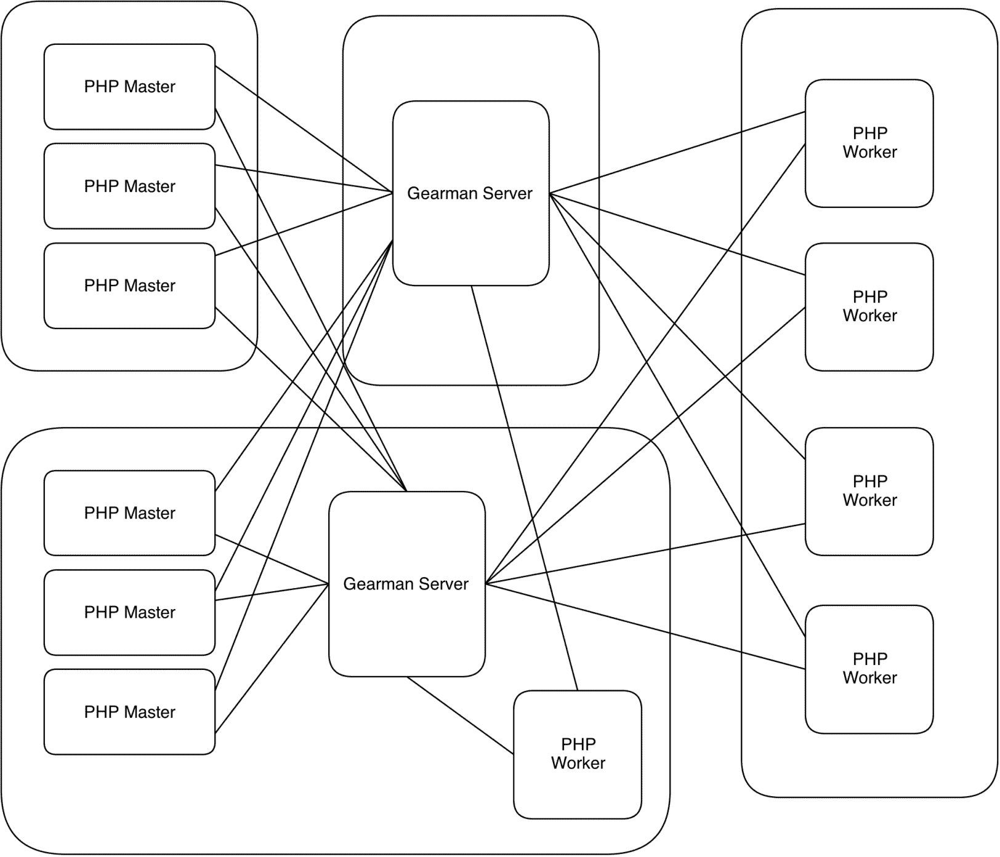
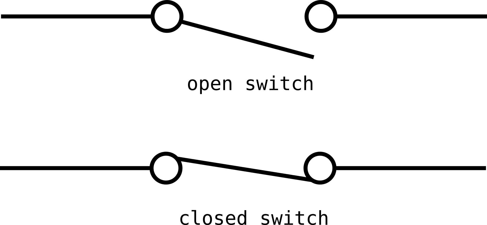
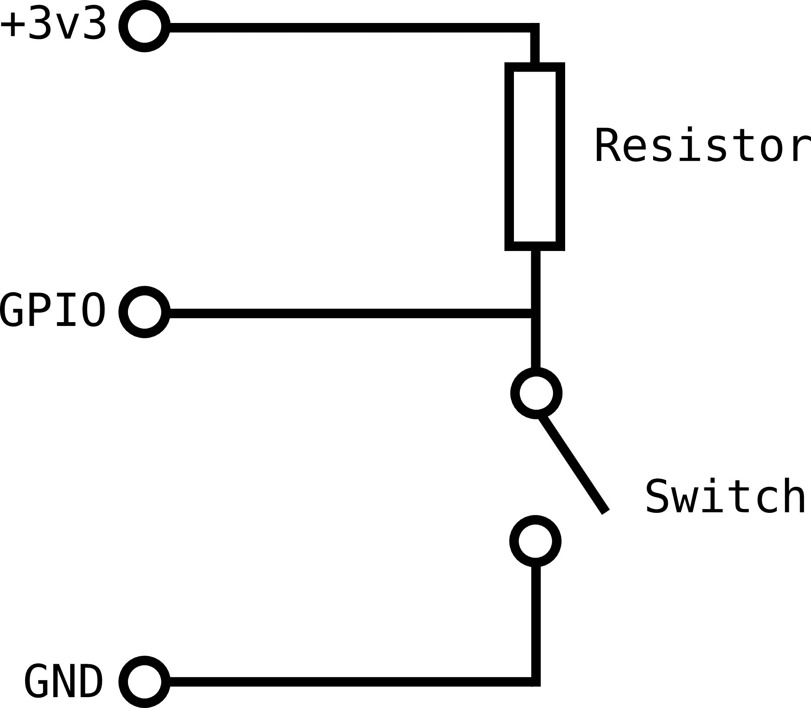
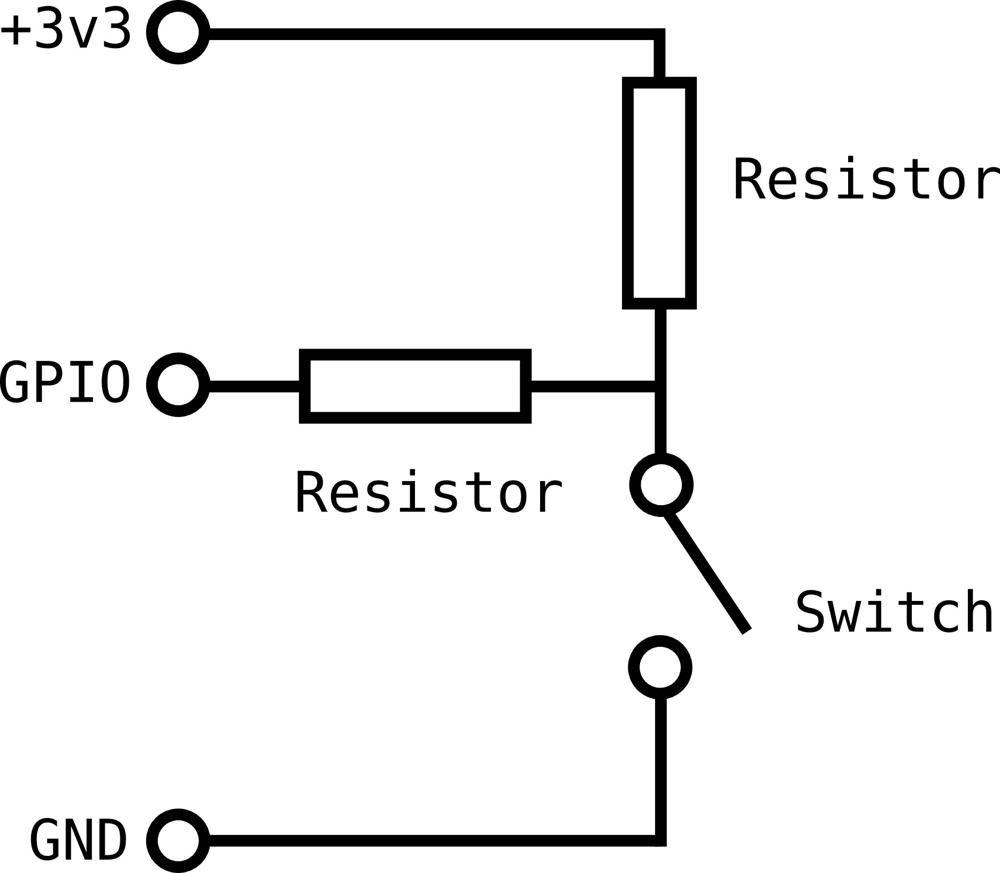

# PHP 超越 Web：Shell 脚本、桌面软件、系统守护进程及更多


\* \* \* \* \*


\* \* \* \* \*


## 欢迎

### 关于作者

我从 2000 年末开始使用 PHP 编程。起初这并非出于选择，因为我当时偏好的语言是 Perl 和 Delphi（也称为 Object Pascal）。1999 年我从利兹大学获得计算机科学学位并开始自由网页开发职业生涯后，情况开始改变。仅仅几个月后，我就有机会接手一位朋友的（相对而言）相当大的政府网站合同，该朋友正在从自由职业转向更安全、更稳定的全职工作。唯一的问题是，已经写了几千行代码，而且它们是用一种相对较新的语言“PHP”编写的。哦，另一个问题是，我大约有一周时间在接手网站之前学习它。所以，就像当时的做法一样，我去了当地的 Waterstones 书店（对于你们中较年轻的人来说，那是我们过去买书的地方。纸质书。而且我们必须出去买它们。或者在线订购并等待几天送达。我是否提到过它们是纸质的？）。我手里拿着纸质版的《PHP 和 MySQL 给傻瓜的完整初学者指南汇编》（我可能没有完全正确地回忆起书名）坐下来，喝了一品脱麦芽酒（我此时在约克郡，记住），开始阅读它。几天后，我就能像专业人士一样编程了（好吧，东西能运行），12 年后我再也没有回头。在作为自由职业者的多样化职业生涯中，我创办了几个，嗯，初创公司（IT 相关和不相关），成功程度不一（通常很糟糕），我现在是牛津大学的全职程序员。我的日常工作涉及中等规模的数据采集和管理、统计分析以及为研究人员和公众提供用户界面。我的大部分开发工作都在 PHP 中完成，要么开发新项目，要么将其他人的软件、系统和数据库粘合在一起。

在我的整个职业生涯中，我一直使用 PHP 进行 Web 开发，但对于桌面 GUI 工作，我最初使用 Delphi（然后是 Free-Pascal/Lazarus），并辅以 bash shell 脚本处理其他任务。这主要是因为我在大学时学习了它们。但是，随着 PHP 的成熟，我越来越多地将其用于 Web 之外，现在我几乎不再为遇到的任何编程或脚本任务使用其他东西。由于在大学期间和一些自由职业工作中不得不深入学习 C++、Javascript、Fortran、Lisp（以及大脑可能故意选择不记得的其他语言），我可以坦诚地说，PHP 现在是我出于选择而非必要性的首选语言。

当我不被电脑束缚时，我希望说自己有许多多样而有趣的爱好。我过去有过。我可以写一整本书（卖相不会好）关于我去过的地方和做过的事情，并且我希望这让我成为一个全面发展的人。但如今我不再有了。很大程度上这是由于我三个可爱的小女儿 Ellie、Izzy 和 Indy，我可爱的妻子 Parv，以及我更可爱的猫 Mia 的需求。我绝不希望有其他方式。至少我是这么告诉自己的……

### 致谢

艾萨克·牛顿说：“如果我看得更远，那是因为我站在巨人的肩膀上。”这本书建立在许多他人的工作之上，并希望能对此有所补充。下面我要感谢的最著名的人如下。

**官方 PHP 手册的作者和贡献者**

PHP 函数和语法的宝贵参考，我在写这本书时经常查阅，既用于事实核查，也用作助记。谢谢！

**互联网上的集体 PHP 智慧**

超过 12 年来，我一直利用你们进行学习、研究、娱乐和获利。网站和人太多，无法一一列举，如果你在网上写过关于 PHP 的内容，那么你很可能就是其中之一。谢谢！

**我的家人**

允许我抽出一点时间写这本书，并无条件地支持我所做的一切。通常情况下。如果我先问。而且没有更重要的事情发生。而且通常是有条件的。谢谢！

## 1. 介绍


如果你的电子阅读器直接将你带到了这一页，或者你翻阅纸质书的页面直接翻到了这里，那么你（或许明智地）跳过了书籍的“前言部分”，其中包含封面、目录、作者简介、致谢以及一些其他零碎内容。如果你对此感兴趣，请向后滚动或翻阅。否则，请继续阅读，开始你在 PHP 软件更广阔世界中的旅程。

### 1.1 “使用 PHP？我们又不是在建网站，你知道的！”。

它当前的递归名称（“PHP：PHP HyperText Preprocessor”），以及它的创建者 Rasmus Lerdorf 最初赋予它的名称（“PHP：Personal Home Page”），都强化了普遍认为 PHP 是一种用于 Web 的脚本语言的观点。这在 1995 年 PHP 首次创建时以及随后的若干年里都是事实。在 Web 领域，PHP 表现出色：它易于使用、开发迅速、部署广泛、与 Web 栈紧密集成（它通常是 LAMP、WAMP、MAMP 等中的 P），而且当然因为它是免费且开源的。

但许多人没有意识到（或者没有注意到，或者选择不注意到）PHP 已经进化并成熟了。它现在非常接近一种现代的通用编程语言。这种缺乏认可的情况部分是 PHP 自己的错，因为它花了很长时间才将一些基础内容建立起来，例如 OOP 语言结构，甚至是无需 Web 服务器即可运行的能力。然而，编程社区也没有帮助；许多程序员很难看到 PHP 将其快速动态开发模型从 Web 带入更广泛计算环境的潜力，许多人只是固守“Web 初学者脚本”的教条，这在 PHP 的早期年份才真正成立。

特别是最近的版本，带来了主流语言特性（例如闭包、trait、更好的语言支持、命名空间和后期静态绑定等许多其他特性）。性能一再提升，内存使用（旧版本的一个痛点）已大幅下降，PHP 现在是较为轻量的流行脚本语言之一。为了满足更高的性能需求，PHP 现在内置了 Op-code 缓存，这对于经常使用的脚本很有用，而 Facebook（全球最大的 PHP 用户之一）是几个发布带有 JIT 编译器的替代解释器/VM 的团队之一，这使得性能比标准 Zend 引擎可实现的性能提高了多达 6 倍。当然，PHP 核心语言开发仍在继续，版本 5.6 最近已发布，具有更好的性能、集成调试器和众多语言增强功能，这表明关于 PHP 即将消亡的报告过早了！

如果你是一名希望超越 Web 领域工作的 PHP Web 开发人员，那么现在是利用你现有技能并尝试在 PHP 中进行桌面和系统编程的最佳时机。如果你是一名正在思考学习哪种语言的新程序员，你可以掌握在比许多其他类似语言更广泛的场景中使用的技能。

但是，为什么，为什么，哦，为什么要用 PHP 做呢？为什么不写一个 Shell 脚本呢？为什么不学习 C++ 或通常用于软件项目的其他语言呢？事实是这些都是有效的选择，生活可能对你来说会很顺利。但是，为什么要拒绝使用你现有技能的机会呢？为什么不使用 PHP 的集成数据库访问、重用 Web 项目中的现有代码和数据、利用 PHP 易于使用的网络库和函数、沉浸在灵活的文本和数据处理中，并根据需要将 Shell 命令和其他语言混合到 PHP 中，以获得两全其美的效果？简而言之，为什么不呢？

本书的目的是让你，这位 PHP 程序员，了解在 Web 之外使用 PHP 的见解。我们将探讨构建桌面应用程序、命令行工具、系统守护进程、网络服务器和其他原生应用程序。重要的是，我将向你展示如何在不离开 PHP 及其朋友的舒适世界的情况下完成所有这些工作。

希望我已经让你相信，PHP 是一种跨平台、专注于快速开发、功能多样的语言，非常适合多种不同类型的软件。但是，如果你仍然怀疑 PHP 提供真正的非 Web 软件的能力，并且不想读完整本书来了解可以实现什么，那么请跳转到书末的附录 D，在那里你可以找到 Web 服务器、数据库引擎、机器学习工具以及许多其他全部用 PHP 编写的项目示例。如果这些不能激励你在 PHP 中创建你的软件，那么也许没有什么能激励你了！

|  || **进一步阅读**“PHP 比你想象的要好得多” - Fabien Pontencier 撰写的一篇文章，概述了 PHP 开发的优点，并讨论了 PHP 生态系统的变化  

[`fabien.potencier.org/article/64/php-is-much-better-than-you-think`](http://fabien.potencier.org/article/64/php-is-much-better-than-you-think) |

| --- | --- |

### 1.2 你是 PHP 新手吗？

本书旨在向 PHP 开发人员展示如何利用现有技能编写软件，而不是网页。但是，我理解一些读者可能是 PHP 新手，并且阅读本书是为了了解 PHP 能做什么。如果你已经是一名程序员，尽管不精通 PHP，那么全面的官方 PHP 手册可能是开始了解 PHP 与你习惯的语言之间差异的最佳场所。

如果你还不是程序员，那么你最喜欢的电子书零售商处有许多“PHP 入门”书籍可供选择。无论哪种情况，更广泛的 Web 也提供了其通常的深入知识和教程范围，只需明智地搜索一下即可。

最后，无论是新手还是有经验的程序员，如果你打算认真学习 PHP，那么在全身心投入编码之前，值得先看看一些 PHP“最佳实践”网站。这可能会在长远中为你节省很多麻烦。

|  || **进一步阅读**官方 PHP 手册  

[`www.php.net/manual`](http://www.php.net/manual)免费的在线 PHP 初学者课程  

[`ureddit.com/class/55471/programming-in-php`](http://ureddit.com/class/55471/programming-in-php)“PHP 正确做法” - PHP 最佳实践、公认编码标准以及权威教程链接的快速参考  

[`www.phptherightway.com/`](http://www.phptherightway.com/)“PHP 最佳实践” - 针对常见和令人困惑的 PHP 任务的简短实用指南  

[`phpbestpractices.org/`](http://phpbestpractices.org/)“PHP 学习指南” - 面向希望通过 ZCE（Zend 认证工程师）考试的人的 PHP 学习指南  

[`php-guide.evercodelab.com/`](http://php-guide.evercodelab.com/)“Zend 认证准备包” - 示例问题和答案，以及准备和参加 ZCE 考试的指南  

[`leanpub.com/zce`](https://leanpub.com/zce?a=0_YKAEBrn4BvyagDZlmBZy&subID=b)“PSR 是什么？” - 关于“PSR”PHP 标准建议的指南  

[`www.lornajane.net/posts/2013/psr-what`](http://www.lornajane.net/posts/2013/psr-what) |

| --- | --- |

### 1.3 读者先决条件。或者，本书不是什么

为了充分利用本书，你应该具备在 PHP 中编程的基本经验（很可能是针对 Web 的），一般的编程或 IT 背景，以及学习和走出舒适区的意愿。

本书不是 PHP 或一般编程的入门书。虽然你不需要计算机学位或高级编程概念知识，但本书希望面向平均水平的 PHP 程序员（即探索过 PHP 非常基础内容之外的人），并试图在我们前进的过程中解释任何必要的概念。它也对高级程序员很有用，他们可能选择将其作为快速参考，以探索 Web 之外的 PHP。


本书提供代码示例来说明概念和函数的用法，但通常不提供完整的脚本或程序。本书旨在作为参考和入门指南，为你提供信息和灵感，帮助你开发自己的 PHP 解决方案。同样，当我们讨论外部工具和第三方库时，我通常会给出概述和基本介绍或示例代码，然后链接到官方文档和在线教程。对于像这样涵盖一般领域的书籍，深入探讨并对特定软件进行广泛覆盖几乎没有意义，尤其是那些已经有全面文档可用的软件。我们当然会涵盖官方或在线文档不足的任何相关领域，并在必要时直接指引你到相关章节。

### 1.4 给 Windows 和 Mac 用户的重要提示

书中给出的大多数示例是在 Linux 下运行和测试的（大多数情况下是最新的 Ubuntu Desktop/Server 版本）。PHP 可以在许多操作系统上运行，包括 MS Windows 和 Apple OS X，代码通常以相同的方式运行。但是，由于文件系统、操作系统、可用库等方面的差异，当然存在不同之处，但在本书中涵盖所有这些差异并不实际。此外，某些功能（例如依赖于 POSIX 标准的功能）在某些系统（如 Windows）上不可用（或不易使用）。由于 OS X 源自符合 POSIX 标准的操作系统，你可能会发现与 Windows 相比，更多的代码是兼容的，但你的体验可能仍有所不同。关于操作系统特定问题的良好信息来源是官方 PHP 在线手册，特别是每个页面底部的用户评论。尽可能，针对这些其他操作系统的特定领域也已涵盖，例如，我们将探讨如何访问 Windows 注册表。

### 1.5 关于示例代码

正如你将在本书中看到的，我在编码示例中主要使用“传统”的命令式/过程式 PHP，以尽可能简单地适应各种能力的程序员。本书并非旨在成为编码最佳实践或风格的教程，也不是面向对象编程指南，也不旨在推广任何编程模型或教条。我也避免使用任何代码框架。许多框架基于 Web 模型，在我们将要研究的这类应用程序中并不总能按预期运行，尽管其中一些现在确实有“控制台”或“cli”模块。MVC 风格的框架在构建 GUI 应用程序时可能很有用（事实上，MVC 范式早于 Web 很多！），但由于有许多不同的实现细节和风格，我们将坚持使用无框架代码。

从本书中呈现的简单直接的 PHP 代码中，应该清楚它如何可以被使用或调整以适应你自己的编程风格、框架或模型。我们将主要研究特定于任务的实现细节，将编程本身这一热门话题留给众多其他可用的书籍。

示例代码通常也不试图实现任何特别有用的程序。它旨在尽可能简化，以尽可能清晰，并概述特定类型任务所需的脚手架。例如，创建守护进程的示例代码侧重于创建后台进程和运行事件循环的机制。这是为了保持代码清晰，作为 PHP 程序员，你可能已经知道如何检查你的 Twitter 账户以获取最新的 Justin Beiber 更新，只需要知道如何将进程守护进程化。该代码旨在成为通用 PHP 编程的参考，而不是编程本身的教程。

本书中所有示例 PHP 源代码均可供你使用和随意处理，不受任何限制或许可。随你喜欢使用或滥用它！

如果你在运行或理解示例代码时遇到困难，请参阅本书最后一章的反馈部分，了解如何联系作者寻求帮助。

### 1.6 外部资源

在整本书中，我们将以以下两种方式之一指引你前往外部工具、资源和信息：

|  || `A “toolbox” like this` |

| --- | --- |

|   ||   |

|   || Toolboxes like this contain details of useful tools and software |

|   ||   |

|   || `Main website` : [`www.a-useful.tool/`](http://www.a-useful.tool/) |

|   ||   |

|   || `Main documentation and installation info` : [`wiki.a-useful.tool/`](http://wiki.a-useful.tool/) |

|  || **Further Reading**Useful articles, tutorials and reference information will be presented in Further Reading sections like this  

[`www.very-useful-info.book/`](https://www.very-useful-info.book/) |

| --- | --- |

### 1.7 英语。真正的英语。

简要说明一下，不，那些不是拼写错误，而是英式英语（你知道的，就是那个开创一切的英语），因为你谦卑的作者来自大洋彼岸。接受吧，我们拼写方式不同。你发现的任何真正的拼写错误都将被视为语言演变的一部分，然后在你不注意时悄悄修正。

## 2 远离 Web - 基础知识

本章概述了使用 PHP 摆脱 Web 所涉及的基本步骤。我们将研究涉及的技术步骤，以及编程实践和重点的差异。

### 2.1 无 Web 服务器的 PHP

大多数 PHP 程序员严格在 Web 服务器环境中使用 PHP。在这样的环境中，PHP 是 CGI/Fast GGI 或服务器模块，由 HTTP 服务器（通常是 Apache、IIS、Nginx 或类似）调用和控制。HTTP 服务器接收对基于 PHP 的网页的请求并调用 PHP 进程来执行它，通常将输出返回给 HTTP 服务器以发送给最终用户。

已经有许多尝试使用本地安装的 Web 服务器和 PHP 创建本地应用程序（桌面应用程序和脚本系统），并取得了一些成功。但是，使用这种 Web 类型模型进行本地应用程序的缺点很多：

*   对于在这些场景中提供的价值，Apache 等 Web 服务器通常规格过高且资源消耗大

*   除非正确锁定，否则在本地运行的 Web 服务器会为外部世界的恶意访问者引入访问你机器的入口点

*   HTTP 是一种冗长的协议，（可以说）非常适合 Web，但对于本地进程间通信来说往往过度杀伤，并为你的应用程序增加了另一个资源和复杂性开销

*   你的应用程序界面通常在 Web 浏览器中运行，因此看起来一点也不本地（除非你专门为你的应用安装浏览器，否则会带来额外的支持/升级麻烦）

PHP 从 5.4 版本开始包含内置 Web 服务器，消除了上述的一些问题。但是，它是为设计部署在完全功能的 HTTP 服务器（如 Apache）上的 PHP 脚本进行本地测试而设计的。它是一条可以探索的路线，特别是当你想要运行已经存在的 PHP Web 应用程序的私有实例时。但是，其稳定性、可靠性和适合生产就绪的本地应用程序尚未得到证实，并且它仍然带有 HTTP 和 Web 浏览器的包袱。

自 4.3 版本以来，PHP 就有一个隐藏的金块解决了所有这些问题。PHP CLI SAPI（命令行界面服务器应用程序编程接口），用其正式名称来说，基本上是一种冗长的说法，表示“独立 PHP”。它消除了对 Web 服务器的需求，并提供了一个独立的 PHP 二进制文件供你交互。例如，在 shell 提示符下键入以下内容

```
1 ~$ php /home/myfiles/myprogram.php
```


will simply execute your `myprogram.php` file (which you write mostly like any other PHP script) and return any output back to the terminal (unless you tell it otherwise) instead of being sent to the web server (which doesn’t exist!).

In general, PHP scripts called directly using PHP CLI will behave in the same way as when called through a web server, although there are some differences. For instance, you won’t find any `$_GET` or `$_POST` arrays, and PHP won’t send any HTTP headers by default, as these concepts don’t mean much beyond the web. Default settings like `max_execution_time` are set to sensible values for local use (in this case to 0 so your scripts won’t time out), output buffering is turned off, and error messages are displayed in plain text rather than HTML.

The PHP CLI SAPI is what we will be using for most of the examples in this book as it is designed with exactly the same motivations as this book: taking PHP beyond the web. Full details of how to install and use the CLI SAPI are given in the next chapter.

### 2.2 PHP 版本 - 你用的是哪个？

PHP 从 4.3.0 版本开始就支持 CLI SAPI，因此本书中的许多示例都可以在该版本及之后的任何 PHP 版本上运行。撰写本书时，PHP 的当前版本是 5.6.5，本书中的代码已针对该版本进行了测试。如果你发现某个特定函数似乎不存在或无法按预期工作，请查看该函数的在线 PHP 手册。这会显示哪些版本支持哪些函数，并描述较新版本引入的任何破坏性更改。

如果你使用的是旧版本，升级有非常充分的理由。

*   最近的版本性能显著提升（相应地，资源使用量减少）

*   虽然对于非 Web 应用程序来说安全性并不总是那么关键（有关注意事项请参见本章后面的安全性讨论），但如果你要处理来自外部来源的数据，或者如果你同时使用同一版本进行 Web 开发，那么最近版本中的安全增强和安全相关的错误修复是必不可少的

*   现代语言特性可用，这有助于提高你的编码生产力，也能让其他人更认真地对待你的代码

与 Web 版本的 PHP 一样，如果你有需要，可以编译自己的 CLI SAPI 版本。如果你想包含操作系统软件仓库中未预打包的扩展，出于性能原因移除非必要代码，或使用 PHP 支持的任何其他编译时选项，那么学习“自行构建”版本可能是值得的。关于编译和安装 PHP 及相关扩展的入门指南可在附录 A 中找到。

### 2.3 不要在 PHP 中这样做的几个好理由

本书专注于在 PHP 中完成所有事情，对于 90% 的任务，PHP 都能满足要求。但在你决定用 PHP 重构你的世界之前，有一些相关问题你可能需要仔细考虑，然后再行动。

*   **高性能要求**

如果你需要非常高的性能，特别是在硬件有限的情况下，PHP 可能不适合你。最近的 PHP 版本性能大幅提升，在基准测试中经常超越 Python 等语言和 Ruby-on-Rails 等框架。然而，PHP 的核心是一种抽象脚本语言，对于某些任务，它永远无法达到像 C 这样更接近底层的低级语言的性能。不过，不要因为高性能任务就完全否定 PHP，如果你在考虑性能的同时也关注成本，你可能会发现，PHP 开发速度带来的开发人员时间成本节省，超过了为获得性能而投入的额外硬件成本。请参阅第 9 章，了解如何提高性能，并了解如何从 PHP 与 C 等语言交互，以便你仍然可以在 PHP 中获得 RAD（快速应用开发）的一些好处。

*   **不要（不一定）重复造轮子**

你 *可以* 用 PHP 编写 Web 服务器（示例请参见附录 D），但 *现有* 的服务器（如 Apache）是否能满足你的需求？对于许多或大多数基础设施“痒处”，已经存在软件（由多种不同语言编写）可以为你提供所需的“抓痒”。除非你真的需要其他功能，否则编写自己的软件所花费的时间通常会超过学习和实现现有软件所花费的时间。当然，对于某些人来说，情况正好相反。“因为我能”可以是一个有效的理由，编写软件总是一次宝贵的学习经历。

*   **保持源代码闭源**

PHP 是一种脚本语言，这意味着如果你编写软件用于销售或部署到其他地方，你将向接收者泄露你的源代码。许多人（包括你的作者）会认为，即使是商业上的“开源”也是一件好事。但如果这不符合你的口味，那么你需要下更大功夫来保护你的代码。网上有源代码混淆器可用，它们使用各种技巧使你的代码难以（但并非不可能）阅读，并且现在有许多 PHP 编译器可用于生成二进制程序（尽管在语法和扩展覆盖方面存在限制）。但是，主 PHP 项目并未表达支持代码隐藏或编译的任何意图，因此此类方法的长期可行性尚不确定。闭源软件的商业论据在中长期内也并非铁板钉钉。

### 2.4 考虑安全性

每个称职的程序员至少都意识到构建网站和在线应用程序的安全影响。你故意将你的代码暴露给公众，暴露给世界，暴露给任何会来的人（好人和坏人）。PHP 的早期失败之一是将易用性置于代码安全性之上（关于 `register_globals` 等遗留物的恐怖故事，快速谷歌一下就能找到）。随着更新、更安全的默认设置和 `register_globals` 等函数被弃用，PHP 在线上比以往任何时候都更安全。而且，虽然大多数安全问题是由程序员而非语言引起的，但如今即使是最新的 Web 编码者似乎也从一开始就对安全问题有所认识。

然而，踏入离线软件的世界，情况就截然不同了。通常我们看到的软件仅面向受信任的用户，部署在受信任的机器上，并完全由仁慈的用户控制。用户不会故意攻击软件或机器，他们处理的是自己的数据，功能绝对不能被妥协。在开发桌面应用程序等软件时，很少会考虑安全性，更不用说在设计时将其指定为功能了，因为它不是“必要的”。

然而，世界并非如此运作。查看任何软件漏洞邮件列表，如 BugTraq，你会发现 Adobe Reader、Microsoft Word 甚至 GIMP 等开源老牌软件中存在大量漏洞。事实是，即使在本地应用程序中，安全性也很重要，主要有两个原因。第一个是“典型用户”行为的老生常谈问题。这对于从不犯错的聪明精通技术的用户（比如你，亲爱的读者）来说不是问题，但对于我们其余的人使用的任何软件来说，灾难只在一次意外点击可疑电子邮件之间。安全性之所以重要，第二个原因是，对于大多数机器来说，许多非 Web 应用程序并不真正“离线”。即使桌面应用程序或系统守护进程本身不与 Web、本地网络或其他外部服务交互，它所连接的机器也几乎总是插着以太网线或激活了 WiFi/3G/4G 连接。你的软件不会在自己舒适的小领域里运行，与外部世界隔绝。当然，完全沙箱化的虚拟机除外。


## 软件安全概述

软件安全是另一本书的主题（其他人已经写了很多，请参阅下面的进一步阅读部分），并且许多相同的原则适用于系统软件和 Web 软件，因此您可以利用现有的基于 Web 的 PHP 安全实践知识来指导自己。在规划应用程序安全措施和监控时，应考虑以下面向用户和系统软件的典型漏洞类型和攻击向量列表。

*   **数据文件被篡改**

来自外部来源的被篡改文件（由用户故意或意外加载）。这些通常是数据文件，特别是注册为特定文件类型默认查看器的软件风险更大，因为意外和恶意的文件激活要容易得多。

*   **恶意软件利用**

恶意软件寻找无辜软件以利用并获得权限提升。像 `PHP` 代码这样的脚本软件更容易被恶意软件重写或修改，未编译形式的源代码可用性也可能对恶意软件作者有所帮助。

*   **用户不当行为**

合法用户的不当行为。例如，John Smith 试图在共享业务系统上查看其老板 Jane Doe 的文件或浏览历史记录。

*   **权限提升**

类似于合法用户的不当行为，这是合法软件的不当行为，无论是意外还是故意，试图获取和使用其没有的访问权限。

*   **依赖漏洞**

`PHP` 漏洞以及其他依赖项和相关软件中的漏洞。当然，您的软件将完全没有安全问题，但它不可避免地依赖于其他库、软件和 `PHP` 扩展，当然别忘了 `PHP` 解释器本身。其中任何一个都可能包含安全漏洞和攻击向量。

上一节列出了所有类型软件（不仅仅是 `PHP`）中常见的安全问题来源。通过在设计阶段规划这些问题并在部署前进行测试来最大限度地降低风险。然后交叉手指祈祷吧…

|  || **进一步阅读**“Securing PHP: Core Concepts”和“Securing PHP: The Usual Suspects”由 Chris Cornutt 编写  

[`leanpub.com/securingphp-coreconcepts`](https://leanpub.com/securingphp-coreconcepts?a=0_YKAEBrn4BvyagDZlmBZy&subID=b)  

[`leanpub.com/securingphp-usualsuspects`](https://leanpub.com/securingphp-usualsuspects?a=0_YKAEBrn4BvyagDZlmBZy&subID=b)免费在线渗透测试课程。侧重于基于 Web 的渗透测试，但也与离线软件相关。  

[`www.pentesterlab.com/`](https://www.pentesterlab.com/)免费在线书籍，涵盖 PHP 安全  

[`phpsecurity.readthedocs.org/en/latest/index.html`](http://phpsecurity.readthedocs.org/en/latest/index.html)“Building Secure PHP Apps”由 Ben Edmunds 编写  

[`leanpub.com/buildingsecurephpapps`](https://leanpub.com/buildingsecurephpapps?a=0_YKAEBrn4BvyagDZlmBZy&subID=b) |

| --- | --- |

# 3. 了解 CLI SAPI，以及您为什么需要它

正如我们在第 2 章中提到的，您进行的大多数系统编程都将涉及使用 `PHP CLI SAPI`。因此，掌握如何使用它、配置和运行它的选项，以及它与您习惯的基于 Web 的 SAPI 的区别非常重要。幸运的是，区别很小，许多都很直观，尽管仍然值得彻底阅读本章，因为 `CLI SAPI` 构成了大部分代码运行的基础。

## 3.1 CLI SAPI 有什么不同之处？

以下是 `CLI SAPI` 与标准 Web 实现之间的主要区别列表：

*   默认情况下，不会将 `HTTP` 标头写入输出。这很合理，因为它们在命令行中没有意义，因此只会在真实输出上方打印多余的文本。如果您的输出稍后将被传输到 Web 浏览器，您需要手动添加任何必要的标头（例如通过使用 `header()` `PHP` 函数）。

*   `PHP` 不会将工作目录更改为正在执行的 `PHP` 脚本所在的目录。要手动执行此操作，请使用 `getcwd()` 和 `chdir()` 来获取和设置当前目录。否则，当前工作目录将是您调用脚本的目录。例如，如果您当前在 `/home/rob` 并且输入 `php /home/peter/some_script.php`，则 `PHP` 中使用的工作目录将是 `/home/rob`，而不是 `/home/peter`。

*   任何错误或警告消息都以纯文本形式输出，而不是 `HTML` 格式的文本。如果您想要 `HTML` 化的错误，例如如果您正在生成静态 `HTML` 文件，您可以通过在脚本中使用 `ini_set('html_errors', 1);` 将 `html_errors` 运行时配置指令设置为 true 来覆盖此设置。

*   `PHP` 隐式立即“刷新”所有输出，默认情况下不缓冲。将输出直接发送到浏览器通常会损害在线性能，因此输出被缓冲并在块填满时以最佳大小的块发送。离线时这不太可能成为问题，因此 `HTML` 块以及 `print` 和 `echo` 等结构的输出会立即发送到 shell。在等待进一步输出时，无需使用 `flush()` 清除缓冲区。如果您愿意，仍然可以使用 `PHP` 的输出缓冲函数来捕获和控制输出，请参阅 `PHP` 手册中的“输出控制函数”部分以获取更多信息。

*   没有设置执行时间限制。您的脚本将连续运行，直到它自行退出，即使脚本挂起，`PHP` 也不会终止它。如果您想要设置时间限制来约束行为不当的脚本，可以在脚本中使用 `set_time_limit()` 函数来实现。

*   自动设置描述传递给脚本的任何命令行参数的变量 `$argc` 和 `$argv`。这些将在本章后面详细讨论。

*   `PHP` 定义与同名标准流相关的常量 `STDIN`、`STDOUT` 和 `STDERR`，并自动为它们打开 I/O 流。这些为您的应用程序提供了对“标准输入”（`STDIN`）、“标准输出”（`STDOUT`）和“标准错误”（`STDERR”）流的即时访问。

|  || **进一步阅读**`PHP` 手册中的输出控制函数  

[`www.php.net/manual/en/ref.outcontrol.php`](http://www.php.net/manual/en/ref.outcontrol.php)维基百科上的标准流（`STDIN`、`STDOUT`、`STDERR`）  

[`en.wikipedia.org/wiki/Standard_streams`](http://en.wikipedia.org/wiki/Standard_streams) |

| --- | --- |

## 3.2 CLI SAPI 安装

要使用 `PHP CLI SAPI`，您可能需要先安装它。附录 A 提供了安装（以及在必要时编译）`PHP` 的详细信息。但是，如果您已安装 `PHP`，可能会发现它已经安装（通常在 `PHP` 程序文件夹中名为 `sapi/cli` 的文件夹中），如果没有，它通常可在现代操作系统软件存储库中找到（例如，在 Ubuntu 中存在名为 `php5-cli` 的软件包，可以从任何包管理器安装，或通过命令行使用 `sudo apt-get install php5-cli` 安装）。如果它安装在命令行搜索路径中，在命令行上输入 `php -v` 将打印版本详细信息，确认它确实已安装。

## 3.3 PHP 命令行选项

`PHP` 二进制文件将接受许多影响其操作的命令行选项/开关/参数。可以通过输入 `php -h` 查看完整列表。虽然有些仅适用于 `CGI SAPI`，但以下是与 `CLI SAPI` 交互时使用的一些更有趣和常见的选项：

*   `-f` *或* `--file`


这允许你指定要运行的脚本的文件名，且为可选项。`-f` 选项的存在是为了与自动化软件等软件和脚本兼容，这些软件和脚本可以以编程方式调用命令行程序，但要求文件名参数以这种方式形成。它还允许在 Windows 上轻松为 PHP 脚本设置默认文件类型处理程序。上述两个命令版本在用法上的唯一真正区别在于解释传递给脚本的命令行参数时，我们将在下面的“脚本的命令行参数”部分中讨论这一点。在大多数情况下，以下两行大致等价：

```
1 ~$ php -f myscript.php
2 ~$ php myscript.php
```

## `-a` 或 `--interactive`

以交互方式运行 PHP。这允许你逐行输入 PHP 代码，而不是执行保存的 PHP 脚本。这种操作模式通常称为“REPL”（读取-求值-打印-循环）。除了为测试和开发代码提供交互式界面外，它还可以充当增强的 PHP 启用 shell 或命令行，在下一章关于开发工具的内容中，我们将更深入地探讨这一点以及其他第三方 PHP REPL。

## `-c` 或 `--php-ini`

指定 PHP 为此应用程序将使用的 PHP ini 文件。如果你在同一台机器上也使用 PHP 运行 Web 服务，这尤其有用，因为如果未指定，PHP 会在各种默认位置查找 `php.ini`，并可能最终使用与 Web 服务相同的文件。通过为 CLI 应用程序提供专门的 ini 文件，你可以“解除”各种对离线应用程序更有意义的限制。请注意，使用 CLI SAPI 时，PHP 会自动覆盖多个 `php.ini` 设置，无论你是否使用此选项指定自定义 ini 文件。这些被覆盖的设置是影响上述“CLI SAPI 有何不同”中概述的行为的设置，虽然在这些情况下会忽略 `php.ini` 文件，但你可以直接在代码中使用 `ini_set()` 函数或类似方法恢复或更改这些设置。你也可以使用 `-d` 或 `--define` 选项来设置选项（例如 `php -d max_execution_time=2000 myscript.php`）。如果你要将软件部署到你不控制的机器上（例如，如果你正在销售供用户在其自身机器上安装的软件），那么使用其中一种机制来确保 PHP 将使用你期望的设置，而不是用户可能碰巧拥有的设置，是合理的。另请参见下面的 `-n`。

## `-n` 或 `--no-php-ini`

这告诉 PHP 根本不加载 `php.ini` 文件。如果你不希望随应用程序一起提供 `php.ini` 文件，而是希望直接在代码中使用 `ini_set()` 或类似方法设置所有设置，这可能很有用。如果未提供 ini 文件，PHP 将使用其默认设置，并且值得记住的是，这些默认设置可能会随 PHP 版本的变化而变化（并且过去确实如此）。你不应该依赖当前的默认设置适合你的应用程序。你可以使用 `php --ini` 来显示 PHP 在未使用 `-n` 选项且未使用 `-c` 指定文件时将查找 ini 文件的默认路径。

## `-e` 或 `--profile-info`

这将 PHP 置于“扩展信息模式”。EIM 为分析器和调试器生成额外信息。如果你不使用需要此模式的分析器或调试器，则不应启用它，因为它可能会降低性能。有关分析器和调试器的更多信息可以在下一章中找到。

## `-i` 或 `--info`

调用 `phpinfo()` 函数并打印输出。这将以纯文本格式而不是通常的 HTML 格式输出关于 PHP 安装的大量信息（它检测到我们是从 CLI SAPI 调用它）。这对于追踪安装本身的问题以及获取版本信息、已安装扩展列表、相关文件路径等可能很有用。与任何其他 shell 命令一样，输出可以通过管道传递给其他命令，例如 grep。因此，如果你想检查 PHP 二进制文件中是否启用了 IPv6，例如，可以尝试：

```
1 ~$ php -i | grep -i "ipv6"
```

## `-l` 或 `--syntax-check`

解析文件，检查语法错误。这是一种基本的“lint”类型检查器，更高级的静态代码分析工具将在下一章中讨论。请注意，此选项仅检查基本语法错误，即导致 PHP 引擎失败的那种错误。更微妙的错误、程序逻辑中的问题以及在运行时创建的错误将不会被检测到。你的代码不会被执行，因此它可以帮助在运行可能会更改数据并在失败时引起问题的代码之前发现基本错误。即使在测试环境中运行此类代码，重置数据并为另一次测试做准备也可能需要时间，因此首先快速检查基本语法错误可以节省时间。一些 IDE 和文本编辑器在后台运行 `php -l` 以在你输入时突出显示语法错误。例如，Github 的 Atom 编辑器中的 linter-php1 包使用此方法对 PHP 代码进行实时 linting。

## `-m` 或 `--modules`

列出所有已加载的 PHP 和 Zend 模块/扩展。这些是 PHP 编译时包含的模块，可能包括“core”、“mysql”、“PDO”、“json”等。这对于检查 PHP 安装是否具有应用程序所需的功能很有用。你也可以在脚本中使用 `extension_loaded()` 函数或调用 `phpinfo()` 函数来检查。`-m` 提供了与上述 `-i` 标志给出的信息的一个子集，而 `-i`（或 `phpinfo()` 函数）将返回关于模块的配置、版本等的更多信息。

## `-r` 或 `--run`

运行作为参数提供的一行 PHP 代码，而不是从文件中执行它。代码行应用单引号括起来，因为像 bash 这样的 shell 如果你使用双引号，会尝试将 PHP 变量插值为 shell 变量。这与 `-a` 交互模式扮演类似的角色，区别在于 PHP 的“状态”在每行执行后会被清除。这意味着提供的代码行被视为要执行的整个脚本，并且执行在运行后终止。示例如下：

```
1 ~$ php -r 'echo (2+2)."\n";'
```

这将打印出 `4` 后跟一个换行符。请注意，该行必须是语法正确的 PHP，所以不要遗漏末尾的分号！我们将在本章后面的“调用 PHP 脚本的多种方式”部分中再次讨论 `-r`。

## `-B` 或 `--process-begin`

## `-R` 或 `--process-code`

## `-F` 或 `--process-file`

## `-E` 或 `--process-end`

这四个参数允许你指定 PHP 代码，在 PHP 处理来自 `STDIN` 的输入之前、期间和之后执行。`-B` 指定在处理输入之前要执行的一行代码，`-R` 指定在处理每一行输入时要执行的一行代码，而 `-F` 指定要为每一行执行的 PHP 文件。最后，`-E` 在输入过程结束时执行一行代码。在 `-R` 和 `-F` 中，有两个特殊变量可用；`$argn` - 正在处理的行的文本，以及 `$argi` - 正在处理的行的编号。这主要在直接在 shell 脚本中使用 PHP 时很有用。例如，要打印带行号的文本文件，你可以这样做：

```
1 ~$  cat my_text_file.txt | php -B 'echo "Lets add line numbers...\n";'
2         -R 'echo "$argi: $argn\n";' -E 'echo "That''s the end folks\n";'
```

这将输出类似于以下内容的结果：


### 3.4 为脚本传递命令行参数

如上所述，向 PHP 本身传递参数非常简单，按常规方式进行即可。但是，为 PHP 脚本传递参数则稍微复杂一些，因为 PHP 需要知道其自身参数在哪里结束，而你的脚本参数在哪里开始。研究 PHP 如何处理此问题的最佳方法是通过一些示例。请考虑以下 PHP 脚本：

```
1 <?
2 
3 echo "Number of arguments given :".$argc."\n";
4 
5 echo "List of arguments given :\n";
6 
7 print_r($argv);
```

上述脚本中有两个特殊变量：

*   `$argc`：记录传递给脚本的命令行参数数量

*   `$argv`：实际传递的参数数组。

让我们将脚本保存为 `arguments.php`。现在让我们按以下方式调用它：

```
1 ~$ php -e arguments.php -i -b=big -l red white "and blue"
```

你将得到以下输出：

```
 1 Number of arguments given :7
 2 List of arguments given :
 3 Array
 4 (
 5     [0] => arguments.php
 6     [1] => -i
 7     [2] => -b=big
 8     [3] => -l
 9     [4] => red
10     [5] => white
11     [6] => and blue
12 )
```

如你所见，命令中从文件名开始给出的所有参数都会传递给脚本。第一个参数 `-e` 是由 PHP 本身使用的，不会传递。因此，作为一般规则，文件名之后的所有内容都被视为脚本的参数，文件名之前的任何内容都被视为 PHP 本身的参数，而文件名则由两者共享。

当然，也有例外。如上所述，除了单独指定脚本的文件名外，我们还可以将其作为 `-f` 标志的一部分传递。因此，如果我们执行以下命令：

```
1 ~$ php -e -f arguments.php -i -b=big -l red white "and blue"
```

我们将得到以下意外输出：

```
 1 phpinfo()
 2 PHP Version => 5.4.6-1ubuntu1.3
 3 
 4 System => Linux dev-system 3.5.0-37-generic #58-Ubuntu SMP Mon Jul 8 22:10:2\
 5 8 U
 6 TC 2013 i686
 7 Build Date => Jul 15 2013 18:23:34
 8 Server API => Command Line Interface
 9 Virtual Directory Support => disabled
10 Configuration File (php.ini) Path => /etc/php5/cli
11 <rest of output removed for brevity>
```

你可能会认出这是调用 `php -i` 的输出。PHP 没有将文件名之后的参数视为属于脚本，而是将 `-f` 参数视为其自身的参数之一，并继续“拥有”所有后续参数。由于 `-i` 是一个有效的 PHP 参数，它决定这就是你想要的，并调用其“信息”模式。如果你需要将文件名作为 `-f` 标志的一部分传递，而不是作为单独的参数，则需要使用 `--` 来分隔脚本的参数。因此，为了使上述命令按预期工作，我们需要将其更改为：

```
1 ~$ php -e -f arguments.php -- -i -b=big -l red white "and blue"
```

`--` 之后的所有内容，加上脚本文件名，都将作为参数传递给脚本，我们将得到预期的输出。

这可能会使你的脚本变得有点混乱，特别是如果你要传递大量参数，因此你可能希望查看下一节中关于自执行脚本的小节，它将向你展示如何将 PHP 的参数嵌入到脚本本身中，从而允许脚本声称所有传递给它的参数都是其自己的。

### 3.5 调用 PHP 脚本的多种方式


从上一节的命令行选项你大概可以看出，使用 CLI SAPI 时，执行 PHP 代码有几种不同的方式。虽然其中几种方式我们已经介绍过，但为了完整起见，这里再次讨论。

### 3.5.1 从文件执行

你可以指示 PHP 执行特定的 PHP 源代码文件。例如：

```
php myscript.php
php -f myscript.php
```

请注意，`-f` 是可选的，上述两行在功能上是等价的。前面详细介绍的 PHP 命令行选项，在适用的情况下，也适用于此方法。例如：

```
~$ php -e myscript.php
```

将在扩展信息模式下执行文件 `myscript.php`。

与 PHP 的 Web 版本类似，源文件可以与 HTML（或者在命令行中更有用的是纯文本）混合插值。因此，你仍然需要你的开头 `<?` 或 `<?php` 标签，否则你的源代码将直接被原样打印出来而不会被执行。

### 3.5.2 从字符串执行

你可以使用 `-r` 标志执行一行代码：

```
~$ php -r 'echo("Hello World!\n");'
```

许多其他命令行选项在 `-r` 方法中不可用，例如语法高亮。要注意 shell 变量替换（在代码周围使用单引号而不是双引号）以及 shell 对代码的其他破坏。除非这真的是一次性的快速操作，否则将相关行放入文件中执行可能更安全、更容易。`-r` 选项的一个常见用途是执行由其他（可能不是 PHP 的）shell 命令生成的 PHP，此时整个 shell 脚本需要在内存中执行而不触及磁盘（例如，权限禁止磁盘访问的情况）。

### 3.5.3 从 STDIN 执行

如果你不指定文件或不使用 `-r` 选项，PHP 会将 `STDIN` 的内容视为要执行的 PHP 代码，如下所示：

```
~$ echo '<? echo "hello\n";?>' | php
```

你也可以将此方法与 `-B`、`-R`、`-F` 和 `-E` 一起使用，使 PHP 成为 shell 脚本中的一等公民，让你能够将数据传入和传出 PHP。例如，要反转文件（或任何你传入的数据源）的每一行，请使用

```
~$ cat file.txt | php -R 'echo strrev($argn)."\n";' | grep olleh
```

在这行代码中，我们将文本文件的内容传入 PHP。`-R` 选项告诉 PHP 对输入的每一行执行以下 PHP 代码，其中该行存储在特殊变量 `$argn` 中。在此示例中，我们使用字符串反转函数 `strrev()` 反转 `$argn`，然后再次输出反转后的字符串。任何 `echo` 输出都会发送到 `STDOUT`，它要么被打印到 shell，要么，如本例所示，可以传给另一个 shell 命令。在我们的例子中，我们随后使用 `grep` 仅显示包含字符串 'olleh' 的行，即 'hello' 的逆序。关于 `-R` 及其兄弟选项的更多细节在前一节中介绍。

如果你想使用类似 `-R` 的选项，但 PHP 代码太多，无法舒适地放在命令行上，你可以将代码放在一个普通的 PHP 源代码文件中并 `include()` 它，例如：

```
~$ cat something.txt > php -R 'include("complicated.php");'
```

如果是一个非平凡的 PHP 脚本，将其打包成函数并使用 `-B` 一次性包含（`-B` 表示在主代码之前执行），然后每次使用 `-R` 执行该函数可能更高效。以下示例在启动时加载一次 `my_functions.php` 的内容，然后从数据文件（`data.txt`）的每一行（每个 `$argn`）中调用该文件中的函数 `complicated()`。

```
php -B 'include("my_functions.php");' -R 'complicated($argn);'
	-f 'data.txt'
```

虽然这些命令看起来相对简单，但当然你可以在其后放置的 PHP 代码没有任意限制。你可以使用类和对象、多个文件，以及本书中探讨的大部分代码和技术，仅在 shell 级别暴露函数或方法作为用户的接口。你还可以在 PHP 内部将标准流打开为 PHP 流并访问它们的文件指针以读取数据，从而无需使用 `-R`，如下一节中讨论的那样。

### 3.5.4 作为自执行脚本：Unix/Linux

在 Unix/Linux 类型系统上，你可以将 PHP 脚本文件变成可直接执行的 shell 命令。只需将脚本文件的第一行设置为带有 PHP 二进制文件路径的 `#!` 行（通常发音为 "shebang line" 或 "hashbang line"），例如：

```
#!/usr/bin/php
<?

echo('Hello World!');
```

并使用 `chmod` 或类似命令设置可执行位，例如：

```
~$ chmod a+x myscript.php
```

然后只需在命令行输入 `./myscript.php` 即可执行它。你也可以重命名文件以删除 `.php` 扩展名（假设你最初有一个），这样你只需在 shell 提示符下输入

```
~$ ./myscript
```

即可运行它。你可以进一步简化，将其移动到 shell 搜索路径中的某个目录，从而删除初始的 `./`。请注意，以这种方式运行脚本时，任何命令行选项都会直接传递给脚本，而不是传递给 PHP。事实上，你无法在运行时使用此方法向 PHP 传递额外的命令行参数，必须在构建脚本时将它们包含在 "shebang" 行中。例如，在上面的示例中，如果你想使用 "扩展信息模式"，你将把脚本的第一行改为：

```
#!/usr/bin/php -e
```

如果你改为这样调用脚本：

```
~$ myscript -e
```

那么 `-e` 标志将作为参数传递给脚本，而不是直接传递给 PHP，因此 PHP 不会进入 EIM。这对于具有大量用户提供参数的脚本很有用，但也使得上述方法中讨论的 `-B` 和 `-R` 等选项在处理 `STDIN` 数据时使用起来比较麻烦，因为你必须将所有 PHP 代码放在 shebang 行中，在那里更难更改。不过，你可以简单地 `include()` 必要的文件，并使用标准文件流逐行处理 `STDIN` 流（由 CLI SAPI 自动为你创建和打开）。

|  || **进一步阅读**PHP 手册中的标准 IO 流信息  

[`php.net/manual/en/features.commandline.io-streams.php`](http://php.net/manual/en/features.commandline.io-streams.php) |

| --- | --- |

如果你的脚本可能在其他系统上使用，请记住 PHP 二进制文件通常位于与你系统不同的目录中。在这种情况下，如果你在 shebang 行中硬编码了位置，则需要为每个系统更改 shebang 行。幸运的是，如果安装正确，PHP 会设置一个包含其位置的环境变量，可通过 `/usr/bin/env` shell 命令访问。因此，如果你将 shebang 行更改为如下内容，无论 PHP 位于何处，你的脚本都应该可执行：

```
#!/usr/bin/env php
```

在 Windows 上，"shebang" 行可以保留，因为 PHP 会识别它并忽略它。但是，它不会像在 \*nix 上那样执行该文件。

### 3.5.5 作为自执行脚本：Windows

以类似的方式，可以在 Windows 下直接调用脚本来执行它们。但是，设置 Windows 以实现此功能的过程稍微复杂一些，需要更改注册表和文件类型关联。因此，我建议阅读官方 PHP 文档，其中详细介绍了此过程。

|  || **进一步阅读**在 Windows 上设置 PHP 命令行环境  

[`php.net/manual/en/install.windows.commandline.php`](http://php.net/manual/en/install.windows.commandline.php) |

| --- | --- |

### 3.5.6 Windows php-win.exe


PHP for Windows 还附带 `php-win.exe`，它与 PHP 的 CLI 版本类似，但不会打开命令行窗口。这对于运行带有图形界面的应用程序（本书后面将介绍）或守护进程类型的软件非常有用。

|  || **Further Reading**关于在 Windows 上生成 `php-win.exe` 进程的有用评论  

[`www.php.net/manual/en/features.commandline.php#62162`](http://www.php.net/manual/en/features.commandline.php#62162) |

| --- | --- |

### 3.6 “点击运行”你的 PHP

在上一节中，我们介绍了 PHP 命令的不同格式化方式，并在命令行上下文中展示了它们，即手动输入。但让我们让事情变得更简单，给它们添加可点击的图标，这样我们就可以直接从桌面运行它们。实现方式取决于操作系统。

#### 3.6.1 可点击图标：Linux

在大多数 Linux 系统上，特别是那些支持 freedesktop.org“桌面条目规范”标准的系统，你可以通过创建一个文本文件来创建可点击的“启动器”图标。大多数主流 Linux 发行版及其窗口管理器至少遵循该标准的基本内容。

要为你的应用程序创建启动器，请在你希望它出现的文件夹中创建一个文本文件（例如在 `/home/rob/Desktop` 中），命名为 `myscript.desktop` 之类。重要的是它必须具有 `.desktop` 扩展名。在文件中，添加以下行：

```
[Desktop Entry]
Type=Application
Name=My Funky App
Terminal=true
Exec=/usr/bin/php /home/rob/scripts/myscript.php
Icon=/usr/share/icons/gnome/32x32/actions/up.png
```

前两行告诉系统我们正在创建什么。`Name=` 行为你的启动器指定一个名称，该名称将显示在图标下方。`Terminal=` 行决定是否为此程序打开终端窗口。如果你正在创建一个从终端获取输入或向终端发送输出的 shell 脚本，则需要将其设置为 `true`。如果你的脚本通过 GUI 元素与用户交互，则可能需要将其设置为 `false`。`Exec=` 指定用户点击图标时要执行的命令。这是调用你的 PHP 脚本的命令，正如我们在前面几节中讨论的那样。最后，`Icon=` 行指向你的应用程序的漂亮图标的位置。你可以提供自己的图标文件，或使用系统提供的图标之一。这里我们使用了 Gnome“向上”箭头图标，以表示我们的脚本将使你公司的利润不断上升。“向下”箭头也可用。你通常还需要使用 `chmod u+x myscript.desktop` 或类似命令为 `.desktop` 文件授予执行权限。

你可以在此文件中设置许多其他选项，有关更多信息，请参阅以下标准网站。对某些选项的支持因发行版而异。

|  || **Further Reading**Freedesktop.org 桌面条目规范标准  

[`standards.freedesktop.org/desktop-entry-spec/latest/`](http://standards.freedesktop.org/desktop-entry-spec/latest/) |

| --- | --- |

#### 3.6.2 可点击图标：Windows

如前所述，Windows 有两个可执行文件，标准的 `php.exe` 和较新的 `php-win.exe`，后者允许无窗口运行脚本。同样有两种方法可以制作“可点击”脚本。

第一种是简单的 Windows 批处理文件。这是一个包含要执行的命令列表的文本文件。批处理文件的名称具有 `.bat` 扩展名，默认可执行。因此，如果我们有一个名为 `display_stats.php` 的 PHP 脚本，它显示一系列数字然后退出，并且我们想要以扩展信息模式运行它，我们可以通过创建一个名为 `our_stats.bat` 的文件并包含以下内容来使其成为可点击脚本：

```
"C:\Program Files (x86)\PHP\php.exe" -e "C:\users\Rob\PHP 
	Scripts\display_stats.php"
pause
```

如果你点击 `our_stats.bat`，它将打开一个命令提示符窗口，执行我们的 PHP 脚本并显示我们的统计信息，最后等待用户按键后再关闭命令提示符窗口。最后一步，这里通过 `pause` 命令实现，非常重要，因为批处理文件执行完毕后命令提示符窗口会立即关闭，如果你有输出供用户查看，则希望保持其打开状态。这当然可以直接在 PHP 脚本中通过暂停执行或等待用户输入来实现，但上面的脚本展示了如何在同一批处理文件中混合 PHP 和其他命令。不要忘记根据需要更改 `php.exe` 和你的脚本的路径。你可以使用相对文件名或依赖默认搜索路径，但通常最好使用完整路径名，以确保使用正确的 `php.exe` 实例，并避免在将 PHP 脚本相对于批处理文件移动时出现问题。

制作可点击 PHP 脚本的第二种方法是从 Windows VBScript 中调用它。上面使用批处理文件的示例将始终打开命令提示符窗口，即使你使用 `php-win.exe` 而不是 `php.exe`，因为它默认使用命令提示符来执行文件中的命令。另一方面，VBScript 默认不需要命令提示符或其他可视形式。因此，如果我们想使用 `php-win.exe` 运行一个提供其自身 GUI 界面或在后台隐藏运行的脚本，我们应该创建一个带有 `.vbs` 扩展名的脚本。假设我们有一个名为 `text_editor.php` 的 PHP-GTK 脚本（第 5 章将详细介绍），它提供类似记事本的可视文本编辑器。我们可以通过创建一个名为 `our_text_ed.vbs` 的文件并包含以下内容来使其可点击：

```
Set WinScriptHost = CreateObject("WScript.Shell")

WinScriptHost.Run Chr(34) & "c:\Program Files (x86)\PHP\php-win.exe" & 
Chr(34) & " -e c:\Users\me\text_editor.php", 0

Set WinScriptHost = Nothing
```

点击 `.vbs` 文件，你的 PHP 脚本应该会启动，且没有命令行提示符。`WinScriptHost.Run` 行负责运行我们提供的命令。我们以与在命令提示符下手动输入时相同的方式格式化该命令，并将其作为字符串传递。请注意，在 VBScript 中 `&` 是字符串连接运算符（与 PHP 中的 `.` 相同），而 `Chr(34)` 是 `"` 双引号字符（因为指向 `php-win.exe` 的目录路径中包含空格，所以需要）。不要忘记根据需要更改 `php-win.exe` 和你的脚本的路径。

无论使用哪种方法，拼图的最后一部分是为你的可点击文件提供一个更好的图标。这些文件将具有批处理文件或 VBScript 的默认图标，除非更改所有同类型文件的图标，否则无法直接更改。但是，有两种变通方法。Windows 允许你更改快捷方式的图标（通过“右键单击 -> 属性”），因此第一种变通方法是将脚本文件隐藏在不显眼的地方，并在你希望点击的位置创建一个快捷方式图标。然后更改快捷方式的图标。另一种变通方法是将文件扩展名更改为 Windows 不识别的扩展名，例如 `.phpsc`，并创建一个与 `.vbs` 或 `.bat` 具有相同操作但带有不同图标的新文件扩展名。

#### 3.6.3 可点击图标：Ubuntu Unity

要在 Ubuntu 中向 Unity 启动器添加图标，我们以类似之前创建的 Linux 启动器的方式创建一个 `.desktop` 文件，但包含更多选项。因此，让我们创建一个新的 `myscript.desktop`：

```
[Desktop Entry]
Name=My Super Script
Exec=/usr/bin/php /home/rob/scripts/myscript.php
Icon=/usr/share/icons/gnome/32x32/actions/up.png
Terminal=true
Type=Application
StartupNotify=true
Actions=Window;

[Desktop Action Window]
Name=Open me a new window please
Exec=/usr/bin/php /home/me/scripts/myscript.php -n
OnlyShowIn=Unity;
```


不要忘记使用 `chmod` 使其可执行。在当前位置，它应该与之前的 Linux 示例一样工作。但是，如果将其拖动到 Unity Launcher（或在脚本运行时“固定”它），它将保留在那里并添加一个新功能，“操作”菜单。请注意上述代码中的 `Actions=Window` 行和 `[Desktop Action Window]` 部分。这些定义了一个新操作（在此示例中，如果我们的脚本通过 `-n` 标志具有该功能，则打开一个新窗口），可以通过右键单击图标来访问。通过此方式，你可以添加任何想要的操作，例如以不同参数调用脚本，甚至在 `Exec` 行中调用完全不同的脚本。如果你想自动添加 Unity 条目，或使其对所有用户可用，我建议阅读以下文章。

|  || **进一步阅读**“Unity: adding items to the dock” by Daan van Berkel  

[`themagicofscience.blogspot.co.uk/2011/05/unity-adding-items-to-dock.html`](http://themagicofscience.blogspot.co.uk/2011/05/unity-adding-items-to-dock.html)Unity Launcher Documentation and Guide at Ubuntu.com  

[`help.ubuntu.com/community/UnityLaunchersAndDesktopFiles`](https://help.ubuntu.com/community/UnityLaunchersAndDesktopFiles) |

| --- | --- |

上述所有方法都可以在任意数量的场景中执行。你可以直接从命令行使用它们，作为 shell 脚本的一部分，作为 cron 任务，作为其他 PHP（和非 PHP）脚本的系统调用，作为默认文件类型处理程序等等。在采取适当预防措施和权限的情况下，你甚至可以使用这些方法从基于 Web 的 PHP 页面调用脚本（通常有更好且更安全的方式通过网页调用它们，因此我们将如何实现和保护它的细节作为练习留给读者，如果你真的必须这样做的话）。

### 3.7 退出你的脚本

我们已经了解了如何启动脚本，但当运行结束时会发生什么呢？

与基于 Web 的 PHP 脚本类似，CLI 脚本在到达脚本文件末尾时会正常终止，并以相同的方式清理所使用的所有资源。同样，如果我们想提前结束，可以调用 `exit`（或等效的 `die`）语言结构。

然而在 CLI 脚本的世界中，这不被认为是很有礼貌的。因为 CLI 命令设计为协同工作，通常以命令链的形式存在，大多数 shell 程序和脚本在终止时会提供一个“退出码”，以让周围的其他程序知道 *为什么* 它们结束了。它们是否完成了？它们是否遇到了错误？它们是否被错误地调用？好奇的人想要知道。

当你的脚本可能是 shell 脚本中的最后一项时，提供退出码尤为重要，因为整个脚本的退出码被视为其中返回的最后一个退出码。我们可以简单地将退出码作为参数包含在 `exit` 或 `die` 中，使我们的 PHP 脚本提供退出码。退出码是一个整数，有许多常见的退出码：

*   **0** : 成功 - 我们已正常退出。

*   **1** : 一般错误 - 通常用于应用程序/语言特定错误和语法错误

*   **2** : 使用不当

*   **126** : 命令不可执行 - 通常与权限相关

*   **127** : 命令未找到

*   **128+N** (最高 **165**) : 命令被 POSIX 信号 N 终止 - 例如，在 `kill -9 myscript.php` 的情况下，它应返回代码 137 (128+9)

*   **130** : 命令被 Ctrl-C 终止 (Ctrl-C 是 POSIX 代码 2，因此如上所述 128+2 = 130)

|  || **进一步阅读**POSIX Signals on Wikipedia  

[`en.wikipedia.org/wiki/Unix\_signal#POSIX\_signals`](http://en.wikipedia.org/wiki/Unix_signal#POSIX_signals) |

| --- | --- |

任何其他正整数通常被解释为由于未指定错误而退出。例如，如果你决定用户提供的命令行参数格式不正确，你应该使用 `exit(2)` 终止脚本。如果一切顺利且脚本继续运行到脚本文件末尾，你可以让它自行退出（或调用不带参数的 `exit`），因为它默认返回状态码 0。

与 Web 脚本一样，你可以使用 `register_shutdown_function()` 函数注册在 PHP 脚本退出时执行的函数。这种用途之一可能是检查一切是否正常，并评估应返回哪个退出码。在注册的关闭函数中，作为 `exit` 或 `die` 参数使用的退出码会覆盖发起关闭的初始退出调用中使用的代码。这意味着你可以随处 `exit(0)`，然后如果你检测到 foo conflaganation 与你的 metaspacialatific 对象中的 bar initispations 不对齐，就从关闭函数中 `exit(76)`。或者类似的情况。

## 4\. 开发工具

到目前为止，我们已经概述了在没有 Web 服务器的情况下使用 PHP 的一些基础知识，但在深入探讨开发有用的非 Web 软件的细节之前，我们将稍微绕道进入 PHP 开发工具的世界。这样做有两个原因。首先，在决定将使用哪些技术和方法（交互式 CLI 脚本或 GUI 界面）之前，了解有哪些可用工具来支持你选择的编程方法论非常重要。其次，当开发你可能不熟悉的新类型软件时，你通常需要采用不同的工作流程，因此你可能需要找到适合你新工作方式的新工具。

一般来说，你可以使用与 Web 开发相同的通用编程开发工具，毕竟无论在哪里执行，PHP 语法都是相同的。主要区别在于你的工作流程，你可能会发现使用不同的工具时更高效。

当然，PHP 的一个肮脏的秘密是，许多 PHP 程序员不使用调试器、单元测试、构建系统或代码分析器，在许多情况下甚至不知道它们是什么。通常这是因为许多 PHP 脚本是由单个开发人员开发的小型、不复杂、低风险项目，学习和部署额外工具的开销是不必要的负担（特别是对于那些没有正式计算机科学或编程教育的人）。如果你属于这一类人，请不要担心，我们都经历过（并且喜欢时不时地回来！）。

然而，当你开始涉足通用编程时，你会发现项目的复杂性通常会增加。你不会再得到一组生命周期短、共享状态有限、在不到一秒内执行的脚本，而是会进入拥有更长运行进程和更复杂依赖关系的更大代码库。在这种情况下，错误的影响可能会被放大，追踪它们变得越来越困难。代码重构的频率较低，可能会被组织依赖并部署很长时间，增加了未来维护代码的负担。如果你不是本章所述工具类型的常规用户，你可能会发现这是深入了解更广泛的 PHP 开发工具世界，并为自己打下良好基础以开始构建真实软件的绝佳机会。

我们将依次查看不同类别的工具，并给出每种类型流行工具的一些示例和链接。

### 4.1 PHP REPLs


## PHP 交互式 Shell (REPL)

当你想要测试几行 PHP 代码时，你的第一反应可能是创建一个新的 PHP 文件，保存它，然后使用 PHP 执行它。不过，有一种更好、更快且更具交互性的方式。PHP“交互式 Shell”，也称为 PHP REPL (Read-Eval-Print-Loop)，是一种快速简便的方式，用于输入代码并立即执行。与使用 `php -r` 执行单行代码不同，REPL（通过调用 `php -a` 启动）会在你输入的每一行之间保留脚本的状态（例如变量和对象的内容），直到你退出。你可以使用 PHP 的所有函数，尽管默认情况下不会加载任何库，并且你可以 `include()` 或 `require()` 现有的 PHP 代码文件。后者这一功能对于调试有问题的脚本的最终输出很有用；只需 `include()` 你的脚本，它将执行该脚本，只要脚本没有过早终止，你就可以 `echo()` 或 `print_r()` 或以其他方式探索运行结束时变量和其他资源的状态。以下示例是使用标准 PHP REPL 的实际交互式 REPL 会话的捕获。还有其他品牌的 REPL 可用，并将在本节后面列出。

```
 1 ~$ php -a
 2 Interactive shell
 3 
 4 php > # As we can type any valid PHP, I have added comments
 5 php > # directly to the REPL, rather than afterwards in editing!
 6 php > 
 7 php > # Lets start with some simple assignments :
 8 php > 
 9 php > $a = 5;
10 php > $b = 6;
11 php > 
12 php > # The REPL will throw Notices, Warnings and Errors as appropriate, 
13 php > # in real-time :
14 php > 
15 php > $c = nothingdefined;
16 PHP Notice:  Use of undefined constant nothingdefined - assumed 
17 'nothingdefined' in php shell code on line 1
18 php > 
19 php > # Just as with normal PHP source files, we can split commands across 
20 php > # lines. The interpreter only kicks in when it hits the terminating 
21 php > # semicolon :
22 php > 
23 php > $d 
24 php > =
25 php > 7
26 php > ;
27 php > 
28 php > # The following shows that the state in the variables above has been
29 php > # kept :
30 php >
31 php > echo $a + $b + $c + $d ."\n";
32 18
33 php > 
34 php > # Next, a more interesting example. Use the REPL instead of the 
35 php > # shell to get a line from a file :
36 php > 
37 php > echo file ('/proc/version')[0];
38 Linux version 3.5.0-21-generic (buildd@roseapple) (gcc version 4.7.2 
39 (Ubuntu/Linaro 4.7.2-2ubuntu1) ) #32-Ubuntu SMP Tue Dec 11 18:52:46 UTC 
40 2012
41 php >
42 php > # Of course all of the usual protocol wrappers are available, so we 
43 php > # can see what is happening in the world...
44 php > 
45 php > $page = file ('http://news.bbc.co.uk');
46 php > 
47 php > echo $page[0];
48 <!DOCTYPE html PUBLIC "-//W3C//DTD XHTML+RDFa 1.0//EN" "http://www.w3.org/
49 MarkUp/DTD/xhtml-rdfa-1.dtd">
50 php > 
51 php > # and maybe get a hash of that...
52 php > 
53 php > echo md5 ( implode ( $page, "\n" ) ) . "\n";
54 0319bf4e62db39fb2c89210e48783d70
55 php > 
56 php > # when we are done ...
57 php > 
58 php > exit;
59 php > 
60 php > # doesn't work, as its just evaluated as PHP (and the REPL ignores
61 php > # exit/die calls. To exit the REPL, enter the word 'exit' on its own
62 php > # on a new line
63 php > 
64 php > exit
65 ~$
```

有时你希望在其他脚本的“环境”中执行命令。例如，你可能有一个脚本，用于声明常量、设置数据库连接并执行其他常规任务，你通常在主 PHP 脚本开头 `include()` 这些文件。如上所述，你也可以在 REPL 中 `include()` 这些文件，但你可能会忘记这样做，然后奇怪为什么事情没有按预期工作。PHP 为我们提供的一项设施，不仅适用于 REPL，还适用于所有形式的 PHP 执行，即 `auto_prepend_file` 配置指令。这告诉 PHP 在运行 PHP 时每次执行给定文件，然后再开始做任何其他事情（比如执行你要求它执行的脚本）。这可以在 `php.ini` 中设置，也可以通过命令行上的 `-d` 标志设置。以下是预设一些常量/变量的示例。首先，我们创建一个名为 `initialise.php` 的脚本，内容如下。

```
1 <?
2 
3 const FOUR = 4; # Declare a constant value
4 
5 $five = 5; # Instantiate a variable with another value
```

然后，在命令行中，按如下方式启动并运行 REPL 会话，使用 `-d` 先执行 `initialise.php` 脚本。

```
1 $> php -d auto_prepend_file=initialise.php -a
2 Interactive shell
3 
4 php > echo (FOUR + $five)."\n";
5 9
6 php > exit
7 $>
```

如你所见，我们在 `initialise.php` 文件中设置的常量和变量可在 REPL 中使用，而无需手动声明它们。这里使用了 `-d` 标志，但如果你想始终使用同一文件，也可以在 `php.ini` 中设置该选项。如果你经常使用几个不同的初始化文件，可以创建 shell 别名到使用 `-d` 标志的命令。例如，你可以将类似以下的行添加到你的 `~/.bash_profile`：

```
1 alias php-cl="php -d auto_prepend_file=clientSetup.php -a"
2 alias php-in="php -d auto_prepend_file=ourSiteSetup.php -a"
```

除了上面探讨的内置 PHP REPL 之外，还有许多第三方 REPL 可用，其中一些包括诸如命令历史记录、命令 Tab 补全、防止致命错误甚至缩写函数文档等功能。

|  || `phpsh` |

| --- | --- |

|   ||   |

|   || 在 Facebook 开发，`phpsh` 是一个用于 PHP 的交互式 Shell，具有 readline 历史记录、Tab 补全、快速访问文档等功能 |

|   ||   |

|   || **主网站和文档** : [`phpsh.org/`](http://phpsh.org/) |

|   ||   |

|   || **安装信息** : [`github.com/facebook/phpsh/blob/master/README.md`](https://github.com/facebook/phpsh/blob/master/README.md) |

|  || `php shell` |

| --- | --- |

|   ||   |

|   || 具有 Tab 补全、致命错误处理、内联帮助和默认 `autoload()` 包含的 REPL。 |

|   ||   |

|   || **主网站、安装信息和文档** : [`jan.kneschke.de/projects/php-shell/`](http://jan.kneschke.de/projects/php-shell/) |

|  || `Boris` |

| --- | --- |

|   ||   |

|   || 一个小巧但强大的 PHP REPL |

|   ||   |

|   || **主网站** : [`github.com/d11wtq/boris`](https://github.com/d11wtq/boris) |

|   ||   |

|   || **主文档和安装信息** : [`github.com/d11wtq/boris#usage`](https://github.com/d11wtq/boris#usage) |

|   ||   |

|   || **适用于 Symfony 和 Drupal 的扩展** : [`vvv.tobiassjosten.net/php/php-repl-for-symfony-and-drupal/`](http://vvv.tobiassjosten.net/php/php-repl-for-symfony-and-drupal/) |

|  || `phpa` |

| --- | --- |

|   ||   |

|   || `php -a` 的简单替代品，使用 PHP 编写。 |

|   ||   |

|   || **主网站、安装信息和文档** : [`david.acz.org/phpa/`](http://david.acz.org/phpa/) |

|  || `PHP Interactive` |

| --- | --- |

|   ||   |

|   || 一个基于 Web 的 REPL，允许更好地显示 HTML 输出。该项目为 Alpha 版本。 |

|   ||   |

|   || **主网站** : [`www.hping.org/phpinteractive/`](http://www.hping.org/phpinteractive/) |

|   ||   |

|   || **安装信息** : 源码下载中的 Readme 文件 [`www.hping.org/phpinteractive/phpinteractive-0.2.tar.gz`](http://www.hping.org/phpinteractive/phpinteractive-0.2.tar.gz) |

|   ||   |

|   || **主文档** : 无 |

|  || `Sublime-worksheet` |

| --- | --- |

|   ||   |

|   || Sublime Text 编辑器的内联 REPL。 |


| | 主网站：[`github.com/jcartledge/sublime-worksheet`](https://github.com/jcartledge/sublime-worksheet) |

|  | iPHP |

| --- | --- |

| | |

| | 可扩展的 PHP Shell |

| | |

| | 主网站：[`github.com/apinstein/iphp`](https://github.com/apinstein/iphp) |

### 4.2 构建系统

构建系统用于构建和部署软件到开发和/或生产系统。它们自动化了在部署软件系统新版本时出现的许多重复性任务。构建脚本和构建系统起源于 C 等语言，这些语言在软件能够运行之前需要编译，并涵盖了编译和链接各种软件模块以及管理源代码依赖问题等步骤。虽然 PHP 不是编译型语言，但构建系统仍然可以成为巨大的时间节省工具，执行诸如以下任务：

* 收集和管理资源（图片、数据文件等）

* 打包或移动脚本和资源

* 归档旧版本或提交到源代码控制系统

* 运行自动化测试、静态分析和其他质量控制流程

* 运行代码压缩或混淆流程

* 启动和停止相关服务

* 刷新和重置测试环境

* 清理或初始化数据库

* 文档生成

* 团队通知

或者确实任何其他需要确保脚本最新版本成功部署的事情。除了节省时间，它还有助于确保一致性并防止错误。毫无疑问，您知道，试图修复一个因为忘记复制最新版本的次要数据文件而发生的晦涩错误并不是什么有趣的事。

您当然可以使用 shell 脚本（或者更好的，`PHP CLI` 脚本！）构建自己的构建系统，这可能足以应对小型或简单的项目。对于较大或更复杂的系统，现成的构建系统可能是一个时间节省工具。许多此类系统可以处理 PHP，但对于 PHP 工作来说，最好的之一是 `Phing`。`Phing` 是为 PHP 构建的，可以通过 PHP 类轻松扩展，并且已经内置了广泛的 PHP 相关任务。告诉 `Phing` 做什么，就是创建简单的 XML 文件，如果需要，您甚至可以使用 PHP `XMLwriter` 扩展以编程方式创建它们。

|  | `Phing` |

| --- | --- |

| | |

| | 领先的 PHP 构建系统，模仿 Apache Ant，一个 Java 构建系统。 |

| | |

| | 主网站：[`www.phing.info/`](http://www.phing.info/) |

| | |

| | 安装信息：[`www.phing.info/trac/wiki/Users/Installation`](http://www.phing.info/trac/wiki/Users/Installation) |

| | |

| | 主要文档：[`www.phing.info/trac/wiki/Users/Documentation`](http://www.phing.info/trac/wiki/Users/Documentation) |

| | |

| | 教程 |

| | |

| | “使用 Phing 部署和发布您的应用程序” 作者：Vito Tardia |

| | [`phpmaster.com/deploy-and-release-your-applications-with-phing/`](http://phpmaster.com/deploy-and-release-your-applications-with-phing/) |

| | |

| | “自动化软件开发和部署” 作者：Grzegorz Godlewski |

| | [`blog.twelvecode.com/2012/06/20/automating-software-development-and-deployment/`](http://blog.twelvecode.com/2012/06/20/automating-software-development-and-deployment/) |

### 4.3 持续集成

比构建系统更进一步的是持续集成（CI）系统。特别是在大型团队开发的项目中，CI 系统允许多个开发人员持续（或定期）将他们的个人开发工作集成到最终的完整软件系统中。CI 系统通常从版本控制系统中获取单个用户提交，并将它们（“集成”）与其他开发人员的工作一起构建到最终的“产品”中，通常在构建过程中进行测试和部署。使用 CI 系统时，开发人员通常被鼓励每天至少提交一次，如果可能的话更频繁。在没有 CI 的项目中，团队通常各自开发，并在流程结束时将他们的工作相互集成。在拥有许多开发人员的大型项目中，集成阶段通常很漫长，并且经常是时间（和金钱）超支的常见原因，因为不兼容性和问题被发现和修复。CI 系统有效地消除了这个集成步骤，因为集成从第一天就开始进行。问题会早期被发现并持续修复，不兼容代码的重写被减少到最少。当项目完成时，不同开发人员或团队的工作或多或少被保证可以互操作并完全集成到项目中。

|  | **进一步阅读**软件工程师 Martin Fowler 关于 CI 的深入入门文章  

[`martinfowler.com/articles/continuousIntegration.html`](http://martinfowler.com/articles/continuousIntegration.html)维基百科上的 CI，包含背景、CI 原则和 CI 软件链接  

[`en.wikipedia.org/wiki/Continuous\_integration`](http://en.wikipedia.org/wiki/Continuous_integration) |

| --- | --- |

越来越多的 CI 系统，其中大多数可以处理 PHP 项目，而且对于较小的项目，CI 系统可以通过明智地使用现有构建系统“手动构建”。下面列出了一些用于 PHP 的更流行的现成系统。

|  | `Jenkins` |

| --- | --- |

| | |

| | 一个流行、多功能且可扩展的开源 CI 服务器，支持 PHP |

| | |

| | 主网站：[`jenkins-ci.org`](http://jenkins-ci.org) |

| | |

| | 安装信息：[`wiki.jenkins-ci.org/display/JENKINS/Installing+Jenkins`](https://wiki.jenkins-ci.org/display/JENKINS/Installing+Jenkins) |

| | |

| | 主要文档：[`wiki.jenkins-ci.org`](https://wiki.jenkins-ci.org) |

| | |

| | 教程 |

| | |

| | PHPMaster 关于使用 PHP 和 Jenkins 的教程 |

| | [`www.sitepoint.com/continuous-integration-with-jenkins-1/`](http://www.sitepoint.com/continuous-integration-with-jenkins-1/) |

| | |

| | “从零开始 Jenkins - PHP 持续集成” 作者：David Adams - 视频 |

| | [`www.youtube.com/watch?v=PklYO2vYIfc`](https://www.youtube.com/watch?v=PklYO2vYIfc) |

| | |

| | 书籍 |

| | |

| | 将 PHP 项目与 Jenkins 集成，作者：PHPUnit 创建者 Sebastian Bergmann |

| | [`shop.oreilly.com/product/0636920021353.do`](http://shop.oreilly.com/product/0636920021353.do) |

| | |

| | 其他相关资源 |

| | |

| | 用于 PHP 项目的 Jenkins 作业模板 |

| | [`jenkins-php.org/`](http://jenkins-php.org/) |

| | |

| | 插件，允许您在 Jenkins 中捕获来自 PHPUnit 的代码覆盖率报告 |

| | [`wiki.jenkins-ci.org/display/JENKINS/Clover+PHP+Plugin`](https://wiki.jenkins-ci.org/display/JENKINS/Clover+PHP+Plugin) |

| | |

| | 插件，允许您使用 `Phing` 构建系统在 Jenkins 中构建 PHP 项目 |

| | [`wiki.jenkins-ci.org/display/JENKINS/Phing+Plugin`](https://wiki.jenkins-ci.org/display/JENKINS/Phing+Plugin) |

|  | `phpci` |

| --- | --- |

| | |

| | 专为 PHP 设计的 CI 系统，使用 PHP 编写，可以轻松与 Composer、PHP Unit 等工具集成。 |

| | |

| | 主网站：[`www.phptesting.org/`](http://www.phptesting.org/) |

| | |

| | 主要文档和安装信息：[`github.com/Block8/PHPCI#phpci`](https://github.com/Block8/PHPCI#phpci) |

|  | `Travis CI` |

| --- | --- |

| | |


### 4.4 调试器

调试器为你提供了一种简便的方法来检查应用程序的内部状态，通常是在程序运行时，在代码的固定点，或在崩溃后进行。这能让你深入了解 bug，特别是那些在长时间运行的代码中出现的 bug，或与外部数据如何影响变量相关的 bug，以及代码中的直接缺陷。调试器可以提供“堆栈跟踪”，它显示你当前所在的嵌套函数集（或“堆栈”）。它们还可以提供变量、对象及其成员的当前内容、资源标识符的状态等等。有些调试器还提供性能分析功能（见本章后面关于性能分析器的部分）。

有许多适用于 PHP 的调试器，其中最常用（且可以说最通用）的是 Xdebug。

#### Travis CI

与 Github 集成的 CI 系统。支持 PHP。可供下载或作为商业托管服务使用。

- **主网站**：[`travis-ci.org/`](http://travis-ci.org/)
- **商业托管版本**：[`travis-ci.com/`](http://travis-ci.com/)
- **主要通用文档**：[`about.travis-ci.org/docs/`](http://about.travis-ci.org/docs/)
- **主要 PHP 文档**：[`about.travis-ci.org/docs/user/languages/php/`](http://about.travis-ci.org/docs/user/languages/php/)

#### Sismo

由 Symfony PHP 框架的创建者 Fabien Potencier 使用 PHP 编写的持续测试服务器（CI 的一个子集）。

- **主网站、文档和安装信息**：[`sismo.sensiolabs.org/`](http://sismo.sensiolabs.org/)

#### Criterion

Criterion 是一个使用 PHP 构建的持续集成应用程序。

- **主网站、文档和安装信息**：[`romhut.github.io/criterion/`](http://romhut.github.io/criterion/)

#### Xdebug

一个多功能、全面的调试器和性能分析器。

- **主网站**：[`xdebug.org/`](http://xdebug.org/)
- **安装信息**：[`xdebug.org/docs/install`](http://xdebug.org/docs/install)
- **主文档**：[`xdebug.org/docs/`](http://xdebug.org/docs/)
- **Xdebug 的 VIM 界面**：[`github.com/joonty/vdebug`](https://github.com/joonty/vdebug)

#### phpdbg

集成到 PHP 5.6 核心中，phpdbg 是新的官方 PHP 调试器。

- **主网站**：[`phpdbg.com/`](http://phpdbg.com/)
- **主文档和安装信息**：[`phpdbg.com/docs`](http://phpdbg.com/docs)

#### MacGDBp

仅适用于 Mac 的调试器，基于 Xdebug 构建。

- **主网站**：[`www.bluestatic.org/software/macgdbp/`](http://www.bluestatic.org/software/macgdbp/)
- **主文档和安装信息**：[`www.bluestatic.org/software/macgdbp/help.php`](http://www.bluestatic.org/software/macgdbp/help.php)

#### VLD (Vulcan Logic Dumper)

由 Xdebug 的作者开发的高级工具。它允许你转储脚本的 opcodes 以帮助调试。

- **主网站、文档和安装信息**：[`derickrethans.nl/projects.html#vld`](http://derickrethans.nl/projects.html#vld)
- **文章**：“Print vs echo, 哪个更快？”——由 VLD 解决的古老且无关紧要的争论  
  [`fabien.potencier.org/article/8/print-vs-echo-which-one-is-faster`](http://fabien.potencier.org/article/8/print-vs-echo-which-one-is-faster)

#### Zend Studio Debugger

商业版 Zend Studio IDE 包含集成调试器。

- **主网站、文档和安装信息**：[`www.zend.com/en/products/studio/`](http://www.zend.com/en/products/studio/)
- **操作指南**：“使用 Zend Studio 调试 PHP CLI 脚本”，作者 Kevin Schroeder  
  [`www.eschrade.com/page/debugging-a-php-cli-script/`](http://www.eschrade.com/page/debugging-a-php-cli-script/)

#### PHP DebugBar

作为 PHP 脚本输出的一部分显示基本调试信息。

- **主网站、文档和安装信息**：[`phpdebugbar.com/`](http://phpdebugbar.com/)

#### APD (Advanced PHP Debugger)

一个旧版官方 PHP 调试器。它已有几年没有更新了。

- **主网站**：[`pecl.php.net/package/apd`](http://pecl.php.net/package/apd)
- **安装信息**：[`www.php.net/manual/en/apd.installation.php`](http://www.php.net/manual/en/apd.installation.php)
- **主文档**：[`php.net/manual/en/book.apd.php`](http://php.net/manual/en/book.apd.php)

### 4.5 测试和单元测试

测试各种代码（包括 PHP）有许多策略，关于这个主题已经写了许多完整的书籍，因此我们不会在这里详细介绍测试，只会提几个要点并介绍几个与 PHP 相关的工具。

随着开发项目规模的增大（在通用编程中，你可能会创建比 Web 编程时更长、更复杂的脚本），测试变得越来越重要，即使是独自工作的开发者也是如此。你记住自己编写的代码所有细节的能力会下降。对代码某一部分所做的更改导致软件其他部分出现问题的情况会增加。

有许多类型的软件测试方法，但“单元测试”尤其有助于理清这些问题。对于不了解的人来说，单元测试涉及为代码的各个部分（如函数、类、方法等）创建测试，以检查该部分代码的输出是否符合该代码的规范/预期行为。例如，对于给定的函数 `Foo()`，你可以编写一个测试来检查它是否始终输出 `1` 到 `10` 之间的值，对于任何给定的输入，除了值 `bar` 应该返回值 `-1`。然后你可以在其他地方使用该函数，并有信心它始终会返回指定范围内的值，无论你向它传入什么。如果你后来更改了 `Foo()` 的实现方式，你的单元测试会检测出 `Foo()` 给出的输出值范围是否已更改（例如，如果它在某些条件下现在也输出 `0` 和 `-2`），并且测试会失败。这会提醒你，要么是你在 `Foo()` 中加入的新代码有 bug，要么是你对 `Foo()` 的规范已更改，你需要仔细检查调用 `Foo()` 的地方，以确保新的输出值范围不会在其他地方引起问题。如果没有这样的测试，很容易忽略代码更改可能产生的连锁反应，特别是它们可能如何影响其他潜在遥远的代码部分。


在开始编程之前，重要的是要考虑你打算使用哪种类型的测试，并相应地规划你的设计。有些类型的测试需要从一开始就对软件有明确的规格说明，而另一些（如单元测试）则可以通过以特定方式构建代码来更容易地构建和维护测试。

|  || **进一步阅读**维基百科上的测试驱动开发  

[`en.wikipedia.org/wiki/Test-driven_development`](http://en.wikipedia.org/wiki/Test-driven_development)使用测试驱动开发构建 PHP 程序以使单元测试更容易的参考，“脾气暴躁的程序员构建可测试 PHP 应用程序指南”由 Chris Hartjes 编写…  

[`leanpub.com/grumpy-testing`](https://leanpub.com/grumpy-testing?a=0_YKAEBrn4BvyagDZlmBZy&subID=b) … 以及 Chris 关于“测试驱动开发”的 5 分钟视频介绍  

[`www.littlehart.net/atthekeyboard/2012/08/16/5-minute-tdd/`](http://www.littlehart.net/atthekeyboard/2012/08/16/5-minute-tdd/) |

| --- | --- |

下面列出了一系列流行的 PHP 测试工具。

|  || ***PHPUnit*** |

| --- | --- |

|   ||   |

|   || PHPUnit 是 PHP 项目中单元测试的事实标准 |

|   ||   |

|   || ***主网站*** : [`phpunit.de/`](http://phpunit.de/) |

|   ||   |

|   || ***安装信息*** : [`github.com/sebastianbergmann/phpunit/blob/master/README.md`](https://github.com/sebastianbergmann/phpunit/blob/master/README.md) |

|   ||   |

|   || ***主文档*** : [`phpunit.de/manual/current/en/index.html`](http://phpunit.de/manual/current/en/index.html) |

|   ||   |

|   || ***教程*** |

|   ||   |

|   || “在 PHP 中 TDD 一个简单应用”由 Patkos Csaba 编写 |

|   || [`net.tutsplus.com/tutorials/php/lets-tdd-a-simple-app-in-php/`](http://net.tutsplus.com/tutorials/php/lets-tdd-a-simple-app-in-php/) |

|   ||   |

|   || “使用 PHPUnit 数据库扩展对数据库交互进行防弹处理”由 Jeune Asuncion 编写 |

|   || [`phpmaster.com/bulletproofing-database-interactions/`](http://phpmaster.com/bulletproofing-database-interactions/) |

|   ||   |

|   || “在 NetBeans 中使用 XDebug 调试 PHPUnit 测试”由 Rafael Dohms 编写 |

|   || [`blog.rafaeldohms.com.br/2011/05/13/debugging-phpunit-tests-in-netbeans-with-xdebug/`](http://blog.rafaeldohms.com.br/2011/05/13/debugging-phpunit-tests-in-netbeans-with-xdebug/) |

|   ||   |

|   || 视频：“利用 12 年 PHPUnit 经验”由 Sebastian Bergmann（PHPUnit 作者）编写 |

|   || [`www.youtube.com/watch?v=AXZ1I5M6sHQ`](https://www.youtube.com/watch?v=AXZ1I5M6sHQ) |

|   ||   |

|   || ***书籍*** |

|   ||   |

|   || “脾气暴躁的程序员的 PHPUnit 食谱”由 Chris Hartjes 编写 |

|   || [`leanpub.com/grumpy-phpunit`](https://leanpub.com/grumpy-phpunit?a=0_YKAEBrn4BvyagDZlmBZy&subID=b) |

|  || ***Codeception*** |

| --- | --- |

|   ||   |

|   || 它自称是“类固醇版的 PHPUnit”。涵盖单元测试、验收测试和功能测试，重点在于易用性。 |

|   ||   |

|   || ***主网站*** : [`codeception.com/`](http://codeception.com/) |

|   ||   |

|   || ***安装信息*** : [`codeception.com/quickstart`](http://codeception.com/quickstart) |

|   ||   |

|   || ***主文档*** : [`codeception.com/docs/01-Introduction`](http://codeception.com/docs/01-Introduction) |

|  || ***Enhance-php*** |

| --- | --- |

|   ||   |

|   || Enhance-PHP 是一个用 PHP 编写的轻量级开源 PHP 单元测试框架 |

|   ||   |

|   || ***主网站*** : [`www.enhance-php.com`](http://www.enhance-php.com) |

|   ||   |

|   || ***安装信息*** : [`github.com/Enhance-PHP/Enhance-PHP/wiki/Quick-Start-Guid`](https://github.com/Enhance-PHP/Enhance-PHP/wiki/Quick-Start-Guid) |

|   ||   |

|   || ***主文档*** : [`github.com/Enhance-PHP/Enhance-PHP/wiki`](https://github.com/Enhance-PHP/Enhance-PHP/wiki) |

|  || ***Atoum*** |

| --- | --- |

|   ||   |

|   || 一个简化的单元测试框架，旨在实现简单性和快速实现。 |

|   ||   |

|   || ***主网站*** : [`github.com/atoum/atoum`](https://github.com/atoum/atoum) |

|   ||   |

|   || ***主文档和安装信息*** : [`github.com/atoum/atoum/blob/master/README.md`](https://github.com/atoum/atoum/blob/master/README.md) |

|  || ***SimpleTest*** |

| --- | --- |

|   ||   |

|   || 一个简单的单元测试和 Web 测试框架。 |

|   ||   |

|   || ***主网站*** : [`www.simpletest.org/`](http://www.simpletest.org/) |

|   ||   |

|   || ***主文档和安装信息*** : [`www.simpletest.org/en/overview.html`](http://www.simpletest.org/en/overview.html) |

### 4.6 静态代码分析

静态代码分析是在不执行代码的情况下对代码进行测试或检查的过程。上述的测试和调试示例都涉及运行代码以查找错误和问题。但是，在执行代码之前检查代码中的潜在错误有时可能是有益的。许多简单的错误，例如语法错误（拼写错误的函数名、忘记关闭括号、使用不存在的运算符等），可以在运行代码之前被发现。运行时间很长的代码，或者测试环境和数据每次运行都需要一段时间来设置的代码，可以通过静态分析在运行开始前捕获明显的错误，从而受益。在一小时长的数据分析运行结束时，在脚本末尾被 `include()` 的脚本中遇到致命错误，这本可以在你甚至开始之前就被发现，这当然会特别令人恼火！当然，静态分析工具不能捕获每一种错误，它们不知道我们的脚本将遇到什么数据，也不知道它们将在什么环境中运行，更不知道我们对脚本将实现什么的期望。

编程“lint”是一种简单的静态代码分析工具。“Lint”是多年前给 C 语言的第一个分析工具之一起的名字，但就像“Hoover”一样，它已成为静态分析工具的通用术语。PHP 有许多 lint 工具，包括 PHP 自带的一个。要使用内置的 lint，只需调用 `php -l yourfile.php`，发现的任何语法错误都将打印到终端。

其他第三方 lint 和类似工具超越了语法检查，还可以根据你可能选择使用的特定编码标准检查你的代码。坚持给定的编码标准本身并不能防止错误，但可以帮助代码的可读性和可维护性，特别是当涉及多个开发人员时。从众多可用的编码标准中使用哪个并不重要，但如果你使用一个，重要的是要在所有代码中始终如一地使用，而像这样的工具可以帮助做到这一点。一些工具，例如 RIPS，可以查找表明特定故障（例如安全漏洞）的代码模式，但这些模式并不是编码标准或语法错误的具体违规。像这样的工具的输出需要进一步考虑，因为它们只是潜在问题的指示器。在你的特定情况下，特定的代码项是否构成实际的安全漏洞将取决于用例和周围的代码。话虽如此，即使像 RIPS 这样的代码扫描器检测到当前你的脚本结构下尚未成为安全问题的内容，也可能值得更改该部分（或添加严格的单元测试），以确保未来对相关代码的任何更改都不会使其变得可利用。


## 进阶 PHP 静态分析工具

# 基础工具

|  || **进一步阅读** 如何（PHP 创始人 Rasmus Lerdorf 的雇主）Etsy.com 为其 PHP 栈实现静态分析  

[`codeascraft.etsy.com/2012/08/10/static-analysis-for-php/`](http://codeascraft.etsy.com/2012/08/10/static-analysis-for-php/) “PHP Static Analysis in Sublime Text” by Phil Sturgeon  

[`philsturgeon.co.uk/blog/2013/08/php-static-analysis-in-sublime-text`](http://philsturgeon.co.uk/blog/2013/08/php-static-analysis-in-sublime-text) “Analyzing PHP statically”，由 Julien Verlaguet，Facebook 制作的视频  

[`www.youtube.com/watch?v=gKWNjFagR9k`](http://www.youtube.com/watch?v=gKWNjFagR9k) |

| --- | --- |

|  || `PHPLint` |

| --- | --- |

|   ||   |

|   || 一个全面的 PHP 代码检查工具，可供下载或在线使用 |

|   ||   |

|   || **主网站、文档和安装信息** : [`www.icosaedro.it/phplint/`](http://www.icosaedro.it/phplint/) |

|   ||   |

|   || **在线工具** : [`www.icosaedro.it/phplint/phplint-on-line.html`](http://www.icosaedro.it/phplint/phplint-on-line.html) |

|  || `PHPHint` |

| --- | --- |

|   ||   |

|   || 一个 PHP 代码检查工具，可供下载或在线使用，还可以尝试将代码清理为符合 PSR 标准。它是其他项目的前端，目前为 Alpha 版本。 |

|   ||   |

|   || **主网站和在线工具** : 原为 http://phphint.org，现已不可用 |

|   ||   |

|   || **主文档和安装信息** : [`github.com/klaussilveira/PHPHint/`](https://github.com/klaussilveira/PHPHint/) |

|  || `PHP_Codesniffer` |

| --- | --- |

|   ||   |

|   || 用于检测违反定义的一组编码标准的 Pear 包 |

|   ||   |

|   || **主网站** : [`www.squizlabs.com/php-codesniffer`](http://www.squizlabs.com/php-codesniffer) |

|   ||   |

|   || **安装信息** : [`github.com/squizlabs/PHP_CodeSniffer/#about`](https://github.com/squizlabs/PHP_CodeSniffer/#about) |

|   ||   |

|   || **主文档** : [`pear.php.net/manual/en/package.php.php-codesniffer.php`](http://pear.php.net/manual/en/package.php.php-codesniffer.php) |

|  || `PHP Depend` |

| --- | --- |

|   ||   |

|   || 一个静态分析和指标生成工具。建议与 PHP Mess Detector（下文）配合使用。 |

|   ||   |

|   || **主网站** : [`pdepend.org/`](http://pdepend.org/) |

|   ||   |

|   || **安装信息** : [`pdepend.org/documentation/getting-started.html#installation`](http://pdepend.org/documentation/getting-started.html#installation) |

|   ||   |

|   || **主文档** : [`pdepend.org/documentation/getting-started.html`](http://pdepend.org/documentation/getting-started.html) |

|  || `PHPMD (PHP Mess Detector)` |

| --- | --- |

|   ||   |

|   || 一个衍生工具，使用 PHP Depend 查找错误、次优代码等。 |

|   ||   |

|   || **主网站** : [`phpmd.org/`](http://phpmd.org/) |

|   ||   |

|   || **安装信息** : [`phpmd.org/download/index.html`](http://phpmd.org/download/index.html) |

|   ||   |

|   || **主文档** : [`phpmd.org/documentation/index.html`](http://phpmd.org/documentation/index.html) |

|  || `PHPLOC` |

| --- | --- |

|   ||   |

|   || 一个简单工具，用于输出关于代码的各种统计信息。 |

|   ||   |

|   || **主网站** : [`github.com/sebastianbergmann/phploc`](https://github.com/sebastianbergmann/phploc) |

|   ||   |

|   || **主文档和安装信息** : [`github.com/sebastianbergmann/phploc/blob/master/README.md`](https://github.com/sebastianbergmann/phploc/blob/master/README.md) |

|  || `PHP Analyzer` |

| --- | --- |

|   ||   |

|   || 一个高级静态分析工具。设计用于作为 CI 工作流的一部分，也可作为独立工具使用。 |

|   ||   |

|   || **主网站** : [`github.com/scrutinizer-ci/php-analyzer`](https://github.com/scrutinizer-ci/php-analyzer) |

|   ||   |

|   || **安装信息** : [`github.com/scrutinizer-ci/php-analyzer#installation`](https://github.com/scrutinizer-ci/php-analyzer#installation) |

|   ||   |

|   || **主文档** : [`scrutinizer-ci.com/docs/tools/php/php-analyzer/`](https://scrutinizer-ci.com/docs/tools/php/php-analyzer/) |

|  || `RIPS` |

| --- | --- |

|   ||   |

|   || 一个主要面向安全漏洞检测的分析工具。面向网站，但也可以分析 CLI 代码。 |

|   ||   |

|   || **主网站** : [`rips-scanner.sourceforge.net/`](http://rips-scanner.sourceforge.net/) |

|   ||   |

|   || **安装信息** : [`rips-scanner.sourceforge.net/#download`](http://rips-scanner.sourceforge.net/#download) |

|   ||   |

|   || **主文档** : 无 |

|  || `PHP_CodeCoverage` |

| --- | --- |

|   ||   |

|   || 一个用于测试代码覆盖率（实际运行时会执行的代码）的高级工具。 |

|   ||   |

|   || **主网站** : [`github.com/sebastianbergmann/php-code-coverage`](https://github.com/sebastianbergmann/php-code-coverage) |

|   ||   |

|   || **主文档和安装信息** : [`github.com/sebastianbergmann/php-code-coverage/#php_codecoverage`](https://github.com/sebastianbergmann/php-code-coverage/#php_codecoverage) |

|  || `PHP_sat` |

| --- | --- |

|   ||   |

|   || 一个用于 PHP 的通用静态分析工具。仅提供不稳定版本。 |

|   ||   |

|   || **主网站** : [`www.program-transformation.org/PHP/PhpSat`](http://www.program-transformation.org/PHP/PhpSat) |

|   ||   |

|   || **安装信息** : [`www.program-transformation.org/PHP/PhpSatDocumentation#Installation`](http://www.program-transformation.org/PHP/PhpSatDocumentation#Installation) |

|   ||   |

|   || **主文档** : [`www.program-transformation.org/PHP/PhpSatGettingStarted`](http://www.program-transformation.org/PHP/PhpSatGettingStarted) |

超越基本的 Lint 类型功能和单一用途扫描，PHP 还有许多高级开源和商业分析平台可用，它们提供更广泛的分析和报告功能，包括各种代码质量指标、代码重复分析、安全模式分析等，并可与其他工具（如单元测试软件和 IDE）集成。这些工具通常有不容忽视的学习曲线和部署/使用“成本”（在时间和资源方面），更适合大型项目、关键任务项目以及多开发者项目。但是，即使是从单个开发者的小型项目开始，如果你诚实地认为你的项目将来会扩展，那么从一开始就考虑使用此类工具可能值得，以帮助尽量减少“技术债务”在项目后期被“追讨”。此类工具包括：

|  || `Sonarqube` |

| --- | --- |

|   ||   |

|   || 一个用于通过代码分析管理代码质量的广泛开放平台。 |

|   ||   |

|   || **主网站** : [`www.sonarqube.org/`](http://www.sonarqube.org/) |

|   ||   |

|   || **安装信息** : [`docs.sonarqube.org/display/SONAR/Setup+and+Upgrade`](http://docs.sonarqube.org/display/SONAR/Setup+and+Upgrade) |

|   ||   |

|   || **主文档** : [`docs.sonarqube.org/display/SONAR/User+Guide`](http://docs.sonarqube.org/display/SONAR/User+Guide) |

|   ||   |


### 4.7 虚拟开发与测试环境

在为 Web 开发时，你通常会控制或至少指定 PHP 脚本部署所在的环境（即你的 Web 服务器）。编写通用软件时，情况往往并非如此，尤其是当你将软件出售或以其他方式分发给他人时。你可以为软件指定操作系统及其他软件/硬件先决条件，以匹配你自己的开发环境，但通常更可取的是让软件在尽可能广泛的平台上运行。在开发和测试时，这可能会带来问题，因为你需要访问用户将使用的所有平台。过去，你需要许多不同的物理机器来运行不同的操作系统和配置。然而，对于许多情况，现代解决方案是虚拟化，即在同一硬件上运行“虚拟机”中的不同平台。有多种不同的虚拟化解决方案可用，但最易于使用（且最便宜）之一是来自 Oracle 的 `VirtualBox`。只需安装 `VirtualBox`，创建并运行新虚拟机，然后像从零开始设置物理机器一样安装操作系统即可。你可以安装大多数常见的操作系统，包括 Linux 和 Windows 变体，分配各种级别的内存、处理器和磁盘空间，并同时运行许多不同的虚拟机。你还可以在给定时间对虚拟机进行“快照”，并在需要时回滚到给定快照。如果测试环境需要在每次运行前设置为初始状态（数据、机器状态、软件状态等），这很有用。`VirtualBox` 并不具备某些虚拟化环境的所有高级功能，有时性能特性低于在较低级别运行的环境，但对于许多情况，它性能良好且功能多样。

|  || `VirtualBox` |

| --- | --- |

|   ||   |

|   || 易于使用的虚拟化系统。 |

|   ||   |

|   || **主网站** : [`www.virtualbox.org/`](https://www.virtualbox.org/) |

|   ||   |

|   || **安装信息** : [`www.virtualbox.org/manual/ch01.html#intro-installing`](https://www.virtualbox.org/manual/ch01.html#intro-installing) |

|   ||   |

|   || **主文档** : [`www.virtualbox.org/wiki/Documentation`](https://www.virtualbox.org/wiki/Documentation) |

注意事项：在使用微软 Windows 等商业操作系统进行虚拟化时，你始终需要注意许可问题。许多商业操作系统要求虚拟机需要单独或额外的许可，即使你使用的是完全授权的“主机”操作系统。特别是，服务器变体的许可要求和成本可能不仅取决于安装的虚拟机数量，还取决于每个虚拟机使用的处理器核心数量（如果你经常为测试目的更改给定 VM 提供的虚拟核心数量，这将是一个特别头疼的问题）。

虚拟化对开发环境也很有用。在新机器上设置所有首选工具，或将机器配置为与团队或公司指定的开发环境匹配，可能会很麻烦。将开发环境作为可移植虚拟机，或使用 `Vagrant` 等工具将新虚拟机部署到预定义配方，可以让生活变得轻松得多。你还可以使用 `Ansible` 等工具（与 `Vagrant` 集成良好）来自动化部署过程，例如作为构建步骤的一部分。

|  || `Vagrant` |

| --- | --- |

|   ||   |

|   || 创建和配置轻量级、可复现且可移植的开发环境。 |

|   ||   |

|   || **主网站** : [`www.vagrantup.com/`](http://www.vagrantup.com/) |

|   ||   |

|   || **安装信息** : [`docs.vagrantup.com/v2/installation/index.html`](http://docs.vagrantup.com/v2/installation/index.html) |

|   ||   |

|   || **主文档** : [`docs.vagrantup.com/v2/`](http://docs.vagrantup.com/v2/) |

|  || **进一步阅读**“Make `$ vagrant up` yours” by Juan Treminio  

关于 Vagrant、Puppet 和 PuPHPet 的文章。  

[`jtreminio.com/2013/06/make\_vagrant\_up\_yours/`](https://jtreminio.com/2013/06/make_vagrant_up_yours/)“Vagrant CookBook” by Erika Heidi  

[`leanpub.com/vagrantcookbook`](https://leanpub.com/vagrantcookbook?a=0_YKAEBrn4BvyagDZlmBZy&subID=b) |

|  || `Ansible` |

| --- | --- |

|   ||   |

|   || `Ansible` 是一种易于使用的自动化工具，在开发工作流的许多领域都很有用。 |

|   ||   |

|   || **主网站** : [`www.ansible.com`](http://www.ansible.com) |

|   ||   |

|   || **安装信息** : [`docs.ansible.com/intro\_installation.html`](http://docs.ansible.com/intro_installation.html) |

|   ||   |

|   || **主文档** : [`docs.ansible.com`](http://docs.ansible.com) |

|  || **进一步阅读**“Ansible for DevOps” by Jeff Geerling  

[`leanpub.com/ansible-for-devops`](https://leanpub.com/ansible-for-devops?a=0_YKAEBrn4BvyagDZlmBZy&subID=b) |

|  || `Phansible` |

| --- | --- |

|   ||   |

|   || 一种帮助你为基于 PHP 的项目生成 `Ansible` 预配置的工具，使用 `Vagrant`。 |

|   ||   |

|   || **主网站** : [`phansible.com`](http://phansible.com) |

|   ||   |

|   || **主文档** : [`phansible.com/docs/usage`](http://phansible.com/docs/usage) |

### 4.8 版本控制系统与代码仓库

版本控制系统和代码仓库帮助你管理不同版本和分支的代码，共享和部署代码，跟踪错误和更改，并且在大多数项目中都很有用。几乎所有常见的版本控制系统和代码仓库都支持 PHP，包括 SVN、Git、CVS 等，没有特定于 PHP 的理由推荐其中一种而非另一种。这里没有特别需要注意的 PHP 特定工具，只需提及大多数构建系统（见上一节）可以配置为与这些系统中的大多数协同工作。在这个领域有几个值得注意的 PHP 库，包括 Git 系统的绑定、流行的基于 Git 的主机 Github.com 的 API 包装器，以及用于与 SVN 仓库交互的 pecl 包。这些库可以在基于 PHP 的构建系统中使用，例如。

|  || `PHP Git Bindings` |

| --- | --- |

|   ||   |

|   || PHP 绑定用于 libgit2，这是 GitHub、Microsoft 等使用的 Git 实现。 |

|   ||   |

|   || **主网站** : [`github.com/libgit2/php-git`](https://github.com/libgit2/php-git) |

|   ||   |

|   || **安装信息** : [`github.com/libgit2/php-git#installing-and-running`](https://github.com/libgit2/php-git#installing-and-running) |

|   ||   |

|   || **主文档** : [`github.com/libgit2/php-git#api`](https://github.com/libgit2/php-git#api) |

|  || `Gittern` |

| --- | --- |

|   ||   |


# 4.9 IDEs 和编辑器

PHP 的集成开发环境（IDEs）和代码编辑器非常丰富，你很可能会有自己喜欢用于 Web 基础 PHP 开发的工具。目前没有专门针对 PHP CLI 编程的 IDE 或编辑器，但由于 PHP 代码在语法上与 Web 基础 PHP 编程兼容且非常相似，你使用现有的 PHP 编辑环境应该不会遇到太多问题。某些额外功能可能无法正常工作，例如基于 Web 的调试器，或者可能需要额外调试才能使用。流行的 PHP IDE 列表在本书末尾的附录 E 中给出。

# 4.10 文档生成器

文档生成器（也称为文档化工具）会自动从源代码生成文档。它们通过使用代码中的注释并提取代码中的语法结构来实现这一点。它们对于为编程 API 创建基础文档以及为处理你代码的其他开发者创建技术文档非常有用。提供的文档通常需要进一步完善或添加额外信息才能真正有用，并且通常对你软件的最终用户帮助不大。但是，它能很好地概述代码结构，并为较大的代码库提供有用的参考，因为从代码本身查找特定函数的细节可能很耗时。某些 IDE 和其他编程工具可以使用文档化工具未经修改的输出来提供额外功能，例如基于项目的上下文相关帮助和自动补全。

## phpDocumentor

流行且多功能的基于 PHP 的文档生成器

- **主网站**：[`www.phpdoc.org/`](http://www.phpdoc.org/)
- **安装信息**：[`www.phpdoc.org/docs/latest/getting-started/installing.html`](http://www.phpdoc.org/docs/latest/getting-started/installing.html)
- **主文档**：[`www.phpdoc.org/docs/latest/index.html`](http://www.phpdoc.org/docs/latest/index.html)

## phpDox

一个快速现代的文档生成器，可以从其他静态分析工具中提取信息

- **主网站**：[`phpdox.de/`](http://phpdox.de/)
- **主文档和安装信息**：[`phpdox.de/getting-started.html`](http://phpdox.de/getting-started.html)

## phpSimpleDoc

一个简化的文档生成器，输出 HTML 文档

- **主网站**：[`phpsimpledoc.tig12.net/`](http://phpsimpledoc.tig12.net/)
- **安装信息**：[`phpsimpledoc.tig12.net/user-guide/quick-start#toc_1`](http://phpsimpledoc.tig12.net/user-guide/quick-start#toc_1)
- **主文档**：[`phpsimpledoc.tig12.net/user-guide`](http://phpsimpledoc.tig12.net/user-guide)

## Doxygen

一个全面且广泛的文档生成器，支持 PHP 但不是 PHP 特有的。

- **主网站**：[`www.stack.nl/~dimitri/doxygen/`](http://www.stack.nl/~dimitri/doxygen/)
- **安装信息**：[`www.stack.nl/~dimitri/doxygen/manual/install.html`](http://www.stack.nl/~dimitri/doxygen/manual/install.html)
- **主文档**：[`www.stack.nl/~dimitri/doxygen/manual`](http://www.stack.nl/~dimitri/doxygen/manual)

## Sami

Symphony 框架项目为其 API 创建和使用的文档生成器，尽管它不是 Symphony 特有的。

- **主网站**：[`github.com/fabpot/Sami`](https://github.com/fabpot/Sami)
- **安装信息**：[`github.com/fabpot/Sami#installation`](https://github.com/fabpot/Sami#installation)
- **主文档**：[`github.com/FriendsOfPHP/Sami#configuration`](https://github.com/FriendsOfPHP/Sami#configuration)

# 4.11 分析器

分析器让你测量和查看代码的执行时间和路径，通常旨在提高脚本性能并消除代码瓶颈。我们将在第 9 章详细介绍这些内容，届时我们将进一步探讨脚本性能。

# 4.12 其他工具

本节列出了一些对严肃开发有用但不太符合上述类别的其他工具。

## PHP 编码标准修复器

尝试修复你的代码以符合 PSR 标准。

- **主网站、文档和安装信息**：[`cs.sensiolabs.org/`](http://cs.sensiolabs.org/)

## Composer 依赖管理器


## 工具与资源

### Composer

The easy way to keep libraries consistent and up-to-date on a per-project basis. See Appendix A for more information.

- **Main website** : [`getcomposer.org/`](http://getcomposer.org/)
- **Package Repository** : [`packagist.org/`](https://packagist.org/)
- **Installation info** : [`getcomposer.org/doc/00-intro.md#installation-ni`](http://getcomposer.org/doc/00-intro.md#installation-ni)
- **Main documentation** : [`getcomposer.org/doc/`](http://getcomposer.org/doc/)
- **Tutorial** : [`code.tutsplus.com/tutorials/easy-package-management-with-composer--net-25530`](http://code.tutsplus.com/tutorials/easy-package-management-with-composer--net-25530)

### PHP Beautifier

Takes your PHP source code and formats it for readability by, for example indenting code, adding new lines where needed and formatting data structures.

- **Main website** : [`pear.php.net/package/PHP\_Beautifier`](http://pear.php.net/package/PHP_Beautifier)
- **Installation** : `pear install PHP_Beautifier`
- **Main documentation** : [`beautifyphp.sourceforge.net/docs/`](http://beautifyphp.sourceforge.net/docs/)

### PHPLighter

Takes your PHP source code and creates a syntax-highlighted HTML version. Uses advanced tokenisation to highlight more features of code. Useful for reviewing and displaying code.

- **Main website** : [`github.com/brandonwamboldt/PHPLighter`](https://github.com/brandonwamboldt/PHPLighter)
- **Main documentation & installation info** : [`github.com/brandonwamboldt/PHPLighter#usage`](https://github.com/brandonwamboldt/PHPLighter#usage)

### PHP Refactoring Browser

A command line refactoring tool for PHP

- **Main website, documentation & installation info** : [`qafoolabs.github.io/php-refactoring-browser/`](http://qafoolabs.github.io/php-refactoring-browser/)

### phptidy

A tool for formatting PHP code for readability.

- **Main website, documentation & installation info** : [`github.com/cmrcx/phptidy`](https://github.com/cmrcx/phptidy)

### Phabricator

An open software engineering platform created at Facebook that inclues many tools designed to help create better software. Written in PHP.

- **Main website, documentation & installation info** : [`phabricator.org/`](http://phabricator.org/)

## 5\. User facing software

After slugging through the preliminary information necessary to understand developing PHP in a non-web context, we’re now getting to the nitty-gritty of how to start communicating with our users without the rendering engine of a web browser.

Some software sits and happily runs without any interaction from humans, we’ll call this “system software” and will examine it in Chapter 6. However a large proportion of software requires interactivity with the user, and there are a number of different ways of performing the interaction in PHP. From interactive command lines through to fully fledged GUI (Graphical User Interface) based software, it can all be done with PHP.

When choosing how your software interacts with humans, you need focus on the needs of the user and put your own preferences to one side if at all possible. Command line interactions are (usually) very straight forward to code, text is, well, just text and it’s what PHP excels at. However many users, particularly non-technical users, shy away from text based CLI software. Unless you are meticulous about your software structure and interface flow, text based input can be :

- prone to error
- hard to navigate
- require mental agility on the part of the user
- have low discoverability
- and be initially slower to use than a GUI

If you choose a text based interface, make sure your target users will be happy with it (you may be, but often your users aren’t much like you!). Text interfaces, because of the simplicity of coding, can often be a good choice for proof-of-concept and prototype software (particularly where the main benefits of the application are in what it does, not in how the user interacts with it), but be aware that temporary interfaces have an uncanny way of “sticking around”. Additionally, some non-technical commissioning users (the words “pointy-haired-boss” spring to mind here) can’t see past an interface to the application beneath and may not be happy with your proposed project, even after you explain that the interface is just temporary. This is understandable to some extent as, for most users, the application IS the interface. It is all they see and use day-in day-out. The changes to their files and other functions performed just happen by “magic” of course. Good user interface design (whether it be for text based interfaces or fully-fledged GUIs) is a field of endeavour in and of itself, so get help from the professionals where you can, read some of the multitude of books available on the subject, or take a course. If you ever looked at a piece of software and wondered how it got so popular while your preferred, much more functionally superior software, languished in obscurity, the answer is often at least partly down to good user interface design.

### 5.1 Command line interface basics

As described above, there are still uses for text-based interfaces, particularly in environments with technically-adept users. When creating a text based program to run on the command line, there are three primary considerations over-and-above the PHP you are already accustomed to. These are

1. Getting keyboard input
2. Outputting text (and graphics) to the screen
3. Program flow control

Rather than describe each one in isolation, we will instead look through a simple program that contains elements of each. Read through the code and comments below. The program is a screen-saver type routine which fills the shell with colour via a wiggling snake-like cursor.


# PHP 终端蛇形图形程序

# 代码实现

以下代码演示了如何在 PHP 中使用终端转义码绘制图形，并处理键盘输入与程序流程控制：

```php
<?
# First we will define some named constants.
# These are shell escape codes, used for formatting
# Defining them as names constants helps to make our code more readable.

define("ESC", "\033");
define("CLEAR", ESC."[2J");
define("HOME", ESC."[0;0f");

# We will output some instructions to the user. Note that we use
# fwrite rather than echo. The aim is to write our output back to the 
# shell where the user will see it. fwrite(STDOUT... writes to the
# php://stdout stream. Echo (and print) write to the php://output
# stream. Usually these are both the same thing, but they don't have to
# be. Additionally php://output is subject to the Output control &
# buffering functions (http://www.php.net/manual/en/book.outcontrol.php) 
# which may or may not be desirable. 

fwrite(STDOUT, "Press Enter To Begin, And Enter Again To End");

# Now we wait for the user to press enter. By default, STDIN is
# a blocking stream, which means that when we try to read from it,
# our script will stop and wait some input. Keyboard input to the shell
# is passed to our script (via fread) when the user presses Enter.

fread(STDIN,1);

# We want the program to run until the user presses enter again. This 
# means that we want to periodically check for input with fread, but not 
# to pause/block the program if there isn't any input. So we set STDIN to
# be non-blocking.

stream_set_blocking(STDIN, 0);

# In preparation for our output, we want to clear the terminal and draw a
# pretty frame around it. To do this we need to know how big the terminal
# window currently is. There is no in-built way to do this, so we call an
# external shell command called tput, which gives information about the
# current terminal.

$rows = intval(`tput lines`);
$cols = intval(`tput cols`);

# We now write two special escape codes to the terminal, the first 
# of which (\033[2J) clears the screen, the second of which (\033[0;0f)
# puts the cursor at the top left of the screen. We've already defined 
# these as the constants CLEAR and HOME at the start of the script

fwrite(STDOUT, CLEAR.HOME);
  
# Now we want to draw a frame around our window. The simplest way to draw
# "graphics" (or "semigraphics") in the terminal is to use box drawing
# characters that are included with most fixed-width fonts used in 
# terminals.

# Draw the vertical frames by moving the cursor step-by-step down each
# side. The cursor is moved with the escape code generated by 
# ESC."[$rowcount;1f"

for ($rowcount = 2; $rowcount < $rows; $rowcount++) {
	fwrite(STDOUT, ESC."[$rowcount;1f"."║"); # e.g. \033[7;1f║ for line 7
	fwrite(STDOUT, ESC."[$rowcount;${cols}f"."║");
}

# Now do the same for the horizontal frames.

for ($colcount = 2; $colcount < $cols; $colcount++) {
	fwrite(STDOUT, ESC."[1;${colcount}f"."═");
	fwrite(STDOUT, ESC."[$rows;${colcount}f"."═");
}

# And finally fill in the corners.

fwrite(STDOUT, ESC."[1;1f"."╔");
fwrite(STDOUT, ESC."[1;${cols}f"."╗");
fwrite(STDOUT, ESC."[$rows;1f"."╚");
fwrite(STDOUT, ESC."[$rows;${cols}f"."╝");

# You can see the range of box drawing characters available at 
# http://en.wikipedia.org/wiki/Box-drawing_character
# They are just "text" like any other character, so you can easily copy
# and paste them into most editors.

# $p is an array [x,y] that holds the position of our cursor. We will
# initialise it to be the centre of the screen.

$p = ["x"=>intval($cols/2), "y"=>intval($rows/2)];

# Now for our first element of flow control. We need to keep the program
# running until the user provides input. The simplest way to do this is to
# use a never-ending loop using while(1). "1" always evaluates to true, so
# the while loop will never end. When we (or the user) are ready to end 
# the program, we can use the "break" construct to step out of the loop
# and continue the remaining script after the end of the loop.

while (1) {

	# Each time we go through the loop, we want to check if the user has
	# pressed enter while we were in the last loop. Remember that STDIN is
	# no longer blocking, so if there is no input the program continues
	# immediately. If there is input we use break to leave the while loop.

	if (fread(STDIN,1)) { break; };

	# We will step the position of the cursor, stored in $p, by a random
	# amount in both the x and y axis. This makes our snake crawl!

	$p['x'] = $p['x'] + rand(-1,1);
	$p['y'] = $p['y'] + rand(-1,1);

	# We check that our snake won't step onto or over the frame, to keep
	# it in its box!

	if ($p['x'] > ($cols-1)) { $p['x'] = ($cols-1);};
	if ($p['y'] > ($rows-1)) { $p['y'] = ($rows-1);};
	if ($p['x'] < 2) { $p['x'] = 2;};
	if ($p['y'] < 2) { $p['y'] = 2;};

	# We want a pretty trail, so we need to pick random colours for the
	# foreground and background colour of our snake, that change at 
	# each step. Colours in the terminal are set with yet more escape 
	# codes, from a limited palette, specified by integers.

	$fg_color = rand(30,37);
	$bg_color = rand(40,47);

	# Once chosen, we set the colours by outputting the escape codes. This
	# doesn't immediately print anything, it just sets the colour of 
	# whatever else follows.

	fwrite(STDOUT, ESC."[${fg_color}m"); # \033[$32m sets green foreground
	fwrite(STDOUT, ESC."[${bg_color}m"); # \033[$42m sets green background 

	# Finally we output a segment of snake (another box drawing character)
	# at the new location. It will appear with the colours we just set, at
	# the location stored in $p

	fwrite(STDOUT, ESC."[${p['y']};${p['x']}f"."╬");

	# Before we let the while loop start again, we need to do one more 
	# very important thing. We need to give your processor a rest.
	# If we just continued our loop straight away, you would find your
	# processor being hammered, just for our relatively simple program.
	# Our snake would also consume the screen at super-speed!
	# usleep pauses execution of the program, so others can use the 
	# processor or the processor can "rest". Every little bit helps the
	# responsiveness of your machine, so even if you need your program
	# to loop as fast as possible, consider even a small usleep if you can

	usleep(1000);
};

# If this line of code has been reached, it means that we have 'break'd
# from the while loop.

# To be a good citizen of the terminal, we need to clean up the screen
# before we exit. Otherwise, the cursor will remain on which-ever line
# our snake left it, and the background/foreground colours will be
# the last ones chosen for our snake segment. 

# The following escape code tells the terminal to use its default colours.

fwrite(STDOUT, ESC."[0m");

# We then clear the screen and put the cursor at the top-left, as we
# did earlier.

fwrite(STDOUT, CLEAR.HOME);
```

## 程序说明

本程序应演示前面列出的三个基础知识点：

1. 获取键盘输入。可以像读取任何流一样从 `STDIN` 读取。
2. 向屏幕输出文本（和图形）。可以输出到 `STDOUT`（或使用 `echo`/`print`），使用转义字符控制外观和光标，并使用框绘制字符制作“半图形”。
3. 程序流程控制。`while(1)` 循环可用于保持程序运行，并使用 `break` 继续循环外的流程。重要的是要使用 `usleep` 或 `sleep` 来防止进程独占处理器。


### 5.2 高级命令行输入

在上一节中，我们使用了 `fread()` 来读取键盘输入。这适用于简单的程序，但如果你希望创建一个更复杂的界面来允许用户发出命令，那么你可能希望查看 readline 扩展，你可以使用它来实现类似 shell 的可编辑命令行程序。

下面的示例脚本展示了如何使用 readline 库实现一个简单的定制命令行类型界面。

```
  1 <?
  2 
  3 # Create arrays to hold our command history and list of valid commands.
  4 
  5 $history = array();
  6 $validCommands = array();
  7 
  8 # Define some valid commands.
  9 
 10 $validCommands[] = 'kill';
 11 $validCommands[] = 'destroy';
 12 $validCommands[] = 'obliterate';
 13 $validCommands[] = 'history';
 14 $validCommands[] = 'byebye';
 15 
 16 # We want to enable tab-completion of commands, which allows the user to
 17 # start typing a command and then press tab to have it completed, as 
 18 # happens in Bash shells and the like. We need to provide a function (via
 19 # readline_completion_function) that will provide an array of possible 
 20 # functions names. This can be based on the $partial characters the user
 21 # has typed or the point in the program we are at, or any other 
 22 # factors we want. In our case, we'll simply provide an array of ALL of
 23 # the valid commands we have.
 24 
 25 function tab_complete ($partial) {
 26 	global $validCommands;
 27 	return $validCommands;
 28 };
 29 
 30 readline_completion_function('tab_complete');
 31 
 32 # We now enter our main program loop. Note that we don't include a usleep,
 33 # as readline pauses our program execution while it waits for input from
 34 # the user.
 35 
 36 while (1) {
 37 
 38 	# We call readline with a string that forms the command prompt. In our
 39 	# case we'll put the date & time in there to show that we can change 
 40 	# it each time its called. Whatever the user enters is returned. This 
 41 	# one simple line implements most of the readline magic. At this stage 
 42 	# the user can take advantage of tab-completion, history (use up/down 
 43 	# cursor keys) and so on.
 44 
 45 	$line = readline(date('H:i:s')." Enter command > ");
 46 
 47 	# We need to manually add commands to the history. This is used for 
 48 	# the command history that the user accesses with the up/down cursor 
 49 	# keys. We could choose to ignore commands (mis-typed ones or
 50 	# intermediate input, for example) if we want.
 51 	
 52 	readline_add_history($line);
 53 	
 54 	# If we want to programmatically retrieve the history, we can use a 
 55 	# function called readline_list_history(). However, this is only
 56 	# available if PHP has been compiled using libreadline. In most cases,
 57 	# modern distributions compile it using the compatible libedit library
 58 	# for licensing and other reasons. So we will keep a parallel copy of
 59 	# the history in an array for programatic access.
 60 
 61 	$history[] = $line;
 62 
 63 	# Now we decide what to do with the users input. In real life, we may
 64 	# want to trim(), strtolower() and otherwise filter the input first.

 66 	switch ($line) {
 67 
 68 	    case "kill":
 69 	        echo "You don't want to do that.\n";
 70 	        break;
 71 
 72 	    case "destroy":
 73 	        echo "That really isn't a good idea.\n";
 74 	        break;
 75 
 76 	    case "obliterate":
 77 	        echo "Well, if we really must.\n";
 78 	        break;

 80 		case "history":
 81 
 82 			# We will use the parallel copy of the command history that we
 83 			# created earlier to display the command history.

 85         	$counter = 0;
 86 
 87 			foreach($history as $command) {
 88 				$counter++;
 89 				echo("$counter: $command\n");
 90 			};

 92 	        break;

 94 	    case "byebye":

 96 	    	# If it's time to leave, we want to break from both the switch
 97 	    	# statement and the while loop, so we break with a level of 2.

 99     	    break 2;

101     	default : 

103     		# Always remember to give feedback in the case of user error.

105     		echo("Sorry, command ".$line." was not recognised.\n");
106 	}

108 };

109 # If we reached here, the user typed byebye. 

112 echo("Bye bye, come again soon!\n");
```

你可能已经注意到，我选择使用 `byebye` 作为退出程序的命令。这不仅仅是我个人的随意选择，而是为了说明考虑可发现性的必要性。如果你面对这个程序，而没有看到上面的源代码，并且被要求关闭它，你很可能会先尝试 `quit`、`exit`、`end` 等等，然后才求助于老式的 `Ctrl-C`。在 GUI 界面中，当你面对一个写着“再见！”的按钮时，你不会有这样的问题。对于基于文本的输入，最好坚持使用常见且易于记忆的命令格式，尽可能提供视觉指导和线索，并通过良好的文档、`help` 命令和用户培训来帮助发现。

|  || **进一步阅读**PHP 手册中的 Readline 扩展  

[`www.php.net/manual/en/intro.readline.php`](http://www.php.net/manual/en/intro.readline.php) |

| --- | --- |

### 5.3 使用 STDIN、STDOUT 和 STDERR

PHP CLI SAPI 在脚本启动时会自动为你打开标准流，因此不需要发出 `fopen('php://stdin', 'r')` 之类的命令。你可以像处理任何其他 PHP 流一样处理这些流，并立即开始使用它们。我们上面包含了一些示例，但这里有更多示例来说明可用的选项。

```
 1 <?
 2 
 3 # Get one line of input from STDIN
 4 
 5 echo ('Please Type Something In : >');
 6 
 7 $line1 = fgets(STDIN);
 8 
 9 echo ('**** Line 1 : '.$line1." ****\n\n");
10 
11 # Get one line of input, without the newline character
12 
13 echo ('Please Type Something Else In : >');
 
15 $line2 = trim(fgets(STDIN));
 
17 echo ('**** Line 2 : '.$line2." ****\n\n");
 
19 # Write an array out to STDOUT in CSV format.
 # First, create an array of arrays...
 
22 $records[] = array('User', 'Full Name', 'Gender');
23 $records[] = array('Rob', 'Robert Aley', 'M');
24 $records[] = array('Ada', 'Augusta Ada King, Countess of Lovelace', 'F');
25 $records[] = array('Grete', 'Grete Hermann', 'F');
 
27 echo ("The following is your Data in CSV format :\n\n");
 
 # ...then convert each array to CSV on the fly as we write it out
 
31 foreach ($records as $record) {
32 	fputcsv(STDOUT, $record);
33 };
 
35 echo ("\n\nEnd of your CSV data\n");
 
 # Pause until the user enters something starting with a number 
 
39 echo ('Please type one or more numbers : >');
 
41 while (! fscanf(STDIN, "%d\n", $your_number) ) { 
 
43 	echo ("No numbers found :>"); 
 
45 };
 
47 echo ("Your number was $your_number\n\n");
 
 # Send the text of a web page to STDOUT
 
51 echo ("Press enter for some interwebs :\n\n");
 
53 fread(STDIN, 1); # fread blocks until enter pressed
 
55 fwrite(STDOUT, strip_tags( file_get_contents('http://www.cam.ac.uk') ) );
 
 # Send an error message to STDERR. You can just fwrite(STDERR,...
 # if you want, or you can use the error_log function, which uses the 
 # defined error handling routine. By default for the CLI SAPI this is
 # printing to STDERR. 
 
62 error_log('System ran out of beer. ABORT. ABORT.',4);
```

最后一行记录的错误通常会出现在你的 shell 中，与其他输出一起，因为大多数 shell 默认将 `STDERR` 放在那里。如果你想检查它是否是通过 `STDERR` 而不是 `STDOUT` 传来的，以下 bash 命令将任何 `STDERR` 输出（由 `2>` 表示）高亮显示为红色。它使用转义码来给错误着色（31 将颜色设置为红色，07 将其反转，然后 0 清除它）：


```
1 php script.php 2> >(while read errors; do echo -e "\e07;31m$errors\e[0m" 
2 	>&2;  done)
```

简而言之，我们可以以多种方式使用标准流，通常将它们视为标准文件指针或流。

### 5.4 部分 GUI 元素 - 对话框

本章后面我们将探讨用于生成完整图形界面的系统，但对于只需偶尔与用户交互或通知用户的简单程序，存在一个中间阶段，例如弹出警告或图形输入请求。使用 PHP 有多种方法来调用或创建可视显示元素，如下文所述。

### 5.5 从 shell 调用的对话框

有各种 shell 命令可以在屏幕上调用图形元素。你可以从 PHP 以多种方式调用 shell 命令，包括使用 `shell_exec` 或反引号，如下文所示。有关更多详细信息和可能性，请参见第 7 章中的“从 PHP 启动外部进程”部分。这些命令包括：

*   `notify-send`

在基于 Debian 的系统上，`notify-send` 会在用户屏幕上弹出一个通知“气泡”。它的显示方式取决于发行版，但通常是系统标准通知，类似于收到新电子邮件或发生系统事件时显示的通知。它使用 Gnome 项目的 lib-notify，可能需要安装（`sudo apt-get install libnotify-bin`）。从 PHP 调用它的方法如下：

```
 1 <?
 2 
 3 shell_exec('notify-send -i error "Flange Error" '.
 4 	'"An error occurred with the Flange Grommet. Flange 2.0 not found."');
 5 
 6 # or
 7 
 8 $command = 'notify-send -i info "Flange Completed" '.
 9 	'"Flange has been Grommeted. See  manual for de-grommeting info"';
10 
11 `$command`;
```

`-i` 标志允许你指定图标。你可以提供图像的完整路径，或引用标准图标（通常位于 `/usr/share/icons/gnome/32x32/` 等位置），如上文所示。

使用 `man notify-send` 来查找可用于自定义通知的各种选项。

Ubuntu Unity 用户注意：标志 `-t` 允许你指定超时，之后通知消失。但是，此标志在 Ubuntu Unity 中被忽略，相反，通知的持续时间取决于其文本的长度。在 Unity 中设置 `-t=0` 会将通知“气泡”变为警告框，要求用户显式关闭它，而不是自动消失。

*   `zenity`

`zenity` 允许你显示多种常见对话框，从日历到颜色选择器。基于 GTK+，它允许各种格式和内容选项，并返回任何输入以供使用。`Zenity` 在大多数基于 Gnome 的系统上已安装。

```
 1 <?
 2 
 3 # Execute zenity using backticks. Zenity returns the users input as text
 4 # which we collect into a string variable. Lets use it to pop up a
 5 # calendar, then tell the user what day of the week it is. 
 6 
 7 $day = `zenity --calendar --text="Choose a day" --date-format="%d %b %Y"`;
 8 
 9 if ($day) { 
10 	echo('The date chosen is a '.date('l', strtotime($day)).".\n"); 
11 };
12 
13 # Now we'll show a file selector and then show an "info" dialog to tell
14 # the user the size of the file selected.
15 
16 $filename = trim(`zenity --file-selection`);
17 
18 if (file_exists($filename)) { 
19 
20 	$command = 'zenity --info --text "The size of the file chosen is  '.
21 		filesize($filename).' bytes."';
22 
23 	`$command`; 
24 
25 };
```

可用对话框的完整范围包括颜色选择器、各种通知对话框、文本输入、进度条等。

|  |

| --- | --- |

*   `kdialog`

`kdialog` 是上述 `zenity` 在 KDE 桌面上的等效工具。

|  || **进一步阅读**关于 kdialog 的更多信息和教程  

[`techbase.kde.org/Development/Tutorials/Shell\_Scripting\_with\_KDE\_Dialogs`](http://techbase.kde.org/Development/Tutorials/Shell_Scripting_with_KDE_Dialogs) |

| --- | --- |

### 5.6 Windows 对话框

一个有用的 Pecl 包允许你从 PHP 访问 Win32 API。该 API 提供创建常见 Win32 对话框的访问权限。我们将在第 8 章中进一步探讨此库，届时我们将了解如何使用它与 Windows 注册表交互。

|  || `win32std` |

| --- | --- |

|   ||   |

|   || 一组标准 Windows API 函数。 |

|   ||   |

|   || **主网站** : [`pecl.php.net/package/win32std`](http://pecl.php.net/package/win32std) |

|   ||   |

|   || **主文档和安装信息** : 请参阅下载包中的 README 文件。 |

|   ||   |

|   || **替代文档** : [`wildphp.free.fr/wiki/doku.php?id=win32std:index`](http://wildphp.free.fr/wiki/doku.php?id=win32std:index) |

### 5.7 静态 HTML 输出

PHP 当然擅长创建 HTML 输出，毕竟这是它最初的设计目的。HTML 在 CLI 运行结束时显示信息、图表、数据等方面很有用，你可以使用 PHP 的内置 HTML 工具来实现这一点。通常这是通过 Apache 等 Web 服务器进行的，因此从 CLI 脚本创建和显示 HTML 可能并不立即明显。最终目标是创建一个或多个 HTML 文件来显示你的输出并将其保存到磁盘，以便本地 Web 浏览器显示。你可能可以想象将此 HTML 创建在字符串中，并以类似于创建其他文本/数据文件的方式顺序写入磁盘。但是，PHP 为我们提供了一个名为输出缓冲（Output Buffering）的巧妙技巧，允许我们假装自己正在常规 Web 服务器环境中发送 HTML。这允许我们使用交错 HTML 块与代码、echo 和 `print_r` 数据等设施，但 PHP 不会将其发送到 Web 服务器，而是为我们捕获它，并允许我们一次性将其写入磁盘。如果你有来自基于 Web 的项目的现有报告或模板代码，并希望从命令行轻松重用，这将特别有用。

以下示例展示了如何告诉 PHP 开始收集输出，创建一些输出，将其保存到磁盘，最后在本地 Web 浏览器中打开它。


### 5.8 完整的图形用户界面（GUI）

如今，许多用户都期望拥有完整的图形用户界面（GUI），这非常有道理。当 GUI 设计得当时，它们有助于发现性和交互的便捷性。它们可以提供直观且用户友好的方式来呈现数据和信息，非常适合基于事件的编程。

大多数 GUI 程序都使用“小部件工具包”（也称为 GUI 工具包）来编写。这些是提供 GUI 构建块代码的工具包或框架；窗口、表单、按钮、列表、鼠标交互、菜单、事件等。有大量的小部件工具包，有些是低级且特定于平台的，例如 Windows 的 Windows API 或 Mac OS X 的 Carbon，有些是高级且跨平台的，例如 GTK+ 和 QT，有些是特定于语言的，例如 Java 的 Swing 和 Object Pascal 的 LCL。维基百科上有一个相当全面的列表。

|  || **进一步阅读**维基百科上的小部件工具包  

[`en.wikipedia.org/wiki/List\_of\_widget\_toolkits`](http://en.wikipedia.org/wiki/List_of_widget_toolkits) |

| --- | --- |

在 PHP 中，有两种方法使用这些工具包来创建图形界面。第一种是通过直接绑定 - 您的 PHP 脚本通过库或 PHP 扩展直接调用工具包。第二种是通过辅助应用程序 - 您的 PHP 脚本使用 HTML 或 XUL 等中间语言告诉辅助应用程序它想要显示的内容，然后辅助应用程序负责调用工具包（或其自身代码）的必要元素，并为您显示界面。前者是编写图形应用程序的传统方式，后者更类似于 Web 方法（其中浏览器是您的脚本发送 HTML 的辅助应用程序）。两种方法都有优缺点，下面我们将探讨这两种方法的一些当前实现。

### 5.9 理解 GUI 和基于事件的编程

在此花点时间讨论一下 GUI 应用程序与例如命令行编程之间的主要区别之一是值得的。大多数 GUI 编程都是基于事件的编程，如果您以前没有使用过这种编程风格，可能需要一段时间才能理解。

使用 GUI 程序时，您通常像往常一样“顺序”开始编程，打开一个窗口或表单，并用按钮、文本、图像、数据或其他内容填充它。

此时，您的程序会进入一个等待循环，通常等待用户（或有时是系统）执行某些操作。这可能是等待他们单击按钮、输入文本、选择选项或等待新数据到达。这些事情中的每一个都称为一个事件，您通常无法预测它们发生的顺序。因此，您的代码会将这些事件绑定到函数或方法，并在相关事件发生时调用它们。

这意味着您的代码通常会按非顺序执行，因此保持状态的同步比在命令行脚本甚至 Web 脚本中要微妙得多，后者是从上到下顺序运行的。处理基于事件的程序最常见的方法是使用面向对象（OO）编程技术，的确，GUI 软件的兴起推动了 OO 编程的兴起（或者反过来，取决于你和谁交谈）。当然，仍然完全可以使用传统的“命令式”风格编程，特别是如果您小心处理状态和作用域等问题，但如果您打算进行大量的 GUI 编程且不熟悉 OO，那么您最好拿一本 OO 入门书快速浏览一下，这对您有好处。

|  || **进一步阅读**维基百科上的面向对象编程  

[`en.wikipedia.org/wiki/Object-oriented\_programming`](http://en.wikipedia.org/wiki/Object-oriented_programming)“PHP OOP 简介”由 Lorna Mitchell  

[`www.lornajane.net/posts/2012/introduction-to-php-oop`](http://www.lornajane.net/posts/2012/introduction-to-php-oop)“初学者的面向对象 PHP”由 Jason Lengstorf  

[`net.tutsplus.com/tutorials/php/object-oriented-php-for-beginners/`](http://net.tutsplus.com/tutorials/php/object-oriented-php-for-beginners/) |

| --- | --- |

Web 编程在某种意义上当然也是基于事件的，您通常向用户呈现一个 HTML 页面，然后等待他们单击按钮或链接，并用另一个 HTML 页面（或使用不同参数再次运行同一脚本）来处理该“事件”。您的每个 HTML 页面（或生成它们的 PHP 脚本）在某种程度上都相当于 GUI 脚本中调用的单个函数或方法，而您的 Web 服务器（Apache 等）相当于 GUI 程序中的等待循环，它将事物联系在一起并响应我们的事件。区别在于，在基于 Web 的编程中，特别是使用 PHP 时，我们基于共享无（或几乎无）的基础运行 - 每个脚本执行或 HTML 页面获取都故意与另一个分开，除非我们采取其他措施来共享某些状态。在 GUI 编程中，我们通常在同一进程下的同一脚本集中运行，因此它是一种共享（几乎）一切的架构。一旦您掌握了这个概念，您就会发现规划和绘制软件要容易得多。

现在让我们看看可用的一些 GUI 工具包。

### 5.10 wxPHP

```php
<?
echo("This text will go to STDOUT (your terminal) as normal\n");

# Start buffering our output rather than sending it STDOUT

ob_start();

# Echo and print write to the php://output stream. By default, 
# php://output writes to STDOUT, which is why echo normally prints stuff 
# back to the terminal. ob_start() captures the php://output stream, 
# however we can still write to STDOUT directly (rather than via echo) if 
# we want to tell the user what we're up to.

fwrite(STDOUT, "Starting HTML Generation...\n"); # displayed in terminal

# So we create our HTML as we would if we were "on the web"

echo('<html>');

print("<head><title>My HTML Page</title></head>\n");

?>
<body>
<h1> Intermingle Some HTML</h1>
<p>In the traditional PHP Way</p>
<p>
<a href="http://www.php.net">An Important Link</A>|||
<?

echo('</body></html>');

fwrite(STDOUT, "Finished HTML Generation\n"); # displayed in terminal

# ob_get_contents() creates a string with everything buffered so far.

$ourHtml = ob_get_contents();

# We can continue with buffering if we need to, or in this case we
# end "ob_end_clean"ly. If we ob_end_flush() instead, then the contents of 
# the buffer would be pushed to php://output, which after ending the
# buffering is STDOUT, which we don't want in this case.

ob_end_clean();

echo ("This Text will go to STDOUT\n"); # now that we've ended buffering

# Finally, we want to save the buffered HTML to a file. Lets create
# a unique temporary file name ....

$filename = tempnam(sys_get_temp_dir(), 'my_report_').'.html';

# and write the HTML string to it.

file_put_contents($filename, $ourHtml);

# Finally, we want to open a web browser to view the HTML "report" we
# just created. Here we use the command "see" (available on most Debian
# based distros) to open the default viewer for the filetype (HTML).
# The command "open" achieves the same thing on other platforms. You
# can also specify a particular browser if you want, 
# e.g. `firefox $filename`

`see $filename`;
```

|  || **进一步阅读**PHP 手册中的输出缓冲控制  

[`www.php.net/manual/en/book.outcontrol.php`](http://www.php.net/manual/en/book.outcontrol.php) |

| --- | --- |


Started in 2005, `wxPHP` has recently gained steam and is currently the most active of the widget library bindings listed here. `wxPHP` provides bindings for `wxWidgets`, a cross-platform library of native widgets that supports Linux, Windows and Mac OS X. The latest builds are available directly from the `wxPHP` Github repository, followed later by releases on the main site. `wxWidgets` is primarily a C++ based library, but has bindings for a wide range of other languages, and is well supported, comprehensive and extensive, and under active development. Some observers have criticized many `wxWidget` applications as having a bland, corporate look (think “lots of grey”), but it is perfectly possible to create quite attractive interfaces with it too, the `wxPHP` website has assorted screenshots of examples of applications created with the PHP bindings.

A quick word about documentation; The documentation (class references etc.) provided by `wxPHP` are fairly perfunctory, they are automatically generated each time a new version of the bindings are built and basically just list which widgets and properties are supported. A better source of useful information is the official `wxWidgets` documentation, as well as the `wxWidgets` wiki. Between them they provide full details about what each widget does along with guides and tutorials. These are not PHP specific, but generally useful anyway regardless of the language you are using. You should probably consider the `wxPHP` documentation as a simple reference as to whether a particular widget or method has been implemented in PHP.

|  || **Further Reading**`Official wxWidgets documentation`  

[`http://wxwidgets.org/docs/`](http://wxwidgets.org/docs/)`Official wxWidgets wiki`  

[`http://wiki.wxwidgets.org/`](http://wiki.wxwidgets.org/) |

| --- | --- |

Once installed, creating applications is fairly straight forward. Windows (often called forms or frames) can be built up programmatically by adding buttons, boxes, inputs and such directly from your PHP script. For more complex layouts this can be a tedious way to design the interface. Luckily, `WxFormBuilder` (available from the software repositories on most Debian based Linux distros) is a graphical layout tool for `wxWidgets` that lets you design an interface by dragging and dropping elements onto your window, and now supports outputting the necessary PHP code to use your design from within your program. You can also use it to manage events, specifying which functions to execute when, for instance, a button is clicked. With the addition of `wxFormBuilder`, `wxPHP` is branding itself as a leading PHP RAD (Rapid Application Development) environment, with good reason.

Let’s have a look at some sample `wxPHP` code. This will help you understand how a GUI application is typically structured in PHP and how it differs from a typical web application. Although the code below is `wxPHP` specific, many GUI toolkits at least follow the same kind of Object-Oriented, event based structure. The following code was written by, and is reproduced with the kind permission of, the `wxPHP` project. The inline comments are mine.


```php
<?php

# 每个框架或窗口都是通过扩展 wxFrame 类并
# 添加按钮、菜单、文本框等图形元素，
# 以及对“事件”（如鼠标单击和窗口关闭）做出反应的任何函数来设计的。

# 我们将创建一个名为 "MainFrame" 的类来描述我们应用程序的窗口

class MainFrame extends wxFrame
{

	# 我们将添加一个函数，在退出时销毁框架对象。

	function onQuit()
	{
		$this->Destroy();
	}

	# 我们将添加一个函数来显示“关于”对话框，以显示一些
	# 关于应用程序的信息

	function onAbout()
	{
		# "wxMessageDialog" 是工具包中可用的众多组件或“小部件”之一。
		# 这使你无需创建新的框架/窗口来显示消息。

		$dlg = new wxMessageDialog(
			$this,
			"Welcome to wxPHP!!\nBased on wxWidgets 3.0.0\n\n".
			"This is a minimal wxPHP sample!",
			"About box...",
			wxICON_INFORMATION
			);

		# 显示我们上面创建的对话框。

		$dlg->ShowModal();
	}

	# 添加一个构造函数。当我们通过从该类创建新对象来创建应用程序窗口时，
	# 将运行此函数。

	function __construct()
	{
		# 这将调用我们扩展的 wxFrame 类中的构造函数，
		# 创建一个标题为 "Minimal wxPHP App" 的框架，位于屏幕的默认位置，
		# 初始大小为 350 x 260 像素。请注意，此框架默认不可见，
		# 目前只是在内存中创建。这意味着我们可以在向用户显示它之前，
		# 向其中添加内容并完全准备好它，而不是让用户看到一个空白窗口，
		# 然后突然填满按钮等内容。

		parent::__construct(null, null, "Minimal wxPHP App", 
			wxDefaultPosition, new wxSize(350, 260));

		# 我们将向窗口添加带有各种选项的菜单，
		# 这意味着首先要添加一个菜单栏，然后将菜单放入其中。

		$mb = new wxMenuBar();

		# 现在我们添加菜单。首先是一个带有“退出”选项的“文件”菜单

		$mn = new wxMenu();
		$mn->Append(2, "E&xit", "Quit this program");
		$mb->Append($mn, "&File");

		# 然后是一个带有“关于”选项的“帮助”菜单。

		$mn = new wxMenu();
		$mn->AppendCheckItem(4, "&About...", "Show about dialog");
		$mb->Append($mn, "&Help");

		# 请注意，上面的菜单和选项都带有“&”符号。
		# 这出现在应作为键盘快捷键使用的字母之前。
		# 使用这种小部件工具包意味着你不需要为管理键盘快捷键等事项编写自己的代码，
		# 这节省了时间和精力，并为用户创造一致的体验。

		# 最后将菜单栏添加到框架。

		$this->SetMenuBar($mb);

		# 让我们向框架添加一个源代码编辑框，这是工具包中可用的另一个小部件，
		# 具有语法高亮、智能缩进等功能。

		$scite = new wxStyledTextCtrl($this);

		# 我们将添加的最后一个小部件是窗口底部的状态栏。

		$sbar = $this->CreateStatusBar(2);
		$sbar->SetStatusText("Welcome to wxPHP...");

		# 在类开头，我们定义了几个函数，一个用于显示关于框，
		# 一个用于退出应用程序。单独使用它们不会有任何作用，
		# 我们需要将它们连接到我们之前创建的菜单选项。更具体地说，
		# 是连接到当用户从菜单中选择某项时调用的 "wxEVT_COMMAND_MENU_SELECTED" 事件。

		$this->Connect(2, wxEVT_COMMAND_MENU_SELECTED, 
			array($this,"onQuit"));
		$this->Connect(4, wxEVT_COMMAND_MENU_SELECTED, 
			array($this,"onAbout"));
	}
}

# 我们现在已经设计了框架，并用小部件和函数填充了它，
# 但在这个阶段，代码中它尚不存在。我们需要使用我们的类创建一个新对象，
# 这将使其“活”过来并调用上面的构造函数。

$mf = new mainFrame();

# 框架现在已经存在，已填充小部件，函数也都已连接到事件。
# 但是它是隐藏的，所以我们需要使其可见。

$mf->Show();

# 此时，我们需要让 wxWidgets 接管并运行程序。
# 调用 wxEntry 让 wxWidgets 管理应用程序，等待并响应事件，
# 并调用我们之前指定的函数。如你所见，我们需要在到达这一点之前
# 指定所有应用程序代码。

wxEntry();  

# 如果我们到达这一点，意味着我们的应用程序已退出（无论是用户关闭了它，
# 还是我们代码中的某些内容关闭了它），我们可以执行必要的清理工作，
# 或者直接退出。

?>
```

安装 wxPHP 后，上述代码可以简单地保存为 `myapp.php` 之类的文件，并像任何其他 PHP CLI 脚本一样执行，例如通过调用 `php myapp.php`。

从上面的代码可以看出，与过程式 Web 脚本的主要区别之一是，我们通常不会在运行过程中执行代码。所有内容都预先定义，通常在类中，并在响应用户输入时按需执行。这就是为什么面向对象代码特别适合 GUI 和基于事件的编程，因为它提供了一个模型，能更自然地映射到通常“非顺序执行”的代码，而窗口和小部件的视觉隐喻也与类和对象的编程隐喻自然关联。

上面的示例非常简单，并不特别有用。要查看使用 wxPHP 编写的完整且有用的应用程序示例，请参阅下面的 `phar-gui` 项目。这是由 wxPHP 项目维护者编写的开源 Phar 文件资源管理器（有关 Phar 文件的信息请参见第 10 章）。它展示了较大应用程序的结构，并演示了使用 wxFormBuilder 应用程序设计图形界面。

|  || `wxPHP` |

| --- | --- |

|   ||   |

|   || RAD 类型的 wxWidgets 工具包 |

|   ||   |

|   || `主网站` : [`www.wxphp.org/`](http://www.wxphp.org/) |

|   ||   |

|   || `主文档和安装信息` : [`www.wxphp.org/docs`](http://www.wxphp.org/docs)，另请参见 [`github.com/wxphp/wxphp#table-of-contents`](https://github.com/wxphp/wxphp#table-of-contents) |

|   ||   |

|   || `界面设计工具` : [`sourceforge.net/projects/wxformbuilder/`](http://sourceforge.net/projects/wxformbuilder/) |

|   ||   |

|   || `设计工具文档` : [`sourceforge.net/apps/mediawiki/wxformbuilder/index.php?title=HomePage`](http://sourceforge.net/apps/mediawiki/wxformbuilder/index.php?title=HomePage) |

|   ||   |

|   || `为 Raspian (树莓派) 构建的版本` : [`www.wxphp.org/news/raspberry-pi-raspbian-binary-build`](http://www.wxphp.org/news/raspberry-pi-raspbian-binary-build) |

|   ||   |

|   || `phar-gui 工具` : [`github.com/jgmdev/phar-gui`](https://github.com/jgmdev/phar-gui) |

### 5.11 PHP-GTK


# PHP-GTK

PHP-GTK 是一个官方 PHP 扩展，可直接从 PHP 绑定到 GTK+ 小部件工具包。第一个版本于 2001 年发布，该项目曾取得一定成功。然而，近年来该项目的活动有所减弱，撰写本文时，官方网站（`gtk.php.net`）上最近的一篇帖子几乎是在五年前的 2010 年。话虽如此，代码成熟且相对完整/稳定，相对容易上手。

# 优点

*   直接绑定到 GTK+ 工具包
*   对工具包元素进行快速且完全的控制
*   官方支持的 PHP 项目
*   可用 Glade 等工具帮助进行界面设计和布局，跨平台
*   PriadoBlender、Roadsend PHP 和 bcompiler 等 PHP 编译器对 php-gtk 提供了一些支持
*   通过 PEAR 仓库可获得各种额外的 GTK 组件

# 缺点

*   项目活动不足引发了对其未来方向（如有）的疑问
*   GTK+ 在所有平台上都不具备原生外观，GTK+ 应用程序的外观和感觉在类 Linux 操作系统上最为合适。
*   GTK+ 本身不如从前流行，尽管作为一个项目，它仍然非常活跃并不断进步

|  | `php-gtk` |
| --- | --- |
| | 官方 PHP GUI 工具包 |
| | **主网站** : [`gtk.php.net/`](http://gtk.php.net/) |
| | **主文档和安装信息** : [`gtk.php.net/docs.php`](http://gtk.php.net/docs.php) |
| | **Github 仓库** : [`github.com/php/php-gtk-src`](https://github.com/php/php-gtk-src) |
| | **邮件列表存档** : [`marc.info/?l=php-gtk-general`](http://marc.info/?l=php-gtk-general) |
| | **社区网站** |
| | 全球社区 |
| | [`php-gtk.eu/`](http://php-gtk.eu/) |
| | 巴西门户 |
| | [`www.php-gtk.com.br/`](http://www.php-gtk.com.br/) |

|  | `Glade` |
| --- | --- |
| | GTK+ 可视化界面设计工具，可与 php-gtk 一起使用。 |
| | **主网站** : [`glade.gnome.org/`](http://glade.gnome.org/) |
| | **主文档和安装信息** : [`wiki.gnome.org/action/show/Apps/Glade`](https://wiki.gnome.org/action/show/Apps/Glade) |
| | **教程** : |
| | 将 Glade 与 php-gtk 一起使用 |
| | [`gtk.php.net/manual/en/tutorials.helloglade.php`](http://gtk.php.net/manual/en/tutorials.helloglade.php) |

# 5.12 本地 Web 服务器和浏览器

在创建本地 PHP 应用程序时，一种普遍采用且成功程度不一的技术是在每台 PC 上本地部署整个 Web 栈。这意味着安装一份 PHP 和 Apache（或 Nginx 或类似软件），并在 Web 浏览器中通过本地端口（例如 `http://127.0.0.1:80`）访问 PHP 网页。

# 优点

*   重用现有 Web 代码和 Web 技能，大部分无需修改即可使用
*   跨平台

# 缺点

*   Web 服务器资源开销大
*   非原生体验
*   必须加以保护以防止外部访问
*   如果 Web 服务器未针对其运行的系统进行适当调优，可能会表现不稳定
*   维护开销大
*   安全漏洞利用面更大
*   使用冗长的 HTTP 协议进行 UI 到后端交互会带来性能损失
*   除非部署或要求特定浏览器，否则跨浏览器兼容性问题会像在 Web 上一样出现

总的来说，如果可能，这绝对是一种应避免的方法，尤其是在公开分发软件时。如果你需要在短时间内将现有 Web 应用程序部署到你负责并控制的本地计算机上，则可以考虑这种方法。

如果你打算采用这种方法，值得考虑部署现有的“栈”解决方案，这些方案已经解决了本地部署 Web 栈所涉及的一些问题。可在 Wikipedia 上找到方便的“LAMP”（Linux/Apache/MySQL/(PHP|Perl|Python)）类型栈列表，同样也可以在那里找到 WAMP（Windows/AMP）栈的比较。请记住，虽然解决方案通常是跨平台的，但 Web 栈的设置和微调在不同操作系统之间可能差异很大，具体取决于你试图实现的目标以及应用程序的复杂程度。

|  | **进一步阅读** Wikipedia 上的 AMP（包括 LAMP 和 WAMP）类型栈列表 |
| --- | --- |
| | [`en.wikipedia.org/wiki/List\_of\_Apache%E2%80%93MySQL%E2%80%93PHP\_packages`](http://en.wikipedia.org/wiki/List_of_Apache%E2%80%93MySQL%E2%80%93PHP_packages) |

# 5.13 PHP 内置测试服务器

自 v5.4 起，PHP 自带一个内置 Web 服务器，主要用于测试目的。它旨在由单个用户在本地使用，而不是在公共 Web 上使用，因此缺乏 Apache 等功能齐全的 Web 服务器所具备的性能、安全性和资源管理控制，并且无法通过模块等方式进行扩展。尽管如此，对于本地应用程序来说，像这样轻量级的服务器比上述基于 Apache 的解决方案更合理，因为这些额外设施通常不需要。话虽如此，它在“缺点”部分仍然有一个比理想更长的列表。

# 优点

*   重用现有 Web 代码和 Web 技能，大部分无需修改即可使用
*   跨平台
*   除了 PHP 本身之外，无需部署额外服务器

# 缺点

*   非原生体验
*   必须加以保护以防止外部访问
*   PHP 开发人员已明确表示，它专为测试/开发环境而设计。
*   使用冗长的 HTTP 协议进行 UI 到后端交互会带来性能损失
*   除非部署或要求特定浏览器，否则跨浏览器兼容性问题会像在 Web 上一样出现
*   Apache 等服务器的并非所有功能都包含在内，因此如果依赖这些功能，可能需要对 Web 应用程序进行一些重写。

|  | `PHP Built In Web server` |
| --- | --- |
| | PHP 自带的内置测试 Web 服务器 |
| | **主网站** : [`php.net/manual/en/features.commandline.webserver.php`](http://php.net/manual/en/features.commandline.webserver.php) |
| | **安装信息** : 作为标准 PHP 安装的一部分安装 |
| | **主文档** : [`php.net/manual/en/features.commandline.webserver.php`](http://php.net/manual/en/features.commandline.webserver.php) |
| | **教程** |
| | Vito Tardia 撰写的“利用 PHP 内置服务器” |
| | [`www.sitepoint.com/taking-advantage-of-phps-built-in-server/`](http://www.sitepoint.com/taking-advantage-of-phps-built-in-server/) |

# 5.14 Web 套接字和浏览器

上述 Web 服务器/浏览器场景的一种变体是使用 Web 套接字，它是不断发展的 HTML5 规范的一部分，旨在允许浏览器中的双向通信和“推送”类型数据流。LAMP 类型栈和 PHP 内置 Web 服务器默认不处理 Web 套接字连接。该规范相当新，浏览器支持各不相同，你需要部署专用 Web 套接字服务器或 PHP Web 套接字服务器库（通常基于生成 PHP CLI 进程来处理通信）。除此之外，优缺点与传统 Web 服务器通信中讨论的大致相同。由于套接字的“推送”能力，通信可能更快且频率更低。

|  | `Ratchet` |
| --- | --- |
| | 流行的 PHP WebSocket 库。使用 ReactPHP。 |
| | **主网站** : [`socketo.me/`](http://socketo.me/) |


### 5.15 SiteFusion

SiteFusion 是一个基于 Mozilla XULrunner 的 GUI 解决方案。XULrunner 是 Mozilla 技术平台，Firefox 和 Thunderbird 等应用程序就是基于此构建的，它是一个通用的 XUL/HTML/JavaScript 运行时。SiteFusion 并非提供完全本地化的解决方案，而是专注于服务器-客户端场景。客户端 PC 上安装了一个本地客户端助手“XULrunner”应用程序，但 PHP 应用程序代码运行在使用自定义 SiteFusion 服务器软件的服务器上。可以将客户端和服务器安装在同一台机器上，但是“本地 Web 服务器 & 浏览器”中列出的许多“缺点”也适用于此配置。SiteFusion 将 XUL 作为构建界面的主要方法，虽然 XUL 与 HTML 相似，但仍有学习曲线。当然可以使用 HTML，因为 XUL 拥有浏览器元素，但 SiteFusion 不提供任何 HTML/DOM 抽象来协助处理浏览器元素的内容。某些 HTML 标签可以直接在 XUL 代码中使用（浏览器元素之外），但 Mozilla 出于各种原因不建议这样做。SiteFusion 的主要目标市场以及绝对值得考虑的领域是客户端-服务器应用程序，在这些应用程序中，希望对应用程序进行集中控制，并且它在一个组织内的本地网络上部署。

Pros:

*   原生体验
*   跨平台
*   专为客户端-服务器应用程序设计
*   稳定、成熟的项目，持续开发中

Cons:

*   响应性可能受网络延迟影响
*   不适合仅本地安装
*   XUL 不如 HTML 常见，因此文档、支持、工具包等较少，尽管 HTML 组件可以在浏览器元素中运行，并且某些 JavaScript 工具/组件将在 XUL 界面上/内运行。

全面的教程和文档可以在 SiteFusion.org 网站上找到。

|  | `SiteFusion` |
| --- | --- |
| | 基于 XUL 的客户端-服务器 PHP GUI 系统 |
| | ***主网站*** : [`sitefusion.org/`](http://sitefusion.org/) |
| | ***安装信息*** : [`sitefusion.org/10`](http://sitefusion.org/10) |
| | ***主文档*** : [`sitefusion.org/tutorials`](http://sitefusion.org/tutorials) |

### 5.16 Winbinder

Winbinder 为 Windows API 提供 PHP 直接绑定。因此，它仅适用于基于 MS Windows 的平台（或在 Linux 上运行的 Wine 等 Windows 兼容层下）。该项目的当前状态未知，网站仍在运行，文件可供下载。但是社区论坛已关闭，没有新闻帖子，该系统似乎仅支持旧式 Win32 风格界面。

Pros :

*   提供对 Windows API 的直接绑定
*   PECL 包可用

Cons :

*   项目状态/活动/未来存疑
*   不跨平台
*   过时的界面

|  | `WinBinder` |
| --- | --- |
| | 基于 Windows API 的 GUI 工具包 |
| | ***主网站*** : [`winbinder.org/`](http://winbinder.org/) |
| | ***主文档 & 安装信息*** : [`winbinder.org/manual.php`](http://winbinder.org/manual.php) |

### 5.17 Adobe AIR

作为 LAMP 堆栈或 PHP 测试服务器部署的 Web 浏览器替代方案，Adobe AIR 让你创建使用 Adobe Integrated Runtime（或 AIR）运行的本地 HTML/JavaScript 应用程序。虽然 Adobe 想让你使用 HTML 和 JavaScript 创建整个应用程序，并允许特权访问文件系统、离线存储等，但你可以像浏览器一样轻松地将“Web”应用程序连接到 PHP 脚本。本质上，AIR 应用程序就是你的浏览器。这提供了比浏览器更好的可视环境，但仍有上述大部分缺点。Adobe 最近也撤回了对 Linux 的支持，尽管他们支持移动和电子阅读器平台。在后一种情况下，你可能无法在本地运行应用程序的 PHP 部分。

|  | `Adobe AIR` |
| --- | --- |
| | 支持 HTML & JavaScript 应用程序的运行时，可以替代浏览器 |
| | ***主网站*** : [`www.adobe.com/products/air.html`](http://www.adobe.com/products/air.html) |
| | ***主文档 & 安装信息*** : [`www.adobe.com/devnet/air/documentation.html`](http://www.adobe.com/devnet/air/documentation.html) |
| | ***商业视频课程*** : [`my.safaribooksonline.com/video/programming/air/01220110006si`](http://my.safaribooksonline.com/video/programming/air/01220110006si) |

### 5.18 NW.js (formerly node-webkit)

与 Adobe AIR 概念相似，NW.js 允许你创建带有 Chrome 浏览器元素（即脚本和渲染引擎）的 HTML & JavaScript 应用程序。你可以使用它为本地或远程 PHP 应用程序创建自定义浏览器。作为基于积极开发的浏览器的开源项目，它可能比 Adobe 的产品更安全、更标准。

|  | `NW.js` |
| --- | --- |
| | 支持 HTML & JavaScript 应用程序的运行时，可以替代浏览器 |
| | ***主网站*** : [`nwjs.io/`](http://nwjs.io/) |
| | ***主文档 & 安装信息*** : [`github.com/nwjs/nw.js`](https://github.com/nwjs/nw.js) |

### 5.19 Atom Shell

NW.js 的新竞争对手，Atom Shell 是由 Github 开发的 JavaScript 应用程序运行时，用于驱动他们的 Atom 编辑器。与 NW.js 类似，它使用 Chrome 的部分组件，但使用 io.js（Node 的一个分支，现在开发更活跃）而不是 Node 版本的 JavaScript 引擎。Atom Shell 本身比 NW.js 更新且不够成熟，但正在迅速证明自己。

|  | `Atom Shell` |
| --- | --- |
| | 支持 HTML & JavaScript 应用程序的运行时，可以替代浏览器 |
| | ***主网站*** : [`github.com/atom/atom-shell`](https://github.com/atom/atom-shell) |
| | ***主文档 & 安装信息*** : [`github.com/atom/atom-shell/tree/master/docs#guides`](https://github.com/atom/atom-shell/tree/master/docs#guides) |

### 5.20 Titanium


Titanium 在概念上类似于 Adobe Air，本质上两者的优点、缺点和用途都相同。然而情况本可以完全不同，因为 Titanium 的早期版本曾将 PHP 作为一等语言提供集成支持。这意味着你可以像使用 JavaScript 一样在 HTML 中使用 PHP *within* 你的 HTML。无需服务器。这意味着你可以在页面上运行 PHP 代码，直接访问页面 DOM 并执行 PHP 能做的一切。然而，从 v2 版本开始，Appcelerator 撤回了该功能，专注于 JavaScript。尽管开源核心产品的旧版本仍可用并保留 PHP 功能，但本条目更多是对本可能成为现实之事的历史性备注。

|  || `Appcelerator Titanium` |

| --- | --- |

|   ||   |

|   || 支持 HTML & JavaScript 应用的运行时，可替代浏览器 |

|   ||   |

|   || `Main website` : [`www.appcelerator.com/`](http://www.appcelerator.com/) |

|   ||   |

|   || `Main documentation & Installation info` : [`docs.appcelerator.com/`](http://docs.appcelerator.com/) |

|   ||   |

|   || `Now removed PHP functionality` : [`matthewturland.com/slides/titanium/`](http://matthewturland.com/slides/titanium/) |

|   ||   |

|   || `Appcelerator Licensing Controversy` : [`arstechnica.com/information-technology/2012/09/when-free-isnt-developer-accuses-tool-vendor-of-extorting-customer/`](http://arstechnica.com/information-technology/2012/09/when-free-isnt-developer-accuses-tool-vendor-of-extorting-customer/) |

### 5.21 PHP-Qt

PHP-Qt 是一个扩展，用于为流行的跨平台 QT 小部件工具包提供 PHP 绑定。然而，该项目似乎最后一次发布代码是在 2007 年，并于 2009 年被弃用。此处仅为完整性而提及，代码仍可供下载，可能对试图开发类似解决方案的人有所帮助。

|  || `PHP-Qt` |

| --- | --- |

|   ||   |

|   || 已废弃的项目，用于为 QT 工具包提供绑定。 |

|   ||   |

|   || `Information` : [`en.wikipedia.org/wiki/PHP-Qt`](http://en.wikipedia.org/wiki/PHP-Qt) |

### 5.22 PHP/TK

PHP 是一个最后更新于 2004 年的项目，为 TCL/TK X-windows 接口工具包提供绑定。与上述 PHP-Qt 类似，此处仅为完整性而提及。

|  || `wxPHP` |

| --- | --- |

|   ||   |

|   || 为 TCL/TK 工具包提供绑定。 |

|   ||   |

|   || `Main website` : [`php-tk.sourceforge.net/`](http://php-tk.sourceforge.net/) |

|   ||   |

|   || `Using PHP/TK with Delphi/Lazarus` : [`web.fastermac.net/~MacPgmr/PhpTk/PhpTkStatus.html`](http://web.fastermac.net/~MacPgmr/PhpTk/PhpTkStatus.html) |

## 6\. System software

在上一章中，我们探讨了面向用户的软件，即人类用户直接交互的软件。在本章中，我们将探讨我将称之为“系统软件”的内容，即（通常）无需人工驱动即可执行任务的软件。

要编写系统软件，我们通常需要创建一个“守护进程”，即持续运行的进程。创建守护进程后，我们需要确定其主要功能。有些守护进程持续工作（测量、监控、通信等），而另一些则等待并响应事件（网络连接、系统变化、用户操作）来工作。我们将探讨如何在 PHP 中创建守护进程并使其持续运行。然后，我们将探讨如何将该基本守护进程改为不持续工作，而是在系统中发生某些事件时立即响应。

在上一章中我们探讨的面向用户的软件，通常一次只由一个人或一个进程使用。另一方面，系统软件通常同时为许多不同的“客户端”服务。在此语境下，“客户端”可以是网络客户端（例如，Web 服务器的 Web 浏览器）、用户进程（访问您 API 服务器的 GUI 客户端）、文件（日志服务器的日志文件）或类似内容。在这样做的同时，它需要保持“响应性”，即一个客户端不应在另一个客户端的请求完成之前等待。想想如果 Apache 一次只能提供一个网页，网络会变得多么拥堵！为了在 PHP 中管理并发任务并保持守护进程的响应性，我们可以使用任务调度和管理系统，我们将在本章的最后部分探讨这一点。

### 6.1 Daemons in PHP

守护进程是一个通常作为后台进程持续运行的程序。它通常不直接与用户交互，而是执行后台任务或响应系统事件、来自其他软件的调用、网络请求或其他机器对机器事件。作为守护进程运行的程序示例包括 Cron（在后台等待并根据当前时间执行任务）和 Apache（等待来自远程机器的 Web 资源请求）。守护进程通常：

*   永久运行（或运行很长时间，或直到预定事件发生），

*   在引导时启动

*   执行有用的任务

*   由 root 或（非人类）系统用户拥有。

然而，这些标准并不普遍适用于所有守护进程，事实上，守护进程唯一共有的具体特征是它们没有控制终端（tty），因此被视为在“后台”运行。没有 tty，软件无法从键盘获取用户输入，也无法通过终端将输出显示给用户（尽管有其他方式可以直接和间接地与用户交互）。虽然消耗最少资源传统上是后台进程的关键特征，但现在已不再常见。数据库管理系统和 Web 服务器等软件“服务器”作为后台守护进程运行，但通常会消耗大量（甚至全部）系统资源，并且通常有专门用于运行它们的机器。因此，最好将守护进程视为任何通常不直接与用户交互的持续运行软件。

### 6.2 Creating a daemon

要在 PHP 中创建守护进程，我们使用 PHP 进程控制扩展，即 PCNTL，它仅在 Unix/Linux 类型系统上可用。在 Windows 上，您可以使用 win32service pecl 扩展来控制 Windows“服务”（即守护进程），包括将您自己的 PHP 脚本转换为服务。该扩展目前处于 Beta 阶段，文档较为稀疏，因此我们不会在此介绍。

|  || `win32service extension` |

| --- | --- |

|   ||   |

|   || Beta 扩展，允许您创建和控制 Windows 服务。 |

|   ||   |

|   || `Main website` : [`pecl.php.net/package/win32service`](http://pecl.php.net/package/win32service) |

|   ||   |

|   || `Main documentation & Installation info` : [`php.net/manual/en/book.win32service.php`](http://php.net/manual/en/book.win32service.php) |

|   ||   |

|   || `Example of a PHP script as a service` : [`php.net/manual/en/win32service.examples.php`](http://php.net/manual/en/win32service.examples.php) |

大多数预编译版本的 PHP 包含 PCNTL 扩展，但如果没有，您将需要使用 `--enable-pcntl` 选项重新编译 PHP，或使用包管理器安装该扩展。有关详细信息，请参见附录 A。

创建守护进程的大致过程如下：

*   我们运行一个进程（PHP 脚本）。我们将此称为父进程。

*   从父进程，我们 fork（复制）一个子进程。

*   父进程随后退出。子进程现在没有父进程。

*   `init` 收养没有父进程的子进程。`init` 是内核在引导时启动的原始进程，是所有进程的祖先。

*   然后我们将子进程与启动父进程的终端分离（分离子进程）。这是为了

    *   我们的任何输出都不会出现在终端中


*   killing the terminal won’t kill our child process

*   we are truly running in the background

*   To dissociate (detach), we need to :

    *   move the child process into it’s own POSIX process session

    *   fork it once again (into the grandchild process) and kill the child process

    *   close any file descriptors such as STDIN that may tie it to the terminal

Once all this is done, you will be returned to the command prompt in the terminal (assuming thats where you started your original parent process from) and your (grandchild) daemon will be running on its own. You will only be able to interact indirectly with your daemon from now on. Finally, assuming that the daemon is to run continuously (or for a set period of time) rather than just completing a task and exiting, the process will need to enter a loop where it will continuously cycle and, for instance, await events or perform continuous tasks. Its probably also wise to give it the ability to exit upon demand.

This may sound quite a long and involved process, however it is fairly straight forward in PHP. The following script follows this process and outlines the basics.

```
  1 <?
  2 
  3 # We start by forking this script, which creates the child process.
  4 
  5 $pid = pcntl_fork();
  6 
  7 # The child process will start running from here and will be a copy of the
  8 # parent process, which includes all opened resources, variable values and
  9 # so on, with the sole exception of the $pid variable above which is not
 10 # set for the child. The parent process will keep running from here as 
 11 # well, with the process ID of the child process assigned to $pid
 12 
 13 # If for some reason a child process could not be forked, for example 
 14 # the system is low on memory, $pid will be set to -1
 15 
 16 if ($pid == -1) { exit("Could not fork the child process"); };	
 17 
 18 # If $pid is set to a process ID, then we must be the parent, and 
 19 # should exit.
 20 
 21 if ($pid) { exit(0); };
 22 
 23 # As the parent has exited above, the following code is now executed 
 24 # solely by the child process. 
 25 
 26 # We detach from the TTY (terminal) by becoming the "session leader" 
 27 # (instead of the TTY being leader. This starts a new POSIX session) ...
 28 
 29 if ( posix_setsid()  === -1 ) { 
 30 	exit("Could not become the session leader"); 
 31 };
 32 
 33 # ... and then by forking again, to create a grandchild process
 34 
 35 $pid = pcntl_fork();
 36 
 37 if ($pid == -1) { exit("Could not fork child process into grandchild"); };
 38 
 39 # Exit the child process, leaving only the grandchild beyond this point.
 40 
 41 if ($pid) { exit(0); };
 42 
 43 # Now to finally dissociate from the TTY and run in the background, we 
 44 # need to close our input and output streams to it. These are 
 45 # automatically defined and opened in the CLI SAPI, so will always need to
 46 # be closed.
 47   
 48 if (!fclose(STDIN)) { exit('Could not close STDIN'); };
 49 if (!fclose(STDERR)) { exit('Could not close STDERR'); };
 50 if (!fclose(STDOUT)) { exit('Could not close STDOUT'); };
 51 
 52 # STDOUT is now closed, if you echo or print anything or interpolate HTML
 53 # after this point, your script would crash. Likewise, any error messages
 54 # would have nowhere to go, and any inadvertent attempts to read input
 55 # would end badly. So instead we will recreate these three streams, but 
 56 # with sensible destinations. When we fclose the standard streams, and
 57 # because you cannot redefine a constant, PHP simply assigns the standard
 58 # streams to the next three new file descriptors opened (whatever they 
 59 # are called and whereever they point to). Thus the following also acts
 60 # to protect any other streams you may open from "pollution" caused by
 61 # accidental writes to those standard streams
 62 
 63 $STDIN = fopen('/dev/null', 'r');
 64 $STDOUT = fopen('/dev/null', 'w');
 65 $STDERR = fopen('/var/log/our_error.log', 'wb');
 66 
 67 # We are now a free-floating daemon, fully detached from our TTY!
 68 
 69 # Now we go into our main loop, and do something useful.
 70 
 71 # We set a variable which will allow us to escape from the loop if we 
 72 # want to shut down our daemon.
 73 
 74 $stayInLoop = true;
 75 
 76 while ($stayInLoop) {
 77 
 78     # do useful stuff here, like listening for connections, 
 79     # monitoring things, or whatever else your daemon does.
 80    
 81     # When it's time to exit, set $stayInLoop = false at some point in the
 82     # loop and this loop will be the last. If you need to exit before the 
 83     # loop finishes you will need to call break and do any necessary 
 84     # tidying up. Here, we will end if it's a Tuesday, looping only once. 
 85 
 86     if (date('l') == 'Tuesday') { $stayInLoop = false; };
 87 
 88     # For this example, we're going to execute a cli program called 
 89     # notify-send to periodically pop up a notification to say hello.
 90 
 91     `notify-send 'Hello, The daemon is alive!'`;
 92 
 93     # The following line adds a "sleep" to each cycle of the loop. If we 
 94     # didn't do this, our daemon would (try to) consume 100% of the CPU 
 95     # time as it constantly cycles and evaluates the conditions for 
 96     # looping. You can adjust the time it sleeps for depending on the 
 97     # "responsiveness" required of your daemon. Giving it a break for even
 98     # a few 100 or 1000 milliseconds (using usleep) helps to maintain 
 99     # overall system responsiveness.
100     
101     sleep(15); # Loop every 15 seconds
102 };
103 
104 # We've exited our loop, so do any clean-up required here
105 
106 `notify-send 'The Daemon is now finished. Bye Bye.!'`;
107 
108 # And then exit
109 
110 exit(0);
```

The code above, while it doesn’t do anything particularly useful, is an outline of the basic steps involved in creating a PHP daemon and shows how simple it can be. You can combine it with the other techniques outlined in this book to create some useful systems and networking tools that run permanently in the background.

There are a number of important things to bear in mind when writing daemons in PHP, to ensure they keep running as expected.

Firstly, when you fork a process as we have done to create a child process, the child is an almost exact copy of the parent, including the state of variables and resources. This means that if you do anything in the parent script before forking, it will be replicated in the state of the child. A common gotcha, particularly if forking multiple daemons from the same script, is setting up database connections in the parent before forking. The children will then share the same resource identifier (i.e. exactly the same connection) as the parent and the other children, and as soon as one of them closes the connection (e.g. by exiting) the database will become unavailable to all of the others. On the other hand, this doesn’t apply to, say, variables. If you set the variable `$foo = 6;` in your parent, when each child starts `$foo == 6` will be true, but if you alter it in one child, it will not alter in the others, as they are separate variables (just set to the same value at the start). Technically the resource identifiers in the database example are a also separate identifiers in each child, they just happen to point to exactly the same external database connection.


其次，资源使用和垃圾回收对于非常长时间运行的脚本（例如守护进程）来说，正确处理非常重要。PHP 传统上采用“设计为终止”的模型，例如直到最近垃圾回收才默认开启。在 Web 脚本中，你通常不需要太担心资源使用，短时间运行的脚本通常使用量不大，并且当脚本退出时 PHP 会为你清理。在长时间运行的脚本中，PHP 的垃圾回收只能做到一定程度（并且可能在不合适的时间执行），因此你需要仔细管理资源。如果你反复创建新变量、对象、资源句柄等，或者依赖脚本的高响应能力，这一点尤其重要。有关性能、垃圾回收、测量/最小化资源使用以及通常保持脚本运行的详细内容，请参见第 9 章。

最后，某些平台有针对守护进程的标准做法，有助于一切顺利运行。你可能希望考虑适用于你平台的那些做法。这些可能包括将工作目录设置为 `/`（例如 `chdir /`），以及使用 `init` 脚本来启动和停止你的守护进程。这些因平台而异，且不特定于 PHP，因此超出了本书的范围。

|  || **Further Reading**“Getting into multiprocessing” - 关于 fork 的讨论  

[`www.tuxradar.com/practicalphp/16/1/3`](http://www.tuxradar.com/practicalphp/16/1/3) |

| --- | --- |

### 6.3 使用 libevent 的网络守护进程

在上一节中，我们使用了一个相当基本的 `while(1) { }` 事件循环来保持守护进程运行并响应事件或执行有用工作。该方法的优点是对于基本需求非常简单，并且在 PHP 中原生实现，无需外部依赖。然而，缺点是它让你自己实现所有细节，并且随着项目的增长，复杂度会增加。

一个值得考虑的流行替代方案是 libevent，这是一个用于处理基于事件的编程的库。该库可以通过两个不同的 PECL 模块在 PHP 中访问：

*   `pecl-libevent`：这是一个较旧的模块，使用起来相当简单直接。然而，它不支持 libevent2（仅支持 1.x 版本，1.4.0 或更高版本），因此功能较少。

*   `pecl-event`：这是对 2004 年被弃用的同名 PECL 模块的完全重写。它目前正在积极开发，并支持 libevent2。它具有更多选项，包括专门为 HTTP、DNS、SSL 和其他类型的事件连接定制的类。出于这些原因，我们将在下面的示例中使用此模块。

Libevent 将其自身描述为“……一个库，它提供了一种机制，在文件描述符上发生特定事件或超时达到后执行回调函数”。用大白话说，这意味着 libevent 会在预定的时间间隔，或当特定的“文件描述符”事件发生时，执行你选择的函数。PHP 中的“文件描述符”不仅涵盖实际文件上发生的事件，还包括任何可以被视为文件或流的内容。这包括网络套接字和系统流，例如 `STDIN`。事实上，由于 epoll（Linux 内核事件通知系统，被 libevent 使用）兼容性的问题，libevent 通常无法在许多平台上用于文件事件（检测文件访问和修改等）。出于这个原因，我们将在下一节中额外探讨 inotify，用于处理文件事件。确实，你应该只考虑将 libevent 用于网络/流类型的事件，这正是它大放异彩的地方。

Libevent 还提供事件缓冲，因此在要求苛刻的环境中，它会为你排队事件以便你随时处理，你不会因为脚本在做其他事情而错过某些内容。这在像 PHP 这样非多任务环境中尤其重要。请注意，libevent 仅处理响应事件，而不是从头开始创建守护进程，因此你仍然需要使用上一节中的代码将脚本转换为守护进程，然后再使用 Libevent 来完成工作。

下面的示例展示了如何使用 pecl-event 模块调用 libevent 来充当一个非常简单的 HTTP 服务器。为了简洁，下面的示例作为标准 CLI 进程运行，如果你需要，可以使用上一节讨论的技术将其守护进程化。


# 在开始任何实际工作之前

在开始任何实际工作之前，我们首先定义一系列函数，这些函数将为我们的“事件”提供响应；在这里是指 HTTP 请求。libevent 的真正魔力出现在本脚本的末尾。

## techInfo

```php
function techInfo($req) {

	# This is our first response function. The object $req passed in is 
	# the current http request/connection. 
    
    # First we will set a "Content-Type" output header to tell the web 
    # browser to expect plain text rather than HTML. If we were outputting
    # HTML we would still need to send a header, but the event library 
    # does this for us if we don't add one ourselves.

	$req->addHeader ( 'Content-Type' , "text/plain; charset=ISO-8859-1" ,
   					 EventHttpRequest::OUTPUT_HEADER );

    # Next we'll gather some information about the request, and format it 
    # into a string to send back to the web browser.
    
    $replyText .= 'Command : ' . $req->getCommand() . "\n";
    $replyText .= 'Host : ' . $req->getHost() . "\n";
    $replyText .= 'Input Headers : ' . 
    			var_export($req->getInputHeaders(),true) . "\n";
    $replyText .= 'Output Headers : ' . 
    			var_export($req->getOutputHeaders(),true) . "\n";
    $replyText .= 'URI : ' . $req->getUri() . "\n";

    # To send a reply back, we create an "EventBuffer" containing the 
    # reply contents, in our case the $replyText above

    $reply = new EventBuffer;

    $reply->add($replyText);

    # Finally we send our EventBuffer to the browser, with an HTTP status
    # 200-OK to confirm everything happened correctly.
    
    $req->sendReply(200, "OK", $reply);
       
};
```

## closeServer

```php
function closeServer($req) {

	# Our next function allows the visitor to shut down the server by
	# simply visiting a URL. We'll send them a message before we shut down
	# to let them know.
  
    $reply = new EventBuffer;

    $reply->add("Ok 1337 haxor, you've killed the server...");

    $req->sendReply(200, 'OK', $reply);

	# We then call the exit method of the event base, to exit the event 
	# loop, which we'll look at towards the end of the program.

    global $base;
    $base->exit();
};
```

## notFound

```php
function notFound($req) {

	# This function handles the case where we can't find a resource
 
    $req->sendError(404, 'Does not appear to be here. Sorry.');

};
```

## cat

```php
function cat($req) {

	# This function is one of the most important on the internet. It 
	# returns a picture of a cat. You will need a cat picture named
	# cat.jpg in the same directory for this to work, but that shouldn't
	# be too difficult to arrange...

	# As we're returning a binary image file, we need to set the 
	# appropriate mime-type output header.

    $req->addHeader ( 'Content-Type' , "image/jpeg" , 
    					EventHttpRequest::OUTPUT_HEADER );

    # Get the contents of the image file ....

    $cat = file_get_contents('cat.jpg');

    # and add them to a new EventBuffer ...

    $reply = new EventBuffer;

    $reply->add($cat);

    # finally delivery the cat to an appreciative audience ....

    $req->sendReply(200, "OK", $reply);

};	
```

## genericHandler

```php
function genericHandler($req) {

	# This function will handle any requests that the previous functions
	# haven't. We'll use the opportunity to serve up an HTML page with a
	# title and a picture of a cat. The  tag will cause the browser
	# to make a second call, which will be routed to the cat() function 
	# above to deliver the image file.
   
    $replyText = '<html><head><title>'.$req->getUri().'</title></head>';
    $replyText .= '<body><h1>Picture of cat</h1><br>';
    $replyText .= '';
    $replyText .= '</body></html>'

    $reply = new EventBuffer;

    $reply->add($replyText);

    $req->sendReply(200, "OK", $reply);
};
```

# 设置服务器

现在我们已经定义了所有用于传递内容的函数，需要实际设置我们的服务器。

首先我们创建一个 `EventBase`，它是 libevent 用于保存和轮询一组事件的载体。

```php
$base = new EventBase();
```

然后我们向 base 添加一个 `EventHttp` 对象，它是 Event 扩展用于 HTTP 连接/事件的辅助类。

```php
$http = new EventHttp($base);
```

我们将选择仅响应 GET 和 POST HTTP 请求

```php
$http->setAllowedMethods(
		EventHttpRequest::CMD_GET | EventHttpRequest::CMD_POST);
```

接下来我们将上面创建的函数通过函数回调绑定到特定的 URI。

```php
$http->setCallback("/info", "techInfo");
$http->setCallback("/close", "closeServer");
$http->setCallback("/notfound", "notFound");
$http->setCallback("/images/cat.jpg", "cat");
```

最后我们将添加一个默认函数回调来处理所有其他 URI。事实上，你可以只指定这个默认处理程序而不指定上面的那些，然后从这个函数内部将其用作路由函数来按需处理 URI。

```php
$http->setDefaultCallback("genericHandler");
```

我们将脚本绑定到一个地址和端口，以使其能够监听连接

```php
$http->bind("0.0.0.0", 12345);
```

然后我们使用 base 的 `loop()` 函数启动事件循环。我们的脚本将无限期地留在这个循环中，使用上面的函数处理 HTTP 请求，直到我们通过杀死脚本或更理想地调用 `$base->exit()`（如我们在上面的 `closeServer()` 函数中所做）来退出它。

```php
$base->loop();
```

# 试用脚本

要试用此脚本，请将你的许多猫图片之一放在同一目录中，命名为 `cat.jpg`，然后运行脚本。打开网络浏览器并导航到 `http://localhost:12345`，你应该会看到一只猫。要获取连接的一些信息，请访问 `http://localhost:12345/info`，要关闭服务器，请访问 `http://localhost:12345/close`。

这是一个相当简单的示例，但它展示了事件驱动程序的基本结构。Event 库（通过 libevent）可以响应各种事件类型，并包含许多网络响应器的辅助类。

# 其他守护进程/事件工具

下面列出了其他守护进程/事件工具、框架和信息。

|  || **PHP Simple Daemon** |

| --- | --- |

|   ||   |

|   || 一个稳定、可用于生产的 PHP 守护进程库 |

|   ||   |

|   || **主网站** : [`github.com/shaneharter/PHP-Daemon`](https://github.com/shaneharter/PHP-Daemon) |

|   ||   |

|   || **主文档和安装信息** : [`github.com/shaneharter/PHP-Daemon#php-simple-daemon`](https://github.com/shaneharter/PHP-Daemon#php-simple-daemon) |

|  || **Kellner framework** |

| --- | --- |

|   ||   |

|   || 基于 libevent 的 PHP 异步、可扩展 I/O 框架 |

|   ||   |

|   || **主网站** : [`github.com/fhoenig/Kellner`](https://github.com/fhoenig/Kellner) |

|   ||   |

|   || **主文档和安装信息** : [`github.com/fhoenig/Kellner#readme`](https://github.com/fhoenig/Kellner#readme) |

|  || **Nanoserv** |

| --- | --- |

|   ||   |

|   || 面向网络的 PHP 服务器守护进程框架 |

|   ||   |

|   || **主网站** : [`nanoserv.si.kz/`](http://nanoserv.si.kz/) |

|   ||   |

|   || **主文档和安装信息** : [`nanoserv.si.kz/doc/`](http://nanoserv.si.kz/doc/) |

|  || **phpDaemon** |

| --- | --- |

|   ||   |


| | 基于 libevent2 的 Web 和网络应用异步服务器端 PHP 框架 |

| | |

| | **主网站** : [`daemon.io/`](http://daemon.io/) |

| | |

| | **主文档和安装信息** : 无，请参阅 [`daemon.io/#outofbox`](http://daemon.io/#outofbox) 中的示例代码 |

|  | **进一步阅读**Socket 编程教程，可用于为守护进程添加基于 Socket 的网络功能[`christophh.net/2012/07/24/php-socket-programming/`](http://christophh.net/2012/07/24/php-socket-programming/)  

[`www.binarytides.com/php-socket-programming-tutorial/`](http://www.binarytides.com/php-socket-programming-tutorial/)  

[`www.adayinthelifeof.nl/2010/07/30/creating-a-traceroute-program-in-php/`](http://www.adayinthelifeof.nl/2010/07/30/creating-a-traceroute-program-in-php/)Reddit 帖子，链接到许多用 PHP 编写的不同网络实用程序  

[`www.reddit.com/r/PHP/comments/s9t3k/im\_trying\_to\_find\_really\_unique\_mindboggling\_php/`](http://www.reddit.com/r/PHP/comments/s9t3k/im_trying_to_find_really_unique_mindboggling_php/) |

| --- | --- |

### 6.4 使用 inotify 的文件监控守护进程

响应文件系统事件的守护进程通常很有用。示例用途包括：

*   文件转换守护进程：守护进程监控特定文件夹，当指定类型的文件添加到该文件夹时，守护进程会自动将其转换为另一种格式

*   文件同步守护进程：守护进程监视一个或多个文件夹，并自动将任何更改与外部存储服务或设备同步

*   更改通知守护进程：想知道其他人何时更新了您的重要文件吗？让守护进程监视它们并向您报告！

*   文件搜索服务：守护进程监视文件系统，并在文件创建或修改时对其建立索引，以便以后快速搜索

当然，守护进程还有许多其他用途，可以监视文件和目录事件。如上所述，libevent 可用于监控单个文件的更改，但这在所有平台上都不适用，并且监控目录更为复杂。

inotify 登场。Inotify 提供了一种简单的方法来监控文件或目录（如果需要，也可以监控整个文件系统）。它在 Linux 类型系统上可用，直接与内核通信以获取文件系统事件，并在发生时将其缓冲，以便您的脚本处理。

可以从 PHP 脚本以两种不同方式访问 Inotify。第一种是使用 inotify PECL 扩展直接与其交互。第二种方式是从脚本中调用 `inotify-tools` 命令行程序之一。默认情况下，inotify 扩展允许您在一个 *watch* 下监控 *一个* 文件或 *一个* 目录。因此，如果您想要递归监视给定目录的所有子目录，则需要遍历目录树并为每个目录设置 watch（以及监视新目录的创建并为每个新目录设置 watch）。如果您只关心监控几个文件或几个目录，那么使用 PECL 扩展是一种简单的方法，可以在 PHP 内完成此操作。另一方面，如果您想要递归监视一个或多个目录及其子目录（或整个文件系统），那么命令行工具 `inotifywait` 通常更易于使用，因为它会自动为您递归设置 watch。

#### 6.4.1 使用 inotify PECL 扩展

以下脚本是使用 PECL 扩展作为守护进程来监控当前目录中任何文件 `access` 或 `modify` 事件，并弹出通知气泡的示例。

```
  1 <?
  2 
  3 # Turn this script into a daemon (see the start of this chapter for info)
  4 
  5 $pid = pcntl_fork();
  6 
  7 if ($pid == -1) { exit("Could not fork the child process"); };	
  8 	
  9 if ($pid) { exit(0); };	
 10 		
 11 if ( posix_setsid()  === -1 ) { 
 12 	exit("Could not become the session leader"); 
 13 };
 14 
 15 $pid = pcntl_fork();
 16 
 17 if ($pid == -1) { exit("Could not fork child process into grandchild"); };
 18 
 19 if ($pid) { exit(0); };
 20 				  
 21 if (!fclose(STDIN)) { exit('Could not close STDIN'); };
 22 if (!fclose(STDERR)) { exit('Could not close STDERR'); };
 23 if (!fclose(STDOUT)) { exit('Could not close STDOUT'); };
 24								
 25 $STDIN = fopen('/dev/null', 'r');
 26 $STDOUT = fopen('/dev/null', 'w');
 27 $STDERR = fopen('/var/log/our_error.log', 'wb');
 28 
 29 $stayInLoop = true;
 30 
 31 # Let the user know we are now up and running
 32 
 33 `notify-send -i face-glasses 'File monitoring daemon started'`;
 34 
 35 # We create an inotify instance to use
 36 
 37 $inotify = inotify_init();
 38 
 39 # We then add one or more "watches" to the instance. Each watch gives
 40 # inotify a file or directory to monitor, and tells it which events to
 41 # watch for. In this case, we want to watch the current directory
 42 # (which PHP provides in the magic constant __DIR__ ), and we want to look
 43 # for file accesses (IN_ACCESS) or (|) file modifications (IN_MODIFY). 
 44 # This is a "bit mask" of events, which will discuss later.
 45 
 46 $watch = inotify_add_watch($inotify, __DIR__, IN_ACCESS | IN_MODIFY);
 47 
 48 # Once our watch is set up, it will keep running, so we can enter our
 49 # usual program loop and wait for inotify to tell us when an event occurs
 50 
 51 while ($stayInLoop) {
 52 
 53 	# We now call inotify_read to get an array of file events that our
 54 	# watch has spotted. inotify_read blocks execution until an 
 55 	# event occurs, so if nothing is happening our script will sit and
 56 	# wait at this point until it does.
 57 
 58 	$events = inotify_read($inotify);
 59 
 60 	# inotify_read returns an array of events. Often this may just be an
 61 	# array with one event on a non-busy file/directory. However, multiple
 62 	# events may occur at the same time, and inotify queues events while
 63 	# your program is doing other things (like processing previous events)
 64 	# so you should always be prepared to handle multiple events. So we
 65 	# loop through the $events array...
 66 
 67 	foreach ($events as $event) {
 68 
 69 		# The "mask" value tells us which type of event (or events)
 70 		# have occurred
 71 
 72 		$type = $event["mask"];
 73 
 74 		# "name" gives us the file or directory name of the event
 75 
 76 		$filename = $event["name"];
 77 	    	    	   	    	    	    	    
 78 		# We'll compose a human readable string to present to the user
 79 
 80 	    switch ($type) {
 81 
 82 			case IN_ACCESS :
 83         		$what =  "accessed";
 84         		break;
 85         	case IN_MODIFY :	
 86         		$what = "modified";
 87         		break;
 88         	case (INACCESS+IN_MODIFY) :
 89         		$what = "accessed and modfied";
 90 
 92 };

 93         # We'll now pop up a notification bubble with the event details

 95         `notify-send -i document '$filename was $was'`;       
 96 		
 97         # Finally, if a file called bye.txt was accessed or modified,
 98         # we'll exit our loop and exit the daemon

100 		if ($filename == 'bye.txt') { $stayInLoop = false; };	  
101	};  
102		    	    	    	    	    	    	    		   
103};

105 `notify-send -i face-raspberry 'File monitoring daemon stopped'`;
106 	
107 exit(0);
```

在上述脚本中，我们通过创建“位掩码”来告诉 inotify 我们感兴趣的事件类型。如果您不熟悉位掩码，可以在此情况下以以下（简化）方式来理解：

*   每种可能的事件类型都由一个常量表示（例如 `IN_ACCESS` 和 `IN_MODIFY`）

*   每个常量只是一个整数（例如 `echo IN_ACCESS;` 打印 1，`echo IN_MODIFY` 打印 2）


每个整数都经过选择，使得将这些整数的任意组合相加总是得到一个唯一的数字。（从技术上讲，这些数字是 2 的幂）。

`echo IN_ACCESS+IN_MODIFY;` 将打印 3。没有其他任何常量的组合相加会得到 3。因此，如果在你的事件中“掩码”值为 3，你就知道 `IN_ACCESS` 和 `IN_MODIFY` 都在该事件中发生了。

|  || **进一步阅读** 维基百科上关于位掩码的完整解释  

[`en.wikipedia.org/wiki/Mask\_%28computing%29`](http://en.wikipedia.org/wiki/Mask_%28computing%29) |

| --- | --- |

在上面的示例中，我们使用 `inotify_read()` 来获取已发生文件事件的详细信息。`inotify_read()` 是一个阻塞函数，会导致我们的脚本暂停。如果你想偶尔检查事件，但又不希望在没有事件发生时导致脚本阻塞，你可以将 inotify 实例视为一个流（`inotify_init()` 函数实际上返回一个标准文件描述符）。这样，你可以，例如，使用 `stream_set_blocking()` 将其设为非阻塞流。

|  || **进一步阅读** PHP 手册中将 inotify 作为流访问的示例  

[`php.net/manual/en/function.inotify-init.php#refsect1-function.inotify-init-examples`](http://php.net/manual/en/function.inotify-init.php#refsect1-function.inotify-init-examples) |

| --- | --- |

#### 6.4.2 使用 `inotifywait` 命令

调用 inotify 的第二种方法是“调用外壳”到 `inotifywait` shell 命令。以下示例设置了一个监视，以查找 `/home` 目录下文件系统中任何位置的文件修改或删除。为了简洁，我将其显示为一个简单的 CLI 脚本，你可以使用之前展示的技术根据需要将其转换为守护进程。

```
 1 <?
 2 
 3 # Create the command line string to execute inotifywait with the options
 4 # we want. In this case, we use the following options :
 5 # 	--csv : Returns the output in easy-to-parse csv format
 6 #	-q : Suppresses any messages and only shows the event output
 7 #	-r : Run in recursive mode, so all sub-directories are included
 8 #	-m : Run in "monitor" mode, which simply means it runs continuously
 9 #	-e : Specifies which events to listen for (modify and delete)
10 # Finally we give it the directory to watch (/home). This could be just
11 # '/' if you want to watch the whole filesystem.
12 
13 $command = 'inotifywait --csv -q -r -m -e modify -e delete /home';
14 
15 # Because we want to start displaying the events as they happen, rather 
16 # than after the command finishes (as it won't finish), we can't use 
17 # methods like backticks or shell_exec() to run the script. Instead we use
18 # popen() to treat it like a file stream.
19 
20 $handle = popen($command, 'r');
21 
22 # read each line of output as it occurs
23 
24 while ($line = fgets($handle)) {
25 
26 	# The data is in CSV format (due to using --csv), so parse it into
27 	# a PHP array 
28 
29 	$event = str_getcsv($line);
30 
31 	# Output details of the event to the shell
32 
33 	echo 'A '.$event[1].' event occured in Directory '.$event[0];
34 	echo ' on file '.$event[2]."\n";
35 
36 };
```

`inotifywait` 在使用 `-r` 递归选项时会自动对所有子目录设置监视。但是，在大型文件系统上，首次启动时可能需要几秒钟或更长时间。有关 `inotifywait` 的所有可能选项，请参阅其 `man` 页面。阅读本书的下一章，了解 `popen()` 以及从 PHP 与 shell 命令交互的其他方式的详细信息。

#### 6.4.3 inotify 限制

虽然 inotify 是一个非常多功能的工具，但需要注意几个限制。首先，如上所述，设置递归监视可能需要一些时间，在此期间不会监听事件。其次，“监视”（目录或子目录）的默认数量限制通常设置为 8192。如果你的文件系统包含更多目录，则需要在 `/proc/sys/fs/inotify/max_user_watches` 中增加此限制。最后，虽然 inotify 在你的脚本忙碌时会为你缓冲通知，但该缓冲区的大小是有限的。因此，如果你的脚本响应事件而执行的任务需要很长时间（例如文件类型转换），你可能希望将该处理外包给外部脚本，以便你的脚本能更快地返回以响应事件。有关如何实现这一点的任务分发和管理系统，请参阅下一节。

### 6.5 任务分发与管理系统

在本章前面，我们探讨了如何分叉新进程，并在下一章中探讨如何执行或调用其他外部命令并与之通信。这些示例应该能让你很好地了解如何创建工作任务，以便与主 PHP 脚本并行进行处理。在许多情况下，编写自己的任务/工作分发和管理脚本是个好主意，但也有许多时候，使用专家已经编写的现成方案可能更为谨慎。幸运的是，在这些情况下，我们可以利用许多与 PHP 配合使用的优秀任务分发和管理系统。下面列出了一些更常见和有用的系统，但首先我们将介绍一个特定的系统——Gearman——它拥有出色的 PHP 绑定和良好的社区支持，是学习任务系统的理想选择。

### 6.6 Gearman 与 PHP

来自 PHP 手册：

*   *“Gearman 是一个通用应用程序框架，用于将工作分发到多台机器或进程。它允许应用程序并行完成任务、负载均衡处理以及在不同语言之间调用函数。该框架可用于各种应用，从高可用性网站到数据库复制事件的传输。”* [`www.php.net/manual/en/intro.gearman.php`](http://www.php.net/manual/en/intro.gearman.php)

本质上，Gearman 是主脚本和工作脚本之间的“中间人”。你的主脚本可以将任务发送给 Gearman，Gearman 会在工作进程可用时将这些任务分配给它们。然后它会监控工作进程，并将任务的结果连同进度报告回主脚本。你可以拥有多个 Gearman 服务器以实现冗余，并可以在许多不同的机器上以分布式方式操作一切。你只需告诉主脚本 Gearman 服务器的位置，然后开始发送任务。如果你不想等待任务结果，甚至不需要等待，还可以注册回调函数来处理多个任务的结果，随着结果的返回进行处理。要配置工作脚本，你告诉它们 Gearman 服务器的位置，并指定该特定脚本可以处理哪些任务，如果需要，可以添加一些代码在任务期间反馈进度。然后你启动工作脚本，它们会等待任务到来。

为了帮助你可视化 Gearman 提供的可能性，下图显示了一个带有冗余 Gearman 服务器的多机器设置。



Example with multiple machines/masters/clients/servers


在这个特定的网络中，我们在两台不同的机器上运行了六个 PHP “主”脚本。这些主脚本中的每一个都连接到两个 Gearman 服务器实例，一个运行在其自身机器上，另一个运行在共享机器上。反过来，有五个 PHP “工作”脚本，四个运行在其自身机器上，一个运行在共享机器上。所有工作脚本也都连接到这两个 Gearman 服务器实例。在这个设置中，你可以看到，如果其中一个 Gearman 服务器实例不可用，系统仍将继续运行，因为所有组件同时连接到两个服务器实例，因此可以使用其中任何一个。同样，如果一个或多个主脚本或工作脚本不可用，工作仍会继续，因为 Gearman 服务器实例会将任务分配给剩余的脚本。最棒的是，Gearman 会为你处理这个“回退”系统。你只需将主脚本和工作脚本指向 Gearman 服务器，Gearman 就会负责适当地路由任务。

当然，你也可以全部在同一台机器上运行，这是一种常见的配置。这使得使用 Gearman 在 PHP 中支持并行计算变得合适，在这种情况下不需要额外的硬件，但 PHP 的单线程操作阻碍了对机器的充分利用。

|  || **Further Reading**“使用 PHP 使用 Gearman” by Lorna Mitchell  

[`www.lornajane.net/posts/2011/using-gearman-from-php`](http://www.lornajane.net/posts/2011/using-gearman-from-php)“队列是你的朋友”部分在“5 件你现在应该检查的事情以提高 PHP Web 性能” by Gonzalo Ayuso 给出示例 PHP/Gearman 代码  

[`php.dzone.com/articles/5-things-you-should-check-now`](http://php.dzone.com/articles/5-things-you-should-check-now)“Gearman 简介 - PHP 中的多任务处理” by Alireza Rahmani Khalili  

[`www.sitepoint.com/introduction-gearman-multi-tasking-php/`](http://www.sitepoint.com/introduction-gearman-multi-tasking-php/)“从源代码安装 gearmand、libgearman 和 pecl gearman 扩展用于 PHP” by Hasin Hayder  

[`hasin.me/2013/10/30/installing-gearmand-libgearman-and-pecl-gearman-from-source/`](http://hasin.me/2013/10/30/installing-gearmand-libgearman-and-pecl-gearman-from-source/) |

| --- | --- |

### 6.7 其他任务调度系统

下面列出了几个其他常见的带有 PHP 绑定的任务调度系统。如果其中没有一个完全满足你的需求，你可以使用下一章中描述的进程间通信技术作为创建自己的基础。我们还将在第 9 章中探讨在 PHP 中模拟多线程。

|  || ***Beanstalkd*** |

| --- | --- |

|   ||   |

|   || 一个简单、快速的任务调度系统 |

|   ||   |

|   || ***主网站*** : [`kr.github.com/beanstalkd/`](http://kr.github.com/beanstalkd/) |

|   ||   |

|   || ***主文档 & 安装信息*** : [`github.com/kr/beanstalkd/wiki`](https://github.com/kr/beanstalkd/wiki) |

|   ||   |

|   || ***PHP 库***: [`github.com/kr/beanstalkd/wiki/client-libraries`](https://github.com/kr/beanstalkd/wiki/client-libraries) |

|  || ***php-resque*** |

| --- | --- |

|   ||   |

|   || 基于 Redis 的 PHP 任务队列。是基于 Github Ruby 的 Resque 的移植。 |

|   ||   |

|   || ***主网站*** : [`github.com/chrisboulton/php-resque`](https://github.com/chrisboulton/php-resque) |

|   ||   |

|   || ***主文档 & 安装信息*** : [`github.com/chrisboulton/php-resque#background`](https://github.com/chrisboulton/php-resque#background) |

|   ||   |

|   || ***管理 php-resque 工作进程的 CLI 工具*** : [`kamisama.github.io/Fresque/`](http://kamisama.github.io/Fresque/) |

|  || **Further Reading**“使用高级队列在 PHP 中进行离线处理” by Christopher Jones  

[`blogs.oracle.com/opal/entry/offline\_processing\_in\_php\_with`](https://blogs.oracle.com/opal/entry/offline_processing_in_php_with) |

| --- | --- |

## 7\. 与其他软件交互

很少有软件完全独立运行，大多数软件都会与系统上的各种其他进程和程序通信。特别是在开源系统上（许可问题较少），通常没有必要重复造轮子，因为只需付出最小的努力，你就可以调用其他现有的软件和库来执行那些已经是“已解决问题”的任务。

虽然你在为 Web 编程时可能遇到过其中一些方法，但当你的脚本会立即执行并消失时，通常较少需要进行交互。有多种不同的方法来调用和与其他软件交互，我们将在下面介绍。这些方法的主要用途是与非 PHP 软件交互，但由于这些方法与语言无关，它们当然也可以用于两个或多个 PHP 脚本之间的通信。

### 7.1 从 PHP 启动外部进程，或“外壳调用”

在我们开始与另一个进程通信之前，该进程必须开始运行。你当然可以在 PHP 脚本运行的同时手动启动另一个软件，但通常让 PHP 脚本本身在需要时启动其他软件是很有用的。这通常被称为“外壳调用”。

PHP 中有许多可用的函数来实现这一点，每个函数的方式略有不同：

*   `exec()` : 执行程序并将文本输出发送给用户

*   `passthru()` : 执行程序并将二进制输出发送给用户

*   `system()` : 执行程序并收集输出以供 PHP 使用

*   `shell_exec()` : 通过 shell 执行命令并收集其输出以供 PHP 使用

*   反引号运算符（例如 `\`command``） : 与上面的 `shell_exec()` 相同

*   `pcntl_exe()` : 在当前进程空间中执行程序，也就是说它停止当前的 PHP 脚本并用指定的程序替换它

*   `popen()` : 执行程序并打开一个文件指针（例如与 `fopen()` 返回的指针相同），以通过 STDOUT 或 STDIN 读取或写入进程。只能读取或写入，不能同时进行。

*   `proc_open()` : 类似于 `popen()`，但控制更多。允许同时读取和写入。不如 `popen()` 易于使用。

你选择哪种方法取决于你打算如何处理新打开的进程以及如何与它通信。如果你不确定上面的描述中哪个函数适合你的用途，下面的 Further Reading 列表提供了一些指针、信息和实现示例，应该能给你一些方向。

|  || **Further Reading**“使用上述函数的 Cookbook 食谱”  

[`pleac.sourceforge.net/pleac\_php/processmanagementetc.html`](http://pleac.sourceforge.net/pleac_php/processmanagementetc.html)“Proc_Open: 与外部世界通信”教程 by Timothy Boronczyk  

[`www.sitepoint.com/proc-open-communicate-with-the-outside-world/`](http://www.sitepoint.com/proc-open-communicate-with-the-outside-world/)“外壳调用很糟糕” by Stefan Karpinski，一篇关于通过中间 shell 调用外部程序的缺点的文章  

[`julialang.org/blog/2012/03/shelling-out-sucks/`](http://julialang.org/blog/2012/03/shelling-out-sucks/) |

| --- | --- |

调用外部脚本时，请记住，在命令名或选项中使用不可信的用户输入是导致安全问题的配方！`escapeshellarg()` 函数可以保护你免受一些无意的错误，但不会阻止你执行“坏”的函数或文件。

|  || **Further Reading**在 PHP 手册中使用 `escapeshellarg()` 对 shell 参数进行消毒  


### 7.2 与其他进程通信

一旦我们让其他进程运行起来，PHP 就支持多种与它们通信的方式，我们将在下面介绍。这些方法主要适用于由其他方式启动的进程，或者由你的脚本启动并与其断开关联的进程。如果你使用 `popen()` 或 `proc_open()` 来运行它们，可以像往常一样通过 PHP 流进行通信。不过，如果你需要额外的通信渠道，仍然可以使用下面的方法。

### 7.3 信号量

程序之间基本的交互形式是“对共享资源的协商”。如果你有一个数据源、外设、数据集或任何其他类型的资源，并且希望一次只有一个程序能够访问它，那么你需要程序之间的某种通信方式来决定谁在使用它，并确定他们何时使用完毕。自 System V 问世以来，Unix 就有了“信号量”的概念来管理这一过程，PHP 在 `sysvsem` 扩展中体现了信号量的用法，该扩展通常已编译进大多数 PHP 发行版中。信号量就像一个被传递的标志，只有持有标志的程序才能访问资源。下面的代码展示了传递信号量的示例。打开两个 shell 窗口，并在每个窗口中运行该脚本。你将看到脚本获取和释放信号量，这样在任何时刻只有一个脚本持有信号量。

```
<?
$process = getmypid();

$semaphore = sem_get('123456', 1, 0666, 1);

if (!$semaphore) { echo("Couldn't get semaphore\n"); exit;};

while (1) {

	sem_acquire($semaphore);

	echo ($process." has the semaphore\n");

	sleep(rand(0,5));

	if (!sem_release($semaphore)) { 

		echo("Couldn't release semaphore\n"); 

		exit; 

	};

	echo ($process." has released the semaphore\n");

};
```

首先，我们获取脚本的 pid（进程 ID），以确保运行的是不同的进程。接下来，我们使用 `sem_get()` 创建一个信号量，并返回该信号量的 ID（你可以同时为不同原因运行多个信号量，因此 ID 很重要）。如果另一个脚本已经创建了它，这将只是返回该 ID。请注意，所有想要共享特定信号量的脚本/程序都必须为 `sem_get()` 函数（或其他语言中的等效函数）使用相同的参数，否则将创建一个新信号量。`sem_get()` 的第一个参数是一个用于标识信号量的唯一整数键（这与 `sem_get()` 函数返回的 ID 不同，后者是 PHP 内部用于信号量的资源 ID，对于同一个信号量，不同脚本之间会有所不同）。第二个参数是任何时刻允许持有信号量的唯一用户数量。这允许你，例如，允许 2 个（或更多）人同时“持有标志”，可用于对资源的连续用户数量设置上限。第三个参数指定标准的 Unix 权限（例如你会在 `chmod` 中使用的权限），第四个参数指定如果请求消失是否自动释放信号量。

一旦我们使用 `sem_get()` 设置好信号量，就会进入一个循环。每次循环时，我们都会尝试使用 `sem_acquire()` 获取标志。这是一个阻塞函数，这意味着我们的程序会等待，直到信号量可用并可以获取它。一旦获取，程序将继续执行。我们会休眠一段随机时间（“现实生活中”我们会使用信号量保护的资源做一些有用的事情），然后再次释放它。此时，下一个等待的进程会抢进来“抢走标志”，而我们回到循环开始处，再次尝试获取它。

需要注意的是，信号量基于信誉制度运行。每个程序都应实现并尊重信号量。系统本身并不了解或强制执行信号量，因此一个“流氓”程序可以简单地闯入并使用资源，无论谁“持有标志”。因此，信号量不应用于你不完全控制（或不介意未经授权的软件抢占你的资源）的系统，并且仅适用于所有程序都`希望`共享资源的情况。对死锁的保护也很少，即一个程序获取了信号量，但由于该程序出错而未能释放它。`sem_get()` 函数的最后一个参数允许在请求消失时自动释放信号量，例如，如果进程崩溃或在当前脚本中使用 `sem_remove()` 关闭了信号量，但这可能无法防止进程简单挂起的情况。

`sem_get()` 函数需要一个唯一的整数键来标识信号量，这个键（就像电话号码一样）必须事先为所有程序所知。如果你在决定键或共享键方面遇到困难，可以查看 `ftok()` 函数，它根据已知文件的路径名和项目标识符生成一个键。但是，请阅读 PHP 手册页面上的用户评论，了解一些潜在的陷阱。

**Further Reading** `ftok()` in the PHP Manual  
[`php.net/manual/en/function.ftok.php`](http://php.net/manual/en/function.ftok.php)

当你的信号量运行起来后，可以使用命令 `ipcs -s` 从 shell 检查它们的状态，该命令将显示系统上所有信号量的详细信息。

虽然信号量不直接允许你与其他程序交换数据，但它们可以用于通过其他方式促进通信，例如共享文件或我们将在下面介绍的共享内存段。

**Further Reading** Semaphore function in the PHP Manual  
[`www.php.net/manual/en/ref.sem.php`](http://www.php.net/manual/en/ref.sem.php)  
“What Is Wrong With PHP’s Semaphore Extension” by Jonathon Hill  
[`jonathonhill.net/2012-12-08/what-is-wrong-with-phps-semaphore-extension/`](http://jonathonhill.net/2012-12-08/what-is-wrong-with-phps-semaphore-extension/)

### 7.4 共享内存

“共享内存”是一种在两个或多个进程之间传递数据的简单且广泛支持的方法，它听起来就有多简单就有多简单。一个进程可以创建一个内存段，以键作为唯一 ID，为其分配标准的 Unix 类型权限，然后它和其他进程可以根据需要（以及权限允许的情况下）从该段读取、写入和删除数据。

共享内存可能是在两个进程之间共享信息的最快方式。例如，没有磁盘 IO 或数据库访问会拖慢你，也没有中间消息代理来花费时间处理和分发信息。缺点是你必须自己管理整个过程，虽然这听起来并没有那么难。

共享内存在两个扩展中受支持，即 SystemV `sysvshm` 扩展（与前一节描述的 `sysvsem` 一样，属于信号量扩展的一部分）和较新的 `shmop` 扩展。我们将介绍后者，因为它基于 C `shm` API，这使得与非 PHP 程序共享数据更加容易，而前者使用了自己的专有数据格式，使得除 PHP 之外很难与任何东西共享。`Shmop` 通常也比 `sysvshm` 更快，因为它以原始形式存储其数据。


# 共享内存示例

像文件一样，如果多个进程同时尝试写入共享内存，可能会导致内存损坏。在下面的示例中，我们不需要担心锁定共享内存段，因为只有一个进程会向其中写入，因此为了简洁和清晰，我们不会包含任何锁定代码。但是，在锁定是问题的地方，您可以使用前一节中概述的信号量方法，以确保一次只有一个进程写入内存段。同一进程或不同进程同时使用多个内存段不需要锁定，只要在任何给定时间，一次只有一个进程正在写入特定段即可。

现在是时候看看共享内存的实际应用了。下面是两个脚本。第一个脚本 `generator.php` 每秒生成一个包含三个随机数字的数组，将其编码为 JSON 并将其放入共享内存段。第二个脚本 `display.php` 检索该数据并将其输出到终端。要尝试这些，请打开两个终端窗口，同时在每个窗口中运行一个。

*   这个第一个脚本是 `generator.php`

```
<?
 
$segment = shmop_open('1234456', 'c', 0755, 1024);

for ($counter=0; $counter < 20; $counter++) {

	$jsonArray = json_encode(
							array(rand(0,50000), 
							rand(0,2000),
							rand(5000,100000))
							);

	$jsonArray = str_pad($jsonArray, 1024-strlen($jsonArray), ' ');

	$dataSize = strlen($jsonArray);

	$bytesWritten = shmop_write($segment, $jsonArray, 0);

	if (!$bytesWritten) { echo("Error - couldn't write to memory\n"); };

	if ($dataSize != $bytesWritten) { 
		echo("Error - couldn't write all data to memory\n"); 		
	};

	sleep(1);

};

shmop_delete($segment);

shmop_close($segment);
```

*   这个第二个脚本是 `display.php`

```
<?
 
$segment = shmop_open('1234456', 'c', 0755, 1024);

while (1) {

	sleep(1);

	$size = shmop_size($segment);

	$jsonArray = shmop_read($segment, 0, $size);

	echo("Fetched $size bytes of data at ".date("H:i:s").
		". Our random numbers are :\n");

	print_r(json_decode(trim($jsonArray)));

};
```

让我们看看 `generator.php`。首先，我们使用 `shmop_open()` 创建一个共享内存段。它接受四个参数，第一个是用于标识此段的唯一整数键，与信号量一样，它必须是唯一的，并与将要访问我们共享内存段的其他进程共享。请参阅关于在信号量部分使用 `ftok()` 创建唯一 ID 的说明，以了解生成和共享唯一 ID 的一种方法。第二个参数是我们将打开段的“模式”。选项如下：

*   `a` - 对现有段进行只读访问

*   `c` - 创建一个新段，如果已存在，则打开以进行读写

*   `w` - 对现有段进行读写访问

*   `n` - 创建一个新段，如果已存在则失败

请注意，上述“只读”访问仅适用于我们所在的进程，另一个进程可以打开段进行写入（如果它具有写入权限，请参见下文）。

`shmop_open()` 的第三个参数指定内存段的权限，以八进制表示。这些与 Unix 文件权限相同（例如使用 `chmod` 分配的权限）。这些仅适用于尚未创建的段，对于现有段则被忽略。最后一个参数是共享内存段的大小（以字节为单位）。您应该确保段足够大以容纳要放入其中的数据（否则写入时数据会被截断），但不要比必要的更大（否则会浪费本可由其他进程使用的内存）。创建后，`shmop_open()` 返回一个标识符，我们可以使用它来引用此段，我们将其放在 `$segment` 中。请注意，这是一个内部 PHP 资源标识符，与我们用作 `shmop_open()` 第一个参数的唯一键不同。

一旦我们创建了内存段，我们就执行 20 次循环，然后将段标记为删除并关闭它。在循环中，我们创建一个包含三个随机数字的数组，并将其编码为名为 `$jsonArray` 的 JSON 字符串。然后我们使用 `str_pad()` 用空格将其填充到 1024。这种填充很重要，因为内存段不像 PHP 中的变量，它有固定大小。例如，如果您在其中存储一个 5 个字符的字符串，然后改为存储一个 3 个字符的字符串，您会发现当您尝试读取它时，初始字符串的最后 2 个字符会出现在您的 3 个字符字符串的末尾。因此，如果您将反复使用同一段，您需要找到一种方法来清除段中当前未使用的任何额外空间，或者找到一种方法将您写入的数据长度传递给其他进程，以便它只读取正确的数据量。一种常见的方法是先将字符串的长度写入内存（始终在内存的前 4 个字节中），然后在此之后写入实际数据。接收进程先读取长度数据，然后从段中剩余的数据中只读取所需的字节数。另一种方法，正如我们在这里所做的，是始终完全填充段。我们通过用空格将数据 `str_pad()` 填充到 1024 字节，然后在接收端 `trim()` 掉空格来实现这一点。

一旦我们填充了 `$jsonArray`，我们就获取其大小（在这种情况下应该始终是 1024），并使用 `shmop_write()` 将其写入内存段，该函数返回已成功写入内存段的字节数（如果一切顺利，希望是 1024），并将其放入 `$bytesWritten` 中。`shmop_write()` 接受三个参数。第一个是 `$segment` PHP 资源标识符，第二个是要写入内存的字符串，第三个是偏移量。偏移量指定我们要在内存段的哪个位置开始写入数据。在我们的示例中，我们希望从开头开始，因此使用 0，如果您正在使用前 4 个字节来写入数据大小，那么编写实际数据的第二个 `shmop_write()` 将从偏移量 5 开始。

写入完成后，我们检查是否成功写入（即 `$bytesWritten` 不是 -1）以及是否写入了所有数据（在我们的例子中，我们没有尝试写入超过 1024 字节）。

在我们经历了 20 次循环（每次休眠一秒，以保持输出可读！）之后，我们将内存段标记为删除并关闭它。我们稍后会回到最后两行。

现在让我们看看我们的另一个脚本 `display.php`。我们以与第一个脚本完全相同的方式使用 `shmop_open()` 打开共享内存段。因为我们使用“c”模式来创建内存段，所以我们先打开哪个脚本其实并不重要。如果我们知道 `generator.php` 会先运行（或者愿意等待它），我们本可以使用“a”只读模式。

段打开后，我们不断循环（每次休眠一秒，因为我们知道 `generator.php` 脚本每秒只会更新一次段），获取并显示内存段的内容。

要获取内容，我们使用 `shmop_read()`。它接受三个参数，第一个是 `$segment` PHP 资源标识符，第二个是我们将开始读取的偏移量，第三个是我们要读取的数据量。在我们的例子中，我们想要整个段，因此我们从开头开始（偏移量 = 0）并读取到末尾（沿着 1024 字节）。如果您想读取到段的末尾但不知道它的大小，可以使用 `shmop_size()` 来查找，就像我们在这里所做的那样，尽管在我们的例子中这是多余的，因为我们已经知道它将是 1024。


一旦我们拥有了数据，该数据应为带空格填充的 `$jsonArray` 字符串，我们使用 `trim()` 去除空格，并使用 `json_decode()` 将字符串解码回数组，然后使用 `print_r()` 将其输出。

现在我们将回到 `generator.php` 的最后两行，调用 `shmop_delete()` 和 `shmop_close()`。`shmop_delete()` 并不会真正删除内存段，而是将其“标记为删除”。这意味着没有新进程可以打开该内存段，但已经打开它的现有进程可以继续访问它。它将保持可访问状态，直到所有这些现有进程关闭它（或退出），此时它将被删除。

你可以通过运行这两个脚本来观察删除过程。`generator.php` 将在 20 秒后退出，而 `display.php` 将一直运行（由于 `while(1)` 循环）。一旦 `generator.php` 退出，你会注意到 `display.php` 仍然每次输出相同的 3 个随机数。这是因为虽然我们在 `generator.php` 中将内存段标记为删除，但 `display.php` 仍然打开了它，因此仍然可以读取它（尽管每次读取的值都相同，因为没有任何东西在更新它）。如果你终止 `display.php` 并重新启动它（不启动 `generator.php`），你会发现它现在读不到任何内容，因为当之前的 `display.php` 进程（最后一个使用它的进程）退出时，内存段已被删除。

另一个特殊之处是，我们在调用 `shmop_close()` 之前调用 `shmop_delete()`。原因是，如果先关闭它，PHP 将不再拥有内部引用，因此将不知道要标记哪个内存段进行删除。一旦你调用了 `shmop_delete()`，在脚本中除了关闭它之外，你无法对内存段执行任何其他操作。你必须拥有适当的权限才能将段标记为删除。你应该确保在所有进程使用完内存段之前，在某个时间点将其标记为删除。否则，你最终会出现“内存泄漏”，即内存被“分配”且无法被其他程序使用，从而降低了系统整体可用内存的数量。

当然，`shmop` 函数仅处理进程之间的数据传输。理解或解析数据留给程序员作为练习。如果你正在通信的应用程序没有规定格式（例如，如果你是自己开发系统，而不是试图挂钩到现有系统），那么你需要决定一个合适的格式。虽然我们在上面的示例中使用 JSON 将数组编码为字符串，但如果你知道只会与其他 PHP 脚本共享数据，也可以使用 PHP 的 `serialize()` 和 `unserialize()` 函数。但是，如果你认为你的软件将来可能与用其他语言编写的程序交互，那么坚持使用语言无关的编码（如 JSON 或 XML）是更明智的选择。

虽然这应该是显而易见的，但请记住，内存中的任何数据都是易失性的。如果系统崩溃、内存段被删除（通常在一个或多个程序退出时）或重新启动后，数据将不再存在。将任何关键数据也写入磁盘。

|  || **进一步阅读** PHP 手册中的 SHMOP 共享内存  

[`php.net/manual/en/book.shmop.php`](http://php.net/manual/en/book.shmop.php) |

| --- | --- |

|  || ***SimpleSHM*** |

| --- | --- |

|   ||   |

|   || `shmop` 的抽象层，用于简化共享内存的获取和设置 |

|   ||   |

|   || ***主网站*** : [`github.com/klaussilveira/SimpleSHM`](https://github.com/klaussilveira/SimpleSHM) |

### 7.5 PHP 消息队列

消息队列为多个进程之间的交互提供了一种简单的方式。最简单的情况下，一个进程将消息添加到队列中，另一个进程将其取出。队列通常由中间进程或操作系统本身维护。与使用共享内存进行消息传递相比，队列使程序员的生活更加轻松，因为程序员不需要过多担心时序和同步，而且通常不需要锁。发送进程可以发送一条消息然后忘记它（如果它想的话），接收进程可以简单地等待消息到达（或做其他事情并稍后回来检查消息）。PHP 有许多消息队列 API 和扩展可用，我们将在本章后面介绍其中大部分。在本节中，我们将介绍 `sysvmsg` 消息队列，它是我们在前面几节中介绍的信号量扩展的一部分。这是一个基本但有用的消息队列系统，其优势在于它通常被编译进大多数 PHP 发行版，并且不需要任何第三方 API、守护进程或库。

让我们直接通过一个示例开始。我们将修改前一节中的随机数生成器脚本，以使用消息队列。我们的第一个脚本 `generator2.php` 将快速连续发送 20 条消息，每条包含 3 个随机数，然后退出。我们的第二个脚本 `display2.php` 将以自己的速度（每秒 1 条）提取这些消息并显示它们。

*   此脚本是 `generator2.php`

```
 1 <?
 2 
 3 $queue = msg_get_queue('1234456', 0666);
 4 
 5 for ($counter=0; $counter < 20; $counter++) {
 6 
 7 	$phpArray = array(rand(0,50000), rand(0,2000), rand(5000,100000));
 8 						
 9 	if (!msg_send($queue, 3, $phpArray, true, true, $errorCode)) {
10 
11 		 echo("Error - couldn't send message - code $errorCode\n"); 
12 
13 	};
14 
15 };
```

*   此脚本是 `display2.php`

```
 1 <?
 2 
 3 $queue = msg_get_queue('1234456', 0666);
 4 
 5 while (1) {
 6 
 7 	sleep(1);
 8 
 9 	if (!msg_receive($queue, -4, $realType, 1024, $phpArray, true, 
10 		0, $errorCode)) {
11 			echo("Error - Couldn't receive message - code $errorCode\n");
12 	};
13 
14 	echo("Fetched message at ".date("H:i:s").". Random numbers are :\n");
15 
16 	print_r($phpArray);
17 
18 };
```

如果你先运行 `generator2.php`，你会看到它几乎立即完成并退出。然后你可以随意等待很久再运行 `display2.php`，甚至几小时或几天，因为消息会愉快地留在队列中（除非你关闭计算机）。当你运行它时，你会看到随机数出现，每秒一组。如果你使用 `ctrl-c` 在读完全部 20 条之前终止脚本，你可以简单地重新启动它，它将从中断处继续，直到所有 20 条都被显示。此时，它将等待队列中出现任何新消息。如果你在另一个终端中再次运行 `generator2.php`，而 `display2.php` 正在等待，你会看到 `display2.php` 几乎立即重新启动并开始显示我们刚刚生成的新数字集。

那么让我们看看这些脚本是如何工作的。它们应该与之前的共享内存示例相似，但更简单。在每个脚本中，我们首先使用 `msg_get_queue()` 函数打开消息队列。这要么创建，要么如果已存在，则打开消息队列。我们将一个唯一的整数键作为第一个参数提供给它，以指示我们要使用哪个队列。关于生成唯一键，请参见上面信号量部分中 `ftok()` 函数的注释。第二个参数是队列的标准 Unix 权限。该函数为 `$queue` 返回一个唯一 ID，我们将其与 `msg_send()` 和 `msg_receive()` 函数一起使用。这个 ID 是一个内部 PHP 资源 ID，与我们之前指定的队列键不同。

在 `generator2.php` 中，我们然后像之前一样生成一个随机数字的 PHP 数组，并使用 `msg_send()` 函数将此数组放入队列。我们快速连续执行 20 次，然后退出。此函数接受多个参数：


*   `queue` : 这是 `$queue` 资源标识符

*   `msgtype` : 这是一个任意整数，用于指定消息的“类型”。你可以选择为消息分配一个与你想要的任何标准对应的整数，然后在接收消息时，可以按此类型字段进行过滤。例如，你可以选择接收下一个类型为“3”的消息，或者接收下一个任意类型的消息。这很有用，例如，可以使用 type 参数为消息分配优先级，并在接收端按优先级顺序处理它们。

*   `message` : 这是要发送的实际消息。这应该是一个字符串，除非你将下一个参数（`serialize`）设置为 true，在这种情况下，你可以传递 PHP 可以序列化为字符串的任何类型的变量或对象。在我们的示例中，例如，我们直接将一个 PHP 数组传递给 `msg_send()` 函数，而不先对其调用任何编码函数（例如 `json_encode()` 或 `serialize()`），因为我们将下一个参数设置为 true。

*   `serialize` : 如果设置为 true，这将自动调用会话模块序列化机制将消息序列化为字符串。这通常是 `serialize()` 函数（除非你选择使用 WDDX 序列化器或类似的）。如果你计划将数据传递给非 PHP 程序使用消息队列，则不应使用这种自动序列化（这是 PHP 特有的），而应使用另一个编码器，例如 `json_encode()`，或者将数据格式化为 XML，具体取决于你正在与之通信的程序将接受哪种格式。

*   `blocking` : 如果队列已满且你尝试发送消息，`msg_send()` 函数将“阻塞”。这意味着它会等待并等待队列中出现空间，并暂停你的脚本，直到发生这种情况。如果你将此参数设置为 `false`，函数将不阻塞，而是返回 `false`，将 `errorcode` 参数设置为 `MSG_EAGAIN`（表示你应该稍后再试），并让脚本继续运行。在这种情况下，你有责任记住消息并尝试再次发送消息，因为 `msg_send()` 函数会忘记它。

*   `errorcode` : 此参数存储发生错误时生成的任何错误代码。如果发生错误，函数将返回 `false` 并设置此代码。

所以在上面的示例中，我们使用 `msg_send()` 在阻塞模式下发送 PHP 数组 `$phpArray` 作为我们的消息，将其分配为类型“3”的消息（在我们的例子中这纯粹是任意的），使用数组自动序列化为字符串，并在 `$errorCode` 中捕获任何错误代码。

现在我们来看我们的 `display2.php` 脚本。在调用 `msg_get_queue()` 加入队列后，我们启动一个连续循环（使用 `while(1)`），每次循环都会尝试从队列中读取一条消息。我们添加了一个 `sleep(1)` 一秒钟的延迟来分隔我们的消息请求，并表明我们的消息请求的时间并不重要（你可以将其更改为另一个值，它也会同样工作，或者确实完全删除它，不带延迟地获取所有消息）。要获取消息，我们使用 `msg_receive()`，它接受以下参数：

*   `queue`: `$queue` 资源标识符

*   `desiredmsgtype`: 你想要接收的消息类型。如果这是 0，你将简单地获取队列中的下一条消息。如果它被设置为正整数，比如 5，你将获取下一条在 `msg_send()` 中使用 5 作为 type 参数发送的消息。如果它是负整数，比如 -3，你将获取队列中类型最低且小于或等于此参数绝对值（非负值）的下一条消息。例如，如果我们指定 -3，我们将获取类型为 1、2 或 3 的第一条消息（如果有多个这些类型的消息，我们先获取第一个类型为 1 的消息，然后当所有的 1 都消失后，获取第一个类型为 2 的消息，依此类推）。

*   `msgtype`: 这是我们接收到的消息的实际类型。当我们为 `desiredmsgtype` 指定负值以从一系列类型中获取消息，并想查看我们得到的消息实际是什么类型时，这很有用。

*   `maxsize`: 这指定了你愿意接收的消息的最大大小（以字节为单位）。如果你将要接收的消息大于此大小，`msg_receive()` 函数将返回 false 且根本不返回消息，或者如果在下面的 `flags` 参数中设置了 `MSG_NOERROR`，它将截断消息并仅返回前 `maxsize` 个字节。请注意，`msg_receive()` 函数在尝试读取消息之前会分配一个等于 `maxsize` 的内存块。这意味着即使消息很小（例如 10kb），如果你在这里指定了太大的大小（例如当你只有 512Mb 可用内存时指定 1Gb），你的脚本将崩溃。

*   `message`: 这是你接收到的实际消息。如果下面的 `unserialize` 参数设置为 `true`，任何 PHP 类型（如数组或对象）都将被反序列化并作为正确类型返回。如果 `false`，你将接收消息作为（可能已序列化的）字符串。

*   `unserialize`: 如果为 true，消息的内容将被自动反序列化。

*   `flags`: 你可以指定以下标志：

    *   `MSG_IPC_NOWAIT` : 如果没有合适的消息可接收，默认情况下 `msg_receive()` 将“阻塞”脚本的执行并等待新消息到达。如果你设置此标志，脚本将不会阻塞，将返回 `MSG_ENOMSG` 的整数值，你的脚本将继续运行。

    *   `MSG_EXCEPT` : 如果你使用 `desiredmsgtype` 中的正整数请求特定类型的消息，并且设置此标志，你将获取除你指定的类型之外的任何类型的消息。

    *   `MSG_NOERROR` : 当消息太大时停止错误，有关详细信息请参见上面的 `msgtype`。

*   `errorcode`: 如果发生错误，`msg_receive()` 函数返回 `false`，并且此参数将被设置为相关错误代码。

所以在我们的示例中，我们请求最大 1024 字节且类型为 -4（也就是说，其类型为 1、2、3 或 4）的消息。我们的 `generator2.php` 脚本创建类型为 3 的消息，且都小于 1024，因此它们都将匹配并被返回。`$realType` 将被设置为 3，`$phpArray` 将包含我们的数据作为数组，因为我们已将 `unserialize` 设置为 true。我们没有设置 `MSG_IPC_NOWAIT` 标志，因此如果没有消息，我们的脚本将在 `msg_receive()` 命令处“阻塞”并等待新消息。

你可以使用 `msg_queue_exists()` 在尝试使用之前检查消息队列是否存在，并使用 `msg_remove_queue()` 在使用完毕后销毁队列。要获取有关队列的更多信息，你可以调用 `msg_stat_queue()`，它将返回一个带有以下键的数组：

*   `msg_perm.uid` : 拥有（创建）队列的进程的 uid（用户 ID）。

*   `msg_perm.gid` : 拥有（创建）队列的进程的 gid（组 ID）。

*   `msg_perm.mode`: 队列的文件访问模式（权限）。

*   `msg_stime` : 最后一条消息添加到队列的时间。

*   `msg_rtime` : 最后一条消息从队列中移除的时间。

*   `msg_ctime` : 队列最后一次更改的时间（添加或移除了消息）。

*   `msg_qnum` : 队列中当前的消息数量。

*   `msg_qbytes` : 消息队列的最大总大小，以字节为单位。

*   `msg_lspid` : 最后向队列添加消息的进程的 pid（进程 ID）。

*   `msg_lrpid`: 最后从队列移除消息的进程的 pid（进程 ID）。


队列的最大大小（即队列中任意时刻的所有消息）可以从该数组中读取为 `msg_qbytes`。这通常设置为 16kb。如果你想更改此值，在 Linux 上可以将文件 `/proc/sys/kernel/msgmnb` 改为更高的值（以字节为单位）。请记住，你需要在部署的任何系统上都执行此操作，并且需要 root 权限才能完成。

我们使用的消息队列是“双向”的。这意味着，假设每个进程都有适当的权限，每个进程都可以向队列中添加 AND 删除消息。在执行此操作时，你需要确保不会在其他进程有机会这样做之前，意外地删除你自己添加的消息，例如通过使用消息“type”字段来指定预期的接收者。或者，你可以打开两个消息队列，在一个进程中使用一个进行发送，另一个进行接收（在另一个进程中则相反）。当你开始向队列中添加超过两个进程时，在这方面保持事情“清晰”尤为重要，请记住，可以加入你队列的进程数量仅受可用系统资源的限制。

|  || **进一步阅读**PHP 手册中的消息队列  

[`www.php.net/manual/en/ref.sem.php`](http://www.php.net/manual/en/ref.sem.php) |

| --- | --- |

### 7.6 第三方消息队列

如你所见，`sysvmsg` 消息队列系统是在进程之间传递异步消息的一种简单易用的内置方式。它仅提供基本的队列功能，并且确实有其局限性，因此如果你有更高级的要求，可能需要查看带有 PHP 绑定的其他消息系统之一。下面列出了一些更常见的系统，它们之间几乎涵盖了任何消息需求。请注意，其中一些系统绝对不适合初学者，并且它们都需要部署额外的软件或库。

|  || `0MQ` |

| --- | --- |

|   ||   |

|   || 一个极快且全面的消息传输层，支持多种语言和操作系统。相当高级，不适合初学者。 |

|   ||   |

|   || **主网站** : [`zero.mq`](http://zero.mq) |

|   ||   |

|   || **安装信息** : [`www.zeromq.org/bindings:php`](http://www.zeromq.org/bindings:php) |

|   ||   |

|   || **主文档** : [`github.com/mkoppanen/php-zmq/wiki`](https://github.com/mkoppanen/php-zmq/wiki) |

|   ||   |

|   || **Rasmus Lerdorf 的示例代码** : [`talks.php.net/show/phpuk2012/16`](http://talks.php.net/show/phpuk2012/16) |

|   ||   |

|   || **教程** : PHP 到 Java [`hashmade.fr/zeromq-communicate-from-php-to-java-with-multithreaded-request-reply/`](http://hashmade.fr/zeromq-communicate-from-php-to-java-with-multithreaded-request-reply/) |

|  || `SAM for IBM MQTT` |

| --- | --- |

|   ||   |

|   || 旨在为多个消息平台生成简单可扩展 API 的扩展。目前仅支持 IBM 的 MQTT。 |

|   ||   |

|   || **主网站** : [`www.php.net/manual/en/intro.sam.php`](http://www.php.net/manual/en/intro.sam.php) |

|  || `RabbitMQ` |

| --- | --- |

|   ||   |

|   || RabbitMQ 是一个实现广受支持的 AMQP 消息标准的消息系统，这是一种广受支持的跨平台消息协议。 |

|   ||   |

|   || **主网站** : [`www.rabbitmq.com/`](http://www.rabbitmq.com/) |

|   ||   |

|   || **第三方 PHP 库** : [`www.rabbitmq.com/devtools.html#php-dev`](http://www.rabbitmq.com/devtools.html#php-dev) |

|   ||   |

|   || **教程** : [`www.slideshare.net/old\_sound/integrating-php-withrabbitmqzendcon`](http://www.slideshare.net/old_sound/integrating-php-withrabbitmqzendcon) |

|   ||   |

|   || **书籍** : [`leanpub.com/im\_british\_so\_i\_know\_how\_to\_queue`](https://leanpub.com/im_british_so_i_know_how_to_queue?a=0_YKAEBrn4BvyagDZlmBZy&subID=b) |

|  || `Apache ActiveMQ Apollo` |

| --- | --- |

|   ||   |

|   || 基于 Java 的 ActiveMQ 消息系统的一部分，支持 STOMP、AMQP、MQTT、Openwire、SSL 和 WebSockets 消息协议。专为企业系统设计。 |

|   ||   |

|   || **主网站** : [`activemq.apache.org/apollo`](http://activemq.apache.org/apollo) |

|   ||   |

|   || **STOMP 的 PHP 库** : [`stomp.github.io/implementations.html`](http://stomp.github.io/implementations.html) |

|  || `PHP-Queue` |

| --- | --- |

|   ||   |

|   || 针对不同队列后端的统一 PHP 前端 |

|   ||   |

|   || **主网站** : [`github.com/miccheng/php-queue`](https://github.com/miccheng/php-queue) |

|   ||   |

|   || **安装信息** : [`github.com/miccheng/php-queue#installation`](https://github.com/miccheng/php-queue#installation) |

|   ||   |

|   || **主文档** : [`github.com/miccheng/php-queue#getting-started`](https://github.com/miccheng/php-queue#getting-started) |

|  || **进一步阅读**Artur Ejsmont 所著“使用不同后端从 PHP 发布队列消息”  

[`artur.ejsmont.org/blog/content/publishing-messages-from-php-to-different-message-queue-backends`](http://artur.ejsmont.org/blog/content/publishing-messages-from-php-to-different-message-queue-backends) |

| --- | --- |

### 7.7 APC 缓存变量

你可能在使用 PHP 进行 Web 开发时了解过 APC 缓存系统。它可以用于在内存中缓存变量，然后可以由不同的脚本访问。不幸的是，这仅适用于 Web，因为缓存是按进程运行的。当通过 Apache 等服务器运行时，PHP 在 Apache 进程下运行，这是一组一个（或多个）长期运行的进程。对于 PHP CLI SAPI，情况正好相反。每个脚本的每次运行都会创建自己的进程（`php.exe` 进程），并在脚本终止时终止。可以为 CLI 启用 APC，但在每次脚本运行结束时缓存将被销毁，并且每个进程都有自己的缓存。这在长期运行的单进程程序（例如系统守护进程）中偶尔可用于基于内存的缓存，但即便如此，你可能仍然会决定使用像 memcached 这样的专用内存缓存系统更好，因为它可以处理进程的意外重启。出于这些原因，我们不会在本书中介绍 APC 用户变量缓存。如果你使用基于 Apache 的解决方案，更多信息可以在 PHP 手册中找到。

|  || **进一步阅读**PHP 手册中的 APC  

[`www.php.net/manual/en/book.apc.php`](http://www.php.net/manual/en/book.apc.php) |

| --- | --- |

### 7.8 虚拟文件 - tmpfs

Tmpfs 是一种文件系统，允许你创建和使用存储在内存中的文件。这种系统通常被称为“ram-disk”。这些虚拟文件的行为和操作就像磁盘上的正常文件一样，因此可以让你的不同进程通过读取和写入文件中的数据来进行通信，就像使用正常的“磁盘”文件一样。tmpfs 带来的优势有两点；首先它很快，其次一切都是临时的。因为文件保存在内存中，所以没有机械硬盘需要等待，I/O 非常快。并且因为它们保存在内存中，它们只是临时的，如果你没有删除它们，重启后会消失。进一步的优势是，作为普通文件，它们不是 PHP 特有的技术，因此可以根据需要从其他软件访问。


我们不会深入探讨如何使用它们在进程之间进行通信，假设你已经熟悉从 PHP 访问普通基于磁盘的文件以及创建和读取适当的文件格式。你可以以与普通文件和流完全相同的方式访问 tmpfs 文件系统上的文件。它们位于内存中的事实对你的 PHP 脚本是透明的。

要在 Linux 上创建 tmpfs 文件系统，你首先需要在磁盘上创建一个目录，用于将内存设备“附加”到你的文件系统。然后你将内存设备挂载到该位置并开始使用它。

```
mkdir /home/rob/myMemoryDrive

sudo mount -t tmpfs /mnt/tmpfs /home/rob/myMemoryDrive

php -r "file_put_contents('/home/rob/myMemoryDrive/test.txt','Hello');"

cat /home/rob/myMemoryDrive/test.txt

sudo umount -a /mnt/tmpfs

cat /home/rob/myMemoryDrive/test.txt
```

在上面的脚本中，我们在 `/home/rob/myMemoryDrive` 处创建一个目录来附加内存设备，然后将其 `mount` 到那里。我们执行一行 PHP 代码来演示创建一个内存文件，就像创建任何其他文件一样，然后“cat”该文件，它应该输出 Hello。最后我们 `unmount` 设备，并尝试再次“cat”该文件，但正如所料，文件已经消失，它从未被保存到物理磁盘。

你可以在每次启动系统或每当想要使用它们时，使用上面所示的 `mount` 命令挂载 tmpfs 设备，也可以在 `fstab` 文件中添加一个条目，以便在每次系统启动时自动创建它。无论你以何种方式挂载它，当你关闭或重启系统时，请务必记住，它以及其中的所有文件都将被销毁。

由于 tmpfs 的操作方式与普通文件系统相同，你需要确保设置相关的文件权限，以允许所有应用程序访问它（或防止不应该干预它的应用程序访问）。还要记住，如果系统内存不足，可能会发生内存交换到磁盘的情况，因此在这些情况下，你的数据可能会暂时接触到硬盘，并且在某些条件下，之后可能从磁盘恢复。始终考虑你选择的任何消息系统的安全影响。

如果你出于性能原因考虑使用 tmpfs 而不是物理硬盘进行通信，你也应该记住，现代操作系统（包括现代 Linux）可以对磁盘访问使用积极的内存缓存。这意味着操作系统会透明地将经常读取的基于磁盘的文件缓存到动态分配的未使用内存中（通常你甚至不知道），以提高表面上的物理磁盘性能。在这些情况下，当你从 tmpfs 内存磁盘读取某些文件并遍历目录树时，你可能看不到预期的性能改进。写入磁盘和不常访问的文件通常不会被缓存，因此在这些情况下 tmpfs 仍然可能给你带来预期的收益。

### 7.9 标准流

我们在前面的章节中介绍了标准流（`STDIN`、`STDOUT`、`STDERR`）以及如何使用它们。现在应该很明显，你可以通过 shell 管道和 I/O 重定向使用它们与其他进程进行通信。如果你在 PHP 内部使用 `proc_open()` 或 `popen()` 启动要通信的进程，那么在读取和写入文件句柄时会自动使用标准流。

### 7.10 Linux 信号

可以粗略地使用 Linux 信号在进程之间进行通信，尽管这通常用于父子进程控制。有关 Linux 信号的更多信息，请参见第 8 章。

### 7.11 任务分发与管理系统

消息系统的一个常见用途是管理“工作进程”并分发任务。如果你想使用现成的解决方案，请查看第 6 章中的任务分发与管理部分。

## 8 与系统交互

到目前为止，我们已经研究了通过基于文本或图形的界面与用户通信的软件，以及根本不需要与用户通信的系统软件。这两类软件的共同点是都需要处理其运行在之上的底层系统。该系统是一个包含文件系统、操作系统、硬件接口和各种系统级服务的结构。

在为 Web 编程时，你通常不与硬件、系统的底层方面等进行交互。事实上，在许多情况下，你会特意采取措施禁止用户这样做！相比之下，在构建许多类型的软件时，处理打印机、声卡和其他硬件是常见的要求，与系统级服务交互往往是必需的。你会从网页处理文件系统的一部分，但对于离线软件，你通常有自由和资源来处理更广泛的文件格式、更大的文件大小和更多特权文件。

在本章中，我们将探讨从 PHP 内部以及借助辅助应用程序与这些资源交互的不同方式，以及这样做时需要考虑的一些问题。

### 8.1 文件系统交互

软件需要经常交互的数据文件有多种类型，从图像到文本文件，从格式化文档到视频，从结构化数据到配置文件，还有更多。PHP 内置了用于读取、写入、解析和显示多种不同类型数据文件的函数，而且通过 Pear、Pecl、Composer 和第三方库，覆盖了更多类型。在许多系统上，尤其是 Unix 变体，还可以调用辅助应用程序来进一步扩展覆盖的文件类型范围。事实上，在 PHP 中很难处理的文件类型非常少，那些通常是规格严格保密的专有格式。如果你坚持使用开放格式，特别是基于标准的格式，你总能在 PHP 生态系统中找到所需的工具。

### 8.2 数据文件与格式

附录 B 包含了适用于广泛常见格式的函数/库/辅助工具参考列表。请记住，如果某个特定版本的格式未出现，通常可以使用基于该格式的通用格式的函数来使用（例如，许多基于 XML 的格式都非常适合使用列出的 XML 工具进行操作）。

请始终牢记，数据文件是安全漏洞的一个重要途径，即使软件由受信任的用户在本地操作，这些用户也可能无意中尝试打开来自恶意来源的文件。始终将外部数据视为可能被污染，并将未经审查的扩展/辅助工具视为可能存在安全漏洞。

### 8.3 处理大文件

当你的脚本运行时间没有限制时，你会发现可以处理比在 Web 上使用 PHP 时习惯的更大的文件。通常，你可以像处理较小文件一样处理它们。但是，你可能会遇到的一个大问题是内存使用。了解 PHP 在加载和处理文件时如何使用内存非常重要，以便你能在代码中做出适当的选择。附录 B 中列出的许多用于处理特定文件格式的库会替你高效地打开和处理大文件，因此本节最相关的是当你自己进行文件处理，或使用要求你传递原始数据（而不是文件名）的库时。

首先让我们看看一次性读取文件的简单方法。PHP 有两个易于使用的函数来做到这一点，`file()` 和 `file_get_contents()`。前者将文件读入数组，后者将文件读入单个字符串。


```
<?
$filename = 'bigfile.csv';

echo("Size of file : ".filesize($filename)." bytes\n");

$memory1 = memory_get_usage();

$file_array = file($filename);

$memory2 = memory_get_usage();

$file_string = file_get_contents($filename);

$memory3  = memory_get_usage();

echo("Memory used by array : ".($memory2-$memory1)." bytes\n");

echo("Memory used by string : ".($memory3-$memory2)." bytes\n");	
```

Running this on a sample large file I had lying around, gave the following output

```
1 Size of file : 186097433 bytes
2 Memory used by array : 296969824 bytes
3 Memory used by string : 186097588 bytes
```

所以我们可以看到，将文件（约 177Mb）读入字符串只会增加 155 字节的开销，这完全可以接受。但是将此文件读入数组会比文件原始大小额外增加 105Mb！在 PHP 中，数组是一种非常通用的数据结构，它们*“可以被视为数组、列表（向量）、哈希表（映射的一种实现）、字典、集合、栈、队列，可能还有更多”*（根据 PHP 手册）。然而，这种通用性是有代价的，那就是存储结构信息所需的额外内存。因此，在加载文件之前，请考虑你打算对数据进行的处理是否可以在字符串上完成，或者数组带来的额外开销是否值得为了其操作能力。如果你需要一种传统的数组或哈希类结构，但不需要 PHP 数组类型的通用性，请查看 PHP SPL（标准 PHP 库），它包含一系列“传统”数据结构，可能更适合你的用例。

|  || **进一步阅读**SPL 书在 PHP 手册中  

[`www.php.net/manual/en/book.spl.php`](http://www.php.net/manual/en/book.spl.php) |

| --- | --- |

有时，无论你将文件读入何种数据结构，系统上可能没有足够的可用内存，你可能会触及脚本的内存限制，或者你只是需要总体保持低内存使用。通常，数据文件的处理可以按行（或按块）进行，PHP 允许我们逐块读取文件，而不是一次性读取。假设你在读取更多数据之前丢弃已读取的数据（例如 `unset` 它、覆盖它或将其写入文件），那么你只需使用足够的内存来存储那一行或那个块。

```
<?
$filename = 'bigfile.csv';

$memory1 = memory_get_usage();

$file_string = file_get_contents($filename);

$memory2  = memory_get_usage();

unset($file_string);

$memoryBase = memory_get_usage();

$file_handle = fopen($filename, 'r');

while ($line = fgets($file_handle)) {

$memoryCurrent = memory_get_usage();

if ($memoryCurrent > $memoryBase) { $memoryHigh = $memoryCurrent;};

};

echo("Memory used by single string : ".($memory2-$memory1)." bytes\n");
echo("Max memory used when reading by line : ".
		($memoryHigh-$memoryBase)." bytes\n");
```

在我的示例文件上，这给出了以下输出：

```
1 Memory used by single string : 186097768 bytes
2 Max memory used when reading by line : 9000 bytes
```

这应该说明使用两种不同技术时内存使用量的巨大差异。

如果你正在处理大小为或可能大于 2Gb 的文件，你还应该注意，在许多平台上，某些文件系统函数可能无法返回大于该大小的文件的正确（或任何）结果。这是因为这些平台使用 32 位整数，PHP 的整数类型是有符号的，而 2Gb 是有符号 32 位整数可以表示的最大大小。这会影响 `filesize()`、`stat()` 和 `fseek()` 等函数。你当然可以访问外部命令来替换其中一些函数，例如 Linux 上的 `wc -c` 将返回操作系统支持的所有文件的字节数。在 64 位 Linux 上，如果安装了较新版本的 `glibc`，你可以使用 `D_LARGEFILE_SOURCE -D_FILE_OFFSET_BITS=64` 标志编译 PHP 以获得更好的大文件支持，但请注意，如果你正在编写用于分发的脚本，这显然不是所有情况下都可用的选项。

在所有这些示例中，请记住，你的脚本必须在你或 PHP 施加的任何内存限制内工作。默认情况下，PHP CLI SAPI 会关闭内存限制，你可以在命令行输入 `php -r "echo(ini_get('memory_limit'));"` 以查看默认内存限制（`-1` 表示无限制）。在脚本内部，`ini_get('memory_limit')` 将告诉你当前的最大值，而 `memory_get_usage()` 将告诉你当前正在使用的内存量。

在处理大量数据时管理内存使用量是经常让程序员感到棘手的问题。正如我们所见，了解我们使用的各种函数的工作原理可以帮助我们更高效地处理数据，并帮助我们尽量减少内存使用。

### 8.4 了解文件系统交互

PHP 有许多与文件系统相关的扩展，其中许多是 PHP 核心的一部分或编译到大多数 PHP 发行版中，包含数百个有用的函数。其中大多数以简单直接的方式运行，允许你像预期一样获取和设置文件及目录信息，并操作文件和文件系统。我们不会在这里介绍其中大部分，因为我相信其中许多你从 Web 项目中已经很熟悉，并且在 PHP 手册中有很好的介绍。

|  || **进一步阅读**PHP 手册中的文件系统相关函数  

[`www.php.net/manual/en/refs.fileprocess.file.php`](http://www.php.net/manual/en/refs.fileprocess.file.php) |

| --- | --- |

其中许多函数模仿你可能习惯的命令行程序，如 `chmod`、`mkdir`、`touch` 等等，并且大致按你预期的方式运行。但是，在长时间运行的脚本中会出现一个差异，这与 PHP 缓存文件系统信息以提高性能有关，我们将在下一节中探讨。

### 8.5 PHP 文件状态和 realpath 缓存

在 Web 上，速度至关重要。PHP 运行两个信息缓存以加快对文件系统的访问。第一个是文件状态缓存，它缓存给定文件的信息（例如是否存在、是否可读、大小和类型等）。第二个是 realpath 缓存，它缓存给定文件或目录的实际真实路径（展开符号链接、相对路径、‘.’ 和 ‘..’ 路径、`include_path` 等）。每次 PHP 遇到新文件时，信息会自动添加到缓存中，然后在下次任何函数尝试查看同一文件时使用。对于转瞬即逝的网页，文件系统上可能几乎没有发生什么，这通常是提高性能的良好权衡。

但是，随着脚本执行时间的延长，文件或路径的详细信息在脚本运行期间发生变化的可能性显然会增加。因此，PHP 为我们提供了几种处理这两个缓存的选项。

以下示例展示了文件状态缓存的运作情况，以及如何使用 `clearstatcache()` 来清除它。


# 创建文件并向其中添加文本

```php
<?php

$filename = 'test.txt';

$handle = fopen($filename, 'w+');

fwrite($handle, 'test');

// The following should print 4

echo stat($filename)["size"]."\n";

// Now write some data to the file, increasing the file size.

fwrite($handle, 'more test');

// Intuitively, the following command should print 13 as the file is now
// bigger than before. However it still prints 4, because the filesize 
// value for this file is now cached.

echo stat($filename)["size"]."\n";

// If we clear the cache ....

clearstatcache();

// then the next line should print 13 as expected

echo stat($filename)["size"]."\n";

fclose($handle);
```

realpath 缓存的工作方式类似，可以通过调用 `clearstatcache(true)` 来清除，即将 true 作为第一个参数传递给它。你也可以通过调用 `clearstatcache(true, 'myfile.txt')` 仅清除特定文件的缓存，其中第二个参数是文件名（第一个参数必须设置为 true，也就是说，你也必须清除 realpath 缓存）。

当然，在你的应用程序中清除这些缓存可能不是必需的，这样做会有性能影响。请针对每个文件访问具体情况具体分析。

## 8.6 使用跨平台和远程文件系统

虽然 PHP 中大多数与文件系统相关的函数都是平台“无关”的，但你可能会发现自己需要编写自己的代码，或者至少要处理来自各种不同平台的文件名和路径。`pathogen` 库是一个有用的库，它消除了处理不同平台上文件名和路径不同表示形式的一些麻烦。

|  || `Pathogen` |

| --- | --- |

|   ||   |

|   || 一个用于处理文件路径和架构的通用库。支持 Unix 和 Windows 路径格式、URI 等。 |

|   ||   |

|   || **主网站** : [`github.com/eloquent/pathogen`](https://github.com/eloquent/pathogen) |

|   ||   |

|   || **主文档和安装信息** : [`github.com/eloquent/pathogen/#installation-and-documentation`](https://github.com/eloquent/pathogen/#installation-and-documentation) |

越来越多的远程、云和伪文件系统开始出现。许多用户现在使用 Dropbox 和 Amazon S3 等平台，并通过 WebDAV、SFTP 等常见格式与其他服务进行交互。这些服务中的大多数都有可用的 PHP 扩展或 API 示例，但是 `Flysystem` 抽象库旨在通过为处理远程文件系统提供通用 API，使其中许多变得不再必要。

|  || `Flysystem` |

| --- | --- |

|   ||   |

|   || 一个文件系统抽象库，允许你轻松地将本地文件系统替换为各种远程文件系统。 |

|   ||   |

|   || **主网站** : [`github.com/FrenkyNet/Flysystem`](https://github.com/FrenkyNet/Flysystem) |

## 8.7 访问 Windows 注册表

Windows 注册表是一个结构化的分层数据库，Windows 和其他应用程序使用它来存储配置信息。虽然并非所有应用程序都普遍使用它，但大多数应用程序都会将一些信息存储在注册表中，操作系统本身也广泛使用它。我们也可以从 PHP 访问注册表，这使我们可以为自己的应用程序以及（如果我们有适当权限）其他应用程序和操作系统本身检查和设置配置信息。为此，我们需要在 PHP 中使用 win32std 扩展。

|  || `win32std` |

| --- | --- |

|   ||   |

|   || 一组标准 Windows API 函数。 |

|   ||   |

|   || **主网站** : [`pecl.php.net/package/win32std`](http://pecl.php.net/package/win32std) |

|   ||   |

|   || **主文档和安装信息** : 请参阅下载包中的 README 文件。 |

|   ||   |

|   || **替代文档** : [`wildphp.free.fr/wiki/doku.php?id=win32std:index`](http://wildphp.free.fr/wiki/doku.php?id=win32std:index) |

|  || 

# 警告

错误地更改或修改注册表可能会导致单个应用程序以及系统范围内出现各种问题。简而言之，如果操作不当，你可能会让系统崩溃。在开始操作之前，请先学习如何备份和还原注册表。或者，在使用生产机器之前，先在可丢弃的虚拟机中进行试验（即使如此，备份生产机器仍然是个好主意！）。 |

| --- | --- |

在继续之前，你应该了解注册表的布局。注册表分为“键”和“子键”。每个子键存储一个配置值或进一步的子键，呈目录/树状结构。Windows 基于用户和键/子键运行权限系统。有关信息存储在何处以及权限系统的具体细节超出了本书的范围。

|  || **进一步阅读**“傻瓜书”关于注册表布局的快速指南  

[`www.dummies.com/how-to/content/understand-how-the-windows-registry-works.html`](http://www.dummies.com/how-to/content/understand-how-the-windows-registry-works.html)维基百科上一篇稍深入的文章  

[`en.wikipedia.org/wiki/Windows\_Registry`](http://en.wikipedia.org/wiki/Windows_Registry)相当全面的官方注册表文档  

[`msdn.microsoft.com/en-us/library/ms724871.aspx`](http://msdn.microsoft.com/en-us/library/ms724871.aspx) |

| --- | --- |

让我们看一个从注册表读取值的示例。我们将获取存储用于 Firefox 崩溃报告器软件的电子邮件地址，该地址在注册表中的路径为 `HKEY_CURRENT_USER\Software\Mozilla\Firefox\Crash Reporter\Email`。

```php
<?php

## We first have to "open" a key before we can do anything with it.

$keyHandle = reg_open_key('HKEY_CURRENT_USER',
	 'Software\Mozilla\Firefox\Crash Reporter');

if ($keyHandle) {

	$email = reg_get_value($keyHandle, 'Email');

	echo ("Crash Reporter Email  : $email\n");

	reg_close_key($keyHandle);

} else { die ("Couldn't open Registry key"); };
```

除了直接访问子键外，你还可以循环（或“枚举”）特定的子键。例如，让我们看看你安装了哪些打印机。

```php
<?php

$keyHandle = reg_open_key('HKEY_CURRENT_USER', 	
'Software\Microsoft\Windows NT\CurrentVersion\PrinterPorts');

if ($keyHandle) {

	$subkeys = reg_enum_key($keyHandle);

	foreach ($subkeys as $index => $subkey) {

		echo "Printer $index is $subkey \n";

	};

	reg_close_key($keyHandle);

} else { die ("Couldn't open Registry key"); };
```

上面我们使用了 `reg_enum_key()` 来获取子键名称列表。你可以以类似的方式使用 `reg_enum_value()` 来获取子键的值列表。

要手动“浏览”注册表，可以使用 Windows 应用程序 `regedit.exe`。这将让你了解各种子键的位置。但是请注意，许多子键可能看似为同一应用程序重复出现，但位于不同区域（通常用于每台计算机与每个用户的设置），或者隐藏在完全不直观的位置，就像许多操作系统键一样。后者通常是由于设计不佳或向后兼容性原因造成的。无论如何，如果你需要特定信息，请查阅应用程序或 Windows 本身的官方开发者文档，以确定该信息的确切位置（以及它的确切含义）。


从注册表读取是一个相当安全的操作，很难通过检查值来搞乱你的系统（除非你根据错误或错误的信息采取行动）。向注册表写入要危险得多，而 `win32std` 扩展使得这样做变得简单！我们像上面一样使用 `reg_open_key()` 打开子键，然后使用 `reg_set_value()` 向其中写入。如果它不存在，它将为我们创建。如果它已经存在，该值将被更新。

```
<?
 
$keyHandle = reg_open_key('HKEY_CURRENT_USER', 
	'Software\My Php Software Co\My Software\login');
 
if ($keyHandle) {
 
	reg_set_value($keyHandle, 'username', REG_SZ, 'rob');
 
	reg_close_key($keyHandle);
 
} else { die ("Couldn't open Registry key"); };
```

`reg_set_value()` 的第三个参数（在此例中为 `REG_SZ`）是传递给第四个变量的值的数据类型。您可以在 [`en.wikipedia.org/wiki/Windows\_Registry#Keys\_and\_values`](http://en.wikipedia.org/wiki/Windows_Registry#Keys_and_values) 上找到注册表支持的所有数据类型。

总之，以这种方式访问注册表提供了一种强大的方法来存储软件配置和凭据，并允许广泛访问 Windows 操作系统和应用程序特定信息。缺点，除了对注册表设计和布局本身的一般批评之外，在于它是平台依赖的，并且如果你不小心，很容易损坏你的系统。现在就做好备份，然后再开始尝试。

### 8.8 Linux 信号

在 Unix 和 Linux 系统中，“信号”是操作系统（可能应用户之托）可以用来向进程发送，嗯，`signals` 的一种方法。操作系统会中断进程的正常执行流程来传递信号，允许进程立即对信号做出反应（如果它愿意的话）。可以传递的信号种类繁多，包括终止请求、错误条件信号和轮询通知。常见信号已在 POSIX 标准中编码，完整列表可以在 Wikipedia 上找到，PHP 支持的信号列表可以在 PHP 手册中找到：

|  || **Further Reading**POSIX signals on Wikipedia  

[`en.wikipedia.org/wiki/Unix\_signal#POSIX\_signals`](http://en.wikipedia.org/wiki/Unix_signal#POSIX_signals)PHP supported signals in the PHP manual  

[`www.php.net/manual/en/pcntl.constants.php`](http://www.php.net/manual/en/pcntl.constants.php)“Signaling PHP” by Cal Evans, a whole book just about signals!  

[`leanpub.com/signalingphp`](https://leanpub.com/signalingphp?a=0_YKAEBrn4BvyagDZlmBZy&subID=b) |

| --- | --- |

我们可以使用 PCNTL 扩展从 PHP 脚本中监听并响应这些信号。以下脚本演示了如何做到这一点。它使用了一个名为“ticks”的 PHP 功能，该功能允许在每 N 条语句后执行回调函数。我们不需要对 ticks 做任何事情，我们只需要启用它（使用 `declare` 构造），以便 PCNTL 函数可以根据需要使用它。

```
<?
 
# Enable ticks every 1 `tick-able` statement
 
declare(ticks = 1);
 
# Declare a variable which will control whether our program keeps running.
 
$keepRunning = true;
 
# Output our PID (Process ID) so that we can use it in a kill command in
# another terminal to terminate the correct (this) script 
# (e.g. ~$ kill 123456 )
 
echo("My PID is ".getmypid()." if you wanna kill me. I dare ya!\n");
 
# Now we create a function to handle signals when they come in.
 
function signalHandler($signal)
{
 
	# $signal contains the signal that was received
	# Always remember that this function can be called from any point in
	# the script, so be careful if relying on the state of the program 		
 
	switch ($signal) {
        
    	case SIGINT:
 
        	# SIGINT is sent when a user wants to interrupt the process.
        	# From the terminal this is usually by pressing Ctrl-C
 
            echo ("No, you may NOT interrupt me. The cheek of it.\n");
 
            break;
 
    	case SIGTERM:
 
        	# Similar to SIGINT, SIGTERM is sent when a user requests
        	# termination of the process, but is a slighter "stronger"
        	# request.
 
        	echo("Well, if you REALLY insist, lets go. Bye!\n");
 
        	# set $keepRunning to false so that we exit at the start of
        	# the next loop
 
        	global $keepRunning;
        	$keepRunning = false;
 
        	break;
    };
};
 
# Before we start the main body of our program, we need to tie the 
# handler function we just created to the signals that we want it to
# handle. 
 
pcntl_signal(SIGINT, 'signalHandler');
pcntl_signal(SIGTERM, 'signalHandler');	
 
# Any signals received from now will be processed by the signalHandler
# function.
 
# Lets now enter a loop and do some work
 
while ($keepRunning) {
 	
	echo("Yawn, nothing happening...\n");
	sleep(5);
 
};
 
# If we reached this point, then we must have exited the loop.
# That means that we must have received the SIGTERM signal as
# we haven't built any other means to exit the loop!
 
echo("That's it, you've stopped me. I hope you're happy.\n");
```

运行上面的脚本并尝试按 Ctrl-C。通常，您的 PHP 脚本会退出，因为 PHP 默认通过退出脚本来处理 SIGINT。但是我们已经处理了它并拒绝关闭脚本，因此您会收到一条简短的消息，脚本将继续运行！这通常是一件不礼貌的事情，因为用户（或系统）已请求中断进程。如果我们想做个好公民，此时我们可以选择关闭或暂时暂停进程，或提示用户（`We're still computing your Foobar value, are you sure you want to exit?`）。如果您还有关键处理要做，告诉用户您收到了他们的信号并将在片刻后关闭可能值得，以节省他们尝试其他方法来终止脚本。

再次运行脚本，注意显示的 PID（例如 123456），并在另一个终端窗口中键入 `kill 123456`。`kill` 命令默认发送 SIGTERM 信号以请求进程终止。在第一个终端窗口中，您应该看到我们的 PHP 脚本“优雅地”退出，并在过程中打印几条消息。

如果您再次运行脚本，这次使用 `kill -9 123456` 尝试停止脚本，您应该看到它立即停止而没有输出任何消息。这是因为 `-9` 标志告诉 `kill` 发送 SIGKILL 信号。我们没有处理这个信号，因为它是少数我们无法处理的信号之一，在 POSIX 系统上它会导致进程立即终止。如果进程对任何其他信号都没有响应，而您需要结束它，这很有用。但是这可能很危险，因为进程没有机会进行任何清理，例如关闭文件和释放资源，因此可能导致文件损坏和资源泄漏等错误。如果您的系统处理 SIGTERM 事件，但可能需要一段时间来清理自己，那么让用户知道正在关闭是值得的，否则他们可能会诉诸 SIGKILL，认为您的进程已经挂起。

#### 8.8.1 发送信号


也可以从 PHP 脚本中发送信号。这可以用于（粗略地）与其他脚本通信，如果脚本有足够权限，还可以用于控制进程。要发送信号，只需使用名字具有误导性的 `posix_kill()` 函数即可。这个函数实际上允许你发送 *任何* PHP 支持的信号，而不仅仅是用于终止进程的信号。要使用它，你需要知道要通信的进程的 PID（进程 ID，例如 123456），然后只需调用 `posix_kill(123456, SIGINT)` 即可。

### 8.9 Linux 定时事件信号

有时我们希望脚本每隔一段时间执行某些操作，例如检查资源状态、执行清理工作、更新日志文件或类似操作。实现这一点有几种方法。最简单的是使用 `sleep()` 或 `usleep()` 函数等待若干秒/微秒后再执行任务。但这并不总是有用，因为当你调用 `sleep()` 时，脚本会停止并等待那段时间，而不是继续做其他有用的工作。在上一节中，我们简要介绍了 PHP “ticks”，它允许我们每执行 N 条（潜在有用）语句后运行一个回调函数。这使得我们可以在回调函数调用之间执行有用的工作，但无法保证这些语句执行需要多长时间，因此我们无法等待特定的时间长度。事实上，PHP 没有内部方式以这种方式跟踪时间。但是，使用我们在上一节中介绍过的 POSIX 信号，我们可以要求系统在未来的若干秒后为我们设置一个“闹钟”。当“闹钟”响起时，系统会用一个信号中断 PHP，我们可以处理该信号来运行回调函数。

在上一节中，我们介绍了如何监听和处理 Linux 信号，如果你还没有读过那一节，我建议你现在就读一下，以便完全理解下面的示例。

```
<?
# We enable ticks for pcntl to use as before.

declare(ticks = 1);

$keepRunning = true;

# This is the function that we want to execute every 5 seconds.

function takeABreak($signal) {
   
   echo("\n\n ======== HAVING A BREAK, BE BACK SOON ========");

   sleep(3);

   echo("\n\n ======== BREAKS OVER, BACK TO WORK! ======== \n\n");

   # We need to request an alarm again each time.

   pcntl_alarm(5);

};

# This is a function to gracefully exit our program

function timeToGo($signal) {

	global $keepRunning;

	$keepRunning = false;

};

# In a moment we will ask the system to set an alarm, but before that
# we will register the callback function that will happen when the
# alarm goes off, i.e. when the system sends us a SIGALARM signal

pcntl_signal(SIGALRM, "takeABreak", true);

# Just to show that we can handle any and all signals with more than
# one callback function, we'll also register a different handler for 
# the SIGINT/SIGTERM signals

pcntl_signal(SIGINT, 'timeToGo');
pcntl_signal(SIGTERM, 'timeToGo');

# Once we have got a callback function registered, we can go ahead and
# ask the system to set an alarm for us. The alarm only works once, so
# you'll notice this call to pcntl_alarm is repeated at the end of the
# callback function to set the alarm again

pcntl_alarm(5);

# Now we enter our main work loop

while ( $keepRunning ) {
   
   echo('...doing work...');

   usleep(50000);

};

# If we get here, then we've had the SIGINT or SIGTERM signals

echo("\nBye Bye, see you tomorrow.\n");
```

如果你运行上面的脚本，你会看到屏幕上每隔半秒打印一次‘…doing work…’。每隔 5 秒，我们的闹钟回调函数会启动并暂停工作 3 秒钟，然后工作恢复。

使用闹钟信号时，有几个重要概念需要理解：

*   闹钟回调函数会中断正常的脚本执行。也就是说，在闹钟函数执行期间，正常脚本不会在后台继续运行（它不是多线程的）。

*   闹钟函数可以在脚本的任何位置启动。如果你修改了脚本的状态（例如设置全局变量、使用资源和连接），你的脚本应该能够在执行的任何时间点处理该新状态。

*   你无法提前知道主脚本或其任何部分运行需要多长时间。这受系统负载和资源、用户交互等因素的影响。因此，你不应该设置假设底层脚本进度的闹钟。

*   同一时间只能设置一个闹钟。任何进一步的 `pcntl_alarm()` 调用都会取消第一个闹钟，尽管它也会返回之前闹钟剩余的秒数。

*   你可以通过调用 `pcntl_alarm(0)` 来取消闹钟，它同样会返回该闹钟剩余的秒数。

*   任何接收到的 SIGALRM 都会导致正在进行的任何系统调用（例如对 `sleep()` 的调用）退出的副作用。因此，你应该确保脚本能够容忍此类中断（或者你的闹钟回调函数应修复/重置脚本状态可能受到的任何损坏）。

*   如果在任何时间点你希望主脚本等待直到下一个闹钟发生，你可以调用 `pcntl_sigwaitinfo(array(SIGALRM))`，它会暂停执行直到闹钟发生。

### 8.10 打印（到纸上）

尽管我们可能希望在无纸化办公环境中工作，但迟早我们仍然需要巧妙地将一些碳粉溅到一张 A4 或法律纸上。PHP 有一个打印扩展，但它很有问题，因为它仅适用于 Windows，官方仅支持 Windows 2000 及以下版本（尽管它通常适用于 Windows 7 及以下版本），并且所需的 dll 文件不再作为 PHP 的标准组件提供。它也不再在 PHP 手册中详细说明。出于这些原因，我们不会在本书中介绍它。它仍然可以在 pecl 上找到，详细信息的旧 PHP 手册地址如下，你可能可以在互联网档案中找到。

|  || **进一步阅读**Pecl 网站上的打印机扩展  

[`pecl.php.net/package/printer`](http://pecl.php.net/package/printer)PHP 手册中的打印机扩展  

[`www.php.net/manual/en/book.printer.php`](http://www.php.net/manual/en/book.printer.php) |

| --- | --- |

相反，我们将介绍一种从 PHP 打印的不同方法，经过一些调整后，它通常可以在所有平台上工作。那就是从 PHP 创建和打印 PDF 文件。

我们将使用一个名为 FPDF 的免费 PHP 编写的 PDF 库。无需安装，你只需在脚本中 `require()` `fpdf.php` 文件并开始使用它。一旦我们用它创建了 PDF 文件，我们就需要打印它。最简单的方法是使用系统默认的 PDF 查看器打开它，它将充当“打印预览”，允许用户像打印普通文件一样打印它。另一种方法是在后台直接打印而不打开预览，其操作方式类似。

让我们看一个 Linux 下的示例：


# 8.11 音频

PHP 中有许多有用的库用于处理音频，从生成和录制声音到播放、效果处理以及音频流操作。一些更流行的库列在下表中。

|  | PHP-FFMpeg |
| --- | --- |
| | PHP 绑定，用于 FFmpeg 音频/视频录制、转换和流媒体库。 |
| | **主网站**：[`github.com/alchemy-fr/PHP-FFmpeg`](https://github.com/alchemy-fr/PHP-FFmpeg) |
| | **主文档及安装信息**：[`github.com/alchemy-fr/PHP-FFmpeg#installation`](https://github.com/alchemy-fr/PHP-FFmpeg#installation) |

|  | OGG/Vorbis 扩展 |
| --- | --- |
| | 用于读取和操作 OGG/Vorbis 音频流的扩展，包括转换为标准 PCM 音频。 |
| | **主网站**：[`pecl.php.net/package/oggvorbis`](http://pecl.php.net/package/oggvorbis) |
| | **主文档及安装信息**：[`www.php.net/manual/en/book.oggvorbis.php`](http://www.php.net/manual/en/book.oggvorbis.php) |

|  | PHP MIDI |
| --- | --- |
| | 用于读取、写入、分析、修改、创建、下载和播放标准 MIDI 文件的类。 |
| | **主网站**：[`valentin.dasdeck.com/midi/`](http://valentin.dasdeck.com/midi/) |
| | **主文档及安装信息**：[`valentin.dasdeck.com/midi/documentation.htm`](http://valentin.dasdeck.com/midi/documentation.htm) |

|  | 进一步阅读 |
| --- | --- |
| | 在 Linux 上，MPlayer 可以通过 PHP 将命令写入“命名管道文件”来以“从属”模式控制，以播放和操作音频/视频文件。 |
| | [`stackoverflow.com/questions/4976276/is-it-possible-to-control-mplayer-from-another-program-easily`](http://stackoverflow.com/questions/4976276/is-it-possible-to-control-mplayer-from-another-program-easily) |
| | HTML5 Web 音频简介。适用于基于 HTML5 的 GUI（参见第 5 章）。 |
| | [`www.html5rocks.com/en/tutorials/webaudio/intro/`](http://www.html5rocks.com/en/tutorials/webaudio/intro/) |

# 8.12 数据库 - 此处无变化

本书不会介绍数据库访问，因为在很大程度上，使用 PHP CLI SAPI 连接和查询数据库的过程与在 Web 上使用 PHP 的过程相同。

与数据库相关的唯一注释涉及超时和断开连接，这些内容将在下一章中介绍，届时我们将探讨长时间运行的 PHP 进程的稳定性。

# 8.13 其他硬件和系统交互

我们介绍了一些您可能会遇到的常见硬件和系统交互类型，但当然还有许多其他交互。如果您遇到需要控制的硬件，或者需要与之交互的系统级进程，第一步是检查 Pear、Pecl 和 Packagist 存储库，查找相关的 PHP 库和扩展。如果这失败了，请检查操作系统的软件存储库，查找可能有用的任何辅助应用程序或库。最后，尝试您喜欢的搜索引擎。虽然 PHP 最常用作 Web 工具，但有成千上万的开发人员正在不断拓展 PHP 能力的边界（并通常在线上发博客！），因此 10 次中有 9 次，您会发现其他人已经遇到过、解决过并为您解决了该问题。如果一切都失败了，请查看其他开发人员如何在其他语言中实现。PHP 与其他语言有许多相同的函数，包括许多系统级调用，因此您可能能够通过将他们的代码翻译成 PHP 来找到实现方法。

# 8.14 树莓派：PHP 与 RP

以下部分的目的（除了作为作者购买新玩具的借口）是探索低功耗、信用卡大小的 PC 现象——树莓派（RP）。我们将了解如何在 RP 上开始使用 PHP，如何构建一些用于 GPIO（通用输入输出）连接器的基本电子开关电路，以及如何从 PHP 内部访问连接到 GPIO 的电子设备。这些部分仅是该主题的介绍，涵盖了在 RP 上使用 PHP 的要点，因此我们还将向您指明其他全面的（通常与编程语言无关）信息，涵盖 RP 能做的一切。您很快就能构建出 PHP 控制的机器人统治者！

# 8.15 生成 PDF 和打印

以下示例将生成一个 PDF 报告，并在用户的默认 PDF 查看器中打开它以供打印。`open` 和 `gnome-open` 在许多 Linux 发行版上也与 `xdg-open` 执行相同的任务，即检查文件并打开适当的注册查看器。如果您希望直接将报告发送到打印机而不向用户显示，只需将最后一行替换为：

```
lp $filename;
```

`lp`（“行式打印机”）命令将打印文本、PDF 或 Postscript 文件。除非您另有指定，否则它将发送到系统的默认打印机。您可以更改使用的打印机和其他设置，在命令行中执行 `man lp` 将为您提供所有选项。

对于 Windows，上述示例脚本只需更改最后一行即可运行。要使用默认查看器打开 PDF，请使用：

```
start $filename;
```

后台打印取决于安装的 PDF 查看器，因为没有 Linux `lp` 命令的等效命令。对于 Adobe Acrobat，您可以使用以下命令，并根据需要更改路径：

```
"C:\Program Files (x86)\Adobe\Reader 11.0\Reader\AcroRd32.exe" /t "$filename"
```

这将打开 Acrobat，加载文件，最小化窗口并打印它。缺点是最小化的窗口仍然可见，打印后不会关闭。此外，无法控制使用哪台打印机，它只使用默认打印机。

对于 Foxit Reader，您可以同样执行：

```
"C:\Program Files (x86)\Foxit Software\Foxit Reader\Foxit Reader.exe" /t "$filename" "Oki C3800DN"
```

与 Adobe 版本相比，这有几个优势。Foxit 不会打开窗口，即使最小化也不会，并且您可以在第二个参数中指定要使用的打印机。

打印非 PDF 文档的文件通常可以以类似的方式完成，即调用外部打印处理程序。


从本质上讲，RP 只是一台带有低功耗 ARM 架构 CPU 的 Linux 计算机。有多种可免费获取的 RP 操作系统，大多基于 Debian、Fedora 或 Arch Linux。还有一个 Risc OS（ARM 原生操作系统）版本可用，不过我们假设你使用的是某个基于 Linux 的发行版。给出的命令仅在 Raspbian（RP 的官方操作系统，Debian 的衍生版）上进行过测试，但应当能在其他基于 Linux 的操作系统上以类似方式工作（或功能应当同样可用）。

因为我们使用的是“只是另一台” Linux 机器，所以 PHP 的安装和配置与桌面/服务器机器基本相同，因此本书其余部分提供的信息通常适用，我们不会在此再次介绍。不过有两个显著的不同之处。首先，在 RP 上进行编译之类的操作通常会*慢得多*，因为它的处理器性能较弱，因此明智的做法是使用操作系统软件仓库中预编译的 PHP 版本（例如在 Raspbian 上使用 `apt-get install php5`）来加速。其次，RP 的 CPU 是 ARM 芯片，而不是 x86。这意味着某些特别利用 x86 特性的 PHP 扩展可能根本不可用。其他扩展可能可以工作，但尚未针对 ARM 编译/打包，因此可能不在标准操作系统软件仓库中。在这种情况下，你可以按照常规方式自行编译它们，详情请参见附录 A。不过，Raspbian 上几乎所有“常见扩展”都已提供，因此你可能不会注意到任何差异。

同样，因为它是“只是另一台” Linux 机器，你可以在 PHP 旁边安装 Apache/Nginx、MySQL 等，并将其用作小型 Web 服务器。但本书并非关于此！

安装后，你以与正常情况相同的方式调用和使用 PHP，`php` 命令可从 shell 中正常使用。再次强调，RP 上的 PHP 用法与普通桌面机器基本相同，因此请阅读本书其余部分以获取更多信息。然而，与大多数 PC 和服务器不同的是，板载 GPIO 引脚可用，这让你可以开始尝试自制电子设备的世界，这也是我们接下来要探讨的内容。网络上许多教程介绍使用 Python、C 甚至 shell 脚本进行 GPIO 编程。不过，没有理由不用 PHP 来实现，所以我们将会这样做！

### 8.15 Raspberry Pi：三态逻辑基础

作为程序员，我们都非常熟悉二进制逻辑。真或假，是或否，1 或 0，开或关。这些二进制状态构成了所有编程的基础，即使在 PHP 等高级语言中，它们也是维护程序状态的常用手段。同样，电子输入的常用元件之一是开关。无论是灯开关、键盘上的按键、磁簧开关、PIR 运动传感器还是许多其他输入类型，通常都归结为（一个或多个）逻辑开关，我们可以测量它们处于一种状态（断开、未按下、无运动）还是另一种状态（闭合、按下、检测到运动）。基本开关在接线图中的符号通常如下所示：



开关符号示例

非常二进制。对于缺乏电子经验的程序员来说，当拿到 RP 和一个开关时，诱惑在于将一个 GPIO 引脚通过开关连接到 `Gnd`（地），并轮询其状态。如果你这样做，可能会注意到在来回切换开关时状态会变化。很好。但继续观察。你可能会开始看到输入自行、有些随机地改变状态。你实际看到的是第三个“悬空”或“浮动”状态。如果没有直接连接到正电压或地，GPIO 引脚的状态会浮动或波动，无法保证正确。这有点像开启了 `register_globals` 的 PHP 变量：如果你没有显式设置它，就不能信任它的值。

RP GPIO 引脚使用“CMOS 逻辑”。这意味着二进制“1”（也称为“高电平”）是通过将 GPIO 引脚连接到 `+3v3`（正 3.3 伏特，由另一个引脚提供）来创建的。二进制“0”（或“低电平”）则是通过将 GPIO 引脚连接到 `Gnd`（接地引脚）来创建的。要使用之前所示类型的单个开关实现这种双切换安排，我们需要利用电子和 PHP 程序员一样“懒”的事实。请参考下面的电路图：



基础三态电路

电子倾向于通过阻力最小的路径流动。如图所示，开关断开时，唯一可能的路径（电路）是通过电阻器在 +3v3 引脚和 GPIO 引脚之间。电阻器让电流流动变得困难，但不如跨过断开的开关困难（在我们使用的电压下几乎不可能），所以它们会选择通过电阻器的更容易路径。因此，当开关断开时，从 PHP 脚本轮询 GPIO 引脚会得到值“1”。一旦开关闭合，电子就更开心了，因为大部分电子可以直接穿过几乎无电阻的开关流向 Gnd，这远小于电阻器的电阻。因此，当开关闭合时，你的 PHP 将得到值“0”。你始终会得到该值，并且可以信任它，因为连接始终要么接地，要么通过电阻器电路被“上拉”到正电压。不会出现浮动情况。

我们电路的最后一个补充是在 GPIO 引脚上添加另一个电阻器。顾名思义，RP 的 GPIO 引脚可以充当输入或输出，并且它们不是“缓冲”的，即不受误用保护。如果我们在此电路布局中意外将 GPIO 引脚设置并用作输出，可能会损坏它。下面最终电路中所示的电阻器将对此提供一些保护，同时允许电子仍按上述方式流动（因为它位于两条可能路径上，因此不会“偏爱”其中一条）。



带保护的三态电路

这应该能让你了解在 RP 上使用开关传感器的“逻辑”。由于有 17 个 GPIO 引脚（新款 RP 型号 B+ 上更多），并且每个引脚都可以单独寻址，你可以以这种简单的方式非常快速和轻松地向 RP 添加许多传感器。

本节表明，电子学和接口并不像编程那样直接，但就像编程一样，一旦你学会了规则，一切都非常合乎逻辑！我们不会深入探讨 RP 的电子学方面，因为电路（网上有很多很多）本质上与编程语言无关。而与语言无关的是从软件访问连接的 GPIO 设备，这正是我们接下来要探讨的内容。

### 8.16 Raspberry Pi：从 PHP 访问 GPIO 端口

假设我们已经构建了一个像上面描述的基本开关电路。也许开关是一个门铃按钮，连接到例如 GPIO 引脚 17，我们希望当有人按下按钮时，通过连接的扬声器发出铃声。我们需要编写一个 PHP 脚本来轮询 GPIO 引脚的状态，并检测按钮何时被按下。这实际上是一个“hello world”类型的脚本，是你能做的最基本的事情，但它应该能让你初步了解 GPIO 编程。

在查看为此所需的 PHP 代码之前，了解事情在“底层”是如何工作的会很有帮助。Linux 内核包含一个用于处理 GPIO 引脚的特殊接口模块（不仅限于 RP，也适用于其他带有 GPIO 引脚的 PC 和嵌入式板子），由于该接口使用 Unix 模型“一切皆文件”实现，如果有必要，你实际上可以使用标准 shell 命令手动访问它们。


# 访问和使用 GPIO 引脚

要访问和使用 GPIO 引脚，我们遵循以下几个基本步骤：

* 首先，确保 Linux 内核已加载 GPIO 模块
* 接下来，保留（“导出”）引脚供您的进程使用
* 将引脚设置为输入或输出
* 然后，通过读取或写入引脚来管理它
* 最后，完成后，释放引脚供其他人使用

要临时在 Linux 内核中启用 GPIO 接口，可以发出以下 shell 命令：

```
1 ~: sudo modprobe w1-gpio
```

要永久启用该模块，请编辑 `/etc/modules` 文件，将 `w1-gpio` 作为单独一行添加，然后重新启动。要检查模块是否已加载，请执行：

```
1 ~: lsmod | grep "w1-gpio"
```

模块加载后，特殊文件路径将出现在 `/sys/class/gpio`，所有操作都在此处进行。要保留（或“导出”）引脚，我们将引脚编号（在本例中为 17）写入伪文件 `/sys/class/gpio/export`：

```
1 ~: echo 17 > /sys/class/gpio/export
```

如果预留成功，我们将在 `/sys/class/gpio/gpio17/` 处找到一个新的伪文件夹。此文件夹允许我们控制引脚。首先，我们需要为其设置方向（“in”表示输入，如本例所示，或“out”表示输出）：

```
1 ~: echo "in" > /sys/class/gpio/gpio17/direction
```

如果我们将引脚用作输出，可以通过向 `/sys/class/gpio/gpio17/value` 写入 0 或 1 来设置引脚的值，方式与上述命令类似。但是，我们将其用作输入，因此需要读取引脚的值。为此，我们只需将其读作文件：

```
1 ~: cat /sys/class/gpio/gpio17/value
```

这将返回 0 或 1，后跟换行符 `\n` 字符。您可以根据需要持续（或间歇地）读取（或写入）引脚，时间可随意。完成后，例如当您的程序准备结束时，您应该释放它（或“取消导出”）供其他人使用：

```
1 ~: echo 17 > /sys/class/gpio/unexport
```

鉴于您可能已知在 PHP 中读取和写入文件的许多不同方式，您可能已经在思考如何从脚本中访问我们的门铃电路。等等，因为 Ronan Guilloux 已经为我们完成了工作，并将输入和输出抽象为一个名为 `php-gpio` 的免费库，我们将在下面的脚本中使用它。

```
 1 <?
 2 
 3 # First we need to include the library itself which contains two primary
 4 # files, the first contains the GPIO class and the second contains a class 
 5 # representing the RP itself, which is used by the first.
 6 
 7 include('php-gpio/src/PhpGpio/Gpio.php');
 8 include('php-gpio/src/PhpGpio/Pi.php');
 9 
10 # Next, create an GPIO object $gpio
11 
12 $gpio = new PhpGpio\Gpio();
13 
14 # Reserve pin 17 and set it as an input 
15 
16 $gpio->setup(17, "in");
17 
18 # Enter a loop and wait for the doorbell to be pressed
19 
20 while (1) {
21 
22 	# Read the current state of pin 17
23 
24 	$currently = $gpio->input(17);
25 
26 	# If the switch is not pressed, the state will be 1. If the switch
27 	# IS pressed, the state will be 0. As the state is a "file" designed
28 	# to be read with a shell command like cat, it will be returned as 
29 	# a string containing the 1 or 0 and \n. Don't just test for 0,
30 	# e.g. $currently == 0 as the function will return false on certain
31 	# errors, which would evaluate as 0. 
32 
33 	if ($currently === "0\n") {
34 
35 		# Ding dong! Someone has pressed our doorbell. Use mplayer to
36 		# play an appropriate sound file. This requires amplified speakers
37 		# connected to either the sound jack or HDMI connector on the RP.
38 
39 		shell_exec('mplayer dingdong.mp3');
40 
41 		# We then continue the loop, awaiting our next visitor.
42 
43 	};
44 
45 	# Give the processor a chance to breath. Not too long though, or
46 	# we may miss a quick press of the doorbell switch.
47 
48 	usleep(1000);
49 };
```

设置输出引脚的值同样简单，您只需调用 `$gpio->output($pin,$value)`。该库提供的其他有用函数包括：

| `function getHackablePins()` | 返回您的 RP 版本可访问的所有 GPIO 引脚的数组 |
| --- | --- |
| `function setup($pinNo, $direction)` | 预留引脚并将其设置为输入或输出引脚 |
| `function input($pinNo)` | 获取给定引脚的当前状态 |
| `function output($pinNo, $value)` | 设置给定引脚的状态 |
| `function unexport($pinNo)` | 完成后释放引脚 |
| `function unexportAll()` | 释放您当前预留的所有引脚 |
| `function isExported($pinNo)` | 检查是否已预留引脚 |
| `function currentDirection($pinNo)` | 检查引脚是输入还是输出 |

就是这样，一个将现实世界电子设备连接到 PHP 的基本示例。当我们使用像上面这样的事件循环时，需要考虑一点：当我们忙于响应一个 GPIO“事件”时，其他事件可能得不到处理。有几种策略可以解决这个问题：

* 创建一个 PHP 脚本来监控 GPIO 事件，它会快速触发并忘记网络事件作为响应，并使用像 libevent 这样的事件库的第二个 PHP 脚本来缓冲它们并根据需要响应（参见第 6.3 节，使用 libevent 的网络守护进程）
* 在脚本中使用 tick 或 POSIX 信号的定时语句定期检查进一步的事件（参见第 8.9 节，Linux 定时事件信号）
* 在响应事件时在后台启动其他 PHP 脚本（或其他程序）（参见第 7.1 节，从 PHP 启动外部进程，或“shelling out”）

|  | `php-gpio` |
| --- | --- |
| | 一个简化树莓派 GPIO 访问的库。 |
| | **Main website** : [`github.com/ronanguilloux/php-gpio`](https://github.com/ronanguilloux/php-gpio) |
| | **Main documentation & Installation info** : [`github.com/ronanguilloux/php-gpio/#php-gpio`](https://github.com/ronanguilloux/php-gpio/#php-gpio) |

# 8.17 Raspberry Pi：使用其余硬件

树莓派的大部分硬件都是标准 PC 类型硬件，访问音频插孔、USB 端口或 HDMI 输出与您预期的差不多。除此之外，以及上面讨论的标准 GPIO 引脚，树莓派上还有几个更专门的硬件组件，您可以尝试，包括我们将在下面介绍的 I2C 和 SPI 接口。

树莓派通过板上的一对引脚支持 I2C 设备。I2C 是一种通信总线，旨在允许多个芯片通过相同的线路相互通信。这意味着您可以轻松连接多个传感器、设备、芯片、扩展板和其他外围设备，而无需担心连接器不足。T. Brian Jones 已经制作了一个 PHP 库来控制 I2C 设备，并编写了访问连接到 I2C 的加速度计、磁力计以及气压、温度和高度传感器的示例代码。

树莓派还使用板上的 5 个引脚支持 SPI（串行外围接口）协议。SPI 是一种稍微高级的通信协议，通常被 ADC（模数转换器）、GPIO 扩展芯片以及特别是需要更高（全双工）通信速度的外围设备使用。Michael Davey 已经为 PHP 创建了一个 SPI 扩展，允许您与连接到树莓派的 SPI 设备进行通信。

|  | `TBJs Raspberry Pi PHP Tools` |
| --- | --- |
| | 用于访问树莓派上 I2C 设备的 PHP 脚本。 |
| | **Main website** : [`github.com/tbrianjones/raspberry-pi-i2c-bus`](https://github.com/tbrianjones/raspberry-pi-i2c-bus) |


|   || `Main documentation & Installation info` : [`github.com/tbrianjones/raspberry-pi-i2c-bus#tbjs-raspberry-pi-php-tools`](https://github.com/tbrianjones/raspberry-pi-i2c-bus#tbjs-raspberry-pi-php-tools) |

|  || `php_spi` |

| --- | --- |

|   ||   |

|   || 一个用于访问 SPI 设备的 PHP 扩展 |

|   ||   |

|   || `Main website` : [`github.com/frak/php_spi`](https://github.com/frak/php_spi) |

|   ||   |

|   || `Main documentation & Installation info` : [`github.com/frak/php_spi#building`](https://github.com/frak/php_spi#building) |

### 8.18 Raspberry Pi：进一步资源

有很多很多更多的 RP 教程、文章、书籍和套件可供使用。我下面列出了一些更受欢迎的在线 RP 资源，虽然其中许多在项目的软件部分不使用 PHP，但你应该能够使用上面的 PHP 库来创建你需要的大部分软件。教育是 RP 项目背后的驱动力之一，因此许多教程使用面向编程初学者的高级语言。这应该使它们更容易理解，从而有助于将其“翻译”为 PHP。

|  || `Further Reading`The MagPi，一本每月发行的杂志，充满了面向初学者和更高级用户的 RP 新闻、文章和教程。可以在线免费阅读（包括完整的过刊目录），也可以购买印刷版。  

[`www.themagpi.com/`](http://www.themagpi.com/)Embedded Linux Wiki 上的 RP 部分。关于 RP 硬件规格、软件、教程、指南和其他信息的绝佳资源  

[`elinux.org/RPi_Hub`](http://elinux.org/RPi_Hub)尤其是 elinux wiki 上的 GPIO 部分，提供了关于 GPIO 功能的优秀参考资料。  

[`elinux.org/RPi_Low-level_peripherals#General_Purpose_Input.2FOutput_.28GPIO.29`](http://elinux.org/RPi_Low-level_peripherals#General_Purpose_Input.2FOutput_.28GPIO.29)官方 RP 论坛是获取和提供任何 RP 相关帮助的好地方。这是一个非常宽容和友好的论坛，欢迎“新手”问题，而且很少有“个人色彩”  

[`www.raspberrypi.org/forums/`](http://www.raspberrypi.org/forums/)Raspberry Pi Stack Exchange 问答网站，目前有 6k 个问题和 9k 个关于 RP 的答案。  

[`raspberrypi.stackexchange.com/`](http://raspberrypi.stackexchange.com/)官方 RP 网站。关于 RP 及其基金会的新闻、教育资源以及相关活动和计划。  

[`www.raspberrypi.org/`](http://www.raspberrypi.org/)专为 Raspian 构建的 wxPHP 版本（参见第 5 章）。  

[`www.wxphp.org/news/raspberry-pi-raspbian-binary-build`](http://www.wxphp.org/news/raspberry-pi-raspbian-binary-build) |

| --- | --- |

## 9 性能与稳定性 - 分析与改进

或者，“为什么 PHP 这么慢” `hint - 它不是，大部分情况下`

PHP 脚本性能（我们用这个术语来涵盖执行速度和资源使用等指标）既是基于 PHP 的网站的问题，也是其他用 PHP 编写的应用程序的问题。本章探讨了影响 PHP 性能的一般问题、非 Web 应用程序的特定性能考虑因素，以及可用于解决性能相关问题的工具和资源。我们还探讨了长时间运行脚本的稳定性，这通常与性能问题密切相关。

### 9.1 性能背景

PHP 通常被视为一种“脚本”或“解释”语言。这意味着，PHP 程序不是像 C 等语言那样将源代码编译或转换为机器可执行指令并作为独立程序分发，而是作为 PHP 源代码分发。软件用户需要 PHP 解释器（也称为 PHP 虚拟机）来运行该源代码，解释器在应用程序执行时将 PHP 源代码即时转换为机器指令。这种执行方式有优点也有缺点。主要优点是代码更新和部署简便（无需编译步骤）以及架构问题较少（一次编写，到处运行，无需针对特定平台编译）。主要缺点是应用程序运行时解释阶段带来的性能损耗。PHP 的现代版本通过首先将代码转换为中间“操作码”（opcodes）然后再执行，实际上减少了这种性能损耗。这些操作码不需要在每次出现相同代码时（例如在循环中）重新解释。对于经常使用的脚本，例如 Web 脚本和某些应用程序，这些操作码甚至可以在脚本运行之间缓存，以便后续执行更快。

PHP 也是一种“高级”语言，这意味着它使用抽象来隐藏计算机所需的代码中大部分低级细节。PHP 和其他高级语言不是处理内存寻址和调用堆栈等实现细节，而是向程序员呈现变量、数组和函数等抽象概念。像 PHP 这样的语言的吸引力很大程度上在于其广泛的内置函数和运算符，用于执行常见任务，从而提高了开发人员的生产率。多功能的数据结构（例如 PHP 的数组类型，实际上是一种托管的有序映射，可用作传统数组、列表、哈希表、字典或几种其他常见数据结构类型）隐藏了内存管理的细节，简化了访问，并提供了丰富的相关操作函数。然而，这些抽象会带来性能代价。每个函数、数组操作或磁盘访问背后都是用 C 编写的低级算法。这些算法的实现必须照顾到“一般”情况，并包含算法的所有可能用途。因此，它们很少能像专门为您的特定需求编写的 C 算法那样最优。与 C 等低级语言相比，这种抽象级别又给 PHP 增加了开销，尽管核心 PHP 开发人员在过去几年里投入了大量时间和精力来优化、精简、重构并以其他方式提高 C 后端的性能，效果显著，在许多常见情况下大幅提高了速度并降低了内存消耗。对于这些常见情况，这些预构建的 PHP 算法通常比您自己能写的更好！

性能问题的最后一个原因或许是最普遍的问题，但也是最容易修复的问题之一。那就是 PHP 程序员。许多开发人员不知道如何在自己的代码中查找和解决性能问题，常常将自己的失败归咎于 PHP 本身，即使 PHP 和其他语言一样高效。虽然 PHP 为编程消除了许多痛苦和繁琐的工作，为您隐藏和处理了许多任务，但它仍然是一种通用编程语言，因此编写性能不佳的代码仍然完全可能。即使意识到了这些问题，许多开发人员也不知道有哪些工具和资源可以帮助他们提高程序的性能。

对于那些怀疑在 PHP 中编写高性能系统是否可能的人，下面进一步阅读部分中的一组幻灯片提供了一个公司的示例，表明这不仅是可能的，而且在现实世界中确实发生。附录 D 还展示了人们正在用 PHP 做的一些事情，其中性能显然并没有阻碍他们。

|  || `Further Reading`“More Than Websites:PHP And The Firehose @ Datasift” by Stuart Herbert  


[`blog.stuartherbert.com/php/2013/04/16/slides-from-brighton-php-more-than-websites-php-and-the-firehose/`](http://blog.stuartherbert.com/php/2013/04/16/slides-from-brighton-php-more-than-websites-php-and-the-firehose/)

### 9.2 通用编程的特定问题

如上所述，Web 和非 Web PHP 脚本都可能存在性能问题。然而，在编写运行时间较长且没有内存限制的脚本时，还需要考虑一些额外的性能相关问题。在 CLI SAPI 中，与传统的 Web PHP 编程模型一样，PHP 会代表你管理内存消耗限制并执行垃圾回收。这在 Web 上效果很好，因为许多脚本的生命周期较短且资源密集度较低，限制和管理过程很少被注意到。然而，当你编写通用应用程序时，通常会希望移除强制的内存限制，以允许你的应用程序在不同系统上消耗其所需的所有内存。事实上，CLI SAPI 的默认配置现在将内存和执行时间限制设置为 0，除非你另有指定。这将管理和限制内存使用的负担转移到了你的脚本上。同样，在运行时间较长、资源密集且对响应时间敏感的脚本中，垃圾回收需要采用不同的方法，以避免不必要的阻塞或过度保守。这涉及在脚本中手动管理垃圾回收过程。

作为程序员的你，低效的编程和算法设计也可能比在 Web 上更加明显。生成网页时算法所花费的时间可能会被传输和显示页面的其他时间开销所掩盖，但当完全相同的算法在命令行上执行时，可能会出现明显的暂停。对用户的响应能力在 Web 上至关重要，对本地用户来说也同样明显。

本章的其余部分将探讨如何分析和管理脚本及其使用的资源的性能，包括针对上述问题的策略。

### 9.3 分析，分析，再分析！

我们都遇到过运行缓慢的脚本（通常是我们自己的！），通常的第一反应是开始寻找提高 PHP 速度的方法。编译、缓存、重构代码、加速器；这些是搜索 PHP 性能或速度问题时容易找到的话题，我们可能已经读过它们，然后立即尝试。我的建议，（源于痛苦的个人经验），是立即停止。将一个又一个性能技巧应用到你的代码上（通常是你在网上或像这样的好书中找到的），即使它们看起来合理且你能看到逻辑，最终可能会使你的代码复杂化或添加不必要的额外依赖。为什么？因为当我们不知道问题的根本原因时，我们不知道某个特定的解决方案，无论在纸上看起来多么好，是否真的解决了我们在这个特定情况下遇到的问题。即使它似乎有效，我们也不知道它是否是修复它的最简单方法，因此是否在不必要的情况下给自己增加了额外的“技术债务”。

我们经常错过的一步是直接问我们的脚本：“你为什么运行得这么慢？”。如果我们的脚本告诉我们，我们就可以直接尝试修复问题，而无需使用编译器和缓存系统等外部工具。那么，我们如何向脚本提出“为什么”的问题呢？通过对其进行“分析”。

分析器，如果你不熟悉这个术语，它会观察一段软件（通常从“内部”）运行，并分解程序各个部分使用的时间（有时还有资源）。分析信息通常会报告到单个代码行或函数调用的级别。这有助于我们准确地发现脚本在哪里变慢了。是那个复杂的数据库查询？写得不好的循环？被调用次数超过预期的函数？磁盘或网络访问暂停执行？无论问题是什么，分析器都会告诉我们。一旦我们知道减速的确切原因，问题的解决方案通常就很明显了（或者至少我们可以排除那些实际上无法修复它的潜在解决方案）。这可能只是意味着重写几行代码，或者缓存一些数据而不是反复生成它。它可能会指出 PHP 外部的问题，例如慢速的数据库服务器，或延迟的网络连接或资源。当然，在某些情况下，从 PHP 编程的角度来看，这可能最终是一个棘手的问题，确实需要加速器或外部缓存系统的帮助。无论如何，我们很可能会节省时间，并防止在开始尝试“什么”之前使用分析器询问“为什么”，从而对代码或部署环境做不必要的更改。

在 PHP 中，就分析而言，你有几种选择。你可以通过直接在代码库中添加分析/测量语句来手动分析你的代码，或者你可以使用许多工具之一来自动为你分析代码。前者如果你知道问题大致位于代码的哪个位置，可以快速轻松地完成，无需更改开发环境。后者虽然需要设置和配置工具，并且第一次使用时需要学习如何使用它们，但它提供了更全面的分析。它也不依赖于你知道问题可能位于哪里，并且通常需要对代码库进行最小或不需要更改。我们将在下面探讨这两种选项。

### 9.4 手动分析

手动分析涉及向源代码中添加额外代码，以直接从脚本内部测量时间或资源。以下是测量不同代码行执行时间的示例。

```
 1 <?
 2 
 3 # Let's fill some variables using loops
 4 
 5 $something = $anotherthing = '';
 6 
 7 # Let's create a "checkpoint" by recording the current time and memory 
 8 # usage
 9 
10 $time1 = microtime(true);
11 $memory1 = memory_get_usage();
12 
13 # Now let's do a loop 10 times, having a quick usleep and adding just a
14 # little data to our variable each time
15 
16 for ($counter = 0; $counter < 10; $counter++) {
17 		usleep(10);			
18 		$something .= 'a';
19 };
20 
21 # Now create a second checkpoint
22 
23 $memory2 = memory_get_usage();
24 $time2 = microtime(true);
25 
26 # Let's do this second loop 1000 times, having a longer sleep and adding 
27 # lots of data to our variable each time
28 
29 for ($counter = 0; $counter < 1000; $counter++) {
30 		usleep(100);
31 		$anotherthing .= str_repeat('abc',1000);
32 };
33 
34 # and create a final checkpoint
35 
36 $memory3 = memory_get_usage();
37 $time3 = microtime(true);
38 
39 # Now let's output the time and memory each loop used.
40 
41 echo ("1st Loop : ".($time2-$time1)." msecs, ".
42 		($memory2-$memory1)." bytes\n");
43 
44 echo ("2nd Loop : ".($time3-$time2)." msecs, ".
45 		($memory3-$memory2)." bytes\n");
46 
47 echo ("Peak memory usage : ". memory_get_peak_usage()." bytes\n");
```

运行上面的脚本，你应该会看到第二个循环花费了更长的时间并消耗了更多的内存。你现在知道我们的“问题”出在第二个循环，你可以通过删除 `usleep` 语句，甚至删除整个循环并使用 `str_repeat('abc',1000000)` 来填充变量来“修复”它。你还应该看到最后一行报告的峰值内存使用量高于两个循环的内存使用量。这表明，如果不主动管理变量（例如 `unset()` 它们），内存使用量会在整个脚本中累积。这显然是一个简单的、人为构造的示例，但所使用的原理也适用于现实世界的代码。


正如你所见，手动分析几行代码既快速又简单。然而，对较大的代码库进行分析可能会迅速变得繁琐，如果不小心，会大幅增加代码库的体积。在查找特定问题时，你可以对较大的代码段进行分析，当找到有问题的较大代码段后，再将其分析为更小的块，如此循环，直到找到问题代码（实际上是在进行二分查找）。如果你花费大量时间以这种方式进行分析，那么实现和学习下文详述的分析工具可能会更值得花时间。

手动分析时还要记住一点：手动分析代码会给你的脚本带来额外的性能开销，虽然通常较小，但会累积起来，尤其是当你在运行过程中反复将分析信息记录到磁盘时。因此，在代码投入生产环境之前，考虑剔除或禁用分析代码（可能作为构建/部署流程的一部分）是值得的。当然，也有某些情况，有意地将分析代码添加到生产代码库中会很有帮助，例如，当需要/有用地从最终用户那里收集分析信息，而这些用户不太可能安装专用的分析软件时。自动分析工具也通常会增加一些开销，但通常较小（它们通常用低级语言编写，并且通常直接与 PHP 解释器集成），并且通常更容易开启和关闭。它们通常仅在开发环境中使用，而不用于实际生产机器，因此任何开销都仅限于开发工作。

### 9.5 分析工具

PHP 有多种分析工具可用。虽然 xDebug 调试器提供一些分析选项（如果你已经为调试安装了它，值得一看），但最常见且最全面的工具是 XHProf。XHProf 最初由 Facebook 开发，作为 PECL 扩展提供，因此可以简单轻松地安装。数据收集部分使用 C 语言编写，并提供了一个图形化的 PHP 界面来查看收集到的分析数据，包括调用图（显示哪些函数调用哪些函数的可视化图表，前提是你安装了 Graphviz）。一个相关项目 XHGui（XHProf 的一个分支）提供了扩展的可视化界面，将多次运行存储在 MySQL 数据库中，并提供对多次运行进行排序和比较的访问。XHGui 安装和配置稍微麻烦一些，尤其针对 Web 脚本，但如果你经常分析代码，或在生产系统上分析实时代码，它提供了很多灵活性。不过，对于在开发代码中查找明显问题的基本分析，XHProf 是一个不错的起点。

另一个新兴的分析器是 php-profiler，一个使用纯 PHP 编写的分析器。虽然不如 XHProf 全面，但它仍然有用且易于部署 - 只需将 `include()` profiler.php 加入你的代码中。请注意，由于它是为 Web 设计的，该分析器的输出默认会附加到它分析的网页上。如果与非 Web 脚本一起使用，你需要使用输出缓冲或类似方法将输出重定向到（例如）磁盘上的单独 HTML 文件，以便稍后在浏览器中查看。

|  || **进一步阅读**“The Need for Speed: Profiling PHP with XHProf and XHGui” by Matt Turland  

[`phpmaster.com/the-need-for-speed-profiling-with-xhprof-and-xhgui/`](http://phpmaster.com/the-need-for-speed-profiling-with-xhprof-and-xhgui/)“XHProf PHP Profiling” by Adam Culp  

[`www.geekyboy.com/archives/718`](http://www.geekyboy.com/archives/718)“Profiling with XHGui” by Paul Reinheimer  

[`webadvent.org/2010/profiling-with-xhgui-by-paul-reinheimer`](http://webadvent.org/2010/profiling-with-xhgui-by-paul-reinheimer)“Profiling PHP Applications with XHGui” by Lorna Mitchell  

[`techportal.inviqa.com/2013/10/01/profiling-php-applications-with-xhgui/`](http://techportal.inviqa.com/2013/10/01/profiling-php-applications-with-xhgui/)“Advanced CodeIgniter Profiling With XHProf” by James Constable  

[`net.tutsplus.com/tutorials/php/advanced-codeigniter-profiling-with-xhprof/`](http://net.tutsplus.com/tutorials/php/advanced-codeigniter-profiling-with-xhprof/)XHProf in the PHP Manual  

[`www.php.net/manual/en/book.xhprof.php`](http://www.php.net/manual/en/book.xhprof.php) |

| --- | --- |

|  || ***XHProf*** |

| --- | --- |

|   ||   |

|   || 函数级分层 PHP 分析器 |

|   ||   |

|   || ***主网站*** : [`github.com/facebook/xhprof`](https://github.com/facebook/xhprof) |

|   ||   |

|   || ***安装信息*** : [`www.php.net/manual/en/xhprof.setup.php`](http://www.php.net/manual/en/xhprof.setup.php) |

|   ||   |

|   || ***主要文档*** : [`www.php.net/xhprof`](http://www.php.net/xhprof) |

|   ||   |

|   || ***可视化函数图表工具*** : [`graphviz.org/`](http://graphviz.org/) |

|  || ***XHGui*** |

| --- | --- |

|   ||   |

|   || 基于 XHProf 的扩展分析器 |

|   ||   |

|   || ***主网站*** : [`github.com/preinheimer/xhprof`](https://github.com/preinheimer/xhprof) |

|   ||   |

|   || ***安装信息 & 主要文档*** : [`github.com/preinheimer/xhprof/blob/master/INSTALL`](https://github.com/preinheimer/xhprof/blob/master/INSTALL) |

|  || ***php-profiler*** |

| --- | --- |

|   ||   |

|   || 嵌入式 PHP 分析器库 |

|   ||   |

|   || ***主网站*** : [`github.com/jimrubenstein/php-profiler`](https://github.com/jimrubenstein/php-profiler) |

|   ||   |

|   || ***安装信息 & 主要文档*** : [`github.com/jimrubenstein/php-profiler#php-profiler`](https://github.com/jimrubenstein/php-profiler#php-profiler) |

|  || ***PHP-benchmark*** |

| --- | --- |

|   ||   |

|   || 类似于 php-profiler 的分析库，侧重于分析/比较单个算法。 |

|   ||   |

|   || ***主网站*** : [`victorjonsson.github.io/PHP-Benchmark/`](http://victorjonsson.github.io/PHP-Benchmark/) |

|   ||   |

|   || ***安装信息 & 主要文档*** : [`github.com/victorjonsson/PHP-Benchmark#benchmarking`](https://github.com/victorjonsson/PHP-Benchmark#benchmarking) |

|  || ***Kcachegrind*** |

| --- | --- |

|   ||   |

|   || 用于分析数据可视化的工具。配合 Xdebug 使用可获取可视化分析信息 |

|   ||   |

|   || ***主网站*** : [`kcachegrind.sourceforge.net/html/Home.html`](http://kcachegrind.sourceforge.net/html/Home.html) |

|   ||   |

|   || ***安装信息*** : [`kcachegrind.sourceforge.net/html/Installation.html`](http://kcachegrind.sourceforge.net/html/Installation.html) |

|   ||   |

|   || ***主要文档*** : [`kcachegrind.sourceforge.net/html/Documentation.html`](http://kcachegrind.sourceforge.net/html/Documentation.html) |

|  || ***Webgrind*** |

| --- | --- |

|   ||   |

|   || 面向 Xdebug 的替代 Web 分析前端，实现了 Kcachegrind 功能的一个子集。 |

|   ||   |

|   || ***主网站*** : [`github.com/jokkedk/webgrind`](https://github.com/jokkedk/webgrind) |

|   ||   |

|   || ***安装信息 & 主要文档*** : [`github.com/jokkedk/webgrind#webgrind`](https://github.com/jokkedk/webgrind#webgrind) |

### 9.6 低级分析


当你真的需要深入了解脚本发生了什么时，有时你需要关注的不是你的代码在做什么，而是 PHP 本身在做什么。要说明的是，我们大多数人永远不需要这样做来解决性能问题，不过研究 PHP 如何将你的代码转换为其运行系统的调用，可能会非常有趣且富有启发性。PHP 本身是一个编译为二进制可执行文件的 C 程序，这意味着你可以使用 `strace`（显示系统调用和信号）、`ltrace`（显示库调用）和 `gdb`（适用于像 PHP 本身这样的 C 程序的调试器）等通用工具来查看底层发生了什么。如果这让你感兴趣，请参阅下面 Derick Rethans 的教程。作为 `Xdebug` 的作者，他对 PHP 的机制颇有研究。

|  || **进一步阅读**“PHP 在做什么？”作者：Derick Rethans  

[`derickrethans.nl/what-is-php-doing.html`](http://derickrethans.nl/what-is-php-doing.html) |

| --- | --- |

### 9.7 分析 - 可能的结果

分析可以揭示大量不同的性能问题。但是，以下是在分析 PHP 时发现的一些最常见的问题类型，以及解决它们的一些策略：

*   数据库访问：对数据库（以及任何其他外部服务）的调用通常可能是缓慢的根源。你代码中的一行可能实际上会调用响应软件/服务中成千上万行代码。数据库性能本身就是一整本书或两本书的主题，但改善数据库性能的领域包括：数据库索引和规范化、服务器负载、数据库缓存设置以及不当的 SQL 使用。你可以直接在 PHP 中绕过一些数据库问题，思考你是否真的需要调用数据库。例如，你可以缓存一些经常请求的数据吗？你可以将多个查询批量合并在一个请求中吗？你可以在一个查询中请求更多数据，而不是通过多个查询吗？你一开始真的需要这些数据吗？

*   磁盘访问：特别是对于大文件和来自网络驱动器的文件，磁盘访问可能非常耗时。可能的解决方法包括在 PHP（或 Memcached 或类似扩展）中缓存数据，一次性读取整个文件（以内存为代价），而不是反复打开同一文件，使用本地磁盘（或在使用前缓存到本地磁盘）而不是网络驱动器，使用更好的硬件（例如 SSD），或使用基于内存的驱动器（例如 `tmpfs`）。请注意，现代操作系统通常非常擅长优化磁盘访问并执行一些内存缓存，特别是针对磁盘写入和经常访问的文件的读取，因此某些优化可能无法提供预期的“加速”水平。始终对你提出的解决方案进行分析！

*   循环：循环内的重复计算和其他操作会迅速耗费时间，即使看起来只有很少几行代码。如果在循环体或控制结构中重复相同的计算（或部分计算），请将其移出循环，并将结果存储在变量中以在循环中使用。还要查看循环中调用的函数，看看函数中是否有任何内容可以缓存、删除或以其他方式加速。通常函数假设只会被调用一两次，因此使用“静态”变量等方法在调用之间保留状态，有时可以加速反复调用的函数。

*   无明确原因和/或解决方案：偶尔没有明确的单一原因导致缓慢，一切都有点慢，并且累积起来。同样，可能有明确的原因，但没有明确的解决方案，因为你的脚本正在做一些本身就很耗时的事情，而这是实现你需要的结果的唯一方法。

在这种情况下，可能是时候开始寻找一些“银弹”——提高脚本速度的通用解决方案。

|  || **进一步阅读**Stephan Soller 关于“PHP 中快速行迭代”的基准测试文章。特别值得注意的是底部的评论部分，详细说明了磁盘缓存对作者的数据有很大影响，但对另一位评论者却没有影响。  

[`arkanis.de/weblog/2013-09-27-fast-line-iteration-in-php`](http://arkanis.de/weblog/2013-09-27-fast-line-iteration-in-php) |

| --- | --- |

### 9.8 银弹

银弹是你可以“扔”给脚本的“解决方案”，希望它们能加速脚本，而你不需要过多思考减速的原因。在我最初撰写本节时，“银弹”一词后面总是带有一个问号。我把它去掉了，因为它显得杂乱无章，但要点是，在 PHP 中提高性能并没有保证的、通用的银弹。下面列出的每个常被称为“性能解决方案”的方法都有缺点，不适合所有人，并且需要合理的思考才能实施。尽管如此，它们可能很有用，特别是在你手动优化脚本到极致，并且正在挑战 PHP 或可用硬件能力的极限时。

### 9.9 银弹 #1 - 更好的硬件

如果资金允许，购买更强大的服务器或台式机通常可以立即带来性能上的满足感。在某些情况下，硬件比开发人员时间更便宜，所以这是一个不二之选。但是，也有一些缺点，特别是对于资金紧张的人：

*   你仍然需要进行一些分析，以确切了解你需要什么新硬件。你的脚本是否处理器密集型？它是否消耗大量内存？它是否花费大量时间访问磁盘？或者你需要以上所有？它实际上是否在外部访问（如网络或数据库访问）上遇到问题？如果是这种情况，新硬件可能无济于事。

*   产生的成本包括购买/租赁成本，以及可能增加的电力消耗成本、维护成本和折旧/更换成本。

*   对于许多算法，增加的硬件容量最终会遇到自然障碍，此时脚本性能不会随着硬件性能的提升而线性扩展。

### 9.10 银弹 #2 - 更新的 PHP 版本

每个新版本的 PHP 通常在许多方面都会提高性能并减少资源使用，因此升级到新版本的 PHP 通常可以为你的脚本提供更多空间。例如，5.3 和 5.4 之间的基准测试通常显示常见脚本的性能提升在 7% 到 31% 之间，内存使用改善在 17% 到 50% 之间。还有其他好处，例如错误修复和新功能。但是也有一些缺点：

*   虽然通常向后兼容，但大多数版本意味着一些函数已被弃用或完全删除，其他函数的功能也有所改变，有时是微妙的。因此，升级时你需要彻底测试你的代码，并可能需要对代码库进行更改。

*   你使用的一些扩展（特别是较旧、维护较少或更晦涩的扩展）可能与新版本不兼容。这将要求你修改你的代码库或扩展的代码库。

### 9.11 银弹 #3 - Opcode 缓存


# Opcode 缓存

Opcode 缓存的工作原理是缓存 PHP 二进制文件在运行 PHP 脚本时创建的可执行 opcodes，并且（假设 PHP 脚本保持不变）在下次调用脚本时使用相同的 opcodes，而不是每次都重新生成它们。这主要在脚本启动时提供性能提升。Web 脚本是短脚本，在繁忙的网站上经常被反复调用，每秒可能多次。在这种情况下，Opcode 缓存可以为单个用户提供稍快的体验，并为整个服务器节省更多资源。像 PHP APC 缓存这样的 Opcode 缓存通常易于安装和配置，因此在大多数情况下对 Web 开发人员和服务器管理员来说是不二之选，只需付出很少的努力就能获得性能提升的“银弹”。

然而，它们对于离线应用程序并不总是同样有效。此类应用程序通常寿命较长，因此启动性能的相对提升往往远不如短生命周期的 Web 脚本。出于这个原因，PHP 的主要缓存系统并不是为处理 CLI-SAPI 而编写的，它们实际上只在 Web 服务器模型下运行，即许多请求由同一个 PHP 进程处理。你可以通过在 `php.ini` 中设置 `apc.enable_cli` 来启用 APC 缓存以供 CLI-SAPI 使用，但这仅用于测试目的，通常不会为你的脚本带来任何好处，因为缓存会在每个进程运行结束时被销毁。出于这个原因，我们不会在这里介绍 Opcode 缓存，但如果你正在运行 Web 样式模型，下面提供了进一步阅读的内容。

## 进一步阅读

维基百科上 Opcode 缓存和相关软件列表  
[`en.wikipedia.org/wiki/List_of_PHP_accelerators`](http://en.wikipedia.org/wiki/List_of_PHP_accelerators)

“使用 PHP 5.5 的新 OPcache” 作者：Chris Jones  
[`blogs.oracle.com/opal/entry/using_php_5_5_s`](https://blogs.oracle.com/opal/entry/using_php_5_5_s)

# 9.12 银弹 #4 - 编译

PHP 编译器已经存在了一段时间，通常将 PHP 源代码转换为中间语言（例如 C++），然后使用该语言常见的编译器将其编译为机器可执行文件。这些编译后的文件通常比标准解释代码执行速度更快，资源开销更低。之前的版本成功有限，常常因为不支持所有 PHP 语法和函数、与常见 PHP 扩展不兼容以及许可限制过高而受阻。缺乏优秀的编译工具，某种程度上说明 PHP 实际上对于大多数用例来说性能已经足够，因此并不存在强大的市场需求。然而，一家对提升 PHP 性能有合理需求的公司开始改变这一局面。流行的社交网络公司 Facebook 在过去几年中引入并开发了 PHP HipHop 编译器项目。

Facebook 界面的大部分最初是用 PHP 编写的，尽管此后各种子系统已使用较低级别的语言编写，但 Facebook 的大量遗留（和新）界面代码仍然使用 PHP 编写。面对用户数接近 10 亿带来的巨大扩展和性能挑战（这是个好问题），但仍然认识到使用 PHP 开发的好处，并且拥有大量现有代码库需要支持，Facebook 投入了大量资源到 HipHop 项目中。该项目的首批成果已作为开源代码发布，即 HPHPc 编译器和 HPHPi “开发者模式交互式”版本的 HPHPc。两者都是可靠的、可用于生产的工具，功能强大。虽然，与所有编程一样，具体的性能提升将取决于你的 PHP 脚本试图做什么的细节，但各种基准测试表明，HipHop 编译的二进制文件在实际使用中性能提升最高可达 600%。HPHPc 的工作方式与其他 PHP 编译器类似——它首先将你的代码转换为 C++，然后使用 G++ 将该 C++ 编译为可执行二进制文件。

无论你考虑使用哪种编译器，后面还会列出更多，都有以下几个缺点需要考虑：

*   新的工具链和部署流程 - 可用的编译器都不是标准 PHP 解释器的即插即用替代品，因此你需要投入时间学习使用编译器并更新/更改你的构建流程。

*   复杂的编译器部署 - PHP 编译器通常不包含在标准 PHP 二进制文件所在的软件仓库中，因此部署变得更加复杂，并且通常需要在每个开发/构建机器上自行编译编译器。

*   编译代码需要时间，尤其是在大型项目中 - 每次构建都会变慢，尽管 Facebook 程序套件中的 HPHPi 工具在一定程度上缓解了这一问题。

*   函数覆盖不足 - 当前所有可用的编译器，包括 HPHP 套件，都不支持所有核心 PHP 函数，更不用说许多可用的扩展了。对动态访问其他扩展的支持因编译器而异，通常不完善或根本不存在。因此，你需要确保你的代码被所选编译器支持，否则你可能需要重写或删除代码/功能的部分内容。

*   默认情况下，你的用户无法访问源代码。对于专有软件，这可能是一个优点。因此，如果你在项目中使用其他开源代码，你可能（取决于许可要求）需要安排向用户提供源代码或将其与可执行文件捆绑。这也可能会阻止有知识的用户帮助你开发代码并识别现有和潜在的错误（及其修复）。

由于（其中一些）缺点，Facebook 项目（自 2013 年初起）已弃用 HipHop 编译器，转而支持基于 JIT 的虚拟机，将在下一节讨论。其他可用的编译器现在要么已停止开发，要么未更新以支持最新的 PHP 版本，但它们对于某些项目可能仍有用，因此我们下面列出了主要的几个。

## 进一步阅读

HPHPc 用于 Drupal 的基准测试  
[`php.webtutor.pl/en/2011/05/17/drupal-hiphop-for-php-vs-apc-benchmark/`](http://php.webtutor.pl/en/2011/05/17/drupal-hiphop-for-php-vs-apc-benchmark/)

phc 编译器开发者关于 PHP 编译器的有见地的牢骚  
[`blog.paulbiggar.com/archive/a-rant-about-php-compilers-in-general-and-hiphop-in-particular/`](http://blog.paulbiggar.com/archive/a-rant-about-php-compilers-in-general-and-hiphop-in-particular/)

# phc

一个支持插件的 PHP 开源编译器。支持 PHPv5.2 及更早版本。

*   **主网站**：[`phpcompiler.org/`](http://phpcompiler.org/)
*   **安装信息和主文档**：[`phpcompiler.org/documentation.html`](http://phpcompiler.org/documentation.html)

# bcompiler

Pecl 扩展，用于将 PHP 编译为字节码，并可选地编译为可执行文件。

*   **主网站**：[`pecl.php.net/package/bcompiler`](http://pecl.php.net/package/bcompiler)
*   **安装信息和主文档**：[`www.php.net/bcompiler`](http://www.php.net/bcompiler)

# Roadsend PHP

不再积极开发 - 一个开源编译器，源代码仍然可用。

*   **主网站**：[`www.roadsend.com/`](http://www.roadsend.com/)


| || ***安装信息与主文档*** : [`github.com/weyrick/roadsend-php`](https://github.com/weyrick/roadsend-php) |

### 9.13 银弹 #5 - JIT 编译器与替代虚拟机

在详细讨论它们之前，我先定义几个即将使用的术语，以防你不熟悉它们。

*   虚拟机，或 VM。这个词通常用来指代过去我们所说的解释器。具体来说，这里讨论的是更正式称为“进程虚拟机”的东西，而不是通常在 VirtualBox 等平台上运行的虚拟化操作系统（即“系统虚拟机”）。当你编写 PHP 代码（或许多其他编程语言，如 Python 或 Java）时，它并不会像 C 语言那样被直接编译成机器可执行指令，而是首先被编译成一组中间指令，然后由虚拟机或解释器执行。VM 通常用 C 语言编写，并本身编译成机器可执行代码。这意味着用 PHP 编写的代码实际上是平台无关的，也就是说，它不需要知道特定平台可用的指令集。VM 负责处理这些（这就是为什么你会发现有针对 Windows、Linux、Mac 等平台的单独 PHP 可执行文件可供下载，但大多数 PHP 脚本本身不需要针对不同平台编写不同的脚本）。

|  || **进一步阅读**维基百科上的进程虚拟机  

[`en.wikipedia.org/wiki/Virtual\_machine#Process\_virtual\_machines`](http://en.wikipedia.org/wiki/Virtual_machine#Process_virtual_machines) |

| --- | --- |

*   JIT 编译器：JIT 代表“即时”。与代码预先完全编译（如 C）或在每次脚本运行开始时编译（如传统 PHP）不同，JIT 编译器在代码运行时按函数逐个编译代码，即“实时”编译。这样做的优势在于：a) 只需编译实际执行的代码；b) 编译器可以利用运行时信息（例如当前变量类型，在像 PHP 这样的动态类型语言中，这些类型直到运行时才定义）来生成更优化的代码。简而言之，它们比传统解释器更快。

|  || **进一步阅读**维基百科上的 JIT 编译  

[`en.wikipedia.org/wiki/Just-in-time\_compilation`](http://en.wikipedia.org/wiki/Just-in-time_compilation) |

| --- | --- |

目前有许多可用于 PHP 的替代虚拟机，其中最新的一个在 PHP 社区引起了一些轰动。HHVM 是 Facebook HipHop 项目的最新成果（在上面的编译器部分讨论过），因为其内置的 JIT 编译器而登上新闻头条。它绝对值得关注，因为在某些基准测试中，它目前比它所取代的 HPHPc 编译器快 40% 以上，它更自然地适应大多数生产工作流程，并且与 PHP 及其扩展具有更好的兼容性。

还有其他可用的 VM 和 JIT，如下所示。然而，包括 HHVM 在内的所有这些 VM 都共享一些缺点。

*   对 PHP 和扩展的覆盖有限 - 目前没有一个 VM 能完全覆盖 PHP 和常见扩展。HHVM 团队最近承诺与顶级 PHP 框架和应用程序协同工作，但他们尚未做到（尽管在撰写本文时，他们已设法让 27 个非常常见的框架和应用在 HHVM 下运行）。其他 VM，如 PHP-QB，明确表示它们专注于 PHP 的特定子集，因此不是通用解决方案。因此，在考虑使用替代 VM 时，你需要彻底测试（并可能修改）你的代码。

*   并非所有替代 VM 对所有任务都更快 - 例如，HHVM 中的 JIT 需要多次运行 CLI 脚本才能学习足够的知识来生成优化代码。正如 Sara Golemon 在“PHP 内部”邮件列表中所写：

> *“作为开源版 HipHop（HHVM）的维护者，我首先承认，官方 PHP 引擎和运行时拥有更广泛的平台/架构支持、更强大的社区，以及更丰富的扩展和功能库。此外，由于其生命周期设计，PHP 在单次运行的命令行脚本上性能优于 HHVM。*

> 

> *另一方面，HHVM 在处理 Web 请求方面确实比 Apache+PHP 表现好得多。如果使用普通 PHP，Facebook 将需要至少 5 倍的 Web 服务器（而我们已经使用了很多）。这并不是说 PHP 不够快，但使用松散类型的解释字节码永远无法跟上原生机器代码和严格类型的步伐。”* [`marc.info/?l=php-internals&m=135399266632008&w=2`](http://marc.info/?l=php-internals&m=135399266632008&w=2)

因此，你需要针对典型用例对每个可能的 VM 进行基准测试，以确保你真正获得所需的性能提升。

需要注意的是 PHP7，即 PHP 的“下一代”官方版本。在撰写本文时，这个新版本预计将在今年晚些时候发布。其承诺的功能之一是“预先编译”（AOT）编译器，在某些方面与 JIT 类似。这有利于不需要“预热”，因此可能比 HHVM 为单次运行的 CLI 脚本提供更好的性能改进。

|  || ***HHVM*** |

| --- | --- |

|   ||   |

|   || Facebook 的 HipHop 项目虚拟机。包含 JIT 编译器，并具有相当广泛的语言覆盖范围 |

|   ||   |

|   || ***主网站*** : [`hhvm.com/`](http://hhvm.com/) |

|   ||   |

|   || ***安装信息与主文档*** : [`github.com/facebook/hhvm`](https://github.com/facebook/hhvm) |

|   ||   |

|   || ***官方博客*** : [`www.hhvm.com/blog/`](http://www.hhvm.com/blog/) |

|   ||   |

|   || ***其他信息*** |

|   ||   |

|   || Facebook 工程师关于构建 HHVM 的演示文稿 |

|   || [`www.infoq.com/presentations/PHP-HHVM-Facebook`](http://www.infoq.com/presentations/PHP-HHVM-Facebook) |

|   ||   |

|   || Allan MacGregor 的“HHVM 入门”教程 |

|   || [`coderoncode.com/2013/07/27/first-steps-on-hhvm.html`](http://coderoncode.com/2013/07/27/first-steps-on-hhvm.html) |

|   ||   |

|   || 关于 HHVM 未来的官方博客文章 |

|   || [`www.hhvm.com/blog/?p=875`](http://www.hhvm.com/blog/?p=875) |

|   ||   |

|   || 关于 HHVM 在 CLI 脚本中性能的问答 |

|   || [`stackoverflow.com/questions/17898783/hhvm-poor-performance`](http://stackoverflow.com/questions/17898783/hhvm-poor-performance) |

|   ||   |

|   || “以调试模式调试 HHVM 下的 PHP 应用程序” |

|   || [`labs.qandidate.com/blog/2013/10/29/debugging-php-applications-with-hhvm/`](http://labs.qandidate.com/blog/2013/10/29/debugging-php-applications-with-hhvm/) |

|  || ***Quercus*** |

| --- | --- |

|   ||   |

|   || PHP 的 100% Java 实现。支持不断增长的扩展和常见 PHP 应用程序范围，声称可提升 4 倍性能，并提供 API 允许 PHP 访问 Java 库。 |

|   ||   |

|   || ***主网站*** : [`quercus.caucho.com/`](http://quercus.caucho.com/) |

|   ||   |

|   || ***安装信息与主文档*** : [`quercus.caucho.com/quercus-3.1/doc/quercus.xtp`](http://quercus.caucho.com/quercus-3.1/doc/quercus.xtp) |

|  || ***PHP-QB*** |

| --- | --- |

|   ||   |

|   || 旨在使用 PHP 进行图形编程的虚拟机。实现了令人印象深刻的性能提升，但实现了静态类型并具有数组限制。可以使用 G++ 或其他外部编译器编译为可执行文件。 |

|   ||   |

|   || ***主网站*** : [`www.php-qb.net/`](http://www.php-qb.net/) |

|   ||   |


| | ***安装信息与主文档*** : [`github.com/chung-leong/qb/wiki`](https://github.com/chung-leong/qb/wiki) |

|  | ***Roadsend PHP: Raven (rphp)*** |

| --- | --- |

| | |

| | 使用 LLVM VM 框架和 C++ 运行时重写的 Roadsend 编译器。包含 JIT 编译器，但似乎不再积极开发。 |

| | |

| | ***主网站*** : [`github.com/weyrick/roadsend-php-raven`](https://github.com/weyrick/roadsend-php-raven) |

| | |

| | ***安装信息与主文档*** : [`github.com/weyrick/roadsend-php-raven#readme`](https://github.com/weyrick/roadsend-php-raven#readme) |

|  | ***Parrot*** |

| --- | --- |

| | |

| | 一种多语言虚拟机，旨在最优且高效地执行 PHP、Perl、Python 等动态语言。PHP 特定项目为 PIPP。 |

| | |

| | ***主网站*** : [`www.parrot.org/`](http://www.parrot.org/) |

| | |

| | ***PHP 主站点*** : [`github.com/bschmalhofer/pipp/wiki`](https://github.com/bschmalhofer/pipp/wiki) |

| | |

| | ***安装信息与主文档*** : [`docs.parrot.org/parrot/latest/html/`](http://docs.parrot.org/parrot/latest/html/) |

|  | **进一步阅读**“HappyJIT - PHP 的跟踪 JIT 编译器” - 一篇探讨 PHP 跟踪 JIT 引擎的学术论文  

[`dl.acm.org/citation.cfm?id=2047854&dl=ACM&coll=DL`](http://dl.acm.org/citation.cfm?id=2047854&dl=ACM&coll=DL)“HippyVM” - 一个由 Facebook 赞助的项目，探讨如何使用 Python PyPy 工具链生成 PHP 虚拟机。  

[`morepypy.blogspot.co.uk/2012/07/hello-everyone.html`](http://morepypy.blogspot.co.uk/2012/07/hello-everyone.html)一个非常基础的、概念验证性质的、用 JavaScript 编写的 PHP 虚拟机  

[`phpjs.hertzen.com/`](http://phpjs.hertzen.com/)关于“两天内构建 PHP JIT 编译器”的演示文稿  

[`llvm.org/devmtg/2008-08/Lopes_PHP-JIT-InTwoDays.pdf`](http://llvm.org/devmtg/2008-08/Lopes_PHP-JIT-InTwoDays.pdf) |

| --- | --- |

### 9.14 SPL - 标准 PHP 库

在本章开头，我们讨论了 PHP 看似存在的一些性能问题，其根源在于为用户提供易于使用且功能多样的数据结构和函数所需的开销。如果你发现这些开销开始限制你的脚本，SPL 是一个可供考虑的选择，它是一个核心 PHP 扩展，包含常见及冷门的数据结构和函数。这些结构旨在解决常见的编程问题，尽管使用它们所需的思考比 PHP 更常见的结构（如普通 PHP 数组类型）要多一些。

例如，如果你发现大型数据数组导致脚本达到内存限制，你可能会想看看 `SplFixedArray` 类。它有一些限制（只能使用整数作为索引，数组长度固定），但提供了比普通数组更快、内存占用更少的实现。PHP 文档相当全面。如果你不熟悉某些数据结构（堆、链表等），大多数计算机科学基础入门（或更传统语言的编程入门）都能帮助你。

|  | **进一步阅读**PHP SPL 文档  

[`www.php.net/manual/en/book.spl.php`](http://www.php.net/manual/en/book.spl.php)演示文稿“SPL 入门”。SPL 的快速概述。  

[`www.slideshare.net/ctankersley/intro-to-the-php-spl`](http://www.slideshare.net/ctankersley/intro-to-the-php-spl) |

| --- | --- |

### 9.15 垃圾回收

在每种编程语言中，创建变量、数组和其他资源都会占用 PC 上的一部分内存。在内存被使用期间，它不可供你的软件，甚至任何其他软件使用。当你不再需要该内存时，需要将其释放以便再次使用。如果内存没有被释放（通常是意外情况），就会出现所谓的内存泄漏，即可用内存逐渐（或在某些情况下，很快！）被未使用的数据或“垃圾”填满。在较低级的语言（如 C）中，程序员需要自行负责内存管理，例如为变量分配内存并在使用完毕后再次释放。在像 PHP 这样的高级语言中，内存由系统为你管理，未使用的内存会自动返回到可用内存池中。

在 PHP 中，有几种机制可以实现这一点。最基本的是，当程序结束时，所有分配的内存都会被释放。其次，在特定作用域内创建的资源，在退出该作用域时会自动释放，因为这些资源会被取消设置。例如，在函数内（而非全局作用域）声明的变量，在函数结束时会消失（除非使用“static”或类似机制），内存也会被释放。

最后，PHP 通过“引用计数”来跟踪值。例如，当你创建一个变量或数组时，PHP 会在内存中创建一个容器来保存该变量的值，并启动一个计数器来记录有多少东西在使用该值。当你引用该变量时，例如将其赋值给另一个变量，PHP 会递增计数器，以便知道谁在使用它。一旦没有人再使用它，且计数器降至 0，PHP 就知道可以安全地移除该容器并释放内存。

然而，引用计数并不完美，特别是在创建循环引用时会出现问题（例如，子对象引用其父对象，反之亦然），即使资源不再使用，引用可能仍然存在。在这种情况下，它们不会被自动释放，从而可能导致内存泄漏。为了应对这种情况，PHP 拥有自动垃圾回收，也称为循环回收。PHP 会不定期地检查它所知道的所有内容，寻找像这样未被释放的未使用内存，然后将其释放。当前用于此目的的算法（比之前的算法有效得多）从 PHP v5.3 开始可用。关于引用计数和循环回收的更详细描述可以在 PHP 手册中找到：

|  | **进一步阅读**PHP 手册中的垃圾回收  

[`www.php.net/manual/en/features.gc.php`](http://www.php.net/manual/en/features.gc.php) |

| --- | --- |

理论上这很棒，它防止了内存泄漏，并防止程序员需要花费太多精力来管理内存。然而，在某些应用程序中，这也有缺点。PHP 会保存一个当前创建值的“缓冲区”，每当此缓冲区的大小达到 10,000 时就会触发垃圾回收。如果你的程序在此时正在进行特别时间敏感的操作，那也没办法，它必须等到垃圾回收完成。这通常不是短生命周期 Web 脚本的问题，但对于可能频繁且反复达到 10,000 限制并触发回收周期的长时间运行的 CLI 脚本，则绝对可能是个问题。话虽如此，对于许多应用程序来说，减速可能不可察觉或不是问题，自动内存管理的优势可能超过其劣势。

如果需要，PHP 允许我们自己管理垃圾回收，根据需要开启和关闭。与任何其他性能问题一样，对你特定脚本的益处很难事先估计，因此建议在禁用和启用垃圾回收的情况下对你的软件（或其高性能部分）进行性能分析/基准测试。


要关闭它，只需调用 `gc_disable()` 函数。当你准备重新开启时，请使用 `gc_enable()` 函数。如果你想在合适的时间手动运行一次垃圾回收周期，请使用 `gc_collect_cycles()` 函数，它将启动一次性的垃圾回收。

注意：为了在调用 `gc_collect_cycles()` 或通过 `gc_enable()` 重新启用自动回收时能够正常进行回收，PHP 会在后台继续维护和更新最多 10,000 个值的缓冲区。该缓冲区大小固定，因此如果垃圾回收关闭时间过长，较旧的值会被从缓冲区中移除。这些值中可能包含垃圾回收旨在释放的问题变量，因此即使你稍后重新启用垃圾回收，也可能会不经意地引入内存泄漏。因此，请谨慎使用这些函数。

### 9.16 PHP 中的多线程与并发编程

多线程是在进程内使用并发编程“线程”，允许给定程序同时执行多项任务。多线程通常用于提升适合并行处理的任务进程的性能（即进程的某个步骤不依赖于其他步骤完成的情况）。PHP 并未设计为支持多线程功能，也没有原生支持并发处理或利用多处理器/多核的设施。在过去，这并不是一个特别的问题，Web 开发很少需要多线程带来的性能提升，Web 服务器可以启动多个 PHP 实例来防止 AJAX 类型应用中的界面阻塞。典型的 CLI 脚本也不需要它，通常规模较小或为批处理类型的应用。然而，随着越来越多的大型应用使用 PHP 开发，Web 服务器管理员希望从现有硬件中获得更高的资源利用率，缺乏多线程或其他并行处理方法的问题正在 PHP 社区中变得越来越突出。事实上，这已经是 PHP 批评者经常抓住不放的一个“大问题”。随着摩尔定律开始失效（取决于你与谁交谈），性能提升通常来自多核和多处理器架构，而多线程和并行编程将变得越来越重要。

多线程话题在 PHP 社区中颇具争议，有些人认为 PHP 需要多线程才能作为通用编程语言被“认真”对待，而另一些人则认为它在 PHP 的核心领域 Web 界面中用处不大，并且会给语言增加额外的复杂性，而 PHP 作为一门语言，一直力求保持简单直接。即使为 PHP 添加了多线程，并且提供了 PHP 所擅长的简单易懂的接口，这也只是故事的一半。无论语法如何，线程编程都是一门相对高级的学科，它深入探讨了代码相互依赖和结构的复杂性，这超出了 PHP 程序员通常需要处理的范围。无论如何，利用多处理器和多核的最佳方式是通过多线程这一点并非定论。下面来自 IBM 的文章概述了当前关于多线程与多进程编程的一些观点，并且在这篇特定的文章中，作者倾向于支持多进程方。

|  || **进一步阅读**“Why thread-based application parallelism is trumped in the multicore edition” by Vasudevan Thiyagarajan  

[`www.ibm.com/developerworks/java/library/j-nothreads/index.html?ca=drs-`](http://www.ibm.com/developerworks/java/library/j-nothreads/index.html?ca=drs-) |

| --- | --- |

两种并发类型各有利弊。例如，线程的开销更小，通信更容易，而多进程编程则具有更容易、更大的任务隔离性和最小的共享状态。无论争论如何，PHP 不支持线程，并且目前 5.x 或 7.x 系列版本的路线图中也没有线程支持。鉴于 PHP 核心开发社区目前缺乏进行此类大规模改造的意愿，此类发展最快也需要数年时间。即便如此，成功实现线程也并非必然。Python 程序员经常抱怨其语言中线程的实现方式及其性能特征（或缺乏），导致一些人默认采用多进程编程，尽管线程是可用的。因此，目前如果我们想要进行并发或并行处理，就需要在不使用线程的情况下实现。幸运的是，在 PHP 及其周边有几种绕过此问题的方法，最佳方式取决于你需要实现的目标。

最常见的方式是创建和控制新的 PHP 进程。使用此方法，当你的 PHP 脚本需要进行并发编程时，它可以启动另一个 PHP 脚本的多个副本作为独立进程（或者确实将自身多次分叉为新进程），向其他脚本传递数据，并等待它们运行完成。有关分叉和进程间通信的详细信息，请参见第 6 章和第 7 章。多进程编程在某些方面比多线程编程更容易，你通常不需要担心共享状态（例如意外覆盖其他线程正在使用的变量/数据/内存）。然而，你仍然需要考虑如何处理进程之间的交互，如何处理另一个脚本中的故障（例如，如果用户、系统或错误杀死了你的某个工作脚本，你该怎么办？），以及如何管理/监控系统资源。

自己管理进程控制的替代方案是使用任务调度和管理系统来为你管理。像 Gearman（在第 6 章中讨论）这样的系统会接收你的任务并将其分配给工作脚本，管理从启动脚本到传递任务信息以及监控脚本和系统资源的整个过程。不过，在某些情况下，此类系统也有一些缺点。你需要部署和支持额外的软件（即 Gearman 软件），并且定时、错误处理和资源管理的选项可能无法完全满足你脚本的需求。然而，在许多情况下，它消除了多进程软件所需的大部分编程开销，从而有助于加快开发速度（并避免重复造轮子）。

如果你的性能问题来自处理非常大量的数据，这通常是通过多线程或并发处理可以改进的任务，请参见下面的“Big data and PHP”部分，了解可能能够提供帮助的工具。

### 9.17 Big data 和 PHP - MapReduce

2004 年，Google 通过发布一篇关于 MapReduce 的开创性论文，向外界展示了他们在“大数据”处理方面的世界，MapReduce 是他们用于处理搜索引擎所需的 Web 规模数据的编程模型。尽管有报道称 Google 现在已经不再使用 MapReduce，但它目前仍被认为是我们其余人的最先进技术，而一个名为 Hadoop 的流行开源实现将允许你使用 PHP 脚本运行 MapReduce。


# 使用 PHP 进行大数据处理

在继续之前，我们先澄清一下我们所说的 `big` 数据是什么意思。Hadoop 和其他 MapReduce 算法在其工作方式上存在固有的开销。这意味着，只有当数据集足够大时，它们才会开始产生好处（至少在性能方面）。你的具体情况将取决于你想要应用于数据的算法以及可用的替代方法，但通常你的数据集需要达到 Gb 级别才能开始看到明显的好处，并且需要显著更大才能使这些好处超过在你的任务中实现 MapReduce 所需的工程工作量。

如果你的数据符合这种特定的“大数据”定义，那么你可以利用 PHP 来发挥 Hadoop 的强大功能。虽然 Hadoop 是用 Java 编写的，但在编写驱动数据处理的 map 和 reduce 作业时，它是与语言无关的。它还使用标准流（`STDIN` 等）进行数据交换，我们在前面的章节中看到，在 PHP 中原生处理这些流非常容易。甚至有一个 PHP 框架可以帮助编写这些 map 和 reduce 作业。

如果你认为你的数据集符合“大数据”的标准，以下链接应该能帮助你开始在 PHP 中进行大数据处理。

> **进一步阅读**
> “MapReduce: Simplified Data Processing on Large Clusters” - 原始的 Google 论文  
> [`research.google.com/archive/mapreduce.html`](http://research.google.com/archive/mapreduce.html)
> “What is MapReduce” - 对 MapReduce 的非常简单的解释  
> [`www-01.ibm.com/software/data/infosphere/hadoop/mapreduce/`](http://www-01.ibm.com/software/data/infosphere/hadoop/mapreduce/)
> “Using Hadoop and PHP” - Jason Graves 的初学者教程  
> [`collaboradev.com/2010/12/10/using-hadoop-and-php/`](http://collaboradev.com/2010/12/10/using-hadoop-and-php/)
> HadooPHP - PHP Hadoop 框架  
> [`github.com/dzuelke/HadooPHP`](https://github.com/dzuelke/HadooPHP)
> “Big Data Analytics (with Hadoop and PHP)” - David Zuelke 的演示文稿  
> [`speakerdeck.com/dzuelke/big-data-analytics-with-hadoop-and-php-dpc2013-2013-06-06`](https://speakerdeck.com/dzuelke/big-data-analytics-with-hadoop-and-php-dpc2013-2013-06-06)
> 维基百科上对 MapReduce 的批评  
> [`en.wikipedia.org/wiki/MapReduce#Criticism`](http://en.wikipedia.org/wiki/MapReduce#Criticism)

## 9.18 数据缓存

在本章（以及其他地方）的各个地方，我们提到尽可能缓存数据通常是一种良好的做法。对于不熟悉的人来说，这只是意味着，当我们生成一些数据（无论是用于脚本的变量，还是文本或其他程序输出）并且我们可能想要以后再次使用时，我们不应该每次都重新生成它，而是将其存储在某个地方，直到我们再次需要它。

如何做到这一点应该是显而易见的，你可能熟悉创建变量、将文件写入磁盘或数据库等等。然而，虽然缓存数据可以加快你的程序，但它也可能带来自己的一系列问题，例如何时删除缓存的数据（缓存失效）、当磁盘空间或内存不足时如何处理缓存优先级、如何在进程甚至机器之间共享缓存数据，以及其他你（和我）可能甚至没有想到的事情。

> *“计算机科学中只有两件难事：命名事物、缓存失效和离-by-one 错误”* - 基于 Phil Karlton 的话

虽然 PHP 无法帮助我们解决第一个和最后一个问题，但在处理缓存时，它可以帮助我们一点。以下信息来源提供了一些关于 PHP 中缓存的详细信息。

> **进一步阅读**
> 使用 Memcached（高性能、分布式内存对象通用缓存系统）与 PHP  
> [`www.php.net/manual/en/book.memcached.php`](http://www.php.net/manual/en/book.memcached.php)
> MySQL 查询缓存  
> [`php.net/manual/en/mysqlnd-qc.quickstart.caching.php`](http://php.net/manual/en/mysqlnd-qc.quickstart.caching.php)
> 使用输出缓冲进行简单缓存  
> [`www.theukwebdesigncompany.com/articles/php-caching.php`](http://www.theukwebdesigncompany.com/articles/php-caching.php)
> 参见本书第 7 章中关于“虚拟文件 - tmpfs”的部分，以访问基于内存的磁盘  
> “更多 - 文件系统很慢” - Kevin Schroeder 撰写，讨论文件系统性能以及为什么操作系统缓存可能意味着使用内存驱动器对于缓存用途不一定好多少等等。  
> [`www.eschrade.com/page/more-on-the-file-system-is-slow/`](http://www.eschrade.com/page/more-on-the-file-system-is-slow/)

## 9.19 了解你的函数

在进行性能分析时，你可能会发现一些有问题的代码段，通常只有几行，运行缓慢，但无论你怎么努力都无法想出如何重写它们。值得注意的是，在 PHP 中，通常有多个函数执行相同或相似的操作，但它们的实现方式不同，因此实现相同目标所需的时间可能（有时大相径庭）。

以下是针对这种情况的两个“速查表”。第一个是一个网页（你也可以下载到自己的机器上运行），它对执行类似任务的函数组进行基准测试。这可以让你一目了然地了解哪些替代函数可能可用以及它们的性能如何。请注意，大多数函数的性能取决于周围的代码，因此请务必在你自己的应用程序上下文中对每个函数进行性能分析！

第二个链接是一个问答，尝试列出许多 PHP 函数的 Big O 时间。同样，这可以用来估计哪个函数在你的场景中可能表现更好。如果你不熟悉 Big O 表示法，它是一种描述算法所需时间（或资源）如何随数据输入大小增加而增加的方法。还提供了一个关于维基百科上 Big O 表示法文章的链接。

> **进一步阅读**
> PHP 基准测试脚本，按执行的功能分组  
> [`maettig.com/code/php/php-performance-benchmarks.php`](http://maettig.com/code/php/php-performance-benchmarks.php)
> 列出各种函数 Big O 时间的问答  
> [`stackoverflow.com/questions/2473989/list-of-big-o-for-php-functions`](http://stackoverflow.com/questions/2473989/list-of-big-o-for-php-functions)
> 维基百科上的 Big O 表示法  
> [`en.wikipedia.org/wiki/Big_O_notation`](http://en.wikipedia.org/wiki/Big_O_notation)
> 一篇展示如何以不寻常的方式使用替代函数来获得性能提升的文章  
> [`www.puremango.co.uk/2010/06/fast-php-array_unique-for-removing-duplicates/`](http://www.puremango.co.uk/2010/06/fast-php-array_unique-for-removing-duplicates/)
> 一个替代的基准测试网页  
> [`www.phpbench.com/`](http://www.phpbench.com/)

## 9.20 将代码外包给其他语言

当你真正遇到 PHP 性能的极限，并且增加硬件不是选项时，一种策略是将资源密集型代码移出到性能更好的语言中。有两种方法可以做到这一点，要么是创建你可以“shell out”到的独立程序（参见第 5 章），要么是创建 PHP 扩展（通常比单独的进程访问速度更快）。如果你打算这样做，你需要学习或利用另一种语言，因此这主要是超出本书范围的主题。以下链接应该能让你很好地了解从哪里开始。

> **进一步阅读**
> “PHP at the Core: A Hackers Guide” - 官方 PHP 文档。涵盖了与编写扩展相关的 PHP 内部机制。  
> [`www.php.net/manual/en/internals2.php`](http://www.php.net/manual/en/internals2.php)
> “Extension Writing” - Zend 开发者专区 - 编写扩展的良好入门介绍


[`devzone.zend.com/303/extension-writing-part-i-introduction-to-php-and-zend/`](http://devzone.zend.com/303/extension-writing-part-i-introduction-to-php-and-zend/)“编写扩展”在 Practical PHP 中  

[`www.tuxradar.com/practicalphp/20/0/0`](http://www.tuxradar.com/practicalphp/20/0/0)Extsample - 由 Mikko Koppanen 编写的创建扩展的基本代码示例  

[`github.com/mkoppanen/php-extsample`](https://github.com/mkoppanen/php-extsample)“PHP 内核书”由多位 PHP 核心贡献者编写的免费（正在进行中）书籍。  

[`www.phpinternalsbook.com`](http://www.phpinternalsbook.com)php4delphi - 使用 Delphi/Pascal 创建扩展  

[`code.google.com/p/php4delphi/`](http://code.google.com/p/php4delphi/)将 V8 JavaScript 引擎嵌入 PHP，以便直接从脚本中运行 JavaScript 代码  

[`www.php.net/manual/en/book.v8js.php`](http://www.php.net/manual/en/book.v8js.php)使用 SWIG 将 PHP 嵌入 C/C++（实际上与扩展方向相反）  

[`www.swig.org/`](http://www.swig.org/) |

| --- | --- |

### 9.21 其他性能提示和技巧

关于 PHP 性能和优化的信息非常丰富。其中大部分围绕基于 Web 的脚本，但其中很多内容对 CLI 脚本仍然适用。以下是该领域的一些优秀读物，快速 Google 搜索还能为你带来更多。正如我所说，优化通常取决于应用优化的代码，因此请务必在自己的代码上对解决方案进行性能分析，看看它们是否有效。另外，请务必阅读下面关于避免过早优化的章节。

|  || **进一步阅读**“PHP 性能提示”由 Eric Higgins，Google 站长  

[`blog.2be.com.tw/2009/12/php-performance-tips.html`](http://blog.2be.com.tw/2009/12/php-performance-tips.html)“常见优化错误”由 Ilia Alshanetsjy  

[`ilia.ws/files/Dutch\_PHP\_Conference\_2010\_OPM.pdf`](http://ilia.ws/files/Dutch_PHP_Conference_2010_OPM.pdf)“网站性能：PHP”由 Warren Gaebel  

[`blog.monitor.us/2012/03/website-performance-php/`](http://blog.monitor.us/2012/03/website-performance-php/)“快速 PHP - 有效的优化和瓶颈检测”由 Howard Yeend  

[`www.puremango.co.uk/2010/04/fast-php/`](http://www.puremango.co.uk/2010/04/fast-php/)“优化 PHP 指南”由 phpLens  

[`phplens.com/lens/php-book/optimizing-debugging-php.php`](http://phplens.com/lens/php-book/optimizing-debugging-php.php) |

| --- | --- |

### 9.22 长期运行进程的稳定性和性能

本章提到的问题不仅会影响性能，还会影响脚本的稳定性。资源管理不善和非最优算法也会影响脚本的稳定性。这里所说的稳定性，基本上是指“崩溃”。PHP 最初是“设计为会终止”的，也就是说，它是为运行时间较短的脚本设计的，脚本运行几分钟后仍在运行的情况并不是大问题，更不用说几小时或几天后了。话虽如此，如果你仔细编程，完全可以创建可以几乎无限期运行的脚本（通常是守护进程）。

设计稳定程序时需要考虑的关键领域是：

*   资源超时：打开的资源，如数据库连接和网络套接字，可能会“断开连接”。这可能由多种不同的原因引起，例如你连接的服务上的“缺乏活动”时间限制、网络故障、密码/凭据更改、会话时间/资源限制等等。你可能习惯在脚本开始时打开数据库连接，并在需要运行 SQL 查询时直接使用资源句柄。这在 Web 上通常工作正常，如果你一开始就能连接到数据库，那么在脚本运行期间发生任何问题的可能性微乎其微。但是，当脚本运行数小时或数天时，发生不好的事情的几率会增加。有几种策略可以处理这个问题。你可以

    *   仅在需要时打开连接，并在之后立即关闭。这对于偶尔的连接是可以的，但对于连接开销会导致对时间敏感的脚本响应出现问题的情况则不太合适。

    *   通过偶尔与服务交互（例如通过 `ticks`）来保持连接打开。这可能对你连接的服务的操作者来说是不可接受的，你还需要出于其他原因（例如网络故障）检查断开连接，尽管这可以与这些定期连接同时进行，以减少在“真实”交互期间需要重新连接的可能性。

    *   定期关闭并重新打开连接。这与上述策略有类似的优缺点。

    *   在每次尝试访问资源时检查连接状态。这通常是最安全的方法，如果需要会立即重新连接，尽管这通常需要程序员付出最多的努力。它还可以与上述两种策略结合使用，以减少资源“断开连接”的可能性，这对于具有时间敏感响应的脚本非常重要。

*   内存过度消耗和内存泄漏：如果你的脚本使用了过多内存，或者使用了“泄漏”内存的函数或扩展，最终你的脚本会达到限制。这可能是 PHP 配置中强加的限制（例如在 `php.ini` 中），也可能是机器本身可用内存的自然限制。无论哪种情况，这都会导致致命错误，使你的脚本停止运行。即使你没有达到这些限制，过度消耗导致系统例如开始将内存交换到磁盘，也可能导致系统范围的缓慢和不稳定（最终用户可能会按下 Ctrl-Alt-Delete 三指礼）。小的、持续的内存使用，例如在全局作用域中反复创建（而没有随后取消设置）新变量，或在函数中创建新静态变量，在对应用程序进行几个小时的性能分析时可能不易察觉。但是，在数天、数周或数月后，这些内存占用的微小增加可能会累积到导致意外崩溃的程度。尽可能在较长时间内进行性能分析，并审查持久作用域中内存的使用（例如动态创建变量和函数）非常重要。

*   致命错误处理：PHP 有一系列用于处理错误的函数，但有几种类型的错误无法在 PHP 中处理。致命运行时错误（具体为 `E_ERROR`、`E_CORE_ERROR`、`E_COMPILE_ERROR` 和 `E_USER_ERROR`）是不可恢复的，并且总会导致你的脚本退出。这些错误可能由多种原因引起，例如内存分配问题（内存不足）、缺少的命名函数等等。在 Web 上，意外的瞬态 `E_ERROR`（例如系统暂时内存不足）并不总是问题，Web 用户在浏览器中点击重新加载，下一次运行可能会成功。但是，如果你的守护进程遇到意外的 `E_ERROR`，那么就完了，因为你的守护进程将完全停止运行。处理此问题的策略包括：

    *   更好的测试（例如全覆盖单元测试）以尝试确保错误不发生

    *   更好的资源处理，例如妥善管理内存。有关此信息，请参阅本章的其余部分！

    *   在外部监督下运行。使用 `supervisord` 之类的系统来监控并在必要时重新启动你的守护进程。这作为备份很好，但不能替代从一开始就防止致命错误的发生。


PHP 本身的内存泄漏和资源持久性问题有时更难以绕过，但如今这些问题已经相当罕见，尽可能升级到现代版本确实很有必要。现代版本更好的资源利用率和更高的性能，还能最大限度地减少你自己代码中低效问题的影响。

### 9.23 避免微小优化和过早优化

现在我已经让你相信需要考虑性能，并教你在 PHP 中进行速度和资源管理的精妙技巧，接下来我要劝你把这些放在脑后，至少暂时如此。很容易陷入性能和优化的细节，从而影响你的工作流程和生产力。虽然在开发的所有阶段遵循良好实践并考虑代码性能通常是积极的，但过早优化往往就是过早，而微小优化通常不值得一提。

作为作者，我有一个令人尴尬的忏悔要做。多年前开始用 PHP 编程时，在某些上下文中使用单引号和双引号包围字符串的性能差异是可测量的（或者至少“常识”认为如此），直到现在，每次我输入字符串时，仍会不自觉地考虑使用哪种引号，不是出于语法原因，而是出于性能原因。尽管如今两者之间的性能差异确实极其、极其微不足道。不过旧习惯难改，你在网上找到的许多微小优化都属于同一类。对你的代码进行性能分析，你很可能会发现，一次冗长的数据库调用所消耗的时间，会让你为了检查变量而几十次调用 `isset()` 而不是依赖 `@` 来简单地抑制警告所节省的时间显得微不足道（当然，这并不是说这样做没有其他好理由！）。开发者在编写和思考微小优化上花费的时间，通常比执行未优化代码所使用的额外处理器周期要昂贵得多。

过早优化通常发生在开发者开始思考如何扩展代码，而代码尚未运行和部署之前。为那些可能永远无法面世的代码制定扩展方案毫无意义，因为项目可能会超期且无法交付。除非你确定将要处理的客户/用户/数据量，否则通常更好的做法是先让某个东西运行起来，哪怕只是作为概念验证，然后在确定需要时再进行扩展。确实，扩展方法因你的代码具体需要做什么而有很大差异，而且通常在某个东西运行起来之前都无法最终确定。所以即使你按时交付，你的扩展努力可能与项目最终运行的方式相比，方向完全错误。

“但是，但是，但是……”你喊道，你的项目不同。也许确实如此，你可能幸运地参与一个规模大、资金充足且有已知高性能要求的项目，或者正在开发专门针对高性能用途的工具。恭喜你，你可以忽略这一节（如果你甚至达到了阅读本书有用的水平！）。对于我们其余的人，也就是大多数 PHP 项目，先专注于让它运行并部署。在开发过程中牢记性能，但不要让它过多干扰你的工作流程。大多数项目失败的原因并非性能不佳。

|  || **进一步阅读**“PHP: Require/Include vs Autoloader”。一篇倡导一种肯定过早（如果有价值的话）优化方法的文章示例。文章显示，你可以在运行函数 *100 次* 的脚本中总共节省 *整整 6 毫秒*。对大多数人来说，这甚至不值得考虑，他们最多只会调用几次，而且无论如何，6 毫秒对他们来说根本不是问题。  

[`www.endyourif.com/php-requireinclude-vs-autoloader/`](http://www.endyourif.com/php-requireinclude-vs-autoloader/) |

| --- | --- |

## 10 分发和部署问题

现在你已经写好了完美的软件，你的受众正急切地等待将其交付并安装到他们宝贵的机器上。分发和部署软件伴随着自己的一系列头痛问题，超出了你仅仅编写这个东西时遇到的问题。本章涵盖了你在考虑软件部署和分发时可能遇到的一些问题，这些问题可能与将代码推送到自己的服务器上用于 PHP 网站的常见情况不同。特别是，我们关注的是你分发软件且软件不再受你直接控制且不在你自己的系统上的场景。

### 10.1 错误处理和日志记录

当你使用 `CLI SAPI` 运行脚本时，你需要考虑如何处理和记录脚本中的错误（和其他信息）。你可以使用常规的 PHP 错误处理函数，并允许 PHP 将错误记录到 `php.ini` 中 `error_log` 指定的文件。但是请记住，你可能无法控制软件在哪个用户下运行，因此你需要记录到一个合适的位置，在那里你可以确定你的用户有适当的权限进行写入。

PHP 中标准“记录到文件”方法的一个替代方案是，将错误和其他日志信息发送到系统的 `syslog`。在 Linux 系统中这是 `syslog(3)`（`man syslog` 提供更多信息），在 Windows 中这是系统 `event log`。使用 `syslog` 有几个优势：

*   几乎所有用户都有权限记录到 syslog（通常）。

*   你不需要管理日志轮换或截断、并发访问/文件锁定和其他常规任务。

*   有广泛的工具生态系统用于探索和与 syslog 交互。

*   对于系统守护进程和其他关键软件，系统管理员通常会期望在 syslog 中找到（至少重要的）日志/错误信息。

*   在设计为可扩展的系统上，syslog 通常被重定向到中心日志服务器/系统。将日志写入 syslog 意味着你的软件可以扩展到中心管理的日志服务器，而无需对代码进行任何更改。

要将错误自动发送到 syslog，你只需将 php.ini 中的 `error_log` 设置为特殊字符串 `syslog` 而不是文件名。你也可以在脚本中使用 `ini_set('error_log', 'syslog')` 来设置此项。要记录 PHP 自己的错误以外的信息，或者如果你选择在内部处理 PHP 错误并需要随后手动记录它们，你可以使用 `syslog()` 函数。`syslog()` 接受两个参数，一个优先级别和要记录的消息。优先级别范围从用于调试消息的最低级别的 `LOG_DEBUG` 到描述系统无法使用的错误的 `LOG_EMERG`。第二个参数是带有要记录的消息的字符串。在你可以调用 `syslog()` 之前，你需要先使用 `openlog()` 打开与 syslog 的连接。以下是一个简短示例：


# Openlog 采用一个 "ident"（例如 'mysoftware'），它会出现在日志中，以帮助你快速筛选出自己的软件；一组 OR 选项（我们使用 `LOG_PERROR` 也将日志打印到 STDERR，并使用 `LOG_PID` 在日志中包含进程 ID）；以及一个 "facility" 来指定记录日志的软件类型（在 Windows 中只有 `LOG_USER` 有效，在 Linux 中可以使用 `LOG_DAEMON`、`LOG_AUTH` 等等）。

```php
<?
openlog('mysoftware', LOG_PERROR | LOG_PID, LOG_USER);

# 我们将记录一条 "notice"（常规重要消息）

syslog(LOG_NOTICE, 'Script started. All running smoothly.');

# 然后当情况失控时，我们将提升级别，发送一条 alert 级别的消息。

syslog(LOG_ALERT, 'BACON ALERT! Script has run out of bacon!. OMG.');

# 最后，当我们没有更多消息要记录时，可以关闭日志。如果在 php.ini 中将 syslog 指定为错误消息的位置，那些消息将继续被记录，这里仅关闭了我们记录自定义消息的通道。

closelog();
```

如果你在终端中运行此脚本，你会看到消息被打印到 STDERR（通常返回到命令行）。如果你随后查看你的 syslog（在 Linux 中通常可以通过 `tail /var/log/syslog` 完成），你应该会看到类似下面的两条条目：

```
1 Oct  4 19:44:46 dev-machine mysoftware[6205]: Script started. All running sm\
oothly.
2 Oct  4 19:44:46 dev-machine mysoftware[6205]: BACON ALERT! Script has run ou\
t of bacon!.
```

在 Windows 中，你可以使用事件查看器工具来查看日志，通常位于 `Start->Control Panel->System and Maintenance->Administrative Tools->Event Viewer`。

下面列出了一些其他日志工具和相关阅读材料。

|  || 替代 PHP 监视器 |

| --- | --- |

|   ||   |

|   || 收集错误事件并将其存储在本地 SQLite 数据库中 |

|   ||   |

|   || 主网站：[`code.google.com/p/peclapm/`](http://code.google.com/p/peclapm/) |

|   ||   |

|   || 主要文档和安装信息：[`code.google.com/p/peclapm/w/list`](http://code.google.com/p/peclapm/w/list) |

|  || 进阶阅读：关于使用日志服务器（Graylog2）进行 PHP 日志记录的文章  

[`jeremycook.ca/2012/10/02/turbocharging-your-logs/`](http://jeremycook.ca/2012/10/02/turbocharging-your-logs/)“日志记录最佳实践”作者：Mark van der Velden  

[`blog.dynom.nl/archives/Logging-best-practices_20120304_63.html`](http://blog.dynom.nl/archives/Logging-best-practices_20120304_63.html) |

| --- | --- |

## 10.2 安装程序和文件打包

在第 3 章中，我们探讨了运行 PHP 的不同方式，但在运行 PHP 脚本之前，你需要将它们（以及任何相关资源）放到目标机器上。通用软件安装程序系统广泛可用，许多平台都有自己的软件仓库和打包系统，且文档齐全，因此我们不会在此详细介绍（虽然我们会在最后提及一些优秀的开源选项）。相反，我们将介绍几个针对 PHP 的特定选项，用于打包文件和资源以便分发和安装。

## 10.3 PHP 脚本末尾的嵌入式数据文件

如果我们只需要将一段数据与 PHP 脚本一起包含，可以使用 PHP 5.1 引入的语言结构 `__halt_compiler()` 指令。只需将其放在 PHP 脚本末尾，然后你可以在其后放置任何你想要的内容（文本字符串、二进制数据、另一个 PHP 脚本等）。当 PHP 执行到达 `__halt_compiler()` 行时，它会简单地停止，就像到达了文件末尾一样。这意味着后面的内容不会被执行，也不会抛出语法错误或类似问题。你的脚本可以通过打开指向自身的文件句柄并定位到 `__COMPILER_HALT_OFFSET__` 常量来访问后面的数据，该常量在存在 `__halt_compiler()` 指令时会自动创建。下面的示例展示了从 PHP 文件中“解包”文本文件的过程。

```php
<?
# 使用魔术常量 __FILE__ 打开指向此文件的指针

$thisfile = fopen(__FILE__, 'r');

# 定位到 __halt_compiler(); 指令之后的第 1 个字节。这包含在自动创建的 __COMPILER_HALT_OFFSET__ 常量中。

fseek($thisfile, __COMPILER_HALT_OFFSET__);

# 让我们获取后面的所有内容 ...

$ourtext = stream_get_contents($thisfile);

# 并将其写入新文件。

file_put_contents('textfile.txt', $ourtext);

# 我们的脚本在此停止。 

__halt_compiler();The additional content starts here.

This is the text file.
It would normally cause a PHP fatal syntax error if this text was simply dumped into a PHP file.
```

如果你运行此脚本，然后查看创建的 `textfile.txt` 文件，你会看到它包含了我们脚本的其余部分，从 `The additional content starts here` 行开始。

虽然这里使用了纯文本，因为在书中更容易展示，但没有什么能阻止你添加二进制文件、PHP 文件，甚至包含多个文件的 tar/zip 归档文件，你的脚本可以保存并展开这些文件。但是，如果你打算包含多个文件或大量数据，你可能需要考虑下一节讨论的 Phar 格式选项。

## 10.4 Phar 可执行包

Phar 包是 PHP 原生的方式，用于将许多文件（包括 PHP 代码和辅助数据文件）打包到一个文件中以便分发。Phar 包的核心要么是 zip 文件、tar 文件，要么是自定义 phar 格式文件。你可以使用 phar 流包装器访问包中的单个文件，就像访问普通文件一样，而无需在使用前解包文件。例如，如果你有一个名为 `mybundle.phar` 的包，你可以执行以下操作：

```php
<?
include('phar://home/rob/mybundle.phar/sample.php');

# or 

$data = file_get_contents('phar://home/rob/mybundle.phar/data.csv');

# or

$resource = 'phar://home/rob/mybundle.phar/images/cat.jpg';
$fp = fopen($resouce, 'rb');
header("Content-Type: image/jpeg");
header("Content-Length: " . filesize($resource));
fpassthru($fp);
```

请注意，访问 phar 中的文件相比独立文件有一个微小的开销，但在大多数应用中太小而无法察觉。以这种方式使用的 Phars 适合轻松部署支持文件，并且可以使用现有的 zip/tar 感知程序以及 PHP 打开和管理。但是，它仍然要求你至少部署一个 PHP 脚本来访问 phar 文件并控制整个过程，并且需要 Phar 扩展才能访问它们。具有自定义 phar 格式（而不是 zip 或 rar 格式）的 Phar 包有一些技巧，可以消除这些要求。


使用自定义 phar 格式，你可以指定 PHP “stub” 代码。这段 stub 代码允许你直接执行 phar 文件，就像它只是一个标准的 PHP 文件一样。这意味着在命令行中，你可以执行类似 `php mybundle.phar -x something -l something-else` 的操作来运行你的应用程序。它还允许 PHP 将该文件识别为标准 PHP 文件，从而无需 phar 扩展可用。只要设置好文件关联，你甚至可以将 phar 文件设置为自执行（参见第 2 章），方式与标准 PHP 脚本相同。Stub 代码仅作为 PHP 的入口点，告诉它从哪里开始，通常只是针对捆绑包中主 PHP 脚本的 `require()` 语句。即使有 stub 代码，phar 文件仍可通过外部脚本中的 `phar://` 流包装器访问，因此它既可以作为可执行捆绑包，也可以作为简单的文件集合。自定义 phar 格式唯一的真正缺点是，它只能使用 PHP 本身（具体来说是使用 phar 扩展）来创建。zip 和 tar 格式可以使用大多数第三方归档工具创建。

|  || **Further Reading**“Phar: PHP libraries included with a single file” tutorial by Giorgio Sironi  

[`css.dzone.com/articles/phar-php-libraries-single-file`](http://css.dzone.com/articles/phar-php-libraries-single-file)Phar documentation in the PHP Manual  

[`www.php.net/manual/en/intro.phar.php`](http://www.php.net/manual/en/intro.phar.php) |

| --- | --- |

### 10.5 Generic installers

以下是几个值得注意的开源通用安装程序。它们可用于安装 PHP 本身以及与你的 PHP 应用程序一起的其他软件，当然也可以用于部署和运行 phar 捆绑包（参见上一节）。

|  || `WiX Toolset` |

| --- | --- |

|   ||   |

|   || 用于为 Windows 创建 .msi 和 .exe 安装程序的全面工具集 |

|   ||   |

|   || `Main website` : [`wixtoolset.org/`](http://wixtoolset.org/) |

|   ||   |

|   || `Main documentation & Installation info` : [`wixtoolset.org/documentation/manual/`](http://wixtoolset.org/documentation/manual/) |

|  || `fpm` |

| --- | --- |

|   ||   |

|   || 易于使用的工具，用于创建 .deb、.rpm、solaris 和 puppet 包/模块。 |

|   ||   |

|   || `Main website` : [`github.com/jordansissel/fpm`](https://github.com/jordansissel/fpm) |

|   ||   |

|   || `Installation info` : [`github.com/jordansissel/fpm#get-with-the-download`](https://github.com/jordansissel/fpm#get-with-the-download) |

|   ||   |

|   || `Main documentation` : [`github.com/jordansissel/fpm/wiki`](https://github.com/jordansissel/fpm/wiki) |

### 10.6 Controlling the (PHP) environment

当你在自己的服务器或 PC 上部署脚本时，可以控制其部署环境。但是，如果你更广泛地分发软件，你会突然发现外部机器上的环境因素可能导致你的 PHP 脚本表现异常，甚至完全停止工作。你需要考虑的一些 PHP 特定环境因素包括：

*   Installed PHP version : 检查当前版本（在脚本中使用 `phpversion()`）以确保你的脚本兼容。考虑随安装程序一起部署 PHP 本身，如果这样做，可能值得将其安装在非标准位置，使用非标准名称，且不设置 `php` 环境变量，以避免与任何现有版本混淆。

*   Installed Extension version : 与上述主 PHP 安装一样，你可以使用 `phpversion('extension_name')` 检查关键扩展的版本，并相应地采取行动。

*   `php.ini` settings : 这些设置可能与你机器上的不同。理想情况下，你会提供自己的自定义 `php.ini` 文件并使用它（例如，调用 `php --php-ini my-php.ini myfile.php`，参见第 2 章）以确保一切设置符合你的要求。你也可以在脚本中使用 `ini_set()` 设置重要设置，但请注意，这可能会在现有的 `php.ini` 文件中被禁用。

*   Location of common paths : Linux 上的系统临时目录通常是 `/tmp`。但并非总是如此。尽可能使用 `sys_get_temp_dir()` 和 `get_env('PATH')` 等函数来查找系统上的相关文件夹，或者至少允许用户在配置文件中指定它们。

你还需要检查可能存在的任何其他非 PHP 依赖项，评估是否有适当级别的硬件资源（内存、磁盘空间）可用，并检查是否需要任何网络/互联网连接。

|  || `3v4l.org` |

| --- | --- |

|   ||   |

|   || Web 服务，允许你单击 1 次即可在 100 多个 PHP 版本（包括 HHVM）中测试代码片段。有助于确定你的代码可以支持哪些 PHP 版本。 |

|   ||   |

|   || `Main website` : [`3v4l.org/`](http://3v4l.org/) |

### 10.7 Extending your application with plug-ins

在开发自己的网站或软件时，如果需要额外功能，通常会直接将其添加到软件中。分发软件时，允许用户提供他们自己的额外功能通常很有用，特别是那些仅与其特定需求相关的功能。通常的做法是通过插件/扩展/附加组件类型系统来实现。实现插件的方法有千百种，下面由 Anthony Ferrara 撰写的文章概述了一些常见的插件设计模式以及如何在 PHP 中实现它们的示例。你也可以实现一个 API（应用程序编程接口），就像你对网站所做的那样，使用书中前面概述的方法之一（网络守护进程、共享内存、消息队列等）与“插件”进程进行通信。

|  || **Further Reading**“Handling Plugins In PHP” by Anthony Ferrara  

[`blog.ircmaxell.com/2012/03/handling-plugins-in-php.html`](http://blog.ircmaxell.com/2012/03/handling-plugins-in-php.html)“Build APIs You Won’t Hate” by Phil Sturgeon  

[`leanpub.com/build-apis-you-wont-hate`](https://leanpub.com/build-apis-you-wont-hate?a=0_YKAEBrn4BvyagDZlmBZy&subID=b) |

| --- | --- |

### 10.8 Documentation

理想情况下，你的应用程序会非常易于使用，以至于用户不需要任何文档，对吧？笑完之后，我们继续。你可能熟悉在 Web 项目中提供最终用户文档和支持信息，但典型的软件项目需要更多。你还需要安装和升级文档、系统管理员信息、许可证文档等等。如果你允许/鼓励用户修改代码，你甚至可能需要包含代码文档和架构/设计文档。

你应该努力在两个位置提供所有文档：在线和随软件包含。随软件包含的副本允许用户在没有互联网连接时访问，或者在你的网站宕机（或你的公司破产……）时访问。在线文档提供了一个易于更新的来源，用于更正或补充信息，它还允许潜在用户/客户在不下载/购买软件的情况下评估软件。

最后，在广泛分发软件时，全面且高质量的文档可以减少你收到的技术/用户支持请求数量。这通常会比编写文档所花费的时间节省更多时间。

|  || **Further Reading**Software Documentation on Wikipedia  

[`en.wikipedia.org/wiki/Software\_documentation`](http://en.wikipedia.org/wiki/Software_documentation) |

| --- | --- |


### 10.9 许可与法律

|  || 

# 警告

注意：本书中及其他部分呈现的所有法律信息可能不正确，取决于你的司法管辖区，且仅在撰写时被非法律专业的作者认为是正确的。所提供的信息仅旨在让你了解可能需要针对特定项目考虑的主题。如需法律建议，请务必咨询合格的法律专业人士。睡前不要喝咖啡。 |

| --- | --- |

如果你是从 Web 开发环境转到例如桌面软件开发，值得花点时间思考在新的编程模式下许可和法律责任的后果与差异，尤其是在商业编程时。在 Web 中，你的“产品”通常是网站内容，而非 `PHP` 脚本本身。销售软件则颠倒了局面，你精心打磨的 `PHP` 代码成为可销售的商品，而输出结果归最终用户所有。

法律适用于用 `PHP` 编写的软件，就像适用于任何语言编写的软件一样，因此本书不会涉及一般法律问题。

然而，针对像 `PHP` 这样的脚本软件，有一个特定的法律问题，即解释器本身的分发。每个 `PHP` 脚本都需要 `PHP` 二进制文件才能运行（假设你没有使用 `HipHop` 或类似工具编译代码），而大多数系统默认并未安装 `PHP`。幸运的是，`PHP` 本身采用开源倡议组织（OSI）认证的宽松许可证，名为 `PHP License`。限制非常少，你可以自由地随应用程序分发 `PHP` 代码库和编译后的二进制文件。如果你选择修改或更改它们，最好查看许可证（易于阅读，68 行纯英文），以确保你仍然符合规定。如果你没有以任何方式更改它们，那就大胆去做吧！商业分发也完全没问题，对收费或随付费软件包含没有限制。

另一个重要点是，该许可证仅涵盖 `PHP` 本身，而不涵盖你用 `PHP` 编写的任何脚本，因此你可以根据认为合适的任何许可证发布这些脚本。

你还应该牢记，`PHP` 是按原样提供的，因此在保修方面，如果 `PHP` 中的错误给你或你的客户带来问题，你几乎没有（或极有可能没有）追索权。同样，当你将 `PHP` 作为产品的一部分部署时，可能导致专利侵权（在允许软件专利的国家），`PHP` 团队也不会为你提供保障。不过，这些缺点在大多数编程语言中都很常见，无论是商业还是开源。

如果你想避免自己分发 `PHP` 的问题，请记住，大多数带有软件仓库的现代操作系统都可以通过几次点击或一行代码安装 `PHP`。如果你在 Linux 上将软件分发为 `.deb` 或 `.rpm` 包，可以简单地将 `PHP` 作为必需依赖项包含，并让用户的包管理器为你处理。

与所有软件一样，你（不幸的是）需要考虑所有相关法律，包括但不限于：版权、专利、商标、数据保护、贸易标准、消费者保护以及你所在领域的任何监管要求。我们将此留给读者作为练习……（或他们的法律代表！）。

|  || **进一步阅读**“`career.fork()`”由 Steve Jalim 编写，包含一章关于合同、保密协议、知识产权及其他对自由开发者尤其相关的法律问题  

[`leanpub.com/freelancedeveloperbook`](https://leanpub.com/freelancedeveloperbook?a=0_YKAEBrn4BvyagDZlmBZy&subID=b) |

| --- | --- |

### 10.10 部署框架

`PHP` 有许多编码框架，其中许多可以与 `CLI` 应用程序一起使用，尽管只有一个是专门为非 Web 编程创建或面向的。各种框架中的代码可能假设它将在 `http` 相关上下文中被调用，因此你可能需要额外工作来绕过这一点。在决定是否使用框架，或使用哪个框架时，你应该牢记其适用性（就其对 Web 的关注而言），以及你的应用程序性能是否会因它们可能带来的开销而受损。你通常还需要查看其许可证，因为它们通常会有需要随脚本分发的组件。这并不是说它们不能在通用编程中有用，例如许多框架实现了 `Model-View-Controller (MVC)` 设计模式，该模式在 70 年代于 `Xerox Parc` 发明，远在 Web 存在之前。然而，目前你的作者无法专门为非 Web 项目推荐任何框架。

|  || **进一步阅读**`CLImax` 面向 `CLI` 的 `PHP` 框架  

[`github.com/apinstein/climax/`](https://github.com/apinstein/climax/)`PHP Framework Interop Group` - 标准化框架之间的互操作性  

[`www.php-fig.org/`](http://www.php-fig.org/)使用 `Zend Framework` 配合 `CLI` 脚本的示例  

[`stackoverflow.com/questions/2325338/running-a-zend-framework-action-from-command-line`](http://stackoverflow.com/questions/2325338/running-a-zend-framework-action-from-command-line)框架比较矩阵  

[`matrix.include-once.org/framework/`](http://matrix.include-once.org/framework/) |

| --- | --- |

## 11\. 何去何从？或者，致谢与反馈

如果你读到这里，谢谢你。我真诚地希望这本书能引起你的兴趣，并至少为你未来的 `PHP` 编程提供一些启示。如果是的话，我鼓励你立即开始基于本书中一个或多个主题进行编码，趁内容还记忆犹新。比我聪明得多的人已经证明，学习后越早进行相关活动，长期保留信息和技巧就越容易。如果你在“现实生活”中使用本书中介绍的任何技术，我会非常感兴趣！最后，如果你还没有动手去敲键盘，别忘了浏览一下随后的附录。那里可能有对你有趣或有用的东西（可以立即使用，或为将来了解）。

### 11.1 提供反馈，以及获得帮助和支持

电子邮件：author@phpbeyondtheweb.com

我们诚挚欢迎你对本书的反馈，无论好坏，无论重大还是微不足道。请告诉我你对本书的整体看法，或某个特定章节的看法。如果某些领域没有被足够深入地覆盖（或覆盖得太详细），如果你期待的某些主题不存在，或者任何信息不清楚，请告知我。同样，如果你在运行示例代码时遇到问题，或在实现讨论的技术时遇到问题，请给我写信，我会看看是否有办法帮助你。

### 11.2 你是在阅读“盗版”副本吗？


在我的生活中，有时会读到“未经授权”的书籍副本；可能是因为买不起，或者通过合法渠道（当地书店、在线销售、图书馆）不易获得，又或者（对于电子书）DRM 阻碍了我在现有设备上阅读的努力。所以，如果你也处于这种境地，我完全理解，并不想批评你的选择。如果你无法购买这本书，或许可以考虑在未来有能力时再购买，在此期间，我希望你能回报我一个小忙——请考虑向那些买得起的人推荐这本书，在网上尝试撰写评论，并以其他方式传播消息。如果你阅读未经授权的副本是因为除了费用之外的其他原因阻碍了你获取合法副本，请告诉我，我会尽最大努力消除该障碍。我希望每个想要购买和阅读这本书的人都能以最小的麻烦做到这一点。这就是为什么我不会在我的作品中使用 DRM，因为它阻止的每一个“海盗”（而且不会有多少），可能会有十倍数量的合法读者感到恼火。

如果你阅读未经授权的副本仅仅是因为不想付费，那么这关乎你和你的良知。

## 附录 A：编译和安装 PHP 及其扩展

有十几种不同的方法可以获取 PHP，包括自行下载和编译、下载预编译的二进制文件、使用包管理器和软件仓库，以及找到由有远见的管理员预安装的版本。在大多数 Linux 发行版中，PHP 可以通过一行命令安装，例如 `sudo apt-get install php5`，或者通过图形化包管理器，如 Synaptic Package Manager 或 Ubuntu Software Centre。许多常见的 PHP 扩展和附加组件同样可以作为预构建的包获得，或者通过 PECL 和 PEAR 系统获取。

然而，有时有必要做更多工作来安装 PHP，例如：

*   当你的项目需要特定版本的 PHP，而该版本与操作系统自带的版本不同时

*   当你需要无法作为包获得的扩展时，

*   或者当你想要编译一个针对你需求定制的 PHP 版本时。

就像计算机和软件开发中涉及的任何事情一样，编译 PHP 可能会让你陷入选项、定制、兼容性问题、库和依赖项的迷宫。可以写一整本书来介绍其中涉及的不同可能性（以及可能的麻烦）。幸运的是，在大多数使用场景下，编译标准版本的基础知识相当简单。而且像生活中大多数事情一样，做过一次之后就会变得容易。下面的第一部分将介绍获取、编译和安装 PHP 及其核心扩展所需的步骤。PHP 是用 C 语言编写的，由于你们中许多人可能不熟悉编译 C 程序的过程，我尝试在下面解释每个步骤，让你了解正在发生的事情。这使得过程看起来有点冗长，但实际上它相当简单。如果你不相信我，那就去试试吧！接下来的部分也值得一读，因为它们涵盖了从 PECL、PEAR 和 Packagist 仓库安装库和扩展等额外内容。

### 编译和安装 PHP 本身

Windows 开发者注意 - 这些步骤适用于 Linux/Unix 类型系统，并使用几乎总是随操作系统包含的免费编译器工具。对于 Windows，需要专有的 Visual Studio 编译器，步骤有些不同，超出了本书的范围。Windows 源代码、预构建的二进制文件和编译说明可以在 [`windows.php.net/download/`](http://windows.php.net/download/) 找到，旧版本在存档中 [`windows.php.net/downloads/releases/archives/`](http://windows.php.net/downloads/releases/archives/)。

OS X 开发者注意 - 虽然下面的步骤与 Mac 上的步骤类似，但根据你使用的 OS X 版本，你可能会遇到一些问题。关于在 OS X Mavericks 上让 PHP（及相关软件）运行起来的详细介绍可以在 [`akrabat.com/computing/setting-up-php-mysql-on-os-x-mavericks/`](http://akrabat.com/computing/setting-up-php-mysql-on-os-x-mavericks/) 找到。

在 \*nix 机器上，我们的第一步是从 PHP 网站 [`www.php.net/downloads.php`](http://www.php.net/downloads.php) 下载 PHP 源代码。该页面列出了当前稳定版本和之前支持的稳定版本。仍在开发中的较新版本可在 [`snaps.php.net/`](http://snaps.php.net/) 获取，较旧的生命周期结束版本可在 [`museum.php.net/`](http://museum.php.net/) 获取。Git 用户也可以从官方镜像 [`github.com/php`](https://github.com/php) 拉取源代码。

当你确定想要哪个版本时，请记下 `.tar.gz` 源代码文件的 URL，我们稍后会用到。

```
1 ~$ mkdir php5.4
2 ~$ cd php5.4
3 ~$ wget http://uk3.php.net/get/php-5.4.6.tar.gz/from/uk.php.net/mirror 
4 	-o php-5.4.6.tar.gz
5 ~$ tar zxvf php-5.4.6.tar.gz
6 ~$ cd php-5.4.6
```

前两行创建一个工作目录并进入它。该目录保存源代码和中间文件，如果你愿意，PHP 安装后可以删除它。但是，最好保留它，以防你以后需要或想要重新安装或检查下载了哪个版本的文件。第三行将源代码文件的副本下载到我们的目录中。将第三行中的 URL 更改为你想要使用的 `.tar.gz` 文件的 URL，并将 `-o` 选项更改为文件名（否则，在上面的示例中，wget 会简单地将你的文件命名为“mirror”）。第五行将存档解压到包含单个源代码文件的目录中，将文件名更改为你在第 3 行中使用的文件名。最后，最后一行将我们带入源代码目录。现在我们开始实际的编译过程。

```
1 ~$ ./configure
```


# configure 命令用于创建编译所需的“设置”

configure 命令用于创建编译所需的“设置”。我们使用它来提供编译会话所需的设置和参数。例如，我们可以指定要在构建中包含哪些核心扩展。如果不像上面那样指定任何参数，则将使用 PHP 开发团队提供的默认值。如果你没有特殊需求，并且想要一个与大多数发行版中包含的版本相当相似/兼容的版本，那么这是一个不错的选择。你也可以稍后单独安装扩展，或者从头重新编译 PHP 来安装扩展，我们将在下一节中讨论这一点。如果你想在此阶段包含默认设置中未包含的扩展，那么这里就是操作的地方。例如，如果你想包含 ldap 扩展，那么你会将上面的命令更改为 `./configure --with-ldap[=DIR]`，其中 `[=DIR]` 是系统上 ldap 的基础安装目录。确切的选项以及任何必要的依赖项可以在 PHP 手册中找到，具体位于相关扩展的“安装/配置”部分下。例如，有关 ldap 扩展的详细信息可以在 [`www.php.net/manual/en/ldap.setup.php`](http://www.php.net/manual/en/ldap.setup.php) 找到。可传递给 configure 命令的选项列表（略有过时）可以在 [`www.php.net/manual/en/configure.about.php`](http://www.php.net/manual/en/configure.about.php) 找到，或者，如果你想获取当前正在尝试编译的版本中系统支持的完整列表，可以先执行命令 `autoconf`，然后执行 `./configure --help`。有关 configure 命令的更多信息可以在 [`www.airs.com/ian/configure/`](http://www.airs.com/ian/configure/) 找到。现在我们将实际编译 PHP。

```
1 ~$ make clean
2 ~$ make
3 ~$ sudo make install
```

我们使用“make”工具编译二进制 PHP 文件。第一行删除之前创建的任何文件，并将我们重置到“make”流程的开始。在首次编译时这并非严格必要，但如果由于某些原因（例如缺少依赖项、设置不正确、进程意外中断等）导致尝试失败，它可能会有所帮助，因此默认包含它通常是个不错的选择。第二行执行文件的实际构建和编译。第三行然后将这些文件安装到系统上。默认情况下，PHP 通常会安装在 Linux 上的 `/usr/bin` 目录中。但是，你可以通过在上面的 `./configure` 阶段指定“前缀”目录来选择安装位置。只需添加开关 `--prefix=/path/to/dir`，其中 `/path/to/dir` 是你希望安装 PHP 的目录。如果你想在同一台机器上安装多个版本，这通常很有用（但请注意，这样做还有其他需要考虑的事项）。请注意，`make install` 行必须使用更高权限（`sudo`）运行，以允许它将文件复制到“特权”位置。

如果一切顺利，恭喜你，你已经安装了 PHP！要检查是否安装了正确的版本并且可用，请在命令行使用 `php -v`，PHP 将显示当前版本号。如果你将 PHP 安装在搜索路径之外的位置，则需要指定完整路径名，例如 `/path/to/dir/php -v`。要检查安装了哪些扩展和其他选项，请在命令行使用 `php -i` 来运行 `phpinfo()` 函数。除了扩展信息（以及更多内容）之外，这还返回了与 `./configure` 命令一起使用的选项列表。在重新安装 PHP 或尝试在另一台机器上克隆安装（此时无法简单重用相同的二进制文件）时，这可能很有用。

如果事情不顺利，请仔细查看产生的错误。最常见的错误类型发生在你的系统未为特定扩展安装相关依赖项时。通常错误消息会明确说明这一点，但即使它只是给出一个提及扩展名称的晦涩错误消息，最好的建议是再次检查 PHP 手册中该扩展的安装部分，以找出确切需要哪些依赖项。缺少的依赖项通常可以使用系统的包管理器安装，而不必手动编译它们。你还应该检查是否在上面的 configure 阶段提供了任何依赖项的位置（如果需要）。

如果其他方法都失败了，请将确切的错误消息复制并粘贴到你最喜欢的互联网搜索引擎中，如果出现多个错误，可能从显示的第一个错误消息开始。许多人都编译过 PHP，大多数错误都已在网上遇到并记录在案。不要让所有这些关于错误的讨论让你却步，尝试编译 PHP。你的配置越复杂，就越容易出现错误，如果你小心处理依赖项，通常可以完全避免它们。所以，尝试使用默认选项进行简单的编译来上手，然后再逐步深入！

有关安装的更多信息，主要关注 Web 服务器但也有其他用途，可以在 PHP 手册中找到，网址为 [`www.php.net/manual/en/install.php`](http://www.php.net/manual/en/install.php)。

## 编译和安装（额外）核心扩展

如前一节所示，安装核心扩展最常见的方法是在编译主 PHP 安装时在 configure 阶段启用相关标志（请注意，默认情况下，许多扩展会自动启用）。但是，后来需要安装额外扩展的情况并不少见，例如，随着程序需求从最初设计发生变化。处理此问题有两种方法。第一种方法，也是网上经常推荐的方法，是从头重新编译/安装 PHP，在 configure 阶段添加新需要的模块（在执行 `php -i` 以记住第一次使用了哪些 configure 选项之后）。虽然这完全可行，但编译完整的 PHP 二进制文件是一项艰苦的工作，尤其是对旧电脑来说可能需要很长时间才能完成。不过，有一个捷径。

每个核心扩展实际上都是一个单独的 .so 二进制文件，可以独立编译。要做到这一点，请按照上一节中的第一步下载并解压 PHP 源代码，然后进入该目录。如果你在编译 PHP 本身时没有删除它，那么它应该已经准备就绪。在源代码中有一个名为 ext 的目录，其中包含每个扩展的单独目录。

```
1 ~$ cd ext
2 ~$ ls
```

这将显示所有可用的核心扩展。例如，如果我们想添加 pcntl 扩展（本书中用于守护进程软件），我们可以进入 pnctl 目录，并以类似于上一节中编译整个 PHP 包的方式编译/安装仅该扩展。

```
1 ~$ cd pcntl
2 ~$ phpize
3 ~$ ./configure
4 ~$ make clean
5 ~$ make
6 ~$ sudo make install
```

上面的额外命令 `phpize` 用于为扩展准备构建环境。在构建完整的 PHP 二进制文件时不需要此命令，但在构建单个扩展时需要。如果你发现系统上没有 phpize，它通常可以通过系统的包管理器在 `php-dev` 包中获得（例如，在 Ubuntu 上，它作为 `php5-dev` 包中的 `phpize5` 提供）。有关 phpize 及其获取方式的更多详细信息可以在 [`us.php.net/manual/en/install.pecl.phpize.php`](http://us.php.net/manual/en/install.pecl.phpize.php) 找到。


运行上述命令后，你应该会发现一个 `.so` 文件（在我们的示例中为 `pcntl.so`）已被编译并放置在 PHP 的扩展目录中。最后一步是通过在 `php.ini` 文件的某处添加以下行来告诉 PHP 它：

```
extension=pcntl.so
```

如果你不确定 `php.ini` 文件的位置，可以在命令行运行 `php -i | grep "Loaded Configuration File"` 来查找。你也可以使用 `php -i` 检查你的扩展是否已正确安装并可供使用。

### 安装多个版本的 PHP

有时（特别是在开发机器上）你可能希望同时安装多个版本的 PHP，例如，如果你要部署给已经安装了 PHP 但可能使用不同版本的最终用户。实现这一点的一种简单方法是创建一组虚拟机（我使用 VirtualBox），每个虚拟机中安装不同版本的 PHP。在这种情况下，你始终可以确定正在运行哪个版本，并且一个版本的安装和配置不会干扰另一个版本。缺点是启动和关闭不同的虚拟机可能很慢（或者同时运行它们会占用资源），如果你使用 Windows 等专有操作系统，可能会产生额外的许可费用。正如我在前一节中提到的，可以在同一台机器上直接安装和运行多个版本。但是，如果不小心，要保持版本及其依赖项分离，并始终确定自己正在使用哪个版本，可能会成为一场噩梦。因此，我不会在本书中深入探讨这一点。但是，下面是两篇由受人尊敬的 PHP 社区成员撰写的文章，他们已经做到了这一点，可能会给你一些关于该做什么以及涉及哪些陷阱的指导。我建议在尝试之前，你要熟悉编译和安装 PHP、PHP 使用的文件和目录结构及位置，以及如何检查正在运行的 PHP 和扩展的版本。

下面还列出了几个相关工具。第一个是 `php-build`，它可以自动从源代码构建多个版本的 PHP，尽管你仍然需要小心地同时安装和使用它们。第二个是 `3v4l.org`，一个 Web 服务，允许你同时在 90 多个版本的 PHP 中测试代码片段。这可能完全避免安装多个版本的需要。最后一个工具是一个库，它模拟了较新版本的许多函数，以便与较旧版本一起使用。

|  || 进一步阅读 |
| --- | --- |
| | 使用 SVN 安装多个版本 |
| | [`derickrethans.nl/multiple-php-version-setup.html`](http://derickrethans.nl/multiple-php-version-setup.html) |
| | 使用 GIT 安装多个版本 |
| | [`mark-story.com/posts/view/installing-multiple-versions-of-php-from-source`](http://mark-story.com/posts/view/installing-multiple-versions-of-php-from-source) |

|  || `php-build` |
| --- | --- |
| | |
| | `php-build` 自动从源代码构建多个 PHP 版本 |
| | |
| | 主网站及文档：[`www.christophh.net/php-build/`](http://www.christophh.net/php-build/) |

|  || `3v4l.org` |
| --- | --- |
| | |
| | Web 服务，允许你点击 1 次按钮即可在 90 多个版本的 PHP 中测试代码片段。 |
| | |
| | 主网站：[`3v4l.org/`](http://3v4l.org/) |

|  || `upgrade.php` |
| --- | --- |
| | |
| | 用于为旧版本的 PHP 模拟较新函数的库。 |
| | |
| | 主网站：[`include-once.org/p/upgradephp/`](http://include-once.org/p/upgradephp/) |

### PEAR 和 PECL

PEAR（PHP 扩展和应用程序仓库）是一个用 PHP 编写的代码和扩展库，带有易于使用的打包和分发系统。PECL（PHP 扩展社区库）本质上是相同的，但用于用 C 编写的扩展。

PECL 和 PEAR 的工作方式与 Debian 的 `apt-get` 等包管理器类似。例如，要从 PECL 安装 Cairo 图形扩展，只需在命令行执行 `sudo pecl install cairo`。这将为你下载、编译并安装 Cairo，然后你可以在 PHP 脚本中开始使用它。同样，要从 PEAR 安装 RDF 扩展，请使用 `pear install rdf`。

`pear` 和 `pecl` 命令随 PHP 标准包含，但某些包管理器将它们放在可选的 `php-dev` 或 `php-pear` 包中。例如，在 Ubuntu 上，使用 `sudo apt-get install php-pear` 进行安装。

有关两者以及数百个可用扩展和库的更多信息，可以分别在 [`pear.php.net`](http://pear.php.net) 和 [`pecl.php.net`](http://pecl.php.net) 上找到。

### Composer

Composer 是一个依赖管理器。虽然它处理包，但它不像 PEAR 那样是包管理器。它不是集中安装包，而是按项目处理它们，确保为该项目自动安装相关包及其依赖项的适当版本。

基本的 Composer 工作流程如下：

*   你安装 Composer。
*   在项目的基目录中，你创建一个名为 `composer.json` 的 JSON 格式文件，指定你的项目需要哪些包（和版本）
*   在该目录中，你运行 Composer。它将获取并安装指定的包，并自动安装你指定的包所依赖的任何其他包（以此类推，直到所有依赖项都满足）
*   在你的 PHP 代码中，只需添加函数 `require 'vendor/autoload.php';`，当你使用库时，它们将自动可用。

面向初学者和高级用户的全面文档可在 Composer 网站上找到。Composer 本身不托管任何包，这是包仓库的工作。Packagist 是主要的，也是目前唯一的全面公共仓库，并且是 Composer 默认使用的仓库。你可以在 Packagist 网站上浏览数千个可用的包。如果你需要，当然可以指定不同的仓库，甚至创建和使用你自己的私有包。

|  || Composer 依赖管理器 |
| --- | --- |
| | |
| | 按项目保持库一致且最新的简便方法。 |
| | |
| | 主网站：[`getcomposer.org/`](http://getcomposer.org/) |
| | |
| | 包仓库：[`packagist.org/`](https://packagist.org/) |
| | |
| | 安装信息：[`getcomposer.org/doc/00-intro.md#installation-nix`](http://getcomposer.org/doc/00-intro.md#installation-nix) |
| | |
| | 主要文档：[`getcomposer.org/doc/`](http://getcomposer.org/doc/) |
| | |
| | 教程：[`code.tutsplus.com/tutorials/easy-package-management-with-composer--net-25530`](http://code.tutsplus.com/tutorials/easy-package-management-with-composer--net-25530) |

### Symfony2 bundles

如果你使用 Symfony2 框架，可以从 knpbundles 下载超过一千个有用的代码包。这些包可以手动安装，或通常使用 Composer 依赖系统（见上一节）。访问 [`knpbundles.com/`](http://knpbundles.com/) 以获取更多信息并浏览可用代码。

## 附录 B：PHP 的文件和数据格式库


本章按类别列出了可用于在 PHP 中处理不同文件和数据格式的扩展/库/绑定。在每个类别中，你会先找到库名称，然后是它支持的文件类型列表（为简洁起见，按其常见文件扩展名指定），以及该库的主网站。如果没有常见的文件扩展名（例如流式数据格式），则使用格式名称代替。

下面的列表并不详尽，且并非所有库都允许同时读取和写入给定格式，或支持格式的所有功能。在为项目选择库之前，请查看相关文档并尝试使用。如果你没有找到能帮助你处理所需文件格式的库，请尝试使用你喜欢的搜索引擎！如果你知道或找到一个未列出的库，请发邮件给我（author@phpbeyondtheweb.com）。

## Office 文档

`OpenDocument` : odt  

[`pear.php.net/manual/en/package.fileformats.opendocument.php`](http://pear.php.net/manual/en/package.fileformats.opendocument.php)

`PHPExcel` : ods, gnm, gnumeric, xlsx, xls (biff), xls (SpreadsheeML), htm, html, sky, slk, sylk, csv, pdf  

[`github.com/PHPOffice/PHPExcel`](https://github.com/PHPOffice/PHPExcel)

`php-excel-reader` : xls (biff)  

[`code.google.com/p/php-excel-reader/`](http://code.google.com/p/php-excel-reader/)

`Excel Writer (XML) for PHP` : xls (SpreadsheeML)  

[`sourceforge.net/projects/excelwriterxml/`](http://sourceforge.net/projects/excelwriterxml/)

`php-export-data` : xls (SpreadsheeML), csv, tsv  

[`github.com/elidickinson/php-export-data`](https://github.com/elidickinson/php-export-data)

`Spreadsheet_Excel_Writer` : xls (biff)  

[`pear.php.net/manual/en/package.fileformats.spreadsheet-excel-writer.php`](http://pear.php.net/manual/en/package.fileformats.spreadsheet-excel-writer.php)

`SimpleExcel` : xlsx, htm, html, csv, tsv, json  

[`faisalman.github.com/simple-excel-php/`](http://faisalman.github.com/simple-excel-php/)

`PHPPowerPoint` : pptx  

[`phppowerpoint.codeplex.com/`](http://phppowerpoint.codeplex.com/)

`PHPWord` : docx  

[`phpword.codeplex.com/`](http://phpword.codeplex.com/)

`Cairo extension` : pdf, ps, svg  

[`www.php.net/manual/en/book.cairo.php`](http://www.php.net/manual/en/book.cairo.php)

`tcPDF` : pdf  

[`www.tcpdf.org/`](http://www.tcpdf.org/)

`DomPDF` : pdf  

[`github.com/dompdf/dompdf`](https://github.com/dompdf/dompdf)

`mPDF` : pdf  

[`www.mpdf1.com/mpdf/index.php`](http://www.mpdf1.com/mpdf/index.php)

`Haru PDF extension` : pdf  

[`www.php.net/manual/en/book.haru.php`](http://www.php.net/manual/en/book.haru.php)

`PDF extension (PDFlib)` : pdf  

[`www.php.net/manual/en/book.pdf.php`](http://www.php.net/manual/en/book.pdf.php)

`FDF extension` : fdf  

[`www.php.net/manual/en/book.fdf.php`](http://www.php.net/manual/en/book.fdf.php)

`DOM extension` : htm, html  

[`www.php.net/manual/en/book.dom.php`](http://www.php.net/manual/en/book.dom.php)

`Contact_Vcard` : vcf, vcard  

[`pear.php.net/manual/en/package.fileformats.contact-vcard.php`](http://pear.php.net/manual/en/package.fileformats.contact-vcard.php)

`File_MARC` : mrc, marc  

[`pear.php.net/manual/en/package.fileformats.file-marc.php`](http://pear.php.net/manual/en/package.fileformats.file-marc.php)

## 压缩、归档 & 加密

`File_Archive` : tar, gz, gzip, bz2, tgz, tar.gz, tbz, tar.bz2, zip, ar, deb  

[`pear.php.net/manual/en/package.fileformats.file-archive.php`](http://pear.php.net/manual/en/package.fileformats.file-archive.php)

`Zlib extension` : gz, gzip  

[`www.php.net/manual/en/intro.zlib.php`](http://www.php.net/manual/en/intro.zlib.php)

`BZip2 extension` : bz2  

[`www.php.net/manual/en/book.bzip2.php`](http://www.php.net/manual/en/book.bzip2.php)

`RAR extension` : rar  

[`www.php.net/manual/en/book.rar.php`](http://www.php.net/manual/en/book.rar.php)

`Zip extension` : zip  

[`www.php.net/manual/en/book.zip.php`](http://www.php.net/manual/en/book.zip.php)

`RPM extension` : rpm  

[`www.php.net/manual/en/book.rpmreader.php`](http://www.php.net/manual/en/book.rpmreader.php)

`LZF compression` : lzf  

[`www.php.net/manual/en/book.lzf.php`](http://www.php.net/manual/en/book.lzf.php)

`File_cabinet` : cab  

[`pear.php.net/manual/en/package.fileformats.file-cabinet.php`](http://pear.php.net/manual/en/package.fileformats.file-cabinet.php)

`Phar extension` : phar, tar, zip  

[`www.php.net/manual/en/book.phar.php`](http://www.php.net/manual/en/book.phar.php)

`GNU Privacy Guard extension` : gpg, pgp  

[`www.php.net/manual/en/book.gnupg.php`](http://www.php.net/manual/en/book.gnupg.php)

## 图形

`Gmagick extension` : art, avi, avs, bmp, cals, cin, cgm, cmyk, cur, cut, dcm, dcx, dib, dpx, emf, epdf, epi, eps, eps2, eps3, epsf, epsi, ept, fax, fig, fits, fpx, gif, gplt, gray, hpgl, html, ico, jbig, jng, jp2, jpc, jpeg, man, mat, miff, mono, mng, mpeg, m2v, mpc, msl, mtv, mvg, otb, p7, palm, pam, pbm, pcd, pcds, pcl, pcx, pdb, pdf, pfa, pfb, pgm, picon, pict, pix, png, pnm, ppm, ps, ps2, ps3, psd, ptif, pwp, ras, rad, rgb, rgba, rla, rle, sct, sfw, sgi, shtml, sun, svg, tga, tiff, tim, ttf, txt, uil, uyvy, vicar, viff, wbmp, wmf, wpg, xbm, xcf, xpm, xwd, yuv  

[`www.php.net/manual/en/book.gmagick.php`](http://www.php.net/manual/en/book.gmagick.php)

`ImageMagick extension` : aai, art, arw, avi, avs, bmp,bmp2,bmp3, cals, cgm, cin, cmyk, cmyka, cr2, crw, cur, cut, dcm, dcr, dcx, dds, dib, djvu, dng, dot, dpx, emf, epdf, epi, eps, eps2, eps3, epsf, epsi, ept, exr, fax, fig, fits, fpx, gif, gplt, gray, hdr, hpgl, hrz, html, ico, info, inline, jbig, jng, jp2, jpc, jpeg, jxr, man, mat, miff, mono, mng, m2v, mpeg, mpc, mpr, mrw, msl, mtv, mvg, nef, orf, otb, p7, palm, pam, clipboard, pbm, pcd, pcds, pcl, pcx, pdb, pdf, pef, pfa, pfb, pfm, pgm, picon, pict, pix, png, png8, png00, png24, png32, png48, png64, pnm, ppm, ps, ps2, ps3, psb, psd, ptif, pwp, rad, raf, rgb, rgba, rfg, rla, rle, sct, sfw, sgi, shtml, sid,mrsid, sparse-color, sun, svg, tga, tiff, tim, ttf, txt, uil, uyvy, vicar, viff, wbmp, wdp, webp, wmf, wpg, x, xbm, xcf, xpm, xwd, x3f, ycbcr, ycbcra, yuv  

[`www.php.net/manual/en/book.imagick.php`](http://www.php.net/manual/en/book.imagick.php)

`File_DICOM` : dcm  

[`pear.php.net/manual/en/package.fileformats.file-dicom.php`](http://pear.php.net/manual/en/package.fileformats.file-dicom.php)

`Ming extension` : swf, flash  

[`www.php.net/manual/en/book.ming.php`](http://www.php.net/manual/en/book.ming.php)

`Cairo extension` : pdf, svg, ps  

[`www.php.net/manual/en/book.cairo.php`](http://www.php.net/manual/en/book.cairo.php)

`EXIF extension` : exif  

[`www.php.net/manual/en/book.exif.php`](http://www.php.net/manual/en/book.exif.php)

## 音频

`MP3_id` : mp3  

[`pear.php.net/manual/en/package.fileformats.mp3-id.php`](http://pear.php.net/manual/en/package.fileformats.mp3-id.php)

`OGG/Vorbis extension` : ogg, oga, ogv, spx  

[`www.php.net/manual/en/book.oggvorbis.php`](http://www.php.net/manual/en/book.oggvorbis.php)

`php-reader` : mp3, asf, wma, wmv flac, 3gp, 3gpp, avc, dcf, m21, m4a, m4b, m4p, m4v, maf, mj2, mjp, mov, mp4, odf, sdv,qt, abs, mp1, mp2, mpg, mpeg, vob, evo, ogg, oga, ogv, spx  

[`code.google.com/p/php-reader/`](http://code.google.com/p/php-reader/)

`ID3 extension` : mp3  

[`www.php.net/manual/en/book.id3.php`](http://www.php.net/manual/en/book.id3.php)

`ktaglib extension` : mp3  

[`www.php.net/manual/en/book.ktaglib.php`](http://www.php.net/manual/en/book.ktaglib.php)

## 多媒体 & 视频


**PHP-FFmpeg** : `4xm`, `8088flex tmv`, `act voice`, `adobe filmstrip`, `audio iff (aiff)`, `american laser games mm`, `3gpp amr`, `amazing studio packed animation file`, `apple http live streaming`, `artworx data format`, `adp`, `afc`, `asf`, `ast`, `avi`, `avisynth`, `avr`, `avs`, `beam software siff`, `bethesda softworks vid`, `binary text`, `bink`, `bitmap brothers jv`, `brute force & ignorance`, `brstm`, `bwf`, `cri adx`, `discworld ii bmv`, `interplay c93`, `delphine software international cin`, `cd+g`, `commodore cdxl`, `core audio format`, `crc testing format`, `creative voice`, `cryo apc`, `d-cinema audio`, `deluxe paint animation`, `dfa`, `dv video`, `dxa`, `electronic arts cdata`, `electronic arts multimedia`, `ensoniq paris audio file`, `ffm (ffserver live feed)`, `flash (swf)`, `flash 9 (avm2)`, `fli/flc/flx animation`, `flash video (flv)`, `framecrc testing format`, `funcom iss`, `g.723.1`, `g.729 bit`, `g.729 raw`, `gif animation`, `gxf`, `icedraw file`, `ico`, `id quake ii cin video`, `id roq`, `iec61937 encapsulation`, `iff`, `ilbc`, `interplay mve`, `iv8`, `ivf (on2)`, `ircam`, `latm`, `lmlm4`, `loas`, `lvf`, `lxf`, `matroska`, `matroska audio`, `ffmpeg metadata`, `maxis xa`, `md studio`, `metal gear solid: the twin snakes`, `megalux frame`, `mobotix .mxg`, `monkey’s audio`, `motion pixels mvi`, `mov/quicktime/mp4`, `mp2`, `mp3`, `mpeg-1 system`, `mpeg-ps (program stream)`, `mpeg-ts (transport stream)`, `mpeg-4`, `mime multipart jpeg`, `msn tcp webcam`, `mtv`, `musepack`, `musepack sv8`, `material exchange format (mxf)`, `material exchange format (mxf)`, `d-10 mapping`, `nc camera feed`, `nist speech header resources`, `ntt twinvq (vqf)`, `nullsoft streaming video`, `nuppelvideo`, `nut`, `ogg`, `playstation portable pmp`, `portable voice format`, `technotrend pva`, `qcp`, `raw adts (aac)`, `raw ac-3`, `raw chinese avs video`, `raw cri adx`, `raw dirac`, `raw dnxhd`, `raw dts`, `raw dts-hd`, `raw e-ac-3`, `raw flac`, `raw gsm`, `raw h.261`, `raw h.263`, `raw h.264`, `raw ingenient mjpeg`, `raw mjpeg`, `raw mlp`, `raw mpeg`, `raw mpeg-1`, `raw mpeg-2`, `raw mpeg-4`, `raw null`, `raw video`, `raw id roq`, `raw shorten`, `raw tak`, `raw truehd`, `raw vc-1`, `raw pcm`, `rdt`, `redcode r3d`, `realmedia`, `redirector`, `redspark`, `renderware texture dictionary`, `rl2`, `rpl/armovie`, `lego mindstorms rso`, `rsd`, `rtmp`, `rtp`, `rtsp`, `sap`, `sbg`, `sdp`, `sega film/cpk`, `silicon graphics movie`, `sierra sol`, `sierra vmd`, `smacker`, `smjpeg`, `smush`, `sony openmg (oma)`, `sony playstation str`, `sony wave64 (w64)`, `sox native format`, `sun au format`, `text files`, `thp`, `tiertex limited seq`, `true audio`, `vc-1 test bitstream`, `vivo`, `wav`, `wavpack`, `webm`, `windows televison (wtv)`, `wing commander iii movie`, `westwood studios audio`, `westwood studios vqa`, `xmv`, `xwma`, `extended binary text (xbin)`, `yuv4mpeg pipe`, `psygnosis yop`

[`github.com/alchemy-fr/PHP-FFmpeg`](https://github.com/alchemy-fr/PHP-FFmpeg)

### 编程、技术和数据交换

**File\_Fstab** : `fstab`

[`pear.php.net/manual/en/package.fileformats.file-fstab.php`](http://pear.php.net/manual/en/package.fileformats.file-fstab.php)

**File\_Passwd** : `passwd`

[`pear.php.net/manual/en/package.fileformats.file-passwd.php`](http://pear.php.net/manual/en/package.fileformats.file-passwd.php)

**YAML extension** : `yaml`

[`www.php.net/manual/en/book.yaml.php`](http://www.php.net/manual/en/book.yaml.php)

**Assorted extensions** : `xml`

[`www.php.net/manual/en/refs.xml.php`](http://www.php.net/manual/en/refs.xml.php)

**XSL extension** : `xsl`, `xslt`

[`www.php.net/manual/en/intro.xsl.php`](http://www.php.net/manual/en/intro.xsl.php)

**json extension** : `json`

[`www.php.net/manual/en/book.json.php`](http://www.php.net/manual/en/book.json.php)

**native file functions (fopen)** : `txt`

[`www.php.net/manual/`](http://www.php.net/manual/)

### 杂项

**File\_Fortune** : `fortune`

[`pear.php.net/manual/en/package.fileformats.file-fortune.php`](http://pear.php.net/manual/en/package.fileformats.file-fortune.php)

## 附录 C：帮助来源

即使有像这样优秀的书籍上市，当你在使用 PHP 时遇到棘手的问题，有时仍然需要一些额外的帮助。以下是一些潜在的帮助来源。

### PHP 手册

官方 PHP 手册可以在 [`php.net/docs.php`](http://php.net/docs.php) 在线查阅。手册主要提供了关于 PHP 安装、语法、函数以及众多扩展的相当全面的文档。值得注意的是每个页面底部的用户评论。这些评论通常很有帮助，并提供与页面函数或主题相关的现实世界建议。偶尔评论中会给出一些错误的建议，但通常会在后续评论中得到纠正或提及，因此值得阅读给定页面上的所有评论。

在线手册的一个方便功能是，你可以通过将函数或主题作为 URL 的第一部分来快速查找。例如，如果你不记得 `strripos()` 的参数是什么，可以直接在浏览器中输入 [`php.net/strripos`](http://php.net/strripos)，你将被直接带到相关页面。同样，如果你想快速复习 PHP 如何处理数组，请访问 [`php.net/array`](http://php.net/array)，你将直接进入手册语言/类型部分的数组页面。

如果你不总是有互联网连接，也可以从 [`www.php.net/download-docs.php`](http://www.php.net/download-docs.php) 下载手册副本。它提供 HTML、Unix 风格的 man 页面和 Microsoft 编译的 HTML 手册 (CHM) 格式。

### 官方邮件列表

在 [`php.net/mailing-lists.php`](http://php.net/mailing-lists.php) 上有许多官方邮件列表，涵盖了广泛的主题。值得注意的用于获取帮助的是“常规用户列表”用于常规查询，以及“Windows PHP 用户列表”用于 Windows 特定问题。订阅时要小心，因为一些列表非常繁忙，你每天会收到大量电子邮件。如果你只是想浏览或了解每个列表生成的数量，存档可以在线查阅。

### Stack Overflow

如果你不熟悉它，Stack Overflow ([`stackoverflow.com`](http://stackoverflow.com)) 是一个面向程序员的多产“问答”网站。与一些问答网站不同，你不需要加入或付费即可查看问题的答案，广告数量有限，而且论坛上有数以百万计的已回答问题。这包括大量与 PHP 相关的问题。

所有问题和答案都会“打上标签”以标明其主题，以便你可以找到与你相关的问题。要浏览标记为 PHP 的问题，请访问 [`stackoverflow.com/questions/tagged/php`](http://stackoverflow.com/questions/tagged/php)。你也可以使用网站的搜索功能，要将搜索范围缩小到仅 PHP 相关答案，请在搜索中添加“[tag]”。例如，如果你想搜索关于 `date` 函数的问题，这是一个在英语中常见的单词，也是许多编程语言中常见的函数名，请搜索“[php] date”以仅获取 PHP 特定信息。

在撰写本文时，标记为“php”的问题有 724,633 个，标记为“php”且“command-line”的有 588 个，标记为“php”且“cli”的有 601 个。版主通常非常迅速地关闭重复问题，因此你可以从这些数字中看出有大量相关信息可用。

### 其他书籍

虽然你可能认为这是你永远需要的唯一一本 PHP 书籍，但我被告知可能还有其他 PHP 书籍可供选择。虽然我不能特别推荐任何书籍（除了我已在相关章节中提到的那些），但如果你浏览任何知名书店，你会发现大量与 PHP 相关的书名。如果你确实想购买另一本书，并希望支持 PHP.net 项目，请从 [`php.net/support.php`](http://php.net/support.php) 的书籍部分链接到一家知名书店，PHP.net 将在你点击其链接后购买的任何商品中获得佣金。


### Newsgroups

PHP 拥有一组官方新闻组，列出并存档于 [`news.php.net/`](http://news.php.net/)，涵盖广泛的 PHP 主题领域。这些新闻组值得浏览，有时可以对查询获得回复（尽管某些内部列表绝非胆小者所宜）。

### PHP Subredit

reddit.com 上的 PHP “Subredit” 位于 [`www.reddit.com/r/PHP/`](http://www.reddit.com/r/PHP/)，是 PHP 新闻、观点、有用链接和求助请求的集合。虽然通常非常有趣，并且对问题有有用的回复，但这里也偶尔会出现一群网络喷子和不友好/粗鲁的人。

### PHP on Github

有时解决问题的最佳方法是查看其他人编写的类似代码。Github，这个流行的源代码仓库网站，有大量的内容可供翻阅。你可以在 [`github.com/search`](https://github.com/search) 搜索所有代码仓库，并在搜索词中使用修饰符“language:php”将结果缩小到使用我们最喜欢的语言的项目。如果你只是想关注目前流行的 PHP 项目，可以查看 [`github.com/trending?l=php`](https://github.com/trending?l=php) 的 PHP 趋势列表。

### PHP news sites

虽然通常不适合直接求助，但 PHP 新闻网站和邮件列表可以让你了解安全警报、有用且有趣的文章，以及新项目、库和教程的公告，这些可能是你甚至还不知道自己需要的！下面列出了一些更受欢迎的网站。

|  || `PHP News Sources` `PHPDeveloper` [`phpdeveloper.org/`](http://phpdeveloper.org/) `Planet PHP` [`www.planet-php.net/`](http://www.planet-php.net/) `TechPortal` [`techportal.inviqa.com/`](http://techportal.inviqa.com/) `PHP Weekly News` [`www.phpweekly.com/`](http://www.phpweekly.com/) `PHP Weekly` [`phpweekly.info/`](http://phpweekly.info/) |

| --- | --- |

## Appendix D : Interesting libraries, tools, articles and projects

在本书中，你将看到许多与手头主题相关的库和工具的链接。本附录列出了更多与 PHP 相关的项目，它们不适合放入本书的其他章节，但仍然很有趣。许多展示了 PHP 除了网站之外的潜力，另一些则提供了通常用于桌面、服务器或其他长时间运行软件的任务的库。有些只是很酷！

### Alternative programming styles

**Pharen**

Lisp like language for PHP  

[`scriptor.github.io/pharen/`](http://scriptor.github.io/pharen/)

**pEigthP**

Basic Lisp implementation embedded in PHP  

[`github.com/cninja/pEigthP#readme`](https://github.com/cninja/pEigthP#readme)

**Syngr**

OO standard interface library to PHP core functions  

[`github.com/hassankhan/Syngr`](https://github.com/hassankhan/Syngr)

**Functional Programming in PHP**

Tutorial by Patkos Csaba  

[`net.tutsplus.com/tutorials/php/functional-programming-in-php/`](http://net.tutsplus.com/tutorials/php/functional-programming-in-php/)

**phpQuery**

Like jQuery, but for PHP  

[`code.google.com/p/phpquery/`](http://code.google.com/p/phpquery/)

**PHP Linq**

Mimics C# LINQ extension methods  

[`phplinq.codeplex.com/`](http://phplinq.codeplex.com/)

**Phinq**

Another C# LINQ emulation library  

[`phplinq.codeplex.com/`](http://phplinq.codeplex.com/)

**PHPz**

Functional programming library  

[`blog.clement.delafargue.name/posts/2013-04-01-delicious-burritos-in-php-with-phpz.html`](http://blog.clement.delafargue.name/posts/2013-04-01-delicious-burritos-in-php-with-phpz.html)

**xhp**

Facebook’s brand of PHP which brings XML directly into the syntax  

[`github.com/facebook/xhp`](https://github.com/facebook/xhp)

### Machine learning, artificial intelligence and data analysis

**Running Monte Carlo Simulations in PHP**

Article by J Armando Jeronymo  

[`www.sitepoint.com/running-monte-carlo-simulations-in-php/`](http://www.sitepoint.com/running-monte-carlo-simulations-in-php/)

**PHP Clarke and Wright Algorithm**

Class to solve truck routing problems  

[`www.phpclasses.org/package/8135-PHP-Solve-a-truck-routing-problem-with-Clarke-Wright.html`](http://www.phpclasses.org/package/8135-PHP-Solve-a-truck-routing-problem-with-Clarke-Wright.html)

**PHP/ir**

Website full of machine learning / information retrieval type algorithms in PHP  

[`phpir.com/`](http://phpir.com/)

**cPerceptron**

A Simple Perceptron neural network in PHP  

[`github.com/gzanitti/cperceptron#readme`](https://github.com/gzanitti/cperceptron#readme)

**neural-network**

Advanced multi-layer neural network  

[`github.com/infostreams/neural-network`](https://github.com/infostreams/neural-network)

**Learning Library for PHP**

Assorted ML and AI algorithms  

[`github.com/gburtini/Learning-Library-for-PHP`](https://github.com/gburtini/Learning-Library-for-PHP)

**Finite-State Machine Library**

Does what it says on the tin  

[`github.com/chriswoodford/techne`](https://github.com/chriswoodford/techne)

**K-cluster algorithm in php**

K-cluster analysis algorithm  

[`johntron.com/programming/k-cluster-algorithm-in-php/`](http://johntron.com/programming/k-cluster-algorithm-in-php/)

**SVM Extension**

Support Vector Machine problem solver  

[`www.php.net/manual/en/book.svm.php`](http://www.php.net/manual/en/book.svm.php)

**PredictionIO-PHP-sdk**

PHP SDK for the opensource machine learning server  

[`github.com/PredictionIO/PredictionIO-PHP-SDK`](https://github.com/PredictionIO/PredictionIO-PHP-SDK)

### Databases

**Gladius DB**

SQL database written in PHP  

[`gladius.sourceforge.net/index.php`](http://gladius.sourceforge.net/index.php)

**UnQLite Extension**

SQLite-like NoSQL database  

[`github.com/kjdev/php-ext-unqlite`](https://github.com/kjdev/php-ext-unqlite)

**The Underground PHP and Oracle Manual**

Official, free, book from Oracle  

[`www.oracle.com/technetwork/topics/php/underground-php-oracle-manual-098250.html`](http://www.oracle.com/technetwork/topics/php/underground-php-oracle-manual-098250.html)

**Introduction to Document Databases with MongoDB**

Tutorial by Derick Rethans  

[`derickrethans.nl/introduction-to-document-databases.html`](http://derickrethans.nl/introduction-to-document-databases.html)

**Handling Hierarchical Data in MySQL and PHP**

Tutorial by Voja Janjic  

[`www.phpbuilder.com/articles/databases/mysql/handling-hierarchical-data-in-mysql-and-php.html`](http://www.phpbuilder.com/articles/databases/mysql/handling-hierarchical-data-in-mysql-and-php.html)

### Natural language

**Article readability stats with PHP**

Discussion of, and code for, readability algorithms  

[`www.maratz.com/blog/archives/2012/07/26/article-readability-stats-with-php/`](http://www.maratz.com/blog/archives/2012/07/26/article-readability-stats-with-php/)

**Term Extractor**

Language term identification and extraction  

[`code.fivefilters.org/term-extraction`](http://code.fivefilters.org/term-extraction)

**Counting Syllables and Detecting Rhyme in PHP**

Tutorial by Cameron McKay  

[`cdmckay.org/blog/2012/08/15/counting-syllables-and-detecting-rhyme-in-php/`](http://cdmckay.org/blog/2012/08/15/counting-syllables-and-detecting-rhyme-in-php/)

**nlptools**

Natural Language analysis library  

[`nlptools.atrilla.net/web/`](http://nlptools.atrilla.net/web/)

**Talking Machine**

Learns a language idiom and generates idiomatic text  

[`www.phpclasses.org/package/3848-PHP-Learn-an-idiom-and-generate-words-in-that-idiom.html`](http://www.phpclasses.org/package/3848-PHP-Learn-an-idiom-and-generate-words-in-that-idiom.html)

### Graphics and imaging

**Instafilter**


# PHP 相关资源列表

## 图像处理与识别

### Instagram like filters for PHP

[`github.com/fbf/instafilter#readme`](https://github.com/fbf/instafilter#readme)

### OpenCV for PHP

Bindings for the OpenCV image recognition/processing library  

[`github.com/mgdm/OpenCV-for-PHP#readme`](https://github.com/mgdm/OpenCV-for-PHP#readme)

### phpColors

Colour manipulation methods  

[`mexitek.github.io/phpColors/`](http://mexitek.github.io/phpColors/)

### Libpuzzle

Image comparison library  

[`www.pureftpd.org/project/libpuzzle/php`](http://www.pureftpd.org/project/libpuzzle/php)

## Unicode

### Bringing Unicode to PHP with “Portable UTF-8”

Tutorial by Hamid Sarfraz  

[`www.sitepoint.com/bringing-unicode-to-php-with-portable-utf8/`](http://www.sitepoint.com/bringing-unicode-to-php-with-portable-utf8/)

## 音频

### Create PHP Voice Recognition Apps on the Cheap

Tutorial by Jason Gilmore  

[`www.phpbuilder.com/columns/Voice\_Recognition/PHP\_Voice\_Recognition\_1-12-2012.php3`](http://www.phpbuilder.com/columns/Voice_Recognition/PHP_Voice_Recognition_1-12-2012.php3)

## Event driven PHP

### React PHP

Node.js type framework for PHP  

[`reactphp.org/`](http://reactphp.org/)

### Phastlight

Another Node.js like framework  

[`github.com/phastlight/phastlight/`](https://github.com/phastlight/phastlight/)

### Database connection pooling with PHP and React

Tutorial by Gonzalo Ayuso  

[`gonzalo123.wordpress.com/2012/05/21/database-connection-pooling-with-php-and-react-node-php/`](http://gonzalo123.wordpress.com/2012/05/21/database-connection-pooling-with-php-and-react-node-php/)

### XPSPL

Signal and event processing library  

[`github.com/prggmr/XPSPL/`](https://github.com/prggmr/XPSPL/)

## PHP internals

### PHP’s Source Code For PHP Developers

article by Anthony Ferrara  

[`blog.ircmaxell.com/2012/03/phps-source-code-for-php-developers.html`](http://blog.ircmaxell.com/2012/03/phps-source-code-for-php-developers.html)

### PHP Parser

A full PHP Parser written in PHP  

[`github.com/nikic/PHP-Parser#php-parser`](https://github.com/nikic/PHP-Parser#php-parser)

### PHP Manipulator

Library for analysing and modifying PHP code  

[`github.com/schmittjoh/PHP-Manipulator`](https://github.com/schmittjoh/PHP-Manipulator)

### How to add new (syntactic) features to PHP

Article by Nikita Popov  

[`nikic.github.io/2012/07/27/How-to-add-new-syntactic-features-to-PHP.html`](http://nikic.github.io/2012/07/27/How-to-add-new-syntactic-features-to-PHP.html)

### Introspection and Reflection in PHP

Article by Octavia Anghel  

[`phpmaster.com/introspection-and-reflection-in-php/`](http://phpmaster.com/introspection-and-reflection-in-php/)

## Website/service APIs

### Stack Exchange API

Stack.php library (unofficial)  

[`stackphp.quickmediasolutions.com/`](http://stackphp.quickmediasolutions.com/)

### Access Dropbox Using PHP

tutorial by Vito Tardia  

[`www.sitepoint.com/access-dropbox-using-php/`](http://www.sitepoint.com/access-dropbox-using-php/)

### Goutte

A web scraping library, ideal for sites without APIs  

[`github.com/fabpot/Goutte#readme`](https://github.com/fabpot/Goutte#readme)

## Security related

### PHP Secure Communications Library

Pure PHP implementations of many security/encryption algorithms  

[`phpseclib.sourceforge.net/documentation`](http://phpseclib.sourceforge.net/documentation)

## Javascript

### Phype

Experimental Javascript-based VM for PHP  

[`code.google.com/p/phype/`](http://code.google.com/p/phype/)

### php.js VM

Another javascript based PHP VM  

[`phpjs.hertzen.com/`](http://phpjs.hertzen.com/)

### php.js

Library for using PHP-like functions in Javascript  

[`phpjs.org/functions/`](http://phpjs.org/functions/)

## Servers

### Pancake

Accelerated PHP HTTP server written in PHP  

[`github.com/pp3345/Pancake`](https://github.com/pp3345/Pancake)

### Nanoweb

Another http server written in PHP  

[`nanoweb.si.kz/`](http://nanoweb.si.kz/)

## Programming

### PHPCPD

Copy/Paste detector for PHP code  

[`github.com/sebastianbergmann/phpcpd/#readme`](https://github.com/sebastianbergmann/phpcpd/#readme)

### Binary parsing with PHP

Article by Igor Wesome  

[`igor.io/2012/09/24/binary-parsing.html`](https://igor.io/2012/09/24/binary-parsing.html)

### Collections

PHP library implementing.NET / C++ STL style collection types  

[`github.com/IcecaveStudios/collections`](https://github.com/IcecaveStudios/collections)

## Financial

### Trader

Technical analysis for traders  

[`www.php.net/manual/en/book.trader.php`](http://www.php.net/manual/en/book.trader.php)

## Hardware

### Building A Sensor Phalanx With PHP

Tutorial by Thomas Weinert  

[`www.a-basketful-of-papayas.net/2013/11/building-sensor-phalanx-with-php.html`](http://www.a-basketful-of-papayas.net/2013/11/building-sensor-phalanx-with-php.html)

### Controlling An LED With PHP

Tutorial by Thomas Weinert  

[`www.a-basketful-of-papayas.net/2013/11/carica-chip-101-controlling-led-with-php.html`](http://www.a-basketful-of-papayas.net/2013/11/carica-chip-101-controlling-led-with-php.html)

### Control a drone with PHP

Library to control Parrot drones  

[`github.com/jolicode/php-ar-drone`](https://github.com/jolicode/php-ar-drone)

# Appendix E : Integrated Development Environments for PHP

The following is a list of IDE’s (Integrated Development Environments) aimed at the PHP market. The purpose is to help you explore the options available, none are specifically recommended for, or dedicated to, CLI/non-web programming. The list is broken into two parts, first the open source options and then the commerical offerings.

If you know of one that’s not listed below, please let me know (author@phpbeyondtheweb.com).

## Opensource

### Eclipse PDT

Website : [`projects.eclipse.org/projects/tools.pdt`](http://projects.eclipse.org/projects/tools.pdt)

### Netbeans PHP

Website : [`netbeans.org/features/php/`](https://netbeans.org/features/php/)

### Aptna Studio

Website : [`www.aptana.org/products/studio3`](http://www.aptana.org/products/studio3)

## Commercial

### Zend Studio

Website : [`www.zend.com/products/studio/`](http://www.zend.com/products/studio/)

### PhpStorm

Website : [`www.jetbrains.com/phpstorm/`](http://www.jetbrains.com/phpstorm/)

### PhpED

Website : [`www.nusphere.com/products/phped.htm`](http://www.nusphere.com/products/phped.htm)

### phpDesigner

Website : [`www.mpsoftware.dk/phpdesigner.php`](http://www.mpsoftware.dk/phpdesigner.php)

### Komodo IDE (and free Komodo Edit)

Website : [`www.activestate.com/komodo-ide`](https://www.activestate.com/komodo-ide)  

Website : [`www.activestate.com/komodo-edit`](http://www.activestate.com/komodo-edit)

### CodeLobster

Website : [`www.codelobster.com/`](http://www.codelobster.com/)

### PHPEdit

Website : [`www.phpedit.com/en`](http://www.phpedit.com/en)

### Rapid PHP

Website : [`www.rapidphpeditor.com/`](http://www.rapidphpeditor.com/)

### PHP Studio

Website : [`www.cayoren.com/`](http://www.cayoren.com/)

### Kodiak for iPad

Website [`www.becomekodiak.com/`](http://www.becomekodiak.com/)

### Visual Studio Add-ons

Website : VS.php [`www.jcxsoftware.com/`](http://www.jcxsoftware.com/)  

Website : PHP Tools for VS [`www.devsense.com/products/php-tools`](http://www.devsense.com/products/php-tools)

### SublimeText

Note : A (very good) text editor rather than an IDE, but the following article shows how to set it up as such using extensions :  

Website : [`www.sublimetext.com/`](http://www.sublimetext.com/)  

Article : [`blog.stuartherbert.com/php/2012/02/28/setting-up-sublime-text-2-for-php-development/`](http://blog.stuartherbert.com/php/2012/02/28/setting-up-sublime-text-2-for-php-development/)  


Book : [`https://leanpub.com/sublime-productivity`](https://leanpub.com/sublime-productivity?a=0_YKAEBrn4BvyagDZlmBZy&subID=b)

