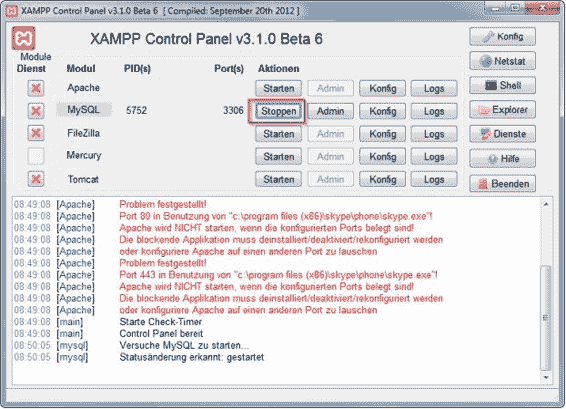
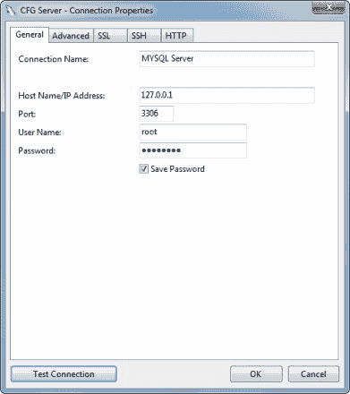
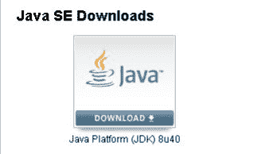
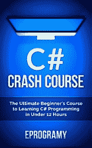

# PHP：速成课程——在 12 小时内学习 PHP 编程的终极初学者指南

## 引言

### 欢迎来到你的新编程语言

所以，你决定学习 `PHP Programming` 了吗？很好，恭喜你，欢迎来到你的新编程语言！你会喜欢它的！

在 Eprogramy，我们相信良好教育的基础是提供能够开启未来之门的工具。不可否认，世界已经进入了一个我们一切触手可及的时代。社会需求已经变化。因此，今天的沟通方式也发生了变化。沟通开启了大门，因此我们的挑战是学习如何用一种新的语言进行交流：这就是编程语言。

也许道路是困难辛苦的，但我们将为读者提供工具，让学习变得愉快且富有成果。我们将展示学习编程所需的所有方面。从基础知识到解决最常见的编程问题，以及更多、更多内容。

我们清楚自己在做什么，并相信你完全有能力吸收我们的教学。

未来的门已经开启。让我们一起一步步迈前进。

让我们开始吧！

Eprogramy 团队

# 第 1 章

## PHP 编程语言

### PHP 历史

`PHP` 的第一个形态是用 C 语言编写的一组简单的通用网关接口（`CGI`）二进制文件。`PHP` 由 Rasmus Lerdorf 于 1994 年创建。随着对功能需求的增加，产生了更多的 `PHP` 工具。通过这种方式，它产生了规模庞大得多且丰富的实现。

1995 年 6 月，`PHP` 工具的源代码向公众发布，允许开发者以他们想要的方式使用它。由于这种灵活性，许多开发者提供了错误修复，并帮助 `PHP` 变得比以往任何时候都更加强大。

随着时间的推移，代码又经历了一次彻底的改新，1996 年 4 月，Rasmus 引入了 `PHP/FI`。这一版本的 `PHP` 将其演变成了一个广泛的工具集，并成为了一种独立的编程语言。它包含了对 `DBM`、`MySQL` 和 `Postgres95` 数据库、cookie、用户自定义函数支持等功能。

尽管 `PHP` 的开发时间很短，但它在年轻的 Web 开发领域迅速流行起来。1998 年的调查显示，有近 60,000 个域名在他们的主机服务器上安装并正在使用 `PHP`。在当时，这个数字占了互联网上所有域名的 1%。

这种编程语言 `PHP` 主要由个人个人开发，他为 Web 开发社区带来了一种简单而强大的编程语言——这种语言可以完成许多伟大的工作，我们将在本指南中详细介绍这些内容。

### 什么是 PHP？

`PHP` 是一种服务端编程语言，可用于让静态网页更具动态性，因为它可以在服务器后端执行逻辑操作，并相应地在页面上返回/输出结果。`PHP` 的一个缺点是，页面必须重新加载才能让服务器接收并进行相应的处理。有很多方法可以避免这一点，在不重新加载页面的情况下使其动态化。可以通过 `PHP` 和 `AJAX` 的混合实现，我们将在指南稍后部分讨论。

现在让我们来看看为什么 `PHP` 是一种非常棒的编程语言。它是一种快速且易于使用的服务端脚本语言，专为 Web 开发以及许多其他用途设计。它还拥有出色的社区支持，有助于解决开发者在使用 `PHP` 时经常遇到的许多问题。

由于它拥有大量的优秀社区支持，有很多免费的第三方程序可以帮助并简化 `PHP` 编程。考虑到 `PHP` 拥有社区支持，人们也会考虑到 `PHP` 强大的内置函数列表，这让开发者减少了担心自定义函数编码的时间，可以更多地关注他们需要完成的任务。

我们讨论了很多 `PHP` 是一个服务端脚本语言，但我们还没有真正讨论过这意味着什么。脚本语言有两种类型：服务端和客户端。客户端语言的示例是 `Javascript`，而服务端语言的示例是 `PHP`。

它们之间的区别在于，客户端语言（如 `Javascript`）只需要浏览器来编译和解释其语言，而 `PHP` 则依赖服务器来编译和解释其语言，并将信息发送到浏览器进行解释。`PHP` 的许多用途之一是处理数据库，通常使用 `MySQL` 数据库，它对此有极好的内置支持。

# 第 2 章

## 设置 MySQL 和 PHP

你想做的第一件事是下载 `XAMPP`，它允许你运行 `PHP` 代码并操作 `MySQL` 数据库。成功安装 `XAMPP` 后——进入安装目录并执行 `xampp.control.exe`。然后，点击 `Apache` 和 `MySQL` 启动按钮。

点击 `MySQL` 行的启动按钮。



当 `MySQL` 成功启动后，还有几件事你必须完成。管理和管理 `MySQL` 服务器及其数据库实际上有两种不同的方法。

启动 `apache` 服务，打开浏览器并输入 `localhost` 或 `127.0.0.1`。完成后，会出现 `XAMPP` 状态页面。导航到安全设置并更改你的 `MySQL` root 密码。然后你就可以访问 `localhost` 下的 `PHPMyAdmin`，或者下载一个 Windows `MySQL` 客户端。例如 `Navicat` 或 `MySQL Workbench`。安装完成后，你就可以用设置的密码登录你的 `MySQL` 服务器。因此，你可以使用第三方程序访问数据库，也可以使用 `XAMPP` 内置的 `PhpMyAdmin`。



对于 `PHP` 文件，你必须进入安装 `XAMPP` 的目录并找到名为 `htdocs` 的文件夹。该文件夹将包含当你访问 `localhost/filename.html` 时出现的所有文件。所以，如果你在 `htdocs` 文件夹中有一个 `index.html` 文件，你可以相应地引用它。在这里，你可以创建一个包含 `PHP` 代码和 `HTML` 代码的 `.php` 文件并放入文件夹。然后你就可以调用它。

# 第 3 章

## HTML 和 CSS 基础

### HTML

为了理解 `HTML` 如何工作，我们必须查看基础。`HTML` 代表超文本标记语言。它用于创建网页。

`HTML` 中有很多你可以查询的标签。让我们来看各种示例并识别一些有用的标签。

```html
<html>
<head>
<title></title></head>
<body>
</body>
</html>
```

```html
<html>
<head>
    <title>Example of <p> tag</title>
</head>
<body>
    <p>This is a paragraph.</p>
</body>
</html>
```

### “<p>”标签的示例

```html
<html>
  <head>
    <title> “<p>”标签的示例 </title>
  </head>
  <body>
    <h1> 这是一个标题。</h1>
  </body>
</html>
```

上述示例中使用的 `<h1>` 标签的作用仅仅是将其包含的文本进行加粗并放大。你将要用到的所有标签的属性都可以通过 CSS 进行编辑，而我们很快就会学习到这部分内容。

这里有一个同时使用我们已经学过的两个标签的示例，并展示了输出结果。请注意，一旦你创建了包含 HTML 的文件，必须以 `.html` 扩展名保存该文件。然后你可以打开该文件并使用你选择的浏览器打开它进行测试。

```html
<html>
  <head>
    <title> “<p>”标签的示例 </title>
  </head>
  <body>
    <h1> 这是一个标题。</h1>
  </body>
</html>
```

输出：


最后，让我们来看一下 HTML 中注释的概念。你有时想编写某些代码但并不恰恰将其打印到屏幕上，只是想解释你正在执行的操作，或者在代码中添加提醒，而不让它在网页浏览器中显示，这样用户就看不到它。

你可以通过以 `<!--` 开始注释并以 `-->` 结束来进行注释。因此，如果我想注释某一行，我会对一个正常的段落如下操作：

```html
<p> 这是一个段落文本 </p>
<!-- 这一行打印出一个显示“这是一个段落文本”的段落 -->
```

有标签，也有属性，属性包含值，这些值被用于决定标签的内容如何显示，或者被 CSS 或 PHP 如何解释。在学习 PHP 和 CSS 时需要注意的两个重要属性是：`id` 和 `class`。你可以将它们用于任何适当的标签上，例如 `<body>` 标签内的 `<p>` 标签。

属性的工作格式如下：

```html
<p id = "content"> 这是网页的内容。 </p>
```

如示例所示，为了声明一个属性，你必须在第一个标签（即 `<p>`）中留出空间，然后命名已知的属性，例如 `id`。然后为了给它赋值值，你必须有一个等号，然后是引号以及引号内的值。在这种情况下，此段落包含了属性 `id="content"` —— 这可以通过你将要学习的选择器，作为 CSS 和 PHP 等语言的引用。

HTML 中仍然有许多你可以学习的标签，但这些是你开始编写代码时需要的基础标签。此外，你还应该理解 HTML 文档的基本结构。让我们回顾一下：

- `<html>` 和 `</html>` 定义了 HTML 文档，标签本身定义了其中的内容，以便浏览器能够对其进行解析。
- `<head>` 和 `</head>` 提供有关文档的信息并初始化任何外部脚本或样式表。
- `<title>` 和 `</title>` 仅仅提供给浏览器显示 HTML 文档的标题。
- `<body>` 和 `</body>` 容纳文档的所有内容，包括段落、导航栏、图像等。
- `<h1>` 和 `</h1>` 定义一级标题。

```html
</style>
</head>
<body>
    <h1> This is Header text</h1>
    <p id="content"> This is the content of the webpage. </p>
</body>
</html>
```

为了在 HTML 文档中开始编写 CSS 编码，你必须使用 `style` 标签，并借助 `type` 属性，该属性引用了标准规范 `text/css`，并且每当你想在 HTML 文档中编写 CSS 时，都必须使用它。在这个 `style` 标签内部是你的 CSS 代码，它能够成功地引用 HTML 文档中的所有 `p` 标签。那么，如果你只想引用特定的段落呢？

现在，我之所以喜欢将 `p` 称为“选择器”（selector）而不是“标签”（tag），是因为“选择器”是一个通用术语，而可以放在 `p` 位置的内容也是通用的。你不需要直接放入 HTML 文档中被引用的实际标签，而是可以使用井号（`#`）后跟相应的 `id` 名称来引用 `id`：

```css
#idname {
    color: red;
    font-size: 12px;
}
```

你也可以使用选择器来引用带有特定名称 `class` 属性的标签。例如：

```css
.classname {
    color: red;
    font-size: 12px;
}
```

现在你可能在想为什么 `id` 或 `class` 会会有什么帮助。让我通过下面的示例代码来为你解疑疑惑：

```html
<html>
    <head>
        <title> This the webpage title </title>
        <style type="text/css">
            #content {
                color: red;
                font-size: 14px;
            }
        </style>
    </head>
    <body>
        <h1> This is Header text</h1>
        <p id="content"> This the content of the webpage. </p>
    </body>
</html>
```

在上面的示例中，你可以看到我们列出了一个特定的段落，受我们在 `head` 标签内 CSS 中列出的更改的影响。这是使用 `id` 选择器的一种方法。要使用 `class` 选择器（其实没有太大区别，只是偏好问题），则需要执行以下操作：

```html
<html>
    <head>
        <title> This the webpage title </title>
        <style type="text/css">
            .content {
                color: red;
                font-size: 14px;
            }
        </style>
    </head>
    <body>
        <h1> This is Header text</h1>
        <p class="content"> This the content of the webpage. </p>
    </body>
</html>
```

在上面的代码中，我们没有使用井号符号来选择具有指定 `id` 名称的特定属性，而是这次使用了 `class` 名称。利用这些关于选择器的知识，我们可以使用 `PHP` 引用特定的 HTML 元素，并借此添加属性或更改标签内的内容来操纵这些标签，使它们对用户交互具有动态性。

在 CSS 中，有不同的方法可以将样式语言实际实现在 HTML 中。我已经向你展示了一种方法，即在 `head` 标签中使用 `style` 标签。事实上，实现 CSS 有三种不同类型：一种是内联的（inline），另一种是内部的（internal，即我们刚才的方法），还有一种是外部的（external）。要将其变为外部，我们不再在标签内编写 CSS 代码，而是让 `style` 标签引用一个包含所有 CSS 代码的文件。

让我们简单看看每种方法的工作原理的示例。请记住，如果你引用了某个文件（在此例中为 CSS 文件），如果你没有列出直接目录路径（例如 `C:\Program Files (x86)\Crazybump`）而只写名称，那么它将退而回到 HTML 文件所在的根目录中查找。

### 外部 CSS

文件名：`Learn.html`

```html
<html>
    <head>
        <title> This the webpage title </title>
        <link rel="stylesheet" type="text/css" href="pageStyle.css"><!-- 这是在 head 中用于引用外部文件的行 -->
    </head>
    <body>
        <h1> This is Header text</h1>
        <p id="content"> This is the content of the webpage. </p>
    </body>
</html>
```

```css
pageStyle.css
#content {
    color: red;
    font-size: 14px;
}
```

现在，既然我们已经讨论了内部和外部 CSS，我们可以看看内联的。这没有太大区别，只是偏好问题：

```html
<p style="color: red; font-size: 14px;" id="content"> This is the content of the webpage. </p>
```

上面的是一个示例：

```html
<html>
    <head>
        <title> This the webpage title </title>
    </head>
    <body>
        <h1> This is Header text</h1>
        <p class="content"> This is the content of the webpage. </p>
    </body>
</html>
```

局部变量仅在方法、块或构造函数内部声明。它们仅在方法、块或构造函数创建时被创建，并在方法结束时立即被销毁。你只能在调用局部变量的方法、块或构造函数内部访问它们，在调用处之外的地方是不可见的。局部变量没有默认值。

## 数据类型

如上所述，变量用于存储数据。PHP 拥有多种内置变量数据类型，用于存储预定义类型的数据。这些数据类型被称为原始数据类型。这些数据类型是编程语言中最基础的数据类型。你也可以创建自己的数据类型，我们稍后会介绍。PHP 共有 8 种原始数据类型。

### byte

`byte` 数据类型是一个 8 位符号位补码整数。它在声明时的默认值为 0，最大值为 127，最小值为 -128。当你想要节省内存空间时（特别是在大型数组中），`byte` 很有用。

示例：

```php
$b = 1; // 值为 1
```

### short

`short` 数据类型是一个 16 位符号位补码整数。它的最大范围是 32,767，最小值为 -32,768。`short` 用于节省内存或使你的代码更清晰。

示例：

```php
$s = 100; // 值为 100
```

### int

`int` 数据类型是一个 32 位符号位补码整数。它的最大值为 2,147,483,647（2³¹ - 1），最小值为 - 2,147,483,648（-2³¹）。除非考虑内存问题，`int` 是整数最常用的数据类型。

示例：

```php
$i = 10000000000; // 值为 10000000000
```

### long


`long` 数据类型是一个 64 位符号位补码整数。它的最大值为 `9,223,372,036,854,775,807`（`2⁶³ - 1`），最小值为 `-9,223,372,036,854,775,808`（`-2⁶³`）。当需要处理比 `int` 更大的数字时，使用这种数据类型。

示例：

```php
$n = 1; // 值为 1
```

### float

浮点数据类型是双精度 64 位 IEEE 754 浮点数。其最小和极大范围太大，在此讨论。在需要精度（如货币）时，永远不要使用 `float`。

示例：

```php
$f = 120.5; // 值为一百二十点五
```

### double

`double` 双点类型是双精度 64 位 IEEE 754 浮点数。它通常是小数的首选数据类型。其最小和极大范围无法在此讨论。在需要精度（如货币）时，永远不要使用 `float`。

示例：

```php
$d = 120.5; // 值为一百二十点五
```

### bool

`bool` 数据类型表示 1 位数据。它可以包含两个值：`true` 或 `false`。它用于简单的标志位，以跟踪真或假条件。

示例：

```php
$b = true; // 值为 true
```

### char

`char` 数据类型是单个 16 位字符。它的最小值为 `0000`（`0`），最大值为 `ffff`（`65,535`）。

示例：

```php
$c = 'w'; // 返回 'w'
```

### String

另一种常用的数据类型是 `String`。`String` 不是原始数据类型，但它是存储文本的类型。

示例：

```php
$cat = "meow"; // 将 cat 设置为 "meow"
```

## 声明变量

变量声明包含两个部分：变量名和存储的值。注意命名变量有一特定的约定和规则。变量名可以是任意字母和数字，但必须以字母、美元符号 `$` 或下划线 `_` 开头，否则将导致错误。常见的命名约定是以小写开头，后续单词大写。例如，如果变量名为 `theName`，第一个单词 `the` 是小写，后续单词 `Name` 以大写开头。

示例：

```php
$theName = 123; // 值为 123
```

在上面的示例中，数据类型是 `int`，变量名为 `theName`，其中存储的值是 `123`。你也可以声明变量但不向其存储值。

示例：

```php
$name; // 无值
```

你可以在稍后对其进行赋值。

## 使用变量

变量声明后，你可以读取它的值或更改它。在变量初始声明后，你只需通过名称引用它；只有在声明变量时才需要指定其数据类型。

示例：

```php
$name = 2; // 将 int "name" 设置为 2
```

变量也可以相加：

示例：

```php
$a; // 无值
$b = 1; // 值为 1
$c = 2; // 值为 2
$a = $b + $c; // 将 a 设置为 b 的值
```

在上面的示例中，我们将 `a` 的值设置为 `b` 和 `c` 的之和。加号被称为运算符，我们将在下一节中介绍。

在某种程度上，也可以组合不同数据类型的变量值。

示例：

```php
$test = "0"; // 将 test 设置为 "0"
$test += 2; // test 现在是整数
$test = 3.3; // test 现在是浮点数
$test = "5"; // test 现在是字符串
```

这可以用于判断一个数字是否为偶数。只需对 `2` 取模，如果结果为 `0` 则该数字为偶数，否则为奇数。这在尝试查找分钟（例如在时钟上）时也有用。只需将分钟数除以 `60`（一小时 `60` 分钟），结果将是时钟的分钟计数。注意，使用取模运算时，你只能得到从 `0` 到小于你运算符的任何数字（该运算符也可以是小数）。

其他数学运算符（如指数、根、舍入等）并不是默认操作，它们实际上是函数，我们稍后会讨论。请注意，表达式遵循 BEDMAS（或 PEMDAS，取决于你学的是哪种）。无论如何，这里是一些表达式及其对应的值。

```
7 * (3 % 2) = 7
(8 - 1.3) * 6 - 8 / (0 - 4) = 62
```

关键字是编程的下一个划分。有很多关键字，我们会在学习编程的不同部分时遇到它们。一些常见的包括 `$`、`for`、`while`、`return`、`break`、`function`。这些词用于在代码中执行特定操作。这是一个非常通用的描述，但它们的范围很广。注意，如果不恰当地使用它们，可能会导致代码出现语法错误。

语句是编程的下一个划分。语句总是以分号结尾（在某些特殊情况下）。注意 `console.log` 也以分号结尾，这表明 `console.log` 是一个函数，但我们将稍后讨论它。这是一个重要的语句。变量是存储在内存中以便复用的值。变量就像一个盒子，具体地想象一个盒子。当你取出盒子时，你在盒子上写下名字，这样你就知道里面是什么了。这被称为变量声明。变量有作用域（scope），这决定了它们在何处可以访问，我们稍后会回到这一点。

### 算术运算符

### 加法

`5+5 = 10`

```
$x = 5;
$y = 5;
$sum = 0;
$sum = $y;
```

在上面的示例中，变量 `sum` 将两个变量（`x` 和 `y`）相加并得到值 `10`。

### 减法

`10-5 = 5`

```
$x = 10;
$y = 5;
$total = 0;
$total = $x - $y;
```

在上面的示例中，变量 `total` 将两个变量（`x` 和 `y`）相减并得到值 `5`。

### 乘法

`5*4 = 20`

```
$x = 5;
$y = 4;
$total = 0;
$total = $x * $y;
```

在上面的示例中，变量 `total` 将两个变量（`x` 和 `y`）相乘并得到值 `20`。

### 除法

`20/5 = 4`

```
$x = 20;
$y = 5;
$total = 0;
$total = $x / $y;
```

在上面的示例中，变量 `total` 将两个变量（`x` 和 `y`）相除并得到值 `4`。

### 取模

`7 % 2 = 1`

```
$x = 7;
$y = 2;
$total = 0;
$total = $x % $y;
```

在上面的示例中，变量 `total` 取两个变量（`x` 和 `y`）的余数，通过寻找 `2` 能整除 `7` 几次来确定余数。例如：

`2` 能整除 `7` 几次？`3` 次。

`2 * 3 = 6`

`7 - 6 = 1`

因此，`7` 取模 `2` 为 `1`。

### 后自增

`5++ = 6`

```
$x = 5;
$y = $x++;
$x = 0;
```

在上面的示例中，变量 `x` 增加了值 `1`。注意，当使用后自增时，返回的是增加之前的值。

### 前自增

`++x = 6`

```
$x = 5;
$y = ++$x;
$x = 0;
```

在上面的示例中，变量 `x` 增加了值 `1`。注意，当使用前自增时，返回的是增加之后的值。

### 后自减

`5-- = 4`

```
$x = 5;
$y = $x--;
$x = 0;
```

在上面的示例中，变量 `x` 减了值 `1`。注意，当使用后自减时，返回的是减少之前的值。

### 前自减

`--x = 4`

```
$x = 5;
$y = --$x;
$x = 0;
```

在上面的示例中，变量 `x` 减了值 `1`。注意，当使用前自减时，返回的是减少之后的值。

### 赋值运算符

赋值运算符用于变量赋值，最常用的是 `=`。以下是示例：

### 等号 `=`

```
$x = 5;
```

在上面的示例中，`x` 被赋值为值 `5`。

### 加等号 `+=`

```
$x += 5;
```

在上面的示例中，`x` 变为 `10`，因为你将值 `5` 加到了 `x` 的现有值上。

### 减等号 `-=`

```
$x -= 5;
```

在上面的示例中，`x` 变为 `0`，因为你从 `x` 的现有值中减去了值 `5`。

### 乘等号 `*=`

```
$x *= 5;
```

在上面的示例中，`x` 变为 `25`，因为你将 `x` 的现有值乘以 `5`。

### 除等号 `/=`

```
$x /= 5;
```

在上面的示例中，`x` 变为 `1`，因为你将 `x` 的现有值除以 `5`。

### 取模等号 `%=`

```
$x %= 5;
```

在上面的示例中，`x` 变为 `0`，因为你正在寻找 `(5/5)` 中的余数。

现在我们已经回顾了所有用于处理变量的操作符，让我们来看处理变量的一些特殊情况。首先，如果你想将两个字符串连接在一起，方法是将它们拼接（将它们连接在一起），只需简单地使用 `.` 运算符即可。

例如：

```php
$x = "Hello";
$y = "World";
$line = $x." ".$y;
echo $line;
```

在这种情况下，`line` 的值将是不带引号的“Hello World”。

下一个特殊情况是尝试将一个字符串和一个数字相加。例如：

```php
$line = 15.“test”;
```

变量 `line` 现在将持有不带引号的值“15test”，因为 PHP 不理解你为什么要尝试向字符串中添加一个数字，所以它在后台会自动将其处理为如下形式：

```php
$line = “15”. “test”;
```

记住在 PHP 中，你可以动态更新变量，例如：

```php
$x; // 未定义
$x = 10; // x 是一个数字
$x = “This is text”; // x 现在是一个字符串
```

在整个指南中，你会看到我使用双引号来表示字符串 - 实际上并不重要 - 你也可以使用单引号来声明字符串变量。单引号和双引号使用的用点在于，如果你在字符串变量外部使用双引号，并想在内部使用它，PHP 就会产生困惑，因此为了避免混淆，你需要在让 PHP 字符串变量产生困惑的双引号之前放置一个转义字符：`\\`，这会在输出字符串时简单地跳过该双引号并忽略 `\\`。另一种方法是简单地用单引号包裹你的字符串变量，这样就可以在字符串变量内部使用双引号而不会让 PHP 产生困惑——反之亦然。

示例：

```php
$text = "It’s great to learn!"; // 双引号内有单引号
$text = "Their name is ‘Microsoft’"; // 双引号内单引号
$text = 'Their name is “Microsoft”'; // 单引号内双引号
```

# 第 6 章

## 布尔逻辑

布尔值（Boolean）是一个持有 `true` 或 `false` 值的变量——这些变量可以通过操作来在逻辑上拆解条件以做出决策。

### If 语句

简单来说，`if` 语句用于检查某物是真还是假。要创建一个 `if` 语句，你只需要编写单词 `if` 后跟着两个圆括号。`if` 语句内部的块是在满足 `if` 语句的条件时将执行的代码块。`if` 语句还可以包含 `else if` 语句和 `else` 语句。当 `if` 语句返回假时，`else if` 语句将运行。然而，它也包含自己的参数，该参数必须返回真。`else` 语句同样在 `if` 语句返回假时被调用，`else` 语句与 `else if` 语句的区别在于，`else` 语句的运行不需要任何参数为真。

示例：

```php
$a = 10;
$b = 20;
if ($a == $b) {
    echo("a is equal to b ");
}
else if ($a > $b) {
    echo("a is greater than b ");
}
else {
    echo("a is not equal to b or greater than b ");
}
```

此示例中使用的操作符（`==` 和 `>`）在下文中解释。在以下代码中，我们首先检查 `a` 是否等于 `b`。如果为真，只需打印“a is equal to b”并忽略其余代码。如果 `a` 不等于 `b`，它将向下执行并调用 `else if`。`else` 是由于第一个 `if` 返回了假。`else if` 的 `if` 部分会检查它自己的参数，恰好是 `a` 是否大于 `b`。如果 `a` 大于 `b`，我们就会打印“a is greater than b”。然而，由于 `a` 小于 `b`，我们继续向下并简单地调用 `else`。当所有上述参数都返回假时，`else` 运行。它不需要自己的参数为真。注意，每个 `if` 语句后面都可以跟跟无限数量的 `else if` 语句，但只能有一个 `else` 语句。同样注意，你不能在 `if` 语句和 `else` 语句之间放置代码，因为代码将找不到 `else`。此外，`else` 语句要求在其之前有一个 `if` 语句，因为为了调用 `else` 语句，其前的 `if` 语句必须为假。同样重要的是，在另一个 `if` 语句**内部**包含一个 `if` 语句是可能的。这被称为**嵌套嵌套 if 语句**。

示例：

```php
$a = 20;
$b = 30;
if ($a == 20) {
    if ($a < $b) {
        echo("a is less than b and it is equal to 20");
    }
}
```

在这个示例中，我们首先检查 `a` 的值是否等于 `b` 的值。如果是，我们再检查 `a` 的值是否小于 `b` 的值。如果是这种情况，我们会打印“a is less than b and it is equal to 20”。

### 关系运算符

PHP 支持 6 种关系运算符，用于比较变量的值：

`==`：此运算符检查两个值是否相等。如果相等，它返回真。如果不相等，它返回假。

示例：

```php
$a = 10;
$b = 10;
if ($a == $b) {
    echo("they are the same");
}
```

此代码检查 `a` 是否等于 `b`。如果为真，则括号内的代码将执行。

`!=`：此运算符检查两个值是否不相等。如果不相等，它返回真。如果相等，它返回假。

示例：

```php
$a = 10;
$b = 20;
if ($a != $b) {
    echo("they are not the same");
}
```

此代码检查 `a` 是否等于 `b`。由于 `a` 不等于 `b`，它打印“they are not the same”。

`>`：此运算符检查一个值是否大于另一个。如果运算符前面的变量大于后面变量的值，它返回真。如果前面的小于后面的，它返回假。

示例：

```php
$a = 20;
$b = 10;
if ($a > $b) {
    echo("a is larger than b");
}
else {
    echo("a is not larger than b");
}
```

此示例检查 `a` 是否大于 `b`。由于 `a` 大于 `b`，`if` 语句返回真。

`<`：此运算符检查一个值是否小于另一个。如果运算符前面的变量小于后面变量的值，则代码返回真；否则，它返回假。

示例：

```php
$a = 10;
$b = 20;
if ($a < $b) {
    echo("a is smaller than b");
}
else {
    echo("a is not smaller than b");
}
```

此示例检查 `a` 是否小于 `b`。由于 `a` 小于 `b`，`if` 语句返回真。

`>=` 此运算符用于检查某个值是否大于或等于另一个值。如果运算符前面的变量值大于或等于后面的变量，它将返回 `true`。如果后面的变量大于但不等于前面的变量，则它将返回 `false`。

示例：

```php
$a = 20;
$b = 20;
if ($a >= $b) {
    echo("a is larger or equal to b");
} else {
    echo("a is not larger or equal to b");
}
```

在这个示例中，`$a` 和 `$b` 的值均为 20。虽然 `$a` 不大于 `$b`，但它等于 `$b`，因此该语句返回 `true`，代码最终打印 "a is larger or equal to b"。

`<=` 此运算符用于检查某个值是否小于或等于另一个值。如果运算符前面的变量值小于或等于后面的变量，它将返回 `true`。如果后面的变量小于但不等于前面的变量，则它将返回 `false`。

示例：

```php
$a = 20;
$b = 20;
if ($a <= $b) {
    echo("a is larger than b");
} else {
    echo("a is not larger than b");
}
```

这个示例与上一个相同，只是运算符从 `>=` 更改为了 `<=`。虽然运算符变了，但结果是相同的。由于 `$a` 等于 `$b`，这段代码将返回 `true`，并打印 "a is larger than b"。

## 逻辑运算符

PHP 支持 3 种可以在逻辑中使用使用的逻辑运算符，它们通常与关系运算符结合使用。

`&&` 这被称为逻辑与（AND）运算符。如果该运算符前后的操作数都返回 `true`，则条件返回 `true`。如果两个操作数都为 `false`，或者其中一个操作数为 `false`，条件将返回 `false`。**两个**操作数都必须为 `true`，条件才会返回 `true`。

示例：

```php
$a = 20;
$b = 20;
if ($a == 20 && $a == $b) {
    echo("a is equal to 20 and b ");
} else {
    echo("a is not equal to 20 or a is not equal to b");
}
```


在这个示例中，我们检查`$a`是否等于`20`，并且`$a`是否等于`$b`。这两个条件被称为操作数。由于`$a`等于`20`且等于`$b`，该语句返回`true`，我们在控制台打印"a is larger than b"。

示例 2：

```php
$a = 20;
$b = 30;
if ($a == 20 && $a == b) {
    echo("a is equal to 20 and b");
} else {
    echo("a is not equal to 20 or a is not equal to b");
}
```

在下一个示例中，我们检查的内容与第一个示例完全相同。然而，这次的区别在于我们将`$b`的值从`20`更改为了`30`。这意味着当我们运行这段代码时，`if`语句将返回`false`，因为尽管`$a`等于`20`，但它并不等于`$b`。因此我们打印出"a is not equal to 20 or a is not equal to b"。请注意顺序并不重要。如果第一个操作数是`false`而不是第二个，我们将得到相同的结果。

`||`运算符被称为逻辑或（OR）运算符。如果第一个操作数或者第二个操作数为`true`，语句将返回`true`。这意味着如果第一个操作数返回`false`而第二个为`true`，语句仍然会返回`true`，反之亦然。如果两个操作数都为`true`，语句也会返回`true`。本质上，当使用或运算符时，至少有一个必须返回`true`。

示例：

```php
$a = 20;
$b = 30;
if ($a == 20 || $a == $b) {
    echo("a is equal to 20 or b");
} else {
    echo("a is not larger than b");
}
```

在这个示例中，我们检查`$a`是否等于`20`，或者`$a`是否等于`$b`。在这种情况下，`$a`等于`20`但不等于`$b`。由于这些操作数中只需要一个为`true`，整个语句将返回`true`。因此程序将打印"a is equal to 20 or b"。

示例 2：

```php
$a = 20;
$b = 20;
if ($a == 20 || $a == $b) {
    echo("a is equal to 20 and b ");
} else {
    echo("a is not equal to 20 or b ");
}
```

在这个示例中，我将上一个示例中`$b`的值从`30`改为了`20`。这意味着`$a`等于`20`且`$a`等于`$b`。两个操作数都返回`true`，因此语句返回`true`。这是因为或运算符要求 1 个或多个运算符为`true`。此程序将在控制台输出"a is equal to 20 and b"。

`!`此运算符被称为逻辑非（NOT）运算符。它用于反转其操作数的逻辑状态。该操作数可以与其他任何操作数配合使用以反转其输出。如果操作数返回`true`，在应用逻辑非运算符后，该操作数将返回`false`。

示例：

```php
$a = 21;
$b = 20;
if ( !(a == 20) && $a > b) {
    echo("a is not equal to 20, and a is greater than b");
} else {
    echo("a is equal to 20, and a is not greater than b ");
}
```

在这个示例中，我们检查`$a`的值是否等于`20`，并检查`$a`是否大于`$b`。由于`$a`既不等于`20`又大于`$b`，我们可以在控制台打印"a is not equal to 20, and a is greater than b"。

示例 2：

```php
$a = 21;
$b = 20;
if ( !(a == 20 && $a > $b) ) {
    echo("a is not equal to 20, and a is greater than b ");
} else {
    echo("a is equal to 20, and a is not greater than b ");
}
```

在这个示例中，我改变了括号的位置，使其逻辑非运算符扩展到两个操作数。现在要使语句为`true`，`$a`必须不等于`20`且`$a`大于`$b`。在这种情况下，语句将返回`false`，因为`$a`大于`$b`。由于操作数的影响，它需要小于`$b`才能返回`true`。因此此程序将返回"a is equal to 20, a is greater than b"。

## 组合运算符

在 PHP 中，可以使用你需要的任意运算符。

示例：

```php
$a = 21;
$b = 20;
if ((a == 20 && $a > $b) || ($a != 20 && $a < $b)) {
    echo("correct");
} else {
    echo("wrong");
}
```

通过这个示例，我们可以看到如何实现更复杂的语句。在这里，我们对两个操作数使用了或运算符，然而每个操作数内部又包含了一个逻辑与运算符。因此，要使该语句返回`true`，`$a`必须等于`20`且大于`$b`，或者`$a`不等于`20`且小于`$b`。请注意，我们使用括号是为了让代码更易理解，并防止代码误读我们的逻辑。

在上面的示例中，我们通过仅切换括号的位置就显著改变了程序的逻辑。注意现在括号包围了两个内部操作数，而不是两对括号包围着每对外部操作数。要让此语句现在返回`true`，必须有 3 个不同的条件返回`true`。变量`a`必须等于`20`，并且`a`必须大于`b`或者不等于`20`；并且`a`必须小于`b`。根据这个新逻辑，第一个操作数必须为真，且第二个或第三个操作数中必须有一个为真。此外，`a`必须小于`b`。该语句将返回`false`。它将通过第一个条件，因为`a`不等于`20`。它将通过第二个条件，因为它大于`b`，但会在最后一个条件失败，因为`a`并不小于`b`。由于这需要三个正确的条件，而只有一个符合，因此语句返回`false`并打印“wrong”。

## 赋值

我们现在将完成另一个作业，以确保我们理解了关于运算符的所有内容。我们有三个朋友想知道他们的钱和其他人相比有多少。我们将编写一个程序，输出谁比谁富有。我们将有三个名为`bob`、`john`和`tom`的整数。我们将给他们每一个人分配一个不同的值，程序必须输出谁更富有。它还必须告诉我们是否有人的金额相同。

例如：

如果`bob = 20`，`tom = 10`且`john = 5`，输出必须是：

“bob 比 tom 富，而 tom 比 john 富”

但但如果`bob = 20`，`tom = 20`且`john = 5`，输出必须是：

“bob 和 tom 一样富有，他们都比 john 富”

程序需要适用于每可能的结果。我强烈建议你自己尝试运行这个程序，并在查看答案之前尽可能地努力解决它。编程的很大一部分是解决问题和理解代码，因此我建议你先尝试自己想出来。

## 答案与解释

注意，程序将通过代码中的注释进行解释。

```php
// 可以随意更改这些值

$tom = 10; // tom 拥有的钱
$bob = 20; // bob 拥有的钱
$john = 10; // john 拥有的钱

/* 我们首先检查是否每个人的金额都相同
 * 注意我从未检查过 tom 是否等于 john，因为如果
 * tom 等于 bob 且 bob 等于 john，那么显然
 * tom 等于 john
 */
if ($tom == $bob && $bob == $john) {
    echo("Everyone has the same amount of money");
}

/*
 * 如果第一个语句返回 false
 * 我接下来检查特殊情况，即 tom 和 bob 的金额相同
 * 而 john 不是
 */
else if ($tom == $bob && $bob != $john) {
    /*
    * 现在我检查 bob 是否大于小于 john
    * 然后输出正确的答案
    */
    if ($bob > $john) {
        echo("tom is just as rich as bob, both are richer than john");
    } else if ($bob < $john) {
        echo("tom is just as rich as bob, both are more poor than john");
    }
}

/*
 * 我重复与上一个相同的过程，但针对不同的人
 */
else if ($tom == $john && $john != $bob) {
    if ($john > $bob) {
        echo("tom is just as rich as john, both are richer than bob");
    } else if ($john < $bob) {
        echo("tom is just as rich as john, both are more poor than bob");
    }
}

/*
 * 最后一组名字组合，
 * 与上一个语句相同
 */
else if ($john == $bob && $bob != $tom) {
    if ($bob > $tom) {
        echo("bob is just as rich as john, both are richer than tom");
    } else if ($bob < $tom) {
        echo("bob is just as rich as john, both are more poor than tom");
    }
}

/*
 * 现在我检查最后可能的组合
 * 即每个人的金额都不同
 * 下六个语句涵盖了每可能的结果
 */
else if ($tom > $bob && $bob > $john) {
    echo("tom is richest, followed by bob, followed by john");
} else if ($tom > $john && $john > $bob) {
    echo("tom is richest, followed by john, followed by bob");
} else if ($bob > $tom && $tom > $john) {
    echo("bob is richest, followed by tom, followed by john");
} else if ($bob > $john && $john > $tom) {
    echo("bob is richest, followed by john, followed by tom");
} else if ($john > $bob && $bob > $tom) {
    echo("john is richest, followed by bob, followed by tom");
} else if ($john > $tom && $tom > $bob) {
    echo("john is richest, followed by tom, followed by bob");
}
```

编写代码时，对所有逻辑进行注释是非常重要的，这样没有写代码的人就可以轻松理解并编辑它。我建议在编写代码时，根据你认为所需的程度进行注释。我也鼓励你尝试找到更好的解决问题的方法。也许你可以用四分之一的长度来编写它。

# 第 7 章 循环与数组

指南的这一部分很重要，因为它涵盖了编程中一个最重要的概念。循环（Loops）正如其名所示——它们是允许你根据要求，按一定次数运行特定代码块的函数。在介绍数组之前，我们先介绍循环的工作原理。

## 循环

PHP 中的循环与许多其他编程语言基本相同。其语法也相当直观。在每个循环中，都设置了一个条件供循环检查其是否为真，直到情况发生反转时，循环本身才会退出。例如，如果你创建一个循环并要求它在停止前运行特定代码块 10 次，有几种方法可以实现，因为有不同类型的循环。循环的一般思路如下：

```php
Loop (condition) {
    // 代码块
}
```

为了在 PHP 中创建循环（Loop）——我们必须理解不同类型的循环以及它们的适用场景。让我们来看看这些循环类型，然后我将在讲解过程中解释它们各自是如何运作的，到结束时，你应该已经对循环的工作原理有一个良好的理解。

### For 循环 (For Loops)

```php
for ($x = 0; $x < 10; $x++) {
    echo("Hi ".$x);
}
```

上面的示例中发生了很多操作，所以让我们逐行分析。第一行写道：

`for ($x = 0; $x < 10; $x++)`

在上述语句中，这是`for`循环的常规标准。我们必须首先声明变量，所以让我们从声明变量`x`开始，并将其设置为从 0 开始的`int`（整数）。接下来，让我们添加一个分号，通过添加条件将`for`循环的特定部分隔离开。这就是为什么我写了`$x < 10`，它简单表示只要`x`小于 10，就运行我大括号（`{`和`}`）下面的代码块。该语句现在由另一个分号隔开，以便进入`for`循环的最后一个元素。这部分是你告诉你声明的特定变量执行特定的算术操作。在这种情况下，我们告诉`x`在每次循环通过时递增。

让我们用伪代码（英语可读方式）来过一遍：

```pseudocode
for (声明变量; 为变量创建条件; 影响变量) {
    // 运行此代码块
}
```

一旦运行了代码块，它将返回第一个语句并检查条件仍然满足。它将跳过变量声明，因为它会注意到变量已经声明过了。然后它将在检查条件是否满足之前跳到影响变量的部分。

以下是适用于`for`循环或任何循环可以遵循的蓝图：

声明变量 → 检查条件 → 运行代码块 → 影响变量 → 检查条件 → 运行代码块 → 影响变量 → 检查条件 → 运行代码块 → 从“影响变量”开始重复

现在让我们回看我们对 alert 进行稍小修改后创建的代码：

```php
for ($x = 0; $x < 10; $x++) {
    echo("Current Number: ".$x);
}
```

我们可以看到这个循环简单地将`x`从 0 递增到 9，所以从技术上是有 10 次迭代，因为 0 是包含在内的。因此，循环输出如下内容：

```
Current Number: 0
Current Number: 1
Current Number: 2
Current Number: 3
Current Number: 4
Current Number: 5
Current Number: 6
Current Number: 7
Current Number: 8
Current Number: 9
```

记得我说过`for`循环的最后一个语句是对已声明变量的算术操作吗——很好，变量可以以任何方式受到影响，如果你愿意，也可以每次递增 2。

现在我们知道了`for`循环是如何工作的，理解`while`循环和`do-while`循环的工作原理就会变得容易。

### While 循环 (While Loop)

`while`循环与`for`循环的唯一区别在于它只带有循环条件而不包含变量。因此，你必须在循环内部影响变量以执行特定条件之前，先在循环范围之外声明变量。

例如：

```php
$x = 0;
while ($x < 10) {
    echo("Current number: ".$x);
    $x++;
}
```

在上面的示例中，如所示，`while`循环简单地检查条件，当满足条件时运行代码块，然后影响变量`x`，这样在代码块执行完成后它会返回检查条件，并继续这样做直到`x`不小于 10。它的输出与`for`循环的输出相同：

```
Current Number: 0
Current Number: 1
Current Number: 2
Current Number: 3
Current Number: 4
Current Number: 5
Current Number: 6
Current Number: 7
Current Number: 8
Current Number: 9
```

这个`while`循环可能会出现问题，比如意外创建无限循环。例如：

```php
$x = 0;
while ($x < 10) {
    echo("Current number: ".$x);
}
```

在上面的示例中，它执行的操作与上一个循环完全一样，但输出（即显示某些文本）会无限次显示，因为变量`x`永远没有受到影响。

我们将涵盖的最后一种循环类型是`do-while`循环。这种循环执行`while`循环所做的一切，但它至少会执行一次。

例如：

```php
$x = 0;
do {
    echo("Current number: ".$x);
    $x++;
} while ($x < 10);
```

上面的示例无论条件如何都会至少运行代码块，这在检查条件之前执行某些很有用。

### Continue 关键字 (Continue Keyword)

`continue`关键字用于你想跳过循环的迭代时。例如：

```php
$x = 0;
while ($x < 10) {
    if ($x == 5) {
        continue;
    }
    echo($x);
}
```


在上面的示例中，我们正在检查 `x` 是否等于 5。如果是的话，我们就会跳过该迭代，这意味着此循环的输出变为：

```text
Current Number: 0
Current Number: 1
Current Number: 2
Current Number: 3
Current Number: 4
Current Number: 6
Current Number: 7
Current Number: 8
Current Number: 9
```

如上面的输出所示，循环在 5 处跳过，因为它没有机会显示该数字。

### `Break` 关键字（Break Keyword）

`break` 关键字用于你想跳出循环时。例如：

```php
$x = 0;
while ($x < 10) {
    if ($x == 5) {
        break;
    }
    echo($x);
}
```

在上面的示例中，我们正在检查 `x` 是否等于 5。如果是的话，我们就会跳出循环，这意味着此循环的输出变为：

```text
Current Number: 0
Current Number: 1
Current Number: 2
Current Number: 3
Current Number: 4
```

如上面的输出所示，循环在达到此处时跳出，基本上是停止继续运行。

## 数组（Arrays）

编程中的数组是有用的，因为它允许你创建字符串、数字、对象或你可以想到的任何数据类型的列表。再次，这最初可能并不明显，但当你开始编程并意识到某些情况下你可能需要数组时，你就明白了。

所以数组基本上是一个包含多个单独访问值的单个变量。让我们来看看数组声明语法是如何工作的。

为了声明变量，你必须执行以下操作：

```php
$names = array("John", "Bob", "Tom");
```

在上面的示例中，我们正在声明一个名为 `names` 的变量，然后为它分配了一个值列表，这些值是字符串类型。

因此，为了给数组赋值，我们添加了 `array()`，它只是设置了数组的边界。然后，我们通过给每个元素加上引号并指定数组类型为字符串，并在每个元素之间添加逗号以表示它是数组中的不同元素。

为了从数组访问特定的元素值，我们使用以下语法：

```php
echo($names[0]);
```

在上面的示例中，我们正在做的是输出数组索引为 0 的值。在数组中，我们通过索引值来引用数组的值，而索引值从 0 开始。因此，“John”是索引 0，“Bob”是索引 1，而“Tom”是索引 2。数组本身的长度为 3。

为了获取数组的长度，我们使用以下属性：

```php
echo(count($names));
```

由于通常来说，数组都是对象（你稍后将学习到这意味着什么），它们拥有变量和函数，而长度是数组的一个属性，因此可以通过 `names` 变量来访问它，因为它是一个数组类型的变量。

这段代码的输出将是 3，因为它会将数组的第一个元素计为 1，然后是 2，以此类推。

现在，假设我们想声明一个数组，但在代码的稍后部分之前不给它分配任何值。那么你可以执行以下操作：

```php
$names = [];
$names[0] = "John";
$names[1] = " Bob";
$names[2] = "Tom";
```

在上面的示例中，我们正在声明一个空数组，并准备向其中添加元素。我们通过引用一个尚不存在的索引并赋予它一个特定的值来实现。

现在，我们可以引用 `names` 数组的索引并检索出分配给它的相应值。

```php
echo($names[0]);
```

上面的示例现在返回“John”，因为它被赋值了字符串 John。需要注意的是，你可以简单地通过对想要覆盖的特定索引使用赋值运算符来覆盖索引值，然后赋予它其他值。

声明 PHP 数组的另一种方法是执行以下操作：

```php
// 声明带有键 (KEY) 和值 (VALUE) 的关联数组
$students_array = array(
    "John" => "84",
    "Bob" => "87",
    "Jane" => "91",
    "Thomas" => "94",
    "Matthew" => "92",
    "Peter" => "76"
);
// 显示整个 students_array
echo "John has an average of: " . $students_array["John"] . ".";
print_r($students_array);
```

输出：

```text
John has an average of: 84

Array ([John] => 84 [Bob] => 87 [Jane] => 91 [Thomas] => 94 [Matthew] => 92 [Peter] => 76)
```

关联数组是一种持有键的数组，而键又持有值。要引用数组的值，你只需引用键的名字。

这是声明关联数组的另一种方法：

```php
<?php
// 逐个赋值
$cart_array["cereal"] = "5.00";
$cart_array["coffee beans"] = "2.50";
$cart_array["bananas"] = "3.50";
$cart_array["onion"] = "1.00";
$cart_array["lettuce"] = "2.40";
$cart_array["tomato"] = "1.00";
echo "John has an average of: " . $students_array["John"] . ".";
print_r($students_array);
print_r($cart_array);
?>
```

输出：

```text
John has an average of: 84

Array ([John] => 84 [Bob] => 87 [Jane] => 91 [Thomas] => 94 [Matthew] => 92 [Peter] => 76)
```

现在，拥有数组并能够存储姓名、社会安全号等大型数据库——这确实很棒——但想象一下尝试通过指定数组索引并检索值来手动打印所有这些值。

嗯，让我们想想，如果我想从数组的多个索引值中打印多个值，那么我必须输出数组的所有索引。因此我得出结论，我可以使用循环（Loop）来影响索引变量，从而输出并检索数组的值。例如：

```php
$names = array("John", "Bob", "Tom");
for ($i = 0; $i < count($names); $i++) {
    echo($names[$i]);
}
```

在上面的示例中，我们声明了一个名为 `names` 的变量，并带有三个值 `"John"`、`"Bob"` 和 `"Tom"`。一旦数组变量被设置，我们就循环 `i` 变量，直到它到达数组长度之前（数组中持有的元素数量），以便打印它们。

然后，我们通过在数组名称旁边的括号中放置 `i` 来输出数组的索引值，以便引用特定索引，相应地打印名称。所以这段代码的输出将是：

```text
John
Bob
Tom
```

通过我们对数组和循环的理解，已经成功地将它们的使用结合起来，输出数组中的所有元素。

将循环和数组结合工作的概念，只是你使用循环或数组来实现你所想要的事情的一种方法。编程的核心理念源于跳出框架思考，决定你如何操作数字、字符串以及语言的功能，以计算你想要实现的目标算法（算法：完成目标所需的一系列步骤）。

## 多维数组

多维数组在编程中非常有用。它们实际上是嵌套在单个数组中的数组。每一层数组都是一个维度。在这种情况下，我们使用两个维度。我们可以创建一个多维数组：

```php
$employees = array(
    'names' => array('John','Peter'),
    'salaries' => array('40000', '25000')
);
```

为了访问数组，你可以执行以下操作：

```php
print $employees['names'][0]; // John
print $employees['salaries'][0]; // 40000
```

每一层数组都是一个维度。在这种情况下，我们使用两个维度。我们可以创建一个多维数组：

```php
$employees = array(
    'names' => array('John','Peter'),
    'salaries' => array('40000', '25000')
);
```

为了访问数组，你可以执行以下操作：

```php
print $employees['names'][0]; // John
print $employees['salaries'][0]; // 40000
```

每一层数组都是一个维度。在这种情况下，我们使用两个维度。我们可以创建一个多维数组：

```php
$employees = array(
    'names' => array('John','Peter'),
    'salaries' => array('40000', '25000')
);
```

为了访问数组，你可以执行以下操作：

```php
print $employees['names'][0]; // John
print $employees['salaries'][0]; // 40000
```

每一层数组都是一个维度。在这种情况下，我们使用两个维度。我们可以创建一个多维数组：

```php
$employees = array(
    'names' => array('John','Peter'),
    'salaries' => array('40000', '25000')
);
```

为了访问数组，你可以执行以下操作：

```php
print $employees['names'][0]; // John
print $employees['salaries'][0]; // 40000
```

## 第 8 章：函数与类

函数是一段可以在程序中任何一点通过单行代码运行的代码块，并且你可以根据需要多次使用它。

要创建一个函数，只需编写 `function`、一个变量名，然后是圆括号，紧接着是大括号，其中包含你的代码。

```php
function printSomething() {
    echo("Something I guess? don’t know...");
}
```

这是一个非常简单的函数。在普通括号之间，你可以放置变量名。这些被称为参数。这些参数允许你给代码提供值，从而可能产生不同的输出。

```php
function printSomething($times) {
    for($i = 0; $i < $times; $i++) {
        echo("Mum!");
    }
}
```

这个函数使用一个名为 `times` 的变量，运行指定次数的循环，并在每个循环中打印“Mum!”。所以如果你运行这段代码并传入值 7，“Mum!”将打印 7 次。

你可以有任意数量的参数（尽管越少越好）。只需用逗号分隔每个变量名即可。

```php
function printSomething($times, $whatToPrint) {
    for($i = 0; $i < $times; $i++) {
        echo($whatToPrint);
    }
}
```

此函数将根据 `times` 设置的次数，打印出 `whatToPrint` 设置的任何内容。

那么我们如何使用这段代码呢？要让这段代码运行，只需输入函数名，后面跟着括号，括号内包含用逗号隔开的值，这些值应该与函数的用途相关。

例如，对于我们的函数，第一个参数是 `times` 变量，因此我们应该只给第一个参数传递一个数字作为值，具体来说是一个整数（尽管在这种情况下，数字是否为整数并不重要）。同样，对于第二个参数，我们应该放入我们想要打印的内容。

这被称为“调用”函数。

```php
echo(7."I like to move it, move it!");
```

我们可以根据需要、在任何时间、多次调用我们的函数。

函数的一个有趣点是，在设置变量时，你可以将函数作为值，然后通过这些变量调用它们。

调用函数与将其作为值使用的区别在于：在调用函数时，你使用带有参数的括号；而将函数作为值使用时，不需要放置括号。

## 返回值

函数的一个重要特性是可以“返回”（return）值。这意味着函数在被调用时将作为返回的值。

要返回一个值，只需使用 `return` 关键字，后跟一个值。这是一个示例。要使用返回的值，只需将函数调用想象成返回的值即可。

```php
function calculateHalfCircumference($radius)
{
    return 3.14*$radius;
}

$circumference = 2*calculateHalfCircumference(7);

echo($circumference);
```

在这个示例中，我们创建了一个函数，并返回周长的一半（我不知道你为什么要这么做，但为了示例，我们将这样做）。

在函数外部，我们创建了一个变量，并将其设置为函数返回值的两倍，我们知道这将是圆的周长。这意味着我们得到了总周长并将其打印出来。

返回还有一个次要功能：它会停止函数的执行。这意味着假设你的函数中有一个运行很长的循环（Loop），但你希望它在运行完一个 `if` 语句后停止。只需使用 `return` 关键字，它就会停止循环剩余部分的运行。

`return` 关键字也不需要返回任何值。你可以单独使用 `return` 关键字来在函数的任何位置结束其执行。

```php
function kindaUseless($number)
{
    $i = 0;
    while(true)
    {
        $i++;
        if($number == $i)
        {
            echo($i);
            echo("That’t the best way to do that");
            return;
        }
    }
}
```

这不是一个非常有用的示例，但它展示了语法。这个循环只要条件为 `true` 就会一直运行。这个循环将永远运行。

我们还创建了一个名为 `$i` 的变量。在每次迭代中，我们检查查找的数字是否等于 `$i`。如果是，我们就打印出 `$i` 以及一些关于这个函数的内容。最后，我们返回该函数。

由于函数在返回后会停止执行，因此跳出了无限循环，我们的程序可以继续运行。这在那些想要限制迭代次数的情况下非常有用。例如，如果你在数组中搜索某个东西，并找到了它，你可能希望在当时直接返回，以避免更多次数的迭代。

当你的代码变得很长时，函数是非常实用的。与其在整个代码中编写相似的代码，不如使用一个函数将代码编写一次，并在需要运行的地方调用。

函数还允许我们像注释一样使代码更清晰，但它是代码形式的。

### 示例 1（基础函数）

```php
function SaySomething() {
    echo "Hello world!";
}
SaySomething();
```

### 示例 2（传递参数）

```php
function Birthday($name, $year) {
    echo $name."Born in".$year."<br>";
}
Birthday("John", 1987);
```

### 示例 3（默认参数值）

```php
function SetFavoriteColor($color = white) {
    echo "The color is : $color <br>";
}
SetFavoriteColor(); // 使用默认值 white
```

### 示例 4（返回值）

```php
function Add($fNum, $sNum) {
    $sum = $fNum + $sNum;
    return $sum;
}
echo (5+10);
```

## 类

接下来让我们来说类：类是将具有目的函数聚集在一起的部分。要创建一个类，你需要使用 `class` 关键字，后跟类名，然后是大括号。在类内部，你可以拥有函数和变量。

类的目标是组织你的代码并允许变量是全局的。例如，我们创建一个名为 `Marks` 的类。

```php
class Marks {
    var $studentName;
    var $average;
}
```

在上面的代码中，首先发生的是我们创建一个名为 `$studentName` 的全局变量，还没有给它赋值。对 `$average` 也是如此。

变量的目标是允许老师输入学生和平均分。老师可以随地获取值。

```php
class Marks {
    var $studentName;
    var $average;

    function setStudentName($name) {
        $studentName = $name;
    }

    function setStudentAverage($avg) {
        $average = $avg;
    }

    function getStudentName() {
        return $studentName;
    }

    function getStudentAverage() {
        return $average;
    }
}
```

为了解释上述每个功能：我们做的第一件事是创建一个名为 `setStudentName` 的函数，它接受一个变量名为 `$name` 的参数，然后将类变量 `$studentName` 设置为输入的变量名。

接着，我们的下一个函数思路与上一个方法相同，只是它允许老师输入学生的平均分。然后，我们将类变量赋值为输入到函数中的变量。

最后，为了获取变量的值，我们创建一个名为 `getStudentName` 的函数，它只需返回类中 `$studentName` 变量的值。

我们对 `getStudentAverage` 函数应用了相同的理念，它只需返回类中变量 `$average` 的学生平均分。


现在，为了实际引用该类及其变量/方法，我们必须在类定义之外的 PHP 执行代码中使用特殊语法。为了引用一个类，我们必须创建一个对象。对象基本上是一个持有类的变量，因为类可以被视为一个对象，因为它包含了函数、属性和变量，使其具有独特性。

为了实际创建这个对象，我们必须使用 `new` 关键字，它基本上在任何声明类或对象时使用。例如：

```php
<?php
class Marks {
    var $studentName;
    var $average;
    function setStudentName($name) {
        $studentName = $name;
    }
    function setStudentAverage($avg) {
        $average = $avg;
    }
    function getStudentName() {
        return $studentName;
    }
    function getStudentAverage() {
        return $average;
    }
}
// $objectName = new Marks(); 类声明的示例结构
?>
```

现在，为了创建这个对象，我们将执行以下操作：

```php
<?php
class Marks {
    var $studentName;
    var $average;
    function setStudentName($name) {
        $studentName = $name;
    }
    function setStudentAverage($avg) {
        $average = $avg;
    }
    function getStudentName() {
        return $studentName;
    }
    function getStudentAverage() {
        return $average;
    }
}
$marksObject = new Marks();
?>
```

现在我们已经知道如何引用类了，那么如何引用类内部的内容呢？我们使用一个连字符和一个指向右侧的箭头（`->`）来表示对象到达某个变量或函数必须经过的路径。例如：

```php
<?php
class Marks {
    var $studentName;
    var $average;
    function setStudentName($name) {
        $studentName = $name;
    }
    function setStudentAverage($avg) {
        $average = $avg;
    }
    function getStudentName() {
        return $studentName;
    }
    function getStudentAverage() {
        return $average;
    }
}
$marksObject = new Marks();
// 我想让 marksObject 引用 $studentName 并将其输出……
?>
```

为了实际实现，你必须执行以下操作：

```php
<?php
class Marks {
    var $studentName;
    var $average;
    function setStudentName($name) {
        $studentName = $name;
    }
    function setStudentAverage($avg) {
        $average = $avg;
    }
    function getStudentName() {
        return $studentName;
    }
    function getStudentAverage() {
        return $average;
    }
}
$marksObject = new Marks();
echo ($marksObject -> studentName);
?>
```

在上面的代码中，`$marksObject` 引用了 `studentName` 变量而没有美元符号，因为你不需要使用它。我们告诉类引用其内部的变量名 `studentName` 并将其输出。但由于 `studentName` 还没有由用户设置，它将无法输出正确的值。

你可能想到的另一个问题是，如果我们直接引用变量 `studentName` 而不是使用函数来获取值，那么我们为什么还要创建一个函数来做这件事呢？嗯，其实并没有特殊理由——这仅仅是一种惯例，也是为了演示目的，向你展示类和函数如何协同工作的概念。

现在，为了实际引用一个函数，你与引用变量时的操作是相同的，但这次你需要在所引用的内容末尾加上括号，以指定你指向的是函数而不是变量名。

```php
<?php
class Marks {
    var $studentName;
    var $average;
    function setStudentName($name) {
        $studentName = $name;
    }
    function setStudentAverage($avg) {
        $average = $avg;
    }
    function getStudentName() {
        return $studentName;
    }
    function getStudentAverage() {
        return $average;
    }
}
?>
```

## 字符串函数

- `chunk_split()` 根据预定的 ASCII 估值返回字符。
- `chunk_split()` 将字符串分割成一系列较小的部分。
- `convert_cyr_string()` 将字符串从一种西里尔字母集转换到另一种。
- `convert_uudecode()` 解码一个经过 uuencode 编码的字符串。
- `convert_uuencode()` 利用 uuencode 计算对字符串进行编码。
- `count_chars()` 返回用于字符串字符串的字符统计数据。
- `crc32()` 计算字符串的 32 位的 CRC 值。
- `tomb()` 受限的字符串加密（哈希）。
- `reverberation()` 产生一个或多个字符串。
- `blast()` 将字符串拆分为一个簇。
- `fprintf()` 将格式化后的字符串组合并输出到预定的输出流中。
- `get_html_translation_table()` 返回 `htmlspecialchars()` 和 `htmlentities()` 使用的解释表。
- `hebrev()` 将希伯来文内容转换为视觉内容。
- `hebrevc()` 将希伯来文内容转换为视觉内容，并将换行符（`\n`）转换为 `<br>`。
- `hex2bin()` 将十六进制属性字符串转换为 ASCII 字符。
- `html_entity_decode()` 将 HTML 实体转换为字符。
- `htmlentities()` 将字符转换为 HTML 实体。
- `htmlspecialchars_decode()` 将某些预定义的 HTML 实体转换为字符。
- `htmlspecialchars()` 将某些预定义的字符转换为 HTML 元素。
- `implode()` 将数组组件组合成一个字符串。
- `join()` 是 `implode()` 的别名。
- `lcfirst()` 将字符串的第一个字符转换为小写。
- `levenshtein()` 返回两个字符串之间的 Levenshtein 距离。
- `localeconv()` 返回与区域相关的数字和货币相关的组织数据。
- `ltrim()` 从字符串的左侧移除空格或不同的字符。
- `md5()` 计算字符串的 MD5 哈希值。
- `md5_file()` 确定文件的 MD5 哈希值。
- `metaphone()` 确定字符串的元音键。
- `money_format()` 返回一个格式化为货币字符串的字符串。
- `nl_langinfo()` 返回特定的区域数据。
- `nl2br()` 在字符串每个换行符前面嵌入 HTML 换行符。
- `number_format()` 形成带有千分位分隔符的数字。
- `ord()` 返回字符串第一个字符的 ASCII 估值。
- `parse_str()` 将查询字符串解析为变量。
- `print()` 产生一个或多个字符串。
- `printf()` 产生一个格式化的字符串。
- `quoted_printable_decode()` 将引义的可打印字符串转换为 8 位字符串。
- `quoted_printable_encode()` 将 8 位字符串转换为引义的可打印字符串。
- `quotemeta()` 对元字符进行转义。
- `rtrim()` 从字符串的右侧移除空格或不同的字符。
- `setlocale()` 设置区域数据。
- `sha1()` 计算字符串的 SHA-1 哈希值。
- `sha1_file()` 计算文件的 SHA-1 哈希值。
- `similar_text()` 计算两个字符串之间的相似度。
- `soundex()` 计算字符串的 soundex 键。
- `sprintf()` 将格式化后的字符串组合到变量。
- `sscanf()` 按照格式从字符串中解析数据。
- `str_getcsv()` 将 CSV 字符串解析为一个簇。
- `str_ireplace()` 在字符串中替换某些字符（不区分大小写）。
- `str_pad()` 将字符串填充到另一个长度。
- `str_repeat()` 按指定的次数重复字符串。
- `str_replace()` 在字符串中替换某些字符（区分大小写）。
- `str_rot13()` 对字符串执行 ROT13 编码。
- `str_shuffle()` 随机重排字符串中的所有字符。
- `str_split()` 将字符串分割为一个簇。
- `str_word_count()` 计算字符串中的单词数量。
- `strcasecmp()` 比较两个字符串（不区分大小写）。
- `strchr()` 在另一个字符串中找到字符串的第一次出现（`strstr()` 的别名）。
- `strcmp()` 比较两个字符串（区分大小写）。
- `strcoll()` 比较两个字符串（基于区域的字符串比较）。
- `strcspn()` 返回在字符串中找到任何预定义字符中的片段之前的字符数量。
- `strip_tags()` 从字符串中移除 HTML 和 PHP 标签。
- `stripcslashes()` 反转用 `addcslashes()` 转义的字符串。
- `stripslashes()` 反转用 `addslashes()` 转义的字符串。
- `stripos()` 返回字符串在另一个字符串中第一次出现的位置（不区分大小写）。
- `stristr()` 在另一个字符串中找到字符串的第一次出现（不敏感/不区分大小写）。
- `strlen()` 返回字符串的长度。
- `strnatcasecmp()` 利用“自然排序”计算分析两个字符串（不区分大小写）。
- `strnatcmp()` 利用“自然排序”计算分析两个字符串（区分大小写）。
- `strncasecmp()` 前 n 个字符的字符串相关性（不区分大小写）。
- `strncmp()` 前 n 个字符的字符串相关性（区分大小写）。
- `strpbr()` 查找字符串是否包含字符集中的任何字符。
- `strpos()` 返回字符串在另一个字符串中第一次出现的位置（区分大小写）。
- `strrchr()` 在另一个字符串中找到字符串的最后一次。
- `strrev()` 反转字符串。
- `strripos()` 在另一个字符串中找到字符串的最后一次的位置（不区分大小写）。
- `strpos()` 返回字符串在另一个字符串中最后一次的位置（区分大小写）。
- `strspn()` 返回字符串中包含预定义字符的字符数量。

## 数值函数

- `abs()` 返回数字的绝对值（正估值）。
- `acos()` 返回数字的反圆余弦。
- `cosh()` 返回双曲余弦。
- `asin()` 返回数字的反圆正弦。
- `asinh()` 返回反双曲正弦。
- `atan()` 返回以弧度为单位的数字的反圆正切。
- `atan2()` 返回两个变量 x 和 y 的反圆正切角。
- `atanh()` 返回数字的反双曲正切。
- `base_convert()` 将数字从一个基数转换到另一种。
- `bindec()` 将二进制转换为十进制数。
- `dechex()` 将十进制转换为十六进制数。
- `decoct()` 将十进制转换为八进制数。
- `deg2rad()` 将度数转换为弧度值。
- `exp()` 计算 e 的幂。
- `expm1()` 返回 `exp(x) - 1`。
- `floor()` 将数字向下取整到最近的整数。
- `fmod()` 返回 `x/y` 的余数。
- `getrandmax()` 返回 `rand()` 可能返回的最大整数值。
- `hexdec()` 将十六进制数转换为十进制数。
- `hypot()` 计算直角三角形的斜边。
- `is_finite()` 检查一个数值是否有限。
- `is_infinite()` 检查一个数值是否无界。
- `is_nan()` 检查一个数值是否为“不是数字”（not-a-number）。
- `lcg_value()` 返回一个 0 到 1 之间的伪随机分布数。
- `log()` 返回一个数的自然对数。
- `log10()` 返回一个以 10 为底的对数。
- `log1p()` 返回 `log(1+number)`。
- `max()` 返回集合中的最大值，或者几个预定义属性中的最大估计值。
- `min()` 返回集合中的最小值，或者几个预定义属性中的最小估计值。
- `mt_getrandmax()` 返回 `mt_rand()` 可能返回的最大值。
- `mt_rand()` 使用梅森旋转算法生成一个随机数。
- `mt_srand()` 为梅森旋转随机数生成器种子。
- `octdec()` 将八进制数转换为十进制数。
- `pi()` 返回 PI 的估计值。
- `pow()` 返回 `x` 的 `y` 次方。
- `rad2deg()` 将弧度转换为角度。
- `rand()` 生成一个随机整数。
- `round()` 对浮点数四舍五入。
- `sin()` 返回数的正弦。
- `sinh()` 返回数的双曲正弦。
- `sqrt()` 返回数的平方根。
- `srand()` 为随机数生成器种子。
- `tan()` 返回数的正切。
- `tanh()` 返回双曲正切。

## PHP 5 预定义数学常量

- `M_E`: 2.7182818284590452354 - 返回 `e`（PHP 4）。
- `M_EULER`: 0.57721566490153286061 - 返回欧拉常数（PHP 4）。
- `M_LNPI`: 1.144729885849001744 - 返回 PI 的自然对数：`log_e(pi)`（PHP 5.2）。
- `M_LN2`: 0.693147180599453092 - 返回 2 的自然对数：`log_e 2`（PHP 4）。
- `M_LN10`: 2.3025850929940456402 - 返回 10 的自然对数：`log_e 10`（PHP 4）。
- `M_LOG2E`: 1.426950408889634074 - 返回以 2 为底的 E 数：`log_2 e`（PHP 4）。
- `M_LOG10E`: 0.4342944819032518275 - 返回以 10 为底的 E 数：`log_10 e`（PHP 4）。
- `M_PI`: 3.14159265358979323846 - 返回 Pi（PHP 4）。
- `M_PI_2`: 1.57079632679489661923 - 返回 `Pi/2`（PHP 4）。
- `M_PI_4`: 0.78539816339744830962 - 返回 `Pi/4`（PHP 4）。
- `M_1_PI`: 0.31830988618379067154 - 返回 `1/Pi`（PHP 4）。
- `M_2_PI`: 0.63661977236758134308 - 返回 `2/Pi`（PHP 4）。
- `M_SQRTPI`: 1.7724538509051602729 - 返回 PI 的平方根：`sqrt(pi)`（PHP 5.2）。
- `M_2_SQRTPI`: 1.1283791670951257390 - 返回 2 除以 PI 的平方根：`2/sqrt(pi)`（PHP 4）。
- `M_SQRT1_2`: 0.7071067811865475244 - 返回 1 除以 2 的平方根。

```php
<?php
$server_name = "localhost";

$username = "username";

$password = "password";

// 连接
$con = new mysqli($server_name, $username, $password);

// 检查连接
if ($con->connect_error) {
    die("Connection failed: " . $con->connect_error);
}

// 创建数据库
$sql = "CREATE DATABASE dbName";
if ($con->query($sql) === TRUE) {
    echo "Database created successfully";
} else {
    echo "Error creating database: " . $con->error;
}
$con->close();
?>
```

### 非对象格式示例


```php
<?php
$server_name = "localhost";

$username = "username";
$password = "password";

// 连接
$con = mysqli_connect($server_name, $username, $password);

// 检查连接
if (!$con) {
    die("Connection failed: " . mysqli_connect_error());
}

// 创建数据库
$sql = "CREATE DATABASE dbName";
if (mysqli_query($con, $sql)) {
    echo "Database created successfully";
} else {
    echo "Error creating database: " . mysqli_error($con);
}
mysqli_close($con);
?>
```

现在我们已经创建了数据库，可以继续在数据库中创建一个表。该表将包含数据的列和行。为了做到这一点，我们必须理解 MySQL 查询语言的工作原理。同样，我们将在阅读和练习的过程中逐渐熟悉它。在这种情况下，查询字符串为：

```sql
CREATE TABLE Employee_table (
id INT(6) UNSIGNED AUTO_INCREMENT PRIMARY KEY,
firstname VARCHAR(30) NOT NULL,
lastname VARCHAR(30) NOT NULL,
email VARCHAR(50),
birth_date TIMESTAMP
```

现在这看起来很复杂，其实非常简单——记住；如果你忘记了任何语法，可以随时参考文档，因为文档详尽且易于阅读。如所示，每个表都应该有一个主键列（在本例中为 `ID`），它的值会随表中的每个新记录或行而改变。

创建表的第一个元素是使用 `CREATE TABLE` 关键字并对其进行命名。接下来，我们使用普通括号来包围我们想要添加到表的所有不同列。要实现这一点，我们只需命名我们想要添加的列，然后添加我们希望它的数据类型。稍后我会列出所有数据类型，在此之前，让我们先看看数据类型之后编写的内容。

在数据类型之后，你可以为每列列指定其他属性（可选）：

- `NOT NULL` - 每个段都必须包含该区域的值，不允许无效属性。
- `DEFAULT` - 设置在没有传递其他值时包含的默认值。
- `UNSIGNED` - 用于数字排序，强制将设置的数据为正数和零。
- `AUTO INCREMENT` - 每当包含另一个记录时，MySQL 实际上会将该字段的估值增加 1。
- `PRIMARY KEY` - 用于在表上唯一地识别部分。设置了 `PRIMARY KEY` 的部分通常是一个 ID 数字，并且会被频繁使用。

现在实际上在数据库中实现表的创建，以下是代码中的实现方式：

### 对象格式示例

```php
<?php
$server_name = "localhost";

$username = "username";
$password = "password";
$dbname = "dbName";

// 连接
$con = new mysqli($server_name, $username, $password, $dbname);

// 检查连接
if ($con->connect_error) {
    die("Connection failed: " . $con->connect_error);
}
$sql = "INSERT INTO Employee_table (firstname, lastname, email)
VALUES ('Bob', 'Doe', 'bob@hotmail.com')";
$con->close();
?>
```

### 非对象格式示例

```php
<?php
$server_name = "localhost";

$username = "username";
$password = "password";
$dbname = "dbName";

// 连接
$con = mysqli_connect($server_name, $username, $password, $dbname);

// 检查连接
if (!$con) {
    die("Connection failed: " . mysqli_connect_error());
}
$sql = "INSERT INTO Employee_table (firstname, lastname, email)
VALUES ('Bob', 'Doe', 'bob@hotmail.com')";
mysqli_close($con);
?>
```

## SQL 数据类型

现在，是 MySQL 中使用的以下数据类型：

- **Text**：用于内容或内容与数字的混合。最大 255 个字符。
- **Memo**：`Memo` 用于较大规模的内容。最多 65,536 个字符。注意：你不能对备注字段排序。在任何情况下，它们都是可的。
- **Byte**：允许 0 到 255 的之间的整数（1 字节）。
- **Integer**：允许 -32,768 到 32,767 之间的整数（2 字节）。
- **Long**：允许 -2,147,483,648 到 2,147,483,647 之间的整数（4 字节）。
- **Single**：精确点。将处理大多数小数（4 字节）。
- **Double**：浮点数。将处理大多数小数（8 字节）。
- **Currency**：用于现金。持有多达 15 位美元，外加 4 位小数（8 字节）。
- **AutoNumber**：给每个记录分配一个它自己的编号，通常从 1 开始（4 字节）。
- **Date/Time**：用于日期和时间（8 字节）。
- **Yes/No**：逻辑字段可以显示为 Yes/No、True/False 或 On/Off。在代码中，利用常量 `True` 和 `False`（对应于 -1 和 0）。注意：Yes/No 字段中不允许 `Null` 属性（1 位）。
- **Ole Object**：可以存储图片、声音、功能或高达 1GB 的不同 `BLOBs`。
- **Hyperlink**：包含到不同记录的连接，包括页面。
- **Lookup Wizard**：允许你编写选择列表，然后可以下拉列表（4 字节）。

## SQL 基础排序

在 MySQL 中有三种基础排序：内容、数字和 Date/Time 排序。

- `CHAR(size)`：持有一个修改后的字符串（可以包含字母、数字和特殊字符）。修改后的尺寸在括号中指定。可以存储 255 个字符。
- `VARCHAR(size)`：持有一个变长度字符串（可以包含字母、数字和特殊字符）。最大尺寸在括号中指定。可以存储 255 个字符。注意：如果你放入大于 255 的值，它将变为 `TEXT` 排序。
- `TINYTEXT`：持有一个最大长度为 255 个字符的字符串。
- `TEXT`：持有一个最大长度为 65,535 个字符的字符串。
- `BLOB`：用于 `BLOBs`（二进制大对象）。持有 65,535 字节的信息。
- `MEDIUMTEXT`：持有一个最大长度为 16,777,215 个字符的字符串。
- `MEDIUMBLOB`：用于 `BLOBs`（二进制大对象）。持有高达 16,777,215 字节的信息。
- `LONGTEXT`：持有一个最大长度为 4,294,967,295 个字符的字符串。
- `LONGBLOB`：用于 `BLOBs`（二进制大对象）。持有高达 4,294,967,295 个字节的信息。
- `ENUM(x,y,z,etc.)`：允许你输入属性列表。你可以在 `ENUM` 列表中列最多 65535 个属性。如果嵌入了不在列表中的属性，将嵌入空值。注意：属性按照你输入的顺序排序。你以这种组织方式输入可能的值：`ENUM('X','Y','Z')`。
- `SET`：与 `ENUM` 相似，但 `SET` 最多可以包含 64 个属性并可以存储多个决策。
- `TINYINT(size)`：-128 到 127 典型值。0 到 255 `UNSIGNED`。最大位数在括号中指定。
- `SMALLINT(size)`：-32,768 到 32,767 典型值。0 到 65,535 `UNSIGNED`。最大位数在括号中指定。
- `MEDIUMINT(size)`：典型范围 -8388608 到 8388607。0 到 16777215 为 `UNSIGNED`。极端的位数可以在括号中确定。
- `INT(size)`：典型范围 -2147483648 到 2147483647。0 到 4294967295 为 `UNSIGNED`。极端的位数可以在括号中确定。
- `BIGINT(size)`：典型范围 -9223372036854775808 到 9223372036854775807。0 到 18446744073709551615 为 `UNSIGNED`。极端的位数可以在括号中确定。
- `FLOAT(size,d)`：带有浮点小数点的小型数字。最大位数由 `size` 参数决定。小数点一侧的最大位数由 `d` 参数指定。
- `DOUBLE(size,d)`：带有漂移小数点的巨大数字。最大位数由 `size` 参数指定。小数点一侧的最大位数由 `d` 参数决定。
- `DECIMAL(size,d)`：一个被存储为字符串的 `DOUBLE`，考虑了修改的小数点。最大位数由 `size` 参数决定。小数点一侧的最大位数由 `d` 参数指定。

\*整数类型有一个名为 `UNSIGNED` 的额外选项。通常，数字从负值范围到正值。包含 `UNSIGNED` 特性会将该范围向上移动，使其从零而不是负数开始。

`DATE()` 日期。格式：YYYY-MM-DD

注意：支持范围从 '1000-01-01' 到 '9999-12-31'。

`DATETIME()` \*日期和时间的混合体。格式：YYYY-MM-DD HH:MI:SS

注意：支持范围从 '1000-01-01 00:00:00' 到 '9999-12-31 23:59:59'。

`TIMESTAMP()` \*时间戳。`TIMESTAMP` 特性存储为自 Unix 纪（'1970-01-01 00:00:00' UTC）之后的秒数。设计：YYYY-MM-DD HH:MI:SS

注意：支持范围从 '1970-01-01 00:00:01' UTC 到 '2038-01-19 03:14:07' UTC。

`TIME()` 时间。格式：HH:MI:SS

注意：支持范围从 '-83:59:59' 到 '83:59:59'。

`YEAR()` 两位或四位设计的年份。

注意：四位设计中允许的值：1901 到 2155。两位设计中允许的数值：70 到 69，即 1970 年到 2069 年。

\*即使 `DATETIME` 和 `TIMESTAMP` 返回相同的格式，它们的工作方式也是出乎意料的。在 `INSERT` 或 `UPDATE` 中，`TIMESTAMP` 自然地将其设置为当前日期和时间。`TIMESTAMP` 同样有不同的配置，如 `YYYYMMDDHH`、`YYMMDDHH`、`YYYYMMDD` 或 `YYMMDD`。

## SQL Server 数据类型

### 字符串类型

| 信息类型 | 说明 | 存储 |
| :--- | :--- | :--- |
| `char(n)` | 固定长度字符字符串。最大 8,000 个字符 | 定义宽度 |
| `varchar(n)` | 变长度字符字符串。最大 8,000 个字符 | 2 字节 + 长度 |
| `varchar(max)` | 变长度字符字符串。最大 1,073,741,824 个字符 | 2 字节 + 长度 |
| `text` | 变长度字符字符串。最大 2GB 的内容数据 | 4 字节 + 长度 |
| `nchar` | 固定长度 Unicode 字符串。最大 4,000 个字符 | 定义宽度 x 2 |
| `nvarchar` | 变长度 Unicode 字符串。最大 4,000 个字符 | |
| `nvarchar(max)` | 变长度 Unicode 字符串。最大 536,870,912 个字符 | |
| `ntext` | 变长度 Unicode 字符串。最大 2GB 的内容信息 | |
| `bit` | 允许 0、1 或 NULL | |
| `binary(n)` | 固定长度二进制字符串。最大 8,000 字节 | |
| `varbinary` | 变长度二进制字符串。最大 8,000 字节 | |
| `varbinary(max)` | 变长度二进制字符串。最大 2GB | |
| `image` | 变长度二进制字符串。最大 2GB | |

### 数字类型

| 信息类型 | 说明 | 存储 |
| :--- | :--- | :--- |
| `tinyint` | 允许从 0 到 255 的整数 | 1 字节 |
| `smallint` | 允许在 -32,768 到 32,767 之间的整数 | 2 字节 |
| `int` | 允许 -2,147,483,648 到 2,147,483,647 之间的整数 | 4 字节 |
| `bigint` | 允许 -9,223,372,036,854,775,808 到 9,223,372,036,854,775,807 之间的整数 | 8 字节 |
| `decimal(p,s)` | 固定精度和标度的数字。允许 -10³⁸+1 到 10³⁸-1 之间的数字。`p` 参数显示可以存储的最大位数（包括小数点两侧）。`p` 必须是 1 到 38 之间的值。默认为 18。`s` 参数显示小数点右一侧存储的最大位数。`s` 必须是 0 到 `p` 之间的数值。默认为 0 | 5-17 字节 |
| `numeric(p,s)` | 固定精确度和标度的数字。允许 -10³⁸+1 到 10³⁸-1 之间的数字。`p` 参数演示了可以存储的最大总位数（包括小数点两侧）。`p` 必须是 1 到 38 之间的值。默认为 18。`s` 参数显示小数点右一侧存储的最大位数。`s` 必须是 0 到 `p` 之间的数值。默认为 0 | 5-17 字节 |
| `smallmoney` | 从 -214,748.3648 到 214,748.3647 的货币信息 | 4 字节 |
| `money` | 从 -922,337,203,685,477.5808 到 922,337,203,685,477.5807 的货币信息 | 8 字节 |
| `float(n)` | 从 -1.79E+308 到 1.79E+308 的浮点精确数字信息。`n` 参数演示字段应占用 4 还是 8 字节。`float(24)` 占用 4 字节字段，`float(53)` 占用 8 字节字段。`n` 的默认值为 53 | 4 或 8 字节 |
| `real` | 从 -3.40E+38 到 3.40E+38 的浮点精确数字信息 | 4 字节 |
| `datetime` | 从 1753-01-01 到 9999-12-31，精度为 3.33 毫秒 | 8 字节 |
| `datetime2` | 从 0001-01-01 到 9999-12-31，精度为 100 纳秒 | 6-8 字节 |
| `smalldatetime` | 从 1900-01-01 到 2079-06-06，精度为 1 分钟 | 4 字节 |
| `date` | 存储日期。从 0001-01-01 到 9999-12-31 | 3 字节 |
| `time` | 存储时间，精度为 100 纳秒 | 3-5 字节 |
| `datetimeoffset` | 与 `datetime2` 相同，增加了时间偏移量 | 8-10 字节 |
| `timestamp` | 存储一个特殊数字，每当列创建或更改时都会重新设计。时间戳值基于内部时钟且不进行比较。每个表只能有一个 timestamp 变量 | |

你需要注意的下一点是，每当你想要插入字符串类型（文本）的信息时，必须将其用引号括起来。例如，如果你想在第一个列（first name）的第二条记录（行）中插入数据，并将其从“Peter”改为“John”——那么你必须使用引号来标出这条新信息。同样，一旦我们实际上开始编写用于此类操作的查询，这对你来说将更有意义。此外，我刚刚解释的是在数据库中更新数据的概念，这正是我们在本指南此章节之后很快要讨论的内容。

接下来，你必须记住的下一个语法规则是，如果你正在更新或插入任何数值类型的数据，则不能加引号。在许多编程语言中（包括 `PHP`），当你声明变量时，如果变量值是数字，你不需要给它的值加引号。这样，程序就可以区分文本（string）和数字（int/double/float）之间的区别。

最后，如果你想设置任何内容或添加任何 `NULL`（简单来说就是让该特定区域的记录为空），那么该关键字不能加引号。如果加了引号，它会被误认为是字符串，因此在特定记录中将字面打印出 `NULL` 这个单词。

现在要实际向表中插入数据，我们必须使用以下格式的查询：

```sql
INSERT INTO table_name (column1, column2, column3)
VALUES (value1, value2, value3)
```

在此之前，我们创建了一个名为 `Employee_table` 的表，包含五个列：“id”、“firstname”、“lastname”、“email”和“birth_date”。

为了通过 `PHP` 代码实际创建它，你必须执行以下操作：

### 面向对象格式示例：


```php
<?php
$server_name = "localhost";
$username = "username";
$password = "password";
$dbname = "dbName";

// 建立连接
$conn = new mysqli($server_name, $username, $password, $dbname);

// 检查连接
if ($conn->connect_error) {
    die("Connection failed: " . $conn->connect_error);
}
$sql = "INSERT INTO Employee_table (firstname, lastname, email)
VALUES ('Bob', 'Doe', 'bob@example.com')";
$conn->close();
?>
```

### 非面向对象格式示例

```php
<?php
$server_name = "localhost";
$username = "username";
$password = "password";
$dbname = "dbName";

// 建立连接
$conn = mysqli_connect($server_name, $username, $password, $dbname);

// 检查连接
if (!$conn) {
    die("Connection failed: " . mysqli_connect_error());
}
$sql = "INSERT INTO Employee_table (firstname, lastname, email)
VALUES ('Bob', 'Doe', 'bob@hotmail.com')";
mysqli_close($conn);
?>
```

关于向 MySQL 插入数据还有很多东西需要学习，但这是一份`PHP`指南，而不是`MySQL`指南。让我们回顾理解 MySQL 的最后两个基础步骤。让我们学习如何从表中检索数据或从表中`SELECT`数据。以下是查询格式：

```sql
SELECT column_name(s) FROM table_name
```

或者，我们可以使用`*`字符来选择表中所有的列：

```sql
SELECT * FROM table_name
```

### 面向对象格式示例

```php
<?php
$server_name = "localhost";
$username = "username";
$password = "password";
$dbname = "dbName";

// 建立连接
$conn = new mysqli($server_name, $username, $password, $dbname);

// 检查连接
if ($conn->connect_error) {
    die("Connection failed: " . $conn->connect_error);
}
$sql = "SELECT column_name(s) FROM table_name";
$result = $conn->query($sql);
if ($result->num_rows > 0) {
    while($row = $result->fetch_assoc()) {
        echo "id: " . $row["column_name(s)"]."<br>";
    }
} else {
    echo "0 results";
}
$conn->close();
?>
```

我们现在学习了 PHP 和 MySQL 以及它们协作工作时所拥有的底层力量。现在，让我们把所学的知识应用到现实项目中。让我们创建一个登录系统，看看它是如何运行的。我们先从一个简单的 HTML 表单开始。HTML 表单允许我们向 PHP 发送带有待处理信息的查询。在配置表单属性时有两种方法，该属性被称为 HTTP 请求方法。

## HTTP 请求方法

HTTP 请求方法有两种类型：`GET`和`POST`。从 PHP 发送信息时，可以请求数据或提交数据。`POST`提交待处理的数据，而`GET`则是请求数据。当点击表单上的提交按钮时，信息会被传递到 URL，`GET`方法从 URL 获取信息，并按照代码中编写的方式对其进行处理。另一方面，`POST`不使用 URL 处理数据，而是直接提交数据供 PHP 处理代码。当使用`GET`提交表单时，信息将显示在 URL 上，表单的每个键和值之间用`&`符号隔开，起始符号为`?`。

## 创建 HTML 表单

现在让我们开始创建 HTML 表单。我们必须知道的第一点是表单标签，它可以简单地写为`<form>`并以`</form>`。

```html
<form>

</form>
```

一旦完成，我们必须定义表单的`action`属性。该`action`属性负责告诉表单将页面重定向到哪里，那里将通过指定的方法（`GET`/`POST`）接收表单提交的信息。因此，大多数`action`属性的值是一个`php`文件。在这种情况下，我们将使用文件名本身：`login.php`。此表单也在文件中创建，因此它本质上会将自己重定向回自身，以便信息发送到文件中的 PHP 代码。因此，我们将`action`属性的值设置为“login.php”。

```html
<form action = “login.php”>

</form>
```

接下来，我们必须定义正在使用的方法类型。由于我们想采用更常规的方式提交信息，我们将使用`POST`方法。这两种方法都可以完成相同的任务，但`GET`方法存在一些安全问题。由于信息显示在 URL 中，许多人将看到表单中提交的密码。因此，我们将使用更隐蔽的`POST`方法。为了实现这一点，我们必须使用`method`表单属性并将值相应设置为`POST`。

```html
<form action = “login.php” method = “POST”>

</form>
```

现在我们已经创建了表单的骨架，让我们用文本框填充它，允许用户在其中输入信息。为了创建一个文本框，我们必须使用`input`标签。

```html
<input>
```

现在有几个我们需要添加到此`input`标签的属性。我们需要查看`type`、`name`、`id`和`value`属性。`type`属性本质上是告诉文本框它将接收什么类型的输入以及如何解释它。`type`可以设置为“text”，表示它将接收并显示文本。它也可以设置为“password”，这样它就会处理文本并将其显示为星号。接下来我们看`name`属性。`name`属性类似于`id`标签，它在提交表单通信其值时向 PHP 代码标识其身份。`id`属性也是如此。`id`属性用于标识身份。`value`属性则用于设置默认值。最后，我们还需要添加密码框。

```html
<input type = “text” name = “username” id = “username">
<input type = “password” name = “password” id = “password">
<form action = “login.php” method = “POST”>
</form>
```

## PHP 处理

现在我们已经通过 PHP 完成了 HTML 表单，让我们开始编写 PHP 代码。（此处为翻译后续的逻辑说明）

```php
if ($password == $row['password']) {

    $password_check = true;

    //echo 'OK Password';

    break;

} else {

    $password_check = false;

}

} else {

    echo 'Username is invalid.';

}

if ($password_check == false) {

    echo 'Password is invalid.';

}

if ($username_check == true && $password_check) {

    $_SESSION['login'] = true;

    Header('Location: index.php');

} else {

    echo 'Please fill in all fields.';

}

ob_end_flush();

?>
```

以下是使用`GET`方法代替`POST`方法的代码：

```php
<?php

session_start();

require_once 'functions/connect.php';

$connect = new connect;

$connect->mysqli_connect();

$con = mysqli_connect('localhost', 'appbukki_admin', 'battle123', 'appbukki_database');

if (isset($_GET['username']) && isset ($_GET['password'])) {

    if (!empty($_GET['username']) && !empty ($_GET['password'])) {

        $username = $_POST['username'];

        $password = $_POST['password'];

        $username_check = false;

        $password_check = false;

        $query = "SELECT `username` FROM `users_list` WHERE 1";

        if ($result = mysqli_query(con, $query)) {

            while ($row = mysqli_fetch_assoc($result)) {

                if ($username == $row['username']) {

                    $username_check = true;

                    //echo 'OK Username';

                    break;

                } else {

                    $username_check = false;

                }

            }

        }

        if ($username_check == true) {

            $query = "SELECT `password` FROM `users_list` WHERE `username` = '$username'";

            if ($result = mysqli_query(con, $query)) {

                while ($row = mysqli_fetch_assoc($result)) {

                    if ($password == $row['password']) {

                        $password_check = true;

                        //echo 'OK Password';

                        break;

                    } else {

                        $password_check = false;

                    }

                }

            }

        }

    } else {

        echo 'Username is invalid.';

    }

    if ($password_check == false) {

        echo 'Password is invalid.';

    }

    if ($username_check == true && $password_check) {

        $_SESSION['login'] = true;

        Header('Location: index.php');

    } else {

        echo 'Please fill in fields.';

    }

}

ob_end_flush();

?>
```

此页面现在已应用 CSS 并且引入了来自我 FTP 中的其他文件，但这就是登录系统的粗略轮：

```php
<?php

ob_start();

session_start();

require_once 'structure/template_nologin.php';

require_once 'functions/connect.php';

$connect = new connect;

$connect->mysqli_connect();

$con = mysqli_connect('localhost', 'appbukki_admin', 'battle123', 'appbukki_database');

if (isset($_POST['username']) && isset ($_POST['password'])) {

    if (!empty($_POST['username']) && !empty ($_POST['password'])) {

        $username = $_POST['username'];

        $password = $_POST['password'];

        $username_check = false;

        $password_check = false;

        $query = "SELECT `username` FROM `users_list` WHERE 1";

        if ($result = mysqli_query(con, $query)) {

            while ($row = mysqli_fetch_assoc($result)) {

                if ($username == $row['username']) {

                    $username_check = true;

                    //echo 'OK Username';

                    break;

                } else {

                    $username_check = false;

                }

            }

        }

        if ($username_check == true) {

            $query = "SELECT `password` FROM `users_list` WHERE `username` = '$username'";

            if ($result = mysqli_query(con, $query)) {

                while ($row = mysqli_fetch_assoc($result)) {

                    if ($password == $row['password']) {

                        $password_check = true;

                        //echo 'OK Password';

                        break;

                    } else {

                        $password_check = false;

                    }

                }

            }

        }

    }

}

?>
```

# 第 12 章：创建注册系统

注册系统与登录系统类似，不同在于 MySQL 查询是向 MySQL 数据库插入数据，而不是在数据库中进行选择/搜索数据。由于我们已经涵盖了许多表单及其属性的含义，因此在本节中我们将快速带过。

我们必须做的第一件事是为注册创建一个表单。我们希望用户输入他们想要的用户名、电子邮箱、密码，最后是验证密码。这是一个相当简单的注册表单，但足够有效，可以让你理解它的工作原理。我们的表单现在看起来像这样：

```html
<form action="register.php" method="POST">

    <input type="text" name="username" id="username" value="username">

    <input type="text" name="email" id="email" value="email">

    <input type="password" name="password" id="password" value="password">

    <input type="password" name="password_verify" id="password_verify" value="password">
```


`<input type="submit" value="Register">`

`</div>`

`</form>`

如所示，为了安全起见，我们将此注册表单使用 `POST` 方法。我们必须做的下一件事是连接到 `MySQL` 服务器。

```php
require_once 'functions/connect.php';

$connect = new connect;

$con = mysqli_connect('localhost', 'appbukki_admin', 'battle23', 'appbukki_database');
```

一旦连接成功，我们必须检查所有字段是否为空，以及是否收到了数据。

```php
if (isset($_POST['username']) && isset($_POST['password']) && isset($_POST['email']) && isset($_POST['password_verify'])) {

    if (!empty($_POST['username']) && !empty($_POST['password']) && !empty($_POST['email']) && !empty($_POST['password_verify'])) {

        接下来，我们将把变量赋值给字段

        $username = $_POST['username'];

        $password = $_POST['password'];

        $password_verify = $_POST['password_verify'];

        $email = $_POST['email'];

        $username_check = false;

        $password_check = false;

        $email_check = filter_var($email, FILTER_VALIDATE_EMAIL);

        $email_check = false;
```

如`$email_check`变量所示，我们只是在确保它是一个有效的邮箱。接下来，我们将检查以下代码：

```php
if ($password != $password_verify) {

    echo '密码不匹配';

} else {

    $password_check = true;

}

$query = "SELECT `username` FROM `users_list` WHERE 1";

if ($result = mysqli_query($con, $query)) {

    while ($row = mysqli_fetch_assoc($result)) {

        if ($username == $row['username']) {

            $username_check = false;

            echo '用户名已被占用';

        } else {

            $username_check = true;

        }

    }

}

$query = "SELECT `email` FROM `users_list` WHERE 1";

if ($result = mysqli_query($con, $query)) {

    while ($row = mysqli_fetch_assoc($result)) {

        if ($email == $row['email']) {

            $email_check_db = false;

            echo '该邮箱已注册';

        } else {

            $email_check_db = true;

        }

    }

}
```

然后我们执行最终语句来检查是否一切都为真，如果是，则调用注册。

```php
if ($username_check && $password_check && $email_check && $email_check_db) {

    $query = "INSERT INTO `appbukki_database`.`users_list` (`id`, `username`, `password`) VALUES (NULL, '$username', '$password')";

    if ($result = mysqli_query($con, $query)) {

        echo '注册成功！';

    } else {

        echo '错误';

    }

}
```

整个文档看起来（带有 CSS）：

```php
<?php

$password_check = false;

}

} else {

    echo '用户名无效';

}

if ($password_check == false) {

    echo '密码无效';

}

if ($username_check == true && $password_check) {

    $_SESSION['login'] = true;

    Header('Location: index.php');

} else {

    echo '请填写所有字段。';

}

ob_end_flush();

?>
```

```html
<head><title>AppBukkit - 登录</title></head>

<form style="font-family: 'Open Sans', sans-serif; text-align:center;" action="login.php" method="POST">

    <input type="text" name="username" id="username" value="username" style="font-family: 'Open Sans', sans-serif; padding-left: 15px; line-height: 2em; font-size: 18px; width:300px; height:30px;" onClick="javascript: document.getElementById('username').value=''"><br><br>

    <input type="text" name="password" id="password" value="password" style="font-family: 'Open Sans', sans-serif; padding-left: 15px; line-height: 2em; font-size: 18px; width:300px; height:30px;" onClick="javascript: document.getElementById('password').value=''"><br><br>

    <div id="makeCenter">

        <input type="submit" style="font-family: 'Open Sans', sans-serif; openheight: 30px; width: 7em; font-size: 24px;" value="Login">

    </div>

</form>
```

```php
$con = mysqli_connect('localhost', 'appbukki_admin', 'battle123', 'appbukki_database');

if (isset($_POST['username']) && isset ($_POST['password']) && isset($_POST['email']) && isset($_POST['password_verify'])) {

    if (!empty($_POST['username']) && !empty($_POST['password']) && !empty($_POST['email']) && !empty($_POST['password_verify'])) {

        $username = $_POST['username'];

        $password = $_POST['password'];

        $password_verify = $_POST['password_verify'];

        $email = $_POST['email'];

        $username_check = false;

        $password_check = false;

        $email_check = filter_var($email, FILTER_VALIDATE_EMAIL) && preg_match('/@.+\./', $email);

        $email_check_db = false;

        //if ($email_check) {echo 'true';}else{echo 'false';}

        if ($password != $password_verify) {

            echo '密码不匹配.';

        } else {

            $password_check = true;

        }

        $query = "SELECT `username` FROM `users_list` WHERE 1";

        if ($result = mysqli_query($con, $query)) {

            while ($row = mysqli_assoc($result)) {

                if ($username == $row['username']) {

                    $username_check = false;

                    echo '用户名已被占用';

                    break;

                } else {

                    $username_check = true;

                }

            }

        }

    }

    $query = "SELECT `email` FROM `users_list` WHERE 1";

    if ($result = mysqli_query($con, $query)) {

        while ($row = mysqli_assoc($result)) {

            if ($username == $row['email']) {

                $email_check_db = false;

                echo '该邮箱无效。';

                break;

            } else {

                $email_check_db = true;

            }

        }

    }

    if ($username_check == true && $password_check == true && $email_check == true && $email_check_db == true) {

        $query = "INSERT INTO `appbukki_database`.`users_list` (`id`, `username`, `password`, `email`, `paypal`) VALUES (NULL, '$username', '$password', '$email', NULL)";

        if ($result = mysqli_query($con, $query)) {

            echo '注册成功！';

        } else {

            echo '错误';

        }

    }

} else {

    echo '请填满所有字段。';

}

?>
```

```html
<head><title>AppBuk - 注册</title></head>

<table cellpadding="30px" cellspacing="0" align="center" border="1" style="background: rgba(0,0,0,0.5); border: 1px solid white;">

<tr>

    <td><td>

        <form style="font-family: 'Open Sans', sans-serif; text-align:center;" action="register.php" method="POST">

            <input style="border: 1px solid white; color: white; background: rgba(0, 0, 0, 0.5); font-family: 'Open Sans', sans-serif; padding-left: 15px; padding-bottom: 2px; line-height: 2em; font-size: 18px; width:300px; height:30px;" type="text" name="username" id="username" value="用户名" onClick="javascript: document.getElementById('username').value='"><br>

            <input style="border: 1px solid white; color: white; background: rgba(0, 0, 0, 0.5); font-family: 'Open Sans', sans-serif; padding-left: 15px; padding-bottom: 2px; line-height: 2em; font-size: 18px; width:300px; height:30px;" type="text" name="email" id="email" value="邮箱" onClick="javascript: document.getElementById('email').value='"><br>

            <input style="border: 1px solid white; color: white; background: rgba(0, 0, 0, 0.5); font-family: 'Open Sans', sans-serif; padding-left: 15px; padding-bottom: 2px; line-height: 2em; font-size: 18px; width:300px; height:30px;" type="password" name="password" id="password" value="密码" onClick="javascript: document.getElementById('password').value='"><br>

            <input style="border: 1px solid white; color: white; background: rgba(0, 0, 0, 0.5); font-family: 'Open Sans', sans-serif; padding-left: 15px; padding-bottom: 2px; line-height: 2em; font-size: 18px; width:300px; height:30px;" type="password" name="password_verify" id="password_verify" value="确认密码" onClick="javascript: document.getElementById('password_verify').value='"><br>

            <div id="makeCenter">

                <input style="font-family: 'Open Sans', sans-serif; height: 10px; width: 7em; font-size: 18px;" type="submit" value="注册">

            </div>

        </form>

    </td>

</tr>

</table>
```

```php
if ($username == $row['username']) {

    $username_check = false;

    echo 'Username already in use.';

    break;

} else {

    $username_check = true;

}

$query = "SELECT email FROM `users_list` WHERE 1";

if ($result = mysqli_query($con, $query)) {

    while ($row = mysqli_fetch_assoc($result)) {
```


```php
if ($username == $row['email']) {
    $email_check_db = false;
    echo 'That is an invalid email.';
    break;
} else {
    $email_check_db = true;
}
}

if ($username_check == true && $password_check == true && $email_check == true && $email_check_db == true) {
    $query = "INSERT INTO `appki_database`.`users_list` (`id`, `username`, `password`, `paypal`) VALUES (NULL, '$username', '$email', NULL)";

    if ($result = mysqli_query($con, $query)) {
        echo 'Registration Successful!';
    } else {
        echo 'Error';
    }
}
} else {
    echo 'Please fill in all fields.';
}
?>
<head><title>AppBukkit - 注册</title></head>

<table cellpadding="30px" cellspacing="0" align="center" border="1" style="background: rgba(0,0,0,0.5); border: 1px solid white;">
<tr>
<td>
<form style="font-family: 'Open Sans', sans-serif; text-align:center;" action="register.php" method="POST">
    <input style="border: 1px solid white; color: white; background: rgba(0,0,0,0.5); font-family: 'Open Sans', sans-serif; padding-left: 15px; padding-bottom: 2px; line-height: 2em; font-size: 18px; width:300px; height:30px;" type="text" name="username" id="username" value="username" onClick="document.getElementById('username').value='"><br>
    <input style="border: 1px solid white; color: white; background: rgba(0,0,0,0.5); font-family: 'Open Sans', sans-serif; padding-left: 15px; padding-bottom: 2px; line-height: 2em; font-size: 18px; width:300px; height:30px;" type="text" name="email" id="email" value="email" onClick="document.getElementById('email').value='"><br>
    <input style="border: 1px solid white; color: white; background: rgba(0,0,0,0.5); font-family: 'Open Sans', sans-serif; padding-left: 15px; padding-bottom: 2px; line-height: 2em; font-size: 18px; width:300px; height:30px;" type="password" name="password" id="password" value="password" onClick="document.getElementById('password').value='"><br>
    <input style="border: 1px solid white; color: white; background: rgba(0,0,0,0.5); font-family: 'Open Sans', sans-serif; padding-left: 15px; padding-bottom: 2px; line-height: 2em; font-size: 18px; width:300px; height:30px;" type="password" name="password_verify" id="password_verify" value="password" onClick="document.getElementById('password_verify').value='"><br>
    <div id="makeCenter"><input style="font-family: 'Open Sans', sans-serif; height:10px; width:7em; font-size:18px;" type="submit" value="注册"></div>
</form>
</td>
</tr>
</table>
```

# 编程中的调试与优化

有时在编程时，你的代码可能会产生错误的输出。这被称为逻辑错误。浏览器不会告诉你任何问题，因为从技术上讲你的代码遵循了规则，就像编写任何语言的语法一样，但你的段落并不符合逻辑。最常见的调试方法就是使用`console.log`并打印变量以找出问题所在。

另一个可以被认为是调试的问题是优化。当你写完代码后，可能会想直接留下它继续处理其他任务，但这可能并不是你想要的。也就是说，如果程序最终得到了结果，但花费了很长时间，那么它并不好。尽管如此，没有单一的策略可以优化代码。有时你的逻辑只是实现某种功能的方法，有时取决于你的实现方式。注意未使用的变量，因为它们会占用处理时间和内存。这是由于一种被称为垃圾回收的系统。它遍历代码中的所有变量并删除不再有效的变量。例如，如果你创建了一个`for Loop`，循环结束后变量就不有效了，应该将其删除以节省内存。这会占用少量的处理时间。

这是一个优化示例。假设你想计算两个点之间的距离。`Math`类告诉我们使用勾股定理。但这相当慢。首先计算机必须对两边进行平方（这在性能上是非常昂贵的），然后相加，最后开根。这计算出了两点之间的准确距离。然而，另一种解决方案可以使用曼哈顿距离。这不会给你准确的距离，但在精确数值不重要而速度更重要的情况下，它是很有用的。要计算曼哈顿距离，只需对 x 和 y 分量取绝对值（绝对值意味着将数值变为正数，所以 -7 变成 7，8 保持不变）然后相加。这会给出一个不准确的距离，但它比对应的准确方法快得多。

# 结语

这是你作为 PHP 程序员之旅的开始。通过本指南，你仅仅触及皮角，因为学习语言的语法和约定只是开始。编程最重要的部分是逻辑方面。当然，你可能知道如何遍历像购物列表之类的变量数组，但如果有人要求你用编程知识处理图像，通过 API 的帮助和一些思考，你可以发现自己如何反转图像颜色、翻转、旋转、缩放等。

真正的编程发生在大脑的逻辑部分。这与你学习任何其他语言相似，例如学习英语。你可能理解语法规则和惯例，如在句末加句号，但能够写出清晰、逻辑化、深思熟虑且结构化的文章才是真正的技能所在。这一概念同样适用于编程，编写代码的人必须知道如何运用他对所用语言（如`PHP`）规则的知识，并利用它为自己服务，编写出整洁的程序。

对编程的知识和理解确实是伟大的，因为它是最接近“力量”的东西。你可以字面面上从一个空白的记事本从零开始创建某些东西，并让它运行你想要实现的功能。无论是创建一个分析股市并做出预测的机器人，还是创建一个游戏。这个选择权属于你。

在这份指南中，你学习了`PHP`的基础知识。你还没有学习该语言中可以使用的所有可能的方法，但这并不是重点。本指南的目的是引导你开启一段旅程，去发现你所需的类和方法，帮助你创建你理想的程序。你已经获得了理解阅读 API 的最佳知识，能够理解它所表达的内容并添加到你的代码中。

祝你作为一名新手`PHP`程序员之路好运！

Eprogramy

附：还有一件事。在 Eprogramy，我们想送你一份礼物。如果你像我们一样喜欢`JavaScript`，那么你可能也会喜欢`Java`。因此，在下一节中，你将看到我们的“JAVA 速成课程 - 12 小时内学习 Java 编程的终极入门课程”的预览。

我知道你会喜欢的！

你可以在亚马逊上找到它，就在我们 Eprogramy 的名下，或者点击这个链接：


http://www.amazon.com/Java-Ultimate-Beginners-Learning-Programming-ebook/dp/B00Y96U1D2

# JAVA 速成课程 - 12 小时内学习 Java 编程的终极入门课程预览

## 引言

## 欢迎来到你的新编程语言

所以，你决定学习`Java`编程了吗？很好，恭喜你，并欢迎来到你的新编程语言！你会爱它的！

在 Eprogramy，我们相信良好教育的基础是提供能够开启未来之门的工具。不可否认，世界已经进入了一个我们一切都触手可及的时代。社会需求已经改变。因此，今天的沟通也发生了变化。沟通开启了大门，因此学习如何沟通是我们的挑战。在 Eprogramy，我们希望你学会如何用一种新语言交流：编程语言。这种语言允许我们使用电脑或笔记本电脑进行创作。

也许道路是艰难艰辛的，但我们将为读者提供让学习变得有趣且富有成果的工具。我们将展示学习编程所需的所有方面。从软件的安装到最常见编程问题的解决，以及更多、更多。始终通过大量的示例提供帮助，这将有助于更好地理解。

我们清楚自己在做什么，并相信你完全有能力吸收我们的教学。

未来的大门已经开启。让我们一起一步步前进。

让我们开始吧！

Eprogramy 团队

# 第 1 章

## Java 编程语言

### Java 的历史

`Java` 是一种首次于 1995 年公开提供的编程语言，由 Sun Microsystems（太阳公司）的 James Gosling 于 1991 年创建。Sun Microsystems 后被 Oracle（甲骨文）收购，现在是负责该编程语言命运的实体。`Java` 随后在通用公共许可证（GPL）下成为开源可用。

`Java` 的语法很大程度上源自`C`和`C++`，但它简化了内存管理（垃圾回收过程在`Java`中是自动化的）。

`Java` 最初是为交互式电视设计的，但超越了电视行业。`Java` 有五项设计原则：

1. 必须是简单的、面向对象的且熟悉的
2. 必须是健壮且安全的
3. 必须是架构无关且可移植的
4. 必须是高性能的
5. 必须是解释性的、多线程且动态的

另一个重要的设计目标是可移植性，这是`Java`成功的关键因素。在这种语境下，可移植性意味着编写的`Java`代码可以在任何硬件操作系统组合上执行。

遗憾的是，`Java`比`C++`等语言慢（需要更多内存），但随着时间的推移，`Java` 1.1 被引入，执行速度得到了显著提高。

`Java` 是专为面向对象语言构建的，这现在还没有太大意义，但在稍后的指南中将会。面向对象编程允许创建高效、组织良好且强大的代码，并在文中贯穿。

### 什么是 Java？

`Java` 是一种具有多平台能力的编程语言，这意味着你可以为任何设备编写`Java`，无论是安卓手机、Windows 电脑还是苹果产品。由于`Java`的灵活性，它使其成为全球许多程序员最流行的编程语言之一。`Java` 可用于创建 Web 应用程序、游戏、Windows 应用、数据库系统等。

`Java` 因其简单性和强大性而与其他编程语言不同。`Java` 是一种简单的编程语言，因为它在内存管理或处理相互继承关系的复杂类群方面对用户要求极低。虽然这现在听起来没什么意义，但在接触`Java`的继承点时会有意义。

`Java` 程序通过 Java 虚拟机（JVM）运行，它本质上是操作系统的软件实现，用作执行 Java 程序的一种。编译器（将代码转换为计算机可读指令的过程）分析 Java 代码并将其转换为字节码，允许计算机理解并相应执行程序员发出的指令。

在下载和安装`Java`时，该平台的发行有两种方式：Java 运行环境（JRE）和 Java 开发工具包（JDK）。`JRE`本质上是运行 Java 程序的 Java 虚拟机（JVM）。而`JDK`则是功能齐全的 Java 开发包，包含了`JRE`、编译器、工具等。

只想在机器上运行 Java 程序的普通用户只需要安装`JRE`，因为它包含了如前所述允许 Java 程序执行的`JVM`。另一方面，Java 程序员必须下载`JDK`才能实际编写 Java 程序。

# 第 2 章

## Java 安装

为了在机器上安装 Java，你需要下载以下内容：

1. Java 开发者使用的 IDE
2. Java JDK

下载这两个工具将开启你通往 Java 程序员的之路。IDE（集成开发环境）是程序员使用的程序化应用程序，因为它包含了处理和执行代码所需的各种工具。一个 IDE 包含一个代码编辑器、一个编译器、一个调试器和一个图形用户界面（GUI）。有许多不同的 IDE，但最常用的有：

1. Netbeans
2. Eclipse

在本指南中，由于 Eclipse 的简单易用性，推荐使用它。要下载 Eclipse，请使用以下链接：

[`eclipse.org/downloads/`](https://eclipse.org/downloads/)

进入此链接后，你需要找到这个界面：


然后，根据你的操作系统/处理器类型，选择 Windows 32 位或 Windows 64 位。

安装好 IDE 后，我们将开始下载并安装 JDK，这将允许我们与代码编辑器进行交互，以便执行和创建 Java 代码。

要下载 JDK，请访问以下链接：

[`www.oracle.com/technetwork/java/javase/downloads/index.html`](http://www.oracle.com/technetwork/java/javase/downloads/index.html)

进入此链接后，找到这张图：



安装好 JDK 后，你就可以相应启动 Eclipse。

从 Eclipse 下载包中解出的文件夹将包含一个可以启动的`eclipse.exe`。启动后，你将看到以下界面：


此提示仅要求你设置输出目录，用于保存你编写的所有代码。相应选择好后，点击“OK”继续。

你现在应该处于这个屏幕（或类似的界面）：


### 操作说明

1. 点击`File`（文件）
2. 点击`New`（新建） → `Java Project`（Java 项目）


3. 在“Project name”（项目名称）字段中输入项目名称
4. 点击“Finish”（完成）
5. 现在右键点击`src` → `New`（新建） → `Class`（类）


6. 在 name（名称）字段中填写任何不含特殊字符的字母。例如：“ThisIsAClass”
7. 点击 Finish（完成）

你将看到如下内容的界面：

```java
public class ThisIsAClass {
}
```

你已成功完成 Java 的安装。

# 查看我的其他书籍

准备好超越你的极限了吗？从下方选择任一本书开始学习另一项技能。我无法想象有什么比这更有趣、更有成就感的事情！

如果你想查看完整的指南列表（还有更多），请访问：


>>http://www.amazon.com/Eprogramy/e/B00Y9CTNTO<<



# 关于作者

![images/00015.jpeg]`Eprogramy Academy`由一组来自不同 IT 领域的人士创立，其目标是：在 3.0 时代提供知识。
