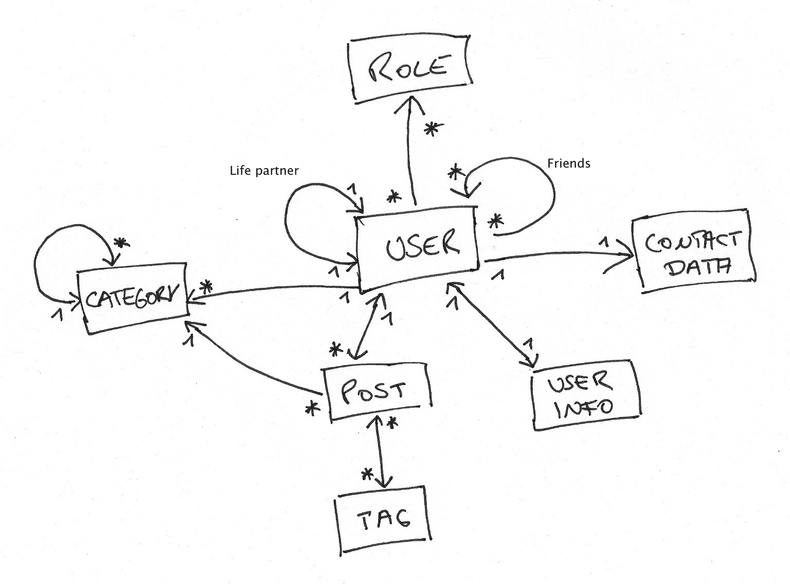

# Doctrine 2 ORM PHP 数据持久化


* * * * *


* * * * *


# 1 About this book

> “I would have written a shorter book, but I did not have the time.” freely adapted from Blaise Pascal (French mathematician, logician, physicist and theologian.)

## 1.1 Software version

This book is based on Doctrine 2.3, however, most of its content will still be valid for later versions.

## 1.2 Database system

All examples in this book are based on [MySQL](http://www.mysql.com). However, Doctrine 2 supports other DBMS such as [PostgreSQL](http://www.postgresql.org/) or [SQLite](http://www.sqlite.org/). Most examples will work with other DBMS right away, some may need to be adopted.

## 1.3 Code downloads

Most of the code shown in this book can be found in a [public repository GitHub](https://github.com/michael-romer/doctrine2buch). While the code of chapter 3 (“A self-made ORM”) can be found on the [master branch](https://github.com/michael-romer/doctrine2buch), there is [another branch available called “doctrine”](https://github.com/michael-romer/doctrine2buch/tree/doctrine), which holds the modifications made in chapter 4 (“Hello, Doctrine 2!”). There is a third [branch called “application”](https://github.com/michael-romer/doctrine2buch/tree/application) holding the modifications made in the later chapters. As the demo application grows throughout the book, the “application branch” also includes a basic MVC-framework called [Slim](http://www.slimframework.com/) to better structure the application’s code as well as [Twitter’s Bootstrap](http://getbootstrap.com) for some basic UI styling.


## 1.4 本书使用的约定

代码清单会高亮显示并带有行号。以 `$` 符号开头的清单代表命令行，以 `>` 符号开头的行代表命令输出。新术语在首次出现时使用 *斜体* 表示。

## 1.5 给亚马逊客户的重要通知

如果您在亚马逊购买了本书，目前要确保自动收到所有更新会有些困难。为避免问题，请发送一封简短的邮件，主题行写上“Updates Doctrine 2 book”，发送至 mail@michael-romer.de。这样一来，您可以确保始终拥有本书的最新版本。作为对您努力的感谢，您还将额外获得本书的 PDF 和 EPUB 版本。

## 2 简介

### 2.1 面向对象编程（OOP）与领域模型

如今，PHP 开发者大多以面向对象的方式思考和编码。应用程序功能是使用类、对象、方法、继承以及其他面向对象技术构建的。起初，OOP 主要用于应用程序的一般技术方面，例如 MVC 框架或日志和邮件库。所有这些组件或多或少都可以“原样”用于所有应用程序，无论应用程序处于什么领域：电子商务、门户或社区网站。对于复杂系统，以及当可维护性和可扩展性等方面很重要时，在领域特定代码中使用 OOP 也是一种优势。主要来说，每个应用程序都由两种不同类型的代码组成：一般技术代码和领域特定代码。一般技术代码通常作为库或框架构建时是可重用的，而领域特定代码通常过于定制，无法重用。

面向对象的领域特定代码的特征在于存在所谓的 *领域模型*。领域模型主要意味着：

*   类和对象代表领域的主要概念，即所谓的 *实体*（严格来说，这些元素也可以是 *值对象*，但与实体相比，值对象没有持久标识）。在在线商店中，主要元素将是“客户”、“订单”、“产品”、“购物车”等等。

*   领域特定的类和对象之间可能存在关联。同样，在在线商店中，“订单”通常至少引用一个“客户”，以及一个或多个引用所订购的“产品”。

*   领域特定的函数作为实体的一部分实现。在在线商店中，“购物车”通常有一个 `calculateTotalPrice()` 方法，用于根据购物车中的商品及其数量计算最终价格。

*   跨越多个实体的函数通常在所谓的 *服务* 中实现，仅仅是因为它们无法明确分配给单个实体。同样，在在线商店中，“结账”服务可能负责降低库存、开票、更新订单历史等。该服务一次处理多个不同的实体。

*   尽可能使用领域特定对象，而不是通用数据容器，如 PHP 数组（这里例外证明规则）。

*   尽可能在应用程序的领域对象中实现业务逻辑（如业务规则），而不是在例如控制器中（控制器用于基于 MVC 的框架中处理用户输入）。

领域模型的主要优势在于将领域特定代码集中在定义的类和对象中，支持维护和更改。在更改或扩展代码时，意外破坏功能的可能性会降低。通过将领域特定代码与一般技术代码隔离，支持可移植性。例如，在从一个应用程序框架迁移到另一个框架时，这很有帮助。

除了上述优势，领域模型还支持团队合作。通常，在构建和推出新软件产品时，除了程序员，业务和营销人员也会参与其中。领域模型可以通过统一使用的术语，弥合业务与 IT 之间的思维差距。仅凭这一点，领域模型就无价之宝。

### 2.2 演示应用程序

具体示例能让事物更容易理解。在本书中，名为“Talking”的演示应用程序将帮助将理论付诸实践。Talking 是一个（简单的）Web 应用程序，允许用户在线发布内容。该应用程序的领域模型如下：



Demo application “Talking” - Domain Model

一个 `User` 可以写 `Post`s。一个 `Post` 始终只有一个作者，且两个实体互相引用。一个 `User` 可以担任一个或多个 `Role`s。一个 `User` 引用其 `Role`s，但从给定的 `Role`，无法访问该角色中的 `User`s。一个 `User` 引用 `UserInfo`，其中包含注册日期和（如果有的话）注销日期。`UserInfo` 引用回一个 `User`。一个 `User` 引用 `ContactData`，其中保存电子邮件和电话号码。`ContactData` 不引用回其 `User`。一个 `User` 可以引用另一个 `User` 作为其伴侣。如果已知，`USER` 的伴侣会引用回。一个 `User` 可以拥有无限数量的朋友。给定一个 `User`，可以识别其朋友，但没有引用回。一个 `User` 的 `Post` 可以拥有无限数量的 `Tag`s。一个 `Tag` 可以在多个 `Post`s 中重复使用。`Post` 与其 `Tag`s 之间存在双向关联。一个 `Post` 引用其 `Category`，但是，没有从 `Category` 到其 `Post`s 的引用。一个 `Category` 可以有它引用的子类别，以及（如果有的话）父 `Category`。类别是用户特定的。一个 `User` 引用其类别，但没有引用回。

领域模型的设计旨在尽可能使用多种不同的关联类型，以便我们可以在演示应用程序的范围内看到 Doctrine 2 的大部分功能。在实际应用程序中，领域模型可能看起来会有所不同。如您所见，实体之间的每个关联都不是双向的。正如我们将在本书后面看到的，这本质上是像 Doctrine 2 这样的 ORM 系统在面向对象世界中的一个特性。在关系数据库中，没有单向关联。它们在设计上始终是双向的。

## 3 自制 ORM

|  || 

#### 直接进入 Doctrine 2？

本节描述了 Doctrine 2 对应用程序开发人员为何是如此大的帮助。我们将逐步自行实现 Doctrine 2 已经自带的某些 ORM 功能。本章不是学习 Doctrine 2 所必需的，但它有助于理解为什么应该学习它。 |

| --- | --- |

### 3.1 加载实体

领域模型是一件好事。只要应用程序开发人员在其熟悉的面向对象世界中行事，在设计和实现领域模型时就没有障碍。如果涉及将领域模型的对象持久化到关系数据库，或加载和重建先前存储的对象，则会变得更加困难。例如，对象不仅仅是简单的数据结构。通过其方法，它们也具有行为。让我们考虑一下演示应用程序 Talking 的 `User` 实体定义：


## 使用 PHP 构建简单的 ORM 系统

### 用户实体类

```php
<?php
namespace Entity;

class User
{
    private $id;
    private $firstName;
    private $lastName;
    private $gender;
    private $namePrefix;

    const GENDER_MALE = 0;
    const GENDER_FEMALE = 1;

    const GENDER_MALE_DISPLAY_VALUE = "Mr.";
    const GENDER_FEMALE_DISPLAY_VALUE = "Mrs.";

    public function assembleDisplayName()
    {
        $displayName = '';

        if ($this->gender == self::GENDER_MALE) {
            $displayName .= self::GENDER_MALE_DISPLAY_VALUE;
        } else if ($this->gender == self::GENDER_FEMALE) {
            $displayName .= self::GENDER_FEMALE_DISPLAY_VALUE;
        }

        if ($this->namePrefix) {
            $displayName .= ' ' . $this->namePrefix;
        }

        $displayName .= ' ' . $this->firstName . ' ' . $this->lastName;

        return $displayName;
    }

    public function setFirstName($firstName)
    {
        $this->firstName = $firstName;
    }

    public function getFirstName()
    {
        return $this->firstName;
    }

    public function setGender($gender)
    {
        $this->gender = $gender;
    }

    public function getGender()
    {
        return $this->gender;
    }

    public function setId($id)
    {
        $this->id = $id;
    }

    public function getId()
    {
        return $this->id;
    }

    public function setLastName($lastName)
    {
        $this->lastName = $lastName;
    }

    public function getLastName()
    {
        return $this->lastName;
    }

    public function setNamePrefix($namePrefix)
    {
        $this->namePrefix = $namePrefix;
    }

    public function getNamePrefix()
    {
        return $this->namePrefix;
    }
}
```

**Listing 1.1**

这里有趣的是方法 `assembleDisplayName()`。它根据用户的数据为用户创建“显示名称”。显示名称用于打印帖子的作者。代码

```php
<?php
include('../entity/User.php');

$user = new Entity\User();
$user->setFirstName('Max');
$user->setLastName('Mustermann');
$user->setGender(0);
$user->setNamePrefix('Prof. Dr');

echo $user->assembleDisplayName();
```

**Listing 1.2**

结果为

```
1 Mr. Prof. Dr. Max Mustermann
```

因此，方法 `assembleDisplayName()` 定义了 `User` 对象的特定行为。

如果用户的主数据从数据库中检索，则必须以一种方式进行转换，使上述行为附加到它上面。换句话说：从数据库中检索的用户主数据必须转换为 `User` 对象，因为在应用程序中，我们主要总是想要处理我们领域的对象，并通过简单调用其 `assembleDisplayName()` 方法来轻松创建用户的显示名称。让我们将此构建到我们的 ORM 工具中。

首先，我们设置数据库结构：

```sql
CREATE TABLE users(
	id int(10) NOT NULL auto_increment, 
	first_name varchar(50) NOT NULL,
	last_name varchar(50) NOT NULL, 
	gender ENUM('0','1') NOT NULL,
	name_prefix varchar(50) NOT NULL,
	PRIMARY KEY (id)
);
```

然后，让我们为“Max Mastermann”（顺便说一句，这是德国的“John Doe”）添加虚拟数据：

```sql
INSERT INTO users (first_name, last_name, gender, name_prefix)
VALUES('Max', 'Mustermann', '0', 'Prof. Dr.');
```

现在，如果我们想要从数据库重建 `User` 对象，可以这样做：

```php
<?php
include('../entity/User.php');

$db = new \PDO('mysql:host=localhost;dbname=app', 'root', '');
$userData = $db->query('SELECT * FROM users WHERE id = 1')->fetch();

$user = new Entity\User();
$user->setId($userData['id']);
$user->setFirstName($userData['first_name']);
$user->setLastName($userData['last_name']);
$user->setGender($userData['gender']);
$user->setNamePrefix($userData['name_prefix']);

echo $user->assembleDisplayName();
```

|  || 

#### 数据库凭据在生产系统中

在生产系统中，你使用强关键字并且不使用用户“root”，对吧？上面显示的代码只是一个示例 … |

| --- | --- |

通过这些代码行，我们开始实现自己的 ORM 系统，该系统允许通过从数据库获取数据来重建领域对象。让我们进一步改进它。

为了封装上面显示的“数据映射”，我们将代码移动到其自己的类中：

```php
<?php
namespace Mapper;

class User
{
	private $mapping = array(
		'id' => 'id',
		'firstName' => 'first_name',
		'lastName' => 'last_name',
		'gender' => 'gender',
		'namePrefix' => 'name_prefix'
	);

	public function populate($data, $user)
	{
		$mappingsFlipped = array_flip($this->mapping);

		foreach($data as $key => $value) {
			if(isset($mappingsFlipped[$key])) {
				call_user_func_array(
					array($user, 'set'. ucfirst($mappingsFlipped[$key])),
					array($value)
				);
			}
		}

		return $user;
	}
}
```

它并不完美，但能完成工作。现在，我们的调用代码看起来像这样：

```php
<?php
include_once('../entity/User.php');
include_once('../mapper/User.php');

$db = new \PDO('mysql:host=localhost;dbname=app', 'root', '');
$userData = $db->query('SELECT * FROM users WHERE id = 1')->fetch();

$user = new Entity\User();
$userMapper = new Mapper\User();
$user = $userMapper->populate($userData, $user);

echo $user->assembleDisplayName();
```

但是，我们可以通过将 SQL 语句移动到其自己的对象（即所谓的 *repository*）来使其更加简单：

```php
<?php
namespace Repository;

include_once('../entity/User.php');
include_once('../mapper/User.php');

use Mapper\User as UserMapper;
use Entity\User as UserEntity;

class User
{
	private $em;
	private $mapper;

	public function __construct($em)
	{
		$this->mapper = new UserMapper;
		$this->em = $em;
	}

	public function findOneById($id)
	{
		$userData = $this->em
			->query('SELECT * FROM users WHERE id = ' . $id)
			->fetch();
    
		return $this->mapper->populate($userData, new UserEntity());
	}
}
```

最后，我们将连接到数据库的代码移动到名为 `EntityManager` 的类中，并通过它使新的 `User` 仓库可用：

```php
<?php

include_once('../repository/User.php');

use Repository\User as UserRepository;

class EntityManager
{
	private $host;
	private $db;
	private $user;
	private $pwd;
	private $connection;
	private $userRepository;

	public function __construct($host, $db, $user, $pwd)
	{
		$this->host = $host;
		$this->user = $user;
		$this->pwd = $pwd;

		$this->connection = new \PDO(
			"mysql:host=$host;dbname=$db", 
			$user, 
			$pwd);

		$this->userRepository = null;
	}

	public function query($stmt)
	{
		return $this->connection->query($stmt);
	}

	public function getUserRepository()
	{
		if (!is_null($this->userRepository)) {
			return $this->userRepository;
		} else {
			$this->userRepository = new UserRepository($this);
			return $this->userRepository;
		}
	}
}
```

实体管理器现在充当主入口点——它打开数据库连接并使数据库查询可用于客户端代码。重构后，结果仍然保持不变：

```
1 Mr. Prof. Dr. Max Mustermann
```


我们写了一大堆代码——却只能从数据库中读取数据并将其转换为对象。我们甚至没有推进自己的应用程序。看来构建 ORM 系统既费力又耗时。而且我们才刚刚开始。让我们花更多时间来增强我们的 ORM，这样以后，我们会更加感激 Doctrine 2 的存在。

### 3.2 保存实体

到目前为止，我们实现了一个非常简单的用例：根据给定的 ID 从数据库中加载单个对象。但是写操作呢？实际上，写操作有两种类型：插入和更新。让我们先通过向 `User` 映射器添加一个 `extract()` 方法来处理插入操作：

```
 1 <?php
 2 namespace Mapper;
 3 
 4 class User
 5 {
 6 	private $mapping = array(
 7 		'id' => 'id',
 8 		'firstName' => 'first_name',
 9 		'lastName' => 'last_name',
10 		'gender' => 'gender',
11 		'namePrefix' => 'name_prefix'
12 	);
 
 14 	public function extract($user)
 15 	{
 16 		$data = array();
 
 17 		foreach($this->mapping as $keyObject => $keyColumn) {
 
 20         	if ($keyColumn != 'id') {
 21            	$data[$keyColumn] = call_user_func(
 22                	array($user, 'get'. ucfirst($keyObject))
 23            	);
 24         	}
 25     	}
 
 27     	return $data;
 28 	}
 
 30 	public function populate($data, $user)
 31 	{
 32 		$mappingsFlipped = array_flip($this->mapping);
 
 33 		foreach($data as $key => $value) {
 34 			if(isset($mappingsFlipped[$key])) {
 35 				call_user_func_array(
 36 					array($user, 'set'. ucfirst($mappingsFlipped[$key])),
 37 					array($value)
 38 				);
 39 			}
 40 		}
 
 42 		return $user;
 43 	}
 44 }
```

这就是我们从对象中提取数据的方式。实体管理器，通过一个 `saveUser()` 方法扩展，现在可以将新记录插入数据库：

```
 1 <?php
 2 
 3 include_once('../repository/User.php');
 4 include_once('../mapper/User.php');
 5 
 6 use Repository\User as UserRepository;
 7 use Mapper\User as UserMapper;
 8 
 9 class EntityManager
10 {
11 	private $host;
12 	private $db;
13 	private $user;
14 	private $pwd;
15 	private $connection;
16 	private $userRepository;
 
 18 	public function __construct($host, $db, $user, $pwd)
 19 	{
 20 		$this->host = $host;
 21 		$this->user = $user;
 22 		$this->pwd = $pwd;
 23 		
 24 		$this->connection = 
 25 			new \PDO("mysql:host=$host;dbname=$db", $user, $pwd);
 26 		
 27 		$this->userRepository = null;
 28 	}
 
 30 	public function query($stmt)
 31 	{
 32 		return $this->connection->query($stmt);
 33 	}
 
 35 	public function saveUser($user)
 36 	{
 37 		$userMapper = new UserMapper();
 38 		$data = $userMapper->extract($user);
 39 		$columnsString = implode(", ", array_keys($data));
 
 41 		$valuesString = implode(
 42 			"', 
 43 			'", 
 44 			array_map("mysql_real_escape_string", $data)
 45 		);
 
 47 		return $this->query(
 48 			"INSERT INTO users ($columnsString) VALUES('$valuesString')"
 49 		);
 50 	}
 
 52 	public function getUserRepository()
 53 	{
 54 		if (!is_null($this->userRepository)) {
 55         	return $this->userRepository;
 56 		} else {
 57 			$this->userRepository = new UserRepository($this);
 58 			return $this->userRepository;
 59 		}
 60 	}
 61 }
```

现在添加新记录的工作方式如下：

```
 1 <?php
 2 include_once('../EntityManager.php');
 3 $em = new EntityManager('localhost', 'app', 'root', '');
 4 $user = $em->getUserRepository()->findOneById(1);
 5 echo $user->assembleDisplayName() . '<br />';
 6 
 7 $newUser = new Entity\User();
 8 $newUser->setFirstName('Ute');
 9 $newUser->setLastName('Musermann');
10 $newUser->setGender(1);
11 $em->saveUser($newUser);
12 
13 echo $newUser->assembleDisplayName();
```

到目前为止，一切顺利！但是如果我们想要更新现有记录呢？如何识别我们正在处理的是新记录还是现有记录？在我们的例子中，我们可能只需检查对象是否已经为 `id` 字段赋值。它是一个“自增”字段，MySQL 会为任何新记录自动填充它。当然，这不是人们能想到的最优雅的方法。我们可以使用所谓的 `identity map`，它带来更多优势：在不再次查询数据库的情况下重新读取已加载的数据库。身份映射主要只是一个关联数组，用于根据 ID 保存对已加载实体的引用。身份映射的一个好位置是实体管理器及其 `saveUser()` 方法：

```
 1 <?php
 2 
 3 include_once('../repository/User.php');
 4 include_once('../mapper/User.php');
 5 
 6 use Repository\User as UserRepository;
 7 use Mapper\User as UserMapper;
 8 
 9 class EntityManager
10 {
11 	private $host;
12 	private $db;
13 	private $user;
14 	private $pwd;
15 	private $connection;
16 	private $userRepository;
17 	private $identityMap;
 
 19 	public function __construct($host, $db, $user, $pwd)
 20 	{
 21 		$this->host = $host;
 22 		$this->user = $user;
 23 		$this->pwd = $pwd;
 24 		
 25 		$this->connection = 
 26 			new \PDO("mysql:host=$host;dbname=$db", $user, $pwd);
 27 		
 28 		$this->userRepository = null;
 29 		$this->identityMap = array('users' => array());
 30 	}
 
 32 	public function query($stmt)
 33 	{
 34 		return $this->connection->query($stmt);
 35 	}
 
 37 	public function saveUser($user)
 38 	{
 39 		$userMapper = new UserMapper();
 40 		$data = $userMapper->extract($user);
 
 42 		$userId = call_user_func(
 43 			array($user, 'get'. ucfirst($userMapper->getIdColumn()))
 44 		);
 
 46 		if (array_key_exists($userId, $this->identityMap['users'])) {
 47         	$setString = '';
 
 49 			foreach ($data as $key => $value) {
 50 				$setString .= $key."='$value',";
 51 			}
 
 53 			return $this->query(
 54 				"UPDATE users SET " . substr($setString, 0, -1) .
 55 				" WHERE " . $userMapper->getIdColumn() . "=" . $userId
 56 			);
 
 58 		} else {
 59 			$columnsString = implode(", ", array_keys($data));
 60 			$valuesString = implode(
 61 				"', 
 62 				'", 
 63 				array_map("mysql_real_escape_string", $data)
 64 			);
 
 66 			return $this->query(
 67 				"INSERT INTO users ($columnsString) VALUES('$valuesString')"
 68 			);
 69 		}
 70 	}
 
 72 	public function getUserRepository()
 73 	{
 74 		if (!is_null($this->userRepository)) {
 75 			return $this->userRepository;
 76 		} else {
 77 			$this->userRepository = new UserRepository($this);
 78 			return $this->userRepository;
 79 		}
 80 	}
 
 82 	public function registerUserEntity($id, $user)
 83 	{
 84 		$this->identityMap['users'][$id] = $user;
 85 		return $user;
 86 	}
 87 }
```

可以看出，我们还添加了一个 `getIdColumn()` 方法。它返回“id”。现在以下代码可以正常工作：

```
1 <?php
2 include_once('../EntityManager.php');
3 $em = new EntityManager('localhost', 'app', 'root', '');
4 $user = $em->getUserRepository()->findOneById(1);
5 echo $user->assembleDisplayName() . '<br />';
6 
7 $user->setFirstname('Moritz');
8 $em->saveUser($user); 
```

实体在数据库中被更新，并且没有添加额外的记录。

### 3.3 关联

现在我们终于想要列出特定 `User` 的所有帖子。因此，我们想要简单地遍历 `User` 的 `Post`s 集合并打印每个 `Post` 的标题：

```
 1 <?php
 2 include_once('../EntityManager.php');
 3 $em = new EntityManager('localhost', 'app', 'root', '');
 4 $user = $em->getUserRepository()->findOneById(1);
 5 ?>
 6 <h1><?echo $user->assembleDisplayName(); ?></h1>
 7 <ul>
 8 <?php foreach($user->getPosts() as $post) { ?>
 9 <li><?php echo $post->getTitle(); ?></li>
10 <?php } ?>
11 </ul>
```

我们需要做什么才能实现这一点？

首先，我们创建数据结构：

```
1 CREATE TABLE posts(
2 	id int(10) NOT NULL auto_increment, 
3 	user_id int(10) NOT NULL,
4 	title varchar(255) NOT NULL, 
5 	content text NOT NULL,
6 	PRIMARY KEY (id)
7 );
```


我们添加一个测试 `User` 和一些测试 `Post`s，以便我们可以实际测试实现。接下来，我们需要扩展一大堆类。`User` 实体获得一个 `getPosts()` 方法，该方法通过相应的仓库在首次调用时加载 `User` 的 `Post`s：

```
<?php
namespace Entity;

class User
{
	// [..]

    private $postRepository;

	public function getPosts()
	{
    	if (is_null($this->posts)) {
        	$this->posts = $this->postRepository->findByUser($this);
    	}
    
    	return $this->posts;
	}

	// [..]
}
```

只有当 `User` 实体可以访问 `Post` 仓库时，这才能正常工作。为了使其可用，`User` 仓库方法 `findOneById()` 需要扩展：

```
<?php
namespace Repository;

include_once('../entity/User.php');
include_once('../mapper/User.php');

use Mapper\User as UserMapper;
use Entity\User as UserEntity;

class User
{
	private $em;
	private $mapper;

	public function __construct($em)
	{
		$this->mapper = new UserMapper;
		$this->em = $em;
	}

	public function findOneById($id)
	{
		$userData = $this->em
			->query('SELECT * FROM users WHERE id = ' . $id)
			->fetchAll();

		$newUser = new UserEntity();
		$newUser->setPostRepository($this->em->getPostRepository());

		return $this->em->registerUserEntity(
			$id,
			$this->mapper->populate($userData, $newUser)
		);
	}
}
```

实体管理器还需要扩展方法 `getPostRepository()`：

```
<?php

// [..]

class EntityManager
{
	// [..]
    
	private $postRepository;
	
	public function getPostRepository()
	{
		if (!is_null($this->postRepository)) {
			return $this->postRepository;
		} else {
			$this->postRepository = new PostRepository($this);
			return $this->postRepository;
		}
	}
}
```

现在，`Post` 实体和 `Post` 映射器必须实现：

```
<?php
namespace Entity;

class Post
{
	private $id;
	private $title;
	private $content;

	public function setContent($content)
	{
		$this->content = $content;
	}

	public function getContent()
	{
		return $this->content;
	}

	public function setId($id)
	{
		$this->id = $id;
	}

	public function getId()
	{
		return $this->id;
	}

	public function setTitle($title)
	{
		$this->title = $title;
	}

	public function getTitle()
	{
		return $this->title;
	}
}
```

这是映射器：

```
<?php
namespace Mapper;

class Post
{
	private $mapping = array(
		'id' => 'id',
		'title' => 'title',
		'content' => 'content',
	);

	public function getIdColumn()
	{
		return 'id';
	}

	public function extract($user)
	{
		$data = array();

		foreach ($this->mapping as $keyObject => $keyColumn) {
			if ($keyColumn != $this->getIdColumn()) {
				$data[$keyColumn] = call_user_func(
					array($user, 'get'. ucfirst($keyObject))
				);
			}
		}

		return $data;
	}

	public function populate($data, $user)
	{
		$mappingsFlipped = array_flip($this->mapping);

		foreach ($data as $key => $value) {
			if (isset($mappingsFlipped[$key])) {
				call_user_func_array(
					array($user, 'set'. ucfirst($mappingsFlipped[$key])),
					array($value)
				);
			}
		}

		return $user;
	}
}
```

最后，`Post` 仓库：

```
<?php
namespace Repository;

include_once('../entity/Post.php');
include_once('../mapper/Post.php');

use Mapper\Post as PostMapper;
use Entity\Post as PostEntity;

class Post
{
	private $em;
	private $mapper;

	public function __construct($em)
	{
		$this->mapper = new PostMapper;
		$this->em = $em;
	}

	public function findByUser($user)
	{
		$postsData = $this->em
			->query('SELECT * FROM posts WHERE user_id = ' . $user->getId())
			->fetchAll();

		$posts = array();

		foreach($postsData as $postData) {
			$newPost = new PostEntity();
			$posts[] = $this->mapper->populate($postData, $newPost);
		}

		return $posts;
	}
}
```

就这样！到目前为止，应用程序的文件和文件夹结构如下：

```
EntityManager.php
entity/
	Post.php
	User.php
mapper/
	Post.php
	User.php
repository/
	Post.php
	User.php
public/
	index.php
```

### 3.4 下一步

太棒了！我们构建了自己的小型 ORM 工具。然而，我们的代码已经不再那么好看了。技术代码与特定领域代码混合在一起是一个问题。我们面临问题的解决方案或多或少仅对我们的具体用例有效。而且，这里有一种“复制粘贴”的味道！事实上，已经需要进行一些重构了。

复合主键呢？添加和删除关联？多对多关联？继承、性能、缓存以及应用程序中大量缺失的核心元素的实体、映射器和仓库呢？如果数据结构发生变化会怎样？这意味着已经需要重构多个类！看起来是时候让 Doctrine 2 登场了。

## 4 Hello, Doctrine 2!

|  || 

#### 不要担心！

我们将在本章中快速浏览 Doctrine 2，但我们会在书中后面再次深入探讨它的每一个方面。 |

| --- | --- |

### 4.1 安装

安装 Doctrine 2 的最简单方法是使用“Composer”，可以从其 [Website](http://getcomposer.org/download/) 下载。phar 文件必须存储在应用程序的根目录中。然后，需要创建一个文件 `composer.json`，内容如下（可能需要调整给定的版本号）：

```
{
	"require": {
		"doctrine/orm": "2.3.1"
	}
}
```

在应用程序的根目录中执行命令

```
$ php composer.phar install
```

将 Doctrine 2 下载到子文件夹 `vendor`，并通过为其类配置自动加载使其可用于应用程序。然后只需将以下内容添加到 `index.php` 文件中：

```
<?php
// [..]
if (file_exists('vendor/autoload.php')) {
    $loader = include 'vendor/autoload.php';
}
```

完成后，所有 Doctrine 2 类都会按需自动加载。太棒了！

### 4.2 第一个实体

基于本书第一部分（我们在其中开发了自己的小型 ORM 系统），现在可以通过向 `User` 实体添加 Doctrine 2 注释来大幅简化所需代码：


```php
<?php
namespace Entity;

/**
 * @Entity
 * @Table(name="users")
 */
class User
{
	/**
	* @Id @Column(type="integer")
	* @GeneratedValue
	*/
	private $id;

	/** @Column(type="string", name="first_name", nullable=true) */
	private $firstName;

	/** @Column(type="string", name="last_name", nullable=true) */
	private $lastName;

	/** @Column(type="string", nullable=true) */
	private $gender;

	/** @Column(type="string", name="name_prefix", nullable=true) */
	private $namePrefix;

	const GENDER_MALE = 0;
	const GENDER_FEMALE = 1;

	const GENDER_MALE_DISPLAY_VALUE = "Mr.";
	const GENDER_FEMALE_DISPLAY_VALUE = "Mrs.";

	public function assembleDisplayName()
	{
		$displayName = '';

		if ($this->gender == self::GENDER_MALE) {
			$displayName .= self::GENDER_MALE_DISPLAY_VALUE;
		} elseif ($this->gender == self::GENDER_FEMALE) {
			$displayName .= self::GENDER_FEMALE_DISPLAY_VALUE;
		}

		if ($this->namePrefix) {
			$displayName .= ' ' . $this->namePrefix;
		}

		$displayName .= ' ' . $this->firstName . ' ' . $this->lastName;

		return $displayName;
	}

	public function setFirstName($firstName)
	{
		$this->firstName = $firstName;
	}

	public function getFirstName()
	{
		return $this->firstName;
	}

	public function setGender($gender)
	{
		$this->gender = $gender;
	}

	public function getGender()
	{
		return $this->gender;
	}

	public function setId($id)
	{
		$this->id = $id;
	}

	public function getId()
	{
		return $this->id;
	}

	public function setLastName($lastName)
	{
		$this->lastName = $lastName;
	}

	public function getLastName()
	{
		return $this->lastName;
	}

	public function setNamePrefix($namePrefix)
	{
		$this->namePrefix = $namePrefix;
	}

	public function getNamePrefix()
	{
		return $this->namePrefix;
	}
}
```

The code in `index.php` now can be changed to the following lines of code to read and modify entities using Doctrine 2:

```php
<?php
include '../entity/User.php';
include '../vendor/autoload.php';

use Doctrine\ORM\Tools\Setup;
use Doctrine\ORM\EntityManager;

$paths = array(__DIR__ . "/../entity/");
$isDevMode = true;

$dbParams = array(
	'driver'   => 'pdo_mysql',
	'user'     => 'root',
	'password' => '',
	'dbname'   => 'app',
);

$config = Setup::createAnnotationMetadataConfiguration($paths, $isDevMode);
$em = EntityManager::create($dbParams, $config);
$user = $em->getRepository('Entity\User')->findOneById(1);
echo $user->assembleDisplayName() . '<br />';
$user->setFirstname('Moritz');
$em->persist($user);
$em->flush();
```

That’s it! Easy!

### 4.3 第一个关联

处理关联也很简单。`User` 实体需要更改为：

```php
<?php
namespace Entity;

/**
 * @Entity
 * @Table(name="users")
 */
class User
{
	// [..]

	/**
	* @OneToMany(targetEntity="Entity\Post", mappedBy="user")
	*/
	private $posts;

	// [..]
	
	public function __construct()
	{
		$this->posts = new \Doctrine\Common\Collections\ArrayCollection();
	}
	
	// [..]
}
```

现在给 `Post` 实体添加一些更多的注解：

```php
<?php
namespace Entity;

/**
 * @Entity
 * @Table(name="posts")
 */
class Post
{
	/**
	* @Id @Column(type="integer")
	* @GeneratedValue
	*/
	private $id;

	/**
	* @ManyToOne(targetEntity="Entity\User", inversedBy="posts")
	* @JoinColumn(name="user_id", referencedColumnName="id")
	*/
	private $user;

	/** @Column(type="string") */
	private $title;

	/** @Column(type="string") */
	private $content;

	public function setUserId($user_id)
	{
		$this->user_id = $user_id;
	}

	public function getUserId()
	{
		return $this->user_id;
	}

	public function setContent($content)
	{
		$this->content = $content;
	}

	public function getContent()
	{
		return $this->content;
	}

	public function setId($id)
	{
		$this->id = $id;
	}

	public function getId()
	{
		return $this->id;
	}

	public function setTitle($title)
	{
		$this->title = $title;
	}

	public function getTitle()
	{
		return $this->title;
	}
}
```

加载 User 后，可以像往常一样遍历用户的帖子：

```php
<?php
// [..]
$user = $em->getRepository('Entity\User')->findOneById(1);
?>
<h1><?echo $user->assembleDisplayName(); ?></h1>
<ul>
	<?php foreach($user->getPosts() as $post) {?>
		<li><?php echo $post->getTitle(); ?></li>
	<?php } ?>
</ul>
```

事实上，现在引入了 Doctrine 2，我们不再需要大部分原本用于手动实现完全相同功能的代码：

```
entity/
	Post.php
	User.php
public/
	index.php
```

再简单不过了 - 感谢 Doctrine 2！在给我们的演示应用添加更多功能之前，我们现在将了解 Doctrine 2 的一些基本概念。

### 4.4 核心概念概览

在深入了解 Doctrine 2 的细节之前，让我们退一步，看看它的核心概念。

我们已经定义了实体：实体是由 Doctrine 2 管理并在数据库中持久化的具有标识的对象。实体是应用程序的领域对象。保存实体并从数据库中检索它们对应用程序至关重要。在本书中，“实体”一词有两种不同的含义：一方面，它用于单个持久化对象；另一方面，它用于作为持久化对象模板的 PHP 类。使用 Doctrine 2 的持久化对象（即实体）始终处于特定状态。该状态可以是“NEW”、“MANAGED”、“DETACHED”或“REMOVED”。我们将在本书后面了解这些内容。

实体管理器是 Doctrine 的核心对象。作为应用程序开发人员，您会频繁地与实体管理器交互。实体管理器负责持久化新实体，同时也负责更新和删除实体。仓库是通过实体管理器获取的。

简单来说，仓库是特定类型的所有实体的容器。它允许通过所谓的 `查找方法` 或 `查找器` 来查找实体。某些查找器默认可用，如果需要，也可以手动添加其他查找器。

`Doctrine 的数据库访问层 (DBAL)` 是 Doctrine 2 ORM 库的基础。它是一个独立组件，即使不使用 Doctrine 的 ORM 功能也可以使用。从技术上讲，DBAL 是 PHP PDO 扩展的封装，与单独使用 PDO 相比，它使处理数据库更加容易。不过，同样，Doctrine 2 ORM 使处理数据库比单独使用 DBAL 更加容易。

## 5 定义实体

我们已经了解将成员变量映射到数据库表中的字段是多么容易。让我们来看看这究竟是如何工作的。

### 5.1 映射格式

一般来说，映射可以使用实体内部的注解定义，也可以使用外部 XML 或 YAML 文件定义。在使用缓存时，不同映射实现方式之间的性能没有差异。因此，通常更倾向于使用注解，仅仅是因为它使编码更加容易——所有持久化元数据都位于同一文件中。在以下示例中，将专用注解。

### 5.2 将对象映射到表

首先，作为持久化对象模板的类需要获取 `Entity` 注解：

```php
<?php
/**
 * @Entity
 */
class User
{
	// [..]
}
```


简单地添加 `@Entity` 而不进行额外配置，意味着 Doctrine 2 在这种情况下会查找名为 `user` 的数据库表。如果表有其他名称，可以这样配置：

```
<?php
/**
 * @Entity
 * @Table(name="users")
 */
class User
{
	// [..]
}
```

`@Table` 注解的可选属性 `indexes` 可以用于使用 Doctrine 的架构工具自动创建索引，我们将在本书后面讨论该工具。目前，应记住此属性在运行时没有意义。某些持久化元数据仅在与“离线”工具（如架构工具）结合使用时才重要，而其他元数据则在运行时被评估。对 users 表的索引定义如下：

```
<?php
/**
 * @Entity
 * @Table(name="users",
 *	indexes={@Index(name="search_idx", columns={"name", "email"})}
 * )
 */
class User
{
	// [..]
}
```

注解 `@Table` 本身的 `indexes` 属性本身具有一个带有属性作为其值的注解。注解 `@Index` 需要属性 `name`（索引名称）和要考虑的列列表。可以使用花括号给出多个值。

另一个可选属性 `uniqueConstraints` 也适用同样的情况，它定义特殊的唯一值索引：

```
<?php
/**
 * @Entity
 * @Table(name="users",
 * 	uniqueConstraints={@UniqueConstraint(name="user_unique",
 * 		columns={"username"})}, 
 *	indexes={@Index(name="user_idx", columns={"email"})}
 * )
 */
class User 
{
	// [..] 
} 
```

### 5.3 将标量成员变量映射到字段

将标量值成员变量（例如数字或字符串）映射到数据库表非常简单：

```
<?php

// [..]

/** @Column(type="string") */
private $lastName;
```

首先，重要的是所有映射到数据库字段的成员变量都声明为 `private` 或 `protected`。Doctrine 2 经常应用一种称为“惰性加载”的技术，这意味着数据仅在需要时加载，而不是更早。为了实现这一点，Doctrine 2 实现了所谓的 `proxy objects`，它们依赖于实体的 getter 方法。因此，需要确保它们已正确设置。

这里的主要注解是 `@Column`。其属性 `type` 是唯一的强制属性，对于正确持久化非常重要。如果定义了错误的类型，可能会在保存到数据库或从数据库读取时丢失信息。此外，还有许多其他可选属性，例如 `name`，它允许配置表列名称。默认情况下，它为成员变量的名称。属性 `length` 仅用于“字符串”，它定义字符串值的最大长度。如果未另行定义，则默认为 255。如果在数据库中遇到截断的值，错误的 `length` 配置通常是根本原因。

属性 `precision` 和 `scale` 仅对类型为“decimal”的值有效，而 `unique` 确保唯一性，`nullable` 告诉 Doctrine 2 是否允许值 `NULL`（`true`）或不允许（`false`）：

```
<?php

// [..]

/**
 * @Column(type="string", 
 * 	name="last_name", length=32, unique=true, nullable=false)
 */
protected $lastName;
```

#### 5.3.1 数据类型

Doctrine 2 自带一组数据类型。它们将 PHP 数据类型映射到 SQL 数据类型。所有 Doctrine 2 数据类型都与最常见的数据库系统兼容：

*   `string`: 将 SQL VARCHAR 映射到 PHP 字符串的类型。

*   `integer`: 将 SQL INT 映射到 PHP 整数的类型。

*   `smallint`: 将数据库 SMALLINT 映射到 PHP 整数的类型。

*   `bigint`: 将数据库 BIGINT 映射到 PHP 字符串的类型。

*   `boolean`: 将 SQL 布尔值映射到 PHP 布尔值的类型。

*   `decimal`: 将 SQL DECIMAL 映射到 PHP double 的类型。

*   `date`: 将 SQL DATETIME 映射到 PHP DateTime 对象的类型。

*   `time`: 将 SQL TIME 映射到 PHP DateTime 对象的类型。

*   `datetime`: 将 SQL DATETIME/TIMESTAMP 映射到 PHP DateTime 对象的类型。

*   `text`: 将 SQL CLOB 映射到 PHP 字符串的类型。

*   `object`: 使用 `serialize()` 和 `unserialize()` 将 SQL CLOB 映射到 PHP 对象的类型。

*   `array`: 使用 `serialize()` 和 `unserialize()` 将 SQL CLOB 映射到 PHP 对象的类型。

*   `float`: 将 SQL Float（双精度）映射到 PHP double 的类型。重要：仅适用于使用小数点作为分隔符的区域设置。

|  || 

### 自定义数据类型

如果需要，可以定义自定义数据类型，即 PHP 数据类型和 SQL 数据类型之间的映射。[官方文档深入介绍了此主题。](http://docs.doctrine-project.org/en/latest/reference/basic-mapping.html#custom-mapping-types) |

| --- | --- |

#### 5.3.2 实体标识符

实体类必须定义唯一标识符。`@Id` 注解用于此目的：

```
<?php

// [..]

/**
 * @Id @Column(type="integer")
 */
private $id;
```

如果同时使用 `@GeneratedValue` 注解，则唯一标识符不需要由应用程序开发人员提供，而是由数据库系统自动分配。此值的生成方式取决于定义的“策略”。默认情况下，Doctrine 2 会自行确定最佳方法。例如，使用 MySQL 时，Doctrine 2 使用 `auto_increment` 函数。还有其他可用的策略，但它们主要不支持跨平台，因此应避免使用。

顺便说一句：`@Id` 注解可以与多个成员变量一起用于定义复合键。显然，在这种情况下无法再使用 `@GeneratedValue` 注解。在这种情况下，应用程序开发人员需要负责分配唯一键。

### 5.4 继承

Doctrine 2 支持使用三种不同的策略持久化遗传结构：

*   单表继承

*   类表继承

*   映射超类

#### 5.4.1 单表继承

`单表继承` 策略使用一个带有所谓“鉴别列”的单个数据库表来区分不同的类型。层次结构中的所有类都进入同一个表。假设我们的演示应用程序区分不同类型的帖子。支持的类型有：

*   `Post`: 简单的基于文本的帖子。

*   `ImagePost`: 带有文本和图像的帖子。

*   `VideoPost`: 带有文本和视频的帖子。

`ImagePost` 和 `VideoPost` 都扩展 `Post` 并添加图像或视频 URL。要设置此层次结构，最顶层的 `Post` 类包含所需的配置以及三种类型共享的所有成员变量和关联：

```
<?php
namespace Entity;

/**
 * @Entity(repositoryClass="Repository\Post")
 * @Table(name="posts")
 * @InheritanceType("SINGLE_TABLE")
 * @DiscriminatorColumn(name="discr", type="string")
 * @DiscriminatorMap({"text"="Post","video"="VideoPost","image"= "ImagePost"})
 */
class Post
{
	// member variables and associations shared between all types
}
```

由于 `Post` 本身可以是一个实体，它具有典型的实体相关注解。此外，通过 `@InheritanceType` 注解，它配置单表继承。`@DiscriminatorColumn` 注解用于标记指示持久化类型的列。最后，通过 `@DiscriminatorMap`，定义了可以出现在鉴别列中的值。在我们的情况中，如果实体是 `Post`，Doctrine 2 将“text”写入鉴别列。如果实体是 `VideoPost`，Doctrine 2 写入“video”，如果实体是 `ImagePost`，则使用的值是“image”。

`ImagePost` 本身很简单：


```php
<?php
namespace Entity;

/**
 * @Entity
 */
class ImagePost extends Post
{
	/** @Column(type="string") */
	protected $imageUrl;

	/**
	 * @param mixed $imageUrl
	 */
	public function setImageUrl($imageUrl)
	{
		$this->imageUrl = $imageUrl;
	}

	/**
	 * @return mixed
	 */
	public function getImageUrl()
	{
		return $this->imageUrl;
	}
}
```

同样的情况也适用于 `VideoPost`：

```php
<?php
namespace Entity;

/**
 * @Entity
 */
class VideoPost extends Post
{
	/** @Column(type="string") */
	protected $videoUrl;

	/**
	 * @param mixed $videoUrl
	 */
	public function setVideoUrl($videoUrl)
	{
		$this->videoUrl = $videoUrl;
	}

	/**
	 * @return mixed
	 */
	public function getVideoUrl()
	{
		return $this->videoUrl;
	}
}
```

Doctrine 2 使用的数据结构如下所示：

| Col | Type | Length | NULL? | KEY | Extras |
| --- | --- | --- | --- | --- | --- |
| id | INT | 11 | | PRI | auto\_increment |
| user\_id | INT | 11 | YES | MUL | |
| category\_id | INT | 11 | YES | MUL | |
| title | VARCHAR | 255 | | | |
| content | LONGTEXT | | | | |
| discr | VARCHAR | 255 | | | |
| videoUrl | VARCHAR | 255 | YES | | |
| imageUrl | VARCHAR | 255 | YES | | |

现在，所有三种类型的实体都可以轻松地被持久化。这种方法的缺点是，取决于层次结构的复杂程度以及涉及的类型之间的差异程度，表格会不断增长，其中包含许多特定类型永远不会使用的字段。在我们的例子中，`videoUrl` 永远不会被 `ImagePost` 类型的实体使用。`imageUrl` 不会被 `VideoPost` 实体使用，而对于 `Post` 实体来说，这两个字段都将保持空白。

这种方法的优点是，由于其本质，这种策略允许在层次结构中的所有类型之间进行非常高效的排队，而无需任何连接。

#### 5.4.2 类表继承

虽然单表继承为所有类型只使用一个表，但 *类表继承* 是一种不同的方法，其中层次结构中的每个类都映射到多个表。虽然这无疑提供了最佳的灵活性，但这也意味着重建实体将需要在数据库中进行连接。由于连接是昂贵的操作，通常，类表继承的性能不如单表继承。

配置的主要区别在于 `Post`：

```php
<?php
namespace Entity;

/**
 * @Entity(repositoryClass="Repository\Post")
 * @Table(name="posts")
 * @InheritanceType("JOINED")
 * @DiscriminatorColumn(name="discr", type="string")
 * @DiscriminatorMap({"text"="Post","video"="VideoPost","image"= "ImagePost"})
 */
class Post
{
	// member variables and associations shared between all types
}
```

现在不再使用继承类型“SINGLE\_TABLE”，而是使用“JOINED”。这告诉 Doctrine 2 应用类表继承策略。由于将为每个类型使用表，因此为子类配置表名可能很有用：

```php
<?php
namespace Entity;

/**
 * @Entity
 * @Table(name="posts_image")
 */
class ImagePost extends Post
{
	/** @Column(type="string") */
	protected $imageUrl;

	/**
	 * @param mixed $imageUrl
	 */
	public function setImageUrl($imageUrl)
	{
		$this->imageUrl = $imageUrl;
	}

	/**
	 * @return mixed
	 */
	public function getImageUrl()
	{
		return $this->imageUrl;
	}
}
```

表名 `posts_image` 对于 `ImagesPost` 实体很有用。我们也为 `VideoPost` 实体添加了相同风格的配置：

```php
<?php
namespace Entity;

/**
 * @Entity
 * @Table(name="posts_video")	
 */
class VideoPost extends Post
{
	/** @Column(type="string") */
	protected $videoUrl;

	/**
	 * @param mixed $videoUrl
	 */
	public function setVideoUrl($videoUrl)
	{
		$this->videoUrl = $videoUrl;
	}

	/**
	 * @return mixed
	 */
	public function getVideoUrl()
	{
		return $this->videoUrl;
	}
}
```

当让 Doctrine 2 创建数据库架构时，我们将为这个层次结构得到三个表，而 `posts` 表保存主要信息：

| Col | Type | Length | NULL? | KEY | Extras |
| --- | --- | --- | --- | --- | --- |
| id | INT | 11 | | PRI | auto\_increment |
| user\_id | INT | 11 | YES | MUL | |
| category\_id | INT | 11 | YES | MUL | |
| title | VARCHAR | 255 | | | |
| content | LONGTEXT | | | | |
| discr | VARCHAR | 255 | | | |

`posts_video` 表仅保存该类型的特定信息：

| Col | Type | Length | NULL? | KEY | Extras |
| --- | --- | --- | --- | --- | --- |
| id | INT | 11 | | PRI | |
| videoUrl | VARCHAR | 255 | YES | | |

`posts_image` 也是如此：

| Col | Type | Length | NULL? | KEY | Extras |
| --- | --- | --- | --- | --- | --- |
| id | INT | 11 | | PRI | |
| imageUrl | VARCHAR | 255 | YES | | |

通过评估外键引用，可以通过表连接重建 `ImagePost` 和 `VideoPost` 类型的实体。

#### 5.4.3 映射超类

最后，可以使用 *映射超类* 策略。与我们已经讨论的另外两种策略的主要区别在于，超类本身不能是实体。以上面的例子为例，这意味着类 `Post` 本身不能是实体。它只是将成员变量和关联继承给其子类。

要配置映射超类策略，需要将 `@MappedSuperclass` 注释添加到 `Post` 类：

```php
<?php
namespace Entity;

/** @MappedSuperclass */
class Post
{
	// member variables and associations shared between all types
}
```

两个子类 `ImagePost` 和 `VideoPost` 不需要更改。但是，应用映射超类策略后，我们无法再持久化 `Post` 类型的对象，这些对象主要由文本组成。我们可以通过添加另一个名为 `TextPost` 的新类型来解决这个问题：

```php
<?php
namespace Entity;

/**
 * @Entity
 * @Table(name="posts_text")	
 */
class TextPost extends Post
{
	/**
	 * @Id @Column(type="integer")
	 * @GeneratedValue
	 */
	protected $id;

} 
```

现在我们有三个具体的实体类型和一个不是实体的超类。这会导致数据库中有三个表：`posts_text`、`posts_images` 和 `posts_video`。

如上所示，重要的是每个实体都有其 ID 列指定，而映射超类没有。它只继承成员变量和关联，但不继承 ID 列定义。

当像上面所示继承属性或关联时，可能希望覆盖某些定义。

假设我们不想在 `VideoPost` 中谈论 `content`，而是称其为 `closed_caption`。这需要以下配置：

```php
<?php
namespace Entity;

/**
 * @Entity
 * @Table(name="posts_video")
 * @AttributeOverrides({
 *     @AttributeOverride(name="content",
 *         column=@Column(
 *             name = "closed_caption",
 *             type = "text"
 *         )
 *     )
 * })
 */
class VideoPost extends Post
{
	// [..]
}
```

虽然 Doctrine 2 要求成员变量必须是 `private` 或 `protected`，但重要的是要记住，这里成员变量需要是 `protected`。否则它们将在子类中不可用。像上面所示那样将属性 `content` 覆盖为 `closed_caption`，这会导致该类型实体的数据库中有一个 `closed_caption` 列。


另外，类型为 `VideoPost` 的实体并未按名为“频道”的分类进行组织。我们可以像下面这样覆盖关联：

```
<?php
namespace Entity;

/**
 * @Entity
 * @Table(name="posts_video")
 * @AssociationOverrides({
 *     @AssociationOverride(name="category",
 *         joinColumns=@JoinColumn(
 *              name="channel_id", referencedColumnName="id"
 *         )
 *     )
 * })
 */
class VideoPost extends Post
{
	// [..]
}
```

## 6 实体之间的引用

实体通常是更大、相互关联的对象图的一部分。它们持有对其他实体的引用。一个 `User` 持有其 `Post`s 的引用，而一个 `Post` 引用一个 `Category`，该 `Category` 又引用回设置该 `Category` 的 `User`，以此类推。正如我们将在下文中看到，建立实体之间连接的方式有很多种。连接由它们连接的项目数量以及关联的方向来表征。让我们来看看！

### 演示应用 Talking 的领域模型

下面的代码示例与本书前面介绍的演示应用的领域模型相关。领域模型的图示在本章中可能作为参考很有帮助。

### 6.1 单向一对一关系

与数据库中外键关系不同，数据库中两张表总是双向连接，但对象并非如此。因此，Doctrine 2 在对象之间区分单向关联和双向关联。单向意味着一个对象指向另一个对象，但后者没有指回的指针。

要在两个实体之间建立这种类型的关系，只需选择一个作为指针的成员变量即可：

```
<?php
namespace Entity;

/**
 * @Entity
 * @Table(name="users")
 */
class User
{
	// [..]

	/**
	* @OneToOne(targetEntity="Entity\ContactData")
	*/
	private $contactData;
	
	// [..]
}
```

`@OneToOne` 注解定义了关系的类型——一对一关系。`targetEntity` 属性定义了指针引用的实体类。使用 `targetEntity` 属性给出的类需要完全限定，包括命名空间（如果适用）。无论如何，都不能添加前导反斜杠。

现在，只要事先添加了 getter 方法，就可以通过加载的 `User` 访问引用的实体（`ContactData`）：

```
<?php
var_dump($user->getContactData());
```

然而，上面所示的简单持久化配置之所以有效，仅仅是因为 `ContactData` 有一个名为 `id` 的成员变量：

```
<?php
namespace Entity;

/**
 * @Entity
 * @Table(name="contact_data")
 */
class ContactData
{
	/**
	* @Id @Column(type="integer")
	* @GeneratedValue
	*/
	private $id;
	
	// [..]
}
```

如果成员变量的名称不同，例如 `contactDataId` 或类似名称，则需要告诉 Doctrine 2：

```
<?php
namespace Entity;

/**
 * @Entity
 * @Table(name="users")
 */
class User
{
	// [..]

	/**
	* @OneToOne(targetEntity="Entity\ContactData")
	* @JoinColumn(name="id", referencedColumnName="contactDataId")
	*/
	private $contactData;
	
	// [..]
}
```

本书后面我们将了解更多关于 `@JoinColumn` 注解的细节。

加载 `User` 及其 `ContactData`（如上所示）只有在数据库中的数据结构也事先设置好（除了 PHP 类和持久化配置之外）时才能工作。如果不这样做，这一切都不会工作，Doctrine 2 会报告错误。根据情况，以下之一将为真：

* 我们有一个在数据库中给定的现有数据结构，并将持久化配置调整为适应它。

* 我们没有给定的现有数据结构，且持久化配置没有外部限制。在这种情况下，Doctrine 2 的 `schema tool` 甚至可以仅根据持久化配置在数据库中创建数据结构。关于如何在数据库中自动创建数据结构的更多信息，可以在本书后面的章节“Doctrine 2 on the command line”中找到。

无论如何，重要的是数据结构和 Doctrine 2 持久化映射必须匹配。如果不匹配，肯定会遇到麻烦。schema tool 也可以用来验证数据结构和持久化映射是否匹配。

在下文中，让我们假设我们总是使用 schema tool 为演示应用程序创建数据结构。在这种情况下，调用适当的 schema tool 命令后，将创建表 `users`：

| Col | Type | Length | NULL? | KEY | Extras |
| --- | --- | --- | --- | --- | --- |
| id | INT | 11 | | PRI | auto_increment |
| first_name | VARCHAR | 255 | Y | | |
| last_name | VARCHAR | 255 | Y | | |
| gender | INT | 11 | Y | | |
| name_prefix | VARCHAR | 255 | Y | | |
| contactData_id | INT | 11 | Y | UNI | |

创建的表 `contact_data` 如下所示：

| Col | Type | Length | NULL? | KEY | Extras |
| --- | --- | --- | --- | --- | --- |
| id | INT | 11 | | PRI | |
| email | VARCHAR | 255 | Y | | |
| phone | VARCHAR | 255 | Y | | |

### 6.2 双向一对一关系

与单向一对一关系相反，双向一对一关系存在两个指针：一个从对象 A 指向对象 B，另一个从对象 B 指向对象 A。这里要谈论两个独立的指针很重要，我们马上就会看到。让我们再拿一个 `User` 实体，它引用一个 `UserInfo` 实体：

```
<?php
namespace Entity;

/**
 * @Entity
 * @Table(name="users")
 */
class User
{
	// [..]

	/**
	* @OneToOne(targetEntity="Entity\UserInfo")
	*/
	private $userInfo;

	// [..]
}
```

如果我们现在希望 `UserInfo` 实体指回 `User` 实体，则需要通过添加 `inversedBy="user"` 来扩展 `User` 实体的配置：

```
<?php
namespace Entity;

/**
 * @Entity
 * @Table(name="users")
 */
class User
{
	// [..]

	/**
	* @OneToOne(targetEntity="Entity\UserInfo", inversedBy="user")
	*/
	private $userInfo;

	// [..]
}
```

我们配置了 `UserInfo` 实体有一个名为 `$user` 的指针指向 `UserInfo` 实体。`UserInfo` 实体本身如下所示：

```
<?php
namespace Entity;

/**
 * @Entity
 * @Table(name="user_info")
 */
class UserInfo
{
	/**
	* @Id @Column(type="integer")
	* @GeneratedValue
	*/
	private $id;

	/** @Column(type="datetime", nullable=true) */
	private $signUpDate;

	/** @Column(type="datetime", nullable=true) */
	private $signOffDate = null;

	/**
	* @OneToOne(targetEntity="Entity\User", mappedBy="userInfo")
	*/
	private $user;

	public function setId($id)
	{
		$this->id = $id;
	}

	public function getId()
	{
		return $this->id;
	}

	public function setSignOffDate($signOffDate)
	{
		$this->signOffDate = $signOffDate;
	}

	public function getSignOffDate()
	{
		return $this->signOffDate;
	}

	public function setSignUpDate($signUpDate)
	{
		$this->signUpDate = $signUpDate;
	}

	public function getSignUpDate()
	{
		return $this->signUpDate;
	}

	public function setUser($user)
	{
		$this->user = $user;
	}

	public function getUser()
	{
		return $this->user;
	}
}


在 `UserInfo` 实体中，我们通过 `targetEntity="Entity\User"` 定义目标实体类，并通过添加 `mappedBy="contactData"` 让 Doctrine 2 知道 `User` 实体通过 `contactData` 反向引用。

到目前为止，一切顺利！我们刚刚在两个实体之间建立了双向连接。现在让我们来讨论 `inversedBy` 和 `mappedBy` 配置。

假设存在一个 `User` 实体和一个 `UserInfo` 实体，两者相互关联并以双向方式指向对方：`$userInfo` 指向一个 `UserInfo` 实例，`$user` 指向一个 `User` 实例。如果我们现在想要断开两者的连接，则需要移除这两个指针：

```
<?php
// [..]
$user = $em->getRepository('Entity\User')->findOneById($id);
$user->getUserInfo()->setUser(null);
$user->setUserInfo(null);
$em->flush();
```

但是，如果我们只移除了两个指针中的一个呢？实际上，这会导致不一致。哪个引用告诉 Doctrine 2 关于这两个对象及其关联的真相？一个实体说“是的，我们已连接”，另一个实体说“不，我们根本没有连接”。请记住，这个问题只存在于面向对象的世界中，不存在于关系型数据库宇宙中。在关系型数据库中，引用始终是双向的。不存在单向关系的概念。回到不一致性问题：在处理持久化时，Doctrine 2 应该听从哪个实体？解决方案如下：存疑时，Doctrine 2 会听取携带 `inversedBy` 属性的实体。这意味着以下代码不会移除两个实体之间的关联：

```
<?php
// [..]
$user = $em->getRepository('Entity\User')->findOneById($id);
$user->getUserInfo()->setUser(null);
$em->flush();
```

相反，以下代码会移除关联：

```
<?php
// [..]
$user = $em->getRepository('Entity\User')->findOneById($id);
$user->setUserInfo(null);
$em->flush();
```

原因是 `User` 实体具有 `inversedBy` 属性，并充当所谓的 `owning side`（拥有方）。拥有方是 Doctrine 2 在确定连接是否存在时所监听的一方。另一方，即所谓的 `inverse side`（反向方）在这里无关紧要。Doctrine 2 不关心反向方的说法。

但是，即使我们正确地从拥有方切断了两者之间的连接，此更改只有在执行 flush 后才会持久化：

```
<?php
use Doctrine\ORM\EntityManager;
// [..]
$em = EntityManager::create($dbParams, $config);
$em->flush();
```

只要没有执行 flush，运行中的程序中仍然存在不一致：

```
<?php
$user = $em->getRepository('Entity\User')->findOneById($id);
$userInfo = $user->getUserInfo();
$user->setUserInfo(null);
var_dump($user->getUserInfo()); // NULL
var_dump($userInfo->getUser()); // object(Entity\User)
$em->flush();
var_dump($user->getUserInfo()); // NULL
var_dump($userInfo->getUser()); // NULL
```

只有在执行 `$em->flush()` 之后，`var_dump($userInfo->getUser())` 才会最终返回 `NULL`。在此之前，它仍然返回引用的对象。在某些情况下，这种情况可能导致难以调试的问题。这里的一个好建议是，始终确保同时移除两个引用，以便即使运行中的程序也能保持完整：

```
<?php
namespace Entity;

/**
 * @Entity
 * @Table(name="users")
 */
class User
{
	// [..]

	public function removeUserInfo()
	{
		$this->userInfo->setUser(null);
		$this->userInfo = null;
	}	
}
```

以下代码现在始终处于一致状态：

```
<?php
$user = $em->getRepository('Entity\User')->findOneById($id);
$userInfo = $user->getUserInfo();
$user->removeUserInfo();
var_dump($user->getUserInfo()); // NULL
var_dump($userInfo->getUser()); // NULL
$em->flush();
var_dump($user->getUserInfo()); // NULL
var_dump($userInfo->getUser()); // NULL
```

作为最佳实践，应该始终在拥有方上添加支持持久化的方法。

让我们回顾一下：双向关系始终有一个拥有方和一个反向方。单向关系只有一个拥有方，而且不需要显式声明。关于关联，只有对拥有方的更改与持久化相关。Doctrine 2 在此问题上不关心反向方。被声明为拥有方的实体的数据库表持有外键。连接的哪一方被定义为拥有方，由应用程序开发者决定。

给定双向关联，拥有方可以通过识别 `inversedBy` 属性来确定，而反向方则携带 `mappedBy` 属性。

### 6.3 一对多关系，双向

在“Hello, Doctrine 2！”章节中，我们在演示应用中为 `User` 及其 `Post`s 添加了一个双向的一对多关系。再次，让我们仔细看看我们是如何实现的。`User` 实体有一个名为 `$posts` 的成员变量：

```
<?php
namespace Entity;

/**
 * @Entity
 * @Table(name="users")
 */
class User
{
	/**
	* @OneToMany(targetEntity="Entity\Post", mappedBy="user")
	*/
	private $posts;
	
	// [..]
}
```

`@OneToMany` 注解定义了与 `Post` 实体（`targetEntity`）的一对多关系。由于给出了 `mappedBy` 属性，这是一个双向关系。`Post` 实体如下所示：

```
<?php
namespace Entity;

/**
 * @Entity
 * @Table(name="posts")
 */
class Post
{
	/**
	* @ManyToOne(targetEntity="Entity\User", inversedBy="posts")
	*/
	private $user;
	
	// [..]
}
```

在这里我们找到了对应的注解 `@ManyToOne`。在一对一关系中，应用程序开发者可以自由决定哪一方声明为拥有方。但这里不是这种情况。携带 `@ManyToOne` 注解的实体必须成为拥有方并获取 `inversedBy` 属性。

如果再次使用架构工具根据持久化配置创建数据结构，将设置以下表：

| Col | Type | Length | NULL? | KEY | Extras |
| --- | --- | --- | --- | --- | --- |
| id | INT | 11 | | PRI | auto_increment |
| first_name | VARCHAR | 255 | Y | | |
| last_name | VARCHAR | 255 | Y | | |
| gender | INT | 11 | Y | | |
| name_prefix | VARCHAR | 255 | Y | | |
| contactData_id | INT | 11 | Y | UNI | |
| userInfo_id | INT | 11 | Y | UNI | |

表 `user_info` 如下所示：

| Col | Type | Length | NULL? | KEY | Extras |
| --- | --- | --- | --- | --- | --- |
| id | INT | 11 | | PRI | |
| user_id | INT | 11 | | MUL | |
| title | VARCHAR | 255 | | | |
| content | VARCHAR | 255 | | | |

如我们所见，表 `user_info` 持有外键，该外键可能出现多次。从给定的 `User` 实体访问 `User` 的 `Post`s 时，Doctrine 使用 `Doctrine\ORM\PersistentCollection` 来提供引用的 `Post` 实体。它扩展了其他类，例如 `\Countable`、`\IteratorAggregate` 和 `\ArrayAccess`，这使得 `Doctrine\ORM\PersistentCollection` 非常类似于常规 PHP 数组，这意味着它可以轻松地在 PHP foreach 循环中使用。

只要引用的 `Post`s 至少被访问一次，成员变量 `$user` 的值就是 `null`，而不是已分配的 `Doctrine\ORM\PersistentCollection` 类的对象。如果在 Doctrine 2 设置之前想要使用集合，这可能是一个问题。因此，作为最佳实践，持有持久化关联的成员变量应始终初始化：


### 6.4 多对多关系，单向

在我们的演示应用中，一个 `User` 可能拥有不同的 `Role`s，并拥有不同的访问权限。让我们区分基础用户、专业用户和管理员。拥有基础 `Role` 的 `User` 可以读取 `Post`s，但不能写入 `Post`s。专业用户也可以写入 `Post`s。管理员可以管理整个应用程序和各种设置。我们设计关系的方式是，从给定的 `User` 实体，我们可以访问 `User` 的 `Role`s，但不能反过来。为此，我们只需添加以下持久化配置：

```php
<?php
namespace Entity;

/**
 * @Entity
 * @Table(name="users")
 */
class User
{
	// [..]
	
	/**
	* @ManyToMany(targetEntity="Entity\Role")
	**/
	private $roles;
	
	// [..]
}
```

`Role` 实体的定义也很简单：

```php
<?php
namespace Entity;

/**
 * @Entity
 * @Table(name="role")
 */
class Role
{
	/**
	* @Id @Column(type="integer")
	* @GeneratedValue
	*/
	private $id;

	/** @Column(type="string") */
	private $label;

	public function setId($id)
	{
		$this->id = $id;
	}

	public function getId()
	{
		return $this->id;
	}

	public function setLabel($label)
	{
		$this->label = $label;
	}

	public function getLabel()
	{
		return $this->label;
	}
}
```

运行架构工具在数据库中创建数据结构后，我们现在有一个名为 `role` 的新表：

| Col | Type | Length | NULL? | KEY | Extras |
| --- | --- | --- | --- | --- | --- |
| id | INT | 11 | | PRI | auto_increment |
| label | VARCHAR | 255 | | | |

此外，我们发现一个名为 `user_role` 的表，允许持久化多对多引用：

| Col | Type | Length | NULL? | KEY | Extras |
| --- | --- | --- | --- | --- | --- |
| user_id | INT | 11 | | MUL | |
| role_id | INT | 11 | | MUL | |

上述连接表看起来是这样的原因是 Doctrine 2 为 `@JoinTable` 注解应用了默认配置，而该注解在我们的代码中未给出，但 Doctrine 2 会隐式考虑它。如果需要，我们的连接表可以定义得不同，例如，如果需要使用数据库中现有的数据结构：

```php
<?php
namespace Entity;

/**
 * @Entity
 * @Table(name="users")
 */
class User
{
	// [..]
	
	/**
	* @ManyToMany(targetEntity="Entity\Role")
	* @JoinTable(name="users_roles",
	*      joinColumns={@JoinColumn(name="user", referencedColumnName="id")},
	*      inverseJoinColumns={@JoinColumn(name="role",
	*			referencedColumnName="id")
	*		}
	* )
	**/
	private $roles;
	
	// [..]
}
```

持久化配置现在看起来复杂得多，并告诉 Doctrine 处理一个看起来像这样的连接表：

| Col | Type | Length | NULL? | KEY | Extras |
| --- | --- | --- | --- | --- | --- |
| user | INT | 11 | | MUL | |
| role | INT | 11 | | MUL | |

`@JoinTable` 注解有一个名为 `name` 的属性来定义连接表名称，以及 `joinColumns` 和 `inverseJoinColumns` 属性，这两个属性都利用另一个名为 `@JoinColumn` 的注解来映射各个列。

### 6.5 多对多关系，双向

`Post` 的作者（一个 `User`）应该能够分配一个或多个 `Tag`s。一个 `Tag` 本身可以在不同的 `Post`s 中重复使用。与 `User` 和其 `Role`s 之间的关系不同，我们将关联设计为双向。首先，让我们设置新的 `Tag` 实体：

```php
<?php
namespace Entity;

/**
 * @Entity
 * @Table(name="tag")
 */
class Tag
{
	/**
	* @Id @Column(type="integer")
	* @GeneratedValue
	*/
	private $id;

	/** @Column(type="string") */
	private $label;
	
	/**
	* @ManyToMany(targetEntity="Entity\Post", mappedBy="tags")
	*/
	private $posts;

	public function __construct()
	{
		$this->posts = new \Doctrine\Common\Collections\ArrayCollection();
	}

	public function setId($id)
	{
		$this->id = $id;
	}

	public function getId()
	{
		return $this->id;
	}

	public function setLabel($label)
	{
		$this->label = $label;
	}

	public function getLabel()
	{
		return $this->label;
	}
	
	public function setPosts($posts)
	{
		$this->posts = $posts;
	}

	public function getPosts()
	{
		return $this->posts;
	}
}
```

`Post` 实体也需要通过一个新的成员变量进行扩展：

```php
<?php
namespace Entity;

/**
 * @Entity
 * @Table(name="posts")
 */
class Post
{
	// [..]

	/**
	* @ManyToMany(targetEntity="Entity\Tag", inversedBy="posts")
	*/
	private $tags;

	public function __construct()
	{
		$this->tags = new \Doctrine\Common\Collections\ArrayCollection();
	}

	// [..]
}
```

在设置多对多关系时，可以自由选择拥有方。

如果我们运行适当的命令，架构工具再次为我们创建连接表 `post_tag`：

| Col | Type | Length | NULL? | KEY | Extras |
| --- | --- | --- | --- | --- | --- |
| post_id | INT | 11 | | MUL | |
| tag_id | INT | 11 | | MUL | |

这里同样应用了默认值。如果需要，可以使用 `@JoinTable` 注解来更改表及其列的标签。

### 6.6 一对多关系，单向

一个 `User` 可以为其 `Post`s 设置多个 `Category`s。我们将为这个领域模型方面使用单向关联，这与双向一对多关系不同，也需要一个连接表。此外，我们需要使用 `@ManyToMany` 注解，尽管我们并没有设置多对多注解（这可能有点令人困惑）。借助唯一约束，最终结果是一对多关系。`User` 实体通过 `$categories` 成员变量进行扩展：

```php
<?php
namespace Entity;

/**
 * @Entity
 * @Table(name="users")
 */
class User
{
	// [..]

	/**
	* @ManyToMany(targetEntity="Entity\Category")
	* @JoinTable(name="users_categories",
	*      joinColumns={@JoinColumn(name="user", referencedColumnName="id")},
	*      inverseJoinColumns={@JoinColumn(name="category",
	* 		referencedColumnName="id", unique=true)}
	* )
	*/
	private $categories;

	public function __construct()
	{
		// [..]
		$this->categories = new \Doctrine\Common\Collections\ArrayCollection();
	}

	public function setCategories($categories)
	{
		$this->categories = $categories;
	}

	public function getCategories()
	{
		return $this->categories;
	}

	// [..]
}
```

使用的注解和属性已在多对多关系中已知。新的只是 `unique=true` 配置，它使其成为一对多关系。`Category` 实体很简单：


### 6.7 多对一关系，单向

多个帖子可以分组在一个 `Category` 中，但每个 `Post` 只能属于一个 `Category`。为了允许从 `Post` 访问 `Category`，必须扩展 `Post`：

```
<?php
namespace Entity;

/**
 * @Entity
 * @Table(name="posts")
 */
class Post
{

    // [..]

    /**
     * @ManyToOne(targetEntity="Entity\Category")
     * @JoinColumn(name="category_id", referencedColumnName="id")
     **/
    private $category;

    // [..]

    public function setCategory($category)
    {
        $this->category = $category;
    }

    public function getCategory()
    {
        return $this->category;
    }
}
```

就这样——不需要更多配置，因为这是一个单向关联。`Category` 也不需要扩展。事实上，即使 `@JoinColumn` 注解也是多余的，因为它的配置与 Doctrine 的默认值相同。

### 6.8 一对一关系，自引用

Doctrine 2 允许定义同一类型实体之间的关联，即所谓的“自引用”关系。在我们的演示应用中，一个 `User` 可以声明另一个 `User` 为其伴侣。关联的两端都允许访问被引用的伴侣。自引用关联所需的持久化配置如下所示：

```
<?php
namespace Entity;

/**
 * @Entity
 * @Table(name="users")
 */
class User
{
    /**
     * @OneToOne(targetEntity="Entity\User")
     **/
    private $lifePartner;

    // [..]

    public function setLifePartner($lifePartner)
    {
        $this->lifePartner = $lifePartner;
    }

    public function getLifePartner()
    {
        return $this->lifePartner;
    }
}
```

如果数据库结构由架构工具创建，Doctrine 2 会自动在 `users` 表中添加一个名为 `lifeParter_id` 的列来维护引用。同样，Doctrine 的默认值在此处生效。如果需要，可以添加 `@JoinColumn` 注解并覆盖默认值：

```
<?php
// [..]

/**	
 * @OneToOne(targetEntity="Entity\User")
 * @JoinColumn(name="partner", referencedColumnName="id")
 **/
private $lifePartner;

// [..]
```

### 6.9 一对多关系，自引用

通过自引用的一对多关系，例如可以构建一个类别树。一个 `Category` 可以有多个子类别和一个父类别（根节点没有父类别）。自引用的一对多关系的持久化配置与常规的双向一对多关系类似：

```
<?php
namespace Entity;

/**
 * @Entity
 * @Table(name="category")
 */
class Category
{	
    /**
     * @OneToMany(targetEntity="Entity\Category", mappedBy="parent")
     **/
    private $children;

    /**
     * @ManyToOne(targetEntity="Entity\Category", inversedBy="children")
     * @JoinColumn(name="parent_id", referencedColumnName="id")
     **/
    private $parent;

    // [..]

    public function __construct() {
        $this->children = new \Doctrine\Common\Collections\ArrayCollection();
    }

    public function setParent($parent)
    {
        $this->parent = $parent;
    }

    public function getParent()
    {
        return $this->parent;
    }

    // [..]
}
```

上面显示的配置会通过列 `parent_id` 扩展表 `category`，如果已开发的数据结构再次使用 Doctrine 的架构工具进行扩展。该关系的设计方式允许从给定的 `Category` 访问其父类别和子类别。

### 6.10 多对多关系，自引用

也可以定义多对多自引用关系。在我们的演示应用中，这种类型的关系用于描述 `User` 的社交网络：

```
<?php
namespace Entity;

/**
 * @Entity
 * @Table(name="users")
 */
class User
{
    // [..]
    
    /**
     * @ManyToMany(targetEntity="Entity\User")
     * @JoinTable(name="friends",
     *      joinColumns={@JoinColumn(name="user_id",
     *          referencedColumnName="id")},
     *      inverseJoinColumns={@JoinColumn(name="friend_user_id",
     *          referencedColumnName="id")}
     * )
     **/
    private $myFriends;

    public function __construct()
    {
        // [..]
        $this->myFriends = new \Doctrine\Common\Collections\ArrayCollection();
    }

    // [..]
    
    public function setMyFriends($myFriends)
    {
        $this->myFriends = $myFriends;
    }

    public function getMyFriends()
    {
        return $this->myFriends;
    }
}
```

如果再次应用架构工具，它会在此处报告错误，因为 Doctrine 2 想要将连接表的两列都标记为“user\_id”，这是无效的。在这种情况下，需要添加 `@JoinTable` 注解以提供不同的持久化配置。此外，默认情况下，连接表将被称为 `users_users`，除非另有定义。在我们的情况中，我们告诉 Doctrine 2 将其称为 `friends`，这是我们情况中更有意义的表命名。如果处理现有数据结构，无论如何都需要自定义配置。

## 7 管理实体

### 7.1 创建新实体

一旦领域模型建模完成，就可以开始使用它了。新实体可以简单地基于实体类的新对象来创建：

```
<?php
$newPost = new \Entity\Post();
$newPost->setTitle('A new post!');
$newPost->setContent('This is the body of the new post.');
$em->persist($newPost);
$em->flush();
```

上面显示的代码预期 `$em` 引用一个可用的实体管理器。首先，创建一个新的 `Post`，然后分配数据，然后将对象传递给实体管理器进行持久化。

必须记住，`persist()` 方法调用不会立即导致发出 SQL INSERT 语句。实体仅计划在下一次刷新时持久化。只要没有发生刷新，实体就处于称为 `MANAGED` 的状态——这意味着实体管理器识别新实体，并从现在开始。

只有在实体管理器上调用 `flush()` 方法后，才会向数据库写入新记录。否则，脚本结束后实体将丢失。

### 7.2 加载现有实体

主要有两种不同的方法来加载现有实体：要么通过查询并从其对应的仓库中检索它，要么通过另一个已加载实体给定的关联来访问它。

#### 7.2.1 使用仓库

我们已经了解到，仓库是特定类型所有实体的容器。仓库由查找方法装饰，用于根据查询搜索实体。虽然有几种开箱即用的查找方法，但也可以稍后添加自定义查找方法。自定义查找方法可以被视为典型查询的“快速访问”。借助查找方法，可以查找实体，例如按其 ID 如下所示：

```
<?php
$post = $em->getRepository('Entity\Post')->findOneById($id);
```

首先，我们从实体管理器请求仓库，然后在其上执行查找方法。默认情况下，有四种查找方法可用。要根据 ID 查找单个实体，使用 `find()` 方法：


## 使用 Doctrine 2 查找实体

要根据条件查找单个实体，使用 `findOneBy()` 方法：

```php
<?php
public function findOneBy(array $criteria, array $orderBy = null);
```

要查找特定类型的所有实体，使用 `findAll()` 方法：

```php
<?php
public function findAll();
```

要根据条件查找多个实体，使用 `findBy()` 方法：

```php
<?php
public function findBy(
	array $criteria, 
	array $orderBy = null, 
	$limit = null, 
	$offset = null
);
```

在使用 `findBy()` 时，可以定义 order、limit 和 offset 值。

此外，还有所谓的“魔术查找器”（magic finders），它们允许将搜索条件直接包含在查找器方法的名称中。下面两条语句产生相同的结果：

```php
<?php
$tag = $em->getRepository('Entity\Tag')->findOneBy(array('label'=>$label));
$tag = $em->getRepository('Entity\Tag')->findOneByLabel($label);
```

添加带有自定义查找器方法的自定义仓库是一个两步过程。首先，需要设置一个新的仓库类：

```php
<?php
namespace Repository;

use Doctrine\ORM\EntityRepository;

class Post extends EntityRepository
{
	public function findAllPostsWithTag($tag)
	{
		// DQL statement goes here
	}
}
```

接下来，Doctrine 2 需要了解新仓库。这是通过相应的实体完成的：

```php
<?php
namespace Entity;

/**
 * @Entity(repositoryClass="Repository\Post")
 * @Table(name="posts")
 */
class Post
{
	// [..]
}
```

就这样！`findAllPostsWithTag()` 查找器方法现在可以轻松调用：

```php
<?php
$posts = $em->getRepository('Entity\Post')->findAllPostsWithTag($tag);
```

我们将在本书后面部分了解更多关于 DQL（Doctrine Query Language，Doctrine 查询语言）的内容，它用于构建查询。

### 7.2.2 使用关联

假设我们已经有一个已加载的 `User` 实体。我们可以不通过其仓库加载 `User` 的联系人数据，而是直接从给定的 `User` 实体访问该实体：

```php
<?php
namespace Entity;

/**
 * @Entity
 * @Table(name="users")
 */
class User
{
	// [..]

	/**
	 * @OneToOne(targetEntity="Entity\ContactData")
	 */
	private $contactData;

	// [..]
	
	public function getContactData()
	{
		return $this->contactData;
	}
}
```

在这种情况下，调用 `getContactData()` 时，引用的 `ContactData` 实体会由 Doctrine 的代理机制按需加载。

我们甚至可以确保在加载 `User` 本身时，引用的 `ContactData` 实体已经加载，从而节省一次额外的数据库查询：

```php
<?php
// [..]
/**
 * @OneToOne(targetEntity="Entity\ContactData", fetch="EAGER")
 */
private $contactData;
```

通过使用 `fetch="EAGER"`，我们告诉 Doctrine 2 在加载 `User` 本身时始终加载引用的 `ContactData` 实体。

加载策略有时很有优势，特别是在流程后期可能会访问引用实体的情况下。如果省略 `fetch` 属性，Doctrine 2 默认使用 `LAZY`，这意味着它会在首次访问时加载实体。第三个选项是 `EXTRA_LAZY`，它对大型数据集很有帮助。即使决定对引用实体进行懒加载，引用的实体仍然会全部加载到 RAM 中。根据引用实体的数量和大小，这可能会成为严重的性能问题。当使用 `EXTRA_LAZY` 时，可以在引用实体的集合上执行多个方法，而无需立即将它们全部加载到 RAM 中。这适用于：

*   `contains()`
*   `count()`
*   `offsetSet()`
*   `add()`
*   `count()`
*   `slice()`

这样，例如，可以构建一个分页功能而不会出现性能问题。

## 7.3 修改现有实体

修改已加载的现有实体很容易。在刷新实体管理器时，Doctrine 2 会自动检测对该实体所做的所有更改：

```php
<?php
// [..]
$post = $em->getRepository('Entity\Post')->find(1);
$post->setTitle("New title");
$em->flush();
```

无需再次明确告知 Doctrine 2 该实体已更改。不需要在实体管理器上再次调用 `persist($entity)` 方法。

## 7.4 删除实体

如果可以获取已加载实体的句柄，可以通过实体管理器轻松删除现有实体：

```php
<?php
$em->remove($post);
$em->flush();
```

除非调用了 `flush()`，否则不会发出物理删除数据库中记录所需的 SQL 语句。

## 7.5 排序关联

通过关联访问实体时，检索到的实体顺序是未定义的。作为实体映射定义的一部分，可以使用 `@OrderBy` 注解定义实体的顺序。如果回到我们的演示应用程序，可以通过修改 `User` 实体中的映射配置，定义 `User` 的 `Post`s 的顺序，使最新的 `Post` 在其 `Post` 列表中首先显示：

```php
<?php
namespace Entity;

/**
 * @Entity
 * @Table(name="users")
 */
class User
{
	// [..]
	
	/**
	 * @OneToMany(targetEntity="Entity\Post", mappedBy="user")
	 * @OrderBy({"id" = "DESC"})
	 */
	private $posts;
	
	// [..]
}
```

或者，也可以在从数据库检索实体后使用 PHP 对集合进行排序。

## 7.6 删除关联

删除关联与删除实体一样简单：

```php
<?php
$newPost = new \Entity\Post();
$newPost->setTitle('A new post!');
$newPost->setContent('This is the body of the new post.');
$user = $em->getRepository('Entity\User')->findOneById(1);
$newPost->setUser($user);
$em->flush();

$newPost->setUser(null);
$em->flush();
```

在上面的示例中，首先创建一个新的 `Post` 实体。然后，加载一个现有的 `User` 实体并将其与新帖子关联。刷新后，引用已持久化到数据库。接下来，通过将 `User` 设置为 `null` 来再次删除关联。下一次刷新后，数据库中的引用已消失。

需要记住的是，我们在 `User` 和其 `Post`s 之间建立了双向关系，而 `Post` 实体是关联的拥有方。例如，如果取 `User` 实体并从其集合 `$posts` 中删除 `Post`，刷新时不会发生任何事情：

```php
<?php
// [..]
$user->getPosts()->removeElement($newPost);
$em->flush();
```

`removeElement()` 方法用于从给定的 Doctrine 2 集合中删除基于已加载实体的元素，但没有达到预期效果。然而，确实有一个效果。虽然更改不会被持久化，但元素已从内存中的集合中删除。在集合中查找时，将找不到该元素。

## 7.7 生命周期事件

使用实体时，Doctrine 2 会触发多个事件：

*   **preRemove**: 在为给定实体执行相应的 EntityManager 删除操作之前发生。
*   **postRemove**: 在实体被删除后发生。它将在数据库删除操作之后调用。
*   **prePersist**: 在为给定实体执行相应的 EntityManager 持久化操作之前发生。
*   **postPersist**: 在实体已被持久化后发生。它将在数据库插入操作之后调用。
*   **preUpdate**: 在对实体数据执行数据库更新操作之前发生。
*   **postUpdate**: 在对实体数据执行数据库更新操作之后发生。


*   `postLoad`: 实体从数据库加载后发生。

With `loadClassMetadata`, `onFlush` and `onClear`, additional events are triggered that are persistence related, but are not specific to a single entity.

With these events available, one may hook into persistence processing, with a so-called `lifecycle callback`, which are implemented as a method of an entity class.

Let’s assume we want to add login data for each `User` to our demo application. While the username can be picked be the user, the password is auto-generated on signup. This can be achieved by adding a lifecycle callback to the `User` class:

```
 1 <?php
 2 namespace Entity;
 3 
 4 /**
 5 * @Entity
 6 * @HasLifecycleCallbacks
 7 * @Table(name="users")
 8 */
 9 class User
10 {
11 	// [..]
12 
13 	const GENERATED_PASSWORD_LENGTH = 6;
14 
15 	// [..]
16 
17 	/** @PrePersist */
18 	public function generatePassword()
19 	{
20 		for($i = 1; $i <= self::GENERATED_PASSWORD_LENGTH; $i++) {
21 			$this->password .= chr(rand(65, 90)); // 65 -> A, 90 -> Z
22 		}
23 	}
24 }
```

首先，我们需要通过使用 `@HasLifecycleCallbacks` 注解来声明存在生命周期回调。然后，我们将生命周期注解 `@PrePersist` 添加到 `generatePassword()` 方法。就这样！现在，在持久化新实体之前，此方法会自动调用，并且 `User` 的密码会自动生成。

### 7.8 级联操作

创建新实体或修改现有实体时，默认情况下所有操作仅影响单个实体。一个强大但有些危险的功能是定义“操作级联”的选项。让我们考虑以下示例。如果我们在演示应用程序中删除一个 `User`，我们也希望删除其所有 `Post`s。这可以通过在关联定义中添加 `cascade` 属性来实现：

```
 1 <?php
 2 namespace Entity;
 3 
 4 /**
 5 * @Entity
 6 * @HasLifecycleCallbacks
 7 * @Table(name="users")
 8 */
 9 class User
10 {
11 	// [..]
12  
13 	/**
14 	* @OneToMany(targetEntity="Entity\Post", mappedBy="user", cascade={"remove"})
15 	*/
16 	private $posts; 
17 
18 	// [..]
19 }
```

现在，当通过以下方式删除用户时：

```
1 <?php
2 $user = $em->getRepository('Entity\User')->find($id);
3 $em->remove($user);
4 $em->flush();
```

`User` 将被删除，其所有 `Post`s 也将被删除。当将 `cascade` 设置为值 `all` 时，级联也将应用于其他操作，例如 `persist`。

添加 `cascade` 属性时，侧面很重要。在上面显示的代码中，当删除 `User` 时，所有引用的 `Post` 实体都会被删除。当将 `cascade` 添加到 `Post` 实体（如以下代码所示）时，如果引用的 `Post` 实体之一被删除，则会删除 `User` 实体：

```
 1 <?php
 2 namespace Entity;
 3 
 4 /**
 5 * @Entity(repositoryClass="Repository\Post")
 6 * @Table(name="posts")
 7 */
 8 class Post
 9 {
10 	// [..]
11 
12 	/**
13 	* @ManyToOne(targetEntity="Entity\User", inversedBy="posts", cascade={"remove"})
14 	* @JoinColumn(name="user_id", referencedColumnName="id")
15 	*/
16 	protected $user;
17 	
18 	// [..]
19 }
```

假设这不是所需的行为，验证级联配置以防止数据丢失至关重要。

实现上述所示引用实体自动删除的另一种方法是针对一对一和一对多关联的 `orphan removal`。孤儿删除意味着 Doctrine 2 将自动删除没有父实体的引用实体：

```
 1 /**
 2 * @Entity
 3 * @HasLifecycleCallbacks
 4 * @Table(name="users")
 5 */
 6 class User
 7 {
 8 	// [..]
 9  
10 	/**
11 	* @OneToMany(targetEntity="Entity\Post", mappedBy="user", orphanRemoval=true)
12 	private $posts; 
13 
14 	// [..]
15 }
```

同样，当 `User` 消失时，其所有 `Post`s 也将消失。

虽然级联操作很有用，但可能代价高昂。原因是引用实体上的所有操作都在 RAM 中发生。它们首先会从数据库加载和重建，然后进行修改。取决于集合的大小，这可能会消耗大量资源。

幸运的是，Doctrine 2 还通过 `@JoinColumn` 注解为更新和删除提供了“数据库级别”的级联操作：

```
 1 <?php
 2 namespace Entity;
 3 
 4 /**
 5 * @Entity(repositoryClass="Repository\Post")
 6 * @Table(name="posts")
 7 */
 8 class Post
 9 {
10 	/**
11 	* @ManyToOne(targetEntity="Entity\User", inversedBy="posts")
12 	* @JoinColumn(name="user_id", referencedColumnName="id", onDelete="CASCADE")
13 	*/
14 	protected $user;  
15 	
16 	// [..]
17 }
```

### 7.9 事务

事务是一个或多个数据库语句的原子单元。只要对实体管理器调用了 `flush()` 方法，通过实体管理器执行的所有插入、更新或删除操作都会排队。从技术上讲，队列是所谓的 `unit of work` 模式的实现。当调用 `flush()` 时，工作单元中的所有排队操作都会作为单个事务针对数据库执行。如果这些操作中有一个失败，Doctrine 2 会自动回滚整个事务——即所有排队的操作——并主要退出自身，以防止因不一致导致数据丢失。

Doctrine 2 提供了一种方便的方法，将多个数据库操作包装到单个事务中。以下代码演示了如何在演示应用程序中“重置” `User`。首先，删除现有的 `User`，然后使用其当前的名和姓创建一个新的 `User`：

```
 1 <?php
 2 // [..]
 3 $em->transactional(function($em) {
 4 	$oldUser = $em->getRepository('Entity\User')->find(1);
 5 	$newUser = new Entity\User();
 6 	$newUser->setFirstName($oldUser->getFirstname());
 7 	$newUser->setLastName($oldUser->getLastname());
 8 	$em->persist($newUser);
 9 	$em->remove($oldUser);
10 });
```

只有在没有为其中任何操作抛出异常的情况下，两个操作才会生效。否则，两个操作都会被回滚。

当两个或更多人同时处理同一组数据时，可能会出现另一个问题，这并不罕见，例如对于 Web 应用程序。Doctrine 2 完全支持一种称为 `optimistic locking` 的策略。乐观锁背后的核心思想是，多个用户都可以读取数据集，但是，每当更改数据时，只有第一个写入者有权持久化其更改。所有其他用户现在正在使用实体的过时版本，当尝试持久化其各自的更改时，会收到异常。由于该策略允许并发读取操作并仅控制写入操作，与悲观锁策略相比，读密集型应用程序不会变慢。

要实现乐观锁，Doctrine 2 允许向实体添加特殊的 `integer` 或 `datetime` 版本字段。该字段的当前值与之前加载的值进行比较，如果在写入时不匹配，则会抛出 `OptimisticLockException`。如果发生这种情况，则另一个用户在此期间已修改了实体。可以通过添加 `@Version` 注解来设置版本字段：

```
 1 <?php
 2 namespace Entity;
 3 
 4 /**
 5 * @Entity(repositoryClass="Repository\Post")
 6 * @Table(name="posts")
 7 */
 8 class Post
 9 {
10 	// [..]
11 	
12 	/** @Version @Column(type="integer") */
13 	protected $version;
14 	
15 	// [..]
16 }
```

通过 Doctrine 2 创建相应的数据架构时，会向 `posts` 表添加一个名为 `version` 的列。对于每个新的 `Post` 实体，Doctrine 2 会自动分配值 `1`。每次后续修改，该值都会加一：

```
1 $post = $em->getRepository('Entity\Post')->find(1);
2 $post->setTitle("New title");
3 $em->flush();
4 $em->clear();
5 $post = $em->getRepository('Entity\Post')->find(1);
6 $post->setTitle("Again, a new title");
7 $em->flush();  
```


上面所示的代码会对 ID 值为 `1` 的 `Post` 实体进行两次修改。在两次更改都应用后，`value` 列的值为 `3`。`$em->clear()` 语句在这里很重要：如果省略它，我们就会自己产生一个 `OptimisticLockException`。原因是，将标题更改为“New title”并刷新实体管理器会在数据库中将该实体的版本值加一。然而，RAM 中 `Post` 实体对象中存储的值仍然是旧值 `1`，因此现在已过时——它不会自动更新到最新的版本值。因此，再次尝试修改标题会因 `OptimisticLockException` 而失败。如果我们尝试持久化对实体的更改，而该实体在此期间已被其他人修改，情况也是如此。如何处理 `OptimisticLockException` 情况，完全取决于应用程序开发者。

## 8 Doctrine 查询语言

### 8.1 简介

在本书前面部分，我们学习了仓库，即特定类型实体的容器。它们用于根据特定条件查找实体、执行更新或删除等操作。它们借助查找器方法来完成工作，这些查找器方法是使用 Doctrine 自身的实体查询语言 DQL（Doctrine 查询语言）实现的。确切地说，DQL 不绑定于查找器方法或仓库，不过，通常人们主要希望将所有 DQL 语句都放在那里，以保持条理清晰。

DQL 本身是一种用于查询实体的语言。它看起来很像 SQL——这使得学习 DQL 更容易——但它不是 SQL。虽然 DQL 语句可以像这样写成字符串：

```
<?php
// [..]
$query = $em->createQuery(
	'SELECT u FROM Entity\User u WHERE u.lastName = "Mustermann"'
);

$users = $query->getResult();  
```

但使用 `query builder` 更加方便，尤其是在构建动态查询时：

```
<?php
// [..]
$qb = $this->_em->createQueryBuilder();

$qb->select('u')
	->from('Entity\User', 'u')
	->where($qb->expr()->eq('u.lastName', '?1'))
	->setParameter(1, "Mustermann");

$users = $qb->getQuery()->getResult();
```

我们假设 `$this->_em` 持有对实体管理器的引用（对于每个扩展 `Doctrine\ORM\EntityRepository` 的仓库都是如此）。实体管理器能够提供查询构建器，而查询构建器又可以用于以编程方式构建查询。得益于其流畅的接口，代码看起来非常优雅。与第一个示例相比，我们还使用了值参数和 `Expr` 类，我们将在一分钟后详细介绍。

### 8.2 检索结果

执行查询时，有多种检索结果的选项。在查询对象上调用 `getResult()` 时，会返回一个包含所有匹配实体对象的 PHP 数组。或者，可以使用 `getArrayResult()` 以数组形式获取所有数据。不会返回对象，只会返回一个容器数组中包含的所有实体数据数组。在处理较大数据集或不需要对象进行处理的简单显示任务时，这非常有用。`getScalarResult()` 会创建类似的结果，但完全是扁平的，完全不嵌套。当只需要单个结果时，调用 `getSingleResult()` 或 `getSingleScalarResult()` 即可。如果在未找到匹配项时希望返回 null，可以使用 `getOneOrNullResult()` 方法。

如果查询选择的不仅仅是实体，那么返回的结果集就是所谓的“混合”结果——它既包含对象，也包含标量值：

```
<?php
// [..]
$qb = $this->_em->createQueryBuilder();

$qb->select('u')
	->addSelect($qb->expr()->concat('u.firstName', 'u.lastName'))
	->from('Entity\User', 'u')
	->where($qb->expr()->eq('u.lastName', '?1'))
	->setParameter(1, "Mustermann");

$users = $qb->getQuery()->getResult();
```

在这个查询中，我们不仅检索实体，还将用户的名和姓连接起来。查询结果如下所示：

```
array 
	[0]
		[0] => Object
		[1] => "Max Mustermann"
	[1]
		// ..
```

通过 `setFirstResult($offset)` 和 `setMaxResults($limit)` 可以限制结果集，例如在构建分页功能时。

Doctrine 2 提供的另一个功能是检索部分对象，即仅从数据库部分重建的实体。要检索部分对象，需要使用特殊语法：

```
<?php
// [..]
$qb = $this->_em->createQueryBuilder();

$qb->select('partial u.{id, firstName}')
	->from('Entity\User', 'u')
	->where($qb->expr()->eq('u.lastName', '?1'))
	->setParameter(1, "Mustermann");

$users = $qb->getQuery()->getResult();
```

这样，我们会得到 `User` 对象，它们是从数据库部分重建的。如果省略 `partial` 语法而仅列出单个字段，否则结果将是一个不含对象的普通数组：

```
array(1) { 
	[0]=> 
		array(2) { 
			["id"]=> int(1) 
			["firstName"]=> string(3) "Max" 
		} 
}
```

在部分对象定义中始终包含标识符（本例中为 `id`）非常重要。否则会抛出异常。

虽然部分对象非常有用，例如在调整应用程序性能时，但也可能带来问题。处理部分对象的代码需要意识到，返回的不是“真实”实体，某些字段或关联可能不可用。必须小心使用部分对象。

### 8.3 构建基本查询

查询构建器为查询的不同部分提供了方法，例如上面所示的方法：

*   `public function select($select = null);`
*   `public function delete($delete = null, $alias = null);`
*   `public function update($update = null, $alias = null);`
*   `public function set($key, $value);`
*   `public function from($from, $alias = null);`
*   `public function where($where);`
*   `public function andWhere($where);`
*   `public function orWhere($where);`
*   `public function groupBy($groupBy);`
*   `public function addGroupBy($groupBy);`
*   `public function having($having);`
*   `public function andHaving($having);`
*   `public function orHaving($having);`
*   `public function orderBy($sort, $order = null);`
*   `public function addOrderBy($sort, $order = null);`

像上面所示的表达式是使用 `Expr` 对象构建的，该对象在调用查询构建器的 `expr()` 方法时提供。`Expr` 对象提供多种方法来构建表达式：

*   `public function andX($x = null);`
*   `public function orX($x = null);`
*   `public function eq($x, $y);`
*   `public function neq($x, $y);`
*   `public function lt($x, $y);`
*   `public function lte($x, $y);`
*   `public function gt($x, $y);`
*   `public function gte($x, $y);`
*   `public function isNull($x);`
*   `public function isNotNull($x);`
*   `public function prod($x, $y);`
*   `public function diff($x, $y);`
*   `public function sum($x, $y);`
*   `public function quot($x, $y);`
*   `public function exists($subquery);`
*   `public function all($subquery);`
*   `public function some($subquery);`
*   `public function any($subquery);`
*   `public function not($restriction);`
*   `public function in($x, $y);`
*   `public function notIn($x, $y);`
*   `public function like($x, $y);`
*   `public function between($val, $x, $y);`
*   `public function trim($x);`
*   `public function concat($x, $y);`
*   `public function substr($x, $from, $len);`
*   `public function lower($x);`
*   `public function upper($x);`
*   `public function length($x);`
*   `public function avg($x);`
*   `public function max($x);`
*   `public function min($x);`
*   `public function abs($x);`
*   `public function sqrt($x);`
*   `public function count($x);`
*   `public function countDistinct($x);`


Expressions are used in the SELECT, WHERE, HAVING or GROUP part of a query. However, the query shown above can also be created without using the `Expr` class:

```
<?php
$qb = $this->_em->createQueryBuilder();

$qb->select('u')
	->addSelect("CONCAT(u.firstName, u.lastName)")
	->from('Entity\User', 'u')
	->where('u.lastName = ?1')
	->setParameter(1, "Mustermann");

$users = $qb->getQuery()->getResult();
```

This might be necessary sometimes, since not every function or arithmetic operator can be constructed via the `Expr` class. The following aggregate functions are allowed in SELECT and GROUP BY clauses:

* `AVG`
* `COUNT`
* `MIN`
* `MAX`
* `SUM`

The following functions are supported in SELECT, WHERE and HAVING clauses:

* `IDENTITY`
* `ABS(arithmetic_expression)`
* `CONCAT(str1, str2)`
* `CURRENT_DATE()`
* `CURRENT_TIME()`
* `CURRENT_TIMESTAMP()`
* `LENGTH(str)`
* `LOCATE(needle, haystack [, offset])`
* `LOWER(str)`
* `MOD(a, b)`
* `SIZE(collection)`
* `SQRT(q)`
* `SUBSTRING(str, start [, length])`
* `TRIM([LEADING | TRAILING | BOTH] [“trchar” FROM] str)`
* `UPPER(str)`
* `DATE_ADD(date, days, unit)`
* `DATE_SUB(date, days, unit)`
* `DATE_DIFF(date1, date2)`

Via `setParameter()` or `setParameters($array)` values can be given for placeholders within queries. In the example shown above, number placeholders are used (starting with a “?” symbol). Alternatively, a string placeholder may be used (starting with a “:” symbol):

```
<?php
// [..]
$qb = $this->_em->createQueryBuilder();

$qb->select('u')
	->addSelect($qb->expr()->concat('u.firstName', 'u.lastName'))
	->from('Entity\User', 'u')
	->where($qb->expr()->eq('u.lastName', ':lastName'))
	->setParameter("lastName", "Mustermann");

$users = $qb->getQuery()->getResult();
```

Whatever way is preferred, one needs to stick to it within a query. Mixing is not allowed.

### 8.4 Constructing join queries

Doctrine 2 supports two different types of joins. While regular joins are needed, e.g. to limit results via a WHERE clause, so-called *fetch joins* are used to fetch related entities for further usage:

```
<?php
// [..]
$qb = $this->_em->createQueryBuilder();

$qb->select('u', 'c')
	->from('Entity\User', 'u')
	->leftJoin('u.contactData', 'c')
	->where($qb->expr()->eq('u.lastName', '?1'))
	->setParameter(1, "Mustermann");

$users = $qb->getQuery()->getResult(); 
```

The `select('u', 'c')` makes the join a fetch join. The referenced `ContactData` object is part of the result set. However, when omitting the `'c'` in the `select` clause, the `ContactData` object is not part of the result anymore, however, it can still be used e.g. within the `where` clause:

```
<?php
// [..]
    	 
$qb = $this->_em->createQueryBuilder();

$qb->select('u')
	->from('Entity\User', 'u')
	->leftJoin('u.contactData', 'c')
	->where($qb->expr()->eq('u.lastName', '?1'))
	->andWhere($qb->expr()->eq('c.email', '?2'))
	->setParameter(1, "Mustermann")
	->setParameter(2, "max.mustermann@example.com");

$users = $qb->getQuery()->getResult();
```

## 9 Command line tools

Doctrine 2 ships with powerful command line support. The command line tools can broadly be divided into DBAL-related and ORM-related operations. Via the `list` command, a list of all commands available can be printed:

```
$ ./doctrine list
```

The `help` command-or the command parameter `--help` in conjunction with other commands-prints the instructions for a command given. For example, if we need help dealing with the `orm:info` command, we can ask for help like that:

```
$ ./doctrine orm:info --help
```

Also will work:

```
$ ./doctrine help orm:info
```

Both commands print the identical output to the console.

### 9.1 Setting up the command line tools

Before Doctrine 2 can be used on the command line, some basic configuration code is needed. The command line tools require-like the application itself-a ready-to-go database connection and entity manager-if ORM-related commands are needed.

The configuration of the command line tools first looks somewhat strange-Doctrine 2 requires that a file called `cli-config.php` exists within the folder, in which the tools are executed on the command line. If Doctrine 2 was installed using Composer, the command line tools are located in `vendor/bin`. Therefore, this is the place where a file called `cli-config.php` needs to be set up with the following basic code:

```
<?php
include '../../vendor/autoload.php';

use Doctrine\ORM\Tools\Setup;
use Doctrine\ORM\EntityManager;

$paths = array(__DIR__ . "/../../entity/");
$isDevMode = true;

$dbParams = array(
	'driver'   => 'pdo_mysql',
	'user'     => 'root',
	'password' => '',
	'dbname'   => 'app',
);

$config = Setup::createAnnotationMetadataConfiguration($paths,$isDevMode);
$em = EntityManager::create($dbParams, $config);

$helperSet = new \Symfony\Component\Console\Helper\HelperSet(array(
'db' => new \Doctrine\DBAL\Tools\Console\Helper\ConnectionHelper(
	$em->getConnection()
),
'em' => new \Doctrine\ORM\Tools\Console\Helper\EntityManagerHelper(
	$em
)
)); 
```

The code shown above is similar to the `index.php` file used in the demo app. First, autoloading is configured, then the entity manager is instantiated. If both clients-web application and command line tools-share the same credentials, externalizing this data may be helpful.

If now the command line tools are invoked, Doctrine 2 automatically includes the `cli-config.php` file and also looks for a so-called *helper set* defined in the global namespace. The *helper set* provides the command line tools with the database connection via key `db` (needed for the DBAL commands) as well as the entity manager via key `em` (needed for the ORM commands).

### 9.2 DBAL commands

#### 9.2.1 Execute an SQL statement

SQL commands can easily be executed via the command line with Doctrine’s command line tooling. The command `dbal:run-sql` requires a single parameter, a valid SQL statement:

```
$ ./doctrine dbal:run-sql "SELECT * FROM users;"
```

The result of the query is printed to the console.

#### 9.2.2 Import SQL files

If one needs to execute multiple statements, importing a SQL file might be a great option via the `./doctrine dbal:import` command. It takes one or more paths to SQL files, delimited by space:

```
$ ./doctrine dbal:import /tmp/import-data.sql
```

### 9.3 ORM commands

#### 9.3.1 Validate persistence configuration

One of the most helpful commands is `orm:validate-schema`. It validates the current persistence configuration and also makes sure it matches the existing data schema in the database. If all is good, the following command prints a positive message to the console:

```
$ ./doctrine orm:validate-schema
> [Mapping]  OK - The mapping files are correct.
> [Database] OK - The database schema is in sync with the mapping files.
```

The command `orm:info` prints an overview of the application entities known to Doctrine:

```
$ ./doctrine orm:info
> Found 2 mapped entities:
> [OK]   Entity\Post
> [OK]   Entity\User
```

#### 9.3.2 The Schema Tool

With the help of the commands

* `orm:schema-tool:create`,
* `orm:schema-tool:drop` and
* `orm:schema-tool:update`

one can manipulate a database data schema based on the entity persistence configuration. However, when running these commands, nothing actually happens-it’s just a “dry run”. If the commands are executed with parameter `--dump-sql` again only a dry run occurs, however, this time, the schema tool prints all SQL statements, which would otherwise have been fired against the database, to the screen. Only if one uses the parameter `--force`, the schema tool finally executes the statements:

```
$ ./doctrine orm:schema-tool:drop --force
```


上面所示的命令会使所有表和数据消失：

```
1 > Dropping database schema...
2 > Database schema dropped successfully!
```

|  || 

### 危险！可能会丢失数据！

架构工具可以删除表和/或数据。因此，必须确保这些命令谨慎使用。 |

| --- | --- |

执行

```
1 $ ./doctrine orm:schema-tool:create
```

会从头开始创建数据结构，而

```
1 $ ./doctrine orm:schema-tool:update
```

则将现有数据架构从当前状态迁移到与当前持久化配置匹配的状态，前提是现有数据架构尚未更新。

#### 9.3.3 生成命令

借助命令 `orm:generate-proxies`，可以为定义的实体创建代理类，否则这些代理类会由 Doctrine 2 在需要时自动创建。通过命令 `orm:generate-entities`，可以生成实体类本身——当持久化配置通过 XML 或 YAML 提供时，这尤其有帮助。执行命令

```
1 $ ./doctrine orm:generate-entities /tmp
```

会在 `/tmp` 中创建实体类，或者更准确地说，在 `/tmp/Entity` 中。有关命令 `orm:generate-entities` 的更多选项，可以通过运行以下命令来识别：

```
1 $ ./doctrine orm:generate-entities --help
```

借助命令 `orm:generate-repositories`，还可以自动生成仓库类。

#### 9.3.4 执行 DQL 命令

与 `dbal:run-sql` 类似，也可以使用命令 `orm:run-dql` 轻松执行 DQL 语句。

#### 9.3.5 缓存相关命令

借助命令

*   `orm:clear-cache:metadata`，

*   `orm:clear-cache:query` 和

*   `orm:clear-cache:result`

可以清除各种 Doctrine 缓存。在部署新应用程序版本时，这些命令特别有用。它们确保不会在新应用程序版本中使用过时的配置或数据——通常，这会导致无法恢复的错误。

#### 9.3.6 转换命令

很少使用，但非常有用的是命令 `orm:convert-d1-schema` 和 `orm:convert-mapping`。命令 `orm:convert-d1-schema` 用于将旧的 Doctrine 1 持久化配置格式转换为 Doctrine 2 使用的格式——在升级现有应用程序时非常方便。另一方面，命令 `orm:convert-mapping` 允许在一种 Doctrine 2 映射格式与另一种格式之间转换，例如从 XML 转换为 YAML。

#### 9.3.7 生产就绪配置

以下命令验证 Doctrine 的配置是否已准备好用于生产环境：

```
1 $ ./doctrine orm:ensure-production-settings
```

如果是，它会在控制台上打印一条肯定的消息：

```
1 > Environment is correctly configured for production.
```

许多配置方面都可能导致负面结果。这可能是缺少通过运行适当命令创建的代理类，或缺少缓存。Doctrine 2 认为两者都是生产系统使用的必需条件。

|  || 

### 自定义命令

Doctrine 2 允许开发可以挂钩到命令行工具的自定义命令。有关此主题的更多信息可以在 [官方文档](http://docs.doctrine-project.org/en/latest/reference/tools.html#adding-own-commands) 中找到。 |

| --- | --- |

## 10 缓存

### 10.1 ORM 缓存类型简介

由于其性质以及 Doctrine 2 的工作方式，使用 Doctrine 2 的应用程序自然会比其他应用程序运行得稍慢一些。但是，通过应用良好的缓存策略，几乎可以完全消除这个问题。Doctrine 2 ORM 原生支持三种不同类型的缓存：“元数据缓存”、“查询缓存”和“结果缓存”。在设置实体管理器时，可以将不同的缓存添加到实体管理器的配置中。此外，缓存实例还可以用于自定义值。

### 10.2 缓存后端

缓存数据可以存储在不同的所谓“缓存后端”中。Doctrine 2 支持多种技术作为缓存后端：

*   APC

*   Array

*   Filesystem

*   Memcached

*   Redis

*   WinCache

*   Xcache

*   ZendDataCache

根据情况或使用的技术，可以在不同的技术之间进行选择。

#### 10.2.1 元数据缓存

元数据缓存保存作为注释或外部 XML 或 YAML 文件给出的实体映射数据。缓存此数据意味着 Doctrine 2 不需要为每个请求执行反射或 XML 或 YAML 解析，这节省了大量处理时间。

在设置实体管理器时，缓存可以轻松配置：

```
 1 <?php
 2 // [..]
 3 $paths = array(__DIR__ . "/../src/Entity/");
 4 $isDevMode = false;
 5 
 6 $dbParams = array(
 7 	'driver'   => 'pdo_mysql',
 8 	'user'     => 'root',
 9 	'password' => '',
10 	'dbname'   => 'app',
11 );
12 
13 $config = Setup::createAnnotationMetadataConfiguration(
14 	$paths, $isDevMode
15 );
16 
17 $config->setMetadataCacheImpl(
18 	new \Doctrine\Common\Cache\FilesystemCache('/tmp/doctrine2')
19 );
20 
21 $em = EntityManager::create($dbParams, $config);
```

在上面所示的配置中，我们告诉 Doctrine 2 在本地文件系统中缓存元数据——我们也可以在这里使用其他缓存后端。使用 `FilesystemCache` 时，需要给出缓存路径。下次处理实体时，Doctrine 2 会在给定的缓存路径中开始设置某种神秘的文件和文件夹结构。幸运的是，不需要关心它——Doctrine 2 会处理所有缓存事项。我们只需要确保给定的缓存路径对 Doctrine 2 可写。通过 Memcached 或 Redis 缓存时，这些服务需要正在运行并且对 Doctrine 2 可访问。如果不是，将引发异常。

#### 10.2.2 查询缓存

查询缓存确保 DQL 语句只需翻译一次为 SQL。这又显著加快了 Doctrine 2 应用程序的速度：

```
 1 <?php
 2 // [..]
 3 $paths = array(__DIR__ . "/../src/Entity/");
 4 $isDevMode = false;
 5 
 6 $dbParams = array(
 7 	'driver'   => 'pdo_mysql',
 8 	'user'     => 'root',
 9 	'password' => '',
10 	'dbname'   => 'app',
11 );
12 
13 $config = Setup::createAnnotationMetadataConfiguration($paths, $isDevMode);
14 $cachingBackend = new \Doctrine\Common\Cache\FilesystemCache('/tmp/doctrine2');
15 $config->setMetadataCacheImpl($cachingBackend);
16 $config->setQueryCacheImpl($cachingBackend);
17 $em = EntityManager::create($dbParams, $config);
```

在上面所示的配置中，我们首先设置了一个通用缓存后端，它现在同时为元数据缓存和查询缓存提供支持。

#### 10.2.3 结果缓存

最后，还有结果缓存。使用结果缓存可以防止反复对数据库执行相同的查询：

```
 1 <?php
 2 // [..]
 3 $paths = array(__DIR__ . "/../src/Entity/");
 4 $isDevMode = false;
 5 
 6 $dbParams = array(
 7 	'driver'   => 'pdo_mysql',
 8 	'user'     => 'root',
 9 	'password' => '',
10 	'dbname'   => 'app',
11 );
12 
13 $config = Setup::createAnnotationMetadataConfiguration($paths, $isDevMode);
14 $cachingBackend = new \Doctrine\Common\Cache\FilesystemCache('/tmp/doctrine2');
15 $config->setMetadataCacheImpl($cachingBackend);
16 $config->setQueryCacheImpl($cachingBackend);
17 $config->setResultCacheImpl($cachingBackend);
18 $em = EntityManager::create($dbParams, $config);
```

通过方法 `setResultCacheImpl()`，结果缓存现在已准备就绪。与其他两种缓存类型不同，必须主动告诉 Doctrine 2 为给定查询缓存结果：

```
1 <?php
2 
3 // [..]
4 $query = $em->createQuery($dqlString);
5 $query->useResultCache(true);
```

现在，结果已被缓存。

## 11 高级主题

### 11.1 Zend Framework 2 集成


## 使用 Doctrine 2 与 Zend Framework 2

使用 Doctrine 2 与 Zend Framework 2 (ZF2) 的最简单方式是基于 Composer 的安装。ZF2 模块 [doctrine-orm-module](https://github.com/doctrine/DoctrineORMModule) 不仅提供了使两个库协同工作的胶水代码，还确保 Doctrine 2 库本身被下载并安装到现有的 ZF2 应用程序中。只需将以下行添加到项目 `composer.json` 的 `require` 块中：

```
"doctrine/doctrine-orm-module": "dev-master"
```

在 `require` 块之上还必须添加以下行：

```
"minimum-stability": "alpha"
```

如果缺少此配置，Composer 可能会拒绝安装该模块。事实上，通过此配置，我们告诉 Composer 安装甚至非稳定模块。

以下命令启动下载和安装过程：

```
$ php composer.phar update
```

如所见，会下载一大堆其他 ZF2 模块和附加库。

最后但同样重要的是，必须通过 `application.config.php` 激活两个 ZF2 模块：

```
<?php
return array(
	'modules' => array(
		'Application',
		'DoctrineModule',
		'DoctrineORMModule'
	),
	'module_listener_options' => array(
		'config_glob_paths'    => array(
			'config/autoload/{,*.}{global,local}.php',
		),
		'module_paths' => array(
			'./module',
			'./vendor',
		),
	),
);
```

这些模块在主服务管理器中注册多个服务，全部以标签“doctrine”开头，例如 `doctrine.cache.apc` 和 `doctrine.sqlloggercollector.ormdefault`。

实体管理器可以使用冗长的标签获取：

```
<?php
// [..]
$this->getServiceLocator()->get('doctrine.entitymanager.orm_default');
```

但在此之前，还需要一些额外配置。Doctrine 2 需要知道实体类位于何处以及缓存策略是什么样子。以下 `module.php` 中的示例告诉 Doctrine，映射以注解形式给出，实体位于 `__DIR__ . '/../src/Application/Entity'`，缓存通过 PHP 数组进行：

```
<?php
// [..]
'doctrine' => array(
	'driver' => array(
		'my_annotation_driver' => array(
			'class' => 'Doctrine\ORM\Mapping\Driver\AnnotationDriver',
			'cache' => 'array',
			'paths' => array(__DIR__ . '/../src/Application/Entity')
		)
	)
)
// [..]
```

为了允许其他 ZF2 模块向应用程序提供实体，所谓的“驱动程序链”允许组合多个实体来源，即使具有不同的映射格式和缓存策略：

```
<?php
// [..]
'doctrine' => array(
	'driver' => array(
		'my_annotation_driver' => array(
			'class' => 'Doctrine\ORM\Mapping\Driver\AnnotationDriver',
			'cache' => 'array',
			'paths' => array(__DIR__ . '/../src/Application/Entity')
		),
		'orm_default' => array(
			'drivers' => array(
                'Application\Entity' => 'my_annotation_driver'
            )
        )
	)
)
// [..]
```

现在必须配置数据库连接。通常，在 `autoload` 文件夹中使用专用配置文件，例如 `db.local.php`：

```
<?php
return array(
	'doctrine' => array(
		'connection' => array(
			'orm_default' => array(
				'driverClass' => 'Doctrine\DBAL\Driver\PDOMySql\Driver',
				'params' => array(
					'host'     => 'localhost',
					'port'     => '3306',
					'user'     => 'username',
					'password' => 'password',
					'dbname'   => 'database',
				)
			)
		)
	),
);
```

完成后，我们可以开始通过 Doctrine 2 处理实体（例如 `Product` 实体）：

```
<?php
namespace Application\Entity;

use Doctrine\ORM\Mapping as ORM;

/**
 * @ORM\Entity
 * @ORM\Table(name="product")
 */
class Product
{
	/**
	* @ORM\Id @ORM\Column(type="integer")
	* @ORM\GeneratedValue
	*/
	protected $productId;

	/** @ORM\Column(type="string", nullable=true) */
	protected $name;

	/** @ORM\Column(type="integer") */
	protected $stock;

	/** @ORM\Column(type="string", nullable=true) */
	protected $description;

	/** @ORM\Column(type="string", nullable=true) */
	protected $features;

	public function setDescription($description)
	{
		$this->description = $description;
	}

	public function getDescription()
	{
		return $this->description;
	}

	public function setFeatures($features)
	{
		$this->features = $features;
	}

	public function getFeatures()
	{
		return $this->features;
	}

	public function setProductId($productId)
	{
		$this->productId = $productId;
	}

	public function getProductId()
	{
		return $this->productId;
	}

	public function setName($name)
	{
		$this->name = $name;
	}

	public function getName()
	{
		return $this->name;
	}

	public function setStock($stock)
	{
		$this->stock = $stock;
	}

	public function getStock()
	{
		return $this->stock;
	}
}
```

从控制器中，可以像这样访问仓库提供的查找方法：

```
<?php
// [..]
$this->getServiceLocator()->get('doctrine.entitymanager.orm_default')
	->getRepository('Application\Entity\Product')
	->findOneByProductId($id);
// [..]
```

Doctrine 2 命令行工具也可用。需要打开命令行并切换到项目的根文件夹：

```
$ php vendor/bin/doctrine-module orm:validate-schema
```

### 11.2 原生 SQL 语句

Doctrine 2 自带一个名为 `NativeQuery` 的特殊类，允许执行原生 SQL select 语句并将返回的结果映射到实体对象。通常在 Doctrine 2 中开箱即用的功能，在需要原生查询或原生查询是解决问题的更好方案的情况下，可以手动实现。`NativeQuery` 允许检索“原始数据”，然后在后续操作中使用实体对象。[官方文档](http://docs.doctrine-project.org/en/latest/reference/native-sql.html) 提供了关于如何正确实现原生 SQL 语句的更多信息。

最后，一般来说，人们需要记住，始终可以通过底层数据库连接执行任意 SQL 语句：

```
<?php
// [..]
$em->getConnection()->exec('DELETE FROM posts');
```

虽然可行，但这应始终是最后的选择。它绕过了实体管理器，可能会产生难以调试的问题和数据不一致。

### 11.3 Doctrine 2 扩展

虽然 Doctrine 2 已经自带了大量功能，但还有更多。在 GitHub 上的 [Doctrine 2 扩展仓库](https://github.com/l3pp4rd/DoctrineExtensions) 中，你会发现几个扩展，它们提供了解决典型问题的方案，否则每个应用程序开发人员都必须反复独立解决：

*   Tree: 自动化树处理过程，并在仓库中添加一些特定于树的函数。

*   Translatable: 为将记录翻译成不同语言提供了非常方便的解决方案。

*   Sluggable: 从实体中获取指定字段并使其与 URL 兼容。

*   Timestampable: 在创建、更新甚至属性更改时更新日期字段。

*   Blameable: 在创建、更新甚至属性更改时，用字符串或对象（例如用户）更新字符串或引用字段。

*   Loggable: 帮助跟踪对象的更改和历史记录，还支持版本管理。

*   Sortable: 使任何实体都可排序。

*   Translator: 支持处理翻译。

*   Softdeleteable: 允许将实体标记为已删除，而无需物理删除它们。

*   Uploadable: 为实体字段提供文件上传处理。

*   References: 支持在文档中链接实体，反之亦然。

